# 合成孔径雷达（SAR）与深度学习


## 编辑

Tianwen Zhang
中国电子科技大学
中国

Tianjiao Zeng
香港大学
香港

Xiaoling Zhang
中国电子科技大学
中国


## “合成孔径雷达 (SAR) 遇见深度学习” 前言

合成孔径雷达 (SAR) 是一种重要的主动微波成像传感器，其全天候、全天时的工作能力使其在遥感领域占据重要地位。自美国发射第一颗 SAR 卫星以来，SAR 在遥感领域受到了广泛关注，例如在地质勘探、地形测绘、灾害预测和交通监测等方面。因此，研究基于 SAR 的遥感应用具有重要价值和意义。

近年来，以卷积神经网络为代表的深度学习推动了计算机视觉领域的重要进展，例如人脸识别、无人驾驶领域和物联网 (IoT)。深度学习能够使具有多层处理的计算模型学习多层次抽象的数据表示。这可以极大地提高各种应用的性能。如今，学者们正在认识到深度学习在遥感中的潜在价值。许多遥感应用技术已融入深度学习，例如目标和溢油检测、交通监控、地形测绘、基于 AI 的 SAR 成像算法更新、海岸线监测和海洋渔业管理。

有趣的是，当 SAR 遇见深度学习时，如何正确使用这一先进技术需要仔细考虑，如何实现这一“黑箱”模型的最佳性能也需要慎重考虑。值得注意的是，深度学习不加批判地抛弃了传统的手工特征，过度依赖深度网络的抽象特征。这合理吗？深度网络的抽象特征能否充分代表真实的 SAR？是否应该完全抛弃具有成熟理论和精细技术的传统手工特征？在将各种深度学习技术应用于 SAR 遥感领域时，这些问题值得深思。一般而言，深度学习总是针对自然光学图像提出，其成像机制与 SAR 大不相同。

当 SAR 遇见深度学习时，SAR 是否应该适应深度学习，还是深度学习应该适应 SAR？两者之间的关系需要进一步探索和研究。此外，深度学习真的适合 SAR 吗？SAR 样本的数量远少于自然光学图像。在这种情况下，我们能否确保深度网络能够彻底学习 SAR 机制？

本特刊为研究人员提供了一个平台，以便他们应对上述重大挑战，并在应用深度学习于 SAR 的各种稿件类型中展示其创新和前沿的研究成果，例如文章、快报、综述和技术报告。

Tianwen Zhang, Tianjiao Zeng, and Xiaoling Zhang
编辑

(TDIoU 损失)，一种注意力加权特征金字塔网络 (AW-FPN)，以及用于任意方向 SAR 舰船检测的 Rotated-SARShip 数据集 (RSSD)。他们的方法在 SAR 和光学图像数据集上均表现出优越性能，显著优于 SOTA 方法。Xiao 等 [17] 提出了一种简单而有效的自监督表示学习 (Lite-SRL) 算法用于场景分类任务。值得注意的是，他们通过将 Lite-SRL 移植到低功耗计算平台 NVIDIA Jetson TX2 上，成功评估了 Lite-SRL 的机载运行能力。Kačan 等 [18] 探索了原始和重建的地面 SAR (GBSAR) 数据上的目标分类。他们揭示了处理原始数据相比处理重建数据能提供整体更好的分类精度，并揭示了该方法在处理速度至关重要的工业 GBSAR 应用中的价值。Bao 等 [19] 提出了一种用于视频 SAR 中任意感兴趣目标 (TOI) 跟踪的引导锚点孪生网络 (GASN)。GASN 使用匹配函数返回最相似区域，随后使用引导锚点子网络抑制误报。GASN 以高多样性和任意性实现了 TOI 跟踪，优于 SOTA 方法。

在 SAR 图像智能处理方面，Tan 等 [20] 提出了一种特征保持的异构遥感图像变换模型。通过解耦网络设计，该方法能够增强生成光学图像的细节信息并降低其光谱失真。SEN-2 卫星图像的结果表明，所提出模型在特征重建和参数经济体积方面具有明显优势。Zhang 等 [21] 提出了一种名为 SSEUNet 的增强 U-Net 自监督去斑算法。与之前的自监督去斑工作不同，SSEUNet 中的噪声-噪声图像对是通过新颖的生成训练对模块从真实 SAR 图像生成的，使得能够使用真实 SAR 图像训练深度卷积神经网络。最后，模拟和真实 SAR 图像上的实验表明 SSEUNet 明显超过 SOTA 去斑方法。Habibollahi 等 [22] 提出了一种用于双时相极化 SAR (PolSAR) 图像的基于 DL 的变化检测算法，称为 TCD-Net。具体而言，该方法应用了以下三个步骤：（1）预处理，（2）基于预训练模型和模糊 C 均值 (FCM) 聚类算法的并行伪标签训练样本生成，以及（3）分类。TCD-Net 能够学习某个像素空间信息的更强和更抽象的表示，并且优于其他知名方法。Fan 等 [23] 提出了一种高精度、快速、大尺寸 SAR 图像密集匹配方法。该方法主要包括四个步骤：下采样图像预配准、子图像获取、密集匹配和变换求解。实验结果表明，所提出方法高效准确，为 SAR 图像配准提供了新思路。Zhang 等 [24] 提出了一种基于光学和 SAR 图像决策级融合的低等级道路提取网络，称为 SDG-DenseNet。此外，他们验证了 SAR 和光学图像道路二值图的决策级融合可以显著提高遥感图像中低等级道路提取的精度。

在 SAR 遥感社区的数据分析方面，Wangiyana 等 [25] 探索了几种数据增强 (DA) 方法对 SAR 图像有限数据集上建筑物检测性能的影响。他们的结果表明几何变换比像素变换更有效，且 DA 方法应适度使用，以防止超出可能对象变化的 unwanted 变换。该研究可为未来研究在雷达图像分割任务中选择 DA 方法提供潜在指导。

在干涉 SAR 技术方面，Pu 等 [26] 提出了一种稳健的最小二乘相位解缠方法 PGENet，该方法通过基于编码器-解码器架构的相位梯度估计网络用于 InSAR。模拟和真实 InSAR 数据上的实验表明，PGENet 优于其他五种成熟的相位解缠方法，并且对噪声具有鲁棒性。


## 3. 结论

最近，随着大量 SAR 系统投入使用，海量的 SAR 数据得以获取，为探索如何将 DL 应用于 SAR 领域提供了重要支持。大量 SAR 数据与 DL 方法相结合，共同推动了 SAR 领域的发展。特刊展示了 SAR 遥感社区和干涉 SAR 技术中目标检测、分类和跟踪、SAR 图像智能处理、数据分析方面的创新应用。毫无疑问，将 DL 应用于更多 SAR 领域（如地形分类、SAR 农业监测、SAR 成像算法更新、SAR 森林应用、海洋污染等）对于地球遥感具有重要意义。此外，我们欢迎对将 DL 应用于 SAR 感兴趣的学者为该主题的科学文献做出贡献。

**作者贡献：** 撰写—初稿准备，T.Z.（Tianwen Zhang）；撰写—审阅和编辑，T.Z.（Tianjiao Zeng）和 X.Z。所有作者均已阅读并同意已发表的手稿版本。

**数据可用性声明：** 不适用。

**致谢：** 我们感谢所有作者、审稿人和编辑的贡献。

**利益冲突：** 作者声明无利益冲突。

## 参考文献

- 1. Born, G.H.; Dunne, J.A.; Lame, D.B. Seasat 任务概述. *Science* **1979**, *204*, 1405–1406. [CrossRef] [PubMed]
- 2. Moreira, A.; Prats-Iraola, P.; Younis, M.; Krieger, G.; Hajnsek, I.; Papathanassiou, K.P. 关于合成孔径雷达的教程. *IEEE Geosci. Remote Sens. Mag.* **2013**, *1*, 6–43. [CrossRef]
- 3. De Novellis, V.; Castaldo, R.; Lollino, P.; Manunta, M.; Tizzani, P. 利用 DInSAR 测量和原位调查进行缓慢滑坡的先进三维有限元建模. *Remote Sens.* **2016**, *8*, 670. [CrossRef]
- 4. Da Silva, A.D.Q.; Paradella, W.R.; Freitas, C.C.; Oliveira, C.G. 评估极化 SAR 数据的数字分类用于亚马逊地区含铁矿化砖红壤制图. *Remote Sens.* **2013**, *5*, 3101–3122. [CrossRef]
- 5. Khan, S.I.; Hong, Y.; Gourley, J.J.; Khattak, M.U.; De Groeve, T. 巴基斯坦印度河沿岸 2010 年洪水的多传感器成像与天地交叉验证. *Remote Sens.* **2014**, *6*, 2393–2407. [CrossRef]
- 6. Martinis, S.; Twele, A.; Strobl, C.; Kersten, J.; Stein, E. 基于全自动 MODIS 和 TerraSAR-X 处理链的多尺度洪水监测系统. *Remote Sens.* **2013**, *5*, 5598–5619. [CrossRef]
- 7. Xu, X.; Zhang, X.; Zhang, T. Lite-YOLOv5：用于大场景 Sentinel-1 SAR 图像机载船舶检测的轻量级深度学习检测器. *Remote Sens.* **2022**, *14*, 1018. [CrossRef]
- 8. Zhang, T.; Zhang, X. 用于 SAR 船舶实例分割的掩膜注意力交互与尺度增强网络. *IEEE Geosci. Remote Sens. Lett.* **2022**, *19*, 4511005. [CrossRef]
- 9. Xu, X.; Zhang, X.; Shao, Z.; Shi, J.; Wei, S.; Zhang, T.; Zeng, T. 用于 SAR 船舶检测的双极化特征增强的分组特征增强与融合网络. *Remote Sens.* **2022**, *14*, 5276. [CrossRef]
- 10. Zhang, T.; Zhang, X. 用于 SAR 船舶实例分割的 HTC+. *Remote Sens.* **2022**, *14*, 2395. [CrossRef]
- 11. Zhang, L.; Zhang, L. 遥感数据分析的人工智能：挑战与机遇综述. *IEEE Geosci. Remote Sens. Mag.* **2022**, *10*, 270–294. [CrossRef]
- 12. LeCun, Y.; Bengio, Y.; Hinton, G. 深度学习. *Nature* **2015**, *521*, 436–444. [CrossRef] [PubMed]
- 13. Li, J.; Xu, C.; Su, H.; Gao, L.; Wang, T. SAR 船舶检测的深度学习：过去、现在与未来. *Remote Sens.* **2022**, *14*, 2712. [CrossRef]
- 14. Xia, R.; Chen, J.; Huang, Z.; Wan, H.; Wu, B.; Sun, L.; Yao, B.; Xiang, H.; Xing, M. CRTransSar：基于上下文联合表示学习的 SAR 船舶检测视觉 Transformer. *Remote Sens.* **2022**, *14*, 1488. [CrossRef]
- 15. Feng, Y.; Chen, J.; Huang, Z.; Wan, H.; Xia, R.; Wu, B.; Sun, L.; Xing, M. 用于 SAR 船舶检测的轻量级位置增强无锚算法. *Remote Sens.* **2022**, *14*, 1908. [CrossRef]
- 16. Xu, Z.; Gao, R.; Huang, K.; Xu, Q. 用于任意方向 SAR 船舶检测的三角距离 IoU 损失、注意力加权特征金字塔网络和 Rotated-SARShip 数据集. *Remote Sens.* **2022**, *14*, 4676. [CrossRef]
- 17. Xiao, X.; Li, C.; Lei, Y. 用于星载 SAR 和光学图像场景分类的轻量级自监督表征学习算法. *Remote Sens.* **2022**, *14*, 2956. [CrossRef]
- 18. Kačan, M.; Turčinović, F.; Bojanjac, D.; Bosiljevc, M. 基于原始和重建 GBSAR 数据的对象分类的深度学习方法. *Remote Sens.* **2022**, *14*, 5673. [CrossRef]
- 19. Bao, J.; Zhang, X.; Zhang, T.; Shi, J.; Wei, S. 用于视频 SAR 中任意感兴趣目标跟踪的新型引导锚孪生网络. *Remote Sens.* **2021**, *13*, 4504. [CrossRef]
- 20. Tan, D.; Liu, Y.; Li, G.; Yao, L.; Sun, S.; He, Y. Serial GANs：一种特征保持的异构遥感图像变换模型. *Remote Sens.* **2021**, *13*, 3968. [CrossRef]
- 21. Zhang, G.; Li, Z.; Li, X.; Liu, S. 用于合成孔径雷达图像的增强 U-Net 自监督去斑算法. *Remote Sens.* **2021**, *13*, 4383. [CrossRef]
- 22. Habibollahi, R.; Seydi, S.T.; Hasanlou, M.; Mahdianpari, M. TCD-Net：一种用于全极化变化检测的基于迁移学习的深度学习框架. *Remote Sens.* **2022**, *14*, 438. [CrossRef]
- 23. Fan, Y.; Wang, F.; Wang, H. 弱纹理条件下基于 Transformer 的粗到细宽幅 SAR 图像配准方法. *Remote Sens.* **2022**, *14*, 1175. [CrossRef]
- 24. Zhang, J.; Li, Y.; Si, Y.; Peng, B.; Xiao, F.; Luo, S.; He, L. 基于决策级光学与 SAR 图像融合的 SDG-DenseNet 低等级道路提取方法. *Remote Sens.* **2022**, *14*, 2870. [CrossRef]
- 25. Wangiyana, S.; Samczyński, P.; Gromek, A. SAR 图像中建筑轮廓分割的数据增强：实证研究. *Remote Sens.* **2022**, *14*, 2012. [CrossRef]
- 26. Pu, L.; Zhang, X.; Zhou, Z.; Li, L.; Zhou, L.; Shi, J.; Wei, S. 基于相位梯度估计网络的稳健 InSAR 相位解缠方法. *Remote Sens.* **2021**, *13*, 4564. [CrossRef]

**免责声明/出版商声明：** 所有出版物中包含的陈述、意见和数据仅为个别作者和贡献者的观点，并非 MDPI 和/或编辑部的观点。MDPI 和/或编辑部不承担因内容中提及的任何思想、方法、说明或产品而导致的人身或财产伤害责任。

## 技术说明

### SAR 图像中建筑轮廓分割的数据增强：实证研究

Sandhi Wangiyana *, Piotr Samczyński and Artur Gromek

Institute of Electronic Systems, Faculty of Electronics and Information Technology, Warsaw University of Technology, 00-665 Warsaw, Poland; p.samczynski@elka.pw.edu.pl (P.S.); a.gromek@elka.pw.edu.pl (A.G.)
* Correspondence: sandhi.wangiyana.dokt@pw.edu.pl

**摘要：** 建筑轮廓为制图、灾害管理和其他大规模研究提供了重要信息。合成孔径雷达 SAR 由于其独特的特性，相对于光学图像提供了持续的数据可用性，这也使其更具挑战性。先前的研究已证明使用卷积神经网络自动检测超高分辨率 VHR SAR 图像中建筑物的成功。然而，可公开获取的此类数据集的稀缺性可能限制该领域的研究进展。我们探索了几种数据增强 DA 方法对有限 SAR 图像数据集上建筑检测性能的影响。我们的结果表明，几何变换比像素变换更有效。前者改善了具有不同尺度和旋转变化的物体的检测。后者创建纹理变化，有助于更好地区分边缘，但会放大非物体模式，导致假阳性预测增加。我们尝试在不同阶段应用 DA，并得出结论，与仅在训练期间应用 DA 相比，在训练和推理中应用相似的 DA 方法显示出最佳性能。一些 DA 会改变雷达图像中建筑表示的关键特征。其中包括垂直翻转和四分之一圆旋转，其性能最差。DA 方法应适度使用，以防止超出可能物体变化范围的不必要变换。建议通过统计方法或人工检查进行误差分析，以了解数据集中存在的偏差，这有助于选择合适的 DA。本研究的发现可为未来研究在雷达图像分割任务中选择 DA 方法提供潜在指导。

**关键词：** 图像增强；建筑提取；SAR；语义分割

引用：Wangiyana, S.; Samczyński, P.; Gromek, A. SAR 图像中建筑轮廓分割的数据增强：实证研究. Remote Sens. 2022, 14, 2012. https://doi.org/10.3390/rs14092012

学术编辑：Bahram Salehi, Tianwen Zhang, Tianjiao Zeng and Xiaoling Zhang

收稿日期：2 March 2022
接受日期：20 April 2022
发表日期：22 April 2022

出版商声明：MDPI 对已发表地图和机构隶属关系中的管辖权主张保持中立。

版权：© 2022 by the authors. Licensee MDPI, Basel, Switzerland. 本文是一篇开放获取文章，在知识共享署名 CC BY 许可 https://creativecommons.org/licenses/by/4.0/ 的条款和条件下分发。

## 1. 引言

建筑是任何城市区域的主要结构。建筑轮廓是从顶部俯视时围绕建筑区域的多边形。维护此地理信息对于城市规划、制图、灾害准备或其他大规模研究至关重要。合成孔径雷达 SAR 图像通过穿透云层并在全天候条件下捕获昼夜数据，相对于光学传感器具有优势。这种持续可用的遥感数据吸引研究人员研究经常被云覆盖的区域，例如灾难情况。时空变化可通过在大规模区域中使用变化检测等方法更好地识别 [1]。然而，其独特的特性对非专家而言难以分析。这一事实导致了利用卷积神经网络 CNN 的深度学习等自动化方法的应用。

CNN 以学习将输入输出示例对映射的底层函数自动提取相关特征而闻名。在 [2,3] 中，使用 CNN 在超高分辨率 VHR SAR 图像中实现了自动建筑检测。尽管如此，由于复杂

背景与多尺度目标 [2]。在城市区域，建筑物可见但难以彼此区分。建筑物的一项主要指标是由地面和传感器可见的墙壁所形成的二次散射。然而，在大城市中，高层建筑可能因一种称为叠掩（layover）的现象而难以检测，该现象会将建筑物的墙壁投射到朝向传感器的地面上。[4] 中采用了不同的方法，即训练一个 CNN 模型来预测这些叠掩区域，而不是传统的建筑物 footprint。预测可见的建筑物区域在 SAR 图像中确实很直观，但对于大多数 GIS 应用而言，建筑物 footprint 仍然是人们所期望的。[5] 中对各种架构、预训练权重和损失函数进行了广泛的搜索空间研究，用于从光学和 SAR 图像中分割建筑物 footprint。研究发现，不同城市中多样的建筑物面积和高度是有问题的。主要分布在上海、北京和里约的小面积建筑物无法被检测到，而高层建筑（主要分布在圣迭戈和香港）则因极端的几何畸变而降低了模型的性能。这些模型在巴塞罗那和柏林等城市表现良好，因为那里的大多数建筑物大小和高度都适中。

在未见数据上良好预测或泛化的能力，是训练深度学习模型的主要目标。人们普遍接受这样一个事实：深度神经网络在计算机视觉任务上表现良好，依赖于大规模数据集来避免过拟合 [6]。过拟合发生在模型过度拟合训练集时，这会导致模型在新数据上的预测准确率较低。对于建筑物 footprint 提取任务，虽然有少量来自光学传感器的数据集 [7,8]，但遗憾的是，可供公开使用的 VHR SAR 数据并不太多。开放、高质量的数据集可以用作标准基准来比较不同算法和方法。SpaceNet6 数据集 [9] 的发布旨在促进该主题的进一步研究。

对于雷达或医学图像等收集和标注成本昂贵的数据，一种常用的提升性能的技术是使用数据增强。数据增强（DA）增加可能的数据点集合，人为地扩大数据集的规模和多样性。它可能有助于模型避免专注于那些对训练数据过于特定的特征，从而提升泛化能力（即在训练期间未见数据上良好预测的能力），而无需获取更多图像 [10]。

数据增强在 CNN 模型中的使用已被证明可通过基本的几何变换 [11] 和独特的数据清理方法 [12]，有效分类罕见且致命的皮肤病变。在遥感领域，[13] 研究了推理期间高光谱遥感图像的数据增强，而 [14] 执行目标增强以增加光学遥感图像中建筑物的数量，并展示了更好的建筑物提取性能。在 SAR 图像中，[15] 展示了通过应用四分之一圆旋转和随机翻转在稻田语义分割上的改进。[17] 中对目标舰船进行了随机擦除 [16]，以模拟雷达图像中的信息丢失并提高目标检测的鲁棒性。[18] 演示了传统方法可用作一种 DA 形式，其将来自方向梯度直方图（HOG）的手工特征与来自 CNN 的自动特征相结合，以改进 SAR 图像中的舰船分类。

生成模型也是一种流行的数据增强方法，通过生成与原始集合保持相似特征的合成样本。它使用一种称为生成对抗网络（GAN）的架构。然而，由于计算成本高，这些方法通常应用于低分辨率图像，例如目标识别 [19,20]，或有限场景理解，例如减少斑噪滤波器 [21,22]。另一种有前景的向 SAR 添加合成数据的形式是使用仿真。[23] 中使用仿真生成逆 SAR（ISAR）图像，以增强有限的 SAR 数据用于海洋浮筏养殖检测。可以一致地创建成像方法和环境条件的变化，同时保留准确的目标标签和信息。这些通过直接测量来收集和分析将是昂贵的。然而，当前最先进的模拟器仍无法生成高保真图像，从而在实测 SAR 图像和合成 SAR 图像之间形成差距 [24]。

据我们所知，之前没有研究专门针对 SAR 图像中的建筑物检测来调查和比较增强方法。在本研究中，我们探索了几种几何和像素变换及其在 SpaceNet6 数据集 [9] 上的表现。本文组织如下：第 2 节提供数据集、CNN 模型和训练细节的技术概述。第 3 节简要解释本研究中使用的所有数据增强方法。第 4 节给出消融研究和主要实验的结果，第 5 节进行讨论。最后，我们在第 6 节总结全文。

本文的主要贡献如下：
- 对 SAR 图像中自动化建筑物 footprint 提取的数据增强方法进行了广泛的实验。
- 演示和验证了哪些方法有效，以及它们在性能和资源成本之间的权衡。

## 2. 材料与方法

### 2.1. 数据集概述

SpaceNet6 作为一项从多传感器数据中提取建筑物 footprint 的竞赛数据集发布。竞赛数据包括训练集和测试集。我们不使用后者，因为没有提供标签来验证我们的预测。前者包含 3401 块卫星影像瓦片，分别来自光学 RGB、近红外（NIR）和 SAR。多项工作利用这些多模态数据来提升分割性能 [5,25,26]。在本研究中，我们仅对使用 SAR 数据感兴趣。安装在航空飞行器上的四极化 X 波段传感器对欧洲最大港口——鹿特丹港进行了成像。120 km² 的覆盖范围被分割为 450 m × 450 m 的瓦片，在距离向和方位向上均具有 0.5 m/像素的空间分辨率。图 1 显示了一个影像瓦片的示例。

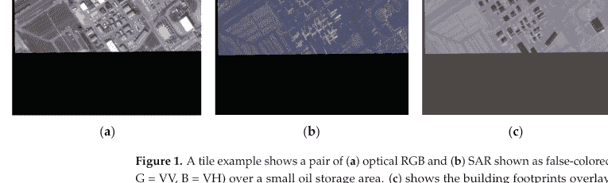

图 1. 一个瓦片示例显示了一对（a）光学 RGB 和（b）SAR（以假彩色显示：R = HH，G = VV，B = VH）覆盖一个小型储油区。（c）显示了叠加在假彩色 SAR 之上的建筑物 footprint。该数据集的一个主要挑战是区分港口区域中建筑物与高后向散射强度目标（如集装箱、油罐和船舶）之间的模式。

SAR 数据有两种朝向；两者均由朝北和朝南的传感器捕获。图 2a 显示了鹿特丹市底图上的瓦片，将 orient1（朝北）图像的位置标记为绿色，将 orient0（朝南）标记为红色。飞行方向由方位向（az）箭头指示，而传感器朝向的方向由距离向（rg）箭头给出。

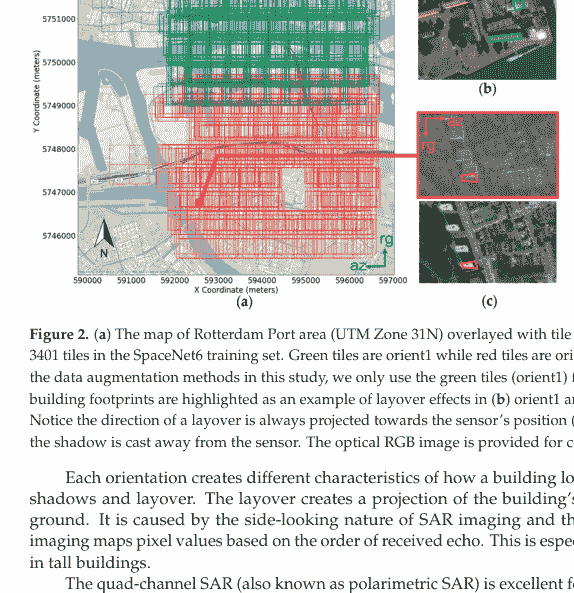

图 2.（a）鹿特丹港区域（UTM 31N 区）的地图，叠加了 SpaceNet6 训练集中所有 3401 个瓦片的边界。绿色瓦片为 orient1，红色瓦片为 orient0。为了展示本研究中的数据增强方法，我们仅使用绿色瓦片（orient1）进行训练。一些建筑物 footprint 被突出显示，作为（b）orient1 和（c）orient0 瓦片中叠掩效应的示例。请注意，叠掩的方向始终朝向传感器位置（近距），而阴影则背离传感器。提供光学 RGB 图像以供比较。

每种朝向都会产生建筑物外观的不同特征，即阴影和叠掩。叠掩将建筑物主体投射到地面上。它是由 SAR 成像的侧视特性以及 SAR 成像根据接收回波的顺序映射像素值这一事实造成的。这在高层建筑中尤为突出。

四通道 SAR（也称为极化 SAR）非常适合受益于额外数据的深度学习应用。然而，为了展示数据增强方法的有效性，我们仅使用了 orient1（覆盖城市北部区域）的瓦片，并且仅使用单个 HH 极化通道。这种限制在保持港口区域和住宅建筑物的独特土地利用覆盖的同时，强制产生过拟合，从而模拟有限数据的情况。我们仅选择 HH 极化通道，因为它主要存在于诸如高分三号、TerraSAR-X 和 Sentinel-1 [27] 等 SAR 星座中。

### 2.2. 准备数据集

训练深度学习模型的目的是在训练期间模型从未见过的新数据上进行良好预测。这称为泛化。开发模型的正确方法是准备三个独立的数据集，称为训练集、验证集和测试集。顾名思义，每个数据集用于模型开发的不同阶段。对于每次训练迭代（称为一个 epoch），模型通过学习训练集来更新其权重。在每个 epoch 结束时，模型在验证集上进行测试，而不更新权重。这作为深度学习从业者的指导，通过研究每个 epoch 上的泛化能力来优化模型或训练参数。最后，当训练完成时，模型的真实性能由其独立测试集上的得分决定。

为了训练我们的模型，我们使用了 SpaceNet6 训练集的大约一半，将其限制为单一传感器朝向和单一 HH 通道。我们没有使用单独的测试集。为了评估我们模型的性能，并作为增强方法影响的指导，我们使用扩展的


SpaceNet6 的版本。这一额外数据在 SpaceNet6 竞赛结束后才发布，由未处理的单视复数（SLC）SAR 数据和额外的多边形标签组成。我们从 SLC 光栅生成瓦片图像，其约束与训练集相同：单一方向和单一 HH 通道。我们使用其提供的 Python 库匹配了 [9] 中解释的确切预处理步骤。步骤如下：

- 1. 使用每个 SLC 光栅元数据中提供的 Capella Space 因子进行辐射定标。
- 2. 将复数图像转换为 SAR 强度。
- 3. 执行多视处理以降低斑点噪声，使用 2 × 2 核的平均卷积操作。
- 4. 将像素值转换为对数尺度以创建 SAR 对数强度图像。
- 5. 进行正射校正以校正由地球复杂地形引起的几何失真。此外，将光栅重采样为每个像素 0.5 m × 0.5 m 的空间分辨率。预处理后的 SLC 光栅示例如图 3 所示。
- 6. 在扩展数据集中提供的测试集标签边界内（图 2a 中的区域之外）生成目标分辨率为 900 × 900 像素的不重叠瓦片。我们丢弃无数据区域超过 40% 的瓦片。

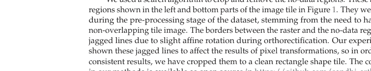

图 3. 预处理后并裁剪至测试集标签边界的 SLC 条带之一。这些将进一步裁剪为不重叠瓦片并稍后用作我们的验证数据集。

我们使用搜索算法裁剪并移除无数据区域。这些是图 1 中图像文件左侧和底部所示的黑色区域。它们是在数据集预处理阶段产生的，源于需要具有正方形不重叠瓦片图像的需求。光栅与无数据区域之间的边界由于正射校正期间轻微的仿射旋转而产生锯齿线。我们的实验表明这些锯齿线会影响像素变换的结果，因此为了获得一致的结果，我们将其裁剪为干净的矩形瓦片。我们方法中使用的代码以开源形式提供在 https://github.com/sandhi-artha/sn6_aug（最后访问于 9 April 2022）。

### 2.3. 分割模型

分割是将图像基于像素强度的相似性（同一类别内的相似特征）和不连续性（不同类别之间的边界或边缘）划分为区域的任务。对于建筑物足迹提取，只有 2 个类别：正样本，即属于建筑物区域的像素，以及负样本，即其余像素（非建筑物）。深度学习模型在训练时给定一对图像和标签。迭代过程输出一个尺寸相似的图像，将每个像素分类为属于两个类别之一。

编码器-解码器类型的架构常用于分割模型，由著名的 UNet [28] 及其变体推广。对于航空图像，DeepLab v3 [29]、PSPNet [30] 和特征金字塔网络（FPN）[31] 常被使用。基于之前的研究 [32]，我们使用了结合 EfficientNet B4 主干的 FPN 架构。EfficientNet 是一系列使用复合缩放生成以确定最佳网络尺寸的 CNN 模型 [33]。对于深度学习模型，架构指的是网络中各层如何连接，而主干指的是模型的特征提取部分。

从俯视图像获取的建筑物足迹具有各种尺寸。为了区分建筑物与背景，我们需要看到足够多的像素来表示整个或大部分建筑物。这意味着检测面积较小的建筑物需要更高的空间分辨率。计算机视觉中帮助模型学习这些多尺寸物体的常用方法是使用多尺度输入，即输入图像下采样到不同的像素分辨率。这称为图像金字塔（图 4）。

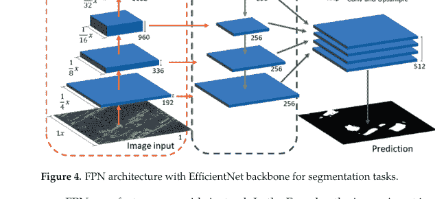

图 4. 用于分割任务的具有 EfficientNet 主干的 FPN 架构。

FPN 改用特征金字塔。在编码器中，图像输入使用扩张卷积操作进行缩放，每个金字塔层级的图像尺寸减半。随着数据在金字塔中向上流动，顶层将具有最小的宽度和高度（原始输入尺寸除以 32），但具有最丰富的语义信息（1632 个特征图或通道）。在分类任务中，这会被进一步压缩以输出与分类标签数量相同的向量 [31]。对于分割任务，需要与输入相同的空间尺寸的输出。因此，顶层需要上采样。

在编码器金字塔的最后一层应用 1 × 1 卷积滤波器以将特征图数量减少到 256，而不修改图像尺寸。随着数据在解码器金字塔中向下流动，宽度和高度使用最近邻上采样增加 2 倍。在跳跃连接（黄色箭头）中，编码器和解码器中同一金字塔层级的特征图被拼接。使用 1 × 1 卷积将编码器金字塔的特征图缩放至 256。这提供了上下文以实现更好的定位，因为图像的像素分辨率逐渐恢复。之后，解码器的特征金字塔经过 Conv 和 Upsample 操作（黑色箭头），得到具有 128 个特征图且图像尺寸为原始输入的 1/4 的模块。然后它们按通道堆叠，创建具有 512 个特征图的模块。最后的 Conv 和 Upsample 操作将通道数减少到 1 并将图像尺寸恢复到原始输入 [34]。

### 2.4. 训练细节

训练在 Kaggle Kernel 中进行，这是一个配备 2 核处理器和具有 16 GB 视频内存（VRAM）的 Nvidia P100 GPU 的云计算环境。训练管道使用 TensorFlow 框架构建。Segmentation-Models 库 [35] 用于在没有预训练权重的情况下将 FPN 架构与 EfficientNet B4 主干结合。Adam [36] 被用作优化器，采用默认参数。我们使用了学习率调度器，将学习率 α 配置为按因子 0.5 * (1 + cos(nπ / N)) 逐渐衰减，其中 n 为当前轮次，N 为总轮次数。

为了评估模型的性能，我们使用交并比（IoU）作为指标。IoU 是预测区域与真实区域之间重叠的比率（图 5）。在这种情况下，它是一个基于像素的指标。较高的 IoU 表示更好的预测精度。

$$\text{IoU} = \frac{y_{gt} \cap y_{pred}}{y_{gt} \cup y_{pred}} = \frac{\text{TP}}{\text{TP} + \text{FP} + \text{FN}} \tag{1}$$

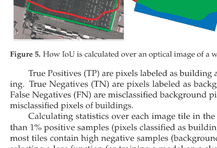

图 5. 如何在仓库建筑的光学图像上计算 IoU。

真阳性（TP）是标记为建筑物且正确预测为建筑物的像素。真阴性（TN）是标记为背景且正确预测的像素。假阴性（FN）是被误分类的背景像素，而假阳性（FP）是被误分类的建筑物像素。

计算训练集中每个图像瓦片的统计数据，20% 的瓦片具有少于 1% 的正样本（被分类为建筑物的像素）（图 6a）。这表明大多数瓦片包含大量负样本（背景像素）。在这种倾斜的数据分布上训练模型时，必须谨慎选择损失函数，因为负样本将主导预测。例如，使用二元交叉熵作为损失函数，即使模型将整张图像预测为背景像素，也会获得较小的误差。

我们尝试了几种损失函数并得出结论，Dice Loss 在该数据集上导致更好的收敛。它基于 Dice 系数，该系数用于根据重叠程度计算 2 个样本之间的相似性。Dice 损失简单地为 1 − Dice 系数。这导致损失或误差分数范围为 0 到 1，其中 0 表示完美且完全的重叠。

$$Loss_{Dice} = 1 - 2 * \frac{y_{gt} \cap y_{pred}}{y_{gt} + y_{pred}} \tag{2}$$


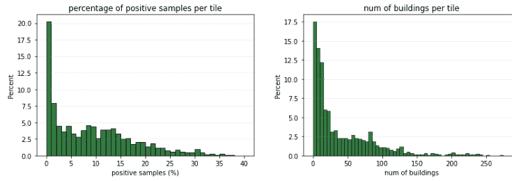

**图 6.** 训练集的每个图像瓦片的归一化统计。(a) 显示了正样本数量与图像瓦片总像素数的分布，其中20%的瓦片只有不到1%的总像素被归类为建筑物。(b) 显示了每个图像瓦片的建筑物数量。大多数瓦片（17.5%）包含少于5栋建筑物。

### 2.5. 消融实验

首先，我们在消融实验中研究了每种增强方法的影响，使用相同的模型和训练配置，但对数据集应用不同的变换。为了加速这一过程，我们仅使用主训练集的一个子集进行训练和验证。我们将其划分为5个相同的列区域。第一列和第二列用作迷你训练数据集，最后一列用作迷你验证数据集。我们没有将中间区域包含在迷你训练集中，以创建一个缓冲区域（注意图2a中瓦片的高重叠），防止两个数据集之间的数据泄漏。迷你训练集和迷你验证集分别包含主训练集的37%和23%的图像。在消融实验确定了哪种增强方法对迷你数据集有效后，我们将具有正向影响的变换组合应用于主数据集。

## 3. 数据增强

本节描述了本研究中使用的数据增强方法及其在模型开发过程中的实现方式。总的来说，几何变换（包括缩减变换）使用 TensorFlow 操作实现，而像素变换则借助 Albumentations 库 [37] 实现。

### 3.1. 数据增强的类型

#### 3.1.1. 缩减变换

裁剪无数据区域会导致每个瓦片的宽高比不同，这一问题需要解决。正方形图像更适合作为数据输入，以简化模型内部图像的空间压缩和扩展。图像大小也需要缩小以适应 GPU 内存。我们决定采用 320 × 320 像素的目标分辨率，这使得单个 P100 GPU 的批大小可以达到 8。所有调整大小的方法均使用双线性插值。测试了两种主要的调整大小方法：

- 填充调整大小：将无数据区域添加回来以形成正方形宽高比，采用最小像素值 0.0。这与原始瓦片类似，但现在栅格居中，没有锯齿状边界。随后，将图像下采样到目标分辨率。
- 扭曲调整大小：将矩形瓦片调整为正方形目标分辨率，使图像形状发生扭曲，但不存在黑色区域。

这种下采样过程可以利用引入随机性，进一步增加训练样本的多样性。在随机位置进行裁剪比简单地调整整个图像大小能提供更好的细节（图 7）。然而，由于引入了随机性，这些方法不能用作验证数据集的缩减方法：

- **随机裁剪**：从矩形图像中裁剪出大小为 320 × 320 像素的随机区域。由于没有进行下采样，因此保持了像素尺度。
- **随机裁剪并调整大小**：以随机缩放比例裁剪随机位置，然后将其下采样到目标分辨率。

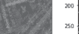

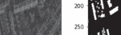

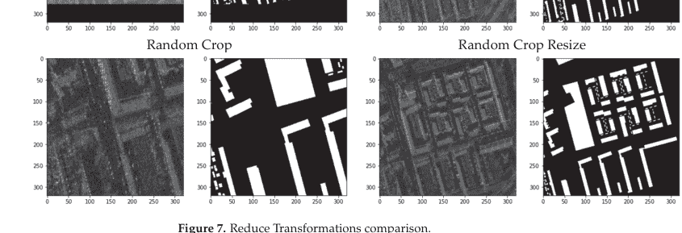

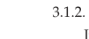

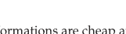

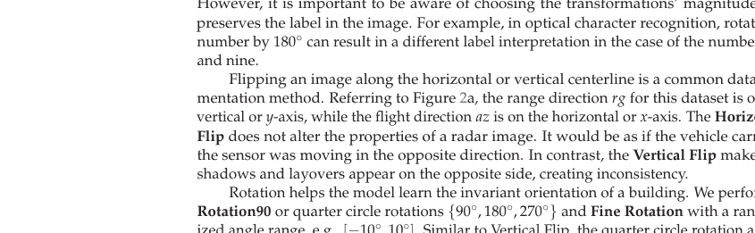

**图 7.** 缩减变换比较。

#### 3.1.2. 几何变换

在计算机视觉任务中，几何变换成本低且易于实现。然而，重要的是要注意选择能够保持图像中标签的变换强度。例如，在光学字符识别中，将数字旋转180°可能导致标签解释不同，例如数字6和9。

沿水平或垂直中线翻转图像是一种常见的数据增强方法。参见图2a，该数据集的距离方向 r_g 位于垂直方向（y轴），而飞行方向 a_z 位于水平方向（x轴）。水平翻转不会改变雷达图像的特性，就好像搭载传感器的车辆正朝相反方向移动。相反，垂直翻转会使阴影和叠掩出现在相反一侧，从而导致不一致。

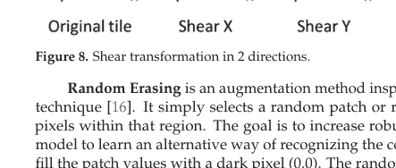

**图 8.** 两个方向上的剪切变换。

**随机擦除**是一种受 dropout 正则化技术 [16] 启发的增强方法。它简单地选择图像中的一个随机补丁或区域，并擦除该区域内的像素。其目的是通过迫使模型学习识别被覆盖物体的替代方式来增强对遮挡的鲁棒性。我们决定用暗像素（0.0）填充补丁值。随机擦除是使用 Albumentations 库中的 CoarseDropout 类实现的。区域的宽度和大小随机设置为 30 像素到 40 像素，创建的区域数量随机为 2 到 10 个补丁。所提出的几何变换如图 9 所示。

示例图像

水平翻转

垂直翻转

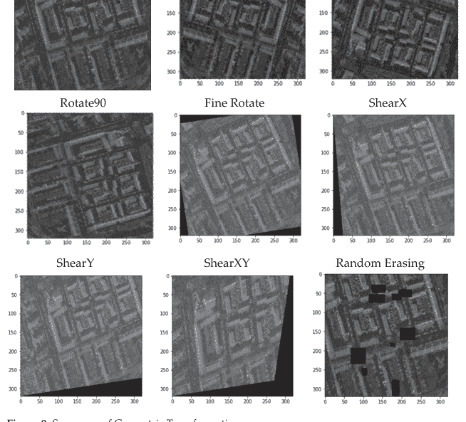

旋转90

精细旋转

剪切X

剪切Y

剪切XY

随机擦除

**图 9.** 几何变换总结。

#### 3.1.3. 像素变换

在机载传感器中，传感器位置相对于预期轨迹的未知扰动可能导致多种缺陷，如辐射失真和图像散焦。为了增强模型遇到这些缺陷时的鲁棒性，我们使用了噪声注入方法。常见的**高斯噪声**使用 GaussNoise 类生成，而**斑点噪声**则使用 MultiplicativeNoise 类将每个像素乘以随机值来放大，两者均来自 Albumentations 库。部分图像因飞行轨迹的未预测变化而出现散焦，导致传感器与场景之间的微波路径长度发生波动 [38]。我们通过使用 Albumentations 的 MotionBlur 类应用随机核大小的**运动模糊**来模拟这种散焦。

我们使用高通滤波器进行**锐化**以改善边缘检测。因此，这也增加了其他高频分量，如斑点。

该数据集中的 SAR 图像是对数尺度下的 SAR 强度图像，也称为 dB 图像。从数据集的样本中，我们观察到 dB 图像的像素分布接近瑞利分布，且大多集中在较窄的区域内。**图 10** 展示了直方图均衡方法如何拉伸像素分布以覆盖整个范围，从而增加对比度并提高边缘可见性。对比度受限自适应直方图均衡（CLAHE）在图像不同部分存在较大强度变化时效果最佳，它限制对比度放大以保留细节。我们使用 Albumentations 库中的 CLAHE 类来应用它。所提出的像素变换如**图 11** 所示。

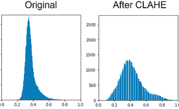

**图 10.** 使用 CLAHE 进行直方图均衡前后，SAR 对数强度图像的直方图。

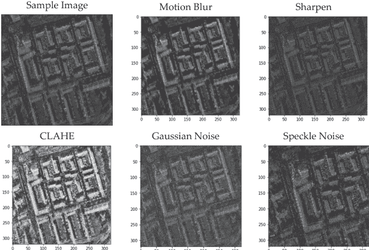

**图 11.** 像素变换总结。

#### 3.1.4. 斑点滤波器

尽管仍归类为像素变换，但本小节旨在对斑点滤波器进行更详细的说明。与其他相干成像方法（激光、超声）类似，SAR 也会遭受称为斑点的类噪声现象。这是由于分辨单元内多个散射体的干涉造成的。斑点以像素值的颗粒状变化形式出现，这会降低 SAR 图像对于计算机视觉系统以及人类从业者的可解释性。

斑点抑制滤波器（如 Box 滤波器）可以使用局部平均窗口来平滑斑点。这在均匀区域中是有效的，但在需要高频信息（如边缘）的应用中，适应局部纹理的滤波器可以更好地保留异质区域中的信息 [39]。先前的一项研究 [32] 表明，在 UNet 模型上应用不同强度的低通滤波器可以带来轻微的性能提升。在本研究中，我们考察了使用著名的自适应斑点滤波器作为数据增强形式，即增强 Lee 滤波器（**eLee**）、Frost 滤波器和伽马最大后验（**GMAP**）滤波器。

在图 12a 中，显示了两个大小为 150 × 150 像素的样本裁剪，用于比较滤波结果。好的滤波器应该在抑制斑点的同时保持图像的平均值 [40]。在均匀区域中，标准差理想情况下应为 0。斑点滤波器在 MATLAB 中应用于 SAR 强度图像（线性尺度），之后转换回对数强度图像（dB 尺度）。滤波结果如图 12c,d 所示，定量比较见表 1。我们可以观察到，GMAP 滤波器在保持平均值和降低方差方面分别略优于裁剪 1 和裁剪 2。图像的等效视数（ENL）也显示了所有滤波器的斑点方差均有所降低。

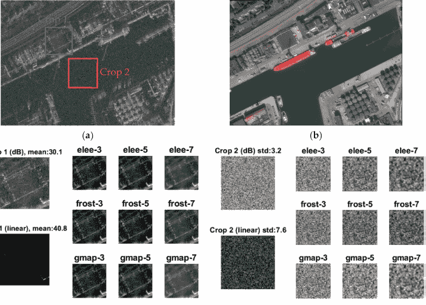

**图 12.** 示例 SAR 对数强度（dB）图像 (a) 及其对应的光学 RGB 图像 (b)。我们进一步分析了建筑物的两个不同裁剪区域（裁剪 1）和均匀水域（裁剪 2）。使用选定斑点滤波器和不同核大小的滤波结果见 (c,d)。由于动态范围较宽，线性尺度下的图像显得较暗。


**表1.** 所应用滤波器的定量比较。均值、标准差（std）和等效视数（ENL）均在线性尺度下计算。

| 滤波器 | 尺寸 | 裁剪1—均值 | 裁剪2—标准差 | 图像ENL |
|---|---:|---:|---:|---:|
| eLee | 3 | 43.3 | 4.3 | 7.0 |
| eLee | 5 | 44.0 | 2.8 | 17.2 |
| eLee | 7 | 44.2 | 2.1 | 33.6 |
| Frost | 3 | 43.3 | 4.6 | 6.1 |
| Frost | 5 | 44.0 | 3.4 | 12.8 |
| Frost | 7 | 44.0 | 2.8 | 19.2 |
| GMAP | 3 | 42.5 | 4.3 | 7.1 |
| GMAP | 5 | 41.9 | 2.8 | 17.5 |
| GMAP | 7 | 41.3 | 2.1 | 34.2 |
| 原始图像 | — | 40.8 | 7.6 | 1.0 |

### 3.2. 数据增强设计与策略

我们设定图像加载原始版本或应用了数据增强的版本的概率为50%。变换的幅度也在一个数值范围内随机化，从而增加每次训练迭代中的变化，但翻转和四分之一圆旋转除外，它们的变换集合是有限的。

在主实验中，当多种增强组合使用时，变换的顺序非常重要。首先应用像素变换，以防止无数据像素的存在影响结果。随后是缩放变换，最后是几何变换。当使用多种像素变换时，重要的是把它们组合成一个“One Of”（任选其一）组。这样每次只会随机应用其中一种变换，从而避免产生灾难性结果。在几何变换中没有分组，因此图像有机会经历所有变换，这可能会增加无数据像素，但通常比多重滤波操作的危害更小。

如文献[10]所分类，数据增强（DA）的应用分为三个阶段：在线增强（Online，即时处理）、离线增强（Offline）和测试时增强（TTA）。

在线增强中，输入数据在训练过程中被实时处理。如果在训练中使用了快速加速器，而增强算法较慢，这可能导致瓶颈，使加速器大部分时间在等待数据。其优点是它不会将扩充后的数据存储在存储设备中。另一方面，离线增强允许复杂的处理，并且不会增加训练时间。然而，由于它在训练之前应用，会占用存储空间，而且变化是预先确定的（随机性较低）。在本研究中，我们仅对斑点滤波图像使用离线增强，因为它们在TensorFlow环境之外处理，并且对所应用的每种滤波器都存储了一幅图像。本研究中的其他变换使用在线增强，它可以在每次迭代中实现更精细的随机性。

在TTA中，从每个测试图像x生成额外的图像，其中A是在推理或预测阶段应用的增强数量。然后模型将对A+1个样本进行预测，并以平均值作为最终预测。这种对输入的多个变换版本进行预测的方法模仿了集成学习的理论，即一组使用不同架构或在不同数据上训练的模型组合其预测以提高泛化能力。文献[41]对此进行了研究，结论是TTA有助于减少仅使用单个模型时过度自信的错误预测。

在分类任务中，平均预测很直接，因为输出是一个大小等于类别数量的数组。在分割任务中，必须谨慎执行会修改标签位置（在我们的数据集中是建筑物足迹）的增强。如果使用了此类方法，解决办法很简单：在平均预测之前先进行逆变换。

## 4. 结果

### 4.1. 消融实验

在此独立实验中，我们衡量了每种增强方法的影响。模型在迷你训练数据集上进行训练，并在迷你验证数据集上进行评估。结果如表2所示。损失和IoU是训练集的分数，而验证损失和验证IoU是验证数据集的分数。训练持续了60个epoch。这四个指标均取自最佳epoch，即模型获得最高验证IoU的时刻。我们没有选择第60个epoch的最终分数，以便客观地展示每种增强的最佳性能。最后一个epoch的分数总是比最佳epoch差，因为训练分数不断提高，而验证分数停滞甚至恶化。这可以从图13中看出。当应用增强方法时，训练分数和验证分数之间的差距变小，这推迟了过拟合，使模型能够进入所谓的局部最小值或临时性能峰值。

表2. 消融实验的结果。所有分数均以百分比为单位。对于损失，越低越好；对于IoU，越高越好。分数相对于填充缩放（Pad Resize）进行了颜色编码，绿色表示正增益，红色表示负增益。

| 方法 | 损失 | 验证损失 | IoU | 验证IoU |
|---|---|---|---|---|
| 缩放变换 |  |  |  |  |
| 填充缩放 | 22.04 | 47.40 | 64.10 | 36.33 |
| 扭曲缩放 | 26.35 | 46.57 | 58.56 | 36.95 |
| 随机裁剪 | 34.75 | 47.97 | 48.92 | 35.63 |
| 随机裁剪缩放 | 27.59 | 44.98 | 57.34 | 38.59 |
| 几何变换 |  |  |  |  |
| 水平翻转 | 27.35 | 46.04 | 57.58 | 37.84 |
| 垂直翻转 | 35.01 | 53.23 | 48.52 | 31.00 |
| 旋转90° | 45.43 | 58.10 | 37.90 | 27.15 |
| 微旋转 [−10,10] | 24.75 | 45.73 | 60.80 | 37.93 |
| X方向剪切 [−10,10] | 22.07 | 47.42 | 64.11 | 36.32 |
| Y方向剪切 [−10,10] | 23.36 | 45.76 | 62.44 | 37.88 |
| 随机擦除 | 22.48 | 47.84 | 63.56 | 36.01 |
| 像素变换 |  |  |  |  |
| 运动模糊 | 25.79 | 48.10 | 59.45 | 35.88 |
| 锐化 | 20.82 | 48.20 | 65.81 | 36.02 |
| CLAHE | 31.20 | 48.36 | 52.69 | 35.53 |
| 高斯噪声 | 31.67 | 46.99 | 52.67 | 36.66 |
| 斑点噪声 | 25.82 | 46.76 | 59.43 | 36.85 |
| 斑点滤波—eLee | 23.94 | 49.43 | 61.61 | 34.56 |
| 斑点滤波—Frost | 23.39 | 49.34 | 62.30 | 34.78 |
| 斑点滤波—GMAP | 20.36 | 47.39 | 66.40 | 36.38 |

为了使图像分辨率适配模型的输入，我们使用了两种基本的缩放（Reduce）方法：填充缩放（Pad Resize）和扭曲缩放（Distorted Resize）。使用扭曲缩放获得的分数略高，这可能表明黑色填充分散了模型的注意力，因为栅格空间的全部范围未被充分利用。然而，当将扭曲的预测重塑回原始纵横比时会出现一个问题，因此我们使用填充缩放作为验证数据的缩放方法。通过随机裁剪缩放为缩放方法添加随机性，这与其他增强相比带来了最大的性能提升。随机化裁剪尺寸使得能够在不同尺度和细节下观察图像。随机裁剪表现不佳，因为160 m × 160 m区域的静态裁剪尺寸过小，增加了遇到建筑物部分片段的机会。

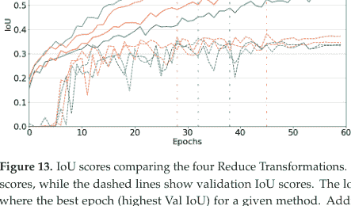

图13. 比较四种缩放变换的IoU分数。实线表示训练IoU分数，虚线表示验证IoU分数。较为稀疏的点状垂直虚线表示给定方法的最佳epoch（最高验证IoU）所在位置。为输入添加更多变化会推迟过拟合，具体表现为最佳epoch出现得更晚。

几何变换通常提高了性能，但垂直翻转和旋转90°除外。这两者都对性能有害，因为它们导致阴影和叠掩位置相对于实际建筑物足迹发生极端位移。像素变换的效果没有那么显著，给出的分数与基线相似或略差。这些增强会影响纹理的识别，而当建筑物边缘或其形状由于遮挡或噪声而无法识别时，纹理是一个重要特征。然而，这种滤波也可能具有破坏性，因为它也会放大非建筑物图案。

应用增强时，训练分数普遍较低，因为模型难以在额外变化中找到潜在的函数。GMAP斑点滤波的训练分数显著增加，表明对训练数据的识别更好。然而，这些变化并未出现在验证数据中，因此验证分数较低。

为了验证我们提出的数据增强的效果，我们对不同的迷你数据集进行了消融实验，简要描述如下：

-   SAR Orient 0，其传感器朝北，与Orient 1相反（见图2）。
-   PAN，同样来自SpaceNet6数据集，但使用单波段全色图像而非SAR图像。
-   Inria，一种30厘米空间分辨率的VHR光学RGB航空影像。为实施有限数据配置，我们仅从奥斯汀和芝加哥各取15幅图像作为迷你训练数据集。至于迷你测试集，使用了来自维也纳的10幅图像。每幅图像被划分为25个1000 × 1000像素的图像块。RGB图像被转换为灰度图像，以便与其他单通道迷你数据集进行公平比较。

图14显示，其他数据集上的性能增益和损失与SAR orient1的结果基本一致。随机裁剪缩放、水平翻转和微旋转在所有数据集上均表现出一致的增益。与此同时，旋转90°的性能持续下降，这在SpaceNet6的数据集中更为明显。PAN的结果突出了该方法对相似地理区域（鹿特丹港）但不同模态的影响，而Inria的结果则突显了在面对多个城市的不同城市聚落时的影响。然而，由于深度神经网络的随机性，针对某一数据集优化的模型和训练方法可能无法转化为另一数据集上的最优解决方案，该数据集具有


对于包含大量负样本（属于非建筑物的像素）的图像块，像素增强会引发对高后向散射物体的额外关注，例如金属制成的集装箱堆场和大型船舶/港口设备（图15b）。这导致误报增加。几何增强对此不太敏感。然而，几何增强会过拟合那些具有建筑物形状后向散射的非建筑物物体，例如运动场周围的围栏（图15c）。几何增强和像素增强的组合似乎能够抑制这些误报，并正确地将它们识别为非目标模式。

遮挡是最严重的问题，尤其是在密集区域的高层建筑中（图15d）。所有模型都无法识别被相邻高层建筑叠加遮挡的建筑物。有趣的是，几何增强倾向于将叠加部分分类为正样本。

尽管Baseline没有使用任何增强，但使用Albumentations库应用的Light Pixel方案训练速度略快。这是因为回调函数会在每次监测到更好值时保存模型状态，在某些epoch上需要额外时间。这说明由于涉及随机性，训练时长并不是一个客观的衡量标准。尽管如此，我们仍将其纳入比较。其他方案表明，添加更多变换方法会增加训练时间。

### 4.3. 测试时增强

主实验中的模型在其最佳epoch时保存状态，TTA在训练结束后应用。我们实验了两种TTA方法：

- 1. TTA_1：使用Pad Resize降低图像分辨率。变换包括水平翻转、旋转{−10°, 10°}和Y轴剪切{−10°, 10°}。在预测每个样本变体后，应用逆变换，并将平均和用作最终预测。每个测试样本的总预测次数：六次。
- 2. TTA_2：将矩形图像块分割成两个正方形小块，中间有一定重叠。这通过利用整个图像空间并去除黑边，略微增加了细节。然后对每个小块执行TTA_1。最后，通过对重叠区域的像素值取平均来合并两个预测小块。每个测试样本的总预测次数：十二次。

我们将TTA应用于Baseline模型和主实验中最佳模型（该模型使用Light Geometry方案训练）。TTA的代价是额外的推理时间t_test，与Baseline的推理时间相比是一个缩放因子。它随应用增强次数的增加而按比例增加。与重新训练模型所需的时间相比，实现TTA的额外推理时间可以忽略不计。TTA的结果如表4所示。

表4. 将TTA应用于Baseline模型和Light Geometry的结果。所有损失和IoU分数均以百分比表示。对于损失，越低越好。对于IoU，越高越好。分数以颜色编码，深绿色表示更好的值。

| TTA方案 | 验证损失 | 验证IoU | t_test |
|---|---|---|---|
| Baseline | 44.54 | 42.13 | 1.00 |
| Baseline + TTA_1 | 41.79 | 44.65 | 3.35 |
| Baseline + TTA_2 | 48.01 | 38.25 | 6.37 |
| Light Geometry + TTA_1 | 39.05 | 47.90 | 3.39 |
| Light Geometry + TTA_2 | 37.11 | 49.69 | 6.39 |

Baseline和Light Geometry模型都受益于TTA_1（由简单的几何变换组成）。有趣的是，当TTA_2应用于Baseline模型时，性能较低，因为它从两个正方形小块中预测的正样本较少。Baseline模型在固定尺度的图像上训练，与Light Geometry模型相比，对预测中型建筑物的置信度较低，而后者通过Random Crop Resize缩减方法有机会看到尺度的变化。

## 5. 讨论

深度学习方法使用大量的参数探索。结果随不同的数据、模型和训练参数（也称为超参数）而变化。我们的目标是在保持模型和超参数不变的情况下，基于我们修改数据的实验提供直觉。包括SAR在内的雷达图像具有与光学图像不同的独特性质。因此，一些变换可能导致性能不佳。选择增强方法需要了解训练数据中的偏差，可以通过统计分析（对于大型数据集）或手动检查样本来实现。这有助于缩小搜索空间，而不是尝试所有可用的方法。

在遥感图像中，由于无法将大型栅格直接输入模型，因此需要进行分块。目标分辨率的选择会影响多尺度物体（如建筑物）的检测。在数据集加载过程中通过改变尺度和裁剪大小引入随机性是一种廉价的性能提升方式，因为无需存储额外图像，例如在有重叠区域的分块情况下。然而，过度裁剪会增加大型物体覆盖整个空间的可能性，从而降低性能。在对大型栅格进行分块时，无数据区域是不可避免的，根据我们的经验，最好在将图像块输入模型之前将其移除。

我们的研究表明，像素变换不如几何变换有效。原因可能是核滤波器（大多数像素变换的基础）已经是CNN模型本身的组成部分，因此可以通过适当规模的模型学习。

在模型开发的不同阶段应用变换有不同的权衡。例如，离线数据增强（Offline DA）可以利用训练图像及其存储的变体一次性训练模型。我们在一个经过散斑滤波器变换的数据集上进行了实验，获得了与表2中Random Crop Resize相近的分数，但训练时间增加了3.5倍。当数据只有几百个样本且收集额外数据不可行时（例如对稀有医学图像进行分类），这可能是一个不错的选择。

我们证明了测试时增强（TTA）是一种提升测试分数的廉价方法。然而，与在训练期间应用相同增强集相比，在测试期间应用增强集并未获得更好的分数。如果模型在训练期间见过这些变化，就能更好地预测各种测试样本。因此，在两个阶段都应用增强将获得更好的分数。在TTA中使用剪切和微旋转时，角度必须保持较小，因为它会移除图像的一部分（图像边界之外），在预测后进行逆变换时这部分不会恢复。这就是为什么四分之一圆旋转和翻转更常用于TTA，因为它们在逆变换后保留完整图像。

## 6. 结论

本文介绍了用于SAR图像建筑物足迹语义分割的几种数据增强方法。通过人工增加训练数据集，我们提高了模型在验证集未见样本上的泛化能力，从而减少了过拟合。结果显示，与基线模型（无增强）相比，最佳增强方案的验证IoU分数提高了5%。在数据有限的情况下（无论是由于专有许可还是昂贵的收集过程），数据增强都非常有帮助。

对于SAR中的建筑物检测，几何变换比像素变换更有效。然而，一些改变SAR图像中建筑物关键特征的变换（如垂直翻转和四分之一圆旋转）被证明是有害的。因此，数据增强不能过度使用，尤其是因为训练需要更多资源（无论是存储还是处理时间），而这并不总会带来更好的结果。与仅在训练期间应用的增强相比，测试时增强显示了额外的性能提升。

我们希望这项研究能够为未来在有限雷达图像中优化目标检测的研究提供指导，或为探索增强雷达图像的替代方法提供灵感。寻找有效的数据增强方法可能代价高昂；因此，自动化方法可以节省时间和计算资源。这些方法尚未在本文中研究。此外，通过生成模型生成新数据或使用模拟仍然是值得探索的有趣途径。

**作者贡献：** 概念化，S.W.和P.S.；方法论，S.W.；软件，S.W.和A.G.；验证，S.W.、P.S.和A.G.；正式分析，S.W.；调查，S.W.；资源，S.W.；数据管理，S.W.；写作—初稿准备，S.W.；写作—审阅和编辑，S.W.、P.S.和A.G.；可视化，S.W.；监督，P.S.和A.G.；项目管理，S.W.和P.S.。所有作者均已阅读并同意手稿的出版版本。

**资金：** 本研究未获得外部资金。

**数据可用性声明：** 不适用。

**利益冲突：** 作者声明不存在利益冲突。

## 参考文献

- 1. Kang, M.; Baek, J. SAR image change detection via multiple-window processing with structural similarity. Sensors 2021, 21, 6645. [CrossRef] [PubMed]
- 2. Jing, H.; Sun, X.; Wang, Z.; Chen, K.; Diao, W.; Fu, K. Fine Building Segmentation in High-Resolution SAR Images Via Selective Pyramid Dilated Network. IEEE J. Sel. Top. Appl. Earth Obs. Remote Sens. 2021, 14, 6608–6623. [CrossRef]
- 3. Shahzad, M.; Maurer, M.; Fraundorfer, F.; Wang, Y.; Zhu, X.X. Buildings detection in VHR SAR images using fully convolution neural networks. IEEE Trans. Geosci. Remote Sens. 2019, 57, 1100–1116. [CrossRef]
- 4. Sun, Y.; Hua, Y.; Mou, L.; Zhu, X.X. CG-Net: Conditional GIS-aware Network for Individual Building Segmentation in VHR SAR Images. IEEE Trans. Geosci. Remote Sens. 2022, 60, 1–15. [CrossRef]
- 5. Xia, J.; Yokoya, N.; Adriano, B.; Zhang, L.; Li, G.; Wang, Z. A Benchmark High-Resolution GaoFen-3 SAR Dataset for Building Semantic Segmentation. IEEE J. Sel. Top. Appl. Earth Obs. Remote Sens. 2021, 14, 5950–5963. [CrossRef]
- 6. Sun, C.; Shrivastava, A.; Singh, S.; Gupta, A. Revisiting Unreasonable Effectiveness of Data in Deep Learning Era. Proc. IEEE Int. Conf. Comput. Vis. 2017, 843–852. [CrossRef]
- 7. Maggiori, E.; Tarabalka, Y.; Charpiat, G.; Alliez, P. Can semantic labeling methods generalize to any city? The INRIA aerial image labeling benchmark. Int. Geosci. Remote Sens. Symp. 2017, 2017, 3226–3229. [CrossRef]
- 8. Van Etten, A.; Lindenbaum, D.; Bacastow, T.M. SpaceNet: A Remote Sensing Dataset and Challenge Series. arXiv 2018, arXiv:1807.01232.
- 9. Shermeyer, J.; Hogan, D.; Brown, J.; Van Etten, A.; Weir, N.; Pacifici, F.; Hansch, R.; Bastidas, A.; Soenen, S.; Bacastow, T.; et al. SpaceNet 6: Multi-sensor all weather mapping dataset. IEEE Comput. Soc. Conf. Comput. Vis. Pattern Recognit. Work. 2020, 2020, 768–777. [CrossRef]
- 10. Shorten, C.; Khoshgoftaar, T.M. A survey on Image Data Augmentation for Deep Learning. J. Big Data 2019, 6, 60. [CrossRef]
- 11. Ronneberger, O.; Fischer, P.; Brox, T. U-Net: Convolutional Networks for Biomedical Image Segmentation. In Proceedings of the International Conference on Medical Image Computing and Computer-Assisted Intervention, Munich, Germany, 5–9 October 2015.
- 12. Bisla, D.; Choromanska, A.; Berman, R.S.; Stein, J.A.; Polsky, D. Towards automated melanoma detection with deep learning: Data purification and augmentation. IEEE Comput. Soc. Conf. Comput. Vis. Pattern Recognit. Work. 2019, 2019, 2720–2728. [CrossRef]
- 13. Nalepa, J.; Myller, M.; Kawulok, M. Hyperspectral Data Augmentation. arXiv 2019, arXiv:1903.05580.
- 14. Illarionova, S.; Nesteruk, S.; Shadrin, D.; Ignatiev, V.; Pukalchik, M.; Oseledets, I. Object-Based Augmentation for Building Semantic Segmentation: Ventura and Santa Rosa Case Study. In Proceedings of the IEEE/CVF International Conference on Computer Vision, Montreal, QC, Canada, 11–17 October 2021; pp. 1659–1668. [CrossRef]
- 15. Yang, L.; Huang, R.; Huang, J.; Lin, T.; Wang, L.; Mijiti, R.; Wei, P.; Tang, C.; Shao, J.; Li, Q.; et al. Semantic Segmentation Based on Temporal Features: Learning of Temporal-Spatial Information From Time-Series SAR Images for Paddy Rice Mapping. IEEE Trans. Geosci. Remote Sens. 2021, 60, 1–16. [CrossRef]
- 16. Zhong, Z.; Zheng, L.; Kang, G.; Li, S.; Yang, Y. Random erasing data augmentation. In Proceedings of the AAAI Conference on Artificial Intelligence, New York, NY, USA, 7–15 February 2020; pp. 13001–13008. [CrossRef]


- 17. Song, T.; Kim, S.; Kim, S.; Lee, J.; Sohn, K. 用于 SAR 舰船检测的上下文保持实例级增强和可变形卷积网络. arXiv 2022, arXiv:2202.06513.
- 18. Zhang, T.; Zhang, X.; Ke, X.; Liu, C.; Xu, X.; Zhan, X.; Wang, C.; Ahmad, I.; Zhou, Y.; Pan, D., et al. HOG-ShipCLSNet：一种用于 SAR 舰船分类的融合 HOG 特征的新型深度学习网络. IEEE 地球科学与遥感汇刊 2022, 60, 1–22. [CrossRef]
- 19. Ding, J.; Chen, B.; Liu, H.; Huang, M. 用于 SAR 目标识别的数据增强卷积神经网络. IEEE 地球科学与遥感快报 2016, 13, 364–368. [CrossRef]
- 20. Cui, Z.; Zhang, M.; Cao, Z.; Cao, C. 通过生成对抗网络对 SAR 传感器进行图像数据增强. IEEE Access 2019, 7, 42255–42268. [CrossRef]
- 21. Wang, P.; Zhang, H.; Patel, V.M. 使用卷积神经网络的 SAR 图像去斑. IEEE 信号处理快报 2017, 24, 1763–1767. [CrossRef]
- 22. Zhang, G.; Li, Z.; Li, X.; Xu, Y. 在没有干净数据的情况下学习合成孔径雷达图像去斑. 应用遥感学报 2020, 14, 026518. [CrossRef]
- 23. Wang, D.; Han, M. SA-U-Net++：基于语义分割和 ISAR 增强的 SAR 海上浮式筏式水产养殖识别. 应用遥感学报 2021, 15, 016505. [CrossRef]
- 24. Lewis, B.; Scarnati, T.; Levy, M.; Nehrbass, J.; Zelnik, E.; Sudkamp, E. 用于 SAR 数据增强的机器学习技术. In 雷达应用的深度神经网络设计; Scitech Publishing: London, UK, 2021; pp. 163–206.
- 25. Zheng, Z.; Ma, A.; Zhang, L.; Zhong, Y. 用于缺失模态全天候制图的深度多传感器学习. ISPRS 摄影测量与遥感学报 2021, 174, 254–264. [CrossRef]
- 26. Adriano, B.; Yokoya, N.; Xia, J.; Miura, H.; Liu, W.; Matsuoka, M.; Koshimura, S. 从多模态和多时相地球观测数据中学习用于建筑物损毁制图. ISPRS 摄影测量与遥感学报 2021, 175, 132–143. [CrossRef]
- 27. Hoeser, T.; Bachhofer, F.; Kuenzner, C. 基于地球观测数据的深度学习目标检测与图像分割：综述——第二部分：应用. 遥感 2020, 12, 3053. [CrossRef]
- 28. Russakovsky, O.; Deng, J.; Su, H.; Krause, J.; Satheesh, S.; Ma, S.; Huang, Z.; Karpathy, A.; Khosla, A.; Bernstein, M.; et al. ImageNet 大规模视觉识别挑战赛. 国际计算机视觉杂志 2015, 115, 211–252. [CrossRef]
- 29. Chen, L.-C.; Papandreou, G.; Schroff, F.; Adam, H. 重新思考用于语义图像分割的空洞卷积. arXiv 2017, arXiv:1706.05587.
- 30. Zhao, H.; Shi, J.; Qi, X.; Wang, X.; Jia, J. 金字塔场景解析网络. In Proceedings of the IEEE Conference on Computer Vision and Pattern Recognition, Honolulu, HI, USA, 21–26 July 2017; pp. 6230–6239. [CrossRef]
- 31. Lin, T.Y.; Dollár, P.; Girshick, R.; He, K.; Hariharan, B.; Belongie, S. 用于目标检测的特征金字塔网络. In Proceedings of the IEEE Conference on Computer Vision and Pattern Recognition, Honolulu, HI, USA, 21–26 July 2017; pp. 936–944. [CrossRef]
- 32. Wangiyana, S.; Samczynski, P.; Gromek, A. 使用 CNN 进行自动建筑分割时 SAR 分辨率的影响. In Proceedings of the 2021 Signal Processing Symposium (sPSympo), Lodz, Poland, 20–23 September 2021; pp. 289–293.
- 33. Tan, M.; Le, Q.V. EfficientNet：重新思考卷积神经网络的模型缩放. In Proceedings of the International Conference on Machine Learning, Long Beach, CA, USA, 10–15 June 2019; pp. 10691–10700.
- 34. Seferbekov, S.; Iglovikov, V.; Buslaev, A.; Shvets, A. 用于多类土地分割的特征金字塔网络. In Proceedings of the IEEE Computer Society Pattern Recognition Workshops, Salt Lake City, UT, USA, 18–23 June 2018; Volume 2018, pp. 272–275.
- 35. Yakubovsky, P. 分割模型. 2019. 可在线获取：https://github.com/qubvel/segmentation_models (accessed on 10 December 2021).
- 36. Kingma, D.P.; Ba, J.L. Adam：一种随机优化方法. In Proceedings of the 3rd International Conference on Learning Representations (ICLR 2015), San Diego, CA, USA, 7–9 May 2015; pp. 1–15.
- 37. Buslaev, A.; Iglovikov, V.I.; Khvedchenya, E.; Parinov, A.; Druzhinin, M.; Kalinin, A.A. Albumentations：快速灵活的图像增强. Information 2020, 11, 125. [CrossRef]
- 38. Oliver, C.; Quegan, S. 理解合成孔径雷达图像; EngineeringPro Collection; SciTech Publ.: Raleigh, NC, USA, 2004; ISBN 9781891121319.
- 39. Parrilli, S.; Poderico, M.; Angelino, C.V.; Verdoliva, L. 基于 LLMMSE 小波收缩的非局部 SAR 图像去噪算法. IEEE 地球科学与遥感汇刊 2012, 50, 606–616. [CrossRef]
- 40. Shi, Z.; Fung, K.B. 数字散斑滤波器的比较. Int. Geosci. Remote Sens. Symp. 1994, 4, 2129–2133. [CrossRef]
- 41. Wang, G.; Li, W.; Aertsen, M.; Deprest, J.; Ourselin, S.; Vercauteren, T. 用于基于深度学习的医学图像分割的测试时增强与不确定性估计. In Proceedings of the MIDL 2018 Conference, Amsterdam, The Netherlands, 4–6 July 2018; pp. 1–9.

对测试像素采用由其周围局部背景生成的自适应阈值。CFAR 预筛选后，需要一个鉴别器来剔除背景。鉴别器包括两个步骤：特征设计和分类器设计。根据舰船芯片与非舰船芯片之间的特征差异，这一步可以减少虚警数量。传统检测方法长期主导这一领域。

随着计算机视觉（CV）中基于深度学习的目标检测算法的发展[5]，SAR 研究人员也开始从计算机视觉中寻求灵感。有三个原因可以解释深度学习的复兴。它们是计算能力的提升、大数据和相应的算法。由于 SAR 图像不易获取，深度学习-based 检测方法起初无法用于 SAR 舰船检测。

这一问题在 2017 年得到解决，因为第一个数据集 SSDD（SAR Ship Detection Dataset）向公众开放。SSDD 为研究人员提供相同的数据和评估标准，并解决了传统算法在该领域缺乏数据且不可比的问题。此后，越来越多的研究人员在该领域采用基于深度学习的方法。与传统的基于 CFAR 的方法相比，基于深度学习的算法也显示出优异的结果。计算机视觉的活跃和开放特性也进一步促进了该领域的发展。我们认为 SSDD 的出现意味着该领域进入了深度学习时代。

据我们所知，有 177 篇论文[6–182]使用基于深度学习的算法在 SAR 图像中检测舰船。然而，目前还没有论文对其进行综述。为了总结这 177 篇论文的成果并为未来指明方向，我们特意撰写了本文，希望能为该领域的发展做出贡献。

本文其余部分的安排如图所示 1 所示。第 2 节简要分析了一些与本文相关的工作。第 3 节总结了 SAR 图像中传统检测算法的过去。主要包括 CFAR、手 crafted 特征和有限的浅层表征。第 4 节介绍基于深度学习的检测器的现状。我们回顾了 177 篇论文，将其分为 10 个类别并分别进行分析。第 5 节展示了该领域未来的发展方向。第 6 节是本文的结论。

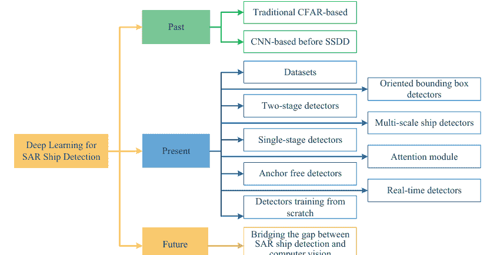

图 1. 本文的整体架构。

## 2. 相关工作

据我们所知，很少有研究人员撰写过关于该方向的综述论文。这在一定程度上是因为该方向具有一定的新颖性。目前，只有三篇论文[105,127,170]开展了与我们工作相关的工作。

Jerzy et al. [105] 回顾了过去 5 年中讨论 SAR 舰船检测的论文。他们主要介绍了 CFAR 方法、CNN（卷积神经网络）方法、GLRT（广义似然比检验）方法、特征提取方法、加权信息熵方法以及变分贝叶斯推理方法的进展。与论文[105]相比，我们主要关注基于深度学习的检测方法，而不关注传统方法。

Mao et al. [127] 解决了 SSDD 上最先进方法缺乏性能基准的问题。通过这项工作，研究人员可以在相同的实验设置下比较他们的工作。他们提出了 21 个先进的检测模型，包括单阶段、双阶段、从零开始训练的检测算法等。与论文[127]相比，我们不仅介绍了不同公共数据集的性能，还对所有论文进行了分类，并总结了算法的原理和结果。

Zhang et al. [170] 解决了 SSDD 中注释粗糙和标准模糊的问题。这些改进有利于公平比较。它在促进该领域健康发展方面发挥了重要作用。我们建议研究人员今后使用本文中规定的标准。与论文[170]相比，我们的工作不限于 SSDD，而是介绍了该领域中的其他数据集。更重要的是，我们的团队对所使用的方法进行了系统分析、分类和评论，并指出了未来的研究方向，这有利于该领域的发展。

总之，我们的工作与其他论文不同。这是 SAR 舰船检测的首次全面综述。

## 3. 过去——传统的 SAR 舰船检测算法

SAR 图像中的传统检测算法基于手工制作的特征和有限的浅层学习表征。它可分为三个步骤：预处理、候选区域提取和鉴别。

CFAR 是候选区域提取的常用方法。它可以选取潜在的舰船区域。它首先对杂波进行统计建模，然后根据虚警率获得阈值。高于阈值的像素被视为舰船像素，低于阈值的像素被视为背景。CFAR 本质上是一种基于分割的算法，即根据灰度大小将像素分为两类（舰船或非舰船），然后将舰船像素区域合并为舰船区域。该方法的性能很大程度上取决于对海杂波的统计建模和所选模型的参数估计。根据不同的 SAR 图像产品和实际应用需求，提出了高斯分布、伽马分布、对数正态分布、Weibull 分布和 K 分布等不同的统计模型。高斯分布和 K 分布是最常用的。一般来说，当场景相对简单时，CFAR 方法可以取得更好的效果。然而，对于小型舰船和复杂的近海场景，由于建模困难，会产生更多虚警，检测性能较差。

鉴别通常是通过人工设计的特征和训练分类器来实现的。除了长度、宽度、长宽比和散射点位置等简单特征外，从计算机视觉引入的特征也常用且具有更强的鲁棒性。例如积分图像特征、HoG（方向梯度直方图）、SURF（加速稳健特征）和 LBP（局部二值模式）。这些特征提高了检测算法的性能。在分类器设计中，决策树、SVM、梯度提升及其改进版本也进一步提高了性能。


特征和分类器设计在过去几年推动了该领域的发展。然而，自2012年深度学习兴起以来[5]，上述思想在速度和精度上相形见绌。基于深度学习的物体检测算法是一种端到端处理方法，如图2所示。它不需要像传统方法那样优化多个独立步骤。它对整个检测系统进行统一优化。它能够适应各种复杂场景（近岸和港口无需进行海陆分割）并且具有非常强的鲁棒性。因此，近年来，基于深度学习的SAR船舶检测算法已成为新的研究热点。

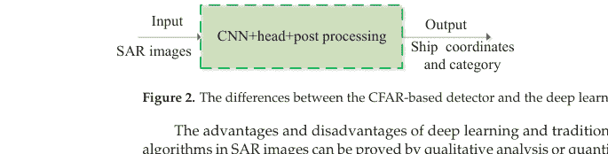

图2. 基于CFAR的检测器与基于深度学习的检测器之间的差异。

SAR图像中深度学习与传统检测算法的优缺点可以通过定性分析或定量实验来证明。通过定性分析，基于CFAR的检测方法有四个主要缺点。首先，CFAR需要根据船舶大小设置保护窗口的大小。在单艘船舶局部均匀杂波的情况下效果良好。如果多个不同大小的船舶靠得很近，船舶大小变化与固定保护窗口之间不一致会导致漏检。其次，CFAR算法需要对SAR图像进行精确建模，这很难实现。第三，CFAR的本质是一种无监督算法，其性能本质上不如监督算法（Faster R-CNN（基于区域的卷积神经网络）、YOLO（只看一次）、SSD（单次检测器）等）。第四，CFAR算法和判别算法是多个环节分别调试后拼凑而成的系统，其性能无法与端到端深度学习算法相比。

孙先对经典船舶检测算法与深度学习算法进行了对比实验[65]。在论文中，经典船舶检测算法（最优熵自动阈值方法和基于K分布的CFAR方法）在AIR-SARShip-1.0数据集上进行了测试和分析。实验结果如图1所示。我们可以发现，深度学习算法的性能明显优于传统算法。

表1. 在相同条件下传统检测器与基于深度学习的检测器之间的性能差异[65]。

| 算法 | AP（平均精度） |
|---|---|
| 基于K分布的CFAR方法 | 19.2% |
| 最优熵自动阈值方法 | 28.2% |
| Faster R-CNN | 79.3% |
| SSD-512 | 74.3% |

在SSDD之前，有六篇论文使用卷积神经网络[1–6]在SAR图像中检测船舶。我们认为这六篇论文并非基于深度学习。原因如下。首先，一些算法不是端到端的，它们只是将CNN作为传统检测过程中的一个组件。其次，虽然一些算法是端到端的，但数据集和评估标准并未公开，这使得未来研究人员难以复现，结果也不可比。

由于SSDD的重要作用，我们将SSDD论文的发表日期作为传统与基于深度学习的检测算法之间的时间分界点。因此，我们认为SAR图像中的船舶检测于2017年12月1日进入深度学习时代，如图3所示。大量研究人员逐渐开始放弃基于CFAR的传统检测算法，采用基于深度学习的高级检测方法[6–182]。SAR图像中这些基于深度学习的检测器的概述是本文的重点。

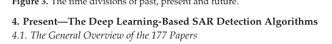

图3. 过去、现在和未来的时间划分。

## 4. 现状——基于深度学习的SAR检测算法

### 4.1. 177篇论文的总体概述

#### 4.1.1. 国家

从国家视角来看，我们可以发现90%的论文作者是中国人，如图4所示。毫无疑问，中国研究人员在该方向上一直是主流。多个公开数据集由中国研究人员构建，这进一步证明了上述观点。

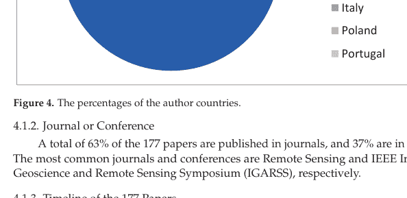

图4. 作者国家的百分比。

#### 4.1.2. 期刊或会议

177篇论文中，63%发表在期刊上，37%发表在会议上。最常见的期刊和会议分别是《Remote Sensing》和IEEE国际地球科学与遥感研讨会（IGARSS）。

#### 4.1.3. 177篇论文的时间线

基于深度学习的SAR船舶检测器的时间线如图5所示。

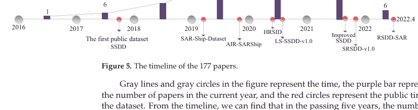

图5. 177篇论文的时间线。

图中灰线和灰圆代表时间，紫色条代表当年论文数量，红色圆圈代表数据集的公开时间。从时间线上可以发现，在过去的五年里，关于基于深度学习的SAR船舶检测器的论文越来越多。2016–2017年处于传统与深度学习方法之间的过渡期，论文零星出现。此外，由于缺乏统一的数据集以及对深度学习和计算机视觉算法缺乏深入理解，深度学习算法的应用并不彻底。直到2017年底第一个数据集（SSDD）论文出现，这一情况才得以改变。SSDD公开了其使用的数据和评估标准，为该领域快速发展奠定了基础。此后，研究进入了快车道，大量论文被发表。该领域的里程碑是几个开放获取的数据集，如上图所示的红色圆圈。随着可用数据集的增加，越来越多的研究人员开始关注该领域。

#### 4.1.4. 使用的数据集和卫星

这些论文使用的数据集如表2所示。我们可以看到，目前SSDD是最常用的数据集。它被使用了83次，占总数的62.4%。此外，多个公开数据集的使用呈现逐渐上升的趋势。

表2. 过去五年中使用的数据集。

| 数据集 | 2016 | 2017 | 2018 | 2019 | 2020 | 2021 | 2022 | 总计 |
|---|---|---|---|---|---|---|---|---|
| SSDD | 0 | 1 | 2 | 19 | 28 | 29 | 4 | 83 |
| SSDD+ | 0 | 0 | 1 | 2 | 1 | 2 | 0 | 6 |
| SAR-Ship-Dataset | 0 | 0 | 0 | 1 | 4 | 14 | 1 | 20 |
| AIR-SARShip1.0/2.0 | 0 | 0 | 0 | 1 | 3 | 5 | 0 | 9 |
| HRSID | 0 | 0 | 0 | 0 | 2 | 6 | 1 | 9 |
| LS-SSDD-v1.0 | 0 | 0 | 0 | 0 | 1 | 1 | 1 | 3 |
| Official-SSDD | 0 | 0 | 0 | 0 | 0 | 1 | 0 | 1 |
| SRSDD-v1.0 | 0 | 0 | 0 | 0 | 0 | 1 | 0 | 1 |
| RSDD-SAR | 0 | 0 | 0 | 0 | 0 | 0 | 1 | 1 |
| 总计 | 0 | 1 | 3 | 23 | 40 | 58 | 8 | 133 |

在2017年第一篇数据集论文发表之前，不同研究人员采用不同的SAR图像和指标来测试其检测器。因此，论文的结果不可比。这种现象不利于该领域的发展。为了克服这一问题，我们构建了第一个数据集SSDD并向公众开放。同时，我们还提供了一个名为SSDD+的数据集，它与SSDD共享相同的图像，但具有方向性边界框。随着2019年后基于深度学习的计算机视觉算法的快速发展，SSDD引起了研究人员的更多关注。张在论文[170]中分析了SSDD的使用情况。从该论文中我们可以发现，尽管SSDD存在许多缺点，但它已成为最受欢迎的数据集。除此之外，SAR-Ship-Dataset和AIR-SARShip显示出成为

流行的数据集。其他数据集较少被使用，因为它们的公开日期稍晚。由于深度学习模型需要更多数据来防止过拟合，该领域的未来方向是将它们合并为大型数据集，并在大型数据集上使用计算机视觉中的通用检测算法提供基准。我们认为，如果数据集足够大、基准足够完整、维护足够定期，它将被大多数研究人员接受。这是我们未来工作的重点。

表3显示了论文中除公共数据集外使用的SAR卫星。我们可以发现，来自Sentinel-1的SAR图像一直是最常用的。这是因为这些数据易于获取，并且可以免费下载。

**表3.** 论文中除数据集外使用的卫星。

| 卫星 | 2016 | 2017 | 2018 | 2019 | 2020 | 2021 | 2022 | 总计 |
|---|---:|---:|---:|---:|---:|---:|---:|---:|
| Sentinel-1 | 1 | 4 | 7 | 6 | 6 | 2 | 0 | 26 |
| RadarSat-2 | 1 | 0 | 2 | 2 | 2 | 0 | 0 | 7 |
| ALOS PALSAR | 0 | 1 | 0 | 0 | 0 | 0 | 0 | 1 |
| TerraSAR-X | 0 | 1 | 0 | 0 | 3 | 0 | 0 | 4 |
| Gaofen-3 | 0 | 1 | 5 | 6 | 5 | 2 | 1 | 20 |
| COSMO-SkyMed | 0 | 0 | 1 | 0 | 2 | 0 | 0 | 3 |
| AISSAR | 0 | 0 | 1 | 0 | 0 | 0 | 0 | 1 |

然而，随着中国首颗C波段多极化SAR卫星高分三号于2017年1月23日正式投入使用，获取高分三号影像的政策变得越来越容易。越来越多的论文使用高分三号作为源图像。

#### 4.1.5. 深度学习框架

深度学习框架可以减轻研究人员的工作负担[183–187]。因此，自2017年CAFFE（用于特征提取的卷积架构）[188]出现以来，它越来越受到研究人员的关注。表4显示了那177篇论文使用的深度学习框架。我们可以发现，在最初的几年（2017-2018年）中，CAFFE是最常用的框架。这是因为CAFFE是研究人员使用的第一个通用深度学习框架，并且计算机视觉中的大多数检测算法都基于CAFFE，例如Faster R-CNN和SSD。为了提高深度学习框架的效率，谷歌于2017年提供了TensorFlow [189]。与CAFFE相比，TensorFlow更强大且更易于使用。许多研究人员选择TensorFlow作为他们的框架。在TensorFlow之后，PyTorch [190]于2017年由Facebook FAIR推广。PyTorch更适合研究人员，其用户数量逐渐超过了TensorFlow。除了CAFFE、TensorFlow和PyTorch之外，Keras、Darknet和PaddlePaddle也被一些研究人员使用。由于计算机视觉中的大多数检测算法都基于TensorFlow和PyTorch，我们建议该领域的研究人员将其用作深度学习框架。

**表4.** 这些论文使用的深度学习框架。

| 框架 | 2016 | 2017 | 2018 | 2019 | 2020 | 2021 | 2022 | 总计 |
|---|---:|---:|---:|---:|---:|---:|---:|---:|
| Caffe | 0 | 3 | 9 | 3 | 6 | 2 | 0 | 23 |
| Tensorflow | 0 | 2 | 3 | 12 | 5 | 7 | 0 | 29 |
| Pytorch | 0 | 0 | 0 | 3 | 19 | 18 | 6 | 44 |
| Keras | 0 | 0 | 0 | 1 | 3 | 3 | 0 | 7 |
| Darknet | 0 | 0 | 0 | 0 | 1 | 3 | 0 | 4 |
| PaddlePaddle | 0 | 0 | 0 | 0 | 0 | 1 | 0 | 1 |

#### 4.1.6. 性能演进

表5–11显示了几个公共数据集的性能。在“AP”列中，较大的数字代表AP₅₀，较小的数字代表AP。AP50是指在IoU（交并比）=50%时的平均精度。AP是指从50%到95%的IoU以5%为步长，然后计算这些IoU下AP的平均值。通常，AP50高于AP。AP50和AP通常分别用于PASCAL VOC和MS COCO。由于数据集只包含船舶一个类别，mAP值与AP值相同。

在表中，斜体表示双阶段检测器的性能，非斜体表示单阶段检测器的性能。蓝色、红色、绿色、紫色和金色分别代表无锚框、从零开始训练、旋转边界框、多尺度、注意力和检测器。下划线表示实时检测器。

表5–11中的论文数量少于表2。这是因为表2中的一些论文未使用AP或AP50作为评估指标，因此我们未在表5–11中显示它们。

从表5可以看出，有52篇论文在SSDD上进行了训练和测试。此外，在过去五年中，SSDD上检测器的AP50从2017年的78.8%提升到2022年的97.8%。测试时间也越来越快。需要注意的是，由于原始SSDD中的训练-测试划分不明确，表5中的AP在某种程度上不具有可比性。这也是我们建议后续研究人员采用改进的SSDD [170]作为新标准的原因。

**表5. 检测器在SSDD上的性能演进（数据来自177篇论文）。**

| 序号 | 日期 | AP | 时间 | 序号 | 日期 | AP | 时间 |
|---|---|---|---|---|---|---|---|
| 11 | 2017年12月1日 | 78.8% | 173 ms | 104 | 2020年10月14日 | 92.6% 56.5% | 7.39 ms |
| 15 | 2019年3月9日 | 91.3% | 96 ms | 111 | 2020年11月16日 | 91.84% |  |
| 39 | 2019年4月2日 | 89.76% | 10.938 ms | 115 | 2020年12月2日 | 89.79% |  |
| 40 | 2019年5月21日 | 90.16% | 21 ms | 116 | 2020年12月3日 | 90.7% | 74 FPS |
| 43 | 2017年7月24日 | 79.78% | 28.4 ms | 117 | 2020年12月4日 | 88.33% | 15 FPS |
| 51 | 2019年9月23日 | 80.12% | 9.28 ms | 118 | 2020年12月7日 | 94.6% | 3.9 ms 258 FPS |
| 54 | 2019年10月24日 | 94.13% | 9.03 ms 111 FPS | 121 | 2020年12月28日 | 95.1% | 33 ms |
| 55 | 2019年10月24日 | 90.04% | 87 ms | 131 | 2021年2月12日 | 95.7% 63.4% |  |
| 56 | 2019年11月14日 | 94.7% |  | 132 | 2021年2月17日 | 93.78% | 202 FPS |
| 62 | 2019年11月14日 | 83.4% |  | 134 | 2021年2月27日 | 80.45% |  |
| 63 | 2019年11月14日 | 90.44% | 96.04 ms | 149 | 2021年3月17日 | 94.41% | 31 FPS |
| 68 | 2019年12月 | 96.93% | 8.72 ms | 146 | 2021年3月23日 | 95.52% |  |
| 69 | 2020年1月2日 | 97.9% 64.6% | 103 ms | 148 | 2021年3月31日 | 92.09% |  |
| 74 | 2020年3月19日 | 96.4% 67.4% | 106.4 ms | 151 | 2021年5月13日 | 88.08% | 12.25 ms |
| 78 | 2020年3月30日 | 94.2% 59.5% | 0.93 M | 154 | 2021年6月9日 | 98.4% |  |
| 81 | 2020年4月3日 | 94% 90.08% 68.1% |  | 157 | 2021年6月30日 | 61.4% | 45 FPS |
| 82 | 2020年4月16日 |  |  | 158 | 2021年7月1日 | 96.8% 62.7% | 438 ms |
| 84 | 2020年4月22日 | 97.07% | 233 FPS | 160 | 2021年7月13日 | 97.2% 61.5% |  |
| 90 | 2020年5月25日 | 93.96% |  | 161 | 2021年7月14日 | 95.29% | 11 FPS |
| 93 | 2020年6月24日 | 94.72% | 63.2 ms | 170 | 2021年12月6日 | 97.8% 64.9% |  |
| 96 | 2020年7月21日 | 96.08% | 4.51 ms 222 FPS | 171 | 2021年12月10日 | 82.2% | 5.2 ms |
| 98 | 2020年8月21日 | 81.17% | 24 ms | 173 | 2021年12月22日 | 97.4% | 42.5 FPS |
| 99 | 2020年8月21日 | 83.4% |  | 174 | 2022年2月6日 | 95.6% 61.1% |  |
| 100 | 2020年8月31日 | 90.57% | 17.2 ms | 175 | 2022年2月25日 | 97.8 % | 17.5 FPS |
| 102 | 2020年10月6日 | 86.3% |  | 176 | 2022年2月25日 | 95.03% | 47 FPS |
| 103 | 2020年10月14日 | 95.6% 61.5% |  | 177 | 2022年3月19日 | 97.0% |  |

从表6可以看出，只有四篇论文在SSDD+上进行了训练和测试，AP₅₀性能从2018年的84.2%提升到2021年的94.46%。整体性能略低于SSDD。这是因为SSDD+上的检测器需要预测一个额外的参数（角度）。我们还发现，与SSDD相比，SSDD+很少被使用。也就是说，该领域对旋转边界框检测感兴趣的研究人员很少。

**表6. 检测器在SSDD+上的性能演进（数据来自177篇论文）。**

| 序号 | 日期 | AP | 时间 |
|---:|---|---:|---|
| 20 | 2018年8月29日 | 84.2% | 40 FPS |
| 41 | 2019年6月26日 | 81.36% | |
| 83 | 2020年4月20日 | 90.11% | 62.77 ms |
| 124 | 2021年1月8日 | 94.46% | |

从表7可以看出，有14篇论文在SAR-Ship-Dataset上进行了训练和测试，AP₅₀性能从2019年的89.07%提升到2021年的96.1%。运行速度也提升到60.4 FPS，AP为96.1%。整体性能略低于SSDD。这是因为该数据集相对SSDD更大。

**表7. 检测器在SAR-Ship-Dataset上的性能演进（数据来自177篇论文）。**

| 序号 | 日期 | AP | 时间 | 序号 | 日期 | AP | 时间 |
|---:|---:|---:|---|:---:|---:|---:|---|
| 38 | 2019年3月29日 | 89.07% | | 138 | 2021年2月17日 | 92.4% | |
| 89 | 2020年5月20日 | 94.7% | 18 ms | 157 | 2021年5月19日 | 93.46% | 339 FPS |
| 113 | 2020年11月30日 | 91.89% | 12.05 FPS | 158 | 2021年6月8日 | 95.52% | |
| 114 | 2020年11月30日 | 91.07% | | 163 | 2021年7月1日 | 95.8% | |
| 123 | 2021年1月5日 | 90.25% | 22 ms | 166 | 2021年7月14日 | 94.39% | |
| 133 | 2021年2月17日 | 93.9% | | 178 | 2021年12月22日 | 96.1% | 60.4 FPS |
| 136 | 2021年2月17日 | 95.1% | | 179 | 2022年2月6日 | 95.1% | |

从表8可以看出，只有四篇论文在AIR-SARship上进行了训练和测试，AP₅₀性能从2019年的88.01%提升到2021年的92.49%。此外，运行速度提升了7.98倍（从41.6 ms到5.22 ms）。整体性能略低于SSDD。

**表8. 检测器在AIR-SARship上的性能演进（数据来自177篇论文）。**

| 序号 | 日期 | AP | 时间 | 版本 |
|---:|---:|---:|---:|---:|
| 65 | 2019年12月1日 | 88.01% | 24 FPS | 1.0 |
| 97 | 2020年8月13日 | 86.99% | | 1.0 |
| 130 | 2021年2月8日 | 80.9% | | 1.0 |
| 171 | 2021年12月1日 | 92.49% | 5.22 ms | 2.0 |

从表9可以看出，只有九篇论文在HRSID上进行了训练和测试，AP₅₀性能从2019年的89.3%提升到2021年的94.4%。整体性能略低于SSDD。这是因为该数据集相对SSDD更大。


表 9. 探测器在 HRSID 上的性能演化（数据来自 177 篇论文）。

| 编号 | 日期 | AP | 编号 | 日期 | AP |
|---|---|---|---|---|---|
| 94 | 2020年6月29日 | 89.3%<br>69.4% | 168 | 2021年8月6日 | 89.2%<br>68% |
| 110 | 2020年11月10日 | *未给出*<br>84.4% | 174 | 2022年2月14日 | 91.4%<br>66.4% |
| 120 | 2020年12月23日 | 91.99%<br>68.5% | 175 | 2021年12月6日 | 94.4%<br>72% |
| 131 | 2021年2月12日 | 92.4%<br>69.5% | 178 | 2021年12月22日 | 88.3% |
| 165 | 2021年7月13日 | 90.7%<br>69.4% |  |  |  |

根据表 10，我们可以看到只有三篇论文在 LS-SSDD-v1.0 上进行了训练和测试，AP 性能从 2019 年的 72.3% 提升到 2022 年的 75.5%。总体性能略低于 SSDD 上的性能。LS-SSDD-v1.0 专门用于大规模 SAR 舰船检测，适用于基于卫星的 SAR 系统。未来应更多使用。

表 10. 探测器在 LS-SSDD-v1.0 上的性能演化（数据来自 177 篇论文）。

| 编号 | 日期 | AP |
|---|---|---|
| 101 | 2020年9月15日 | 75.3% |
| 168 | 2021年8月6日 | 71.7% |
| 180 | 2022年2月25日 | 75.5% |

上述数据集相对较小，远小于计算机视觉中使用的那些数据集。为了提高检测器的泛化能力，研究人员应使用大型数据集。一些研究人员将多个数据集合并为一个大型数据集，如表 11 所示。根据表 11，我们可以看到有三篇论文在复合数据集上进行了训练和测试，AP 性能分别为 81.13%、71.4% 和 95.1%。由于基于深度学习的检测器需要大量数据，我们应将公共数据集合并为一个大型数据集以防止过拟合。

表 11. 探测器在其他数据集上的性能演化（数据来自 177 篇论文）。

| 编号 | 日期 | AP50 | 时间 | 数据集 |
|---|---|---|---|---|
| 108 | 2020年10月30日 | 81.13% | 35.5 ms | SSDD + SAR-Ship-Dataset |
| 125 | 2021年1月27日 | 71.4% | 2920 ms | SAR-Ship-Dataset + AIRSAR-Ship-1.0 |
| 167 | 2021年7月26日 | 95.1% |  | HRSID + SSDD + IEEE 2020 Gaofen Challenge |

### 4.2. 177 篇论文的算法分类

我们将 177 篇论文分为 10 个类别，它们是关于数据集的论文、两阶段检测器、单阶段检测器、无锚点检测器、从零训练检测器、具有定向边界框的检测器、多尺度检测器、具有注意力模块的检测器、实时检测器和其他。每个算法的百分比如表 12 所示。需要说明的是，各百分比之和大于 1。这是因为论文中的许多算法具有多种属性。例如，它不仅属于单阶段检测器，还从零开始训练。

表 12. 各算法的百分比。

| 算法 | 数据集 | 两阶段 | 单阶段 | 无锚点 | 从零训练 |
|---|---|---|---|---|---|
| 百分比 | 5% | 26.7% | 25.6% | 5.1% | 4.0% |
| 算法 | 定向 | 多尺度 | 注意力 | 实时 | 其他 |
| 百分比 | 5.7% | 14.2% | 5.1% | 13.1% | 14.2% |

根据表 12，我们可以得出以下结论。首先，有八篇论文向研究人员介绍了数据集。它们对该领域做出了巨大贡献。其次，该领域使用的两阶段检测器略多于单阶段检测器。这部分是因为在大多数情况下，两阶段检测器的精度高于单阶段检测器。此外，精度目前是首要考虑因素。第三，无锚点检测器、从零训练的检测器、定向边界框检测器和具有注意力模块的检测器在 177 篇论文中占比几乎为 5–6%。这是因为上述四个方向较为罕见，尚未被许多研究人员关注。事实上，这些方向可以克服舰船尺寸分布异常和 SAR 图像缺乏的问题。未来应给予更多关注。第四，几乎 14% 的论文涉及多尺度 SAR 舰船检测，这略高于其他方向。这是因为与计算机视觉图像中的物体相比，SAR 中的舰船相对较小。为了提高性能，检测器应更加关注多尺度舰船。第五，14.20% 的论文被归类为其他，表示这些论文不属于九个类别。第六，仅有三篇论文，即 177 篇论文的 1.7%，对该领域进行了综述。考虑到该领域的活跃研究，目前还不够。这也是我们工作的动机之一。

### 4.3. 公共数据集

#### 4.3.1. 概述

据我们所知，有 10 个公共数据集用于在 SAR 图像中训练和检测舰船。它们是 SSDD(SSDD+) [11]、SAR-Ship-Dataset [38]、AIR-SARShip1.0 [65]、HRSID [94]、LS-SSDD-v1.0 [101]、AIR-SARShip2.0 [191]、Official-SSDD [170]、SRSDD-v1.0 [177] 和 RSSDD-SAR [192]。表 13 显示了 10 个公共数据集的详细信息，其中 SSDD+、Official-SSDD、SRSDD-v1.0 和 RSSDD-SAR 的标注为定向边界框。

表 13. 现有公共数据集的详细信息。

| 数据集 | 日期 | 来源 | 分辨率 | 图像尺寸 | 图像/舰船数 | 标注 |
|---|---|---|---|---|---|---|
| SSDD (SSDD+) | 2017年12月1日 | RadarSat-2 TerraSAR Sentinel-1 | 1 m–15 m | 190–668 | 1160/2456 | 垂直定向 |
| SAR-Ship-Dataset | 2019年3月29日 | Gaofen-3 Sentinel-1 | 3 m–25 m | 256 × 256 | 43,918/59,535 | 垂直 |
| AIR-SARShip-1.0 | 2019年12月1日 | Gaofen-3 | 1 m, 3 m | 3000 × 3000 | 31 | 垂直 |
| AIR-SARShip-2.0 | 2021年8月25日 | Gaofen-3 |  | 1000 × 1000 | 300 |  |
| HRSID | 2020年6月29日 | Sentinel-1 TerraSAR | 0.5 m, 1 m, 3 m | 800 × 800 | 5604/16,951 | 多边形 |
| LS-SSDD-v1.0 | 2020年9月15日 | Sentinel-1 | 5 m, 20 m | 24,000 × 16,000 | 15/6015 | 垂直 |
| Official-SSDD | 2021年9月15日 |  |  | 与 SSDD 相同 |  | 多边形定向识别 |
| SRSDD-v1.0 | 2021年12月15日 | Gaofen-3 | 1 m | 1024 × 1024 | 666/2275 | 定向识别 |
| RSSDD-SAR | 2022年4月 | Gaofen-3 TerraSAR | 2–20 m | 512 × 512 | 7000/10,263 | 定向 |

在版本 1.0 的基础上，孙显等研究人员添加了更多高分三号数据构建了 AIR-SARShip-2.0。该数据集包含 300 张 SAR 图像。场景类型包括港口、岛屿、礁石、不同海况下的海面等。标注信息包括舰船位置，已由专业解译人员确认。使用 AIR-SARShip 的论文及其性能如表 8 所示。

#### 4.3.5. HRSID

用于构建 HRSID [94] 的原始 SAR 图像包括 99 张 Sentinel-1B 图像、36 张 TerraSAR-X 图像和 1 张 TanDEM-X 图像。HRSID 拥有 5604 张 800 × 800 像素的高分辨率 SAR 图像，以满足 GPU 实际训练的需求。它基于 CNN 设计用于舰船检测和分割，仅包含一类舰船。数据集分为 65% 的训练集和 35% 的测试集。它使用多边形标注舰船。为了减少舰船检测算法的偏差，由舰船产生的干扰被标记为舰船的一部分。

据统计，HRSID 中标注的舰船总数为 16,951，每张 SAR 图像平均包含三艘舰船。小型舰船、中型舰船和大型舰船分别占所有舰船的 54.5%、43.5% 和 2%。小型舰船、中型舰船和大型舰船的边界框面积分别占 SAR 图像的 0~0.16%、0.16~1.5% 和 1.5% 以上。因此，舰船在 SAR 图像中稀疏分布。

使用 HRSID 的论文及其性能如表 9 所示。

#### 4.3.6. LS-SSDD-v1.0

张小玲 [101] 构建了具有大场景和小舰船的 SAR 舰船检测数据集 LS-SSDD-v1.0。该数据集由 15 幅大小为 24,000 × 16,000 像素的 Sentinel-1 SAR 图像组成。每幅图像直接划分为 600 幅 800 × 800 像素的子图像。数据集包含 6015 艘舰船。LS-SSDD-v1 可支持研究人员灵活应用该数据集。LS-SSDD-v1.0 的标注使用了 Google Earth 软件提供的光学信息和 AIS 提供的舰船信息。该数据集成像区域的海岸线相对复杂，陆地面积小于海洋面积，内河中的舰船密集分布。该数据集具有以下特点：包含大场景、关注小舰船、丰富的纯背景等。它还提供了大量检测算法在数据集上的性能基准。

使用 LS-SSDD-v1.0 的论文及其性能如表 10 所示。

#### 4.3.7. SRSDD-v1.0

SRSDD-v1.0 的原始图像来自高分三号 [177]。它包含 30 张港口区域的全景 SAR 图像。它使用定向边界框进行标注。光学图像（Google Earth 或 GF-2）用于辅助标注。图像尺寸设为 1024 × 1024。标注格式与 DOTA 相同。标注文件中给出框的四个角坐标、类别以及是否难以识别。

它包含 666 张图像。其中 420 张图像包含 2275 艘舰船并包括地表覆盖。另有 246 张图像包含 609 艘舰船，背景仅为海面。它有六个类别：铁矿石油船（166）、散货船（2053）、渔船（288）、执法船（25）、挖泥船（263）和集装箱船（89）。该数据集存在一定的数据不平衡问题。

#### 4.3.8. RSSDD-SAR

RSSDD-SAR 数据集由 84 个高分三号场景和 41 个 TerraSAR-X 场景组成。RSSDD-SAR 拥有 7000 张图像，包括 10,263 艘舰船，其中 5000 张随机选为训练集，其余 2000 张作为测试集。通过分析数据集中舰船角度和长宽比的分布，可以发现数据集中舰船的角度在 0° 到 180° 之间均匀分布，长宽比集中在两者之间

和六。它表明该数据集具有任意旋转方向和大长宽比的特征。该数据集具有小船比例高的特征，可用于验证小船检测算法的性能。RSDD-SAR 数据集包含广阔的海域、港口、码头、水道等不同分辨率的场景，适用于实际应用。

### 4.4. 两阶段检测器

基于深度学习的目标检测算法可分为单阶段检测器和两阶段检测器。单阶段检测器使用全卷积网络对这些锚框进行一次分类和回归以获得检测结果。两阶段检测器使用 CNN 对这些锚框进行两次分类和回归以获得检测结果。单阶段和两阶段检测算法的原理如图 6 所示。

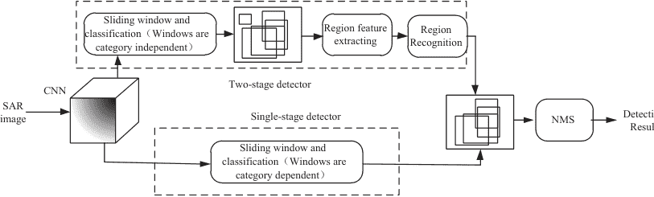

**图 6.** 单阶段和两阶段检测器的原理。

经典的两阶段检测器有 Faster R-CNN、R-FCN（全卷积网络）[193]、特征金字塔网络（FPN）[194]、Cascade R-CNN [195]、Mask R-CNN [196] 等 [197]。Faster R-CNN 是基础工作，大多数两阶段检测器都是在此基础上改进的。

在 177 篇论文中，大多数论文从以下几个方面进行了改进：主干网络、区域建议网络（RPN）、锚框、损失函数和非极大值抑制（NMS）。它们如图 7 所示。与计算机视觉相比，该领域的研究滞后，其他更先进的两阶段检测算法尚未在此使用。

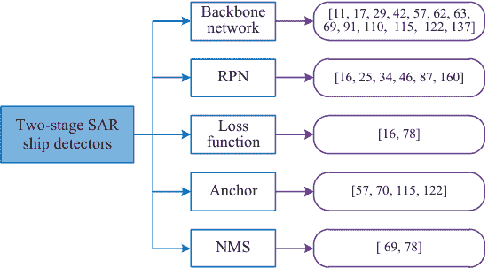

**图 7.** 两阶段 SAR 船舶检测器。

#### 4.4.1. 主干网络

主干网络改进主要有三个方向，即 FPN、特征融合和注意力。

FPN 产生一个特征金字塔结构，将具有强语义特征的低分辨率与具有弱语义特征的高分辨率结合。它包括自下而上的通道、自上而下的通道和跳跃连接。它在所有层级独立预测，仅带来最小的额外计算和存储消耗。它改善了小尺寸船舶的检测结果，因此被广泛使用。计算机视觉领域已完成大量改进 FPN 的工作，例如 ASFF [198]、NAS-FPN [199] 和 BiFPN [200]。

有六篇论文 [42,62,63,69,91,110] 在该领域采用并改进了 FPN。Cui 等 [42] 提出了一种 DAPN（密集注意力金字塔网络）结构。它将卷积块注意力模块从金字塔网络的顶部到底部密集连接。通过此方法，可提取包含分辨率和语义信息的丰富特征用于多尺度船舶检测。Li 等 [62] 使用卷积块注意力模块（CBAM）[201] 来控制 FPN 中上下层特征融合的程度。Liu 等 [63] 提出了一种可迁移尺度的金字塔网络。它使用尺度转移层将每个特征图从上到下密集连接。它可以扩展特征图的分辨率，有助于检测。Wei 等 [69] 采用并行高分辨率特征金字塔网络，充分利用高分辨率和低分辨率卷积的特征映射进行 SAR 船舶检测。Zhao 等 [91] 采用感受野块和卷积块注意力模块构建自上而下的细粒度特征金字塔。它可以捕获长宽比较大的船舶特征并增强局部特征与其全局依赖关系。Hu 等 [110] 使用密集连接的特征金字塔网络，其中浅层特征和深层特征被不同处理。它考虑了不同层级之间的差异。

有三篇论文 [11,57,115] 通过特征融合改进了主干网络。Li 等 [11] 融合了卷积层 3 到层 5 的特征图。融合包括归一化和 1 × 1 卷积。对每个 RoI（感兴趣区域）池化张量进行归一化可以减少后续层之间的尺度差异。它可以防止“较大”特征主导“较小”特征，使算法更稳健。此修改稳定了系统并提高了精度。Yue 等 [57] 将语义强的特征与低级高分辨率特征融合，有助于减少误报。Li 等 [115] 提出了一种跳跃连接结构来提取 SAR 图像中各尺度目标的特征。它可以提高识别和定位能力。

有五篇论文 [17,29,62,122,137] 通过注意力模块（SENet）改进主干网络。它沿空间和通道方向压缩特征图，可以显式建模特征通道间的相互依赖，然后通过学习自动获得每个特征通道的重要性。它可以根据重要性提高有用特征并抑制对当前任务无用的特征。

#### 4.4.2. RPN

另一个方向是改进 Faster R-CNN 的 RPN 模块。论文 [16,25,34,46,87] 没有使用单一特征图生成建议，而是从每个融合特征图生成建议。Liu 等 [36] 设计了一种尺度无关的建议生成模块，该模块从 SAR 图像中提取边缘、超像素和强散射分量等特征以获得船舶建议，并根据轮廓的完整性和紧密度判断建议是否包含船舶。在论文 [160] 中，候选建议分别从原始 SAR 图像和去噪 SAR 图像中提取，然后合并以减少 SAR 图像噪声对船舶检测的影响。它们可以在一定程度上提高多尺寸船舶的性能。

#### 4.4.3. 损失函数

Faster R-CNN 强制正负样本比例为 1:3 以解决正负建议不平衡的问题。计算机视觉领域类似的工作包括 focal loss、OHEM（在线困难样本挖掘）[202]、GHM（梯度和谐机制）[203] 和 Libra R-CNN [204]。论文 [16,78] 分别采用 focal loss 增加困难负样本的权重并降低简单样本的权重，从而避免训练过程中大量简单样本掩盖少量困难负样本的问题。

#### 4.4.4. 锚框和 NMS

Faster R-CNN 使用三种尺度和三种长宽比，共产生 60 × 60 × 9 个锚框。然而，SAR 图像中船舶尺寸极小且稀疏。在 SAR 图像船舶检测中使用密集锚框会造成浪费。Yue 等 [57] 和 Wang 等 [122] 基于对船舶实际尺寸和分布的分析设置锚框参数，主要减小锚框尺寸并选择合适的形状。Chen 等 [70] 和 Li 等 [115] 使用 K-means 获取船舶尺寸分布，从而获得合适的锚框并降低学习难度。

Wei 等 [69] 和 Wang 等 [78] 使用软 NMS [205] 替代 NMS。软 NMS 改进了循环过程中 IoU 和阈值的判别过程，并使用权重衰减分数以避免精度损失。

#### 4.4.5. 其他

论文 [163] 基于 Mask R-CNN 提出了 ISASDNet（实例分割辅助船舶检测网络）。它有两个分支：检测和分割。两个分支输出交互以改善检测结果。Gui 等 [34] 提出了一种轻量级检测头，具有大可分离卷积核和位置敏感池化，可提高检测速度。

### 4.5. 单阶段检测器

两阶段检测器先生成候选框然后对候选框进行识别和回归，这与人眼原理大不相同。单阶段检测器只需看一次图片即可预测物体是什么以及物体在哪里。它类似于人眼。此外，它们比两阶段检测器快得多。

经典的单阶段检测器有 YOLO、SSD、RetinaNet [206] 和 CornerNet [207]。YOLO 和 SSD 是两种最流行的单阶段检测算法，大多数后续单阶段工作都是基于它们。

SAR 图像中的单阶段船舶检测器如图 8 所示。

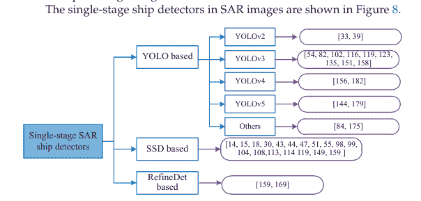

图 8. SAR 图像中的单阶段船舶检测器。


#### 4.5.1. 计算机视觉中的YOLO与SSD系列

YOLOv1 [186] 将目标检测视为一个回归问题，同时输出空间上分离的边界框和相关的类别概率。神经网络可以在一次前向计算中从图像预测边界框和类别概率。其速度非常快，但位置预测不准确，且召回率较低。YOLOv2 [208] 采用多尺度训练方法，预测偏移量而不是参数本身。偏移量值稍小，可以提高预测精度。它使用锚框机制，通过对数据集中的目标尺寸进行聚类来获取锚框参数。骨干网络采用DarkNet-19。虽然检测头从7×7变为13×13，但对小目标的检测效果仍然较差。YOLOv3 [209] 的检测头包含三个分支：13×13、26×26和52×52，能够兼顾大、中、小目标，使位置预测更加准确。YOLOv3的锚框机制与YOLOv2相同。YOLOv4 [210] 对一个真值使用两个锚框，而YOLOv3对一个真值只使用一个锚框，从而缓解了正负样本不平衡的问题。它采用CIoU损失来解决MSE（均方误差）损失、IoU损失、GIoU和DIoU [211–214] 的问题。YOLOv4还使用了多种技术来获得最先进的结果。YOLOv5采用自适应锚框，并使用网络来学习锚框参数。其检测头与YOLOv3和YOLOv4相同。它在性能上略逊于YOLOv4，但速度比YOLOv4快得多，在模型的快速部署方面具有明显优势。

SSD检测算法将回归思想与锚框（默认框）机制相结合。它消除了两阶段算法中的候选区域生成及后续的像素或特征重采样阶段（RoI池化）。它将所有计算封装在一个网络中，使其易于训练且速度非常快。RFBNet [215] 和M2Det [216] 是SSD的两个后继方法。它们分别利用感受野和多层级特征金字塔网络来改进经典SSD。

单阶段SAR舰船检测算法可分为三类：基于YOLO系列的SAR图像舰船检测、基于SSD系列的SAR舰船检测，以及其他算法。

#### 4.5.2. 基于YOLO系列的SAR舰船检测

YOLO系列在该领域被广泛使用。改进主要集中在轻量级骨干网络设计、多层特征融合、锚框生成、多特征图预测、损失函数等方面。

YOLOv2. Deng等人 [33] 和Chang等人 [39] 采用YOLOv2检测SAR图像中的舰船。文献 [39] 提出了YOLOv2-reduced，它减少了YOLOv2的某些层。与YOLOv2（AP为90.05%，耗时25.767 ms，计算量为50.17 BFLOPS）相比，YOLOv2-reduced的AP为89.76%，耗时10.937 ms，计算量为44.72 BFLOPS。

YOLOv3. Zhang等人 [82] 使用DarkNet-19作为骨干网络加速了原始YOLOv3。此外，它减少了重复的YOLOv3-scale1、YOLOv3-scale2和YOLOv3-scale3。Zhu等人 [116]、Chaudhary等人 [123] 和Jiang等人 [135] 使用经典YOLOv3并结合一些技术来检测SAR图像中的舰船。Wang等人 [19] 提出了SSS-YOLO，它重新设计了特征提取器网络，以增强小舰船的空间和语义信息。它采用PAFN（路径聚合融合网络）以自顶向下和自底向上的方式融合不同特征。SSS-YOLO在SAR图像中对小舰船具有更好的性能。Hong等人 [158] 通过一些技术提高了YOLOv3的性能。改进的K-means++聚类算法生成锚框，从而提高了YOLOv3对多尺度舰船的性能。引入了用于舰船检测的高斯参数，为边界框定位增加不确定性估计器。每个检测尺度分配四个锚框，而YOLOv3中为三个。Zhang等人 [40] 利用YOLO算法的思想，对输入图像进行网格划分，并使用深度可分离卷积来提高检测速度。MobileNet被用作特征提取器来检测

Chen等人 [15] 采用了一种基于SSD的两阶段回归网络，即R2RN（鲁棒两阶段回归网络），以提高小舰船的性能。R2RN连接了锚框修正模块和目标检测模块，以继承特征金字塔的精髓。Ma等人 [30] 提出了一种多分辨率输入的SSD模型，可以提取更丰富的特征。文献 [43,44] 将注意力机制应用于SSD，并设计了一种基于GIoU的新损失函数。Li等人 [47] 分析了SSD中中小型舰船检测精度低的原因，并提出了改进策略。首先，采用基于K-means聚类的锚框优化方法来提高锚框的匹配性能。其次，提出了一种基于反卷积的特征融合方法，以提高底层特征图的表示能力。Chen等人 [55] 采用注意力机制和多层级特征来提高骨干网络的特征提取能力。Han等人 [99] 使用反卷积增强金字塔中小舰船的表示，并提高了SSD的检测精度。Zhang等人 [113] 将原始SAR图像和显著性图作为输入，并融合它们的特征，以降低计算复杂度和网络参数。Chen等人 [114] 提出了SSDv2，它在SSD的基础上增加了反卷积模块和预测模块，以提高检测精度。Jin等人 [149] 通过特征融合和压缩-激励模块改进了SSD。

Sun等人 [162] 提出了SANet（基于语义注意力的网络）。它结合了语义注意力、焦点损失、标签和锚框分配，在不增加计算量的情况下提高性能。文献 [104,159] 采用M2Det检测SAR图像中的舰船。

#### 4.5.4. 其他

RefineDet采用两步级联回归策略来预测目标的位置和大小。它可以使单阶段检测器在不增加计算量的情况下获得两阶段检测器的精度。它在计算机视觉中被广泛使用。Zhu等人 [159] 采用RefineDet检测SAR图像中的舰船，实现了98.4%的AP。在文献 [169] 中，GHM被用作RefineDet的损失函数，使网络能够充分利用所有样本，并自适应地增加困难样本的权重。在网络中加入了多尺度特征注意力模块，以突出重要信息并抑制杂波造成的干扰。它在AIR-SARShip-1.0上达到了96.61%的精度。

### 4.6. 无锚框检测器

#### 4.6.1. 计算机视觉中无锚框检测算法的发展

锚框是Faster R-CNN和SSD成功的关键。骨干网络从输入图像中提取特征以获得特征图，特征图上的每个像素都是一个锚点。以每个锚点为中心点，并人为设置不同的尺度和纵横比，可以得到多个锚框。锚框具有以下两个优点：首先，它可以生成密集的候选框，便于网络对目标进行分类和回归。其次，它可以提高召回能力，适用于小目标检测。

然而，锚框需要人为凭经验设计，这存在以下缺陷：首先，需要设置超参数，如数量、尺寸、纵横比、IoU阈值等。其次，为了匹配真实框，需要生成大量锚框，这计算量很大。第三，其中大部分是无效的，这会导致正负样本不平衡。第四，需要根据数据集的尺寸和形状分布来调整锚框。

无锚框检测器通过消除预定义的锚框开辟了另一种思路。它可以直接从特征图预测目标的若干关键点。例如，CornerNet、ExtremeNet [218]、CenterNet [219]、Objects as Points [220]、FCOS（全卷积单阶段）[221]和FoveaBox [222]。


无锚框检测器可以避免各种问题，在SAR船舶检测中具有很大的应用潜力。例如，由于船舶尺寸小且分布稀疏，大多数候选锚框都是无效的负样本。无锚框检测器可以忽略无效锚框并减少预测框的数量，从而同时提高精度和速度。SAR图像中的无锚框船舶检测器如图9所示。

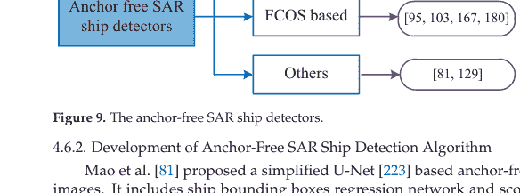

图9. 无锚框SAR船舶检测器。

#### 4.6.2. 无锚框SAR船舶检测算法的发展

Mao等人[81]在SAR图像中提出了一种基于简化U-Net [223]的无锚框检测器。它包含船舶边界框回归网络和分数图回归网络。前者期望基于输入图像中的每个像素进行回归。后者被设计用于预测一个二维概率分布，其中每个位置的分数表示当前位置处于任意船舶中心的似然性。Cui等人[89]提出了一种基于CenterNet（物体作为点）的SAR船舶检测器。它通过关键点估计预测目标的中心点，并利用中心点的图像信息获取船舶的尺寸和位置。无需预先设置锚框，也无需NMS，这大大减少了网络参数和计算量。同时也减少了小型船舶的锚框失配问题。使用空间洗牌分组增强注意力模块来提取具有更多语义信息的特征。Fu等人[95]提出了一种基于FCOS的注意力引导平衡金字塔，以提升小型船舶的性能。Zhou等人[97]提出了一种具有密集注意力特征聚合的无锚框检测器。使用轻量级特征提取器和密集注意力特征聚合来提取多尺度特征。基于中心点的船舶预测器用于回归中心点和尺寸。由于没有预先设置锚框和NMS，计算效率很高。Mao等人[103]提出了一种轻量级网络ResARNet，仅需0.69 M参数，并在四个方面改进了FCOS：边界框回归分支中的中心度（而非分类回归分支）、中心采样、GIoU损失和自适应训练样本选择。该网络仅需1.17 M参数，即可实现61.5%的AP和70.9%的AR。An等人[129]设计了一种无锚框可旋转检测器。它将传统的可旋转先验框机制设计为中心点-尺度和角度预测。训练过程包括正样本选择、特征编码和损失函数设计。Wang等人[133]提出了一种基于CenterNet的SAR图像检测器。使用空间分组增强注意力模块提取更多语义特征。

Sun等人[167]提出了类别-位置FCOS。使用类别-位置模块来优化FCOS网络中的位置回归分支。重新设计了分类和回归分支，以缓解训练过程中正负样本不平衡的问题。Zhu等人[180]采用FCOS作为基础模型以减少锚框的影响。根据SAR图像与自然图像之间的差异，使用一种新的样本定义方法来替代IoU阈值。使用相同分辨率特征卷积模块、多分辨率特征融合模块和特征金字塔模块来提取特征。进一步使用焦点损失和CIoU来提升性能。

总之，SAR船舶检测领域的研究者认识到无锚框检测器的优势。此外，该领域出现了越来越多的论文。然而，仍然存在一个问题：创新相对较弱，计算机视觉的一些现有成果并未在该领域得到应用。

### 4.7. 从零训练的检测器

目前，大多数SAR图像检测器的主干网络需要在自然图像分类数据集上进行预训练，然后在SAR图像船舶检测数据集（如SSDD）上进行微调。这种迁移学习可以使检测算法获得更好的初始化，并弥补样本不足的问题。然而，会存在以下问题：首先，存在学习偏差。分类和检测之间的损失函数和类别分布本质上是矛盾的。在分类上训练的模型并不适合检测。其次，大多数主干网络会在后几层通过多次下采样产生高感受野，这有利于分类，但对定位有害。第三，预训练的主干网络是冗余的且无法修改，这阻碍了研究者根据需求灵活设计CNN。

为了解决迁移学习的问题，计算机视觉中提出了从零训练的算法，例如DSOD（深度监督目标检测器）、DetNet、ScratchDet等[224–227]。

DSOD和GRP-DSOD实现从零训练的主要思想是通过精心设计主干网络和前端网络[224]。DetNet [225]在最后几层保持较大尺度，从而拥有更多位置信息。ScratchDet [226]提出在每一层采用批归一化策略并增加学习率，这可以使检测算法更加鲁棒并更快收敛。文献[227]用组归一化（GN）和异步BN替换了原始的BN（批归一化），从而使梯度归一化的参数更加准确。这使得梯度的下降方向更加准确，从而加速收敛并提高精度。

从零训练的模型不仅精度高，而且大大减少了模型的大小和计算量。由于上述优点，它也被用于SAR船舶检测。

该领域中大多数从零训练的检测器都有精心设计的网络。它们如图10所示。

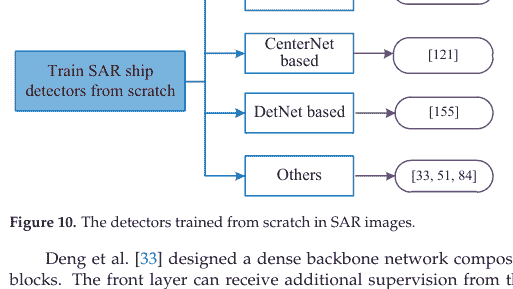

图10. SAR图像中从零训练的检测器。

Deng等人[33]设计了一种由多个密集块组成的密集主干网络。前层可以通过密集连接从目标函数获得额外的监督，这使得训练更容易，并采用特征复用策略使参数高效。Zhang等人[51]设计了一种可以从零训练的轻量级检测算法，在不降低精度的情况下减少训练和测试时间。它采用语义聚合和特征复用模块来提升多尺度船舶的性能。Zhang等人[84]提出了一种轻量级检测网络ShipDeNet-20。它使用更少的层和卷积核以及深度可分离卷积进行设计。它还采用特征融合模块、特征增强模块和比例共享特征金字塔模块来提高检测精度。Han等人[98]将轻量级非对称方形卷积块集成到SSD中，实现了从零训练，其精度和速度优于经典的DSOD。Han等人[100]提出了多尺度核并行卷积块和特征复用卷积模块，以增强特征表示并减少信息损失。Han等人[108]设计了两种非对称卷积块：非对称与方形卷积特征聚合块，以及非对称与方形卷积特征融合块。它们替换了所有3×3卷积层，并嵌入经典DSOD中，从而获得更好的从零训练结果。Guo等人[121]提出了一种有效且稳定的从零训练的单阶段算法，即CenterNet++。该模型主要包括三个模块：特征匹配模块、特征金字塔融合模块和头部增强模块。Zhao等人[155]使用DetNet作为主干网络来实现从零训练。它使用叠加卷积代替下采样来解决小型船舶检测问题，并采用特征复用策略来提高参数效率。

与其他方向相比，SAR船舶检测领域认识到从零训练优势的研究者较少。此外，该领域使用从零训练技术的论文还不够先进。我们应该在这一方向采用计算机视觉中更先进的技术。总之，从零训练的检测器在该领域尚未得到充分利用。文献[226,227]中的一些良好结论应该被考虑并应用于此。

### 4.8. 具有定向边界框的检测器

定向边界框最初用于场景文本检测。此外，涌现了大量成果，如SegLink、RRPN（旋转区域提议网络）、TextBoxes+、TextBoxes++、R2CNN（旋转区域卷积神经网络）等[228–232]。遥感图像中的船舶也具有多方向特性。传统的垂直矩形边界框往往不能准确包围目标。随着船舶检测精度的提高，使用定向边界框实现多方向船舶检测已成为研究热点[233–238]。DOTA（航空图像目标检测数据集）是该领域常用的航空图像目标检测数据集，可用于开发和评估检测算法的性能。同样，SAR图像中也有许多基于定向边界框的检测算法，这里对此进行介绍。目前，可用于训练和测试定向边界框算法的数据集有SSSD+、RSDD-SAR和SRSDD-V1.0，其细节已在前面介绍。SAR图像中的定向边界框检测器如图11所示。

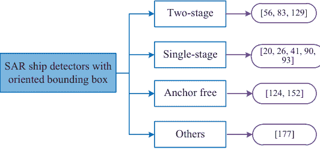

**图11.** 具有定向边界框的SAR船舶检测器。


### 两阶段
Chen et al. [56] 提出了一种多尺度自适应重校准网络，用于检测多尺度和任意方向的船舶。它可以学习船舶的角度信息。锚框、NMS 和损失函数也被重新设计，以适应 SAR 图像中船舶的大长宽比和任意方向性。Pan et al. [83] 提出了一种多阶段旋转区域网络（MSR2N）来解决冗余区域问题。MSR2N 包括 FPN、RRPN 和多阶段旋转检测网络。它更适合且对 SAR 船舶检测更稳健。An et al. [129] 采用定向检测器作为基础模型，以解决传统 CNN 模型参数过多的问题，这增加了不同任务之间迁移学习的难度。

### Single-stage
Wang et al. [20] 提出了一种基于 SSD 的带定向边界框的 SAR 船舶检测器。该检测器可以预测船舶的类别、位置和角度信息。语义聚合模块用于捕获丰富的定位和语义信息。注意力模块用于自适应地选择有意义的特征并忽略较弱的特征。多方向锚框、角度回归和损失函数用于拟合定向边界框。Liu et al. [26] 采用 DR-Box [239] 来检测 SAR 图像中的船舶。DR-Box 专门设计用于在遥感图像中检测任意方向的目标。它可以有效减少背景像素的干扰并更准确地定位目标。An et al. [41] 提出了 DR-Box-v2 用于检测 SAR 图像中的船舶。提出了一种用于检测小船的多层锚框生成策略。提出了一种改进的编码方案来精确估计位置和方向。Focal loss 和 hard negative mining 也被用于平衡正负样本。Yang et al. [90] 将可旋转边界框检测器视为基础模型，以解决训练阶段负样本类内不平衡问题。Chen et al. [93] 提出了一种旋转精细特征对齐检测器，以适应具有大长宽比、任意方向和密集分布特性的船舶。提出了轻量级注意力模块、改进的锚机制和特征引导对齐模块以提升定向检测器的性能。

### Anchor-free
Yang et al. [124] 提出了 R-RetinaNet 以在该领域超越 DRBox-v1、DRBox-v2 和 MSR2N（多阶段旋转区域网络）。R-RetinaNet 使用尺度校准方法来对齐尺度分布。任务感知注意力特征金字塔网络用于缓解分类与定位的矛盾。自适应 IoU 阈值训练方法用于纠正不平衡问题。He et al. [152] 提出了一种通过学习极坐标编码来解决定向边界框检测器中边界不连续问题的方法。该编码方案使用一组从船舶中心指向边界点的向量来表示定向边界框。

### Others
Ding et al. [177] 发布了 SRSDD-v1.0 数据集，该数据集用于定向边界框检测器。数据集的细节已在上文描述。他们展示了几种先进的定向边界框检测算法在该数据集上的性能。

### Summary
随着多个带定向边界框的数据集的出现，基于定向边界框的 SAR 图像船舶检测器变得越来越先进。然而，与 DOTA 相比仍不足。应在此方向上做出一些努力。

### 4.9. 多尺度船舶检测器
在 MS COCO 中，小型、中型和大型物体的比例分别为 41.43%、34.32% 和 24.24%。然而，在 SAR 图像中，小型船舶的比例极高。例如，在 RSDD-SAR 数据集中，小型、中型和大型船舶的比例分别为 81.175%、18.776% 和 0.049%。在 LS-SSDD-v1.0 中，比例分别为 99.80%、0.20% 和 0.00%。因此，该领域需要关注多尺度船舶检测问题，尤其是小船。

尽管 CNN 在计算机视觉中发展迅速，但在小目标检测上表现不佳。为了提高对多尺度船舶的适应性，计算机视觉通常融合低层和高层特征（如 FPN），增大感受野并改进锚框生成和匹配策略。

SAR 船舶检测也使用上述方法来提高多尺度船舶检测性能。SAR 图像中的多尺度船舶检测器如图 12 所示。

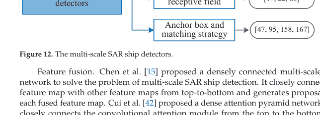

图 12. 多尺度 SAR 船舶检测器。

### Feature fusion
Chen et al. [15] 提出了一种密集连接的多尺度神经网络来解决多尺度 SAR 船舶检测问题。它将每个特征图与自上而下的其他特征图紧密连接，并从每个融合的特征图生成 proposals。Cui et al. [42] 提出了一种密集注意力金字塔网络，该网络将卷积注意力模块从金字塔网络的顶部到底部紧密连接到每个特征图，以便提取包含位置信息和语义信息的丰富特征以适应多尺度船舶。Liu et al. [63] 提出了一种可迁移尺度金字塔网络以适应多尺度船舶检测。它通过水平连接构建特征金字塔网络，并使用尺度迁移层将每个特征图自上而下紧密连接。水平连接引入了更多语义信息，而密集的尺度迁移连接可以扩展特征图的分辨率。Jin et al. [72] 将自上而下的所有特征图结合起来以利用所有尺度的上下文语义信息，并使用扩展卷积使感受野呈指数级增长。Han et al. [99] 使用反卷积增强 FPN 中中小型船舶的特征表示，从而提高 SSD 的检测精度。Hu et al. [110] 提出了一种密集特征金字塔网络，对浅层特征和深层特征进行不同处理。与传统 FPN 相比，它对多尺度船舶具有更强的适应性。Wang et al. [119] 提出了一种路径聚合融合网络来融合不同的特征图。它使用自下而上和自上而下的方法融合更多的位置信息和语义信息。Hu et al. [161] 提出了一种基于双向卷积结构的双向革命网络，可以有效处理浅层和深层特征信息，避免小船信息丢失。Zhang et al. [166] 提出了一种四元特征金字塔网络来检测多尺度船舶。它包括可变形卷积 FPN、内容感知特征重组 FPN、路径聚合空间注意力 FPN 和平衡尺度全局注意力 FPN。

### Increase the receptive field
Deng et al. [17] 通过 ReLU 和 inception 模块设计了一种具有多个感受野的特征提取器。它在多个中间层生成候选区域以匹配不同尺度的船舶，并融合多个特征图使小尺度船舶具有更强的响应。Zhao et al. [22] 提出了一种耦合 CNN 来检测小尺度船舶。它包括一个从多个感受野生成候选区域的网络，并利用每个候选框的上下文信息提高识别精度。Dai et al. [86] 没有使用单一特征图，而是以自下而上和自上而下方式融合特征图，并从每个融合的特征图生成候选框。

### Anchor box generation and matching strategy
Li et al. [47] 首先分析了 SSD 中中小型船舶检测精度低的原因并做了一些改进。基于 K-means 聚类的锚框优化方法解决了正样本少、负样本多的問題。特征融合


基于反卷积的方法提高了低层特征图的表示能力，并解决了低层特征图对小型船舶识别能力较弱的问题。Fu等人[95]提出了一种特征平衡与匹配网络，该网络使用无锚框策略消除锚框的影响，并使用注意力引导的平衡金字塔在语义上平衡不同层次的多个特征。在小尺度船舶检测中表现出良好的性能。Hong等人[158]在YOLOv3中基于改进的K-means++改进了锚框生成。这缓解了YOLOv3中多尺度船舶检测的难度，并将YOLO层中的锚框数量从三个改为四个。Sun等人[167]表明，无锚框检测器对小型船舶具有良好的适应性，并且速度很快。

总结。小型船舶检测极其困难，但对于某些应用也极其重要。这是因为人们希望在远距离内找到目标，而此时目标必须很小。SAR舰船检测也证明了这一点。尽管上述针对小尺寸船舶的检测方法有一定效果，但还远远不够。需要继续进行创新性工作。

### 4.10. 注意力模块

计算机视觉中注意力机制的基本思想是让模型忽略无关信息，专注于关键信息。它可以分为硬注意力、软注意力、高斯注意力、空间变换等。注意力可以从空间域、通道域、层域和混合域进行计算。代表性算法包括SENet（压缩与激励网络）、SKNet（选择性核网络）、CBAM（卷积块注意力模块）、CCNet（十字交叉注意力）、OCNet（对象上下文网络）、DANet（双注意力网络）等[240–244]。Transformer [245] 采用了编码器-解码器架构，这是注意力的极致体现。它摒弃了先前深度学习任务中使用的CNN和RNN（循环神经网络），并在NLP（自然语言处理）和CV领域展现出巨大优势。Swin Transformer [246] 使其兼容图像分类和目标检测，展示了基于Transformer的模型作为视觉骨干网络的潜力。

Chen等人[43,44]提出了一种基于注意力的检测器。该注意力模型主要由卷积分支和掩码分支组成。掩码图中的元素类似于特征图的权重，可以增强感兴趣区域并抑制非目标区域。Cui等人[89]将空间洗牌组增强注意力模块引入CenterNet。该模块可以提取更强的语义特征，同时抑制部分噪声，从而减少近岸和内陆干扰造成的误检。Zhao等人[91]结合感受野模块和卷积块注意力模块构建了自顶向下的细粒度特征金字塔。Wang等人[122]设计了一种基于自注意力机制的特征增强模块。其空间注意力和通道注意力同时作用，突出目标并一定程度上抑制斑点。Wang等人[131]在网络中嵌入软注意力模块，以抑制噪声和复杂背景的影响。Zhu等人[136]提出了一种基于分层注意力机制的SAR舰船检测方法。该方法包括全局注意力模块和局部注意力模块。分别从图像层和目标层提出了分层注意力策略。Sun等人[162]引入了一种语义注意力机制，突出船舶的区域特征并增强了检测器的分类能力。Du等人[169]在网络中嵌入了多尺度特征注意力模块。通过将通道和空间注意力机制应用于多尺度特征图，它可以突出重要信息并抑制杂波干扰。

CRTransSar [182]是第一个使用Transformer进行SAR图像舰船检测的方法。它基于Swin Transformer，展现出巨大优势。CRTransSar结合了Transformer的全局上下文信息感知能力和卷积神经网络的局部特征表示能力，创新性地提出了一种基于上下文联合表示学习的视觉Transformer框架。在SSDD和SMCDD上的实验证明了该方法的有效性。

### 4.11. 实时检测器

目前，基于深度学习的检测器需要大量的计算和存储资源，这阻碍了其在实时预测中的应用。为了解决这个问题，目标检测算法的演变中有许多加速思路。首先，研究人员通常加快检测过程。这一思路体现在R-CNN、Fast R-CNN、Faster R-CNN、R-FCN和Light-Head R-CNN的演变过程中。上述检测器逐步共享特征，网络结构变得更精简、更快。其次，研究人员通常设计轻量级检测网络。骨干网络和检测头都可以加速。第三，研究人员通常压缩和加速CNN模型，包括轻量级神经网络设计、模型剪枝、模型量化和知识蒸馏[247–253]。

SAR舰船检测中实时检测算法的探索可分为三个方向，如图13所示。

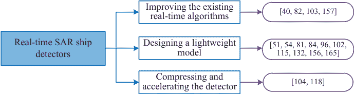

**图13.** 实时SAR舰船检测器。

#### 4.11.1. 改进现有实时算法

该领域的许多改进都基于YOLO和SSD系列，因为它们在运行时间上具有很大优势，尤其是YOLO系列。Zhang等人[40]使用了YOLO算法的思想，并采用深度可分离卷积来加速。使用MobileNet作为骨干网络，在保证检测精度的条件下提高检测速度。Zhang等人[82]提出了一种改进的YOLOv3（使用DarkNet-19并删除重复层）。它在SSDD数据集上实现了90.08%的AP₅₀和68.1%的AP。Mao等人[103]采用FCOS检测算法，以ResSARNet为骨干网络，并在边界框回归分支上使用中心度、中心采样、GIoU损失和自适应训练样本选择。仅用1.17M参数即可达到61.5%的AP。Zhong等人[157]采用CFAR和YOLOv4在China HISEA-1 SAR图像上实现了实时舰船检测。

#### 4.11.2. 设计轻量级模型

Zhang等人[51]设计了一种基于SSD的轻量级特征优化网络LFO-Net。它可以从头训练，并在不降低精度的情况下减少训练和测试时间。通过双向特征融合模块和注意力机制进一步提升了检测性能。它在SSDD上实现了80.12%的AP₅₀，测试时间为9.28毫秒。Zhang等人[54]利用多尺度检测、级联和锚框机制设计了一种用于实时SAR舰船检测的轻量级网络。它使用深度卷积和逐点卷积代替传统卷积。它在SSDD上实现了94.13%的AP₅₀，测试时间为9.03毫秒。Mao等人[81]使用简化的U-Net作为特征提取网络，其可学习权重仅有47万，通过无锚框方法提高了运算速度并解决了锚框带来的问题。该网络共有93万可学习权重，在SSDD数据集上的AP为68.1%。Zhang等人[84]提出了ShipDeNet-20，该网络有20个卷积层，模型大小为0.82 MB。它使用更少的层和卷积核，同时还使用了深度可分离卷积。通过特征融合模块、特征增强模块和尺度共享特征金字塔模块提高了精度。它在SSDD上实现了97.07%的AP50和233 FPS。Zhang等人[96]提出了HyperLiNet。它通过五个模块实现高精度，即多感受野模块、分割卷积模块、通道和空间注意力模块、特征融合模块和特征金字塔模块。它通过五个模块实现高速，即无区域模型、小卷积核、窄通道、分离卷积和批归一化融合。Zhou等人[102]提出了一种轻量级检测器Lira YOLO。它结合了密集连接、残差连接和分组卷积的思想，包括主干块和提取器模块。它实现了85.46%的AP50，模型大小为4.3 MB。Li等人[115]基于Faster R-CNN设计了一种特征中继放大和多尺度特征跳跃连接结构的轻量级网络，并改进了锚框选择和RoI池化。它实现了89.8%的AP50，速度大幅提升。Zhang等人[132]提出了一种轻量级检测算法ShipDeNet-18，该算法具有更少的层和更少的卷积核。采用深浅特征融合模块和特征金字塔模块来提高检测精度。它实现了93.78%的AP50和202 FPS。Ma等人[156]提出了YOLOv4-tiny。它减少了CSPDarkNet53中的卷积层数量。与YOLOv4（96.32% AP，44.21毫秒）相比，它实现了88.08%的AP50，耗时12.25毫秒。Sun等人[165]提出了一种轻量级密集连接稀疏激活检测器。它可以构建轻量级骨干网络，从而在性能和计算复杂度之间取得平衡。它在SSDD上实现了97.2%的AP50和61.5%的AP。

#### 4.11.3. 压缩和加速检测器

Mao等人[104]提出了一种基于知识蒸馏的网络瘦身方法。在滤波器级别对YOLOv3和Darknet-53进行剪枝，以获得轻量级模型。使用KL散度（KLD）知识蒸馏来训练学生和教师网络（YOLOv3@EfficientNet-B7）。该模型仅有15.4M参数，AP仅下降1%。Chen等人[118]提出了Tiny-YOLO-Lite算法。它设计并剪枝骨干结构，加强通道级稀疏性，并使用知识分区来弥补剪枝造成的性能下降。Tiny-YOLO-Lite减小了模型尺寸，减少了浮点运算次数，并获得了更快的精度。

#### 4.11.4. 总结

从以上讨论可以看出，实时舰船检测在SAR图像中也是一个热门话题。然而，上述工作还不够。很明显，从计算机视觉迁移过来的深度学习模型在该领域非常丰富。研究人员应开展以下工作以实现实时检测。首先，应使用无锚框和从头训练的方法来设计轻量级检测算法。其次，应使用一些模型压缩和加速技术来进一步提高速度。第三，应将轻量级模型移植到高性能AI芯片（NVIDIA Jetson TX2）上，以达到在边缘（卫星、飞机）运行的目的。

### 4.12. 其他检测器

本部分主要介绍弱监督、GAN（生成对抗网络）和数据增强，如图14所示。


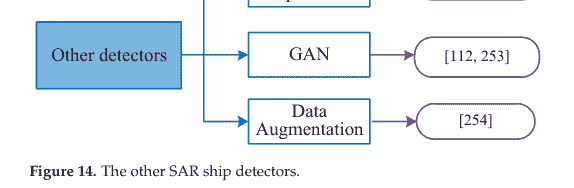

图14. 其他SAR船舶检测器。

#### 4.12.1. 弱监督
监督方法（如深度学习方法）需要大量时间和人力来制作训练样本[254]。文献[85,87,126]采用弱监督方式来训练船舶检测算法。该模型通过两个全局标签（即“船舶”和“非船舶”）进行训练，并生成船舶位置热图、船舶边界框和像素级分割产品。它们可以部分缓解标注问题。然而，其精度低于监督方法。

#### 4.12.2. GAN
SAR样本不足限制了算法的性能。Zou等人[112]使用多尺度Wasserstein辅助分类器生成对抗网络[255]来生成高分辨率SAR船舶图像。然后，将原始数据集与生成的数据组合成复合数据集，用于训练YOLOv3网络，从而解决小数据集下检测精度低的问题。基于生成对抗网络的思想，设计了一个由目标特征驱动的图像增强模块，提高了图像中船舶的质量。实验结果验证了该方法的有效性。

#### 4.12.3. 数据增强
数据增强可以将数据集的大小扩大数倍，从而提高检测精度[256]。基于特征映射掩码的训练方法消除了随机裁剪引入的梯度噪声，从而提高了检测性能。通过电磁数值分析技术生成带有船舶的SAR图像，并使用海杂波模型模拟包含各种SAR切片的真实SAR图像块，以提高SSD的性能。

### 4.13. 问题
从这177篇论文中，我们可以看到该领域的大多数检测算法都借鉴自计算机视觉。此外，其发展也落后于计算机视觉中的检测器。由于自然图像与SAR图像之间存在很大差异（例如，SAR图像是单通道的，船舶尺寸小，且分布非常稀疏），一些检测算法不适用于SAR船舶检测。因此，我们应该根据SAR图像中船舶的真实特征来设计检测器。

这177篇论文主要利用了SAR图像的图像特征，对散射机理的研究和应用还不够。这是我们未来应该解决的问题之一。

目前，已有几个公开的小型数据集，但我们缺乏大型数据集。在小数据集上训练的模型面临过拟合问题。我们下一步应该做的是将小数据集合并为大数据集，并确保训练测试划分标准、评估指标和基准明确。这些工作可以促进该领域的发展。

## 5. 未来——基于深度学习的SAR船舶检测器的方向

### 5.1. 无锚框检测器值得特别关注
无锚框检测算法有许多优点，这些优点已在4.6节中介绍过。需要强调的是，无锚框检测算法特别适用于SAR图像。由于SAR图像中船舶稀疏且尺寸小，它可以大大提高检测速度，并避免锚框设计和匹配中的各种问题。因此，无锚框检测算法需要得到更多关注。幸运的是，该领域的研究人员已经意识到了这一点，并且涌现了许多研究成果。

### 5.2. 从头训练检测器值得更多关注
目前，关于从头训练有以下公认的结论：首先，预训练加速了收敛速度，尤其是在训练的早期阶段。然而，从头训练的训练时间大致相当于预训练和微调的总时间。其次，如果有足够的目标图像和计算资源，预训练不是必需的。第三，如果考虑图像采集和图像清洗的成本，通用的大规模分类数据集不是理想的选择，而在检测任务上收集图像将是更有效的方法。第四，当目标任务是对空间定位（如船舶检测）进行预测时，预训练没有任何好处。

为检测而收集图像并训练是一个值得考虑的解决方案，尤其是当预训练任务与检测任务之间存在显著差距时（例如ImageNet图像和SAR图像）。因此，在SAR船舶检测领域，将现有公开数据集合并为大数据集非常有必要，以确保从头训练模型。

由于自然图像与SAR图像之间的差异，在该领域采用从头训练的检测算法非常必要，因为它可以获得对SAR图像适应性更强、模型更小的检测算法。然而，现阶段的工作还远远不够，因此我们需要更多地关注从头训练的检测算法。

### 5.3. 定向边界框检测器需借鉴更多其他工作
SAR图像中的船舶方向性变化很大，垂直边界框无法适应这种场景。因此有必要使用定向边界框。在近岸场景中，垂直边界框容易受到岸上建筑物和其他船舶的干扰，影响检测性能，而定向边界框可以准确表示船舶目标并减少冗余干扰。此外，对于离岸场景中的船舶目标，定向边界框可以获取航向和纵横比等信息，这对于后续的轨迹预测和态势估计任务具有重要意义。场景文本检测和航空遥感图像数据集DOTA已经对定向边界框进行了深入研究，并取得了许多成果。我们应该向他们学习。

### 5.4. 小船舶检测是一个永恒的话题
小尺寸船舶检测效果不佳的主要原因如下：首先，从小尺度船舶中提取的特征很少，且锚框的尺寸和感受野对于小船舶来说太大。其次，锚框的大小是离散的（例如，16、32、64等），而船舶的大小是连续的，这导致小尺寸船舶的召回率较低。第三，小船舶的锚框与真实边界框匹配较少，导致正样本少、负样本过多。

由于SAR图像中小船舶的比例非常高，小目标检测很困难，尤其是在该领域。因此，研究如何提高小船舶的检测效果是一个永恒的话题。

### 5.5. 实时检测是应用的关键
实时SAR船舶检测需要从多个方面入手。例如，我们可以设计轻量级检测网络，压缩和加速模型以提高速度，并将检测算法移植到边缘的高性能AI芯片（NVIDIA Jetson TX2）上。目前，该领域的大部分工作集中在前两个方面，而对第三个方面的研究较少，未来需要重点关注。只有实现这一技术，才能在卫星或飞机平台上实现船舶的实时检测与识别。

### 5.6. Transformer是未来趋势
在过去两年中，Transformer在目标检测方面相比CNN表现出巨大优势，例如DETR（检测Transformer）[257]和Swin Transformer。DINO [258]在COCO test-dev上可以达到63.6%的AP，大幅超越了基于CNN的检测器。如今，计算机视觉的热门话题是Transformer。CRTransSar [182]是第一个使用Transformer进行SAR图像船舶检测的方法。它在精度上表现出巨大优势（在SSDD上达到97%的AP）。尽管Transformer用于SAR船舶检测时仍存在一些问题，但毫无疑问，由于其巨大优势，Transformer将成为未来的研究趋势。

### 5.7. 弥合SAR船舶检测与计算机视觉之间的差距
与计算机视觉领域相比，SAR图像中的船舶检测领域相对较小且不够活跃。因此，有必要将该领域引入计算机视觉，并系统学习计算机视觉中的丰富成果。我们还应该学习其开放性、标准化评估和易于获取的代码。这项工作可以促进该领域快速发展。我们应该做的是：首先，将现有的公开数据集（SSDD、SAR-Ship-Dataset、AIR-SARShip、HRSID、LS-SSDD-v1.0、SRSDD-v1.0和RSDD-SAR）合并为一个大数据集，这里可以称为LargeSARDataset。在其上训练的模型可以避免过拟合。其次，确定训练样本和测试样本。第三，确定评估指标。第四，发布基准。第五，将其引入计算机视觉领域。如图15所示。通过这项工作，我们可以弥合SAR船舶检测与计算机视觉之间的差距。

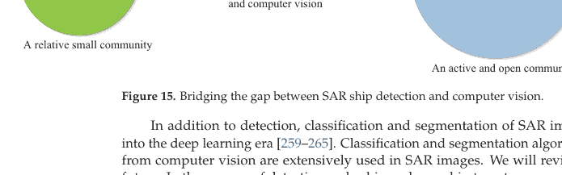

图15. 弥合SAR船舶检测与计算机视觉之间的差距。

除了检测之外，SAR图像的分类和分割也进入了深度学习时代[259–265]。从计算机视觉借鉴来的分类和分割算法被广泛应用于SAR图像。我们将在未来对它们进行综述。在检测过程中，只考虑船舶和非船舶目标，不分析非船舶目标的具体内容[266–268]。一些冰山在形状和大小上与船舶非常相似，算法难以区分它们。因此，未来我们将研究如何解决这个问题。


## 6. 结论

本文介绍了基于深度学习的SAR图像船舶检测算法的过去、现在和未来。

首先，回顾了SAR船舶检测的历史（在SSDD于2017年12月1日公开之前）。这部分主要介绍了基于CFAR的检测算法，并分析了基于深度学习的算法的巨大优势。此外，还对它们在理论和实验上进行了比较。

之后，对当前（2017年12月1日至今）基于深度学习的船舶检测算法进行了全面综述。这部分首先分析了177篇论文的数据集、国家、时间线、深度学习框架和性能演变。特别介绍了该领域10个数据集的基本情况。对177篇论文进行了分类，分为两阶段、单阶段、无锚框、从零训练、定向边界框、多尺度、注意力模型、实时检测等。分析了这些论文中的具体算法，包括原理、创新、性能和总结。

最后，描述了该领域存在的问题和未来的发展方向。主要思想是根据SAR图像的特定特征设计检测算法，关注无锚框检测算法，足够重视从零训练的检测算法，借鉴自然场景文本检测和DOTA的现有成果，不断提高小船舶的检测性能，注重通过模型加速和AI芯片实现船舶实时检测。强调未来的重要工作是通过将现有小型数据集合并为更大的数据集并制定相关标准，弥合SAR船舶检测与计算机视觉之间的差距。

这篇综述可以为该领域的研究者或对该领域感兴趣的研究者提供参考，使他们能够快速了解该领域的现状和未来发展方向。

作者贡献：概念化，J.L.和C.X.; 方法论，H.S., L.G.和T.W.; 调查，J.L.; 写作——初稿准备，J.L.; 写作——审阅和编辑，J.L.和C.X.; 监督，C.X.; 资金获取，C.X. 所有作者均已阅读并同意稿件的发表版本。

基金：本研究由国家自然科学基金资助，项目编号61790550、61790554、61971432、62022092。

数据可用性声明：本研究未创建或分析新数据。数据共享不适用于本文。

利益冲突：作者声明不存在利益冲突。

## 参考文献

- 1. Moreira, A.; Prats-Iraola, P.; Younis, M.; Krieger, G.; Hajnsek, I.; Papathanassiou, K.P. A tutorial on synthetic aperture radar. IEEE Geosci. Remote Sens. Mag. 2013, 1, 6–43. [CrossRef]
- 2. Reigber, A.; Scheiber, R.; Jager, M.; Prats-Iraola, P.; Hajnsek, I.; Jagdhuber, T.; Papathanassiou, K.P.; Nannini, M.; Aguilera, E.; Baumgartner, S.; et al. Very-high-resolution airborne synthetic aperture radar imaging: Signal processing and applications. Proc. IEEE 2013, 101, 759–783. [CrossRef]
- 3. Li, H.; Hong, W.; Wu, Y.; Fan, P. An efficient and flexible statistical model based on generalized Gamma distribution for amplitude SAR images. IEEE Trans. Geosci. Remote Sens. 2010, 48, 2711–2722. [CrossRef]
- 4. Achim, A.; Kuruoglu, E.E.; Zerubia, J. SAR image filtering based on the heavy-tailed Rayleigh model. IEEE Trans. Image Process. 2006, 15, 2686–2693. [CrossRef]
- 5. Russakovsky, O.; Deng, J.; Su, H.; Krause, J.; Satheesh, S.; Ma, S.; Huang, Z.; Karpathy, A.; Khosla, A.; Bernstein, M.; et al. ImageNet Large Scale Visual Recognition Challenge. Int. J. Comput. Vis. 2015, 115, 211–252. [CrossRef]
- 6. Schwegmann, C.P.; Kleynhans, W.; Salmon, B.P.; Mdakane, L.W.; Meyer, R.G.V. Very deep learning for ship discrimination in Synthetic Aperture Radar imagery. In Proceedings of the IEEE International Geoscience and Remote Sensing Symposium (IGARSS), Beijing, China, 10–15 July 2016; pp. 104–107. [CrossRef]
- 7. Miao, K.; Leng, X.; Zhao, L.; Ji, K. A modified faster R-CNN based on CFAR algorithm for SAR ship detection. In Proceedings of the 2017 International Workshop on Remote Sensing with Intelligent Processing (RSIP), Shanghai, China, 18–21 May 2017. [CrossRef]
- 8. Liu, Y.; Zhang, M.H.; Xu, P.; Guo, Z. SAR ship detection using sea-land segmentation-based convolutional neural network. In Proceedings of the 2017 International Workshop on Remote Sensing with Intelligent Processing (RSIP), Shanghai, China, 18–21 May 2017. [CrossRef]
- 9. Kang, M.; Ji, K.; Leng, X.; Lin, Z. Contextual Region-Based Convolutional Neural Network with Multilayer Fusion for SAR Ship Detection. Remote Sens. 2017, 9, 860. [CrossRef]
- 10. Wang, Y.; Chao, W.; Hong, Z. Combining single shot multibox detector with transfer learning for ship detection using Sentinel-1 images. In Proceedings of the 2017 SAR in Big Data Era: Models, Methods and Applications (BIGSARDATA), Singapore, 19–22 November 2017.
- 11. Li, J.; Qu, C.; Shao, J. Ship detection in SAR images based on an improved faster R-CNN. In Proceedings of the Sar in Big Data Era: Models, Methods & Applications, Beijing, China, 13–14 November 2017. [CrossRef]
- 12. Cozzolino, D.; Martino, G.D.; Poggi, G.; Verdoliva, L. A fully convolutional neural network for low-complexity single-stage ship detection in Sentinel-1 SAR images. In Proceedings of the Geoscience & Remote Sensing Symposium, Fort Worth, TX, USA, 23–28 July 2017. [CrossRef]
- 13. An, Q.; Pan, Z.; You, H. Ship Detection in Gaofen-3 SAR Images Based on Sea Clutter Distribution Analysis and Deep Convolutional Neural Network. Sensors 2018, 18, 334. [CrossRef]
- 14. Wang, Y.; Wang, C.; Zhang, H.; Zhang, C.; Fu, Q. Combining Single Shot Multibox Detector with transfer learning for ship detection using Chinese Gaofen-3 images. In Proceedings of the 2017 Progress in Electromagnetics Research Symposium-Fall (PIERS-FALL), Singapore, 19–22 November 2017. [CrossRef]
- 15. Chen, S.Q.; Zhan, R.H.; Zhang, J. Robust single stage detector based on two-stage regression for SAR ship detection. In Proceedings of the 2nd International Conference on Innovation in Artificial Intelligence, Shanghai, China, 9–12 March 2018; pp. 169–174. [CrossRef]
- 16. Jiao, J.; Zhang, Y.; Sun, H.; Yang, X.; Gao, X.; Hong, W.; Fu, K.; Sun, X.; Wen, H. A Densely Connected End-to-End Neural Network for Multiscale and Multiscene SAR Ship Detection. IEEE Access 2018, 6, 20881–20892. [CrossRef]
- 17. Deng, Z.; Sun, H.; Zhou, S.; Zhao, J.; Lei, L.; Zou, H. Multi-scale object detection in remote sensing imagery with convolutional neural networks. ISPRS J. Photogramm. Remote Sens. 2018, 145, 3–22. [CrossRef]
- 18. Wang, Y.; Wang, C.; Zhang, H. Combining a Single Shot Multibox Detector with transfer learning for ship detection using Sentinel-1 SAR images. Remote Sens. Lett. 2019, 9, 780–788. [CrossRef]
- 19. Wang, R.; Li, J.; Duan, Y.; Cao, H.; Zhao, Y. Study on the Combined Application of CFAR and Deep Learning in Ship Detection. J. Indian Soc. Remote Sens. 2018, 46, 1413–1421. [CrossRef]
- 20. Wang, J.; Lu, C.; Jiang, W. Simultaneous Ship Detection and Orientation Estimation in SAR Images Based on Attention Module and Angle Regression. Sensors 2018, 18, 2851. [CrossRef]
- 21. Zhao, J.; Zhang, Z.; Yu, W.; Truong, T. A Cascade Coupled Convolutional Neural Network Guided Visual Attention Method for Ship Detection from SAR Images. IEEE Access 2018, 6, 50693–50708. [CrossRef]
- 22. Zhao, J.; Guo, W.; Zhang, Z.; Yu, W. A coupled convolutional neural network for small and densely clustered ship detection in SAR images. Sci. China Inf. Sci. 2019, 62, 42301. [CrossRef]
- 23. Khan, H.M.; Cai, Y. Ship detection in SAR Image using YOLOv2. In Proceedings of the 2018 37th Chinese Control Conference (CCC), Wuhan, China, 25–27 July 2018. [CrossRef]
- 24. Sharifzadeh, F.; Akbarizadeh, G.; Kavian, Y.S. Ship Classification in SAR Images Using a New Hybrid CNN–MLP Classifier. J. Indian Soc. Remote Sens. 2018, 47, 551–562. [CrossRef]
- 25. Zhou, F.; Fan, W.; Sheng, Q.; Tao, M. Ship Detection Based on Deep Convolutional Neural Networks for Polsar Images. In Proceedings of the 2018 IEEE International Geoscience and Remote Sensing Symposium, Valencia, Spain, 22–27 July 2018. [CrossRef]
- 26. Lei, L.; Chen, G.; Pan, Z.; Lei, B.; An, Q. Inshore Ship Detection in Sar Images Based on Deep Neural Networks. In Proceedings of the 2018 IEEE International Geoscience and Remote Sensing Symposium, Valencia, Spain, 22–27 July 2018. [CrossRef]
- 27. Wang, Y.; Chao, W.; Hong, Z. Ship Discrimination with Deep Convolutional Neural Networks in Sar Images. In Proceedings of the 2018 IEEE International Geoscience and Remote Sensing Symposium, Valencia, Spain, 22–27 July 2018. [CrossRef]
- 28. Schwegmann, N.C.P.; Kleynhans, W.; Salmon, B.P.; Mdakane, L.W.; Meyer, R.G.V. Synthetic Aperture Radar Ship Detection Using Capsule Networks. In Proceedings of the 2018 IEEE International Geoscience and Remote Sensing Symposium, Valencia, Spain, 22–27 July 2018. [CrossRef]
- 29. Lin, Z.; Ji, K.; Leng, X.; Kuang, G. Squeeze and Excitation Rank Faster R-CNN for Ship Detection in SAR Images. IEEE Geosci. Remote Sens. Lett. 2019, 16, 751–755. [CrossRef]
- 30. Ma, M.; Chen, J.; Liu, W.; Yang, W. Ship Classification and Detection Based on CNN Using GF-3 SAR Images. Remote Sens. 2018, 10, 2043. [CrossRef]
- 31. Chen, S.W.; Tao, C.S.; Wang, X.S.; Xiao, S.P. Polarimetric SAR Targets Detection and Classification with Deep Convolutional Neural Network. In Proceedings of the 2018 Progress in Electromagnetics Research Symposium (PIERS-Toyama), Toyama, Japan, 1–4 August 2018. [CrossRef]
- 32. Wang, Z.; Yang, T.; Zhang, H. Land contained sea area ship detection using spaceborne image. Pattern Recognit. Lett. 2019, 130, 125–131. [CrossRef]
- 33. Deng, Z.; Sun, H.; Zhou, S.; Zhao, J. Learning Deep Ship Detector in SAR Images from Scratch. IEEE Trans. Geosci. Remote Sens. 2019, 57, 4021–4039. [CrossRef]


- 34. Gui, Y.; Li, X.; Xue, L. 用于 SAR 舰船检测的多层融合轻头检测器。 *Sensors* 2019, *19*, 1124. [CrossRef] [PubMed]
- 35. Wang, Y.; Wang, C.; Zhang, H.; Dong, Y.; Wei, S. 基于 RetinaNet 和多分辨率高分三号影像的自动舰船检测。 *Remote Sens.* 2019, *11*, 531. [CrossRef]
- 36. Liu, N.; Cao, Z.; Cui, Z.; Pi, Y.; Dang, S. SAR 图像中舰船检测的多尺度建议生成。 *Remote Sens.* 2019, *11*, 526. [CrossRef]
- 37. Wang, J.; Zheng, T.; Lei, P.; Bai, X. 基于层次化卷积神经网络 (CNN) 的星载 SAR 影像舰船目标检测方法。 *Remote Sens.* 2019, *11*, 620. [CrossRef]
- 38. Wang, Y.; Wang, C.; Zhang, H.; Dong, Y.; Wei, S.L. 用于复杂背景下深度学习的舰船检测 SAR 数据集。 *Remote Sens.* 2019, *11*, 765. [CrossRef]
- 39. Chang, Y.L.; Anagaw, A.; Chang, L.; Wang, Y.C.; Hsiao, C.Y.; Lee, W.H. 基于 YOLOv2 的 SAR 影像舰船检测。 *Remote Sens.* 2019, *11*, 786. [CrossRef]
- 40. Zhang, T.; Zhang, X. 基于网格卷积神经网络的 SAR 图像高速舰船检测。 *Remote Sens.* 2019, *11*, 1206. [CrossRef]
- 41. An, Q.; Pan, Z.; Liu, L.; You, H. DRBox-v2：用于 SAR 图像目标检测的可旋转框改进检测器。 *IEEE Trans. Geosci. Remote Sens.* 2019, *57*, 8333–8349. [CrossRef]
- 42. Cui, Z.; Li, Q.; Cao, Z.; Liu, N. 用于 SAR 图像多尺度舰船检测的密集注意力金字塔网络。 *IEEE Trans. Geosci. Remote Sens.* 2019, *57*, 8983–8997. [CrossRef]
- 43. Chen, C.; Hu, C.; He, C.; Pei, H.; Pang, H.; Zhao, T. 基于注意力机制的复杂背景下 SAR 舰船检测。 In *中国图像与图形技术会议*; Springer: Singapore, 2019; pp. 565–578.
- 44. Chen, C.; He, C.; Hu, C.; Pei, H.; Jiao, L. 基于注意力机制的深度神经网络用于多尺度和复杂场景下的 SAR 舰船检测。 *IEEE Access* 2019, *7*, 104848–104863. [CrossRef]
- 45. Guo, Q.; Wang, H.; Kang, L.; Li, Z.; Xu, F. 星载 SAR 图像中的飞机目标检测。 In *2019 年 IEEE 国际地质与遥感研讨会论文集*, Yokohama, Japan, 28 July–2 August 2019. [CrossRef]
- 46. Gui, Y.; Li, X.; Xue, L.; Lv, J. 用于 SAR 图像中小型舰船检测的尺度迁移卷积网络。 In *2019 年 IEEE 第 8 届国际信息技术与人工智能联合会议论文集 (ITAIC)*, Chongqing, China, 24–26 May 2019. [CrossRef]
- 47. Li, Y.; Chen, J.; Ke, M.; Li, L.; Ding, Z.; Wang, Y. 基于改进 SSD 的 SAR 舰船图像中小目标识别。 In *2019 年 IEEE 国际信号、信息与数据处理会议论文集 (ICSIDP)*, Chongqing, China, 11–13 December 2019. [CrossRef]
- 48. Ai, J.; Tian, R.; Luo, Q.; Jin, J.; Tang, B. SAR 影像多目标环境中基于多尺度旋转不变 Haar-like 特征集成 CNN 的舰船检测算法。 *IEEE Trans. Geosci. Remote Sens.* 2019, *57*, 10070–10087. [CrossRef]
- 49. Fan, Q.; Chen, F.; Cheng, M.; Lou, S.; Xiao, R.; Zhang, B.; Wang, C.; Li, J. 基于紧凑极化 SAR 图像的全卷积网络舰船检测。 *Remote Sens.* 2019, *11*, 2171. [CrossRef]
- 50. Ayhan, N.; Sen, N. 基于深度学习的合成孔径雷达 (SAR) 图像舰船检测。 In *人工智能与机器学习在国防应用中的论文集*, Strasbourg, France, 19 September 2019.
- 51. Zhang, X.; Wang, H.; Xu, C.; Lv, Y.; Fu, C.; Xiao, H.; He, Y. 用于 SAR 图像舰船检测的轻量级特征优化网络。 *IEEE Access* 2019, *7*, 141662–141678. [CrossRef]
- 52. Yang, T.; Zhu, J.; Liu, J. 基于深度网络的 SAR 图像目标检测与识别。 In *2019 年大数据时代 SAR 研讨会论文集 (BIGSARDATA)*, Beijing, China, 5–6 August 2019. [CrossRef]
- 53. Hong, S.J.; Baek, W.K.; Jung, H.S. 使用 M2Det 深度学习模型从 X 波段 SAR 图像进行舰船检测。 *Appl. Sci.* 2020, *10*, 7751. [CrossRef]
- 54. Zhang, T.; Zhang, X.; Shi, J.; Wei, S. 用于高速 SAR 舰船检测的深度可分离卷积神经网络。 *Remote Sens.* 2019, *11*, 2483. [CrossRef]
- 55. Chen, S.; Zhan, R.; Zhang, J. 基于区域注意力的单次检测器用于 SAR 舰船检测。 *J. Eng.* 2019, *2019*, 7381–7384. [CrossRef]
- 56. Chen, C.; He, C.; Hu, C.; Pei, H.; Jiao, L. MSARN：基于自适应重校准机制的多尺度和任意方向 SAR 舰船检测深度神经网络。 *IEEE Access* 2019, *7*, 159262–159283. [CrossRef]
- 57. Yue, B.; Zhao, W.; Han, S. 基于卷积神经网络和多层特征融合的 SAR 舰船检测方法。 In *国际自然计算、模糊系统与知识发现会议*; Springer: Cham, Switzerland, 2019.
- 58. Wang, Z.; Yang, W.; Chen, J.; Li, C. 基于水平集的 SAR 图像舰船检测中陆地掩膜方法。 In *2019 年 IEEE 国际地质与遥感研讨会论文集*, Yokohama, Japan, 28 July–2 August 2019. [CrossRef]
- 59. Hou, X.; Ao, W.; Xu, F. 高分辨率高分三号星载 SAR 图像中端到端自动舰船检测与识别。 In *2019 年 IEEE 国际地质与遥感研讨会论文集*, Yokohama, Japan, 28 July–2 August 2019. [CrossRef]
- 60. Wang, R.; Xu, F.; Pei, J.; Wang, C.; Huang, Y.; Yang, J.; Wu, J. 基于 MSER 决策准则的改进 Faster R-CNN 用于港口 SAR 图像舰船检测。 In *2019 年 IEEE 国际地质与遥感研讨会论文集*, Yokohama, Japan, 28 July–2 August 2019. [CrossRef]
- 61. Li, Y.; Ding, Z.; Zhang, C.; Wang, Y.; Chen, J. 基于 Resnet 和迁移学习的 SAR 舰船检测。 In Proceedings of the 2019 IEEE International Geoscience and Remote Sensing Symposium, Yokohama, Japan, 28 July–2 August 2019. [CrossRef]
- 62. Li, Q.; Min, R.; Cui, Z.; Pi, Y.; Xu, Z. SAR 图像中基于密集注意力金字塔网络的多尺度舰船检测。 In Proceedings of the 2019 IEEE International Geoscience and Remote Sensing Symposium, Yokohama, Japan, 28 July–2 August 2019. [CrossRef]
- 63. Liu, N.; Cui, Z.; Cao, Z.; Pi, Y.; Lan, H. 用于 SAR 图像多尺度舰船检测的可迁移尺度金字塔网络。 In Proceedings of the 2019 IEEE International Geoscience and Remote Sensing Symposium, Yokohama, Japan, 28 July–2 August 2019. [CrossRef]
- 64. Gao, F.; Shi, W.; Wang, J.; Yang, E.; Zhou, H. 多分辨率和多场景合成孔径雷达 (SAR) 图像舰船检测的增强特征提取。 Remote Sens. 2019, 11, 2694. [CrossRef]
- 65. Sun, X.; Wang, Z.; Sun, Y.; Diao, W.; Zhang, Y.; Fu, K. AIR-SARShip-1.0：高分辨率 SAR 舰船检测数据集。 J. Radars 2019, 8, 852–862.
- 66. Fan, W.; Zhou, F.; Bai, X.; Tao, M.; Tian, T. 用于 PolSAR 图像的深度卷积神经网络舰船检测。 Remote Sens. 2019, 11, 2862. [CrossRef]
- 67. Dechesne, C.; Lefèvre, S.; Vadaine, R.; Hajduch, G.; Fablet, R. 基于多任务深度学习的 Sentinel-1 SAR 图像舰船识别与表征。 Remote Sens. 2019, 11, 2997. [CrossRef]
- 68. Zhang, X.; Zhang, T.; Shi, J.; Wei, S. 基于深度可分离卷积神经网络的高速高精度 SAR 舰船检测。 J. Radars 2019, 8, 841–851.
- 69. Wei, S.; Su, H.; Ming, J.; Wang, C.; Yan, M.; Shi, J.; Zhang, X. 基于 HR-SDNet 的高分辨率 SAR 影像精确鲁棒舰船检测。 Remote Sens. 2020, 12, 167. [CrossRef]
- 70. Chen, P.; Li, Y.; Zhou, H.; Liu, B.; Liu, P. 用于 SAR 影像的锚框聚类和特征金字塔网络模型小船目标检测。 J. Mar. Sci. Eng. 2020, 8, 112. [CrossRef]
- 71. Milios, A.; Bereta, K.; Chatzikokolakis, K.; Zissis, D.; Matwin, S. 用于船舶检测的卫星影像与 AIS 数据自动融合。 In Proceedings of the 2019 22nd International Conference on Information Fusion (FUSION), Ottawa, ON, Canada, 2–5 July 2019; pp. 1–5.
- 72. Jin, K.; Chen, Y.; Xu, B.; Yin, J.; Yang, J. 用于 PolSAR 图像中小型舰船检测的 Patch-to-Pixel 卷积神经网络。 IEEE Trans. Geosci. Remote Sens. 2020, 58, 6623–6638. [CrossRef]
- 73. Hou, X.; Ao, W.; Song, Q.; Lai, J.; Wang, H.; Xu, F. FUSAR-Ship：构建高分辨率高分三号 SAR-AIS 匹配数据集用于舰船检测与识别。 Sci. China Inf. Sci. 2020, 63, 140303. [CrossRef]
- 74. Su, H.; Wei, S.; Liu, S.; Liang, J.; Wang, C.; Shi, J.; Zhang, X. HQ-ISNet：遥感影像的高质量实例分割。 Remote Sens. 2020, 12, 989. [CrossRef]
- 75. Tanveer, H.; Balz, T.; Mohamdi, B. 使用卷积神经网络 (CNN) 方法在 Sentinel-1 SAR 影像中进行舰船检测。 In Proceedings of the 2019 6th Asia-Pacific Conference on Synthetic Aperture Radar (APSAR), Xiamen, China, 26–29 November 2019. [CrossRef]
- 76. Wang, J.; Chen, J.; Wang, P.; Zhao, C.; Pan, X.; Gao, A. 使用 Faster-RCNN 的 SAR 图像方位模糊检测算法。 In Proceedings of the 2019 6th Asia-Pacific Conference on Synthetic Aperture Radar (APSAR), Xiamen, China, 26–29 November 2019. [CrossRef]
- 77. Zheng, T.; Wang, J.; Lei, P. SAR 影像中基于深度学习的多特征目标检测方法。 In Proceedings of the 2019 6th Asia-Pacific Conference on Synthetic Aperture Radar (APSAR), Xiamen, China, 26–29 November 2019. [CrossRef]
- 78. Su, H.; Wei, S.; Wang, M.; Zhou, L.; Shi, J.; Zhang, X. 基于 RetinaNet-Plus 的高分辨率 SAR 影像舰船检测。 In Proceedings of the 2019 6th Asia-Pacific Conference on Synthetic Aperture Radar (APSAR), Xiamen, China, 26–29 November 2019. [CrossRef]
- 79. Wang, C.; Pei, J.; Wang, R.; Huang, Y.; Yang, J. 复杂场景下星载 SAR 图像的新型舰船检测与分类方法。 In Proceedings of the 2019 6th Asia-Pacific Conference on Synthetic Aperture Radar (APSAR), Xiamen, China, 26–29 November 2019. [CrossRef]
- 80. Xiao, Q.; Cheng, Y.; Xiao, M.; Zhang, J.; Shi, H.; Niu, L.; Ge, C.; Lang, H. 用于多时相合成孔径雷达图像舰船检测的改进区域卷积神经网络。 Concurr. Comput. Pract. Exp. 2020, 32, 5820. [CrossRef]
- 81. Mao, Y.; Yang, Y.; Ma, Z.; Li, M.; Su, H.; Zhang, J. 基于简化 U-Net 的 SAR 影像高效低成本舰船检测。 IEEE Access 2020, 8, 69742–69753. [CrossRef]
- 82. Zhang, T.; Zhang, X.; Shi, J.; Wei, S. 通过改进 YOLOv3 实现 SAR 图像高速舰船检测。 In Proceedings of the 2019 16th International Computer Conference on Wavelet Active Media Technology and Information Processing, Chengdu, China, 14–15 December 2019; pp. 149–152. [CrossRef]
- 83. Pan, Z.; Yang, R.; Zhang, A.Z. MSR2N：用于 SAR 图像任意方向舰船检测的多阶段旋转区域网络。 Sensors 2020, 20, 2340. [CrossRef]
- 84. Zhang, T.; Zhang, X. ShipDeNet-20：仅有 20 个卷积层且 <1-MB 的轻量级 SAR 舰船检测器。 IEEE Geosci. Remote Sens. Lett. 2020, 18, 1234–1238. [CrossRef]
- 85. Gu, F.; Zhang, H.; Wang, C.; Zhang, B. 基于三组件 CNN-CAM-CRF 模型的 SAR 图像弱监督舰船检测。 J. Appl. Remote Sens. 2020, 14, 026506. [CrossRef]


- 86. Dai, W.; Mao, Y.; Yuan, R.; Liu, Y.; Pu, X.; Li, C. 一种基于卷积神经网络的复杂背景多尺度SAR舰船检测新检测器. Sensors 2020, 20, 2547. [CrossRef]
- 87. Zhou, Y.; Cai, Z.; Zhu, Y.; Yan, J. 基于多尺度Faster R-CNN的SAR图像自动舰船检测. J. Phys. Conf. Ser. 2020, 1550, 042006. [CrossRef]
- 88. Kang, K.M. 利用AIS信息为机器学习舰船检测算法自动获取训练数据. Remote Sens. 2020, 12, 1443. [CrossRef]
- 89. Cui, Z.; Wang, X.; Liu, N.; Cao, Z.; Yang, J. 基于空间Shuffle-Group增强注意力的SAR大尺度图像舰船检测. IEEE Trans. Geosci. Remote Sens. 2020, 59, 379–391. [CrossRef]
- 90. Yang, R.; Wang, G.; Pan, Z.; Lu, H.; Zhang, H.; Jia, X. 一种CNN-based SAR舰船检测器的新型虚警抑制方法. IEEE Geosci. Remote Sens. Lett. 2020, 18, 1401–1405. [CrossRef]
- 91. Zhao, Y.; Zhao, L.; Xiong, B.; Kuang, G. 用于SAR图像舰船检测的注意力感受野金字塔网络. IEEE J. Sel. Top. Appl. Earth Obs. Remote Sens. 2020, 13, 2738–2756. [CrossRef]
- 92. Han, L.; Zheng, T.; Ye, W.; Ran, D. 对基于CNN的SAR舰船检测器的检测偏好分析. 载于2020信息通信技术会议论文集，南京，中国，2020年5月29-31日. [CrossRef]
- 93. Chen, S.; Zhang, J.; Zhan, R. R2FA-Det：深入研究SAR图像舰船检测中的高质量可旋转框. Remote Sens. 2020, 12, 2031. [CrossRef]
- 94. Wei, S.; Zeng, X.; Qu, Q.; Wang, M.; Su, H.; Shi, J. HRSID：用于舰船检测和实例分割的高分辨率SAR图像数据集. IEEE Access 2020, 8, 2031. [CrossRef]
- 95. Fu, J.; Sun, X.; Wang, Z.; Fu, K. 基于特征平衡与细化网络的SAR图像多尺度舰船检测无锚方法. IEEE Trans. Geosci. Remote Sens. 2020, 59, 1331–1344. [CrossRef]
- 96. Zhang, T.; Zhang, X.; Shi, J.; Wei, S. HyperLi-Net：一种用于合成孔径雷达图像高精度高速舰船检测的超轻量深度学习网络. ISPRS J. Photogramm. Remote Sens. 2020, 167, 123–153. [CrossRef]
- 97. Zhou, H. 用于SAR图像舰船检测的具有密集注意力特征聚合的无锚卷积网络. Remote Sens. 2020, 12, 2649.
- 98. Han, L.; Zhao, X.; Ye, W.; Ran, D. 从零开始的SAR舰船检测不对称与方形卷积神经网络. 载于2020年第五届生物医学信号与图像处理国际会议论文集，苏州，中国，2020年8月21-23日；页码80-85.
- 99. Han, L.; Ye, W.; Li, J.; Ran, D. 基于改进SSD的SAR图像小目标舰船检测. 载于2019年IEEE信号、信息与数据处理国际会议论文集，重庆，中国，2019年12月11-13日. [CrossRef]
- 100. Han, L.; Ran, D.; Ye, W.; Yang, W.; Wu, X. 从零开始的SAR舰船检测多尺寸卷积与学习深度网络. IEEE Access 2020, 8, 158896–159016. [CrossRef]
- 101. Zhang, T.; Zhang, X.; Ke, X.; Zhan, X.; Shi, J.; Wei, S.; Pan, D.; Li, J.; Su, H.; Zhou, Y. LS-SSDD-v1.0：专用于从大规模Sentinel-1 SAR图像中小型舰船检测的深度学习数据集. Remote Sens. 2020, 12, 2997. [CrossRef]
- 102. Zhou, L.; Wei, S.; Cui, Z.; Fang, J.; Yang, X.; Ding, W. Lira-YOLO：雷达图像舰船检测的轻量级模型. J. Syst. Eng. Electron. 2020, 31, 950–956. [CrossRef]
- 103. Mao, Y.; Li, X.; Li, Z.; Li, M.; Chen, S. 仅有1.17M参数的无锚SAR舰船检测器. 载于ICASIT 2020，2020年航空安全与信息技术国际会议，威海，中国，2020年10月14-16日.
- 104. Mao, Y.; Li, X.; Li, Z.; Li, M.; Chen, S. 基于知识蒸馏的SAR舰船检测网络瘦身方法. 载于2020年航空安全与信息技术国际会议论文集，威海，中国，2020年10月14-16日；页码177-181.
- 105. Stefanowicz, J.; Ali, I.; Andersson, S. 单极化合成孔径雷达图像中舰船检测的当前趋势. 载于SPIE 11581论文集，Photonics Applications in Astronomy, Communications, Industry, and High Energy Physics Experiments，维尔加，波兰，2020年10月14日；页码1158109.
- 106. Li, K.; Luan, S.; Zhou, D. 用于SAR舰船图像增强的光学到SAR转换方法. 载于2020年IEEE信息通信与信号处理第三届国际会议论文集，上海，中国，2020年9月12-15日. [CrossRef]
- 107. Xu, C.; Yin, C.; Wang, D.; Han, W. SAR图像中结合视觉显著性和级联CNN的快速舰船检测. IET Radar Sonar Navig. 2020, 14, 1879–1887. [CrossRef]
- 108. Han, L.; Ran, D.; Ye, W.; Wu, X. 从零开始的SAR舰船检测不对称卷积神经网络. 载于2020年第九届计算与模式识别国际会议论文集，厦门，中国，2020年10月30日-11月1日；页码90-95.
- 109. Idicula, S.M.; Paul, B. 使用新型SarNeDe方法进行实时SAR舰船检测. 载于2021年IEEE国际地球科学与遥感研讨会IGARSS论文集，布鲁塞尔，比利时，2021年7月11-16日；页码2198-2201. [CrossRef]
- 110. Hu, W.; Tian, Z.; Chen, S.; Zhan, R.; Zhang, J. SAR图像舰船检测的密集特征金字塔网络. 载于第三届图像、视频处理与人工智能国际会议论文集，上海，中国，2020年10月23-24日. [CrossRef]
- 111. Zhang, T.; Zhang, X.; Shi, J.; Wei, S.; Wang, J.; Li, J.; Su, H.; Zhou, Y. SAR图像近海与近岸舰船检测的平衡场景学习机制. IEEE Geosci. Remote Sens. Lett. 2020, 19, 4004905.
- 112. Zou, L.; Zhang, H.; Wang, C.; Wu, F. MW-ACGAN：为舰船检测生成多尺度高分辨率SAR图像. Sensors 2020, 20, 6673. [CrossRef]
- 113. Zhang, G.; Li, Z.; Li, X.; Yin, C.; Shi, Z. 合成孔径雷达图像舰船检测的新型显著特征融合方法. IEEE Access 2020, 8, 215904–215914. [CrossRef]
- 114. Chen, Y.; Yu, J.; Xu, Y. 复杂背景下SSDv2的SAR舰船目标检测. 载于2020年计算机视觉、图像与深度学习国际会议论文集，重庆，中国，2020年7月10-12日. [CrossRef]
- 115. Li, Y.; Zhang, S.; Wang, W.Q. SAR图像舰船检测的轻量级Faster R-CNN. IEEE Geosci. Remote Sens. Lett. 2020, 19, 4006105. [CrossRef]
- 116. Zhu, M.; Hu, G.; Zhou, H.; Lu, C. 基于YOLOv3的SAR图像快速舰船检测. 载于2020年第五届通信、图像与信号处理国际会议论文集，成都，中国，2020年11月13-15日. [CrossRef]
- 117. Zhang, T.; Zhang, X.; Shi, J.; Wei, S.; Wang, J.; Li, J. 合成孔径雷达图像舰船检测的平衡特征金字塔网络. 载于2020年IEEE雷达会议论文集，佛罗伦萨，意大利，2020年9月21-25日. [CrossRef]
- 118. Chen, S.; Zhan, R.; Wang, W.; Zhang, J. 通过网络剪枝和知识蒸馏学习精简SAR舰船目标检测器. IEEE J. Sel. Top. Appl. Earth Obs. Remote Sens. 2020, 14, 1267–1282. [CrossRef]
- 119. Wang, J.; Lin, Y.; Guo, J.; Zhuang, L. SSS-YOLO：实现SAR图像中小型舰船更准确检测. Remote Sens. Lett. 2021, 12, 93–102. [CrossRef]
- 120. Yang, R.; Wang, R.; Deng, Y.; Jia, X.; Zhang, H. 重新思考CNN-based SAR图像舰船检测器训练中使用的随机裁剪数据增强方法. Remote Sens. 2020, 13, 34. [CrossRef]
- 121. Guo, H.; Yang, X.; Wang, N.; Gao, X. SAR图像舰船检测的CenterNet++模型. Pattern Recognit. 2021, 112, 107787. [CrossRef]
- 122. Wang, C.; Su, W.; Gu, H. 基于注意力机制和扩展池化的合成孔径雷达图像两阶段舰船检测. J. Appl. Remote Sens. 2020, 14, 044522. [CrossRef]
- 123. Chaudhary, Y.; Mehta, M.; Goel, N.; Bhardwaj, P.; Gupta, D.; Khanna, A. YOLOv3遥感SAR舰船图像检测. 载于《Data Analytics and Management》；Springer：新加坡，2021年；页码519-531.
- 124. Yang, R.; Pan, Z.; Jia, X.; Zhang, L.; Deng, Y. 基于SAR图像可旋转边界框的舰船检测新型CNN检测器. IEEE J. Sel. Top. Appl. Earth Obs. Remote Sens. 2021, 14, 1938–1958. [CrossRef]
- 125. Liu, C.; Zhu, W. 基于CNN的SAR图像舰船检测改进算法. 载于第十二届图形与图像处理国际会议论文集，西安，中国，2021年11月13-15日.
- 126. Wang, J.; Wen, Z.; Lu, Y.; Wang, Q.; Pan, Q. 基于变分高斯G(A)(0)混合模型学习的弱监督SAR舰船分割. 载于2020年中国自动化大会论文集，上海，中国，2020年11月6-8日.
- 127. Mao, Y.; Li, X.; Su, H.; Zhou, Y.; Li, J. 基于深度学习的SAR图像舰船检测：基准. 载于2020年IEEE第九届联合信息技术与人工智能国际会议论文集，重庆，中国，2020年12月11-13日. [CrossRef]
- 128. Zhao, K.; Zhou, Y.; Chen, X. 基于密集连接的SAR舰船检测网络. 载于2020年IEEE第九届联合信息技术与人工智能国际会议论文集，重庆，中国，2020年12月11-13日. [CrossRef]
- 129. An, Q.; Pan, Z.; You, H.; Hu, Y. 基于传递迁移学习的SAR小样本目标检测无锚可旋转检测器. IEEE Access 2021, 9, 24011–24025. [CrossRef]
- 130. Zhang, F.; Luo, H.; Ju, M.; He, M.; Chang, Z.; Hui, B. 脑启发的高分辨率SAR图像舰船检测快速显著性滤波算法. IEEE Trans. Geosci. Remote Sens. 2021, 60, 5201709. [CrossRef]
- 131. Wang, R.; Shao, S.; An, M.; Li, J.; Wang, S.; Xu, X. SAR舰船检测自适应特征去噪的软阈值注意力网络. IEEE Access 2021, 9, 29090–29105. [CrossRef]
- 132. Zhang, T.; Zhang, X.; Shi, J.; Wei, S. Shipdenet-18：仅1 MB且仅有18层卷积层的SAR舰船检测轻量级深度学习网络. 载于IGARSS 2020—2020年IEEE国际地球科学与遥感研讨会论文集，瓦伊科洛阿，美国夏威夷，2020年9月26日-10月2日. [CrossRef]
- 133. Wang, X.; Cui, Z.; Cao, Z.; Dang, S. SAR图像中基于空间组间增强注意力的密集靠泊舰船检测. 载于IGARSS 2020—2020年IEEE国际地球科学与遥感研讨会论文集，瓦伊科洛阿，美国夏威夷，2020年9月26日-10月2日. [CrossRef]
- 134. Hou, S.; Ma, X.; Wang, X.; Fu, Z.; Wang, J.; Wang, H. 基于场景解释的SAR图像舰船检测. 载于IGARSS 2020—2020年IEEE国际地球科学与遥感研讨会论文集，瓦伊科洛阿，美国夏威夷，2020年9月26日-10月2日. [CrossRef]
- 135. Jiang, S.; Zhu, M.; He, Y.; Zheng, Z.; Zhou, F.; Zhou, G. 基于YOLO的SAR舰船检测. 载于IGARSS 2020—2020年IEEE国际地球科学与遥感研讨会论文集，瓦伊科洛阿，美国夏威夷，2020年9月26日-10月2日. [CrossRef]
- 136. Zhu, C.; Zhao, D.; Liu, Z.; Mao, Y. SAR图像舰船检测的分层注意力. 载于IGARSS 2020—2020年IEEE国际地球科学与遥感研讨会论文集，瓦伊科洛阿，美国夏威夷，2020年9月26日-10月2日.


- 137. Hou, Z.; Cui, Z.; Cao, Z.; Liu, N. 基于深度学习的SAR图像船舶检测与识别集成方法。载于《IGARSS 2020—2020 IEEE国际地质与遥感研讨会》论文集，Waikoloa, HI, USA，美国夏威夷州瓦伊科洛阿，2020年9月26日至10月2日。[CrossRef]

- 138. Wang, X.; Cui, Z.; Cao, Z.; Tian, Y. 基于偏置分类的大规模SAR图像船舶检测。载于《IGARSS 2020—2020 IEEE国际地质与遥感研讨会》论文集，Waikoloa, HI, USA，美国夏威夷州瓦伊科洛阿，2020年9月26日至10月2日。[CrossRef]

- 139. Shao, P.; Lu, X.; Huang, P.; Xu, W.; Dong, Y. 基于深度学习的射频干扰对SAR图像船舶检测影响分析。载于《IGARSS 2020—2020 IEEE国际地质与遥感研讨会》论文集，Waikoloa, HI, USA，美国夏威夷州瓦伊科洛阿，2020年9月26日至10月2日。[CrossRef]

- 140. Li, J.; Guo, C.; Gou, S.; Wang, M.; Chen, J. 基于3D空洞多尺度U-Net的高分辨率SAR图像船舶分割。载于《IGARSS 2020—2020 IEEE国际地质与遥感研讨会》论文集，Waikoloa, HI, USA，美国夏威夷州瓦伊科洛阿，2020年9月26日至10月2日。[CrossRef]

- 141. Ferreira, N.; Silveira, M. 使用卷积变分自编码器的SAR图像船舶检测。载于《IGARSS 2020—2020 IEEE国际地质与遥感研讨会》论文集，Waikoloa, HI, USA，美国夏威夷州瓦伊科洛阿，2020年9月26日至10月2日。

- 142. Lee, S.J.; Chang, J.Y.; Lee, K.J.; Oh, K.Y. 基于Kompsat-5图像和深度学习模型的船舶检测数据增强。载于《IGARSS 2020—2020 IEEE国际地质与遥感研讨会》论文集，Waikoloa, HI, USA，美国夏威夷州瓦伊科洛阿，2020年9月26日至10月2日。[CrossRef]

- 143. Song, J.; Kim, D.J. 基于AIS信息的Sentinel-1 SAR图像机器学习船舶训练数据的精细获取。载于《IGARSS 2020—2020 IEEE国际地质与遥感研讨会》论文集，Waikoloa, HI, USA，美国夏威夷州瓦伊科洛阿，2020年9月26日至10月2日。[CrossRef]

- 144. Tang, G.; Zhuge, Y.; Claramunt, C.; Men, S. N-YOLO：一种基于噪声分类和完整目标提取的SAR船舶检测。Remote Sens. 2021, 13, 871. [CrossRef]

- 145. Raj, J.A.; Idicula, S.M.; Paul, B. 一种降低虚警的SAR图像新型船舶检测方法。J. Phys. Conf. Ser. 2021, 1817, 012010. [CrossRef]

- 146. Jiang, K.; Cao, Y. 基于深度学习的SAR图像船舶检测。载于《2020年计算机工程与智能控制国际会议 (ICCEIC)》论文集，中国重庆，2020年11月6日至8日。[CrossRef]

- 147. Li, D.; Liang, Q.; Liu, H.; Liu, Q.; Liu, H.; Liao, G. 一种用于SAR船舶检测的新型多维域深度学习网络。IEEE Trans. Geosci. Remote Sens. 2021, 60, 5203213. [CrossRef]

- 148. Geng, X.; Shi, L.; Yang, J.; Li, P.; Zhao, L.; Sun, W.; Zhao, J. 基于轻量级CNN的VH和VV极化图像船舶检测与特征可视化分析。Remote Sens. 2021, 13, 1184. [CrossRef]

- 149. Jin, L.; Liu, G. 基于改进SSD的深度学习图像处理方法。Symmetry 2021, 13, 495. [CrossRef]

- 150. Ren, Y.; Li, X.; Xu, H. 从Sentinel-1 SAR图像中提取船舶尺寸的深度学习模型。IEEE Trans. Geosci. Remote Sens. 2021, 60, 5203414. [CrossRef]

- 151. Chen, Y.; Duan, T.; Wang, C.; Zhang, Y.; Huang, M. 基于深度CNN的复杂场景SAR图像端到端船舶检测。J. Sens. 2021, 2021, 8893182. [CrossRef]

- 152. He, Y.; Gao, F.; Wang, J.; Hussain, A.; Yang, E.; Zhou, H. SAR图像任意方向船舶检测的极坐标编码学习。IEEE J. Sel. Top. Appl. Earth Obs. Remote Sens. 2021, 14, 3846–3859. [CrossRef]

- 153. Tian, L.; Cao, Y.; He, B.; Zhang, Y.; He, C.; Li, D. 基于目标特征驱动的图像增强与密集特征复用网络用于遥感影像船舶目标检测。Remote Sens. 2021, 13, 1327. [CrossRef]

- 154. Li, Y.; Zhu, W.; Zhu, B. 复杂环境下SAR图像近岸船舶目标检测。载于《2021 IEEE第五届先进信息技术、电子与自动化控制会议 (IAEAC)》论文集，中国重庆，2021年3月12日至14日；第5卷，第1964–1968页。[CrossRef]

- 155. Zhao, K.; Zhou, Y.; Chen, X.; Wang, B.; Zhang, Y. 合成孔径雷达(SAR)图像从零开始的船舶检测。Int. J. Remote Sens. 2021, 42, 5010–5024. [CrossRef]

- 156. Ma, Z. 基于YOLO-V4的三通道RGB SAR图像高速轻量级船舶检测算法。Remote Sens. 2021, 13, 1909. [CrossRef]

- 157. Zhong, R. 基于CFAR和轻量级深度学习的HISEA-1 SAR图像机载实时船舶检测。Remote Sens. 2021, 13, 1995. [CrossRef]

- 158. Hong, Z.; Yang, T.; Tong, X.; Zhang, Y.; Jiang, S.; Zhou, R.; Han, Y.; Wang, J.; Yang, S.; Liu, S. 通过更精确的YOLOV3实现SAR和光学影像的多尺度船舶检测。IEEE J. Sel. Top. Appl. Earth Obs. Remote Sens. 2021, 14, 6083–6101. [CrossRef]

- 159. Zhu, M.; Hu, G.; Li, S.; Liu, S.; Wang, S. 基于RefineDet的SAR图像有效船舶检测方法。载于《2021年通信、信息系统与计算机工程国际会议 (CISCE)》论文集，中国北京，2021年5月14日至16日。[CrossRef]

- 160. Shin, S.; Kim, Y.; Hwang, I.; Kim, J.; Kim, S. SAR影像检测的去噪耦合。Appl. Sci. 2021, 11, 5569. [CrossRef]

- 161. Hu, H. TWC-Net：一种基于双向卷积和多尺度特征映射的SAR船舶检测。Remote Sens. 2021, 13, 2558. [CrossRef]

- 162. Sun, W.; Huang, X. 基于语义注意的近岸SAR船舶检测网络。载于《SPIE 11878，第十三届数字图像处理国际会议 (ICDIP 2021)》论文集，新加坡，2021年6月30日；第11878-2A卷。

- 163. Wu, Z.; Hou, B.; Ren, B.; Ren, Z.; Wang, S.; Jiao, L. 基于实例分割与目标检测交互的SAR图像深度检测网络。Remote Sens. 2021, 13, 2582. [CrossRef]

- 164. Dong, Y.; Zhang, H.; Wang, C.; Zhang, B.; Li, L. 重海况下基于M2Det的SAR图像船舶检测。载于《EUSAR 2021 第十三届欧洲合成孔径雷达会议》论文集。VDE，在线，2021年3月29日至4月1日；第1–4页。

- 165. Sun, K.; Liang, Y.; Ma, X.; Huai, Y.; Xing, M. DSDet：一种用于高分辨率SAR图像船舶目标检测的轻量级密集连接稀疏激活检测器。Remote Sens. 2021, 13, 2743. [CrossRef]

- 166. Zhang, T.; Zhang, X.; Ke, X. Quad-FPN：一种用于SAR船舶检测的新型四重特征金字塔网络。Remote Sens. 2021, 13, 2771. [CrossRef]

- 167. Sun, Z.; Dai, M.; Leng, X.; Lei, Y.; Xiong, B.; Ji, K.; Kuang, G. 高分辨率SAR图像中船舶目标的无锚检测方法。IEEE J. Sel. Top. Appl. Earth Obs. Remote Sens. 2021, 14, 7799–7816. [CrossRef]

- 168. Zhang, X.; Huo, C.; Xu, N.; Jiang, H.; Cao, Y.; Ni, L.; Pan, C. 基于合成孔径雷达图像的船舶检测多任务学习。IEEE J. Sel. Top. Appl. Earth Obs. Remote Sens. 2021, 14, 8048–8062. [CrossRef]

- 169. Du, Y.; Du, L.; Li, L. 基于梯度和谐机制和注意力机制的SAR目标检测器。IEEE Geosci. Remote Sens. Lett. 2021, 19, 4017005. [CrossRef]

- 170. Zhang, T.; Zhang, X.; Li, J.; Xu, X.; Wang, B.; Zhan, X.; Xu, Y.; Ke, X.; Zeng, T.; Su, H. SAR船舶检测数据集(SSDD)：官方发布与综合数据分析。Remote Sens. 2021, 13, 3690. [CrossRef]

- 171. Liu, F.; Li, Y. 基于视觉显著性的SAR遥感图像船舶检测方法NanoDet。J. Radars 2021, 10, 885–894.

- 172. Zhao, Y.; Zhao, L.; Liu, Z.; Hu, D.; Kuang, G.; Liu, L. SAR影像中飞机检测的注意力特征精炼与对齐网络。arXiv 2022, arXiv:2201.07124. [CrossRef]

- 173. Li, S.; Xiao, Y.; Zhang, Y.; Chu, L.; Qiu, R.C. 用于大场景SAR图像增强目标检测的高效表征学习。arXiv 2022, arXiv:2201.08958.

- 174. Song, T.; Kim, S.; Kim, S.T.; Lee, J.; Sohn, K. 用于SAR船舶检测的上下文保持实例级增强与可变形卷积网络。arXiv 2022, arXiv:2202.06513.

- 175. Zhu, H.; Xie, Y.; Huang, H.; Jing, C.; Rong, Y.; Wang, C. DB-YOLO：一种用于SAR图像多尺度船舶检测的重复双边YOLO网络。Sensors 2021, 21, 8146. [CrossRef] [PubMed]

- 176. Lin, S. 复杂环境下SAR飞机的轻量级检测模型。Remote Sens. 2021, 13, 5020. [CrossRef]

- 177. Ding, C. SRSDD-v1.0：高分辨率SAR旋转船舶检测数据集。Remote Sens. 2021, 13, 5104. [CrossRef]

- 178. Qin, M. 复杂背景下多尺度SAR船舶检测的快速轻量级检测网络。Remote Sens. 2021, 14, 31. [CrossRef]

- 179. Zhou, K.; Zhang, M.; Wang, H.; Tan, J. 基于多尺度特征提取与自适应特征融合的SAR图像船舶检测。Remote Sens. 2022, 14, 755. [CrossRef]

- 180. Zhu, M.; Hu, G.; Zhou, H.; Wang, S.; Feng, Z.; Yue, S. 大规模SAR图像中基于重新设计的FCOS的船舶检测方法。Remote Sens. 2022, 14, 1153. [CrossRef]

- 181. Liu, S.; Kong, W.; Chen, X.; Xu, M.; Yasir, M.; Zhao, L.; Li, J. 基于轻量级神经网络的星载SAR图像多尺度船舶检测算法。Remote Sens. 2022, 14, 1149. [CrossRef]

- 182. Xia, R.; Chen, J.; Huang, Z.; Wan, H.; Wu, B.; Sun, L.; Yao, B.; Xiang, H.; Xing, M. CRTransSar：一种基于上下文联合表征学习的SAR船舶检测视觉Transformer。Remote Sens. 2022, 14, 1488. [CrossRef]

- 183. Everingham, M.; Eslami, S.; Gool, L.V.; Williams, C.; Winn, J.; Zisserman, A. Pascal视觉物体分类挑战赛：回顾。Int. J. Comput. Vis. 2015, 111, 98–136. [CrossRef]

- 184. Lin, T.Y.; Maire, M.; Belongie, S.; Hays, J.; Perona, P.; Ramanan, P.; Dollár, P.; Zitnick, C.L. Microsoft COCO：上下文中的通用物体。载于欧洲计算机视觉会议；Springer出版社：瑞士Cham，2014；第740–755页。[CrossRef]

- 185. Ren, S.Q.; He, K.M.; Girshick, R.; Sun, J. Faster R-CNN：基于区域建议网络的实时目标检测。IEEE Trans. Pattern Anal. Mach. Intell. 2017, 39, 1137–1149. [CrossRef]

- 186. Redmon, J.; Divvala, S.; Girshick, R.; Farhadi, A. 你只看一次：统一实时目标检测。载于《2016 IEEE计算机视觉与模式识别会议》论文集，美国内华达州拉斯维加斯，2016年6月26日至7月1日；IEEE出版社：美国新泽西州皮斯卡塔韦，2016；第779–788页。[CrossRef]

- 187. Liu, W.; Anguelov, D.; Erhan, D.; Szegedy, C.; Reed, S.; Fu, C.Y.; Berg, A.C. SSD：单次多框检测器。载于计算机视觉—ECCV 2016；Springer国际出版：瑞士Cham，2016；第21–37页。[CrossRef]

- 188. Jia, Y.Q.; Shelhamer, E.; Donahue, J.; Karayev, S.; Long, J.; Girshick, R.; Guadarrama, S.; Darrell, T. Caffe：用于快速特征嵌入的卷积架构。载于第22届ACM国际多媒体会议论文集；ACM出版社：美国纽约，2014；第675–678页。

- 189. Abadi, M.; Agarwal, A.; Barham, P.; Brevdo, E.; Chen, Z.; Citro, C.; Corrado, G.S.; Davis, A.; Dean, J.; Devin, M.; et al. TensorFlow：异构分布式系统上的大规模机器学习。arXiv 2016, arXiv:1603.04467. [CrossRef]

- 190. Paszke, A.; Gross, S.; Massa, F.; Lerer, A.; Bradbury, J.; Chanan, G.; Killeen, T.; Lin, Z.M.; Gimelshein, N.; Antiga, L.; et al. PyTorch：一种命令式风格的高性能深度学习库。Adv. Neural Inf. Process. Syst. 2019, 32, 8024–8035.

- 191. 可在线获取：http://radars.ie.ac.cn/web/data/getData?newsColumnId=74fe223a-0b01-4830-8d99-1ba27ee67ad8&pageType=en（访问于2021年4月23日）。

- 192. Xu, C.; Su, H.; Li, J.; Li, Y.; Yao, L.; Gao, L.; Yan, W. RSDD-SAR：SAR图像中的旋转船舶检测数据集。J. Radars. 待刊。


193. Dai, J.; Li, Y.; He, K.; Sun, J. R-fcn：基于区域的全卷积网络目标检测。*神经信息处理系统进展*。2016, 29, [CrossRef]

194. Lin, T.Y.; Dollár, P.; Girshick, R.; He, K.; Hariharan, B.; Belongie, S. 用于目标检测的特征金字塔网络。见于2017年IEEE计算机视觉与模式识别会议论文集，美国夏威夷州檀香山，2017年7月21–26日；IEEE出版社：美国新泽西州皮斯卡塔韦，2017年；第936–944页。

195. Cai, Z.; Vasconcelos, N. Cascade r-cnn：深入探究高质量目标检测。见于IEEE计算机视觉与模式识别会议论文集，美国华盛顿州西雅图，2018年6月18–23日；第6154–6162页。[CrossRef]

196. He, K.; Gkioxari, G.; Dollár, P.; Girshick, R.B. Mask R-CNN。*IEEE模式分析与机器智能汇刊*。2020, 42, 386–397。[CrossRef]

197. Li, Z.; Peng, C.; Yu, G.; Zhang, X.Y.; Deng, Y.D.; Sun, J. Light-head r-cnn：为两阶段目标检测器辩护。*arXiv* 2017, arXiv:1711.07264。[CrossRef]

198. Liu, S.; Huang, D.; Wang, Y. 学习单阶段目标检测的空间融合。*arXiv* 2019, arXiv:1911.09516。[CrossRef]

199. Ghiasi, G.; Lin, T.; Le, Q.V. Nas-fpn：学习可扩展的特征金字塔架构用于目标检测。见于IEEE计算机视觉与模式识别会议论文集，美国加利福尼亚州长滩，2019年6月16–20日。

200. Tan, M.; Pang, R.; Le, Q.V. EfficientDet：可扩展且高效的目标检测。见于2020年IEEE/CVF计算机视觉与模式识别会议（CVPR）论文集，美国华盛顿州西雅图，2020年6月13–19日。[CrossRef]

201. Woo, S.; Park, J.; Lee, J.Y.; Kweon, I.S. Cbam：卷积块注意力模块。见于欧洲计算机视觉会议（ECCV）论文集，英国格拉斯哥，2018年8月23–28日；第3–19页。[CrossRef]

202. Shrivastava, A.; Gupta, A.; Girshick, R. 使用在线难例挖掘训练基于区域的目标检测器。见于IEEE计算机视觉与模式识别会议论文集，美国内华达州拉斯维加斯，2016年6月27–30日；第761–769页。[CrossRef]

203. Li, B.; Liu, Y.; Wang, X. 梯度协调单阶段检测器。见于AAAI人工智能会议论文集，美国纽约州纽约市，2019年2月7–12日；第33卷，第8577–8584页。[CrossRef]

204. Pang, J.; Chen, K.; Shi, J.; Feng, H.J.; Ouyang, W.L.; Lin, D.H. Libra R-CNN：面向目标检测的均衡学习。见于2019年IEEE/CVF计算机视觉与模式识别会议（CVPR）论文集，美国加利福尼亚州长滩，2019年6月15–20日。[CrossRef]

205. Bodla, N.; Singh, B.; Chellappa, R.; Davis, L.S. Soft-NMS——用一行代码改进目标检测。见于IEEE国际计算机视觉会议论文集，加拿大蒙特利尔（BC），2017年10月11–17日；第5561–5569页。[CrossRef]

206. Lin, T.Y.; Goyal, P.; Girshick, R.; He, K.; Dollár, P. 用于密集目标检测的焦点损失。*IEEE模式分析与机器智能汇刊*。2017, 99, 2999–3007。[CrossRef]

207. Law, H.; Deng, J. CornerNet：将目标检测为成对关键点。*国际计算机视觉杂志*。2018, 734–750。[CrossRef]

208. Redmon, J.; Farhadi, A. YOLO9000：更好、更快、更强。见于2017年IEEE计算机视觉与模式识别会议论文集，美国夏威夷州檀香山，2017年7月21–26日；IEEE出版社：美国新泽西州皮斯卡塔韦，2017年；第6517–6525页。[CrossRef]

209. Redmon, J.; Farhadi, A. YOLOv3：一项增量改进。*arXiv* 2018, arXiv:1804.02767。[CrossRef]

210. Bochkovskiy, A.; Wang, C.Y.; Liao, H.Y.M. YoloV4：目标检测的最优速度与精度。*arXiv* 2020, arXiv:2004.10934。[CrossRef]

211. Zheng, Z.; Wang, P.; Ren, D.; Liu, W.; Ye, R.; Hu, Q.; Zuo, W. 在模型学习与推理中增强几何因素用于目标检测与实例分割。*IEEE控制论汇刊*。2020, 7, 1–13。[CrossRef] [PubMed]

212. Yu, J.; Jiang, Y.; Wang, Z.; Cao, Z.; Huang, T. UnitBox：一种先进的目标检测网络。见于第24届ACM国际多媒体会议论文集，荷兰阿姆斯特丹，2016年10月15–19日。[CrossRef]

213. Rezatofighi, H.; Tsoi, N.; Gwak, J.Y.; Sadeghian, A.; Reid, I.; Savarese, S. 广义交并比：边界框回归的度量与损失。见于2019年IEEE/CVF计算机视觉与模式识别会议（CVPR）论文集，美国加利福尼亚州长滩，2019年6月15–20日。[CrossRef]

214. Zheng, Z.; Wang, P.; Liu, W.; Li, J.; Ye, R.; Ren, D. Distance-IoU损失：更快速、更优的边界框回归学习。见于AAAI人工智能会议论文集，美国纽约州纽约市，2020年2月7–12日；第34卷，第12993–13000页。[CrossRef]

215. Liu, S.; Huang, D.; Wang, Y. 用于准确快速目标检测的感受野块网络。*arXiv* 2017, arXiv:1711.07767。[CrossRef]

216. Zhao, Q.; Sheng, T.; Wang, Y.; Tang, Z.; Chen, Y.; Cai, L.; Ling, H. M2Det：基于多级特征金字塔网络的单阶段目标检测器。见于AAAI人工智能会议论文集，美国纽约州纽约市，2019年2月7–12日；第33卷，第9259–9266页。[CrossRef]

217. Huang, R.; Pedoeem, J.; Chen, C. YOLO-LITE：一种针对非GPU计算机优化的实时目标检测算法。见于2018年IEEE国际大数据会议（Big Data）论文集，美国华盛顿州西雅图，2018年12月10–13日。[CrossRef]

218. Zhou, X.; Zhuo, J.; Krähenbühl, P. 通过极值点和中心点分组进行自底向上的目标检测。见于2019年IEEE/CVF计算机视觉与模式识别会议（CVPR）论文集，美国加利福尼亚州长滩，2019年6月15–20日。[CrossRef]

219. Duan, K.; Bai, S.; Xie, L.; Qi, H.; Huang, Q.; Tian, Q. CenterNet：用于目标检测的关键点三元组。见于IEEE/CVF国际计算机视觉会议论文集，加拿大蒙特利尔（BC），2019年10月11–17日；第6569–6578页。[CrossRef]

220. Zhou, X.; Wang, D.; Krähenbühl, P. 将目标视为点。*arXiv* 2019, arXiv:1904.07850。[CrossRef]

221. Tian, Z.; Shen, C.; Chen, H.; He, T. FCOS：全卷积单阶段目标检测。见于2019年IEEE/CVF国际计算机视觉会议（ICCV）论文集，韩国首尔，2019年10月27日–11月2日。[CrossRef]

222. Kong, T.; Sun, F.; Liu, H.; Jiang, Y.; Shi, J. FoveaBox：超越基于锚点的目标检测器。*IEEE图像处理汇刊*。2020, 29, 7389–7398。[CrossRef]

223. Ronneberger, O.; Fischer, P.; Brox, T. U-Net：用于生物医学图像分割的卷积网络；施普林格国际出版集团：德国柏林/海德堡，2015年。[CrossRef]

224. Shen, Z.; Liu, Z.; Li, J.; Jiang, Y.; Chen, Y.; Xue, X. 从零开始进行深度监督的目标检测。*IEEE模式分析与机器智能汇刊*。2019, 42, 398–412。[CrossRef] [PubMed]

225. Li, Z.; Peng, C.; Yu, G.; Zhang, X.; Deng, Y.; Sun, J. Detnet：用于目标检测的骨干网络。*arXiv* 2018, arXiv:1804.06215。[CrossRef]

226. Zhu, R.; Zhang, S.; Wang, X.; Wen, L.; Shi, H.; Bo, L.; Mei, T. ScratchDet：从零开始训练单阶段目标检测器。见于IEEE计算机视觉与模式识别会议（CVPR）论文集，美国加利福尼亚州长滩，2019年6月15–20日。[CrossRef]

227. He, K.; Girshick, R.; Dollár, P. 重新思考ImageNet预训练。见于IEEE国际计算机视觉会议论文集，加拿大蒙特利尔（BC），2019年10月11–17日；第4918–4927页。[CrossRef]

228. Shi, B.; Bai, X.; Belongie, S. 通过连接线段检测自然图像中的定向文本。*IEEE计算机学会*。2017, 2550–2558。[CrossRef]

229. Ma, J.; Shao, W.; Ye, H.; Wang, L.; Wang, H.; Zheng, Y.; Xue, X. 基于旋转建议的任意方向场景文本检测。*IEEE多媒体汇刊*。2018, 20, 3111–3122。[CrossRef]

230. Liao, M.; Shi, B.; Bai, X.; Wang, X.; Liu, W. Textboxes：一种使用单个深度神经网络的快速文本检测器。见于第31届AAAI人工智能会议论文集，美国纽约州纽约市，2017年2月7–12日。

231. Liao, M.; Shi, B.; Bai, X. TextBoxes++：一种单阶段任意方向场景文本检测器。*IEEE图像处理汇刊*。2018, 27, 3676–3690。[CrossRef] [PubMed]

232. Jiang, Y.; Zhu, X.; Wang, X.; Yang, S.; Li, W.; Wang, H.; Fu, P.; Luo, R. R2CNN：用于方向鲁棒场景文本检测的旋转区域CNN。*arXiv* 2017, arXiv:1706.09579。[CrossRef]

233. Liu, W.; Ma, L.; Chen, H. 光学遥感图像中任意方向的船舶检测框架。*IEEE地球科学与遥感快报*。2017, 15, 937–941。[CrossRef]

234. Xue, Y.; Sun, H.; Fu, K.; Yang, J.; Sun, X.; Yan, M.; Guo, Z. 基于多尺度旋转稠密特征金字塔网络的谷歌地球复杂场景遥感图像船舶自动检测。*遥感*。2018, 10, 32。

235. Yang, X.; Sun, H.; Sun, X.; Yan, M.; Guo, Z.; Fu, K. 基于多任务旋转区域卷积神经网络的任意方向船舶位置检测与方向预测。*IEEE Access* 2018, 6, 50839–50849。[CrossRef]

236. Li, K.; Cheng, G.; Bu, S.; You, X. 遥感图像中旋转不敏感与上下文增强的目标检测。*IEEE地球科学与遥感汇刊*。2017, 56, 2337–2348。[CrossRef]

237. Ding, J.; Xue, N.; Long, Y.; Xia, G.; Lu, Q. 学习RoI Transformer用于航拍图像中的有向目标检测。见于IEEE计算机视觉与模式识别会议（CVPR）论文集，美国加利福尼亚州长滩，2019年6月15–20日；第2849–2858页。[CrossRef]

238. Gong, W.; Shi, Z.; Wu, Z.; Luo, J. 基于特征融合与视觉注意的高分辨率光学遥感图像任意方向船舶检测。*国际遥感杂志*。2021, 42, 2622–2640。[CrossRef]

239. Liu, L.; Pan, Z.; Lei, B. 学习使用可旋转边界框的旋转不变检测器。*arXiv* 2017, arXiv:1711.09405。[CrossRef]

240. Li, X.; Wang, W.; Hu, X.; Yang, J. 选择性核网络。见于IEEE/CVF计算机视觉与模式识别会议论文集，美国华盛顿州西雅图，2019年6月13–19日；第510–519页。[CrossRef]

241. Huang, Z.; Wang, X.; Wei, Y.; Huang, C.; Wei, Y.; Liu, W. CCNet：用于语义分割的交叉注意力。*IEEE模式分析与机器智能汇刊*。2020年。[CrossRef]

242. Yuan, Y.; Wang, J. OCNet：用于场景解析的对象上下文网络。*arXiv* 2018, arXiv:1809.00916。[CrossRef]

243. Lin, X.; Guo, Y.; Wang, J. 全局关联网络：端到端联合多目标检测与跟踪。*arXiv* 2021, arXiv:2103.12511。[CrossRef]

244. Fu, J.; Liu, J.; Tian, H.; Li, Y.; Bao, Y.; Fang, Z.; Lu, H. 用于场景分割的双注意力网络。见于2019年IEEE/CVF计算机视觉与模式识别会议（CVPR）论文集，美国加利福尼亚州长滩，2019年6月15–20日。[CrossRef]

245. Vaswani, A.; Shazeer, N.; Parmar, N.; Uszkoreit, J.; Jones, L.; Gomez, A.N.; Kaiser, Ł.; Polosukhin, I. 注意力就是你所需要的一切。*神经信息处理系统进展*。2017, 30, 5998–6008.

246. Liu, Z.; Lin, Y.; Cao, Y.; Hu, H.; Wei, Y.; Zhang, Z.; Lin, S.; Guo, B. Swin transformer：使用移位窗口的分层视觉transformer。见于IEEE/CVF国际计算机视觉会议论文集，加拿大蒙特利尔（BC），2021年10月11–17日；第10012–10022页。[CrossRef]

247. Wu, J.; Leng, C.; Wang, Y.; Hu, Q.; Cheng, J. 面向移动设备的量化卷积神经网络。见于IEEE计算机视觉与模式识别会议（CVPR）论文集，美国加利福尼亚州长滩，2016年7月15–20日。[CrossRef]

248. He, Y.; Zhang, X.; Sun, J. 用于加速超深度神经网络的通道剪枝。见于IEEE国际计算机视觉会议论文集，加拿大蒙特利尔（BC），2017年10月11–17日；第1389–1397页。[CrossRef]

249. Gong, Y.; Liu, L.; Yang, M.; Bourdev, L.D. 使用向量量化压缩深度卷积网络。*arXiv* 2014, arXiv:1412.6115.

250. Molchanov, P.; Tyree, S.; Karras, T.; Aila, T.; Kautz, J. 面向资源高效推理的卷积神经网络剪枝。*arXiv* 2016, arXiv:1611.06440。[CrossRef]


Article

## 序列GANs：一种保持特征的异质遥感图像变换模型

Daning Tan¹, Yu Liu¹˒²˒*, Gang Li², Libo Yao¹, Shun Sun¹ and You He¹

¹ 信息融合研究所，海军航空大学，中国烟台 264001；tandaning@yeah.net (D.T.)；ylb_rs@126.com (L.Y.)；shun2021@yeah.net (S.S.)；heyou_f@126.com (Y.H.)
² 电子工程系，清华大学，中国北京 100084；gangli@tsinghua.edu.cn
* 通信作者：liuyu77360132@126.com

**摘要：**近年来，随着深度学习技术的发展，SAR图像的解译能力得到了显著提升，利用条件生成对抗网络（CGANs）进行SAR到光学图像的变换（也称为图像翻译）已变得流行。大多数现有的基于条件生成对抗网络的图像翻译方法都是在CycleGAN和pix2pix基础上改进的，主要关注实际应用中的风格转换。此外，SAR图像与光学图像具有异质特征和较大的光谱差异，导致在城市或半城市区域以及复杂地形条件下，SAR图像的异质变换存在图像细节不完整、光谱失真等问题。针对SAR到光学变换的这些问题，本文首次提出了一种保持特征的异质遥感图像变换模型——序列GANs（Serial GANs）。该模型使用序列去斑GAN（Serial Despeckling GAN）和色彩化GAN（Colorization GAN）来完成SAR到光学的变换。去斑GAN将SAR图像转换为光学灰度图像，保留纹理细节和语义信息。色彩化GAN将第一步获得的光学灰度图像转换为光学彩色图像，并保持结构特征不变。本文提出的模型为异质图像变换提供了一种新思路。通过解耦网络设计，结构细节信息和光谱信息在异质变换过程中相对独立，从而增强了生成光学图像的细节信息并减少了光谱失真。本文以SEN-2卫星图像为参考，比较了不同模型生成图像与参考图像的相似度，结果表明，所提模型在特征重建和参数经济性方面具有明显优势。同时表明序列GANs在解耦图像变换方面具有巨大潜力。

**关键词：**异质变换；SAR图像；光学图像；条件生成对抗网络（CGANs）

**引用：** Tan, D.; Liu, Y.; Li, G.; Yao, L.; Sun, S.; He, Y. Serial GANs: A Feature-Preserving Heterogeneous Remote Sensing Image Transformation Model. *Remote Sens.* 2021, **13**, 3968. https://doi.org/10.3390/rs13193968

学术编辑：Tianwen Zhang, Tianjiao Zeng and Xiaoling Zhang

收稿日期：2021年8月24日
录用日期：2021年9月29日
发布日期：2021年10月3日

**出版社注：** MDPI对已出版地图和机构隶属关系中的管辖权主张保持中立。


**版权：** © 2021 作者。被许可人：瑞士巴塞尔MDPI。本文是根据知识共享署名（CC BY）许可（https://creativecommons.org/licenses/by/4.0/）的条款和条件分发的开放获取文章。

## 1. 引言

近年来，遥感图像在环境监测、灾害防治、集约农业和国土安全等领域得到了越来越多的应用。在实践中，光学图像因其高光谱分辨率和易于解译而被广泛使用。其缺点是它们对气象条件敏感，尤其是云和雾霾，这严重限制了它们在观测和监测地面目标方面的应用[1]。相比之下，合成孔径雷达（SAR）传感器可以通过使用更长波长的无线电波成像，获得全天时、全天候的连续观测，从而克服不利的气象条件。尽管SAR图像与光学图像相比具有显著优势，但其应用仍受限于SAR图像解译的困难。首先，由于合成孔径雷达是一种侧向测距仪器，成像效果受目标与天线之间距离的影响，这可能导致SAR图像出现几何畸变[2]。因此，与光学图像相比，人眼更难理解SAR图像的细节。其次，合成孔径成像是一种相干成像方法，其中雷达波束中的无线电波在空间和时间上保持一致。虽然这种一致性提供了许多优势（合成孔径过程正常工作所需），但它也导致了一种称为斑点噪声的现象，降低了SAR图像的质量，使图像解译更具挑战性[3]。因此，直接区分SAR图像中的结构信息是困难的，而且随着空间分辨率的提高，这一任务也未必会变得更容易[4]。综合考虑上述两点，如何有效利用和解译SAR图像中的目标与场景信息，已成为SAR数据使用者需要关注的重要问题。在合理利用SAR图像幅度信息的条件下，如果能够将SAR图像转换为易于人眼识别的近光学表示，这将为SAR图像解译带来新的机遇。

深度学习是SAR图像解译的强大工具。一些学者通过学习隐藏的非线性关系重建清晰的图像[5–10]。这类方法利用残差学习策略，通过学习含斑点噪声图像与对应的无斑点重建图像之间的映射来克服斑点噪声，从而使其能够被进一步分析和解释。尽管这种映射学习可能是一个不适定问题，但它也为SAR图像解译提供了有益的参考。

除了卷积神经网络之外，自然图像和人体图像领域的图像翻译方法为SAR到光学图像的变换提供了其他思路，例如通过条件生成对抗网络（CGANs）[11–14]。这类方法在图像变换中将风格与语义信息分离，因此可以实现从SAR图像域到光学图像域的变换，同时确保变换后的图像具有SAR图像的先验结构信息和光学图像的谱信息。在以往的研究中，CGANs首先被应用于文本到文本[15]、文本到图像[16]和图像到图像[17,18]的翻译任务，适用于从已知条件序列（文本/图像/视频帧）生成未知序列（文本/图像/视频帧）。在近期的文献中，CGANs在图像处理中的应用多集中在图像修改上。这包括单图像超分辨率[17]、交互式图像生成[18]、图像编辑[19]、图像到图像翻译[11]等。近年来，CGANs已被用于SAR到光学的变换。文献[20–22]中提出了基于CycleGAN和pix2pix的不同改进型SAR到光学变换模型。这些模型的基本思路是改进模型结构和损失函数，但它们并非专门针对SAR图像与光学图像之间成像原理的差异而设计，因此不具有普遍适用性。

为了从根本上解决异质图像变换的问题，如图1a所示，我们将SAR到光学变换任务分解为两步：第一步是通过去斑GAN实现从SAR图像域到光学灰度图像域的变换。在这一步中，我们旨在抑制SAR图像的斑点效应，并重建SAR图像的语义结构信息和纹理细节。第二步中，我们通过色彩化GAN将第一步获得的光学灰度图像转换为光学彩色图像。这两个子任务相对独立、耦合度低，可以减少直接SAR到光学变换过程中的语义失真和光谱失真。

本文的主要贡献如下。

- 1. 与现有的直接图像翻译方法不同，本文提出了一种保持特征的SAR到光学变换模型，将SAR到光学变换任务解耦为SAR到灰度变换和灰度到彩色变换。该设计有效降低了原始任务的难度，增强了生成光学彩色图像的特征细节，并减少了光谱失真。


针对不同的观测应用。Sentinel-1 和 Sentinel-2 分别提供两种最常见的 SAR 和光学影像，因此在遥感图像处理领域得到了广泛研究。Sentinel-1 配备了 C 波段 SAR 传感器，使其能够在任何天气条件下获取高定位精度的 SAR 图像 [25]。在其独特的 SAR 成像模式下，Sentinel-1 的标称分辨率为不小于 5 m，同时提供双极化能力以及非常短的赤道重访时间（约 1 周） [26]。在 SEN1-2 数据集中，Sentinel-1 图像以干涉宽幅（IW）波束模式采集，所得到的结果为地面距离检测（GRD）产品。这些图像包含每个像素的后向散射系数，单位为 dB 尺度，方位向像素间距为 5 m，距离向为 20 m。为了简化操作，数据集更侧重于 VV 极化数据，而忽略 VH 极化数据。Sentinel-2 由两颗在同一轨道上运行的极地轨道卫星组成，相位差为 180 度 [27]。对于数据集 SEN1-2 中的 Sentinel-2 部分，研究人员使用了红、绿、蓝通道（即波段 4、3 和 2）来生成逼真的 RGB 网格图像。由于云遮挡会影响最终效果，数据集中 Sentinel-2 图像的云覆盖率小于或等于 1%。SEN1-2 由 282,384 对相关图像块组成，来源于世界各地、各种天气和季节。它是此类首个大型开放数据集，对于学习从 SAR 图像到光学图像的跨模态映射具有显著优势。在 SEN1-2 数据集的帮助下，我们能够构建出一种与以往方法不同的新模型，即本文提出的 Serial GANs 模型。图 2 显示了 SEN1-2 中一些图像对的示例。

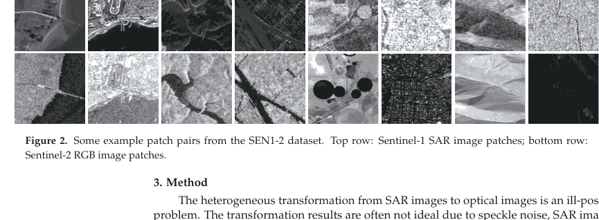

图 2. 来自 SEN1-2 数据集的一些示例块对。上行：Sentinel-1 SAR 图像块；下行：Sentinel-2 RGB 图像块。

## 3. 方法

从 SAR 图像到光学图像的异构转换是一个病态问题。转换结果往往不理想，由于斑点噪声、SAR 图像分辨率等因素。受 pix2pix、CycleGAN 和 pix2pixHD 思想的启发，如图 3a–d 所示，本文尝试将光学灰度图像引入作为中间转换域 Y。如图 3e 所示，从 SAR 图像域 X 到光学彩色图像域 Z 的转换任务由两个生成器（P 和 Q）和两个判别器（D_Y 和 D_Z）分两步完成。首先，生成器 P 完成映射：X → Y，其中 SAR 图像被转换为光学灰度图像，对应的判别器 D_Y 用于促进源域 X 中 SAR 图像向域 Y 中光学灰度图像的转换，使其难以与真实的光学灰度图像区分。然后，生成器 Q 完成映射：Y → Z，其中光学灰度图像被转换为光学彩色图像，对应的判别器 D_Z 用于促进中间域 Y 中光学灰度图像向域 Z 中光学彩色图像的转换，使其难以与光学彩色图像区分。这样，原本从 SAR 图像到光学彩色图像的转换过程被分为两步，减少了直接从 SAR 图像转换到光学彩色图像过程中出现的语义失真和特征损失。

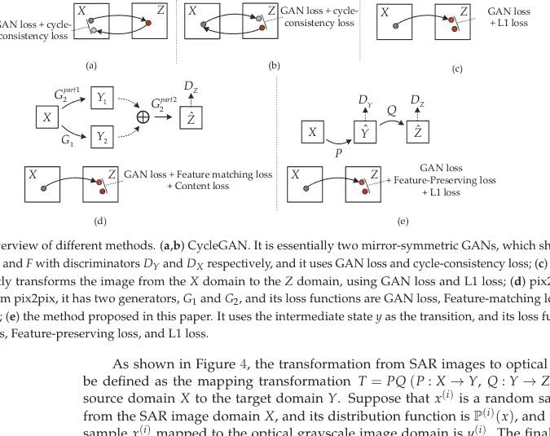

图 3. 不同方法的概述。（a,b）CycleGAN。它本质上是两个镜像对称的 GAN，共享两个生成器 G 和 F，分别与判别器 D_Y 和 D_X 配对，并使用 GAN 损失和循环一致性损失；（c）pix2pix，它直接将图像从 X 域转换到 Z 域，使用 GAN 损失和 L1 损失；（d）pix2pixHD。与 pix2pix 不同，它有两个生成器 G1 和 G2，其损失函数为 GAN 损失、特征匹配损失和内容损失；（e）本文提出的方法。它使用中间状态 y 作为过渡，其损失函数为 GAN 损失、特征保持损失和 L1 损失。

如图 4 所示，从 SAR 图像到光学图像的转换可以定义为映射转换 T = P Q （P : X → Y，Q : Y → Z），从源域 X 到目标域 Y。假设 x^(i) 是从 SAR 图像域 X 中取出的随机样本，其分布函数为 P^(i)(x)，且随机样本 x^(i) 映射到光学灰度图像域为 y^(i)。本文提出的网络的最终任务是 T : X → Z，其中最终分布函数为 P{ T x^(i) = z^(i) | x^(i) } 由我们的网络生成。

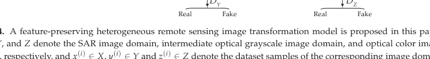

图 4. 本文提出了一种特征保持的异构遥感图像转换模型。设 X、Y 和 Z 分别表示 SAR 图像域、中间光学灰度图像域和光学彩色图像域，x^(i) ∈ X、y^(i) ∈ Y 和 z^(i) ∈ Z 表示相应图像域的数据集样本（i = 1,2,⋯,N，N 表示数据集的总样本数）。

### 3.1. 去斑点 GAN

生成器 P：如图 5a 所示，本文使用改进的 U-net 作为去斑点 GAN 的生成器。输入的 SAR 图像经过编码和解码后输出光学灰度图像。类似于卷积自编码网络的结构使生成网络能够更好地预测 SAR 图像对应的光学灰度图像。生成器的编码和解码过程在多个层级上工作，以确保在多尺度上提取原始 SAR 图像的整体轮廓和局部细节。在解码过程中，网络通过反卷积将上一层级的特征图上采样到下一层级，并通过长跳跃连接添加编码过程中同一层级的特征图以得到平均合并（Merge）。在 U-net 中，该过程通过拼接完成。同时，在每个残差块中也使用了跳跃连接，这有助于克服网络训练过程中的梯度消失问题。

判别器 D_Y：如图 5b 所示，常用在 GAN 中的 PatchGAN 被用作判别器。异构图像转换过程包括内容部分和特征细节部分的转换。内容部分是指生成图像与原始图像之间内容上的相似性，特征细节部分是指生成图像与目标图像之间特征上的相似性。借助 PatchGAN，可以保持特征细节 [11]。

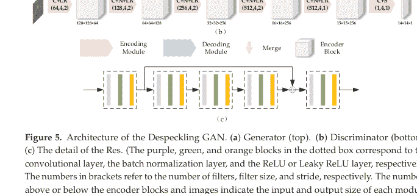

图 5. 去斑点 GAN 的架构。（a）生成器（上）。（b）判别器（下）。（c）Res 的细节。（虚线框中紫色、绿色和橙色块分别对应卷积层、批归一化层以及 ReLU 或 Leaky ReLU 层）。括号中的数字分别指滤波器数量、滤波器尺寸和步幅。编码器块和图像上方或下方的数字表示每个模块的输入和输出尺寸。编码和解码模块中的缩写如下：Res：具有三个卷积层和一个跳跃连接的残差块，P：最大池化，DC：反卷积，C：卷积，N：批归一化，LR：Leaky ReLU，S：Sigmoid，Merge：求和平均。

去斑点 GAN 生成器的损失函数包括 CGAN 损失、L1 损失和特征保持损失。在已有配对训练数据的前提下，本文使用了 CGAN 损失函数来提高生成器的性能。通过监督训练，生成器 P 学习从 X 到 Y 的映射，这使得


判别器 $D_Y$ 判断其真实性。判别器的网络结构具有区分伪造图像与真实图像的功能。因此，从 $X$ 到 $Y$ 的 CGAN 损失为：

$$\mathcal{L}_{\mathrm{GAN}}(P,D_Y)=\mathbb{E}_{x^{(i)},y^{(i)}}\left[\log D_Y\left(x^{(i)},y^{(i)}\right)\right]+\mathbb{E}_{x^{(i)}}\left[\log\left(1-D_Y\left(P\left(x^{(i)}\right),x^{(i)}\right)\right)\right]. \tag{1}$$

在重构损失设计中，采用 $L_1$ 损失来最小化光学灰度图像与生成图像之间的差异。

$$\mathcal{L}_{\mathrm{Recon}}\left(P,x^{(i)}\right)=\mathbb{E}\left[\left\|P\left(x^{(i)}\right)-x^{(i)}\right\|_1\right]. \tag{2}$$

在最佳状态 $T^*$ 下，网络 $T^*\left(x^{(i)}\right)$ 的输出应与光学灰度图像 $y^{(i)}$ 相似。为了保留 SAR 图像的特征细节，本文提出了一种梯度引导的特征保留损失 [28]。如果 $M(\cdot)$ 表示计算图像梯度图的操作，则特征保留损失为：

$$\mathcal{L}_{\mathrm{FP}}\left(P,x^{(i)}\right)=\mathbb{E}\left[M\left(P\left(x^{(i)}\right)\right),M\left(y^{(i)}\right)\right]. \tag{3}$$

对于图像 $I$，$M(\cdot)$ 如下：

$$\begin{aligned} I_x(x,y)&=I(x+1,y)-I(x-1,y),\\ I_y(x,y)&=I(x,y+1)-I(x,y-1),\\ \nabla I(x,y)&=[I_x(x,y),I_y(x,y)],\\ M(I)&=\|\nabla I\|_2. \end{aligned} \tag{4}$$

具体来说，$M(\cdot)$ 操作可以通过与固定卷积核进行卷积轻松实现。

因此，去斑 GAN 的总训练损失为：

$$\mathcal{L}_{\mathrm{GAN}}^1=\underset{G}{\arg\min}\underset{D}{\max}\,\mathcal{L}_{\mathrm{GAN}}(P,D_Y)+\beta_1\mathcal{L}_{\mathrm{Recon}}\left(P,x^{(i)}\right)+\gamma_1\mathcal{L}_{\mathrm{FP}}\left(P,y^{(i)}\right). \tag{5}$$

其中 $\beta_1$ 和 $\gamma_1$ 是权重值。

### 3.2. 彩色化 GAN

彩色化 GAN 完成了从光学灰度图像到光学彩色图像的转换。其原理来源于 [29]，该文献证明，与图 6a 相比，图 6b 的彩色化结果更好，因此本文采用了后者。当输入单通道灰度图像 $\hat{y}^{(i)}\in\mathbb{R}^{H\times W\times1}$ 时，模型学习从输入灰度通道到对应 $Lab$ 空间颜色通道 $\hat{z}_{ab}^{(i)}\in\mathbb{R}^{H\times W\times2}$ 的映射 $\hat{z}_{ab}^{(i)}=Q\left(\hat{y}^{(i)}\right)$，其中 $H$ 和 $W$ 分别表示高度和宽度。然后，通过合成 $\hat{z}_{ab}^{(i)}$ 和 $\hat{y}^{(i)}$ 得到 RGB 图像 $\hat{z}^{(i)}$。这种方法的优势在于可以减轻不适定问题，从而使彩色化结果更接近真实图像。

如图 7 所示，彩色化 GAN 的生成器采用卷积自编码结构，在不同层级内建立短跳跃连接，在编码和解码的相同层级之间建立长连接。这种结构设计使得不同层级的图像信息能够在网络中流动，从而使生成图像的色调信息更加真实和饱满。彩色化 GAN 的判别器为 PatchGAN [11]。近期研究表明，对抗损失有助于使彩色化结果更加生动 [29–31]，本文也遵循了这一思路。在训练过程中，我们将参考光学彩色图像和生成的图像逐一输入判别器；判别器输出为 0（伪造）或 1（真实）。根据先前的方法，判别器的损失为 sigmoid 交叉熵。

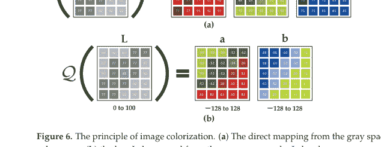

图 6. 图像彩色化原理。(a) 从灰度空间到 RGB 颜色空间的直接映射；(b) 从灰度空间映射到 Lab 颜色空间的色调 Lab。

其中，对抗损失表示如下：

$\mathcal{L}_{GAN}(Q, D_Z) = \mathbb{E}_{y^{(i)}z^{(i)}}[\log D_Z(y^{(i)},z^{(i)})] + \mathbb{E}_{y^{(i)}}[\log(1 - D_Z(y^{(i)},Q(y^{(i)})))]$. (6)

为了使生成的色彩分布更接近参考图像的色彩分布，我们在 Lab 空间中定义了 $\mathcal{L}_1$ 损失，表示如下：

$\mathcal{L}_1(Q) = \mathbb{E}_{y^{(i)}z^{(i)}}[\|Q(y^{(i)}) - z^{(i)}\|_1]$. (7)

因此，彩色化 GAN 模型的总损失函数如下：

$\mathcal{L}_{GAN^2} = \arg\min_{Q}\max_{D}\mathcal{L}_{GAN}(Q(y^{(i)}),z^{(i)}) + \beta_2\mathcal{L}_1(Q,y^{(i)})$. (8)

其中 $\beta_2$ 是权重值。

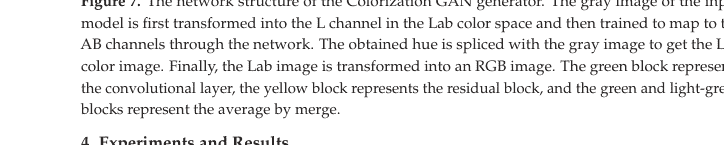

图 7. 彩色化 GAN 生成器的网络结构。输入模型的灰度图像首先在 Lab 颜色空间中转换为 L 通道，然后通过网络训练映射到 AB 通道。获得的色调与灰度图像拼接得到 Lab 彩色图像。最后，将 Lab 图像转换为 RGB 图像。绿色块表示卷积层，黄色块表示残差块，绿色和浅绿色块表示通过合并进行平均。

## 4. 实验与结果

由于 SEN1-2 数据集覆盖全球，包含 282,384 对涵盖四个季节的 SAR 和光学彩色图像，其中部分图像存在重叠，为便于训练，原始数据集按分层抽样方法进行了随机采样。数据集被划分为训练数据集、验证数据集和测试数据集，其比例约为 6:2:2。所提方法的实验在配备两块 11G GPU GeForce RTX 2080Ti 和 i9900k CPU 的计算平台上使用 PyTorch 进行。图像输入尺寸为 256 × 256，批大小设为 10。在实验模拟中，GAN 训练设置了 200 个 epoch，并使用 Adam 优化器进行优化。beta 参数分别设置为 0.9 和 0.999。实验的初始学习率设为 0.0002。前 100 个 epoch 保持学习率不变，之后按照线性递减策略降至 0。

考虑到季节和景观会影响模型的训练结果，我们选取了不同季节和景观的图像对，并遵循均衡原则 [32]。如表 1 所示，四个季节的 SAR 与光学图像对数量大致相同，每个季节中不同景观的图像对数量也大致相同。

### 表 1. 我们的数据集中所选不同类型图像的数量。

| 季节 | 景观 | 训练 | 验证 | 测试 | 总计 |
|---|---|---|---|---|---|
| 春季 | 河谷 | 279 | 90 | 74 | 443 |
| 春季 | 山地丘陵 | 280 | 91 | 73 | 444 |
| 春季 | 城市居民区 | 275 | 97 | 70 | 442 |
| 春季 | 沿海城市 | 278 | 87 | 77 | 442 |
| 春季 | 沙漠 | 277 | 96 | 74 | 447 |
| 春季 |  |  |  |  | 2218 |
| 夏季 | 河谷 | 278 | 92 | 77 | 447 |
| 夏季 | 山地丘陵 | 276 | 96 | 74 | 446 |
| 夏季 | 城市居民区 | 279 | 93 | 70 | 442 |
| 夏季 | 沿海城市 | 276 | 93 | 72 | 441 |
| 夏季 | 沙漠 | 275 | 95 | 73 | 443 |
| 夏季 |  |  |  |  | 2219 |
| 秋季 | 河谷 | 278 | 96 | 70 | 443 |
| 秋季 | 山地丘陵 | 275 | 89 | 74 | 441 |
| 秋季 | 城市居民区 | 278 | 95 | 72 | 445 |
| 秋季 | 沿海城市 | 279 | 91 | 75 | 445 |
| 秋季 | 沙漠 | 277 | 89 | 77 | 442 |
| 秋季 |  |  |  |  | 2215 |
| 冬季 | 河谷 | 277 | 91 | 78 | 446 |
| 冬季 | 山地丘陵 | 275 | 94 | 73 | 442 |
| 冬季 | 城市居民区 | 278 | 95 | 71 | 444 |
| 冬季 | 沿海城市 | 278 | 92 | 75 | 445 |
| 冬季 | 沙漠 | 277 | 93 | 71 | 441 |
| 冬季 |  |  |  |  | 2218 |
| 总计 | - | 5545 | 1855 | 1470 | 8870 |

### 4.1. 实验 1

为了验证所提方法的有效性，使用相同数据集和不同条件设计了四组实验。四组实验按照单一变量原则进行。在第 1 组中，使用未改进的生成器 P 和 Q，损失函数包括 GAN 损失和重构损失。在第 2 组中，使用改进的生成器 P 和 Q，损失函数包括 GAN 损失和重构损失。在第 3 组中，使用未改进的生成器 P 和 Q，损失函数包括 GAN 损失、重构损失和特征保留损失。在第 4 组中，使用改进的生成器 P 和 Q，损失函数包括 GAN 损失、重构损失和特征保留损失。四组实验之间的关系如表 2 所示。


## 表 2. 不同条件下分组实验。

|  | 原始损失 | 改进损失 | 原始网络 | 改进网络 |
|---|---|---|---|---|
| 组 1 | √ |  | √ |  |
| 组 2 | √ |  |  | √ |
| 组 3 |  | √ | √ |  |
| 组 4 |  | √ |  | √ |

如图 8 所示，第一列显示由 SEN-1 卫星采集的 SAR 图像。第二列显示由 SEN-2 卫星采集的 SAR 图像。第三、四、五、六列分别显示组 1、组 2、组 3 和组 4 的实验结果。通过视觉对比分析可以看出，改进网络结构和损失函数可以提高 SAR 到光学转换的质量，特别是在增强生成图像的特征细节信息方面。它可以最大程度地将 SAR 图像映射到光学彩色图像，有助于 SAR 图像的解译。

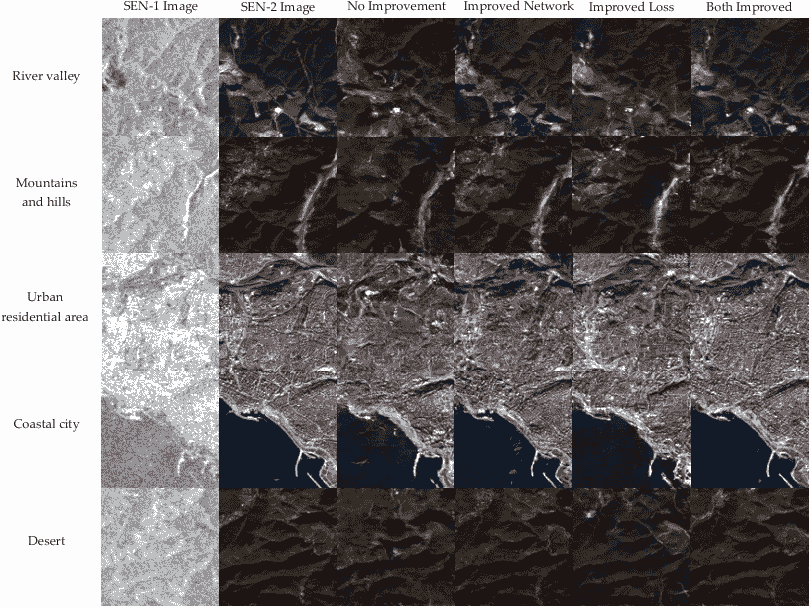

**图 8.** 不同条件下产生的结果。从上到下，图像为五种地貌的遥感图像：河谷、山丘、城市居民区、海岸和沙漠。从左到右：SEN-1 图像、SEN-2 图像、组 1 生成的图像、组 2 生成的图像、组 3 生成的图像、组 4 生成的图像。

为了比较生成图像的详细信息，图 9 显示了 SEN-2 图像与四组实验结果之间的详细对比。根据主观评价标准，同时改进模型和损失函数的结果更接近 SEN-2 图像。仅改进损失函数可以改善生成图像的细节，但其效果不如改进模型。四组实验结果的详细对比再次证明了本文提出的改进措施是有效的。通过比较改进模型和改进损失函数两种情况，可以发现改进模型对结果的贡献更大。

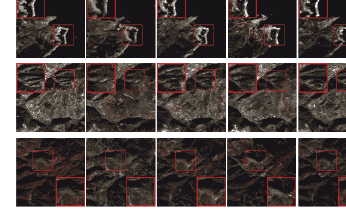

图 9. 实验 1 的详细对比。我们选择了三个场景的生成结果与 SEN-2 参考图像进行详细对比。本文提出的改进措施对提高生成图像质量有明显效果。从左到右：SEN-2 图像、组 1 生成的图像、组 2 生成的图像、组 3 生成的图像和组 4 生成的图像。

为了量化该方法的效果，通过计算结构相似度（SSIM）[33,34]和特征相似度（FSIM）[35]来衡量最终的转换效果（IQA）。两个指标均在生成图像 ẑ 与对应的 SEN-2 图像 z 之间计算。假设生成图像为 ẑ，对应的 SEN-2 图像为 z，SSIM 计算公式如下：

$$SSIM(\hat{z},z)=[l(\hat{z},z)]^{\alpha}[c(\hat{z},z)]^{\beta}[s(\hat{z},z)]^{\gamma},\ \alpha,\beta,\gamma>0\tag{9}$$

其中：

$$l(\hat{z},z)=\frac{2\mu_{\hat{z}}\mu_{z}+c_{1}}{\mu_{\hat{z}}^{2}+\mu_{z}^{2}+c_{1}}\tag{10}$$

$$c(\hat{z},z)=\frac{2\sigma_{\hat{z}z}+c_{2}}{\sigma_{\hat{z}}^{2}+\sigma_{z}^{2}+c_{2}}\tag{11}$$

$$s(\hat{z},z)=\frac{\sigma_{\hat{z}z}+c_{3}}{\sigma_{\hat{z}}\sigma_{z}+c_{3}}\tag{12}$$

方程中的 $l(\hat{z},z)$、$c(\hat{z},z)$ 和 $s(\hat{z},z)$ 分别表示亮度比较、对比度比较和结构比较。$\mu_{\hat{z}}$ 和 $\mu_{z}$ 表示 $\hat{z}$ 和 $z$ 的均值，$\sigma_{\hat{z}}$ 和 $\sigma_{z}$ 表示 $\hat{z}$ 和 $z$ 的标准差，$\sigma_{\hat{z}z}$ 表示 \hat{z} 和 z 的协方差，c₁、c₂ 和 c₃ 为常数（使方程分母不为零）。实际上，α = β = γ = 1，c₃ = c₂/2，SSIM 表示为：

$$SSIM(\hat{z},z)=\frac{(2\mu_z\mu_{\hat{z}}+c_1)(2\sigma_{z\hat{z}}+c_2)}{(\mu_z^2+\mu_{\hat{z}}^2+c_1)(\sigma_z^2+\sigma_{\hat{z}}^2+c_2)}$$ (13)

另一个指标 FSIM 是特征相似度评价指标，使用相位一致性（PC）和梯度特征（梯度幅值（GM）），如下所示：

$$FSIM = \frac{\sum_{x\in\Omega} S_L(x)\cdot PC_m(x)}{\sum_{x\in\Omega} PC_m(x)}$$ (14)

其中：

$$S_{PC}(x)=\frac{2PC_1(x)\cdot PC_2(x)+T_1}{PC_1^2(x)+PC_2^2(x)+T_1}$$ (15)

$$S_G(x)=\frac{2G_1(x)\cdot G_2(x)+T_2}{G_1^2(x)+G_2^2(x)+T_2}$$ (16)

$$S_L(x)=[S_{PC}(x)]^{\alpha}\cdot[S_G(x)]^{\beta}$$ (17)

S_PC(x)、S_G(x) 和 S_L(x) 分别表示相位一致（PC）相似度、梯度特征（GM）相似度和 PC-GM 融合相似度。

四种实验方案的相似性指标计算如表 3 所示。

通过比较表格中第二、三和第一行的结果，可以看出改进生成器结构和损失函数后，生成图像的 SSIM 和 FSIM 均显著提高，改进生成器和损失函数的联合使用比单独改进生成器结构或损失函数获得更好的结果。

表 3. 不同改进措施下模型生成结果指标。粗体数字表示对应指标下的最优值。

| 方案 | SSIM | FSIM |
|---|---|---|
| 未改进 | 0.2428 | 0.9000 |
| 改进网络 | 0.2432 | 0.9023 |
| 改进损失 | 0.2435 | 0.9015 |
| 两者均改进 | **0.2442** | **0.9042** |

### 4.2. 实验 2

为了验证所提方法在保留 SAR 图像特征方面的性能，所提算法分别与 pix2pix、CycleGAN 和 pix2pixHD 进行比较。在训练期间，Serial GANs 首先训练生成器 P 和判别器 D_Y，然后分别训练生成器 Q 和判别器 D_Z，共 200 个 epoch。在图 10 中，第一列显示由 SEN-1 卫星采集的 SAR 图像，第二列显示由 SEN-2 卫星采集的光学彩色图像，第三、四、五列分别显示 pix2pix、CycleGAN 和 pix2pixHD 的实验结果。根据结果，所提方法可以在异构转换过程中显著保留 SAR 图像的细节，结果与 pix2pixHD 相当。更重要的是，本文所提模型的模型参数量明显低于 pix2pixHD 模型。

为了比较不同模型生成的图像细节，图 11 显示了所提方法与 pix2pix、CycleGAN 和 pix2pixHD 四种方法的生成结果细节。根据主观评价标准，所提方法和 pix2pixHD 的结果更接近 Sentinel 卫星图像。pix2pix 和 CycleGAN 的生成结果逊于前两种方法。虽然所提方法和 pix2pixHD 的结果没有显著差异，但后续比较将表明所提方法优于 pix2pixHD。

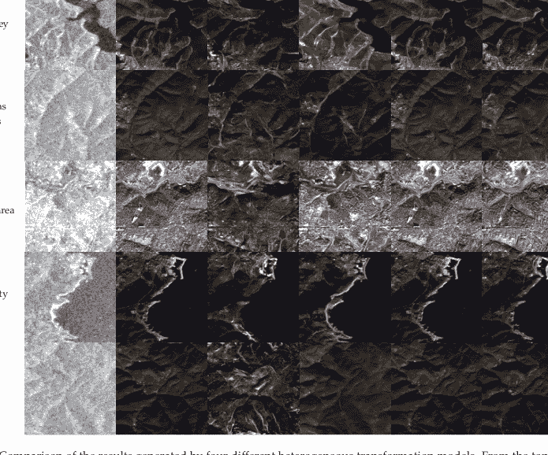

图 10. 四种不同异构转换模型生成结果的比较。从上到下：河谷、山丘、城市居民区、沿海城市和沙漠的遥感图像。从左到右：SEN-1 图像、SEN-2 图像、pix2pix 生成的图像、CycleGAN 生成的图像、pix2pixHD 生成的图像以及我们模型生成的图像。

为了定量衡量该方法的优势，选择了包括 PSNR、SSIM、FSIM 和 MSE 在内的四个图像质量评价指标（IQA）对该方法进行定量评估。如表 4 所示，从数据可以看出，所提模型在 PSNR、SSIM 和 MSE 上取得最佳，在 FSIM 上取得第二最佳。

表 4. 四种方法生成的图像与 SEN-2 图像之间的指标比较。粗体数字表示对应指标下的最优值。

|  | PSNR | SSIM | MSE | FSIM |
|---|---|---|---|---|
| pix2pix [11] | 13.8041 | 0.2431 | 0.0673 | 0.8987 |
| Cycle GAN [21] | 13.5052 | 0.2314 | 0.0749 | 0.9039 |
| pix2pix HD [13] | 13.4112 | 0.2347 | 0.0780 | **0.9046** |
| 我们的方法 | **13.9267** | **0.2442** | **0.0669** | 0.9042 |

上述实验结果从定性和定量两个方面展示了所提方法的有效性以及相对于 pix2pix 和 CycleGAN 的优越性。为了进一步说明我们的方法优于 pix2pixHD，我们绘制了反映模型大小和 FSIM 值的性能比较图。如图 12 所示，

虽然我们方法的 FSIM 值比 pix2pixHD 低 0.0004，但我们方法的模型大小约为 pix2pixHD 的一半，因此我们方法的优势更为明显。

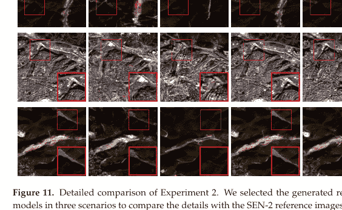

图 11. 实验 2 的详细比较。我们选取了不同模型在三个场景下的生成结果，与 SEN-2 参考图像进行细节比较。与其他图像转换模型相比，所提出的模型在提升生成性能方面具有明显的优势。从左到右依次为：SEN-2 图像、pix2pix 生成的图像、CycleGAN 生成的图像、pix2pixHD 生成的图像以及我们模型生成的图像。

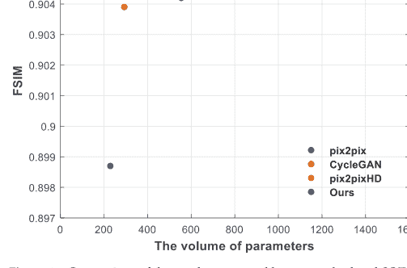

图 12. 我们方法与 SOTA 方法生成结果的比较。图中纵坐标表示归一化的 FSIM 值，横坐标表示模型的參数大小（Mbyte）。四种方法的比较以散点图表示。散点越接近 y 轴 +∞，模型的整体性价比越好。

此外，它们可以为 SAR 图像和光电图像转换提供一个通用框架。未来，我们将考虑将多源异构图像纳入 Multiple GANs 混合模型，以支持多源异构遥感图像的跨模态解译。

作者贡献：概念化，Y.L.；数据整理，D.T. 和 G.L.；形式分析，D.T.；资金获取，Y.L. 和 Y.H.；研究，Y.L. 和 G.L.；方法，D.T.、G.L. 和 S.S.；项目管理，L.Y. 和 Y.H.；资源，L.Y.；软件，L.Y. 和 S.S.；验证，S.S.；可视化，S.S.；写作—初稿，D.T.；写作—审阅与编辑，Y.H. 所有作者均已阅读并同意本文的已出版版本。

资助：本研究得到中国国家自然科学基金资助，项目编号 91538201、62022092 和 62171453。

机构审查委员会声明：不适用。

知情同意声明：不适用。

数据可用性声明：本研究使用了 SEN1-2 数据集（访问日期 2021 年 7 月 19 日），可从 https://mediatum.ub.tum.de/143631 获取。它是由 Sentinel-1 和 Sentinel-2 遥感卫星分别获取的 282,384 对对应的合成孔径雷达和光学图像块组成的数据集。其在开放获取许可 CC-BY 下共享。

致谢：作者衷心感谢学术编辑和审稿人提出的宝贵意见和建设性建议。

利益冲突：作者声明本文的发表不存在利益冲突。

## 参考文献

- 1. Scarpa, G.; Gargiulo, M.; Mazza, A.; Gaetano, R. 基于 CNN 的融合方法用于从哨兵数据中提取特征. Remote Sens. 2018, 10, 236. [CrossRef]
- 2. Auer, S.; Hinz, S.; Bamler, R. 用于理解高分辨率 SAR 图像的射线追踪模拟技术. IEEE Trans. Geosci. Remote Sens. 2010, 48, 1445–1456. [CrossRef]
- 3. Argenti, F.; Lapini, A.; Bianchi, T.; Alparone, L. 合成孔径雷达图像中斑点降低的教程. IEEE Geosci. Remote Sens. Mag. 2013, 1, 6–35. [CrossRef]
- 4. Reyes, M.F.; Auer, S.; Merkle, N.; Henry, C.; Schmitt, M. 基于条件生成对抗网络的 SAR 到光学图像转换——优化、机遇与局限. Remote Sens. 2019, 11, 2067. [CrossRef]
- 5. Wang, P.; Zhang, H.; Patel, V.M. 使用卷积神经网络的 SAR 图像去斑点. IEEE Signal Process. Lett. 2017, 24, 1763–1767. [CrossRef]
- 6. Lattari, F.; Leon, B.G.; Asaro, F.; Rucci, A.; Prati, C.; Matteucci, M. SAR 图像去斑点的深度学习. Remote Sens. 2019, 11, 1532. [CrossRef]
- 7. Dalsasso, E.; Yang, X.; Denis, L.; Tupin, F.; Yang, W. 通过深度神经网络进行 SAR 图像去斑点：从预训练模型到端到端训练策略. Remote Sens. 2020, 12, 2636. [CrossRef]
- 8. Zhang, K.; Zuo, W.; Chen, Y.; Meng, D.; Zhang, L. 超越高斯去噪器：用于图像去噪的深度 CNN 残差学习. IEEE Trans. Image Process. 2017, 26, 3142–3155. [CrossRef]
- 9. Chierchia, G.; Cozzolino, D.; Poggi, G.; Verdoliva, L. 通过卷积神经网络进行 SAR 图像去斑点. In Proceedings of the 2017 IEEE International Geoscience and Remote Sensing Symposium (IGARSS), Fort Worth, TX, USA, 23–28 July 2017; pp. 5438–5441.
- 10. Qiang, Z.; Yuan, Q.; Jie, L.; Zhen, Y.; Zhang, L. 学习扩张残差网络用于 SAR 图像去斑点. Remote Sens. 2018, 10, 196.
- 11. Isola, P.; Zhu, J.Y.; Zhou, T.; Efros, A.A. 使用条件对抗网络的图像到图像转换. In Proceedings of the 2017 IEEE Conference on Computer Vision and Pattern Recognition (CVPR), Honolulu, HI, USA, 21–26 July 2017; pp. 5967–5976. [CrossRef]
- 12. Zhu, J.-Y.; Park, T.; Isola, P.; Efros, A.A. 使用循环一致对抗网络的无配对图像到图像转换. In Proceedings of the 2017 IEEE International Conference on Computer Vision (ICCV), Venice, Italy, 22–29 October 2017; Volume 2242–2251.
- 13. Wang, T.-C.; Liu, M.-Y.; Zhu, J.-Y.; Tao, A.; Kautz, J.; Catanzaro, B. 使用条件 GAN 的高分辨率图像合成与语义操作. In Proceedings of the IEEE Conference on Computer Vision and Pattern Recognition, Salt Lake City, UT, USA, 18–23 June 2018; pp. 8798–8807.
- 14. Choi, Y.; Choi, M.; Kim, M.; Ha, J.W.; Kim, S.; Choo, J. StarGAN：用于多域图像到图像转换的统一生成对抗网络. In Proceedings of the IEEE Computer Society Conference on Computer Vision and Pattern Recognition, Salt Lake City, UT, USA, 18–23 June 2018.
- 15. Li, J.; Monroe, W.; Shi, T.; Jean, S.; Ritter, A.; Jurafsky, D. 用于神经对话生成的对抗学习. In Proceedings of the EMNLP 2017—Conference on Empirical Methods in Natural Language Processing, Copenhagen, Denmark, 7–11 September 2017.
- 16. Reed, S.; Akata, Z.; Yan, X.; Logeswaran, L.; Schiele, B.; Lee, H. 生成对抗文本到图像合成. In Proceedings of the 33rd International Conference on Machine Learning (ICML-2016), New York, NY, USA, 19–24 June 2016; pp. 1681–1690.
- 17. Denton, E.; Szlam, A.; Fergus, R. 使用对抗网络拉普拉斯金字塔的深度生成图像模型. arXiv 2015, arXiv:1506.05751.
- 18. Mathieu, M.; Couprie, C.; LeCun, Y. 超越均方误差的深度多尺度视频预测. In Proceedings of the 4th International Conference on Learning Representations, ICLR 2016, San Juan, Puerto Rico, 2–4 May 2016; pp. 1–14.
- 19. Ledig, C.; Theis, L.; Huszár, F.; Caballero, J.; Cunningham, A.; Acosta, A.; Aitken, A.; Tejani, A.; Totz, J.; Wang, Z., et al. 使用生成对抗网络的光真实单图像超分辨率. In Proceedings of the 30th IEEE Conference on Computer Vision and Pattern Recognition (CVPR), Honolulu, HI, USA, 21–26 July 2016; p. 2017.
- 20. Zhu, J.-Y.; Krähenbühl, P.; Shechtman, E.; Efros, A.A. 自然图像流形上的生成视觉操作. In Proceedings of the European Conference on Computer Vision (ECCV), Amsterdam, The Netherlands, 11–14 October 2016.
- 21. Brock, A.; Lim, T.; Ritchie, J.M.; Weston, N. 使用内省对抗网络的神经照片编辑. In Proceedings of the 5th International Conference on Learning Representations, Toulon, France, 24–26 April 2017.
- 22. Fu, S.; Xu, F.; Jin, Y.Q. 将 SAR 转换为光学图像以辅助解释. arXiv 2019, arXiv:1901.03749.
- 23. Wang, L.; Xu, X.; Yu, Y.; Yang, R.; Gui, R.; Xu, Z.; Pu, F. 使用监督循环一致对抗网络的 SAR 到光学图像转换. IEEE Access 2019, 7, 129136–129149. [CrossRef]
- 24. Zhang, J.; Zhou, J.; Lu, X. 基于特征引导的 SAR 到光学图像转换. IEEE Access 2020, 8, 70925–70937. [CrossRef]
- 25. Ma, C.; Rao, Y.; Cheng, Y.; Chen, C.; Lu, J.; Zhou, J. 具有梯度引导的结构保持超分辨率. In Proceedings of the 2020 IEEE/CVF Conference on Computer Vision and Pattern Recognition (CVPR), Seattle, WA, USA, 16–18 June 2020; pp. 7766–7775. [CrossRef]
- 26. Schmitt, M.; Hughes, L.H.; Zhu, X.X. 用于 SAR-光学数据融合深度学习的 SEN1-2 数据集. ISPRS Ann. Photogramm. Remote Sens. Spat. Inf. Sci. 2018, 4, 141–146. [CrossRef]
- 27. Torres, R.; Snoeij, P.; Geudtner, D.; Bibby, D.; Davidson, M.; Attema, E.; Potin, P.; Rommen, B.; Floury, N.; Brown, M.; et al. GMES Sentinel-1 任务. Remote Sens. Environ. 2012, 120, 9–24. [CrossRef]
- 28. Zhang, T.; Zhang, X. 将传统手工特征注入现代基于 CNN 的模型用于 SAR 船舶分类：是什么、为什么、在哪里以及如何. Remote Sens. 2021, 13, 2091. [CrossRef]
- 29. Schubert, A.; Small, D.; Miranda, N.; Geudtner, D.; Meier, E. Sentinel-1A 产品地理定位精度：在轨测试阶段结果. Remote Sens. 2015, 7, 9431–9449. [CrossRef]
- 30. Drusch, M.; Del Bello, U.; Carlier, S.; Colin, O.; Fernandez, V.; Gascon, F.; Hoersch, B.; Isola, C.; Laberinti, P.; Martimort, P.; et al. Sentinel-2：ESA 为 GMES 运行服务提供的光学高分辨率任务. Remote Sens. Environ. 2012, 120, 25–36. [CrossRef]
- 31. Zhang, R.; Isola, P.; Efros, A.A. 彩色图像着色. In Proceedings of the European Conference on Computer Vision (ECCV), Amsterdam, The Netherlands, 11–14 October 2016; pp. 649–666.
- 32. Zhang, T.; Zhang, X.; Shi, J.; Wei, S.; Wang, J.; Li, J.; Su, H.; Zhou, Y. SAR 图像中近海和近岸船舶检测的平衡场景学习机制. IEEE Geosci. Remote Sens. Lett. 2020. [CrossRef]
- 33. Sangkloy, P.; Lu, J.; Fang, C.; Yu, F.; Hays, J. Scribbler：用草图和颜色控制深度图像合成. In Proceedings of the IEEE Conference on Computer Vision and Pattern Recognition (CVPR), Honolulu, HI, USA, 21–26 July 2017.
- 34. Wang, Z.; Bovik, A.C.; Sheikh, H.R.; Simoncelli, E.P. 图像质量评估：从误差可见性到结构相似性. IEEE Trans. Image Process. 2004, 13, 600–612. [CrossRef]
- 35. Zhang, L.; Zhang, L.; Mou, X.; Zhang, D. FSIM：用于图像质量评估的特征相似性指数. IEEE Trans. Image Process. 2011, 20, 2378–2386. [CrossRef] [PubMed]


## 文章

## 用于合成孔径雷达图像的增强 U-Net 自监督去斑算法

Gang Zhang 1,*, Zhi Li 1, Xuewei Li 2 and Sitong Liu 1

1 航天科学与技术系，航天工程大学，八一大道，怀柔区，北京 101416，中国；lizhipublic@163.com (Z.L.)；liusitong1114@163.com (S.L.)
2 中国科学院软件研究所，南四街4号，中关村，海淀区，北京 100190，中国；liuxuewei@iscas.ac.cn
* 通讯作者：gangzhang1989@126.com；Tel.: +86-186-0056-6200

摘要：自监督方法已被证明是合成孔径雷达（SAR）图像去斑的合适方法。然而，大多数自监督去斑方法都是通过噪声-噪声图像对进行训练的，这些图像对是通过使用带有模拟斑点噪声的自然图像、时序真实 SAR 图像或生成对抗网络构建的，限制了这些方法在真实 SAR 图像中的实用性。因此，本文提出了一种用于真实 SAR 图像的具有增强 U-Net 的新型自监督去斑算法。首先，与之前的自监督去斑工作不同，噪声-噪声图像对是通过一种新颖的生成训练对模块从真实 SAR 图像中生成的，这使得可以使用真实 SAR 图像训练深度卷积神经网络成为可能。其次，设计了一种增强型 U-Net 以提高网络的特征提取和融合能力。第三，提出了一种带正则化损失的自监督训练损失函数，以解决原始 SAR 图像上目标像素值与其邻居之间的差异。最后，对模拟和真实 SAR 图像进行的视觉和定量实验表明，所提出的算法显著去除了斑点噪声并更好地保留了特征，其性能超过了几种最先进的去斑方法。

关键词：自监督；合成孔径雷达（SAR）；去斑；增强 U-Net

引用：Zhang, G.; Li, Z.; Li, X.; Liu, S. 用于合成孔径雷达图像的增强 U-Net 自监督去斑算法. Remote Sens. 2021, 13, 4383. https://doi.org/10.3390/rs13214383

学术编辑：Tianwen Zhang, Tianjiao Zeng and Xiaoling Zhang

收到：17 September 2021
接受：28 October 2021
发表：31 October 2021

出版者注：MDPI 对于出版地图和机构隶属关系中的管辖权主张保持中立。

版权：© 2021 by the authors. Licensee MDPI, Basel, Switzerland. This article is an open access article distributed under the terms and conditions of the Creative Commons Attribution (CC BY) license (https://creativecommons.org/licenses/by/4.0/)。

## 1. 引言

合成孔径雷达（SAR）[1] 是一种主动遥感成像传感器，以斜距方式向目标发射电磁信号。与光学成像传感器相比，SAR 具有全天候、全天时的成像能力。因此，SAR 已成为用于灾害评估 [2]、资源勘探 [3]、海洋监视 [4,5] 和统计分析 [6] 的遥感器之一。然而，由于成像机制，SAR 图像的质量本质上会受到斑点噪声 [7,8] 的影响。斑点噪声是一种颗粒状干扰，通常被建模为乘性噪声，影响 SAR 图像以及其他相干图像 [8]。斑点噪声可能会严重降低检测精度 [9–12] 和信息提取 [13] 的性能。因此，斑点噪声的降低是许多应用中的关键且必要的处理步骤。

在过去几十年中，许多研究人员尝试减少 SAR 图像中的斑点噪声。通常，现有的去斑方法大致可概括为局部窗口方法、非局部均值（NLM）方法和深度学习（DL）方法。在第一组中，局部窗口方法被广泛使用，例如 Lee [14]、Frost [15] 和 Kuan [16]。局部窗口方法的去斑性能非常依赖于窗口大小。窗口越大，去斑图像越平滑，去斑性能越好。然而，去斑图像会丢失点目标、线性特征和纹理。

为克服局部窗口方法的缺点，NLM 方法被应用于处理 SAR 图像，例如 PPB [17]、SAR-BM3D [18] 和 NL-SAR [19]。NLM 方法通过测量以参考像素为中心的局部块与以选定的非局部邻域像素为中心的另一局部块之间的相似性来定义相似像素和像素权重。相似度越大，权重越大。然而，NLM 方法需要使用等效视数（ENL）作为先验。在实际应用中，不可能获得 SAR 图像的准确 ENL。此外，局部窗口方法和 NLM 方法的时间复杂度非常高。

近年来，得益于深度学习 [20,21] 的新突破，越来越多的研究人员开始探索 DL 方法 [22–33]。DL 去斑方法的本质是从噪声 SAR 图像学习到无噪声 SAR 图像的映射关系。可以描述如下。首先，DL 去斑方法的输入是一幅噪声 SAR 图像。然后，噪声 SAR 图像通过卷积层、池化层、批归一化层和激活函数层进行编码和解码。最后，得到一幅无噪声 SAR 图像。根据是否存在干净图像作为目标，DL 去斑方法可分为三大类：监督方法、半监督方法和自监督方法。

监督去斑方法 [22–24,26] 使用噪声-干净图像对训练卷积神经网络（CNNs），并且去斑模型应用于减少真实 SAR 图像中的斑点噪声。由于不存在无噪声 SAR 图像，监督方法的训练图像对是通过将常规 RGB 照片（自然图像）与模拟斑点噪声结合生成的。自然图像包含相机图像 [23] 和航空图像 [24]。生成方法的优点是可以轻松获得大量噪声-干净图像对。可以训练具有大量参数的更深 CNN。但生成方法的缺点是忽略了 SAR 图像的特殊特性。例如，SAR 图像的噪声分布与自然图像不同，以及内容、纹理或像素值的物理意义 [27]。与真实 SAR 图像相比，生成的模拟 SAR 图像在内容和几何方面存在很大差异。真实 SAR 图像中存在强散射点，而模拟 SAR 图像中没有。因此，用模拟图像训练的去斑 CNN 会改变点目标、线性特征和纹理。得益于 noise2noise [34] 方法，提出了半监督方法和自监督方法 [28–31]。

noise2noise 方法是直接使用噪声-噪声图像对训练深度 CNN。半监督去斑模型 [27] 使用少量噪声-干净图像对训练 CNN。然后，得到的去斑模型在时序真实 SAR 图像上进行微调。微调是指使用时序真实 SAR 图像对第一步得到的去斑模型再次进行训练。与监督去斑方法相比，半监督去斑方法可以更好地减少真实 SAR 图像中的斑点噪声。然而，时序 SAR 图像在不同时间会有差异，这将限制去斑性能。自监督去斑方法直接使用大量的噪声-噪声图像对训练 CNN。噪声-噪声图像对是通过使用带有模拟斑点噪声的自然图像 [28]、时序 SAR 图像 [31] 或生成对抗网络（GAN） [35] 生成的，这仍然限制了这些方法在真实 SAR 图像中的实用性。

通过以上分析，可以做出简单总结。首先，DL 去斑方法引起了极大兴趣。然而，大多数 DL 方法都集中在新网络 [22–26,32,33,36] 上，而忽略了最本质的问题。我们认为，真正无噪声 SAR 图像的缺乏是最本质的问题。模拟 SAR 图像无法真正解决这一不足。其次，可以发现去斑 CNN 变得越来越深。同时，可训练参数的数量也在增加。模拟 SAR 图像可以通过干净自然图像与模拟斑点噪声的逐像素乘积轻松生成 [30]。当处理

真实世界的 SAR 图像，所得到的去斑模型会带来新的挑战。利用模拟图像对训练的去斑 CNN 会改变真实世界 SAR 图像中的点目标、线性特征和纹理。第三，虽然 noise2noise 方法可以直接使用噪声图像作为目标，但去斑性能仍受自然图像 [29] 和 GAN [30] 性能的影响。在之前的工作 [27–31] 中，它们无法真正使用真实世界的 SAR 数据来训练去斑 CNN。因此，在本文中，受 noise2noise [34] 的启发，提出了一种基于增强 U-Net 的新型自监督去斑算法。该算法称为 SSEUNet。与之前的去斑 CNN [27–31] 相比，SSEUNet 可以直接使用真实世界的 SAR 图像来训练深度 CNN。SSEUNet 由生成训练对（GTP）模块、增强 U-Net（EUNet）以及带正则化损失的自监督训练损失函数组成。所提算法的主要贡献和创新如下：

- 由于 [28,30,31] 生成的 noisy-noisy 图像对在真实世界 SAR 图像的去斑任务中无法很好地使用，我们提出了 GTP 模块。GTP 模块可以从噪声图像生成训练图像对。它使得使用真实世界 SAR 图像训练深度 CNN 成为可能。
- 由于 U-Net [37] 的特征提取和融合能力较差，我们通过增强 U-Net 设计了一种新型深度 CNN。该新型深度 CNN 称为增强 U-Net（EUNet）。
- 为了处理原始噪声图像上目标像素值与邻域之间的差异，提出了带正则化损失的自监督训练损失函数。
- 在模拟和真实世界 SAR 图像上进行的视觉和定量实验表明，所提出的算法显著降低了斑点噪声，同时更好地保留了特征，优于几种最先进的去斑方法。

本文其余部分安排如下。第 2 节分析了相关工作，其中包括噪声-干净去斑方法和噪声-噪声去斑方法。第 3 节详细描述了所提出的方法。第 4 节说明了视觉效果和参数评估指标的结果。最后，第 5 节得出结论。

## 2. 相关工作

### 2.1. 噪声-干净去斑方法

近年来，得益于深度学习，噪声-干净去斑方法得到了深入研究。受去噪 CNN [38] 的启发，Chierchia 等 [22] 提出了第一个去斑 CNN，由 17 个卷积层组成。SAR-CNN 的训练图像对由时序真实世界 SAR 图像生成。目标为 25-视 SAR 图像。Zhang 等 [24] 直接使用扩张卷积层和跳跃连接来降低 SAR 图像中的斑点噪声。扩张卷积层允许 CNN 具有轻量级结构和小滤波器尺寸，但 CNN 的感受野不会减小。此外，跳跃连接减少了梯度消失问题。与 SAR-DRN 相似，Gui 等 [25] 提出了一种扩张密集连接 CNN。在考虑了斑点噪声的亮度分布后，Shen 等 [26] 提出了一种递归深度卷积神经先验模型。该模型包括数据拟合块和深度 CNN 先验块。梯度下降算法用于数据拟合块，而预训练的扩张残差通道注意力网络应用于深度 CNN 先验块。Pan 等 [32] 将多通道对数高斯去噪（MuLoG）算法与快速灵活的去噪 CNN 相结合来处理 SAR 图像的乘性噪声。Li 等 [33] 设计了一种带卷积块注意力模块的 CNN 以提高表示能力和去斑性能。为了帮助网络保留图像细节，Zhang 等 [39] 提出了一种带小波特征的多连接 CNN。由于 NLM 方法是最有前景的算法之一，Cozzolino 等 [23] 将 NLM 方法与深度 CNN 相结合设计了非局部均值 CNN（NLM-CNN）。NLM-CNN 使用深度 CNN 来提供。

### 3.1. 提出的 SSEUNet 概述

所提出的 SSEUNet 由生成训练对（GTP）模块、增强 U-Net（EUNet）以及带正则化损失的自监督训练损失函数组成。图 1 显示了所提出的 SSEUNet 框架的概述，其中 $y$ 是所提出的 SSEUNet 的输入图像。$z_1$ 和 $z_2$ 是由所提出的 GTP 模块生成的 noisy-noisy 图像对。$F_\phi$ 是 EUNet，$\phi$ 表示 EUNet 的参数。$z'_1$ 和 $z'_2$ 是由 GTP 模块生成的去斑图像对。$\mathcal{L}$ 是所提出的损失函数。所提出的 SSEUNet 分为训练阶段（图 1a）和推理阶段（图 1b）。在训练阶段，一对 noisy-noisy 图像（$\{z_1,z_2\}$）从噪声图像 $y$ 生成。生成的掩码记录为 $G_1$ 和 $G_2$。生成的掩码来自 GTP 模块。EUNet 分别以 $z_1$ 和 $z_2$ 作为输入和目标。输入图像 $y$ 输入到 EUNet 中，并在每个训练 epoch 获得去斑图像 $y'$，其中 $y'=F_\phi(y)$。$y'$ 的去斑-去斑图像对（$\{z'_1,z'_2\}$）由 GTP 模块获得。损失函数由 $F_\phi(z_1)$、$z_2$、$z'_1$ 和 $z'_2$ 计算。在推理阶段，去斑 SAR 图像通过直接使用训练好的 EUNet 获得。

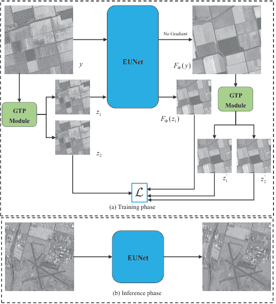

**图 1.** 所提出的 SSEUNet 框架概述。(a) 训练阶段的完整视图。(b) 使用训练好的 EUNet 的推理阶段。

### 3.2. 提出的 GTP 模块

得益于 noise2noise 去斑方法，我们对 noisy-noisy 图像对的构建进行了进一步研究。根据 Goodman 的理论，SAR 图像中的完全发育斑点噪声是完全随机且独立分布的噪声。因此，我们尝试从真实世界 SAR 图像 $y \in \{y_i\}_{i=1}^N$ 生成 noisy-noisy 图像对，其中 $N$ 是真实世界 SAR 图像的总数量。$y$ 的高度和宽度分别为 $H$ 和 $W$。noisy-noisy 图像对为 $\{z_1, z_2\}$。所提出的 GTP 模块的生成过程分为三个步骤。首先，$y$ 被划分为 $\lfloor H/k\rfloor \times \lfloor W/k\rfloor$ 个块，其中 $\lfloor\cdot\rfloor$ 为向下取整操作，$k$ 为块大小。其次，我们选择位置为 $(l,m)$ 的块，随机抽取该块的两个像素。抽取的像素分别用作 $z_1$ 和 $z_2$ 在位置 $(l,m)$ 的像素。最后，对于 $\lfloor H/k\rfloor \times \lfloor W/k\rfloor$ 个块，通过重复第二步获得 noisy-noisy 图像对 $\{z_1, z_2\}$。$z_1$ 和 $z_2$ 的大小为 $\lfloor H/k\rfloor \times \lfloor W/k\rfloor$。与使用自然图像和 GAN 的方法相比，GTP 模块可以直接从真实世界噪声图像生成 noisy-noisy 图像对。图 2 显示了三种 noisy-noisy 图像对生成方法，其中 $y$ 为噪声图像，$I$ 为干净自然图像。$SN_1$ 和 $SN_2$ 为两个独立的模拟斑点噪声。$I_1$ 和 $I_2$ 为模拟 SAR 图像。$y_G$ 为 GAN [35] 生成的斑点 SAR 图像。

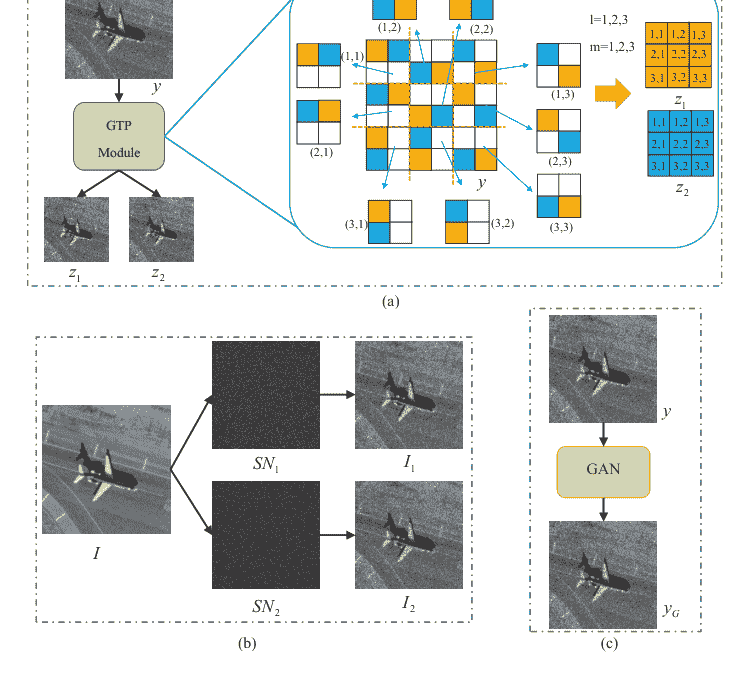

**图 2.** 生成 noisy-noisy 图像对的不同方法的比较。(a) 所提出的 GTP 模块的方法。(b) 使用自然图像的方法。(c) 使用 GAN 的方法。

为了更好地解释三种生成方法的差异，$k$ 设为 2。当使用 GTP 模块时，$y$ 被划分为 $\lfloor H/2\rfloor \times \lfloor W/2\rfloor$ 个块且大小

嵌套 U-Net [45] 和混合密集连接 U-Net [46] 用于医学图像分割。多类注意力 U-Net [47] 用于地震检测和地震相拾取。

由于斑点噪声被建模为乘性噪声，噪声-free SAR 图像与斑点噪声之间的非线性关系可以通过深度 CNN 获得。因此，设计了增强 U-Net（EUNet）以增强 U-Net [37] 的特征提取和融合能力。EUNet 的详细架构显示在图 4 中，其中 BN-RRDC 表示带批归一化（BN-RRDC）的残差-残差密集连接块。SSAM1-SSAM4 分别为子空间注意力模块（SSAM）[48]。ISC1-ISC4 分别表示所提出的改进跳跃连接。Conv 和 $s$ 分别表示卷积层和步幅。Cat 和 TConv1-TConv4 分别表示 concat 层和转置卷积层。与 U-Net [37] 相比，EUNet 主要有四项增强。首先，我们用 BN-RRDC 块替换卷积层。BN-RRDC 块由残差-残差密集连接 [49] 和批归一化层组成，可以显著提高 U-Net 的特征提取和表示能力。同时，由于 BN-RRDC 块中的残差结构，EUNet 的训练难度不会增加。

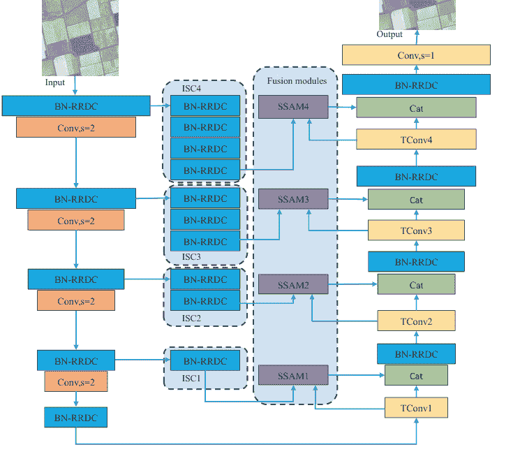

**图 4.** EUNet 的详细架构。


其次，为了减少特征损失，池化层被步长为 s = 2 的卷积层所取代。第三，我们设计了改进的跳跃连接（ISC1-ISC4）以缩小编码器特征与解码器特征之间的差距。在 U-Net [37] 的架构中，跳跃连接直接将编码器特征发送到解码器。在 EUNet 的框架中，改进的跳跃连接具有不同数量的 BN-RRDC 块。在 ISC1-ISC4 的结构中，BN-RRDC 块的数量分别为 1、2、3 和 4。最后，SSAM 被引入到特征融合中以恢复图像的弱纹理和高频信息。SSAM 是一个非局部子空间注意力模块，它利用非局部信息通过投影生成基向量。重建的 SAR 图像可以保留大部分原始信息并抑制与基向量无关的散斑噪声。SSAM 在自然图像去噪方面取得了最先进的去噪性能。BN-RRDC 块和 SSAM 的详细结构如图 5 所示，其中 BN 为批归一化层。

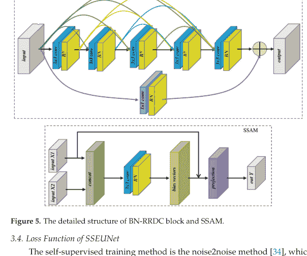

图 5. BN-RRDC 块和 SSAM 的详细结构。

### 3.4. SSEUNet 的损失函数
自监督训练方法为 noise2noise 方法 [34]，它不需要干净图像作为目标。noise2noise 方法只需要同一图像的两对噪声图像。假设从干净图像 x 得到的噪声-噪声图像对为 {y1, y2}，noise2noise 试图最小化以下损失函数：

$\mathcal{L}_{mse} = ||F_{\phi}(y_1) - y_2||_2^2,$
(1)

其中 $F_{\phi}$ 为去噪网络，$\phi$ 为去噪网络的参数。公式 (1) 是像素级损失函数。其优化与监督学习 CNN 相同。在之前的 noise2noise 去斑方法中，公式 (1) 是常用的损失函数。假设噪声 SAR 图像为 $y$，GTP 模块的生成掩码为 $\mathcal{G}_1$ 和 $\mathcal{G}_2$。噪声-噪声图像对为 {z1, z2}。z1 和 z2 可以写为：

$z_1 = \mathcal{G}_1 \odot y,\quad z_2 = \mathcal{G}_2 \odot y,$
(2)

其中 ⊙ 为 GTP 模块的操作。训练 EUNet 时，公式 (1) 重写为：

$$\mathcal{L}_{mse} = ||F_{\phi}(z_1) - z_2||_2^2.$$ (3)

$y'$ 的去斑图像对 {$z'_1, z'_2$} 可由公式 (4) 得到。

$$z'_1 = \mathcal{G}_1 \odot y', \quad z'_2 = \mathcal{G}_2 \odot y',$$ (4)

其中 $y' = F_{\phi}(y)$。因此，正则化损失可以定义为：

$$\mathcal{L}_{reg} = ||F_{\phi}(z_1) - z_2 + z'_2 - z'_1||_2^2,$$ (5)

同时，$z'_1$ 和 $z'_2$ 也可以通过去斑网络 $F_{\phi}$ 得到，可写为：

$$z'_1 = F_{\phi}(z_1), \quad z'_2 = F_{\phi}(z_2).$$ (6)

在理想状态下，$F_{\phi}^*(z_1)$ 和 $z_2$ 完全相同。$F_{\phi}^*$ 为最优去斑网络。同时，$z'_1$ 和 $z'_2$ 也完全相同。因此，$\mathcal{L}_{reg}$ 应等于 0。公式 (5) 提供了一个正则化损失，当去斑网络 $F_{\phi}$ 为最优网络 $F_{\phi}^*$ 时该损失得到满足。正则化损失可以缩小原始噪声图像上邻域目标像素值之间的差距。为了利用正则化损失，我们不直接优化公式 (3)，而是将公式 (5) 添加到公式 (3) 中。最后，SSEUNet 的损失函数定义为：

$$\mathcal{L} = \mathcal{L}_{mse} + \lambda \mathcal{L}_{reg},$$ (7)

其中 $\lambda$ 为超参数。

## 4. 实验与分析
我们评估了所提出的 SSEUNet 在模拟和真实 SAR 数据集上的有效性。首先，我们报告实现细节。其次，训练和推理数据集，即模拟 SAR 数据集和真实 SAR 数据集，进行了详细介绍。第三，根据模拟和真实 SAR 图像的特点，选择了不同的评价指标。最后，我们展示了模拟和真实 SAR 数据集的实验结果和分析。

### 4.1. 实现细节
所提出的 SSEUNet 不需要预训练模型，可以从零开始端到端训练。在训练阶段，网络参数的初始化方法为 He [50]。优化器为 Adam 算法 [51]，其动量项为 $\beta_1 = 0.9$ 和 $\beta_2 = 0.999$。SSEUNet 的初始学习率在真实世界实验中设为 0.00001，在模拟实验中设为 0.0001。学习率通过 reduce-on-plateau 策略降低，衰减比为 0.5。使用 64 × 64 大小的图像，10 个实例堆叠一个小批量。训练 epoch 设为 100。损失函数中 $\lambda$ 的超参数可以控制正则化项的强度。经验上，$\lambda$ 在模拟 SAR 实验中设为 2，在真实 SAR 实验中设为 1。在推理阶段，训练好的 EUNet 的输入大小为 256 × 256。所有实验均在配备 Ubuntu 18.04 的工作站上进行。硬件为 Intel Xeon(R) CPU E5-2620v3、NVIDIA Quadro M6000 24GB GPU 和 48 GB RAM。深度学习框架为 PyTorch 1.4.0。

### 4.2. 数据集
我们使用 UC Merced Land-use (UCML) 数据集 [52] 作为模拟数据集，它广泛用于土地利用分类。UCML 数据集是一个光学遥感数据集。UCML 数据集包含 2100 张图像，这些图像取自美国地质调查局 (USGS) 美国地区的国家地图。分辨率为 0.3 m，每张图像的大小为 256 × 256 × 3。为了生成模拟 SAR 图像，我们将每张图像转换为灰度图像。然后，类似于 [53]，我们通过将模拟散斑噪声乘以干净的灰度图像来生成模拟 SAR 图像。模拟散斑噪声服从 Gamma 分布。在我们的实验中，我们仅考虑了单视 SAR 图像。由于单视 SAR 图像中散斑噪声强度很高，处理单视 SAR 图像是一个非常具有挑战性的情况。模拟散斑噪声的均值和方差均为 1。我们随机将 2100 张图像划分为训练集（1470）、验证集（210）和测试集（420）。在训练阶段，使用数据增强来训练 SSEUNet。数据增强的方法为裁剪，裁剪大小为 64 × 64。最后，增强后的训练集包含 213,175 个 patch。GTP 模块生成的训练图像对大小为 32 × 32。验证集和测试集不使用数据增强。在图 6 中，我们展示了生成的模拟 SAR 图像示例。

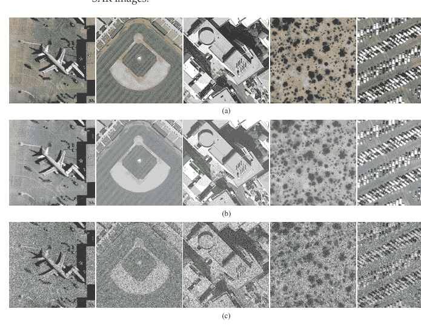

图 6. 模拟 SAR 图像示例。 (a) RGB 图像。 (b) 灰度图像。 (c) 模拟 SAR 图像。

为了验证 SSEUNet 的实用性，使用了七幅大规模单视 SAR 图像。它们由 ICEYE SAR 传感器 [54] 获取。每幅 SAR 图像的详细信息列于表 1，其中 Pol.、Level、Mode、Angle 和 Loc. 分别为极化类型、图像格式、成像模式、俯仰角和成像区域。SLC、VV、SL、SM、Asc. 和 Des. 分别表示单视复数图像、垂直垂直极化、聚束、条带、升轨和降轨。我们将 SLC SAR 数据 ($I_{SLC}$) 转换为幅度 SAR 图像 ($y$)。生成方法如下。首先，通过公式 (8) 得到 SLC SAR 数据的幅度 SAR 数据 ($I_A$)。

$I_A = \sqrt{I_{Real}^2 + I_{Imag}^2}$ (8)

其中 $I_{Real}$ 和 $I_{Imag}$ 分别为 $I_{SLC}$ 的实部数据和虚部数据。其次，得到的幅度 SAR 数据 ($I_A$) 经过归一化。归一化方法定义为：

$I_A^{norm} = 10\log_{10}\left(\frac{I_A}{Max(I_A)}\right), \quad (9)$

其中 $Max(\cdot)$ 表示最大值函数。最后，对归一化的 SAR 数据 ($I_A^{norm}$) 进行编码以获得幅度 SAR 图像 ($y$)。编码方法定义为：

$y = \frac{I_A^{norm} - Min(I_A^{norm})}{Max(I_A^{norm}) - Min(I_A^{norm})} \times (2^B - 1), \quad (10)$

其中 $Min(\cdot)$ 表示最小值函数，$B$ 为编码位数。在我们的实验中，$B$ 设为 8。

## 表 1. ICEYE-SAR 传感器的采集参数。

| 图像 | 传感器 | 极化 | 级别 | 模式 | 角度 | 轨道 | 像素 | 位置 | 日期 |
|---|---|---|---|---|---|---|---|---|---|
| Image1 | X7 | VV | SLC | SL | 19.87° | Asc. | 4096 × 3840 | Airport | 23 December 2021 |
| Image2 | X7 | VV | SLC | SL | 27.22° | Asc. | 4096 × 3840 | Oman | 23 December 2021 |
| Image3 | X4 | VV | SLC | SM | 23.61° | Des. | 4096 × 2560 | Brawley | 22 December 2021 |
| Image4 | X4 | VV | SLC | SM | 25.46° | Des. | 4096 × 2560 | Copeland | 2 January 2021 |
| Image5 | X4 | VV | SLC | SM | 27.00° | Des. | 4096 × 2560 | Corpus | 9 August 2020 |
| Image6 | X4 | VV | SLC | SM | 25.50° | Des. | 4096 × 4096 | Mississippi | 3 September 2020 |
| Image7 | X4 | VV | SLC | SM | 21.66° | Asc. | 3072 × 4096 | Strait | 19 February 2021 |

每幅幅度 SAR 图像 ($y$) 以步长为 64 裁剪为 $256 \times 256$。裁剪图像总数为 19,440。它们被随机划分为训练集（12,800）、验证集（1520）和测试集（5120）。训练集使用与模拟图像相同的数据增强。最终训练数据有 473,600 个 patch。测试图像的示例显示在图 7 中，其中白色框为选定区域，用于计算无参考评价指标。R1–R4 为均匀区域。R5–R8 为非均匀区域。R9 和 R10 为整幅图像。这些区域被排除在训练集之外。

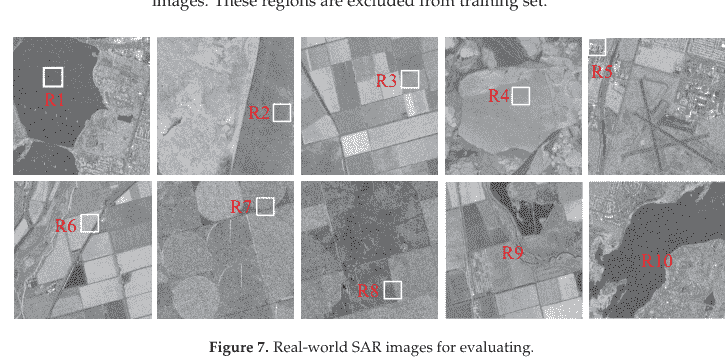

图 7. 用于评估的真实 SAR 图像。


方法。结果是基于 420 张测试图像的平均值。局部窗口方法和 NLM 方法被归类在表格中间部分，而 noise2noise 方法则列在下部。SSUNet 与 SSEUNet 的区别在于网络。SSUNet 的网络是 U-Net [37]。SSEUNet 的网络是所提出的 EUNet。SSUNet 和 SSEUNet 的结果是为了验证 EUNet 比 U-Net 具有更好的去斑性能。

**表 2. 模拟单视图像上的数值结果。**

| 方法 | MSE | PSNR | SSIM | 时间(s) | 参数 | GFLOPS |
|---|---|---|---|---|---|---|
| 噪声 | 0.0512 | 13.1933 | 0.1961 | - | - | - |
| Lee | 0.0135 | 19.2929 | 0.4892 | 0.0237 | 1 | - |
| Frost | 0.0119 | 19.7729 | 0.5402 | 0.0862 | 1 | - |
| PPB | 0.0117 | 19.8064 | 0.5445 | 9.0554 | 5 | - |
| SAR-BM3D | 0.0118 | 20.2733 | 0.6156 | 15.5699 | 1 | - |
| MuLoG | 0.0138 | 20.1007 | 0.6119 | 7.8607 | 1 | - |
| SAR-CNN | 0.0104 | 20.4939 | 0.6170 | 0.0165 | 557,057 | 36.51 |
| SAR-DRN | 0.0153 | 19.9947 | 0.6238 | 0.0150 | 185,857 | 12.18 |
| SSUNet (我们) | 0.0097 | 20.7164 | 0.6369 | 0.0166 | 698,017 | 4.62 |
| SSEUNet (我们) | 0.0087 | 21.1912 | 0.6692 | 0.0996 | 84,390,753 | 156.28 |

从表 2 可以看出，所提出的 SSEUNet 在 MSE、PSNR 和 SSIM 上优于其他方法。观察 PSNR 和 SSIM 指标，noise2noise 方法似乎有潜力在常规方法之上提供明显的性能提升。事实上，尽管 SAR-CNN 的性能与先进的 NLM 方法相似，SSEUNet 比最佳方法 SAR-BM3D 高出约 1 dB 和 0.0536。但处理 256 × 256 的图像所需时间大约快 157 倍。通过比较 SAR-CNN 和 SAR-DRN 的结果，网络层数越多，去斑性能越好。然而，具有扩张卷积层的网络 SAR-DRN 可以改善去斑图像的细节。此外，与第二好的结果 SSUNet 相比，所提出的 SSEUNet 分别实现了 0.5 dB 和 0.0323 的提升。从 SSEUNet 和 SSUNet 的结果来看，我们对 U-Net 的改进是有效的，且参数的增加并不会显著降低推理速度。

视觉评估是定性评估不同方法去斑性能的另一种方式。为了可视化所提出的 SSEUNet 和其他方法的去斑结果，图 8 显示了模拟 SAR 图像的去斑视觉结果。Ours 是使用 SSEUNet 的结果。可以从视觉结果看出，所有去斑方法都可以在一定程度上去除斑点噪声。但基于 noise2noise 的方法取得了最佳的去斑结果。局部窗口方法的结果过于平滑以至于失去了对比度。对比度损失意味着使用局部窗口滤波器去斑的图像结构变得平滑，边缘与非边缘之间的结构对比变得模糊。与局部窗口方法相比，NLM 方法的效果显著改善。然而，观察 PPB 的结果，边界处存在振铃效应，这会扭曲图像边界。在 noise2noise 方法中，随着网络深度的加深，去斑效果越好，图像越清晰。可以看出，所提出的 SSEUNet (Ours) 显示出降低斑点噪声和保留纹理结构的最佳能力。

#### 4.4.2. 真实 SAR 图像上的实验

为了进一步说明所提方法的实用性，使用真实 SAR 图像进行实验。真实 SAR 图像在第 4.2 节中进行了详细介绍。表 3 列出了所选区域上 ENL 的定量评估结果。这些所选区域如图 7 所示，其中 R1–R4 是去斑图像的均匀区域。ENL 值在非均匀区域应有较小变化，甚至为零。然而，在均匀区域应有更大的改善。这一点在图 9 和图 10 中得到证明并显示。ENL 图还显示了细节的损失。从 ENL 图来看，细节损失最严重的是 PPB 和 MuLoG。与 SAR-BM3D 相比，noise2noise 方法不仅能更好地保护图像细节，还能更好地去除斑点噪声。在 noise2noise 方法中，所提出的 SSEUNet 具有最佳的去斑和细节保护能力。

表 4 显示了 R5–R8 区域上 ER 指标的数值结果，其中 V 和 H 分别是 ER 指标的垂直和水平结果。可以看出，所提出的 SSEUNet 在保护水平和垂直结构方面具有明显优势。在 noise2noise 方法中，所提出的 GTP 模块和 EUNet 能更好地处理真实 SAR 图像。所提出的 GTP 模块可利用真实 SAR 图像构建噪声-噪声图像对来训练深度 CNN，从而使网络更好地学习斑点噪声与无噪声 SAR 图像的关系。

**表 4. 真实 SAR 图像上的 ER 指标。**

| 方法 | R5 V | R5 H | R6 V | R6 H | R7 V | R7 H | R8 V | R8 H |
|---|---|---|---|---|---|---|
| Lee | 0.9430 | 0.9478 | 0.9876 | 0.9490 | 0.9487 | 0.9563 | 0.9051 | 0.9038 |
| Frost | 0.9501 | 0.9544 | 0.9877 | 0.9490 | 0.9587 | 0.9563 | 0.9052 | 0.9117 |
| PPB | 0.9565 | 0.9612 | 0.9874 | 0.9688 | 0.9590 | 0.9563 | 0.9054 | 0.9139 |
| SAR-BM3D | 0.9586 | 0.9613 | 0.9879 | 0.9893 | 0.9579 | 0.9560 | 0.9062 | 0.9043 |
| MuLoG | 0.9585 | 0.9603 | 0.9879 | 0.9881 | 0.9585 | 0.9557 | 0.9048 | 0.9041 |
| SAR-CNN | 0.9707 | 0.9618 | 0.9706 | 0.9611 | 0.9549 | 0.9578 | 0.9061 | 0.9132 |
| SAR-DRN | 0.9627 | 0.9631 | 0.9707 | 0.9611 | 0.9531 | 0.9575 | 0.9062 | 0.9133 |
| SSUNet (我们) | 0.9567 | 0.9709 | 0.9876 | 0.9883 | 0.9584 | 0.9592 | 0.9043 | 0.9136 |
| SSEUNet (我们) | 0.9923 | 0.9941 | 0.9910 | 0.9912 | 0.9609 | 0.9588 | 0.9086 | 0.9176 |


图 9. 不同去斑方法在 R9 上的 ENL 图。


图 10. 不同去斑方法在 R10 上的 ENL 图。

值得仔细研究不同去斑 SAR 图像的方法。图 11 和图 12 分别显示了真实 SAR 图像中均匀区域和非均匀区域的细节。可以从结果看出，局部窗口方法过于平滑以至于失去了对比度。对比度损失意味着使用局部窗口滤波器去斑的图像结构变得平滑，边缘与非边缘之间的结构对比变得模糊。此外，许多强点和线性结构在 NLM 去斑方法中丢失。PPB 的结果也可能在边界处引起振铃效应。与其他传统方法相比，SAR-BM3D 的结果表现最佳，并在平滑与细节保留之间提供了可接受的平衡。在 SAR-DRN、SAR-CNN 和 SSEUNet 方法中，SSEUNet 的结果最佳。图 13 显示了不同场景的视觉去斑结果。可以从去斑结果看出，所提出的 SSEUNet 可以处理不同场景下的真实 SAR 图像。


图 11. 真实 SAR 图像上均匀区域的可视化结果。


噪声 Lee Frost PPB SAR-BM3D MuLoG SAR-CNN SAR-DRN SSUNet(我们) SSEUNet(我们)

图 12. 真实 SAR 图像上非均匀区域的可视化结果。


(a)

(b)

(c)

(d)

图 13. SSEUNet 在真实 SAR 图像中的去斑结果。(a,c) 真实 SAR 图像。(b,d) 去斑结果。

为了深入了解学习到的 SSAM 在真实 SAR 图像上的工作方式，我们挑选了 8 张样本图像并检查 SSAM 的输出特征。如图 4 所示，SSAM1 的输入特征是 ISC1 和 TConv1 的输出特征。SSAM2 的输入是 ISC2 和 TConv2 的输出。ISC3 和 TConv3 的输出馈入 SSAM3。SSAM4 的输入特征是 ISC4 和 TConv4 的输出。SSAM1-SSAM4 的输出特征是从 SSAM1-SSAM4 中的 *投影* 层提取的。SSAM1-SSAM4 的结构完全相同。SSAM 的详细结构如图 5 所示。SSAM1-SSAM4 的输出特征尺寸分别为 256 × 32 × 32、128 × 64 × 64、64 × 128 × 128 和 32 × 256 × 256。在可视化过程中，我们对 SSAM1-SSAM4 的输出特征执行平均操作。每个可视化特征都是所有通道的均值特征。SSAM1-SSAM4 中可视化特征的尺寸分别为 32 × 32、64 × 64、128 × 128 和 256 × 256。图 14 显示了 SSAM1-SSAM4 的可视化特征。可以看出，弱纹理和结构的细节从噪声 SAR 图像中逐渐恢复。


图 14. SSAM1-SSAM4 的可视化特征。(a) 原始 SAR 图像。(b-e) SSAM1-SSAM4 的可视化特征。

## 5. 结论

本文提出了一种具有增强 U-Net 的新型自监督去斑算法 SSEUNet。所提出的 SSEUNet 由生成训练对 GTP 模块、增强 U-Net EUNet 以及带正则化损失的自监督训练损失函数组成。所提出的 SSEUNet 具有以下优点。首先，与之前的自监督去斑工作不同，噪声-噪声图像对是通过一种新颖的生成训练对模块从真实 SAR 图像生成的，这使得使用真实

SAR 图像。GTP 模块可以消除自然图像、时序图像的影响以及 GAN 的性能。其次，EUNet 设计用于改进 U-Net 的特征提取和融合能力。与 U-Net 相比，我们引入了 BN-RRDC 块、卷积层 s = 2、改进的跳跃连接和 SSAM。尽管 EUNet 具有更多参数和更复杂的结构，训练难度不会增加。原因是 BN-RRDC 块中存在残差结构。第三，设计了一种自监督训练损失函数，以解决原始噪声图像上邻域目标像素值之间的差异。该损失函数包括重建损失（MSE）和正则化损失。最后，对模拟和真实 SAR 图像的视觉和定量实验表明，所提出的 SSEUNet 显著降低了斑点噪声并更好地保留了特征，其性能超过了几种最先进的去斑点方法。

然而，所提出的 SSEUNet 的推理速度需要改进。所提出的 SSEUNet 使用复杂的特征提取块和子空间注意力模块，这导致评估图像的时间更长。同时，不同数据增强方法的去斑点结果也需要在 SAR 图像上进行验证。今后，我们计划探索两项工作。首先，我们将探索一种轻量级网络以替换 EUNet，从而提高推理速度。其次，将验证不同数据增强方法的去斑点效果。

作者贡献：概念化，G.Z.；数据整理，G.Z. 和 S.L.；形式分析，G.Z.；调查，G.Z. 和 X.L.；方法学，G.Z. 和 X.L.；资源，Z.L.；软件，G.Z.；监督，Z.L.；验证，G.Z. 和 X.L.；可视化，G.Z.；撰写—初稿，G.Z. 和 X.L.。所有作者均已阅读并同意本文的发表版本。

资助：本研究得到国家杰出青年科学基金资助，资助编号 61906213。

机构审查委员会声明：不适用。

知情同意声明：不适用。

数据可用性声明：UC Merced 土地利用数据集可在 http://vision.ucmerced.edu/datasets 获取，访问日期为 2021 年 10 月 27 日。ICEYE SAR 数据集可在 https://www.iceye.com/sar-data 获取，访问日期为 2021 年 10 月 27 日。

利益冲突：作者声明无利益冲突。

## 参考文献
- 1. Moreira, A.; Prats-Iraola, P.; Younis, M.; Krieger, G.; Hajnsek, I.; Papathanassiou, K.P. 关于合成孔径雷达的教程. IEEE Geosci. Remote Sens. Mag. 2013, 1, 6–43. [CrossRef]
- 2. Yang, Z.; Wei, J.; Deng, J.; Gao, Y.; Zhao, S.; He, Z. 利用基于时序密集光学和 SAR 数据的协同学习方法绘制突发洪水：以西藏金沙江白格滑坡坝为例. Remote Sens. 2021, 13, 2205. [CrossRef]
- 3. Qin, Y.; Xiao, X.; Wang, J.; Dong, J.; Ewing, K.; Hoagland, B.; Hough, D.J.; Fagin, T.D.; Zou, Z.; Geissler, G.L.; et al. 通过 Landsat 和 PALSAR 影像分析绘制亚湿润和半干旱地区的年度森林覆盖. Remote Sens. 2016, 8, 933. [CrossRef]
- 4. Zhang, T.; Zhang, X.; Ke, X.; Zhan, X.; Shi, J.; Wei, S.; Pan, D.; Li, J.; Su, H.; Zhou, Y.; et al. LS-SSDD-v1.0：专用于从大规模 Sentinel-1 SAR 图像中进行小船检测的深度学习数据集. Remote Sens. 2020, 12, 2997. [CrossRef]
- 5. Zhang, T.; Zhang, X.; Ke, X.; Liu, C.; Xu, X.; Zhan, X.; Wang, C.; Ahmad, I.; Zhou, Y.; Pan, D.; et al. HOG-ShipCLSNet：一种用于 SAR 船舶分类的具有 HOG 特征融合的新型深度学习网络. IEEE Trans. Geosci. Remote Sens. 2021. [CrossRef]
- 6. Herzfeld, U.C.; Williams, S.; Heinrichs, J.; Maslanik, J.; Such, S. 基于 SAR 数据的海冰性质和省份的地质统计和统计分类. Remote Sens. 2016, 8, 616. [CrossRef]
- 7. Singh, P.; Diwakar, M.; Shankar, A.; Shree, R.; Kumar, M. SAR 图像及其去斑点综述. Arch. Comput. Methods Eng. 2021. [CrossRef]
- 8. Argenti, F.; Lapini, A.; Bianchi, T.; Alparone, L. 合成孔径雷达图像斑点降低教程. IEEE Geosci. Remote Sens. Mag. 2013, 1, 6–35. [CrossRef]
- 9. Zhang, T.; Zhang, X.; Shi, J.; Wei, S.; Wang, J.; Li, J.; Su, H.; Zhou, Y. SAR 图像中近海和近岸船舶检测的平衡场景学习机制. IEEE Geosci. Remote Sens. Lett. 2020, 1–5. [CrossRef]
- 10. Zhang, T.; Zhang, X. ShipDeNet-20：仅有 20 个卷积层且 <1-MB 的轻量级 SAR 船舶检测器. IEEE Geosci. Remote Sens. Lett. 2021, 18, 1234–1238.
- 11. Zhang, T.; Zhang, X. 用于 SAR 船舶分类的具有几何特征嵌入的极化融合网络. Pattern Recognit. 2021, 123, 108365. [CrossRef]
- 12. Zhang, T.; Zhang, X. 用于 SAR 图像中船舶分类的具有双极化特征融合的 Squeeze-and-Excitation 拉普拉斯金字塔网络. IEEE Geosci. Remote Sens. Lett. 2021, 1. [CrossRef]
- 13. Wei, Y.; Li, Y.; Ding, Z.; Wang, Y.; Zeng, T.; Long, T. 基于 ADMM 和深度神经网络的 SAR 参数超分辨率图像重建方法. IEEE Trans. Geosci. Remote Sens. 2021. [CrossRef]
- 14. Lee, J.S. 合成孔径雷达图像的斑点分析和平滑. Comput. Graph. Image Process. 1981, 17, 24–32. [CrossRef]
- 15. Frost, V.S.; Stiles, J.A.; Shanmugan, K.S.; Holtzman, J.C. 雷达图像模型及其在乘性噪声自适应数字滤波中的应用. IEEE Trans. Pattern Anal. Mach. Intell. 1982, 4, 157–166. [CrossRef]
- 16. Kuan, D.T.; Sawchuk, A.A.; Strand, T.C.; Chavel, P. 用于信号相关噪声图像的自适应噪声平滑滤波器. IEEE Trans. Pattern Anal. Mach. Intell. 1985, 7, 165–177. [CrossRef]
- 17. Deledalle, C.; Denis, L.; Tupin, F. 具有概率块基权重的迭代加权最大似然去噪. IEEE Signal Process. 2009, 18, 2661–2672. [CrossRef] [PubMed]
- 18. Parrilli, S.; Poderico, M.; Angelino, C.-V.; Verdoliva, L. 基于 LLMMSE 小波收缩的非局部 SAR 图像去噪算法. IEEE Geosci. Remote Sens. 2012, 50, 606–616. [CrossRef]
- 19. Deledalle, C.A.; Denis, L.; Tupin, F.; Reigber, A.; Jager, M. NL-SAR：用于分辨率保持（Pol）InSAR 去噪的统一非局部框架. IEEE Trans. Geosci. Remote Sens. 2015, 53, 2021–2038. [CrossRef]
- 20. Zhang, T.; Zhang, X.; Li, J.; Xu, X.; Wang, B.; Zhan, X.; Xu, Y.; Ke, X.; Zeng, T.; Su, H.; et al. SAR 船舶检测数据集（SSDD）：官方发布和综合数据分析. Remote Sens. 2021, 13, 3690. [CrossRef]
- 21. Zhang, T.; Zhang, X.; Shi, J.; Wei, S. HyperLi-Net：用于从合成孔径雷达影像进行高精度高速船舶检测的超轻深度学习网络. ISPRS J. Photogramm. Remote Sens. 2020, 167, 123–153. [CrossRef]
- 22. Chierchia, G.; Cozzolino, D.; Poggi, G.; Verdoliva, L. 通过卷积神经网络进行 SAR 图像去斑点. In Proceedings of the IEEE International Geoscience and Remote Sensing Symposium, Fort Worth, TX, USA, 23–28 July 2017; pp. 5438–5441.
- 23. Cozzolino, D.; Verdoliva, L.; Scarpa, G.; Poggi, G. 非局部 CNN SAR 图像去斑点. Remote Sens. 2020, 12, 1006. [CrossRef]
- 24. Zhang, Q.; Yuan, Q.; Li, J.; Zhen, Y.; Zhang, L. 学习用于 SAR 图像去斑点的扩张残差网络. Remote Sens. 2018, 10, 196. [CrossRef]
- 25. Gui, Y.; Xue, L.; Li, X. 使用扩张密集连接网络进行 SAR 图像去斑点. Remote Sens. Lett. 2018, 9, 857–866. [CrossRef]
- 26. Shen, H.; Zhou, C.; Li, J.; Yuan, Q. 采用递归深度 CNN 先验的 SAR 图像去斑点. IEEE Geosci. Remote Sens. 2021, 59, 273–286. [CrossRef]
- 27. Dalsasso, E.; Denis, L.; Tupin, F. SAR2SAR：SAR 图像的半监督去斑点算法. IEEE J. Sel. Top. Appl. Earth Obs. Remote Sens. 2021, 14, 4321–4329. [CrossRef]
- 28. Yuan, Y.; Sun, I.; Guan, J. 使用自监督密集扩张卷积神经网络的盲 SAR 图像去斑点. arXiv 2019, arXiv:1908.01608.
- 29. Molini, A.B.; Valsesia, D.; Fracastoro, G.; Magli, E. Speckle2Void：具有盲点卷积神经网络的深度自监督 SAR 去斑点. IEEE Geosci. Remote Sens. 2021. [CrossRef]
- 30. Yuan, Y.; Guan, J.; Feng, P.; Wu, Y. 利用对抗学习生成的斑点到斑点图像的 SAR 去斑点实用解决方案. IEEE Geosci. Remote Sens. Lett. 2020. [CrossRef]
- 31. Ma, X.; Wang, C.; Yin, Z.; Wu, P. 基于噪声参考的深度学习方法的 SAR 图像去斑点. IEEE Geosci. Remote Sens. 2020, 58, 8807–8818. [CrossRef]
- 32. Pan, T.; Peng, D.; Yang, W.; Li, H.C. 使用预训练卷积神经网络模型进行 SAR 图像去斑点的滤波器. Remote Sens. 2019, 11, 2379. [CrossRef]
- 33. Li, J.; Li, Y.; Xiao, Y.; Bai, Y. HDRANet：用于 SAR 图像去斑点的混合扩张残差注意力网络. Remote Sens. 2019, 11, 2921. [CrossRef]
- 34. Lehtinen, J.; Munkberg, J.; Laine, S.; Karras, T.; Aittala, M.; Aila, T. Noise2Noise：无需干净数据学习图像恢复. arXiv 2018, arXiv:1803.04189.
- 35. Goodfellow, I.J.; Pouget-Abadie, J.; Mirza, M.; Xu, B.; Warde-Farley, D.; Ozair, S.; Courville, A.C.; Bengio, Y. 生成对抗网络. arXiv 2014, arXiv:1406.2661.
- 36. Mullissa, A.G.; Marcos, D.; Tuia, D.; Herold, M.; Reiche, J. deSpeckNet：泛化基于深度学习的 SAR 图像去斑点. IEEE Geosci. Remote Sens. 2020. [CrossRef]
- 37. Ronneberger, O.; Fischer, P.; Brox, T. U-Net：用于生物医学图像分割的卷积网络. In Proceedings of the Medical Image Computing and Computer-Assisted Intervention, Munich, Germany, 5–9 October 2015; Volume 9351.
- 38. Zhang, K.; Zuo, W.; Chen, Y.; Meng, D.; Zhang, L. 超越高斯去噪器：用于图像去噪的深度 CNN 残差学习. IEEE Signal Process. 2017, 26, 3142–3155. [CrossRef] [PubMed]


-   39. Zhang, J.; Li, W.; Li, Y. 利用融合小波特征的多连接网络进行SAR图像去斑. IEEE Geosci. Remote Sens. Lett. 2020, 17, 1363–1367. [CrossRef]
-   40. Vitale, S.; Ferraioli, G.; Pascazio, V. 基于多目标CNN的SAR去斑算法. IEEE Geosci. Remote Sens. 2020. [CrossRef]
-   41. Martino, G.D.; Poderico, M.; Poggi, G.; Riccio, D.; Verdoliva, L. SAR去斑的基准测试框架. IEEE Trans. Geosci. Remote Sens. 2014, 52, 1596–1615. [CrossRef]
-   42. Laine, S.; Karras, T.; Lehtinen, J.; Aila, T. 高质量自监督深度图像去噪. 收录于第33届神经信息处理系统会议（NeurIPS 2019）论文集，2019年12月8–14日；第6968–6978页.
-   43. Heinrich, M.; Stille, M.; Buzug, T. 用于低剂量CT去噪的残差U-Net卷积神经网络架构. Curr. Dir. Biomed. Eng. 2018, 4, 297–300. [CrossRef]
-   44. Guo, Y.; Chen, J.; Wang, J.; Chen, Q.; Cao, J.; Deng, Z.; Xu, Y.; Tan, M. 闭环很重要：用于单图像超分辨率的双回归网络. 见IEEE/CVF计算机视觉与模式识别会议论文集，线上，2020年6月14–19日；第5406–5415页.
-   45. Zhou, Z.; Rahman Siddiquee, M.M.; Tajbakhsh, N.; Liang, J. UNet++：一种用于医学图像分割的嵌套U-Net架构. 载于《医学图像分析中的深度学习与临床决策支持的多模态学习》；Springer：瑞士尚姆，2018；第3–11页.
-   46. Li, X.; Chen, H.; Qi, X.; Dou, Q.; Fu, C.W.; Heng, P.A. H-DenseUNet：用于CT体数据中肝脏和肿瘤分割的混合密集连接UNet. IEEE Trans. Med Imaging 2018, 37, 2663–2674. [CrossRef]
-   47. Li, W.; Chakraborty, M.; Fenner, D.; Faber, J.; Zhou, K.; Ruempker, G.; Stoecker, H.; Srivastava, N. EPick：基于多类注意力的U型神经网络用于地震检测和震相拾取. arXiv 2021, arXiv:2109.02567.
-   48. Cheng, S.; Wang, Y.; Huang, H.; Liu, D.; Fan, H.; Liu, S. NBNet：基于子空间投影的噪声基学习图像去噪. arXiv 2020, arXiv:2012.15028.
-   49. Wang, X.; Yu, K.; Wu, S.; Gu, J.; Liu, Y.; Dong, C.; Loy, C.C.; Qiao, Y.; Tang, X. ESRGAN：增强型超分辨率生成对抗网络. Eur. Conf. Comput. Vis. 2018, 11133, 63–79.
-   50. He, K.; Zhang, X.; Ren, S.; Sun, J. 深入探讨整流器：在ImageNet分类上超越人类水平的性能. 见IEEE国际计算机视觉大会论文集，智利圣地亚哥，2015年12月11–18日；第1026–1034页.
-   51. Diederik, P.K.; Jimmy, L.B. Adam：一种随机优化方法. arXiv 2014, arXiv:1412.6980.
-   52. Yi, Y.; Shawn, N. 视觉词袋及其空间扩展用于土地利用分类. 见第18届SIGSPATIAL国际地理信息系统进展会议论文集，美国加州圣何塞，2010年11月2–5日；第270–279页.
-   53. Liu, C.; Tupin, F.; Gousseau, Y. 在散斑光学数据集上训练CNN用于SAR图像边缘检测. ISPRS J. Photogramm. Remote Sens. 2020, 170, 88–102. [CrossRef]
-   54. Stringham, C.; Farquharson, G.; Castelletti, D.; Quist, E.; Riggi, L.; Eddy, D.; Soenen, S. 用于快速成像的Capella X波段SAR星座. 见IEEE国际地球科学与遥感研讨会论文集，日本横滨，2019年7月28日至8月2日；第9248–9251页.
-   55. Lattari, F.; Gonzalez Leon, B.; Asaro, F.; Rucci, A.; Prati, C.; Matteucci, M. 用于SAR图像去斑的深度学习. Remote Sens. 2019, 11, 1532. [CrossRef]
-   56. Wang, Z.; Bovik, A.C.; Sheikh, H.R.; Simoncelli, E.P. 图像质量评估：从误差可见性到结构相似性. IEEE Trans. Image Process. 2004, 13, 600–612. [CrossRef]
-   57. Lee, J.S.; Pottier, E. 极化雷达成像：从基础到应用; CRC Press: 美国佛罗里达州博卡拉顿, 2009.
-   58. Feng, H.; Hou, B.; Gong, M. 基于像元相关性度量的局部均匀区域分割的SAR图像去斑. IEEE Trans. Geosci. Remote Sens. 2011, 49, 2724–2737. [CrossRef]
-   59. Deledalle, C.A.; Denis, L.; Tabti, S.; Tupin, F. MuLoG：如何将高斯去噪器应用于多通道SAR斑噪抑制. IEEE Trans. Image Process. 2017, 26, 4389–4403. [CrossRef]
-   60. Anfinsen, S.N.; Doulgeris, A.P.; Eltoft, T. 极化合成孔径雷达图像中等视数的估计. IEEE Trans. Geosci. Remote Sens. 2009, 47, 3795–3809. [CrossRef]

文章

## 一种用于视频SAR中任意感兴趣目标跟踪的新型引导锚点孪生网络

Jinyu Bao, Xiaoling Zhang *, Tianwen Zhang, Jun Shi and Shunjun Wei

电子科技大学信息与通信工程学院，中国成都 611731；201811011909@std.uestc.edu.cn（J.B.）；twzhang@std.uestc.edu.cn（T.Z.）；shijun@uestc.edu.cn（J.S.）；weishunjun@uestc.edu.cn（S.W.）
* 通讯作者：xlzhang@uestc.edu.cn

**摘要：** 视频合成孔径雷达（Video-SAR）能够提供连续、直观的观测，并广泛用于雷达运动目标跟踪。运动目标的阴影具有散射稳定、无位置偏移的特点，因此基于阴影的运动目标跟踪成为研究热点。然而，现有技术主要依赖目标外观，对于多样性和任意性较高的感兴趣目标（TOI）跟踪来说，既不可行又代价高昂。为此，我们提出一种新型引导锚点孪生网络（GASN），专用于Video-SAR中的任意TOI跟踪。首先，GASN利用第一帧中TOI的初始区域，在后续帧中搜索匹配区域，并通过匹配函数返回最相似区域；该匹配函数通过通用训练学习得到，无需任何TOI相关数据。借助学习到的匹配函数，GASN可以跟踪任意TOI。此外，我们还构建了一个引导锚点子网络（GA-SubNet），利用第一帧的先验信息生成与TOI形状相同的稀疏锚点，从而减少不必要的锚点数量以抑制虚警。我们在仿真和真实Video-SAR数据上评估了该方法。实验结果表明，GASN优于现有最先进方法，包括两类传统跟踪方法（MOSSE和KCF）以及两类现代深度学习技术（Siamese-FC和Siamese-RPN）。我们还进行了消融实验，验证了GA-SubNet的有效性。

**关键词：** 视频合成孔径雷达（Video-SAR）；运动目标跟踪；引导锚点孪生网络（GASN）

**引用：** Bao, J.; Zhang, X.; Zhang, T.; Shi, J.; Wei, S. 一种用于视频SAR中任意感兴趣目标跟踪的新型引导锚点孪生网络. *Remote Sens.* **2021**, *13*, 4504. https://doi.org/10.3390/rs13224504

学术编辑：Fabio Rocca

收稿日期：2021年8月27日
接受日期：2021年11月1日
出版日期：2021年11月9日

**出版商注：** MDPI对已出版地图中的管辖权主张和机构归属保持中立。


**版权：** © 2021 作者所有。被许可方：MDPI，瑞士巴塞尔。本文为开放获取文章，依据知识共享署名（CC BY）许可协议（https://creativecommons.org/licenses/by/4.0/）的条款和条件分发。

## 1. 引言

视频合成孔径雷达（Video-SAR）以更快的帧率提供高分辨率SAR图像，这有助于对地面运动目标进行连续、直观的观测。凭借这一优势，Video-SAR在SAR运动目标跟踪[1]中具有重要应用。自美国桑迪亚国家实验室（SNL）于2003年首次获取高分辨率SAR图像以来[2]，许多学者研究了Video-SAR中的运动目标跟踪问题[3–7]。然而，由于照射角度的不同，运动目标的散射特性会随平台的运动而变化。更甚的是，由于运动目标的成像结果通常偏离其真实位置，因此直接跟踪运动目标较为困难。

幸运的是，阴影是由运动目标遮挡地面造成的。由于没有能量反射，阴影出现在SAR图像中运动目标的真实位置，并具有灰度恒定的优点[8]。因此，基于阴影的运动目标跟踪已成为Video-SAR中的一个研究热点。近年来，许多学者致力于Video-SAR中基于阴影的运动目标跟踪研究[9–11]。Wang等人[9]充分考虑了阴影的恒定灰度，并利用数据复用实现了运动目标跟踪。Zhao等人[10]应用基于显著性的检测机制，利用时空信息实现了运动目标

在 Video-SAR 中的跟踪。Tian 等 [11] 利用基于动态规划的粒子滤波实现了 Video-SAR 中的先跟踪后检测算法。然而，这些传统方法使用的特征通常较为简单，导致背景与阴影相似，难以轻易区分的问题。随后，由于其高精度和快速的优势，深度学习方法被提出用于解决阴影跟踪问题 [12–16]。Ding 等 [12] 提出了一种基于深度神经网络的阴影辅助运动目标检测框架，该框架应用了更快的区域卷积神经网络（Faster-RCNN）[13] 在单帧中检测阴影，并使用双向长短期记忆（Bi-LSTM）[14] 网络进行阴影跟踪。Zhou 等 [15] 提出了一种框架，通过结合改进的实时递归回归网络和新设计的轨迹平滑长短期记忆网络来跟踪阴影。Wen 等 [16] 提出了一种基于双 Faster-RCNN 的运动目标跟踪方法，该方法结合了 SAR 图像中的阴影检测结果和距离-多普勒（RD）谱，以抑制 Video-SAR 中运动目标跟踪的虚警。

然而，任意感兴趣目标（TOI）跟踪对上述方法来说是一个挑战。在本文中，我们将 TOI 定义为视频中想要跟踪的特定目标。TOI 指的是 Video-SAR 中需要跟踪的阴影。任意 TOI 跟踪具有挑战性的原因如下：首先，这些方法都基于外观特征，如形状和纹理。这些方法需要训练大量标注的训练样本来提取外观特征，且训练样本必须包含 TOI。然而，当我们跟踪任意 TOI 时，由于目标的多样性和任意性，收集所有类别的样本进行训练是不切实际的。此外，对大量 SAR 图像进行标注需要耗费大量的人力和物力资源。因此，在 Video-SAR 中跟踪任意 TOI 时，这些方法既不切实际又成本高昂。

因此，我们提出了一种新颖的引导锚点孪生网络（GASN），用于 Video-SAR 中的任意 TOI 跟踪。首先，GASN 的关键在于相似性学习思想，它学习一个匹配函数来估计两幅图像之间的相似程度。在使用大量配对图像训练后，GASN 中学习到的匹配函数在给定未见过的输入对（第一帧中的 TOI 作为模板，后续帧作为搜索图像）时，用于定位与模板最匹配的区域。由于 GASN 仅依赖于与训练数据无关的模板信息，因此适用于 Video-SAR 中任意 TOI 的跟踪。此外，GASN 中提出了一个引导锚点子网络（GA-SubNet），用于抑制虚警并提高跟踪精度。GA-SubNet 利用模板的位置信息获取搜索图像中的位置概率，然后选择概率大于阈值的位置生成稀疏锚点，从而排除虚警。为了提高跟踪精度，GA-SubNet 通过自适应预测处理获得与 TOI 形状更匹配的锚点。

我们的方法的主要贡献如下：

- 1. 我们建立了一个新的网络 GASN，该网络通过训练大量配对图像来构建一个判断两个输入相似程度的匹配函数。经过相似性学习后，GASN 将后续帧与第一帧中 TOI 的初始区域进行匹配，并返回最相似的区域作为跟踪结果。
- 2. 我们构建了嵌入 GASN 中的 GA-SubNet，以抑制虚警并提高跟踪精度。通过融合模板的先验信息，我们提出的 GA-SubNet 可以生成与 TOI 形状最匹配的稀疏锚点。

为了验证所提方法的有效性，我们在模拟和真实 Video-SAR 数据上进行了实验。结果表明，所提网络在模拟 Video-SAR 数据上的跟踪精度为 60.16%，比两种深度学习方法 Siamese-RPN [17] 和 Siamese-FC [18] 分别高出 4.55% 和 16.49%，也比两种传统方法 MOSSE [19] 和 KCF [20] 分别高出 18.36% 和 28.95%。同时，在真实 Video-SAR 数据上的跟踪精度为 54.68%，分别比其他四种方法高出 1.93%、13.08%、14.70% 和 25.04%。这表明我们的方法能够在 Video-SAR 中实现精确的任意 TOI 跟踪。

本文其余部分安排如下：第 2 节介绍方法，包括网络架构、预处理和跟踪过程。第 3 节介绍实验，包括模拟和真实数据、实现细节、损失函数和评价指标。第 4 节介绍模拟和真实 Video-SAR 数据的跟踪结果。第 5 节讨论预训练和鲁棒性研究以及消融实验。第 6 节给出结论。

## 2. 方法

### 2.1. 网络架构

图 1 显示了 GASN 在 Video-SAR 中用于任意 TOI 跟踪的架构，包括孪生子网络、GA-SubNet 和相似性学习子网络。GASN 基于相似性学习思想，将模板图像 z 与搜索图像 x 进行比较，如果两幅图像描绘的是同一目标，则返回高分。


图 1. GASN 的架构。

为了进行相似性学习，孪生子网络由模板分支和搜索分支组成。两个分支对每个输入应用相同的变换 φ，该变换 φ 可视为特征嵌入。然后，相似性学习可表示为 f(z, x) = g(φ(z), φ(x))，其中函数 g 为相似性度量。为了抑制虚警，GA-SubNet 接收来自模板的先验信息，利用锚点预先确定 TOI 在搜索图像中的大致位置和形状。当跟踪与训练样本不同的任意 TOI 时，我们可以通过提供该 TOI 的模板信息（如位置和形状）利用相似性学习的能力在下一帧中找到 TOI。相似性学习子网络分为两个分支，一个用于阴影与背景的分类，另一个用于阴影位置和形状的回归。在两个分支中，均计算阴影模板与搜索区域之间的相似度，然后选择与 TOI 模板相似度最大的目标作为跟踪结果。

GASN 总是使用前一帧作为模板图像，当前帧作为搜索图像。以这种方式测试整个 SAR 图像序列后，GASN 即可实现 Video-SAR 中的任意 TOI 跟踪。下面按实现顺序详细介绍 GASN 的三个子网络。

#### 2.1.1. 孪生子网络

孪生子网络（图 1 中标记为绿色区域）[21,22] 使用 CNN 进行特征嵌入。CNN 使用不同的卷积核对图像进行多级特征嵌入。因此，与传统的手工特征相比，孪生子网络嵌入的特征更具代表性，能够更好地描述 TOI。为了获得前后帧的共同特征，孪生子网络分为模板分支（标记为紫色框）和搜索分支（标记为粉色框），且两个分支中 CNN-1 和 CNN-2 的参数共享以确保特征一致性。模板分支的输入为前一帧中的 TOI 区域（记为 $z$），搜索分支的输入为当前帧中的搜索区域（记为 $x$）。有关输入图像预处理的细节请参见第 2.2 节。为方便起见，我们将模板和搜索分支的输出特征图分别记为 $\varphi(z)$ 和 $\varphi(x)$。

#### 2.1.2. GA-SubNet

获得特征图后，我们建立了 GA-SubNet 以抑制虚警并提高跟踪精度。GA-SubNet 的具体架构如图 2 所示，包括锚点位置预测、锚点形状预测和特征自适应。下面按实现顺序详细介绍 GA-SubNet 的三个模块。


**图 2.** GA-SubNet 的架构：（a）锚点位置预测模块生成锚点的稀疏位置；（b）锚点形状预测模块生成更符合阴影形状的锚点形状；（c）特征自适应模块为最佳锚点形状生成新的特征图。

图 2a 中的紫色区域为锚点位置预测，即预测包含阴影中心点的锚点位置。首先，GA-SubNet 的输入为两个特征图，一个为模板（标记为蓝色立方体），另一个为搜索区域（标记为紫色立方体）。为了获得与训练数据无关的模板先验信息，将模板的特征图用作核对搜索区域特征图 $F_1$ 进行卷积，使得输出每个位置的分数表示该位置被预测为阴影的概率。然后，使用 sigmoid 函数获得如图 2a 中蓝色框所示的概率图。之后，选择概率超过预设阈值的位置作为预测锚点的位置（标记为红色圆圈）。为了学习更多关于阴影的信息，类似于 [17]，经验阈值被选为 0.7。

图 2b 中的蓝色区域为锚点形状预测，即预测更符合阴影形状的锚点形状。首先，均匀任意

预设锚框形状在锚点位置预测得到的每个位置处生成（用蓝色框标记）；即在每个位置任意设置若干锚框形状，但在稀疏位置处锚框形状的设置是统一的。预设锚框形状中与阴影真实值（用绿色框标记）IoU 最大者被预测为先导形状（用橙色框标记）。IoU 由公式（1）定义，其中 P 表示预设锚框形状，G 表示阴影的真实值。

IoU = area(P ∩ G) / area(P ∪ G)  (1)

锚框的先导形状仍然是任意设置的，可能与阴影的真实值存在显著差异。为了使 IoU 增大，计算每个位置处先导形状与阴影真实值之间的偏移。经过使用损失函数（见第 3.3 节）持续优化偏移后，可以获得最佳锚框形状（用白色框标记），其更符合阴影的形状。

图 2c 中的橙色区域为特征自适应，即特征图与 SAR 图像的自适应。由于特征图是通过 SAR 图像的多层卷积得到的，特征图与 SAR 图像之间存在一定的对应关系；即 SAR 图像中锚框的先导形状对应于特征图中的特定区域。然而，在锚框形状预测中，每个位置的锚框先导形状都是自适应优化的，导致特征图中形状相同的区域对应于 SAR 图像中形状不同的区域。因此，特征自适应是必要的，以满足特征图与 SAR 图像之间的对应关系，确保跟踪的准确性。首先，使用 1 × 1 卷积计算先导形状与最佳形状之间的偏移。然后，基于该偏移对搜索区域的原始特征图 F1 应用 3 × 3 可变形卷积 [23,24]。最后，得到特征图 F2，用于最佳锚框形状对 SAR 图像的自适应。

#### 2.1.3. 相似性学习子网络

获得更符合阴影形状的稀疏锚框后，使用相似性学习子网络（图 1 中用黄色区域标记）进行分类和回归。相似性学习子网络由用于区分阴影与背景的分类分支（图 1 中用橙色框标记）和用于预测阴影位置和形状的回归分支（图 1 中用蓝色框标记）组成。首先，在两个分支中，为降低后续相似性学习的计算复杂度，使用卷积（图 1 中用黄色立方体标记）将 φ(z) 的 6 × 6 特征图降至 4 × 4，并将 φ(x) 的 22 × 22 特征图降至 20 × 20。此外，在分类分支中，φ(z) 的通道调整为 2k × 256 用于前景和背景分类。在回归分支中，φ(z) 的通道调整为 4k × 256 用于确定阴影的位置和形状。k 为锚框数量，2k 表示每个锚框的前景和背景概率，4k 表示阴影的位置 (x, y) 和形状 (w, h)。

A_{w×h×2k}^{cls} = [φ(x)]_{cls} ⊗ [φ(z)]_{cls}
A_{w×h×4k}^{reg} = [φ(x)]_{reg} ⊗ [φ(z)]_{reg}  (2)

如公式（2）所示，相似性学习子网络应用成对相关性（图 1 中用红色矩形标记）来计算相似性度量，其中相似性图 A_{w×h×2k}^{cls} 用于分类，A_{w×h×4k}^{reg} 用于回归。[·]_{cls} 和 [·]_{reg} 分别表示分类和回归，⊗ 表示卷积操作。我们在图 3 中展示了 A_{w×h×2k}^{cls} 和 A_{w×h×4k}^{reg} 的特征组成。A_{w×h×2k}^{cls} 被分为 k 组，每组包含两个特征图，表示对应锚框的前景和背景概率。如果前景概率更高，则锚框为前景；否则为背景。类似地，A^{reg}_{w×h×4k} 被分为 k 组，每组包含四个特征图（x、y、w 和 h），表示对应锚框与模板之间的相似性度量。根据最高相似性，获得阴影的最佳位置和形状。


图 3. A^{cls}_{w×h×2k} 和 A^{reg}_{w×h×4k} 的特征组成。

### 2.2. 预处理

为了使 Video-SAR 的所有图像具有相同的特征维度，在进入 GASNet 之前需要进行预处理。如图 4 所示，GASNet 的输入是 SAR 图像序列中一对相邻图像。阴影模板是帧 t-1 中阴影中心 (x, y) 为中心的 127 × 127 区域。类似于文献 [17] 中的图像预处理，我们在帧 t-1 中以 (x, y) 为中心裁剪一个 ((w + h) × 0.5 + w, (w + h) × 0.5 + h) 区域，然后将其调整为 127 × 127，其中 (w, h) 为阴影的边界。这里，(x, y, w 和 h) 在训练阶段已知，而在测试阶段，参数表示前一帧的预测结果。由于所有现有方法的模板尺寸均为 127 × 127 [17,18]，为确保比较的合理性，我们选择 127 × 127 作为模板尺寸。搜索区域以帧 t 中阴影的中心为中心，我们裁剪一个 (((w + h) × 0.5 + w) × 255/127, ((w + h) × 0.5 + h) × 255/127) 区域，然后将其调整为 255 × 255。该区域大于阴影的模板，以确保阴影始终包含在搜索区域中。


图 4. GASNet 的输入预处理。

### 2.3. 跟踪过程

基于 GASNet 的 TOI 跟踪整体过程如图 5 所示。细节如下。


图 5. 基于 GASNet 的任意 TOI 跟踪整体过程。

### Step 1: 输入 Video-SAR 图像序列。

如图 6a 所示，N 为输入视频的帧数。为便于观察，我们用绿色框标记了要跟踪的阴影。


(a) 输入 SAR 视频
(b) 图像预处理
(c) 嵌入特征

图 6. 图像预处理和特征嵌入。输入 SAR 视频 (a)、预处理图像 (b)、嵌入特征 (c)。

### Step 2: 预处理 SAR 图像。

为了使 Video-SAR 的所有图像具有相同的特征维度，我们需要对它们进行裁剪和缩放。如第 2.2 节所述，帧 t-1 中的阴影被调整为 127 × 127 作为模板，帧 t 被调整为 255 × 255 作为搜索区域，如图 6b 所示。x、y、w 和 h 表示前一帧预测结果的中心和边界。与 RGB 三通道光学图像不同，SAR 图像为灰度；因此，所有三个通道都被赋予相同的灰度值以使用预训练权重。将在三通道 RGB 图像上训练的模型应用于单通道雷达图像的做法已在多篇已发表文献 [10,12,15] 中进行过，第 5.3 节的结果表明这样做是合理的。

### Step 3: 通过孪生子网络嵌入特征。

获得模板和搜索区域后，孪生子网络嵌入特征以更好地描述 TOI。孪生子网络分为模板分支和搜索分支，两个分支中 CNN-1 和 CNN-2 的参数共享以确保特征的一致性。模板分支输出 6 × 6 × 256 作为模板的特征图，搜索分支输出 22 × 22 × 256 作为搜索区域的特征图，如图 6c 所示。

### Step 4: 预测锚框位置。

获得模板和搜索区域的特征图后，预测锚框位置模块预先确定搜索区域中 TOI 的大致位置以抑制误报。为了仅定位包含阴影中心点的锚框，使用模板的特征图对搜索区域的特征图进行卷积以获得模板的先验信息，使得输出特征图的每个位置的分数表示对应位置被预测为阴影的概率。然后，将概率超过预设阈值的位置用作稀疏锚框的位置。如图 7 所示，蓝色区域对应于锚框的位置。


图 7. 预测锚框位置。

### Step 5: 预测锚框形状。

为了生成符合阴影形状的锚框，锚框形状预测模块通过在稀疏位置进行自适应预测处理生成覆盖真实阴影形状最大的锚框形状。首先，在锚框生成后，获得锚框的预设锚框形状（图 8 中用蓝色框标记）。其中，与阴影真实值（用绿色框标记）IoU 最大者被预测为先导形状（用橙色框标记）。之后，对锚框的先导形状进行回归，得到更符合阴影形状的最佳锚框形状（用白色框标记）。


图 8. 预测锚框形状。


## 第 6 步：由锚点引导的特征图自适应。

在锚点形状预测之后，锚点形状发生变化，特征图需要进行自适应，以保证特征图与 SAR 图像之间正确的对应关系。如第 2.1.2 节所述，自适应的特征图可以通过使用 3 × 3 可变形卷积补偿由 1 × 1 卷积得到的偏移量来生成。基于图 9 中所示的自适应特征图（用深紫色标记），可以采用更高质量的锚点进行阴影跟踪。


**Figure 9.** 由锚点引导的特征图自适应。

## 第 7 步：比较特征图的相似度。

为了比较搜索区域特征图与模板的相似度，相似度学习子网络应用了如图 10a 所示的相关操作。蓝色立方体代表模板的特征图，紫色立方体代表搜索区域的特征图。模板的特征图根据锚点数量 $k$ 通过卷积改变其通道数。相关性可以通过使用模板的特征图对搜索区域的特征图进行卷积来实现；然后输出 $A^{cls}_{w \times h \times 2k}$ 和 $A^{reg}_{w \times h \times 4k}$，其中 $2k$ 表示每个锚点的前景和背景概率，$4k$ 表示阴影的位置 $(x,y)$ 和形状 $(w,h)$。


**Figure 10.** 比较相似度后获得的跟踪结果；特征图相似度比较（a）、分类与回归（b）及跟踪结果（c）。

## 第 8 步：分类与回归。

相似度学习子网络分为分类分支和回归分支。在分类分支中，获得前景和背景的相似度学习概率图，然后相似度学习度量最高的正样本锚点即为跟踪的阴影。回归分支进一步对最佳锚点形状（图 10b 中用白色框标记）进行回归，以实现更精确的阴影形状（用红色框标记）。使用训练好的 GASN，仅利用第一帧中阴影的位置和形状即可实现 Video-SAR 图像序列中的阴影跟踪。

## 第 9 步：跟踪结果。

如图 10c 所示，在搜索整个 Video-SAR 图像序列后，实现了阴影的跟踪，即 Video-SAR 的 TOI 跟踪。由于第一帧中阴影的位置已知，这里仅显示后续帧的跟踪结果，其中绿色框代表阴影的真实位置，红色框代表跟踪结果。

为了使跟踪过程更易读，下面以算法 1 形式展示。

```
Algorithm 1: GASN tracks arbitrary TOI in Video-SAR
Input: Video-SAR images sequence.
Begin
 1 do Pre-process the SAR images.
 2 127 × 127 × 3 ← template image, 255 × 255 × 3 ← search image
 3 do Embed features by Siamese subnetwork.
 4 6 × 6 × 256 ← 127 × 127 × 3 ⊗ CNN-1, 22 × 22 × 256 ← 255 × 255 × 3 ⊗ CNN-2
 5 do Predict anchor location.
 6 score ← F1 ⊗ 1 × 1 conv, probability map ← score ⊗ sigmoid
 7 location ← probability map > 0.7
 8 do Predict anchor shape.
 9 IoU = area(P∩G)/area(P∪G), shape ← max(IoU)
10 do Adapt the feature map guided by anchors.
11 offset ← F1 ⊗ 1 × 1 conv, F2 ← F1 ⊗ 3 × 3 deformable conv based on offset
12 do Compare the similarity of the feature maps.
   4 × 4 × 256 × 2k ← 6 × 6 × 256, 4 × 4 × 256 × 4k ← 6 × 6 × 256, 20 × 20 × 256 ← 22 × 22 × 256
13 17 × 17 × 2k ← 4 × 4 × 256 × 2k ⊗ 20 × 20 × 256
14 17 × 17 × 4k ← 4 × 4 × 256 × 4k ⊗ 20 × 20 × 256
15 do Classification and regression.
16 Classification ← max(17 × 17 × 2k), Regression ← max(17 × 17 × 4k)
End
Output: Tracking results.
```

## 3. 实验

所有实验均在配备 Intel Core i7-8700K CPU @ 3.40 GHz 和 8 GB 显存的 NVIDIA GTX 1080 显卡的个人电脑上实现。软件实验环境为 Linux、Ubuntu 16.04、Python 3.7 和 PyTorch 1.0。

### 3.1. 实验数据

作为现有的公认真实 Video-SAR 数据，由于其高分辨率，SNL [1] 数据已被许多学者用于运动目标检测和跟踪 [7–10]。在我们的实验中，我们同时使用了模拟数据和真实数据来验证 GASN 在 Video-SAR 中对任意 TOI 跟踪的有效性。我们从回波生成模拟 Video-SAR 数据以逼近真实 SAR 图像，数据的详细情况如下所述。

在模拟 Video-SAR 数据中，考虑通用性，模拟了包含道路的两个真实 SAR 背景和六个运动目标。雷达系统参数和运动目标的速度列于表 1 和表 2 中。关于阴影的模拟，由于无反射，散射系数被设为零。实验中模拟了 17 个视频，其中 11 个用于训练，6 个用于测试。每个视频包含 61 帧，其中一个测试视频序列如图 11 所示。所有图像的大小均为 600 × 600。

**Table 1.** 模拟 Video-SAR 的系统参数。

| 参数 | 值 |
|---|---|
| 中心频率/GHz | 35 |
| 平台速度/m s⁻¹ | 300 |
| 平台高度/m | 8000 |
| 脉冲重复频率/Hz | 4000 |
| 总记录时间/s | 10 |
| SNR | 40 dB |

**Table 2.** 模拟 Video-SAR 数据中运动目标的速度。

| 目标 | 方位速度 (m s⁻¹) | 径向速度 (m s⁻¹) |
|---|---|---|
| T1 | 6 | -8 |
| T2 | -1 | -2 |
| T3 | 1.5 | -3 |
| T4 | 0.4 | -0.8 |
| T5 | 3 | 1.5 |
| T6 | 1.5 | -1.5 |


**Figure 11.** 测试视频的图像序列：（a）视频 1 中的第 3 帧；（b）视频 1 中的第 23 帧；（c）视频 1 中的第 43 帧；（d）视频 1 中的第 60 帧。

真实 Video-SAR SNL 数据共包含 899 帧中的 50 个不同运动目标。当使用 GASN 进行任意 TOI 跟踪时，前 35 个目标的 751 帧用于训练，后 15 个目标的 148 帧用于测试。所有图像的大小均为 600 × 600。与模拟数据相比，真实 Video-SAR 数据中存在更多噪声和杂波，带杂波的跟踪结果在第 4.2.2 节中展示。

### 3.2. 实现细节

为避免过拟合，应用了 ResNet50 [25] 的预训练权重，该权重是从广泛使用的 ImageNet 大规模视觉识别挑战赛（ILSVRC）数据集 [26] 中成功训练得到的。与光学图像的三通道 RGB 不同，SAR 图像均为灰度；因此，我们将三个通道均分配为相同的灰度值以使用预训练权重。由于内存有限，仅对预训练网络权重的 conv4 及上层进行了微调，以适应 Video-SAR 中的 TOI 跟踪任务。在训练阶段，批大小为四，并应用了随机梯度下降（SGD）[27]，其中动量为 0.9，权重衰减为 0.0005，学习率为 0.0001。

在我们的实现中使用了数据增强技术，包括平移、尺度变换、模糊和翻转。数据增强后，数据量扩大了约 10 倍，可更好地微调模型。

### 3.3. 损失函数

由于阴影在 SAR 图像中占比较小，我们使用 focal loss [28] 作为锚点位置损失 $loss_{loc}$ 来预测锚点位置：

$$loss_{loc} = -(1 - p)^\gamma \log(p) \tag{3}$$

其中 $p$ 为该位置阴影的概率，$\gamma = 2$ 为调节受 [29] 影响的下降速度的超参数。

锚点形状损失 $loss_{shape}$ 使用受 [12] 启发的 smooth $L1$ 损失。

$$loss_{shape} = smoothL_1\left(1 - \min\left(\frac{w}{w_g}, \frac{w_g}{w}\right)\right) + smoothL_1\left(1 - \min\left(\frac{h}{h_g}, \frac{h_g}{h}\right)\right) \tag{4}$$

$$smoothL_1(x) = \begin{cases} 0.5x^2 & |x| < 1 \\ |x| - 0.5 & \text{otherwise} \end{cases} \tag{5}$$

其中 $(w_g, h_g)$ 为阴影的真实值，$(w, h)$ 为锚点的形状。

根据 Siamese-RPN [17]，分类损失 $loss_{cls}$ 和回归损失 $loss_{reg}$ 如下：

$$loss_{cls} = -\log\left[p_i^* p_i + (1 - p_i^*)(1 - p_i)\right] \tag{6}$$

$$loss_{reg} = smoothL_1(t_i - t_i^*) \tag{7}$$

其中 $p_i$ 表示阴影的概率，$t$ 表示阴影中心点 $(x, y)$ 和形状 $(w, h)$ 的真实值，$*$ 表示预测结果。

总损失函数如下所示，其中 $\lambda_1 = \lambda_2 = 5$ 且 $\lambda_3 = \lambda_4 = 2$ 为平衡四个部分的超参数。

$$loss = \lambda_1 loss_{loc} + \lambda_2 loss_{shape} + \lambda_3 loss_{cls} + \lambda_4 loss_{reg} \tag{8}$$

通过最小化损失函数，GASN 在迭代后最终实现参数优化。

### 3.4. 评价指标

为验证 GASN 的性能，本文使用了三种通用评价指标。

#### 3.4.1. 跟踪精度

期望平均重叠率（EAO）可以代表跟踪精度 [30]，EAO 越大，跟踪结果越准确。EAO 定义如下：

$$EAO = \frac{\sum_{j=1}^{N_s} mIoU(j)}{N_s}, \quad mIoU = \frac{\sum_{i=1}^{N} IoU(P_i, G)}{N} \tag{9}$$

其中 IoU 如式（1）所定义，$P$ 为跟踪结果，$G$ 为阴影的真实值，$N$ 为 Video-SAR 序列中的图像数量，$N_s$ 为测试数据中的视频数量。我们计算 mIoU 时包含 IoU = 0；因此，EAO 能真实反映跟踪精度。


#### 3.4.2. 跟踪稳定性

中央位置误差（CLE）反映了跟踪方法的稳定性 [15]；即 CLE 越小，跟踪方法越稳定，CLE 定义如下：

CLE = sqrt((x_R - x_G)^2 + (y_R - y_G)^2) (10)

其中 (x_R, y_R) 表示跟踪结果的中心位置，(x_G, y_G) 表示阴影真实值的中心位置。

#### 3.4.3. 跟踪速度

每秒帧数（FPS）表示跟踪速度，定义如下：

FPS = N / t (11)

其中 t 表示总跟踪时间，N 为 Video-SAR 序列中的图像数量。

## 4. 结果

### 4.1. 模拟 Video-SAR 数据的结果

图 12 显示了模拟 Video-SAR 数据的跟踪结果。在本文其余部分中，红色框表示跟踪结果，绿色框表示阴影的真实值。可以看出红色框和绿色框有很大重叠，这意味着 GASN 可以有效跟踪目标。


图 12. 模拟 Video-SAR 数据的跟踪结果：（a）视频 2 中的第 9 帧；（b）视频 2 中的第 14 帧；（c）视频 2 中的第 37 帧；（d）视频 2 中的第 56 帧。

我们对 GASN 的跟踪结果进行了定量分析。由于 Siamese-FC 和 Siamese-RPN 明显优于 MOSSE [19] 和 KCF [20]，因此仅展示 GASN 与 Siamese-RPN 和 Siamese-FC 在准确率、CLE 和 FPS 指标方面的视觉对比结果。

#### 4.1.1. 与其他跟踪方法的比较

图 13–15 显示了 GASN 与 Siamese-RPN 和 Siamese-FC 在六个测试视频上的比较结果。在对比实验中，我们使用相同的模拟数据重新训练了 Siamese-FC 和 Siamese-RPN，并且对两个网络进行了调优。此外，为确保实验的合理性，我们的对比实验均在相同条件下进行，例如数据预处理、硬和软平台以及训练机制。从结果可以看出，GASN（紫色标记）在每个视频上都获得了最高的 mIoU（图 13）和最低的 CLE（图 14）。此外，GASN（紫色标记）的 FPS（图 15）几乎与 Siamese-RPN（绿色标记）相同，这表明 GASN 在更高精度的情况下几乎没有速度损失。由于上述现象也适用于真实数据，我们将在下一节详细解释原因。为了更直观地揭示 GASN 的性能，我们计算了六个测试视频的平均跟踪性能，结果如表 3 所示。

在表 3 中，对于两种传统方法（MOSSE 和 KCF），其简单的框架导致了两种不同的含义。一方面，这些方法计算量低（MOSSE 为 105 FPS，KCF 为 58 FPS）；另一方面，简单的框架可能导致部分信息丢失，例如边缘和纹理，从而无法跟踪过宽或过长的阴影，因此准确率较低（MOSSE 为 31.21%，KCF 为 41.80%）。至于深度学习方法的比较，GA-SubNet 生成的锚点能更好地符合 SAR 图像中阴影的形状。因此，GASN（60.16%）的准确率优于 Siamese-RPN（55.61%）或 Siamese-FC（43.67%）。至于跟踪速度，GASN 相比 Siamese-RPN（31 FPS）也有所略微提升（32 FPS），因为 GA-SubNet 生成的锚点较为稀疏。此外，在考虑稳定性时，GASN 实现了最低的 CLE 分数（6.68），因为 GA-SubNet 是基于阴影位置的概率生成锚点。通过以上分析，我们可以看到 GASN 的跟踪性能优于其他方法。


图 13. GASN 与 Siamese-RPN 和 Siamese-FC 在准确率上的比较结果。


图 14. GASN 与 Siamese-RPN 和 Siamese-FC 在 CLE 上的比较结果。


图 15. GASN 与 Siamese-RPN 和 Siamese-FC 在 FPS 上的比较结果。

### 表 3. 模拟 Video-SAR 数据的平均跟踪性能。

| 方法 | 准确率 | CLE | FPS |
|---|---|---|---|
| MOSSE | 31.21% | 19.76 | 105 |
| KCF | 41.80% | 11.30 | 58 |
| Siamese-FC | 43.67% | 8.46 | 19 |
| Siamese-RPN | 55.61% | 7.94 | 31 |
| GASN (ours) | 60.16% | 6.68 | 32 |

#### 4.1.2. 带干扰物的跟踪结果

为验证所提方法仅跟踪 TOI，我们选择了两个形状相似的相邻目标进行跟踪。图 16a、b 显示了同一帧中的跟踪结果。当我们想在图 16a 中跟踪 TOI-1 时，TOI-2 可被视为干扰物。同样，当我们想在图 16b 中跟踪 TOI-2 时，TOI-1 可被视为干扰物。绿色框表示 TOI 的真实值，红色框表示使用所提方法得到的跟踪结果。两幅图中红色框与绿色框的重叠度均大于 50%，因此所提方法可以准确无误地跟踪 TOI。主要原因如下：GASN 使用 Siamese 子网络提取多层次且更具表达力的特征，与传统方法相比。此外，与现有深度学习方法相比，GASN 使用 GA-SubNet 根据模板提供 TOI 的大致位置和形状，从而能有效抑制干扰物。通过以上分析，我们认为即使场景中存在干扰物，所提方法也能准确无误地跟踪 TOI。


(a)


(b)

图 16. 带干扰物的跟踪结果：（a）视频 6 第 51 帧中的 TOI-1；（b）视频 6 第 51 帧中的 TOI-2。

#### 4.1.3. 特定速度目标的跟踪结果

为验证所提方法对特定速度 TOI 的跟踪能力，我们模拟了两个除速度外完全相同的目标。图 17a、b 显示了同一帧中的跟踪结果。图 17a 中 TOI-1 的方位向速度为 2 m/s，径向速度为 −2.5m/s，而图 17b 中 TOI-2 的方位向速度为 1.5 m/s，径向速度为 −1.5m/s。绿色框表示本次跟踪过程中 TOI 的真实值，红色框表示使用所提方法得到的跟踪结果。两幅图中红色框与绿色框的重叠度均大于 50%。因此可以看出，所提方法能够准确跟踪特定速度的 TOI。


图 17. 特定速度目标的跟踪结果：（a）视频 5 第 20 帧中的 TOI-1；（b）视频 5 第 20 帧中的 TOI-2。

### 4.2. 真实 Video-SAR 数据的结果

图 18 显示了使用真实 Video-SAR 数据的跟踪结果，旨在验证 GASN 在真实数据上的有效性。可以看出，跟踪结果（红色框标记）与阴影的真实值（绿色框标记）有很大重叠（IoU 大于 50%），这意味着 GASN 能够有效跟踪真实阴影。


图 18. 真实 Video-SAR 数据的跟踪结果：（a）视频 2 中的第 3 帧；（b）视频 2 中的第 35 帧；（c）视频 2 中的第 52 帧。

#### 4.2.1. 与其他跟踪方法的比较

在对比实验中，与 GASN 采用相同的训练机制，我们首先使用从光学图像获得的预训练模型参数初始化 Siamese-FC 和 Siamese-RPN。然后，我们使用 SAR 图像调整模型参数以用于 Video-SAR 中的跟踪。此外，为确保实验的合理性，我们的对比实验均在相同条件下进行，例如数据预处理和硬和软平台。

图 19 显示了三种方法的准确率比较结果。Siamese-FC（黄色标记）在每个视频中的准确率最低，因为它无法适应阴影的尺度变换。对于 Siamese-RPN（绿色标记），准确率

有所改进，因为锚框可以处理尺度变换。然而，大多数预设锚框并不能完美适配阴影的实际形状，导致在跟踪过长或过宽的阴影时失败。对于 GASN（以紫色标记），GA-SubNet 仅定位包含阴影中心的锚框以抑制虚警。GA-SubNet 自适应地细化锚框的形状，以更好地贴合阴影的形状，从而进一步提高跟踪精度。因此，很明显，在图 19 中，GASN 的精度高于 Siamese-RPN 和 Siamese-FC。


图 19. 三种方法的精度对比。

为了验证 GASN 的稳定性，我们使用 CLE 将 GASN 与 Siamese-RPN 和 Siamese-FC 进行了比较。GA-SubNet 仅预先定位包含阴影中心的锚框，而 GASN 可以更准确地定位阴影中心。如图 20 所示，GASN（以紫色标记）的 CLE 小于 Siamese-RPN（以绿色标记）和 Siamese-FC（以黄色标记）的 CLE，这意味着使用 GASN 进行 TOI 跟踪是最稳定的。

为了验证 GASN 的速度，我们使用 FPS 将 GASN 与 Siamese-RPN 和 Siamese-FC 进行比较。图 21 显示了 FPS 的比较结果，从中可以看出 GASN（以紫色标记）与 Siamese-RPN（以绿色标记）几乎相同，而 Siamese-FC（以黄色标记）较低。据我们所知，Siamese-RPN 可以满足实时跟踪 [17]。与 Siamese-RPN 相比，一方面，GASN 需要计算锚框的位置和形状，这降低了跟踪速度；另一方面，锚框是稀疏的，这减少了后续处理的计算量。从实验结果可以看出，GASN 的 FPS 与 Siamese-RPN 几乎相同；因此，我们的方法可以实现实时跟踪。


图 20. 三种方法的 CLE 对比。


图 21. 三种方法的 FPS 对比。

表 4 显示了使用不同方法对真实 Video-SAR 数据进行跟踪的平均性能。由于框架简单，MOSSE 的性能最低，精度为 29.64%，CLE 为 37.64，但速度最高（125 FPS）。此外，与传统的相关滤波方法（MOSSE 和 KCF）相比，深度学习方法提高了精度，因为网络可以提取多层次且更具表达力的特征。最重要的是，GASN 中的 GA-SubNet 仅定位包含阴影中心的稀疏锚框以抑制虚警。此外，GA-SubNet 细化锚框的形状以适应阴影的形状，从而进一步提高跟踪精度。因此，GASN 的精度（54.68%）优于 Siamese-RPN（52.75%）和 Siamese-FC（41.60%）。此外，由于稀疏锚框可以减少后续计算，与 Siamese-RPN（33 FPS）相比，GASN（33 FPS）没有速度损失。上述分析表明，GASN 在不牺牲速度的情况下具有最高的精度（54.68%）。

表 4. 真实 Video-SAR 数据的平均跟踪性能。

| 方法 | 精度 | CLE | FPS |
|---|---|---|---|
| MOSSE | 29.64% | 37.64 | 125 |
| KCF | 39.98% | 18.79 | 54 |
| Siamese-FC | 41.60% | 15.41 | 21 |
| Siamese-RPN | 52.75% | 14.69 | 33 |
| **GASN（本文）** | **54.68%** | **11.37** | **33** |

#### 4.2.2. 杂波干扰下的跟踪结果

为了验证所提方法对杂波的抑制能力，我们选取了真实数据中带有这两类干扰的视频进行跟踪。由于 Siamese-RPN 在光学跟踪中在精度和速度上都表现出色，并且所提方法优于 Siamese-RPN，使其适用于 Video-SAR，我们将所提方法与 Siamese-RPN 进行了比较，如图 22 所示。图 22a、b 分别显示了所提 GASN 方法和 Siamese-RPN 在背景杂波（如路标）下的跟踪结果，其中绿色框表示跟踪过程中 TOI 的真值，红色框表示跟踪结果。对比清楚表明，使用所提 GASN 方法时跟踪结果（红色）与 TOI 标签（绿色）的重叠度大于 50%，而 Siamese-RPN 的重叠度小于 30%。图 22c、d 分别显示了所提方法和 Siamese-RPN 在环境杂波（如成像旁瓣）下的跟踪结果，可以看出，使用所提方法时跟踪结果（红色）与 TOI 标签（绿色）的重叠度高于使用 Siamese-RPN 的结果。因此，我们认为在存在杂波的情况下，所提方法的跟踪精度高于 Siamese-RPN。


图 22. 带干扰的跟踪结果：(a) Siamese-RPN 在背景杂波下；(b) 本文方法在背景杂波下；(c) Siamese-RPN 在环境杂波下；(d) 本文方法在环境杂波下。

#### 4.2.3. 不同帧率下的跟踪结果

图 23 显示了不同帧率下的跟踪结果。我们以 6.4 的帧率从 Video 15 创建了 Video 16，注意此处的帧率是指视频被分割成帧的速率。例如，Video 1–15 的帧率为 3.2，这意味着视频中每 1/3.2 秒采集一幅 SAR 图像。图 23a 中 Video 15 的参数与图 23b 中 Video 16 的参数相同，只是帧率不同。显然，图 23b 中的两个框具有更高的 IoU，即更准确的跟踪结果。这里仅展示了第 5 帧的比较结果，表明 Video 16 中几乎所有帧的结果都比 Video 15 的更准确。主要原因是帧率越高，相邻帧之间阴影位置和形状的变化越小。因此，可以合理地认为帧率与跟踪精度正相关。


图 23. 不同帧率的实际跟踪结果：(a) 帧率为 3.2 的 Video 15；(b) 帧率为 6.4 的 Video 15（Video 16）。

#### 4.2.4. 另一个真实 Video-SAR 数据集的跟踪结果

我们在一个源自 [15] 的新数据集上进行了额外实验。使用包含 675 幅图像的两个视频训练网络，并使用包含 389 幅图像的两个视频测试网络。所有图像的尺寸均为 1000 × 1000 像素。


图 24. 另一个真实 Video-SAR 数据的跟踪结果：(a) 第 4 帧；(b) 第 45 帧；(c) 第 75 帧。

表 5. 另一个真实 Video-SAR 数据的平均跟踪性能。

| 方法 | 精度 | CLE | FPS |
|---|---|---|---|
| MOSSE | 30.70% | 38.73 | 65 |
| KCF | 46.30% | 19.03 | 58 |
| Siamese-FC | 51.70% | 16.81 | 21 |
| Siamese-RPN | 53.68% | 12.04 | 20 |
| GASN（本文） | 55.01% | 11.78 | 19 |

## 5. 讨论

### 5.1. 迁移研究

我们安排了一组实验，以验证所提方法是否完全依赖 TOI 的先验信息（如位置和形状），而不是训练数据的表观特征。在第一个实验中，我们使用模拟数据进行训练，使用真实数据进行测试，如图 25a、b 所示。在第二个实验中，我们使用真实数据进行训练，使用模拟数据进行测试，如图 25c、d 所示。我们可以看出，在这两个实验中，跟踪结果（以红色框标记）与阴影真值（以绿色框标记）有很大的重叠。


图 25. 交叉验证的实验结果：(a) 用于训练的模拟 Video-SAR 数据；(b) 用于测试的真实 Video-SAR 数据；(c) 用于训练的真实 Video-SAR 数据；(d) 用于测试的模拟 Video-SAR 数据。

为了更直观地展示 GASN 的性能，我们使用精度评估了跟踪结果，结果如表 6 和表 7 所示。

表 6. 测试模拟 Video-SAR 数据的交叉验证。

| 训练数据 | 测试数据 | 精度 |
|---|---|---|
| 模拟 | 模拟 | 60.16% |
| 真实 | 模拟 | 59.26% |

表 7. 测试真实 Video-SAR 数据的交叉验证。

| 训练数据 | 测试数据 | 精度 |
|---|---|---|
| 真实 | 真实 | 54.68% |
| 模拟 | 真实 | 53.38% |

第一组交叉验证实验使用真实数据（数据 B）进行训练，并使用模拟数据（数据 A）进行测试。结果如表 6 的第 2 行所示。为了比较，我们还提供了使用模拟数据进行训练和测试的结果（见表 6 的第 1 行）。实验结果表明，它们的精度相差 0.9%。

第二组交叉验证实验使用模拟数据（数据 A）进行训练，并使用真实数据（数据 B）进行测试。结果如表 7 的第 2 行所示。对于

对比，我们还提供了使用真实数据进行训练和测试的结果（表7第1行）。实验结果表明，它们的精度相差1.3%。

从上述实验可以看出，两种交叉验证实验在精度方面差异很小，这表明GASN具有良好的迁移能力。

本文提出的GASN具有相似性学习能力。换句话说，GASN使用大量训练样本进行训练，使网络具备衡量两个输入图像相似度的能力（即训练数据中的模板图像和搜索图像）。相似度越大，GASN的输出得分越高。因此，一旦给出TOI的模板图像，模板提供的信息（如位置和形状）就可以基于GASN的相似度衡量能力在下一幅图像中匹配目标。然后，将相似度最高的确定为下一幅图像中的跟踪结果。因此，GASN可以使用模板信息而不是训练数据的外观特征来跟踪TOI，因此所提出的GASN具有很强的鲁棒性。

### 5.2. GA-SubNet消融实验

我们探索了GA-SubNet对误报的影响。图26显示了Siamese-RPN（图26a）和GASN（图26b）上的锚点。可以看出，添加GA-SubNet后，锚点主要集中在TOI周围，且锚点数量也大大减少。表8显示了是否添加GA-SubNet的比较结果。由于GA-SubNet丢弃了背景中无用的锚点并改善了正负样本不平衡，添加GA-SubNet后精度提高了4.52%。因此，带有GA-SubNet的GASN可以更好地区分TOI与背景。


(a)


(b)

图26. GA-SubNet的消融实验：（a）Siamese-RPN；（b）GASN。

表8. GA-SubNet的消融实验。

| 方法 | GA-SubNet | 精度 |
|---|---|---|
| Siamese-RPN | x | 55.57% |
| GASN (ours) | ✓ | 60.09% |

### 5.3. 预训练研究

在深度学习领域，近年来一种常见做法是在一些大规模训练数据上对模型进行预训练[31–33]。如图6b所示，单通道SAR图像需要复制三次以使用三通道RGB光学图像的预训练参数。这种将单通道SAR图像复制三次的方法已广泛应用于SAR图像处理任务[12,15]。例如，为了适用于SAR跟踪任务，光学图像的预训练参数通过复制三次的单通道SAR数据进行调整，跟踪结果良好。

为了确定将一个在三通道RGB图像上训练的模型应用于完全不同域的单通道雷达图像是否合理，我们安排了一组实验。模拟数据的最终跟踪结果如表9所示。结果的第二行包含使用光学图像对模型进行预训练然后使用复制为三通道的SAR图像进行微调训练后的跟踪结果。第一行包含仅使用复制的SAR图像训练而未使用光学图像进行预训练的跟踪结果。与第二行相比，跟踪精度显著降低了约4%。这说明将三通道RGB图像上训练的模型应用于单通道雷达图像是可行且合理的。因此，在训练数据不足的情况下，使用微调是明智的。

表9. 预训练研究的精度指标。

| 预训练 | 精度 |
|---|---|
| × | 56.73% |
| ✓ | 60.09% |

### 5.4. 统计分析研究

关于小数据的统计分析，我们增加了一个实验，我们训练了10次并计算了统计平均值（包括精度和中心位置误差（CLE）的均值和方差）。结果如表10所示。

表10. 跟踪结果的统计分析。

| 方法 | 精度 % | CLE |
|---|---|---|
| Siamese-RPN | 56.37 ± 0.72 | 7.49 ± 0.98 |
| GASN (ours) | 58.79 ± 0.61 | 6.56 ± 0.89 |

从表中可以看出，我们的方法在精度（58.79 > 56.37）和精度方差（0.61 < 0.72）方面优于Siamese-RPN，这表明我们的方法准确且精度更稳定。

此外，我们的方法在中心位置误差（CLE）（7.49 > 6.56）和CLE方差（0.89 < 0.98）方面优于Siamese-RPN，这表明我们的方法的CLE更小且CLE更稳定。

## 6. 结论

为了实现Video-SAR中任意TOI的跟踪，本文提出了一种新颖的GASN。GASN基于相似性学习思想，使用模板的特征图作为卷积核在搜索图像的特征图上滑动窗口。然后，输出表示两个特征图的相似度。基于最大相似度，GASN可以在搜索图像中确定跟踪结果。GASN在第一帧和下一帧之间跟踪TOI，而不是学习所有独立帧之间的外观。此外，我们建立了GA-SubNet，它使用模板的位置信息在搜索图像中获得位置概率，并选择概率大于阈值的位置以排除误报。为了提高跟踪精度，GA-SubNet通过自适应预测处理获得与TOI形状更匹配的锚点。实验结果表明，所提出方法的跟踪精度在模拟和真实Video-SAR数据上分别为60.16%和54.68%，高于两种深度学习方法Siamese-RPN和Siamese-FC以及两种传统方法MOSSE和KCF。

未来，我们将尝试将尺度不变特征变换（SIFT）[34]和Lee滤波器[35]应用于真实Video-SAR以获得更精确的跟踪结果，并研究如何利用精确的跟踪轨迹来聚焦移动目标。

**作者贡献：** 概念化，J.B.和X.Z.；方法，J.B.；软件，J.B.；验证，J.B.、X.Z.和T.Z.；形式分析，J.B.；调查，J.B.；资源，J.S.；数据整理，J.S.；撰写—初稿准备，J.B.；撰写—审阅和编辑，J.B.；可视化，X.Z.；监督，T.Z.；项目管理，X.Z.；资金获取，X.Z.、J.S.和S.W.所有作者均已阅读并同意已发表的手稿版本。

**资助：** 本工作部分得到中国国家自然科学基金资助，项目编号61571099、61501098和61671113。

**致谢：** 作者感谢所有审稿人对改进我们手稿的意见，以及美国桑迪亚国家实验室提供的SAR图像。作者还感谢Durga Kumar在本文准备期间提供的语言协助。

**利益冲突：** 作者声明无利益冲突。

## 缩写

| 符号 | 定义 |
|---|---|
| x | 搜索图像 |
| φ(x) | 检测到的特征图 |
| g | 相似性学习函数 |
| F2 | 最佳锚点形状的新检测特征图 |
| A^{reg}_{w×h×4k} | 相似度图回归 |
| (w, h) | 阴影的权重和高度 |
| loss_{loc} | 锚点位置损失 |
| loss_{cls} | 分类损失 |
| p | 跟踪结果 |
| (x_R, y_R) | 跟踪结果的中心坐标 |
| t | 总跟踪时间 |
| z | 模板图像 |
| φ(z) | 模板特征图 |
| F1 | 原始检测特征图 |
| k | 锚点数量 |
| A^{cls}_{w×h×2k} | 分类相似度图 |
| (x, y) | 前一幅图像中阴影的中心点 |
| loss_{shape} | 锚点形状损失 |
| loss_{reg} | 回归损失 |
| G | 阴影的真实值 |
| (x_G, y_G) | 阴影真实值的中心坐标 |
| N | Video-SAR序列的帧数 |

## 参考文献

- 1. Damini, A.; Balaji, B.; Parry, C.; Mantle, V. X波段宽带实验机载雷达的视频SAR模式。载于《合成孔径雷达成像算法 XVII》会议论文集，奥兰多，美国佛罗里达州，2010年4月18日；第76990E页。
- 2. Wells, L.; Sorensen, K.; Doerry, R.B. 桑迪亚国家实验室的SAR和IFSAR系统及技术发展。载于2003年IEEE航空航天会议论文集（编号03TH8652.），美国蒙大拿州比格天空，2003年3月8日至15日；第21085–21095页。
- 3. Hawley, R.W.; Garber, W.L. 视频合成孔径雷达的孔径加权技术。载于《合成孔径雷达成像算法 XVIII》会议论文集，奥兰多，美国佛罗里达州，2011年5月4日；第805107页。
- 4. Linnehan, R.; Miller, J.; Bishop, E.; Horndt, V. 视频SAR的自聚焦技术。载于《合成孔径雷达成像算法 XX》会议论文集，巴尔的摩，美国马里兰州，2013年5月23日；第874608页。
- 5. Miller, J.; Bishop, E.; Doerry, A. 利用子孔径循环移位寄存器进行视频SAR图像形成的反投影应用。载于《合成孔径雷达成像算法 XX》会议论文集，巴尔的摩，美国马里兰州，2013年5月23日；第874609页。


- 6. Wang, H.; Chen, Z.; Zheng, S. 基于Ka波段视频SAR的低RCS运动目标检测的初步研究. IEEE Geosci. Remote Sens. Lett. 2017, 14, 811–815. [CrossRef]
- 7. Henke, D.; Dominguez, E.M.; Small, D.; Schaepman, M.E.; Meier, E. 单通道和多通道SAR中的运动目标跟踪. IEEE Trans. Geosci. Remote Sens. 2020, 53, 3146–3159. [CrossRef]
- 8. Yang, X.; Shi, J.; Zhou, Y.; Wang, C.; Wei, S. 利用视频SAR中的阴影进行地面运动目标跟踪与聚焦. Remote Sens. 2020, 12, 3083. [CrossRef]
- 9. Ying, Z.; Daiyin, Z.; Xiang, Y.; Mao, X. VideoSAR运动目标阴影检测方法. J. Electron. Inf. Technol. 2017, 39, 2197–2202.
- 10. Zhao, B.; Han, Y.; Wang, H.; Tang, L.; Wang, T. 视频SAR的鲁棒阴影跟踪. IEEE Geosci. Remote Sens. Lett. 2020, 18, 821–825. [CrossRef]
- 11. Tian, X.; Liu, J.; Mallick, M. ViSAR图像中运动目标阴影的同步检测与跟踪. IEEE Trans. Geosci. Remote Sens. 2020, 59, 1182–1199. [CrossRef]
- 12. Ding, J.; Wen, L.; Zhong, C.; Loffeld, O. 基于深度神经网络的视频SAR运动目标指示. IEEE Trans. Geosci. Remote Sens. 2020, 58, 7194–7204. [CrossRef]
- 13. Ren, S.; He, K.; Girshick, R.; Sun, J. Faster R-CNN：基于区域建议网络的实时目标检测. arXiv 2015, arXiv:1506.01497. [CrossRef] [PubMed]
- 14. Gers, F.A.; Schmidhuber, J.; Cummins, F.A. 学习遗忘：基于LSTM的持续预测. Neural Comput. 2000, 12, 2451–2471. [CrossRef] [PubMed]
- 15. Zhou, Y.; Shi, J.; Wang, C.; Hu, H.; Zhou, Z.; Yang, X.; Zhang, X.; Wei, S. 结合mRe3网络和TV-β-LSTM的SAR地面运动目标聚焦. IEEE Trans. Geosci. Remote Sens. 2020, 1–4. [CrossRef]
- 16. Wen, L.; Ding, J.; Loffeld, O. 基于双Faster R-CNN的视频SAR运动目标检测. IEEE J. Sel. Top. Appl. Earth Obs. Remote Sens. 2021, 14, 2984–2994. [CrossRef]
- 17. Li, B.; Yan, J.; Wu, W.; Zheng, Z.; Hu, X. 基于孪生区域建议网络的高性能视觉跟踪. In Proceedings of the IEEE Conference on Computer Vision and Pattern Recognition, Salt Lake City, UT, USA, 18–23 June 2018; pp. 8971–8980.
- 18. Bertinetto, L.; Valmadre, J.; Henriques, J.F.; Vedaldi, A.; Torr, P. 用于目标跟踪的全卷积孪生网络. In Proceedings of the European conference on computer vision, Amsterdam, The Netherlands, 3 November 2016; pp. 850–865.
- 19. Bolme, D.S.; Beveridge, J.R.; Draper, B.A.; Lui, Y.M. 使用自适应相关滤波器的视觉目标跟踪. In Proceedings of the 2010 IEEE Computer Society Conference on Computer Vision and Pattern Recognition, San Francisco, CA, USA, 13–18 June 2010; pp. 2544–2550.
- 20. Henriques, J.F.; Caseiro, R.; Martins, P.; Batista, J. 基于核化相关滤波器的高速跟踪. IEEE Trans. Pattern Anal. Mach. Intell. 2014, 37, 583–596. [CrossRef] [PubMed]
- 21. Tao, R.; Gavves, E.; Smeulders, A.W.M. 用于跟踪的孪生实例搜索. In Proceedings of the IEEE Conference on Computer Vision and Pattern Recognition, Las Vegas, NV, USA, 26 June–1 July 2016; pp. 1420–1429.
- 22. Held, D.; Thrun, S.; Savarese, S. 使用深度回归网络以100 fps进行跟踪. In Proceedings of the European conference on computer vision, Amsterdam, The Netherlands, 3 November 2016; pp. 749–765.
- 23. Cai, Z.; Vasconcelos, N. Cascade R-CNN：深入高质量目标检测. In Proceedings of the IEEE Conference on Computer Vision and Pattern Recognition, Salt Lake City, UT, USA, 18–23 June 2018; pp. 6154–6162.
- 24. Dai, J.; Qi, H.; Xiong, Y.; Li, Y.; Zhang, G.; Hu, H.; Wei, Y. 可变形卷积网络. In Proceedings of the IEEE International Conference on Computer Vision, Venice, Italy, 24–27 October 2017; pp. 764–773.
- 25. He, K.; Zhang, X.; Ren, S.; Sun, J. 用于图像识别的深度残差学习. In Proceedings of the IEEE Conference on Computer Vision and Pattern Recognition, Las Vegas, NV, USA, 26 June–1 July 2016; pp. 770–778.
- 26. Russakovsky, O.; Deng, J.; Su, H.; Krause, J.; Satheesh, S.; Ma, S.; Huang, Z.; Karpathy, A.; Khosla, A.; Bernstein, M. ImageNet大规模视觉识别挑战赛. Int. J. Comput. Vis. 2015, 115, 211–252. [CrossRef]
- 27. Davies, D.L.; Bouldin, D.W. 聚类分离度量. IEEE Trans. Pattern Anal. Mach. Intell. 1979, 2, 224–227. [CrossRef]
- 28. Lin, T.-Y.; Goyal, P.; Girshick, R.; He, K.; Dollár, P. 用于密集目标检测的Focal Loss. In Proceedings of the IEEE international conference on computer vision, Venice, Italy, 24–27 October 2017; pp. 2980–2988.
- 29. Wang, J.; Chen, K.; Yang, S.; CL Chen, C.; Lin, D. 基于引导锚定的区域建议. In Proceedings of the IEEE/CVF Conference on Computer Vision and Pattern Recognition, Long Beach, CA, USA, 15–20 June 2019; pp. 2965–2974.
- 30. Kristan, M.; Leonardis, A.; Matas, J.; Felsberg, M.; He, Z. 视觉目标跟踪VOT2017挑战赛结果. In Proceedings of the IEEE International Conference on Computer Vision Workshops, Venice, Italy, 22–29 October 2017; pp. 1949–1972.
- 31. Van Sloun, R.J.G.; Cohen, R.; Eldar, Y. 超声成像中的深度学习. Proc. IEEE 2019, 108, 11–29. [CrossRef]
- 32. Yin, S.; Peng, Q.; Li, H.; Zhang, Z.; You, X.; Fischer, K.; Furth, S.L.; Tasian, G.E.; Fan, Y. 基于超声成像数据的多实例深度学习方法在儿童肾脏和泌尿道先天性异常的计算机辅助诊断. In Proceedings of the 2020 IEEE 17th International Symposium on Biomedical Imaging (ISBI), Iowa City, IA, USA, 3–7 April 2020; pp. 1347–1350. [CrossRef]
- 33. Einsidler, D.; Dhanak, M.; Beaugan, P. 基于深度学习的侧扫声纳图像目标识别方法. In Proceedings of the OCEANS 2018 MTS/IEEE Charleston, Charleston, SC, USA, 22–25 October 2018; pp. 1–4. [CrossRef]
- 34. Lowe, D.G. 基于尺度不变关键点的显著图像特征. Int. J. Comput. Vis. 2004, 60, 91–110. [CrossRef]
- 35. Lopes, A.; Touzi, R.; Nezry, E. 自适应散斑滤波器与场景异质性. IEEE Trans. Geosci. Remote Sens. 1990, 28, 992–1000. [CrossRef]

## 文章

## 基于相位梯度估计网络的鲁棒InSAR相位解缠方法

Liming Pu, Xiaoling Zhang *, Zenan Zhou, Liang Li, Liming Zhou, Jun Shi and Shunjun Wei

电子科技大学信息与通信工程学院，中国成都611731；puliming@std.uestc.edu.cn (L.P.)；201722020918@std.uestc.edu.cn (Z.Z.)；liliang@std.uestc.edu.cn (L.L.)；zhouliming@std.uestc.edu.cn (L.Z.)；shijun@uestc.edu.cn (J.S.)；weishunjun@uestc.edu.cn (S.W.)
* 通讯作者: xlzhang@uestc.edu.cn

## 摘要

相位解缠是合成孔径雷达干涉测量（InSAR）数据处理链中的关键步骤。在几乎所有相位解缠方法中，根据相位连续性假设估计相位梯度（PGE-PCA）是一个基本步骤。相位连续性假设由于噪声和地形突变的存在并不总是得到满足；因此，很难获得正确的相位梯度。本文提出了一种基于编码器-解码器架构的相位梯度估计网络（PGEnet）的鲁棒最小二乘相位解缠方法，用于InSAR。在该方法中，深度卷积神经网络可以从大量具有地形特征和不同噪声水平的缠绕相位图像中学习全局相位特征和相邻像素之间的相位梯度，因此可以预测出比PGE-PCA获得的更准确、更鲁棒的相位梯度。为了获得相位解缠结果，我们使用传统的最小二乘求解器来最小化由PGEnet获得的梯度与解缠相位梯度之间的差异。对模拟和真实InSAR数据的实验表明，所提出的方法优于其他五种成熟的相位解缠方法，并且对噪声具有鲁棒性。

## 关键词

干涉合成孔径雷达；深度卷积神经网络；相位解缠

引用: Pu, L.; Zhang, X.; Zhou, Z.; Li, L.; Zhou, L.; Shi, J.; Wei, S. 基于相位梯度估计网络的鲁棒InSAR相位解缠方法. Remote Sens. 2021, 13, 4564. https://doi.org/10.3390/rs13224564

学术编辑: João Catalão Fernandes

收稿: 1 September 2021
接受: 9 November 2021
发表: 13 November 2021

出版者注: MDPI stays neutral with regard to jurisdictional claims in published maps and institutional affiliations.

版权: © 2021 by the authors. Licensee MDPI, Basel, Switzerland. This article is an open access article distributed under the terms and conditions of the Creative Commons Attribution (CC BY) license (https://creativecommons.org/licenses/by/4.0/).

## 1. 引言

合成孔径雷达干涉测量（InSAR）在地表形变监测和地形测绘领域发挥着越来越重要的作用 [1–3]。InSAR系统使用来自不同视角的两个共配准复图像来获取二维干涉相位图像。由于发射和接收模型中的三角函数，所获得的干涉相位是缠绕的——即其范围在(−π, π] [4,5]。为了获得测区准确的高程测量，必须通过为缠绕相位的每个像素添加正确的缠绕次数来获得解缠相位，这称为相位解缠。因此，在InSAR数据处理流程中，高程测量的精度与相位解缠的精度高度相关。

由于相位解缠是一个病态问题，相位连续性假设通常在相位解缠过程中被考虑：解缠相位的两个方向上的梯度的绝对值小于π [6]。在此假设下，近几十年来提出了许多种相位解缠方法，可分为两类：路径跟踪法 [5,7,8] 和基于优化的方法 [9–15]。路径跟踪法通过残差分布或相位质量图选择用于积分估计相位梯度的积分路径，从而避免局部误差从被全局传播。例子是分支切割法 [5] 和质量引导法 [7]。基于优化的方法最小化

通过目标函数使估计梯度与解缠相位梯度之间的差异最小化，以获得最优解缠相位。示例包括最小二乘 (LS) 方法 [13] 和统计代价网络流相位解缠 (SNAPHU) 方法 [15]，以及相位解缠最大流/最小割算法 (PUMA) [10]。两类方法在解缠前都需要通过相位连续性假设获得相位梯度的估计值。由于噪声和地形突变的存在，相位连续性假设并不总是成立——即解缠相位可能在 π 以上跳变，这可能导致解缠过程中的局部误差。该局部误差可能沿积分路径产生全局误差，因此估计的相位梯度信息将直接影响最终解缠精度。因此，寻求比直接依赖基于相位连续性假设的传统估计方法更精确的相位梯度信息估计方法是一个很有价值的目标。

近年来，基于深度学习的相位解缠方法引起了显著关注 [16–24]。其中大多数方法 [16–18] 将解缠问题转化为包裹计数的分类问题，并使用光学图像验证了其有效性。在 InSAR 领域，由于地形特征引起的复杂缠绕相位和低相干系数两个特点，解缠问题变得更加困难。因此，结合传统相位解缠方法与深度学习，而非仅依赖深度学习，是一种有前景的发展趋势 [19–23]。在 [19] 中，首次将改进的全卷积网络应用于将缠绕相位分类为正常像素和叠掩残差，这可以抑制相位解缠过程中叠掩残差的误差传播。此外，[20] 中提出了一种基于 CNN 的解缠方法，该方法在训练时同时将缠绕相位和相干图输入网络以获得包裹计数梯度。在该方法中，需要进行包裹计数重建才能获得最终解缠结果。提出了一种结合最小代价流 (MCF) 解缠模型的基于深度学习的方法 [21]。该方法将相位梯度离散化以匹配 MCF 解缠模型并将其视为三分类深度学习问题，但类别数量可能需要根据地形变化而改变，因为三个类别无法覆盖所有情况。此外，模糊度梯度 [23] 被用作网络训练的真实值，并使用 MCF 模型作为最终解缠相位重建的后处理步骤。然而，MCF 解缠模型通常计算非常复杂，需要大量计算资源 [25]。

LS 相位解缠方法在实际应用中被广泛使用且收敛速度快 [9,26,27]；因此，我们考虑将其与深度学习结合，以在保留 LS 方法优势的同时提高解缠精度。在传统的 LS 方法中，根据相位连续性假设估计相位梯度 (PGE-PCA) 是一个必不可少的步骤。最近的研究 [28–32] 表明，基于深度卷积神经网络 (DCNN) 的编码器-解码器架构可以从具有不同噪声水平或其他干扰的大量输入图像中学习全局特征，这对于从噪声缠绕相位图像中获得鲁棒的相位梯度非常有用。

在本文中，我们提出了一种通过相位梯度估计网络工作的鲁棒 LS InSAR 相位解缠方法 (PGENet-LS)。该方法将相位梯度估计转化为回归问题，并为 InSAR 设计了基于编码器-解码器架构的相位梯度估计网络 (PGENet)。从具有地形特征和不同噪声水平的众多缠绕相位图像中，PGENet 可以提取全局高层相位特征并识别相邻像素之间的相位梯度，因此 PGENet 估计的相位梯度比 PGE-PCA 获得的更准确、更鲁棒。最后，通过使用最小二乘求解器最小化 PGENet 获得的梯度与解缠相位梯度之间的差异来获得相位解缠结果。PGENet 估计的相位梯度用于替代传统 LS 解缠方法中的 PGE-PCA。由于 PGENet 估计的相位梯度精度显著高于 PGE-PCA 估计的相位梯度且更鲁棒，所提出的方法比传统的 LS 相位解缠方法具有更高的精度。模拟缠绕相位和真实 InSAR 数据的一系列实验结果表明，所提出的方法优于其他五种成熟的相位解缠方法，并且对噪声具有鲁棒性。

本文组织如下。第 2 节介绍相位解缠原理、问题分析、PGENet 和所提出的方法。第 3 节描述数据生成方法、损失函数、性能评估指标和实验设置。第 4 节展示了使用模拟和真实 InSAR 数据的一系列实验结果。第 5 节和第 6 节分别给出论文的讨论和结论。

## 2. PGENet-LS 相位解缠方法

本节首先介绍相位解缠原理以及如何使用深度神经网络代替 PGE-PCA 来估计相位梯度。然后描述 PGENet 的详细结构，最后介绍 PGENet-LS 相位解缠方法的处理流程。

### 2.1. 相位解缠原理

缠绕相位分布在 (−π, π] 中，包含 2π 的整数倍模糊度。对于图像像素点 (i,j)，缠绕相位 φ_{i,j} 与解缠相位 φ'_{i,j} 之间的关系可以表示为

$$\varphi'_{i,j} = \varphi_{i,j} + 2\pi k_{i,j} \tag{1}$$

其中 k_{i,j} 是整数序列，称为包裹计数。当 k_{i,j} 已知时，解缠相位可以从缠绕相位中恢复。然而，由于式 (1) 中有两个未知数，无法获得唯一的解 k_{i,j}。因此，在传统的相位解缠方法中，使用相位连续性假设来确保相位解缠结果的唯一性。在该假设下，LS 相位解缠方法可分为以下两个步骤：相位梯度估计和最小二乘求解器的实现。流程图如图 1 所示。

- Step 1: 根据相位连续性假设，对于二维相位解缠问题，水平梯度和垂直相位梯度可以通过以下方式估计

  $$\Delta^x'_{i,j} = \begin{cases} \varphi_{i,j+1} - \varphi_{i,j}, & -\pi \le \varphi_{i,j+1} - \varphi_{i,j} \le \pi \\ \varphi_{i,j+1} - \varphi_{i,j} - 2\pi, & \pi < \varphi_{i,j+1} - \varphi_{i,j} \le 2\pi \\ \varphi_{i,j+1} - \varphi_{i,j} + 2\pi, & -2\pi \le \varphi_{i,j+1} - \varphi_{i,j} < -\pi \end{cases} \tag{2}$$

  $$\Delta^y'_{i,j} = \begin{cases} \varphi_{i+1,j} - \varphi_{i,j}, & -\pi \le \varphi_{i+1,j} - \varphi_{i,j} \le \pi \\ \varphi_{i+1,j} - \varphi_{i,j} - 2\pi, & \pi < \varphi_{i+1,j} - \varphi_{i,j} \le 2\pi \\ \varphi_{i+1,j} - \varphi_{i,j} + 2\pi, & -2\pi \le \varphi_{i+1,j} - \varphi_{i,j} < -\pi \end{cases} \tag{3}$$

  其中 Δ^x'_{i,j} 和 Δ^y'_{i,j} 分别是水平梯度和垂直梯度。为简便起见，该步骤称为 PGE-PCA。

- Step 2: 获得估计的水平梯度 Δ^x'_{i,j} 和垂直梯度 Δ^y'_{i,j} 后，最终解缠结果 φ'_{i,j} 可以根据式 (4) 的最小二乘求解器计算。

  $$\arg\min_{\varphi'_{i,j}} \sum_i \sum_j \left| \varphi'_{i,j+1} - \varphi'_{i,j} - \Delta^x'_{i,j} \right|^2 + \sum_i \sum_j \left| \varphi'_{i+1,j} - \varphi'_{i,j} - \Delta^y'_{i,j} \right|^2 \tag{4}$$


(4) 的含义是最小化估计梯度与解缠相位的梯度之间的差异。求解 (4) 主要有两类快速算法：基于变换的方法 [13] 和多网格方法 [12]。我们可以看到，由 (4) 得到的相位解缠结果的准确性与估计相位梯度的准确性直接相关。换句话说，如果可以提高估计相位梯度的准确性，我们就可以获得更准确的相位解缠结果。


图 1. 传统最小二乘相位解缠方法的流程图。

### 2.2. 问题分析

在实际应用中，由于噪声和地形突变的存在，相位连续性假设在每个像素上往往得不到满足。噪声水平可以通过相干系数来评估，其可以表示为

ρ = | E{S₁·S₂*} / √{E{|S₁|²}·E{|S₂|²}} |  (5)

其中 S₁ 和 S₂ 分别为主从配准的主图像和从图像复数图像；* 表示复共轭；E{·} 表示数学期望。

图 2 显示了不同相干系数对包裹相位以及水平和垂直方向对应梯度的影响。图 2a 显示了具有不同相干系数的包裹相位，而图 2b,c 分别显示了由 (2) 和 (3) 得到的两个方向的对应相位梯度。我们可以看到，在相干系数为 1（无噪声）的情况下，可以通过 (2) 和 (3) 得到准确的垂直和水平相位梯度，但在存在噪声的情况下，由 (2) 和 (3) 得到的两个方向的估计相位梯度不再可靠，因为梯度信息被噪声破坏。随着相干系数的越来越低，两个方向的相位梯度被破坏得越来越严重。从 (2) 和 (3) 以及图 2 可以看出，仅考虑相邻像素之间的关系来计算梯度是不够的，这意味着可能需要采用更多甚至全局相位信息。因此，在存在噪声的情况下，我们在梯度估计过程中使用全局相位信息以提高相位梯度估计的准确性。也就是说，每个像素的梯度估计不仅取决于相邻像素，还取决于整体包裹图像。

近年来，基于 DCNN 的编码器-解码器架构已在光学、医学和 SAR 领域的图像处理中得到广泛应用 [29–32]。这些研究表明，编码器-解码器架构可以从具有不同噪声水平或其他干扰的输入图像中学习全局高层特征。强大的特征提取能力有利于从噪声包裹图像中提取全局相位特征以获得准确的相位梯度。此外，根据 (2) 和 (3) 可见，两个方向的梯度计算原理相同。因此，在将原始包裹相位图像和水平梯度图像用作图像对的同时，将原始包裹相位图像的转置图像和转置垂直梯度图像作为另一组等效图像对，这样我们就可以分别将原始和转置包裹相位图像输入网络后得到包裹相位的水平和垂直梯度图像。基于上述分析，我们设计了基于编码器-解码器架构的 PGENet，其以原始或转置包裹相位图像作为输入，输出估计的水平或垂直相位梯度图像。深度卷积神经网络可以从具有地形特征和不同相干系数的大量包裹相位图像中学习全局相位特征和相邻像素之间的相位梯度；因此，经过训练后可以预测准确且鲁棒的水平和垂直相位梯度图像。


图 2. (a) 包裹相位图像，(b,c) 分别为对应的水平梯度图像和垂直梯度图像。从上到下，相干系数分别为 1、0.95、0.75 和 0.5。

### 2.3. PGENet

PGENet 是基于编码器-解码器架构设计的，主要由两部分组成：编码器和解码器。其整体结构和各层的详细参数分别如图 3 和表 1 所示。如图 3 和表 1 所示，编码器部分（Encoder）包含八个编码器块，将输入的噪声包裹相位图像转换为尺寸更小但特征图更多的表示，这可以丰富全局相位梯度特征，并在增加特征图数量时降低内存需求。一个编码器块由两个卷积层（Conv + Relu）构成，每个层执行两个操作，即卷积和激活（Relu）。编码过程后，在特征图中提取了大量全局相位特征。解码器部分（Decoder）包含八个解码器块，并逐步从这些提取的全局相位特征图中恢复相位梯度。每个解码器块由一个卷积层和一个反卷积层（Deconv + Relu）构成。每个反卷积层执行两个操作，即反卷积和激活。在解码过程中，大量特征图逐渐合并为更大的图像，直到输出图像与输入图像相同。同时，由于全局相位特征的融合，准确的相位梯度被提取。


图 3. PGENet 的整体架构。

## 表 1. PGENet 中各层的详细参数。

| # | 层名称 | 滤波器大小 | 特征图数量 | 填充 | 步幅 | 图像尺寸 |
|---|---|---|---|---|---|---|
| 编码器块 1 | Conv + Relu | 5 × 5 | 64 | 2 | 1 | M × N × 64 |
|  | Conv + Relu | 5 × 5 | 64 | 2 | 2 | M/2 × N/2 × 64 |
| 编码器块 2 | Conv + Relu | 5 × 5 | 128 | 2 | 1 | M/2 × N/2 × 128 |
|  | Conv + Relu | 5 × 5 | 128 | 2 | 2 | M/4 × N/4 × 128 |
| 编码器块 3 | Conv + Relu | 5 × 5 | 256 | 2 | 1 | M/4 × N/4 × 256 |
|  | Conv + Relu | 5 × 5 | 256 | 2 | 2 | M/8 × N/8 × 256 |
| 编码器块 4 | Conv + Relu | 5 × 5 | 512 | 2 | 1 | M/8 × N/8 × 512 |
|  | Conv + Relu | 5 × 5 | 512 | 2 | 2 | M/16 × N/16 × 512 |
| 编码器块 5 | Conv + Relu | 5 × 5 | 512 | 2 | 1 | M/16 × N/16 × 512 |
|  | Conv + Relu | 5 × 5 | 512 | 2 | 2 | M/32 × N/32 × 512 |
| 编码器块 6 | Conv + Relu | 5 × 5 | 512 | 2 | 1 | M/32 × N/32 × 512 |
|  | Conv + Relu | 5 × 5 | 512 | 2 | 2 | M/64 × N/64 × 512 |
| 编码器块 7 | Conv + Relu | 5 × 5 | 512 | 2 | 1 | M/64 × N/64 × 512 |
|  | Conv + Relu | 5 × 5 | 512 | 2 | 2 | M/128 × N/128 × 512 |
| 编码器块 8 | Conv + Relu | 5 × 5 | 512 | 2 | 1 | M/128 × N/128 × 512 |
|  | Conv + Relu | 5 × 5 | 512 | 2 | 2 | M/256 × N/256 × 512 |
| 解码器块 1 | Conv + Relu | 5 × 5 | 512 | 2 | 1 | M/256 × N/256 × 512 |
|  | Deconv + Relu | 4 × 4 | 512 | 1 | 2 | M/128 × N/128 × 512 |
| 解码器块 2 | Conv + Relu | 5 × 5 | 512 | 2 | 1 | M/128 × N/128 × 512 |
|  | Deconv + Relu | 4 × 4 | 512 | 1 | 2 | M/64 × N/64 × 512 |
| 解码器块 3 | Conv + Relu | 5 × 5 | 512 | 2 | 1 | M/64 × N/64 × 512 |
|  | Deconv + Relu | 4 × 4 | 512 | 1 | 2 | M/32 × N/32 × 512 |
| 解码器块 4 | Conv + Relu | 5 × 5 | 512 | 2 | 1 | M/32 × N/32 × 512 |
|  | Deconv + Relu | 4 × 4 | 512 | 1 | 2 | M/16 × N/16 × 512 |
| 解码器块 5 | Conv + Relu | 5 × 5 | 256 | 2 | 1 | M/16 × N/16 × 256 |
|  | Deconv + Relu | 4 × 4 | 256 | 1 | 2 | M/8 × N/8 × 256 |
| 解码器块 6 | Conv + Relu | 5 × 5 | 128 | 2 | 1 | M/8 × N/8 × 128 |
|  | Deconv + Relu | 4 × 4 | 128 | 1 | 2 | M/4 × N/4 × 128 |
| 解码器块 7 | Conv + Relu | 5 × 5 | 64 | 2 | 1 | M/4 × N/4 × 64 |
|  | Deconv + Relu | 4 × 4 | 64 | 1 | 2 | M/2 × N/2 × 64 |
| 解码器块 8 | Conv + Relu | 5 × 5 | 32 | 2 | 1 | M/2 × N/2 × 64 |
|  | Deconv + Relu | 4 × 4 | 32 | 1 | 2 | M/2 × N/2 × 32 |
|  | Conv + Relu | 5 × 5 | 1 | 2 | 1 | M × N × 1 |


在构建 Encoder 和 Decoder 的过程中，形成了深度网络结构。PGENet 的深度架构用于丰富相位梯度特征的层次，可以确保网络在处理噪声缠绕相位图像时具有足够的相位梯度估计能力。在增加网络深度的同时，编码器和解码器之间尺寸相同的特征图通过跳跃连接 [28] 进行添加。如图 3 所示，跳跃连接可以将包含更详细梯度信息的提取的全局相位特征传递到解码器的反卷积层并加速收敛。因此，在解码过程中，来自编码器的包含更详细信息的低/中/高层全局相位梯度特征在当前的相位梯度特征图中得到补偿和融合。在深度结构和跳跃连接的作用下，PGENet 在输入不同噪声水平的图像时可以获得准确且鲁棒的相位梯度估计结果。

### 2.4. PGENet-LS 相位解缠方法

如图 4 所示，在 PGENet-LS 相位解缠方法中，首先由 PGENet 估计水平和垂直梯度，然后采用最小二乘求解器来最小化 PGENet 获得的梯度与解缠相位梯度之间的差异。因此，处理流程可分为以下两个步骤：相位梯度估计和利用最小二乘求解器进行解缠。


Figure 4. Flowchart of the proposed method.

Figure 4. 所提方法的流程图。

Step 1: 使用 PGENet 估计相位梯度需要进行训练和测试。PGENet 以具有不同相干系数和地形特征的原始或转置缠绕相位图像作为输入，并生成相应的水平或垂直梯度图像。在训练过程中，选择第 3.2 节所述的损失函数来更新可训练参数。在测试过程中，将测试缠绕相位图像（模拟或真实 InSAR 数据）或其转置版本输入训练好的 PGENet，以分别获得估计的水平或垂直相位梯度图像。

Step 2: 在获得 PGENet 估计的水平梯度和垂直梯度后，本步骤中可使用基于式 (2) 和 (3) 的所有基于相位梯度的最小二乘求解器。本文选用式 (6) [26] 中成熟的加权最小二乘求解器来获得解缠结果，可表示为

arg min_{φ'_i,j} Σ_i Σ_j w^x_ij | φ'_{i,j+1} - φ'_{i,j} - Δ^x_{i,j} |^2 + Σ_i Σ_j w^y_ij | φ'_{i+1,j} - φ'_{i,j} - Δ^y_{i,j} |^2 (6)

其中 w^x_ij = min(w^2_{i,j+1}, w^2_{i,j})，且 w^y_ij = min(w^2_{i+1,j}, w^2_{i,j})。w^x_ij 为权重，定义为归一化互相关系数。

## 3. 实验

本节描述了详细的数据生成过程、损失函数和性能评估指标。

### 3.1. 数据生成

为了使训练好的 PGENet 具有良好的泛化能力，需要大量带有地形特征的标注图像进行训练。因此，我们使用数字高程模型（DEM）根据真实 InSAR 系统的模糊高度生成缠绕相位图像 [21,33]。生成缠绕相位后，根据式 (2) 和 (3) 得到相应的理想水平和垂直相位梯度。此外，在理想（无噪声）缠绕相位图像中添加了不同水平的噪声，噪声水平用 InSAR 领域中的相干系数表示 [2,33]。相干系数越低表示噪声水平越高，在无噪声情况下，相干系数为 1。具有不同相干系数的缠绕相位图像用于训练 PGENet，这确保了训练好的 PGENet 对噪声具有良好的鲁棒性。

生成的训练数据的细节如下。图 5a 显示了本研究中用于训练的 DEM（土耳其东部，2048 × 2048 像素）。它来自 SRTM 1Sec HGT，可从 Sentinel Application Platform（SNAP）下载。选择该 DEM 数据的原因是其地形特征与后续实验中真实缠绕相位的地形特征相似。此外，模拟系统的模糊高度（92.13 m）与后续实验中真实缠绕相位图像的模糊高度相同。相似的地形特征和相同的模糊高度使得训练数据和真实数据的相位梯度特征尽可能相似。根据模糊高度和 DEM，相应的理想缠绕相位以及水平和垂直相位梯度图像如图 5b–d 所示。噪声缠绕相位图像的示例如图 6 所示。为训练生成了十幅噪声缠绕相位图像。其相干系数范围为 [0.5, 0.95]，间隔为 0.05。该相干系数范围可覆盖大多数常见的 InSAR 数据。为了减少内存需求，将整个缠绕相位图像裁剪为大小为 256 × 256 像素的图像块。为了扩充训练数据，在每次裁剪过程中在列或行上平移 128 像素，以确保相邻图像块有 50% 的重叠。因此，用于训练的水平和垂直梯度图像块总数为 4500。

生成的测试数据的细节如下。图 7a 显示了用于测试的参考 DEM（1024 × 1024 像素）。生成了 10 幅噪声缠绕相位图像，其相干系数的范围与训练数据相同。图 7b 显示了相干系数为 0.5 的噪声缠绕相位的示例，图 7c、d 分别显示了理想的水平和垂直相位梯度。整个缠绕相位图像被裁剪为 256 × 256 像素的图像块用于测试，并在每次裁剪过程中在列或行上平移 128 像素，以确保相邻图像块有 50% 的重叠。因此，用于测试的水平和垂直梯度图像块总数为 980，占训练数据和测试数据总和的 22%。

### 3.2. 损失函数

广泛使用的均方误差（MSE）[33] 被用作更新 PGENet 训练参数的损失函数。它根据理想相位梯度（ground truth）和估计的相位梯度图像（网络输出）计算，可表示为

$$\mathcal{L}=\sum_{i=1}^{N}\frac{(\Delta_i-\Delta'_i)^2}{N}\tag{7}$$

其中 $N$ 为相位梯度图像像素数；$\Delta_i$ 和 $\Delta'_i$ 分别为理想梯度和 PGENet 估计的梯度。

### 3.3. 性能评估指标

为了全面评估所提方法的准确性和鲁棒性，我们采用了定性和定量方法进行评估。定性评估是指基于肉眼观察图像进行解缠准确性判断。因此，本文同时展示了原始缠绕图像和六种不同解缠方法解缠相位得到的 DEM 图像。为了更全面、客观地评估解缠准确性和鲁棒性，采用了解缠失败率 [19] 和均方根误差（RMSE）进行定量评估。

解缠失败率可定义为

$$\mathrm{UFR}=\frac{1}{MN}\sum_{i=1}^{M}\sum_{j=1}^{N}d_{i,j}\tag{8}$$

其中 $d_{i,j}=\begin{cases}1,&\text{if }|\varphi'_{i,j}-\varphi_{i,j}|\ge \pi\\0,&\text{otherwise}\end{cases}$。$\varphi'_{i,j}$ 和 $\varphi_{i,j}$ 分别为估计的解缠相位和理想解缠相位。$M$ 和 $N$ 分别为解缠相位图像的宽度和高度。较小的 UFR 值在一定程度上意味着模拟数据处理中解缠精度更好。

对于模拟数据处理，除了解缠失败率外，还采用估计解缠相位与理想解缠相位之间的 RMSE 来评估解缠精度。对于真实 InSAR 数据处理，由于理想解缠相位未知，且缠绕相位处理的最终目标是获得高程，我们采用参考 DEM 与不同解缠方法解缠相位得到的 DEM 之间的 RMSE 来评估解缠精度 [20,23]。RMSE 的公式表达为

$$\mathrm{RMSE}=\sqrt{\sum_{j}\sum_{i}\frac{(\varphi_{i,j}-\varphi'_{i,j})^2}{MN}}\tag{9}$$

其中 $\varphi_{i,j}$ 为参考 DEM 图像；$\varphi'_{i,j}$ 为估计解缠相位得到的 DEM 图像；$M$ 和 $N$ 分别为 DEM 图像的宽度和高度。较小的 RMSE 意味着估计的 DEM 接近参考 DEM，即解缠精度高。

### 3.4. 通用实验设置

我们在配备 Intel i7-8700K CPU、NVIDIA GeForce RTX 2080 GPU 和 64G 内存的 PC 上实施了所有实验。PGENet 在 TensorFlow 平台上以批量大小为 16 训练了 260 个 epoch，并选择 Adam 优化器 [34] 加速训练。初始学习率为 $1\times10^{-4}$ 并逐渐指数衰减至 0。我们选择了早停法 [35,36] 来确定何时

网络将停止迭代。训练好的 PGENet 在以下模拟和真实数据的实验中使用。

## 4. 结果

三个实验被实施以评估所提方法的解缠精度和鲁棒性。在第一个实验中，我们展示了相位梯度的精度和 PGENet 的鲁棒性，并将 PGENet 与 PGE-PCA 进行了比较。在第二个实验中，我们在模拟数据上评估了所提方法的解缠精度和鲁棒性；并将所提方法与 LS [26]、QGPU [7]、SNAPHU [14] 和 PUMA [10] 解缠方法以及一种最先进的基于深度学习的方法 [20] 进行了比较。在第三个实验中，所提方法使用真实的 Sentinel-1 InSAR 数据与上述三种相位解缠方法进行了比较。为了清晰比较，在这三个实验中均使用 RMSE 进行性能评估。

### 4.1. PGENet 的性能评估

我们首先从第 3.1 节所述的测试样本中选择了一个相干系数为 0.5 的测试样本，以直观分析相位梯度估计的性能，然后从相位梯度误差的角度评估 PGENet 的估计精度。同时，PGENet 与 PGE-PCA 进行了比较。

参考 DEM 如图 8a 所示，对应的相干系数为 0.5 的缠绕相位图像如图 8b 所示。图 8c,d 分别显示理想的水平和垂直相位梯度。PGE-PCA 估计的水平和垂直相位梯度分别如图 9a,b 所示，PGENet 估计的水平和垂直相位梯度分别如图 9c,d 所示。PGE-PCA 估计结果与理想梯度之间的对应梯度误差如图 10a,b 所示。PGENet 估计结果与理想梯度之间的对应梯度误差如图 10c,d 所示。可以看出，PGENet 获得的水平和垂直相位梯度与对应的理想水平和垂直相位梯度非常接近，因为其误差图像的大多数像素接近于零。为了更好地量化两种方法的梯度误差，根据其梯度误差直方图拟合了误差直方图曲线，如图 11 所示。图 11 的横轴为梯度误差，其纵轴为梯度误差图像对应的像素数量。直方图曲线可以清晰地显示误差分布，便于比较不同方法的误差，因此也用于后续分析。从图 11 可以看出，无论是水平梯度误差还是垂直梯度误差，PGENet 的误差曲线都比 PGE-PCA 更集中在零附近且更尖锐，因此从相位梯度误差的角度来看，PGENet 的估计精度明显优于 PGE-PCA。

Figure 13. 模拟数据上六种相位解缠方法的解缠相位图。 (a) LS。 (b) QGPU。 (c) PUMA。 (d) SNAPHU。 (e) CNN [20]。 (f) 所提方法。


Figure 14. 模拟数据上的解缠相位误差。 (a) LS。 (b) QGPU。 (c) PUMA。 (d) SNAPHU。 (e) CNN [20]。 (f) 所提方法。


Figure 15. 模拟数据上六种相位解缠方法的拟合解缠相位误差直方图曲线。

### 4.4. 模拟数据上相位解缠的鲁棒性测试

如第 3.1 节所述，所有测试样本的相干系数范围为 0.5 至 0.95。对于噪声鲁棒性测试，我们计算了这些六种解缠方法在具有相同相干系数的测试样本上的解缠失败率和 RMSE 的平均值，结果如图 16 所示。可以观察到，所提方法在每个考虑的相干系数情况下具有最小的解缠失败率和 RMSE；也就是说，在这六种解缠方法中，所提方法具有最高的解缠精度。此外，所提方法的解缠失败率和 RMSE 随着相干系数的变化没有显著变化，这意味着所提方法对噪声具有鲁棒性。为了评估在不同相干系数情况下的综合性能，计算了所有测试样本的解缠失败率和 RMSE 的平均值，并列于表 3。可以观察到，所提方法的解缠失败率和 RMSE 在所有六种解缠方法中都是最小的。与 PUMA 方法相比，所提方法的解缠失败率和 RMSE 分别降低了 89.3% 和 49.5%。与 CNN 方法 [20] 相比，所提方法的解缠失败率和 RMSE 分别降低了 96.3% 和 61.2%。性能提升的原因可能是由于相邻类别对应解缠相位为 2π 的差异，导致 CNN 方法 [20] 的后处理中分类误差进一步放大。此外，在所提方法中，连续相位梯度估计可以确保解缠相位误差在很小的范围内。从图 14 可以确实观察到，CNN 方法 [20] 的解缠相位误差范围明显大于所提方法。此外，CNN 方法 [20] 的解缠失败率和 RMSE 随着噪声水平的增加而增加，这可能是因为随着噪声水平的增加，分类误差增加。此外，随着噪声水平的降低，不同解缠方法之间的性能差距逐渐减小。基于以上分析，所提方法在这六种解缠方法中具有最高的解缠精度并且对噪声具有鲁棒性。


Figure 16. 不同相干系数模拟缠绕相位图像上六种方法相位解缠结果的定量指标。 (a) 解缠失败率。 (b) 均方根误差 (RMSE)

Table 3. 模拟数据上六种相位解缠方法的定量指标。

| 方法 | 解缠失败率 (%) | RMSE (弧度) |
| --- | --- | --- |
| LS | 25.35 | 2.64 |
| QGPU | 46.24 | 5.77 |
| PUMA | 1.87 | 1.07 |
| SNAPHU | 10.49 | 1.65 |
| CNN [20] | 5.45 | 1.39 |
| 所提方法 | 0.20 | 0.54 |

### 4.5. 真实 InSAR 数据上相位解缠的性能评估

使用了一幅真实的缠绕相位图像来评估所提方法的相位解缠性能。所提方法的性能与另外五种解缠方法的性能进行了比较。解缠前，采用了广泛使用的 Goldstein 相位滤波算法 [37] 来抑制真实缠绕相位图像的噪声。根据解缠结果，我们执行了两个操作以获得估计的 DEM：高程反演和地形校正。这两个操作由 SNAP 软件的标准方法执行（“Phase to Elevation” 和 “Range Doppler Terrain Correction”）。

覆盖土耳其东部地区的缠绕相位图像由 SAR 卫星 Sentinel-1 干涉宽幅模式于 2019 年 7 月 2 日和 8 日获取的一对 SLC 图像计算得出。图 17a 为缠绕相位图像，图 17b 为对应的参考 DEM。DEM 来自 SRTM 1Sec HGT，可通过官方 SNAP 软件下载；并使用双线性插值方法处理以匹配估计 DEM 的网格大小（13.93 m）。


Figure 17. Sentinel-1 InSAR 数据。 (a) 缠绕相位图像。 (b) 参考 DEM。


在进行相位滤波的情况下，这六种解缠方法相位解缠结果得到的 DEM 结果如图 18 所示。图 19 显示了 DEM 解与参考 DEM 之间的对应误差。我们可以观察到，在这六种方法中，所提方法得到的 DEM 与参考 DEM 最为接近，因为其误差图像的大多数像素最接近于零。为了更好地量化这六种解缠方法的 DEM 误差，对直方图误差曲线进行了拟合，如图 20 所示。从图 20 可以看出，与其他五种解缠方法相比，所提方法的误差曲线更集中于零附近且更尖锐，因此所提方法的解缠精度在这六种方法中最高。

为进行定量评估，计算了这六种方法得到的 DEM 解与参考 DEM 之间的 RMSE，并列于表 4。由表 4 可见，所提方法的 RMSE 在这六种解缠方法中最小。此外，与 PUMA 方法和 CNN 方法 [20] 相比，所提方法的 RMSE 分别低 3.73% 或 7.0%。性能提升不如模拟数据大，因为进行相位滤波后噪声水平大幅降低。随着噪声水平的降低，不同解缠方法之间的性能差距逐渐减小。基于以上分析，所提方法的解缠精度在这六种方法中最高。


图 18. 在进行相位滤波的情况下，六种相位解缠方法在真实数据上的 DEM 结果。(a) LS。(b) QGPU。(c) PUMA。(d) SNAPHU。(e) CNN [20]。(f) 所提方法。


图 19. 在进行相位滤波的情况下，真实数据上的 DEM 误差。(a) DEM errors of the least squares method。(b) DEM errors of QGPU。(c) DEM errors of PUMA。(d) DEM errors of SNAPHU。(e) DEM errors of CNN [20]。(f) DEM errors of the proposed method。


图 20. 在进行相位滤波的情况下，六种相位解缠方法在真实 InSAR 数据上的拟合 DEM 误差直方图曲线。

表 4. 在进行相位滤波的情况下，六种相位解缠方法在真实 InSAR 数据上使用均方根误差（RMSE）进行的比较。

| 方法 | RMSE (m) |
|---|---|
| LS | 8.00 |
| QGPU | 15.16 |
| PUMA | 7.02 |
| SNAPHU | 9.09 |
| CNN [20] | 7.27 |
| Proposed method | 6.76 |

### 4.6. 真实 InSAR 数据上相位解缠的鲁棒性测试

在真实数据处理中，为提高相位解缠的精度，通常需要在解缠前进行相位滤波，但滤波后仍会存在不同程度的噪声，其水平取决于滤波算法的噪声抑制性能和缠绕相位的质量 [38]。为评估所提方法的鲁棒性，本节展示了图 17a 在未进行相位滤波情况下的 DEM 估计结果。

未进行相位滤波时，这六种解缠方法相位解缠结果得到的 DEM 结果如图 21 所示。图 22 显示了 DEM 解与参考 DEM 之间的对应误差。对直方图误差曲线进行了拟合，如图 23 所示，DEM 解与参考 DEM 之间的 RMSE 列于表 5。我们可以看到，所提方法的解缠精度仍在这六种方法中最高，因为所提方法的 RMSE 最小。此外，与第 4.5 节相比，LS 和 QGPU 方法的解缠结果失败，且当噪声水平增大时，PUMA、SNAPHU 和 CNN [20] 方法的性能显著下降，因为其 RMSE 分别增加了 85.04%、39.60% 和 66.16%。所提方法的性能仅轻微下降，因为其 RMSE 增加了 7.25%。基于以上分析，可以看出在真实数据处理中，所提方法比其他五种方法具有更好的抗噪性能。


图 21. 在未进行相位滤波的情况下，六种相位解缠方法在真实数据上的 DEM 结果。(a) LS。(b) QGPU。(c) PUMA。(d) SNAPHU。(e) CNN [20]。(f) 所提方法。


图 22. 在未进行相位滤波的情况下，真实数据上的 DEM 误差。(a) DEM errors of the least squares method。(b) DEM errors of QGPU。(c) DEM errors of PUMA。(d) DEM errors of SNAPHU。(e) DEM errors of CNN [20]。(f) DEM errors of the proposed method。


图 23. 在未进行相位滤波的情况下，六种相位解缠方法在真实 InSAR 数据上的拟合 DEM 误差直方图曲线。

表 5. 在未进行相位滤波的情况下，六种相位解缠方法在真实 InSAR 数据上使用均方根误差（RMSE）进行的比较。

| 方法 | RMSE (m) |
|---|---|
| LS | 110.89 |
| QGPU | 64.08 |
| PUMA | 12.99 |
| SNAPHU | 12.69 |
| CNN [20] | 12.08 |
| Proposed method | 7.25 |

## 5. 讨论

为分析具有不同块数的网络对解缠性能的影响，我们使用模拟数据补充了三项实验，其块数分别为 10、8 和 5。计算了其 RMSE 并列于表 6。由于具有八个块的网络的 RMSE 最小，我们选择了具有八个块的网络。由表 3 和表 6 可见，不同的块数导致我们的方法的 RMSE 出现轻微波动，但解缠性能仍优于其他五种解缠方法。

表 6. 所提方法在不同块数网络中的均方根误差（RMSE）。

| 块数 | RMSE (rad) |
|---|---|
| 10 | 0.6039 |
| 8 | 0.5425 |
| 5 | 0.6150 |

## 6. 结论

本文提出了一种结合 PGENet 和最小二乘求解器的鲁棒 InSAR 相位解缠方法，以提高相位解缠的精度。我们设计 PGENet 首先估计水平和垂直梯度，然后利用最小二乘求解器使 PGENet 得到的梯度与解缠相位的梯度之间的差异最小化，从而得到相位解缠结果。PGENet 估计的水平和垂直梯度用于替代传统 LS 解缠方法中由 PGE-PCA 估计的梯度。PGENet 可以从大量具有地形特征和不同相干系数的缠绕相位图像中提取全局高级相位特征并识别相邻像素之间的相位梯度。因此，与 PGE-PCA 得到的相位梯度相比，PGENet 可以估计出更准确、更鲁棒的相位梯度。这就是所提方法比传统 LS 解缠方法具有更高精度和更好鲁棒性的原因。模拟数据上的实验结果表明，所提方法在六种广泛使用的解缠方法中具有最高的解缠精度且对噪声具有鲁棒性。此外，在处理真实 Sentinel-1 InSAR 数据时，所提方法在这六种解缠方法中表现最佳。

所提方法成功地将深度学习与传统的 LS 方法相结合用于 InSAR 相位解缠。该方法的核心是基于 PGENet 的准确且鲁棒的相位梯度估计，这使得所提方法具有高精度和鲁棒性。在未来的工作中，为实现更精确的解缠，我们将对 PGENet 进行有针对性的修改以匹配更多传统的 InSAR 相位解缠方法。此外，我们将使用所提相位解缠方法处理更多真实 InSAR 数据。

作者贡献：概念化，L.P.、X.Z. 和 J.S.；方法学，L.P. 和 X.Z.；软件，L.P.、Z.Z. 和 S.W.；验证，L.P.、Z.Z. 和 J.S.；形式分析，L.P.、S.W.、L.L. 和 L.Z.；研究，L.P.、Z.Z.、L.Z. 和 L.L.；资源，X.Z. 和 S.W.；数据整理，L.P. 和 X.Z.；写作—初稿准备，L.P.、X.Z. 和 J.S.；写作—审阅与编辑，L.P.、L.L.、L.Z. 和 S.W.；可视化，L.P.、Z.Z.、L.L. 和 L.Z.；监督，X.Z. 和 J.S.；项目管理，X.Z.；资金获取，X.Z. 所有作者均阅读并同意手稿的已发表版本。

资助：本研究部分得到中国国家重点研发计划项目 2017YFB0502700 支持，部分得到国家自然科学基金项目 61571099、61501098 和 61671113 支持。

机构审查委员会声明：不适用。

知情同意声明：不适用。


数据可用性声明：不适用。

致谢：我们感谢所有编辑和审稿人对改进本文稿提出的宝贵意见和建议。

利益冲突：作者声明无利益冲突。

## 参考文献
- 1. Moreira, A.; Prats-Iraola, P.; Younis, M.; Krieger, G.; Hajnsek, I.; Papathanassiou, K.P. 合成孔径雷达教程. IEEE 地球科学与遥感杂志. 2013, 1, 6–43.
- 2. Yu, H.; Lan, Y.; Yuan, Z.; Xu, J.; Lee, H. InSAR 中的相位解缠：综述. IEEE 地球科学与遥感杂志. 2019, 7, 40–58.
- 3. Zhu, X.; Wang, Y.; Montazeri, S.; Ge, N. 利用 TerraSAR-X 数据的多基线 SAR 干涉测量十年进展综述. 遥感. 2018, 10, 1374.
- 4. Bamler, R.; Hartl, P. 合成孔径雷达干涉测量. 逆问题. 1998, 14, R1.
- 5. Goldstein, R.M.; Zebker, H.A.; Werner, C.L. 卫星雷达干涉测量：二维相位解缠. 无线电科学. 1988, 23, 713–720.
- 6. Itoh, K. 相位解缠算法分析. 应用光学. 1982, 21, 2470. doi:10.1364/AO.21.002470.
- 7. Herráez, M.A.; Burton, D.R.; Lalor, M.J.; Gdeisat, M.A. 基于可靠性排序的快速二维相位解缠算法，采用非连续路径. 应用光学. 2002, 41, 7437–7444.
- 8. Lin, Q.; Vesecky, J.F.; Zebker, H.A. 干涉 SAR 数据处理的新方法. IEEE 地球科学与遥感汇刊. 1992, 30, 560–567.
- 9. Yan, L.; Zhang, H.; Zhang, R.; Xie, X.; Chen, B. 基于可靠性掩膜和加权最小二乘法的鲁棒相位解缠算法. 光学与激光工程. 2019, 112, 39–45.
- 10. Bioucas-Dias, J.M.; Valadao, G. 基于图割的相位解缠. IEEE 图像处理汇刊. 2007, 16, 698–709.
- 11. Zhang, Y.Z.; Wang, W.D.; Li, P. 最小 L2 范数二维相位解缠. 地球科学与环境学报. 2005, 1, 80–83.
- 12. Pritt, M.D. 利用多网格技术进行干涉 SAR 相位解缠. IEEE 地球科学与遥感汇刊. 1996, 34, 728–738.
- 13. Ghiglia, D.C.; Romero, L.A. 使用快速变换和迭代方法的鲁棒二维加权和非加权相位解缠. JOSA A. 1994, 11, 107–117.
- 14. Chen, C.W.; Zebker, H.A. 大型 SAR 干涉图的相位解缠：统计分割和广义网络模型. IEEE 地球科学与遥感汇刊. 2002, 40, 1709–1719.
- 15. Chen, C.W.; Zebker, H.A. 二维相位解缠的网络方法：不可处理性和两种新算法. JOSA A. 2000, 17, 401–414.
- 16. Liang, J.; Zhang, J.; Shao, J.; Song, B.; Yao, B.; Liang, R. 用于条纹投影三维成像的深度卷积神经网络相位解缠. 传感器. 2020, 20, 3691.
- 17. Zhang, T.; Jiang, S.; Zhao, Z.; Dixit, K.; Zhou, X.; Hou, J.; Zhang, Y.; Yan, C. 通过深度学习的快速鲁棒二维相位解缠. 光学快报. 2019, 27, 23173–23185.
- 18. Spoorthi, G.; Gorthi, R.K.S.S.; Gorthi, S. PhaseNet 2.0：基于深度学习方法的噪声数据相位解缠. IEEE 图像处理汇刊. 2020, 29, 4862–4872.
- 19. Li, S.; Xu, H.; Gao, S.; Li, C. 基于改进全卷积网络的非模糊干涉相位估计算法. 模式识别通讯. 2019, 128, 60–69.
- 20. Sica, F.; Calvanese, F.; Scarpa, G.; Rizzoli, P. 基于 CNN 的相干驱动 InSAR 相位解缠方法. IEEE 地球科学与遥感快报. 2020, 早期访问, doi:10.1109/LGRS.2020.3029565.
- 21. Zhou, L.; Yu, H.; Lan, Y. 基于深度卷积神经网络的鲁棒相位梯度估计用于 SAR 干涉图的二维相位解缠. IEEE 地球科学与遥感汇刊. 2020, 58, 4653–4665. doi:10.1109/tgrs.2020.2965918.
- 22. Zhou, L.; Yu, H.; Lan, Y.; Xing, M. 干涉合成孔径雷达相位解缠中的人工智能：综述. IEEE 地球科学与遥感杂志. 2021, 9, 10–28. doi:10.1109/mgrs.2021.3065811.
- 23. Wang, H.; Hu, J.; Fu, H.; Wang, C.; Wang, Z. 通过 GAUNet 的新型质量引导二维 InSAR 相位解缠方法. IEEE 选定主题在应用地球观测与遥感期刊. 2021, 14, 7840–7856.
- 24. Ahmad, A.; Lu, Y. 通过分类框架识别包裹相位图中的相位不连续性. 光学工程. 2016, 55, 033104.
- 25. Costantini, M. 基于网络规划的新型相位解缠方法. IEEE 地球科学与遥感汇刊. 1998, 36, 813–821.
- 26. Pritt, M.D. 利用多网格技术的加权最小二乘相位解缠. 在合成孔径雷达与被动微波传感会议论文集，法国巴黎，1995年9月25-28日；国际光学工程学会：法国巴黎，1995；第2584卷，第278-288页。
- 27. Guo, Y.; Chen, X.; Zhang, T. 基于最小二乘的鲁棒相位解缠算法. 光学与激光工程. 2014, 63, 25–29.
- 28. Mao, X.; Shen, C.; Yang, Y.B. 使用具有对称跳跃连接的非常深的卷积编码器-解码器网络的图像恢复. 神经信息处理系统进展. 2016, 29, 2802–2810.
- 29. Tao, X.; Gao, H.; Shen, X.; Wang, J.; Jia, J. 用于深度图像去模糊的尺度循环网络. 在 IEEE 计算机视觉与模式识别会议论文集，美国犹他州盐湖城，2018年6月18-23日；第8174-8182页。
- 30. Ronneberger, O.; Fischer, P.; Brox, T. U-net：用于生物医学图像分割的卷积网络. 在国际医学图像计算与计算机辅助干预会议论文集，德国慕尼黑，2015年10月5-9日；第234-241页。
- 31. Nah, S.; Hyun Kim, T.; Mu Lee, K. 用于动态场景去模糊的深度多尺度卷积神经网络. 在 IEEE 计算机视觉与模式识别会议论文集，美国夏威夷州檀香山，2017年7月21-26日；第3883-3891页。
- 32. Zhou, Y.; Shi, J.; Yang, X.; Wang, C.; Kumar, D.; Wei, S.; Zhang, X. 用于合成孔径雷达图像去斑的深度多尺度循环网络. 遥感. 2019, 11, 2462.
- 33. Pu, L.; Zhang, X.; Zhou, Z.; Shi, J.; Wei, S.; Zhou, Y. 用于 InSAR 的尺度循环网络相位滤波方法. 遥感. 2020, 12, 3453.
- 34. Kingma, D.P.; Ba, J. Adam：一种随机优化方法. arXiv 2014, arXiv:1412.6980.
- 35. Yao, Y.; Rosasco, L.; Caponetto, A. 关于梯度下降学习中的早停. 构造逼近. 2007, 26, 289–315.
- 36. Raskutti, G.; Wainwright, M.J.; Yu, B. 早停与非参数回归：一种最优数据依赖停止规则. 机器学习研究杂志. 2014, 15, 335–366.
- 37. Goldstein, R.M.; Werner, C.L. 用于地球物理应用的雷达干涉图滤波. 地球物理研究快报. 1998, 25, 4035–4038.
- 38. Wang, Y.; Huang, H.; Dong, Z.; Wu, M. 用于干涉 SAR 相位滤波的改进基于块的局部最优维纳方法. ISPRS 摄影测量与遥感杂志. 2016, 114, 10–23.

## 文章

TCD-Net：一种用于全极化变化检测的基于迁移学习的创新深度学习框架

Rezvan Habibollahi 1, Seyed Teymoor Seydi 1, Mahdi Hasanlou 1,* and Masoud Mahdianpari 2,3

1 德黑兰大学工程学院测绘与地理空间工程系，德黑兰 14174-66191，伊朗；r.habibollahi@ut.ac.ir (R.H.)；seydi.teymoor@ut.ac.ir (S.T.S.)
2 C-CORE，1 Morrissey Road，St. John’s，NL A1B 3X5，加拿大；m.mahdianpari@mun.ca
3 纽芬兰纪念大学电气与计算机工程系，St. John’s，NL A1C 5S7，加拿大
* 通讯作者：hasanlou@ut.ac.ir；电话：+98-21-6111-4525

摘要：由于人为和自然活动的影响，陆地表面随时间不断变化。准确及时地检测变化对于环境监测、资源管理和规划活动非常重要。在本研究中，提出了一种基于深度学习的变化检测算法，用于双时相极化合成孔径雷达 PolSAR 影像，采用迁移学习 TL 方法。特别是，该方法旨在通过以下三个主要步骤自动提取变化：（1）预处理，（2）基于预训练模型和模糊 c 均值 FCM 聚类算法的并行伪标签训练样本生成，以及（3）分类。此外，本研究还引入了一种新的端到端三通道深度神经网络，称为 TCD-Net。TCD-Net 可以学习特定像素的空间信息的更强和更抽象的表示。此外，通过在 TCD-Net 架构中添加自适应多尺度浅层块和自适应多尺度残差块，该模型参数更少，对各种尺寸的目标敏感。对两组无人机合成孔径雷达 UAVSAR 双时相数据集的实验结果证明了所提算法的有效性，与其他知名方法相比，总体精度为 96.71%，kappa 系数为 0.82。

关键词：无监督变化检测；极化合成孔径雷达 PolSAR；UAVSAR；多尺度浅层块；多尺度残差块

引用：Habibollahi, R.; Seydi, S.T.; Hasanlou, M.; Mahdianpari, M. TCD-Net：一种用于全极化变化检测的基于迁移学习的创新深度学习框架. 遥感. 2022, 14, 438. https://doi.org/10.3390/rs14030438

学术编辑：Gwangil Jeon, Tianwen Zhang, Xiaoling Zhang 和 Tianjiao Zeng

收到：2021年12月12日
接受：2022年1月17日
发表：2022年1月18日

出版者注：MDPI 对已发表地图和机构隶属关系中的管辖权主张保持中立。

版权：© 2022 作者。许可人 MDPI，巴塞尔，瑞士。本文是一篇开放获取文章，在知识共享署名 CC BY 许可 https://creativecommons.org/licenses/by/4.0/ 的条款和条件下分发。

## 1. 引言

不同时间分辨率和空间分辨率的遥感 RS 影像的激增增加了其在广泛的全球环境和管理应用中的使用，包括变化检测 [1–5]、目标检测 [6,7]、湿地分类 [8–10]、油 spill 检测 [11–13]、灾害监测 [14,15] 等。变化检测是遥感最重要的应用之一，对于更好的资源管理至关重要。

变化检测 CD 是在多时相地球观测 EO 数据中识别由人为或自然因素引起变化的过程 [16]。CD 算法通常用于监测不同应用中的变化，包括土地利用和土地覆盖 LULC [17,18]、森林砍伐 [19]、城市发展 [20] 和自然灾害 [20]。

近年来，合成孔径雷达 SAR 传感器已成为其他遥感技术最受欢迎的替代方案之一，因为它们可以在任何天气条件下、昼夜提供成像。此外，SAR 传感器能够穿透云层、雨、烟、雪、尘土等。因此，这些因素不会影响 SAR 传感器的能力。此外，SAR 传感器使用其自身的照明源来探测目标。因此，该区域的光照条件不会影响其成像 [21]。


总体而言，在变化检测应用中，SAR系统相比光学传感器具有更多优势，因为其能够获取周期性图像，且不受天气或日照影响[22]。

极化是电磁波的一种属性，描述为在垂直于传播方向的平面上，电场矢量几何位置随时间变化的函数[22]。PolSAR系统可以以多种线极化或圆极化方式发射和接收波。这一特性将从目标的不同方面提供更多散射信息。对于线极化发射波，通常使用两种基本极化方式：水平线极化（H）和垂直线极化（V）。对于圆极化发射波，则使用右旋和左旋圆极化两种基本极化方式。在PolSAR系统中，发射和接收的波既可以采用交叉极化（如HV或VH极化），也可以采用同极化（如HH或VV极化）[23]。利用全极化SAR数据，可以显著提取极化信息，因为它允许在不同极化通道之间进行相位测量[22]。然而，PolSAR图像所使用的微波成像机制使得背景更加复杂，区域特征相互混杂。这体现在结构敏感性、图像的几何畸变、成像系统的干扰以及斑点噪声等方面。因此，与其他类型的地球观测数据相比，在SAR数据中检测变化更具挑战性，相关研究也较少。

SAR图像中无监督变化检测的三个主要步骤可概括为：（1）预处理，（2）差异影像生成，（3）对差异影像进行分析以生成变化图[24,25]。在SAR图像预处理中，多视处理、图像配准[26]和斑点滤波[27]是主要技术。此外，差异影像的质量对最终变化图有显著影响。生成差异影像的两种常用方法是影像差分和影像比值。这些方法的主要优点是简单，但它们未考虑边缘和邻域信息，因此对斑点噪声水平的敏感度较低[28]。然而，均值算子[29]考虑了邻域信息，对独立点具有极好的抑制效果。为了提取更稳健的特征并提高检测性能，SAR变化检测中提出了基于变换的模型[30]。这些方法将原始特征向量变换为新的特征表示，以减少噪声影响、抑制未变化区域并在新特征空间中突出变化[31]。例如，主成分分析（PCA）、多元变化检测（MAD）和迭代加权多元变化检测（IR-MAD）被应用于PolSAR变化检测[31]。根据近期研究，基于变换的模型具有较高的信息提取能力[31,32]。然而，在这些方法中，手动特征提取和识别信息丰富成分是一项重要挑战。此外，这些算法基于像素，未考虑空间特征（如纹理）。

在差异影像生成之后，通常通过阈值法或聚类策略对差异影像进行分析。阈值法的关键在于选取阈值。几种常用方法，如Kittler和Illingworth（KI）算法[33]以及期望最大化（EM）算法[34]，被用于SAR数据。在这些方法中，必须建立模型来拟合未变化和变化类别的条件分布。当变化与未变化特征重叠，或当它们的统计分布被错误建模时，这些方法效果不佳，有时还需要令人沮丧的反复试验。此外，广义KI（GKI）阈值选择算法[35]、直方图优化方法[36]和半EM算法[37]被用于在SAR数据中自动生成阈值。由于SAR图像受斑点噪声影响极大，自动确定阈值的方法无法消除该噪声，因为噪声会影响统计模型参数的估计。而且，对整个图像选择全局阈值并不合理，可能无法覆盖所有区域。分析差异影像的另一种方法是聚类。这通常基于k-means[38]、多核k-means[39]和模糊c-means（FCM）[40]。尽管这些算法在SAR变化检测中被广泛使用，但它们存在重大缺陷[38–40]。一方面，这些算法基于距离（欧氏距离、马氏距离等），对斑点噪声非常敏感；另一方面，这些算法假设*变化*和*未变化*类别之间是平衡的。在许多情况下，*变化*像素远少于*未变化*像素，即两类之间存在不平衡。传统的聚类方法在处理不平衡数据时会导致严重的虚警。还有其他的SAR变化检测聚类方法，如模糊局部信息C均值算法（FLICM）[41]和重构的FLICM算法（RFLICM）[42]，它们将局部信息添加到模糊方法中。聚类方法比阈值方法具有更大的灵活性，因为无需构建模型。然而，由于对空间信息关注不足，它们对噪声敏感。

近年来，多种深度学习（DL）算法，如堆叠自编码器（SAEs）[43]、深度信念网络（DBNs）[44]、卷积神经网络（CNNs）[2]、循环神经网络（RNNs）[45]、脉冲耦合神经网络（PCNNs）[46]和生成对抗网络（GANs）[47]，已被提出用于地球观测数据的变化检测。在这些深度学习方法中，CNN模型通常用作解决视觉任务的特征提取器。CNN最重要的优势之一是从低层到高层特征的自动提取。因此，与PCA、MAD和IRMAD算法不同，CNN不需要手动进行特征选择和提取。

### 1.1. 相关工作

各种深度学习方法可分为几类。在本研究中，用于变化检测的深度学习方法根据学习技术以及有无标签或未标签训练数据集的可获取性分为三类，包括（1）监督方法，（2）无监督方法和（3）半监督方法。第一类是监督方法，通过使用带标签的训练数据集来训练网络。第二类是无监督方法，从未标记的数据集中学习。第三类是半监督方法，从带标签和未标签的数据集中共同学习。

#### 1.1.1. 用于地球观测数据的深度学习监督方法

训练深层监督神经网络存在许多挑战，其中最重要的是需要大规模训练数据集。对大规模训练数据的需求，尤其是在某些无法接触到目标区域的遥感应用中，仍然是最重大的挑战之一。众多研究检验了监督网络在变化检测应用中的性能。由此表明，如果能够获得大量带标签的训练数据集，深层神经网络可以很好地生成变化图。

Mou等人[48]提出了一种用于变化检测的监督双分支端到端神经网络方法。在该网络中，CNN和RNN相结合，从而构建了循环卷积神经网络（ReCNN）深层架构。该算法分三个主要步骤实现：（1）首先，卷积层自动从每幅图像中提取特征图到两个独立的分支；（2）其次，从两幅图像中提取特征后，嵌入一个循环子网络以保留双时相图像中的时间依赖性；（3）最后，将循环子网络的输出输入到全连接层，并提取变化图。更具体地，他们使用了三种循环子网络，即全连接RNN、长短期记忆网络（LSTM）和门控循环单元（GRU），来计算当前输入的隐藏状态信息并恢复信息[48]。

Liu、Jiao、Tang、Yang、Ma和Hou[18]提出了一种局部受限CNN（LRCNN），这是CNN的一种新版本，主要分为两个步骤：（1）首先，他们提出了一种针对PolSAR数据的相似性度量，并生成了多幅PolSAR图像的图层差异影像（LDIs）。然后，将LDIs改进为判别增强LDIs（DELDIs）用于CNN训练；（2）其次，训练CNN/LRCNN以调整超参数。最后，基于优化后的训练模型[18]获得变化图。

Jaturanipatrponchai等人[49]

他们提出了一种监督式方法，通过三个主要步骤识别新建建筑结构：(1) 首先，将时间1和时间2的每个 256 × 256 像素块拼接起来，输入到基于 U-Net 的网络中。他们使用了同一区域不同时间的 HH 极化 ALOS-PALSAR 数据。(2) 其次，从基于 U-Net 的训练模型中导出预测图；(3) 最后，通过应用 0.5 的阈值，生成指示新建建筑位置的二值图 [49]。Sun 等人 [50] 提出了一种端到端的 LU-Net 架构，以同时利用空间和时间特征。该变化检测方法通过两步实现：(1) 首先，他们在层中结合了卷积和循环结构，引入了 Conv-LSTM 层；(2) 其次，他们将 U-Net 的标准卷积层替换为 Conv-LSTM，形成了一种新架构 L-UNet [50]。Cao 等人 [51] 针对双时相 SAR 图像提出了一种变化检测方法，并引入深度去噪网络来消除 SAR 图像噪声，主要分为三个步骤：(1) 首先，利用大量模拟 SAR 图像高效训练深度去噪模型以估计噪声成分。然后，通过去除该噪声成分，原始 SAR 图像可以被清理干净。(2) 其次，从去噪后的新图像对中生成去噪差异图；(3) 最后，使用三层 CNN 将去噪后的差异图分类为变化区域和未变化区域 [51]。Wang 等人 [52] 设计了一种新的可变形残差 CNN（DRNet）用于 SAR 图像变化检测。DRNet 用于调整采样位置。此外，在常规卷积之前增加了两个阶段：(1) 偏移场生成；(2) 可变形特征图生成。另外，设计了一种称为残差池化的新池化模块，它将传统池化替换为一组较小的池化核，以挖掘地物的多尺度信息。

#### 1.1.2. 面向地球观测数据的深度无监督方法

各种监督式深度学习方法（包括 CNN）在伴随大量标注数据集时，已在计算机视觉任务中表现出令人满意的结果 [18]。在变化检测任务中，训练数据集往往不足以构建此类模型。此外，基于地表物体的实时变化信息构建地面真值（GT）图需要花费大量时间和精力 [17]。因此，在许多情况下，通过无监督方法学习变化特征更为有效。

例如，Kiana 等人 [53] 提出了一种基于高斯混合模型（GMM）的 SAR 图像无监督变化检测方法。该研究中的变化检测框架通过两个主要步骤实现：(1) 首先，使用 GMM 建模三个高斯分布（即正变化、负变化和未变化分布）；(2) 然后，计算两个阈值作为分布的交点。在第一个阈值之前，像素为负变化；在两个阈值之间，像素为未变化；在第二个阈值之后，像素为正变化 [53]。在变化像素和未变化像素重叠时，对统计分布进行建模的阈值方法可能难以估计统计参数。此外，在 PolSAR 数据中，由于散斑噪声的强烈影响，这一问题可能更为明显。Liu 等人 [54] 提出了一种基于异构 SAR 和光学图像的无监督对称卷积耦合网络（SCCN）用于变化检测。他们定义了一个耦合函数来确定网络参数。该方法通过两步实现：(1) 首先，将两幅图像分别输入到 SCCN 的一侧，并转换到特征空间。在新的特征空间中，两幅输入图像具有更和谐的特征；(2) 其次，在特征空间中通过像素级欧几里得距离直接计算差异图 [54]。Bergamasco 等人 [55] 提出了一种基于卷积自编码器（CAE）特征提取的无监督变化检测方法，分为两步：(1) 首先，为训练 CAE，最小化重构输出与来自无标签单时相图像块 Sentinel 1 的输入之间的重构误差；(2) 其次，使用训练好的 CAE 从双时相图像中提取多尺度特征，并生成变化图 [55]。Huang 等人 [56] 开发了一种深度无监督算法，可通过两步从遥感图像中检测建筑物变化：(1) 首先，采用卷积层提取空间、纹理和光谱特征，并为每个像素生成低级特征向量；(2) 其次，应用基于深度信念网络和极限学习机（DBN-ELM）的模型：通过引入无标签样本对 DBN 进行预训练，然后使用 ELM 分类器对其进行联合优化 [56]。

在某些情况下，首先执行预训练步骤，提取最可能属于变化和未变化类别的像素。然后，利用这些像素来训练模型。例如，Gao 等人 [57] 提出了一种包含两个主要步骤的预训练方案：(1) 首先，他们使用对数比率算子和层次 FCM 分类器生成伪标签训练样本；(2) 接着，通过整合 CNN 模型和双树复小波变换（称为 CWNN），将像素分类为变化和未变化类别 [57]。此外，Zhang 等人 [58] 提出了一种基于预训练方案和 PCANet 算法的双时相 SAR 图像变化自动检测方法，主要分为两个步骤：(1) 首先，使用参数化池化算法生成深度差异图（DDI）。随后，对 DDI 应用具有两个不同参数的 Sigmoid 非线性映射，得到两个映射后的 DDI。然后，应用并行 FCM 生成三种类型的伪标签训练像素：变化像素、未变化像素和中间像素。(2) 其次，使用变化和未变化像素训练支持向量机（SVM）。最后，使用训练好的模型对中间像素进行分类，并生成变化图 [58]。在这类方法中，预训练步骤的准确性非常重要。因此，如果提取的像素精度不高，网络将无法得到正确训练。因此，必须以高精度提取训练像素。

在少数情况下，使用无监督方法生成伪地面真值（fake-GT），并将其用于最小化深度学习方法的损失函数。例如，Liu 等人 [59] 开发了一种基于 CNN 的变化检测方法。该网络基于两部分损失函数进行训练。该研究中的变化检测框架通过三个主要步骤实现：(1) 首先，使用开源数据集预训练 U-Net 模型。然后，计算双时相图像中每对像素提取的两个特征向量之间的欧几里得距离（ED）。(2) 其次，基于伪地面真值，在损失函数的第一部分中，对未变化像素最小化 ED，对变化像素最大化 ED。损失函数的第二部分旨在将预训练模型迁移到目标数据集。(3) 最后，训练完成后，应用 k 近邻聚类提取变化图 [59]。

#### 1.1.3. 面向地球观测数据的深度半监督方法

在半监督学习中，少量标注数据集与大量未标注数据集相结合以形成模型。半监督学习介于无监督学习和监督学习之间。半监督学习中最常见的方法之一是迁移学习（TL）微调 [60]。当样本不足时，可以使用迁移学习来适应先前任务中学习到的特征，这涉及对在通用图像上预训练的网络进行微调。为实现这一点，通常基于可用的少量数据对预训练网络的最后层进行重新训练。遵循这种方法，Kutlu 和 Avci [61] 提出了一种基于 AlexNet 微调的方法。他们分别采用 CNN、离散小波变换（DWT）和 LSTM，旨在获取特征向量、转换并增强特征向量以及分类信号。该研究中的框架通过三个主要步骤实现：(1) 首先，他们对 AlexNet 架构进行微调以提取有用的特征；(2) 然后，他们对每个特征向量应用一维 DWT，通过将信号与低通滤波器卷积获得近似系数；(3) 最后，使用 LSTM 进行分类 [61]。Venugopal [62] 提出了一种基于 Resnet-101 微调的半监督变化检测方法，分三步：(1) 首先，将两幅双时相 SAR 图像转换为灰度图像，以计算两幅图像之间的相似性；(2) 其次，基于 Resnet-101 的多重空洞


深度神经网络被微调以提取特征集；并且（3）最后，对两个 SAR 图像应用语义分割来检测变化 [62]。

一些网络由多个子网络组成。在此类网络中，每个子网络都有特定的目的。然而，它们可能会导致网络参数的大幅增加。为克服这一点，其中一些子网络使用具有零学习率的预训练模型的参数。遵循这种方法，Zhang 和 Shi [1] 提出了一种基于深度特征差异 CNN（FDCNN）的方法，该方法基于两个名为 FD-Net 和 FF-Net 的子网络，其中 FD-Net 基于从 VGG16 共享参数进行训练，而 FF-Net 基于少量像素级样本进行训练。本研究中的 CD 框架分为三个主要步骤实现：（1）首先，VGG16 在 RS 数据集上训练以学习深度特征；（2）其次，FDCNN 基于提出的基于变化幅度引导的损失函数，使用少量像素级训练样本进行训练；并且（3）第三，使用从 FDCNN 推断的变化幅度图中的阈值导出二值变化图 [1]。Peng、Bruzzone、Zhang、Guan、Ding 和 Huang [4] 提出了一种新的基于 GAN 的 SemiCDNet，分两个主要步骤：（1）首先，他们使用标记数据和未标记数据基于采用的 UNet++ 模型作为生成器生成初始预测（分割图）和熵图。然后，他们以监督方式使用二元交叉熵损失优化 UNet++，并且（2）其次，在判别器阶段，他们引入了两个判别器以应用标记数据和未标记数据之间分割图和熵图的分布兼容性特征 [4]。尽管半监督算法减少了对训练数据的需求，但在 RS 应用中仍然具有挑战性，因为它们仍然需要高质量的训练数据。

### 1.2. 问题陈述与贡献

如前所述，基于深度学习的 CD 方法的性能高度依赖于训练数据的质量和数量。因此，应用 DL 用于 CD 应用的主要挑战之一是提供足够的训练样本。另一方面，开发用于检测变化的大多数深度网络是单通道或双通道的。在单通道架构中，网络仅接受一个输入。因此，两幅图像必须转换为一个输入。这通常通过区分或堆叠图像来实现。结果，信息丢失。在双通道架构中，首先，每幅图像分别进入一个通道。接下来，提取每幅图像的特征。然后，与单通道架构类似，两个特征向量被转换为一个特征向量并输入到全连接层。因为通道之间通常没有信息传递和连接，所以信息丢失。

为克服这些挑战，我们提出了一种并行伪标签训练样本生成方法。该方法基于一个在两个 UAVSAR 数据集上仔细训练的基于预训练 CNN 的模型和 FCM 算法。首先，我们使用预训练模型和 TL 技术为我们的数据集计算概率变化图。然后，为了提高和增加模型的可靠性，它与 FCM 算法并行组合，以选择最可能属于变化类和未变化类的样本。此外，我们引入了一种新颖的端到端三通道深度神经网络，称为 TCD-Net。TCD-Net 的三个通道设计为第一和第三通道独立地从每幅图像中提取特征并很好地识别每幅图像中的对象，而第二通道识别干扰并将信息从低层传递到高层。与使用单通道或双通道架构相比，这种三通道架构不仅提供了每幅图像的特征表示，而且在各个层级识别变化。此外，三个通道之间存在连接，可防止数据丢失。因此，所提出的方法可以学习更强和更抽象的表示，用于某个像素的空间信息。我们还在 TCD-Net 架构中利用自适应多尺度浅层块和自适应多尺度残差块，使网络对各种尺寸的对象具有鲁棒性，同时参数更少，并将信息传递到最终层。

特别地，我们提出的算法包括三个部分：（1）并行伪标签训练样本生成，（2）TCD-Net 的模型优化，（3）二值变化图生成。因此，本研究的主要贡献可总结如下：

- 1. 开发一种用于深度特征提取的新型三通道无监督 DL 模型，并通过将该算法与双通道深度网络进行比较来评估中间通道的有效性；
- 2. 由于深度特征依赖于核大小，引入确定多尺度块中滤波器数量的自适应公式；
- 3. 提出一种基于预训练神经网络模型和 FCM 算法的概率并行方案的高置信度自动伪标签训练样本生成框架；
- 4. 与最先进的（SOTA）无监督方法相比，为 PolSAR CD 提供高度鲁棒的结果。

本文其余部分组织如下。第 2 节描述了方法。第 3 节介绍了案例研究。第 4 节介绍了实验结果和分析。第 5 节提供了讨论。最后，第 6 节提出了结论和未来工作。

## 2. 方法

在本节中，我们描述了所提出的 CD 方法的细节。根据图 1，所提出方法的总体方案包括三个主要步骤，包括（1）预处理，（2）自动训练样本生成，以及（3）端到端 CD 学习。我们在以下三个小节中详细描述这三个步骤。


图 1. 所提出的无监督二值变化检测（CD）方法的总体方案。CNN 是卷积神经网络。

### 2.1. 预处理

数据预处理在 PolSAR CD 方法中非常重要。多视、图像配准 [26] 和斑点滤波 [27] 是 PolSAR 图像处理中的主要技术。PolSAR 图像始终受到斑点噪声的影响，这使得 CD 过程更具挑战性。因此，有几种斑点滤波方法；我们使用了核大小为 5 的精细 Lee 滤波器 [63]。此外，几何校正用于图像配准以进行比较和匹配。选择了若干 GCP 点进行建模，并使用二阶多项式重新采样灰度值。最终的几何校正精度（即 RMSE）约为 0.4 个像素。

### 2.2. 自动训练样本生成

本节的目的是自动且无需人工干预地生成伪标签训练样本。我们使用一个预训练模型，该模型已在大规模开源 UAVSAR 数据集上训练并提取概率变化图（PCHM）。事实上，我们使用 TL 技术，因为我们应用预训练模型而不是训练模型。此外，为了提高结果的可靠性和鲁棒性，我们使用预训练模型的结果与 FCM 算法结果的并行组合。如图 2 所示，所提出的方法包括以下主要步骤：

- 1. 首先，我们使用 [2] 中的基于 CNN 的 CD 网络。由于该网络之前已在 UAVSAR 数据上训练过，我们称其为预训练模型。然后，我们计算预训练模型对我们数据集的输出。预训练模型的最后一个 softmax 层的输出给出两个类别的 PCHM：变化类和未变化类（即 $p_c^{CNN}$ 和 $p_n^{CNN}$）。然后，通过在两个类别上应用基于知识的阈值（0.95），最可能属于变化类（$\omega_c^{CNN}$）和未变化类（$\omega_n^{CNN}$）的像素被分离，即：$(i,j) \in \omega_c^{CNN}$ 对于 $p_c^{CNN} > 0.95$ 且 $(i,j) \in \omega_n^{CNN}$ 对于 $p_n^{CNN} > 0.95$。通过选择更高的阈值，生成的训练样本更少，但更可靠。剩余的像素被置于模糊类中，在本节中不使用。
- 2. 其次，我们利用对数比算子生成对数比图像 $I_D = \log(I_2 / I_1)$。使用 FCM 算法，我们获得两个类别的 PCHM：变化类和未变化类（即 $p_c^{FCM}$ 和 $p_n^{FCM}$）。与之前的方法类似，通过应用 0.95 的阈值，最可能属于变化类（$\omega_c^{FCM}$）和未变化类（$\omega_n^{FCM}$）的像素被分离，类似地：$(i,j) \in \omega_c^{FCM}$ 对于 $p_c^{FCM} > 0.95$ 且 $(i,j) \in \omega_n^{FCM}$ 对于 $p_n^{FCM} > 0.95$。
- 3. 尽管我们使用 PCHM 和可靠的阈值，但由于 SAR 图像的噪声条件，仍可能存在被错误分类的像素。因此，为了提高准确性，我们并行聚合第 1 和第 2 段中提到的两种方法的结果，即，使用公式（1）选择两种方法都标记为变化和未变化的像素。

$$\left\{ \begin{array}{ll} (i,j) \in \omega_c & \text{for } (i,j) \in \omega_c^{CNN} \text{ and } (i,j) \in \omega_c^{FCM} \\ (i,j) \in \omega_n & \text{for } (i,j) \in \omega_n^{CNN} \text{ and } (i,j) \in \omega_n^{FCM} \end{array} \right., \quad (1),$$


图2. 所提出的并行伪标签训练样本生成的流程图。FCM为模糊C均值，PCHM为概率变化图，TL为迁移学习。

### 2.3. 端到端变化检测学习

#### 2.3.1. 卷积层

卷积层是CNN的核心。CNN中的每个卷积层都包含一组滤波器，网络的输出由滤波器与输入层之间的卷积得到。每个滤波器可以包含一种特定模式，对图像中的特定模式作出响应。在网络训练过程中，这些滤波器应当从每幅图像中提取有意义的模式。由于只寻找一种模式无法获得良好结果，并且会限制网络的性能，因此卷积层需要具有多个滤波器。因此，卷积层的输出是一组不同的模式，称为特征图。第n层卷积层的输出用公式（2）表示：

$$F^n = g\left(w^n F^{n-1} + b^n\right)\tag{2}$$

其中$F^{n-1}$表示来自上一层$n-1$的神经元输入；$g$表示激活函数；$b^n$表示当前层的偏置向量；$w^n$表示当前层的加权模板。

根据公式（3），可以使用二维卷积方程来计算第i层中第j个特征图(v)在空间位置(x, y)处的输出。

$$v_{i,j}^{x,y} = g\left(b_{i,j} + \sum_{m} \sum_{r=0}^{R-1} \sum_{s=0}^{S-1} W_{i,j,m}^{r,s} v_{i-1,m}^{x+r,y+s}\right)\tag{3}$$

其中g是激活函数，b是偏置，m是上一层中与当前特征立方体相连的特征立方体，W是与上一层中第m个特征立方体相连的核的第(r, s)个值。此外，R和S分别是卷积核尺寸的长度和宽度。

#### 2.3.2. 多尺度块

在具有米级和亚米级空间分辨率的遥感影像中，存在许多不同尺寸的物体。此外，在物体和地面场景的纹理中还有需要提取的大型结构和细节。由于小尺度特征（如短的建筑物边缘）通常对较小尺寸的卷积滤波器响应，而大尺度结构对较大的卷积滤波器响应更好，因此我们使用多尺度卷积块。多尺度卷积块可以提取有用的动态特征并改善特征提取。使用这种多尺度卷积块，网络能够以最小的参数增加持续学习一组特征以及这些特征出现的相关尺度。

根据图3，在多尺度块的第n层中，设置了三种尺寸的卷积滤波器：1×1、3×3和5×5。使用1×1卷积核，直接从像素本身提取特征。3×3卷积核从一个小邻域中提取特征。此外，5×5卷积核提取更大范围的特征，适用于一些连续的大尺度图像。在传统的多尺度方法中，每种核尺寸的滤波器数量相同（均为N），输出特征图具有3N的光谱维度。因此，较大的核尺寸（即3×3和5×5）需要更多的处理时间并且具有较高的参数量。因此，最好在多尺度块中改变每种核尺寸的滤波器数量。为了实现这一点，本研究开发了一个自适应公式来确定多尺度块中的滤波器数量（NoFs）。为了保持每个块中滤波器的总数恒定，并防止参数量大幅增加，我们使具有较小长度和宽度尺寸的滤波器数量多于具有较大长度和宽度的滤波器。根据公式（4），NoFs是多尺度块的滤波器总数，分为NoF1、NoF2和NoF3，分别对应1×1、3×3和5×5核的滤波器数量：

$$\begin{cases} NoF_1 = \alpha \times NoF \\ NoF_2 = \beta \times NoF \\ NoF_3 = \gamma \times NoF \\ s.t.: \alpha + \beta + \gamma = 1 \end{cases}\tag{4}$$

其中α、β、γ分别是决定1×1、3×3和5×5核滤波器数量的系数。为了减少网络参数，我们使得这些系数满足α > β > γ。


图3. 多尺度浅层块。

#### 2.3.3. 残差块

具有更深层的CNN通常可以建模更复杂的模式，并具有更高的非线性。特征图的可视化表示表明，更深的网络可以提取更鲁棒和更抽象的特征[64]。然而，深度CNN的训练过程中存在一个实质性问题。随着层数增加，反向传播过程中的梯度消失问题加剧。因此，更新卷积核和偏置向量以实现所有参数的最优分配变得非常缓慢。此外，人们发现随着层数逐渐增加，精度先提高，然后在某一点开始饱和，最后下降[64]。因此，残差学习如今已成为训练深度CNN的最有效解决方案之一。它将卷积滤波过程$F^n = G^n(F^{n-1})$替换为$F^n = F^{n-1} + G^n(F^{n-1})$，这被称为“跳跃连接”，并使用残差$F^{n-1} - F^n$作为预测过程。本研究使用多尺度块和残差块的组合，称为多尺度残差块（图4）。


图4. 多尺度残差块。

#### 2.3.4. TCD-Net用于变化检测

考虑在同一区域不同时间$t_1$和$t_2$拍摄的两幅图像$I^1$和$I^2$，目标是识别图像之间发生变化的区域。假设$\hat{C}M$是由$I^1$和$I^2$导出的二值变化图，$\hat{C}M_{i,j}$是位置$(i, j)$处的变化值。通常，$\hat{C}M_{i,j} \in \{0, 1\}$，$\hat{C}M_{i,j} = 1$表示$(i, j)$发生了变化，否则表示$(i, j)$未变化。我们提出TCD-Net架构来生成二值变化图。

- 架构

如图5所示，所提出的TCD-Net架构包括三个通道，每个通道都是一个提取特征的子网络。基于DL的CD传统方法需要将两幅图像转换为单通道网络的一个输入，这会导致信息缺失。双通道网络从两幅图像中提取特征，并在最后一层将这些特征转换为一个向量，然后输入全连接层。由于没有中间通道，且不同层的通道之间没有信息传递和连接，信息会丢失。为防止信息丢失，我们使用三通道网络。此外，多通道网络比单通道或双通道网络收敛更快。在TCD-Net中，第一和第三通道分别接收双时相图像$I^1$和$I^2$，第二通道可以从第一和第三通道提取的特征中学习变化信息以获得DI。在第一和第三通道（它们是对称的）中，有一个自适应多尺度浅层块、三个自适应多尺度残差块和两个最大池化层。第二通道由一个自适应多尺度浅层块、两个自适应多尺度残差块和两个最大池化层组成。如前所述，一个自适应多尺度浅层/残差块包含一个$1 \times 1$、一个$3 \times 3$和一个$5 \times 5$卷积块，其中每种核尺寸的滤波器数量是自适应的。在多尺度块中，连接这三个卷积块的输出后，又安装了一个$3 \times 3$卷积块来调整第三维，使得该层的输入可以与这一部分的输出相加。这样就不再要求多尺度浅层/残差块提取的特征数量在整个网络中保持固定。此外，每个卷积块都包含一个激活函数（线性整流单元（ReLU））、批量归一化和许多提取深层特征的卷积滤波器。


我们使用 $f_l^{t_1}$、$f_l^{t_2}$，其中 $l = \{1, \ldots, L\}$，分别表示第一和第三通道第 $l^{th}$ 层的特征，对应于 $t_1$ 和 $t_2$。例如，$f_1^{t_1}$ 表示从第一通道第一层（对应于 $t_1$）的多尺度浅层块中提取的特征。最后，我们分别获得 $t_1$ 和 $t_2$ 的特征 $f_L^{t_1}$ 和 $f_L^{t_2}$。

在我们称为中间通道的第二通道中，也提取了新的特征，我们称之为中间特征并用 $f_l^{m}$ 表示。在第一层，第一和第三通道中提取的特征被相减，$\left(f_1^{t_1} - f_1^{t_2}\right)$，并输入到第二通道。在第二通道中，$\left(f_1^{t_1} - f_1^{t_2}\right)$ 进入多尺度浅层块并提取 $f_1^{m}$。在下一层中，变化信息由 $\left(f_2^{t_1} - f_2^{t_2}\right) + f_1^{m}$、$\left(f_3^{t_1} - f_3^{t_2}\right) + f_2^{m}$、...、$\left(f_L^{t_1} - f_L^{t_2}\right) + f_{L-1}^{m}$ 推断得出。也就是说，在每一层，第一和第三通道中提取的特征先相减然后加到上一层在第二通道中提取的特征上，从而使我们的算法在检测变化方面非常强大。

在最后一层，$\left(f_L^{t_1} - f_L^{t_2}\right) + f_{L-1}^{m}$ 被提取、展平并输入到具有 ReLU 激活函数的全连接层中。此外，我们在每个卷积层之后使用 ReLU 作为分段线性激活函数。ReLU 函数可使用公式 (5) 表示：

$$f(x) = \max(0, x) \quad (5)$$


**图 5.** 提出的用于遥感(RS)数据集变化检测的 TCD-Net 架构。

最后一个全连接层是 softmax 层。通常，该层用于建模类别概率分布并计算每个像素属于 *变化* 和 *未变化* 类别的概率。最后，像素被分为 *变化* 和 *未变化* 两类。*softmax* 函数在公式 (6) 中表示：

$$f(x_i) = \frac{e^{x_i}}{\sum_j e^{x_j}} \quad (6)$$

### Model Optimization

如图 1 所示，在自动训练样本生成阶段之后，生成的样本被分为三类：训练、测试和验证数据集。

TCD-Net 基于训练数据集进行训练。此外，损失值由基于验证数据集的损失函数计算。没有优化 CNN 参数的解析方法。因此，使用优化来迭代调整模型参数。在本研究中，使用 Adam 优化器来调整 CNN 参数。因此，模型基于参数的初始值进行训练，然后将模型的输出与实际值进行比较。训练模型的误差被反馈给优化器，并更新参数。在迭代过程中，此时梯度被减小以最小化总输出误差。此过程一直持续到达到停止条件，即一定的重复次数或一定的误差（最小误差）。由于反向传播，在每一步中参数都会被更新以减小从网络获得的结果与训练/验证数据集比较的误差。最后，使用测试数据来评估网络性能。

在本研究中，使用交叉熵来计算所提架构的损失函数。给定输入和标签以及可选的性能权重和其他参数的网络性能由交叉熵函数计算输出 ($y$) 和目标 ($t$)，使用以下公式 (7)：

$$E = -\frac{1}{n} \sum_{j=1}^{n} \sum_{i=1}^{k} \left( t_{ij} \ln y_{ij} + (1 - t_{ij}) \ln(1 - y_{ij}) \right) \quad (7)$$

其中 $n$ 是训练样本数，$k$ 是类别数。此外，$t_{ij}$ 是目标矩阵的 $ij$ 项，$y_{ij}$ 是训练样本矩阵的 $ij$ 项。

#### 2.3.5. Accuracy Assessment

精度评估是任何 RS 任务不可或缺的一部分，并以两种方式进行。在第一种方法中，所提方法的結果与 GT 数据进行比较，在第二种方法中与样本数据进行比较。在本研究中，所提 CD 方法的最终结果在定量和定性上均与 GT 数据以及其他 SOTA CD 方法的结果进行比较。定量比较基于随后描述的指标。

基于 CD 结果和 GT 数据，有四种模式：（1）如果 GT 数据和结果均为正，则视为真阳性 (TP)；（2）如果 GT 数据为正而结果为负，则视为假阴性 (FN)；（3）如果 GT 数据和结果均为负，则视为真阴性 (TN)；（4）如果 GT 数据为负但结果为正，则视为假阳性 (FP)。借助这四个值，诸如假阳性率 (FPR)（也称为误报率）、真阳性率 (TPR)（也称为命中率和召回率）、假阴性率 (FNR)、总体精度 (OA)、精确率、检测率 (DR)、F1 分数、总体错误率 (OER)、患病率 (PRE) 和 kappa 系数 (KC) 等基本标准可通过表 1 中所示的以下关系计算。

**表 1.** 精度评估标准的公式。

| 精度指标 | 公式 |
|---|---|
| FNR | $FN / (FN+TP)$ |
| TPR | $TP / (TP+FN)$ |
| FPR | $FP / (TN+FP)$ |
| OA | $(TN+TP) / (TP+TN+FP+FN)$ |
| Precision | $TP / (TP+FP)$ |
| F1-Score | $TP / (TP + \frac{1}{2}(FP+FN))$ |
| OER | $(FN+FP) / (TP+TN+FP+FN)$ |
| PRE | $[(TP+FP)\times(TP+FN)+(FN+TN)\times(FP+TN)] / (TP+TN+FP+FN)^2$ |
| KC | $(OA - PRE) / (1 - PRE)$ |

#### 2.3.6. Comparative Methods

为了比较 TCD-Net 中间层的有效性，本研究将 TCD-Net 算法与双通道深度网络进行比较。该双通道网络与 TCD-Net 相似，只是去除了中间层。为了使比较公平，双通道网络使用从伪标签样本生成阶段提取的相同训练样本进行训练。此外，还比较和分析了以下无监督 SOTA CD 方法以证实 TCD-Net 的效率。这些方法为 PCA_kmeans [65]、NR_ELM [66]、Gabor_PCANet [67]、CWNN [57] 和 DP_PCANet [58]，下面简要描述如下：

- **PCA_kmeans [65]:** 首先，通过使用两幅 SAR 图像之间的绝对值差计算 DI。此外，DI 被划分为不重叠的 $h \times h$ 块。然后，使用 PCA 将所有块投影到特征向量空间以获得表示属性。最后，每个像素根据其特征向量与聚类均值特征向量之间的最小欧几里得距离，使用 k-means 聚类分配给一个聚类。

- **NR_ELM [66]:** 首先，使用基于邻域的比值算子和分层 FCM 算法生成 DI 并识别其中的感兴趣像素。其次，使用以感兴趣像素为中心的逐像素补丁特征训练 ELM 分类器。

- **Gabor_PCANet [67]:** 首先，使用 Gabor 小波和 FCM 分类器执行预训练步骤。其次，通过考虑两幅图像中每个训练像素的特定尺寸邻域并并置两个图像补丁，从训练补丁中提取 PCA 特征。然后，使用 SVM 算法在 PCA 特征上构建模型。完成训练阶段后，剩余像素被分为两类：*已变化* 和 *未变化* 像素。

- **CWNN [57]:** 在双时相 SAR 图像中应用了卷积-小波神经网络 (CWNN) 方法。首先，利用虚拟样本生成方案生成可能为 *变化* 或 *未变化* 的伪标签训练样本。其次，使用前一步获得的伪标签样本训练 CWNN 网络并创建变化图。

- **DP_PCANet [58]:** 首先，受 CNN 中卷积和池化层的启发，提取了基于加权池化核的 DDI。然后，使用 sigmoid 非线性映射和平行 FCM 生成两个映射的 DDI。然后，将映射的 DDI 分类为三种类型的伪标签样本，即 *变化*、*未变化* 和 *模糊* 样本。最后，使用基于 PCA 特征训练的 SVM 模型将 *模糊* 样本分类为 *变化* 或 *未变化*。


这些方法也通过引用相应文献进行了参数化。

## 3. 案例研究

为了评估所提方法的性能，使用了两个经过配准的L波段UAVSAR全极化图像。这两幅图像属于加利福尼亚州洛杉矶市，分别于2009年4月23日和2015年5月11日由喷气推进实验室/美国国家航空航天局的UAVSAR获取。第一个数据集包含786 × 300个像素，第二个数据集包含766 × 300个像素。图6a、b、d、e显示了PolSAR场景两个子集的RGB（红：|HH–VV|；绿：2|HV|；蓝：|HH+VV|）Pauli图像。与这些子集对应的GT图像，如图6c、f所示，是利用Google Earth影像为CD结果的数值分析而准备的。实际上，GT图像是二值图像，其中黑色像素表示未变化，白色像素表示变化。第一个和第二个数据集分别称为dataset#1和dataset#2。


图6. 在加利福尼亚州洛杉矶上空获取的UAVSAR图像的Pauli分解：(a,d) 2009年4月23日；(b,e) 2015年5月11日；(c,f) 真值图，其中白色表示变化区域，黑色表示未变化区域。上排：dataset#1。下排：dataset#2。

## 4. 实验结果与分析

### 4.1. 参数设置

在NR_ELM和CWNN中，参数分别为邻域大小r = 3 × 3和图像块大小w = 7。PCANet的参数为图像块大小k = 5，滤波器数量L1 = L2 = 8，训练样本占全部数据的30%。PCA_kmeans使用图像块大小h = 5。在Gabor特征提取中，使用Gabor核方向数U = 8，Gabor核尺度数V = 5，最大频率kmax = 2π，以及频域中核之间的间距因子f = √2。为生成DDI并在DP_PCANet中并行聚类，使用Sigmoid函数中的中心偏置b = 0.1，以及累积以生成DDI的池化图像数量T = 7。对于TCD-Net，表2列出了每个通道的详细配置设置。此外，表3显示了每个多尺度块中的滤波器总数。模型参数基于批量大小为150的小批量反向传播算法进行训练。在250个周期内误差最小化，并根据确定的目标函数计算误差，然后更新参数。使用Adam优化器作为优化算法，其初始学习率为1 × 10⁻³，epsilon值为1 × 10⁻¹⁰。

表2. TCD-Net每个通道和块的配置。

|  | 通道1 | 通道2 | 通道3 |
|---|---|---|---|
| 输入（形状） | 11 × 11 × 4 | 11 × 11 × 4 | 11 × 11 × 4 |
| 块1 | 多尺度浅层块：<br>1 × 1 Conv1 + BN + RELU(NoF₁¹)<br>3 × 3 Conv2 + BN + RELU(NoF₂¹)<br>5 × 5 Conv3 + BN + RELU(NoF₃¹)<br>通道拼接<br>3 × 3 Conv4 + BN + RELU(256) | 多尺度浅层块：<br>1 × 1 Conv1 + BN + RELU(NoF₁¹)<br>3 × 3 Conv2 + BN + RELU(NoF₂¹)<br>5 × 5 Conv3 + BN + RELU(NoF₃¹)<br>通道拼接<br>3 × 3 Conv4 + BN + RELU(256) | 多尺度浅层块：<br>1 × 1 Conv1 + BN + RELU(NoF₁¹)<br>3 × 3 Conv2 + BN + RELU(NoF₂¹)<br>5 × 5 Conv3 + BN + RELU(NoF₃¹)<br>通道拼接<br>3 × 3 Conv4 + BN + RELU(256) |
| 输出 | 2 × 2最大池化<br>7 × 7 × 256 | 2 × 2最大池化<br>7 × 7 × 256 | 2 × 2最大池化<br>7 × 7 × 256 |
| 块2 | 多尺度残差块：<br>1 × 1 Conv1 + BN + RELU(NoF₁²)<br>3 × 3 Conv2 + BN + RELU(NoF₂²)<br>5 × 5 Conv3 + BN + RELU(NoF₃²)<br>通道拼接<br>3 × 3 Conv4 + BN + RELU(256) | 多尺度残差块：<br>1 × 1 Conv1 + BN + RELU(NoF₁²)<br>3 × 3 Conv2 + BN + RELU(NoF₂²)<br>5 × 5 Conv3 + BN + RELU(NoF₃²)<br>通道拼接<br>3 × 3 Conv4 + BN + RELU(256) | 多尺度残差块：<br>1 × 1 Conv1 + BN + RELU(NoF₁²)<br>3 × 3 Conv2 + BN + RELU(NoF₂²)<br>5 × 5 Conv3 + BN + RELU(NoF₃²)<br>通道拼接<br>3 × 3 Conv4 + BN + RELU(256) |
| 输出 | 7 × 7 × 256 | 7 × 7 × 256 | 7 × 7 × 256 |
| 块3 | 多尺度残差块：<br>1 × 1 Conv1 + BN + RELU(NoF₁³)<br>3 × 3 Conv2 + BN + RELU(NoF₂³)<br>5 × 5 Conv3 + BN + RELU(NoF₃³)<br>通道拼接<br>3 × 3 Conv4 + BN + RELU(256)<br>2 × 2最大池化 | 多尺度残差块：<br>1 × 1 Conv1 + BN + RELU(NoF₁³)<br>3 × 3 Conv2 + BN + RELU(NoF₂³)<br>5 × 5 Conv3 + BN + RELU(NoF₃³)<br>通道拼接<br>3 × 3 Conv4 + BN + RELU(256)<br>2 × 2最大池化 | 多尺度残差块：<br>1 × 1 Conv1 + BN + RELU(NoF₁³)<br>3 × 3 Conv2 + BN + RELU(NoF₂³)<br>5 × 5 Conv3 + BN + RELU(NoF₃³)<br>通道拼接<br>3 × 3 Conv4 + BN + RELU(256)<br>2 × 2最大池化 |
| 输出 | 5 × 5 × 256 | 5 × 5 × 256 | 5 × 5 × 256 |
| 块4 | 多尺度残差块：<br>1 × 1 Conv1 + BN + RELU(NoF₁⁴)<br>3 × 3 Conv2 + BN + RELU(NoF₂⁴)<br>5 × 5 Conv3 + BN + RELU(NoF₃⁴)<br>通道拼接<br>3 × 3 Conv4 + BN + RELU(256) |  | 多尺度残差块：<br>1 × 1 Conv1 + BN + RELU(NoF₁⁴)<br>3 × 3 Conv2 + BN + RELU(NoF₂⁴)<br>5 × 5 Conv3 + BN + RELU(NoF₃⁴)<br>通道拼接<br>3 × 3 Conv4 + BN + RELU(256) |
| 输出 | 5 × 5 × 256 |  | 5 × 5 × 256 |
| 分类器 | 展平<br>RELU<br>全连接(350)<br>Softmax<br>全连接(2) |  |  |

NoF_k^{ij} 是第j个块中第i个通道内多尺度块第k个卷积层的滤波器数量。

表3. 每个多尺度块中的滤波器总数。

| 块 | 通道1 | 通道2 | 通道3 |
|---|---|---|---|
| 1 | NoF₁¹¹ + NoF₂¹¹ + NoF₃¹¹ = 16 | NoF₁²¹ + NoF₂²¹ + NoF₃²¹ = 64 | NoF₁³¹ + NoF₂³¹ + NoF₃³¹ = 16 |
| 2 | NoF₁¹² + NoF₂¹² + NoF₃¹² = 32 | NoF₁²² + NoF₂²² + NoF₃²² = 128 | NoF₁³² + NoF₂³² + NoF₃³² = 32 |
| 3 | NoF₁¹³ + NoF₂¹³ + NoF₃¹³ = 64 | NoF₁²³ + NoF₂²³ + NoF₃²³ = 256 | NoF₁³³ + NoF₂³³ + NoF₃³³ = 64 |
| 4 | NoF₁¹⁴ + NoF₂¹⁴ + NoF₃¹⁴ = 128 | NoF₁²⁴ + NoF₂²⁴ + NoF₃²⁴ = 256 | NoF₁³⁴ + NoF₂³⁴ + NoF₃³⁴ = 128 |

### 4.2. 伪标签训练样本生成

如前所述，我们首先使用文献[2]中引入的预训练模型。表4给出了文献[2]针对我们案例研究提出的CD框架的结果，从中可以看出，该模型并非对所有案例研究都稳健。另一方面，该模型的性能依赖于研究区域中的地物对象。因此，我们使用预训练模型生成PCHM。然后，通过应用一个可靠的阈值，我们提取最可能属于变化类和未变化类的像素。定量结果表明，这显著提升了性能。此外，我们还通过FCM聚类获得PCHM。最后，我们提取在两种算法中都被识别为变化和未变化像素的那些像素。定量结果表明，这两种算法的聚合大大提高了准确性。对于dataset#1，FCM聚类的OA和KC分别为94.10%和0.66，基于迁移学习的分类为93.85%和0.75，聚合后为97.58%和0.84。对于dataset#2，FCM聚类的OA和KC分别为95.84%和0.52，基于迁移学习的分类为97.64%和0.82，两种方法聚合后为99.52%和0.91。因此，定量结果表明，这两种方法的聚合提高了伪标签生成的准确性。我们将总数据的5%作为参考数据，并将参考数据划分为65%用于训练、15%用于验证、20%用于测试（表5）。

表4. 文献[2]提出的CD框架在dataset#1和dataset#2上的精度。

| 方法 | TN | TP | FP | FN | TPR (%) | FPR (%) | FNR (%) | 精确率 | OA (%) | F1分数 | DR (%) | KC | OER (%) |
|---|---|---|---|---|---|---|---|---|---|---|---|---|---|
| [2] dataset#1 | 187,570 | 27,606 | 11,581 | 9043 | 75.33 | 5.82 | 24.67 | 70.45 | 91.25 | 72.86 | 74.02 | 0.68 | 8.76 |
| [2] dataset#2 | 202,423 | 10,710 | 4188 | 12,479 | 46.19 | 2.03 | 53.81 | 71.89 | 92.75 | 56.24 | 29.22 | 0.52 | 7.25 |

表5. 从并行伪标签生成框架中提取的变化和未变化像素数量，以及TCD-Net训练过程中使用的训练、测试和验证像素数量。

| 数据集 | 类别 | 像素总数 | 样本数量 | 有效百分比 (%) | 训练 | 验证 | 测试 |
|---|---|---|---|---|---|---|---|
| dataset#1 | 变化 | 36,649 | 12,717 | 34.70 | 1191 | 357 | 366 |
| dataset#1 | 未变化 | 199,151 | 165,308 | 83.01 | 6472 | 1493 | 1991 |
| dataset#2 | 变化 | 23,189 | 11,156 | 48.11 | 753 | 173 | 231 |
| dataset#2 | 未变化 | 206,611 | 81,650 | 39.52 | 6714 | 1549 | 2066 |

### 4.3. dataset#1的结果比较

图7展示了dataset#1的CD结果。可以看出，图7a、c、d中的PCA_kmeans、Gabor_PCANet和DP_PCANet的CD结果包含许多噪声像素，而其他方法产生的噪声像素较少。此外，NR_ELM（图7b）和CWNN（图7e）存在漏检像素，这些漏检在研究区域的顶部和底部很明显（红色圆圈）。在图7中，红色圆圈表示未变化像素，这些像素具有

被所有方法检测为 *已变化* 像素，除了 TCD-Net 和双通道深度网络。TCD-Net 和双通道深度网络在检测 *未变化* 像素方面相比其他方法提供了显著的结果。然而，TCD-Net（图 7g）在细节上比双通道深度网络（图 7f）更好地发现了细微的 *变化* 像素。因此，TCD-Net 在检测 *变化* 和 *无变化* 像素方面都提供了有前景的结果。


图 7. 在数据集#1 上各种 CD 方法的可视化结果；(a) PCA_kmeans，(b) NR_ELM，(c) Gabor_PCANet，(d) DP_PCANet，(e) CWNN，(f) 双通道深度网络，(g) TCD-Net，(h) 真实标签。红色圆圈突出了 *未变化* 像素中不同的输出性能。

在表 6 中，CD 定量结果显示 TCD-Net 算法在 OA、KC、precision 和 DR 指标方面优于其他方法。特别地，


图 8. 在数据集#2 上各种 CD 方法的可视化结果；(a) PCA_kmeans，(b) NR_ELM，(c) Gabor_PCANet，(d) DP_PCANet，(e) CWNN，(f) 双通道深度网络，(g) TCD-Net 和 (h) 真实标签。红色圆圈突出了无变化像素中不同的输出性能。绿色圆圈突出了变化像素中不同的输出性能。

## 表 7. 数据集#2 不同变化检测方法的准确率。

| 方法 | TN | TP | FP | FN | TPR（%） | FPR（%） | FNR（%） | 精确率 | OA（%） | F1-Score | DR（%） | KC | OER（%） |
|---|---|---|---|---|---|---|---|---|---|---|---|---|---|
| PCA_kmeans | 205,826 | 5653 | 785 | 17,536 | 24.38 | 0.38 | 75.62 | 87.81 | 92.03 | 57.16 | 24.38 | 0.35 | 7.97 |
| NR_ELM | 200,774 | 15,525 | 837 | 7664 | 66.95 | 2.83 | 33.05 | 72.68 | 94.12 | 83.85 | 66.95 | 0.66 | 3.70 |
| Gabor_PCANet | 202,050 | 14,884 | 4511 | 8355 | 64.05 | 2.18 | 35.95 | 76.74 | 94.40 | 78.47 | 64.19 | 0.67 | 5.60 |
| DP_PCANet | 202,383 | 15,019 | 4228 | 8170 | 64.77 | 2.05 | 35.23 | 78.03 | 94.60 | 80.32 | 64.77 | 0.68 | 5.40 |
| CWNN | 204,199 | 13,060 | 2412 | 10,129 | 56.32 | 1.17 | 43.68 | 84.41 | 94.54 | 80.33 | 56.32 | 0.65 | 5.46 |
| Dual-channel Net | 203,880 | 15,460 | 2731 | 7729 | 66.67 | 1.32 | 33.33 | 84.99 | 95.45 | 74.72 | 66.67 | 0.72 | 4.55 |
| TCD-Net | 203,284 | 18,949 | 3327 | 4240 | 81.72 | 1.61 | 18.28 | 85.06 | 96.71 | 87.86 | 81.72 | 0.82 | 3.29 |

## 5. 讨论

在本节中，我们首先从准确性方面将 TCD-Net 与本文实现的其它 CD 方法进行比较。然后我们将 TCD-Net 与在 UAVSAR 数据集上实施的其它研究结果进行比较。最后，我们提及 TCD-Net 算法所解决的一些挑战。

大多数 CD 方法在检测变化像素方面的效率较低。换句话说，一些指标如精确率、TPR 和 KC 的低值源于 CD 算法在检测变化像素方面的低效率。然而，TCD-Net 在两个数据集中同时具有较高的精确率、TPR 和 KC 值，这表明其在检测变化像素方面具有较高的效率。大多数算法具有合理的 OA 值，这表明它们在检测无变化像素方面取得了成功。因此，大多数 CD 算法的 FPR 非常低。为了更好地评估，应同时考虑变化和无变化像素。为此，我们同时考虑 TPR 和 FPR 准则。TPR 是基于变化像素定义的准则。因此，其低值表明算法在检测变化像素方面较弱。虽然 PCA_kmeans 算法具有较低的 FPR 并且很好地检测了无变化像素，但其 TPR 非常低，表明其在检测变化像素方面表现不佳。NR_ELM 算法的 TPR 高于 PCA_kmeans 算法。这可能是因为 NR_ELM 算法使用了邻域信息，但其 FPR 仍高于 TCD-Net。Gabor_PCANet、DP_PCANet 和 CWNN 算法在数据集#2 上的 TPR 远低于 TCD-Net，在数据集#1 上的 FPR 远高于 TCD-Net。双通道深度网络可以很好地发现未变化的像素，但在数据集#1 的边缘和数据集#2 的另一区域中存在变化像素，双通道深度网络无法检测到。然而，TCD-Net 可以很好地检测变化和未变化的像素。双通道深度网络与 TCD-Net 的比较表明，中间通道在检测变化像素方面发挥关键作用，可以提高网络性能。这些差异是由于所提算法的稳健而强大的架构所致，例如不同层级的特征提取、两个图像特征的单独提取、中间连接、对不同尺寸物体的敏感性以及高精度训练数据的提取。

下面，我们根据表 8 将 TCD-Net 与应用于 UAVSAR 数据的其它研究结果进行定量比较。Ratha 等 [68] 提出了一种基于测地距离 GD 的方法，即观测 Kennaugh 矩阵与与基本目标相关的 Kennaugh 矩阵之间的距离。该算法在数据集#1 上实现了 FPR 和 KC 值分别为 6.9% 和 0.73，在数据集#2 上实现了 FPR 值为 3.9% 和 KC 值为 0.75。通过比较 GD 与 TCD-Net 之间的 FPR 值，可以发现 TCD-Net 在将像素准确识别为变化或无变化方面优于 GD。Bouhlel、Akbari 和 Méric [3] 提出了一种行列式比值检验 DRT 统计量，用于双时相 PolSAR 图像的自动 CD，假设多视复协方差矩阵服从缩放复 Wishart 分布。DRT 算法在数据集#1 上获得了 FPR 和 DR 值分别为 10.58% 和 63.38%，在数据集#2 上获得了 FPR 值为 8.39% 和 DR 值为 51.49%。定量结果表明，与 DRT 相比，TCD-Net 的 DR 平均高出 20%，FPR 平均低 8%，这表明了 TCD-Net 的优越性。Nascimento 等 [69] 提出了一种似然比、Kullback–Leibler KL 距离、香农熵和 Rényi 熵之间的比较。该研究的结果表明，基于熵的算法可能比基于 KL 距离和概率比统计的算法表现更好。将 TCD-Net 算法与 [69] 中最好的基于熵的算法进行比较表明，TCD-Net 算法的 DR 明显更高（数据集#1 约高 30%，数据集#2 约高 20%）。此外，TCD-Net 算法的 KC 明显高于基于熵的算法（数据集#1 为 0.18，数据集#2 为 0.26）。[68] 和 [69] 都是统计方法，这些方法以无监督方式运行。此外，TCD-Net 也是无监督的。尽管如此，TCD-Net 更有效。提高所提方法准确性的重要因素之一是使用深度特征，而其它方法在主要极化通道上运行，即 HH、HV、VH 和 VV。有限的极化通道和噪声条件导致基于统计的方法表现不佳。就处理时间而言，基于统计的算法的处理时间少于基于 DL 的算法。基于 DL 的算法的训练阶段耗时，但总体而言，基于 DL 的算法比基于统计的算法更准确。

## 表 8. TCD-Net 结果与其他在 UAVSAR 图像上开发的方法的比较。

| 数据集 | 指标 | Ratha, De, Celik and Bhattacharya [68] | Bouhlel, Akbari and Méric [3] | Nascimento, Frery and Cintra [69] | TCD-Net |
|---|---|---|---|---|---|
| 数据集#1 | KC | 0.73 | N/A | 0.62 | 0.80 |
|  | FPR (%) | 6.9 | 10.58 | 4.14 | 1.26 |
|  | DR (%) | N/A | 63.38 | 42.98 | 74.74 |
| 数据集#2 | KC | 0.75 | N/A | 0.56 | 0.82 |
|  | FPR (%) | 3.9 | 8.39 | 2.17 | 1.61 |
|  | DR (%) | N/A | 51.49 | 62.52 | 81.72 |

如前所述，应用基于 DL 的算法进行 CD 应用的主要挑战之一是找到足够的训练数据。一些研究提出了自动提取伪标签训练样本的方法，已在本研究中使用。在 [67] 中，使用了 Gabor 小波特征来利用变化信息。此外，FCM 算法以粗到细的程序实现，以获得足够的伪标签训练样本。在 [58] 中，基于非线性 sigmoid 映射、Gabor 小波和并行 FCM 的结合，为 SAR 图像开发了并行 FCM 聚类，以提供伪标签训练像素。这些方法基于像素且不考虑空间信息，可能产生孤立像素作为输出。在 [66] 中，使用基于邻域的比值算子和分层 FCM 聚类实现了预分类步骤。此外，一些研究还使用了训练好的神经网络和 TL 技术。在这些方法中，像素是基于全局阈值分类的，这在某些情况下可能导致错误和可靠性降低。相比之下，我们的伪标签样本生成框架基于概率，它从预训练模型中提取概率大于 95% 的像素，并与 FCM 算法的结果聚合以提高可靠性。此外，PolSAR 图像变化检测过程存在许多挑战。例如，极化分解参数的提取是传统 PolSAR CD 方法中的常见步骤，耗时且具有挑战性，尤其是在处理时间序列数据时。此外，选择具有高信息量的适当分解需要耗时的优化算法。此外，以前的研究表明，将空间特征添加到散射信息中可显著提高 CD 方法的准确性。然而，由于硬件限制和长时间处理，提取空间特征如纹理具有挑战性。为克服这些问题，我们提出了 TCD-Net 算法，该算法仅使用四个波段即可提取深度特征，且不需要任何额外处理，例如特征提取、特征选择和目标分解。此外，基于 DL 的 CD 方法自动同时使用空间和光谱特征，并且由于同时使用空间和光谱信息，该方法比其它 CD 方法更准确、更稳健。此外，TCD-Net 架构使用残差和多尺度块。残差块允许信息从初始层流向最终层，防止网络深度增加过多。此外，多尺度块提高了网络对不同尺寸物体的敏感性。


## 6. 结论与未来工作

在本研究中，提出了一种基于深度学习的用于检测极化 UAVSAR 数据集变化的新型端到端框架。所提出的方法可以解决传统 CD 方法的挑战（即阈值法、手工特征提取方法以及基于深度学习的 CD 方法中的训练数据限制）。首先，我们提出了一种并行伪标签训练样本生成框架，该框架利用预训练模型结果与 FCM 算法的并行组合为 TCD-Net 训练生成高可靠性样本。数值分析表明，所生成的样本提供了 99.52% 的 OA 和 0.91 的 KC。其次，我们构建了一种基于自适应多尺度浅层模块和自适应多尺度残差模块的三通道 TCD-Net 架构，这些模块对不同尺寸的目标敏感，并通过信息向更高层的传递保持基本信息。因此，我们提出的方法在深度特征提取方面具有高效率。我们使用两个不同的 UAVSAR 数据集评估了所提出方法的性能。此外，将我们提出的方法的结果与其他 SOTA PolSAR CD 方法和双通道深度网络进行比较，以评估嵌入 TCD-Net 的中间通道的有效性。CD 的结果通过视觉和数值精度评估指标进行评估。实验结果表明，最高的 OA 为 96.71%，最佳 KC 为 0.82，均属于 TCD-Net。综上所述，与其他 CD 算法相比，所提出的方法具有以下几个优点：（1）比其他 SOTA CD 方法更准确；（2）与双通道深度网络相比提供更稳健的结果；（3）为无监督且产生适当质量和数量的训练数据；（4）对噪声以及复杂和多尺寸目标具有很强的鲁棒性；并且（5）其端到端框架无需预处理（例如，手工特征提取、特征选择和 PolSAR 目标分解）。

SAR CD 的局限性之一是 SAR 数据的复杂性和噪声条件。该问题会影响 CD 并削弱 CD 的结果。在这方面，多模态数据集的融合可以改善 CD 的结果并提高精度。数字高程模型（DEM）是最重要的数据集之一，可以更详细地提供 CD。此外，我们计划在未来评估 TCD-Net 在所有单极化、双极化和全极化模式下的性能。

作者贡献：概念化，R.H.、S.T.S.、M.H. 和 M.M.；方法，S.T.S.；初稿撰写，S.T.S.；写作—审阅与编辑，S.T.S.、M.H. 和 M.M.；可视化，R.H. 和 S.T.S.；监督，M.H. 和 M.M.；资金获取，M.M.。所有作者均已阅读并同意发表的手稿版本。

资助：本研究未获得外部资助。

机构审查委员会声明：不适用。

知情同意声明：不适用。

数据可用性声明：本研究分析了公开可用的数据集。这些数据集可在以下位置找到：[https://rslab.ut.ac.ir]（于 2022 年 1 月 15 日访问）。

致谢：作者感谢匿名审稿人对我们手稿提出的宝贵意见。

利益冲突：作者声明他们没有任何利益冲突。

## 参考文献

- 1. Zhang, M.; Shi, W. 基于特征差异卷积神经网络的变化检测方法。 *IEEE Trans. Geosci. Remote Sens.* **2020**, *58*, 7232–7246. [CrossRef]
- 2. Seydi, S.T.; Hasanlou, M.; Amani, M. 用于多源遥感数据集土地覆盖/土地利用变化检测的一种新的端到端多维 CNN 框架。 *Remote Sens.* **2020**, *12*, 2010. [CrossRef]
- 3. Bouhlel, N.; Akbari, V.; Méric, S. 基于行列式比值检验统计量的多视极化 SAR 图像变化检测。 *IEEE Trans. Geosci. Remote Sens.* **2020**, *60*, 5200515. [CrossRef]
- 4. Peng, D.; Bruzzone, L.; Zhang, Y.; Guan, H.; Ding, H.; Huang, X. SemiCDNet：用于高分辨率遥感图像变化检测的半监督卷积神经网络。 IEEE Trans. Geosci. Remote Sens. 2020, 59, 5891–5906. [CrossRef]
- 5. Sefrin, O.; Riese, F.M.; Keller, S. 用于深度土地覆盖变化检测的深度学习。 Remote Sens. 2021, 13, 78. [CrossRef]
- 6. Zhang, T.; Zhang, X. ShipDeNet-20：仅有20层卷积且<1-MB轻量级 SAR 船舶探测器。 IEEE Geosci. Remote Sens. Lett. 2020, 18, 1234–1238.
- 7. Zhang, T.; Zhang, X.; Ke, X.; Liu, C.; Xu, X.; Zhan, X.; Wang, C.; Ahmad, I.; Zhou, Y.; Pan, D. HOG-ShipCLSNet：一种用于 SAR 船舶分类的融合 HOG 特征的创新深度学习网络。 IEEE Trans. Geosci. Remote Sens. 2021, 60, 5210322. [CrossRef]
- 8. Hasanlou, M.; Seydi, S.T. 使用多光谱和高光谱卫星影像监测水体和湿地。 In 南部伊拉克沼泽：其环境与保护; Jawad, L.A., Ed.; Springer: Cham, Switzerland, 2021; p. 155.
- 9. Mohammadimanesh, F.; Salehi, B.; Mahdianpari, M.; Brisco, B.; Gill, E. 加拿大湿地全极化与模拟紧凑极化 SAR 响应：可分离性分析与分类。 Remote Sens. 2019, 11, 516. [CrossRef]
- 10. Mahdianpari, M.; Jafarizadeh, H.; Granger, J.E.; Mohammadimanesh, F.; Brisco, B.; Salehi, B.; Homayouni, S.; Weng, Q. 利用 Google Earth Engine 上时序 Landsat 影像进行湿地大尺度变化监测：纽芬兰案例研究。 GIScience Remote Sens. 2020, 57, 1102–1124. [CrossRef]
- 11. Cloude, S.R.; Pottier, E. 基于熵的极化 SAR 土地应用分类方案。 IEEE Trans. Geosci. Remote Sens. 1997, 35, 68–78. [CrossRef]
- 12. Migliaccio, M.; Gambardella, A.; Tranfaglia, M. 用于观测油污的 SAR 极化测量。 IEEE Trans. Geosci. Remote Sens. 2007, 45, 506–511. [CrossRef]
- 13. De Maio, A.; Orlando, D.; Pallotta, L.; Clemente, C. 用于油污检测的多族 GLRT。 IEEE Trans. Geosci. Remote Sens. 2016, 55, 63–79. [CrossRef]
- 14. Seydi, S.T.; Hasanlou, M.; Chanussot, J. DSMNN-Net：一种用于多光谱 Sentinel-2 和高光谱 PRISMA 影像烧伤区制图的深度孪生形态神经网络模型。 Remote Sens. 2021, 13, 5138. [CrossRef]
- 15. Hasanlou, M.; Shah-Hosseini, R.; Seydi, S.T.; Karimzadeh, S.; Matsuoka, M. 通过雷达和多光谱影像多时相相干图分析进行地震损毁区检测。 Remote Sens. 2021, 13, 1195. [CrossRef]
- 16. Bai, Y.; Tang, P.; Hu, C. 基于 kCCA 变换的多时相卫星影像辐射归一化。 Remote Sens. 2018, 10, 432. [CrossRef]
- 17. Cao, C.; Dragićević, S.; Li, S. 基于卷积神经网络方法土地利用变化检测。 Environments 2019, 6, 25. [CrossRef]
- 18. Liu, F.; Jiao, L.; Tang, X.; Yang, S.; Ma, W.; Hou, B. 用于极化 SAR 图像变化检测的局部受限卷积神经网络。 IEEE Trans. Neural Netw. Learn. Syst. 2018, 30, 818–833. [CrossRef] [PubMed]
- 19. De Bem, P.P.; de Carvalho Junior, O.A.; Fontes Guimarães, R.; Trancoso Gomes, R.A. 利用 Landsat 数据和卷积神经网络检测巴西亚马逊森林砍伐变化。 Remote Sens. 2020, 12, 901. [CrossRef]
- 20. Asokan, A.; Anitha, J. 遥感应用变化检测技术：综述。 Earth Sci. Inform. 2019, 12, 143–160. [CrossRef]
- 21. Lee, J.-S.; Pottier, E. 极化雷达成像：从基础到应用; CRC Press: Boca Raton, FL, USA, 2017.
- 22. Verma, R. 基于城市区域散射的一般表征和多分量散射模型的极化分解。 Master's Thesis, University of Twente, Enschede, The Netherlands, 2012.
- 23. Lee, J.-S.; Pottier, E. 极化雷达成像：从基础到应用, 2nd ed.; CRC Press: Boca Raton, FL, USA, 2009.
- 24. Bruzzone, L.; Prieto, D.F. 多时相遥感图像无监督变化检测的自适应半参数和基于上下文的方法。 IEEE Trans. Image Processing 2002, 11, 452–466. [CrossRef]
- 25. Gong, M.; Su, L.; Jia, M.; Chen, W. 具有改进 MRF 能量函数的模糊聚类用于合成孔径雷达图像变化检测。 IEEE Trans. Fuzzy Syst. 2013, 22, 98–109. [CrossRef]
- 26. Inglada, J.; Giros, A. 关于多传感器图像自动配准的可能性。 IEEE Trans. Geosci. Remote Sens. 2004, 42, 2104–2120. [CrossRef]
- 27. Dekker, R. 卫星 SAR 变化检测影像中的斑点滤波。 Int. J. Remote Sens. 1998, 19, 1133–1146. [CrossRef]
- 28. Li, Y.; Peng, C.; Chen, Y.; Jiao, L.; Zhou, L.; Shang, R. 用于合成孔径雷达图像变化检测的深度学习方法。 IEEE Trans. Geosci. Remote Sens. 2019, 57, 5751–5763. [CrossRef]
- 29. Inglada, J.; Mercier, G. 多时相 SAR 图像变化检测的新统计相似性度量及其在多尺度变化分析中的扩展。 IEEE Trans. Geosci. Remote Sens. 2007, 45, 1432–1445. [CrossRef]
- 30. Deng, J.; Wang, K.; Deng, Y.; Qi, G. 基于 PCA 的多时相多传感器卫星数据土地利用变化检测与分析。 Int. J. Remote Sens. 2008, 29, 4823–4838. [CrossRef]
- 31. Seydi, S.T.; Shahhosseini, R. 全极化遥感图像变化检测的基于变换的算法。 Int. Arch. Photogramm. Remote Sens. Spat. Inf. Sci. 2019, 42, 963–967. [CrossRef]
- 32. Hasanlou, M.; Seydi, S.T. 高光谱变化检测：实验比较研究。 Int. J. Remote Sens. 2018, 39, 7029–7083. [CrossRef]
- 33. Kittler, J.; Illingworth, J. 最小误差阈值分割。 Pattern Recognit. 1986, 19, 41–47. [CrossRef]
- 34. Dempster, A.P.; Laird, N.M.; Rubin, D.B. 通过 EM 算法从不完整数据中进行最大似然估计。 J. R. Stat. Soc. Ser. B (Methodol.) 1977, 39, 1–22.


-   35. Moser, G.; Serpico, S.B. 基于SAR幅度影像的无监督变化检测的广义最小误差阈值法。*IEEE地球科学与遥感汇刊* **2006, 44**, 2972–2982. [CrossRef]
-   36. Hu, H.; Bay, Y. 大面积城市区域多光谱SAR图像的无监督变化检测。*IEEE应用地球观测与遥感专题选刊* **2014, 7**, 3248–3261. [CrossRef]
-   37. Su, L.; Gong, M.; Sun, B.; Jiao, L. 基于局部拟合模型和半EM算法的SAR图像无监督变化检测。*国际遥感杂志* **2014, 35**, 621–650. [CrossRef]
-   38. Zheng, Y.; Zhang, X.; Hou, B.; Liu, G. 使用组合差分图像和k-means聚类进行SAR图像变化检测。*IEEE地球科学与遥感快报* **2013, 11**, 691–695. [CrossRef]
-   39. Jia, L.; Li, M.; Zhang, P.; Wu, Y.; Zhu, H. 基于局部邻域信息的多核K-means聚类SAR图像变化检测。*IEEE地球科学与遥感快报* **2016, 13**, 856–860. [CrossRef]
-   40. Li, H.-C.; Celik, T.; Longbotham, N.; Emery, W.J. 基于Gabor特征和两级聚类的多时相SAR图像无监督变化检测。*IEEE地球科学与遥感快报* **2015, 12**, 2458–2462.
-   41. Krinidis, S.; Chatzis, V. 一种鲁棒的模糊局部信息C均值聚类算法。*IEEE图像处理汇刊* **2010, 19**, 1328–1337. [CrossRef] [PubMed]
-   42. Gong, M.; Zhou, Z.; Ma, J. 基于图像融合和模糊聚类的合成孔径雷达图像变化检测。*IEEE图像处理汇刊* **2011, 21**, 2141–2151. [CrossRef] [PubMed]
-   43. Liu, G.; Li, L.; Jiao, L.; Dong, Y.; Li, X. 用于SAR变化检测的堆叠Fisher自编码器。*模式识别* **2019, 96**, 106971. [CrossRef]
-   44. Samadi, F.; Akbarizadeh, G.; Kaabi, H. 基于深度置信网络的SAR图像变化检测：一种基于形态学图像的新训练方法。*IET图像处理* **2019, 13**, 2255–2264. [CrossRef]
-   45. Saha, S.; Bovolo, F.; Bruzzone, L. 使用无监督LSTM的图像时间序列变化检测。*IEEE地球科学与遥感快报* **2020, 19**, 8005205. [CrossRef]
-   46. Petrou, M.; Sturm, P. 用于极高空分辨率下自动城市变化检测的脉冲耦合神经网络。载于《*伊比利亚美洲模式识别大会*》；Springer出版社：德国柏林/海德堡，2009年。
-   47. Hou, B.; Liu, Q.; Wang, H.; Wang, Y. 从W-Net到CDGAN：基于深度学习技术的双时相变化检测。*IEEE地球科学与遥感汇刊* **2019, 58**, 1790–1802. [CrossRef]
-   48. Mou, L.; Bruzzone, L.; Zhu, X.X. 通过循环卷积神经网络学习多光谱图像变化检测的光谱-空间-时间特征。*IEEE地球科学与遥感汇刊* **2018, 57**, 924–935. [CrossRef]
-   49. Jaturapitpornchai, R.; Matsuoka, M.; Kanemoto, N.; Kuzuoka, S.; Ito, R.; Nakamura, R. 基于深度学习的新建建筑SAR图像检测。*遥感* **2019, 11**, 1444. [CrossRef]
-   50. Sun, S.; Mu, L.; Wang, L.; Liu, P. C-LUNet：用于遥感图像变化检测的LSTM网络。*IEEE地球科学与遥感快报* **2020, 19**, 8004505. [CrossRef]
-   51. Cao, X.; Ji, Y.; Wang, L.; Ji, B.; Jiao, L.; Han, J. 基于深度去噪和CNN的SAR图像变化检测。*IET图像处理* **2019, 13**, 1509–1515. [CrossRef]
-   52. Wang, J.; Gao, F.; Dong, J. 基于可变形残差卷积神经网络的SAR图像变化检测。载于《*第二届ACM亚洲多媒体国际会议论文集*》，在线，2021年3月7日；第1–7页。
-   53. Kiana, E.; Hamayouni, S.; Sharifi, M.; Farid-Rohani, M. 基于高斯混合模型的SAR图像无监督变化检测。*国际摄影测量、遥感与空间信息科学档案* **2015, 40**, 407. [CrossRef]
-   54. Liu, J.; Gong, M.; Qin, K.; Zhang, P. 基于异构光学和雷达图像的深度卷积耦合网络变化检测。*IEEE神经网络与学习系统汇刊* **2016, 29**, 545–559. [CrossRef] [PubMed]
-   55. Bergamasco, L.; Saha, S.; Bovolo, F.; Bruzzone, L. 基于卷积自编码器特征提取的无监督变化检测。载于《*第二十五届遥感图像与信号处理会议论文集*》，法国斯特拉斯堡，2019年9月9–11日；第1115510页。
-   56. Huang, F.; Yu, Y.; Feng, T. 基于深度学习的高分辨率遥感自动建筑物变化图像质量评估。*视觉通信与图像表示杂志* **2019, 63**, 102585. [CrossRef]
-   57. Gao, F.; Wang, X.; Gao, Y.; Dong, J.; Wang, S. 基于卷积-小波神经网络的SAR图像海冰变化检测。*IEEE地球科学与遥感快报* **2019, 16**, 1240–1244. [CrossRef]
-   58. Zhang, X.; Su, H.; Zhang, C.; Atkinson, P.M.; Tan, X.; Zeng, X.; Jian, X. 基于深度差分图像和PCANet的鲁棒不平衡SAR图像变化检测方法。*arXiv* 2020, arXiv:2003.01768.
-   59. Liu, J.; Chen, K.; Xu, G.; Sun, X.; Yan, M.; Diao, W.; Han, H. 基于卷积神经网络的光学航空图像变化检测迁移学习。*IEEE地球科学与遥感快报* **2019, 17**, 127–131. [CrossRef]
-   60. Khelifi, L.; Mignotte, M. 深度学习用于遥感图像变化检测：综合综述与元分析。*IEEE接入* **2020, 8**, 126385–126400. [CrossRef]
-   61. Kutlu, H.; Ayce, E. 一种使用卷积神经网络、离散小波变换和长短期记忆网络对肝脏和脑肿瘤进行分类的新方法。*传感器* **2019, 19**, 1992. [CrossRef] [PubMed]
-   62. Venugopal, N. 遥感图像中基于样本选择的膨胀网络学习变化检测。*传感与成像* **2019, 20**, 31. [CrossRef]
-   63. Yommy, A.S.; Liu, R.; Wu, S. 使用改进的Lee滤波器的SAR图像去斑。载于《*2015年第七届智能人机系统与控制论国际会议论文集*》，中国杭州，2015年8月26–27日；第260–265页。
-   64. Yuan, Q.; Wei, Y.; Meng, X.; Shen, H.; Zhang, L. 一种用于遥感影像全色锐化的多尺度多深度卷积神经网络。*IEEE应用地球观测与遥感专题选刊* **2018**, *11*, 978–989. [CrossRef]
-   65. Celik, T. 基于主成分分析和k-means聚类的卫星图像无监督变化检测。*IEEE地球科学与遥感快报* **2009**, *6*, 772–776. [CrossRef]
-   66. Gao, F.; Dong, J.; Li, B.; Xu, Q.; Xie, C. 基于邻域比和极限学习机的合成孔径雷达图像变化检测。*应用遥感杂志* **2016**, *10*, 046019. [CrossRef]
-   67. Gao, F.; Dong, J.; Li, B.; Xu, Q. 基于PCANet的合成孔径雷达图像自动变化检测。*IEEE地球科学与遥感快报* **2016**, *13*, 1792–1796. [CrossRef]
-   68. Ratha, D.; De, S.; Celik, T.; Bhattacharya, A. 基于散射机制间测地距离的极化SAR图像变化检测。*IEEE地球科学与遥感快报* **2017**, *14*, 1066–1070. [CrossRef]
-   69. Nascimento, A.D.; Frery, A.C.; Cintra, R.J. 利用统计信息理论检测全极化SAR图像中的变化。*IEEE地球科学与遥感汇刊* **2018**, *57*, 1380–1392. [CrossRef]

文章

## 一种基于Transformer的弱纹理条件下从粗到精宽幅SAR图像配准方法

Yibo Fan, Feng Wang * 和 Haipeng Wang

电磁波信息科学教育部重点实验室，复旦大学信息科学与技术学院，中国上海 200433；ybfan19@fudan.edu.cn (Y.F.)；hpwang@fudan.edu.cn (H.W.)

* 通讯作者：fengwang@fudan.edu.cn

### 摘要

作为一种全天候、全天时的遥感图像数据源，SAR（合成孔径雷达）图像已被广泛应用，其配准精度直接影响下游任务的有效性。现有配准算法主要针对小子图，缺乏适用于大尺寸图像的精确匹配方法。本文提出了一种高精度、快速的大尺寸SAR图像密集匹配方法。该方法主要包括四个步骤：降采样图像预配准、子图获取、密集匹配和变换求解。首先，将ORB（Oriented FAST and Rotated BRIEF）算子和GMS（基于网格的运动统计）方法相结合，在语义丰富的降采样图像中进行粗匹配。此外，根据特征点对获得一组聚类中心及对应的图像。随后，采用基于Transformer的深度学习方法在弱纹理条件下进行图像配准。最后，通过RANSAC（随机抽样一致）算法获得全局变换关系。与SOTA算法相比，我们的方法正确匹配点数增加了2.47倍以上，均方根误差（RMSE）降低了4.16%以上。实验结果表明，我们提出的方法高效且准确，为SAR图像配准提供了一种新思路。

### 关键词

合成孔径雷达；图像配准；Transformer

## 1. 引言

合成孔径雷达（SAR）具有全天候、全天时工作和强穿透性等优点。SAR图像处理在民用和军用领域正在快速发展。多种遥感图像的联合处理与分析存在许多实际场景，如数据融合[1]、变化检测[2]和模式识别[3]。图像匹配的准确性影响上述下游任务的性能。然而，SAR图像的获取条件多种多样，例如不同的极化方式、入射角、成像方法、时相等。同时，由运动误差引起的散焦问题会降低图像质量。此外，传统方法的时间和空间复杂度对于大尺寸图像来说是不可接受的。因此，对于同时处理多幅SAR图像的大量场景，SAR图像配准是真正的必需。SAR图像的非线性失真和固有散斑噪声使宽幅SAR图像配准成为一个亟待解决的难题。

在不同成像条件下，两幅SAR图像的地理对齐基于映射模型，该模型通常通过图像中对应部分的相对关系来求解。这两幅图像分别是参考图像和待配准的感测图像。一般来说，常规几何变换模型包括仿射、投影、刚体和非线性变换模型。本文重点关注应用最广泛的仿射变换模型。

引用：Fan, Y.; Wang, F.; Wang, H. 一种基于Transformer的弱纹理条件下从粗到精宽幅SAR图像配准方法。遥感 2022, 14, 1175. https://doi.org/10.3390/rs14051175

学术编辑：Tianwen Zhang、Tianjiao Zeng 和 Xiaoling Zhang

收稿日期：2022年1月19日  
接受日期：2022年2月23日  
发布日期：2022年2月27日

出版者注：MDPI在已出版地图和机构隶属关系中的管辖权主张方面保持中立。

版权：© 2022 作者。被许可方：MDPI，瑞士巴塞尔。本文是根据知识共享署名（CC BY）许可（https://creativecommons.org/licenses/by/4.0/）条款和条件分发的开放获取文章。


计算机视觉（CV）领域的配准技术已持续涌现数十年。现有的常规配准方法主要可分为传统算法和基于学习的算法。传统方法主要包括基于特征和基于区域的方法。基于区域的方法基于最大相似系数寻找最佳变换参数，包括互信息方法 [4]、傅里叶方法 [5] 和互相关方法 [6,7]。Stone 等人 [5] 提出了一种基于傅里叶的算法，用于解决航空照片中的平移和均匀光照变化。近年来，在 SAR 图像配准领域，Luca 等人 [7] 使用互相关抛物线插值来细化匹配结果。这类方法仅使用简单的灰度信息，在斑点噪声和辐射变化下容易出现误匹配。

计算机视觉领域另一大类配准技术是基于特征的方法。它基于两幅图像间的稳定特征对应关系，寻找点、线、轮廓和区域特征等几何映射。最常见的方法是 SIFT（尺度不变特征变换）[8]。SIFT 因具有旋转、尺度、灰度等不变性而被广泛应用于图像配准领域。PCA-SIFT（主成分分析-SIFT）[9] 对 SIFT 描述子进行降维以提高匹配效率。与经典计算机视觉领域略有不同，SAR 图像处理领域出现了一些独特的图像配准方法。鉴于 SAR 斑点噪声的特性，SAR-SIFT [10] 采用新的梯度计算和特征描述符生成方法以提高 SAR 图像配准性能。KAZE-SAR [11] 使用非线性扩散滤波方法 KAZE [12] 构建尺度空间。Xiang [13] 提出了一种匹配大尺寸 SAR 图像与光学图像的方法。具体而言，该方法结合空洞卷积特征与极线导向相位相关以降低水平误差，然后对匹配部分进行微调。基于特征的方法更灵活有效；因此在复杂空间变化下更实用。相干斑点噪声对传统方法的精度产生影响，传统匹配方法在复杂多变场景下难以达到预期结果。

深度学习 [14]（DL）在过去十年中在计算机视觉领域爆发式增长。凭借强大的特征提取和表征能力，深度学习在遥感场景中得到广泛应用，包括分类 [15]、检测 [16]、图像配准 [17] 和变化检测 [18]。越来越多的研究 [19,20] 在计算机视觉领域的配准中使用基于学习的方法。He 等人 [19] 提出了一种孪生 CNN（卷积神经网络）来评估图像块对的相似度。Zheng 等人 [20] 提出了 SymReg-GAN，该方法通过生成器预测图像间的几何变换、判别器区分变换后图像与真实图像，在医学图像配准中取得良好效果。针对 SAR 图像（遥感图像）配准领域，Li 等人 [21] 提出了 RotNET 来预测两幅图像间的旋转关系。Mao 等人 [22] 提出了一种基于多尺度融合深度森林的 SAR 图像配准方法。Luo 等人 [23] 使用从 CNN 中提取的预训练深度残差神经特征进行配准。CMM-Net（跨模态匹配网络）[24] 使用 CNN 提取高维特征图并构建描述子。DL 通常需要大量训练数据集。与光学自然图像不同，由于噪声影响，SAR 图像难以准确标注。此外，大多数基于 DL 的 SAR 图像配准研究通常处理固定尺寸的小图像块，但在实际应用中，宽幅 SAR 图像无法直接匹配。

如本文前面所述，图 1 列出了 SAR（遥感）图像领域的一些配准方法。尽管存在许多 SAR 图像配准方法，但仍存在一些局限性：
- 特征点主要存在于强角点和边缘区域，弱纹理区域的匹配点对不足。
- 由于特殊的梯度计算和特征空间构建方法，传统方法运行缓慢且消耗大量内存。
- 现有的 SAR 图像配准方法主要依赖 CNN 结构，由于感受野的限制，其特征之间缺乏完整的相对关系。


图 1. 过去二十年遥感图像配准里程碑。

基于以上分析，本文提出了一种结合传统方法和深度学习的宽幅 SAR 图像精细级配准框架。实验结果表明，与最先进方法相比，所提方法能够获得更好的匹配结果。在不同数据源的匹配性能对比分析下，本文方法对 SAR 图像配准更有效且鲁棒。

本文的总体创新如下：
- 1. 提出了一种 CNN 与 Transformer 混合方法，以粗到精的形式准确配准 SAR 图像。
- 2. 构建了从全图到子图的稳定划分框架；该方法成对选择感兴趣区域。

本文其余部分安排如下。第 2 节 方法中详细讨论了所提出的 SAR 图像配准框架和基于学习的子图像匹配方法。第 3 节 实验结果与分析中给出了具体实验以及定量和定性结果。第 4 节 讨论中给出了结论。

## 2. Methods

本研究提出了一种结合传统和深度学习方法的分阶段 SAR 图像配准框架。该框架如图 2 所示；所提方法主要包括四个步骤。首先，利用下采样原始图像，通过 ORB [25] 和 GMS [26] 获得粗配准结果。其次，K-means++ [27] 从上一步中选择配准点的聚类中心，并获得一系列对应的原始分辨率图像切片。第三，我们通过深度学习对上述图像对进行配准。第四步是将点对子集集成，并在 RANSAC [28] 后获得最终的全局变换结果。

作为我们工作的起点，我们首先介绍现有的深度学习主流。

### 2.1. Deep Learning-Related Background

随着 AlexNet [29] 在 2012 年 ImageNet 竞赛中获得第一名，深度学习开始在计算机视觉、自然语言处理（NLP）等领域发挥主导作用。当前深度学习的主流包括两大类：CNN 和 Transformer。CNN 在从二维数据（如图像）中提取局部信息方面表现良好。由于深度神经网络能够从海量数据中提取关键特征，深度 CNN 在图像分类 [30]、检测 [16,31] 和分割 [32] 方面表现出色。


图 2. 所提方法的流程。

相对于文本和其他一维序列数据，目前最广泛使用的处理方法是 Transformer [33]，它利用独特的自注意力机制解决了长距离依赖问题。它席卷了自然语言处理、计算机视觉及相关领域。

过去几年，深度学习已广泛应用于 SAR 图像处理。例如，Hou 等人 [16] 在 SAR 船舶数据集中提出了使用 CNN 的船舶分类方法。Guo 等人 [31] 将注意力金字塔网络应用于飞机检测。Transformer 也被用于识别 [34]、检测 [35] 和分割 [36]。LoFTR（局部特征 Transformer）[37] 已被提出作为基于 Transformer 的粗到精图像匹配方法。然而，据我们所知，Transformer 尚未应用于 SAR 图像配准。受 [37] 的启发，本文使用 Transformer 和 CNN 来提高 SAR 图像配准性能。

本文提出的方法主要受 LoFTR 启发。初始考虑是，在 SAR 图像配准场景中，由于纹理信息较弱，基于梯度、统计信息等经典方法的传统计算机视觉配准方法无法获得足够的匹配点对。LoFTR 采用两阶段匹配机制并使用 Transformer 进行特征编码，使得特征图中的每个位置都包含整幅图像的全局信息。它在自然场景中工作良好，即使在纹理信息较弱的平坦区域也具有良好的匹配效果。然而，考虑到 SAR 图像的纹理信息比光学图像更弱，很难获得足够的特征信息。

为了获得更多匹配特征点对并兼顾模型复杂度和算法精度，本文针对 SAR 图像场景采用了若干改进方案。(1) LoFTR 中使用特征金字塔网络作为特征提取网络；本文采用一种先进的卷积神经网络作为特征

提取部分以便通过特征融合获得更全面的高分辨率和低分辨率特征。(2) 本文分析了影响匹配点对数量的因素，发现低分辨率特征图的大小对特征点对数量有明显的直接影响。分辨率越高，最终提取的正确匹配点数量越多。因此，采用 (1/2,1/5) 分辨率替代原来的 (1/2,1/8) 或 (1/4,1/16)；这种改变导致匹配点对数量显著增加。(3) 为了进一步降低算法复杂度和提高算法速度，本文结合先进的线性时间复杂度方法对特征进行编码，使得特征图特定索引位置的特征能够由全图信息加权，从而在保证算法精度的同时进一步提高效率。上述各部分的详细展开和分析在以下章节中给出。

## 2.2. 下采样图像的粗匹配

传统匹配方法 SIFT 和 SURF (Speeded-Up Robust Features) [38] 不能直接应用于 SAR 图像的主要原因是有严重的相干斑点噪声和弱不连续纹理。传统方法往往无法在原始分辨率的 SAR 图像上获得足够的匹配点。同时，原尺寸图像的语义信息相对匮乏。因此，我们并不简单地使用传统方法处理原始图像。考虑到下采样图像类似于具有丰富语义信息的深度 CNN 中的高层特征图，我们使用下采样图像（采样率约为 10）进行粗预匹配，如图 3 所示。最具代表性的方法是 SIFT。然而其运行缓慢，尤其对于大图像而言。ORB 算法比 SIFT 快两个数量级 [25]。ORB 是一种稳定且广泛使用的特征点检测描述方法。


图 3. 粗匹配的流程。

ORB 结合并改进了 FAST (Features from Accelerated Segment Test) [39] 关键点检测器和 BRIEF (Binary Robust Independent Elementary Features) [40] 描述子。FAST 的思想是，如果像素的灰度与周围邻域区分明显（即超过阈值），它可能是特征点。具体而言，FAST 使用 16 个像素的邻域来选择初始候选点。非极大值抑制用于消除相邻点。对图像进行不同尺度的高斯模糊以实现尺度不变性。

将补丁的强度加权和定义为质心，方向通过当前点与质心之间的角度获得。通过计算矩可以增强方向不变性。BRIEF 是一种二进制编码描述子，使用二进制和位 XOR 操作来加速特征描述子的建立并减少特征匹配时间。Steered BRIEF 和 rBRIEF 分别用于旋转不变性和可区分性。总的来说，FAST 加速了特征点检测，BRIEF 减少了空间冗余。

GMS 在 ORB 之后应用以获得更多匹配点对；这里简要描述。如果图像 I_a 和 I_b 分别有 N 和 M 个特征点，特征点集合写为 {M, N}，对应两幅图像中的特征匹配对为 X_{a→b} = {x_1, x_2, ..., x_n}，x_i = {m, n}，且 a 和 b 是来自两幅图像 I_a 和 I_b 的特征点的邻域。对于一个正确的匹配点对，有更多匹配点作为其正确性的支持。对于匹配对 x_i，S_i = |x_i| -1 用于表示其邻近特征点的支持，其中 x_i 是 x_i 邻域中的匹配对数量。因为每个特征点的匹配是独立的，可以认为 S_i 近似服从二项分布，可定义为

S_i ~ { B(n, p_t)  x_i matches correctly
        B(n, p_f)  x_i matches wrongly } (1)

n 是每个小邻域中特征点的平均数量。设 f_a 为属于区域 a 的一个支持特征。p_t 是区域 b 包含 f_a 最近邻的概率，类似地 p_f 可以定义，且 p_t 和 p_f 可由以下公式获得：

p_t = p(f_a^t) + p(f_a^f) p(f_a^b | f_a^t) = t + (1 - t) β m / M
p_f = p(f_a^t) p(f_a^b | f_a^t) = (1 - t) β m / M (2)

f_a^t、f_a^f 和 f_a^b 对应事件：f_a 正确匹配、f_a 错误匹配、f_a 的匹配点出现在区域 b。m 表示图像 I_b 中区域 b 中的所有特征点数量，M 表示图像 I_b 中的所有特征点数量。为了进一步提高判别能力，GMS 算法使用多邻域模型替代单邻域模型：

S_i = Σ_{k=1}^K |X_{a^k b^k}| -1 (3)

K 是匹配点附近的小邻域数量，X_{a^k b^k} 是两个匹配邻域中的匹配对数量，S_i 可扩展为

S_i ~ { B(Kn, p_t)  x_i matches correctly
        B(Kn, p_f)  x_i matches wrongly } (4)

根据统计，定义一个评估分数 P 来衡量函数 S_i 区分正确与错误匹配的能力，如下：

P = (m_t - m_f)/(s_t - s_f) = √Kn (p_t - p_f) / [√(p_t(1 - p_t)) + √(p_f(1 - p_f))] (5)

其中，s_t 和 s_f 分别是 S_i 在正匹配和错误匹配中的标准差，m_t 和 m_f 分别是均值。可以从公式 (5) 看出，特征点数量越大，匹配精度越高。若设网格对 {i,j} 的 S_ij = Σ_{k=1}^K |X_{i^k j^k}|，阈值 τ≈6√n，则当 S_ij > τ 时，{i,j} 被视为正确匹配的网格对。

为了降低计算复杂度，GMS 用不重叠的正方形网格替代圆形邻域以加速 S_ij 的计算。实验表明，当特征点数量为 10,000 时，图像被划分为 20 × 20 网格。GMS 算法对网格大小进行缩放以实现图像尺寸不变性，引入运动核函数处理图像，并将旋转变化转换为对应邻域网格顺序的重排以确保旋转不变性。

## 2.3. 从聚类中心获取子图像

现有的图像匹配方法大多适用于小尺寸图像，其时间和存储需求较低。虽然一些优秀方法可在局部区域达到亚像素精度，但由于其独特的梯度计算方法和尺度空间存储，无法扩展到大规模。以代表性算法 SAR-SIFT 为例；其时间和内存消耗随尺寸变化，如图 4 所示，当图像尺寸达到 5000–10,000 像素或更大时，内存达到一定峰值。这种计算消耗对于普通台式计算机是不可接受的。此处的测试实验在高性能工作站上进行。即便如此，随着图像尺寸进一步扩展而产生的内存消耗也是难以承受的。


图 4. 随图像尺寸变化的时间和空间消耗趋势，以 SAR-SIFT 为方法。

存储限制也是关键考虑因素之一。此外，算法的时间复杂度也需要认真对待。这是因为在具体的实际应用中，大多数场景期望能够准实时处理。可以看出，对于小图像，SAR-SIFT 可以在数秒内处理，对于中等尺寸图像，大约需要数分钟。对于更大图像，虽然可能获得更好的配准结果，但程序运行时间长达数小时甚至更长是无法接受的。这里尝试了并行优化处理，但并未显著加快进程。

根据上述分析，由于特殊的梯度计算方法和尺度空间的存储需求，宽幅 SAR 图像处理将面临时间和空间复杂度的激增。作为对比，我们也尝试了将 ORB 与 GMS 结合用于大图像处理，但最终的解决方案是错误的。以上从定性角度展示了时间和空间复杂度。以下以 SIFT 为例，从公式角度分析其时间复杂度高的原因。SIFT 算法主要涵盖几个阶段，如图 5 所示。


图 5. SIFT 算法的流程。

总体时间复杂度由各阶段复杂度的总和组成。假设当前处理的图像尺寸为 NxN。


1. 关于高斯模糊，共有 ŝ 组图像，每组包含 s 个尺度；对于原始分辨率图像 N×N，高斯滤波组 G(x,y,σ) 为

$$G(x,y,\sigma)=\frac{1}{2\pi\sigma^2}e^{-\frac{x^2+y^2}{2\sigma^2}}\tag{6}$$

对应的时间复杂度为 O(N²w²s)。对于每个像素，需要对其周围的高斯滤波（w×w）进行加权求和，其复杂度为：

$$L(x,y,\sigma)=\sum_{u=-\frac{w-1}{2}}^{\frac{w-1}{2}}\sum_{v=-\frac{w-1}{2}}^{\frac{w-1}{2}} G(u,v)I(x+u,y+v)\tag{7}$$

所有组的复杂度为

$$O\Big(\sum_{j=0}^{\hat{s}-1}\frac{N^2}{2^j}w^2s\Big)=O(N^2w^2s)\tag{8}$$

2. 计算高斯差分时，需沿一个方向对相邻尺度的每个像素做一次减法。

$$D_i^j=L_{i+1}^j-L_i^j\tag{9}$$

$$O\Big(\sum_{j=0}^{\hat{s}-1}\frac{sN^2}{2^j}\Big)=O(sN^2)\tag{10}$$

3. 计算尺度空间中的极值检测时，每个点需与尺度空间中的 26 个相邻点进行比较。若所有点都大于或小于该点，则将其视为极值点；其复杂度为

$$O\Big(\sum_{j=0}^{\hat{s}-1}\frac{(s+2)N^2}{2^j}\Big)=O(sN^2)\tag{11}$$

4. 对于关键点检测，需要计算主曲率。每个点的计算复杂度为 O(1)，因此考虑 αN² 个极值点和 αβN² 个关键点，所有组的总时间复杂度为 O(αN²s)。

5. 对于关键点方向分配、关键点幅值和方向

$$m_i^j(x,y)=\sqrt{\big(L_i^j(x+1,y)-L_i^j(x-1,y)\big)^2+\big(L_i^j(x,y+1)-L_i^j(x,y-1)\big)^2}\tag{12}$$

$$\theta_i^j(x,y)=\tan^{-1}\frac{\big(L_i^j(x,y+1)-L_i^j(x,y-1)\big)}{\big(L_i^j(x+1,y)-L_i^j(x-1,y)\big)}\tag{13}$$

幅值接近峰值的非关键点会被添加为新增关键点。输出点的总数为

$$\alpha\beta N^2+\gamma(N^2-\alpha\beta N^2)=\alpha\beta N^2(1-\gamma)+\gamma N^2\cong N^2(\alpha\beta+\gamma)\tag{14}$$

每个点的计算复杂度为 O(1)，总复杂度为 O(N²s)。

6. 对于特征点描述子生成，每个点的复杂度为 O(x²)，总复杂度为 O(x²N²(αβ+γ))。

基于对上述结果的分析，我们认为上述算法在实际宽幅 SAR 图像配准中失效的原因如下：(1) 计算整幅图像的尺度空间效率较低。对于大多数区域，很难找到能够建立映射关系的特征点，这导致了潜在无效计算。这些计算不仅耗时，相应的尺度空间和特征点描述子也占用大量存储资源。(2) 对于从两幅图像中获得的特征点集，需要通过欧氏距离等暴力计算进行一一匹配。大多数点不可能是候选点，且计算出的欧氏距离需要存储，因此在匹配过程中再次出现了无效计算。

从算法的运行过程来看，我们将讨论 SAR-SIFT 等算法擅长子图像配准但在宽幅图像中失效的原因。最明显的因素是时间和空间消耗。其原因可以从一个统一的方面找到：计算和存储不具有方向性。尺度空间的计算存在冗余。可以预先找到某些区域，以减少尺度空间的计算范围，同时也可减少后续误匹配的计算量。同时，特征点匹配也缺乏一定的方向性，因为对于小区域内的特征点，另一幅图像中大部分区域的点并非潜在匹配点。因此，可以省略冗余计算和存储。

本文提高宽幅 SAR 图像配准实用性的思路是：根据一定准则缩小原始图像的计算范围和候选点的范围。基于候选区域的粗配准结果，确定近似的空间对应关系，然后在相应的图像切片区域中进行更精细的特征计算和匹配。

在本工作中，选择了特征点出现概率较高的相应切片区域。第一步使用 K-means++ 获取粗匹配点的聚类中心。聚类中心被标记为几何中心，以获得图像切片。利用几何变换关系，得到一组近似对应相同地理位置的图像对。采用这种方法具有以下优点：

- 聚类中心附近通常有更多特征点候选区域。
- 聚类中心之间通常有足够的空间距离。
- 聚类中心通常不会落在图像边缘。

K-means++ 是一种无监督学习方法，通常用于数据挖掘等场景。K-means++ 需要将 N 个观测样本聚类为 K 个类别。此处 K = 4。聚类中心用作切片几何中心，切片大小设置为 640 × 640。根据上述过程，可在约十个像素的误差范围内获得一系列粗匹配图像组。

## 2.4. 子图像切片的稠密匹配

对原始分辨率 SAR 图像执行上述处理后，可获得一组 SAR 图像切片。众所周知，与光学图像配准相比，SAR 图像面临许多困难：其分辨率低、信噪比低、存在叠掩效应、透视收缩和弱纹理。因此，原始分辨率 SAR 图像的配准比光学配准更困难。

本文使用 Transformer。基于 CNN 提取的特征，使用 Transformer 获取两幅图像的特征描述子。Transformer 提供的全局感受野使本文方法能够融合局部特征和上下文位置信息，从而在低纹理区域（通常，在低纹理区域，特征检测器难以生成可重复的特征点）产生稠密匹配。

整体流程由若干步骤组成，如图 2 下半部分所示：

1. 特征提取网络 HRNet（高分辨率网络）[41]：在此步骤之前，我们结合 ORB 和 GMS 获得图像粗匹配结果，使用 K-means++ 方法获取粗匹配特征点的聚类中心，并获得若干对粗匹配图像对。HRNet 的输入是每对粗匹配图像对，网络输出是经过 HRNet 特征提取和融合后的高、低分辨率特征图。
2. 低分辨率模块：输入是从 HRNet 获取的低分辨率特征图，将其展开为一维形式并添加位置编码。位置编码后的一维特征向量由 Performer [42] 处理，得到经图像全局信息加权的特征向量。
3. 匹配模块：对前一步骤从两幅图像获得的一维特征向量进行操作，得到相似度矩阵。对相似度矩阵进行 softmax 处理后得到置信度矩阵。选择置信度矩阵中大于阈值且满足互近邻准则的点对作为粗匹配预测。
4. 精化模块：对于匹配模块获得的每个粗匹配，从高分辨率特征图的相应位置裁剪一个大小为 wxw 的窗口。窗口中的特征由 Performer 加权，最终通过互相关和 softmax 获得精确匹配坐标。对于每对粗匹配图像，上述步骤的输出是具有精确坐标的匹配点对，在加上粗匹配的初始偏移后，所有点对被融合为整体匹配点集。经过 RANSAC 滤波算法后，生成最终的总体匹配点对，然后完成空间变换求解。

### 2.4.1. HRNet

VGGNet [43] 和 ResNets（残差网络）[44] 等传统方法包含一系列卷积和池化，会丢失大量空间细节信息。HRNet 结构保持高分辨率特征图，并并行组合高、低分辨率子网络结构以获取多尺度信息。

HRNet 在本方法中用作多分辨率特征提取的网络模型。本文初期，我们尝试了多种卷积神经网络模型，包括 ResNets、EfficientNet [45] 和 FPN [46]；我们发现 HRNet 效果最好。HRNet 的结构如图 6 所示；该网络由多个分支组成，包括用于不同分辨率分支信息交互的融合层，以及用于生成 1/2 分辨率下采样分支的过渡层。通过观察 HRNet 在不同阶段的网络输入和输出，可以看出，在不同分辨率分支充分融合后，将输出具有多级信息的多分辨率特征图。


图 6. HRNet 架构图。

本文的 Transformer 部分需要高、低分辨率来完成特征点的粗匹配和特定区域的更精确定位。HRNet 作为良好的骨干网络，输出多种分辨率的特征图可供选择


并与特征图之间充分交互，使得其包含低分辨率的高层语义信息，以及高分辨率的低层细节信息。

此外，本文的后续部分对结合不同分辨率进行了进一步尝试。可以看出，在后续章节中，提高粗匹配阶段特征图的分辨率可以显著增加匹配点对的数量。默认的 HRNet 输出 1/2、1/4、1/8 分辨率的特征图。在实验环境约束下，我们选择 1/5 和 1/2 作为低分辨率和高分辨率。原因将在第 3 节《实验结果与分析》中讨论。1/5 分辨率可以通过插值从其他分辨率获得。1/2 分辨率特征图级联 1 × 1 卷积层，其输出作为精细级特征图。1/4 和 1/8 分辨率特征图均插值到 1/5 分辨率。拼接后，通过 1 × 1 卷积层得到粗粒度特征图。

## 2.4.2. Performer

Transformer 在 CV 的许多领域，如分类和检测，均有出色的表现。在多头自注意力机制的帮助下，Transformer 可以捕捉更丰富的特征信息。一般来说，Transformer 的复杂度随序列长度呈平方增长。为了提高训练和推理速度，最近也提出了线性时间复杂度的 Transformer，即 Performer [42]。它可以通过正交随机特征方法实现更快的自注意力。

Attention (Q, K, V) = softmax( (Q Kᵀ) / √dₖ ) V  (15)

自注意力（如图 7 所示）对当前数据和全局数据进行注意力加权求和，并通过计算当前位置特征相对于其他位置特征的重要性来实现一种特殊的信息聚合。前馈部分包含线性层和 GELU（高斯误差线性单元）激活函数。每一层均采用 Layer Normalization，以确保特征分布的一致性，并加速模型训练的收敛速度。


图 7. Performer（Transformer）编码器架构及自注意力示意图。

如参考文献 [42] 所示，Performer 可以实现空间复杂度 O(Lr + Ld + rd) 和时间复杂度 O(Lrd)，而原始 Transformer 的常规注意力为 O(L² + Ld)

包含多种分辨率、极化模式、轨道方向和不同地形。表 1 和图 8 包含详细信息。DEC 和 ASC 分别表示“下降”和“上升”。

## 表 1. 实验数据集。

| 对 | 传感器 | 尺寸 | 分辨率 | 极化 | 轨道方向 | 数据 | 位置 |
|------|--------|------|--------|------|----------|------|------|
| 1 | GF-3 | 15,470 × 11,093 | 1 m | VV | DEC | 20180420 | USA |
|  |  | 15,276 × 11,498 | 1 m | VV | DEC | 20180425 | New Jersey |
| 2 | GF-3 | 17,110 × 11,635 | 1 m | VV | DEC | 20180804 | China |
|  |  | 15,986 × 11,718 | 1 m | HH | DEC | 20180814 | Shaanxi |
| 3 | GF-3 | 28,334 × 11,868 | 1 m | HH | DEC | 20190201 | USA |
|  |  | 30,752 × 12,384 | 1 m | HH | DEC | 20190208 | Alaska |
| 4 | GF-3 | 14,736 × 11,391 | 1 m | HH | ASC | 20180825 | USA |
|  |  | 13,840 × 11,349 | 1 m | HH | ASC | 20180820 | Hawaii |
| 5 | GF-3 | 13,102 × 10,888 | 1 m | HH | ASC | 20181119 | Philippines |
|  |  | 14,554 × 12,287 | 1 m | HH | DEC | 20180715 | Bagan |
| 6 | GF-3 | 20,792 × 11,602 | 1 m | VV | ASC | 20180609 | Russia |
|  |  | 20,660 × 11,382 | 1 m | VV | ASC | 20180705 | Saratov |
| 7 | TerraSAR-X | 8208 × 5572 | 1 m | HH | DEC | 20130314 | China |
|  |  | 8208 × 5562 | 1 m | HV | DEC | 20130303 | Shanghai |
| 8 | TerraSAR-X | 23,741 × 28,022 | 1 m | HH | ASC | 20160912 | China |
|  |  | 23,998 × 29,505 | 1 m | HH | ASC | 20161004 | Liaoning |
| 9 | Sentinel-1 | 25,540 × 16,703 | 20 × 22 m | VH | DEC | 20211121 | USA |
|  |  | 25,540 × 16,704 | 20 × 22 m | VH | DEC | 20211129 | St. Francis |
| 10 | Sentinel-1 | 25,649 × 16,722 | 20 × 22 m | VH | ASC | 20211129 | China |
|  |  | 25,649 × 16,722 | 20 × 22 m | VH | ASC | 20211211 | Guangdong |
| 11 | Sentinel-1 | 25,336 × 16,707 | 20 × 22 m | VH | ASC | 20211210 | China |
|  |  | 25,335 × 16,707 | 20 × 22 m | VH | ASC | 20211128 | Liaoning |
| 12 | ALOS | 5600 × 4700 | 20 × 10 m | HH | ASC | 20100717 | USA |
|  |  | 5600 × 4700 | 20 × 10 m | HH | ASC | 20100601 | Montana |
| 13 | ALOS | 6454 × 5729 | 20 × 10 m | HH | ASC | 20080416 | China |
|  |  | 6502 × 5715 | 20 × 10 m | HH | ASC | 20080115 | Jiangsu |
| 14 | ALOS | 6291 × 5508 | 20 × 10 m | HH | ASC | 20081121 | China |
|  |  | 6464 × 5712 | 20 × 10 m | HH | ASC | 20110221 | Shandong |
| 15 | SeaSat | 11,611 × 11,094 | 12.5 m | HH | DEC | 19780922 | Norway |
|  |  | 11,399 × 10,952 | 12.5 m | HH | DEC | 19781010 | Norway |
| 16 | SeaSat | 11,493 × 11,371 | 12.5 m | HH | DEC | 19780811 | Russia |
|  |  | 11,717 × 11,135 | 12.5 m | HH | DEC | 19780722 | Russia |
| 17 | SeaSat | 11,191 × 10,653 | 12.5 m | HH | ASC | 19780902 | UK |
|  |  | 11,155 × 10,753 | 12.5 m | HH | ASC | 19780926 | UK |

为了验证所提匹配方法的有效性，采用了若干评价标准来评估 SAR 图像配准的精度，如下所示：

- 1. 均方根误差 RMSE 按以下公式计算：
  
  $$RMSE = \sqrt{\frac{1}{N}\sum_{i=1}^{N} (x_i' - x_i)^2 + (y_i' - y_i)^2}$$  (18)
- 2. NCM 表示经 RANSAC 算法筛选的匹配特征点对数量，主要代表参与空间变换模型计算的特征点对数量。它是 SAR-SIFT 等算法输出的匹配点对的一个筛选子集。对于仿射矩阵的求解，值越大，图像配准效果越好。

## 3.2. 性能比较

本节将所提方法与若干方法进行比较：SAR-SIFT、HardNet [48]、TFeat [49]、SOSNet [50]、LoFTR、KAZE-SAR 和 CMM-Net。HardNet、TFeat 和 SOSNet 使用 GFTT [51] 作为特征点检测器，且上述方法的 patch 大小均为 32 × 32。GFTT 会挑选前 N 个最强的角点作为特征点。比较方法简要介绍如下：

- 1. SAR-SIFT 使用 SAR-Harris 空间代替 DOG 来寻找关键点。与 SIFT 的方形描述子不同，SAR-SIFT 使用圆形描述子来描述邻域信息。
- 2. HardNet 提出在单批次中最大化最近负样本和正样本间隔的损失。它使用度量学习中的损失，并输出与 SIFT 类似的 128 维特征描述子。
- 3. SOSNet 为局部描述子学习添加了二阶相似性正则化。直观上，一阶相似性旨在使匹配对的描述子欧氏距离小于非匹配对的描述子。二阶相似性可以描述更多结构信息；作为正则项，有助于提高匹配效果。
- 4. TFeat 使用三元组学习局部 CNN 特征表示。与成对样本训练相比，包含正负样本的三元组可以生成更好的描述子并提高训练速度。
- 5. LoFTR 提出通过自注意力机制进行粗匹配和细化密集匹配。它结合 CNN 提取的高低分辨率特征图分别确定粗匹配和精确匹配位置。
- 6. KAZE-SAR 使用非线性扩散滤波器构建尺度空间。
- 7. CMM-Net 使用 VGGNet 提取高维特征图并构建描述子。它使用三元组边际排序损失来平衡特征点的通用性和唯一性。


图 8. 续


(e)

(f)


(g)

(h)


(i)

(j)


(k)

(l)


(m)

(n)

### 图 8. 继续。


### 图 8. 数据集 1–17 的 SAR 图像数据集 (a–q)。

对于我们的方法，我们将子图像的 K 设置为 4，窗口大小设置为 640。SAR-SIFT 和 KAZE-SAR 是传统方法，而 HardNet、TFeat、SOSNet、LoFTR 和 CMM-Net 是深度学习方法。本文中的算法在配备 NVIDIA TITAN_X (12GB) GPU、Intel(R) Core(TM) i7-5930K @3.50GHz CPU 以及 128 GB 内存的服务器上进行训练和测试。对比实验在相同的硬件上进行。如后文所述（第 3.4 节），在现有硬件条件下，本文采用 (1/2,1/5) 分辨率以达到最佳效果，并将其用作最终网络模型来计算算法的速度和精度。与各种方法类似，除了特征点检测和特征点描述外，其他处理步骤与我们的方法一致，包括子采样图像的粗匹配和子图像的获取。其他设置基于算法的原始设置，以确保比较的公平性。

表 2 显示了几种方法在上述数据集上的性能结果，其中每个指标对应的最佳性能以粗体显示。表中‘-’表示对应算法的匹配结果不正确。可以看出，在超过一半的数据集上，我们的方法在 RMSE 上的性能优于对比方法。对于所有 SAR 图像配准数据集，我们的方法的性能达到亚像素水平。考虑 NCM，我们的方法在所有总数据集上都获得了最佳性能，并且具有更好的点空间分布，即密集匹配。图 9 显示，我们方法的 NCM 高于其他方法，而 RMSE 在大多数情况下更低。

## 3.3. 可视化结果

为了更直观地显示匹配精度，我们添加了棋盘马赛克图像。在图 10 中，线的连续性可以反映匹配精度。如图所示，区域和线条重叠良好，表明所提方法的精度很高。

### 表 2. 多种方法在数据集上的 RMSE 和 NCM。

| 对 | HardNet[48] RMSE | HardNet[48] NCM | SOSNet[50] RMSE | SOSNet[50] NCM | TFeat[49] RMSE | TFeat[49] NCM | SAR-SIFT[10] RMSE | SAR-SIFT[10] NCM | LoFTR[37] RMSE | LoFTR[37] NCM | KAZE-SAR[11] RMSE | KAZE-SAR[11] NCM | CMM-Net[24] RMSE | CMM-Net[24] NCM | 我们 RMSE | 我们 NCM |
|---|---|---|---|---|---|---|---|---|---|---|---|---|---|---|---|---|
| 1 | 0.629 | 111 | 0.603 | 107 | 0.561 | 78 | 0.628 | 30 | 0.658 | 1063 | 0.685 | 169 | 0.645 | 22 | 0.572 | 8506 |
| 2 | 0.589 | 38 | 0.670 | 51 | 0.658 | 65 | 0.624 | 50 | 0.702 | 298 | 0.653 | 74 | 0.622 | 19 | 0.569 | 1763 |
| 3 | 0.588 | 25 | 0.660 | 27 | 0.455 | 38 | 0.472 | 14 | 0.663 | 178 | 0.664 | 52 | 0.415 | 13 | 0.609 | 2410 |
| 4 | 0.655 | 83 | 0.648 | 109 | 0.652 | 60 | 0.607 | 22 | 0.678 | 156 | 0.665 | 109 | 0.384 | 10 | 0.528 | 6923 |
| 5 | 0.674 | 10 | 0.632 | 8 | - | - | 0.547 | 7 | 0.620 | 133 | 0.592 | 7 | 0.501 | 9 | 0.661 | 223 |
| 6 | - | - | - | - | - | - | 0.453 | 7 | 0.664 | 204 | 0.552 | 6 | 0.492 | 11 | 0.571 | 758 |
| 7 | 0.594 | 1343 | 0.610 | 1441 | 0.604 | 1738 | 0.708 | 1045 | 0.588 | 11816 | 0.613 | 4253 | 0.570 | 47 | 0.546 | 12190 |
| 8 | 0.620 | 85 | 0.668 | 74 | 0.603 | 91 | 0.682 | 50 | 0.659 | 891 | 0.659 | 209 | 0.605 | 21 | 0.484 | 3121 |
| 9 | 0.681 | 255 | 0.636 | 256 | 0.660 | 216 | 0.601 | 50 | 0.655 | 3152 | 0.653 | 778 | 0.596 | 30 | 0.503 | 20319 |
| 10 | 0.637 | 446 | 0.640 | 472 | 0.631 | 398 | 0.715 | 141 | 0.650 | 4073 | 0.642 | 1142 | 0.691 | 30 | 0.485 | 18270 |
| 11 | 0.643 | 297 | 0.630 | 405 | 0.623 | 315 | 0.691 | 82 | 0.664 | 3626 | 0.641 | 850 | 0.656 | 31 | 0.518 | 23865 |
| 12 | 0.654 | 1083 | 0.663 | 932 | 0.657 | 1076 | 0.670 | 105 | 0.607 | 12226 | 0.615 | 2836 | 0.666 | 66 | 0.537 | 24515 |
| 13 | 0.632 | 920 | 0.653 | 946 | 0.634 | 854 | 0.618 | 483 | 0.634 | 4577 | 0.624 | 2173 | 0.583 | 35 | 0.560 | 21782 |
| 14 | 0.641 | 22 | - | - | 0.658 | 8 | 0.561 | 15 | 0.654 | 220 | 0.551 | 15 | 0.686 | 10 | 0.538 | 949 |
| 15 | 0.643 | 635 | 0.682 | 520 | 0.664 | 661 | 0.669 | 128 | 0.642 | 446 | 0.629 | 1069 | 0.628 | 27 | 0.696 | 4099 |
| 16 | 0.458 | 152 | 0.596 | 118 | 0.510 | 182 | 0.645 | 47 | 0.663 | 883 | 0.638 | 180 | 0.599 | 23 | 0.555 | 4401 |
| 17 | 0.628 | 415 | 0.669 | 395 | 0.629 | 625 | 0.632 | 82 | 0.663 | 4588 | 0.670 | 755 | 0.583 | 63 | 0.577 | 14446 |


### 图 9. 多种方法在数据集上的 NCM 和 RMSE。

### 图 10. 继续。


### 图 10. 数据集 1–17 的棋盘马赛克图像 (a–q)。

考虑到我们的方法采用了融合局部和全局特征的策略，它可以在选定的局部区域中充分提取匹配点对，从而得到更接近真实图像仿射变换关系的更好解。在数据对 14 和 17 中，两幅图像的辐射强度变化相对较强，而本文的方法仍能取得良好的匹配结果，这证明了该方法对辐射强度变化具有一定的鲁棒性。数据集 5 包含两个不同轨道方向的图像。从图中道路等区域可以看出，匹配是精确的。数据集 2 和 7 包含不同极化的多时相图像。由于散射机制，同一物体在不同极化下的图像可能不同。我们的方法在多极化中表现出稳定性。

## 3.4. 不同分辨率设置下的性能分析

考虑到我们提出的方法具有粗到细的步骤，我们分析了不同分辨率设置的配准性能以找到最佳比例。在本实验中，我们测试了几种不同的高低分辨率。表 3 分别显示了相应的性能，以及每个

### 表 3. 不同分辨率设置在数据集上的 RMSE 和 NCM。

| 对 | 我们_16_4 RMSE | 我们_16_4 NCM | 我们_8_2 RMSE | 我们_8_2 NCM | 我们_8_1 RMSE | 我们_8_1 NCM | 我们_5_2 RMSE | 我们_5_2 NCM |
|---:|---:|---:|---:|---:|---:|---:|---:|---:|
| 1 | 0.683 | 323 | 0.638 | 3789 | 0.665 | 3885 | **0.572** | **8506** |
| 2 | 0.680 | 68 | 0.669 | 533 | 0.680 | 763 | **0.569** | **1763** |
| 3 | 0.703 | 95 | 0.627 | 1012 | 0.673 | 895 | **0.609** | **2410** |
| 4 | 0.676 | 261 | 0.637 | 1288 | 0.671 | 1706 | **0.528** | **6923** |
| 5 | 0.638 | 29 | **0.624** | 149 | 0.636 | 157 | 0.661 | **223** |
| 6 | **0.504** | 26 | 0.618 | 328 | 0.653 | 487 | 0.571 | **758** |
| 7 | 0.685 | 1389 | 0.624 | 8925 | 0.593 | 12,152 | **0.546** | **12,190** |
| 8 | 0.646 | 222 | 0.634 | 2165 | 0.643 | 1955 | **0.484** | **3121** |
| 9 | 0.680 | 658 | 0.641 | 6253 | 0.633 | 7568 | **0.503** | **20,319** |
| 10 | 0.658 | 819 | 0.644 | 2104 | 0.624 | 3348 | **0.485** | **18,270** |
| 11 | 0.659 | 986 | 0.646 | 3025 | 0.642 | 4731 | **0.518** | **23,865** |
| 12 | 0.642 | 1336 | 0.635 | 9616 | 0.612 | 11,253 | **0.537** | **24,515** |
| 13 | 0.636 | 1187 | 0.631 | 4382 | 0.639 | 4906 | **0.560** | **21,782** |
| 14 | 0.638 | 61 | 0.620 | 558 | 0.668 | 603 | **0.538** | **949** |
| 15 | 0.690 | 558 | 0.709 | 1203 | **0.667** | 2478 | 0.696 | **4099** |
| 16 | 0.711 | 195 | 0.643 | 1679 | 0.648 | 2063 | **0.555** | **4401** |
| 17 | 0.654 | 850 | 0.621 | 3339 | 0.668 | 3719 | **0.577** | **14,446** |

从表 3 可以看出，对于数据集，分辨率 (1/2,1/5) 具有最佳性能。表 3 显示，低分辨率的大小直接影响整体匹配点的数量。可以直观地发现，分辨率为 1/16 的总潜在点数是 1/8 点数的四分之一 (1/2 × 1/2 = 1/4)。因此，配置 (1/2,1/5) 可以获得更多匹配点对。以配置 (1/2,1/8) 和 (1,1/8) 为例；对于高分辨率特征图，随着分辨率的增加，匹配点的数量在一定程度上增加。然而，在这里，配置 (1,1/5) 所需的 GPU 内存超过了本工作中所用机器的上限，因此我们选择了折中配置 (1/2,1/5)。

## 4. 讨论

实验结果证实了我们方法的准确性和鲁棒性。主要有三个原因：首先，基于 Transformer 提取的特征更丰富，包括图像本身的局部灰度信息，以及上下文等全局信息。其次，下采样图像具有更强的语义信息，适合传统配准方法。后续配准获得了更好的粗匹配初始结果。第三，根据 K-means++ 聚类方法，构建原始图像与待配准子图像之间的关系，并获得代表性子图像以减少时间和空间消耗。

从性能分析和模型超参数比较实验可以看出，我们提出的方法在不同的地物场景和各种传感器数据条件下实现了稳定而精确的匹配结果。现在，我们将进一步研究所提方法的旋转、缩放和噪声鲁棒性。此外，

还需比较另一个关键指标——执行时间。最后，我们将展示匹配精度对下游任务的影响。

## 4.1. 旋转与尺度测试

在实际应用中，感测图像与参考图像之间常存在分辨率不一致和旋转。为了测试所提出的子图像配准方法对旋转和尺度的鲁棒性，我们在带有模拟变化的数据上进行了实验。RADARSAT SAR 传感器分别于1997年5月和8月采集了渥太华的数据。两幅原始图像的大小为 350 × 290，如图11所示。


**图11.** 渥太华数据：(a) 1997年5月和 (b) 1997年8月。

在−15°到15°之间以5°为间隔对两幅图像进行了匹配测试，以验证旋转鲁棒性。此外，测试了0.8和1.2两个缩放比例，以模拟图像配准算法在不同分辨率下的稳定性。在上述所有情况下，两幅SAR图像之间均可提取超过100个匹配点，RMSE约为0.7（亚像素级）。如图12和图13所示，该方法具有旋转和尺度鲁棒性。


**图12.** 不同旋转角度下SAR图像的配准性能：(a) −15°、(b) −10°、(c) −5°、(d) 5°、(e) 10°和(f) 15°。


**图13.** 不同尺度下SAR图像的配准性能：(a) 0.8和(b) 1.2。

此外，我们可以看到，在不同旋转和缩放条件下，不仅在强边缘区域，而且在弱纹理区域也能获得大量的匹配点。这对于包含低纹理区域的SAR图像配准非常有帮助。仿真实验反映了在真实场景各种变化下图像配准的有效性。

## 4.2. 算法对噪声的鲁棒性测试

前面我们讨论了算法对尺度和旋转的鲁棒性。考虑到SAR图像中通常存在高度噪声，以运动误差为例，实际应用中的SAR图像会存在一些未聚焦的位置。为了验证算法在噪声场景中的稳定性，本文参考了文献[52]的方法和结果，对自聚焦前后的两组图像进行了测试。

在这里，我们使用子图像方法对散焦数据进行配准，结果如图14所示。尽管由于运动误差散焦导致图像数据具有高度噪声，我们的方法仍能在两幅图像之间获得良好的匹配结果，匹配点数量也能保持较高水平，误差为亚像素级。因此证明了该方法对噪声具有鲁棒性。


**图14.** 噪声场景下的算法鲁棒性测试。

## 4.3. 程序执行时间比较

在实际任务中，配准过程需要实现实时或准实时分析；因此，除了算法的精度外，时效性也是衡量的重点。我们还在一组具有代表性的数据集对上比较了几种典型方法，即2、8、12、17。本文算法选择了(1/2, 1/5)的分辨率配置进行比较。如表4所示，我们的方法明显快于传统方法SAR-SIFT，但略慢于其他深度学习方法。

### 表4. 不同方法的执行时间（秒）比较。

| 图像对 | HardNet [48] | SOSNet [50] | TFeat [49] | SAR-SIFT [10] | LoFTR [37] | 本文 |
|---|---|---|---|---|---|---|
| 2 | 42.868 | 24.543 | 21.962 | 513.152 | **19.496** | 21.321 |
| 8 | 43.142 | 43.129 | 40.710 | 1999.966 | **38.633** | 40.553 |
| 12 | 26.514 | 26.980 | **24.730** | 948.620 | 28.974 | 45.687 |
| 17 | **22.611** | 23.085 | 20.772 | 829.606 | 16.344 | 25.033 |

像TFeat这样的方法使用浅层卷积神经网络，因此特征提取阶段更快。由于我们的方法是多阶段的，模型相对复杂。除了模型本身之外，我们的方法能获得最多的匹配点，并在特征点匹配和筛选阶段消耗了成倍更多的时间。虽然运行时间稍长，但SAR图像配准性能显著提升。在后续工作中，我们将考虑通过调整特征提取模块的蒸馏学习来提高效率，以获得性能相似的轻量级网络。

## 4.4. 变化检测应用

在某些应用（如SAR图像变化检测）中，必须同时分析不同采集条件下的SAR图像。我们进行了简单分析，并将配准结果应用于SAR图像变化检测任务。本项目使用前文提到的渥太华数据集。

在本实验中，我们旋转其中一幅图像以实现相对图像偏移。首先对渥太华两幅SAR图像进行匹配，然后分别使用SAR-SIFT和我们的方法进行配准处理，得到变化检测结果。采用PCA-Kmeans [53]方法作为基础变化检测方法。使用Kappa作为变化检测性能指标，公式如下：

κ = \frac{2 × (TP × TN − FN × FP)}{(TP + FP) × (FP + TN) + (TP + FN) × (FN + TN)}  (19)

Kappa系数可用于衡量分类精度。其值越高，分类结果越准确。与SAR-SIFT相比，我们提出的方法将Kappa指标从0.307提高到0.677，这表明精确配准可以带来更好的变化检测结果。直观地，从图15可以看出，我们的方法结果(b)比SAR-SIFT(a)更接近真值(c)。图像配准的偏差会导致变化检测中将不同物体误认为是同一区域，从而被误判为明显变化。


图15. 变化图：(a) SAR-SIFT，(b) 所提方法，(c) 真值。

## 5. 结论

本文提出了一种新颖的宽幅SAR图像配准方法，该方法结合传统方法和深度学习以实现精确配准。具体而言，我们将聚类方法和传统配准方法相结合，完成了包含特征点高概率区域的代表性子图像切片的稳定提取。受Performer自注意力机制的启发，我们采用了一种由粗到细的子图像密集匹配方法，用于不同地形条件（包括弱纹理区域）下的SAR图像匹配。

实验结果表明，该方法在包含多时相、多极化、多轨道方向、旋转、缩放、噪声变化的不同数据集上取得了良好性能。同时，CNN与Performer的结合验证了强表示在SAR图像配准中的有效性。在子图像匹配到原图匹配的框架下，可以在高概率区域获得稳定的密集匹配。该框架克服了传统匹配方法耗时的问题。与现有方法相比，我们的方法可以通过调整模型参数设置获得更多匹配点对。还进行了旋转、缩放和噪声实验以验证算法的鲁棒性。结果表明，即使在弱纹理区域也能获得大量匹配点对，这表明我们的方法能够结合局部和全局特征来更有效地描述特征点。

此外，实验结果表明，运行时间明显少于传统方法，但略长于同类深度学习方法；因此，如何进一步简化网络模型将成为下一步工作的重点。同时，异质图像之间的匹配也是一个可以进一步讨论的课题。

**作者贡献：** 概念化，Y.F、H.W.和F.W.；验证，Y.F、H.W.和F.W.；形式分析，Y.F、H.W.和F.W.；调查，Y.F、H.W.和F.W.；资源，Y.F、H.W.和F.W.；数据管理，Y.F、H.W.和F.W.；撰写—初稿准备，Y.F、H.W.和F.W.；撰写—审阅和编辑，Y.F、H.W.和F.W.；可视化，Y.F、H.W.和F.W.；资金获取，Y.F、H.W.和F.W.。所有作者均已阅读并同意发表的手稿版本。

**资助：** 本研究部分受国家自然科学基金（批准号：61901122）、上海市自然科学基金（批准号：20ZR1406300、22ZR1406700）以及中国高分辨率对地观测系统（CHEOS）——航空观测系统项目（30-H30C01-9004-19/21）资助。

**机构审查委员会声明：** 不适用。

**知情同意声明：** 不适用。

**数据可用性声明：** 不适用数据共享。

**利益冲突：** 作者声明不存在利益冲突。

## 参考文献

- 1. Kulkarni, S.C.; Rege, P.P. Pixel level fusion techniques for SAR and optical images: A review. *Inf. Fusion* **2020**, 59, 13–29. [CrossRef]
- 2. Song, S.L.; Jin, K.; Zuo, B.; Yang, J. A novel change detection method combined with registration for SAR images. *Remote Sens. Lett.* **2019**, 10, 669–678. [CrossRef]
- 3. Tapete, D.; Cigna, F. Detection of Archaeological Looting from Space: Methods, Achievements and Challenges. *Remote Sens.* **2019**, 11, 2389. [CrossRef]
- 4. Suri, S.; Schwind, P.; Reinartz, P.; Uhl, J. Combining mutual information and scale invariant feature transform for fast and robust multisensor SAR image registration. In Proceedings of the American Society of Photogrammetry and Remote Sensing (ASPRS) Annual Conference, Baltimore, MD, USA, 9–13 March 2009.
- 5. Stone, H.S.; Orchard, M.T.; Chang, E.; Martucci, S.A.; Member, S. A Fast Direct Fourier-Based Algorithm for Sub-pixel Registration of Images. *IEEE Trans. Geosci. Remote Sens.* **2001**, 39, 2235–2243. [CrossRef]
- 6. Xiang, Y.; Wang, F.; You, H. An Automatic and Novel SAR Image Registration Algorithm: A Case Study of the Chinese GF-3 Satellite. *Sensors* **2018**, 18, 672. [CrossRef]


- 7. Pallotta, L.; Giunta, G.; Clemente, C. 通过二维互相关的抛物线插值进行亚像素SAR图像配准. IEEE Trans. Geosci. Remote Sens. 2020, 58, 4132–4144. [CrossRef]
- 8. Lowe, D.G. 尺度不变关键点的独特图像特征. Int. J. Comput. Vis. 2004, 60, 91–110. [CrossRef]
- 9. Yan, K.; Sukthankar, R. PCA-SIFT：局部图像描述符的一种更具区分性的表示. In Proceedings of the 2004 IEEE Computer Society Conference on Computer Vision and Pattern Recognition, CVPR 2004, Washington, DC, USA, 27 June–2 July 2004; Volume 2, pp. 506–513.
- 10. Dellinger, F.; Delon, J.; Gousseau, Y.; Michel, J.; Tupin, F. SAR-SIFT：一种用于SAR图像的类SIFT算法. IEEE Trans. Geosci. Remote Sens. 2014, 53, 453–466. [CrossRef]
- 11. Pourfard, M.; Hosseini an, T.; Saeidi, R.; Motamedi, S.A.; Abdollahifard, M.J.; Mansoori, R.; Safabakhsh, R. KAZE-SAR：利用KAZE检测器和改进的SURF描述符处理相干斑噪声的SAR图像配准. IEEE Trans. Geosci. Remote Sens. 2021, 60, 5207612. [CrossRef]
- 12. Alcantarilla, P.F.; Bartoli, A.; Davison, A.J. KAZE特征. In Proceedings of the European Conference on Computer Vision, Florence, Italy, 7–13 October 2012; Springer: Berlin, Germany, 2012; pp. 214–227.
- 13. Xiang, Y.; Jiao, N.; Wang, F.; You, H. 一种用于大幅光学和SAR图像的鲁棒两阶段配准算法. IEEE Trans. Geosci. Remote Sens. 2021, in press. [CrossRef]
- 14. LeCun, Y.; Bengio, Y.; Hinton, G. 深度学习. Nature 2015, 521, 436–444. [CrossRef]
- 15. Chen, S.; Wang, H.; Xu, F.; Jin, Y.Q. 基于深度卷积网络的SAR图像目标分类. IEEE Trans. Geosci. Remote Sens. 2016, 54, 4806–4817. [CrossRef]
- 16. Hou, X.; Ao, W.; Song, Q.; Lai, J.; Wang, H.; Xu, F. FUSAR-Ship：构建用于舰船检测与识别的高分辨率SAR-AIS匹配数据集. Sci. China Inf. Sci. 2020, 63, 140303. [CrossRef]
- 17. Wang, S.; Quan, D.; Liang, X.; Ning, M.; Guo, Y.; Jiao, L. 一种用于遥感图像配准的深度学习框架. ISPRS J. Photogramm. Remote Sens. 2018, 145, 148–164. [CrossRef]
- 18. Geng, J.; Ma, X.; Zhou, X.; Wang, H. 显著性引导的深度神经网络用于SAR图像变化检测. IEEE Trans. Geosci. Remote Sens. 2019, 57, 7365–7377. [CrossRef]
- 19. He, H.; Chen, M.; Chen, T.; Li, D. 基于孪生卷积神经网络的复杂背景变化遥感图像匹配. Remote Sens. 2018, 10, 355. [CrossRef]
- 20. Zheng, Y.; Sui, X.; Jiang, Y.; Che, T.; Zhang, S.; Yang, J.; Li, H. SymReg-GAN：使用生成对抗网络的对称图像配准. IEEE Trans. Pattern Anal. Mach. Intell. 2021, in press. [CrossRef]
- 21. Li, Z.; Zhang, H.; Huang, Y. 基于深度与高斯特征的旋转不变光学和SAR图像配准算法. Remote Sens. 2021, 13, 2628. [CrossRef]
- 22. Mao, S.; Yang, J.; Gou, S.; Jiao, L.; Xiong, T.; Xiong, L. 基于深度森林的多尺度融合SAR图像配准. Remote Sens. 2021, 13, 2227. [CrossRef]
- 23. Luo, X.; Lai, G.; Wang, X.; Jin, Y.; He, X.; Xu, W.; Hou, W. 基于深度残差特征的无人机遥感图像自动配准. Remote Sens. 2021, 13, 3605. [CrossRef]
- 24. Lan, C.; Lu, W.; Yu, J.; Xu, Q. 跨模态遥感图像特征匹配的深度学习算法. Acta Geodaetica et Cartographica Sinica. 2021, 50, 189.
- 25. Rublee, E.; Rabaud, V.; Konolige, K.; Bradski, G.R. ORB：一种高效的SIFT或SURF替代方案. In Proceedings of the IEEE International Conference on Computer Vision (ICCV), Barcelona, Spain, 6–13 November 2011; pp. 2564–2571.
- 26. Bian, J.; Lin, W.Y.; Matsushita, Y.; Yeung, S.K.; Nguyen, T.D.; Cheng, M.M. Gms：基于网格的运动统计用于快速、超鲁棒的特征对应. In Proceedings of the IEEE Conference on Computer Vision and Pattern Recognition (CVPR), Honolulu, HI, USA, 25–30 June 2017; pp. 4181–4190.
- 27. Arthur, D.; Vassilvitskii, S. K-means++：谨慎初始化的优势. In Proceedings of the Eighteenth Annual ACM-SIAM Symposium on Discrete Algorithms, New Orleans, LA, USA, 7–9 January 2007; Society for Industrial and Applied Mathematics: Philadelphia, PA, USA; pp. 1027–1035.
- 28. Fischler, M.A.; Bolles, R.C. 随机抽样一致——一种模型拟合范式，应用于图像分析和自动制图. Commun. ACM 1981, 24, 381–395. [CrossRef]
- 29. Krizhevsky, A.; Sutskever, I.; Hinton, G.E. 基于深度卷积神经网络的ImageNet分类. In Advances in Neural Information Processing Systems 25; Pereira, F., Burges, C.J.C., Bottou, L., Weinberger, K.Q., Eds.; Curran Associates, Inc.: Red Hook, NY, USA, 2012; pp. 1097–1105.
- 30. Zhang, Z.; Wang, H.; Xu, F.; Jin, Y.Q. 复数卷积神经网络及其在极化SAR图像分类中的应用. IEEE Trans. Geosci. Remote Sens. 2017, 55, 7177–7188. [CrossRef]
- 31. Guo, Q.; Wang, H.; Xu, F. 用于SAR图像飞机检测的散射增强注意力金字塔网络. IEEE Trans. Geosci. Remote Sens. 2020, 99, 1–18. [CrossRef]
- 32. Duan, Y.; Liu, F.; Jiao, L.; Zhao, P.; Zhang, L. 基于卷积-小波神经网络和马尔可夫随机场的SAR图像分割. Pattern Recognit. 2016, 64, 255–267. [CrossRef]
- 33. Vaswani, A.; Shazeer, N.; Parmar, N.; Uszkoreit, J.; Jones, L.; Gomez, A.N.; Kaiser, L.; Polosukhin, I. 注意力就是一切. In Advances in Neural Information Processing Systems; MIT Press: Cambridge, MA, USA, 2017; pp. 5998–6008.
- 34. Wang, Z.; Zhao, J.; Zhang, R.; Li, Z.; Lin, Q.; Wang, X. UATNet：用于气象卫星云识别的U形基于注意力的Transformer网络. Remote Sens. 2022, 14, 104. [CrossRef]
- 35. Zhao, C.; Wang, J.; Su, N.; Yan, Y.; Xing, X. 基于残差热骨干网络和加权损失函数的低对比度红外目标检测方法. Remote Sens. 2022, 14, 177. [CrossRef]
- 36. Xu, X.; Feng, Z.; Cao, C.; Li, M.; Wu, J.; Wu, Z.; Shang, Y.; Ye, S. 一种基于Swin Transformer的改进遥感目标检测与实例分割模型. Remote Sens. 2021, 13, 4779. [CrossRef]
- 37. Sun, J.; Shen, Z.; Wang, Y.; Bao, H.; Zhou, X. LoFTR：基于Transformer的无检测器局部特征匹配. In Proceedings of the IEEE/CVF Conference on Computer Vision and Pattern Recognition, Montreal, QC, Canada, 11–17 October 2021; pp. 8922–8931.
- 38. Bay, H.; Tuytelaars, T.; Van Gool, L. SURF：加速鲁棒特征. In Proceedings of the 9th European Conference on Computer Vision, Graz, Austria, 7–13 May 2006; pp. 404–417.
- 39. Rosten, E.; Drummond, T. 用于高速角点检测的机器学习. In Proceedings of the 9th European Conference on Computer Vision, Graz, Austria, 7–13 May 2006; pp. 430–443.
- 40. Calonder, M.; Lepetit, V.; Strecha, C.; Fua, P. BRIEF：二进制鲁棒独立基础特征. In Proceedings of the 11th European Conference on Computer Vision, Heraklion, Greece, 5–11 September 2010; pp. 778–792.
- 41. Sun, K.; Xiao, A.; Liu, D.; Wang, J. 用于人体姿态估计的深度高分辨率表示学习. In Proceedings of the IEEE Conference on Computer Vision and Pattern Recognition, Long Beach, CA, USA, 16–20 June 2019; pp. 5693–5703.
- 42. Choromanski, K.; Likhosherstov, V.; Dohan, D.; Song, X.; Gane, A.; Sarlos, T.; Weller, A. 用Performer重新思考注意力. In Proceedings of the International Conference on Learning Representations, Virtual, 26 April–1 May 2020.
- 43. Simonyan, K.; Zisserman, A. 用于大规模图像识别的深度卷积网络. In Proceedings of the International Conference on Learning Representations, Banff, AB, Canada, 14–16 April 2014.
- 44. He, K.; Zhang, X.; Ren, S.; Sun, J. 用于图像识别的深度残差学习. In Proceedings of the 2016 IEEE Conference on Computer Vision and Pattern Recognition (CVPR), Las Vegas, NV, USA, 27–30 June 2016; pp. 770–778.
- 45. Tan, M.; Le, Q. EfficientNet：重新思考卷积神经网络的模型缩放. In Proceedings of the International Conference on Machine Learning, Long Beach, CA, USA, 9–15 June 2019; pp. 6105–6114.
- 46. Lin, T.Y.; Dollar, P.; Girshick, R.; He, K.; Hariharan, B.; Belongie, S. 用于目标检测的特征金字塔网络. In Proceedings of the 2017 IEEE Conference on Computer Vision and Pattern Recognition (CVPR), Honolulu, HI, USA, 21 July–26 July 2017; IEEE Computer Society: Washington, DC, USA, 2017.
- 47. Li, Z.; Snavely, N. MegaDepth：从互联网照片学习单视图深度预测. In Proceedings of the 2018 IEEE/CVF Conference on Computer Vision and Pattern Recognition (CVPR), Salt Lake City, UT, USA, 18–23 June 2018; pp. 2041–2050.
- 48. Mishchuk, A.; Mishkin, D.; Radenovic, F.; Matas, J. 努力学习邻居的边界：局部描述符学习损失. In Advances in Neural Information Processing Systems; MIT Press: Cambridge, MA, USA, 2017; pp. 4826–4837.
- 49. Balntas, V.; Riba, E.; Ponsa, D.; Mikolajczyk, K. 使用三元组和浅层卷积神经网络学习局部特征描述符. In Proceedings of the British Machine Vision Association (BMVC) 2016, York, UK, 19–22 September 2016; Volume 1, p. 3.
- 50. Tian, Y.; Yu, X.; Fan, B.; Wu, F.; Heijnen, H.; Balntas, V. SOSNet：用于局部描述符学习的二阶相似性正则化. In Proceedings of the Computer Vision and Pattern Recognition, Long Beach, CA, USA, 16–20 June 2019; pp. 11008–11017.
- 51. Shi, J.; Tomasi, C. 用于跟踪的好特征. In Proceedings of the IEEE Conference on Computer Vision and Pattern Recognition, Seattle, WA, USA, 21–23 June 1994; pp. 593–600.
- 52. Pu, W. SAE-Net：用于SAR自聚焦的深度神经网络. IEEE Trans. Geosci. Remote Sens. 2022, in press. [CrossRef]
- 53. Celik, T. 使用主成分分析和K均值聚类的卫星图像无监督变化检测. IEEE Geosci. Remote Sens. Lett. 2009, 6, 772–776. [CrossRef]


wars. SAR 图像目标检测与识别是实现这些军用和民用应用的关键技术。其核心思想是通过检测算法高效地筛选出感兴趣的区域和目标，并准确识别其类别属性。

与光学图像相比，SAR 图像的成像机制非常不同。SAR 目标具有强散射、边缘轮廓信息不清晰、多尺度、强稀疏性、弱、小、旁瓣干扰和复杂背景等特性。SAR 目标检测与识别任务面临巨大挑战。近年来，许多研究团队也对上述困难进行了广泛研究。对于 SAR 目标成像问题，运动目标高阶运动引起的相位调制严重降低了 SAR 图像的聚焦质量，因为在单通道 SAR 的高分辨率 GMTIm 中，传统的 SAR 地面运动目标成像（GMTIm）算法假设目标速度恒定。为了解决这个问题，在压缩感知（CS）框架中提出了一种新颖的 SAR-GMTIm 算法 [1]，以获得具有高度聚焦响应和准确重定位的高分辨率 SAR 图像。为了改进运动目标检测器，一项研究提出了新的运动目标指示（MTI）方案 [2]，通过依次结合位移相位中心天线（DPCA）和沿轨干涉测量（ATI），与仅通过 DPCA 或 ATI 的 MTI 相比，可减少虚警。如仿真结果所示，所提出的方法不仅能显著降低虚警率，还能保持较高的检测率。另一项研究提出了一种基于结构相似性指数测度（SSIM）和多窗口处理（MWP）的合成孔径雷达（SAR）变化检测方法 [3]。聚焦于 SAR 成像 [2] 所提出的工作可在 [1] 中找到。这些研究的主要重点是运动 SAR 目标 [3] 的检测和 SAR 图像的变化，而我们的研究重点是 SAR 目标检测。

在雷达目标检测中，使用恒虚警率（CFAR）[4] 检测器很常见。恒虚警率检测是自动雷达目标检测的重要组成部分。它可作为从 SAR 图像中提取目标的第一步，也是进一步目标识别的基础。然而，传统方法过于依赖专家经验来设计手工特征，具有很大的特征局限性。传统方法也难以适应复杂场景中的 SAR 目标检测，无法用于大规模实际应用。基于传统的特征提取目标检测方法，方向梯度直方图（HOG）特征是计算机视觉和图像处理中用于目标检测的特征描述符。HOG 不是基于颜色值计算直方图，而是基于梯度。它通过计算和统计图像局部区域的梯度方向直方图来构建特征。结合支持向量机（SVM）分类器的 HOG 特征已广泛应用于 SAR 图像识别。近年来，随着计算机视觉的发展，卷积神经网络已应用于 SAR 图像检测，并开发了大量深度神经网络，包括 AlexNet [5]、VGGNet [6]、ResNet [7] 和 GoogLeNet [8]。此外，Faster R-CNN [9]、SSD [10] 和 YOLO V3 [11] 等方法也在 SAR 图像识别中得到广泛应用。此外，我们主要依赖 CNN 的优势，因为它在提取图像的局部特征信息方面非常熟练，具有更精细的局部注意力能力。然而，由于 CNN 在提取特征时使用较大的下采样系数，网络会遗漏小目标。此外，大量研究表明，CNN 中的实际感受野远小于理论感受野，不利于充分利用上下文信息。CNN 的特征捕获能力无法提取全局表示。虽然我们可以通过不断堆叠更深的卷积层来增强 CNN 的全局捕获能力，但这会导致层数过深、模型需要学习的参数过多、难以有效收敛，并且准确率可能不会大幅提高。此外，模型过大，计算量急剧增加，很难保证实时性。

近年来，以 Transformer [12] 为主体进行分类和检测的框架受到了广泛关注。自从 Google 提出基于 Transformer 的双向编码器表示（BERT）[13] 以来，BERT 模型也得到了发展，而在 BERT 中发挥重要作用的结构包括 Transformer。随后出现了通用自回归预训练语言理解（XLNET）[14] 等其他模型。BERT 的核心没有改变，仍然包含 Transformer。用于图像分类的第一个视觉 Transformer（ViT）在 [15] 中被提出，并在光学自然场景识别中取得了最佳结果。随后相继出现了以 Transformer 为主体的网络模型，如检测 Transformer（DETR）[16] 和 Swin Transformer [17]。

Swin Transformer 目前主要用于计算机视觉领域中的图像分类、光学目标检测以及自然场景的实例分割。在遥感领域，Swin Transformer 主要用于图像分割 [18] 和语义分割 [19]。我们详细调查了该领域的相关论文，未发现 SAR 目标检测领域的任何研究工作。我们可以将整个框架迁移到目标分割和 Transformer 工作中，这也是我们未来工作的重点之一。

Transformer 在图像识别领域成功应用的主要原因在于三个优势。第一个优势包括突破 RNN 模型的局限，使其能够并行计算。第二个优势是，与 CNN 相比，计算两个位置之间关联所需的操作数不会随距离增加而增加。第三个优势是自注意力使其能够产生更可解释的模型。我们可以从模型中检查注意力分布。每个注意力头可以学习执行不同的任务。与 CNN 架构相比，Transformer 具有更好的全局特征捕获能力。因此，鉴于上述 SAR 目标检测任务中的关键技术难题，本文结合了 Transformer 的全局上下文信息感知能力和面向 SAR 目标检测任务的 CNN 的局部信息特征提取能力，创新性地提出了一种基于上下文的联合视觉 Transformer 表示学习框架，称为 CRTransSar。这是 SAR 目标检测领域首次尝试的框架。来自 SSDD 和自建 SAR 目标数据集的实验结果表明，我们的方法实现了更高的精度。本文重点关注目标检测框架的 backbone 和 neck 部分的优化设计。因此，我们以级联 Mask R-CNN 框架作为我们方法的基础框架，我们的方法可以作为功能模块灵活嵌入到任何其他目标检测框架中。本文的主要贡献如下：

- 1. 首先，为解决现有基于 CNN 的 SAR 目标检测方法缺乏全局长程建模和感知能力的问题，我们设计了一种以视觉 Transformer 为 backbone 的端到端 SAR 目标检测器。
- 2. 其次，我们融合了多维混合卷积和自注意力等策略，并构建了一种基于上下文联合表示学习的新视觉 Transformer backbone，称为 CRBackbone，以改善多尺度 SAR 目标的上下文显著特征描述。
- 3. 此外，为了更好地适应多尺度变化和复杂背景干扰，我们构建了一种新的跨分辨率注意力增强颈部，称为 CAENeck，它可以在计算复杂度几乎不增加的情况下指导动态注意力模块的多分辨率学习。
- 4. 此外，我们构建了一个大规模多类 SAR 目标检测基准数据集。源数据主要来自我们研究组研制的中国首颗商业遥感 SAR 卫星 HISEA-1。


## 2. 相关工作

### 2.1. SAR 目标检测算法

在传统的船舶 SAR 目标检测中，使用恒虚警率（CFAR）检测器 [4] 是雷达目标检测的常用方法。它可作为从 SAR 图像中提取目标的第一步，也是进一步目标识别的基础。Chen 等人 [20] 提出了一种基于直方图的 CFAR（H-CFAR）方法，该方法直接使用 SAR 图像的灰度直方图并结合 CFAR，成功实现了船舶目标检测。Li 等人 [4] 提出了一种改进的超像素级 CFAR 检测方法，该方法使用加权信息熵（WIE）来描述超像素的统计特征，更好地区分目标和杂乱的超像素。随着计算机视觉的发展，卷积神经网络已被应用于 SAR 图像的检测，并出现了大量深度神经网络，如 AlexNet、VGGNet、ResNet 和 GoogLeNet，也使得 Faster R-CNN、SSD 和 YOLO V3 成立。这些神经网络在 SAR 图像识别中被广泛使用，大致可分为两阶段检测方法，如 Mask R-CNN [21] 和 Faster R-CNN，以及单阶段检测方法，如 YOLO V3 和 SSD。Transformer 被加入以与 CNN 结合，深层提取的特征更适合 SAR 目标。

两阶段检测方法在基本特征网络后加入全连接分割子网，并将原始的分类和回归任务划分为三个任务：分类、回归和分割。这些任务应用于 SAR 目标检测以提高船舶识别精度。其工作原理分为四个阶段。首先，使用一组基本卷积层、ReLU 激活函数和池化层来提取特征。接下来，特征图被传入后续的 RPN 和全连接层。RPN 网络用于生成区域建议。接下来，该层的 ROI 池化收集卷积层输入的特征图和 RPN 网络生成的建议，然后将其传入以下全连接层以确定目标类别。最后，使用建议和特征图计算建议的类别，并再次使用边界框回归获得检测框的最终精确位置。

单阶段检测方法，如 SSD [10]，主要直接从许多密集锚点中检测特定目标，并使用不同尺度的特征来预测物体。其主要思想是在图片的不同位置进行均匀的密集采样。可以使用不同的采样方法，包括尺度和长宽比。接下来，使用 CNN 提取特征并直接进行分类和回归。YOLO 系列的引入提高了检测速度。

现有的基于深度学习的 SAR 船舶检测算法具有巨大的模型尺寸和非常深的网络规模。Xiaoling Zhang 团队提出了一系列算法，ShipDeNet-20 [22] 是一种从零开始构建的新型 SAR 船舶检测器；它比大多数算法更轻，可有效应用于硬件移植。由于不同场景下样本数量存在巨大不平衡，SAR 船舶的检测精度会降低。因此，为了解决这个问题，[23] 的作者提出了用于 SAR 图像中近海和近岸船舶检测的平衡场景学习机制（BSLM）。此外，[24] 的作者提出了一种基于网格卷积神经网络（G-CNN）的新方法，用于 SAR 图像中高速船舶检测。该方法通过对输入图像进行网格化，受 YOLO 基本原理的启发，并使用深度可分离卷积，从而提高了检测速度。然而，现有大多数研究以牺牲检测速度为代价来提高检测精度。因此，为了解决这个问题，提出了 HyperLi-Net [25] 用于高精度和高速度的 SAR 船舶检测。此外，还提出了一种主要使用深度可分离卷积神经网络（DS-CNN）的新型高速 SAR 船舶检测方法 [26]。在此方法中，我们集成了多尺度检测机制、拼接机制和锚框机制，建立了一种全新的轻量级网络架构用于高速 SAR 船舶检测。仍有一些挑战阻碍了 SAR 船舶检测精度的提高，例如复杂的背景干扰、多尺度船舶特征差异以及不明显的微小船舶特征。因此，为了解决这些问题，提出了一种新型四特征金字塔网络（Quad-FPN）[27] 用于 SAR 船舶检测。

### 2.2. Transformer

自注意力机制出现及其在自然语言处理中表现出高质量性能以来，研究人员尝试将这种注意力机制引入计算机视觉。然而，目前研究主要集中在图像检测领域的光学自然图像场景。近年来，将 Transformer 应用于视觉领域变得越来越流行。Vision Transformer [15] 通过结合卷积和常规 Transformer [12] 使其能够同时学习低级特征和高层语义信息。实验已证明，在用视觉 Transformer 替换 ResNet [6] 的最后一个卷积模块后，参数数量减少，精度提高。DETR [16] 使用完整的 Transformer 构建端到端目标检测模型。最大的亮点是解码器。原始解码器用于预测和生成句子序列，但在目标检测任务中，解码器的输入为 0。对象向量在 FFN 之后输出对象类别和坐标。DETR 模型简单直接，除了模型放弃了手动设计锚点的方法。小物体像素信息较少，在下采样过程中容易丢失。例如，海上的船只尺寸很小。为了解决这种明显物体尺寸差异的检测问题，经典方法是用于多尺度变化增强的图像金字塔，但这涉及相当大的计算量。然而，多尺度检测在目标检测中变得越来越重要，尤其对于小目标。

总体而言，在计算机视觉（CV）中使用 Transformer 的相关工作中存在两种主要模型架构。一种是仅 Transformer 结构 [11]，另一种是将 CNN 的骨干网络与 Transformer 结合的混合结构。在 [15] 中，首次提出了用于图像分类的 Vision Transformer。这项研究表明，依赖 CNN 并非必要。当直接应用于图像块序列时，Transformer 也能很好地执行图像分类任务。该研究基于大量数据进行模型预训练并迁移到多个图像识别基准数据集。结果表明，Vision Transformer（ViT）模型可与当前最优的卷积网络相媲美。因此，其训练所需的计算资源大大减少。该研究具体将图像划分为多个图像块，并使用这些图像块的线性嵌入序列作为 Transformer 的输入。随后，使用自然语言处理（NLP）领域的 token 处理方法来处理图像块并以监督方式训练图像分类模型。在中等规模数据集（如 ImageNet）上训练时，模型产生不令人满意的结果。这种看似令人沮丧的结果是可以预测的。Transformer 缺乏 CNN 的一些固有归纳偏置，如平移、退化和局部性。因此，在数据不足的情况下训练后，Transformer 无法很好地泛化。然而，如果模型在大型数据集（14–300 m 图像）上训练，情况则大不相同。研究发现，大规模训练优于归纳偏置。当在足够大的数据规模上进行预训练并迁移到数据点较少任务时，Transformer 可以取得优异的结果。

### 2.3. SAR 目标检测领域的相关数据集

2017 年 12 月 1 日，在中国北京举行的 BIGSARDATA 会议上，披露了一个用于 SAR 图像中船舶目标检测的数据集 SSDD [28]。SSDD 是该领域首个公开数据集。截至 2021 年 8 月 25 日，从 161 篇基于深度学习的 SAR 船舶检测论文中，75 篇使用了 SSDD 作为训练和测试数据，占比 46.6%，这显示了 SSDD 在 SAR 遥感社区中的流行度和重要性。其他论文中使用的数据集是近年来提出的另外五个公开数据集，即 Wang 等人在 2019 年发布的 SAR-Ship 数据集、发布的 AIR SARShip-1.0

由 Sun 等人 [29] 于 2020 年发布的 HRSID，以及由 Zhang 等人 [30] 于 2020 年发布的 LS-SSDD-v1.0。SSDD 原始论文使用 7:1:2 的随机比例将数据集划分为训练集、验证集和测试集。然而，这种随机划分机制导致测试集中样本存在很大不确定性，使用相同的检测算法进行多次训练和测试时会得到不同的结果。这是因为 SSDD 中的样本数量太少，仅为 1160，随机划分可能会破坏训练集和测试集之间的分布一致性。与 HRSID [31] 和 LS-SSDD-v1.0 类似，这里包含陆地的图像被视为近岸样本，而其他图像被视为远海样本。近岸和远海样本的数量高度不平衡（分别为 19.8% 和 80.2%），这一现象与海洋覆盖的地球表面远大于陆地这一事实一致。在 SSDD 数据集中，共有 1160 张图像和 2456 艘船，平均每张图像 2.12 艘船，且数据集未来将继续扩展。与包含 20 类物体的 PASCAL VOC [32] 数据集相比，SSDD 的图片较少，但类别仅为船舶，因此足以训练检测模型。

HRSID 数据集由中国电子科技大学的 Su Hao 于 2020 年 1 月发布。HRSID 是一个用于高分辨率 SAR 图像中船舶检测、语义分割和实例分割任务的数据集。该数据集共包含 5604 张高分辨率 SAR 图像和 16,951 个船舶实例。HRSID 数据集借鉴了微软通用目标上下文（COCO）[33] 数据集的构建过程，包括不同分辨率、极化、海洋状态、海域和沿海港口的 SAR 图像。该数据集是研究人员评估其方法时的基准。对于 HRSID，SAR 图像的分辨率为：0.5 m、1 m 和 3 m。

## 3. 提出的方法

本文结合了 transformer [12] 和 CNN 架构各自的优势，并面向 SAR 目标检测任务。因此，我们创新性地提出了一种基于上下文联合表示学习的视觉 Transformer SAR 目标检测框架，称为 CRTransSar。整体框架如图 1 所示。这是 SAR 目标检测领域首次尝试的框架。


图 1. CRTransSar 网络的整体架构。

### 3.1. 我们 CRTransSar 的整体框架

首先，以级联 Mask R-CNN 两阶段模型为基础架构，本文创新性地引入了最新的 Swin Transformer 架构作为骨干网络，引入了 CNN 的局部特征提取模块，并重新设计了目标检测框架。该框架的设计可以充分提取和融合全局和局部联合表示。

此外，本文结合 Swin Transformer 和 CNN 各自的优势，设计了一种全新的骨干网络，称为 CRbackbone。因此，模型可以充分利用上下文信息，进行联合表示学习，提取更丰富的上下文特征信息，并提高多尺度 SAR 目标的多表征和描述能力。

最后，我们设计了一种新的跨分辨率注意力增强 Neck，称为 CAENeck。特征金字塔网络 [34] 用于自上而下地传递强语义特征，通过自上而下和自下而上的注意力增强双向多尺度连接操作，同时将不同骨干层中的参数聚合到不同的检测层，可以在计算复杂度几乎不增加的情况下指导动态注意力模块的多分辨率学习。

如图 1 所示，CRTransSar 主要由四个部分组成：CRbackbone、CAENeck、RPN-Head 和 Roi-Head。首先，我们使用设计的 CRbackbone 从输入图像中提取特征并对获得的特征图进行多尺度融合。底层特征图负责预测小目标，高层特征图负责预测大目标。RPN 模块接收多尺度特征图并开始生成锚框，为特征图上的每个点生成九个锚框，可以覆盖原始图像上所有可能的物体。使用 1 × 1 卷积为每个锚框进行预测分数和预测偏移量，所有锚框和标签进行匹配。接下来，我们计算 IOU 值以确定锚框属于背景还是前景。在这里，我们建立一个标准来区分样本。正样本和负样本，经过上述步骤后，得到一组合适的提案。接收到的特征图和上述提案传入 ROI 池化进行统一处理，然后最终传入全连接 RCNN 网络进行分类和回归。

### 3.2. 基于上下文联合表示学习的骨干网络：CRbackbone

针对 SAR 目标的强散射、稀疏性、多尺度等特性，本文结合 transformer 和 CNN 架构各自的优势，设计了一种基于上下文联合表示学习的目标检测骨干网络，称为 CRbackbone。它执行联合表示学习，提取更丰富的上下文特征显著信息，并提高多尺度 SAR 目标的特征描述能力。

首先，我们使用目前在 NLP 和光学分类任务中表现最好的 Swin Transformer 作为基本骨干网络。接下来，我们结合了 CNN 的多尺度局部信息获取能力并重新设计了 Swin Transformer 的架构。受最新 EfficientNet [35] 的影响并借鉴 CoTNet [36] 的架构，我们在 patch embedded 部分引入了多维混合卷积以扩展感受野、深度和分辨率，从而增强了特征感知域。此外，引入了自注意力模块以加强特征图上不同窗口之间的比较，并进行上下文信息交换。

### 3.2.1. Swin Transformer 模块

对于 SAR 图像，大场景中的小目标船舶在下采样过程中很容易丢失信息。因此，我们使用 Swin Transformer [17]。框架如图 2 所示。Transformer 具有通用建模能力且与卷积互补。它还具有强大的建模能力，更好的视觉与语言连接、较大的吞吐量和大规模并行处理能力。当图片输入到我们的网络时，首先使用 transformer [11] 处理图像，因为我们需要利用所有可处理手段将图片划分为类似于 NLP 的 token，并具有图像的高分辨率特性。语言差异导致分层 transformer，其表示通过移动窗口计算得出。通过将自注意力计算限制在不重叠的部分窗口中，同时允许跨窗口连接，移位窗口方案导致更高的效率。这种分层架构具有在各种尺度上建模的灵活性，并且相对于图像大小具有线性计算复杂度。这是 vision transformer 的改进。


图 2. Swin Transformer 的整体架构。(a) Swin Transformer 结构图。(b) Swin Transformer 块。

Vision Transformer 总是关注开始时分割的 patch，并且在后续过程中不对 patch 执行任何操作。因此，它不会影响感受野。Swin Transformer 在窗口扩大时进行处理；随后，自注意力的计算以窗口为单位进行。这相当于引入了局部聚合信息，这与 CNN 的卷积过程非常相似。步长与卷积核大小相同；因此窗口不重叠。区别在于 CNN 在每个窗口中执行卷积计算，每个窗口最终得到一个值，表示该窗口的特征。Swin Transformer 在每个窗口中执行自注意力计算并得到更新后的窗口。接下来，通过 patch merging 操作合并窗口，合并后的窗口继续执行自计算。Swin Transformer 在连续下采样的过程中将周围四个窗口的 patch 放在一起，patch 的数量减少。最终，整个图像只有一个窗口和七个 patch。因此，我们认为下采样意味着减少 patch 的数量，但 patch 的大小增加，从而增加了感受野。

如图 3 所示，第一模块使用常规窗口划分策略，从左上角像素开始，将 8 × 8 特征图均匀划分为 2 × 2 个大小为 4 × 4（M = 4）的窗口。接下来，下一个模块采用从前一层移位的窗口配置，将窗口从常规划分的窗口偏移 (M/2, M/2) 个像素。通过移位窗口划分方法，连续的 Swin Transformer 块计算为：

ẑ^l = W-MSA(LN(z^{l-1})) + z^{l-1}  z^l = MLP(LN(ẑ^l)) + ẑ^l  ẑ^{l+1} = SW-MSA(LN(z^l)) + z^l  ẑ^{l+1} = MLP(LN(ẑ^{l+1})) + ẑ^{l+1}  (1)

其中 ẑ^l 和 z^l 分别表示块的 SW-MSA 模块和 MLP 模块的输出特征；W-MSA 和 SW-MSA 分别表示使用常规和移位窗口划分配置的基于窗口的多头自注意力。


图 3. Swin Transformer滑动窗口。图中，4、8、16 表示补丁的数量。

A Swin Transformer performs self-attention in each window. Compared with the global attention calculation performed by a transformer, we assume that the complexity of a known MSA is the square of the image size. According to the complexity of an MSA, we can conclude that the complexity is (3 × 3)² = 81. The Swin Transformer calculates self-attention in each local window (the red part). According to the complexity of MSA, we can see that the complexity of each red window is 1 × 1 squared, which is 1 to the fourth power. When there are nine windows, the complexity of these windows is summed, and the final complexity is nine, which is a greatly reduced figure. The calculation formulas for the complexity of an MSA and W-MSA are expressed by Formulas (2) and (3).

Ω(MSA) = 4hwC² + 2(hw)²C  (2)

Ω(W-MSA) = 4hwC² + 2M²hwC  (3)

Although computing self-attention inside the window may greatly reduce the complexity of the model, different windows cannot interact with each other, resulting in a lack of expressiveness. To better enhance the performance of the model, shifted-windows attention is introduced. Shifted windows alternately move between successive Swin Transformer blocks.

## 3.2.2. 自注意力模块

Due to its spatial locality and other characteristics in computer vision tasks, CNN can only model local information and lacks the ability to model and perceive long distances. The use of a Swin Transformer introduces a shifted-window partition to improve this defect. The problem of information exchange between different windows is not limited to the exchange of local information. Furthermore, based on multihead attention, this paper takes into account the CotNet [36] contextual attention mechanism and proposes to integrate the attention module block into the Swin Transformer. The independent Q and K matrices are connected to each other. After the feature extraction network moves to patch embedding, the feature map of the input network is 640*640*3. However, the length and width of the input data are not all 640*640. Next, we determine whether it is an integer multiple of 4 according to the length and width of the feature map to determine whether to pad the length and width of the feature map, followed by two convolutional layers. The feature channel changes from the previous 3 channels to 96 channels, and the feature dimension also changes to 1/4 of the previous dimension. Finally, the size of the attention module is 160*160*96, and the size of the convolution kernel is 3 × 3, as shown in Figure 4. The feature dimension and feature channel of the module remain unchanged, which strengthens the information exchange between the different windows on the feature map.


图 4. 自注意力模块块。

The first step is to define three variables: Q = X, K = X, and V = XW_v. V is subjected to 1 × 1 convolution processing, then K is the grouped convolution operation of K × K and is recorded as the Q matrix and concat operation. The result after the concat performs two 1 × 1 convolutions and the calculation are shown in formula 4.

The self-attention module first encodes the contextual information of the input keys through 3 × 3 convolution to obtain a static contextual expression K^1 about the input; the encoded keys are further concatenated with the input query and the dynamic multi-head attention matrix is learned through two consecutive 1 × 1 convolutions. The resulting attention matrix is multiplied by the input values to obtain a dynamic contextual representation K^2 about the input. The fusion result of static context and dynamic context expression is used as output O. The architecture of the self-attention module is shown in Figure 5.

```
A = [K^1, Q]W_θ Wδ (4)
```


图 5. 自注意力模块的架构。

Here, A does not just model the relationship between Q and K. Thus, through the guidance of context modeling, the communication between each part is strengthened, and the self-attention mechanism is enhanced.

```
K^2 = V ⊗ A (5)
```

O = K² ⊕ K¹
(6)

Unlike the traditional self-attention mechanism, the self-attention module block structure of this paper combines contextual information and self-attention. Unlike the latest global self-attention mechanism, HOG-ShipCLSNet [37] and PFGFE-Net [38] distinguish the characteristics of different scales and different polarization modes, so as to ensure sufficient global responses to comprehensively describe SAR ships. The specific process is to first calculate Φ and θ through two 1 × 1 convolutional layers, and it is used to characterize feature A through a 1 × 1 convolutional layer. The 1 × 1 convolutional layer is used to characterize feature g(·). We then obtain the similarity f by matrix multiplication θᵀΦ, and, finally, f through a softmax function/layer with a sigmoid activation is multiplied by g to obtain the self-attention output. Furthermore, to make the output yᵢ match the dimension of the input x to facilitate the follow-up element-wise adding operation, we add an extra 1 × 1 convolutional layer to achieve the dimension shaping. This is because in the embedded space, the number of convolution channels is c/2, which is not equal to the number of input channels c. This process is similar to the function of the residual or skip connections in ResNet, which can be described by 1 × 1. The weight matrix of the convolution layer is multiplied by yᵢ and then added to the input.

## 3.2.3. 多维混合卷积模块

To increase the receptive field according to the characteristics of the SAR target, this section describes the proposed method in detail. The feature extraction network proposed in this paper is based on a Swin Transformer in order to improve the backbone. The CNN convolution is integrated into the patch embedding module with the attention mechanism, and it is reconstructed. The entire feature extraction network structure diagram is shown in Figure 6. Affected by the efficient network [35], a multidimensional hybrid convolution module is introduced in the patch embedding module. The reason why we introduced this network is that according to the mechanism characteristics of CNN, the more convolutional layers are stacked, the larger the receptive field of the feature maps. We used this approach to expand the receptive field and the depth of the network, and to increase the resolution to improve the performance of the network.


图 6. CRbackbone 的整体架构。

When computing resources increase, if we thoroughly search for various combinations of the three variables of width, depth, and image resolution, the search space is infinite and the search efficiency is very low. The key to obtaining higher accuracy and efficiency is to balance the scaling ratios (d, r, w) of the three dimensions of network width, network depth, and image resolution using the combined zoom method:

depth : d = α^φ width : w = β^φ resolution : r = γ^φ s.t. α·β²·γ²≈2, α≥1, β≥1, γ≥1 (7)

α, β, γ are constants (not infinite because the three correspond to the amount of computation), which can be obtained by grid search. The mixing coefficient φ can be adjusted manually. If the network depth is doubled, the corresponding calculation amount will double, and the network width or image resolution will double the corresponding calculation amount, that is, the calculation amount of the convolution operation (FLOPS) is proportional to d, w γ². There are two square terms in the condition. Under this constraint, after specifying the mixing coefficient φ, the network calculation amount is about 2^φ times what it was before.

Now, we can integrate the above three methods and integrate the hybrid parameter expansion method. Although there is no lack of research in this direction about models, such as MobileNet [39], ShuffleNet [40], M-NasNet [41], etc., the model is compressed by reducing the amount of parameters and calculations. The model is also applied to mobile devices and edge devices, but the amount of parameters and calculations are considerably reduced at the same time. However, the accuracy of the model is greatly improved. The patch embedding module mainly increases the channel dimensions of each patch, which are divided into non-overlapping patch sets by patch partitioning processing the input picture H × W × 3, which reduces the size of the feature map and sends it to the Swin Transformer block for processing. When each feature map is sent to patch embedding’s dimension 2 × 3 × H × W and then finally sent to the next module, the dimension is 2 × 3 × 96. When four downsamplings are achieved through the convolutional layer and the number of channels becomes 96, a layer of a multidimensional hybrid convolution module is stacked before the 3 × 3 convolution. The size of the convolution kernel is 4, keeping the number of channels fed into the convolution unchanged, which also increases the depth of the receptive field and the network. This improves the efficiency of the model.

## 3.3. 跨分辨率注意力增强颈部：CAENeck

This paper, inspired by the structure of SGE [42] and PAN [43], addresses the small targets in large scenes, including the strong scattering characteristics of SAR imaging and the characteristics of low discrimination between targets and backgrounds. This paper designs a new cross-resolution attention enhancement neck, called CAENeck.

The specific step is to divide the feature map into G groups according to the channel, and then to calculate the attention of each group. After global average pooling is performed on each group, g is obtained, and then g is a matrix multiplied with the original grouped feature map. Next, we proceed to the norm. Additionally, sigmoid was used to perform the operation, and the result obtained was the matrix multiplied by the original grouping feature map. The specific steps are shown in Figure 7.

The attention mechanism is added to connect the context information, and attention is incorporated at the top-to-bottom connection. This is to better integrate the shallow and deep feature map information and to better extract the features of small targets, along with the goals of the target. The positioning is shown in Figure 1. We upsample during the transfer process of the feature map from top to bottom. The size of the feature map increases. The deepest layer is strengthened by the attention module and concatenated with the feature map of the middle layer, which then passes through the attention module. A concat connection is formed with the most shallow feature map. The specific steps are as follows. The neck receives the feature maps of three scales; 30*40*384, 60*80*192, 120*160*96, and 30*40*384 are the deepest features, which are upsampled and pay attention to the force


进行增强操作，然后与60×80×192连接。最后，进行上采样和注意力增强，以连接最浅层的特征图。


图7. 颈部注意力增强模块。

这一系列操作从上到下进行。接下来，执行自底向上的多尺度特征融合。图1展示了颈部部分。SAR目标是大场景中非常小的目标，尤其是SSDD数据集中的海上舰船目标。在海上，舰船本身的像素信息非常少，在下采样过程中很容易丢失小目标的信息。虽然高层特征图包含丰富的语义信息用于预测，但不利于目标的定位。低层特征图语义信息较少，但有利于目标定位。FPN[34]结构是从上到下对高层和低层特征的融合，通过上采样实现。在上采样过程中加入注意力模块，将上下文信息挖掘与自注意力机制集成于一体。这增强了目标位置信息的提取能力。此外，自底向上的模块具有从底层到高层的金字塔结构，在下采样后实现了底层与高层的融合，同时增强了语义特征信息的提取。小特征图负责检测大型舰船，大特征图负责检测小型舰船。因此，注意力增强非常适合SAR图像中的多尺度舰船检测。

### 3.4 损失函数

损失函数用于估计模型输出y与真实值y之间的差距，以指导模型的优化。本文在检测头部分使用了不同的损失函数。RPN-head中类别损失的具体公式采用交叉熵损失，回归损失使用的函数如下：

$$L(\{P_i\},\{t_i\}) = \frac{1}{N_{class}}\sum_i L_{cls}(p_i, p_i^*) + \lambda \frac{1}{N_{reg}}\sum_i p_i^* L_{reg}(t_i, t_i^*) \tag{8}$$

其中，$\sum_i L_{cls}(p_i, p_i^*)$ 表示筛选后的锚框的分类损失，$P_i$ 是每个锚框类别的真实值，$\sum_i p_i^* L_{reg}(t_i, t_i^*)$ 是每个锚框的预测类别。

表示回归损失，使用的回归损失函数公式如下：

$$L_{reg}(t_i, t_i^*) = \sum_{i \in x,y,w,h} smooth_{L1}(t_i - t_i^*) \tag{9}$$

$$smooth_{L1}(x) = \begin{cases} 0.5x^2 & if |x| < 1 \\ |x| - 0.5 & otherwise \end{cases} \tag{10}$$

## 4 实验与结果

本节通过实验结果评估我们提出的检测方法。首先，我们使用SSDD数据集和SMCDD数据集作为实验数据。SMCDD数据集提供了实验的部分参数设置。接下来，描述注意力增强骨干网络、PatchEmbed模块的重构以及多尺度注意力增强颈部的影响。最后，我们将我们的方法与其他方法进行比较，以验证我们方法的有效性。我们的硬件平台是一台基于mmdet [44]框架的个人计算机，配备Intel i5 CPU、NVIDIA RTX2060 GPU、8 GB显存和Ubuntu 18.04操作系统。

### 4.1 数据集

#### 4.1.1 SSDD数据集

我们使用了一个遥感SAR图像数据集。2017年建立的SAR舰船检测使用了SSDD舰船数据集，该数据集为SAR舰船检测算法设定了基线，并被许多其他学者使用。SSDD数据集包含多种场景下的数据，包括不同的极化方式和场景。我们采用了与最流行的PASCAL VOC数据集相同的标注方法。共包含1160张图像和2456艘舰船，平均每张图像2.12艘舰船。尽管图像数量较少，我们还是将其用作舰船目标检测性能的基准。训练图像、验证图像和测试图像的比例为7:2:1。SSDD数据集如表1所示。

表1. SSDD数据集描述。

| 类别 | 指标 |
|---|---|
| 场景 | RadarSat-2, TerraSAR-X, Sentinel-1 |
| 极化方式 | HH, VV, HV, VH |
| 分辨率 | 1–15 m |
| 图片数量 | 1160 |
| 舰船数量 | 2456 |

#### 4.1.2 SMCDD数据集

我们的研究小组即将发布SAR数据集，该数据集包含来自HISEA-1卫星的数据，称为SMCDD，如图8所示。


图8. 研究小组即将发布的SMCDD数据集的一些示例。(a,b)为油罐；(c,d)为舰船；(e,f)为桥梁；(g,h)为飞机。

HISEA-1卫星是中国首颗商业SAR合成孔径雷达卫星，由中国电子科技集团公司第三十八研究所、中国长沙天仪空间科学技术研究院有限公司（中国长沙）等单位联合研制。自入轨以来，HISEA-1已执行超过1880次成像任务，获得2026幅条带图像、757幅聚束图像和284幅扫描图像。HISEA-1具备提供稳定数据服务的能力。我们构建的SMCDD数据集的切片数据全部来自HISEA-1拍摄的SAR大场景图像。

我们的SMCDD数据集包含四类数据：舰船数据、飞机数据、桥梁数据和油罐数据，如图9所示。我们使用的图像都是大幅面的。共有四种极化模式，因此我们将其裁剪为256、512、1024和2048尺寸。我们使用了1024和2048尺寸的切片，并最终通过筛选和清理，保留了1851座桥梁、39858艘舰船、12319个油罐和6368架飞机，如图所示。虽然当前版本的数据集不平衡，但我们未来将继续扩充数据集。我们还通过我们的数据集验证了本文所提出方法的有效性。数据信息如表2所示。


图9. 研究小组数据集SMCDD的描述。

表2. 研究小组数据集SMCDD的描述。

| 类别 | 指标 |
|---|---|
| 场景 | HISEA-1 |
| 极化方式 | HH, VV, HV, VH |

与现有的开源SAR目标检测数据集相比，我们的SMCDD数据集具有以下优势：

- 1. 现有的SAR目标检测数据集仅用于舰船检测，而我们的数据集类别更丰富，涵盖飞机、舰船、桥梁和油罐。
- 2. 现有的SAR目标检测数据规模较小，难以支持大规模模型的有效训练。我们的数据规模更大，能够支持大规模模型的训练和验证。
- 3. 由于我们的数据集涵盖了不同类型的SAR目标数据，因此我们的数据集可用作多类别检测与识别、长尾分布（类别不平衡）、小样本检测与识别等研究方向的验证库。这将极大地促进SAR目标检测领域的整体发展。
- 4. 我们将大场景图像裁剪为多种尺寸，如2048×2048、1024×1024、512×512和256×256。我们对数据进行了筛选和清理，保留了1851座桥梁、39858艘舰船、12319个油罐和6368架飞机。虽然当前版本的数据集不平衡，但我们未来将继续扩充数据集。对于较大的目标，如桥梁，我们需要选择更多的大尺寸切片样本，通常为1024×1024或2048×2048，以便网络更好地训练数据。
- 5. 我们拥有HISEA-1的大场景SAR图像，可以提供大量训练数据，以提高网络在大场景中的SAR目标检测性能。

### 4.2 设置与实现细节

本研究使用Python 3.7.10、PyTorch 1.6.0、CUDA 10.1、cuDNN 7.6.3和MMCV 1.3.1，我们网络的预训练模型是在ImageNet上预训练的Swin-T。整个网络训练共设置了500个epoch。由于计算机硬件和网络本身规模的限制，批大小设置为2。每次训练向网络发送两张图像进行处理，并选择AdamW优化器。初始学习率设置为0.0001，权重衰减为0.0001，还使用了诸如LoadImageFromFile、LoadAnnotations、RandomFlip和AutoAugment等策略来优化训练流程，并增强在线数据，从而增强了算法的鲁棒性。我们调整了图像尺寸，最终为本文提出的网络选择了最合适的尺寸640×640。

### 4.3 评估指标

为了定量评估所提出的以改进的Swin Transformer为骨干、以CAENeck为颈部的Cascade Mask R-CNN检测算法的性能，采用精确率、召回率、平均精度（mAP）和F值（F1）作为评估指标。精确率是指在所有检测结果中正确检测到舰船的比例，召回率是指在所有真实目标中正确检测到舰船的比例。精确率和召回率的定义如下：

P = TP / (TP + FP) (11)

R = TP / (TP + FN) (12)

在公式中，TP、FP和FN分别表示被模型预测为正类的正样本、被模型预测为正类的负样本和被模型预测为负类的正样本。此外，如果预测边界框与真实边界框之间的IoU高于阈值0.5，则该边界框被识别为正确检测到的舰船。精确率-召回率（PR）曲线显示了不同置信度阈值下的精确率和召回率。mAP是一个综合指标，计算召回率范围[0,1]内的平均精度。mAP的定义如下：

mAP = ∫₀¹ P(R) dR (13)

在公式中，R是召回率值，其表示召回率所对应的精确率。F1通过综合考虑精确率和召回率来评估本文提出的检测网络的综合性能。F1的定义如下：

F1 = 2 × P × R / (P + R) (14)


## 4.4. 实验结果分析

### 4.4.1. 消融实验

**A. CRbackbone 对实验评估指标的影响**

在实验中，我们首先将改进的网络骨干加入网络中，颈部部分与基线保持一致。我们以基准 Swin Transformer 作为骨干，PAN 作为颈部进行比较，并评估测试指标。比较结果如表 3 所示。我们观察到，将优化后的骨干加入后，mAP（0.5）的百分比提升了 0.4%；mAP（0.75）的提升为 6.5%，召回率也有所提高，提升了 1.3%。因此，改进的骨干对网络的优化具有推动作用。

**表 3.** CRbackbone 对实验评估指标的影响。

| 方法 | P | R | F1 | mAP₅₀ | mAP₇₅ |
|---|---|---|---|---|---|
| CRbackbone | 0.920 | 0.982 | 0.950 | 0.965 | 0.766 |
| Baseline | 0.912 | 0.969 | 0.940 | 0.961 | 0.701 |

**B. CAENeck 模块对实验评估指标的影响**

在实验中，我们首先将改进的网络颈部加入网络中，骨干部分与基线保持一致。使用了轻量级注意力增强颈部模块来研究其对实验的影响，并对实验指标进行了评估。比较结果如表 4 所示。我们观察到 mAP（0.5）的百分比提升了 0.1%，mAP（0.75）提升了 2.5%，召回率提升了 0.2%。在颈部部分，检测性能也得到了提升。

**表 4.** CAENeck 模块对实验评估指标的影响。

| 方法 | P | R | F1 | mAP₅₀ | mAP₇₅ |
|---|---|---|---|---|---|
| CAENeck | 0.918 | 0.971 | 0.944 | 0.962 | 0.726 |
| Baseline | 0.912 | 0.969 | 0.940 | 0.961 | 0.701 |

### 4.4.2. 与当前方法的实验比较

为了比较传统方法和先进方法，我们采用相同的参数设置进行测试和验证。我们提出使用改进的 Swin Transformer 作为级联 Mask R-CNN 目标检测网络的骨干，以验证和比较 SSDD 数据集以及我们研究组即将发布的数据集。实验结果如以下表格所示。

本文提出的目標检测模型在 SSDD 数据集上取得了实质性提升。mAP（0.5）的准确率达到 97.0%，mAP（0.75）的准确率达到 76.2%，F1 分数为 95.3%。可见，通过对 Swin Transformer 的改进、CoTNet 注意力机制的集成以及 PatchEmbed 中轻量级 EfficientNet 模块的加入，促进了骨干的优化。跨分辨率注意力增强颈部加强了不同尺度的特征。特征图融合和这些方法对船舶检测有很大帮助。我们比较了两阶段、单阶段和无锚方法。实验表明，本文提出的方法的检测精度总体上高于两阶段方法，如 Faster R-CNN（88.5%）和 Cascade R-CNN [45]（89.3%）。我们还将结果与单阶段 YOLOv3（95.1%）、SSD（84.9%）和 RetinaNet（90.5%）[46] 进行了比较。实验结果也高于单阶段检测算法，这表明 Transformer 使用注意力机制。强大的功能、级联局部信息和增强的多尺度融合更有利于在没有噪声感知或不同尺寸船舶识别的情况下检测近岸船只。我们还将最先进的无锚检测 FCOS [47] 和 CenterNet [48] 与基于锚的检测 Cascade R-CNN [45] 和 Libra R-CNN [49] 进行了比较，如表 5 和表 6 所示。本文还绘制了 PR 曲线以比较不同网络之间的差异，如图 10 所示。

**表 5.** 与最新的无锚目标检测方法的比较。

| 方法 | P | R | F1 | mAP₅₀ | mAP₇₅ |
|---|---|---|---|---|---|
| FCOS [47] | 0.872 | 0.925 | 0.898 | 0.951 | – |
| CenterNet [48] | 0.803 | 0.933 | 0.863 | 0.945 | – |
| CRTransSar (Ours) | 0.925 | 0.983 | 0.953 | 0.970 | 0.762 |

**表 6.** 与最新的基于锚的目标检测方法的比较。

| 方法 | P | R | F1 | mAP₅₀ | mAP₇₅ |
|---|---|---|---|---|---|
| Faster R-CNN [9] | 0.810 | 0.942 | 0.871 | 0.885 | 0.488 |
| Cascade Mask R-CNN | 0.840 | 0.940 | 0.887 | 0.902 | – |
| Cascade R-CNN [45] | 0.819 | 0.930 | 0.871 | 0.893 | – |
| YOLOv3 [11] | 0.873 | 0.960 | 0.914 | 0.951 | 0.659 |
| SSD [10] | 0.770 | 0.93 | 0.883 | 0.849 | – |
| RetinaNet [26] | 0.870 | 0.945 | 0.906 | 0.905 | 0.526 |
| Libra R-CNN [49] | 0.808 | 0.924 | 0.862 | 0.887 | – |
| CRTransSar (Ours) | 0.925 | 0.983 | 0.953 | 0.970 | 0.762 |


**图 10.** 与经典方法的 PR 曲线比较。

CenterNet 的基本原理是将每个目标对象建模为一个中心点来表示它。不需要候选框，也不需要诸如非极大值抑制之类的后处理。CenterNet 使用全卷积网络生成高分辨率特征图，对特征图的每个像素进行分类和判断，确定其是否为目标类别的中心点或背景。该特征图为每个目标给出物体的中心点位置，目标中心点的处理置信度为 1，背景点的置信度为 0。现在，由于没有锚框，就不需要计算锚框与边界框之间的 IoU 来获得正样本以直接训练回归器。相反，每个被确定为正样本的点（位于边界框内且具有正确的类别标签）都是边界框尺寸参数回归的一部分。

本文引用了最新的 SAR 目标检测方法，FBR-Net [50]、CenterNet++ [51]、NNAM [52]、DCMSNM [53] 和 DAPN [54]。由于相关论文没有具体的数据划分，本文无法完全复现其他相关论文的结果。因此，本文只能引用它们。结果进行横向比较，如表 7 所示。

**表 7.** 与最新的 SAR 目标检测方法的比较。

| 方法 | P | R | F1 | mAP |
|---|---:|---:|---:|---:|
| FBR-Net [50] | 0.928 | 0.940 | 0.934 | 0.941 |
| CenterNet++ [51] | 0.833 | 0.952 | 0.889 | 0.951 |
| NNAM [52] | 0.843 | 0.851 | 0.849 | 0.798 |
| DCMSNM [53] | 0.836 | 0.834 | 0.835 | 0.896 |
| DAPN [54] | 0.711 | 0.909 | 0.798 | 0.898 |
| CRTransSar (Ours) | 0.925 | 0.983 | 0.953 | 0.970 |

为了证明我们提出的算法的鲁棒性，我们在椒盐噪声、随机噪声和高斯噪声的低信噪比下进行了比较实验。在椒盐噪声实验中，我们的方法 mAP 为 94.8%。我们的方法的 mAP 比 YOLOv3 高 5.5%，比 Faster R-CNN 高 9.7%。在随机噪声实验中，我们的方法 mAP 为 96.7%。我们的方法的 mAP 比 YOLOv3 高 3%，比 Faster R-CNN 高 11.1%。在高斯噪声实验中，我们的方法 mAP 为 95.8%。我们的方法的 mAP 比 YOLOv3 高 1%，比 Faster R-CNN 高 10.7%。实验结果如表 8 所示，表明我们在低信噪比的 SAR 目标检测任务中产生了可靠的性能。

**表 8.** 与其他先进方法在低信噪比下的比较。

| 方法 | 椒盐噪声：P | 椒盐噪声：R | 椒盐噪声：mAP | 椒盐噪声：F1 | 高斯噪声：P | 高斯噪声：R | 高斯噪声：mAP | 高斯噪声：F1 | 随机噪声：P | 随机噪声：R | 随机噪声：mAP | 随机噪声：F1 |
|---|---:|---:|---:|---:|---:|---:|---:|---:|---:|---:|---:|---:|
| Faster R-CNN | 80.0 | 92.7 | 85.1 | 85.9 | 79.2 | 92.4 | 85.1 | 85.3 | 79.8 | 92.5 | 85.6 | 85.7 |
| YOLOv3 | 84.3 | 93.4 | 89.3 | 88.6 | 89.4 | 97.2 | 94.8 | 93.1 | 88.7 | 97.2 | 93.7 | 92.7 |
| CRTransSar (Ours) | 90.2 | 96.7 | 94.8 | 93.3 | 90.0 | 97.8 | 95.8 | 93.7 | 91.3 | 98.2 | 96.7 | 94.6 |

为了使我们提出的方法有效地解决 SAR 目标检测任务，我们还对 Swin Transformer 的计算成本进行了相应的实验比较。几个代表性目标检测算法的 FPS 和参数统计如表 9 所示。与单阶段目标检测算法相比，我们的参数比 YOLOv3 高 34M，FPS 低 28.5，但 mAP 比 YOLOv3 高 1.9%。与两阶段目标检测相比，参数量比 Faster R-CNN 高 52M，FPS 低 11.5。与 Cascade R-CNN 相比，参数量高 8M，FPS 低 4.5。与 Cascade Mask R-CNN 相比，参数数量高 19M，FPS 低 7.5；此外，我们的 mAP 比 Faster R-CNN 高 8.5%，比 Cascade R-CNN 高 7.7%，比 Cascade Mask R-CNN 高 6.8%。由于 Swin Transformer 的整体架构仍然相对较大，Transformer 体量大是该领域的一个普遍问题，我们计划在未来对模型轻量化和压缩进行进一步改进。


**表 9.** 与其他先进方法的计算成本比较。

| 方法 | mAP | R | FPS (img/s) | 参数 (M) |
|---|---|---|---|---|
| YOLOv3 | 0.951 | 0.960 | 36 | 62 |
| Faster R-CNN [9] | 0.885 | 0.942 | 3 | 44 |
| RetinaNet | 0.905 | 0.945 | 3 | 77 |
| Cascade R-CNN | 0.893 | 0.930 | 12 | 88 |
| Cascade Mask R-CNN | 0.902 | 0.940 | 14 | 77 |
| CRTransSar (Ours) | 0.970 | 0.983 | 7.5 | 96 |

### 4.4.3. SMCDD 数据集实验结果对比

我们使用最先进的目标检测方法来评估我们自建的 SMCDD 数据集。我们选择 CRTransSar、RetinaNet 和 YOLOv3 作为基准算法，如表 10 所示。SMCDD 数据集中油罐和飞机中存在大量密集目标，这对检测提出了巨大挑战。从数据可以看出，CRTransSar 的 mAP 达到 0.163，优于 RetinaNet 和 YOLOv3，在召回率方面也高于这两种模型。

**表 10.** SMCDD 数据集上的比较结果。

| 方法 | mAP | R |
|---|---|---|
| RetinaNet [46] | 0.161 | 0.203 |
| YOLOv3 [11] | 0.150 | 0.128 |
| CRTransSar (Ours) | 0.163 | 0.250 |

### 4.5. 可视化结果验证与分析

为验证本文方法的有效性，我们对 SSDD 数据集和本研究组即将发布的数据集进行了可视化，获得了令人满意的结果。我们随机选取了一些近岸和远岸船舶进行检查。从图中可以看出，使用多尺度融合特征图可以更有效地改善不同场景下 SAR 图像的结果，这意味着本文提出的方法即使在近岸复杂背景下也能提取具有丰富语义信息特征。该方法还可以消除干扰，并准确识别肉眼难以区分噪声与船舶的位置。它还可以消除一些海洋物体噪声，远海的船舶可以被准确区分。我们还准确验证了由 HISEA-1 拍摄的船舶。

(1) 本节从两个数据集对网络性能进行了可视化验证，分为近岸和离岸集。图 11 显示了 SSDD 近岸船舶的可视化验证。当密集船舶数量相对较少时，网络的检测性能更好，且不受岸上噪声干扰。图 12 是我们研究组即将发布的数据集，其中包含由 HISEA-1 卫星和高分辨率卫星拍摄的近岸船舶。

(2) 图 13 和图 14 分别是远海的 SSDD 数据集和我们研究组即将发布的数据集中离岸船舶识别的结果。离岸处，由于周围环境受到的噪声干扰较少，识别准确率高于近岸。因此，在离岸场景中几乎所有目标船舶都能被准确识别。

(3) 为了展示我们提出的方法在大场景下的目标检测性能，我们选择了自建的 SMCDD 数据集作为推理数据集。我们的原始数据来自中国电子科技集团公司第38研究所。由于数据属于保密的军事机构，我们与其签署了保密协议。大场景的原始图像由 HISEA-1 获取。然而，为了进一步证明我们方法的有效性，我们使用了大小为 2048 × 2048 的部分大场景切片数据。如图 15 所示，从可视化结果可以看出，图 15a、f 在三个位置出现漏检；图 15b、d 各有一个误检。


**图 11.** SSDD 近岸检查结果。红色矩形框是 CRTransSar 方法在 SSDD 数据集上近岸的正确可视化结果。


**图 12.** 由 HISEA-1 卫星拍摄的近岸验证结果。红色矩形框是 CRTransSar 方法在 HISEA-1 卫星拍摄的港口近岸场景中的正确可视化结果。


**图 13.** SSDD 离岸船舶识别结果。红色矩形框是 CRTransSar 方法在 SSDD 数据集上离岸的正确可视化结果。


**图 14.** 由 HISEA-1 卫星拍摄的离岸船舶验证结果。红色矩形框是 CRTransSar 方法在 HISEA-1 卫星拍摄的港口离岸场景中的正确可视化结果。


**图 15.** 大场景的可视化结果。**(a–f)** 是 HISEA-1 卫星在港口拍摄的大场景切片。图中红色标记是 CRTransSar 在该场景中检测到的船舶的可视化结果。

## 5. 讨论

图 16 中的四幅图显示了可视化结果中的一些错误。可以看出，(a) 有明显的检测框来识别一艘船，图片 (b) 有明显的未检测到船舶，图片 (c) 有明显的检测框来识别多艘船舶，而一艘船被多个框检测到。在 (d) 中，有多艘船舶未被识别。我们可以通过分割来解决相邻船舶难以识别的问题，并引入非局部均值模型来突出边缘信息。


**图 16.** 误检样本的可视化结果。(a–d) 是 SSDD 数据集下 CRTransSar 方法的近岸可视化结果。(a,c) 是误报的可视化结果。(b,d) 是漏检的可视化结果。

## 6. 结论

SAR 目标检测在军事和民用领域具有重要的应用价值。旨在克服 SAR 目标的困难，如强散射、稀疏性、多尺度、不清晰的轮廓信息和复杂干扰，我们提出了一种基于上下文联合表示学习的视觉 Transformer SAR 目标检测框架，称为 CRTransSar。本文创新性地结合了 CNN 和 Transformer，以平衡的方式提高 SAR 目标的特征表示和可检测性。本研究基于 Swin Transformer 并集成了 CNN 架构思想。我们还重新设计了一种新的骨干网络，名为 CRbackbone，它充分利用上下文信息，进行联合表示学习，并提取更丰富的上下文特征显著信息。此外，我们构建了一种新的跨分辨率注意力增强颈部，称为 CAENeck，用于增强对不同尺度 SAR 目标的表征能力。

我们在 SSDD 数据集和 SMCDD 数据集上进行了相关实验，以及在 SSDD 数据集和我们研究组即将发布的数据集上进行了验证实验。在验证实验中，我们对近岸船舶和高水船舶的分类进行了可视化验证。高质量的结果证明了我们方法的鲁棒性和实用性。在两阶段和无锚框的比较实验中，获得了更高的精度。本文提出的方法实现了 97.0% mAP (0.5) 和 76.2% mAP (0.75)。在未来的工作中，我们首先将规范研究组的 SMCDD 数据集并发布供下载和使用。此外，我们将引入分割来检测密集相邻船舶，并探索不需要耗时训练的更高效蒸馏方法。结合剪枝方法，模型压缩将更加多样化且更易于移植，网络的轻量化开发也将如此。

**作者贡献：** Conceptualization, R.X.; methodology, R.X.; software, R.X.; validation, R.X.; formal analysis, R.X.; investigation, R.X.; resources, R.X.; data curation, R.X.; writing—original draft preparation, R.X.; writing—review and editing, R.X., J.C., Z.H. and H.W.; visualization, R.X.; supervision, J.C., Z.H., B.W., L.S., B.Y., H.X. and M.X.; project administration, J.C.; funding acquisition, J.C. 所有作者均阅读并同意已发表的手稿版本。

**资助：** This work was supported in part by the National Natural Science Foundation of China under Grant 62001003, in part by the Natural Science Foundation of Anhui Province under Grant 2008085QF284, and in part by the China Postdoctoral Science Foundation under Grant 2020M671851.

**机构审查委员会声明：** Not applicable.

**知情同意声明：** Not applicable.

**数据可用性声明：** 本研究中使用的数据为开放数据集。数据集可在 https://pan.baidu.com/s/1pae4cEyDTMjAf5R2Cy9ng (2022 年 2 月 2 日) 下载。

**致谢：** 我们感谢匿名审稿人对本文早期稿件提出的建设性和宝贵建议。

**利益冲突：** 作者声明无利益冲突。

## 参考文献

- 1. Kang, M.-S.; Kim, K.-T. 基于单通道 SAR 的压缩感知框架地面运动目标成像. *IEEE Sens. J.* 2019, 20, 1238–1250. [CrossRef]
- 2. Lee, M.-J.; Kang, M.-S.; Ryu, B.-H.; Lee, S.-J.; Lim, B.-G.; Oh, T.-B.; Kim, K.-T. 使用 DPCA 和 ATI 顺序组合改进的运动目标检测器. *J. Eng.* 2019, 2019, 7834–7837. [CrossRef]
- 3. Kang, M.; Baek, J. 基于结构相似性的多窗口处理 SAR 图像变化检测. *Sensors* 2021, 21, 6645. [CrossRef] [PubMed]
- 4. Robey, F.C.; Fuhrmann, D.R.; Kelly, E.J.; Nitzberg, R. 一种 CFAR 自适应匹配滤波器检测器. *IEEE Trans. Aerosp. Electron. Syst.* 1992, 28, 208–216. [CrossRef]
- 5. Krizhevsky, A.; Sutskever, I.; Hinton, G.E. 使用深度卷积神经网络的 ImageNet 分类. *Adv. Neural Inf. Process. Syst.* 2012, 25, 1097–1105. [CrossRef]
- 6. Simonyan, K.; Zisserman, A. 用于大规模图像识别的非常深的卷积网络. *arXiv* 2014, arXiv:1409.1556.
- 7. He, K.; Zhang, X.; Ren, S.; Sun, J. 用于图像识别的深度残差学习. In Proceedings of the IEEE Conference on Computer Vision and Pattern Recognition, Las Vegas, NV, USA, 27–30 June 2016; pp. 770–778.
- 8. Szegedy, C.; Liu, W.; Jia, Y.; Sermanet, P.; Reed, S.; Anguelov, D.; Erhan, D.; Vanhoucke, V.; Rabinovich, A. Going deeper with convolutions. In Proceedings of the IEEE Conference on Computer Vision and Pattern Recognition, Boston, MA, USA, 7–12 June 2015; pp. 1–9.
- 9. Ren, S.; He, K.; Girshick, R.; Sun, J. Faster R-CNN: 迈向基于区域建议网络的实时目标检测. *Adv. Neural Inf. Process. Syst.* 2015, 28, 91–99. [CrossRef] [PubMed]


- 10. Liu, W.; Anguelov, D.; Erhan, D.; Szegedy, C.; Reed, S.; Fu, C.-Y.; Berg, A.C. SSD：单次多框检测器。收录于《欧洲计算机视觉会议论文集》，荷兰阿姆斯特丹，2016年10月11–14日；施普林格：德国柏林/海德堡，2016；第21–37页。
- 11. Redmon, J.; Farhadi, A. YOLOv3：一项增量改进。arXiv 2018，编号arXiv:1804.02767。
- 12. Vaswani, A.; Shazeer, N.; Parmar, N.; Uszkoreit, J.; Jones, L.; Gomez, A.N.; Kaiser, Ł.; Polosukhin, I. 注意力即一切。《神经信息处理系统进展》2017, 30, 5998–6008。
- 13. Devlin, J.; Chang, M.-W.; Lee, K.; Toutanova, K. BERT：用于语言理解的深度双向Transformer预训练。arXiv 2018，编号arXiv:1810.04805。
- 14. Yang, Z.; Dai, Z.; Yang, Y.; Carbonell, J.; Salakhutdinov, R.R.; Le, Q.V. XLNet：用于语言理解的广义自回归预训练。《神经信息处理系统进展》2019, 32。
- 15. Dosovitskiy, A.; Beyer, L.; Kolesnikov, A.; Weissenborn, D.; Zhai, X.; Unterthiner, T.; Dehghani, M.; Minderer, M.; Heigold, G.; Gelly, S. 一张图像相当于16×16个词：用于大规模图像识别的Transformer。arXiv 2020，编号arXiv:2010.11929。
- 16. Carion, N.; Massa, F.; Synnaeve, G.; Usunier, N.; Kirillov, A.; Zagoruyko, S. 基于Transformer的端到端目标检测。收录于《欧洲计算机视觉会议论文集》，英国格拉斯哥，2020年8月23–28日；施普林格：德国柏林/海德堡，2020；第213–229页。
- 17. Liu, Z.; Lin, Y.; Cao, Y.; Hu, H.; Wei, Y.; Zhang, Z.; Lin, S.; Guo, B. Swin Transformer：使用移位窗口的分层视觉Transformer。arXiv 2021，编号arXiv:2103.14030。
- 18. Xu, X.K.; Feng, Z.J.; Cao, C.Q.; Li, M.Y.; Wu, J.; Wu, Z.Y.; Shang, Y.J.; Ye, S.B. 一种改进的基于Swin Transformer的遥感目标检测与实例分割模型。《遥感》2021, 13, 4779. [CrossRef]
- 19. Panboonyuen, T.; Tijtornjarnwai, K.; Lawawirojwong, S.; Srestasathiern, P.; Vateekul, P. 基于Transformer的遥感图像语义分割解码器设计。《遥感》2021, 13, 5100. [CrossRef]
- 20. Chen, L.M.; Meng, J.M.; Yang, X.Z.; Lang, H.T.; Zhang, T. 基于H-CFAR的SAR图像舰船目标快速检测。《合肥工业大学学报（自然科学版）》2012, 12, 1633–1643。
- 21. He, K.; Gkioxari, G.; Dollár, P.; Girshick, R. Mask R-CNN。收录于《IEEE国际计算机视觉会议论文集》，意大利威尼斯，2017年10月22–29日；第2961–2969页。
- 22. Zhang, T.; Zhang, X. ShipDeNet-20：仅有20个卷积层和1MB轻量级SAR舰船检测器。《IEEE地球科学与遥感快报》2020, 18, 1234–1238. [CrossRef]
- 23. Zhang, T.; Zhang, X.; Shi, J.; Wei, S.; Wang, J.; Li, J.; Su, H.; Zhou, Y. SAR图像中离岸与近岸舰船检测的平衡场景学习机制。《IEEE地球科学与遥感快报》2020, 19, 1–5. [CrossRef]
- 24. Zhang, T.; Zhang, X. 基于网格卷积神经网络的SAR图像高速舰船检测。《遥感》2019, 11, 1206. [CrossRef]
- 25. Zhang, T.; Zhang, X.; Shi, J.; Wei, S. HyperLi-Net：用于合成孔径雷达图像高精度高速舰船检测的超轻量深度学习网络。《ISPRS摄影测量与遥感杂志》2020, 167, 123–153. [CrossRef]
- 26. Zhang, T.; Zhang, X.; Shi, J.; Wei, S. 用于高速SAR舰船检测的深度可分离卷积神经网络。《遥感》2019, 11, 2483. [CrossRef]
- 27. Zhang, T.; Zhang, X.; Ke, X. Quad-FPN：一种用于SAR舰船检测的新型四元特征金字塔网络。《遥感》2021, 13, 2771. [CrossRef]
- 28. Zhang, T.; Zhang, X.; Li, J.; Xu, X.; Wang, B.; Zhan, X.; Xu, Y.; Ke, X.; Zeng, T.; Su, H. SAR舰船检测数据集（SSDD）：正式发布与综合分析。《遥感》2021, 13, 3690. [CrossRef]
- 29. Sun, X.; Wang, Z.; Sun, Y.; Ding, W.; Zhang, Y.; Fu, K. AIR-SARShip-1.0：高分辨率SAR舰船检测数据集。《雷达学报》2019, 8, 852–862。
- 30. Zhang, T.; Zhang, X.; Ke, X.; Zhan, X.; Shi, J.; Wei, S.; Pan, D.; Li, J.; Su, H.; Zhou, Y. LS-SSDD-v1.0：一个专用于从大规模Sentinel-1 SAR图像中检测小舰船的深度学习数据集。《遥感》2020, 12, 2997. [CrossRef]
- 31. Wei, S.; Zeng, X.; Qu, Q.; Wang, M.; Su, H.; Shi, J. HRSID：用于舰船检测和实例分割的高分辨率SAR图像数据集。《IEEE Access》2020, 8, 120234–120254. [CrossRef]
- 32. Everingham, M.; Winn, J. PASCAL视觉目标类别挑战赛2012（VOC2012）开发工具包。《模式分析、统计建模与计算学习技术报告》2011, 8, 5。
- 33. Lin, T.-Y.; Maire, M.; Belongie, S.; Hays, J.; Perona, P.; Ramanan, D.; Dollár, P.; Zitnick, C.L. Microsoft COCO：上下文中的常见对象。收录于《欧洲计算机视觉会议论文集》，瑞士苏黎世，2014年9月6–12日；施普林格：德国柏林/海德堡，2014；第740–755页。
- 34. Lin, T.-Y.; Dollár, P.; Girshick, R.; He, K.; Hariharan, B.; Belongie, S. 用于目标检测的特征金字塔网络。收录于《IEEE计算机视觉与模式识别会议论文集》，美国夏威夷州檀香山，2017年7月21–26日；第2117–2125页。
- 35. Tan, M.; Le, Q.V. EfficientNet：重新思考卷积神经网络的模型缩放。收录于《国际机器学习会议论文集》，PMLR，美国加利福尼亚州长滩，2019年6月9–15日；第6105–6114页。
- 36. Li, Y.; Yao, T.; Pan, Y.; Mei, T. 用于视觉识别的上下文Transformer网络。arXiv 2021，编号arXiv:2107.12292。
- 37. Zhang, T.; Zhang, X.; Ke, X.; Liu, C.; Xu, X.; Zhan, X.; Wang, C.; Ahmad, I.; Zhou, Y.; Pan, D. HOG-ShipCLS-Net：一种融合HOG特征用于SAR舰船分类的新型深度学习网络。《IEEE地球科学与遥感汇刊》2021, 60, 1–22. [CrossRef]
- 38. Zhang, T.; Zhang, X. 一种带几何特征嵌入的极化融合网络用于SAR舰船分类。《模式识别》2022, 123, 108365. [CrossRef]
- 39. Howard, A.G.; Zhu, M.; Chen, B.; Kalenichenko, D.; Wang, W.; Weyand, T.; Andreetto, M.; Adam, H. MobileNets：用于移动视觉应用的高效卷积神经网络。arXiv 2017，编号arXiv:1704.04861。
- 40. Zhang, X.; Zhou, X.; Lin, M.; Sun, J. ShuffleNet：一种用于移动设备的极其高效的卷积神经网络。收录于《IEEE计算机视觉与模式识别会议论文集》，美国犹他州盐湖城，2018年6月23–28日；第6848–6856页。
- 41. Tan, M.; Chen, B.; Pang, R.; Vasudevan, V.; Sandler, M.; Howard, A.; Le, Q.V. MnasNet：面向移动端的平台感知神经架构搜索。收录于《IEEE/CVF计算机视觉与模式识别会议论文集》，美国加利福尼亚州长滩，2019年6月16–17日；第2820–2828页。
- 42. Li, X.; Hu, X.; Yang, J. 空间分组增强：改进卷积网络中的语义特征学习。arXiv 2019，编号arXiv:1905.09646。
- 43. Bochkovskiy, A.; Wang, C.-Y.; Liao, H.-Y.M. YOLOv4：目标检测的最佳速度与精度。arXiv 2020，编号arXiv:2004.10934。
- 44. Chen, K.; Wang, J.; Pang, J.; Cao, Y.; Xiong, Y.; Li, X.; Sun, S.; Feng, W.; Liu, Z.; Xu, J. MMDetection：Open MMLab检测工具箱与基准。arXiv 2019，编号arXiv:1906.07155。
- 45. Cai, Z.; Vasconcelos, N. Cascade R-CNN：深入高质量目标检测。收录于《IEEE计算机视觉与模式识别会议（CVPR）论文集》，美国犹他州盐湖城，2018年6月18–23日。
- 46. Lin, T.-Y.; Goyal, P.; Girshick, R.; He, K.; Dollár, P. 用于密集目标检测的焦点损失。收录于《IEEE国际计算机视觉会议论文集》，意大利威尼斯，2017年10月22–29日；第2980–2988页。
- 47. Tian, Z.; Shen, C.; Chen, H.; He, T. FCOS：全卷积单阶段目标检测。收录于《IEEE/CVF国际计算机视觉会议论文集》，韩国首尔，2019年10月28–29日；第9627–9636页。
- 48. Duan, K.; Bai, S.; Xie, L.; Qi, H.; Huang, Q.; Tian, Q. CenterNet：用于目标检测的关键点三元组。收录于《IEEE/CVF国际计算机视觉会议论文集》，韩国首尔，2019年10月28–29日；第6569–6578页。
- 49. Pang, J.; Chen, K.; Shi, J.; Feng, H.; Ouyang, W.; Lin, D. Libra R-CNN：面向平衡学习的目标检测。收录于《IEEE/CVF计算机视觉与模式识别会议论文集》，美国加利福尼亚州长滩，2019年6月16–17日；第821–830页。
- 50. Fu, J.; Sun, X.; Wang, Z.; Fu, K. 一种基于特征平衡与细化网络的无锚方法用于SAR图像多尺度舰船检测。《IEEE地球科学与遥感汇刊》2020, 59, 1331–1344. [CrossRef]
- 51. Guo, H.; Yang, X.; Wang, N.; Gao, X. 一种用于SAR图像舰船检测的CenterNet++模型。《模式识别》2021, 112, 107787. [CrossRef]
- 52. Chen, C.; He, C.; Hu, C.; Pei, H.; Jiao, L. 一种基于注意力机制的深度神经网络用于多尺度复杂场景下的SAR舰船检测。《IEEE Access》2019, 7, 104848–104863. [CrossRef]
- 53. Jiao, J.; Zhang, Y.; Sun, H.; Yang, X.; Gao, X.; Hong, W.; Fu, K.; Sun, X. 一种用于多尺度多场景SAR舰船检测的密集连接端到端神经网络。《IEEE Access》2018, 6, 20881–20892. [CrossRef]
- 54. Cui, Z.; Li, Q.; Cao, Z.; Liu, N. 用于SAR图像多尺度舰船检测的密集注意力金字塔网络。《IEEE地球科学与遥感汇刊》2019, 57, 8983–8997. [CrossRef]


## 文章

## 一种轻量级位置增强无锚框 SAR 船舶检测算法

Yun Feng 1,2,3, Jie Chen 1,2,3,*,†, Zhixiang Huang 1,2,3,†, Huiyao Wan 1,2,3, Runfan Xia 1,2,3, Bocai Wu 3, Long Sun 3,4,5 and Mengdao Xing 4,5,†

1 安徽省信息材料与智能感知实验室，安徽大学，合肥 230601，中国；p19301125@stu.ahu.edu.cn (Y.F.)；zxhuang@ahu.edu.cn (Z.H.)；p19201033@stu.ahu.edu.cn (H.W.)；p20301160@stu.ahu.edu.cn (R.X.)

2 教育部智能计算与信号处理重点实验室，安徽大学电子信息工程学院，合肥 230601，中国

3 中国电子科技集团公司第三十八研究所，合肥 230601，中国；18110995593@189.cn (B.W.)；sl99goal@163.com (L.S.)

4 西安电子科技大学雷达信号处理国家重点实验室，西安 710071，中国；xmd@xidian.edu.cn

5 西安电子科技大学信息感知与理解协同创新中心，西安 710071，中国

* 通讯作者：jiechen@ustc.edu

† Jie Chen 是 IEEE 会员；Zhixiang Huang 是 IEEE 高级会员；Mengdao Xing 是 IEEE Fellow。

### 摘要：

作为一种主动微波设备，合成孔径雷达（SAR）利用物体的后向散射进行成像。SAR 图像船舶目标具有轮廓信息不清晰、背景复杂和散射强等特点。现有基于锚框方法的深度学习检测算法大多依赖专家经验设置一系列超参数，很难表征 SAR 图像船舶目标的独特特性，这在很大程度上限制了检测精度和速度。因此，本文提出了一种新的轻量级位置增强无锚框 SAR 船舶检测算法，称为 LPEDet。首先，为解决 SAR 目标轮廓不清晰和多尺度性能问题，我们以 YOLOX 为基准框架并重新设计了轻量级多尺度骨干网络，称为 NLCNet，在检测速度和精度之间取得平衡。其次，针对 SAR 目标的强散射特性，我们设计了一种新的位置增强注意力策略，通过在突出目标信息的通道注意力中加入位置信息来抑制背景杂波，从而更准确地识别和定位目标。在两个大规模 SAR 目标检测数据集 SSDD 和 HRSID 上的实验结果表明，我们的方法在检测精度和检测速度方面均优于最先进的 SAR 目标检测方法。

关键词：深度学习；SAR 船舶检测；位置增强注意力；轻量级骨干网络

引用：Feng, Y.; Chen, J.; Huang, Z.; Wan, H.; Xia, R.; Wu, B.; Sun, L.; Xing, M. 一种轻量级位置增强无锚框 SAR 船舶检测算法. Remote Sens. 2022, 14, 1908. https://doi.org/10.3390/rs14081908

学术编辑：Tianwen Zhang, Tianjiao Zeng 和 Xiaoling Zhang

收稿日期：2022 年 3 月 6 日
接受日期：2022 年 4 月 13 日
发表日期：2022 年 4 月 15 日

出版者注：MDPI 对出版地图和机构隶属关系中的管辖权主张保持中立。

版权：© 2022 by the authors. Licensee MDPI, Basel, Switzerland. 本文是一篇开放获取文章，其分发遵循知识共享署名（CC BY）许可（https://creativecommons.org/licenses/by/4.0/）的条款和条件。

## 1. 引言

SAR 是在一天中的任何时间对地表进行民用和军事研究成像的主要方式之一，且不受天气或其他成像特征的影响。随着工具、信息和技术的快速更新，已获得大量 SAR 图像。由于 SAR 成像的特殊性，SAR 图像的人工解译是一项耗时且劳动密集的过程，因此大量数据尚未得到充分利用。SAR 图像目标检测旨在从图像中自动定位和识别特定目标，在现实生活中具有广泛的应用前景。例如，在军事背景下，特定军事目标的定位检测有利于战术部署和海岸防御预警能力。在民用背景下，偷运和非法捕捞船只的检测有助于海上运输的监测和管理。

由于光学图像在日常生活中被广泛使用，许多研究人员开发了大量基于光学图像的目标检测算法，但针对 SAR 图像的研究相对较少。由于 SAR 图像的成像波长长且成像机制复杂，其目标是不连续的；即由多个离散且不规则的散射中心亮点组成。因此，SAR 图像难以直观解释。同时，SAR 图像具有目标分布不均和稀疏性大的特点。这些特点使得 SAR 图像目标检测与常见的光学图像目标检测大不相同。当不考虑 SAR 图像的特殊性而直接将用于光学图像的目标检测模型用于 SAR 图像检测时，算法的优势无法充分体现。SAR 图像目标检测技术的发展可从以下两个方面介绍：传统 SAR 目标检测和基于深度学习的 SAR 船舶检测。

传统 SAR 图像目标检测算法主要包括基于背景杂波统计分布的恒虚警率（CFAR）[1]检测算法和人工图像纹理特征检测算法。基于 CFAR 的方法使用目标周围的背景单元并选择恒虚警概率来确定检测阈值。其检测率不佳主要有两个原因：一是在滑动窗口中使用相同的统计模型对所有杂波进行建模，容易导致在不适应的区域出现统计模型不匹配。其次，该算法没有充分利用图像中的特征信息，仅使用了图像灰度值的统计分布特征。Huang 等人[2]提出了一种基于目标语义特征的 CFAR 算法，在检测高分辨率 SAR 图像中的目标时具有较低的虚警率。基于人工提取图像纹理特征的检测算法对某些目标检测具有良好性能；然而，在目标特征差异较大的情况下，性能显著下降。Stein 等人[3]提出了一种基于旋转不变小波变换的目标检测方法。与 CFAR 检测算法相比，基于纹理特征的算法利用了更多图像信息，具有更高的检测精度。然而，纹理特征需要通过人工设计提取，设计过程复杂且耗时，因此难以保证检测的及时性。

基于深度学习的 SAR 船舶检测方法已成为研究重点，并涌现出大量基于卷积神经网络的方法。Zhang 等人[4]提出了一种海洋平衡场景的学习机制，当 SAR 图像样本数量极不平衡时，通过建立生成对抗网络从图像中提取特征，利用 k-means 算法进行聚类并扩展样本数量来训练模型。该模型取得了良好的结果。轻量级 SAR 船舶检测器“ShipDeNet-20”[5]大大减小了模型尺寸，并结合特征融合、特征增强和尺度共享特征金字塔模块进一步提高精度，有利于硬件移植。HyperLi-Net [6] 在 SAR 图像船舶检测中实现了高精度和高速度。高精度由多感受野、空洞卷积、通道和空间注意力、特征融合和特征金字塔模块实现。高速度由无区域模型融合、小核、窄通道、可分离卷积和批归一化实现。其模型也更轻量，更有利于硬件移植。Tz 等人[7]解决了 SAR 船舶检测过程中的四个不平衡问题并提出了相应的解决方案，将其组合到模型中得到一个新的平衡学习网络。Zhang 等人[8]主要使用深度可分离卷积构成一种新的 SAR 船舶检测方法。通过集成多尺度检测、连接和锚框机制，该方法使模型更轻量，检测速度也得到一定程度的提高。Zhang 等人[9]对输入图像进行网格划分并使用深度可分离卷积操作。骨干网络

卷积神经网络与检测卷积神经网络相结合，形成了新的网格卷积神经网络，在 SAR 船舶检测中取得了良好的效果。RetinaNet [10] 本质上由 resnet + FPN + 两个 FCN 子网络组成。其设计思路是主干网络选择 vgg 和 resnet 等有效的特征提取网络。FPN 的目的是加强对 resnet 中形成的 multiscale 特征的使用，获得表达能力更强且包含多尺度目标区域信息的特征图，最后在 FPN 的特征图集合上使用结构相同但不共享参数的两个 FCN 子网络，以完成目标框类别分类和 bbox 位置回归任务。SSD [11] 模型完全消除了 proposal 生成以及后续的像素或特征重采样阶段，并将所有计算封装在单一网络中。这使得 SSD 易于训练并可直接集成到需要检测组件的系统中。SSD 方法的核心是使用小的卷积滤波器在特征图上对一组固定的默认边界框预测类别分数和位置偏移。YOLOv3 [12] 的网络模型主要由 75 个卷积层组成。由于未使用全连接层，网络可以对应任意尺寸的输入图像。此外，YOLOv3 中不出现池化层。相反，卷积基础层的步长被设置为 2 以实现下采样效果，并将尺度不变特征传递到下一层。此外，YOLOv3 还使用了类似 ResNet 和 FPN 网络的结构，这也有利于提高检测精度。YOLOv3 主要针对小目标，精度已显著提高。YOLOX [13] 是 YOLO 系列中首个应用 anchor-free 模式的模型。具体操作是将真实框投影到特征图中心处的 3 × 3 区域显式定义为正样本区域，并预测目标位置的四个值（左上角的偏移距离以及框的高度和宽度）。AFSar [14] 网络模型重新设计了主干网络，将原有的 Darknet-53 替换为 MobileNetV2 并对其进行了改进。同时，检测头和颈部也重新设计，使其成为轻量级网络模型。RFB-net [15] 算法将感受野块（RFB）引入 SSD [11] 网络，受人类视觉系统工作方式的影响，增强了特征提取能力。

总之，仍需解决以下问题：

- (1) 现有的 SAR 图像检测算法主要基于锚框设计。然而，设置锚框的超参数高度依赖于人工经验，且生成的锚框极大地降低了模型训练速度。此外，基于锚框的检测算法大多侧重于目标边缘信息的捕获，而 SAR 图像，尤其是中小型 SAR 目标，不清晰的轮廓信息极大地限制了其检测效率。
- (2) 为了进一步提高精度，现有工作大多盲目增加模型结构和技巧，导致模型参数数量庞大、推理速度慢、实际应用效率低，不利于在移动设备上部署模型，极大地降低了模型的实用性。
- (3) 现有工作未考虑 SAR 图像的散射和目标轮廓不清晰，导致算法无法更好地抑制背景杂波以突出目标的显著信息，从而极大地降低了模型性能。

为此，我们提出了一种新的轻量级位置增强无锚 SAR 船舶检测算法，称为 LPEDet，该算法从更平衡的角度提高了 SAR 船舶检测的准确性和速度。主要贡献如下：

- (1) 为了解决基于锚框的检测算法高度依赖基于专家经验的设计框架而产生的问题，以及解决 SAR 图像船舶目标轮廓信息不清晰和背景复杂等问题的困难，我们引入了无锚目标检测算法。我们引入了最新的 YOLOX 作为基础网络，并在最新轻量级主干 LCNet [16] 的启发下，将主干 Darknet-53 替换为 LCNet，然后根据 SAR 目标特性优化设计。
- 2. 为了平衡速度和模型复杂度，我们通过深度可分离卷积模块的巧妙设计和多个模块的新颖结构构建，构建了一个名为 LCNet 的新轻量级主干。实验表明，我们提出的轻量级主干极大地提高了推理速度和检测精度。
- 3. 为了提高 SAR 目标在复杂背景下的定位能力，受坐标注意力 [17] 的启发，我们设计了一种位置增强注意力策略。该策略是通过添加目标位置感知信息来引导注意力，更好地突出目标区域，有效抑制 SAR 目标强散射引起的特征提取不足问题，并在复杂背景下更好地检测目标，从而提高检测精度。

## 2. 相关工作

SAR 图像目标检测技术的发展过程从传统的 SAR 目标检测到基于深度学习的 SAR 目标检测。在基于深度学习的目标检测任务中，目标检测的主要任务是以图像作为输入，通过主干网络输出对应输入图像的特征图。因此，目标检测的性能与主干网络的特征提取密切相关。许多研究为不同的应用场景和检测任务设计了不同的特征提取主干网络。

### 1. 传统 SAR 目标检测算法。

传统的 SAR 目标检测算法如下。Ai 等 [18] 利用目标 SAR 图像内部相邻像素的强相关性特征，提出了一种基于灰度相关的联合 CFAR 检测算法。CFAR 算法仅考虑灰度对比度而忽略目标结构信息，导致鲁棒性和抗干扰能力差，在复杂背景杂波下检测性能差。Kaplan 等 [19] 使用扩展分形（EF）特征检测 SAR 图像中的车辆目标。该特征不仅对目标背景对比度敏感，而且对目标尺寸敏感。与 CFAR 算法相比，检测的虚警率降低。Charalampidis [20] 提出了小波分形（WF）特征，可有效分割和分类图像中的不同纹理。

### 2. 基于深度学习的常见 SAR 图像主干网络。

可以从 VGG [21] 看出，通过堆叠相同维度的模块可以形成更深的网络。对于给定的感受野，与使用大卷积核进行卷积相比，使用堆叠的小卷积核的效果更佳。GoogLeNet [22] 采用模块化结构（inception 结构）使用不同尺寸的卷积核丰富网络感受野。ShuffleNetV1 [23] 和 ShuffleNetV2 [24] 采用两种核心操作：pointwise group convolution 和 channel shuffling，并通过 channel shuffling 交换信息。GhostNet [25] 将原始卷积层分为两部分。首先，对输入应用传统的卷积操作生成特征图，然后使用线性操作转换这些特征图，将所有特征合并在一起得到最终结果。在 DarkNet-53 中，通过增加卷积核的步长来实现无池化层、全连接层和特征图的缩减。利用特征金字塔网络（FPNs）的思想，三个尺度特征层的输出为 13 × 13、26 × 26 和 52 × 52。其中，13 × 13 适合检测大目标，52 × 52 适合检测小目标。尽管上述主干网络极大地提高了检测精度，但也引入了大量模型参数，检测速度相对较慢。MobileNetV1 [26]


利用深度可分离卷积构建网络，该卷积由两步组成：深度卷积和逐点卷积。MobileNetV2 [27] 在MobileNetV1的基础上引入了残差结构，先升维再降维。尽管模型是轻量级的，但它仅适用于大型模型，并且在小型网络中无法显著提高精度。遥感图像目标的特点是密集，且难以区分目标轮廓与背景环境。针对上述困难，文献[28]提出了一种新算法，该算法也可用于视频目标识别。它主要利用视觉显著性机制提取感兴趣区域的目标，实验证明了其有效性。除SAR图像目标检测外，对无人机拍摄图像的研究也应继续推进，因为利用无人机图像进行目标检测在实际生活中具有广阔的应用前景。无人机图像的目标检测是文献[29]的研究主题，该文献将深度学习目标检测方法与现有模板匹配相结合，提出了一种用于多目标检测的并行集成深度学习算法。

## (3) 基于深度学习的SAR图像检测算法

Jiao等人[30]认为SAR图像舰船目标的多尺度特性和近海舰船目标的背景复杂性不利于监测，因此创新性地提出了一种基于faster-RCNN框架的模型。他们进行了改进，并提出了一种新的训练策略，使训练过程较少关注简单目标，更适用于SAR图像中复杂背景下的舰船目标检测，从而提高了检测性能，解决了多尺度和多场景问题。Chen等人[31]主要关注陆地上难以分辨的舰船和海面上密集排列的舰船，并将模型与注意力机制相结合，目的是更好地解决舰船目标检测中经常遇到的上述两个问题。注意力机制的应用可以更好地定位我们需要检测的舰船目标。同时，损失函数也得到了改进，即引入了广义交叉损失，并且在模型中也使用了软非极大值抑制。因此，可以更好地解决密集排列舰船目标的问题，提高检测性能。Cui等人[32]考虑了SAR图像中舰船目标的多尺度问题，并在其模型中使用了密集连接的金字塔结构。同时，使用卷积块注意力模块对特征图进行细化，突出显著特征，抑制模糊特征，有效提高了SAR图像舰船目标的精度。虽然上述算法普遍具有较高的检测精度，但模型体积大、推理速度慢，且没有考虑SAR图像的特点，这极大地限制了这些算法的性能。Wan等人[14]提出了一种无锚框SAR舰船检测算法，其骨干网络是更轻量级的MobileNetV2S网络，并进一步改进了neck和head，使整体模型效果达到最佳。然而，他们的改进策略没有充分考虑复杂背景下SAR目标的特点，这是一个值得进一步探索的问题。

因此，我们提出了一种新的SAR图像检测方法，综合考虑了算法精度与速度之间的权衡。

## 3. 方法

本文提出了一种基于位置增强的无锚框SAR舰船检测算法，称为LPEDet，它主要包括基准无锚框检测网络YOLOX、轻量级特征增强骨干网络NLCnet和位置增强注意力策略。整体框架如图1所示。本文将从三个方面详细解释所提出的模型。


图1. 模型整体框架。PEA = 位置增强注意力。(数字（1-6）分别表示第1至第6模块的输出特征图，PEA被添加到相邻模块。(2)、(3)的后续操作与(1)相同)。

### 3.1. 基准网络

考虑到SAR目标边缘信息不清晰，并避免传统基于锚框方法的缺点，受最新无锚框检测框架YOLOX [13]的启发，我们使用YOLOX作为基准网络。YOLOX是首个在YOLO系列中应用无锚框模式的模型。具体操作是将真值框投射到特征图中心的3 × 3区域显式定义为正样本区域，并预测目标位置的四个值（左上角的偏移距离以及框的高度和宽度）。为了更好地分配模糊样本，YOLOX使用simOTA算法进行正负样本匹配。simOTA算法的一般过程如下：首先，计算每对匹配度。然后，在固定的中心区域内选择代价最小的前k个预测框。最后，与这些正样本关联的网格被标记为正样本。

由于YOLOX代表了YOLO系列的多项改进，包括解耦头、新的标签分配策略和无锚框机制，它是一个在精度和速度之间权衡的高性能检测器。面对SAR舰船检测问题，YOLOX的这些特性恰好符合SAR图像目标稀疏、小样本特性和目标散射的特点，因此我们选择YOLOX作为网络基线。尽管YOLOX在光学图像检测中达到了SOTA性能，但其模型体积过大、模型复杂度过高，无法应用于SAR图像检测。因此，我们重新设计了YOLOX的骨干网络。

### 3.2. 轻量级特征增强骨干网络：NLCNet

现有YOLO系列的大多数骨干网络使用DarkNet-53和CSPNet架构。这些骨干网络通常在检测效果方面表现出色，但在推理速度上仍有提升空间。最简单的方法是减小模型尺寸。为此，根据SAR目标的特点，设计了轻量级骨干网络NLCnet，以更好地平衡速度和精度。

NLCNet使用MobileNetV1提到的深度可分离卷积作为基本模块。众所周知，深度可分离卷积主要分为两个过程，即深度卷积和逐点卷积。与常规卷积相比，深度可分离卷积的参数数量约为常规卷积的三分之一。因此，在参数数量相同的情况下，使用可分离卷积的神经网络层数可以更深。在LCNet网络的基础上进行了新的网络设计。我们重新组织并堆叠这些模块，形成一个新的骨干网络，主要分为六个模块。主干部分使用标准卷积，激活函数为h-swish。第2至第6模块均使用深度可分离卷积。主要区别在于叠加的深度可分离卷积数量不同，并且在第5和第6模块的深度卷积过程中使用了5 × 5卷积核。与近期工作相比，NLCNet网络在以下两个方面取得了最高精度：
- 舍弃压缩激励网络（SE）模块
- 设计轻量级卷积模块

NLCNet的结构细节如图2所示。


图2. NLCNet骨干网络的细节。

#### 3.2.1. 舍弃压缩激励网络（SE）模块

SE模块[33]被广泛用于许多网络中。它可以帮助模型对网络中的通道进行加权，从而获得更好的特征。然而，我们不能盲目地将SE模块添加到模型中，因为并非所有SE模块都会更有效。最近，通过我自己的思考和实验，我发现将SE注意力机制添加到网络中，在分类任务上有一定改进，但对于目标检测效果并不明显，有时还会影响结果，这可能与网络模型也有一定相关性。考虑到这个问题，在实验中，我们在LCnet的基础上移除了SE模块；模型精度没有降低，且参数量相对较少。


## 3.2.2. 轻量卷积块的设计

实验表明，不同尺寸的卷积核会对网络性能产生一定影响。卷积核越大，卷积过程中的感受野就越大，越有利于构建目标的全局信息。鉴于此，我们选择使用更大的卷积核来平衡速度与精度。YOLOX 发现，将大卷积核放在网络尾部是最佳选择，因为这两种方法取得的性能相当于替换网络所有层。因此，这种替换仅在网络末端进行。

通过简单的堆叠以及相应技术的使用，本文采用的轻量级骨干网络在 SSDD 数据集上取得了一定的精度提升，同时参数量也显著下降。因此，NLCNet 的优势显而易见。具体网络结构如表 1 所示。

表 1. NLCNet 的详细信息。PEA = 位置增强注意力。

| 算子 | 卷积核大小 | 步长 | 输入 | 输出 | PEA |
|---|---|---|---|---|---|
| Conv2D | 3 × 3 | 2 | 640² × 3 | 320² × 16 | - |
| DepthSepConv | 3 × 3 | 1 | 320² × 16 | 320² × 32 | √ |
| DepthSepConv | 3 × 3 | 2 | 320² × 32 | 160² × 64 | √ |
| DepthSepConv | 3 × 3 | 1 | 160² × 64 | 160² × 64 | √ |
| DepthSepConv | 3 × 3 | 2 | 160² × 64 | 80² × 128 | √ |
| DepthSepConv | 3 × 3 | 1 | 80² × 128 | 80² × 128 | √ |
| DepthSepConv | 3 × 3 | 2 | 80² × 128 | 40² × 256 | √ |
| 5 × DepthSepConv | 5 × 5 | 1 | 40² × 256 | 40² × 256 | √ |
| DepthSepConv | 5 × 5 | 2 | 40² × 256 | 20² × 512 | √ |
| DepthSepConv | 5 × 5 | 1 | 20² × 512 | 20² × 512 | √ |

## 3.3. 位置增强注意力

挤压激励注意力是一种广泛使用的注意力机制，它能显著提升网络性能并避免大量参数计算。挤压激励注意力被广泛应用于各种网络模型中，以突出特征中的重要通道信息，主要通过全局池化和两层全连接层对不同通道进行差异化加权，而不考虑位置信息对特征的影响。位置信息可以进一步帮助模型获取图像中的目标细节，从而提升模型性能。

为了突出特征的关键位置信息，我们受坐标注意力 [17] 启发，在网络中设计了一种新的注意力模块，称为位置增强注意力。它可以将图像中目标的位置信息嵌入到通道注意力中，从而更好地捕捉复杂背景下 SAR 目标的有趣位置信息，并获得良好的全局感知能力。同时，该过程的计算成本相对较低。位置增强注意力的架构见图 3。

由于二维全局池化不包含位置信息，位置增强注意力对二维全局池化做了相应修改，将原始通道注意力拆分，形成两个一维全局池化操作。具体过程是：当特征图输入时，在垂直和水平方向上聚合两个一维全局池，形成两个具有方向感知的独立特征图。随后对这两个带有特定方向信息的特征图进行编码，形成两个注意力图。这两个注意力图沿水平和垂直方向捕获输入特征图的独立且相互依赖的关系。通过上述过程，位置信息被获取到生成的注意力图中，并将这两个注意力图应用于输入特征图，从而能够强调图像中感兴趣的目标，以便更好地识别。


图 3. 位置增强注意力模块的细节（C、W、H、r 分别表示通道数、宽度、高度和缩减比例）。

对于获得的精确位置信息，位置增强注意力可应用于编码通道关系和远程依赖。位置增强注意力架构的细节见图 4。


(a) 经典 SE 通道注意力模块
(b) 位置增强注意力模块

图 4. 经典 SE 通道注意力模块与位置增强注意力模块的结构对比。

对于通道注意力而言，图像中的空间信息通常可以通过全局池化操作建立通道间的联系，但同时也会造成位置信息的丢失，这是全局池化压缩全局信息的结果。为了进一步利用图像中目标的位置信息，我们将 SE 模块中的二维全局池化拆分为两个一维全局池化操作。一维全局池化可以在水平和垂直方向上提取图像中的感兴趣区域，从而获得更好的全局感知能力，并且生成的两个带有特定方向的特征图保存了目标的位置信息，因此可以更好地识别和定位图像目标。具体来说，给定输入 X，使用两个一维全局池化操作在水平和垂直方向对每个通道进行编码，池化核大小为 (H, 1) 或 (1, W)。因此，在高度 h 处，通道 c 的输出可以表示为：

z_c^h(h) = 1/W Σ_{0 ≤ i ≤ W} x_c(h,i)   (1)

在宽度 w 处，通道 c 的输出也可以写成：

$$z_c^w(w) = \frac{1}{H} \sum_{0 \le j \le H} x_c(j,w) \tag{2}$$

通过上述变换，我们可以在两个空间方向聚合输入特征，并得到两个具有方向感知特性的特征图。这两个特征图不仅能使相应的注意力模块保存特征之间的远程依赖关系，还能保持空间方向上的精确位置信息，从而帮助网络更准确地检测目标。

如上所述，通过公式 (1) 和 (2) 的提取过程，注意力分支通道可以拥有良好的全局感受野，能够很好地保留全局特征信息，并编码精确的位置信息。

进一步考虑到，复杂背景下 SAR 目标的强散射特性导致其轮廓不清晰，且 SAR 目标成像角度变化较大，我们精心设计了后续的注意力处理流程。以往研究表明，二维全局池化会丢失位置信息。为此，Hou 等人 [17] 采用了两个一维池化策略，然后进行通道拼接。这种方法难以处理 SAR 目标的特征，主要有以下两个问题：第一，经过公式 (1) 和 (2) 的特征提取和池化操作后，它们被拼接成一个通道进行后续处理，由于 SAR 目标在不同空间方向上的特征相关度差异很大，这种方法丢失了两个空间方向上的显著特征信息，不利于刻画多方向稀疏 SAR 目标的独特特征；第二，这种拼接操作也增加了通道的计算复杂度。

为此，我们设计了一种不同于 Hou 等人 [17] 的注意力策略，即位置增强注意力。我们的出发点是克服上述分析中的两个问题，即直接设计两个并行分支，分别在不同空间方向提取深度特征信息。这种操作可以更好地提取两个空间方向上的显著特征信息，因此能更好地刻画不同方向稀疏 SAR 目标的特征；此外，这种并行分支提取可以获得更广的感受野区域，从而获得更好的全局感知能力。

因此，基于公式 (1) 和 (2) 生成了两个空间方向上的聚合特征图。它们分别沿空间方向执行卷积操作，并使用卷积函数 F 进行变换，从而生成：

$$f^h = \delta\left(Bn\left(F\left(z_c^h(h)\right)\right)\right) \tag{3}$$ $$f^w = \delta\left(Bn\left(F\left(z_c^w(w)\right)\right)\right) \tag{4}$$

其中：

$$h\text{-}swish(x) = x\frac{ReLU(x+3)}{6} \tag{5}$$

在公式 (3) 和 (4) 中，δ 是 h-swish 激活函数，x 是 Bn(F(·))。Bn 是批归一化。f^h 和 f^w 是中间特征图。使用另外两个 1 × 1 卷积变换 F_h 和 F_w，将 f^h 和 f^w 转换为张量。

$$g^h = \sigma\left(F_h\left(f^h\right)\right) \tag{6}$$ $$g^{w} = \sigma\left(F_w\left(f^{w}\right)\right) \tag{7}$$


其中 σ 为 sigmoid 函数。然后，g^h 和 g^w 在位置增强注意力模块中使用：

$$y_c(i,j) = x_c(i,j) \times g_c^h(i) \times g_c^w(j) \tag{8}$$

位置增强注意力考虑了空间信息的编码。如上所述，沿水平和垂直方向的注意力应用于输入张量。此编码过程使位置增强注意力能够更准确地定位图像中的目标位置，从而帮助整个模型实现更好的识别。实验表明，我们的方法确实取得了良好的结果。

## 4. 实验

为验证所提出的方法，我们进行了一系列相关实验以评估模型的检测性能。本节内容包括实验中一些设置的细节和 SSDD 数据集的主要内容，随后是实验结果中使用的评价指标、消融实验中提出的每个模块对模型的影响以及与其他目标检测算法的比较。最后，LPEDet 与其他最近的 SAR 成像方法进行了比较。

### 4.1. 数据集与实验设置

在我们的实验中，使用的数据集为 SSDD [34] 和 HRSID。对于每艘船，检测算法预测船目标的框并给出船目标的置信度。SSDD 流程基于 PASCALVOC 数据集，其数据格式在算法上兼容，使用时代码改动更少。

SSDD 数据是通过从互联网下载公开的 SAR 图像获得的。图 5 显示了数据集中部分图像。目标区域被裁剪为大约 500 × 500 像素，船目标位置由人工标记。只要数据集中有船，对船型没有要求。该数据集中的数据主要包括 HH、HV、VV 和 VH 极化模式。数据集中共有 1160 张图像，每张图像包含 2456 艘数量和大小不同的船只。虽然 SSDD 图片较少，但对于仅识别船只的检测网络而言，目标数量已足够。数据集中图片数量与船只数量的对应关系如表 2 所示。


Figure 5. SSDD 数据集中船目标多样性的说明。

Table 2. SSDD 数据集中 NoS 与 NoI 的对应关系。

| NoS | 1 | 2 | 3 | 4 | 5 | 6 | 7 | 8 | 9 | 10 | 11 | 12 | 13 | 14 |
| NoI | 725 | 183 | 89 | 47 | 45 | 16 | 15 | 8 | 4 | 11 | 5 | 3 | 3 | 0 |

NoS = 船只数量；NoI = 图像数量。

此外，为验证所提方法在不同场景下的检测性能，我们引入了另一个大规模 SAR 目标检测数据集，即 HRSID 数据集。该数据集中的图像为高分辨率 SAR 图像，主要用于船只检测、语义分割和实例分割任务。数据集共包含 5604 张高分辨率 SAR 图像和 16,951 个船只实例。HRSID 数据集借鉴了 Microsoft Common Objects in Context (COCO) 数据集的构建过程，包括具有不同分辨率、极化、海洋状态、海域和沿海港口的 SAR 图像。对于 HRSID，SAR 图像的分辨率为：0.5 m、1 m 和 3 m。

为了与之前的工作进行公平比较，我们尝试使用之前研究人员使用的相同设置。我们根据现有研究中常用的 8:2 比例随机划分原始 SSDD 数据集，80% 的数据集用于所有方法的训练。剩余的 20% 用作测试集以评估所有方法的检测性能。训练集和测试集中的数据在各方法之间完全不重复，以确保实验的严谨性和公平性。其他参数包括批量大小为 8，输入模型的图像大小为 640，采用了 RandomHorizontalFlip，ColorJitter 和多尺度用于数据增强，并采用了 Mosaic 和 MixUp 增强策略。使用 lr×batchsize/64 学习率，采用余弦 lr 调度且初始 lr = 0.01。权重衰减为 0.0005，SGD 动量为 0.9。总共训练了 600 个 epoch。在 HRSID [35] 数据集中，我们按 6.5:3.5 的比例划分数据集，65% 数据用于训练，35% 用于测试，与原始作者划分相同。输入模型的图像大小为 800。本文中的所有实验均在配备 GeForce RTX2060 的 Ubuntu 18.04 操作系统上进行。

### 4.2. 评价指标

我们使用平均精度 (mAP) 来分析和验证所提方法的检测性能。平均精度可以由精度和召回率推导得出。

精度是测试集中被正确识别的目标的百分比。该百分比由真正例 (TPs) 和假正例 (FPs) 定义：

$P = \frac{TP}{TP + FP}$ (9)

TP 表示分类器的预测为正且预测正确；FP 表示分类器的预测为正且预测错误。

召回率是测试集中所有正样本被正确识别的概率，由真正例 (TPs) 和假负例 (FNs) 推导得出：

$R = \frac{TP}{TP + FN}$ (10)

FN 表示分类器的预测为负且预测错误。

基于精度和召回率，还可获得平均精度值。其图形意义在坐标轴上可以清楚地看到，即精度-召回率曲线下的面积，定义如下：

$\text{mAP} = \int_{0}^{1} P(R) dR$ (11)

### 4.3. 实验结果与分析

### 4.3.1. SSDD 数据集上的消融实验

为清晰比较添加模块的优势，我们进行了以下消融实验。第一个实验在保持其他设置不变的同时，将主干网络 Darknet-53 替换为轻量级主干 NLCNet。其次，在原始网络的基础上添加了注意力模块位置增强注意力。此过程未改变其他设置和参数。

需要注意的是，消融实验中的方法均根据比较方法的官方开源代码复现并应用于 SSDD 数据集进行实验比较。比较方法使用的数据集与我们所提方法使用的数据集完全相同；比较方法的超参数均设置为标准默认设置，训练 epoch 数也与我们的方法一致。

NLCNet 主干网络对实验结果的影响

如图 2 所示，主干 Darknet-53 被我们基于 YOLOX 提出的新 NLCNet 替换。mAP 从 96.2% 提高到 96.8%，提高了 0.6%，FLOPs 从 26.64 下降到 18.27，降低了 8.37。根据数据，我们重新设计的 NLCNet 在 SAR 图像船目标的特征提取方面显示出优势，不仅提高了精度，还减少了参数数量，使模型更轻量，更易于在工业环境中移植。

位置增强注意力对实验结果的影响

为验证我们提出的位置增强注意力的有效性及其优势，我们分别在数据集中对原始无注意力的网络、带坐标注意力的网络以及带我们提出的位置增强注意力的新网络进行了消融实验。实验结果如表 3 所示。与无注意力的网络相比，采用我们提出的位置增强注意力的网络的 mAP 大幅提高，从 96.8% 增加到 97.4%。同时，FLOPs 和 params 的增加可以忽略不计。结果表明了我们提出的位置增强注意力的有效性。与原始带坐标注意力的网络相比，我们提出的模型的检测精度从 97.1% 提高到 97.4%，参数和 FLOPs 保持不变。需要注意的是，我们在统计实验结果时保留了小数点后两位有效数字。因此，计算得出我们位置增强注意力模型与原始坐标注意力模型的 FLOPs 和 params 参数大小相同。因此，结果证明了我们设计的定位注意力的优势。可视化结果如图 6 所示。

Table 3. 消融实验结果。（mAP、FLOPs、Params 和平均推理时间分别代表检测精度、计算复杂度、参数量和平均推理时间。）

| Model | Backbone | Attention | mAP (%) | FLOPs (GMac) | Params (M) | Average Inference Time (ms) |
|---|---|---|---|---|---|---|
| YOLOX | Darknet-53 | - | 96.2 | 26.64 | 8.94 | 8.20 |
| YOLOX | NLCNet | - | 96.8 | 18.27 | 5.58 | 5.27 |
| YOLOX | NLCNet | Coordinate attention | 97.1 | 18.38 | 5.68 | 7.01 |
| YOLOX | NLCNet | Position-enhanced attention | 97.4 | 18.38 | 5.68 | 7.01 |

### 4.3.2. 使用 SSDD 数据集与最新目标检测方法的比较

为进一步证明我们工作的有效性，我们将 LPEDet 与一些最新的目标检测方法进行了比较，包括单阶段 RetinaNet、SSD300、YOLOv3、YOLOX、YOLOv5、AFSar、双阶段 Faster R-CNN、Cascade R-CNN、FPN 以及无锚点 CornerNet、CenterNet 和 FCOS 方法。其中，考虑到我们的模型

主要关注骨干网络的轻量化设计，为公平比较性能，我们引用了 AFSar [14] 的骨干消融实验结果。结果如表 4 所示。如表所示，我们的工作不仅在精度方面优于其他方法，在速度方面也优于其他方法。


图 6. 消融实验的可视化效果。紫色框为标记时漏检的目标，红色框为误检的目标，蓝色框为漏检目标。CA = 坐标注意力；PEA = 位置增强注意力。

**表 4.** 与最新目标检测方法的比较。

|  | 方法 | mAP (%) | FLOPs (GMac) | 参数 (M) | 平均推理时间 (ms) |
|---|---|---|---|---|---|
| 单阶段 | RetinaNet [10] | 91.2 | 81.69 | 36.1 | 44.10 |
|  | SSD300 [11] | 93.1 | 154.45 | 34.31 | 53.62 |
|  | YOLOv3 [12] | 96.2 | 77.54 | 61.52 | 45.81 |
|  | YOLOX | 96.2 | 26.64 | 8.94 | 8.20 |
|  | YOLOv5 | 97.0 | 16.54 | 7.23 | 8.61 |
|  | AFSar [14] | 96.7 | 8.66 | - | - |
| 双阶段 | Faster R-CNN [36] | 96.4 | 91.41 | 41.12 | 45.36 |
|  | Cascade R-CNN [37] | 96.8 | 119.05 | 69.17 | 65.56 |
|  | FPN [38] | 96.5 | 71.65 | 63.56 | 78.30 |
| 无锚点 | CornerNet [39] | 94.7 | 707.75 | 201.04 | 95.61 |
|  | CenterNet [40] | 95.1 | 20.4 | 14.21 | 31.54 |
|  | FCOS [41] | 95.3 | 78.63 | 60.97 | 48.67 |
|  | LPEDet | 97.4 | 18.38 | 5.68 | 7.01 |

需要指出的是，除 AFSar 外，比较实验中的方法均根据比较方法的官方开源代码进行复现，并应用于 SSDD 数据集进行实验比较。比较方法使用的数据集与我们提出的方法使用的数据集完全相同；比较方法的超参数均设置为标准默认设置，训练轮数也与我们的方法一致。

我们还可视化了这些方法的检测结果。如图 7 所示，与提出的 LPEDet 方法相比，上述方法的检测率明显高于提出的 LPEDet 方法。我们的 方法在小目标图像、复杂背景和密集目标图像检测方面具有良好的性能。这些发现证明了我们方法的有效性。

## 4.4. 使用 SSDD 数据集与最新 SAR 舰船检测方法的比较

为了进一步验证我们方法的性能，我们还将其与最新的 SAR 舰船检测方法进行了比较，如表 5 所示。

**表 5.** 与最新 SAR 舰船检测方法的比较。

| 方法 | mAP (%) | FLOPs (GMac) | 参数 (M) | 平均推理时间 (ms) |
|---|---|---|---|---|
| DCMSNN [30] | 89.43 | - | 41.1 | 46.2 |
| NNAM [31] | 79.8 | - | - | 28 |
| FBR-Net [42] | 94.10 | - | 32.5 | 40.1 |
| CenterNet++ [43] | 95.1 | - | - | 33 |
| EFGRNet [44] | 91.1 | - | - | 33 |
| Libra R-CNN [45] | 88.7 | - | - | 57 |
| DAPN [32] | 89.8 | - | - | 41 |
| LPEDet | 97.4 | 18.38 | 5.68 | 7.01 |

表 5 中的比较方法和相关实验结果需要特别说明。由于这些比较方法均没有开源原始代码，我们很难完全复现比较方法的代码和参数设置。因此，为了公平比较不同检测方法的性能，我们直接引用了比较方法原始参考文献中报告的最高检测结果。特别是在 FLOPs 和 params 两个指标上，大多数比较方法都没有相关结果。因此，我们仅引用参考文献中发表的其他指标的最佳实验结果。此外，表 5 中列出的比较方法的结果主要来自参考文献 [42,43]。

结果表明，我们的 LPEDet 不仅在精度上实现了 SOTA，而且推理速度也相对更快，这表明了我们方法的高效性。

## 4.5. 使用 HRSID 数据集与最新 SAR 舰船检测方法的比较

为了充分验证本文提出的 LPEDet 方法相对于不同数据集的性能稳定性，我们引入了一个新的大规模 SAR 目标检测数据集，即 HRSID，并使用该数据集比较了多种最先进的 SAR 目标检测方法。具体结果如表 6 所示。通过比较实验结果发现，与当前最新的 SAR 舰船目标检测方法相比，本文提出的 LPEDet 方法在精度方面更优，而模型的参数和计算复杂度也最低，这证明了我们方法相对于不同数据集的稳定性。如表 6 所示，除 CenterNet2 在 AP、AP₇₅、APₘ 和 APₗ 上的数据略高于我们的模型外，差异不大，且我们模型的参数数量几乎是其参数数量的 1/15，因此，综合考虑精度和速度，我们的模型仍具有更好的性能。


图 7. 最新方法的视觉检测结果。紫色框为标记时漏检的目标，红色框为误检的目标，蓝色框为漏检目标。

**表 6.** 在 HRSID 上最新 SAR 目标检测方法的比较。

| 方法 | AP | AP₅₀ | AP₇₅ | APₛ | APₘ | APₗ | FLOPs (GMac) | 参数 (M) | 平均推理时间 (ms) |
|---|---|---|---|---|---|---|---|---|---|
| YOLOv3 [12] | 50.9 | 85.0 | 53.1 | 51.0 | 56.1 | 25.5 | 121.15 | 61.52 | 136 |
| SAR-net [46] | - | 84.7 | - | - | - | - | 104.2 | 42.6 | 118 |
| CenterNet2 [47] | 64.5 | 89.5 | 73.0 | 64.7 | 69.1 | 48.3 | - | 71.6 | - |
| RetinaNet [10] | 59.8 | 84.8 | 67.2 | 60.4 | 62.7 | 26.5 | 127.91 | 36.3 | 122 |
| YOLOX [13] | 61.4 | 87.2 | 68.9 | 63.0 | 57.0 | 21.8 | 26.64 | 8.94 | 8.20 |
| LPEDet | 64.4 | 89.7 | 71.8 | 65.8 | 63.4 | 24.2 | 18.38 | 5.68 | 7.01 |

## 4.6. 训练集数量对检测性能的影响

为了验证我们提出的方法在不同训练数据条件下的稳健性能，我们在训练集数据分别为 33% 和 66% 的条件下，重新划分了数据集的训练和测试比例，以验证我们模型的性能。结果如表 7 所示。我们结合论文中表 4 的结果进行分析（表 4 中所有方法的训练数据量为 80% 及以上）：当我们仅使用 66% 的训练数据量时，mAP 仍可达到 96.8%，性能仍优于大多数最先进的 SAR 目标检测方法；当我们仅使用 33% 的训练数据量时，mAP 仍可达到 94.6%，优于 RetinaNet 和 SSD300，因此，与其他最先进的 SAR 目标检测方法相比，结果相差不大。上述结果的分析表明，所提出的 LPEDet 方法在训练数据较少的情况下仍能实现比最新 SAR 目标检测方法更好的性能，仍具有良好的鲁棒性，并且可以大大减少数据人工标注的劳动成本。

**表 7.** SSDD 上不同数据量的实验结果比较。

| 方法 | 数据集比例 | mAP (%) |
|---|---|---|
| LPEDet | 33% | 94.6 |
|  | 66% | 96.8 |
|  | 80% | 97.4 |

## 5. 结论

多平台 SAR 地球观测设备积累了海量的高分辨率 SAR 目标图像数据，SAR 图像目标检测在军事/民用领域具有巨大的工程应用价值。针对 SAR 图像中目标轮廓信息不清晰、背景复杂、散射强和多尺度等问题，提出了一种新的无锚点 SAR 舰船检测算法 LPEDet，以平衡提高 SAR 舰船检测的精度和速度。首先，使用 YOLOX 作为基准检测网络；然后，设计了一种新的轻量级骨干网络 NLCNet。同时，为了进一步提高定位精度，我们设计了位置增强注意力策略。基于 SSDD 数据集的实验结果表明，我们的 LPEDet 的 mAP 达到 97.4%，实现了 SOTA。同时，在输入尺寸为 640 时，单张图像的平均推理时间仅为 7.01ms。相对于 HRSID 数据集，我们的模型也稳定，AP₅₀ 为 89.7%，优于其他最先进的目标检测方法，同时计算复杂度、参数数量和平均推理时间最低。未来，基于我们研究组参与发射的 Hisea-1 SAR 卫星，我们组独立构建了一个更大规模的多类型 SAR 目标图像数据集。我们将验证我们提出的 LPEDet 算法在该大规模数据集上的有效性。常见的 SAR 图像伪影如斑点噪声会影响 SAR 目标检测结果，

并且 Mukherjee 等 [48] 已证明其方法能够应对各种类型的图像伪影。因此，未来我们将考虑引入图像质量评价指标，以评估和校正输入 SAR 图像的质量，从而更全面地评估和验证我们设计的 SAR 目标检测方法的稳健性能。

**作者贡献：** 概念化，Y.F.；方法学，Y.F.；项目管理，J.C. 和 Z.H.；软件，Y.F.；指导，J.C.、Z.H.、B.W.、R.X.、L.S. 和 M.X.；验证，Y.F.；可视化，Y.F.；写作—初稿，Y.F.；写作—审阅与编辑，J.C. 和 H.W. 所有作者均已阅读并同意以发表的版本。

**资助：** 本工作部分得到国家自然科学基金资助，项目编号 62001003，部分得到安徽省自然科学基金资助，项目编号 2008085QF284，部分得到中国博士后科学基金资助，项目编号 2020M671851。

**利益冲突：** 作者声明无利益冲突。

## 参考文献
- 1. Robey, F.C.; Fuhrmann, D.R.; Kelly, E.J. 一种 CFAR 自适应匹配滤波检测器。 *IEEE Trans. Aerosp. Electron. Syst.* 1992, *28*, 208–216. [CrossRef]
- 2. Huang, Y.; Liu, F. 通过语义 CFAR 算法检测 VHR SAR 图像中的汽车。 *IEEE Geosci. Remote Sens. Lett.* 2016, *13*, 801–805. [CrossRef]
- 3. Stein, G.W.; Zelnio, E.G.; Garber, F.D. 使用改进的分形方案进行目标检测。 *Proc. SPIE—Int. Soc. Opt. Eng.* 2006, 6237, 19.
- 4. Zhang, T.; Zhang, X.; Shi, J.; Wei, S.; Wang, J.; Li, J.; Su, H.; Zhou, Y. SAR 图像中近岸和离岸船舶检测的平衡场景学习机制。 *IEEE Geosci. Remote Sens. Lett.* 2020, *19*, 1–5. [CrossRef]
- 5. Zhang, T.; Zhang, X. ShipDeNet-20：仅有 20 个卷积层且 <1-MB 的轻量级 SAR 船舶检测器。 *IEEE Geosci. Remote Sens. Lett.* 2018, *10*, 1234–1238. [CrossRef]
- 6. Zhang, T.; Zhang, X.; Shi, J.; Wei, S. HyperLi-Net：一种用于从合成孔径雷达图像中实现高精度和高速度船舶检测的超轻型深度学习网络。 *ISPRS J. Photogramm. Remote Sens.* 2020, *167*, 123–153. [CrossRef]
- 7. Tz, A.; Xz, A.; Chang, L.B.; Js, A.; Sw, A.; La, C.; Xu, Z.A.; Yue, Z.D.; Dp, E.; Jl, F. 用于从合成孔径雷达遥感图像中进行船舶检测的平衡学习。 *ISPRS J. Photogramm. Remote Sens.* 2021, *182*, 190–207.
- 8. Zhang, T.; Zhang, X.; Shi, J.; Wei, S. 用于高速 SAR 船舶检测的深度可分离卷积神经网络。 *Remote Sens.* 2019, *11*, 2483. [CrossRef]
- 9. Zhang, T.; Zhang, X. 基于网格卷积神经网络的 SAR 图像高速船舶检测。 *Remote Sens.* 2019, *11*, 1206. [CrossRef]
- 10. Lin, T.-Y.; Goyal, P.; Girshick, R.; He, K.; Dollár, P. 用于密集目标检测的 Focal Loss。 *IEEE Trans. Pattern Anal. Mach. Intell.* 2018, *42*, 318–327. [CrossRef]
- 11. Liu, W.; Anguelov, D.; Erhan, D.; Szegedy, C.; Reed, S.; Fu, C.-Y.; Berg, A.C. SSD：单次多框检测器。 In *European Conference on Computer Vision*; Springer International Publishing: Cham, Switzerland, 2016; pp. 21–37.
- 12. Redmon, J.; Farhadi, A. YOLOv3：一种增量改进。 *arXiv* 2018, arXiv:1804.02767.
- 13. Ge, Z.; Liu, S.; Wang, F.; Li, Z.; Sun, J. YOLOX：超越 2021 年 YOLO 系列。 *arXiv* 2021, arXiv:2107.08430.
- 14. Wan, H.Y.; Chen, J.; Huang, Z.X.; Xia, R.F.; Wu, B.C.; Sun, L.; Yao, B.D.; Liu, X.P.; Xing, M.D. AF-Sar：基于多尺度增强表示学习的无锚 SAR 目标检测算法。 *IEEE Trans. Geosci. Remote Sens.* 2021, *60*, 1–14. [CrossRef]
- 15. Liu, S.; Huang, D. 用于准确和快速目标检测的感受野块网络。 In *Proceedings of the European Conference on Computer Vision (ECCV)*, Munich, Germany, 14 September 2018; pp. 385–400.
- 16. Cui, C.; Gao, T.; Wei, S.; Du, Y.; Guo, R.; Dong, S.; Lu, B.; Zhou, Y.; Lv, X.; Liu, Q. PP-LCNet：一种轻量级 CPU 卷积神经网络。 *arXiv* 2021, arXiv:2109.15099.
- 17. Hou, Q.; Zhou, D.; Feng, J. 用于高效移动网络设计的坐标注意力。 In *Proceedings of the IEEE/CVF Conference on Computer Vision and Pattern Recognition*, Nashville, TN, USA, 19–25 June 2021; pp. 13713–13722.
- 18. Ai, J.; Yang, X.; Yan, H. 基于 SAR 图像灰度强度相关性的局部 CFAR 检测器。 In *Proceedings of the IGARSS 2018—2018 IEEE International Geoscience and Remote Sensing Symposium*, Valencia, Spain, 22–27 July 2018; pp. 697–700.
- 19. Kaplan, L.M. 通过扩展分形特征改进 SAR 目标检测。 *IEEE Trans. Aerosp. Electron. Syst.* 2001, *37*, 436–451. [CrossRef]
- 20. Charalampidis, G.; Kasparis, T. 用于纹理分类和分割的小波基旋转不变粗糙度特征。 *IEEE Trans. Image Process.* 2002, *11*, 825–837. [CrossRef]
- 21. Simonyan, K.; Zisserman, A. 用于大规模图像识别的非常深的卷积网络。 *arXiv* 2014, arXiv:1409.1556.
- 22. Szegedy, C.; Liu, W.; Jia, Y.; Sermanet, P.; Reed, S.; Anguelov, D.; Erhan, D.; Vanhoucke, V.; Rabinovich, A. 通过卷积更深入。 In Proceedings of the IEEE Conference on Computer Vision and Pattern Recognition, Boston, MA, USA, 7–12 June 2015; pp. 1–9.
- 23. Zhang, X.; Zhou, X.; Lin, M.; Sun, J. ShuffleNet：一种用于移动设备的极高效卷积神经网络。 In Proceedings of the IEEE Conference on Computer Vision and Pattern Recognition, Salt Lake City, UT, USA, 18–22 June 2018; pp. 6848–6856.
- 24. Ma, N.; Zhang, X.; Zheng, H.-T.; Sun, J. ShuffleNet V2：高效 CNN 架构设计实用指南。 In Proceedings of the IEEE Conference on Computer Vision and Pattern Recognition, Salt Lake City, UT, USA, 18–22 June 2018; pp. 116–131.
- 25. Han, K.; Wang, Y.; Tian, Q.; Guo, J.; Xu, C.; Xu, C.; Ghostnet: More features from cheap operations. In Proceedings of the IEEE/CVF Conference on Computer Vision and Pattern Recognition, Seattle, WA, USA, 14–19 June 2020; pp. 1580–1589.
- 26. Howard, A.G.; Zhu, M.; Chen, B.; Kalenichenko, D.; Wang, W.; Weyand, T.; Andreetto, M.; Adam, H. MobileNets：用于移动视觉应用的高效卷积神经网络。 arXiv 2017, arXiv:1704.04861.
- 27. Sandler, M.; Howard, A.; Zhu, M.; Zhmoginov, A.; Chen, L.-C. MobileNetV2：倒残差和线性瓶颈。 In Proceedings of the IEEE Conference on Computer Vision and Pattern Recognition, Salt Lake City, UT, USA, 18–22 June 2018; pp. 4510–4520.
- 28. Sun, L.; Chen, J.; Feng, D.; Xing, M. 用于封闭遥感目标的深度核学习识别框架。 IEEE Access 2021, 9, 95585–95596. [CrossRef]
- 29. Sun, L.; Chen, J.; Feng, D.; Xing, M. 用于实时遥感视频多目标检测的并行集成深度学习。 Remote Sens. 2021, 13, 4377. [CrossRef]
- 30. Jiao, J.; Zhang, Y.; Sun, H.; Yang, X.; Gao, X.; Hong, W.; Fu, K.; Sun, X. 一种用于多尺度和多场景 SAR 船舶检测的密集连接端到端神经网络。 IEEE Access 2018, 6, 20881–20892. [CrossRef]
- 31. Chen, C.; He, C.; Hu, C.; Pei, H.; Jiao, L. 一种基于注意力机制的用于多尺度和复杂场景 SAR 船舶检测的深度神经网络。 IEEE Access 2019, 7, 104848–104863. [CrossRef]
- 32. Cui, Z.; Li, Q.; Cao, Z.; Liu, N. 用于 SAR 图像中多尺度船舶检测的密集注意力金字塔网络。 IEEE Trans. Geosci. Remote Sens. 2019, 57, 8983–8997. [CrossRef]
- 33. Hu, J.; Shen, L.; Sun, G. Squeeze-and-Excitation 网络。 In Proceedings of the IEEE Conference on Computer Vision and Pattern Recognition, Salt Lake City, UT, USA, 18–22 June 2018; pp. 7132–7141.
- 34. Zhang, T.; Zhang, X.; Li, J.; Xu, X.; Wang, B.; Zhan, X.; Xu, Y.; Ke, X.; Zeng, T.; Su, H. SAR 船舶检测数据集 (SSDD)：官方发布和综合数据分析。 Remote Sens. 2021, 13, 3690. [CrossRef]
- 35. Wei, S.; Zeng, X.; Qu, Q.; Wang, M.; Su, H.; Shi, J. HRSID：用于船舶检测和实例分割的高分辨率 SAR 图像数据集。 IEEE Access 2020, 8, 120324–120254. [CrossRef]
- 36. Ren, S.; He, K.; Girshick, R.; Sun, J. Faster R-CNN：迈向具有区域建议网络的实时目标检测。 Adv. Neural Inf. Process. Syst. 2016, 39, 1137–1149. [CrossRef]
- 37. Cai, Z.; Vasconcelos, N. Cascade R-CNN：深入高质量目标检测。 In Proceedings of the IEEE Conference on Computer Vision and Pattern Recognition, Salt Lake City, UT, USA, 18–22 June 2018; pp. 6154–6162.
- 38. Lin, T.-Y.; Dollár, P.; Girshick, R.; He, K.; Hariharan, B.; Belongie, S. 用于目标检测的特征金字塔网络。 In Proceedings of the IEEE Conference on Computer Vision and Pattern Recognition, Honolulu, HI, USA, 21–26 July 2017; pp. 2117–2125.
- 39. Law, H.; Deng, J. CornerNet：作为配对关键点检测目标。 In Proceedings of the European Conference on Computer Vision (ECCV), Munich, Germany, 8–14 September 2018; pp. 734–750.
- 40. Duan, K.; Bai, S.; Xie, L.; Qi, H.; Huang, Q.; Tian, Q. CenterNet：用于目标检测的关键点三元组。 In Proceedings of the IEEE/CVF International Conference on Computer Vision, Seoul, Korea, 27–28 October 2019; pp. 6569–6578.
- 41. Tian, Z.; Shen, C.; Chen, H.; He, T. FCOS：全卷积单阶段目标检测。 In Proceedings of the IEEE/CVF International Conference on Computer Vision, Seoul, Korea, 27–28 October 2019; pp. 9627–9636.
- 42. Fu, J.; Sun, X.; Wang, Z.; Fu, K. 一种基于特征平衡和细化网络的用于 SAR 图像多尺度船舶检测的无锚方法。 IEEE Trans. Geosci. Remote Sens. 2020, 59, 1331–1344. [CrossRef]
- 43. Guo, H.; Yang, X.; Wang, N.; Gao, X. 用于 SAR 图像中船舶检测的 CenterNet++ 模型。 Pattern Recognit. 2021, 112, 107787. [CrossRef]
- 44. Nie, J.; Anwer, R.M.; Cholakkal, H.; Khan, F.S.; Pang, Y.; Shao, L. 用于目标检测的富特征引导细化网络。 In Proceedings of the IEEE/CVF International Conference on Computer Vision, Seoul, Korea, 27–28 October 2019; pp. 9537–9546.
- 45. Pang, J.; Chen, K.; Shi, J.; Feng, H.; Ouyang, W.; Lin, D. Libra R-CNN：迈向目标检测的平衡学习。 In Proceedings of the IEEE/CVF Conference on Computer Vision and Pattern Recognition, Long Beach, CA, USA, 16–20 June 2019; pp. 821–830.
- 46. Gao, S.; Liu, J.; Miao, Y.; He, Z. SAR 图像船舶检测器的高效实现。 IEEE Geosci. Remote Sens. Lett. 2021, 19, 1–5. [CrossRef]
- 47. Zhou, X.; Koltun, V.; Krähenbühl, P. 概率两阶段检测。 arXiv 2021, arXiv:2103.07461.
- 48. Mukherjee, S.; Valenzise, G.; Cheng, I. 深度特征在无意见、无失真、无参考图像质量评估中的潜力。 In International Conference on Smart Multimedia; Springer International Publishing: Cham, Switzerland, 2019; pp. 87–95.


文章

## 基于光学与 SAR 图像决策级融合的 SDG-DenseNet 低等级道路提取方法

Jinglin Zhang 1, Yuxia Li 1,*, Yu Si 1, Bo Peng 1, Fanghong Xiao 1, Shiyu Luo 1 and Lei He 2

1 电子科技大学 自动化工程学院，中国成都 611731；2018060507021@std.uestc.edu.cn (J.Z.)；2019210605248@std.uestc.edu.cn (Y.S.)；2018060507023@std.uestc.edu.cn (B.P.)；xiao_fanghong@std.uestc.edu.cn (F.X.)；shiyuluo@uestc.edu.cn (S.L.)
2 成都信息工程大学 软件工程学院，中国成都 610225；hele1978@cuit.edu.cn
* 通讯：liyuxia@uestc.edu.cn

摘要：由于道路材料不同且易被植被或建筑物遮挡，低等级道路在遥感光学影像中具有几何形状、反射光谱和空间拓扑等复杂特征，导致从遥感影像中提取低等级道路的精度较低。为解决这一问题，本文提出了一种新颖的深度学习网络 SDG-DenseNet 以及光学与合成孔径雷达（SAR）数据在决策层面的融合方法来提取低等级道路。一方面，为了扩大常用深度学习网络的感受野并集成多尺度特征，我们在三个模块方面开发了 SDG-DenseNet：Stem 模块、D-Dense 模块和 GIRM 模块，其中 Stem 模块使用两个连续的小尺寸卷积核代替大尺寸卷积核，D-Dense 模块在初始 Dense 模块之后应用三个连续的空洞卷积，而全局信息恢复模块（GIRM）结合了空洞卷积和注意力机制的思想。另一方面，考虑到 SAR 的穿透能力和斜视观测能力，可以获取光学影像中被植被或建筑物遮挡的低等级道路信息，我们将从 SAR 影像中提取的道路结果在决策层级整合到光学影像的结果中以提高提取精度。实验结果表明，所提出的 SDG-DenseNet 在光学影像低等级道路提取中取得的 IoU 和 F1 分数高于其他网络模型。此外，它验证了 SAR 和光学影像道路二值图在决策层面的融合可以进一步显著提高 F1、COR 和 COM 分数。

关键词：低等级道路提取；遥感；图像分割；SAR 影像；深度学习

引用：Zhang, J.; Li, Y.; Si, Y.; Peng, B.; Xiao, F.; Luo, S.; He, L. 基于光学与 SAR 图像决策级融合的低等级道路提取方法，使用 SDG-DenseNet。Remote Sens. 2022, 14, 2870. https://doi.org/10.3390/rs14122870

学术编辑：Giuseppe Scarpa
收到：2022 年 5 月 5 日
接受：2022 年 6 月 14 日
发表：2022 年 6 月 15 日

出版者注：MDPI 对已出版地图和机构隶属关系中的管辖权主张保持中立。

版权：© 2022 by the authors. Licensee MDPI, Basel, Switzerland. This article is an open access article distributed under the terms and conditions of the Creative Commons Attribution (CC BY) license (https://creativecommons.org/licenses/by/4.0/)。

## 1. 引言

多年来一直开展着从遥感影像中提取道路信息的研究。然而，由于不同等级道路的宽度和形状特征不同，如国道、省道、村道和山路；不同材料的道路具有不同的颜色和纹理特征，如水泥、沥青、土路等；同时，道路区域被建筑物、树木、道路中央绿化带等多种因素遮挡，因此准确提取道路信息仍是遥感信息提取领域的研究前沿并构成技术难点。

道路提取可以描述为像素级二值分类问题，用于区分每个像素是否属于道路 [1]。最近，深度卷积神经网络（DCNNs）已被证明对语义分割等典型计算机视觉任务有显著改进 [2]。道路语义分割在许多领域有应用，如自动驾驶 [3,4]、交通管理 [5] 和智慧城市建设 [6]。语义分割需要像素级分类 [7–9]，并且必须将像素级精度与多尺度上下文推理相结合 [7–10]。一般来说，聚合多尺度上下文最简单的方法是将多尺度信息输入网络以合并所有尺度的特征。一些研究者在图像处理领域取得了很大进展。Farabet 等 [11] 通过拉普拉斯金字塔变换输入图像获得不同尺度的图像。文献 [12,13] 依次从粗到细应用多尺度输入。文献 [7,14,15] 直接将输入图像调整为数个尺度。同时，另一种聚合多尺度上下文的方式是采用编码器-解码器结构，如 SegNet [16]、U-Net [17]、RefineNet [18] 以及其他网络 [19–21]，这些网络证明了基于编码器-解码器结构的模型的有效性。此外，上下文模块是聚合多尺度上下文信息的一种有效方法，如将 DenseCRF [9] 合并到 DCNNs [22,23] 中。空间金字塔池化结构也是聚合多尺度上下文的常用方法，如金字塔场景解析网络（PSP）[24,25]。

更大的感受野对网络至关重要，因为它可以从输入图像中捕获更多全局上下文信息。对于标准卷积神经网络（CNN），扩展感受野的传统方法是堆叠更多具有更大卷积核尺寸的卷积层，而该操作可能导致训练参数呈指数级扩展，使得网络难以训练。扩展感受野的另一种方法是堆叠更多池化层，通过降低特征图的维度并保持显著性特征来扩展感受野。虽然池化操作没有增加训练参数，但由于空间分辨率降低，会丢失大量信息。

文献 [23] 开发了一种卷积网络模块——空洞卷积，该模块可在不增加训练参数和降低分辨率的情况下聚合多尺度上下文信息。此外，该模块还可以用不同的空洞卷积核尺寸扩展率聚合多尺度上下文信息。此外，该模块可以插入到任何分辨率图像的现有架构中，适用于密集预测。因此，采用空洞卷积进行语义分割的 DeepLab v2 [26]、DeepLab v3 [27]、DeepLab v3+ [28] 和 D-LinkNet [1] 表现出更好的性能。

提高全局特征捕获能力的另一种有效策略是引入注意力机制。文献 [29] 首先将注意力机制引入计算机视觉任务，已被证明是可靠的。DANet [30] 采用空间和通道注意力模块以获得更多全局上下文信息。CBAM [31] 引入了轻量级空间和通道注意力模块。DA-RoadNet [32] 构建了一种新颖的注意力机制模块，以提高网络探索和集成道路的能力。

语义分割的网络结构被分为几个部分，而这些网络 [1,26–28] 仅在一部分采用了空洞卷积。事实上，现有语义分割架构的编码器部分和解码器部分是通过堆叠残差块或密集块构建的。因此，在每个块之后添加了空洞卷积层以捕获更多全局上下文信息。在研究中，提出了一种新的结构 D-Dense 模块，结合了传统卷积层和空洞卷积层。此外，利用 D-Dense 模块和 D-LinkNet 的中心部分构建了一个网络，用于从卫星图像中提取道路。为了提高捕获全局特征的能力，注意力机制 DA [30] 也被引入到网络中。通过上述设计，空洞卷积可以贯穿整个网络并与注意力机制有效集成以获得更多全局特征和信息。所提出的上下文网络通过使用 Massachusetts Road 数据集的受控实验进行了评估。实验表明，带注意力机制的 D-Dense 模块架构可靠地提高了语义分割的像素级精度。


由于 SAR 具有全天候和强穿透性的优势，使用 SAR 图像在遥感道路提取中具有不可替代的优势，可进一步提高道路信息提取的精度。许多传统的 SAR 图像道路分割方法已被提出并被证明是有效的。基于人机交互的方法称为半自动方法。Bentabet, L 等 [33] 最早将蛇模型用于 SAR 图像道路提取。实验结果表明，该模型能够准确提取直线或弯曲道路，但该模型需要大量的人机交互 [34]。一些自动方法也被证明是有用的。Cheng Jianghua 等 [35] 提出了一种基于马尔可夫随机场（MRF）的方法。为了最大化计算效率，该方法在 GPU 加速的道路提取上得以开发。此外，SAR 图像道路提取的深度学习方法也存在。Wei X 等 [36] 使用了序回归并引入了 Road-Topology Loss，在其自有数据集中，该方法在 IoU 指标上将基线提升了最高达 11.98%。

针对遥感图像中低等级道路的一些问题，我们研究如何利用深度学习强大的特征表达能力和 SAR 图像的穿透特性来提高复杂场景下道路提取的精度。

本文提出了一种名为 SDG-DenseNet 的新型深度学习网络模型，以提高光学遥感图像中低等级道路提取的精度。我们在决策层将 SAR 图像的提取结果融合到光学图像中，从而提高了实际应用场景中低等级道路提取的精度。因此，本研究的 主要贡献可总结如下：

- (1) 提出了一种用于光学图像中低等级道路提取的新型 SDG-DenseNet 网络。以 stem block 作为起始模块来扩展感受野并保留图像信息，同时 stem block 还减少了参数数量。引入了新型 D-dense block 来构建网络的编码器和解码器，该模块在编码器到解码器的所有部分都应用了空洞卷积，以提高网络的感受野。此外，为了使空洞卷积贯穿整个网络，本文引入了结合空洞卷积和双重自注意力机制的 GIRM 模块。引入 GIRM 模块旨在增强网络获取全局信息的能力。新型网络的分割效果优于许多现有网络；
- (2) 提出了一种基于光学图像和 SAR 图像的低等级道路提取决策级融合方法，可修复光学图像提取结果中部分中断的道路。决策级融合方法的提取精度在实际应用场景中高于基于光学图像的深度学习方法。

## 2. 方法

为了提高图像语义分割精度，提出了一种用于光学图像低等级道路提取的新型 SDG-Densenet 网络。新型 SDG-DenseNet 用于光学图像语义分割的构建由三部分组成：编码器路径、解码器路径以及中心部分——全局信息恢复模块。编码器路径以 RGB 图像作为输入参数，并通过堆叠卷积层和池化层提取特征。解码器路径通过反卷积层恢复详细信息并扩展特征图的空间维度。中心部分负责扩大感受野、融合多尺度特征并同时保持详细信息。跳跃连接鼓励特征图的复用，以帮助解码器路径恢复空间详细信息。此外，还引入了一种决策级融合方法以融合光学图像和 SAR 图像的结果，主要包含六个步骤：数据准备、预处理、图像配准、道路提取、道路分割和决策级集成。图 1 显示了所提方法的整体结构。


图 1. 所提方法的整体技术流程。

### 2.1. SDG-DenseNet 网络架构

由于低等级道路容易被植被或建筑物遮挡，在光学图像中提取低等级道路时常出现断裂和不连续的问题。同时，由于低等级道路建设标准低，其材料往往与周围环境一致，在光学正射投影中常与背景融为一体，导致提取效果不佳。基于上述问题，专门化新型网络并提高全局信息提取能力势在必行。

基于 D-LinkNet 提出了 SDG-DenseNet。为了提高全局信息提取能力，全局信息恢复模块被引入到所提新的语义分割网络中。此外，新型网络以 DenseNet 而非 ResNet 作为骨干，并用 stem block 替换了初始块。此外，还引入了注意力机制以提高获取全局信息的能力。SDG-DenseNet 网络的整体结构如图 2 所示。

### 2.2. 改进的 D-Dense Block 和 Stem Block

D-Dense block 的构建如图 3 所示。与原始 Dense block 相比，我们在原始 Dense block 之后添加了三个具有不同扩张率的连续空洞卷积层。这三个空洞卷积的扩张率分别为 2、4 和 8。每个空洞卷积的结构可设为 BN-ReLU-Conv (1 × 1)-BN-ReLU-D_Conv (3 × 3, rate = 2, 4 或 8)。与原始 Dense block 相同的计算过程重复 (n + 3) 次，使 D-Dense block 生成具有 (n + 3) × channels 的特征图。


**图 2.** SDG-DenseNet 的构建。


**图 3.** D-Dense block 的构建。

编码器以初始块开始，并对输入图像进行 7 × 7 大小、步长为 2 的卷积，随后进行 3 × 3 最大池化。此外，初始块的输出通道数为 64。受 Inception v3 [37] 和 v4 [38] 的启发，文献 [39,40] 用 stem block 替换了初始块 [41] 中 7 × 7 卷积层、步长 2 后接 3 × 3 最大池化层。stem block 由三个 3 × 3 卷积层和一个 2 × 2 平均池化层组成。第一个卷积层的步长为 2，其余为 1。此外，三个卷积层的输出通道数均为 64。文献 [40] 中的实验结果证明，应用的初始块由于两次连续的下采样操作会丢失大量信息，使得在解码阶段难以恢复物体的边缘信息。stem block 有助于目标检测，尤其对小目标。因此，该研究也在编码器阶段的开始采用了 stem block。

### 2.3. 基于 d-Blockplus 和注意力机制的全局信息恢复模块（GIRM）

为了减弱和消除低等级道路提取中道路断裂或召回率低的问题，本文提出了一个全局信息恢复模块，该模块由双重注意力机制和 d-blockplus 组成。全局信息提取模块旨在进一步提高网络获取全局信息的能力，以确保提取结果的完整性。

如图 4 所示，全局信息提取模块主要由两部分组成。双重注意力机制主要从空间注意力和通道注意力两个方向出发，提取并融合空间和通道的全局信息，提高对道路目标的关注度。d-blockplus 引入多层空洞卷积以提高感受野，从而提高网络保持道路提取完整性的能力。


**图 4.** GIRM 的构建。

在 SDG-DenseNet 的中心部分，除了 d-blockplus 外，还引入了位置注意力模块（PAM）和通道注意力模块（CAM）。PAM 和 CAM 是两个可靠的自注意力模块，分别提高了网络在空间维度和通道维度上获取全局信息的能力。

图 5 显示了 PAM 的结构。在 PAM 中，输入特征图经过两个分支，其中一个将用作 Q 和 K 以生成 $(H \times W) \times (H \times W)$ 注意力概率图。在另一个分支中，它用作 V。其中，V、Q 和 K 分别代表值特征、查询特征和键特征；C、H 和 W 分别代表特征图的通道、高度和宽度。PAM 的整体结构如式 (1) 所示：

$$\mathrm{Att}=\mathrm{softmax}\left(Q_{C\times HW}\cdot K_{HW\times C}\right)$$

$$F_{out}=\left(V_{C\times HW}\cdot\mathrm{Att}\right).\mathrm{reshape}(C\times H\times W)+\mathrm{Input}_{C\times H\times W} \tag{1}$$


**图 5.** 位置注意力模块的结构 [30]。


图6展示了CAM的结构。CAM的结构与PAM基本相似，但CAM更关注通道上的信息。在该网络结构中，CAM生成的概率图大小为(C × C)，这有助于提升特征判别能力。CAM的整体结构如公式(2)所示：

Att = softmax(Q_(C×HW)·K_(HW×C))
F_out = (Att·V_(C×HW)).reshape(C × H × W) + Input_(C×H×W)    (2)


图6. 通道注意力模块的结构 [30]。

D-block包含四条路径，分别以两种级联模式和两种并行模式包含膨胀卷积。在每条路径中，膨胀卷积以不同的膨胀率堆叠，因此每条路径的感受野不同，网络可以聚合多尺度上下文信息。受MobileNetV2 [42]启发，为节省网络参数并提升网络性能，在d-block中引入了瓶颈块以构建d-blockplus。图7展示了D-blockplus的结构。


图7. d-blockplus的构建结构。

## 2.4. 低等级道路的决策级融合算法

在光学图像中，低等级道路常常出现被建筑物、植被、阴影等遮挡的问题。然而，建筑物和植被的背景通常与道路差异较大，而被遮挡部分在深度学习过程中往往不被判定为道路，这直接导致低等级道路提取结果中出现断裂或漏检现象。图8展示了一些道路被遮挡的示例。在这些图片中，红色框中的道路因被植被、建筑物或阴影遮挡而在光学图像中显示为断裂。


**图8.** 被遮挡道路的图示。

针对上述复杂场景的问题，光学图像的成像机制决定了SDG-DenseNet网络模型无法很好地解决道路连续性差的问题。本文将基于SDG-DenseNet网络模型的光学图像提取结果与基于Duda和路径算子[43]的SAR图像提取结果实现决策级融合。

Duda算子是一种线性特征提取算子，它将$N \times N$窗口划分为三个平行的线性部分。Duda算子的具体结构如图9所示，其中A、B、C、C1和C2分别代表这三个部分的平均灰度值。此外，图9a所示的算子在提取水平方向道路方面能力较强，而图9b所示的算子在提取具有一定倾斜角度的道路方面能力较强。

另外两类Duda算子是将上述两种算子旋转90度得到。确定像素新值的函数可表示为：

$$H(x)=\left(1-\frac{C}{A}\right)\left(1-\frac{C}{B}\right)\frac{C1}{C2}.$$ \tag{3}

路径算子指的是路径开运算和闭运算，它们是用于分析图像中定向线性结构的形态学滤波器。该形态学滤波器将邻接图定义为结构元素。分别定义了四种不同的邻接图：水平线、垂直线和两条对角线。将这四种邻接图应用于二值图像，可得到每个像素的最大路径长度。然后，将最大路径长度大于阈值Lmin的像素保留在图像中。


**图9.** 两类Duda算子的窗口结构。

低等级道路决策级融合方法的具体算法流程如图10所示。


**图10.** 光学与SAR图像决策级融合的低等级道路提取算法。

图10展示了基于高分辨率光学与SAR遥感图像决策级融合的道路提取算法的整体技术流程。算法的具体步骤如下。

- 1. **步骤1：数据准备。** 获取同一区域的光学遥感图像和SAR图像，且两者的成像时间应尽可能接近。
- 2. **步骤2：预处理。** 分别对光学遥感图像和SAR图像进行预处理，包括辐射校正、几何校正、地理编码等；
- 3. **步骤3：图像配准。** 将光学遥感图像和SAR图像进行匹配，并转换到相同的像素坐标系；
- 4. **步骤4：道路提取。** 使用SDG-DenseNet提取光学遥感图像中的道路，使用参考文献[43]中基于Duda和路径算子的方法提取SAR图像中的道路；
- 5. **步骤5：道路分割。** 针对光学遥感图像和SAR图像的道路提取结果，采用分割方法获得道路段，并记录每个路段的属性；
- 6. **步骤6：决策级融合。** 以线段为基本单元，对光学遥感图像和SAR图像中提取的道路进行决策级融合，得到最终的道路分布图。

## 3. 实验

我们的网络实验在Massachusetts道路数据集上进行，并在来自WorldView-2、WorldView-4和TerraSAR-X的自建数据集上测试了融合方法。我们选择TensorFlow平台作为训练和测试所有网络的深度学习框架。所有模型均在一张NVIDIA GTX 2080 Ti GPU上训练。

### 3.1. 数据集与数据增强

我们使用三组卫星图像来评估低等级道路提取方法。为了验证所提出的SDG-DenseNet网络在公开数据集上的有效性，我们在Massachusetts数据集上测试了SDG-DenseNet。此外，我们在自建的崇州-乌镇数据集上进行了低等级道路提取实验。最后，我们在来自崇州和乌镇地区的两组大规模图像上进行了决策级融合实验，其中包括光学和SAR图像。

我们在Massachusetts道路数据集[44]上训练和测试了SDG-DenseNet网络模型，该数据集包含1108幅训练图像、14幅验证图像和49幅测试图像。每幅图像的尺寸为1500 × 1500。我们将每幅1500 × 1500的图像裁剪成四幅1024 × 1024的图像。因此，我们获得了4432幅训练图像、56幅验证图像和196幅测试图像。此外，我们对训练集进行了数据增强，包括旋转、翻转、裁剪和颜色抖动，这可以防止训练集过拟合。数据增强后，我们总共获得了22,160幅训练图像。最终，我们获得了22,160幅训练图像、56幅验证图像和196幅测试图像。

为了测试所提出的用于低等级道路提取的SDG-DenseNet网络，本文还在自建数据集——崇州-乌镇数据集上测试了SDG-DenseNet。表1显示了自建数据集的三个原始图像。我们将这三个原始图像裁剪成13,004幅512 × 512的图像。因此，我们获得了11,788幅训练图像、204幅验证图像和1012幅测试图像。对训练集进行数据增强后，我们得到了47,152幅训练图像。最终，我们获得了47,152幅训练图像、204幅验证图像和1012幅测试图像。

表1. 自建低等级道路数据集的三个原始图像。

| 序号 | 卫星 | 分辨率 | 日期 | 尺寸 | 区域 |
|---|---|---|---|---|---|
| 1 | WorldView-4 | 0.6 m | 2018年5月13日（光学） | 3469 × 4786 | 四川崇州 |
| 2 | WorldView-2 | 0.5 m | 2018年7月27日（光学） | 2800 × 3597 | 浙江乌镇 |
| 3 | WorldView-2 | 0.5 m | 2018年7月27日（光学） | 2800 × 1798 | 浙江乌镇 |

我们还对来自崇州和乌镇地区的两组大规模图像进行了决策级融合实验，其中包括光学和SAR图像。光学图像来自WorldView-2和WorldView-4，而SAR图像来自TerraSAR-X。如表2所示，为了测试在实际应用条件下的效果，决策级融合实验主要在这两组大规模图像上进行。


表 2. 用于决策级融合实验的两组大规模图像。

| 数据 | 卫星 | 分辨率 | 日期 | 尺度 | 区域 |
|------|------------|------|------|-------|------|
| 1 | WorldView-4 | 0.6 m | 2018年5月13日（光学） | 3469 × 4786 | 四川崇州 |
|  | TerraSAR-X | 0.8 m | 2018年9月20日（SAR） |  |  |
| 2 | WorldView-2 | 0.5 m | 2018年7月27日（光学） | 2800 × 3597 | 浙江乌镇 |
|  | TerraSAR-X | 0.9 m | 2019年3月24日（SAR） |  |  |

### 3.2. 混合损失函数与实现细节

在之前的工作中，大多数网络仅使用交叉熵损失 [45] 来训练模型，其定义为公式 (4)：

$L_{ce} = -\frac{1}{N}\sum_{i=0}^{N}(y\log y' + (1 - y)\log(1 - y'))$, (4)

其中 $N$ 表示类别。$y$ 和 $y'$ 分别表示标签和预测向量。由于图像由像素组成，对于道路区域分割，样本点的不平衡（道路仅覆盖整个图像的一小部分）使得梯度下降的方向趋向于后角落（图 11a），这导致局部最优，特别是在早期阶段 [46]。Jaccard 损失函数定义为：

$L_{jaccard} = \frac{1}{N}\sum_{i=0}^{N}\frac{y_i y'_i}{y_i + y'_i - y_i y'_i}$ (5)


图 11. 不同损失函数曲面。(a) 交叉熵曲面；(b) Jaccard 曲面。

其曲面如图 11b 所示。如我们所见，如果将 Jaccard 损失和交叉熵损失相加，Jaccard 损失可以解决这个问题。因此，整体损失函数定义为：

$L = L_{ce} - \lambda \log L_{jaccard}$, (6)

其中 $\lambda$ 为整个损失中 Jaccard 损失的权重。此外，图 11 中红色、绿色和蓝色点分别代表损失曲面上的局部最大值、鞍点和局部最小值。

在训练阶段，我们选择 Adam 作为优化器，并最初将学习率设为 0.0001。当观察到损失值下降缓慢时，我们将学习率降低 10 倍。损失权重 $\lambda$ 设为 1。训练阶段的批大小设为 1。

### 3.3. 决策级融合实验

为验证决策级融合方法中每个步骤对低等级道路的效果，我们将融合方法应用于基于 Duda 算子和 Path 算子的网络和方法得到的道路提取结果，使用表 2 中提到的大规模图像以及步骤 6 的细节，其中决策级融合操作如图 12 所示。决策级融合的详细工作流程如图 12 所示。


**图 12.** 决策级融合的详细工作流程。

如图 12 所示，主要过程分为五个步骤：

- **步骤 1：** 从输入光学图像和 SAR 图像中提取的道路二值图（未分割）；
- **步骤 2：** 对 SAR 图像提取的道路二值图进行分割，包括提取道路特征方向图、根据方向特征对二值图进行分解、基于曲线拟合算法对分解层进行细化，并优化线段重叠、连续性和交点以获得 SAR 图像提取的道路线段集；
- **步骤 3：** 对光学图像提取的道路二值图进行分割，优化线段的重叠和连续性，并记录连续性优化的更新线段；
- **步骤 4：** 对于 SAR 图像提取的每个道路线段，根据对应光学提取道路二值层中的重叠率判断其是否满足与光学图像道路提取结果的融合条件，并记录合格的 SAR 道路线段；
- **步骤 5：** 根据宽度特征进行形态学扩张后，将连续优化和更新的线段与满足融合条件的 SAR 道路线段与原始光学提取的道路二值图按像素计算，以获得融合的道路分布二值图。

满足融合条件的线段搜索具体方法如图 13 所示。假设 $A_m$ 表示光学图像提取结果分解后第 $m$ 层上的道路区域，$L_{mn}$ 是 SAR 图像道路提取结果中第 $m$ 层上的线段 $n$。它们属于同一层 $m$，即道路具有相似的方向特征。然后我们统计 $L_{mn}$ 落在 $A_m$ 区域内部和外部的像素数 $l_{n1}$ 和 $l_{n2}$，并计算重叠率 $r = l_{n1}/(l_{n1} + l_{n2})$。若 $r$ 大于阈值 $T_r$，则将 $L_{mn}$ 记录为满足融合条件的道路线段。在实际应用中，阈值 $T_r$ 取经验值为 0.3。我们遍历所有 SAR 提取的道路线段，直到记录下所有满足上述融合条件的 SAR 图像提取道路线段。


**图 13.** 光学与 SAR 提取道路融合条件判断示意图。

### 3.4. *评价指标*

为了评估不同道路分割模型的性能，使用四个评价指标来评估提取结果，包括交并比 (*IoU*)、完整性 (*COM*)、正确性 (*COR*) 和 F1 分数 [47]，其定义为：

$$\mathrm{IoU}=\frac{TP}{TP+FN+FP} \qquad \mathrm{COR}=\frac{TP}{TP+FP}$$

$$\mathrm{COM}=\frac{TP}{TP+FN} \qquad F1=\frac{2\times\mathrm{COM}\times\mathrm{COR}}{\mathrm{COM}+\mathrm{COR}} \tag{7}$$

TP（真正例）表示提取结果被判定为道路，且实际上是道路的一部分；FP（假正例）表示提取结果被判定为道路，但实际上不是道路的一部分；FN（假反例）表示提取结果被判定为非道路，但实际上是道路的一部分。不同模型的 *COM* 分数显示了保持分割道路完整性的能力。分数越高，模型提取的道路连续性越好。不同模型的 *COR* 分数显示了减少分割道路误检的能力。分数越高，误检区域越少。*IoU* 和 F1 分数是综合 *COM* 和 *COR* 分数的整体评价指标，用于评估分割结果的整体质量。

基于这些评价指标，我们可以从 *COM* 和 *COR* 分数获得模型道路提取结果在不同方面的性能，并从 F1 和 *IoU* 分数获得整体性能判断。

## 4. 结果与讨论

### 4.1. *Massachusetts Roads 数据集的结果*

为了进一步验证所提方法的有效性，我们使用 Massachusetts Roads 数据集评估了我们的网络。根据图像内容场景的复杂程度，我们将测试图像分为两个等级——一般场景和复杂场景。样例结果如图 14–18 所示。


**图 14.** 一般场景图像的道路提取结果；(a) 输入图像；(b) 标签图像；(c) D-LinkNet；(d) S-DenseNet；(e) SD-DenseNet；(f) SDG-DenseNet。


**图 15.** *IoU* 分数 of the methods in Figure 14。


**图 16.** 复杂场景图像的道路提取结果；(a) 输入图像；(b) 标签图像；(c) D-LinkNet；(d) S-DenseNet；(e) SD-DenseNet；(f) SDG-DenseNet。


**图 17.** *IoU* 分数 of the methods in Figure 16。


图 18. 复杂场景图像道路提取结果的四个详细区域；(a) 标签图像区域；(b) D-LinkNet；(c) S-DenseNet；(d) SD-DenseNet；(e) SDG-DenseNet。

图 14 和 15 显示了一般场景图像的提取结果。D-LinkNet 表示基于残差块和编码器部分的网络，DenseNet 表示基于 Dense 块构建的网络，S-DenseNet 表示基于 Dense 块和 Stem 块构建的网络，SD-DenseNet 表示在前述网络基础上还添加了扩张卷积，而 SDG-DenseNet 基于 Stem 块、D-Dense Blocks 和 GIRM 模块构建。D-LinkNet 模型的提取结果包含一些冗余信息，图像中留下了许多独立的斑块，这可能会影响整体精度的结果。与道路相似的停车场区域被成功识别为背景。然而，部分道路未被完全提取。SDG-DenseNet 进一步改进，使道路的完整性更好。SDG-DenseNet 网络结构提取的信息更准确。

图 15 显示了图 14 中每一行每一张图像的 IoU 分数。所提出的 SDG-DenseNet 在全部三张光学图像下均取得了较高的 IoU 分数，分别比基线 D-LinkNet 高 9.53%、9.46% 和 8.18%。

图 16 显示了来自 49 张测试图像的复杂场景图像的三个提取结果。每个道路网络包含更多不同等级的道路和立交桥道路。


这些复杂情况严重影响了每个网络模型的道路提取结果。然而，SDG-DenseNet能够更好地提取每条道路，包括被阴影遮挡的道路。

图17显示了图16中每一行每张图像的IoU分数。与图15类似，在三张光学图像中，所提出的SDG-DenseNet获得了较高的IoU分数，分别比基线高3.16%、3.8%和1.18%。同时，为了从方法论角度提高结果的可靠性，不同模块在不同图像上的效果往往不同，例如图17中第1行的IoU显示，这两种改进方法在该光学图像上的表现较差。然而值得一提的是，统计的综合结果显示，优化模型在测试集（196张测试图像）上的平均IoU分数高于基线。

图18显示了图16中第一张图像的一些详细区域。Area 1和Area 2上的不同结果表明SDG-DenseNet在分割正确性方面具有更好的能力。Area 1显示了新网络在避免错误分割方面的改进，而在Area 2中也显示出SDG-DenseNet在提取召回率方面表现良好。此外，Area 3和Area 4显示，当关注道路提取结果的完整性时，新网络也表现完美。在图18中，列(1)、列(2)、列(3)和列(4)分别对应区域1、区域2、区域3和区域4。

图14–18显示了马萨诸塞州测试集中随机选取图像的语义分割结果。为了进一步证明改进模型在测试数据集上的有效性，本文统计了不同模型在测试集（196张测试图像）上分割结果的评价指标。通过训练模型和实验，我们得到了D-LinkNet、DenseNet、S-DenseNet、SD-DenseNet和SDG-DenseNet的评价指标，如表3所示。我们发现基于Dense块或D-Dense块构建的网络的IoU和F1分数远高于基于残差块构建的网络。此外，基于带有D-Dense块的DenseNet的模型比使用Dense块的模型具有更高的IoU和F1分数。

表3. 不同模型在马萨诸塞州道路数据集上的结果。粗体字表示当前评价指标下的最优值。

| 模型描述 | F1 | IoU | COR | COM |
|---|---|---|---|---|
| D-LinkNet | 0.7688 | 0.6286 | 0.7712 | 0.7727 |
| DenseNet | 0.7786 | 0.6423 | 0.7780 | 0.7854 |
| S-DenseNet | 0.7810 | 0.6462 | 0.8153 | 0.7557 |
| SD-DenseNet | 0.7894 | 0.6562 | 0.8190 | 0.7667 |
| SDG-DenseNet | 0.7963 | 0.6647 | 0.8186 | 0.7767 |

换句话说，与D-LinkNet相比，新网络能够更正确地提取道路并保持良好的道路完整性。此外，在比较stem块与初始块时，我们发现具有stem块的网络在道路提取的正确性方面远优于初始块。同时，stem块也提高了IoU和F1分数。实验结果表明，SDG-DenseNet在道路提取正确性表现良好的情况下能够获得更好的IoU和F1分数。也可以从表中看出，SDG-DenseNet在保持道路完整性和正确性方面的能力比其他网络更平衡，而COR和COM指标均保持在相对较高的水平，从而实现了更高的F1和IoU分数。

### 4.2. 不同方法在马萨诸塞州道路数据集上的结果

为了评估我们方法的性能，我们将其IoU分数与用于卫星图像道路提取的Residual Unet [46]、Joint-Net [48]、Dual Path Morph-Unet [49]和DA-RoadNet [32]进行了比较。

表4显示了不同方法在马萨诸塞州道路数据集上获得的分数。SDG-DenseNet具有最高的F1和IoU，这证明了SDG-DenseNet在道路提取中的优异性能。此外，如表4所示，我们的新网络实现了比其他网络更高的COM分数，而SDG-DenseNet的COR分数也并不比其他网络低多少。换句话说，我们的网络在保持分割的完整性和正确性方面实现了良好的平衡。

表4. 不同方法在马萨诸塞州道路数据集上的结果。粗体字表示当前评价指标下的最优值。

| 方法 | F1 | IoU | COR | COM |
|---|---|---|---|---|
| Residual Unet [46] | * | 0.6340 | * | * |
| Joint-Net [48] | 0.7805 | 0.6310 | 0.8536 | 0.7190 |
| Dual Path Morph-Unet [49] | * | 0.6440 | * | * |
| DA-RoadNet [32] | 0.7819 | 0.6419 | 0.8524 | 0.7124 |
| SDG-DenseNet (ours) | 0.7963 | 0.6647 | 0.8186 | 0.7767 |

（* 表示引用的论文中未提及的指标）。

### 4.3. 崇州–乌镇数据集上低等级道路的结果

为了充分揭示低等级道路提取任务的特征以及不同网络在此任务上的性能，本文在崇州–乌镇数据集中测试了低等级道路。在测试过程中，根据低等级道路是否被遮挡、低等级道路结构的复杂性以及背景场景的复杂性，将提取难度分为四种情况：简单、一般和复杂。

图19–21分别显示了四种不同网络模型在简单场景、一般场景和复杂场景中的提取结果。图19显示了简单场景下的检测结果。D-LinkNet在简单场景下的检测效果最好，尤其是在高速公路的检测方面；其完整性更高，误检部分较少。图20显示了一般场景下的检测效果。此时，D-LinkNet存在明显的道路断裂和漏检。SDG-DenseNet具有最佳的检测效果。与其他网络相比，它提取的道路最完整。图21显示了复杂场景下的检测效果，多个网络显示出不同程度的漏检和误检。S-DenseNet显示出最强的保持完整性的能力，但存在许多误检区域；SDG-DenseNet存在一定程度的道路断裂，但误检较少。


图19. 简单场景图像中的低等级道路提取 (a) 输入图像；(b) 标签图像；(c) D-LinkNet；(d) S-DenseNet；(e) SD-DenseNet；(f) SDG-DenseNet。


图20. 一般场景图像中的低等级道路提取 (a) 输入图像；(b) 标签图像；(c) D-LinkNet；(d) S-DenseNet；(e) SD-DenseNet；(f) SDG-DenseNet。


图21. 复杂场景图像中的低等级道路提取 (a) 输入图像；(b) 标签图像；(c) D-LinkNet；(d) S-DenseNet；(e) SD-DenseNet；(f) SDG-DenseNet。

表5显示了不同模型在崇州–乌镇数据集测试上的IoU分数。结果显示SDG-DenseNet获得了最高的IoU分数，而其模型大小远小于D-LinkNet，这证明SDG-DenseNet在低等级道路提取任务上具有最佳性能。S-DenseNet是四种网络中参数最少的，这主要是由于dense块减少了参数。

表5. 不同模型在崇州–乌镇测试集上的结果。粗体字表示当前评价指标下的最优值。

| 模型描述 | IoU | 模型大小 |
|---|---|---|
| D-LinkNet | 0.5236 | 0.98 GB |
| S-DenseNet | 0.5558 | 81.7 MB |
| SD-DenseNet | 0.5796 | 106 MB |
| SDG-DenseNet | 0.5901 | 265 MB |

### 4.4. 融合方法在大规模图像上低等级道路的提取结果

为了验证决策级融合方法的可行性和效果，并测试该过程在实际应用场景中的整体效果，我们对表2中提到的两张大规模图像基于SDG-DenseNet提取光学图像，基于Duda算子提取SAR图像，然后测试了决策级融合的效果。

为了更直观地反映融合方法的效果，我们将提取的道路与标签中的道路进行比较。

图22和图23显示了决策级融合方法在我们崇州地区自有数据集上测试的结果。


**图22.** 测试数据区域1。崇州地区的光学和SAR遥感图像及道路提取结果。(a) Worldview-4光学遥感图像；(b) TerraSAR-X遥感图像；(c) 光学遥感图像的道路提取结果；(d) SAR遥感图像的道路提取结果；(e) 光学和SAR图像的道路融合提取结果；(f) 道路融合提取结果的真实值和标记结果（绿色指正确提取的道路，红色指错误提取的道路，黄色指遗漏的真实道路）。


并且 COR 分数明显高于仅使用光学图像提取方法的结果。


图 24. 测试数据区域 2。崇州地区光学和 SAR 遥感图像及道路提取结果。(a) Worldview-2 光学遥感图像；(b) TerraSAR-X 遥感图像；(c) 光学遥感图像的道路提取结果；(d) SAR 遥感图像的道路提取结果；(e) 光学和 SAR 图像的道路融合提取结果；(f) 道路融合提取结果的真实值和标记结果（绿色表示正确提取的道路，红色表示错误提取的道路，黄色表示遗漏的真实道路）。


图 25. 测试数据区域 2。吴镇地区光学和 SAR 遥感图像及道路提取结果的一些细节。(a) Worldview-4 光学遥感图像；(b) 光学遥感图像的道路提取结果；(c) SAR 遥感图像的道路提取结果；(d) 光学和 SAR 图像的道路融合提取结果；(e) 道路融合提取结果的真实值和标记结果（绿色表示正确提取的道路，红色表示错误提取的道路，黄色表示遗漏的真实道路）。

表 6. 两个大尺度图像的整体区域结果。

| 测试数据 | 基于 SDG-DenseNet 的提取结果（WorldView 光学图像） |  |  | 基于决策级融合方法的提取结果（SAR 和光学图像） |  |  |
|---|---|---|---|---|---|---|
|  | F1 | COR | COM | F1 | COR | COM |
| 区域 1 | 0.7376 | 0.8567 | 0.6476 | 0.8528 | 0.9336 | 0.7849 |
| 区域 2 | 0.8047 | 0.7923 | 0.8176 | 0.8885 | 0.8680 | 0.9100 |

## 5. 结论

在本研究中，提出了一种 D-Dense 块模块，该模块基于密集连接结构结合了传统卷积和扩张卷积。进一步地，利用 D-Dense 块构建了新的语义分割网络 SDG-DenseNet，并采用了 D-LinkNet 的中心部分用于高分辨率卫星影像道路提取。由于网络还用 stem 块替换了初始块以保留更多细节信息，因此在解码阶段更容易恢复物体的边缘信息。此外，注意力机制的引入也提高了网络获取全局信息的能力。此外，为提高实际应用中大尺度图像道路提取的精度，提出了一种决策级融合方法，该方法融合了光学图像和 SAR 图像中的信息。

三组卫星图像被用于评估网络。Massachusetts Roads 数据集的提取结果表明，SDG-DenseNet 不仅具有最高的 IoU 和 F1 分数，而且适用于复杂场景中的道路提取。

实验表明，基于 D-Dense 块和 GIRM 模块的 SDG-DenseNet 的 IoU 和 F1 分数分别比基线 D-LinkNet 高出 3.61% 和 2.75%。stem 块有助于提高道路提取的精度。此外，基于三幅大尺度光学图像的崇州-吴镇数据集被用于评估模型对低等级道路的提取能力。结果表明，SDG-DenseNet 在四种网络中表现最佳，其 IoU 分数比 D-LinkNet 高出 6.65%。同时，其模型大小比 D-LinkNet 减少了约 600 MB。进一步地，两对大尺度光学和 SAR 图像被用于评估决策级融合方法。结果表明，融合方法在准确提取道路方面表现良好。基于两个测试数据对 SAR 和光学图像的道路二值图进行决策级融合后，F1 提高了约 8.4-11.5%，COR 约为 7.4-7.7%，COM 约为 9.3-13.7%。

SDG-DenseNet 将 d-block 改进为 d-blockplus 并结合注意力机制，这不仅确保了分割任务中道路的完整性，而且极大地提高了分割结果的正确性。因此，网络在正确性和完整性之间保持了完美的平衡。此外，提出了决策级融合方法以提高低等级道路提取任务的提取效果，决策级融合后的呈现质量更好。在未来的研究中，应考虑网络各部分以及训练阶段每个超参数的贡献。

**作者贡献：** 方法学，J.Z.；软件，F.X.；验证，Y.S.；形式分析，B.P.；调查，J.Z.；资源，Y.L.；数据整理，B.P.；写作—初稿准备，J.Z.；写作—审阅和编辑，S.L.；监督，Y.L.；资金获取，L.H. 所有作者均已阅读并同意发表的稿件版本。

**资助：** 本工作得到了中国科技部全球变化与应对重点项目资助，项目号 2020YFA0608203，部分由四川省科技支撑项目资助，项目号 2021YFS0335、2020YFG0296 和 2020YFS0338，部分由风云卫星应用先进计划资助，项目号 FY-APP-2021.0304。

**数据可用性声明：** 作者感谢国家气候中心和多伦多大学团队提供的数据和实验。

**利益冲突：** 作者声明无利益冲突。

## 参考文献

+   1. Zhou, L.; Zhang, C.; Wu, M. D-linknet：用于高分辨率卫星影像道路提取的带预训练编码器和扩张卷积的 Linknet。载于 IEEE 计算机视觉与模式识别会议研讨会论文集，Salt Lake City, UT, USA，2018 年 6 月 18-22 日；第 182-186 页。
+   2. Long, J.; Shelhamer, E.; Darrell, T. 用于语义分割的全卷积网络。载于 IEEE 计算机视觉与模式识别会议论文集，Boston, MA, USA，2015 年 6 月 7-12 日；第 3431-3440 页。
+   3. Wei, Y.; Zhang, K.; Ji, S. 使用基于 CNN 的分割和追踪从大尺度遥感图像中同时提取道路表面和中心线，IEEE Trans. Geosci. Remote Sens. 2020, 58, 8919-8931. [CrossRef]
+   4. Yang, F.; Wang, H.; Jin, Z. 一种通过空间传播和空间变换进行道路检测的融合网络。Pattern Recognit. 2020, 100, 107141. [CrossRef]
+   5. Zhou, M.; Sui, H.; Chen, S.; Wang, J.; Chen, X. BT-RoadNet：一种用于从高分辨率遥感影像提取道路的边界和拓扑感知神经网络。ISPRS J. Photogramm. Remote Sens. 2020, 168, 288-306. [CrossRef]
+   6. Chen, Z.; Wang, C.; Li, J.; Xie, N.; Han, Y.; Du, J. 用于从光学遥感图像提取道路的重构偏差 U-Net。IEEE J. Sel. Top. Appl. Earth Obs. Remote Sens. 2021, 14, 2284-2294. [CrossRef]
+   7. He, X.; Zemel, R.S.; Carreira-Perpiñán, M.A. 用于图像标记的多尺度条件随机场。载于 2004 年 IEEE 计算机学会计算机视觉与模式识别会议论文集，Washington, DC, USA，2004 年 6 月 27 日-7 月 2 日；第 2 卷。
+   8. Shotton, J.; Winn, J.; Rother, C.; Criminisi, A. Textonboost 用于图像理解：从联合建模纹理、布局和上下文进行多类目标识别和分割。Int. J. Comput. Vis. 2009, 81, 2-23. [CrossRef]
+   9. Krähenbühl, P.; Koltun, V. 高斯边缘势下全连接 CRF 的高效推理。Adv. Neural Inf. Process. Syst. 2011, 24, 109-117。
+   10. Galleguillos, C.; Belongie, S. 基于上下文的目标分类：批判性综述。Comput. Vis. Image Underst. 2010, 114, 712-722. [CrossRef]


- 11. Farabet, C.; Couprie, C.; Najman, L.; Lecun, Y. 学习用于场景标记的分层特征. IEEE Trans. Pattern Anal. Mach. Intell. 2013, 35, 1915–1929. [CrossRef]
- 12. Eigen, D.; Fergus, R. 使用通用多尺度卷积架构预测深度、表面法线和语义标签. 在 IEEE 国际计算机视觉会议论文集，圣地亚哥，智利，2015年12月7–13日；页码 2650–2658.
- 13. Pinheiro, P.H.O.; Collobert, R. 用于场景标记的循环卷积神经网络. 在第31届国际机器学习会议论文集，北京，中国，2014年6月21–26日.
- 14. Chen, L.C.; Yang, Y.; Wang, J.; Xu, W.; Yuille, A.L. 注意尺度：尺度感知的语义图像分割. 在 IEEE 计算机视觉与模式识别会议论文集，拉斯维加斯，NV，美国，2016年6月27–30日；页码 3640–3649.
- 15. Lin, G.; Shen, C.; Van Den Hengel, A.; Reid, I. 用于语义分割的深度结构模型的高效分段训练. 在 IEEE 计算机视觉与模式识别会议论文集，拉斯维加斯，NV，美国，2016年6月27–30日；页码 3194–3203.
- 16. Badrinarayanan, V.; Kendall, A.; Cipolla, R. Segnet：用于图像分割的深度卷积编码-解码器架构. IEEE Trans. Pattern Anal. Mach. Intell. 2017, 39, 2481–2495. [CrossRef]
- 17. Ronneberger, O.; Fischer, P.; Brox, T. U-net：用于生物医学图像分割的卷积网络. 在 国际医学图像计算与计算机辅助介入会议论文集，慕尼黑，德国，2015年10月5–9日；Springer：Cham，瑞士，2015；页码 234–241. [CrossRef]
- 18. Lin, G.; Milan, A.; Shen, C.; Reid, I. RefineNet：用于高分辨率语义分割的具有恒等映射的多路径细化网络. arXiv 2016, arXiv:1611.06612.
- 19. Pohlen, T.; Hermans, A.; Mathias, M.; Leibe, B. 用于街景语义分割的全分辨率残差网络. 在 IEEE 计算机视觉与模式识别会议论文集，檀香山，HI，美国，2017年7月21–26日；页码 4151–4160.
- 20. Peng, C.; Zhang, X.; Yu, G.; Sun, J. 大核很重要——通过全局卷积网络改进语义分割. 在 IEEE 计算机视觉与模式识别会议论文集，檀香山，HI，美国，2017年7月21–26日；页码 4353–4361.
- 21. Amirul Islam, M.; Rochan, M.; Bruce, N.D.; Wang, Y. 用于密集图像标记的门控反馈细化网络. 在 IEEE 计算机视觉与模式识别会议论文集，檀香山，HI，美国，2017年7月21–26日；页码 3751–3759.
- 22. Chen, L.C.; Papandreou, G.; Kokkinos, I.; Murphy, K.; Yuille, A.L. 使用深度卷积网络和全连接条件随机场进行语义图像分割. arXiv 2014, arXiv:1412.7062.
- 23. Yu, F.; Koltun, V. 通过空洞卷积进行多尺度上下文聚合. arXiv 2015, arXiv:1511.07122.
- 24. Zhao, H.; Shi, J.; Qi, X.; Wang, X.; Jia, J. 金字塔场景解析网络. 在 IEEE 计算机视觉与模式识别会议论文集，檀香山，HI，美国，2017年7月21–26日；页码 2881–2890.
- 25. Hu, C.; Bai, X.; Qi, L.; Chen, P.; Xue, G.; Mei, L. 基于空间金字塔深度学习的车辆颜色识别. IEEE Trans. Intell. Transp. Syst. 2015, 16, 2925–2934. [CrossRef]
- 26. Chen, L.C.; Papandreou, G.; Kokkinos, I.; Murphy, K.; Yuille, A.L. DeepLab：使用深度卷积网络、空洞卷积和全连接条件随机场的语义图像分割. IEEE Trans. Pattern Anal. Mach. Intell. 2018, 40, 834–848. [CrossRef]
- 27. Chen, L.C.; Papandreou, G.; Schroff, F.; Adam, H. 重新思考语义图像分割中的空洞卷积. arXiv 2017, arXiv:1706.05587.
- 28. Chen, L.C.; Zhu, Y.; Papandreou, G.; Schroff, F.; Adam, H. 用于语义图像分割的具有空洞可分离卷积的编码器-解码器. 在 欧洲计算机视觉会议论文集，慕尼黑，德国，2018年9月8–14日；页码 801–818.
- 29. Wang, X.; Girshick, R.; Gupta, A.; He, K. 非局部神经网络. 在 2018 IEEE/CVF 计算机视觉与模式识别会议论文集，盐湖城，UT，美国，2018年6月18–23日；页码 7794–7803.
- 30. Fu, J.; Liu, J.; Tian, H.; Li, Y.; Bao, Y.; Fang, Z.; Lu, H. 用于场景分割的双注意力网络. 在 IEEE/CVF 计算机视觉与模式识别会议论文集，长滩，CA，美国，2019年6月16–17日；页码 3146–3154.
- 31. Woo, S.; Park, J.; Lee, J.Y.; Kweon, I.S. CBAM：卷积块注意力模块. 在 Computer Vision—ECCV 2018. ECCV 2018；Ferrari, V.; Hebert, M.; Sminchisescu, C.; Weiss, Y., 编者；Lecture Notes in Computer Science；Springer：Cham，瑞士，2018；卷 11211.
- 32. Wan, J.; Xie, Z.; Xu, Y.; Chen, S.; Qiu, Q. DA-RoadNet：用于从高分辨率卫星影像中提取道路的双注意力网络. IEEE J. Sel. Top. Appl. Earth Obs. Remote Sens. 2021, 14, 6302–6315. [CrossRef]
- 33. Bentabet, L.; Jodouin, S.; Ziou, D.; Vaillancourt, J. 使用SAR影像更新道路矢量：一种基于蛇的方法. IEEE Trans. Geosci. Remote Sens. 2003, 41, 1785–1803. [CrossRef]
- 34. Sun, Z.; Geng, H.; Lu, Z.; Scherer, R.; Woźniak, M. SAR图像道路分割综述. Remote Sens. 2021, 13, 1011. [CrossRef]
- 35. Jiang, Y.H.; Pi, Y.J. 基于霍夫变换和遗传算法的SAR图像道路检测. Radar Sci. Technol. 2005, 3, 156–162.
- 36. Wei, X.; Lv, X.; Zhang, K. 使用序数回归和道路拓扑损失的SAR图像道路提取. Remote Sens. 2021, 13, 2080. [CrossRef]

文章

## 星载SAR和光学图像场景分类的轻量级自监督表征学习算法

Xiao Xiao, Changjian Li and Yinjie Lei *

电子信息工程学院，四川大学，成都 610064，中国；xiaoxiao@stu.scu.edu.cn (X.X.)；li_changjian@stu.scu.edu.cn (C.L.)
* Correspondence: yinjie@scu.edu.cn

**摘要：** 尽管星载合成孔径雷达 SAR 图像和光学图像的数量不断增加，但可以直接用于基于卷积神经网络 CNN 的场景分类任务的标注数据却很少。对于这种情况，自监督学习方法可以通过从大量未标注数据中学习表征来提高场景分类精度。然而，由于计算消耗高，现有的自监督场景分类算法难以部署在卫星上。为解决这一挑战，我们提出了一种简单而有效的自监督表征学习 Lite-SRL 算法用于场景分类任务。首先，我们为 Lite-SRL 设计了一种轻量级对比学习结构，我们应用随机增强策略从未标注的星载图像中获得增强视图，并且 Lite-SRL 最大化增强视图的相似性以学习有价值的表征。然后，我们采用停止梯度操作使 Lite-SRL 的训练过程不依赖于大型队列或负样本，从而可以降低计算消耗。此外，为了将 Lite-SRL 部署在低功耗星载计算平台上，我们为 Lite-SRL 提出了一种分布式混合并行 DHP 框架和计算工作负载平衡 CWB 模块。OpenSARUrban、WHU-SAR、NWPU-Resisc45 和 AID 数据集上的实验表明，Lite-SRL 在有限标注数据下可以提高场景分类精度，并且可推广到 SAR 和光学图像。相比之下，与六种最先进的自监督算法相比，Lite-SRL 在整体精度、参数数量、内存消耗和训练延迟方面具有明显优势。最后，为了评估所提出工作的星载运行能力，我们将 Lite-SRL 移植到低功耗计算平台 NVIDIA Jetson TX2。

**关键词：** 合成孔径雷达；光学图像；场景分类；星载；轻量级自监督算法

**引用：** Xiao, X.; Li, C.; Lei, Y. 星载SAR和光学图像场景分类的轻量级自监督表征学习算法. *Remote Sens.* 2022, 14, 2956. https://doi.org/10.3390/rs14132956

**学术编辑：** Tianwen Zhang, Tianjiao Zeng and Xiaoling Zhang

收稿：24 May 2022
接受：15 June 2022
发表：21 June 2022

**出版者注：** MDPI对于出版地图和机构隶属关系中提出的主权主张保持中立。


**版权：** © 2022 by the authors. Licensee MDPI, Basel, Switzerland. This article is an open access article distributed under the terms and conditions of the Creative Commons Attribution (CC BY) license (https://creativecommons.org/licenses/by/4.0/).

## 1. 引言

遥感场景分类 RSSC 任务旨在将场景区域分类为不同的语义类别 [1–5]，在各种地球观测应用中发挥着重要作用，即土地资源勘探、森林清查、城市区域监测 [6–8]。近年来，Landsat、Sentinel 等任务为场景分类任务提供了日益增多的星载图像，包括合成孔径雷达 SAR 图像和光学图像。随着可用数据的增多，基于卷积神经网络 CNN 的场景分类方法经历了快速增长 [7,9]。

然而，可用于监督 CNN 训练的标注场景数据的数量仍然有限。以 SAR 数据为例，由于成像机制，SAR 图像受到斑点噪声的影响，导致图像质量较差 [10,11]。此外，像素的随机波动使得区分场景类别变得困难 [12]。因此，SAR 图像的标注需要经验丰富的专家和

是一项耗时任务 [13]。光学图像也存在同样的高标注成本问题。这导致 RSSC 数据集（如 OpenSARUrban [14]、WHU-SAR6 [11]、NWPU-Resisc45 [3] 和 AID [15]）的图像总数相比自然图像数据集（如 ImageNet [16]）要小得多；各数据集的具体图像数量见图 A1。在标注样本有限的情况下，CNN 在训练后容易过拟合 [17]，导致 RSSC 任务的泛化性能较差。因此，探索减少 RSSC 任务对标注数据的依赖的方法具有吸引力。

最近，自监督学习（SSL）已成为解决标注数据短缺问题的一个有吸引力的候选方案 [18]。SSL 方法可以通过解决预训练任务从未标注图像中学习有价值的表征 [19]；以自监督方式训练的网络可作为预训练模型使用，在较少训练样本的情况下实现更高的精度 [20]。为此，越来越多的 RSSC 研究集中于 SSL。实际上，遥感图像（RSIs）与自然图像在获取和传输阶段存在显著差异——RSIs 受到噪声影响且传输成本高 [21]。在卫星上进行自监督训练可以解决这些问题；然而，由于计算消耗高，现有的 SSL 算法难以部署在卫星上。基于自监督实例判别的 方法 [22] 最早应用于 RSSC 任务；不久之后，以对比多视图编码 [20] 为代表的 SSL 算法在 RSSC 任务中显示出良好的性能。这些方法依赖于大量负样本，而训练过程需要维护大型队列，这会消耗大量计算资源。其他自监督方法利用不同时间同一地理坐标区域的图像并引入基于地理坐标的损失函数和复杂的特征提取模块 [23]，训练过程中也消耗大量资源。因此，我们需要降低自监督训练过程中的计算消耗。

如上所述，我们尝试将自监督算法部署在卫星上。轻量级网络是必要的，同时实用的机载训练方法也能提供支持。由于在卫星上携带高功率 GPU 不切实际，目前的趋势是使用边缘设备，即 NVIDIA Jetson TX2 [24] 作为机载计算设备 [25]。最新的辐射表征机载计算模块，如 S-A1760 Venus [26]，在产品内部使用 TX2 来帮助航天器实现高性能 AI 计算。因此，我们也将 TX2 作为部署平台。在资源受限的场景下（有限的内存大小，即内存大小为 8 GB，有限的计算资源，即带宽为 59.7 GB/s），通常采用分布式策略来训练网络；因此，机载训练需要灵活的分布式训练框架。然而，深度学习框架如 PyTorch [27]、TensorFlow [28] 和 Caffe [29] 采用的分布式训练方法仍然原始。现有的专用分布式训练框架，如 Mesh-TensorFlow [30] 和 Nemesys [31]，同样无法用于机载场景，因为它们没有考虑机载计算资源受限的情况。

基于上述观察，我们需要 (i) 一个同时满足保证精度和低计算消耗的自监督学习算法；以及 (ii) 用于机载自监督训练部署的有效分布式策略。为解决这些挑战，我们提出了一种轻量级的机载自监督表征学习（Lite-SRL）算法用于 RSSC 任务。Lite-SRL 使用包含轻量级模块的对比学习结构，通过最大化 RSIs 增强视图的相似性来从未标注图像中捕获可区分特征。我们用于获得对比视图的增强策略在 SAR 和光学图像之间略有不同。同时，受自监督学习算法 BYOL [32] 和 SimSiam [33] 的启发，我们使用 stop-gradient 操作使训练过程不依赖于大批量大小、队列或负样本对，这在保证精度的同时大大降低了计算工作量。此外，Lite-SRL 的结构适用于分布式训练以便部署。在包括 OpenSARUrban、WHU-SAR6、NWPU-Resisc45 和 AID 数据集在内的代表性场景分类数据集上的实验表明

Lite-SRL 可以在标注数据有限的情况下提高场景分类精度；它还表明 Lite-SRL 在 RSSC 任务中可推广到 SAR 和光学图像。与六种最先进的自监督算法的实验表明，Lite-SRL 在整体精度、参数数量、内存消耗和训练延迟方面具有明显优势。

为了将 Lite-SRL 算法部署到低功耗计算平台 Jetson TX2，我们提出了一种分布式混合并行（DHP）训练框架以及一个通用的训练计算工作负载平衡模块（CWB）。由于单个 TX2 节点无法完成整个网络训练，CWB 根据工作负载平衡原则自动划分网络（详见算法 2）并将各部分分配给 DHP 以实现分布式混合并行训练。CWB 与 DHP 的集成使得在有限的机载资源下能够分布式训练神经网络。最终，我们通过分布式训练模块将 Lite-SRL 算法移植到机载计算平台。

本文的主要贡献如下：

- 1. 为在标注数据不足的情况下提高场景分类精度，我们提出了一种简单而有效的自监督表征学习算法，称为 Lite-SRL。为降低计算消耗，我们在 Lite-SRL 中设计了轻量级对比学习结构并采用 stop-gradient 操作；
- 2. 为实现 Lite-SRL 算法的机载部署，我们提出了一种名为 DHP 的训练框架和一个通用的计算工作负载平衡模块 CWB。据我们所知，我们代表了将自监督学习与机载数据处理相结合的第一个工作；
- 3. 在四个代表性数据集上的大量实验表明，Lite-SRL 可以在标注数据有限的情况下提高场景分类精度，并且可推广到 SAR 和光学图像。与六种最先进的方法相比，Lite-SRL 在整体精度、参数数量、内存消耗和训练延迟方面具有明显优势；
- 4. 最终，为评估所提工作的机载运行能力，我们将 Lite-SRL 移植到低功耗计算平台 NVIDIA Jetson TX2。

本文其余部分安排如下：第 2 节介绍与本文相关的研究工作。第 3 节介绍详细的研究步骤。第 4 节介绍实验设置。第 5 节详细展示并总结实验结果。第 6 节提供部署过程的详细记录。第 7 节给出结论。附录 A 列出了本文中所有缩写及其对应的全称。

## 2. 相关工作

在本节中，我们对现有相关工作进行了简要回顾。我们介绍了在标注样本有限条件下相关 RSSC 工作的解决方案，其中基于自监督对比学习的方法显示出优异的结果，并进一步介绍了自监督对比学习的发展。我们还提供了关于分布式训练的现有相关研究。

### 2.1. 标注样本有限条件下的 RSSC

最近，自监督学习（SSL）在解决 RSSC 标注数据短缺问题的研究中引起了 considerable 兴趣。SCL_MLNet [34] 引入了一种端到端的基于自监督对比学习的度量网络，用于 few-shot RSSC 任务。Li 等人 [35] 提出了 Meta-FSEO 模型以提高不同城市场景下 few-shot RSSC 任务的性能。这些 few-shot 学习任务验证了 SSL 使 RSSC 模型能够仅从少量标注数据中实现良好的泛化性能。同时，研究 [20,36] 证明，在 RSSC 任务中使用相同域图像进行 SSL 训练有助于克服经典的迁移学习问题，这进一步证明了将 SSL 作为 RSSC 中预训练过程的有效性。文献 [20,36,37] 的作者探索了

在 RSSC 任务中，几种 SSL 网络的有效性，其中基于对比学习的 [22,23] SSL 算法在 RSSC 任务中表现最佳。此外，Jung 等 [38] 基于 SimCLR [22] 框架提出了具有平滑表示的自监督对比学习解决方案用于 RSSC。Zhao 等 [39] 引入了一种自监督对比学习算法，以实现在标记样本稀缺情况下的高光谱图像分类。上述工作已证明自监督对比学习为 RSSC 任务提供了很大改进；因此，我们的工作也采用自监督对比学习方法用于 RSSC 任务。

## 2.2. 自监督对比学习

通过解决预文本任务，自监督方法利用未标记数据学习可迁移到下游任务的表征。在自监督学习方法中，相对位置预测 [19,40]、图像修复 [41] 和实例级对比学习 [22] 是三种常见的预文本任务。如上所述，在 RSSC 任务中，对比学习的有效性优于图像修复和相对位置预测。当前最先进的对比学习方法在细节上有所不同。SimCLR [22] 和 MoCo [42] 得益于大量负样本队列。基于早期版本，MoCo-v2 [43] 在编码器表示中添加了与 SimCLR 相同的非线性层。MoCo-v2 和 SimCLR 在保持较大批次时表现良好。SwAV [44] 是另一种基于聚类的思想，将聚类结合到对比学习网络中。SwAV 从两个增强视图分别计算分配以执行无监督聚类。基于聚类的方法同样需要大型队列或内存库来为聚类提供足够样本。BYOL [32] 的特点是不需要负样本对，因此可以消除维护大量负样本队列的需求。由于不依赖负样本，BYOL 对数据增强方法的选择更具鲁棒性。SimSiam [33] 与 BYOL 相似，但没有动量编码器；同时，它在两个分支之间直接共享权重。SimSiam 的实验表明，在不使用任何负样本对、大批量和动量编码器的情况下，对比学习结构仍能学习到有价值的表征。我们将这些方法应用于 RSSC 任务，并系统地与我们提出的算法进行了比较。

## 2.3. 资源受限下的分布式训练

分布式训练将训练过程分配给多个计算设备以协同执行 [45]。当前主流的分布式训练方法可分为数据并行 [46,47]、模型并行 [47,48] 和混合并行 [49,50]。在数据并行化中，每个节点使用不同的小批量数据训练模型的副本。所有节点都包含模型的完整副本并单独计算梯度 [47]，训练后最终模型的参数可通过服务器更新。在模型并行化中，网络层被划分为多个分区并分布在多个节点上进行并行训练 [47,49]。在模型并行训练期间，每个节点具有不同的参数并负责不同分区层的计算，且每个节点仅更新分配分区的权重。混合并行是数据并行和模型并行的结合，是分布式训练的发展趋势。Mesh-TensorFlow [30] 和 Nemesyst [31] 是两种端到端的混合并行训练框架，两者均使用小而独立的数据批次进行训练。基于 Mesh-TensorFlow，Moreno-Alvarez 等 [51] 提出了模型并行方案的静态负载均衡方法。Akintoye 等 [49] 提出了一种广义混合并行化方法，以优化可用 GPU 上的分区分配。FlexFlow [47] 框架应用模拟器预测最优并行化策略，以提高 GPU 集群上的训练效率。然而，上述分布式训练框架未能考虑资源受限场景；此外，它们不对训练过程进行计算工作负载平衡。

## 3. 方法

### 3.1. 所提出框架概述

所提出工作的概述如图 1 所示；我们的工作包括两个主要部分：（i）我们提出了一种用于 RSSC 任务的自监督算法 Lite-SRL，该算法同时满足保证精度和低计算消耗。（ii）我们使用低功耗计算平台进行部署，并提出了一套分布式训练模块以满足需求。


**图 1.** 所提出工作的概述。Lite-SRL：用于 RSSC 任务的机载自监督表征学习算法；CWB：计算工作负载平衡模块；DHP：机载分布式混合并行训练框架。

为了在有限的标注数据下提高场景分类精度，Lite-SRL 从未标记的 RS 图像中学习有价值的表征。在算法部署期间，CWB 根据工作负载平衡原则自动划分 Lite-SRL 的训练过程（详见算法 2）并将每个分区分配到 DHP 训练框架中，实现高效的机载自监督训练。

### 3.2. Lite-SRL 自监督表征学习网络

### 3.2.1. 网络结构

我们提出了一种用于 RSSC 任务的机载自监督表征学习（Lite-SRL）网络。由于 SimSiam [33] 和 BYOL [32] 已成为许多下游任务中有效的自监督对比学习方法，我们使用类似的结构作为自监督对比学习的预文本任务，并使训练过程资源消耗更少。基于 SimSiam 的实验结果，我们的 Lite-SRL 直接最大化图像的两个增强视图的相似性，而不使用负样本对或动量编码器，因此训练过程不依赖于大批量或队列。Lite-SRL 采用如图 2 所述的轻量级结构，使我们能够以更少的参数和训练资源使用实现高精度。


**图 2.** 网络结构。

Lite-SRL 的结构如图 2 所示，其中两个随机增强视图 $x^a$ 和 $x^b$ 从训练批次 \{$x_1, x_2, \cdots x_k$\} 中获得作为输入，顶部和底部路径共享 Encoder 的参数。这两个视图由编码器 $E$ 分别处理，$E$ 由 Backbone 和 Projection 组成。预测表示为 $P$，它将编码器后一个视图的输出转换为并与另一个视图匹配。$x^a$ 和 $x^b$ 的输出向量表示为 $p^a=P(E(x^a))$ 和 $e^b=E(x^b)$。再次对 $x^a$ 和 $x^b$ 按相反顺序执行上述过程，输出向量为 $p^b$ 和 $e^a$。向量的负余弦相似度表示如下：

$$N(p^a,e^b)=-\frac{p^a}{\|p^a\|_2}\cdot\frac{e^b}{\|e^b\|_2}$$  
(1)

这里 $\|\Delta\|_2$ 为 $l2$ 范数，$\|x\|=\sqrt{\sum_i^n(x_i)^2}$。对称化损失表示如下：

$$L(x^a,x^b)=-\frac{1}{2}\frac{P(E(x^a))}{\|P(E(x^a))\|_2}\cdot\frac{E(x^b)}{\|E(x^b)\|_2}-\frac{1}{2}\frac{P(E(x^b))}{\|P(E(x^b))\|_2}\cdot\frac{E(x^a)}{\|E(x^a)\|_2}$$  
(2)

使用公式 (1) 简化对称化损失计算，公式 (2) 得到以下公式：

$$L=\frac{1}{2}N(p^a,e^b)+\frac{1}{2}N(p^b,e^a)$$  
(3)

训练期间的总损失是批次中所有图像的平均值。SimSiam 和 BYOL 的研究表明，停止梯度操作是避免训练期间坍塌的关键。更重要的是，停止梯度操作使训练过程无需依赖大批量、队列或负样本对，从而大大减少计算工作负载。我们也使用 Stop-Grad 操作，如图所示

图2，对于不经过 P 的方式，我们在反向传播时对其应用停止梯度操作，将 (1) 修改如下：

$$N\left(p^{a},\text{stop\_gradient}\left(e^{b}\right)\right)\tag{4}$$

这意味着 $e^{b}$ 在此项中被视为常数。通过添加 Stop-Grad 操作，式 (3) 中的形式实现为：

$$L = \frac{1}{2}N\left(p^{a},\text{stop\_gradient}\left(e^{b}\right)\right) + \frac{1}{2}N\left(p^{b},\text{stop\_gradient}\left(e^{a}\right)\right)\tag{5}$$

方程 (5) 第一项中 $x^{b}$ 的编码器不会从 $e^{b}$ 接收梯度，而是从第二项中的 $p^{b}$ 接收梯度，而对 $x^{a}$ 的梯度执行的操作与 $x^{b}$ 相反。得到对比损失后，我们使用随机梯度下降 (SGD) 优化器进行反向传播并更新网络参数。学习过程在算法 1 中正式给出。Lite-SRL 中投影和预测多层感知机 (MLP) 模块的结构如图 2 所示。我们使用轻量级 MLP 模块，投影 MLP 中的每个全连接层都连接到批归一化 (BN) 层和修正线性单元 (ReLU)，我们在结构中加入了两个拼接层。预测 MLP 使用瓶颈结构，详见图 2。最后的输出层既不使用 BN 也不使用 ReLU，这种结构可防止训练崩溃 [39,44]。

```
Algorithm 1. Learning Procedure of Lite-SRL
E: Encoder with Backbone and Projection MLP
P: Prediction MLP
Aug: random image augmentation
θ: parameters of E and P
Stop: stop-gradient operation
Input: Training samples {x1, x2, ..., xk}
Output: negative cosine similarity loss
1: for number of training epochs do
2: Training samples {x1, x2, ..., xk} in a minibatch form
3: Do augmentation ({x1^a, x2^a, ..., xk^a}, {x1^b, x2^b, ..., xk^b}) = Aug({x1, x2, ..., xk})
4: In Lite-SRL 2-way do
{ e1^a, e2^a, ..., ek^a } = E({x1^a, x2^a, ..., xk^a}) and {p1^a, p2^a, ..., pk^a} = P({e1^a, e2^a, ..., ek^a});
{ e1^b, e2^b, ..., ek^b } = E({x1^b, x2^b, ..., xk^b}) and {p1^b, p2^b, ..., pk^b} = P({e1^b, e2^b, ..., ek^b})
5: Calculate negative cosine similarity loss with stop-gradient operation
Loss = N({p1^a, p2^a, ..., pk^a}, Stop({e1^b, e2^b, ..., ek^b}))/2 + N({p1^b, p2^b, ..., pk^b}, Stop({e1^a, e2^a, ..., ek^a}))/2
6: Do backwards propagation with SGD optimizer
7: Update weights θ
8: end for
9: After training, use pre-trained model for downstream Remote Sensing Scene Classification
```

Lite-SRL 使用简单而有效的网络结构，与现有的自监督算法相比，在 (i) 网络参数、(ii) 内存消耗和 (iii) 平均训练延迟方面具有显著优势。详细的实验结果见第 5.1 节。

## 3.2.2. Lite-SRL 网络划分

为了将算法部署在低功耗计算平台上，Lite-SRL 的训练过程被调整为如图 3a 所示的顺序结构。对于增强图像的两个视图 $x^{a}$ 和 $x^{b}$，首先执行拼接操作并将它们一起发送到编码器，得到 $e^{a}$ 和 $e^{b}$ 的组合输出，保留 $e^{a}$ 和 $e^{b}$ 的值且不保留梯度信息。然后将它们发送到预测部分并得到 $p^{a}$ 和 $p^{b}$，
在计算 $p^a$ 和 $p^b$ 的对比损失时使用保留的 $e^a$ 和 $e^b$，在应用停止梯度操作时将 $e^a$ 或 $e^b$ 视为常数值。这使得两个对比损失可以同时计算。


Figure 3. (a) 我们将 Lite-SRL 的训练过程设计为顺序结构以适应模型并行化。 (b) 所提出的分布式混合并行 (DHP) 训练基线的示意图。

CNN 结构中的每个卷积层都可以用作单个分区，以实现高效的模型并行训练能力。给定一个由层 $\{L_1, L_2 \cdots, L_q\}$ 组成的网络 $M$。将网络 $M$ 分为 $n$ 个分区 $\{P_1, P_2 \cdots, P_n\}$，其中 $P_i = \{L_{i}, L_{i+1} \cdots, L_{i+K}\}$，$\{L_i, L_{i+1} \cdots, L_{i+K}\}$ 表示分区 $P_i$ 从层 $L_i$ 开始并包含 $k$ 个层。除此之外，所有分区的计算是顺序的，分区 $P_i$ 将其输出特征传输到下一个分区 $P_{i+1}$，而分区 $P_i$ 计算的梯度则传输到前一个分区 $P_{i-1}$。在迭代 $t$ 中，在前向传播期间将来自分区 $P_{i-1}$ 的输入 $A^t_{L_{i-1}}$ 发送到分区 $P_i$ 并传递激活 $A^t_{L_i}$。同样地，在迭代 $t$ 的反向传播期间，$G^t_{L_{i+1}}$ 表示由分区 $P_{i+1}$ 计算的梯度。对于每个层 $L_i \le L_x \le L_q$，我们将层 $L_x$ 的权重参数表示为 $w_x$，梯度如下所示：

$$\hat{G}_{w_x}^{t-i} = \frac{\delta A_{L_x}^{t-i}}{\delta w_x^{t-i-1}} \cdot G_{L_x+1}^{t-i} \tag{6}$$

我们将学习率表示为 $\gamma_{t-i}$。方程 (6) 由以下方程更新：

$$w_x^{t-i} = w_x^{t-i-1} - \gamma_{t-i} \hat{G}_{w_x}^{t-i} \tag{7}$$

对于非顺序 CNN 中的层，并行路径不被划分；相反，并行区域被视为一个块。网络划分后，网络可以在模型并行模式下进行训练。

在图 3b 中，特征和梯度在设备之间传输。以设备 1 和设备 2 为例；设备 1 负责分区 1 的训练，设备 2 负责分区 2 的训练。在迭代 t 期间，在前向传播中，设备 1 中分区 1 的最后一层将特征值 A_{L1}^t 传输到设备 2 中分区 2 的第一层。在反向传播期间，设备 2 将梯度值 G_{L2}^t 传输到设备 1，分区 1 最后一层的梯度为 (δA_{L1}^t / δw_1^{t-1})·G_{L2}^t，其中 w_1^{t-1} 是从迭代 t − 1 获得的分区 1 最后一层的权重参数。设备 1 根据方程 (6) 和 (7) 更新权重参数：w_1^t = w_1^{t-1} − γ_{t−i} (δA_{L1}^t / δw_1^{t-1})·G_{L2}^t，其中 γ_{t−i} 为学习率。

## 3.3. 分布式训练策略

我们使用六个 TX2 节点和一个高速交换机组合形成如图 15 所示的低功耗计算平台。

拥有多个节点后，可以根据计算需求灵活调度不同数量的节点参与训练。我们基于 PyTorch 框架提出了一个分布式混合并行 DHP 训练框架，DHP 的示意图如图 3b 所示。DHP 框架使用 TCP 通信协议，节点之间传输的数据主要包括前向传播中各层的输出特征、反向传播中各层获得的梯度值，以及各节点达到迭代次数后聚合的层参数。同时，我们提出了一个通用的计算工作负载平衡模块 CWB，它可以根据给定的网络结构和工作条件执行模型划分和工作负载平衡。CWB 是在有限计算能力下训练 CNN 的核心。此外，基于我们的 DHP 框架，我们提出了一个动态链系统，可以在不牺牲训练精度的情况下提高训练速度。

### 3.3.1. 计算工作负载平衡模块

在模型并行下，每个节点具有不同的参数并分别负责不同模型层的计算，仅更新分配的模型层的权重。为网络划分设置合适的网络划分点可以提高分布式训练的效率。TX2 使用 Jetson 系列 SoC，CPU 和 GPU 共享 8 GB 内存，且 Lite-SRL 训练过程中的内存需求大于单个 TX2 的计算能力；因此需要网络划分和工作负载平衡。

我们提出了一个通用的计算工作负载平衡模块 CWB；其工作方式如下。对于给定的网络结构和指定的输入数据批次，以 Lite-SRL 为例。Lite-SRL 包含总共 q 层网络 {L1, L2⋯, Lq}；CWB 首先收集在 TX2 上运行的每个层的正向推理和反向传播时间，其中每个层的正向推理时间表示为 {Tf1, Tf2⋯, Tf q}，反向传播表示为 {Tb1, Tb2⋯, Tbq}。CWB 然后计算每个层模型参数占用的内存大小 {Mw1, Mw2⋯, Mw q}，以及中间层输出占用的内存大小 {MI1, MI2⋯, MIq}。CWB 将 Lite-SRL 分成 n 个分区 {P1, P2⋯, Pn} 并将其分配给 n 个 TX2 {TX21, TX22⋯, TX2n}，其中 Pi = {Li, Li+1⋯, Li+K}，然后在 Pi 和 Pi+1 之间，即在 TX2i 和 TX2i+1 之间需要传输从层 Li+K 到层 Li+K+1 的特征数据，并在反向传播期间需要传回梯度值。记录 TX2 之间文件大小与传输速率的比率作为理论传输延迟 Ti，CWB 计算所有候选划分点的传输延迟 {T1, T2⋯, Tq}。


The training time $T_{all}$ for a mini-batch is:

$$T_{all}=\sum_{0}^{q}T_{fi}+\sum_{0}^{q}T_{bi}+T_{ta}+T_{tb}\tag{8}$$

The equation for calculating the equipment utilization index is as follows:

$$E=-ln\frac{\sum\left(\frac{T_{tx2}^{n}}{T_{all}}-\frac{1}{n}\right)^{2}}{n}\tag{9}$$

The process of CWB searching for the best partition point is formally presented in Algorithm 2. After network partitioning, each partition is assigned to the DHP system for distributed training. The detailed implementation of CWB is recorded in Figure 13.

```
Algorithm 2. CWB search for the best partition point
Step 1: CWB performs memory workload balancing
Step 2: CWB performs time equalization
1: Assign {$M_{w1},M_{w2}\cdots,M_{wq}$} and {$M_{l1},M_{l2}\cdots,M_{lq}$} to {$TX2_1,TX2_2\cdots,TX2_n$}
2: Assume 3 TX2s can satisfy memory allocation, then 2 sets of candidate partition point that satisfy memory workload balancing are recorded as [[a,a+1...],[b,b+1...]]
3: for a in [a,a+1...] do
4: for b in [b,b+1...] do
5: Partition point 1 adopts a
6: Denote the running time of $TX2_1$ as $T_{tx2}^1=\sum_{0}^{a}T_{fi}+\sum_{0}^{a}T_{bi}$
7: Denote the running time of $TX2_2$ as $T_{tx2}^2=\sum_{a}^{b}T_{fi}+\sum_{a}^{b}T_{bi}$
8: Denote the running time of $TX2_3$ as $T_{tx2}^3=\sum_{b}^{q}T_{fi}+\sum_{b}^{q}T_{bi}$
9: The training time $T_{all}$ for a mini-batch is
$T_{all}=\sum_{0}^{q}T_{fi}+\sum_{0}^{q}T_{bi}+T_{ta}+T_{tb}$
10: The partition point uses [a,b], the ratio of running time to waiting time of $TX2_n$ is $\frac{T_{tx2}^n}{T_{all}}$
11: Calculate the equipment utilization indices $E$ using Equation (9)
$E=-ln\frac{\sum\left(\frac{T_{tx2}^n}{T_{all}}-\frac{1}{n}\right)^{2}}{n}$
12: end for
13: end for
14: The partition point of $E$ with the highest score is the best partition point
```

### 3.3.2. 动态链系统

Figure 4a shows our hybrid parallel distributed training baseline schematic, where each node in the chain is fixedly linked to its front and back nodes, and the later nodes in the chain have to wait for the front nodes to finish forward and backward propagation. Overlap network computation time with transmission time is a common method to improve efficiency in distributed training [52], which can improve training efficiency. Our modified dynamic chain is shown in Figure 4b, where three nodes are responsible for the computation of partition 1, two for the computation of partition 2, and one for the computation of partition 3 of the model. We add a communication scheduler module to our distributed training framework, enabling the node that first completes the computation to search for the available nodes in the next layer. Each mini-batch will form a dynamic chain that performs forward and backward propagation, and after each node completes its current backward propagation, it will automatically leave the current chain and construct a new chain with the node that is waiting. Dynamic chain system has higher training efficiency than baseline, improving node utilization without reducing training accuracy. The dynamic chain system can be well generalized for different training demands, and we have conducted additional experiments for different training computations as detailed in Section 6.2.


Figure 4. Illustration of our proposed distributed hybrid parallel training baseline and dynamic chain system. (a) Distributed hybrid parallel training baseline. (b) Dynamic chain system. In iteration 1, Devices 1, 4, and 6 form a computation chain, while Devices 3 and 5 are in a waiting state. During this time, Device 5 completes the forward computation from Device 2. At the end of iteration 1, Device 6 disconnects from Device 4, automatically links to Device 5, and immediately performs the third part of the training, Device 4 links to Device 3 and waits to link with Device 6. In iteration 3, Device 4 links to Device 6, and the rest nodes also link to available nodes. Subsequent iterations follow the same procedure.

## 4. 实验设置

### 4.1. 数据集描述

For SAR images, we use the OpenSARUrban [14] dataset and the WHU-SAR6 [11] dataset for experiments. We use a small number of training samples to predict a large number of test samples in our experiments, the training proportions for OpenSARUrban dataset are 10% and 20%, and for WHU-SAR6 dataset we set training proportions as 10% and 20%.

- The OpenSARUrban [14] dataset consists of 10 categories of urban scene images collected from Sentinel-1; its scene images cover 21 major cities in China. Each category contains about 40 to 2000 images with a size of 100 × 100 pixels, and the resolution of the images is about 20 m;
- The WHU-SAR6 [11] dataset consists of six categories of scene images collected from Sentinel-1 and GF-3. Each category contains about 250 to 420 images with ranging in size from 500 to 600 pixels. Since the total number of WHU-SAR6 images is relatively small, to increase the dataset volume we crop the images into small patches of 256 × 256 pixels without destroying the scene semantic information.

For optical images, we use the NWPU-RESISC45 [3] dataset and the Aerial Image dataset (AID) [15]. The training proportions for NWPU-RESISC45 dataset are 10% and 20%, which are more challenging since they both require using a small number of training samples to predict labels for many test data. For the AID dataset, we set training proportions as 10%, 20%, and 50%. Detailed information is shown in Table 1.

- The NWPU-RESISC45 [3] dataset is the current largest open benchmark dataset for scene classification task, consisting of 45 categories of scene images. Each category contains 700 images with a size of 256 × 256 pixels, and the spatial resolution of the images is about 0.2 to 30 m.
- The AID [15] dataset consists of 30 categories of scene images; each category containing about 200 to 400 images, for a total of 10,000 samples, each with a size of 600 × 600 pixels.

### 表 1. 数据集描述和训练比例。

| Datasets | Images Number | Categories Number | Training Proportions |
|---|---|---|---|
| OpenSARUrban ¹ [14] | 16679 | 10 | 10%, 20% |
| WHU-SAR6 ² [11] | 17590 | 6 | 10%, 20% |
| NWPU-RESISC45 [3] | 31500 | 45 | 10%, 20% |
| AID [15] | 10000 | 30 | 10%, 20%, 50% |

¹ OpenSARUrban dataset has VH and VV polarizations, we used the VH data. ² For WHU-SAR6 dataset, we cropped the images into small patches of 256 × 256 pixels to increase the dataset volume.

### 4.2. 数据增强

By performing random crop and resize on target image, the receptive field of the network can achieve both global and local prediction, which is crucial for RSSC task. We perform spatial transformations such as random crop, flip, rotate, and resize to enable the model to learn rotation invariants and scaling invariant simultaneously. Further, we simulate temporal transformations with Gaussian blur, color jitter, and random grayscale. The augmentation strategies differ between SAR images and optical images. Detailed data augmentation result is shown in Figure 5.


Figure 5. Illustration of data augmentations.

### 4.3. 实现细节

The input images were normalized to 224 × 224 and used the data augmentation settings shown in Figure 5. The batch size was set to 64, and all methods were trained for 400 epochs. For all competitive algorithms, we used ResNet-18 [53] as the backbone and removed the fully connected layer after AvgPooling in ResNet-18. Since the loss functions and optimizers of these competitive methods are different, the experimental results are obtained under the individual methods’ respective optimal hyperparameter settings. All competitive algorithms were implemented using PyTorch 1.7, Python 3.7. The proposed Lite-SRL method used an SGD optimizer with a momentum of 0.9 and a weight decay of 1 × 10^{-4}, the initial learning rate was 0.05, and the learning rate decreased using the cosine decay.

The experimental section consists of two parts.

- Experiments of self-supervised learning. In this part we use workstations to compare the proposed Lite-SRL with other advanced self-supervised methods comprehensively. The two workstations are identically configured with NVIDIA RTX 3090 GPU, Intel Xeon CPU E5-1650, and 64 GB RAM.
- Experiments for on-board deployment of Lite-SRL algorithm. We used the proposed distributed training modules and provided detailed records for the deployment process. The experimental on-board computing platform consists of NVIDIA Jetson TX2 nodes and a high-speed switch.

## 5. 实验结果

The flowchart of self-supervised learning experiments is shown in Figure 6. Encoders obtained by self-supervised training are used both as (i) frozen feature extractors (Freeze experiment), and as (ii) initial fine-tune model (Fine-tune experiment). For both the freeze and fine-tune experiments, we connected a linear classifier after the encoder and used an Adam optimizer with a batch size of 64, the learning rate reduced in a cosine manner within 200 epochs.


Figure 6. The flowchart of self-supervised learning experiments.

### 5.1. 在更少计算下保证精度

We compare (i) overall accuracy, (ii) number of parameters, (iii) memory consumption, and (iv) average training latency with competitive self-supervised algorithms. The memory consumption during network training consists of the following elements. The memory occupied by the model: including the consumption of parameters, gradients and optimizer momentum. The memory occupied by the network intermediate layers’ outputs: including the inputs and outputs of each layer.

Considering that on-board scenario is highly sensitive to the computation workload, the algorithm is required to achieve higher accuracy and less computation simultaneously. Experiments show that Lite-SRL can achieve optimal classification accuracy with minimum computation. As shown in Figure 7, Lite-SRL shows the best accuracy in the RSSC task, while Lite-SRL has a clear advantage in terms of computation consumption. Thus Lite-SRL provides a lightweight yet effective solution for on-board self-supervised representation learning.


**图 7.** 在计算量更少的情况下保证精度。(a) 在训练比例为 20% 的 NWPU-45 数据集上微调和冻结实验结果，横轴比较参数数量。(b) 在训练比例为 20% 的 NWPU-45 数据集上冻结实验结果；横轴比较每次迭代的训练时间消耗，气泡直径与网络训练期间的内存消耗成正比。

### 5.2. *自监督表示提取器*

在冻结训练实验中，我们使用各方法获得的编码器作为特征提取器来评估其在场景分类中的性能。为了可视化 Lite-SRL 的有效性，我们将测试集图像输入由 Lite-SRL 学习得到的预训练模型，并应用 t-SNE [54] 将输出特征映射到二维空间。如图 8 所示，不同类别的特征可通过我们的自监督方法得到良好分布，结果明显优于 ImageNet 监督预训练模型。这表明通过利用未标注的 RSI 数据，我们提出的表示学习策略使模型能够为下游 RSSC 任务生成有价值的特征表示。

在图 8c 中，我们标记了 Lite-SRL 无法区分的 OpenSARUrban 数据集样本。我们发现这些 SAR 样本包含易混淆的特征。例如，图 8c 中的六个不同场景类别都包含流经城市的河流。由于自监督学习过程中不使用任何标签，Lite-SRL 可能为这些令人困惑的场景图像提取错误的特征。

表 2 显示了冻结训练的结果。实验结果表明，在 RSSC 任务中，这些自监督模型的结果优于在 ImageNet 上预训练的监督模型，尽管用于自监督预训练的数据集远小于 ImageNet 数据集（OpenSARUrban 数据集有 16,670 张图像，WHU-SAR6 数据集有 17,590 张图像，NWPU-RESISC45 数据集总共有 34,500 张图像，ImageNet 预训练模型使用了约 150 万张图像）。Lite-SRL 实现了最高的分类精度，而使用微调方法可以获得更高的精度，详见表 3。

### 5.3. *利用有限标注数据提升场景分类精度*

所提出的自监督学习方法可以解决场景分类任务中标注数据不足的问题，因为使用少量训练样本即可在测试集上实现高精度。

竞争性自监督方法的微调结果如表 3 所示。注意，由于这些方法存在差异，我们的实验结果记录了每种方法在不同学习率下的最佳结果。所有自监督方法均相比随机初始化模型显示出显著改进，同时所有方法均优于在 ImageNet 上以监督方式预训练的模型。在 10% 训练比例实验中，我们使用少量训练样本预测大量测试样本。即便如此，我们通过将自监督预训练模型作为微调的起点，结合简单的分类网络结构，仍实现了高分类精度，证明了所提出自监督学习方法的有效性。


图 8. 不同数据集上特征分布的 t-SNE 可视化。(a) WHU-SAR6 数据集上的 Lite-SRL 模型；(b) WHU-SAR6 数据集上微调的 Lite-SRL 模型；(c) OpenSARUrban 数据集上的 Lite-SRL 模型；(d) OpenSARUrban 数据集上微调的 Lite-SRL 模型；由于 SAR 数据集的成像机制，我们未使用 ImageNet 的预训练模型。(e) NWPU-45 数据集上的 ImageNet 预训练模型；(f) NWPU-45 数据集上的 Lite-SRL 模型；(g) NWPU-45 数据集上微调的 Lite-SRL 模型；(h) AID 数据集上的 ImageNet 预训练模型；(i) AID 数据集上的 Lite-SRL 模型；(j) NWPU-45 数据集上微调的 Lite-SRL 模型。

### 5.4. 混淆矩阵分析

如图 9a 所示的 OpenSARUrban（20%）混淆矩阵可见，整个测试集的准确率为 85.43%。High Building 类别报告了最低的识别准确率，其中 6.2% 被错误识别为 Single Building。包括 Gen.Res、High Building、Single Building 和 Dense Low 在内的城市建筑区域出现大量误分类，因为这些城市功能区具有相似的特征。由于各类别不平衡，Railway 仅有 20 个测试样本，其中有三次错误分类。


**图 9.** 微调结果的混淆矩阵：(a) 在训练比例为 20% 的 OpenSARUrban 上；(b) 在训练比例为 20% 的 WHU-SAR6 上。

图 9b 显示了 WHU-SAR6（20%）上微调结果的混淆矩阵，整个测试集的准确率为 95.83%，其中六个类别中有四个达到 95% 或更高的准确率。Lake 和 Bridge 是混淆率最高的两个类别，因为这两个类别都包含水域。

如图 10 所示的 NWPU-45（20%）混淆矩阵可见，45 个类别中有 38 个达到 90% 或更高的准确率，整个测试集的准确率为 93.51%。Churches 和 palaces 是混淆率最高的两个类别，因为这两个组中的建筑物分布和外观相似。


**图 10.** 在 NWPU-45 20% 训练比例上微调结果的混淆矩阵。

图 11 显示了 AID（50%）数据集上微调结果的混淆矩阵。30 个类别中有 26 个达到 90% 或更高的准确率，23 个类别超过 95%，整个测试集的准确率为 95.78%。Resort and park 以及 center and square 是混淆率最高的类别，因为度假村和公园的图像具有相似的绿化分布，而中心和广场是具有相似特征的城市场景。


**图 11.** 在 AID 50% 训练比例上微调结果的混淆矩阵。

## 6. Lite-SRL 的部署

我们将 Lite-SRL 自监督算法应用于所提出的 DHP 分布式训练系统。部署流程图如图 12 所示。


**图 12.** Lite-SRL 部署的流程图对应于以下内容。N-Layers 对应图 13a；统计内存使用量 对应图 13b；统计时间消耗 对应图 13c；候选划分点 对应图 14a；最佳划分点 对应图 14b。


**图 13.** CWB 收集的数据。(a) Lite-SRL 网络结构中可划分的层，对应 28 个可划分点 {p₁, p₂, · · · p₂₈}。(b) CWB 计算了训练过程中每个网络层占用的内存工作负载，包括每个层的中间变量和网络参数。(c) CWB 测量了时间消耗，包括在 TX2 上训练时每个层的推理延迟和反向传播延迟，以及 TX2 之间的数据传输延迟。传输延迟由两层之间的梯度数据大小和设备间传输速率得出。


**图 14.** CWB 计算最优划分点。两组候选划分点为 {p2, p3, p4, p5} 和 {p7, p8, p9, p10}，其余划分点因无法满足内存分配要求已被筛除。(a) 候选划分点下各节点的运行时比例。(b) 使用公式 (9) 计算候选划分点下的设备利用率评估指标。

### 6.1. 计算工作负载平衡

如图 13a 所示，CWB 在给定的 Lite-SRL 网络结构上找出了所有可划分点。CWB 需要以下训练设置信息：(i) 训练批大小，(ii) 使用的优化器类型，以及 (iii) TX2 设备之间的数据交换速率，以计算工作负载平衡所需的数值。在实验中，批大小设为 64，并使用带动量的 SGD 优化器进行训练。TX2 之间的数据传输速率由 Linux 流量控制工具模拟。根据划分点和上述设置信息，CWB 统计了在 TX2 上训练时各层的内存使用量和时间消耗。

在实验中我们统一使用 float32 格式数据类型，一个数据占用 4 字节内存。CWB 首先执行内存工作负载平衡并使用图 13b 所示数据计算候选划分点，训练期间所有中间值的理论内存使用量为 7599.7 MB。根据经验，每个 TX2 在分配约 3 GB 计算内存时可达到较好的工作状态，


因此需要 3 个 TX2 协作完成一个 mini-batch 的训练过程。CWB 计算出的两组候选划分点为 {p2, p3, p4, p5} 和 {p7, p8, p9, p10}，满足每个划分的训练可以在单个 TX2 上进行，其余划分点已被筛除。CWB 然后利用图 13c 所示的数据进行时间均衡，通过在不同候选划分点下累积各个层的正向和反向延迟，以获得训练批次期间每个 TX2 节点的运行时间。

如图 14 所示，CWB 使用设备利用率指标在候选划分点中寻找最优划分点。图 14a 显示了在候选划分点下各节点的运行时间比例，传输延迟因划分点的不同组合而变化。在图 14b 中，CWB 找到了设备利用率最高的划分点组合 {p3, p8}，代表最优划分点。对于给定的 Lite-SRL 网络结构和训练设置，CWB 将其划分为以下三个部分：分区 1 {p1, p2}，分区 2 {p3, p4, p5, p6, p7}，分区 3 {p8, ⋯ p28}。

## 6.2. 效率更高的分布式训练

我们使用六个 TX2 节点组成机载计算平台，并测试了所提出的分布式训练基线以及改进的动态链系统。在我们的机载分布式训练基线实验中，六个节点根据图 4b 形成了两链混合并行训练。在工作负载均衡后，我们将每个链上三个网络分区的训练分配给 TX2 节点。在动态链系统实验中，三个节点负责分区 1 的计算，两个负责分区 2 的计算，一个负责模型的分区 3 的计算，如图 4b 所示。两种分布式训练方法各执行 1000 次迭代，分布式训练系统每 100 次迭代执行一次参数聚合，并使用聚合后的参数更新各节点中的模型参数。这里一次迭代指的是一个 mini-batch 的前向和反向传播完成。

如表 5 和表 6 所示，基线中执行一次迭代的平均运行时间为 3572 ms，而动态链系统中的平均时间为 2750 ms。

表 5. 分布式训练基线。

| 一个迭代的平均运行时间（ms） | 分区 1 | 分区 2 | 分区 3 |
|---|---|---|---|---|---|---|
|  | 节点 1 | 节点 2 | 节点 3 | 节点 4 | 节点 5 | 节点 6 |
| 基线 3572 | 一个迭代中每个节点的平均运行时间（ms） |  |  |  |  | |
|  | 1035 | 1039 | 1145 | 1139 | 921 | 923 |
|  | 运行迭代次数 |  |  |  |  | |
|  | 500 | 500 | 500 | 500 | 500 | 500 |

表 6. 改进的动态链系统。

| 一个迭代的平均运行时间（ms） | 分区 1 | 分区 2 | 分区 3 |
|---|---|---|---|---|---|---|
|  | 节点 1 | 节点 2 | 节点 3 | 节点 4 | 节点 5 | 节点 6 |
| 动态 2750 | 一个迭代中每个节点的平均运行时间（ms） |  |  |  |  | |
|  | 1036 | 1038 | 1037 | 1140 | 1142 | 922 |
|  | 运行迭代次数 |  |  |  |  | |
|  | 329 | 331 | 340 | 406 | 594 | 1000 |

基线使用 6 个节点在 3572 s 内完成 1000 次迭代训练，且 2 条链各运行了 500 次迭代。相比之下，动态链系统使用相同的节点在 2750 s 内完成 1000 次迭代训练。在通信模块的调度下，系统可视为包含 3 条链；负责第一和第二分区的节点最终运行的迭代次数不同，节点 6 完成 1000 次迭代。动态链系统在不影响训练精度的情况下，相较于基线将训练效率提高了 23.01%。

实验平台如图 15 所示。我们的分布式系统由六个节点组成，从而允许灵活的分布式训练。计算需求较低时可以构成更多链，计算需求较高时可以调用更多节点加入训练。所提出的以 ResNet-18 为骨干的 Lite-SRL 可以使用 3 个 TX2 节点完成，基线和动态链如图 15a 所示。当需要训练更复杂的网络时，可以通过调用更多节点加入训练来实现，这体现了分布式多节点的优势。为此，我们进行了额外的实验。我们使用 Lite-SRL 算法，替换为如下所述更复杂的骨干结构。


图 15. 左侧为基线的示意图，右侧为动态链系统的示意图。(a) 以 ResNet-18 为编码器的 Lite-SRL；完成一个 mini-batch 的训练需要三个节点，基线使用六个节点形成两条链，动态可形成三条链。(b) 以 ResNet-34 为编码器的 Lite-SRL；完成一个 mini-batch 的训练需要四个节点。基线形成一条链且有两个节点空闲，而动态链系统可以调度所有节点进行训练。(c) 以 ResNet-50 为编码器的 Lite-SRL，需要五个节点完成一个 mini-batch 的训练。基线形成一条链且有 1 个节点空闲，而动态链系统可以调度所有节点进行训练。

不同训练计算下 DHP 的时间消耗如表 7 所示。动态链系统可以避免节点空闲，从而提高训练效率。此外，通过此实验，我们展示了分布式训练系统的潜力，该系统可应用于更广泛的神经网络训练任务。

## 表 7. 分布式训练时间消耗，对应图 15 中的示意图。

| 方法 | 内存消耗（MB） | 基线（ms） | 动态（ms） | 提升 | 基线 | 动态 |
|---|---|---|---|---|---|---|
| ResNet18 + Lite-SRL | 7599.7 | 3572 | 2750 | 23.0% | 91.31 | 91.27 |
| ResNet34 + Lite-SRL | 10,185.9 | 4895 | 3984 | 18.6% | 91.75 | 91.78 |
| ResNet50 ¹ + Lite-SRL | 13,039.3 | 6473 | 5962 | 6.9% | 92.11 | 92.09 |

¹ 对于 ResNet50，训练批大小为 32，其余训练设置保持不变。² 为了比较精度，我们使用 NWPU-45 数据集，精度测试方法与上述冻结实验相同。

## 7. 结论

本文提出了一种用于场景分类任务的自监督算法 Lite-SRL。我们的算法在整体精度、参数数量、内存消耗和训练延迟方面具有明显优势。我们证明自监督算法可以有效缓解遥感标注数据的短缺。以 NWPU-45 数据集的实验结果为例，在仅需少量标注数据即可预测大量测试样本的 10% 和 20% 训练比例下，自监督预训练后我们使用简单网络结构实现了 92.77% 和 93.51% 的精度。以往的 RSSC 研究通常需要更复杂的结构和多种技巧才能达到此类分类精度。同时，在 10% 训练比例下，我们的算法性能远优于其他方法，证明了 Lite-SRL 的自监督训练提供了有效的特征提取器。

我们通过在卫星上训练来利用自监督学习的优势。CWB 与 DHP 的集成使得在有限的机载资源下训练神经网络成为可能。此外，我们在 DHP 框架中添加了通信调度模块，以在基线之上提高训练速度。在实验计算平台上，我们成功移植了 Lite-SRL 并验证了所提出的机载分布式训练模块的有效性。

我们认为机载自监督分布式训练可以促进机载数据处理技术的发展。不仅适用于 RSSC 任务，遥感中的其他任务，如遥感图像分割 [59]、目标检测 [10] 等，也可利用这一工作范式。我们提出的分布式训练模块具有很强的适应性，其他类型的深度学习算法也可以部署在分布式训练框架中，从而有可能增强遥感应用中的智能化。

我们工作的下一步将如下：

- 我们将在自监督结构中设计专门的轻量级特征提取器，以进一步降低内存计算；
- 我们将探索梯度压缩、网络剪枝等技术，以进一步提高分布式训练效率；
- 我们将探索机载分布式训练的硬件加速解决方案；
- 我们期望将更多遥感观测任务添加到机载分布式自监督训练应用中。

作者贡献：概念化，X.X. 和 Y.L.；方法，X.X. 和 C.L.；软件，X.X. 和 C.L.；调查，X.X.；资源，X.X.；数据整理，X.X. 和 C.L.；写作—初稿准备，X.X. 和 Y.L.；写作—审阅与编辑，X.X. 和 Y.L.；可视化，X.X.；资金获取，Y.L. 所有作者均已阅读并同意本文的已发表版本。

资助：本研究未获得外部资助。

数据可用性声明：本研究未创建或分析任何新数据。数据共享不适用于本文。

利益冲突：作者声明无利益冲突。

## 附录 A

如表 A1 所示，我们列出了本文中所有缩写及其对应的全称。


**表 A1.** 缩写及其对应的全称，按字母顺序排列。

| 缩写 | 全称 |
|---|---|
| AID | 航空图像数据集 |
| BN | 批量归一化 |
| BYOL | 自举你的潜在表示 |
| CNN | 卷积神经网络 |
| CWB | 计算工作负载平衡模块 |
| MG-CAP | 多粒度规范外观池 |
| MLP | 多层感知机 |
| MoCo | 视觉表示学习的动量对比 |
| MTL | 多任务学习 |
| NWPU-45 | NWPU-Resisc45 数据集 |
| DHP | 分布式混合并行训练框架 |
| Lite-SRL | 轻量级自监督表示学习算法 |
| ReLU | 修正线性单元 |
| RSIs | 遥感图像 |
| RSSC | 遥感场景分类 |
| SGD | 随机梯度下降 |
| SimCLR | 对比学习简单框架 |
| SimSiam | 简单孪生表示学习 |
| SwAV | 通过对比聚类分配的无监督学习 |
| t-SNE | t 分布随机邻域嵌入 |


**图 A1.** RSSC 数据集的总图像数量，即 OpenSARUrban [14]、WHU-SAR6 [11]、NWPU-Resisc45 [3]、AID [15] 与自然图像数据集 ImageNet 的比较。

## 参考文献

- 1. Hu, F.; Xia, G.-S.; Hu, J.; Zhang, L. 将深度卷积神经网络迁移用于高分辨率遥感影像的场景分类. *遥感* 2015, 7, 14680–14707. [CrossRef]
- 2. Ni, K.; Liu, P.; Wang, P. 用于合成孔径雷达影像场景分类的多特征融合与学习的紧凑全局-局部卷积网络. *IEEE 地球观测与遥感应用精选主题学报* 2021, 14, 7284–7296. [CrossRef]
- 3. Cheng, G.; Han, J.; Lu, X. 遥感图像场景分类：基准与最新进展. *IEEE 会议录* 2017, 105, 1865–1883. [CrossRef]
- 4. Xu, X.; Zhang, X.; Zhang, T. 基于卷积神经网络的多尺度 SAR 舰船分类. 在 IEEE 国际地质与遥感研讨会论文集 (IGARSS)，线上会议，2021 年 7 月 11–16 日；第 4284–4287 页。
- 5. Lu, X.; Sun, X.; Diao, W.; Feng, Y.; Wang, P.; Fu, K. LIL：通过特征迁移的遥感图像场景分类轻量级增量学习方法. *IEEE 地球科学与遥感学报* 2022, 60, 5611320. [CrossRef]
- 6. Zhang, T.; Zhang, X. 用于 SAR 图像舰船分类的双极化特征融合挤压-激励拉普拉斯金字塔网络. *IEEE 地球科学与遥感快报* 2022, 19, 4019905. [CrossRef]
- 7. Gu, Y.; Wang, Y.; Li, Y. 深度学习驱动的遥感图像场景理解综述：场景分类、场景检索和场景引导目标检测. *应用科学* 2019, 9, 2110. [CrossRef]
- 8. Zhang, T.; Zhang, X.; Ke, X.; Liu, C.; Xu, X. HOG-ShipCLSN et：一种用于 SAR 舰船分类的融合 HOG 特征的新型深度学习网络. *IEEE 地球科学与遥感学报* **2022**, *60*, 5210322. [CrossRef]
- 9. Liao, N.; Datcu, M.; Zhang, Z.; Guo, W.; Zhao, J.; Yu, W. 开集条件下 SAR 分类数据集可分性的分析. *IEEE 地球观测与遥感精选专题学报* **2021**, *14*, 7895–7910. [CrossRef]
- 10. Zhang, T.; Zhang, X.; Shi, J.; Wei, S. HyperLi-Net：一种用于合成孔径雷达影像高精度高速舰船检测的超轻量深度学习网络. *ISPRS 摄影测量与遥感学报* **2020**, *167*, 123–153. [CrossRef]
- 11. Su, B.; Liu, J.; Su, X.; Luo, B.; Wang, Q. CFCANet：一种用于 SAR 图像场景分类的完整频率通道注意力网络. *IEEE 地球观测与遥感精选专题学报* **2021**, *14*, 11750–11763. [CrossRef]
- 12. Zhang, T.; Zhang, X. 一种用于 SAR 舰船分类的几何特征嵌入极化融合网络. *模式识别* **2022**, *123*, 108365. [CrossRef]
- 13. Dumitru, C.O.; Schwarz, G.; Datcu, M. 用于时序变化分类基准的 SAR 图像土地覆盖数据集. *IEEE 地球观测与遥感精选专题学报* **2018**, *11*, 1571–1592. [CrossRef]
- 14. Zhao, J.; Zhang, Z.; Yao, W.; Datcu, M.; Xiong, H.; Yu, W. OpenSARUrban：用于城市解译的 Sentinel-1 SAR 图像数据集. *IEEE 地球观测与遥感精选专题学报* **2020**, *13*, 187–203. [CrossRef]
- 15. Xia, G.-S.; Hu, J.; Hu, F.; Shi, B.; Bai, X.; Zhong, Y.; Zhang, L.; Lu, X. AID：航空场景分类性能评估的基准数据集. *IEEE 地球科学与遥感学报* **2017**, *55*, 3965–3981. [CrossRef]
- 16. Deng, J.; Dong, W.; Socher, R.; Li, L.-J.; Li, K.; Fei-Fei, L. ImageNet：一个大规模分层图像数据库. 在 *2009 年 IEEE 计算机视觉与模式识别会议论文集 (CVPR)*，美国佛罗里达州迈阿密，2009 年 6 月 20–25 日；第 248–255 页。
- 17. Zhang, T.; Zhang, X. 一种用于 SAR 舰船实例分割的全级上下文挤压-激励 ROI 提取器. *IEEE 地球科学与遥感快报* **2022**, *19*, 4506705. [CrossRef]
- 18. Kolesnikov, A.; Zhai, X.; Beyer, L. 重新审视自监督视觉表示学习. 在 *IEEE/CVF 计算机视觉与模式识别会议论文集 (CVPR)*，美国加利福尼亚州长滩，2019 年 6 月 15–20 日；第 1920–1929 页。
- 19. Noroozi, M.; Favaro, P. 通过解决拼图进行视觉表示的无监督学习. 在 *欧洲计算机视觉会议*；Springer 出版社：瑞士查姆，2016 年；第 69–84 页。
- 20. Stojnic, V.; Risojevic, V. 使用对比多视图编码的遥感场景表示自监督学习. 在 *IEEE/CVF 计算机视觉与模式识别会议论文集 (CVPR)*，美国田纳西州纳什维尔，2021 年 6 月 19–25 日；第 1182–1191 页。
- 21. Zhang, T.; Zhang, X.; Shi, J.; Wei, S.; Wang, J.; Li, J.; Su, H.; Zhou, Y. SAR 图像海上与近岸舰船检测的平衡场景学习机制. *IEEE 地球科学与遥感快报* **2022**, *19*, 4004905. [CrossRef]
- 22. Chen, T.; Kornblith, S.; Norouzi, M.; Hinton, G. 视觉表示对比学习的简单框架. 在 *国际机器学习会议论文集*，奥地利维也纳，2020 年 7 月 12–18 日；第 119 卷，第 1597–1607 页。
- 23. Ayush, K.; Uzkent, B.; Meng, C.; Tanmay, K.; Burke, M.; Lobell, D.; Ermon, S. 地理感知的自监督学习. 在 *IEEE/CVF 国际计算机视觉会议论文集 (ICCV)*，加拿大魁北克蒙特利尔，2021 年 10 月 10–17 日；第 10181–10190 页。
- 24. Franklin, D. NVIDIA 开发者博客：NVIDIA Jetson TX2 将边缘智能提升一倍. 可在线获取：https://devblogs.nvidia.com/jetson-tx2-delivers-twice-intelligence-edge/（访问于 2022 年 4 月 13 日）。
- 25. Xu, X.; Zhang, X.; Zhang, T. Lite-YOLOv5：用于大场景 Sentinel-1 SAR 图像机载舰船检测的轻量级深度学习检测器. *遥感* **2022**, *14*, 1018. [CrossRef]
- 26. Aitech 的 S-A1760 Venus™ 将基于 NVIDIA 的 AI 超级计算带入下一代空间应用：辐射表征的 COTS 系统适用于小型卫星集群和短期航天飞行. 可在线获取：https://aitechsystems.com/aitechs-s-a1760-venus-brings-nvidia-based-ai-supercomputing-to-next-generation-space-applications/（访问于 2022 年 4 月 13 日）。
- 27. Paszke, A.; Gross, S.; Massa, F.; Lerer, A.; Bradbury, J.; Chanan, G.; Killeen, T.; Lin, Z.; Gimelshein, N.; Antiga, L. PyTorch：一种命令式风格的高性能深度学习库. *神经信息处理系统进展* **2019**, *32*, 8026–8037.
- 28. Abadi, M.; Barham, P.; Chen, J.; Chen, Z.; Davis, A.; Dean, J.; Devin, M.; Ghemawat, S.; Irving, G.; Isard, M. TensorFlow：大规模机器学习的系统. 在 *第 12 届 USENIX 操作系统设计与实现研讨会论文集 (OSDI 16)*，美国佐治亚州萨凡纳，2016 年 11 月 2–4 日；第 265–283 页。
- 29. Jia, Y.; Shelhamer, E.; Donahue, J.; Karayev, S.; Long, J.; Girshick, R.; Guadarrama, S.; Darrell, T. Caffe：用于快速特征嵌入的卷积架构. 在 *第 22 届 ACM 多媒体国际会议论文集*，美国佛罗里达州奥兰多，2014 年 11 月 3–7 日；第 675–678 页。
- 30. Shazeer, N.; Cheng, Y.; Parmar, N.; Tran, D.; Vaswani, A.; Koanantakool, P.; Hawkins, P.; Lee, H.; Hong, M.; Young, C.; et al. Mesh-TensorFlow：超级计算机的深度学习. *arXiv* **2018**, arXiv:1811.02084.
- 31. Onoufriou, G.; Bickerton, R.; Pearson, S.; Leontidis, G. Nemesyst：一种应用于物联网支持的食品零售制冷系统的混合并行深度学习框架. *计算机工业* **2019**, *113*, 103133. [CrossRef]
- 32. Grill, J.-B.; Strub, F.; Altché, F.; Tallec, C.; Riché, R.H.; Buchatskaya, E.; Doersch, C.; Pires, B.A.; Guo, Z.D.; Azar, M.G. 自举你的潜在表示：一种自监督学习的新方法. *arXiv* **2020**, arXiv:2006.07733.
- 33. Chen, X.; He, K. 探索简单孪生表示学习. 在 *IEEE/CVF 计算机视觉与模式识别会议论文集 (CVPR)*，美国田纳西州纳什维尔，2021 年 6 月 19–25 日；第 15750–15758 页。


- 34. Li, X.; Shi, D.; Diao, X.; Xu, H. SCL-MLNet：通过自监督对比学习提升少样本遥感场景分类。 *IEEE Trans. Geosci. Remote Sens.* **2022**, *60*, 5801112. [CrossRef]
- 35. Li, Y.; Zhao, Z.; Huang, X.; Cai, B.; Peng, S. Meta-FSEO：一种用于少样本遥感场景分类的自监督嵌入优化元学习快速适应方法。 *Remote Sens.* **2021**, *13*, 2776. [CrossRef]
- 36. Tao, C.; Qi, J.; Lu, W.; Wang, H.; Li, H. 在有限标注样本下基于自监督范式的遥感图像场景分类。 *IEEE Geosci. Remote Sens. Lett.* **2022**, *19*, 8004005. [CrossRef]
- 37. Kang, J.; Fernandez-Beltran, R.; Duan, P.; Liu, S.; Plaza, A.J. 基于空间增强动量对比的遥感图像深度无监督嵌入。 *IEEE Trans. Geosci. Remote Sens.* **2021**, *59*, 2598–2610. [CrossRef]
- 38. Jung, H.; Oh, Y.; Jeong, S.; Lee, C.; Jeon, T. 用于遥感的平滑表示对比自监督学习。 *IEEE Geosci. Remote Sens. Lett.* **2021**, *19*, 8010105. [CrossRef]
- 39. Zhao, L.; Luo, W.; Liao, Q.; Chen, S.; Wu, J. 在有限标注样本下基于对比自监督学习的高光谱图像分类。 *IEEE Geosci. Remote Sens. Lett.* **2022**, *19*, 6008205. [CrossRef]
- 40. Doersch, C.; Gupta, A.; Efros, A.A. 通过上下文预测实现无监督视觉表征学习。 收录于 IEEE 国际计算机视觉会议 (ICCV) 论文集，智利圣地亚哥，2015 年 12 月 7–13 日；第 1422–1430 页。
- 41. Pathak, D.; Krähenbühl, P.; Donahue, J.; Darrell, T.; Efros, A.A. 上下文编码器：通过图像修复进行特征学习。 收录于 IEEE/CVF 计算机视觉与模式识别会议 (CVPR) 论文集，美国内华达州拉斯维加斯，2016 年 6 月 27–30 日；第 2536–2544 页。
- 42. He, K.; Fan, H.; Wu, Y.; Xie, S.; Girshick, R. 用于无监督视觉表征学习的动量对比。 收录于 IEEE/CVF 计算机视觉与模式识别会议 (CVPR) 论文集，美国华盛顿州西雅图，2020 年 6 月 13–19 日；第 9729–9738 页。
- 43. Chen, X.; Fan, H.; Girshick, R.; He, K. 基于动量对比学习的改进基线。 *arXiv* **2020**, arXiv:2003.04297.
- 44. Caron, M.; Misra, I.; Mairal, J.; Goyal, P.; Bojanowski, P.; Joulin, A. 通过对比聚类分配进行视觉特征的无监督学习。 *arXiv* **2020**, arXiv:2006.09882.
- 45. Krizhevsky, A.; Sutskever, I.; Hinton, G.E. 使用深度卷积神经网络的 ImageNet 分类。 *Adv. Neural Inf. Process. Syst.* **2012**, *25*, 1097–1105. [CrossRef]
- 46. Chen, S.; Yu, G.-L.; Park, H.-C.; Cho, S.-J.; Jeong, E.-H.; Ha, H.; Lee, S.; Jeong, J.S.; Chun, B.-G. Parallax：稀疏感知的深度神经网络数据并行训练。 收录于第十四届 EuroSys 会议论文集，德国德累斯顿，2019 年 3 月 25–28 日；第 1–15 页。
- 47. Jia, Z.; Zaharia, M.; Aiken, A. 超越深度神经网络的数据与模型并行。 *Proc. Mach. Learn. Syst.* **2019**, *1*, 1–13.
- 48. Lee, S.; Kim, J.-K.; Zheng, X.; Ho, Q.; Gibson, G.; Xing, E. P. *关于分布式机器学习的模型并行化与调度策略*；Carnegie Mellon University: Pittsburgh, PA, USA, 2014; pp. 2834–2842.
- 49. Akintoye, S.B.; Han, L.; Zhang, X.; Chen, H.; Zhang, D. 一种用于分布式可扩展深度学习的混合并行化方法。 *arXiv* **2021**, arXiv:2104.05035. [CrossRef]
- 50. Demirci, G.V.; Ferhatosmanoglu, H. 用于可扩展训练和推理的稀疏深度神经网络划分。 收录于 ACM 国际超级计算会议论文集，线上举办，2021 年 6 月 14–17 日；第 254–265 页。
- 51. Moreno-Alvarez, S.; Haut, J.M.; Paoletti, M.E.; Rico-Gallego, J.A. 深度神经网络的异构模型并行。 *Neuro Comput.* **2021**, *441*, 1–12. [CrossRef]
- 52. Das, D.; Avancha, S.; Mudigere, D.; Vaidynathan, K.; Sridharan, S.; Kalamkar, D.; Kaul, B.; Dubey, P. 使用同步随机梯度下降的分布式深度学习。 *arXiv* **2016**, arXiv:1602.06709.
- 53. He, K.; Zhang, X.; Ren, S.; Sun, J. 用于图像识别的深度残差学习。 收录于 IEEE/CVF 计算机视觉与模式识别会议 (CVPR) 论文集，美国内华达州拉斯维加斯，2016 年 6 月 27–30 日；第 770–778 页。
- 54. Van der Maaten, L.; Hinton, G. 使用 t-SNE 可视化数据。 *J. Mach. Learn. Res.* **2008**, *8*, 2579–2605.
- 55. Cheng, C.; Yang, C.; Yao, X.; Guo, L.; Han, J. 当深度学习遇见度量学习：通过学习判别性 CNN 进行遥感图像场景分类。 *IEEE Trans. Geosci. Remote Sens.* **2018**, *56*, 2811–2821. [CrossRef]
- 56. Chen, Z.; Wang, S.; Hou, X.; Shao, L.; Dhabi, A. 用于遥感场景分类的循环 Transformer 网络。 收录于 2018 年英国机器视觉会议论文集，英国纽卡斯尔，2018 年 9 月 3–6 日；第 266 卷，第 0987 页。
- 57. Wang, S.; Guan, Y.; Shao, L. 用于遥感场景分类的多粒度规范外观池化。 *IEEE Trans. Image Proces.* **2020**, *29*, 5396–5407. [CrossRef]
- 58. Zhao, Z.; Luo, Z.; Li, J.; Chen, C.; Piao, Y. 当自监督学习遇见场景分类：基于多任务学习框架的遥感场景分类。 *Remote Sens.* **2020**, *12*, 3276. [CrossRef]
- 59. Zhang, T.; Zhang, X. 用于 SAR 船舶实例分割的 HTC+。 *Remote Sens.* **2022**, *14*, 2395. [CrossRef]

## 文章

## 三角形距离 IoU 损失、注意力加权特征金字塔网络与任意朝向 SAR 船舶检测的旋转 SAR 船舶数据集

Zhijing Xu ¹, Rui Gao ¹,*, Kan Huang ¹ and Qihui Xu ²

¹ 上海海事大学 信息工程学院，上海 201306，中国
² 上海大学 通信与信息工程学院，上海 200444，中国
* Correspondence: 202030310004@stu.shmtu.edu.cn; Tel.: +86-198-2173-5586

Abstract: 在合成孔径雷达 (SAR) 图像中，船舶目标具有尺度变化大、长宽比大、排列密集且朝向任意的特点。 当前的水平和旋转检测器由于损失函数、网络结构和训练数据的限制，无法准确识别和定位船舶。 为克服这一挑战，我们提出了一种统一框架，结合三角形距离 IoU 损失 (TDIoU loss)、注意力加权特征金字塔网络 (AW-FPN) 和用于任意朝向 SAR 船舶检测的 Rotated-SARShip 数据集 (RSSD)。 首先，我们提出 TDIoU loss 作为旋转边界框回归中损失-度量不一致和边界不连续的有效解决方案。 与最近发布的近似旋转 IoU 损失不同，我们推导了可微分的旋转 IoU 算法以实现 IoU 损失层的反向传播，并设计了基于三角形距离的新型惩罚项，以生成更精确的边界框同时加速收敛。 其次，鉴于特征融合网络在连接路径和融合方法方面的不足，AW-FPN 结合了多跳尺度连接和注意力加权特征融合 (AWF) 机制，实现不同分辨率和尺度特征之间高质量的语义交互和软特征选择。 最后，为解决现有 SAR 船舶数据集样本不足、图像尺寸小和标注不当等局限性，我们构建了一个具有挑战性的 RSSD，以促进复杂 SAR 场景中旋转船舶检测的研究。 作为即插即用方案，我们的 TDIoU loss 和 AW-FPN 可以轻松嵌入到现有的旋转检测器中并带来稳定的性能提升。 实验表明，我们的方法在两个 SAR 图像数据集 RSSD 和 SSDD 上分别达到 89.18% 和 95.16% 的 AP，在航空图像数据集 HRSC2016 上达到 90.71% 的 AP，显著优于最先进的方法。

Keywords: 合成孔径雷达 (SAR) 图像; 任意朝向船舶检测; 可微分旋转 IoU 算法; 三角形距离 IoU 损失; 注意力加权特征金字塔网络; 多跳尺度连接; 注意力加权特征融合; 旋转 SAR 船舶数据集 (RSSD)

Citation: Xu, Z.; Gao, R.; Huang, K.; Xu, Q. 三角形距离 IoU 损失、注意力加权特征金字塔网络与任意朝向 SAR 船舶检测的旋转 SAR 船舶数据集. Remote Sens. 2022, 14, 4676. https://doi.org/10.3390/rs14184676

Academic Editor: Domenico Velotto

Received: 10 August 2022
Accepted: 13 September 2022
Published: 19 September 2022

Publisher's Note: MDPI stays neutral with regard to jurisdictional claims in published maps and institutional affiliations.

Copyright: © 2022 by the authors. Licensee MDPI, Basel, Switzerland. This article is an open access article distributed under the terms and conditions of the Creative Commons Attribution (CC BY) license (https://creativecommons.org/licenses/by/4.0/).

## 1. 引言

合成孔径雷达 (SAR) 作为一种主动微波传感器，能够实现全天候、全天时、远距离的空间对地观测，不受光照和气候条件的限制 [1]。 随着星载 SAR 高分辨率成像技术的发展，SAR 图像中的船舶检测已成为当前研究的热点 [2–8]。

近年来，随着卷积神经网络 (CNNs) [9] 在计算机视觉领域的突破，基于 CNN 的方法被引入到 SAR 船舶检测中 [10–15]。 尽管这些工作在一定程度上推动了该领域的发展，但大多数方法只是将自然场景中使用的基于水平边界框 (HBB) 的方法简单地应用于 SAR 场景，仍面临严重的挑战，具体如下：

- **SAR场景的复杂性**——由于SAR图像是从鸟瞰视角获取的，它们包含多样而复杂的空间模式。如图1a所示，小型船舶实例往往被复杂的近岸场景所淹没，这不可避免地干扰了对前景目标的识别，使得基于HBB的方法难以准确区分船舶与其他背景成分；
- **船舶分布的多样性**——在SAR图像中，船舶目标具有尺度多变、长宽比大、排列密集和方向任意等特点。在图1b中，具有倾斜角度和大长宽比的船舶的水平边界框包含了大量冗余区域，这些区域引入了背景杂波。此外，密集排列的船舶的两个水平边界框具有较高的交并比（IoU），这不利于非极大值抑制（NMS），导致漏检[16]。


**图1.** 复杂近岸场景中密集排列的船舶。其中，**(a,b)**展示了使用基于HBB的RetinaNet [17]对船舶目标的检测结果；**(c,d)**展示了采用所提出的TDIoU损失和AW-FPN的基于OBB的RetinaNet对船舶目标的检测结果。红色和绿色框表示检测结果。

为了消除基于HBB的方法在SAR场景中检测船舶的缺陷，基于定向边界框（OBB）的方法应运而生[18–22]。如图1c,d所示，OBB能够有效避免重叠并减弱背景杂波的影响，从而更精确地预测船舶的位置和方向。

然而，基于OBB的方法在SAR场景中仍存在以下局限：

- **基于角度回归的旋转检测器存在的问题**——大多数旋转检测器在训练阶段采用*lₙ*范数作为回归损失，在测试阶段采用交并比（IoU）作为评估指标，这将导致损失函数与评估指标不一致。此外，由于角度参数的周期性，基于回归的旋转检测器通常存在角度边界不连续的问题[23]；
- **多尺度特征融合的约束**——由于SAR图像中船舶目标的形状和尺度差异较大，传统的特征融合网络[24–27]受限于其连接路径和融合方式，在检测大长宽比或小尺寸船舶时效果不佳；
- **现有SAR船舶数据集的不足**——绝大多数SAR船舶检测数据集[28–33]仍使用水平边界框进行标注。同时，这些数据集存在样本不足、图像尺寸小、场景相对简单等潜在缺陷，阻碍了相关研究。

为了克服这些瓶颈，我们提出了一个统一的旋转SAR船舶检测框架。受水平检测中基于IoU的损失函数的启发，我们开发了一种三角形距离IoU损失（TDIoU损失），并实现了前向和反向传播过程以确保其可训练性。凭借其精心设计的惩罚项，TDIoU损失不仅解决了角度回归带来的问题，还大幅提高了收敛速度并简化了计算。其次，为了在复杂SAR场景中实现更有效的多尺度特征融合，以检测大长宽比和不同尺度的船舶，我们提出了一种结合多个跨尺度连接和注意力加权特征融合（AWF）机制的注意力加权特征金字塔网络（AW-FPN）。最后，为了促进该领域的进一步研究，我们发布了新数据集——旋转SAR船舶数据集（RSSD），为SAR图像中的任意方向船舶检测提供了一个具有挑战性的基准。在三个数据集上的大量实验和可视化分析证明，我们的方法在检测精度上优于其他先进方法。

总而言之，本文的主要贡献总结如下：

- 据我们所知，TDIoU损失是第一个专门用于旋转边界框回归的IoU损失。为了解决旋转IoU不可微的问题，我们基于鞋带公式推导了一种算法，并为其实现了反向传播。TDIoU损失通过测量OBB之间的采样点距离和三角形距离，在不直接引入角度参数的情况下，使训练目标与评估指标对齐，并且不受边界不连续性的影响。此外，即使在两个OBB之间没有重叠或二者处于包含关系（这在小型船舶检测中很常见），它仍然能为学习提供有效信息；
- 我们的AW-FPN在连接路径和融合方法两方面均优于以往的方法。跨尺度连接为多尺度特征注入更丰富的语义和位置信息，有助于船舶的识别和定位。AWF机制通过多尺度通道注意力模块（MCAM）和多尺度空间注意力模块（MSAM）生成与输入特征尺寸相同的非线性融合权重，实现逐元素的软特征选择，这对于检测大长宽比或小尺寸船舶至关重要；
- 我们构建了一个大规模RSSD，用于检测SAR图像中任意方向和大长宽比的船舶。为确保数据多样性，我们从三颗SAR卫星采集原始图像，并选择不同的成像区域。借助自动识别系统（AIS）和Google Earth，我们对包含21,479艘船舶的8013幅SAR图像使用旋转真值进行了精确标注。此外，我们进行了全面的统计分析，并在我们的数据集上提供了15种基线方法的结果。值得注意的是，RSSD是目前最大的旋转SAR船舶检测数据集；
- 我们将TDIoU损失和AW-FPN作为插件嵌入基线模型，并在两个SAR图像数据集（RSSD和SSDD）以及一个航空图像数据集HRSC2016上，与十几种流行的旋转检测器进行了对比实验。结果表明，我们的方法不仅在SAR场景中取得了最先进的性能，而且在光学遥感场景中也表现出优异的泛化能力。

本文其余部分的结构如下：第2节回顾相关工作。第3节描述角度回归和传统基于IoU的损失函数中存在的问题。第4节介绍所提出的用于旋转SAR船舶检测的TDIoU损失和AW-FPN。第5节介绍所提出的RSSD的详细信息。第6节提供大量实验和全面讨论。第7节总结全部工作。

## 2. 相关工作

在本节中，我们首先回顾基于CNN的SAR船舶检测方法，然后讨论处理角度回归和多尺度特征融合所引起问题的相关工作，最后分析几个现有的公开SAR船舶数据集。

### 2.1. 基于卷积神经网络的SAR船舶检测方法

在目标检测领域，卷积神经网络已成为主流算法。近年来，基于CNN的方法在SAR船舶检测中取得了显著进展。作为一项开创性工作，Li等人[10]讨论了Faster R-CNN [34]在SAR船舶检测中的缺陷，并提出了一种基于特征融合和难负样本挖掘的改进框架。Zhang等人[11]提出了用于高质量SAR船舶检测的平衡学习（BL）新概念。Zhang等人[12]提出了一种采用深度可分离卷积的网格卷积网络，通过对输入图像进行分块来加速船舶检测。为了增强船舶的细节特征，Liang等人[13]提出了一种视觉注意力机制。此外，使用了均值二分法和速度块。

为了生成高质量的融合权重，提出了一种新颖的AWF机制。AWF中的MCAM和MSAM聚合了多尺度通道和空间上下文，从而强调真实船舶目标周围的区域并抑制背景杂波。

### 2.4. 用于船舶检测的SAR图像数据集

由于SAR成像条件的限制，SAR场景数据集不像自然场景数据集那样多样化。近期研究致力于构建更大、更全面的SAR船舶检测数据集。表1展示了参考文献[28–33]中六个现有数据集的统计信息。然而，它们仍然存在以下缺陷：

- **训练样本不足**——现有SAR船舶数据集，如SSDD [28]、DSSDD [30]和AIR-SARShip [31]，图像样本数量相对较少，因此在训练前需要大量的数据增强，这不利于训练高精度的船舶检测网络；
- **图像尺寸小且场景相对简单**——在SAR-Ship-Dataset [29]中，船舶切片仅为256 × 256像素。实际上，小型船舶切片更适合船舶分类，因为它们包含更简单的场景信息和更少的近岸散射。因此，在这些船舶切片上训练的检测器可能难以在大范围场景中定位强反射物体附近的船舶[32]；
- **标注不恰当**——该领域大多数现有数据集未考虑船舶的大长宽比和多角度特性，仍然使用不含形状和方向信息的HBB进行标注。相比之下，OBB能更好地拟合船舶的近似形状，并减轻背景杂波的影响。值得注意的是，HRSID [32]和SSDD采用多边形标注进行船舶实例分割。语义分割将图像中的每个像素划分到语义上可解释的类别，并用相同颜色突出显示同一类别的实例。在此基础上，实例分割利用目标检测的结果，对同一类别的不同目标执行实例级分割。虽然由逐像素掩码生成的分割多边形能够实现更精确的轮廓检测，但它们在标注和检测方面的成本都很高。对于SAR图像中的船舶，我们更倾向于了解其一般形状，如长宽比和方向。综合权衡，OBB标注是一个相对合适的选择。到目前为止，只有SSDD提供OBB标注。然而，它仅包含1160幅图像和2587艘船舶，远不能满足复杂SAR场景中船舶检测的需求。因此，有必要构建一个专门用于任意方向SAR船舶检测的大规模数据集。

**表1.** 参考文献[28–33]中发布的六个SAR船舶检测数据集以及我们提出的RSSD的统计信息。

| 数据集 | 卫星 | 极化方式 | 分辨率（m） | 图像尺寸（像素） | 图像数量 | 船舶数量 | 标注类型 |
| --- | --- | --- | --- | --- | ---: | ---: | --- |
| SSDD [28] | RadarSat-2、TerraSAR-X、Sentinel-1 | HH、HV、VV、VH | 1~15 | (214~653) × (190~526) | 1160 | 2587 | HBB、OBB、多边形 |
| SAR-Ship-Dataset [29] | 高分三号、Sentinel-1 | 单极化、双极化、全极化 | 3、5、8、10、25等 | 256 × 256 | 43,819 | 59,535 | HBB |
| DSSDD [30] | RadarSat-2、TerraSAR-X、Sentinel-1 | – | 1~5 | 416 × 416 | 1174 | – | HBB |
| AIR-SARShip [31] | 高分三号 | 单极化、VV | 1、3 | 1000 × 1000、3000 × 3000 | 331 | – | HBB |
| HRSID [32] | Sentinel-1、TerraSAR-X | HH、HV、VV | 0.5、1、3 | 800 × 800 | 5604 | 16,951 | HBB、多边形 |
| LS-SSDD-v1.0 [33] | Sentinel-1 | VV、VH | 5 × 20 | 约24,000 × 16,000 | 15 | 6015 | HBB |
| **RSSD（本文）** | **TerraSAR-X、Sentinel-1、高分三号** | **单极化、HH、HV、VV** | **0.5、1、3、5 × 20** | **800 × 800** | **8013** | **21,479** | **OBB** |


我们提出的 RSSD 从具有不同分辨率、极化方式和成像模式的三个 SAR 卫星获取数据。成像区域选在贸易繁忙的港口和运河。所有图像均经过细致预处理并分割为 8013 张 800 × 800 像素的船舶切片。在专业工具的帮助下，21,479 艘船舶由 OBB 精确标注。所有这些处理都促进了我们数据集的复杂性和多样性。

## 3. 角回归问题及传统基于 IoU 的损失分析

在本节中，我们首先讨论现有旋转检测器中主要由角度回归引起的两个主要问题。然后，我们回顾传统的基于 IoU 的损失并分析它们在旋转边界框回归中可能遇到的局限性。最后，我们总结了旋转 IoU 损失应满足的几个要求。

### 3.1. 基于角度回归的旋转检测器问题

图 3 展示了两种通用的有向边界框参数化定义（即 OpenCV 定义和长边定义）。根据上述两种定义，任何二维边界框都可以表示为五个参数 (cx, cy, w, h 和 θ) 的一组，其中 (cx, cy) 表示有向边界框的质心坐标，w 和 h 分别表示宽度和高度，θ 表示旋转角度。为了预测边界框的角度 θ，大多数旋转检测器直接在回归子网中引入一个额外的输出通道，并在训练阶段使用 L_n 范数作为回归损失。然而，在测试阶段，性能是通过 IoU 评估的。显然，这种不匹配可能会带来一些问题，我们现在将进行总结。


图 3. 两种通用的有向边界框参数化定义。(a) OpenCV 定义，其中 θ 表示宽度 w 与 x 轴之间的锐角或直角；(b) 长边定义，其中 w 和 h 分别表示边界框的长边和短边。这里，θ 表示从 x 轴到宽度 w 方向的角度。

#### 3.1.1. 损失-度量不一致

在图 4a 中，我们比较了不同回归损失与角度差异之间的关系。尽管它们都是单调的，只有 IoU 损失（浅蓝色曲线）和我们的 TDLoss 损失（海军蓝曲线）是凹的，这表明 L_n 范数的梯度方向与 IoU 的梯度方向不一致。图 4b 显示了不同长宽比下旋转 IoU 与角度差异之间的关系。对于长宽比较大的目标，轻微的角度差异也会导致 IoU 值迅速下降。图 4c 显示了不同回归损失与长宽比之间的关系。所有 L_n 范数损失在长宽比变化时保持不变，而基于 IoU 的损失则变化剧烈。损失-度量不一致导致得出结论：即使训练损失很小，也不能保证高检测性能。


**图 4.** 损失-度量不一致。所有真实框（GT）和预测框（PB）均在长边定义下表示为 $(c_x, c_y, w, h, \theta)$。(a) 回归损失随角度差异（AD）的变化；(b) 不同长宽比（AR）下旋转 IoU 随角度差异的变化；(c) 回归损失随长宽比的变化。

#### 3.1.2. 角度边界不连续

角度边界不连续是指由于角度的周期性（PoA）和边的可交换性（EoE）[23] 导致在角度定义范围边界处损失激增。图 5a 显示了 OpenCV 定义下的边界问题。假设存在一个蓝色锚框/提议框和一个绿色真实框。锚框/提议框的角度正好位于定义范围的最大值或最小值附近。理想的回归形式是以小角度逆时针旋转锚框/提议框到红色框的位置。然而，由于角度周期性，预测框的角度超过了定义范围 $[-90^\circ, 0)$，并且宽度和高度相对于真实框发生了互换，导致较大的平滑 L1 损失。此时，锚框/提议框必须以更复杂的方式进行回归。例如，它应以更大的角度顺时针旋转，同时对其宽度和高度进行缩放。类似的现象在长边定义下也会发生，如图 5b 所示。


**图 5.** (a) OpenCV 定义和 (b) 长边定义下的角度边界不连续。

本质上，角度边界不连续是损失-度量不一致的一种表现。在边界情况下，即使预测框与真实框之间的 IoU 非常高，也会产生相当大的损失。基于上述分析，我们可以得出结论：$l_n$ 范数不适用于旋转边界框回归。

### 3.2. 传统基于 IoU 的损失的局限性

已在水平检测方法中证明，基于 IoU 的损失 [36–40] 可以确保训练目标与评估度量保持一致。理论上，它们也应在旋转情况下有效，因为唯一的区别是，有向边界框的 IoU 计算比水平边界框更复杂。

与 $l_n$ 范数相比，IoU 损失有几个优点。首先，IoU 计算涉及边界框的所有几何属性，包括位置、方向、形状等。其次，与 $l_n$ 范数将参数视为独立变量不同，IoU 通过面积计算隐式编码了各参数之间的关系。最后，IoU 是尺度不变的，使其非常适合解决单个参数之间的尺度和范围差异。原始 IoU 损失定义如下 [37]：

$$L_{IoU}=1-\mathrm{IoU}\tag{1}$$

这里，$L_{IoU}$ 仅在两个边界框有重叠时有效，并且对于不重叠的情况不会提供任何移动梯度。此外，它无法反映边界框相交的方式。在图 6 中，预测框与真实框之间的相对位置明显不同，而 $L_{IoU}$ 的评估结果保持不变。


图 6. 不同基于 IoU 的损失的比较。(a) 不同基于 IoU 的损失曲线与角度差异的关系；(b) 来自 (a) 的一些示例。当 $B^{pb}$ 和 $B^{gt}$ 质心重合且处于包含关系并且其宽度和高度恒定时，GIoU 损失、CIoU 损失和 EIoU 损失都退化为原始 IoU 损失。相比之下，我们的 TDIoU 损失（海军蓝曲线）仍能稳定地反映角度差异，并且对学习有信息量。

GIoU 损失 [37] 通过添加额外的惩罚项来缓解非重叠情况下梯度消失的问题，其表达式如下：

$$L_{GIoU}=1-\mathrm{IoU}+\frac{|C-B^{pb}\cup B^{gt}|}{|C|}\tag{2}$$

其中 $B^{pb}$ 和 $B^{gt}$ 分别为预测框和真实框，$C$ 表示覆盖 $B^{pb}$ 和 $B^{gt}$ 的最小外接框。研究表明，GIoU 首先尝试增大 $B^{pb}$ 的尺寸以与 $B^{gt}$ 重叠，然后使用 IoU 项最大化边界框的交集面积 [40]。此外，GIoU 损失需要更多的迭代才能收敛。

在设计惩罚项时，CIoU 损失 [38] 考虑了边界框的质心距离和长宽比，其定义如下：

$$L_{CIoU}=1-\mathrm{IoU}+\frac{\rho^2(b^{pb},b^{gt})}{c^2}+\alpha v\tag{3}$$

$$v=\frac{4}{\pi^2}\left(\arctan\frac{w^{gt}}{h^{gt}}-\arctan\frac{w^{pb}}{h^{pb}}\right),\;\alpha=\frac{v}{(1-\mathrm{IoU})+v}\tag{4}$$


为了解决这个问题，EIoU loss [39] 提出了一种更高效的惩罚项形式：

$$L_{EIoU}=1-\mathrm{IoU}+\frac{\rho^{2}\left(b^{pb},b^{st}\right)}{c^{2}}+\frac{\rho^{2}\left(w^{pb},w^{st}\right)}{c_{w}^{2}}+\frac{\rho^{2}\left(h^{pb},h^{st}\right)}{c_{h}^{2}}\tag{5}$$

其中 $c_{w}$ 和 $c_{h}$ 分别表示最小包围盒的宽度和高度。EIoU loss 直接最小化 $B^{pb}$ 与 $B^{st}$ 之间宽度和高度的差异，从而实现更快的收敛和更精确的边界框回归。

最近，CDIoU loss [40] 中发布了一种新的惩罚项形式，该形式通过最小化其顶点之间的距离来缩小 $B^{pb}$ 与 $B^{st}$ 之间的差异，具体如下：

$$L_{CDIoU}=1-\mathrm{IoU}+\frac{\left(B^{pb}-B^{st}\right)_{2}^{2}}{c^{2}}\tag{6}$$

其中 $\|B^{pb}-B^{st}\|_{2}$ 是 $B^{pb}$ 与 $B^{st}$ 的对应顶点之间的距离。

然而，以上基于 IoU 的损失都是为水平检测设计的。由于角度参数的引入，将其应用于定向边界框回归会带来一些问题。如图 6a,b 所示，当质心重合的 $B^{pb}$ 与 $B^{st}$ 处于包含关系且其宽度和高度恒定时，GIoU loss、CIoU loss 和 EIoU loss 的值无论 $B^{pb}$ 的角度如何变化都保持不变。此时，它们完全退化为原始 IoU loss，使得回归更加困难且收敛更慢。换句话说，一般的参数化惩罚项无法有效衡量 $B^{pb}$ 与 $B^{st}$ 之间的角度差异。一个自然的想法是将角度参数引入惩罚项。然而，这种处理会重新引入角度边界不连续性，这违背了我们的初衷。此外，我们还发现基于顶点距离的 CDIoU loss 的惩罚项对角度参数敏感。不幸的是，其惩罚项的分母涉及计算覆盖 $B^{pb}$ 和 $B^{st}$ 的最小包围盒，对于两个旋转框而言这是一个极其棘手的问题。由于 $B^{pb}$ 和 $B^{st}$ 顶点形成的凸包形状不固定，定向最小包围盒算法 [50] 需要穷举枚举才能获得最终结果，这将消耗大量计算时间并延迟整个训练过程。

总结起来，一个合格的旋转 IoU loss 至少应满足以下四个要求：

- 1. **Requirement 1**—它应可微分以进行反向传播；
- 2. **Requirement 2**—它应在角度定义范围的边界处连续；
- 3. **Requirement 3**—它应稳定地反映边界框之间的角度差异；
- 4. **Requirement 4**—惩罚项的计算应尽可能简单。

## 4. 提出的方法

本节阐述了我们提出的用于 SAR 图像中任意定向船舶检测的统一框架，包括基于 Shoelace 公式的可微分旋转 IoU 算法、三角形距离 IoU 损失（TDIoU loss）以及结合多跳跃尺度连接和注意力加权特征融合（AWF）机制的注意力加权特征金字塔网络（AW-FPN）。

### 4.1. 基于 Shoelace 公式的可微分旋转 IoU 算法

图 7 可视化了水平和定向边界框的交并比（IoU）计算。对于二维目标检测，真实框 $B^{st}$ 与预测框 $B^{pb}$ 之间的 IoU 定义如下 [51]：

$$\mathrm{IoU}\left(B^{st},B^{pb}\right)=\frac{\left|B^{st}\cap B^{pb}\right|}{\left|B^{st}\cup B^{pb}\right|}=\frac{Area_{intersect}}{Area_{union}}=\frac{Area_{intersect}}{Area_{gt}+Area_{pb}-Area_{intersect}}\tag{7}$$

其中 $|B^{gt} \cap B^{pb}|$ 和 $Area_{intersect}$ 表示交集区域的面积，而 $|B^{gt} \cup B^{pb}|$ 和 $Area_{union}$ 表示并集区域的面积。$Area_{gt}$ 和 $Area_{pb}$ 分别表示 $B^{gt}$ 和 $B^{pb}$ 的面积。可以发现，如何计算 $Area_{intersect}$ 是核心问题。然而，如图 7b 所示，OBB 的 IoU 计算比 HBB 更复杂，因为旋转情况下交集区域的形状可能是具有少于八条边的任意多边形。此外，一般的旋转 IoU 算法 [52] 是不可微分的，因为它使用三角剖分来计算 $Area_{intersect}$。为解决上述问题，我们基于 Shoelace 公式 [53] 推导了一种可微分的旋转 IoU 算法，其伪代码在算法 1 中给出（基于 Shoelace 公式的拟议旋转 IoU 算法的伪代码）。为了进一步将其应用于 IoU 损失层，我们实现了其前向和后向计算，如图 8 所示。

算法 1：定向边界框的 IoU 计算

```
**Input:** Vertex coordinates of $B^{gt}$ and $B^{pb}$
**output:** IoU value
1: Compute the area of $B^{gt}$ and $B^{pb}$: $Area_{gt} \leftarrow RectArea(B^{gt})$; $Area_{pb} \leftarrow RectArea(B^{pb})$;
2: Get the edges of $B^{gt}$ and $B^{pb}$: $Edge_{gt} \leftarrow GetEdge(B^{gt})$; $Edge_{pb} \leftarrow GetEdge(B^{pb})$;
3: Initialize $A \leftarrow 0$ and the vertices of the intersection area $V \leftarrow EmptySet$;
4: for $i \leftarrow 1$ to $4$ do
5: Get the vertices of $B^{gt}$ inside $B^{pb}$: $V \leftarrow V.add(DotProduct(B^{gt}(i), B^{pb}))$;
6: Get the vertices of $B^{pb}$ inside $B^{gt}$: $V \leftarrow V.add(DotProduct(B^{gt}, B^{pb}(i)))$;
7: for $j \leftarrow 1$ to $4$ do
8: Get the intersection of edges: $V \leftarrow V.add(Intersect(Edge_{gt}(i), Edge_{pb}(j)))$;
9: end for
10: end for
11: Sort the vertices of the intersection area: $Indices \leftarrow SortVertex(V)$;
12: Gather the sorted vertex coordinates according to indices: $V' \leftarrow Gather(V, Indices)$;
13: for $n \leftarrow 1$ to $len(V)$ do
14: Shoelace Formula: $A \leftarrow A + V'(n, 1) \times V'(n + 1, 2) - V'(n, 2) \times V'(n + 1, 1)$
15: end for
16: Compute the area of the intersection area: $Area_{intersect} \leftarrow A / 2$;
17: return $IoU \leftarrow Area_{intersect} / (Area_{gt} + Area_{pb} - Area_{intersect})$
```


图 7. IoU computation for (a) horizontal and (b) oriented bounding boxes. Red and green boxes represent the predicted box and the ground truth, and the intersection area is highlighted in orange.


图 8. The forward and backward computation of the proposed rotational IoU algorithm. Green and purple boxes signify tensors and operators, respectively. Black and grey arrows indicate forward and backward processes, respectively.

### 4.1.2. 后向过程

在前向过程中，排序操作返回逆时针顺序的排序顶点索引。由于返回值是离散的（整数）而非连续的（浮点数），因此不可微分，因而不能参与后向过程。然而，旋转 IoU 的计算部分仍然是可微分的。这是因为我们仅使用 gather 操作根据排序操作返回的索引获取排序顶点的坐标值，然后采用 Shoelace 公式计算交集区域的面积。在整个过程中，排序操作实际上并未参与面积计算。在大多数现有深度学习框架中，gather 函数被定义为根据指定索引沿指定维度从输入张量中收集值。按其定义，其返回值是连续的，因此是可微分的。此外，IoU 的计算过程，包括点积、线-线相交算法和 Shoelace 公式，仅包含一些基本的加法和乘法运算，确保该过程对旋转情况具有鲁棒性且适用于反向传播。

### 4.2. 三角形距离 IoU 损失

所提出的旋转 IoU 算法使 IoU 损失层能够进行反向传播，从而满足 Requirement 1。在本部分，我们旨在设计一种基于旋转 IoU 的损失，通过构建适当的惩罚项来满足 Requirement 2、3 和 4。

与 [37] 类似，我们将基于 IoU 的损失定义如下：

$$L = 1 - \text{IoU} + \mathcal{R}\left(B^{pb}, B^{gt}\right) \tag{12}$$

其中 $\mathcal{R}\left(B^{pb}, B^{gt}\right)$ 是预测框 $B^{pb}$ 和真实框 $B^{gt}$ 的惩罚项。

受 CIoU 的启发，我们将 $B^{gt}$ 和 $B^{pb}$ 的对应采样点（即质心和顶点）之间的距离应用于惩罚项，以衡量它们之间的整体相似性，同时避免直接引入角度参数造成的角度边界不连续性。为了降低计算复杂度，我们设计了一种新颖的参考项，即三角形距离，作为惩罚项的分母，以替代最小包围盒对角线长度。基于这一思想，我们设计了一种三角形距离 IoU 损失（TDIoU loss），定义如下：

$$L_{TDIoU} = 1 - \text{IoU} + \mathcal{R}_{TDIoU} \tag{13}$$

根据图 9a，TDIoU loss 的惩罚项定义如下：

$$\mathcal{R}_{TDIoU} = \frac{|AE| + |BF| + |CG| + |DH| + |PQ|}{\left|\Delta_{AEQ}^{AQ,EQ}\right| + \left|\Delta_{BFQ}^{BQ,FQ}\right| + \left|\Delta_{CGQ}^{CQ,GQ}\right| + \left|\Delta_{DHQ}^{DQ,HQ}\right| + \left|\Delta_{APQ}^{AP,AQ}\right|} \tag{14}$$

其中 $ABCD$ 和 $EFGH$ 表示预测框 $B^{pb}$ 和真实框 $B^{gt}$ 的对应顶点。这里，$P$ 和 $Q$ 分别代表 $B^{pb}$ 和 $B^{gt}$ 的质心。此外，$|\cdot|$ 指两个采样点之间的欧几里得距离，而 $\left|\Delta_{AEQ}^{AQ,EQ}\right|$ 表示 $\Delta AEQ$ 的两条边 $AQ$ 和 $EQ$ 的和（其他类似项同理）。


图9. TDIoU损失的示意图。(a) R_TDIoU的计算。红色和蓝色框分别表示预测框B^{pb}和真实框B^{st}。红线和蓝线表示采样点之间的距离；(b) 由TDIoU损失引导的边界框回归过程。经过反向传播后，模型倾向于将锚框/提议的质心和顶点拉向真实框的对应点，直到它们重叠。

注意，R_TDIoU中利用每组对应的采样点来构建独立的三角形。为说明该过程，这里我们使用顶点A和E。如图9a所示，我们使用A、E以及B^{st}的质心Q来构造ΔAEQ，其显然满足|AE| < |AQ| + |EQ|。然后，将|AE|放入R_TDIoU的分子中，直接度量顶点A和E之间的距离，而|AQ|和|EQ|则作为参考项的一部分引入R_TDIoU的分母。通过这种方式，我们最终遍历每组采样点来建立整个参考项，具体如下：

|AE| < |AQ| + |EQ|
|BF| < |BQ| + |FQ|
|CG| < |CQ| + |GQ|
|DH| < |DQ| + |HQ|
|PQ| < |AP| + |AQ| (15)

在R_TDIoU的分母参考项中，三角形距离所起的作用类似于最小包围盒的对角线长度，确保惩罚项的值限制在[0, 1]范围内。不同之处在于，三角形距离的计算过程比后者简单得多，因为它只涉及两点之间距离的计算，能够节省更多的训练资源和时间。

总的来说，我们的TDIoU损失是满足上述所有要求的统一解决方案。与其他边界框回归损失相比，它在旋转检测中有以下几个优势：

- 1. TDIoU损失继承了现有基于IoU的损失的所有优点。如图4c所示，尽管宽度w和高度h没有直接用于R_TDIoU，但TDIoU损失能够反映B^{pb}和B^{st}之间的整体差异，并且对宽高比变化敏感。作为CDIoU的改进，R_TDIoU中引入了质心距离以加速边界框对齐。如图9b所示，由TDIoU损失引导的边界框回归倾向于将锚框/提议的质心和顶点拉向真实框的对应点，直到它们重叠。该过程稳定地匹配B^{pb}和B^{st}的位置、形状和方向；
- 2. 通过度量采样点距离，R_TDIoU实现了每个参数之间关系的隐式编码。如图6所示，即使B^{pb}和B^{st}处于包含关系，TDIoU损失也能够反映角度差异，而无需直接引入角度θ，从而从根本上免疫角度边界不连续问题。因此，我们的TDIoU损失满足了需求2和3；
- 3. TDIoU损失的惩罚项通过使用每组采样点构成的三角形来构造分母，从而考虑了计算复杂度，这显著减少了训练时间并满足需求4。此外，作为一种新颖的训练指标，TDIoU损失具有以下性质：

- 1. 这里，0 ≤ R_TDIoU < 1。R_TDIoU值越低，两个框的相似度越高；R_TDIoU值越高，两个框之间的差异越大。
- 2. 这里，0 ≤ L_TDIoU < 2。当两个边界框完全重合时，L_TDIoU = 0。当两个边界框相距很远时，L_TDIoU → 2。

## 4.3. 注意力加权特征金字塔网络

在本部分，我们介绍所提出的注意力加权特征金字塔网络（AW-FPN）的主要思想，它从以下两个方面改进了传统特征融合网络：连接路径和融合方法。

### 4.3.1. 跳跃尺度连接

跳跃连接最初用作残差块[57–59]中的恒等映射捷径，已成为卷积网络中的重要组成部分。在BiFPN中，不同尺度的同层特征通过横向跳跃尺度连接进行融合。然而，这种单一的同层特征重用忽略了跨层特征之间的语义交互，并且无法避免逐层传输过程中的语义丢失。为了寻找更好的网络拓扑，NAS-FPN使用了神经架构搜索（NAS）技术。尽管其结构杂乱且难以解释，但它可以指导我们设计更优的特征网络。如图2c所示，NAS-FPN不仅包含横向跳跃尺度连接，还包含纵向跳跃尺度连接。

受上述分析启发，我们设计了一种更有效的特征金字塔网络结构，如图10所示。首先，我们保留BiFPN中用于同层特征重用的横向跳跃尺度连接，同时避免增加太多成本。其次，为了增强不同分辨率特征之间的语义交互，在双向路径中增加了两种纵向跳跃尺度连接，如下所示：

- 1. 自上而下的跳跃尺度连接，将高层语义信息集成到低层特征中，以提高分类性能；
- 2. 自下而上的跳跃尺度连接，将浅层定位信息纳入高层特征中，以更准确地定位小型船舶目标。


图10. AW-FPN的架构。其中A表示注意力加权特征融合（AWF）。

### 4.3.2. 注意力加权特征融合（AWF）

在融合语义和尺度不一致的特征时，常见的方法是直接将它们相加。BiFPN为每条连接路径分配一个可学习的标量权重。然而，在目标尺度变化较大的情况下，这些线性融合方法仍然面临障碍。AFF [49]提供了一种非线性注意力特征融合方案。在某种程度上，我们提出的注意力加权特征融合（AWF）机制可以被视为其后续工作，但至少在以下三个方面有所不同：

- 1. AFF仅关注通道注意力，忽略了空间上下文聚合，而我们的AWF在多尺度通道注意力模块（MCAM）和多尺度空间注意力模块（MSAM）中同时收集全局和局部特征上下文；
- 2. AFF中的注意力特征融合策略仅限于两个跨层特征，而我们的AWF将其扩展到多输入特征的情形；
- 3. 为了提取全局通道描述符，AFF仅使用平均池化特征。然而，单一的平均池化压缩可能导致特定空间信息的丢失。因此，为了捕获更细粒度的全局描述符，所提出的MCAM和MSAM同时采用平均池化和最大池化操作。

图11描述了AWF的实现过程。给定来自不同金字塔级别的N个输入特征F_n ∈ ℝ^{C×H_n×W_n}（n = 1, 2, ..., N）。由于它们的宽和高不同，我们预先将它们调整到相同的分辨率，如下所示：

Resize: F_n → F'_n ∈ ℝ^{C×H×W} (16)

其中Resize是上采样或下采样操作。为了整合来自多个输入的不同尺度信息流，我们首先将它们组合起来构建一个全上下文感知的初始整合U ∈ ℝ^{C×H×W}，其中⊕是逐元素求和，如下所示：

U = F'_1 ⊕ F'_2 ⊕ ... ⊕ F'_n (17)


图11. AWF的示意图。为了生成非线性融合权重a_n，对由多尺度通道注意力C_n和多尺度空间注意力S_n融合得到的集成注意力描述符A_n执行逐元素softmax。

然后，为了聚合全局和局部特征上下文，初始整合U被传递到两个并行的多尺度注意力模块MCAM和MSAM，如图12所示。

MCAM——为了聚合每个通道的全局空间信息，我们同时采用平均池化和最大池化操作来压缩U的空间维度，以生成两个不同的通道统计量。接下来，我们通过逐元素求和将它们合并，以获得精炼的全局通道描述符。同时，我们遵循AFF的思想，通过改变池化大小来聚合局部通道上下文。一种简单的方法是直接使用U作为局部通道描述符。之后，全局和局部通道描述符被输入到两个独立的激励分支。由于[46,48]中使用的全连接层不能直接作用于三维张量，我们采用核大小为1 × 1的卷积操作，该操作仅在每个空间位置使用逐点通道交互来学习通道之间的非线性关联。


全局通道上下文 C_g(U) 和局部通道上下文 C_l(U) 定义如下：

C_g(U) = B(Conv_2^{1×1}(δ(B(Conv_1^{1×1}(AvgPool(U) ⊕ MaxPool(U)))))) (18)

C_l(U) = B(Conv_2^{1×1}(δ(B(Conv_1^{1×1}(U)))) ) (19)

其中 C_g(U) ∈ ℝ^{NC×1×1} 且 C_l(U) ∈ ℝ^{NC×H×W}。这里，B 表示批归一化 [60]。此外，δ 为 ReLU 函数，Conv^{1×1} 为 1 × 1 卷积。为简化计算，每个分支的第一层卷积用于通道降维，第二层用于恢复通道维度。因此，Conv_1^{1×1} 和 Conv_2^{1×1} 的滤波器数量分别设为 C/r 和 NC，其中 r 为通道缩减比。然后，通过广播机制融合 C_g(U) 和 C_l(U) 以构建多尺度通道上下文 C(U)。可表示为：

C(U) = C_g(U) ⊕ C_l(U) (20)


图 12. 各注意力子模块的示意图。MCAM 和 MSAM 中均聚合了多尺度特征上下文。

由于 C(U) ∈ ℝ^{NC×H×W} 是 N 个输入特征的通道上下文聚合，之后将其拆分为 C_n ∈ ℝ^{C×H×W}，作为每个输入的多尺度通道注意力。

MSAM——与 MCAM 类似，为学习初始融合 U 的全局和局部跨空间关系，我们使用两个并行分支。首先，为获得精炼的全局空间描述符，我们沿通道维度执行平均池化和最大池化操作并将其拼接，而初始融合则简单地作为局部空间描述符。然后，选择具有更大感受野的 7 × 7 核卷积层作为空间上下文聚合器，以编码空间描述符的强调或抑制位置。在此基础上，全局空间上下文 S_g(U) 和局部空间上下文 S_l(U) 可定义如下：

S_g(U) = Resize(Conv_1^{7×7}(AvgPool(U) ⊙ MaxPool(U))) (21)

S_l(U) = Resize(Conv_2^{7×7}(U)) (22)

其中 S_g(U) ∈ ℝᴺˣ¹ˣᴴˣᵂ 且 S_l(U) ∈ ℝᴺˣᶜˣᴴˣᵂ。这里，⊕ 表示拼接操作。Conv₁⁷ˣ⁷ 和 Conv₂⁷ˣ⁷ 的滤波器数量分别设为 N 和 NC。由于两个分支的卷积输出不能直接相加，我们先对其进行重采样，然后通过广播机制融合以获得多尺度空间上下文 S(U) ∈ ℝᴺˣᶜˣᴴˣᵂ。

S(U) = S_g(U) ⊕ S_l(U) (23)

我们将 S(U) 拆分为 Sₙ ∈ ℝᶜˣᴴˣᵂ 作为多尺度空间注意力，集成注意力描述符 Aₙ ∈ ℝᶜˣᴴˣᵂ 可通过 Aₙ = Cₙ ⊕ Sₙ 计算。接下来，为为每个输入特征生成非线性融合权重 aₙ，对所有注意力描述符 Aₙ 的每组对应元素执行 softmax 操作。

aₙ = e^{Λₙ} / (e^{Λ₁} ⊕ e^{Λ₂} ⊕ … ⊕ e^{Λₙ}) (24)

aₙ 的每个元素 aₙ^{x,y,z} 都是 0 到 1 之间的实数，并满足 Σₙ₌₁ⁿ aₙ^{x,y,z} = 1。由于 aₙ ∈ ℝᶜˣᴴˣᵂ 与重采样后的特征 F'ₙ 尺寸相同，它们保留并强调所有输入中的细微细节，从而实现 F'ₙ 之间高质量的软特征选择。

O = (a₁ ⊗ F'₁) ⊕ (a₂ ⊗ F'₂) ⊕ … ⊕ (aₙ ⊗ F'ₙ) (25)

这里，O 表示最终融合特征，⊗ 表示逐元素乘法。

## 4.3.3. AW-FPN 的前向过程

我们最终的 AW-FPN 结合了多重跳跃尺度连接和注意力加权特征融合。如图 10 所示，其以主干网络提取的 3–7 级特征作为输入 C^{in} = {C₃, C₄, C₅, C₆, C₇}，其中 Cᵢ 表示分辨率为输入图像 1/2ⁱ 的特征层级。自顶向下和自底向上的聚合路径依次构建。这里以第 5 级为例说明前向过程。在自顶向下路径中，第 6 级的中间特征 P'₆ 先上采样 2×，然后通过 AWF 与 C₅ 融合，随后经 3×3 卷积生成中间特征 P'₅。在自底向上路径中，第 3 级和第 4 级的输出 P₄ 和 P₃ 分别进行 4× 和 2× 下采样操作，然后与 C₅ 和 P'₅ 融合。最终输出 P₅ 由 3×3 卷积生成，如下所示：

P'₅ = Conv(AWF(C₅, Resize(P'₆))) (26)

P₅ = Conv(AWF(C₅, P'₅, Resize(P₄), Resize(P₃))) (27)

其中 Conv 表示 3×3 卷积，其后接批归一化操作和 ReLU 函数。其他所有特征层级以类似方式构建。

## 5. 旋转 SAR 船舶数据集

本节介绍我们提出的用于 SAR 图像任意方向船舶检测的旋转 SAR 船舶数据集 (RSSD) 的采集过程和数据统计。

### 5.1. 原始 SAR 图像获取

表 2 提供了用于建立 RSSD 的原始 SAR 影像的详细信息。首先，从 Copernicus 开放获取中心 [61] 下载了三幅原始 Sentinel-1 图像，分辨率为 5 m × 20 m，具有大尺度和宽覆盖范围（平均 25,340 × 17,634 像素）。如图 13 所示，影像获取区域选在大连港、巴拿马运河和东京港（这些港口货物吞吐量巨大，运河贸易繁忙）。一般而言，传感器的极化方式、成像模式和入射角在一定程度上会影响 SAR 图像的成像条件。对于 Sentinel-1 图像，基本极化组合为 VV 和 VH。成像模式为干涉宽幅 (IW)，是海洋监视区域数据获取的主要传感器模式。此外，为最大限度减少如船舶的前倾、叠掩和阴影等冗余干扰，我们选择入射角为 27.6~34.8° [32]。

**表 2.** 用于建立 RSSD 的原始 SAR 影像的详细信息。

| 编号 | 数据来源 | 极化方式 | 成像模式 | 入射角 (°) | 分辨率 (m) | 图像尺寸 (像素) | 位置 | 日期和时间 |
|---|---|---|---|---|---|---|---|---|
| 1 | Sentinel-1 | VV, VH | IW | 27.6~34.8 | 5 × 20 | 25,313 × 16,704 | 大连港 | 5 October 2021, 09:48:20 |
| 2 | Sentinel-1 | VV, VH | IW | 27.6~34.8 | 5 × 20 | 25,136 × 19,488 | 巴拿马运河 | 30 September 2021, 11:06:41 |
| 3 | Sentinel-1 | VV, VH | IW | 27.6~34.8 | 5 × 20 | 25,480 × 16,709 | 东京港 | 1 October 2021, 08:41:23 |
| 4~256 | Gaofen-3 (AIR-SARShip), Sentinel-1 | Single, VV | SpotLight, SM | — | 1, 3 | 1000 × 1000, 3000 × 3000 | — | — |
| 257~5792 | TerraSAR-X (HRSID) | HH, HV, VV | S3-SM, ST, HS | 27.6~34.8, 20~45, 20~60, 20~55 | 0.5, 1, 3 | 800 × 800 | 巴塞罗那, 圣保罗, 休斯顿, 等. | — |


**图 13.** 编号 1–3 Sentinel-1 图像的覆盖区域。 (a) 大连港； (b) 巴拿马运河； (c) 东京港。

为确保图像场景复杂多样，我们还分别从 AIR-SARShip [31] 和 HRSID [32] 筛选了 252 张和 5535 张 SAR 图像。如表 2 所示，由 Sentinel-1 和 TerraSAR-X 拍摄的 HRSID 图像分辨率为 0.5 m、1 m 和 3 m。极化方式为 HH、HV 和 VV，成像模式为 S3-StripMap (S3-SM)、Staring SpotLight (ST) 和 High-Resolution SpotLight (HS)。来自 Gaofen-3 的 AIR-SARShip 图像分辨率为 1 m 和 3 m，极化方式为单极化和 VV，成像模式为 SpotLight 和 StripMap (SM)。由于这些图像具有不同的分辨率和成像条件，其中的船舶通常呈现不同形态。值得注意的是，分辨率小于 3 m 的图像可以保留船舶的细节特征，而分辨率 5 m × 20 m 的图像可以增加小船目标的数量。

### 5.2. SAR 图像预处理与分割

上述原始 SAR 影像在标注前仍需进行预处理。为显示可识别的船舶特征，我们首先使用 Sentinel-1 工具箱 [62] 将原始 Sentinel-1 数据转换为 16 位标签图像文件格式 (TIFF) 的灰度图像，随后进行几何校正和辐射定标操作。由于从 AIR-SARShip 和 HRSID 中选出的图像已完成上述处理，我们直接对所有原始图像执行去斑点操作以抑制背景噪声的影响。最后，我们将所有图像转换为与 DOTA 数据集 [63] 相同格式的便携式网络图形 (PNG) 文件。

由于 SAR 卫星的侧视成像机制，原始 SAR 影像通常尺寸巨大，应将其分割为船舶切片以适应基于 CNN 的检测器的输入尺寸。首先，为避免重复分割，提前将船舶分布相对密集的近海区域从图像中分离出来 [32]。之后，使用 800 × 800 像素的滑动窗口以宽度方向 600 像素的步长在整幅图像上滑动

和高度（25% 重叠率）以保留船舶相对完整的特征。由于从 HRSID 筛选出的图像已裁剪至与网络输入相匹配的预期尺寸，因此分割操作仅对 Sentinel-1 和 AIR-SARShip 的图像执行。此外，我们保留包含船舶和人工设施的复杂岸边场景，并移除仅包含纯背景的负样本。

## 5.3. Dataset Annotation

在官方文档和 Sentinel-1 工具箱的帮助下，我们可以轻松获取每张 Sentinel-1 图像的精确成像时间和地理位置，这将有助于自动识别系统（AIS）和 Google Earth 为标注工作提供支持。如图 14 所示，我们首先在 AIS 和 Google Earth 中确定每张 Sentinel-1 图像成像区域的大致位置。由于 AIS 提供了图像拍摄时间前后大多数船舶的运动轨迹，因此可以把握船舶的大致分布并估计其在成像区域中的可能位置。随后，我们将 AIS 消息与每张 Sentinel-1 图像进行匹配，并在 Google Earth 的帮助下确定覆盖区域的地形特征和海洋状况。在此基础上，我们采用 RoLabelImg [64] 对船舶进行有向边界框标注，获得相对准确的真实值。为了确保标注满足大多数旋转检测器的要求，我们将其转换为 DOTA 格式，使用四个有序顶点表示船舶真实值，如图 15 所示。事实上，仍有一些岛屿和暗礁被错误标记为船舶。因此，我们使用 Google Earth 进行进一步的深入检查和校正，以确保标注的准确性。注意，由于无法直接获取 AIR-SARShip 和 HRSID 图像的具体拍摄信息，我们首先参考其原始水平真实值并仔细检查是否存在错误和遗漏。然后，我们用更精细的有向边界框对其进行标注。


**Figure 14.** AIS 查询和 Google Earth 校正（以第 1 张 Sentinel-1 图像为例）。(a) 覆盖范围的 AIS 信息。不同形状和颜色的标记代表不同类型的船舶；(b) 对应的 Google Earth 图像。

到目前为止，我们已建立 RSSD，共有 8013 张 SAR 图像及其对应的标注文件，包括 21,479 个由旋转真实值标注的船舶目标。图 16 显示了 RSSD 中多样化 SAR 图像的船舶真实值标注。


Figure 15. 船舶标注。(a) SAR 图像中的 OBB 标签；(b) 由 RoLabelImg 标注的 xml 标签文件。每个船舶目标均以有向边界框作为其真实值表示。其中 (cx, cy) 为质心，w 和 h 分别表示宽度和高度，θ 表示旋转角度；(c) DOTA 格式的 txt 标签文件。每艘船由四个有序顶点表示。注意以左上顶点作为起点，四个顶点按顺时针顺序排列。


Figure 16. RSSD 中多样化 SAR 图像的船舶真实值标注。真实船舶以绿色 OBB 精确标记。(a) 近海单船；(b) 近海多船；(c,d) 密集排列的船舶；(e) 靠港船舶；(f) 长宽比较大的船舶；(g,h) 运河中的小型船舶。

## 5.4. Statistical Analysis on the RSSD

图 17 可视化了我们 RSSD 与 SSDD 之间的综合统计比较，两者均采用 OBB 标注。如表 3 所示，RSSD 图像的 70% 随机选为训练集，30% 选为测试集。对于 SSDD，我们根据 [28] 按 8:2 的比例划分所有图像。如表 1 所示，SSDD 包含 1160 张 SAR 图像和 2587 个标注船舶，表明每张图像平均仅包含 2.2 艘船舶，而在我们的数据集中，每张图像约包含 2.7 艘船舶。图 17a,e 显示了船舶真实值的宽度和高度分布。与 SSDD 极端的漏斗状分布相比，我们的 RSSD 具有更均匀的船舶尺寸分布和更突出的多尺度特征。根据图 17b,f，SSDD 中船舶真实值的长宽比通常低于 3，而在 RSSD 中集中在 2~5 范围内，表明我们数据集中大多数实例具有相对较高的长宽比。由于船舶检测的难度通常随着长宽比的增加而增加，与其他数据集相比，我们的 RSSD 更具挑战性。根据图 17c,g，按照 MS COCO 评估指标 [65]，RSSD 中小型船舶（Area_OBBs < 1024 像素）、
中型船舶（1024 < Area_OBBs < 9216 像素）和大型船舶（Area_OBBs > 9216 像素）的数量分别为 13,369、7741 和 369，分别占所有船舶的 62.24%、36.04% 和 1.72%，而在 SSDD 中，比例分别为 71.12%、28.30% 和 0.58%。两个数据集中的船舶相对尺寸较小，但尺度变化很大。如图 17d,h 所示，RSSD 中船舶真实值的角度分布比 SSDD 更均衡。这确保了旋转检测器能更好地学习多角度特征。


Figure 17. 所提出 RSSD 与 SSDD 的统计比较。这里，(a) 和 (e) 分别显示 RSSD 和 SSDD 中船舶真实值的宽度和高度分布；(b) 和 (f) 显示船舶 OBB 的长宽比分布；(c) 和 (g) 表示船舶 OBB 的面积分布；(d) 和 (h) 显示船舶 OBB 的旋转角度分布。

Table 3. 数据集划分详情。

| 数据集 | 训练 | 测试 | 总计 | 近岸（测试） | 远岸（测试） |
|---|---|---|---|---|---|
| RSSD (ours) | 5692 | 2321 | 8013 | 479 | 1842 |
| SSDD | 928 | 232 | 1160 | 46 | 186 |
| HRSC2016 | 617 | 444 | 1061 | – | – |

基于以上分析，很明显我们 RSSD 中的船舶目标不仅在朝向角度上差异显著，而且具有多尺度特征，这为 SAR 图像中任意朝向船舶检测提供了一个具有挑战性的基准。

## 6. Experiments and Discussion

在本节中，我们首先介绍基准数据集、实现细节和评估指标。然后，通过与现有方法的广泛对比实验来验证我们方法的优越性和鲁棒性。同时，还提供了全面的讨论以分析和解释实验结果。

### 6.1. Benchmark Datasets and Implementation Details

所提出的旋转 SAR 船舶数据集（RSSD）和公共 SAR 船舶检测数据集（SSDD），其具体信息在第 5 节中提供，用于评估所提方法的性能。在我们的实验中，所有 SSDD 图像均调整大小至 512 × 512 像素，并进行填充操作以避免失真，而 800 × 800 像素的 RSSD 图像则直接用作网络输入。RSSD 的训练集与测试集比例设为 7:3，而 SSDD 设为 8:2。为了更好地评估我们的方法在不同 SAR 场景中的性能，我们进一步将测试集划分为近岸和远岸场景。图 18 和表 3 显示了数据集划分的详情。


Figure 18. (a) RSSD 和 (b) SSDD 测试集中近岸和远岸场景的比例。

此外，公开的光学遥感图像 OBB 基础船舶检测基准 HRSC2016 数据集 [66] 用于验证所提方法在不同场景下的泛化能力。它包含 1061 张高分辨率航拍图像，包括 2976 种由有向边界框标注的不同类型船舶，图像尺寸范围为 300 × 300 至 1500 × 900 像素。我们使用训练集（436 张图像）和验证集（181 张图像）进行训练，使用测试集（444 张图像）进行测试。所有图像均调整大小至 800 × 512 像素，且不改变原始长宽比。

实验在搭载 Ubuntu 18.04 操作系统、32 GB 内存和 NVIDIA GTX 1080Ti GPU 的平台上进行。对于所有数据集，我们在 72 个 epoch 中训练模型。采用 SGD 优化器，批量大小为 2，初始学习率为 0.0025。动量和权重衰减分别为 0.9 和 0.0001。关于学习率调度，我们对 500 次迭代应用预热策略，并在每个衰减步骤将学习率降低 10 倍。如未特别说明，采用 ResNet50 [57] 作为默认骨干网络。其参数由 ImageNet 预训练权重初始化。为了与其他方法公平比较并避免过拟合，我们在训练阶段仅使用随机翻转和旋转进行数据增强。如未特别说明，未使用额外技巧。

### 6.2. Evaluation Metrics

为了定性和定量评估实验中不同方法的检测性能，我们采用了两个规范指标，即精确率-召回率曲线（P–R 曲线）和平均精度（AP）。具体而言，精确率和召回率可表示如下：

$$Precision = \frac{TP}{TP + FP}\tag{28}$$ $$Recall = \frac{TP}{TP + FN}\tag{29}$$

其中 TP（真正例）、FP（假正例）和 FN（假负例）分别表示正确检测到的船舶数量、误报数量和未检测到的船舶数量。P–R 曲线以精确率为 y 轴、召回率为 x 轴，揭示了这两个指标之间的关系。AP 定义为 P–R 曲线下的面积，如下所示：

$$AP = \int_{0}^{1} P(R) dR\tag{30}$$ 其中 P 和 R 分别表示精确率和召回率。AP 在不同 IoU 阈值（默认为 0.5）下评估检测器的整体性能，值越大性能越好。此外，我们使用总训练时间作为指标来评估不同损失的计算复杂度和训练效率。


## 6.3. 消融研究

在本部分中，我们首先介绍两个鲁棒的旋转检测器作为基线。在此基础上，对 RSSD、SSDD 和 HRSC2016 进行一系列组件级实验，以验证所提出的 TDIoU 损失和 AW-FPN 的有效性。

### 6.3.1. 基线旋转检测器

在我们的实验中，选择了两个旋转检测器 RetinaNet [17] 和 CS²A-Net [67] 作为基线。作为典型的单阶段检测器，RetinaNet 由主干网络、特征金字塔网络和检测头组成。它使用 ResNet [57] 生成多尺度特征金字塔，并在每个金字塔层级（P₃ 到 P₇）附加一个检测头。每个检测头由一个分类子网络和一个回归子网络组成。为了实现基于 RetinaNet 的旋转检测器（RetinaNet-R），我们在长边定义下将回归输出修改为 OBB（cx、cy、w、h 和 θ），其中（cx、cy）、w、h 和 θ 分别表示质心、宽度、高度和角度，且 θ ∈ [−45°，135°）。相应地，在锚点生成中考虑角度 θ。在每个金字塔层级，我们设置三个长宽比 {1:2、1:1 和 2:1}、三个尺度 {1、2¹ᐟ³ 和 2²ᐟ³} 以及六个角度 {−45°、−15°、15°、45°、75° 和 105°} 的锚点。所提出的 TDIoU 损失和 AW-FPN 可以轻松嵌入到 RetinaNet-R 中，如图 19a 所示。


(a) 带有 TDIoU 损失和 AW-FPN 的 RetinaNet-R

(b) 带有 TDIoU 损失和 AW-FPN 的 CS²A-Net

**图 19.** 两个基线的架构。作为即插即用方案，TDIoU 损失和 AW-FPN 可以轻松嵌入到上述旋转检测器中。(a) RetinaNet 的回归输出在长边定义下被修改为 OBB。这里，‘C’ 表示类别数，‘N’ 表示每个特征点上的锚点数；(b) 由 FAM 和 ODM 组成的 CS²A-Net 头可以级联以提高精度。级联头的数量默认为 2。

CS²A-Net 是基于 RetinaNet 架构的先进旋转检测器。其检测头由特征对齐模块（FAM）和定向检测模块（ODM）组成，可以级联以提高精度。FAM 使用锚点细化网络（ARN）生成细化的旋转锚点，然后将细化锚点和输入特征发送到对齐卷积层（ACL）以学习对齐特征。在 ODM 中，主动旋转滤波器（ARF）学习方向敏感特征，然后池化操作提取用于分类和回归的方向不变特征。我们的 TDIoU 损失和 AW-FPN 也可以集成到 CS²A-Net 中，如图 19b 所示。

两个基线检测器的多任务损失函数定义如下：

$$L=\frac{1}{N}\sum_{N=1}^{n}S_nL_{reg}\left(B_n^{pb},B_n^{gt}\right)+\frac{\lambda_2}{N}\sum_{N=1}^{n}L_{cls}\left(p_n^{pb},p_n^{gt}\right) \tag{31}$$

其中 $\alpha_1$ 和 $\alpha_2$ 表示损失平衡超参数且默认为 1，$N$ 表示 mini-batch 中锚点的数量，$S_n$ 是一个二值（$S_n = 1$ 表示正锚点，$S_n = 0$ 表示负锚点）。向量 $B_n^{pb}$ 和 $B_n^{gt}$ 分别表示第 $n$ 个预测框的位置和对应的真实值。值 $p_n^{pb}$ 和 $p_n^{gt}$ 分别表示第 $n$ 个对象的预测分类分数和真实标签。在我们的实验中，回归损失 $L_{reg}$ 设置为平滑 L1 损失、TDIoU 损失等。分类损失 $L_{cls}$ 设置为焦点损失 [17]，如下所示：

$$L_{focal}(p_t)=-\alpha_t(1-p_t)^\gamma\log(p_t) \tag{32}$$

其中 $(1-p_t)^\gamma$ 和 $\alpha_t$ 是两个满足以下条件的调制因子：

$$p_t=\begin{cases}p_n^{pb},&p_n^{gt}=1\\1-p_n^{pb},&\text{otherwise}\end{cases}\qquad\text{and}\qquad \alpha_t=\begin{cases}\alpha,&p_n^{gt}=1\\1-\alpha,&\text{otherwise}\end{cases} \tag{33}$$

其中 $\alpha$ 和 $\gamma$ 是两个超参数，默认分别设置为 0.25 和 2。

### 6.3.2. TDIoU 损失的有效性

我们使用两个基线检测器在三个数据集上评估 TDIoU 损失，如表 4–6 所示。两个检测器均采用 ResNet50 和原始 FPN。为确保消融研究的客观性和丰富性，我们实现了两种近似 IoU 损失（IoU-平滑 L1 和 GWD 损失）和五种基于 IoU 的损失（IoU、GIoU、CIoU、EIoU 和 CDIoU 损失）以比较不同回归损失的性能。仅修改回归损失，所有其他设置保持不变以确保公平比较。

**表 4.** RSSD 上不同回归损失的比较。这里，R-50-FPN 表示带 FPN 的 ResNet50，LMI 和 ABD 分别表示损失-度量不一致和角度边界不连续，✓ 表示该方法存在相应问题。**Training** 表示使用单张 GPU 和批量大小为 2 时 72 个 epoch 的总训练时间（以小时为单位）。粗体项为每列的最佳结果。

| 检测器 | 回归损失 | LMI | ABD | 近岸 AP | 远岸 AP | 测试 AP | 训练 (h) |
|---|---|:---:|:---:|---:|---:|---:|---:|
| RetinaNet-R (R-50-FPN) | 平滑 L1（基线） | ✓ | ✓ | 44.30 | 91.38 | 72.13 | **10.2** |
|  | IoU-平滑 L1 [41] | ✓ |  | 45.49 (+1.19) | 92.37 (+0.99) | 73.22 (+1.09) | 12.9 |
|  | GWD [23] | ✓ |  | 48.28 (+3.98) | 93.36 (+1.98) | 74.92 (+2.79) | 12.1 |
|  | IoU [36] |  |  | 47.37 (+3.07) | 93.11 (+1.73) | 74.36 (+2.23) | 12.6 |
|  | GIoU [37] |  |  | 47.43 (+3.13) | 93.16 (+1.78) | 74.43 (+2.30) | 26.2 |
|  | CIoU [38] |  |  | 47.76 (+3.46) | 93.25 (+1.87) | 74.65 (+2.52) | 26.8 |
|  | EIoU [39] |  |  | 48.01 (+3.71) | 93.30 (+1.92) | 74.77 (+2.64) | 26.6 |
|  | CDIoU [40] |  |  | 48.54 (+4.24) | 93.46 (+2.08) | 75.05 (+2.92) | 26.5 |
|  | AIoU |  | ✓ | NAN | NAN | NAN | – |
|  | TDIoU |  |  | **49.68 (+5.38)** | **94.09 (+2.71)** | **75.93 (+3.80)** | 13.0 |
| CS²A-Net (R-50-FPN) | 平滑 L1（基线） | ✓ | ✓ | 70.99 | 96.13 | 85.95 | **11.7** |
|  | TDIoU |  |  | **75.17 (+4.18)** | **96.56 (+0.43)** | **87.65 (+1.70)** | 14.8 |

表 4 显示了 RSSD 上的结果。与平滑 L1 相比，基于近似 IoU 损失的 RetinaNet-R 将近岸场景、远岸场景和整个测试集的 AP 分别提高了 1.19~3.98%、0.99~1.98% 和 1.09~2.79%。常规基于 IoU 的损失将 AP 分别提高了 3.07~4.24%、1.73~2.08% 和 2.23~2.92%。所提出的 TDIoU 损失将 AP 分别提高了 5.38%、2.71% 和 3.80%。即使使用先进的 CS²A-Net，TDIoU 损失仍将近岸 AP、远岸 AP 和测试 AP 分别提高了 4.18%、0.43% 和 1.70%，表明我们的方法显著提高了船舶检测性能，尤其是在复杂的近岸场景中。类似的实验结论也在其他两个数据集中得到体现。表 5 显示了 SSDD 上的结果。与近似 IoU 损失（2.24~5.88%、0.27~0.61% 和 0.90~2.25%）和传统基于 IoU 的损失（2.94~6.75%、0.39~0.67% 和 1.17~2.61%）相比，基于 TDIoU 的 RetinaNet-R 在近岸 AP、远岸 AP 和测试 AP 上分别提高了 8.50%、1.01% 和 3.42%。当 CS²A-Net 用作基础检测器时，我们的 TDIoU 损失进一步将 AP 提高了 3.47%、0.73% 和 1.51%。表 6 显示了 HRSC2016 上的结果。RetinaNet-R 使用 TDIoU 损失实现了最佳精度（即在 2007 和 2012 评估指标下分别提高了 3.49% 和 4.39%）。同样，我们的 TDIoU 损失在 CS²A-Net 上也取得了 considerable 提升，分别增加了 0.32% 和 2.48%。

**表 5. SSDD 上不同回归损失的比较。**

| 检测器 | 回归损失 | LMI | ABD | 近岸 AP | 远岸 AP | 测试 AP | 训练 (h) |
|---|---|---|---|---|---|---|---|
| RetinaNet-R (R-50-FPN) | 平滑 L1（基线） | ✓ | ✓ | 59.35 | 97.10 | 86.14 | 1.1 |
|  | IoU-平滑 L1 [41] | ✓ |  | 61.59 (+2.24) | 97.37 (+0.27) | 87.04 (+0.90) | 1.5 |
|  | GWD [23] | ✓ |  | 65.23 (+5.88) | 97.71 (+0.61) | 88.39 (+2.25) | 1.3 |
|  | IoU [36] |  |  | 62.29 (+2.94) | 97.49 (+0.39) | 87.31 (+1.17) | 1.4 |
|  | GIoU [37] |  |  | 63.36 (+4.01) | 97.57 (+0.47) | 87.68 (+1.54) | 2.9 |
|  | CIoU [38] |  |  | 64.13 (+4.78) | 97.63 (+0.53) | 87.98 (+1.84) | 3.1 |
|  | EIoU [39] |  |  | 64.24 (+4.89) | 97.65 (+0.55) | 88.02 (+1.88) | 3.0 |
|  | CDIoU [40] |  |  | 66.10 (+6.75) | 97.77 (+0.67) | 88.75 (+2.61) | 2.9 |
|  | TDIoU |  |  | 67.85 (+8.50) | 98.11 (+1.01) | 89.56 (+3.42) | 1.6 |
| CS²A-Net (R-50-FPN) | 平滑 L1（基线） | ✓ | ✓ | 75.79 | 98.79 | 92.08 | 1.2 |
|  | TDIoU |  |  | 79.26 (+3.47) | 99.52 (+0.73) | 93.59 (+1.51) | 1.7 |

**表 6. HRSC2016 上不同回归损失的比较。这里，AP07 和 AP12 分别表示 PASCAL VOC 2007 和 2012 指标。**

| 检测器 | 回归损失 | LMI | ABD | 测试 AP07 | 测试 AP12 | 训练 (h) |
|---|---|---|---|---|---|---|
| RetinaNet-R (R-50-FPN) | 平滑 L1（基线） | ✓ | ✓ | 81.63 | 84.82 | 1.1 |
|  | IoU-平滑 L1 [41] | ✓ |  | 82.64 (+1.01) | 85.84 (+1.02) | 1.4 |
|  | GWD [23] | ✓ |  | 83.94 (+2.31) | 87.78 (+2.96) | 1.2 |
|  | IoU [36] |  |  | 83.07 (+1.44) | 86.64 (+1.82) | 1.3 |
|  | GIoU [37] |  |  | 83.22 (+1.59) | 86.83 (+2.01) | 2.8 |
|  | CIoU [38] |  |  | 83.62 (+1.99) | 87.33 (+2.51) | 3.1 |
|  | EIoU [39] |  |  | 83.78 (+2.15) | 87.55 (+2.73) | 3.0 |
|  | CDIoU [40] |  |  | 84.13 (+2.50) | 88.06 (+3.24) | 2.9 |
|  | TDIoU |  |  | 85.12 (+3.49) | 89.21 (+4.39) | 1.5 |
| CS²A-Net (R-50-FPN) | 平滑 L1（基线） | ✓ | ✓ | 89.94 | 94.91 | 1.1 |
|  | TDIoU |  |  | 90.26 (+0.32) | 97.39 (+2.48) | 1.6 |

图 20 显示了 RetinaNet-R 在三个数据集上使用不同回归损失的 P–R 曲线。TDIoU 损失的 P–R 曲线下面积始终大于其他损失，表明我们的方法整体性能更好。可能的原因总结如下：(1) 与近似 IoU 损失相比，我们通过引入可微分的旋转 IoU 算法从根本上消除了损失-度量不一致。(2) 与基于参数的 IoU 损失相比，TDIoU 罚分项通过测量采样点之间的距离有效地反映了 OBB 之间的整体差异。在表 4 中，为了进一步研究角度参数的影响，我们将其直接引入 EIoU 罚分项中，命名为 AIoU 损失。然而，AIoU 损失在训练阶段容易出现不收敛，这可能是因为直接引入角度参数会带来边界不连续。相反，基于距离的罚分项可以在不直接使用角度参数的情况下反映角度差异。(3) 与 CDIoU 损失相比，引入

The use of the centroid distance is able to speed up bounding box alignment. Figure 21 displays different regression loss curves in the training phase. The TDIoU loss directly minimizes the distance between corresponding centroids and vertices of two boxes and, thus, converges much faster than other losses. Moreover, since we use the triangle distance rather than the diagonal length of the smallest enclosing box to construct the denominator of penalty term, TDIoU loss reduces the training time by nearly half compared with other IoU-based losses, indicating that the computing complexity of our method is greatly reduced. All in all, the proposed TDIoU loss is more applicable to rotated bounding box regression.


图 20. 基于不同回归损失的 RetinaNet-R 在 (a) RSSD、(b) SSDD 和 (c) HRSC2016 上的 P–R 曲线。


图 21. RetinaNet-R 在 RSSD 上的回归损失曲线。(a) 不同回归损失的整体比较；(b) TDIoU 损失与近似 IoU 损失的比较；(c) TDIoU 损失与其他基于 IoU 损失的比较。

## 6.3.3. AW-FPN 的有效性

由于所提出的 AW-FPN 结合了多重跳跃尺度连接和注意力加权特征融合（AWF）策略，我们希望了解它们各自对精度提升的贡献。因此，我们实现了七种具有不同连接路径和融合方法的特征融合网络以验证 AW-FPN 的有效性，如表 7–9 所示。值得注意的是，为了消除无关因素的影响，所有特征融合网络的结构仅使用一次。

表 7 显示了我们在 RSSD 上的结果。不同连接路径之间的比较表明，传统的 FPN 不可避免地受限于单一的自顶向下信息流，并且精度最低。具有额外自底向上路径的 PANet 在近岸 AP、离岸 AP 和测试 AP 上分别提升了 0.68%、0.59% 和 0.63%。具有单横向跳跃尺度连接和线性加权融合（LWF）策略的 BiFPN 分别将 AP 提升了 1.87%、1.13% 和 1.35%。对于同时具有横向和纵向跳跃尺度连接的 AW-FPN，即使是最简单的加法融合方法也能达到与 BiFPN 相似的性能。当使用与 BiFPN 相同的 LWF 方法时，AW-FPN 将 AP 提升了 2.38%、1.34% 和 1.58%，表明纵向跳跃尺度连接对特征融合也很重要。在不同融合方法之间的比较中，使用 AFF（仅通道注意力）时 AW-FPN 提升了 2.91%、1.63% 和 1.97%，使用所提出的 AWF（通道和空间注意力）时提升了 4.09%、2.06% 和 2.84%，表明基于注意力的融合方法优于线性融合方法，并且为了生成非线性融合权重，使用通道和空间注意力比仅使用单一通道注意力更好。当 CS²A-Net 用作基础检测器时，我们最终的 AW-FPN 进一步将 AP 提升了 3.96%、0.38% 和 1.50%。在另外两个数据集上也获得了类似的实验结果。从表 8 和表 9 可见，对于 SSDD 和 HRSC2016，所提出的 AW-FPN 在 RetinaNet-R 上取得了最出色的性能，并在先进的 CS²A-Net 上实现了显著提升，这证明了我们方法的有效性。

### 表 7. RSSD 上不同特征融合网络的比较。实验中所有特征融合网络的结构仅使用一次。这里，ADD 表示特征图的直接相加，而 LWF 表示 BiFPN [27] 中的线性加权融合方法。

| 检测器 | 融合网络 | 融合方法 | 融合类型 | 近岸 AP | 离岸 AP | 测试 AP |
|---|---|---|---|---:|---:|---:|
| RetinaNet-R (R-50) | FPN (baseline) | ADD | 线性 | 44.30 | 91.38 | 72.13 |
| RetinaNet-R (R-50) | PANet [25] | ADD | 线性 | 44.98 (+0.68) | 91.97 (+0.59) | 72.76 (+0.63) |
| RetinaNet-R (R-50) | BiFPN [27] | LWF | 线性 | 46.17 (+1.87) | 92.51 (+1.13) | 73.48 (+1.35) |
| RetinaNet-R (R-50) | AW-FPN | ADD | 线性 | 45.72 (+1.42) | 92.42 (+1.04) | 73.31 (+1.18) |
| RetinaNet-R (R-50) | AW-FPN | LWF | 线性 | 46.68 (+2.38) | 92.72 (+1.34) | 73.71 (+1.58) |
| RetinaNet-R (R-50) | AW-FPN | AFF (channel) | 软选择 | 47.21 (+2.91) | 93.01 (+1.63) | 74.10 (+1.97) |
| RetinaNet-R (R-50) | AW-FPN | AFF (channel + spatial) | 软选择 | **48.39 (+4.09)** | **93.44 (+2.06)** | **74.97 (+2.84)** |
| CS²A-Net (R-50) | FPN (baseline) | ADD | 线性 | 70.99 | 96.13 | 85.95 |
| CS²A-Net (R-50) | AW-FPN | AWF (channel + spatial) | 软选择 | **74.95 (+3.96)** | **96.51 (+0.38)** | **87.45 (+1.50)** |

### 表 8. SSDD 上不同特征融合网络的比较。

| 检测器 | 融合网络 | 融合方法 | 融合类型 | 近岸 AP | 离岸 AP | 测试 AP |
|---|---|---|---|---:|---:|---:|
| RetinaNet-R (R-50) | FPN (baseline) | ADD | 线性 | 59.35 | 97.10 | 86.14 |
| RetinaNet-R (R-50) | PANet [25] | ADD | 线性 | 60.98 (+1.63) | 97.30 (+0.20) | 86.80 (+0.66) |
| RetinaNet-R (R-50) | BiFPN [27] | LWF | 线性 | 61.83 (+2.48) | 97.42 (+0.32) | 87.13 (+0.99) |
| RetinaNet-R (R-50) | AW-FPN | ADD | 线性 | 61.62 (+2.27) | 97.38 (+0.28) | 87.05 (+0.91) |
| RetinaNet-R (R-50) | AW-FPN | LWF | 线性 | 62.02 (+2.67) | 97.44 (+0.34) | 87.20 (+1.06) |
| RetinaNet-R (R-50) | AW-FPN | AFF (channel) | 软选择 | 63.11 (+3.76) | 97.54 (+0.44) | 87.58 (+1.44) |
| RetinaNet-R (R-50) | AW-FPN | AFF (channel + spatial) | 软选择 | **65.71 (+6.36)** | **97.91 (+0.81)** | **88.63 (+2.49)** |
| CS²A-Net (R-50) | FPN (baseline) | ADD | 线性 | 75.79 | 98.79 | 92.08 |
| CS²A-Net (R-50) | AW-FPN | AWF (channel + spatial) | 软选择 | **78.83 (+3.04)** | **99.32 (+0.53)** | **93.38 (+1.30)** |

### 表 9. HRSC2016 上不同特征融合网络的比较。

| 检测器 | 融合网络 | 融合方法 | 融合类型 | 测试 AP₀₇ | 测试 AP₁₂ |
|---|---|---|---|---:|---:|
| RetinaNet-R (R-50) | FPN (baseline) | ADD | 线性 | 81.63 | 84.82 |
| RetinaNet-R (R-50) | PANet [25] | ADD | 线性 | 82.44 (+0.81) | 85.62 (+0.80) |
| RetinaNet-R (R-50) | BiFPN [27] | LWF | 线性 | 82.74 (+1.11) | 85.92 (+1.10) |
| RetinaNet-R (R-50) | AW-FPN | ADD | 线性 | 82.50 (+0.87) | 85.68 (+0.86) |
| RetinaNet-R (R-50) | AW-FPN | LWF | 线性 | 82.86 (+1.23) | 86.30 (+1.48) |
| RetinaNet-R (R-50) | AW-FPN | AFF (channel) | 软选择 | 83.27 (+1.64) | 86.89 (+2.07) |
| RetinaNet-R (R-50) | AW-FPN | AWF (channel + spatial) | 软选择 | **84.10 (+2.47)** | **88.02 (+3.20)** |
| CS²A-Net (R-50) | FPN (baseline) | ADD | 线性 | 89.94 | 94.91 |
| CS²A-Net (R-50) | AW-FPN | AWF (channel + spatial) | 软选择 | **90.21 (+0.27)** | **97.22 (+2.31)** |

图 22 显示了具有不同特征融合网络的 RetinaNet-R 的 P–R 曲线。AW-FPN 的 P–R 曲线始终高于其他方法。这可能是因为多重跳跃尺度连接增强了不同分辨率和尺度特征之间的语义交互，有助于上下文信息的互补。此外，与其他线性融合方法和仅使用通道注意力的 AFF 相比，所提出的 AWF 在多尺度通道注意力模块（MCAM）和多尺度空间注意力模块（MSAM）中聚合全局和局部特征上下文，以生成更高质量的融合权重。图 23 显示了不同特征融合网络的特征可视化。感兴趣区域（ROI）在特征热力图中被突出显示。其他方法生成的特征图中的 ROI 通常过大且包含大量背景杂乱。相比之下，我们 AW-FPN 生成的特征图中船舶的轮廓和位置更清晰准确，这有助于检测器更专注于真实的船舶目标而非背景杂乱，并学习更有用的上下文信息。


**图 22.** RetinaNet-R 在 (a) RSSD、(b) SSDD 和 (c) HRSC2016 上具有不同特征融合网络的 P–R 曲线。


**图 23.** 不同特征融合网络的特征可视化（以 $P_5$ 为例）。(a) 输入；(b) FPN (ADD)；(c) PANet (ADD)；(d) BiFPN (LWF)；(e) AW-FPN (ADD)；(f) AW-FPN (LWF)；(g) AW-FPN (AFF)；(h) AW-FPN (AWF)。

## 6.4. 与最先进方法的比较

我们将所提出的 AW-FPN 嵌入 CS²-A-Net 中并用我们的 TDIoU 损失进行训练，然后在三个数据集上将我们的方法与最先进的方法进行比较。

### 6.4.1. RSSD 上的结果

表 10 提供了 RSSD 上不同方法的定量比较。可以看出，最新的两阶段检测方法，如 CSL、SCRDet++ 和 ReDet，通常

实现出色的性能。然而，它们总是采用复杂的结构以换取提高的精度，而牺牲了检测效率。最近，一些单阶段检测方法，如 R³Det、GWD 和 CS²A-Net，已被提出，它们在 RSSD 上显示出具有竞争力的性能和效率。我们的方法可以进一步提高这些旋转检测器的精度，并且对检测效率的影响极小。根据表 10，所提出的方法在 CS²A-Net 上分别在近岸 AP、远岸 AP 和测试 AP 方面实现了 75.41%、96.62% 和 87.87% 的精度，而未使用多尺度训练和测试，这已经非常接近先进的 ReDet 和 GWD 的性能。当采用更强的骨干网络（即 ResNet101）并进行多尺度训练和测试时，我们的方法实现了最先进的性能，AP 分别为 77.65%、97.35% 和 89.18%，分别比次优方法（即 GWD）高出 1.98%、0.65% 和 1.11%。此外，我们方法的推理速度达到 12.1 fps，比 ReDet 快 11.1 fps，比 GWD 快 2.5 fps。与原始 CS²A-Net 相比，我们的方法仅以 1.1 fps 的速度损失为代价，换取了 3.48%、0.87% 和 1.85% 的显著精度提升。

**表 10.** 在 RSSD 上与最先进方法的比较。这里，MS 表示多尺度训练和测试，FPS 是通过计算整体推理时间和图像数量得到的，TDIoU + AW-FPN 表示基于 TDIoU 损失和 AW-FPN 的 CS²A-Net 检测器，R-50 指 ResNet50（同理 R-101、R-152），ReR-50 和 H-104 分别表示 ReResNet50 [68] 和 Hourglass104 [69]。

| 方法 | 骨干网络 | 阶段 | MS | 近岸 AP | 远岸 AP | 测试 AP | FPS |
|---|---|---|---|---|---|---|---|
| SCRDet [41] | R-101 | 两阶段 | ✓ | 65.47 | 95.53 | 83.65 | 5.0 |
| RSDet [70] | R-152 | 两阶段 |  | 68.48 | 95.88 | 84.85 |  |
| Gliding Vertex [71] | R-101 | 两阶段 |  | 70.83 | 96.11 | 85.80 | – |
| CSL [44] | R-152 | 两阶段 | ✓ | 71.45 | 96.18 | 86.15 | 4.0 |
| SCRDet++ [72] | R-101 | 两阶段 | ✓ | 71.66 | 96.21 | 86.24 | 5.0 |
| ReDet [68] | ReR-50 | 两阶段 | ✓ | 75.57 | 96.65 | 88.03 | <1.0 |
| RetinaNet-R [17] | R-50 | 单阶段 |  | 44.30 | 91.38 | 72.13 | 17.5 |
| DRN [73] | H-104 | 单阶段 | ✓ | 67.95 | 95.68 | 84.40 | – |
| R³Det [74] | R-152 | 单阶段 | ✓ | 71.47 | 96.25 | 86.21 | 9.6 |
| DCL [45] | R-101 | 单阶段 | ✓ | 71.92 | 96.23 | 86.36 | 12.0 |
| GWD [23] | R-152 | 单阶段 | ✓ | 75.67 | 96.70 | 88.07 | 9.6 |
| CS²A-Net [67] | R-50 | 单阶段 |  | 70.99 | 96.13 | 85.95 | 16.5 |
| CS²A-Net [67] | R-101 | 单阶段 | ✓ | 74.17 | 96.48 | 87.33 | 13.2 |
| TDIoU + AW-FPN (ours) | R-50 | 单阶段 |  | 75.41 | 96.62 | 87.87 | 15.1 |
| TDIoU + AW-FPN (ours) | R-101 | 单阶段 | ✓ | 77.65 | 97.35 | 89.18 | 12.1 |

图 24 显示了不同方法在 RSSD 上的定性结果。根据包含多艘船舶的远岸场景的结果（第一行），其他四种方法错误地将岛屿和暗礁检测为船舶，而我们的方法在区分小型船舶与背景成分方面更具鲁棒性。对于复杂的近岸场景（第二行至第四行），其他方法的结果包括误报并遗漏了一些船只。相比之下，我们的方法成功检测到所有船舶并更精确地定位它们，尤其是在靠近人工设施的密集排列船舶方面。


**图 24.** 不同方法在 RSSD 上的检测结果。(a) 真实标签 (GT)；(b) RetinaNet-R；(c) CS²A-Net；(d) ReDet；(e) GWD；(f) TDIoU + AW-FPN (我们的方法)。绿色和红色框分别代表真实船舶目标和检测结果。

## 6.4.2. SSDD 上的结果

表 11 显示了不同方法在 SSDD 上的实验结果。由于 SSDD 包含的 SAR 图像较少且场景相对简单，船舶检测精度总体较高。如表 11 所示，基于 CS²A-Net (R-50)，我们的方法分别实现了 80.75%、99.64% 和 94.05% 的近岸 AP、远岸 AP 和测试 AP。当使用 ResNet101 作为骨干网络时，我们的方法的 AP 达到 84.34%、99.71% 和 95.16%，与最先进的检测器 ReDet (82.80%、99.18% 和 94.27%) 和 GWD (81.99%、99.66% 和 94.35%) 相比。此外，我们的方法与 BiFA-YOLO 相比整体精度提高了 1.26%，与 R²FA-Det 相比提高了 0.44%，推理速度比次优的 R²FA-Det 快 5.5 fps，表明所提出的方法实现了最佳性能并满足高检测效率。

**表 11.** 在 SSDD 上与最先进方法的比较。这里，V-16 和 C-53 表示 VGG16 [75] 和 CSPDarknet53 [76]。带 * 的方法其结果来自相应论文。这里，(<800) 表示图像的长边小于 800 像素。

| 方法 | 骨干网络 | 阶段 | 图像尺寸 | 近岸 AP | 远岸 AP | 测试 AP | FPS |
|---|---|---|---|---|---|---|---|
| Cascade RCNN * [19] | R-50 | 多阶段 | 300 × 300 | – | – | 88.45 | 2.8 |
| MSR2N * [16] | R-50 | 两阶段 | (<800) × 350 | – | – | 90.11 | 9.7 |
| Gliding Vertex [71] | R-101 | 两阶段 | 512 × 512 | 75.23 | 98.35 | 91.88 | – |
| CSL [44] | R-152 | 两阶段 | 512 × 512 | 76.15 | 98.87 | 92.16 | 7.0 |
| SCRDet++ [72] | R-101 | 两阶段 | 512 × 512 | 77.17 | 99.16 | 92.56 | 8.8 |
| ReDet [68] | ReR-50 | 两阶段 | 512 × 512 | 82.80 | 99.18 | 94.27 | <10.0 |
| RetinaNet-R [17] | R-50 | 单阶段 | 512 × 512 | 59.35 | 97.10 | 86.14 | 30.6 |
| R³Det [74] | R-152 | 单阶段 | 512 × 512 | 76.92 | 99.09 | 92.29 | 16.9 |
| DRBox-v2 * [77] | V-16 | 单阶段 | 300 × 300 | – | – | 92.81 | 18.1 |
| BiFA-YOLO * [22] | C-53 | 单阶段 | 512 × 512 | – | – | 93.90 | – |
| GWD [23] | R-152 | 单阶段 | 512 × 512 | 81.99 | 99.66 | 94.35 | 16.9 |
| R²FA-Det * [19] | R-101 | 单阶段 | 300 × 300 | – | – | 94.72 | 15.8 |
| CS²A-Net [67] | R-50 | 单阶段 | 512 × 512 | 75.79 | 98.79 | 92.08 | 29.0 |
| CS²A-Net [67] | R-101 | 单阶段 | 512 × 512 | 79.01 | 99.41 | 93.47 | 23.2 |
| TDIoU + AW-FPN (ours) | R-50 | 单阶段 | 512 × 512 | 80.75 | 99.64 | 94.05 | 26.6 |
| TDIoU + AW-FPN (ours) | R-101 | 单阶段 | 512 × 512 | 84.34 | 99.71 | 95.16 | 21.3 |

图 25 可视化了不同方法在 SSDD 上的一些检测结果。在复杂的近岸场景中，其他三种方法在背景杂波干扰下出现漏检和误检。相比之下，我们的方法具有很高的鲁棒性，在检测密集分布的小型船舶方面显示出优越性。


**图 25.** 不同方法在 SSDD 上的检测结果。(a) GT；(b) CS²A-Net；(c) GWD；(d) TDIoU + AW-FPN (我们的方法)。

## 6.4.3. HRSC2016 上的结果

为了验证我们的方法在光学遥感场景中的有效性和鲁棒性，我们在 HRSC2016 上与最先进的方法进行了实验，该数据集包含大量长宽比大且方向任意的船舶。如表 12 所示，我们的方法在 AP<sub>07</sub> 和 AP<sub>12</sub> 上分别实现了 90.71% 和 98.65% 的精度，优于其他比较方法。与次优方法（即 ReDet）相比，所提出的方法将精度提高了 0.25% 和 1.02%。此外，我们方法的推理速度为 16.9 fps，远快于两阶段方法 ReDet (<1.0 fps)。根据上述结果，我们的方法在其他旋转检测场景中显示出优异的泛化能力。

**表 12.** 在 HRSC2016 上与最先进方法的比较。带 * 的方法其结果来自相应论文。

| 方法 | 骨干网络 | 阶段 | 图像尺寸 | 测试 AP<sub>07</sub> | 测试 AP<sub>12</sub> | FPS |
|---|---|---|---|---:|---:|---:|
| RoI-Transformer * [78] | R-101 | 两阶段 | 800 × 512 | 86.20 | - | 6.0 |
| RSDet * [70] | R-50 | 两阶段 | 800 × 800 | 86.50 | - | - |
| Gliding Vertex * [71] | R-101 | 两阶段 | - | 88.20 | - | - |
| CenterMap-Net * [79] | R-50 | 两阶段 | - | - | 92.80 | - |
| CSL [44] | R-101 | 两阶段 | 800 × 800 | 89.62 | 96.10 | 5.0 |
| ReDet [68] | ReR-50 | 两阶段 | 800 × 512 | 90.46 | 97.63 | <1.0 |
| RetinaNet-R [17] | R-50 | 单阶段 | 800 × 512 | 81.63 | 84.82 | **24.4** |
| DRN * [73] | H-104 | 单阶段 | - | - | 92.70 | - |
| R³Det [74] | R-101 | 单阶段 | 800 × 800 | 89.26 | 96.01 | 12.0 |
| DCL [45] | R-101 | 单阶段 | 800 × 800 | 89.46 | 96.41 | 12.0 |
| GWD [23] | R-101 | 单阶段 | 800 × 800 | 89.85 | 97.37 | 12.0 |
| CS²A-Net [67] | R-50 | 单阶段 | 800 × 512 | 89.94 | 94.91 | 23.0 |
| CS²A-Net [67] | R-101 | 单阶段 | 800 × 512 | 90.17 | 95.01 | 18.4 |
| TDIoU + AW-FPN (ours) | R-50 | 单阶段 | 800 × 512 | 90.35 | 97.54 | 21.1 |
| TDIoU + AW-FPN (ours) | R-101 | 单阶段 | 800 × 512 | 90.71 | 98.65 | 16.9 |

为了评估我们的方法检测极端长宽比船舶的能力，我们选择了三张包含长宽比大船舶的图像。如图 26 所示，我们的方法的误报比任何其他方法都少。此外，位置和

我们方法生成的预测框的方向与真实值更加接近。


图 26. 不同方法在 HRSC2016 上的检测结果。(a) GT；(b) CS²A-Net；(c) GWD；(d) TDIoU + AW-FPN（我们的方法）。

图 27 显示了不同方法在 RSSD、SSDD 和 HRSC2016 上的 P–R 曲线。可以发现，我们方法的 P–R 曲线几乎始终高于其他方法。通过以上所有实验和讨论，我们可以得出结论，所提出的 TDIoU loss 和 AW-FPN 可以提高 SAR 场景和光学遥感场景中任意方向船舶的检测精度，尤其是在极端尺度和长宽比变化的情况下。这可能归因于 TDIoU loss 从根本上消除了损失度量不一致和角度边界不连续，从而引导旋转检测器实现更精确的边界框回归。此外，所提出的 AW-FPN 在连接路径和融合方法方面都有改进，使得分辨率和尺度和不一致的特征之间能够实现高质量的语义交互和软特征选择。


图 27. 不同方法在 (a) RSSD、(b) SSDD 和 (c) HRSC2016 上的 P–R 曲线。

## 7. 结论

本文提出了一种结合 TD-IoU loss、AW-FPN 和 RSSD 的统一框架，以提高旋转检测器在 SAR 图像中识别和定位船舶的能力。(1) 基于鞋带公式的旋转 IoU 算法为使用基于 IoU 的损失进行旋转边界框回归提供了可能性。在此基础上，设计了一种有效的 TDIoU 罚分项，以克服现有基于 IoU 损失的缺陷并解决角度回归引起的问题。(2) 这里，AW-FPN 在连接路径和融合方法方面改进了之前的方法。跳跃尺度连接增强了多尺度特征之间的语义交互。AWF 通过 MCAM 和 MSAM 生成注意力融合权重，以对特征图中的强调和抑制位置进行编码，使检测器更专注于真实的船舶目标。(3) 我们构建了一个具有挑战性的基准，即 RSSD，用于任意方向 SAR 船舶检测。RSSD 中的船舶不仅在方向上差异显著，而且具有多尺度特征。此外，还提供了 15 个基线结果供研究使用。(4) 在三个数据集上进行了大量实验。使用 TDIoU loss 和 AW-FPN 时，即使是先进的 CS²A-Net 也能在 RSSD、SSDD 和 HRSC2016 上分别将 AP 提高 1.85%、1.69% 和 0.54%，充分证明了我们方法的有效性和鲁棒性。

我们的未来工作总结如下：

- 1. 尽管 SAR 船舶检测中出现了众多创新方法，但由于数据集的限制，其中大多数仍基于 HBBs。因此，我们将进一步改进我们的 TDIoU loss 和 AW-FPN，并尝试将其与更先进的旋转检测方法相结合，以提高任意方向船舶的检测精度，尤其是在复杂的近岸场景中；
- 2. 我们将继续维护和更新 RSSD 至 v2.0 或更高版本。具体而言，这将涉及增加船舶切片数量，纳入更多样化的 SAR 场景，构建更标准化的基线，提供更精确的多边形标注等。近期，它将公开发布以促进该领域进一步研究。
- 3. 我们将探索 SAR 图像中船舶目标多分类的可能性，这是一个新兴的研究课题。随着高分辨率 SAR 图像生成技术的发展，类别信息将被整合到船舶检测中，这有利于 SAR 智能解译技术的发展。

**作者贡献：** 概念化，R.G.；方法学，R.G.；软件，R.G.；验证，R.G.；形式分析，R.G.；调查，R.G. 和 Z.X.；资源，R.G. 和 Z.X.；数据整理，R.G.、Z.X. 和 Q.X.；写作—初稿准备，R.G.；写作—审阅和编辑，R.G.、Z.X.、K.H. 和 Q.X.；可视化，R.G.；指导，Z.X. 和 K.H.；项目管理，R.G.；资金获取，Z.X. 和 K.H. 所有作者均已阅读并同意已发表的手稿版本。

**资助：** 本研究由国家重点研发计划资助，项目编号 2019YFB2100605；国家自然科学基金青年基金资助，项目编号 62101316；上海扬帆计划资助，项目编号 20YF1416700。

**数据可用性声明：** 不适用。

**利益冲突：** 作者声明无利益冲突。

## 参考文献

- 1. Moreira, A.; Prats-Iraola, P.; Younis, M.; Krieger, G.; Hajnsek, I.; Papathanassiou, K.P. 合成孔径雷达教程. *IEEE Geosci. Remote Sens. Mag.* 2013, 1, 6–43. [CrossRef]
- 2. Zhang, T.; Zhang, X. 用于 SAR 船舶实例分割的 HTC+. *Remote Sens.* 2022, 14, 2395. [CrossRef]
- 3. Wang, X.; Chen, C.; Pan, Z.; Pan, Z. 基于多尺度对比度测量的 SAR 图像快速自动船舶检测. *IEEE Geosci. Remote Sens. Lett.* 2019, 16, 1834–1838. [CrossRef]
- 4. Zhang, T.; Zhang, X. 用于 SAR 船舶分类的几何特征嵌入极化融合网络. *Pattern Recognition.* 2022, 123, 108365. [CrossRef]
- 5. Ao, W.; Xu, F.; Li, Y.; Wang, H. 基于星载 ALOS-2 SAR 图像复杂背景下船舶目标的检测与区分. *IEEE J. Sel. Top. Appl. Earth Obs. Remote Sens.* 2018, 11, 536–550. [CrossRef]
- 6. Zhang, T.; Zhang, X. 用于 SAR 船舶实例分割的掩膜注意力交互与尺度增强网络. IEEE Geosci. Remote Sens. Lett. 2022, 19, 1–5. [CrossRef]
- 7. He, C.; Tu, M.; Liu, X.; Xiong, D.; Liao, M. 基于混合统计分布的高分辨率 SAR 图像目标检测多分量模型. ISPRS Int. J. Geo-Inf. 2017, 6, 336. [CrossRef]
- 8. Zhang, T.; Zhang, X.; Shi, J.; Wei, S. 用于高速 SAR 船舶检测的深度可分离卷积神经网络. Remote Sens. 2019, 11, 2483. [CrossRef]
- 9. Krizhevsky, A.; Sutskever, I.; Hinton, G.E. 使用深度卷积神经网络的 ImageNet 分类. In Proceedings of the Advances in Neural Information Processing Systems, Lake Tahoe, NV, USA, 3–8 December 2012; pp. 1097–1105.
- 10. Li, J.; Qu, C.; Shao, J. 基于改进 Faster R-CNN 的 SAR 图像船舶检测. In Proceedings of the 2017 SAR in Big Data Era: Models, Methods and Applications (BIGSAR DATA), Beijing, China, 13–14 November 2017; pp. 1–6.
- 11. Zhang, T.; Zhang, X.; Liu, C. 基于合成孔径雷达遥感影像的船舶检测平衡学习. ISPRS J. Photogramm. Remote Sens. 2021, 182, 190–207. [CrossRef]
- 12. Zhang, T.; Zhang, X. 基于网格卷积神经网络的 SAR 图像高速船舶检测. Remote Sens. 2019, 11, 1206. [CrossRef]
- 13. Liang, Y.; Sun, K.; Zeng, Y.; Li, G.; Xing, M. 高分辨率 SAR 图像中船舶目标的自适应分层检测方法. Remote Sens. 2020, 12, 303. [CrossRef]
- 14. Gao, F.; He, Y.; Wang, J.; Hussain, A.; Zhou, H. 用于 SAR 图像船舶检测的无锚密集注意力特征聚合卷积网络. Remote Sens. 2020, 12, 2619. [CrossRef]
- 15. Zhang, T.; Zhang, X.; Ke, X. Quad-FPN：用于 SAR 船舶检测的新型四特征金字塔网络. Remote Sens. 2021, 13, 2771. [CrossRef]
- 16. Pan, Z.; Yang, R.; Zhang, Z. MSR2N：用于 SAR 图像任意方向船舶检测的多阶段旋转区域网络. Sensors 2020, 20, 2340. [CrossRef] [PubMed]
- 17. Lin, T.-Y.; Goyal, P.; Girshick, R.; He, K.; Dollár, P. 用于密集目标检测的 Focal loss. In Proceedings of the IEEE International Conference on Computer Vision, Venice, Italy, 22–29 October 2017; pp. 2999–3007.
- 18. Wang, J.; Lu, C.; Jiang, W. 基于注意力模块和角度回归的 SAR 图像船舶同步检测与方向估计. Sensors 2018, 18, 2851. [CrossRef]
- 19. Chen, S.; Zhang, J.; Zhan, R. R²FA-Det：深入研究 SAR 图像船舶检测的高质量可旋转框. Remote Sens. 2020, 12, 2031. [CrossRef]
- 20. Yang, R.; Wang, G.; Pan, Z.; Lu, H.; Zhang, H.; Jia, X. 一种用于基于 CNN 的 SAR 船舶检测器的新型虚警抑制方法. IEEE Geosci. Remote Sens. Lett. 2020, 18, 1401–1405. [CrossRef]
- 21. An, Q.; Pan, Z.; You, H.; Hu, Y. 基于传递迁移学习的少样本 SAR 目标检测无锚可旋转检测器. IEEE Access 2021, 9, 24011–24025. [CrossRef]
- 22. Sun, Z.; Leng, X.; Lei, Y.; Xiong, B.; Ji, K.; Ku, K.; Kuang, G. BiFA-YOLO：一种用于高分辨率 SAR 图像任意方向船舶检测的新型基于 YOLO 的方法. Remote Sens. 2021, 13, 4209. [CrossRef]
- 23. Yang, X.; Yan, J.; Ming, Q.; Wang, W.; Zhang, X.; Tian, Q. 重新思考基于高斯 Wasserstein 距离损失的旋转目标检测. arXiv 2021, arXiv:2101.11952. [CrossRef]
- 24. Lin, T.Y.; Dollár, P.; Girshick, R.; He, K.; Hariharan, B.; Belongie, S. 用于目标检测的特征金字塔网络. In Proceedings of the IEEE Conference on Computer Vision and Pattern Recognition, Honolulu, HI, USA, 21–26 July 2017; pp. 2117–2125.
- 25. Liu, S.; Qi, L.; Qin, H.; Shi, J.; Jia, J. 用于实例分割的路径聚合网络. In Proceedings of the IEEE Conference on Computer Vision and Pattern Recognition, Salt Lake City, UT, USA, 18–23 June 2018; pp. 8759–8768.
- 26. Ghiasi, G.; Lin, T.-Y.; Le, Q.V. NAS-FPN：学习可扩展的目标检测特征金字塔架构. In Proceedings of the IEEE/CVF Conference on Computer Vision and Pattern Recognition, Long Beach, CA, USA, 15–20 June 2019; pp. 7029–7038. [CrossRef]
- 27. Tan, M.; Pang, R.; Le, Q.V. EfficientDet：可扩展高效的目标检测. In Proceedings of the IEEE/CVF Conference on Computer Vision and Pattern Recognition, Seattle, WA, USA, 13–19 June 2020; pp. 10778–10787. [CrossRef]
- 28. Zhang, T.; Zhang, X.; Li, J.; Xu, X.; Wang, B.; Zhan, X.; Xu, Y.; Ke, X.; Zeng, T.; Su, H.; et al. SAR 船舶检测数据集 (SSDD)：官方发布与综合数据分析. Remote Sens. 2021, 13, 3690. [CrossRef]
- 29. Wang, Y.; Wang, C.; Zhang, H.; Dong, Y.; Wei, S. 用于复杂背景下深度学习的船舶检测 SAR 数据集. Remote Sens. 2019, 11, 765. [CrossRef]
- 30. Chang, Y.-L.; Anagaw, A.; Chang, L.; Wang, Y.C.; Hsiao, C.-Y.; Lee, W.-H. 基于 YOLOv2 的 SAR 影像船舶检测. Remote Sens. 2019, 11, 786. [CrossRef]
- 31. Sun, X.; Wang, Z.; Sun, Y.; Diao, W.; Zhang, Y.; Fu, K. AIR-SARShip-1.0：高分辨率 SAR 船舶检测数据集. J. Radars 2019, 8, 852.
- 32. Wei, S.; Zeng, X.; Qu, Q.; Wang, M.; Su, H.; Shi, J. HRSID：用于船舶检测和实例分割的高分辨率 SAR 图像数据集. IEEE Access 2020, 8, 120234–120254. [CrossRef]
- 33. Zhang, T.; Zhang, X.; Ke, X.; Zhan, X.; Shi, J.; Wei, S.; Pan, D.; Li, J.; Su, H.; Zhou, Y.; et al. LS-SSDD-v1.0：专用于从大规模 Sentinel-1 SAR 图像中小型船舶检测的深度学习数据集. Remote Sens. 2020, 12, 2997. [CrossRef]


-   34. Ren, S.; He, K.; Girshick, R.; Sun, J. 《Faster R-CNN：基于区域提议网络的实时目标检测》。见第28届国际神经信息处理系统会议论文集，加拿大魁北克省蒙特利尔市，2015年12月8–13日；第91–99页。
-   35. Zhou, X.; Wang, D.; Krähenbühl, P. 《将目标视为点》。arXiv 2019, arXiv:1904.07850。[CrossRef]
-   36. Yu, J.; Jiang, Y.; Wang, Z.; Cao, Z.; Huang, T. 《UnitBox：一种先进的目标检测网络》。见第24届ACM国际多媒体会议论文集，美国纽约州纽约市，2016年10月15–19日；第516–520页。
-   37. Rezatofighi, H.; Tsoi, N.; Gwak, J.; Sadeghian, A.; Reid, I.; Savarese, S. 《广义交并比：边界框回归的度量与损失》。见2019年IEEE计算机视觉与模式识别会议论文集，美国加利福尼亚州长滩，2019年6月16–20日；第658–666页。[CrossRef]
-   38. Zheng, Z.; Wang, P.; Liu, W.; Li, J.; Ye, R.; Ren, D. 《Distance-IoU损失：更加快速和有效的边界框回归学习》。见AAAI人工智能会议论文集，美国纽约州纽约市，2020年2月7日；第34卷，第12993–13000页。
-   39. Zhang, Y.-F.; Ren, W.; Zhang, Z.; Jia, Z.; Wang, L.; Tan, T. 《用于精确边界框回归的焦点与高效IoU损失》。Neurocomputing 2022, 506, 146–157。[CrossRef]
-   40. Chen, D.; Miao, D. 《控制距离IoU及控制距离IoU损失函数以改善边界框回归》。arXiv 2021, arXiv:2103.11696。[CrossRef]
-   41. Yang, X.; Yang, J.; Yan, J.; Zhang, Y.; Zhang, T.; Guo, Z.; Sun, X.; Fu, K. 《SCRDDet：面向小型、杂乱和旋转目标的更稳健检测》。见2019年IEEE/CVF国际计算机视觉大会（ICCV）论文集，韩国首尔，2019年10月27日–11月2日；第8231–8240页。[CrossRef]
-   42. Chen, Z.; Chen, K.; Lin, W.; See, J.; Yu, H.; Ke, Y.; Yang, C. 《PioU损失：面向复杂环境下精确方向目标检测》。见欧洲计算机视觉会议（ECCV）论文集，英国格拉斯哥，2020年8月23–28日。
-   43. Zheng, Y.; Zhang, D.; Xie, S.; Lu, J.; Zhou, J. 《用于3D目标检测的旋转鲁棒交并比》。见欧洲计算机视觉会议论文集，英国格拉斯哥，2020年8月23–28日；第464–480页。
-   44. Yang, X.; Yan, J. 《基于圆平滑标签的任意方向目标检测》。见欧洲计算机视觉会议论文集，英国格拉斯哥，2020年8月23–28日；第677–694页。
-   45. Yang, X.; Hou, L.; Zhou, Y.; Wang, W.; Yan, J. 《无边界不连续旋转检测的密集标签编码》。见IEEE/CVF计算机视觉与模式识别会议（CVPR）论文集，美国田纳西州纳什维尔，2021年6月20–25日；第15814–15824页。[CrossRef]
-   46. Li, X.; Wang, W.; Hu, X.; Yang, J. 《选择性核网络》。见IEEE/CVF计算机视觉与模式识别会议论文集，美国加利福尼亚州长滩，2019年6月16–20日；第510–519页。
-   47. Zhang, H.; Wu, C.; Zhang, Z.; Zhu, Y.; Lin, H.; Zhang, Z.; Sun, Y.; He, T.; Mueller, J.; Manmatha, R.; 等. 《ResNeSt：分离注意力网络》。见IEEE/CVF计算机视觉与模式识别会议论文集，美国路易斯安那州新奥尔良，2022年6月19–24日。[CrossRef]
-   48. Hu, J.; Shen, L.; Sun, G. 《压缩与激励网络》。见IEEE计算机视觉与模式识别会议论文集，美国犹他州盐湖城，2018年6月18–23日；第7132–7141页。
-   49. Dai, Y.; Gieseke, F.; Oehmcke, S.; Wu, Y.; Barnard, K. 《注意力特征融合》。见IEEE/CVF计算机视觉应用冬季会议论文集，线上虚拟，2021年1月5–9日；第3560–3569页。
-   50. 《最小外接矩形算法》。在线获取：https://en.wikipedia.org/wiki/Minimum_bounding_box_algorithms（访问日期：2022年6月29日）。
-   51. Zhou, D.; Fang, J.; Song, X.; Guan, C.; Yin, J.; Dai, Y.; Yang, R. 《用于2D/3D目标检测的IoU损失》。见2019年国际三维视觉会议（3DV）论文集，加拿大魁北克省魁北克市，2019年9月16–19日；第85–94页。[CrossRef]
-   52. Ma, J.; Shao, W.; Ye, H.; Wang, L.; Wang, H.; Zheng, Y.; Xue, X. 《通过旋转提议的任意方向场景文本检测》。IEEE Trans. Multimedia 2018, 20, 3111–3122。[CrossRef]
-   53. 《旋转IoU》。在线获取：https://github.com/1ianxiao/Rotated_IoU（访问日期：2022年6月29日）。
-   54. 《直线-直线求交》。在线获取：https://en.wikipedia.org/wiki/Line-line_intersection（访问日期：2022年6月29日）。
-   55. 《贝塞尔曲线》。在线获取：https://en.wikipedia.org/wiki/Bézier_curve#Linear_curves（访问日期：2022年6月29日）。
-   56. 《鞋带公式》。在线获取：https://en.wikipedia.org/wiki/Shoelace_formula（访问日期：2022年6月29日）。
-   57. He, K.; Zhang, X.; Ren, S.; Sun, J. 《用于图像识别的深度残差学习》。见IEEE计算机视觉与模式识别会议论文集，美国内华达州拉斯维加斯，2016年6月27–30日；第770–778页。
-   58. Xie, S.; Girshick, R.; Dollar, P.; Tu, Z.; He, K. 《深度残差网络的聚合残差变换》。见IEEE计算机视觉与模式识别会议论文集，美国夏威夷州檀香山，2017年7月21–26日；第1492–1500页。
-   59. Zagoruyko, S.; Komodakis, N. 《宽残差网络》。见英国机器视觉会议（BMVC）论文集，英国约克，2016年9月19–22日；第1–12页。[CrossRef]
-   60. Ioffe, S.; Szegedy, C. 《批归一化：通过减少内部协变量偏移加速深度网络训练》。见第32届国际机器学习会议论文集，法国里尔；2015年；第37卷，第448–456页。
-   61. 《哥白尼开放访问中心主页》。在线获取：https://scihub.copernicus.eu/（访问日期：2021年12月14日）。
-   62. 《哨兵1号工具箱》。在线获取：https://sentinels.copernicus.eu/web/（访问日期：2022年6月29日）。
-   63. Xia, G.S.; Bai, X.; Ding, J.; Zhu, Z.; Belongie, S.; Luo, J.; Datcu, M.; Pelillo, M.; Zhang, L. 《DOTA：用于航空图像目标检测的大规模数据集》。见IEEE计算机视觉与模式识别会议论文集，美国犹他州盐湖城，2018年6月18–23日；第3974–3983页。
-   64. 《RoLabelImg》。在线获取：https://github.com/cgvict/roLabelImg（访问日期：2022年6月29日）。
-   65. Lin, T.-Y.; Maire, M.; Belongie, S.; Hays, J.; Perona, P.; Ramanan, D.; Dollár, P.; Zitnick, C. 《Microsoft COCO：上下文中的常见对象》。*arXiv* 2014, arXiv:1405.0312。
-   66. Cheng, G.; Han, J.; Zhou, P.; Guo, L. 《基于部件检测器集合的多类地理空间目标检测与地理图像分类》。*ISPRS J. Photogramm. Remote Sens.* 2014, 98, 119–132。[CrossRef]
-   67. Han, J.; Ding, J.; Li, J.; Xia, G.-S. 《用于定向目标检测的深度对齐特征》。*IEEE Trans. Geosci. Remote Sens.* 2021, 60, 5602511。[CrossRef]
-   68. Han, J.; Ding, J.; Xue, N.; Xia, G.-S. 《ReDet：用于航空目标检测的旋转等变检测器》。见IEEE/CVF计算机视觉与模式识别会议论文集，美国田纳西州纳什维尔，2021年6月20–25日；第2785–2794页。[CrossRef]
-   69. Law, H.; Deng, J. 《CornerNet：将目标检测为成对关键点》。*Int. J. Comput. Vis.* 2018, 128, 642–656。[CrossRef]
-   70. Qian, W.; Yang, X.; Peng, S.; Yan, J.; Zhang, X. 《RSDet++：基于点的调制损失实现更精确的旋转目标检测》。*IEEE Trans. Circuits Syst. Video Technol.* 2022, 14。[CrossRef]
-   71. Xu, Y.; Fu, M.; Wang, Q.; Wang, Y.; Chen, K.; Xia, G.-S.; Bai, X. 《基于水平边界框的滑动顶点用于多朝向目标检测》。*IEEE Trans. Pattern Anal. Mach. Intell.* 2020, 43, 1452–1459。[CrossRef] [PubMed]
-   72. Yang, X.; Yan, J.; Liao, W.; Yang, X.; Tang, J.; He, H. 《SCRDet++：通过实例级特征去噪和旋转损失平滑检测小型、聚集和旋转目标》。*IEEE Trans. Pattern Anal. Mach. Intell.* 2022, 1。[CrossRef]
-   73. Pan, X.; Ren, Y.; Sheng, K.; Dong, W.; Yuan, H.; Guo, X.; Ma, C.; Xu, C. 《用于方向密集目标检测的动态细化网络》。见IEEE/CVF计算机视觉与模式识别会议论文集，线上虚拟，2020年6月14–19日；第11207–11216页。
-   74. Yang, X.; Liu, Q.; Yan, J.; Li, A.; Zhang, Z.; Yu, G. 《R3Det：面向旋转目标的具有特征细化的精炼单阶段检测器》。见AAAI人工智能会议论文集，线上虚拟，2021年2月2–9日；第3163–3171页。[CrossRef]
-   75. Simonyan, K.; Zisserman, A. 《用于大规模图像识别的超深卷积网络》。*arXiv* 2014, arXiv:1409.1556。
-   76. Bochkovskiy, A.; Wang, C.; Liao, H.M. 《YOLOv4：目标检测的最优速度与精度》。*arXiv* 2020, arXiv:2004.10934。
-   77. An, Q.; Pan, Z.; Liu, L.; You, H. 《DRBox-v2：利用可旋转边界框进行SAR图像目标检测的改进检测器》。*IEEE Trans. Geosci. Remote Sens.* 2019, 57, 8333–8349。[CrossRef]
-   78. Ding, J.; Xue, N.; Long, Y.; Xia, G.; Lu, Q. 《学习用于航空图像中方向目标检测的RoI Transformer》。见IEEE/CVF计算机视觉与模式识别会议论文集，美国加利福尼亚州长滩，2019年6月16–20日；第2849–2858页。
-   79. Wang, J.; Yang, W.; Li, H.-C.; Zhang, H.; Xia, G.-S. 《学习中心概率图以检测航空图像中的目标》。*IEEE Trans. Geosci. Remote Sens.* 2020, 59, 4307–4323。[CrossRef]


## 基于原始和重建 GBSAR 数据的物体分类深度学习方法

Marin Kačan *, Filip Turčinović, Dario Bojanjac and Marko Bosiljevac

萨格勒布大学电气工程与计算学院，University of Zagreb, Unska 3, 10000 Zagreb, Croatia
* 通讯作者： marin.kacan@fer.hr

**摘要：** 当今低成本微波器件的可用性使得各种高频传感器和雷达的发展成为可能，包括地面合成孔径雷达（GBSAR）系统。与光学图像类似，通过在原始 GBSAR 数据上应用重建算法生成的雷达图像也可以用于物体分类。重建算法提供了对观测场景的可解释表示，但由于应用的近似，可能会对获得的原始数据的完整性产生负面影响。为了量化这种影响，我们比较了在重建图像上训练的传统计算机视觉架构 ResNet18 与在原始数据上训练的模型的结果。在此过程中，我们专注于多标签分类任务，并描述了成功处理原始数据所必需的关键架构修改。实验是在新开发的 24 GHz（GBSAR）系统上获得的新型多目标数据集 RealSAR 上进行的，其中数据集中的雷达图像使用应用于原始数据的 Omega-K 算法重建。实验结果表明，在原始数据上训练的模型一致优于基于图像的模型。我们对两种方法在与模型预训练相关的超参数和训练数据集大小方面进行了全面分析。总之，这表明处理原始数据提供了整体更好的分类准确率，它本质上更快，因为无需图像重建，因此是在处理速度至关重要的工业 GBSAR 应用中有用的工具。

**关键词：** 物体分类；雷达图像重建；卷积神经网络；ResNet18；GBSAR；Omega-K 算法

**引用：** Kačan, M.; Turčinović, F.; Bojanjac, D.; Bosiljevac, M. 基于原始和重建 GBSAR 数据的物体分类深度学习方法. *Remote Sens.* **2022**, *14*, 5673. https://doi.org/10.3390/rs14225673

**学术编辑：** Tianwen Zhang, Tianjiao Zeng and Xiaoling Zhang

收稿：13 September 2022
接受：2 November 2022
发表：10 November 2022

**出版者注：** MDPI 对已发表地图和机构隶属关系中的管辖权主张保持中立。

**版权：** © 2022 由作者所有。许可方为 MDPI，瑞士巴塞尔。本文为开放获取文章，根据知识共享署名（CC BY）许可条款和条件分发 (https://creativecommons.org/licenses/by/4.0/)。

## 1. 引言

合成孔径雷达（SAR）技术在许多现代监测应用中至关重要，在这些应用中，光学图像不足或光照条件或云覆盖方面的限制起着主要作用。为了达到足够的分辨率，基于天线的雷达系统应具有大型传感器天线。使用平均轨道高度为 786 km 的 Sentinel-2 卫星获得的光学图像的分辨率约为 20 m [1]。为了从该高度使用 C 波段传感器（SAR 卫星常用）实现相同的分辨率，传感器天线必须长于 2 km，这是不切实际的。为了虚拟扩展（合成）天线（或天线阵列）的长度，SAR 概念利用传感器的移动来合并从多个位置获取的数据并重建观测区域的雷达图像。在 2014 年发射的 Sentinel-1 SAR 卫星中，12.3 米长天线的移动提供了 400 km 宽区域的覆盖，空间分辨率为 5 m [1]。

相同的原理可以应用于地面遥感成像系统——地面合成孔径雷达（GBSAR）。GBSAR 的主要概念基于传感器天线，该天线垂直于移动路径辐射，但传感器沿地面轨道移动，覆盖其前方的区域。即使在许多应用中，传感器与观测对象之间的距离可达数公里，较小的距离结合更宽的频率带宽对于感知微小形变是有意义的。

由于 H₂O 吸收，SAR 中很少使用 X 波段以上的卫星频率。然而，由于这对地面 GBSAR 不是严格的限制，可以使用更高频率和更宽带宽来实现雷达图像的更高分辨率，这对于异常检测和小型物体识别至关重要。

结合机器学习算法，这样的图像可实现地表形变监测 [2–6]、雪崩识别 [7]、桥梁 [8] 和大坝结构监测 [9]、露天矿安全管理 [10] 以及地形分类 [11]。此外，机器学习仅使用雷达图像即可实现物体分类。应用包括使用 MSTAR 数据集 [12–19] 进行军事目标分类、船舶检测 [20–24] 以及使用超宽带 GBSAR 进行地下物体分类 [25]。具有 32–36 GHz 和 90–95 GHz 频段的雷达已被证明能够在近场区域准确定位小型金属目标 [26]。为了促进 SAR 数据的深度学习研究，LS-SSDD-v1.0 [27] 用于从 SAR 图像检测小型船舶的数据集已发布，同时发布了许多标准化基线。这导致了 SAR 图像中船舶分类 [28,29]、检测 [30] 和实例分割 [31,32] 的深度学习方法的后续进展。

另一方面，GBSAR 数据上的物体分类尚未得到充分探索，因为上述大部分工作都集中在解决典型 GBSAR 应用中遇到的问题上。GBSAR 系统的潜力在于工业应用，例如在恶劣环境中进行监测和物体检测，以及隐蔽物体的分类。我们对 GBSAR 数据的两种模态进行物体分类：使用 Omega-K 算法重建的图像和原始 GBSAR 数据。这两种方法都基于流行的卷积神经网络（CNN）架构——ResNet18——并进行了某些修改以适应原始 GBSAR 数据的处理。

图像重建算法的一个关键部分是近似步骤，这会负面影响数据的完整性。我们通过比较基于原始和重建 GBSAR 数据的多个模型来测试并量化其对分类结果的影响。使用原始 GBSAR 数据的想法类似于各种端到端学习方法 [33]，这些方法随着深度学习的兴起变得更加普遍。在这种范式中，模型隐式学习原始数据的最优表示 [34]，在数据预处理期间无需任何显式转换。

本文其余部分组织如下：第 2 节介绍了 GBSAR 背后的理论和雷达图像重建算法。它还涵盖了第 3 节中介绍的测量集生成的实现。第 4 节描述了相关的深度学习概念，例如特征工程、端到端学习和多标签分类。它描述了两种具体的处理 GBSAR 物体分类的方法，对应于两种输入模态。实验设置和评估结果在第 5 节中描述和分析。进一步的讨论和解释在第 6 节中给出。第 7 节提供了结论和未来工作。

## 2. GBSAR 理论与实现

### 2.1. GBSAR

GBSAR 的主要思想是，遵循 SAR 概念，通过利用传感器沿设定轨道移动同时发射和接收电磁波来虚拟扩展传感器天线。测量集提供了在每个传感器位置提取到观测物体的距离，从而实现雷达图像重建。雷达图像的距离分辨率和方位分辨率主要分别由传感器频率带宽和使用轨道的长度决定。因此，更宽的带宽和更长的轨道（例如某种轨道）提供更好的距离和方位分辨率 [35]。

关于传感器移动，有两种操作模式：连续模式和停走模式。在第一种模式中，传感器以恒定速度从所用轨道的起点移动到终点，而在第二种模式中，传感器在每个采样位置暂停移动以在不受运动影响的情况下获取数据。在停走模式下，步长和总孔径长度可以精确设置，但应强调所选值会影响方位

分辨率。在两种模式下，移动传感器必须反复提供距离信息，这通常通过使用频率调制连续波（FMCW）雷达原理作为基础雷达系统来实现，因为其实现相对简单且众所周知。

FMCW 雷达辐射出一个连续信号，其工作频率在传输过程中发生变化。工作频率在某个预先定义好的频率带宽 $B$ 内扫描，采用已知函数，通常为线性函数（最常用的是锯齿波型函数 [36]）。回波或接收信号中也能观察到相同的频率扫描，该信号因信号往返于目标所需的时间而产生时延。发射信号和接收信号随后进行混频，以消除接收信号中的高频成分，并利用低频差分来提取接收信号中的时延。为了提供分析基础，我们从典型的锯齿波出发，该波由周期 $T$ 的周期性重复构成，包含上 chirp（频率增加）或下 chirp（频率减小）信号。上 chirp 的频率根据线性函数变化，变化率为 $\gamma = \frac{B}{T}$。载波频率用 $f_c$ 表示。在复数形式中，发射信号由函数给出

$$S_t(t)=e^{i(2\pi f_ct+\pi\gamma t^2)}.$$  (1)

接收信号因信号往返于观测目标所需的时间而产生时延。标准 GB-SAR 系统的几何结构和目标位置如图 1 所示。发射与检测之间的时延记为 $t_d$。

$$S_r(t)=S_t(t-t_d).$$  (2)

混频过程后，我们得到不含高频成分 $2\pi f_ct$ 的信号 $S$

$$S=S_r(t)\overline{S_t(t)}=S_t(t-t_d)\overline{S_t(t)}=e^{-i2\pi t_df_c+i\pi\gamma t_d^2}e^{i2\pi\gamma t_dt}.$$  (3)

雷达可提取的关于观测目标的所有信息都存储在信号 $S$ 中，重建算法直接作用于信号 $S$。信号 $S$ 可以以多种不同方式解释，重建所用的算法取决于对 $S$ 的解释。利用空间域的傅里叶变换，信号 $S$ 可解释为方位 $K_x$ 和距离 $K_r$ 变量中的空间谱 [37]。

$$S(K_r,K_x)=e^{-iK_xx_0}e^{-i\sqrt{K_r^2-K_x^2}y_0}e^{i\frac{\Delta K_r R}{4\pi}}Ae^{-i\frac{\pi}{4}}.$$  (4)

目标位置保存在前两个复指数函数中的 $x_0$ 和 $y_0$ 坐标中。坐标分别乘以波矢变量 $K_x$ 和 $\sqrt{K_r^2-K_x^2}$。第三个指数函数是有限记录步长和有限雷达带宽 $B$ 的残余。它在傅里叶域中通过 $\Delta K_r$ 参数表现出来。雷达以恒定速度 $v$ 移动，$c$ 为光速，$\gamma$ 表示 chirp 的变化率。

我们注意到，这只是解释信号 $S$ 的众多方法之一，重建算法的选择取决于这种解释。这种解释导致频域重建算法。时域算法通常具有更高的算法复杂度，但在雷达运行期间传感器不规则移动时更稳健 [38]。


**图 1.** 地基 SAR 几何结构。坐标 $(x_0,y_0)$ 表示真实空间中点目标的位置。在虚线方框中，给出了傅里叶域空间或 K 空间的坐标。$K_r$ 是距离方向上的波矢坐标，而 $K_x$ 是 $x$ 方向上的波矢坐标。

## 2.2. 图像重建

图像重建算法用于从信号 $S$ 生成雷达图像。在本工作中，信号由工作于停走模式的 GBSAR 雷达记录。接收信号将根据 (3) 进行解释，图像重建基于 Omega-K 算法 [39]。该算法对 GBSAR 生成的图像有许多不同的实现 [37,40]，但这类算法的主要思想是对空间谱进行若干处理步骤，然后使用逆傅里叶变换来提取目标位置。

空间谱 (4) 可解释为若干函数的乘积，这些函数携带有关目标的信息以及 SAR 雷达采集的各种副作用信息。Omega-K 算法的任务是分离这两个部分并滤除副作用信息。空间谱 $S$ 的第二部分

$$e^{i\frac{\omega_c\Delta K_rK_x}{4\pi v}}$$

(5)

表示由于两次图像采集之间的有限步长引起的残余频率调制。如果滤除这一部分，则空间谱的剩余部分包含有关目标空间坐标的信息

$$e^{-iK_xx_0}e^{-i\sqrt{K_r^2-K_x^2}y_0},$$

(6)

可通过逆傅里叶变换提取。它给出 $\delta(x-x_0,y-y_0)$，即目标位置。常数

$$Ae^{-i\frac{\pi}{4}}$$

(7)

不影响图像重建过程。

每个 Omega-K 算法都是先前描述步骤的离散实现。它们的区别在于如何处理空间谱 $S$ 以将目标位置信息与图像采集的各种副作用分离。它们通常包含残余频率调制补偿部分、从球坐标到笛卡尔坐标系统的插值，并以二维逆傅里叶变换（2D IFFT）结束。

重建算法用于根据预定义的信号模型，如 (3)，重建捕获的图像。理想情况下，重建算法取信号 $S$ 并在不丢失信号 $S$ 中信息的情况下重现观测目标的图像。实际上，所有这些步骤必然在重建过程中引入误差并影响 $S$ 中的信息。数值算法，如 FFT，具有非常 well known 且描述良好的数值误差，这些步骤不会显著影响 $S$ 中的信息。另一方面，近似步骤，如频率调制补偿、残余相位补偿以及从球坐标到笛卡尔坐标系统的插值，是与预定义信号模型相关的近似步骤。这些步骤所用的算法研究程度不如 FFT 算法，研究较少，未实现在数值库中，并且由于其近似特性必然会降低 $S$ 中的信息 [37]。尽管人类更容易在重建图像中注意到有用信息并识别捕获的目标，而不是在原始数据中，这并不意味着重建图像中包含更多信息。如前所述，恰恰相反，由于所有近似算法，重建图像的信息更少。信号 $S$ 的重建表示只是比原始数据更容易被人类把握。这意味着直接作用于原始数据的神经网络分类器，相对于作用于重建图像的分类器，具有更高的准确性潜力。

## 2.3. 实现

为了从地面获得物体的雷达图像，同时保持对步长、总孔径长度、极化以及观测角度的灵活性，开发了一种名为 GBSAR-Pi 的 GBSAR。它基于树莓派 4B（RPi）微型计算机，该计算机控制 FMCW 模块 Innosent IVS-362 [41] 中的压控振荡器（VCO）。该模块工作在 24 GHz 波段，除 VCO 外，还集成了发射和接收天线以及混频器。包含带 AD/DA 转换器的 RPi、FMCW 模块和放大器的机械平台是定制 3D 打印的，以实现精确的线性运动和极化变化。极化可手动设置为水平（HH）或垂直（VV）。平台的运动由 5V 步进电机提供。图 2 显示了开发的 GBSAR-Pi：在长 1.2 m 的导轨轨道一侧是步进电机，该电机由位于可移动白色 3D 打印平台中的 RPi 控制。平台还包含前部的 FMCW 模块和用于测量参数设置、监控以及最终重建雷达图像表示的触摸屏显示器。


**图 2.** 研制的 GBSAR-Pi。

研制的 GBSAR-Pi 工作于停走模式。获取一张雷达图像的测量过程如下：RPi 通过 DA 转换器控制 FMCW 模块上的 VCO，使用 *V*<sub>tune</sub> 引脚发射上 chirp 信号，如图 3 所示。模块在每个步骤中发射和接收信号，进行混频，并将低频段的 resultant 信号通过同相引脚（图 3 中的 IF1）和 AD 转换器发送到微型计算机。为了最大化 SNR，系统在每个步骤中发射多个信号并存储

接收信号的平均值。当结果被存储时，RPi 通过四个控制引脚驱动步进电机，使平台移动一个之前设定的步长大小。图 3 中的使能引脚用于关闭 VCO 的电源。这一过程持续到达到最后一步为止。之后，从每一步获得的平均信号矩阵被本地存储并发送到服务器。


**图 3.** GBSAR-Pi 方案。

FMCW 模块发射的信号中心频率为 24 GHz，扫频范围设置为 700 MHz 带宽。因此，根据 FMCW 距离分辨率的已知公式 R_r = c/(2B)，所用带宽提供的系统距离分辨率为 R_r = 21.4 cm。发射信号中的每个扫频均由 RPi 生成，具有 1024 个频率点，持续时间为 166 ms，这给出频率变化的 chirp 率 γ = 4.2 × 10^9。每一步存储的信号是 10 个接收信号的平均值。FMCW 模块的输出功率（EIRP）为 12.7 dBm。步数和步长可调，我们的测量中有两种情况：步长为 0.4 cm 且步数为 160，以及步长为 1 cm 且步数为 30 的情况。天线极化可通过手动旋转安装在平台前侧的 FMCW 模块外壳来改变。由于天线集成在模块内部，系统仅限于 HH 和 VV 极化。GBSAR-Pi 使用两个电池电源：第一个为 RPi、AD/DA 转换器和 FMCW 模块供电，第二个为步进电机供电。因此整个系统完全自主，由安装在平台上的显示屏控制，并可选择外接键盘。

根据第 2.2 节，图像重建算法 Omega-K 使用 Python 编程语言以及附加库 numpy 和 scipy 实现。关于该算法，实现中最重要的方法是 numpy FFT（快速傅里叶变换）和 IFFT（逆 FFT），以及提供一维数组插值（interp1d）的 scipy interpolate。重建雷达图像的可视化使用库 matplotlib（pyplot）和 seaborn（heatmap）完成。实现包括以下步骤：Hilbert 变换、RVP（残余视频相位）、Hanning 窗、FFT、参考函数相乘（RFM）、插值、IFFT 和可视化。具有可调中心频率、带宽、chirp 持续时间和步长的完整程序代码在 [42] 中给出。

## 3. 数据采集

### 3.1. 测量

测量使用 GBSAR-Pi 进行。共有两组测量：第一组在实验室条件下进行，而第二组测量在更复杂的“真实世界”环境中获得。因此，我们将收集的数据集分别命名为 LabSAR 和 RealSAR。

在 LabSAR 中，在无回波室中同一位置设置的三个测试物体被记录。测试物体为一个大金属化盒子、一个小金属化盒子，以及一个装满水的圆柱形塑料瓶。因此，物体在尺寸和材料反射率上不同。GBSAR-Pi 与观测物体之间的距离在测量之间保持不变，大约为 1 m。物体的方位位置位于 GBSAR-Pi 导轨轨道的中心。该设置下每次测量仅记录一个物体。所有测量均使用水平极化进行。160 步，每步 4 mm，给出总孔径长度为 64 cm。

在 RealSAR 中，条件并不理想。测量是有意在充满各种物体的房间中进行的，以产生额外的噪声。同样，有三个测试物体。然而，这些物体是尺寸和形状相似的空瓶。瓶子可以根据材料的反射率不同而区分。用于测试的三个瓶子由铝、玻璃和塑料制成。与 LabSAR 相比，记录场景的差异更大，因为在给定场景中可能出现三个物体的八种（2³）可能子集中的任意一种（包括没有任何物体的空场景）。此外，不同的物体位置，在方位和距离方向上均有变化，以及用于记录的不同极化也增加了任务的复杂性。我们注意到任何场景最多包含一种特定材料的一个物体。与 LabSAR 相比，步长增加到 1 cm，而总孔径长度减小到 30 cm。RealSAR 物体如图 4 所示。测量集之间的比较见表 1。


**图 4.** RealSAR 物体：铝瓶、玻璃瓶和塑料瓶，以及 GBSAR-Pi。

**表 1.** LabSAR 和 RealSAR 测量集比较。前五行描述物体和场景，其余为测量中使用的 GBSAR-Pi 参数。

|  | LabSAR | RealSAR |
|---|---|---|
| 对象（测量次数） | 大型（37）和小型（70）金属化盒子，以及装水的瓶子（43） | 铝瓶（172）、玻璃瓶（172）和塑料瓶（179） |
| 场景组合数 | 3 | 8 |
| 目标距离 [cm] | 100 | 介于 20 和 70 之间 |
| 目标位置 | 中心 | 各不相同 |
| 图像数量 | 150 | 338 |
| 方位步长 [cm] | 0.4 | 1 |
| 方位点数 | 160 | 30 |
| 总孔径长度 [cm] | 64 | 30 |
| 距离分辨率 [cm] | 21.4 | 21.4 |
| 极化 | HH | HH 和 VV |
| FMCW 中心频率 [GHz] | 24 | 24 |
| 带宽 [MHz] | 700 | 700 |
| Chirp 持续时间 [ms] | 166 | 166 |
| 频率点数 | 1024 | 1024 |
| 每次测量时间 [min] | 15 | 4 |

### 3.2. 数据集

使用测量集 LabSAR 和 RealSAR，创建了四个数据集：LabSAR-RAW、LabSAR-IMG、RealSAR-RAW 和 RealSAR-IMG。LabSAR-RAW 和 RealSAR-RAW 由其名称中提到的测量集的原始数据组成。同时，LabSAR-IMG 和 RealSAR-IMG 包含使用重建算法对该原始数据生成的雷达图像。由于 GBSAR-Pi 在整个测量过程中频率点数未发生变化，RAW 数据集中矩阵的维度仅取决于步数：在 LabSAR-RAW 中，每个矩阵为 160 × 1024，而在 RealSAR-RAW 中为 30 × 1024。两个 IMG 数据集的维度相同：496 × 369 px。LabSAR 数据集包含 150 个，RealSAR 数据集包含 337 个矩阵（RAW）和图像（IMG）。具体而言，在 LabSAR 数据集中，有 37 个数据点包含大型金属化盒子，70 个数据点包含小型金属化盒子，43 个数据点包含装水的瓶子。必须强调的是，LabSAR 的测量条件和测试物体对于物体分类来说证明并不足够具有挑战性。在 LabSAR-RAW 上训练的模型和在 LabSAR-IMG 上训练的模型都达到了极高的准确率，因此无法有意义地进行比较。这就是为什么我们主要基于 RealSAR 数据集进行分类和比较，而 LabSAR 数据集用于预训练神经网络模型。

除了单物体测量外，RealSAR 数据集还包括多个物体的所有可能组合以及无物体的场景，这影响了每个物体的测量次数。因此，RealSAR 测量的 337 个原始矩阵包括 172 个包含铝瓶的场景矩阵、172 个包含玻璃瓶的矩阵和 179 个包含塑料瓶的矩阵。RealSAR 数据集还包含 29 次无物体场景的测量。

RealSAR 的两个数据集的四个示例如图 5 所示。每个示例的左侧图像是原始数据的热力图（来自 RealSAR-RAW 的示例），而右侧图像是使用该数据重建的图像（来自 RealSAR-IMG 的示例）。RealSAR-RAW 数据集中矩阵的上述维度可以在原始数据示例中看到。水平轴表示 GBSAR 测量中的步数（在我们的情况下为 30 步），而垂直轴表示一次 FMCW 频率扫频中的频率点数（在我们的情况下为 1024）。四个描绘的示例代表四个场景：（a）空场景，（b）带铝瓶的场景，（c）带铝瓶和玻璃瓶的场景，以及（d）带全部三个瓶子的场景。这些示例突出了基于图像分类的三个可能问题：


- 缩放：每幅重建图像中的像素颜色代表不同的强度。在重建的空场景（图 5a）中可见的图案实际上是 FMCW 模块产生的串扰，它存在于所有测量中，但只有在该图像中由于设置的缩放比例才明显。缩放比例不是固定的，以防止某些物体（如塑料瓶）从重建图像中消失。
- 测量角度：由于 GBSAR 轨道尺寸有限，视场受限会影响边缘物体的表示，尽管重建算法中使用了方位轴的虚拟扩展来避免多个图像在主视场中的压缩。在图 5b 中，铝瓶位于场景中间，而在示例图 5c 中，它稍微靠右且更远。可以看出，同一个物体在两幅重建图像中的表示不同。
- 反射率差异：在某个瓶子的反射率远高于另一个瓶子的场景中，经过重建过程后，反射率较低的瓶子可能难以看到。这个问题可以在图 5d 的重建图像中看到，其中塑料瓶不可见。

另一方面，由于基于原始数据的分类模型的输入数据未经预处理，数据的完整性得以保留，因此这类模型相比基于图像的模型具有优势。

RealSAR 数据集的两种变体均按约 60:20:20 的比例划分为训练集、验证集和测试集。这些划分分别包含 204、67 和 67 个样本。在我们的设置中，单个类别是场景中可能出现的 n 个不同物体的 2^n 个子集中的任意一个。因此，在我们的案例中，共有 8 个类别。划分采用分层方式[43]，即每个划分中样本在不同类别上的分布与整个数据集中的分布一致。由于 RealSAR-IMG 是通过对 RealSAR-RAW 中的样本应用 Omega-K 算法创建的，因此两种变体包含相同的样本。训练集、验证集和测试集，以及实验中使用的训练集的任何子集，在 RAW 和 IMG 两种变体中也包含相同的样本。


(c)


(d)

图 5. RealSAR-RAW（左）和 RealSAR-IMG（右）示例对。示例对 (a) 表示空场景，(b) 表示含有铝瓶的场景，(c) 表示含有铝瓶和玻璃瓶的场景，而 (d) 包含全部三个瓶子。

## 4. 深度学习

### 4.1. 端到端学习与特征工程

在经典机器学习中，我们通常需要转换原始数据，使其适合作为机器学习模型的输入。我们使用经典算法或手工规则，从每个原始数据点中提取一组特征。选择合适的特征集及其相应提取过程的做法被称为特征工程[44]。

随着深度学习的出现，预处理步骤更少的方法变得更加流行。与手动将原始数据转换为适合模型的表示不同，新的模型架构被开发出来，能够直接使用原始数据[33]。这类模型会隐式学习自己的原始数据最优表示[34]，通常优于在固定、手动提取特征上学习的模型[45]。这种范式也被称为端到端学习。

我们设计了模型和实验来比较和对比这两种范式。第一种方法是使用现有的图像分类架构 ResNet18，该架构已被证明能够处理各种计算机视觉问题[46,47]。该模型使用 Omega-K 算法[39]从雷达数据重建的 RGB 图像进行训练。第二种是端到端学习方法，输入是我们使用 GBSAR-Pi 收集的原始数据。模型架构基于 ResNet18，并做了一些修改以适应从原始数据学习。

### 4.2. 多任务学习与多标签分类

我们的任务是检测场景中是否存在多个不同的物体。我们没有为识别每个独立物体分别训练模型，而是采用多任务学习范式[48]，只训练一个模型同时识别所有物体。该模型由一个卷积主干网络组成，它学习共享特征表示[49]，然后将这些表示馈送到多个独立的全连接二分类输出层（头）。每个分类头负责对场景中可能出现的其中一个物体是否存在进行分类。我们分别计算每个头的二元交叉熵损失。训练期间优化的最终损失是所有单个二元交叉熵损失的算术平均值。上述表述也被称为多标签分类[50]。另一种替代表述是多类分类。在多类分类中，场景中可能出现的每个物体子集都被视为一个单独的类别。只有一个头，将样本分类到其中一个类别。虽然我们确实希望模型能够很好地识别所有可能的物体子集，但我们选择不以这种方式处理问题，因为这种方式不可扩展。具体来说，对于 n 个物体，存在 2^n 个不同的子集。这意味着多类模型的输出数量随着场景中可能出现的物体数量呈指数增长。相比之下，在多标签表述中，对于 n 个不同的物体，只有 n 个输出。

### 4.3. 模型

我们训练并评估了多种用于原始数据和基于图像的分类的方法。对于图像数据，我们测试了两种适用于低功耗设备的流行高效卷积架构：MobileNetV3 [51] 和 ResNet18 [46]，并比较它们的结果。对于原始雷达数据分类，我们考虑了两个基线方法进行比较。第一种是单层全连接分类器，第二种使用 LSTM [52] 网络在处理数据后进行分类。出于多种原因，我们还应用这两种卷积架构——MobileNetV3 和 ResNet18——对原始雷达数据进行分类。首先，这些网络已被证明在广泛的分类任务中表现良好。其次，卷积神经网络关于空间局部性的归纳偏置和假设[53]对原始数据同样适用。这是因为原始雷达数据点是值的二维矩阵。水平维度对应于雷达在记录场景时移动的横向轴（如图 5a 所示）。垂直维度中的值表示 FMCW 系统中混频器之后的信号，其频率与物体的距离相关。最后，我们在这方面的主要贡献是对 ResNet18 网络（RAW-RN18）进行修改，用于原始雷达数据时，防止输入矩阵在水平维度上进行子采样。

我们的每个基于图像的分类模型接收一批尺寸为 (496, 369, 3) 的 RGB 图像作为输入。RGB 图像的像素通过减去均值并除以像素值的标准差进行预处理，统计数据在训练集上计算。这在所有计算机视觉方法中都很常见。对于批次中的每个图像，模型输出三个数字，每个数字随后被输入到 sigmoid 激活函数。每个 sigmoid 函数的输出是一个后验概率分布 \(P(Y_i = 1|x)\)，其中 \(i \in \{aluminium, glass, plastic\}\)。这三个分布中的每一个都是对应物体（铝、玻璃或塑料）出现在场景中的概率。总结：\(P(Y_i = 1|x) = \sigma(model(x)_i)\)。

原始数据分类模型接收一批尺寸为 (1024, 30, 1) 的实数二维矩阵作为输入。我们以与图像相同的方式预处理原始数据矩阵，原始数据的统计数据也在训练集上计算。原始数据模型生成的输出格式与基于图像的模型相同。图 6 描述了两种输入模态的机器学习设置。

所有模型均以多标签分类方式训练。对于三个输出中的每一个，我们分别计算二元交叉熵损失：\(L = -y \log P(Y = 1|X) - (1-y) \log(1 - P(Y = 1|X))\)，其中 \(y\) 是真实标签，\(P(Y = 1|X)\) 是相应物体的预测概率。总损失计算为三个单独损失的算术平均值。


**图6.** 所有图像和原始数据模型的机器学习设置。对于基于图像的分类，输入图像的尺寸为$(496, 369, 3)$。对于原始数据分类，输入矩阵的尺寸为$(1024, 30, 1)$。所有模型产生三个后验概率分布$P(Y_i = 1\mid x)$，其中$i \in \{\text{aluminium}, \text{glass}, \text{plastic}\}$。

在训练期间，我们使用随机颜色抖动和水平翻转作为数据增强过程。这些是在计算机视觉中人为增加数据集大小和提高模型鲁棒性的常用方法。为了将颜色抖动扩展到原始数据分类，我们向输入矩阵的每个元素添加方差为$\sigma^2 = 0.01$的高斯噪声。

## 4.3.1. 基线方法

我们为原始数据分类开发了两种基线方法。第一种是单层全连接分类神经网络。它将维度为$(1024, 30)$的输入矩阵展平为包含30,720个元素的向量。然后将该向量馈送到一个全连接层，该层产生包含三个元素的输出向量。该网络如图7所示。第二种方法使用单层双向LSTM网络进行分类[54]，该网络在水平维度上顺序处理输入。它将维度为$(1024, 30)$的输入矩阵视为30个大小为1024的标记序列。每个1024维输入向量通过一个学习到的嵌入矩阵[55]被嵌入到256维表示中，这是转换LSTM输入的标准方式。由于LSTM网络是双向的，它通过使用两个独立的单向LSTM网络在两个方向上处理输入序列来聚合输入序列。隐藏状态的维度为256。两个方向的最终隐藏状态被拼接，然后馈送到一个全连接分类层。该网络如图8所示。


**图7.** 用于原始数据的单层全连接神经网络分类器。维度为(1024, 30, 1)的输入矩阵被展平为包含30,720个元素的向量。然后将该向量馈送到具有sigmoid激活函数的全连接分类器，该分类器产生大小为3的输出向量，表示三个后验概率分布$P(Y_i = 1|x)$，其中$i \in \{aluminium, glass, plastic\}$。


**图8.** 基于长短期记忆网络的原始数据分类器。由于LSTM是一个序列模型，维度为(1024, 30)的输入矩阵被处理为30个大小为1024的向量序列。每个1024维输入向量通过一个学习到的嵌入层(Emb)被嵌入到256维表示中。隐藏状态的维度为256。双向LSTM网络通过在两个方向上处理输入序列并拼接两个方向的最终隐藏状态来聚合输入序列。与全连接分类器一样，生成的向量被馈送到具有sigmoid激活函数的全连接分类器，该分类器产生三个后验概率分布。

## 4.3.2. 计算机视觉模型

对于基于图像的分类，我们采用了两种流行的高效卷积神经网络分类架构：MobileNetV3 [51] 和 ResNet18 [46]。这些轻量级、高效的网络已被证明在广泛的分类任务中表现良好。我们选择它们是因为它们专为低功耗设备（如Raspberry Pi）设计，而我们希望在这些设备上实时运行模型推理。此外，我们开发的数据集较小，因此我们选择较小的模型，而放弃使用更大的分类架构。我们将这两种网络不加任何修改地用于图像和原始数据分类。

我们的主要贡献来自分析ResNet18架构，并设计了一种架构修改，使网络更适合原始数据分类。ResNet18网络由17个卷积层和一个全连接输出层组成。在初始卷积层(conv1)之后是一个最大池化层，其余16个卷积层分为4组(conv2, conv3, conv4, conv5)。每组由2个残差块组成，每个残差块由2个卷积层组成。残差块具有跳跃（残差）连接，执行恒等映射，并将残差块的输入与两个卷积层的输出相加。在标准ResNet18架构中，卷积层通过逐渐减小空间尺寸和增加深度（特征图数量）来变换输入。在前向传播过程中，空间尺寸在5个位置减半，方法是在以下层中使用步长为2：

- 第一个卷积层(conv1)；
- 第一组卷积层之前的最大池化层；
- 其余每组中的第一个卷积层(conv3_1, conv4_1, conv5_1)。

图9显示了ResNet18的所有层及其分组，并突出显示了执行子采样的四个卷积层。由于输入张量在两个空间维度上均被减半5次，最后一个卷积层的输出是一个张量，其两个空间维度均比输入的张量小32倍。张量的深度为512。使用全局平均池化(GAP)将此张量在空间维度上池化为大小为512的向量。这个共享表示被作为输入馈送到全连接输出层，该输出层为每个对象i输出后验概率P(yi = 1|x)。


图9. 未修改的ResNet18网络的所有17个卷积层和一个全连接层。卷积层分为5组：conv1、conv2、conv3、conv4和conv5。有四个卷积层通过使用步长为2对输入张量进行下采样。它们是conv1、conv3、conv4和conv5组中的第一个卷积层。这些层在图中已被强调。在conv1和conv2组之间还有一个最大池化层，它也通过使用步长为2对图像进行下采样。由于输入图像被下采样五次，最终卷积层输出的张量在两个空间维度上都比输入图像小32倍。

我们考虑了输入数据的维度：垂直维度为1024，而水平维度为30。此外，虽然重建图像的两个空间维度相似（496和369），宽高比为1.34，但我们可以看到原始雷达数据并非如此，其水平维度远小于垂直维度。一般来说，由于我们专注于孔径尺寸有限的GBSAR，水平维度（对应于步数）通常较低。

考虑到这一点，我们看到ResNet18中卷积层之后的张量被下采样为空间维度(32, 1)。我们的修改改变了网络，使其完全不在水平维度下采样输入数据。如我们所述，子采样在网络的四个卷积层和一个最大池化层中执行。在所有情况下，子采样都是通过使用步长为2（在卷积层或最大池化层的滑动窗口的两个空间维度上）来执行的。我们将这些下采样层的水平步长从2改为1，同时保持垂直步长不变。图10显示了在第一个卷积层(conv1)和每个卷积组(conv2、conv3、conv4、conv5)之后，原始数据输入矩阵在有和没有我们的修改的情况下如何在ResNet18中逐步子采样。图中的尺寸未按比例绘制，因为显示出来不切实际。相反，它象征性地表明，在没有我们的修改的情况下，水平维度从30子采样到1，而在有修改的情况下，它保持为30。


## 未进行水平步长修改


## 进行水平步长修改后

**图 10.** 输入原始数据矩阵的空间维度，以及每组卷积层之后后续下采样的中间表示。对于 conv1、conv3、conv4 和 conv5 组，下采样在该组第一个卷积层中完成。对于 conv2 组，下采样在紧邻 conv2 第一个卷积层之前的最大池化层中完成。第一幅图展示了在未对 ResNet18 架构做任何修改的情况下，垂直和水平维度各被减半五次。垂直维度从 1024 下采样到 32，水平维度从 30 下采样到 1。第二幅图展示了我们修改 ResNet18 架构后，仅垂直维度被下采样，而水平维度保持不变。这是因为我们的修改将下采样层的水平步长设置为 1。请注意，由于展示非常高且窄的矩阵并不实际，图中维度未按比例绘制。

此修改不会改变任何卷积层核的维度，因此不会向模型添加任何参数。因此，它不会妨碍我们使用原始 ResNet18 架构的任何预训练参数集。即使修改后网络的水平步长不同，这可能改变网络较深层特征的水平尺度和外观，但使用现有的 ImageNet 预训练权重仍然是一种合理的初始化方法。ImageNet 预训练已被证明在多种图像分类任务中持续有益，其中一些任务具有不同的图像尺寸、图像中出现物体的尺度，甚至涵盖了与 ImageNet-1k 数据集完全不同的图像领域 [56,57]。我们在实验中实证验证了预训练对权重初始化的贡献。

由于输入在水平维度上未被下采样，此修改使得网络中最后一个卷积层输出的张量维度为 (32, 30)。该张量的深度保持为 512，全局平均池化层会将该张量在空间维度上聚合为大小为 512 的向量。因此，馈送到全连接输出层的向量表示与修改前具有相同维度，输出层也无需任何更改。

## 5. 实验

### 5.1. 实验设置

为了评估我们的模型，我们在 RealSAR 数据集上进行了实验。我们评估并比较了两种主要方法，每种方法在数据增强流程、权重初始化、训练集大小和所用分类架构方面都有一些变体。第一种方法包含处理重建图像的模型。我们在 RealSAR-IMG 数据集上对它们进行训练和评估。第二种方法评估处理原始雷达数据的模型。第二种方法的实验在 RealSAR-RAW 数据集上进行。所有实验都在多标签分类设置下完成，其中每个标签表示我们检测的三种不同物体之一是否存在。训练过程最小化所有标签的二元交叉熵损失的均值。

我们通过手动在验证集上测试和比较不同的值组合来选择所有超参数。在两种模型的所有实验中，我们使用 Adam 优化器，学习率为 $2 \times 10^{-4}$，权重衰减参数设置为 $3 \times 10^{-4}$。在完整训练集（156 个样本）上的实验进行了 30 个 epoch，批大小为 16，共进行 300 次参数更新。为了确保比较公平，在训练集的子集上训练时，会选择 epoch 数量，使参数更新总数保持不变。

为了防止模型过拟合并增强对噪声的鲁棒性，我们在训练期间使用两种随机数据增强方法：随机水平翻转和颜色抖动。由于雷达在记录场景时横向移动，原始记录数据对场景中物体的横向位置变化具有等变性。Omega-K 算法也保持了这种等变性。因此，对于任何给定场景的原始表示和视觉表示，水平翻转后的表示对应于将场景重新排列为相对于横向轴中间对称。因此，水平翻转变换不会改变语义（即该表示的标签），可以用作一种增强方法。颜色抖动在计算机视觉中用于对图像随机施加小幅光度变换。这会人为地增加数据集，因为在每个 epoch 中，每张图像都会使用随机采样的不同参数进行变换。我们引入的一个新颖之处是，将此技术也扩展到原始数据，为每个样本添加少量高斯噪声。我们通过实验验证了这一贡献。

我们训练了原始数据模型和基于图像的模型，并采用了不同的修改。为了探索迁移学习 [34] 的贡献，我们使用了三种不同的权重初始化方法：随机初始化 [58]、使用 ImageNet-1k 预训练权重初始化，以及在 LabSAR 数据集上预训练初始化。为了测试随着收集更多数据模型如何改进，我们在训练集的 25%、50%、75% 和 100% 样本上进行了实验。在所有实验中，验证集和测试集保持不变，以确保公平比较。通过这些实验，我们最终确定了两个最佳模型：一个基于原始雷达数据，另一个基于重建图像。我们使用这两个模型进行了进一步分析。

为了测试组合在不同输入模态上训练的模型是否能提高性能，我们评估了一个集成模型。该集成由最佳的 RAW 模型和最佳的 IMG 模型组成。其输出向量是两个模型输出向量的均值。

### 5.2. 评估指标

我们所有的模型都在多标签分类设置下训练。模型输出 $P$ 是一个 $n$ 维向量，其中 $n$ 是场景中可能出现的不同物体数量。输出向量 $P$ 的第 $i$ 个元素（$P[i]$）是模型给出的场景中存在对应物体 $i$ 的概率。其不存在的概率为 $1 - P[i]$。因此，每个单独物体的检测可视为一个独立的二分类问题。

在二分类评估中，我们拥有所有样本的二元真实标签集合，以及相应的模型预测，这些预测可以是概率或二元值（0 和 1）。当预测为二元值时，数据集中任何样本的真实标签与预测组成的配对可分为以下四类之一：

- 真负例（TN）：物体不存在，且模型正确预测；
- 假负例（FN）：物体存在，但模型错误地预测其不存在；
- 假正例（FP）：物体不存在，但模型错误地预测其存在；
- 真正例（TP）：物体存在，且模型正确预测。

可以使用上述量定义各种指标。准确率衡量正确预测的百分比：

$$Acc = \frac{TN + TP}{TP + TN + FP + FN}\tag{8}$$

精确率（P）衡量有多少正向预测是正确的：

$$P = \frac{TP}{TP + FP}\tag{9}$$

它随着假正例数量的增加而下降。召回率（R）衡量捕获了多少正例：

$$R = \frac{TP}{TP + FN}\tag{10}$$

它随着假负例数量的增加而下降。如果我们想要一个既惩罚过多假正例又惩罚过多假负例的严格指标，可以使用 F1 分数，它是精确率和召回率的调和平均值：

$$F1 = \frac{2 \cdot P \cdot R}{P + R} = \frac{2 \cdot TP}{2 \cdot TP + FP + FN}\tag{11}$$

由于模型输出 P[i] 是正类的概率，如果样本的概率高于某个阈值 T[i]，我们将其分类为正例；否则分类为负例。自然选择的阈值是 0.5。然而，实际最佳阈值因指标而异。例如，召回率随阈值降低而增加。最小阈值（0）将最大化召回率（1.0），因为它会捕获所有正例。高于最高预测概率的阈值将最小化召回率（0.0），因为它不会捕获任何正例。相反，较高的阈值往往导致较高的精确率，因为只有非常确定的预测才会被分类为正例。

为了在模型评估和比较中消除阈值选择带来的变异性，通常使用平均精确率（AP）指标。它的计算方式是针对每个可能的召回率值，对所有精确率值取平均。为了将其扩展到多标签设置（多个二分类问题），我们使用平均精确率均值（mAP），它是所有单个任务 AP 值的算术平均值。

一旦根据 mAP 选出最佳模型，为了使用它进行预测，我们必须为每个单独输出找到最佳阈值参数。我们希望模型在所有类别上表现良好，即场景中可能出现的所有 8 个物体子集。因此，我们选择一个阈值向量，使其在验证集上最大化 macro-F1 分数 [59]。

macro-F1 分数是 F1 分数的多类别扩展，其计算方式为每个类别 F1 分数的算术平均值。

$$macro\text{-}F1 = \frac{1}{n} \sum_{k=1}^{n} F1_k\tag{12}$$


为了计算多分类设定下给定类别 $c_k$ 的 F1 分数，结果被重新表述为二分类问题。类别 $c_k$ 被视为正类，而所有其他类别则被归为一个负类。多分类混淆矩阵据此被转换为二分类混淆矩阵。然后如 Figure 11 所示获得计算二分类精确率和召回率所需的值。


Figure 11. 多分类混淆矩阵向类别 $c_k$ 的二分类混淆矩阵的转换。macro-F1 分数计算为所有类别 F1 分数的算术平均值 [60]。

## 5.3. 结果

我们考虑用于 GBSAR 物体分类的两种主要方法，对应于两种可能的输入模态：原始雷达数据（RAW）和重建图像（IMG）。对于原始数据方法，我们比较了第 4 节中描述的五种不同的分类架构：全连接基线模型（FC）、基于 LSTM 的基线模型（LSTM）、未做任何修改的 ResNet18（RN18）和 MobileNetV3（MNv3）卷积架构，以及最后我们修改以处理原始雷达数据的 ResNet18（RAW-RN18）。对于基于图像的方法，我们比较了基于两种卷积架构的分类器：ResNet18 和 MobileNetV3。

首先，我们验证将抖动作为数据增强程序扩展到原始输入数据模态的贡献。表 2 显示了所有原始数据方法在有无抖动情况下的 mAP 结果。对于给定类别，AP 指标在所有可能的召回率上对精确率进行平均，这些召回率对应于分类的不同阈值。这使得我们对方法不同变体的比较与阈值无关。平均 AP 分数（mAP）通过对所有类别的 AP 取平均获得。可以看出，抖动在整体上提高了性能。我们还看到流行的计算机视觉架构 ResNet18 和 MobileNetV3 与两种基线方法相比提供了显著的改进，即使应用于未经任何修改的原始数据也是如此。

### 表 2. 所有原始数据模型在有无抖动情况下的性能比较。使用的指标为平均精度均值（mAP）。

| 数据增强 | FC | LSTM | MNv3 | RN18 | RAW-RN18 |
|---|---:|---:|---:|---:|---:|
| 无抖动 | 90.89 | 92.51 | 96.07 | 96.95 | 99.51 |
| 有抖动 | 90.97 | 92.87 | 96.23 | 97.12 | 99.73 |

我们比较了所有考虑的原始数据和基于图像的分类模型，结合不同的权重初始化程序。我们考虑的权重初始化程序如下：随机初始化（random）、在 LabSAR 数据集上预训练（LabSAR）、在 ImageNet-1k 数据集上预训练（ImageNet），以及先在 ImageNet-1k 上预训练然后在 LabSAR 上预训练（ImageNet + LabSAR）。表 3 显示了原始数据和基于图像的分类模型所有组合的 mAP 结果。我们看到 ResNet18 和 MobileNetV3 在两种输入模态上都优于基线。然而，对于原始数据，我们的修改版 ResNet18（RAW-RN18），它确保输入张量在空间维度上不被子采样，显著优于这些模型。如预期，我们看到未经修改的原始 ResNet18 和 MobileNetV3 架构更适合基于图像的输入，因为它们在图像上实现了显著更好的结果，而在原始数据上则较差。我们还观察到，在我们考虑的两种卷积架构中，ResNet18 网络在此任务上始终优于 MobileNetV3。最后，我们可以看到 ImageNet 预训练通常会提高性能，而 LabSAR 预训练仅在某些情况下有益，影响较小。由于在受控实验室条件下采集，LabSAR 测量在预训练中学习到的知识方差有限，证明并未显著迁移到更复杂的 RealSAR 数据集。

### 表 3. 所有考虑的原始数据和基于图像的分类模型与所有不同权重初始化程序在验证集上的性能比较。使用的指标为平均精度均值（mAP）。

| 输入类型 | 模型 | 随机 | ImageNet | LabSAR | ImageNet + LabSAR |
|---|---|---:|---:|---:|---:|
| RAW | MNv3 | 96.23 | 96.59 | 96.31 | 96.39 |
| RAW | RN18 | 97.12 | 97.42 | 97.27 | 97.38 |
| RAW | RAW-RN18 | 99.73 | 99.71 | 99.67 | **99.95** |
| IMG | MNv3 | 98.29 | 98.71 | 98.34 | 98.66 |
| IMG | RN18 | 99.35 | **99.75** | 99.04 | 99.64 |

基于这些实验的结果，我们收敛到后续实验的两种主要方法。对于原始数据，我们使用我们修改的 ResNet18（RAW-RN18）模型，而对于图像数据我们使用标准 ResNet18。为了观察训练数据集大小对性能的影响，我们在包含所有训练集示例的 25%、50% 和 75% 的子集上训练模型。因此，我们使用以下所有组合进行训练：

- 模型类型：IMG，RAW；
- 权重初始化：random，LabSAR 预训练，ImageNet-1k 预训练；
- 训练集大小：1/4，1/2，3/4，Full；

验证集上的结果显示在表 4 中。它们表明基于原始数据的模型在较小的训练集上训练时性能下降较小。

### 表 4. 图像和原始数据分类的两个最佳模型配置的性能比较。所选图像模型为未经修改的 ResNet18（RN18），而所选原始数据模型为我们修改以防止水平子采样的 ResNet18（RAW-RN18）。我们在不同的权重初始化程序和训练集大小下在验证集上比较这两种模型。使用的指标为平均精度均值（mAP）。

| 模型 | 0.25 | 0.5 | 0.75 | Full |
|---|---|---|---|---|
| IMG, RN18, random | 96.56 | 98.72 | 99.33 | 99.35 |
| IMG, RN18, ImageNet | 96.25 | 98.63 | 99.33 | 99.75 |
| IMG, RN18, LabSAR | 98.07 | 99.65 | 99.03 | 99.04 |
| IMG, RN18, ImageNet + LabSAR | 96.56 | 98.94 | 99.31 | 99.64 |
| RAW, RAW-RN18, random | 98.25 | 99.13 | 99.66 | 99.73 |
| RAW, RAW-RN18, ImageNet | 98.66 | 99.51 | 99.60 | 99.71 |
| RAW, RAW-RN18, LabSAR | 98.74 | 98.89 | 99.23 | 99.67 |
| RAW, RAW-RN18, ImageNet + LabSAR | 98.45 | 99.63 | 99.82 | 99.95 |

我们选择了验证集上性能最佳的一个 RAW 模型和一个 IMG 模型进行进一步分析。最佳 IMG 模型在 ImageNet 上预训练，而最佳 RAW 模型先在 ImageNet 上预训练，然后在 LabSAR 上预训练。两个所选模型在测试集上的逐类 AP 分数显示在表 5 中。两个模型在测试集上的 mAP 分数明显低于验证集上的结果。这是可以预期的，因为表 4 中的所有结果都是从验证集上测量的最佳 epoch 中选择的。验证集用于选择模型的最佳超参数，这是机器学习中的标准做法 [43,61]。另一方面，所选模型在测试集上的结果是现实的 mAP 性能估计。RAW 模型在铝和塑料类别上的 AP 分数更高，而 IMG 模型在玻璃瓶上略好。RAW 模型还具有更高的平均 AP 分数。这表明基于原始雷达数据的分类，该分类避免了有损重建步骤，结合神经网络的架构修改，可以比传统计算机视觉方法在重建图像上实现更好的性能。图 12 显示了 RAW 和 IMG 模型对在每个权重初始化方案和训练集大小组合下的平均测试 mAP。我们注意到随着训练集增长性能普遍增加的趋势。图中曲线似乎未处于饱和状态，因此预期更多数据会进一步提高性能。ImageNet 预训练被证明在总体性能和不同训练集大小下的稳定性方面都有益。

### 表 5. 最佳 IMG 和 RAW 模型在测试集上的逐类 AP 性能。

|  | 铝 | 塑料 | 玻璃 | 平均 |
|---|---|---|---|---|
| IMG, ImageNet | 98.07 | 97.42 | 98.07 | 97.85 |
| RAW, ImageNet + LabSAR | 98.71 | 98.12 | 97.85 | 98.23 |

为了对我们选择的两个模型进行全面评估，我们还在多分类设定下测试它们。有八个类别涵盖了场景中物体的所有可能组合。这样我们可以更深入地了解模型在物体单独出现在场景中时的行为，以及不同物体组如何相互作用。这尤其有趣，因为所考虑的物体具有不同的反射率，因此某些物体对可能比其他物体更难区分。我们对每个类别的 F1 分数取平均以获得 macro-F1 分数。虽然表 4 中不同方法的比较是在所有阈值上进行的（mAP），但对于两个所选模型的<|message|>

类别，以及两个模型的宏观 F1 分数。一旦使用验证集选定阈值，我们就在测试集上评估模型。测试集结果显示在表 7 中。RAW 模型在除玻璃-塑料组合外的所有类别上均优于 IMG 模型。测试集结果还包括通过对两个模型的预测进行平均而创建的集成模型的结果。


图 12. RAW 和 IMG 模型对在每个权重初始化方案和训练集大小组合下的平均测试 mAP。

表 6. 验证集上最佳阈值值的每个类别 F1 分数和宏观 F1 分数。E—空，A—铝，P—塑料，G—玻璃。

|  | E | A | P | G | A, P | A, G | G, P | A, G, P | Mean |
|---|---|---|---|---|---|---|---|---|---|
| IMG, ImageNet | 90.91 | 100 | 83.33 | 87.50 | 94.12 | 100 | 100 | 100 | 94.48 |
| RAW, ImageNet + LabSAR | 90.91 | 93.33 | 95.24 | 94.74 | 100 | 100 | 100 | 100 | 96.78 |

表 7. 测试集上两个最佳模型及其集成模型的每个类别 F1 分数和宏观 F1 分数。类别：E—空，A—铝，P—塑料，G—玻璃。

|  | E | A | P | G | A, P | A, G | G, P | A, G, P | Mean |
|---|---|---|---|---|---|---|---|---|---|
| IMG, ImageNet | 80.00 | 66.67 | 78.26 | 93.33 | 88.89 | 75.00 | 94.74 | 94.12 | 83.88 |
| RAW, ImageNet + LabSAR | 83.33 | 75.00 | 90.00 | 94.12 | 94.12 | 87.50 | 81.82 | 100.00 | 88.24 |
| Ensemble | 81.12 | 71.12 | 82.55 | 93.33 | 91.25 | 79.73 | 86.74 | 97.24 | 85.39 |

在 67 个测试示例中，IMG 模型错误分类了 11 个示例，而 RAW 模型的错误分类数为 8 个。这导致准确率分别为 83.6% 和 88.1%。查看错误集合，我们发现 RAW 模型错误分类的所有示例也都被 IMG 模型错误分类。换句话说，没有任何示例是 IMG 模型优于 RAW 模型的情况。这解释了为什么集成模型没有改进单个 RAW 模型的性能。集成模型的一般思想是聚合不同基础估计器的预测，每个估计器在输入空间的某个子区域比其他估计器更专业。在我们的案例中，基于图像的模型在输入空间的任何子区域都不比原始模型更好。

两个模型的混淆矩阵显示在图 13a,b 中。不同真实值和预测值组合的误分类示例数量包含在对角线外的元素中。


图 13. 最佳 IMG 和 RAW 模型的混淆矩阵。E—空，A—铝，P—塑料，G—玻璃。

## 6. 讨论

这项工作的<|message|>. 本文的主要目标是比较用于 GBSAR 数据对象分类的两种深度学习方法。论文中呈现的实验结果表明，在原始数据上训练的模型（RAW）一致优于基于图像的模型（IMG），后者使用图像重建算法预处理的相同数据。具体而言，在 67 个测试示例中，IMG 模型错误分类了 11 个，而 RAW 模型错误分类了 8 个。两个误分类集合的重叠很特别。RAW 模型错误分类的所有 8 个示例也都被 IMG 模型错误分类。这意味着在测试集中没有使用 IMG 模型比使用 RAW 模型更有益的示例。IMG 模型出错而 RAW 模型正确的三个测试示例（其中一个显示在图 14a 中表明重建算法由于近似而降低了 GBSAR 获得的信号中的信息，如第 2.2 节所述。

类似的行为在表 7 中显示：除玻璃和塑料组合（G, P）外，RAW 模型在每个类别上的 F1 分数都更高。RAW 模型错误分类的 8 个示例中有半数被预测为 (G, P) 类，如图 13b 中的混淆矩阵所示。这显著降低了该类别上 RAW 模型的精确度分数，从而降低了 F1 分数。该表还显示两个模型在分类铝及其组合方面存在困难。铝的反射率远高于玻璃，尤其是塑料。因此，模型很难区分铝物体单独出现与它与反射率显著更低的另一个物体一起出现的场景。一个这样的例子显示在图 14b 中，其中包含铝瓶和塑料瓶的场景被两个模型误认为是仅包含铝瓶的场景。图 13a,b 中的混淆矩阵也捕捉到了这一现象。两个模型的大多数误分类都出现在代表铝类别的行和列中。混淆矩阵还突出了由于塑料的反射率非常低而难以区分空场景和仅包含塑料瓶的场景的困难。

除了反射率和上述近似之外，还有另一个影响 IMG 模型结果的因素——重建图像的热力图比例。包含铝的场景的总 GBSAR 信号强度远大于空场景和包含塑料瓶的场景的信号强度。因此，在可视化中使用固定比例会导致由于其非常高或非常低的强度响应而使物体从重建图像中淡出。通过选择不设置固定比例，我们降低了出现这种情况的可能性。然而，这意味着重建图像中的 resulting pixel intensities 不是绝对的。例如，铝场景和空场景中颜色强度相同的两个像素对应于它们被重建的不同原始信号强度。因此，两个具有不同物体的场景的相似重建图像可能导致误分类，例如图 14a 中呈现的那个。RAW 模型将该测试示例正确分类为玻璃瓶，但 IMG 模型将其误认为是塑料瓶。在反射率差异较小的材料问题中，比例可能固定。


**图 14.** RealSAR-RAW（左）和 RealSAR-IMG（右）误分类示例。示例 (a) 被 IMG 模型误分类，而示例 (b) 被 RAW 和 IMG 模型均误分类。在 (a) 中，记录的场景包含一个玻璃瓶，但 IMG 模型将其分类为塑料瓶。在 (b) 中，记录的场景包含一个铝瓶和一个塑料瓶，但两个模型都将其分类为仅包含铝瓶的场景。

尽管两种输入模态之间的比较表明原始数据方法更优，重建图像的使用仍具有某些优势。重建图像对人类更具可解释性，尤其是在场景中物体的位置方面。在原始 GBSAR 数据中辨别物体及其位置对人类来说极具挑战性。重建图像还允许进行有意义的错误分析，使推断特定示例为何被误分类变得更容易。一个有效的范式可能是使用原始数据进行实际分类，仅在需要分析特定示例或定位物体时才生成重建图像。

关于权重初始化，两个模型在预训练于 ImageNet 数据集时达到了最高的分类准确率。ImageNet 预训练还降低了结果相对于训练集大小的方差，如图 12 中的图表所示。表 4 显示，基于重建图像的模型的 ImageNet 预训练变体实现了最高的平均精度。在原始数据模型的情况下，通过在 ImageNet 和 LabSAR 数据集上预训练实现了最高的 mAP。这突出了预训练的重要性，并表明 RealSAR 数据集也可能在未来的雷达相关深度学习研究中发挥作用。


## 7. 结论

本文研究了在自动化雷达分类中处理原始 GBSAR 数据的潜力和益处，这对于在能见度受限的环境中进行监测和目标检测的工业应用尤其有用，该方法可以节省 considerable 的资源和时间。这与标准做法不同，并且本文将其与在重建图像上应用分类算法的标准做法进行了对比。测试设置围绕基于 FMCW 的 GBSAR 系统开发，该系统使用低成本组件设计并构建。所开发的 GBSAR 用于一系列测量，这些测量对由不同材料制成的多个物体进行，最终目的是实现一个完整的 GBSAR 雷达系统，该系统具有嵌入式计算机控制，能够对这些物体进行分类。

为分类目的，对两种 GBSAR 物体识别深度学习方法进行了详细分析和比较。第一种方法是基于重建 GBSAR 图像的更常规的 SAR 分类方法，而第二种方法则基本上在原始（未处理）数据上进行分类。对两种方法的多种不同的深度学习架构进行了训练、测试和比较。其中包括基于全连接层和 LSTM 网络的两个基线，计算机视觉中流行的两个标准卷积神经网络架构——ResNet18 和 MobileNetV3，以及 ResNet18 网络的修改变体，使其适用于处理原始 GBSAR 数据。该修改包括防止在水平维度上对输入进行子采样，这是由于 GBSAR 数据的性质导致该维度通常很小。该修改是我们关于深度学习模型设计的主要贡献。通过实验验证了该贡献，结果显示在原始数据上获得最佳结果的是修改版 ResNet18。此外，计算机视觉中常见的作为数据增强程序的颜色抖动实践被扩展到原始 GBSAR 数据的分类中，并显示出一致的、尽管很小的改进。此外，还表明基于原始数据的分类优于基于重建图像的分类。这部分是预期的，因为 SAR 图像重建算法必然会引入某些近似，从而负面影响所记录数据的完整性。除了更好的分类性能外，原始数据分类本质上更快，因为它避免了图像重建的需要，因此更适合嵌入式计算机实现，从而为各种应用场景打开了可能性。另一方面，它限制了人眼视觉确认并禁用了雷达图像与光学图像相结合的方法。然而，考虑到主要关注点是嵌入式系统中的应用，这并不是严重的阻碍。

尽管本研究显示了该概念的适用性，但它使用的是相对较小的数据集，以便专注于方法之间的比较。使用更大数据集、更多类别和更一般的问题表述可能会导致更强大更有用的模型。另一个方向是寻求更高效网络的改进以及在资源有限的嵌入式计算机中的实现。考虑到这一点，为了未来研究的潜在使用，我们生成并公开发布了这些原始 GBSAR 数据和重建雷达图像的数据集，我们打算随着时间的推移对其进行更新。

**作者贡献：** 概念化，M.K.、F.T.、D.B. 和 M.B.；方法，M.K.、F.T.、D.B. 和 M.B.；软件，M.K. 和 F.T.；验证，M.K.、F.T.、D.B. 和 M.B.；形式分析，M.K. 和 F.T.；调查，M.K. 和 F.T.；资源，M.B.；数据整理，M.K. 和 F.T.；撰写——初稿准备，M.K. 和 F.T.；撰写——审阅和编辑，D.B. 和 M.B.；可视化，M.K. 和 F.T.；监督，D.B. 和 M.B.；项目管理，M.B.；资金获取，M.B. 所有作者均已阅读并同意发表的稿件版本。

**资助：** 本工作部分由克罗地亚科学基金会（HRZZ）在项目编号 IP-2019-04-1064 下资助。

**数据可用性声明：** 本研究中使用的 RealSAR 数据集（RAW 和 IMG）可公开获取：https://data.mendeley.com/datasets/m458grc688/draft?a=ff342b09-dd03-4d09-a169-560af2f87773（访问于 2022 年 11 月 1 日）。

**利益冲突：** 作者声明无利益冲突。

## 缩写

本文中使用了以下缩写：

| 缩写 | 含义 |
|---|---|
| SAR | 合成孔径雷达 |
| GBSAR | 地基合成孔径雷达 |
| CNN | 卷积神经网络 |
| FMCW | 频率调制连续波 |
| FFT | 快速傅里叶变换 |
| IFFT | 逆快速傅里叶变换 |
| RPi | 微型计算机树莓派 4B |
| VCO | 电压控制振荡器 |
| SNR | 信号与噪声比 |
| AP | 平均精度 |
| mAP | 平均平均精度 |

## 参考文献

1. Copernicus Space Component Mission Management Team. Sentinel 高层运营计划 (HLOP)。可在网上获取：https://sentinels.copernicus.eu/documents/247904/685154/Sentinel+HLOP+--+Issue+3.1.++16+Dec+2021.pdf（访问于 2022 年 7 月 23 日）。
2. Liu, B.; He, K.; Han, M.; Hu, X.; Ma, G.; Wu, M. 无人机和 GB-SAR 在中国西南 Zhonghaicun 滑坡机制研究和监测中的应用. Remote Sens. 2021, 13, 1653. [CrossRef]
3. Izumi, Y.; Zou, L.; Kikuta, K.; Sato, M. 山区地基 SAR 中异常大气相位屏补偿. In Proceedings of the IGARSS 2019—2019 IEEE 国际地质与遥感研讨会, Yokohama, Japan, 28 July–2 August 2019; pp. 2030–2033. [CrossRef]
4. Chet, K.V.; Siong, L.C.; Hsin, W.H.H.; Wei, L.L.; Guey, C.W.; Yam, C.M.; Sze, L.T.; Kit, C.Y. 用于地表形变监测的 Ku 波段地基 SAR 实验. In Proceedings of the 2015 IEEE 5th Asia-Pacific Conference on Synthetic Aperture Radar (APSAR), Singapore, 1–4 September 2015; pp. 641–644. [CrossRef]
5. Ma, Z.; Mei, G.; Prezioso, E.; Zhang, Z.; Xu, N. 基于时序位移数据的斜坡形变预测的图卷积网络深度学习方法. Neural Comput. Appl. 2021, 33, 14441–14457. [CrossRef]
6. Tarchi, D.; Antonello, G.; Casagli, N.; Farina, P.; Fortuny-Guasch, J.; Guerri, L.; Leva, D. 地基 SAR 干涉测量在斜坡破坏早期预警中的应用：Cortenova 岩石滑坡（意大利）. In Landslides: Risk Analysis and Sustainable Disaster Management; Sassa, K., Fukuoka, H., Wang, F., Wang, G., Eds.; Springer: Berlin/Heidelberg, Germany, 2005; pp. 337–342. [CrossRef]
7. Martinez-Vazquez, A.; Fortuny-Guasch, J. 用于雪崩识别的 GB-SAR 处理器. IEEE Trans. Geosci. Remote Sens. 2008, 46, 3948–3956. [CrossRef]
8. Miccinesi, L.; Consumi, T.; Beni, A.; Pieraccini, M. 用于桥梁测试/监测的 W 波段 MIMO GB-SAR. Electronics 2021, 10, 2261. [CrossRef]
9. Qiu, Z.; Jiao, M.; Jiang, T.; Zhou, L. GB-InSAR 方法的大坝结构形变监测. IEEE Access 2020, 8, 123287–123296. [CrossRef]
10. Du, S.; Feng, G.; Wang, J.; Feng, S.; Malekian, R.; Li, Z. 露天矿斜坡形变的新机器学习预测模型：现场数据评估. Energies 2019, 12, 1288. [CrossRef]
11. Kang, M.K.; Kim, K.E.; Cho, S.J.; Lee, H.; Lee, J.H. C 波段极化 GB-SAR 图像数据的 Wishart 监督分类结果. In Proceedings of the 2011 IEEE International Geoscience and Remote Sensing Symposium, Vancouver, BC, Canada, 24–29 July 2011; pp. 459–462. [CrossRef]
12. Feng, S.J; Ji, K.; Zhang, L.; Ma, X.; Kuang, G. 基于 ASC 部件模型和深度学习算法集成的 SAR 目标分类. IEEE J. Sel. Top. Appl. Earth Obs. Remote Sens. 2021, 14, 10213–10225. [CrossRef]
13. Liu, H.; Li, S. 用于 SAR 图像目标识别的稀疏表示与支持向量机决策融合. Neurocomputing 2013, 113, 97–104. [CrossRef]
14. Huang, Z.; Pan, Z.; Lei, B. 具有有限标记数据的 SAR 目标分类的深度卷积神经网络迁移学习. Remote Sens. 2017, 9, 907. [CrossRef]
15. Chen, S.; Wang, H.; Xu, F.; Jin, Y.Q. 用于 SAR 图像的目标分类的深度卷积网络. IEEE Trans. Geosci. Remote Sens. 2016, 54, 4806–4817. [CrossRef]


- 16. Liu, J.; Xing, M.; Yu, H.; Sun, G. EFTL：用于 SAR 目标识别的电磁特征迁移学习的复杂卷积网络. IEEE Trans. Geosci. Remote Sens. 2022, 60, 1–11. [CrossRef]
- 17. Zhang, J.; Xing, M.; Xie, Y. FEC：基于电磁散射特征和深度 CNN 特征的 SAR 目标识别特征融合框架. IEEE Trans. Geosci. Remote Sens. 2021, 59, 2174–2187. [CrossRef]
- 18. Pei, J.; Huang, Y.; Huo, W.; Zhang, Y.; Yang, J.; Yeo, T.S. 基于多视角深度学习框架的 SAR 自动目标识别. IEEE Trans. Geosci. Remote Sens. 2018, 56, 2196–2210. [CrossRef]
- 19. Wagner, S.A. SAR ATR 通过卷积神经网络与支持向量机的组合. IEEE Trans. Aerosp. Electron. Syst. 2016, 52, 2861–2872. [CrossRef]
- 20. Li, J.; Qu, C.; Peng, S.; Jiang, Y. 基于生成对抗网络和在线困难样本挖掘的 SAR 图像舰船检测. Dianzi Yu Xinxi Xuebao/J. Electron. Inf. Technol. 2019, 41, 143–149. [CrossRef]
- 21. Li, J.; Qu, C.; Peng, S.; Deng, B. 基于卷积神经网络的 SAR 图像舰船检测. Xi Tong Gong Cheng Yu Dian Zi Ji Shu/Syst. Eng. Electron. 2018, 40, 1953–1959. [CrossRef]
- 22. Zhang, T.; Zhang, X. 基于网格卷积神经网络的 SAR 图像高速舰船检测. Remote Sens. 2019, 11, 1206. [CrossRef]
- 23. Li, J.; Qu, C.; Shao, J. 基于改进 Faster R-CNN 的 SAR 图像舰船检测. 载于 2017 年《大数据时代 SAR：模型、方法与应用》（BIGSAR DATA）会议论文集，北京，中国，2017 年 11 月 13–14 日；pp. 1–6. [CrossRef]
- 24. Xia, R.; Chen, J.; Huang, Z.; Wan, H.; Wu, B.; Sun, L.; Yao, B.; Xiang, H.; Xing, M. CRTransSar：基于上下文联合表示学习的 SAR 舰船检测视觉 Transformer. Remote Sens. 2022, 14, 1488. [CrossRef]
- 25. Koyama, C.N.; Sato, M. 基于极化雷达成像的地下目标检测与分类. 载于 2015 年 IEEE 雷达会议论文集，南非约翰内斯堡，2015 年 10 月 27–30 日；pp. 440–445. [CrossRef]
- 26. Yigit, E.; Demirci, S.; Unal, A.; Ozdemir, C.; Vertiy, A. 用于异物碎片检测的毫米波地面合成孔径雷达成像：近距离实验研究. J. Infrared Millim. Terahertz Waves 2012, 33, 1227–1238. [CrossRef]
- 27. Zhang, T.; Zhang, X.; Ke, X.; Zhan, X.; Shi, J.; Wei, S.; Pan, D.; Li, J.; Su, H.; Zhou, Y.; et al. LS-SSDD-v1.0：面向大规模 Sentinel-1 SAR 图像中小型舰船检测的深度学习数据集. Remote Sens. 2020, 12, 2997. [CrossRef]
- 28. Zhang, T.; Zhang, X. 用于 SAR 舰船分类的双极化信息引导网络. arXiv 2022, arXiv:2207.04639.
- 29. Zhang, T.; Zhang, X. 用于 SAR 舰船分类的几何特征嵌入极化融合网络. Pattern Recognit. 2022, 123, 108365. [CrossRef]
- 30. Zhang, T.; Zhang, X.; Liu, C.; Shi, J.; Wei, S.; Ahmad, I.; Zhan, X.; Zhou, Y.; Pan, D.; Li, J.; et al. 基于合成孔径雷达遥感影像的舰船检测平衡学习. ISPRS J. Photogramm. Remote Sens. 2021, 182, 190–207. [CrossRef]
- 31. Zhang, T.; Zhang, X. 用于 SAR 舰船实例分割的掩膜注意力交互与尺度增强网络. arXiv 2022, arXiv:2207.03912. https://doi.org/10.48550/arXiv.2207.03912.
- 32. Zhang, T.; Zhang, X. 用于 SAR 舰船实例分割的 HTC+. Remote Sens. 2022, 14, 2395. [CrossRef]
- 33. Schmidhuber, J. 神经网络中的深度学习：概述. Neural Netw. 2015, 61, 85–117. [CrossRef]
- 34. Bengio, Y. 表示的深度学习：展望未来. 载于 SLSP 2013: Statistical Language and Speech Processing, Proceedings of the First International Conference, SLSP 2013, 西班牙塔拉戈纳，2013 年 7 月 29–31 日；Lecture Notes in Computer Science；Dediou, A., Martin-Vide, C., Mitkov, R., Truthe, B., 编；Springer：德国柏林/海德堡，2013；Volume 7978, pp. 1–37. [CrossRef]
- 35. Amézaga, A.; López-Martinez, C.; Jové, R. 多频 FMCW GBSAR：系统描述与初步结果. 载于 2021 年 IEEE 国际地球科学与遥感研讨会 IGARSS 论文集，比利时布鲁塞尔，2021 年 7 月 11–16 日；pp. 1943–1946. [CrossRef]
- 36. Jankiraman, M. FMCW 雷达设计；Artech House：伦敦，英国，2018.
- 37. Guo, S.; Dong, X. 用于地面 FMCW SAR 成像的改进 Omega-K 算法. 载于 2016 年 IEEE 第 13 届国际信号处理会议（ICSP）论文集，中国成都，2016 年 11 月 6–10 日；pp. 1647–1650. [CrossRef]
- 38. Cruz, H.; Véstias, M.; Monteiro, J.; Neto, H.; Duarte, R.P. 合成孔径雷达成像算法与实现综述：计算视角. Remote Sens. 2022, 14, 1258. [CrossRef]
- 39. Giroux, V.; Cantalloube, H.; Daout, F. 用于 SAR 双基地系统的 Omega-K 算法. 载于 2005 年 IEEE 国际地球科学与遥感研讨会 IGARSS’05 论文集，韩国首尔，2005 年 7 月 29 日；IEEE：美国纽约，2005；Volume 2, pp. 1060–1063.
- 40. Hamasaki, T.; Ferro-Famil, L.; Pottier, E.; Sato, M. 极化干涉地面 SAR（GB-SAR）系统在环境监测与灾害预防中的应用. 载于 欧洲雷达会议 2005—EURAD 2005 论文集，法国巴黎，2005 年 10 月 3–4 日；pp. 29–32. [CrossRef]
- 41. Innosent. 雷达传感器 IVS-362. 可在网上获取：https://www.innosent.de/en/radarsensoren/ivs-series/ivs-362/ (访问于 2022 年 7 月 19 日).
- 42. RSHub FER. Python 中的 Omega-K 算法. 可在网上获取：https://github.com/filt27/OmegaK/blob/main/OmegaK.py (访问于 2022 年 7 月 24 日).
- 43. Ojala, M.; Garriga, G.C. 用于研究分类器性能的排列检验. J. Mach. Learn. Res. 2010, 11, 1833–1863. [CrossRef]
- 44. Zheng, A.; Casari, A. *机器学习特征工程：数据科学家的原则与技术*, 1st ed.; O’Reilly Media, Inc.: Sebastopol, CA, USA, 2018.
- 45. Collobert, R.; Weston, J.; Bottou, L.; Karlen, M.; Kavukcuoglu, K.; Kuksa, P.P. 自然语言处理（几乎）从零开始. *J. Mach. Learn. Res.* **2011**, *12*, 2493–2537. [CrossRef]
- 46. He, K.; Zhang, X.; Ren, S.; Sun, J. 用于图像识别的深度残差学习. 载于 *2016 年 IEEE 计算机视觉与模式识别会议论文集*, CVPR 2016, 美国拉斯维加斯，2016 年 6 月 27–30 日；IEEE Computer Society：美国纽约，2016；pp. 770–778. [CrossRef]
- 47. He, K.; Zhang, X.; Ren, S.; Sun, J. 深度残差网络中的恒等映射. 载于 *ECCV 2016: Computer Vision—ECCV 2016, 第 14 届欧洲会议论文集, 荷兰阿姆斯特丹，2016 年 10 月 11–14 日*；Leibe, B., Matas, J., Sebe, N., Welling, M., 编；Part IV；Lecture Notes in Computer Science；Springer：德国柏林/海德堡，2016；Volume 9908, pp. 630–645. [CrossRef]
- 48. Collobert, R.; Weston, J. 自然语言处理的统一架构：具有多任务学习的深度神经网络. 载于 *Machine Learning, 第二十五届国际会议论文集（ICML 2008），芬兰赫尔辛基，2008 年 6 月 5–9 日*；Cohen, W.W., McCallum, A., Roweis, S.T., 编；ACM International Conference Proceedings Series；ACM：美国罗切斯特，2008；Volume 307, pp. 160–167. [CrossRef]
- 49. Bengio, Y.; Courville, A.C.; Vincent, P. 表示学习：综述与新视角. *IEEE Trans. Pattern Anal. Mach. Intell.* **2013**, *35*, 1798–1828. [CrossRef]
- 50. Boutell, M.R.; Luo, J.; Shen, X.; Brown, C.M. 多标签场景分类学习. *Pattern Recognit.* **2004**, *37*, 1757–1771. [CrossRef]
- 51. Howard, A.; Pang, R.; Adam, H.; Le, Q.V.; Sandler, M.; Chen, B.; Wang, W.; Chen, L.; Tan, M.; Chu, G.; et al. 搜索 MobileNetV3. 载于 *2019 年 IEEE/CVF 国际计算机视觉会议论文集*, ICCV 2019, 韩国首尔，2019 年 10 月 27 日–11 月 2 日；IEEE：美国纽约，2019；pp. 1314–1324. [CrossRef]
- 52. Hochreiter, S.; Schmidhuber, J. 长短期记忆. *Neural Comput.* **1997**, *9*, 1735–1780. doi:10.1162/neco.1997.9.8.1735.
- 53. Krizhevsky, A.; Sutskever, I.; Hinton, G.E. 使用深度卷积神经网络的 ImageNet 分类. *Commun. ACM* **2017**, *60*, 84–90. [CrossRef]
- 54. Yildirim, Ö. 基于深度双向 LSTM 网络模型的新型小波序列用于 ECG 信号分类. *Comput. Biol. Med.* **2018**, *96*, 189–202. [CrossRef] [PubMed]
- 55. Mikolov, T.; Sutskever, I.; Chen, K.; Corrado, G.S.; Dean, J. 词和短语的分布式表示及其组合性. 载于 *Advances in Neural Information Processing Systems 26, 第 27 届神经信息处理系统年会论文集 2013, 美国内华达州 Lake Tahoe，2013 年 12 月 5–8 日*；Burges, C.J.C., Bottou, L., Ghahramani, Z., Weinberger, K.Q., 编；Curran Associates, Inc.：美国 Red Hook，2013；pp. 3111–3119.
- 56. Studer, L.; Alberti, M.; Pondenkandath, V.; Goktepe, P.; Kolonko, T.; Fischer, A.; Liwicki, M.; Ingold, R. 历史文档图像分析中 ImageNet 预训练的综合研究. 载于 *2019 年国际文档分析与识别会议论文集*, ICDAR 2019, 澳大利亚悉尼，2019 年 9 月 20–25 日；IEEE：美国纽约，2019；pp. 720–725. [CrossRef]
- 57. Cherti, M.; Jitsev, J. 预训练规模对自然和 X 射线胸部图像的域内、域间、全量和少样本迁移学习的影响. 载于 *国际神经网络联合会议论文集*, IJCNN 2022, 意大利帕多瓦，2022 年 7 月 18–23 日；IEEE：美国纽约，2022；pp. 1–9. [CrossRef]
- 58. Glorot, X.; Bengio, Y. 理解训练深度前馈神经网络的困难. 载于 *第十三届人工智能与统计国际会议论文集*, AISTATS 2010, 意大利撒丁岛 Chia Laguna Resort，2010 年 5 月 13–15 日；Volume 9, pp. 249–256.
- 59. Fujino, A.; Isozaki, H.; Suzuki, J. 基于 F1 分数最大化的模型组合多标签文本分类. 载于 *第三届自然语言处理国际联合会议论文集*, IJCNLP 2008, 印度海得拉巴，2008 年 1 月 7–12 日；The Association for Computational Linguistics：美国 Stroudsburg，2008；pp. 823–828.
- 60. Krüger, F. 基于计算因果行为模型的活动、上下文和计划识别. 博士论文, University of Rostock, Rostock, Germany, 2016.
- 61. Yao, Y.; Rosasco, L.; Caponnetto, A. 关于梯度下降学习中的早停. *Constr. Approx.* **2007**, *26*, 289–315. [CrossRef]


<!-- no content -->