# 生殖健康中的系统生物学和机器学习方法

《生殖健康中的系统生物学与机器学习方法》是一本全面的书籍，探讨了应用前沿计算方法来应对生殖健康挑战。本书介绍了系统生物学和机器学习原理，并探讨了特定于生殖健康研究的各种数据源和整合方法。本书涵盖了该领域的基因组学、转录组学、蛋白质组学和代谢组学研究，重点介绍了系统水平的分析。本书讨论了针对生殖健康应用量身定制的机器学习算法，为个性化医疗方法铺平了道路。本书还审查了这些技术在医疗保健中使用所涉及的伦理和隐私考量。最后，本书概述了关键挑战，并为利用系统生物学和机器学习推动生殖健康研究和临床实践的未来方向提供了见解。

本书旨在为读者提供应用于生殖健康研究的数据驱动方法的广泛理解。探索系统生物学和机器学习技术，为利用复杂数据在该领域提供创新解决方案提供了见解。作者期望读者发现本书内容具有信息性且有益。此外，我们欢迎读者提供建设性的反馈和建议，因为他们的观点可以丰富围绕本卷所涵盖主题的话语。

Abhishek Sengupta
印度北方邦诺伊达

Priyanka Narad
印度新德里

Dinesh Gupta
印度新德里

Deepak Modi
印度孟买

泰勒与弗朗西斯
泰勒与弗朗西斯集团
http://taylorandfrancis.com

## 编者简介

**阿比舍克·森格普塔** 是印度北方邦诺伊达阿米蒂大学阿米蒂生物技术研究所计算生物学与生物信息学中心的助理教授。他获得英国诺丁汉特伦特大学硕士学位和印度阿米蒂大学博士学位。在基因组代谢重建、基于约束的建模、网络生物学、系统生物学、代谢组学和通量平衡分析方面拥有15年经验，他开发了 HEPNet 知识库，参与开发了 TFIS、ARTPre 和 PluriMetNet 等软件以及 VIRdb 等数据库。他在权威期刊上发表了大量论文，并获得印度政府科学与技术部（DST-SERB，科学与技术部下属的法定机构）资助。森格普塔还主导了基于机器学习的软件“FertilitY Predictor”的技术转让与许可，并获得了“ARTPre：印度次大陆辅助生殖程序成功率预测在线工具”的版权。

**普里扬卡·纳拉德** 是一位经验丰富的生物信息学家和人工智能专家。她目前在新德里印度医学研究委员会（ICMR）担任科学家。拥有超过13年的经验（包括在阿米蒂大学担任助理教授），她的专长在于干细胞生物信息学、机器学习、多组学数据整合和预测建模。纳拉德通过在《自然·科学报告》和 PeerJ 等权威期刊上发表大量论文做出了重要贡献。她为诸如“跨印度次人群辅助生殖技术中社会经济挑战的混合贝叶斯方法”等项目获得了资助。纳拉德开发并部署了 TFIS、ARTPre、VIRdb 和 FertilitY Predictor 等软件/数据库，并持有相关的技术转让和版权许可。她的学术卓越表现获颁 DST SERB 年轻科学家旅行奖，以便在英国欧洲分子生物学实验室-欧洲生物信息学研究所（EMBL-EBI）参加系统生物学课程。

**迪内什·古普塔** 是一位杰出的生物信息学家和计算生物学家。他在新德里全印医学科学院获得博士学位。目前，他担任印度新德里国际基因工程与生物技术中心（ICGEB）转化生物信息学小组的组长。在该领域拥有超过二十年经验，古普塔在生物信息学工具和人工智能方法的开发与应用方面，为解决复杂生物学问题做出了重要贡献。他的研究兴趣涵盖广泛领域，包括用于生物数据分析的机器学习、计算机辅助药物设计、比较基因组学、系统生物学和下一代测序数据分析。古普塔在权威期刊上发表了大量论文，并积极参与组织国际生物信息学研讨会和培训项目。

**迪帕克·莫迪** 是生殖生物学和遗传学领域的著名科学家，目前隶属于印度医学研究委员会（ICMR）生殖与儿童健康国家研究所。他拥有孟买大学博士学位和深厚的学术背景，曾获得 PM Bhargava Oration Award 和 GP Talwar Middle Career Scientist Award 等重要奖项。他的研究聚焦于胚胎着床、不孕症和性发育障碍。莫迪在权威期刊上发表了85篇论文和3个书章，发表记录丰硕。他通过关于 HOXA10 的免疫调节作用、微流体胎盘功能评估、子宫内膜异位症发病机制以及 COVID-19 胎盘等主题的项目做出了重要贡献。此外，他积极参加科学会议，并担任受邀演讲者和小组成员，体现了他在该领域的专业知识。

## 系统生物学与机器学习简介

Vandana C. D.、Krupa S. 和 Sandeep Kumar C.

### 1.1 简介

人类基因组计划（HGP）在医学领域引发了革命，并从根本上改变了生物学领域。HGP 的理念最早由雷纳托·杜尔贝科在1986年的一篇论文（Dulbecco 1986）中提出，他指出了解人类基因组的序列将有助于我们更好地理解癌症（Birney 2021）。

HGP 最重大的影响在于，它启发科学家采用一种被称为系统方法的生物学替代性视角。系统生物学不再一次研究单个基因或蛋白质，而是让我们能够理解细胞功能的全貌。系统生物学通过推广一种称为发现科学的新科学方法论；为人类及各种模式生物绘制遗传组件目录；强化生物学作为信息科学运作的观念；为我们提供先进的高通量工具以有条不紊地干扰和观察生物系统；以及启发新型计算技术的发展，实现了这一目标（Birney 2021）。

新兴学科系统生物学的目标是在系统层面理解生物系统。系统层面理解需要一套将分子行为与系统特征和运作相联系的指导思想和技术。最终，将由基础物理学支持的一套连贯知识体系，用于在系统层面表征和理解细胞、生物体和人类（Kitano 2002）。

#### 1.1.1 历史

这种生物学方法已被追求很长时间，这一概念在生物科学界多次出现。系统层面理解生物学的最早和最主要倡导者被归功于诺伯特·维纳。他是一位在应用数学领域工作的美国科学家，也是控制论或生物控制论科学分支的发明者。1968年，路德维希·冯·贝塔兰菲发展了一般系统理论的概念，这有助于理解系统。然而，该理论发展不够完善，过于抽象，未能被科学界接受。这一概念的基本形式由坎农提出，他还提出了稳态概念（Kitano 2002）。在上述时间线中，分子生物学领域未能为他们提供足够的知识来理解这一现象。因此，整个工作都集中在生理学层面进行解释。系统生物学与之前的尝试不同，因为它提供了直接在分子层面信息（如基因和蛋白质）基础上构建系统层面理解的机会。之前的尝试未能充分将分子层面知识与系统层面描述相连接。这为我们提供了一个独特的机会，通过从分子到系统层面积累的连贯知识框架来理解生物系统（Kitano 2002）。

#### 1.1.2 范围

系统生物学在基础研究中的应用范围非常广泛，涵盖多个研究目标。每个研究目标都需要不同的工具和技术集。此外，它还需要来自工程领域、计算机理论、控制理论、高精度测量分子生物学及其他科学领域等不同生物学领域的信息。研究主要在四个领域开展（图 1.1）。

#### 1.1.3 关键属性

要获得生物特性的系统层面洞察，需要从四个不同的领域获得知识：

##### 1.1.3.1 系统结构

生物系统由多种组分组成：基因、脂质、碳水化合物和蛋白质。这些分子参与分子内相互作用和分子间相互作用。此外，某些生物分子还可以形成对细胞功能至关重要的网络。这些网络显著改变了这些分子相对于其单体形式的整体行为（Kitano 2002）。

##### 1.1.3.2 系统动力学

所有系统在其生命周期内都会受到各种条件的影响，并与细胞内器中相应的代谢变化相关联。这些内部变化通过相位肖像和分叉分析来测量，该分析使用灵敏度分析、动态分析和代谢分析等技术。这些测量使我们能够

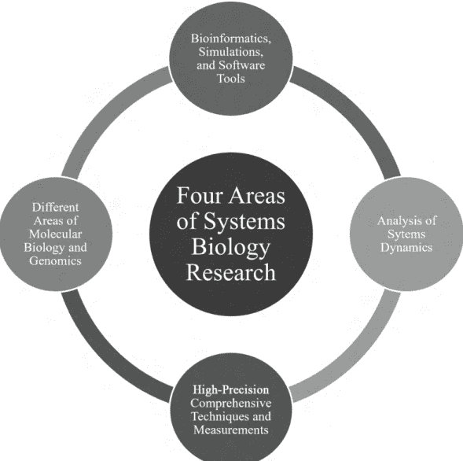

图 1.1 系统生物学的四个主要领域。

识别特定细胞行为背后的特定分子机制。在多维空间中，分叉分析用于理解生物系统的时间相关变化。此外，每个维度与细胞中特定生物化学代谢物的浓度相关 (Kitano 2002)。

##### 1.1.3.3 控制方法

细胞的状态由多种机制控制。这些机制可以变得稳健，以减少或防止由功能失调、内在因素和外在因素引起的改变，这些因素负责此功能失调。此外，这也凸显了特定疾病的潜在治疗领域 (Kitano 2002)。

##### 1.1.3.4 设计方法

它涉及创新策略，以改变和设计具有任务特定属性的生物系统。与传统的试错方法不同，这种方法依赖于一个定义明确的框架。基本概念是设计原则和仿真。

上述四个领域的进步需要在基因组学、计算科学和测量技术方面进行创新，并将这些创新与现有和新知识相结合，是基因组学的前进方向 (Kitano 2002)。

系统生物学试图回答分子相互作用如何负责有机体的生理学和行为的问题。在以前的几个世纪里，数学模型已被应用于遗传学、生物化学、生理学、进化生物学和生态学。然而，不同的科学家——物理学家、数学家、工程师、计算机科学家和生物学家——对模型有不同的定义。如果模型构建要作为研究生物系统的解释工具发挥其充分效力，就必须剖析这些不同的观点，并总结其优势。机械模型的复杂性源于涉及大量未知参数。为了规避这一问题，科学家过去提出了稳健性的概念。这一稳健性理念在科学界得到了广泛接受；然而，该概念的应用仍缺乏精确定义 (Tavassoly et al. 2018)。系统生物学中出现的一个挑战是稳健性，它尤其适用于参数问题。一般来说，稳健性是指系统在中断情况下保持特定性状的能力。为了清楚地说明，必须指定属性的性质、其不变的含义以及正在考虑的扰动类型。“保持不变”可能指对干扰不发生变化的吸引子的数量和种类，以及轨迹的连通性和形式 (Tavassoly et al. 2018)。

#### 1.1.4 稳健性的类型

稳健性引起了广泛关注，部分原因是它可能代表一种生物学设计概念 (Kitano 2002)。如所示，基于动态系统的改变特征，可以对各种形式的韧性进行分类 (表 1.1)。

#### 1.1.5 复杂系统

人工和自然复杂系统都显示出通用设计模式，即出现在几个看似不相关系统中的共享理念和指南。构建能够在长时间和多代中竞争、生存、繁殖和进化的复杂系统——从而促进增强的适应性和整体增长——需要使用这些设计模式。理解这些出现在各种自然和人造复杂系统及环境中的反复设计原则，是复杂系统理论领域的目标。

表 1.1 韧性类型。

| 韧性的各种形式 | 功能 |
|---|---|
| 类型 I 运动中的稳定性 | 能够在保持一致约束值的同时承受初始条件。 |
| 类型 II 对约束变化的韧性 | 对受约束值变化的抵抗力 |
| 类型 III 对约束变化的韧性 | 对参数值调制的稳健性 |
| 类型 IV 结构稳定性 | 对动态功能改变的韧性 |

准确描述复杂系统的特征是复杂系统科学的目标，以提供超越单个系统或特定设计概念的完整理解。更深入地理解这些通用原则将帮助我们更好地导航和理解由环境中的社会和技术增长带来的快速变化 (Mā'ayan 2017)。科学家尝试通过进行多变量实验来分析和掌握复杂系统。这些研究在受控条件下捕获众多系统变量的测量值，以跟踪系统随时间对各种扰动的动态变化。因此，收集的数据用于构建模型，这些模型对于产生能够理解已观察数据的假设是必要的。这些模型对正在研究的真正复杂系统提供了简化的表示或骨架，以深入了解细胞功能 (Mā'ayan 2017)。在复杂系统研究中，建模的目标是将真实系统的复杂性降低到可以在理论上、数学上和认知上理解的可管理规模。

#### 1.1.6 环境复杂性与代理复杂性

在复杂系统和复杂系统设计讨论的背景下，可以识别出两种基本类型：复杂环境和复杂代理。具有明确边界并被物理边界包围的系统被称为复杂代理。这些代理通常具有一个或多个 CPU、时钟、节能获取和使用机制、传感器、执行器以及环境交互能力。复杂代理可以移动、生长、自我修复、自我繁殖，并且经常甚至能意识到自身的存在。人类、细胞、树木、鱼类、蠕虫、鸟类、汽车、飞机和某些类型的机器人是复杂代理的示例 (Mā'ayan 2017)。

#### 1.1.7 从分子到通路和网络

大规模分子数据集由实验组学研究产生，需要统计技术来定位与特定生理或病理条件相关的基因、信使 RNA (mRNA)、蛋白质和其他分子元素。基于其在生物样本中的低表达或过度表达，基因集富集分析 (GSEA) 是一种统计方法，用于寻找导致表型和功能的推定分子成分 (Ashburner et al. 2000)。

使用特定本体论来富集差异表达的分子实体，或者更广泛地说，生物标志物。本体论是组织成特定关系并充当分类层次结构的概念集合。通过将数据（基因或基因产物）与生物过程、分子功能和细胞组分相关联，该本体论充当生物知识发现的工具 (Ashburner et al. 2000)。

系统生物学使用多种本体论，包括细胞的分子生物学 (MBCO) 和基因本体论 (GO)。此外，通过使用生物信息学工具，如京都基因与基因组百科全书 (KEGG)、WikiPathways、Reactome 通路、Progeny 签名和 Broad 签名，数据被转化为生物信息。GSEA 结果提供了关于控制正在研究的特定表型的通路（如信号通路）的宝贵信息。这种方法使识别与正在研究的表型相关的生物过程中重要分子参与者及其角色变得更加容易 (Ashburner et al. 2000)。

在细胞内，信号通路对于信息处理至关重要。这些通路接收来自外部世界的信号，并利用它们来控制细胞的生理学。信号通路是由多个组件组成的复杂网络，这些组件都可以接收、传输和转导信息 (Tavassoly et al. 2018)。细胞信号携带在空间和时间中移动的信息。微分方程和动态系统理论可以用来从数学上研究这一过程。网络中不同路径之间的连通性由受体建立，受体位于细胞表面，负责接收来自外部环境以及其他内部信号组件的信号。这些胞内信号组件在细胞内充当效应器、信号整合器和信息处理单元。

它们是输出设备，显示细胞如何响应来自细胞外的信号。理解信号通路的动力学有助于我们理解细胞如何协调一致地感知和响应环境刺激。GSEA 除了线性路径外，还能实现功能分子网络的设计和分析。这些网络的构建块是相互作用的分子实体；这些实体称为“节点”，相互作用称为“边”。这些相互作用网络包括各种连接，包括触发酶活性激活或抑制以及下游靶标的直接结合。超越线性通路，网络架构提供了对分子组件之间链接和连接的更深入理解，揭示了细胞功能复杂性的细节 (Hansen et al. 2017)。

#### 1.1.8 机器学习与系统生物学

通过实验评估所有蛋白质或核酸片段的可成药性是一项艰巨的任务。由于我们对疾病分子生物学的无知，问题变得更加困难。在这些不确定性下，我们对潜在治疗靶点拥有非常大的样本空间。因此，在没有按重要性对靶点进行排序的能力之前，临床检查每个药理靶点是不可行的。鉴于这些特征，如果计算模型能够以高灵敏度和高特异性在全基因组范围内预测治疗靶点，将不胜感激 (Kandoi et al. 2015)。

由于技术改进，我们现在可以访问大量数据，例如蛋白质和基因表达谱、代谢和基因调控网络、蛋白质-蛋白质相互作用 (PPI) 及其他系统级数据。虽然整合这些不同的数据源仍然很困难，但近年来已取得进展。这些系统级数据现在可以与机器学习和其他

利用数据挖掘方法构建预测模型。根据 Costa et al. (2010)，这些研究可能揭示具有生物学意义的模式，从而赋予潜在治疗靶点可成药性。

机器学习（ML）方法通常涉及以下程序来开发预测模型：选择基于记忆的学习（例如，不可成药和可成药蛋白分子）并归例如：系统级景观）；选择基于记忆的算法；以及评估系统数学模型的预测性能。我们组织本小型综述的步骤如下：首先介绍学习案例，接着是与系统级可成药性预测相关的特征和性能度量，最后是该领域中最流行的 ML 技术（Kandol et al. 2015）。

序列和结构特征是用于构建可预测可成药性模型的众多特征之一。Kandol et al.（2015）的研究关注系统级属性，例如基因表达谱和网络拓扑特征。为了计算网络的拓扑属性（以下简称网络度量）以用作 ML 技术中的学习特征，必须首先构建形成这些度量的 PPI 网络（Kandol et al. 2015）。

根据 Yao and Rzhetsky (2008) 和 Jeon et al. (2014)，靶向药物的蛋白质在其 PPI 网络中表现出与 PPI 网络中其余蛋白质显著不同的某些度量。这些发现基于这些药物-靶点网络领域先驱的工作。因此，在 ML 方法中，网络度量已被证明是可成药性以及必需基因和疾病基因的有希望的预测指标。基于 PPI 拓扑属性的各种组合的 ML 技术似乎对可成药蛋白和基因预测颇具希望。

Jeon et al.（2014）显示，仅使用网络测量构建的预测模型的受试者工作特征曲线下面积（AUC）分别为 69.21% 和约 68%。Jeon et al.（2014）通过将突变发生、原始染色体拷贝数、稳健多阵列平均（RMA）强度和基于规则集预测的遗传算法（GARP）得分等基因组参数与接近中心性相结合，将 AUC 提高到 78%。从这些数据可以推断，仅从 PPI 度量单独来看，只能在某种程度上识别可成药蛋白质。要使用 PPI 度量量化可成药蛋白质的可能性程度，将需要深入研究，其中网络测量将单独和集体地都作为学习特征来使用。

Yao and Rzhetsky（2008）采用了各种 ML 技术，考虑了基因表达谱、连通性和介数中心性以及系统的其他方面，达到 60–72% 的 AUC。Costa et al.（2010）使用基于基因表达谱、亚细胞定位和不同网络度量的预测模型，实现了 82% 的中位数 AUC。这些模型以 74.8% 的精确度正确恢复了 78.2% 的已知靶点。在分析区分可成药基因和不可成药基因的关键特征后，他们发现转录调节因子网络中位置居中的蛋白质更有可能成为药物靶点。通过确定转录调节网络中每个基因的介数中心性，识别出了位置居中的基因。尽管每项研究都使用了不同的网络拓扑参数集，但药理学靶点似乎比典型基因具有更强的中心连接且更集中。因此，它们是未来工作的最佳靶点（Costa et al. 2010）。

### 1.2 系统生物学及其在生殖健康中的相关性：案例研究

系统生物学采取更全面的方法，考虑决定生物系统如何运作的复杂相互作用和网络。这在理解生殖健康错综复杂且相互关联的世界方面尤其有价值。系统生物学整合各种—组学数据，包括基因组学、蛋白质组学、代谢组学和转录组学，以构建对生物系统的全面理解（Zhao et al. 2020）。它利用计算建模和分析来解析不同组件之间的复杂关系，并预测系统在不同条件下的行为。生殖健康涵盖广泛的方面，从生育能力和妊娠到性功能障碍以及与年龄相关的生殖功能下降。系统生物学通过了解不孕症的根本原因，为应对这些挑战提供了一种强大的工具。通过分析基因、激素和环境因素之间的相互作用，系统生物学可以帮助识别男性和女性不孕症背后的潜在机制。通过创建特异于患者的模型来制定个性化治疗策略，系统生物学可以预测个体对不同生育治疗的反应，为生殖保健中的个性化医疗铺平道路。通过改进辅助生殖技术（ARTs），系统生物学可以通过提供关于胚胎发育、着床和妊娠成功的见解来优化 ART 程序。通过模拟母体和胎儿系统之间的复杂相互作用来了解妊娠并发症，系统生物学可以帮助预测和预防子痫前期和妊娠糖尿病等妊娠并发症。系统生物学方法识别出几种参与免疫功能和炎症的基因，这些基因促进子宫内膜异位症的发展。通过分析胚胎中的基因表达模式来预测体外受精（IVF）的成功，研究人员可以开发模型来预测其活性和成功着床的潜力。系统生物学可用于研究接触双酚A（BPA）等环境污染物如何干扰激素信号传导并影响生育能力，以了解环境毒素对生殖健康系统的影响（Cantonwine et al. 2013）。

#### 1.2.1 不孕症和子宫内膜异位症的系统生物学方法

不孕症的诊断和治疗一直专注于识别和解决个体因素，例如激素失衡、解剖异常或基因突变。然而，这种方法往往忽略了这些因素之间错综复杂的相互作用，并未能捕捉生殖系统的动态性质。系统生物学采取全面的视角，考虑基因、蛋白质、代谢物和信号通路之间最终影响生育能力的复杂相互作用网络。这种方法利用各种高通量技术，例如基因组学，即测序整个基因组以识别与不孕症相关的遗传变异。转录组学涉及基因表达模式的分析，以了解在不同细胞类型和不同条件下基因如何被开启或关闭。蛋白质组学是研究细胞或组织中表达的整套蛋白质，以了解它们的功能和相互作用；而代谢组学用于测量小分子（如代谢物）的水平，以深入了解细胞代谢和能量产生（Ding and Schimenti 2021）。

通过整合这些多样化组学平台的数据，系统生物学使研究人员能够更全面地了解不孕症的根本原因，识别新的诊断标志物和治疗靶点，根据个体独特的遗传和分子特征个性化治疗方案，并预测不同 ARTs 成功受孕的可能性。研究人员正在使用系统生物学方法来了解导致子宫内膜异位症（女性不孕症的主要原因）的发展和进展的分子机制。系统生物学正在帮助解读与多囊卵巢综合征（PCOS）相关的复杂激素和代谢失衡，这可能会影响排卵和卵子质量。研究精子蛋白质组和代谢组可以深入了解影响精子活动力、形态和 DNA 完整性的因素，所有这些对于成功受精都至关重要。系统生物学正在被用来识别预测胚胎活性和着床潜力的分子标志物，从而提高 IVF 和其他 ARTs 的成功率。

研究人员正在识别与接受性子宫内膜（胚胎着床的子宫内膜层）相关的基因签名和代谢途径。这可能会导致预测着床成功并指导胚胎移植时机的测试。系统生物学方法正在被用于开发超越传统形态学分级的胚胎质量非侵入性评估方法。这可以改善胚胎选择并减少对可能带来压力的移植程序的依赖。最近的研究探讨了表观遗传修饰在胚胎发育和着床中的作用。了解这些修饰可能会导致改善胚胎活性和减少 IVF 并发症的疗法。研究已经确定了参与间充质干细胞分化为子宫内膜异位细胞的途径，这可能会导致针对该过程的新疗法。系统生物学方法正在调查子宫内膜异位症中免疫细胞与炎症介质之间的复杂相互作用，为减轻疼痛和炎症提供治疗靶点。最近的研究探讨了表观遗传修饰在子宫内膜异位症发展和持续中的作用，暗示了表观遗传疗法的潜在途径。

#### 1.2.2 子痫前期的系统生物学方法

子痫前期是一种在妊娠20周后出现高血压和蛋白尿的危及生命的妊娠并发症，对母亲和婴儿都构成重大挑战。传统上，研究子痫前期涉及关注

由于其多因素特性，针对单个基因或蛋白质的研究往往效果有限。系统生物学通过分析海量组学数据，有望揭示子痫前期的复杂性，研究人员可以精准定位与疾病发展相关的关键通路和网络。构建模拟子痫前期进展的计算模型，可以模拟各种遗传和环境因素的影响，为疾病机制提供宝贵见解。研究揭示了子痫前期的四种不同分子亚型，每种都有独特的基因特征和潜在通路。这表明未来可能需要个性化治疗方案。另一项研究利用系统生物学鉴定出参与血管生成（血管形成）的基因网络。异常血管生成是子痫前期的标志，这一发现阐明了其在疾病发病机制中的潜在作用。研究人员正在积极开发子痫前期的计算模型，以评估不同治疗方案的疗效。这些模型可以个性化护理，并优化个体患者的治疗干预（Odenkirk et al. 2020）。

无论分子分析类型（全面、单细胞、游离等）或使用的样本类型（胎盘、血液等），子痫前期的高通量研究大致可分为三种应用。我们将第一种应用称为类别比较。研究目的是比较具有临床定义表型（如所有早发性或晚发性子痫前期病例）患者的分子谱与对照组的分子谱。这种方法有助于推断与观察到的症状相关的病例中受干扰的通路和生物过程，并可能导致潜在治疗靶点的发现。类别预测是第二种应用。为了创建疾病预测模型，该方法采用机器学习技术和判别分析。其目标不是分析揭示出的分子谱变化，而是最大化预测准确性和简洁性。类别发现是必要的，因为子痫前期是一种综合征性疾病，其特征是表达谱存在显著差异。这对类别比较和类别预测应用都带来了挑战（Chang et al. 2023）。

#### 1.2.3 妊娠糖尿病的系统生物学方法

妊娠糖尿病（GDM）影响3%–8%的孕妇，对母亲和胎儿都构成重大威胁。妊娠期间发生或被识别出的任何程度的葡萄糖耐受不良均称为GDM，是妊娠期间最常见的代谢性疾病之一。尽管传统上通过单个基因或蛋白质进行研究，但其多因素特性要求采用整体方法。系统生物学是一个强大的框架，能为GDM的复杂性提供新的见解。通过整合组学数据，研究人员可以识别参与胰岛素抵抗和代谢失调的关键通路和调控网络。鉴于GDM是一种代谢性疾病，代谢组学研究非常适合实时追踪由母体刺激或干扰引起的微小分子代谢物变化。用于GDM的代谢组学可用于识别诊断生物标志物、评估预后、指导饮食或药物应用、评估疗效以及调查过程。构建GDM进展的计算模型可以模拟遗传和环境因素的影响，为疾病机制和个性化治疗提供宝贵见解（Wang et al. 2021）。

一项研究鉴定出参与GDM发展的长链非编码RNA（lncRNAs）和微RNA（microRNAs）网络。这表明lncRNAs可能是潜在的治疗靶点或早期诊断生物标志物。研究人员开发了GDM代谢通路的计算模型。该模型有助于识别关键调控节点并预测不同治疗策略的影响，为个性化方法铺平了道路。系统生物学方法正在被用于理解胎盘功能障碍在GDM中的作用。这可能导致针对胎盘的新型干预措施，以改善母婴结局（Zhu et al. 2022）。

作为生物系统的重要组成部分，代谢组学主要检查血液、尿液和粪便，然后深入研究各种代谢途径基质和副产物中的小分子代谢物。在研究GDM等妊娠相关疾病时，也会采集羊水和脐带血清进行检查。偶尔也会采集母亲的头发或胎盘进行检查。许多代谢物谱研究使识别GDM和糖尿病的潜在分子通路变得更加容易，有助于识别两种疾病的异同。Zhu等人的代谢物指标研究及早期GDM检测面板的开发使临床应用成为可能。不断发展的代谢组学领域为疾病的起源和进展提供了新的视角。在最近的GDM研究中，代谢组学常用于不同的妊娠阶段。预计代谢组学将在GDM的多样化和早期诊断中发挥重要作用。由于纵向代谢组学，妊娠相关的代谢变化可以动态监测。此外，不同生理亚型的GDM患者在预后和代谢背景方面存在差异。在考虑GDM的临床指数和生理亚型时，代谢组学将具有临床意义。

碳水化合物、氨基酸、脂质代谢物（脂肪酸（FAs）、磷脂、鞘氨醇等）、嘌呤、尿酸、胆酸及其他小分子代谢物，以及相关代谢通路，是GDM代谢组学研究的核心对象。GDM代谢组学研究的主要关注点是脂质、氨基酸、碳水化合物、甾体激素、胆汁酸等小分子代谢物的异常以及受干扰的代谢通路。此外，代谢组学研究还包括基于已发现物质的数据对代谢和信号通路进行检查。这有助于通过便于研究相关代谢物、酶和基因，更好地理解这些通路的底层生物学现象（Spanou et al. 2022）。

个体的不同阶段决定了代谢组学在GDM中的临床效用。聚焦于孕早期的研究的主要临床效用是识别与GDM疾病相关的早期诊断或预测分子。聚焦于孕中期和孕晚期的研究的主要临床益处包括能够精确评估GDM状态、识别不同的代谢标志物和代谢通路、预测妊娠进程以及母亲和胎儿的预后，或评估药物或饮食疗法的效果（Li et al. 2019）。

### 1.3 机器学习及其在医疗保健中的应用

人类通过观察世界并学习预测未来事件来理解世界。这涉及反复针对观察到的数据测试模型并进行调整，以提高其准确性。与其他多细胞生物类似，人类由无数细胞组成，细胞是生命的基本组成单位。在复杂的多细胞生物中，这些细胞被组织成组织，形成一组协作以执行特定功能的相似细胞。器官由两种或多种组织组织而成，以履行特定功能。当调节过程发生故障或无法正常运作时，就会发生疾病（Golemis et al. 2018）。调节机制的中断可以通过多种方式发生，例如单核苷酸突变、插入和缺失、拷贝数变化、表观遗传模式修饰以及染色质构象修饰。识别导致这些生化过程紊乱的变化对于实施有效干预至关重要。尖端测序方法和多样化成像技术的最新进展使得对正常和患病组织中基因组、表观遗传和蛋白质特征进行全面检查成为可能。这些分子谱共同构成了疾病的基因型。电子健康记录的使用已被广泛整合到临床实践和研究中，为疾病的表型提供了全面的描述（Overby 2013）。

研究人员长期以来一直寻求理解复杂的生物系统，最近的进步促进了这方面的重大进展。高通量测序成本的持续降低、大规模并行技术的出现以及新型传感器技术的创新，使得能够生成关于生物系统的多维数据。这些维度涵盖DNA序列、表观基因组状态、单细胞表达活性、蛋白质组学、功能和表型测量，以及生态和生活方式特性（The ENCODE Project Consortium 2012）。

“机器学习”一词广义上涵盖了从数据构建预测模型或在数据集中识别有意义模式的过程。本质上，机器学习通过计算手段客观地复制人类的模式识别能力。在处理对于人类分析来说要么太大（包含大量个别数据点）、要么太复杂（具有大量特征）的数据集时，它特别有价值。当需要自动化数据分析以建立可重复且高效的流水线时，这一点尤其正确。生物实验常常产生具有这些特征的数据集，因为在过去几十年中，数据集的规模和复杂性已大幅增加。不仅要有解释这些海量数据的实用方法，而且还要对所采用的技术有扎实的理解，这已变得至关重要。

ML 已成为医疗保健领域的一种变革力量，彻底改变了医学研究、诊断和患者护理的各个方面。在诊断领域，ML 算法已证明擅长分析复杂的医疗数据，包括影像和基因组信息，以提高疾病检测的准确性。研究表明，ML 模型在早期识别癌症、心血管疾病和神经系统疾病等病症方面已成功定位。这些模型不仅展现出卓越的诊断能力，还通过考虑个体患者档案，为个性化治疗策略做出贡献。此外，其预测能力在预后评估和风险评估中发挥着关键作用。研究强调，ML 算法在预测患者预后、预测疾病进展和优化治疗方案方面的有效性。这对资源分配、治疗优化和提升整体医疗效率具有深远影响。除了诊断和预后，ML 应用还扩展至药物发现、个性化医疗和医疗管理。

通过使用 ML 算法，可以整合广泛且多样的数据集，包括临床记录、影像数据和基因组信息。这种整合有助于更深入地理解疾病的遗传基础，并帮助识别最有效的治疗策略。已制定了众多研究计划来利用这一方法，例如 All of Us 研究计划。该计划旨在从一百万名参与者中收集基因组序列数据，并有望在推动精准医学研究平台方面发挥关键作用。

本综述旨在让读者了解 ML 技术，将特定技术与不同类型的生物数据相关联，并与特定生物学学科中现有的综述进行类比。所概述的研究强调了 ML 彻底改变医疗服务提供、引领精准医学和数据驱动决策时代的潜力，并最终改善患者预后并增强医疗系统。

#### 1.3.1 Types of Machine Learning

ML 中有三种基本的学习范式：监督学习、无监督学习、强化学习和深度学习（表 1.2）。

##### 1.3.1.1 Supervised learning

在监督学习中，该过程涉及利用由带有可识别类别标签的样本组成的训练数据来开发预测器。在此方法中，目标是基于样本的已知特征来预测新样本的类别。例如，可以使用基于肿瘤样本基因表达模型构建的模型（包含已知患者预后的肿瘤样本数据）来预测患者的预后。在监督学习中，处理分类输出标签（如良好预后与不良预后）时，该程序称为“分类”；处理连续输出（如生存月数）时，称为“回归”。监督学习算法的示例包括

### TABLE 1.2 不同机器学习方法在医疗保健中的常见应用。

| 方法 | 描述 | 医疗保健中的应用 |
|---|---|---|
| 监督学习 | 使用带标签的训练数据进行预测 | 诊断疾病（如癌症、糖尿病）、预测患者预后、药物发现与开发 |
| 无监督学习 | 从无预定义输出的无标签数据中学习 | 医学影像中的模式识别、医疗保健数据中的异常检测 |
| 强化学习 | 通过奖励和惩罚的试错来学习 | 个性化治疗方案、临床决策支持系统 |
| 深度学习 | 使用深度神经网络学习复杂模式，以及医学影像分析（如 CT 扫描、MRI） | 医疗保健中的自然语言处理、药物发现与开发 |

监督学习算法包括线性回归和逻辑回归。学习到的预测器，或更准确地说，预测函数，可以采用直线或多维空间中高度复杂的曲线形式，具体取决于所提供数据的特征。已开发出数百种分类算法（Fernandez et al. 2014）。在监督学习中，一个关键考量是在对新样本进行分类时评估分类模型的性能。因此，复杂模型不仅可能捕捉真实模式，还可能合并训练数据中的噪声，从而导致称为过拟合的现象。过拟合可能导致训练期间的预测误差平均值显著低于对不熟悉样本观察到的误差。这种奥卡姆剃刀的应用有助于减轻过拟合。交叉验证充当一种方法，用于评估模型预测其训练阶段未使用的新数据的能力。其主要目标是识别潜在问题（如过拟合或选择偏差），并提供有关模型泛化到独立数据集的能力的见解（Varma and Simon 2006）。

监督学习技术已被证明在开发预后和预测生物标志物方面有效。患者的临床结局受多种因素影响，包括患者固有特征、疾病性质以及所接受治疗的影响。预后因素（与治疗无关）在患者结局中发挥作用，而能够识别对特定治疗方案反应的生物标志物则称为预测性生物标志物。预后性生物标志物有助于识别需要积极治疗的患者，而预测性生物标志物则有助于确定个体的最佳治疗方案。

第 1 期研究是旨在生成假设以锁定潜在标记以供进一步检查的初步分析。随后，第 2 期研究扩展了调查并评估标记与预测之间的关联。最后，第 3 期研究以其大规模为特征，作为旨在明确阐述先前假设的验证性调查。第 3 期研究必须遵循明确定义的方案，以确保获得最高级别的证据（Kambhampati and Mistry 2023）。

开发预后标志物的有效 ML 方法包括回归模型、分类和回归树。

##### 1.3.1.2 Unsupervised Learning

它涉及旨在发现无标签数据中模式或结构的算法。聚类和降维是常见应用，使算法能够识别数据集中固有的关系和分组。聚类分析是一种根据样本之间的相似性将样本组织成不同组的技术。这些组包含比其他组中的样本更相似的样本。各种聚类算法（各有其优缺点）被应用于生物医学研究。层次聚类、自组织映射和 K-means 是为此目的最常用的算法之一（D'haeseleer 2005）。无监督学习已被广泛应用于识别生物样本中的同质亚组。鉴于各种疾病中观察到的临床结局和治疗反应的异质性，识别同质患者亚组至关重要。这有助于确定影响疾病和治疗效果的生物学因素。尽管这种方法在治疗乳腺癌患者方面已取得显著成功，但越来越多的人认识到，将此方法扩展到所有类型的癌症可能是有益的（Cancer Genome Atlas Network 2012）。

##### 1.3.1.3 Reinforcement Learning

这围绕着代理与环境相互作用的概念展开。代理采取行动，以奖励或惩罚的形式接收反馈，并调整其策略以最大化随时间推移的累积奖励。这种范式在训练自主系统和决策过程中起着关键作用。强化学习技术的使用已被证明在优化人类免疫缺陷病毒（HIV）的抗逆转录病毒治疗以及在定义管理脓毒症的最佳策略方面是有效的。强化学习算法被用于有效学习最优策略。尽管面临挑战，这些算法正在被积极用于解决医疗保健领域内的重大问题（Gottesman et al. 2018）。

##### 1.3.1.4 Deep Learning

它是 ML 的一个子集，专注于具有多层（深度神经网络）的神经网络。这种架构能够从数据中自动提取分层特征，在图像识别、自然语言处理和其他复杂任务方面取得了显著成就（LeCun et al. 2015）。深度学习（也称为深度神经网络，DNN）近年来经历了大幅增长。DNN 属于人工神经网络（ANN）类别，其特征是具有众多隐藏层和不同的激活函数。

ANN 的基本单位是神经元，它接收一组输入值并基于这些值生成一个单一输出。这通常通过

通过对所有输入的线性组合求和，每个输入乘以相应的权重，随后将结果应用于非线性函数。一个层由一组这样的神经元组成，并且在输入层和输出层之间存在多个层，包括隐藏层。在DNN的语境中，当存在多个隐藏层且数量超过一个时，使用术语“深”（Sahraeian et al. 2019）。DNN在临床语境中的应用已取得显著进展。例如，深度学习被用于利用细胞系实验得出的基因表达数据，直接预测抗癌药物组合的效果。卷积神经网络（CNNs）广泛用于临床图像分析，例如将皮肤病变分类为恶性或良性，其准确率可与皮肤科医生相媲美（Esteva et al. 2017）。在一项研究中，Khosravi et al. (2019) 利用CNN结构评估IVF案例中的囊胚图像，其预测胚胎质量以实现成功妊娠的能力优于单个胚胎学家。

### 1.4 医疗保健中机器学习的应用

机器学习起源于20世纪50年代，艾伦·图灵（Alan Turing）引入了第一台能够学习并实现人工智能的机器概念（Turing 1950）。该领域的最新进展展现了显著的进步，为减轻医生工作量、提升医疗保健的精准性、预测能力和质量提供了机遇。机器学习利用先进算法从海量数据集中提取有意义的洞察，正在彻底改变医疗保健。将机器学习技术融入医疗流程，能够提升诊断、治疗方案和整体患者护理水平。在诊断方面，机器学习擅长图像和信号分析，有助于从医学影像和诊断检测中发现异常和疾病。分析患者数据中复杂模式的能力，可实现疾病早期检测和个性化治疗策略。当前，医疗保健领域的机器学习进展主要作为支持性工具，协助医生和分析人员履行职责、识别医疗保健趋势，并构建疾病预测模型。在大型医疗机构中，已采用基于机器学习的策略，以提升电子健康记录（Habehh and Gohel 2021）的管理效率，该过程通过医学影像和监测实施。此外，机器学习还应用于机器人辅助手术（Kaouk et al. 2019）。机器学习的最新应用促进了抗击COVID-19中的快速检测和医院响应。通过GE开发的名为“临床指挥中心”的深度学习系统，医院在疫情期间高效管理、共享和追踪了患者、病床、病房、呼吸机、电子健康记录（EHRs）和人员等多种资源（Habehh and Gohel 2021）。机器学习还对预测分析做出贡献，预测患者结局并识别高危个体，从而实现主动干预。这种主动方法在慢性疾病管理中尤为有价值（Figure 1.2）。

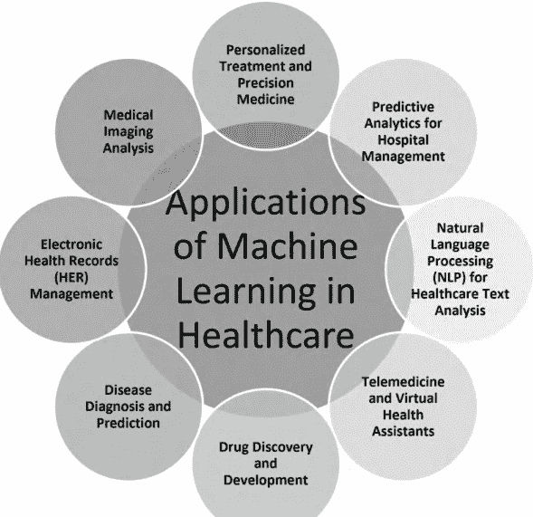

图 1.2 医疗保健中机器学习的各种应用。

#### 1.4.1 诊断：疾病检测中医学影像的机器学习应用

将机器学习融入医学影像，加速疾病检测，改变诊断方式。算法分析海量图像数据集，提高准确性和效率。在放射学领域，机器学习有助于早期发现X射线、磁共振成像（MRIs）和计算机断层扫描（CT）中的异常。计算机辅助检测系统提高了诊断速度和精度，尤其是在癌症筛查中。这些进步不仅加快了诊断，还为个性化治疗方案做出了贡献，开启了更有效、更具针对性的医疗干预新时代。机器学习在医学影像中作为推动诊断进步的基石，有望改善患者结局并简化临床工作流程（Cury et al. 2021）。

#### 1.4.2 预后：患者结局和疾病进展的预测建模

预后借助预测建模，通过预测患者结局和疾病进展，彻底改变医疗保健。利用先进算法分析患者数据，为临床医生制定个性化治疗方案和早期干预提供宝贵洞察。这种方法不仅提高了医疗保健效率，还通过预见和减轻潜在并发症，有助于改善患者护理。

预后作为一种强大工具，开启了主动式和数据驱动的医疗保健策略新时代（Freitas 2024）。

#### 1.4.3 治疗优化：个性化医疗和自适应治疗方案

治疗优化由个性化医疗和自适应治疗方案驱动，根据个体特征定制医疗保健策略。利用患者特定数据，该方法允许精准、针对性的干预。根据实时反应和不断变化的患者需求调整治疗方案，可最大化治疗效果。治疗优化标志着一种范式转变，开启了医疗保健日益个性化的新时代，确保患者获得最有效、最个性化的护理，从而改善结局（Adjari et al. 2018）。

#### 1.4.4 药物发现：利用机器学习加速药物开发过程

借助机器学习，药物发现经历了变革性的加速，简化了漫长的药物开发过程（Duch et al. 2007）。药物开发和发现过程涉及先导物优化，以及靶点的识别和验证、活性物发现以及临床试验的执行。为应对这一挑战，临床医生已采用计算机辅助药物设计（CADD）技术，如Hassan Baig et al. (2016)所讨论。在药物发现中利用这种方法，人工方法不仅提供分子性质，还提供具有理想特征的体内先导化合物。机器学习算法分析海量生物数据集，预测潜在药物候选物及其疗效。这种数据驱动的方法加速了靶点识别、化合物筛选和毒性预测。通过显著降低时间和资源需求，机器学习在药物发现中有望实现更快速、更具成本效益的新疗法开发，满足关键医疗需求，并推动制药创新（Duch et al. 2007）。

### 1.5 结论

总之，机器学习与医疗保健的融合取得了深远的进步，彻底改变了诊断、治疗策略和患者结局。机器学习算法强大的预测能力在临床决策和风险评估方面已显示出显著疗效。挑战依然存在，包括对标准化数据和强健验证方法的需求。计算方法与医学科学之间的共生关系需要持续的跨学科合作。随着机器学习应用的不断发展，完善可解释性并确保伦理考量将至关重要。机器学习在医疗保健中的轨迹预示着范式转变，强调了严谨科学探究和持续改进的必要性，以充分释放其变革潜力。系统生物学与机器学习在生殖健康中的融合，有助于理解促进生育能力和妊娠结局的复杂分子相互作用。这种协同作用能够实现预测模型、定制疗法和创新干预的发展，推动生殖医学朝着更精准、更高效的解决方案迈进。

## 参考文献

Ajdari A, Ghate A, Kim M (2018) 时空生物整合放射治疗中的自适应治疗时长优化. Phys Med Biol 63:075009. https://doi.org/10.1088/1361-6560/aab4b6

Ashburner M, Ball CA, Blake JA, et al (2000) 基因本体：统一生物学的工具. Nat Genet 25:25–29. https://doi.org/10.1038/75556

Birney E (2021) 国际人类基因组计划. Hum Mol Genet 30:R161–R163. https://doi.org/10.1093/hmg/ddab198

Cantonwine DE, Hauser R, Meeker JD (2013) 双酚A与人类生殖健康. Exp Rev Obstet Gynecol 8:329–335. https://doi.org/10.1586/17474108.2013.811939

Chang K-J, Seow K-M, Chen K-H (2023) 子痫前期：预测、预防和管理母胎危及生命状况的最新进展. IJERPH 20:2994. https://doi.org/10.3390/ijerph20042994

Costa PR, Acencio ML, Lemke N (2010) 基于系统水平数据的全基因组发病和可成药人类基因预测的机器学习方法. BMC Genom 11:S9. https://doi.org/10.1186/1471-2164-11-S5-S9

Cury RC, Megyeri I, Lindsey T, et al (2021) 基于胸部CT成像的呼吸道疾病检测及美国COVID-19大流行追踪的自然语言处理与机器学习. Radiol Cardiothorac Imag 3:e200596. https://doi.org/10.1148/ryct.2021200596

D'haeseleer P (2005) 基因表达聚类如何运作？ Nat Biotechnol 23:1499–1501. https://doi.org/10.1038/nbt1205-1499

Ding X, Schimenti JC (2021) 识别导致不孕的遗传变异的策略. Trends Mol Med 27:792–806. https://doi.org/10.1016/j.molmed.2020.12.008

Duch W, Swaminathan K, Meller J (2007) 合理药物设计与发现的人工智能方法. CPD 13:1497–1508. https://doi.org/10.2174/138161207780765954

Dulbecco R (1986) 癌症研究的转折点：测序人类基因组. Science 231:1055–1056. https://doi.org/10.1126/science.3945817

Esteva A, Kuprel B, Novoa RA, et al (2017) 基于深度神经网络的皮肤科医生水平的皮肤癌分类. Nature 542:115–118. https://doi.org/10.1038/nature21056

Fernandez-Delgado M, Cernadas E, Barro S, Amorim D (2014) 解决现实世界分类问题是否需要数百个分类器？ https://jmlr.org/papers/v15/delgado14a.html

Freitas, AT (2024) 医疗保健中的数据驱动方法：挑战与新兴趋势，收录于：Sousa Antunes H, Freitas PM, Oliveira AL, Martins Pereira C, Vaz De Sequeira E, Barreto Xavier L (编). 人工智能与法律的多学科视角. Springer International, Cham, pp. 65–80. https://doi.org/10.1007/978-3-031-41264-6_4.

Golemis EA, Scheet P, Beck TN, et al (2018) 美国常见癌症原因的分子机制. Genes Dev 32:868–902. https://doi.org/10.1101/gad.314849.118

Gottsman O, Johansson F, Meier J, et al (2018) 观察性医疗环境中强化学习算法的评估. arXiv:1805.12298 cs.LG. https://doi.org/10.48550/ARXIV.1805.12298

Habehh H, Gohel S (2021) 医疗保健中的机器学习. CG 22:291–300. https://doi.org/10.2174/1389202922666210705124359

Hansen J, Meretzky D, Woldesenbet S, et al. (2017) 从亚细胞过程关系推断涌现全细胞功能的灵活本体. Sci Rep 7:17689. https://doi.org/10.1038/s41598-017-16627-4

Hassan Baig M, Ahmad K, Roy S, et al. (2016) 计算机辅助药物设计：成功与局限. CPD 22:572–581. https://doi.org/10.2174/1381612822666151125000550

Jeon J, Nim S, Teyra J, et al. (2014) 利用机器学习、抑制剂设计和高通量筛选识别新型癌症药物靶点的系统方法. Genome Med 6:57. https://doi.org/10.1186/s13073-014-0057-7

Kambhampati R, Mistry K (2023) 临床试验方案设计的要素. In: Jagadeesh G, Balakumar P, Senatore F (eds). 基础与临床研究及科学出版的精髓 [Internet]. Singapore: Springer Nature Singapore; p. 361–71. 可从以下网址获取: https://link.springer.com/10.1007/978-981-99-1284-1_22 (2024年9月25日访问)

Kandoi G, Acencio ML, Lemke N (2015) 利用机器学习和系统生物学预测可成药蛋白：一篇小综述. Front Physiol 6:366. https://doi.org/10.3389/fphys.2015.00366

Kaouk JH, Garisto J, Eltemamy M, Bertolo R (2019) 良性远位尿道狭窄的机器人辅助手术：使用SP®手术系统的逐步技术. BJU Intl 123:733–739. https://doi.org/10.1111/bju.14635

Khosravi P, Kazemi E, Zhan Q, et al. (2019) 深度学习使体外受精后人类囊胚的稳健评估与选择成为可能. npj Digit Med 2:21. https://doi.org/10.1038/s41746-019-0096-y

Kitano H (2002) 系统生物学：简要概述. Science 295:1662–1664. https://doi.org/10.1126/science.1069492

LeCun Y, Bengio Y, Hinton G (2015) 深度学习. Nature 521:436–444. https://doi.org/10.1038/nature14539

Li G, Gao W, Xu Y, et al. (2019) 基于LC-MS的妊娠糖尿病孕妇血清代谢组学研究. Saudi J Biol Sci 26:2057–2063. https://doi.org/10.1016/j.sjbs.2019.09.016

Ma'ayan A (2017) 复杂系统生物学. J R Soc Interface 14:20170391. https://doi.org/10.1098/rsif.2017.0391

Odenkirk MT, Stratton KG, Gritsenco MA, et al. (2020) 利用多组学和创新化学信息学可视化工具揭示子痫前期和妊娠糖尿病的分子特征. Mol Omics 16:521–532. https://doi.org/10.1039/D0MO00074D

Overby CL, Kohane I, Kannyry JL, Williams MS, Starren J, Bottinger E, et al. (2013) 基因组临床决策支持干预的机会. Genet Med 15:817–23. https://doi.org/10.1038/gim.2013.128

Sahraeian SME, Liu R, Lau B, et al. (2019) 用于准确体细胞突变检测的深度卷积神经网络. Nat Commun 10:1041. https://doi.org/10.1038/s41467-019-09027-x

Spanou L, Dimou A, Kostara CE, et al. (2022) 妊娠糖尿病影响的代谢通路研究：与2型糖尿病的比较. Diagnostics 12:2881. https://doi.org/10.3390/diagnostics12112881

Tavassoly I, Goldfarb J, Iyengar R (2018) 系统生物学入门：基本方法和途径. Essays Biochem 62:487–500. https://doi.org/10.1042/EBC20180003

The Cancer Genome Atlas Network (2012) 人类结肠和直肠癌的全面分子特征分析. Nature 487:330–337. https://doi.org/10.1038/nature11252

The ENCODE Project Consortium (2012) 人类基因组中DNA元件的整合百科全书. Nature 489:57–74. https://doi.org/10.1038/nature11247

Turing AM (1950) 计算机械与智能. Mind LIX:433–460. https://doi.org/10.1093/mind/LIX.236.433

Varma S, Simon R (2006) 使用交叉验证进行模型选择时误差估计中的偏差. BMC Bioinform 7:91. https://doi.org/10.1186/1471-2105-7-91

Wang Q-Y, You L-H, Xiang L-L, et al. (2021) 妊娠糖尿病代谢组学的当前进展. WJD 12:1164–1186. https://doi.org/10.4299/wjd.v12.i8.1164

Yao L, Rzhetsky A (2008) 成功药物靶向人类基因的定量系统水平决定因素. Genome Res 18:206–213. https://doi.org/10.1101/gr.6888208

Zhao C, Ge J, Li X, et al. (2020) 整合代谢组学分析揭示妊娠糖尿病女性母体粪便代谢组与新生儿血液代谢组之间的新关联. Sci Rep 10:3660. https://doi.org/10.1038/s41598-020-60540-2

Zhu Y, Barupal DK, Ngo AL, et al. (2022) 早期至中期妊娠妊娠糖尿病的预测性代谢组学标志物：一项前瞻性检验和验证研究. Diabetes 71:1807–1817. https://doi.org/10.2337/db21-1093

## 生殖健康中的数据源与数据整合

Souradip Basu, Saptarshi Bhattacharyya, Saptaki De, Mahashweta Mitra Ghosh, and Sayak Ganguli

### 2.1 引言

贯穿一生的男性和女性生殖系统的状况，由“生殖健康”这一术语所涵盖。这些系统由产生激素的器官和腺体组成，其中大脑中的垂体即为一例。女性卵巢和男性睾丸作为生殖器官（性腺），对维持各自系统的健康至关重要。此外，这些器官通过产生和释放激素，还具有腺体的功能。与女性和男性生殖系统相关的问题包括：

- 青春期早发或延迟
- 子宫内膜异位症以子宫内膜组织在子宫外异常生长为特征
- 母乳供应不足
- 生育力方面的挑战，包括受孕困难或生育力低下
- 月经不规律，例如过多或不可预测的出血
- 多囊卵巢综合征会导致卵巢产生雄激素增多
- 妊娠并发症
- 子宫肌瘤是发生在女性子宫或子宫内的良性生长物
- 勃起功能障碍或阳痿
- 精子数量减少

科学家认为环境因素会导致各种生殖问题。根据研究结果，环境影响对生殖健康的影响包括：

- 铅暴露已与男性和女性生育力降低相关联 (Clay et al. 2018)。
- 汞暴露与神经系统和生殖系统的困难相关联，影响记忆、注意力、生育力和精细动作能力等方面 (Santos-Lima et al. 2020)。
- 使用给孕妇服用的药物己烯雌酚（DES），可能会增加其女儿患癌症、不孕症和妊娠并发症的风险 (Titus et al. 2019)。
- 暴露于干扰内分泌功能（影响激素）的物质，可能导致与青春期、生育力和妊娠相关的问题 (Li et al. 2015)。

参与生殖健康研究的主要机构之一是疾病控制与预防中心（CDC），该中心采取了若干关键举措，对全球生殖健康研究的全面改善起到了重要作用。CDC的生殖健康司及其众多举措在图2.1中有所描绘。

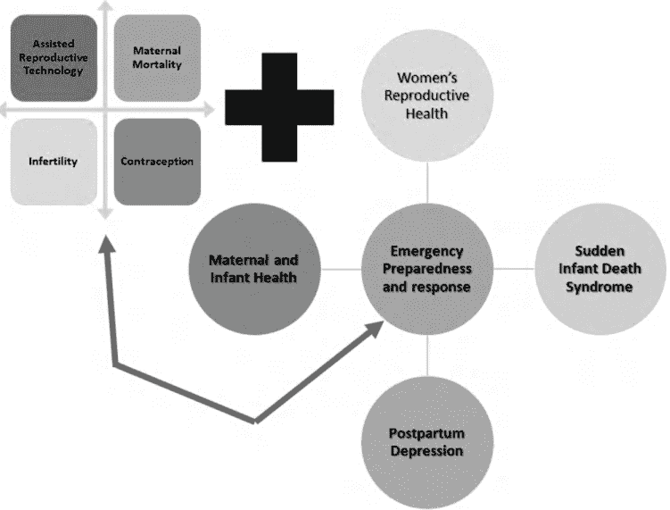

图2.1 CDC生殖健康司及其多元举措。

#### 2.1.1 常用数据源

表2.1描述了常用的数据源，并列出了其缩写。

### 2.2 新生儿和孕产妇健康问题的识别

#### 2.2.1 临床和行政数据的作用

为识别影响母亲和儿童健康的因素，采用了多种人口层面的数据来源。一个突出的来源是电子健康记录（EHR），它涵盖人口统计学、人体测量学、诊断、生命体征、药物以及多样化的临床数据，为患者的健康史提供全面的概述。运营性保险索赔数据因其在广阔地理区域内拥有大样本量（尽管信息较不详细）而闻名，在构建和分析与妊娠相关的队列方面已显示出疗效（Marić et al. 2020）。利用基于EHR的模型来预测妊娠糖尿病（GDM）、子痫前期和早产（PTB）等状况的研究，强调了这些数据来源在生殖健康领域的重要性。此外，通过尿液分析和尿培养识别的蛋白尿和细菌尿等指标，可作为子痫前期等严重疾病的可靠预测因子（Tanaçan et al. 2019）。人工智能（AI）的最新进展使临床医生能够将这些重要且成本效益高的检测纳入比以往可实现的更先进的预测和诊断模型中（Burton et al. 2019）。

#### 2.2.2 表观遗传学和遗传数据来源的洞见

妊娠的发生受母亲的遗传背景和胎儿的表观遗传编程共同影响。母亲的遗传变异会影响蜕膜化和胎盘形成等关键发育过程；然而，胚胎和胎儿发育特征的微妙平衡免疫状态，由母亲和胎儿的遗传共同塑造（Huusko et al. 2018）。尽管影响不同妊娠并发症的遗传因素预计为多基因性的，但全基因组关联研究（GWAS）已识别出与自发性早产（sPTB）相关的特定遗传变异，这表明母亲的遗传构成在受孕前即可影响胎儿发育和妊娠结局。相反，母亲的表观遗传修饰反映了各种细胞类型在组织中为支持胎儿生长而进行重编程时的状态。通过对相关细胞亚群中的DNA甲基化、组蛋白标记和染色质可及性进行分析，来评估这些改变，可以了解母胎界面特定细胞类型是否适应成功的妊娠（Kwak et al. 2019）。

#### 2.2.3 利用组学数据阐明生物学通路

除了遗传和表观遗传信息外，采用高通量方法来研究母体转录组、代谢组、蛋白质组和微生物组

可以更全面地了解母亲的生物学状态。鉴于妊娠期间母体组织中组织特异性基因表达的广泛改变，以及伴随的代谢、激素和免疫调适，多种方式可以在特定时间点揭示母体和胎儿健康的各个方面（Handelman et al. 2019）。例如，从血液或羊水中提取的游离RNA（cfRNA）可用于监测胎儿发育和胎盘形成的动态，通过在母体血浆中识别胎盘形成受损的标志物，为子痫前期的早期检测提供意义（Park et al. 2021）。相反，微生物组学可以探索阴道、口腔和肠道微生物组，这些对于维持胎儿耐受所需的免疫平衡至关重要（Mei et al. 2019）。阴道微生物组的紊乱，如细菌性阴道病所示，可能由于炎症机制或由阴道微生物引起的羊膜腔感染而导致早产（PTB）。同样，致病性口腔微生物可通过引发源于口腔疾病的全身性炎症或血行播散至羊水来加剧早产（PTB）（Cobb et al. 2017）。最后，肠道微生物组影响小分子和激素的代谢，同时调节代谢和免疫功能；当其平衡被打破时，已与妊娠糖尿病（GDM）和早产（PTB）相关联（Yang et al. 2020）。综上所述，多种组学技术在阐明妊娠相关疾病的分子成分方面具有巨大潜力。

### 2.3 使用机器学习进行建模

#### 2.3.1 机器学习

机器学习涵盖多种统计技术，用于基于一组属性（例如，患者的临床测量值）从数据中得出推断（Wainberg et al. 2018）。监督学习包含学习根据给定特征集预测特定属性或结果（例如，早产PTB）的算法。它被称为“监督”是因为对于足够大的数据集（患者数量），结果是已知的，这有助于识别特征与结果之间的关系，从而实现预测模型的开发。相比之下，无监督学习缺乏对结果的先验知识，并试图发现数据中隐藏的模式或结构（Wang 2001）。半监督学习结合了监督学习和无监督学习的要素，其中仅有有限数量样本的结果是已知的。在妊娠领域，主要侧重于监督学习，即利用病史或组学检测测量值等信息（输入）来预测胎龄（GA）或早产（PTB）等结果（输出）。通常，输入以表格形式结构化，其中每一行表示一个样本，列代表分类或数值数据，输出为单一结果。

| S. No. | Title | Purpose | Sponsorship | Design |
| :--- | :--- | :--- | :--- | :--- |
| 1 | 美国家庭成长全国调查（NSFG） | “美国家庭成长全国调查（NSFG）是全面了解美国境内生育多个方面的重要资源。它提供了关于生育趋势、不孕不育率、生殖健康、避孕行为和生育意向的宝贵见解。此外，该调查还涵盖与子女发展相关的广泛话题，包括非意愿生育、收养、青少年怀孕、单亲母亲、产前及产后护理以及婴儿健康。NSFG 收集的数据可以与各种社会、经济和家庭因素一起分析，丰富研究结果的深度。鉴于其自 1955 年以来的悠久历史，该调查有助于考察时间序列统计数据，使研究人员能够追踪家庭计划、避孕用药和生殖健康模式随时间的变化。国家和地方层面的研究人员、医疗保健专业人员、人口学家、社会科学家和政策制定者依赖 NSFG 数据来开展各种研究，并制定明智的政策决策，以应对人群内的生殖健康需求和挑战。 | 美国家庭成长全国调查由国家健康统计中心下属生命统计处的家庭成长调查分支管理。该调查的财政支持来自多个机构，包括前社区健康服务局下属的家庭计划服务办公室、国家儿童健康与人类发展研究所（NICHD）下属的人口研究中心、青少年项目办公室以及国家健康统计中心（NCHS）。 | 美国家庭成长全国调查（NSFG）对全国范围内15–44岁、各种婚姻状况的女性进行访谈，以确保全国代表性。1982年调查通过区域概率抽样选取了约8000名女性样本，并刻意对1900名青少年进行了过量抽样。所有未成年参与者均已获得家长同意。分别针对25岁以下女性和25岁及以上女性设计了两种不同的问卷。值得指出的是，1982年的访谈（即NSFG的第三轮）首次将所有育龄女性纳入，无论其婚姻状况如何。为便于特定分析，刻意对黑人参与者进行了过量抽样 |
| Periodicity | Content | Availability |
| --- | --- | --- |

## 表 2.1（续）

| S. No. | Title | Purpose | Sponsorship | Design |
| :--- | :--- | :--- | :--- | :--- |
| 2 | 青年妇女、青年男子、中年妇女和中年男子劳动力市场经验的全国纵向调查 | 这一纵向调查系列旨在考察面临特别受政策制定者关注的就业挑战的不同人群群体的劳动力市场经验的演变。这些变化包括从教育到就业的过渡、最初的职业决策、适应劳动力需求、平衡工作与家庭责任以及获得稳定就业。这些问题对于两个特定人群尤其相关：1966年14–24岁的青年男子和1968年14–24岁的青年女子。此外，1966年45–59岁的中年男子面临与健康下降、失业、技能过时和年龄相关歧视相关的问题。此外，对于1967年30–44岁的妇女，重点最初围绕随着子女长大而重返劳动力市场，随后重点转向退休问题。对这些人群的纵向追踪使分析人员不仅能够描绘不同人群的状况，还能了解涉及教育、就业、婚姻、家庭动态和经济状况的情况之前和之后的因素。 | 劳工部人力政策评估与研究办公室主导了这四项纵向调查的启动。问卷由俄亥俄州立大学人力资源研究中心开发，该中心还提供计算机磁带和全面文档。调查的实地工作由美国人口普查局执行。 | 每个年龄-性别人群均由多阶段概率样本代表。为确保对黑人参与者具有统计可靠的数据，主要为黑人普查区的家庭抽样率为其他家庭的三到四倍。在超过35,000个有人居住的住房单位中，对45–59岁的5050名男子进行了访谈。还对排除现役军人的14–24岁的5225名男性进行了访谈。此外，还对30–44岁的5083名妇女和14–24岁的5159名青年妇女进行了访谈。样本中的多个家庭贡献了多于一名受访者，因为四个NLS样本中共有13,582个家庭。尽管大多数访谈最初是面对面进行的，但1970年代的大多数访谈是通过电话进行的。加权以考虑样本流失和过量抽样后，数据在全国具有代表性。截至15年访谈点，最初年龄为45–59岁的约56%男性、65%的年轻男子以及最初接受访谈的两个女性人群中的约70%仍在接受访谈。

| Periodicity | Content | Availability |
| --- | --- | --- |
| 从1968年至1973年每年，以及在1975年、1977年、1978年、1980年、1982年、1983年和1985年，对年轻女性进行了访谈。1987年和1988年还将开展更多访谈。从1967年至1969年每年，以及在1971–1972年、1974–1976年、1977年、1979年、1981–1982年和1984年，对女性进行了提问。我们已安排1986年和1987年的访谈。对年轻男性的访谈从1966年至1971年每年进行，以及在1975年、1976年、1978年、1980年和1983年进行。不会再有进一步的访谈。在1966年至1969年之间，以及在1971年、1973年、1975年、1976年、1978年、1980年、1981年和1983年，男性每年接受访谈。不会再有进一步的访谈。 | 根据调查对劳动力问题的关注，大量问题围绕就业经历、失业、收入和培训展开。尽管如此，仍收集了关于家庭历史以及社会和经济地位的大量数据。20世纪70年代中期以后，受访者不再继续接受调查；然而，到了20世纪80年代，大多数年轻男性和女性已成为父母，并且关于其子女的数据较为有限。收集了关于作为儿童作出回应的年轻男性和女性的家庭情况的大量数据；如下所示 | 可从俄亥俄州沃思ington北高街5701号人力资源研究中心获取数据磁带、完整文档和出版物列表。请联系相应的队列协调员或帕特·罗顿：成熟男性——吉尔伯特·内斯泰尔；成熟女性——洛伊斯·肖；年轻男性——斯蒂芬·希尔斯；年轻女性——弗兰克·莫特，或NLS首席调查员肯·沃尔平（514）；888-8238 或 (614) 422-7337。 |

根据调查对劳动力问题的关注，大量问题围绕就业经历、失业、收入和培训展开。尽管如此，仍收集了关于家庭历史以及社会和经济地位的大量数据。20世纪70年代中期以后，受访者不再继续接受调查；然而，到了20世纪80年代，大多数年轻男性和女性已成为父母，并且关于其子女的数据较为有限。收集了关于作为儿童作出回应的年轻男性和女性的家庭情况的大量数据；如下所示

可从俄亥俄州沃思ington北高街5701号人力资源研究中心获取数据磁带、完整文档和出版物列表。请联系相应的队列协调员或帕特·罗顿：成熟男性——吉尔伯特·内斯泰尔；成熟女性——洛伊斯·肖；年轻男性——斯蒂芬·希尔斯；年轻女性——弗兰克·莫特，或NLS首席调查员肯·沃尔平（514）；888-8238 或 (614) 422-7337。

## 表 2.1（续）

| S. No. | Title | Purpose | Sponsorship | Design |
| --- | --- | --- | --- | --- |
| 3 | 现有人口调查-生育补充 | 生育补充的目的是提供全国范围内女性生育能力及其预期未来出生率的估计。此外，某些补充（1977年、1982年）提供了关于在职母亲为其最小的未满5岁儿童所使用的托儿安排的详细信息 | 美国人口普查局独自负责补充中关于生育和生育预期的部分。卫生与公众服务部资助了1977年补充中的托儿部分，该局与国立儿童健康与人类发展研究院共同赞助了1980年的扩展生育补充 | 核心调查报告中包含了现有人口调查基本布局的描述。所有居住在抽样家庭且满足特定资格要求的个人都接受了额外问题的询问。这些要求最近仅限于单身且年龄在15至59岁或18至59岁之间的女性。18至44岁的女性被问及其生育计划。然而，这些年龄要求在14至75岁之间有所变化。为扩大生育补充而收集了15至75岁男性和女性的婚姻史数据 |
| 4 | 年轻男女全国调查（Kantner-Zelnik 数据） | 20世纪70年代美国15至19岁女性以及1979年17至21岁男性性经验的主要信息来源一直是Kantner-Zelnik研究。在1971年、1976年和1979年进行的三次调查还收集了关于避孕药具使用、怀孕、怀孕意愿和性教育经历的数据。 | 这些调查主要由Melvin Zelnik和John I. Kantner进行。General Services Foundation、Ford Foundation、NICHD和人口研究中心均提供了资助。 | 三次访谈的设计有所不同。在1971年调查中，对居住在美国本土家庭的15至19岁女性进行了提问（N = 4611）。此外，还采访了大学宿舍的年轻女性（N = 219），并使用了第二个大学宿舍年轻女性样本。1976年研究纳入了居住在美国本土家庭、出生于1956年3月至1961年2月之间的15至19岁女性样本（共2,500人）。在1979年研究中，纳入了居住在美国本土标准大都会统计区（SMSAs）家庭中的年轻男性和女性。符合条件的男性受访者（总N = 917）和女性受访者（总N = 1,717）出生于1957年3月至1962年2月之间（年龄15–19岁）。 |

| Periodicity | Content | Availability |
| --- | --- | --- |
| 自1971年以来，补充每年6月进行。1984年将进行一次补充 | 每次补充都会收集生育和预期出生体重的数据。此外，1971年、1975年和1980年的补充中包含生育间隔和婚姻统计数据；1977年和1982年的补充中包含托儿数据。1980年的补充首次加入了关于男性此前婚姻中未满18岁子女及其是否分居的信息，该补充收集了男性和女性的婚姻史数据。 | 通常简短的补充中仅提供总出生数、最小子女的出生日期（偶尔也包括最大子女的出生日期）以及预计额外子女的数量。1977年和1982年法案的托儿部分仅涵盖有未满五岁子女的在职母亲及其最小子女的日托需求。记录付款类型（现金或非现金），但不记录总金额。由于任何补充中均排除了未满18岁的未婚女性，因此此来源没有关于年轻未婚青少年非婚生育的信息。这种回顾性历史容易出现重大错误，尤其是涉及多年前发生的事件，婚姻史数据的分析已证明了这一点。无疑，调查从代理受访者收集数据的方法放大了这种影响。与男性相关的事实受影响最严重，因为大多数受访者是女性。与其他数据源的比较显示，男性来自此前婚姻的国外子女数量远低于实际值。流产、怀孕和出生的报告率不足 |
| 访谈分别在三个不同的年份进行：1971年、1976年和1979年。每个队列都有不同的受访者 | 收集了关于性行为、避孕药具使用、怀孕意愿和先前性教育的全面信息。此外，还收集了一些背景数据 | |

| S. No. | Title | Purpose | Sponsorship | Design |
| --- | --- | --- | --- | --- |
| 5 | 阿兰·古特马赫研究所（AGI） | 阿兰·古特马赫研究所是美国堕胎服务信息的主要来源。自1973年以来，AGI每年对每个州所有公认的堕胎服务提供者进行调查 | 众多私人基金会为阿兰·古特马赫研究所提供资助 | 对所有州确定的堕胎服务提供者进行调查 |

改编自美国国家研究委员会（US）小组（1987年）。

#### 2.3.3 使用高通量生物数据进行妊娠结局的计算建模

高通量多组学产生的海量数据对即使是最先进的机器学习和统计工具也构成了重大挑战。这些挑战源于两个关键特征：首先，数据通常具有大量特征（高维性）但样本数量有限（例如，患者）。其次，不同类型的组学数据本质上是异质的，即使不考虑高维性，它们的集成也是一项复杂任务。为了分析具有如此高维性和有限样本量的数据，研究人员通常采用两种主要方法：特征缩减和稀疏建模（Saeys et al. 2007）。特征缩减通常涉及一个预处理步骤，该步骤可以选择重要特征、过滤冗余，或通过主成分分析（PCA）（Cunningham and Ghahramani 2015）等降维技术将信息压缩为较小的一组代表性特征。这有助于使数据更易于进一步分析。另一方面，稀疏建模专注于构建仅依赖于一小部分特征的模型，从而产生更具可解释性的结果，并提高对未见数据的泛化能力。分析在期间生成的大量组学数据

| 周期性 | 内容 | 可用性 |
|---|---|---|
| 该调查的覆盖年份跨越 1973–1982 年 | 疾病控制中心 (CDC) 提供若干人口学因素的数据，包括年龄、种族、婚姻状况、教育程度、子女数量、流产时的孕周、先前流产次数以及流产方式。这些信息与艾伦·古特马赫研究所 (AGI) 关于堕胎总数的数据相结合，以生成全国估计数据 | |

由于妊娠具有高维性（许多特征）和样本量有限的特点，因此面临独特的挑战。为了克服这些障碍，研究人员通常采用两种主要方法：

- **特征缩减：** 这种技术旨在简化数据并最大限度地减少噪声，通常用于可视化目的。它可以通过特征选择（即识别并仅保留最相关的特征）或降维（即将信息浓缩为较小一组具有代表性的特征）来实现。PCA 是降维的常见示例。特征缩减对于构建可解释的模型和增强数据可视化特别有益。

- **稀疏建模：** 这种方法直接对结果进行建模，同时提取与该结果相关的最具信息性的特征。然后将这些特征集成到既可解释又计算高效的预测模型中。稀疏建模还能够整合先验知识（a priori 信息），以进一步完善和精简模型（Culos et al. 2020）。

### 2.4 时间序列数据的使用

临床时间序列数据在重症监护室 (ICU) 等实时环境以及用于长期监测和诊断的回顾性场景中，对患者监测起着关键作用。在妊娠中，胎儿心率分析是一个相关示例，用于检测病理性胎儿状况，例如围产期缺氧、胎儿生长受限 (FGR) 以及胎儿心律失常和心脏异常（Marzbanrad et al. 2018）。通常，执业者从胎儿心率测量中提取与胎儿状况相关的各种定量参数，例如短期变异性 (STV) 和长期不规则性 (LTI)。这些参数要么被直接解释，要么被转换为适合机器学习应用的表格格式（Signorini et al. 2020）。的确，包括深度学习和循环神经网络在内的先进机器学习技术，在直接建模和预测病理性胎儿状况方面具有前景（Fawaz et al. 2019）。这些技术利用人工智能的能力来分析复杂的数据模式，与传统方法相比，能够提供更准确的预测。

例如，深度学习可直接应用于宫缩胎儿心电图 (CTG) 记录，用于胎儿酸血症预测，从而无需手动提取 STV 和 LTI 标记等特征。在此方法中，深度学习架构被定制用于分析原始数据，可能向临床医生揭示先前未知的标记。对个人使用传感器和体动图来观察睡眠质量、活动模式和运动，是测量可能影响健康的生活方式相关行为的一种新方法（Souza et al. 2019）。尽管该方法受到的关注有限，但研究表明，妊娠期间睡眠模式的变化可能导致母亲的基因表达发生差异（Carroll et al. 2020）。专为时间序列数据分析设计的机器学习方法可用于检查智能手表和体动图数据，从而为不同妊娠相关参数提供宝贵的见解。此外，鉴于智能手机和可穿戴设备的广泛使用，现在可以使用一系列广泛的活动识别和语义行为分析技术，从而能够更全面地探索潜在的行为风险因素（Nweke et al. 2018）。

### 2.5 成像技术的进步

图像和视频分析，特别是采用机器学习和深度学习技术，在各个领域都展现出了巨大的潜力（Liu et al. 2019）。多普勒超声能够测量胎儿和脐带血流，已被研究用于预测妊娠初期和中期的不良妊娠结局。尽管如此，图像和视频通常被转换为人工检查（手工制作）的特征，或输入到采用多种特征提取方法的机器学习模型中。基础科学和临床研究越来越多地采用与超声相关模式的多重成像方法，这是临床评估胎儿健康的关键要素，也是一个突出的示例。多普勒超声具有量化胎儿和脐带血流的能力，已被用于探索预测妊娠第一和第二孕期不良妊娠结局。

然而，图像和视频通常会被转换为人工检查的特征，或通过各种特征提取方法输入到机器学习模型中（Baharlou et al. 2019）。

### 2.6 妊娠的整体视角

蓬勃发展的机器学习领域为揭示妊娠及其相关病理的复杂性提供了强大的工具。多模态学习和多任务学习的最新进展有望描绘更完整的图景，如随附的临床医生角（Clinician's Corner）中所述。

#### 2.6.1 多模态学习：融合视角以获得更深入的见解

这种方法整合来自多个来源和模态的数据，例如基因、蛋白质、代谢物、临床测量甚至影像数据。通过利用每种模态的优势，多模态模型可以构建对妊娠生物学过程的更丰富理解，超越任何单一数据类型的局限性。想象将常规临床数据与时间序列测量、超声图像甚至患者叙述相结合，以创建用于预测孕周（GA）或识别并发症风险的综合模型。这种整体视角有望实现更准确的预测和个性化护理（Li et al. 2019）。

#### 2.6.2 多任务学习：揭示妊娠结局的共同秘密

妊娠结局通常相互交织，不同的临床表现可能共享潜在的生物学通路。多任务学习利用这种相互关联性，同时对多个相关结局进行模型训练。这种方法不是孤立地处理每个结局，而是寻求能够捕捉它们之间共享模式和生物学结构的解决方案，从而产生更稳健、更具推广性的模型（Harutyunyan et al. 2019）。可以想象同时预测孕周（GA）、子痫前期风险和胎儿生长受限（FGR）——模型可能会发现与所有三个结局相关的共享遗传变异或代谢通路，从而更深入地了解它们的共同点。

#### 2.6.3 多模态与多任务方法的协同作用

结合两种范式的优势，对妊娠产生了真正具有变革性的视角。多模态多任务学习允许对多样化的数据输入和相互关联的结局进行浓缩表示。这种紧凑且富有洞察力的表示有望带来对塑造妊娠及其各种潜在途径的遗传、分子和环境因素之间复杂相互作用的全新理解。本质上，它为妊娠的整体视角打开了大门，为个性化风险预测、早期干预策略以及最终改善母婴健康结局铺平了道路。通过采用这些创新的机器学习工具，研究人员可以超越传统的、孤立的方法，走向一个

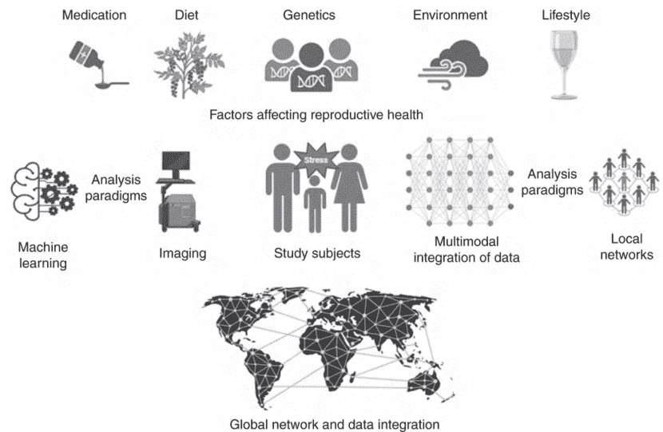

图 2.2 影响生殖健康的因素及制定生殖健康信息整合全球框架的当前策略（使用 Biorender.com 生成）。

更加综合和细致的妊娠理解。这种转变有望彻底改变产前护理，为母亲及其婴儿开启个性化医学的新时代。影响生殖健康的因素及当前全球策略在图 2.2 中有所描绘。

### 2.7 病例研究：早产及其全球负担

尽管付出了共同努力并改善了数据可用性，但 2010 年至 2020 年间全球早产（PTB）率基本保持不变。Ohuma et al. 2023 分析了 103 个国家和地区的数据，揭示 2020 年估计有 1340 万婴儿早产，占所有出生的 9.9%。虽然这标志着与 2010 年相比略有下降，但年下降率微不足道，仅为 −0.14%。南亚和撒哈拉以南非洲合计占活产的 56%，却承担了 2020 年 65% 的全球 PTB 负担。令人担忧的是，这些地区在数据质量方面也面临最大差距，前 33 名数据质量国家中没有一个位于这两个地区。2020 年，约 15% 的早产发生在孕周不足 32 周，凸显了对专业新生儿护理日益增长的需求。尽管孕周不足 28 周的出生仅占所有早产的 4.2%，但全球仍多达 567,800 人。抗击 PTB 需要重新关注公平的数据收集、有针对性的干预和基于数据的问责制。只有通过这些共同努力，我们才能真正扭转局势，改善受这一全球健康挑战影响的数百万名儿童和家庭的生活（Ohuma et al. 2023）。

### 2.8 肠道微生物组在理解生殖健康及其影响中的作用

健康的肠道微生物组对于维持激素平衡至关重要，而激素平衡是成功受孕的关键。肠道微生物群与你身体的内分泌系统相互作用，帮助调节雌激素和孕激素等激素的产生和代谢。这些激素的失衡可能会扰乱月经周期，并使受孕变得困难。我们的肠道微生物组还参与营养吸收。如果没有适当的营养吸收，你的身体可能缺乏生殖健康所需的必需维生素和矿物质。这可能会影响卵子和精子的质量，使受孕更具挑战性。为了滋养肠道健康并增强生育能力，重要的是要专注于滋养你的肠道微生物组。这可以通过一种肠道友好的饮食来实现，该饮食包含特定的营养素和有益细菌。可支持你生殖之旅（Qi et al. 2021）的具体食物如下：

- A. 富含纤维的水果和蔬菜：蔬菜和水果含有纤维，对肠道健康至关重要。纤维有助于保持规律的排便，并支持多样化的肠道微生物组。将各种色彩丰富的水果和蔬菜纳入你的饮食中，例如浆果、绿叶蔬菜以及西兰花和花椰菜等十字花科蔬菜（Makki et al. 2018）。

- B. 摄入富含益生菌的食物：益生菌是有助于恢复和维持健康肠道微生物群的有益细菌，存在于酸奶、kefir、酸菜和泡菜等发酵食品中。这些食物作为益生菌的天然储备，支持肠道微生物组的繁荣（Irokanulo and Akalegbere 2019）。

- C. 补充Omega-3脂肪酸：Omega-3脂肪酸具有抗炎特性，有助于促进整体肠道健康。通过在饮食中加入富含Omega-3脂肪酸的来源，如富脂鱼类（三文鱼、鲭鱼、沙丁鱼）、奇亚籽和亚麻籽，来提供支持生育能力的化合物（Costantini et al. 2017）。

- D. 全谷物：全谷物，如燕麦、藜麦和糙米，富含纤维，可以促进健康的肠道微生物组。全谷物是生育能力最重要的碳水化合物之一，因为它们富含营养素和抗氧化剂（Seal et al. 2021）。

- E. 植物蛋白：瘦肉蛋白，如鸡肉、火鸡、鱼类和豆类，提供生育能力所需的重要营养素，包括铁和锌。这些营养素对激素产生至关重要，并支持健康的生殖系统。虽然动物蛋白可以作为生育饮食的一部分，以提供单靠植物性食物较难获取的氨基酸、铁和营养素，但建议每周选择几顿“无肉”餐，以增加植物性蛋白质的摄入量。如果你从动物来源摄取过量蛋白质，这种消费通常伴随着饱和脂肪摄入量增加和纤维摄入量减少（Lang et al. 2018）。

图 2.3 展示了非孕妇和孕妇的分类学特征。

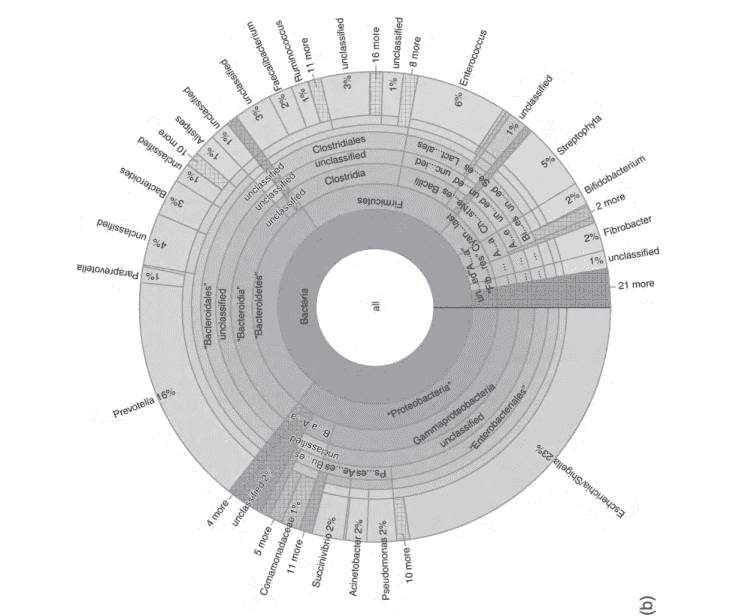

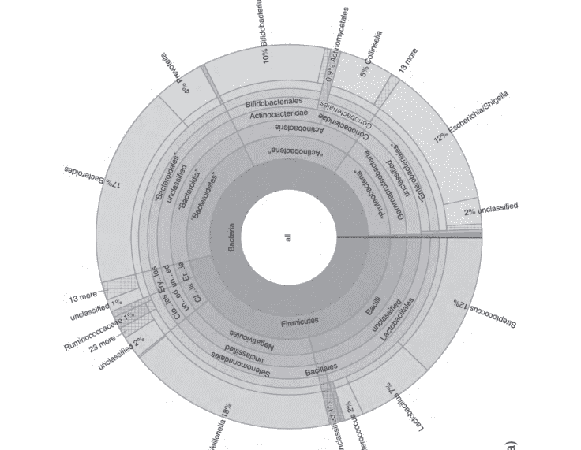

图 2.3 (a) 非孕妇的代表性分类学阐释；(b) 孕妇的代表性分类学阐释。

### 2.9 在线数据整合策略

- 整合组学数据以发现疾病基因

在疾病基因发现中，整合组学数据的传统方法可能会遗漏重要线索。我们提出了一种基于期望性函数的新框架，该框架能够无缝整合多样化的组学数据，并优先排序由多个来源的强有力证据支持的候选基因。这种方法特别适合分析组学数据有限且多样的疾病，如sPTB。利用我们的integRATE R包，我们成功地将此框架应用于10项sPTB研究，识别出潜在参与该疾病的已知和新基因（https://github.com/haleyidem/integRATE）。

- FP/RH指标数据库：监测生殖健康计划

该FP/RH指标数据库成立于2002年（如图2.4所示），作为监测生殖健康领域进展和评估计划的全面资源。它是响应两大趋势而起源的：1994年国际人口与发展会议（ICPD）倡导超越计划生育对生殖健康（RH）做出更广泛的定义，以及政府和参与FP/RH倡议的捐助者日益增长的问责需求。该数据库涵盖安全母性、性传播感染（STIs）/人类免疫缺陷病毒（HIV）/获得性免疫缺陷综合征（AIDS）以及女性营养等关键领域，反映了RH超越其传统计划生育重点的不断扩大的范围（Data for Impact Project 2024）。

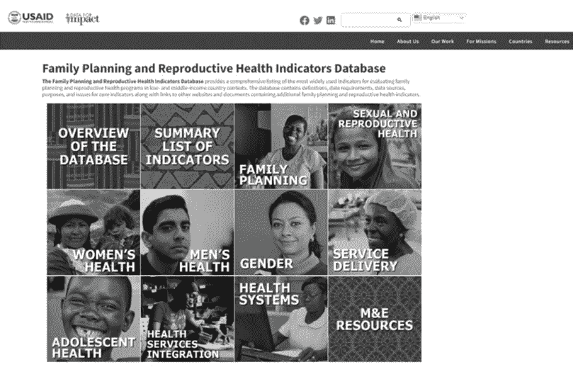

图 2.4 FP/RH数据库主页截图（www.data4impactproject.org/）。

### 2.10 结论

随着世界面临快速城市化和社会互动减少，将生殖健康作为一个概念来理解对全球社区至关重要。我们如何处理男性和女性受试者的并发症，对于未来几年人类物种的延续以及在复杂的社会互动和小众家庭中防止污名化都至关重要。作为一个社区，我们需要找到以下相关问题的答案：

- 1. AI能否释放结合生物学、临床和社会数据的力量以预测妊娠并发症？
- 2. 易于获取的数据能否替代昂贵的替代方案以进行准确预测？
- 3. 机器学习能否揭示隐藏的关联以改善我们对不良结局的理解？

我们相信，上述问题的答案应有助于我们解开并传播关于人类社会互动这一方面的意识。

## 参考文献

Baharou H, Canete NP, Cunningham AL, 等人 (2019) 用于研究人类疾病的质谱流式细胞术成像——应用与数据分析策略. Front Immunol 10:2657. https://doi.org/10.3389/fimmu.2019.02657

Burton RJ, Albur M, Eberl M, Cuff SM (2019) 利用人工智能在不影响尿路感染检测的前提下降低诊断工作量. BMC Med Inform Decis Mak 19:171. https://doi.org/10.1186/s12911-019-0878-9

Carroll JE, Rentscher KE, Cole SW, 等人 (2020) 孕妇中的睡眠障碍与炎症基因表达：按种族划分的不同反应. Brain Behav Immun 88:654-660. https://doi.org/10.1016/j.bbi.2020.04.065

Clay K, Portnykh M, Severini E (2018) 有毒真相：铅与生育能力. 国家经济研究局，剑桥，马萨诸塞州.

Cobb K, Kelly P, Williams K, 等人 (2017) 口腔微生物组与不良妊娠结局. IJWH 9:551–559. https://doi.org/10.2147/IJWH.S142730

Costantini L, Molinari R, Farinon B, Merendino N (2017) Omega-3脂肪酸对肠道微生物群的影响. IJMS 18:2645. https://doi.org/10.3390/ijms18122645

Culos A, Tsai AS, Stanley N, 等人 (2020) 将机制免疫学知识整合到机器学习流水线中可改进预测. Nat Mach Intell 2:619–628. https://doi.org/10.1038/s42256-020-00232-8

Cunningham JP, Ghahramani Z (2015) 线性降维：综述、见解与推广. Journal Mach Learn Res 16:2859–2900. https://doi.org/10.48550/ARXIV.1406.0873

Handelman SK, Romero R, Tarca AL, 等人 (2019) 早期孕妇的血浆代谢组与非孕妇不同. PLoS One 14:e0224682. https://doi.org/10.1371/journal.pone.0224682

Harutyunyan H, Khachatrian H, Kale DC, 等人 (2019) 临床时间序列数据的多任务学习与基准测试. Sci Data 6:96. https://doi.org/10.1038/s41597-019-0103-9

Huusko JM, Karjalainen MK, Graham BE, 等人 (2018) 全外显子组测序揭示HSPA1L为自发性早产的遗传风险因子. PLoS Genet 14:e1007394. https://doi.org/10.1371/journal.pgen.1007394

Irokanulo E, Akalegbere MA (2019) 用于胃肠道健康和一般健康的益生菌. Intl J Probiot Prebiot 15:22–29. https://doi.org/10.37290/ijpp2641-7197.15:22-29

Ismail Fawaz H, Forestier G, Weber J, 等人 (2019) 时间序列分类的深度学习：综述. Data Min Knowl Disc 33:917–963. https://doi.org/10.1007/s10618-019-00619-1

Kwak Y-T, Muralimanoharan S, Gogate AA, Mendelson CR (2019) 人类滋养层分化与深远的基因调控和表观遗传变化相关. Endocrinology 160:2189–2203. https://doi.org/10.1210/en.2019-00144

Lang JM, Pan C, Cantor RM, 等人 (2018) 个体特征、饱和脂肪和蛋白质来源对肠道微生物组的影响. mBio 9:e01604-18. https://doi.org/10.1128/mBio.01604-18

Li E, Luo T, Wang Y (2019) 基于转录组基因表达和甲基化相关性分析的妊娠期糖尿病患者诊断生物标志物的鉴定. Reprod Biol Endocrinol 17:112. https://doi.org/10.1186/s12958-019-0556-x

Li L, Gong Y, Yin H, Gong D (2015) 通过质谱法检测鲜丝和考古丝织品残留中的不同类型肽以区分现代污染. PLoS One 10:e0132827. https://doi.org/10.1371/journal.pone.0132827

Liu S, Wang Y, Yang X, 等人 (2019) 医学超声分析中的深度学习：综述. Engineering 5:261–275. https://doi.org/10.1016/j.eng.2018.11.020

Makki K, Dejean EC, Walter J, Bäckhed F (2018) 膳食纤维对宿主健康和疾病中肠道微生物群的影响. Cell Host Microbe 23:705–715. https://doi.org/10.1016/j.chom.2018.05.012

Marić I, Tsur A, Aghaeepour N, 等人 (2020) 通过机器学习进行子痫前期早期预测. Am J Obstet Gynecol MFM 2:100100. https://doi.org/10.1016/j.ajogmf.2020.100100

Marzbanrad F, Stroux L, Clifford GD (2018) 胎心监护及其超越：一维多普勒超声在胎儿监测中的应用综述. Physiol Meas 39:08TR01. https://doi.org/10.1088/1361-6579/aad4d1

Mei C, Yang W, Wei X, 等人 (2019) 妊娠期间独特的微生物组与先天免疫. Front Immunol 10:2886. https://doi.org/10.3389/fimmu.2019.02886

Nweke HF, Teh YW, Al-garadi MA, Alo UR (2018) 基于移动和可穿戴传感器网络的人类活动识别深度学习算法：现状与研究挑战. Expert Syst Appl 105:233–261. https://doi.org/10.1016/j.eswa.2018.03.056

Ohuma EO, Moller A-B, Bradley E, 等人 (2023) 2020年全国、区域和全球早产估计，附带2010年以来的趋势：系统分析. Lancet 402:1261–1271. https://doi.org/10.1016/S0140-6736(23)00878-4

Park HJ, Cho HY, Cha DH (2021) 羊水无细胞转录组提供关于胎儿发育和胎盘细胞动态的新信息. IJMS 22:2612. https://doi.org/10.3390/ijms22052612

Qi X, Yun C, Pang Y, Qiao J (2021) 肠道微生物群对生殖和代谢内分泌系统的影响. Gut Microbes 13:1894070. https://doi.org/10.1080/19490976.2021.1894070

Saeys Y, Inza I, Larrañaga P (2007) 生物信息学中特征选择技术综述. Bioinformatics 23:2507–2517. https://doi.org/10.1093/bioinformatics/btm344

- Santos-Lima CD, Mourão DDS, Carvalho CFD, 等 (2020) 巴西亚马逊地区儿童和青少年汞暴露的神经心理影响. *NeuroToxicology* 79:48–57. https://doi.org/10.1016/j.neuro.2020.04.004

- Seal CJ, Courtin CM, Venema K, De Vries J (2021) 全谷物的健康益处：膳食碳水化合物质量、肠道微生物群及加工后果的影响. *Comp Rev Food Sci Food Safe* 20:2742–2768. https://doi.org/10.1111/1541-4337.12728

- Signorini MG, Pini N, Malovini A, 等 (2020) 产前胎儿监测中机器学习技术与基于生理学的心率特征的整合. *Comput Methods Programs Biomed* 185:105015. https://doi.org/10.1016/j.cmpb.2019.105015

- Souza RT, Cecatti JG, Mayrink J, 等 (2019) 基于可穿戴技术的巴西多中心队列中妊娠并发症早期预测因素的识别：Maternal Actigraphy Exploratory Study I (MAES-I) 研究方案. *BMJ Open* 9:e023101. https://doi.org/10.1136/bmjopen-2018-023101

- Tanacan A, Fadiloglu E, Beksak MS (2019) 子痫前期中蛋白尿的重要性及其在母婴结局中的预测作用. *Hypertens Pregnancy* 38:111–118. https://doi.org/10.1080/10641955.2019.1590718

- Titus L, Hatch EE, Drake KM, 等 (2019) 子宫内接触己烯雌酚（DES）的女性的生殖与激素相关结局：美国国家癌症研究所 DES 第三代研究报告. *Reprod Toxicol* 84:32–38. https://doi.org/10.1016/j.reprotox.2018.12.008

- United States Agency for International Development (USAID) (2024) 2024年影响力数据. In: 2024年影响力数据. www.data4impactproject.org/prh/overview. 2024年4月30日访问.

- Wainberg M, Merico D, Delong A, Frey BJ (2018) 生物医学中的深度学习. *Nat Biotechnol* 36:829–838. https://doi.org/10.1038/nbt.4233

- Wang D. (2001). 无监督学习：神经计算基础. *AI Magazine*, 22:101–102. https://doi.org/10.1609/aimag.v22i2.1565

- Yang H, Guo R, Li S, 等 (2020) 孕妇肠道微生物群的系统分析及其与个体异质性的相关性. *npj Biofilms Microbiomes* 6:32. https://doi.org/10.1038/s41522-020-00142-y

## Genomics and Transcriptomics in Reproductive Health

Sudeepti Kulshrestha, Payal Gupta, Nikhil H., Arunima N. P., Gopika S. Nair, Lalitha A., Shraddha Gurha, Vijay Pratap Singh, Mandar Bedse, Abhishek Sengupta, Pushpendra Singh, and Prashanth Suravajhala

### 3.1 INTRODUCTION

Reproductive health refers to a condition of optimal physical, mental, and social well-being, including all aspects of the reproductive system and its functions; and goes beyond the simple absence of disease or disability (Health et al. 1997). Reproductive health encompasses the state of both male and female reproductive systems throughout all stages of life (National Institute of Environmental Health and Sciences 2024) and entails the ability to engage in a safe sexual life, as well as the capacity to conceive and the independence to make choices regarding reproduction, including the timing and frequency of such decisions. Reproductive health is gaining recognition as a fundamental aspect of overall health and a significant factor in determining and measuring human social progress. General reproductive health is closely tied to overall well-being, as it serves as an indicator of health throughout childhood and adolescence and establishes the foundation for long-term health and life expectancy beyond the reproductive years. It is influenced by various health factors such as diet and environment, as well as by low birth weight, neonatal mortality, and morbidity (Mbizvo 1996). Poor reproductive health may lead to a range of reproductive disorders, causing substantial consequences for both males and females. Common female reproductive disorders include endometriosis, infertility or reduced fertility (difficulties in achieving pregnancy), menstrual disorders such as excessive or irregular bleeding, polycystic ovarian syndrome, pregnancy complications, sexually transmitted infections (STIs), uterine fibroids, and acquired immunodeficiency syndrome (AIDS)/human immunodeficiency virus (HIV). Similarly, male reproductive disorders encompass various conditions, including impotence or erectile dysfunction, reduced sperm count, prostate cancer, STIs, and HIV/AIDS (National Institute of Environmental Health and Sciences 2024). Diagnosing and treating reproductive diseases may be challenging, which increases the likelihood of developing comorbidities. Furthermore, the persistent absence of research on reproductive health implies that the healthcare burden resulting from reproductive disorders, both in terms of immediate- and long-term care, is expected to keep rising (Mercuri and Cox 2022). The importance of prioritizing reproductive health cannot be overstated, as it plays a crucial role in shaping the current and future state of civilizations globally.

Omics technologies, including genomes, transcriptomics, metabolomics, and proteomics, are valuable tools in reproductive health research. They provide detailed information on the molecular pathways involved in reproductive processes and disorders. These techniques facilitate the identification of biomarkers that may be used for the timely detection, diagnosis, and prognosis of reproductive disorders. Additionally, they provide a comprehensive comprehension of reproductive health, hence facilitating the implementation of tailored medical strategies. Moreover, they possess the capacity to increase clinical results, direct therapeutic actions, and improve procedures in reproductive healthcare.

This chapter examines the contributions of genomics and transcriptomics to the field of reproductive health. Genomics is the study of genomes, focusing on their structure, function, and evolution. It involves the use of messenger molecules and enzymes to control the synthesis of proteins. However, transcriptomics is an approach that thoroughly examines the messenger RNA (mRNA) molecules present in a cell, tissue, or organism. It offers detailed information on the total number of mRNA molecules and the specific concentration of each RNA molecule (Kumari et al. 2024). Integrating genomics and transcriptomics technologies with reproductive health enables advances in diagnoses, treatments, and personalized medicine.

### 3.2 IMPORTANCE OF OPTIMAL REPRODUCTIVE HEALTH

The importance of reproductive health lies in empowering women to make well-informed choices about their bodies and overall well-being. This includes education about the physiological changes of the reproductive system (from adolescence till menopause), strategies for family planning, methods of contraception, prenatal and postnatal healthcare, and testing for reproductive disorders. Access to reproductive healthcare could reduce maternal mortality rates as adequate medical care can avert pregnancy-related complications. Furthermore, reproductive health plays a crucial role in fostering gender equality by encouraging women to choose education and economic prospects over early parenthood and childcare responsibilities. Additionally, it serves as a barrier against the spread of sexually transmitted illnesses and yields beneficial outcomes for future generations, resulting in more prosperous communities, more resilient families, and improved well-being for mothers and children. Comprehending the intricacies of the female reproductive system, which encompasses the menstrual cycle, fertility, conception, pregnancy, and more, is crucial for maintaining optimal reproductive well-being.

Similarly, the significance of men's reproductive health extends to its impact on fertility, sexual function, and general well-being. Male infertility and sexual dysfunction may cause significant stress and strain in relationships. Furthermore, research has shown a connection between male infertility and chronic illnesses such as cardiovascular disease and diabetes (Choy and Eisenberg 2018). Factors such as obesity, smoking, and exposure to environmental toxins can adversely affect sperm quality and reproductive function, serving as early indicators of potential health risks (Leisegang et al. 2021, Choy and Eisenberg 2018). By prioritizing reproductive health, men not only enhance their prospects of fathering healthy offspring but also mitigate the potential for developing long-term health problems in the future.

Thus, it is important to advocate for and maintain ideal reproductive health in both males and females, as it is essential for personal welfare and tackling wider public health issues.

### 3.3 NEXT-GENERATION SEQUENCING TECHNOLOGIES IN REPRODUCTIVE HEALTH

Next-generation sequencing or NGS is a high-throughput technique capable of rapidly sequencing whole genomes or targeted sections of DNA or RNA. NGS can profoundly transform several domains of biological research, including disease diagnosis, prognosis, and the determination of therapeutic interventions. NGS expedites the identification of genetic variations linked to diseases, facilitating the implementation of personalized medicine strategies and precision medicines. Furthermore, it simplifies the investigation of transcriptomics, uncovering complex patterns of gene expression and regulatory processes.

#### 3.3.1 Genomics-Based Approaches

Figure 3.1 demonstrates the general workflow followed in genomic studies.

##### 3.3.1.1 Whole-Genome Sequencing

Whole-genome sequencing, often known as WGS, is a technique used to ascertain the whole DNA sequence of an individual's genome. It enables a comprehensive analysis of genomic variations, including single-nucleotide polymorphisms or SNPs, insertions, deletions, and structural variants. WGS is increasingly being used as the preferred technique for diagnosing rare and unknown diseases at the molecular genetic level, as well as for identifying biomarkers that may be targeted for treatment. When compared to other molecular genetic approaches, WGS can detect a wide range of genomic variations and removes the necessity for sequentially conducting genetic testing (Bagger et al. 2024). WGS can be used to detect genetic predispositions to reproductive disorders, including infertility, chromosomal abnormalities, and genetic syndromes that impact fertility.

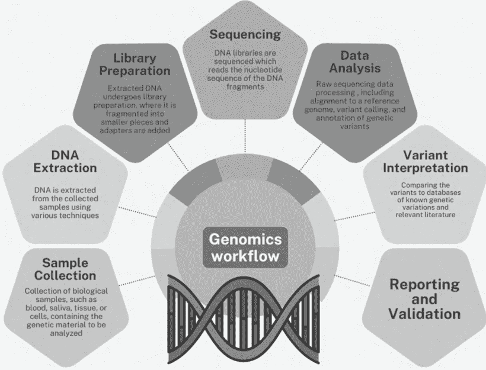

图 3.1 基因组研究遵循的工作流。

##### 3.3.1.2 全外显子组测序

外显子组是指由所有蛋白质编码基因的外显子组成的基因组部分。它约占基因组的 1–2%，确切百分比因物种而异（Warr et al., 2015）。大约 85% 导致疾病的突变位于外显子组中（Seaby et al. 2016）。因此，全外显子组测序（WES）已成为全基因组测序（WGS）一种更经济的替代方案，越来越受欢迎。WES 在成本、基因组覆盖度、诊断成功率和可解释性之间取得了平衡。WES 可以帮助发现与生育能力、不孕症和生殖障碍相关的遗传变化。通过优先分析编码序列，它提供了关于罕见遗传变异、孟德尔遗传病以及治疗干预潜在靶点的宝贵信息。这有助于推动生殖医学和遗传咨询中个体化策略的发展。

##### 3.3.1.3 表观基因组学

表观基因组学是用于研究对基因功能表达和调节具有重大影响的 DNA 化学改变的方法。表观基因组调节是一个复杂且动态的过程，其中基因组调节受饮食、营养和环境因素等外部影响的影响。这些可遗传的改变不改变遗传序列，但在决定最终特征方面起着关键作用，并且对发育的各个阶段至关重要（Martin-Sanchez et al. 2014）。表观基因组学在生殖健康中可用于探索基因表达的可遗传变化，从而深入了解环境变量如何影响生育能力、妊娠结局和儿童健康。表观基因组学通过研究 DNA 甲基化、组蛋白改变和非编码 RNA 调节，揭示了生殖问题背后的复杂分子通路，从而为靶向治疗和预防措施提供了潜在机会。

##### 3.3.1.4 全基因组关联研究

全基因组关联研究，也称为 GWAS，旨在通过分析具有相似血统但表型性状不同的个体中遗传变异频率的差异，来识别表型和基因型之间的关联。GWAS 可能包括人类基因组中的拷贝数变异（CNVs）或 SNPs。GWAS 研究通常会检测到与特定感兴趣性状具有统计学显著关联的连锁 SNP 簇。这些簇被称为基因组风险位点（Uffelmann et al. 2021）。生殖健康领域的 GWAS 可用于通过检查大量人群来确定与这些特征相关的遗传变异，从而研究生育能力、生殖疾病和妊娠结局的遗传基础。通过进行彻底的全基因组扫描，GWAS 识别出与生殖性状相关的特定候选基因和遗传区域。这些信息对于生殖医学领域的临床诊断、风险评估和个体化治疗方案非常有价值。

##### 3.3.1.5 微生物组学

人体在多个生态位中含有微生物，例如皮肤表面、口腔、食管、肺部、消化系统及其他区域。微生物群由细菌、病毒、真菌、古细菌和噬菌体组成，其中细菌在物种丰度方面最为丰富。16S rRNA 和 WGS 技术的使用有助于检测和分类多个不同的操作分类单元（OTUs），其中一些可以培养和鉴定，而另一些则仍未被鉴定。微生物群失调是由微生物组物种组成的改变或某些物种丰度的变化引起的，导致微生物组失衡，并引发疾病状态和病症。当微生物组中的某些细菌物种获得使其更具毒力和致病性的特性时，也可能发生这种情况，这些有害特性随后会改变宿主生物在其独特环境中受到的影响方式（Manos 2022）。

微生物组研究中常用于分析微生物群落的标记物包括 16S rRNA、18S rRNA 和 ITS rRNA。这些标记物分别允许表征细菌、古细菌和真菌的多样性。

这些多样的基因组技术可用于应对影响男性和女性的常见生殖疾病和障碍。

##### 3.3.1.6 基因组学在女性生殖健康中的应用

对 400 名患有多囊卵巢综合征（PCOS）的女性和 480 名健康女性进行基因分型，鉴定出多个基因变异，包括 FSHR 基因的 rs6166、LHCGR 基因的 rs13405728、THADA 基因的 rs13429458 等，这些变异可能导致亚裔女性患 PCOS 的遗传风险（Wan et al. 2021）。此外，GWAS 表明 ERBB4、YAP1 和 WWTR1 基因在 PCOS 复杂病因中起作用。这是通过激活表皮生长因子受体（EGFR）和 Hippo 通路实现的，正如 Zhang et al. 在 2020 年报告的那样。此外，152 名原发性痛经女性与 150 名无任何健康问题个体的基因分型分析表明，患者与对照组之间 ESR1 基因 PvuII 多态性存在显著的统计学差异（Ozsoy et al. 2016）。

此外，近期的全表观基因组关联研究（EWAS）表明，妊娠期间母体吸烟、母体叶酸水平、交通引起的空气污染、妊娠期间颗粒物暴露等因素与新生儿甲基化模式的显著改变之间存在强烈联系。这些甲基化改变的存在已被证实与更高的早产可能性相关（Park et al. 2020）。同样，对八对经历原因不明的反复流产（URM）的夫妇进行了 WGS、WES 和三人组生物信息学分析，揭示了六个先前未知的候选基因，即 ATP2A2、SSPO、NAP1L1、PLXNB2、NRK 和 RYR2。这些基因被发现与原因不明的第一孕期正倍体流产相关（Wang et al. 2023）。

此外，WGS 已被用于研究淋病，这是一种由淋病奈瑟菌引起的性传播疾病。WGS 数据分析在检测脑膜炎奈瑟菌爆发、表征淋病奈瑟菌和脑膜炎奈瑟菌的分离株以及增强疾病监测方面发挥了重要作用。此外，它还促进了病原体和患者基因序列数据的整合，以增强我们对患者对淋病感染的反应和易感性的理解（Harrison et al. 2017）。

对 39 个分为早产和足月产的 16S rRNA 阴道微生物组序列的研究表明，有益微生物（如乳杆菌）以及致病微生物（如加德纳菌、普雷沃菌和阿托波氏菌）和特定基因（如 FANCM、PTXA 和 GPX）的存在与早产可能性相关（Kulshreshtha et al. 2023）。还观察到，阴道微生物组及其组成极具动态性，在不同种族、族群和采样部位的女性之间存在显著差异（Kulshrestha et al. 2024）。此外，对 20 名 PCOS 女性和 20 名对照组的肠道微生物组研究显示，产 γ-氨基丁酸（GABA）的细菌（如脆弱拟杆菌、远志拟杆菌和大肠埃希氏菌）与 LH:FSH（黄体生成素与卵泡刺激素）比率和血清 LH 水平呈正相关，从而在诱发 PCOS 中发挥作用（Liang et al. 2021）。

##### 3.3.1.7 基因组学在男性生殖健康中的应用

对 37 名发生减数分裂停滞的男性、194 名表现出塞托利细胞仅表型的男性和 21 名对照男性，以及 2030 名男性的外显子组数据进行了基于阵列的比较基因组杂交（aCGH），确定不孕症的原因是 SYCE1 基因的杂合和纯合缺失，以及影响 EIF2B2、MLH3、TEKT5、CLPP 和 SLX4 基因的杂合缺失（Wyrwoll et al. 2022）。

利用 WES 分析研究了一个患有特发性非梗阻性无精子症的血亲婚姻土耳其家庭，以确定不孕症的遗传病因。该研究在 12 号染色体的 GTF2H3 基因中鉴定出一种特定的遗传变异。该变异在非梗阻性无精子症患者中表现为纯合变异，在少精子症患者中表现为杂合变异。理论认为，这些变异可能对精子生成至关重要的维生素 A 信号传导产生不利影响（Clavijo et al. 2018）。

表观基因组研究还表明，表观基因组改变和因素在调节包括 Fgf8 在内的基因活性方面发挥作用，这些基因对于促性腺激素释放激素（GnRH）神经元的生长和功能至关重要。这些因素还导致卡氏综合征和先发性促性腺激素减退性性腺功能减退的发展，其特征是睾丸无法产生雄激素和精子（Linscott and Chung 2020）。此外，还针对与 HIV 感染相关的 DNA 甲基化模式进行了一项 EWAS。该研究包括 261 名 HIV 感染患者和 117 名健康个体。结果显示，20 个 CpG 位点与 HIV 感染存在显著关联。在这些位点中，14 个位点在 HIV 感染者中甲基化水平较低（低甲基化），而 6 个位点甲基化水平较高（高甲基化）（Arumugam et al. 2021）。

#### 3.3.2 基于转录组的方法

生物体的遗传信息存储于其基因组的 DNA 中，并通过转录表达（Lowe et al. 2017）。转录组学是对某一时刻细胞或组织中所有 RNA 转录本的全面研究，为基因表达、调节和功能变异的模式提供了宝贵信息。它包括 RNA 测序（RNA-Seq）等技术，用于定量和评估多种 RNA 分子，包括 mRNA、非编码 RNA 和剪接变体。它提供了不同生物学情况下转录组变化景观的详细视图。转录组分析在生殖健康中可用于分析细胞、组织或物种中所有 RNA 转录本的集合，以了解基因表达模式以及在生育能力、生殖及相关疾病中发挥作用的调节网络。转录组研究遵循的一般工作流程如图 3.2 所示。

##### 3.3.2.1 微阵列测序

微阵列转录组分析是通过将 mRNA 与一组互补探针杂交来定量特定转录本水平的方法（Lowe et al. 2017）。微阵列

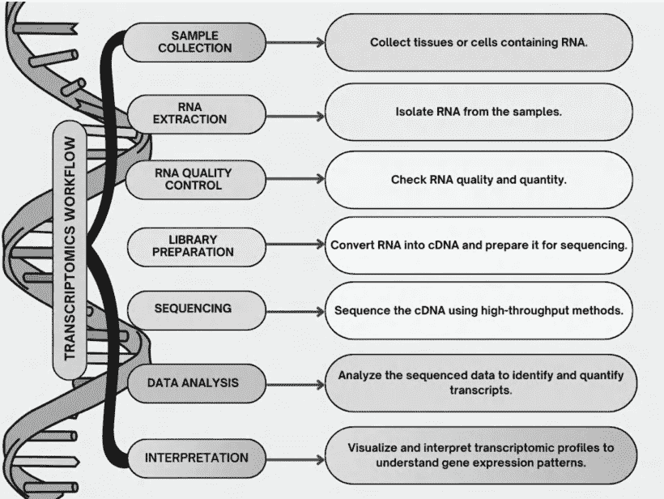

FIGURE 3.2 转录组学研究中遵循的工作流程。

以代表基因组 DNA 的短寡核苷酸探针集合为起点。从待检的细胞或组织样本中获得转录本，并用荧光染料标记，与阵列结合，清洗后使用激光进行分析。与转录 RNA 互补的探针通过杂交结合到其对应的靶标上。转录本用荧光染料标记，使光强度可作为基因表达的指示器（Malone and Oliver 2011）。Affymetrix 高密度阵列和点样寡核苷酸阵列是 2000 年代初转录谱分析的首选方法。微阵列技术可以以远低于每个基因的成本和更低的人力需求，同时分析数千个转录本。基因表达微阵列的结果为理解转录组在各种组织和细胞类型中的分布、不同发育阶段和疾病表型中的基因表达变化，以及物种间和物种内的差异提供了重要见解（Lowe et al. 2017）。

##### 3.3.2.2 批量 RNA 测序

批量 RNA 测序（通常称为 RNA-Seq）是一种用于对源自转录本的互补 DNA（cDNA）进行测序的方法，以根据每个转录本的计数来确定其丰度。RNA-Seq 利用转录组中的多个短片段进行广泛的转录组采样。这允许通过从头组装或比对到参考基因组，将 reads 彼此匹配来计算重建主要转录本。RNA-Seq 技术相较于微阵列转录组具有显著优势，其通常范围可达 5 个数量级（Lowe et al. 2017）。RNA-Seq 与微阵列的主要区别在于，RNA-Seq 允许对整个转录组进行全面测序，而微阵列仅检测特定的转录本或基因（Rao et al., 2019）。

##### 3.3.2.3 单细胞 RNA 测序

人类大多数细胞具有相同的遗传构成。尽管如此，每个细胞内的转录组数据能提供对特定基因群特定功能的洞察。利用 RNA-Seq 进行的传统转录组或表观基因组研究可能只能捕捉来自组织或器官的集体信号，而无法区分特定的细胞变化。单细胞 RNA 测序（ScRNA-Seq）有助于在细胞水平上研究转录组，使单次实验中可检测数百万个细胞。单细胞分离与捕获是从组织中提取单个细胞以收集精确遗传和生物化学信息的过程。这使得特定遗传和分子过程的研究成为可能。通过分析每个细胞的转录组，我们可以对它们进行分类、定义和区分，从而更容易识别具有功能重要性的罕见细胞群（Jovic et al. 2022）。

##### 3.3.2.4 miRNA、ncRNA、lncRNA 和环状 RNA 分析

分子生物学的最新进展揭示了多种非编码 RNA 分子（ncRNA），例如长链非编码 RNA（lncRNAs）、微小 RNA（miRNAs）和环状 RNA（circRNAs）。这些分子在不同阶段控制基因表达中起着关键作用，并参与广泛的生理功能。ncRNA 是指不执行蛋白质编码的 RNA 分子。然而，重要的是要注意，这些 RNA 仍然执行特定功能（Panni et al. 2020）。

微小 RNA 是一组小非编码 RNA，通过特异性结合到 mRNA 来在转录后调节基因表达（Hussen et al. 2021）。这种结合通常发生在短互补序列上，该序列常见于 mRNA 的 3' 非翻译区（UTR）中。同样，lncRNAs 是一类多样的 RNA，可能从长链间基因非编码 RNA（lncRNAs）或蛋白质编码基因的任何部分转录，方向可以是同向或反向。lncRNAs 的特征是其长度必须超过 200 个核苷酸，且无法编码蛋白质。此外，环状 RNA 是具有单链的 RNA 分子，当 3' 端和 5' 端连接在一起形成圆环形状时产生。它们通过一种称为反剪接的过程形成，通常由外显子、内含子或非编码间基因区组成（Panni et al. 2020）。

非编码 RNA 在不同疾病条件下的独特表达模式证实了其作为有前景的生物标志物、致病途径的促进因素以及治疗干预的潜在靶点的潜力（Ali et al. 2021）。

##### 3.3.2.5 空间转录组学

“空间”一词源自拉丁语 spatium，意为“空间”，用于描述事物的相对位置。空间概念在生物学中具有重大意义，因为它使我们能够描绘生物相互作用网络，其中每个组成部分都受其环境的影响。例如，只有在知道多细胞生物中单个细胞的精确物理位置时，才能充分理解其化学特性。就此而言，RNA 分子的亚细胞定位可能为转录组快照及其真实生物学意义提供重要见解（Asp et al. 2020）。因此，空间转录组学是一种揭示基因表达模式位置特异性变异的技术。它为以前使用无法捕获空间信息的 ScRNA-seq 技术所无法了解的方面提供了宝贵的见解（Park et al. 2023）。

上述转录组学策略可用于解决影响男性和女性的常见生殖障碍和疾病。

##### 3.3.2.6 转录组学在女性生殖健康中的应用

scRNA-Seq 分析表明，转录因子 SREBF1（控制参与胆固醇获取的基因，如 NPC1、LIPA、LDLR 等）和 GATA6（调节编码类固醇生成酶的基因表达，如 CYP17A1）、SP1 和 NR5A2 的水平升高或活性增强参与与 PCOS 相关的高雄激素血症的发展（Harris et al. 2023）。基于计算机模拟的转录组学研究识别出多个差异表达基因，包括 CENPF、CEP55、DLGAP5、KIF20A 等，这些基因在从增生期向分泌期过渡期间对子宫内膜接受性有显著影响（Gupta et al. 2023）。

对脐带血白细胞 RNA-Seq 数据的分析识别出 148 个显著差异表达的基因。具体来说，与足月组相比，早产组与细胞周期和代谢相关的基因表达大幅增加，而与免疫和炎症信号相关的基因表达显著下降。（Vora et al. 2019）。此外，对羊膜绒毛膜中母体巨噬细胞 scRNA-Seq 数据的分析识别出与早产临产相关的基因表达明显改变。此外，随着孕龄进展，早产临产期间母体循环中与巨噬细胞、单核细胞和活化 T 细胞相关的多种胎盘 scRNA-Seq 转录组特征呈现调节（Pique-Regi et al. 2019）。

scRNA-Seq 分析揭示了 HIV 感染细胞与未感染细胞之间不同的基因表达模式。HIV 感染细胞中潜伏特征的存在与细胞暴露、对 T 细胞受体激活的反应以及病毒嗜性相关（Zhang et al. 2023）。

##### 3.3.2.7 转录组学在男性生殖健康中的应用

使用 RNA-Seq 和 scRNA-Seq 技术的分析表明，Wnt 信号减弱以及三种特定转录因子（ARNTL、CTCF 和 AR）参与了

### 3.4 生殖健康中基因组学和转录组学的临床应用

#### 3.4.1 辅助生殖技术

不孕症是指一个人在频繁、无保护性行为达 12 个月或以上仍无法成功妊娠的一种医学疾病。它也可能指一个人单独或与其伴侣无法生育。诊断任何患者不孕症的第一步是获取详尽的病史，包括其性史和生育史的详细情况，以及可能与高龄或体检结果相关的生殖功能下降的任何迹象（Practice Committee of the American Society for Reproductive Medicine 2020）。

近年来，辅助生殖技术（ART）已成为面临生育问题的夫妇的一种安全解决方案。ART 方法包括体外受精（IVF）、玻璃化冷冻、卵胞浆内单精子注射（ICSI）和受控卵巢刺激（COS）（Sánchez-Pavón et al. 2022）。通常，该过程往往涉及使用捐赠配子，因为寻求 ART 的个体中存在已诊断或特发性不孕。配子捐赠是指捐赠卵子（卵母细胞）或精子，以帮助另一个人或夫妇生育子女。患有促性腺激素低下性性腺功能减退、高龄产妇、卵巢储备功能下降、卵母细胞/胚胎质量低下，或在生育治疗后多次尝试受孕不成功的女性，建议考虑使用卵子捐赠者。同样，使用精子捐赠者的原因包括无精症、重度少精症或精子或精液中其他显著异常；射精功能障碍；或男性其他未经早期 ART 治疗改善的严重不孕症。其他适应症包括已知患有或携带重大遗传异常的女性/男性，以及有目前无法检测的遗传病家族史的人。此外，存在无法治愈的性传播疾病，或男性伴侣为 Rh 阳性而其女性配偶为 Rh 阴性并伴有严重 Rh 同种免疫的情况，也是指示需要 ART 的其他因素（Lilienthal and Cahr 2020）。

虽然 ART 具有多种益处，但也伴随着遗传问题的重大风险，包括三体以及与线粒体 DNA 有害变化相关的疾病。研究表明，IVF 妊娠中前置胎盘、子痫前期、早产、宫内生长受限和胎盘早剥的可能性更高。此外，ART 还与几种罕见印记综合征相关，以及包括 Beckwith–Wiedemann、Angelman、Prader–Willi 和 Silver–Russell 综合征在内的个别先天性异常。IVF 后这些疾病发生率较高，表明表观遗传因素调节不当在 ART 手术后不良结局的出现中起作用（Mani et al. 2020）。通过 ART 受孕的婴儿出生时体重过低的可能性也高出三倍。ART 受孕新生儿的出生体重和早产可能受多种因素显著影响，包括新鲜或冻胚移植的选择、移植胚胎的数量以及子宫内膜准备的方法（Reig and Seli 2019）。

基因组学和转录组学技术通过揭示影响生育能力和胚胎生长的遗传变量，彻底改变了 ART。通过使用如着床前基因检测（PGT）等方法，它们促进了 IVF 过程中可移植胚胎的鉴定与选择。转录组分析通过识别重要的基因表达模式、提高成功率并确保更安全的操作，改进了胚胎选择策略。

#### 3.4.2 着床前基因检测

PGT 是一项医疗技术，涉及从卵子或胚胎中提取一个或多个细胞核，以在胚胎移植前检查是否存在遗传改变或非整倍体（Lilienthal and Cahr 2020）。PGT 的基础理念是，从着床前胚胎中获得的细胞的遗传组成能够准确反映最终发育为胎儿的细胞群体（Herbert et al. 2023）。PGT 的主要目标是降低生育可能患遗传病或染色体异常儿童的可能性。PGT 所遵循的一般步骤已在图 3.3 中展示。

PGT 有三个不同的类别：非整倍体的 PGT（PGT-A）、结构重排的 PGT（PGT-SR）和单基因疾病的 PGT（PGT-M）（Lilienthal and Cahr 2020）。

PGT-A 的根本目标是评估非整倍体的存在与否，从而最大限度地降低着床失败、流产（Lilienthal and Cahr 2020）或与三体相关的先天性疾病（如 Edwards 综合征和 Down 综合征）发生的可能性（Herbert et al. 2023）。PGT-SR 可用于选择染色体组推定为平衡的胚胎（Herbert et al. 2023）。染色体结构重排（SRs）会导致不孕、胚胎着床反复失败、流产以及患有先天性异常的儿童，即使携带父母似乎没有明显的生理特征（Griffin and Ogur 2023）。PGT-M 用于识别胚胎中的某些遗传异常。它适用于患有或有常染色体显性遗传病家族史的人。它也用于那些有生育常染色体隐性或 X 链接疾病儿童风险的人。进行 PGT-M 的其他理由包括为需要干细胞移植的儿童进行人类白细胞抗原（HLA）匹配，以及为既往妊娠导致抗原敏感的人群选择不携带新生儿溶血性疾病风险的胚胎（Lilienthal and Cahr 2020）。

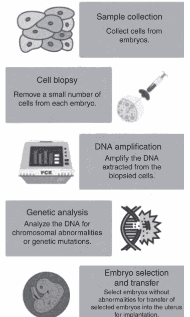

图 3.3 着床前基因检测的一般步骤。

基因组学和转录组学通过在着床前精确识别胚胎中的染色体异常和遗传病，改进了 PGT。这改善了 IVF 等辅助生殖技术中移植的选择过程，并降低了遗传疾病的遗传几率。

#### 3.4.3 携带者筛查

携带者筛查是指对不表现出任何遗传性疾病明显体征但可能在与特定疾病相关的一个或多个基因中携带一个变异等位基因的个体进行的基因检测。在受孕前进行携带者筛查和咨询至关重要，因为这使夫妇能够了解其生殖风险并探索各种生殖选择。如果某人被确认是某种疾病的携带者，则建议其生殖伴侣接受检测，以便就可能的生殖后果进行知情的遗传咨询。如果确定双方都是遗传病携带者，则可以为其提供遗传咨询。

例如，有生育血红蛋白病（如镰状细胞贫血、α-地中海贫血或 β-地中海贫血）儿童风险的夫妇，可能会发现进行携带者筛查并随后接受遗传咨询是有益的。此次咨询将包括风险评估、对这些疾病进展的解释、潜在治疗的相关信息、产前基因检测的可用性细节，以及对生殖选择的探讨。对某些夫妇来说，联合 IVF 使用 PGT 可能是一个更可取的选择，以避免因镰状细胞病和地中海贫血而终止妊娠的需要。

### 3.5 结论

基因组学和转录组学技术在女性和男性生殖健康中都至关重要，因为它们揭示了影响生育能力的遗传变量，识别了不孕或生殖障碍的可能风险，并指导个体化治疗方法。这些分子方法在 ART 中用于筛查胚胎的染色体异常和遗传病，确保移植健康胚胎并改善妊娠结局。它们还能实现完整的携带者筛查，识别有遗传病遗传给子女风险的人群，从而做出更知情的生殖决定。

## 参考文献

- Ali SA, Peffers MJ, Ormseth MJ, et al (2021) The non-coding RNA interactome in joint health and disease. Nat Rev Rheumatol 17:692–705. https://doi.org/10.1038/s41584-021-00687-y
- Arumugam T, Ramphal U, Adimalam T, et al (2021) Deciphering DNA methylation in HIV infection. Front Immunol 12:795121. https://doi.org/10.3389/fimmu.2021.795121
- Asp M, Bergenstråhle J, Lundeberg J (2020) Spatially resolved transcriptomes—next generation tools for tissue exploration. BioEssays 42:1900221. https://doi.org/10.1002/bies.201900221
- Bagger FO, Borgwardt L, Jespersen AS, et al (2024) Whole genome sequencing in clinical practice. BMC Med Genom 17:39. https://doi.org/10.1186/s12920-024-01795-w
- Choy JT, Eisenberg ML (2018) Male infertility as a window to health. Fertil Steril 110:810–814. https://doi.org/10.1016/j.fertnstert.2018.08.015
- Clavijo RI, Arora H, Gibbs E, et al (2018) Whole exome sequencing of a consanguineous Turkish family identifies a mutation in GTF2H3 in brothers with spermatogenic failure. Urology 120:86–89. https://doi.org/10.1016/j.urology.2018.06.031
- Griffin DK, Ogur C (2023) PGT-SR: a comprehensive overview and a requiem for the interchromosomal effect. DNA 3:41–64. https://doi.org/10.3390/dna3010004
- Gupta P, Dube S, Priyadarshini P, et al (2023) Deciphering key genes of proliferative and secretory phase using integrated transcriptomics and network analysis. Microbiol Biotechnol Lett 51:317–324. https://doi.org/10.48022/mbl.2304.04008

Harris RA, McAllister JM, Strauss JF (2023) 单细胞RNA-Seq识别出促进与多囊卵巢综合征相关的高雄激素血症的通路和基因。IJMS 24:10611. https://doi.org/10.3390/ijms241310611

Harrison OB, Schoen C, Retchless AC, 等 (2017) 淋病奈瑟菌基因组学：现状与未来展望。Pathog Dis 75:ftx060. https://doi.org/10.1093/femspd/ftx060

美国国家研究委员会生殖健康专家组, Tsui AO, Wasserheit JN, Haaga JG (1997) 引言。在: 发展中国家生殖健康：拓展维度, 构建解决方案。华盛顿特区: 美国国家科学院出版社.

Herbert M, Choudhary M, Zander-Fox D (2023) 生育治疗与疾病预防交汇处的辅助生殖技术。Science 380:164–167. https://doi.org/10.1126/science.adh0073

Hussen BM, Hidayat HJ, Salihi A, 等 (2021) 微RNA：癌症进展的标志。Biomed Pharmacother 138:111528. https://doi.org/10.1016/j.biopha.2021.111528

Johannsen EB, Skakkebæk A, Kalucka JM, 等 (2023) 克氏综合征患者的睾丸微血管不成熟，完整性受损，并表现出过度的炎症互作。Hum Reprod 38:2339–2349. https://doi.org/10.1093/humrep/dead224

Jovic D, Liang X, Zeng H, 等 (2022) 单细胞RNA测序技术及其应用：简要概述。Clin Transl Med 12:e694. https://doi.org/10.1002/ctm2.694

Kulshreshtha S, Narad P, Singh B, 等 (2023) 利用综合计算方法识别导致早产的不同阴道微生物组特征。Microbial Biotechnol Lett 51:109–123. https://doi.org/10.48022/mbl.2210.10008

Kulshreshtha S, Narad P, Pai SS, 等 (2024) 对16S rRNA标记基因样品进行宏基因组学研究以分析种族、族裔和地理位置在早产中的作用：全面的阴道微生物组荟萃分析。Hum Gene 39:201260. https://doi.org/10.1016/j.humgen.2024.201260

Kumari R, Kaur P, Verma SK, 等 (2024) 基于组学的前沿技术用于识别预测性生物标志物以测量空气颗粒物暴露对男性生殖健康的影响。JRHM 5:2. https://doi.org/10.25259/JRHM_25_2023

Leisegang K, Sengupta P, Agarwal A, Henkel R (2021) 肥胖与男性不育：机制与管理。Andrologia 53. https://doi.org/10.1111/and.13617

Liang Z, Di N, Li L, Yang D (2021) 肠道微生物组改变揭示多囊卵巢综合征中潜在的肠-脑轴改变。J Endocrinol Invest 44:1727–1737. https://doi.org/10.1007/s40618-020-01481-5

Lilienthal D, Cahr M (2020) 遗传咨询与辅助生殖技术。Cold Spring Harb Perspect Med 10:a036566. https://doi.org/10.1101/cshperspect.a036566

Linscott ML, Chung WCJ (2020) 促性腺激素释放激素神经元发育和低促性腺激素性性腺功能减退的表观遗传控制。J Neuroendocrinol 32:e12860. https://doi.org/10.1111/jne.12860

Lowe R, Shirley N, Bleackley M, 等 (2017) 转录组学技术。PLoS Comput Biol 13:e1005457. https://doi.org/10.1371/journal.pcbi.1005457

Malone JH, Oliver B (2011) DNA微阵列、高通量测序与转录组的真实测度。BMC Biol 9:34. https://doi.org/10.1186/1741-7007-9-34

Mani S, Ghosh J, Coutifaris C, 等 (2020) 表观遗传改变与辅助生殖技术。Epigenetics 15:12–25. https://doi.org/10.1080/15592294.2019.1646572

Manos J (2022) 疾病与病理中的人类微生物组。APMIS 130:690–705. https://doi.org/10.1111/apm.13225

Martin-Sanchez F, Lopez-Campos G, Gray K (2014) 用于个性化医疗和参与式健康的生物医学信息学方法。在: *生物医学信息学方法*。Elsevier, 第347–394页.

Mbizvo MT (1996) 生殖与性健康：研究与发展挑战。*中非医学杂志* 42:80–85.

Mercredi ND, Cox BJ (2022) 需要开展更多关于生殖健康和疾病的研究。*eLife* 11:e75061. https://doi.org/10.7554/eLife.75061

美国国家环境健康科学研究所 (2024) *生殖健康*。美国国家环境健康科学研究所。www.niehs.nih.gov/health/topics/conditions/repro-health. 2024年4月30日访问.

Ozsoy AZ, Karakus N, Yigit S, 等 (2016) 原发性痛经中IL6和ESR1基因多态性的评价。*免疫学研究* 45:75–86. https://doi.org/10.3109/08820139.2015.1113426

Panni S, Lovering RC, Porras P, Orchard S (2020) 非编码RNA调控网络。*生物化学与生物物理学 Acta (BBA)—基因调控机制* 1863:194417. https://doi.org/10.1016/j.bbagrm.2019.194417

Park B, Khanam R, Vinayachandran V, 等 (2020) 早产的表观遗传生物标志物。*环境表观遗传学* 6:dvaa005. https://doi.org/10.1093/eep/dvaa005

Park H-E, Jo SH, Lee RH, 等 (2023) 空间转录组学：最新进展的技术方面及其在神经科学和癌症研究中的应用。*先进科学* 10:2206939. https://doi.org/10.1002/advs.202206939

Pique-Regi R, Romero R, Tarca AL, 等 (2019) 足月和早产分娩中人类胎盘的单细胞转录组特征。*eLife* 8:e52004. https://doi.org/10.7554/eLife.52004

美国生殖医学学会实践委员会 (2020) 不孕症和反复流产的定义：委员会意见。*生育与不孕* 113:533–535. https://doi.org/10.1016/j.fertnstert.2019.11.025

Rao MS, Van Vleet TR, Ciurlionis R, 等 (2019) RNA-Seq与微阵列基因表达平台在短期大鼠毒性研究中肝脏毒理基因组学评价中的比较。*遗传学前沿* 9:636. https://doi.org/10.3389/fgene.2018.00636

Reig A, Seli E (2019) 辅助生殖技术与低出生体重的关联。*当前妇产科学与妇科学意见* 31:183–187. https://doi.org/10.1097/GCO.0000000000000535

Sánchez-Pavón E, Mendoza H, Garcia-Ferreyra J (2022) 21三体综合征与辅助生殖技术：综述。*JBRA辅助生殖* 26: 129–141. https://doi.org/10.5935/1518-0557.20210047

Seaby EG, Pengelly RJ, Ennis S (2016) 外显子组测序解析：其临床应用实用指南。*功能基因组学简报* 15:374–384. https://doi.org/10.1093/bfgp/elv054

Sun T-C, Zhang Y, Yu K, 等 (2021) 长链非编码RNA通过调节内质网基因和通路诱导氧化应激和精子生成。*衰老* 13:13764–13787. https://doi.org/10.18632/aging.202971

Uffelmann E, Huang QQ, Munung NS, 等 (2021) 全基因组关联研究。*自然方法引言* 1:59. https://doi.org/10.1038/s43586-021-00056-9

Vora N, Parker J, Mieckowski P, 等 (2019) 脐带血RNA测序用于研究自发性早产：一项试点研究。*美国病理学杂志报告* 09:e60–e66. https://doi.org/10.1055/s-0039-1678717

Wan P, Meng L, Huang C, 等 (2021) 亚洲人群中选定的遗传变异与多囊卵巢综合征易感性的复制研究及荟萃分析。*辅助生殖与遗传学杂志* 38:2781–2789. https://doi.org/10.1007/s10815-021-02291-1

Wang X, Shi W, Zhao S, 等 (2023) 全外显子组测序在原因不明的反复流产家族中鉴定出二倍体流产的新发病性致病遗传原因。*人类生殖* 38:1003–1018. https://doi.org/10.1093/humrep/dead039

Warr A, Robert C, Hume D, 等 (2015) 外显子组测序：当前与未来展望。*G3 基因|基因组|遗传学* 5:1543–1550. https://doi.org/10.1534/g3.115.018564

Wyrwoll MJ, Wabschke R, Röpke A, 等 (2022) 非梗阻性无精子症男性中拷贝数变异分析。*雄科学* 10:1593–1604. https://doi.org/10.1111/andr.13267

Zeng S, Chen L, Liu X, 等 (2023) 单细胞多组学分析揭示非梗阻性无精子症中精原细胞Wnt信号通路功能障碍。*内分泌学前沿* 14:1138386. https://doi.org/10.3389/fendo.2023.1138386

Zhang X, Qazi AA, Deshmukh S, 等 (2023) 单细胞RNA测序揭示在不同条件下潜伏HIV感染的原发性CD4+ T细胞中常见和独特的基因表达谱。*前沿细胞感染微生物学* 13:1286168. https://doi.org/10.3389/fcimb.2023.1286168

Zhang Y, Ho K, Keaton JM, 等 (2020) 从电子健康记录中鉴定出的多囊卵巢综合征全基因组关联研究。*美国妇产科杂志* 223:559.e1–559.e21. https://doi.org/10.1016/j.ajog.2020.04.004

## 生殖健康中的蛋白质组学与代谢组学

Harishchander Anandaram, Keshav Mittal,
Payal Gupta, Sudeepti Kulshrestha, Alakto Choudhury,
Muskan Syed, Priyanka Narad, Deepak Modi,
Dinesh Gupta, and Abhishek Sengupta

### 4.1 引言

蛋白质组学是分子生物学的一个学科，系统地研究任何生物系统中的蛋白质。它包括识别、描述和测量每个样本中的所有蛋白质。蛋白质组是指由一个有机体或在特定细胞、组织、细胞器等中产生的全部蛋白质集合。蛋白质组学采用质谱（MS）、凝胶电泳和液相色谱来研究和理解蛋白质的结构、功能及相互作用。蛋白质组学利用革命性发现，帮助我们更好地理解和管理人类生殖健康。例如，与精子功能和卵子成熟相关的特定蛋白质的详细信息，帮助我们了解导致不孕症的原因。识别与妊娠期间激素调节相关的生物标志物，使生殖障碍的早期检测和监测成为可能。值得注意的还有质谱的发展，由 John Fenn 和 Koichi Tanaka 推动。这使得准确的蛋白质谱分析成为可能，从而识别出可能与生殖事件相关的蛋白质组微小变异（Agarwal et al. 2020）。这些发现改变了生殖健康问题的诊断和治疗方式。就像其基因组学对照体——人类蛋白质组计划——在绘制整个人类蛋白质组方面发挥了关键作用，由此我们有可能更深入地了解生殖生理学在分子水平上的运作方式。

蛋白质组学可以被视为一种简单的分析，也是绘制生殖组织、细胞和体液复杂蛋白质组地图的一种综合方法。通过详细分析，我们揭示了生殖过程各阶段背后的蛋白质签名，这些签名为生育、受孕和胚胎发育背后的分子决定因素提供了深刻见解。我们检验的一个关键方面是识别蛋白质生物标志物——这些分子标志物引导我们穿越生殖健康的迷宫。通过使用等量标签等定量蛋白质组学方法，我们阐明了不孕症、子痫前期和子宫内膜异位症等疾病的诊断与预后（Panner Selvam and Agarwal 2020）。靶向蛋白质组学及分析的标准方法已在图 4.1 中描绘。

代谢组学技术在疾病研究中具有众多潜在应用。与传统临床化学不同，代谢组学是“整体视角”研究，它细致地捕捉有机体的特性（Narad et al. 2022a; Tandon et al. 2023）。科学家可以利用高通量分析结合模式识别，研究在代谢水平上识别生命活动规律性的特征，从而在代谢物和表型之间建立联系（Narad et al. 2022b）。这些技术具有敏感、快速、高效、无创和精确等特点。代谢组学的进步为辅助生殖技术（ART）瓶颈问题带来了新方法；然而，还需要更多研究来完善这些方法。

### 4.2 生殖健康生物标志物

进入与生殖健康相关的微妙方面世界时，生物标志物如同灯塔，指引患者走向诊断与监测。本次探索调查了对确定生殖健康至关重要的生物标志物的深层含义，探讨将蛋白质作为诊断信号，并利用生物分子线索来监测个体的状态。正如 Luz Cardenas 和 Rosanna Chianese 在其研究中所示，在生殖健康领域，生物标志物是表明一个人的生理过程、致病状况或治疗后反应的分子签名（Cardenas and Chianese 2020）。它们很有帮助，因为它们可能有助于识别疾病、预测疾病结局，并就治疗的实施提供建议。人绒毛膜促性腺激素（hCG）在早期妊娠检测中至关重要，因为它构成了大多数妊娠测试的基础。受孕后，其水平迅速上升，使其成为妊娠确认的理想生物标志物。在女性生殖健康方面，抗缪勒氏激素（AMH）作为卵巢储备的标志物，提供关于女性潜在生育能力的信息。AMH 水平降低可能表明卵巢储备低下和可能的生育问题。卵巢产生 Inhibin B，这种激素在控制月经周期中起关键作用，并反映卵巢功能。监测其水平有助于确定生殖健康，特别是多囊卵巢综合征（PCOS）。在早期妊娠检测中占据核心地位的 hCG 是一种由胎盘发育形成的糖蛋白。对母体血清或尿液中 hCG 水平的精确测量，可实现妊娠的早期确认。AMH 是卵巢储备检测中的主要指标，它定量评估可用卵子供应。临床医生使用 AMH 水平来促进关于生育潜力和生殖规划的对话。Inhibin B 水平的变化表明生殖激素平衡失调，有助于识别 PCOS 等疾病（Soboleva et al. 2017）。

#### 适用技术
- SOMAScan 技术
- Olink proximity extension assay
- 靶向质谱
- Luminex 和 Quanterix 技术

#### 定量蛋白质组学数据分析
- 预处理
- 统计分析
- 人工智能
- 网络推断

#### 与基因组数据整合
蛋白质定量性状位点 (pQTLs)

#### 与临床数据整合
临床检测和医疗数据

#### 临床应用
- 生物标志物发现
- 药物发现
- 患者分层

图 4.1 蛋白质组学的标准方法。该插图描绘了各种靶向技术以及分析定量蛋白质组学数据的最常用方法。

生物标志物在辅助生殖技术（ART）领域至关重要。建立雌激素和孕酮等激素生物标志物，对于提供关于生育治疗过程（包括体外受精（IVF））成功的有价值信息至关重要。蛋白质组谱分析

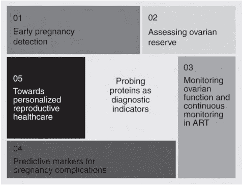

图 4.2 展示了生物标志物在生殖健康中发挥的关键作用，重点关注关键诊断指标和健康监测。

有助于识别妊娠并发症的潜在预测标志物。通过研究母体血清蛋白质组，研究人员可以确定哪种蛋白质与子痫前期等疾病相关，并为高危妊娠设计早期干预策略。将生物标志物纳入生殖保健，提供了个性化的方法。推广适合个体生物分子特征的干预措施，可提高诊断精度，最大限度地优化生育治疗，并降低与生殖健康相关的潜在风险（Snead et al. 2014）。当将蛋白质作为诊断指标来探测时，可以实现早期检测，并使临床医生能够为个性化和精准的生殖保健提供指导。导致持续健康监测的生物分子信号，预示着生殖健康主动管理新时代的到来（图 4.2）。

### 4.3 妊娠的蛋白质组学方法

随着对妊娠的深入探索，蛋白质组学方法作为一种揭示早期妊娠复杂地图的方向成形。LC-MS 是舞台中心，展示了蛋白质组的全景图。这种高分辨率、高灵敏度的方法密切跟踪母体血清、血浆和子宫液中的蛋白质，清晰地描绘了妊娠早期蛋白质浓度变化的情况。当能够表明妊娠结局的生物标志物被识别时，蛋白质组学的应用也同样深远。定量蛋白质组学将母体血转化为金矿，提供了蛋白质签名的基础，这些签名可能发出潜在并发症的早期标志。除了提供预后信息之外，这种仔细的分析还为增强母体和胎儿健康的特定干预创造了机会。

滋养层占据早期妊娠的中心，指挥着着床和胎盘发育所需的复杂分子变化。精准地，滋养层细胞是蛋白质组学研究的重点，这些研究使用诸如

- **1 卵泡刺激素 (FSH)** 在女性中，它刺激卵巢卵泡的发育，导致卵母细胞成熟。在男性中，它通过作用于睾丸中的支持细胞（Sertoli cells）来支持精子生成。

- **2 黄体生成素 (LH)** 在女性中，它触发排卵和黄体的形成。在男性中，它刺激间质细胞（Leydig cells）产生睾酮。

- **3 透明带蛋白（例如，ZP3）** ZP3 在受精过程中作为精子与卵子结合的受体。

- **4 Beta-hCG（人绒毛膜促性腺激素）** 它支持黄体，在早孕期维持孕酮的产生。

- **5 骨形成蛋白 4 (BMP4)** BMP4 是一种参与胚胎发育的信号蛋白，特别是在胚层确定和分化方面。

图 4.3 参与关键生殖过程的五种关键蛋白，包括配子生成、受精和胚胎发育。

二维凝胶电泳（2D-GE）和 MS。通过这种精细分析，滋养层细胞的蛋白质组指纹变得清晰。它揭示了指导这些细胞在妊娠期间发挥可行建立和维持作用的特定分子线索。诸如等量标记等先进技术允许对蛋白质组进行纵向分析，捕捉妊娠期间蛋白质表达的节律模式。这种时间视角阐明了母体蛋白质组的微妙调整，这些调整既匹配胎儿不断变化的需求，也匹配母体自身的积极发育。母体-胎盘探索还扩展到母体组织与胎盘组织之间的和谐相关性（Miliku et al. 2015）。图 4.3 展示了参与关键生殖过程的五种关键蛋白。

### 4.4 生殖技术的技术进步

基质辅助激光解吸/电离（MALDI）和电喷雾电离（ESI）技术使生殖蛋白质组学的革命成为可能。这些突破发生在 1990 年，通过允许高效蛋白质电离以进行质谱分析，改变了这一领域。K Biemann 和 F Hillenkamp 对 MALDI 的创建作出了重大贡献，而 JB Fellow W Vestal 对 ESI 的发展也提供了重要帮助。这些技术彻底改变了蛋白质鉴定和定量，为完整的蛋白质组分析奠定了基础。现代高分辨率成像技术在生殖蛋白质组学中带来了范式转变。借助 MALDI 成像质谱（MALDI-IMS）和超分辨率显微镜等技术，生殖组织中蛋白质的空间图谱绘制成为可能。R M Caprioli 和 R L Drake 首先开发了通过组织切片样品使用空间分辨电离质谱（MALDI IMS）进行蛋白质组谱分析的系统。单细胞蛋白质组学标志着从群体水平分析转向对细胞群体固有异质性的洞察。单细胞质谱和基于微流体的平台等革命性技术推动了该领域的发展。R Zenobi 和 J B Shear 等研究人员开创了单细胞质谱的概念，该技术涉及为分析单个细胞而开发的技术。J C Wheeler 和 C Offenhauser 推进了用于单细胞分析的微流体平台，为揭示细胞水平的多样性提供了新的前沿。

将基因组学与蛋白质组学融合为定量蛋白质基因组学，使生殖生物学发生了颠覆性变化。基于质谱的蛋白质基因组学进步使基因组和蛋白质组信息融合成为可能，从而提供完整的分子视图。定量蛋白质基因组学的先驱包括 S P Gygi、B W Han 和 P G Schultz。他们开发将基因组信息与蛋白质表达关联起来的方法，为生殖过程的系统水平理解奠定了基础。坚固的质谱交联已成为研究蛋白质相互作用和揭示大分子复合物结构的强大工具。该方法的特点是建立相互作用蛋白之间的共价键，从而获得结构知识。部分对交联质谱发展作出贡献的先驱包括 M R Chance、L Walzthoeni 和 J Aside；与该技术相关的另一个名字是 C R R MacQuaker。他们创新的方法为解开生殖机制中发挥关键作用的复杂蛋白质网络敞开了新的大门。

技术进步标志着生殖蛋白质组学的一个变革时代，使研究人员能够以前所未有的深度探索支撑生育能力、受孕和妊娠的分子复杂性。随着科学界继续突破创新的边界，这些发现将成为揭示生命起源之谜的支柱。

### 4.5 质谱与代谢组学

质谱（MS）是一种强大的分析技术（图 4.4）。其主要作用是解释生物分子（主要是蛋白质）的含量和特性，并识别其质荷比（Sengupta et al. 2021）。该方法有助于对大量蛋白质进行鉴定和定量，从而解码调节生殖健康的复杂分子相互作用的精密镶嵌图。质谱在生殖蛋白质组学中的力量具有变革性，因为它能够探索复杂的蛋白质世界。最初，凝胶电泳通常用于根据蛋白质的大小或电荷将其分离，然后供质谱分析。该方法提取凝胶上分离的蛋白质，然后将其酶解为肽段。质谱常用于测定这些肽段的质荷比。这种耦合技术称为基于凝胶的蛋白质组学，它允许将凝胶分离的带与相应肽段的质谱谱图相关联，以鉴定和表征它们。在此，使用凝胶电泳来简化复杂的蛋白质混合物，然后进行更精细、更灵敏的质谱分析，最终提高在生物样本中鉴定蛋白质的效率和准确性（Steen et al. 2004）。获得的质谱图谱对样本中存在的蛋白质提供了深入的洞察。它揭示了它们的身份

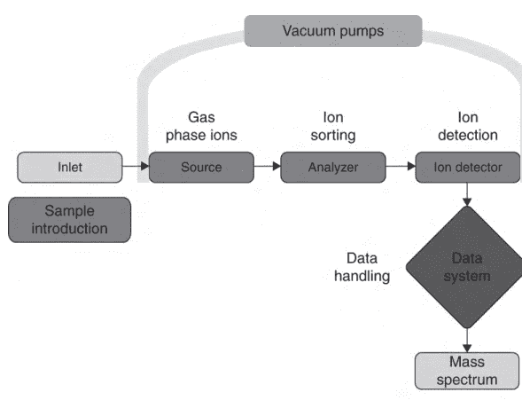

图 4.4 上述流程图展示了质谱的概览。

以及它们相对的丰度。这充分解释了生育能力的复杂性以及受孕过程中发生的事情。

质谱在生殖健康领域的分析交响乐超越了单纯的鉴定。它解读精液、卵巢组织和母体血清中蛋白质的语言，以揭示生殖挑战与成功基础上的和谐与失调。质谱是终极翻译者，将蛋白质的沉默语言转化为一个精彩的故事，揭示了生殖医学中的个性化干预和改进的诊断。

### 4.6 质谱仪器与质谱的最新进展

质谱仪的核心包含三个组件：(a) 电离源、(b) 质量分析器和 (c) 探测器。它从电离开始，在此过程中蛋白质转化为带电粒子。不同的电离方法使该过程具有多功能性，包括 ESI 和 MALDI。电离后，蛋白质通过质量分析器——一个磁场或电场，其中它们的质荷比被精确审查。最后，探测器记录捕获的离子，创建质谱图，揭示被分析样品中蛋白质的组成和浓度。正如 Bruno Domon 和 Ruedi Aebersold 在其关于蛋白质分析的工作中所示，质谱领域的重大进展开辟了前几代无法比拟的能力和可能性新视野，以实现更高精度和更深入的蛋白质组学分析。一项重要进展是整合数据非依赖性获取（DIA）策略，这是一种改善蛋白质定量可重复性和可靠性的新方法。DIA 能够同时对所有前驱离子进行碎片化和测量，提供

对蛋白质组具有更广阔且更一致的视角。MS发展中的另一亮点是平行反应监测（Parallel Reaction Monitoring，PRM）（Domon et al. 2006）。该方法具有高灵敏度和特异性，因为它允许对被认为至关重要的特定蛋白质进行选择性分析。

监测预定义肽段片段的能力使蛋白质计数更加精确，有助于解码定义生殖健康的复杂蛋白质组谱景中的微妙变化。高分辨率MS技术的创新已成为推进分析功能极限的关键和重要手段。Orbitrap和傅里叶变换离子环核共振（FT）等创新提高了质量分辨率和准确性（Sleno 2012）。高分辨率MS增加了蛋白质的鉴定，并使复杂蛋白质结构得到更清晰的阐明。此外，实施多组学方法似乎已成为一种革命性模式。所有这些技术进步不仅帮助研究人员，还有望在生殖挑战的诊断、治疗和个性化管理中带来变革性影响。

### 4.7 质谱的多种类型

各种类型的MS如图4.5所示。

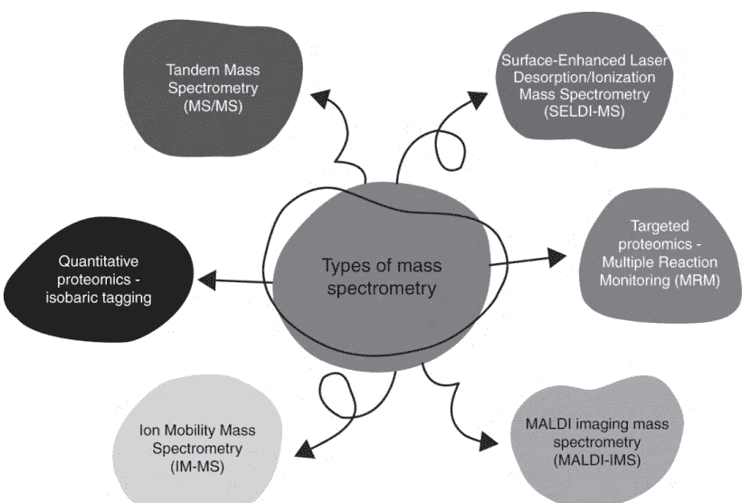

图4.5 各种领域使用的多种质谱技术。

#### 4.7.1 串联质谱（MS/MS）

在Lekha Sleno的教程中，介绍了串联MS中常用的离子活化技术（Sleno et al. 2004）。它包括电离和质量分析的逐步过程，用于碎片化，随后进行肽序列分析。它允许对蛋白质进行详细的结构阐明，这对于理解生殖蛋白质组学中的翻译后修饰和蛋白质相互作用至关重要。

#### 4.7.2 表面增强激光解吸/电离质谱（SELDI-MS）

Volker Seibert在其综述文章中阐述了蛋白质组学应用，如靶标或标志物鉴定以及靶标验证或毒理学（Seibert et al. 2004）。它使用涂层表面来捕获蛋白质，从而提高灵敏度和特异性。它通过优先吸附蛋白质到表面上来帮助发现生物标志物，从而使人们能够了解生殖组织中特定的蛋白质特征。

#### 4.7.3 靶向蛋白质组学—多反应监测（MRM）

根据Neil R Kitteringham的研究，多重检测和蛋白质修饰决定因素使MS成为抗体技术的一个有吸引力的替代方案；因此，引入稳定同位素标记结合MRM等扫描方法后，定量MS的进步显著提高了特异性和灵敏度，使其接近其免疫分析对照体的水平（Kitteringham et al. 2009）。它针对预定义的靶标蛋白质，监测特定的前体离子到片段离子转换。它适用于测量生殖健康研究中感兴趣的某些蛋白质，从而提供准确且聚焦的信息。

#### 4.7.4 MALDI成像质谱（MALDI IMS）

Daniel J Ryan在其综述中强调了开发用于克服MALDI IMS实验中这些挑战的、明确与蛋白质鉴定相关的方法和技术（Ryan et al. 2019）。它将MALDI电离与空间分辨率MS相结合，以绘制组织蛋白质分布图。它提供生殖细胞内蛋白质定位的空间信息，有助于理解区域蛋白质表达模式。

#### 4.7.5 离子迁移质谱（IM-MS）

Brandon T Ruotolo在其研究中讨论了数据解释的一般概念、预测给定蛋白质组装的某些特定结构模型是否可以通过离子迁移分离的方法，以及无限制的策略（Ruotolo et al. 2008）。它引入了一个新维度，其中气相中离子的移动可以被计算，从而也提供关于分子形状的信息。它在生殖蛋白质组学中很有用，用于研究蛋白质的构象构型，提供关于动态变化和构象变量的洞察。

#### 4.7.6 定量蛋白质组学—等质量标记（例如，TMT，iTRAQ）

Sivanich, Michael K在其综述中回顾了几种等质量标记，以及互补离子标记等最近的进展，增强了对低丰度分析物的高灵敏度定量，以及旨在增加多重检测能力的策略，这也可以在此观察到（Sivanich et al. 2022）。该技术采用等质量标记来标记肽段，允许在一次MS分析中定量许多样品。它还允许高通量定量分析，从而能够确定各种生殖状态下的蛋白质表达水平。

### 4.8 技术平台和工具

#### 4.8.1 蛋白质组学

生殖蛋白质组学领域对精确性的持续追求催生了大量创新技术，改变了以往进行蛋白质分析的方式。这些进步——从大型蛋白质组数据库到用于复杂分析的高度复杂工具——改变了蛋白质语言解码的范围，促进了卓越的深度和精确度。

蛋白质组数据库作为精确分析的蓝图。UniProt是一个完整的蛋白质数据库，提供关于蛋白质序列、功能和翻译后修饰的详细信息。它拥有广泛的存储库，是生殖样本中轻松识别和标记蛋白质的主要工具（Gomase et al. 2008）。人类蛋白质组图谱绘制人类蛋白质组，全面了解特定组织的蛋白质表达模式。这个便捷的工具允许研究人员调查生殖组织和器官中蛋白质的空间排列。PeptideAtlas是串联MS数据的存储库，有助于从各种生物样本中鉴定和定量肽段。它对于生殖样本的精确蛋白质组分析至关重要，提高肽段鉴定的准确性是必不可少的。

现在，我们将了解用于蛋白质组学分析的专业工具。第一个是MaxQuant。它是一个高通量MS数据分析计算平台，集成了复杂的肽段鉴定和定量算法。该工具在生殖健康的大规模蛋白质组学研究中效果很好，因为它提供可靠的定量数据并协助蛋白质修饰鉴定。另一个工具Skyline是一种蛋白质组学软件，便于MRM实验的数据分析。它在生殖蛋白质组学中的作用包括使科学家能够锁定特定靶标并准确测量复杂的生物样本。PatternLab for proteomics是一个开源程序，通过统计验证、模式识别和可视化工具等模块帮助分析蛋白质组数据（Savickas et al. 2020）。该应用程序在复杂蛋白质组数据集领域中增强了研究人员的可解释性，有助于定位与生殖过程相关的模式和趋势。

在数据处理和集成方面已取得多项进展。Progenesis QI for proteomics是一种软件解决方案，提供无标记定量，并具有详细的数据处理和强大的统计分析。在生殖蛋白质组学中最重要的是，它对蛋白质表达水平进行比较研究，以确定可能的生物标志物。Scaffold是一种数据可视化和解释工具，将MS数据与生物背景相连接（Correa Rojo et al. 2021）。它的应用加强了生殖研究中蛋白质组学结果与生理意义之间的联系，从而全面理解复杂的数据集。总的来说，这些从大规模蛋白质组数据库到专业分析软件的尖端工具推动生殖蛋白质组学领域迈向无与伦比的准确性。随着工具不断改进，研究人员拥有前所未有的能力来分析和剖析生育、受孕和妊娠的复杂分子景观。

#### 4.8.2 代谢组学基础

代谢组学研究已建立样本采集流程，获取的代谢物通过各种技术程序提取，以检查许多组间代谢物的微小统计差异并进行多项进一步调查。目前没有可用于测量人类样本中所有代谢物的分析技术。多项研究采用了不同的分析方法以进行互补覆盖。代谢组学中最受欢迎的两个技术平台是MS和核磁共振（NMR）。

##### 4.8.2.1 代谢组学数据处理

代谢组学技术在疾病研究中具有多种潜在用途。与传统临床化学不同，代谢组学测量生物体的代谢特征。科学家利用高通量分析和模式识别来探索代谢水平下生命活动的特征和规律，以建立代谢物表型之间的联系。这些程序灵敏、非侵入性且准确。代谢组学技术的进步已导致识别出解决ART瓶颈的新方法。

##### 4.8.2.2 代谢组学预处理

代谢组学用于研究生物材料的代谢物，因为传统组学无法完全解释复杂的生理和病理反应。相比之下，代谢组学旨在描述细胞或生物系统中发现的所有代谢物。血液、尿液、脑脊液、唾液、活检组织和细胞提取物都是代谢组学研究的潜在材料。

#### 4.8.3 代谢组学在生殖技术中的应用

##### 4.8.3.1 初始过程

代谢组学用于研究生物材料的代谢物，因为传统组学无法完全解释复杂的生理和病理反应。相比之下，

代谢组学旨在描述细胞或生物系统中发现的所有代谢物。血液、尿液、脑脊液、唾液、活检组织和细胞提取物都是代谢组学研究的潜在材料。

##### 4.8.3.2 代谢组学与妊娠

###### 4.8.3.2.1 代谢组学的主要应用

配子、胚胎和子宫内膜接受力的质量是决定辅助生殖技术（包括 ICSI 和 IVF）结局的三个关键方面。在临床环境中，形态学评分用于评估配子质量。当卵母细胞数量较少时，仅凭形态学不足以进行评估。在临床实践中，低形态学等级的卵母细胞可产生胚胎，但不能产生活产。高质量的卵母细胞可能无法使用 ICSI 受精，导致无法着床于子宫内膜的低质量胚胎。子宫内膜厚度通常通过超声检查测量。

###### 4.8.3.2.2 代谢组学的次要应用

甘油磷酸胆碱（GPC）、柠檬酸、酪氨酸和苯丙氨酸可通过核磁共振（NMR）检测精液中的谷氨酰胺及其他成分来评估精子质量。该代谢组学技术为研究不孕症提供了一种快速且无创的方法。Wallace 等人从 58 名 IVF 患者那里获得了卵母细胞和卵泡液（Wallace et al. 2012）。使用一维核磁共振，将可受精但不能卵裂的卵泡液与可受精并卵裂的卵泡液进行了比较。研究人员发现两种卵泡液的代谢物谱存在显著差异，包括葡萄糖、乳酸、蛋白质以及胆碱/胆碱磷酸水平。

#### 4.8.4 蛋白质组学与代谢组学病例研究

妊娠糖尿病（GDM）是一种在妊娠期间诊断出的导致葡萄糖耐受受损的疾病。然而，GDM 的病理生理主要尚不明确。由于全球肥胖大流行和母亲年龄增长，GDM 病例正在增加。然而，预计 GDM 在分娩后会减少。然而，证据表明，这种疾病与不良的母婴结局相关，导致妊娠和分娩期间的困难，并增加产后 2 型糖尿病的风险。

该工作旨在为 GDM 和正常母体胎盘开发一种新的差异表达蛋白（DEP）谱，并发现潜在的 DEP。研究应着重于异常表达水平的概览，以进一步理解胎盘蛋白之间的复杂相互作用。然而，最近的 GDM 蛋白质组学研究主要集中在外周血和尿液样本上。利用二维电泳（2-DE）、基质辅助激光解吸/电离飞行时间质谱（MALDI-TOF MS）和标记自由液相色谱-质谱高能（LC-MSE），开展了两项胎盘蛋白质组学研究。该研究采用凝胶基方法来分析和鉴定差异蛋白表达。该方法的主要缺点是检测线性度和灵敏度有限、凝胶重复性差，以及对疏水性或低丰度蛋白鉴定不足。Li Ge 和 Pingping Huang 的工作为 GDM 的病理生理提供了更多知识，并预计将对生物标志物改进产生重大影响（Ge et al. 2023）。

研究应着重于异常表达水平的概览，以更好地理解胎盘蛋白之间错综复杂的关系。然而，现代 GDM 蛋白质组学研究主要集中在外周血和尿液样本上。利用 2-DE 联合 MALDI-TOF MS 和标记自由 LC-MSE，开展了两项胎盘蛋白质组学研究。该研究采用凝胶基技术对样本进行差异蛋白表达的分析和鉴定。该方法的主要缺点包括检测线性度和灵敏度低、凝胶可重复性差，以及对疏水性或低丰度蛋白鉴定不足。

### 4.9 挑战与未来方向

克服生殖蛋白质组学检测中的挑战越来越需要创新解决方案。本部分还强调了在分子层面解开人类生殖健康所面临的挑战，详细说明了如何克服这些障碍。在规划未来研究和创新的道路时，此分析探讨了将改变我们对生殖健康认知和结果的新兴潜力。

蛋白质组学方法在蛋白质组分析、基因转录本的比较表达分析、确定翻译后修饰以及研究蛋白质-蛋白质相互作用方面发挥作用。尽管人类基因组包含超过一千个蛋白质编码基因，但估计产生了近百万种蛋白质，包括剪接变体和翻译后修饰。蛋白质组学通过蛋白质磷酸化、转运、定位和相互作用的类型，为基因提供了关键的功能信息。这并非没有挑战；蛋白质组学研究因生物样本的复杂性（蛋白质浓度多样）、对适当样本制备程序的需求、先进的质谱（MS）设备以及复杂的数据处理算法而变得复杂（Agarwal et al. 2020）。

涵盖生物结构和生理过程的问题的复杂性给蛋白质组学研究程序带来了复杂性。由于生物样本中蛋白质浓度范围广泛，观察和识别低丰度蛋白质比较困难。新蛋白质组学技术收集的大量数据在分析和处理方面存在问题。蛋白质组学分析获得结果的质量和可重复性在很大程度上取决于样本制备。需要高端质谱仪器来可靠地鉴定和表征蛋白质。需要更强大的软件和工具来处理和分析大量蛋白质组学数据。与基于质谱仪或无凝胶方法的技术相比，凝胶方法在灵敏度和可重复性方面存在明显缺点。虽然难以达到生物蛋白质组中蛋白质水平之间的定性差异，但最近的标准（如 iTRAQ）通过多重检测、定量以及提高的分析精度和准确性提供了优势。

生殖蛋白质组学的发展正在朝着提高准确性的方向迈进，并借助改进的技术优势。基于详细蛋白质组分析的专门诊断面板，可能会在生育力筛查、妊娠期产前检测和生殖障碍诊断中提供更好的准确性。人工智能与机器学习的结合将有助于解读蛋白质组学数据集，指向精巧的个体化诊断。生殖蛋白质组学正在走向功能性角色，从生物标志物识别阶段中走出来。在关键生殖期间研究动态蛋白质相互作用，为分子水平上调节生殖健康的机制提供了大量信息。功能蛋白质组学发现复杂的信号通路，为治疗干预和个体化治疗暴露了新靶点。未来在于结合多组学数据——基因组学、转录组学和代谢组学。这种整体方法可以理解相互作用的分子事件的复杂而协调的过程，这些过程决定生殖结局。整合不同的组学数据集将使研究人员能够揭示复杂的生物网络，并促进整体知识的发展，以开发协同治疗方法。单细胞蛋白质组学创新加深了对生殖组织细胞异质性的理解。在蛋白质水平上分析单个细胞，揭示了在群体分析中隐藏的微妙差异。这种方法为影响生育力或妊娠并发症的细胞多样性和分化异常提供了高分辨率视图。开发先进的采集和分析方法对未来进步至关重要。无创和微创采样方法以及高通量蛋白质组学技术在不影响患者舒适度的情况下简化了数据采集程序。微流体设备和创新样本制备方法的进步扩大了蛋白质组学分析在更广泛临床和研究环境中的效率。必须解决伦理问题和社会影响。生殖蛋白质组学的未来也必须有意地关注管理数据隐私、同意和研究结果的伦理框架。

### 4.10 结论

总而言之，本章成功应对了人类生殖健康这个棘手的领域，并从蛋白质组学角度进行了详细阐述。为开展这项探索，我们揭示了调控生殖结构的分子复杂性。首先，将生物标志物作为诊断标志进行分析，为健康监测提供了一个窗口，并提供了分析蛋白质的机会。

生殖蛋白质组学的快速发展成为一项重中之重，专注于包括质谱（MS）在内的尖端技术。这些先进技术使精密蛋白质组学分析成为可能，标志着理解生殖健康领域新时代的到来。通过蛋白质组学视角，在妊娠早期对妊娠进行了扫描，并进行了母体蛋白质研究，以寻找维持健康妊娠的线索。此外，针对生育力评估的蛋白质标志物研究揭示了推进我们对生殖适应性知识的分子线索。差异表达蛋白

与妊娠糖尿病相关的胎盘组织为这些原则提供了有意义的背景，并且通过 iTRAQ 蛋白质组学的实际应用已有详细记录。这个案例展示了蛋白质组学分析在应对生殖健康挑战方面的实际影响。

随着本章即将结束，认识到该领域取得的进展至关重要，同时也要牢记其中存在的一些问题。解决生殖蛋白质组学面临的障碍需要团队合作。通过为研究和创新规划前进道路，我们为人类生殖的深入理解铺平了道路。推动这些发展的动力将定义这个重要行业的未来，并为生殖健康带来希望和解决方案。

## 参考文献

- Agarwal A, Baskaran S, Panner Selvam MK, 等 (2020) 揭示男性生殖研究中蛋白质组学的足迹：一种计量分析方法. *Antioxid Redox Signal* 32:536–549. https://doi.org/10.1089/ars.2019.7945
- Candenas L, Chianese R (2020) 外泌体组成与精浆蛋白组：男性不育生物标志物的有前景来源. *IJMS* 21:7022. https://doi.org/10.3390/ijms21197022
- Correa Rojo A, Heylen D, Aerts J, 等 (2021) 迈向构建精准医学中的定量蛋白质组学工具箱：一篇小型综述. *Front Physiol* 12:723510. https://doi.org/10.3389/fphys.2021.723510
- Domon B, Aebersold R (2006) 质谱与蛋白质分析. *Science* 312:212–217. https://doi.org/10.1126/science.1124619
- Ge L, Huang P, Miao H, 等 (2023) 基于 iTRAQ 蛋白质组学的妊娠糖尿病胎盘组织中差异表达蛋白的新图景. *Placenta* 131:36–48. https://doi.org/10.1016/j.placenta.2022.11.012
- Gomas V, Kale K, Tagore S, Hattrup S (2008) 蛋白质组学：蛋白质分析技术. *CDM* 9:213–220. https://doi.org/10.2174/138920008783884740
- Kitteringham NR, Jenkins RE, Lane CS, 等 (2009) 蛋白质组学和代谢组学中定量生物标志物分析的多反应监测. *J Chromatogr B* 877:1229–1239. https://doi.org/10.1016/j.jchromb.2008.11.013
- Miliku K, Voortman T, Van den Hooven EH, 等 (2015) 孕早期母亲蛋白质摄入与儿童肾脏结局：R世代研究. *Am J Clin Nutr* 102:123–129. https://doi.org/10.3945/ajcn.114.102228
- Narad P, Gupta R, Sengupta A (2022) 植物代谢组学：农业研究进步的新时代. 载于: *Bioinformatics in Agriculture*. Elsevier, 第 139–160 页.
- Narad P, Naresh G, Sengupta A (2022) 代谢组学与通量平衡分析. 载于: *Bioinformatics*. Elsevier, 第 337–365 页.
- Panner Selvam MK, Agarwal A (2020) 精子和精浆蛋白质组学：与精索静脉曲张相关的男性不育分子变化. *World J Men's Health* 38:472. https://doi.org/10.5534/wjmh.190018
- Ruotolo BT, Benesch JLP, Sandercock AM, 等 (2008) 大蛋白复合物的离子迁移率-质谱分析. *Nat Protoc* 3:1139–1152. https://doi.org/10.1038/nprot.2008.78
- Ryan DJ, Spraggins JM, Caprioli RM (2019) MALDI 成像质谱中的蛋白质鉴定策略：一篇简要综述. Curr Opin Chem Biol 48:64–72. https://doi.org/10.1016/j.cbpa.2018.10.023
- Savickas S, Kastl P, Auf Dem Keller U (2020) 组合降解组学：揭示生物系统中蛋白酶过程的精密工具. Biochim Biophys Acta (BBA)—Prot Proteom 1868:140392. https://doi.org/10.1016/j.bbapap.2020.140392
- Seibert V, Wiesner A, Buschmann T, Meuer J (2004) 蛋白质组学研究中表面增强激光解吸/电离飞行时间质谱 (SELDI TOF-MS) 与 ProteinChip® 技术. Pathol—Res Pract 200:83–94. https://doi.org/10.1016/j.prp.2004.01.010
- Sengupta A, Naresh G, Mishra A, 等 (2021) 基于机器学习方法的蛋白组分析及其在疾病中的应用. 载于: Advances in Protein Chemistry and Structural Biology. Elsevier, 第 161–216 页.
- Sivanich MK, Gu T, Tabang DN, Li L (2022) 同量标记的最新进展及其在定量蛋白质组学中的应用. Proteomics 22:2100256. https://doi.org/10.1002/pmic.202100256
- Sleno L (2012) 现代质谱中质量亏损的应用. J Mass Spectrom 47:226–236. https://doi.org/10.1002/jms.2953
- Sleno L, Volmer DA (2004) 串联质谱的离子活化方法. J Mass Spectrom 39:1091–1112. https://doi.org/10.1002/jms.703
- Snead MC, Black CM, Kourtis AP (2014) 性与生殖健康研究中精液暴露生物标志物的应用. J Women's Health 23:787–791. https://doi.org/10.1089/jwh.2014.5018
- Soboleva A, Vikhnina M, Grishina T, Frolov A (2017) 通过色谱和质谱探测蛋白糖基化：糖基化加合物分析. IJMS 18:2557. https://doi.org/10.3390/ijms18122557
- Steen H, Mann M (2004) 肽测序的 ABC（以及 XYZ）. Nat Rev Mol Cell Biol 5:699–711. https://doi.org/10.1038/nrm1468
- Tandon A, Gupta T, Verma A, 等 (2023) 以精度为核心：用于人类早产预测的机器学习增强型代谢组学模型. 载于: 2023 第 14 届计算、通信与网络技术国际会议 (ICCCNT). IEEE, 印度德里, 第 1–7 页.
- Wallace M, Cottell E, Gibney MJ, 等 (2012) 卵泡液代谢谱、卵母细胞发育潜力与着床结局之间关系的研究. Fertil Steril 97:1078–1084.e8. https://doi.org/10.1016/j.fertnstert.2012.01.122

## 生殖健康的系统生物学方法

丹尼尔·亚历克斯·阿南德和斯韦塔·松卡尔

### 5.1 生殖健康中的系统生物学简介

系统生物学是一门综合性学科，它结合计算方法和实验方法来理解复杂的生物系统。在生殖健康的背景下，系统生物学提供了一个整体框架，用于探索支撑生育、妊娠和生殖障碍的多方面生物过程。本简介旨在阐明系统生物学的原理和方法如何应用于生殖健康研究，突出关键概念、技术及其变革潜力。

从本质上讲，系统生物学力求通过综合方法解开生物系统的复杂性，考虑系统各个组成部分（基因、蛋白质、细胞和组织）之间的相互作用，以及这些相互作用如何产生系统的功能和行为。与传统生物学研究不同，传统研究往往关注系统的孤立部分，系统生物学强调系统内部的互连和动态，旨在全面理解生物现象 (Aderem 2005)。

在生殖健康领域，系统生物学方法对于推进我们对生殖系统复杂性的理解起到了关键作用。这包括研究月经周期的激素调节、配子发生、受精、胚胎发育的复杂性，以及影响生育和妊娠结局的遗传、环境和生活方式因素之间的复杂相互作用。

系统生物学采用多种技术和方法来研究生殖健康。

- **组学技术:** 基因组学、转录组学、蛋白质组学和代谢组学为参与生殖过程的基因、信使 RNA (mRNA)、蛋白质和代谢物提供了全面数据。这些技术使得识别生殖障碍的生物标志物，并深入了解支撑生育和妊娠的分子机制 (Shendure and Ji 2008)。
- **生物信息学与计算建模:** 生物信息学工具和计算模型用于分析和整合组学数据，促进关键调控网络和通路的识别。生殖过程的计算建模允许模拟复杂的生物现象，从而提供在不同条件下系统行为的洞察。
- **系统药理学:** 该方法用于在系统水平上了解药物对生殖健康的影响，有助于开发针对生殖障碍的靶向治疗 (Hopkins 2008)。

#### 5.1.1 对生殖健康研究的影响

系统生物学在生殖健康研究中的应用已经带来了若干重要进展，如表 5.1 所示：

- **对生殖障碍的深入理解:** 系统生物学方法为多囊卵巢综合征 (PCOS)、子宫内膜异位症和不孕症等生殖障碍的病因和进展提供了更深入的洞察。通过解开所涉及的复杂分子和细胞网络，研究人员可以确定潜在的治疗干预靶点。
- **个性化医疗:** 组学研究生成的全面数据使生殖健康中个性化医疗方法的发展成为可能，允许基于个体的遗传构成及其疾病的具体特征制定量身定制的治疗策略 (Collins et al. 2015)。
- **预测建模:** 模拟生殖过程的计算模型可以预测生育治疗的结果、环境和生活方式因素对生殖健康的影响，以及生殖障碍的风险。这些模型对临床医生和研究人员来说是宝贵的工具，可指导决策和预防策略 (Fu et al. 2022)。

尽管充满希望，但系统生物学在生殖健康中的应用面临多项挑战，包括生殖系统的复杂性、对高质量整合数据集的需求，以及开发能够准确反映生物学现实的精密模型。未来的方向可能将集中于克服这些挑战

## TABLE 5.1 生殖健康中系统生物学的应用、所用方法及其临床影响。

| 关注领域 | 描述 | 关键技术和方法论 | 影响和进展 |
| :--- | :--- | :--- | :--- |
| 原则 | 系统生物学整合计算和实验方法，以整体地理解复杂的生物系统，并强调这些系统内部的相互联系。 | 集成分析，计算模拟 | 对生物现象提供全面的理解 |
| 生殖健康应用 | 它对激素调节、配子发生、受精、胚胎发育以及遗传、环境和生活方式因素对生育能力和妊娠的影响提供了洞见。 | 系统分析，激素和遗传图谱 | 推进了我们对生殖系统复杂性的理解 |
| 组学技术 | 利用基因组学、转录组学、蛋白质组学和代谢组学，获取生殖过程的全面数据。 | 基因组测序，蛋白质分析，代谢图谱 | 生殖障碍生物标志物的鉴定；对生育能力和妊娠的分子洞见 |
| 生物信息学和计算建模 | 分析和整合组学数据，以识别调控网络并模拟生殖过程。 | 数据挖掘，网络分析，过程模拟 | 开发预测生殖结局的计算模型；识别关键调控网络 |
| 系统药理学 | 在系统水平上理解药物对生殖健康的影响。 | 药效学，药基因组学 | 开发针对生殖障碍的靶向疗法 |
| 个体化医疗 | 利用组学数据，根据个人的基因图谱制定定制的治疗策略。 | 基因分型，个体化治疗方案 | 在生殖健康领域创建个体化医疗方法 |
| 预测建模 | 模拟生殖过程以预测结局并评估各种因素的影响。 | 预测分析，风险评估模型 | 生育治疗结局的预测；评估环境和生活方式对生殖健康的影响 |
| 挑战 | 系统的复杂性、对高质量数据的需求，以及反映生物学现实的复杂模型。 | — | 开发先进的计算工具、组学数据的标准化和共享 |
| 未来方向 | 改进计算工具、数据共享和协作，以弥合系统生物学与临床实践之间的差距。 | 协作平台，高级分析 | 生殖健康领域诊断、靶向疗法和预防策略的进步 |
| 范式转变 | 代表了向对生殖健康问题的整体性理解和治疗转变。 | 整体性研究方法论 | 有潜力显著推进生殖健康研究和治疗策略 |

通过开发更先进的计算工具、组学数据的标准化和共享，以及弥合系统生物学与临床实践之间差距的跨学科合作（Hood 和 Flores 2012）。

系统生物学代表了我们在理解和治疗生殖健康问题方面的范式转变。通过利用整体性、计算和实验方法论的力量，研究人员可以获得对正在发挥作用的复杂生物系统的前所未有的洞见。随着技术的进步和我们理解的深化，系统生物学有望显著推进生殖健康研究，为改进的诊断、治疗和预防策略带来希望。这种整体性方法不仅丰富了我们的科学知识，还为生殖健康保健中的个体化和精准医学铺平了道路，最终提高全球个人的健康和福祉。

### 5.2 生殖障碍的基因组学和蛋白质组学分析

要在生殖健康背景下实现系统生物学的潜力，对底层分子组分进行更专注的检查至关重要。基因组学和蛋白质组学分析在这项工作中作为基础工具，特别是在解读不孕症、多囊卵巢综合征（PCOS）和子宫内膜异位症等疾病的复杂性方面。这些高通量技术提供了对表征这些疾病的遗传和蛋白质图谱的无与伦比的洞见，从而允许对其病因进行更深入的理解。它们不仅使研究人员和临床医生能够改进诊断，还能更精确地根据每个个体独特的生物学特征量身定制治疗方案。

基因组学，即研究生物体完整的DNA（包括所有基因）的学科，已经彻底改变了我们理解生殖障碍的方法。通过绘制患有不孕症、多囊卵巢综合征（PCOS）和子宫内膜异位症等疾病的个体的基因组，科学家们已经识别出导致这些疾病风险和病理的特定遗传变异和突变。例如，全基因组关联研究（GWAS）发现了许多与多囊卵巢综合征相关的位点，表明它源于遗传因素的复杂相互作用（Day 等，2015）。同样，与激素调节、卵泡发育和免疫系统功能相关的基因变异已与不孕症和子宫内膜异位症相关联。这些发现不仅阐明了这些疾病背后的生物学机制，还指导了靶向疗法的开发（Sapkota 等，2017）。

补充基因组学研究，蛋白质组学——即对细胞、组织或生物体中表达的蛋白质集合进行大规模研究的学科——提供了对遗传变异功能结果的洞见。生殖障碍中的蛋白质组学分析侧重于识别和定量参与疾病过程的蛋白质，揭示蛋白质表达、修饰和相互作用的改变如何促成疾病表型（Dumesic 等，2015）。在生殖健康背景下，蛋白质组学技术在发现疾病检测和进展的生物标志物方面发挥了关键作用。例如，在患有多囊卵巢综合征或子宫内膜异位症的女性中，已鉴定出血液或生殖组织中特定蛋白质水平的改变，提供了潜在的诊断工具或治疗靶点。此外，蛋白质组学研究揭示了这些疾病中受干扰的信号通路，为干预提供了线索（Itze-Mayrhofer 和 Brem 2020）。生殖健康中基因组学和蛋白质组学的应用已在表 5.2 中讨论。

研究表明，胰岛素抵抗（多囊卵巢综合征的典型特征）可能受到影响葡萄糖代谢相关信号通路的遗传变异的影响。研究已经鉴定出与多囊卵巢综合征中胰岛素抵抗相关的特定遗传变异，表明遗传与该病中的代谢过程之间存在复杂的相互作用。关于多囊卵巢综合征中胰岛素抵抗遗传基础的详细研究可在《临床内分泌学与代谢杂志》的一篇文章中找到。该文章深入探讨了遗传变异如何与蛋白质信号通路的改变相关联，这些通路在调节多囊卵巢综合征患者的葡萄糖代谢中起着关键作用。该研究为多囊卵巢综合征相关胰岛素抵抗的发展中遗传与代谢功能之间的复杂相互作用提供了宝贵的洞见（Stepto 等，2019）。

确实，整合复杂的多组学数据（如基因组和蛋白质组数据集）在生殖障碍领域乃至更广泛的领域仍然是一项挑战。这些疾病的异质性，加上不同的个体遗传和环境因素，为数据解释增加了多层复杂性。先进的计算工具和机器学习算法为分析和解释这些大型数据集以发现新的生物标志物、了解疾病机制和定制治疗策略提供了有希望的解决方案。纵向研究尤其有价值，因为它们可以追踪基因组和蛋白质组随时间的变化，从而揭示疾病进展和治疗反应。

### TABLE 5.2 基因组学与蛋白质组学在生殖健康中的应用、其结局以及多组学整合的前景。

| 关注领域 | 关键要点 | 涉及技术 | 研究结果与应用 |
| :--- | :--- | :--- | :--- |
| 基因组分析 | 基因组学对于识别导致不孕症、多囊卵巢综合征（PCOS）和子宫内膜异位症等生殖障碍的遗传变异至关重要。 | GWAS, DNA 测序 | 发现与疾病风险和病理相关的特定遗传变异；为靶向疗法发展提供方向。 |
| 蛋白质组分析 | 蛋白质组学通过揭示遗传变异的功能结局及蛋白质在疾病过程中的作用，补充了基因组学。 | 蛋白质表达谱分析, 生物标志物鉴定 | 疾病生物标志物的鉴定；对干扰的信号通路的洞察，为潜在干预提供依据。 |
| PCOS 中的胰岛素抵抗 | 遗传变异影响与葡萄糖代谢相关的信号通路，进而影响 PCOS 患者的胰岛素抵抗。 | 遗传研究, 信号通路分析 | 遗传变异与 PCOS 中代谢过程的关联；确定治疗干预的靶点。 |
| 多组学面临的挑战 | 障碍的异质性以及个体因素使数据解释复杂化；纵向研究对于追踪疾病进展至关重要。 | 多组学整合, 纵向研究 | 需要先进的计算工具来分析复杂数据集并了解疾病机制。 |
| 多组学数据整合 | 由于生物学复杂性和测序技术的局限性，多组学数据整合具有挑战性。 | 计算工具, 机器学习算法 | 开发分析动态分子表达及微生物组影响的方法。 |
| 基因组学中的机器学习 | 机器学习有助于开发单细胞多组学的整合方法，旨在全面绘制细胞过程和疾病状态图谱。 | 机器学习应用, 整合单细胞分析 | 致力于创建全面的细胞过程图谱并了解疾病状态，以实现个体化医疗。 |

近期文献指出，在研究生物系统和疾病时，多组学数据整合的考量必须考虑生物体的生物学复杂性、分子的动态范围以及测序技术的局限性。这包括认识到某些分子表达（如 mRNA）的瞬态性，与蛋白质更稳定的表达形成对比。微生物组对基因和蛋白质表达的影响是另一个关键因素，可能影响宿主的表观遗传景观（包括 DNA 甲基化和组蛋白修饰），对个体化医疗和治疗方法具有潜在意义 (Argelaguet et al. 2021)。

为了跟上进步并应对这些挑战，正在进行的研究工作正在利用遗传学和基因组学中的机器学习应用。这些工作涉及开发单细胞多组学的整合方法，克服数据分析中的实际挑战，并旨在创建全面的细胞过程和疾病状态图谱 (Argelaguet et al. 2021)。这种由机器学习精度所丰富的分析能力，为系统生物学的下一步——计算模型的构建与应用——奠定了基础。

### 5.3 生殖健康中计算建模的本质

计算建模与生殖健康研究的交叉代表着向更细致、更具预测性的生殖过程和障碍理解的范式转变。通过利用数学和计算模型，科学家可以模拟复杂的生物系统，从而深入了解驱动生殖功能以及不孕症、PCOS 和子宫内膜异位症等障碍的病理生理机制。这一探究阐明了计算建模在推进生殖健康研究中的作用，直接受益于机器学习分析所产生的精细细胞图谱。

计算建模确实是系统生物学的重要组成部分，它提供了一种将各种生物数据整合到连贯框架中，以模拟和预测生物系统行为的方法。在生殖健康领域，这些模型对于模拟复杂相互作用（如激素调节、细胞相互作用和遗传因素）起着关键作用，这些因素都在生殖功能中发挥作用。通过将这些复杂的生物系统转化为数学和计算表示，研究人员可以模拟场景以预测各种条件下的结果，这对于理解和可能解决生殖障碍至关重要。该领域使用各种计算工具和方法，例如常微分方程和偏微分方程、定性微分方程以及随机方程等，来模拟动态生物系统。这些模型允许探索生物通路、其动态以及对不同扰动（如药物治疗或基因敲除）的反应，而不受直接实验因伦理或实际原因所带来的局限性。创建这些模型时，研究人员通常使用 BioModels 等成熟工具，该工具提供已发表的生物系统计算模型的访问权限，以及 Systems Biology Markup Language (SBML)，即一种用于共享模型的标准化格式。使用 Petri 网以及信号 Petri 网 (SPN) 等算法进一步支持通路的动态建模。然而，重要的是要认识到，创建这些模型需要实验得出的速率常数，而求解方程所需的计算能力通常将范围限制在较小、已充分表征的系统上。尽管存在这些挑战，但将这些模型集成到易于访问的软件平台中，使不太熟悉复杂数学技术的生物学家也能更广泛地使用它们 Kitano et al. (2002) 和 O'Hara et al. (2016)。

#### 5.3.1 生殖内分泌学与生理学建模

生殖健康中计算建模的主要应用之一是理解月经周期的激素调节，这是一个涉及下丘脑-垂体-性腺 (HPG) 轴的复杂相互作用 (Clement 2016)。已开发出数学模型来模拟激素释放和作用的动态，包括促性腺激素释放激素 (GnRH)、促卵泡激素 (FSH)、黄体生成激素 (LH)、雌激素和孕激素的作用。这些模型有助于阐明排卵和月经调节所需的时机和协调，为 PCOS 等障碍提供洞察，在这些障碍中，激素平衡被打破 (Wang et al. 2023)。

#### 5.3.2 生育力与不孕症的计算模型

生育力和不孕症是计算建模具有深远意义的领域。模拟精子运动能力、卵母细胞成熟、受精和胚胎发育的模型使研究人员能够调查促成成功受孕和妊娠早期阶段的因素。计算建模在理解生育力和不孕症方面发挥着重要作用，涵盖精子运动能力、卵母细胞成熟、受精和胚胎发育等领域 (Curchoe et al. 2020)。生殖医学中的计算工具现在包括用于诊断和管理不孕症的基因检测。对于男性，遗传原因可以从整体染色体异常（如克氏综合征）到部分异常（如 Y 染色体上的微缺失）不等。对于女性，互易易位或罗伯逊易位等染色体障碍可能影响生育力。基因检测可以帮助识别辅助生殖技术 (ART)（如体外受精 (IVF)）中的治疗策略，评估遗传疾病遗传风险，并选择最佳受孕方案 (Cariati et al. 2019)。生殖健康中计算建模的重要性已在表 5.3 中讨论。

#### 5.3.3 通过计算模型解决生殖障碍

子宫内膜异位症、PCOS 和不孕症等生殖障碍因其多因素性质而带来重大挑战。计算模型通过整合遗传、蛋白质组和环境数据来模拟疾病病理生理学，从而在解读这些复杂性方面具有独特优势 (Giudice et al. 2023)。例如，PCOS 模型可以纳入胰岛素抵抗、激素失衡和卵巢形态，以预测疾病进展及对治疗的反应。同样，子宫内膜异位症模型可以模拟子宫内膜组织的异位生长及其对生育力和盆腔疼痛的影响，从而指导治疗策略 (Dumesic et al. 2015)。

#### 5.3.4 面向个体化医疗的预测建模

生殖健康中的计算建模确实旨在增强个体化医疗。通过将特定患者数据纳入模型，可以细化治疗结果的预测，并为 the

## 表 5.3 生殖健康中计算建模的作用、其技术及其对研究和实践的影响。

| 区域 | 描述 | 技术 | 结果 |
|---|---|---|---|
| 计算建模 | 系统生物学的重要组成部分，它允许模拟和预测生殖健康中生物系统的行为。 | 使用 BioModels、SBML 和 佩特里网 等工具构建的数学与计算模型。 | 对生殖功能机制及疾病病理生理的洞见。 |
| 生殖内分泌学与生理学 | 通过模拟激素动力学来理解月经周期的激素调节。 | 激素释放和作用的数学模型（GnRH、FSH、LH、雌激素、孕激素）。 | 阐明排卵的时机和协调，对多囊卵巢综合征（PCOS）等疾病的洞见。 |
| 生育力与不育 | 计算模型模拟精子活动力和胚胎发育等方面，帮助理解促成受孕的因素。 | 配子相互作用模型、ART 中的基因检测。 | 支持 ART 治疗策略、遗传风险评估以及改进的受孕方法。 |
| 应对生殖障碍 | 计算模型整合遗传、蛋白组和环境数据来模拟疾病病理生理。 | 针对 PCOS 和子宫内膜异位症的疾病进展和治疗反应模型。 | 针对进展和治疗反应的预测建模，指导治疗策略。 |
| 个体化医疗的预测建模 | 旨在根据特定患者数据优化治疗结果预测，从而提升个体化医疗水平。 | 数据科学、机器学习技术，以及用于大数据集分析的深度学习。 | 改善治疗结果预测，降低不良反应风险，量身定制干预措施。 |
| 个体化 ART 模型 | 针对 ART 治疗成功率，对激素周期进行个体化建模。 | 用于激素值估计的机器学习（高斯过程回归）。 | ART 的定制治疗方案，可能改善治疗结果。 |
| 研究方向 | 借助机器学习算法和深度学习提高模型准确性，整合多组学数据以实现全面理解。 | 用于多组学数据融合的深度学习，以及用户友好的临床决策支持工具。 | 诊断和治疗策略的进步，根据患者的组学特征进行个体化。 |

个体可以被识别，从而降低不良反应的风险。数据科学（尤其是机器学习）是这种方法的核心，利用深度学习等技术处理放射学和个体化医疗等领域的大型数据集。然而，挑战仍然存在，包括确保临床实践所需的足够预测性能、解释上的困难以及临床用途的验证。尽管存在炒作，但由于这些挑战，目前很少有基于机器学习的解决方案产生临床影响（Fröhlich et al. 2018）。

在 ART 领域，基于个体激素特征的个体化模型确实有望提高治疗成功率。由哥伦比亚大学的 Iñigo Urteaga 及其同事，连同柏林的 Clue 共同领导的一项研究，专注于使用机器学习对女性激素周期进行个体化建模。他们研究了使用高斯过程回归来随时间估计激素水平，这可以预测月经周期阶段。这种方法允许针对个体独特的激素波动进行定制模拟，通过个性化治疗方案潜在地改善 ART 结局。该研究表明，此类个体化模型可以通过提供更具针对性和高效的治疗，显著推动生殖保健的发展（Urteaga et al. 2017）。

生殖健康领域的研究确实旨在借助机器学习算法和深度学习提高模型准确性。这些技术进步侧重于整合多组学数据，以更全面地理解生殖障碍。开发用于临床决策支持的用户友好工具也是这一工作的关键部分。利用机器学习策略整合多组学数据的努力至关重要，尤其是考虑到遗传、环境和临床因素在生殖健康结局中的复杂相互作用。

该领域的研究强调，使用深度学习进行多组学数据融合可以显著推进我们对癌症等复杂疾病的理解，这同样适用于生殖障碍。此类方法可用于疾病亚型的稳健分类和临床结局预测。此外，这些先进分析工具在临床环境中的实际应用有望带来改进的诊断和治疗策略，根据个体患者的组学特征进行个体化（Pammi et al. 2023, Leng et al. 2022）。从理论模型向现实世界临床应用的转变凸显了机器学习对生殖健康的影响。

### 5.4 生育力的基础：关键分子通路

#### 5.4.1 配子发生与遗传完整性

深入研究配子发生的机制会发现，该过程的精确性至关重要。减数分裂重组机制、DNA 修复酶和纺锤体组装检查点之间复杂的相互作用不仅促进了染色体的准确分配，还防止了遗传异常。这些关键通路的中断可能导致重大生殖挑战，例如非整倍体和其他遗传异常，而这些是不育的主要诱因（Nagaoka et al. 2012）。因此，理解这些复杂的分子相互作用不仅对诊断生殖健康问题至关重要，而且对于开发可以缓解这些生育障碍的针对性干预措施也至关重要。

#### 5.4.2 生育力中的激素调节与信号转导

Livio Casarini 和 Pascale Crépieux 所著的“FSH 的分子作用机制”深入综述了促卵泡激素 (FSH) 如何通过其受体 (FSHR) 来调节生殖功能。该激素通过与细胞内信号网络相互作用，在配子发生中发挥关键作用。FSH 诱导的信号通路涉及各种分子相互作用，这些相互作用介导性腺细胞的细胞增殖和类固醇生成。这些通路对生殖发育和功能至关重要，例如卵泡发生、卵母细胞选择以及性类固醇激素的合成，而这些对于受精、着床和妊娠至关重要（Casarini and Crépieux 2019）。

#### 5.4.3 不育发病中的分子通路

不育往往源于控制生殖过程的分子通路功能障碍。在多囊卵巢综合征（PCOS）和子宫内膜异位症等疾病中，改变的激素信号、炎症和免疫反应可能干扰排卵、受精和着床（Dumesic et al. 2015）。基因组学和蛋白组学分析的进步已鉴定出与这些疾病相关的特定分子标志物和通路，为诊断和治疗提供了新途径。

系统生物学在理解生育力通路中的作用如表 5.4 所示。

#### 5.4.4 氧化应激与生殖健康

氧化应激（由反应性氧物种 (ROS) 产生与抗氧化防御之间的失衡引起）已与不育相关联（Agarwal et al. 2019）。过量的 ROS 可能损伤生殖细胞中的 DNA、蛋白质和脂质，从而损害其功能。理解氧化应激的分子机制及其对生育力的影响对于开发基于抗氧化剂的治疗策略至关重要。

#### 5.4.5 新兴研究与治疗靶点

近期研究专注于鉴定治疗不育的新型分子靶点。这包括研究 microRNA 在调节与生殖过程相关的基因表达中的作用、探索干细胞疗法恢复生育力的潜力，以及使用药物靶向特定信号通路。此类方法有望增强生育力治疗并改善与不育作斗争的个体的结局（Bahmyari et al. 2021）。

尽管生殖健康领域取得了重大进展，但理解与生育力和不育相关的分子通路仍然是一个

| 主题 | 描述 | 分子通路和过程 | 对生育能力的影响 |
| :--- | :--- | :--- | :--- |
| 配子发生与遗传完整性 | 该过程确保产生遗传稳定的精子和卵母细胞。 | 减数分裂重组、DNA修复、纺锤体组装检查点。 | 紊乱可能导致非整倍体和不孕。 |
| 生育能力的激素调节 | FSH通过其受体FSHR在生殖功能中的作用。 | 性腺细胞中细胞增殖和类固醇生成的细胞内信号传导。 | 对卵泡发生、卵母细胞选择和激素合成至关重要。 |
| 不孕症的分子通路 | 通路功能障碍可能导致PCOS和子宫内膜异位症等生殖疾病。 | 改变的激素信号、炎症和免疫反应。 | 为新的诊断和治疗方法提供靶点。 |
| 氧化应激与生育能力 | ROS产生与抗氧化防御之间的失衡与不孕相关。 | 氧化应激引起的生殖细胞DNA、蛋白质和脂质损伤。 | 基于抗氧化剂的疗法可能缓解生育问题。 |
| 新兴研究与治疗靶点 | 识别生育治疗的新靶点。 | 微RNA、干细胞疗法、特定信号通路。 | 潜在增强生育治疗及其效果。 |
| 挑战与方向 | 分子通路的复杂性和遗传变异使得治疗开发具有挑战性。 | 系统生物学方法学的整合。 | 旨在朝着生殖健康的精准医学方向发展。 |

这是一个严峻的挑战。这些通路的复杂性加上个体遗传变异，使得开发对每个人都有效的通用治疗变得困难。因此，迫切需要进一步研究，应优先整合系统生物学方法。此类方法旨在绘制调控生殖过程的复杂相互作用网络，从而为在这一至关重要的健康领域应用精准医学铺平道路。

### 5.5 生殖健康中的表观遗传学简介

在分子基础之上，表观遗传学领域为生殖健康和疾病提供了深刻的见解。表观遗传学涉及在不改变底层DNA序列的情况下发生的可遗传的基因表达变化。通过DNA甲基化、组蛋白修饰和非编码RNA的活性等机制，表观遗传修饰在控制基因表达和细胞功能方面发挥着关键作用。本节探讨这些变化如何影响生育能力、影响妊娠结局，并促进生殖障碍的发病机制。通过理解这些表观遗传机制，研究人员和临床医生可以更好地解决生殖健康的复杂性，并开发更具针对性的干预措施。

表观遗传学领域弥合了遗传易感性与环境影响之间的差距，提供了关于外部因素如何调节基因表达以影响生殖健康的见解。表观遗传修饰在配子发生、胚胎发育和胎盘功能中发挥着关键作用，确保在这些过程整个期间维持适当的基因调控（Feil and Fraga 2012）。然而，表观遗传机制的失调可能导致生育能力改变、妊娠并发症以及生殖疾病风险增加（Hunttriss et al. 2018）。

#### 5.5.1 配子发生和胚胎发育的表观遗传调控

在配子发生过程中，表观遗传重编程确保了性别特异性表观遗传标记的擦除和建立，这些标记对于精子和卵母细胞的发育至关重要（Morgan et al. 2005）。同样，胚胎发育需要精确的表观遗传修饰来调控对细胞分化和器官发生至关重要的基因表达模式。这些过程中的错误可能导致发育异常并影响后代的健康（Santos and Dean 2004）。

#### 5.5.2 表观遗传学对生育能力和不孕症的影响

表观遗传机制与生育能力的调控密切相关。例如，控制卵巢功能和精子生成的基因启动子中的DNA甲基化模式可能影响生育能力（Stuppia et al. 2015）。这些模式的改变已与PCOS和特发性男性不孕等情况相关联，提示表观遗传失调可能是某些生殖功能障碍病例的根本原因（Kobayashi et al. 2007）。

#### 5.5.3 表观遗传学对生殖疾病的贡献

生殖科学研究表明，DNA甲基化作为一种关键的表观遗传机制，在调控基因表达方面发挥着重要作用，如表5.5所述。DNA甲基化模式的异常已与多种生殖障碍相关联，包括子宫内膜异位症。这些表观遗传改变可能影响参与免疫反应和炎症的基因，从而可能促成该疾病的病理。研究子宫内膜异位症等生殖疾病中的表观遗传改变是复杂的，各种因素通过甲基化变化影响基因调控（Calicchio et al. 2014）。理解这些表观遗传景观为诊断和治疗干预开辟了新途径。

#### 5.5.4 环境因素、生活方式和表观遗传修饰

表观遗传修饰也可能受环境因素和生活方式选择的影响，包括饮食、体力活动和毒素暴露（Jirtle and Skinner 2007）。这些修饰不仅可能影响个体的生殖健康，还可能遗传给后代，从而可能影响他们的健康和疾病易感性（Donkin and Barres 2018）。这强调了在公共卫生策略中考虑表观遗传因素以改善生殖结局的重要性。

表5.5 生殖健康中生育能力、不孕症、氧化应激影响和治疗创新的表观遗传学影响。

| 影响领域 | 表观遗传学的作用 | 关键机制 | 对研究和治疗的意义 |
| :--- | :--- | :--- | :--- |
| 配子发生与遗传完整性 | 确保配子形成过程中的染色体正常分离和遗传稳定性 | DNA甲基化、组蛋白修饰 | 识别导致不孕的遗传异常 |
| 激素调节与生育能力 | 影响生育能力和妊娠结局 | 通过受体相互作用的FSH信号通路 | 生育问题诊断和治疗的新途径 |
| 不孕症发病机制 | 改变的分子通路导致PCOS和子宫内膜异位症等状况 | 识别特定的分子标志物和通路 | 先进的基因组学和蛋白质组学分析以指导治疗干预 |
| 氧化应激 | 通过生殖细胞中的DNA、蛋白质和脂质损伤影响生育能力 | ROS生产与抗氧化防御之间的平衡 | 不孕症的基于抗氧化剂的治疗策略 |
| 新兴治疗靶点 | 微RNA、干细胞疗法和针对信号通路的药物制剂 | 调控与生殖过程相关的基因表达 | 增强生育治疗并改善结局 |

#### 5.5.5 针对表观遗传机制的新兴疗法

表观遗传修饰的可逆性为治疗干预提供了独特的机会。针对特定表观遗传酶（如DNA甲基转移酶和组蛋白去乙酰化酶）的药物正在被探索用于治疗生殖障碍（Giacone et al. 2019）。此外，旨在调节表观基因组的生活方式干预为改善生殖健康和防止疾病传递给后代提供了有希望的途径（Li 2018）。

在生殖健康领域已取得重大进展，但对表观基因组复杂性的完全理解仍然是一项挑战。表观基因组是基因调控的一个关键方面，对生殖健康具有重要影响，正如Feinberg et al. (2016)所指出的。为了解开这些复杂的调控网络，开发先进的表观基因组技术和生物信息学工具至关重要。未来的研究有责任确定表观遗传修饰影响生殖过程的确切机制。理解这些机制对于将表观遗传见解转化为临床环境中的实际应用至关重要，Rando and Simmons (2015)强调了这一点。

### 5.6 产前发育与妊娠中的系统生物学

系统生物学凭借其阐释生物复杂性的综合方法而脱颖而出，显著丰富了我们对产前发育、妊娠和胎儿健康的理解。该学科将计算模型与实验数据相结合，揭示了影响妊娠发展与维持以及相关并发症发病的基因、蛋白质和环境因素之间错综复杂的网络。本节将深入探讨系统生物学方法论在揭示产前发育和妊娠复杂性中的应用。它将强调这些方法论如何为我们了解胎儿健康提供依据，揭示妊娠并发症的根源机制，并指导潜在治疗干预措施的开发。

#### 5.6.1 产前发育的整合建模

产前发育是一个高度协调的过程，涉及基因表达调控、信号通路相互作用以及细胞分化和生长。系统生物学方法采用计算建模来整合基因组学、表观基因组学和蛋白质组学数据，创建模拟胚胎发生分子动力学的综合模型 (Hood and Galas 2003)。这些模型可以根据遗传和环境变量预测发育结局，为先天性异常的分子基础以及外部因素对胎儿发育的影响提供宝贵的见解 (Elmannai et al. 2023)。

#### 5.6.2 妊娠并发症的解析

子痫前期、妊娠糖尿病和早产等妊娠并发症对母亲和胎儿都构成重大风险。系统生物学在识别与这些情况相关的复杂生物网络和通路方面发挥了关键作用。例如，对基因表达和信号通路的网络分析揭示了子痫前期病理生理学中的关键分子参与者，暗示了早期检测的新型生物标志物和潜在的治疗靶点 (Levine et al. 2006)。同样，代谢网络建模对妊娠糖尿病提供了更深入的理解，强调了葡萄糖代谢和胰岛素信号改变的作用 (Lowe and Karban 2014)。

#### 5.6.3 胎儿健康与生长监测

系统生物学和机器学习越来越多地被用于通过分析组学技术数据与临床观察来监测和预测胎儿健康与生长，如表 5.6 所示。这些工具可以在海量数据集中检测模式，以定位胎儿窘迫和生长受限等状况的标志物。近期研究在理解健康的母体–胎儿界面方面取得了进展，并已应用新方法来预测妊娠年龄及相关

| 研究领域 | 系统生物学应用 | 关键方法 | 影响 |
|---|---|---|---|
| 产前发育 | 计算建模整合多组学数据以模拟胚胎发生。 | 基因组学、表观基因组学和蛋白质组学整合 | 预测发育结局，理解先天性异常 |
| 妊娠并发症 | 识别涉及子痫前期和妊娠糖尿病等状况的生物网络和通路。 | 网络分析，代谢网络建模 | 用于早期检测的新型生物标志物，潜在治疗靶点 |
| 胎儿健康与生长 | 将机器学习应用于组学和临床数据以监测胎儿健康。 | 数据模式分析，多组学数据整合 | 早期干预策略，改善产前护理 |
| 胎盘功能 | 研究胎盘基因组学以理解其在健康性状和疾病中的作用。 | 基因组分析 | 对疾病分子基础的洞察，精准医疗干预 |
| 母体–胎儿界面 | 为健康胎盘组织开发基因表达参考。 | 单细胞 RNA-Seq，基因表达去卷积 | 分子流行病学的进展，对妊娠并发症的理解 |

与妊娠的变化，通过多组学数据整合。这种整合方法正在帮助绘制胎儿和新生儿免疫系统发育图谱，潜在地改善对影响胎儿健康的状况的预测和管理 (Ozen et al. 2023)，或异常 (Mennickent et al. 2023)。这种方法能够实施早期干预策略，以减轻不良结局，改善产前护理和管理。

#### 5.6.4 胎盘功能和母体–胎儿界面

一项发表在 Nature Communications 上的研究提供了一份全面的参考，探讨了胎盘基因组学在健康性状和疾病中的作用。该研究阐明了遗传因素与胎盘功能之间错综复杂的相互作用，强调了基因组学如何介导与各种复杂健康状况的关联。该研究深入探讨了胎盘基因组学对于理解疾病分子基础的重要性，可能为更精准的医疗干预铺平道路 (Bhattacharya et al. 2022)。

另一项发表在 Communications Biology 上的宝贵研究，为健康胎盘绒毛组织中的基因表达去卷积制定了参考。这项工作对于推进围产期分子流行病学领域具有重要意义，有助于理解胎盘中不同细胞类型及其比例的作用，以及这些因素如何影响子痫前期等状况。该研究强调了使用单细胞 RNA-测序数据解码胎盘复杂细胞结构的力量，这对于理解各种妊娠相关并发症至关重要 (Campbell et al. 2023)。

#### 5.6.5 妊娠结局的环境影响

包括营养、压力和毒素暴露在内的环境因素，确实在妊娠结局中发挥着重要作用。多项研究表明，产前环境污染物暴露可能影响母亲和孩子的未来健康。妊娠和早期生命等关键时期对这些暴露尤其敏感。例如，孕期饮酒可能导致胎儿酒精谱系障碍，其中胎儿酒精综合征是最严重的形式。吸烟与多种负面结局相关，如胎盘异常、早产、死产，以及后来生活中智力受损、肥胖和心血管疾病的风险。药物使用也可能导致负面出生结局。

孕妇和哺乳期妇女通过食物接触内分泌干扰化学品和重金属，这可能改变体内激素水平，并与子痫前期和宫内生长受限等状况相关联。重金属可以在胎盘中积累并导致胎儿生长受限。空气污染物的影响也很显著，越来越多的证据将其与早产、胎儿生长受限、妊娠糖尿病以及婴儿端粒长度缩短等结局联系起来。虽然母乳喂养有许多益处，但它也是污染物传递给婴儿的途径，尽管母乳喂养的健康益处通常大于这些污染物带来的风险。

此外，初步研究表明子痫前期与环境噪音之间存在关联，尤其是早发性子痫前期。环境污染物（尤其是妊娠和哺乳期暴露）的不良影响的越来越多的证据，凸显了将其视为重大公共卫生问题的必要性 (Gómez-Roig et al. 2021)。系统生物学方法建模这些环境因素与生物系统之间的相互作用，以理解它们对妊娠和胎儿发育的影响。此类模型可以指导公共卫生建议和干预措施，以最大限度地降低妊娠期间的环境风险 (Padula et al. 2020)。

专注于产前发育和妊娠的系统生物学研究面临着对大量高质量组学数据以及各种数据类型整合的需求。展望未来，该领域的进展将取决于创建更复杂的计算模型、改进数据收集和共享实践，以及加强跨学科合作。同样，在将系统生物学研究结果应用于临床环境时，必须解决伦理问题，以确保源于这些见解的任何干预措施对患者既安全又有益。

### 5.7 生物信息学及其对生殖健康研究的影响

生物信息学位于生物学、计算机科学、数学和统计学的交叉点，对于分析和解释海量数据

当代生物学和临床研究产生的数据池。在生殖健康领域，生物信息学工具对于浏览庞大的基因组、转录组和代谢组数据集来说弥足珍贵。这些工具有助于揭示与生育能力、妊娠和生殖病理相关的复杂洞察。本节将探讨生物信息学在生殖健康研究中的应用，重点阐述其对我们理解生物学复杂性、各种病症诊断以及塑造新治疗途径的变革性影响。

高通量测序（HTS）的影响已在包括生殖健康在内的多个领域得到充分记录。HTS 通过以具成本效益的方式实现高分辨率下对遗传信息的研究，改变了基因组研究。Illumina、PacBio 和 Oxford Nanopore 等公司的创新极大地提高了测序的准确性和长度，使海量基因组数据在医学研究和诊断方面更加易于获取和有用。医疗机构和政府机构采用这些技术，说明了它们在推进公共卫生方面的重要作用（Imanian et al. 2022）。

#### 5.7.1 生殖健康中的基因组数据分析

基因组数据分析在生物信息学的推动下，已在识别多囊卵巢综合征（PCOS）、子宫内膜异位症和特发性不孕等病症的遗传易感性方面取得重大突破。通过运用变异呼叫（variant calling）、全基因组关联分析（GWAS）和连锁分析等算法，研究人员可以定位导致生殖疾病易感性和发病机制的遗传变异（Nautiyal et al. 2022, McCarthy et al. 2008）。这些见解对于开发针对性治疗干预和个性化治疗方案至关重要（Dunaif and Fauser 2013）。生物信息学在生殖健康数据分析中的作用已在表 5.7 中讨论。

#### 5.7.2 生育力与妊娠的转录组洞察

转录组学，即研究基因组产生的完整RNA转录集，为生殖过程不同阶段的基因表达变化提供了动态视图。生物信息学工具分析RNA测序（RNA-seq）数据，以阐明与正常生育力、妊娠以及子痫前期和反复流产等并发症相关的转录组图谱（Buckberry et al. 2017）。理解这些转录组图谱有助于揭示控制生殖功能的调控网络，并识别治疗干预的潜在靶点（Suhorutshenko et al. 2018）。

#### 5.7.3 理解生殖疾病的代谢组学方法

代谢组学，即对细胞、组织或生物体内小分子代谢物的全面分析，为与生殖健康和疾病相关的代谢改变提供了洞察（Kenny et al. 2010）。生物信息学在代谢数据分析中发挥着关键作用，能够识别多囊卵巢综合征（PCOS）和妊娠糖尿病等疾病的代谢特征。这些代谢谱为生殖疾病的潜在病理生理学提供了线索，并可指导新型诊断和治疗方法的开发（Escobar-Morreale 2018）。

表 5.7 生殖健康数据分析中的生物信息学、其成就、挑战和研究前景。

| 研究领域 | 生物信息学应用 | 结果 | 挑战和未来方向 |
|---|---|---|---|
| 基因组数据分析 | 利用GWAS、变异呼叫、连锁分析等算法识别遗传变异。 | 在识别多囊卵巢综合征和子宫内膜异位症等生殖疾病的遗传易感性方面取得突破。 | 需要先进算法、处理复杂数据集以及确保数据隐私。 |
| 转录组洞察 | 分析RNA-Seq数据以研究生殖过程中的基因表达。 | 揭示与生育力、妊娠及子痫前期等并发症相关的调控网络。 | 数据整合，以充分理解基因表达变化及其影响。 |
| 代谢组学方法 | 采用数据分析来识别疾病的代谢特征。 | 了解生殖疾病中的代谢改变，用于诊断和治疗。 | 用于代谢组学数据分析和解释的先进工具。 |
| 整合生物信息学 | 结合基因组学、转录组学和代谢组学，从系统生物学角度出发。 | 构建影响生育力和生殖疾病的分子通路综合模型。 | 开发稳健的计算资源和改进的数据库，用于整体分析。 |

#### 5.7.4 用于整体理解的整合生物信息学

整合生物信息学方法结合了基因组学、转录组学和代谢组学的数据，为涉及生殖健康的生物系统提供了整体视图（Karczewski and Snyder 2018）。通过整合和解读这些组学层级之间的数据，研究人员可以构建影响生育力、妊娠结局和生殖疾病发展的分子通路综合模型（Joyce and Palsson 2006）。这种系统生物学视角对于识别生物标志物、阐明疾病机制和设计有效疗法至关重要。

生物信息学在生殖健康研究中潜力巨大，但其应用并非没有挑战。它需要强大的计算资源以及能够整合多方面数据流的复杂算法。正如Horgan and Kenny（2011）所指出的，在确保数据隐私和安全的同时管理大型复杂数据集是另一个重大障碍。未来研究将着重于开发先进的生物信息学工具、创建针对生殖健康的改进数据库，并利用人工智能和机器学习的力量，以更高的精度预测疾病风险和治疗结局。

### 5.8 生殖健康中个体化医学的基础

个体化医学标志着生殖健康领域的革命性转变，根据个体特定的生物标志物、生活方式和环境因素，提供定制化的预防、诊断和治疗。这场运动的前沿是系统生物学，它为整合来自基因组学、蛋白质组学、代谢组学和生物信息学的数据提供了全面框架。这种整体方法对于剖析影响生殖健康问题的细微差异至关重要，从而实现精确和个性化的干预。本节将深入探讨系统生物学如何推动生殖健康领域个体化医学的演变。它将详细介绍这种方法在改善生育力治疗、优化妊娠管理以及改善各种生殖疾病治疗方面的应用。

生殖健康中的个体化医学利用个体的遗传、表观遗传和组学图谱来指导临床决策。系统生物学通过解开支撑生殖功能和疾病的复杂生物相互作用网络，支持这种方法。通过考虑遗传易感性和环境影响的综合模型，系统生物学有助于预测个体对治疗的反应，提高生育力干预和妊娠管理的疗效和安全性。

#### 5.8.1 通过系统生物学改善生育力治疗

在生育力治疗（例如IVF）中，系统生物学方法分析患者特定数据以优化方案并提高成功率。通过检查遗传标志物、激素水平和其他组学数据，临床医生可以根据个体的独特图谱量身定制促排卵方案和胚胎选择过程，从而显著提高受孕和健康妊娠的机会。此外，系统生物学可以识别可预测卵巢过度刺激综合征（OHSS）的生物标志物，从而实现治疗方案的预防性调整。

#### 5.8.2 妊娠管理的个体化方法

系统生物学在个体化妊娠管理中也发挥着关键作用，尤其是对于高危妊娠。通过整合来自基因组学、蛋白质组学和环境因素的数据，系统生物学模型可以识别面临子痫前期、妊娠糖尿病或早产等并发症风险的女性。这允许早期干预、个性化监测方案以及量身定制的营养和生活方式建议，旨在整个妊娠期间优化母婴健康。

系统生物学在个体化生殖医学中的重要性已在表 5.8 中详细阐述。

| 方面 | 系统生物学的应用 | 结果 | 挑战 |
| :--- | :--- | :--- | :--- |
| 个性化生育治疗 | 基于患者数据优化IVF方案和胚胎选择。 | 提高受孕率，降低卵巢过度刺激综合征（OHSS）风险。 | 需要个性化预测模型和数据管理中的伦理考量。 |
| 妊娠管理 | 识别风险并为高危妊娠制定个性化管理计划。 | 早期干预，提供个性化护理以优化母婴健康。 | 将复杂数据整合到临床实践中，模型验证。 |
| 生殖疾病治疗 | 为PCOS和子宫内膜异位症等疾病制定个性化策略。 | 靶向治疗，减少治疗中的试错，改善结局。 | 分子通路和遗传因素的综合分析。 |
| 生物信息学的作用 | 分析组学数据以指导临床决策和预测治疗反应。 | 模式识别，疾病风险预测，确定有效干预措施。 | 大规模纵向研究用于模型验证，先进的计算工具。 |

#### 5.8.3 生殖疾病的靶向治疗

对于PCOS、子宫内膜异位症和反复妊娠丢失等生殖疾病，系统生物学促进了个性化治疗策略的发展。通过阐明导致这些疾病的分子通路和遗传因素，系统生物学能够识别出基于个体特定分子特征更可能有效的靶向治疗剂。这种方法最大限度地减少了治疗选择中的试错，降低了不良反应，并改善了总体治疗结局。

#### 5.8.4 生物信息学在个性化生殖健康中的作用

生物信息学在个性化医学中不可或缺，提供了分析和解释组学研究产生的海量数据所需的工具。先进的算法和机器学习技术处理这些数据以识别模式、预测疾病风险并确定最有效的干预措施。在生殖健康领域，生物信息学支持识别与生育问题相关的遗传变异，指导植入前最佳胚胎的选择，并预测个体对特定药物或治疗的反应。

尽管系统生物学在生殖健康个性化医学中的潜力巨大，但仍存在若干挑战。这些挑战包括：需要大规模纵向研究来验证预测模型、基因检测和数据管理中的伦理考量，以及将系统生物学方法整合到常规临床实践中。未来方向可能将着重于改进计算模型、开发非侵入性诊断工具，以及实施能够有效融入个性化医学策略的以患者为中心的护理模式。

### 5.9 结论

总而言之，对生殖健康系统生物学方法的探索揭示了一个变革性的图景：跨学科合作和前沿技术在此交汇，将彻底改变我们对生殖疾病的认识和管理。基因组学和蛋白质组学分析、计算建模、机器学习、表观遗传学和生物信息学的整合，为解开生殖过程和疾病固有的复杂性提供了一个全面的框架。这些方法的核心在于精准医学的承诺，即提供量身定制的诊断和治疗策略，充分考虑个体的遗传构成、分子景观和环境背景。通过解读分子通路、网络和表观遗传机制，系统生物学使研究人员和临床医生能够识别新的生物标志物、治疗靶点和预测模型，以满足每个面临生殖挑战个体的独特需求。

此外，系统生物学在改善产前护理、优化生育结局、管理妊娠并发症以及减轻生殖疾病向后代传递方面具有巨大潜力。通过对生物系统的整体视角，系统生物学为产前发展提供了洞察，使妊娠并发症的早期检测以及开发针对性干预措施以改善妊娠结局和胎儿健康成为可能。计算模型与临床实践的融合代表了生殖保健中的关键时刻，理论预测在此转化为患者的实际健康获益。随着这些模型不断完善和整合，生殖保健的未来将以个性化、有效且以患者为中心的干预为特征，以满足生殖健康谱系中个体的多样化需求。

另外，系统生物学与机器学习和生物信息学的进步同步发展，有望进一步颠覆该领域，在诊断、治疗和个性化医学方面取得突破。通过利用数据分析和计算算法的力量，研究人员和临床医生可以利用机器学习来提高诊断准确性，改善对生殖健康问题的理解，并为针对每个个体独特分子景观量身定制的个性化治疗策略铺平道路。本质上，关于生殖健康系统生物学方法的章节强调了跨学科合作和创新技术在塑造生殖健康研究和护理未来中的关键作用。随着我们对生殖所涉及的复杂生物系统的理解不断加深，精准医学改善生育结局、管理妊娠并发症和治疗生殖疾病的承诺变得越来越具体。

通过继续将系统生物学与临床实践相结合，生殖保健领域有望进入一个新时代，在这个时代，以个人和人群福祉为优先的个性化、有效且以患者为中心的干预将成为主流。在迈向先进医疗保健的过程中，合作、创新以及弥合理论与实践差距的承诺的重要性无论如何强调都不为过。

## 参考文献

- Aderem A (2005) 系统生物学：其实践与挑战. Cell 121:511–513. https://doi.org/10.1016/j.cell.2005.04.020
- Agarwal A, Parekh N, Panner Selvam MK, 等 (2019) 男性氧化应激性不育（MOSI）：特发性男性不育管理的拟议术语和临床实践指南. World J Mens Health 37:296. https://doi.org/10.5534/wjmh.190055
- Argelaguet R, Cuomo ASE, Stegle O, Marioni JC (2021) 单细胞数据整合的计算原理与挑战. Nat Biotechnol 39:1202–1215. https://doi.org/10.1038/s41587-021-00895-7
- Bahmyari S, Jamali Z, Khatami SH, 等 (2021) 女性不孕中的microRNAs：概述. Cell Biochem Funct 39:955–969. https://doi.org/10.1002/cbf.3671
- Bhattacharya A, Freedman AN, Avula V, 等 (2022) 胎盘基因组学在复杂健康特征和疾病遗传关联中的介导作用. Nat Commun 13:706. https://doi.org/10.1038/s41467-022-28365-x
- Buckberry S, Bianco-Miotto T, Bent SJ, 等 (2017) 胎盘转录组共表达分析揭示了孕期保守的调控程序. BMC Genom 18:10. https://doi.org/10.1186/s12864-016-3384-9
- Calicchio R, Doridot L, Miralles F, 等 (2014) DNA甲基化：生殖科学中的基因表达调控表观遗传模式. CPD 20:1726–1750. https://doi.org/10.2174/13816128113199990517
- Campbell KA, Colacino JA, Puttabyatappa M, 等 (2023) 胎盘细胞类型去卷积揭示了细胞比例驱动子痫前期基因表达差异. Commun Biol 6:264. https://doi.org/10.1038/s42003-023-04623-6
- Cariati F, D'Argenio V, Tomaiuolo R (2019) 生殖医学中基因检测作用的演变. J Transl Med 17:267. https://doi.org/10.1186/s12967-019-2019-8
- Casarini L, Crépieux P (2019) FSH作用的分子机制. Front Endocrinol 10:305. https://doi.org/10.3389/fendo.2019.00305
- Clément F (2016) 下丘脑-垂体-性腺轴的多尺度数学建模. Theriogenology 86:11–21. https://doi.org/10.1016/j.theriogenology.2016.04.063
- Collins FS, Varmus H (2015) 精准医学新计划. N Engl J Med 372:793–795. https://doi.org/10.1056/NEJMp1500523
- Curchoe CL, Malmsten J, Bormann C, 等 (2020) 生殖医学中的预测建模：人工智能研究的未来将把我们带向何方？ Fertil Steril 114:934–940. https://doi.org/10.1016/j.fertnstert.2020.10.040
- Day FR, Ruth KS, Thompson DJ, 等 (2015) 大规模基因组分析将生殖老龄化与下丘脑信号传导、乳腺癌易感性及BRCA1介导的DNA修复联系起来. Nat Genet 47:1294–1303. https://doi.org/10.1038/ng.3412
- Donkin I, Barrès R (2018) 精子表观遗传学及环境因素的影响. Mol Metabol 14:1–11. https://doi.org/10.1016/j.molmet.2018.02.006
- Dumesic DA, Oberfield SE, Stener-Victorin E, 等 (2015) 多囊卵巢综合征诊断标准、流行病学、病理生理学和分子遗传学的科学声明. Endocrine Rev 36:487–525. https://doi.org/10.1210/er.2015-1018
- Dunaif A, Fauser BCJM (2013) 重命名PCOS——一种双状态解决方案. J Clin Endocrinol Metabol 98:4325–4328. https://doi.org/10.1210/jc.2013-2040

Elmannai H, El-Rashidy N, Mashal I, et al (2023) 基于优化特征选择和可解释人工智能的多囊卵巢综合征检测机器学习模型. Diagnostics 13:1506. https://doi.org/10.3390/diagnostics13081506

Escobar-Morreale HF (2018) 多囊卵巢综合征：定义、病因、诊断与治疗. Nat Rev Endocrinol 14:270–284. https://doi.org/10.1038/nrendo.2018.24

Feil R, Fraga MF (2012) 表观遗传学与环境：新兴模式及其意义. Nat Rev Genet 13:97–109. https://doi.org/10.1038/nrg3142

Feinberg AP, Koldobskiy MA, Göndör A (2016) 癌症病因和进展中的表观遗传调节因子、修饰因子和介导因子. Nat Rev Genet 17:284–299. https://doi.org/10.1038/nrg.2016.13

Fröhlich H, Balling R, Beerenwinkel N, et al (2018) 从炒作到现实：数据科学助力个体化医疗. BMC Med 16:150. https://doi.org/10.1186/s12916-018-1122-7

Fu K, Li Y, Lv H, et al (2022) 基于稳健决策树方法的体外受精周期预后模型研发. Front Endocrinol 13:877518. https://doi.org/10.3389/fendo.2022.877518

Giacome F, Cannarella R, Mongioi LM, et al (2019) 男性生育力的表观遗传学：对辅助生殖技术的影响. World J Mens Health 37:148. https://doi.org/10.5534/wjmh.180071

Giudice LC, Oskotsky TT, Falako S, et al (2023) 精准医疗时代的子宫内膜异位症及其对全生命周期和不同人群性健康与生殖健康的影响. FASEB J 37:e23130. https://doi.org/10.1096/fj.202300907

Gómez-Roig MD, Pascal R, Cahuana MJ, et al (2021) 妊娠期间的环境暴露：对产前发育和早期生活的影响：一份全面综述. Fetal Diagn Ther 48:245–257. https://doi.org/10.1159/000514884

Hood L, Flores M (2012) 系统医学及主动 P4 医学（预测性、预防性、个体化和参与性）的出现：个人观点. New Biotechnology 29:613–624. https://doi.org/10.1016/j.nbt.2012.03.004

Hood L, Galas D (2003) DNA 的数字代码. Nature 421:444–448. https://doi.org/10.1038/nature01410

Hopkins AL (2008) 网络药理学：药物发现的下一个范式. Nat Chem Biol 4:682–690. https://doi.org/10.1038/nchembio.118

Horgan RP, Kenny LC (2011) “组学”技术：基因组学、转录组学、蛋白质组学和代谢组学. Obst & Gynaecol 13:189–195. https://doi.org/10.1576/toag.13.3.189.27672

Huntriss J, Balen A, Sinclair K, et al (2018) 表观遗传学与生殖医学：科学影响文件第 57 号. BJOG 125:e43–e54. https://doi.org/10.1111/1471-0528.15240

Imanian B, Donaghy J, Jackson T, et al (2022) 在食品安全系统中实施高通量测序的潜力、前景、益处与挑战. NPJ Sci Food 6:35. https://doi.org/10.1038/s41538-022-00150-6

Itze-Mayrhofer C, Brem G (2020) 研究农场动物生殖的定量蛋白组学策略：女性生殖道液体. J Proteom 225:103884. https://doi.org/10.1016/j.jprot.2020.103884

Jirtle RL, Skinner MK (2007) 环境表观基因组学与疾病易感性. Nat Rev Genet 8:253–262. https://doi.org/10.1038/nrg2045

Joyce AR, Palsson BØ (2006) 模式生物作为一个系统：整合“组学”数据集. Nat Rev Mol Cell Biol 7:198–210. https://doi.org/10.1038/nrm1857

Karczewski KJ, Snyder MP (2018) 健康与疾病的整合组学. Nat Rev Genet 19:299–310. https://doi.org/10.1038/nrg.2018.4

Kenny LC, Broadhurst DI, Dunn W, et al (2010) 利用代谢组学生物标志物进行早孕期子痫前症的稳健预测. Hypertension 56:741–749. https://doi.org/10.1111/HYPERTENSIONAHA.110.157297

Kitano H (2002) 计算系统生物学. Nature 420:206–210. https://doi.org/10.1038/nature01254

Kobayashi H, Sato A, Otsu E, et al (2007) 少精子症患者精子中印记位点异常 DNA 甲基化. Hum Mol Genet 16:2542–2551. https://doi.org/10.1093/hmg/ddm187

Leng D, Zheng L, Wen Y, et al (2022) 基于深度学习的癌症多组学数据融合方法基准研究. Genome Biol 23:171. https://doi.org/10.1186/s13059-022-02739-2

Levine RJ, Lam C, Qian C, et al (2006) 子痫前症中的可溶性内皮林及其他循环抗血管生成因子. N Engl J Med 355:992–1005. https://doi.org/10.1056/NEJMoa055352

Li Y (2018) 表观遗传机制将母体饮食与肠道微生物群与后代肥胖联系起来. Front Genet 9:342. https://doi.org/10.3389/fgene.2018.00342

Lowe WL, Karban J (2014) 遗传学、基因组学和代谢组学：关于妊娠期间母体代谢的新见解. Diabet Med 31:254–262. https://doi.org/10.1111/dme.12352

McCarthy MI, Abecasis GR, Cardon LR, et al (2008) 复杂性状的全基因组关联研究：共识、不确定性与挑战. Nat Rev Genet 9:356–369. https://doi.org/10.1038/nrg2344

Mennicken D, Rodriguez A, Opazo MaC, et al (2023) 机器学习在母婴健康中的应用：聚焦妊娠疾病及并发症的叙述性综述. Front Endocrinol 14:1130139. https://doi.org/10.3389/fendo.2023.1130139

Morgan HD, Santos F, Green K, et al (2005) 哺乳动物中的表观遗传重编程. Hum Mol Genet 14:R47–R58. https://doi.org/10.1093/hmg/ddi114

Nagaoka SI, Hassold TJ, Hunt PA (2012) 人类非整倍体：机制及对一个古老问题的新见解. Nat Rev Genet 13:493–504. https://doi.org/10.1038/nrg3245

Nautiyal H, Imam SS, Alshehri S, et al (2022) 多囊卵巢综合征：一种遗传学方法下的复杂疾病. Biomedicines 10:540. https://doi.org/10.3390/biomedicines10030540

O'Hara L, Livigni A, Theo T, et al (2016) 生物通路结构与动力学建模. PLoS Biol 14:e1002530. https://doi.org/10.1371/journal.pbio.1002530

Ozen M, Aghaeepour N, Marić I, et al (2023) 组学方法：母胎界面的相互作用及儿童健康与疾病的起源. Pediatr Res 93:366–375. https://doi.org/10.1038/s41390-022-02335-x

Padula AM, Monk C, et al on behalf of program collaborators for Environmental influences on Child Health Outcomes (2020) 母体产前环境化学品和心理社会压力源暴露综述——ECHO 计划围产期结局研究的启示. J Perinatol 40:10–24. https://doi.org/10.1038/s41372-019-0510-y

Pammi M, Aghaeepour N, Neu J (2023) 围产医学中的多组学、人工智能与精准医疗. Pediatr Res 93:308–315. https://doi.org/10.1038/s41390-022-02181-x

Rando OJ, Simmons RA (2015) “我在为两个人进食”：亲代饮食对后代代谢的影响. Cell 161:93–105. https://doi.org/10.1016/j.cell.2015.02.021

Santos F, Dean W (2004) 哺乳动物早期发育过程中的表观遗传重编程. Reproduction 127:643–651. https://doi.org/10.1530/rep.1.00221

Sapkota Y, Steinhorsdottir V, Morris AP, et al (2017) Meta分析鉴定出五个与子宫内膜异位症相关的新位点，揭示了参与激素代谢的关键基因. Nat Commun 8:15539. https://doi.org/10.1038/ncomms15539

Shendure J, Ji H (2008) 新一代 DNA 测序. Nat Biotechnol 26:1135–1145. https://doi.org/10.1038/nbt1486

Stepto NK, Moreno-Asso A, McIlvenna LC, et al (2019) 多囊卵巢综合征中胰岛素抵抗的分子机制：解开骨骼肌中的难题？ J Clin Endocrinol Metab 104:5372–5381. https://doi.org/10.1210/jc.2019-00167

Stuppia L, Franzago M, Ballerini P, et al (2015) 表观遗传学与男性生殖：亲代生活方式对生育力、胚胎发育及子女终身健康的影响. Clin Epigenet 7:120. https://doi.org/10.1186/s13148-015-0155-4

Suhorutshenko M, Kukushkina V, Velthut-Meikas A, et al (2018) 子宫内膜接受性重述：调整组织细胞异质性的子宫内膜转录组. Hum Reprod 33:2074–2086. https://doi.org/10.1093/humrep/dey301

Urteaga I, Albers DJ, Wheeler MV, et al (2017) 迈向女性激素周期个体化建模：机制模型与高斯过程实验. arXiv:1712.00117 [stat.ML]. https://doi.org/10.48550/ARXIV.1712.00117

Wang K, Li Y, Chen Y (2023) 雄激素过多：多囊卵巢综合征的标志性特征. Front Endocrinol 14:1273542. https://doi.org/10.3389/fendo.2023.1273542

## 生殖健康中的机器学习算法

Ananya Verma, Rajshri Singh, and Sagar Barage

### 6.1 引言

机器学习（ML）算法是一种计算过程，使系统能够通过分析大量数据来收集和整合信息。这些算法通过学习获取新知识，而不仅仅依赖于预编程的指令，从而提升和扩展系统的能力（Choudhary and Gianey, 2017）。根据所使用的训练数据和应用的学习技术，这些算法可分为无监督学习、半监督学习、监督学习和强化学习。监督学习算法通过使用标记数据进行训练，标记数据由输入和输出对组成。半监督学习方法使用标记和未标记输入的混合物来获取模式并生成预测。相比之下，无监督学习方法不依赖标记数据，而是专注于识别传入数据中的模式或结构。最后，强化学习系统通过试错过程获取知识，根据其与环境的交互以奖励或惩罚的形式获得反馈。ML 在多个领域的广泛应用证明了其改进和自动化各种工作的能力，如图 6.1 所示。

本章的目的是对各种类型的 ML 算法及其在解决现实世界生殖健康问题中的实际应用进行总体概述。

#### 机器学习算法的应用

| 声音与艺术创作 | 编辑 |
|---|---|
| 灾害分析与预测 | 自然语言处理 |
| 机器翻译 | 语义分析 |
| 机器人技术 | 信息检索 |
| 媒体生成 | 预测 |
| 计算机视觉 | 广告 |

文本生成、手写生成、图像识别和自动图像字幕生成

目标识别、检测、处理、医学影像

分类、分析和推荐

数据驱动的预测、实时竞价（RTB）、精准定向展示

图 6.1 机器学习算法的应用。

### 6.2 监督学习

- 通过使用标记数据（由输入-输出对组成）来获取知识。
- 使用训练数据在输入特征和输出标签之间建立关联。
- 估计输入特征与输出标签之间的底层连接。
- 这使算法能够对新数据进行精确预测。

#### 6.2.1 分类

- 能够根据示例观察中的特定特征或属性，将数据分类到不同的组或类别中。
- 训练一个决策函数（分类器），利用现有模型有效地为新的和未见的观测分配类别标签。
- 可使用决策树、神经网络、朴素贝叶斯、随机森林、k-近邻（KNN）和支持向量机（SVM）等机器学习方法来完成此任务。

##### 6.2.1.1 神经网络

- 人工神经网络（ANN），又称连接主义模型、神经计算机或并行分布式处理模型，其工作方式类似于生物体的神经系统。
- 由多个同时运行的神经元（或节点）组成，充当相互关联的处理单元，动态调整彼此之间的连接强度以响应外部输入，类似于“刺激”期间发生的情况。
- 然而，处理结果既不会被保存，也不会输出到指定的内存地址。
- 网络达到平衡状态后，会表示其整体状态。
- 信息的存储由处理单元的配置和神经元之间的突触强度决定，并通过学习过程获得。

##### 6.2.1.2 决策树

- 通过迭代地将数据集划分为更小的子集来运行，同时考虑输入特征的值。
- 可用于回归或分类问题，主要目标是构建一个能够准确预测目标变量值的模型。
- 从输入特征中学习简单的决策规则。
- 易于理解、方法简单，并能够处理类别数据和数值数据。
- 然而，当树较深时，更容易对数据产生过拟合。
- 此问题可通过剪枝或使用集成方法来解决。

##### 6.2.1.3 随机森林

- 集成方法，由在数据的随机子集上分别训练的许多决策树组成。
- 基于“群体智慧”原则——它由多棵树组成，每棵树（基学习器）预测其自身的分类。
- 最终判决由获得树中最多投票的模型决定。
- 成功在于不相关树的集体力量，因为其组合决策能力可以减轻个别错误，模型间的低相关性对于最佳性能至关重要。

##### 6.2.1.4 朴素贝叶斯

- 基于贝叶斯定理，使用一种数学公式进行条件概率计算。
- 假设用于描述观测的属性在类别标签的条件下是条件独立的。
- 这是一种简化假设，实际上特征可能存在相关性，但该算法在实践中仍往往表现良好。

##### 6.2.1.5 支持向量机

- 一种基于一组数据优化某些数学函数的数学方法（有时称为正则化），其基础是 Vapnik–Chervonenkis 理论。
- 用于执行分类和回归分析。
- 涉及识别能够最有效地将数据划分为若干组的超平面。

##### 6.2.1.6 k-近邻

- 在类别事先已知的情况下，最近邻规则通过考虑其最近邻来确定未知数据点的类别。
- 假设具有相似特征的数据点在特征空间中彼此靠近。
- 使用相似度量（如欧几里得距离或余弦相似度）来识别给定数据点的 KNN。
- 在这些邻居中出现频率最高的类别会被分配给新数据点。

#### 6.2.2 回归

- 使用统计技术来建立因变量与一个或多个自变量（分别称为结果和预测变量）之间的连接。
- 了解自变量的波动如何改变因变量的值（Maulud and Abdulazeez, 2020）。
- 它通常用于根据自变量的值来预测或近似因变量的值。

##### 6.2.2.1 线性回归

- 一种通过考虑一个或多个自变量来预测因变量值的统计方法。
- 涉及估计线性方程的系数，以最小化预测值与实际输出值之间的差异。
- 通常使用“最小二乘法”来完成，这有助于找到配对数据的最佳拟合线。
- 允许根据自变量确定因变量。

##### 6.2.2.2 多元回归

- 一种在简单线性回归基础上构建的高级统计技术。
- 允许分析一个因变量与多个自变量之间复杂的关系。
- 使能够同时考察多个预测变量的影响，同时考虑其他变量的影响。

##### 6.2.2.3 逻辑回归

- 一种对二分类问题有效的统计方法。
- 利用正则化来防止过拟合并提高模型准确性。

- 使用逻辑函数将输入特征映射到 0 到 1 之间的概率。
- 由于具有可解释性并能提供基于概率的预测，广泛应用于疾病诊断等多种领域的任务中。

##### 6.2.2.4 脊回归（Ridge Regression）
- 又称 L2 正则化，在最小二乘目标函数中引入与系数幅值平方成正比的惩罚项。
- 应用一种正则化技术，将系数向零缩减，但不将其精确设为零。
- 有助于降低模型的变异性并增强其泛化能力，特别是在面对多重共线性（预测变量间的强相关性）时。

##### 6.2.2.5 最小绝对收缩与选择算子回归（Lasso 回归）
- 又称 L1 正则化，在最小二乘目标函数中引入与系数真实值成正比的惩罚项。
- 通过将某些系数设为零，提供执行变量选择的独特能力。
- 可自动选择最重要的特征。
- 能高效地在包含大量无关或重复特征的数据集中执行特征选择过程。

##### 6.2.2.6 Cox 回归
- 生存分析中普遍使用的统计方法通过 Python 库（如 scikit-survival）或名为 survival 的 R 包集成到机器学习框架中。
- 探索个体生存时间与预测变量之间的关系，提供用于数据处理、模型评估、特征选择以及使用一致性指数或 log-rank 检验等指标进行评估和超参数调优的功能。

##### 6.2.2.7 随机森林回归
- 利用随机森林集成方法。
- 通过构建在随机数据子集上训练的多个决策树，用于回归任务。
- 在每个分割点选择特征以缓解过拟合。
- 能有效捕捉高维数据集中的非线性关系。

### 6.3 无监督学习
- 从不包含任何标签或以标签输出形式的明确指令的数据中发现模式和结构。
- 分析数据的内在组织，以发现值得注意的模式、连接或聚类，而无需接收关于要搜索什么的明确指令。
- 聚类、关联分析和降维是无监督学习方法的示例。

#### 6.3.1 聚类
- 根据数据点的属性或特性将相似数据点分组。
- 旨在在没有任何预设标签的情况下检测数据中的自然聚类或分组。
- 聚类可以通过多种方式进行——K-均值、高斯混合模型、DBSCAN、谱聚类、层次聚类和隐马尔可夫模型方法。

##### 6.3.1.1 K-均值
- 通过反复将每个数据点分配到最近的簇质心，将数据点划分为 k 个簇。
- 将质心修订为分配给每个簇的数据点的平均值，以最小化每个簇内的平方和。

##### 6.3.1.2 高斯混合模型
- 概率聚类技术，允许数据点以不同概率属于多个簇的可能性。
- 假设每个数据点都源自具有未知参数的多个高斯分布的组合。
- 根据数据点属于每个簇的可能性将其分配给相应的簇。
- 对在总体内识别隐藏子群很有价值。
- 通过根据人们的属性或趋势对其进行分类，描述人口在广泛区域的空间分布。
- 使能够在某些子人群中实施针对性的治疗和针对生殖健康的定制策略。

##### 6.3.1.3 DBSCAN
- “基于密度的带噪声的空间聚类应用”（DBSCAN）收集高密度区域中紧密聚集的数据点。
- 将离群点分离为噪声点。
- 可以处理任意大小和形状的簇。
- 不要求用户预先指定簇的数量。

##### 6.3.1.4 谱聚类
- 依赖于图结构，并利用相似矩阵的特征值将数据划分为不同的组。
- 该过程涉及使用谱嵌入将数据转换为维度更低的空间。
- 随后在修改后的数据上应用 K-均值或等效聚类方法。

##### 6.3.1.5 层次聚类
- 通过根据相似性反复划分或合并簇来构建簇的层次结构。
- 用户无需预先定义簇的数量。
- 可能生成树状图以查看层次聚类。

##### 6.3.1.6 隐马尔可夫模型
- 一种用于建模序列数据的概率图形模型类型。
- 可用于通过识别代表数据中基础模式或行为的隐藏状态来对数据序列进行聚类。

#### 6.3.2 关联分析
- 数据挖掘方法，用于发现大型数据集中变量之间的显著关系或模式。
- 对于在事务数据库中识别项目之间的关联或相关性很有用。
- 关联分析可以通过 Apriori 或 FP-Growth 算法进行。

##### 6.3.2.1 Apriori
- 关联规则挖掘的经典算法。
- 包含三个主要步骤——连接特定大小的频繁数据集以生成较大大小的候选数据集，并修剪违反 Apriori 属性的候选数据集。

##### 6.3.2.2 FP-Growth
- 基于分治策略。
- 利用 FP-tree 数据结构，通过从事务数据库构建 FP-tree 来高效挖掘频繁数据集。
- 遍历它以通过递归条件模式基生成直接识别频繁数据集。
- 随后，基于最小置信度阈值生成关联规则。

#### 6.3.3 降维
- 用于在保留重要信息的同时减少数据集中的特征数量。
- 在维度数量较多的数据集中很有用，因为它有助于解决计算复杂性、过拟合和过度维度等问题。
- 降维的两种主要方法：特征选择和特征提取，分别涉及选择原始特征的子集和将特征转换为低维空间。
- 提供诸如提高准确性等好处，但也存在信息丢失和可解释性降低等缺点。
- 在这两种方法之间的选择取决于数据特征和手头的具体学习任务等因素（Li et al., 2020）。
- 有很多降维策略，包括线性判别分析（LDA）、主成分分析（PCA）、自动编码器（Auto-encoder）和等度映射（Isomap）。

##### 6.3.3.1 主成分分析
- 寻找正交轴（称为主成分）以降低数据的维度。
- 轴代表数据中变化量最大的方向。
- 通过将数据映射到主成分并选择解释总体方差某一比例的子集，它能高效地减少维数，同时保留重要信息。

##### 6.3.3.2 线性判别分析
- 用于分类问题，其目标是将数据映射到低维子空间，同时最大化类别之间的区分度。
- 通过最大化类内方差与类间方差的比率来实现。
- 通过将原始特征转换为判别函数（原始属性的线性组合）。
- 有助于根据新数据点在这些函数上的投影对其进行分类。

##### 6.3.3.3 Isomap

- Isomap 通过多维缩放（MDS）在低维空间中还原高维数据的内在几何结构。
- 在图形表示中，它将数据点表示为节点，将相似性表示为边。
- 然后，使用特定算法或光谱技术计算它们之间的最短距离。

##### 6.3.3.4 Auto-encoder

- 一种使用人工神经网络（ANNs）的系统。
- 由编码器网络和解码器网络组成。编码器网络将输入数据映射到低维潜在空间，解码器网络则从潜在空间表示中重建输入数据。
- 降低维度并压缩数据。

### 6.4 Semi-supervised Learning

- 旨在通过利用未标记数据中存在的额外信息来提高学习算法的准确性。
- 在获取标记数据成本高昂或耗时的情况下非常有用。
- 包含许多可用于应对数据驱动挑战的方法，包括支持向量机（SVM）、自训练、基于图的技术、协同训练和生成模型。

#### 6.4.1 Self-training

- 首先使用标记数据进行训练，然后对标记数据生成预测。
- 然后，将置信度较高的预测标签纳入标记数据集。
- 使用增强后的标记数据集进行再训练，此过程持续进行直至达到收敛。

#### 6.4.2 Co-training

- 涉及在数据的不同特征子集或表示上训练多个模型或视角。
- 最初，每个模型都使用标记数据进行训练。
- 互相共享对未标记数据的可靠预测标签。
- 使用补充后的标记数据对模型进行再训练，此过程会频繁重复。

#### 6.4.3 Graph-based Methods

- 将数据实例表示为图中的节点，其中边表示实例之间的相关性。
- 利用图结构，通过图从标记节点向未标记节点传播标签信息。
- 此方法中常用标签传播算法，例如标签扩散（label spreading）或标签传播（label propagation）。

#### 6.4.4 Semi-supervised Generative Models

- 通过包含表示底层数据分布的潜在变量，集成无监督学习和监督学习。
- 生成对抗网络（GANs）或变分自编码器（VAEs）能够生成逼真的数据样本，并同时为标记实例预测标签。

#### 6.4.5 Semi-supervised Support Vector Machines

- 半监督支持向量机通过引入未标记数据来强制执行更平滑的决策边界，从而扩展了传统的支持向量机。
- 通过根据数据特性利用决策边界之间的边际来提高分类性能。
- 标记数据的可用性。
- 当前特定的学习任务。

### 6.5 Reinforcement Learning

- 这是一个框架，其中代理人通过与环境的反复交互获得做出选择的能力。
- 代理人会根据其转换到的状态和执行的活动，获得奖励或惩罚作为反馈。
- 代理人的目标是获得一种策略或政策，以最大化其在一段时间内获得的总奖励。

#### 6.5.1 Continuous Reinforcement

- 连续增强学习涉及由一系列连续值所描述的动作空间，允许动作在连续域中跨越一个范围。
- 通常用于那些动作不局限于明确选项、而是可以涵盖指定系列中任何值的任务。

#### 6.5.2 Categorical Reinforcement

类别增强学习涉及从有限类别集合中选取离散动作的任务。

这促使代理人从预定义的动作集合中进行选择，其中动作可能对应特定的移动，或表示要推荐的项目的选择。

### 6.6 Real-World Applications of Machine Learning Algorithms in Reproductive Health

#### 6.6.1 Puberty

Pan 等人（2019）进行的研究采用了多种机器学习算法来创建预测模型。这些模型旨在处理特征之间的非线性交互、确定特征重要性并提供良好的可解释性。研究人员采用了极端梯度提升（XGBoost），因为其在训练一系列模型以最小化错误方面效果显著，且具有可扩展性。他们还使用了随机森林来处理非线性数据并确保对噪声的鲁棒性。Pan 等人（2019）的研究还使用了支持向量机（SVM）和决策树来评估集成模型与非集成模型的性能。该分析为输入变量与输出促性腺激素释放激素类似物（GnRHa）测试结果之间的联系提供了有益的见解，针对的是被怀患中枢性性早熟的女孩。

#### 6.6.2 Menstrual Cycle Tracking

Yu 等人（2022）进行的研究表明，将可穿戴设备与用于持续监测健康数据的算法相结合，可能有助于提高女性成功受孕的几率。该研究采用了多种机器学习方法，并使用 Python 进行了实现和展示。算法是使用从参与者处直接获取的基础体温和心率数据开发的。其性能基于评估指标和参数进行评估。目标是预测月经周期规律和不规律个体的受孕期和月经期。此外，研究人员（Yu et al., 2022）还考察了将生理参数（例如低频与高频比值的变异性以及正常间期间隔）纳入预测模型的情况。

#### 6.6.3 Family Planning

Kebede 等人（2023）使用了一系列机器学习技术，以确定埃塞俄比亚女性无法获得计划生育服务的主要因素。选择这些算法的依据是它们各自不同的优势和劣势，以便全面分析并选择用于预测此情况的最佳模型。随机森林技术的准确率最高，达到 85%，AUC（曲线下面积）值为 0.93。该研究确定了许多与计划生育资源不足相关的关键因素，包括丈夫/伴侣的拒绝、女性的受教育程度、地理区域、之前在医疗机构分娩、经济状况和家庭规模（Kebede et al., 2023）。

#### 6.6.4 Contraceptive Use

采用了机器学习算法和迭代主题分析（ITA）来确定影响印度已婚女性使用宫内节育器（IUD）的因素。该方法为来自一组正则化模型的可变构造提供了有价值的见解（Dey et al., 2022）。Lasso 逻辑回归法用于确定 IUD 使用的关键预测因子。该技术将无关变量的系数降至零，从而从数据集中移除不相关的变量。这得到了一个更简洁、更集中的输入数据集。岭逻辑回归通过在回归方程中包含正则化因子来减轻变量之间的多重共线性。神经网络使用从 Lasso 获得的非零系数估计的变量或特征作为输入单元，以女性使用 IUD 的情况作为输出。这样做是为了考虑预测因子之间的非线性相关性。然后将研究结果与使用迭代主题分类技术获得的结果进行了比较。算法分析揭示，多种因素强烈影响了印度已婚女性使用宫内节育器的情况。这些因素包括共同的家庭目标、计划生育服务的利用、生育或不生育的意图、财富、教育、咨询机会以及母婴保健服务的可用性。

#### 6.6.5 Unintended Pregnancy

研究人员使用多种机器学习方法来预测孟加拉国已婚女性中意外怀孕的情况（Hossain et al., 2022）。弹性网回归算法在准确分类孟加拉国已婚夫妇中意外怀孕及其后续干预措施方面表现出色，达到了令人印象深刻的 74% AUC。此外，它还将年龄、教育、财富状况和避孕意图确定为影响这些怀孕发生的主要因素。

#### 6.6.6 Assisted Reproductive Technology

用于评估个体治疗效果以改善体外受精（IVF）结果中触发注射时间的方法是带有装袋法的 Light Gradient Boosting Machine（LightGBM）基学习器的 T-learner。选择该技术是因为其能够处理类别型和连续型协变量、捕捉非线性关系、高效处理大型数据集，并考虑输入变量之间的非线性交互。分析包括一系列患者特征和刺激设置。主要目标是利用机器学习协助在 IVF 过程中做出关键决策。这可能通过优化特定刺激卵泡群中获得的受精卵子（2PNs）产量和可行囊胚总数，从而带来改善的临床结果。Hariton 等人（2021）表明，在 IVF 治疗中使用算法协助医生做出选择可能导致上升

1.430个2PN和每周期0.525个可用囊胚总数，相较于未辅助时的判断。此外，研究强调了ML算法辅助和增强医生判断的能力，从而为IVF治疗带来成本高效且有效的进展。

#### 6.6.7 母体医疗保健

Mutlu et al. (2023)开展的研究强调了使用ML方法检测母体健康危害的潜在益处。它还强调了为孕妇福祉早期识别风险因素的必要性。该研究对多种ML技术进行了比较。其目的是评估母体年龄、体温、血氧饱和度、血压、心率及其各自测量值等医学变量。其目的是评估孕妇风险严重程度。研究结果表明，在评估母体健康风险时，决策树（Decision Tree）的准确率最高，达到89.16%。另一方面，在研究中调查的方法中，KNN方法的准确率最低，为68.47%（Mutlu et al., 2023）。

Davidson和Boland（2021）审查的约127项研究中采用了大量ML范式，这些研究旨通过关注孕期护理的不同方面（如产前护理、围产期护理、分娩和早产）来改善妊娠结局。尽管发现无监督学习方法（n = 9）不如受监督方法（n = 69）流行，但深度学习因其能够提供宝贵见解并通过优化妊娠结局来增强患者护理而日益流行，尤其是在满足母体医疗保健需求、产后护理以及跨性别者的孕期护理方面（Davidson和Boland，2021）。

在2020年的研究中，Sufriyana et al.开展了一项系统评价和荟萃分析，以比较不同ML算法的预测能力。该研究的目的是为孕期护理开发或验证一个多变量预后预测模型。逻辑回归（Logistic Regression）是用于构建产前护理预测模型的主要算法。随机森林（Random Forest）和梯度提升（Gradient Boosting）算法在预测某些妊娠结局（包括早产、子痫前期、剖宫产和妊娠糖尿病）方面表现出了强劲的性能。

早产预测模型是利用电子健康记录作为模型基础开发的，其性能使用多种评估指标进行了评估（Sun et al., 2022）。该研究涉及9550名孕妇，分为两组：4775名早产妇女和4775名作为对照的妇女。早产组妇女的平均年龄低于对照组。此外，早产组妇女的孕周显著短于对照组。两组在产次、孕次、新生儿身高、体重和Apgar评分等特征方面也存在差异。该预测模型的性能使用多种指标进行了评估。确定随机森林树（Random Forest Tree）模型具有最佳准确率0.816和AUC-ROC曲线（受试者工作特征曲线下面积）0.885（95%置信区间为0.873–0.897），优于其他模型。

#### 6.6.8 使用胎心监护数据预测胎儿风险

在训练阶段评估了各种ML模型的性能。此次评估在一个胎心监护（CTG）数据集上进行，该数据集使用K折交叉验证技术划分为训练数据集和测试数据集。与其他ML模型相比，XGBoost模型在根据CTG记录预测可疑和病理胎儿状态方面表现出最高准确率（93%）（Hoodbhoy et al., 2019）。

#### 6.6.9 分娩

Islam et al. (2021)基于6157例分娩数据集和一组特定特征，通过机器算法探讨了各种分娩方式——剖宫产、紧急剖宫产、产钳助产、真空助产和阴道分娩。研究结果表明，存在基于32项特征（如身高、年龄、过敏史、体重指数（BMI）、孕前体重、既往孕产史等）可预测的分娩方式，ML预测建模分别获得了97.9%、97.3%、95.8%、93.2%和88.6%的F1分数（Islam et al., 2021）。

为确定埃塞俄比亚孕妇使用熟练分娩服务的情况，开展了预测分析。该分析涉及使用社会科学统计软件包（SPSS）进行逻辑回归，并在怀卡托知识分析环境（WEKA）中使用多种分类算法开发模型。此外，利用所有输入变量和派生数据集创建了子模型，主要因素包括首次产前护理、出生顺序、避孕使用情况、电视拥有情况、医疗保健成本、初产年龄和首次性行为年龄。在所有模型构建算法中，J48根据传统预测指标（包括准确率（98%）、特异性（99%）、灵敏度（96%）和受试者工作特征（ROC）曲线下面积（98%））表现出卓越性能。研究发现，仅有27.7%的埃塞俄比亚妇女获得了合格的分娩支持。此外，研究人员建议，ML算法可用于创建预测模型，以帮助集中治疗并确保分娩期间的专家协助（Tesfaye et al., 2019）。

### 6.7 生殖健康障碍

医疗保健提供者可以利用ML技术整合多组学数据，并为产科并发症（包括妊娠糖尿病和子痫前期）开发预测模型。他们还可以使用这些技术在孕期及产后监测焦虑、抑郁和产后抑郁等心理健康问题。此外，ML可以帮助进行生物标志物识别，以提高疾病预测的准确性、患者分层以及精准或个性化医疗的提供。此外，ML可以优化可穿戴设备和移动应用，以有效跟踪整体生殖健康状况（Kharb和Joshi，2023）。

#### 6.7.1 子痫前期

Li et al. (2021)的研究采用了多种ML算法（随机森林、逻辑回归、SVM和XGBoost），这些算法因其在基于首次产前检查时收集的临床参数进行二元分类任务方面的适用性而被选用，以构建子痫前期风险预测模型（Li et al., 2021）。该研究使用了38个候选临床参数，包括二元变量（初产、多胎妊娠、妊娠前糖尿病、自身免疫性疾病等）和连续变量（母体年龄和BMI）。

#### 6.7.2 子宫内膜异位症

在Matta et al. (2020)的研究中，他们使用了多种ML算法。他们将这些算法应用于在法国进行的病例对照研究中获得的数据集。该研究的主要目的是识别与子宫内膜异位症相关的脂肪组织中内部暴露的重要生物标志物。此外，研究人员比较了不同模型的性能，以全面而精确地理解持久性有机污染物（POPs）组合暴露与患子宫内膜异位症可能性增加之间的复杂关系。Matta et al. 2020年的研究反复发现，深部子宫内膜异位症与某些POPs（如顺式庚杀酚、八氯二苯并呋喃、反式壳丹和多氯联苯）之间存在相关性。

#### 6.7.3 宫颈癌

三种ML算法（SVM、XGBoost和随机森林）被用于分析宫颈癌数据集；其中，XGBoost和随机森林的表现优于SVM（Deng et al., 2018）。研究发现，为了检测和治疗宫颈癌，有必要考虑潜在患者的年龄、初次性交年龄、激素避孕药使用情况、性伴侣数量以及怀孕次数。

#### 6.7.4 人类免疫缺陷病毒

利用多种ML算法和深度学习（DL）的预测能力，以准确预测感染人类免疫缺陷病毒（HIV）、梅毒、淋病和衣原体的可能性（Xu et al., 2022）。虽然像GBM和RF这样的非线性ML方法优于传统回归模型，但研究表明，将ENR、GBM和RF结合在堆叠集成方法中，所取得的效果甚至优于单独使用单个ML模型。所评估的四种疾病中，每种疾病的前10个预测因子占了总STI和HIV模型性能的8%。外部验证结果显示，与测试数据分析相比，曲线下面积（AUC）相当相似，范围为0.69至0.85。此外，创建并验证了一个基于Web的风险预测工具，用于评估个体感染HIV和STIs的易感性。

在其研究中，Comulada et al. (2021)采用10折交叉验证来确定ENR和Lasso的最佳惩罚参数。然后，他们通过将训练数据划分为单独的训练数据集和验证数据集，尽量减少过拟合和误差。利用这些数据集，他们根据评估的特征在HIV预防试验中构建了预测模型。Comulada et al. (2021)识别出社会人口学因素、健康风险与寻求健康信息行为之间的新关联

在互联网上。该研究还考察了与互联网健康寻求行为相关的因素，例如使用 PrEP/PEP（暴露前预防/暴露后预防）、之前参与艾滋病预防项目、医疗保健服务获取、少数群体身份和无家可归情况。

#### 6.7.5 克氏综合征

使用训练有素的随机森林模型对青春期前男孩中的克氏综合征进行了预测。该模型基于血清中 LH（黄体生成素）、抑制素 B、FSH（促卵泡刺激素）、AMH（抗穆勒氏管激素）、总睾酮、SHBG、17-OHP、A4、DHEAS（脱氢表雄酮硫酸盐）和身高的 SDS（十二烷基硫酸钠）谱图，对未见观察值进行了分类。模型的准确性通过混淆矩阵进行了评估，结果显示准确率为 77.8%，平均 AUC-ROC 为 82.4%。这些结果表明，该模型优于 Madsen 等人（2023）研究中提到的其他模型。研究结果表明，患有克氏综合征的青春期前男孩与年龄匹配的青春期前对照组相比，LH、FSH、DHEAS 和 17-OHP 水平显著降低。然而，他们表现出明显升高的 AMH 水平。

在所测试的 ML 模型中，SVM 和决策树梯度提升（CatBoost）被确定为区分克氏综合征病例与非克氏综合征病例最合适的模型。这些模型在测试数据集上达到了 100% 的灵敏度和超过 93% 的特异度。此外，它们的表现优于一组 18 名专家临床医生，后者的灵敏度为 87%，特异度为 89.9%。这一发现由 Krenz 等人在 2022 年报告。此外，还利用预测模型设计了一个克氏综合征评分计算器。

#### 6.7.6 多囊卵巢综合征

多囊卵巢综合征（PCOS）是育龄妇女中一种普遍的内分泌紊乱疾病，对生殖健康有重大影响，包括无排卵、不孕、心血管疾病、肥胖和 2 型糖尿病。已进行了大量研究用于 PCOS 的早期检测和预防，包括 Denny 等人（2019）和 Thakre（2020）开展的研究。每次系统比较都在 ML 算法之间进行，随机森林每次都表现最佳。

Denny 等人（2019）首先使用 PCA 对数据集进行变换，然后在 Spyder Python IDE 中将其输入 ML 算法，从而利用临床和代谢标志物对 PCOS 进行了预测。准确率达到 89.02%，随机森林分类器（RFC）被证明是预测 PCOS 最合适且最精确的技术。

Thakre（2020）使用了一个包含 41 个特征的数据集，其中利用特征向量中的卡方检验方法认为 30 个特征具有突出性。作者比较了每个分类器的结果，发现 RFC（90.9%）的准确率最高且最可靠。此外，该出版物还包含了 K-折交叉验证得分以及每个模型在测试数据上的准确率、召回率和 F-分数，这有助于提高评估的可信度（Thakre，2020）。

#### 6.7.7 女性因素性不孕

朴素贝叶斯分类器、C4.5 决策树算法和多层感知机（MLP）是使用 WEKA 环境实现的。采用 10 折交叉验证方法对其进行评估，以预测女性不孕可能性，并推导出分析患者风险因素数据以预测不孕几率的一般原理。与朴素贝叶斯分类器相比，MLP 和 C4.5 算法表现出更优的性能，准确率达到 77.4%（Balogun 等人，2018）。

#### 6.7.8 男性因素性不孕

随机森林、随机梯度提升、Lasso、岭回归和 XGBoost 模型在一个随机划分为 80% 训练集和 20% 测试集的数据集上进行了训练。然后使用四个关键评估指标对模型进行了评估：相对绝对误差、对称平均绝对百分比误差、根相对平方误差和根均方误差。基于超参数调优和使用 10 折交叉验证方法进行的验证，为每个模型选择了表现最佳的模型。目标是构建一个预测模型，以识别影响精子数量的重要风险因素，如 Huang 等人（2023）所述。基于五种 ML 范式获得的结果，对精子数量起主要贡献的因素分别按以下顺序排序：甲胎蛋白、睡眠时间、体脂、血尿素氮、收缩压、体重指数、尿酸、胆固醇与高密度脂蛋白比值、总胆固醇和腰臀比。

Akinsal 等人（2018）研究了利用 ANN 识别需要进一步基因评估的无精子症患者（基于总睾丸容积和 LH 水平等因素）、解读精子形态和预测精液质量，以及识别不孕生物标志物的应用（Akinsal 等人，2018）。

### 6.8 生物标志物中的昼夜节律紊乱

Rúa 等人（2023）的研究利用基于决策树的方法（CART 树（rpart 和 rpart2）和随机森林（randomForest）算法）通过 R 编程语言和共识标准融合结果，以减轻小样本量的偏差，构建分类模型并进行特征选择，从而发现与扰乱人体生物钟的状况相关的生物标志物，并考察其对生殖健康的影响。饮食模式、社会时差、睡眠质量和睡眠时长会影响孕妇在妊娠期间及产后的生殖健康和心理健康（Rúa 等人，2023）。

### 6.9 婴儿死亡率

研究人员采用多种 ML 算法分析卢旺达 2014–15 年人口与健康调查数据集，并开发婴儿死亡率预测模型（Mfateneza 等人，2022）。随机森林模型在预测婴儿死亡率方面表现最佳，准确率为 84.7%，AUC-ROC 为 83%，其次是 SVM，准确率为 68.6%，从而优于传统的逻辑回归模型。

### 6.10 工具

#### 6.10.1 DeepFert

Naseem 等人（2023）的研究利用多种 ML 算法和基于深度学习的神经网络（DLNN）来比较其在预测精液质量和生育率方面的效果，并提出一种用于自动化人工授精工作流程的方法。DLNN 取得了相当显著的结果，精液预测准确率为 80.952%，精子浓度准确率为 85.714%，具有很高的有效性和一致性（Naseem 等人，2023）。

#### 6.10.2 MotilitAI

motilitAI 框架利用多种 ML 算法，包括线性支持向量回归器（SVR）、多层感知机（MLP）、基于词袋的支持向量回归器（BoW with SVR）等。这些算法在从精子视频中提取的特征上进行训练，具体包括位移向量和从精子轨迹计算的统计信息。框架的性能使用平均绝对误差和根均方误差等指标进行评估。该框架的目标是预测人类精子运动能力（Ottl 等人，2022）。当使用 Trackpy 提取的 EMSD 特征向量和结合 Crocker-Grier 算法的无监督精子细胞追踪训练时，MLP 模型取得了最佳结果。然后使用 BoW 将提取的特征汇总为每个检测到的轨迹的直方图。

#### 6.10.3 CASAnova

由 SVM 辅助的计算机辅助精子分析（CASA）nova 机型可用于确定运动百分比和运动学参数（Goodson 等人，2017）。它使用运动学门控技术将强健精子区分为逐行、中间或高度活跃，将不强健精子区分为缓慢或弱运动。总体准确率约为 89.9%，它能够在受精能力期间对超过 26,000 个人类精子的运动变化进行快速定量分析。

#### 6.10.4 i-HOPE

该系统通过收集众多诊所和医院的数据创建而成，这些数据包括与 PCOS 和不孕相关的生理和代谢指标。随后使用数据挖掘技术、超声报告分类和竞争性神经网络对这些数据进行了分析。采用 ML 技术对 PCOS 进行分类。i-HOPE 项目有望通过研究维生素 D、早产/流产和瘦体重成分对 PCOS 患者的影响，为 PCOS 治疗探索新方法（Denny 等人，2019）。

### 6.11 生殖健康脆弱性

ML 算法用于基于移民特征和迁移城市预测脆弱性，数据集基于规则、人工策划和人工构建（因为实验没有现成可用的数据集），对易受伤害类别具有高召回率并最大限度减少假阴性（Nigam et al., 2019）。使用随机森林评估特征重要性，基于 F1 分数、准确率和混淆矩阵等指标，识别出“移民年龄”和“家庭陪同成年人”作为该数据集的顶级预测特征。此外，为了收集数据、提供安全与意识，并向公众以及参与移民的专业人士（包括移民、公共卫生工作者和政策制定者）提供洞察和建议，设计了一个 Web 应用。

### 6.12 非婚性暴力

Raj et al. (2021) 开展的研究使用机器学习方法，确定与印度非婚性暴力（NMSV）相关的参数。采用了 Lasso 和 Ridge 模型，并伴随生成变量的 ITA。这项分析有助于识别先前未知的与 NMSV 相关的因素，包括对性与生殖健康（SRH）服务的认知有限和利用不足，以及表明更僵化性别规范的文化规范和偏好。神经网络模型被用于调查先前未识别的非互斥性性暴力关联，以及揭示与暴力遭遇、暴露、认知和 SRH 服务可用性相关的变量（Raj et al., 2021）。

### 6.13 数字健康项目

逻辑回归、LDA、SVM、分类和回归树、朴素贝叶斯、神经网络、K-means 聚类及其他算法被用于考察两项数字健康计划——Kilkari（专为孕妇设计的移动消息服务）和 Mobile Academy（面向一线医疗工作者的移动培训工具），以了解项目的多个方面，包括用户属性、消息内容接触情况以及培训开始和结束的模式。该研究的最终目标是评估结果预测及其疗效，同时对战略数据收集提供有用的洞察（Mohan et al., 2019）。生殖健康中机器学习算法的应用见表 6.1。

| 序号 | 应用 | 使用的算法 | 作者 |
| :--- | :--- | :--- | :--- |
| 1. | 青春期 | XGBoost, RF, SVM, DT | Pan et al. (2019) |
| 2. | 月经周期追踪 | LR, RF, SVM, GBM, ANN | Yu et al. (2022) |
| 3. | 计划生育 | LR, RF, KNN, ANN, SVM, NB, XGBoost, AdaBoost | Kebede et al. (2023) |
| 4. | 避孕使用 | Lasso, Ridge, ANN | Dey et al. (2022) |
| 5. | 非意愿妊娠 | ENR, LR, RF, SVM, KNN | Hossain et al. (2022) |
| 6. | 辅助生殖技术 (ART) | LightGBM, KNN | Hariton et al. (2021), Fanton et al. (2022) |
| 7. | 母婴保健 | DT, LightGBM, CatBoost, RF, GBM, KNN, SVM, ANN, RA, RF, DLNN, LR, ANN, SVM, DLNN, DT, RF, GBM, NB, SVM, RF, ANN, KM, LR | Mutlu et al. (2023), Davidson and Boland (2021), Sufriyana et al. (2020), Sun et al. (2022) |
| 8. | 分娩 | SC, RF, KNN, DT, SVM, J48, ANN, NB, SVM | Islam et al. (2021), Tesfaye et al. (2019) |
| 9. | 生殖健康障碍 | | |
| | • 子痫前期 | LR, RF, SVM, XGBoost | Li et al. (2021) |
| | • 子宫内膜异位症 | LR, ANN, SVM, AdaBoost, PLSDA | Matta et al. (2020) |
| | • 宫颈癌 | SVM, XGBoost, RF | Deng et al. (2018) |
| | • 人类免疫缺陷病毒 (HIV) | LR, Ridge, Lasso, ENR, GBM, RF, NB, DLNN, ENR, Lasso | Xu et al. (2022), Comulada et al. (2021) |
| | • 克氏综合征 – 克氏综合征评分计算器 | RF, AdaBoost, GP, KNN, MLP-SKLearn, SVM, CatBoost, MLP-TensorFlow | Madsen et al. (2023), Krenz et al. (2022) |
| | • 多囊卵巢综合征 (PCOS) | NB, LR, DT, RF, SVM, KNN, CART | Denny et al. (2019), Thakre (2020) |
| | • 女性因素不孕 | NB, C4.5 DT, MLP | Ademola Balogun et al. (2018) |
| | • 男性因素不孕 | RF, SGB, Lasso, Ridge, XGBoost, ANN | Huang et al. (2023), Akinsal et al. (2018) |
| 10. | 生物标志物中的昼夜节律紊乱 | CART, RF | Rúa et al. (2023) |
| 11. | 婴儿死亡率 | RF, DT, SVM, LR | Mfatenaza et al. (2022) |
| 12. | 工具 | | |
| | • DeepFert | RF, SVM, MLP, DT, DLNN | Naseem et al. (2023) |
| | • MotilitAI | SVR, MLP, BoW with SVR, BoW with MLP, CNNs | Ottl et al. (2022) |
| | • CASANOVA | SVM Regression | Goodson et al. (2017) |
| | • i-HOPE | LR, LDA, KNN, CART, RF, NB, SVM | Denny et al. (2019) |
| 13. | 生殖健康脆弱性 | RF, SVM, XGBoost, SNN | Nigam et al. (2019) |
| 14. | 非婚性暴力 (NMSV) | Lasso, Ridge, ANN | Raj et al. (2021) |
| 15. | 数字健康项目监测与评估 - Kilkari, Mobile Academy | LR, LDA, SVM, CART, Naïve Bayes, Neural Networks (NNs), K-means clustering | Mohan et al. (2019) |

**缩写：** AdaBoost – 自适应增强，ANN – 人工神经网络，BoW – 词袋模型，CART – 分类和回归树，CNN – 卷积神经网络，DT – 决策树，DLNN – 基于深度学习的神经网络，ENR – 弹性网回归，XGBoost – 极端梯度提升，GP – 高斯过程，GBM – 梯度提升机，CatBoost – 基于决策树的梯度提升，KM – K-Means，KNN – K 近邻，Lasso – Lasso 回归，LightGBM – 轻量梯度提升机，LDA – 线性判别分析，SVR – 线性支持向量回归器，LR – 逻辑回归，MLP – 多层感知机，NB – 朴素贝叶斯，PLSDA – 偏最小二乘判别分析，RF – 随机森林，RA – 回归分析，Ridge – 岭回归，SNN – 序列神经网络，SC – 堆叠分类，SGB – 随机梯度提升，SVM – 支持向量机，SVR – 支持向量回归器。

### 6.14 伦理考量

随着机器学习技术的日益普及和推崇，实施系统方法来识别和解决生殖保健中机器学习的伦理影响至关重要（图 6.3）。确保机器学习算法的公平性并尽量减少偏见是关键的伦理考量，在医疗保健领域使用的机器学习算法中存在许多偏见实例，例如基于种族和族裔调整分数的使用，从而干扰优先级和医疗干预，并加剧现有的健康不平等。机器学习范式生成的结果极有可能被纳入临床决策，在这样做之前，必须通过彻底评估其优势、潜在误用以及由于引入“信息噪声”而导致的资源分配问题，来考虑其在医疗环境中的影响。

#### 生殖健康中机器学习使用的伦理考量

- 偏见
- 公平性
- 模型训练
- 数据质量
- 隐私
- 数据所有权
- 数据源
- 对临床工作流程的影响
- 问责
- 责任
- 非预期危害
- 复杂因果关系
- 模型预测与患者反应之间的差异
- 重新利用
- 非预期用途
- 对易受伤害患者的现实影响

### 图 6.3 生殖健康中使用机器学习的伦理考量。

为了确保机器学习系统的公平性，已采取各种措施，这些措施包括——模型约束、从模型中省略种族或性别等敏感变量、在风险评估中得出与相关患者身份独立的结果、权衡利弊等（McCraddon et al., 2020）。尽管所采取的措施看似理想，但它们可能造成非预期危害，并可能在生殖健康问题的检测及解决中产生差异；因此，为医疗保健设计范式是一项需要周密审慎和战略规划的责任。

### 6.15 结论

ML算法有潜力通过改善结果预测模型（包括患者死亡率、住院时长或针对性或生殖障碍的药物反应），以及通过分析大数据集和检测模式（如患者数据、病史、诊断测试结果和人口统计信息）来增强决策过程，从而为生育治疗、产前护理和妊娠期间潜在并发症的识别提供个性化建议，进而协助生殖保健从业者，彻底改变生殖健康领域。此外，如果在生殖医学背景下对更大样本量的ML算法进行研究和实施，并在更大规模环境中应用，它们有助于优化生殖健康环境中的资源分配并简化工作流程。

## 参考文献

- Akınsal EC, Haznedar B, Baydilli N, 等人. (2018) 用于预测无精子症男性染色体异常的人工神经网络. 泌尿学杂志 15:122–125. https://doi.org/10.22037/uj.v0i0.4029
- Balogun JA, Egejuru NC, Idowu PA (2018) 不孕症可能性预测模型的比较分析. 计算机评论杂志 2581–6640. https://journals.indexcopernicus.com/search/article?articleId=2245130. 2024年4月30日访问.
- Choudhary R, Ganey HK (2017) 监督机器学习算法综述. 在：2017机器学习与数据科学国际会议（MLDS）论文集. IEEE，诺伊达，第37–43页.
- Comulada WS, Goldbeck C, Almirol E, 等人. (2021) 利用机器学习预测年轻人对互联网健康和社会服务信息的查找行为. 预防科学 22:1173–1184. https://doi.org/10.1007/s11121-021-01255-2
- Davidson L, Boland MR (2021) 迈向妊娠深度表型分析：改善妊娠结局的人工智能和机器学习方法系统综述. 生物信息学简报 22:bbaa369. https://doi.org/10.1093/bib/bbaa369
- Deng X, Luo Y, Wang C (2018) 基于机器学习方法的宫颈癌风险因素分析. 在：2018年第五届IEEE云计算与智能系统国际会议（CCIS）论文集. IEEE，中国南京，第631–635页.
- Denny A, Raj A, Ashok A, 等人. (2019) i-HOPE：利用机器学习技术检测和预测多囊卵巢综合征（PCOS）的系统. 在：TENCON 2019 – 2019 IEEE第10区会议（TENCON）论文集. IEEE，印度科钦，第673–678页.
- Dey AK, Dehingia N, Bhan N, 等人. (2022) 利用机器学习了解印度宫内节育器使用的决定因素：国家家庭健康调查（NFHS-4）分析. SSM – 人群健康 19:101234. https://doi.org/10.1016/j.ssmph.2022.101234
- Fanton M, Nutting V, Rothman A, 等人. (2022) 卵巢刺激期间个体化促性腺激素起始剂量选择的可解释机器学习模型. 生殖生物医学在线 45:1152–1159. https://doi.org/10.1016/j.rbmo.2022.07.010
- Goodson SG, White S, Stevans AM, 等人. (2017) CASAnova：用于人类精子运动模式分类的多类支持向量机模型†. 生殖生物学 97:698–708. https://doi.org/10.1093/biolre/iox120
- Hariton E, Chi EA, Chi G, 等人. (2021) 机器学习算法可以优化触发日以改善体外受精结局. 生育与不孕 116:1227–1235. https://doi.org/10.1016/j.fertnstert.2021.06.018
- Hoodbhoy Z, Noman M, Shafique A, 等人. (2019) 利用机器学习算法基于宫缩胎儿监护数据预测胎儿风险. 应用与基础医学国际杂志 9:226. https://doi.org/10.4103/ijabmr.IJABMR_370_18
- Hossain MI, Habib MJ, Saleheen AAS, 等人. (2022) 孟加拉国已婚妇女非意愿妊娠分类中机器学习算法的性能评估. 医疗工程杂志 2022:1–10. https://doi.org/10.1155/2022/1460908
- Huang HH, Hsieh SJ, Chen MS, 等人. (2023) 用于评估影响精子计数的风险因素的机器学习预测模型：基于健康筛查指标的预测. 临床医学杂志 12:1220. https://doi.org/10.3390/jcm12031220
- Islam MN, Mahmud T, Khan NI, 等人. (2021) 探索机器学习算法以寻找预测分娩方式的最佳特征. IEEE Access 9:1680–1692. https://doi.org/10.1109/ACCESS.2020.3045469
- Kebede SD, Mamo DN, Adem JB, 等人. (2023) 机器学习建模用于识别埃塞俄比亚已婚/同居妇女计划生育未满足需求的预测因素：来自绩效监测与问责（PMA）2019年调查数据集的证据. PLOS 数字健康 2:e0000345. https://doi.org/10.1371/journal.pdig.0000345
- Kharb S, Joshi A (2023) 多组学与机器学习在女性生殖健康预防和管理中的应用. 内分泌学前沿 14:1081667. https://doi.org/10.3389/fendo.2023.1081667
- Krenz H, Sansone A, Fujarski M, 等人. (2022) 男性生殖健康中基于机器学习的预测模型：无精子症患者克氏综合征概念验证模型的开发. 雄科学 10:534–544. https://doi.org/10.1111/andr.13141
- Li M, Wang H, Yang L, 等人. (2020) 基于特征选择和分组特征提取的快速混合降维分类方法. 专家系统与应用 150:113277. https://doi.org/10.1016/j.eswa.2020.113277
- Li Y, Shen X, Yang C, 等人. (2021) 应用新型电子健康记录预测子痫前期：机器学习算法. 妊娠高血压 26:102–109. https://doi.org/10.1016/j.preghy.2021.10.006
- Madsen A, Juul A, Aksglaede L (2023) 利用机器学习结合生殖激素谱进行克氏综合征青春期前男孩的生化鉴定. 内分泌连接 12:e220537. https://doi.org/10.1530/EC-22-0537
- Matta K, Vigneau E, Cariou V, 等人. (2020) 持久性有机污染物与子宫内膜异位症的关联：利用机器学习算法的多污染物评估. 环境污染 260:114066. https://doi.org/10.1016/j.envpol.2020.114066
- Maulud D, Abdulazeez AM (2020) 机器学习中线性回归综述. 应用科学与技术趋势杂志 1:140–147. https://doi.org/10.38094/jastt1457
- McCradd en MD, Joshi S, Mazwi M, Anderson JA (2020) 医疗保健机器学习中算法公平性解决方案的伦理局限. 《柳叶刀》数字健康 2:e221–e223. https://doi.org/10.1016/S2589-7500(20)30065-0
- Mfateneza E, Rutayisire PC, Biracyaza E, 等人. (2022) 机器学习方法在卢旺达婴儿死亡率预测中的应用：卢旺达人口健康调查2014–15数据集分析. BMC 妊娠分娩 22:388. https://doi.org/10.1186/s12884-022-04699-8
- Mohan D, Bashingwa JJH, Dane P, 等人. (2019) 大数据和机器学习方法在印度数字健康项目监测与评估中的应用：一项探索性方案. JMIR研究方案 8:e11456. https://doi.org/10.2196/11456
- Mutlu HB, Durmaz F, Yücel N, 等人. (2023) 利用传统机器学习方法预测母体健康风险. 马拉蒂亚·图尔古特·厄扎尔大学NATURENGS工程与自然科学杂志 4:16–23. https://doi.org/10.46572/naturengs.1293185
- Naseem S, Mahmood T, Saba T, 等人. (2023) DeepFert：基于深度学习神经网络的男性生育率智能预测方法. IEEE Access 11:75006–75022. https://doi.org/10.1109/ACCESS.2023.3290554
- Nigam A, Jaiswal P, Girkar U, 等人. (2019) 透过机器学习透镜看移民——预测年轻移民的性与生殖健康脆弱性. https://doi.org/10.48550/ARXIV.1910.02390
- Ottl S, Amiriparian S, Gerczuk M, Schuller BW (2022) motilitAI：人类精子运动自动预测的机器学习框架. iScience 25:104644. https://doi.org/10.1016/j.isci.2022.104644
- Pan L, Liu G, Mao X, 等人. (2019) 利用机器学习算法开发怀疑中枢性性早熟女孩的预测模型：回顾性研究. JMIR医学信息学 7:e11728. https://doi.org/10.2196/11728
- Raj A, Dehingia N, Singh A, 等人. (2021) 印度非婚性暴力的机器学习分析. EClinicalMedicine 39:101046. https://doi.org/10.1016/j.eclinm.2021.101046
- Rúa AG, Rico N, Alonso A, 等人. (2023) 生殖健康中基于昼夜节律紊乱的生物标志物影响排序. 神经计算与应用 35:5697–5720. https://doi.org/10.1007/s00521-022-07563-0
- Sufriyana H, Husnayain A, Chen YL, 等人. (2020) 妊娠护理预后预测研究中多变量逻辑回归与其他机器学习算法的比较：系统综述和荟萃分析. JMIR医学信息学 8:e16503. https://doi.org/10.2196/16503
- Sun Q, Zou X, Yan Y, 等人. (2022) 基于电子健康记录的机器学习早产预测模型. 医疗工程杂志 2022:1–12. https://doi.org/10.1155/2022/9635526
- Tesfaye B, Atique S, Azim T, Kebede MM (2019) 预测埃塞俄比亚熟练分娩服务使用情况：逻辑回归和机器学习算法的双重应用. BMC 医学信息学与决策 19:209. https://doi.org/10.1186/s12911-019-0942-5
- Thakre V (2020) PCOcare：利用机器学习算法检测和预测多囊卵巢综合征. 生物科学生物技术研究通讯 13:240–244. https://doi.org/10.21786/bbrc/13.14/56

Xu X, Yu Z, Ge Z, 等 (2022) 利用机器学习算法开发基于Web的个人HIV及性传播感染风险预测工具：开发与外部验证研究. Journal of Medical Internet Research 24:e37850. https://doi.org/10.2196/37850

Yu JL, Su YF, Zhang C, 等 (2022) 通过基础体温和心率测量以及机器学习算法追踪月经周期并预测易孕期. Reproductive Biology and Endocrinology 20:118. https://doi.org/10.1186/s12958-022-00993-4

## 生殖健康中的个体化医疗

Suman Kumar Ray, Shraddha Gurha, Suyesh Shrivastava, Vijay Pratap Singh, Prashanth Suravajhala, and Pushpendra Singh

### 7.1 引言

个体化医疗是一种现代的、技术驱动的个体化护理方法，根据个体的遗传独特性将其与最佳治疗方案相匹配（Goetz 和 Schork，2018）。这一概念的出现得益于捕捉个体患者遗传构成的能力，并能够纳入基因组外的数据（如表观基因组学、代谢组学和影像学数据），从而更好地定制药物。个体化医疗源于对患者遗传构成解读能力的提升，通过揭示其遗传独特性及其病症的独特分子构成，将患者与最佳治疗方案相匹配。随着我们能够获取更广泛的疾病药物，并更好地了解与不同治疗预期反应相关的分子变化，个体化医疗研究旨在基于关于每个人独特性的收集知识，改善我们对治疗疗效的理解和预期。个体化医疗研究旨在提高我们根据关于每个人独特性的收集知识来理解和预期治疗疗效的能力。目前，个体化医疗正在超越基因组，涵盖表观遗传学、蛋白质组学和代谢组学；此外，评估环境暴露、行为和免疫系统也可能有所改善（Litman，2019）。即使在基因组学领域，专注于单个细胞（单细胞基因组学）的能力也揭示了前所未见的异质性（Cuomo 等，2023）。这些发现印证了患者中的观察结果，即靶向药物在短期内有益，但个体会产生耐药性，因为大量细胞群体中可能存在先前已有的耐药突变。

由于发展尚未完全成熟，生殖医学领域的个体化医疗仍处于早期阶段。生殖医学领域中遗传、蛋白质和代谢物生物标志物的鉴定和确认仍处于初期阶段。目前对不孕患者的治疗方法可能更多依赖于主诊医生的主观判断，而非客观的循证事实。来自各领域的医疗专业人员越来越认识到，一刀切的方法并不适合所有患者。他们明白，在诊断和治疗患者时，考虑其个体生物学特征非常重要（Chowers，2019）。

自40多年前世界上首例体外受精（IVF）婴儿诞生以来，几项源自IVF程序的技术已被开发并应用于辅助生殖领域，通常称为辅助生殖技术（ART），以解决男性和女性不孕相关的特定困难（Steptoe 和 Edwards，1978）。尽管有这些进展，ART的总体疗效在当代仍显著有限，在成本效益方面仍有很大提升空间，正如Zhang和Yu（2020）所强调的那样。因此，及时解决ART效率问题至关重要。为了实现这一目标，必须采用更精确、更个性化的方法，这些方法专门针对每对面临不孕问题夫妇的独特情况。ART领域的个体化医疗涉及根据每位患者的个体需求定制药物，而非采用统一的方法。这种定制化的健康模型预计将提高治疗的有效性、效率和成本效益。在卵巢功能下降的女性中已出现有希望的研究结果，因为针对卵巢刺激的定制方法已被证明可以提高IVF的成功率，尤其是在采用温和卵巢刺激方法时（Mendoza-Tesarik 和 Tesarik，2018）。多种因素可能阻碍ART程序的成功。特定因素与精子和卵子的质量相关，而不同的因素则与各种母体器官的最佳功能相关。这些器官功能的任何异常都可能对胚胎着床和胎儿后续生长产生不利影响。

在生殖医学中，需要发现和确认合适的生物标志物，以定制医疗程序并提供预防性或靶向治疗。这包括预测卵巢储备、刺激结果、配子和胚胎质量、子宫内膜受容性，以及早产等妊娠问题和早产临产。当前的方法包括利用存储在大型数据库中的基因组、转录组、蛋白质组和代谢组数据来鉴定新的生物标志物，随后在随机临床试验中进行验证和批准（Palmer 和 Barnhart，2013）。

### 7.2 个体化医疗与不孕症管理方法

个体化医疗基于每个人都具有独特的分子、代谢和环境暴露特征这一概念。这使得定制化的诊断和治疗方法成为可能。尽管最初对个体化医疗在人类生殖保健中的实用性存在疑问，但新的研究表明，这在短期和长期都有着充满希望的前景（Tesarik 和 Mendoza-Tesarik，2022）。即使没有完整的基因组表征，个体化医疗也可以利用治疗和生物学信息纳入不孕症治疗计划。病历包括详细评估，涵盖男性体检、女性盆腔超声、激素水平评估、双方年龄、个人和父母病史以及任何潜在的合并症（Tesarik 和 Mendoza-Tesarik，2022）。

不孕症的综合管理应涵盖多个决策阶段，包括定制战略规划、个性化预防措施、个体化诊断、个性化治疗以及治疗后监测。对于经历相对较短不孕期的年轻个体，最初可以采取“观察等待”方法，以最大限度减少与诊断检测相关的进一步费用。但是，如果不孕症持续存在，则必须采取行动，尤其是对那些年龄较大、本人和家族中有不孕病史，以及可能被怀疑影响精子生成的生活方式因素的个体。男性伴侣的初步检查应包括全面的病历回顾、彻底的体格评估以及精子质量研究。建议在所有情况下进行精子生物学检测、激素评估和精液超声评估。如果存在可识别的不孕症警示信号，或初步评估发现异常，则强烈建议及时处理。遗传检测、睾丸细胞学/组织学以及其他精子检测（如精子DNA完整性评估）主要用于治疗，并依赖于先前的发现（Ferlin 等，2022）。

女性生殖功能障碍应通过阴道超声和简单的激素检测进行诊断。如果相关个体有子宫内膜息肉病史或之前的宫腔内干预史，可以使用宫腔镜。如果双方配偶的检查结果均异常，可以考虑采取个性化预防措施。导致生殖功能障碍的因素包括遗传易感性、表观遗传学异常、生活方式因素、职业性接触生殖细胞毒性物质、用于高水平体育活动的合成代谢物和激素，以及甲状腺功能障碍或胰岛素抵抗等合并症（Tesarik 和 Mendoza-Tesarik，2022）。大多数异常可以通过合适的药物和生活方式调整进行治疗。但是，如果未找到潜在病因，问题会变得更加复杂。与遗传异常相比不易立即察觉的表观遗传学改变会损害睾丸和卵巢功能。几种先前未知的疾病原因已与氧化应激相关联，氧化应激既影响精子和卵细胞，也影响……细胞

在睾丸和卵巢中。这些细胞的功能障碍可能间接影响配子的质量（Sabti et al. 2016）。口服抗氧化剂治疗因其在预防和治疗某些疾病方面的有效性而日益流行。然而，必须承认，将氧化还原平衡从氧化应激改变为还原性应激与所处理的疾病关系同样可能有害。此外，过量摄入抗氧化剂产生的还原性应激可能对身体其他不相关的功能有害。

男性生育问题占夫妇所有不孕不育诊断的一半左右，且许多病因不明。基因组学和蛋白质组学是研究男性不育分子基础的两种工具。专家认为，通过个性化医疗可以改善早期检测和治疗开发。精液分析是确定男性不育的基本诊断方法，典型标准包括精子活力、形态、浓度或计数。人类精浆（HSP）含有男性生殖腺产生的丰富分子，可能有助于检测和治疗影响精子功能的氧化应激（Fraczek et al. 2020）。与育龄男性相比，不育男性的活性氧（ROS）含量较高，患病率范围为25%至40%。男性不育药物似乎有效，一些专家认为抗氧化治疗也可能有效。研究人员与医生之间的合作对于开发男性不育的新疗法至关重要。精子DNA完整性是另一种男性不育的个性化检测，不育男性通常具有较高的精子DNA损伤量。各种检测使用样本评估精子DNA的整体健康状况，包括研究中使用的技术，如精子染色体结构评估、末脱氧核苷酸转移酶dUTP末端标记（TUNEL）和单细胞凝胶电泳（也称为彗星试验）（Chatzimeletiou et al. 2023）。

异常精子DNA与妊娠结果之间没有可靠的联系，但方法学的进步和更多研究可能导致这些检测的临床验证。目标是尽快区分育龄男性和不育男性，并确定最有效的不育疗法。个性化医疗通过为严重疾病提供更有效的治疗来延长生命，并且也可能有助于孕育生命。

### 7.3 女性生殖健康与个性化医疗

表7.1展示了与个性化医疗相关的女性生殖健康中的主要健康问题和当前情况。

### 7.4 男性生殖健康与个性化医疗

个性化医疗可以通过协助识别、控制和治疗前列腺癌、前列腺增生、生育问题、睾酮缺乏和勃起问题，显著改善男性健康。个性化医疗可用于识别男性中患前列腺癌可能性较高的个体。

## 表7.1 女性生殖健康中的个性化医疗。

| 检测/健康问题 | 要点 |
| :--- | :--- |
| 围产期检测 | - 无创产前检测（NIPT）通过实现无创筛查彻底改变了该领域，如Alberry et al.（2021）所述。 - 相比之下，NIPT主要作为一种风险评估工具，可以影响护理决策，例如选择在专业中心分娩，而不是作为与后续治疗选项相关的真正的个性化医疗诊断。 - 公司热衷于扩大其业务，以涵盖家庭检测、更广泛的可用性、基因筛查、产前筛查以及单基因和多基因危险状况的识别。 |
| 妊娠并发症 | - 随着人们日益认识到母亲死亡率升高，该领域的重点已转向妊娠期间并发症的管理。 - Thermo Fisher Scientific已获得FDA批准，其检测可评估子痫前期的风险。 - 目前，专家正在集中精力进行检查以查明妊娠丢失的根本原因。他们正在使用AI来提高超声波检测胎儿异常的准确性。此外，他们还在探索其他方法，例如结合RNA和AI、近床检测方法、蛋白质组学和数字生物标志物，以解决子痫前期和早产等问题。 - 只有少数企业，如MirZyme和Comanche Biopharma，能够开发新疗法，因为很难将孕妇纳入临床试验。 |
| 子宫内膜异位症 | - 对与子宫内膜异位症相关的重大商业潜力以及该病症复杂性质（尤其是其与不育和免疫系统的联系）的认可度日益提高。 - 约10%的女性患有此病，且通常需要花费约8年才能获得诊断。可用的非手术治疗选择有限。 - 此外，某些人使用单细胞或创新技术进行采集，例如设计成卫生棉条形状的设备。 - Celmatix最近发布了迄今为止关于子宫内膜异位症最广泛的遗传学研究。该研究提供了亚型分类数据，有望为疾病不同阶段的靶向治疗打开可能性（Rahmioglu et al., 2023）。 - 目前正在研究的其他药物包括Obseva的Linzagolix、二氯醋酸、Chugai的IL-8抑制剂以及FimmCyte基于抗体的非激素疗法。 - 治疗进展相当有限；GnRH拮抗剂Orilissa和Myfembree是少数获批的治疗方法之一，但两者都伴有显著副作用。 |
| 多囊卵巢综合征（PCOS） | - PCOS的诊断活动相对有限，但企业正在努力扩大治疗选择。 - 有些人正在使用医疗设备，例如May Health的卵巢消融技术，而其他公司，如HBM Alpha疗法和Celmatix，正在免疫球蛋白疗法开发方面取得进展。 |

## 表7.1（续）

| 检测/健康问题 | 要点 |
| :--- | :--- |
| 围产期疾病 | - 目前，对产后抑郁（也称为PPD）和妊娠糖尿病（也称为GDM）等围产期疾病的研究相对匮乏（Fischer and Morales-Suárez-Varela 2023）。 - 此外，本研究包括用于妊娠糖尿病护理、GDM早期检测和产后抑郁数字疗法的数字技术示例。 - Cedars-Sinai机构发现了第三孕期的蛋白质特征，这些特征可能与情绪和焦虑障碍相关，可能为研究和治疗提供新的机会。 |
| 阴道微生物群 | - 先进的多重分子诊断和非处方（OTC）药物使女性能够更准确地了解其阴道微生物群，并消除对兼容症状疾病（如细菌性阴道病和酵母菌相关感染）进行实验性治疗的需求（Savicheva et al. 2023）。 - 多家公司，如Freya Biosciences，正在致力于开发免疫疗法，因为阴道微生物群与一种称为不孕症的病症以及妊娠问题之间存在联系。 |
| 避孕药具 | - 个性化避孕是一项新兴趋势，旨在改进选择避孕方法的过程（Sridhar et al., 2016）。 - 药物基因组学与激素检测和临床病史结合使用时，有能力极大地提高女性的避孕效果并减少不良后果。 |
| 绝经期 | - 目前，有40种用于绝经期的获批药物；然而，它们专门解决某些问题，且其疗效和副作用各异。大多数用于类固醇替代治疗的药物已被发现会显著增加患乳腺癌和卵巢癌的可能性。 - 然而，Astellas新获批的fezolinetant提供了一种非激素选择。 - 此外，有令人信服的数据表明，遗传学可以影响症状强度、不良反应、治疗效果以及出现后续问题的概率。 - 目前，多家公司正专注于通过虚拟护理网络或有助于缓解症状的医疗设备来帮助绝经期女性。 - 然而，在创建直接针对绝经期根本原因（即卵巢功能下降）的定制疗法方面，仍有很大的进步潜力。 |

患前列腺癌。这使得利用前列腺特异性抗原检测进行靶向筛查并实施化学预防成为可能。此外，个性化医疗有能力识别对前列腺增生药物治疗无反应的个体，表明手术可能是更合适的治疗选择（Mata et al. 2017）。个性化医疗专家可以就睾丸精子提取和体外受精（IVF）的适宜性向夫妇提供建议，以防止子女出现出生缺陷，并考虑其不育的具体原因。个性化医疗的精确影响

对性腺功能减退症治疗的药物疗效仍不确定。然而，它有望发现与患者治疗反应相关的某些标志物。这将能够开具定制药物（Mata et al. 2017）。个性化医学可以通过发现控制药物疗法反应的遗传差异，并协助筛选需要进一步心脏疾病检查的患者，从而改善勃起功能障碍的治疗。表7.2提供了全面的

| 检测/健康问题 | 重点内容 |
| :--- | :--- |
| 男性不育症 | • 个性化医学可以改善与男性相关的生育问题的治疗，这些问题占夫妻不孕症病例的40%至50%。患有无精子症（即射精中无精子）的男性应定期接受临床遗传学检查，以确定手术获取精子的可行性（Hwang et al., 2011）。 • 对于睾丸功能严重衰竭的男性，目前指南建议他们接受Y染色体微缺失和核型分析筛查。 • 被诊断患有克氏综合征（47, XXY）且存在一些AZFc缺失的个体，可能在睾丸中拥有产生精子的特定区域。这允许通过一种称为卵胞浆内单精子注射的程序获取精子，可用于生育亲生子女（Mata et al. 2017）。 • 个性化医学将有助于识别精子生物标志物，这些标志物可以准确预测单个精子细胞的受精效率（Palermo et al. 2015）。 • 利用个性化医学进行不孕症治疗的优势不仅限于智力层面。它们将极大地增强夫妻的生殖健康并加深他们对不孕症的理解。 |
| 性腺功能减退症 | • 个性化医学在性腺功能减退症治疗中的作用尚未确定。 • 目前用于诊断性腺功能减退症的标准不准确，大多数有症状的男性是接受不同水平循环睾酮的雄激素或（T）凝胶状物质、注射剂或植入物的个体，疗效各异（Lunenfeld et al. 2015）。 • 关于症状的睾酮短缺诊断阈值有些武断，且不太可能为大多数人存在明确的阈值。 • 个性化医学有望通过分析代谢指标，识别出个体患者最有效的睾酮（T）用量，从而提高治疗效果。 • 个性化医学能够检测能够降低睾酮治疗不良反应并准确预测哪些男性面临不良心血管事件风险的基因指标或变异。 • 这种技术代表药物基因组学，旨在确保在理想时间将合适的药物送达合适的患者。 • CYP19A1基因的多态性，该基因编码负责将睾酮转化为雌激素的芳香化酶，已被证明会改变游离睾酮水平（Travis et al. 2009）。 • 在性激素水平低的患者中识别此特定遗传变异，会建议临床医生开具芳香化酶抑制剂，如来曲唑或阿那唑胺，作为替代外源性睾酮治疗来提高睾酮水平的方案。 |
| 勃起功能障碍 | • 个性化治疗可能涉及分析男性睾酮受体基因中CAG重复序列。这种方法有助于识别哪些个体能从睾酮治疗中获益最大（Francomano et al. 2013）。 • CAG重复还与一组未接受手术的晚发性性腺功能减退症患者对睾酮治疗的反应相关。 • 个性化医学显示出改善勃起功能障碍（ED）医疗管理的潜力，ED是老年男性常见且令人困扰的健康状况。 • 科学家正在研究基因表达的变异，以确定它们是否能准确预测患者对像西地那非这样的PDE5抑制剂的反应（Hatzimouratidis and Hatzichristou 2008）。 • 在药物给药前了解这些遗传差异，使医生能够选择适当类型、剂量和PDE5抑制剂的给药频率，并可能探索替代治疗方案。 • 西地那非的疗效已在肺动脉高压患者中得到证实。 • G蛋白3亚基编码基因存在遗传变异的患者，相比没有该变异的患者，更有可能从西地那非中获得积极效果。 • 个性化医学有望通过分析遗传信息来预测ED的发生及其负面影响。 • 这种方法可以识别导致ED发生的遗传因素和生物标志物，以及预测因前列腺癌放射治疗或根治性前列腺切除术而导致ED的可能性。 • 这些信息可以帮助就ED治疗方案做出更明智的决定。 • 个性化医学对医疗从业者特别有用，用于确定ED患者是否需要接受进一步的心血管疾病筛查。 |

总结。

### 7.5 个性化生殖健康诊断与补救措施

个性化诊断是前文讨论的用于选择主动措施的程序的延伸。已进行广泛的研究，以检查与早期胚胎死亡发生相关的遗传和表观遗传因素（Vazquez et al. 2021）。然而，其中似乎没有一个是主要原因，表明一组原因而非单一原因似乎应当负责。普遍认为，纯粹因为胚胎被诊断出有一个或几个问题而故意销毁胚胎在道德上是不可接受的。这是因为胚胎可能仍然具有正常发育的能力，这是由于目前未知且似乎极具个体差异性的因素。

在制定定制治疗计划时，必须做出两个关键决策（Tesarik and Mendoza-Tesarik 2022）。首先，确定治疗优先级，然后选择具体的治疗方式。这两个选择都应在对每对夫妇独特情况进行彻底评估后做出。选择可能从简单的观察情况并服用最少药物的方法，到更复杂、更昂贵的辅助生殖疗法不等。

- **治疗方式的选择：** 对于经历相对较短不孕时间的年轻夫妇，最合适的方法可能是采取谨慎观察的态度。如果没有自发改善，可以联合使用不同药物，并结合彻底的临床和实验室监测，以使性行为的时间与胚胎在子宫内着床的理想时间窗口同步。如果这种方法未能达到预期效果，则有必要采用更先进的治疗，例如体外受精（IVF）或卵胞浆内单精子注射。必须认识到，所选方法的复杂程度与费用成正比。这意味着，在私立医疗机构或由社会保障覆盖的国有诊所接受治疗的夫妇可能会产生更高的费用（Tesarik and Mendoza-Tesarik 2022）。因此，有必要全面评估所选治疗方案的任何潜在修改，并考虑所考虑夫妇的整体状况。

- **所选治疗方法的修改：** 通常，常规卵胞浆内单精子注射（ICSI）适用于轻度或中度精子异常的男性，而卵胞浆内形态学精选精子注射（IMSI）则更适用于重度畸形精子症或精子DNA碎片化程度高的男性（Hazout et al. 2006）。已提出一种涵盖体内和体外方法的治疗策略，考虑疾病的严重程度。该病症的治疗范围从使用抗氧化剂的简单口服治疗，到更复杂的技术，如ICSI和生理性ICSI（PICSI，即根据精子与透明质酸结合的能力来选择精子）、IMSI，最后是通过睾丸活检获得的精子进行的ICSI——睾丸精子提取后进行ICSI或TESE-ICSI（Tesarik and Galán-Lázaro 2017）。TESE-ICSI方法适用于重度少弱畸精子症或隐精子症的个体。在考虑更复杂、更昂贵的干预措施之前，必须解决男性精子异常的根本原因，例如激素失衡或精索静脉曲张。建议在40岁或以上女性的卵巢刺激期间给予生长激素，以提高卵巢刺激所获卵子的数量和质量。建议对子宫内膜发育不良的女性和患有多囊卵巢综合征的女性使用相同的治疗。为了做出最佳选择，仔细分析多个因素很重要。

在每种情况下，例如患者的年龄、卵巢储备、个人和病史、既往治疗结果，以及（如果可能）关于患者的遗传和表观遗传状况的信息。随着女性年龄的增长，它作为人类不孕症的一个重要因素变得越来越普遍。此外，还有其他更复杂的指标可用于识别这一问题。虽然生理性卵巢老化和早发性卵巢衰竭都会因线粒体损伤导致氧化应激（Yan et al. 2022），但卵母细胞浆中包含的具有发育意义的分子比卵母细胞DNA更容易受到氧化应激的影响。这是因为DNA相对受到其在细胞核内的位置及其与蛋白质关联的屏蔽。20多年前，研究表明，将年长女性的细胞核转移到无核供卵中可能在不影响女性自身遗传物质的情况下维持生育能力，这不同于全卵捐赠。为了使卵母细胞恢复活力，在IVF过程中采用了一种方法：使用ICSI将少量供卵浆注入患者的卵母细胞中（Barritt et al. 2001）。这两种方法都被发现能增强胚胎生长和既往有并发症（包括高龄）患者的结局。

- 卵巢刺激：需要解决的另一个问题是选择最佳的卵巢刺激方案。我们知道女性对不同类型的激素及其组合有不同反应（Kirshenbaum et al. 2021），关于这些差异分子基础的首批研究正在涌现（Papageorgiou et al. 2021）。然而，目前，明确的指南和方案仍然缺乏，因此卵巢刺激方案应主要根据既往尝试进行调整，此外还要重复测定血清雌二醇和黄体生成素（LH）浓度，如前所述。尽管这一问题是通过分析年轻卵子捐赠者的卵子质量而发现的，但在卵巢储备减少的女性中则更为关键。迫切需要更多高质量的分子和临床研究来解决这一问题，以便在最初一次治疗尝试中就能应用最佳的卵巢刺激策略。最后，在卵巢反应极差（POR）且卵泡期窦卵泡生长不同步的女性中，同一周期的卵泡期和黄体期双重卵巢刺激（DuoStim），随后进行卵子或胚胎冷冻保存以供日后子宫内移植，正越来越多地被采用。另一方面，原发性睾丸疾病病例中的决策过程要复杂得多，需要考虑各种潜在治疗方案。在大多数情况下，如果精子只有轻微异常，传统ICSI就足够了。相比之下，在存在显著精子异常的病例中，建议采用IMSI甚至TESE-ICSI。TESE-ICSI在极度少精症等极端情况下尤其重要（Tesarik and Mendoza-Tesarik 2022）。IMSI、PICSI或两者联合可用于精子DNA受损比例异常高的病例。最后，在精子沉积在卵母细胞浆中后曾报告过卵母细胞激活问题的病例中，各种人工卵母细胞激活（AOA）方法通常可治愈该问题（Kamath et al. 2021）。不同问题的降低的卵巢储备（DOR）、与高龄产妇相关的问题、卵子质量差和多囊卵巢综合征（PCOS）交汇，以及在卵巢刺激期间使用生长激素。选择个性化的卵巢刺激方案，根据血清中不同连续阶段的当前FSH与LH比例调整需给予的促卵泡激素（FSH）和LH剂量。此外，DuoStim和减数分裂纺锤体转移（MST）对患有DOR及其他卵浆异常的个体有益（Giannelou et al. 2020）。

- **治疗后随访：** 在当代，被低估的一个被忽视的问题是接受辅助生殖技术（ART）程序后的女性监测。近期研究反驳了早期认为黄体期缺陷是次要问题的观点。这些发现表明，这一问题不仅限于人工生殖技术周期，还影响自然受孕周期。而且，在ART尝试期间采用不同卵巢刺激方案时，该问题的严重程度会加剧。此外，与黄体期一样，黄体转换为胎盘作为孕酮的主要来源（即黄体-胎盘转换）在某些女性接受ART治疗后似乎受到干扰。当血清孕酮水平在预期完成黄体-胎盘转换后开始下降时，在妊娠期间长期给予孕酮可能有益。如果当前原发性睾丸疾病没有可用治疗，可以考虑通过冷冻精液样本或外科获取的睾丸组织来保存生育能力。这可以为未来的ART尝试提供帮助。由内分泌失衡引起的继发性睾丸功能不全的治疗应与处理根本原因同时进行。未能处理激素失衡可能导致睾丸以外的组织和器官出现持久的功能紊乱。

### 7.6 将个性化医学应用于辅助生殖

由于其发展尚不完善，生殖医学中的个性化医学仍处于早期阶段。在生殖保健领域，遗传、蛋白质和代谢物生物标志物的发现和验证仍处于早期阶段。目前治疗不孕症患者的方法主要由主治医生的主观判断指导，而非依赖最可靠、科学依据最充分的数据。各领域的执业者越来越认识到“通用方法不适合所有人”这一原则。他们明白，在诊断和治疗患者时，需要考虑其个体分子特征。这一概念体现了生殖医学当前的方法，即夫妻经过多次IVF失败，随后重复相同的周期。由于实施这种方法，我们目前面临许多无法受孕且经历过多次胚胎移植失败[反复着床失败（RIF）](Simón 2013)的夫妻。

历史证据表明，在生殖科学中应用个体化疗法以取得良好结果的挑战，可以通过移植多个胚胎来提高妊娠成功率来解决。Simon et al. (2015) 报告称，这种方法导致IVF周期中多胎妊娠的显著普遍，比率在30%到40%之间。生殖医学领域不孕症治疗的一致性似乎不足。主要差异存在于卵子和胚胎的评估、子宫内膜检查、精子分析，以及医疗机构、技术人员和医师使用的诊断和治疗方法。这些变量导致诊所之间甚至同一诊所不同医生之间观察到的成功率存在差异。生殖医学缺乏定制化，因为涉及多方，即母亲、父亲和胚胎。另一个问题是几个生物系统（包括卵子、精子、胚胎和子宫）的定制化。重要的是要认识到，特定婚姻中的不孕症及其有效治疗可能受一个或多个系统的影响，这可以显著影响治疗结果（Simon et al. 2015）。

分析大样本组揭示了与被诊断为PCOS的个体自然排卵相关的遗传标记。此外，低分子量肝素被发现对预防自发性流产有效。此外，FSH受体的特定变异与卵巢过度刺激综合征（OHSS）和对受控卵巢超刺激的次优反应相关。可用于调整治疗中促性腺激素剂量的其他生物标志物是抗穆勒管激素（AMH）水平和窦卵泡计数（AFC）。子宫内膜容受性分析（ERA）是另一种可用于评估子宫内膜基因表达的生物标志物。该生物标志物提供转录组签名，如Jamil et al. (2016)所述。定制化胚胎移植用于经历过胚胎植入反复失败的个体。该方法涉及修改胚胎植入的时间范围并确定移植胚胎的最佳时机。

生殖医学领域需要识别和验证理想生物标志物，以个体化整个过程。这些生物标志物允许可获得的预防和靶向治疗选择，例如预测卵巢储备、刺激结果、生殖细胞和胚胎质量、子宫内膜容受性、宫外孕以及子痫前期和早产的可能性。

### 7.7 利用个性化医学创新以改善不孕症和生殖健康

在生殖医学领域以及影响……的疾病中，正在发现各种遗传、表观遗传、蛋白质组学、代谢组学和疾病特异性生物标志物。

fertility. The translation of these findings into practical applications and technologies in the field of reproductive medicine has the capacity to individualize diagnosis, customize treatment for each person, identify specific therapies, minimize complications, and enhance patient outcomes. Instances of delayed diagnosis have been documented for a range of medical conditions, such as PCOS and endometriosis, both of which are associated with infertility (Dinsdale and Crespi 2021). Integrating genetic and biomarker findings into technological applications has the potential to expedite clinical diagnosis in individuals who are unwell, hence enabling more precise diagnosis and swifter treatment. Identifying markers linked to reduced effectiveness of fertility treatments or heightened complications, such as hyperstimulation or ectopic pregnancy, would enable clinicians to diagnose underlying conditions, choose targeted treatments with higher success rates, and more efficiently avoid treatments with negative consequences in at-risk individuals. Moreover, the discovery of genotypes associated with variations in the way individuals respond to fertility medications could result in more personalized prescriptions, perhaps leading to enhanced success rates and reduced time to achieve pregnancy and live birth. Noninvasive methods are used to evaluate male infertility and reproductive issues. Molecular biomarkers for the diagnosis and treatment of PCOS, male factor infertility, implantation failure, and first trimester miscarriage. The planned studies must exhibit the precision and safety of the device or technology across a diverse range of clinical scenarios. The objective of progressing from concept to development is to create reliable devices/technologies that can be commercially available and utilized in clinical settings.

### 7.8 ARTIFICIAL INTELLIGENCE AND DATA SCIENCE IN PERSONALIZED REPRODUCTIVE MEDICINE

The intersection of artificial intelligence (AI) and data science with personalized reproductive medicine marks a transformative era in healthcare, particularly in addressing the intricate challenges of reproductive health. The evolution of AI technologies and their integration into data science has opened new frontiers in personalized medicine, offering unprecedented precision in diagnosing, treating, and managing reproductive health issues (Kovac et al. 2013).

AI and machine learning (ML) algorithms have shown remarkable potential in predicting and improving the outcomes of fertility treatments, such as IVF. By analyzing vast datasets, these technologies can identify patterns and factors that influence fertility, embryo development, and pregnancy outcomes, which often elude human experts. For example, AI-driven models can analyze embryonic development stages from time-lapse images, predicting the embryos with the highest implantation potential, thus increasing the chances of successful pregnancies.

Moreover, data science applications in genomics and epigenomics are tailoring reproductive medicine to the individual's unique genetic makeup. Genetic screening and testing, facilitated by advanced computational methods, allow for the identification of genetic markers associated with fertility issues, enabling clinicians to offer personalized treatment plans. This approach not only enhances the efficacy of treatments but also minimizes the risks and emotional strain associated with fertility procedures.

In personalized reproductive health, AI and data science also play crucial roles in enhancing the understanding of complex conditions like PCOS and endometriosis. These technologies enable the aggregation and analysis of diverse data types, including clinical, genomic, and lifestyle information, offering insights into the etiology and progression of these conditions. Consequently, this leads to more effective, individualized management strategies that can improve reproductive outcomes and overall quality of life for patients.

### 7.9 LIMITATIONS AND CHALLENGES IN PERSONALIZED REPRODUCTIVE HEALTH

Despite the promising advancements, the integration of AI and data science in personalized reproductive medicine faces significant challenges. Privacy and ethical concerns top the list, as the handling of sensitive genetic and health data requires stringent safeguards to prevent misuse and ensure confidentiality. Furthermore, the complexity and variability of reproductive health issues necessitate models that can adapt to a wide range of scenarios, which is challenging given the current limitations in AI and ML algorithms.

Another critical challenge is the digital divide and access to technology. The benefits of personalized medicine, driven by AI and data science, are yet to be universally accessible, with disparities in healthcare infrastructure and technology adoption across different regions. This gap limits the widespread application of these innovations, leaving a significant portion of the population without access to these advanced treatments.

Lastly, the interpretation and integration of AI and data science findings into clinical practice present hurdles. The complexity of data-driven insights requires clinicians to have a deep understanding of these technologies, which is not always the case. Bridging this knowledge gap is essential for the effective translation of AI and data science advancements into improved reproductive health outcomes.

### 7.10 LONG-TERM CONSEQUENCES

The long-term consequences of integrating AI and data science into personalized reproductive medicine are profound. As these technologies evolve, they promise to enhance our understanding of reproductive health, leading to earlier diagnoses, more effective treatments, and improved prognostic capabilities. This shift toward more personalized and precise medicine could significantly increase the success rates of fertility treatments, reduce the incidence of genetic diseases, and improve the overall well-being of individuals and families.

However, the long-term success of these technologies hinges on addressing the current limitations and challenges. Ensuring privacy, expanding access, and fostering interdisciplinary collaboration between technologists and clinicians will be critical. Moreover, as AI and data science continue to reshape the landscape of reproductive medicine, ongoing ethical considerations and societal impacts must be carefully managed.

### 7.11 CONCLUSION AND FUTURE PERSPECTIVES

Personalized medicine, a field of medicine that aims to tailor treatment to individual patients beyond the present standard of care, is seeing increasing popularity. AI and data science, which have lately achieved maturity, will have a growing significance in expanding the scope of personalized treatment. In the future, personalized medicine and AI will have significant roles in the IVF clinic. They will not only improve outcomes but also reduce pregnancy complications and provide couples with greater control over their reproductive process. The favorable rates for assisted human reproduction are considerably inferior when compared to those of other animals. This can be partially attributed to the comparatively reduced reproductive efficiency inherent in the human species when compared to animals. Another variable to consider is the increasing mean age of women. However, these two elements should not be predominantly ascribed. Increasing data suggests that each infertile couple has unique needs that must be considered while selecting the most suitable diagnostic, clinical, and laboratory treatments, as well as post-treatment monitoring. The individualized approach is becoming increasingly essential as the situation grows more intricate. While additional thorough molecular and clinical investigation is necessary to successfully apply personalized medicine principles in human-assisted reproduction, we can presently employ information from the patient's medical history, previous attempts, and available genetic and epigenetic data to tailor the treatment for each couple's particular condition in the most advantageous way.

Implementing a tailored medicine strategy for men's health will enhance the identification and management of diverse medical conditions. It is essential for fundamental scientists, doctors, engineers, pathologists, statisticians, and patients to work together to create biomarkers that are individual to each patient. This collaboration is necessary to increase the range of treatment options that clinicians have access to. To completely implement personalized medicine, it is imperative that we engage in translational research, promote greater male participation in clinical and genetic research, and ensure that marginalized regions have access to personalized medicine technologies, thereby ensuring equal accessibility for all men. We have a positive outlook on the potential growth and transformation of this emerging industry in the next years, which will have significant advantages for men and their families worldwide.

## REFERENCES

- Alberry MS, Aziz E, Ahmed SR, Abdel-fattah S (2021) Noninvasive prenatal testing (NIPT) for common aneuploidies and beyond. European Journal of Obstetrics & Gynecology and Reproductive Biology 258:424–429. https://doi.org/10.1016/j.ejogrb.2021.01.008

- Barritt JA, Willadsen S, Brenner C, Cohen J (2001) Cytoplasmic transfer in assisted reproduction. Human Reproduction Update 7:428–435. https://doi.org/10.1093/humupd/7.4.428

- Chatzimeletiou K, Fleva A, Nikolopoulos TT, et al. (2023) Evaluation of sperm DNA fragmentation using two different methods: TUNEL via fluorescence microscopy, and flow cytometry. Medicina 59:1313. https://doi.org/10.3390/medicina59071313

- Chowers Y (2019) One size does not fit all: the case for translational medicine. Rambam Maimonides Medical Journal 10:e0011. https://doi.org/10.5041/RMMJ.10364

Cuomo ASE, Nathan A, Raychaudhuri S, 等 (2023) 单细胞基因组学与人类遗传学的交汇. 自然遗传学评论 24:535–549. https://doi.org/10.1038/s41576-023-00599-5

Dinsdale NL, Crespi BJ (2021) 子宫内膜异位症和多囊卵巢综合征是两极性疾病. 进化应用 14:1693–1715. https://doi.org/10.1111/eva.13244

Ferlin A, Calogero AE, Krausz C, 等 (2022) 男性因素不孕症的管理: 意大利雄性学与性医学学会(SIAMS)立场文书: 支持机构: 意大利胚胎学、生殖与研究学会(SIERR). 内分泌学研究杂志 45:1085–1113. https://doi.org/10.1007/s40618-022-01741-6

Fischer S, Morales-Suárez-Varela M (2023) 妊娠糖尿病与孕妇抑郁症之间的双向关系: 系统检索与综述. 医疗保健 11:404. https://doi.org/10.3390/healthcare11030404

Fraczek M, Wojnar L, Kamieniczna M, 等 (2020) 与生殖热应激相关的生殖道疾病涉及的不同生殖泌尿区域中精浆氧化应激分析. 分子科学国际期刊 21:6427. https://doi.org/10.3390/ijms21176427

Francomano D, Greco EA, Lenzi A, Aversa A (2013) 雄激素受体多态性的CAG重复检测: 这是否对性腺功能减退症的最佳临床管理必要? 性医学杂志 10:2373–2381. https://doi.org/10.1111/jsm.12268

Giannelou P, Simopoulou M, Grigoridis S, 等 (2020) 卵巢反应差的难题: 从诊断到治疗. 诊断学 10:687. https://doi.org/10.3390/diagnostics10090687

Goetz LH, Schork NJ (2018) 个体化医疗: 动机、挑战与进展. 生育与不孕 109:952–963. https://doi.org/10.1016/j.fertnstert.2018.05.006

Hatzimouratidis K, Hatzichristou DG (2008) 展望勃起功能障碍疗法的未来. 药物 68:231–250. https://doi.org/10.2165/00003495-200868020-00006

Hazout A, Dumont-Hassan M, Junca AM, 等 (2006) 高倍放大单精子卵浆内注射克服对常规单精子卵浆内注射耐药的父系效应. 生殖生物医学在线 12:19–25. https://doi.org/10.1016/S1472-6483(10)60975-3

Hwang K, Lipshultz LI, Lamb DJ (2011) 使用诊断检测检测不孕症. 当前泌尿学报告 12:68–76. https://doi.org/10.1007/s11934-010-0154-0

Jamil V, Fatima SS, Ahmed K, Malik R (2016) 抗缪勒氏激素: 超越常规卵巢储备标志物. 疾病标志物 2016:1–9. https://doi.org/10.1155/2016/5246217

Kamath MS, Vogiatzi P, Sunkara SK, Woodward B (2021) 单精子卵浆内注射后女性的卵母细胞激活. 科克伦系统评价数据库 2021. https://doi.org/10.1002/14651858.CD014040

Kirshenbaum M, Gil O, Haas J, 等 (2021) 重组促卵泡激素加重组黄体生成素 versus 人绝经促性腺激素 – LH生物活性的来源是否影响卵巢刺激结局? 生殖生物学与内分泌学 19:182. https://doi.org/10.1186/s12958-021-00853-7

Kovac JR, Pastuszak AW, Lamb DJ (2013) 基因组学、蛋白质组学和代谢组学在识别男性不育生物标志物中的应用. 生育与不孕 99:998–1007. https://doi.org/10.1016/j.fertnstert.2013.01.111

Litman T (2019) 个体化医疗 – 炎症性皮肤病中的概念、技术与应用. APMIS 127:386–424. https://doi.org/10.1111/apm.12934

Lunenfeld B, Mskhalaya G, Zitzmann M, 等 (2015) 男性性腺功能减退症诊断、治疗和监测建议. 男性衰老 18:5–15. https://doi.org/10.3109/13685538.2015.1004049

Mata DA, Katchi FM, Ramasamy R (2017) 精准医学与男性健康. 美国男性健康杂志 11:1124–1129. https://doi.org/10.1177/1557988315595693

Mendoza-Tesarik R, Tesarik J (2018) 低卵巢储备女性卵巢刺激中个体化FSH、LH和GH剂量的实用性. 人类生殖 33:981–982. https://doi.org/10.1093/humrep/dey063

Palermo G, Neri Q, Rosenwaks Z (2015) 做还是不做单精子卵浆内注射. 生殖医学讲座 33:092–102. https://doi.org/10.1055/s-0035-1546825

Palmer SS, Barnhart KT (2013) 生殖医学中的生物标志物: 承诺及其实现可能性. 生育与不孕 99:954–962. https://doi.org/10.1016/j.fertnstert.2012.11.019

Papageorgiou K, Mastora E, Zikopoulos A, 等 (2021) 卵巢中mTOR与Hippo信号通路的相互作用: 为了更好的IVF在不同促性腺激素制剂之间进行临床选择指导. 内分泌学前沿 12:702446. https://doi.org/10.3389/fendo.2021.702446

Rahmioglu N, Mortlock S, Ghiasi M, 等 (2023) 子宫内膜异位症的遗传基础及其与其他疼痛和炎症性疾病的共病. 自然遗传学 55:423–436. https://doi.org/10.1038/s41588-023-01323-z

Sabeti P, Pourmasumi S, Rahiminia T, 等 (2016) 精子氧化应激的病因. 国际生殖生物医学杂志 14:231–240. https://doi.org/10.29252/ijrm.14.4.231

Savicheva AM, Krysanova AA, Budilovskaya OV, 等 (2023) 细菌性阴道病女性阴道微生物组分子分型: 一种新型诊断工具. 分子科学国际期刊 24:15880. https://doi.org/10.3390/ijms242115880

Simón C (2013) 个体化辅助生殖技术. 生育与不孕 100:922–923. https://doi.org/10.1016/j.fertnstert.2013.08.011

Simon C, Sakkas D, Gardner DK, Critchley HOD (2015) 生殖医学中的生物标志物: 寻求新答案. 人类生殖更新 21:695–697. https://doi.org/10.1093/humupd/dmv043

Sridhar A, Rodrigues J, Roque K, Aboutouk M (2016) 个体化避孕咨询: 帮助女性做出正确选择. 开放获取心脏病学杂志 7:89–96. https://doi.org/10.2147/OAJC.S81546

Steptoe PC, Edwards RG (1978) 人类胚胎再植入后的分娩. 《柳叶刀》312:366. https://doi.org/10.1016/S0140-6736(78)92957-4

Tesarik J, Galán-Lázaro M (2017) 特发性精子DNA片段化的临床场景及其管理. 转化雄性学与泌尿学 6:S566–S569. https://doi.org/10.21037/tau.2017.03.70

Tesarik J, Mendoza-Tesarik R (2022) 患者定制的生殖保健. 生殖健康前沿 4:917159. https://doi.org/10.3389/frph.2022.917159

Travis RC, Schumacher F, Hirschhorn JN, 等 (2009) 乳腺癌和前列腺癌队列联盟中男性CYP19A1遗传变异与前列腺癌风险和循环性激素浓度的关系. 癌症流行病学、生物标志物与预防 18:2734–2744. https://doi.org/10.1158/1055-9965.EPI-09-0496

Vazquez MJ, Daza-Dueñas S, Tena-Sempere M (2021) 表观遗传学在生殖功能控制中的新兴作用: 关注中枢神经内分泌机制. 内分泌学会杂志 5:bvab152. https://doi.org/10.1210/jendso/bvab152

Yan F, Zhao Q, Li Y, 等 (2022) 氧化应激在卵巢衰老中的作用: 一篇综述. 卵巢研究杂志 15:100. https://doi.org/10.1186/s13048-022-01032-x

Zhang PY, Yu Y (2020) 妇科癌症和不孕症中的精准个体化医疗. 细胞与发育生物学前沿 7:382. https://doi.org/10.3389/fcell.2019.00382

## 伦理与隐私考量

Puja Singh 和 Satish Singh

### 8.1 引言

#### 8.1.1 保密性与隐私

##### 8.1.1.1 保密性

保密性是保护个人与专业人士或组织之间共享信息的伦理和法律责任。未经提供信息人同意，不得将该信息披露给未经授权的人员。

##### 8.1.1.2 隐私

隐私是个人使其个人信息免受不当侵扰的权利。它包含这样一种理念：个人有权控制谁可以访问其详细信息以及在何种情况下访问。

- 患者保密性

患者保密性是伦理医疗实践的支柱之一，尤其在生殖健康领域。由于生殖健康信息的敏感性和个人性，需要更高水平的承诺来保护患者隐私。这一承诺超越了保护医疗记录，还包括生殖决策、家庭计划以及与某些疾病相关的潜在污名化等更广泛的方面。

生殖健康中的患者保密性涵盖各种敏感信息。它涵盖从生育问题和妊娠状态到性传播疾病和遗传特征的内容。根据 Brown 等人 (2019) 的观点，保密性对于建立

trust between healthcare providers and patients. It encourages open communication and facilitates informed decision-making.

医疗服务提供者与患者之间的信任。它鼓励开放的沟通，并促进知情决策。

The reproductive health of adolescents adds complexity to patient confidentiality. Health professionals must strike a balance between respect for the privacy rights of young children and the appropriate involvement of parents or guardians. Saenz et al (2017) stated that the legal policies and ethical guidelines should include specific circumstances in which privacy may be breached, such as when a teenager or others are harmed.

青少年的生殖健康给患者保密性增加了复杂性。医疗专业人员必须在尊重年幼儿童隐私权与父母或监护人适当介入之间取得平衡。Saenz et al (2017) 指出，法律政策和伦理准则应包括隐私可能被泄露的特定情况，例如当青少年或其他人受伤时。

An additional new dimension adds to the complexity of patient privacy in cases involving assisted reproductive technologies (ART), or surrogacy. The protection of information of donors and surrogate mothers is critical for their reputation. Complex legal systems related to reproductive healthcare make them even more challenging.

在涉及辅助生殖技术（ART）或代孕的案例中，一个新的维度增加了患者隐私的复杂性。捐赠者和代孕母亲的信息保护对其声誉至关重要。与生殖保健相关的复杂法律体系使其更具挑战性。

- **Protection of Sensitive Health Information**

- **保护敏感健康信息**

Protection of medical records is an important aspect of patient privacy in reproductive health. Medical records hold vital reproductive health information such as birth logs, prenatal care, abortion services, and genetic test findings. Enhanced approaches should be used to organize both paper and electronic records. To ensure the privacy and security of these records, security assessments, access controls, and encryption procedures must be implemented.

保护医疗记录是生殖健康中患者隐私的重要方面。医疗记录包含出生记录、产前护理、堕胎服务和基因检测结果等重要的生殖健康信息。应采用增强的方法来组织纸质和电子记录。为确保这些记录的隐私和安全，必须实施安全评估、访问控制和加密程序。

Health professionals are involved in discussions on family planning, fertility problems, and intimate aspects of sexual health. Creating an environment in which patients feel comfortable sharing their personal information is essential. It fosters open communication and ensures that individuals will most likely seek the care they need. Thus, establishing a safe and confidential space for reproductive health discussions is of utmost importance.

医疗专业人员参与关于计划生育、生育问题和性健康私密方面的讨论。创造一个让患者愿意分享个人信息的环境至关重要。这能促进开放沟通，并确保个人大概率寻求所需的护理。因此，为生殖健康讨论建立一个安全且保密的空间至关重要。

- **Access Controls to Health Records**

- **健康记录的访问控制**

Access controls are essential for protecting sensitive medical information in health records. They function as an impediment, permitting access to medical records exclusively to authorized personnel. To validate the identity of individuals seeking access, strong and secure authentication techniques such as usernames, passwords, biometrics, or smart cards be implemented.

访问控制对于保护健康记录中的敏感医疗信息至关重要。它们充当屏障，仅允许授权人员访问医疗记录。为验证寻求访问的个人身份，应实施用户名、密码、生物识别或智能卡等强大且安全的身份验证技术。

In addition, the establishment of role-based access controls is a common practice in restricting the information accessible to healthcare professionals according to their specific roles and responsibilities. The use of encryption and audit trails adds an extra layer of protection to health records. Careful tracking and recording of who accessed the information, and for what purpose helps to control and prevent data breach. These measures play a vital role in upholding patient confidentiality, complying with privacy regulations, and effectively managing healthcare data with integrity.

此外，建立基于角色的访问控制是限制医疗专业人员可访问信息的常见做法，依据其特定角色和职责。使用加密和审计跟踪为健康记录增加了额外的保护层。仔细跟踪和记录谁访问了信息以及出于什么目的，有助于控制和防止数据泄露。这些措施在维护患者保密性、遵守隐私法规以及以诚信有效管理医疗数据方面发挥着至关重要的作用。

### 8.2 INFORMED CONSENT

### 8.2 知情同意

A patient's informed consent is a purposeful and unique agreement that is accompanied by detailed and comprehensive information about the benefits, drawbacks, advantages, and alternatives associated with a medical procedure or the use of personal data for purposes such as education and research, among other things. Informed consent is based on the principle of respecting individual autonomy and privacy. It is inextricably related to the legal system.

患者的知情同意是一项有目的且独特的协议，伴随着关于医疗程序或个人数据用于教育和研究等目的所涉及的益处、弊端、优势和替代方案的详细全面信息。知情同意基于尊重个人自主权和隐私的原则。它与法律体系密不可分。

Informed consent includes the following essential attributes and practices:

知情同意包括以下基本属性和做法：

- (a) Timely and Prior Information: Patients must be given thorough information before any medical procedure. They should be allowed to ponder calmly, seek clarification, and make educated judgments without feeling rushed.

- (a) 及时和事前信息：在任何医疗程序之前，患者必须得到充分的信息。他们应被允许冷静思考、寻求澄清，并在不感到仓促的情况下做出明智的判断。

- (b) Clear and Understandable Information: To facilitate informed decision-making details of the treatment or procedure should be delivered in clear and understandable language avoiding medical jargon.

- (b) 清晰易懂的信息：为促进知情决策，治疗或程序的细节应使用清晰易懂的语言传达，避免使用医学术语。

- (c) Information Personalization: Recognize the uniqueness of each patient. Information should be customized to reflect the individual's health knowledge, culture, and personal preferences.

- (c) 信息个性化：认识到每位患者的独特性。信息应予以定制，以反映个人的健康知识、文化和个人偏好。

- (d) Use of Multimedia and Visual Aids: It is said that a picture says a thousand words. Similarly, visual aids such as images, videos, or booklets may be used to increase audience interaction and engagement. They can simplify complex reproductive health-related medical conditions or procedures.

- (d) 使用多媒体和视觉辅助工具：俗话说，一图胜千言。同样，可以使用图像、视频或手册等视觉辅助工具来增加受众的互动和参与度。它们可以简化与生殖健康相关的复杂医疗状况或程序。

- (e) Provide Ample Time: Allow plenty of time for patients to understand the content and seek clarification at their own pace. Haste hampers the patient's understanding and limits the ability to make educated choices.

- (e) 提供充足时间：给予患者充足的时间来理解内容并按照自己的节奏寻求澄清。匆忙会阻碍患者的理解并限制其做出明智选择的能力。

- (f) Addressing Questions and Concerns: Create an atmosphere that allows patients to freely raise any questions or concerns they may have. Healthcare practitioners must be collaborative and composed.

- (f) 解答疑问和顾虑：营造一种让患者可以自由提出任何问题或顾虑的氛围。医疗从业者必须具有合作精神且沉着冷静。

- (g) Discuss Risks and Benefits: A balanced approach offering potential risks and benefits should be adopted. This will allow patients to make decisions based on sound understanding.

- (g) 讨论风险与益处：应采用提供潜在风险和益处的平衡方法。这将使患者能够基于准确的理解做出决策。

- (h) Alternative Options: Provide options wherever feasible. It allows people to actively engage in decision-making and align their choices with beliefs and preferences.

- (h) 替代方案：在可行的情况下提供选项。这使人们能够积极参与决策，并使其选择与信仰和偏好保持一致。

- (i) Repetition and Summarization: Identify key points and summarize important information. Repetition reinforces important information, helping patients retain and understand information better.

- (i) 重复与总结：识别关键点并总结重要信息。重复能强化重要信息，帮助患者更好地保留和理解信息。

- (j) Documentation of Understanding: Let patients explain the facts in their own words. Simple question-and-answer forms can be employed.

- (j) 理解记录：让患者用自己的话解释事实。可以采用简单的问答表格。

- (k) Incorporate Collaborative Decision-Making: Patients should be encouraged to actively engage in the decision-making process. This will help them incorporate their priorities, values, and preferences.

- (k) 融入协作决策：应鼓励患者积极参与决策过程。这将有助于他们融入自身的优先事项、价值观和偏好。

- (l) Capacity Assessment: Healthcare practitioners must assess the patient's decision-making ability. If needed alternative legal decision-making mechanisms should be adopted.

- (l) 能力评估：医疗从业者必须评估患者的决策能力。如有必要，应采用替代性的法律决策机制。

- (m) Patient's Right to Refuse: The patient should feel confident in declining any treatment or procedure without fear of any repercussions.

- (m) 患者拒绝的权利：患者应有信心拒绝任何治疗或程序，而无需担心任何后果。

- (n) **Consent Forms:** Use written permission forms for consent before any clinical procedure. Such a form should cover a detailed summary of potential dangers, advantages, and alternatives.

- (n) **同意书：** 在任何临床程序之前使用书面许可表进行同意。此类表格应涵盖潜在危险、优势和替代方案的详细摘要。

- (o) **Cultural Competence:** Acknowledge and honor cultural variations that could affect a patient's choice of treatment. Certain cultures place a high value on group decision-making, including agreement from family members.

- (o) **文化胜任力：** 承认并尊重可能影响患者治疗选择的文化差异。某些文化高度重视团体决策，包括家庭成员的同意。

- (p) **Pediatric and Adolescent Consent:** Get parents' or legal guardians' informed consent before treating youngsters. When dealing with older kids, evaluate the adolescent's capacity for decision-making. Involve them in the consent procedure while taking ethical and legal considerations into account.

- (p) **儿科和青少年同意：** 在治疗未成年人之前，获得父母或法定监护人的知情同意。在处理较大的孩子时，评估青少年的决策能力。在考虑伦理和法律因素的同时，将其纳入同意程序。

- (q) **Emergency Conditions:** Healthcare professionals should adhere to established processes. If possible, seek verbal consent in emergencies where getting written consent might not be possible. It is crucial to record the situation, the need for the intervention, and any attempts at contact with the patient or proxy.

- (q) **紧急情况：** 医疗专业人员应遵循既定流程。如果可能，在无法获得书面同意的紧急情况下寻求口头同意。记录情况、干预的必要性以及与患者或代理人联系的任何尝试至关重要。

- (r) **Secondary Uses and Future Research:** Seek proper consent from the participants after explaining clearly the prospective secondary use or future research.

- (r) **二次用途和未来研究：** 在清楚说明潜在的二次用途或未来研究后，向参与者寻求适当的同意。

- (s) **Ethical Review Board Approval:** Appropriate approval from an institutional or ethical review board (IRB) should be taken to ensure that the research procedure meets prescribed ethical criteria.

- (s) **伦理审查委员会批准：** 应获得机构或伦理审查委员会（IRB）的适当批准，以确保研究程序符合规定的伦理标准。

- (t) **Data Security and Governance:** Governance frameworks and security procedures should be in place to protect the data. This covers access controls, encryption, and following rules and laws about data protection.

- (t) **数据安全与治理：** 应建立治理框架和安全程序来保护数据。这包括访问控制、加密以及遵守有关数据保护的规则和法律。

- **Ensuring Fully Informed Decision-Making**

- **确保充分知情的决策**

Fully informed decision-making in healthcare is pivotal for fostering patient autonomy. It promotes trust and enhances the overall quality of healthcare delivery. With a complete understanding of their medical conditions, available treatments, and potential risks, individuals feel engaged in decision-making about their health. This not only promotes autonomy but also lets them align choices with personal values and preferences (Brezina and Zhao 2012).

医疗中的充分知情决策对于培养患者自主权至关重要。它促进信任并提高医疗服务的整体质量。在完全了解自身医疗状况、可用治疗方案和潜在风险的情况下，个人会感到参与到关于自身健康的决策中。这不仅促进自主权，还让他们能够将选择与个人价值观和偏好保持一致（Brezina and Zhao 2012）。

Muhunthan and Arulkumaran (2014) concluded that fully informed decision-making cultivates a stronger relationship built on collaboration and transparency. This creates a positive healthcare environment that aids in better treatment adherence, leading to increased patient satisfaction and ultimately, improved health outcomes.

Muhunthan 和 Arulkumaran（2014）得出结论，充分知情决策培养了基于协作和透明度的更牢固关系。这创造了一个积极的医疗环境，有助于更好的治疗依从性，从而提高患者满意度，并最终改善健康结果。

Healthcare staff must use unambiguous language to explain complex medical jargon to patients. Healthcare providers must address any concerns and apprehensions patients have to enable them to make choices that align with their best interests.

医疗人员必须使用无歧义的语言向患者解释复杂的医学术语。医疗服务提供者必须解决患者的任何担忧和忧虑，使他们能够做出符合自身最佳利益的选择。

- **Consent for Treatment and Procedures**

- **治疗和程序的同意**

Obtaining consent for medical treatment and procedures is a vital ethical and legal principle in the healthcare industry. It emphasizes the utmost regard for an individual's autonomy and their ability to make informed choices. This provides patients with comprehensive information on the specifics, objectives, potential risks, and alternative

在医疗行业，为医疗治疗和程序获得同意是一项至关重要的伦理和法律原则。它强调对个人自主权及其做出明确选择能力的极度尊重。这为患者提供了关于具体细节、目标、潜在风险和替代方案的全面信息

options. 这种技术促进了患者与医疗服务提供者之间的透明度、信心和协作关系，从而促进共同决策过程。

此外，同意也为医疗服务提供者提供了法律保障，使其免受任何法律后果，同时确保所有医疗程序均以合乎伦理的方式并遵循患者意愿进行。最终，知情同意不仅尊重个人的尊严和权利，还提高了医疗系统的整体标准和可信度。

- **同意用于数据共享和研究**

作为生殖健康的一部分，会收集大量机密和分类数据。这些数据在数据共享和研究方面具有巨大潜力。它可以带来重大的技术进步、快速的医疗服务以及对医疗灾难的敏捷响应。然而，未经患者/父母/监护人适当同意而使用此类数据不仅将违反患者的自主权，还可能带来法律后果。

生殖健康专业人员必须传达收集和共享生殖健康信息的目的和潜在影响。患者应充分了解其数据可能用于医学研究或教育目的。患者应已被充分告知其有权给予知情同意或拒绝参与上述研究。

基于全面理解，患者、父母或监护人将更倾向于根据自身舒适度和偏好做出知情决定。因此，应实施一套系统，允许患者指定是否希望其数据与其他医疗专业人员共享，或用于研究目的。

### 8.3 数据安全和存储

优先保障生殖健康信息的隐私和安全对于维护信任并遵守隐私法规至关重要。同样，实施强大的数据安全措施（如加密、访问控制和频繁审计）对于防止任何潜在的未经授权的访问或泄露至关重要。此外，所有存储解决方案（无论是数字还是物理）都应符合行业标准和法律要求，以防止潜在的数据丢失或被盗（Premkumar 2018）。

遵循道德标准并将保密性作为首要任务，不仅能够保护敏感的生殖健康数据，还能维护医疗系统的完整性。这有助于在患者与医疗服务提供者之间建立信任和安全感。因此，为数据存储和管理建立合适的标准和协议，能够保证生殖健康信息得到负责任且合乎伦理的处理（Schweikart 2018）。

#### 生殖健康数据的安全处理

需要采取严格的安全措施来保护健康信息免受未经授权的访问或泄露。这些措施包括遵守数据保护法律法规，以及访问控制、安全数据库、加密和定期的网络安全审计。

安全处理数据的一些重要措施包括：

- (a) **法规遵从性**：承认并遵守有关数据保护的相关法律和指南至关重要，例如欧盟著名的《一般数据保护条例》（GDPR）或美国的《健康保险可携带性与责任法案》（HIPAA）。

- (b) **数据加密**：应使用适当的加密技术来保护传输中或静止状态的数据。

- (c) **访问控制**：应实施严格的访问控制以保护涉及生殖健康的敏感信息。应建立并执行适当的程序，仅限授权人员访问。

- (d) **身份验证机制**：在授予访问权限之前，应采用强大的身份验证技术（如双因素身份验证）来验证用户身份。

- (e) **去标识化和匿名化**：应适当使用去标识化或匿名化方法来修改或消除个人身份信息（PII）。

- (f) **定期审计跟踪**：保留详细的审计记录日志，记录谁、何时以及做了哪些修改。定期审查这些日志有助于检测任何未经授权或可疑的活动。

- (g) **安全存储解决方案**：选择安全的存储解决方案，例如加密数据库和具有全面安全功能的云存储。验证存储提供商是否遵循行业标准和法规。

- (h) **数据最小化**：仅收集和保留生殖健康所需的最少信息。避免保留多余数据，以减少未经授权访问的可能性。

- (i) **定期备份**：设备故障、网络攻击或其他不可预见的情况可能导致数据丢失。因此，应定期适当备份数据。应定期测试恢复过程以确保其有效性。

- (j) **安全通信协议**：为确保系统和组织之间数据的安全传输，应采用安全通信协议，例如超文本传输安全协议（HTTPS）。

- (k) 物理安全：应实施访问控制和监控等安全措施，防止存储此类数据的硬件被盗或遭受未经授权的访问。

- (l) 员工培训：对处理敏感生殖健康数据的人员而言，隐私法规、数据安全最佳实践以及保护敏感数据的重要性的全面培训是必不可少的。

- (m) 事件响应计划：应制定并定期更新事件响应策略，以应对可能的安全事件和数据泄露。应涵盖沟通渠道，并在发生安全事件时规定相应协议。

- (n) 定期软件更新和补丁：所有系统和软件应更新到最新的安全更新，以修复任何漏洞。

- (o) 安全数据销毁：应实施协议以安全销毁不再需要的数据。

- (p) 供应商安全：处理生殖健康相关数据的第三方供应商必须遵守严格的安全协议。应定期评估其系统的安全性。

- (q) 隐私影响评估：应进行隐私影响评估，以识别和缓解可能因收集、保留和处理生殖健康数据而产生的任何隐私问题。

#### 存储和检索防护措施

电子健康记录（EHR）系统必须具备高级加密机制来保护敏感信息。应实施严格的身份验证协议和严格的访问控制，以避免未经授权的访问并维护患者保密性，从而有效最大限度地降低潜在数据泄露的威胁。

许多政府正在努力制定法案和法律，以执行敏感数据存储和检索防护措施。在印度，《医疗保健数字信息安全法》（DISHA）就是一项此类法案，旨在建立国家数字健康管理局和健康信息交换。拟议法规旨在改善电子健康信息的隐私、保密性、安全性和标准化。

迅速准确地获取关键信息对医疗专业人员至关重要。检索防护措施对于在各种医疗实体（包括医院、诊所和实验室）之间无缝交换信息将至关重要且充满挑战。因此，为数据交换建立标准和协议是必要的，以确保高效检索而不会影响信息的安全性和可靠性。

确保生殖健康医疗信息严格检索防护协议的可行策略包括培训、基于角色的访问、身份验证和授权、需知原则、安全患者门户、特定任务的临时访问、健康记录加密，以及使用全面的统计方法来检测数据泄露和恶意活动。

Data loss due to unforeseen situations can be avoided by adopting thorough backup and disaster recovery strategies. Frequent backup processes and contingency plans should be implemented. This will not only ensure the continuity of healthcare services but also minimize any disruptions caused by system breakdowns or natural catastrophes.

In the end, honoring the autonomy and respect of every individual is of foremost importance. A thorough and diverse strategy is needed to efficiently manage reproductive healthcare data. Healthcare institutions need to strike a harmonious balance between accessibility and confidentiality. They can achieve this goal by implementing cutting-edge encryption, strict access measures, compatible EHR systems, legal adherence, and contingency protocols. This will not only boost their credibility with patients but also promote the evolution of reproductive healthcare.

### 8.4 GENETIC INFORMATION AND COUNSELING

Genetic information in reproductive healthcare plays a very crucial role. It can provide vital information on potential hereditary risks and predispositions. Through genetic counseling by skilled professionals, the crucial link between science and informed decision-making can be established. Such specialized forms of counseling can help individuals and couples comprehend the implications of their genetic information and the likelihood of passing on genetic conditions to their children (Shaw 2004).

Genetic counselors enable people to make well-informed decisions about their reproductive choices by thoroughly delving into the family background, interpreting genetic test outcomes, and addressing potential risks. Potential alternatives suggested can involve prenatal testing, ART, and adoption. The amalgamation of genetic data and counseling facilitates the creation of personalized treatment plans and enables well-informed family planning decisions. Ultimately, this promotes the overall welfare of individuals and their future offspring.

- Genetic Counseling Practices

Some key genetic counseling techniques are as follows:

- (a) **Comprehensive Assessment:** The foundation of genetic counseling lies in the thorough evaluation of the individual or couple's medical history, family history, and relevant genetic testing results.
- (b) **Clear Communication:** Genetic counselors must convey complex genetic information clearly and avoid jargon usage. Clients should have a solid grasp of the implications and options available.
- (c) **Informed Consent:** Genetic counselors must ensure that individuals fully understand the purpose, benefits, and limitations of genetic testing.
- (d) **Emotional Support:** Genetic counselors should explain the potential emotional and psychological implications of genetic findings.
- (e) Privacy and Confidentiality: Professionals must adhere to legal and ethical standards for safeguarding the sensitive nature of genetic information. Genetic information should be disclosed only with the explicit consent of the individual or couple.
- (f) Cultural Sensitivity: Understanding cultural nuances helps in tailoring counseling approaches and recommendations. This helps in aligning genetic counseling with the unique beliefs and preferences of clients.
- (g) Continuing Education: Genetic counselors must engage in ongoing education to stay abreast of the latest developments in the field.
- (h) Collaboration with the Healthcare Team: Genetic counselors should work collaboratively with other healthcare professionals, including obstetricians, geneticists, etc. This will help them gain a holistic understanding of the individual's health and facilitate comprehensive care.

In addition, Genetic counselors should provide post-counseling support. Everyone should have equitable access to genetic counseling in reproductive healthcare, regardless of cultural, economic, or geographical barriers. Therefore, it is critical to reduce these impediments.

- Implications and Consent for Genetic Testing

The implications of genetic testing in reproductive healthcare are significant for both individuals and couples. Some of the extensive ramifications of genetic testing outcomes are the identification of genetic disorders, risk assessments for progeny, prenatal diagnosis, personalized treatment strategies, emotional and psychological impact, effects on family dynamics and relationships, financial implications, lifestyle choices, and legal and insurance considerations (Christianson et al 2022).

Considering these implications, informed consent necessitates candid and transparent communication. Such communication should cover all potential consequences of genetic results. Individuals must understand the range of possible outcomes, including discovering genetic conditions, the influence on future generations, and the potential emotional impact. Any informed consent should be freely given and not coerced. Individuals should be free to align their choices with their values and preferences. As the realm of genetic testing is continuously evolving, healthcare professionals must uphold ethical standards to safeguard the rights and welfare of individuals.

- Ethical Handling of Genetic Data

As the landscape of reproductive healthcare is redefined with the advances in genetic technologies, ethical considerations must guide every stage of data collection, storage, and utilization. Informed consent becomes imperative for any genetic testing. Similarly, confidentiality and privacy protection are equally crucial. Healthcare providers and researchers are obligated to take robust security measures to prevent unauthorized access or disclosure of sensitive genetic information.

Individuals can make decisions aligned with their values and preferences when potential risks and limitations of genetic testing are communicated transparently. There is an imperative need for clear guidelines and mechanisms to protect participants’ genetic data for responsible and equitable use in research. Maintaining the right balance between scientific progress and ethical principles is essential to fostering trust in the field of reproductive health and genetic data management. Thus, ethical handling of genetic data in reproductive health is of paramount importance to safeguard individual privacy, autonomy, and dignity.

### 8.5 REPRODUCTIVE RIGHTS AND AUTONOMY

Freedom to make educated decisions about one’s own health and reproductive options is a key component of reproductive rights. To make informed decisions, access to accurate and exhaustive information regarding the risks, benefits, and alternatives is vital. This idea, built upon principles of human rights, is universally accepted internationally.

All individuals have the autonomy to make reproductive health decisions, free from any coercion, prejudice, or violence (Davis 2022). To achieve these objectives, individuals ought to possess convenient access to family planning services, and techniques such as family planning decisions, fertility counseling, and contraception options. Infertility treatment patients should have comprehensive knowledge of procedures, associated success rates, and ethical considerations associated. Access to ART and freedom of their proper application is a fundamental principle of reproductive autonomy. Reproductive autonomy also encompasses legal and secure abortion services.

Programs to spread information and education about sexually transmitted illnesses, consent, contraception, and the anatomy of reproductive health should be run. Legal frameworks can guarantee access to information and resources as needed and that individual autonomy be honored. These will be the bedrock to safeguard people’s ability to make educated decisions about their reproductive health.

- Ethical Considerations in Assisted Reproductive Technologies

Ethical considerations in ART encompass a complex interplay of values, rights, and societal norms. These must guide the development and application of these innovative medical interventions. The principle of autonomy sits right in the middle of these considerations.

Many ethical concerns are voiced about ART techniques such as in vitro fertilization (IVF), surrogacy, and genetic screening. To prevent disparities, it is vital to have equitable access to these technologies, regardless of socioeconomic status. Additional ethical challenges are posed by issues surrounding the moral status of embryos, the potential for multiple pregnancies, and the responsible use of genetic information. The physical and mental well-being of participants is essential. Thus potential risks should be transparently disclosed to them (Schenker and Eisenberg 1997). The ever-evolving landscape of ART demands continuous ethical scrutiny to maintain a delicate balance between promoting reproductive autonomy and safeguarding the well-being of individuals, couples, and the potential offspring involved.

### 8.6 生殖健康公平与可及性

生殖健康对性别平等、个人福祉和全球发展至关重要。尽管如此，在获得方面的差异仍是这一关键领域中令人反感的现实。生殖健康平等与可及性需要一场范式转变，以解决众多障碍并弥合困住无数人的差距（Cook et al 2003）。

生殖健康公平与可及性所面临的困难的影响因所面对的个人而异。影响公平与可及性的一些关键困难如下：

- (a) **社会经济劣势：** 缺乏交通、贫困和保险不足会对获得高质量护理构成重大障碍。
- (b) **地理因素：** 与城市相比，农村人口通常缺乏医疗资源和医生。
- (c) **歧视：** 人们因肤色、族裔、性取向或性别认同而遭受耻辱、歧视甚至被拒绝提供医疗服务。
- (d) **缺乏性教育：** 性教育不足会增加易受误导性信息和危险行为影响的可能性。
- (e) **限制性法律和政策：** 这些法律和政策可能限制堕胎的可及性或限制避孕措施的使用。

生殖健康护理中可及性与公平性的差异会产生严重后果：在缺乏避孕等关键服务的情况下，孕产妇死亡率和发病率会上升。生殖健康护理的不平等可及性对性别平等不利。做出知情决定和维护自身身体的权利变成了特权而非权利（Ten Henk and Patrão Neves 2021）。

#### 应对医疗差距

应采取严肃措施，确保人人都能公平地获得生殖健康护理。解决这些差距的方案应是多方面且合作的。此类方案的一些关键措施如下：

- (a) **加强医疗系统：** 应分配足够资源以加强医疗基础设施、招聘和培训医疗专业人员，从而确保以低廉的价格轻松获得基本服务。
- (b) **人人享有性教育：** 此类方案可向青少年提供关于性与生殖健康的精确且客观的信息。它们有助于消除社会耻辱和有害的固有观念，使人们能够就自身身体做出明智的选择。
- (c) **拆解歧视：** 应通过反歧视立法并为医疗专业人员开展文化敏感性培训，为所有人创造包容和友好的环境。
- (d) **社区参与：** 应与当地团体合作，了解其独特需求和偏好。这有助于实施文化适宜的解决方案。应吸引社区领袖倡导妇女和女童的生殖健康权利。
- (e) **倡导与行动主义：** 让代表性不足的声音被听到，引起对生殖健康正义重要性的关注，并要求政府对维护生殖权利负责。

要实现生殖健康公平与可及性，需要付出巨大努力。通过集体行动，我们可以创造一个人人都能公平地获得生殖健康护理并成功克服这些挑战的未来。一个总体性的事实是，强大且有能力的民众能够支撑强劲的劳动力市场并促进可持续发展。

### 8.7 生殖健康中的临终决策

生殖健康护理领域存在许多伦理问题。然而，与临终治疗相关的伦理问题应以极端敏感的方式处理。在这种情况下，决策不仅超出了个人的即时福祉，还必须考虑对后代的潜在后果。这使医疗专业人员在处理妊娠期间或因生殖治疗而出现的绝症时，面临需要解决的复杂伦理两难困境。在所有情况下，自主、行善和无害的基本原则都必须放在首位。这包括保护患者就其生殖健康护理做出知情选择的自主权，确保当代和后代的福祉，并避免不必要的伤害（Skuster et al 2023）。

当孕妇面临风险时，决定是否继续或终止妊娠，需要仔细审查个人的自主权和胎儿的福祉。在处理先天缺陷时，伦理困境变得更加复杂，因为提供富有同情心的生殖临终护理需要应对道德和情感上的困难。

医疗服务提供者应积极且外交地与患者及其家属沟通。应分享所有可用选项、潜在后果及其决策情感影响的全面信息。文化和宗教信仰通常会影响这种微妙的情况。

富有同情心且以患者为中心的方法对于为面临艰难临终决策的患者及其家属提供有意义的援助至关重要。人们应感到有权力做出符合其价值观和信仰的决定。此外，承认和解决临终护理期间的复杂挑战至关重要。

#### 预先指示与生前遗嘱

预先指示和生前遗嘱在塑造生殖健康伦理格局方面发挥着至关重要的作用，使个人能够在丧失行为能力时传达其对医疗干预的偏好和意见。这些法律文件在生殖健康方面尤为重要，因为它们指导包括生育治疗、妊娠并发症和临终护理在内的医疗决策。

预先指示可能包括关于生殖干预的具体指示，例如在ART、产前诊断方面的偏好或反对意见，或在特定情况下是否继续或终止妊娠。另一方面，生前遗嘱允许个人在更广泛的意义上表达其对医疗治疗的要求，为其无法沟通时提供决策框架。

围绕生殖健康中预先指示和生前遗嘱的伦理考量包括确保医疗从业者尊重并遵循患者表达的意愿，同时平衡自主权与护理责任。因此，在不断变化且敏感的生殖健康护理领域中实施这些指示时，医疗从业者、患者及其家属之间的开放沟通和合作对于应对可能出现的众多伦理问题至关重要。

#### 生殖健康中的姑息护理与尊严

姑息护理需要一种富有同情心的方法，优先考虑面临严重或危及生命疾病的个人的福祉和尊严。这种专门护理旨在缓解疼痛、管理症状，并满足个人及其家属的情感、精神和社会需求。在生殖健康背景下，姑息护理成为整体以患者为中心支持的重要组成部分。它需要应对独特挑战，同时处理生育、妊娠并发症和临终决策等问题。

确保姑息护理中的尊严需要开放沟通、尊重自主权以及对患者文化和个人信仰的敏感性。医疗专业人员应努力创造一个让患者感到有力量、被倾听和受到尊重的环境。当治愈性干预不再可行时，改善个人的生活质量、促进舒适和保护其尊严应是首要焦点。这种方法不仅承认了每位患者经历的独特性，还体现了对富有同情心和体面护理的承诺。

### 8.8 代孕与辅助生殖

#### 代孕

代孕是指一名女性为另一对夫妇或个人（预期父母）怀孕并分娩孩子，随后由他们抚养孩子。

主要有两种类型：

- (a) **传统代孕：** 在这种方法中，预期父亲的精子使代孕母亲的卵子受精，从而与孩子建立遗传联系。
- (b) **妊娠代孕：** 在这种代孕类型中，代孕母亲携带一个通过体外受精（IVF）使用预期父母或卵子/精子捐赠者的遗传物质制造的胚胎；该胚胎与代孕母亲没有遗传联系。

代孕在很大程度上依赖于辅助生殖程序，包括配子输卵管内移植（GIFT）、卵细胞浆内单精子注射（ICSI）和体外受精（IVF）。通过体外卵子受精，这些方法提高了成功着床及随后妊娠的可能性（Bayram 2023）。

近年来，代孕和辅助生殖技术取得了重大进展。它们为面临不孕或其他生殖挑战的夫妇和个人提供了其他选择。由于这些程序在受孕和妊娠各阶段都需要第三方参与，因此引发了许多伦理、法律和社会问题（Dickens and Cook 2017）。

#### 代孕安排中的伦理问题

代孕协议引发了关于生殖权利、自主权以及所有相关方福祉的重大伦理问题。随后将详细阐述若干关键伦理问题：

- (a) **自主权与知情同意：** 所有相关利益相关方，包括代孕母亲、准父母和捐赠者，都应充分了解代孕安排的含义并提供知情同意。

- (b) **剥削与商业化：** 当代孕安排中涉及财务交易时，存在被剥削的潜在风险。伦理考量应确保财务协议公平、透明，且不胁迫个人参与。

- (c) **主体能动性与权力动态：** 代孕母亲与准父母之间的权力差异可能会损害代孕母亲的自主权。确保代孕母亲拥有决策自主权且不被胁迫做出特定选择至关重要。

- (d) **儿童的权利与福祉：** 代孕婴儿的权利与福祉也是伦理关切。可能会出现关于儿童了解其遗传起源的权利，以及代孕过程对其身份认同潜在影响的问题。

- (e) **选择性生殖与基因筛查：** 能够检查胚胎的特定特征或基因异常，引发了关于选择性生殖潜在可能性的伦理担忧，这可能会延续社会偏见或污名化特定的基因特质。

- (f) **国际代孕与法律差异：** 由于跨境代孕安排的监管程度不同，可能会引发伦理问题。这些问题包括所有相关方照护标准、监督和保护不一致的情况。

- (g) **情感与心理福祉：** 代孕有可能影响所有相关个人的心理和情感健康。为代孕母亲、准父母和婴儿提供适当的情感支持、治疗和心理健康服务是一项伦理义务。

- (h) 产后关系动态：为了有效管理潜在的情感问题和期望，彻底思考和沟通代孕母亲、准父母和儿童之间的产后关系至关重要。

- (i) 文化与宗教敏感性：代孕可能引发文化或宗教方面的担忧，需要对不同的信仰和价值观保持敏感和尊重。

- (j) 监管与法律保护：缺乏普遍接受的代孕法规引发了伦理考量，因为对所有参与者的法律保障不足可能导致冲突或剥削。

有效解决这些伦理问题需要深思熟虑、坦诚沟通，并坚定致力于保障所有代孕安排中相关个人的福祉、自主权和尊严。

- 第三方生殖中的法律与伦理考量

关于代孕的法律框架在各国乃至各地区之间差异巨大。有些国家仅允许出于利他目的进行代孕，其中付款仅限于支持医疗及其他可接受的费用；而另一些国家则允许商业代孕，即代孕母亲因其服务获得报酬。明确界定各方权利和义务的法律合同对于解决争议和确保交易顺利进行至关重要。

### 8.9 青少年生殖健康

青春期是身心快速转变的时期，它开启了性与生殖这个复杂的世界。重视青少年生殖健康可带来可量化的益处，例如减少意外妊娠、降低不安全堕胎和性传播感染的风险，以及提升学业成绩。Michaud 等人（2023）报告指出，此外，更深层的影响在于，年轻人能够基于知识就自身身体、关系和未来做出决策。

- 青少年健康记录中的隐私问题

青少年常常为与个人身份和敏感健康相关的问题而苦恼。青少年健康记录通常包含有关心理健康和性健康、物质使用及其他个人事务的敏感信息。如果其健康信息未得到充分保护，他们可能会感到特别脆弱。这使得青少年健康记录中的隐私问题成为当今数字时代的一个关键问题。

该领域最重要的问题包括父母访问与参与、数据安全泄露相关的风险、污名化与歧视、同意与知情决策、第三方访问与共享、法律与伦理挑战、技术相关风险，以及缺乏教育和意识。

因此，一项艰巨的挑战在于实现提供优质医疗服务、父母或监护人参与以及保护青少年隐私权之间的和谐平衡。政策制定者和医疗保健提供者必须协作，建立强大的隐私框架，以保障青少年健康记录的机密性，同时确保为适当的医疗护理获取必要信息的可访问性。

- 未成年人的同意与保密

在未成年人生殖保健领域，同意和保密至关重要。在这种情况下，必须在保护年轻个体福祉与维护其自主权之间取得谨慎的平衡。从未成年人处获得知情同意至关重要，以确保他们充分理解所接受护理的影响。

保密性确保了关于性健康、避孕和性传播感染的敏感数据的隐私。它促进了未成年人在不担心受到批评或向监护人或父母透露的情况下寻求必要医疗关注的意愿。这鼓励青少年在获得必要指导和支持的同时，就其生殖健康做出明智的选择。

- 平衡父母参与与隐私权

在医疗保健中处理父母参与与未成年人隐私权之间的微妙平衡是一项复杂的挑战。一方面，父母通常在其子女的福祉中发挥着关键作用，他们的参与对于全面护理可能至关重要。另一方面，尊重未成年人的自主权和隐私权至关重要，尤其是在生殖保健和心理健康等敏感领域。

为了达到合适的平衡，认识到未成年人的成熟程度及其决策能力至关重要。这使医疗保健提供者能够评估医疗决策的复杂性，并考虑适用的法律和道德标准。开放的沟通是确保未成年人充分了解其医疗选择影响的关键。

建立明确和透明的政策与指南，界定父母参与必要的情况以及隐私权优先的时机，至关重要。这可以建立和谐的平衡，增进所有相关方之间的信任，并最终促进未成年人的最大利益。

### 8.10 文化敏感性

为了营造包容且高效的医疗环境，在生殖保健中促进文化敏感性至关重要。识别和尊重与生殖健康相关的多元文化和宗教信仰、实践及价值观，对于确保个人获得个性化和文化胜任力护理是必不可少的。

- 识别并尊重文化差异

医疗专业人员必须敏锐察觉家庭结构、宗教信念和传统治疗实践等独特要素。这可以培养信任并开启

与患者的沟通，并促成更明智的决策和健康结局。此外，它有助于缓解生殖保健可及性方面的差异。总之，将文化敏感性融入生殖保健，使其更加以患者为中心且公平（Hiadzi 2023）。

- 生殖保健中的文化胜任力

个人对生殖健康的感知和决策在很大程度上取决于其文化。文化胜任力是理解和尊重这些文化细微差别。它能使医疗保健提供者根据不同的文化实践、信仰和价值观定制其方法。文化胜任力还包括考虑健康素养水平和语言挑战的有效沟通。它能促进患者自主权，建立信任，并提升生殖保健的整体质量。

- 跨文化生殖护理中的伦理挑战

跨文化生殖护理因与信仰、习俗和医疗实践相互交织而带来众多伦理问题。一项重大挑战在于在尊重本土传统和坚持普遍认可的伦理原则之间取得微妙平衡。医疗专业人员面临知情同意等挑战，而文化细微差别可能会影响个人对医疗干预和治疗的理解，从而使知情同意变得复杂。此外，由于家庭和社会期望，生殖自主权问题也变得复杂。在讨论可能与患者文化或宗教信念相悖的生殖选择时，还会出现额外的伦理困境，从而引发关于医学领域内文化适应局限性的担忧。

与跨文化生殖护理相关的其他关键挑战还包括污名化和歧视、可及性与公平性、基于性别的规范、传统和替代医学实践、临终和姑息护理决策、代理决策、遗传咨询，以及文化信仰和医疗保健提供者的文化胜任力。

在文化敏感性与维护伦理标准之间取得平衡，需要一种细致入微且深思熟虑的方法，需要持续对话、教育，以及制定承认跨文化生殖护理固有复杂性的指南。

### 8.11 生殖健康中的研究伦理

生殖健康研究能够大幅提升生活质量、发展医学并拓展医学理解。这将赋予人们做出关于自身身体和家庭的明智决策所需的知识。然而，鉴于该学科的敏感性质，该领域的任何研究都必须遵循伦理原则，以保护弱势社区、群体和个人。维护最高伦理标准并产生有洞察力的知识，是两项难以平衡的微妙艺术。

- **生殖健康研究中的伦理行为**

在任何医学研究中，参与者的自主权应居于首要地位。参与者应有权随时退出研究，且无需承担任何后果。这凸显了他们在决策中的自主权，并尊重他们不断变化的意愿。

超越个体层面的社区参与至关重要。为了确保研究符合社区的需求和价值观，研究计划应积极让将受影响的社区参与进来。Singh et al. (2019) 表示，可以通过与他们合作并获取他们的反馈来实现这一转变。

建立信任并确保长期可持续性不仅是道德要求，还需要将研究结果公平地分享给研究参与者及其所属社区。

- **临床试验中的知情同意**

知情同意原则是研究伦理的核心。在给予同意之前，参与者必须充分了解参与研究的目标、风险和益处。同意应基于公开透明的沟通、文化敏感性，以及确保参与者具备做出明智判断的能力。

- **研究中保护弱势群体**

除知情同意外，生殖健康研究中还需特别考虑脆弱性。妇女、儿童和边缘化社区的脆弱性可能因社会污名、权力差异或医疗资源获取受限而加剧。防止弱势群体被剥削的关键措施包括保护匿名性、确保保密性，并优先考虑低风险。

### 8.12 教育和支助资源

关于生殖健康伦理的教育和支助资源至关重要。这些资源为立法者、医疗从业者和研究人员提供了应对生殖健康研究复杂伦理环境所需的信息和技能。这些工具有助于保护参与者权利，并培育一种在研究中维护伦理标准的负责任文化（MacKlin 1990）。

以下是一些关键的教育和支助计划：

- (a) **伦理培训项目：** 学术机构、科学团体和行业协会通常提供关于研究伦理基本原则的课程。此类课程涵盖公平性、保密性、知情同意、文化敏感性等内容。这些培训项目通常融入案例研究。

- (b) **指南和框架：** 世界卫生组织（WHO）、国际协调会议（ICH）及地方卫生主管部门等知名机构，为生殖健康调研提供专门设计的全面参考资料、严格标准和伦理框架。

- (c) **伦理委员会和审查委员会：** 机构通常设立机构审查委员会（IRB）或伦理委员会，以仔细审查并批准生殖健康研究方案。这些委员会确保符合法规要求，在研究过程中提供持续支持，并就伦理问题提供建议。当这些委员会在研究早期阶段介入时，研究人员将获益良多。

- (d) **在线平台和课程：** 各种机构和网站为学者和医疗专业人员提供定制的专业工具、网络研讨会和课程。此类平台提供关于多种主题的便捷教育信息，包括生殖健康研究特有的伦理困境及其可能的解决方案。

- (e) **专业协会和会议：** 协会通常举办关注医学研究、生殖健康和生物伦理学相关伦理问题的研讨会、讲座和会议。除了专业联系之外，这些平台还能促进经验交流，并帮助参与者了解最新的伦理原则和最佳实践。参与者可以从专家那里获得关于复杂伦理困境的宝贵见解。

- (f) **出版物和期刊：** 专门的学术出版物应专注于生物伦理学和生殖健康，传播研究成果、分析和评论。定期阅读并积极参与这一不断增长的知识体系，有助于学者了解重要的伦理问题和创新解决方案。

- (g) **患者倡导团体：** 倡导组织和社区组织通常倡导道德研究方案。与它们合作可以为研究人员提供重要视角，并提高研究的相关性和包容性。

- (h) **导师计划：** 旨在通过将新兴专业人士与资深学者配对来促进其发展的计划，可以推进生殖健康伦理领域的知识和专业技能。它为导师和被指导者提供了一个安全的空间，以分享重要指导并探讨伦理问题。

## 参考文献

- Bayram DV (2023) 女性健康中的生殖健康与伦理问题。In: 助产——新视角与挑战 [暂定书名]。IntechOpen。
- Brezina PR, Zhao Y (2012) 现代辅助生殖技术影响的伦理、法律和社会问题。国际产科与妇科杂志 2012:1–7。https://doi.org/10.1155/2012/686253
- Brown AEC, Hobart TR, Morrow CB (编) (2019) 面向医学专业的生物伦理学、公共卫生与社会科学：一种整合的案例导向方法。Springer International Publishing, Cham。

Christianson M, Lehn S, Velandia M (2022) 性别伦理议定书的推进：揭示助产中性别伦理困境的初步理论模型。*生殖健康* 19:211. https://doi.org/10.1186/s12978-022-01515-6

Cook RJ, Dickens BM, Fathalla MF (2003) *生殖健康与人权*. 牛津大学出版社，牛津.

Davis MF (2022) 美国堕胎权现状。*国际妇产科学杂志* 159:324–329. https://doi.org/10.1002/ijgo.14392

Dickens BM, Cook RJ (2017) 性与生殖健康中的法律与伦理因素。载于：Edozien LC, O’Brien PMS（编）《产科和妇科中的生物心理社会因素》。剑桥大学出版社，剑桥，第 209–218 页。

Hiadzi RA, Woodward B, Akrong GB (2023) 加纳辅助生殖技术使用所涉及的伦理问题：对客户和服务提供者经验的分析。*Heliyon* 9:e13767. https://doi.org/10.1016/j.heliyon.2023.e13767

MacKlin R (1990) 伦理与人类生殖：国际视角。*社会问题* 37:38–50. https://doi.org/10.2307/800793

Michaud PA, Takeuchi YL, Mazur A, 等人 (2023) 如何接近和照顾面临伦理困境的未成年青少年？欧洲儿科学院立场文件。*儿科前沿* 11:1120324. https://doi.org/10.3389/fped.2023.1120324

Muhunthan K, Arulkumaran S (2014) 生殖健康中的医学伦理与人权。*尼泊尔妇产科学杂志* 9:5–7. https://doi.org/10.3126/njog.v9i1.11177

Premkumar A (2018) 生殖、不平等与技术：二十一世纪全球生殖健康伦理面貌。*AMA 伦理学杂志* 20:224–227. https://doi.org/10.1001/journalofethics.2018.20.3.fred1-1803

Saenz C, Cheah PY, Van Der Graaf R, 等人 (2017) 伦理、监管及更远：孕妇研究图景。*生殖健康* 14:173. https://doi.org/10.1186/s12978-017-0421-3

Schenker JG, Eisenberg VH (1997) 与生殖控制和妇女健康相关的伦理问题。*国际妇产科学杂志* 58:167–176. https://doi.org/10.1016/S0020-7292(97)02866-X

Schweikart S (2018) 与全球生殖健康相关的 AMA 医学伦理守则意见。*AMA 伦理学杂志* 20:247–252. https://doi.org/10.1001/journalofethics.2018.20.3.coet1-1803

Shaw D (2004) FIGO 妇女性与生殖权利委员会历史。*国际妇产科学杂志* 86:294–316. https://doi.org/10.1016/j.ijgo.2004.05.002

Singh JA, Siddiqi M, Parameshwar P, Chandra-Mouli V (2019) 世界卫生组织关于青少年性与生殖健康研究规划与审查中伦理考量的指导。*青少年健康杂志* 64:427–429. https://doi.org/10.1016/j.jadohealth.2019.01.008

Skuster P, Moseson H, Perritt J (2023) 自行管理的堕胎：使法律与政策与医学证据保持一致。*国际妇产科学杂志* 160:720–725. https://doi.org/10.1002/ijgo.14607

Ten Have H, Patrão Neves MDC (2021) 生殖伦理。载于：《全球生物伦理学词典》。Springer 国际出版，茨姆，第 891–891 页。

## 生殖健康面临的挑战

Amita Sharma, Geeta Pandey, Veni Venu, Devika Asokan, Sreemoyee Chatterjee, Harshita Bhargava, Barkha Khlwani, Abdul S. Ansari, Nirmal K. Lohiya, Pushpendra Singh, and Prashanth N. Suravajhala

### 9.1 引言

世界卫生组织（WHO）/联合国人口基金报告将生殖健康（RH）定义为在整个生殖过程中充分的身体、心理和社会福祉（UNPF，1994）。多年来，多份报告指出，RH 是妇女健康领域的一个主要关切，伴有发育受损的影响（Woodruff 等人，2008）。COVID-19 在妇女健康领域取得了长足进步，相关政策的制定力度不断加大（Berg 等人，2022）。综合战略连接了多个特点，包括避免导致不孕的盆腔感染、通过有效的产前和孕期护理确保婴儿存活，以及控制如 HIV 等性传播疾病。RH 不仅限于母亲或育龄妇女，还关注青少年和成年女性的独特需求。在女性中，宫颈癌（CC）是由人乳头瘤病毒（HPV）持续感染引起的，筛查检测可确认病毒是否存在于宫颈中，并与基因组风险因素相关联（Ramachandran 和 Dörk，2021）。RH 的主要目标之一是对女性进行早期检测和筛查，这仍然是一个主要挑战（Basoya 和 Anjankar，2022）。另一方面，男性 RH 面临着男性相关恶性肿瘤、不孕和生殖障碍发病率增加所带来的重大健康风险，这些在近年来显著上升。具体而言，患有睾丸癌或前列腺癌（PCa）的人群中发现了精子特征受损，这与先前报道的在接受一般治疗前就不孕或亚生育能力的患者中发现的情况相似。定期接受生殖检查的男性更有可能早期诊断其患癌风险，这加剧了这种关联（Tvrdá 等人，2015）。不孕和 PCa 通常表现为多因素起源，与遗传和环境影响密切相关。约 50% 的不孕病例归因于遗传因素，这一关联在众多动物模型研究中得到了广泛验证，揭示了不孕与单个或多个基因缺陷之间的关联（Rodrigues 等人，2020）。

尽管生活方式疾病和癌症影响 RH，但空气和/或水污染以及铅、砷等某些毒素的暴露等环境因素也做出了重大贡献（Oczkowski 等人，2021）。生活方式因素（包括饮食习惯，如过量热量或脂肪摄入、高胆固醇饮食、红肉、水果、鱼类和乳制品摄入量增加、膳食钙，以及饮酒、缺乏体力活动等）被认为是增加 RH 相关癌症（包括 PCa 癌症）风险的因素。了解遗传易感性与环境影响之间的相互作用对于阐明其复杂性，并促进改进的风险评估、预防和针对性治疗干预至关重要。

流行病学、遗传学、组织学和分子学研究的大量证据突显了 RH 相关疾病在慢性炎症发病中的重要作用。例如，在 PCa 中，感染性因子可能通过多种机制影响癌症发生：（a）将病毒癌基因整合到携带者的基因组中，（b）抑制肿瘤抑制基因，（c）促进增殖信号，（d）减弱免疫监测系统。虽然由性传播疾病（STDs）引起的慢性前列腺炎与 PCa 风险增加和治疗效果受损相关，但到目前为止，尚未有特定感染因子被明确确认为该疾病的致病因素（Gann，2002）。

然而，将这些发现转化为临床试验已被证明是困难的。尽管个性化医学和人类基因组计划的完成取得了重大进展，但只有少数基因和基因改变被证明与原发性不孕直接相关。

尽管过去二十年来，通过有针对性的政策和计划，在提升全球 RH 方面进行了大量研究，但政策的有效实施仍面临挑战，尤其是对服务不足的人群。亚洲和太平洋地区在性与 RH 方面已有所改善，但障碍阻碍了政策转化为有影响力的计划，特别是针对边缘化人群。

尽管在 2000–2017 年和 1990–2018 年间，WHO 东南亚区域的性与 RH 指标取得了显著进展（如孕产妇死亡率下降 57%，新生儿死亡率下降 60%），但这些研究中仍未涉及 PCa。该地区的努力旨在进一步降低死亡率，并确保普遍获得性与 RH 服务（Acuin 等人，2011）。

本章在系统生物学的广泛背景下，特别强调基因组学，汇集了与 CC 和 PCa 等 RH 相关异常的预防和诊断方面的挑战。目标是讨论改善生殖系统福祉的改进药物、疗法和措施。最后，我们提出了 RH 措施领域的重大挑战。

### 9.2 生殖健康的基因组演变

致癌作用是正常细胞转化为癌细胞的过程，这是一个以多种遗传和表观遗传改变为特征的复杂过程。在此语境下，肿瘤发生源于这些细胞内众多的基因组和表观基因组改变。全球范围内，25%新诊断的男性癌症病例是前列腺癌。前列腺癌的患病率随年龄急剧上升，55–59岁男性每10万人中从166例增加至75–79岁的800例（Ntekim et al., 2023）。通常认为，基因组不稳定性是人类癌症（包括前列腺癌）的关键组成部分，其中原癌基因激活和抑癌基因失活可能驱动异常细胞生长。原癌基因由于基因改变（无论是增强基因表达还是导致原癌基因编码蛋白的不受控制激活）而引起异常细胞增殖。前列腺癌中的改变主要是由长期的结构性基因组重排引起的，这些重排导致基因融合、扩增和缺失（Li and Ralph, 2019）。这通常始于正常前列腺细胞的基因突变，导致癌性生长的启动。常见的早期突变涉及PTEN、TP53等基因，以及TMPRSS2-ERG重排。抑癌基因PTEN的丢失是前列腺癌中常见的事件，导致细胞增殖和存活增加。因此，丝裂原激活的蛋白激酶（RAS/MAPK）、STAT3和PI3K/AKT信号通路内原癌基因的激活与抑癌基因的抑制与前列腺癌的发病、发展和进展相关（Rybak et al., 2015）。被称为原癌基因的正常基因影响正常细胞生长和增殖，但如果其表达发生改变，它们也可能在癌症形成中发挥作用。NKX3-1、PTEN、BRCA2和RB1等基因的缺失在早期病例中常见，但转移性病例表现出影响雄激素受体通路基因和MYC原癌基因的染色体扩增。至少有20种突变影响前列腺癌中的蛋白功能，即使在去势抵抗性（激素难治性）前列腺癌（CRPC，占前列腺癌死亡病例的大多数）中也作为关键抑癌基因发挥作用，CRPC是前列腺致癌过程中经由致癌信号通路进展的雄激素依赖性癌的结果（Rybak et al., 2015）。在遗传性病例中，前列腺癌与遗传性乳腺癌关系密切，尤其是通过BRCA1和BRCA2突变。携带突变的个体前列腺癌风险分别增加3.8倍（BRCA1）或8.6倍（BRCA2）。BRCA2突变表明侵袭性疾病且死亡率较高，影响约5%的进展性前列腺癌病例。遗传因素体现在17p染色体上的BRCA2基因，该基因与DNA交联修复酶相关。在家族性前列腺癌中已识别出Arg293X和Asp175Ty等特定基因，而HOXB13 G84E多态性表明风险升高，这表明基因评估在评估和管理癌症风险方面发挥关键作用，进一步影响生殖健康（Huang and Cai, 2014）。

前列腺癌的不同阶段如图9.1所示。

主要治疗选择包括主动监测措施、化疗，以及与激素治疗联合的放射治疗，后者已被证明可以提高生存率，例如，针对低/中等风险前列腺癌的立体定向放射治疗；而近距离放射治疗作为一种替代的放射治疗方法，为面临交通等可能妨碍标准外照射治疗的患者提供了有利的治疗选择（Mayer et al., 2024）。在最近过去，根治性前列腺切除术已被使用，它为局限性前列腺癌提供了最大的根治潜力。另一方面，冷冻治疗采用极低温度冻结并消除癌细胞，用于克服高发生率的勃起功能障碍。

宫颈癌由大量鳞状细胞退行性变引起，约90%的宫颈癌病例与HPV感染相关。虽然它是少数几种完全可预防的癌症之一，但现在可以通过自助取样、家庭自测和简单程序实现早期检测，这些方法已显著降低死亡率（Poondla et al., 2021）。多年来，关于早期诊断、预防措施的重要研究，以及提高青春期女孩和妇女的意识，前景看好且成本效益高。HPV致癌蛋白（主要是E6和E7）在改变宿主细胞功能方面起着至关重要的作用。已知它们会过度表达E6和E7致癌蛋白，以干扰宿主体内抑癌基因的正常功能。一旦整合，这些病毒蛋白便开始损伤宿主细胞。宿主细胞作为反应，通过DNA损伤反应通路采用特定机制来修复病毒蛋白造成的DNA损伤。修复受损DNA对于减轻细胞周期检查点至关重要，使细胞能够恢复分裂。然而，在细胞无法修复DNA损伤的情况下，会发生凋亡或程序性细胞死亡。在HPV相关癌症中，E6/E7病毒蛋白通过抑制cyclin依赖性激酶（CDK）抑制剂（如p21、p27和p16）并降解p53和视网膜母细胞瘤蛋白（pRb）等关键调节蛋白，干扰细胞周期检查点控制（Yim and Park, 2005）。E6致癌蛋白诱导的p53降解防止凋亡，使细胞持续复制，而E7致癌蛋白对pRb的降解则促使细胞周期非计划进入S期，促进细胞增殖。HPV利用这一损伤反应通路来促进自身复制，并产生大量外显体HPV，这对于HPV DNA整合到宿主基因组至关重要。因此，E7致癌蛋白导致的pRb失活引起细胞周期S期的失控进入。这使得E2F家族的转录因子释放，从而促进从G1检查点的进展（Jiang and Yue, 2014）。E2F家族不仅介导细胞增殖，还调节p53依赖性或非依赖性凋亡。E2F过度表达抑制cyclin D1依赖性激酶活性，并诱导CDK抑制剂CDKN2A（p16）的过度表达，从而进一步促进细胞周期调节。宿主细胞中致癌基因和抑癌基因中涉及遗传和表观遗传改变的DNA改变的积累，是HPV感染细胞逐渐进展为浸润性癌的原因。这里的主要挑战是，从癌前病变到浸润性癌的转变大约需要10–12年。随着疾病进展，导致细胞增殖的基因激活需要更详细地研究，以设计有效的干预措施。

用于HPV检测的自助取样具有多种优势，特别是在低和中等收入国家（LMICs），其简单性和便利性使其成为宝贵工具。自助取样不仅易于使用，还为接受检测的个人提供身体和情感上的舒适。然而，一个主要的诊断挑战是确保自测的准确性和有效性。

在治疗方案中，决定是否既期望又可行地保留生育能力是一项关键考量。决策过程必须包括患者的偏好、整体健康状况、现有风险因素、绝经期阶段以及当前生活情况。这些因素共同决定了关于生育能力保留的适当行动方案。患者的淋巴结状态是宫颈癌最重要的预后指标之一。肿瘤分期确定、预后评估及后续治疗策略的决策在很大程度上依赖于对淋巴结状态的术中评估。研究表明，与手术方法相比，计算机断层扫描（CT）、磁共振成像（MRI）或正电子发射断层扫描-计算机断层扫描（PET-CT）等术前影像学检查方法在检测淋巴结转移方面可靠性较低。因此，术中评估对于准确分期和治疗规划仍然至关重要（Thoenissen et al., 2023）。

前列腺癌进展相关的基因组修饰如图9.2所示。

正如所说，预防胜于治疗，如果可用，疫苗被视为预防癌症等疾病的福音。HPV疫苗是预防HPV感染及相关癌症的关键工具。建议男性和女性都接种，以防止多种可导致宫颈癌、肛癌、阴茎癌和咽喉癌的HPV类型。研究一致证明，HPV疫苗接种在降低HPV相关疾病方面既安全又有效（Markowitz et al., 2024）。

同样，在经典根治性子宫切除术中，手术通常涉及主韧带的完整切除，包括切除骨盆内脏

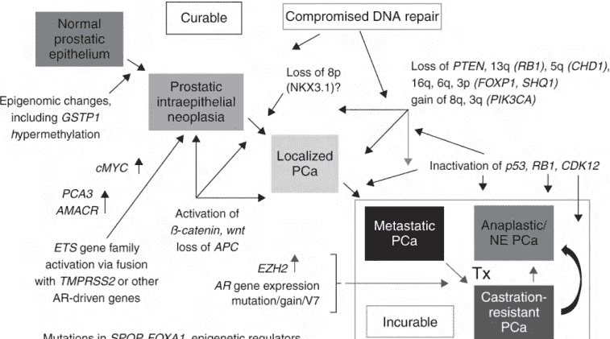

图 9.2 前列腺癌进展中的基因组改变。

nerves. 鉴于40%的CC患者处于生育年龄，在患者表达保留生育能力的愿望，且该保留符合肿瘤学原则的前提下，保存生育能力成为一项重要考量。根据美国国家综合癌症网络（NCCN）、欧洲妇科肿瘤学会（ESGO）、欧洲放射肿瘤学会（ESTRO）、欧洲病理学会（ESP）以及德国指南，可为诊断为IA1期至IB1期宫颈鳞状细胞癌和腺癌的患者提供保留生育能力的治疗（ESGO指南，2014）。

性接触通常是感染性传播感染（STIs）的途径。通常，性接触——包括阴道、口腔或肛交过程中的体液或皮肤接触——是涉及的细菌、病毒或寄生虫的传播方式（Fasciana et al., 2022）。世卫组织（WHO）报告称，全球每天诊断出超过一百万例STIs（Tuddenham et al., 2022）。2016年记录的3.76亿新感染病例中包括以下四种性病：梅毒（630万例）、淋病（8690万例）、衣原体感染（1.272亿例）和滴虫病（1.56亿例）（Rowley et al., 2019）。STDs对患者健康有严重的负面影响，并可能导致多种二次性疾病和问题，包括CC、不孕症、与妊娠相关的问题（如胎儿死亡）、感染HIV的风险增加，以及因心理和社会因素导致的生活质量下降（Korenromp et al., 2019）。单纯疱疹病毒1型（HSV-1）和2型（HSV-2）极为常见，全球患病率分别约为67%和13%。这里的挑战在于深入研究可能影响皮肤、眼睛或口腔、损害中枢神经系统或多个器官的新生儿感染。

### 9.3 重大挑战

多年来，生殖医学与基因组医学已在性健康、婴儿健康、宫腔内人工授精和男性健康等新兴领域实现了转化实践，其中主要涉及前列腺腺癌（CA）和雄激素受体信号通路等领域。另一方面，预后、诊断和治疗诊断（也称为theragnostic）方法已将个体化医疗推至前沿。许多专业协会和组织，如生殖健康专业人员协会（ARHP）和印度生殖与生育研究学会（ISSRF），在制定这些领域研究成果传播框架方面发挥了关键作用。鉴于上述众多应用，我们描述了在将这些基因检测应用于生殖医学道路上所面临的五大挑战：

- (a) 针对基因检测的社会意识，将弥合社会与遗传学家之间的差距
- (b) 为筛查编目候选突变，以开发“单一生殖健康”面板
- (c) 用于实现精准医疗的治疗靶点
- (d) 健康、卫生与习惯（3H）
- (e) 将高通量技术投入实践。

#### 9.3.1 针对基因检测的社会意识

遗传性疾病可以通过基因检测来预防、治疗或早期发现。已知，包括乳腺癌、前列腺癌和结直肠癌在内的5%–10%癌症具有遗传成分。人们对基因检测重要性的认识不足，导致遗传性疾病增加。基因检测常常在家庭和个人中引发恐惧，不仅限于生殖健康（RH）领域，也涉及多种疾病。镰状细胞病（SCD）是一组遗传性红细胞疾病，体现了这一担忧。SCD是一种常染色体隐性遗传病，会导致红细胞呈现独特的镰刀状。它主要影响非洲、地中海、中东、印度、加勒比海以及中美洲和南美洲血统的人群。新生儿筛查中检出SCD特征后的综合随访计划不足。尽管非裔美国人持积极态度并存有保留，但基因咨询和随访服务的采用率仍面临挑战（Long et al., 2011）。

3H与基于基因组的生殖医学中的重大挑战如图9.3所示。

Gustafson等人（2007）关于基因检测的突变编目与治疗靶点报告称，SCD基因检测的感知益处显著增加。这强调了鼓励基因检测和咨询（特别是在RH领域）至关重要，旨在缩小遗传学家与公众之间的差距。通过提高公众意识，我们可以促进知情决策、减少污名化、

- **高通量技术：**
  - 提升检测效率
  - 自动化与可扩展性
  - 成本效益实施

- **社会意识：**
  - 开展基因检测公众教育
  - 消除误解和恐惧。
  - 鼓励开放对话

- **健康、卫生、习惯（3H）：**
  - 强调生活方式因素
  - 促进健康行为
  - 融合基因组学洞见

- **突变编目：**
  - 综合数据库创建
  - 筛查标准标准化
  - 简化面板开发

- **治疗靶点：**
  - 个性化治疗策略
  - 精准医疗进展
  - 靶向基因疗法

图 9.3 基于基因组的生殖医学重大挑战，即3H：健康、卫生与习惯；高通量技术；社会意识。

并提供平等的基因服务获取途径，营造鼓励性环境，使人们能够就其RH做出明智的决定。

#### 9.3.2 为筛查编目候选突变

对候选突变进行有效编目，对于构建全面的RH面板至关重要。这一过程涉及对与一系列生殖障碍（涵盖生育问题、妊娠并发症及后代健康问题）相关的基因变异进行细致编纂。携带者筛查联合基因咨询已被证明能显著降低隐性遗传病的患病率，因为它可以让个体在怀孕前或怀孕期间了解自身的生育风险。美国产科与妇科医师学会（ACOG）和美国医学遗传学与基因组学学会（ACMG）等专业组织倡导开展广泛筛查，强调其在识别与囊性纤维化等疾病相关的突变方面的重要性（Azimi et al., 2016）。然而，传统筛查方法受成本和技术限制，往往仅针对基因中的常见突变，因此对多样化人群不足。新一代DNA测序（NGS）的出现彻底改变了携带者筛查，提供了更高的准确性和评估每种疾病更广泛突变的能力。通过广泛研究，可以精准定位与多囊卵巢综合征、子宫内膜异位症、流产和胚胎异常等疾病相关的突变（Capalbo et al., 2021）。这有助于创建统一的RH基因筛查面板，使医疗保健提供者能够提供个性化干预和家庭计划策略。通过确保包容性与精准性，这种方法不仅能实现早期检测，还能支持预防措施，最终为应对生殖挑战的个人和家庭带来更好的结果。

#### 9.3.3 精准医疗的治疗靶点

动物模型在预测人类治疗反应方面存在重大局限性，这对其在基础研究中的适用性提出了质疑。大数据科学与生物数据的结合以及基因测序技术的突破，催生了精准医疗（Song et al., 2020）。将基因和基因组发现应用于临床实践，有望改善人类健康。精准医疗涉及对多样化人群和特定疾病的生物标志物进行全面分析、识别和验证，借助基因组和蛋白质组测序等尖端技术。生物标志物识别构成了精准医疗的基石，连接了医学科学与组学大数据分析（Goetz and Schork, 2018）。关键之一是利用现实世界数据解决与治疗相关的问题。RH领域精准医疗的治疗靶点包括针对反复流产等疾病的免疫调节、针对不孕症和子宫内膜异位症的基因和分子干预、表观遗传修饰、微生物组操纵以及个性化生活方式干预。这些策略提供了量身定制的方法，以加强RH护理，为面临生殖挑战的个人和夫妇带来更好的结果前景。需要基于治疗靶点的方法来将这些实践融入RH中。

#### 9.3.4 健康、卫生与习惯

卫生行为对长期健康至关重要，并对人类的RH过程产生重大影响。根据世卫组织（WHO），STDs等RH状况是严重的全球健康问题，全球病例数量不断增加。药物耐药性、促进传播的环境因素以及持久的污名化，是限制抗击STI成功的一些障碍。与STD相关的感染在青少年中很普遍。他们需要了解STD预防的复杂性，

这需要对生殖健康（RH）有深入了解（Mahobia 和 Choudhari，2022）。忽视个人卫生，例如使用受污染的水或不经常更换内衣，可能导致促进性传播疾病（STD）传播的疾病（Mariani 等人，2021）。年轻女性通常会遇到经期卫生问题（Pokhrel 等人，2021）。这些问题仍然存在，特别是对学龄女童和居住在低收入地区的人而言。这些挑战源于传统观念、知识获取有限以及卫生用品短缺（Parent 等人，2022）。

除了卫生条件差之外，成人的生殖疾病还经常与性行为相关。因此，要理解RH，必须了解生殖系统、健康习惯、避孕和STD预防（Lindberg 等人，2020）。强调个人卫生在维护整体健康中的重要作用，是卫生促进的一部分。RH问题也可能出现在专业环境中，例如实验室工作。实验室人员通过常规卫生标准受到RH问题的保护（Mizan，2016）。在这种情况下，个人卫生也是RH中需要关注的问题。为此，必须替换危险材料，保证通风系统的有效性，并采用工程控制方案而非个人防护设备。因此，将3H原则融入RH教育、服务和政策对于实现最佳RH结果至关重要。重要的是要强调生活方式选择，包括戒毒、安全性行为以及培养健康的心理健康习惯。缩小社会经济差距可保障公平获得生殖医疗保健，促进各群体健康。

#### 9.3.5 实施高通量技术

通过实施高通量技术，在生殖疾病和RH领域改善诊断、治疗和研究具有巨大的前景。个体化医疗方法因这些技术而成为可能，这些技术包括高分辨率成像、微阵列和NGS。这些技术可快速分析遗传、表观遗传和蛋白组数据。在辅助生殖技术中，有许多新方法和工具被引入治疗情境的示例，而缺乏所需的研发或循证医学来加强该程序对患者的安全性和益处。示例包括囊胚移植、玻璃化冷冻、体外成熟、卵裂辅助孵化和植入前基因筛查。国际标准往往在未经过充分验证的情况下制定，涉及培养基成分、刺激方案和实验室操作（Clarke 等人，2012；Harper 等人，2012）。高通量技术可帮助检测生殖疾病中与不孕相关的遗传异常，从而实现定制治疗。这些技术还改善了性传播疾病的筛查，从而实现更早的发现和治疗。高通量技术（如NGS和微阵列分析）允许对生殖性恶性肿瘤（Dawes 等人，2019）进行全面的基因组分析，例如前列腺癌（PCa），发现与癌症发展、进展和治疗反应相关的遗传异常。这些技术使精准医疗技术成为可能，从而根据每位患者独特的基因图谱制定个体化治疗方案。高通量方法（Böttcher，2016）甚至有助于识别可改善PCa患者早期检测和预后评估的生物标志物。医疗保健从业者可以将这些技术融入临床实践和研究项目中，以提高解决RH问题的准确性、效果和效率。

在遗传检测应用于生殖医学之前，必须克服若干重大障碍。这些包括提高公众意识、整理潜在突变、寻找治疗靶点、鼓励良好的健康和卫生习惯，以及将高通量技术付诸实践。为了克服这些障碍，利益相关方必须通力合作，投资于教育和研究，并致力于推进精准医疗技术。通过解决这些问题，将实现个体化护理和更好的RH结果。

### 9.4 遗传方法

遗传筛查用于识别携带与特定疾病相关的遗传变异或突变的个体。遗传筛查的目标是向个人提供有关其健康及其后代健康的信息。虽然遗传筛查可能有助于计划定期评估、实施预防策略或启动治疗干预，但生育能力下降是越来越多人采用遗传筛查/咨询的主要原因之一。

如今，不孕不育是一个全球性的重大问题，影响着数百万育龄人群。全球约有4800万对夫妇和1.86亿个体患有不孕不育。在65%的病例中，不孕不育诊断包括生化和仪器分析，其余35%的病例（未诊断）需要进行遗传检测。不孕不育与15%的遗传疾病有关；不孕不育的遗传和非遗传原因显示出相似的临床症状模式。因此，为了管理这一日益严重的不孕不育问题，临床诊断应通过遗传评估来支持和确认。遗传检测作为一种有价值的工具，用于确定可能遗传给后代的潜在遗传疾病。通过孕前筛查，潜在父母在受孕前了解其生殖风险，从而帮助他们就家庭计划做出明智的决定。这种主动方法不仅有助于了解潜在的遗传性健康问题，还能促进早期干预和个体化医疗护理，最终为后代铺平更健康的道路。通常，带有遗传或染色体缺陷的配子有时会在生殖方面遇到困难。然而，辅助生殖技术（ART）的发展通过提供克服这些障碍的途径，彻底改变了这一环境。遗传检测（包括携带者筛查、植入前诊断和产前诊断）对于监测特定基因缺陷可能转移给青少年的可能性至关重要。

在产前筛查和检测领域，产前诊断为分子诊断开辟了一个有趣的新前沿。这种专业应用涉及检测未出生胎儿中的遗传异常、疾病或其他情况，为出生前发育中的婴儿的健康状况提供宝贵的见解。植入前遗传检测（PGT）和产前诊断（PND）是目前用于可能面临遗传疾病遗传风险的夫妇的诊断方法。这些治疗的安排、取样技术和实验室规程各不相同，尽管它们都旨在揭示遗传异常。此外，PGT中使用的分子生物学方法结合常规实验室研究，显著提高了ART操作的有效性。这些创新不仅加快了程序，而且通过降低时间、精力和成本，帮助其取得成功。

### 9.5 遗传检测的终结？

存在多种不同类型的遗传检测（图9.4）。没有一种单一的遗传检测可以检测所有遗传病症。遗传检测的方法基于病史和家族史以及正在检测的疾病进行个体化。例如，当存在特定病症或综合征的症状时，单基因检测专注于识别特定基因内的变异，例如杜氏肌营养不良症（DMD）或SCD。在已知遗传突变在家族中遗传的病例中，它们尤其有用。相比之下，面板遗传检测在一次全面检测中检查多个基因。这些检测通常根据各种医疗问题进行分类，例如肌张力低下、身材矮小或癫痫。此外，面板遗传检测可以针对与增加特定类型癌症（如乳腺癌或结直肠癌）易感性相关的基因。这种方法为识别导致一系列健康状况的潜在遗传因素提供了更广泛的范围。大规模遗传或基因组检测具有固有需求：大规模遗传检测有两种不同的类型。外显子组测序查看DNA中的所有基因（全外显子组）或仅查看与医疗状况相关的基因（临床外显子组）。大规模遗传检测可能识别

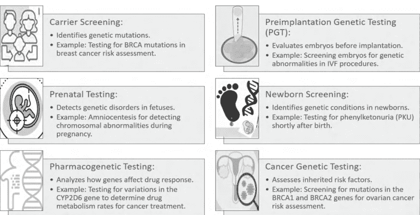

图 9.4 遗传检测的主要类型。

与检测原始目的无关的未知发现。即使最初的目标是检测儿童发育困难的遗传学解释，这些偶然的线索也可能显示与癌症倾向或异常心脏缺陷等疾病相关的遗传标记。这种广泛的遗传信息凸显了我们遗传构成的复杂性和相互关联性，为超出检测直接关注点的主动健康管理和个性化治疗提供了机会。

尽管其很重要，但面临哪些挑战？广泛接受的遗传检测和筛查有望改善公共卫生，但也带来了复杂的伦理、法律和社会问题。在个人权利与公共卫生需求之间取得平衡至关重要。保护知情同意、隐私和反歧视等原则至关重要。试图以不同方式处理遗传数据，尽管出于良好意图，但可能导致不公正和运营问题。虽然必须保护个人伦理权利，但公共卫生伦理主张出于社区健康利益而进行自愿检测和数据共享（Tong, 2013）。当将其与生殖遗传携带者筛查（RCS）相关联时，这一点最为合理。RCS旨在评估在怀孕前或怀孕期间，无论家族背景如何，生育患有特定遗传病儿童的可能性。RCS中的伦理问题涵盖几个关键考量。首先，阐明RCS计划的目标构成了核心伦理困境。在个人生殖自主权与人群健康目标之间取得平衡至关重要。批评者认为，单纯旨在降低人群水平遗传病发病率可能会无意中胁迫夫妇参与，从而破坏检测的自愿性。这种方法可能暗示高风险夫妇有义务采取行动，可能侵犯其自主权和决策权。伦理问题还扩展到筛查过程中发现的基因变异的分类（Dive and Newson, 2021）。在人群筛查缺乏患者（proband）的情况下，一些变异的致病性存在歧义，这造成了困难。误分类可能给夫妇带来压力和不必要的治疗，但不揭示致病性变异可能对未来后代产生意外后果。这些伦理问题凸显了将RCS计划作为真正尊重夫妇信仰和选择的自愿干预措施来实施的重要性。随着变异数据库的扩展，解决这些伦理困难对于适当执行RCS项目至关重要。为这种情况设计筛查面板需要谨慎，考虑信息在不同人群中的价值和可行性。由于基因变异的复杂性，定期审查面板至关重要（Dive et al., 2022）。同样，生殖癌遗传检测也引发伦理问题，包括家庭沟通责任。共享结果可能给携带者带来负担，涉及隐私、自主权以及潜在的家庭冲突或歧视等两难困境（Ormondroyd et al., 2012）。在这些观点之间找到平衡对于应对遗传检测的伦理环境至关重要。

在为遗传特殊主义铺平道路的同时，我们还应检查获得遗传检测同意的适当流程，有必要面对更广泛的问题：这些检测结果的后果是否与其他“医学”检测结果的后果有实质性区别，后者并不总是获得特定同意。一些伦理学家反对所谓的遗传检测“特殊主义”。作为科学家，我们始终相信进步和发展，当遗传检测与设计良好的健康教育和生动体验相结合，并首先建立遗传检测伦理时，其收益将远大于危害，且危害更小。愿健康基因组长存。

### 9.6 未来前景

生殖健康（RH）和癌症管理以及其他合并症的未来，与应对重大挑战息息相关。尽管过去已经研究过遗传学、基因组和环境因素，但NGS的全部潜力尚未实现。这些疾病经常在成年期出现，这表明与生殖系或家族异常有关。在面临内在困难的同时，仍有许多未解之谜。因此，转向进化和基于系统的基因组学方法至关重要。迫切需要将遗传检测与适当的管理和教育计划相结合。

遗传检测的广泛接受带来了潜在的健康改善，但也引发了复杂的伦理、法律和社会问题。在个人权利与公共卫生需求之间取得平衡至关重要，需要保护知情同意、隐私和反歧视等原则。RCS凸显了这些伦理挑战，包括胁迫顾虑和基因变异分类两难问题。以自愿方式提供RCS尊重了夫妇的自主权。随着变异数据库的扩展，伦理考量依然存在，这需要谨慎设计筛查面板并进行持续审查。在遗传检测中实现伦理平衡涉及在推广知情同意和健康教育的同时应对这些挑战。生殖器官癌症或突变的遗传检测的伦理影响扩展到对整个家庭的影响。在结果披露后，个人有道德义务向家人提供建议。这种“信使”责任可能会给承担者带来负担并造成不适。有效的沟通涉及多项挑战，引发了关于隐私、自主权以及基于遗传状况的家庭冲突或歧视可能性的伦理问题。

## 参考文献

- Acuin CS, Khor GL, Liabsuetrakul T, 等 (2011) 东南亚孕产、新生儿和儿童健康：迈向更大的区域合作。The Lancet 377:516–525. https://doi.org/10.1016/S0140-6736(10)62049-1

- Azimi M, Schmaus K, Greger V, 等 (2016) 基于下一代测序的携带者筛查：健康效益与成本效益。Molecular Genetics & Genomic Medicine 4:292–302. https://doi.org/10.1002/mgg3.204

- Basoya S, Anjankar A (2022) 宫颈癌：生殖年龄组的早期检测与预防。Cureus 14:e31312. https://doi.org/10.7759/cureus.31312

- Berg JA, Shaver J, Woods NF, Kostas-Polston EA (2022) COVID-19大流行期间女性性/生殖健康与获取挑战。Nursing Outlook 70:238–246. https://doi.org/10.1016/j.outlook.2022.01.003

- Böttcher R (2016) 利用高通量技术鉴定前列腺癌新生物标志物。埃拉斯姆大学鹿特丹分校。https://repub.eur.nl/pub/94115/161122_Botcher-Rene.pdf

- Capalbo A, Poli M, Riera-Escamilla A, 等 (2021) 孕前基因组医学：现状与未来展望，以基于个体基因组数据改善不孕症诊断及生殖和健康结局。Human Reproduction Update 27:254–279. https://doi.org/10.1093/humupd/dmaa044

- Clarke AJ, Cooper DN, Krawczak M, 等 (2012) 从数据中筛选意义——高通量基因组技术对人类遗传学和医疗保健的影响。Human Genomics 6:11. https://doi.org/10.1186/1479-7364-6-11

- Dawes R, Lek M, Cooper ST (2019) 基因发现信息学工具包可定义不明原因不孕症及产前或婴儿期或不育死亡率的候选基因。npj Genomic Medicine 4:8. https://doi.org/10.1038/s41525-019-0081-z

- Dive L, Archibald AD, Newson AJ (2022) 生殖携带者筛查中基因选择的伦理考量。Human Genetics 141:1003–1012. https://doi.org/10.1007/s00439-021-02341-9

- Dive L, Newson AJ (2021) 生殖遗传携带者筛查中的伦理问题。Medical Journal of Australia 214:165. https://doi.org/10.5694/mja2.50789

- Fasciana T, Capra G, Lipari D, 等 (2022) 性传播疾病：诊断与控制。International Journal of Environmental Research and Public Health 19:5293. https://doi.org/10.3390/ijerph19095293

- Gann PH (2002) 前列腺癌的风险因素。Reviews in Urology 4 Suppl 5:S3–S10.

- Goetz LH, Schork NJ (2018) 个体化医疗：动机、挑战与进展。Fertility and Sterility 109:952–963. https://doi.org/10.1016/j.fertnstert.2018.05.006

- Gustafson SL, Gettig EA, Watt-Morse M, Krishnamurti L (2007) 非裔美国女性关于镰状细胞病遗传检测和咨询的健康信念。Genetics in Medicine 9:303–310. https://doi.org/10.1097/GIM.0b013e3180534282

- Harper J, Cristina Magli M, Lundin K, 等 (2012) 新技术应何时以及如何引入IVF实验室？Human Reproduction 27:303–313. https://doi.org/10.1093/humrep/der414

- Huang H, Cai B (2014) HOXB13中的G84E突变与前列腺癌风险密切相关：一项荟萃分析。Tumor Biology 35:1177–1182. https://doi.org/10.1007/s13277-013-1157-5

- Jiang P, Yue Y (2014) 人乳头瘤病毒致癌蛋白与凋亡（综述）。Experimental and Therapeutic Medicine 7:3–7. https://doi.org/10.3892/etm.2013.1374

- Korenromp EL, Rowley J, Alonso M, 等 (2019) 母孕及先天性梅毒及相关不良妊娠结局的全球负担——2016年估计及自2012年以来的进展。PLoS ONE 14:e0211720. https://doi.org/10.1371/journal.pone.0211720

- Li H, Ralph P (2019) 局部PCA显示人口结构对基因组的影响沿基因组有所不同。Genetics 211:289–304. https://doi.org/10.1534/genetics.118.301747

- Lindberg LD, Bell DL, Kantor LM (2020) COVID-19大流行期间青少年和年轻成年人的性与生殖健康。Perspectives on Sexual and Reproductive Health 52:75–79. https://doi.org/10.1363/psrh.12151

- Long KA, Thomas SB, Grubs RE, 等 (2011) 非裔美国人对遗传学、遗传检测以及镰状细胞病教育和意识的态度与信念。Journal of Genetic Counseling 20:572–592. https://doi.org/10.1007/s10897-011-9388-3

Mahobia A, Choudhari SG (2022) 印度青少年生殖健康社会保障措施：叙事性综述。Cureus 14:e28546. https://doi.org/10.7759/cureus.28546

Mariani A, Seweng A, Ruseng SS, 等 (2021) 知识与个人卫生与帕卢 Talise 社区卫生中心性传播疾病发生情况之间的关系。Gaceta Sanitaria 35:S164–S167. https://doi.org/10.1016/j.gaceta.2021.10.016

Markowitz LE, Dunne EF, Saraiya M, 等 (2024) 人乳头瘤病毒疫苗：免疫实践咨询委员会 (ACIP) 的建议。发病率和死亡率周报 63:1–30. www.cdc.gov/mmwr/preview/mmwrhtml/rr6305a1.htm. 2024 年 4 月 30 日访问。

Mayer C, Gasalberti DP, Kumar A (2024) 近距离放射治疗。载于：StatPearls。StatPearls 出版社，Treasure Island (FL)。

Mizan GE, Rees D, Wilson K (2016) 实验室工作中的生殖健康危害：回归基础。南非职业健康 22:30–33. https://doi.org/10.10520/EJC193376

Ntekim A, Folasire A, Odukoya OA (2023) 尼日利亚 55 岁以下年轻男性前列腺癌的患病率。癌症控制 30:10732748231175255. https://doi.org/10.1177/10732748231175255

Oczkowski M, Dziedzickowicz K, Pasternak-Winiarska A, 等 (2021) 膳食因素与前列腺癌的发展、进展和减少。营养素 13:496. https://doi.org/10.3390/nu13020496

Oncology (ESGO) TES of G (2024) ESGO 2017 年会议，2017 年 11 月 4–7 日，奥地利维也纳。载于：ESGO 妇科肿瘤学指南。https://guidelines.esgo.org/cervical-cancer/guidelines/recommendations/. 2024 年 4 月 30 日访问。

Ormondroyd E, Donnelly L, Moynihan C, 等 (2012) 在生育前接受 BRCA 检测呈阳性的女性对生殖遗传检测的态度：定性分析。欧洲人类遗传学杂志 20:4–10. https://doi.org/10.1038/ejhg.2011.146

Parent C, Tetu C, Barbe C, 等 (2022) 月经卫生用品：实践评价。妇产科与人类生殖杂志 51:102261. https://doi.org/10.1016/j.jogoh.2021.102261

Pokhrel D, Bhattarai S, Emgård M, 等 (2021) 农村尼泊尔女学生使用阴道月经杯的可接受性和可行性：定性先导研究。生殖健康 18:20. https://doi.org/10.1186/s12978-020-01036-0

Poondla N, Madduru D, Duppala SK, 等 (2021) 精准医疗时代的宫颈癌：发展中国家的视角。癌症生物学——转移进展 3:100015. https://doi.org/10.1016/j.adcanc.2021.100015

Ramachandran D, Dörk T (2021) 宫颈癌的基因组风险因素。癌症 13:5137. https://doi.org/10.3390/cancers13205137

Rodrigues VDO, Polisseni F, Pannain GD, Carvalho MAG (2020) 人类生殖中的遗传学。JBRA 辅助生殖 24:480–491. https://doi.org/10.5935/1518-0557.20200007

Rowley J, Vander Hoorn S, Korenromp E, 等 (2019) 衣原体感染、淋病、滴虫病和梅毒：2016 年全球患病率和发病率估计。世界卫生组织公报 97:548–562. https://doi.org/10.2471/BLT.18.228486

Rybak AP, Bristow RG, Kapoor A (2015) 前列腺癌干细胞：解读前列腺肿瘤发生和侵略性中涉及的起源和通路。Oncotarget 6:1900–1919. https://doi.org/10.18632/oncotarget.2953

Song C, Kong Y, Huang L, 等 (2020) 大数据驱动的精准医疗：开启医学定制时代。生物医学与药物疗法 129:110445. https://doi.org/10.1016/j.biopha.2020.110445

Thoenissen P, Heselich A, Burck I, 等 (2023) 口腔鳞状细胞癌患者术前分期中磁共振成像和计算机断层扫描的作用。肿瘤学前沿 13:972042. https://doi.org/10.3389/fonc.2023.972042

Tong, R. (2012) 伦理学、不孕症与公共卫生：平衡公共利益与个人选择。医学哲学通讯，11:2，第 12–17 页。（转载于 Boylan, M. (2014) 医学伦理学，第二版，马尔登，马萨诸塞州：Wiley-Blackwell，第 13–30 页。）

Tuddenham S, Hamill MM, Ghanem KG (2022) 性传播感染的诊断与治疗：综述。JAMA 327:161. https://doi.org/10.1001/jama.2021.23487

Tvrda E, Agarwal A, Alkuhaimi N (2015) 男性生殖癌与不孕症：一种互惠关系。国际分子科学杂志 16:7230–7260. https://doi.org/10.3390/ijms16047230

United Nations Population Fund (2018) UNFPA – 常见问题解答。https://www.unfpa.org/frequently-asked-questions.

Woodruff TJ, Carlson A, Schwartz JM, Giudice LC (2008) 生殖健康与生育面临环境挑战峰会论文集：执行摘要。生育与不孕 89:e1–e20. https://doi.org/10.1016/j.fertnstert.2008.01.065

Yim EK, Park JS (2005) HPV E6 和 E7 癌基因蛋白在 HPV 相关宫颈癌发生中的作用。癌症研究与治疗 37:319. https://doi.org/10.4143/crt.2005.37.6.319

## 索引

- 异常的, 71, 100, 168
- 异常, 8, 17, 45, 53–56, 73, 86, 88–89, 92, 124, 130, 132, 136–137, 159, 175–179
- 流产, 31–33, 120, 147, 155–156, 160, 165
- 剥离, 54
- 吸收, 37
- 准确性, 10, 12–13, 17, 65, 67, 69–70, 72–73, 84–85, 93, 97, 106, 110–111, 113, 115–116, 118–121, 132, 170, 174, 176
- 酸, 6, 11, 34, 37, 40, 48, 71, 119, 136
- 激活, 15, 48, 53, 68, 75, 137, 143, 168, 170–171
- 腺癌, 171–172
- 青少年, 26, 42, 147, 149, 156, 160–161, 165–166, 169, 174, 176, 180–181
- 收养, 26, 93, 141, 153
- 进步, 6, 12, 16–18, 24, 34–35, 61, 65–66, 68–69, 73, 77–79, 82, 85–86, 97, 129, 131–133, 141, 167
- 优势, 15, 51, 56, 72–73, 83, 92, 123, 134, 142, 147, 149, 156, 163, 169–170, 178
- 不良的, 34–35, 40, 45, 54, 73, 84–85, 91–92, 96, 129, 133–134, 180
- 病因学, 99
- Affymetrix, 50
- 代理剂, 5, 86, 89, 96, 167
- 老化, 8, 15–17, 19, 24, 34–36, 40, 44, 58, 64, 67–68, 71, 75, 79, 82, 91, 94, 97–98, 102, 137, 140, 144–145, 147, 156, 163, 168, 170–171, 173, 175–176, 182
- 疾病, 25, 131, 167
- 算法, 7, 13–19, 25, 41, 69, 72, 80–82, 84–85, 93–94, 96–97, 102–105, 109, 111–117, 140–141
- 等位基因, 55, 65, 70, 79
- 改变, 3–4, 12, 24–25, 46–49, 52, 54, 57, 80, 87–88, 90, 93–94, 130, 167–168, 170–171
- 羊膜的, 11, 25, 41, 52
- 合成代谢剂, 130
- 分析, 14, 26, 31, 34, 54, 62, 64, 73, 79–82, 86, 89, 94, 97–98, 124, 164, 176
- 解剖学的, 8
- 雄激素, 49, 52, 57, 101, 134, 143, 168, 172

- 贫血, 56
- 非整倍体, 54, 86–87, 100
- 血管生成, 10
- 动物, 37, 99, 142, 167, 174
- 异常, 11, 16, 34, 85, 90–91, 130, 167
- 产前的, 116–117, 166, 176
- 产前的, 42
- 人体测量学, 24
- 抗体, 68
- 抗氧化剂, 37, 136
- 抗逆转录病毒的, 15
- 凋亡, 53, 169, 170, 180
- 古菌, 47
- 考古学的, 41
- 架构, 6, 15, 34, 91
- 阵列, 50–51, 58, 175
- Arora, 56
- 砷, 167
- Atopobium, 48
- 自动编码器, 112
- 意识, 15, 40, 121, 160, 169, 172–173, 175–176, 180
- 无精子症, 49, 53, 59, 134
- 细菌的, 25, 38, 47, 144
- 屏障, 44, 72, 86, 154, 156, 167, 174
- 行为的, 34
- 基准测试, 41
- 良性的, 16, 20, 22
- 分叉, 2–3
- 结合, 6, 51, 64
- 生物活性, 143
- 生物化学, 4
- 生物标志物, 5, 10–11, 14, 41, 44–45, 51, 57–58, 60–63, 68, 70, 73–75, 77–78, 80–81, 90–91, 94–95, 97, 100, 117, 119, 122, 126, 129, 132, 134–135, 138–140, 142–144, 174, 176, 180
- 生物模型, 82, 84
- 活检, 70–71, 136, 165
- 生物心理社会的, 165
- 生物技术, 19, 42, 57, 98–99, 101, 126

- 出生, 31, 36, 71, 115–116
- 双酚, 8, 19
- 囊胚, 16, 20, 114, 175
- 出血, 22, 43
- 混合, 35
- 血液, 9–11, 21, 25, 34, 52–53, 59, 70–72, 80, 115, 119, 172
- 蓝图, 69
- 身体, 1, 37, 47, 68, 92, 113, 115–116, 118–120, 127, 131, 156, 164, 171
- 瓶颈, 61, 70
- 边界, 65, 112
- 大脑, 22, 40, 57
- 突破, 51, 64, 93–94, 97, 174
- 乳腺, 15, 22, 92, 98, 133, 144, 154, 168, 172, 177

- 剑桥, 40, 165
- 癌症, 1, 13–17, 19–21, 23, 42, 44, 57–58, 85, 98–100, 117, 122, 124, 131, 133, 135, 144–145, 166–172, 175, 177–182
- 容量, 12, 14, 43–44, 65, 69, 105, 114, 128, 133–134, 140, 148–149, 174
- 碳水化合物, 2, 11, 37
- 癌, 168, 171–172, 182
- 携带者, 53–56, 167–168, 173–174, 176, 178–180
- 携带, 54, 107, 158
- 类别, 54, 103, 113
- 脑脊液的, 70–71
- 宫颈的, 117, 122, 124, 166, 169–170, 179, 181–182
- 特征, 5–7, 12–14, 18, 32, 47, 52, 54, 70, 77, 103, 106–107, 110–111, 114–115, 117, 129–130, 138, 159, 166
- 检查点, 85, 87, 169–170
- 育儿, 30–31, 44
- 衣原体, 117, 171, 181
- 胆固醇, 52, 119, 167
- 胆碱, 71
- 循环, 52
- 刺胞动物, 58
- 分类, 13–15, 19, 41, 103–106, 110, 112, 116, 119, 121, 123, 125, 178–179
- 分类器, 5, 19, 103, 118–119
- 裂解的, 71
- 临床的, 6, 10–18, 20, 24–25, 34–35, 40–41, 44, 47, 53, 56, 58, 61–62, 70–71, 73, 78–80, 84–85, 89, 91–93, 95–98, 114, 116–118, 123, 125–126, 129, 131–134, 136–137, 140–144, 149, 163, 167, 174, 176–177
- 聚类, 15, 19, 104, 107–108, 121, 123
- 编码, 11, 46–47, 49, 51–52, 56, 58, 65, 69, 87, 135
- 认知上, 5
- 连贯的, 1–2, 82

- 结直肠的, 172
- 复杂性, 4–5, 12, 72–73, 76–81, 87, 89–90, 110, 141, 147, 178
- 压缩, 32, 111
- 计算的, 1, 3, 8, 10–11, 18, 32, 50, 57, 69, 76–84, 90–92, 94, 96–98, 100, 102, 110, 140
- 受孕, 22, 54
- 浓度, 3, 44, 63, 66, 72, 118, 120, 131, 137, 144
- 受孕, 9, 37, 45, 56, 61, 66, 70, 83–84, 95–96, 113, 138, 156, 159, 176, 180
- 并发的, 25, 112, 138
- 浓缩的, 35
- 会议, 39, 75, 124, 163–164
- 构象的, 68
- 先天性的, 49, 54, 90–91, 157, 180
- 连通性, 4, 6
- 组成成分, 25, 52
- 避孕的, 26, 30–31, 114, 116–117, 122, 133, 144
- 对比, 25, 61, 70, 102, 132, 137
- 汇聚, 18, 97, 111, 138
- 卷积的, 16, 20, 123
- 相关的, 3, 105, 168
- 咨询, 46, 56–57, 114, 144, 153–155, 162, 172–173, 176, 180
- 隐孢子虫病, 53, 136–137
- 培养的, 47
- 控制论, 2
- 细胞学, 130
- 胞质的, 53, 134, 136, 142–143, 159

- 数据库, 39, 69–70, 94, 109, 129, 143, 151, 178–179
- 女儿, 23
- 反卷积, 91, 98
- 降解组学, 75
- 发展, 1, 8–11, 14, 16, 18–19, 24–26, 30, 39, 41–42, 47, 49–50, 52–53, 57–58, 60–61, 63–65, 67, 73–81, 83–85, 87–92, 94, 96–97, 99–101, 116, 125–127, 129, 131–132, 135, 137–138, 140, 145, 154–157, 162, 166, 168, 175–176, 178, 181
- 诊断, 24, 34, 44, 47, 53, 60, 71, 73, 130–131, 134–135, 139–141, 168, 171, 176
- 饮食, 10, 12, 23, 36–37, 41–43, 46, 88, 100, 167, 181
- 双乙烯雌酚, 23, 42
- 功能障碍, 8, 11, 22, 45, 59, 86–87, 130–131, 134–135, 143, 169
- 失调, 10, 88

- 子痫, 8–10, 19–20, 24–25, 35, 41–42, 54, 61, 63, 90–95, 98, 100, 115–116, 122, 125, 132, 139
- 电子的, 12, 16, 24, 59, 115, 125–126, 147, 152
- 电泳, 60, 64–65, 71

- 元素, 5, 20–21, 25, 135, 142, 161

- 表观基因组学, 46–47, 99, 128, 140

- 消除, 34, 133

- 胚胎, 8, 16, 54–56, 71, 96, 129, 135, 137, 139–140, 155, 159

- 酶, 11, 44, 52, 85, 89, 168

- 环氧化合物, 117

- 平衡, 25, 104, 131, 160–162

- 雌二醇, 62, 137

- 雌激素, 37, 83–84, 134

- 埃塞俄比亚, 113, 116, 125–126

- 外显子组, 41, 46, 49, 56, 58–59, 177

- 外泌体, 74

- 表达式, 81

- 女性, 9, 22, 32, 40, 43, 45, 47–48, 52–53, 56, 61, 64, 85, 98–99, 101, 119, 122, 125, 129–130, 132, 137, 170

- 发酵, 37

- 生育力, 8–9, 18–19, 22–23, 26, 30–31, 37, 40, 43, 45–47, 49, 53–54, 56–58, 60–63, 65–66, 70–71, 73–74, 76–79, 93–99, 101, 118–120, 122, 124–126, 129–131, 133–134, 136–141, 143–144, 146–147, 155, 158–159, 166–167, 170–176, 180, 182

- 受精, 71, 114, 158

- 胎儿, 12, 24, 54, 64, 90, 129, 157, 176

- 荧光, 142

- 卵泡期, 71, 75, 137, 143

- 碎片化, 66, 68, 136, 144

- 配子发生, 76, 78, 85–89

- 胃肠道, 41

- 性别, 44, 115, 121, 123, 131, 156, 162, 165

- 腺体, 22, 131

- 性腺激素, 57, 124

- 疏水性, 71–72

- 过度刺激, 95, 139–140

- 缺氧, 34

- 特发性, 49, 53, 88, 93, 98

- 免疫, 8–9, 80, 86–88, 91, 117, 128, 132, 167, 174

- 植入物, 9

- 阳痿, 22, 44, 132

- 婴儿, 26, 54–55, 92, 119, 122, 126, 159, 172, 180

- 启发性, 1

- 胰岛素, 10, 80–81, 83, 90, 101, 130

- 整合, 6–7, 9–10, 39, 42, 44, 73, 78, 83–85, 94–95, 99, 140–141, 175

- 智力, 16, 19, 21, 24, 40, 62, 94, 98–100, 124, 140

- 可解释的, 32–33, 124

- 复杂的, 8, 12, 14, 18, 65, 72, 82, 85, 87, 90–91, 95, 106, 132, 140, 142, 160, 167

- 调查研究, 10–11, 14, 47, 63, 70, 73

- 等压的, 61, 64, 67, 69, 75

- 体外受精（IVF）, 8–9, 16, 53–56, 62, 71, 83, 95–96, 114, 129, 133, 136–140, 142, 144, 155, 158–159, 180

- 病变, 16, 170

- 莱文, 90, 100

- 衬里, 1, 9, 18, 28, 124, 148

- 黄体, 64, 138

- 脂蛋白, 119

- 恶性的, 16

- 矩阵, 1, 121

- 机制, 3, 5, 8–12, 19, 25, 57, 65, 73, 77, 80–82, 84–90, 94, 97–98, 100–101, 145, 148, 151–152, 155, 167, 169

- 月经, 113

- 间叶的, 9

- 代谢物, 3, 9–11, 35, 61, 70–71, 77, 93, 129

- 多细胞的, 12, 52

- 多组学, 100

- 纳米孔, 93

- 神经的, 14–16, 19–20, 34, 42, 103–104, 114, 120–121, 123–124, 126

- 神经毒理学, 42

- 核的, 70

- 肥胖, 45, 57, 71, 92, 100, 118

- 观察性, 19

- 后代, 29, 45, 88–89, 100, 153, 155, 173, 176, 178

- 少精子的, 100

- 欧米伽, 37, 40

- 本体论, 5

- 卵母细胞, 53, 64, 71, 75, 83, 86–88, 114, 137–139, 143

- 优化, 13, 18–19

- 器官发生, 88

- 范式, 13, 35–36, 115, 119, 121, 123

- 个性化, 8, 10–11, 13–14, 16–18, 35–36, 44–45, 56, 58, 63, 66–67, 73, 77–79, 81, 83–85, 93, 95–97, 99, 101, 116, 124, 128–135, 137–145, 153–154, 161, 167, 172, 174–176, 178, 180

- 表型, 5–6, 10, 12, 47, 49–50, 61, 70, 80

- 流水线, 40

- 垂体, 22, 83, 98

- 多囊的, 9, 22, 43, 48, 57, 59, 61, 77, 98–101, 118, 122, 124, 132, 136, 138, 143, 174

- 子痫前期, 8–10, 19–20, 24, 41–42, 54, 61, 63, 90–95, 98, 100, 132, 139

- 妊娠, 8–12, 18, 21–26, 32–36, 40, 42–45, 47–48, 53, 56, 58, 60–61, 63–64, 71, 73, 76–78, 83, 86–87, 100, 114–116, 119, 122, 124–126, 129, 132–133, 139–140, 142, 146, 157–159, 171, 173–174, 178

- 早产的, 132, 137

- 前列腺, 44, 131, 133, 135, 144, 168–169, 171–172, 180–182

- 蛋白尿, 9, 24, 42

- 蛋白质组, 9, 24, 60, 63–64, 67, 69, 72–75, 80, 174

- 嘌呤, 11

- 放射治疗, 19, 168, 171

- 储库, 37

- 呼吸道的, 19

- 网状体, 53, 58

- 精子发生, 49, 58, 64, 88

- 鞘脂, 11

- 纺锤体, 85, 87, 138

- 剪接, 49, 72

- 自发性, 24, 41, 59, 139

- 标准化, 79, 152

- 刺激物, 104

- 亚细胞的, 7, 20, 52

- 代孕, 147, 155, 158–160

- 综合征, 9, 22, 40, 43–45, 48–49, 53–54, 57, 59, 61, 77, 83, 92, 95, 98–101, 118, 122, 124–125, 132, 134, 138–139, 143, 174, 177

- 协同的, 73

- 睾丸, 138

- 地中海贫血, 56

- 治疗的, 3, 6–7, 9–10, 13–15, 18, 44–45, 51, 73, 77, 79–81, 83–84, 86–91, 93, 96–97, 130, 132–133, 136, 139, 167, 170, 172, 174–176, 180

- 拓扑的, 7–8

- 性状, 12, 41, 47, 91, 98, 100, 146, 172

- 跨, 6–9, 13, 17–18, 24, 28, 34–35, 40–41, 43–45, 47–49, 64–69, 72–73, 74–76, 81, 83, 85–86, 89, 93–94, 97–99, 101, 109–112, 115, 117–118, 127, 129, 131, 137–142, 144, 146, 149–151, 154–156, 159–161, 163, 166–172, 174–176, 180–182

- 孕期三阶段, 11, 34–35

- 滋养层细胞, 64

- 趋性, 52

- 超声检查, 71

- 泌尿学, 56, 124, 143–144, 180

- 阴道病, 25, 133, 144

- 玻璃化冷冻, 53, 175

