# 表格深度学习：从小型神经网络到大语言模型的综述


Salvatore Raieli$^{1}$

$^{1}$Oncodeesign Precision Medicine


Salvatore Raieli¹

¹Oncodesign Precision Medicine, 18 rue Jean Mazen, Dijon, 21000, France
通讯作者：salvatore.raiei@gmail.com

# 摘要

表格数据在多个现实领域中无处不在，包括金融、医疗、网络安全和电子商务。尽管深度学习在同质数据（如计算机视觉和自然语言处理）中占据主地位，但梯度提升决策树（GBDT）仍然是表格数据任务的最先进技术。多年来，研究人员开发了多种模型，试图解决深度学习的缺点，并缩小与 GBDTs 之间的差距。本综述对用于表格数据的深度学习进行了全面回顾，涵盖了系统性的分类法和一系列资源。我们讨论了最新模型的优点和局限性，探讨了自监督学习、预训练策略和自动机器学习在表格数据深度学习中的作用。除了架构之外，我们还讨论了实际考虑因素，包括可解释性、可扩展性、模型选择建议，并讨论了开放问题和未来趋势。本综述对于研究人员和从业者来说是一项实用的资源，提供了关于表格数据深度学习现状和轨迹的见解。

**关键词：**表格数据，深度学习，神经网络，Transformer，大语言模型

# 1. 引言

表格数据是现实应用中的主要数据格式，包括金融、医疗、电子商务和网络安全。深度学习在图像和语言等结构化领域的主导地位并没有有效地扩展到表格数据，而在后者传统方法仍然占据主导地位。事实上，对于长期而言，基于树的模型（如 XGBoost、GBM 和 CatBoost）在大多数表格数据任务中的表现优于深度学习。这是由于表格数据的复杂性（特征数量、小规模多样性、所需的预处理、缺乏归纳偏差或过拟合），这些因素为深度学习定义了一个获胜的架构。然而，多年来，已经开发出许多专门针对表格数据的架构，提升了深度学习模型的性能。本综述对表格数据学习提供了全面且最新的回顾，涵盖了以下点：

- 神经网络和决策树的挑战与局限性。
- 考虑到近期发展（包括新架构和为其他领域开发的模型的适配）的深度学习模型分类法。
- 表格数据内部发生的趋势以及模型对比综述。
- 挑战和开放性问题。
- 针对表格数据深度学习的资源。

我们在此提供代码和其他资源。

# 2. 表格数据的定义

表格数据可以定义为结构化数据的一个分支。根据惯例，任何可以定义为表格的数据，其行代表样本，列代表特征。与非结构化数据不同，在现实应用中，大多数数据都是表格格式（它们在金融、医学、气候科学和制造业中占据主导地位）。

与图像、文本或音频（这些都是同质的，因为它们只有一种特征类型）不同，表格数据是异质的（因为它们可以包含多种类型的特征）：

- 分类值：一种特殊的特征类型，包含定性（或离散）值，代表有限的术语，没有内在顺序。示例包括性别、类别和产品类别。
- 二值值：分类特征的一种特例，该特征可能只有两个值（通常为 0 或 false）。例如患者的生存状态，可以是存活也可以是死亡。
- 序数值：分类特征的一种特殊类型，其值是离散的，具有内在顺序。示例包括健身活动的频率（有时是 > 很少）或在离散值中的高表达（年龄 > 较短）。
- 连续值：包含连续值的特征。

对于线性模型，关系通常由给出：

```
$f(X) = WX + \mathbf{b}$
```

其中 $W \in \mathbb{R}^{d \times n}$ 是权重矩阵，$\mathbf{b} \in \mathbb{R}^d$ 是偏置。

在具有单隐藏层的神经网络（多层感知器）中，引入了非线性函数 $\sigma$：

```
$f(X) = \sigma(WX + \mathbf{b})$
```

其中 $W \in \mathbb{R}^{d \times n}$ 且代表隐藏层中神经元的数量。

在具有多层的多层感知器（MLP）中，第 $l+1$ 层的表示为：

```
$H^{(l+1)} = \sigma(W^{(l)}H^{(l)} + \mathbf{b}^{(l)})$
```

对于神经网络训练，通过损失函数使预测值与标签之间的差异最小化：

```
$\min_{\theta} \sum_{i=1}^{N} L(f(x_i; \theta), y_i)$
```

在某些情况下，训练中可能会添加正则化项（$\theta$ 是一个通用函数）：

```
$\min_{\theta} \sum_{i=1}^{N} L(f(x_i; \theta), y_i) + \lambda \Omega(\theta)$
```

$\hat{y}$ 和 $y$ 的定义取决于任务，例如分类的交叉熵和回归的均方误差。

| ID | 高度 | 性别 | 年龄 |
|---|---|---|---|
| 1 | 高 | 男 | 35 |
| 2 | 中 | 男 | 48 |
| 3 | 低 | 低 | NA |
| 4 | 女 | 男 | 31 |

图 1：表格数据集示例。第一列（ID）代表索引（加粗），第二列数值特征无法达到此类值。第三列代表分类变量，第四列代表序数变量。最后一列有一个缺失值（加粗）。根据惯例，行代表，列代表

## 2.1. 背景

更正式地，表格数据集被描述为由 $n$ 个实例和 $d$ 个特征组成，分别记为 $X \in \mathbb{R}^{n \times d}$（有时记为 $X \in \mathbb{R}^d$），$x_j$ 表示第 $i$ 个示例的第 $j$ 个特征。此定义适用于无监督学习和监督学习。在监督学习中，每个案例关联一个标签 $y$。目标值是一个如下单值（向量）：

- 二分类，
- 多分类：$[C] = [1, 2, \dots, C]$，
- 回归。

## 2.2 表格数据

回归和分类任务是独特的。分类任务最简单但常见的案例是二分类。分类评估的起点是混淆矩阵（表示真实标签所有可能组合的矩阵）。接下来，通过聚合统计从混淆矩阵中获得单一值。然而，将混淆矩阵简化为单一指标是有用的 [25]。精度、曲线下面积（AUC）和 F1 分数是最广泛使用的指标，因为它们可以被认为是测试中观察到正确预测的概率。另一方面，错误率（对假阴性和假阳性进行同等对待）对不平衡敏感（如果一个类别占据主导地位，可以通过预测多数类来获得高精度），并且不反映模型置信度（一个不确定但正确的预测）。


（基于准确率的计数）。因此，开发了具有特定关注点的指标。例如，高**精确率**（Precision）意味着许多假阳性（在过滤器中，倾向于防止重要邮件被删除），高**敏感性**（Sensitivity）意味着许多假阴性（如果在候选搜索中，倾向于正例）。**F1 指标**平衡了假阳性和假阴性，但对类别不平衡不稳健。AUC 允许总结在每个阈值下区分类别的能力，从而在不确定性中携带的阈值。科恩马修斯相关系数（Cohen's Matthews correlation）由于其对类别不平衡的稳健性（当数据集不平衡时），经常用于医疗领域。Brier Score、期望误差（ECE）和损失（Loss）也衡量置信度并可以进行校准。虽然其他指标（或此处列出的指标的版本）根据分布或对特定类别的关注度分配给类别，因此是实践者可用的最大选择。考虑到这些指标中的每一个都根据模型目的强调了指标的不同方面，因此选择时应考虑正例或负例哪个更重要、类别的置信度是否重要，或者为了评估而对齐的类别权重。为了优化单个指标可能需要所有这些，但要使用多个一个指标，特别是对于互补的任务。由于所有指标都可以用于分类任务，因此它们可以用于任何类型的任务 [144]。

算法可以高效地处理它们（表 1）。许多深度学习模型的设计旨在解决这些挑战。在接下来的章节中，我们将讨论许多此类架构以及它们尝试解决的挑战。

## 3.1. 处理噪声和不完整数据

表格数据通常需要大量的处理，因为它们无法直接拟合到模型。数据可能源于缺失（并在数据集中随机发现）缺失。其他情况可能源于某些数据收集。例如，在调查中，某些人可能会忘记填写某些问题，或者 25 岁以下的人可能没有被纳入回答特定问题。有不同的插补方法，由于不同的来源，决定如何处理它并不容易。由于原因，缺失数据的输入来自每种类型数据的数据解决方案 [297, 89, 221]。

表格数据的另一个问题是离群值。离群值是与数据集中所有值都不同的值 [23, 137]。这些可能源于校准传感器的误差，近乎（例如，温度传感器显示的数值可能比今天高得多）。并不是所有模型对离群值都是稳健的，评估指标也可能被离群值改变（例如，巨大的误差会显著增加均方误差）。因此，离群值正是我们寻找的（对抗性攻击、网络入侵和信用卡欺诈）。表格学习的这一子分支正是：异常检测。

另一个挑战是维度尺度。当数据集具有许多特征时，使得模型学习变得复杂。这在某些领域很常见，因为从各种来源获取机器学习的数据集通常是类别不平衡的。或者它可能源于数据本身的性质：大多数电子邮件是垃圾邮件，合法交易的信誉较少，等等。具有不平衡类别的模型可能只考虑多数类，因此需要一些修正。

## 3. 表格数据统计

尽管表格数据广泛存在，但它们呈现出的复杂性使得难以设计一个一个

## 3.2. 捕捉特征依赖性的挑战

深度学习模型（如 RNN 和 CNN）擅长捕捉空间和序列关系，在图像和文本方面优于传统的机器学习。图像中相邻像素之间的依赖关系由 CNN 捕获，而 RNN（或其派生模型）适用于序列中的时间依赖，其中过去的数据影响未来数据的结果。

另一方面，表格数据既不是空间性的也不是相关性的，这使得为此类数据设计深度学习算法变得困难。事实上，列或示例的顺序不会改变特征之间的关系，使其不适用于 RNN 和 CNN 等模型的归纳偏差 [192]。在任何情况下，表格特征之间存在关系，但这些关系比图像或文本中的关系要复杂且不规则得多 [285]。

在模型的输出。与图像不同（图像中多个特征相互产生变化），数据中特征之间的关系通常更孤立，使得更容易观察改变单个特征对整体预测的影响。

## 3.3. 表格数据的预处理

在处理表格数据时，需要预处理。对于这项任务，预处理需要以下项之一：当神经网络应用于异构数据时，需要深度预处理 [109]。表格数据的异构性意味着预处理更复杂，并且应该仔细地进行。事实上，缺失值的插补可能导致信息丢失，不正确的预处理会导致模型性能出现偏差 [168]。将类别变量转换为数值，缩放特征以降低计算成本。预处理的复杂性也使得为数据创建有效技术变得困难。数据增强是一种高效用于异构数据的正则化技术，但并不存在。

## 3.4. 个体特征的解体

为了将一个特征转换为另一个，必须以坐标方式移动像素，因为图像中的像素彼此是不独立的。图像一个区域的变化会影响整体视觉结构和所有其他。换句话说，图像的转换需要与预期结果保持一致。相比之下，表格数据类别或二进制特征的变化可以改变预测，例如。

## 3.5. 表格数据中的过拟合

过拟合是模型无法泛化并学习特定于训练数据的模式的现象。虽然表格数据过拟合有几个原因，但小数据集规模和有限的输入集阻止了泛化。这种现象在深度学习中尤为显著，因为具有许多参数的神经网络倾向于过拟合数据集。特征与泛化之间的关系 [277, 269, 299]。根据 Koppe [183]，许多数据集的过拟合是由于方差-偏差权衡，模型捕捉了测试数据中不存在的噪声和模式。正确的解决方案是使用正则化，已经提出了一些技术，如 L1/L2、Dropout 等。此外，数据增强是一种高效用于异构数据的正则化技术，但并不存在。

此外，神经网络在学习复杂解决方案之前先学习简单问题，使用简单的泛化 [276, 303]。神经网络学习减少泛化的启发式，或者它们具有高容量，过拟合也可能由于学习虚假相关性和记忆虚构示例而出现

## 3.6. 复杂边界

若干观察表明神经网络倾向于产生滑解，这会导致它们性能糟糕，特别是对于具有不规则边界的数据集 [117]。许多深度学习模型使用权重衰减、Dropout 和批量归一化等技术来防止过拟合，但这些也可能导致更平滑的解。此外，ReLU、Sigmoid 和 Tanh 等激活函数会导致梯度关注。

随着神经网络变得越来越深，传播倾向于变得更加均匀，结合对全局最优的搜索，可能会捕捉局部结构。此外，人们观察到神经网络倾向于首先学习数据的低频分量，在高频分量上遇到困难，使得它们更


当高频特征至关重要时，捕捉模式的能力非常有效。

相比之下，基于树的模型通过递归划分特征空间来创建锐的决策边界，使其非常适用于具有不规则决策边界的问题。此外，这些模型通过分层和局部工作，即使在出现突发变化时也会在数据中引入不连续性。这降低了输入空间区域过度平滑的风险。

## 3.7. 缺乏基础模型

计算机视觉（CV）和自然语言处理（NLP）的最新进展受益于海量数据和可学习的架构。例如，ImageNet（带有图像）对于开发能够在大规模上学习的高效架构起了关键作用。同样，用于在这些数据集上训练的 NLP 模型的 Transformer 学了可以迁移的通用模式，为从一个模型获得的知识迁移到另一个模型提供了范式。一种新的范式已经出现，即使在数据稀缺的情况下，也可以对大模型进行微调。

迄为止，由于表格数据之间缺乏通用的模式，用于表格数据的基础模型仍然非常有限。事实上，对于同质数据，可以定义一组可被模型泛化的模式（例如视觉中的角度、纹理和物体）。鉴于其异质性，模型难以在少量数据中识别模式，且一个数据集中的模式无法泛化到另一个数据集 [404, 154]。事实上，用于其他数据的架构（其高参数量是优势）在应用于表格数据时会处于劣势并产生过拟合。

## 3.8. 对分布偏移和领域漂移的鲁棒性

在现实应用中，表格数据很少是稳定的。在某种分布上训练的模型往往会遇到困难，导致性能下降 [101, 175]。这种偏移的来源被称为分布漂移。这一问题可能由时间变化（例如消费者行为的演变）、地理差异、政策更新或数据获取偏差引起。表格模型对这一挑战特别敏感，因为它们缺乏锚锚泛化的结构先验（如图像中的空间位置或文本中的序列顺序）。此外，协变量的小小变化（如收入或年龄分布的变化）也会影响决策边界。此外，标签可能会过时，或在不同领域之间使用不一致（术语问题、名称更改等）。另一个决定因素可能是目标变量的变化（例如在训练数据期间现实世界数据中比例或收集的变化）。深度学习方法假设数据是独立同分布的（i.i.d.），并会对数据中存在的特定特征-标签关系过拟合。与基于树的模型相比，深度学习模型在遇到陌生或相似的模式时更具鲁棒性。

## 3.9. 表格模型中的偏差

随着机器学习模型日益部署在高风险场景中（如信用评分、医疗保健、司法），公平性已成为一项基本性需求 [239, 191, 97]。表格数据并不是这些领域使用的主要格式之一，它们呈现出的比其他数据集探索较少的独特问题 [239, 191]。具体而言，机器学习中的公平性是指不会根据性别、种族、年龄、社会经济地位等属性对个人或群体进行不公平的直接或间接对待。在表格数据中，这些属性在数据集上下文中是显性的（例如指示种族的名称或某群人的包含），这使得人们能够观察（然后修正），但同时也增加了训练模型的难度。表格模型中的偏差可以通过不同的方式表现出来，例如某些具有敏感特征（如邮政编码）的数据集，或通过历史偏差。与图像和文本相比，定义此类特征要容易得多。此外，归纳偏的缺乏使得深度学习模型面临学习非意图关联的风险。

## 3.10. 高维和可扩展性

表格模型对于高维的可扩展性是一个常见的被忽视的问题。许多表格数据集（通用、表达、临床数据、广告、金融或企业分析）可能特别宽（具有数千个特征）。这些数据集中的许多有数千列。这些情况对于深度学习模型来说特别困难 [26, 232]。与图像或文本数据（其结构来自结构化序列或网格）不同，表格数据通常呈现独立且异质的特征；随着特征数量的增加，某些特征可能是稀疏或缺失的，某些可能具有预测性或无关，还会出现共线性现象。这些现象会扭曲模型在训练期间必须学习的信号。例如，在权重尺度随输入大小呈二次方变化模型中（如 Transformer 情况），基于梯度的学习变得不稳定。过拟合也是一个可能发生的风险，特别是在处理许多特征和示例时。这些数据集对于可解释性是有问题的，而这是一项要求（很难将模型决策归因于特定特征）。

当存在大型数据集时，低偏差是一种优势，但当没有足够的数据来学习复杂模式时，这种自由是有害的。对于 Grinzain [117]，神经网络难以学习如表格数据中目标变量那样的不规则函数。此外，神经网络偏于平滑函数（由于梯度下降），而基于树的模型可以通过分段常数函数学习不规则函数（这正是我们需要的）。正则化可以减少这种劣势。

## 3.11. 标签噪声的影响

在现实世界中，标签很少是完美的 [174, 24]。错误可能由人工标注、自动标记流水线、代理结果或对目标的模糊定义产生。这一问题在表格数据中被放大，因为源自业务决策的标签（例如贷款违约、欺诈标记、客户流失）并非来自真值。即使是这些标签也可能是近似或不完美的。例如，账单代码可以作为医疗诊断的代理，或通过点击获取用户满意度，或其他用于自动化标记过程的启发式方法。标签噪声会决定深度学习的性能，特别是在数据稀缺时，这种自由对于学习复杂模式是有害的。对于 Grinzain [117]，神经网络难以学习如表格数据中目标变量那样的不规则函数。此外，神经网络偏于平滑函数（由于梯度下降），而基于树的模型可以通过分段常数函数学习不规则函数（这正是我们需要的）。正则化可以减少这种劣势。

神经网络与基于树的模型之间的差距。此外，由于决策树算法对单个特征进行二分划分，它们可以找到精确的划分而忽略其他特征。使用信息增和熵是另一种使其对无信息特征更具鲁棒性的技巧。还有其他因素。神经网络还需要对缺失值进行填充，而基于树的模型原生支持处理缺失值。深度学习对无偏差的数据集敏感，存在仅预测多数类的风险。神经网络没有解释特征的机制，其黑箱性质是一个严重的问题。几种表格深度模型（在分类章节中详细介绍）试图解决此类类型数据固有的挑战（如表 2 所示）。

# 4. 为什么决策树的表现优于神经网络？

大多数实践从业者在 Kaggle 中使用基于树的模型 [18]。基准测试显示，对于仅包含数值特征和包含类别特征的数据集，树模型的性能都优于神经网络 [375, 117]。人们推测，决策树的归纳偏置对于表格数据是优的，而神经网络（特别是多层感知器）缺乏归纳偏置，无法为表格数据集提供最优解决方案。事实上，缺乏

# 5. 表格数据深度学习日益增长的兴趣

尽管某些研究显示了基于树算法的综述 [375, 117]，但人们对在表格数据上使用神经网络越来越感兴趣。然而，深度学习的性能随着数据规模的增加而提高，且可用数据越来越多。深度学习确实存在幂律 [136]，且扩展对其他类型的数据非常有益。

深度学习需要特征工程并可以生成数据。神经网络通过干预参数和学习数据转换来进行特征工程和选择。这种抽象过程涉及层随网络深度增加逐渐学习更多模式 [412]。另一方面，有人认为，对于没有足够示例来学习数据高效表示的小数据集，特征工程是至关重要的。


## 神经网络面临的特定挑战

| 挑战 | | | | | |
|---|---|---|---|---|---|
| 小数据集 | ✓ | | | | 需要大规模规模的数据 |
| 特征之间复杂的依赖关系 | ✓ | | | | 缺乏合适的归纳偏置 |
| 需要大量的预处理 | ✓ | | | | 对异构数据缺乏非原生处理能力 |
| 单特征影响 | ✓ | | | | 需要数据通过目标变量来学习学习过程 |
| 过拟合 | | ✓ | | | | 神经网络通常具有许多超参数 |
| 复杂边界 | | ✓ | | | | 正则化导致了平滑化 |
| 对领域偏移的鲁棒性 | | | ✓ | | 模型需要持续的更新和监控 |
| 公平性 | | | | ✓ | 高风险需求的合规性要求复杂 |
| 维度灾难 | | | | | | 在收集大型数据集时性能不佳 |

表 1：表格化数据的挑战

| 挑战 | TabNet | FT-Transformer | TabTransformer | RealMP | SAINT | sTabNet | KAN |
|---|---|---|---|---|---|---|---|
| 性能差距 | | | | | | | | |
| 小数据效率 | | | | | | | | |
| 特征依赖关系 | | | | | | | | | |
| 过拟合 | | | | | | | | |
| 复杂边界 | | | | | | | | | |
| 迁移学习 | | | | | | | | |
| 可解释性 | | | | | | | | |
| 自监督学习 | | | | | | | | |
| 推理效率 | | | | | | | | |

表 2：解决表格学习挑战的模型对比

此外，深度学习与生成式模型和自动机器学习（AutoML）兼容。此外，学习到的表示可以用于其他任务。定义基础模型允许单个模型应用于不同的任务和数据集。事实上，对于表格学习，对在大型数据集上训练的模型进行微调是不可能的。人们对多模态数据集表现出极大兴趣，因为表格网络可以与其他模型结合使用。

深度学习模型不仅在性能上应该与基于树的算法相当甚至更好，而且应该同样保持高效 [287]。

此外，决策树没有可靠的概率估计，不支持端端优化，而是采用贪心和局部优化。

- **可解释性**：深度学习模型应该是透明的，或者其预测应该是可解释的。如果它被用于医疗保健或金融等敏感应用，这一点尤为重要 [287]。此外，还有诸如《加州隐私法案》（CPA）、欧盟 AI 法案和欧洲通用数据保护条例（GDPR）等法规要求算法合规 [107, 106, 85]。这些法规可能会使这些标准更加严苛，或者变得更加重要。

### 5.1. 深度学习的需求
尽管备受关注，但深度学习模型在表格学习中必须在某些方面具有竞争力（图 2）：

- **性能等同或优于基于模型的模型**：第一个评估标准是保持深度学习模型的性能。拥有能够在性能上与 GBDT 模型竞争的模型将是理想的。

- **效率**：深度学习模型通常计算开销大，参数可能包含数百万甚至数十亿个。

- **数据表示**：深度学习模型应该学习数据的高效表示。深度学习模型在其他领域的优势在于通过学习复杂的（且层次化的）关系来捕捉数据和数据关系，这种关系可以用于其他任务。例如，在一个数据集上训练的模型可以通过迁移学习应用到其他数据集上。

- **自监督学习**：自监督学习是在没有无标签数据的情况下，通过利用大型原始数据集进行学习的能力，尽管这不是必要要求，或者会带来不便的缺点。模型对无关特征和过拟合更具鲁棒性。许多模型通过添加正则项或将神经网络组合成集成模型来实现。某些数据集很小，因此人们一直在尝试创建生成额外数据的方法（数据增强）。其他创新使得与传统模型缩小差距成为可能。例如，嵌入（embeddings）的使用改进了对类别变量的处理以及从中提取信息。正则化技术显著减少了过拟合并使模型更加稳定。在 ImageNet 和 Transformer 成功之后，人工智能社区发生了范式转移。模型在其他领域已成为标准，尽管它们在小量数据上训练，然后通过调优应用于较小的数据集。迁移学习允许从大型预训练中学到的技能转移到示例少得多的数据集上。

# 6. 从机器学习到表格深度学习

表格数据是被分析的最早的数据形式（早于图像和文本），因此是早期机器学习方法的重点。线性回归、逻辑回归和决策树等技术是表格数据的首选。这些方法被证明在小数据集（大多数初始数据集）上是有效的，特别是对于回归任务。这些系统显示了局限性，有时在某些情况下表现为噪声数据大、许多相关特征和低频类别变量。另一方面，许多专门的模型（如支持向量机 SVM）在存在许多相关特征的情况下显示出有效性（非凸优化，计算成本增加），但这些问题可以通过良好的特征工程来解决 [42]。这些方法也具有可解释性，能够处理数值型和类别变量，并且易于实现。尽管神经网络不是处理表格数据的起点，但重点很快转移到了同质数据上（鉴于卷积神经网络的成功）。

电子商务的爆炸导致了人们对表格数据的重新关注，特别是对于能够处理异构数据的模型。这也导致了人们对神经网络识别复杂关系和减少特征工程的能力的重新关注。在此期间，神经网络变得日益流行，特别是在计算机视觉和自然语言处理等其他应用中。这促使研究人员修改经典的多层感知机（MLP），使其比直接从其他数据类型导入架构更适用于表格数据。由于许多时候这些模型的计算开销大且在大型数据集上的推理效率低下 [91]，XGBoost 已经成为新的标准，特别是对于小型表格数据集。与此同时，关于使神经网络更适用于表格数据的研究也在进行。


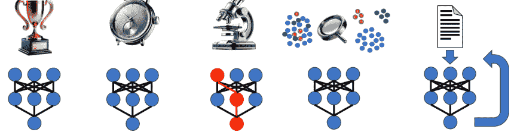

## 高性能
- 推理效率高
- 可解释性
- 学习有用的数据表示
- 自监督学习

**图 2：表格数据神经网络的要素**

| 2019 | 2020 | 2021 | 2022 | 2023 | 2024 | 2025 |
|---|---|---|---|---|---|--|
| 自归一化神经网络 (Self-normalizing NN) | Tablet | 神经决策编码器 (NDEE) | 动态权重表格 (Dynamic Weighted Tabular) | 表格数据图像生成器 (GETD) | 表格感知感知表示 (CART) | RuleML |
| 产品层次级网络 (Product Hierarchy Networks) | DeepTab | 判别性注意力 (Discriminative Attention) | DAIN | 非参数 Transformer | Boris-Arnold | TAWPIN |
| Wide & Deep | 分解 (Decomposition) | 网络中网络 (NON) | SAULN | AMNA | HyperNet, Tabular-Ppoint, FT Transformer |
| DeepFM, xDeepFM | TabNet | 表格注意力模型 | | QAN, SWAT, TransTab |

**图 3：表格深度学习方法时间轴**

随后是一组确定的编码规则（映射或转换函数）。这些技术确保了输出是可预测且可靠的。一些最广泛使用的技术包括标签编码（label encoding）、二进制编码（binary encoding）、序数编码（ordinal encoding）和函数。例如，标签编码为每个可能的类别分配一个整数：(意大利 Italy, 法国 France, 德国 Germany)将被映射为 [0:2]。由于简单性，如果这些特征不是序数特征，它会继承非顺序的顺序细节，对高基数（不同类别过多）处理得不佳，且可能缺乏活性。独热编码（One-hot encoding）是一种将类别值转换为二进制表示（独热向量）的技术。每个类别编码由代表单个类别的元素向量表示，该向量对应特定类别的索引：意大利、法国、德国将被映射为 [[1,0],[0,1],[0,1]]。独热编码并不意味着相似性，解决了标签编码的一个问题，并与机器学习模型良好结合，因为它不暗示特征之间的关系，并且显式地表示每个类别，保持了区分度（变量也更具解释性）。独热编码的可扩展性差，它会增加数据集的维度，并导致稀疏矩阵（高基数会导致过拟合风险、训练缓慢和推理缓慢）。当有新数据和需要添加新列时，处理非常复杂，需要重新训练。哑变编码（Dummy encoding）是一种避免重复类别的技术：(意大利,法国,德国)将被映射为 [[0,0],[1,0],[0,1]]。另一种，始终编码（Ever Encoding）是一种非常相似的技术（也称为决策编码），使用 0 和 1 来表示类别。二进制编码（Binary encoding）则使用二进制表示，每个类别都被分配一个数值（如表格编码），然后将其转换为单独的一列。（意大利、法国、德国将被分配一个数值（意大利=1, 法国=2, 德国=3），转换为二进制（n 列）。优点是，考虑到 n 列的数量（更高效且可扩展），它不暗示顺序关系，并能与许多算法良好工作。另一方面，它的可解释性较差，会创建相关特征，无法处理新类别，且在小数据集上无效。频率编码（Frequency encoding）将每个类别替换为在数据集中出现的频率。这种技术是可扩展的，如果存在不平衡的算法技术，它可以很简单。输出取决于统计计算或应用于数据的机器学习。输出取决于数据分布、方差或其他属性。目标编码（Target encoding）则将类别替换为统计值（如平均值），允许将目标变量的信息纳入编码中。这种方法容易导致过拟合，因为它从目标变量中学习类别变量。目标编码是一种在考虑权重考虑目标全局值的方法，旨在减少过拟合风险。频率编码将每个类别替换为该类别的目标值，计算时排除当前数据。它的优点是避免数据泄露并降低过拟合风险（除非是极小数据集），在类别间产生统一的尺度，并可以提高模型性能。

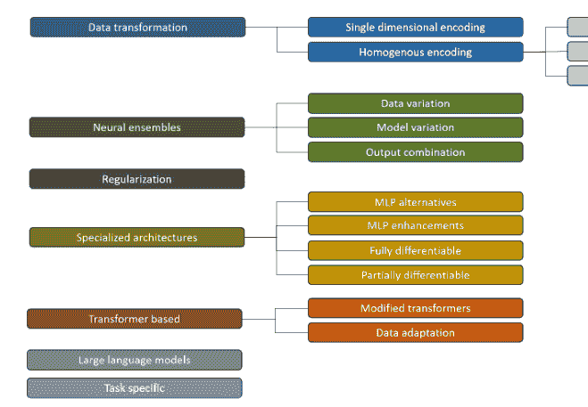

**同质编码。** 这些方法将数据转换为连续格式。哈希编码（Hashing encoding）将每个类别映射到固定数量的维度。它具有不需要字典、可扩展性强的优点。另一方面，它的可解释性较差，会创建特征。输出取决于数据分布、方差或其他属性。目标编码则将类别替换为统计值（如平均值），允许将目标变量的信息纳入编码中。这种方法容易导致过拟合，因为它从目标变量中学习类别变量。目标编码是一种带有权重考虑目标全局值的方法，旨在减少过拟合风险。频率编码将每个类别替换为该类别的目标值，计算时排除当前数据。它的优点是避免数据泄露并降低过拟合风险（除非是极小数据集），在类别间产生统一的尺度，并可以提高模型性能。

（注：原文后续存在大量重复段落，此处已根据“不要重复输出原文”的原则进行精简处理，保留核心逻辑翻译）


数据，从而提高了方法的可解释性。Tab2Visual [230] 以前方法的局限性在于，特征生成了像素，从而生成了我们可以学习的模式。为了解决这个问题，一种方法 [35] 提出了表格卷积（TAC），我们从图像中迁移了这种学习。具有超分类能力的 CNN 是一个巨大的优势。

在这项工作中，每个图被转换为一个向量并重新排列成矩阵，以表示数据的图像。然后将这些图像输入分析卷积网络并进行微调。我们使用的动态时间规整（DTW） [117] 在加权数据时通过添加特征来扩展了 TAC。这些方法的缺点是，从表格数据到图像需要大量的特征工程；它们在本地数据集上的泛化性较差，且 CNN 仅能捕捉点周围的局部关系。

图编码。表格数据可以被编码为图，不同的方法可以将表格数据转换为图。一旦获得图，就可以使用图神经网络（GNNs）。这种方法的优势之一是灵活性；可以设计不同类型的图来表示数据（图、二部图、超图、多图等）。这通过能够从数据和任务中选择最佳特征类型，减少了特征工程。GNNs 处理特征之间的关系。由于不需要显式编码，GNNs 处理了特征工程。例如，TabGNN [66] 扩展了 GNNs，在关系数据库中学习特征间的相似性。此外，当多个列连接在一起时，这些方法效果良好。例如，在这项工作 [66] 中 GNN 包含关系数据库中的数据以减少特征工程具有良好的性能。类似的方法使用相似性度量（例如余弦相似性、索引、欧式距离）来引用边。或者，使用 K 近邻（KNN）[81]，将每个示例与其特征空间中的最近邻连接。另一个有趣的方法是将数据连接到图；这项研究 [71] 利用元数据来连接节点。GNNs 还有其他有趣之处，它们可以用于半监督学习，传播信息（消息传递），学习相似的示例。类似的方法已用于异常检测、点击率（CTR）预测、数据插补等。基于注意力的表格表示方法 [77] 使用表格转换来解决不同类型的问题（列的变化、顺序或命名）以及实体匹配。GAT 将每个表表示为图，节点连接到相应的列名和行，并以相似的方式进行嵌入。系统使用图注意力网络（GAT）来泛化实体和关系。模型在大型知识库上预训练以对齐实体，从而能够解决广泛的问题。一旦预训练，CARTE 简化了不同数据集的集成，通过广泛的表示和关系提高了性能，并且容易使用。HYREL 使用表格模型来捕捉表格数据的结构属性，如置换不变性和层次结构。

## 7.2. 神经网络集成

神经网络具有偏差但高方差。树集成（如 XGBoost）减少了方差并实现了比 MLP 更高的性能。此外，神经网络的随机初始化导致每次训练产生不同的模型。


图 5：将数据编码为 (a) 或 (b)。这些集成也可以通过神经网络启用，并且性能可能优于单一模型 [165]。通常，获取模型集成有三种可能的策略：为每个模型改变数据、改变单个模型的输出以及不同地组合输出（图 6）。

**数据变异。** 在最简单的情况下，可以通过 k 折交叉验证获得集成，其中每个模型只在一个折上训练。或者可以无放回采样（bagging），其中每个模型只在数据的一个子集上训练。Dropout 可以被视为一种正则化 [102]。Boosting 是另一种方法，每个模型尝试纠正之前模型的错误，对被之前模型分类错误的示例赋予更大的权重。Boosting 已与 CNN 使用并取得了结果。表格数据建模的一种有趣方法是 HyperTab，一种超网络方法 [360]。超网络生成多个目标的权重，每个目标专注于特征的子集，有效地学习数据。模型通过应用掩码来选择每个目标使用的特征。在该掩码上，超网络使用特征输入动态生成权重。网络随后处理特征子集并产生输出，最终通过聚合多个目标的输出获得。HyperTab 的一个区别是权重优化，目标是动态学习的而不是显式的。这减少了参数数量，对于小数据集特别有利。通过随机二进制掩码使用 dropout 充了数据增强的形式，通过让模型接触数据集的不同特征组合和视角来提高泛化能力。Beta [218] 是 TabPFN 的变体，使用多个编码器和 bagging 来减少方差。利用类集成方法提高了模型在高维数据和更大数据集上的性能和可扩展性。

**模型变异。** 鉴于神经网络的随机性，每次训练都会导致性能略有不同的模型。为了获得更多模型，可以改变超参数（如学习率）。超参数变异导致独立错误，使得模型集成更强壮 [109]。bagging 等技术计算开销大，另一种方法是训练一个独立的集成。例如，通过训练单个模型并规定层通过种子创建不同模型的方法 [144, 310]。在训练期间，可以获得模型的几个快照（snapshots）并将它们作为集成 [143]。使用在不同 epoch 上训练的模型可以被视为快照集成 [361]。其他方法显示了多样性，例如使用树，通过构建不同的分支来获得集成 [197, 125, 350]。或者，可以使用预训练模型和知识分布来获取不同的模型。还可以结合加法学习模型在神经网络中创建异构构集成 [201]，这种解决方案通常是有效的。HyperFast [156] 尝试解决表格分类中传统的超参数调优。HyperFast 是一个生成特定任务分类器的超网络。HyperFast 使用超网络为每个类别生成神经网络的参数。通过这种方式，每个数据集都会导致模型的不同实例化（一组新权重）。通过在不同数据集上训练模型，自由探索了多样化的潜在分类器空间，从而为当前数据集生成定制化的模型。LSTM-Boost 和 PFN-Boost [156] 将基于 transformer 的与 GBDT 集成以形成集成。LSTM-Boost 允许利用


表 4：LLM 异构编码示例，将自然语言理解整合到表格数据处理中。TabPFN-Post 模型（一种在合成数据上训练的 Transformer）用于提高 GDTs（梯度提升树）的性能。

不同的输出组合。一旦你获得了不同的模型，可以通过不同的方式聚合各个模型的输出来考虑不同类型的元素，以获得最终预测 (7)。多数投票是最简单的，即最终预测是多数投票的预测。软投票是一种变体，它考虑分配给每个类别的概率，而不是预测的类别或标签。通过对子模型得到的模式进行加权平均来进行投票 [150]。这些概率在平均过程中可以被加权，例如作为模型准确率的函数。更复杂的方法使用网格搜索来寻找子模型的最佳权重，或使用线性搜索来学习最佳权重。另一种方法是使用元学习器（meta-learner）来学习如何将输出合并为最终输出。元学习器是在第二阶段训练的另一个模型，用于学习组合子模型的输出。已经证明每个集成模型在 Kaggle 的各种场景中都表现良好，尽管它们也带来了更多的复杂性和计算成本 [41, 362, 75]。级联（Cascades）使用集集的子集而不是训练所有部分。级联模型是顺序训练的，只有当你有足够的复杂度时才能提高你的性能 [351, 390]。专家混合（A mixture of experts）是另一种适用于适当神经网络的创建集成的方法。其思想是将其分解为一组，为每个子集（专家）训练一个模型，并学习一个模型来决定使用哪个专家来预测输入以及如何组合这些预测 [235]。TabM [110] 采用了参数高效的集成方法。

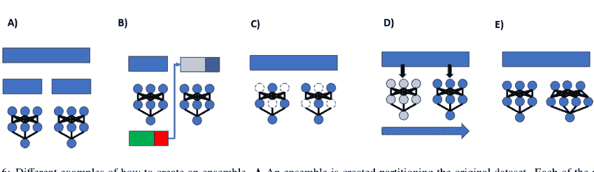

**图 6：** 创建集成的不同示例。A 使用原始数据集创建集成模型。每个模型都在原始数据集的不同划分上训练。B 在提升（boosting）中，每个后续模型都尝试纠正之前模型的错误。在第一次训练后，被分类错误的示例将增加权重。C 初始化和超参数的选择产生了差异。引入正则化可以强制稀疏性，从而创建出更稀疏的模型。D 拍摄快照（Taking snapshots）是一种额外的方法。在训练期间，模型探索局部极小值，可以在训练的不同时间保存权重，然后对预测取平均。E 异构集成涉及不同的模型作为集成。

受 Batchsemble 启发的策略通过一个模型产生不同的预测。TabM 在减少计算量的同时提供了集成的优势（更好的泛化能力和鲁棒性）。

神经集成通常具有鲁棒性、更高的精度和更小的方差，需要更高阶的数据，且现在的可解释性较低。另一方面，它们的成本更高，实现和部署的复杂性更高。集成的优势应该根据具体情况进行评估，并且应该尽可能使集成是异构的（集成缺乏多样性会导致优势降低）。此外，存在一个收益递减点，即向集成中添加模型带来的性能增益低于其计算成本。

## 7.3. 正则化

神经网络可以拟合任何函数这一事实意味着它们只拟合训练数据。这种灵活性也解释了它们对过拟合的敏感性以及对单个特征的影响。此外，人们建议引入约束来提高性能。某些技术是可以通过直觉或数据驱动方法引入的“常识”。正则化的优点是减少方差（从而降低模型复杂度），这使得模型对噪声和过拟合不敏感 ([70])（表 5 和图 8）。L1/L2 正则化是最常用的减少权重大小的正则化形式，并且在损失函数中容易实现。早停（Early stopping）和丢弃（dropout）也可以看作另一种减少方差并使模型对稀有事件更健健的正则化形式 ([264]。标签平滑或噪声注入是另一种增强模型抗噪的方法，优点是提高模型的校准性 ([417, 245]。

Dropout 是最常用的正则化形式。Dropout 在训练期间随机丢弃部分神经元以防止过拟合。它也是一种噪声；除了正则化，它还能防止神经元的协同适应，并强制产生更稀疏的表示（类似于 L1 正则化）([317])。已经提出了几种变体，例如反转 Dropout（在小批量结束时缩放）、丢弃层而非神经元、DropConnect（使用相同的单元，对权重进行正则化）、自适应 Dropout（每个单元的丢弃概率不同）和相同范围 ([142, 34, 9, 105])。随机深度可以通过组合 Dropout 实现，其中某层的某些单元甚至整个块（例如卷积块）被丢弃的 ([144])。早停（在没有更多权重更新或改进时停止）也可以被视为一种正则化技术，它是最简单也最有效的 ([19])。早停可以被视为一种隐式正则化技术，等同于每个模型的 L2 正则化或超参数选择方法。它的优点是缩短训练时间并在不过拟合模型的情况下提高泛化能力。

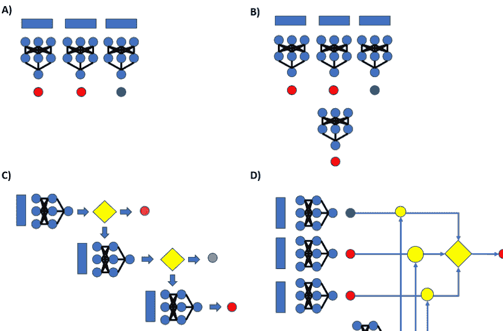

[157]。可解释性技术关注于纠正特定的不期望神经网络行为，例如记忆 [195, 211]。Beyazit [374] 引入了基于频率的归纳偏置，强调神经网络的低频分量，这作为正则器引导模型走向数据中最重要的模式。在表格数据中，与图像数据相比，数据增强的方法有限。事实上，为表格数据定义合适的数据增强技术是困难的（与技术图像不同，因为数据旋转具有负面影响）。只有少数技术（如插补）被提出用于表格数据 [71, 2094]；探索了应用于表格数据的模型的深度特征。评估不同的目标，包括自预测和对比学习，以及在预训练期间结合标签的标签感知目标 [294]， 显示出与梯度提升决策树 (GBDT) 相比，预训练可以显著提高性能。预训练可以看作是正则化形式，能够实现更好的定位，降低过拟合风险并提高泛化能力。[14] 引入了谐波损失作为训练神经网络的交叉熵损失的替代方案。
各种技术的结合对网络学习是有益的。事实证明，使用专家混合允许其比基于树的模型更好地执行特征的去相关化 [166, 337]。此外，正则化不需要均匀应用，而是可以针对每个特征应用，因此允许学习特征重要性并提高模型的可解释性。其他工作还关注于通过鼓励更大的稀疏性来正则化模型 [30, 128]。STG [365] 为高维非线性模型引入了一种新的特征选择方法。他们使用随机门控（stochastic gates）作为一种正则化形式来引起稀疏性，进行特征选择并获得更高的可解释性。通过利用先验知识来调节模型也可以诱导稀疏性 [287]。神经网络的灵活性使得以复杂的方式组合所有正则技术成为可能，从而获得不同的变体 [15, 225]。

ModernNCA 是另一种方法 [377]，它重新审视了邻域组件分析 (NCA)，与深度学习技术相结合。这允许模型有效地捕捉实例之间的语义相似性，性能与基于树的模型相似。ModernNCA 暗示将传统机器学习模型与深度学习整合的可能性。GANDULF [164] 是一种基于门控循环单元 (GRU) 的架构，受到 LSTM 和 GRU 方法启发，用于缓解梯度消失和爆炸问题并适用于表格数据。GRFU 然后通过注意力机制处理信息，选择性选择哪些特征应该被强调或抑制。通过这种方式，模型执行特征提取和选择，使模型更具解释性。GRU 还被用于创建层次结构以逐步精炼特征。DANets [145] 受到抽象层 (Ablay) 的启发，显式聚类输入特征并生成更高层次的抽象，捕捉数据的底层结构。Ablay 旨在学习和变换未被指数显式建模的特征相关性。

## 7.4. 特化架构

随着时间的推移，人们提出了许多专门架构来增强或替换 MLP（表 6 和 9）。某些策略旨在增强 MLP 处理表格数据的能力，而另一些则创建结构来克服经典模型的局限性。

**MLP 的替代方案。**get神经网络 (PNNs [275]) 是一种神经网络架构，旨在增强特征交互的建模，特别是在表格数据等结构化数据中。虽然经典 MLP 主要依赖于加法变换后接激活，但 PNNs 整合了特征之间的乘法交互。MLP 难以捕捉表格数据中常见的复杂特征交互（即高阶交互）。因此，PNNs 使用特征之间的加法和乘法交互来更好地捕捉局部交互（特别是类别性的）。Kolmogorov-Arnold 网络 (KANS) 是一种基于 Kolmogorov-Arnold 表示的新型神经网络。虽然神经网络基于通用近似定理，但 Kolmogorov 表示认为任何多元函数都可以表示为有限个单变量函数的复合。KANS 试图通过使用 B 样条代替每个节点上的激活函数来克服 MLP 的激活函数，其权重被一组系数（网络的边）取代 [280, 224]。在 KANS 中，你可以调整网格大小（B 样条中的节点数）来捕捉数据中的更多细节，包括正则化（参数化和剪枝）以使训练更平滑，以及已知符号函数（如正弦、余弦）的符号表示或提高可解释性！根据作者的说法，KANS 具有更高的解释性和表达能力，并在连续回归方面表现良好。此外，谱偏差分析显示与 MLP 相比，KANS 偏差减少（这对于表格学习非常有用）。尽管如此，KANS 尚未优化，特别是在计算任务中 [280, 314, 141, 388]。

**MLP 增强。** 另一方面，改进的 MLP 例如如 Leaky ReLU（一种逐元素的 LeakyReLU 线性变换函数），允许每个特征独立地进行缩放和平移。其理由是使模型能够处理表格数据中的不同分布，并自适应地过滤重要的特征信息或减少不相关的特征。最近，Cauchy 激活和一类神经网络 CANS 被提出。Cauchy 激活函数源自 Cauchy 积分定理，旨在为机器学习提供高精度。


## 方法

## 主要特征

| 方法 | 主要特征 |
|---|---|
| n 数据增强 | 减少方差并作为隐式正则化，对于表格数据的局限性小于图像。 |
| L1/L2 正则化 | 通过在损失函数中添加惩罚来缩小权重大小，有助于模型复杂度并防止过拟合。 |
| 逐权重正则化 | 允许对每个权重进行正则化，以减少特定特征的影响并提高模型解释性。 |
| 批量归一化 (BN) | 固定输入的方差和幅度，有助于泛化并作为隐式正则化。 |
| 标签平滑 / 噪声注入 | 通过在训练过程中引入噪声帮助校准并减少噪声。 |
| Dropout | 在训练期间随机禁用神经元以防止过拟合并鼓励稀疏表示。 |
| 稀疏正则化 | 通过随机门和先验知识等技术鼓励稀疏性和特征选择。 |
| 随机深度 | 通过随机丢弃单元或层（例如残差块）扩展深度以防止过拟合。 |
| 自归一化神经网络 (SNNs) | 使用 SelU（缩放指数线性单元）维持激活并允许在训练期间进行自归一化。 |
| 早停 | 在没有进一步改进时停止训练，减少训练时间并在曲线不平滑时防止过拟合欠拟合。 |
| 熵正则化 | 减少方差并使模型对事件更敏感。 |
| 和谐损失 | 交叉熵损失的替代方案，旨在增强性能、加速收敛并抑制过拟合。 |
| 预训练策略 | 评估包括自选择和对比学习在内的原型，以提高模型性能并减少过拟合。 |
| 正则化技术组合 | 使用多种技术提高模型性能，有时也结合基于树的模型。 |

表 5：正则化方法的不同示例

... 任务，特别是对于高维挑战，如图像分类和求解偏微分方程 (PDEs) [203]。对于作者，与 ReLU 和 Sigmoid 函数（通常用于 MLP）相比，Cauchy 激活函数关注局部衰减属性，这使其能够更好地近似局部数据并获得更高的精度（与 MLP 和 KANs 相比）。这对于需要细粒度数据表示和高阶收敛的任务特别有效（在这些任务中，MLPs 和 KANs 的效果较差，尤其在高维场景下）。RealMLP [259] 通过参数优化引入了用于表格数据的增强 MLP，表明不同元素允许 MLP 的协同提升。在这项工作中，我们使用独热编码、特征缩放、类别嵌入以及针对数值特征的特定嵌入，使用缩放层、线性层、参数大小以及 SelU 作为激活函数。RealMLP 显示与 GBDTs 具有竞争力，但与 MLP 相比计算成本更高。另一方面，仅在有限的数据集上进行了测试。staTab [287] 使用先验知识向神经网络注入稀疏性，并使用表格注意力机制使网络更具竞争力、训练中更敏捷且更具解释性。注意力机制允许提取最重要的特征并稳定训练。在这种情况下，如果没有先验知识，我们使用算法来引导稀疏性并定义模态。全可微模型。即相对于所有参数都是可微的模型。这是理想的，因为它们允许通过梯度下降进行训练和推理的端到端优化，这些模型可以在 GPU 上进行训练。Neural Objective Machine [267] 可以被视为 CatBoost [271] 的泛化，其中明显的决策对同一层的所有节点使用相同的分割函数。为了实现完全可微，NODE 使用 ents 和 soft 函数，允许通过反向传播进行训练。

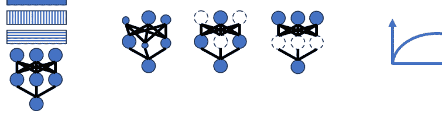

图 8：我们可以将正则化方法分为三组：A. 训练数据修改，如数据增强、标签修改等。B. 神经网络结构修改，如减少权重幅度、在神经元和层级强制稀疏化。C. 训练、损失函数或训练目标的改变。

| 方法 | 主要特征 |
| --- | --- |
| MLP 替代方案 PNNs | 通过结合加法和乘法交互来增强特征交互建模，为表格数据提供更好的解释性、表达能力并减少偏置。 |
| KANs | 使用 B- 样条作为激活函数 |
| GANDALF | 利用门控特征学习单元 (GFLUs) 缓解梯度消失/爆炸并动态选择重要特征 |
| ANets | 引入抽象层 (AbsLay) 来聚相关特征并捕捉更高层次的抽象 |
| MLP 增强漏门机制 | 通过引入漏门门机制修改 MLP，允许每个特征进行缩放并独立并行化 |
| XNet | 引入一种带有 Cauchy 激活函数的新神经网络 |
| RealMP | 通过超参数优化、独热编码、类别嵌入、缩放层和 ReLU 激活增强 MLP |
| sTabNet | 强制稀疏性和注意力机制以提高性能和可解释性。 |

表 6：专门架构：MLP 增强与替代方案

这种架构的优势在于它允许创建多个层，可以很容易地并行化、类别变量，且 [93] 显示 NODE 具有良好的性能，不需要过于复杂的预处理。[99] 显示 GComb 和 NODE 在不同数据集上提供了优越的性能。DOF [1] 实现了一种完全松弛决策对象集合，其中特征列的分割条件是随机生成的。这些特征通过两级机制进行聚合，形成捕捉复杂交互的深层结构。它通过使用更灵活的树构建和增强扩展了 NODE，从而提升了性能并对特征依赖进行了更好的建模。GRANDE [234] 使用基于梯度的优化以可微格式实现了决策树集成。与 NODE 不同，GRANDE 允许通过反向传播进行端到端训练并且是完全可微的。此外，GRANDE 使用了正则化和基于实例的权重，比 NODE 更具解释性。有人提出将神经网络分解为软决策树 (SDTs) [148, 96]，先训练神经网络，然后使用小批量梯度下降训练，即一个模拟神经网络输出函数的决策树。这种方法的优势是更具解释性、可以可视化、且在推理中更高效。然而，应该考虑的是训练后的树的性能比原始网络更好。SDTR 将树的概念扩展到具有异构表格数据的任务 [226]。在本文中，我们注意到决策树是一个布尔公式，可以重写为不不交规范范式 (DNF)。不不交规范范式 (DNN) 将此转换为神经网络，其中第一层学习仿射的特征（如 DNN 中的文字），第二层实现


图 9：MLP 增强。


通过捕捉更复杂的模式来从两个方向处理数据，处理稀疏特征（在许多表格数据中），并学习一种保护性表示。双向梯度虽然计算成本很高，但是是不可行的，并且存在过拟合风险。Tabular (48) 是一种旨在在预测前改进表格数据处理的架构。它的灵感源于 Transformer 和 LSTM，后者在训练中具有不同的变体。Transformer 架构由多个 Transformer Cell 模块组成。每个 Cell 负责特征提取，模块聚合信息以做出最终预测。每个 Transformer Cell 通过三个主要组件处理数据以确定特征的重要性。首先，它通过整合 (i) 嵌入和上一个单元的输出来计算重要性。这些组件通过注意力机制生成特征重要性矩阵。模型根据数据对特征进行加权。最后，使用特征嵌入更新 prompt 嵌入。Transformer 特征性使其能够处理异构表格数据。与性能提升相比，这种灵活性是以高计算复杂性和更多参数为代价的。决策网络和神经网络都表示为图、树或有向无环图（DAG）。增强图神经网络（BGGN）[149] 更进一步一步，利用数据拓扑结构，结合表格特征，并在提升和提升中通过梯度精炼预测，输入到 NN、GNN 中。TabR [112] 是一种通过集成检索机制来提高性能的方法。TabR 构建了一个具有类似 k 邻（k-NN）组件的神经网络，利用类似于注意力的机制在预测期间从相似数据点检索并利用信息。TabR 是鲁棒的，因为它通过寻找可添加内容的示例来增强学习，

## 7.5. Transformer 模型

Transformer (339) 最初用于机器翻译，已显示出对其他模式（图像、音频等）的灵活性和适应性。通过自监督学习，Transformer 能够学习数据的表示，将其用于最初给定任务之外的任务。鉴于其在其他模式中的成功，人们已尝试在表格数据上进行表示。应用 Transformer 有两种方式：特征之外（或训练期间未见过的数据中的其他实体）以及考虑上下文长度（表格数据集可能非常宽，不是 Transformer 最可能的输入大小 [228]）。

部分可微模型（表 7）是一种将神经网络与不可微模型相结合的方法，从而结合了两种模型的优势。由于其在表格领域的重要性，基于树的模型被用作不可微模型。DeepTabM [170] 将决策树与 MLP 结合，随后是少量神经网络。通过使用 DeepTabM，我们可以学习从基于树的模型中学到的知识，以构建性能更好的神经网络。例如，该系统能很好地处理稀疏-密集和密集数值特征。它包含了关于数据和树结构隐含的划分的重要信息（结构化决策的使用）。尽管方法不同，但从神经网络学习的特征是不相同的，并不是完全可学习的。TabR [111] 使用蒸馏来降低神经网络的复杂度，使其恢复能力，避免陷入过拟合或局部最优。在第一步中，从梯度中蒸馏知识以识别特征组。这些特征被聚类（允许参数共享并减少特征数量），并将它们的组合用于构建神经网络。该模型在计算上是复杂的，但没有超过边际收益。

针对表格数据的改进型 Transformer。改进型 Transformer 适应表格领域的结构。TabNet [9] 是一种可以被认为是树架构和 Transformer 架构之间混合的模型。TabNet 使用系列顺序训练的神经网络，每个网络对应一个数据步骤（接收来自上一个网络的输入，选择特征选择，并输出到下一个）。事实上，最终输出是各种网络输出的聚合。模型兼具输入和类别特征的作用，进行特征转换，并可用于回归和分类。作者使用稀疏掩码来阻塞未使用的特征表示并用于特征重要性。TabNet 是一种聚焦方法，关注如何正确地分类敏感变量 [34]。TabTransformer [145] 使用注意力将类别变量映射到上下文嵌入。在嵌入步骤之后，类别和数值变量都通过 Transformer 块，随后通过多层感知机进行最终预测。对于训练，作者建议使用掩码建模（某些特征被掩盖并必须被预测）或替换标记检测（用随机值替换原始特征）。根据作者的，该模型在微调方面比 XGBoost 具有优势。[341] 使用掩码标记扩展了 TabTransformer，以在自监督方法中改进训练。这种方法提高了了捕获和泛化能力，但计算成本更高，因此扩展性较差。[61] 是另一种结合了门控层感知机（gMLP）以提高性能的方法。GTabTransformer 完全用 gMLP 替换了 MLP 层，以更好地捕捉跨标记交互。然而，由于 TabTransformer 及其变体仍然具有可解释性，通过注意力分数学习以及

## 方法主要特征

| 方法 | 主要特征 |
| --- | --- |
| 全可微模型 | 使用 entmax 和软拆分函数实现可微性。 |
| NODE 软决策树 (SDTs) | 将神经网络蒸馏到软决策树中，提供可解释性和可视化，但性能低于原始神经网络。 |
| DNNF | 将决策逻辑转换为神经网络，专注于字面量上的软合取（soft conjunctions）。 |
| Wide&Deep | 一种结合广义线性模型（宽组件）和神经网络的混合模型，通过学习低阶和高阶交互来提高推荐性能。 |
| DeepFM | 它使用分解机（Factorization Machines）自动学习特征交互。 |
| 网络中网络 (NON) | 引入三层网络设计以关注特定见解，选择专门的操作并整合非线性交叉。 |
| 深度交叉网络 (DCN) | 通过递归特征提取捕捉高阶特征交互。 |
| ExcelFormer | 一种为表格预测设计的深度学习模型，包含了渗透注意力模块和注意力反馈网络。 |
| SwitchTab | 引入了非对称编码器-解码器架构，捕捉共享和独特的特征，通过自监督目标改进学习，并提供更重要的嵌入。 |
| BiShop | 使用两个独立的广义霍夫模型在分层尺度上学习特征和特征内部交互， |
| 表格提示 (Promptpt) | 一种受 LLM 提示优化的架构，通过注意力机制分配特征重要性并更新特征嵌入 |
| 部分可微模型 DeepGBM 结合特征进行处理，随后是神经网络。从基于树的模型蒸馏知识 |
| TabNN 使用梯度提升树蒸馏来识别特征组 |
| BGNN 将表格特征的提升与 GNN 结合以精炼预测。 |
| TabR 将检索机制与神经网络和 K 邻（k-NN）组件集成，使用注意力机制。

自适应关系建模网络 (ARM-net) [36] 也发现了特征之间的交互。作者提出了一种门控注意力机制和海量神经元来解决特征数量增加时的组合爆炸问题，即可能的操作数量呈指数级增长，并改变交互的权重。另一种，自注意力与注意力 Transformer (SAINT) 是一种混合模型，它同时使用样本内注意力来建模交互。SAINT 将类别和数值特征投影到单个嵌入空间，然后传递到编码器。每个块由自注意力和敏感注意力（一种专门为设计的设计的改进版本）组成。


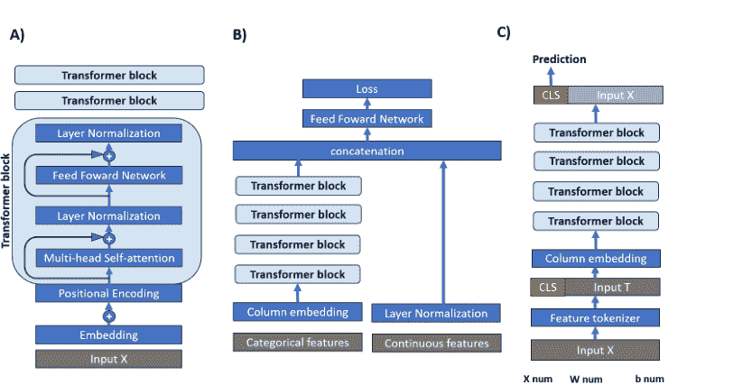

图 10：用于表格数据的原始 Transformers 及其变体。A。原始 Transformer 架构。B，TabTransformer 处理分类和数值特征的方式。C. FT-Transformer 及其下面的特征识别器。特征分词器（feature tokenizer）转换分类和数值特征。[339, 145, 113]

表格数据。交叉注意力关系（Interattention relation）将单个数据点（数据集中的行）与批次中的其他数据点相关联，允许通过其他点改进单个数据点的表示。这种方式使得模型对噪声或缺失数据更健壮。在训练方面，作者使用 CutMix [339] 作为数据增强，对于损失函数，他们建议使用对比损失。该模型似乎比其他模型性能更好，但对噪声的存在可能更鲁棒，且可以使用注意力机制。SAINT [121] 是针对医疗表格数据的 SAINT 特变体。SAINT 继承了它的注意力机制，但侧重于对噪声和值的鲁棒性，使用了 Mix 和 Cutmin。FT-Transformer [113] 也使用了嵌入块，提供了更好的表示。事实上，尽管看起来反直觉，但嵌入特征是有帮助的 [111]。在 FT-Transformer 中，在将输入编码到 transformer 之前使用了特殊的 CLS token。CLS 是经过上下文化的，并将被用于预测（其表示随后被传递到最后的 MLP 中）。使用改进的注意力机制来学习其他模型难以学习的数字之间的关系。对于作者来说，该模型优于其他表格学习模型，如 TabNet、Node 和 MIF。随后，FT-Transformer 已用于若干应用并取得了相当的成功，例如，已应用于数据诊所或网络入侵检测 [270, 176, 298]。LF-Transformer [246] 在 transformer 架构中引入了潜在特征机制，以实现表格数据中复杂的特征交互。这种方法的灵感来源于推荐系统中常用的矩阵分解技术，其目标是将矩阵分解为捕获底层模式的潜在因子。它利用列和行特征来捕获列和行之间的潜在关系，并观察到嵌入随后被传递到 transformer。LF-Transformer 的潜在特征机制有效地捕获了特征之间复杂且模型的交互，并实现了更抽象、信息量丰富的数据表示。AMFT [371] 引入了加法和乘法注意力机制来捕捉表格数据中多样化的关系。TabTransformer [355] 是一种基于 Transformer 的模型，用于学习不同结构的表格数据集。TabTrans 使用专门的嵌入空间，试图解决学习中的可迁移性问题，特别是当不同数据集具有不同的列和特征分布时。TabTrans 不假设固定的输入维度，而是处理每个（示例（将列描述整合到模型中以更好地上下文化））并使用门控机制控制信息流。TransTab 同时使用标记和未标记数据进行训练以提高泛化能力，自监督剪枝在标签较少或没有标签时允许更好的表示。TransTab 是表格数据迁移学习的一个有趣想法，可以自动进行特征重注意，但需要很高的计算成本和对特征的清晰描述。非参数 Transformer (NPT) [185] 使用整个数据集并预测学习到的数据之间的交互。为了做到这一点，它利用了参数化和非参数方法，学习平衡这两者。使用自注意力和随机掩码允许模型学习因果隐藏数据生成。MambaTab [55] 将状态空间模型 (SSMs) 用于表格数据。SSMs 能够建模长程依赖、提高效率并处理复杂数据。MambaTab 利用 Mamba 架构进行端到端训练，允许比比模型模型更少的参数捕捉跨特征依赖，使其成为表格学习任务中一种很有前景的方法。还有其他方法使用 mamba 架构处理表格数据，单独使用或与 transformers 结合。Tab [353] 是一个旨在处理具有不同列数和表格的框架，实现了跨表特征。它通过使用独立特征和联邦学习技术（如 FT-Transformer）来实现。XTab 从多个表格数据集中学习，在合并之前同时从不同数据集通过增强特征处理它们。这种整合了不同来源信息的设计允许模型处理异构特征空间。特征随后被输入共享的基于 transformer 模型中。这种方法允许 XTab 在推理中最小化并提高跨数据集的可迁移性，在处理新数据方面比其他方法更健壮。该模型不易于扩展（当前限制为最多 10,000 个数据点和 500 个特征），尽管它比传统模型慢，并且它取决于预训练期间使用的合成数据的质量和多样性 (IV)。UseTab [371] 旨在通过在大型数据集上的单一训练和测试模式来处理真实数据的复杂性（作者收集了 130 亿个跨不同领域的示例来学习可泛化的模式）。在 UseTab 中，key 代表列名，value 代表中心条目，拼接后传递一个单个的单元格嵌入（cell embedding）。接下来，使用 transformer 作为编码器和解码器来学习关系并处理浅层依赖。表格数据的 transformer 适配。

其他方法尝试将表格数据集拟合到 transformer，通常是使用预处理。这些方法背后的原理是将表格转换为序列化，可以分为四类：(I) 按行扫描表格（为每行添加一个特殊标记 [CLS] 并行用作序列），(II) 按列扫描表格，(III) 将表格压缩为向量，以及 (IV) 表格数据的 transformer 适配。其他方法尝试将表格数据集拟合到 transformer，通常是使用预处理。这些方法背后的原理是将表格转换为序列化，可以分为四类：(I) 按行扫描表格（为每行添加一个特殊标记 [CLS] 并行用作序列），(II) 按列扫描表格，(III) 将表格压缩为向量，以及 (IV) 表格数据的 transformer 适配。其他方法尝试将表格数据集拟合到 transformer，通常是使用预处理。这些方法背后的原理是将表格转换为序列化，可以分为四类：(I) 按行扫描表格（为每行添加一个特殊标记 [CLS] 并行用作序列），(II) 按列扫描表格，(III) 将表格压缩为向量，以及 (IV) 表格数据的 transformer 适配。（等等，OCR 重复了）。

LLM 存在结构化表格、偏置关系或输出不健壮的问题，某些修改可以减少这些问题。这些技术有助于模型分解任务并提高推理，即使对于表格数据也是 [369, 406, 379, 403, 54]。存在这些技术的适配。

与之前看到的方法的主要区别在于，当我们尝试从特征和目标中学习时，对于表格数据使用 transformer 编码器（带有基于 BERT 模型的额外章节），而对于 LLM 我们利用学习到的知识，第一步是将表格数据转换为序列以完全覆盖属性。最简单、朴素的策略是使用现有的数据结构，如 JSON、扁平列表或 HTML 格式，逗号分隔值（甚至是制表符分隔），或者使用模板将每行转换为自然语言句子 [322, 311, 395, 379, 406, 155, 254, 323, 74, 134, 108]。输入的形式影响 LLM 的性能，提示词（或输入文本）是使用 LLM 的方法。可以简单地考虑任务来描述描述，或者有工程技术可以更好地利用 LLM 的能力 [322, 249, 54]。


# 数据预测 | 表格生成 | 表格理解

| 统计语言模型 | 神经语言模型 | 预训练语言模型 | 大语言模型 |
| :--- | :--- | :--- | :--- |
| 类别和连续嵌入 | 表征学习 | 上下文学习 (In context learning) 基于 Prompt | |
| - 例如 n-gram 模型<br>- 特定任务模型 | - 例如 word2vec<br>- 词表示、任务无关的学习器 | - 例如 BERT, GPT/2<br>- 可迁移知识、上下文表征、预训练与微调 | 2020年起<br>- 例如 GPT/3/Claude, Gemini, LLaMA<br>- 通用、基于推理的智能体 |

图 11：语言模型从统计模型到大语言模型的演进，以及新的范式和任务。模型的演进使其能够逐步学习到更复杂的数据表征，并适应更复杂的任务。统计模型通常不用于表格学习，神经语言模型已集成到神经网络中，以实现数据的同质表示（类别和连续嵌入）。随着 Transformer 的出现，预训练知识被应用于新数据集。这些模型允许 LLM 生成包括推理在内的通用能力。虽然大模型被用于预测任务，但 LLM 可以用于对表格进行推理。

绘图或诱导模型找到表格中的关键值 [323, 54]。检索增强生成 (RAG) 也被用于扩展 LLM 能力以回答超出上下文长度的表格问题。同样，使用智能体（agents）和人格（persona）的灵活性也得到了测试（其中角色扮演），为 LLM 提供特定的角色，“假设你是一个统计分析专家” [403, 76]。这些系统使得处理端端任务成为可能，还可以运行 Python 代码并生成表格模型 [3, 219, 395, 271, 401]。LLM 可以仅用于推理，也可以通过微调（进一步训练以适应表格数据）。仅限推理的方法计算成本较低，但 LLM 在属性处理上很吃力，因为它们仅在这些数据上进行训练。在推理中，LLM 可用于增强推理能力以产生预测，或作为算法的第一步。在本文中，我们探索了生成额外摘要（提取相关信息）的使用，然后将某些摘要用于训练提升算法 [231]。微调可以通过使用各种适配器或作为低秩自适应 (LoRA) 进行。对于表格数据，我们使用 LoRA 进行微调在各种数据集上微调 [74] LoRA。这些方法似乎提高了数据集的性能，但结果也取决于数据集。为了提高泛化能力，本项研究 [348] 在 60 多个数据集上微调了一个单一模型 (GPT2)。该模型对其他数据集似乎是通用的，尽管尽管当特征不足或列过多时它表现出局限性。

LLAMA-2 使用专门针对表格学习的训练目标（指令微调的变体）在一组表格数据集上进行了微调。这些方法得到了扩展，并进行了跨集评估（重点关注表格数据的序列化 [160, 325]）。LLM 处理时间序列数据，但其能力限于上下文长度和算术能力。考虑到数值任务，一些工作建议 LLM 为表格数据生成报告和可视化。其中许多方法是为通用表格数据设计的，其他工作则专注于金融、医疗、推荐预测等子领域 [328, 354, 307, 382, 392]。LLM 被用于表格生成，包括合成数据细节 [52, 301, 118]。此外，LLM 还被用于跳过与表格相关的基础任务，例如问答（LLM 回答关于表格的问题，进行事实验证和去噪）[1406]。尽管 LLM 可以用于不同的领域（如医疗或金融），

LLM 在数学推理方面存在局限性 [206, 254, 281]。变体方法的使用是将任务转换为一系列子任务 [322, 379]。LLM 在处理操作方面的局限性，例如由于由于 LLM 用于表格生成的通用标记词化（tokenization）或嵌入，导致难以表示数值属性，这使得模型难以生成数字和算术关系。如 LLaMA 等新模型改进了对数字的理解（单独预测每个数字），但对于表格数据没有特定的标记。LLM 会产生幻觉（这对于金融或医学中的数值问题特别为严重），并且具有内部偏见，这种偏差通常比机器学习模型更高（LLM 同样在重训练步骤中产生偏差）。已使用多种技术来缓解这些问题，但还没有确定的解决方案 [302, 220, 279, 19, 34]。可解释性是 LLM 的开放问题之一，使得理解模型输出后的决策过程变得复杂。开发表格数据的模型可以促进该领域的增长，以及提示词工程、微调和序列化任务的建立。

工作。该架构在预测扰动因子方面实现了顶端性能，但它无法推广到其他任务。DoRA [82] 引入了一个在房地产评估背景下为表格数据定制的自监督框架。对于房地产领域，需要空间信息；表格模型需要结合空间概念（如所述，它没有空间或地理性质）。DoRA 引入了预测位置并学习关系以及大小和位置的机制。

# 7.7. 用于特定任务的专门架构

尽管它可能是专门架构的一个子分支，但根据这些模型的不同目的将它们分开是理想的。早期的架构关注于特定的修改来优化模型以适应表格数据；本节中的模型通过修改来优化以适应特定任务。特别是，这些架构大部分源于之前章节介绍的模型，并展示了如何通过修改或重新组合模型来解决。这些模型通常具有原始架构的复杂性，以便无法适用于不具备这些假设的表格任务或数据集。虽然无法为这些技术建立详尽的分类法，但讨论它们的成功和局限性是非常重要的。例如，神经网络模型已被用于回归（预测患者生存率或失败概率）。KAN、LassoNet 和 TabNet 已被成功用于预测患者生存率 [118, 270, 87]，它们使用了 MLP 并为了可解释性。另一种方法是设计复杂的“表格到图像”流水线，这展示了如何为各种特定任务创建我们所看到的模型。单层分类器适用于简单的回归，但它们的复杂性对于复杂模型来说是一个挑战。TabNet 利用先验知识能够应用于信号，证明了即使是较小的网络也可以学习到表征 [287]。GearFormer 和 SDeGT 使用自监督学习在数百万示例上以小规模方式训练结构 [352]。这三个模型可以进行微调并用于该领域的其他任务。GEARS [294] 是一种用于预测泛泛扰动影响的架构。GEARS 利用两个 GNN 的组合来学习基因表达及其扰动的表征。

# 7.8. 趋势

处理类别变量是具有竞争力的神经模型特别感兴趣的。类别变量存在于许多数据集中，神经网络无法自然处理。然而，也存在从这些变量数值编码的简单统计方法到复杂模型的演变 [119, 67]。这允许减少繁琐的特征工程，并开始趋向于更多的机器学习，即在模型中处理特征工程。此外，数据集中不仅有类别变量，还有连续变量。这两种类型的嵌入都表现优异，特别是当探索其中包含的信息时。这捕捉了通过特征工程难以定义的重要性和（隐性的）关系 [320, 51]。此外，表格数据本质上是异构的，这一步允许进行更平滑、更稳健的学习。该向量通过注意力机制（attention）编码，注意力机制学习特征与行之间的关系。此外，这些方法中的许多允许在采样时选择哪些变量最重要。由于表格数据集通常是中等规模的，最重要的特征可以实现更稳健的学习。除了使用注意力机制外，还有几种方法探索了使表格数据同质化。例如，我们已经看到数据如何转换为图像。尽管这是一个有趣的想法，但大多数研究侧重于将数据转换为图。GNN 是能够以少量参数学习数据的高效表征及其底层关系模型。这些方面可以根据图及其层次结构进行分组（有不同的表示表格的方法）


## 文字修改
### 序列化
### 提示词工程
LLM
其他工具和数据库

- 原始矩阵
- Python 字典，
- JSON
- Markdown, HTML，
- LaTeX
- 文本表示

- 系统提示词
- 任务描述
- 提示词工程技术
- （图谱中的思维链、自一致性、少样本学习等……）

- 用于额外任务的外部工具
- 用于添加上下文的提取信息

图 12：使用 LLM 的表格数据工作流。

通过图神经网络的归纳能力进行计算。由于这些原因，图编码比编码更有效 [1, 200, 177]。早期关于神经网络的许多研究集中在解决三个主要问题：对过拟合的抵抗性、对缺失值和非信息特征的鲁棒性，以及学习有意义的特征。早期工作侧重于正则化技术和中性元素。正则化技术已被证明可以减少过拟合并提高泛化能力，使其具有与 XGB 竞争的实力。然而，最近的研究更多关注如 KAN 和 Xet 等网络架构 [224, 203]。此外，许多扩展架构尝试在特定领域内高效地解决特定任务，例如生物学领域 [267, 181]。然而，人们对于开发优于树类模型的神经网络仍然保有兴趣，因为对于中小型数据集，树类模型有时比宽泛模型更有效。另一个被探索的观点是创建混合架构或其他源自树的架构 [177, 149]。然而，神经网络的主要优势之一是完全可微的。例如，像 XGB 等模型被更广泛地使用，尽管决策树具有优势，但它提供了一种层次结构，允许在每个尺度层上学习日益复杂的数据表示。最近的研究侧重于在保持早期工作取得的优势（层次表示、复杂关系、端到端训练）的同时，尝试将其与 Transformer 或其变体相结合。这就是为什么 Transformer 或其变体被选为基础架构，因为它是一个能力强大的模型，且一旦训练，就可以适应不同的下游任务。Transformer 要么直接使用，要么经过修改以更适用于表格数据，例如样本内注意力机制或潜因子分解 [145, 246, 113, 133]。尽管这些模型具有大容量，但表格数据集通常是中等规模的，因此对数据代理产生了兴趣。此外，表格数据增强和合成数据生成在近年来也屡处可见。一些最新的模型已使用合成数据进行了大量训练 [138]。目前尚不清楚这些方法对真实世界数据有什么处，因为合成数据可能无法捕获复杂数据集中的所有信息。或者，它涉及修改表格数据以供 Transformer 使用。使用大语言模型以及它们在训练表格任务期间获得的大量知识。这些模型显示出有趣的性能，但代价是巨大的计算开销和较小的可解释性。

# 8. 基准与对比研究

近年来，已有几项研究显示了树类模型优于神经网络的优势（表 8）[31]。在他们的实验中，XGB-Boost、LightGBM 和 CatBoost 在表格数据上的表现优于我们。我们的结果在 [2022] 中得到了重申。对于 Grinzstein 来说，这种差距的原因在于：决策树具有良好的归纳偏差，而神经网络在学习复杂函数方面的缺陷是倾向于对噪声过度平滑敏感。此外，MLP 倾向于过拟合并忽略偏差。因此，只有当特征或数据集足够大以允许学习用于泛化的模式时，神经网络才显得具有竞争力 [46]。此外，正则化技术或为特定领域设计神经网络使其能够与树类模型竞争 [90, 294, 287]。Shmoil [306] 在一百多个数据集上对 20 个数据集进行了深入比较，倾向于具有分类特征的数据集（这在现实世界中很常见）。调查显示，树类模型表现最好（CatBoost 和 LightGBM），它们能有效处理分类变量。XGBoost 有时会导致偏差。但基础模型通常需要较少的调优即可获得强大的性能，而深度学习（DL）模型通常需要更多的优化来实现。他们对基准的分析在回归中更符合预测，回归中的目标函数通常是不规则的。他们研究中的一个显著发现是，具有许多列或高峰度的小型数据集，这表明极端值或离群值数量很多。这与其他认为 DL 模型在中小型数据集或具有许多非信息特征的数据集上表现更好的观点形成对比。作者认为，由于数据集的选择或架构的使用，基准可能低估了 DL 的性能。DL 方法实现了性能工程，在表格模型可能无法捕获的条件下建立了复杂的相互作用。此外，Frisch [237] 建议当神经网络（NN）在表格数据上优于梯度提升树（GBDT）时，跨越 OpenML 的 176 个分类数据集进行学习和深度学习算法显示出 98 个数据集优于其他数据集。该研究表明，除了 GBDT 外，没有单一算法始终优于其他算法，特别是 CatBoost，通常表现出优越的性能。在深度学习中，TabNN 显示了显著的结果，尽管它们的计算开销随特征数量平方级增长。他们的分析表明，神经网络在较大数据集或具有非信息特征的数据集上表现不佳，TabNet 在较大数据集上表现良好是一个例外。此外，GBDT 在具有分类、高方差、倾斜、长尾或极度不规则特征的数据集上优于其他模型。Rachevlev [295] 对表格深度学习基准进行了批评，认为这些数据集深受数据泄露、退化（例如扁平化图像）以及特征或数据点有限的问题困扰。此外，这些基准往往忽略了时间数据的时间划分。为了弥补这些缺陷，作者引入了 TabReD——一个源自 Kaggle 和其他平台的固有表格数据集集合，并采用行业标准的特征管理实践设计。他们的评估显示，梯度提升模型和 MLP 的性能超过其他。虽然 FT-Transformer 展示了赞目的结果，但它需要更高的计算资源。此外，SNN、DCNv2、ResNet 和在其他领域出色的 Prompt 在此背景下并不出色。Tabular [284] 显示，即使是最新的模型在这种影响下也表现最好。也就是说，尽管神经网络的优势是自动特征工程，但在相同的特征工程下，不同的处理流程可以超过最新模型。此外，如果进行了特定的数据处理，差异将会缩小。You 和 Kohli [182] 强调了数据集特征如何影响模型性能。TabNet 提供了一个持续维护的基准平台，可以在平台上测试模型、整合数据集并使用新协议。该平台还具有自动评估系统，以避免偏差、数据泄露和评估中的其他问题。此外，他们不仅测试了模型，还测试了集成场景。深度学习模型并非始终优越（但通常是 GBDTDT），且模型任务是特定的。此外，基准的脆弱性对排名有很大影响（分类结果通常会发生各种变化）。模型集成和自动调优似乎是提升性能的最佳方式。ChemicalBench [244] 包含一个用于医疗表格数据的基准，具有用于临床决策的新颖关键属性预测。在 ChemicalBench 中，他们使用了机器学习方法和 14 个通用 LLM 以及 8 个条件 LLM。研究显示，当特征少于原始数据集的 50% 时，模型性能良好。


与不同规模的同家族模型进行。尽管不同的工程技术会影响大语言模型（LLMs）在推理任务中的性能 [296]，但作者发现在使用思维链（Chain-of-Thought）、自我反思（Self-Reflection）、游戏（Playing）和短示例等技术进行测试时，并没有获得显著的性能提升。微调对其中至少两种效果有限。换句话说，微调有助于大语言模型获取特定知识。

分类变量和连续变量。缺失数据可能是随机分布且与数据集其他变量无关（完全随机缺失，MCAR）、非随机分布且与其他变量相关（随机缺失，MAR），或由值本身引起的问题（非完全随机缺失，MNAR）[283]。缺失值会降低预测能力，特别是在小数据集中，会引入采样偏偏。虽然传统上一直使用统计方法来插补缺失值，但在本节中，我们将主要讨论生成方法。传统方法基于删除具有空值的行、简单插补或使用汇总统计量（均值插补、中位数等）[283]。插补对于神经网络特别为重要，因为其输出随缺失值的数量而变化（变量插补）。另一方面，多变量插补利用其他变量（其包含的信息）来产生预测（分类变量为分类，条件性变量为回归），以替换缺失的输入 [12, 167]。这种方法能更好地保持分布的形状，并且在特定的机器学习算法中，这些算法用于预测条件：

传统上，梯度提升决策树（GBDT）模型在表格数据上的表现优于深度学习（DL）模型。架构的最新进展缩小了差距，使得深度学习模型能够与 GBDT 竞争，，特别是在有效处理分类变量时。虽然深度学习模型在分类和回归方面具有强大的性能，但在回归任务中，神经网络往往无法有效地对复杂的目标函数建模。调优良好的神经网络可以在特定的现实场景或领域特定应用中与 GBDT 竞争。值得注意的是，即使是较小的网络也可以具有竞争力，减少了通过数据增强和正则化技术来缓解过拟合的需求。然而，GBDT 模型只需要较少的数据就能表现良好。LightGBM 仍然是性能最好的 GBDT 模型。在深度学习方面，MLP、SAINT、NOTE 和 Transformer 的改进版本显示了良好的前景。总而言之，没有单一的最优选择，选择取决于特征和特定的数据集。许多先前的基准测试受到数据泄露、过时数据集或过采样数据集的影响，这凸显了对更具代表性的基准测试的需求。此外，许多在有限数据集上的评估重复了相同的局限性，而没有考虑新的架构。

## 9. 合成表格数据

表格数据生成是一个广大的领域。插补是最流行的任务之一，我们专门为此分配了一个章节，并将其他任务归类为一个子节（表 9）。

## 9.1. 表格插补

缺失数据是表格数据中的几个问题之一，经常出现在真实世界的数据集中，之后数据是原始的或插补的 [384]。

| 基准 | 描述 |
| :--- | :--- |
| Borisov 2021 [31] | 树模型（XGBoost, LightGBM, CatBoost）在数据上的表现优于神经网络。 |
| Grinszteaj 2022 [117] | 树模型具有良好的归纳偏置，而神经网络在处理无信息特征和过拟合方面表现挣扎。 |
| Matteucci 2023 [236] | 一项综合基准测试，在50 个二分类数据集上评估了 32 种分类编码方法。 |
| Gardner 2023 [101] | 树模型的鲁棒性调查，特别是针对正则化。 |
| Chen 2024 [46] | 神经网络在大型数据集或使用某些技术时表现更好，但树模型在大多数情况下更优越。 |
| Shmuel 2024 [306] | 树模型（尤其是 CatBoost 和 LightGBM）在具有分类特征的数据集上表现更好，但深度学习模型在特定情况下（如许多列）表现优异。 |
| McElflesh 2024 [237] | GBDT CatBoost 表现优于神经网络，特别是在大型数据集和具有许多无信息特征的情况下。 |
| Rubachev 2024 [295] | 带有数值特征嵌入的梯度提升模型和 MLP 在数据基准测试中表现更好，而深度学习模型在某些任务上表现不佳。 |
| Holzmner 2024 [139] | 调优良好的 MLP 性能与 GBDT 相当。 |
| Ye 2024 [376] | 在300 多个不同的数据集上广泛评估了 32 种模型和树模型。虽然性能排名随数据集变化，但顶尖方法持续出现。强调了数据集特有特征对模型性能的重要性。 |
| Kohli 2024 [182] | 分析了 187 个数据集，显示大多数已超过 10 年，揭示了对少量过时语料库的过度依赖，并要求基准测试框架中使用更新、更具挑战性且相关的数据集。 |
| Chen 2024 [44] | 机器学习模型在临床预测方面优于大语言模型。 |
| Tschalzev 2024 [334] | 证明了特定数据集的预处理和特征工程显著影响模型性能。 |
| Erickson 2025 [901] | 证明了修正基准数据集中的问题的重要性，并提供了测试模型的平台。 |

> 表 8：表格深度学习基准数据集总结

条件生成对抗网络（cGANs）已被用于使方法对 NaN 具有鲁棒性 [265, 98, 252]，且训练更稳定。扩散模型是一种支持高保真生成的生成模型，某些模型探索了使用它们插补缺失数据的可能性。这些模型通过采样将噪声转换为数据的扩散来学习分布。通常，它们将缺失数据视为噪声。在训练期间添加噪声，模型在去噪过程中生成数据 [397, 411, 352, 329, 258]。Transformer 也用于插补缺失值。Transformer 具有学习特征间复杂的非线性关系和依赖关系的优势，使其对此任务有效。此外，Transformer 用于预测序列中的下一个标记（在这种情况下缺失值可以是预测的标记）或使用掩码（掩码标记是缺失值）。Not Another Imputation（NAIM）[38] 使用随机掩码训练来泛化到未见数据。ReMarker 也使用了随机掩码和掩码集的重建，展示了强大的插补能力 [81, 39]。Transformer 处理序列数据，因为它已成功用于插补序列中的缺失值。不仅用于文本，大语言模型也被用于插补，特别是在健康数据（心理学或生物学）方面 [251, 215, 73]。

| 任务 | 描述 |
| :--- | :--- |
| 数据插补 | 生成合成数据 |
| 数据增强 | 平衡数据集 |
| 数据过采样 | 平衡类别 |
| 隐私 | 数据匿名化 |
| 自监督学习 | 合成数据 |

> 表 9：数据生成任务总结

## 9.2. 表格数据生成

表格数据生成本质上用于多种类型的对象。它可以作为正则化形式（数据增强）并防止过拟合。它也可以用于匿名化，即模型仅在合成数据上训练 [11]。


专门为表格数据设计的融合模型，能够处理数值和类别特征。CNTD [243] 使用扩散模型捕获特征和数据异质性。SEMRes-DDPM [410] 显式地使用扩散过程来处理表格数据集。根据一些基准研究，当不平衡程度较低时，欠采样和过采样在高不平衡的情况下会产生相似的结果，而后者能更好地保留关于数据的信息，但代价是计算量更大。

数据增强的案例。关注这一理念的方法包括 VIME；它使用表格数据增强 [385]，生成与真实数据难以区分的合成数据。VIME 是一种计算高效的自监督学习（SSL）方法。SubTab [335] 使用多视图方法，并通过使用不同的方法引入噪声来扩展 VIME；SCAR [155] 将 VIME 中的自动编码器损失替换为对比损失。SCAR 通过随机损坏特征子集来生成数据的增强视图。然后，模型最大化原始版本与损坏版本（正样本对）之间一致性，同时最小化对比损失。在此过程中，模型学习了数据的表示，并表现出灵活性，可以使用自监督或半监督方法进行训练。

再平衡策略与分类器无关；它可以被视为一个预处理步骤，改进程度取决于数据分布。使用专门针对表格的算法 [124, 99, 158, 413] 是方便的。其他作者建议采样算法在 [319, 318, 284] 中效果不好，或者至少在与弱分类器配合使用时如此。

隐私保护。使用合成数据来生成匿名数据集，但没有同时考虑任务或模型性能。合成数据利用高斯 Copula 分布来学习关系数据的分布，从而能够生成新数据 [292]。贝叶斯网络已用于生成计算成本不高的表格数据 [398]。GAN 已广泛用于此目的。这里使用 PGAN 和 DCTGAN 来避免重复相同的示例 [332]；PATE-GAN 将判别器作为教师模型（PATE）的集成 [162]；这是一种基于差隐私的方法，确保模型的输出不会泄露任何特定个人的数据（在敏感子集上训练多个模型，每个模型访问某个特定子集，教师的预测通过“投票”进行聚合）[259]。Table-GAN [261] 尝试生成与原始表格相似的同时保留原始表格的统计属性，并确保隐私。存在一些针对特定领域的模型，例如用于生成匿名患者数据的 MedGAN [10]。事实上，它们可以直接用于其他算法或对其其进行预训练。例如，在 GearAT 中，表格数据被序列化为文本，随后是特征顺序，然后微调 Transformer 来生成 [32]。RealTabTransformer 旨在生成隐私表格数据，而 Tab2 [318] 使用 Transformer 处理缺失数据。

大多数数据生成模型都是通过在其上训练的模型性能来评估的。有一套评估表格数据的指标，特别是当用户关注性能而非多样性时。尽管如此，仍有评估生成方法质量的方法 [331, 68]。通常，生成的数据将类似于我们的观测，因此应该覆盖源数据的方差且不缺失。例如，GAMBLR 用于评估机器学习效用的生成质量，还用于统计和可解释性评估 [402, 364]。或者，在 GAN 的情况下，使用 Kullback-Leibler 散度或 Wasserstein 距离等指标对生成模型进行评估。

自监督学习。许多大模型通过自监督学习（SSL）学习，人们对生成可用于训练大模型的数据感兴趣。这也可以是一种特殊的

## 10. 可解释性

可解释学习 (XAI) 是人工智能的一个分支，正变得越来越重要。XAI 的目的是让机器学习模型透明化，特别是当这些模型被认为是黑箱时（例如神经网络）。XAI 现在是模型选择的一个组成部分，特别是当涉及金融或医疗保健等敏感领域时。到为止，XAI 还没有明确的定义或分类法。这种讨论超出了本研究的范围。简而言之，我们可以看到 XAI 方法分为两类：定义或设计（结构或训练）中固有的方法，以及后者代表应用于已训练模型的方法。例如，SHAP 或 LIME 是流行的方法，并被应用于已训练的模型。然而，事后方法具有局限性并

## 使用逻辑回归/回归模型的决策函数

- 不使用采样器
- ADASYN 重采样器
- SMOTE 重采样器

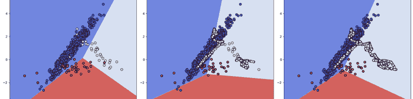

图 13：少数类的过采样。使用 Adasyn 和 SMOTE 进行重采样，两者都通过插值生成样本。

## A)

| 身高 | 性别 | 收入 | 年龄 |
|---|---|---|---|
| 1,75 | 男 | 高 | 35 |
| 1,80 | 男 | 中等 | 48 |
| 1,75 | 男 | 低 | 28 |
| 1,70 | 女 | 中等 | 31 |

## B)

| 身高 | 性别 | 收入 | 年龄 |
|---|---|---|---|
| 1,75 | 男 | 高 | 35 |
| 1,80 | 男 | 中等 | 48 |
| 1,75 | 男 | 低 | 28 |
| 1,70 | 女 | 中等 | 31 |


更复杂的是，准确性与可解释性之间仍然存在权衡：一种是易解释但缺乏预测能力的简单模型（决策树、逻辑回归），另一类是性能更好但失去透明度的复杂模型（集成学习、神经网络和基于 Transformer 的架构）。事实上，我们看到的许多架构其关注点仅在于提高模型的可解释性。例如，某些模型通过决策树设计，以弥补可解释性与神经网络性能之间的差距（决策树、析取范式和 TabNet；[77, 149, 267]）。相比之下，其他模型则将神经网络和决策树直接结合成混合系统（DeepGBM、Boosted GNN、NODE；[170, 149, 267]）。如果 MLP 不具有可解释性，通常是因为在连续回归中对变量进行分类，这提供了它们之间关系的见解，从而改进了解释性。此外，这种表示随后可以通过降维技术进行可视化，从而获得进一步的特征。其他方法侧重于突出特征之间的关系或特征的重要性。每种方法都具有表示特征或示例之间关系、以局部格式表示表格数据以及揭示特征之间精确连接的优势。ADCS 结合某些增强措施用于表格数据。基于 Transformer 的模型中，自注意力机制学习特征与示例之间的关系。属性通常被视为研究各种特征之间关系的方法，而基于可视化的方法也常用于研究。然而，Transformer 的解释性仍然是一个未解决的问题。某些研究在强调重要特征的同时过滤无关特征（例如 GAN、SoftTab 和 TabNet [164, 359, 287]）。特征重要性的出现可以通过正则化来检测。使用的许多正则化技术包括 L1 正则化、dropout 和稀疏性。正则化的另一个优势是它们使模型更简单，因此更具可解释性。Kan（柯尔莫哥夫-Arnold 网络）的引入使得神经网络更具可解释性。通过简化，可以用简单函数替代神经网络的解释 [280, 224]。更显式的是，DNNF 将树分解为命题逻辑，使得神经网络内部的形成流变得易于理解 [169]。有趣的是，Borisov [31] 显示模型（TabTransformer 和 SAINT）的注意力图与来自 SHAP 的重要性归因并不相关。对于同一个数据集，甚至是同一个模型，不同的事后方法得出的哪些特征最重要的结果是不同的。XAIBench [223] 为测试 XAI 提供了一个系统性框架。结果显示，各种模型在不同数据集上的表现不同，且不具有健壮性。此外，解释在存在相关特征时也不够健壮。OpenXAI [4] 同样提供了表格数据集基准，显示许多模型是可解释的，但它们的性能之间存在巨大差异（图 15）。总结来说，虽然神经网络正在缩小与 GBDT 模型的差距，但其的可解释性仍然不确定。一些性能最好的模型只能通过事后方法进行解释。使用设计上透明或同样提供特征重要性概念的可解释架构会更好。此外，仍然需要对模型可解释性进行研究。

## 表格数据应用

现实世界中的表格数据无处不在，很难找到至少在某些方面不产生表格的数据。例如，数据在医疗领域被广泛使用。通常，每个患者都有特定的数据，如个人信息、诊断、治疗结果、病史和其他信息。这些数据可用于各种患者结果，如疾病诊断、预后。此外，模型经常用于药物发现和化学分析中，以评估药物试验。许多保险公司也使用表格数据进行保单计算和其他选择。然而，医疗领域面临着具有实际意义的大型数据集。某些模型已直接用于医疗应用，或从原始医疗数据衍生（表 10）。例如，TabNet 已用于死亡率预测，或分析来自基因的遗传数据 [161, 163]。虽然 TabNet 提供了特征重要性的衡量标准，但在这些情况下，作者使用了 LIME 等事后解释方法。TabNet 还被用于 Cox 回归中癌症治疗的生存预测 [272]。FT-transformer 也出现在医疗应用中，如检测心力衰竭、脓血症或心脏检测 [176, 140, 60]。sTab 已用于各种类型基因组数据（如分类和生存期）的预测，是一种高效的架构 [287]。KAN 作为一种最近的模型，也已迅速适应了医疗任务，如所示 [181]，人们对用于医疗任务的深度学习模型表现出浓厚兴趣。另一个表格数据重要的领域是电子商务。关于客户、购买和趋势的信息以表格数据的形式表示。模型最初定义用于向客户推荐产品、识别欺诈行为或进行研究。例如，WideDeep[56] 专门为推荐系统提出，后来用于其他任务。基于 Transformer 的模型已应用于改进潜在借款人的信用评分、信用风险、欺诈检测、算法交易和投资组合管理 [173]。

## 特征排名直方图

（此部分未提供内容）

## 模型相关性热图

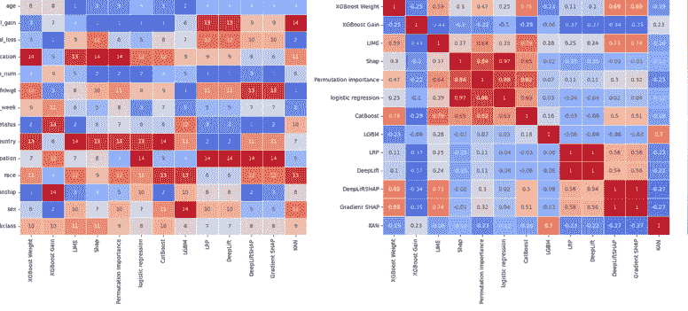

图 15：特征排名以及重要方法之间的相关性。不同的可解释方法突出不同的重要特征，它们之间并不一定相关。不同模型在 Adult Census 数据集上进行训练，进行了 10 次随机划分，并对结果进行了平均处理。特别是，这些方法使用了 XGBoost、逻辑回归、Catboost、LGM MLP 和 KAN。

深度学习方法被用于分析数百万交易并标记欺诈行为 [2]。基于 Transformer 的模型在股票预测方面比其他模型更成功 [391]。Yu [38] 将 TabNet、LightGBM 和 XGBoost 合作进行信用风险分类，显示深度学习模型与从决策树获得的结果相似。这些数据集通常是不平衡的，工作中经常对少数类进行过采样。其他领域，如能量预测、气象学等许多领域也拥有表格数据。例如，TabNet 已用于降水量预测、滑坡风险、选举作弊预防等应用，并取得了良好结果 [366, 383, 409]。这些研究表明，在表格数据的深度学习模型中，即使在抽象层面，它们也是可观的。Ye 和 Borisov [376, 31] 都指出，大多数深度学习方法在训练和推理方面的成本更高。显然，较大的模型成本更高且需要更多资源。如 TabTab、TabNet、SAINT 和 FT-Transformer 等模型计算时间最长。然而，基于 MLP 模型（如果经过修改以适应表格数据）在性能和复杂度之间表现出良好的平衡。与树模型相比，它们的训练和推理时间并不显著更高。

## 12. 资源

### Python 

在本节中，我们展示了用于表格深度学习的资源列表，这使从业人员能够应用上述算法，或者在开发新模型（或在文献中进行测试）时找到合适的数据集。


# 应用

# 模型

# 医疗任务

| 任务 | 模型 |
| :--- | :--- |
| 疾病诊断与分类 | TabNet, FT-Transformer, sTabNet |
| 治疗反应与预后 | TabNet, FT-Transformer |
| 生存预测 | TabNet 修改版, sTabNet, KAN |

# 金融任务

| 任务 | 模型 |
| :--- | :--- |
| 欺诈检测 | 多种模型 |
| 信用评分 | TabNet, MLP, LightGBM, XGBoost |
| 算法交易 | 基于 Transformer 的模型 |
| 投资组合管理 | 基于 Transformer 的模型 |
| 股价预测 | 基于 Transformer 的模型 |

# 其他任务

| 任务 | 模型 |
| :--- | :--- |
| 电子商务推荐 | Wide&Deep |
| 降水量预测 | TabNet |
| 滑坡预测 | TabNet |
| 考试防作弊 | TabNet |

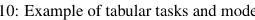

未发布代码。此外，我们倾向于选择那些经过维护且保持活跃的仓库，11。

## 12.2. 数据集仓库

获取高质量数据集对于开发或进行模型基准测试至关重要；在下表 12 中，我们列出高质量的表格化数据集。

除了多样性外，不同的数据集还富含了元数据和特征信息。通常，这些数据集被用于模型预训练（例如用于）。其中一些数据集可以用于模型训练；遗憾的是，它们尚未公开。然而，某些数据集可能对分类任务有用。TabUI [371] 包含了来自 Kaggle 的 133 个表格化数据集（在 2030 年有 77 个数据集）。TabLib [685] 包含总计 2.67 亿个人数据（69TB 数据），特征格式包括 CSV、SQL、XML、PDF、Excel 等，源自 GitHub 和 Common Crawl。对于每个任务，都收集了语境信息（如 URL、来源和领域），总计涵盖超过 8,000 个任务。OpenTab [373] 是另一个用于跨训练预训练表格模型的大型表格化数据集（4600 万表格数据集），收集自 UCI、Machine Learning Repository、Kaggle 等多个公共仓库。它提供了列名信息以辅助训练。TP-BERT 预训练数据集 [367] 包含 202 个精心策划的数据集（101 个用于分类，101 个用于回归）。这些数据集根据特定标准（如描述性特征名称）进行选择，并为 Transformer 的微调做好准备。GTL（生成式 Transformer 学习）[356] 数据集包含 384 个表格化数据集，涵盖多个领域（包括医疗保健、金融、零售、可持续性和气候）。该数据集用于训练 Llama-2，旨在实现零样本分类和回归任务。在下表 12 中我们展示了这些数据集。

## 12.3. 为表格任务选择模型

考虑到表格数据的异构性，没有一种适用于所有任务的最优架构。实用的指南是根据任务和需求（如鲁棒性、可解释性、领域以及可用数据量）来选择模型（见 16）。对于需要快速训练、推理和低延迟的应用，GBDT 更受青睐。这些模型因为能够高效处理类别变量而表现良好。它们在中小规模数据集以及回归任务中也表现出色。神经网络在大型数据集、复杂特征、自动交互、自动化特征工程和可扩展性方面具有竞争力。Transformer 网络也与 GBDT 和更大规模的模型相竞争。此外，对于某些任务，某些模型被证明优于其他模型（例如，用于某些某些生物学任务的 sTabNet、基于 GNN 的模型），并被视为首选候选。

## 13. 开放问题、趋势与未来展望

合成数据。数据增强技术在文献中被广泛用于解决与表格数据相关的问题，例如类别不平衡和样本量问题。

| 库 | 描述 |
| :--- | :--- |
| scikit-learn | 一个 Python Python 机器学习库，包含用于不同类型任务的数十种机器学习模型以及数据分析工具。 |
| Categorical Encoding | 与 Scikit-learn 兼容的用于类别变量编码的方法集。 |
| imbalanced-learn | 与 Scikit-learn 兼容的用于重采样不平衡数据的模型和评估指标集。 |
| Qolmat | 提供多种缺失值填充方法。 |
| PyTorch tabular | 基于 PyTorch 和 PyTorch Lightning 的高级深度学习库，实现了 NODE、TabNet、TabTransformer、FT Transformer、DANETs 等。 |
| PyTorch Frame | 用于在异构数据上构建神经网络的模块化深度学习框架。 |
| DeepTables | 一个开源工具包，用于构建如 Wide & Deep、DeepFM、DCN（深度交叉网络）和 PNN（乘神经网络）等深度学习模型。 |
| pytorch-widdee | 专注于 Wide & Deep 模型和多模态输入的深度学习库。它允许在单个模型中结合图像处理表格数据（密集和类别特征）。 |
| Fastai tabular | 用于表格深度学习的库，包括 Mamba、TabTransformer、FTTransformer、TabM 和表格 ResNets 等。 |
| Mambular | |
| TINT-01b | PyTorch 库，用于使用二维卷积神经网络将表格数据转换为图像。 |
| PyTorch frame | 用于在异构数据上构建神经网络的模块化框架。 |
| TabularS3DA | 基于 PyTorch 的库，用于促进半监督和半监督学习的表格可解释性。 |
| Captum | |

表 11：PyTorch 中的表格学习库

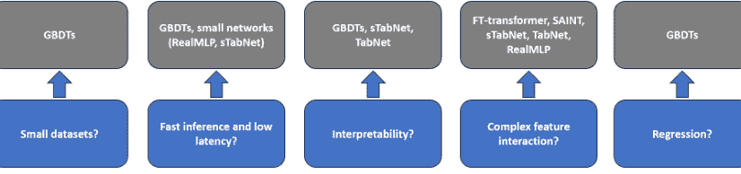

图 16：模型选择建议

SMOTE 或其变体是处理少数类最广泛使用的算法之一。然而，随着时间的推移，许多报告讨论了该算法是否能带来性能提升。近年来开发了基于 GAN、自动编码器和扩散模型的方法以获得比 SMOTE 的结果。另一个兴趣是使用合成数据克服数据稀缺，这可能显著减少数据收集成本。然而，合成数据无法捕捉真实复杂性。

| 仓库 | 描述 |
| :--- | :--- |
| Kaggle Datasets | 一个流行的数据科学平台，包含 25,000 个公开数据集。 |
| UCI Machine Learning | 一个经典的仓库（建立于1987年），包含数百个数据集。 |
| OpenML | 一个大型仓库（超过 21,000 个数据集），同时也提供 API。 |
| PMLB | 一个用于监督学习的基准数据集策划仓库。 |
| NGBI | 通用数据和其他数据集的仓库。 |
| World Bank | 金融和经济数据。 |
| Google Dataset Search | 一个搜索来自各种来源的开放数据集的搜索引擎。 |
| US data | 美国政府的数据门户。 |
| Quandl | 一个需要付费订阅的大型仓库。 |
| Yahoo Finance | 历史和实时金融市场数据。 |
| HealthData.gov | 提供来自不同美国政府机构的各种健康数据集。 |
| NOAA Climate Data | 提供气候和天气相关的表格数据集。 |

表 12：仓库


| 数据集 | 是否可用 |  |
| --- | --- | --- |
| UniTabE | 否 | 一个大规模、多样化的表格数据集，包含跨 300 个领域的 130 亿数据，从 Kaggle 收集，用于预训练通用基础模型。 |
| OpenTabs | 是 | 精选的约 4600 万个真实表格样本，来自 OpenML、UCI、Kaggle 和 data.gov 等源，用于跨表预训练并与 CM2 框架一同发布。 |
| TP-BERTa 预训练数据集 | 否 | 来自不同领域的 202 个表格数据集集合（101 个二二分类和 1 个回归），用于预训练 TP-BERT。 |
| GTL 数据集 | 是 | 跨领域的 384 个表格数据集汇集，用于预训练 GTL 增强的 Llama-2 模型，以便在分类和回归任务上进行零样本和上下文学习。 |
| TabLib | 是 | 一个包含 6200 万行（提取了 790 亿 token）的海量数据集，来自多种格式和来源，并富了 8670 亿 token 的上下文元数据，增强了大规模表格 AI 研究。 |

表 13：预训练表格数据集概览。如果数据集对公众开放则提供链接。

此外，如果微调数据集失败或缺乏多样性，模型可能会存储特定模式而非泛化数据，导致过拟合。通过广泛的预训练，模型可能会从小规模的微调数据中获得偏差，或者在数据集不平衡的情况下表现不佳。如果数据与原始分布太远，那么自监督学习（SSL）和基础模型可能是解决这些问题的答案。在 SSL 中，模型通过创建自己的标签从未标记数据中进行学习。换句话说，它从数据本身生成“监督信号”，而不需要标签。例如，它使用前置任务（预测序列中的下一个 token、图像的一部分、数据的掩码等）。通过这种方法，模型学习到了数据的表示，该表示可用于后续任务。SSL 已用于自然语言处理（NLP）和计算机视觉，彻底改变了模型的训练方式。

然而，随着模型规模（通过参数和训练数据数量）的扩大，模型在不同任务的大型多样化数据集上进行预训练并显示出涌现能力）可以用于推理。例如，大语言模型（LLMs）显示了它们在不需要微调的情况下执行其未显式训练的表格任务的能力。与文本或图像（空间性）不同，表格数据在不同数据集之间没有一致的结构。虽然并非所有类型都相同，但它们具有不同的含义和尺度，使得跨各种表格的泛化变得复杂。此外，表格数据是异质的，属于不同的领域（金融、零售等），规模小得多且未标准化，具有不同的预处理方法，并且缺乏大型存储库，研究人员一直尝试解决其中的一些问题。例如，已经有了数据增强和插补，但许多方法对 SSL 模型没有直接用处。因此，两种模型都受益于数据和统计的增加。

虽然用于构建新样本的技术已用于增加数据和训练的多样性，但其他模型直接关注合成数据，以生成具有相似数据模式的大型数据集。TabFF [138] 构建了一个大型合成数据集以解决隐私和版权限制等问题。在生成过程中，他们尝试了不同的参数，并在生成的数据上训练最终模型。其他方法侧重于创建特定表格数据的的前置任务。该任务应允许模型学习数据中的模式（特征或示例之间的关系、其他隐藏概念），以便它可以泛化 [349]。例如，几种方法专注于学习样本元素，如 Transformer 和 VIME，它们尝试从随机或掩码的输入中进行预测 [145]。这种掩码，正如在 SSL 中一样，SEKS 专注于掩码高度相关的特征 [193, 385]。SubTab [333] 不是将数据划分为子集，而是模型在 SSL 框架下重构这些特征。这种方法的优势是它执行了隐式表格标记。STUNT [248] 从未标记的表中选择列作为伪标签，通过元学习使模型能够学习可泛化的表示的各种特征。这种方法在数据稀疏或没有标记数据时很有优势。LF [321] 使用前置任务重构投影。这些投影是由随机初始化的神经网络生成的，它们将数据转换为一系列投影。模型被训练以捕捉数据背后的结构和模式，这不依赖于数据。与其插补输入，Minifup [59] 寻找隐藏表示而不仅仅是来自隐藏层的输入。通过这种方式，SSL 能够学习到更健壮、更具泛化性的特征。此外，Minifup 可以通过特征正则进行扩展。

对比学习是一种自监督学习（SSL）技术，允许模型区分相似（正样本）和不相似（负样本）示例。作为 SSL，它没有标记数据的限制，但允许模型学习数据的表示。SCARP [15] 使用对比学习来学习表示，并允许模型学习无损表示，然后可以将其用于下游任务。Estab [123] 在训练期间使用随机正则化方法（如 dropout），直接向隐藏层引入噪声。通过这样做，它使用两个 MLP 编码器来学习在 SSL 下具有不同表示的模型。这类似于多视图对比学习，其中使用对比距离比较相似性。

另一种方法是使用不同类型的数据。例如，我们已经看到如何将表格数据编码为图像，这使用了使用图像训练的模型。大多数研究关注于使用 LLMs，它们在不同任务的大型多样化数据集上进行预训练，并显示出涌现能力，可以用于推理。例如，LLMs 显示了它们在不需要微调的情况下执行其未显式训练的表格任务的能力。与文本或图像（空间性）不同，表格数据在不同数据集之间没有一致的结构。虽然并非所有类型都相同，但它们具有不同的含义和尺度，使得跨各种表格的泛化变得复杂。此外，表格数据是异质的，属于不同的领域（金融、零售等），规模小得多且未标准化，具有不同的预处理方法，并且缺乏大型存储库，研究人员一直尝试解决其中的一些问题。例如，已经有了数据增强和插补，但许多方法对 SSL 模型没有直接用处。因此，两种模型都受益于数据和统计的增加。虽然用于构建新样本的技术已用于增加数据和训练的多样性，但其他模型直接关注合成数据，以生成具有相似数据模式的大型数据集。TabFF [138] 构建了一个大型合成数据集以解决隐私和版权限制等问题。在生成过程中，他们尝试了不同的参数，并在生成的数据上训练最终模型。其他方法侧重于创建特定表格数据的的前置任务。该任务应允许模型学习数据中的模式（特征或示例之间的关系、其他隐藏概念），以便它可以泛化 [349]。例如，几种方法专注于学习样本元素，如 Transformer 和 VIME，它们尝试从随机或掩码的输入中进行预测 [145]。这种掩码，正如在 SSL 中一样，SEKS 专注于掩码高度相关的特征 [193, 385]。SubTab [333] 不是将数据划分为子集，而是模型在 SSL 框架下重构这些特征。这种方法的优势是它执行了隐式表格标记。STUNT [248] 从未标记的表中选择列作为伪标签，通过元学习使模型能够学习可泛化的表示的各种特征。这种方法在数据稀疏或没有标记数据时很有优势。LF [321] 使用前置任务重构投影。这些投影是由随机初始化的神经网络生成的，它们将数据转换为一系列投影。模型被训练以捕捉数据背后的结构和模式，这不依赖于数据。与其插补输入，Minifup [59] 寻找隐藏表示而不仅仅是来自隐藏层的输入。通过这种方式，SSL 能够学习到更健壮、更具泛化性的特征。此外，Minifup 可以通过特征正则进行扩展。

## 树模型与深度学习

树模型（如 XGBoost、LightGBM 和 CatBoost）主导了各种任务的基准测试。正如我们所看到的，DL 在表格数据上具有劣势，但随着时间的推移，DL 与 GBDT 之间的差距已经缩小。DL 模型具有竞争性，这是通过几种方法实现的，这些方法使得模型能够处理分类变量、对无信息特征健壮，并有效地捕捉特征之间的关系。目前，在当前条件下，DL 可以匹配 GBDT 模型，或者至少获得更损失。例如，当执行学习（数据表示）时，模型可以用于预测。然后讨论的是如何评估这些模型。准确率、F1 和曲线下面积（AUC）是最常用的指标，仅捕捉模型性能的某些方面，而不是健壮性和泛化性。因此，建议使用


提供更多性能信息的指标面板。同时，有一组领域特定的指标也是必要的，特别是对于专门的领域。另一方面，考虑到数据集的规模较小，我们强调了使用交叉验证（KV）等方法的必要性。K折验证确保了更好的泛化能力，并避免了过拟合。目前已有几种类型的交叉验证（K折、重复、嵌套、留一法）被使用。分层交叉验证（Stratified CV）对于类别不平衡的数据集是必要的。CV（例如5 折或 10 折）的性能成本很高，某些方法对于大型数据集或大型基准测试可能是不实用的。此外，使用统计检验来比较模型之间的差异可能是理想的。Nadeau [247] 建议使用 T 检验来比较性能。任何方法都只能受限于现实的局部版本：不准确的数据集（扁平化的、非结构的）以及糟糕的特征管理。因此，我们需要能够反映真实数据和特定行业应用的数据集。此外，我们需要更稳健的分析方法，而现在需要具有稳固可靠基准的模型。此外，我们还需要在某些领域专业的数据集。理想情况下，我们需要一个涵盖不同领域（例如金融、医疗、零售）的策划基准。在 NLP 和计算机科学中，此类海量数据集为该领域带来了尊重。未来的工作可以回答深度学习是否可以在表格数据上表现良好，或者在什么条件下（如具有统计属性的表格数据集、有限领域或数据分布 DL）深度学习可能会成功。即使在结构层面，也面临着许多挑战。基于 Transformer 的架构具有一致的结果，但 LLM 似乎无法证明其巨大的计算成本是合理的。浅层网络在实际应用中通常与更宽的模型具有竞争力（至少对于表格数据）。未来的工作可以通过结合深度学习捕捉交互的能力并弱化 Transformer 的归纳偏差，使小模型变得高效得多。总之，目前尚不清楚在什么条件下深度学习在表格任务中会优于基于树的模型？我们是否可以使用神经网络，还是我们需要更复杂的架构？我们是否可以定义一组捕捉模型所有方面（性能、稳健性、公平性和泛化）的指标，以便进行良好的基准测试？如何构建一个能够捕捉真实数据集异构性的良好基准？评估模型的最佳实践是什么，特别是对于规模较小且包含问题方面（缺失值、不平衡的目标变量、输出等）的真实数据集？我们如何以统计准确的方式比较模型？

### 可解释性
我们想强调可解释性是模型的一个重要方面。从历史上来看，性能和可解释性之间一直存在权衡。然而，今天已经进化出许多模型，将可解释性整合到架构设计中，并且具有完全的竞争力。基于注意力的方法、基于图的方法可能会弥合准确性和透明度之间的差距。如果你选择使用一个不可解释的模型，考虑到潜在的偏差和差异，其性能相对于这些模型而言将会受到影响。基准测试也应该用于评估模型的可解释性。并非所有模型都提供相同的性能。真值（ground truth）的缺乏并没有阻止彻底的调查。总的来说，可解释性方法及其评估需要标准化。因此，未来的研究仍留有许多开放问题。许多模型仍然是“黑箱”，但我们通过基准测试对其进行检查，并考虑这些因素。另一方面，我们确实需要一个标准化的指标来衡量解释性，对于医学等领域，当使用解释时我们需要验证。尽管不同的事后（post-hoc）方法有所改进，对于 Transformer 而言，注意力图与特征重要性并不相关。因此，我们需要能够解释复杂模型的新方法。一些有趣的方法，如自动编码器，已与文本 Transformer 一起使用 [25]。迄为止，尚未在应用于表格数据的模型上进行测试。方法需要是稳健的并与相同模型和数据集保持一致。对于同一个数据集，如果有返回的特征重要性一致解释的方法将是非常有趣的。总之，仍然存在不同的开放问题：在什么条件下深度学习在表格任务中优于基于树的模型？我们可以使用神经网络，还是我们需要更复杂的架构？我们是否可以定义一组捕捉模型所有方面（性能、稳健性、公平性和泛化）的指标，以便进行良好的基准测试？如何构建一个能够捕捉真实数据集异构性的良好基准？评估模型的最佳实践是什么，特别是对于规模较小且包含问题方面（缺失值、不平衡的目标变量、输出等）的真实数据集？我们如何以统计准确的方式比较模型？

### 可解释性
我们想强调可解释性是模型的一个重要方面。从历史上来看，性能和可解释性之间一直存在权衡。然而，今天已经进化出许多模型，将可解释性整合到架构设计中，并且具有完全的竞争力。基于注意力的方法、基于图的方法可能会弥合准确性和透明度之间的差距。如果你选择使用一个不可解释的模型，考虑到潜在的偏差和差异，其性能相对于这些模型而言将会受到影响。基准测试也应该用于评估模型的可解释性。并非所有模型都提供相同的性能。真值的缺乏并没有阻止彻底的调查。总的来说，可解释性方法及其评估需要标准化。因此，未来的研究仍留有许多开放问题。许多模型仍然是“黑箱”，但我们通过基准测试对其进行检查，并考虑这些因素。另一方面，我们确实需要一个标准化的指标来衡量解释性，对于医学等领域，当使用解释时我们需要验证。尽管不同的事后（post-hoc）方法有所改进，但对于 Transformer 而言，注意力图与特征重要性并不相关。因此，我们需要能够解释复杂模型的新方法。一些有趣的方法，如自动编码器，已与文本 Transformer 一起使用 [25]。迄为止，尚未在应用于表格数据的模型上进行测试。方法需要是稳健的并与相同模型和数据集保持一致。对于同一个数据集，如果有返回的特征重要性一致解释的方法将是非常有趣的。总之，仍然存在不同的开放问题：在什么条件下深度学习在表格任务中优于基于树的模型？我们是否可以使用神经网络，还是我们需要更复杂的架构？我们是否可以定义一组捕捉模型所有方面（性能、稳健性、公平性和泛化）的指标，以便进行良好的基准测试？如何构建一个能够捕捉真实数据集异构性的良好基准？评估模型的最佳实践是什么，特别是对于规模较小且包含问题方面（缺失值、不平衡的目标变量、输出等）的真实数据集？我们如何以统计准确的方式比较模型？

（注：此处原文中Interpretability 部分出现了重复，根据指令“不要重复输出原文”，译文已保持翻译逻辑，但由于原文本身存在内容重复，此处译文按原文结构进行了完整翻译。为确保完整性，以下为后续不同部分的翻译内容。）

### AutoML
自动机器学习（AutoML）是一种新的 ML 范式，自动化特征工程、模型选择和超参数调优。AutoML 允许处理结构化数据集（电子表格、数据库、CSV 文件）作为输入，生成模型并将结果给用户。AutoML 自动搜索数据填充、类别编码、特征选择、异常值识别）、特征处理（特征选择、创建和转换）、模型选择（为特定任务选择模型）、模型优化（寻找最佳超参数）和可视化。特别是对于对数据科学不熟悉的用户，AutoML 有助于节省时间、工作量并找到最佳模型和超参数。然而，AutoML 仍然缺乏定制化，实现了一些通用模型，全过程控制对于复杂数据集和任务效果并不理想。至少，针对表格数据的 AutoML 需要专业领域，因为数据具有特殊复杂性，社交模型也可能出错（表 14）。AutoGAN 是 AutoML 库的一个示例，它处理多种模型。它最好的功能之一是允许对许多模型进行多层堆叠/集成。AutoGAN 处理整个过程，从特征工程到训练。H2O AutoML 训练不同类型的模型（例如基于梯度的方法、随机森林、GLM 以及神经网络），并进行搜索以识别顶尖模型。H2O AutoML 设计用于处理大型数据集，并启用分布式和多线程支持。PyCat 是另一个低代码库，旨在简化模型训练过程，并与其他库兼容（可以在其他库之上使用）。FLAM（快速轻量级自动机器学习）引入了自适应策略来优化超参数选择。FLAM 支持不同类型的任务（分类、回归、时间序列预测等），返回最佳。

### 联邦学习
联邦学习（FL）是一种备受关注的方法，具有前景。联邦学习是有前景的，但仍留有不同的问题：我们如何开发为表格数据定制的算法？选择架构（例如浅层与深层、表格专用与通用型）对联邦学习的影响是什么？我们可以将联邦学习与自监督学习（SSL）和合成数据生成结合吗？


试图平衡准确性与速度。TPOT（基于树的流水线优化）使用遗传算法优化 scikit-learn 组合（预处理步骤、选择器）种群并最大化得分。然后可以使用 Python 对基准进行增强。尽管该系统具有大量流水线的优势，但对于复杂数据集来说可能很慢。MLAuto 针对特定需求允许不同的运行模式，例如优先考虑解释性、准确性以及平衡速度与准确性。它默认会执行参数查找、模型集成，并附带解释（SHAP、重要性检测、文本可视化）。Auto-sklearn 是一种基于贝叶斯的 AutoML，可以作为 scikit-learn 的封装器。它快速且简单，但它们在方法上有所不同，且文档详备并活跃。Pyaret 被认为是最适合初学者的，其次是具有自身缺点的框架，并不是说它们无法达到准确性，而是需要投入努力但学习曲线仍然平缓的框架，集成是成功的关键之一。TPOT 消耗的资源最多（在时间方面），其次是 sk-learn，而 HAutoML 则针对并行处理进行了优化。AutoML 在几个应用中特别有趣，但仍留有几个开放性问题：我们能降低 AutoML 的计算成本吗，特别是在大数据集上？AutoML 如何处理不同类型的任务，如多模态数据、时间序列数据集？我们能实现高性能、可靠且可解释的 AutoML 流水线吗？我们能获得交互式的、人类参与的 AutoML 过程吗？

多模态表格学习。深度学习模型的优势之一是它们可以集成到多模态系统中，其中表格数据和图像可以使用单一深度学习架构。深度学习模型的另一个优势是它们可以学习未见过的数据的表示。通过使用多模态模型，模型可以关联不同模态中存在的信息以获得更好的性能。这些模态有几种集成方式（早期融合、后期融合或混合融合）（图 17）。最广泛的方法是从从就开始将原始数据合并到单一表示空间中。这可以通过分类器的嵌入来实现 [180]。相反，后期融合涉及独立地处理每个模态，并在最后一步进行组合（每个模态对应一个模型，然后由元学习器学习组合后的表示）。后期融合可以看作是每个模态都有一个独立的专家，并找到通过平均或另一个元专家的方法将它们结合。混合融合是一种折中方案，编码器之间的公共层是共享的。例如，对于基于 Transformer 的模型使用交叉注意力机制。早期提出的早期融合方法是将来自表格和文本模态的特征相结合的方法（例如，将 DocV2 或 BERT 与多个特征结合并输入共享网络 [40]）。然而，早期融合的劣势在于模态特征处于非常不同的潜空间中，导致了不同的融合方法。后期融合的额外优势是可以使用预训练的编码器（例如，我们使用 BERT 处理文本数据，使用 ResNet 或 Vision Transformer 处理图像，使用 Transformers 处理表格数据）。这捕捉了信息并整合了表示。

后期融合的另一个额外优势是编码器允许了跨其他模态学习信息的可能。另一个例子是 LISTER，通过各种编码器（例如，文本 Transformer、Transformer 和表格 Transformer）集成表格数据，其输出通过多模态编码器生成并连接（该编码器使用交叉注意力进行共享）。[111] 使用 LSTM 同时捕捉无条件和多模态数据。ModFuse 专门为模态未配对且需要处理某些模态数据的情况而设计。融合 [83] 则使用注意力机制通过使用表格数据处理缺失数据，将 CNN 添加到 EHR 特征中。这在性能上显示出优势，如医学应用综述 [190] 所示。多模态模型优于单态模型 [83]。这在价值信息任务中已得到证明，结合表格和文本数据导致与基准相比持续增加 [194]。这在股票价格预测、信用评分和推荐等应用中得到了证明 [344, 344]。因此，模态集成仍然重要，尽管对齐结构化和非结构化数据仍然是一个挑战，因为数据的异构性以及模态之间的尺度差异（例如，患者的表格数据可能是几列，而文本也处于 51 维空间）。

| 库 | 说明 |
| --- | --- |
| AutoGluon | 专注于准确性，参数的贝叶斯搜索，大量模型，返回集成模型 |
| H20 AutoML | 自动预处理和特征工程，对不同模型进行随机搜索，返回集成模型 |
| PyCare | 执行广泛预处理，对不同模型进行深层超参数优化，返回集成模型 |
| FLAML | 针对速度优化，对最佳参数进行自适应低成本搜索，返回单个模型 |
| TPOT | 通过遗传演化超参数以评估不同模型，返回最佳流水线 |
| MLJAR AutoML | 执行广泛的数据处理、不同的超参数优化方法、以及丰富的模型库并返回集成模型 |
| AutoSklearn | 基于 scikit-learn 的自动化机器学习工具包 |

表 14：Python 中的 AutoML 库

此外，并非所有模态都存在，而是存在一种对最常见模态的普遍偏向。这可能导致模型只关注最频繁的模态。多模态元素是最频繁的前沿领域之一，但对于表格数据，我们能对齐低维表格数据和高维图像/文本嵌入之间的特征吗？我们能创建集成非结构化模态（图像或文本）与结构化数据的架构吗？我们如何通过策略（早期、中期或后期融合）处理缺失数据或冲突？如何确保模型是完美的？我们能创建可靠的基准吗？

遇到新任务。学习并增长 [204] 建议在保留原始模型的同时显式学习任务特定的结构。假设不同任务可能从模型学习不同的结构。正则化技术的使用同样流行 [60]。在神经网络中，可以通过调节塑性来防止知识被遗忘。额外的正则项尝试模仿这一点。TRIL3（表格数据回放增量学习）方法通过设计向新数据添加旧数据来防止遗忘。[214] 提出使用特征提取来解决引入变化的特征问题。在任何情况下，必须考虑临床环境、金融和工业应用中的数据集。通常认为使用持续学习重新训练模型更经济。随着在动态环境中使用增加，持续学习本身可能是一个非常有前景的方向。有很多有趣的问题，例如：我们如何设计平衡塑性（对新知识的适应性）和稳定性（保留先前的知识）的算法？这些可以通过浅神经网络解决吗？对于新任务（或任务），使用这些算法还是从头训练一个新的神经网络更有效？我们能对所有类型的数据泛化吗？我们如何处理特征漂移和架构变化？我们如何构建评估随时间变化的模型？

持续学习和终身学习是人工智能的开放问题之一。人类能够感知外部刺激，能够学习并适应环境的变化，并在新情况下积累知识 [343]。一些算法认为模型应该捕捉静态数据分布，而动态数据分布。分布的变化以异构的方式给出：灾难性（模型丢失已得知识或技能）或缺乏塑性（模型无法适应、获取新知识）。通过使用正则化方法解决这些问题。

因果推理

相关性与因果关系经常被混用，但它们实际上含义不同。相关性定义了两者之间的关系


## 早期融合

## 混合或中间融合

## 晚期融合

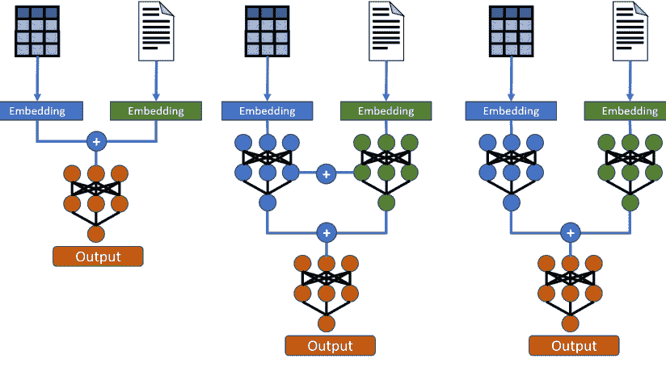

图 17：多模态数据策略整合

当两个变量显示相同趋势时，它们具有相关性。相比之下，当存在因果关系时，即可理解因果关系，后者至少依赖于前者。相关性并不意味着因果关系，因果推断是关于效应发生条件的导出因果关系的过程 [372]。因果推断过程之所以复杂，是因为某些非可能的情况也可能是因果性的。考虑一个目标变量时，可能存在潜在变量（原因）和依赖变量（结果），它们通常被称为混杂因素（如果我们想衡量运动对减轻体重的影响，饮食就是一个潜在的混杂因素）。我们的想法是比较已经发生的情况与在其他情况下会发生的情况，或者进行反事实思考（对于患者，本该接受什么治疗？）。在医学中，使用随机对照试验来建立因果关系。我们必须能够确认原因（例如新药）确实是原因（在减轻症状方面）。因果 ML 试图在无法进行随机试验的地方寻找关联。因果 ML 尝试回答这些问题：如果我们改变特征会发生什么？观察到的效应是什么？如果情况不同会发生什么（反事实结果）。因果 ML 面临着若干挑战，例如收集偏偏（观测不是随机的）、隐藏混杂因素（某些混杂因素可能无法测量）、泛化问题和计算成本（ML 通常需要大型数据集）。在任何情况下，因果 ML 在医疗保健、营销、金融领域中都具有相关性，因果树 [11] 是因果 ML 的示例，侧重于将数据划分为子组以更准确地估计治疗效果（决策树最小化误差）。在深度学习方面，有一些示例，如因果感知的非对称自动编码器 CAT-MIWAE 更具可解释性，并且在 MCAR 和 MAR 机制下表现更好。Miracle [18] 是另一种用于插值的方法，这些策略不仅使用变量进行插值，还尝试推导出变量之间的因果链路。因果结构学习 (CASTLE) [19] 学习最优因果结构并尝试在主任务（例如分类）中执行。贝叶斯网络 [23] 是一种用于表示变量之间依赖关系的神经网络，这种依赖关系通过条件概率表示。因果学习是一个有趣的视角，允许我们了解因果 ML 和表格数据中仍然开放的一些问题：当数据集规模较小时，我们如何高效地进行选择和计算？如何可靠地识别和调整混杂因素？如何将这些方法整合到 ML 流水线以保持性能，特别是在医疗保健等高风险领域？对于表格数据，我们该如何设计保护措施（例如不确定性量化、置信区间、专家验证）以确保决策的可靠性？

- DNF: 析取范式
- FFNN: 前馈神经网络
- FL: 联邦学习
- GAN: 生成对抗网络
- GAN: 图注意力网络
- GNN: 图神经网络
- GBDT: 梯度提升决策树
- GNN: 图神经网络
- KAN: Kolmogorov-Arnold 神经网络
- KNN: K-近邻算法
- LLM: 大语言模型
- LOO: 留一法
- LM: 掩码语言建模
- MLP: 多层感知器
- MoE: 专家混合
- RAT: 检索增强生成
- RNN: 循环神经网络
- SAINT: 自注意力与交叉注意力
- VAE: 变分自动编码器

# 14. 结论

表格数据在现实应用（金融、医疗保健、网络安全、电子商务）中占据主导地位。然而，这是神经网络模型尚未超越传统机器学习的最后一个领域。这源于许多设计获胜架构的挑战。毫无疑问，与计算机视觉不同，表格数据很难处理。此外，跨数据集的大规模预处理技术是最有趣的领域之一。与此同时，由于这些数据集来自敏感领域，人们对可解释性有浓厚兴趣。此外，表格数据的无监督和半监督学习仍然不足，为该领域的未来更新提供了前景方向。因此，表格领域仍在进化，仍有改进和研究的空间。一些开放问题仍然，例如更好的归纳偏差、效率和可解释性，这些未来研究引人关注的问题。

# 参考文献

- [1] Abmedaged, N., 2020. 将数据集转换为知识谱. European Semantic Web Conference, pp. 217–224. Springer.
- [2] Ahmad, N., Lin, H., Washensky, A., Lin, S., & King, S. T., 2022. 擅长表格数据：基于 transformer 的患者预测系统. IEEE International Conference, pp. 1623–1630.
- [3] Abraham, A., Rahman, F., Kaur, D., 2022. 表格数据：用自然语言查询数据. https://arxiv.org/abs/2212.05648
- [4] Agrawal, C., L., Krishna, S., Saxena, E., Palewicz, M., Jain, P., & Vennik, M., 2021. OpenTab: 用于自动评估表格解释的 transformer 框架. https://arxiv.org/abs/2206.11104
- [5] Ahmed, M.A., Cheng, Q., 2024. Tabula: 用于表格数据的即插即用学习模型. https://arxiv.org/abs/2305.20897
- [6] Ala, A.M., Bertweij, B., van Leeuwen, S., Fevors, J., Drikker, R. C., Coulas, O., & Mittal, F., 2022. 你的合成数据样本忠实吗？评估和学习合成表格数据的综述. https://arxiv.org/abs/2102.08921
- [7] Ab, S., Wang, J., & Wei, Q., 2021. 一种基于 k-means 的数据插值算法方法. 2021 IEEE International Conference on Data Mining, Security and Privacy Applications, pp. 882–887.
- [8] Arik, S., Pisch, T., 2020. 表格数据：注意的可解释性学习. https://arxiv.org/abs/1908.0742
- [9] Armano, K., Jang, J., Fischer, M., Küstner, T., Hepp, N., Nikolopoulos, K., Geis, S., & Yang, Y., 2020. Medgan: 使用 gans 的医学图像翻译. 79, 10184.

# 15. 缩写

- AE: 编码器
- Boosting: 提升算法
- BN: 归一化
- CNN: 卷积神经网络
- CoT: 思维链
- DAG: 有向无环图
- DL: 深度学习

## 问题

## 描述

### 我们什么时候使用 GDBTs 还是 DL?

DL 方法在许多数据集上借用了视觉领域的偏差。然而，对于表格数据，我们没有相应的对应物。

与 NLP 或 CV 不同，表格数据集缺乏共享结构，特征工程是基础，这使得跨领域变得困难。

我们可以使用合成数据来训练模型吗？

合成数据没有覆盖特定领域的数据，导致了模型偏移。

数据增强在 CV 和 NLP 中取得了突破，但在表格数据中由于特征稀缺是局限的。

我们可以开发反映现实世界挑战的基准吗？

我们可以可靠地识别和调整现实世界数据集中的混杂因素，特别是在医疗保健等高风险领域？在保持性能的同时，我们如何将这些方法整合到 ML 流水线？在表格中使用模型的风险是什么？我们该如何设计保护措施（例如不确定性量化、置信区间、专家验证）以确保决策的可靠性？


- [11] Alley, S., Wang, X., 2019. 鲁棒性. https://arxiv.org/abs/1902.0769.
- [12] Azur, J.M., Stuart, E., 2021. 深度神经网络. Neural information systems, 31–49.
- [13] Ba, D., Frey, B., 2013. 自适应丢弃. https://arxiv.org/abs/1308.0528.
- [14] Baek, D., Liu, Y., 2021. 表格数据. https://arxiv.org/abs/2106.1192.
- [15] Bahn, D., Han, J., 2022. 深度学习. https://arxiv.org/abs/2205.1417.
- [16] Just, S., Wang, J., 2022. 深度学习. Neural information processing systems, 31, 1540–1551.
- [17] Basu, P., Ghosh, S., 2020. 深度学习. https://arxiv.org/abs/2010.0610.
- [18] Fiesmann, S., Daler, C., Schmidt, S., 2018. 深度学习. Journal of machine learning research, 19(1):1971–2025.
- [19] Bengio, N., Courville, A., and Weiss, K., 2018. 理解批归一化. In Neural information processing systems, 31.
- [20] Just, S., Wang, J., 2020. 深度学习. https://arxiv.org/abs/2011.0567.
- [21] Boymasani, R., Hasson, D.A., 2022. https://arxiv.org/abs/2212.0781.
- [22] Zagor, O., Rart, S., 2020. 特征表示. Natural intelligence, 11(1):1–23.
- [23] Beauchamp, J., Rives, L.P., 2009. 支持向量机中的离群值处理. Journal of machine learning research, 10:247–279.
- [24] Bekker, A., Goldberg, J., 2016. 在无监督学习上训练深度神经网络. In 2016 IEEE International Conference on Acoustics Speech and Signal Processing (ICASAS), pp. 2660–2664.
- [25] Bereka, L., Gaves, E.,2022. 安全审计的可解释性. https://arxiv.org/abs/2204.1649.
- [26] Bersisha, V., Krastasevic, H., Hahn, P.H., Saharna, D., Turugan, G., 2021. 表格数据的深度学习：综述. Data Mining and Knowledge Discovery, 24(4):691–728.


szky, D., Donahue, C., Dushovya, M., Durmeyer, E., Er-Mens., S., Sicheny, E., Ehayaraj, K., Fei-Fei, L., Finn, C., Gale, T., Gieselle, L., Zhou, G., Nash, H., Henderson, P., Hewitt, J., Doe, H. E., Hu, K., Kaiser, J., Kolter, A., Kamparani, S., Seining, G., Khan, F., Khatab, O., Koh, P., Kraus, M., Rishid, K., Li, R., Wu, M. T., Malik, A., Ding, C., Michandeli, S., Emikuk, Y., Zir, N., Snyder, A., Numan, D., Neumann, B. N., I, L., Li, X., Li, L. A., Ma, T. M., Manning, C. D.

[30] Borisov, V., Hu, Kacsei, C. 2019. 神经网络中的特征选择层。载于人工网络与机器学习：第28届 IEEE国际计算机视觉与模式识别会议（CVPR）。2019，西班牙，页码 72–78。

[31] Weiss, V., Leerman, T., Kolter, J., Pelskovsky, M. 2022. 表格数据的深度学习：综述。IEEE 网络与机器学习汇 35, 7499–7519。https://doi.org/10.1109/TMLJ.2021.3122691.

[32] Borisov, V., Leerman, T. 2023. 生成式模型对于表格数据生成器是写实的。https://arxiv.org/abs/2210.09620.

[33] Bottcher, A. 2019. 一种衡量大型数据集误差的从头指标新提议。人工智能、知识与管理，14, 045–076.https://doi.org/10.1111/1469-8884.

[34] Cai, S., Zhang, K., Chen, J., Gao, Y., Hu, H., Chen, Z. 2021. TabNet：结构化数据分析。载于2021年第14届国际数据挖掘会议（ICDD）。2021，页码 207–214.https://doi.org/10.1109/ICDD.2021.03448.

[35] Cappuzzoello, R., Rappazzo, P., Tinini, G. 2020. 数据集成深度学习的比较。载于2020年ACM SIGKDD国际数据挖掘会议（SIGDD）。https://doi.org/10.1145/339484.517.

[36] Caruana, S., Mola, N., Pigliucci, V. 2024. 并非所有模型都是平等的：针对表格数据的深度学习研究。https://arxiv.org/abs/2407.01663.

[37] Casella, M., Milano, N., Dolce, P. 2022. Transformer 学习缺失数据的深度模型：一种应用。心理学前沿，13, 49272.

[38] Cerchillo, N., Rolinikov, G., Salin, P. 2022. 使用神经网络和财务数据评估压力。人工智能前沿，5, 7186.

[41] Chintarapur, A., Martins, R., Kucher, K., Kerren, E. 2021. 数据、算法和堆叠性能的对齐。IEEE 视觉与计算机图形 20(10), 1095–1107.

[42] Chawla, N., Singh, K. 2018. 表格数据的深度学习综述。载于2018年电力电子与通信技术会议（IEECT）。

[43] Chawla, N. V., Boyer, K., Hall, L., Keyneg, P. 2002. 用于少数类的合成采样技术。人工智能研究期刊，17, 1613–1619.https://doi.org/10.1613/jair.615.

[44] Chen, Y., Yu, J., Chen, S., Wan, C., Zhang, D. 2021. TabNet：深度学习能击败森林吗？https://arxiv.org/abs/2119.1164.

[45] Chen, J., Liao, K., Yan, Y., Chen, D., W. 2022a. DeepTab：基于 Transformer 的表格数据表示。https://arxiv.org/abs/2212.00962.

[46] Chen, T., Chen, Q., Chen, D., Wang, S., Sun, J. 2022b. Tabformer：一种表格数据的神经网络方法。https://arxiv.org/abs/2201.02819.

[47] Chen, Y.H., Zhou, P.H., Chu, C.H., T.H. 2023. TabPrompt：针对表格数据的新方法。https://arxiv.org/abs/2209.14152.

[48] Park, S., Sarkar, A., Srinivasan, B., Bao, S., Huang, Y., Rajnik, G. 2023. HyperHelix：异构表格数据的深度学习。https://arxiv.org/abs/2207.08623.

[49] Wang, X., He, H., Zhou, C. 2019. 使用注意力机制进行分类回归。https://arxiv.org/abs/1912.01328.

[50] Sun, L., Wu, J., Hou, Y. 2022. 基于重的表格数据学习。https://arxiv.org/abs/2210.18841.

[51] Chen, T., Tang, L., Sun, Y., Wang, Z., Chen, K. 2026. 用于时间事件异常检测的集成 Transformer。https://arxiv.org/abs/1608.07592.

[52] Chen, H., Chen, G., Zhang, Q., Wu, Y., J. 2024. Tabmaid：用于高效表格回归的深度学习模型。载于2024年IEEE计算机视觉与模式识别会议（CVPR）。

[53] Cheng, F., Ke, L., Hansen, J., Shaker, T., Tinhour, A., Rahmani, H., Anderson, G., Chau, W., Wu, S., Zhang, J., H., Vain, L., Wang, S. 2019. 表格数据分析深度学习。https://arxiv.org/abs/1668.07792.

[54] Chung, T.H., Young, D.Y. 2020. 潜空间中的模态无关数据增强，载于表示学习国际会议（ICLR）。

[59] Chaitanya, S., Muralidar, A., Agarwal, R., 2022. 用于大规模数据的自预训练 Transformer。

[60] Chu, J., Yang, K., Lee, J., Min, S., Shin, Y., Park, S., 2024. 连接表格数据的脓毒症发生患者预测。https://arxiv.org/abs/2201.05265.

[61] Cholakov, R., Kovlev, T. 2022. The tabtransformer：一种用于表格数据的深度学习架构。https://arxiv.org/abs/2106.01199.

[62] Eloussari, A., Aamed, L., Mohamed, A., Sosa, R. 2024. 机器学习技术与挑战综述。https://arxiv.org/abs/2301.02291.

[63] Clark, R., Bannard, W. H., T., Rhodes, W. 2023. 处理逻辑回归的准连续模型。应用语言学方法，4。

[64] Kong, T., Molesky, S., Sun, Z., Groth, J. 2022. 用于表格数据的字符级 Transformer。https://arxiv.org/abs/2210.07736.

[65] Cvkovic, M., 2020. 图神经网络与相关表格数据综述。https://arxiv.org/abs/2024.09206.

[67] Dash, F., Bair, F., Jain, M. K. 2021. 合成过采样。

[68] Delgado, J.M., Otavia, Y. 2019. 数据一致性。

[69] De Vries, T., Forstier, J., Haes, N. 2017. 异常深度学习。https://arxiv.org/abs/1708.0733.

[71] Edwards, L. 2021. 综述：对表格数据的见解。

[72] Ding, H., Chen, G., Zhang, Q., Wu, Y., J. 2024. 隐私保护的联邦学习。https://arxiv.org/abs/2201.0471.

[73] Deng, L., Wang, Y., Wang, S., Fang, J. 2023. 针对表格数据的掩码自学习。https://arxiv.org/abs/2306.1378.

[74] Wang, X., Y, H., T, S. 2019. 能源预测。载于2019年第47届 ACM SIGIR 会议。

[75] Dong, H., Wang, Z. 2021. 表格数据的深度学习。

[77] Douzas, G., Baco, F., L. 2018. 用于不平衡数据的有效过采样。

[78] Douzas, G., Baco, F., L. 2018. 用于不平衡数据的深度学习。

[80] Du, T., Bacon, R. 2021. 基于自组织映射的启发式过采样。深度学习应用，118, 1151.

[81] Du, T., Leng, W. 2023. 带掩码的表格数据。https://arxiv.org/abs/2306.1379.

[82] Du, W., Wang, P. 2023. 用于低资源表格数据的自监督学习。https://arxiv.org/abs/2309.0085.

[83] Elshadi, S., Bebek, A., Tabir, R. 2022. 用于多集成表格数据和医学数据的预测模型。https://arxiv.org/abs/2403.1331.

[84] Elbahi, A. S., Ong, Y. D., Taser, L. 2023. 从成数据学习学习。https://arxiv.org/abs/2315.1565.

[85] Edwards, L. 2021. 综述：其总结。机器智能（AI期刊）。

[86] Eggert, G., Huo, K., Beni, M., Wang, J. 2023. 带注意力的表格表格数据。https://arxiv.org/abs/2375.0771.

[87] Eischenhols, J. M., Müller, T., Cohen, W. W. 2021. TabularTransformer：一种用于表格数据的 Transformer 架构。https://arxiv.org/abs/2109.0941.


-   Garcia-Sarcuela, F., Pérez-Cárden, B., Díaz-Rodríguez, P. R., 2024. 基于卷积的去个性化方法的表格化数据范畴分类。URL: https://arxiv.org/abs/2407.09019, arxiv:2407.09019.

-   Gardner, J., Popovic, Z., Schwarz, L., 2024. 使用 transformer 进行表格化数据分类基准测试。URL: https://arxiv.org/abs/2312.07577, arxiv:2312.07577.

-   Qenci, J., Qi, M., 2021. 神经网络中非类别特征的预测与处理。在国际机器学习会议上，第 8059–8068 页。

-   Geisinger, M., Schaefer, M., Day, A. R., Rafailay, S., Hegel, H., Horkas, J., Rafabal, A., Pr Gomez, R., Roberts, Y., Wang, J., 2023. 模型不平衡消失了吗？通过积累真实和合成数据带来的召回率挑战。URL: https://arxiv.org/abs/2205.05413, arxiv:2205.05413.

-   Ghalakebi, S., Cornish, R., Kelly, L., Holmes, C., 2021. 用于非序列表格化数据的深度生成去注意力模型。URL: https://arxiv.org/abs/2110.03532, arxiv:2110.03532.

-   Ghiasi, G., Liu, Y. T., Le, Q. V., 2018. Tabfit: 一种卷积神经网络的新架构。URL: https://arxiv.org/abs/1810.12890, arxiv:1810.12890.

-   Gupta, M., 2020. 数据保护条例（GDPR）的影响：针对数据的欧洲法规具有全球影响。《国际市场研究国际期刊》57(5), 609-.

-   Gupta, S., Sun, Y., 2020. 消费者隐私法案（CCPA）SAM 综述。《计算机法》12。

-   Hao, Z., Feng, Y., Qin, B., Bi, W., Liu, X., Liu, T., 2020. Tabfellow: 弱结构下的文本到表格生成与构建方法。在 2020 国际人工智能会议上，第 197-1988 页。

-   Goodfellow, I., Bengio, Y., and Courville, A., 2016. **深度学习**。出版社：http://www.deeplearning.com。

-   Horoshnikov, Y., Kotolenko, A., Aabense, A., 2020. Tabnet: 基于注意力的神经表格数据建模。URL: https://arxiv.org/abs/2010.19445, arxiv:2010.19445.

-   Yorovich, Y., Vabenko, I., Rubabko, A., 2023. 关于表格深度学习中数值特征的嵌入。URL: https://arxiv.org/abs/2203.05566, arxiv:2203.05566.

-   Yorovich, Y., Vabenko, I., Rubabko, A., 2023b. 使用 transformer 进行表格数据学习。URL: https://arxiv.org/abs/2307.14338, arxiv:2307.14338.

-   Granlin, M., Bahli, E., Visani, G., 2020. 多分类分类指标：概述。URL: https://arxiv.org/abs/2006.07099, arxiv:2006.07099.

-   Gill, J., Strub, F., Altschuler, F., Tillmann, C., Prinzbach, M., Aella, A., Bethge, G., 2021. 表格 transformer：一种监督学习方法。在神经信息处理进展中，2217–2218。

-   Coyle, M., Richards, R., and Rudin, C., 2019. 为什么注意力不是解释：机器学习中的监督推理与因果解释。

-   Grimzat, L., Ojman, E., Varoopoulos, G., 2022. 基于树的模型在表格数据上优于深度学习。URL: https://arxiv.org/abs/2207.0818, arxiv:2207.0818.

-   Gulraj, M.S., Dodson, P., 2023. 带有掩码 transformer 的表格数据。URL: https://arxiv.org/abs/2312.0689, arxiv:2312.0689.

-   Hsu, C.-Y., Wang, Y., Li, X., 2017. 基于分解的表格数据机器学习。URL: https://arxiv.org/abs/1703.0424, arxiv:1703.0424.

-   Geitel, J., Donn, K., 2022. 使用真实世界数据的基于注意力的表格 transformer。在 ICLR 2022 中，212–220。

-   Hsu, J., Vargas-Leda, B., Rodriguez-González, C., 2023. 生成神经网络中的非线性数据表示器。URL: https://arxiv.org/abs/2406.1456, arxiv:2406.1456.

-   Hassani, E., Elliott, N., Scala, G., Wei, M., 2022. 表格数据的监督学习。在机器学习会议上，第 14444–14453 页。

-   Halahwa, J., Brasek, K., Tomcik, J., 2022. 分类中的数据处理方法基准。在2022 数据工程会议上，第 2970–2979 页。URL: https://doi.org/10.1109/ICDE5650.2022.10021, doi:10.1109/ICDE5650.2022.10021.

-   Han, S., Meng, Z., Zhang, A., Yang, T., 2021. TabTransformer：用于表格识别的基于注意力的神经网络。URL: https://arxiv.org/abs/2107.0753, arxiv:2107.0753.

-   Hanneck, J. T., Hochütter, M., 2020. 用于类别数据的 Catboost：入门介绍。《数据科学期刊》7(1), 79–90。

-   Hanneck, J. T., 2020b. CatBoost：用于类别数据的对称框架。《数据科学期刊》7(3), 247–258。

-   Han, H., and Adam, J., 2017. Hitimaka：卷积神经网络在线分类的稳健框架。在神经信息处理研究中，第 3355–3366 页。

-   Hayat, A., Hasan, M.R., 2024. 表格数据增强：使用大语言模型增强注意力机制。

-   Han, Y., Karsen, S., Shakhman, F., 2022. MultFT：用于表格数据的多任务学习。URL: https://arxiv.org/abs/2207.0767, arxiv:2207.0767.

-   He, Y., Sun, E. A., and Li, S., 2018. Adapt：用于表格数据的自适应 transformer。在 2018 IEEE 模糊神经网络国际会议 (ICNN) 上，第 1322–1338 页。

-   He, X., Sun, L., Zou, J., Wei, C. B., and He, J., 2023. Tabfit：使用大模型进行表格数据的少样本分类。URL: https://arxiv.org/abs/2312.1475, arxiv:2312.1475.

-   Herzig, J., Nowak, P.K., Müller, T., Pinicker, F., Eisenscholz, J. M., 2020. Tabulas: 通过 transformer 进行的弱监督任务。arXiv 预印：2004.02340。

-   Kimejani, H., Pathway, M.A., Yang, Y., Zhou, Y., 2017. 深度学习是经验性的。URL: https://arxiv.org/abs/1712.0040, arxiv:1712.0040.

-   Hodge, V., Austinin, J., 2014. 机器学习中异常值检测的综述。《人工智能》。

-   Hollmann, N., Müller, P., Ruznik, K., Lindner, A., Kohout, H., Schoenberger, R., Hutter, F., 2022. 表格数据上的准确预测。《自然》640, 317–329。

-   Holtzmann, G., Grimsley, J., Strauss, L., 2022. 预训练模型。URL: https://arxiv.org/abs/2207.0946, arxiv:2207.0946.

-   Hosein, M., Ali, S., Hasan, M., Bashirullah, P., 2023. 通过 transformer 进行表格数据学习。

-   Hu, Y., Zhou, J., 2024. 类别数据建模的综述。URL: https://arxiv.org/abs/2407.1107, arxiv:2407.1107.

-   Horn, J., Mathews, A., Ghaham, J., 2017. 用于表格数据的变分自编码器。URL: https://arxiv.org/abs/1711.0128, arxiv:1711.0128.

-   Hu, G., Li, Y., Peters, S., Liu, J., Jropić, W., 2017. 用于表格数据的自由特征选择。URL: https://arxiv.org/abs/1704.0919, arxiv:1704.0919.

-   Hu, G., Sun, Y., Liu, Z., Weissberg, K., 2016. 带有随机表格数据的深度网络。URL: https://arxiv.org/abs/1609.0513, arxiv:1609.0513.

-   Hu, X., Ket, A., Cikovic, M., 2020. 使用卷积神经网络的表格建模。URL: https://arxiv.org/abs/2012.0628, arxiv:2012.0628.

-   Hu, J., Damballi, P., Wu, X., 2023. 黑箱去噪：插值如何提升性能。URL: https://arxiv.org/abs/2310.0587, arxiv:2310.0587.

-   Ijaz, Y., Muda, M., Hasan, A., 2022. 神经网络的新型加权方法。《IEEE 计算机视觉与识别会议集》。

-   Iro, O., Otudin, G., Tayyar, E., 2022. 表格数据的软选择。arXiv 预印：2305.0566.

-   Ivanov, S., Prokhornaya, V., 2021. 使用 transformer 进行表格数据加速。URL: https://arxiv.org/abs/2101.0854, arxiv:2101.0854.

-   Islamopol, P., Dodurkin, G., Tarvainen, V., 2019. 表格数据的泛化算法。URL: https://arxiv.org/abs/1806.0382, arxiv:1806.0382.

-   Jahani, A., Prasad, D., Ramanathan, K., 2021. 插值方法比较。《大数据期刊》。

-   Jager, S., Allison, A., Biefmann, F., 2021. 大数据数据插值的基准。《大数据》6, 9974。URL: https://arxiv.org/abs/1902.1018, arxiv:1902.1018.

-   Jain, S., Lee, M., Shah, K., 2021. 深度学习与表格数据分类。《人工智能与数据挖掘国际会议》。

-   Jailty, S., Tush, A., R.S., 2023. 通向更好的大语言模型表格数据。URL: https://arxiv.org/abs/2312.1246, arxiv:2312.1246.

-   Javazadeh, M., Rocha, R., Chernyovas, V., Weisson, A., Hutter, F., Goldstein, T., Goldman, M., 2025. 跨样本大小的决策树预测。URL: https://arxiv.org/abs/2502.0267, arxiv:2502.0267.

-   Jaffeur, A., Liu, T., Crabb, J., Imrie, F., der Schwarz, M., 2023. 通过正交化和正则化使表格化。arXiv 预印：2305.0566.

-   Jang, J., Lu, K., Ding, Y., 2023. 信用评分领先学习基准测试。《专家系统与应用》，11897。

-   Jin, M., Wang, S., Lu, H., 2020. 用于表格数据和干预的表格预测建模。开放评审。

-   Jin, M., Wang, S., Lu, C., Zhang, J., Yi, S., Shi, X., Chen, P., Liang, L., Yi, Y.F., Pan, S., 2024. 使用预训练模型进行表格数据的时间序列插值。https://arxiv.org/abs/2312.0172, arxiv:2312.0172.


arxiv.org/abs/2402.16786, arxiv:2402.16785.

[178] Kirkwood, C., Collins, A. B., Goodp, J. D. 2024. 通过分类嵌入获取的机器学习表示，用于亲和力预测和结合溶解预测。The Journal of Chemical Chemistry 175, 6791-6797.

[179] Klanecek, G., Tunmayr, A., Mover, A., Schneider, G. 2017. 用于分子属性预测的深度神经网络。https://arxiv.org/abs/1706.02515, arxiv:1706.02515.

[180] Kline, A., Wang, H., Li, Y., Dennis, S., Hu, M., Xu, Z., Wang, Y., Cheng, L., Liu, Y., Wang, J. 2021. 化学亲和力预测中的深度学习：机器学习研究论文集。

[181] Koenradtz, W., Wang, Z., Z, R., Zhang, W., Liu, J., Crispis-Orzaz, M. 2024. 用于药物靶点亲和力预测的量子卷积神经网络。https://arxiv.org/abs/2409.04260, arxiv:2409.04268.

[182] Klee, F., Meier, E., Eengner, K., Bilt, H. T. 2024. 量化基准中数据集的影响：表格机器学习展望：以数据为中心的方法。

[183] Koppe, M., Meyer-Lindenberg, A., Durstevic, A. 2021. 精神病学中大小大数据的深度学习。Neuropharmacacology 176, 107469.

[184] Kotsakis, N., Smith, S., Mallikakis, R. K. 2023. 分类数据：机器学习模型中的需求、编码选择及其方法——综述。In Proceedings of the IEEE International Conference on Data Science and Data Applications: ICDSA 2022, Vol.1, pages 3-8.

[185] Kossen, J., Bank, N., Lylie, C., Morgan, A. N., Randolph, T. G. 2022. 自注意力仓库：基于注意力的抑郁检测个体预测。https://arxiv.org/abs/2106.02584, arxiv:2106.02586.

[186] Kotoleni, A., Brawczyk, J., Ducache, R., Jaborski, A. 2023. 含有缺失值的表格建模。In 2023 IEEE International Conference on Machine Learning (pp. 15764-15773).

[187] Krakowczyk, J. 2016. 从不数据中学习：因果推理与未来方向。Progress in artificial intelligence 521, 221-235.

[188] Kuo, T., Wang, Y., van der Schaar, M. 2023. 表格数据：用于因果图发现的稳健回归。Advances in Neural Information Processing Systems 36.

[189] Lai, R., Robinson, T. 2016. pandas 和 mice 中缺失数据的多重插补。Journal of machine learning research 21, 1-37.

[190] Le Q, T., Roy, A. A., Voisdant, J., Wang, Y., Niousis, E. 2022. 公平感知机器学习数据集综述。Nature preprint, https://doi.org/10.1002/doi.2012.2.1052.

[191] LeCun, Bengio, Y., Hinton, G. 2015. 深度学习。它为什么能学习特征？Nature 521, 436-444.

[192] Lee, C., Sun, Y., Lee, J. 2022. 关联数据特征选择综述。In International Conference on Representation Learning.

[193] Li, F., Zhang, H., Kong, L., Lee, K. K. 2024. Gradskat：基于梯度采样的基于注意力门控代理。URL https://arxiv.org/abs/2405.20233, arxiv:2405.20233.

[194] Lee, S., Du, Y. H. 2021. 用于文本分类上下文嵌入的流形外表示。URL https://arxiv.org/abs/2105.06750, arxiv:2105.06750.

[197] Lech, S., Smithajan, S., Cowwell, M., Crandall, D. 2019. 为什么提升机器仍然优于深度神经网络集成。https://arxiv.org/abs/1511.06314, arxiv:1511.06314.

[198] Lhamdi, R., Lin, U., Frobhan, A., Tishbir, T. 2021. 带特征选择的表格数据学习。URL https://arxiv.org/abs/1907.12207, arxiv:1907.12207.

[199] Levin, R., Peternell, V., Schawazki, A., Bansal, N. 2023. 用于表格模型的 Transformers。https://arxiv.org/abs/2202.15036.

[200] Li, T., Chen, Y., Zhao, J. 2024. 用于异构分类和连续数据的神经框架。https://arxiv.org/abs/2401.02431, arxiv:2401.02431.

[201] Li, J., Zhou, Y., Yang, S. 2018. 点对点的异构预测。In EMNLP 5499-5508.

[202] Li, J., Huang, H., Tang, T. R. 2023. 带有 ctr 的表格数据对比学习。https://arxiv.org/abs/2206.02581, arxiv:2206.02581.

[203] Li, X., Huang, H., Zhao, L. 2020. TabNet：用于表格数据的端到端架构。https://arxiv.org/abs/1904.0310, arxiv:1904.0310.

[204] Li, X., Wu, T., Socher, R. 2019. 用于推荐系统的综合框架。https://arxiv.org/abs/1904.0310, arxiv:1904.0310.

[205] Liu, J., Parasamashti, S., Duffy, B., Gong, E., Datta, K., Za-Kharak, G. 2023. 用于推荐系统的图学习综述。In Proceedings of the 2023 ACM SIGDD International Conference on data discovery and mining (pp. 1754-1773).

[206] Liao, J., Li, C. 2023. TabGraph：用于表格数据的图结构。https://arxiv.org/abs/2209.01338, arxiv:2209.01338.

[207] Lin, D., Rashid, N., Liu, A., Ibrahim, J. 2022. 使用重要性加权的无监督值估计。https://arxiv.org/abs/2108.03727, arxiv:2108.03727.

[208] Lin, W. C., Wu, Y. 2019. 缺失值插补：文献综述（2006–2017）。

[209] Lindsay, W. V. 2022. 联邦学习。In 2022 IEEE International Conference on Computer Computing (ICCC).

[210] Lindholm, P., Federated, V. 2023. 基准测试数据的联邦学习：结合基于树的模型和深度学习。In IEEE Conference on Mobile and Edge Computing (MOMC), IEEE, p. 1-6. doi:10.1109/MOMC.2023.2023.5887.

[211] Liu, W., Proker, F. 2023. A. 联邦学习。

[212] Liu, Y., Sun, N. G., Yi, L. 2024. 联邦学习：系统性综述。Neuromics 128019.

[213] Liu, J., Dai, S., Chen, L. 2023. 异构特征空间上的表格学习。Proceedings of the ACM on Data Management 1,–18.

[215] Liu, J., Parasamashti, S., Duffy, B., Gong, E., Datta, K., Za-Kharak, G. 2023. 合成所有模型的方法：多尺度特征融合 Transformer。IEEE Transactions on Medical Imaging, 41, 2571–2579.

[216] Liu, Q., Chen, B., Guo, J., Jiadi, M. (2022). TaskBERT：使用神经序列编码器的预训练。https://arxiv.org/abs/2107.07683., arXiv:2107.07683.

[217] Liu, W. C., Sang, J., Wang, W., Chen, H., Yue, J., Zhang, Y. L. (2022). TabTransformer：用于表格数据分析和优化的无代码模型。https://arxiv.org/abs/2112.09213., arXiv:2212.09213.

[218] Liu, S. Y., He, J. (2022). Tabscaled：用于表格分类的简单模型消融研究。https://arxiv.org/abs/2205.05627., arXiv:2205.05627.

[219] Liu, X., Chen, M. (2023). 用大语言模型重新思考表格理解。https://arxiv.org/abs/2312.16072, arXiv:2312.16072.

[220] Lin, M. P., Baxter, S., Wagner, A., Winger, W. (2021). 科学发现中机器学习的合成基准。https://arxiv.org/abs/2105.12568, arXiv:2105.12568.

[221] Liu, Z., Zhou, Q., Yang, H., Chen, Y. (2021). 用于表格数据的深度兴趣整合特征重构。https://arxiv.org/abs/2008.09765, arXiv:2008.09765.

[222] Liu, Z., Park, Y., Wisnik, M., Weber, K. (2020). TabNet：用于表格数据的注意力机制神经网络。https://arxiv.org/abs/2006.10002, arXiv:2006.10002.

[223] Liu, Z., Yang, Y., Vasudevan, S., Horie, D., Alexander, J., Zheng, M. (2024). Tabgraph：用于表格数据的图神经网络。https://arxiv.org/abs/2104.04756, arXiv:2104.04756.

[224] Lounis, K., Karim, M. (2021). 半监督学习使用缺失标签。https://arxiv.org/abs/2106.0462, arXiv:2106.0462.

[225] Lu, J., Chen, F., Wu, Y. (2020). 真实应用中的 Transformer 表示。In Proceedings of the 43rd ACM SIGK Conference on Research and Discovery, pp. 3469–3473. doi:10.1145/3394273.3431

[226] Ma, B., Zhang, A., Hall, L. (2022). 使用深度特征选择的异质性。Nature Communications, 16, 359.

[227] Mansour, A., El-Mikhairy, A., Ali, S. (2021). 利用卷积神经网络处理不同亚型疾病的Transformer架构。https://arxiv.org/abs/2104.08562, arxiv:2104.08562.

[228] Mahoney, M. W., et al. (2019). 深度学习的归纳偏差。Ph.D. Thesis, Massachusetts Institute of Technology.

[229] Martin, A. (2021). 高维数据机器学习。Ph.D. Thesis.

[230] Morton, S., Bartelt, C., Stockenhmann, H. (2024). 用于表格数据的梯梯度决策树。https://arxiv.org/abs/2309.01730.

[235] Masumoud, S., Ebraimpour, R. (2014). 专家混合：文献综述。Artificial Intelligence 42, 275–279.

[236] Matesc, C., Arasune, Y., Bodham, M. (2022). 用于分类的分类器基准。https://arxiv.org/abs/2207.00919, arXiv:2207.00919.

[237] McCallum, L., Chandagale, S., Valverde, J., Beghel, K., Rashman, R., Goldman, M. (2022). 神经网络何时优于用于表格数据的提升树？https://arxiv.org/abs/2205.02697, arXiv:2205.02697.

[238] Moore, C. L., Dean, D. F. (2023). 用机器学习模型预测高效应记录中的表格问题。https://arxiv.org/abs/2206.04958, arXiv:2206.04958.

[239] Mehrabi, N., Sortat, F., Saxena, N., Lenkam, K., Stanley, A. (2022). 机器学习中的偏差与公平综述。https://arxiv.org/abs/1908.09675, arXiv:1908.09675.

[240] Minoye, I. D., Ner, J. (2022). 用于信用卡欺诈检测的深度学习：最新进展回顾。

[241] Mihalov, T., Chen, K., Gordon, D. J. (2013). 向量空间中的高效词表示。https://arxiv.org/abs/1371.03781, arXiv:1371.03781.

[242] Molnar, C., Bentinck, R. (2020). 表格数据的正则化策略综述。Machine Learning.

[243] Nakimura, K., Dokosa, F. (2022). 多类型表格数据的多样性融合。https://arxiv.org/abs/2212.10431, arXiv:2212.10431.

[244] Nieja, V., Smith, M. (2002). Smote：生成名义和连续特征合成数据的模型方法。Artificial Intelligence Research, 134(1-2), 1–32. doi:10.1016/S.aiai.2002.03.002.

[245] Miller, R., Stockmeier, S., Hinton, G. (2020). 深度模型适用于你的数据吗？https://arxiv.org/abs/1906.09629, arXiv:1906.09629.

[246] Nair, S., Kim, E. (2022). Transformer：用于表格数据的注意力分解器。IEEE Access.

[247] Nuh, C., Bengio, Y. (1999). 信息处理的表示学习。

[248] Nam, J. J., Lee, K., Lee, H., Shin, J. (2023). Stunt：从无标签表格数据中少样本学习。arXiv:2203.09118, arxiv:2203.09118.

[249] Nayan, A., Chen, L., Or, A. Saha, R. C. (2022). 无监督模型可以解释你的数据吗？https://arxiv.org/abs/2205.09111, arxiv:2205.09111.


[250] Ooka, T., Uiyama, N., Shibata, R., Kayo, M., Mambach, J.M., Zhu, Z., Camacho, C.A., Hasegawa, K. 2024. Integrated-omics analysis using deep networks on pathology of infant newborns. Systems Biology, 18, 93.

[257] Opitz, J., 2024. A closer look at classification methods and a critical reflection on evaluation-practices. Transactions of the Association for Computational Chemistry, 12, 826–836. https://doi.org/10.1062/tcm.2023.053

[258] Oyama, K., Sun, Y., Li, C. 2023. Missing diffusion models on data with missing values. arXiv preprint arXiv:2305.14722.

[259] Pabalouche, N., Madih, U., Erguldoom, Goodfellow, L., 2017. Transfer learning from deep learning: a survey. In natural language processing. arXiv preprint arXiv:1710.09916

[260] Park, N., Mohammadi, M., Gorki, J., Japoda, S., Park, H. 2019. Data systems for deep learning. arXiv preprint arXiv:1908.06213

[261] Park, N., Mohammadi, M., Gorki, J., Japoda, S., Park, H. 2021. Data systems for neural networks. Proceedings of the VLDB Endowment Conference 14, 1071–1081. https://doi.org/10.1471/vldb.2021.31.112

[262] Patki, N., Redge, V., Weichman, K. 2016. The synthetic data vui. In 2016 IEEE international conference on data science and analytics (ICDSA). 1–6

[263] Paul, J. 2001. Bayesian networks, causal inference and knowledge discovery. UCLA Cognitive Systems Laboratory Technical Report.

[264] Peng, Y., Hu, H., Ren, J., 2024. Tab-x: In interpretable deep learning analysis of model predictions for patients with squamous cell carcinoma at head and neck. Journal of Medical Systems, 48, 22

[265] Perez-Leroz, A., Vargovas, A., Morales, M., Jones, J., Pierre, F. 2022. Generative adversarial networks for predictive models in health datasets. Databases Global, 11, 64

[266] Porotov, S., Morozov, S., Bakenov, A. 2019. Using neural ensemble decisions for deep learning on tabular data. arXiv preprint arXiv:1909.01122.

[267] Pu, Y., Wang, Y. 2018. Missing data imputation for supervised learning. International Journal of Bioinformatics 32, 186–196.

[268] Qi, X., Hu, Y., Fan, R., 2024. Tab-x: In interpretable deep learning analysis of model predictions for patients with squamous cell carcinoma at head and neck. Journal of Medical Systems, 48, 22

[269] Qi, X., Han, H., Ge, Y., 2023. TabAE: Tabular data imputation using transformer auto-encoders. Scientific data, 6, gia082.

[270] Qi, Y., Cai, H., Ren, K., Wu, Y., Wen, Y., Wang, J. 2016. Tab-based neural networks for user prediction

[271] Raeli, S. 2023. prediction. URL: https://arxiv.org/abs/1611.00144, arxiv:1611.00144.

[272] Raeli, S. 2023a. The good, the bad memory for neural networks. Towards Data Science URL: https://github.com/the-good-bad-memory-for-a-neural-network-bad9effd, accessed: 2024-02-12.

[273] Raeli, S. 2023b. Learning is generalization and not memorization. URL: https://github.com/learning-is-generalization-and-not-memorization-2023-02-14, accessed: 2024-02-12.

[274] Raeli, S. 2023c. Prompt engineering to learn complex in large language models. Towards Data Science URL: https://github.com/prompt-engineering-to-learn-complex-in-large-language-models-d72ef96fc6

[275] Raeli, S. 2024a. Artificial intelligence hypotheses. URL: https://github.com/artificial-intelligence-hypotheses/article/main/deep-dive. GitHub Repository.

[276] Raeli, S. 2024b. Deep dive into a comprehensive overview of AI. URL: https://github.com/ai/deep-dive_KAR.md accessed: 2024-02-12.

[277] Raeli, S. 2024c. The secret power of tabular data. Towards Data Science URL: https://github.com/the-secret-power-of-tabular-data-7881a291, accessed: 2024-02-12.

[278] Raeli, S. 2024d. We could have a transformer for tabular data. URL: https://github.com/tabular-data-could-have-a-transformer-for-tabular-data-7733111, accessed: 2024-02-12.

[279] Raeli, S. 2024e. Not enough data? Let us learn tabular! URL: https://github.com/tabular-data-not-enough-data-let-us-tabular-66b41

[280] Raeli, S. 2024f. Why tree-based algorithms outperform neural networks for tabular data. URL: https://github.com/algorithms-outperform-tabular-networks-db6418269, accessed: 2024-02-12.

[281] What is needed in the note: A question for graph models? URL: https://medium.com/data-science-trapped-in-the-note-what-is-needed-in-the-note-a-graph-models, accessed: 2024-02-12.

[282] Rahmani, A. H., Jeany, N., Vachekov, S. 2024. Exploring the future of neural networks for tabular data. URL: [missing]

[283] Rahmani, A. H., Shibata, R., Rupin, B. H. 2024. A new and fully automated framework for synthetic tabular data.

[284] Riccietti, J., Dagiotafi, F., Binder, L., Cocco, A. 2023. Methods for deep learning in agriculture with a convolutional neural architecture. Electrical and Electronics Journal

[285] Right, J. 2017. Random forest. Journal of Finance, 37, 31–39.

[286] Rahmani, A., Müller, S., Hetter, H. 2025. Fair foundation model for causal inference. URL: https://arxiv.org/abs/2506.07049

[287] Roohardi, Y., Huang, K., Lesovec, J. 2024. Predicting outcomes of multiple perturbation with graphs. Nature, 42, 927.

[288] Rooks-Hilter, B., Wells, J., S. 2022. Evolving autoencoders for multiple imputation. URL: https://arxiv.org/2209.15321, arXiv:2209.15321.

[294] Rabachev, L., Gorbubenik, Y., By, A., 2022. Tabular data: filling the gaps in deep learning benchmarks. URL: https://arxiv.org/2207.03208, arXiv:2207.03208.

[295] Karatayev, N., Gorbubenik, Y., By, A., 2020. Tabular data: Analyzing the pitfalls of deep learning. URL: https://arxiv.org/1906.09868, arXiv:1906.09868.

[296] Sahs, P., Singh, A., Saxena, S., Mondal, V., Chad, A. 2024. A survey of systemic approaches improving tabular models. URL: https://arxiv.org/2204.07927, arXiv:2204.07927.

[297] Salgado, C.M., Azeiro, P., Veira, H. 2016. Missing data.

[298] Saranya, S., Musadiq, A., Kalpana, M., Karthiki, R. 2023. Unleashing the power of transformer for tabular data. In Proceedings of 2023 IEEE International Conference on Computer, Electronic & Communication Conference (ICCEC). pp. 1–7. URL: https://arxiv.org/2210.03789, arXiv:2210.03789.

[299] Sato, H., Lin, Y. 2023. Limiting the limits of using sequence to sequence learning on driving tabular tasks. URL: https://arxiv.org/2210.07698, arxiv:2210.07698.

[300] Satarmin, T., Schecher, M., Bertorch, F. 2024. A comprehensive survey on deep learning methods for mixed-heterogeneous type tabular analysis. URL: https://arxiv.org/2401.02683, arXiv:2401.02683.

[301] Shetty, S., Liu, Y. 2024. Curated learning: Synergy of data and augmentation in tabular tasks. URL: https://arxiv.org/2412.14134, arxiv:2412.14134.

[302] Das, A.S., Sharma, H.A., Hoy, V.D. 2020. Pretraining BERT for natural language processing: A survey.


lau, G., 2022. 多样合成数据生成算法的基准测试。URL: https://arxiv.org/abs/s/2112.09238。

[329] Tashino, Y., Song, J., Song, Y., Ernstmann, C., 2021. 用于概率时间序列插值的条件扩散模型。URL: https://arxiv.org/abs/2107.03560

[330] Tsuriya, T., Nakazato, Y., Takano, D. M., Romero-González, J. A., Ramírez-Pámez, A., Sticken-Erbaugh, A., 2024. 深度学习中损失函数与方法的比较综述。《人工智能评论》，doi:10.1007/s10446-022-11198-7

[331] Tran, S., van der Oel, A., Bige, M., 2016. 关于生成生成模型的评估。URL: https://arxiv.org/abs/1609.00300

[332] Theodorius, C., Xiao, L., Chopra, A., Latif, M., Al-Sayed, Z. R., Smith, M.C., Hynin, B., Elder, J., 2020. 用于蛋白质结构预测的深度学习，《自然生物学》，618, 616–624。

[333] Tiefenhahn, A. F., Mueller, W. E., Weiss, S., Rolbach, A., 2019. 深度学习的数据增强。URL: https://arxiv.org/abs/1906.06291

[334] Taira, A., Martins, S., Linardi, A., Sarte, C., Sticken-schmid, H., 2024. 评估机器学习模型的以数据为中心的视角。URL: https://arxiv.org/abs/2411.02417

[335] Ucar, T., Hajirahmani A., Elmaz, D., 2021. 使用表示学习的表格数据自监督学习。在《神经信息处理系统》，34, 18835–18846。

[336] Urban, V., Xiao, G., V Gokmey, S., 2021. 使用逐层表示的表格数据深度学习模型。《智能应用》，12, 136。

[337] Vock, A., Welbel, U., Friedman, J.H., 2021. Lockdown: 神经网络的正则化。URL: https://arxiv.org/abs/2107.07160

[338] Van Buren, S., Richardson, C. G., 2000. 缺失数据的迭代插值。《英国皇家统计学会报》，62(3), 525–550。

[339] Vaswani, A., Shazeer, N., Parmar, N., Uszkoreit, J., al., 2017. 注意力即一切。URL: https://arxiv.org/abs/1706.03762

[340] Verma, L., Bank, A., Beckham, J., Karatsuba, A., Mitkowski, I., 2018. 通过循环隐藏状态建模进行迭代插值。URL: https://arxiv.org/abs/1806.05236

[341] Vyas, T. K., 2024. 结合表格数据的深度学习：一种自监督方法。URL: https://arxiv.org/abs/2401.01441

[342] Wang, Z., Stein, M., Zhang, S., Le, V., Gordon, R., 2020. 表格数据的正则化技术。在《国际机器学习会议》，PMLR。页码 1058–1067。

[343] Wang, X., Zhang, S., Xu, H., Jhu, Z., 2024. 表格学习的综合综述：理论、方法与应用。URL: https://arxiv.org/abs/2002.04847

[344] Wang, M., Chen, S.B., 2024. 用于金融市场预测的深度神经网络与交互作用建模。URL: https://arxiv.org/abs/2410.10641

[345] Wang, Y., Wu, P., Wang, G., 2017. 用于广告点击预测的深度学习与神经网络。URL: https://arxiv.org/abs/1707.05128

[346] Wang, W., Hu, Y., Chen, Z., al., 2024. Tabfed: 一种联邦环境下标记表格数据的自监督方法。《数学》，12, 1175。

[347] Wang, R., Shimamura, R., Cheng, J., Sun, L., Lin, D., Hong, L., Chi, E., 2022. Dena v1: 用于 Web 级学习任务的改进深度深度网络与玩家；《2021 年 Web 会议论文集》，ACM。URL: https://doi.org/10.1148/3442381.3450560

[348] Wang, Y., Wang, J., Liu, J. J., 2023. 用于表格分类器的无监督语言模型。URL: https://arxiv.org/abs/2310.02326

[349] Wang, X., Wang, Y., Wu, N. D., 2024. 非序列表格数据深度学习综述。URL: https://arxiv.org/abs/2412.05626

[350] Wang, X., Bao, X., and Wang, Y. Q., 2018. 注意力机制对卷积神经网络的影响。在《计算智能学报》，5, 299–306。

[351] Wang, Y., Kondratyuk, E., Kim, M., 2022. TabularTransformer: 一种被忽视的更快速更准确的方法。URL: https://arxiv.org/abs/2012.01988

[352] Wang, X., Zhang, H., Wang, P., Yang, B., Zhou, Z., Wang, Y., 2023. 表格数据的价值模型评估。在《第 29 次 ACM 知识发现与数据挖掘会议论文集》，页码 2449–2458。

[353] Wang, J., Liu, R., Li, J., al., 2021. TabFT: 用于表格数据的迁移 Transformer。在《第 27 次 ACM 知识发现与数据挖掘会议论文集》，页码 1773–1780。

[354] Wang, C., Cao, C., Sun, J., 2022. 通过相关性和精炼扩展表格数据的方法。URL: https://arxiv.org/abs/2205.12581

[355] Wang, Z., Sun, J., 2022. 跨任务的可迁移学习。URL: https://arxiv.org/abs/2209.05915

[356] Wang, X., Zheng, S., Sun, Y., al., 2022. 从监督到生成：基于语言模型的表格深度学习新范式。URL: https://arxiv.org/abs/2230.03738

[357] Wang, J., 2023. Tabular transformer: 深度学习基准。URL: https://arxiv.org/abs/2207.02387

[358] Wang, Y., Zhao, Y., Qi, Q., al., Lin, S., Zhou, C., Xu, T., Gao, H., Cocurna, D., Brunel, H., 2024. 用于表格数据的切换自编码器。2401.02313

[359] Wang, Y., Böhrens, U., Šmeček, M., 2023. 用于学习的超深度神经网络。URL: https://arxiv.org/abs/2304.03643

[360] Xie, J., Xu, B., 2023. 水平和垂直表示。URL: https://arxiv.org/abs/2306.07554

[361] Xiang, Y., Lu, M., Wang, C., 2021. 成本敏感的朴素森林分类。在《医学生物与健康方法》。

[362] Xu, C., Huang, Y., Li, J., Guan, A., Sun, H., 2024. 双向对抗模型深度学习。URL: https://arxiv.org/abs/2404.03830

[363] Wang, L., Skourlaridis, M., Cuesta-Infante, A., Veramchesi, K., 2019. 使用生成模型学习表格数据。

[364] Yamada, L., Johnsen, O., Negation, S., Sklager, K., 2022. 使用随机门进行特征选择。URL: https://arxiv.org/abs/1810.04247

[365] Wang, J., Xu, T., Yu, Y., Xu, H., 2021. 随机森林模型。1272。

[366] Yu, B., Fu, C., Yang, Y., Huang, F., 2023. 文本和表格数据的统一语言表示。URL: https://arxiv.org/abs/2206.16372。

[367] Yu, C. J., Jin, X., Zhang, G., Song, M., 2024. 使用 xgboost 和 tabboost 的表格数据风险预测模型。URL: https://arxiv.org/abs/2405.03497。

[368] Yu, R. W., Y., Wang, K., Zhang, J., 2024. TabTab: 用于公平比较的表格数据预训练框架。URL: https://arxiv.org/abs/2407.16634。

[369] Sun, S., Han, D. H., Sun, J., Joo, Y., 2019. 在表格特征上训练强分类器的自定义正则化策略。URL: https://arxiv.org/abs/1909.04855。

[370] Yang, B., Tao, X., Xiao, K., Lin, C., 2024. 从大语言模型有效蒸馏表格数据。URL: https://arxiv.org/abs/2309.11382。

[371] Yang, T., Wang, J., Wu, L., Liu, Q., 2022. 使用因果推理的表格数据通用预训练框架。URL: https://arxiv.org/abs/2207.09260。

[372] Yao, Z., Chu, L., Li, S., Yang, J., 2022. 用于表格表示的多视图 Transformer。URL: https://arxiv.org/abs/2022.02770。

[373] Yi, C., Wang, H., Li, Y., Sun, G., J., 2022b. 用于表格数据挖掘的深度学习。URL: https://arxiv.org/abs/2203.04308。

[374] Yi, H., Fan, W., Zhang, H., Guo, D., 2024. TabTab: 用于表格表示和预测的深度学习框架。URL: https://arxiv.org/abs/2407.05364。

[375] Yi, H. J., Zhou, Y., Qin, M., H., 2023. 基于自注意力的邻域嵌入的表格 Transformer。URL: https://arxiv.org/abs/2311.00568。

[376] Yin, T., Wang, M., Ko, E., 2023. 基于表格推理的分解与融合。URL: https://arxiv.org/abs/2301.13895。

[377] Yin, T., Tang, G., J, Y., 2022. 表格数据联合文本理解的预训练。URL: https://arxiv.org/abs/2205.08314。

[378] Yin, Y., Yang, J., Yang, J., Liu, Q., 2023. 在预训练表格数据上进行基于特征剪的金融风险预测。URL: https://arxiv.org/abs/2308.00665。

[379] Zheng, S., Sun, Y., Xu, J., Deng, Y., 2024. 中国淮海地区滑坡评估的算法与表格深度机器学习对比分析。《自然》，120, 762–765。

[380] Yoon, J., Jordan, J., van der Sch, M., 2018. Gansynth: 使用对抗网络生成表格数据。URL https://arxiv.org/abs/1806.02920。

[381] Yoon, J., Jordan, J., van der Sch, M., 2020. Vime: 注意力和自监督学习在表格数据中的优势。在Laochelle, R., Ranzato, M., Hadeoui, R., Balkan, M., Lin, H. (Eds.).《信息处理系统进展》，Curators Associates, Inc., 页码 11003–11014。URL: https://neurips.cc/paper/files/paper/2020/hash/79fc67ae3e6pdf

[402] Zhang, Y., Zhao, A., Zhou, J., Li, G., 2021. CTGAN: 一种表格数据生成模型。在：2021 年 IEEE 数据数据挖掘会议 (KDD)。IEEE，页码 191–200。


[403] Zhao, B., Li, C., Wang, Y., He, W., Wang, Q., Feng, R., 2023a. 大语言模型是复杂的表格解析器。URL: https://arxiv.org/abs/2312.11521. arXiv:2312.11521.

[404] Zhao, Y., 2017. 基于迁移学习的小样本数据深度学习研究，载于AIP会议论文。AIP Publishing。

[405] Zhao, Z., Zhou, K., Li, J., Tang, T., Wang, X., Hou, Y., Min, Y., Wang, B., Zhang, J., Dong, Z., Yu, Y., Yang, C., Chen, Y., Chen, Z., Jiang, J., Ren, L., Li, Y., Tang, X., Liu, Z., Ni, J., Wen, H., 2023a. 大语言模型综述。URL: https://arxiv.org/abs/2303.20025. arXiv:2303.20025.

[406] Zhao, Y., Long, Y., Hu, Kamoi, R., Nan, L., Chen, L., Liu, Y., Tang, X., Zhan, R., 2024b. 用于合成推理能力的数据学习框架，旨在长期理解和深层个性化。URL: https://arxiv.org/abs/2311.09805. arXiv:2311.09805.

[407] Zhao, Z., Chen, N., Wang, L., Q., Z., Wang, T., Sun, M., B., Yadav, 2023. 问答系统针对人工标注对抗扰动的鲁棒性系统研究。URL: https://arxiv.org/abs/2306.14321. arXiv:2306.14321.

[408] Zhao, Z., Birke, R., Kumar, A., Chen, L. Y., 2021. 针对表格数据的联邦化个人学习框架。URL: https://arxiv.org/abs/2108.07927. arXiv:2108.07927.

[409] Zhen, Y., Yu, X, 2024. 基于平板和机器学习模型的教育技术中作弊检测的集成学习方法。教育与心理测量 84, 780–81。

[410] Zheng, M., Yang, Y., Zhou, Z. H., Chen, C., Wang, Y., S. K., 2023. Samomdiff: 适应缺失数据的得分网络的扩散建模。URL: https://arxiv.org/abs/2304.05918. arXiv:2304.05918.

[411] Zheng, Y., Chaudhry, N., 2023. 用于表格数据缺失值填充的扩散模型。URL: https://arxiv.org/abs/2210.17128. arXiv:2210.17128.

[412] Zheng, H., Peng, J., 2020. 深森林（Deep forest）。URL: https://arxiv.org/abs/1702.08835. arXiv:1702.08835.

[413] Zhu, Y., Busmen, B., Baekel, A., Vanderbeke, S., 2018. 流失预测中不平衡学习采样技术基准测试。运筹学期刊，56, 69–75。

[414] Zhu, B., Shi, Y., Erickson, N., Li, M., Karpys, G., Shoaran, M., 2023. Xmas: 用于表格数据的交叉注意力变换器。URL: https://arxiv.org/abs/2305.06990. arXiv:2305.06990.

[415] Zhu, X., Chen, D., L. H., Zhang, K., Hu, E., Lu, X., Ding, L., Zhou, Z., Zhou, B., 2024. 如何在没有模型代码的情况下合成表格数据？URL: https://arxiv.org/abs/2406.14669. arXiv:2406.14669.

[416] Zhu, Y., Bertin, T., Xia, F., Partin, A., Shukla, M., Yoo, H., Evrard, Y. A., Dorhow, J. H., Stevens, R. L., 2021. 将表格数据转换为图像以便卷积神经网络进行深度学习。科学报告 11, 11325。

[417] Zur, R.M., Jiang, Y., Pesce, L.L., Drucker, K., 2009. 人工神经网络训练中的噪声注入：与权重衰减和早期停止的比较。医学物理，30, 4810–4818。
