# 深度学习的叠层太阳能电池效率预测与优化


在线阅读文章


查看更新


Chuqiao Yi, ᵃᵇ Yuliang Wu, ᵇ Yayo Gao ᵃᵇ* and Qingguo Du ¹ᵇ**


光学设计在提高光电器件的性能方面起着重要作用。然而，使用有限时域差分法（FDTD）或有限元法的传统设计过程通常耗时耗资源，且由于对参数空间的搜索不完全，往往会导致次优解决方案。在本文中，我们提出了一种深度学习方法来预测和优化钙钛矿/晶硅太阳能电池的性能。特别地，实现了一种深度神经网络，用于预测给定电池结构的叠层太阳电池的短路电流。训练该网络实现了 98.3% 的准确率和微秒级的仿真，速度非常快。还使用了启发式算法来优化器件结构，通过选择最佳层组合以最大化所实现的短路电流。根据计算结果，预期的短路光电转换效率分别为 15.79% 和 23.245%，与基准电池相比分别提升了 14.2% 和 28.4%。


# 1 引言

开发可再生能源是支持人类可持续发展的一种非常有前景的方法。可再生太阳能电池是防止全球温度持续上升的重要候选，通过减少传统能源源排放的二氧化碳，目前领域仍由硅太阳能电池主导，单结的记录功率转换效率（PCE）为 27.6%。叠层太阳电池作为一种新型太阳能电池，因其简单、易于制造和成本低而受到广泛研究，其器件效率迅速提高，单结 PCE 达到 25.2%。此外，由于钙钛矿具有柔性弯曲特性，钙钛矿是叠层太阳电池中优良的顶电池材料。具有高电流吸收材料的钙钛矿/叠层太阳电池已被提出，作为超越目前叠层太阳电池效率记录的有效方法。为了进一步提高电池效率，利用等离子体激元和光子晶体结构优化层和纳米结构，对于增强单结和叠层电池活性层的光吸收是必要的。在光学设计过程中，通常使用时间差分法（FDTD）或有限控制变量法通过交换结构参数来计算吸收光谱。⁶ 获得高短路电流（MAC）以及其他参数，如层厚度或纳米结构的特定结构参数。太阳电池及其他光电器件的参数优化过程是耗时耗资源的。此外，许多现有方法需要大量的人工干预……

+ ⁶ 华中科技电子信息与控制学院，武汉 430074，中国。电子邮件：yiauqao@hust.edu.cn
⁷ 武汉理工大学信息工程学院，武汉 430074，中国
⁸ 可用电子补充信息（ESI）。详见 DOI: 10.1039/D0CP05882X
⁹ 作者贡献相等。


图 1 钙钛矿/硅叠层电池结构。

# 2 方法

## 2.1 叠层结构

钙钛矿/硅叠层电池结构如图1所示。为了充分吸收透射到底电池的光，硅电池的厚度通常选择为 35 μm。因此，顶电池层的效率决定了叠层电池的性能。Hₐ、H 和 H 分别代表从顶电池顶部到部的层、氧化�锡（ITO）、[6,6]-苯基丙丁酯（ETM）和聚乙（3,4-乙二噻吩）（PEDOT）的厚度。顶电池和底电池的 MAC 分别表示为 I₁ 和 I₀。

此外，顶底电池之间的电流差异会导致电流积累并降低叠层电池的性能。I = I₁ - I₀。

4.0 mA cm² 或 < 0.4 mA cm² 对于叠层太阳电池是可以接受的⁸²⁹。为了 PCE 叠层电池，需要对每层的厚度进行仔细设计和优化，使 I₁ 和 I₀ 尽可能接近。MAC 由下式给出：

```
I_{MAC} = \int_{λ_{min}}^{λ_{max}} I(λ)A(λ)d\λ
```

(1)

其中 λ_min 和 λ_max 是叠层太阳电池吸收波范围的上下限

2.2 学习方法描述

为了解决数值仿真的局限性，我们提出了一种用于叠层太阳电池设计的深度学习方法，如图3部分所示：：设计并训练了一个名为电流预测网络（CPN）的全连接网络，用于预测给定层厚度的叠层太阳电池的电流特性，取代 FDTD 数值仿真。


在线查看文章

论文

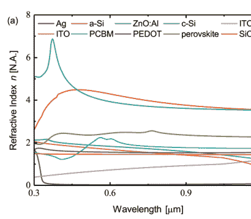

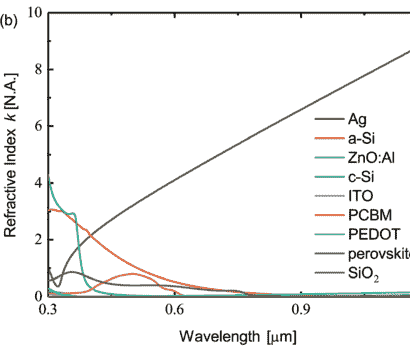

图 2 用于 FDTD 模拟的钙钛矿/硅叠层太阳电池最相关材料的折射率。

## 2.3 预测网络的数据集和网络架构

在本文中，我们构建了一个包含 12,500 组 FDTD 数值模拟数据的数据集，由层厚度（nm）和叠层太阳电池的电流属性组成。表 1 展示了 FDTD 仿真集中每层的空间和大小。对于每层厚度，我们运行了叠层太阳电池的 FDTD 仿真，并获得了顶层-子电池 $l_t$ 的相应 MAC 和反射损失 $l_t$。数据集和查询可以像传统的基于仿真的设计方法一样重现结果，

图 4 代表了 CPN 的架构，它是一个 15 层深的神经网络，以叠层太阳电池层（$H_i, H_{ij}, H_{ijk}, H_i$）作为输入数据。CPN 产生串并-并行结构以减少网络中的训练参数。第一部分是输入网络（SIN），其中五层的厚度是输入数据。CPN 采用每层处理以防止过拟合并减少冗余计算。SIN 之后是并行网络（PNW），它由三个并行部分组成，每个部分都有全连接层，分别具有 12, 10, 10, 8 和 5 个节点。

## 2.4 结构优化的启发式算法

### 2.4.1 连续优化。基于使用 CPN 的预测结果，我们现在实空间中进一步搜索层厚（$H_i, H_{ij}, H_{ijk}$），以最大化顶底子电池的短路电流 $C_p$。叠层太阳电池由串联电路中的上下子电池组成，叠层太阳电池的短路电流取决于任何子电池的短路电流。此外，如第 2.1 节所述，顶底子电池之间的电流差 $|I_c|$ 不超过 0.4 mA cm²。优化问题公式化为

```
$C_p = \min(I_t, I_b) + L_c$.
```

其中

```
$L_c = \begin{cases} |K_c| < 0.4 \ -5 \ \text{otherwise.} \ \end{cases}$
```

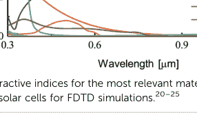

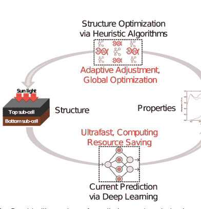

图 3 本文提出的叠层太阳电池预测和优化流程的图示。

表 1 数据集中 ITO, PCBM, MAPbi 和 PEDOT 层厚度的设置空间和大小

| 层 | 最小值 (nm) | 最大值 (nm) | 步长 (nm) |
|---|---|---|---|
| $H_e$ | 10 | 100 | 10 |
| $H_f$ | 20 | 60 | 10 |
| $H_p$ | 15 | 35 | 5 |
| $H_{mn}$ | 160 | 250 | 10 |
| $H_x$ | 10 | 100 | 10 |

相比传统的基于仿真的设计方法，该过程为叠层太阳电池设计提供了一种节省时间和计算资源的全局优化解决方案，且需要少量专业知识或人工干预。


# 在线查看文章

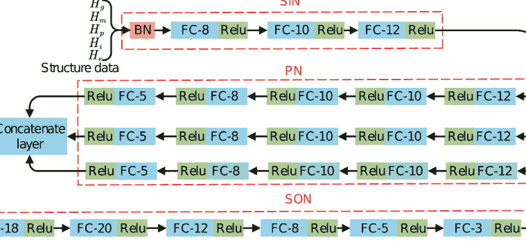

图 4 预测网络架构。架构中的 FC-X 表示该全连接层中有隐藏节点。

## 2.4.2 离散优化，注意上述方法获得了实空间中每层的最优厚度。然而，在实际设计中，层厚通常受到制造工艺的限制。为了解决这个问题，进一步采用了离散优化方法以整数（单位为 nm）搜索最优厚度。离散空间中的问题可以进一步通过

$$\max C_p = \min(I_t, I_b) + L_D,$$

其中
$$L_D = \begin{cases} 0 & \text{如果每个厚度为整数且 } |I_c - I_o| < 0.4 \\ |I_c - I_o| & \text{否则}\end{cases}$$

注意整数约束包含在目标函数中。(3) 和 (4) 中的优化问题是多峰的。为了寻找最优解，本文分别考虑了三种代表性的启发式算法：遗传算法 (GA)、粒子群优化 (PSO) 和模拟退火 (SA)，将在第 3 节中解释。

# 3 结果与讨论

## 3.1 网络训练

FDTD 构建的数据集被随机分为五折，四部分作为训练集，另一部分作为测试集。本文我们采用 Keras 作为深度学习框架。均方误差 (MSE)、平均绝对百分比误差 (MAPE) 和平均绝对误差 (MAE) 被视为关键性能指标并在表 2 中定义，$O_o$ 和 $P_i$ 分别代表 FDTD 数据和预测值。MSE 选择为训练损失函数。如图3 所示，训练和验证的 MAE 会变化。从图 5 可以看出，随着 epoch 的增加，MSE 和 MAE 均下降，训练过程在约 600 epoch 处收敛。CNN 在训练集上没有过拟合，验证损失保持低水平。

### 3.1.2 CNN 的准确率

CNN 的性能根据 $I_o$ 的 MAE、$I_o$ 的 MSE、MAPE 和 MAE 进行评估（见表 2），并于图 6。如图所示，$I_o$ 和 $I_t$ 的平均 MAE 很小，表明 CNN 可以达到 FDTD 模拟 98.3% 的精度。MSE 分别为 0.19 和 0.052，显示 CNN 预测的属性与 FDTD 匹配。由于空间限制，我们从测试数据中随机选择了 50 组用于。完整结果可以在 GitHub 上找到。如图 7 所示，CNN 与 FDTD 在 $I_o, I_t$ 和 $I_{mo}$ 结果上上良好，表明提出的 CNN 是太阳电池属性预测的准确模型。

表 2 指标定义

| 指标 | 定义 |
|---|---|
| 均方误差 (MSE) | $\frac{1}{n}\sum_{i=1}^n(O_o - P_i)^2$ |
| 平均绝对百分比误差 (MAPE) | $\frac{100}{n}\sum_{i=1}^n\frac{|O_o - P_i|}{O_o}$ |
| 平均绝对误差 (MAE) | $\frac{1}{n}\sum_{i=1}^n|O_o - P_i|$ |


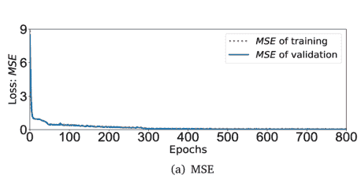

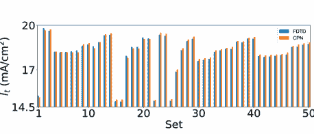

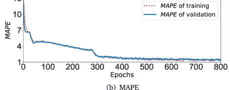

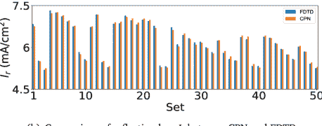

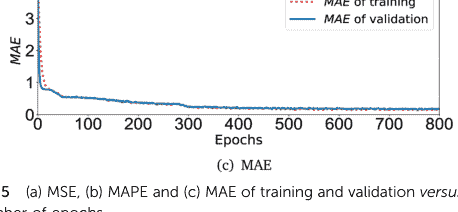

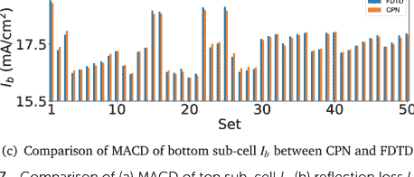

(5) (a) MSE、(b) MAPE 和 (c) 训练与验证的 MAE 随 epoch 数量。

(7) 测试数据中 CPN 和 FDTD 之间的 (a) 顶电池 $l_i$ MACD、(b) 反射损失 $l_i$ 和 (c) 子电池 $l_i$ MACD。

表 5 启发式算法参数

| GA 参数 | 种群概率 | 交叉概率 | 速度缩放 |
|---|---|---|---|
| 值 | 500 | 1 | 0.2 |
| PSO 参数 | 参数数量 | 最优路径和偏移索引 | 速度因子 |
| 值 | 500 | 8 | 0.5 |
| SA 参数 | 温度关注因子 | 目标温度 | |
|---|---|---|---|
| 值 | 0.99 | $10^{-20}$ | |

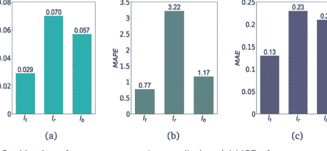

(6) 属性关系的指标。(a) 电流属性的 MSE。(b) 电流属性的 MAPE。(c) 电流属性的 MAE。

**3.1 时间消耗。** 由于 CPN 在训练属性仿真上与 FDTD 一致，我们现在可以比较它们的时间效率。对于 12500 次 epoch 的每次预测，CPN 在配备 i7-7700 CPU（4 核8 线程）和 16GB RAM 的设备上运行算法仅需 ~5 秒，而 FDTD 在配备双 Xeon-E5 v4 CPU（每个 12 核24 线程）和 128GB RAM 的服务器上平均需要约 460 秒。这意味着 CPN 比 FDTD 更具效率（微秒级对比秒级），且消耗资源更少。

**3.2 启发式算法的性能评估**

**3.2.1 参数设置。** GA、PSO 和 SA 的参数汇总在表 3 中，对于连续和离散优化是相同的。下限和上限

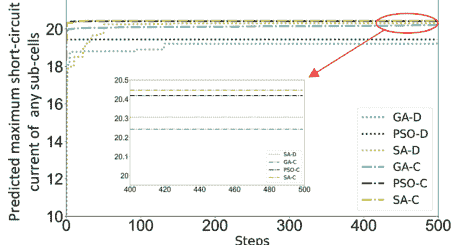

图 8 连续和离散优化中 GA、PSO 和 SA 的演化曲线。


表 4 使用模糊启发式算法和数值仿真集下得的最大预测电流属性（cm⁻²）及优化结果。

| $H_g$ | $H_i$ | $H_m$ | $H_d$ | $H_e$ | $I_b$ | $I_t$ | $|K_{sc}|$ | $C_p$ |
|---|---|---|---|---|---|---|---|---|
| FDTD | 90 | 20 | 200 | 15 | 15 | 19.2172 | 5.5099 | 19.0660 | 0.0152 |
| GA-C | 86.96 | 16.22 | 244.10 | 11.20 | 11.02 | 20.3482 | 3.8577 | 20.2440 | 0.0102 |
| PSO-B | 82.96 | 15.01 | 243.90 | 10.10 | 11.02 | 20.4222 | 3.7691 | 20.4182 | 0.0048 |
| SA-C | 76.71 | 15.10 | 243.90 | 10.10 | 10.96 | 21.3748 | 3.7148 | 20.4017 | 0.0037 |
| PSO-D | 91 | 15 | 250 | 10 | 10 | 19.6857 | 4.5111 | 19.2863 | 0.3994 |
| SA-D | 69 | 15 | 242 | 10 | 10 | 20.5821 | 23.3038 | 20.7305 | 0.2038 |

根据先验经验，层 $\{H_g, H_i, H_m, H_d, H_e\}$ 的边界分别为 $\{10, 15, 16, 10, 10\}$ 和 $\{100, 80, 50, 50, 30\}$。启发式算法的源代码可以在 GitHub。

## 3.2.2 优结构和可实现的短路电流。

图 8 展示了 GA、PSO 和 SA 的进化曲线，其中 -D 表示优化的短电流和离散优化结果。从图 8 可以看出，所有算法都在 300 次迭代内收敛。由于参数敏感性的性质，GA 的优化更加稳定，并且比其离散情况获得更高的最大可实现短路电流。

表 4 给出了每种启发式算法实现的最大预测可实现短路电流和的最的最层厚度。我们可以发现，通过连续优化，三种算法实现的最大预测可实现短路电流均高于 FDTD 仿真集中的最佳值，其中 SA 略高于其他算法。在考虑层厚度具有整数约束 (1) 的短路电流优化时，GA 和 PSO 的最大预测可实现短路电流显著优于 SA。

相应的层厚为 $\{H_g, H_i, H_m, H_d, H_e\} = \{69, 15, 24, 10, 100\}$ nm。

## 3.3 结果中优结构的预期性能

为了研究优结构的电池性能是否理想，我们使用了投影电流和投影 PCE 来估计叠层电池在优化厚度实验下可以实现的短路电流和 PCE。

```
$I_{sc(Opt)} = I_{sc,OP}, \quad I_{sc,RE}; \quad (7)$
```

其中 $I_{sc,RE}$ 和 $I_{sc}$ 代表参考叠层电池的实验和计算短路电流，$I_{sc(Opt)}$ 和 $I_{sc,OP}$ 代表我们优结构的投影和计算短路电流。具有抗反射层的 MAP3/Si 叠层电池的测量短路电流 $I_{sc} = 13.8 cm^{-2}$，$I_{sc,RE} = 17.2 cm^{-2}$ 是从吸收光谱（图 1a）中提取的。需要澄清的是，$PCE_{RE}$ 是参考叠层电池的 18.1%。在正向方向，我们优结构的投影 PCE $PCE_{(Opt)}$ 为：

```
$PCE_{(Opt)} = PCE_{OP}, \quad PCE_{RE}; \quad (8)$
```

根据公式 (8)，计算出的 PCE 为 23.24%，与参考叠层电池的 PCE 相比提高了 28.4%。

> 注意：基于种群的进化策略和启发式算法搜索的最优解可能不同。表 4 所示的结果是重复实验的结果。

# 结论

本文提出了一种高精度、高效且复杂的方法，用于钙钛矿-硅叠层电池的效率预测和器件优化。设计了一个全连接神经网络来预测包括短路电流、底部短路电流和反射损耗的效率（$H_{sc}, H_{oc}, H_{ff}$）。得益于 CNN，我们通过在参数空间搜索包括 GA、PSO 和 SA 在内的启发式算法找到了每一层的优化厚度。FPDM 方法经过训练和验证，精度为 98.3%。同时，在笔记本电脑上运行大约需要 $10^{-5}$ 秒。除了本文考虑的厚度，我们还探索了纳米结构的形貌和尺寸、界面粗糙度和纹理。

Chuo Y：概念化、方法论、调查、可视化、初稿。Wang Y：概念化、数据整理、方法论、初稿。Yao Gao：监督、资金获取、写作。

# 利益冲突

无冲突声明。

# 致谢

本工作受到中国国家科学基金（6207513）和湖北省研发计划（22BA002）的支持。本期刊 © Wiley 2021

# 注释和参考文献

1. 电池效率表，https://www.nrel.gov/pv-cell-efficiency，访问于 2020 年 8 月。
2. D. Zhao, Chen, C., Wang, M. M., Junda, Z., Song, C. R., Y. U., Li, C., Subbi, N. J., Podrazska, X., Gao, G., Kim. and Y., Nat. Energy, 2019, 4, 103.
3. D. Zhang, Y. C., Wang, L. N., Rshestra, C. Rice, A. J., Ciromalin, Lu, G., Ellington, K. Zhu, X. Zhao, R. Xiong and Y. Yan, Nat., 2017, 2, 18.
4. J. Werner, C. A. Wang, L., Lefquet, F. J., S. D. Wohl, N. Bissen and Cassis, J., J. Phys. Chem. Lett., 2016, 76, 161-166.
5. T. Duong, H. Pham, T. C. Kho, P. Pang, K. Kong, D. Yan, Y. Y., Perez, M. A., Mahmud, S., Gharibazadeh, A. Bakiani, Mohassin, M. R, N. Mofazari, Y. Yu, Hu, Z. Zheng, J. H. Wei, L. M. Samsetedt, S. Cochran, K. Anderson, G. G. Underwood, U. Pawlett, A. Bobalie, Y. Liu, D. Macdonald, A. Baker, J. Wong, T. White, K. Weber and K. pathledge, Advanced Energy Materials, 2020, 10, 103533.
6. K. Deng and L. Li, Small Methods, 2020, 4, 1994150.
7. Y. Mamaguchi, F., 2022, 14, 84-90.
8. H. Malikhi, M. Mrejen, A. Angler, U. Iriel, L. Wolf and H. Zhang, Appl. Opt. A, 2018, 1-8.
9. S. So, J. Jun and Y. Ros, ACS Mater. Interfaces, 2022, 11, 22426-22468.
10. O. R. Hegdee, IEEE J Sel.


25 R. J. Moerland and J. P. Hoogenboom, Optica, 2016, 3, 112–117.

26 P. Kuang, A. Deinega, M. L. Hsieh, S. John and S. Y. Lin, Opt. Lett., 2013, 38, 4200–4203.

27 A. Deinega and S. John, Opt. Lett., 2012, 37, 112–114.

28 Y. Hu, L. Song, Y. Chen and W. Huang, Solar RRL, 2019, 3, 1900080.

29 数据集、源代码和结果，https://github.com/ChuqiaoYi/Solar_Cells, https://github.com/ChuqiaoYi/Solar_Cells.

30 D. Willey, Stat. Comput., 1994, 4, 65–85.

31 J. Kennedy and R. Eberhart, 于 ICNN95-国际神经网络会议论文，澳大利亚，1995年11月。

32 P. Lahoven and E. Aarts, 模拟退火：理论与应用，1987, vol. 37, pp. 7–15.

33 F. Chollet, Keras, https://github.com/fchollet/keras, 2015.

35 X. Wang, A. Kumaret, C. R. Shelton and B. M. Wong, Phys. Chem. Chem. Phys., 2020, 22, 22889–22899.

