# Tanmay Teaches Go：后端开发者的理想语言

`codeMantra` 电子书转换

版本 1.0

## 关于作者

`Baheer Kamal` 是 `Go for Beginners` 系列的作者。他在 13 岁时开始编写 `Java`、`Python` 和 `C`。今天，他是一位主旨演讲者，拥有超过 30 万订阅者的 YouTube 频道主。

`Tanmay Bakshi` 是 `Go for Beginners` 系列的作者。他是 `Sheikh Mohammed Bin Rashid Al Maktoum Award`、`Google Developer Expert`、`IBM Developer Award` 以及 2019 Top of the Year 的获得者。他曾任 `the` 和 `Cognitive Foundation`。

序言

致谢

*Tanmay Teaches Go* 旨在让 Go 语言对每位开发者来说都易于上手且实用。作为一种语言，Go 的设计初衷是为了现代后端开发。随着摩尔定律的终结，仅仅期待更强大、更快的计算机已经不够了。因此，我们必须适应新常态：大规模分布式系统，运行高度优化的软件栈。

这些分布式系统拥有从根本上就不同的硬件理念，它们也迫使软件世界进行创新和变革。现代软件系统正在摒弃大型的单体设计。相反，它们由许多较小的 `microservices`（微服务）驱动，实现了跨项目更大的代码复用以及职责委托——这一切都使得代码更加整洁，漏洞的表面积更小。

随着软件世界的不断演进，对这种新范式的合适基础设施的需求也随之增长，导致了许多从底层开始开发的全新 `programming languages` 以满足这一需求。Go 就是这些语言之一，具有适用于基于微服务的开发的特定特性，例如快速的编译时间、较小的二进制文件大小和可移植性。它还拥有其他语言无法真正比拟的特殊特性，如 `Goroutines` 和 `channels`，用于强大且易于使用的并发处理。

Go 是后端开发中许多基础设施服务的引擎，如 `Kubernetes`、`Docker`、`etcd`、`CockroachDB` 等。通过使用这些流行工具已经构建的相同语言，你的代码将更接近并能更好地利用面向企业级后端开发的庞大开源生态系统。

通过这本书，我们希望将你变成 `Go developers`（Go 开发者），让你有能力将 Go 作为解决问题工具箱中的工具。最棒的部分是，Go 并不是普通的工具。它是一种可以解决 `enterprise-level`（企业级）问题的工具；因此，它是你编写代码的首选。

我们的目标不仅是教你 Go 语言，而是采用一种在每一步都将 Go 与用于类似任务的其他流行编程语言进行对比的方法，例如 `Swift`、`C`、`Python` 和 `Java`。我们甚至深入到操作系统和 CPU 层级，向你准确展示这些语言是如何与你的计算机硬件和软件交互的。此举目的两点：

- 我们希望来自其他语言的开发者轻松过渡到 Go 的世界。
- 我们希望你从其他编程语言的决策以及我们计算机的底层架构中获得洞察。这有助于你更好地理解 Go 适合和不适合哪些任务，以及它内部是如何运作的以及为什么那样运作。

*Tanmay Bakshi*

*Baheer Kamal*

# Acknowledgments（致谢）

我想非常感谢我的家人和导师们对我的无条件支持，这让我保持动力。特别感谢 McGraw Hill 优秀的团队，在我编写 `Tanmay Teaches` 系列中的第二本书（未来还有很多本）期间向我的支持。我特别想感谢 McGraw Hill 的 Lara Zoble，她为我提供了取得成功所需的支持、建议和反馈。她是 `Tanmay Teaches` 系列创建背后的智脑。撰写一本关于 Go 的书的想法源于我和合著者 Baheer 在为一个项目编写代码时。我们都有一个相同的目标：筛选和处理大型二进制文件。我在 `Swift` 中实现了它，而他用 `Go` 实现了。在第一次运行中，Go 在编译时间和运行基准测试中都完胜了 Swift！不仅如此，代码也更加直观。这启发了我去写一本关于 Go 语言、它的优势、为什么它有效以及如何应用它的书。特别感谢 Baheer 与我同走这段旅程！

*Tanmay Bakshi*

# CHAPTER 1（第一章）

## Introduction（引言）

欢迎学习 *Tanmay Teaches Go*！在书中（Tanmay Teaches 系列的第二本），你将学习 Go 编程的世界。Go 是一门在设计时考虑了安全性、性能、灵活性和 `concurrency`（并发）的编程语言。它的设计目标与后端开发的需求从根本上是一致的。

在完成本章后，你将能够回答以下问题：

- Go 的哪些设计目标让 Go 语言如此特别？它有哪些缺点？
- Go 支持哪些平台？它可以用在哪里？
- 为什么 Go 的编译器如此特别？
- Go 的内存管理和它的垃圾回收器（Garbage Collector）是什么？
- 并发如何让 Go 运行时如此独特？

### Why Go?（为什么选择 Go？）

Go 是一门为了非常特定的目的而构建的语言：简化后端开发者的整个工作流——从执行速度、编译速度、依赖管理，到并发和优化。为了实现这一愿景，Go 团队在构建语言规范时考虑了几个关键的设计目标。

### What Are Go's Design Goals?（Go 的设计目标是什么？）

Go 由 Google 在 2009 年开发，首个稳定版本于 2011 年向公众发布。该语言由 Robert Griesemer、Rob Pike 和 Ken Thompson 设计。Go 以其吉祥物闻名：Gopher（口袋鼠），如图 1.1 所示！


**图 1.1** "Gopher"：Go 的吉祥物

Go 的出现是 Google 面临许多问题的解决方案。例如，在编译方面，大多数编译器太慢，无法快速编译 Google 的大型代码库。

在实现方面，诸如 `C++` 的语言被证明太底层且冗长，而诸如 `Java` 的语言被证明太高层且笨重（带有垃圾回收器带来的延迟）。

Google 决定解决这些问题的方法是开发自己的语言！Google 对 Go 的目标如下：

- 创建一个尽可能处理大型代码库的编译器
- 使用一组良好的优化创建一个生成快速代码的编译器

Go 实现了这些目标。编译器已被证明非常快。为了实现这种速度，编译器继承了几个关键特性：

- 它对代码极其严格；例如，未使用的变量和导入是 `errors`（错误）而不是 `warnings`（警告）。
- 编译器架构非常 `simple`。例如，大多数优化发生在编译后的汇编代码上，而不是 Go 代码的内部表示上（如 `Swift`、`C`、`C++` 通过 `LLVM` 编译）。甚至直接生成二进制形式的形式，而不是生成文本再编译为二进制。

不仅编译器本身，由于语言结构，它还能生成快速运行的代码。通过保持语言特性和语法糖的简洁，编译器中的优化器在分析复杂的控制流和逻辑时的工作减少了。这意味着 Go 代码有时非常简洁，但结果是快速编译的代码。

同时，由于编译器的严格性，你还继承了安全性。在以安全性特性闻名的复杂的语言中，实现这种安全性需要在编译器和运行时产生额外的开销。然而，由于 Go 语法非常简单，在编译和运行时都很实现。

### Where Can I Use Go?（我可以在哪里使用 Go？）

Go 在各种平台上都具有`高度兼容性`！例如，它支持：

- Linux
- BSDs（类 Unix 发行版）
- DragonFly BSD/FreeBSD/OpenBSD/NetBSD, 等.
- Darwin
- macOS/iOS/watchOS/tvOS, 等.
- Plan 9
- IBM i
- Solaris
- Windows

如前面的列表所示，Go 甚至支持 Plan 9 和 IBM i！你还有什么可要求的呢？

Go 不仅支持多种操作系统，还支持一系列 CPU 架构，例如：

- `x86/x86_64`——当今主流的 CPU 架构。
- `ARM/ARM64`——为移动系统构建的架构，得益于苹果芯片（Apple Silicon），它很快将在高性能计算领域成为主流。
- `MIPS`——一种非常简单的指令集架构（ISA），在现实世界中并不常见。
- `IBM PowerPC`——IBM 开发的企业级 RISC CPU 架构，重视带有加速器的高速 I/O、性能以及大规模并行化处理。
- `IBM Z`——IBM 开发的一系列企业级 CISC CPU（用于大型机！），重视极高的冗余性、可靠性和性能。
- `RISC-V`——一种极其新颖、近乎全新的 CPU 架构，目前市场上只有 SiFive 公司提供了一款芯片。

如果 Go 甚至支持 `RISC-V` 和 `IBM Z`，我确信它能满足你的用场景。

### Go 编译器与运行时

对 Go 的一个常见批评恰恰是它设计初衷之一——极其非常简单的语法。（这种语法风格有时也是不一致的，但那是另一个的话题了。）事实上，有一个著名的笑话说 Go 语言的设计者忽略了 1980 年之后发明的所有编程语言技术！尽管这种代码表示方式不够现代，但 Go 驱动了一些最现代的软件，如 Docker、Kubernetes、Terraform、CockroachDB、`etcd` 等。

Go 之所以普及的一个关键原因是它的性能。我们已经讨论过 Go 编译器是智能、现代且快速的，但这种语言的设计也让程序员本身能够编写快速的代码。例如，你可以深入到 C 语言级别，处理指针并手动管理内存；或者你可以抽象掉这一切，让 Go 为你处理内存。

### 内存管理与特殊的垃圾回收器

具体来说，`Golang` 使用垃圾回收（`GC`）进行内存管理。编程语言中内存管理有四种主流方式：

- **不要管理！**——这是 C 语言采用的方法，其中你必须*手动*完成一切。
- **垃圾回收 (GC)**——这是目前最流行的方法，但遗憾的是，在程序性能方面它通常是妥协最多的（当然，规则都有例外，这只是平均情况）。例如，Java 和 Kotlin（通过 `JVM`）、Python、C#、Go、JavaScript、Lisp、Ruby 和 Julia 都使用 `Garbage Collection`。它的工作原理是：每隔一段时间，"垃圾回收器"就会启动寻找没有任何引用的内存如果没有引用，意味着程序不再使用它，可以将其删除。这种方法（或至少是大多数实现）的问题在于，当应用程序停止并收集垃圾时，会在程序中引入短暂的"暂停"。它不是确定性的，因此在没有任何明确检查的情况下，你无法绝对确定剩余内存。你甚至无法预测应用程序下次何时会因为垃圾回收再次停止。
- **自动引用计数 (ARC)**——这种方法通常是性能、流畅度（无抖动）和实现便利之间的最佳平衡。在这种内存管理技术下，每当你创建一个新对象时，也会同时创建一个"引用计数器"。每当你将对象的引用传递给某处时，计数器加增。每当引用离开作用域，计数器减小。每当计数器减小，就会运行一次检查查看计数器是否为 0。如果是，内存就会释放，因为最后一个引用已经离开了作用域。`Swift` 和 `Objective-C` 等语言使用这种方法。然而，你有时需要注意*引用循环*，这可能导致内存永远无法释放，尽管通过一些简单的监测工具很容易发现，并且可以使用*弱（weak）*和*非拥有（unowning）*变量轻松修复。
- **编译时所有权消除歧义**——顾名义，这种方法真正重视性能和安全性，同时比完全将内存管理留给手动操作要稍微方便。`Rust` 等语言使用这种方法。这种技术使得编译器可以在编译代码时确定何时需要分配或释放内存。这在编写代码时可能有点复杂，因为编译器必须施加更多限制来消除内存所有权的歧义。但对于 `Rust` 这样的系统编程语言来说，这是值得。

## 并发

我们刚刚开始讨论 Go 语言的优势，但还有另一个旗舰特性，它可能是说服你使用 Go 的转折点：简单且强大的并发。

摩尔定律正在缓慢但坚定地结束。这很遗憾，但我们必须采取行动。到目前为止，我们最好的解决方案是多进程处理，即单个芯片可以同时并行执行多组指令。然而，驱动如此多的"核心"可能是困难的，因为你需要确保它们被工作饱和，而它们不会只是闲在那里等待系统调用、内存访问等。

为了让多进程处理变得简单，操作系统引入了"线程"的概念。在大多数符合 POSIX 的平台上，线程是"进程"的一部分，并有自己的栈指针。在其他系统（如 `Windows`）中，线程是它们自己的进程。你可以让数百个线程通过你的内核运行，但问题是这些线程相对重量。例如，在一个具有 22 核 44 线程的系统中，你可以在 `Linux` 上扩展到"数千个"操作系统线程。然而，当你达到更大的规模时，`Linux CFS（完全公平调度器）` 在线程之间切换的纯成本将变得无法处理。

为了解决这个问题，Go 引入了 `Goroutines` 的概念。`Goroutine` 是一个超轻级的"类线程"执行环境，由 Go 运行时而非操作系统处理。`Goroutines` 映射到操作系统线程，然后映射到 CPU 线程，使得数百万个 `Goroutines` 能够运行而不牺牲太多性能。

现在我知道你在想什么："这些用起来肯定很痛苦！" 实际上恰恰相反。在 Go 中实现 `Goroutines` 比在 `Swift` 中使用 Grand Central Dispatch 的 Jobs 还要简单得多！这仅仅只需要一个语法标记——`go`——它告诉 Go 在单独的 `Goroutine` 中执行函数。

而且，为了让 `Goroutines` 之间的通信高性能，Go 提供了"通道（channels）"。`Channels` 让 `Goroutines` 之间的相互通信变得超级简单且快速。

Go 能够 `Docker` 和 `Kubernetes` 等流行服务的后端，并且 Go 能够通过 `Goroutines` 进行扩展，加之它还支持如此多的架构且极其轻量，这使其成为构建大型复杂服务微服务架构的完美语言。

最后，Go 还有几个加分项，虽然这些本身并非独有，但它们让用 Go 编写代码比其他语言更方便：

- Go 不仅支持大量的架构和操作系统，你还可以通过仅向 Go 传递几个额外的编译标志，从任何架构为任何架构进行交叉编译！不需要安装任何额外的库。试着用 `Clang` 这样做看看吧！在 `Ubuntu` 上，你可能会陷入 `Aptitude` 依赖地狱中，至少浪费上几分钟，甚至几个小时。
- Go 拥有一个实验性的 `LLVM` 后端，允许你将 Go 代码编译为 `LLVM`，以防你的用例可以从模块化 `LLVM` 编译器的优化或灵活性中受益。

上述文本初步预览了 Go 的世界以及它的特殊之处，但我们才刚刚开始。接下来，在第 2 章中，我们将安装 Go，查看一些基础的 Go 结构，让你熟悉 Go 的标准和语法，并深入构建一些应用！

**1.** 谁创建了 Go？目的是什么？

**2.** 在你看来，哪三个主要因素会使 Go 成为你的首选编程语言？

**3.** 编程语言分配和回收内存的四种常见方式是什么？它们的优缺点是什么？

**4.** Go 有哪些缺点？

**5.** 为什么 Go 的运行时（runtime）是如此独的？

# 第 2 章

## 快速入门

让我们开始吧！但在进入有趣的部分（即编写代码）之前，确保我们拥有一个可以编写 Go 代码、编译它并运行它的环境至关重要。

一旦设置好环境，我们将查看 Go 语言的一些基础构建块，例如不同类型的控制流以及它们是如何协同工作的。

在完成本章后，你将能够回答以下问题：

- 如何在 Windows、Linux 或 macOS 上安装 Go？
- 如何找到从源码安装 Go 方法？
- Go 中的基础控制流是如何运作的？

### 安装 Go

与大多数语言一样，在系统上安装 Go 只需要运行几个系统命令一样简单。我们将探索三种安装 Go 的方法：

- 使用系统包管理器
- 手动安装预编译的二进制文件
- 从源码编译 Go

### 使用系统包管理器

安装 Go 最简单的方法（就像任何其他程序一样）是使用系统内置的包管理器。遗憾的是，Windows 不带功能全的内置包管理器，这也是它可能不是后端开发人员理想系统的原因之一。但在 Linux 和 macOS 上，你可以使用表 2.1 中解释的包管理器和命令。

**表 2.1** 使用内置包管理器安装 Go 的命令

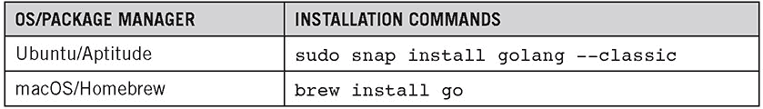

遗憾的是，包管理器发行版仅由社区支持，并非 Go 团队的官方支持。虽然这种方法更方便，但对于可能需要特定版本 Go 的真实生产负载，我们建议下载预编译的二进制文件。

### 手动安装预编译二进制文件

安装预编译二进制文件的具体过程取决于你运行的平台。我们将以 Ubuntu 和 macOS 为例，但如果你想查看针对你特定平台的说明，请访问 Go 官网：[`golang.org/doc/install`](https://golang.org/doc/install)。

安装预编译二进制文件主要分为几个关键步骤：

1. 下载二进制文件
2. 解压二进制文件
3. 更新你的 `PATH`，以便 shell 能够找到该二进制文件

你可以从 [`golang.org/dl`](https://golang.org/dl) 下载 Go 及其配套工具。

对于 Linux，下载后你将得到一个 `.tar.gz` 文件。解压它的方法之一是通过命令行：

```
tar -xvf go1.14.6-linux-amd64.tar.gz
```

**注意：** 我们在上一个命令中硬编码的版本 `1.14.6` 需要根据你下载的版本或存档名称进行替换。

这将为你提供一个 `go` 文件夹，其下有一个 `bin` 文件夹，其中包含了 `go` 二进制文件——这是处理所有与 Go 相关事务所需的唯一工具！然而，每次都使用绝对路径手动调用该 Go 二进制文件非常不方便。因此，在解压时，请使用此命令：

```
tar -C /usr/local -xvf go1.14.6-linux-amd64.tar.gz
```

这将 `go` 文件夹解压并移动到你的 `/usr/local` 。接下来，向 `$HOME/.profile` 文件添加以下行：


```
export PATH=$PATH:/usr/local/go/bin
```

### 从源码编译 Go

从源码编译 Go 和工具要激烈得多。

**注意：** 为了让你对性能有一个直观感受，Go 本身是用 Go 编写的。

要学习如何从源码编译 Go，请访问他们的 GitHub Wiki 页面：[`github.com/golang/go/wiki/InstallFromSource`](https://github.com/golang/go/wiki/InstallFromSource)。

## Go 基础概念

现在是时候深入学习你作为 Go 开发者每天都会使用的核心概念了。这些核心概念包括基础控制流、项目结构、函数和结构体等高级功能的语法，以及错误处理。让我们开始吧！

### 约定项目结构

与其他某些语言不同，Go 对项目布局没有非常严格的要求。但是，存在大多数项目都会遵循的标准，这有助于开发者理解代码库的结构以及代码的功能。

在讨论项目布局之前，有一个重要的术语你需要理解：包（packages）。一个 Go 包是一个单一源代码文件。这些包的标准是：包名与文件名相同（不包含扩展名）。

例如，对于源文件 `main.go`，包名为 `main`，它在文件的第一行通过如下有效的 Go 语法进行声明：

```go
package main
```

回到目录结构……简而言之，表 2.2 代表了你现在需要了解的目录结构。在接下来的章节中，随着我们涵盖更多功能，我们将讨论更多你可以在项目中使用的目录。

**表 2.2** 默认 Go 项目结构中文件和文件夹的作用

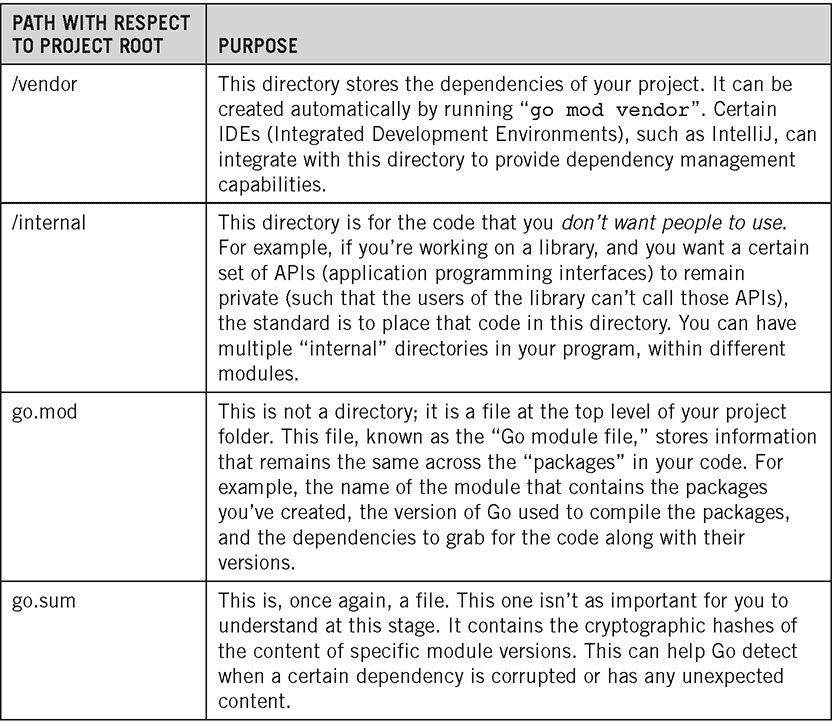

现在你对 Go 代码的结构有了更多了解，让我们开始学习一些语法吧！

任何编程语言语法的节点构建块是你用于构建表达式的“标记”（tokens）。在某种语言中，某些标记被保留为“关键字”（keywords），这意味着例如你不能将它们用作变量或函数的名称。这是因为这些标记对于 Go 编译器实际解析你的代码以确定各个部分的含义的方式至关重要。表 2.3 列出了所有这些关键字。

**表 2.3** Go 中保留的关键字列表

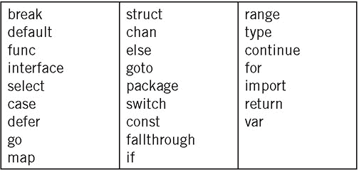

现在，让我们开始尝试一些 Go 语法！

### Go 入门——“Hello, World!”

首先，让我们来看一个简单的程序，让你对 Go 有个良好的感受。那么，按照编程的传统，让我们来实现“Hello, World!”

首先，在一个名为 `helloworld` 的新目录下创建一个名为 `main.go` 的新文件。你的目录结构应该像这样：

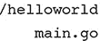

在 `main.go` 文件中输入以下代码。

**代码列表 2.1** Go 中传统的“Hello, World!”

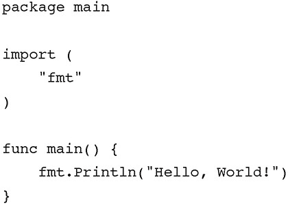

就是这些了！如果你导航到终端，进入 `helloworld` 目录并运行：

```bash
go build
```

你现在应该在同一目录下有一个名为 `helloworld` 的可执行文件。换句话说，你刚刚创建并编译了第一个 Go 应用程序，你现在可以运行它了！在类 Unix 系统上，你可以这样调用（或“运行”）它：

```bash
./helloworld
```

你应该会看到以下输出：

```
Hello, World!
```

程序确实在工作——但它是如何工作的呢？让我们回过头来部分分析源代码，正如你在表 2.4 中所示。

**表 2.4** “Hello, World!”代码各部分的功能

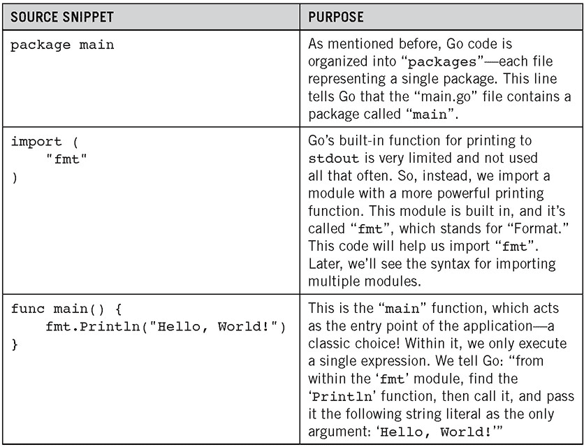

**注意：** 你可能已经注意到 Go 语法的一个区别是，`Println` 函数的第一个字母是……嗯，一个大写字母。稍后会详细介绍。这背后有一个非常有趣的原因。

### 变量

Go 语言既是强类型又是静态类型。这意味着两点：

1. 变量不会由编译器以“隐藏”的方式自动从一种类型转换为另一种类型。即使是从 32 位整数到 64 位整数的转换也需手动完成。

2. 编译器*可以*尝试在编译时推断变量的类型，而不是让你自己指定类型。然而，Go 的“类型推断”并没有像 Swift 那样先进——再次，这是因为编译器希望尽可能*快*。随着学习的进行，我们将探索这些局限性。

Go 的标准是允许编译器推断类型并避免手动标注，除非有必要，例如告诉编译器不要直接从某个字面量转换类型（例如，“对于这个数字，请不要使用默认的 64 位整数，请改用 8 位整数”）。在我们继续之后，你会看到许多手动标注的示例。

让我们通过观察全局变量开始探索变量的世界。全局变量可以是两种类型之一：静态或常量。静态全局变量可以这样声明：

```go
var age = 16
```

该表达式做了两件事，而不仅仅是一件。它首先声明了一个名为 `age` 的新全局静态变量，然后用值 `16` 初始化该变量。在这种情况下，初始化和声明共同工作，将此变量标记为 `int` 类型。但是，如果你无法初始化值，只想“声明”一个全局静态变量，你必须显式地编写变量类型，如下：

```go
var age int
```

如果你愿意，尽管这不被认为是良好做法，你也可以结合这些方法，显式声明变量类型并提供用于初始化的值：

```go
var age int = 16
```

因为它是一个全局*静态*变量，它是允许更改的。所以，如果你有如下所示程序：

**代码列表 2.2** 获取和设置全局静态变量

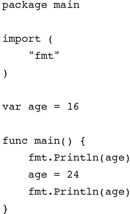

你应该看到以下输出：

```
16
24
```

现在，提醒一下，在很多 Go 程序中，你会看到许多以大写字母开头（遵循驼峰命名法 UpperCamelCase）的变量、函数和结构名称。在其他语言（如 Swift 和 Java）中，你甚至无法进行“获取常量的指针并修改它”这样的技巧，因为编译器不允许你这样做。这使得编译器在运行优化时（例如常量折叠）可以完全预计算某些计算以避免在运行时执行。

好了，现在你已经了解全局变量了。那么，我们来谈局部变量吧！在 Go 中，创建局部变量的方式与其他语言非常不同，使用了臭名昭著的 `:=` 运算符。让我们来看一个示例。

如果你想在 `main` 函数内部创建一个局部变量并打印它，可以像下面这样操作：

**代码列表 2.3** 函数内部的局部变量

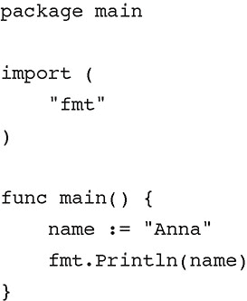

我们知道，与其他语言相比，这种变量的实例化看起来很奇怪，但 `main` 函数中的第一行代码告诉 Go：“创建一个名为 `name` 的变量，并在其中存储字符串字面量‘`Anna`’”。当你将其与 C 或 Swift 等其他语言比较时，这在作用域（scope）上并没有变化。在变量所在的代码块退出后，它就会被删除。

“删除”是一个有点奇怪的概念，所以让我们深入探讨一下。如果你有像下面这样的浮点数：

```
price := 69.99
```

变量 `price` 占用 4 字节内存，它直接包含了这 4 字节，也就是说，CPU 寄存器可以直接持有这 4 字节。因此，当它所在的代码块退出（在本例中为 `main` 函数）时，它就会被删除，不再存在。然而，如果该变量实际上是对另一个变量或结构体的引用，那么该引用会被删除，这会在未来的某个时刻触发垃圾回收器（Garbage Collector）移除它所引用的任何内容，*且仅当*没有其他指向它的引用时。

如果你想在局部声明一个变量但不初始化它，可以使用相同的全局静态变量语法：

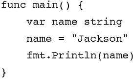

你甚至可以创建局部常量：

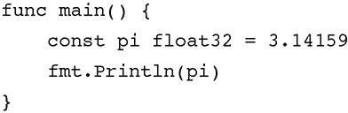

我们已经涵盖了一些基础类型的变量，但还有一些你应该记住的，它们列在表 2.5 中。

**表格 2.5** Go 中常用原生类型存储的内容

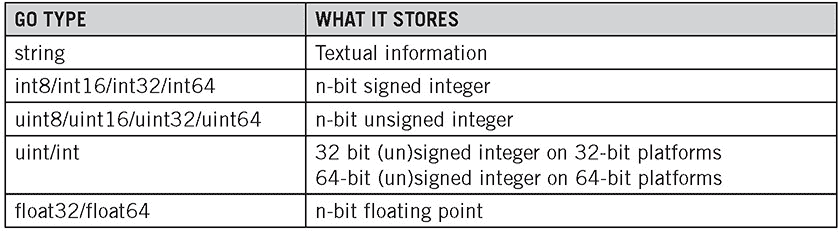

当然，变量不仅限于标量，你还可以创建数组。在 Go 中创建数组非常简单。在类型注解方面，只需在 `[]` 标记后追加你想要数组中的元素类型即可。例如，对于字符串数组，你会使用 `[]string` 类型注解。

数组字面量的元素封装在大括号 `{}` 中，而不是方括号 `[]`，且数组的类型注解必须始终位于字面量值之前。例如，如果你想创建一个字符串局部数组，可以使用以下：

```
names := []string{"Tanmay Bakshi", "Baheer Kamal"}
```

或者，如果你想手动注解类型，可以使用这个：

```
var names []string
```

```
names = []string{"Tanmay Bakshi", "Baheer Kamal"}
```

为了向数组追加新元素，请使用 `append` 函数：

```
names = append(names, "Kathy")
```

`append` 函数在数组末尾为新元素分配内存，然后将该新内存空间设置为我们传递给函数的第二个参数。然后它返回一个**新**数组，我们将将其放回原始变量。

Go 中的数组存储为连续的内存块，这意味着从指向第一个元素的指针开始，你可以到达后续内存地址中的其余元素。

在内部，当你向数组追加内容时，Go 的运行环境（runtime）可能需要执行一种被称为“重新分配”（reallocation）的操作。大多数操作系统都会尝试扩展你已经拥有的内存缓冲区，但当后续内存被其他东西使用而无法实现时，为了适应更大的数组，它会分配一个全新的缓冲区，将之前的元素复制过去，然后释放之前的缓冲区。

如你所见，这整个机制可能会非常慢。为了在我们已经知道需要**多少个**元素但不知道这些元素具体是什么的情况下，让某些数组操作更高效，你可以使用 `make` 函数。通过 `make` 函数，你可以在数组中分配特定数量的元素供你使用，而无需运行重新分配。这里有一个示例：

```
names := make([]string, 3)
```

```
names[0] = "Tanmay Bakshi"
```

```
names[1] = "Baheer Kamal"
```

```
names[2] = "Kathy"
```

需要记住的一点是，这不仅为数组预留了容量，它还报告数组的长度*就是*你传递给 `make` 的元素数量。因此，如果你创建一个包含三个元素的数组且没有设置它们的值，它们内部的内存只是最后存储在那里的任何垃圾内存。

在某些其他语言（如 Swift）中，当你预留容量时，它仍然报告数组是空的，并且当你追加时，在达到该预留容量计数之前，它简单不需要进行任何重新分配。要在 Go 中实现相同的结果（即具有特定容量底层内存缓冲区的空数组），你可以向 `make` 函数传递一个零，然后将你想要的容量作为第三个参数传递。例如：

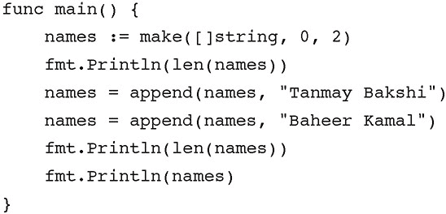

当你运行这段代码时，你应该看到以下输出：

```
0
```

```
2
```

```
Tanmay Bakshi Baheer Kamal
```

这意味着当调用 `make` 时，数组是“空”的（长度为零），你可以看到数组中的名称长度为二。然而，这段代码的不同之处在于 `append` 操作不需要分配任何内存。

### if 语句和 switch 语句

当然，任何编程语言的不可或缺的部分都是其条件分支的能力。在这方面，Go 支持两种主要的条件分支方式：

- `if` 语句

- `switch` 语句

让我们先来看看经典的、几乎通用的 `if` 语句。在 Go 中，这些语句看起来与 Java、C 和 Swift 等语言中的 `if` 语句非常相似：

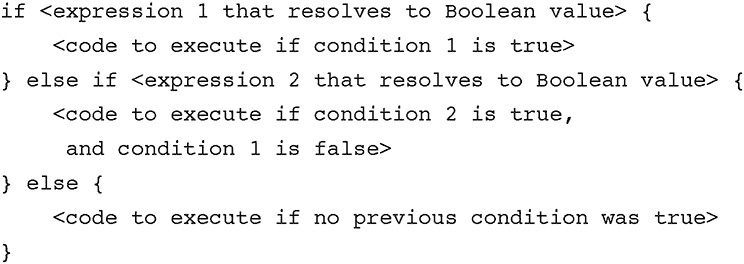

`<解析为布尔值的表达式>`可以是一个布尔字面量（`true`, `false`）、返回布尔值的函数调用、存储布尔值的变量或常量，或者返回布尔值的算符调用（例如，你可以使用 `==` 检查相等性，或使用 `>` 和 `<` 进行比较等）。提到布尔运算符，请看表 2.6 中的一些常用布尔运算符和位运算符。

**表格 2.6** Go 中常见的内置布尔和位运算符

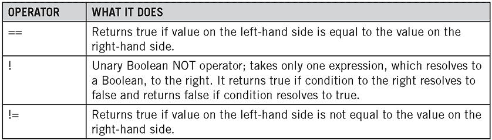

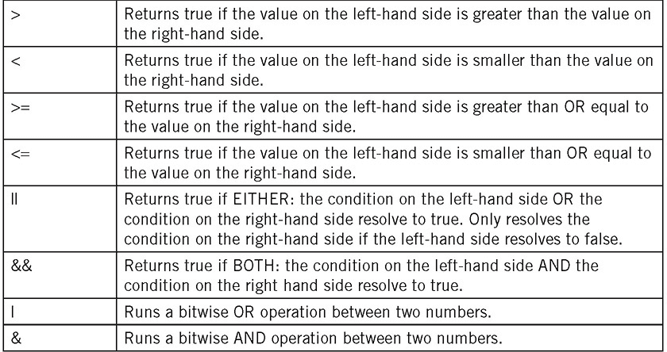

当然，你可以组合多个布尔运算符来构造“复合条件”。例如“(如果国家是加拿大且年龄大于 17）或（如果国家是日本且年龄大于 15）”。

例如，如果我们想写一个短程序来判断某人是否成年，我们可以编写以下代码：

**代码列表 2.4** 在 Go 中使用 if 语句和布尔运算符

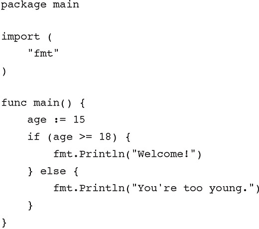

在这个程序中，`age`（作为加载变量解析为整数的表达式）和 `18`（整数字面量）被喂给 `>=` 运算符的任一边。运算符返回一个布尔值，然后被喂给 `if` 语句，由它决定代码下一步跳转到哪里。有时 `if` 语句：

- 因为有太多条件需要评估而让你的代码变得“丑”

- 总是针对某个单一表达式查找相等性

如果出现那种情况，你可以使用 `switch` 语句来代替。在历史上，`switch` 语句比 `if` 语句更具优化空间，但编译器技术已经进步到这种差异带来的影响微乎其微的程度，且仅适用于大多数程序员通常不太触及的边缘情况。

`switch` 允许你评估单个表达式，并将其相等性与多个可能结果中的一个进行匹配。例如，假设用户输入了姓名，我们想查看三个可能的用户中是哪一个输入了姓名。你可以通过以下代码实现：

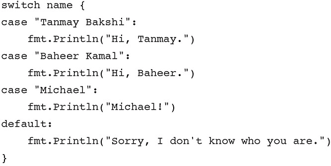

Go 的 `switch` 语句与 C 和 Swift 等语言中的语句非常相似。与 Swift 一样，你*必须*提供一个 `default` 情况（case），当没有其他 `case` 的条件被满足时就会调用该情况。与 C 不同，你不需要在每个 `case` 的末尾添加 `break`，因为 Go 不会穿透其他 `case`。相反，它会移动到 `switch case` 块*之后*的下一行代码。如果你没有 C 语言经验，不用担心。你不需要它也能掌握 Go。这只是一个示例，让你了解 Go 的控制流在使用 `switch` 语句时与其他语言 `switch` 语句的区别。

所以，请像这样在 `main` 函数中实现前面的 `switch` 语句：

**代码列表 2.5** 使用 switch 语句在 Go 中检查相等性

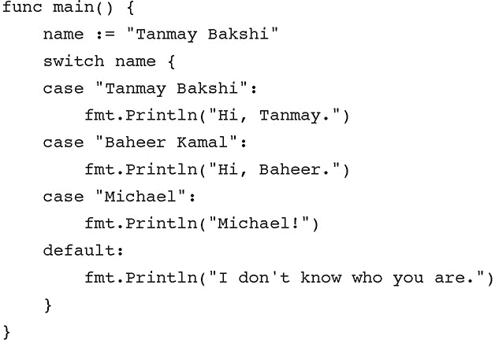

当你运行这段代码时，你应该看到以下输出：

```
Hi, Tanmay.
```

这是关于 Go 中条件判断的入门。通过使用它们，你可以根据条件是否满足跳转到代码的不同部分。

### 循环

循环是编程语言为你提供的另一个重要构建块。在 Go 中，循环被极大简化了。事实上，只有*一种*循环承担了你通常在其他语言中看到的*三类*循环的角色（`for` 循环、`while` 循环、`do-while/repeat-while` 循环）。

Go 将这三种循环替换为仅一种循环：`for` 循环。从技术上讲，你也可以用 `for` 循环复制其他类型循环的功能。这意味着 Go 在“for”的旗帜下实际上只有多种循环，代表了在其他语言中找到的不同类型的循环。

让我们从经典的循环开始：“for-in”循环。这种“for 循环”允许你按照特定的顺序遍历序列中的元素，例如数组中的元素。这里有一个使用 `for-in` 循环的示例：

**代码列表 2.6** 在 Go 中使用 for-in 循环

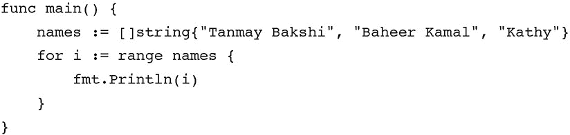

**注意：** 你可能在想：“我在这里没有看到‘in’这个词，所以为什么它叫 `for-in` 循环呢？”答案很简单：循环中的“`:=` `range`”部分被视为“in”——例如，“for `i` `in` `names`”，类似于 Swift 和 Python。

现在，我想让你猜猜这段代码会是什么。这段代码将打印以下内容：

```
Tanmay
```

```
Baheer
```

```
Kathy
```

另一种重用代码并使其模块化的极佳方法是使用函数。函数是大多数编程语言中不可或缺的一部分，而 `Go` 的函数极其有用。然而，在编写本文时，它们缺少一个**关键**特征，这个特征可以将整洁、可重用且低冗余的代码与潜在漏洞风险较大的代码区分开来。不过，语言开发者正在完善这一特性。稍后我们将对此进行更多介绍。

你已经看到过 `Go` 中函数的一个示例了：`main` 函数！它的写法如下：

```
func main() {
}
```

如果你只运行这三行代码，它将成功编译并运行——尽管程序将什么都不做。这是因为该函数不返回任何内容，因此并不*需要*“`return`”语句。我们想更显式地指出这一点，因为某些编程语言（如 `C`）要求 `main` 函数必须返回某些内容（例如退出代码），以便让调用进程知道程序是否成功完成了预定任务。在 `Go` 中并非如此。

如果你想创建一个始终返回常量值的简单函数，例如 `pi` 的 32 位浮点表示，你可以像这样编写代码：

**代码列表 2.11** 声明、定义和调用函数

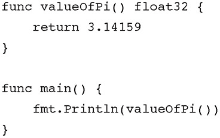

注意函数签名的结构方式。返回类型注解直接放在函数名之后、函数块的左大括号之前。

然而，括号仍然阻碍了我们——正如你可能猜的那样，这些括号是为了你可能想要传递给函数的参数。

例如，如果你想要一个返回 `pi` 乘以某个非负整数结果的函数，你可以编写以下函数：

**代码列表 2.12** 一个与任意常量相乘的新的 `valueOfPi` 函数

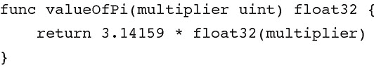

再次，注意函数签名是如何变化的。我们首先放置了参数的名称，然后是一个空格，最后是该变量的类型。

在继续之前，我想在这里说明一个简短的旁注。当我们运行之前的乘法时，请注意我们如何手动将无符号整数转换为 32 位浮点数。这样做是为了避免操作中的任何歧义。

你现在可能在想：类型转换是如何运作的？类型转换能够遵循特定的规范，将按某种类型期望的方式排列比特转换为另一种类型期望的方式。例如，`float32` 在内存中是如何表示的？嗯，`Go` 中的 `float32` 符合 IEEE 754 规范。

一个比特留给符号（是正还是负？），8 个比特留给指数，通常 23 个比特留给小数部分。然而，整数完全不同：它们在二进制中的表示方式非常直接，比特值从右到左按 2 的倍数增加，最左的比特通常留给“符号”。

所以，如果你想将整数值转换为 `float32` 值，并不仅仅简单地说“这些是比特。把它们视作 `float32`”。


```go
var userName string
```

```go
var userAge int
```

```go
userName, userAge = nameAndAge(0)
```

在前面的代码段中，你不允许使用`:=`运算符，你必须使用`=`运算符。

然而，如果你不在乎某个值，比如`name`，而你只关心`age`呢？为了理解如何忽略返回值，让我们来看这个示例程序：

**代码列表 2.16** 从函数返回多个值

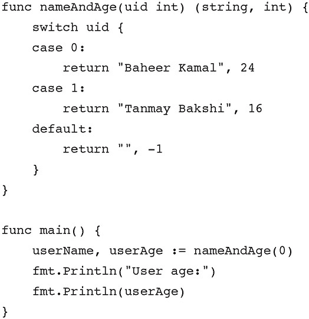

这看起来是完全有效的语法，所以让我们编译它吧！然后 . . .

编译错误 . . .

为什么，你可能会问？这是因为我们声明了`userName`，但从未使用过它。大多数编程语言会忽略它，有些语言则会抛出警告。然而，Go 会完全停止编译过程，并说你在继续之前*必须*修复这段代码。这正是我们在第 1 章中所指的“Go 有一个非常严格的编译器”！

Go 抛出错误的原因是，当你未使用一个变量却费力对其进行命名和声明时，这通常预示着一个 bug。例如，万一你忘记编写处理该值的逻辑了呢？通常情况下，这只是一个你不需要的值。如果是这样，为了告诉编译器你想忽略它，你可以将其赋值给一个下划线`_`：

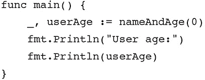

现在，这段代码将会通过编译并打印：

```
24
```

还有一点需要注意：下划线不被视为一个新变量，但`userAge`是，因此我们使用`:=`运算符。如果我们已经声明了`userAge`，那么因为下划线不是一个“新”声明，我们就必须使用`=`运算符，如下所示：

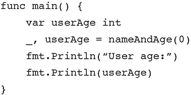

在 Go 中使用函数的另一种方法，当然是将它们传递给其他函数！例如，如果你需要一个调用另一个函数的函数，但你又在编译时不知道它需要调用*哪一个*函数呢？你可以编写这样的代码：

**代码列表 2.17** 将函数指针传递给其他函数

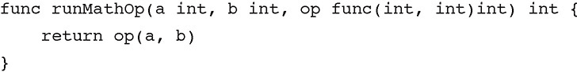

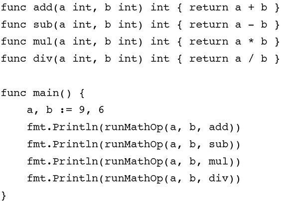

注意`runMathOp`函数的签名。它接收一个名为“op”的参数，其类型看起来像普通的函数签名，只是没有函数名和参数名——只留下了参数类型和返回类型。

当你调用`runMathOp`函数时，你可以简单地像传递其他参数（如`add`或`mul`）一样传递另一个函数，只要它符合`runMathOp`声明中指定的函数签名即可。

在我们继续之前，你应该意识到的最后一个非常强大的特性叫做*defer*。通过`defer`，你告诉 Go 在函数即将返回之前执行某些代码。这段代码将在返回表达式被求值后执行，但在实际返回给调用者之前执行。语法非常简单：你只需要编写`defer`关键字并紧随其后运行一个函数调用。例如，看下面的代码：

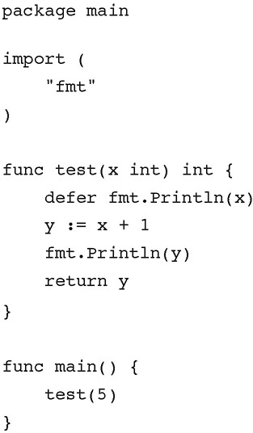

`println(x)`是一个函数调用，该调用被传递给了`test`函数内部的`defer`关键字。因此，在`test`函数返回之前，该打印语句不会执行。正因如此，你应该看到以下输出：

```
6
```

```
5
```

你也可以使用`defer`*内联*定义一个新函数并内联调用它，如下：

**代码列表 2.18** 为 defer 内联定义并调用函数

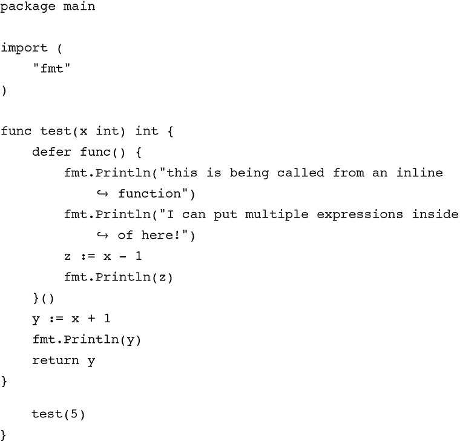

由于你不仅是在内联*定义*一个函数，而且在第 9 行通过两个括号*调用*了它（这正是`defer`的要求），因此这是有效的语法。当你运行这段代码时，你应该看到以下输出：

```
6
```

```
this is being called from an inline function
```

```
I can put multiple expressions inside of here!
```

```
4
```

现在我们已经涵盖了关于函数的基础知识，让我们来谈谈在 Go 中*不能*做的事情：*泛型* (generics)。

泛型是支持泛型的语言中最受喜爱的特性之一。至少，大多数语言是如此（我们在看着你们，Java 和 C++！）。

例如，在 Swift 和 Julia 中，泛型允许你编写更少的代码来支持更多类型，并具有更高的可读性和灵活性。像 Python 这样的语言在这种比较中并不真正适用，因为你无论如何都在那里使用鸭子类型（duck typing）！它从根本不在乎你变量的类型。

然而，Go 团队正在开发泛型。这里有一些你可以在 Go 语言未来版本中编译的代码预览：

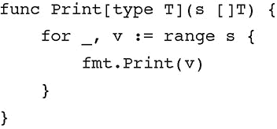

这段代码看起来可能很复杂，但实际上非常简单。在此之前，假设你想写一个打印整数数组中每个元素的函数。你会写类似这样的代码：

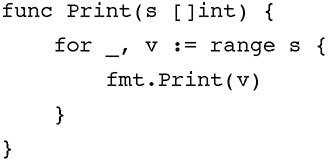

它是有效的！但随后如果你想对字符串做同样的事情，你就必须这样做：

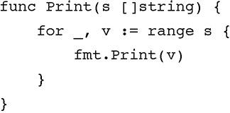

你必须对浮点数、无符号整数、不同大小的整数和浮点数等执行类似的操作。

### 结构体

Go *不是*一种面向对象的语言。它没有“类”（class）或“对象”（object）的概念。一切都是值。甚至引用也是值，这意味着它们是表示为值的指针。

因此，为了帮助程序员存储多个相关数据，Go 拥有“结构体”（structures）的概念。结构体允许你将某些数据存储在连续的内存中。让我们回到用户名和年龄的示例。我们可以将其表示为`结构体`：

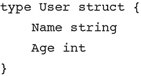

现在，`User`的字节大小是`string`的字节大小加上`int`的字节大小。浅白地说，这些变量的字节在内存中是一个接一个顺序排列的。

如果你想创建一个结构体的新实例，可以使用以下语法：

```go
myUser := User{"Kathy", 18}
```

现在，如果你想打印存储在结构体中的不同数据，你可以简单地使用“.”运算符：

```go
fmt.Println(myUser.Name)
```

```go
fmt.Println(myUser.Age)
```

正如你所看到的，我们可以像使用代码中的任何其他类型一样使用新的`User`结构体类型。但记住，结构体是*值类型*，而不是像类那样的*引用类型*。因此，取决于你之前编写的内容，这样的操作可能会给你带来意想不到的结果：

**代码列表 2.20** 修改作为参数传递给函数的结构体

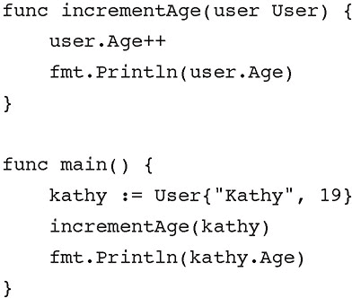

这将会打印：

```
20
```

```
19
```

这是因为负责增加`age`变量的函数简单地接收了一个`User`类型，这意味着 Go 会为该`structure`创建一个副本，并将该副本传递给函数。然后该函数修改了该副本并打印了`age`，随后副本超出了作用域并被删除。然而，在回到主函数中，原始的“`kathy`”从未被动过，所以它打印的是原始的`age`。

相反，如果你希望有一个函数能够原地修改`structure`或其他值类型，你必须传递它的引用。这可以通过以下语法实现，如果你写过 C 语言，你会对它非常熟悉：

**代码列表 2.21** 通过传递给函数的指针修改结构体

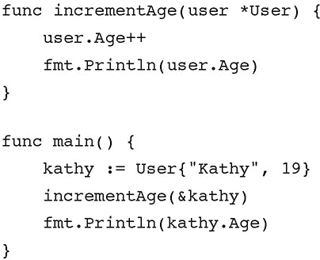

请注意，在这段代码中只有两处变化。`incrementAge`函数中的类型注解从`User`变为`*User`，这意味着它是一个引用。此外，在`main`函数的调用处，我们不再传递`kathy`，而是将`kathy`传递到“&`运算符`”中，该运算符会获取`kathy`的引用，然后我们将该引用传递给函数。

当你运行这段代码时，你应该看到：

```
20
```

```
20
```

太棒了！现在，我们想在此指出，这**不是**指针，尽管你的 C 语言直觉可能是在这么告诉你的！这是一个由 Go 处理的*引用*。因此，在函数内部，在访问`age`属性之前不需要对指针进行解引用。记住，在 Go 中，我们是这样：

```
fmt.Println(user.Age)
```

而在 C 语言中，使用指针时我们需要这样做：

```
printf("%d\n", user->age);
```

或者：

```
printf("%d\n", *user.age);
```

正如你可能注意到的，在 C 语言中，除非我们手动解引用指针，否则无法使用“`.`运算符”，或者我们需要使用“`->`运算符”来自动解引用。幸运的是，在 Go 中，我们没有这种限制，因为这根本不是指针；它是一个引用。

你对 Go 中的结构体可以做的另一件事是为它们分配函数！例如，如果我们为`User`结构体需要一个简单的函数，可以返回一个像“Baheer Kamal is 24 years old!”这样的漂亮字符串会怎样？我们可以写这样一个函数：

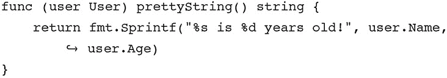

如你所示，函数签名在一个关键处发生了变化：在“`func`关键字”之后，我们在其余常规函数签名之前的括号内添加了一个新的参数名和类型注解。这告诉 Go “将此设为`User` `structure`的实例方法，并将该实例以名为‘user’的参数传递给函数”。

现在，你可以这样调用这个函数：

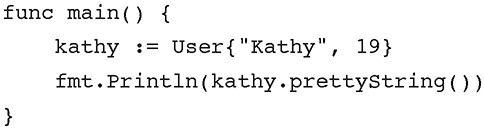

这将打印：

```
Kathy is 19 years old!
```

太棒了！现在，为了进行额外练习，让我们把`incrementAge`函数移植为实例方法：

**代码列表 2.22** 使用值接收者修改结构体


好了，看起来不错。如果你现在运行它，你应该看到：

```
20
```

```
19
```

等一下。为什么实例方法没有更新结构体呢？让我们再次查看函数签名，注意类型注解是`User`而不是`*User`。没错，即使是这些函数传递的也是结构的副本。让我们通过“指针接收者”来修复它：

**代码列表 2.23** 使用指针接收者修改结构体

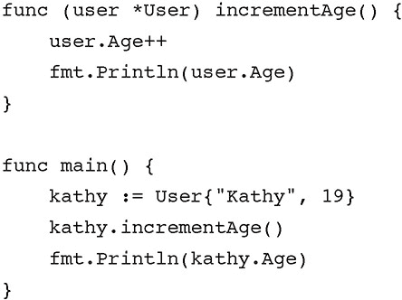

这次，你可以看到我们*不需要*更新调用处，而是只更新了函数签名，表示我们想要一个调用该函数的`User`的引用。

现在你应该看到以下输出：

```
20
```

```
20
```

太棒了！你现在已经学习了 Go 中`structure`的基础知识。当然，还有很多需要学习的内容，比如`Reflection`（反射），但我们将在后面的章节中讨论。

### 接口

在 Go 中，我们还有所谓的“接口”（interfaces），它们类似于 Java 中的`interfaces`或 Swift 中的协议（protocols）。然而，它们确实有一些更多的限制（再次强调，Go 在这方面可以非常“经典”）。

`interface`允许你定义一组特定`structure`需要的函数，而无需将它们与具体实现绑定。例如，你可以说：“要与‘Living’`interface`兼容，你必须有一个不接受参数且不返回内容的`incrementAge`函数。”

让我们来看看`interface`：

**代码列表 2.24** 没有接口的相似结构体

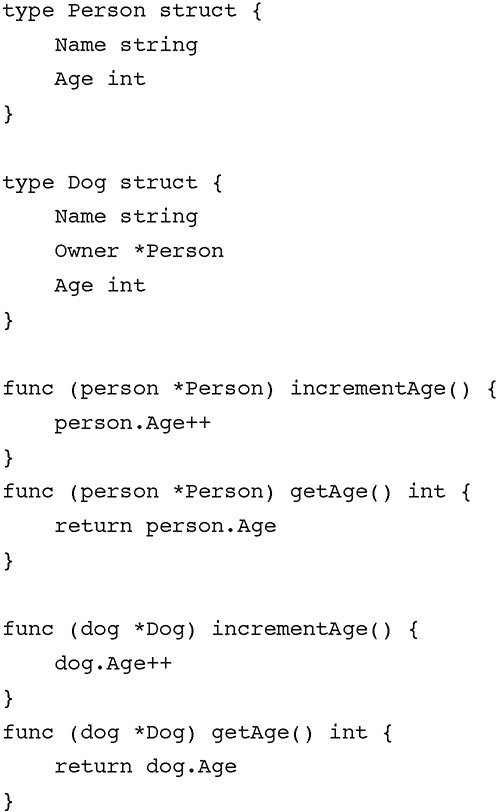

**注意：** 敏锐的人可能注意到这里有一个“错误”，至少在我们之前讨论过的范围内。在`getAge()`函数中，我们没有改变任何内容，所以为什么它需要是指针呢？我们稍后会解释。

现在，如果我们想抽象物种呢？我们不需要完整的泛型（generics），只需要`interfaces`。例如，我们可以定义：

**代码列表 2.25** 一个接口

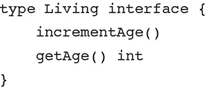

`interface`表示“任何实现了这两个函数的类型也可以被称为 Living”。因此，我们可以写一个这样的函数：

**代码列表 2.26** 修改接口实例的函数

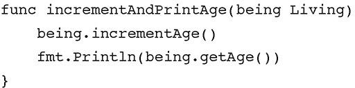

然后像这样调用它：

**代码列表 2.27** 使用结构体实例调用 incrementAgeAge

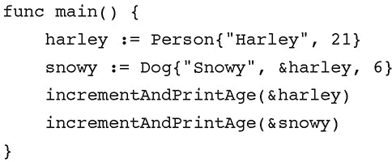

现在，不要对这段代码想得太深。我们稍后会详细讲解它的运行以及编译器的思考过程。现在，只需运行它并欣赏输出：

```
22
```

```
7
```

好极了！但这是发生的呢？让我们深入研究。

首先，看看`incrementAge`和`getAge`函数。注意，对于这两个函数，它们实际上接收的是指针值，而不是普通值。这意味着`Person`和`Dog`都*没有*拥有`incrementAge`和`getAge`函数——相反，`*Person`和`*Dog`引用类型实现了它们。

所以，让我们再次查看我们的`interface`：

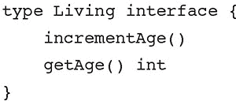

`interface`表示“任何实现了这两个函数的类型也可以被称为 Living 类型”。而你猜怎么着，`Person`和`Dog`没有实现它们，相反`*Person`和`*Dog`实现了。因此，当我们调用`incrementAndPrintAge`函数时，如果我们直接传递变量：

```
incrementAndPrintAge(harley)
```

```
incrementAndPrintAge(snowy)
```

……我们会得到错误，因为这些变量的类型没有实现接口所需的函数。然而，当我们传递引用时：

```
incrementAndPrintAge(&harley)
```

```
incrementAndPrintAge(&snowy)
```

……我们传递的不是`Person`和`Dog`，而是`*Person`和`*Dog`，它们完全符合接口。

这向我们证明了某些事情，但基本上是潜意识的：*接口中的函数要么全都是指针接收者，要么全都是值接收者。两者之间没有中间。*

这绝对不是最优解。但你可能会问，究竟为什么会这样？嗯，让我们让代码变得更好一点，在`getAge()`函数中，我们将引用类型替换为值类型：

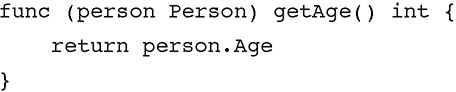

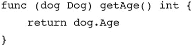

现在，让我们看看我们的类型是否符合要求。

遗憾的是，`Dog`和`Person`仍然不符合`Living`，因为它们只实现了`getAge`而没有实现`incrementAge`。然而，`*Dog`和`*Person`现在*也*不符合了，因为它们只实现了`incrementAge`而没有实现`getAge`。现在你就可以看到为什么这是一个问题了。目前这段代码中没有任何类型符合`Living`！

因此，我们的接口本质上变得毫无用处了。

Go 肯定有更好的方法来处理这些情况，但目前，如果`interface`中甚至有一个函数需要指针接收者，那么你的*所有*函数都需要指针接收者。

### 错误

Go 处理错误的方式有些独特。在大多数流行编程语言中，函数可以“抛出”（throw）错误，而调用者可以“捕获”（catch）错误。这种方法在 Go 中仍然可行，但并不常见且不被鼓励。相反，Go 鼓励你返回一种名为`error`的类型。

`error`是一个接口，它只期望底层类型实现单个函数。该函数被称为`Error`，不接受任何参数，并返回它所代表的错误的人类可读的字符串。`error`接口的定义如下：

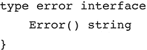

你可以非常轻松地创建自己的错误类型！以下是一个简单的错误实现：

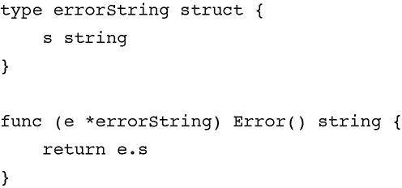

`errorString`结构现在符合`error`接口，你定义的函数可以将其作为`error`返回。然而，你可能会问，接口的初衷意义何在？为什么不直接让`error`成为一个结构体，这样你的函数就可以直接将`error`存储为字符串了？

嗯，答案很简单：错误是复杂的。假设你从一个旨在向 HTTP 端点发送请求的函数获取了一个错误。该错误可能发生在多个点，由于防火墙或缺少网络连接，你可能无法*发送*请求。也许响应码是 500（内部服务器错误），所以是服务器的错！

因此，Go 没有将`error`的定义简单简化为字符串，而是让你定义自己的`error`结构体来包含自定义错误信息。由于你被迫实现`Error()`函数来返回一个人类可读的字符串，你仍然可以打印任何运行时错误以进行调试。这些字符串可以根据结构的其他内容进行组合——例如，在 HTTP 示例中的响应码。

这种非正的错误处理方法会导致代码有些不够优雅，但通常减少了由于未处理的错误导致崩溃的概率。为了了解这一点，让我们来看在函数中使用`error`的示例。

在定义新类型的简单错误时，Go 的标准是将它们定义为全局变量。这允许包外部的代码看到、检查并处理它们。

5. 什么是代码复用？列出本章中帮助你复用代码的概念。

6. 函数如何直接修改其输入参数之一？

7. Go 中的结构体（structure）与 Swift 中的结构以及 Swift 和 Java 中的类（class）有什么区别？

8. 写一个简单的程序，从用户处获取数字，如果该数字不是质数则 panic（崩溃），但如果数字是偶数则允许该 panic 被恢复；在这种情况下，告诉用户偶数不是质数（2 除外，因为 2 是质数）。

# 第 3 章

## Go Modules

欢迎来到第 3 章！现在你已经了解了 Go 语言的基础构建模块，你可能认为是时候开始实现更复杂的应用程序了！然而，在此之前，学习如何与更大的程序员社区共同工作至关重要。为了这一点，你必须学会如何消费和创建`packages`（包），它们使得代码能够大规模分发。

完成本章后，你将能够回答以下问题：

- 什么是包？为什么它们对编程语言的生态系统至关重要？

- 包管理器是如何工作的？它们在开发大型应用程序中起什么作用？

- Go modules 是如何结构化的？

- 你如何在应用中使用内置模块和第三方模块？

- 你如何构建自己的 Go modules？

大多数编程语言都实现了“包管理”系统来实现这种代码分发。如果做得恰当，包管理系统能让程序员更高效、更具协作性。例如 Python 的`PIP`、Swift 的`Swift Package Manager`、Ruby 的`RubyGems`，当然还有 Go 的“Go modules”。


此外，当一个由内置包和社区支持包组成的惊人生态系统，辅以令人惊叹的语言特性（如 Go 独特的并发性和快速编译）时，程序设计将变得简单而有趣。

编程语言的定义实际上取决于它们提供的功能“包”。以 Python 为例，Python 拥有一系列广泛且通常经过优化的内置包，扩展了它的“标准库”。例如 `json`、`urllib`、`pickle`、`os`、`sys`、`sqlite` 等。这些包是 Python 成功的支柱之一，尽管从技术角度来看它存在某些缺点——你只需要安装语言，就可以发送和接收 HTTP 请求、解析 JSON 和 CSV 文件、将数据序列化到磁盘、控制 OS 特性，甚至使用 SQLite 数据库。

另一个成功的关键在于，它不仅通过内置包提供基本功能，还为他人提供了一种简单的方法来发布自己的包并利用他人的包。如果这样一个系统不是易用的、集中的，且不是语言本身同步构建的功能，你可能会得到一个碎片、混乱且产生 Bug 的生态系统，如 Java 或非 iOS 平台的旧版本 Swift。

## 使用内置包

我们将探索的第一个是一个相对简单的应用程序，它可以从“OMDb”API 获取数据。OMDb 代表“开放电影数据库”，正如其名所示，他们提供了可以通过程序化访问的海量电影信息。可以把它想象成“廉价且可供 API 调用的 IMDb”。

具体来说，让我们构建一个小型应用程序，允许我们通过名称搜索电影。我们将使用常规的内容加上一些额外的内容来启动应用程序——别担心，稍后我们就会解释它们的意思！

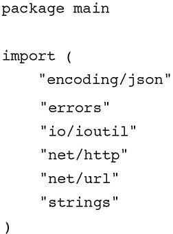

当然，第一行代码只是告诉 Go 我们正在为哪个包编写代码。然后，我们进入了导入（imports）部分。到目前为止，你只需要使用 `fmt` 库，但这次我们使用了许多其他库，如表 3.1 所示。

**表 3.1** OMDb 搜索应用中导入每个包的目的

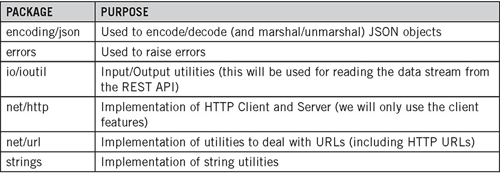

这些包将提供构建模块，我们可以借此实现自己的逻辑。

**注意：** 需要记住的一点是，在 Go 中，每个导入*必须被使用*。否则，不像某些编程语言会静默继续或抛出警告，Go 将抛出错误并拒绝编译你的程序。这既是为了速度也是为了安全——未使用的导入可能指向 Bug 的存在。例如，你可能忘记了实现某些重要功能。

在导入之后，我们将创建一个名为 `APIKEY` 的新常量，用于存储 OMDb API 密钥。API 密钥用于告诉 API 你是谁，以便服务可以实施速率限制、权限和计费等功能。

```
// omdbapi.com API key
```

```
const APIKEY = "193ef3a"
```

在继续之前，我们想对 API 做个简单的说明：我们将实现两个函数，调用我们提供的许多 API 端点中的两个。这两个函数将实现电影搜索功能。其中一个实现按标题搜索，另一个实现按电影 ID（IMDB 中电影的唯一标识符）搜索。

当你调用其中任一个端点时，你会得到一个 JSON 响应，其中包含一个符合特定“spec”（规范）的对象。我们现在要做的是*将该 JSON 序列化（marshal）到结构体中*。这是我们将构建的结构：

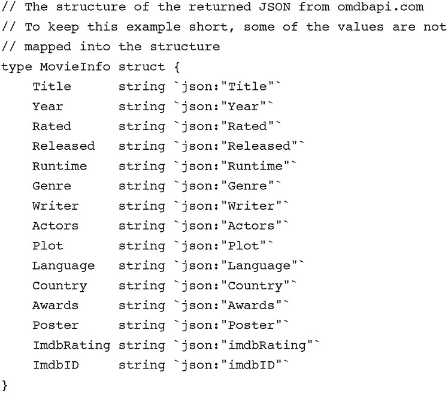

我们从那里得到了很多数据，但为了简洁起见，我们在结构中省略了它们。该结构中还有一些我们还没有引入的语法——它是类型注解之后的部分，封装在反引号中。例如：

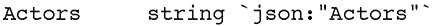

`json:"Actors"` 部分具体的作用是什么？它告诉 JSON 包，当你需要将字符串序列化到此结构中时，`Actors` 键的值应该被放入该变量。

为了让你更清楚这一点，我们在第 2 章中介绍了了简化的结构体。我们解释过需要在结构中提供变量名和类型注解，但还有另一个 Go 可以接受的变量信息，尽管可选。这被称为标签（tag）。标签包含了关于变量的额外信息以及哪些代码部分需要它。

在这种情况下，我们使用包含 JSON 键的标签来支持 JSON 序列化。

现在我们已经有了从 API 获取信息的结构体，让我们实现对 API 的调用。在此之前，我们必须编写负责向 API 发送 HTTP 请求的函数。这是一个实现此逻辑的简单函数：


该函数的工作原理很简单，尽管它看起来很复杂，因为是你处理的第一个大函数。让我们从解析函数开始：

```
func sendGetRequest(url string) (string, error)
```

这个签名非常直观。函数只接受一个类型为字符串的参数 `url`。然而，它返回两个独立的值：作为字符串的请求响应；以及一个错误类型，它本应该是 nil，但如果在发送请求或解析响应过程中发生错误，它可以包含一个值。

签名之后是函数的主体。因为这是你接触的第一个真实函数，让我们通过表 3.2 逐节查看它。

**表 3.2** `sendGetRequest` 中每个代码部分的功能


太棒了！随着这个函数的完成，我们现在拥有了发送 GET 请求的能力，并处理我们在尝试这样做时可能出现的某些常见错误。现在，让我们来实现搜索功能。

记住，我们需要实现两种搜索方式：通过标题和通过电影 ID 搜索。让我们从通过标题或名称搜索开始：


这个函数看起来简单多了！让我们再次从函数签名开始：

```
func SearchByName(name string) (*MovieInfo, error)
```

函数签名初看之下非常简单直观：你只是在创建一个接收单个参数并返回两个值的函数。然而，仔细观察，你会发现返回的第一个值——即从 JSON 响应中反序列化（unmarshaled）的 `MovieInfo` 结构体——实际上是一个指针！

这是为什么呢？因为我们还有另一个返回值：`error`。当发生错误时，意味着我们没有 `MovieInfo` 结构体可以返回 . . . . 那么，我们返回什么代替它呢？我们可以返回一个包含许多占位符值的空结构体，但这并不优雅。你可能会问，为什么不直接返回 `nil` 呢？嗯，如果函数的类型注解只是 `MovieInfo`（一个值而不是指针），那么 Go 将不会允许我们返回 `nil`，因为在内存中没有方法可以表示它。

相反，当我们将其声明为指针时，Go 允许我们返回 `nil`，因为指针被允许指向空。所以，如果我们需要返回一个错误，可以返回一个带有错误的 `nil` 值；如果没有问题，则返回一个带有 `nil` 错误的有效值。

在逻辑本身方面，该函数本质上只是遵循了以下步骤：

1. 构建一组 URL 参数集（URL parameters），其中包含 API 密钥和我们要搜索的电影名称。
2. 组合我们想要查询的 REST API URL，以及来自第 1 步的参数。
3. 向网站发送请求，如果发生错误，则返回一个 `nil` 指针和错误。
4. 创建一个新的 `MovieInfo` 值，获取它的指针，返回该指针，并通过该指针将响应字符串反序列化到该值中。如果反序列化过程中出现错误，也返回该错误。

在所有步骤中，第 4 步可能是唯一复杂的，因为它涉及到函数中的最后两行代码。让我们更详细地查看这些代码：

```
mi := &MovieInfo{}
```

```
return mi, json.Unmarshal([]byte(body), mi)
```

这段代码片段的第一行非常简单：我们创建了结构体，使用取地址运算符 `&` 获取指针，并将该地址存储在变量 `mi` 中。第二行是情况变得稍微复杂的地方。如果你在看这段代码，你会发现它变得有点复杂。*（此处原文似乎有一处逻辑跳跃或重复描述，翻译已按原意处理）* 如果你在看这段代码，你会发现它变得有点复杂。*（原文代码：* `return mi, json.Unmarshal([]byte(body), mi)`。这里是 `json.Unmarshal` 将 `body` 转换为字节数组，并通过指针将响应字符串反序列化到值中。如果反序列化出现错误，也返回该错误。

从技术上讲，为了让 `Go` 模块工作，你不需要 `GitHub` 链接，只需要指向任何远程 Git 仓库的链接（可能托管在 `GitHub`、`Gitlab`、`Bitbucket` 等）。你甚至可以使用自己的 Git 服务器实例！

这使得 `Go` 模块系统能够处理版本控制。例如，它会具体记录你编译代码时使用了模块的哪一个提交（commit），这使得你的编码环境更加更加性。如果你采取了我们刚才提到的第二种方案（即创建自己的包），这些信息将存储在一个名为 `go.sum` 的文件中。

回到理解我们的代码 . . . 如果你现在尝试编译它（使用 `go build .` 命令），你会遇到类似下面的错误：


这是 `Go` 在告诉你“我找不到你尝试导入的模块！”，因此它抛出了一个编译器错误。如果你决定使用第一种安装包的方法（我们再次不建议这样做），那么你将在命令行中运行以下命令：

```
go get github.com/otiai10/primes
```

这将包下载到你的家目录中，所以现在如果你进行构建并运行，代码应该可以正常工作。

然而，我们建议运行以下命令：

```
go mod init primechecker
```

这个 `command` 会执行一件非常简单的事：在当前目录下，它会创建一个名为“primechecker”的新模块。在这个示例中，名称其实并不重要——它只有在别人想要使用你的包时才会起作用（这是他们引用你的模块时将使用的名称）。

现在当你运行 `go build` 命令时，你会看到代码成功编译了！这是因为 `Go` 能够将所需的模块下载到你自己的新模块中。

当你运行 `go build` 命令时，你应该看到如下下面的输出：

```
> go build .
```

```
go: finding module for package github.com/otiai10/primes go:
found github.com/otiai10/primes in github.com/otiai10/primes
v0.0.0-20180210170552-f6d2a1ba97c4
```

你应该会在 `go.sum` 文件中看到以下内容：

```
github.com/otiai10/primes v0.0.0-20180210170552-f6d2a1ba97c4/
go.mod h1:UmSP7QeU3XmAdGu5+dnrTJqjBc+IscpVZkQzk473cjM=
```

## 构建自己的包

正如我们之前提到的，在 `Go` 中，创建和构建自定义包非常简单。我们甚至已经涵盖了如何创建自己的模块，因为它们对于能够他人的模块至关重要。

### 我是质数吗？第 2 部分

现在，为了让别人使用你的自定义模块，你必须为模块取一个非常具体的名称。在上一个示例中，你可以给模块命名为任何名称——但是，如果你想将此模块推送到远程 Git 服务器以便他人使用，你必须将你的包命名为其他人在代码中将导入的远程 Git 仓库地址。

例如，让我们写一个允许用户检查数字是否为质数的包。我们这样初始化包：

```
go mod init github.com/Tanmay-Teaches/golang/chapter3/example3
```

这样，我们的 `Go` 模块就能被想要使用我们代码的人自动导入。

现在我们来写这个包的代码。当然，我们会在 `main.go` 文件中编写代码，但这次我们不再使用“package main”，而是将包命名为“example3”。这意味着每当人们在自己的代码中引用此包时，他们将将其引用为“example3”。

**代码列表 3.3** 自定义质数检查器包


`IsPrime` 函数背后的逻辑非常简单——我们在开头有几个条件，用于检查可以直接返回 true 或 false 的特殊情况，之后，我们从 5 循环到我们要检查的数字的平方根。如果我们的数字可以被循环中遇到的任何数字整除，那么我们就返回 `false`；否则，返回 `true`。

现在我们可以将代码推送到我们的 `GitHub` 仓库了。如果这个 `GitHub` 仓库恰好是公开的，那么本章的其余部分应该是一言易懂的，你应该能够自己学会。你所做的就是提交更改并推送到你的仓库——或者你的 Git 工作流所需的任何其他操作。

然而，你可能会想：如果 `GitHub` 仓库是私有的该怎么办？或者你可能在一个使用 `GitHub Enterprise` 的公司工作，因此你有自己的 `GitHub` 实例。你如何告诉 `Go` 对那个特定的 `GitHub` 实例进行身份验证呢？

让我们先看看通常如何这样做。通常，你使用 SSH 密钥对 Git 进行身份验证。SSH 密钥易于使用、极其安全且是行业标准。

要告诉 `Go` 使用 SSH，我们实际上必须从一个 `Git` 命令开始。具体来说，我们必须告诉 `git` 每当它看到 HTTPS URL 时，必须将 HTTPS 请求替换为 SSH 请求。我们可以通过这样设置我们的全局 `Git` 配置来实现：


然后，你需要告诉 `Go` *不要*对你将克隆的私有或内部仓库进行“和校验”（sum check）。这是因为和校验与私有和内部仓库不兼容。

```
export GONOSUMDB=github.com/Tanmay-Teaches/golang
```

这就是你需要的所有操作！到此时，你应该能够引用了私有 Git 仓库中创建的模块的新项目，然后获取该模块并在自己的代码中使用。让我们开始这样做吧！

首先，创建一个新的 `Go` 项目（创建一个新文件夹）并初始化一个新模块，如下：

```
go mod init example4
```

再次，当你为了自己的目的创建一个不打算分发的模块时，名称其实并不重要。

除了我们为自己创建的模块外，我们还将使用另一个来自“labstack”的名为“echo”的第三方模块。这个模块将允许我们创建一个快速的 Web (HTTP) 服务器。总之，我们的应用程序将：

1. 在特定端口启动 HTTP 服务器。
2. 监听该端口的 GET 请求。
3. 如果发现 URL 路径为数字的 GET 请求，我们：
   a. 检查该数字是否为质数。
   i. 如果是，返回“true”作为响应。
   ii. 如果否，返回“false”作为响应。

这是该应用程序的所有代码：

**代码列表 3.4** 使用自定义质数检查包


在运行代码之前，让我们稍微解释一下它的工作原理。当我们启动主函数时，我们简单地调用 `echo.New()`，得到一个新的 HTTP 服务器实例。之后，我们在该服务器上注册一个 GET 端点。

我们通过传递字符串 `/:number` 来注册这个 GET 端点。这意味着“在 URL 根路径之后，如果你看到的只有我们称为‘number’的字符序列，那么我们可以处理该请求。”

**注意：** 当我们在字符串中说“number”时，我们并不是在告诉它*只*寻找数字。相反，我们是指这可以是任何字符序列，但我们希望这些字符存储在变量 `number` 中，因为我们设计的 API 期望这是一个数字。

然而，我们传递给这个函数的还有另一个参数：另一个函数，它不是立即调用的。这意味着从主函数第 2 行的 `func` 关键字到主函数第 9 行，该代码*没有*立即执行——它只是我们内联定义并传递给 echo 模块中 GET 函数的一个部分。

我们传递的这个函数将在 HTTP 服务器发现符合我们作为 GET 函数第一个参数传递的字符串条件的请求时被调用。当它被调用时，它将接收一个 `echo.Context` 值，并预期返回一个错误。如果没有错误，它将返回 `nil`。如果*有*错误（即返回值不为 `nil`），echo 模块将会你向请求发送失败响应。

在这个函数内部，我们只需获取在所传递的路径字符串中声明的“number”参数。然后，我们尝试将其转换为整数。如果在此处发生错误（意味着该字符串确实包含了除整数以外的其他内容），我们将返回该错误，并附带一些额外信息，告诉 `echo`：“API 的用户发送了错误的请求，所以我们无法处理。这不是我们的错！”

最后，我们只需告诉服务器在 1323 端口开始监听请求。如果发生错误，该函数将返回错误；如果没有错误，它将永远不会返回，而是保持阻塞状态。这是服务器代码的标准行为。当你强制杀死程序时，它将会结束。

然而，如果函数*确实*返回了错误，我们将该错误传递给 `Logger` 中的 `Fatal` 函数。这样我们就可以将该错误作为“致命错误（fatal error）”进行记录，并且由于 `main` 函数随后会结束，程序也将退出。

话说到这里了。让我们来看看代码的运行情况！如果你打开浏览器，可以带数字访问该端点，正如图 3.1 和 3.2 所示。


**图 3.1** 质数检查 API 对 100 的输出（一个合数）


**图 3.2** 素数检查 API 对 97 的输出（一个质数）

对于每个请求，你应该能看到“true”或“false”作为输出：如果是素数则显示 true，如果是合数则显示 false。

在本章中，我们探索了如何使用 Go 模块——包括第三方和内置模块——并向你展示了如何构建自己的模块！在接下来的章节中，我们将利用目前为止学到的所有概念，构建使用常用数据结构和算法的真实应用程序。

## 练习

**1.** 什么是“校验和（checksum）”，Go 为什么要使用它？在什么情况下你应该禁用它？

**2.** 如果你在 Go 中导入了一个模块，为什么如果没有被使用它，编译器会抛出错误？

**3.** 为什么倾向于为每个项目单独安装 Go 模块，而不是全局安装？

**4.** 对于计划在版本控制系统中作为自定义模块重新分发的包，你应该使用什么样的命名方案？

**5.** 为什么如果返回类型不是指针，你就不能从函数中返回 `nil`？

**6.** 在调用阻塞的 `start` 函数后，如何停止 HTTP 服务器？

# 第 4 章：使用内置包


欢迎来到第 4 章！现在你已经熟悉了 Go 语言的基础构建组件以及如何使用包和模块，现在是时候学习该语言的一些额外功能和能力了。我们将通过构建由你可能在自己的应用程序中常用的数据结构和算法驱动的应用来实现。

完成本章后，你将回答以下问题：

- 什么是 Dijkstra 路径算法？它是如何工作的？
- 如何在 Go 中实现 Dijkstra 来搜索图？
- 什么是康威生命游戏（Conway’s Game of Life）？它是如何工作的？
- 如何在 Go 中实现图形用户界面（GUI）？
- 为什么生成随机数是一项困难的任务？如何在 Go 中构建自己的伪随机数生成器？

## 常用数据结构和算法

具体来说，我们将查看两个著名的算法，这些算法可以教我们很多关于将伪代码和逻辑转换为 Go 代码的知识。这两个例子是：

- Dijkstra 路径算法
- 康威生命游戏

在进行这一过程中，我们不仅会复习 Go 概念并学习新概念，还将进入我们尚未涵盖的全新用户交互范式：图形用户界面。

Go 这种语言从并不是为编程的 UI 端而设计的。然而，使用 Go 构建 GUI 绝对是可能的。我们将在稍后深入探讨这一点。

## Dijkstra 路径算法

让我们从你可能听过得多的算法开始：Dijkstra 路径算法。正如你可能知道的，路径算法允许你找到图中从一个节点到另一个节点的“路线”。

“图（graph）”这个词可能看起来有些局限性，但世界上许多事物都可以转化为“图”。例如，一个迷宫。你可以将迷宫表示为相互连接的单个瓷砖组成的图，其中某些连接被墙壁挡住。

或者你甚至可以考虑城市的道路系统。不同的道路是节点，它们以特定的“成本”连接，这在现实世界中通常翻译为“距离”。然而，通过特定的技术，你还可以将其他特征考虑入成本中，例如交通状况、路线的直直程度等。

对于这个例子，假设我们正在处理图 4.1 所示的图。

我们要做的是确定，当给定图中任意两个节点时，我们应该走哪条路线？例如，从 C 移动到 D 的成本总和为 7，因为 E 是 5，D 是 2。


**图 4.1** 用于运行 Dijkstra 的示例图

Dijkstra 的内部原理具有欺骗性的简单——以至于你可能需要花一点时间来理解算法的行为。真正理解算法的方法是分步骤进行可视化。所以，让我们使用图 4.1 的简化版本（你可以在图 4.2 中看到），并首先演示算法：


**图 4.2** 用于练习算法的简单图

Dijkstra 的工作原理在于它考虑了所有可能的路径。当算法开始时，我们创建两个字典，键是节点，值分别是浮点数和节点。这两个字典被称为“距离（distance）”或“成本（cost）”字典以及“父节点（parent）”或“上（previous）”字典。我们稍后会解释它们的含义。首先，让我们看看表 4.1 中这些字典的表格表示。

当算法开始时，我们需要知道开始路径查找的源节点。对于该节点，我们将成本设置为 0——直觉上这是合理的。从源节点到源节点的成本是 0，因为你已经在那里了！父节点也是 `nil`——因为你是如何到达源节点的？你不是通过源节点到达那里的，你只是就在那里；没有节点先于它。

为了方便讨论，假设我们图中的源节点是节点 B。现在字典应该像表 4.2 所示。

我们现在需要做的只是运行一次标准的 Dijkstra 算法迭代。我们首先查看所有节点的成本，并找到成本最小的节点。因为除了 `B` 之外的所有节点成本都是无穷大，所以 `B` 自然是成本最低的节点。

然后，我们查询图表以找到该节点的邻居是谁，以及它们的成本是多少。我们看到在这个特定的图中，邻居节点是节点 `C` 和 `D`。

是的，从技术上讲，`B` 与 `A` 有一条连接，但那是从 `A` 到 `B` 的连接，所以我们无法从 `B` 移动到 `A`，因此该连接对于此逻辑是无效的。

我们从节点 `C` 开始（在这种情况下，顺序并不重要）。我们检查：`B` 的成本加上旅行到 `C` 所需的成本是否低于 `C` 本身的成本？在这种情况下，这意味着：“`0 + 4` 是否小于无穷大？”当然，结果的结果为真。因此，我们将 `C` 的成本设置为 `4`（因为 `0 + 4 = 4`），并将 `C` 的父节点设置为 `B`。

我们对节点 `D` 执行了类似的操作。因为之前的成本是无穷大，新成本 `0`（`B` 的成本）加上 `5`（从 `B` 移动到 `D` 的成本）较低——因为任何有限数字都小于无穷大。所以我们将成本设置为 `5`，并将父节点设置为 `B`。

搞定！我们遍历了从 `B` 可以进行的所有移动。让我们再次运行迭代。表 4.3 是我们目前字典的状态。

**表 4.3** 更新 C 和 D 节点成本和父节点后的 Dijkstra 路径查找状态


查看表格，我们发现 `C` 目前成本最低。所以，让我们看看 `C` 有哪些出站连接。我们看到 `C` 可以移动到 `A` 和 `D`。让我们从确定它与 `A` 的关系开始。

节点 `A` 目前的成本是无穷大，所以无论 `C` 的成本加上 (`C` `A`) 的成本是多少，它都会更低。在这种情况下，结果为 `10`，因为 `C` 是 `4`，连接成本是 `6`。因此，我们将 `A` 的成本设置为 `10`，并将父节点设置为 `C`。

然后，我们看 `D`。`D` 已经有一个成本 `5`。正如我们看到的，`C` 的成本是 `4`，且 `C` 和 `D` 之间的连接成本为 `2`。所以，`4 + 2 = 6`，这意味着 `C` 和 `D` 之间的连接比 `D` 已有的连接（来自 `B`）贵。因此，我们完全不修改字典中 `D` 的值。

表 4.4 是我们字典当前的状态。

**表 4.4** 更新节点 A 成本和父节点后的 Dijkstra 路径查找状态


我们还没有结束！记住，到目前为止，我们在节点 `B` 和 `C` 上运行了算法迭代。所以，如果我们在表中寻找我们*尚未*迭代过的成本最低节点，我们看到那个节点是 `D`。让我们继续对 `D` 执行迭代。

`D` 只能连接到 `A`。让我们尝试如果我们将其父节点切换到 `D`，为 `A` 确定一个新的成本。`D` 的成本是 `5`，它到 `A` 的连接成本仅为 `1`。`5 + 1 = 6`，这*低于*表中已有的 `A` 的成本（10）。因此，我们将 `A` 的成本从 `10` 改为 `6`，并将 `A` 的父节点从 `C` 改为 `D`。

在更新之后，我们的字典看起来如表 4.5。

**表 4.5** 更新节点 A 成本和父节点后的 Dijkstra 路径查找状态


好了，剩下的唯一节点是 `A`。让我们尝试对它运行一次迭代。`A` 连接到 `B` 和 `C`。

我们需要替换 `B` 的成本和父节点吗？直觉上我们知道答案是否定的，因为 `B` 是源节点，让 `A` 成为它的父节点没有意义。然而，我们也可以用算法证明这一点，因为无论 `A` 和 `B` 之间的连接成本是多少，我们永远不会替换 `B` 的父节点，因为 `B` 的成本已经是我们能达到的最低：零。所以，让 `B` 保持不变。

`C` 呢？`A` 的成本已经是 `6`，加上从 `A` 到 `C` 的连接，即 `9`。总和为 `15`。`15` 大于现有的成本 `4`，因此我们也让 `C` 保持不变。这意味着路径查找状态没有变化；它保持与表 4.5 相同。

这种工作原理是通过取一个值为 0 的无符号整数——意味着该数字中的所有位均为 0——并对其执行位取反操作，即脱号符号 `^`。这会将每一位都变为 1，从而将变量的值变为无符号整数能持有的最大值。

## 实现 Dijkstra 算法

是时候实现 Dijkstra 算法了。在接下来的部分，输入和输出与我们之前看到的伪代码相同。它只需要知道源节点，然后就会为你计算成本和父节点：


为了了解这段代码是如何工作的，我们认为最好从代码片段的末尾开始，即代码中的第二个函数。如你所知，伪代码只定义了一个函数，那么为什么我们在这个代码片段中有两个独立的函数来用于路径查找呢？

这是因为 Go 正如我们提到的，是一种不提供许多奢华特性的语言。有很多你本以为拥有的各种功能，遗憾的是，你需要自己实现它们。

在某些情况下，这对性能可能非常有益，因为你不需要使用标准库来处理一切，并且不再围绕使用库来设计数据结构，而是围绕你的数据来设计算法。然而，有时这也会对性能产生不利，因为你经常需要重复轮子，并实现那些本可以通过开源社区做得更好的功能。

在这种情况下，第二个函数的任务非常简单：获取一个告诉我们节点“成本”（在本例中为“距离”）的字典，以及一个告诉我们节点是否被访问过的映射（map），找出成本最低且*尚未*被访问的节点。

该函数通过创建两个变量来实现这一点：具有最小距离值的节点的距离以及该节点的名称。最初，我们不知道这些值，所以简单地填充了占位值。例如，距离为无穷大——稍后你会明白为什么。

然后，我们遍历 `dist`（距离）映射中的不同的值，当我们看到某个节点的距离小于我们在 `lowestNode` 和 `lowestCost` 变量中存储的值时，我们会更新最小距离以及具有该距离的节点名称。

回到为什么距离的初始值是无穷大的原因……这是为了无论我们遇到的第一个非无穷大距离是多少，我们最终都能替换掉占位值，因为任何不是无穷大的数字都会比无穷大小。

代码片段中第二个函数（`getClosestNonVisitedNode`）第 4 行的逻辑非常有趣，因此在继续之前值得详细说明一下：

```
if _, ok := visited[key]; dis == INFINITY || ok {
```

这行代码尝试用我们从距离字典获取的键来查询“访问”（visited）字典。当字典返回两个响应值时，我们忽略第一个（即实际值），而是只关注字典的第二个响应。这第二个响应告诉我们该键是否存在于字典中。如果键存在，则该节点已被访问过（无论其在字典中的值为何），我们就会跳过代码的这次迭代。

### `getClosestNonVisitedNode` 函数

该函数通过创建两个变量来实现：具有最小距离值的节点的距离以及该节点的名称。最初，我们不知道这些值，所以简单地填充了占位值。例如，距离为无穷大——稍后你会明白为什么。

然后，我们遍历 `dist`（距离）映射中的不同的值，当我们看到某个节点的距离小于我们在 `lowestNode` 和 `lowestCost` 变量中存储的值时，我们会更新最小距离以及具有该距离的节点名称。

代码片段中第二个函数（`getClosestNonVisitedNode`）第 4 行的逻辑非常有趣，因此在继续之前值得详细说明一下：

```
if _, ok := visited[key]; dis == INFINITY || ok {
```

这行代码尝试用我们从距离字典获取的键来查询“访问”（visited）字典。当字典返回两个响应值时，我们忽略第一个（即实际值），而是只关注字典的第二个响应。这第二个响应告诉我们该键是否存在于字典中。如果键存在，则该节点已被访问过（无论其在字典中的值为何），我们就会跳过代码的这次迭代。

该函数通过创建两个变量来实现：具有最小距离值的节点的距离以及该节点的名称。最初，我们不知道这些值，所以简单地填充了占位值。例如，距离为无穷大——稍后你会明白为什么。

现在，如果你想确定从 A 到 D 的最佳路径，你只需要遵循字典：D 的父节点是 B，B 的父节点是 . . . A！所以 A B D 是从 A 到 D 最廉价的方式。

虽然这是一个非常简单的例子，用于演示你如何使用 Dijkstra 算法确定图中的最短路径，但这段代码也可以用于更大规模的应用程序。此外，在实现此演示过程中学到的概念将对你应用 `Go` 的旅程有所帮助。

## 康威生命游戏

康威生命游戏在数学和技术社区中是一个非常受欢迎的游戏。它不像你的传统游戏——它的特殊之处在于它是一个`零玩家` 游戏。这意味着在你第一次设置它之后，你就无法再修改环境或状态。

它是由数学家约翰·康威（John Conway）于 1970 年发明的。从技术上讲，生命游戏是一种“细胞自动机”，这意味着该游戏由一组细胞组成，根据某些数学规则，这些细胞将生存、死亡或繁殖。

真正有趣的是，你可以从一个非常简单的初始状态获得非常复杂的行为。例如，以图 4.4 中的网格为例。


**图 4.4** 游戏开始时的“康威生命游戏”示例网格

这是一个网格，实际上是细胞的集合。每个灰色的细胞都是“死的”，所有的黄色细胞都是“活着的”。在每次迭代中，你使用一些规则来决定细胞应该死亡、变为活跃还是保持不变。在这个特定的初始设置下，使用康威规则，你应该看到黄色细胞无限地向网格的右下角移动。

观察生命游戏运行的静态图像并不能体现它的魅力。去 Edwin Martin 的网站查看该游戏的在线实现：[www.bitstorm.org/gameoflife](https://www.bitstorm.org/gameoflife)是非常值得的。

现在，让我们来看看如何用 `Go` 实现这个游戏！但首先，让我们快速过一遍我们的规则：

1. 如果细胞已经是活着的
   - 如果它有少于 2 个活着的邻居，它就会死亡。
   - 如果它有 2 个或 3 个活着的邻居，它将保持活跃。
   - 如果它有多于 3 个活着的邻居，它就会死亡。
2. 如果细胞已经是死的
   - 如果它恰好有 3 个活着的邻居，它将变为活跃。

这些规则简单得具有欺骗性——它们不仅产生了视觉上有趣的行为，它们甚至是`图灵完备`的！你可以在单个初始生命游戏状态中实现一个计算器、`Go` 编程语言或任何可计算的任务。

在这个示例应用程序中，我们将采取稍微不同的方法。我们将构建一个图形用户界面，这样你就可以实际上看到生命游戏在做什么。为了这一点，我们需要一些额外的导入。具体来说，我们将使用一个名为“pixel”的包。以下是我们需要的所有导入项：


我们还将创建一个结构，负责存储渲染到屏幕上的信息。它只存储两个非常简单的信息：我们正在渲染的像素和屏幕宽度。我们只存储宽度而不存储高度，是因为我们不需要它来计算像素的索引。我们稍后会探讨这一点。

需要注意的是：像素的存储方式是在单个的一维无符号 8 位整数数组中。每个像素在数组中有四个值，顺序如下：红、绿、蓝、Alpha。你可能对 RGB 熟悉，而 Alpha 表示透明度。


在继续之前，请理解我们不存储高度。这是因为当我们根据给定的 `(x, y)` 查找 `Pix` 数组中像素的索引时，我们使用公式：

```
index = y * width + x
```

四个嵌套循环中的第一个（最外层循环）负责从一行的开头移动到末尾。第二个内部循环负责从一行移动到另一行。每当我们遇到无法获取值的行或列时（例如越界内容），我们都会跳过该迭代。如果我们发现某行或列的索引与我们正尝试计算邻居的单元格索引相同，我们也会跳过它。

然而，如果这些保护条件都没有被触发，并且我们处于一个有效索引处，我们就会查看邻居的值，如果它是“活”的，我们就会增加 `“neighbors”` 数组中该单元格的值。

在继续之前，让我们创建一个名为 `GameOfLife` 的结构，它包含一个代表环境当前状态的游戏板、我们要在该游戏板上渲染的像素，以及游戏板本身单元格的大小。这是因为单个单元格不仅仅是一个像素，那样会太微小了——相反，每个单元格在屏幕上将有一个特定的“尺寸”，这正是我们需要存储的内容。


此外，让我们创建一些简单的辅助函数，可以创建一个带有空游戏板的新 Game of Life 实例，以及一个可以用随机单元格填充游戏板的函数，这意味着它们都有 50/50 的概率死亡或存活：


现在，让我们创建一个函数，根据我们在在本节之前定义的条件以及我们刚刚定义的 `countNeighbors` 函数的输出，帮助我们实际运行康威生命之游戏的单次迭代。

在这个函数内部，我们还更新了画布本身。由于我们只是在更新自己创建的画布，而不是实际上渲染到屏幕上，所以速度极快，而且几乎不增加任何开销。


这段代码也非常简单。它实现了一个指向 `GameOfLife` 结构的指针接收器，不接受额外参数，也不返回任何内容，因为它修改了传递给它的原始结构体。

在函数内部，我们计算游戏板上每个单元格的所有“存活”邻居，然后遍历游戏板中的每个 Y 索引。我们在每次迭代中对游戏板进行下标索引获取该行，并遍历该行中的每一列。如果单元格是活着的且邻居数量为 2 或 3，我们保持该单元格原状。否则，如果邻居数量为 3，我们将该单元格变为存活。再次，如果之前的没有任何条件评估为真，我们将该单元格变为死亡。

每当我们更改单元格的生存状态为存活或死亡时，也要在像素中进行相应的更改。

最后，让我们将所有内容整合到一个主函数中，该函数创建一个用于渲染像素的画布，创建生命之游戏，运行迭代并更新画布。一旦窗口关闭，生命之游戏的迭代将结束，程序也将之退出。


你的代码现在看起来应该是这样的：

**代码列表 4.2** “康威生命之游戏”应用程序


当运行运行程序时，你应该看到一个类似 图 4.6 的窗口，其中生命之游戏正在混乱地杀死和产生（出生）新细胞！


**图 4.6** 运行中的生命之游戏应用程序快照


太棒了！你不仅用 Go 构建了一个真实的应用程序，还为它构建了整个图形界面！现在，我们很抱歉，但我们让你构建另一个*没有*用户界面的应用程序。别担心——这仍然很有趣——我们将实现世界上最火热的技术之一的构建块：区块链！

### 工作量证明

这个示例应用程序的名字和逻辑听起来比实际上要吓人得多——基本思想其实非常简单！我们本质上是在通过暴力破解来获取一个数学上无法计算的值。

为了给你提供更多背景信息，虽然这对于这个示例来说并不重要，但在区块链技术中，你不会拥有像`"Tanmay Bakshi + Baheer Kamal"`这样的字符串。你拥有的是代表支付和其他交易的字节序列，通过找到满足工作证明条件的魔法序列，并在你创建的下一个交易区块中包含该区块的引用，你可以确保人们无法篡改已经发生的交易。这是因为如果他们篡改了某个区块，整个工作证明链将失效。除非由于某种天文学上极不可能的巧合，他们找到了一种能够精确返回区块链所需的正确哈希值的算法——而这是我们不需要担心的。

这背后的实际代码紧凑地包含在一个函数中。不过在我们开始之前，我们首先需要实现几个工具函数和辅助函数。甚至在此之前，我们还需要处理好导入项：


现在，来看辅助函数。例如，我们需要一个可以帮助我们生成随机数的函数：


我们完全知道你在想：“Go 的标准库甚至不让我们安静地生成随机数吗！？”是的，Go 确实已经为我们提供了可以用来生成随机数的函数。然而，标准库内置的那些函数非常好；事实上，对我们来说太好了。这意味着什么呢？

记住，计算机不能真正生成随机数，它们是确定性的。从技术上说，宇宙中的一切在宏观上都是确定性的，只有在量子水平上事物才被认为是概率性的。宇宙中我们能接近随机的是混沌，比如天气。但这不是重点。计算机实现了被称为“伪随机数生成器”的算法，它们利用混沌数学来生成在我们的用例中随机性上“足够均匀”的数字。

这些算法在计算时间上非常廉价，但复杂度各异。有些非常简单，提供“足够好”的数字分布，而有些非常昂贵，并提供密码学安全的随机数。对于我们的用例，我们不需要任何昂贵的东西，只需要超级随机数。这就是为什么在这种情况下，我们实现了自己的非常简单的 PRNG（伪随机数生成器）。

我们希望它在 CPU 周期上如此廉价，是因为这个函数会被调用数千万甚至上亿次，如果你不小心，这个函数上的 CPU 周期真的会积累成大量的运行时间。这正说明当你优化代码时，你真的需要优化热点，即使它们看起来很简单。一个只被调用几次的复杂代码不需要经过良好的优化。

回到我们实现的函数……随机数生成器简单地接收一个随机数种子，对其进行几次位级操作，并返回该新数字。其用例背后的想法是，当我们某个范围内的随机数时，我们将一个种子输入到此函数，获取结果，并对该范围的长度进行模运算。这里有一个例子：

```go
seed := 42 // 这可以是任何值
```

```go
seed = RandomNumber(seed)
```

```go
seed = seed % 10
```

```go
seed = RandomNumber(seed)
```

```go
seed = seed % 10
```

*(注：由于原文中存在大量重复的段落和代码块，根据要求已仅翻译非重复部分)*


在这种情况下，我们要求函数寻找 24 个连续的起始 0 位。你可以将该字符串替换为任何喜欢的字符串，还可以告诉它寻找你想要的任何数量的 0！但请记住，随着要求的哈希值开头的 0 位数量越来越多，任务会变得越来越困难——这种难度不是线性的，因此每增加一位，增加的难度都比前一个增加的更大。

如果你直接运行这段代码，因为它本身已经经过了很好的优化，你得到的输出可能像这样：

```text
Tanmay Bakshi + Baheer KamalEHjjDodhxmxORke8hv0t
```

```text
time: 2.7946521730000002
```

```text
processed 12,814,971
```

```text
processed/sec: 4,585,533
```

每秒获得 450 万次哈希计算似乎很了不起，但在计算世界中，这些只是菜鸟水平。当我们在 CPU 上达到每秒 3000 万次时，应该感到惊叹。或者在 GPU 上达到每秒 *80 亿* 次！在让这段代码运行得更快方面，天空才是极限。

一种直接的潜在加速方法是使用并发，让我们有多个进程同时查看随机字符串。然而，你必须阅读第 5 章来学习相关内容！

现在你已经学习了如何在 Go 中实现一些常见的算法和技术，让我们提升这段代码的境界吧！我们将使用一种真正让 Go 脱颖而出的语言特性——Goroutines（协程），并学习如何优化我们的代码使其运行得更快！每当你突破一个新的优化和速度瓶颈时，你都会学到足够的新知识，让你感觉自己变成了一个更出色的程序员！

### 练习题

1. **在本章的示例中，我们在哪些实例中特意优化了代码使其运行得更快？**

2. **旨在用于图论的 Dijkstra 算法如何被转而运用在“地图”（例如迷宫）上？**

3. **哪个运算符用于位运算：NOT、OR、AND 还是 XOR？编写一个程序来测试这些运算符的行为。**

4. **计算机能生成真正的随机数吗？为什么能或为什么不能？**

5. **通过不拷贝变量可以避免哪种昂贵的操作？**

6. **在 Dijkstra 路径查找算法的代码片段 4.1 中，尝试将从 B 到 D 的代价从 1 改为 10。你预测新的输出会是什么？它与程序计算的结果相符吗？**

7. **任何两个数据遇到 SHA256 哈希冲突的概率有多大？**

# 第 5 章

## 并发

欢迎来到第 5 章！你在学习 Go 的旅程中已经取得了很大进展，现在已经达到了可以熟练用 Go 实现简单和中等复杂应用的水平。然而，要真正精通 Go 并释放它的全部潜力，你需要熟悉现代计算的一个基石：并发。通过让计算机同时做多件事——或者通过在多个执行流之间切换——你可以运行过去的计算机永远无法完成的任务。

完成本章后，你将能够回答以下问题：

* 什么是线程和进程？

* 并发（concurrency）和并行（parallelism）之间的区别是什么？

* 绿线程（green threads）和用户空间线程是如何工作的？

* 为什么 Goroutines 比使用线程更好？什么时候不应该使用它们？

* 如何通过通道（channels）在不同的 Goroutine 之间进行通信？

* Goroutine 如何同时等待来自多个源的输入？

### 并发、线程与并行

并发是现代计算的基础；它允许计算机同时执行独立的指令流，从而实现多个应用程序同时运行等功能。

想象一下，如果你的计算机一次只能做一件事。那将是极大的限制！我们甚至不会有图形界面的技术支持。相反，我们对所有事情都只能使用命令行界面。

在某些系统中，并发简单意味着 CPU 将在非常短的时间内从运行一个进程的指令切换到另一个进程，这在我们人类看来，就像是多件事在同时发生。

然而，这种技术也有其局限性。如果你试图运行多个需要大量计算时间的进程，而且它们都必须同时运行，那么 CPU 将花费大量时间运行这些进程。这是因为 CPU 不仅需要对每个进程进行计算，还需要在进程之间保持切换，这本身就会消耗一些计算能力。

这就是为什么现代 CPU 拥有“核心”的原因。CPU 拥有的核心越多，它本质上就能同时执行越多的独立执行流。这意味着当一个进程的指令在一个“核心”上执行时，另一个完全不同的可以在同一个“时钟周期”内在另一个“核心”上运行它的指令。

现在，当新旧结合时，这种技术的真正价值开始体现。想象拥有多个物理核心，能够同时运行多个不同的进程，并且让它们在进程之间非常快速地切换，这样我们就可以构建诸如 GUI 这种设计上就需要并发的系统！这就是现代计算系统的架构方式——从 CPU 到操作系统，甚至到编程语言。

我们现在知道，单个 CPU 和操作系统实例可以同时运行多个（意味着成千上万）不同的进程。但是，如果一个独立进程需要同时运行它自己的多个执行流呢？例如，假设你有一个网络浏览器，并打开了多个标签页。从技术上讲，浏览器是一个进程，但有多个标签页都在运行它们自己的代码。这就是线程大显用场的地方。线程是进程的轻量级部分，拥有自己的“栈指针”和寄存器。一个进程可以产生数百个线程，操作系统会像处理其他进程一样将这些线程映射到 CPU 上。

需要注意的是：我们提供的浏览器类比并不是一成不变的，也有少数例外。例如，在 Google Chrome 浏览器中，每个标签页都获得自己的完整进程，这使得 Chrome 更容易达到性能基准，但它非常消耗资源。这就是为什么 Chrome 在笔记本电脑上消耗的电池电和内存比 Safari 和 Firefox 等浏览器多出几个数量级，而它们目前使用的是线程。

你现在可能在想：“这听起来太好了！我们可以运行成千上万个线程和进程，操作系统会为我们处理这一切？哇！”遗憾的是，当某件事听起来好得不可谱时，通常确实如此。扩展线程具有非常的限制。

你看，线程与完整的进程相比虽然是轻量级的，但启动和合并它们仍然非常昂贵。这需要整个系统调用以及与内核的交互。这意味着在需要成千上万线程的情况下，通常只启动几十或几百，然后让每个线程执行多个任务会更高效。

这就是为什么对于今天大多数软件，实际上有两种线程：原生线程（我们已经讨论过的类型，在内核层级处理）和绿线程（我们稍后会讨论，它们在用户层级处理）。

这就是为什么 Web 服务器会实现“绿色线程”（green threads），它们由服务器本身处理，使得在单个线程内，我们可以在代码的某些节点多个不同的绿色线程之间切换。由于我们对“上下文切换”发生的位置有更细粒度的控制，对于 Web 服务器类型的应用程序，性能通常会得到增强。

Go 对类似的概念有独特的实现，它遵循一种被称为“M:N”线程模型的范式。这也称为“混合线程”（hybrid threading）。`M` 代表用户态或“绿色”线程，而 `N` 代表内核态或“原生”线程。这类似于将完全的内核态（1:1）线程和完全的用户态（N:1）线程结合起来的结果。

混合线程的额外复杂性在于，你需要同时修改内核级和用户级代码才能让系统正常工作。然而，我们确实有一些对我们有利的因素：大多数现代内核已经内置了我们所需的所有机制！我们只需要良好的用户级软件来处理绿色线程，而这正是 Go 所能提供的。

### Goroutines

Go 有一个“Goroutine”的概念，它可以将许多不同的执行流（我们可以直接称为函数）映射到原生线程池中。为了让你直观感受 Goroutine 有多轻量，它们只需要 `2KB` 的内存，而原生线程需要 `1MB` 加上保护页，后者是前者的 `500` 倍！

在深入研究这些 Goroutine 如何工作之前，让我们先来看一个如何使用它们的示例。

创建 Goroutine 的语法非常简单：要像平常一样调用一个函数，只需要在调用之前添加标记“go”即可。例如，请看下面的代码：

**代码列表 5.1** 一个计算数字平方的简单单线程程序


正如你可以想象的，当你编译并运行这段代码时，它会打印数字 `4`。但如果 `squareIt` 实际上是一个耗时的操作，你希望在单独的 Goroutine 中运行它，以便 `main` 函数可以在 `squareIt` 运行的同时继续执行它需要做的事，呢？你只需要在 `main` 函数中的 `squareIt` 之前加上“go”即可：


太棒了！如果你编译程序，你会发现没有错误。但是，当你运行代码时，你会发现它打印了……什么都没有。（在大多数系统上通常都是这样。）这是为什么呢？

（即使它打印了某些内容，也请继续阅读。你就会知道为什么了。）

，想一下。当我们运行 Goroutine 时，我们将 `squareIt` 的执行放在了“后台”，换句话说，它是“与我们当前所在的 Goroutine 不同的独立 Goroutine”。然后，就在我们这样做的同时，`main` 函数结束了。`main` 函数在主 Goroutine 中执行，而主 Goroutine 执行的是该程序运行的主线程。当 `main` 函数结束时，整个程序就会退出——这意味着在我们另一个 Goroutine 来得及打印平方数之前，进程就已经退出了。

这意味着我们需要等待 Goroutine 完成。这可以通过在 `main` 函数中添加 `time.Sleep` 调用来实现：

```go
package main

import (
	"fmt"
	"time"
)

func squareIt(n int) {
	fmt.Println(n * n)
}

func main() {
	go squareIt(5)
	time.Sleep(time.Second)
}
```

太棒了！如果你编译程序，你会发现没有错误。但是，当你运行代码时，你会看到它打印了 `25`。

正如我们提到的，此函数接收两个独立的通道：一个输入通道和一个输出通道。在函数内部，我们遍历输入通道的方式就像我们遍历几乎任何其他序列（如字典或数组）一样。然而，Go 在幕后执行的操作略有不同。当通道中没有值时，`for` 循环会阻塞并开始等待新的数据点。当它找到一个数据时，`for` 循环会继续迭代，并在最后跳转回循环顶部。

在 `for` 循环内部，我们只做了一件简单的事情：我们将 `xx`（即我们从输入通道获取的整数）平方，然后使用 `<-` 运算符将该平方值放入输出通道中。

如你所见，将此函数修改为使用通道是非常简单。然而，`main` 函数仍然需要更多的架构重构：


让我们再次逐节分析 `main` 函数。

我们从前两行代码开始，它们负责使用 `make` 函数创建输入和输出 `channels`（通道），我们在第 2 章中曾用过该函数来创建数组：

```go
inputChannel := make(chan int)
```

```go
outputChannel := make(chan int)
```

然后，我们在单独 Goroutine 中运行 `squareIt` 函数：

```go
go squareIt(inputChannel, outputChannel)
```

此时，该函数正在后台运行，由于 `for` 循环的存在，它正在等待数据通过输入通道传入。

为了向输入通道提供数据，我们简单地从 0 循环到 9，并在每次迭代中将该数字置于输入通道中：


此时，由于我们已经将数据放入通道，我们预计 `squareIt` 函数已经取了这些数据并将其置于输出通道中。然后，我们需要遍历输出通道以从 `squareIt` 函数获取数据并将其打印出来，这样我们也能看到输出结果：


如果你到为止一直非常专注，你可能已经注意到程序中存在一个 bug。如果你已经了解了通道的工作原理，你可能还发现了程序中的*另一个* bug。不过，让我们先继续运行这段代码，等我们遇到这些问题时再确定它们具体是什么。

以下是最终代码：

**代码列表 5.2** 数字平方应用程序的并发实现


首先，编译程序。注意，它编译时没有错误。然而，当你运行代码时，在大多数系统上你会看到类似这样的错误：


好了，我们知道程序的逻辑存在问题。事实上，Go 在这里给了我们一个非常清晰的错误信息；我们遇到了所谓的*死锁*（deadlock）。当你的所有线程都在等待另一个线程执行某些操作时，就会发生死锁，导致没有线程有机会执行其他线程正在等待的事情。

这两个示例的逻辑大部分应该是自言易懂的。你创建一个 `semaphore`（信号量），然后启动一个新线程执行某些任务，并在完成后释放信号量。然后，当该任务在后台运行时，主线程开始等待该 `semaphore`，本质上是在等待后台线程完成它的任务。

在 Go 语言中，你可以通过使用零大小元素的 `channel`（通道）来复制这一功能。这是一个示例：


因为这在技术上是一个无缓冲通道（同步通道），所以信号量中一次只能存在一个“信号”。为了支持多个信号，你可以简单地将其变为缓冲通道（异步通道）：

```go
semaphore := make(chan struct{}, 10)
```

这些通道的实现方式是使用循环链表数据结构。链表中的每个节点都包含发送数据的 `Goroutine` 的信息，以及指向数据本身的指针。

每个正在等待数据的 `Goroutine` 都在环形 `Goroutine` 中进行“绕圈”，与其他 `Goroutine` 竞争，从链表中找到发送者的一份数据。当一个 `Goroutine` 找到某些数据时，它会尝试锁定它，如果赢得了竞争，它就可以使用该数据并在链表中将其标记为“过时”，这样另一个 `Goroutine` 就不会获取到相同的数据。

请记住，通道有许多类型，这里描述的是异步通道的基本工作原理。然而，其他通道也具有相似的内部结构，只有一些细微的。

不过，这个程序还有一个部分是“不优雅”的。那就是当主 `Goroutine` 退出时，它杀死了 `squareIt` `Goroutine`，但那个 `Goroutine` 永远没有优雅地退出。那因为它所做的只是等待来自 `input channel` 的数据，而它从未检查过工作是否已完成。

在这种特定情况下，我们有两种方法来解决这个问题。一种是使用通道的内置功能，另一种是引入 Go 并发设计中的下一个主要支柱，你将在下一节中学习它。让我们从我们已经熟悉并喜爱的通道特性开始吧。

在这种情况下，我们可以通过“关闭”通道来解决问题。这使得你无法再向通道发送数据，并且任何当前阻塞并等待通道的 `Goroutine` 都将会被解除阻塞。

你只需要在 `main` 函数的末尾添加这行代码：

```go
close(inputChannel)
```

现在，你的 `main` 函数看起来应该是这样：


当你运行它时，你应该看到预期的输出，因为我们修复了死锁：

```text
0
```

```text
1
```


```
2
```

```
3
```

```
4
```

```
5
```

```
6
```

```
7
```

```
8
```

```
9
```

```
0
```

```
1
```

```
4
```

```
9
```

```
16
```

```
25
```

```
36
```

```
49
```

```
64
```

```
81
```

虽然输出看起来没有区别，但你可以放心地知道你的 `Goroutines` 正在优雅地退出。在这一段代码中，这其实并不重要，因为在程序退出时它终将会被杀死，但当你知道需要某些 `Goroutines` 退出时，这非常有用。

### select 语句

然而，还有另一种解决问题的方法，并为通道引入新功能：`select` 语句。

把 `select` 想象成 `switch`，但它是为了通道设计的。通过 `select`，你可以在多个通道操作上等待，直到其中一个可以执行。这允许你处理多个并发操作，而不需要手动轮询。例如：

```go
select {
case <-chan1:
    // 处理数据
case <-time.After(time.Second):
    // 处理超时
}
```

当你调用 Goroutines 时，请记住 Go 与处理变量和作用范围的常用方式不同。例如，尝试运行这段代码：

**代码列表 5.4** 展示 Go 闭包对变量的捕获


在大多数编程语言中，甚至仅凭直觉，这段代码也应该以随机顺序打印数字 0, 1, 2, 3, 4, 5, 6, 7, 8, 9，因为这种特定方式实现的并发是非确定性的。然而，在 Go 中，编译器首先会抛出如下的警告：

```
loop variable i captured by func literal
```

然后，它会打印：

```
10
```

```
10
```

```
10
```

```
10
```

```
10
```

```
10
```

```
10
```

```
10
```

```
10
```

十个十！为什么会这样？这是因为我们在循环内部调用的函数正在执行所谓的“捕获”循环变量。在大多数语言中，当一个“闭包”或“函数字面量”尝试捕获变量时，它会获得自己的副本。在面向对象的语言中，这种机制特别有效，因为如果我们谈论的是一个类对象，我们只是复制了上述对象的引用。

然而，Go 采取了不同的路径。它允许我们访问循环变量本身，而不是创建一个副本。因此，在这种情况下，我们正在遍历循环并产生大量 Goroutines，每个 Goroutine 都开始睡眠。在循环结束时，一旦我们将 `i` 增加到 `10`，`for` 循环就会说“哦，我们现在完成迭代了”并停止产生 Goroutines。

此时，所有的 Goroutines 都醒醒了，由于它们都引用同一个 `i`，所以它们都打印 `10`，而不是它们被调用时 `i` 的值。

这个问题可以通过实际上将循环变量传递给函数，而不是尝试捕获它来轻松解决。这样一来，Go 需要调用函数并将值作为参数传递，从而迫使它创建一个副本：

**代码列表 5.5** 强制 Go 为变量创建副本以传递给闭包


如果你运行这段代码，你会看到它的输出符合我们的预期：随机顺序的数字 0 到 9。

好了，我们现在可以很有心地说，你已经有了足够的 Goroutines 经验，可以实现这项技术的更复杂示例了！具体来说，是时候采用我们在第 4 章中已经构建的应用，利用并发的能力对其进行升级了。

### 工作量证明：第二部分！

如果你还记得第 4 章中的上一个例子，你会记得我们实现了一个简单的“工作量证明”算法，这是区块链的核心组件之一。然而，在经过良好优化后，我们的程序每秒只能处理大约 400 万次哈希。那么我们如何改进它呢？

答案是*并发*！这项任务特别适合应用并发。你只需要同时运行多个程序实例，它们都在寻找解决方案。这些实例实际上不需要互相通信，这使得我们不需要仅仅因为决定并发就产生额外的开销。

记住，让你的代码并发绝对*不是*总是获得额外性能的免费门票。任何事情都带有开销；你永远无法获得免费午餐。创建 Goroutine 或线程、上下文切换、通信、停止运行以及随之而来的额外安全检查都有开销。此外，你很容易无意中实现某些会导致缓存失效（Cache Invalidation）等问题的功能。当这种情况发生时，程序的性能将受到*剧烈*影响，但它不会失败。

**注意** 正如著名的科学家 Leon Bambrick 曾说：“计算机科学中只有两难的事情：缓存失效、命名和差一错误。”

所以，虽然使用 Goroutines 永远不能保证让你的代码运行更快——事实上，在大多数情况下，单线程代码比天真的多线程代码快——但如果你能以恰当的方式设计线程之间的交互，它将会有帮助。

在 Go 中，这种线程间交互的工程工作变得简单得多，因为 Goroutines 的独特性允许你同时运行更多的并发函数，而无须担心过多的开销。

为了修改之前的工作量证明实现，我们做的就是重写 `pow` 函数，以支持使用 Goroutines 评估特定的字节序列。所以，你可以复制之前的代码文件，删除该函数并开始重写它。

首先，让我们讨论一下应用的逻辑。记住，在这个应用中，我们不需要不同的 Goroutines 之间相互交互。我们只需要让 Goroutines 能够确定它们正在尝试匹配哪个字符串，然后让 Goroutines 在找到解决方案时有一种方式提供给我们。我们还希望 Goroutines 在找到解决方案后能够优雅地关闭。最后，我们还需要一点：一种方法来统计所有 Goroutines 总共尝试了多少次哈希。

对于这一点，从了解我们运行的机器实际上有多少个 CPU 核心开始很重要。记住，计算机在同一时刻只能运行相应数量的操作。例如，如果一台计算机有八个核心，它只能运行八个指令流（线程）。我们通常这样做是因为某些 CPU（如 Intel 和 AMD CPU）支持“同步多线程 (SMT)”，允许每个核心运行两个线程。其他一些 CPU 架构（如 IBM 的 Power）实际上可以通过操作系统配置为每个核心支持一、二、四或八个线程——即使由于分配给线程的核心资源减少，每个线程都会变慢。

让我们这样实现该函数：


该函数的名称与之前的相同，都是 `pow`。它也接收相同的参数：`prefix` 字符串（即我们想要为其寻找随机序列的字符串）以及位长度（即结果哈希位开头需要多少个连续的零才能被视为问题的解决方案）。

在函数内部，我们首先确定当前时间，这样我们就可以找出执行实际工作量证明操作花费了多少时间。然后，我们创建一个名为 `hash` 的整数数组。这个数组将包含每个 Goroutine 处理的哈希数量。这意味着总的来说，该数组的元素数量与 Goroutine 的数量相同。除了这个数组之外，还有一个 `totalHashesProcessed` 整数，它将在后的步骤中存储该数组的和。

然后，我们初始化两个通道：`closeChan` 和 `solutionChan`。`closeChan` 帮助我们在找到解决方案后关闭所有的 Goroutines，而 `solutionChan` 帮助我们将找到解决方案的 Goroutine 将解决方案传回给主 Goroutine。

现在让我们来实现函数的体部分。这是一段较大的代码，但我们稍后就会对其进行解构：


看起来很有趣，对吧？！在通读这段代码时，你可能已经对它有了某些高层面的理解，但让我们现在来仔细剖析它。当然，先从循环开始：


正如前面提到的，我们希望启动与该机器核心数数量相同的 Goroutine，以处理这些 Goroutine。我们的应用程序非常特殊，因为它是典型的 **CPU 密集型**（CPU-bound），而不是 I/O 密集型或内存密集型，这意味着在这种情况下，高性能的瓶颈不在于没有更多的内存带宽或更快的 I/O。相反，你需要一个更快的处理器。当应用程序`不是` CPU 密集型时，启动比核心数更多的 Goroutine 可能更有意义，因为当一个 Goroutine 在等待 CPU 完成其他任务时，另一个 Goroutine 可以开始运行。

由于我们只想启动与核心数数量相同的 Goroutine，因此我们使用一个 `for` 循环从 `0` 迭代到核心数减 1。在每次迭代中，我们向哈希数组中追加一个 `0`。记住，哈希数组包含了每个 Goroutine 处理的哈希数量。

接下来，在循环中，我们启动了 Goroutine 本身：


该 Goroutine 调用的函数只接受一个参数，即它的索引；使用这个索引（代码中称为 `hashIndex`），它就可以在哈希数组中记录它所处理的哈希数量。

在该函数内部，我们通过获取本地纳秒级 Unix Epoch 时间戳来创建一个新的随机种子。该种子被转换为一个 64 位无符号整数，这与我们在上一章中定义的自定义随机数生成器兼容。

然后，我们运行了一段逻辑，如果你来自 C、Python、Java 或 Swift 等语言，这看起来可能是些“奇怪”的逻辑。本质上，我们开始分配一个新的 20 字节数组。这些是内存中的 20 字节将包含字符串的实际“随机”结尾，这可能为我们的工作量证明问题提供解决方案。然后，我们将前缀字符串（表示为字节数组）插入到这个新数组的`beginning`（开头）。

我们通过使用 `append` 函数将其插入到开头。`append` 函数支持`变长参数`（variadic arguments），如果你还记得第 2 章，这意味着在第一个参数之后，它可以接受任意数量的相同类型的参数。第一个参数必须是某种类型的数组，而其余的变长参数必须与数组内元素的类型相同。

通过将 `prefix` 作为第一个参数传递给 `append` 函数，然后将 `randomBytes` 中的所有 20 个元素作为随后的 20 个参数传递，我们最终本质上创建了一个新数组，其内存结构如下：

```
[bytes of the prefix][bytes we initialized when we allocated randomBytes]
```

如果你在好奇该代码片段的最后一行是如何通过只传递 1 个参数来发送 20 个参数的，它使用的是的是 `...` 操作符。这将在运行时将数组“展开”为 20 个独立的参数，使得调用函数看起来就像是你手动传递了那 20 个参数一样。

接下来，在 Goroutine 调用的函数内部，我们需要一个可以实际执行处理的无限循环。这个循环内部包含一个 `select` 语句，因为当然，我们想知道何时 `closeChan` 通知我们退出。以下是我们的做法：


这段代码看起来可能很简单（而且确实如此！），但它包含了一段非常有趣的逻辑。看从 `closeChan` 接收数据的 `case` 分：为什么我们在从通道中接收到一个数字后，又要向通道里`back` 回一个数字？首先，首先。记住，无论我们是否向通道中放回了一个数字，如果我们从这个函数获取了值，我们`确实`会返回函数。

那么，为什么我们最终要把一个数字放回通道中呢？因为当我们这样做时，我们只需要找到解决方案的 Goroutine 向这个通道插入`a single number`，`所有` Goroutine 就会退出。这是因为从技术上讲，只有一个 Goroutine 会取到解决方案 Goroutine 发送的数字，但在下一个一个 Goroutine 退出之前，它会通过向通道发回该消息来告诉`另一个` Goroutine 退出。

最后一个 Goroutine 将向通道发送另一个消息然后退出，但由于已经没有更多的 Goroutine 来接收该消息了，它将停留在那里，这对我们来说并不重要。


`select` 语句中的下一个 `case` 是实际工作真正发生的地方。在我们讨论工作之前，我们认为讨论一下很可能是一个显而见的问题（elephant in the room）很重要：为什么这个 `case` 在等待 `time.After(time.Nanosecond)`？

再次，如果你回溯几页前，你会记得我们提到过 `select` 语句允许你等待多个阻塞操作同时解除阻塞。`time.After` 是一个阻塞操作，等待退出通道上的值也是。我们在这里只需要`some` 种阻塞操作，使其有资格成为 `select` 语句的一部分，以便立即运行这段代码。

因为我们只有在 `closeChan` 收到数据时才继续运行，所以我们 Goroutine 00 的来运行这段代码。

因为我们只有在 `closeChan` 有数据时才继续运行，所以我们 Goroutine 000 运行的。

在 Goroutine 调用的函数内部，我们执行的逻辑与之前使用 Goroutine 的原始“pow”函数相似。具体来说，我们有一个 `for` 循环迭代 5000 次，每次都会生成一个新的随机字符串追加到前缀上。然后它将完整字符串（前缀+随机部分）传递给 `Hash` 函数，这会告诉我们是否满足了条件。

与上一章的一点不同在于我们在找到解决方案时的做法。一旦我们找到了符合要求的随机字符串，我们将 `count` 变量（即我们完成了多少 5000 次迭代）添加到 Goroutine 在哈希数组中的专用元素中。然后，我们将解决方案发送到 `solution channel`，并通过向 `exit channel` 传递一个数字来启动退出周期。我们还从函数返回，打破循环并杀死这个 Goroutine。

如果我们在这 5000 次迭代中没有找到解决方案，我们将 Goroutine 在哈希数组中的专用元素加 5000，并再次遍历较大的 `for` 循环，该循环再次运行 `select` 语句，并推导出运行这段代码。


代码的这段部分关闭了 Goroutine 内部的 `for` 循环，关闭函数，使用数组中的 `index` 变量调用函数，然后关闭负责启动 Goroutine 的 `for` 循环。


就这样，你已经成功构建了你的第一个使用 Goroutine 力量的真实应用程序！

现在你的代码应该是这样的：

**代码列表列表 5.6** 新的、改进的、由 Goroutine 驱动的 pow 函数


由于此函数的签名相同，你应该能够保持主函数不变，并编译和运行这段代码。在第 4 章中，我们提到在 MacBook Pro 上，这段代码达到了每秒约 400 万次哈希。

好了，准备好，因为这段代码在同一台机器上每秒可以达到近 3000 万次哈希。这在没有投入大量精力的情况下实现了 7.5 倍的速度提升。而且棒的是，这台机器在 Intel i9 上运行着 8 个核心，所以我们实现了约 8 倍的加速，这正是我们预期的。

请记住，由于启动、关闭和检查退出通道的开销，扩展性并不是完全线性的，但它仍然非常出色，尤其是从软件开发的宏观角度来看，我们为了让它变得这么快几乎没有花费任何精力。在某种意义上，你学会了利用原本未被使用的 CPU 处理能力。通过使用 Go 释放这种能力，你可以让你的应用程序具有可扩展性且快速。

在本章中，我们探讨了让 Go 真正特别的特性：Goroutines（协程），这是一个直接以该语言命名的特性！然而，虽然 Go 在很多方面都做得非常好，但有些事情它确实不像其他语言那样做得出色。不过这并不是问题，因为 Go 是一门编译语言，而且由于编译过程，调用其他编译语言的代码也相对容易！所以，在下一章中，让我们来看看如何在 Go 中调用来自 C 和 Swift 等语言的代码，以及为什么你最初可能想这样做。

## 练习

1. 什么是并发？线程的概念与并发有什么关系？

2. 进程、线程、Goroutine 和函数之间是什么关系？

3. 什么是通道（channels）？它们是如何工作的？思考并实现一个小型用例来演示通道的用途。

4. 什么是信号量（semaphore）？信号量如何防止代码中的死锁？

5. Go 中可以使用哪种通道来模拟信号量的功能？

6. 从语法角度来看，`switch` 语句和 `select` 语句相似之处何？

7. 为什么工作证明应用在 8 个物理核心上运行时，性能能很好地扩展到近 8 倍？

8. 多线程应用程序中最常见的开销源是什么？

9. 你如何通过单次手动通道插入操作，让多个 Goroutine 自动自毁？

10. Go 中的变量捕获与大多数语言有何不同？这可能导致什么意外的副作用？

# 第 6 章

## 互操作性 (Interoperability)

欢迎来到第 6 章！在本章中，我们将“代码复用”的概念向前推进了一。当我们结束时，你不仅能够导入用 Go 编写的外部代码库（称为模块），还能导入用其他语言编写的代码库！

完成本章后，你将能够回答以下问题：

- 操作系统以什么格式理解编译器生成的二进制文件？

- 语言的“运行时（runtime）”是什么？它对编程体验和编译代码有什么影响？

- 同一个操作系统上的多个程序如何共享相同的基础预编译二进制代码？

- 为什么跨语言互操作性很重要？

- 你如何使用共享库从 Go 调用 C 和 Swift 代码？

计算机科学的一个原则是不重复发明轮子。这意味着，如果某物已经存在，那么通常最好的办法就是不要重写它。该原则的理念是：如果有人已经构建了某些东西，他们很可能有其目的，并在如何最好地解决问题上付出了某种思考。

在当今开源软件比以往任何时候都盛行的世界上，这一原则更具价值。这是因为，即使对于表面看似简单的任务，也可能有成千上万的人投入精力来构建一个有效的解决方案。作为一名独立开发者，你手写的解决方案极不可能击败许多其他开发者投入了时间和精力的解决方案。然而，每个人都有解决问题的独特视角。所以，如果你确实发现了效率低下的地方或你想改变的地方，开源软件恰恰让你做到这一点。

### 为什么互操作性很重要？


你可能在想：“我们不是在上一章涵盖过这个话题了吗？”是的，我们涵盖了。但是，我们涵盖的是使用用 Go 编写的代码库。这非常有用，也是你在大多数情况下会使用的。但世界上并不是所有的代码都是用 Go 编写的——事实上，大部分都不是的。每个程序员都有自己喜爱的编程语言，每项任务都需要使用不同的语言。那么，如果代码不是用 Go 编写的，你如何在自己的 Go 程序中使用别人的代码呢？

这是几乎每种编程语言都会以某种方式面临的问题，每种语言都会根据其架构以不同的方式处理它。例如，Python 不是编译语言；它是一种解释型语言。这意味着当你运行 python 程序时，你的代码没有被编译成机器码。相反，解释器进程会积极查看你的代码并通过该过程运行它。

然后，还有像 Java 这样的 JIT（即时）编译语言。Java 会预先编译你的代码，但不是编译成机器码。相反，你的代码被编译成 Java 字节码（Bytecode），这是一个比 CPU 使用的指令更高级的指令集。当你运行字节码时，Java 虚拟机以类似于 Python 的方式解释这些指令。这种方法通常比纯解释型语言性能好得多，因为被解释的代码可以被即时编译成原生代码并缓存，以便在调用函数时使用。

最后，是 Go、C++、Swift 和 Rust 等语言所属的类别：AOT（提前）编译。这些语言在你可以运行程序之前直接将你的代码编译成原生代码。通常，这些语言可以最好地优化你的代码以最快速度运行。此外，由于它们的架构方式，它们都会输出操作系统已经知道如何运行无需额外软件的二进制可执行文件。

在 macOS 上，编译器需要生成 Mach-O 文件。在 Linux 上，它们需要生成 ELF 文件。在 Windows 上，它们需要生成 `.exe` 文件。每种文件格式在二进制指令排序方面都有自己的标准，以及帮助操作系统理解代码意图的头部信息。

对于大多数 AOT 编译的编程语言（如 C、C++、Swift 和 Rust），这非常直接。有一个操作系统将调用的“入口点”或 `main` 函数，该函数将执行它需要执行的所有代码，一旦 `main` 函数退出，程序就会退出。

有时，你自己的代码可以调用同一系统的其他预编译代码。例如，当你调用 `malloc(1)` 进行内存分配时，你自己的代码并不包含 `malloc` 函数的定义。相反，那是操作系统上的 C 库提供的一个函数。所以，你的编译器输出的二进制文件还向操作系统提供了指令，说明哪些“库”被链接到该二进制文件，你的代码需要访问这些库。

这些类型的库——即你向编译器承诺在编译时存在、并在运行时加载的库——被称为“共享库（shared libraries）”。这是因为多个程序可以共享同一个库。所以，而不是让为 iPhone 交付的每一个相机应用程序都包含一个处理摄像头的库副本，操作系统包含一个副本，并在当你运行需要它的可执行文件时，该副本会被动态加载。

在不同的平台上，这些库以不同的文件格式存在。在 Linux 上，它们是 `.so`（共享对象）；在 macOS 上，它们是 `.dylib`（动态库）；而在 Windows 上，它们是 `.dll`（动态链接库）。它们的基本目的相同。某些系统处理这些库的方式比其他系统更或不那么优雅——这导致了 Windows 上偶尔会出现的“DLL 地狱”状况。

关于共享库的知识引导我们学习如何跨编程语言共享代码。因为 AOT 编译语言将其高级代码翻译成相同的底层机器码格式——甚至是共享库——因此我们可以直接将某些任意代码编译为共享库。然后，从另一种编程语言开始，我们可以获取编译后的代码并将其链接到上述库，从而使我们能够从该其他语言调用这些代码。

正如你可能察觉到的，这种技术是有局限性的。主要来说，如果我们想要调用的语言是解释型或 JIT 编译的怎么办？嗯，这确实引入了一些挑战，但在那种情况下，解决方案因具体情况而异。对于 Python，你可以链接到解释器的共享库，并手动解释 Python 程序。对于 Java，你也有类似的能力。

在本章中，我们不会探索调用解释型语言。相反，我们将只处理 AOT 编译语言。然而，还有一个局限性，如果你熟悉 Go 编译器的内部运行机制，可能会错过这一点。这个局限性在于：并不是所有的 AOT 编译语言都遵循相同的机器码格式！

嗯，从操作系统的角度来看，“理论上来说”，是的，每个可执行文件都遵循相同的格式，无论它是从什么语言编译的。但在实践中，每种语言通常都会在其二进制文件中添加自己的一套技巧，以实现某些特殊行为。这些添加的代码被称为语言的“运行时”（runtime），通常情况下，语言拥有的“运行时”越多，从其他语言调用其代码就越令人恼，反之亦然。

这是因为编译器最终输出的代码并不完全是你程序中编写的代码。你会发现，那些编译后的机器码是基于某些假设构建的——只有当编译后的代码是从使用相同编译器编译的其他代码调用时，这些假设才成立。以 Swift 为例。当你传递一个类引用时，Swift 的 ARC 会增加引用计数，以确保它能够跟踪何时需要释放内存。如果你将该引用作为指针传递给某些 C 代码，C 代码并不拥有该指针，并且永远无法确定该内存是否真的可以安全访问或修改。

而且，正如我们在前面的章节中已经确定的，Go 有一个非常大的运行时，比 C、Swift 或 Rust 大得多。这是因为 Go 需要处理 Goroutines 以及它们为局面增加的所有负担。因此，当你将一个 Go 程序编译为汇编时，你会发现你定义的 `main` 函数甚至不是程序的入口点。Go 程序的入口点实际上位于与之链接的共享库内部，该库包含了 Go 运行时的大部分后端内容。该共享库随后初始化运行时，准备并设置一些内部机制，然后调用你的 `main` 函数。当程序退出时，它当然也是通过这个库的。

因此，你不能简单地“将 Go 程序链接到共享库并调用那些函数”。在 Go 中调用共享库实际上会产生相当大的性能损耗，至少与其他语言相比如此。这种损耗几乎可以通过使用 `gccgo` 编译器而不是 `gc` 来抵消。

尽管有这种损耗，但从其他语言调用代码通常是值得的，特别是当另一种语言执行特定任务的能力从根本上优于 Go，但你又想从 Go 代码中访问计算结果时。

为了演示这种情况，我们将在本章中探索 Go 与其他 AOT 编译语言之间互操作的多种任务和方法。

## 与 C 代码互操作

让我们从从 Go 调用 C 代码的简单“Hello World!”示例开始。首先，看看纯 C 语言版本是什么样的：

**CODE LISTING 6.1** C 语言的简单“Hello World”应用


关键行是第 1 行和第 3 行。这些行告诉编译器：

1. 从操作系统获取 `stdio.h` 文件并将其内容填充进二进制。

a. `stdio.h` 文件包含了声明。

2. 这意味着我们需要包含 `stdio.h` 头文件：

```c
#include <stdio.h>

int main() {
    printf("Hello, World!\n");
    return 0;
}
```

为了使用 cgo，你只需要导入 `C` 包，并将你想运行的所有 C 代码作为注释放在导入之前：

```go
package main

/*
#include <stdio.h>

void helloWorld() {
    printf("Hello, World!\n");
}
*/
import "C"

func main() {
    C.helloWorld()
}
```

这将使 Go 导入 C 模块，然后查看之前的注释，并将其视为需要编译进 Go 可执行文件的 C 代码。

现在，为了调用该 C 函数，你可以像对待 C 模块中的其他任何函数一样对待它：

**CODE LISTING 6.3** 从 Go 调用 C “Hello World”函数


如果你编译并运行该代码，你应该会得到一个通过 C 而不是 Go 输出 hello world 的可执行文件。

既然你已经理解了如何在不需要库的情况下从 Go 调用简单的 C 代码，让我们探索稍微复杂一点的。具体来说，如果你想向 C 传递变量或使用函数的返回值怎么办？

我们遇到的第一个障碍是类型从 C 到 Go 以及反向转换。cgo 模块包含许多类型，例如 `C.int`（32 位有符号整数）、`C.uint`（32 位无符号整数）、`C.long`（64 位有符号整数）等。

最难转换的类型之一是字符串。这是因为字符串在技术上并不是一个数据整体。它们是一个列表——一个数组——由多个独立的数据单元组成，我们称之为字符（characters）。更糟糕的是，我们人类认为的单个“字符”可能无法用单个字节表示，例如 emoji 或其他 Unicode 字符的情况。

在 C 语言中，字符串被表示为 8 位有符号整数的原始数组，称为 `char*`（或“指向字符缓冲区的指针”）。这些字符串末尾的终止值通常是一个所有位都设置为关闭（0）的字节，它充当了“空终止符”（null terminator）的作用；因此被称为“空终止字符串”（null terminated strings）。这告诉我们字符串缓冲区实际何时结束，这样我们就不需要一直随缓冲区的同时跟踪它的长度。

在 Go 中，借助 `cgo` 中的 `CString` 函数，将 Go 字符串转换为 C 字符串非常简单。然而，请记住，这为支持字符串的底层内存创建了一个副本，如果代码对性能敏感，这在某些情况下是有利的。当你在这类高级且带有运行时开的语言之间进行互操作时，这是你必须付出的代价。

这同时也意味着，在你使用创建的 C 字符串之后，你负责释放该内存并确保它的生存时间不会超过需要的时间。这被称为*内存泄漏*（memory leak）。Go 的垃圾回收器无法为你处理这个指针，因为是你创建了它，并负责释放它所指向的内存缓冲区。

以下是 `CString` 函数的签名：

```
func C.CString(string) *C.char
```

现在，让我们在 Go 中使用一个稍微复杂的 C 函数。具体来说，让我们定义一个简单的接收空终止字符串并将其打印出来的函数。这里是实现该操作所需的所有代码：

**代码列表 6.4** 从 Go 向 C 传递字符指针


如你所见，逻辑非常简单。首先，我们在导入 `cgo` 模块之前的注释中实现 C 代码。该 C 函数简单地接收一个字符指针并将其传递给 `printf` 函数，同时带上格式字符串，告诉它打印字符指针并接着换行。

然而，你需要在 `main` 函数中多做一些工作。第一件事是将 Go 字符串转换为 C 字符串，这是通过 `C.CString("This is from Golang")` 完成的。然后，将其作为参数传递给 C 函数，就像传递给任何其他 Go 函数一样。

由于你手动控制内存，你仍然需要自己释放缓冲区。但请记住，C 字符串是一个字符指针，而不仅仅是一个通用指针。`free` 函数在技术上也期望一个不带任何类型信息的通用指针。由于 Go 对类型要求非常严格，你需要使用 `unsafe` 模块中的 `Pointer` 函数来擦除与 C 字符串关联的类型。然后，你就可以将其传递给 `free` 函数，并大功告成了！

还有一点——`free` 函数的定义就是我们这次在 C 代码中除了 `stdio.h` 之外，还必须包含 `stdlib.h` 的原因。如果没有该头文件，我们将无法释放所分配的内存。

如果你运行这段代码，你应该能看到终端上打印出“This is from Golang”。因此，字符串在内部从 Go 传递到 C，被打印，然后内存被释放。

获取来自 C 函数的返回值并将其转换回 Go 可以理解的类型也相当简单。例如，如果你要*返回*（return）一个字符串（字符指针），你可以这样将其转换为 Go 字符串：

**代码列表 6.5** 将 C 字符串转换为 Go 字符串


在这种情况下，你不需要释放从 C 返回的字符指针，因为该值从初没有在堆上分配。它只存储在栈上。然而，如果缓冲区源于对 `malloc(1)` 的调用，则需要 `free`。

你应该知道的最后一点——你允许指示 C 编译器以你想要的方式编译你插入注释中的代码。例如，如果你想传递一个特定的编译标志，可以使用 `CFLAGS` 参数来实现。

假设你正在编写一个函数来判断一个数字是否为“丑数”（ugly），即它的质因因子只包含 2、3 和 5。这些是前 20 个丑数：

```
1, 2, 3, 4, 5, 6, 8, 9, 10, 12, 15, 16, 18, 20, 24, 25, 27, 30, 32, 36
```

以下可以是实现此目的的一些 C 代码：

**代码列表 6.6** 在 C 中获取第 n 个丑数的


使用 `getNthUglyNumber` 函数，你可以获取第 n 个丑数。例如，第 10 个丑数是 12。第 20 个是 36。这个算法绝对可以改进，但我们先用这一个。

编写以下 Go 代码来封装 C 代码：

**代码列表 6.7** 调用 C 代码


编写以下 Go 代码来封装 C 代码：

**代码列表 6.8** 链接共享库并调用 C 函数


现在你已经掌握了从 Go 中调用 C 的所有基础知识。是时候转向更复杂的内容了：从 Go 中调用 Swift，并实际构建一个在现实世界中有意义的实用应用程序。

## 与 Swift 互操作

首先，我们为什么要从 Go 中调用 Swift 呢？

记住，Go 编译器非常强大。然而， Go 接受一种非常特定的权衡，因为这被认为对于用 Go 编写的代码库是有益的：编译速度与运行速度之间的权衡。Go 接受在编译代码时极快的速度，即使这意味着编译后的代码本身可能会慢一点，或者该语言的表达能力随之而略低一些。

在大多数情况下，这并不重要，因为 Go 优化器本身就已经非常优秀了。但某些优化是你无法获得的，而这些优化对于特定操作可能大有益。例如，Go 中并不存在尾调用优化（tail call optimizations）！尾调用优化有时可以显著提高递归算法的效率，因为它使得递归调用不需要通过深层递归调用栈返回，而是直接返回给原始调用者。

对于这类代码，你可能会认为使用 C 这样的语言变得变得重要了。虽然事实可能如此，但有时你并不需要 C 提供的那种控制水平；它可能会成为一种负担。这就是为什么 Swift 以及其他类似的语言存在。

然而，Go 也有一些非常擅长的任务，例如并发。或者，某人用 Go 编写了一个特定的模块，让你的应用程序中某个方面的代码编写变得简单得多。有时，你需要在需要用另一种语言编写代码的应用程序中使用 Go 的能力。这时，在 Go 中调用另一种高级语言（如 Swift）就会非常有用。

为了演示这一观点的实际用例，我们将实现一个使用特殊“AI”自动玩方块游戏的应用程序，并在命令行中视觉化方块游戏的输出。为了理解这为什么需要 Go 和 Swift 之间的互操作性，我们首先需要了解方块游戏，然后深入研究我们将构建的 AI。

你可能几乎肯定玩过或见过别人玩方块游戏，但简而言之，方块游戏是一种经典的游戏，通过处理掉落的砖块，并操纵它们从屏幕顶部到底部的掉落方式，使砖块能够在棋盘上形成“行”。当你凑齐一行时，棋盘上的那行就会被清除，其上方的任何砖块都会向下移动。

图 6.1 是经典方块游戏实现过程的一个示例截图。由于我们在本章中构建的版本在命令行中运行，它看起来会有所不同。


**图 6.1** 由 The Tetris Company, LLC 开发的经典方块游戏

我们将构建的 AI 所采取的具体策略是：

1. **观察掉落的方块，并确定该块在其他方块之上的所有可能的最终状态——无论这些方块好坏。**

2. **使用许多加权启发式算法对每个可能的结束状态进行评分，以找到哪一个是“最佳”的，因为它使我们有最大的概率实现得分最大化。**

3. **使用路径查找算法找到到达结束位置的方法。**

4. **执行移动以到达该结束状态。**

通过这种方式，为每个启发式方法设置正确的启发式方法和权重，我们可以得到一个非常擅长玩方块游戏的 AI。

以下是我们将实现的启发式方法：

* **空洞数量 (Number of holes)**——方块中的空隙，在上方行被清除之前无法填充。

* **开放空洞数量 (Number of open holes)**——未被其他方块覆盖的方块空隙。

* **空洞上方的方块 (Blocks above holes)**——空洞上方方块的数量。

* **最大行高 (Maximum line height)**——棋盘上方块的峰 Y 位置。

* **最后添加方块高度 (Last block added height)**——我们在这一步中添加的方块的峰 Y 位置。

* **柱体数量 (Number of pillars)**——需要垂直线块填充的列。

* **最右侧车道的方块 (Blocks in rightmost lane)**——最右侧通道中峰 Y 位置的方块。

* **凸起度 (Bumpiness)**——相邻列之间峰 Y 位置的差值

通过这种方式，为每个启发式方法设置正确的启发式方法和权重，我们可以得到一个非常擅长玩方块游戏的 AI。

以下是我们将实现的启发式方法：

（此处为启发式方法列表，已按上文翻译）

*，，，，，，，，，，，，，，，，，，，，，，，，我们需要 Go Go Go Go，，，它在命令行中运行的

。，当我们需要用另一种语言编写代码的应用程序中使用 Go 的能力。这时，在 Go 中调用另一种高级语言（如 Swift）就会非常有用。

为了演示这一观点的实际用例，我们将实现一个使用特殊“AI”自动玩方块游戏的应用程序，并在命令行中视觉化方块游戏的输出。为了理解这为什么需要 Go 和 Swift 之间的互操作性，我们首先需要了解方块游戏，然后深入研究我们将构建的 AI。

你可能几乎肯定玩过或见过别人玩方块游戏，但简而言之，方块游戏是一种经典的游戏，通过处理掉落的砖块，并操纵它们从屏幕顶部到底部的掉落方式，使砖块能够在棋盘上形成“行”。当你凑齐一行时，棋盘上的那行就会被清除，其上方的任何砖块都会向下移动。


图 6.1 是经典方块游戏实现过程的一个示例截图。由于我们在本章中构建的版本在命令行中运行，它看起来会有所不同。


**图 6.1** 由 The Tetris Company, LLC 开发的经典方块游戏

我们将构建的 AI 所采取的具体策略是：

1. **观察掉落的方块，并确定该块在其他方块之上的所有可能的最终状态——无论这些方块好坏。**
2. **使用许多加权启发式算法对每个可能的结束状态进行评分，以找到哪一个是“最佳”的，因为它使我们有最大的概率实现得分最大化。**
3. **使用路径查找算法找到到达结束位置的方法。**
4. **执行移动以到达该结束状态。**

通过这种方式，为每个启发式方法设置正确的启发式方法和权重，我们可以得到一个非常擅长玩方块游戏的 AI。

以下是我们将实现的启发式方法：

* **空洞数量 (Number of holes)**——方块中的空隙，在上方行被清除之前无法填充。
* **开放空洞数量 (Number of open holes)**——未被其他方块覆盖的方块块中的空隙。
* **空洞上方的方块 (Blocks above holes)**——空洞上方方块的数量。
* **最大行高 (Maximum line height)**——棋盘上方块的峰 Y 位置。
* **最后添加方块高度 (Last block added height)**——我们在这一步中添加的方块的峰 Y 位置。
* **柱体数量 (Number of pillars)**——需要垂直线块填充的列。
* **最右侧车道的方块 (Blocks in rightmost lane)**——最右侧通道中峰 Y 位置的方块。
* **凸起度 (Bumpiness)**——相邻列之间峰 Y 位置的差值。

（注：由于原文中存在部分重复和断句，以上译文已根据逻辑进行了整合对齐）

现在你已经掌握了从 Go 中调用 C 的所有基础知识。是时候转向更复杂的内容了：从 Go 中调用 Swift，并实际构建一个在现实世界中有意义的实用应用程序。

## 与 Swift 互操作

首先，我们为什么要从 Go 中调用 Swift 呢？

记住，Go 编译器非常强大。然而，Go 接受一种非常特定的权衡，因为这被认为对于用 Go 编写的代码库是有益的：编译速度与运行速度之间的权衡。Go 接受在编译代码时极快的速度，即使这意味着编译后的代码本身可能会慢一点，或者该语言的表达能力随之而略低一些。

在大多数情况下，这并不重要，因为 Go 优化器本身就已经非常优秀了。但某些优化是你无法获得的，而这些优化对于特定操作可能大有益。例如，Go 中并不存在尾调用优化（tail call optimizations）！尾调用优化有时可以显著提高递归算法的效率，因为它使得递归调用不需要通过深层递归调用栈返回，而是直接返回给原始调用者。

对于这类代码，你可能会认为使用 C 这样的语言变得很重要。虽然事实可能如此，但有时你并不需要 C 提供的控制控制；它可能会成为一种负担。这就是为什么 Swift 以及其他类似的语言存在。

然而，Go 也有一些非常擅长的任务，例如并发。或者，某人用 Go 编写了一个特定的模块，让你的应用程序中某个方面的代码编写变得简单得多。有时，你需要在需要用另一种语言编写代码的应用程序中使用 Go 的能力。这时，在 Go 中调用另一种高级语言（如 Swift）就会非常有用。

为了演示这一观点的实际用例，我们将实现一个使用特殊“AI”自动玩方块游戏的应用程序，并在命令行中视觉化方块游戏的输出。为了理解这为什么需要 Go 和 Swift 之间的互操作性，我们首先需要了解方块游戏，然后深入研究我们将构建的 AI。

你可能几乎肯定玩过或见过别人玩方块游戏，但简而言之，方块游戏是一种经典的游戏，通过处理掉落的砖块，并操纵它们从屏幕顶部到底部的掉落方式，使砖块能够在棋盘上形成“行”。当你凑齐一行时，棋盘上的那行就会被清除，其上方的任何砖块都会向下移动。

图 6.1 是经典方块游戏实现过程的一个示例截图。由于我们在本章中构建的版本在命令行中运行，它看起来会有所不同。


**图 6.1** 由 The Tetris Company, LLC 开发的经典方块游戏

我们将构建的 AI 所采取的具体策略是：

1. **观察掉落的方块，并确定该块在其他方块之上的所有可能的最终状态——无论这些方块好坏。**
2. **使用许多加权启发式算法对每个可能的结束状态进行评分，以找到哪一个是“最佳”的，因为它使我们有最大的概率实现得分最大化。**
3. **使用路径查找算法找到到达结束位置的方法。**
4. **执行移动以到达该结束状态。**

通过这种方式，为每个启发式方法设置正确的启发式方法和权重，我们可以得到一个非常擅长玩方块游戏的 AI。

以下是我们将实现的启发式方法：

* **空洞数量 (Number of holes)**——方块中的空隙，在上方行被清除之前无法填充。
* **开放空洞数量 (Number of open holes)**——未被其他方块覆盖的方块中的空隙。
* **空洞上方的方块 (Blocks above holes)**——空洞上方方块的数量。
* **最大行高 (Maximum line height)**——棋盘上方块的峰 Y 位置。
* **最后添加方块高度 (Last block added height)**——我们在这一步中添加的方块的峰 Y 位置。
* **柱体数量 (Number of pillars)**——需要垂直线块填充的列。
* **最右侧车道的方块 (Blocks in rightmost lane)**——最右侧通道中峰 Y 位置的方块。
* **凸起度 (Bumpiness)**——相邻列之间峰 Y 位置的差值。

（注：由于原文中存在部分重复和断句，以上译文已根据逻辑进行了整合对齐）

好的，是的，我们不会深入探讨 Python 互操作的实现细节。然而，Swift 还有另一项惊不起的能力：标准库中内置了一个非常简单且强大的 Python 互操作层！因此，例如，我们可以非常容易地在 Swift 代码中使用 Python 包：

**代码列表 6.9** 从 Swift 调用 Python 代码


遗憾的是，Go 目前尚不具备这种能力。因此，优化代码也将用 Swift 编写，它将调用 Python 来执行实际的优化工作。

“那么 Go 将负责什么呢？”你可能会问。嗯，在这种情况下，Go 将负责为应用程序提供 UI。因为我们已经在书中构建了一个 GUI，现在是时候构建一个 CLI（或命令行界面）了。Go 拥有一个名为 `tcell` 的优秀库，这是 Swift 生态系统中任何工具都无法比拟的。`tcell` 模块提供了一种非常直观的方式来构建复杂的命令行界面。因此，主游戏逻辑将由 Swift 处理，部分内容从 Python ，而所有这些内容将通过 Go 调用。

看到这些语言编写的代码竟然可以共存，难道不不可思议吗？！

首先，我们需要编写 Swift 代码来实际运行游戏。你可以从 GitHub 仓库中下载这些代码，该仓库在“Tetris”文件夹下包含了本书的所有代码。你不能直接从书中阅读代码的原因是，嗯，大约有 700 行代码——远超你希望在书中看到的数量！

然而，代码中真正重要的部分是 Go 将调用的部分。它们看起来如下：


代码的架构非常简单，它的设计理念是将其编译为共享库。它的工作原理是将游戏状态声明为全局变量，并使用函数来修改该全局状态。这种架构确实可以改进，例如通过指针来回传状态而不是使用全局变量。但对于这个特定示例，使用全局变量就足够了。

当加载共享库时，全局变量 `game` 会自动初始化一个新的俄罗斯俄罗斯方块面板，默认宽度和高度分别为 10 和 24。

然后，我们有了实际工作的函数。以下是每个函数的作用：

* `nextBestMoves`——该函数获取当前面板状态并运行整个 AI 流水线，以确定下一组最佳移动。它返回移动次数，然后将移动本身以“数组”或“整数指针”的形式返回，因为返回类型需要与 C 兼容。
* `playMove`——该函数将单个移动作为整数传入，并在游戏状态上执行该移动。
* `renderFrame`——该函数获取当前的最终面板（所有已落地的方块）和当前仍在处理中的方块（空中的那个），并将它们都渲染到单个 2D 数组中，该数组会被展平并作为整数指针返回（代表一个数组）。
* `lockGame`——该函数获取通过 `playMove` 函数移动到位并在空中方块，并修改俄罗斯方块游戏状态将该方块移入最终游戏面板，清除任何形成的行，生成一个新的随机方块，检测游戏是否失败，并返回该布尔值。
* `resetGame`——该函数通过将其初始化为新的俄罗斯方块结构来重置全局游戏状态。

你可能会注意到，每个函数声明之前都有一个 `@_cdecl` 函数装饰器。这是在告诉 Swift：“这个函数在生成的二进制机器码中看起来和运行得像一个 C 函数。”通过这样做，我们可以像调用 C 函数一样从 Go 调用这些函数，无论它们内部可能使用了哪些 Swift 特性。

要编译 Swift 代码，你只需运行：

```
swiftc TWAI.swift -O -emit-library -o libTWAI.so
```

这是每个标志的作用：

* `-O`——使用全编译器优化并使代码尽可能快，且不使用不特性。
* `-emit-library`——不构建可执行二进制文件，而是构建其他代码可以动态链接的库。
* `-o libTWAI.so`——输出文件名为 `libTWAI.so`。

然而，安装 Swift for TensorFlow 编译器（我们需要的特定发行）可能有点麻烦。因此，为了保持每个平台的指令一致，包含此示例的 GitHub 仓库还包含一个你可以构建的 Dockerfile，它将自动处理环境设置并为你运行代码。

无论如何，一旦库构建完成（无论你是手动构建还是通过 Dockerfile 构建），下一步是在 Go 中实现该库的功能并让它真正发挥作用。我们现在可以开始编写此应用的 Go 部分了！

要开始，你需要进行一些 cgo 声明并导入几个模块：


在我们分析这段代码时，请记住，cgo 导入与其他导入分开是非常重要的，因为只有这样它才能看到在其之前的、包含 C 代码的注释。

我们给 `cgo` 的第一条指令是告诉链接器链接 `TWAI`，即共享库 `libTWAI.so`。

之后，我们需要找到数组实际内容开始位置的指针地址，因为我们已经查看了大小。为了做到这一点，我们将指针强制转换为 `uintptr`，然后根据我们已经解引的大小变量的字节数对其进行递增。

技术上讲，我们已经知道大小是 8 字节，因为它是“长型”或“64 位整数”，但为了良好的编程习惯，我们仍然调用 `Sizeof` 来动态地获取大小。

然后，我们有了缓冲区本身的指针地址。为了将其转换为 Go 中的整数数组，我们使用 `reflect` 包中的 `SliceHeader` 函数。它将接收指针、数组自身的长度以及缓冲区的总容量，并将其转换为“切片”或“数组”。我们存储该返回结果的引用。

最后，这个函数的返回值初看起来可能很困惑。但当你将其拆解开来，它其实非常好理解：

```go
return *(*[]int)(unsafe.Pointer(sh))
```

基本上，我们是在告诉 Go：“获取 `sh` 变量，将其传递给 `Pointer` 函数，获取结果，将其转换为整数数组的指针，然后对指针进行解引用并返回整数数组。”你可以这样拆解：


最后，还有一个 `renderFrame` 函数：


除了这个函数外，我们还声明了一个新的 `Frame` 结构体，将棋盘存储为 1d 数组，并包含棋盘的 `width` 和高度 `height`。

在函数内部，我们有一个与 `nextBestMoves` 非常相似的机制。在这种情况下，虽然 Swift `renderFrame` 函数的返回值只是一个 1d 数组，但它的开头有三个整数，而不是只有一个：包括另外两个整数在内的总缓冲区大小；另外两个整数分别是俄罗斯方块游戏板的高度和宽度。

`renderFrame` 会首先计算棋盘本身的大小（不包括另外两个整数），然后将指针增加两次，每次增加一个整数的大小，以获取指向高度和宽度整数的指针。

最后，通过再次增加一次指针，我们得到了实际数值数组的指针，然后将其通过与 `nextBestMoves` 函数非常相似的机制进行处理。

最后从函数返回 `Frame`。

这个这个应用的所有内容就到这里了！我们知道它的某些部分——特别是处理内存、指针和缓冲器的部分——有点吓人，但最终结果确实值得。如果你克隆了 GitHub 仓库并进入 Tetris 文件夹，然后运行以下两个命令：

```bash
docker build --tag block_ai:1.0 .
```

```bash
docker run -it block_ai:1.0
```

你应该能看到你的终端自动变成了一个正在运行的俄罗斯方块棋盘！这太棒了不是？！

`main` 函数有点太长，大约有 100 行代码，在书中书中深入探讨。然而，所有这些逻辑你已经学过了，而且代码有详尽的注释，所以请尽管在仓库本身中深入研究代码。

通过这个例子，你应该能够上手 Go 与其他语言之间的互操作。你现在可以将这些知识用于调用你可能已经在其他语言中编写的代码，或者由于特定限制在未来可能需要编写的代码。

到此，你结束了探索 Go 编程语言的旅程。你不仅仅是湿了脚，而是进行了一次完整的游泳。这仅仅是一个开始！Go 还有很多东西，还有很多可以可以构建。你现在应该能够使用 Go 构建各种简单和中级水平应用程序，从命令行工具到由 CLI 和 GUI 驱动的程序。

### 练习题

1. `tcell` 包允许我们做什么？
2. 为什么解释型语言和 JIT 编译语言的互操作更困难？
3. 列出跨语言互操作至关重要的场景。
4. 语言的“运行时”（runtime）由哪些部分组成？
5. 在 Go 中嵌入 C 代码常见的常见问题有哪些？


[*] 俄罗斯方块是 The Tetris Company, LLC 的注册商标。

### 索引

#### A

AOT（提前）–编译的语言, [157]–159

`append` 函数, [21]

ARC. *参见* 自动引用计数 (ARC)

参数, [32]–34

可变参数, [148]

ARM/ARM64, [4]

数组, [20]–22

异步通道. *参见* 缓冲区通道

自动引用计数 (ARC), [5], [6]

#### B

Bambrick, Leon, [145]

二进制形式, 汇编输入, [3]

位运算符, [23]–24

区块链, [113]–114

布尔逻辑运算符, [23]–24

缓冲区通道, [133], [135], [137]

*参见* 通道

构建你自己的包, [74]–78

内置包, [60]–70

#### C

C 代码, 互操作性, [159]–168

C++, [2]

大小写, [15], [17]–18

元胞自动机, [99]–100

cgo 库, [160]

通道, [31], [128], [129]–139

异步, [137]

缓冲区, [133], [135], [137]

and `select` 语句, [139]–144

sync, [139]

缓冲区, [132], [135], [137]

带有零大小元素的元素, [135]

字符, [162]

编译器, [4]

架构, [3]

构建 Go 编译器, [11]

交叉编译, [7]

编译时, [5]

消除歧义, [7]

并发, [6], [121], [124], [144], [145]

条件分支, [23]

Conway, [99]

核心, [6], [124], [145], [146], [148]

Goroutines, [7], [126]–129, [137], [141]–146, [148]–149

绿色线程, [125]

Griesemer, Robert, [2]

#### H

哈冲突, [113]

哈希值, [146]

“Hello, World!” 程序, [14]–15

## 辅助函数，114–118

启发式，83, 170–171

混合线程，125–126

*另参见* 线程

## I

### IBM PowerPC, 4

IBM Z, 4

`if` 语句，23–25

无限大，89

### 安装 Go

从源码编译，11–12

手动安装预编译的二进制文件，10–11

使用系统包管理器，10

接口，47–51

互操作性，156–159

与 C 代码交互，159–168

与 Swift 交互，169–180

## J

Java, 2

Java 字节码，156–157

JIT (即时编译) 编译语言，156–157

## K

关键字，13–14

## L

Linux 安装 Go，11

LLVM 后端，7

局部变量，19–20

循环，26–31

## M

`main` 函数，31, 130

`make` 函数，21–22

Martin, Edwin, 100

内存泄漏，162

内存管理，5–6

MIPS, 4

“M:N”线程模型，125–126

*另参见* 线程

模块，71–74

多进程，6

## N

原生线程，125, 126, 128, 132

*另参见* 线程

noop，150

空终止字符串，162

## O

OMDb API，60–70

运算符，23–24, 35, 37, 43, 45

## P

包管理系统，60

包

构建自己的包，74–78

内置包，60–70

概览，12

第三方包，71–74

panic，54–56

路径查找算法，82–99


Pike, Rob, 2

支持的平台，3–4

`Println` 函数，15

项目结构，12–14

“工作量证明”应用，112–121, 144–154

伪随机数生成器，115–117

Python，60, 156, 172–173

## R

随机数生成器，115–117

重新分配，21–22

恢复，54–56

引用计数，5

引用循环，5

预留容量，22

运行函数，37

运行时，4, 158

## S

select 语句，139–144, 150

SHA256 哈希，113

共享库，157, 158

SSH 密钥，75

结构体，42–47

作为参数传递的结构体，44

通过指针修改结构体，44

通过接收者修改结构体，47

通过值修改结构体，46

在函数中替换结构体的值，43

与 Swift 互操作，169–180

`switch` 语句，23, 25

语法，13–14

大小写敏感，15, 17–18

for Goroutine，126–127

和变量，18

## T

标签，63

俄罗斯俄罗斯，169–180

第三方包，71–74

Thompson, Ken, 2

线程，6, 124–126, 145–146

M:N (混合)，

1:1（内核态），125

N:1（用户态），125

标记，13, 129

类型转换，32–33

类型，20

## U

无缓冲通道，132, 135, 137

*另参见* 通道

## V

值，42

`var` 关键字，18

变量，16–22

函数和，34–36

变变参数，148

## W

`while` 循环，30–31

## X

x86/x86_64，4

## Z

零玩家游戏，99
