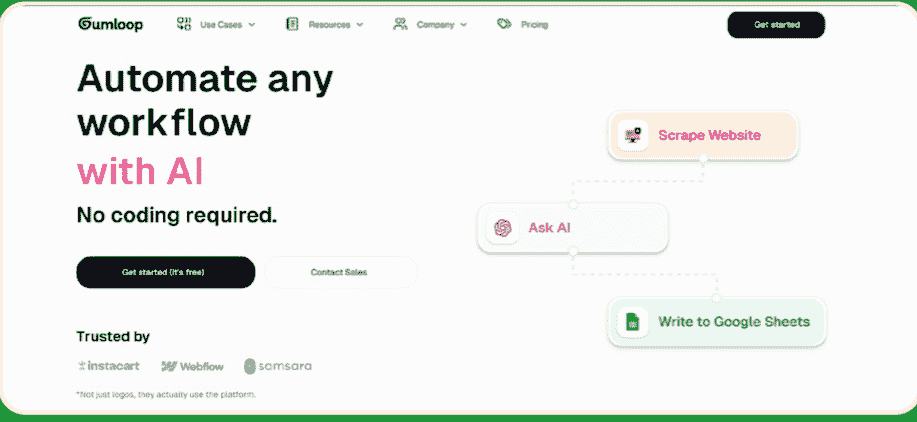
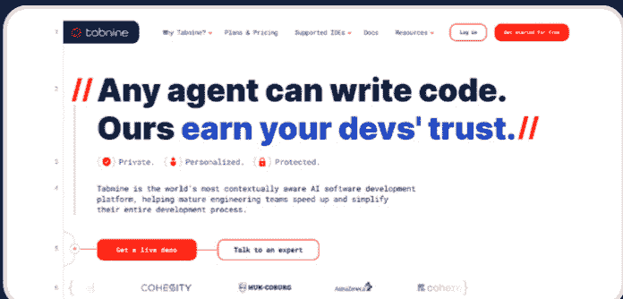
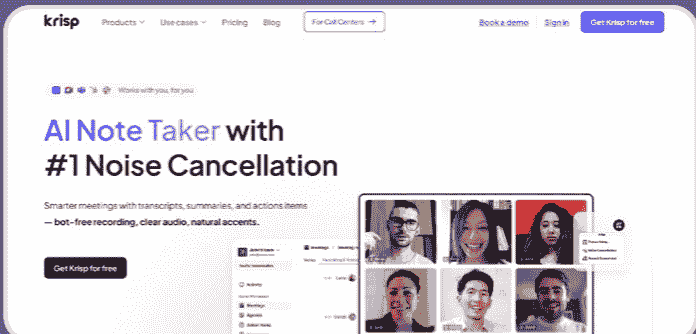
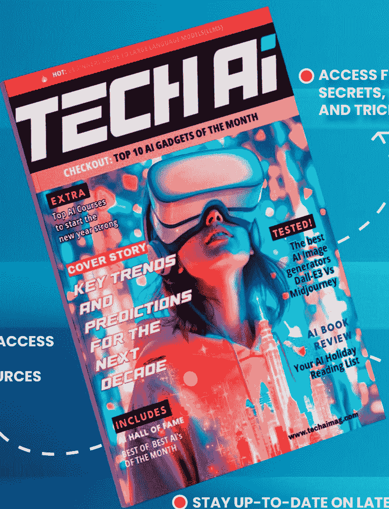
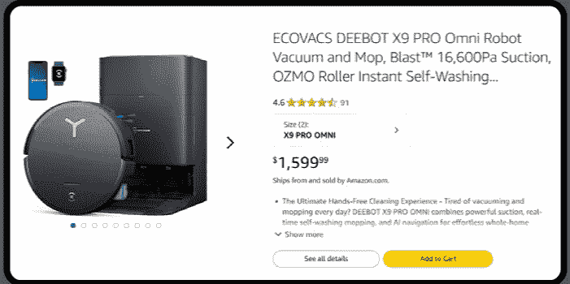
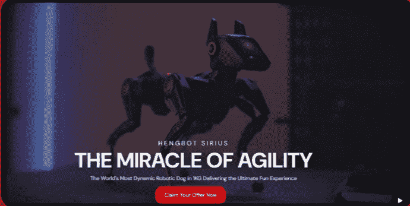
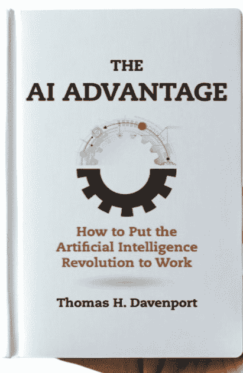
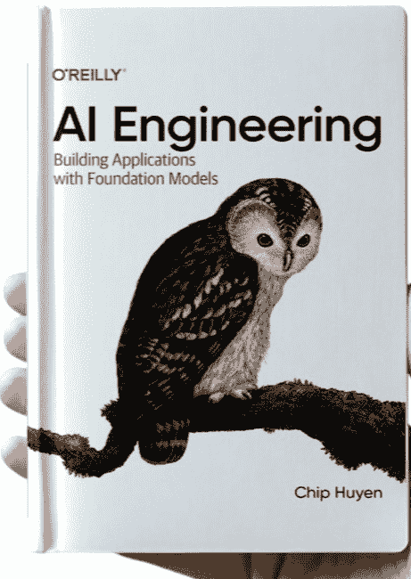
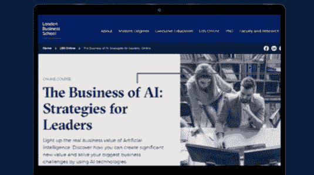
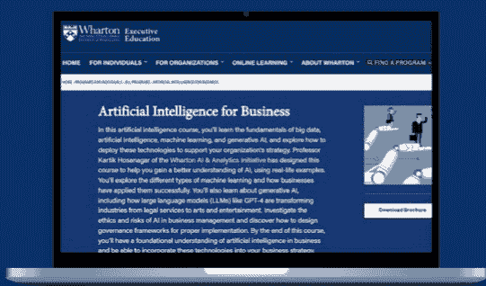

# Tech AI 杂志 - 2025年7月

在您喜爱的数字新闻摊上阅读《Tech AI》杂志！

- Magzter
- Zinio
- pressreader
- pocketmags

# 访问

TECHAIMAG.COM

探索前沿 AI 应用、强大工具和最热 AI 趋势的宝库。

- 免费获取 AI 资源
- 随时了解最新 AI 新闻、小工具、应用和产品
- 获取 AI 图书
- 从零开始学习 AI 课程

# 扫码访问

# 订阅我们的每周通讯

立即订阅

联系我们

与《TECH AI 杂志》一起点燃您的品牌 advertising@techaimag.com

在《TECH AI 杂志》上展示您的产品。联系我们 contact@techaimag.com

关于授权和联合发行，请联系我们：contact@techaimag.com

# Getty 与 Stability AI：生成式 AI 的法律基石？

伦敦 Getty Images 与 Stability AI 之间上演的法庭戏剧，远不止是一场典型的公司纠纷。这场今日进入审判阶段的法律对抗，直指人工智能公司如何合法构建其系统的核心问题。Getty Images 指控 Stability AI 未经许可，使用了超过 1200 万张受版权保护的照片、标题和元数据来训练其热门图像生成模型 Stable Diffusion。

根据该 AI 生成公司最新的财务报表，Getty 正向 Stability AI 寻求高达 17 亿美元的赔偿，这使其成为 AI 历史上最昂贵的版权纠纷之一。本案的核心是一个超越这两家公司的根本问题：AI 开发者是否可以自由使用互联网上发现的受版权材料来训练其系统，还是必须获得明确许可并可能支付许可费？

要了解本案为何如此重要，请考虑 AI 模型如何学习。与遵循明确编程指令的传统软件不同，Stable Diffusion 等 AI 系统会检查数百万个示例以识别模式和关系。当您要求系统生成“一幅群山之上的日落”图像时，它会借鉴其在训练期间遇到的无数个日落和山景的理解。问题在于，这种学习过程是构成合理使用还是版权侵权。

# Meta 斥资逾 100 亿美元押注 Scale AI

这代表了近期历史上最大规模的私营公司投资之一，Meta Platforms 正在洽谈对人工智能初创公司 Scale AI 进行可能超过 100 亿美元的投资。这笔巨额资金承诺表明，高质量训练数据在打造顶尖 AI 系统的竞赛中变得多么关键。

Scale AI 专注于数据标注和标注服务，这是教导 AI 系统准确理解和分类信息的过程中常被忽视但绝对关键的一环。您可以将其视为提供答案密钥，帮助 AI 模型学习汽车与卡车之间的区别，或理解一段文本表达的是积极还是消极情绪。没有精确标注的训练数据，即使是最精密的 AI 架构也难以可靠地运行。

要理解数据质量为何如此重要，想象一下试图从一本有一半翻译错误的教科书中学习一门外语。您可能完美地记住词汇和语法规则，但您的理解将从根本上存在缺陷。当在标注不佳或数据不一致的情况下训练时，AI 模型面临着同样的挑战。它们可能会对错误答案充满信心，从而使其在关键应用中不可靠。

# 代码生成初创公司引领 AI 驱动的开发热潮

软件开发行业正在经历根本性变革，因为 AI 驱动的代码生成工具以前所未有的速度激增。自从 ChatGPT 展示 AI 可以编写功能代码以来，风险投资已涌入承诺自动化软件开发大量工作的初创公司。

这些公司正在构建能够理解所需功能的自然语言描述并将其转化为跨多种编程语言的可工作代码的工具。一些公司专注于生成样板代码和标准功能，而另一些则着手解决更复杂的挑战，例如调试现有代码库或优化性能瓶颈。

要理解这一转变的规模，请考虑软件开发传统上是如何运作的。业务分析师会描述应用程序应该做什么，软件架构师会设计系统结构，程序员会编写成千上万行代码来实现该设计。对于复杂的应用程序，这个过程可能需要数月甚至数年。AI 代码生成承诺通过从高级描述自动生成可工作代码，大大压缩此时间线。

# Google 推出 Gemini 2.5 Pro 预览版，携带编码能力强大的 Edge

Google 发布 Gemini 2.5 Pro 预览版，标志着人工智能能力的重大进步，特别是在需要复杂推理和多步骤问题解决的领域。早期用户报告称，与之前版本相比，该模型在处理复杂编码任务、数学推理和科学分析方面有了显著改进。

该模型在处理多文件编程项目方面表现出色，这一能力解决了早期 AI 编码助手的关键局限性之一。与使用孤立的代码片段不同，Gemini 2.5 Pro 可以理解项目中不同文件之间的关系，并对多个组件进行协调更改。

这一进步解决了 AI 辅助编程中的一个关键挑战。真实的软件项目很少由单一的独立文件组成。现代应用程序涉及数据库、用户界面、服务器逻辑和外部服务之间的复杂交互。一个一次只能处理一个文件的 AI，对于在大型项目上工作的专业开发人员来说，价值有限。

# 联合国发出警报：科技巨头因 AI 导致的排放量激增 150%

联合国已对主要科技公司碳排放量激增 150% 发出警报，这一激增很大程度上归因于人工智能基础设施的爆炸式增长。这一警告凸显了训练和运行大规模 AI 模型的环境成本，这些模型需要巨大的计算资源和能源消耗。

根据最近的联合国报告，为先进 AI 模型供电的数据中心消耗大量电力，通常来自化石燃料。训练一个单一的大型语言模型排放的碳量可与五辆汽油动力汽车在整个生命周期内的排放量相当。随着 Google、Microsoft、Meta 和 Amazon 等公司竞相大规模部署 AI，环境影响变得越来越难以忽视。

联合国敦促政府和企业采用更可持续的做法，包括使用可再生能源为数据中心供电、提高模型效率以及强制执行环境透明度。如果没有这些措施，AI 的气候影响可能会削弱全球根据《巴黎协定》减少碳排放的努力。

这一警告将科技行业的可持续发展承诺推向考验。尽管 AI 创新继续高速推进，现在的问题是，这种进步能否在不加速环境破坏的情况下实现。

# Reuters 推出 AI 套件以加速视频制作

Reuters 推出其用于视频制作的 AI 套件，说明传统媒体组织正在适应技术变革，而不仅仅是被其颠覆。该套件提供了转录、翻译、元数据生成和内容组织的集成工具，以解决新闻制作工作流程中的特定挑战。

与通用 AI 工具不同，Reuters 开发了针对新闻组织独特需求量身定制的解决方案。该系统可以快速将多种语言的访谈转录为文字，为视频档案生成可搜索的元数据，并帮助记者在冗长录音中识别关键时刻。这些功能在突发新闻情况下尤其有价值，因为速度和准确性至关重要。

当您考虑新闻组织面临的具体挑战时，通用 AI 工具与专用 AI 工具之间的差异便清晰明了。通用转录服务可能会在技术术语、专有名词或国际新闻报道中常见的带口音的语音方面遇到困难。Reuters 的专用系统经过训练，可以处理这些挑战，产生需要较少手动校正的更准确结果。

## TECH AI 杂志面向全球 746313 名学生

Tech AI 杂志致力于在学术机构中推进 AI 教育。我们向符合条件的大学和学院提供杂志一年期无限免费访问权限！

**立即让您的机构加入我们。**

## 本月值得关注的 6 款 AI

人工智能已从流行语演变为业务需求。当今的 AI 工具正在改变公司的运营方式，从日常任务到复杂的代码生成，实现一切自动化。从处理琐事到编写复杂代码，AI 软件正成为渴望在竞争中立足的团队的标配。它们值得关注吗？它们不仅仅是思想实验；它们是真实世界的、复杂的工具，并在各自的利基市场中引起轰动。让我们来看看。

### 01. Notion AI

基于广受喜爱的工作区平台，Notion AI 将智能创意和自动化直接集成到您现有的工作流程中。它可以协助生成内容、总结文件、组织任务，甚至构建数据库，这对于希望将信息汇集到一个位置并简化日常工作流程的团队来说是一笔宝贵的财富。其在广泛采用的生产力软件包中的易用性使其更具吸引力。

### 为什么这很重要：

Notion 已从一款基本的记事应用程序发展成为一站式生产力中心。借助 Notion AI，它现在可以提供上下文感知的自动化，将静态文档转化为动态资源。例如，它可以：

- 从散乱的笔记中自动生成项目简报。
- 将冗长的研究总结为高管要点。
- 根据自然语言提示构建关系数据库（例如，“为我们的销售渠道创建 CRM 跟踪器”）。

> **适用对象**
> 远程团队、知识密集型职位（例如，咨询、法律）以及扩大文档规模的初创公司。

### 02. Gumloop

Gumloop 通过将 Zapier（一个用于自动化、集成和 AI 编排来管理工作流程的平台）的灵活性与大型语言模型的智能相结合，为工作流程自动化提供了一种现代方法。企业可以将任何主要的 LLM（例如 GPT-4 或 Claude）连接到内部工具，并在不编写代码的情况下自动化任务。值得指出的是，Gumloop 提供对高级 AI 模型的内置访问权限、简洁的界面以及持续运行的代理，这些代理可以实时监控并处理新数据，非常适合销售、研究和行政自动化。

### 为什么这很重要：

Gumloop 弥合了 Zapier 的连接能力与 LLM 智能之间的差距。与传统的自动化工具不同，它允许用户：

- 部署 AI 代理以监控 CRM 更新并触发个性化跟进。
- 使用 Claude 或 GPT-4 从支持工单中自动提取见解。
- 构建实时仪表板，分析销售通话并标记流失风险。

**适用对象**
收入运营（RevOps）、客户支持和数据驱动型团队。

### 03. Tabnine

官网

Tabnine 是专为同时重视生产力和安全性的开发者构建的。Tabnine 与流行的 IDE 无缝协作，提供实时代码补全、从自然语言注释自动生成代码，以及自适应学习个人编码风格。Tabnine 的 SOC-2 合规性保证了高隐私和安全标准，使其非常适合企业环境。

### 为什么这很重要：

虽然 GitHub Copilot 备受关注，但 Tabnine 专注于企业级安全性（SOC-2 合规）和定制化代码推荐。它：

- 学习用户的编码风格以最大限度减少上下文切换。
- 从注释生成样板代码（例如，“创建带验证的 React 表单”）。
- 可与私有仓库协作而不泄露敏感信息。

**适用对象**
金融科技、医疗保健以及代码隐私至关重要的受监管行业。

### 04. GetGenerative.ai

GetGenerative.ai 专注于利用生成式 AI 简化软件开发生命周期的各个方面，尤其是在企业环境中。用户指出，它能够快速生成设计提案、用户故事和史诗，显著减少项目规划和开发中的手动工作量。其对复杂企业软件项目的实际应用关注，使其成为开发团队的宝贵工具。

### 为什么这很重要：

该工具通过以下方式解决软件项目中的规划和部署难题：

- 从利益相关者访谈中自动生成用户故事。
- 将线框图转换为功能规格（例如，“将此 Figma 设计转换为 React 组件”）。
- 使用历史项目数据在敏捷冲刺中标记范围缺口。

> 适用对象
> 产品经理、企业 DevOps 以及同时处理复杂客户项目的代理机构。

### 05. Saleshandy

Saleshandy 是一款 AI 驱动的冷邮件外联软件。它使用 AI 自动化和个性化电子邮件活动，以发现潜在客户并根据理想客户画像（ICP）定制消息。该软件旨在最大限度提高潜在客户开发的效果，特别是对于寻求扩大覆盖范围的销售代理机构以及中小型企业。

### 为什么这很重要：

Saleshandy 的 AI 不仅仅是通用电子邮件序列。它：

- 筛选 LinkedIn 个人资料以定制消息（例如，“引用他们关于可持续发展的最近帖子”）。
- 使用历史互动数据预测回复的可能性。
- 使用 GPT-4 实时 A/B 测试主题行。

适用对象 B2B 销售团队、招聘人员和自力更生的初创公司。

### 06. Krisp

在线会议是现代商业日常的一部分，而背景噪音可能是很大的干扰。Krisp 提供 AI 降噪，以及转录、记笔记和录制功能。它安装在多个平台上，旨在通过提供清晰的音频和完整的文档，使在线会议更高效，让参与者专注于所说的内容，而不是背景噪音。

### 为什么这很重要：

Krisp 不仅仅是降噪；它是一个会议智能平台。除了清晰的音频之外，它：

- 生成带有发言者标注的可搜索转录文本。
- 标记行动事项（例如，“Joel 周五前发送提案”）。
- 与 Zoom/Teams 集成以自动加入和录制通话。

适用对象 顾问、以异步优先的公司以及任何被连续会议淹没的人。

### 最后的想法

这些解决方案代表了不断发展的 AI 格局的一个快照，为一系列商业问题提供了实际解决方案。2025 年企业面临的问题不再是是否采用 AI，而是哪些组合能够释放自身潜力。随着 AI 的不断发展，其在日常业务流程中的应用有望带来更高效率以及新的增长途径。

## 立即订阅

免费获取 AI 秘诀、技巧和窍门

免费获取 AI 资源

紧跟最新 AI 新闻、小工具、应用和产品

www.techaimag.com

## 当下真正重要的 6 款颠覆性 AI 小工具

科技世界日新月异，但大多数“革命性”小工具最终都会吃灰在抽屉里。这就是为什么我们不被花哨的营销所迷惑，深入挖掘那些真正改变你生活和工作方式的设备。

本月的推荐不仅仅是关于拥有最新规格，而是关于解决你甚至不知道自己存在的真实问题。从像专业清洁工一样思考的机器人吸尘器，到将任何空间变成你私人电影院的眼镜，这些小工具代表的不仅仅是渐进式的升级。

无论你是追逐每一个新小工具的人，还是对生活中值得占据空间的东西更加挑剔，这六款设备都值得认真考虑。它们代表了创新与实用性的罕见交汇点，新的人工智能技术与真正的实用性在此相遇。

让我们来看看本月真正值得你花钱和关注的东西。

### 1. Ecovacs Deebot X9 Pro Omni Robot Vacuum

Deebot X9 Pro Omni 重新定义了旗舰级机器人清洁器的能力。它将强大的 BLAST 吸力（旨在增强超越典型机型的气流）与自清洁 OZMO 滚刷相结合，均通过智能传感器和 AI 逻辑协调。除此之外，自动充电站可清洗、烘干甚至自行补充拖把和尘盒，您将拥有一个自给自足的清洁系统，能以出色的灵活性适应地毯和硬地板。

#### 技术规格

- 16,600 Pa 吸力，气流 16.3 L/s
- 可自清洁并为地毯抬起的 OZMO 滚刷
- ZeroTangle 3.0 毛刷可防止毛发缠绕
- 带 AIVI 3D 物体识别的 dToF 激光雷达导航
- 200 分钟续航，支持自动集尘和自动排水
- 支持通过 YIKO-GPT、Alexa 和 Google Assistant 进行语音控制

#### 价格

建议零售价为 1,599.99 美元，不过当前优惠已将其降至 1,299.99 美元，早期发售促销可节省 300 美元。

### 2. Wyze Bulb Cam Outdoor Security Camera

这款巧妙的设备让户外安防变得轻松。它将明亮的 800 流明 LED 灯泡与 2K 安防摄像头合二为一，可整齐地安装在任何标准 E26 灯座中。Wyze 将门廊灯变成摄像头，无需新布线或电池麻烦，即可提供智能监控。自动化、运动触发照明以及与 Alexa 和 Google Home 的集成，使其成为您智能家居设置中无缝的补充。

#### 技术规格

- 2K 视频分辨率，视场角 160°
- 彩色夜视功能
- 双向对讲，内置警笛
- 800 流明 LED，支持应用控制亮度和定时
- 通过 microSD 进行本地存储（最大 256GB）
- IP65 防尘防水

#### 价格

售价 49.98 美元。附加灯泡每个 16.98 美元。云端套餐起价 3 美元/月，‘无限’档位为 20 美元/月。

### 3. Viture Pro XR Glasses Personal Display

想象一下戴上轻便眼镜，瞬间就能看到眼前漂浮着一个私人、电影院大小的 135 英寸屏幕。Viture Pro XR 可让您在外出时实现这一体验，无论是玩游戏、流媒体还是工作。这些金属镜框眼镜清晰、明亮且便携，非常适合不想携带笔记本电脑或耳机的商务旅人士。

#### 技术规格

- 双 1080p OLED 显示屏，打造 135 英寸虚拟屏幕
- 120Hz 刷新率，画面流畅
- 4,000 尼特峰值亮度（感知约 1,000 尼特）
- 近视镜片调节（0 至 -5 屈光度）
- 46° 视场角，支持调节瞳距
- HARMAN 调音立体声

#### 价格

零售价 459 美元，不过促销常将其降至 399 美元。随移动底座的捆绑包可达 549 美元以上。

### 4. Poly Studio R30 USB Video Bar

视频通话不再需要摆弄电缆或不匹配的设备。Studio R30 将 4K 摄像头、智能音频和强大麦克风封装在一个时尚的条形设备中，只需插入笔记本电脑即可使用。其 DirectorAI 能让您始终在画面中，回声消除和噪声抑制确保同事只能听到您的声音。非常适合单人专业人士和小团队，只需一台设备即可实现会议级制作质量。

#### 技术规格

- 4K 摄像头，视场角 120°
- DirectorAI 自动构图和跟踪
- 内置立体声扬声器和 3 麦克风阵列
- 声学围栏和 NoiseBlockAI 处理
- USB-A 和 USB-C 连接
- 包含夹具和三脚架安装选项

#### 价格

建议零售价 699.95 美元，但经常打折：当前价格视零售商而定，徘徊在 398 至 445 美元之间。

### 5. Unitree G1 Humanoid AI Robot

G1 将令人印象深刻的人形功能带入实验室和创作者手中。身高略超过 4 英尺，重 35 公斤，可跑速达 7 英尺/秒，在压力下保持平衡，并能举起小物体。G1 配备激光雷达和深度相机、8 核 CPU（可选升级）以及模块化手臂和灵巧手部，是现实世界交互和机器人研究的严肃平台。

#### 技术规格

- 身高 1.32 米，重 35 公斤
- 23 自由度（EDU 版本可升级至 43 自由度）
- 配备 8 核 CPU，最高速度 2 米/秒
- 可选 NVIDIA Orin 升级，用于 AI 处理
- 激光雷达和深度相机，用于导航
- 9,000 mAh 电池，续航 2 小时

#### 价格

基础型号起价 16,000 美元。带有配件和支持的 EDU 套餐可达 20,000 美元以上，不过部分供应商标价接近 21,600 至 27,300 美元（含进口关税）

### 6. Hengbot Sirius

Sirius 是一款小巧的机器狗，重量轻便易携，灵活足以吸引科技爱好者。采用仿生框架和富有表现力的关节制造，这只一公斤重的小狗能吠叫、跳舞并对手势做出反应。开发者可使用 Python 或 C++ 自定义行为，并体验其搭载的摄像头、LED 和语音输入。它是一款有趣、可编程的宠物，同时也在玩具与工具的边界上不断探索。

#### 技术规格

- 重量约 1 公斤，14 自由度
- 仿生铝制框架
- 完整的动作库：行走、跳舞、跳跃、转身
- 语音、手势和应用控制
- 支持 Python 和 C++ 编程
- 搭载摄像头、麦克风和 LED 阵列
- 活跃使用 45 分钟，待机 2 小时

#### 价格

Kickstarter 预购起价 659 美元（需支付 20 美元定金）。全面零售价预计将上涨至约 699 至 1,459 美元

## 机器中的导演：Google Veo 3 如何悄然重写电影制作手册

想象一个世界，在那里，你最生动的白日梦不再是转瞬即逝的想法，而是可观看、可分享且可无限扩展的完整电影体验。这不再是科幻片中的一幕。在人工智能创新快速发展的时代，Google 推出了 Veo 3，这是一个创意巨人，可能重新定义我们创作和分享故事的方式。Veo 3 不仅仅是技术实力的展示，更是跨向 AI 电影制作未来的大胆一步。Veo 能够根据简单的提示生成惊艳的 4K 视频和同步声音，它不仅正在接近好莱坞的大门，而且正在隔壁打开一扇新门。

数十年来，电影制作艺术一直是少数人的领域——那些拥有影棚、数百万美元预算和技术专业人员大军的人。但如果你只需要一个想法和合适的词语来描述它，又会如何？这就是生成式 AI 诱人的承诺，而有了 Veo 3，Google 或许给出了迄今为止最令人兴奋的答案。

### 新型导演的黎明：Veo 3 是什么？

Veo 3 由 Google DeepMind 开发，是文本转视频和图像转视频技术的最新演进。但称其为仅仅是“视频生成器”是一种轻描淡写。不妨将 Veo 视为一位数字见习导演，他吸收了多年的电影叙事，不仅理解画面，也理解电影的节奏和情感冲击力。

给它一句类似：“一次全景镜头，一名孤独的宇航员凝视着深空中的多彩星云，背景中柔和的合唱团渐强，”Veo 就会开始工作——不仅仅是插图，而是导演。它构图，以惊人的精度渲染图像，并分层叠加能增强瞬间的声音。最终结果不像机器制作，而像艺术家的指引。

### 不仅仅是动态画面：Veo 3 的突出功能

让 Veo 3 走向聚光灯下的，不仅仅是它能制作视频。而是它如何解决 AI 视频创作中的现实挑战——并且出色地解决了它们。

### 从模糊画面到电影级细节：4K 及更远

早期的 AI 生成视频往往感觉像是视觉噪声——模糊、不一致、像梦境一样。Veo 3 远超这一点，提供高达 4K 的高清晰度。视觉保真度的这一飞跃让创作者能够制作出感觉精致专业的内容，无论是用于短片还是商业广告。其对运动、光照和纹理的细腻处理使最终作品感觉真实且可信。

### 属于场景的音频

Veo 3 真正开创新天地的地方在于声音生成。创作者不再需要将不匹配的素材音效事后叠加。Veo 原生生成音频，为每个动作和场景匹配合适的声音——森林中沙沙作响的树叶、口型同步的对话，或戏剧性高潮时的管弦乐渐强。结果令人身临其境：不仅是一个视频，而是一种体验。

### 用语言导演：精度与控制

Veo 3 理解电影语言。无论您指示它使用“跟拍”、“黄金时段光照”还是“延时转场”，它都会以细腻的调整做出回应，模仿传统电影制作技术。这种程度的控制缩短了创意反馈循环，帮助讲故事者实现他们所想象的一切，无需多层猜测。

### 解决诡异谷问题

AI 视频常常面临视觉不一致、角色在帧与帧之间出现故障，或物理效果不太合理等问题。Veo 3 通过更好的对象恒常性和自然运动建模，直面解决这些问题。水花应有尽有，阴影自然变化，而且最重要的是，角色在镜头间保持身份一致。它使讲故事不仅成为可能，而且情感上令人信服。

### 将 Veo 3 交到关键人士手中

Google 并没有将 Veo 3 门户紧闭。相反，它正在将该技术嵌入到各个平台，以面向广泛的创意受众开放。

- 面向普通创作者：Gemini Advanced 订阅者现在可以在类似聊天的界面中使用 Veo，该界面实际上充当了一个微型视频工作室。

- 面向开发者和构建者：Veo 正在集成到 Vertex AI（Google 的基于云的套件）中，为由 Veo 功能驱动的新工具、应用和平台打开了大门。

- 面向专业人士：Google 的新创意工具 Flow 旨在与 Veo 协同工作。它提供场景规划、角色设计和导演工具等功能，将专业级视频制作带入数字时代。

### 生成式视频之战：Veo vs. Sora

任何关于 Veo 的讨论都离不开其主要竞争对手 OpenAI 的 Sora。尽管两款工具都在不断拓展 AI 视频的可能性边界，但各自采取的优势方向有所不同。

| 功能 | Google 的 Veo 3 | OpenAI 的 Sora |
| :--- | :--- | :--- |
| 核心优势 | 真实感、音频、电影级打磨 | 更长、更灵活的片段 |
| 最大分辨率性能 | 最高 4K | 1080p |
| 音频生成 | 内置原生音频 | OpenAI 无原生音频 |
| 视频时长 | 1 分钟以上（公开版 8 秒） | 最多 60 秒 |
| 访问方式 | Gemini、Flow、Vertex AI | ChatGPT Plus |

尽管 Sora 凭借更长的运行时间和富有想象力的叙事展现出前景，但 Veo 3 在保真度以及至关重要的原生音频加持方面目前处于领先地位。

### 用提示词而非脚本塑造未来

Veo 3 不仅改变了视频制作方式，更改变了谁能够制作视频。对于独立电影制作者，它是一款强大的预可视化与制作工具。对于营销人员，它是制作精美视频广告的捷径。对于教育工作者，它提供了一种使用丰富动画视觉效果进行教学的全新方式。

但强大的力量也带来了对保障措施的需求。Google 推出了 SynthID，这是一种数字水印系统，可无形地为 AI 生成的视频打上标签，帮助在深度伪造和虚假信息盛行的时代识别和追踪内容。

在这个新篇章中，导演椅不再局限于电影片场。任何拥有愿景——并掌握合适措辞——的人都可以现在掌控大局。Veo 3 并非在取代人类创造力。它正在成为一位盟友，帮助以生动、动人的细节将想法变为现实。在这个技术与想象力交织的故事中，提示词或许将成为未来的剧本。

## 七月 AI 阅读清单

AI 变化飞快。新模型每月发布。新框架每周涌现。工程师无法读遍一切。他们需要挑选真正重要的内容。

我们找到了两本重要的书籍。两位作者都构建过真实系统。两人都处理过生产环境问题。两人都清楚什么有效，什么会失效。

这些书不会教你最新的模型架构。它们教你更有价值的东西：如何构建在生产环境中可用的 AI。

### AI 优势：如何让人工智能革命发挥作用

Thomas Davenport 研究分析领域数十年。他曾与 MIT、哈佛商学院和巴布森学院合作。他见识过多次技术浪潮。他对 AI 的看法源于这一背景。

该书于 2024 年初出版。它侧重于 AI 的实际实施。Davenport 采访了部署 AI 的公司领导。他同时研究了失败与成功案例。

Davenport 提倡“增强型智能”。这意味着 AI 应该协助人类，而非取代他们。对工程师而言，这意味着构建用户能够理解和信任的系统。

#### 寻找良好用例

并非每个问题都需要 AI。有些问题使用规则或基础统计方法效果更好。Davenport 提供了识别 AI 能创造价值的问题的框架。

他提供了评估 AI 机会的检查清单。该问题是否涉及大量数据？是否存在清晰模式？你能衡量成功吗？这些问题有助于工程师与产品经理进行更好的沟通。

他的风险评估框架帮助技术团队与利益相关者沟通。你将获得具体的类别，而非关于 AI 风险的模糊警告。技术风险。运营风险。业务风险。

#### 从失败中学习

本书包含详细的失败案例研究。一家构建了无人使用的推荐系统的零售公司。一家无法将 AI 与现有工作流程集成的医疗系统。一家部署了会做出有偏见决策的模型的金融公司。

这些失败比成功故事更有教育意义。它们揭示了常见错误。数据质量差。缺乏用户培训。测试不足。缺少反馈循环。

Davenport 分析了这些项目失败的原因。问题选择错误。期望不切实际。项目管理不善。这些洞察帮助工程师避免类似错误。

#### 构建用户信任的系统

用户需要理解 AI 建议。黑盒系统会带来问题。当 AI 出错时，用户需要知道原因。这会影响系统架构。

Davenport 探讨了可解释 AI 模式。你如何记录 AI 决策？你如何展示置信度？你如何允许用户推翻 AI 建议？

他讨论了 AI 系统的用户界面设计。你如何呈现不确定信息？你如何处理边缘情况？你如何建立用户对 AI 建议的信心？

#### 项目生命周期管理

AI 项目的阶段与传统软件不同。数据收集和准备耗时更长。模型训练需要迭代。部署需要仔细监控。

Davenport 为 AI 项目提供了项目模板。规划阶段。资源需求。风险缓解策略。成功标准。这些模板帮助工程团队设定现实的预期。

他涵盖了 AI 系统的维护需求。模型会随时间降级。数据分布会发生变化。用户需求会演变。AI 系统需要持续关注，而传统软件则不然。

#### 技术决策框架

尽管本书面向商业读者，但它能帮助工程师做出更好的技术决策。哪些问题应该使用 AI？如何衡量 AI 项目的成功？如何向商业利益相关者传达技术限制？

Davenport 的实施框架帮助工程团队构建 AI 项目。从小处着手。衡量结果。逐步扩展。这种方法比试图一次性转变一切效果更好。

在 Amazon 上可购买

### AI 工程：使用基础模型构建应用

作者 Chip Huyen

Chip Huyen 在斯坦福大学任教。她曾在 Netflix 和 NVIDIA 工作。她既懂研究也懂生产。这一点在她的写作中体现得淋漓尽致。

本书共 350 页。它专注于一个目标：将 AI 从实验转移到可运行的系统中。Huyen 于 2025 年出版此书。它解决了工程师今天面临的问题。

Huyen 将 AI 工程称为一个新领域。它不是机器学习。它不是软件工程。它结合了两者，但创造出了不同的东西。

#### AI 工程的不同之处

常规软件接收输入 A 并每次都给出输出 B。AI 系统不这样工作。它们会对相同的输入给出不同的输出。一个 99% 时间都能正常工作的系统，每百次尝试仍会失败一次。

Huyen 展示了如何思考不可预测的系统。她涵盖了常规软件中不存在的故障模式。她教授了处理不确定性的设计模式。

本书给出了真实案例。提示词版本控制系统。模型漂移检测。AI 功能的 A/B 测试。你可以将这些模式应用到下一个项目中。

#### 生产环境部署

研究代码在笔记本中运行。生产代码面对数百万用户。这些是不同的问题。Huyen 花费数年时间将模型从实验室迁移到生产服务中。

她涵盖了难点。如何容器化模型。如何处理 API 速率限制。如何构建在第三方 API 故障时仍能工作的系统。当 OpenAI 宕机时，你的用户仍然需要可用的软件。

她的代码示例处理真实问题。错误的输入数据。网络超时。内存限制。她展示了事物出错时会发生什么，而不仅仅是正常工作时的情况。

#### 工具选择与基础设施

AI 工具每月都在变化。新的向量数据库推出。旧平台关闭。Huyen 不预测哪些工具会获胜。她为你选择工具提供了框架。

她解释了自建与购买的决策。你应该使用托管服务吗？你应该构建自己的基础设施吗？她的决策树源于实际经验。

本书涵盖了成本控制。大型模型运行需要花费。Huyen 展示了在不影响质量的前提下降低推理成本的技术。这些每月可以节省数千美元。

她讨论了缓存策略。批处理优化。资源分配。这些话题听起来枯燥，但它们决定了你的 AI 项目是成功还是烧光预算。

#### 技术架构模式

Huyen 提供了常见 AI 工程问题的模式。如何对提示词进行版本控制。如何处理模型更新。如何监控 AI 系统行为。如何实现渐进式发布。

她涵盖了 AI 系统的数据管道设计。传统 ETL 不适用于 AI。你需要不同的模式来处理训练数据、推理数据和反馈循环。

监控部分值得关注。AI 系统会以微妙的方式失败。传统应用程序监控会错过这些故障。Huyen 展示了能够捕捉 AI 特定问题的监控策略。

#### 为何这本书很重要

大多数 AI 书籍面向研究人员或商业领袖。本书面向构建系统的工程师。它假设你会编码。它假设你关心正常运行时间和用户体验。

Huyen 没有夸大 AI 能力。她将局限性与优势一并展示。她解释了 AI 在何时解决问题，以及何时更简单的解决方案效果更好。

资深工程师会认识到他们通过试错开发出的模式。初级工程师将获得一条构建在生产环境中不会崩溃的 AI 系统的路线图。

### AI 问答

利用 AI 经营社交媒体，同时守护品牌灵魂

> 我是一名市场经理，老板希望我用 AI 来撰写所有社交媒体帖子。我担心这会让我们的品牌听起来机械且平庸。如何有效使用 AI，同时保持真实的品牌声音？

啊，典型的现代职场两难：老板发现了 AI，现在觉得它是一根能解决所有问题的魔法生产力魔杖，而你却在担心，自己的品牌是不是即将听起来像是由公司董事会里的机器人养大的。我完全理解你的担忧，坦诚地说，这正是应该有的担忧。

把 AI 想象成一位非常有才华但缺乏经验的实习生：读过所有市场营销教科书，却从未真正见过你的客户。这位实习生能写出语法完美的句子，熟知所有流行语，而且从不喝咖啡休息。但如果让他捕捉你的品牌与客户沟通的具体方式——比如，谈到组装 IKEA 家具时的那种挫败感——他可能会给你一段听起来像是从泛泛的“亲和力手册”中摘抄的内容，而非真正的理解。

好消息是：你并非必须在效率和真实性之间二选一。秘诀在于把 AI 当作它本身：一个极其复杂的写作助手，而非你的品牌声音和战略思维的替代品。

#### 了解 AI 实际如何“思考”写作

我们先快速掀开引擎盖看看。当 AI 撰写社交媒体内容时，它本质上是在玩一个极其复杂的“下一个词会是什么？”游戏，依据的是从数百万个示例中学到的模式。这就像有个人背诵过他听到的每一次对话，但并不真正理解人们为什么会对某些笑话发笑，或对特定话题产生情感共鸣。

这就是为什么 AI 生成的内容通常在技术上正确，但在情感上显得平淡。它知道“亲和力内容表现良好”，但本身并不亲和任何事物。它理解“真实声音能推动互动”，但从未对任何事物保持过真实，因为嘛，它本身从来就不是任何东西。

大型语言模型（LLMs）——即 ChatGPT、Claude 或 Jasper 等 AI 系统的技术术语——是在互联网上海量文本上训练而成的。它们学习语言模式，但不像人类那样学习上下文。它们不知道，你品牌略带讽刺的语气源自创始人的个性，也不明白你的客户之所以欣赏对产品局限性的坦诚，是因为他们曾被过度承诺的竞争对手伤害过。

- 你的幽默风格是什么？（自嘲、观察型、双关语，还是都没有？）
- 你如何处理问题？（道歉且正式 vs. 坦诚且侧重解决方案）
- 你从不使用哪些词？（也许“leverage”让你感到尴尬，或者“rockstar”显得太过刻意）

每次使用 AI 工具时，都将这些信息输入其中。大多数 AI 系统允许你设置自定义指令或上下文，它们会在整个对话过程中记住这些信息。

#### AI 协作的艺术，而非替代

奇迹就在这里发生：不要让 AI 来撰写你的帖子，而要将其用作头脑风暴伙伴和初稿生成器。把它想象成一个写作伙伴，能快速勾勒出想法，然后你再将其塑造成独一无二的作品。

#### 以品牌指南作为 AI 的辅助轮

在接触任何 AI 工具之前，先创建我所说的“品牌声音速查表”。这不是企业行话，而是你的品牌沟通方式中真正实在的细节。

例如：

- 你是否使用缩略形式？当然我们使用 vs. 我们当然使用

#### 三层方法

第一层：AI 生成原始素材。给它具体的提示，例如：“为我们的新产品发布写出 5 种不同角度，同时记住我们的受众更看重实用解决方案，而非花哨功能。”

第二层：你添加品牌调味。获取 AI 结构合理但平淡的输出，并向其中注入你的品牌个性。也许 AI 写了“我们激动地宣布……”，而你将其改为“好吧，我们尽量不想过度推销，但是……”，因为这更符合你的风格。

第三层：你加入人性化的时刻。这时你可以引用具体的客户反馈，承认行业中的挫败感，或者添加那些细小的细节，表明你确实了解受众的世界。

#### 真正有效的实用策略

**70-30 法则：** 目标是让 AI 承担大约 70% 的繁重工作（研究、结构、初稿），而你专注于最重要的 30%（声音、战略、真实性）。这不是一条硬性规定，但这是一个很好的起步框架。

**使用 AI 进行构思，而不仅仅是写作：** 在社交媒体中，AI 的一些最佳用途根本与撰写帖子无关。尝试这样的提示：

- “我们的客户关于 [topic] 可能有哪 10 个问题是我们尚未解答的？”
- “我们可以用哪些不同方式向从未听说过 [complex concept] 的人进行解释？”
- “[你的行业] 中有哪些季节性趋势我们应该关注，然后让它识别出可以在你的社交内容中真实回应的常见短语或顾虑。”

#### 常见陷阱及如何避免

**优化陷阱：** AI 喜欢为了互动指标进行优化，但互动并不总是与品牌建设一致。标题党帖子可能会获得更多点赞，但它是否能很好地代表你的品牌？始终将品牌一致性置于纯粹指标之上。

**数量诱惑：** 仅仅因为 AI 能帮你发更多帖子，并不意味着你就应该这样做。质量与一致性比数量更重要。你的受众宁愿每周看到三条精彩的帖子，也不愿看到七条平庸的帖子。

**通用节日帖子综合征：** AI 特别不擅长创建有意义的节日或热点话题内容，因为它不理解你的品牌与这些时刻的关系。要么跳过与你的品牌不自然契合的趋势，要么投入额外的人工思考，使它们变得相关。

#### 超越表面指标，衡量成功

在尝试 AI 协助时，请关注表明品牌健康状况的指标，而不仅仅是互动：

- 人们的评论是否表明他们“读懂”了你的品牌？
- 你吸引的是合适的粉丝，而不仅仅是更多粉丝吗？
- 你的帖子是否与整体品牌体验保持一致？
- 你能在不让团队精疲力尽的情况下保持发帖的一致性吗？

#### 长远布局：为团队培养 AI 技能

你的老板可能还没考虑到这一点：有效使用 AI 进行品牌沟通实际上是一项需要培养的技能。这不仅仅是输入提示词然后点击发布。

将此视为一个机会，成为团队中真正了解如何让 AI 为你的品牌发挥作用的人。记录什么有效，什么无效，以及原因。创建其他团队成员可以遵循的流程。随着越来越多的公司试图弄清楚你正在努力寻找的同一平衡点，这种专业知识将变得非常有价值。

#### 核心观点

你担心保持真实性的直觉非常准确，这实际上是你在这种情况下的超能力。在 AI 辅助营销中取得胜利的公司，是那些深思熟虑地使用 AI 的公司，而不是盲目使用 AI 的公司。

AI 绝对可以帮助你创作更多内容，产生新鲜创意，并更高效地处理常规任务。但它无法取代那些让营销真正有效的战略思维、品牌直觉以及对受众的真正理解。

把 AI 视为给你更多时间，专注于需要独特人类技能的营销部分：了解客户的真实需求，就品牌定位做出战略决策，以及创造那些将普通粉丝转化为忠实客户的真实连接时刻。

你的老板想要效率，AI 当然可以提供。但真正的胜利是，你既能交付效率，又能让你的品牌声音比以前更强大、更一致。那不仅仅是使用 AI——那是掌握 AI。

机器人并没有接管营销。它们只是给那些同时理解技术和人类的人带来显著优势。从你的问题来看，你已经以完全正确的方式思考这个问题了。

## 获取独家 AI 内幕消息！

Tech AI Magazine 的 Facebook 页面是你了解最热门 AI 应用、免费 AI 课程和前沿 AI 小工具的入口

关注我们

## AI 旅行伙伴：规划下一次冒险的提示词

利用 AI，将您的旅行规划从令人不知所措变得轻松自如。这 5 个专家精心设计的提示词，可将任何 AI 助手变成您的私人旅行管家，处理从隐藏景点发现到应急准备的各项事务。无论您是计划 500 美元的东南亚冒险，还是奢华的欧洲度假，这些提示词都能在几秒钟内提供个性化、可操作的建议。

### 1. 目的地发现

提示词：“我正在寻找一个 [目的地类型，例如‘海滩度假’、‘冒险山地徒步’、‘文化沉浸式城市短途旅行’]，位于 [地区/大洲，如果已知，例如‘东南亚’、‘欧洲’、‘南美洲’]。我将在 [月份/季节] 旅行，我的预算是 [预算范围，例如‘中档’、‘奢华’、‘经济实惠’]。请推荐 3–5 个选项，附简要描述，并说明为什么它们可能合适？”

响应：

“我正在寻找一个 [目的地类型，例如‘海滩度假’、‘冒险山地徒步’、‘文化沉浸式城市短途旅行’]，位于 [地区/大洲，如果已知，例如‘东南亚’、‘欧洲’、‘南美洲’]。我将在 [月份/季节] 旅行，我的预算是 [预算范围，例如‘中档’、‘奢华’、‘经济实惠’]。请推荐 3–5 个选项，附简要描述，并说明为什么它们可能合适？”

以下是东南亚适合夏季旅行、清凉避暑的经济实惠、注重自然且文化丰富的目的地：

#### 1. 越南大叻

为何适合：

- 因海拔约 1,500 米而气候凉爽——是逃离东南亚热带炎热的清新之选。
- 四周环绕着松林、瀑布、湖泊和花园。
- 拥有丰富的法国殖民风格与越南建筑、艺术咖啡馆以及独特的当地文化。

预算提示：青年旅社每晚从 5–10 美元起，食物便宜又美味。

#### 2. 老挝琅勃拉邦

为何适合：

- 列入世界遗产名录的小镇，拥有佛教寺庙、僧侣早间仪式以及宁静的湄公河风情。
- 四周环绕着翠绿的山脉、瀑布（如宽西瀑布）和自然徒步路线。
- 法国-印度支那遗产与悠闲的老挝文化交融。

预算提示：民宿每晚从 10 美元起，还有出色的街头美食市场。

#### 3. 越南沙巴

为何适合：

- 位于黄连山山脉，即使在夏季气温也较凉爽。
- 因梯田、少数民族村落（苗族、瑶族）和徒步旅行而闻名。
- 通过民宿进行真实的文化交流。

预算提示：与当地导游和民宿一起进行多日徒步旅行非常实惠。

#### 摘要表：

| 地点 | 自然亮点 | 文化元素 | 夏季平均气温 | 预算得分 |
|---|---|---|---|---|
| 越南大叻 | 瀑布，松林 | 法国殖民风格 + 越南 | 15–23°C | ★★★☆☆ |
| 老挝琅勃拉邦 | 瀑布，河流，山脉 | 佛教 + 法老融合 | 20–28°C | ★★★☆☆ |
| 越南沙巴 | 梯田，徒步路线 | 少数民族村落与市场 | 14–22°C | ★★★☆☆ |

如果您想要行程单、签证信息，或想了解哪种体验（例如灵修、徒步、美食导向），请告知我！

#### 提示词说明：

此提示词旨在帮助那些知道自己想要哪种体验，但不确定具体地点的旅行者。它可根据偏好、一年中的时间和预算，帮助 AI 缩小选择范围。

### 2. 行程规划（特定目的地）

提示词：“为对 [兴趣，例如‘古老寺庙与花园’、‘当地美食体验’、‘徒步’] 感兴趣的人规划一个 [目的地，例如‘日本京都’] 的 5 天行程。请包括每日活动、地点之间的预计旅行时间，以及知名景点与隐秘宝藏的结合。”

响应：

> “为对 [兴趣，例如‘古老寺庙与花园’、‘当地美食体验’、‘徒步’] 感兴趣的人规划一个 [目的地，例如‘日本京都’] 的 5 天行程。请包括每日活动、地点之间的预计旅行时间，以及知名景点与隐秘宝藏的结合。”

这是一份专注于自然、徒步和壮丽景观的越南 5 天行程，兼顾了标志性景点与非主流体验。它预算友好，专为夏季出行规划，并考虑了较凉爽的地区。

- **第 1 天：抵达河内 – 探索老街与湖泊**
  - 活动：
    - 抵达河内（内排国际机场）。
    - 在老街入住青年旅社或民宿。
    - 漫步还剑湖、玉山祠。
    - 可选：探索火车街并尝试当地街头美食。
  - 交通：机场到市区（10-15 美元或 2 美元公交车）
  - 夜宿：河内
  - 提示：早点休息——第二天需要早出发。

- **第 2 天：河内 → 沙巴 – 穿越梯田徒步**
  - 交通：从河内乘坐大巴前往沙巴
  - 活动：
    - 入住当地民宿（例如在太笼或老寨）。
    - 沮茂河谷热身徒步，欣赏梯田。
    - 与苗族或瑶族社区进行文化交流。
  - 夜宿：村庄民宿（含当地餐，每晚 10-20 美元）

- **第 3 天：沙巴全天徒步**
  - 活动：
    - 随向导穿越隐秘小径，前往永林侯、姜他柴和竹林。
    - 参观瀑布和当地部落学校。
    - 可选：当地人提供的草药浴或草药足浴。
  - 徒步时间：5-6 小时
  - 夜宿：继续在民宿过夜

- **第 4 天：沙巴 → 河江 – 越南最惊艳环线的门户**
  - 交通：从沙巴乘坐大巴或小面包车前往河江（约 5-6 小时）
  - 活动：
    - 抵达后租摩托车（或雇司机）进行河江环线骑行。
    - 入住旅馆，或在延明过夜后开始环线。
  - 夜宿：河江市或延明

- **第 5 天：河江环线 – 史诗般的山地景观**
  - 活动：
    - 骑行穿过关巴天堂之门、双子山、龙昆洞。
    - 继续前往东van 卡斯特高原（世界遗产）——壮丽的地质构造。
    - 沿途参观当地市场或苗族村落。
  - 交通：约 6 小时骑行
  - 夜宿：东van 旅馆

- **预算估算（背包客风格）：**
  - 住宿：10-20 美元/晚 × 6 晚 = 约 90 美元
  - 交通（大巴、租车）：约 70-90 美元
  - 餐饮：约 10-15 美元/天 × 7 = 约 80 美元
  - 导游/徒步/费用：约 40-60 美元
  - 总计：约 280-320 美元

您是否需要升级住宿、生态旅馆，或减少摩托车出行（例如更多导游团）的版本？

#### 提示词说明：

一旦选定目的地，此提示词可让 AI 构建结构化的每日计划。非常适合希望获得符合其兴趣的详细日程安排、最大化时间与体验的旅行者。

### 世界上最大的提示词数据库

6 个月免费访问

与以下机构合作开发

TECH AI MAGAZINE HEISENBERG INSTITUTE FOR AI

Prompts.techaimag.com

### 3. 打包清单生成

提示词：“为在 [月份/季节，例如‘十月’] 前往 [目的地，例如‘冰岛’] 的 [持续时间，例如‘5 天’] 之旅生成一份全面的打包清单。考虑 [活动，例如‘徒步’、‘观光’、‘观赏极光’] 等活动，并推荐所需的任何专业装备。”

响应：

> “为在 [月份/季节，例如‘十月’] 前往 [目的地，例如‘冰岛’] 的 [持续时间，例如‘5 天’] 之旅生成一份全面的打包清单。考虑 [活动，例如‘徒步’、‘观光’、‘观赏极光’] 等活动，并推荐所需的任何专业装备。”

当然！以下是一份针对 10 月份前往芬兰 5 天之旅的全面打包清单，专为徒步、观光和观赏极光量身定制。10 月的芬兰标志着从秋季到初冬的过渡——预计天气寒冷、多雨，北部可能会有初雪。

#### 必备打包类别

#### 服装（针对多变天气采用分层穿衣）

- **基础层（吸湿排汗）：**
  - 2-3 件保暖上衣（美利奴羊毛或合成纤维）
  - 2 条保暖长裤或长内衣

- **中层（保暖）：**
  - 2 件抓绒或羊毛毛衣
  - 1 件轻便保暖夹克（羽绒/合成纤维）

- **外层（防风/防水）：**
  - 1 件带帽防水外壳夹克
  - 1 条防水徒步裤
  - 1 件厚羽绒服（尤其是前往北芬兰时）

- **日常穿着：**
  - 3-4 件长袖衬衫或高领衫
  - 2 条牛仔裤或保暖长裤
  - 1-2 套用于餐厅/博物馆的休闲装
  - 1 套室内休闲服（例如紧身裤、运动裤）

- **内衣与袜子：**
  - 7-10 条内裤
  - 4-5 双羊毛或保暖袜
  - 睡衣（保暖）

#### 鞋履

- 防水徒步靴（已磨合）
- 保暖绝缘靴（用于寒冷夜晚/观赏极光）
- 轻便鞋或运动鞋（用于室内或休闲日）
- 人字拖或凉鞋（用于桑拿）

#### 专业装备

##### 徒步：

- 登山杖（可选但有用）
- 步道地图或 GPS（离线导航应用，如 Maps.me 或 Gaia GPS）
- 带备用电池的头灯（日照时间有限）
- 冰爪（可选；用于滑溜小径或拉普兰的初雪）
- 可重复使用的背包防雨罩

##### 观赏极光：

- 三脚架（用于长曝光摄影）
- 遥控快门或定时器（避免相机抖动）
- 额外相机电池（在寒冷中电量消耗更快）
- 红光手电筒（保护夜视能力）
- 保暖毯或坐垫（在寒冷中等待时使用）

#### 洗漱用品与健康

- 旅行装洗发水、护发素、沐浴露
- 牙刷、牙膏、牙线
- 保湿霜及润唇膏（寒冷干燥的空气）
- 防晒霜（雪地反光或晴天）
- 基础急救包（创可贴、布洛芬、水泡贴）
- 个人药物（随附处方）
- 洗手液及纸巾

#### 科技与文件

- 配备离线地图的智能手机
- 移动电源（寒冷会迅速耗尽电池电量）
- 旅行转换插头（芬兰使用 F 型插头，230V）
- 充电线
- 旅行文件：护照、签证（如需要）、旅行保险
- 预订副本（数字版与打印版）
- 借记卡/信用卡及少量现金（欧元）

### 可选 / 舒适物品

- 书籍或 Kindle
- 笔记本或速写本
- 零食/能量棒（用于长途徒步或火车旅行）
- 可收纳毛巾（用于桑拿或青年旅社）
- 小伞或紧凑型雨衣
- 轻便双筒望远镜（用于观赏自然景观）

### 天气概览：芬兰十月

| 地区 | 平均温度 (°C) | 天气 | 日照时长 |
| :--- | :--- | :--- | :--- |
| 赫尔辛基 | 2–9°C | 雨，多云 | 约 9–10 小时 |
| 罗瓦涅米 | -3–3°C | 霜冻，小雪 | 约 8–9 小时 |
| 拉普兰 | -5–1°C | 可能下雪 | 约 7–8 小时 |

如果您更侧重于城市探险还是深度北极探险，请告诉我，我可以根据需要调整此清单！

**提示词描述：** 此提示词通过生成定制打包清单，帮助旅行者高效准备。它会考虑目的地气候、行程时长及计划活动，确保不遗漏任何必需品。

### 4. 预算优化

#### 响应：

> "我计划前往 [目的地，例如“泰国”] 进行为期 2 周的旅行，预算为 [金额，例如“每人 1500 美元”]。您能否建议如何优化在 [类别，例如“住宿”、“饮食”、“活动”] 方面的支出，并提供在不牺牲体验的前提下节省开支的示例？"

当然可以！以下是如何将每人 1500 美元的预算优化用于为期 1 周的越南之旅，按类别细分，附带省钱策略和真实案例，助您在不超支的前提下获得最大程度的体验。

#### 为期一周的越南预算优化指南（1500 美元）

#### 1. 住宿 – 在不牺牲舒适度的前提下大幅节省

**提示：**

- 使用 Agoda 或 Booking.com 获取折扣和限时优惠。
- 选择民宿、提供私人房间的青年旅社或当地民宅——它们通常充满魅力、由当地人经营，并且包含早餐。
- 在同一地点多住几晚（2–3 晚）以享受多晚折扣。

**示例：**

- 河内：L'Heritage 酒店 – 约 30 美元/晚双人房（含早餐，位置极佳）
- 会安：河畔民宿 – 约 18–25 美元/晚，可租自行车
- 沙帕：村庄民宿 – 约 10–15 美元/晚，含晚餐

#### 2. 饮食 – 越南是街头美食天堂

**提示：**

- 当地人怎么吃你就怎么吃：街头小吃、当地市场和家庭经营的餐馆。
- 使用 GrabFood 或 Foody 应用获取更便宜的外送优惠。
- 许多民宿提供免费早餐和茶/咖啡。

**示例：**

- 河粉、越式三明治、烤猪肉面条——每个约 1–2 美元
- 每日饮食预算：约 10 美元/天即可享用 3 顿丰盛餐食
- 夜市（会安、河内）提供 5 美元以下的小吃

#### 3. 交通 – 经济实惠、高效且风景优美

- 使用公交大巴（例如 The Sinh Tourist）进行廉价的南北旅行。
- 国内航班：提前在竹子航空或越捷航空预订。
- 城市内：使用 Grab（摩托车出租车最便宜）。

示例：

- 河内至沙帕卧铺大巴：约 12 美元
- 岘港至会安：公交车约 1 美元
- 会安至胡志明市航班：约 35–50 美元（提前 2 周以上预订）

#### 4. 活动 – 优先考虑自然、文化和自助游

- 将免费活动（徒步、海滩日、寺庙）与精选导游体验相结合。
- 寻找团体游而不是私人游（例如下龙湾一日游）。
- 使用离线地图（Maps.me 或 Google 离线地图）自助步行或骑行游览。

示例：

- 河江环线：约 70–100 美元，含 3 天餐食及摩托车向导
- 河内、会安免费步行游（小费制）
- 大理石山门票：约 1–2 美元
- 巴拿山：仅在预算允许时前往（约 35 美元门票）

#### 5. 额外省钱妙招与旅行技巧

- 购买当地 SIM 卡（约 5–7 美元，含 15GB 以上流量）。
- 自带可重复装水的水瓶（加水站很常见）。
- 使用不收取高额取款手续费的 ATM（TPBank、MB Bank）。
- 在市场上礼貌讨价还价（但在餐厅除外）。
- 与同伴同行以分摊房租和出租车费用。

摘要：如何在 1500 美元预算内最大化体验

| 关键策略 | 影响 |
|---|---|
| 优先选择民宿和客栈 | 深度体验本地生活 + 高性价比 |
| 吃街头小吃 | 便宜 + 地道美食 |
| 乘坐大巴和提前预订航班 | 风景优美 + 预算高效 |
| 选择徒步和公共海滩 | 免费欣赏自然美景 |
| 选择徒步和公共海滩 | 节省开支，避免疲劳 |

如果您希望根据特定城市（例如河内、岘港、会安、胡志明市）定制此方案，或需要包含费用的详细 2 周行程，请告诉我！

**提示词描述：** 针对注重预算的旅行者，此提示词侧重于明智消费。AI 可以提供实用建议和策略，进一步延长旅行预算，找出可以节省的领域。

### 5. 当地美食与餐饮

提示词：“[目的地，例如“意大利那不勒斯”] 有哪些必尝的当地菜肴？您能推荐 3-5 家正宗餐厅或美食摊位，包括其典型价格范围及任何饮食注意事项（例如“提供素食选项”）吗？”

#### 响应：

> "[目的地，例如“意大利那不勒斯”] 有哪些必尝的当地菜肴？您能推荐 3-5 家正宗餐厅或美食摊位，包括其典型价格范围及任何饮食注意事项（例如“提供素食选项”）吗？"

以下是意大利那不勒斯必尝当地菜肴的精选列表，以及以这些特色闻名的 3-5 家正宗餐厅或美食摊位。那不勒斯是披萨的发源地，但其美食远不止于此——从海鲜到街头小吃，充满南意大利风味。

#### 那不勒斯必尝菜肴

- **那不勒斯披萨（Neapolitan Pizza）**
  - 经典：玛格丽塔披萨或水手披萨
  - 外皮柔软、有嚼劲，并在柴火炉中烤至起泡。

- **贝壳酥（Sfogliatella）**
  - 贝壳形酥皮点心，内馅为里科塔奶酪和蜜饯水果。
  - 有 riccia（酥脆）和 frolla（柔软）两种版本。

- **炸意面饼（Frittatina di Pasta）**
  - 炸意面蛋糕，内含白酱、火腿和豌豆。标志性的那不勒斯街头小吃。

- **胡椒青口（Impetata di Cozze）**
  - 用大蒜、欧芹和黑胡椒蒸青口——简单却大胆。

- **茄子帕马臣（Parmigiana di Melanzane）**
  - 茄子、番茄酱、马苏里拉奶酪和帕玛森奶酪分层——非常适合素食者。

您是否需要一份以素食为主题的美食指南，或那不勒斯的美食巡礼行程？我很乐意为您制定！

**提示词描述：** 此提示词专为美食爱好者设计！它引导 AI 提供正宗本地美食体验的推荐，包括特定菜肴和信誉良好的餐饮场所，同时也考虑饮食需求。

### 最后想法

借助这些 AI 驱动的旅行提示词，您不再仅仅是一名游客，而是一位知情且充满力量的探索者。从预算和安全到独特体验与文化洞察，您的 AI 旅行伙伴帮您剔除干扰，以清晰和自信做出决策。所以，收拾行囊，点燃好奇心，让您的 AI 伙伴减轻一些负担，而您则专注于探索世界，一次一个明智的问题。

## 超越炒作：大型语言模型如何悄然重塑商业

热潮已趋平稳。一年前，大型语言模型（LLMs）还是热门话题，在董事会和新闻周期中掀起波澜。它们的承诺是什么？即时生产力、创造力卓越，以及重塑我们所知工作的能力。每位高管心中的问题是：“这能做什么？”

如今，这个问题已经演变。具有前瞻性的公司在提出一个更务实的问题：“我们如何有效且负责任地使用它？”

像 ChatGPT 及其企业级同类产品这样的大型语言模型已超越新奇阶段。它们不再是闪亮的玩具或哲学上的新奇事物。它们正在卷起袖子，悄然、强大且常常在幕后开始工作。这种情景不是关于跟随趋势；而是关于经过精心策划并战略性整合，转变为商业运营核心骨干的过程。

### 从花哨到实用：静默影响力的崛起

LLM 最初仅凭写诗或撰写产品宣传语就令人惊艳。如今，最引人入胜的 LLM 故事正在幕后发生，那里才是真正的工作场所。

#### 提升知识工作：

法律团队正在使用经过精细限定范围的 LLM，基于获批模板起草合同条款，从而节省数小时的手动工作。分析人士依赖它们来总结冗长的报告，从而腾出时间进行更深入的洞察。而客户支持人员呢？他们正在从 AI 驱动的工具中获得即时答案，这些工具能深入庞大的知识库，从而加快问题解决速度，让客户更满意。

#### 让数据开口说话：

非技术团队现在可以无需编写一行代码即可与复杂数据进行交互。营销负责人不需要再找数据分析师，他们可以直接询问：“上个季度东南地区的销售额是多少，按渠道细分？”并直接从内部系统中获得可执行的答案。

#### 优化内部工作流程：

人力资源部门正在使用 LLM 来起草针对特定角色的职位描述。采购团队正在让它们扫描合同以提取关键条款。规律很明显：LLM 正在成为专业知识的加速器，而非替代品。

### 幕后的挑战

当然，从实验阶段过渡到企业级应用并非一帆风顺。领导团队现在正面临着真正的复杂性。

#### 幻觉问题：

LLM 听起来可能很有说服力，但有时它们只是自信地犯错。这就是为什么企业正在构建防护措施：限制数据源、强制执行人工审核，并使用“人在回路中”系统来确保准确性。对 AI 的信任必须赢得，而非假定。

#### 系统集成并非即插即用：

一个未连接到真实公司数据的 LLM 价值有限。将这些工具集成到 CRM、维基和产品数据库中，同时不牺牲安全性。这是一项严肃的技术挑战，需要智能 API 设计、数据治理，而且往往还需要新的基础设施。

#### 价格标签上看不见的成本：

初始软件费用仅仅是冰山一角。在人才（提示工程师、集成专家、AI 伦理学家）、基础设施（计算、存储）以及合规开销方面都存在投资。任何严肃的 ROI 分析都必须考虑整体情况。

#### 伦理与治理比以往任何时候都更重要：

偏见、数据隐私、知识产权所有权和法规合规性都不是边缘问题，而是核心问题。尤其是在金融和医疗等行业，伦理 AI 治理现在已成为前提，而非奢侈品。对伦理的这种强调应该让商业领袖对其运营中负责任地使用 LLM 感到放心。

### 超越生产力：战略优势

虽然 LLM 毫无疑问带来了效率，但其长期价值更为深远。

#### 增强人才：

通过接管常规任务，LLM 让熟练的专业人士能够专注于人类最擅长的事情：创造性思维、情商和复杂问题解决。这不是关于替代，而是关于实现更深远的贡献。

#### 加速创新：

需要任何新产品创意吗？LLM 可以扫描市场趋势、模拟客户反馈，并帮助团队快速头脑风暴。创新周期变得更快、更有信心。

#### 伦理竞争情报：

LLM 可以通过分析公开数据、新闻、文档和社交情绪来提供有关竞争对手和市场趋势的洞察。如果负责任地进行，这将成为战略的一个强大视角。

### 向前迈进：成功指南

LLM 不再被视为魔法棒。取得真正进展的组织采取稳健、战略性的方法。具体表现如下：

这种稳健、战略性的方法应该让商业领袖对其运营中 LLM 的成功实施充满信心。

- 从小处着手，但要明智：选择有针对性、高影响力的用例。进行试点。了解什么有效。深思熟虑地进行扩展。
- 把自家事务理顺：优秀的 AI 建立在高质量数据、安全系统和明确政策的坚实基础之上。跳过基础是失败的配方。
- 为混合智能设计：让 AI 发挥其擅长的领域（速度、模式识别、可扩展性），让人类提供上下文、伦理和判断。这是一种协作模式，而非零和博弈。
- 提升员工技能：员工需要更多培训来了解 LLM 的能力和局限，如何质疑其输出，以及如何安全地使用它们。批判性思维是一项新的基础技能。

### 结论

大型语言模型不是昙花一现的趋势；它们将长期存在并改变工作方式。炒作周期可能已过去，但一个新的篇章正在悄然书写，且远为深刻。

在这个时代蓬勃发展的企业不会是最吵闹或最花哨的。它们将是那些以清晰、谨慎和承诺行动的企业。因为真正的问题不在于 LLM 是否将塑造商业的未来，而在于如何确保它们深思熟虑、安全且真正有益地做到这一点。

工作的未来不是机器对人类。而是人类与机器协同工作，比以往任何时候都更加出色。

## AI 路线图

在当今快速发展的技术环境中，AI 技能在每个行业都至关重要。无论你是资深开发人员、商业专业人士，还是刚刚开始在科技领域的旅程，都有一门 AI 课程旨在满足你的需求。本指南介绍了顶级 AI 课程，详细说明了其结构、内容以及每个项目的独特之处。

### 01 AI 的商业：领导者的战略 – 伦敦商学院

这门为期 10 周的在线课程由伦敦商学院提供，旨在帮助高管和高级经理人解锁人工智能的真实商业价值。该课程由世界一流的教师设计和授课，引领领导者应对 AI 采用的战略、运营和组织挑战，使他们能够推动转型和可持续增长。

与许多技术导向的 AI 课程不同，本项目的核心在于真实业务环境中的价值创造和战略实施。参与者将受益于伦敦商学院的全球声誉、国际领导者的同行网络，以及一种实践性方法，最终为他们所在的组织制定一份定制的 AI 实施计划。

访问网站

#### 谁应该参加本课程

- 寻求通过 AI 推动业务转型的 C 级高管和高级领导者
- 负责职能或业务单元绩效的中高层管理人员
- 旨在利用 AI 获得竞争优势的业务负责人、战略家和创新领导者
- 指导客户进行数字化转型的顾问和咨询顾问

#### 学习者的主要收获

- 扎实了解商业中 AI 和机器学习的优势与局限性
- 学会识别、评估并向组织传达 AI 机会
- 为解决数据基础设施和人才管理挑战制定框架
- 探索生成式 AI 及其他新兴技术的战略影响
- 构建并展示一份根据自身业务需求量身定制的全面 AI 实施计划

#### 先决条件与学习者背景

- 无需编码或深厚技术专长
- 面向拥有 8 年以上管理或领导经验的专业人士
- 适合熟悉商业战略、数字化举措或组织变革的人士
- 对技术、数据和创新充满好奇有益

#### 对企业的益处

- 使领导者能够就 AI 投资和战略做出明智决策
- 使团队能够识别并追求自动化和优化机会
- 通过明确 AI 采用中的伦理、数据和人才考量来降低风险
- 通过接触全球最佳实践和案例研究来支持创新和竞争力

#### 课程结构与内容回顾

- 时长：10 周，每周 4–5 小时
- 形式：自主进度的在线学习，包括预录教师讲座、策划内容、作业和选定的直播课程
- 支持：专属学习经理以及接触全球同行网络的机会

#### 模块：
- 商务中的人工智能与机器学习基础
- 识别与评估人工智能机会
- 人工智能的数据基础设施与人才管理
- 生成式人工智能与新兴技术的战略影响
- 克服组织与实施挑战
- 结业项目：制定并展示您的人工智能实施计划

#### 结语

《人工智能商业：领导者战略》是寻求引领人工智能驱动型转型的高管和高级经理不可或缺的课程。凭借其战略聚焦、实战项目工作和世界级师资，本课程提供可落地的洞察和强大的人脉网络——助力领导者创造真实商业价值，并使组织具备未来抗风险能力。

### 02 人工智能：商业战略与应用 – 加州大学伯克利分校高级教育学院

人工智能：商业战略与应用是加州大学伯克利分校高级教育学院为期两个月的在线课程，面向希望理解并掌握人工智能变革力量的商业领导者设计。本课程采用跨学科、实战导向的方法，使学员能够评估、实施并引领推动创新和可持续竞争优势的人工智能举措。

该项目的突出之处在于将学术严谨性与实用商业应用相结合，由杰出的 Berkeley Haas 教授以及人工智能、机器人和管理领域的顶尖专家领衔。课程设置包括实时教学课程、为您的组织量身定制的结业项目，以及独特的 Berkeley 人脉资源，涵盖校友权益和活动。其位于湾区的优势，提供了无与伦比的行业最新趋势和技术合作伙伴接触机会。

访问官网

#### 学习者的关键收获

- 了解生成式人工智能、自动化、机器学习和机器人技术如何重塑商业模式和价值链。
- 学习识别和评估人工智能机会，以实现投资回报率、可扩展性和战略契合度
- 为人工智能部署中的道德、法律和治理考量制定框架。
- 接触真实世界的人工智能应用和行业案例研究
- 通过结业项目，为您的组织构建实用的人工智能战略和实施计划。

#### 对企业的益处

- 使领导者能够将人工智能准备度和创新融入其商业模式
- 使团队能够识别自动化和优化机会，提升运营效率
- 通过加深对人工智能治理、伦理及社会影响的理解来降低风险。
- 通过接触最新人工智能趋势和工具，支持可持续增长和竞争力。

#### 课程结构与内容回顾

**持续时间：** 2 个月，每周 4–6 小时。

**格式：** 100% 在线，包含实时教学课程、自定进度视频讲座、真实世界案例研究和结业项目。

#### 模块：

- 人工智能的基础与商业应用
- 生成式人工智能：能力、潜力与局限性
- 自动化、机器学习与机器人技术在实践中的应用
- 人工智能中的数据、伦理与治理
- 构建并实施人工智能战略
- 结业项目：为您的组织制定并展示人工智能举措

#### 谁应该参加本课程

- 战略、运营、创新、IT、营销或产品管理领域的中高级高管
- 正在规划或经历人工智能转型的商业领导者
- 寻求结构化、可落地人工智能知识的顾问和咨询顾问
- 探索人工智能驱动型创业的投资者和企业家。

#### 先决条件与学习者背景

- 无需编程或深厚技术背景
- 适合熟悉商业框架、战略规划或数字化项目的专业人士
- 对数据、技术颠覆或创新充满好奇会有所帮助。

#### 结语

人工智能：商业战略与应用是寻求推动人工智能驱动型转型的高管和商业领导者不可或缺的项目。凭借其严谨学术洞察、实用框架以及 Berkeley 人脉资源的结合，本课程使学员能够自信地带领组织迈入人工智能时代——无需技术背景，只需致力于战略创新。

### 03 商业创新的人工智能：超越生成式人工智能 – 伦敦帝国学院商学院

访问官网

商业创新的人工智能：超越生成式人工智能是伦敦帝国学院商学院的一门为期 6 周的完全在线高管项目，旨在帮助商业领导者战略性地将人工智能（包括生成式人工智能）整合到其组织中。由伦敦帝国学院著名师资授课，本课程为学员提供实用框架、真实世界应用以及在人工智能时代推动创新和运营卓越所需的战略思维。

该项目的突出之处在于将前沿学术洞察与商业导向的实用性相结合，由数字战略和创新领域公认的专家 Christopher L. Tucci 教授领衔。课程设置独特，旨在超越人工智能理论，强调实战应用、战略整合和伦理考量，同时充分利用 Imperial 在商业技术和创业领域的全球声誉。

#### 学习者的关键收获

- 了解人工智能和生成式人工智能的基础知识与商业应用。
- 学习识别、排序优先级并评估人工智能机会，以实现投资回报率和可扩展性。
- 为人工智能采用中的道德、法律和治理考量制定框架。
- 接触真实世界的人工智能用例和实用实施策略。
- 为您的组织构建可落地的人工智能驱动创新路线图。

#### 谁应该参加本课程

- 战略、运营、创新、IT、营销或产品管理领域的中高级高管。
- 正在规划或经历数字化或人工智能转型的商业领导者。
- 寻求实用、以商业为中心的人工智能知识的顾问和咨询顾问。
- 探索人工智能驱动型创业的投资者和企业家。

#### 对企业的益处

- 使领导者能够将人工智能准备度和创新融入商业模式
- 使团队能够识别自动化和优化机会
- 通过加深对人工智能治理和道德最佳实践的理解来降低风险
- 通过展示成功的人工智能用例和趋势，支持可持续增长和竞争力

#### 先决条件与学习者背景

- 无需编程或深厚技术背景。
- 适合熟悉商业框架、战略规划或数字化项目的专业人士。
- 对数据、技术颠覆或创新充满好奇会有所帮助。

#### 课程结构与内容回顾

持续时间：6 周，每周 4–6 小时

格式：100% 在线，包含非同步视频讲座、交互式案例研究、实时教师课程和实践作业。

#### 模块：

- 商务中的人工智能与生成式人工智能基础
- 识别和评估人工智能机会
- 人工智能在新产品、新服务和流程优化中的应用
- 人工智能的组织影响与战略整合
- 人工智能驱动下的变革管理与数字化转型
- 人工智能采用中的伦理考量与风险管理

#### 结语

商业创新的人工智能：超越生成式人工智能对于希望在组织内释放人工智能价值的商业领导者和管理者而言至关重要。凭借其实用的市场导向方法和 Imperial 的世界级师资，本项目使学员能够自信地引领人工智能驱动型转型，并将其企业定位于在快速发展的数字环境中实现持续成功。

### 04 增长的人工智能应用 – 西北大学 Kellogg 管理学院

访问官网

增长的人工智能应用是享有盛誉的 Kellogg 管理学院的一门在线高管项目，旨在让商业领导者深入了解人工智能如何改变组织并推动竞争优势，提供幕后视角。本课程为学员提供可落地的策略，以利用人工智能推动业务增长，将学术严谨性与各行业和企业职能中的真实世界应用相结合。

该项目的突出之处在于其致力于弥合商业战略与技术执行之间的差距，使学员能够充当商业领导者与数据科学家之间的有效桥梁。由著名的 Kellogg 师资领衔，本课程强调负责任的人工智能、伦理考量和组织准备度，为推动成功的人工智能举措提供整体框架。

#### 学习者的关键收获

- 了解 AI 如何被应用以颠覆行业和转变价值链
- 学习如何为 ROI、可扩展性和客户影响评估和传达 AI 机会
- 为 AI 采用中的伦理、法律和治理考量开发框架
- 接触跨行业和职能的真实世界 AI 应用和成果
- 学习从战略到组织实施制定和执行 AI 之旅

- 对数据、技术颠覆或创新的好奇心有所帮助

#### 对业务的益处

- 使领导者能够将 AI 就绪性和战略一致性构建到其业务模型中
- 使团队能够识别并利用自动化和优化机会
- 通过促进负责任的 AI 治理和伦理决策来降低风险
- 通过接触成功的 AI 用例来支持创新和持续增长

#### 谁应该参加本课程

- 战略、运营、创新、IT、营销或产品管理领域的中高层管理人员
- 计划或正在进行 AI 转型的业务领导者
- 寻求结构化、可操作 AI 知识的顾问和咨询顾问
- 探索 AI 驱动业务模式的投资者和企业家

#### 先决条件和学习者背景

- 不需要编码或深厚技术背景
- 适合熟悉业务框架、战略规划或数字化转型的专业人士

#### 课程结构和内容回顾

**持续时间：** 通常为几周（具体时长不等），具有灵活的在线参与方式

**形式：** 100% 在线，包含异步视频讲座、直播课程、互动案例研究和同伴讨论

#### 模块：

- AI 的业务应用和成果
- 向数据团队表达业务和客户需求
- 制定 AI 之旅：战略、能力和执行
- 穿越黑盒：透明度和伦理考量
- 负责任的 AI：治理和风险管理
- 行业案例研究和实际应用

#### 结语

AI Applications for Growth 适合希望通过 AI 推动业务转型和增长，而无需技术背景的高管和专业人士。凭借 Kellogg 的专家师资和实践重点，参与者将获得领导负责任、高影响力 AI 举措所需的信心和框架，并将其组织定位为在数字经济中长期成功。

### 05 商业的人工智能 – 宾夕法尼亚大学沃顿商学院高管教育

沃顿商学院高管教育的“商业的人工智能”课程全面探讨了 AI、大数据、机器学习和生成式 AI 如何在组织内进行战略部署。这门课程由沃顿 AI 与分析倡议的 Kartik Hosanagar 教授设计，提供真实案例和案例研究，帮助业务专业人士有效理解和应用 AI。

该项目与众不同之处在于其对 AI 实际部署的关注，超越理论概念，解决企业如何真正利用 AI 获得竞争优势。它深入探讨 AI 的伦理和风险，以及如何设计强大的治理框架以进行正确实施，这对于负责任的 AI 采用至关重要。

访问网站

#### 学习者的关键收获

- 发展对大数据、AI、机器学习和生成式 AI 的基本理解。
- 学习区分各种机器学习应用及其业务相关性。
- 了解如何在组织内战略性地实施 AI 举措。
- 探索商业管理中 AI 相关的伦理影响和风险。
- 了解生成式 AI 对生产力和创新的变革潜力。

#### 谁应该参加本课程

- 寻求通过 AI 获得战略优势的业务领导者和高管。
- 负责在其角色中理解和应用 AI 的经理和专业人士。
- 对生成式 AI 在创造力和创新方面的潜力感兴趣的个人。
- 希望在其公司内为 AI 项目开发组合方法的人员。

#### 对业务的益处

- 为决策者提供实施 AI 驱动解决方案的工具。
- 通过 AI 驱动的洞察增强决策过程。
- 通过澄清 AI 如何整合到现有战略中来支持数字化转型。
- 通过关注伦理和治理来培养负责任的 AI 实践。

#### 先决条件和学习者背景

- 不需要特定的技术背景或编码技能。
- 适合希望了解 AI 业务影响的各行业专业人士。
- 愿意参与真实世界的业务场景和案例研究。

#### 课程结构和内容回顾

**持续时间：** 通常为 3 个月，自定进度，预计每周学习小时数。

**形式：** 在线，自定进度学习，包含视频讲座、练习和案例研究。

**支持：** 访问带有互动内容和社区讨论的学习平台。

#### 模块：

- 商业 AI 简介
- 大数据概述与分析
- AI 和机器学习基础
- 战略 AI 实施与治理
- 生成式 AI：概述及对工作的影响
- 为 AI 项目构建组合

> **结语**
> 
> 沃顿商学院的“商业的人工智能”课程是希望了解 AI 采用的战略和实际方面的业务专业人士的绝佳选择。其对真实世界应用、伦理考量和生成式 AI 的强烈重视，使其在当今动态的商业环境中高度相关。

### 06 商业领袖的生成式 AI – LinkedIn Learning

LinkedIn Learning 的“商业领袖的生成式 AI”是一门针对性课程，旨在为高管和经理提供快速而有影响力的生成式 AI 理解。该计划专注于揭开生成式 AI 的神秘面纱、其能力以及如何在组织内利用其进行创新、内容创作和流程优化。

访问网站

该课程因其易于访问的格式和对业务应用的直接关注而脱颖而出。它旨在使领导者具备识别实用用例、理解伦理影响并带领团队采用生成式 AI 工具的知识。简短、专注的模块使其非常适合寻求即时、可操作洞察的忙碌专业人士。

#### 学习者的关键收获

- 理解生成式 AI 的核心概念和能力。
- 识别生成式 AI 在各种业务职能中的潜在应用。
- 学习如何撰写有效提示以优化生成式 AI 输出。
- 掌握与生成式 AI 相关的伦理考量和潜在风险。
- 制定将生成式 AI 整合到现有工作流程的策略。

#### 对业务的益处

- 使领导者能够就生成式 AI 投资做出明智决策。
- 通过揭示内容生成和自动化的新可能性来推动创新。
- 通过强调伦理考量和负责任的使用来帮助降低风险。
- 培养对生成式 AI 如何提高生产力和竞争力的理解。

#### 谁应该参加本课程

- 希望了解生成式 AI 的业务领导者、经理和高管。
- 参与营销、产品开发、内容创作和运营的专业人士。
- 任何对生成式 AI 对其业务的实际影响感到好奇的人。

#### 先决条件和学习者背景

- 不需要先前的 AI 技术知识或编码技能。
- 适合各级业务专业人士。
- 对业务运营的基本了解是有益的。

#### 课程结构和内容回顾

持续时间：通常为几小时的视频内容，分解为短模块。

形式：在线，自定进度视频讲座，包含测验和实践练习。

支持：访问 LinkedIn Learning 平台功能和社区。

#### 模块通常包括：

- 什么是生成式 AI？
- 商业中的生成式 AI：用例
- 提示工程基础
- 生成式 AI 中的伦理考量
- 在贵组织中实施生成式 AI
- 负责任的 AI：治理和风险管理

#### 结语

> “商业领袖的生成式 AI”在 LinkedIn Learning 上是忙碌专业人士的绝佳入门选择，他们需要一份简洁而全面的生成式 AI 概览。它实用、易于访问，并提供开始探索这项技术在商业环境中的变革力量所需的基础知识。

## OpenAI 的 o3 Pro High 夺冠：新时代 AI 领导力的演变

人工智能领域再次迎来地震性变革，OpenAI 最新的迭代版本 o3 Pro High 成为全面语言模型基准测试的新冠军。凭借 74.72 的优异全球平均分，这款最新的 AI 模型技术微弱超越了其姊妹版本 o3 High（74.61），夺得榜首，标志着持续的 AI 军备竞赛进入了新篇章。

| 模型 | 机构 | 全局平均 | 推理平均 | 编程平均 | 智能编程平均 | 数学平均 | 数据分析平均 | 语言平均 | 指令遵循平均 |
| :--- | :--- | :--- | :--- | :--- | :--- | :--- | :--- | :--- | :--- |
| o3 Pro High | OpenAI | 74.72 | 94.67 | 76.38 | 31.67 | 84.75 | 68.40 | 79.88 | 93.07 |
| o3 High | OpenAI | 74.61 | 84.67 | 76.71 | 26.67 | 85.00 | 67.02 | 76.00 | 86.17 |
| Claude 4 Opus Thinking | Anthropic | 72.90 | 90.47 | 73.25 | 33.33 | 88.25 | 70.73 | 73.72 | 80.76 |
| Gemini 2.5 Pro Preview (05-06) o4 | Google | 72.00 | 88.25 | 73.38 | 33.00 | 88.43 | 68.85 | 71.81 | 83.50 |
| Claude 4 Sonnet Thinking | Anthropic | 72.08 | 93.25 | 73.38 | 25.00 | 85.25 | 68.84 | 70.19 | 80.42 |
| o3-mini | OpenAI | 71.98 | 91.60 | 77.86 | 23.33 | 80.66 | 68.15 | 73.46 | 54.32 |
| o4-Mini High | OpenAI | 71.52 | 88.11 | 79.98 | 29.33 | 84.90 | 68.33 | 66.85 | 58.96 |
| Gemini 2.5 Pro Preview (05-06) o4 Mini High | Google | 70.95 | 94.25 | 73.38 | 23.00 | 54.19 | 71.50 | 75.44 | 77.35 |
| DeepSeek R1 | DeepSeek | 70.93 | 91.63 | 73.48 | 25.67 | 85.26 | 71.54 | 64.82 | 79.95 |
| Gemini 2.5 Pro Preview (05-05) o3 | Google | 69.90 | 91.72 | 70.70 | 11.33 | 83.33 | 71.60 | 74.82 | 75.54 |
| Claude 3.5 Sonnet Thinking | Anthropic | 67.43 | 78.17 | 73.19 | 25.00 | 79.00 | 69.31 | 68.27 | 61.25 |
| o4 Mini Advanced | OpenAI | 66.67 | 78.47 | 74.22 | 21.67 | 81.02 | 66.47 | 62.41 | 61.82 |
| Claude 4 Opus | Anthropic | 65.58 | 56.44 | 73.58 | 31.67 | 78.79 | 65.51 | 76.11 | 78.38 |
| DeepSeek R1 | DeepSeek | 65.15 | 77.17 | 76.02 | 20.00 | 77.91 | 68.63 | 54.17 | 80.51 |

### o3-pro

具有更强计算能力的 o3 版本，可提供更好的响应

o 系列模型在回答前经过强化学习训练，以进行思考和执行复杂推理。o3-pro 模型使用更多计算资源来更深入地思考，并提供始终更好的答案。o3-pro 目前仅在 Responses API 中提供，以便在响应 API 请求之前支持多轮模型交互，以及未来其他高级 API 功能。由于 o3-pro 旨在解决难题，某些请求可能需要几分钟才能完成。为避免超时，请尝试使用后台模式。

- 200,000 个上下文窗口
- 100,000 个最大输出标记
- 2024 年 6 月 1 日知识截止日期
- 推理标记支持

### 新冠军的表现

使 o3 Pro High 胜利特别令人印象深刻的不仅仅是其微弱领先，而是其在所有认知领域保持的卓越平衡。该模型在推理任务中取得了 94.67 的出色成绩，展示了近乎完美的逻辑问题解决能力，这种能力映射出人类水平的分析思维。在编程环境中，它取得了 76.78 的稳固平均分，而数学问题解决则获得了 84.75 的令人印象深刻的分数。

也许最值得注意的是，o3 Pro High 在指令遵循任务中表现出色，平均分达 85.87，展示了对用户意图和语境细微差别的卓越理解。原始智能与实用可用性的这种结合代表了当前 AI 发展的巅峰。

### 卓越之构成

o3 Pro High 的领导地位建立在一致性、精确性和卓越平衡之上，这种罕见的组合使其在大多数模型在特定领域表现出色却以牺牲其他领域为代价的格局中脱颖而出。

| 技能领域 | o3 Pro High 分数 |
|---|---|
| 推理 | 94.67 |
| 数学 | 84.75 |
| 编程 | 76.78 |
| 智能编程 | 31.67 |
| 数据分析 | 69.40 |
| 语言 | 79.88 |
| 指令遵循 (IF) | 85.87 |

### 新竞争格局

当前排行榜揭示了一场引人入胜的霸权之争，OpenAI 保持其主导地位，但面临来自 Anthropic Claude 4 系列的前所未有的竞争。前五位展示了惊人的激烈竞争：

- 1. o3 Pro High (OpenAI) - 74.72
- 2. o3 High (OpenAI) - 74.61
- 3. Claude 4 Opus Thinking (Anthropic) - 72.93
- 4. Gemini 2.5 Pro Preview (Google) - 72.09
- 5. Claude 4 Sonnet Thinking (Anthropic) - 72.08

### 各供应商的专业卓越

尽管 OpenAI 主导总体排名，但不同模型在特定领域展现出独特优势，揭示了迷人的专业化模式：

| 领域领导者 | 模型 | 机构 | 分数 | 关键优势 |
|---|---|---|---|---|
| 整体性能 | o3 Pro High | OpenAI | 74.72 | 全方位卓越 |
| 推理大师 | Claude 4 Sonnet Thinking | Anthropic | 95.25 | 卓越的逻辑分析 |
| 数学专家 | Gemini 2.5 Pro Preview | Google | 88.63 | 先进的数学计算 |
| 编程专家 | o4-Mini High | OpenAI | 79.98 | 卓越的编程能力 |
| 数据分析领导者 | Gemini 2.5 Pro Preview (Max Thinking) | Google | 71.50 | 强大的分析处理 |
| 指令遵循 | Qwen 3 235B A22B | Alibaba | 87.73 | 出色的命令理解 |

### 推理革命继续

表现最好的模型始终在逻辑问题解决方面表现出色，多个模型在推理任务中获得 90 分以上。这一趋势表明，下一代语言模型的特征将是其能够系统地思考复杂问题，而不仅仅是基于模式生成文本。

Claude 4 Sonnet Thinking 以 95.25 的卓越分数领跑此类别，紧随其后的是 o3 Pro High 和 o3 High，两者均为 94.67。向以推理为导向的发展转变似乎是区分领跑者与其他领域模型的关键因素。

### 这对未来意味着什么

当前排行榜不仅仅代表渐进式的改进，更是人工智能中正在发生的认知革命的预览。随着 o3 Pro High 树立新标准，所有主要提供商之间的竞争日益激烈，我们正在见证真正思考机器的诞生。

### “思考”模型的出现

当前排行榜的一个显著趋势是主要提供商的“Thinking”变体脱颖而出。Anthropic 的 Claude 4 Opus Thinking 和 Claude 4 Sonnet Thinking 都跻身前五，表明专为增强推理能力而设计的模型正成为高性能 AI 系统的新标准。

这些思考模型在复杂推理任务中表现出卓越性能，同时在其他领域保持具有竞争力的分数，表明 AI 模型架构出现了新范式。

- **关键要点：**
  - **差距在缩小：** 顶级模型之间的差距比以往任何时候都更小，表明我们正在接近 AI 能力的新平台期
  - **推理为王：** 擅长逻辑问题解决的模型主导排行榜
  - **专业化很重要：** 不同提供商正在特定认知领域找到自己的利基市场
  - **未来是思考：** 专门构建的推理模型正成为黄金标准

### 结论：

我们看到的不只是更好的聊天机器人，我们正在目睹能够以空前的精巧程度进行推理、分析和解决问题的人工智能的出现。问题不在于这项技术是否会改变我们的工作和思考方式。问题在于，当这些能力成为竞争优势的关键时，你是否准备好利用它们。

AI 霸权之争仍在继续，创新步伐丝毫没有放缓的迹象。在这个人工智能的新时代，像人类一样思考——但能够获取远超人类的信息和处理能力——的模型正引领我们进入一个充满不确定性却又令人兴奋的未来。

## 不要再将就于通用的 ChatGPT。获取专为贵组织量身定制的 AI

Forcefriction AI 提供定制构建的 AI，经过精确微调并针对贵组织的独特需求量身打造。

#### 为何选择 Forcefriction AI？

- 专为贵组织构建的 AI。不再有通用回答。
- 您的员工将获得关于公司政策和流程的聚焦信息，而非一般信息。零数据泄露。专门构建的防护栏以保护贵组织数据。
- 即时解决：在 IT、HR、法律、财务、采购及更多领域削减 60% 的支持工单。
- 由我们的专家团队全权处理的无缝实施。

> Forcefriction 的定制 LLM 改变了员工访问公司信息的方式。曾经需要 HR 介入的问题，现在即时且准确地得到解答。
> —Sarah Trask，Triage HR

#### 立即联系我们

www.forcefriction.com
contact@forcefriction.com

