# TensorFlow 傻瓜书 - 1

## 引言

机器学习是现代技术中最迷人且最重要的领域之一。在我撰写本书时，NASA 已利用机器学习分析望远镜图像，发现了遥远的行星。仅经过三天的训练，谷歌的 AlphaGo 程序就学会了复杂的围棋游戏并击败了世界顶尖大师。

尽管机器学习功能强大，但很少有程序员知道如何利用它。问题的一部分在于，编写机器学习应用程序所需的思维方式与常规编程不同。目标不是解决特定问题，而是编写一个能够解决许多未知问题的通用应用程序。

机器学习汲取了许多不同的数学分支，包括统计学、微积分、线性代数和优化理论。不幸的是，现实世界并没有义务按数学规律行事。即使你使用最好的数学模型，仍然可能得到糟糕的结果。我在许多场合都遇到过这种挫折，我不止一次将神经网络称为“高科技蛇油”。

TensorFlow 不会为你提供分析系统的理想模型，但它会减少机器学习开发所需的时间和挫折感。无需从头编写激活函数和归一化例程，你就可以使用该框架的众多内置功能。*TensorFlow For Dummies* 解释了如何访问这些功能并加以使用。

### 关于本书

TensorFlow 是一个难以书写的主题。不仅工具集包含数千个类，而且其中许多类执行相似的角色。此外，一些类已被弃用，而其他类则只是“不推荐使用”。

尽管类数量庞大，但每个 TensorFlow 开发者都应熟悉的三个类是：`Tensor`、`Graph` 和 `Session`。本书第一部分中的章节详细讨论了这些类并提供了许多使用示例。

Part 2 中的章节解释了如何将 TensorFlow 用于实际的机器学习任务。我从统计方法开始，包括线性回归、多项式回归和逻辑回归。然后我深入探讨了神经网络这一迷人的主题。我探讨了基本神经网络的运行方式，然后介绍卷积神经网络（CNN）和循环神经网络（RNN）。

Part 3 中的章节介绍了可用于简化并加速你的应用程序的高级 TensorFlow 类。在讨论的众多主题中，最重要的是 `Estimator API`，它允许你用最少的代码实现强大的机器学习算法。我解释了如何编码估计器并使用 Google Cloud Platform（`GCP`）以高速执行它们。

### 愚蠢的假设

从本质上讲，本书涵盖了两个主题：机器学习的理论以及使用 TensorFlow 实现该理论。关于理论，我几乎没有假设。我期望你了解线性代数的基础知识，但我不期望你了解任何关于机器学习的内容。我也不期望你了解统计回归或神经网络，因此我对这些和其他概念提供了透彻的介绍。

关于 TensorFlow 开发，我对你的编程背景做了假设。TensorFlow 支持少数几种编程语言，但核心语言是 `Python`。因此，本书以 `Python` 为中心，并且我以 `Python` 模块的形式提供了所有示例代码。我解释了如何安装 TensorFlow 并访问其模块和类，但我不解释模块和类是什么。

### 本书中使用的图标

为了帮助你浏览文本，我在书的页边插入了图标。它们的含义如下：

此图标表示文本包含有关开发机器学习应用程序的建议。

此图标位于深入探讨机器学习技术理论的内容之前。许多读者可能会发现这种理论有帮助，但你不需要了解所有艰深的细节。

尽管我热爱 TensorFlow，但我承认它并不简单易用或易于理解。有许多关键点需要熟悉，在许多情况下，我使用此图标来强调特别重要的概念。

### 超越本书

本书涵盖了大量 TensorFlow API，但仍有更多内容可供学习。首要参考资料是官方文档，你可以在 [`www.tensorflow.org`](http://www.tensorflow.org) 找到它。如果你对 TensorFlow 的函数和数据结构感兴趣，最佳参考资料是 [`www.tensorflow.org/api_docs`](http://www.tensorflow.org/api_docs)。

如果你遇到一个无法使用本书或官方文档解决的问题，StackOverflow 是一个很好的资源。该网站使程序员能够提出问题并获得答案，在我的职业生涯中，我提供了大量两者。对于 TensorFlow 特定问题，我建议访问 [`www.stackoverflow.com/questions/tagged/tensorflow`](http://www.stackoverflow.com/questions/tagged/tensorflow)。

除了你现在正在阅读的内容外，此产品还附带一份免费的随处可访问的 Cheat Sheet，为你提供使用 TensorFlow 的一些提示。要获取此 Cheat Sheet，只需前往 [`www.dummies.com`](http://www.dummies.com/#_blank) 并在搜索框中搜索“TensorFlow For Dummies Cheat Sheet”。

我还提供了大量示例代码来演示如何将理论付诸实践。以下是如何下载本书的 `tfbook.zip` 文件。

1. 在 [`www.dummies.com`](http://www.dummies.com/#_blank) 上，搜索 *TensorFlow For Dummies* 或图书的 ISBN。
2. 当图书出现时，点击关于此书的更多信息链接。

你将被带到图书的产品页面，代码应位于下载选项卡上。

解压归档文件后，你会发现一系列以本书章节命名的文件夹。Chapter 3 的示例代码在 `ch3` 文件夹中，Chapter 6 的代码在 `ch6` 中，以此类推。

### 从这里开始

本书的材料从简单到复杂，从一般到深奥。如果您已经是 TensorFlow 专家，请随意跳过您已熟悉的任何章节。但如果你是该工具集的新手，我强烈建议从 Chapter 1 开始，并按顺序进行 Chapters 2、3、4 等。

我非常享受撰写本书的过程，也希望你能享受发现之旅。*Bon voyage!*

## 第 1 部分

### 认识 TensorFlow

本部分内容 …

探索迷人的机器学习领域，并发现 TensorFlow 对机器学习开发为何如此重要。

将 TensorFlow 包下载到你的计算机并安装完整工具包。

发现 TensorFlow 的基本数据类型以及可在张量上执行的大量操作。

了解张量和操作如何存储在图（Graph）中，以及图如何在会话（Session）中执行。

研究 TensorFlow 训练过程，该过程最小化数学模型与现实世界系统之间的差异。

#### 第 1 章

#### 使用 TensorFlow 认识机器学习

本章内容

**回顾机器学习的发展历程**

**探索机器学习框架**

TensorFlow 是 Google 用于开发执行机器学习的应用程序的强大框架。本书的大部分内容深入探讨了编码 TensorFlow 模块的细节，但本章提供了一个温和的介绍。我将概述该主题，然后讨论导致 TensorFlow 以及类似机器学习框架创建的发展。

##### 理解机器学习

像大多数正常、心理健康的 人一样，我认为 *《终结者》* 是有史以来最优秀的电影之一。我 13 岁时在生日派对上第一次看到它，虽然大部分故事我都没听懂，但有一个场景深深地影响了我：女主角给母亲打电话，以为自己在进行温暖的交谈，但她实际上是在与来自未来的邪恶机器人交谈！

该机器人并非预先编程了母亲的声音或正确的短语序列。它必须自行弄清楚这些事情。也就是说，它必须分析真正的母亲的声音，检查英语语法规则，并为对话生成可接受的句子。当计算机在没有收到精确指令的情况下从数据中获取信息时，它就是在执行 *机器学习*。

*《终结者》* 是我第一次接触机器学习，但绝不会是最后一次。在我撰写本书时，机器学习无处不在。我的电子邮件提供商知道涉及“在线药房”的消息是垃圾邮件，但关于“廉价麦斯卡林”的消息很重要。Google 地图总是提供通往我当地埃尔维斯邪教的最佳路线，而 Amazon.com 总是知道我何时需要一个新的马头面具。这是魔法吗？不，这是机器学习！

机器学习应用程序通过在海量数据中发现模式来实现这种能力。与常规程序不同，机器学习应用程序处理不确定性和概率。机器学习应用程序的编码过程与常规应用程序完全不同也就不足为奇了。开发人员需要熟悉全新的一组概念和数据结构。

值得庆幸的是，已经开发了许多框架来简化开发。在撰写本文时，最受欢迎的是 TensorFlow，这是由 Google 发布的一个开源工具集。在撰写本书时，我的目标是向您展示如何利用 TensorFlow 开发自己的机器学习应用程序。

尽管本书不涉及伦理学主题，但我觉得有必要提醒读者，编程邪恶机器人是错误的。是的，你会给教授留下深刻印象，并且它会在简历上看起来很棒。但社会不赞成这种行为，你的朋友会疏远你。尽管如此，如果你绝对必须编程一个邪恶机器人，TensorFlow 就是要使用的框架。

##### 机器学习的发展

在我看来，机器学习是现代软件开发中最令人兴奋的话题，而 TensorFlow 是使用的最佳框架。为了说服你 TensorFlow 的伟大之处，我想介绍一些导致其创建的发展。Figure 1-1 展示了机器学习及其相关软件开发的简要时间线。

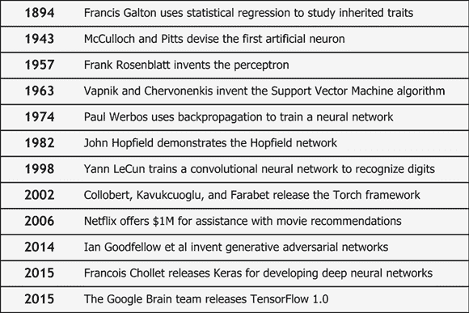

FIGURE 1-1: Developments in machine learning extend from academia to corporations.

一旦你理解了研究人员和公司为何花费大量时间开发该技术，你就会更好地欣赏学习 TensorFlow 值得你投入自己的时间。

###### 统计回归

正如石油公司钻探地下以获取石油一样，机器学习应用程序分析数据以获取信息和洞察力。该过程的正式术语是 *统计推断*，其最早的历史记录可追溯到古希腊。但就此目的而言，故事始于 19 世纪的一位科学家 Francis Galton。尽管他的主要兴趣是人类学，但他制定了现代统计学家和机器学习应用程序使用的许多概念和工具。

Galton 对遗传性状着迷，在研究狗时，他注意到优秀狗的后代往往会随着时间的推移获得平均特征。他将此称为 *回归到平庸*。Galton 在人类和甜豌豆中观察到这种现象，并在分析数据时采用了正态曲线、相关性、方差和标准差等现代统计概念。

为了说明孩子身高与父母平均身高之间的关系，Galton 开发了一种确定哪条线最适合一系列数据点的方法。Figure 1-2 显示了它的样子。（Galton 的数据由阿拉巴马大学提供。）

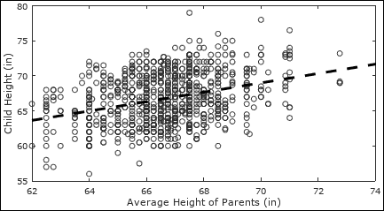

FIGURE 1-2: Linear regression identifies a clear trend amidst unclear data points.

Galton 将线拟合到数据的方法后来被称为 *线性回归*，术语 *回归* 已被用于各种统计方法。回归在机器学习中发挥着关键作用，而 Chapter 6 详细讨论了该主题。

###### 反向工程大脑

1905 年，Ramón y Cajal 检查了鸡脑的组织并研究了细胞之间的相互连接，后来被称为 *神经元*。Cajal 的发现让全世界的科学家着迷，1943 年，Warren McCulloch 和 Walter Pitts 提出了神经元的数学模型。他们证明了他们的人工神经元可以实现常见的布尔 `AND` 和 `OR` 操作。

在研究统计学时，一位名叫 Frank Rosenblatt 的心理学家开发了另一种神经元模型，该模型扩展了 McCulloch 和 Pitts 的工作。他称他的模型为 *感知器*，通过将感知器连接成层，他创建了一个能够识别图像的电路。这些感知器的相互连接后来被称为 *神经网络*。

Rosenblatt 在演示之后对感知器计算的未来做出了宏伟的预测。他的预测深刻影响了海军研究办公室，该办公室资助了基于感知器的定制计算机的开发。这台计算机被称为 Mark 1 感知器，而 Figure 1-3 显示了它的样子。

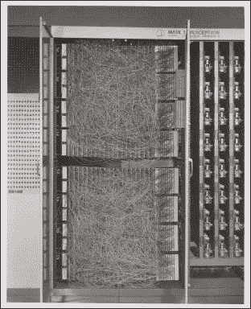

Credit: Cornell Aeronautical Laboratory. ¶ FIGURE 1-3: The Mark 1 Perceptron was the first computer created for machine learning.

感知器计算的未来似乎一片光明，但 1969 年，灾难降临。Marvin Minsky 和 Seymour Papert 在他们的书 *Perceptrons*（MIT Press）中对 Rosenblatt 的技术提出了尖锐的批评。他们从数学上证明了两层前馈神经网络的许多局限性，例如无法学习非线性函数或实现布尔异或（XOR）操作。

自 1960 年代以来，神经网络取得了巨大进展，回顾起来，现代读者可以看到 Minsky 和 Papert 在研究中是多么狭隘。但在当时，他们的发现导致许多人，包括海军和其他大型组织，对神经网络失去兴趣。

###### 稳步进展

尽管失去了公众的赞誉，研究人员和学者仍继续研究机器学习。他们的研究导致了许多关键发展，包括以下内容：

* 1965 年，Ivakhnenko 和 Lapa 展示了具有非线性激活函数的多层感知器。
* 1974 年，Paul Werbos 使用了 `backpropagation` 来训练神经网络。
* 1980 年，Kunihiko Fukushima 提出了 `neocognitron`，一种用于图像识别的多层神经网络。
* 1982 年，John Hopfield 开发了一种称为 `Hopfield network` 的循环神经网络。
* 1986 年，Sejnowski 和 Rosenberg 开发了 `NETtalk`，一种能够学习如何发音单词的神经网络。

这些发展扩展了机器学习的广度和能力，但没有一个激发了世界的想象力。问题在于，计算机缺乏速度和内存，无法在合理的时间内执行现实世界的机器学习。这即将改变。

###### 计算革命

随着 1980 年代进入 1990 年代，改进的半导体设计带来了计算能力的巨大飞跃。研究人员利用这种新力量来执行机器学习例程。终于，机器学习可以解决现实世界的问题，而不仅仅是简单的概念验证。

随着冷战加剧，军事专家对自动识别目标产生了兴趣。受 Fukushima 的 `neocognitron` 启发，研究人员专注于专门为图像识别设计的神经网络，称为 `convolutional neural networks`（`CNNs`）。一个重要的进步发生在 1994 年，当时 Yann LeCun 成功地用基于 CNN 的 `LeNet5` 架构演示了手写识别。

但存在一个问题。研究人员在应用中使用了类似的理论，但他们从头开始编写所有代码。这意味着研究人员无法复现同行的结果，也无法重用彼此的代码。如果研究人员的资金用完，那么整个代码库很可能会消失。

在 1990 年代后期，我的工作涉及编程 `convolutional neural networks` 来识别人脸。我喜欢神经网络背后的理论，但在实践中我发现它们令人深感沮丧。机器学习应用需要仔细调优和微调才能获得可接受的结果。但每次对代码的更改都需要一次新的训练运行，而训练一个 `CNN` 可能需要 *days*。即使如此，我仍然没有足够多的训练数据来确保准确的识别。

我和其他研究人员面临的一个问题是，虽然机器学习理论已经成熟，但软件开发流程仍处于起步阶段。程序员需要框架和标准库，这样他们就不必独自编写所有内容。此外，尽管 Intel 尽了最大努力，实用的机器学习仍然需要能够访问更大数据的更快处理器。

###### 大数据和深度学习的兴起

随着 21 世纪的到来，互联网的普及率飙升，数据存储的价格暴跌。大型公司现在可以访问关于潜在消费者的 TB 级数据。这些公司开发了改进的数据分析工具，而这种数据存储和分析的革命被称为 `big data revolution`。

现在首席执行官们面临一个难题：他们如何利用自己庞大的数据为公司创造财富？一个主要优先事项是广告——如果公司知道向客户展示哪些广告，就会赚更多的钱。但将客户与产品关联并没有明确的规则。

许多公司启动了内部研究计划，以确定如何最好地分析其数据。但在 2006 年，Netflix 尝试了不同的方法。他们在线发布了大部分数据库，并提供一百万美元给开发出最佳推荐引擎的人。获胜者 BellKor's Pragmatic Chaos 结合了多种机器学习算法，将 Netflix 的算法提高了 10%。

Netflix 并不是唯一一家使用机器学习的高调公司。Google 的 AdSense 使用机器学习来确定在搜索引擎上显示哪些广告。Google 和 Tesla 展示了使用机器学习来跟随道路并加入交通的自动驾驶汽车。

在世界各地，大型组织坐直了身子并注意到了这一点。机器学习已经离开了毛茸茸的科幻小说领域，成为一种实用的商业工具。企业家们继续思考，通过将机器学习应用于大数据还能获得哪些其他好处。

研究人员也注意到了这一点。一个主要优先事项是区分现代机器学习，其具有高复杂性和庞大的数据处理，与早期机器学习，后者简单且很少有效。他们同意使用术语 `deep learning` 来指代这种新的机器学习范式。Chapter 7 详细介绍了深度学习的技术的含义。

##### 机器学习框架


实用机器学习中最重要的进步之一是框架的创建。`Frameworks` 自动化了开发机器学习应用的许多方面，并允许开发人员重用代码并利用最佳实践。本讨论介绍了五种最受欢迎的框架：`Torch`、`Theano`、`Caffe`、`Keras` 和 `TensorFlow`。

## Torch

`Torch` 是第一个吸引大量关注的机器学习框架。最初由 Ronan Collobert 于 2002 年发布，它最初是一个数值计算工具集。Torch 的计算涉及称为 `tensors` 的多维数组，可以使用常规的向量/矩阵运算进行处理。随着时间的推移，Torch 获得了构建、训练和评估神经网络的例程。

Torch 从学术界和 IBM 和 Facebook 等公司获得了大量兴趣。但其采用受到其依赖 `Lua` 作为接口语言的限制。本讨论中的其他框架——`Theano`、`Caffe`、`Keras` 和 `TensorFlow`——可以通过 `Python` 进行接口，而 `Python` 已成为机器学习领域首选的语言。

## Theano

2010 年，蒙特利尔大学的一个机器学习小组发布了 `Theano`，一个用于数值计算的库。与 `NumPy` 一样，Theano 提供了广泛的 Python 例程来操作多维数组。与 `NumPy` 不同，Theano 将操作存储在称为 `graph` 的数据结构中，并将其编译为高性能代码。Theano 还支持 `symbolic differentiation`，这使得自动查找函数的导数成为可能。

由于其高性能和符号微分，许多机器学习开发人员已将 Theano 采用为其首选的数值计算工具集。开发人员特别欣赏 Theano 能够在图形处理单元 (`GPUs`) 以及中央处理单元 (`CPUs`) 上执行图的能力。

## Caffe

作为他在 UC Berkeley 的博士论文的一部分，Yangqing Jia 创建了 `Caffe`，一个用于开发图像识别应用的框架。随着其他人的加入，Caffe 扩展到支持其他机器学习算法和许多不同类型的神经网络。

Caffe 用 `C++` 编写，与 Theano 一样，它支持 GPU 加速。这种对性能的强调使 Caffe 深受许多学术和企业开发人员的喜爱。Facebook 对 Caffe 特别感兴趣，并在 2007 年发布了一个重新设计版本，称为 `Caffe2`。该版本改进了 Caffe 的性能，并使在智能手机上执行应用成为可能。

## Keras

虽然其他产品专注于性能和功能广度，但 `Keras` 关注模块化和开发的简易性。François Chollet 创建 Keras 作为其他机器学习框架的接口，许多开发人员通过 Keras 访问 Theano，以结合 Keras 的简易性和 Theano 的性能。

Keras 的简洁性源于其小巧的 API 和直观的函数集合。这些函数专注于完成机器学习中的标准任务，这使得 Keras 非常适合该领域的初学者，但对于想要自定义操作的人来说价值有限。

François Chollet 在 MIT 许可证下发布了 Keras，而 Google 已将其界面整合到 TensorFlow 中。因此，许多 TensorFlow 开发者更喜欢使用 Keras 来编写神经网络。

## TensorFlow

顾名思义，本书以 TensorFlow 为中心，TensorFlow 是 Google 赠予机器学习世界的礼物。Google Brain 团队于 2015 年发布了 TensorFlow 1.0，而截至本文撰写时，当前版本为 1.4。它采用 Apache 2.0 开源许可证发布，这意味着你可以自由使用、修改并分发你的修改版本。

TensorFlow 的主要接口是 Python，但与 Caffe 类似，其核心功能是用 C++ 编写以提高性能。与 Theano 类似，TensorFlow 将操作存储在图中，该图可以部署到 GPU、远程系统或远程系统网络。此外，TensorFlow 还提供了一个名为 TensorBoard 的实用工具，可实现对图及其操作的可视化。

与其他框架一样，TensorFlow 支持在 CPU 和 GPU 上执行。此外，TensorFlow 应用程序可以在 Google Cloud Platform (`GCP`) 上执行。`GCP` 以相对较低的成本提供世界级的处理能力，在我看来，`GCP` 处理是 TensorFlow 最重要的优势。Chapter 13 详细讨论了这一重要主题。

### Getting Your Feet Wet

IN THIS CHAPTER

**Obtaining and installing TensorFlow**

**Exploring the TensorFlow package**

**Running a simple application**

**Understanding style conventions**

本书的许多章节介绍了复杂的专业主题和冗长的数学公式。但本章不是。本章非常简单，其目标是引导你完成安装 TensorFlow 并运行第一个 TensorFlow 应用程序的过程。

完整的 TensorFlow 安装包含大量文件和目录。本章将探讨安装过程并解释众多文件和文件夹的用途。讨论涉及 TensorFlow 的许多包及其提供的模块。

安装完 TensorFlow 工具包后，开始编写和运行应用程序就变得很容易。本章末尾提供了一个基本应用程序，为 TensorFlow 开发提供热情的欢迎。

#### Installing TensorFlow

Google 提供了两种安装 TensorFlow 的方法，而更简单的方法是安装预编译的包。本讨论介绍了安装这些包的三步流程：

1. **在开发系统上安装 Python。**

2. **安装 pip 包管理器。**

3. **使用 pip 安装 TensorFlow。**

第二种安装方法涉及从源代码编译 TensorFlow。这种方法耗时费力，但你可以获得更好的性能，因为你的 TensorFlow 包将充分利用处理器的功能。Chapter 12 解释了如何获取和编译 TensorFlow 的源代码。

##### Python and pip/pip3

TensorFlow 支持使用 Java 和 C++ 进行开发，但本书专注于 Python。我在示例代码中使用 Python 3，但你也可以使用 Python 2。正如我在即将到来的 “Setting the Style” 部分中解释的那样，TensorFlow 应用程序应可供两个版本使用。

Python 的官方包管理器是 *pip*，这是一个递归缩写，代表“pip installs Python”。要安装像 TensorFlow 这样的包，你可以在 Python 2 系统上使用 `pip`，或在 Python 3 系统上使用 `pip3`。包管理命令的格式如下：

`pip <command-name> <command-options>`

`pip` 和 `pip3` 接受类似的命令并执行类似的操作。例如，执行 `pip list` 或 `pip3 list` 会打印系统上安装的所有 Python 包。Table 2-1 列出了此命令和其他五个命令。

TABLE 2-1 Package Management Commands

| **Command Name** || **Description** |

| --- | --- |

| `install` || Installs a specified package |

| --- | --- |

| `uninstall` || Uninstalls a specified package |

| `download` || Downloads a package, but doesn't install it |

| `list` || Lists installed packages |

| `show` || Prints information about a specified package |

| `search` || Searches for a package whose name or summary contains the given text |

对于本讨论，最重要的命令是 `pip install` 和 `pip3 install`。但请记住，`pip`/`pip3` 可以执行许多其他操作。

如果使用预编译包执行 TensorFlow 应用程序，你可能会收到类似“TensorFlow 库未编译为使用 *XYZ* 指令，但这些指令在你的机器上可用，并且可以加快 CPU 计算速度”的消息。要关闭这些消息，请创建一个名为 `TF_CPP_MIN_LOG_LEVEL` 的环境变量，并将其值设置为 3。

##### Installing on Mac OS

许多版本的 Mac OS 已预装 Python，但我建议获取并安装新的 Python 包。如果访问 [`www.python.org/downloads`](http://www.python.org/downloads)，你会看到一个用于 Python 2 的按钮和一个用于 Python 3 的按钮。如果点击其中一个按钮，你的浏览器将下载一个用作 Python 安装程序的 PKG 文件。

启动安装程序后，Python 安装对话框会出现。要安装该包，请按照以下五个步骤操作：

1. **在 Introduction 页面，点击标有 Continue 的按钮。**

2. **在 Read Me 页面，点击标有 Continue 的按钮。**

3. **在 License 页面，点击标有 Continue 的按钮，然后点击 Agree 以接受软件许可协议。**

4. **在 Installation Type 页面，点击 Install 开始安装过程，如有必要，输入你的密码。**

5. **安装完成后，点击 Close 关闭对话框。**

如果安装成功完成，你可以在命令行上运行 `pip` 或 `pip3`。你可以使用以下命令安装 TensorFlow：

`pip install tensorflow`

该命令指示包管理器下载 TensorFlow、TensorBoard 以及一系列依赖项。其中一个依赖项是 `six`，它支持 Python 2 和 3 之间的兼容性。如果由于预安装的 `six` 包导致安装失败，你可以通过执行以下命令修复该问题：

`pip install --ignore-installed six`

该命令指示 `pip` 在现有安装之上安装 `six`。此安装完成后，你应该能够在不报错的情况下运行 `pip install tensorflow`。在我的系统上，安装程序将 TensorFlow 文件存储在 `/Library/Frameworks/Python.framework/Versions/<ver>/lib/python<ver>/site-packages/tensorflow` 目录中。

##### Installing on Linux

许多流行的 Linux 发行版基于 Debian，包括 Ubuntu 和 Linux Mint。这些发行版依赖高级打包工具 (`APT`) 来管理包，你可以通过在命令行输入 `apt-get` 来访问它。本讨论解释了如何在这些和类似的操作系统上安装 TensorFlow。

大多数 Linux 发行版已预装 Python，但最好安装完整的开发版本和 `pip`/`pip3`。以下命令为 Python 2 安装两者：

`sudo apt-get install python-pip python-dev`

或者，以下命令为 Python 3 执行安装：

`sudo apt-get install python3-pip python3-dev`

安装完成后，你应该能够在命令行中执行 `pip` 或 `pip3`。以下命令安装 TensorFlow 包及其依赖项（对 Python 3 使用 `pip3`）：

```
sudo pip install tensorflow
```

该命令安装 TensorFlow、TensorBoard 及其依赖项。在我的 Ubuntu 系统上，安装程序将文件存储在 `/usr/local/lib/python<ver>/dist-packages/tensorflow` 目录中。

##### 在 Windows 上安装

对于 Windows 用户，TensorFlow 的文档特别建议安装 64 位版本的 Python 3.5。要下载安装程序，请访问 [`www.python.org/downloads/windows`](http://www.python.org/downloads/windows)，找到一个 Python 3 版本，然后点击标题为 Windows x86-64 executable installer 的链接。这会下载一个 `*.exe` 文件作为安装程序。

启动安装程序时，Python 设置对话框会出现。以下步骤在你的系统上安装 Python：

1. **勾选将 Python 安装目录添加到 `PATH` 变量的复选框。**

2. **点击标有 Install Now 的链接。**

3. **安装完成后，点击 Close 按钮关闭安装程序。**

安装 Python 后，你应该能够在命令行中运行 `pip3`。你可以使用以下命令安装 TensorFlow：

```
pip3 install tensorflow
```

包管理器会下载 TensorFlow、TensorBoard 以及这些包的依赖项。在我的 Windows 系统上，安装程序将文件存储到 `C:\Users\<name>\AppData\Local\Programs\Python\Python<ver>\Lib\site-packages\tensorflow` 目录。

##### 探索 TensorFlow 安装

安装 TensorFlow 后，你会有一个名为 `tensorflow` 的目录，其中包含各种文件和文件夹。两个顶级文件夹尤其重要。`core` 目录包含 TensorFlow 的主要包和模块。`contrib` 目录包含可能稍后合并到核心 TensorFlow 中的次要包。

当你编写 TensorFlow 应用程序时，了解不同的包及其提供的模块非常重要。Table 2-2 列出了至关重要的 `tensorflow` 包和另外九个包。

TABLE 2-2 重要的 TensorFlow 包

| **Package** || **Content** |

| --- | --- |

| `tensorflow` || TensorFlow 框架的核心包，通常作为 `tf` 访问 |

| --- | --- |

| `tf.train` || 与训练相关的优化器和其他类 |

| `tf.nn` || 神经网络类和相关数学运算 |

| `tf.layers` || 与多层神经网络相关的函数 |

| `tf.contrib` || 不稳定或实验性代码 |

| `tf.image` || 图像处理函数 |

| `tf.estimator` || 用于训练和评估的高级工具 |

| `tf.logging` || 将数据写入日志的函数 |

| `tf.summary` || 生成摘要数据所需的类 |

| `tf.metrics` || 用于衡量机器学习结果的函数 |

第一个包 `tensorflow` 是 TensorFlow 的核心包。大多数应用程序将此包导入为 `tf`，因此当你在代码或示例中看到 `tf` 时，请记住它指的是 `tensorflow` 包。

正如我在 Chapter 5 中解释的那样，训练是机器学习应用程序中的关键操作。`tf.train` 包提供了 TensorFlow 训练所需的许多模块和类。特别是，它提供了确定训练应使用哪种算法的优化器类。

`tf.nn` 和 `tf.layers` 包提供了创建和配置神经网络的函数。两个包在许多方面重叠，但 `tf.layers` 中的函数专注于多层网络，而 `tf.nn` 中的函数适用于通用机器学习。

`tf.contrib` 中的许多包包含核心功能的变体。例如，`tf.contrib.nn` 包含 `tf.nn` 中功能的变体，而 `tf.contrib.layers` 包含 `tf.layers` 中功能的变体。`tf.contrib` 还提供了丰富有趣且实验性的包，包括以下内容：

* `tf.contrib.keras`: 使能够使用 Keras 接口与 TensorFlow 接口

* `tf.contrib.ffmpeg`: 通过开源 FFMPEG 工具集实现音频处理

* `tf.contrib.bayesflow`: 包含与贝叶斯学习相关的模块

* `tf.contrib.integrate`: 提供 `odeint` 函数，用于积分常微分方程

Table 2-2 中的最后三个包使开发人员能够分析其应用程序并生成输出。`tf.logging` 中的函数支持日志记录，可用于将消息写入日志。`tf.summary` 中的类和函数生成可由 TensorBoard 读取的数据，TensorBoard 是用于可视化机器学习应用程序的实用程序。`tf.metrics` 中的函数分析机器学习操作的准确性。

##### 运行你的第一个应用程序

安装 TensorFlow 后，你就可以开始创建和执行应用程序了。本节逐步介绍运行一个打印简单消息的应用程序的过程。

###### 探索示例代码

你可以从 [`www.dummies.com`](http://www.dummies.com) 下载本书的示例代码，搜索 *TensorFlow For Dummies* 并进入 Downloads 选项卡。归档的名称为 `tf_dummies.zip`，解压缩后，你会看到按章节命名的文件夹（ch2、ch3 等）。


每个章节文件夹包含一个或多个 Python 文件（`*.py`）。在每种情况下，你可以通过切换到该目录并运行 `python` 或 `python3` 后跟文件名来执行模块。

例如，如果你安装了 Python 2，你可以通过切换到 `ch3` 目录并输入以下命令来执行 `simple_math.py` 中的代码：

```
python simple_math.py
```

`Chapter 13` 的代码很特别，因为它旨在在 Google Cloud Platform 上执行，但这个话题太令人兴奋，无法在此讨论。

我没有为本书的示例代码提供任何官方许可，因此你可以自由地将其用于专业产品、学术工作和道德上值得怀疑的实验。但如果你使用此代码来编程邪恶机器人，我会知道，我会感到失望。

### 启动 Hello TensorFlow！

编程书籍长期以来一直以一个打印欢迎消息的简单示例来介绍其主题。本书也不例外。如果你打开本书示例代码中的 `ch2` 目录，你会找到一个名为 `hello_tensorflow.py` 的模块。Listing 2-1 展示了代码。

LISTING 2-1 Hello TensorFlow!

```
"""A simple TensorFlow application"""

from __future__ import absolute_import
from __future__ import division
from __future__ import print_function
import tensorflow as tf

#### Create tensor
msg = tf.string_join(["Hello ", "TensorFlow!"])

#### Launch session
with tf.Session() as sess:
    print(sess.run(msg))
```

此代码执行三个重要任务：

1. **创建一个名为 `msg` 的 `Tensor`，其中包含两个字符串元素。**

2. **创建一个名为 `sess` 的 `Session` 并使其成为默认会话。**

3. **启动新的 `Session` 并打印其结果。**

运行代码很简单。打开命令行并切换到本书示例代码中的 `ch2` 目录。然后，如果你使用 Python 2，可以执行以下命令：

```
python hello_tensorflow.py
```

如果你使用 Python 3，可以使用以下命令运行模块：

```
python3 hello_tensorflow.py
```

随着 Python 解释器施展魔法，你应该会看到以下消息：

```
b'Hello TensorFlow!'
```

欢迎消息很直接，但该应用程序的代码可能没有那么清晰。`Tensor` 实例是一个 n 维数组，包含数字或字符串数据。张量在 TensorFlow 开发中起着核心作用，而 第 3 章 详细讨论了它们。

`Session` 用作可以执行 TensorFlow 操作的环境。所有 TensorFlow 操作，从加法到优化，都必须通过会话执行。 第 4 章 解释了如何创建、配置和执行会话。

#### 设置风格

Google 在 [`www.tensorflow.org/community/style_guide`](http://www.tensorflow.org/community/style_guide) 提供 TensorFlow 风格指南。其中的四条指南如下：

* TensorFlow 应用程序中的代码应同时兼容 Python 2 和 Python 3。

* 遵循第一条指南，每个模块都应有 `import` 语句用于 `absolute_import`、`division` 和 `print_function`。

* 缩进应使用两个空格而不是四个。

* TensorFlow 模块应遵循 PEP（Python 增强提案）8 风格指南中的指南，除非与 TensorFlow 风格指南冲突。

你可以在 [`www.python.org/dev/peps/pep-0008`](http://www.python.org/dev/peps/pep-0008) 找到 PEP8 指南。其中的许多建议包括使用文档字符串、类名大写、函数和模块小写。你可以通过安装 pylint 包并运行 `pylint` `filename.py` 来检查 Python 代码是否符合 PEP8。

本书中的示例代码遵循 Google 的所有建议，除了两点。首先，我使用四个空格，因为那是 Python 的做法。其次，我更喜欢用简单的全小写名称命名常量，例如本章前面 清单 2-1 中的 `msg` 常量。

我不怪你如果觉得我的反叛不可原谅。但如果你派 Python 警察来抓我，他们永远抓不到活的我。

### 创建张量和操作

本章内容

**使用已知值和随机值创建张量**

**调用转换张量的函数**

**使用操作处理张量**

在研究生期间，我修过一门张量数学课程，涵盖了张量在电磁学中的使用。教授向我们保证该理论“美丽”且“优雅”，但我们这些饱受折磨的学生将相对论数学描述为“难以解读”和“恐怖”。

TensorFlow 的核心数据类型是张量，幸运的是，它与电磁学或相对论无关。在本书中，张量只是一个普通数组。如果你熟悉 Torch 的 `Tensor` 或 NumPy 的 `ndarray`，你会很高兴知道 TensorFlow 的张量在许多方面是相似的。

不幸的是，你不能用常规的 Python 例程访问这些张量。因此，TensorFlow API 提供了大量用于创建、转换和操作张量的函数。本章介绍了其中许多函数并演示了如何使用它们。

#### 创建张量

正如大多数程序从声明变量开始，大多数 TensorFlow 应用程序从创建张量开始。张量是一个具有零个或多个维度的数组。零维张量称为 *标量*，一维张量称为 *向量*，二维张量称为 *矩阵*。请记住张量的这三点：

* 每个张量都是 `Tensor` 类的实例。

* 张量可能包含数字、字符串或布尔值。张量的每个元素必须具有相同的类型。

* 张量可以使用 `tf` 包的函数创建、转换和操作。

本讨论解释了如何使用已知值和随机值创建张量。然后我还介绍了转换张量内容的函数。一旦你理解了这些主题，你将毫不费力地为张量处理编写简单例程。

##### 使用已知值创建张量

`tf` 包提供了七个函数来形成已知值的张量。 表 3-1 列出了它们并提供了每个函数的描述。

TABLE 3-1 使用已知值创建张量

| **函数** || **描述** |

| --- | --- |

| `constant(value, dtype=None, shape = None, name = 'Const', verify_shape=False)` || 返回包含给定值的张量 |

| --- | --- |

| `zeros(shape, dtype=tf.float32, name = None)` || 返回填充零的张量 |

| `ones(shape, dtype=tf.float32, name=None)` || 返回填充一的张量 |

| `fill(dims, value, name=None)` || 返回填充给定值的张量 |

| `linspace(start, stop, num, name=None)` || 返回包含线性值范围的张量 |

| `range(start, limit, delta=1, dtype=None, name='range')` || 返回包含值范围的张量 |

| `range(limit, delta=1, dtype=None, name='range')` || 返回包含值范围的张量 |

张量可能具有多个维度，张量中的维度数量是其 *秩*。张量维度的长度形成一个称为张量 *形状* 的数组。 表 3-1 中的许多函数接受一个 `shape` 参数，用于标识新张量的期望形状。以下示例演示了如何设置此参数：

* `[]` — 张量包含单个值。

* `[3]` — 张量是一个包含三个值的一维数组。

* `[3, 4]` — 张量是一个 3-x-4 矩阵。

* `[3, 4, 5]` — 张量是一个多维数组，其维度等于 3、4 和 5。

表 3-1 中的大多数函数都有一个 `dtype` 参数，用于标识张量元素的 数据类型。`dtype` 的默认值是 `float32`，表示默认情况下张量包含单精度浮点值。 表 3-2 列出了 `float32` 和其他可能的数据类型。

TABLE 3-2 张量数据类型

| **数据类型** || **描述** |

| --- | --- |

| `bool` || 布尔值 |

| --- | --- |

| `uint8/uint16` || 无符号整数 |

| `quint8/quint16` || 量化无符号整数 |

| `int8/int16/int32/int64` || 有符号整数 |

| `qint8/qint32` || 量化有符号整数 |

| `float16/float32/float64` || 浮点值 |

| `complex64/complex128` || 复浮点值 |

| `string` || 字符串 |

表 3-1 中的每个函数都接受一个可选的 `name` 参数，作为张量的标识符。应用程序可以通过张量的图按名称访问张量。 第 4 章 详细讨论了图的主题。

###### constant 函数

表 3-1 中最受欢迎的函数是 `constant`。其唯一必需的参数是第一个，它定义要存储在张量中的值或值。你可以在列表中提供这些值，以下代码创建了一个包含三个浮点值的一维张量：

```
t1 = tf.constant([1.5, 2.5, 3.5])
```

多维数组使用类似的记法。以下代码创建一个 2-x-2 矩阵并将其每个元素设置为字母 b：

```
t2 = tf.constant([['b', 'b'], ['b', 'b']])
```

默认情况下，如果函数的第一个参数没有 `shape` 参数给出的形状，TensorFlow 不会引发错误。但如果你将最后一个参数 `verify_shape` 设置为 `True`，TensorFlow 将验证两个形状是否相等。以下代码提供了形状不匹配的示例：

`t3 = tf.constant([4, 2], tf.int16, [3], 'Const', True)`

在这种情况下，给定的形状 `[3]` 与第一个参数的形状 `[2]` 不匹配。因此，TensorFlow 显示以下错误：

`TypeError: Expected Tensor's shape: (3,), got (2,).`

###### zeros, ones, and fill

函数 `zeros`、`ones` 和 `fill` 创建的元素值全部相同的张量。对于 `zeros` 和 `ones` 来说，唯一必需的参数是 `shape`，它标识所需张量的形状。例如，以下代码创建一个元素等于 0.0 的简单 1-x-3 向量：

`zero_tensor = tf.zeros([3])`

类似地，以下函数调用创建一个元素等于 1.0 的 4-x-4 矩阵：

`one_tensor = tf.ones([4, 4])`

`fill` 函数需要一个 `value` 参数，它设置张量元素的数值。以下代码创建一个三维张量，其值设置为 81.0：

`fill_tensor = tf.fill([1, 2, 3], 81.0)`

与 `zeros` 和 `ones` 不同，`fill` 没有 `dtype` 参数。它只能创建包含 32 位浮点值的张量。

###### Creating sequences

`linspace` 和 `range` 函数创建元素在起始值和结束值之间规律变化的张量。它们之间的区别在于 `linspace` 创建具有特定数量值的张量。例如，以下代码创建一个元素范围从 5.0 到 9.0 的 1-x-5 张量：

`lin_tensor = tf.linspace(5., 9., 5)`

`# Result: [5. 6. 7. 8. 9.]`

与 `linspace` 不同，`range` 不接受张量中元素的数量。相反，它通过添加一个称为 `delta` 的值来计算后续元素。在以下代码中，`delta` 设置为 0.5：

`range_tensor = tf.range(3., 7., delta=0.5)`

`# Result: [3.0 3.5 4.0 4.5 5.0 5.5 6.0 6.5]`

像 Python 的 `range` 函数一样，TensorFlow 的 `range` 函数可以不带 `start` 参数调用。在这种情况下，起始值假定为 0.0。以下代码演示了这一点：

`range_tensor = tf.range(1.5, delta=0.3)`

`# Result: [0.0 0.3 0.6 0.9 1.2]`

如果 `delta` 参数为正，则起始值必须小于结束值。如果 `delta` 为负，则起始值必须大于结束值。

#### Creating Tensors with Random Values

许多 TensorFlow 应用程序需要包含随机值而非预定值的张量。`tf` 包提供了许多用于创建随机值张量的函数，而 Table 3-3 列出了其中五个。

TABLE 3-3 Creating Tensors with Random Values

| **Function** || **Description** |

| --- | --- |

| `random_normal(shape, mean=0.0, stddev=1.0, dtype=tf.float32, seed=None, name=None)` || Creates a tensor with normally distributed values |

| --- | --- |

| `truncated_normal(shape, mean=0.0, stddev=1.0, dtype=tf.float32, seed=None, name=None)` || Creates a tensor with normally distributed values excluding those lying outside two standard deviations |

| `random_uniform(shape, minval=0, maxval=None, dtype=tf.float32, seed=None, name=None)` || Creates a tensor with uniformly distributed values between the minimum and maximum values |

| `random_shuffle(tensor, seed=None, name=None)` || Shuffles a tensor along its first dimension |

| `set_random_seed(seed)` || Set the seed value for all random number generation in the graph |

`random_normal` 和 `truncated_normal` 函数创建包含正态分布值的张量。它们的 arguments 决定了分布的特征。 Figure 3-1 显示了均值为 0.0 且标准差 (*σ*) 为 1.0 的正态分布的样子。

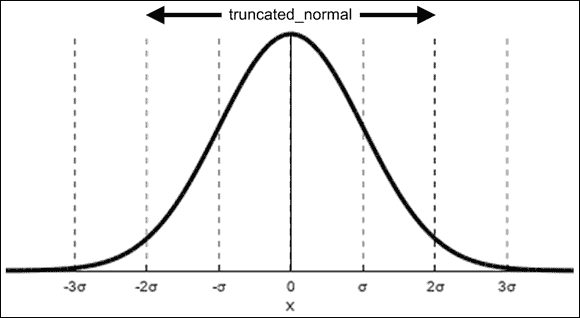

FIGURE 3-1: Values beyond three standard deviations from the mean are highly unlikely.

标准差告诉你正态分布变量预期与均值的差异程度。大约 68.2% 的时间，变量位于均值的一个标准差范围内，而 95.4% 的时间，变量位于两个标准差范围内。

在 `random_normal` 和 `truncated_normal` 函数中，默认均值为 0.0，默认标准差为 1.0。`random_normal` 在整个分布范围内生成随机值，因此非常大和非常小的值不太可能但有可能。以下代码调用 `random_normal` 生成 20 个随机值：

`rnd_ints = tf.random_normal([10], dtype=tf.float64)`

相比之下，`truncated_normal` 保证生成的数值位于均值的两个标准差范围内。任何超出此范围的值将被丢弃并重新选择。以这种方式，`truncated_normal` 确保张量不会包含任何不合理的大或小值。

`random_uniform` 创建一个包含均匀分布值且位于最小值和最大值之间的张量。由于分布是均匀的，每个值出现的可能性相等。

`random_shuffle` 不创建新张量，而是随机打乱现有张量中的值。这种打乱仅限于张量的第一维度。

Table 3-3 中的每个函数都接受一个 `seed` 参数，用于初始化随机数生成器。设置随机种子对于确保序列不会重复非常重要。

你可以通过调用 `set_random_seed` 来获取和设置种子值，它接受一个浮点值并使该参数成为当前图中每个操作的种子。 Chapter 4 详细讨论了图的主题。

#### Transforming Tensors

应用程序必须指定要创建的每个张量的形状。`tf` 包提供了在创建后更新张量及其形状的函数。 Table 3-4 列出了这些转换函数并提供了每个函数的描述。

TABLE 3-4 Functions for Transforming Tensors

| **Function** || **Description** |

| --- | --- |


### 张量变换函数

| `cast(tensor, dtype, name=None)` || Changes the tensor's data type to the given type |

| --- | --- |

| `reshape(tensor, shape, name=None)` || Returns a tensor with the same elements as the given tensor with the given shape |

| `squeeze(tensor, axis=None, name=None, squeeze_dims=None)` || Removes dimensions of size 1 |

| `reverse(tensor, axis, name=None)` || Reverses given dimensions of the tensor |

| `slice(tensor, begin, size, name=None)` || Extracts a portion of a tensor |

| `stack(tensors, axis=0, name='stack')` || Combines a list of tensors into a tensor of greater rank |

| `unstack(tensor, num=None, axis=0, name='unstack')` || Splits a tensor into a list of tensors of lesser rank |

尽管名称如此，`reshape` 并不会修改现有张量。相反，该函数返回一个与给定张量具有相同元素且形状指定的张量。例如，以下代码使用 `reshape` 将一个四元素向量转换为 2-x-2 矩阵：

```
vec = tf.constant([1., 2., 3., 4.])
mat = tf.reshape(vec, [2, 2])
# Result: [[1. 2.], [3. 4.]]
```

如果张量的某个维度大小为 1，调用 `squeeze` 将会将其从张量中移除，从而降低张量的秩。如果函数的 `axis` 参数标识一个或多个维度，则只有这些维度会受到 `squeeze` 的影响。

在 `reverse` 函数中，`axis` 参数标识要反转的一个或多个维度。以下代码演示了 `reverse` 的工作原理：

```
mat = tf.constant([[1., 2., 3.], [4., 5., 6.]])
rev_mat = tf.reverse(end, [0])
# Result: [[4. 5. 6.], [1. 2. 3.]]
rev_mat = tf.reverse(end, [1])
# Result: [[3. 2. 1.], [6. 5. 4.]]
rev_mat = tf.reverse(end, [0, 1])
# Result: [[6. 5. 4.], [3. 2. 1.]]
```

The `slice` function extracts subtensors from a tensor. The `begin` parameter identifies the index of the first element to be extracted, and `size` identifies the shape of the tensor to be extracted, starting from the `begin` location.

For example, suppose that you want to extract the lower-right 2-x-2 matrix from a 3-x-3 matrix. The index of the first extracted element is `[1, 1]` and the size of the desired tensor is `[2, 2]`. The following code uses `slice` to perform this extraction:

```
mat = tf.constant([[1., 2., 3.], [4., 5., 6.], [7., 8., 9.]])
slice_mat = tf.slice(mat, [1, 1], [2, 2])
```

`# Result: [[5. 6.] [7. 8.]]`

`stack` accepts a list of tensors of rank N and returns a single tensor of rank N+1. In addition to having the same rank, the input tensors must have the same shape. The following code demonstrates how `stack` can be used. The function combines three one-dimensional tensors into a two-dimensional tensor:

```
t1 = tf.constant([1., 2.])
t2 = tf.constant([3., 4.])
t3 = tf.constant([5., 6.])
t4 = tf.stack([t1, t2, t3])
```

When these operations execute, `t4` will equal `[[1. 2.] [3. 4.] [5. 6.]]`. If the `axis` parameter is set to 1, stacking will be performed along the second dimension, so `t4` will set to `[[1. 3. 5.] [2. 4. 6.]]`.

`unstack` performs the inverse operation of `stack`. That is, `unstack` accepts a tensor of rank N and returns a list of tensors of rank N-1. The `num` parameter determines how many tensors should be unpacked, and if this isn't set, `unstack` infers the number from the tensor's shape.

## Creating Operations

Machine learning applications are fundamentally mathematical, and TensorFlow provides a wealth of routines for performing mathematical operations on tensors. Each routine is represented by a function of the `tf` package, and each function returns a tensor. This section presents a large portion of the operations available, but the `tensorflow` package provides many more functions than those discussed here.

To describe these functions, I use statements like "function X performs operation Y." But these statements aren't completely accurate. These functions, like the transformation functions discussed in the preceding section, don't actually perform their corresponding operations — at least, not directly.

For example, `tf.multiply` doesn't immediately multiply its arguments and return a product. Instead, it adds a multiplication operation to the current graph, and when a session executes the graph, the multiplication will be performed along with the rest of the graph's operations. This process may seem confusing, but don't be concerned. Chapter 4 looks at graphs and sessions in detail.

### Basic math operations

When it comes to TensorFlow operations, its best to start simple. Table 3-5 lists 12 functions that perform basic math operations.

TABLE 3-5 Basic Math Operations

| **Function** || **Description** |

| --- | --- |

| `add(x, y, name=None)` || Adds two tensors |

| --- | --- |

| `subtract(x, y, name=None)` || Subtracts two tensors |

| `multiply(x, y, name=None)` || Multiplies two tensors |

| `divide(x, y, name=None)` || Divides the elements of two tensors |

| `div(x, y, name=None)` || Divides the elements of two tensors |

| `add_n(inputs, name=None)` || Adds multiple tensors |

| `scalar_mul(scalar, x)` || Scales a tensor by a scalar value |

| `mod(x, y, name=None)` || Performs the modulo operation |

| `abs(x, name=None)` || Computes the absolute value |

| `negative(x, name=None)` || Negates the tensor's elements |

| `sign(x, name=None)` || Extracts the signs of the tensor's element |

| `reciprocal(x, name=None)` || Computes the reciprocals |

The first four functions perform element-wise arithmetic. The following code demonstrates how they work:

```
a = tf.constant([3., 3., 3.])
b = tf.constant([2., 2., 2.])
sum = tf.add(a, b) # [ 5. 5. 5. ]
diff = tf.subtract(a, b) # [ 1. 1. 1. ]
prod = tf.multiply(a, b) # [ 6. 6. 6. ]
quot = tf.divide(a, b) # [ 1.5 1.5 1.5 ]
```

Applications can perform identical operations by using regular Python operators, such as `+`, `-`, `*`, `/`, and `//`. For example, the following two lines of code create the same tensor:

```
total = tf.add(a, b) # [ 5. 5. 5. ]
total2 = a + b # [ 5. 5. 5. ]
```

When operating on floating-point values, `div` and `divide` produce the same result. But for integer division, `divide` returns a floating-point result, and `div` returns an integer result. The following code demonstrates the difference between them:

```
a = tf.constant([3, 3, 3])
b = tf.constant([2, 2, 2])
div1 = tf.divide(a, b) # [ 1.5 1.5 1.5 ]
div2 = a / b # [ 1.5 1.5 1.5 ]
div3 = tf.div(a, b) # [ 1 1 1 ]
div4 = a // b # [ 1 1 1 ]
```

The `div` function and the `/` operator both perform element-wise division. In contrast, the `divide` function performs Python-style division.

### Rounding and comparison

Most of the mathematical routines in this book accept floating-point values as input and return floating-point values as output. But many applications need to convert floating-point values into integer values. For this reason, TensorFlow provides the rounding operations listed in Table 3-6.

TABLE 3-6 Rounding and Comparison Operations

| **Function** || **Description** |

| --- | --- |

| `round(x, name=None)` || Rounds to the nearest integer, rounding up if there are two nearest integers |

| --- | --- |

| `rint(x, name=None)` || Rounds to the nearest integer, rounding to the nearest even integer if there are two nearest integers |

| `ceil(x, name=None)` || Returns the smallest integer greater than the value |

| `floor(x, name=None)` || Returns the greatest integer less than the value |

| `maximum(x, y, name=None)` || Returns a tensor containing the larger element of each input tensor |

| `minimum(x, y, name=None)` || Returns a tensor containing the smaller element of each input tensor |

| `argmax(x, axis=None, name=None, dimension=None)` || Returns the index of the greatest element in the tensor |

| `argmin(x, axis=None, name=None, dimension=None)` || Returns the index of the smallest element in the tensor |

Table 3-6 also lists functions that perform comparisons. These functions return maximum and minimum values, both within a tensor and across two tensors.

The `round` function examines each element of a tensor and returns the closest integer. If two closest integers are equally close, it returns the one further from zero. `rint` is similar, but rounds to the nearest even value. The following code demonstrates how you can use `round`, `rint`, `ceil`, and `floor`:


```
t = tf.constant([-6.5, -3.5, 3.5, 6.5])
r1 = tf.round(t) # [-6. -4. 4. 6.]
r2 = tf.rint(t) # [-6. -4. 4. 6.]
r3 = tf.ceil(t) # [-6. -3. 4. 7.]
r4 = tf.floor(t) # [-7. -4. 3. 6.]
```

The next two functions in the table, `maximum` and `minimum`, are easy to understand. `maximum` returns a tensor containing the larger element of each input tensor, and `minimum` returns a tensor containing the smaller element of each input tensor.

`argmax` and `argmin` return the index values of the largest and smallest elements of a tensor. The following code shows how you can use these functions:

```
t1 = tf.constant([0, -2, 4, 6])
t2 = tf.constant([[1, 3], [7, 2]])
r1 = tf.argmin(t1) # 1
r2 = tf.argmax(t2) # [ 1 0 ]
```

If a tensor has multiple maximum/minimum values, `argmax` and `argmin` will return the index values of the first occurring element.

### Exponents and logarithms

机器学习应用经常需要指数和对数来计算误差和概率。为满足这一需求，TensorFlow 提供了与 NumPy 中相同的许多函数。Table 3-7 列出了其中 11 个，并提供了每个函数的描述。

TABLE 3-7 指数和对数运算

| **Function** || **Description** |

| --- | --- |

| `square(x, name=None)` || 返回参数的平方 |

| --- | --- |

| `squared_difference(x, y, name=None)` || 用第二个参数减去第一个参数并返回平方 |

| `sqrt(x, name=None)` || 返回参数的平方根 |

| `rsqrt(x, name=None)` || 返回平方根的倒数 |

| `pow(x, y, name=None)` || 返回第一个张量元素对第二个张量元素求幂的结果 |

| `exp(x, name=None)` || 返回参数的指数函数 |

| `expm1(x, name=None)` || 返回参数的指数函数减一，`exp(x) - 1` |

| `log(x, name=None)` || 返回参数的自然对数 |

| `log1p(x, name=None)` || 返回参数加 1 的自然对数，`log(x + 1)` |

| `erf(x, name=None)` || 返回参数的误差函数 |

| `erfc(x, name=None)` || 返回参数的互补误差函数 |

这些函数使用起来很直接，理解起来也很简单。每个函数都按元素执行，并且以下代码演示了如何调用 `square`、`sqrt` 和 `rsqrt`：

```
t = tf.constant([4.])
t1 = tf.square(t) # 16
t2 = tf.sqrt(t) # 2
t3 = tf.rsqrt(t) # 0.5
```

`exp` 函数计算张量元素的指数函数，而 `expm1` 从每个指数中减去 1。如果 `x` 是输入张量中的一个值，则 `expm1` 的结果等于 `exp(x) – 1`。

类似地，`log` 函数计算张量元素的自然对数。`logp1` 在计算对数之前先给值加上 1，因此如果 `x` 是输入张量中的一个值，则 `logp1` 的结果等于 `log(x + 1)`。

### 向量和矩阵运算

机器学习应用在向量（一维张量）和矩阵（二维张量）中存储了大量数据。为了处理这些数据，TensorFlow 提供了许多在向量和矩阵上操作的函数。Table 3-8 列出了这些函数并提供了每个函数的描述。

TABLE 3-8 向量和矩阵运算

| **Function** || **Description** |

| --- | --- |

| `tensordot(a, b, axes, name=None)` || 返回给定轴上元素的乘积之和 |

| --- | --- |

| `cross(a, b, name=None)` || 返回逐元素的叉积 |

| `diag(diagonal, name=None)` || 返回具有给定对角线值的矩阵，其他值设为零 |

| `trace(x, name=None)` || 返回对角线元素的总和 |

| `transpose(x, perm=None, name='transpose')` || 交换行和列 |

| `eye(num_rows, num_columns=None, batch_shape=None, dtype=tf.float32, name=None)` || 创建具有给定形状和数据类型的单位矩阵 |

| `matmul(a, b, transpose_a=False, transpose_b=False, adjoint_a=False, adjoint_b=False, a_is_sparse=False, b_is_sparse=False, name=None)` || 返回两个输入矩阵的乘积 |

| `norm(tensor, ord='euclidean', axis=None, keep_dims=False, name=None)` || 返回输入张量给定轴的范数，指定阶数 |

| `matrix_solve(A, b, adjoint=None, name=None)` || 返回张量 `x,` 使得 `Ax = b`，其中 `A` 是矩阵，`b` 是向量 |

| `qr(input, full_matrices=None, name=None)` || 返回给定矩阵或矩阵的特征向量和特征值 |

| `svd(tensor, full_matrices=False, compute_uv=True, name=None)` || 将矩阵分解为酉矩阵、对角矩阵和酉矩阵的共轭转置 |

| `einsum(equation, *inputs)` || 执行自定义数学运算 |

在这些函数中，最常见的两个是 `tensordot` 和 `matmul`。`tensordot` 返回两个输入张量的一个或多个轴的点积。也就是说，`tensordot` 将两个张量维度的对应元素相乘并返回乘积之和。

`axes` 参数告诉 `tensordot` 处理哪些维度。如果将此参数设为标量 `N`，函数将访问第一个张量的最后 `N` 个轴和第二个张量的前 `N` 个轴。如果将 `axes` 设为列表或张量，第一行标识第一个张量的轴，第二行标识第二个张量的轴。

我经常调用 `tensordot` 来计算两个一维张量的点积。以下代码展示了其外观：

```
t1 = tf.constant([4., 3., 2.])
t2 = tf.constant([3., 2., 1.])
dot = tf.tensordot(t1, t2, 1)
#### 4*3 + 3*2 + 2*1 = 20
```

`matmul` 执行传统的矩阵乘法。也就是说，它将第一个张量的行与第二个张量的列相乘并返回包含和的矩阵。以下代码展示了如何使用它：

```
t1 = tf.constant([[1.0, 2.0, 3.0], [4.0, 5.0, 6.0]])
t2 = tf.constant([[1.0, 2.0], [3.0, 4.0], [5.0, 6.0]])
dot = tf.matmul(t1, t2)
#### [[ 22. 28.], [ 49. 64.]]
```

我在 Table 3-8 中最喜欢的函数是 `einsum`，它使得创建和执行自定义数学运算成为可能。第一个参数是一个字符串，使用一种称为 *爱因斯坦求和约定* 的特殊格式来标识运算。该约定具有以下几个特征，包括：

* 运算假定有一个或两个输入。如果提供两个输入，必须用逗号分隔它们。
* 输入和输出矩阵的维度由下标表示（通常为 `i`、`j` 和 `k`）。输入下标必须与 `->` 符号分隔输出下标。
* 如果输入的下标重复且没有给出输出下标，则运算执行加法。因此，`einsum('i,i', t1, t2)` 计算张量 `t1` 和 `t2` 的点积。
* 如果输入的下标重复且给出输出下标，则运算执行乘法。因此，`einsum('i,i->i', t1, t2)` 计算张量 `t1` 和 `t2` 的逐元素乘积。

以下代码调用 `einsum` 来转置一个矩阵并将两个矩阵相乘：

```
m1 = tf.constant([[1, 2], [3, 4]])
m2 = tf.constant([[5, 6], [7, 8]])
e1 = tf.einsum('ij->ji', m1) # [[1, 3], [2, 4]]
e2 = tf.einsum('ij,jk->ik', m1, m2) # [[19, 22], [43, 50]]
```

有关爱因斯坦求和约定的更完整讨论，我推荐 Samuel Prime 在 [`https://samuelprime.wordpress.com/2015/03/25/einstein-summation-convention`](https://samuelprime.wordpress.com/2015/03/25/einstein-summation-convention) 的演示。

### 将理论付诸实践

`ch3/simple_math.py` 中的代码演示了本章介绍的许多函数。Listing 3-1 展示了完整的应用程序。

LISTING 3-1 简单数学运算

```
#### Math with constant tensors
const_a = tf.constant(3.6)
const_b = tf.constant(1.2)
total = const_a + const_b
quot = tf.div(const_a, const_b)

#### Math with random tensors
rand_a = tf.random_normal([3], 2.0)
rand_b = tf.random_uniform([3], 1.0, 4.0)
diff = tf.subtract(rand_a, rand_b)

#### Vector multiplication
vec_a = tf.linspace(0.0, 3.0, 4)
vec_b = tf.fill([4, 1], 2.0)
prod = tf.multiply(vec_a, vec_b)
dot = tf.tensordot(vec_a, vec_b, 1)

#### Matrix multiplication
mat_a = tf.constant([[2, 3], [1, 2], [4, 5]])
```

`mat_b = tf.constant([[6, 4, 1], [3, 7, 2]])`

`mat_prod = tf.matmul(mat_a, mat_b)`

#### Execute the operations

```python
with tf.Session() as sess:
    print("Sum: %f" % sess.run(total))
    print("Quotient: %f" % sess.run(quot))
    print("Difference: ", sess.run(diff))
    print("Element-wise product: ", sess.run(prod))
    print("Dot product: ", sess.run(dot))
    print("Matrix product: ", sess.run(mat_prod))
```

大部分代码应该看起来很熟悉。该应用程序创建并操作常量张量、随机张量、向量和矩阵。为了处理向量，应用程序使用 `tf.multiply` 执行逐元素乘法，然后使用 `tf.tensordot` 计算两个向量的点积。

代码的最后一部分值得解释。应用程序创建一个名为 `sess` 的 `Session` 并对每个要执行的运算调用其 `run` 方法。要理解会话是什么以及它们如何工作，你需要熟悉图。下一章将探讨会话和图相关主题。

#### Chapter 4

#### Executing Graphs in Sessions

IN THIS CHAPTER

 **Creating graphs and accessing their data**

 **Serializing data from a graph into a GraphDef**

 **Creating and launching sessions**

 **Printing messages to the log**

 **Visualizing summary data with TensorBoard**

上一章介绍了大量创建、转换和处理张量的函数。这些函数大多数返回一个张量，这可能会让你认为函数在被调用时立即执行其操作。这就是 Python 函数通常的工作方式，但这不是 TensorFlow 函数的工作方式。

当应用程序执行创建、转换或处理张量的 TensorFlow 函数时，该函数并不执行其操作。相反，它将操作存储在称为 *graph* 的数据结构中。图可以容纳许多操作，并且它们在应用程序在会话中执行图之前不会被执行。当会话执行图时，它会按顺序执行图的操作。

将操作存储在图中的好处是图可以导出到文件或在远程系统上启动。缺点是图往往会让 TensorFlow 新手感到困惑。在撰写本章时，我的目标是通过对图和会话的完整解释来减少这种困惑。

##### Forming Graphs

如果一个操作返回一个张量，则一个操作可以将输出馈送到另一个操作。为了演示此过程，以下代码将加法操作的结果馈送到乘法操作。

```python
c = tf.add(a, b)
e = tf.multiply(c, d)
```

Figure 4-1 说明了这些嵌套操作及其张量之间的关系。

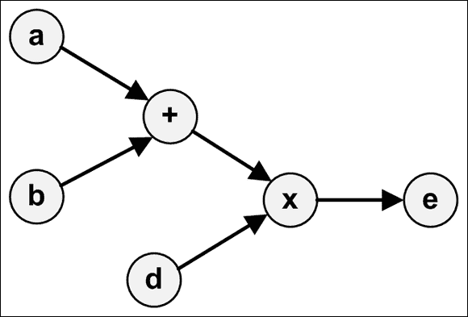

FIGURE 4-1: The addition operation receives the result of multiplication.

在 Figure 4-1 中，每个圆圈标识一个张量或操作，每个线条传输张量数据。数学家和计算机科学家将这种节点和边的结构称为 *graph*。图的圆圈称为 *nodes*，直线称为 *edges*。

当应用程序执行创建张量或操作的功能时，TensorFlow 将数据结构添加到名为 `Graph` 的容器结构中。`Graph` 不能嵌套，并且一次只能有一个 `Graph` 处于活动状态。应用程序可以通过调用 `get_default_graph` 来访问其默认 `Graph`。以下代码展示了如何使用它：

```python
graph = tf.get_default_graph()
```

应用程序可以通过调用不带参数的构造函数来创建新的 `Graph`。然后应用程序可以通过调用 `Graph` 的 `as_default` 方法将 `Graph` 设置为默认 `Graph`。以下代码演示了其工作原理：

```python
newgraph = tf.Graph()
with newgraph.as_default():
    …
```

调用 `as_default` 后，TensorFlow 将把新张量和操作添加到 `newgraph` 而不是原始 `Graph`。

`Graph` 类提供了许多访问和修改图内容的方法。此讨论将这些方法分为两类：

* **Accessing graph data:** Reading a graph's containers and elements
* **Creating `GraphDef`s:** Serializing a graph into a protocol buffer

###### Accessing graph data

图将其元素存储在一组命名集合中。Table 4-1 介绍了 `Graph` 类访问和更新这些集合的方法。

TABLE 4-1 Accessing Graph Data

| **Method** | | **Description** |

| --- | --- | --- |

| `get_tensor_by_name(name)` | | Returns the tensor with the given name |

| --- | --- | --- |

| `get_operation_by_name(name)` | | Returns the operation with the given name |

| `get_operations()` | | Returns a list containing the graph's operations |


| `get_all_collection_keys()` | | Returns a list of the graph's collections |

| `get_collection(name, scope=None)` | | Returns a list of values in the given collection |

| `add_to_collection(name, value)` | | Adds the value to the container, can be accessed with name |

| `add_to_collections(name, value)` | | Adds the value to the containers, can be accessed with name |

前三种方法使访问当前图中的张量和操作变得容易。每种方法返回一个包含所需元素的列表，以下代码演示了如何使用它们：

```python
a = tf.constant(2.5, name='first_val')
b = tf.constant(4.5, name='second_val')
sum = a + b;
print(tf.get_default_graph().get_operations())
print(tf.get_default_graph().get_tensor_by_name('first_val:0'))
```

第一个 `print` 语句调用 `get_operations` 以获取图的运算列表。打印结果如下：

```
[<tf.Operation 'first_val' type=Const>,
 <tf.Operation 'second_val' type=Const>,
 <tf.Operation 'add' type=Add>]
```

第二个 `print` 语句使用 `name:index` 格式访问第一个张量。在这种情况下，张量的名称为 `first_val`，索引为 0。TensorFlow 打印以下结果：

```
("first_val:0", shape=(), dtype=float32)
```

图可以保存的不只是张量和操作。这些附加信息存储在称为图 *collections* 的一组列表中。与字典一样，你可以使用称为 *keys* 的标识符访问集合的元素。Table 4-2 介绍了图集合的不同键。

TABLE 4-2 Graph Collection Keys

| **Collection Key** | | **Description** |

| --- | --- | --- |

| `GLOBAL_VARIABLES` | | All variables used in the application |

| --- | --- | --- |

| `LOCAL_VARIABLES` | | Variables local to this machine |

| `MODEL_VARIABLES` | | Variables used in the model |

| `TRAINABLE_VARIABLES` | | Variables capable of being trained by an optimizer |

| `MOVING_AVERAGE_VARIABLES` | | Variables that maintain moving averages |

| `SUMMARIES` | | Tensor summaries |

| `QUEUE_RUNNERS` | | QueueRunners that provide input data |

| `REGULARIZATION_LOSSES` | | Losses produced by regularization |

这些集合中的大多数存储与变量相关的数据，我将在 Chapter 5 中介绍。现在，重要的是要知道图提供了对张量、运算符和其他类型数据的访问。

### Creating GraphDefs

许多应用程序需要从其他 TensorFlow 应用程序访问图。`as_graph_def` 方法使这成为可能。此方法返回 `Graph` 的序列化形式，称为 `GraphDef`。

A `GraphDef` 以一种特殊的格式存储图的数据，该格式称为 *protocol buffer,* 也常称为 *protobuf*。它可以以文本或二进制形式生成，在文本形式下，它看起来像 JavaScript Object Notation (JSON)。

在 `GraphDef` 中，每个张量和操作都由一个 `node` 元素表示。每个 `node` 都有一个 `name` 字段、一个 `op` 字段以及一个或多个 `attr` 字段。以下文本展示了 `node` 元素的通用结构：

```
node {
 name: "…"
 op: "…"
 attr { … }
 attr { … }
 …
}
```

`GraphDef` 中的最后一个元素是 `versions` 元素。该元素标识 `GraphDef` 结构 的版本。

理解 `GraphDef` 的最佳方式是查看一个示例。假设一个应用程序包含以下代码：

```
a = tf.constant(2.5)
b = tf.constant(4.2)
sum = a + b;
```

以文本形式，`GraphDef` 的内容如下所示：

```
node {
 name: "Const"
 op: "Const"
 attr {
 key: "dtype"
 value { type: DT_FLOAT }
 }
 attr {
 key: "value"
 value {
 tensor {
 dtype: DT_FLOAT
 tensor_shape {}
 float_val: 2.5
 }
 }
 }
}
node {
 name: "Const_1"
 op: "Const"
 attr {
 key: "dtype"
 value { type: DT_FLOAT }
 }
 attr {
 key: "value"
 value {
 tensor {
 dtype: DT_FLOAT
 tensor_shape {}
 float_val: 4.2
 }
 }
 }
}
node {
 name: "add"
 op: "Add"
 input: "Const"
 input: "Const_1"
 attr {
 key: "T"
 value { type: DT_FLOAT }
 }
}
versions {
 producer: 22
}
```

这个 `GraphDef` 有三个节点：两个表示张量，一个表示对张量进行加法的操作。真实世界的应用程序可能有数千个节点。在节点列表的末尾，`versions` 对象将版本标识为 `22`。

`tf.train` 中的 `write_graph` 函数使得可以将 `GraphDef` 的数据存储到文件中。其签名如下所示：

`write_graph(graph/graph_def, logdir, name, as_text=True)`

第一个参数可以设置为 `Graph` 或 `GraphDef`。最后一个参数标识内容应以文本还是二进制形式写入。例如，以下代码将当前图存储到名为 `graph.dat` 的文本文件中：

```
tf.train.write_graph(tf.get_default_graph(), os.getcwd(), 'graph.dat')
```

同样，应用程序可以通过调用以下两种例程之一从包含图数据的 文件中加载 `GraphDef`：

* `TextFormat.Merge(data, graphdef)`: 从文本元素初始化一个 `GraphDef`

* Creating `GraphDef`s: 将图转换为协议缓冲区

`TextFormat` 类在 `google.protobuf` 中提供。有关在 Python 中访问协议缓冲区的完整讨论，请访问 [`https://developers.google.com/protocol-buffers/docs/pythontutorial`](https://developers.google.com/protocol-buffers/docs/pythontutorial)。

#### Creating and Running Sessions

作为 Python 开发者，你可能习惯于让程序逐行处理。但在 TensorFlow 应用程序中，涉及张量的操作不会在它们被存储到图中并在会话中执行之前执行。本节解释了如何编写创建和执行会话的应用程序。

##### Creating sessions

与图一样，一次只能有一个会话处于活动状态。但会话与图之间有一个重要的区别——每个会话都必须显式创建。你可以通过调用 `tf.Session` 创建一个 `Session`，它接受三个可选参数：

* `target`: 执行引擎的名称

* `graph`: 要启动的 `Graph` 实例

* `config`: 配置会话执行的 `ConfigProto`

关于执行引擎的讨论在 Chapter 11 中，该章节介绍了 `target` 参数。同样，`ConfigProto` 中的大多数设置都与线程和设备相关，因此 Chapter 11 讨论了 `config` 参数。

默认情况下，会话访问默认图中的张量和操作。但如果你在 `tf.Session` 中设置 `graph` 参数，会话将执行该图而不是默认图。

应用程序经常在 `with` 语句内部调用 `tf.Session`。该语句确保 `with` 块中的代码可以访问新的 `Session`。以下代码展示了其工作原理：

```
with tf.Session() as sess:
 …
```

本书中介绍的大多数示例应用程序都使用类似的代码创建会话。

##### Executing a session

`Session` 类最重要的方法是 `run`。该方法接受四个参数，其中只有第一个是必需的：

* `fetches`: 标识要执行的一个或多个操作或张量

* `feed_dict`: 要馈入张量的数据

* `options`: 会话执行的配置选项

* `run_metadata`: 会话的输出数据

`fetches` 参数接受多种数据类型。大多数应用程序将此参数设置为操作、张量或操作或张量的名称。你也可以将 `fetches` 分配给张量、操作或名称的列表。

如果你将 `fetches` 分配给张量，`run` 将返回一个具有相同值和形状的 `ndarray`。以下代码使用一个包含两个元素的张量调用 `run`：

```
tensr = tf.constant([2, 3])
with tf.Session() as sess:
 res = sess.run(tensr)
 print(res) # Prints [2, 3]
```

如果你将 `fetches` 分配给 `Operation`，`run` 将返回一个包含该操作产生的张量的值的 `ndarray`。以下代码使用一个执行加法的操作调用 `run`：

```
t1 = tf.constant(7)
t2 = tf.constant(2)
with tf.Session() as sess:
 res = sess.run(t1 + t2)
 print(res) # Prints 9
```

如果你将 `fetches` 分配给一组元素，`run` 将返回一个包含处理后结果的类似集合。以下代码使用一个包含两个张量的列表调用 `run`：

```
t1 = tf.constant(9)
t2 = tf.constant(5)
with tf.Session() as sess:
 res1, res2 = sess.run([t1, t2])
 print(res1) # Prints 9
 print(res2) # Prints 5
```

`run` 的 `feed_dict` 参数在处理训练数据批处理的应用程序中起着重要作用。Chapter 5 详细讨论了此参数。

##### Interactive sessions

与其将整个脚本发送给解释器，许多 Python 开发者更喜欢交互式地编写代码。在这种模式下，解释器在处理每一行时显示反馈。

为了支持交互式开发，TensorFlow 提供了 `InteractiveSession` 类。`InteractiveSession` 扮演与 `Session` 相同的角色，但在构造时使自身成为默认会话。

无需调用 `sess.run`，你可以通过调用它们的 `eval` 方法来计算张量。同样，你可以通过调用 `Operation` 类的 `run` 方法来执行操作。

一个示例阐明了 `InteractiveSession` 的工作原理。以下代码 intended to be run in normal mode：

```
t1 = tf.constant(1.2)
t2 = tf.constant(3.5)
prod = tf.multiply(t1, t2)
with tf.Session() as sess:
 print("Product: ", sess.run(prod))
```

此代码使用 `InteractiveSession` 实现相同的结果：

```
t1 = tf.constant(1.2)
t2 = tf.constant(3.5)
prod = tf.multiply(t1, t2)
sess = tf.InteractiveSession()
print("Product: ", prod.eval())
```

`InteractiveSession` 类构造函数接受与 `Session` 类相同的参数。同样，其 `run` 方法接受与 `Session` 类的 `run` 方法相同的参数。

#### Writing Messages to the Log

Chapters 1 到 4 中的所有示例代码都依赖 `print` 将数据写入标准输出。但 TensorFlow 提供了一种日志机制，其消息功能远多于常规 `print`。关于 TensorFlow 日志需要知道的五点是：

* TensorFlow 通过 `tf.logging` 包启用日志记录。

TensorFlow 日志基于常规 Python 日志，许多 `tf.logging` 函数与 Python 的 `Logger` 类的方法相同。

TensorFlow 支持五种日志级别。按严重程度排序，分别是 `DEBUG`、`INFO`、`WARN`、`ERROR` 和 `FATAL`。

要启用日志，应用程序需要调用 `tf.logging.set_verbosity`，并指定应记录的最低严重级别。

默认情况下，TensorFlow 将日志消息写入标准输出。截至本文撰写时，TensorFlow 日志不支持将消息写入日志文件。

对于每个日志级别，`tf.logging` 都提供了一个名称相似的函数，用于在该级别写入日志消息。例如，以下代码启用 INFO 消息（以及更严重的消息），然后写入一条显示 `output` 值的 INFO 消息：

```
tf.logging.set_verbosity(tf.logging.INFO)
```

```
with tf.Session() as sess:
 output = sess.run(…)
 tf.logging.info('Output: %f', output)
```

如果 `output` 的值为 5.5，`tf.logging.info` 将向标准输出打印以下消息：

`INFO:tensorflow:Output: 5.5`

表 4-3 列出了 `set_verbosity`、`info` 以及 `tf.logging` 提供的其他函数。

TABLE 4-3 摘要数据函数

| **函数** || **描述** |

| --- | --- |

| `set_verbosity(level)` || 启用给定严重级别及更高严重级别的消息日志记录 |

| --- | --- |

| `debug(msg, *args, **kwargs)` || 在 DEBUG 严重级别记录消息 |

| `info(msg, *args, **kwargs)` || 在 INFO 严重级别记录消息 |

| `warn(msg, *args, **kwargs)` || 在 WARN 严重级别记录消息 |

| `error(msg, *args, **kwargs)` || 在 ERROR 严重级别记录消息 |

| `fatal(msg, *args, **kwargs)` || 在 FATAL 严重级别记录消息 |

| `flush()` || 强制日志操作完成 |

| `log(level, msg, *args, **kwargs)` || 在给定严重级别记录消息 |

| `log_if(level, msg, condition, *args)` || 如果条件为真，则在给定严重级别记录消息 |

| `log_first_n(level, msg, n, *args)` || 最多 *n* 次在给定严重级别记录消息 |

| `log_every_n(level, msg, n, *args)` || 每 *n* 次在给定严重级别记录一次消息 |

最后三个函数使得可以控制何时将消息写入日志。`log_if` 的第三个参数定义了一个条件，用于确定何时应记录消息。以下代码在 `output` 大于 0 时记录其值：

`tf.logging.log_if(tf.logging.INFO, 'Output: %f', (output > 0), output)`

`log_first_n` 和 `log_every_n` 的第三个参数是一个整数，用于确定执行频率。在 `log_first_n` 中，该值设置函数最多向日志写入消息的次数。在 `log_every_n` 中，该值指示函数每被调用 *N* 次记录一次消息。

##### 使用 TensorBoard 可视化数据


日志对于监控简单数据是足够的，但在许多情况下，开发人员需要跟踪大型、复杂的数据集。实际应用可能启动会话数百次或数千次，日志不足以监控每次执行时数据的变化。

好消息是，您的 TensorFlow 安装包含 TensorBoard。此强大的实用程序读取应用程序的数据并在网页中显示它。图 4-2 展示了 TensorBoard 页面在 Chrome 浏览器中的外观。


图 4-2： TensorFlow 可以显示应用程序的许多方面，包括其图的 fiy。

坏消息是 TensorBoard 需要一种称为 *摘要数据* 的特殊格式数据，并且生成这种数据并不容易。

## 运行 TensorBoard

当您安装 TensorFlow 时，安装程序会将 TensorBoard 实用程序放置在顶级脚本目录中。如果您无法从命令行执行 `tensorboard` 命令，请将此目录添加到系统的 PATH 变量中。

`tensorboard` 命令接受一些标志，包括以下内容：

* `--logdir DIR`：包含摘要数据的目录
* `--host HOST`：标识网页 URL 的主机部分
* `--port PORT`：标识网页 URL 的端口

默认情况下，TensorBoard 的 IP 地址为 127.0.0.1，可作为 `localhost` 访问。TensorBoard 的默认端口为 `6006`。因此，TensorBoard 的默认 URL 为 `http://localhost:6006`。

`--logdir` 标志是必需的，因此您无法在没有数据的情况下启动 TensorBoard。您必须将此标志设置为包含一种特殊文件的文件夹，即 *事件文件*。该文件包含 TensorBoard 进行可视化所需的摘要数据。如果文件位于名为 output 的目录中，则以下命令指示 TensorBoard 读取事件文件：

```
tensorboard --logdir=output
```

## 生成摘要数据

此时，您应该了解如何创建数学运算并在会话中执行它们。本讨论介绍了一种称为 *摘要运算* 的新型运算。这类似于其他 TensorFlow 运算，但当会话执行摘要运算时，结果是一个包含摘要数据的协议缓冲区。应用程序可以将此缓冲区写入文件中，其内容可通过 TensorBoard 显示。

TensorBoard 可以说明许多不同类型的数据，每种类型对应于 `tf.summary` 的一个函数。表 4-4 列出了其中六个可用函数。

TABLE 4-4 摘要数据函数

| **函数** || **描述** |
| --- | --- |
| `scalar(name, tensor, collections=None)` || 创建一个提供标量数据的摘要运算 |
| --- | --- |
| `histogram(name, values, collections=None)` || 创建一个提供直方图数据的摘要运算 |
| `audio(name, tensor, sample_rate, max_outputs=3, collections=None)` || 创建一个提供音频源数据的摘要运算 |
| `image(name, tensor, max_outputs=3, collections=None)` || 创建一个提供图像数据的摘要运算 |
| `merge(inputs, collections=None, name=None)` || 将指定的摘要运算合并为一个摘要运算 |
| `merge_all(key= tf.GraphKeys.SUMMARIES)` || 将摘要运算合并为一个摘要运算 |

在这些函数中，最受欢迎的两个是 `scalar` 和 `histogram`。`scalar` 为在多次会话执行中变化的单个值生成摘要数据。`histogram` 为在会话执行中变化的值集生成数据。`image` 函数生成与图像和图像分析相关的数据。第 8 章 详细讨论了图像。

在我看来，了解摘要数据的最佳方式是查看示例代码。以下代码执行三个任务：

* `tf.summary.scalar` 生成提供标量数据的运算。
* `tf.summary.merge_all` 将它们合并为一个运算。
* `sess.run` 执行合并的摘要运算。

```
#### Add two scalars
a = tf.constant(2.5)
b = tf.constant(4.5)
total = a + b;
```

```
#### Create operations that generate summary data
tf.summary.scalar("a", a)
tf.summary.scalar("b", b)
tf.summary.scalar("total", total)
```

```
#### Merge the operations into a single operation
merged_op = tf.summary.merge_all()
```

```
with tf.Session() as sess:
 _, summary = sess.run([sum, merged_op])
```

如图所示，每个感兴趣的实体都需要一个单独的操作来生成摘要数据。也就是说，应用程序需要调用 `tf.summary.scalar` 三次：一次针对每个要分析的张量。但你不需要访问每次调用 `tf.summary.scalar` 的返回值，因为 `tf.summary.merge_all` 将数据生成操作合并为一个操作。

## 创建自定义摘要

与其调用 Table 4-4 中的函数，你可以通过创建 `Summary` 对象来生成自定义摘要数据。`Summary` 类是包含摘要数据的协议缓冲区的 Python 包装器。

你可以通过调用 `tf.Summary` 并将其 `value` 参数设置为 `Summary.Value` 缓冲区列表来创建 `Summary` 实例。每个 `Summary.Value` 可以有一个 `node_name`、`tag` 和以下五个数据字段之一：

* `simple_value` — 一个 32 位浮点值
* `image` — 包含像素数据的 `Image` 实例
* `histo` — 包含要在直方图中显示的数据的 `HistogramProto`
* `audio` — 包含音频数据的 `Audio` 实例
* `tensor` — 包含与张量相关的数据的 `TensorProto`

以下代码创建了一个自定义摘要并设置其 `simple_value` 字段：

```
custom_summary = tf.Summary(value=[
 tf.Summary.Value(tag="num_tag", simple_value=5.0),
])
```

此代码不会创建生成摘要数据的操作——它直接生成摘要数据。在前面的代码中，TensorBoard 将显示 `custom_summary` 的内容，就好像它是用 `tf.summary.scalar` 生成的一样。

## 写入摘要数据

在生成摘要数据后，下一步是创建一个目录并将摘要数据写入该目录的事件文件。此过程需要创建 `FileWriter` 并调用其方法。

### 创建 FileWriter

应用程序可以通过调用其构造函数来创建 `FileWriter`：

```
tf.summary.FileWriter(logdir, graph=None, max_queue=10,
 flush_secs=120, filename_suffix=None)
```

`logdir` 参数设置应创建以包含摘要数据的目录的名称。如果设置 `graph` 参数，图的 data 将被添加到给定目录中的事件文件。如果设置 `filename_suffix`，后缀将被附加到生成的事件文件的名称。

`FileWriter` 异步更新事件文件，这意味着一次可能有多个写操作处于挂起状态。`max_queue` 参数标识在给定时间可以挂起的最大写操作数。`flush_secs` 参数标识 `FileWriter` 应执行挂起操作的频率。

例如，以下代码创建了一个 `FileWriter` 并配置它以创建一个名为 `log` 的目录。此目录中的事件文件应包含默认图的摘要数据。

```
fw = tf.summary.FileWriter("log", graph=tf.get_default_graph())
```

如果此目录已存在，构造函数可能会创建多个事件文件。在许多情况下，最好检查目录是否存在，并在必要时删除它。

### 打印数据到事件文件

`FileWriter` 构造函数创建了一个带有事件文件的目录。`FileWriter` 的方法使得可以向事件文件写入数据成为可能。Table 4-5 列出了这些方法并提供了每个方法的描述。

TABLE 4-5 FileWriter 类的方法

| **Method** || **Description** |
| --- | --- |
| `add_summary(summary, global_step=None)` || 将摘要数据添加到事件文件 |
| --- | --- |
| `add_event(event)` || 将事件数据添加到事件文件 |
| `add_graph(graph, global_step=None, graph_def=None)` || 将图的摘要数据添加到事件文件 |
| `add_meta_graph( meta_graph_def, global_step=None)` || 将 `MetaGraphDef` 的数据添加到事件文件 |
| `add_run_metadata( run_metadata, tag, global_step=None)` || 将会话的运行元数据添加到事件文件 |
| `add_session_log( session_log, global_step=None)` || 将 `SessionLog` 的数据添加到事件文件 |
| `flush()` || 执行挂起的写操作 |
| `close()` || 刷新写操作并关闭事件文件 |
| `reopen()` || 重新打开事件文件以写入摘要数据 |

`add_summary` 打印摘要数据。也就是说，它将数据生成操作产生的摘要数据写入事件文件。以下代码演示了如何调用它：

```
#### Merge operations into a single operation
merged_op = tf.summary.merge_all()

#### Create the FileWriter
writer = tf.summary.FileWriter("summary")

with tf.Session() as sess:
 _, summary = sess.run([sum, merged_op])
 writer.add_summary(summary)
 writer.close()
```

`add_event` 将 `Event` 写入事件文件。像 `Summary` 一样，`Event` 是协议缓冲区的 Python 包装器。每个 `Event` 都有一个 `wall_time` 字段来标识时间，以及一个标识全局步骤的 `step`。`Event` 的数据由 `what` 字段指定，可设置为以下值之一：

* `file_version` — 事件文件的版本
* `graph_def` — `GraphDef` 缓冲区的内容
* `summary` — 包含摘要数据的 `Summary`
* `log_message` — 包含日志消息的 `LogMessage`
* `session_log` — 包含会话状态的 `SessionLog`
* `tagged_run_metadata` — 包含会话元数据的 `TaggedRunMetadata`
* `meta_graph_def` — `MetaGraphDef` 缓冲区的内容

例如，以下代码创建一个 `Event`，其 `wall_time` 设置为当前时间，其 `what` 字段与 `Summary` 相关联：

```
new_summary = tf.Summary(value=[
 tf.Summary.Value(tag="val", simple_value=9.0),
])
event = tf.Event(wall_time=time.time(), summary=new_summary)
file_writer.add_event(event)
```

调用 `add_graph` 实现的效果与在 `FileWriter` 构造函数中设置 `graph` 参数相同。`add_meta_graph` 打印 `MetaGraphDef` 的内容，我将在 Chapter 5 中讨论它。

`flush` 方法强制 `FileWriter` 执行对事件文件的任何挂起写操作。`close` 方法也强制 `FileWriter` 执行挂起的写操作。操作完成后，该方法关闭事件文件。

## 将理论付诸实践

`ch4/two_graphs.py` 中的代码演示了应用程序如何创建多个图并在单独的会话中执行它们。执行每个图后，应用程序调用 `tf.train.write_graph` 将图的结构写入文件。应用程序还创建了一个 `FileWriter` 并生成可通过 TensorBoard 查看的摘要数据。Listing 4-1 展示了代码：

LISTING 4-1 在多个会话中启动多个图

```
#### Enable logging
tf.logging.set_verbosity(tf.logging.INFO)

#### Create tensors
t1 = tf.constant([1.2, 2.3, 3.4, 4.5])
t2 = tf.constant([5.6, 6.7, 7.8, 8.9])
t3 = tf.concat([t1, t2], 0)
t4 = tf.random_normal([8])
t5 = tf.tensordot(t3, t4, 1)

#### Create operations to generate summary data
tf.summary.scalar("t1", t1[0])
tf.summary.scalar("t2", t2[0])
tf.summary.scalar("t3", t3[0])
tf.summary.scalar("t4", t4[0])
tf.summary.scalar("t5", t5)
merged_op = tf.summary.merge_all()

#### Create FileWriter
file_writer = tf.summary.FileWriter("log", graph=tf.get_default_graph())

#### Execute first graph
with tf.Session() as sess:

 # Execute the session
 dot_result, summary = sess.run([t5, merged_op])

 # Write the result to the log
 tf.logging.info('Result of dot product: %f', dot_result)

 # Print the summary data
 file_writer.add_summary(summary)
 file_writer.flush()
```

```python
#### Obtain the GraphDef and write it to a file
tf.train.write_graph(sess.graph, os.getcwd(), 'graph1.dat')

#### Create second graph and make it default
graph = tf.Graph()
with graph.as_default():

    # Compute the average
    t6 = tf.random_uniform([8], 4.0, 8.0)
    t7 = tf.fill([8], 6.0)
    t8 = tf.reduce_mean(t6 + t7)

    # Execute first graph
    with tf.Session() as sess:

        # Execute the session
        sess.run(t8)

        # Obtain the GraphDef and write it to a file
        tf.train.write_graph(sess.graph, os.getcwd(), 'graph2.dat')
```

第一次调用 `sess.run` 特别有趣。它的第一个参数是一个包含两个元素的列表。第一个元素 `t5` 是将 `t1`、`t2`、`t3` 和 `t4` 组合在一起的操作的结果。第二个元素 `merged_op` 组合了五个生成摘要数据的操作。

`sess.run` 返回 `t5` 的值和生成的摘要数据。当这些结果可用时，应用程序记录 `t5` 的值并通过调用 `FileWriter` 的 `add_summary` 方法将摘要数据打印到文件中。

`FileWriter` 构造函数的第一个参数是 `log`，因此 `FileWriter` 将其数据打印到日志目录中的事件文件中。你可以使用以下命令启动 TensorBoard 来可视化这些数据：

`tensorboard --logdir=log`


要在 TensorBoard 中查看生成的数据，请打开浏览器到 `http://localhost:6006`。如果单击页面顶部的 HISTOGRAMS 链接，你可以查看张量 `t1` 到 `t4`。图 4-3 显示了 `t1` 的直方图是什么样的。

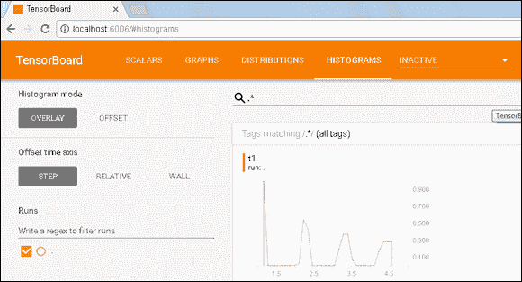

FIGURE 4-3: TensorBoard 直方图绘制张量的元素。

与 `t1` 到 `t4` 不同，`t5` 只有一个元素。应用程序通过调用 `tf.summary.scalar` 为 `t5` 生成数据，你可以通过单击页面顶部的 SCALARS 链接在 TensorBoard 中查看此数据。结果并不特别有趣，因为应用程序只执行了一次会话。第 5 章 解释了如何使用多个步骤执行会话并在 TensorBoard 中查看结果数据。

## Training

本章内容

**TensorFlow 中的训练应用程序**

**创建变量和占位符**

**使用优化器最小化损失**

**将数据集拆分为批次**

在互联网之前，像我这样的老派人通过互相交谈来娱乐自己。一个令人兴奋的游戏是 20 个问题，其中一名玩家想一个物体，另一名玩家提问以确定物体是什么。提问者最多只能问 20 个是非问题，一个典型的游戏过程如下：

*   Q: 它比面包盒大吗？
*   A: 是的。
*   Q: 它能移动吗？
*   A: 是的。
*   Q: 它是动物吗？
*   A: 不。
*   Q: 它靠轮子移动吗？
*   A: 不。
*   Q: （叹气）它是邪恶的机器人，Matt？又是吗？
*   A: 就是它！你赢了！

在本章中，我解释了 20 个问题游戏如何与监督机器学习中使用的训练方法相似。

### TensorFlow 中的训练

在 20 个问题游戏中，提问者从一个猜测开始，并随着每个答案不断完善自己的理解。这与监督机器学习中使用的训练方法相似。应用程序从对所需系统的一般想法或模型开始。应用程序将其模型与实验数据进行比较，确定它们之间的差异，并反复完善模型以减少差异。

总体训练过程很容易理解，但使用 TensorFlow 实现训练并不容易。该过程涉及六个步骤：

1.  **构建一般模型的数学表达式。**
2.  **声明在训练过程中要更新的变量。**
3.  **获得损失的表达式，即模型与观察值之间的差异。**
4.  **使用步骤 3 中的损失创建 `Optimizer` 并调用其 `minimize` 方法。**
5.  **（可选）配置会话的 `run` 方法的第二个参数，以将数据批次馈送到会话中。**
6.  **通过调用会话的 `run` 方法执行会话。**

根据 [`StackOverflow.com`](http://StackOverflow.com) 上的问题判断，许多开发人员难以理解如何执行这些步骤。本章解释了此训练过程，然后提供了示例代码，演示了如何在 TensorFlow 应用程序中实现这些步骤。

### 制定模型

正如 20 个问题游戏从做出猜测开始一样，机器学习从形成系统的初始数学模型开始。多种因素决定了该模型的性质，包括系统的复杂性、输入数据的结构以及问题的性质。图像数据需要与语音数据不同的模型。分类问题需要与预测问题不同类型的模型。

本书重点介绍两种数学建模方法。第一种方法是用形状近似一组数据点。例如，如果一个系统由二维点组成，你可以通过用二维直线近似系统来预测未来点。直线由方程 y = mx + b 确定，因此该方程充当一般模型。

第二种方法涉及创建人工神经网络，或 ANN。虽然受生物现象启发，但每个 ANN 都代表一种数学关系。第 7 章 介绍了这一令人兴奋的话题并解释了如何用代码构建 ANN。

无论你是用形状还是神经网络对系统进行建模，都需要不断完善模型，直到它尽可能接近观察到的数据。这种完善涉及更新模型的 参数，例如 *m* 和 *b* 在 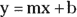<m:math xmlns:m="http://www.w3.org/1998/Math/MathML"><m:mrow><m:mi mathvariant="normal">y</m:mi><m:mo>=</m:mo><m:mi mathvariant="normal">mx</m:mi><m:mo>+</m:mo><m:mi mathvariant="normal">b</m:mi></m:mrow></m:math> 中。在 TensorFlow 应用程序中，这些可训练参数都是 `Variable` 类的实例。

当你与客户交谈时，尽量不要使用 *guess* 这样的术语，例如“哎呀，我们所有的猜测都完全偏离了目标！” 首选术语是 *initial estimate*，例如“初始估计被证明不准确，但后续的训练运行将带来更好的结果。”

### 查看变量

乍一看，变量与张量有很多共同点。两者都将数据存储在多维数组中，并且都可以用 TensorFlow 操作进行处理。

但张量可以用作多种用途，而大多数变量只有一个目的：在训练期间存储要更新的数据。随着训练的进行，变量的值会发生变化，希望每次变化都能使模型更接近所需系统。

变量还有另外三个重要特征：

*   变量在会话的连续执行之间保持其值。
*   变量必须由执行的会话特别初始化。
*   变量是 `Variable` 类的实例，而不是 `Tensor` 类。

最后一点很重要。在处理变量时，你需要调用一组新的方法和函数。以下各节解释了如何创建和初始化变量。

#### 创建变量

应用程序可以通过调用 `tf.Variable` 创建变量，其第一个参数设置变量的初始值。例如，以下代码创建了一个名为 `variableA` 的变量并将其初始值设置为名为 `tensorA` 的张量：

```python
tensorA = tf.constant([1.5, 2.5, 3.5])
```

`variableA = tf.Variable(tensorA)`

变量的职责是在训练期间保存要更新的数据。许多应用在初始化变量时并不使用常量值，而是使用随机值。下面的代码创建了一个名为 `variableB` 的变量，并将其初始值设置为正态分布张量：

`variableB = tf.Variable(tf.random_normal([3]))`

`tf.Variable` 接受一个名为 `trainable` 的布尔参数。如果将此参数设为 `True`，变量就可以通过训练进行更新。如果将其设为 `False`，变量就不能通过训练进行更新。

#### 初始化变量

变量与张量之间一个重要的区别是，你需要执行特殊操作来初始化变量。也就是说，在训练变量之前，你需要创建一个初始化操作并在会话中执行它。如果应用程序尝试使用未初始化的变量，TensorFlow 会抛出错误：Attempting to use uninitialized value….

TensorFlow 提供了三个创建初始化变量操作的函数。表 5-1 列出了它们并提供了每个函数的描述。

TABLE 5-1 变量初始化函数

| **Function** || **Description** |

| --- | --- |

| `variable_initializer(var_list, name='init')` || 返回一个初始化给定列表中变量的操作 |

| --- | --- |

| `local_variables_initializer()` || 返回一个初始化所有局部变量的操作 |

| `global_variables_initializer()` || 返回一个初始化所有全局变量的操作 |

应用程序通常调用 `global_variables_initializer`，因为它会创建一个初始化会话中每个全局变量的操作。下面的代码展示了如何调用此函数：

```
init = tf.global_variables_initializer()

...

with tf.Session() as sess:
    sess.run(init)
```

应用程序可以通过调用 `is_variable_initialized` 并传入变量的名称来检查变量是否已初始化。

### 确定损失

训练会优化模型变量，以最小化模型与观测数据之间的差异。机器学习文献通常将这种差异称为 *cost function*。TensorFlow 的文档将其称为 *loss*。

例如，如果你用一条直线对一组点进行建模，模型的表达式为 y = mx + b。当然，直线上的点不会完全匹配观测数据 y[obs]。如果有 *N* 个点，可以用以下表达式表示损失：

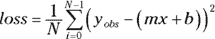<m:math xmlns:m="http://www.w3.org/1998/Math/MathML"><m:mrow><m:mi>l</m:mi><m:mi>o</m:mi><m:mi>s</m:mi><m:mi>s</m:mi><m:mo>=</m:mo><m:mfrac><m:mn>1</m:mn><m:mi>N</m:mi></m:mfrac><m:mstyle displaystyle="true"><m:munderover><m:mo>&#8721;</m:mo><m:mrow><m:mi>i</m:mi><m:mo>=</m:mo><m:mn>0</m:mn></m:mrow><m:mrow><m:mi>N</m:mi><m:mo>&#45;</m:mo><m:mn>1</m:mn></m:mrow></m:munderover><m:mrow><m:msup><m:mrow><m:mrow><m:mo>(</m:mo><m:mrow><m:msub><m:mi>y</m:mi><m:mrow><m:mi>o</m:mi><m:mi>b</m:mi><m:mi>s</m:mi></m:mrow></m:msub><m:mo>&#45;</m:mo><m:mrow><m:mo>(</m:mo><m:mrow><m:mi>m</m:mi><m:mi>x</m:mi><m:mo>+</m:mo><m:mi>b</m:mi></m:mrow><m:mo>)</m:mo></m:mrow></m:mrow><m:mo>)</m:mo></m:mrow></m:mrow><m:mn>2</m:mn></m:msup></m:mrow></m:mstyle></m:mrow></m:math>

在 TensorFlow 应用程序中，可以用以下代码表达模型和损失：

```
m = tf.Variable(tf.random_normal([]))
b = tf.Variable(tf.random_normal([]))
model = tf.add(tf.multiply(x, m), b)
loss = tf.reduce_mean(tf.pow(model - y, 2))
```

这种计算损失的方法称为 *mean squared error*，它是众多方法之一——最大似然估计和对数似然估计也很流行。第 6 章 讨论了统计回归以及计算损失的不同方法。

如果你的模型包含神经网络，就无法用简单方程计算损失。前馈网络需要像反向传播这样的特殊算法，而循环网络则依赖于通过时间的反向传播（BPTT）。我在 第 7 章 中讨论了神经网络和反向传播。我在 第 9 章 中介绍了 BPTT。

计算损失没有唯一正确的方法。唯一的要求是，每次损失的减少都必须意味着模型更接近观测数据。通过降低损失来改进模型的过程称为 *optimization*。

### 使用优化最小化损失

在形成损失表达式之后，下一步是通过更新模型变量来最小化损失。此过程称为 *optimization*，TensorFlow 为此目的支持多种算法。选择合适的算法对于编写机器学习应用程序至关重要。

每种优化方法在 `tf.train` 包中都由一个类表示。四种流行的优化类是 `GradientDescentOptimizer`、`MomentumOptimizer`、`AdagradOptimizer` 和 `AdamOptimizer` 类。以下各节将介绍这些类中的每一个，从 `Optimizer` 类开始，它是 TensorFlow 优化类的基类。

#### Optimizer 类

你不能直接在代码中访问 `Optimizer` 类；应用程序需要实例化其子类之一。但 `Optimizer` 类至关重要，因为它定义了至关重要的 `minimize` 方法：

`minimize(loss, global_step=None, var_list=None, gate_gradients=1, aggregation_method=None, colocate_gradients_with_ops=False, name=None, grad_loss=None)`

唯一必需的参数是第一个参数，它标识损失。默认情况下，`minimize` 可以访问图中的每个可训练变量。应用程序可以通过设置 `var_list` 参数来选择要优化的特定变量。

`minimize` 返回一个操作，可以由会话的 `run` 方法执行。每次执行都会执行两个步骤：

1. **计算更新目标变量的值。**
2. **用第 1 步计算的值更新目标变量。**

正如你可能不会用第一个问题就赢得 20 Questions 一样，你可能也不会通过一次调用 `minimize` 就优化模型。大多数应用程序都在循环中执行优化，下面的代码展示了优化循环的大致样子：

```
#### Create the optimizer and obtain the operation
optimizer = tf.train.GradientDescentOptimizer(learn_rate)
optimizer_op = minimize(loss)

#### Execute the minimization operation in a session
with tf.Session() as sess:
    for step in range(num_steps):
        sess.run(optimizer_op)
```

如果优化器达到合适的最小值，它就已 *converged* 到最小值。如果它未能达到最小值，优化器就已 *diverged*。

每次调用会话的 `run` 方法都会通过更新变量来最小化损失。应用程序通过创建 `Optimizer` 的子类来控制更新方式。本文讨论了四种流行的 `Optimizer` 子类：`GradientDescentOptimizer`、`MomentumOptimizer`、`AdagradOptimizer` 和 `AdamOptimizer`。

下面的讨论变得非常技术化，如果你刚开始学习机器学习，其实不需要知道这些数学知识。然而，选择合适的优化器会对应用程序的性能产生重大影响。此外，如果你正在面试一份高薪的 TensorFlow 工作，你应该能够解释为什么你更喜欢 `AdamOptimizer` 而不是 `GradientDescentOptimizer`。

#### GradientDescentOptimizer

`GradientDescentOptimizer` 是机器学习中使用最简单、最常见的优化器之一。如果你查看在线示例代码或机器学习教材，你很可能会经常遇到此优化器。

尽管很受欢迎，但很少有专家推荐使用 `GradientDescentOptimizer` 而不是其他替代方案。要了解原因，你需要理解它用于执行优化的算法。在本讨论中，我将介绍梯度下降的理论，然后解释如何在代码中创建和使用 `GradientDescentOptimizer`。

##### 梯度下降算法

`GradientDescentOptimizer` 使用梯度下降算法最小化损失，该算法依赖于一个关键的数学事实：在某一点上，函数沿其负梯度方向下降最快。

如果你学过微积分，你就知道函数在某一点的导数等于函数在该点的斜率。也就是说，如果 `f(x)` 可微，其关于 *x* 的导数记为 `f'(x)`，而在点 *a* 处的斜率记为 `f'(a)`。图 5-1 显示了函数导数的样子。

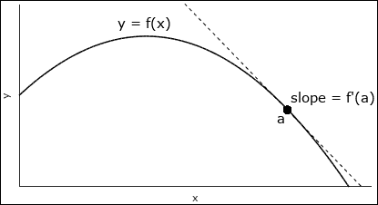

FIGURE 5-1: The derivative at a point equals the slope of the curve at that point.

具有多个变量的函数有多个导数。以 `f(x, y)` 为例，它有关于 *x* 的导数和关于 *y* 的导数。这些是 *偏导数*，用以下记号表示：


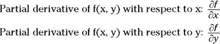<m:math xmlns:m="http://www.w3.org/1998/Math/MathML"><m:mtable columnalign="left"><m:mtr><m:mtd><m:mi mathvariant="normal">Partial&#160;derivative&#160;of&#160;f(x,&#160;y)&#160;with&#160;respect&#160;to&#160;x:&#160;</m:mi><m:mfrac><m:mrow><m:mo>&#8706;</m:mo><m:mi>f</m:mi></m:mrow><m:mrow><m:mo>&#8706;</m:mo><m:mi>x</m:mi></m:mrow></m:mfrac></m:mtd></m:mtr><m:mtr><m:mtd><m:mi mathvariant="normal">Partial&#160;derivative&#160;of&#160;f(x,&#160;y)&#160;with&#160;respect&#160;to&#160;y:&#160;</m:mi><m:mfrac><m:mrow><m:mo>&#8706;</m:mo><m:mi>f</m:mi></m:mrow><m:mrow><m:mo>&#8706;</m:mo><m:mi>y</m:mi></m:mrow></m:mfrac></m:mtd></m:mtr></m:mtable></m:math> 

图 5-2 描绘了关系 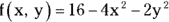<m:math xmlns:m="http://www.w3.org/1998/Math/MathML"><m:mrow><m:mi mathvariant="normal">f</m:mi><m:mrow><m:mo>(</m:mo><m:mrow><m:mi mathvariant="normal">x</m:mi><m:mo>,</m:mo><m:mi mathvariant="normal">&#160;y</m:mi></m:mrow><m:mo>)</m:mo></m:mrow><m:mo>=</m:mo><m:mn>16</m:mn><m:mo>&#45;</m:mo><m:mn>4</m:mn><m:msup><m:mi mathvariant="normal">x</m:mi><m:mn>2</m:mn></m:msup><m:mo>&#45;</m:mo><m:mn>2</m:mn><m:msup><m:mi mathvariant="normal">y</m:mi><m:mn>2</m:mn></m:msup></m:mrow></m:math>。在点 (1, 2) 处，关于 *x* 的偏导数为 –8，关于 *y* 的偏导数为 –8。

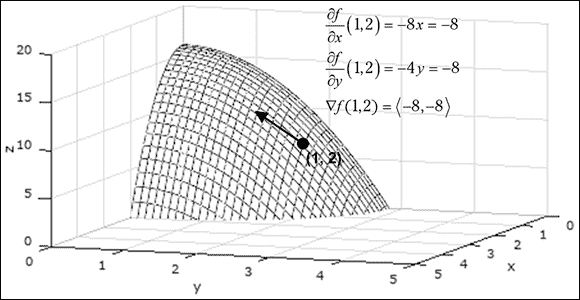

FIGURE 5-2: The gradient points in the direction of steepest ascent.

从几何上讲，*向量* 是一个具有大小和方向的量。向量可以用分量来定义，这些分量标识其在正交方向上的大小。你可以将向量视为空间中的箭头。如果一个向量在正 x 方向上指向两个单位，在负 y 方向上指向三个单位，它可以表示为 <2, -3>。

梯度下降算法关注一种特殊的向量，称为 *梯度*。函数的梯度是一个向量，其分量等于函数的偏导数。*f* 的梯度记为 ∇*f*，如果函数有三个变量，可以将其梯度表示如下：

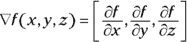<m:math xmlns:m="http://www.w3.org/1998/Math/MathML"><m:mrow><m:mo>&#8711;</m:mo><m:mi>f</m:mi><m:mo stretchy="false">(</m:mo><m:mi>x</m:mi><m:mo>,</m:mo><m:mi>y</m:mi><m:mo>,</m:mo><m:mi>z</m:mi><m:mo stretchy="false">)</m:mo><m:mo>=</m:mo><m:mrow><m:mo>\[</m:mo><m:mrow><m:mfrac><m:mrow><m:mo>&#8706;</m:mo><m:mi>f</m:mi></m:mrow><m:mrow><m:mo>&#8706;</m:mo><m:mi>x</m:mi></m:mrow></m:mfrac><m:mo>,</m:mo><m:mfrac><m:mrow><m:mo>&#8706;</m:mo><m:mi>f</m:mi></m:mrow><m:mrow><m:mo>&#8706;</m:mo><m:mi>y</m:mi></m:mrow></m:mfrac><m:mo>,</m:mo><m:mfrac><m:mrow><m:mo>&#8706;</m:mo><m:mi>f</m:mi></m:mrow><m:mrow><m:mo>&#8706;</m:mo><m:mi>z</m:mi></m:mrow></m:mfrac></m:mrow><m:mo>\]</m:mo></m:mrow></m:mrow></m:math> 

如果函数有两个变量，其梯度向量将有两个分量。在 图 5-2 中，(1, 2) 处的梯度是向量 <-8, -8>。该向量由从点 (1, 2) 延伸出的黑色箭头表示。

假设图中函数代表瑞士阿尔卑斯山的一座山。如果你是一名阿尔卑斯登山者，梯度标识了最陡的攀登方向。这种指定并非巧合。函数的梯度始终指向最陡上升的方向。同样，反向向量标识了最陡下降的方向。

在你理解了梯度的意义后，你就可以着手解决梯度下降算法了。该算法计算损失的梯度并更新模型的变量，直到损失的梯度降为零。为了以数学方式表达此操作，我需要引入一些记号：

* 可训练变量的集合记为 `θ`。第 *t* 步变量的值记为 `θ[t]`。

* 损失，即包含模型变量的数学关系，记为 `J(θ)`。损失的梯度为 `∇J(θ)`。

* 学习率，记为 `η`，是影响 `θ[j]` 从一步到下一步变化多少的值。

有了这个记号，你可以用以下方程表达 `GradientDescentOptimizer` 的每次优化步骤：

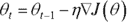<m:math xmlns:m="http://www.w3.org/1998/Math/MathML"><m:mrow><m:msub><m:mi>&#952;</m:mi><m:mi>t</m:mi></m:msub><m:mo>=</m:mo><m:msub><m:mi>&#952;</m:mi><m:mrow><m:mi>t</m:mi><m:mo>&#45;</m:mo><m:mn>1</m:mn></m:mrow></m:msub><m:mo>&#45;</m:mo><m:mi>&#951;</m:mi><m:mo>&#8711;</m:mo><m:mi>J</m:mi><m:mrow><m:mo>(</m:mo><m:mi>&#952;</m:mi><m:mo>)</m:mo></m:mrow></m:mrow></m:math> 

这显示了模型变量在每次训练操作中的变化方式。随着训练的继续，`∇J(θ)` 应接近零，这意味着每组新变量应近似等于前一组变量。此时，优化已完成，因为优化器已收敛到最小值。

`η` 的值由开发者确定，选择该值是一个关键决策。如果 `η` 太大，算法将快速进展，但它可能会绕过最小值而永远达不到最终值。

如果 `η` 太小，算法将更精确地移动，但需要花费大量时间。此外，优化器可能会在局部最小值处停止，而不是全局最小值。

##### 创建 GradientDescentOptimizer

应用程序可以通过创建 `GradientDescentOptimizer` 使用梯度下降算法执行优化。构造函数如下所示：

`tf.train.GradientDescentOptimizer(learning_rate, use_locking=False, name='GradientDescent')`

`learning_rate` 参数设置 `η`，即学习率。以下代码创建优化器并将其学习率设置为 0.1：

```
learn_rate = 0.1
optimizer = tf.train.GradientDescentOptimizer(learn_rate)
optimizer_op = optimizer.minimize(loss)
```

许多开发者使用试错法设置 `η`，初始估计值通常在 0.1 到 0.0001 之间。常见的方法是从较大的 `η` 值开始，然后不断减小该值，直到优化器成功收敛。据我所知，计算机科学家已经设计出了自动选择 `η` 的方法，但没有一种方法获得了广泛认可。

如果将 `use_locking` 参数设置为 `True`，`GradientDescentOptimizer` 将获取一个锁，防止其他操作修改其变量。变量仍可以正常读取。

###### Shortcomings

梯度下降算法是最小化损失的最古老、最简单的算法，但它存在一些重要的缺点，每个开发者都应该了解。

第一个缺点涉及局部最小值和全局最小值之间的差异。优化的目标是在整个函数范围内找到损失最小的点。这个值是损失的 *global minimum*。

但 `GradientDescentOptimizer` 可能收敛到一个非全局的最小值。这个值是 *local minimum*，而 Figure 5-3 说明了这种差异。在该图中，函数在全局最小值周围有两个局部最小值。如果优化器到达其中任一局部最小值，它将停止优化，因为损失的梯度 ∇*J*(*θ*) 等于 0。

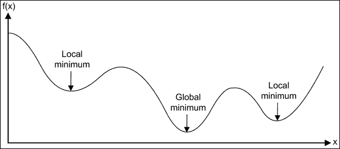

FIGURE 5-3: A function may have many local minima, but only one global minimum.

使用梯度下降算法时，你需要意识到另外三个问题：

* 它通常收敛到最小值速度很慢。

* 它只能优化可微函数。

* 它可能在值之间振荡，永远达不到最小值。

最后一个问题值得解释。如果学习率很大，算法可能会在两个点之间来回跳动，永远达不到最小值。这种跳动称为 *oscillation*，是频繁令人沮丧的来源。

你可以通过降低学习率来降低振荡的可能性。或者，你可以创建一个学习率随步数变化的优化器。以下各节介绍了三种这样的优化器：`MomentumOptimizer`、`AdagradOptimizer` 和 `AdamOptimizer`。

###### The MomentumOptimizer

`MomentumOptimizer` 与 `GradientDescentOptimizer` 有很多共同之处，但它通常收敛更快，且振荡可能性更低。`MomentumOptimizer` 通过动量算法最小化损失，该算法使用损失梯度的前值来更新当前变量集。

动量算法引入了一个 TensorFlow 称为 *accumulation* 的新量。该量用 `v_t` 表示，由当前损失的梯度、学习率和累积的前值决定：

`v_t = α v_{t-1} - η ∇J(θ)`

累积的前值 `v_{t-1}` 被 `α` 缩放，称为 *momentum*。`α` 设置为 0 到 1 之间的常数值，其值表示前一步应多大程度上影响当前步。应用通常将 `α` 设置为 0.9。

计算出累积后，你可以用以下方程更新变量集：

`θ_t = θ_{t-1} + v_t`

了解累积如何影响收敛速度很重要。如果优化器快速朝最小值移动，`α v_{t-1}` 将很显著，优化器将更快接近最小值。如果优化器卡在两个值之间，`α v_{t-1}` 将减少变量更新的幅度。

应用可以通过调用其构造函数创建 `MomentumOptimizer`：

```
MomentumOptimizer(learning_rate, momentum, use_locking=False, name='Momentum', use_nesterov=False)
```

`use_locking` 参数与 `GradientDescentOptimizer` 构造函数中的 `use_locking` 参数具有相同的目的。即，如果将 `use_locking` 设置为 `True`，优化器将锁定其变量的值。

如果将 `use_nesterov` 设置为 `True`，优化器将采用 Nesterov 加速梯度下降算法，通常缩写为 NAG。NAG 算法通过在计算损失 *之前* 更新变量来修改动量算法。以下方程展示了该算法的工作方式：

`v_t = α v_{t-1} - ∇J(θ - α v_{t-1})` `θ_t = θ_{t-1} + v_j`

NAG 算法通常比梯度下降算法收敛更快。Ilya Sutskever 等人撰写的论文 *On the Importance of Initialization and Momentum in Deep Learning* 详细讨论了该算法的性能。

###### The AdagradOptimizer

梯度下降算法和动量算法对每个正在训练的变量应用相同的学习率。但不同变量可能以不同的速率收敛到其最小值。自适应梯度 Adagrad 算法考虑到了这一点。

Adagrad 算法有两个使其在学术界和专家中流行的特点：

* 学习率会因变量而异，也会随步数而变化。第 *t* 步第 *i* 个变量的学习率记为 `η_{t,i}`。

*Adagrad* 方法计算 *subgradients* 而不是梯度。次梯度是适用于不可微函数的一种梯度推广。这意味着 AdaGrad 方法可以优化可微函数和不可微函数。

2011 年，John Duchi、Elad Hazan 和 Yoram Singer 在他们的论文 *Adaptive Subgradient Methods for Online Learning and Stochastic Optimization* 中描述了第一个 Adagrad 算法。数学公式丑陋得我不想尝试解释它。如果你好奇的话，这里是每个变量学习率的公式：

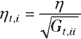<m:math xmlns:m="http://www.w3.org/1998/Math/MathML"><m:mrow><m:msub><m:mi>&#951;</m:mi><m:mrow><m:mi>t</m:mi><m:mo>,</m:mo><m:mi>i</m:mi></m:mrow></m:msub><m:mo>=</m:mo><m:mfrac><m:mi>&#951;</m:mi><m:mrow><m:msqrt><m:mrow><m:msub><m:mi>G</m:mi><m:mrow><m:mi>t</m:mi><m:mo>,</m:mo><m:mi>i</m:mi><m:mi>i</m:mi></m:mrow></m:msub></m:mrow></m:msqrt></m:mrow></m:mfrac></m:mrow></m:math>

在此公式中，`G[t, ii]` 是将损失的次梯度与其自身做外积形成的矩阵对角线上的 *i* 个元素。计算学习率后，优化器更新变量：

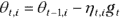<m:math xmlns:m="http://www.w3.org/1998/Math/MathML"><m:mrow><m:msub><m:mi>&#952;</m:mi><m:mrow><m:mi>t</m:mi><m:mo>,</m:mo><m:mi>i</m:mi></m:mrow></m:msub><m:mo>=</m:mo><m:msub><m:mi>&#952;</m:mi><m:mrow><m:mi>t</m:mi><m:mo>&#45;</m:mo><m:mn>1</m:mn><m:mo>,</m:mo><m:mi>i</m:mi></m:mrow></m:msub><m:mo>&#45;</m:mo><m:msub><m:mi>&#951;</m:mi><m:mrow><m:mi>t</m:mi><m:mo>,</m:mo><m:mi>i</m:mi></m:mrow></m:msub><m:msub><m:mi>g</m:mi><m:mi>t</m:mi></m:msub></m:mrow></m:math>

幸运的是，TensorFlow 开发者不必担心次梯度或外积。这是因为 TensorFlow API 提供了 `AdagradOptimizer` 类，其构造函数如下所示。

`AdagradOptimizer(learning_rate, initial_accumulator_value=0.1, use_locking=False, name='Adagrad')`

Adagrad 算法的一个缺点是学习率的幅度始终减小。随着训练的继续，它们的数值最终会达到零，从而使训练停止。

###### The AdamOptimizer

Adam（Adaptive Moment Estimation，自适应矩估计）算法在许多方面与 Adagrad 算法非常相似。它也与 Momentum 算法相似，因为它考虑了两个因素：

*   第一个矩向量：按 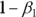<m:math xmlns:m="http://www.w3.org/1998/Math/MathML"><m:mrow><m:mn>1</m:mn><m:mo>&#45;</m:mo><m:msub><m:mi>&#946;</m:mi><m:mn>1</m:mn></m:msub></m:mrow></m:math> 缩放梯度


*   第二个矩向量：按 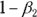<m:math xmlns:m="http://www.w3.org/1998/Math/MathML"><m:mrow><m:mn>1</m:mn><m:mo>&#45;</m:mo><m:msub><m:mi>&#946;</m:mi><m:mn>2</m:mn></m:msub></m:mrow></m:math> 缩放梯度的 *square*

这些矩向量分别记为 `m[t]` 和 `v[t]`。以下方程显示了它们的值如何逐步变化：

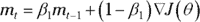<m:math xmlns:m="http://www.w3.org/1998/Math/MathML"><m:mrow><m:msub><m:mi>m</m:mi><m:mi>t</m:mi></m:msub><m:mo>=</m:mo><m:msub><m:mi>&#946;</m:mi><m:mn>1</m:mn></m:msub><m:msub><m:mi>m</m:mi><m:mrow><m:mi>t</m:mi><m:mo>&#45;</m:mo><m:mn>1</m:mn></m:mrow></m:msub><m:mo>+</m:mo><m:mrow><m:mo>(</m:mo><m:mrow><m:mn>1</m:mn><m:mo>&#45;</m:mo><m:msub><m:mi>&#946;</m:mi><m:mn>1</m:mn></m:msub></m:mrow><m:mo>)</m:mo></m:mrow><m:mo>&#8711;</m:mo><m:mi>J</m:mi><m:mrow><m:mo>(</m:mo><m:mi>&#952;</m:mi><m:mo>)</m:mo></m:mrow></m:mrow></m:math> 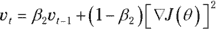<m:math xmlns:m="http://www.w3.org/1998/Math/MathML"><m:mrow><m:msub><m:mi>v</m:mi><m:mi>t</m:msub><m:mo>=</m:mo><m:msub><m:mi>&#946;</m:mi><m:mn>2</m:mn></m:msub><m:msub><m:mi>v</m:mi><m:mrow><m:mi>t</m:mi><m:mo>&#45;</m:mo><m:mn>1</m:mn></m:mrow></m:msub><m:mo>+</m:mo><m:mrow><m:mo>(</m:mo><m:mrow><m:mn>1</m:mn><m:mo>&#45;</m:mo><m:msub><m:mi>&#946;</m:mi><m:mn>2</m:mn></m:msub></m:mrow><m:mo>)</m:mo></m:mrow><m:msup><m:mrow><m:mrow><m:mo>\[</m:mo><m:mrow><m:mo>&#8711;</m:mo><m:mi>J</m:mi><m:mrow><m:mo>(</m:mo><m:mi>&#952;</m:mi><m:mo>)</m:mo></m:mrow></m:mrow><m:mo>\]</m:mo></m:mrow></m:mrow><m:mn>2</m:mn></m:msup></m:mrow></m:math>

计算这些向量后，优化器使用以下方程更新模型的变量：

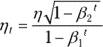<m:math xmlns:m="http://www.w3.org/1998/Math/MathML"><m:mrow><m:msub><m:mi>&#951;</m:mi><m:mi>t</m:mi></m:msub><m:mo>=</m:mo><m:mfrac><m:mrow><m:mi>&#951;</m:mi><m:msqrt><m:mrow><m:mn>1</m:mn><m:mo>&#45;</m:mo><m:msub><m:mi>&#946;</m:mi><m:mn>2</m:mn></m:msub><m:msup><m:mrow></m:mrow><m:mi>t</m:mi></m:msup></m:mrow></m:msqrt></m:mrow><m:mrow><m:mn>1</m:mn><m:mo>&#45;</m:mo><m:msub><m:mi>&#946;</m:mi><m:mn>1</m:mn></m:msub><m:msup><m:mrow></m:mrow><m:mi>t</m:mi></m:msup></m:mrow></m:mfrac></m:mrow></m:math> 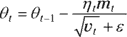<m:math xmlns:m="http://www.w3.org/1998/Math/MathML"><m:mrow><m:msub><m:mi>&#952;</m:mi><m:mi>t</m:msub><m:mo>=</m:mo><m:msub><m:mi>&#952;</m:mi><m:mrow><m:mi>t</m:mi><m:mo>&#45;</m:mo><m:mn>1</m:mn></m:mrow></m:msub><m:mo>&#45;</m:mo><m:mfrac><m:mrow><m:msub><m:mi>&#951;</m:mi><m:mi>t</m:mi></m:msub><m:msub><m:mi>m</m:mi><m:mi>t</m:mi></m:msub></m:mrow><m:mrow><m:msqrt><m:mrow><m:msub><m:mi>v</m:mi><m:mi>t</m:msub></m:mrow></m:msqrt><m:mo>+</m:mo><m:mi>&#949;</m:mi></m:mrow></m:mfrac></m:mrow></m:math>

在第二个方程中，*ε* 的目的是防止分母达到零。因此，*ε* 通常设置为一个很小的值。

要使用 Adam 算法，你需要创建一个 `AdamOptimizer` 的实例。构造函数如下所示：

`AdamOptimizer(learning_rate=0.001, beta1=0.9, beta2=0.999, epsilon=1e-08, use_locking=False, name='Adam')`

当决定优化器时，我总是从 `AdamOptimizer` 开始，尤其是在处理图像时。唯一的例外是当我向新手提供代码时。在这种情况下，我会创建一个 `GradientDescentOptimizer`，它不会吓到任何人。

### Feeding Data into a Session

应用程序经常将测试数据拆分为若干部分，并对每个部分调用一次会话的 `run` 方法，而不是用一次调用处理所有测试数据。至少有三个原因可以这样做：

*   如果数据存储在文件或远程服务器上，在从源加载另一部分数据的同时处理一部分数据可能更有效。
*   对数据部分进行洗牌会增加数据的 *stochasticity*。这一过程可以提高收敛到全局最小值而不是局部最小值的能力。我将在即将到来的 “Stochasticity” 部分解释数据洗牌的理由。
*   时间限制使得一次处理所有数据不切实际。

在一次会话执行中处理的数据部分称为 *batch*。将批次传输到会话的过程称为 *feeding data to the session*。要在代码中配置此操作，应用程序需要执行三个步骤：

1.  **定义占位符以包含要馈送到会话中的数据。**
2.  **在模型和损失的表达式中使用占位符。**
3.  **将会话的 `run` 方法的第二个参数设置为一个字典，该字典将每个占位符与数据源关联起来。**

步骤 2 很简单，因为你可以像处理张量一样处理占位符。此讨论侧重于步骤 1 和 3。后续章节将展示代码，演示如何将数据馈送到会话中。

#### Creating placeholders

*placeholder* 是一个保存要馈送到会话中的数据批次的常量 `Tensor`。你可以通过调用 `tf.placeholder` 函数来创建占位符：

`tf.placeholder(dtype, shape=None, name=None)`

前两个参数指定了占位符元素的类型及其大小。占位符的实际内容由运行的会话设置，因此无法初始化占位符。

例如，下面的代码创建了一个包含 32 位浮点值的占位符：

```
ph = tf.placeholder(tf.float32)
```

如果未给出占位符的形状，则可以将其设置为任意形状的张量。如果给出了形状，则分配不同形状的张量将导致错误。

#### 定义 feed 字典

第 3 章 介绍了 `Session` 类并解释了如何通过调用其 `run` 方法来执行会话。但讨论中没有提到 `run` 的第二个参数 `feed_dict`，它使得可以将数据馈送到会话中。要向会话馈送数据，需要将 `feed_dict` 分配给一个字典，其键标识会话中的张量。大多数应用程序将这些键设置为占位符。`feed_dict` 中的每个值都标识要传递给由键标识的张量（通常是占位符）的数据源。

为了演示数据馈送，下面的代码创建了一个占位符，在模型操作中使用它，然后通过 `run` 方法的 `feed_dict` 参数将其馈送到会话中。

```
ph = tf.placeholder(tf.float32)
...
with tf.Session() as sess:
    sess.run(optimizer, feed_dict={ph: data_src})
```

将数据与占位符关联时，有一个需要注意的地方：数据源可以是常量的列表或 NumPy `ndarray`，但不能是张量。下面的代码将占位符与 `ndarray` 关联：

```
ph = tf.placeholder(tf.float32)
vals = np.array([9., 8., 7.])
incr = tf.add(ph, 1.)
with tf.Session() as sess:
    res = sess.run(incr, feed_dict={ph: vals})
    print(res)
```

在这种情况下，打印结果为 `[10. 9. 8.]`，因为 `feed_dict` 通过 `ph` 占位符将 `vals` 数组传递给会话。如果应用程序将 `vals` 分配给张量，TensorFlow 将引发以下错误：*The value of a feed cannot be a tf.Tensor object.*

#### 随机性

为了防止优化器收敛到局部最小值而不是全局最小值，许多应用程序将其训练数据拆分为小批量并随机馈送到会话中。这种随机性也称为 *stochasticity*，它迫使优化器在训练初期进行较大跳跃，随着训练进行而进行较小跳跃。这种跳跃增加了优化器找到全局最小值的可能性。

如果采用梯度下降算法来处理随机数据，则称为 *stochastic gradient descent* 算法。如果你在机器学习文献中遇到术语 SGD，指的就是该算法。

### 监控步骤、全局步骤和周期

在 TensorFlow 中，每个处理单个数据批量的会话执行称为 *step*。许多 TensorFlow 函数和方法接受一个名为 `global_step` 的参数，可用于监控会话执行的总步数。实际上，`global_step` 用作正在处理的批量的索引。你可以通过调用 `tf.train.global_step` 在代码中访问此索引。

你也可以将全局步骤存储在常规变量中。此存储需要两个操作：

1. **定义一个初始值为 0 且 `trainable` 参数设置为 `False` 的变量。**
2. **将变量设置为优化器的 `minimize` 方法的 `global_step` 参数。**

如果其 `global_step` 参数被设置为变量，`minimize` 将在会话处理每个数据批量时递增该变量。下面的代码创建了一个名为 `gstep` 的变量并将其配置为存储应用程序的全局步骤：

```
#### Define the variable to hold the global step
gstep = tf.Variable(0, trainable=False)

#### Configure the optimizer
learn_rate = 0.1
batch_size = 40
optimizer = tf.train.GradientDescentOptimizer(learn_rate).minimize(loss, global_step=gstep)

#### Initialize variables
init = tf.global_variables_initializer()

#### Launch session
with tf.Session() as sess:
    sess.run(init)

    for batch in range(batch_size):
        _, step, result = sess.run([optimizer, gstep, x_min])
        print("Step %d: Computed result = %f" % (step, result))
```

当你查看这段代码时，可能会产生一个问题：为什么要跟踪全局步骤，而你可以使用循环索引？要回答这个问题，假设你执行了十个训练批量然后重新启动应用程序。循环变量将恢复为 0，但如果你已将全局步骤保存到文件中，你可以恢复它并将其用作当前全局步骤。我在 “Saving variables” 部分解释了如何将变量保存到文件，该部分在本书的后面。

在前面的示例中，测试仅执行每个批量一次。在实际应用程序中，所有批量将被处理多次。对数据集的每个批量进行一次遍历称为 *epoch.* 例如，如果数据集被拆分为 50 个批量，则一个周期由 50 个步骤组成。

许多应用程序在两个循环中执行会话：外层循环对每个周期迭代一次，内层循环对每个批量执行一次。下面的代码创建了两个循环并在每次迭代时调用 `sess.run`：

```
for epoch in range(num_epochs):
    for batch in range(num_batches):
        sess.run(...)
```

了解周期和批量之间的区别非常重要。类似的训练循环贯穿本书的示例代码以及互联网上的示例。

### 保存和恢复变量

`Saver` 类使加载和存储变量变得简单。默认情况下，`Saver` 可以访问会话中的每个变量。但构造函数的第一个参数可以标识要访问的特定变量。例如，下面的代码创建了一个 `Saver`，它只能保存/恢复两个变量：`firstVar` 和 `secondVar`：

```
saver = tf.train.Saver([firstVar, secondVar])
```

创建 `Saver` 后，你可以通过调用其 `save` 方法将变量存储到文件中。然后你可以通过调用 `restore` 从文件中恢复变量。

#### 保存变量

`save` 方法存储变量以及与变量相关的数据。默认情况下，该方法至少创建三个二进制文件，每个文件具有相同的名称但后缀不同：

*   *filename*.data-*X*\-of-*Y*: 存储变量值
*   *filename*.index: 包含数据文件中的每个变量的偏移量
*   *filename*.meta: 包含变量所在图的 `MetaGraphDef` 结构

数据文件包含变量值，如果应用程序有许多变量，`save` 将创建多个数据文件。如果只有一个文件，其名称将为 *`filename`*`.data-00000-of-00001`。

索引文件包含一个表，将变量名称与索引文件中的偏移量匹配。你可以使用 `restore` 方法检索变量，我将在下一节中解释。

你可以通过创建 `Saver` 并调用其 `save` 方法来创建这些文件：

```
save(sess, save_path, global_step=None, latest_filename=None, meta_graph_suffix='meta', write_meta_graph=True, write_state=True)
```

这些参数很容易理解。`sess` 是包含感兴趣变量的会话，`save_path` 标识包含保存数据的文件的路径。`save_path` 的最后一部分指定要生成的文件的名称。

如果设置了 `latest_filename`，`save` 将创建一个文本文件，列出保存操作涉及的文件路径。如果设置了 `global_step`，该值将被附加到每个生成的 files。

例如，下面的代码创建一个 `Saver` 并调用 `save` 在当前目录中创建生成的 files（output.*）：

```
saver = tf.train.Saver()
saver.save(sess, os.getcwd() + "/output")
```

如果要存储的变量不多，`save` 只会生成三个文件：`output.data-00000-of-00001`、`output.index` 和 `output.meta`。

#### 恢复变量

`restore` 方法会加载之前存储的变量。恢复变量的过程包含两个步骤：

1. **调用 `import_meta_graph` 将变量的节点添加到当前图中。**
2. **调用 `restore` 访问变量数据。**

第一步很简单。`tf.train.import_meta_graph` 接受一个 `*.meta` 文件的路径，从文件中读取图数据，并将图的节点添加到当前图中。该函数返回一个 `Saver`，可用于从加载的图中恢复变量。

例如，下面的代码从 `output.meta` 导入图数据并获得可用于加载变量的 `Saver`：

```
saver = tf.train.import_meta_graph("output.meta")
```


获得 `Saver` 后，应用程序可以通过调用其 `restore` 方法来加载变量，其签名如下：

```
restore(sess, save_path)
```

与 `save` 方法类似，`sess` 标识包含变量的会话，而 `save_path` 是包含变量数据的文件的路径。此路径必须包含三个文件名称而不带后缀。例如，下面的代码使用 `saver` 将变量从 `output` 加载到当前图中：

```
saver.restore(sess, os.getcwd() + "/output")
```

## 使用 SavedModel

除了使用 `Saver` 存储变量外，你还可以通过创建 `SavedModel` 来存储应用程序的整个模型。如文档所述，`SavedModel` 是“TensorFlow 模型的通用序列化格式”，并作为“导出 TensorFlow 图的规范方式”。

准确地说，`SavedModel` 是一个目录，其中包含一个 `*.pb` 或 `*.pbtxt` 文件。该文件包含应用程序的模型并以 `MetaGraphDef` 协议缓冲区存储图定义。除了此文件外，`SavedModel` 还可能包含以下一个或多个子目录：

* `variables:` 包含应用程序变量的目录（文件类似于 `Saver` 的 `save` 方法生成的文件，但不包括 `*.meta` 文件）
* `assets:` 需要加载到图中的辅助文件
* `assets.extra:` 不需要加载到图中的用户提供文件

保存和恢复 `SavedModel` 在概念上并不困难，但代码会变得有点复杂。

### 保存 SavedModel

将应用程序的模型保存到 `SavedModel` 的过程与存储变量的过程类似。但不是创建 `Saver`，你需要创建一个 `tf.saved_model.builder.SavedModelBuilder`。构造函数接受一个标识顶级目录的单一参数：

```
builder = tf.saved_model.builder.SavedModelBuilder("out")
```

创建 `SavedModelBuilder` 后，你可以向模型添加数据并将模型保存到给定目录。要向模型添加数据，你需要调用两个函数之一：`add_meta_graph` 或 `add_meta_graph_and_variables`。`add_meta_graph` 的签名如下

```
add_meta_graph(tags, signature_def_map=None, assets_collection=None, legacy_init_op=None, clear_devices=False, main_op=None)
```

元图使用称为 *tags* 的字符串标识其功能和用途。你可以通过设置 `tags` 参数来分配元图的标签。`tf.saved_model.tag_constants` 提供了三个常用标签：`GPU`、`SERVING` 和 `TRAINING`。

图的输入和输出构成其 *signature*。在代码中，图的签名由 `SignatureDef` 表示，你可以通过调用 `tf.saved_model.signature_def_utils` 包的 `build_signature_def` 函数来创建它：

```
build_signature_def(inputs=None, outputs=None, method_name=None)
```

要创建签名，你需要将 `inputs` 和 `outputs` 设置为将名称与 `TensorInfo` 协议缓冲区关联的字典。对于名称，许多应用程序使用 `tf.saved_model.signature_constants` 中的常量，其中包括 `CLASSIFY_INPUTS`、`CLASSIFY_OUTPUT_CLASSES`、`PREDICT_INPUTS` 和 `PREDICT_OUTPUTS`。

你可以通过使用张量调用 `tf.saved_model.utils.build_tensor_info` 来获得张量的 `TensorInfo`。下面的代码返回名为 `input_vec` 的张量的 `TensorInfo`：

```
info = tf.saved_model.utils.build_tensor_info(input_vec)
```

`build_signature_def` 的 `method_name` 参数是一个用作签名方法名称的字符串。你可以将其设置为 `tf.saved_model.signature_constants` 模块中的一个字符串，例如 `CLASSIFY_METHOD_NAME`、`PREDICT_METHOD_NAME` 或 `REGRESS_METHOD_NAME`。

`add_meta_graph_and_variables` 方法与 `add_meta_graph` 类似，但它有一个额外的参数。`add_meta_graph_and_variables` 的第一个参数是 `sess`，它标识应提供元图变量的会话。

在向 `SavedModel` 添加元图后，你可以通过调用 `save` 方法来存储 `SavedModel`。它接受一个 `as_text` 参数，用于标识协议缓冲区应保存为文本文件（`*.pbtxt`）还是二进制文件（`*.pb`）。默认情况下，`save` 将元图数据存储在二进制文件中。

### 加载 SavedModel

虽然将元图保存到 `SavedModel` 很复杂，但加载它们很容易。你只需要知道一个函数：

```
tf.saved_model.loader.load(sess, tags, export_dir, **saver_kwargs)
```

它从 `export_dir` 给定的目录加载 `MetaGraphDef` 协议缓冲区，并使用 `tags` 给定的标签。`sess` 参数标识应包含元图的变量、资源和签名的会话。

### 将理论付诸实践

当我开始学习 TensorFlow 时，我发现训练很难理解。除了理论之外，还有许多新概念需要处理，例如变量、优化器和占位符。

为了阐明训练的工作原理，我在示例代码中提供了 `ch5/simple_train.py`。该应用程序非常简单，甚至不费心去构建模型。相反，它使用一个简单的二次方程计算损失：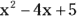<m:math xmlns:m="http://www.w3.org/1998/Math/MathML"><m:mrow><m:msup><m:mi mathvariant="normal">x</m:mi><m:mn>2</m:mn></m:msup><m:mo>&#45;</m:mo><m:mn>4</m:mn><m:mi mathvariant="normal">x</m:mi><m:mo>+</m:mo><m:mn>5</m:mn></m:mrow></m:math>。图 5-4 显示了它的样子。

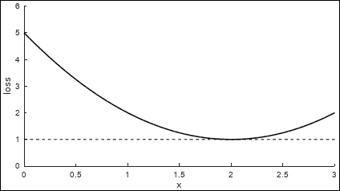

FIGURE 5-4: 当 x 等于 2 时，损失达到最小值。

如 图 5-4 所示，当 `x_var` 等于 2 时，损失达到全局最小值。因此，优化器的目标是更新 `x_var` 直到其等于 2。 代码清单 5-1 中的代码展示了如何在 TensorFlow 中实现这一目标。

LISTING 5-1 TensorFlow 中的训练

```
#### Define a trainable variable
x_var = tf.Variable(0., name='x_result')

#### Define an untrainable variable to hold the global step
step_var = tf.Variable(0, trainable=False)

#### Express loss in terms of the variable
loss = x_var * x_var - 4.0 * x_var + 5.0

#### Find variable value that minimizes loss
learn_rate = 0.1
num_epochs = 40
optimizer = tf.train.GradientDescentOptimizer(learn_rate).minimize(loss, global_step=step_var)

#### Initialize variables
init = tf.global_variables_initializer()

#### Create the saver
saver = tf.train.Saver()

#### Create summary data and FileWriter
summary_op = tf.summary.scalar('x', x_var)
file_writer = tf.summary.FileWriter('log', graph=tf.get_default_graph())

#### Launch session
with tf.Session() as sess:
  sess.run(init)

  for epoch in range(num_epochs):
```

`_, step, result, summary = sess.run([optimizer, step_var, x_var, summary_op])`

`print('Step %d: Computed result = %f' % (step, result))`

`# Print summary data`

`file_writer.add_summary(summary, global_step=step)`

`file_writer.flush()`

`# Store variable data`

`saver.save(sess, os.getcwd() + '/output')`

`print('Final x_var: %f' % sess.run(x_var))`

This code creates two variables: a trainable variable named `x_var` and an untrainable variable named `step_var`. `loss` is set to a quadratic equation whose independent variable is `x_var`.

The application calls `tf.global_variables_initializer` to obtain an operation for initializing its variables. The session must execute this operation before it can train the variables in the optimization process.

After creating the variables, the application creates a `GradientDescentOptimizer` and calls its `minimize` method to reduce the `loss` to a minimum. Then it assigns the `global_step` parameter of `minimize` to `step_var`. This assignment tells the session to increment `step_var` each time it performs a training operation.

After each training operation, `print` displays the global step and the current value of `x_var`. As training continues, `x_var` approaches 2, the point of minimum loss. Similarly, `step_var` approaches 40 because the training loop performs 40 iterations.

When optimization is complete, the application stores its variables to a file. The `save` method of the `Saver` instance stores variable data to three files in the current directory: `output.data-00000-of-00001`, `output.index`, and `output.meta`.

The code in `ch5/restore_vars.py` loads the value of `x_var` from the new data files. Listing 5-2 presents the code.

#### Loading Variables from a File

```
#### Create session
with tf.Session() as sess:

    # Load stored graph into current graph
    saver = tf.train.import_meta_graph('output.meta')

    # Restore variables into graph
    saver.restore(sess, os.getcwd() + '/output')

    # Display value of variable
    print('Variable value: ', sess.run('x_result:0'))
```

It's important to see that this code doesn’t create a `Saver` by calling the class’s constructor. Instead, it obtains a `Saver` by calling `import_meta_graph` with the name of the file containing graph data.

After obtaining the `Saver`, the application obtains the variable's value by calling the `Saver`’s `restore` method and the session's `run` method. Even though the variable’s name was `x_var`, the application calls `run` with `x_output:0` because the variable's `name` parameter was set to `x_output`.

#### Visualizing the Training Process

The `ch5/simple_train.py` application prints the loss at each step using the following code:

```
print("Step %d: Computed result = %f" % (step, result))
```

TensorFlow provides a better way to monitor training. Chapter 4 covers the TensorBoard utility, which reads summary data generated by an application. The code in `ch5/simple_train.py` generates summary data for training by performing four steps:

1. **Call `tf.summary.scalar` to create an operation that writes `x_var` to summary data.**
2. **Call `tf.summary.FileWriter` to create a `FileWriter`.**
3. **Execute the session with the operation from Step 1.**
4. **With each session execution, print the summary data by calling the `FileWriter`'s `add_summary` method.**

For the last step, the following code prints the summary data:

```
file_writer.add_summary(summary, global_step=step)
```

The `global_step` parameter is important to understand. This parameter changes from step to step, and it tells TensorBoard to display a different value at each step. Figure 5-5 presents TensorBoard's output for the variable as training proceeds.


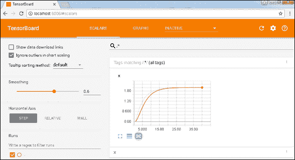

FIGURE 5-5: TensorBoard illustrates training by displaying variable values at each step.

In this example, the loss is so simple that the optimizer converges gently to the minimum when x equals 2. In real-world applications, the optimization process is never as smooth. Thankfully, TensorBoard can illustrate what’s happening in the training process.

## Session Hooks

After you understand how to save variables and generate summary data, you’re ready to learn how to automate these operations with session hooks. Session hooks make it possible to monitor a session’s state, access a session’s data, and execute code at different points in the session’s execution. To use session hooks, you need to perform two steps:

1. **Create one or more `SessionRunHook` instances.**
2. **Create a `MonitoredSession` and configure it with the session hooks.**

This discussion presents both steps. I also present code that demonstrates how these steps can be performed in practice.

### Creating a session hook

To monitor a session's operation, you need to create a custom subclass of `SessionRunHook` or instantiate an existing subclass provided in the `tf.train` package. I refer to an instance of `SessionRunHook` or one of its subclasses as a *session hook*. To explain this topic, I present the methods of the `SessionRunHook` class and then introduce the subclasses provided by TensorFlow.

#### Life-cycle methods of SessionRunHook

When you associate a session hook with a session, the application calls the hook's methods at different stages in the session’s life-cycle. To be specific, the application calls five methods of the `SessionRunHook` class:

* `begin()`: Called when the session is created
* `after_create_session(session, coord)`: Called when the session's graph is finalized
* `before_run(run_context)`: Called before the associated session starts executing
* `after_run(run_context, run_values)`: Called after the associated session starts executing
* `end(session)`: Called at the end of the session

It's important to see the difference between `begin` and `after_create_session`. An application calls `begin` immediately after the session has been created. At this point, you can access and modify the session's graph. But when the application calls `after_create_session`, the graph’s structure is finalized and can’t be changed.

The `before_run` and `after_run` methods both provide a `run_context` parameter. This is an instance of `SessionRunContext`, and it provides four members:

* `session`: The associated session
* `original_args`: A `SessionRunArgs` that contains the arguments of the session's `run` method
* `stop_requested`: A bool that identifies whether a stop is requested
* `request_stop()`: Tells the session to stop

If you want a session hook to read a value from the session's graph, you can code `before_run` to return a `SessionRunArgs` instance. You need to set the first argument of the `SessionRunArgs` constructor to the name of the variable or tensor to access.

If you added a return value to `before_run`, you can obtain the desired variable(s) or tensor(s) through the `run_values` argument of the `after_run` method. This `SessionRunValues` object has three fields:

* `results`: The value(s) accessed by the return value of `before_run`
* `options`: The `RunOptions` object used to configure the session's execution
* `run_metadata`: The `RunMetadata` object containing information about the session's execution

This relationship between `before_run` and `after_run` can be confusing. To clarify how the two methods work together, the following code creates a subclass of `SessionRunHook` that prints information before and after the session runs.

```
class CustomHook(tf.train.SessionRunHook):
    def before_run(self, run_context):
        print("First argument: ", run_context.original_args.fetches);
```

`return tf.train.SessionRunArgs(loss)`

`def after_run(self, run_context, run_values):`

`print("Loss: ", run_values.results);`

In this code, `before_run` returns a `SessionRunArgs` that identifies the name of the `loss` variable. When `after_run` is called, the `results` field of the `run_values` argument contains the current value of `loss`.

### Subclasses of SessionRunHook

You can create your own subclasses of `SessionRunHook` and add code for different life-cycle methods. But in most cases, it's easier to instantiate an existing subclass. Table 5-2 presents the constructors of each session hook class in the `tf.train` package.

TABLE 5-2 Session Hook Classes

| **Class** || **Description** |
| --- | --- |
| `LoggingTensorHook(tensors, every_n_iter=None, every_n_secs=None, at_end=False, formatter=False)` || Logs values of a tensor after a given number of steps or after a given time |
| --- | --- |
| `CheckpointSaverHook(checkpoint_dir, save_secs=None, save_steps=None, saver=None, checkpoint_baseline='model.ckpt’, scaffold=None, listeners=None)` || Saves data to a checkpoint after a given number of steps or after a given time |
| `SummarySaverHook(save_steps=None, save_secs=None, output_dir=None, summary_writer=None, scaffold=None, summary_op=None)` || Generates summary data after a given number of steps or after a given time |
| `StepCounterHook(every_n_steps=100, every_n_secs=None, output_dir=None, summary_writer=None)` || Counts the number of steps per second |
| `StopAtStepHook(num_steps=None, last_step=None)` || Tells the session to stop after a number of steps have executed or a specific step has been reached |
| `NanTensorHook(loss_tensor, fail_on_nan_loss)` || Stops training if loss equals NaN |
| `GlobalStepWaiterHook(wait_until_step)` || Delays execution until the global step reaches a given value |
| `FinalOpsHook(final_ops, final_ops_feed_dict=None)` || Evaluates tensors at the end of a session |
| `FeedFnHook(feed_fn)` || Runs the given function and sets the session's feed dict |

The first three session hook classes automate the processes of logging messages, saving variables, and generating summary data. You can specify how often the operation should be performed by setting a training step interval (`every_n_iter` or `n_steps`) or the time interval (`every_n_secs` or `n_secs`). Naturally, you can't set both types of intervals in the same method.

A `StepCounterHook` tells you about the session’s performance by showing how many training steps are performed in the given time interval. To provide output, it generates summary data using a summary writer. In contrast, a `StopAtStepHook` tells the session to stop at a given global step value or after a specified number of training steps.

### Creating a MonitoredSession

A `MonitoredSession` isn't a `Session`, but it contains a `Session` instance and provides methods for interacting with the session. For example, you can launch a `MonitoredSession`'s session by calling `run` and close the session by calling `close`.

To create a `MonitoredSession`, you need to call its constructor:

`MonitoredSession(session_creator=None, hooks=None, stop_grace_period_secs=120)`

The first parameter is a `SessionCreator` instance, which configures the underlying session. TensorFlow provides two subclasses of `SessionCreator`: `ChiefSessionCreator` and `WorkerSessionCreator`. The terms *chief* and *worker* refer to different types of processes in distributed applications.

You can associate session hooks with a `MonitoredSession` by setting the `hooks` parameter to a list of session hooks. The last parameter, `stop_grace_period_secs`, sets the number of seconds that a session thread can continue executing after an application calls `close`.


The `MonitoredSession` class also provides a method called `should_stop`. Applications frequently employ this method to determine whether the session should continue running. A session hook can stop a session through its `request_stop` method, which calls the monitored session's `should_stop` method. The following code demonstrates how `should_stop` can be used:

```
with tf.train.MonitoredSession(hooks=[custom_hook]) as sess:
 while not sess.should_stop():
 sess.run(…)
```

This `should_stop` method becomes particularly important for distributed TensorFlow applications. I discuss distributed applications and their sessions in Chapter 13.

### Putting theory into practice

The code in the `ch5/monitor_train.py` module performs the same training operation as in the `ch5/simple_train.py` module. The difference is that monitor_train.py uses session hooks to save variables and generate summary data. Listing 5-3 presents the code.

LISTING 5-3 Monitoring a Session with Session Hooks

```
#### Custom session hook
class CustomHook(tf.train.SessionRunHook):

 def begin(self):
 print('Beginning the session!')

 def before_run(self, run_context):
 return tf.train.SessionRunArgs(loss)

 def after_run(self, run_context, run_values):
 if run_context.original_args != 'init':
 print('Loss: ', run_values.results)

 def end(self, session):
 print('The session is about to end!')

#### Define a trainable variable
x_var = tf.Variable(0., name='x_result')

#### Define an untrainable variable to hold the global step
step_var = tf.train.create_global_step()

#### Express loss in terms of the variable
loss = x_var * x_var - 4.0 * x_var + 5.0

#### Find variable value that minimizes loss
learn_rate = 0.1
num_epochs = 40
optimizer = tf.train.GradientDescentOptimizer(learn_rate).minimize(loss, global_step=step_var)

#### Initialize variables
init = tf.global_variables_initializer()

#### Create summary operation
summary_op = tf.summary.scalar('x', x_var)

#### Create hooks
custom_hook = CustomHook()
checkpoint_hook = tf.train.CheckpointSaverHook(checkpoint_dir='ckpt_dir',
 checkpoint_basename='output', save_steps=10)
summary_hook = tf.train.SummarySaverHook(save_steps=10, output_dir='log', summary_op=summary_op)
hooks = [custom_hook, checkpoint_hook, summary_hook]

#### Launch session
with tf.train.MonitoredSession(hooks=hooks) as sess:
 sess.run(init)

 for epoch in range(num_epochs):
 sess.run(optimizer)
```

This module creates three session hook instances:

* `CustomHook`: Prints messages at different points in the session's execution
* `CheckpointSaverHook`: Saves checkpoint data to a directory named `ckpt_dir`
* `SummarySaverHook`: Saves summary data to a directory named log

After creating the session hooks, the module creates a `MonitoredSession` and configures it with the three hook instances. Then it initializes the session’s variables and optimizes the model.

# Part 2

## Implementing Machine Learning

IN THIS PART …

Explore different types of statistical regression, including linear regression, polynomial regression, and logistic regression.

Learn about perceptrons and neural networks, which consist of interconnected nodes.

Understand the theory of image processing and convolutional neural networks (CNN), which make it possible to recognize images.

Explore the theory of recurrent neural networks (RNN) and use them to analyze sequential data.

### Chapter 6

#### Analyzing Data with Statistical Regression

IN THIS CHAPTER

**Identifying trends with linear and polynomial regression analysis**

**Classifying points with logistic regression analysis**

**Modeling systems with the logistic and softmax functions**

**Computing loss with log likelihood and cross entropy**

每个人都知道机器学习是一个快速发展、令人兴奋的领域，适合聪明、有远见的人，而每个人都知道统计学是一个枯燥、死板的领域，适合喜欢 Muzak 的人。因此，新手可能会觉得在一本关于机器学习的书中看到统计分析章节很奇怪。

但机器学习和统计学有很多共同点。事实上，它们的最终目标相同：用数学关系来建模现实世界系统。机器学习大量依赖统计方法，本章介绍了在 TensorFlow 开发中发挥关键作用的三种方法：线性回归、多项式回归和逻辑回归。此外，本章中的示例代码巩固了 TensorFlow 应用程序执行训练的方式。

##### 使用回归分析系统

统计学家使用的一种最有效工具是回归。*回归*通过衡量其变量之间的关系来分析系统。TensorFlow 为此分析提供了许多功能，本章重点介绍四种回归类型：

* **线性回归：**将一条直线拟合到数据集中的点
* **多项式回归**：将多项式拟合到数据集中的点
* **二元逻辑回归：**将点分类到两个类别之一
* **多元逻辑回归：**将点分类到多个类别之一

以下各节将探讨这些简单操作。

##### 线性回归：拟合数据直线

在你祖父的阁楼里翻找时，你发现了一本品相完好的《Commander Warpspeed's Journey into Space!》首刊。这本稀有漫画书可能价值数千美元，所以你决定把它卖掉。但你应该要价多少呢？

在线搜索提供了 40 个售价，范围从不到 5,000 美元到超过 10,000 美元。图 6-1 在图表上说明了这些价格。

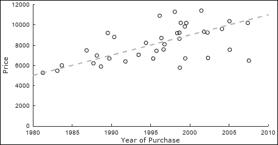

FIGURE 6-1: The comic book’s value increases over time.

计算平均售价很容易，但你想知道价格是上涨还是下跌，以及上涨或下跌的幅度。为了找到一个合适的售价，你决定用一条线来近似你的数据，该线表示漫画书价格随时间的变化。这个过程称为*线性回归*，图 6-1 中的虚线灰线标识了漫画书价格的总体趋势。

TensorFlow 训练的第一步涉及为模型选择初始表达式（参见 Chapter 5）。对于线性回归，这个决定很容易。模型是一条线，其方程为 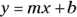<m:math xmlns:m="http://www.w3.org/1998/Math/MathML"><m:mrow><m:mi>y</m:mi><m:mo>=</m:mo><m:mi>m</m:mi><m:mi>x</m:mi><m:mo>+</m:mo><m:mi>b</m:mi></m:mrow></m:math>，其中 *m* 是线的斜率，*b* 是 *y-截距*（当 *x* 等于 0 时的 *y* 值）。线性回归的目标是确定 *m* 和 *b*，以便由此产生的线最好地近似（或拟合）点集。

损失也很容易计算。如果图表包含点 (*x, y*)，系统与模型之间的差异为 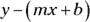<m:math xmlns:m="http://www.w3.org/1998/Math/MathML"><m:mrow><m:mi>y</m:mi><m:mo>&#45;</m:mo><m:mrow><m:mo>(</m:mo><m:mrow><m:mi>m</m:mi><m:mi>x</m:mi><m:mo>+</m:mo><m:mi>b</m:mi></m:mrow><m:mo>)</m:mo></m:mrow></m:mrow></m:math>*.*

在机器学习应用中，损失值应始终具有相同的符号。你可以通过计算每个点的误差平方并取误差值的平均值来确保所有损失值都是正值。如果有 *N* 个点，可以使用以下方程计算损失：

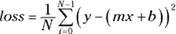<m:math xmlns:m="http://www.w3.org/1998/Math/MathML"><m:mrow><m:mi>l</m:mi><m:mi>o</m:mi><m:mi>s</m:mi><m:mi>s</m:mi><m:mo>=</m:mo><m:mfrac><m:mn>1</m:mn><m:mi>N</m:mi></m:mfrac><m:mstyle displaystyle="true"><m:munderover><m:mo>&#8721;</m:mo><m:mrow><m:mi>i</m:mi><m:mo>=</m:mo><m:mn>0</m:mn></m:mrow><m:mrow><m:mi>N</m:mi><m:mo>&#45;</m:mo><m:mn>1</m:mn></m:mrow></m:munderover><m:mrow><m:msup><m:mrow><m:mrow><m:mo>(</m:mo><m:mrow><m:mi>y</m:mi><m:mo>&#45;</m:mo><m:mrow><m:mo>(</m:mo><m:mrow><m:mi>m</m:mi><m:mi>x</m:mi><m:mo>+</m:mo><m:mi>b</m:mi></m:mrow><m:mo>)</m:mo></m:mrow></m:mrow><m:mo>)</m:mo></m:mrow></m:mrow><m:mn>2</m:mn></m:msup></m:mrow></m:mstyle></m:mrow></m:math>

这种计算损失的方法称为*均方误差*，或 MSE。在 TensorFlow 中，你可以通过调用 `reduce_mean` 函数来计算它。以下代码展示了如何使用此函数：

```
model = tf.add(tf.multiply(m, x), b)
loss = tf.reduce_mean(tf.pow(model - y, 2))
```

获得损失表达式后，下一步是创建优化器以最小化损失。随着优化器的工作，它将更新变量 `m` 和 `b`，从而获得一条最能近似漫画书价格随时间变化的线。

为此演示，以下代码创建了一个优化器，将其学习率设置为 0.1，并调用其 `minimize` 方法：

```
optimizer = tf.train.GradientDescentOptimizer(0.1)
opt_op = optimizer.minimize(loss)
```

`minimize` 返回一个操作，你可以将其用作会话 `run` 方法的第一个参数（参见 Chapter 5）。请注意，你必须重复调用 `run` 以确保训练收敛到 *`m`* 和 *`b`* 的合适值。

在 `ch6` 文件夹中，`lin_regression.py` 包含演示如何在 TensorFlow 中执行线性回归的代码。 Listing 6-1 介绍了该代码。

LISTING 6-1 Linear Regression

```
#### Random input values
N = 40
x = tf.random_normal([N])
m_real = tf.truncated_normal([N], mean=2.0)
b_real = tf.truncated_normal([N], mean=3.0)
y = m_real * x + b_real

#### Variables
m = tf.Variable(tf.random_normal([]))
b = tf.Variable(tf.random_normal([]))

#### Compute model and loss
model = tf.add(tf.multiply(x, m), b)
loss = tf.reduce_mean(tf.pow(model - y, 2))

#### Create optimizer
learn_rate = 0.1
num_epochs = 200
num_batches = N
optimizer = tf.train.GradientDescentOptimizer(learn_rate).minimize(loss)

#### Initialize variables
init = tf.global_variables_initializer()

#### Launch session
with tf.Session() as sess:
    sess.run(init)

    # Perform training
    for epoch in range(num_epochs):
        for batch in range(num_batches):
            sess.run(optimizer)

    # Display results
    print('m = ', sess.run(m))
    print('b = ', sess.run(b))
```

该模块将批次数量设置为输入点数量。训练过程执行 200 个 epoch，每个 epoch 执行 40 次训练步骤。

##### 多项式回归：拟合数据多项式

你可以很容易地将线性回归的方法扩展到多项式。也就是说，将多项式拟合到一组点集的过程与拟合直线所使用的过程基本相同。

为此演示，我解释了如何用三次多项式近似数据。你可以用以下方程表示每个三次多项式：


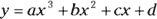<m:math xmlns:m="http://www.w3.org/1998/Math/MathML"><m:mrow><m:mi>y</m:mi><m:mo>=</m:mo><m:mi>a</m:mi><m:msup><m:mi>x</m:mi><m:mn>3</m:mn></m:msup><m:mo>+</m:mo><m:mi>b</m:mi><m:msup><m:mi>x</m:mi><m:mn>2</m:mn></m:msup><m:mo>+</m:mo><m:mi>c</m:mi><m:mi>x</m:mi><m:mo>+</m:mo><m:mi>d</m:mi></m:mrow></m:math>

Figure 6-2 说明了如何将三次多项式拟合到一组随机点上。

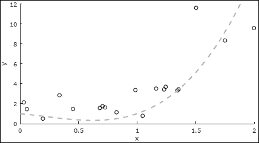

FIGURE 6-2: Statistical regression makes it possible to approximate data with a polynomial.

`ch6/poly_regression.py` 中的代码使用 TensorFlow 将三次多项式拟合到一组随机点上。如果将此代码与 `ch6/lin_regression.py` 中的代码进行比较，你会发现这两个模块非常相似。最重要的区别在于模型的表达式，该表达式计算如下：

`model = a * tf.pow(x, 3) + b * tf.pow(x, 2) + c * x + d`

为了获得损失的表达式，该模块使用了与线性回归中相同的均方误差过程。 （参见 “Linear Regression: Fitting Lines to Data.”）为了最小化损失，该模块创建了与线性回归中相同类型的优化器（`GradientDescentOptimizer`）。 Listing 6-2 显示了如何执行此操作。

LISTING 6-2 Polynomial Regression

```
#### Random input values
N = 40
x = tf.random_normal([N])
a_real = tf.truncated_normal([N], mean=3.)
b_real = tf.truncated_normal([N], mean=-2.)
c_real = tf.truncated_normal([N], mean=-1.)
d_real = tf.truncated_normal([N], mean=1.)
y = a_real * tf.pow(x, 3) + b_real * tf.pow(x, 2) + c_real * x + d_real

#### Variables
a = tf.Variable(tf.random_normal([]))
b = tf.Variable(tf.random_normal([]))
c = tf.Variable(tf.random_normal([]))
d = tf.Variable(tf.random_normal([]))

#### Compute model and loss
model = a * tf.pow(x, 3) + b * tf.pow(x, 2) + c * x + d
loss = tf.reduce_mean(tf.pow(model - y, 2))

#### Create optimizer
learn_rate = 0.01
num_epochs = 400
num_batches = N
optimizer = tf.train.GradientDescentOptimizer(learn_rate).minimize(loss)

#### Initialize variables
init = tf.global_variables_initializer()

#### Launch session
with tf.Session() as sess:
    sess.run(init)

    # Perform training
    for epoch in range(num_epochs):
        for batch in range(num_batches):
            sess.run(optimizer)

    # Display results
    print('a = ', sess.run(a))
    print('b = ', sess.run(b))
    print('c = ', sess.run(c))
    print('d = ', sess.run(d))
```

你可以将 `poly_regression.py` 中使用的方法应用于任意次数的多项式。你所需要做的就是将模型设置为一般多项式，并为多项式的每个系数创建一个变量。

### Binary Logistic Regression: Classifying Data into Two Categories

虽然线性回归和多项式回归关注的是识别趋势，但逻辑回归关注的是将数据点划分为类别。如果点 A 和点 B 属于类别 X，而点 P 和点 Q 属于类别 Y，那么点 J 将属于哪个类别？

以下各节讨论仅有两个类别的系统。患者是健康还是生病？手术会成功还是失败？这种对具有两个类别的系统进行建模的过程称为 *binary logistic regression*。

#### Setting up the problem

二元逻辑回归关注的是测试一个或多个变量对二元结果的影响。如果患者服用一种新药，他们的症状会消失吗？如果候选人在选举日穿红色领带和蓝色裤子，公众会投票给这个人吗？

为了演示二元逻辑回归的过程，本讨论集中于一个显而易见重要的问题：我的闹钟音量如何影响我早上起床？我睡得太沉了，如果闹钟不响，我会永远躺在床上。但随着音量的增加，我起床的概率也会增加。

为了检查闹钟音量与我起床之间的关系，我在 40 天的每一天早上都将闹钟设置为不同的音量。 Figure 6-3 说明了闹钟音量与我起床之间的关系。

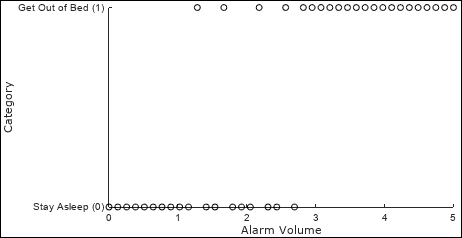

FIGURE 6-3: As the volume increases, the chances of my waking up increase.

为了在数学上建模，统计学家用数字表示每个类别。在本例中，我将类别 1（起床）与 1 相关联，将类别 0（继续睡觉）与 0 相关联。

但我不希望输出仅限于 0 和 1。我希望得到一个介于 0 和 1 之间的值，以识别我起床的概率。这个概念很重要：当你编写执行分类的应用程序时，概率论就成为核心。本讨论并未提供该主题的完整讨论，但在必要时我会解释数学。

很明显，线性回归和多项式回归对这个问题没有帮助，因为它们的模型会产生超出 0 和 1 的值。此外，直线和多项式对于实际分类来说过于简单。

为了对数据点进行分类，统计学家采用另一种称为 *logistic regression* 的回归。就像线性回归用直线建模系统，多项式回归使用多项式一样，逻辑回归采用一种称为 logistic function 的曲线。

#### Defining models with the logistic function

逻辑函数在对数据点进行分类的应用程序中起着核心作用。数学家用以下方程表示逻辑函数：

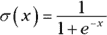<m:math xmlns:m="http://www.w3.org/1998/Math/MathML"><m:mrow><m:mi>&#963;</m:mi><m:mrow><m:mo>(</m:mo><m:mi>x</m:mi><m:mo>)</m:mo></m:mrow><m:mo>=</m:mo><m:mfrac><m:mn>1</m:mn><m:mrow><m:mn>1</m:mn><m:mo>+</m:mo><m:msup><m:mi>e</m:mi><m:mrow><m:mo>&#45;</m:mo><m:mi>x</m:mi></m:mrow></m:msup></m:mrow></m:mfrac></m:mrow></m:math>

Figure 6-4 显示了 *x* 在 8 到 -8 之间时逻辑函数的外观：

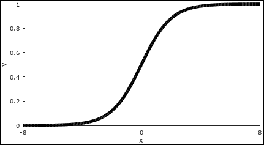

FIGURE 6-4: The result of the logistic function always lies between 0 and 1.

该函数呈 S 形，并且由于 sigma（<m:math xmlns:m="http://www.w3.org/1998/Math/MathML"><m:mi>&#963;</m:mi></m:math>）是 S 的希腊字母，因此该函数通常被称为 *sigmoid function*，或 <m:math xmlns:m="http://www.w3.org/1998/Math/MathML"><m:mi>&#963;</m:mi></m:math>(x)。该函数具有三个使其适合将点分类到两个类别之一的属性：

* 其最大值是 1，最小值是 0。
* 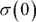<m:math xmlns:m="http://www.w3.org/1998/Math/MathML"><m:mrow><m:mi>&#963;</m:mi><m:mrow><m:mo>(</m:mo><m:mn>0</m:mn><m:mo>)</m:mo></m:mrow></m:mrow></m:math>\= 0.5，这意味着中心的数据点同等可能属于两个类别。
* 该函数关于 *y*\-轴对称 — 也就是说，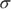<m:math xmlns:m="http://www.w3.org/1998/Math/MathML"><m:mi>&#963;</m:mi></m:math>(-x) = 1 - <m:math xmlns:m="http://www.w3.org/1998/Math/MathML"><m:mi>&#963;</m:mi></m:math>(x)。

选择了逻辑函数后，你可以用模型函数 <m:math xmlns:m="http://www.w3.org/1998/Math/MathML"><m:mrow><m:mi>&#963;</m:mi><m:mrow><m:mo>(</m:mo><m:mrow><m:mi>m</m:mi><m:mi>x</m:mi><m:mo>+</m:mo><m:mi>b</m:mi></m:mrow><m:mo>)</m:mo></m:mrow></m:mrow></m:math> 来近似该系统。与线性回归类似，目标是找到使模型与真实世界观测尽可能接近的 `m` 和 `b` 值。

下一步是找到损失的表达式。一个可能的方法是使用均方误差（参见线性回归和多项式回归的 earlier 部分）。但存在一个问题。Sigmoid 函数在其极值处的斜率几乎为 0，这意味着梯度下降方法将花费大量时间来最小化损失。

因此，用于对数据点进行分类的应用放弃了均方误差，并使用另一种称为最大似然估计的方法来计算损失。

#### 使用最大似然估计计算损失

二元逻辑回归的目标是获得最能近似可用数据的 Sigmoid 函数。该函数标识了某点被分类为类别 1 的近似概率。

那么某点被分类为类别 0 的概率呢？只有两个类别，因此如果我们将类别 1 的概率表示为 <m:math xmlns:m="http://www.w3.org/1998/Math/MathML"><m:mrow><m:mi>&#963;</m:mi><m:mrow><m:mo>(</m:mo><m:mrow><m:mi>m</m:mi><m:mi>x</m:mi><m:mo>+</m:mo><m:mi>b</m:mi></m:mrow><m:mo>)</m:mo></m:mrow></m:mrow></m:math>，则类别 0 的概率为 1 - <m:math xmlns:m="http://www.w3.org/1998/Math/MathML"><m:mrow><m:mi>&#963;</m:mi><m:mrow><m:mo>(</m:mo><m:mrow><m:mi>m</m:mi><m:mi>x</m:mi><m:mo>+</m:mo><m:mi>b</m:mi></m:mrow><m:mo>)</m:mo></m:mrow></m:mrow></m:math>。为简化起见，我将把模型函数 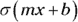<m:math xmlns:m="http://www.w3.org/1998/Math/MathML"><m:mrow><m:mi>&#963;</m:mi><m:mrow><m:mo>(</m:mo><m:mrow><m:mi>m</m:mi><m:mi>x</m:mi><m:mo>+</m:mo><m:mi>b</m:mi></m:mrow><m:mo>)</m:mo></m:mrow></m:mrow></m:math> 称为 `h(x)`。

这里有一个奇怪但重要的问题：如果我事先知道是否会醒来，那么闹钟在特定音量响起的概率是多少？将我的睡眠/唤醒状态表示为 `y[i]`（`y[0] = 0`，`y[1] = 1`）而闹钟音量为 `x,` 你可以将其关系表示如下：

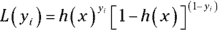<m:math xmlns:m="http://www.w3.org/1998/Math/MathML"><m:mrow><m:mi>L</m:mi><m:mrow><m:mo>(</m:mo><m:mrow><m:msub><m:mi>y</m:mi><m:mi>i</m:msub></m:mrow><m:mo>)</m:mo></m:mrow><m:mo>=</m:mo><m:mi>h</m:mi><m:msup><m:mrow><m:mrow><m:mo>(</m:mo><m:mi>x</m:mi><m:mo>)</m:mo></m:mrow></m:mrow><m:mrow><m:msub><m:mi>y</m:mi><m:mi>i</m:msub></m:mrow></m:msup><m:msup><m:mrow><m:mrow><m:mo>\[</m:mo><m:mrow><m:mn>1</m:mn><m:mo>&#45;</m:mo><m:mi>h</m:mi><m:mrow><m:mo>(</m:mo><m:mi>x</m:mi><m:mo>)</m:mo></m:mrow></m:mrow><m:mo>\]</m:mo></m:mrow></m:mrow><m:mrow><m:mrow><m:mo>(</m:mo><m:mrow><m:mn>1</m:mn><m:mo>&#45;</m:mo><m:msub><m:mi>y</m:mi><m:mi>i</m:msub></m:mrow><m:mo>)</m:mo></m:mrow></m:mrow></m:msup></m:mrow></m:math>

该方程表示 `y[i]` 的 *似然*，鉴于其在分类中的重要性，你需要熟悉它。考虑以下两种极端情况：

* 如果 `h(x)` 完美地表示系统，当 `y[i]` 等于 1 时，`h(x)` 将等于 1，而当 `y[i]` 等于 0 时，`h(x)` 将等于 0。这意味着 `L(y[i])` 将始终等于 1。
* 如果 `h(x)` 总是错误，当 `y[i]` 等于 1 时，`h(x)` 将始终等于 0，而当 `y[i]` 等于 0 时，`h(x)` 将始终等于 1。这意味着 `L(y[i])` 将始终等于 0。

通常，似然函数会产生介于 0 和 1 之间的值。似然越大，模型 `h(x)` 越接近系统。最大化似然的过程称为 *最大似然估计*。很明显，最大化似然会最小化损失。

为简化计算，统计学家取似然的对数。经过此步骤后，最大似然估计方法被称为 *对数似然方法*。

TensorFlow 的优化器通过最小化损失来工作。但在处理似然时，目标是获得更大的值，而不是更小的值。为解决此问题，统计学家对对数似然的表达式取负值。损失的 resulting 表达式如下所示：


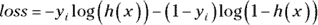<m:math xmlns:m="http://www.w3.org/1998/Math/MathML"><m:mrow><m:mi>l</m:mi><m:mi>o</m:mi><m:mi>s</m:mi><m:mi>s</m:mi><m:mo>=</m:mo><m:mo>&#45;</m:mo><m:msub><m:mi>y</m:mi><m:mi>i</m:msub></m:mi><m:mi>log</m:mi><m:mrow><m:mo>(</m:mo><m:mrow><m:mi>h</m:mi><m:mrow><m:mo>(</m:mo><m:mi>x</m:mi><m:mo>)</m:mo></m:mrow></m:mrow><m:mo>)</m:mo></m:mrow><m:mo>&#45;</m:mo><m:mrow><m:mo>(</m:mo><m:mrow><m:mn>1</m:mn><m:mo>&#45;</m:mo><m:msub><m:mi>y</m:mi><m:mi>i</m:msub></m:mrow><m:mo>)</m:mo></m:mrow><m:mi>log</m:mi><m:mrow><m:mo>(</m:mo><m:mrow><m:mn>1</m:mn><m:mo>&#45;</m:mo><m:mi>h</m:mi><m:mrow><m:mo>(</m:mo><m:mi>x</m:mi><m:mo>)</m:mo></m:mrow></m:mrow><m:mo>)</m:mo></m:mrow></m:mrow></m:math>

该表达式及类似表达式在二元逻辑回归中常用。以下部分演示了如何在实际代码中使用逻辑函数和对数似然。

###### 将理论付诸实践

`ch6/binary_logistic.py` 中的代码使用 TensorFlow 执行二元逻辑回归。 Listing 6-3 展示了该代码。

LISTING 6-3 二元逻辑回归

```
#### Input values
N = 40
x = tf.lin_space(0., 5., N)
y = tf.constant([0., 0., 0., 0., 0., 0., 0., 0., 0., 0.,
 1., 0., 0., 1., 0., 0., 0., 1., 0., 0.,
 1., 0., 1., 1., 1., 1., 1., 1., 1., 1.,
 1., 1., 1., 1., 1., 1., 1., 1., 1., 1.])

#### Variables
m = tf.Variable(0.)
b = tf.Variable(0.)

#### Compute model and loss
model = tf.nn.sigmoid(tf.add(tf.multiply(x, m), b))
loss = -1. * tf.reduce_sum(y * tf.log(model) + (1. - y) * (1. - tf.log(model)))

#### Create optimizer
learn_rate = 0.005
num_epochs = 350
optimizer = tf.train.GradientDescentOptimizer(learn_rate).minimize(loss)

#### Initialize variables
init = tf.global_variables_initializer()

#### Launch session
with tf.Session() as sess:
 sess.run(init)

 # Run optimizer
 for epoch in range(num_epochs):
 sess.run(optimizer)

 # Display results
 print('m =', sess.run(m))
 print('b =', sess.run(b))
```

该模块接受 Figure 6-3 中的数据点作为输入，并计算使数据点最好拟合到模型函数 <m:math xmlns:m="http://www.w3.org/1998/Math/MathML"><m:mrow><m:mi>&#963;</m:mi><m:mrow><m:mo>(</m:mo><m:mrow><m:mi>m</m:mi><m:mi>x</m:mi><m:mo>+</m:mo><m:mi>b</m:mi></m:mrow><m:mo>)</m:mo></m:mrow></m:mrow></m:math> 的 `m` 和 `b` 值。 Figure 6-5 描绘了计算得到的模型函数叠加在训练数据之上。

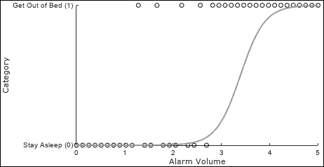

FIGURE 6-5: 训练后，Sigmoid 函数近似实验数据。

在我系统上，计算得到的值为 m = 4 和 b = -13.5。`mx + b` 在 `x = 3.375` 时等于 0，因此当音量设置为 3.375 时达到 Sigmoid 函数的中心。

##### 多项逻辑回归：对数据进行多类别分类

许多机器学习应用需要将点分类到两个以上的类别中。这个过程称为多项式逻辑回归，它在许多方面与二元逻辑回归相似。主要区别在于它使用不同的函数来表示模型和损失。

为了介绍这个主题，我将解释如何使用 TensorFlow 来识别来自改良国家标准与技术研究所（MNIST）数据集的手写样本。每个图像都包含一个手写数字，属于十个类别之一。

###### 改良国家标准与技术研究所（MNIST）数据集

为了测试机器学习应用，国家标准与技术研究所（NIST）汇编了一组 0 到 9 之间数字的手写样本。Yann LeCun 创建了 NIST 图像的一个子集，称为改良 NIST（MNIST）数据库。

与 NIST 的样本不同，MNIST 的样本大小都相同，并且都居中到 28-x-28 图像中。每个像素以 0（白色）到 255（黑色）之间的无符号字节给出。每个图像都有一个对应的标签，用于标识手写数字（0 到 9）。

要运行多项式逻辑回归示例，您需要从 [`http://yann.lecun.com/exdb/mnist`](http://yann.lecun.com/exdb/mnist) 下载 MNIST 数据集。有四个文件可用：

* `train-images-idx1-ubyte.gz` — 训练图像

* `train-images-idx3-ubyte.gz` — 训练标签

* `t10k-labels-idx1-ubyte.gz` — 测试图像

* `t10k-images-idx3-ubyte.gz` — 测试标签

训练标签和测试标签标识了对应图像中书写的数字。例如，训练数据集中第六个标签是 8。 Figure 6-6 显示了训练数据集中第六个图像的样子。

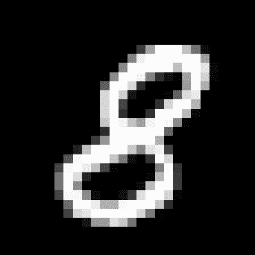

FIGURE 6-6: Each MNIST image contains a handwritten digit in a 28-x-28 pixel array.

如果您解压缩一个 MNIST 文件，您会看到每个文件将其数据存储在单个数据结构中。幸运的是，您不需要了解这些结构，因为 TensorFlow 使访问 MNIST 数据变得容易。需要了解的函数是 `read_data_sets`，它由 `tensorflow.contrib.learn.datasets.mnist` 包提供：

`read_data_sets(train_dir, fake_data=False, one_hot=False, dtype=dtypes.float32, reshape=True, validation_size=5000, seed=None)`

当此函数执行时，它会在 `train_dir` 参数标识的目录中搜索四个 MNIST 归档文件。如果找不到任何文件，`read_data_sets` 将下载它们、解压缩它们并将它们存储在指定文件夹中。

要理解 `read_data_sets` 的其他参数，了解该函数的返回值非常重要，该值是 `Datasets` 类的一个实例。每个 `Datasets` 实例都有三个字段：

* `train` — 包含 MNIST 训练数据的 `Dataset`

* `validation` — 包含验证数据的 `Dataset`

* `test` — 包含用于测试的数据的 `Dataset`

很合适的是，`Datasets` 实例的每个字段都是 `Dataset` 类的一个实例。 Table 6-1 列出了该类的四个成员并提供了每个成员的描述。

TABLE 6-1 Members of the Dataset Class

| **Function** || **Description** |

| --- | --- |

| `images` || `ndarray` of images given as numpy arrays |

| --- | --- |

| `labels` || `ndarray` of category names for the images |

| `num_examples` || The number of examples in the dataset |

| `next_batch(batch_size, fake_data=False, shuffle=True)` || Returns the next batch of images |

前三个字段很直接。以下代码调用 `read_data_sets`，并为每个字段打印相应图像数组的形状：

```
import tensorflow.contrib.learn as learn

dset = learn.datasets.mnist.read_data_sets('MNIST-data')
print("Training images: ", dset.train.images.shape)
print("Validation images: ", dset.validation.images.shape)
print("Test images: ", dset.test.images.shape)
```

在我系统上，打印结果如下：

```
Training images: (55000, 784)
Validation images: (5000, 784)
Test images: (10000, 784)
```

如果您在 `read_data_sets` 中将 `one_hot` 设置为 `True`，则生成的 `Dataset` 的 `labels` 字段将包含 one-hot 向量。*one-hot 向量* 是一个一维数组，其中一个元素的值很高，其余都很低。默认情况下，高值是 1，低值是 0。如果将 `one_hot` 参数设置为 `True`，每个标签将作为一个包含十个元素的 one-hot 向量提供：数字标识位置为 1，其余位置为 0。

`Dataset` 类的 `next_batch` 方法以批量的形式提供 MNIST 数据。第一个参数设置每个批次的大小，第二个参数标识是否应生成假数据，最后一个参数指示是否应对 MNIST 数据进行洗牌。

###### 使用 softmax 函数定义模型

您可以使用 sigmoid 函数将点分类到两个类别中。 （有关更多信息，请参阅 “Defining models with the logistic function” 部分。）如果系统（例如 MNIST 分类）有超过两个类别，sigmoid 函数就不够用了。

相反，统计学家使用一种可以接受值数组并返回值数组的操作。这是 *softmax 函数*，它将 sigmoid 函数扩展到多个变量。softmax 函数的第 *j* 项表示为 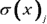<m:math xmlns:m="http://www.w3.org/1998/Math/MathML"><m:mrow><m:mi>&#963;</m:mi><m:msub><m:mrow><m:mrow><m:mo>(</m:mo><m:mi>x</m:mi><m:mo>)</m:mo></m:mrow></m:mrow><m:mi>j</m:mi></m:msub></m:mrow></m:math>，如果输入数组包含 N 个项，则可以使用以下方程计算 x[j] 的 softmax 函数：

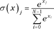<m:math xmlns:m="http://www.w3.org/1998/Math/MathML"><m:mrow><m:mi>&#963;</m:mi><m:msub><m:mrow><m:mrow><m:mo>(</m:mo><m:mi>x</m:mi><m:mo>)</m:mo></m:mrow></m:mrow><m:mi>j</m:mi></m:msub><m:mo>=</m:mo><m:mfrac><m:mrow><m:msup><m:mi>e</m:mi><m:mrow><m:msub><m:mi>x</m:mi><m:mi>j</m:mi></m:msub></m:mrow></m:msup></m:mrow><m:mrow><m:mstyle displaystyle="true"><m:munderover><m:mo>&#8721;</m:mo><m:mrow><m:mi>i</m:mi><m:mo>=</m:mo><m:mn>0</m:mn></m:mrow><m:mrow><m:mi>N</m:mi><m:mo>&#45;</m:mo><m:mn>1</m:mn></m:mrow></m:munderover><m:mrow><m:msup><m:mi>e</m:mi><m:mrow><m:msub><m:mi>x</m:mi><m:mi>i</m:mi></m:msub></m:mrow></m:msup></m:mrow></m:mstyle></m:mrow></m:mfrac></m:mrow></m:math>

使用此函数时，您需要注意两点：

* 输出数组中的每个值都在 0 和 1 之间。

* 输出数组中值的总和始终等于 1。

在 TensorFlow 中，您可以通过调用 `tf.nn` 包中的 `softmax` 函数来执行 softmax 操作：

`softmax(input, dim=-1, name=None)`

默认情况下，`softmax` 函数的分母中会将输入张量的每个元素相加。但如果您设置 `dim` 参数，则只有指定维度中的值才会被包含在总和中。

一个例子将阐明此函数的工作方式。如果输入张量是 \[3.2, -2.6, 1.7, 0.0, 4.9\]，调用 `softmax` 将返回一个 5 元素张量等于 \[0.14835, 0.00045, 0.03310, 0.00605, 0.81205\]。您可以通过以下方式计算第一个 softmax 值：


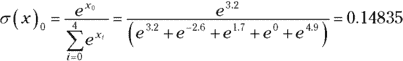<m:math xmlns:m="http://www.w3.org/1998/Math/MathML"><m:mrow><m:mi>&#963;</m:mi><m:msub><m:mrow><m:mrow><m:mo>(</m:mo><m:mi>x</m:mi><m:mo>)</m:mo></m:mrow></m:mrow><m:mn>0</m:mn></m:msub><m:mo>=</m:mo><m:mfrac><m:mrow><m:msup><m:mi>e</m:mi><m:mrow><m:msub><m:mi>x</m:mi><m:mn>0</m:mn></m:msub></m:mrow></m:msup></m:mrow><m:mrow><m:mstyle displaystyle="true"><m:munderover><m:mo>&#8721;</m:mo><m:mrow><m:mi>i</m:mi><m:mo>=</m:mo><m:mn>0</m:mn></m:mrow><m:mn>4</m:mn></m:munderover><m:mrow><m:msup><m:mi>e</m:mi><m:mrow><m:msub><m:mi>x</m:mi><m:mi>i</m:mi></m:msub></m:mrow></m:msup></m:mrow></m:mstyle></m:mrow></m:mfrac><m:mo>=</m:mo><m:mfrac><m:mrow><m:msup><m:mi>e</m:mi><m:mrow><m:mn>3.2</m:mn></m:mrow></m:msup></m:mrow><m:mrow><m:mrow><m:mo>(</m:mo><m:mrow><m:msup><m:mi>e</m:mi><m:mrow><m:mn>3.2</m:mn></m:mrow></m:msup><m:mo>+</m:mo><m:msup><m:mi>e</m:mi><m:mrow><m:mo>&#45;</m:mo><m:mn>2.6</m:mn></m:mrow></m:msup><m:mo>+</m:mo><m:msup><m:mi>e</m:mi><m:mrow><m:mn>1.7</m:mn></m:mrow></m:msup><m:mo>+</m:msup><m:mi>e</m:mn></m:msup><m:mo>+</m:mo><m:msup><m:mi>e</m:mi><m:mrow><m:mn>4.9</m:mn></m:mrow></m:msup></m:mrow><m:mo>)</m:mo></m:mrow></m:mrow></m:mfrac><m:mo>=</m:mo><m:mn>0.14835</m:mn></m:mrow></m:math>

每个 `N` 值都标识了数据点属于对应类别的概率。点属于类别 0 的概率为 0.14835。

### 使用交叉熵计算损失

如果 `h(x)` 是一个模型且 `y[i]` 标识一个类别，你可以按以下方式计算给定 `x` 值时 `y[i]` 的似然：

<m:math xmlns:m="http://www.w3.org/1998/Math/MathML"><m:mrow><m:mi>L</m:mi><m:mrow><m:mo>(</m:mo><m:mrow><m:msub><m:mi>y</m:mi><m:mi>i</m:mi></m:msub></m:mrow><m:mo>)</m:mo></m:mrow><m:mo>=</m:mo><m:mi>h</m:mi><m:msup><m:mrow><m:mrow><m:mo>(</m:mo><m:mi>x</m:mi><m:mo>)</m:mo></m:mrow></m:mrow><m:mrow><m:msub><m:mi>y</m:mi><m:mi>i</m:msub></m:mrow></m:msup><m:msup><m:mrow><m:mrow><m:mo>\[</m:mo><m:mrow><m:mn>1</m:mn><m:mo>&#45;</m:mo><m:mi>h</m:mi><m:mrow><m:mo>(</m:mo><m:mi>x</m:mi><m:mo>)</m:mo></m:mrow></m:mrow><m:mo>\]</m:mo></m:mrow></m:mrow><m:mrow><m:mrow><m:mo>(</m:mo><m:mrow><m:mn>1</m:mn><m:mo>&#45;</m:mo><m:msub><m:mi>y</m:mi><m:mi>i</m:msub></m:mrow><m:mo>)</m:mo></m:mrow></m:mrow></m:msup></m:mrow></m:math>

似然的概念可以扩展到具有两个以上结果的系统。如果分类器需要在 `N` 个类别之间进行选择，`y[i]` 可以取 0 到 `N-1` 之间的任意值。如果模型表示为 `h(x)`，你可以用以下方程表示似然：

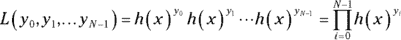<m:math xmlns:m="http://www.w3.org/1998/Math/MathML"><m:mrow><m:mi>L</m:mi><m:mrow><m:mo>(</m:mo><m:mrow><m:msub><m:mi>y</m:mi><m:mn>0</m:mn></m:msub><m:mo>,</m:mo><m:msub><m:mi>y</m:mi><m:mn>1</m:mn></m:msub><m:mo>,</m:mo><m:mo>&#8230;</m:mo><m:msub><m:mi>y</m:mi><m:mrow><m:mi>N</m:mi><m:mo>&#45;</m:mo><m:mn>1</m:mn></m:mrow></m:msub></m:mrow><m:mo>)</m:mo></m:mrow><m:mo>=</m:mo><m:mi>h</m:mi><m:msup><m:mrow><m:mrow><m:mo>(</m:mo><m:mi>x</m:mi><m:mo>)</m:mo></m:mrow></m:mrow><m:mrow><m:msub><m:mi>y</m:mi><m:mn>0</m:mn></m:msub></m:mrow></m:msup><m:mi>h</m:mi><m:msup><m:mrow><m:mrow><m:mo>(</m:mo><m:mi>x</m:mi><m:mo>)</m:mo></m:mrow></m:mrow><m:mrow><m:msub><m:mi>y</m:mi><m:mn>1</m:mn></m:msub></m:mrow></m:msup><m:mo>&#8943;</m:mo><m:mi>h</m:mi><m:msup><m:mrow><m:mrow><m:mo>(</m:mo><m:mi>x</m:mi><m:mo>)</m:mo></m:mrow></m:mrow><m:mrow><m:msub><m:mi>y</m:mi><m:mrow><m:mi>N</m:mi><m:mo>&#45;</m:mo><m:mn>1</m:mn></m:mrow></m:msub></m:mrow></m:msup><m:mo>=</m:mo><m:mstyle displaystyle="true"><m:munderover><m:mo>&#8719;</m:mo><m:mrow><m:mi>i</m:mi><m:mo>=</m:mo><m:mn>0</m:mn></m:mrow><m:mrow><m:mi>N</m:mi><m:mo>&#45;</m:mo><m:mn>1</m:mn></m:mrow></m:munderover><m:mrow><m:mi>h</m:mi><m:msup><m:mrow><m:mrow><m:mo>(</m:mo><m:mi>x</m:mi><m:mo>)</m:mo></m:mrow></m:mrow><m:mrow><m:msub><m:mi>y</m:mi><m:mi>i</m:mi></m:msub></m:mrow></m:msup></m:mrow></m:mstyle></m:mrow></m:math>

同样，如果 `h(x)` 总是正确，则似然等于 1；如果 `h(x)` 总是错误，则似然等于 0。为了将似然转换为合适的损失函数，统计学家取负对数并得到以下表达式：

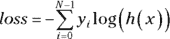<m:math xmlns:m="http://www.w3.org/1998/Math/MathML"><m:mrow><m:mi>l</m:mi><m:mi>o</m:mi><m:mi>s</m:mi><m:mi>s</m:mi><m:mo>=</m:mo><m:mo>&#45;</m:mstyle displaystyle="true"><m:munderover><m:mo>&#8721;</m:mo><m:mrow><m:mi>i</m:mi><m:mo>=</m:mo><m:mn>0</m:mn></m:mrow><m:mrow><m:mi>N</m:mi><m:mo>&#45;</m:mo><m:mn>1</m:mn></m:mrow></m:munderover><m:mrow><m:msub><m:mi>y</m:mi><m:mi>i</m:msub><m:mi>log</m:mi><m:mrow><m:mo>(</m:mo><m:mrow><m:mi>h</m:mi><m:mrow><m:mo>(</m:mo><m:mi>x</m:mi><m:mo>)</m:mo></m:mrow></m:mrow><m:mo>)</m:mo></m:mrow></m:mrow></m:mstyle></m:mrow></m:math>

在机器学习文献中，该结果被称为 *交叉熵*。该术语来自信息论，它指的是使用对数来确定表示消息应使用多少比特。以下代码通过调用 `tf.nn.softmax` 定义模型，然后使用交叉熵计算损失。

```
model = tf.nn.softmax(tf.matmul(x, m) + b)
loss = tf.reduce_mean(-tf.reduce_sum(y * tf.log(model))
```

为了提高性能，TensorFlow 提供了将 softmax 函数和交叉熵结合起来的函数。该函数是 `tf.nn.softmax_cross_entropy_with_logits`，其签名如下：

```
softmax_cross_entropy_with_logits(labels=None, logits=None, dim=-1, name=None)
```

你必须按名称标识传递给此函数的每个参数。`logits` 设置为将传递给 softmax 的张量，`labels` 设置为包含相关标签的张量。`logits` 和 `labels` 必须具有相同的大小。

TensorFlow 还提供了将 sigmoid 函数和交叉熵结合起来的函数：`sigmoid_cross_entropy_with_logits`。其签名如下：

```
sigmoid_cross_entropy_with_logits(_sentinel=None, labels=None, logits=None, name=None)
```

`labels` 和 `logits` 接受的值与 `softmax_cross_entropy_with_logits` 的对应参数相同。

### 将理论付诸实践

`ch6/multi_regression.py` 中的代码演示了如何使用多项式回归加载并对 MNIST 数据集中的图像进行分类。 Listing 6-4 展示了代码。

#### LISTING 6-4 多项式逻辑回归

```
#### Read MNIST data
dataset = learn.datasets.mnist.read_data_sets('MNIST-data', one_hot=True)

#### Placeholders for MNIST images
image_holder = tf.placeholder(tf.float32, [None, 784])
label_holder = tf.placeholder(tf.float32, [None, 10])

#### Variables
m = tf.Variable(tf.zeros([784, 10]))
b = tf.Variable(tf.zeros([10]))

#### Compute loss
loss = tf.reduce_mean(
    tf.nn.softmax_cross_entropy_with_logits(
        logits=tf.matmul(image_holder, m) + b, labels=label_holder))

#### Create optimizer
learning_rate = 0.01
num_epochs = 25
batch_size = 100
num_batches = int(dataset.train.num_examples/batch_size)
optimizer = tf.train.GradientDescentOptimizer(learning_rate).minimize(loss)

#### Initialize variables
init = tf.global_variables_initializer()

#### Launch session
with tf.Session() as sess:
    sess.run(init)

    # Loop over epochs
    for epoch in range(num_epochs):

        # Loop over batches
        for batch in range(num_batches):
            image_batch, label_batch = dataset.train.next_batch(batch_size)
            _, lossVal = sess.run([optimizer, loss],
                feed_dict={image_holder: image_batch, label_holder: label_batch})

        # Display the final loss
        print('Final loss: ', lossVal)
```

Instead of computing the model, this code computes the loss directly by calling `softmax_cross_entropy_with_logits`. The last line of the code prints the final value for the loss.

## 第 7 章

## 介绍神经网络和深度学习

本章内容

**探索神经网络的发展**

**查看感知器、多层感知器（MLPs）和深度学习**

**使用作用域管理变量**

**在 TensorFlow 应用中演示深度学习**

本章解释了神经网络的工作原理以及如何使用它们在 TensorFlow 应用中分析数据。

### 从神经元到感知器

对于许多人来说，神经网络这个话题会让人联想到人工大脑、预知未来的全知计算机以及科幻小说中的其他元素。但机器学习从业者持更务实的观点：神经网络是有用的计算工具，但它们并不适用于每个应用，而且永远不会完全可靠。

生物学启发了神经网络的发展，但其本质操作是统计性的。*神经网络*分析数据以发现输入和输出之间的数学关系。它们只应在最后才使用——如果你已经有明确的规则将输出与输入数据关联起来，你应该使用你的规则而不是神经网络。

了解神经网络的操作与统计回归之间的区别很重要。当你使用回归时，你选择模型的精确形状。但当你用神经网络分析数据时，你选择模型的一般形状，而网络决定细节。

在我看来，理解人工神经网络的最佳方式是了解它们与生物神经元的关系。本节探讨神经元的基本结构，然后介绍感知器，它是神经元的数学抽象。

#### 神经元

在 19 世纪早期，圣地亚哥·拉蒙·卡哈尔仔细观察了构成神经组织的细胞。科学家将这些神经细胞称为*神经元*，图 7-1 说明了它们的基本结构。

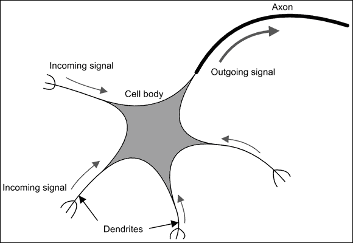

图 7-1： 神经细胞通过其树突接收传入信号，并产生沿轴突传播的传出信号。

神经元通过其*树突*及其分支接收电刺激。细胞体内的化学物质储存电能，随着传入信号增强，神经元的电压升高。

当神经元的电压超过某个值，即*阈值*时，神经元会传输（或*放电*）电信号。该信号通过轴突传播并刺激其他神经元，如图 7-1 所示。以这种方式，一个神经元的放电可能会导致一系列其他神经元放电。

自 19 世纪以来，神经元的研究取得了巨大进展，神经学家知道神经元做的远不止将电从一个细胞传递到另一个细胞。但对于本章，你只需要熟悉以下三点：

*   神经元接收一个或多个传入信号并产生一个传出信号。
*   神经元的输出可以作为另一个神经元的输入。
*   每个神经元都有一个阈值，神经元的电量超过阈值后才会产生输出。

如果你理解这三点，你就能轻松掌握神经元的抽象模型。

#### 感知器

1962 年，弗兰克·罗森布拉特设计了一种神经元模型，称为*感知器*。图 7-2 显示了感知器如何以图形方式表示。


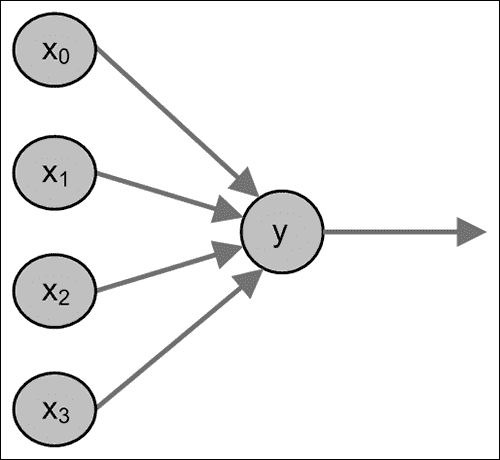

图 7-2： 感知器在许多方面与神经元相似。

感知器像神经元一样接收多个输入并产生一个输出。但感知器的输入以数值形式提供，而不是电脉冲。在图 7-2 中，这些值表示为 `x[0]` 到 `x[3]`。

同样，感知器的阈值由一个数字表示。如果输入之和超过阈值，感知器的输出将为 1。如果信号之和低于阈值，输出将为 0。

例如，假设 `x[0]` 设为 0.5，`x[1]` 设为 1.5，`x[2]` 设为 2.5，`x[3]` 设为 -1.0。信号之和为 3.5。如果感知器的阈值为 3.0，感知器将产生输出 1。如果阈值为 4.0，感知器将产生输出 0。

将输入表示为 `x[i]`，输出表示为 `y`，感知器的输出可由以下关系确定：

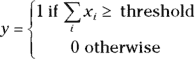<m:math xmlns:m="http://www.w3.org/1998/Math/MathML"><m:mrow><m:mi>y</m:mi><m:mo>=</m:mo><m:mrow><m:mo>{</m:mo><m:mrow><m:mtable><m:mtr><m:mtd><m:mrow><m:mn>1</m:mn><m:mi mathvariant="normal">&#160;if&#160;</m:mi><m:mstyle displaystyle="true"><m:munder><m:mo>&#8721;</m:mo><m:mi>i</m:mi></m:munder><m:mrow><m:msub><m:mi>x</m:mi><m:mi>i</m:mi></m:msub><m:mo>&#8805;</m:mo><m:mi mathvariant="normal">&#160;threshold</m:mi></m:mrow></m:mstyle></m:mrow></m:mtd></m:mtr><m:mtr><m:mtd><m:mrow><m:mn>0</m:mn><m:mi mathvariant="normal">&#160;otherwise</m:mi></m:mrow></m:mtd></m:mtr></m:mtable></m:mrow></m:mrow></m:mrow></m:math>

像生物神经元一样，感知器可以连接在一起，使得一个感知器的输出作为另一个感知器的输入。图 7-3 显示了其外观。如图所示，不同感知器可以有不同数量的输入，但每个感知器始终产生一个输出。


图 7-3： 感知器可以组合成树状结构。

历史学家和学者可能会觉得这些简单的感知器有趣，但在这种原始形式下，它们不能用于实用的机器学习。这是因为感知器的操作是静态的——其行为无法通过训练得到改进。

### 改进模型

罗森布拉特发表感知器的初始设想后，计算机科学家以多种方式更新了他的模型。三个重要变化如下：

*   每个传入信号都被分配一个权重，表示其影响。
*   代替阈值，将一个常数称为偏置添加到传入信号中。
*   加权输入之和被传递给激活函数，该函数决定输出。

这些变化使神经网络适用于机器学习。现代开发者将这些网络的元素称为*节点*而不是*感知器*。

#### 权重

在图 7-2 和 7-3 中，每个输入对确定输出的影响相等。但在实际系统中，一些输入对决策过程的影响会大于其他输入。此外，一些信号可能对结果产生负面影响。

为了反映这种不平等的影响，计算机科学家将每个输入乘以一个称为*权重*的值。图形上，权重由与传入连接相关联的数字表示。图 7-4 显示了具有加权输入的节点的外观。


图 7-4： 每个进入节点的输入都有一个关联的权重。

要确定输入的总体效应，节点将每个输入乘以其权重并将乘积相加。然后将其与阈值进行比较。如果总和大于阈值，节点产生的输出值等于 1。否则，输出值为 0。

在数学上，权重表示为 `w[i]`，其中 *i* 表示第 *i* 个输入的权重。因此，节点的运算可以用以下关系表示：

<m:math xmlns:m="http://www.w3.org/1998/Math/MathML"><m:mrow><m:mi>y</m:mi><m:mo>=</m:mo><m:mrow><m:mo>{</m:mo><m:mrow><m:mtable><m:mtr><m:mtd><m:mrow><m:mn>1</m:mn><m:mi mathvariant="normal">&#160;if&#160;</m:mi><m:mstyle displaystyle="true"><m:munder><m:mo>&#8721;</m:mo><m:mi>i</m:mi></m:munder><m:mrow><m:msub><m:mi>w</m:mi><m:mi>i</m:mi></m:msub><m:msub><m:mi>x</m:mi><m:mi>i</m:mi></m:msub><m:mo>&#8805;</m:mo><m:mi mathvariant="normal">&#160;threshold</m:mi></m:mrow></m:mstyle></m:mrow></m:mtd></m:mtr><m:mtr><m:mtd><m:mrow><m:mn>0</m:mn><m:mi mathvariant="normal">&#160;otherwise</m:mi></m:mrow></m:mtd></m:mtr></m:mtable></m:mrow></m:mrow></m:mrow></m:math>

例如，假设 `x[i] = {3.5, -1.0, 2.5, -0.5}` 且 `w[i] = {0.6, 1.2, 0.9, -0.2}`。加权输入的总和可以计算如下：

<m:math xmlns:m="http://www.w3.org/1998/Math/MathML"><m:mrow><m:mstyle displaystyle="true"><m:munder><m:mo>&#8721;</m:mo><m:mi>i</m:mi></m:munder><m:mrow><m:msub><m:mi>w</m:mi><m:mi>i</m:mi></m:msub><m:msub><m:mi>x</m:mi><m:mi>i</m:mi></m:msub><m:mo>=</m:mo><m:mn>3.5</m:mn><m:mrow><m:mo>(</m:mo><m:mrow><m:mn>0.6</m:mn></m:mrow><m:mo>)</m:mo></m:mrow><m:mo>&#45;</m:mo><m:mn>1.0</m:mn><m:mrow><m:mo>(</m:mo><m:mrow><m:mn>1.2</m:mn></m:mrow><m:mo>)</m:mo></m:mrow><m:mo>+</m:mo><m:mn>2.5</m:mn><m:mrow><m:mo>(</m:mo><m:mrow><m:mn>0.9</m:mn></m:mrow><m:mo>)</m:mo></m:mrow><m:mo>&#45;</m:mo><m:mn>0.5</m:mn><m:mrow><m:mo>(</m:mo><m:mrow><m:mo>&#45;</m:mo><m:mn>0.2</m:mn></m:mrow><m:mo>)</m:mo></m:mrow><m:mo>=</m:mo><m:mn>3.25</m:mn></m:mrow></m:mstyle></m:mrow></m:math>

如果感知器的阈值值为 4.0，节点将产生 0 而不是 1 的输出。

权重在机器学习中发挥着至关重要的作用，因为它们使应用程序能够更新神经网络的行为。随着应用程序执行训练，它会更新权重以改进模型。

#### 偏置

当节点的输入加权和超过给定阈值时，节点会激活。换句话说，当加权和与阈值的差值大于零时，它会产生正输出。

与其处理阈值，开发人员经常用一个称为 *偏置* 的常数输入来代替它。 图 7-5 显示了添加偏置后的简单神经网络的样子。


图 7-5： 该节点有一个称为偏置的常数输入。

偏置与其他输入一样接收权重。因此，将偏置的值设为 1 是有意义的，这就是为什么左侧最低的节点被设为 +1。

本书假设每个感知器都有一个偏置，这相当于说阈值等于零。当我使用 *输入* 或 *输入数据* 等术语时，你应假定包含偏置值。因此，当其输入的加权和大于零时，感知器会产生正输出。

#### 激活函数

你可以用以下关系计算节点的输出：

<m:math xmlns:m="http://www.w3.org/1998/Math/MathML"><m:mrow><m:mi>y</m:mi><m:mo>=</m:mo><m:mrow><m:mo>{</m:mo><m:mrow><m:mtable><m:mtr><m:mtd><m:mrow><m:mn>1</m:mn><m:mi mathvariant="normal">&#160;if&#160;</m:mi><m:mstyle displaystyle="true"><m:munder><m:mo>&#8721;</m:mo><m:mi>i</m:mi></m:munder><m:mrow><m:msub><m:mi>w</m:mi><m:mi>i</m:mi></m:msub><m:msub><m:mi>x</m:mi><m:mi>i</m:mi></m:msub><m:mo>&#8805;</m:mo><m:mi mathvariant="normal">&#160;threshold</m:mi></m:mrow></m:mstyle></m:mrow></m:mtd></m:mtr><m:mtr><m:mtd><m:mrow><m:mn>0</m:mn><m:mi mathvariant="normal">&#160;otherwise</m:mi></m:mrow></m:mtd></m:mtr></m:mtable></m:mrow></m:mrow></m:mrow></m:math>

以下方程使用更紧凑的记法表达了相同的关系：

<m:math xmlns:m="http://www.w3.org/1998/Math/MathML"><m:mrow><m:mi>y</m:mi><m:mo>=</m:mo><m:mi>u</m:mi><m:mrow><m:mo>(</m:mo><m:mrow><m:mstyle displaystyle="true"><m:munder><m:mo>&#8721;</m:mo><m:mi>i</m:mi></m:munder><m:mrow><m:msub><m:mi>w</m:mi><m:mi>i</m:mi></m:msub><m:msub><m:mi>x</m:mi><m:mi>i</m:mi></m:msub></m:mrow></m:mstyle></m:mrow><m:mo>)</m:mo></m:mrow></m:mrow></m:math>

这里，`u(x)` 被称为 *单位阶跃函数*。如果其输入大于 0，则返回 1，否则返回 0。

单位阶跃函数易于理解，但不适用于机器学习。计算机科学家设计了许多更合适的用于产生感知器输出的函数，它们被称为 *激活函数*。

节点的激活函数接受节点的输入加权和并产生单个输出值。在 TensorFlow 中，激活函数接受一个值张量并返回包含输出值的张量。 表 7-1 列出了 TensorFlow 支持的七种激活函数。

表 7-1 激活函数

| **激活函数** || **描述** |
| --- | --- |
| `tf.nn.relu(input, name=None)` || 如果为正则返回输入值，否则返回 0 |
| --- | --- |
| `tf.nn.relu6(input, name=None)` || 如果为正则返回输入值，最高为 6。否则返回 0 |
| `tf.nn.crelu(input, name=None)` || 返回一个连接的张量，将输入的正负部分分开 |
| `tf.nn.elu(input, name=None)` || 如果为正则返回输入值，否则返回输入的指数 |
| `tf.nn.sigmoid(input, name=None)` || 返回 1/(1 + exp(-x)) |
| `tf.nn.tanh(input, name=None)` || 返回 tanh(x) |
| `tf.nn.softsign(input, name=None)` || 返回 x/(abs(x) + 1) |

我喜欢将这些函数分为两类：整流器和分类器。区别很简单：如果节点的输出标识一个类别，则将其激活函数设为分类器。否则，将节点的激活函数设为整流器。

##### 整流函数

在电子电路中，整流器接受输入信号，如果输入为正，则传输相等的输出信号。如果输入信号为负，整流器传输零输出。

整流线性单元函数，或 ReLU，执行类似的操作。它如果为正则返回输入，否则返回 0。换句话说，ReLU 函数返回输入和 0 的最大值。

在 TensorFlow 中，应用程序可以通过调用 `tf.nn.relu` 执行 ReLU 操作。 图 7-6 说明了该函数在一段输入值范围内的输出。


图 7-6： 整流线性单元函数（ReLU）只通过正值。

`tf.nn.relu6` 与 `tf.nn.relu` 类似，但将最大输出限制为 6。这种限制降低了节点对大输入过度反应的可能性。 图 7-7 说明了 `tf.nn.relu6` 的行为。


FIGURE 7-7: The `tf.nn.relu6` function clamps the node's maximum output to 6.

`tf.nn.crelu` (Concatenated ReLU) produces an output tensor that is twice the size of the input tensor. The first half of the output contains a regular ReLU result (zero or positive input). The second half focuses on the negative part of the input (negative input or zero).

The ELU in `tf.nn.elu` stands for *Exponential Linear Unit.* This activation function returns the input value if it's greater than zero. If the input is zero or less, `tf.nn.elu` returns the exponential of the input minus one. Figure 7-8 shows what this looks like:


FIGURE 7-8: The Exponential Linear Unit (ELU) function proceeds continuously from positive to negative values.

Unlike other rectifier functions, ELU is continuous at x = 0. According to Djork-Arné Clevert, Thomas Unterthiner, and Sepp Hochreiter at Johannes Kepler University, ELU provides faster learning than the regular ReLU function and better generalization.

##### Classifier functions


Chapter 6 discusses the topic of logistic regression and introduces the logistic function, better known as the sigmoid function. This function, which computes `1/(1 + exp(-x))`, has a number of helpful properties that make it suitable for classifying points into categories. Figure 7-9 shows what `tf.nn.sigmoid` looks like.


FIGURE 7-9: The sigmoid function is frequently employed to represent classification probability.

Though popular, the sigmoid function has one significant shortcoming: Its output ranges from 0 to 1. Because of this limited range, small changes in the input produce small changes in the output. In many cases, the differences in output may be too small for digital computers to recognize.

To make up for this shortcoming, many developers prefer the `tf.nn.tanh` activation function, which computes the hyperbolic tangent (`tanh`). This function has a similar shape to the sigmoid function, but ranges from -1 to 1. This means that computers will be better able to recognize differences in output. Figure 7-10 shows what the `tf.nn.tanh` activation function looks like.


FIGURE 7-10: The tanh function resembles the sigmoid function, but produces output between -1 to 1.

In 2009, James Bergstra, Guillaume Desjardins, Pascal Lamblin, and Yoshua Bengio introduced the `softsign function`, which outperformed tanh in most of their tests. They defined the softsign function in the following way:

<m:math xmlns:m="http://www.w3.org/1998/Math/MathML"><m:mrow><m:mi>s</m:mi><m:mi>o</m:mi><m:mi>f</m:mi><m:mi>t</m:mi><m:mi>s</m:mi><m:mi>i</m:mi><m:mi>g</m:mi><m:mi>n</m:mi><m:mrow><m:mo>(</m:mo><m:mi>x</m:mi><m:mo>)</m:mo></m:mrow><m:mo>=</m:mo><m:mfrac><m:mi>x</m:mi><m:mrow><m:mn>1</m:mn><m:mo>+</m:mo><m:mrow><m:mo>|</m:mo><m:mi>x</m:mi><m:mo>|</m:mo></m:mrow></m:mrow></m:mfrac></m:mrow></m:math> 

Figure 7-11 shows the softsign function for values of x between -8 and 8.


FIGURE 7-11: The softsign function resembles tanh, but has a larger gradient throughout most of its domain.

The gradient of the softsign function exceeds that of tanh throughout most of its domain. The larger gradient makes minor changes to the input easier to recognize.

### Layers and Deep Learning

Individual nodes are too primitive to serve a useful purpose, but when you combine them into networks, you can create sophisticated tools for machine learning. This section explains how you can connect these nodes and explores the properties of the resulting neural networks.

#### Layers

The columns of a neural network are referred to as `layers`, and for this reason, neural networks are frequently called multilayer perceptrons (`MLPs`). Every neural net has at least two layers, and Figure 7-12 depicts an MLP with four.


FIGURE 7-12: The neural network has four layers, and each layer has three nodes.

The layers of a neural network have specific names. The first layer, which provides input values, is called the `input layer`. The last layer, which provides output values, is called the `output layer`. The layers between the input layer and output layer are called `hidden layers`. Layers are numbered from left to right, starting with 0.

A layer is considered `dense` or `fully connected` if each of its nodes is connected to each node in the next layer. Every layer in Figure 7-12 is dense.

Each node in a hidden layer is denoted <m:math xmlns:m="http://www.w3.org/1998/Math/MathML"><m:mrow><m:msubsup><m:mi>h</m:mi><m:mi>y</m:mi><m:mi>x</m:mi></m:msubsup></m:mrow></m:math>, where `x` identifies the number of the layer and `y` identifies the index of the node in the layer. For example, <m:math xmlns:m="http://www.w3.org/1998/Math/MathML"><m:mrow><m:msubsup><m:mi>h</m:mi><m:mn>1</m:mn><m:mn>2</m:mn></m:msubsup></m:mrow></m:math> identifies the second node in the third layer.

You can determine the output of each hidden node using the same methods discussed in the “Improving the Model” section. For example, if `func` is the activation function, the following equations compute the output of node <m:math xmlns:m="http://www.w3.org/1998/Math/MathML"><m:mrow><m:msubsup><m:mi>h</m:mi><m:mn>0</m:mn><m:mn>1</m:mn></m:msubsup></m:mrow></m:math> and <m:math xmlns:m="http://www.w3.org/1998/Math/MathML"><m:mrow><m:msubsup><m:mi>h</m:mi><m:mn>2</m:mn><m:mn>1</m:mn></m:msubsup></m:mrow></m:math>:

<m:math xmlns:m="http://www.w3.org/1998/Math/MathML"><m:mtable columnalign="left"><m:mtr><m:mtd><m:msubsup><m:mi>h</m:mi><m:mn>0</m:mn><m:mn>1</m:mn></m:msubsup><m:mo>=</m:mo><m:mi>f</m:mi><m:mi>u</m:mi><m:mi>n</m:mi><m:mi>c</m:mi><m:mrow><m:mo>(</m:mo><m:mrow><m:msubsup><m:mi>w</m:mi><m:mrow><m:mn>00</m:mn></m:mrow><m:mn>0</m:mn></m:msubsup><m:msub><m:mi>x</m:mi><m:mn>0</m:mn></m:msub><m:mo>+</m:mo><m:msubsup><m:mi>w</m:mi><m:mrow><m:mn>10</m:mn></m:mrow><m:mn>0</m:mn></m:msubsup><m:msub><m:mi>x</m:mi><m:mn>1</m:mn></m:msub><m:mo>+</m:mo><m:msubsup><m:mi>w</m:mi><m:mrow><m:mn>20</m:mn></m:mrow><m:mn>0</m:mn></m:msubsup><m:msub><m:mi>x</m:mi><m:mn>2</m:mn></m:msub></m:mrow><m:mo>)</m:mo></m:mrow></m:mtd></m:mtr><m:mtr><m:mtd><m:msubsup><m:mi>h</m:mi><m:mn>0</m:mn><m:mn>2</m:mn></m:msubsup><m:mo>=</m:mo><m:mi>f</m:mi><m:mi>u</m:mi><m:mi>n</m:mi><m:mi>c</m:mi><m:mrow><m:mo>(</m:mo><m:mrow><m:msubsup><m:mi>w</m:mi><m:mrow><m:mn>00</m:mn></m:mrow><m:mn>1</m:mn></m:msubsup><m:msubsup><m:mi>h</m:mi><m:mn>0</m:mn><m:mn>1</m:mn></m:msubsup><m:mo>+</m:mo><m:msubsup><m:mi>w</m:mi><m:mrow><m:mn>10</m:mn></m:mrow><m:mn>1</m:mn></m:msubsup><m:msubsup><m:mi>h</m:mi><m:mn>1</m:mn><m:mn>1</m:mn></m:msubsup><m:mo>+</m:mo><m:msubsup><m:mi>w</m:mi><m:mrow><m:mn>20</m:mn></m:mrow><m:mn>1</m:mn></m:msubsup><m:msubsup><m:mi>h</m:mi><m:mn>2</m:mn><m:mn>1</m:mn></m:msubsup></m:mrow><m:mo>)</m:mo></m:mrow></m:mtd></m:mtr></m:mtable></m:math>

网络中每个权重都需要三个值来唯一标识它。将权重表示为 <m:math xmlns:m="http://www.w3.org/1998/Math/MathML"><m:mrow><m:msubsup><m:mi>w</m:mi><m:mrow><m:mi>y</m:mi><m:mi>z</m:mi></m:mrow><m:mi>x</m:mi></m:msubsup></m:mrow></m:math>，你可以按如下方式确定其在网络中的位置：

* `x` 标识产生加权信号的节点的所在层。
* `y` 标识产生待加权信号的节点的索引。
* `z` 标识接收信号的节点的索引。

例如， <m:math xmlns:m="http://www.w3.org/1998/Math/MathML"><m:mrow><m:msubsup><m:mi>w</m:mi><m:mrow><m:mn>01</m:mn></m:mrow><m:mn>2</m:mn></m:msubsup></m:mrow></m:math> 标识第三层（2）中的一个权重。该权重应用于离开第一个节点（0）的信号并进入第二个节点（1）。

#### 深度学习

随着你在网络中添加更多的隐藏层，它变得能够进行更复杂的检测和分类。当应用程序使用具有多个隐藏层的网络时，它正在利用 `深度学习`。

深度学习在许多应用中已被证明是有效的。两个著名的例子包括使用深度学习击败职业围棋选手的谷歌 AlphaGo 程序，以及谷歌在 2012 年演示的能够识别 YouTube 上猫视频的应用程序。

向网络添加隐藏层有两个缺点。首先，每个隐藏层都会增加训练网络所需的时间。其次，每个新的隐藏层都会增加 `过拟合` 的可能性，我将在 “调整神经网络” 部分中讨论这个问题。

### 使用反向传播进行训练

正如我在 第 5 章 中讨论的那样，训练会更新你的模型，使其与实验数据相似。神经网络表示的数学模型取决于网络节点的排列及其激活函数。为了更好地理解这一概念，请考虑 图 7-13 中的网络。


FIGURE 7-13: 每个神经网络都代表一个数学关系。

将激活函数表示为 `f[0]`、`f[1]` 和 `f[2]`，图 7-13 中的神经网络表示以下数学关系：


<m:math xmlns:m="http://www.w3.org/1998/Math/MathML"><m:mrow><m:mi>y</m:mi><m:mrow><m:mo>(</m:mo><m:mrow><m:msub><m:mi>x</m:mi><m:mi>i</m:mi></m:msub></m:mrow><m:mo>)</m:mo></m:mrow><m:mo>=</m:mo><m:msub><m:mi>f</m:mi><m:mn>2</m:mn></m:msub><m:mrow><m:mo>(</m:mo><m:mrow><m:msubsup><m:mi>w</m:mi><m:mrow><m:mn>00</m:mn></m:mrow><m:mn>1</m:mn></m:msubsup><m:msub><m:mi>f</m:mi><m:mn>0</m:mn></m:msub><m:mrow><m:mo>(</m:mo><m:mrow><m:msubsup><m:mi>w</m:mi><m:mrow><m:mn>00</m:mn></m:mrow><m:mn>0</m:mn></m:msubsup><m:msub><m:mi>x</m:mi><m:mn>0</m:mn></m:msub><m:mo>+</m:mo><m:msubsup><m:mi>w</m:mi><m:mrow><m:mn>10</m:mn></m:mrow><m:mn>0</m:mn></m:msubsup><m:msub><m:mi>x</m:mi><m:mn>1</m:mn></m:msub><m:mo>+</m:mo><m:msubsup><m:mi>w</m:mi><m:mrow><m:mn>20</m:mn></m:mrow><m:mn>0</m:mn></m:msubsup><m:msub><m:mi>x</m:mi><m:mn>2</m:mn></m:msub><m:mo>+</m:mo><m:msubsup><m:mi>w</m:mi><m:mrow><m:mn>30</m:mn></m:mrow><m:mn>0</m:mn></m:msubsup><m:msub><m:mi>x</m:mi><m:mn>3</m:mn></m:msub></m:mrow><m:mo>)</m:mo></m:mrow><m:mo>+</m:mo><m:msubsup><m:mi>w</m:mi><m:mrow><m:mn>10</m:mn></m:mrow><m:mn>1</m:mn></m:msubsup><m:msub><m:mi>f</m:mi><m:mn>1</m:mn></m:msub><m:mrow><m:mo>(</m:mo><m:mrow><m:msubsup><m:mi>w</m:mi><m:mrow><m:mn>41</m:mn></m:mrow><m:mn>0</m:mn></m:msubsup><m:msub><m:mi>x</m:mi><m:mn>4</m:mn></m:msub><m:mo>+</m:mo><m:msubsup><m:mi>w</m:mi><m:mrow><m:mn>51</m:mn></m:mrow><m:mn>0</m:mn></m:msubsup><m:msub><m:mi>x</m:mi><m:mn>5</m:mn></m:msub><m:mo>+</m:mo><m:msubsup><m:mi>w</m:mi><m:mrow><m:mn>61</m:mn></m:mrow><m:mn>0</m:mn></m:msubsup><m:msub><m:mi>x</m:mi><m:mn>6</m:mn></m:msub></m:mrow><m:mo>)</m:mo></m:mrow></m:mrow><m:mo>)</m:mo></m:mrow></m:mrow></m:math>

训练的目标是找到使 `y(x[i])` 尽可能接近观测数据的权重。换句话说，目标是最小化 `y(x[i])` 与观测数据之间的差异。如 第 5 章 和 第 6 章 中所讨论的，这种差异称为损失，而计算损失的一种流行方法是均方误差（MSE）。

如果你将 `y(x[i])` 设为一条简单的直线或多项式，你可以轻松计算损失并将其操作传递给优化器，例如 `GradientDescentOptimizer`。第 5 章 涵盖了不同的优化算法及其对应的 TensorFlow 类。

神经网络的模型更为复杂，因此损失并不那么容易计算。但在 1974 年，Paul Werbos 是第一个使用一种称为 *反向传播* 的方法优化神经网络权重的人。此后研究人员提出了其他训练神经网络的算法，但由于其简单性和速度，反向传播仍然是最流行的方法。

本质上，反向传播将 第 5 章 中的优化算法扩展到适用于神经网络。总体过程涉及六个步骤：

1. **初始化网络的权重。**

2. **对于输入集 `x[i]`，计算 `y(x[i])`。**

   该计算称为 *前向传播*。

3. **对于输入集 `x[i]`，确定损失。**

4. **对于每个权重，计算损失相对于该权重的偏导数。**

5. **使用步骤 4 中计算的偏导数更新网络中的每个权重。**

6. **返回步骤 2 并继续，直到损失的偏导数接近零。**

要了解反向传播如何计算偏导数，了解微积分的链式法则很有帮助。如果 `p(x) = f(g(x))`，则可以按以下方式表达 `p(x)` 的导数：

<m:math xmlns:m="http://www.w3.org/1998/Math/MathML"><m:mrow><m:mi>p</m:mi><m:mo>&#39;</m:mo><m:mrow><m:mo>(</m:mo><m:mi>x</m:mi><m:mo>)</m:mo></m:mrow><m:mo>=</m:mo><m:mi>f</m:mi><m:mo>&#39;</m:mo><m:mrow><m:mo>(</m:mo><m:mrow><m:mi>g</m:mi><m:mrow><m:mo>(</m:mo><m:mi>x</m:mi><m:mo>)</m:mo></m:mrow></m:mrow><m:mo>)</m:mo></m:mrow><m:mi>g</m:mi><m:mo>&#39;</m:mo><m:mrow><m:mo>(</m:mo><m:mi>x</m:mi><m:mo>)</m:mo></m:mrow></m:mrow></m:math>

反向传播将链式法则扩展到偏导数和涉及函数求和的导数。通过这种方式，该算法确定网络中每个权重相对于损失的偏导数。

值得庆幸的是，你无需担心偏导数或链式法则，因为 TensorFlow 会自动执行反向传播。但你需要创建反向传播将用于更新网络权重的优化器。

### 实现深度学习

在你对节点、权重以及神经网络的整体结构有了扎实理解之后，你就可以看到实际应用如何在代码中组合这些元素。`ch7/deep_learning.py` 模块演示了如何使用 TensorFlow 实现深度学习。

与 `the ch6/multi_regression.py` 模块类似，`ch7/deep_learning.py` 从 MNIST 数据集加载并对图像进行分类。但它没有使用逻辑回归，而是创建了一个由全连接层组成的神经网络。Listing 7-1 展示了代码。

#### LISTING 7-1 使用深度学习对图像进行分类

```
#### Read MNIST data
dataset = learn.datasets.mnist.read_data_sets('MNIST-data', one_hot=True)

#### Placeholders for MNIST images
img_holder = tf.placeholder(tf.float32, [None, 784])
lbl_holder = tf.placeholder(tf.float32, [None, 10])

#### Layer settings
hid_nodes = 200
out_nodes = 10

#### Define weights
w0 = tf.Variable(tf.random_normal([784, hid_nodes]))
w1 = tf.Variable(tf.random_normal([hid_nodes, hid_nodes]))
w2 = tf.Variable(tf.random_normal([hid_nodes, hid_nodes]))
w3 = tf.Variable(tf.random_normal([hid_nodes, out_nodes]))

#### Define biases
b0 = tf.Variable(tf.random_normal([hid_nodes]))
b1 = tf.Variable(tf.random_normal([hid_nodes]))
b2 = tf.Variable(tf.random_normal([hid_nodes]))
b3 = tf.Variable(tf.random_normal([out_nodes]))

#### Create layers
layer_1 = tf.add(tf.matmul(img_holder, w0), b0)
layer_1 = tf.nn.relu(layer_1)
layer_2 = tf.add(tf.matmul(layer_1, w1), b1)
layer_2 = tf.nn.relu(layer_2)
layer_3 = tf.add(tf.matmul(layer_2, w2), b2)
layer_3 = tf.nn.relu(layer_3)
out_layer = tf.matmul(layer_3, w3) + b3

#### Compute loss
loss = tf.reduce_mean(
 tf.nn.softmax_cross_entropy_with_logits(
 logits=out_layer, labels=lbl_holder))

#### Create optimizer
learning_rate = 0.01
num_epochs = 15
batch_size = 100
num_batches = int(dataset.train.num_examples/batch_size)
optimizer = tf.train.AdamOptimizer(learning_rate).minimize(loss)

#### Initialize variables
init = tf.global_variables_initializer()

#### Launch session
with tf.Session() as sess:
 sess.run(init)

 # Loop over epochs
 for epoch in range(num_epochs):

 # Loop over batches
 for batch in range(num_batches):
 img_batch, lbl_batch = dataset.train.next_batch(batch_size)
 sess.run(optimizer, feed_dict={img_holder: img_batch,
 lbl_holder: lbl_batch})

 # Determine success rate
 prediction = tf.equal(tf.argmax(out_layer, 1), tf.argmax(lbl_holder, 1))
 success = tf.reduce_mean(tf.cast(prediction, tf.float32))
 print('Success rate: ', sess.run(success,
 feed_dict={img_holder: dataset.test.images,
 lbl_holder: dataset.test.labels}))
```

该应用程序通过调用 `tf.Variable` 创建权重（`w`[`i`]) 和偏置（`b`[`i`])。然后它将输入值乘以权重并加上偏置。三个隐藏层中的每一个都通过调用 `tf.nn.relu` 对其输出进行校正。

最终层（`out_layer`）执行类似的乘法和加法，但它没有调用 `tf.nn.relu`，而是将输出传递给 `tf.nn.softmax_cross_entropy_with_logits`。该模块使用此输出为 MNIST 图像选择十个输出类别之一。

### 调优神经网络

前一节中的神经网络对于演示来说是合适的，但不适合专业应用。为了提高应用程序的准确性和处理速度，专业开发人员使用统称为 *调优* 的特殊例程。我喜欢称它们为四个“zations”：

* **输入标准化：** 预处理输入数据，使其在统计上与训练数据相似

* **权重初始化：** 获取初始权重的合适值

* **批归一化：** 在激活函数之前处理数据以降低饱和的可能性

* **正则化：** 降低过拟合的可能性

大多数开发人员都同意神经网络需要一定程度的调优，但很少有人同意最佳流程。与其选边站，我更专注于解释如何在 TensorFlow 应用程序中执行操作。

#### 输入标准化

机器学习应用程序应该能够分析从未见过的数据。但即使传入的数据完全是新的，它也应与应用程序的训练数据具有相同的均值和标准差。这种一致性可确保应用程序不会因数据集而感到困惑。

因此，开发人员经常转换输入数据以使均值等于 0，标准差等于 1。此操作称为 *标准化*，TensorFlow 的 `tf.nn` 包提供了两个有助于标准化的函数：`moments` 和 `batch_normalization`。

`moments` 返回一个包含张量轴中元素的均值和方差的元组。其签名如下：

`moments(x, axes, shift=None, name=None, keep_dims=False)`

要设置均值和方差，请将 `x` 分配给要分析的张量，将 `axes` 分配给标识张量轴的整数数组。如果将 `keep_dims` 设置为 `True`，返回的均值和方差将与输入张量具有相同的维度。

`batch_normalization` 接受张量的均值和方差并标准化张量的元素。其签名如下：

`batch_normalization(x, mean, variance, offset, scale, variance_epsilon, name=None)`

`offset` 参数向张量中的每个值添加一个常数，`scale` 将每个值乘以一个常数。`variance_epsilon` 标识要添加到分母的值，以确保 TensorFlow 不会除以零。应用程序经常将 `offset` 设置为 0.0，`scale` 设置为 1.0，`variance_epsilon` 设置为 0.0001。

例如，以下代码调用 `moments` 获取张量的均值和方差。然后它调用 `batch_normalization` 获取具有标准化数据的新的张量：

```
input_data = tf.constant([1., 3., 5., 7., 9.])
stat_mean, stat_var = tf.nn.moments(input_data, 0)
standard_data = tf.nn.batch_normalization(input_data, stat_mean, stat_var, 0., 1., 0.0001, name=None)
```

这将 `standard_data` 设置为 \[-1.4142, -0.7071, 0.0, 0.7071, 1.4142\]。该张量的均值为 0，标准差为 1。

#### 权重初始化

当我开始编写神经网络代码时，我没有考虑初始化权重——我只是将它们设置为小的随机值。研究人员已详细分析了这一主题，以下研究论文介绍了他们的研究成果：

* 1998 年：“Efficient BackProp” 由 Yann Lecun、Leon Bottou、Genevieve Orr 和 Klaus-Robert Muller 撰写

* 2010 年：“Understanding the Difficulty of Training Deep Feedforward Neural Networks” 由 Xavier Glorot 和 Yoshua Bengio 撰写

* 2015 年：“Delving Deep into Rectifiers: Surpassing Human-Level Performance on ImageNet Classification” 由 Kaiming He、Xiangyu Zhang、Shaoqing Ren 和 Jian Sun 撰写

这些论文各自提出了不同的神经网络权重初始化方法。TensorFlow 通过提供 `tf.contrib.keras.initializers` 包中的函数来支持这些方法。每个函数都以相应方法的首席研究员命名，而 表 7-2 列出了其中五个可用的函数。

##### TABLE 7-2 权重初始化函数

| **函数** || **描述** |

| --- | --- |

| `lecun_uniform(seed=None)` || 返回介于 -sqrt(3/insize) 和 sqrt(3/insize) 之间的均匀分布值 |

| --- | --- |

| `glorot_uniform(seed=None)` || 返回介于 -sqrt(6/(insize+outsize)) 和 sqrt(6/(insize+outsize)) 之间的均匀分布值 |

| `glorot_normal(seed=None)` || 返回标准差为 sqrt(2/(insize+outsize)) 的正态分布值 |

| `he_uniform(seed=None)` || 返回介于 -sqrt(6/insize) 和 sqrt(6/insize) 之间的均匀分布值 |

| `he_normal(seed=None)` || 返回标准差为 sqrt(2/insize) 的正态分布值 |


在 表 7-2 的描述中，`insize` 和 `outsize` 指的是神经网络各层的大小。也就是说，`insize` 是提供权重的层中的节点数，而 `outsize` 是接收权重的层中的节点数。

这些函数 each 接受一个 `seed` 来初始化随机数生成器。每个函数返回一个 `Initializer`，其 `__call__` 方法接受随机权重的形状并返回 ndarray 中的权重。

例如，以下代码使用 `lecun_uniform` 初始化四个正态分布权重数组：

```
import time
init = tf.contrib.keras.initializers.lecun_uniform(time.time())
weights = init([4])
with tf.Session() as sess:
    result = sess.run(weights)
    print(result) # Prints the ndarray containing weight values
```

除了 表 7-2 中列出的函数外，TensorFlow 还在 `tf.contrib.layers` 包中提供了 `xavier_initializer` 函数：

`xavier_initializer(uniform=True, seed=None, dtype=tf.float32)`

当 `uniform` 设置为 `True` 时，此函数使用与 `glorot_uniform` 函数相同的方法生成权重。当 `uniform` 设置为 `False` 时，它使用与 `glorot_normal` 相同的方法生成权重。

### 批量归一化

2015 年，Sergey Ioffe 和 Christian Szegedy 发表了一篇有影响力的研究论文，解决了 *饱和* 问题，即当节点的激活函数达到极值时发生。饱和对于 sigmoid 和 tanh 等函数来说是一个主要问题，其斜率在极值处趋近于零。如果节点的优化器使用某种形式的梯度下降，小的斜率会导致训练缓慢。

另一个问题是，对饱和节点的输入进行微小更改会产生输出的微小更改。输出变化可能小到应用程序无法感知。

为了降低饱和的可能性，Ioffe 和 Szegedy 建议固定每一层输入的均值和方差。此过程类似于输入标准化过程，但它影响网络的每一层，而不仅仅是第一层。

不幸的是，归一化层的输入会限制层的灵活性。为了解决这个问题，Ioffe 和 Szegedy 建议计算每个批次的均值和方差，并独立归一化每个批次的值。此过程称为 *批量归一化*（BN）。

批量归一化在训练期间和测试期间的行为不同。在训练期间，BN 为每个批次计算均值和方差，并使用结果计算缩放因子（gamma）和偏移因子（beta）。以下方程说明了 BN 如何计算和使用这些值：

<m:math xmlns:m="http://www.w3.org/1998/Math/MathML"><m:mtable columnalign="left"><m:mtr><m:mtd><m:mi mathvariant="normal">Batch&#160;mean:&#160;</m:mi><m:msub><m:mi>&#956;</m:mi><m:mi>B</m:mi></m:msub><m:mo>=</m:mo><m:mfrac><m:mn>1</m:mn><m:mi>N</m:mi></m:mfrac><m:mstyle displaystyle="true"><m:munderover><m:mo>&#8721;</m:mo><m:mn>0</m:mn><m:mrow><m:mi>N</m:mi><m:mo>&#45;</m:mo><m:mn>1</m:mn></m:mrow></m:munderover><m:mrow><m:msub><m:mi>x</m:mi><m:mi>i</m:mi></m:msub></m:mrow></m:mstyle></m:mtd></m:mtr><m:mtr><m:mtd><m:mi mathvariant="normal">Batch&#160;variance:&#160;</m:mi><m:msubsup><m:mi>&#963;</m:mi><m:mi>B</m:mi><m:mn>2</m:mn></m:msubsup><m:mo>=</m:mo><m:mfrac><m:mn>1</m:mn><m:mi>N</m:mi></m:mfrac><m:mstyle displaystyle="true"><m:munderover><m:mo>&#8721;</m:mo><m:mn>0</m:mn><m:mrow><m:mi>N</m:mi><m:mo>&#45;</m:mo><m:mn>1</m:mn></m:mrow></m:munderover><m:mrow><m:msup><m:mrow><m:mrow><m:mo>(</m:mo><m:mrow><m:msub><m:mi>x</m:mi><m:mi>i</m:mi></m:msub><m:mo>&#45;</m:mo><m:msub><m:mi>&#956;</m:mi><m:mi>B</m:mi></m:msub></m:mrow><m:mo>)</m:mo></m:mrow></m:mrow><m:mn>2</m:mn></m:msup></m:mrow></m:mstyle></m:mtd></m:mtr><m:mtr><m:mtd><m:mi mathvariant="normal">Normalization:&#160;</m:mi><m:mover accent="true"><m:mrow><m:msub><m:mi>x</m:mi><m:mi>i</m:mi></m:msub></m:mrow><m:mo stretchy="true">&#770;</m:mo></m:mover><m:mo>=</m:mo><m:mfrac><m:mrow><m:msub><m:mi>x</m:mi><m:mi>i</m:mi></m:msub><m:mo>&#45;</m:mo><m:msub><m:mi>&#956;</m:mi><m:mi>B</m:mi></m:msub></m:mrow><m:mrow><m:msqrt><m:mrow><m:msubsup><m:mi>&#963;</m:mi><m:mi>B</m:mi><m:mn>2</m:mn></m:msubsup><m:mo>+</m:mo><m:mi>&#949;</m:mi></m:mrow></m:msqrt></m:mrow></m:mfrac></m:mtd></m:mtr><m:mtr><m:mtd><m:mi mathvariant="normal">Scaling&#160;and&#160;shifting:&#160;</m:mi><m:msub><m:mi>y</m:mi><m:mi>i</m:mi></m:msub><m:mo>=</m:mo><m:mi>&#947;</m:mi><m:mover accent="true"><m:mrow><m:msub><m:mi>x</m:mi><m:mi>i</m:mi></m:msub></m:mrow><m:mo stretchy="true">&#770;</m:mo></m:mover><m:mo>+</m:mo><m:mi>&#946;</m:mi></m:mtd></m:mtr></m:mtable></m:math>

BN 使用单个批次的均值和方差来估计整个总体的均值和方差。TensorFlow 使用移动平均计算总体的均值，并使用移动方差计算总体的方差。在测试期间，BN 使用总体均值和方差而不是批次均值和方差来缩放和偏移输入值。

要在代码中实现批量归一化，TensorFlow 提供了 `tf.contrib.layers.batch_norm`。表 7-3 列出了其参数并提供了每个参数的描述。

TABLE 7-3 tf.contrib.layers.batch_norm 的参数

| **参数** || **默认值** || **描述** |

| --- | --- | --- |

| `inputs` || -- || 要归一化的输入值张量 |

| --- | --- | --- |

| `decay` || `0.999` || 用于计算移动均值和方差的乘法常数 |

| `center` || `True` || 是否将 beta 添加到归一化张量 |

| `scale` || `False` || 是否用 gamma 缩放归一化张量 |

| `epsilon` || `0.001` || 防止除零的因子 |

| `activation_fn` || `None` || 激活函数 |

| `param_initializers` || `None` || beta、gamma、移动均值和移动方差的初始化器 |

| `param_regularizers` || `None` || beta 和 gamma 的正则化器 |

| `updates_collections` || `tf.GraphKeys.UPDATE_OPS` || 存放归一化操作的集合，一个或多个 |

| `is_training` || `True` || 是否应更新移动均值和移动方差 |

| `reuse` || `None` || 是否可以重用变量 |

| `variables_collections` || `None` || 存储归一化变量的集合 |

| `outputs_collections` || `None` || 存储归一化输出的集合 |

| `trainable` || `True` || 是否将归一化变量添加到图的 trainable 集合中 |

| `batch_weights` || `None` || 用于缩放批次均值和方差的权重 |

| `fused` || `False` || 是否使用融合归一化（更快） |

| `data_format` || `DATA_FORMAT_NHWC` || 输入数据的格式 |

| `zero_debias_moving_mean` || `False` || 用于更新移动均值的因子 |

| `scope` || `None` || 包含归一化变量的作用域 |

| `renorm` || `False` || 是否在归一化期间使用额外变量 |

| `renorm_clipping` || `None` || 提供重归一化值的字典 |

| `renorm_decay` || `0.99` || 重归一化期间更新移动均值/方差的因子 |

TensorFlow 使用 `decay` 参数来计算总体均值和方差。以下方程展示了计算的执行方式：

<m:math xmlns:m="http://www.w3.org/1998/Math/MathML"><m:mtable columnalign="left"><m:mtr><m:mtd><m:msub><m:mi>&#956;</m:mi><m:mi>P</m:mi></m:msub><m:mo>=</m:mo><m:msub><m:mi>&#956;</m:mi><m:mi>P</m:mi></m:msub><m:mi>d</m:mi><m:mi>e</m:mi><m:mi>c</m:mi><m:mi>a</m:mi><m:mi>y</m:mi><m:mo>+</m:mo><m:msub><m:mi>&#956;</m:mi><m:mi>B</m:mi></m:msub><m:mrow><m:mo>(</m:mo><m:mrow><m:mn>1</m:mn><m:mo>&#45;</m:mo><m:mi>d</m:mi><m:mi>e</m:mi><m:mi>c</m:mi><m:mi>a</m:mi><m:mi>y</m:mi></m:mrow><m:mo>)</m:mo></m:mrow></m:mtd></m:mtr><m:mtr><m:mtd><m:msubsup><m:mi>&#963;</m:mi><m:mi>P</m:mi><m:mn>2</m:mn></m:msubsup><m:mo>=</m:mo><m:msubsup><m:mi>&#963;</m:mi><m:mi>P</m:mi><m:mn>2</m:mn></m:msubsup><m:mi>d</m:mi><m:mi>e</m:mi><m:mi>c</m:mi><m:mi>a</m:mi><m:mi>y</m:mi><m:mo>+</m:mo><m:msubsup><m:mi>&#963;</m:mi><m:mi>B</m:mi><m:mn>2</m:mn></m:msubsup><m:mrow><m:mo>(</m:mo><m:mrow><m:mn>1</m:mn><m:mo>&#45;</m:mo><m:mi>d</m:mi><m:mi>e</m:mi><m:mi>c</m:mi><m:mi>a</m:mi><m:mi>y</m:mi></m:mrow><m:mo>)</m:mo></m:mrow></m:mtd></m:mtr></m:mtable></m:math>

`center` 和 `scale` 参数决定是否应移动和缩放 `inputs` 参数的值。如果 `center` 为 `True`，函数将移动输入值；如果 `scale` 为 `True`，函数将缩放输入值。

了解 `is_training` 和 `trainable` 之间的区别很重要。将 `is_training` 设置为 `True` 告诉函数归一化是在训练期间执行的，这意味着它应更新总体的均值和方差。将 `trainable` 设置为 `True` 告诉函数将其归一化变量存储在由 `TRAINABLE_VARIABLES` 键表示的图集合中。

`batch_norm` 的最后三个参数与 *重归一化* 相关。当应用程序的批次很小或相互依赖时，此过程可改善归一化。

### 正则化

在机器学习中寻找神经网络的合适结构是最困难的任务之一。如果添加的节点太少，网络将过于简单，无法准确分类数据。这称为 *欠拟合*。

如果添加的节点太多，网络将专门针对训练集进行定制，并且不适合分析通用数据。此问题称为 *过拟合*，并且是机器学习中的一个严重问题。

更新神经网络（或其他机器学习算法）以分析通用数据的过程称为 *正则化*。研究人员设计了许多正则化网络的方法，本节重点介绍其中两种：

*   **Dropout：** 随机从网络中移除节点

*   **L1/L2 正则化：** 通过增加损失来减少权重

对于这两种方法，我解释了正则化如何工作以及如何使用 TensorFlow 执行它。

#### Dropout

Dropout 过程会随机从网络中移除一个或多个节点。对于每个被移除的节点，dropout 会移除该节点的输入和输出连接及其权重。

在 TensorFlow 中，您可以通过添加 dropout 层来为神经网络配置 dropout。添加此层涉及调用 `tf.nn.dropout` 函数：

```
dropout(x, keep_prob, noise_shape=None, seed=None, name=None)
```

在此函数中，`x` 是包含前一层值的张量，`keep_prob` 是与 `x` 相同类型的标量。函数返回与 `x` 尺寸相同的张量。

`dropout` 将其每个输出值设置为 0 或 `1/keep_prob` 倍的对应输入值。更精确地说，`dropout` 以 `1-keep_prob` 的概率将输出值设置为 0，并以 `keep_prob` 的概率将输出值设置为 `1/keep_prob` 倍的输入值。

#### L1/L2 正则化

L1 和 L2 正则化通过减少网络的权重来防止过拟合。两种方法都通过一个取决于两个因素的值来增加损失：网络的权重和一个常数 λ。

L1 正则化通过 λ 乘以待更新权重的绝对值来增加损失。因此，当算法通过反向传播更新权重 w[0] 时，它会向损失添加一个等于 λ|w[0]| 的值。

L2 正则化通过 λ/2 乘以待更新权重的平方来增加损失。因此，当算法更新 w[0] 时，它会向损失添加 λ|w[0]|²/2。

在两种情况下，损失在权重增加时会增加，在权重减少时会减少。因此，正则化过程倾向于将非必要的权重减少为零，从而简化模型并（希望）避免过拟合。

要在 TensorFlow 中执行 L1/L2 正则化，您可以调用 `tf.contrib.layers.l1_regularizer` 或 `tf.contrib.layers.l2_regularizer`：

*   `l1_regularizer(lambda, scope=None)`：返回执行 L1 正则化的函数

*   `l2_regularizer(lambda, scope=None)`：返回执行 L2 正则化的函数

这些函数返回特殊的函数称为 *正则化器*。获得正则化器后，您可以通过调用 `tf.contrib.layers.apply_regularization` 来正则化一组权重：

```
apply_regularization(regularizer, weights_list=None)
```

许多 TensorFlow 函数接受正则化器作为参数。一个重要的函数是 `tf.contrib.layers.fully_connected`，我在 “Improving the Deep Learning Process” 部分讨论了它。

### 使用作用域管理变量

使用神经网络构建应用程序时，跟踪权重是一个主要优先事项。隐藏层接受加权输入并产生加权输出。如果没有适当的<|message|>管理，很容易使一个层的权重名称与另一个层的权重名称冲突。

#### 变量作用域

在深度学习应用程序中，层经常为其权重分配相同的名称。为了使变量保持分离，TensorFlow 使定义变量的 *作用域* 成为可能。应用程序可以通过调用 `tf.variable_scope` 来定义作用域：


```python
tf.variable_scope(name_or_scope, default_name=None, values=None, initializer=None, regularizer=None, caching_device=None, partitioner=None, custom_getter=None, reuse=None, dtype=None, use_resource=None)
```

应用程序通常作为 `with` 语句的一部分调用此函数，如以下代码所示：

```python
with tf.variable_scope("MyScope")
```

```
…
```

如果应用程序在 `with` 块内使用 `tf.get_variable` 创建变量，TensorFlow 将在变量名称前加上作用域的名称。也就是说，如果应用程序创建一个名为 `MyVar` 的新变量，则变量的完整名称将为 `MyScope/MyVar`。

第 5 章 解释了如何使用 `tf.Variable` 创建变量，但如果应用程序想在作用域内创建变量，则要调用的函数是 `tf.get_variable`：

`get_variable(name, shape=None, dtype=None, initializer=None, regularizer=None, trainable=True, collections=None, caching_device=None, partitioner=None, validate_shape=True, use_resource=None, custom_getter=None)`

如果 `name` 参数在当前作用域中标识了一个变量，并且该作用域的 `reuse` 参数设置为 `True`，`get_variable` 将返回已存在的变量。下面的代码展示了如何使用 `tf.get_variable`：

```python
with tf.variable_scope("MyScope"):
    var = tf.get_variable("var", [1])
    
with tf.variable_scope("MyScope", reuse=True):
    same = tf.get_variable("var") # Same as var
```

如果 `variable_scope` 的 `name` 参数与作用域中已存在的变量不对应，该函数将创建一个新变量。`initializer` 参数决定变量的初始值。如果未设置此参数，则初始值由 surrounding 作用域的 `initializer` 参数决定。如果 surrounding 作用域的 `initializer` 参数也未设置，TensorFlow 将使用 Glorot 初始化来初始化该变量。

### 从集合中检索变量

如 Chapter 4 中所述，图将操作和张量存储在一组集合中。应用程序可以通过调用 `tf.get_collection` 从集合中检索变量：

`tf.get_collection(key, scope=None)`

`key` 参数标识图的其中一个集合。一个重要的 key 是 `tf.GraphKeys.TRAINABLE_VARIABLES`，它标识包含图的训练变量的集合。

`scope` 参数标识应从中检索变量的作用域。例如，以下代码访问包含 `hidden_layer_1` 作用域中所有可训练变量的列表：

`tf.get_collection(tf.GraphKeys.TRAINABLE_VARIABLES, 'hidden_layer_1')`

### 名称和参数的作用域

正如 `tf.variable_scope` 为变量创建作用域一样，`tf.name_scope` 为张量和操作创建作用域。此函数使用简单，下面的代码展示了其工作原理：

```python
with tf.name_scope('block1'):
    t = tf.constant([1., 2.], name='tens')
```

此示例在标识符为 `block1` 的名称作用域内创建张量 `t`。因此，TensorFlow 将 `t` 的完整标识符设置为 `block1/tens`。

`tf.contrib.framework` 包提供了一个有用的函数 `arg_scope`：

`arg_scope(list_ops_or_scope, **kwargs)`

此函数创建一个作用域，将参数插入到作用域中列出的操作中。也就是说，对于第一个参数中标识的每个操作，`arg_scope` 都会插入第二个参数中提供的参数。

一个示例阐明了参数作用域的工作方式。以下代码的结果是，作用域内对 `foo` 的每次调用都将 `var` 设置为 `39`：

```python
from tensorflow.contrib.framework import arg_scope
with arg_scope([foo], var=39):
    …
```

要使操作在参数作用域中可访问，必须使用 `@add_arg_scope` 装饰操作定义。如果一个函数需要许多参数并且必须多次调用，通过在参数作用域中设置参数，可以显著减少所需的代码量。

### 改进深度学习过程

在 “Implementing Deep Learning” 部分，我展示了一个使用未调优神经网络对 MNIST 图像进行分类的应用程序。本节展示了一个执行相同操作的应用程序，但使用调优机制（归一化和正则化）来提高网络的准确性和性能。但在讨论代码之前，我想介绍一种创建全连接层的改进方法。

#### 创建调优层

在 Listing 7-1 中，本章前面，应用程序使用低级算术操作（如 `tf.add` 和 `tf.matmul`）创建全连接层。但 TensorFlow 通过 `tf.contrib.layers.fully_connected` 函数提供了创建全连接层的更复杂方法。

此函数接受许多参数来调优层的行为，例如权重初始化、归一化和正则化。Table 7-4 列出了该函数的参数并提供了每个参数的描述。

TABLE 7-4 `tf.contrib.layers.fully_connected` 的参数

| **Parameter** || **Default** || **Description** |

| --- | --- | --- |

| `inputs` || \-- || 输入值的张量 |

| --- | --- | --- |

| `num_outputs` || \-- || 层产生的输出值数量 |

| `activation_fn` || `tf.nn.relu` || 生成层输出值的函数 |

| `normalizer_fn` || `None` || 处理输出值的函数 |

| `normalizer_params` || `None` || 传递给归一化函数的参数 |

| `weights_initializer` || `initializers. xavier_initializer()` || 初始化层权重的函数 |

| `weights_regularizer` || `None` || 正则化权重的函数 |

| `biases_initializer` || `tf.zeros_initializer` || 初始化层偏置的函数 |

| `biases_regularizer` || `None` || 正则化偏置的函数 |

| `reuse` || `None` || 指定是否应重用层及其权重的布尔值 |

| `variables_collections` || `None` || 变量集合的列表或包含每个变量的集合列表的字典 |

| `outputs_collections` || `None` || 包含输出的集合 |

| `trainable` || `True` || 指定层的变量是否应添加到图的训练变量中的布尔值 |

| `scope` || `None` || 层变量的作用域 |

应用程序需要将 `inputs` 设置为至少有两个维度的张量。如果 `fully_connected` 正在添加输入层，应用程序应将 `inputs` 设置为向会话提供数据的占位符。对于后续层，应用程序应将 `inputs` 设置为创建前一层的函数的返回值。

`fully_connected` 返回一个包含层输出值的张量。`num_outputs` 参数决定此输出张量的大小。重要的是要看到 `num_outputs` 控制全连接层中节点的数量。

`activation_fn` 参数指定将计算层节点输出的激活函数。默认情况下，`fully_connected` 将此参数设置为 `tf.nn.relu` 矫正函数，这适用于隐藏层。如果层 intended 提供输出，你可能需要将不同的函数与 `activation_fn` 关联。

`normalizer_fn`、`normalizer_params`、`biases_initializer` 和 `biases_regularizer` 参数决定用于层的调优过程。`normalizer_fn` 指定用于归一化层值的函数。此函数将接收 `normalizer_params` 参数中提供的任何参数。

如果设置了 `normalizer_fn`，`fully_connected` 将忽略 `biases_initializer` 和 `biases_regularizer`。否则，函数将调用 `biases_initializer` 来设置层的偏置值，并使用 `biases_regularizer` 函数对偏置进行正则化。

默认情况下，全连接层使用 Glorot 方法初始化其权重。你可以通过将 `weights_initializer` 分配给返回 `Initializer` 的函数（如 `lecun_uniform`）来自定义权重的初始化方式。你还可以通过设置 `weights_regularizer` 来指定用于正则化层权重的函数。

`scope` 参数为全连接层定义变量作用域。层创建的权重和偏置将存储在此作用域内。`reuse` 参数标识层及其变量是否可以重用。

#### 将理论付诸实践

`ch7/tuned_learning.py` 模块中的代码执行与本章前面介绍的 `ch7/deep_learning.py` 模块相同的 MNIST 分类任务。不同之处在于它对神经网络进行了调优以提高准确率和性能。它还通过调用 `tf.contrib.layers.fully_connected` 而不是 `tf.add` 和 `tf.matmul` 来创建全连接层。 代码清单 7-2 展示了该代码。

#### 代码清单 7-2 带调优的深度学习

```python
#### Read MNIST data
dataset = learn.datasets.mnist.read_data_sets('MNIST-data', one_hot=True)

#### Placeholders for MNIST images
img_holder = tf.placeholder(tf.float32, [None, 784])
lbl_holder = tf.placeholder(tf.float32, [None, 10])
train = tf.placeholder(tf.bool)

#### Layer settings
hid_nodes = 200
out_nodes = 10
keep_prob = 0.5

#### Create layers
with tf.contrib.framework.arg_scope(
 [fully_connected],
 normalizer_fn=tf.contrib.layers.batch_norm,
 normalizer_params={'is_training': train}):
 layer1 = fully_connected(img_holder, hid_nodes, scope='layer1')
 layer1_drop = tf.layers.dropout(layer1, keep_prob, training=train)
 layer2 = fully_connected(layer1_drop, hid_nodes, scope='layer2')
 layer2_drop = tf.layers.dropout(layer2, keep_prob, training=train)
 layer3 = fully_connected(layer2_drop, hid_nodes, scope='layer3')
 layer3_drop = tf.layers.dropout(layer3, keep_prob, training=train)
 out_layer = fully_connected(layer3_drop, out_nodes,
 activation_fn=None, scope='layer4')

#### Compute loss
loss = tf.reduce_mean(
 tf.nn.softmax_cross_entropy_with_logits(
 logits=out_layer, labels=lbl_holder))

#### Create optimizer
learning_rate = 0.01
num_epochs = 15
batch_size = 100
num_batches = int(dataset.train.num_examples/batch_size)
optimizer = tf.train.AdamOptimizer(learning_rate).minimize(loss)

#### Initialize variables
init = tf.global_variables_initializer()

#### Launch session
with tf.Session() as sess:
 sess.run(init)

 # Loop over epochs
 for epoch in range(num_epochs):

 # Loop over batches
 for batch in range(num_batches):
 img_batch, lbl_batch = dataset.train.next_batch(batch_size)
 sess.run(optimizer, feed_dict={img_holder: img_batch,
 lbl_holder: lbl_batch, train: True})

 # Determine success rate
 prediction = tf.equal(tf.argmax(out_layer, 1), tf.argmax(lbl_holder, 1))
 success = tf.reduce_mean(tf.cast(prediction, tf.float32))
 print('Success rate: ', sess.run(success,
 feed_dict={img_holder: dataset.test.images,
 lbl_holder: dataset.test.labels, train: False}))
```

该模块采用三种方法来调优其多层神经网络：

* 它将每个全连接层的输出发送到 dropout 层。模块将 `keep_prob` 设置为 0.5，因此 dropout 层将其一半的输入设为 0。

* 模块调用 `tf.contrib.layers.batch_norm` 对隐藏层执行批归一化。

* 默认情况下，`tf.contrib.layers.fully_connected` 使用 Glorot 方法初始化网络的权重。

每个隐藏层有 200 个节点，输出层有 10 个节点。在创建层之前，模块通过调用 `tf.contrib.framework.arg_scope` 定义了一个参数作用域。 `arg_scope` 接受一个包含函数（`fully_connected`）和要插入到函数内部的参数的列表。

每次调用 `fully_connected` 时，`scope` 参数都被设置为不同的值。创建此作用域会更改层变量的名称。应用程序可以通过调用 `tf.get_collection` 来检索这些变量。

前三次 `fully_connected` 调用未设置 `activation_fn`，因此层的节点使用默认的 ReLU 激活函数计算其输出。最后一次 `fully_connected` 调用将 `activation_fn` 设置为 `None`，因此输出层的每个节点返回其输入的加权和。 `tf.nn.softmax_cross_entropy_with_logits` 函数接受这些加权和并从十个类别中选择一个。

### 第 8 章

#### 使用卷积神经网络 (CNNs) 对图像进行分类

本章内容

**探索图像滤波和卷积**

**了解卷积神经网络 (CNN)**

**介绍 CIFAR-10 数据集**

**介绍 TensorFlow 的图像操作**

本章解释了如何使用 TensorFlow 和卷积神经网络 (CNNs) 编码图像识别应用程序。这些应用程序与 第 7 章 中的 vanilla 神经网络类似，但它们包含专门用于图像分类的层。

##### 滤波图像

如果你使用过 Adobe Photoshop 等图像编辑应用程序，你可能熟悉滤波工具，它们会为图像添加模糊、锐化或浮雕等效果。从数学上讲，这些工具使用一种称为 *卷积* 的过程执行其操作。该过程在图像识别中起着关键作用，虽然不必掌握所有细节，但了解一般过程是很有帮助的。

###### 卷积

图像卷积用二维点积的结果替换图像的每个像素。此点积接受两个矩阵并返回其对应元素乘积之和。

例如，假设 A 和 B 是两个 3-x-3 矩阵，其元素如下所示：


<m:math xmlns:m="http://www.w3.org/1998/Math/MathML"><m:mrow><m:mi>A</m:mi><m:mo>=</m:mo><m:mrow><m:mo>|</m:mo><m:mrow><m:mtable><m:mtr><m:mtd><m:mn>1</m:mn></m:mtd><m:mtd><m:mn>2</m:mn></m:mtd><m:mtd><m:mn>3</m:mn></m:mtd></m:mtr><m:mtr><m:mtd><m:mn>4</m:mn></m:mtd><m:mtd><m:mn>5</m:mn></m:mtd><m:mtd><m:mn>6</m:mn></m:mtd></m:mtr><m:mtr><m:mtd><m:mn>7</m:mn></m:mtd><m:mtd><m:mn>8</m:mn></m:mtd><m:mtd><m:mn>9</m:mn></m:mtd></m:mtr></m:mtable></m:mrow><m:mo>|</m:mo></m:mrow><m:mi mathvariant="normal">&#160;&#160;&#160;&#160;</m:mi><m:mi>B</m:mi><m:mo>=</m:mo><m:mrow><m:mo>|</m:mo><m:mrow><m:mtable><m:mtr><m:mtd><m:mrow><m:mo>&#45;</m:mo><m:mn>10</m:mn></m:mrow></m:mtd><m:mtd><m:mrow><m:mo>&#45;</m:mo><m:mn>9</m:mn></m:mrow></m:mtd><m:mtd><m:mrow><m:mo>&#45;</m:mo><m:mn>8</m:mn></m:mrow></m:mtd></m:mtr><m:mtr><m:mtd><m:mrow><m:mo>&#45;</m:mo><m:mn>7</m:mn></m:mrow></m:mtd><m:mtd><m:mrow><m:mo>&#45;</m:mo><m:mn>6</m:mn></m:mrow></m:mtd><m:mtd><m:mrow><m:mo>&#45;</m:mo><m:mn>5</m:mn></m:mrow></m:mtd></m:mtr><m:mtr><m:mtd><m:mrow><m:mo>&#45;</m:mo><m:mn>4</m:mn></m:mrow></m:mtd><m:mtd><m:mrow><m:mo>&#45;</m:mo><m:mn>3</m:mn></m:mrow></m:mtd><m:mtd><m:mrow><m:mo>&#45;</m:mo><m:mn>2</m:mn></m:mrow></m:mtd></m:mtr></m:mtable></m:mrow><m:mo>|</m:mo></m:mrow></m:mrow></m:math>

你可以通过将对应值对相乘并将结果相加来计算 `A` 和 `B` 的二维点积：

<m:math xmlns:m="http://www.w3.org/1998/Math/MathML"><m:mtable columnalign="left"><m:mtr><m:mtd><m:mn>1</m:mn><m:mrow><m:mo>(</m:mo><m:mrow><m:mo>&#45;</m:mo><m:mn>10</m:mn></m:mrow><m:mo>)</m:mo></m:mrow><m:mo>+</m:mo><m:mn>2</m:mn><m:mrow><m:mo>(</m:mo><m:mrow><m:mo>&#45;</m:mo><m:mn>9</m:mn></m:mrow><m:mo>)</m:mo></m:mrow><m:mo>+</m:mo><m:mn>3</m:mn><m:mrow><m:mo>(</m:mo><m:mrow><m:mo>&#45;</m:mo><m:mn>8</m:mn></m:mrow><m:mo>)</m:mo></m:mrow><m:mo>+</m:mo><m:mn>4</m:mn><m:mrow><m:mo>(</m:mo><m:mrow><m:mo>&#45;</m:mo><m:mn>7</m:mn></m:mrow><m:mo>)</m:mo></m:mrow><m:mo>+</m:mo><m:mn>5</m:mn><m:mrow><m:mo>(</m:mo><m:mrow><m:mo>&#45;</m:mo><m:mn>6</m:mn></m:mrow><m:mo>)</m:mo></m:mrow><m:mo>+</m:mo></m:mtd></m:mtr><m:mtr><m:mtd><m:mn>6</m:mn><m:mrow><m:mo>(</m:mo><m:mrow><m:mo>&#45;</m:mo><m:mn>5</m:mn></m:mrow><m:mo>)</m:mo></m:mrow><m:mo>+</m:mo><m:mn>7</m:mn><m:mrow><m:mo>(</m:mo><m:mrow><m:mo>&#45;</m:mo><m:mn>4</m:mn></m:mrow><m:mo>)</m:mo></m:mrow><m:mo>+</m:mo><m:mn>8</m:mn><m:mrow><m:mo>(</m:mo><m:mrow><m:mo>&#45;</m:mo><m:mn>3</m:mn></m:mrow><m:mo>)</m:mo></m:mrow><m:mo>+</m:mo><m:mn>9</m:mn><m:mrow><m:mo>(</m:mo><m:mrow><m:mo>&#45;</m:mo><m:mn>2</m:mn></m:mrow><m:mo>)</m:mo></m:mrow><m:mo>=</m:mo><m:mo>&#45;</m:mo><m:mn>210</m:mn></m:mtd></m:mtr></m:mtable></m:math>

图像卷积中涉及的第一个矩阵是围绕图像中某个像素的 `M`x`N` 矩形。点积中涉及的第二个 `M`x`N` 矩阵通常被称为 `kernel`，但 `TensorFlow` 将其称为 `filter`。`filter` 的元素决定了 `filter` 对图像会产生什么效果。

例如，如果你将图像表示为矩阵 `M`，则第 `i` 行第 `j` 列的像素为 `m[i,j]`。如果将 `filter` 表示为矩阵 `K`，则第 `i` 行第 `j` 列的元素为 `k[i,j]`。使用这种记法，卷积过程通过以下点积获得 `m[i,j]` 的新值：


<m:math xmlns:m="http://www.w3.org/1998/Math/MathML"><m:mtable columnalign="left"><m:mtr><m:mtd><m:msub><m:mi>m</m:mi><m:mrow><m:mi>i</m:mi><m:mo>,</m:mo><m:mi>j</m:mi></m:mrow></m:msub><m:mrow><m:mo>(</m:mo><m:mrow><m:mi>f</m:mi><m:mi>i</m:mi><m:mi>l</m:mi><m:mi>t</m:mi><m:mi>e</m:mi><m:mi>r</m:mi><m:mi>e</m:mi><m:mi>d</m:mi></m:mrow><m:mo>)</m:mo></m:mrow><m:mo>=</m:mo><m:mrow><m:mo>|</m:mo><m:mrow><m:mtable><m:mtr><m:mtd><m:mrow><m:msub><m:mi>m</m:mi><m:mrow><m:mi>i</m:mi><m:mo>&#45;</m:mo><m:mn>1</m:mn><m:mo>,</m:mo><m:mi>j</m:mi><m:mo>&#45;</m:mo><m:mn>1</m:mn></m:mrow></m:msub></m:mrow></m:mtd><m:mtd><m:mrow><m:msub><m:mi>m</m:mi><m:mrow><m:mi>i</m:mi><m:mo>&#45;</m:mo><m:mn>1</m:mn><m:mo>,</m:mo><m:mi>j</m:mi></m:mrow></m:msub></m:mrow></m:mtd><m:mtd><m:mrow><m:msub><m:mi>m</m:mi><m:mrow><m:mi>i</m:mi><m:mo>&#45;</m:mo><m:mn>1</m:mn><m:mo>,</m:mo><m:mi>j</m:mi><m:mo>+</m:mo><m:mn>1</m:mn></m:mrow></m:msub></m:mrow></m:mtd></m:mtr><m:mtr><m:mtd><m:mrow><m:msub><m:mi>m</m:mi><m:mrow><m:mi>i</m:mi><m:mo>,</m:mo><m:mi>j</m:mi><m:mo>&#45;</m:mo><m:mn>1</m:mn></m:mrow></m:msub></m:mrow></m:mtd><m:mtd><m:mrow><m:msub><m:mi>m</m:mi><m:mrow><m:mi>i</m:mi><m:mo>,</m:mo><m:mi>j</m:mi></m:mrow></m:msub></m:mrow></m:mtd><m:mtd><m:mrow><m:msub><m:mi>m</m:mi><m:mrow><m:mi>i</m:mi><m:mo>,</m:mo><m:mi>j</m:mi><m:mo>+</m:mo><m:mn>1</m:mn></m:mrow></m:msub></m:mrow></m:mtd></m:mtr><m:mtr><m:mtd><m:mrow><m:msub><m:mi>m</m:mi><m:mrow><m:mi>i</m:mi><m:mo>+</m:mo><m:mn>1</m:mn><m:mo>,</m:mo><m:mi>j</m:mi><m:mo>&#45;</m:mo><m:mn>1</m:mn></m:mrow></m:msub></m:mrow></m:mtd><m:mtd><m:mrow><m:msub><m:mi>m</m:mi><m:mrow><m:mi>i</m:mi><m:mo>+</m:mo><m:mn>1</m:mn><m:mo>,</m:mo><m:mi>j</m:mi></m:mrow></m:msub></m:mrow></m:mtd><m:mtd><m:mrow><m:msub><m:mi>m</m:mi><m:mrow><m:mi>i</m:mi><m:mo>+</m:mo><m:mn>1</m:mn><m:mo>,</m:mo><m:mi>j</m:mi><m:mo>+</m:mo><m:mn>1</m:mn></m:mrow></m:msub></m:mrow></m:mtd></m:mtr></m:mtable></m:mrow><m:mo>|</m:mo></m:mrow><m:mi mathvariant="normal">&#160;</m:mi><m:mo>&#8226;</m:mo><m:mi mathvariant="normal">&#160;</m:mi><m:mrow><m:mo>|</m:mo><m:mrow><m:mtable><m:mtr><m:mtd><m:mrow><m:msub><m:mi>k</m:mi><m:mrow><m:mn>0</m:mn><m:mo>,</m:mo><m:mn>0</m:mn></m:mrow></m:msub></m:mrow></m:mtd><m:mtd><m:mrow><m:msub><m:mi>k</m:mi><m:mrow><m:mn>0</m:mn><m:mo>,</m:mo><m:mn>1</m:mn></m:mrow></m:msub></m:mrow></m:mtd><m:mtd><m:mrow><m:msub><m:mi>k</m:mi><m:mrow><m:mn>0</m:mn><m:mo>,</m:mo><m:mn>2</m:mn></m:mrow></m:msub></m:mrow></m:mtd></m:mtr><m:mtr><m:mtd><m:mrow><m:msub><m:mi>k</m:mi><m:mrow><m:mn>1</m:mn><m:mo>,</m:mo><m:mn>0</m:mn></m:mrow></m:msub></m:mrow></m:mtd><m:mtd><m:mrow><m:msub><m:mi>k</m:mi><m:mrow><m:mn>1</m:mn><m:mo>,</m:mo><m:mn>1</m:mn></m:mrow></m:msub></m:mrow></m:mtd><m:mtd><m:mrow><m:msub><m:mi>k</m:mi><m:mrow><m:mn>1</m:mn><m:mo>,</m:mo><m:mn>2</m:mn></m:mrow></m:msub></m:mrow></m:mtd></m:mtr><m:mtr><m:mtd><m:mrow><m:msub><m:mi>k</m:mi><m:mrow><m:mn>2</m:mn><m:mo>,</m:mo><m:mn>0</m:mn></m:mrow></m:msub></m:mrow></m:mtd><m:mtd><m:mrow><m:msub><m:mi>k</m:mi><m:mrow><m:mn>2</m:mn><m:mo>,</m:mo><m:mn>1</m:mn></m:mrow></m:msub></m:mrow></m:mtd><m:mtd><m:mrow><m:msub><m:mi>k</m:mi><m:mrow><m:mn>2</m:mn><m:mo>,</m:mo><m:mn>2</m:mn></m:mrow></m:msub></m:mrow></m:mtd></m:mtr></m:mtable></m:mrow><m:mo>|</m:mo></m:mrow></m:mtd></m:mtr><m:mtr><m:mtd><m:mi mathvariant="normal">&#160;&#160;&#160;&#160;&#160;&#160;&#160;&#160;&#160;&#160;&#160;&#160;&#160;&#160;&#160;&#160;&#160;&#160;&#160;</m:mi><m:mo>=</m:mo><m:msub><m:mi>m</m:mi><m:mrow><m:mi>i</m:mi><m:mo>&#45;</m:mo><m:mn>1</m:mn><m:mo>,</m:mo><m:mi>j</m:mi><m:mo>&#45;</m:mo><m:mn>1</m:mn></m:mrow></m:msub><m:msub><m:mi>k</m:mi><m:mrow><m:mn>0</m:mn><m:mo>,</m:mo><m:mn>0</m:mn></m:mrow></m:msub><m:mo>+</m:mo><m:msub><m:mi>m</m:mi><m:mrow><m:mi>i</m:mi><m:mo>&#45;</m:mo><m:mn>1</m:mn><m:mo>,</m:mo><m:mi>j</m:mi></m:mrow></m:msub><m:msub><m:mi>k</m:mi><m:mrow><m:mn>0</m:mn><m:mo>,</m:mo><m:mn>1</m:mn></m:mrow></m:msub><m:mo>+</m:mo><m:msub><m:mi>m</m:mi><m:mrow><m:mi>i</m:mi><m:mo>&#45;</m:mo><m:mn>1</m:mn><m:mo>,</m:mo><m:mi>j</m:mi><m:mo>+</m:mo><m:mn>1</m:mn></m:mrow></m:msub><m:msub><m:mi>k</m:mi><m:mrow><m:mn>0</m:mn><m:mo>,</m:mo><m:mn>2</m:mn></m:mrow></m:msub><m:mo>+</m:mo><m:msub><m:mi>m</m:mi><m:mrow><m:mi>i</m:mi><m:mo>,</m:mo><m:mi>j</m:mi><m:mo>&#45;</m:mo><m:mn>1</m:mn></m:mrow></m:msub><m:msub><m:mi>k</m:mi><m:mrow><m:mn>1</m:mn><m:mo>,</m:mo><m:mn>0</m:mn></m:mrow></m:msub><m:mo>+</m:mo><m:msub><m:mi>m</m:mi><m:mrow><m:mi>i</m:mi><m:mo>,</m:mo><m:mi>j</m:mi></m:mrow></m:msub><m:msub><m:mi>k</m:mi><m:mrow><m:mn>1</m:mn><m:mo>,</m:mo><m:mn>1</m:mn></m:mrow></m:msub><m:mo>+</m:mo></m:mtd></m:mtr><m:mtr><m:mtd><m:mi mathvariant="normal">&#160;&#160;&#160;&#160;&#160;&#160;&#160;&#160;&#160;&#160;&#160;&#160;&#160;&#160;&#160;&#160;&#160;&#160;&#160;&#160;&#160;&#160;&#160;</m:mi><m:msub><m:mi>m</m:mi><m:mrow><m:mi>i</m:mi><m:mo>,</m:mo><m:mi>j</m:mi><m:mo>+</m:mo><m:mn>1</m:mn></m:mrow></m:msub><m:msub><m:mi>k</m:mi><m:mrow><m:mn>1</m:mn><m:mo>,</m:mo><m:mn>2</m:mn></m:mrow></m:msub><m:mo>+</m:mo><m:msub><m:mi>m</m:mi><m:mrow><m:mi>i</m:mi><m:mo>+</m:mo><m:mn>1</m:mn><m:mo>,</m:mo><m:mi>j</m:mi><m:mo>&#45;</m:mo><m:mn>1</m:mn></m:mrow></m:msub><m:msub><m:mi>k</m:mi><m:mrow><m:mn>2</m:mn><m:mo>,</m:mo><m:mn>0</m:mn></m:mrow></m:msub><m:mo>+</m:mo><m:msub><m:mi>m</m:mi><m:mrow><m:mi>i</m:mi><m:mo>+</m:mo><m:mn>1</m:mn><m:mo>,</m:mo><m:mi>j</m:mi></m:mrow></m:msub><m:msub><m:mi>k</m:mi><m:mrow><m:mn>2</m:mn><m:mo>,</m:mo><m:mn>1</m:mn></m:mrow></m:msub><m:mo>+</m:mo><m:msub><m:mi>m</m:mi><m:mrow><m:mi>i</m:mi><m:mo>+</m:mo><m:mn>1</m:mn><m:mo>,</m:mo><m:mi>j</m:mi><m:mo>+</m:mo><m:mn>1</m:mn></m:mrow></m:msub><m:msub><m:mi>k</m:mi><m:mrow><m:mn>2</m:mn><m:mo>,</m:mo><m:mn>2</m:mn></m:mrow></m:msub></m:mtd></m:mtr></m:mtable></m:math>

当对图像进行滤波时，必须对原始图像中的每个像素计算这个点积。这项操作提出了一个重要问题：如果像素位于图像的边界上，如何找到围绕 `m[i,j]` 的像素？

与其为每个像素计算点积，许多工程师通过将图像和滤波器转换为频域来进行卷积。这种过程称为 *快速卷积*，涉及对图像和滤波器的每一行和每一列计算快速傅里叶变换 (`FFT`)。

像其他优秀的机器学习文献作品一样，本书使用术语卷积来指代计算 2-D 点积矩阵的过程。但其技术术语是 *互相关*。卷积在计算点积之前会反转其中一个操作数，而这里介绍的算法并不反转任一操作数。

###### Averaging Filter

理解图像滤波的一个好方法是举例说明。本节重点介绍 Figure 8-1 中描绘的颗粒状图像。


FIGURE 8-1: 图像的斑驳外观是噪声的结果。

从数学上讲，图像的噪声可以被视为相邻像素之间不需要的差异。你可以通过用其自身和周围像素的平均值替换每个像素来减少这种差异。你可以通过使用以下类似的滤波器对图像进行卷积来实现这一点：

<m:math xmlns:m="http://www.w3.org/1998/Math/MathML"><m:mrow><m:mi mathvariant="normal">kernel</m:mi><m:mo>=</m:mo><m:mrow><m:mo>|</m:mo><m:mrow><m:mtable><m:mtr><m:mtd><m:mrow><m:mfrac><m:mn>1</m:mn><m:mn>9</m:mn></m:mfrac></m:mrow></m:mtd><m:mtd><m:mrow><m:mfrac><m:mn>1</m:mn><m:mn>9</m:mn></m:mfrac></m:mrow></m:mtd><m:mtd><m:mrow><m:mfrac><m:mn>1</m:mn><m:mn>9</m:mn></m:mfrac></m:mrow></m:mtd></m:mtr><m:mtr><m:mtd><m:mrow><m:mfrac><m:mn>1</m:mn><m:mn>9</m:mn></m:mfrac></m:mrow></m:mtd><m:mtd><m:mrow><m:mfrac><m:mn>1</m:mn><m:mn>9</m:mn></m:mfrac></m:mrow></m:mtd><m:mtd><m:mrow><m:mfrac><m:mn>1</m:mn><m:mn>9</m:mn></m:mfrac></m:mrow></m:mtd></m:mtr><m:mtr><m:mtd><m:mrow><m:mfrac><m:mn>1</m:mn><m:mn>9</m:mn></m:mfrac></m:mrow></m:mtd><m:mtd><m:mrow><m:mfrac><m:mn>1</m:mn><m:mn>9</m:mn></m:mfrac></m:mrow></m:mtd><m:mtd><m:mrow><m:mfrac><m:mn>1</m:mn><m:mn>9</m:mn></m:mfrac></m:mrow></m:mtd></m:mtr></m:mtable></m:mrow><m:mo>|</m:mo></m:mrow></m:mrow></m:math>

用第 i 行第 j 列的像素表示为 `m[ij]`，你可以通过以下方式计算 `m[ij]` 的滤波值：


<m:math xmlns:m="http://www.w3.org/1998/Math/MathML"><m:mtable columnalign="left"><m:mtr><m:mtd><m:msub><m:mi>m</m:mi><m:mrow><m:mi>i</m:mi><m:mo>,</m:mo><m:mi>j</m:mi></m:mrow></m:msub><m:mrow><m:mo>(</m:mo><m:mrow><m:mi>f</m:mi><m:mi>i</m:mi><m:mi>l</m:mi><m:mi>t</m:mi><m:mi>e</m:mi><m:mi>r</m:mi><m:mi>e</m:mi><m:mi>d</m:mi></m:mrow><m:mo>)</m:mo></m:mrow><m:mo>=</m:mo><m:mfrac><m:mn>1</m:mn><m:mn>9</m:mn></m:mfrac><m:msub><m:mi>m</m:mi><m:mrow><m:mi>i</m:mi><m:mo>&#45;</m:mo><m:mn>1</m:mn><m:mo>,</m:mo><m:mi>j</m:mi><m:mo>&#45;</m:mo><m:mn>1</m:mn></m:mrow></m:msub><m:mo>+</m:mo><m:mfrac><m:mn>1</m:mn><m:mn>9</m:mn></m:mfrac><m:msub><m:mi>m</m:mi><m:mrow><m:mi>i</m:mi><m:mo>&#45;</m:mo><m:mn>1</m:mn><m:mo>,</m:mo><m:mi>j</m:mi></m:mrow></m:msub><m:mo>+</m:mo><m:mfrac><m:mn>1</m:mn><m:mn>9</m:mn></m:mfrac><m:msub><m:mi>m</m:mi><m:mrow><m:mi>i</m:mi><m:mo>&#45;</m:mo><m:mn>1</m:mn><m:mo>,</m:mo><m:mi>j</m:mi><m:mo>+</m:mo><m:mn>1</m:mn></m:mrow></m:msub><m:mo>+</m:mo><m:mfrac><m:mn>1</m:mn><m:mn>9</m:mn></m:mfrac><m:msub><m:mi>m</m:mi><m:mrow><m:mi>i</m:mi><m:mo>,</m:mo><m:mi>j</m:mi><m:mo>&#45;</m:mo><m:mn>1</m:mn></m:mrow></m:msub><m:mo>+</m:mo><m:mfrac><m:mn>1</m:mn><m:mn>9</m:mn></m:mfrac><m:msub><m:mi>m</m:mi><m:mrow><m:mi>i</m:mi><m:mo>,</m:mo><m:mi>j</m:mi></m:mrow></m:msub><m:mo>+</m:mo></m:mtd></m:mtr><m:mtr><m:mtd><m:mi mathvariant="normal">&#160;&#160;&#160;&#160;&#160;&#160;&#160;&#160;</m:mi><m:mfrac><m:mn>1</m:mn><m:mn>9</m:mn></m:mfrac><m:msub><m:mi>m</m:mi><m:mrow><m:mi>i</m:mi><m:mo>,</m:mo><m:mi>j</m:mi><m:mo>+</m:mo><m:mn>1</m:mn></m:mrow></m:msub><m:mo>+</m:mo><m:mfrac><m:mn>1</m:mn><m:mn>9</m:mn></m:mfrac><m:msub><m:mi>m</m:mi><m:mrow><m:mi>i</m:mi><m:mo>+</m:mo><m:mn>1</m:mn><m:mo>,</m:mo><m:mi>j</m:mi><m:mo>&#45;</m:mo><m:mn>1</m:mn></m:mrow></m:msub><m:mo>+</m:mo><m:mfrac><m:mn>1</m:mn><m:mn>9</m:mn></m:mfrac><m:msub><m:mi>m</m:mi><m:mrow><m:mi>i</m:mi><m:mo>+</m:mo><m:mn>1</m:mn><m:mo>,</m:mo><m:mi>j</m:mi></m:mrow></m:msub><m:mo>+</m:mo><m:mfrac><m:mn>1</m:mn><m:mn>9</m:mn></m:mfrac><m:msub><m:mi>m</m:mi><m:mrow><m:mi>i</m:mi><m:mo>+</m:mo><m:mn>1</m:mn><m:mo>,</m:mo><m:mi>j</m:mi><m:mo>+</m:mo><m:mn>1</m:mn></m:mrow></m:msub></m:mtd></m:mtr></m:mtable></m:math>

这种类型的滤波器称为 *盒式滤波器* 或 *平均滤波器*。卷积后，滤波后的像素形成 Figure 8-2 中所示的图像：


FIGURE 8-2: 使用盒式滤波器进行卷积可减少图像中的噪声量。

盒式滤波器去除了图像的大量噪声，但也去除了不是噪声的细节。为了改进盒式滤波器，工程师们设计了一种更有效的降噪滤波器，称为 *高斯滤波器*。滤波器的元素由高斯曲线的值决定。

### Filters and features

图像滤波不仅仅是添加效果。一个关键的应用涉及在更大的图像中查找图像。考虑 Figure 8-3 中介绍的 7-x-7 滤波器。


FIGURE 8-3: 滤波器的元素对应于笑脸的像素。

如果仔细观察滤波器矩阵，你会看到其元素标识了右侧灰度图像的像素值。换句话说，滤波器定义了它自己的小图像——一个笑脸。图像与其自身的点积会产生一个较大的值，因此如果图像包含一个 7-x-7 的笑脸，对该图像与此滤波器进行卷积将在笑脸所在的位置产生一个较大的值。

卷积的这一特性使得在更大的图像中定位图像成为可能。例如，一架飞机的图像应该有一个驾驶舱、两个机翼和一个机身。如果为驾驶舱使用一个滤波器，为机翼使用一个，为机身使用一个，则每个滤波器的高卷积值都表明飞机的存在。

这些感兴趣的子图像称为 *特征*，并且应用程序可以通过将图像与适当的滤波器进行卷积来检查特征是否存在于图像中。较高的卷积结果表明该特征存在于图像中。

### Feature detection analogy

当谈到图像滤波时，你很容易陷入数学中而忘记发生了什么。所以这里有一个奇怪的类比：想象你有一块放大镜和一张大型人群的高分辨率图像。当你将玻璃在图像上移动时，你可以更清楚地看到人群中的每个人。

假设你在玻璃上雕刻了你的脸。之后，你神奇地施法让玻璃显示一个数字，该数字标识雕刻与玻璃下方图像的匹配程度。最大的数字将出现在玻璃正好位于你脸上的时候。

现在假设你手头还有其他放大镜，每个放大镜上都刻有一位家庭成员的图像。如果你检查不同放大镜显示的数字，你就能定位到每位家庭成员，从而在人群中定位到你的家人。

在这个类比中，每个放大镜都是一个滤波器，每幅刻印的图像都是一个特征。将玻璃在图像上移动并读取数字的过程对应于卷积。

### 设置卷积参数

当你使用卷积对图像进行分类时，并不会直接设置滤波器的元素。相反，你需要提供输入图像及其对应的类别。应用程序的工作是确定哪些滤波器最能支持正确的分类。以这种方式，滤波器类似于第 7 章中讨论的神经网络的权重。

即使你不能设置滤波器的元素，你也可以设置滤波器的许多属性，例如其数量和大小。你还可以配置卷积的另外三个方面：

*   `stride`：将滤波器从一个 2-D 点积移动到下一个
*   `dilation`：通过插入零值元素来扩展滤波器的大小
*   `padding`：考虑图像边缘附近的像素

这些参数在确定应用程序如何执行卷积方面起着重要作用。以下各节将详细探讨它们。

#### Stride

在每次二维点积之后，卷积过程将滤波器向右移动一个像素。当一行像素的所有点积都计算完毕后，卷积会将滤波器向下移动一个像素并继续计算二维点积。

这是默认行为，但开发人员可以通过设置 *stride*来自定义卷积的执行方式。Stride 决定了滤波器在每次点积后移动多少。要设置 stride，你需要提供两个值：水平像素位移和垂直像素位移。默认 stride 始终为 `(1, 1)`。

例如，如果你将 stride 设置为 `(2, 3)`，滤波器在每次点积后会向右移动两个像素。在完成一行所有的点积后，滤波器会向下移动三个像素并开始计算进一步的点积。这种增加的 stride 减少了卷积所需的计算量，但也减少了细节量。在本书中，stride 将始终设置为 `(1, 1)`。

#### Dilation

术语 *dilation* 通常指的是身体某一部分的拉伸或扩张，例如眼睛的瞳孔。在图像处理中，dilation 指的是拉伸滤波器的元素。与 stride 一样，你可以通过提供两个值来指定 dilation：一个设置水平拉伸，一个设置垂直拉伸。默认值是 `(1, 1)`，表示不应进行拉伸。

随着 dilation 的增加，滤波器的有效大小会增加，但非零元素的数量不会改变。相反，dilation 会在滤波器的元素之间插入零。

例如，如果你将 dilation 设置为 `(2, 1)`，卷积将在滤波器中每对水平元素之间插入一个零。这些零元素不会为二维点积贡献任何值。

通过改变 dilation，应用程序可以有效地检测不同大小的特征。有关该主题的深入讨论，我推荐 Fisher Yu 和 Vladlen Koltun 于 2015 年发表的论文 *Multi-Scale Context Aggregation by Dilated Convolutions*（ICLR 2016）。

#### Padding

如果滤波器的大小为 `NxN`，卷积将为输入图像中的每个像素计算一个 `NxN` 二维点积。如果一个像素位于图像边缘或靠近边缘，则 `NxN` 点积应如何计算就不清楚了。

在 TensorFlow 中，开发人员可以以两种方式之一配置边界像素的处理。第一种方法涉及忽略位于图像边缘或附近的像素。忽略这些像素的优点是结果图像中的每个像素都是准确的。缺点是输出图像会小于输入图像。

第二种方法涉及扩展图像并在其原始边界之外插入零。如果像素位于图像边缘，点积将考虑这些零。因此，输出图像将与输入图像大小相同，但输出图像上/附近边缘的像素不会完全准确，因为它们是使用零计算的。

### 卷积神经网络 (CNNs)

传统的神经网络接收一系列输入值，将每个输入值乘以权重，并将处理后的数据通过一系列层传递。这种方法对于通用数据分析来说是可以的，但对于处理图像和类似的 2-D/3-D 数据来说是不够的。图像分类需要卷积，因此，旨在进行图像分类的神经网络被称为卷积神经网络，或 CNN。

CNN 在许多方面类似于常规神经网络，但它们有两个区别特征：

*   CNN 包含使用矩形滤波器执行卷积的卷积层。
*   CNN 使用池化层来降低输出图像的维度。

在卷积层和池化层完成工作后，CNN 使用全连接层来提供输出。图 8-4 说明了最小 CNN 的结构：


FIGURE 8-4: Convolutional neural networks contain convolution layers, pooling layers, and at least one fully connected layer.

该网络有两个卷积层，每个滤波器产生一个输出图像。池化层减小了卷积产生的图像的大小。本节解释这些层实现了什么以及它们如何协同工作。

#### 创建卷积层

在 TensorFlow 应用程序中，图像是一个张量，其中包含图像每个通道的矩阵。通过通道，我指的是构成图像像素的组件。例如，灰度图像有一个通道，因此其张量由一个矩阵组成。RGB 图像有三个通道，因此其张量将有三个矩阵。

卷积层接受一批图像，使用一组滤波器执行卷积，并返回包含卷积结果的输出张量。每个输出图像的大小取决于输入图像的大小以及卷积中使用填充的情况。

你可以通过调用 `tf.layers.conv2d` 来创建卷积层。表 8-1 列出了此函数的参数并给出了每个参数的默认值。

TABLE 8-1 Arguments of `tf.layers.conv2d`

| **参数** || **默认值** || **描述** |
| --- | --- | --- |
| `inputs` || `--` || 包含输入图像的张量 |
| --- | --- | --- |
| `filters` || `--` || 要使用的滤波器数量 |
| `kernel_size` || `--` || 内核大小（正方形 NxN 的一个值，矩形 MxN 的两个值） |
| `strides` || `(1, 1)` || 滤波器在 2-D 点积之间应移动的量 |
| `padding` || `'valid'` || 处理图像边缘附近像素的方法 |
| `data_format` || `'channels_last'` || 输入张量中元素的顺序 |
| `dilation_rate` || `(1, 1)` || 滤波器应水平/垂直拉伸的程度 |
| `activation` || `None` || 激活函数 |
| `use_bias` || `True` || 标识层是否使用偏置的布尔值 |
| `kernel_initializer` || `None` || 滤波器值（权重）的初始化器 |
| `bias_ initializer` || `tf.zeros.initializer()` || 层的偏置的初始化器 |
| `kernel_ regularizer` || `None` || 过滤器值（权重）的正则化器 |
| `bias_ regularizer` || `None` || 层的偏置的正则化器 |
| `activity_ regularizer` || `None` || 层输出的正则化器 |
| `trainable` || `True` || 布尔值，用于标识是否将过滤器的元素添加到图的训练变量中 |
| `name` || `None` || 层的名称 |
| `reuse` || `False` || 布尔值，用于标识是否重用同名作用域的权重 |

应用程序必须将 `inputs` 设置为其形状取决于 `data_format` 参数的张量。如果将 `data_format` 设置为 `channels_last`（默认值），则 `inputs` 张量应具有等于 `[batch_size, height, width, channels]` 的形状。如果将 `data_format` 设置为 `channels_first`，则 `inputs` 张量应具有等于 `[batch_size, channels, height, width]` 的形状。

`filters` 参数标识卷积层使用的过滤器数量。`kernel_size` 参数标识每个过滤器的大小。如果将此参数设置为单个值 N，则每个过滤器的大小将为 NxN。如果将其设置为两个值，例如 `[M, N]`，则每个过滤器的大小将为 MxN。

之前的 “Setting convolution parameters” 部分讨论了图像过滤器的步幅和扩张特性。在 `tf.layers.conv2d` 中，您可以使用 `strides` 和 `dilation_rate` 参数设置这些属性。

`padding` 参数告诉层如何处理图像的边界像素。如果将 `padding` 设置为 `valid`，层将忽略边界像素并返回比输入图像小的输出图像。如果将 `padding` 设置为 `same`，层将用零填充输入图像并生成与输入图像大小相同的输出图像。

`tf.layers.conv2d` 返回一个张量，其形状取决于输入图像的形状、过滤器数量和 `padding` 参数。例如，如果输入的形状为 `[N, height, width, num_channels]` 且 `padding` 设置为 `same`，则输出的形状将为 `[N, height, width, num_filters]`。

通道数不影响输出的形状。在执行卷积时，`tf.layers.conv2d` 将通道合并在一起，因此灰度输入图像和 RGB 输入图像会产生相同大小的输出图像。如果您想执行通道特定的过滤，应使用的函数是 `tf.nn.depthwise_conv2d`。

如果应用程序将 `padding` 设置为 `valid`，每个输出图像将小于输入图像。大小的减少取决于卷积过滤器的尺寸。例如，如果 `padding` 为 `valid`，过滤器大小等于 `[X, Y]`，且输入的形状为 `[N, height, width, num_channels]`，则每个输出图像的形状将为 `[N, height – (Y – 1), width – (X – 1), num_filters]`。

#### Creating pooling layers


卷积层为每个过滤器生成一个输出图像，因此具有许多过滤器的 CNN 会生成许多图像。这些图像需要大量内存，因此开发人员通过在卷积层后跟随 *pooling layers* 来减小图像的大小。

池化层将图像的像素细分为矩形块并用单个像素替换每个块。Figure 8-5 显示了此过程的工作方式。池化操作将 9-x-8 矩阵划分为 3-x-2 块并用单个值替换每个块。


FIGURE 8-5: 池化层接受输入图像，将其拆分为块，对每个块进行操作，并返回一个压缩的图像。

Figure 8-5 描述了两种池化方法。第一种方法找到输入块中的最大值并将其存储在输出图像中。您可以通过调用 `tf.layers.max_pooling2d` 创建执行此操作的池化层。

第二种池化方法计算输入块中像素的平均值并将该值存储在输出图像中。您可以通过调用 `tf.layers.avg_pooling2d` 创建使用此方法的池化层。

在 `tf.layers` 包提供的池化函数中，`max_pooling2d` 是最受欢迎的。这种受欢迎是有道理的，因为较高的最大值清楚地表明了过滤器特征在图像中的存在。Table 8-2 列出了 `tf.layers.max_pooling2d` 的参数并提供了每个参数的描述。

TABLE 8-2 `tf.layers.max_pooling2d` 的参数

| **Parameter** || **Default** || **Description** |

| --- | --- | --- |

| `inputs` || `--` || 输入 4-D 张量 |

| --- | --- | --- |

| `pool_size` || `--` || 用于池化的块的大小 |

| `strides` || `--` || 从一次池化操作到下一次的移动 |

| `padding` || `'valid'` || 填充算法：`valid` 或 `same` |

| `data_format` || `'channels_last'` || 指定输入图像的形状 |

| `name` || `None` || 为层提供名称 |

与 `tf.layers.conv2d` 一样，输入张量的形状取决于 `data_format`。如果 `data_format` 为 `channels_last`，输入张量的形状应为 `[batch_size, height, width, channels]`。如果 `data_format` 为 `channels_first`，输入张量的形状应为 `[batch_size, channels, height, width]`。无论 `data_format` 如何，输入张量中的每个元素都必须是 `tf.float32`。

要设置用于池化的块的高度和宽度，您需要将 `pool_size` 分配给两个整数的列表或元组。对于 Figure 8-5 中说明的池化，应用程序将 `pool_size` 设置为 `[3, 2]`。

`strides` 标识块从一次池化操作到下一次池化操作移动的像素数。如果水平移动等于垂直移动，您可以将 `strides` 设置为一个整数。如果不是，您可以将 `strides` 设置为两个整数的元组或列表，其中第一个设置垂直移动，第二个设置水平移动。对于 Figure 8-5 中说明的池化，应用程序将 `strides` 设置为 `2`。

如果池化操作涉及图像边界附近的点，计算将取决于 `padding` 参数。如果将 `padding` 设置为 `valid`，池化将不考虑边界像素。如果将 `padding` 设置为 `same`，函数将在池化其值之前用零填充图像。

### Putting Theory into Practice

一旦您理解了卷积、卷积层和池化层，您就可以准备好检查一些代码了。本节介绍一个对图像进行分类的应用程序。但与对 MNIST 数据集的图像进行分类不同，该应用程序对名为 CIFAR-10 的数据集中的图像进行分类。

#### Processing CIFAR images

为了测试实用的图像识别应用程序，加拿大高级研究所（CIFAR）提供了 CIFAR-10 和 CIFAR-100 数据集。与 MNIST 数据集一样，这些数据集包含图像及其分类标签。与 MNIST 图像不同，CIFAR 图像为彩色且大小等于 32-x-32 像素。此讨论解释了如何获取 CIFAR-10 数据集并在 TensorFlow 应用程序中访问其内容。

##### The CIFAR-10 dataset

CIFAR-10 和 CIFAR-100 数据集的主站点是 [`www.cs.toronto.edu/~kriz/cifar.html`](http://www.cs.toronto.edu/~kriz/cifar.html)。该站点为下载 CIFAR-10 数据集提供了三个链接：一个是 Python 版本，一个是 Matlab 版本，还有一个是二进制版本。本节重点介绍 Python 版本，我建议你将其下载到开发系统上。

在继续之前，我建议你将归档文件下载并解压到 `ch8` 目录。解压后的目录中，你会找到一个名为 `cifar-10-batches-py` 的文件夹。该文件夹包含五个包含训练图像的文件（`data_batch_1` 到 `data_batch_5`）以及一个包含测试图像的文件（`test_batch`）。

##### 访问 CIFAR-10 图像和标签

CIFAR 使用一种称为 *pickling* 的过程将 CIFAR-10 文件中的数据序列化。要在 Python 中读取数据，应用程序需要导入 `pickle` 并使用 CIFAR 文件调用其 `load` 方法。例如，以下代码访问 `data_batch_2` 中的数据：

```
import pickle
with open('cifar-10-batches-py/data_batch_2', 'rb') as imgfile:
 dict = pickle.load(imgfile)
 imgfile.close()
```

结果是一个包含四个键的字典：

* `b'batch_label'`: 批次描述（`b' training batch 2 of 5'`）

* `b'labels'`: 批次图像的 10,000 个标签的列表

* `b'data'`: 包含批次图像数据的 ndarray

* `b'filenames'`: 包含图像数据的 10,000 个 PNG 的列表（`b'stealth_fighter_s_001650.png'`）

每个图像标签都以 0 到 9 之间的整数提供。这些值对应于标识相应图像内容的十个类别。这些类别为飞机（0）、汽车（1）、鸟（2）、猫（3）、鹿（4）、狗（5）、青蛙（6）、马（7）、船（8）和卡车（9）。例如，Figure 8-6 显示了类别 7 图像的示例。


FIGURE 8-6: 每个 CIFAR-10 图像包含 1,024 个像素（32 x 32）。每个像素将红、绿、蓝分量存储为 8 位无符号整数。

`data` 键提供的 ndarray 包含 8 位无符号整数的 10,000 x 3,072 元素矩阵。该矩阵包含 10,000 行，每行包含一张 32 x 32 的图像，具有红、绿、蓝分量（32 x 32 x 3 = 3,072）。

##### 在代码中对 CIFAR 图像进行分类

`ch8/cifar_cnn.py` 中的代码演示了如何使用 TensorFlow 加载 CIFAR-10 图像并使用卷积神经网络对其进行分类。Listing 8-1 展示了该模块的代码。

LISTING 8-1 对 CIFAR-10 图像进行分类

```
#### Set parameters
image_size = 32
num_channels = 3
num_categories = 10
num_filters = 32
filter_size = 5
num_epochs = 200
batch_size = 10
num_batches = int(50000/batch_size)
keep_prob = 0.6

#### Read CIFAR training data
train_data = None
train_labels = None
for file_index in range(5):
 train_file = open('cifar-10-batches-py/data_batch_' + str(file_index+1), 'rb')
 train_dict = pickle.load(train_file, encoding='latin1')
 train_file.close()

 if train_data is None:
 train_data = np.array(train_dict['data'], float)/255.0
 train_labels = train_dict['labels']
 else:
 train_data = np.concatenate((train_data, train_dict['data']), 0)
 train_labels = np.concatenate((train_labels, train_dict['labels']), 0)

#### Preprocess training data and labels
train_data = train_data.reshape([-1, num_channels, image_size, image_size])
train_data = train_data.transpose([0, 2, 3, 1])
train_labels = np.eye(num_categories)[train_labels]

#### Read CIFAR test data
test_file = open('cifar-10-batches-py/test_batch', 'rb')
test_dict = pickle.load(test_file, encoding='latin1')
test_file.close()
test_data = test_dict['data']
test_labels = test_dict['labels']

#### Preprocess test data and labels
test_data = test_data.reshape([-1, num_channels, image_size, image_size])
test_data = test_data.transpose([0, 2, 3, 1])
test_labels = np.eye(num_categories)[test_labels]

#### Placeholders for CIFAR images
img_holder = tf.placeholder(tf.float32, [None, image_size, image_size, num_channels])
lbl_holder = tf.placeholder(tf.float32, [None, num_categories])
train = tf.placeholder(tf.bool)

#### Create convolution/pooling layers
conv1 = tf.layers.conv2d(img_holder, num_filters, filter_size, padding='same', activation=tf.nn.relu)
drop1 = tf.layers.dropout(conv1, keep_prob, training=train)
pool1 = tf.layers.max_pooling2d(drop1, 2, 2)
conv2 = tf.layers.conv2d(pool1, num_filters, filter_size, padding='same', activation=tf.nn.relu)
drop2 = tf.layers.dropout(conv2, keep_prob, training=train)
pool2 = tf.layers.max_pooling2d(drop2, 2, 2)
conv3 = tf.layers.conv2d(pool2, num_filters, filter_size, padding='same', activation=tf.nn.relu)
pool3 = tf.layers.max_pooling2d(conv3, 2, 2)
conv4 = tf.layers.conv2d(pool3, num_filters, filter_size, padding='same', activation=tf.nn.relu)
drop3 = tf.layers.dropout(conv4, keep_prob, training=train)

#### Flatten input data
flatten = tf.reshape(drop3, [-1, 512])

#### Create connected layers
with tf.contrib.framework.arg_scope(
 [tf.contrib.layers.fully_connected],
 normalizer_fn=tf.contrib.layers.batch_norm,
 normalizer_params={'is_training': train}):
 fc1 = tf.contrib.layers.fully_connected(flatten, 512)
 fc2 = tf.contrib.layers.fully_connected(fc1, num_categories, activation_fn=None)

#### Compute loss
loss = tf.reduce_mean(
 tf.nn.softmax_cross_entropy_with_logits(
 logits=fc2, labels=lbl_holder))

#### Create optimizer
learning_rate = 0.0005
optimizer = tf.train.AdamOptimizer(learning_rate).minimize(loss)
#### Initialize variables
init = tf.global_variables_initializer()

#### Launch session
with tf.Session() as sess:
 sess.run(init)

 # Loop over epochs
 for epoch in range(num_epochs):

 # Loop over batches
 for batch in range(num_batches):
 batch_start = random.randint(0, batch_size*(num_batches-1)-1)
 batch_end = batch_start + batch_size
 img_batch = train_data[batch_start:batch_end, :]
 lbl_batch = train_labels[batch_start:batch_end, :]
 sess.run(optimizer, feed_dict={img_holder: img_batch,
 lbl_holder: lbl_batch, train: True})

 # Determine success rate
 prediction = tf.equal(tf.argmax(fc2, 1), tf.argmax(lbl_holder, 1))
 accuracy = tf.reduce_mean(tf.cast(prediction, tf.float32))
 print('Accuracy: ', sess.run(accuracy, feed_dict={img_holder: test_data,
 lbl_holder: test_labels, train: False}))
```

该应用程序假定用户已下载用于 Python 的 CIFAR-10 数据集。它还假定用户已将归档文件解压到 `ch8` 文件夹中名为 `cifar-10-batches-py` 的目录中。

该模块首先加载 CIFAR-10 训练图像和标签。然后执行四个操作：

* 将训练图像连接成一个（50,000 x 3,072）ndarray。将训练标签连接成一个（50,000 x 1）ndarray。

* 将图像 ndarray 的元素转换为浮点值。

* 将图像 ndarray 重塑为 `[50,000, 32, 32, 3]`。最后一个元素标识每个像素的通道数（R、G 和 B）。

* 将标签 ndarray 转换为 one-shot ndarray（50,000 x 10）。

这是一本关于 TensorFlow 的书，所以应用程序使用 NumPy 而不是 TensorFlow 来预处理数据可能看起来很奇怪。但有一个重要的原因：会话在训练期间无法将张量馈送到占位符中。另一个原因是 TensorFlow 将张量操作存储在图中，但不存储 NumPy 操作。


为了处理图像数据，应用程序创建了四个卷积层和三个池化层。每个卷积层使用 32 个大小为 5 x 5 的滤波器，并且每个都使用 `ReLU` 作为其激活函数。池化层将它们的块大小设置为 2 x 2，步幅设置为 2。

要理解代码，至关重要的是要理解输入张量的大小如何从一层到另一层发生变化。每个批次包含十张图像，因此每个输入张量的初始大小为 `[10, 32, 32, 3]`。

* 第一个卷积层有 32 个滤波器，因此输出张量的形状为 `[10, 32, 32, 32]`。
* 第一个池化层将每个图像维度缩小一半，因此输出张量的形状为 `[10, 16, 16, 32]`。
* 第二个卷积层有 32 个滤波器，因此输出张量的形状为 `[10, 16, 16, 32]`。
* 第二个池化层将每个图像维度缩小一半，因此输出张量的形状为 `[10, 8, 8, 32]`。
* 第三个卷积层有 32 个滤波器，因此输出张量的形状为 `[10, 8, 8, 32]`。
* 第三个池化层将每个图像维度缩小一半，因此输出张量的形状为 `[10, 4, 4, 32]`。
* 第四个卷积层有 32 个滤波器，因此输出张量的形状为 `[10, 4, 4, 32]`。

卷积完成后，该模块会展平图像数据并将其传递给两个全连接层。第一个全连接层有 512 个节点，并使用 `ReLU` 作为其激活函数。第二个全连接层有十个节点。

## 执行图像操作

`TensorFlow` 提供了许多执行通用图像处理的功能。为了介绍这些功能，我将它们分为五类：

* 图像转换
* 颜色处理
* 旋转和镜像
* 调整大小和裁剪
* 卷积

以下各节介绍这些函数并演示其用法。示例应用程序展示了如何为图像生成摘要数据并使用 `TensorBoard` 可视化它。

### 转换图像

`tf.image` 包提供了在不同文件格式、颜色配置文件和数据类型之间转换图像的函数。 Table 8-3 列出了这些函数并提供了每个函数的描述。

TABLE 8-3 图像转换函数

| **Function** || **Description** |
| --- | --- |
| `decode_bmp(contents, channels=None, name=None)` || 将 BMP 格式的图像数据转换为张量 |
| --- | --- |
| `decode_gif(contents, name=None)` || 将 GIF 格式的图像数据转换为张量 |
| `decode_png(contents, channels=None, dtype=None, name=None)` || 将 PNG 格式的图像数据转换为张量 |
| `decode_jpeg(contents, channels=None, ratio=None, fancy_upscaling=None, try_recover_truncated=None, acceptable_fraction=None, dct_method=None, name=None)` || 将 JPEG 格式的图像数据转换为张量 |
| `decode_image(contents, channels=None, name=None)` || 检测图像数据的格式并将数据转换为张量 |
| `encode_png(image, compression=None, name=None)` || 将包含图像数据的张量转换为 PNG 编码 |
| `encode_jpeg(image, format=None, quality=None, progressive=None, optimize_size=None, chroma_downsampling=None, density_unit=None, x_density=None, y_density=None, xmp_metadata=None, name=None)` || 将包含图像数据的张量转换为 JPEG 编码 |
| `rgb_to_grayscale(images, name=None)` || 将一个或多个图像从 RGB 转换为灰度 |
| `rgb_to_hsv(images, name=None)` || 将一个或多个图像从 RGB 转换为 HSV |
| `grayscale_to_rgb(images, name=None)` || 将一个或多个图像从灰度转换为 RGB |
| `hsv_to_rgb(images, name=None)` || 将一个或多个图像从 HSV 转换为 RGB |
| `convert_image_dtype(image, dtype, saturate=False, name=None)` || 更改图像张量元素的 数据类型 |

图像张量的形状取决于图像的性质。对于简单的 2-D 图像，例如 JPEG 中的图像，张量的形状为 `[height, width, num_channels]`。对于帧序列，例如 GIF 动画中的图像，形状为 `[num_frames, height, width, num_channels]`。

在 Table 8-3 中，`decode_*` 函数将零维字符串张量转换为合适的图像张量。例如，如果应用程序将数据从 `smiley.jpg` 加载到名为 `smiley_tensor` 的张量中，`decode_jpeg` 将返回一个解压缩的张量，其形状为 `[height, width, num_channels]`。

`TensorFlow` 应用程序可以读取 BMP、GIF、PNG 和 JPEG 图像，但只能将数据写入 PNG 和 JPEG。这些写操作由 `encode_png` 和 `encode_jpeg` 实现。

请记住，`TensorFlow` 的解码/编码函数不接受文件，而是读取和写入零维字符串张量。`TensorFlow` 提供了多种从文件创建字符串张量的方法，其中一种方法涉及三个步骤：

1. **使用文件名数组调用 `tf.string_input_producer`。**
2. **通过调用 `tf.WholeFileReader` 创建一个 `WholeFileReader`。**
3. **使用步骤 1 中的队列调用读者的 `read` 方法。**

为了演示此过程的工作原理，以下代码从 `smiley.png` 读取数据并将其写入 `smiley.jpg`：

```
queue = tf.train.string_input_producer(['smiley.png'])
reader = tf.WholeFileReader()
_, png_data = reader.read(queue)
img_tensor = tf.image.decode_png(png_data)
jpeg_data = tf.image.encode_jpeg(img_tensor)
with tf.Session() as sess:
 tf.train.start_queue_runners()
 jpeg_file = open('smiley.jpeg', 'wb+')
 jpeg_file.write(jpeg_data.eval())
 jpeg_file.close()
```

Table 8-3 中的最后一个函数 `convert_image_dtype` 将图像的像素从一种数据类型转换为另一种数据类型。这尤其重要，因为不同的图像处理操作需要不同的数据类型。例如，卷积需要包含浮点元素的张量，而 PNG 编码需要无符号整数。以下代码将 `img` 的元素转换为单精度浮点值：

```
img = tf.image.convert_image_dtype(img, tf.float32)
```

`convert_image_dtype` 假定所有整数值都是非负的，并且所有浮点值都在 0.0 和 1.0 之间。该函数在转换之外还执行缩放，因此它在将 `tf.float32` 转换为 `tf.uint8` 时将值乘以 256，并在将 `tf.uint8` 转换为 `tf.float32` 时将值除以 256。

### 颜色处理

`tf.image` 中的第二类函数会改变图像的颜色内容。 Table 8-4 列出了其中九个函数。

TABLE 8-4 颜色处理函数

| **Function** || **Description** |
| --- | --- |
| `adjust_brightness(image, delta)` || 将给定的 delta 添加到图像的像素值 |
| --- | --- |
| `adjust_contrast(images, contrast_factor)` || 按给定因子调整对比度 |
| `adjust_gamma(image, gamma=1, gain=1)` || 执行伽马校正 |
| `adjust_hue(image, delta, name=None)` || 通过给定的 delta 更改图像的色调内容 |
| `adjust_saturation(image, saturation_factor, name=None)` || 通过给定值更新图像的饱和度 |
| `random_brightness(image, max_delta, seed=None)` || 向图像的像素值添加随机值 |
| `random_contrast(image, lower, upper, seed=None)` || 通过随机值调整对比度 |
| `random_hue(image, max_delta, seed=None)` || 通过随机量改变图像的色相内容 |
| `random_saturation(image, lower, upper, seed=None)` || 通过随机值更新图像的饱和度 |

这些函数易于理解。`adjust_xyz` 函数通过特定量更新图像的属性。`random_xyz` 函数通过随机量更新图像的属性。

`adjust_contrast` 和 `random_contrast` 改变图像像素相对于均值的偏差。具体来说，如果一个像素的分量等于 *x* 且平均值为 `x_avg`，调用 `adjust_contrast` 并使用因子 *k* 会以以下方式更新 *x*：

<m:math xmlns:m="http://www.w3.org/1998/Math/MathML"><m:mrow><m:mi>x</m:mi><m:mo>=</m:mo><m:mi>k</m:mrow><m:mrow><m:mo>(</m:mo><m:mrow><m:mi>x</m:mi><m:mo>&#45;</m:mo><m:msub><m:mi>x</m:mi><m:mrow><m:mi>a</m:mi><m:mi>v</m:mi><m:mi>g</m:mi></m:mrow></m:msub></m:mrow><m:mo>)</m:mo></m:mrow><m:mo>+</m:mo><m:msub><m:mi>x</m:mi><m:mrow><m:mi>a</m:mi><m:mi>v</m:mi><m:mi>g</m:mi></m:mrow></m:msub></m:mrow></m:math>

`random_xyz` 函数接受一个或两个随机值的边界。例如，以下代码将 `img` 的对比度随机改变为介于 0.1 和 0.2 之间的因子：

```
tf.image.random_contrast(img, 0.1, 0.2)
```

`adjust_hue` 和 `random_hue` 作用于 RGB 图像。两个函数都将图像的像素转换为浮点值，然后将图像转换为 HSV。然后它们对色相通道添加偏移量，并将图像转换回 RGB 和像素的原始数据类型。

### 旋转和镜像

`tf.image` 包还提供了旋转和镜像（翻转）图像像素的函数。表 8-5 列出了其中六个函数并提供了每个函数的描述。

TABLE 8-5 旋转和镜像函数

| **Function** || **Description** |
| --- | --- |
| `rot90(image, k=1, name=None)` || 按 90 度的倍数逆时针旋转图像 |
| --- | --- |
| `flip_left_right(image)` || 水平镜像图像 |
| `random_flip_left_right(image, seed=None)` || 一半时间水平镜像图像 |
| `flip_up_down(image)` || 垂直镜像图像 |
| `random_flip_up_down(image, seed=None)` || 一半时间垂直镜像图像 |
| `transpose_image(image)` || 沿主对角线镜像图像 |

`rot90` 按逆时针方向按 90 度的倍数旋转图像。精确的旋转角度等于 `90(k mod 4)`，其中 *`k`* 是 `rot90` 的第二个参数。

了解 `transpose_image` 与垂直和水平翻转图像的函数之间的区别很重要。`transpose_image` 沿从左上到右下的对角线翻转图像。

以下代码展示了应用程序如何解码 PNG 数据，然后旋转、翻转和转置图像。

```
img_tensor = tf.image.decode_png(smiley)

#### Rotate CCW by 270 degrees
rot_tensor = tf.image.rot90(img_tensor, 3)
rot_png = tf.image.encode_png(rot_tensor)

#### Flip horizontal
flip_tensor = tf.image.flip_left_right(img_tensor)
flip_png = tf.image.encode_png(flip_tensor)

#### Transpose
transpose_tensor = tf.image.transpose_image(img_tensor)
transpose_png = tf.image.encode_png(transpose_tensor)
```

图 8-7 说明了示例代码中执行的运算结果。


FIGURE 8-7: `TensorFlow` 的函数使旋转、翻转和转置图像成为可能。

`random_flip_left_right` 和 `random_flip_up_down` 函数在你希望训练应用程序识别可能已被翻转的图像时很有帮助。这些函数有一半时间翻转其图像，一半时间保持其图像不变。

### 调整大小和裁剪

应用程序经常需要放大、缩小或裁剪图像的内容。表 8-6 列出了 `tf.image` 执行这些操作的函数。

TABLE 8-6 调整大小和裁剪函数

| **Function** || **Description** |
| --- | --- |
| `resize_nearest_neighbor(images, size, align_corners=False, name=None)` || 使用最近邻插值调整大小 |
| --- | --- |
| `resize_bilinear(images, size align_corners=False, name=None)` || 使用双线性插值调整大小 |
| `resize_bicubic(images, size align_corners=None, name=None)` || 使用双三次插值调整大小 |
| `resize_area(images, size, align_corners=False, name=None)` || 使用区域插值调整大小 |
| `resize_images(images, size, method=ResizeMethod.BILINEAR, align_corners=False)` || 使用指定的插值方法调整大小 |
| `central_crop(image, fraction)` || 裁剪输入图像的中心部分 |
| `resize_image_with_crop_or_pad( image, target_height, target_width)` || 裁剪或填充图像直到其尺寸等于给定的宽度和高度 |
| `crop_and_resize(image, boxes, box_ind, crop_size, method=None, extrapolation_value=None, name=None)` || 裁剪图像的一部分并将图像调整为给定的尺寸 |

术语 *interpolation* 指在已知数据点范围内插入新数据点的过程。表 8-6 中的前四个函数使用插值来调整其输入图像或图像的尺寸。它们各自使用不同的插值方法调整其图像。

`resize_nearest_neighbor` 函数使用 *最近邻插值* 调整其图像的尺寸。该函数通过确定哪个像素最接近它并分配该像素的颜色来计算内部点的颜色。如果你调用此函数来放大图像，结果将仅包含原始图像中的颜色。如果你将图像放大 *n* 倍，其颜色将被重复 *n* 次。

`resize_bilinear` 函数使用 *双线性插值* 调整图像的尺寸。这通过找到其周围像素的线性组合来确定内部点的颜色。这提供了极佳的结果而无需显著的处理，因此它是 `TensorFlow` 和许多显卡采用的默认插值方法。

要理解双线性插值，查看一维插值或线性插值会有所帮助。假设 P 是像素 A 和 B 之间线上的一个点。P 到 A 中心的距离表示为 t，P 到 B 中心的距离为 1 - t。线性插值使用以下方程设置 P 的颜色：


<m:math xmlns:m="http://www.w3.org/1998/Math/MathML"><m:mrow><m:msub><m:mi>P</m:mi><m:mrow><m:mi>c</m:mi><m:mi>o</m:mi><m:mi>l</m:mi><m:mi>o</m:mi><m:mi>r</m:mi></m:mrow></m:msub><m:mo>=</m:mo><m:mi>t</m:mi><m:msub><m:mi>A</m:mi><m:mrow><m:mi>c</m:mi><m:mi>o</m:mi><m:mi>l</m:mi><m:mi>o</m:mi><m:mi>r</m:mi></m:mrow></m:msub><m:mo>+</m:mo><m:mrow><m:mo>(</m:mo><m:mrow><m:mn>1</m:mn><m:mo>&#45;</m:mo><m:mi>t</m:mi></m:mrow><m:mo>)</m:mo></m:mrow><m:msub><m:mi>B</m:mi><m:mrow><m:mi>c</m:mi><m:mi>o</m:mi><m:mi>l</m:mi><m:mi>o</m:mi><m:mi>r</m:mi></m:mrow></m:msub></m:mrow></m:math>

当 `t` 等于 1 时，`P` 处的颜色等于 `A` 处的颜色。当 `t` 等于 0 时，`P` 处的颜色等于 `B` 处的颜色。如果 `t = 0.5`，所得颜色将等于 `A` 和 `B` 颜色的平均值。插值值形成直线，Figure 8-8 描绘了用于在四个点之间插值的线条。


FIGURE 8-8: 线性插值通过计算现有点的线性组合来找到内部点。

双线性插值与线性插值类似，但计算位于四个像素之间的二维点的值。例如，假设 `P` 被四个像素 `A`、`B`、`C` 和 `D` 包围。定位 `P` 需要两个插值参数，`t[1]` 和 `t[2]`。Figure 8-9 描绘了一个点 `P`、其周围的四个像素以及两个插值参数。


FIGURE 8-9: 双线性插值使用两个插值参数来定位点相对于其四个周围点的位置。

双线性插值通过按插值参数缩放周围像素的颜色来确定内部点的颜色。以下方程显示了双线性插值如何计算点 `P` 的颜色，该点由 `A`、`B`、`C` 和 `D` 包围：

<m:math xmlns:m="http://www.w3.org/1998/Math/MathML"><m:mrow><m:msub><m:mi>P</m:mi><m:mrow><m:mi>c</m:mi><m:mi>o</m:mi><m:mi>l</m:mi><m:mi>o</m:mi><m:mi>r</m:mi></m:mrow></m:msub><m:mo>=</m:mo><m:msub><m:mi>t</m:mi><m:mn>1</m:mn></m:msub><m:msub><m:mi>t</m:mi><m:mn>2</m:mn></m:msub><m:msub><m:mi>A</m:mi><m:mrow><m:mi>c</m:mi><m:mi>o</m:mi><m:mi>l</m:mi><m:mi>o</m:mi><m:mi>r</m:mi></m:mrow></m:msub><m:mo>+</m:mo><m:mrow><m:mo>(</m:mo><m:mrow><m:mn>1</m:mn><m:mo>&#45;</m:mo><m:msub><m:mi>t</m:mi><m:mn>1</m:mn></m:msub></m:mrow><m:mo>)</m:mo></m:mrow><m:msub><m:mi>t</m:mi><m:mn>2</m:mn></m:msub><m:msub><m:mi>B</m:mi><m:mrow><m:mi>c</m:mi><m:mi>o</m:mi><m:mi>l</m:mi><m:mi>o</m:mi><m:mi>r</m:mi></m:mrow></m:msub><m:mo>+</m:mo><m:msub><m:mi>t</m:mi><m:mn>1</m:mn></m:msub><m:mrow><m:mo>(</m:mo><m:mrow><m:mn>1</m:mn><m:mo>&#45;</m:mo><m:msub><m:mi>t</m:mi><m:mn>2</m:mn></m:msub></m:mrow><m:mo>)</m:mo></m:mrow><m:msub><m:mi>C</m:mi><m:mrow><m:mi>c</m:mi><m:mi>o</m:mi><m:mi>l</m:mi><m:mi>o</m:mi><m:mi>r</m:mi></m:mrow></m:msub><m:mo>+</m:mo><m:mrow><m:mo>(</m:mo><m:mrow><m:mn>1</m:mn><m:mo>&#45;</m:mo><m:msub><m:mi>t</m:mi><m:mn>1</m:mn></m:msub></m:mrow><m:mo>)</m:mo></m:mrow><m:mrow><m:mo>(</m:mo><m:mrow><m:mn>1</m:mn><m:mo>&#45;</m:mo><m:msub><m:mi>t</m:mi><m:mn>2</m:mn></m:msub></m:mrow><m:mo>)</m:mo></m:mrow><m:msub><m:mi>D</m:mi><m:mrow><m:mi>c</m:mi><m:mi>o</m:mi><m:mi>l</m:mi><m:mi>o</m:mi><m:mi>r</m:mi></m:mrow></m:msub></m:mrow></m:math>

`resize_bicubic` 使用双三次插值调整图像大小。双三次插值与双线性插值类似，但不是寻找四个周围像素的线性组合，而是通过涉及 16 个周围点的三次多项式来确定内部点的颜色。双三次插值产生的图像比双线性插值更平滑，但需要显著更多的处理。

`central_crop` 通过缩放原始图像的尺寸来确定裁剪图像的尺寸。例如，如果将 `fraction` 参数设置为 0.25，则裁剪宽度将等于原始宽度的四分之一，裁剪高度将等于原始高度的四分之一。

`resize_image_with_crop_or_pad` 调整图像大小而不使用插值。如果指定的尺寸小于图像，则函数将从图像中心裁剪图像，以便最终图像具有指定的尺寸。如果指定的尺寸大于图像，则函数将用零填充图像。

`crop_and_resize` 可以执行多次裁剪操作。`boxes` 的每一行标识要裁剪的图像的一部分，而 `box_ind` 的每个元素设置输出中裁剪图像的索引。该函数使用双线性插值将每个裁剪图像调整为 `crop_size`。

### Convolution

除了创建卷积层之外，TensorFlow 应用程序还可以通过调用 `tf.nn.conv2d` 执行简单的卷积：

`tf.nn.conv2d(input, filter, strides, padding, use_cudnn_on_gpu=None, data_format='NHWC', name=None)`

`input` 的格式取决于 `data_format` 参数。也就是说，如果应用程序将 `data_format` 设置为 `NHWC`，则输入张量的形状应为 `[batch, height, width, channels]`。如果 `data_format` 设置为 `NCHW`，则张量的形状应为 `[batch, channels, height, width]`。

要执行卷积，应将 `filter` 分配给与 `input` 形状相同的张量。在执行 2-D 点积时，函数按 `strides` 张量给出的间隔移动滤波器。必须将 `strides` 设置为具有四个元素的 1-D 张量。要在每个方向上将点积移动 1，请将 `strides` 设置为 `[1, 1, 1, 1]`。

如果 2-D 点积涉及图像边界上或附近的像素，则计算将取决于 `padding` 参数。如果将 `padding` 设置为 `VALID`，卷积将不会计算涉及边界像素的点积。如果将 `padding` 设置为 `SAME`，函数将在执行卷积之前用零填充图像。

函数 `tf.layers.conv2d` 和 `tf.nn.conv2d` 名称相似但用途明显不同。`tf.layers.conv2d` 在 CNN 中创建卷积层，而 `tf.nn.conv2d` 执行单次卷积操作。务必不要将两者混淆。

除了 `conv2d` 之外，`tf.nn` 包还提供了一个名为 `conv2d_transpose` 的函数。该函数执行常规卷积，但返回结果图像的转置。

### Putting Theory into Practice

`ch8/img_proc.py` 模块中的代码演示了应用程序如何通过使用元素等于 1/9 的 3-x-3 滤波器进行卷积来去除图像噪声。除了卷积之外，该模块还执行四项操作：

* 通过调用 `tf.image.adjust_contrast` 改变图像的对比度
* 通过调用 `tf.image.flip_left_right` 水平镜像图像
* 将数据转换为 PNG 格式并将数据写入 PNG 文件
* 生成用于在 TensorBoard 中查看图像的摘要数据

`ch8/img_proc.py` 模块从 `input_aircraft.png` 读取数据并将结果写入 `output_aircraft.png`。Figure 8-10 描绘了输入图像和输出图像。


FIGURE 8-10: TensorFlow 的图像处理例程使修改图像的格式、方向和颜色内容变得简单。

Listing 8-2 介绍了使用 TensorFlow 实现模块操作的的代码。

LISTING 8-2 通用图像处理

```
#### Load and pre-process PNG data
queue = tf.train.string_input_producer(['input_aircraft.png'])
reader = tf.WholeFileReader()
_, png_data = reader.read(queue)
orig_tensor = tf.image.decode_png(png_data)
img_tensor = tf.reshape(orig_tensor, [-1, 1, 232, 706])
img_tensor = tf.transpose(img_tensor, [0, 2, 3, 1])
```

`img_tensor = tf.image.convert_image_dtype(img_tensor, tf.float32)`

#### 使用盒式滤波器去除噪声

```
conv_filter = np.zeros([3, 3, 1, 1])
conv_filter[0, 0, :, :] = 0.1111
conv_filter[0, 1, :, :] = 0.1111
conv_filter[0, 2, :, :] = 0.1111
conv_filter[1, 0, :, :] = 0.1111
conv_filter[1, 1, :, :] = 0.1111
conv_filter[1, 2, :, :] = 0.1111
conv_filter[2, 0, :, :] = 0.1111
conv_filter[2, 1, :, :] = 0.1111
conv_filter[2, 2, :, :] = 0.1111
img_tensor = tf.nn.conv2d(img_tensor, conv_filter, [1, 1, 1, 1], 'SAME')
```

#### 提高对比度

```
img_tensor = tf.reshape(img_tensor, [232, 706, 1])
img_tensor = tf.image.adjust_contrast(img_tensor, 0.8)
```

#### 水平翻转

```
img_tensor = tf.image.flip_left_right(img_tensor)
```

#### 创建摘要数据和 FileWriter

```
img_tensor = tf.reshape(img_tensor, [1, 232, 706, 1])
img_tensor = tf.image.convert_image_dtype(img_tensor, tf.uint8)
summary_op = tf.summary.image('Output', img_tensor)
file_writer = tf.summary.FileWriter('log')
```

#### 将结果存储为 PNG

```
img_tensor = tf.reshape(img_tensor, [232, 706, 1])
img_tensor = tf.image.encode_png(img_tensor)
with tf.Session() as sess:
    coord = tf.train.Coordinator()
    threads = tf.train.start_queue_runners(coord=coord)
    
    # Execute session
    output_data, summary = sess.run([img_tensor, summary_op])
    
    # Write output PNG data to file
    output_file = open('output_aircraft.png', 'wb+')
    output_file.write(output_data)
    output_file.close()
    
    # Print summary data
    file_writer.add_summary(summary)
    file_writer.flush()
    
    # Wait for threads to terminate
    coord.request_stop()
    coord.join(threads)
```

在查看这段代码时，跟踪图像的形状和数据类型非常重要。在应用程序解码输入图像后，tensor 的形状为 `[232, 706, 1]`，其元素为 8 位无符号整数。但在执行卷积之前，应用程序会将 tensor 的形状转换为 `[1, 232, 706, 1]`，并将其元素转换为 32 位浮点值。

在更新图像对比度之前，应用程序会将图像 tensor 的形状转换回 `[232, 706, 1]`。之后，模块会将图像的形状转换为 `[1, 232, 706, 1]`，并将其类型转换为 `tf.uint8`，以便模块可以生成摘要数据。最后，应用程序会将 tensor 的形状转换为 `[232, 706, 1]`，以便将其数据编码为 PNG 格式。

为图像生成摘要数据的过程与为 tensor 生成数据的过程类似。唯一的区别是应用程序需要调用 `tf.summary.image` 而不是 `tf.summary.scalar` 或 `tf.summary.histogram`。该函数的签名如下所示：

`tf.summary.image(name, tensor, max_outputs=3, collections=None, family=None)`

`name` 参数提供了 TensorFlow 将与图像关联的标签。该函数通过 `tensor` 参数接受图像数据，且 tensor 的形状必须是 `[batch_size, height, width, num_channels]`。

例如，`ch8/img_proc.py` 模块使用以下代码创建了一个生成 `img_tensor` 摘要数据的操作：

`summary_op = tf.summary.image('Output', img_tensor)`

创建此操作后，应用程序在会话中执行它，并使用 `FileWriter` 将协议缓冲区打印到事件文件。启动后，TensorBoard 将读取此事件文件并显示 `img_tensor` 的图形内容。

### 第 9 章

### 使用循环神经网络（RNN）分析序列数据

本章内容

**使用循环神经网络（RNN）分析序列数据**

**使用长短期记忆（LSTM）提高性能**

**使用门控循环单元（GRU）进一步提高性能**


假设你希望一个神经网络预测短语 “My hovercraft is full of…..” 中的下一个词。正如任何 Monty Python 的粉丝（或随意进行网络搜索）会告诉你的那样，显而易见的答案是 “eels”。但如何训练神经网络得出这个答案呢？

你可以将网络输入互联网上写过的每句话，但仍然存在一个问题。为了做出预测，神经网络需要识别出词语构成了一个 *有序序列*。也就是说，网络需要理解短语 “My hovercraft is full of” 与 “full is My of hovercraft” 是不同的短语。

本书 第 1 章 至 第 8 章 中讨论的神经网络都无法识别序列。因此，它们无法利用过去的分析来解决未来的问题。例如，CNN 可以对图像进行分类，但不能基于之前的分类对后续图像进行分类。为了弥补这些不足，机器学习研究人员发明了循环神经网络，或 RNN。

### 循环神经网络（RNN）

大多数神经网络，例如卷积神经网络，将数据在一个方向上传输：从输入层到输出层。因此，它们被称为 *前馈* 网络。与前馈网络不同，循环神经网络，或 RNN，利用了 *反馈*。也就是说，它们将数据从后面的节点发送回网络中的前面节点。

图 9-1 描述了一个简单的 RNN。整体结构类似于常规网络，但输出节点的结果会被延迟并反馈回输出节点。这种反馈是区分 RNN 与其他神经网络的主要特征。


图 9-1： 递归神经网络将过去的数据反馈回一个或多个节点。

RNN 的另一个重要特征是它们以 *阶段* 执行。例如，如果 RNN 需要解析音频或文本中的词语，它将为每个词语执行一个阶段。随着每个阶段的进行，RNN 会接收新的数据进行处理。重要的是要看到训练步骤和阶段之间的区别：一个训练步骤可能需要多个处理阶段。

在 图 9-1 中，网络的阶段由 `t` 标识。这不是指时钟时间，如 1.37 秒，而是指离散时间，从 0 开始，每进行一个新阶段就递增 1。因此，初始输入值表示为 `xi`，下一组输入表示为 `xi`，以此类推。

RNN 通过访问延迟值来利用之前的处理阶段。在 图 9-1 中，延迟值由 `Delay` 元素提供。如果当前阶段为 4，则离开 `Delay` 元素的值将为 `y(3)`。如果当前阶段为 5，则离开该元素的值将为 `y(4)`。

正如网络的值随阶段而变化，其相关权重也会变化。例如，如果 图 9-1 中的 RNN 有 N 个阶段，应用程序需要为 `y(0)` 到 `y(N-1)` 计算不同的权重集合。如果 RNN 有许多延迟值，计算每个值的权重可能会显著增加训练所需的时间。

#### RNN 与递归函数

为了更好地理解 RNN 的工作原理，了解它们与递归函数的关系会有所帮助。例如，以下函数使用递归计算 N 的阶乘：

```
def factorial(N):
    if n == 1:
        return 1
    else:
        return N * factorial(N-1)
```

此函数反复调用自身，并在每次调用时提供新的输入值。递归函数可以用循环重写，如以下函数所示：

```
def factorial(N):
    x = 1
    for i in range(2, N+1):
        x *= i
    return x
```

一个冗长的递归函数需要大量的内存，因为需要将所有数据压入栈中。为了防止溢出，Python 将默认最大递归限制设置为 1000。

同样，RNN 的处理需求会随着每个新阶段的增加而增加。正如 Python 设置了最大递归限制一样，每个 RNN 都有一个固定的可处理阶段数。

将递归函数转换为基于循环的函数的过程称为 *展开*。为了更好地可视化 RNN，你可以通过为每个待处理的阶段插入节点来展开它。例如，假设 Figure 9-1 中的 RNN 有三个阶段。展开后 RNN 的样子如图 Figure 9-2 所示（为清晰起见已移除权重）。


FIGURE 9-2: Unrolling an RNN makes it easy to visualize its operation.

如 Figure 9-2 所示，`y(2)` 依赖于当前输入（`xi` 的加权和）以及前一阶段的输出。开发者将过去阶段的组合结果称为节点的 *状态*。

简单来说，RNN 与普通神经网络的区别在于 RNN 的一个或多个节点具有状态。如果节点具有状态，它就可以将前一阶段的结果应用于当前阶段。这种使用过去结果的能力解释了为什么 RNN 在处理语言和其他序列数据时如此受欢迎。

#### Training RNNs

如本章前面 Figure 9-2 所示，展开 RNN 会得到一个前馈网络，该网络在不同阶段接收输入（`xi`、`xi` 等）。这种行为意味着 RNN 可以像普通前馈网络一样进行训练。一种流行的训练方法称为时间反向传播（backpropagation through time，BPTT），它将反向传播方法应用于 RNN。Chapter 7 讨论了反向传播的基本理论。

随着你设计具有更多处理阶段的 RNN，节点数量会急剧增长。因此，RNN 遭受着困扰所有复杂神经网络的两个问题：梯度消失和梯度爆炸。Chapter 7 解释了这些问题以及它们如何降低神经网络的性能。

为了弥补 BPTT 的不足，研究人员设计了替代训练方法。截断时间反向传播（Truncated backpropagation through time，TBPTT）使用有限数量的阶段进行训练。实时递归学习（Real-time recurrent learning，RTRL）不展开 RNN，而是使用网络输出和状态相对于其权重的偏导数进行训练。

与其专注于新的训练方法，一些研究人员发明了 RNN 的全新变体。这些变体提供了 RNN 的所有优点，但不易受梯度消失和梯度爆炸的影响。最流行的变体是长短期记忆（long short-term memory，LSTM）单元和门控循环单元（gated recurrent units，GRUs）。本章讨论这两种变体并演示如何使用它们。

### Creating RNN Cells

正如普通神经网络由节点组成一样，RNN 由 *单元* 组成。在大多数 RNN 文献中，单元是 RNN 的一部分，它接收输入并产生单个输出值。

TensorFlow RNN 的单元没那么简单。根据文档，TensorFlow RNN 的“单元是任何具有状态并执行某种操作的实体，该操作接受输入矩阵。此操作产生输出矩阵……”。换句话说，RNN 单元具有状态，对输入矩阵进行操作，并产生输出矩阵。

在 TensorFlow 应用中，构建 RNN 的过程从创建单元开始。具体来说，该过程包括三个步骤：

1. **使用每个单元的单元数创建 RNN 单元类的实例。**

   每个单元类都是 `tf.nn.rnn_cell.RNNCell` 的子类。

2. **调用一个函数，例如 `tf.nn.static_rnn`，该函数基于单元创建 RNN。**

   此函数接受输入张量的列表并返回 RNN 的输出和状态。

3. **使用步骤 2 的输出计算损失。**

   通过在会话中启动优化器来最小化损失。

`RNNCell` 类在本次讨论中起着核心作用。它不能在代码中实例化，但很重要，因为它是 TensorFlow RNN 单元类的基类，其中包括 `BasicRNNCell`、`BasicLSTMCell`、`LSTMCell` 和 `GRUCell`。Figure 9-3 展示了继承自 `RNNCell` 的七个 TensorFlow 类。


FIGURE 9-3: Each subclass of RNNCell represents a different kind of RNN cell.

`RNNCell` 类定义了可通过其实例访问的属性和方法。Table 9-1 列出了 `RNNCell` 的八个属性。

TABLE 9-1 Properties of the RNNCell Class

| **Property** || **Description** |

| --- | --- |

| `state_size` || The shape(s) of the cell's state(s) |

| --- | --- |

| `output_size` || The shape of the cell’s output |

| `graph` || Graph of operations contained in the cell |

| `losses` || Losses to be applied to the cell's processing |

| `update` || Tensors used to update the cell’s weights |

| `variables` || List of the cell's variables |

| `weights` || List of the cell’s weights |

| `scope_name` || Name of the scope containing the variables |

`RNNCell` 的状态可以用一个或多个张量表示。因此，应用程序可以将 `state_size` 分配为整数、`TensorShape`、整数元组或 `TensorShape` 元组。应用程序必须将 `output_size` 分配为整数或 `TensorShape`。

Table 9-1 中其余属性很直接。`losses` 属性标识一个张量或张量列表/元组，标识单元在其处理期间应应用的损失。表中最后三个属性提供了对单元变量和变量作用域的访问。

除了属性外，`RNNCell` 类还定义了一组方法，其中大多数自定义单元的行为。Table 9-2 列出了四个特别有用的方法并提供了每个方法的描述。

TABLE 9-2 Methods of the RNNCell Class

| **Method** || **Description** |

| --- | --- |

| `add_loss(losses, inputs=None)` || Add loss tensors |

| --- | --- |

| `add_update(updates, inputs=None)` || Add updates to the cell's weights |

| `add_variable(name, shape, dtype=None,`` initializer=None, regularizer=None,`` trainable=true)` || Adds a new variable to the layer |

| `zero_state(batch_size, dtype)` || Returns a zero-filled tensor for initializing the cell's state |

在列出的方法中，`zero_state` 特别受欢迎。它创建一个零填充的张量或零填充张量的列表，适用于初始化 RNN 的状态。返回值形状取决于方法 `batch_size` 参数和单元的 `state_size` 属性。

#### Creating a basic RNN

`RNNCell` 的最简单子类是 `BasicRNNCell`。其构造函数如下所示：

```
BasicRNNCell(num_units, activation=tf.nn.tanh, reuse=None)
```

`num_units` 参数设置单元中隐藏单元的数量。该参数决定了 RNN 的学习能力。也就是说，随着单元数量的增加，单元的状态存储大小也会增加。不幸的是，训练时间也会增加。此外，如果将 `num_units` 设置得过高，就有过拟合的风险。

构造函数的第二个参数设置单元的激活函数。默认情况下，RNN 单元依赖于反正切（`tanh`）来产生其输出。

最后一个参数 `reuse` 指定应用程序是否可以访问单元创建的同名变量。

创建单元实例后，应用程序可以通过调用 `tf.nn` 包中的少数几个函数来构建 RNN。其中最简单的一个函数是 `static_rnn`：

```
static_rnn(cell, inputs, initial_state=None, dtype=None, sequence_length=None, scope=None)
```

应用程序必须将 `inputs` 指定为输入矩阵的列表。对于列表中的每个输入矩阵，该函数都会创建一个单元来接收和处理该矩阵。输入矩阵中的行数等于应用程序的批大小。在此讨论中，我将该数字称为 `batch_size`。

默认情况下，`static_rnn` 假定 RNN 的序列长度等于输入矩阵中的列数。应用程序可以通过将 `sequence_length` 设置为 `batch_size` 个值的一维张量来自定义此长度。`sequence_length` 的每个值都设置输入矩阵对应行的序列长度。

其名称所示，`initial_state` 参数初始化 RNN 的状态。应用程序必须为输入矩阵的每一行提供一个状态值，因此如果单元的 `state_size` 为整数，则应用程序必须将 `initial_state` 设置为形状为 [`batch_size`, `state_size`] 的矩阵。如果 `state_size` 为元组，则应用程序必须将 `initial_state` 设置为形状为 [`batch_size`, `element_size`] 的张量元组，其中 `element_size` 是 `state_size` 中对应元素的大小。

如果应用程序设置了 `initial_state` 参数，`static_rnn` 将使用状态的元素来确定 RNN 元素的 数据类型。如果应用程序未设置 `initial_state`，则必须使用 `dtype` 参数指定数据类型。TensorFlow 不为 RNN 的内容设置默认数据类型。

`static_rnn` 返回一个包含两个元素的元组：RNN 的输出和最终状态。输出包含 `batch_size` 个元素，最终状态的形状由单元的 `state_size` 决定。

单元数量、状态、输入和输出之间的关系可能令人困惑，因此查看一个基本示例会有帮助。以下代码使用五个单元创建了一个 `BasicRNNCell`：

```
new_cell = tf.nn.rnn_cell.BasicRNNCell(5)
```

由于 RNN 单元有五个单元，单元输出矩阵中的每一行长度都为五。

对于此示例，每个输入矩阵有两行，每行有四个元素。如果应用程序需要提供三个输入矩阵，则可以使用以下代码设置 RNN 的输入：

```
inputs = [tf.constant([[1.,2.,3.,4.], [1.,2.,3.,4.]]), tf.constant([[1.,2.,3.,4.], [1.,2.,3.,4.]]), tf.constant([[1.,2.,3.,4.], [1.,2.,3.,4.]])]
```

创建 `new_cell` 后，应用程序可以使用以下代码创建新的 RNN 并传递输入矩阵列表。`dtype` 参数指定 RNN 的状态和输出应由浮点值组成：

```
output, state = tf.nn.static_rnn(new_cell, inputs, dtype=tf.float32)
```

由于 `inputs` 包含三个输入矩阵，新 RNN 的结构包含三个单元。每个单元产生的输出矩阵的行数与输入矩阵相同。Figure 9-4 给出了简单 RNN 的大致外观。


FIGURE 9-4: TensorFlow creates one RNN cell for each input matrix. Each cell produces one output matrix.

在 Figure 9-4 中，`xi` 标识在 `inputs` 参数中提供的输入矩阵，而 `yi` 标识 `static_rnn` 返回的输出矩阵。初始状态进入第一个单元，该单元将其状态传递给第二个单元，第二个单元将其状态传递给第三个单元，第三个单元在 `static_rnn` 中返回其状态。

`output` 和 `state` 的精确值并不重要，但查看它们的形状是有帮助的。每个 RNN 都产生一个输出矩阵列表，其大小由输入矩阵列表的大小决定。因此，`output` 是一个包含三个矩阵的列表。由于每个输入批次包含两行，每个输出矩阵都有两行。每行有五个值，因为单元有五个单元。

单元状态的形状由批大小和单元中的单元数量决定。在此示例单元中，状态的形状为 `[2, 5]`，因为批大小为二，单元包含五个单元。

#### 使用 RNN 预测文本

因为我是国宝级的，所以我将 H.P. Lovecraft 短篇小说 *Herbert West–Reanimator* 的一部分提取到 `ch9/lovecraft.txt` 文件中。`ch9/rnn_lovecraft.py` 模块读取此文本并使用 RNN 来预测 H.P. Lovecraft 如何为短语添加单词。我相信我们可以都同意该应用程序对人类文化发展至关重要，而 Listing 9-1 展示了代码。

LISTING 9-1 Predicting Text with an RNN


## Split text into words
```python
python3 = sys.version_info[0] == 3
with open('lovecraft.txt', 'r') as f:
 input_str = f.read().lower()
 if python3:
  trans = input_str.maketrans('', '', string.punctuation)
  input_str = input_str.translate(trans)
 else:
  input_str = input_str.decode('utf-8').translate(None, string.punctuation)
 words = input_str.split()
 num_words = len(words)
```

## Convert words to values
```python
word_freq = collections.Counter(words).most_common()
vocab_size = len(word_freq)
lookup = dict()
for word, _ in word_freq:
 lookup[word] = len(lookup)
input_vals = np.asarray([[lookup[str(word)]] for word in words])
input_vals = input_vals.reshape(-1,)
```

## Set values
```python
input_size = 6
batch_size = 10
num_hidden = 600
```

## Placeholders
```python
input_holder = tf.placeholder(tf.float32, [batch_size, input_size])
label_holder = tf.placeholder(tf.float32, [batch_size, vocab_size])
```

## Reshape input and feed to RNN
```python
cell = tf.nn.rnn_cell.BasicRNNCell(num_hidden)
outputs, _ = tf.nn.static_rnn(cell, [input_holder], dtype=tf.float32)
```

## Compute loss
```python
weights = tf.Variable(tf.random_normal([num_hidden, vocab_size]))
biases = tf.Variable(tf.random_normal([vocab_size]))
model = tf.matmul(outputs[-1], weights) + biases
loss = tf.reduce_mean(tf.nn.softmax_cross_entropy_with_logits(logits=model, labels=label_holder))
```

## Create optimizer and check result
```python
optimizer = tf.train.AdagradOptimizer(0.1).minimize(loss)
check = tf.equal(tf.argmax(model, 1), tf.argmax(label_holder, 1))
correct = tf.reduce_sum(tf.cast(check, tf.float32))
```

## Execute the graph
```python
start_time = time.time()
with tf.Session() as sess:
 sess.run(tf.global_variables_initializer())
 input_block = np.empty([batch_size, input_size])
 label_block = np.empty([batch_size, vocab_size])

 step = 0
 num_correct = 0.
 accuracy = 0.
 while accuracy < 95.:
  for i in range(batch_size):
   offset = np.random.randint(num_words-(input_size+1))
   input_block[i, :] = input_vals[offset:offset+input_size]
   label_block[i, :] = np.eye(vocab_size)[input_vals[offset+input_size]]
  _, corr = sess.run([optimizer, correct],
```

```python
feed_dict={input_holder: input_block, label_holder: label_block})
num_correct += corr
accuracy = 100*num_correct/(1000*batch_size)
if step % 1000 == 0:
    print('Step', step, '- Accuracy =', accuracy)
num_correct = 0
step += 1
```

### 显示耗时结果

`duration = time.time() - start_time`

`print('Time to reach 95% accuracy: {:.2f} seconds'.format(duration))`

开始时，该模块将 `lovecraft.txt` 的内容读入一个字符串，将字符串拆分为单词，并为每个单词关联一个数字。单词的数字由其频率决定。也就是说，该模块将最常见的单词关联为 0，将第二常见的单词关联为 1，以此类推。

在获得与单词对应的数字数组后，该模块创建了一个具有 600 个隐藏层的 RNN 单元。它使用该 RNN 单元调用 `tf.nn.static_rnn`，以提供 RNN 的输出值。为了确定损失，该模块将 RNN 的输出乘以权重矩阵并向乘积添加偏置。然后它创建一个 `AdagradOptimizer` 来最小化损失。

对于每次训练运行，应用程序构造一个包含十个（`batch_size`）序列的批次，每个序列包含六个（`input_size`）值。因此，RNN 只能识别最多六个连续单词之间的依赖关系。对于每个六值序列，期望的标签是第七个值，它代表要预测的期望单词。

该应用程序不执行固定次数的训练运行。相反，它会一直训练，直到预测准确率超过 95%。每进行一千次训练运行，应用程序就会打印预测准确率。

### 创建多层单元

应用程序可以通过将单元按顺序堆叠在一起提高 RNN 的分析能力。这种堆叠过程将一个单元的输出连接到另一个单元的输入。TensorFlow 应用程序可以通过创建 `tf.contrib.rnn.MultiRNNCell` 类的实例来堆叠 RNN 单元，其构造函数如下所示：

`MultiRNNCell(cells, state_is_tuple=True)`

要创建 `MultiRNNCell`，应用程序需要将第一个参数设置为 `RNNCell` 实例的列表。返回的单元将按顺序包含所列实例。

第二个参数设置单元状态的形式。如果将 `state_is_tuple` 设置为 `True`，单元将以元组形式提供其状态，该元组包含每个组合单元的一个元素。如果将此参数设置为 `False`，单元将连接各个单元的状态。

例如，以下代码创建了两个 `BasicRNNCell`，然后创建了一个将单元堆叠在一起的 `MultiRNNCell`：

```python
brc1 = tf.nn.rnn_cell.BasicRNNCell(3)
brc2 = tf.nn.rnn_cell.BasicRNNCell(3)
multi_cell = tf.nn.rnn_cell.MultiRNNCell([brc1, brc2])
```

因此，`multi_cell` 将 `brc1` 和 `brc2` 堆叠在一起，将 `brc1` 的输出连接到 `brc2` 的输入。

### 创建动态 RNN

`static_rnn` 函数假定您事先知道输入数据的长度。它要求输入数据以矩阵列表的形式提供，其中每个矩阵的大小为 [`batch_size`, `input_size`]。当应用程序调用 `static_rnn` 时，TensorFlow 会在当前图中创建整个 RNN 结构。

`dynamic_rnn` 函数在提供输入数据时为您提供更大的灵活性。它告诉 TensorFlow 动态形成图结构，而不是提前构建它。`dynamic_rnn` 的签名如下所示：

`dynamic_rnn(cell, inputs, sequence_length=None, initial_state=None, dtype=None, parallel_iterations=None, swap_memory=False, time_major=False, scope=None)`

这些参数中的大多数与 `static_rnn` 相同。主要区别在于应用程序可以将 `inputs` 设置为不同的形状。此形状取决于批大小、最大序列长度以及函数的 `time_major` 参数。`time_major` 的默认值是 `False`，这意味着应用程序必须将输入分配给大小为 [`batch_size`, `max_sequence`, …] 的张量或嵌套元组。如果应用程序将 `time_major` 设置为 `True`，则必须将输入分配给大小为 [`max_sequence`, `batch_size`, …] 的张量或嵌套元组。

TensorFlow 可以并行执行没有时间依赖性的操作。`parallel_iterations` 参数控制应同时执行多少个此类操作，默认值是 32。

如果应用程序将 `swap_memory` 设置为 `True`，TensorFlow 将在训练过程中在 GPU 和 CPU 之间交换张量，从而产生轻微的性能损失。第 11 章 解释了如何在 GPU 上执行 TensorFlow 操作。

与 `static_rnn` 一样，`dynamic_rnn` 返回构建的 RNN 的输出和状态。以下代码演示了如何使用 `dynamic_rnn`：

```python
example_cell = tf.nn.rnn_cell.BasicRNNCell(4)
output, state = tf.nn.dynamic_rnn(example_cell,
example_input, dtype=tf.float32)
```

在我的实验中，`dynamic_rnn` 的性能略优于 `static_rnn`。

## 长短期记忆 LSTM 单元

随着 RNN 处理更多阶段，其展开网络变得更大，并且更容易受到梯度消失的影响。由于 RNN 有固定数量的阶段，因此它们无法分析具有长期依赖关系的序列。也就是说，如果 RNN 最多可以处理 N 个阶段，它就不会识别元素 0 和元素 N+1 之间的任何依赖关系。

为了弥补这些不足，Sepp Hochreiter 和 Jürgen Schmidhuber 在 1997 年的论文 *Long Short-Term Memory* 中提出了对 RNN 结构的修改。从本质上讲，他们建议通过限制 RNN 接受数据的时机来减小 RNN 状态的大小。具体来说，LSTM 使用三种类型的限制：

* 限制 RNN 接受输入数据的时机
* 限制存储在 RNN 状态中的元素
* 限制 RNN 产生输出数据的时机

Hochreiter 和 Schmidhuber 将他们的新型单元称为 *long short-term memory (LSTM) cell*，通常简称为 *LSTM*。由于其限制，LSTM 仅处理和存储其预测所需的数据。

LSTM 的一个主要优势是规模。为了处理数据序列，LSTM 所需的节点比可比的 RNN 更少。此外，由于 LSTM 可以阻止存储无关数据，因此其状态可以检查具有长期依赖关系的序列。

为了实现这些限制，Hochreiter 和 Schmidhuber 在 RNN 单元结构中添加了三个门：输入门、遗忘门和输出门。图 9-5 展示了这些门如何控制 LSTM 单元的连接性。


FIGURE 9-5: An LSTM reduces the size of an RNN by preventing unnecessary data from cluttering the RNN’s state.

每个门都维护自己的权重和偏置，以确定何时打开和关闭。准确地说，这三个门通过将信号乘以 sigmoid 函数的结果（σ）来工作。对于输入门和输出门，该函数决定允许通过多少信号。对于遗忘门，该函数决定数据是否应存储在单元的状态中（1）或丢弃（0）。

将输入门的状态表示为 `i[t]`，遗忘门的状态表示为 `f[t]`，输出门的状态表示为 `o[t]`，以下方程显示了这些门的工作原理：

请记住，在门内部，底层单元的行为类似于 RNN 单元。也就是说，它依赖于 `tanh` 函数（默认情况下）作为其激活函数。

### 在代码中创建 LSTM

在 TensorFlow 中，创建 LSTM 的过程与创建普通 RNN 相似：创建单元类的实例并基于该单元形成 RNN。第二步需要使用前面章节 “创建 RNN 单元” 中讨论的相同的 `static_rnn` 和 `dynamic_rnn` 函数。

`tf.nn.rnn_cell` 包提供了一些代表 LSTM 单元的类，基本类是 `BasicLSTMCell` 和 `LSTMCell`。前者使用起来更简单，但后者提供更多自定义选项。

#### 设置状态

在普通 RNN 中，你可以用大小为 [`batch_size`, `state_size`] 的矩阵设置初始状态。但要初始化 LSTM 网络的状态，你需要提供一个包含两个状态矩阵的元组：一个标识单元状态，一个标识隐藏状态。


为了简化初始化，`tf.nn.rnn_cell` 模块提供了一个名为 `LSTMStateTuple` 的类，其构造函数接受两个状态矩阵。用 `batch_sz` 表示批大小，用 `state_sz` 表示状态大小，以下代码创建了一个适用于初始化 LSTM 网络状态的 `LSTMStateTuple`：

```
cstate = tf.placeholder(tf.float32, [batch_sz, state_sz])
hstate = tf.placeholder(tf.float32, [batch_sz, state_sz])
init = tf.nn.rnn_cell.LSTMStateTuple(cstate, hstate)
```

创建 `LSTMStateTuple` 后，应用程序可以将它赋给 `static_rnn` 和 `dynamic_rnn` 等函数中的 `initial_state` 参数。

### BasicLSTMCell 类

从开发者的角度来看，`BasicLSTMCell` 类几乎与 `BasicRNNCell` 相同。像 `BasicRNNCell` 构造函数一样，`BasicLSTMCell` 构造函数接受应为每个单元生成的单元数。完整的构造函数如下所示：

```
BasicLSTMCell(num_units, forget_bias=1.0, state_is_tuple=True, activation=tf.nn.tanh, reuse=None)
```

`forget_bias` 参数为遗忘门的输入添加初始偏置。此附加偏置可防止单元在训练开始时忘记信息。

创建 `BasicLSTMCell` 后，你可以通过调用 `static_rnn` 或 `dynamic_rnn` 基于 LSTM 单元创建 RNN。例如，以下代码从一个具有七个单元的单元创建 LSTM 网络：

```
lstm_cell = BasicLSTMCell(7)
output, state = tf.nn.dynamic_rnn(lstm_cell,
lstm_input, dtype=tf.float32)
```

默认情况下，LSTM 的状态包含元组中的两个矩阵。因此，`static_rnn` 和 `dynamic_rnn` 返回的状态是包含两个矩阵的元组。

### LSTMCell 类

LSTM 会丢弃无关数据，因此它们无法衡量输入事件之间的时间间隔。为增加此能力，Felix Gers 和 Jürgen Schmidhuber 在 2000 年的论文 *Recurrent Nets that Time and Count* 中提出了对 LSTM 结构的改进。

此修改涉及在单元的状态与其门之间添加特殊的 *窥视孔连接*。这些连接使门能够在控制信息流时考虑状态数据。

你可以通过创建 `LSTMCell` 而不是 `BasicLSTMCell` 来启用窥视孔连接。`LSTMCell` 构造函数如下所示

```
LSTMCell(num_units, use_peepholes=False, cell_clip=None, initializer=None, num_proj=None, proj_clip=None, num_unit_shards=None, num_proj_shards=None, forget_bias=1.0, state_is_tuple=True, activation=None, reuse=None)
```

`cell_clip` 参数使防止梯度爆炸成为可能。如果将此参数赋值为浮点值，函数将把单元激活函数的输出限制为该值。

为了降低输入数据的维度，你可以乘以一个称为 *投影矩阵* 的矩阵。`num_proj` 参数标识投影输出所需的维度。如果将 `num_proj` 设置为大于 0 的值，则可以将 `proj_clip` 设置为限制投影结果到范围 [`–proj_clip`, `proj_clip`] 的浮点值。

#### 使用 LSTM 进行文本预测

`ch9/lstm_lovecraft.py` 模块中的代码执行与 `ch9/rnn_lovecraft.py` 模块中代码相同的文本预测。唯一的区别是它基于 `BasicLSTMCell` 而不是 `BasicRNNCell` 创建 RNN。它使用以下代码创建 RNN：

```
cell = tf.nn.rnn_cell.BasicLSTMCell(num_hidden)
outputs, _ = tf.nn.static_rnn(cell, [input_holder], dtype=tf.float32)
```

`ch9/lstm_lovecraft.py` 中其余的代码与 `ch9/rnn_lovecraft.py` 中的代码相同。应用程序从 `lovecraft.txt` 读取文本并将六元素序列的批次输入 RNN。它将 RNN 的输出乘以权重矩阵，对乘积添加偏置，并使用 `AdagradOptimizer` 最小化损失。

正如预期的那样，我的实验支持 LSTM 比普通 RNN 更高效地处理序列的结论。在我的系统上，RNN 需要平均 35.54 秒才能达到 95% 的准确率，而 LSTM 需要平均 33.48 秒。

### 门控循环单元 GRU

2014 年，Kyunghyun Cho、Bart van Merrienboer、Dzmitry Bahdanau 和 Yoshua Bengio 发表了一篇题为 *On the Properties of Neural Machine Translation: Encoder-Decoder Approaches* 的论文。在该论文中，他们提出了一种用于检查变长序列的新型 RNN 变体，称为门控递归卷积网络。如今，开发者将其网络结构称为门控循环单元，或 GRU。

与 LSTM 一样，GRU 使用门来控制数据流向和流出单元。但这两个单元有三个重要区别：

*   GRU 单元具有隐藏状态 (`h[t]`)，但没有单元状态 (`C[t]`)。
*   GRU 单元具有重置门而不是输入门，以及更新门而不是遗忘门。
*   GRU 单元没有输出门机制。

主要区别在于 GRU 有两个门，称为重置门和更新门，而 LSTM 有三个门。GRU 的重置门对应于 LSTM 的输入门，而 GRU 的更新门对应于 LSTM 的遗忘门。GRU 不使用门来限制单元的输出。图 9-6 描述了 GRU 单元及其门。


FIGURE 9-6: GRUs are similar to LSTMs, but they have two gates instead of three.

GRU 缺少输出门乍看似乎是表面上的差异，但更简单的结构意味着应用程序可以显著比 LSTM 更快地训练 GRU。

#### 在代码中创建 GRU

基于 GRU 单元创建 RNN 的过程与创建常规 RNN 非常相似。不同之处在于应用程序需要将 RNN 的单元设置为 `tf.nn.rnn_cell.GRUCell` 类的实例。该类的构造函数如下所示：

`GRUCell(num_units, activation=None, reuse=None, kernel_initializer=None, bias_initializer=None)`

第三个参数名为 `kernel_initializer`；它与 第 8 章 中讨论的图像过滤核无关。`kernel_initializer` 设置单元的初始权重，而 `bias_initializer` 设置其偏置。

#### 使用 GRU 预测文本

`ch9/gru_lovecraft.py` 中的代码执行与 `ch9/rnn_lovecraft.py` 和 `ch9/lstm_lovecraft.py` 中的代码相同的文本预测。唯一的区别是它使用 `GRUCell` 创建了一个 RNN，如以下代码所示：

`cell = tf.nn.rnn_cell.GRUCell(num_hidden)`

`outputs, _ = tf.nn.static_rnn(cell, [input_holder], dtype=tf.float32)`

我的实验表明，与 LSTM 和 vanilla RNN 相比，GRU 在训练方面效率高得多。在我的系统上，GRU 平均需要 29.17 秒达到 95% 的准确率，而 LSTM 平均需要 33.48 秒，RNN 平均需要 35.54 秒达到 95% 的准确率。

Part 3

#### 简化并加速 TensorFlow

IN THIS PART …

通过将数据加载到数据集并使用迭代器提取数据来简化您的应用程序。

探索 TensorFlow 的高级 Estimator API 以及可用于机器学习的预构建估计器。

通过在多个线程和设备上部署执行来加速您的机器学习。

利用 Google Machine Learning Engine 的非凡能力，实现高性能 TensorFlow 执行。

#### Chapter 10

#### 使用数据集和迭代器访问数据

IN THIS CHAPTER

**创建和操作数据集**

**加载和存储 TFRecord 数据**

**探索四种类型的迭代器**

当你刚开始机器学习时，你最渴望的是你的应用程序收敛到一个解决方案。但随着你在该领域的进步，你越来越关注性能。当训练数据占用数 GB 或数 TB 内存时，性能尤其重要。

本章和接下来的两章重点介绍提高 TensorFlow 性能的方法——不再有冗长的方程或几何图示。相反，我专注于可用于加速应用程序的功能。两个重要的功能是数据集和迭代器，它们使加载和处理输入数据变得更容易。

##### 数据集

提高应用程序性能的有效方法之一是创建线程。现代处理器具有多个核心，开发人员可以通过将应用程序的工作负载拆分为线程来利用它们。这种多线程在应用程序需要加载大量数据时特别有帮助。

过去，TensorFlow 开发人员通过构造 `QueueRunner` 类的实例来创建线程。但从 1.4 版本开始，TensorFlow 建议使用 `Dataset` 而不是 `QueueRunner`。`Dataset` 不仅仅是一个庞大的数据块——它为加载和处理数据提供了一个高性能管道。

通常在 TensorFlow 应用程序中，使用数据集的过程包括三个步骤：

1.  **从数据或文件创建数据集。**
2.  **将数据集拆分为批次并根据需要预处理批次。**
3.  **在会话中处理数据集的批次。**

你可以通过调用 `Dataset` 类的方法来执行前两个步骤。下面的讨论探讨了这些方法并展示了如何使用它们。

###### 创建数据集

实际上，数据集是训练/测试数据的容器，其元素是应用程序用于向会话提供数据的批次。第 5 章 详细解释了批处理的主题。

你可以从数据、文本文件或二进制文件创建数据集。以下各节介绍这些方法并解释如何在代码中执行它们。

####### 从数据创建数据集

你可以通过调用 表 10-1 中列出的五个 `Dataset` 方法之一来从数据创建数据集。所有这些方法都是静态的，因此你需要通过 `tf.data.Dataset` 类调用它们。

TABLE 10-1 Functions That Create Datasets

| **Member** || **Description** |

| --- | --- |

| `range(*args)` || Creates a dataset containing a range of values |

| --- | --- |

| `from_tensors(tensors)` || Creates a dataset that combines the input tensors into one element |

| `from_tensor_slices(tensors)` || Creates a dataset containing one element for each row of the input tensors |

| `from_sparse_tensor_slices(sparse_tensor)` || Creates a dataset containing one element for each row of the sparse tensor |

| `from_generator(generator, output_types, output_shapes=None)` || Creates a dataset from the given generator |

这些方法中最简单的是 `range`，它返回一个包含构成步长分隔值范围的值的数据集。你可以用一个、两个或三个参数调用此方法：

*   `range(a)`: 生成从 0 到 `a` 的范围，不包括 `a`
*   `range(a, b)`: 生成从 `a` 到 `b` 的范围，不包括 `b`
*   `range(a, b, c)`: 生成从 `a` 到 `b` 的范围，不包括 `b`，步长为 `c`

以下代码演示了如何在代码中使用 `range`：

`ds1 = tf.data.Dataset.range(5) # [1, 2, 3, 4]`

`ds2 = tf.data.Dataset.range(10, 13) # [10, 11, 12]`

`ds3 = tf.data.Dataset.range(2, 8, 2) # [2, 4, 6]`

`from_tensors` 和 `from_tensor_slices` 特别有用，因此重要的是不要将它们混淆。`from_tensors` 将输入张量组合在一起并返回一个元素的数据集。以下代码演示了如何使用 `from_tensors`：

```
t = tf.constant([[1, 2], [3, 4]])
ds = tf.data.Dataset.from_tensors(t) # [[1, 2], [3, 4]]
```

相比之下，`from_tensor_slices` 为参数的每一行创建一个单独的元素。以下代码演示了如何使用 `from_tensor_slices`：

```
t = tf.constant([[1, 2], [3, 4]])
ds = tf.data.Dataset.from_tensor_slices(t)
# [1, 2], [3, 4]
```

此代码从输入张量的每一行创建一个元素。因此，`ds` 包含两个元素，每个元素包含两个值。`from_sparse_tensor_slices` 与 `from_tensor_slices` 类似，但它返回一个包含稀疏张量每一行一个元素的数据集。

`from_generator` 方法让你可以从生成器函数产生的值创建数据集。在 Python 中，*生成器函数* 是产生（或 *yield*）一系列值的函数。使用生成器的过程包括以下步骤：

1.  **在生成器函数中，使用 `yield` 语句提供一个值。**
2.  **通过调用函数获得生成器对象。**

根据你的 Python 版本，继续执行步骤 3 或步骤 4。

####### 3. 在 Python 2.*x* 中，调用对象的 `next` 方法来调用生成器函数。

####### 4. 在 Python 3.*x* 中，使用生成器对象调用内置的 `next` 函数。

例如，以下生成器返回提供最多四个整数：

```
def simple_gen():
 i = 0
 while i < 4:
 yield(i)
 i += 1
```

以下代码获取一个生成器对象并调用 `next` 来访问生成器的前三个值：

```
simple_iter = simple_gen()
next(simple_iter)
next(simple_iter)
next(simple_iter)
```

`from_generator` 方法创建一个数据集，其中包含生成器产生的值的每个值的元素。应用程序必须将该方法的 `generator` 参数设置为生成器函数，并将 `output_types` 参数设置为标识生成器值类型（类型）的结构。

例如，以下代码从 `simple_gen` 生成器创建数据集：

```
dset = tf.data.Dataset.from_generator(simple_gen, output_types=tf.int32)
```

`simple_gen` 返回的生成器对象产生四个值。因此，`from_generator` 返回一个包含四个元素的数据集：每个生成的整数一个。

####### 从文本创建数据集

你可以通过创建 `TextLineDataset` 的实例来创建包含文本文件行的数据集，它是 `Dataset` 的子类。类构造函数为

```
TextLineDataset(filenames, compression_type=None, buffer_size=None)
```

要调用此构造函数，你需要将 `filenames` 分配给包含一个或多个文件名的张量。默认情况下，构造函数假定文件包含未压缩的文本。但如果你将 `compression_type` 设置为 `ZLIB` 或 `GZIP`，构造函数将在访问其数据之前解压缩归档。

`TextLineDataset` 将为输入文件的每一行包含一个字符串元素。例如，如果 `test1.txt` 有三行而 `test2.txt` 有四行，则以下代码创建包含七个字符串的数据集：

```
ds = TextLineDataset(['test1.txt', 'test2.txt'])
```

在你将字符串读入数据集后，你可以使用 `Iterator` 循环遍历它们。我在章节后面的 “迭代器” 部分解释了 `Iterator` 是什么。

####### 从二进制文件创建数据集


除了文本文件之外，TensorFlow 还支持从包含 TFRecords 的二进制文件创建数据集。TFRecords 在你需要访问大量数据时非常有用，但它们令人困惑且文档不完善。将 TFRecord 数据存储到文件中的整体过程包括三个步骤：

1. 创建一个 `tf.train.Example` 来保存你想要存储的数据。
2. 通过调用其 `SerializeToString` 方法将 `tf.train.Example` 存储为协议缓冲区。
3. 创建一个 `tf.python_io.TFRecordWriter` 并使用它将协议缓冲区写入 TFRecord 文件。

像数据集一样，`Example` 存储训练和测试数据。与数据集不同，它们以称为 *features* 的键值对存储其数据。每个特征由 `tf.train.Feature` 表示，你可以通过调用其构造函数并传入包含一个或多个 `Feature` 的 `tf.train.Features` 对象来创建一个 `Example`。使用这些类可能会令人困惑，所以我尽力澄清：

* 在 `tf.train.Example` 构造函数中，`features` 参数接受一个 `tf.train.Features` 实例。
* 在 `tf.train.Features` 构造函数中，`feature` 参数接受一个将名称与 `tf.train.Feature` 实例关联的字典。
* 在 `tf.train.Feature` 构造函数中，`bytes_list` 参数接受一个 `tf.train.BytesList`，`float_list` 参数接受一个 `tf.train.FloatList`，而 `int64_list` 参数接受一个 `tf.train.Int64List`。

以下代码创建由三个特征组成的 `Example`：

```
feat_a = tf.train.Feature(bytes_list = tf.train.BytesList(value=[ b'123' ]));
feat_b = tf.train.Feature(float_list = tf.train.FloatList(value=[ 1.0, 2.0, 3.0 ]));
feat_c = tf.train.Feature(int64_list = tf.train.Int64List(value=[ 2, 3, 4 ]));
container = tf.train.Features(feature={'a' : feat_a, 'b' : feat_b, 'c' : feat_c})
example = tf.train.Example(features=container)
```

`BytesList`、`FloatList` 和 `Int64List` 类的构造函数都有一个名为 `value` 的参数。你可以通过将 `value` 分配给适当数据类型的一个数组来设置特征的数据。

在你创建了 `Example` 之后，你可以调用其 `SerializeToString` 方法将其数据存储到协议缓冲区。然后你可以通过访问 `TFRecordWriter` 将缓冲区写入 TFRecord 文件。关于此类有三点需要注意：

* 其构造函数接受保存 TFRecord 格式数据的文件的名称和一个可选的压缩方法。
* 其 `write` 方法接受一个协议缓冲区并将其数据写入构造函数中给出的文件。
* 当你不再需要写入器时，可以调用其 `close` 方法来关闭文件。

例如，如果你的 `Example` 的名称为 `example`，则以下代码将其数据写入 `example.tfrecord` 文件：

```
writer = tf.python_io.TFRecordWriter('example.tfrecord')
writer.write(example.SerializeToString())
writer.close()
```

在你写入一个或多个 TFRecord 文件后，你可以通过执行三个操作将它们的数据加载到数据集中：

1. 创建一个 `TFRecordDataset`，其中包含 TFRecord 文件中的协议缓冲区。
2. 对于每条记录，将其特征解析为将特征名称关联到张量的字典。
3. 将张组合并为数据集。

`TFRecordDataset` 构造函数从一个或多个 TFRecord 文件创建数据集。此构造函数的参数与 `TextLineDataset` 的相同：

```
TFRecordDataset(filenames, compression_type=None, buffer_size=None)
```

调用构造函数后，数据集将以每个元素保存一个协议缓冲区。在你访问此数据之前，需要将这些元素中的每一个转换为张量。TensorFlow 通过提供两个函数使其成为可能：

* `parseSingleExample(serialized, features, name=None, example_names=None)`: 将 `Example` 转换为将特征键匹配到张量的字典
* `parseExample(serialized, features, name=None, example_names=None)`: 将一个或多个 `Example` 转换为将特征键匹配到张量的字典

对于这两个函数，`serialized` 参数接受包含 `Example` 数据的协议缓冲区或缓冲区。`features` 参数接受一个将特征名称匹配到 `FixedLenFeature` 或 `VarLenFeature` 实例的字典。实例化的类取决于所需的输出张量。

如果你想将特征的数据加载到密集张量中，你应该将特征的名称与 `FixedLenFeature` 关联。你可以通过调用 `tf.FixedLenFeature` 来创建一个新的 `FixedLenFeature`：

```
tf.FixedLenFeature(shape, dtype, default_value=None)
```

`shape` 参数设置输出张量的形状，而 `dtype` 设置张量的数据类型。为了演示这些参数的使用，以下代码从 `example.tfrecord` 创建一个 `TFRecordDataset`。然后数据集的 `map` 方法调用一个函数，该函数接收数据集的每个元素。此函数调用 `parseSingleExample` 来从名为 `feat` 的特征创建具有五个元素的张量：

```
def parse_func(buff):
 features = {'feat': tf.FixedLenFeature(shape=[5], dtype=tf.float32)}
 tensor_dict = tf.parse_single_example(buff, features)
 return tensor_dict['feat']

dataset = tf.data.TFRecordDataset('example.tfrecord')
dataset = dataset.map(parse_func)
```

我将在 “Transforming Datasets” 小节中稍后讨论 `map` 方法。目前，重要的是要知道 `map` 用包含 `parse_func` 返回值的新 `Dataset` 替换 `dataset`。在此代码中，`parse_func` 返回一个包含名为 `feat` 的特征值的张量。

如果一个特征包含大量零，你可以通过将特征的名称与 `VarLenFeature` 关联来将其加载为稀疏向量。你可以通过调用 `tf.VarLenFeature` 来创建一个新的 `VarLenFeature`：

```
tf.VarLenFeature(dtype)
```

我希望很清楚 TFRecords API 不必要地复杂。我衷心希望 TensorFlow 的未来版本能解决这个问题并简化 TFRecords 的使用。

### Processing datasets

创建数据集后，你可以通过调用 `Dataset` 类的众多方法来操作其元素。为了介绍这些方法，我将它们分为四类：

* Working with batches
* Simple operations
* Transformations
* Creating `Iterator`s

以下小节介绍前三类中的方法。我将在本章稍后 “Iterators” 小节中探讨 `Iterator`s 的主题。

#### Working with batches

如 Chapter 5 中所述，应用程序经常将数据集划分为批次。`Dataset` 类使处理批次变得容易，Table 10-2 列出了执行批处理相关操作的两个方法。

TABLE 10-2 Batch Operations

| **Member** || **Description** |
| --- | --- |
| `batch(batch_size)` || 将数据集的内容拆分为批次 |
| --- | --- |
| `padded_batch(batch_size, padded_shapes, padding_values=None)` || 将数据集的内容拆分为批次并使用填充确保每个批次具有期望的形状 |

`batch` 将数据集的值划分为大小为 `batch_size` 的批次。以下代码将数据集划分为两个每个包含三个元素的批次。

```
vals = tf.constant([1, 2, 3, 4, 5, 6], dtype=tf.int64)
ds1 = tf.data.Dataset.from_tensor_slices(vals)
ds2 = ds1.batch(3) # contains [1, 2, 3], [4, 5, 6]
```

`padded_batch` 方法将数据集的每个元素（批次）填充到 `padded_shapes` 参数指定的形状。然后方法将元素组合成一个大的元素。

```
vals = tf.constant([[1., 2.], [3., 4.]])
ds1 = tf.data.Dataset.from_tensor_slices(vals)
ds2 = ds1.padded_batch(2, padded_shapes=[3] padding_values=1.)
#### ds2 contains [[1., 2., 1.], [3., 4., 1.]]
```

此代码为每个批次创建两个元素并将每个批次填充到大小为三。`padded_batch` 将插入的值设为 1.0，因为该方法的 `padding_values` 参数。

#### Simple operations

将数据集划分为批次后，你可以通过调用 `Dataset` 类的方法来操作批次。Table 10-3 列出了执行简单操作的九个方法。

TABLE 10-3 Simple Dataset Operations

| **Member** || **Description** |
| --- | --- |
| `take(count)` || 返回包含前 count 个元素的数据集 |
| --- | --- |
| `skip(count)` || 返回跳过前 count 个元素的数据集 |
| `concatenate(dataset)` || 将给定数据集追加到数据集 |
| `repeat(count=None)` || 重复数据集 count 次 |
| `shuffle(buffer_size, seed=None)` || 随机化数据集元素的一个子集的顺序 |
| `shard(num_shards, index)` || 返回包含数据集元素的一个子集的数据集 |
| `list_files(file_pattern)` || 返回包含匹配指定模式的文件名的数据集 |
| `cache(filename='')` || 缓存数据集的元素 |
| `prefetch(buffer_size)` || 预取数据集中的给定数量的元素 |

前两种方法 `take` 和 `skip` 是最简单的。它们返回包含其他数据集的部分的数据集。

```
ds1 = tf.data.Dataset.range(1, 8) # [1 2 3 4 5 6 7]
ds2 = ds1.take(3) # [1 2 3]
ds3 = ds1.skip(3) # [4 5 6 7]
```

`concatenate` 方法将一个数据集追加到另一个数据集。`repeat` 将数据集追加到自身。

```
ds1 = tf.data.Dataset.range(1, 3) # [1 2]
ds2 = tf.data.Dataset.range(7, 10) # [7 8 9]
ds3 = ds1.concatenate(ds2) # [1 2 7 8 9]
ds4 = ds1.repeat(2) # [1 2 1 2]
```

`shuffle` 通过提取并重新排序现有数据集的元素来创建数据集。`batch_size` 参数标识应提取多少个元素。

```
ds1 = tf.data.Dataset.range(1, 8) # [1 2 3 4 5 6 7]
ds2 = ds1.shuffle(4) # [2 3 6 4]
```

`shard` 返回包含原始数据集中 1/`num_shards` 元素的数据集。`index` 参数指定要返回的子数据集的索引。为了演示这一点，以下代码创建一个包含八个元素（0…7）的数据集并调用 `shard` 以返回大小为四分之一的数据集。

```
dset = tf.data.Dataset.range(8)
dset_shard = dset.shard(4, 2)
```

作为此代码的结果，`dset_shard` 将包含两个元素而不是八个。元素是 \[2, 6\]，因为子数据集包含原始数据集中每四个值中的第三个值（`index` = 2）。`list_files` 方法从开发者系统上的文件名创建数据集。例如，如果工作目录包含 `a.png` 和 `b.png`，以下代码创建仅包含其名称的数据集：

```
ds1 = tf.data.Dataset.list_files('./*.png') # ['a.png', 'b.png']
```

`cache` 方法缓存数据集的元素，以便你可以快速检索它们。在缓存数据集后，你可以通过调用 `prefetch` 启动操作来检索其元素。此方法接受一个参数来标识要恢复的最大元素数。

#### Transforming datasets

Table 10-4 列出了用于操作数据集的五种高级例程。这些方法使得能够对数据集的元素执行复杂的转换。

TABLE 10-4 Dataset Transformations

| **Member** || **Description** |
| --- | --- |
| `filter(predicate)` || 根据谓词过滤数据集 |
| --- | --- |
| `map(map_func, num_threads=None, output_buffer_size=None)` || 对数据集的元素应用函数并为每个元素提供新元素 |
| `flat_map(map_func)` || 对数据集的元素应用函数，为每个元素生成一个数据集，并连接结果 |
| `interleave(map_func,``cycle_length, lock_length=1)` || 对数据集的元素应用函数，为每个元素生成一个数据集，并交错结果 |
| `zip(datasets)` || 按元素交错数据集 |

`filter`、`flat_map` 和 `map` 的第一个参数是一个接收数据集每个元素的函数。如果你可以用一行代码定义函数，你可以将此参数设为 *lambda*。lambda 定义由 `lambda` 关键字、一个或多个参数、冒号和返回值组成。例如，以下 lambda 接受两个值并返回它们的和：

```
lambda x, y: x + y
```

在 `filter` 方法中，函数返回一个布尔值来确定应保留在数据集中的元素。在以下代码中，数据集仅保留其和超过 10.0 的元素：

```
vals = tf.constant([[2., 3.], [4., 5.], [6., 7.]])
ds1 = tf.data.Dataset.from_tensor_slices(vals)
ds1 = ds1.filter(lambda x: tf.reduce_sum(x) > 10.0)
#### ds1 contains [6.0, 7.0]
```

在 `map` 方法中，函数接收输入数据集的每个元素并生成一个要插入到输出数据集中的元素。在下面的代码中，lambda 将输入数据集的每个元素乘以 2 并将结果元素插入到输出数据集中。

```
vals = tf.constant([[2., 3.], [4., 5.], [6., 7.]])
ds1 = tf.data.Dataset.from_tensor_slices(vals)
ds2 = ds1.map(lambda x: x*2)
#### ds2 contains [[4., 6.], [8., 10.], [12., 14.]]
```

`flat_map` 与 `map` 类似，但函数返回的不是输出数据集的一个元素，而是整个数据集。`flat_map` 将输出数据集连接在一起并返回展平后的结果。

```
vals = tf.constant([2, 3], dtype=tf.int64)
ds1 = tf.data.Dataset.from_tensor_slices(vals)
ds2 = ds1.flat_map(lambda x: tf.data.Dataset.range(x))
#### ds2 contains [0, 1, 0, 1, 2]
```

与 `flat_map` 一样，`interleave` 中的函数为输入数据集的每个元素返回一个数据集。与 `flat_map` 不同，它不一定会连接结果数据集。`cycle_length` 参数标识应交错多少个元素。


例如，如果将 `cycle_length` 设置为 2，则输出数据集将包含前两个数据集的第一个元素，然后是前两个数据集的下一个两个元素，以此类推。下面的代码展示了 `interleave` 的工作原理。

```
vals = tf.constant([2, 3, 4], dtype=tf.int64)
ds1 = tf.data.Dataset.from_tensor_slices(vals)
ds2 = ds1.interleave(lambda x: tf.data.Dataset.range(x), cycle_length=3)
#### ds2 contains [0, 0, 0, 1, 1, 1, 2, 2, 3]
```

此代码向 lambda 提供三个元素并将 `cycle_length` 设置为 3。因此，输出数据集包含三个数据集的第一个三个元素，然后是三个数据集的下一个三个元素，以此类推。

`zip` 方法也交错多个数据集，但它不接受函数或 `cycle_length` 参数。此方法始终取第一个元素的第一个值，然后取第二个元素的第一个值，依此类推。下面的代码演示了如何使用 `zip`。

```
ds1 = tf.data.Dataset.range(0, 3)
ds2 = tf.data.Dataset.range(10, 13)
ds3 = tf.data.Dataset.range(20, 23)
ds4 = tf.data.Dataset.zip((ds1, ds2, ds3))
#### ds4 contains (0, 10, 20), (1, 11, 21), (2, 12, 22)
```

`zip` 的 `datasets` 参数以嵌套结构接受输入数据集。应用程序可以将此设置为元组，但不能设置为列表。

### Iterators

`Iterator` 允许你遍历一个或多个 `Dataset` 的元素。TensorFlow 提供了四种类型的迭代器：

*   `One-shot`: 仅遍历一次数据集，不能参数化
*   `Initializable`: 需要特殊初始化，可以参数化
*   `Reinitializable`: 可以与多个数据集关联，必须在每次迭代前初始化
*   `Feedable`: 可以与多个数据集关联，无需在每次迭代前初始化

#### One-shot iterators

一次性迭代器是四种中最简单的，但它们只能遍历一次数据集的元素。应用程序可以通过调用数据集的 `make_one_shot_iterator` 方法为数据集创建一个一次性迭代器。

创建迭代器后，你可以通过调用 `get_next` 来访问下一个可用元素。此方法类似于常规 Python 迭代器的 `next` 方法。为了演示 `get_next` 的用法，下面的代码创建了一个包含一个元素的数据集并调用 `get_next` 打印元素的值：

```
#### Create the dataset and iterator
tensor = tf.constant([1, 2, 3])
dset = tf.data.Dataset.from_tensors(tensor)
iterator = dset.make_one_shot_iterator()

#### Access the next element
next_elem = iterator.get_next()

#### Print the element's value
with tf.Session() as sess:
    print('Element: ', sess.run(next_elem))

#### Output: 'Element: [1 2 3]'
```

当会话评估由 `get_next` 返回的张量时，该张量取数据集下一个元素的值。为了演示这一点，下面的代码创建了一个包含五个元素的数据集并重复评估由 `get_next` 返回的张量：

```
#### Create the dataset and iterator
dset = tf.data.Dataset.range(5)
iterator = dset.make_one_shot_iterator()

#### Access the next element
next_elem = iterator.get_next()

#### Print the values of the elements
with tf.Session() as sess:
    for i in range(5):
        print('Element: ', sess.run(next_elem))
```

在此代码中，`Dataset.range` 创建了一个包含五个元素的数据集。迭代器遍历数据集，会话打印每个值。 resulting output is as follows：

```
Element: 0
Element: 1
Element: 2
Element: 3
Element: 4
```

一次性迭代器只能遍历一次数据集。如果应用程序尝试执行第二次遍历数据集，TensorFlow 将引发 `OutOfRangeError`：End of sequence。

#### Initializable iterators

除了从常量张量创建数据集外，你还可以从占位符创建数据集。这类数据集称为 *parameterized datasets*，它们在应用程序执行将数据馈送到占位符的会话时接收其内容。

一次性迭代器不能遍历参数化数据集，但可初始化迭代器可以。要创建可初始化迭代器并遍历参数化数据集，你需要执行六个步骤：

1.  **通过调用 `from_tensors` 或 `from_tensor_slices` 从占位符创建数据集。**
2.  **通过调用数据集的 `make_initializable_iterator` 方法为数据集创建迭代器。**
3.  **通过调用迭代器的 `get_next` 方法获取下一个元素。**
4.  **通过在会话中运行其初始化器属性来初始化迭代器。**
5.  **通过在会话的 run 方法中设置 `feed_dict` 参数将迭代器的占位符与数据关联。**
6.  **通过在会话中评估 `get_next` 方法的结果来访问迭代器的元素。**

这个过程可能看起来很复杂，但参数化数据集非常有帮助。为了演示如何使用这些数据集，下面的代码从一个保存四个浮点值的占位符创建数据集。然后它使用可初始化迭代器访问数据集：

```
#### Create a placeholder and parameterized dataset
holder = tf.placeholder(tf.float32, shape=[4])
dset = tf.data.Dataset.from_tensor_slices(holder)

#### Create the iterator and access its first element
iter = dset.make_initializable_iterator()
next_elem = iter.get_next()

with tf.Session() as sess:

    # Initialize the iterator
    sess.run(iter.initializer,
             feed_dict={holder: [0., 1., 2., 3.]})
    for _ in range(4):
        print('Element: ', sess.run(next_elem))
```

查看此代码时，重要的是要看到第一次调用 `sess.run` 初始化迭代器并通过占位符向参数化数据集馈送值。初始化后，应用程序可以通过 `get_next` 返回的值访问迭代器的值。

#### Reinitializable iterators

如果需要将迭代器与多个数据集关联，一次性迭代器和可初始化迭代器是不够的。相反，应用程序可以通过调用 `Iterator.from_structure` 创建 *reinitializable iterator*：

```
Iterator.from_structure(output_types, output_shapes=None, shared_name=None)
```

可重新初始化迭代器不需要提前知道特定的数据集，但需要知道其元素的类型和形状。应用程序可以通过访问 `Dataset` 实例的同名属性来设置 `output_types` 和 `output_shapes`。

创建可重新初始化的迭代器后，你可以通过为每个数据集创建单独的初始化器，将其与多个不同的数据集关联起来。下面的代码创建了一个具有两个初始化器的迭代器。然后它使用该迭代器遍历两个数据集：

```python
#### Create datasets with similar shapes
ds1 = tf.data.Dataset.range(8)
ds2 = tf.data.Dataset.range(3)

#### Create iterator and get first element
iterator = tf.data.Iterator.from_structure(
    ds1.output_types, ds1.output_shapes)
next_elem = iterator.get_next()

#### Create an initializer for each dataset
ds1_init = iterator.make_initializer(ds1)
ds2_init = iterator.make_initializer(ds2)

#### Run both initializers in a session
with tf.Session() as sess:

    # Associate the iterator with the first dataset
    sess.run(ds1_init)
    for _ in range(8):
        print('Element from ds1: ', sess.run(next_elem))

    # Associate the iterator with the second dataset
    sess.run(ds2_init)
    for _ in range(3):
        print('Element from ds2: ', sess.run(next_elem))
```

此代码使用 `ds1` 的形状和类型调用 `from_structure`。然后它将迭代器与 `ds1` 和 `ds2` 关联。`ds1` 和 `ds2` 没有相同的形状，但它们是兼容的，因为它们的形状相似。

#### Feedable iterators

如果你想在不从数据集开头初始化的情况下在迭代器之间切换，可以创建一个可馈送迭代器。使用可馈送迭代器的过程包括六个步骤：

1. **创建一个包含字符串的占位符。**
2. **使用占位符调用 `Iterator.from_string_handle`。**
3. **创建多个迭代器以遍历数据集。**
4. **对于每个迭代器，通过调用 `string_handle` 获取唯一的字符串张量。**
5. **在会话中计算每个唯一的字符串张量以获得迭代器的唯一字符串。**
6. **要切换到特定迭代器，请在会话中计算 `get_next` 的结果，并使用 `sess.run` 的 `feed_dict` 参数提供迭代器的字符串。**

下面的代码演示了此过程。它创建了两个数据集，为每个数据集创建一个一次性迭代器，以及一个可馈送迭代器，使其能够在迭代器之间切换。

```python
#### Create datasets
ds1 = tf.data.Dataset.range(8)
ds2 = tf.data.Dataset.range(10, 13)

#### Create an iterator for each dataset
ds1_iterator = ds1.make_one_shot_iterator()
ds2_iterator = ds2.make_one_shot_iterator()

#### Create a string placeholder and a feedable iterator
holder = tf.placeholder(tf.string, shape=[])
iterator = tf.data.Iterator.from_string_handle(
    holder, ds1.output_types, ds1.output_shapes)
next_element = iterator.get_next()

#### Obtain a string tensor for each iterator
ds1_handle = ds1_iterator.string_handle()
ds2_handle = ds2_iterator.string_handle()

#### Create the session
with tf.Session() as sess:

    # Obtain a string from each iterator
    ds1_string = sess.run(ds1_handle)
    ds2_string = sess.run(ds2_handle)

    # Iterate through the first four elements of ds1
    for _ in range(4):
        print('Element from ds1: ', sess.run(next_element, feed_dict={holder: ds1_string}))

    # Iterate through ds2
    for _ in range(3):
        print('Element from ds2: ', sess.run(next_element, feed_dict={holder: ds2_string}))

    # Iterate through the last four elements of ds1
    for _ in range(4):
        print('Element from ds1: ', sess.run(next_element, feed_dict={holder: ds1_string}))
```

此代码打印 `ds1` 的前四个元素、`ds2` 的元素以及 `ds1` 的后四个元素。因为迭代器是可馈送的，所以应用程序在第二次迭代之前不需要重新初始化 `ds1` 迭代器。

### Putting Theory into Practice

`ch10/dataset.py` 中的代码演示了如何创建和处理数据集。该模块首先创建 `Example`，将 `Example` 的数据写入 TFRecord 文件，并将文件的数据加载到 `TFRecordDataset` 中。然后它创建另外两个数据集，使用 `Dataset` 方法处理它们，并遍历其元素。 Listing 10-1 展示了代码。

#### LISTING 10-1 Creating and Processing Datasets


```python
#### Generator function
def generator():
    x = 20
    while x < 28:
        yield x
        x += 1

#### Create an example containing floats
int_list = tf.train.Int64List(value=[0, 1, 2, 3])
feat = tf.train.Feature(int64_list=int_list)
container = tf.train.Features(feature={'feat' : feat})
example = tf.train.Example(features=container)

#### Write the example to a GZIP file
opts = tf.python_io.TFRecordOptions(tf.python_io.TFRecordCompressionType.GZIP)
writer = tf.python_io.TFRecordWriter('ex.tfrecord', opts)
writer.write(example.SerializeToString())
writer.close()

#### Function to parse TFRecords
def parse_func(buff):
    features = {'feat': tf.FixedLenFeature(shape=[4], dtype=tf.int64)}
    tensor_dict = tf.parse_single_example(buff, features)
    return tensor_dict['feat']

#### Create a dataset from TFRecords
dset1 = tf.data.TFRecordDataset('ex.tfrecord', 'GZIP')
dset1 = dset1.map(parse_func)
iter1 = dset1.make_one_shot_iterator()
next1 = iter1.get_next()

#### Create a parameterized dataset and reinitializable iterator
holder = tf.placeholder(tf.int64, shape=[2])
dset2 = tf.data.Dataset.from_tensor_slices(holder)
dset2 = dset2.concatenate(tf.data.Dataset.range(12, 14))

#### Create the third dataset
dset3 = tf.data.Dataset.from_generator(generator, output_types=tf.int64)
dset3 = dset3.filter(lambda x: x < 24)

#### Create a reinitializable iterator for the 2nd, 3rd datasets
iter2 = tf.data.Iterator.from_structure(
    dset2.output_types, dset2.output_shapes)
next2 = iter2.get_next()

#### Create initializers for the 2nd, 3rd datasets
dset2_init = iter2.make_initializer(dset2)
dset3_init = iter2.make_initializer(dset3)

#### Print the content of each dataset
with tf.Session() as sess:

    # Print the content of the first dataset
    print('Element from dset1: ', sess.run(next1))

    # Print the content of the second dataset
    sess.run(dset2_init, feed_dict={holder: [10, 11]})
    for _ in range(4):
        print('Element from dset2: ', sess.run(next2))

    # Print the content of the third dataset
    sess.run(dset3_init)
    for _ in range(4):
        print('Element from dset3: ', sess.run(next2))
```

该模块创建、操作并遍历三个数据集：

* 第一个数据集 `dset1` 接收存储在 TFRecord 文件中的值。它有一个元素，包含四个值：0、1、2、3。

* 第二个数据集 `dset2` 是参数化的，并在会话执行时通过占位符接收值。它有四个元素，每个元素一个值：10、11、12、13。

* 第三个数据集 `dset3` 从生成器函数接收八个值（20 到 27）。`filter` 方法删除每个值大于 24 的元素，使其剩下四个单值元素：20、21、22、23。

对于第一个数据集，模块将序列化的 `Example` 写入名为 `ex.tfrecord` 的文件。模块使用 `gzip` 算法压缩文件的内容，下面的代码显示了如何配置 GZIP 压缩的使用：

```python
opts = tf.python_io.TFRecordOptions(tf.python_io.TFRecordCompressionType.GZIP)
writer = tf.python_io.TFRecordWriter('ex.tfrecord', opts)
```

在组装三个数据集之后，模块创建了两个迭代器。第一个迭代器是一个一次性迭代器，在会话运行时显示 `dset1` 的值。

第二个迭代器是一个可重新初始化的迭代器，用于显示 `dset2` 和 `dset3` 中的值。该模块为可重新初始化的迭代器创建了两个初始化器。在会话期间，模块运行这两个初始化器，并使用它们遍历 `dset2` 和 `dset3` 中的值。

### Bizarro Datasets

在 第 6 章 中，我解释了如何通过调用 `tf.contrib.learn.python.learn.datasets.mnist` 包的 `read_data_sets` 方法来创建一个包含 MNIST 手写样本的 `Dataset`。乍看之下很奇怪，但该 `Dataset` 与本章讨论的 `Dataset` 类没有任何关系。`tf.contrib.learn.python.learn.datasets` 包定义了自己的 `Dataset` 结构，代码如下：

`Dataset = collections.namedtuple('Dataset', ['data', 'target'])`

我称这个 `Dataset` 为 *bizarro dataset*，因为它让我想起了超人丑陋、智力较差的镜像 Bizarro。这个 `Dataset` 没有子类或有趣的处理方法。它只是一个包含两个元素的命名元组：`data` 包含数据点，而 `target` 包含数据点的标签。例如，如果一个估计器的任务是将空间中的点分类到类别中，则 `Dataset` 会将其 `data` 元素中存储点的坐标，并将其 `target` 元素中存储类别 ID。

TensorFlow 提供两个 `Dataset` 结构让我感到恼火，但我必须承认 `tf.contrib.learn.python.learn.datasets` 包中的函数使加载和访问数据变得容易。这种简单性解释了为什么 TensorFlow 的许多示例应用程序都依赖于这些函数。表 10-5 列出了创建 bizarro datasets 的五个函数，并提供了每个函数的描述。

TABLE 10-5 Creating Bizarro Datasets

| **Member** || **Description** |

| --- | --- |

| `load_csv_with_header(filename, target_dtype, features_dtype, target_column=-1)` || 从包含标题行的 CSV 文件加载数据集 |

| --- | --- |

| `load_csv_without_header(filename, target_dtype, features_dtype, target_column=-1)` || 从不包含标题行的 CSV 文件加载数据集 |

| `shrink_csv(filename, ratio)` || 从 CSV 文件加载精简后的数据集 |

| `load_iris(data_path=None)` || 从训练/测试 CSV 文件加载鸢尾花数据集 |

| `load_boston(data_path=None)` || 从训练/测试 CSV 文件加载波士顿房价数据集 |

为了解释这些方法，我将它们分为两类。第一类函数从逗号分隔值 CSV 文件加载数据。第二类函数从现有的机器学习数据集加载数据：鸢尾花数据集和波士顿数据集。

#### Loading data from CSV files

许多应用程序使用逗号分隔值 CSV 文件导入和导出数据。在 CSV 文件中，每一行提供一个由逗号分隔的值组成的记录。这种格式效率不是特别高，但人类和计算机都可以轻松读取 CSV 文件。

表中的前三个函数从 CSV 文件加载数据集。`load_csv_with_header` 从包含标题的 CSV 文件加载数据集，而 `load_csv_without_header` 从不包含标题的 CSV 文件加载数据集。

`shrink_csv` 的 `ratio` 参数决定 CSV 文件的哪些行应存储在数据集中。如果应用程序将 `ratio` 设置为 N，`shrink_csv` 将每 N 行存储一行到数据集中。通过更改 `ratio`，应用程序可以选择不同的 CSV 记录组合用于数据集。

这些函数不会从通用 CSV 文件创建数据集。它们期望 CSV 文件以特定方式格式化：

* 如果存在，文件标题应以样本数（包含记录的行数）和特征数（每行字段数）开头。

* 每条数据行应以对应数据点的期望类别结尾。

例如，以下文本展示了包含鸢尾花数据集训练数据的 CSV 文件的前五行：

```
30,4,setosa,versicolor,virginica
5.9,3.0,4.2,1.5,1
6.9,3.1,5.4,2.1,2
5.1,3.3,1.7,0.5,0
6.0,3.4,4.5,1.6,1
```

根据标题，该文件提供 30 条记录，每条记录有四个字段。每行中的最后一个值标识类别，因此第一个数据点属于类别 1。

在常规 CSV 文件中，标题为记录中的每个字段提供名称。但在此示例中，标题有三个名称，而每条记录在类别之前有四个字段。事实证明，标题名称标识类别名称：`setosa` 标识类别 0，`versicolor` 标识类别 1，`virginica` 标识类别 2。

#### Loading the Iris and Boston datasets

TensorFlow 网站提供了两个流行的可用于轻松训练和测试机器学习应用程序的数据集。第一个数据集称为鸢尾花数据集，它将花卉的物理特征与三种鸢尾花类型之一关联起来。第二个数据集称为波士顿数据集，它将波士顿房产的特征与房价关联起来。

对于每个数据集，TensorFlow 都提供了两个 CSV 文件：一个包含训练数据，一个包含测试数据。对于鸢尾花数据集，您可以从 [`http://download.tensorflow.org/data/iris_training.csv`](http://download.tensorflow.org/data/iris_training.csv) 下载包含训练数据的文件，并从 [`http://download.tensorflow.org/data/iris_test.csv`](http://download.tensorflow.org/data/iris_test.csv) 下载测试数据。

将文件下载到系统后，您可以通过调用 `load_iris` 并传入其中一个鸢尾花文件的路径来创建数据集。此函数返回一个 `Dataset`，其 `data` 集合包含浮点值（花卉特征），其 `target` 集合包含整数（鸢尾花类别）。

波士顿数据集标识了与波士顿地区房屋相关的多个统计数据（来自 1978 年），包括人均犯罪率、师生比例以及每户房屋的平均房间数。您可以从 [`https://github.com/tensorflow/tensorflow/blob/master/tensorflow/examples/tutorials/input_fn/boston_train.csv`](https://github.com/tensorflow/tensorflow/blob/master/tensorflow/examples/tutorials/input_fn/boston_train.csv) 下载波士顿训练数据，并从 [`https://github.com/tensorflow/tensorflow/blob/master/tensorflow/examples/tutorials/input_fn/boston_test.csv`](https://github.com/tensorflow/tensorflow/blob/master/tensorflow/examples/tutorials/input_fn/boston_test.csv) 下载测试数据。

与 MNIST 数据集一样，鸢尾花数据集和波士顿数据集使测试新的机器学习算法变得简单。下一章解释了如何使用鸢尾花数据集和波士顿数据集测试估计器。

### Chapter 11

### Using Threads, Devices, and Clusters

IN THIS CHAPTER

**Configuring threads in applications**

**Assigning operations to devices**

**Creating distributed applications with clusters**

*I feel the need … the need for speed!* 如果你曾对机器学习说过这句话，那么本章就是为你准备的。根据我的经验，你可以使用四种方法加速 TensorFlow 应用程序：

* 生成多个执行线程

* 访问高性能设备，如图形处理器单元 GPU

* 在网络设备集群上执行应用程序

* 将应用程序部署到云端

本章讨论前三种选项，然后演示如何在集群中执行 TensorFlow 应用程序。第 13 章 解释了如何在云中运行 TensorFlow。

#### Executing with Multiple Threads

*thread* 是能够独立于其他线程执行的运算序列。在 TensorFlow 应用程序中，你可以主要以两种方式利用线程：

* **在单独的线程中执行耗时的操作，例如加载和存储数据。** 这种方法可以让你的处理线程在不中断的情况下继续工作。

* **使用多个线程运行一个会话。** 从理论上讲，这种方法会减少处理会话操作所需的时间。

对于第一点，开发者过去会创建 `QueueRunner`，它将要执行的任务存储在单独的线程中。但从 1.4 版本开始，TensorFlow 的文档建议改用数据集，这就是为什么 第 10 章 讨论数据集和迭代器，而不是线程、队列运行器和协调器。

要以多线程方式处理数据集，你可以设置 `Dataset` 的 `map` 方法的 `num_parallel_calls` 参数。例如，如果将此参数设置为 4，TensorFlow 将使用四个线程执行 `map` 操作。 第 10 章 详细讨论了 `Dataset` 类及其 `map` 方法。

对于第二点，你可以通过设置正确的配置参数来使用多个线程执行会话。你可以在创建会话时或运行会话时设置这些参数。

##### 配置新的会话

第 1 章 到 第 10 章 中的所有示例代码都已在没有任何参数的情况下调用了 `tf.Session`。但你可以通过将 `tf.Session` 的 `config` 参数设置为 `ConfigProto` 协议缓冲区来配置会话。此缓冲区的字段决定了会话的行为，表 11-1 列出了其中的每一个。

TABLE 11-1 ConfigProto 字段

| **Field** || **Type** || **Description** |

| --- | --- | --- |

| `device_count` || `map<string, int32>` || 标识会话可以访问的每种类型的设备数量 |

| --- | --- | --- |

| `intra_op_parallelism_threads` || `int32` || 使用多个线程执行单个操作 |

| `inter_op_parallelism_threads` || `int32` || 使用多个线程执行单独的操作 |

| `session_inter_op_thread_pool` || `ThreadPoolOptionProto` || 配置会话线程池 |

| `placement_period` || `int32` || 确定分配节点到设备的频率 |

| `device_filters` || `string` || 防止命名设备被会话访问 |

| `gpu_options` || `GPUOptions` || 配置会话访问的任何 GPU |


# 会话配置选项

| `allow_soft_placement` || `bool` || 确定操作如何分配到 CPU 和 GPU |

| `graph_options` || `GraphOptions` || 配置会话图(图)的选项 |

| `operation_timeout_in_ms` || `int64` || 配置会话阻塞操作的全局超时 |

| `rpc_options` || `RPCOptions` || 配置会话的分布式运行时 |

| `cluster_def` || `ClusterDef` || 列出此会话中使用的 worker |

本节重点介绍配置会话线程的选项。默认情况下，会话为目标处理器上的每个核心执行一个线程。如果你在一台 Intel Core i5 CPU 上运行 TensorFlow，你的会话最多将使用四个线程，因为该 CPU 有四个核心。

了解 `intra_op_parallelism_threads` 和 `inter_op_parallelism_threads` 选项之间的区别很重要。许多 TensorFlow 操作，例如矩阵乘法，可以使用多个线程加速。`intra_op_parallelism_threads` 选项决定应生成多少个线程来执行 *单个* 操作。相比之下，如果图中有可以并行运行的操作，`inter_op_parallelism_threads` 选项决定可以生成多少个线程来执行它们。

为了演示如何配置线程，以下代码创建了一个 `ConfigProto`，它将单个操作的最大线程数设置为六个，并行操作的最大线程数设置为八个。然后它使用 `ConfigProto` 创建一个会话：

```
conf = tf.ConfigProto(intra_op_parallelism_threads=6, inter_op_parallelism_threads=8)

with tf.Session(config=conf) as sess:
 …
```

默认情况下，会话将从全局线程池访问线程，而不是创建自己的线程。你可以使用 `use_per_session_threads` 选项更改此行为。如果你将此选项设置为 `True`，会话将创建自己的线程。

如果你希望会话在执行主要计算的同时执行后台任务，你可以通过将 `session_inter_op_thread_pool` 设置为一个或多个 `ThreadPoolOptionProto` 缓冲区来配置它。每个 `ThreadPoolOptionProto` 标识一个单独的线程池。此协议缓冲区有两个字段：

* `num_threads`: 线程池中的线程数
* `global_name`: 线程池的字符串标识符

当你希望会话使用特定池中的线程执行时，你可以在 `run` 方法接受的 `RunOptions` 中标识线程池。下一节将全面讨论 `RunOptions` 缓冲区。

## 配置正在运行的会话

就像你可以将 `tf.Session` 的 `config` 参数设置为 `ConfigProto` 一样，你可以将会话的 `run` 方法的 `options` 参数设置为 `RunOptions`。`RunOptions` 的字段决定了会话将如何执行，表 11-2 列出了这些字段。

### TABLE 11-2 RunOptions 字段

| **Field** || **Type** || **Description** |

| --- | --- | --- |

| `trace_level` || `TraceLevel` || 确定要执行的跟踪类型 |

| --- | --- | --- |

| `timeout_in_ms` || `int64` || 等待会话操作完成的时间 |

| `inter_op_thread_pool` || `int32` || 标识操作要使用的线程池 |

| `output_partition_graphs` || `bool` || 标识会话的分区图是否应提供在元数据中 |

| `debug_options` || `DebugOptions` || 设置调试会话操作的配置选项 |

如果你将 `Session` 配置为使用多个线程池，你可以通过在 `RunOptions` 中设置 `inter_op_thread_pool` 选项来告诉会话从特定池执行线程。例如，如果你将此选项设置为 1，会话将在第二个线程池中执行线程。

## 配置设备

现代处理器可以执行特殊指令，以高速执行数学运算。例如，特殊的乘法指令可以在常规指令乘以一对值所需的时间内乘以四对值。这些特殊指令一次操作多个值，因此被称为 SIMD（单指令，多数据）指令。

不幸的是，当你使用 `pip` 等工具安装 TensorFlow 时，你得到的是基础、乏味的安装。此安装可在新旧计算机上运行，但它不会利用 SIMD 指令，也不会在图形处理器单元（GPU）上执行操作，即使你已安装了兼容的显卡。

如果你希望 TensorFlow 最好地利用你的系统功能，你需要专门为你的系统构建 TensorFlow。

### 从源代码构建 TensorFlow

从源代码构建 TensorFlow 需要时间和精力，但如果你执行大量机器学习应用程序，从长远来看，你将节省时间。本节解释了如何为 Windows、macOS 和 Linux 系统构建 TensorFlow。但了解三个主题很重要：获取 TensorFlow 源代码、Bazel 构建系统和 GPU 加速。

#### 下载 TensorFlow 源代码

TensorFlow 是一个开源项目，你可以在 [`https://github.com/tensorflow/tensorflow`](https://github.com/tensorflow/tensorflow) 访问源代码。如果你会使用 `git`，可以使用以下命令克隆仓库：

```
git clone https://github.com/tensorflow/tensorflow.git
```

如果你不会使用 `git`，点击标题为 Clone or download 的绿色按钮。然后选择 Download ZIP 选项下载包含 TensorFlow 源代码的 zip 文件。下载完成后解压该 zip 文件。

#### Bazel 和 Java

`Bazel` 是 Google 的一个工具，用于自动化软件构建过程。它通过执行名为 `BUILD` 的文件中定义的操作来运行。该文件中的指令称为 *rules*，使用 Skylark 编写，Skylark 是 Python 的一个子集。

如果你浏览 TensorFlow 文件层次结构，会看到许多 `BUILD` 文件和 `*.BUILD` 文件。如果你打开 `tensorflow` 目录中的 `BUILD` 文件，会找到许多配置设置，例如以下内容：

```
config_setting(
 name = "linux_x86_64",
 values = {"cpu": "k8"},
 visibility = ["//visibility:public"],
)
```

每个 `config_setting` 块标识构建 TensorFlow 所支持的平台。

在安装 Bazel 之前，你需要在系统上安装 Java。具体来说，你需要安装 Java 开发工具包 `JDK` 的 8.*x* 版本。如果你没有此版本，可以在 [`www.oracle.com/technetwork/java/javase/downloads/index.html`](http://www.oracle.com/technetwork/java/javase/downloads/index.html) 下载 Windows 和 macOS 的安装程序。

如果你运行的是 Ubuntu 等基于 Debian 的系统，可以使用以下命令安装 OpenJDK 8.*x*：

```
sudo apt-get install openjdk-8-jdk
```

安装 JDK 8.*x* 后，你就可以准备安装 Bazel 了。安装 Bazel 的说明取决于你的操作系统。

#### 图形处理器单元 (GPU) 加速

虽然 CPU 设计用于安全、通用计算，但 GPU 设计用于高速图形渲染，这涉及大量数学运算。对于许多机器学习应用，通过在 GPU 而不是 CPU 上运行操作，可以显著提高性能。

通用 GPU `GPGPU` 开发的两种主要语言是 OpenCL 和 CUDA。OpenCL 由多个厂商支持，可以在多种设备上运行，包括 CPU、GPU 和 FPGA。但 TensorFlow 仅在安装了 ComputeCpp 的系统上支持 OpenCL。你可以从 [`www.codeplay.com/products/computesuite/computecpp`](http://www.codeplay.com/products/computesuite/computecpp) 下载 ComputeCpp。

第二种 GPGPU 语言 CUDA 仅在 Nvidia 的 GPU 上运行。要安装 CUDA，请访问 [`https://developer.nvidia.com/cuda-downloads`](https://developer.nvidia.com/cuda-downloads) 并点击标识你的操作系统、架构和 OS 版本的按钮。然后下载并启动安装程序，它将引导你完成安装过程。

#### 在 Windows 上准备 TensorFlow 构建

在 Windows 上构建 TensorFlow 很困难，因为你需要设置一个支持 Bash 脚本、Python 和 GNU 构建工具（如 `gcc` 和 `g++`）的类 UNIX 环境。为了创建此环境，大多数开发者使用 Cygwin 或 MSYS2（Minimal System 2）。在本节中，我将解释如何使用 MSYS2 在 Windows 上构建 TensorFlow。

要安装 MSYS2，请访问 [`www.msys2.org`](http://www.msys2.org) 并选择 32 位 `i686` 或 64 位 `x86_64` 可执行文件。下载完成后，启动可执行文件并按照安装说明进行操作。

假设你为 64 位 Windows 选择了默认选项，MSYS2 会将所有文件放置在名为 `C:\msys64` 的新目录中。两个文件夹特别重要：

* `C:\msys64\mingw64\bin` 包含 MinGW（Minimalist GNU for Windows）提供的实用程序。安装 MSYS2 时，此文件夹为空。
* `C:\msys64\home\<name>` 是你的主目录。启动 MSYS2 时，它将是你的初始目录。

要安装 TensorFlow，你需要能够在 GNU 工具链中访问构建工具，如 `gcc`、`g++` 和 `ld`。你可以通过将 MinGW 包下载到 MSYS2 环境中获得这些工具。MSYS2 安装程序称为 `pacman`，你可以通过启动 MSYS2 并输入以下命令来安装必要的 MinGW 包：

```
pacman -S --needed mingw-w64-x86_64-python3-pip base-devel mingw-w64-x86_64-toolchain
```

此命令会在 `C:\msys64\mingw64\bin` 目录中添加许多文件和可执行文件。为了让 MSYS2 知道如何找到这些可执行文件，你需要将此目录添加到系统的 `PATH` 变量中。

如果在 MSYS2 命令行上运行 `python --version`，它可能会告诉你你正在使用 Python 2.*x*。此版本有问题，因为 Windows 上的 TensorFlow 需要 Python 3.5。为了解决此问题，我建议执行以下四个步骤：

1. **打开 `C:\msys64\mingw64\bin` 目录并将 `python.exe` 重命名为 `old_python.exe`。**
2. **在同一目录中，复制 `python3.5.exe` 并将副本重命名为 `python.exe`。**
3. **在同一目录中，复制 `pip3.exe` 并将副本重命名为 `pip.exe`。**
4. **在同一目录中，复制 `pip3-script.py` 并将副本重命名为 `pip-script.py`。**

要验证一切是否正常运行，请在 MSYS2 中运行 `python --version` 并确保默认 Python 版本为 3.*x*。然后使用以下命令安装 TensorFlow 的 Python 依赖项：

```
pip install six numpy wheel
```

接下来，你需要安装 Bazel 工具。此过程也需要四个步骤：

1. **如果尚未安装，请为你的系统安装 Java 开发工具包 `JDK` 8。**
   你可以从 [`www.oracle.com/technetwork/java/javase/downloads/index.html`](http://www.oracle.com/technetwork/java/javase/downloads/index.html) 下载安装程序。
2. **访问** [`http://github.com/bazelbuild/bazel/releases`](http://github.com/bazelbuild/bazel/releases) **并点击最新版本的编号。**
3. **滚动到页面底部并找到适合你的系统的 Windows 可执行文件。**
4. **下载可执行文件，将其重命名为 `bazel.exe,` 并将其放置在 `C:\msys64\mingw64\bin` 目录中。**

安装 Bazel 后，将 TensorFlow 源代码目录复制到 MSYS2 主目录 `C:\msys64\home\Part`。然后在 MSYS2 环境内部，切换到 `tensorflow` 目录。现在你就可以开始构建了！

#### 在 macOS 上准备 TensorFlow 构建

在 macOS 系统上构建 TensorFlow 之前，你需要安装 Bazel 和 TensorFlow 的依赖项。如果你已经安装了 Java JDK 8.*x*，则可以使用 Homebrew 安装 Bazel。

你可能已经在系统上安装了 Homebrew，但如果没有，可以使用以下命令安装：

```
/usr/bin/ruby -e "$(curl -fsSL https://raw.githubusercontent.com/Homebrew/install/master/install`)"
```

安装 Homebrew 后，可以使用以下命令安装 Bazel：

```
brew install bazel
```

在安装 TensorFlow 之前，你需要安装其三个依赖项：NumPy、six 和 wheel。以下命令会安装全部三个：

```
sudo pip install six numpy wheel
```

如果你希望 TensorFlow 访问系统的 GPU，你需要安装 GNU 的核心实用程序。你可以使用 Homebrew 安装它们：

```
brew install coreutils
```

完成后，你就可以开始配置和构建 TensorFlow 了。

#### 在 Linux (Ubuntu) 上准备 TensorFlow 构建

在众多 Linux 发行版中，TensorFlow 仅支持 Ubuntu，具体为 14.04 及更高版本。如果你已安装 Python 和 Java JDK 8.*x*，在 Ubuntu 上安装 TensorFlow 很简单。

第一步是安装 Bazel 构建工具，你可以使用以下命令将 Bazel 的发行版 URI 添加为软件包源：

```
echo "deb [arch=amd64] http://storage.googleapis.com/bazel-apt stable jdk1.8" | sudo tee /etc/apt/sources.list.d/bazel.list
```
```
curl https://bazel.build/bazel-release.pub.gpg | sudo apt-key add -
```

之后，你可以使用以下命令安装 Bazel：

```
sudo apt-get update && sudo apt-get install bazel
```

在构建 TensorFlow 之前，你需要安装四个依赖包：NumPy、Python-Dev、pip 和 wheel。如果使用的是 Python 2.*x,* 你可以使用以下命令安装这些依赖：

```
sudo apt-get install python-numpy python-dev python-pip python-wheel
```

如果使用的是 Python 3.*x,* 你可以使用以下命令安装 TensorFlow 的依赖：

```
sudo apt-get install python3-numpy python3-dev python3-pip python3-wheel
```

如果安装成功完成，你就可以开始构建 TensorFlow 了。

#### Building TensorFlow

在将 TensorFlow 源代码下载到系统并安装 Bazel 和 TensorFlow 的依赖项后，你就可以开始构建 TensorFlow 了。开始时，切换到包含源代码的目录并输入以下命令：

```
./configure
```

该命令执行 `configure` 脚本，该脚本会提出一系列问题来配置 TensorFlow 包的特性。在下面的列表中，我介绍了在 Linux 上安装时遇到的问 题。每个问题后都有一组默认响应，放在方括号中。你可以通过按 Enter 来选择默认响应。

* **Python location:** 包含 Python 解释器的目录
* **Python library path:** 包含 Python 库的目录
* **jemalloc support:** TensorFlow 是否应使用改进的 `jemalloc` 函数而不是 `malloc` 来分配内存。我建议选择 Yes `Y`。


* **Google Cloud Platform support:** `TensorFlow` 是否应为 Google 的云计算服务 `Google Cloud Platform` (`GCP`) 提供支持。第 14 章解释了如何在 `GCP` 上运行 `TensorFlow`。

* **Hadoop File System support:** `TensorFlow` 是否应支持 Hadoop 文件系统

* **Amazon S3 File System support:** `TensorFlow` 是否应为 Amazon 的分布式 `S3` 文件系统提供支持

* **XLA JIT support:** `TensorFlow` 是否应使用实验性的 `XLA` (`Accelerated Linear Algebra`) 编译器来加速数学运算

* **GDR support:** `TensorFlow` 是否应启用 `CUDA` 的高速内存访问，`GPUDirect RDMA`

* **VERBS support:** `TensorFlow` 是否应通过 `VERBS` 包启用远程直接内存访问 (`RDMA`)

* **OpenCL support:** `TensorFlow` 是否应使用 `OpenCL` 启用 GPU 计算

* **CUDA support:** `TensorFlow` 是否应使用 `CUDA` 启用 GPU 计算

* **MPI support:** `TensorFlow` 是否应使用消息传递接口 (`MPI`) 启用集群计算

* **Optimization flags:** 构建 `TensorFlow` 时使用的优化标志

最后一个选项尤其重要。默认情况下，构建过程将包含标志 `–march=native`。该标志告诉编译器检查目标 CPU 并确保 `TensorFlow` 将使用处理器支持的最先进功能。一般来说，我建议保留默认的优化选项。

完成问卷后，脚本会将你的配置选择存储在名为 `.tf_configure.bazelrc` 的文件中。要继续构建，请输入以下命令：

```
bazel build --config=opt //tensorflow/tools/pip_package:build_pip_package
```

该命令在 `bazel-bin/tensorflow/tools/pip_package` 目录中创建一个名为 `build_pip_package` 的脚本。要构建 `TensorFlow` 的安装包，请输入以下命令：

```
bazel-bin/tensorflow/tools/pip_package/build_pip_package /tmp/tensorflow_pkg
```

该命令在你的 `/tmp/tensorflow_pkg` 目录中创建一个 wheel 文件 `(*.whl`)。你可以通过调用 `pip install` 并使用此 wheel 文件来安装新的 `TensorFlow` 包。在我的系统上，wheel 文件是 `tensorflow-1.4.0rc1-cp27mu-linux_x86_64.whl`。因此，我可以使用以下命令安装 `TensorFlow`：

```
sudo pip install /tmp/tensorflow_pkg/tensorflow-1.4.0rc1-cp27mu-linux_x86_64.whl
```

`pip install` 完成后，`TensorFlow` 安装完成。你可以像安装默认 `TensorFlow` 安装一样访问 `tensorflow` 包及其模块。

### Assigning operations to devices

如果你已将 `TensorFlow` 配置为在 GPU 上执行并且已安装适当的 SDK，`TensorFlow` 会自动将处理操作分配给 GPU。

例如，`TensorFlow` 包含两个版本的 `matmul`：一个在 CPU 上执行，一个在 GPU 上执行。当应用程序执行 `matmul` 时，如果 GPU 可用，`TensorFlow` 会在 GPU 上执行矩阵乘法。

`TensorFlow` 允许你手动将操作分配给设备，但首先，有助于知道有哪些设备可用。`TensorFlow` 通过 `tensorflow.python.client` 包中的一个未记录函数 `list_local_devices` 提供此信息。该函数返回 `DeviceAttribute` 协议缓冲区的列表，并且以下代码调用 `list_local_devices` 来打印可用设备的列表：

```
from tensorflow.python.client import device_lib

devices = device_lib.list_local_devices()

for device in devices:
    print(device)
```

在我的廉价笔记本电脑上，此代码打印以下结果：

```
name: "/device:CPU:0"
device_type: "CPU"
memory_limit: 268435456
locality {}
incarnation: 2086003163627480003
```

`TensorFlow` 识别两种类型的设备：CPU 和 GPU。`TensorFlow` 为每个设备分配一个名称，并且该名称始终具有相同的格式：

`/job:Part/replica:<replica>/task:<task>/device:<type>:<device_num>`

除非你正在开发分布式应用程序，否则你可以省略 `job`、`replica` 和 `task` 字段，只需使用 `/device:<type>:<device_num>`。这里，`<type>` 可以是 `CPU` 或 `GPU`，而 `<device_num>` 标识给定类型中识别的设备的索引。因此，第一个 CPU 是 `/device:CPU:0`，第二个 GPU 是 `/device:GPU:1`。

如果你有多个给定类型的设备，可以配置会话以限制其可访问的设备数量。`ConfigProto` 缓冲区中的 `device_count` 参数使其成为可能。例如，以下代码将会话配置为最多使用两个 GPU：

```
conf = tf.ConfigProto(device_count={'GPU': 2})
with tf.Session(config=conf) as sess:
    …
```

如果你想在特定设备上执行操作，可以使用设备的名称调用 `tf.device`。此函数返回一个上下文管理器，将上下文中的所有操作分配给给定设备。例如，以下代码指定后续操作应分配给第二个 GPU：

```
with tf.device('/device:GPU:1'):
    …
```

假设你的应用程序正在执行一个会话，你想知道会话正在使用哪些设备。在这种情况下，你可以将 `log_device_placement` 选项设置为 `True`，在会话的构造函数中。

```
a = tf.constant(1.2, name='a_var')
b = tf.constant(3.4, name='b_var')
sum = a + b;
conf = tf.ConfigProto(log_device_placement=True)
with tf.Session(config=conf) as sess:
    print(sess.run(sum))
```

如果系统只有一个 CPU，打印的输出将如下所示：

```
4.6
Device mapping: no known devices.
add: (Add): /job:localhost/replica:0/task:0/device:CPU:0
b_var: (Const): /job:localhost/replica:0/task:0/device:CPU:0
a_var: (Const): /job:localhost/replica:0/task:0/device:CPU:0
```

### Configuring GPU usage

如果你的 `TensorFlow` 安装可以访问 GPU 并且 `TensorFlow` 识别到一个兼容的 GPU，那么你的会话会默认将数学运算分配给 GPU。你可以通过设置会话 `ConfigProto` 中的 `gpu_options` 字段来配置 CPU 如何与 GPU 交互。你必须将 `gpu_options` 分配给一个 `GPUOptions` 缓冲区，表 11-3 列出了其字段。

TABLE 11-3 GPUOptions Fields

| **Field** || **Type** || **Description** |

| --- | --- | --- |

| `per_process_gpu_memory_fraction` || `double` || Configures the fraction of the GPU memory to allocate |

| --- | --- | --- |

| `allocator_type` || `string` || Sets the GPU allocation strategy |

| `deferred_deletion_bytes` || `int64` || Delays deletion to reduce driver processing |

| `allow_growth` || `bool` || Enables/disables pre-allocation of GPU memory |

| `visible_device_list` || `string` || Determines how GPU devices are mapped |

| `polling_active_delay_usecs` || `int32` || Configures the number of milliseconds that should elapse between polling when active |

| `polling_inactive_delay_msecs` || `int32` || Sets the number of milliseconds between polling when inactive |

| `force_gpu_compatible` || `bool` || Forces tensors to be allocated in GPU's pinned memory |

默认情况下，`TensorFlow` 会为其操作预分配 GPU 的全部内存。但如果你将 `allow_growth` 设置为 `True`，`TensorFlow` 不会在预先分配任何内存。相反，它只会在必要时分配内存。

如果你将 `per_process_gpu_memory_fraction` 设置为小于 1 的值，`TensorFlow` 将预分配 GPU 可见内存的该比例。例如，以下代码配置会话使其为其操作预分配 GPU 内存的 80%：

```
gpu_opts = tf.GPUOptions( per_process_gpu_memory_fraction=0.8)
conf = tf.ConfigProto(gpu_options=gpu_opts)
with tf.Session(config=conf) as sess:
 …
```

你可以通过减少 CPU 向 GPU 发送的命令数量来提高性能。其中一个频繁的命令涉及删除 GPU 内存中的对象。默认情况下，当对象占用超过数兆字节的存储时，CPU 会告诉 GPU 删除对象。你可以通过将 `GPUOptions` 的 `deferred_deletion_bytes` 字段设置为所需的内存大小来自定义此行为。

### Executing TensorFlow in a Cluster

除了在 GPU 上运行操作外，你还可以编写在多台计算机上执行的分布式应用程序。我第一次遇到这个主题时发现它很难理解，所以我首先将其与一个更熟悉的主题进行比较：网页浏览。

当你浏览网页时，你的浏览器（客户端）向称为 *server* 的远程机器发送请求。准确地说，服务器是远程机器（服务器的主机）上的一个进程，该进程在特定端口监听请求。当你向 Web 服务器的主机和端口发送请求时，服务器会发送包含网页的响应。一个主机可以执行多个服务器，但每个服务器始终监听来自特定端口的消息。

在分布式 `TensorFlow` 应用程序中，客户端访问多个服务器，这些服务器可能运行在单独的系统或同一系统上。与 Web 服务器一样，每个 `TensorFlow` 服务器都监听发往特定主机和端口的消息。

每个服务器执行一个称为 *task* 的单一工作单元。相关任务的组形成一个 *job*。与应用程序关联的服务器集合称为 *cluster*。

如果你熟悉这些术语（server、task、job、cluster），你将不会遇到编写分布式 `TensorFlow` 应用程序的困难。一般来说，开发过程需要三个步骤：

1. **在 `ClusterSpec` 中定义应用程序的 jobs、tasks 和 server 主机/端口。**

2. **为集群中的每个服务器创建一个 `tf.train.Server`。**

3. **为每个任务定义操作。**

如果你的集群在多台计算机上执行，你不必为每台计算机重写应用程序。只需编写一次应用程序并向每个系统传递不同的命令行参数即可。或者，你可以使用 Kubernetes 等集群管理器来管理集群并自动定义服务器和任务。

#### Creating a ClusterSpec

集群规范定义了应用程序的 jobs 和 tasks 并将每个任务与服务器的网络地址关联。集群规范由 `tf.train.ClusterSpec` 的实例表示。类构造函数接受一个参数，该参数可以采用三种形式之一：

* 将作业名称与网络地址列表关联的 dict

* 将作业名称与将任务编号与网络地址关联的 dict 关联的 dict

* 现有的 `ClusterDef` 协议缓冲区

本讨论侧重于前两种形式。例如，假设你希望你的集群在两个作业中执行任务。第一个作业 `j1` 有一个任务，第二个作业 `j2` 有两个任务。你可以用以下 `ClusterSpec` 定义你的集群：

```
spec = tf.train.ClusterSpec({
 'j1': ['sys1.ex.com:121'],
 'j2': ['sys2.ex.com:122', 'sys3.ex.com:123']})
```

对于每个网络地址，你需要提供主机名，例如 `sys1.ex.com`，和端口，例如 `123`。`TensorFlow` 为 `ClusterSpec` 中的每个网络地址创建一个任务，并根据其在作业列表中的顺序为每个任务分配一个编号。在前面的示例中，`TensorFlow` 将任务 0 分配给 `sys1.ex.com`，将任务 0 分配给 `sys2.ex.com`，并将任务 1 分配给 `sys3.ex.com`。

你可以通过将每个作业名称与将整数与地址关联的 dict 关联来分配自己的任务编号：

```
spec = tf.train.ClusterSpec({
 'j1': {3: 'sys1.ex.com:121'},
 'j2': {2: 'sys2.ex.com:122',
 1: 'sys3.ex.com:123'}})
```

为简单起见，本书中的 `ClusterSpec` 允许 `TensorFlow` 自动设置任务索引。

#### Creating a server

在将应用程序的计算拆分为任务后，你需要创建服务器来执行这些任务。你可以通过调用 `tf.train.Server` 构造函数来创建服务器：

```
tf.train.Server(server_or_cluster_def, job_name=None, task_index=None, protocol=None, config=None, start=True)
```

你可以将第一个参数设置为 `ServerDef`，它是一个定义服务器运行环境的协议缓冲区。但大多数应用程序将第一个参数分配给 `ClusterSpec`。为了告诉服务器它打算执行哪个任务，你需要设置 `job_name` 和 `task_index` 参数。例如，以下代码创建了一个服务器来执行名为 `j2` 的作业的任务 1：

```
server = tf.train.Server(spec, job_name='j2', task_index=1)
```

构造函数的 `protocol` 参数标识 `Server` 将用于接收任务的通信机制。在撰写本文时，唯一接受的协议是 `grpc`，它标识 gRPC 协议。这是 Google 的远程过程调用（RPC）免费实现，你可以通过访问 [`http://grpc.io`](http://grpc.io) 了解有关 gRPC 的更多信息。

`config` 参数接受一个 `ConfigProto`，用于配置在服务器上运行的所有会话。我在章节开头介绍了 `ConfigProto` 及其众多字段，位于 “Configuring a new session” 部分。

`start` 参数标识服务器是否应在创建后立即启动。如果你将此参数设置为 `True`，服务器将在创建后开始处理任务。如果你将其设置为 `False`，你可以稍后通过调用其 `start` 方法来启动服务器。

#### Specifying jobs and tasks

在定义集群并创建服务器后，你需要为集群的任务提供代码。你不需要为每个任务编写单独的程序。相反，大多数开发人员编写一个程序并将其代码分区，以便不同部分由不同任务执行。

你可以通过调用前面 “将操作分配给设备” 部分中讨论的 `tf.device` 函数，将代码与特定任务关联起来。例如，以下代码仅在 Job `j1` 的 Task 0 上执行：

```
with tf.device('/job:j1/task:0'):
  const_a = tf.constant(3.6)
  const_b = tf.constant(1.2)
  total = const_a + const_b
```

你也可以使用 `if` 语句对代码进行分区：


```
if job_name == 'j1' and task_num == 0:
  …
elif job_name == 'j1' and task_num == 1:
  …
```

在定义集群时，你可以创建任意数量的 `jobs` 和 `tasks`。但许多分布式 TensorFlow 应用只有两个 `jobs`：

* **参数服务器 (`ps`):** 存储应用程序的变量
* **工作副本 (`worker`):** 执行应用程序的计算，包括更新变量的处理

你可以用如下代码在集群规范中定义这些 `jobs`：

```
spec = tf.train.ClusterSpec({'ps': [..], 'worker': [..]})
```

本节介绍参数服务器和 `worker`，并展示如何在代码中创建它们。

### 参数服务器

在分布式应用中，TensorFlow 认识到在同一设备上同名的变量代表相同的数据。也就是说，如果 Tasks X 和 Y 都操作名为 `weight_var` 的变量，TensorFlow 就理解它们应该访问同一个 `weight_var` 变量。这些任务在不同的进程中运行，因此 TensorFlow 会在进程之间复制变量。

*参数服务器*（PS）充当存储、保存和检索变量的中央位置。在许多应用中，PS 任务只需声明变量，然后在应用程序完成前阻塞即可。为了演示这一点，以下代码定义了一个参数服务器，它声明了两个变量 `weights` 和 `biases`，然后在应用程序完成前阻塞。

```
server = tf.train.Server(cluster, job_name='ps', task_index=0)
if job_name == 'ps':
  weights = tf.Variable(…)
  biases = tf.Variable(…)
  server.join()
```

参数服务器声明 `weights` 和 `biases` 之后，其他任务可以访问这些变量并按需更新它们。`join` 方法告诉服务器无限期阻塞。

### Workers

一般来说，执行计算的任何 `job` 都被视为 *worker job*。`worker job` 中的每个任务称为 *worker replica* 或简称 *worker*。为了执行其计算，每个 `worker` 都需要创建并启动一个 `session`。

这就产生了一个问题：你不能在分布式应用中创建常规 `session`。你需要在适当的 `server` 进程中运行每个 `session`。要理解如何在 `server` 中运行 `session`，你需要熟悉 `server targets`。

正如 Web 服务器使用 HTTP 进行通信一样，TensorFlow 服务器使用 gRPC 进行通信。每个服务器都有一个由其主机和端口决定的 gRPC 地址。例如，如果你配置一个服务器执行地址为 `localhost:123` 的任务，则服务器的 gRPC 地址将如下所示：

```
grpc://localhost:123
```

此 gRPC 地址称为服务器的 *target*。你可以通过 `Server` 实例的 `target` 属性访问此 `target`。

要创建在服务器内部运行的 `session`，你需要将 `tf.Session` 的第一个参数设置为服务器的 `target`。以下代码创建了一个 `Server`，然后创建了一个连接到它的 `session`：

```
server = tf.train.Server(spec, job_name='worker', task_index=1)
with tf.Session(server.target) as sess:
  …
```

这里有一个问题：如果分布式应用中的 `worker` 需要访问相同变量数据，变量如何初始化？参数服务器不能初始化其变量，因为它不运行 `session`。但如果每个 `worker` 单独初始化变量，TensorFlow 就无法在进程之间复制数据。

答案是其中一个 `worker` 需要处理初始化，而其他 `worker` 需要等待初始化完成。处理初始化的 `worker` 称为 *chief*。你可以通过调用 `tf.train.MonitoredTrainingSession` 在 `session` 中分配 `chief` 的操作。

#### Workers and monitored sessions

第 5 章 介绍了 `session hooks` 的有趣主题，并解释了如何将 `hooks` 与 `MonitoredSession` 关联。你可以通过调用一个名为 `tf.train.MonitoredTrainingSession` 的函数为分布式应用配置 `MonitoredSession`：

```
MonitoredTrainingSession(master='', is_chief=True, checkpoint_dir=None, scaffold=None, hooks=None, chief_only_hooks=None, save_checkpoint_secs=600, save_summaries_steps=USE_DEFAULT, save_summaries_secs=USE_DEFAULT, config=None, stop_grace_period_secs=120, log_step_count_steps=100)
```

此函数看起来像一个类构造函数，但它返回一个 `MonitoredSession`，而不是 `MonitoredTrainingSession`。如果 `worker` 以 `is_chief` 设置为 `True` 调用此函数，`MonitoredSession` 将在启动时执行 `session` 的初始化。因此，只有 一个 `worker`（`chief`）应以 `is_chief` 设置为 `True` 调用此函数。当其他 `worker` 调用此函数时，返回的 `MonitoredSession` 将等待 `chief` 的 `session` 完成初始化。

第一个参数 `master` 与 `Session` 构造函数中的 `target` 参数具有相同的目的。也就是说，它标识 intended 运行 `session` 的 `worker` 的 gRPC 位置，例如 `grpc://localhost:123`。

`MonitoredTrainingSession` 函数接受通用 `session hooks`（`hooks`）和 intended 用于 `chief session` 的 `session hooks`（`chief_only_hooks`）。此外，该函数接受用于设置检查点和生成摘要数据的参数。通过设置这些参数，你无需创建 `CheckpointSaverHook` 或 `SummarySaverHook`。

### 运行一个简单的集群

`ch11/cluster.py` 模块中的代码提供了一个分布式 TensorFlow 应用的简单示例。该模块不执行任何机器学习，但演示了一组 `worker` 任务如何协同努力来更新一个变量。

具体来说，该应用程序创建了四个 `worker` 并用它们来近似 *π*。这种近似涉及将函数 `y = (1 + x²)^(-1)` 在 `x` 从 0 到 1 运行时下方矩形的面积相加，并将总和乘以 4。在 图 11-1 中，图形将函数下方的面积划分为 30 个区域。


FIGURE 11-1: An application can approximate *π* by splitting the area under the function into rectangles and adding the areas together.

`ch11/cluster.py` 模块生成四个 `worker` 来执行近似。列表 11-1 展示了代码。

#### LISTING 11-1 Approximating Pi in a Distributed Application

```
#### Session hook to print output
class OutputHook(tf.train.SessionRunHook):

  def before_run(self, run_context):
    return tf.train.SessionRunArgs(pi_var)

  def after_run(self, run_context, run_values):
    print('Pi approximation:', run_values.results)

#### Define a cluster with two jobs and five tasks
spec = tf.train.ClusterSpec({'worker':
  ['localhost:31415', 'localhost:31416', 'localhost:31417', 'localhost:31418']})

#### Perform task-dependent operations
flags = tf.flags
flags.DEFINE_string('task', '', '')
if not flags.FLAGS.task:

  # Launch the worker processes
  subprocess.Popen('python cluster.py --task=0', stderr=subprocess.STDOUT)
  subprocess.Popen('python cluster.py --task=1', stderr=subprocess.STDOUT)
```

```python
subprocess.Popen('python cluster.py --task=2', stderr=subprocess.STDOUT)

subprocess.Popen('python cluster.py --task=3', stderr=subprocess.STDOUT)


else:
    N = 10
    num_workers = float(spec.num_tasks('worker') - 1)
    delta_x = float(1)/float(N * num_workers)
    task_index = int(flags.FLAGS.task)

    # Create server
    server = tf.train.Server(spec, job_name='worker', task_index=task_index)

    with tf.device('/job:worker/task:0'):
        pi_var = tf.Variable(0., dtype=tf.float32)

    with tf.device('/job:worker/task:1'):
        for i in range(N):
            x_i = delta_x * (i * num_workers + 0.5)
            pi_var += 4 * delta_x/(1 + x_i * x_i)

    with tf.device('/job:worker/task:2'):
        for i in range(N):
            x_i = delta_x * (i * num_workers + 1.5)
            pi_var += 4 * delta_x/(1 + x_i * x_i)

    with tf.device('/job:worker/task:3'):
        for i in range(N):
            x_i = delta_x * (i * num_workers + 2.5)
            pi_var += 4 * delta_x/(1 + x_i * x_i)

    # Launch session
    output_hook = OutputHook()
    with tf.train.MonitoredTrainingSession(master='grpc://localhost:31415',
                                           is_chief=(task_index == 0), chief_only_hooks=[output_hook]) as sess:
        sess.run(pi_var)
```

该模块定义了一个 `ClusterSpec` 并启动了四个进程——每个 `worker` 一个。每个 `worker` 进程接收一个不同的参数来标识其任务编号。`worker` 使用该任务编号来创建并启动一个服务器，其网络地址由 `ClusterSpec` 确定。

该模块调用 `tf.device` 将代码分配给四个 `worker`。第一个 `worker` 声明并初始化 `pi_var` 变量。其余 `worker` 通过将函数 `y = (1 + x²)^(-1)` 下方十个矩形区域的面积相加来更新 `pi_var` 的值。

每个 `worker` 都调用 `tf.train.MonitoredTrainingSession` 并将其目标设置为第一个 `worker` 的地址。首席 `worker` 是任务索引为 0 的 `worker`，并且该 `worker` 的会话最先执行并初始化应用程序的变量。初始化完成后，其他 `worker` 执行会话并更新 `pi_var`。

为了显示输出，该模块将会话与一个 `OutputHook` 关联。此会话钩子在会话执行完成后打印 `pi_var` 的值。该模块将会话钩子与函数的 `chief_only_hooks` 参数关联，因此钩子仅适用于首席 `worker` 的会话。

## 第 12 章

## 使用 Estimator 开发应用程序

本章内容

 **使用 estimator 执行机器学习算法**

 **定义特征和特征列**

 **在实践中使用预构建的 estimator**

 **使用宽深度学习分析复杂数据集**

从根本上说，使用统计回归进行机器学习的过程与使用神经网络的过程非常相似（参见 第 7 章）：加载数据、训练模型并测试结果。不幸的是，在 TensorFlow 中执行统计回归所需的代码与创建神经网络所需的代码大不相同。

为了简化开发和测试，TensorFlow 提供了 Estimator 框架。`tf.estimator` 包包含通过一组通用方法分析数据的模块。例如，执行线性回归的 estimator 类（`LinearRegressor`）与执行深度神经网络回归的类（`DNNRegressor`）具有相同的方法。

你可以通过为自己的 estimator 编码来利用这种通用性。也就是说，如果你将自定义机器学习算法打包为 estimator，其他开发者将无需费力即可训练和测试你的应用程序。

### 介绍 Estimator

`tf.estimator` 包提供了分析数据的各种类，包括 `LinearClassifier` 和 `DNNClassifier`。这些类都扩展了 `Estimator` 类，其方法使得以算法无关的方式执行机器学习成为可能。

在本书中，我使用术语 *estimator* 指代 `Estimator` 类及其子类的实例。一般来说，使用 estimator 的过程包含六个步骤：

1. **将数据加载到数据集。**
2. **创建特征列，将数据集的字段与名称和数据类型关联。**
3. **使用特征列创建 estimator 类的实例。**
4. **使用训练数据训练 estimator。**
5. **使用测试数据评估 estimator 的性能并检查结果。**
6. **将 estimator 用于实际预测或分类。**

步骤 3 取决于你感兴趣的 estimator 类型。你可以通过调用 `Estimator` 类的三个基本方法 `train`、`evaluate` 和 `predict` 来执行步骤 4、5 和 6。一旦你理解了这些方法，你就会对 estimator 有一个扎实的理解。

### 训练 Estimator

在将数据加载到数据集并创建 estimator 之后，下一步是开始训练。每个 estimator 都支持 `train` 方法：

`train(input_fn, hooks=None, steps=None, max_steps=None)`

`input_fn` 参数标识一个提供训练数据作为元组的函数。此元组包含两个数据元素：特征和标签。特征标识单个、完整的观测，例如 N 维空间中点的 N 个坐标。标签标识对应特征的类别，例如如果点代表成功则为 1，如果点代表失败则为 0。

为了标识特征，`input_fn` 提供一个将字符串与张量关联的字典。每个字符串标识张量中的数据。为演示如何设置 `input_fn`，以下函数提供了三个特征——每个点维度一个。

```python
def train_func():
    features = {
        'x-coords': tf.constant([[0.1], [0.2]]),
        'y-coords': tf.constant([[0.5], [0.6]]),
        'z-coords': tf.constant([[1.0], [1.1]])
    }
    labels = tf.constant([[0], [1]])
    return features, labels
```


这组特征由两个点组成：(0.1, 0.5, 1.0) 和 (0.2, 0.6, 1.1)。但由于数据的结构方式，代码可能看起来令人困惑。函数不是一次返回一个点，而是将所有 x 坐标放在第一个特征中，所有 y 坐标放在第二个特征中，所有 z 坐标放在第三个特征中。

`input_fn` 返回的元组的第二部分是包含标签的张量。如果 estimator 的目的是分类，则标签代表类别。在前面的示例代码中，第一个点的标签为 0，第二个点的标签为 1。

查看这段代码时，你可能会想知道名称 `x-coords`、`y-coords` 和 `z-coords` 从何而来。当你调用 estimator 的构造函数时，你需要为每个特征提供一个 *特征列*。特征列将名称，例如 `x-coords`，与特征中提供的数据类型关联。我将在即将到来的 “使用特征列” 部分讨论特征列这一迷人的主题。

默认情况下，estimator 会一直训练直到损失接近于零。但你可以通过设置 `steps` 参数或 `max_steps` 参数来控制训练步数。区别在于 `steps` 参数是增量的，因此如果你现在想执行 30 步训练，后面再执行 20 步训练，你可以先调用 `train` 并将 `steps` 设为 30。稍后，你可以调用 `train` 并将 `steps` 设为 20。

你可以通过将 `hooks` 参数设置为会话钩子的列表来监控训练过程。第 5 章 解释了会话钩子如何使监控会话执行成为可能。

## 测试 Estimator

在你创建并训练好估计器后，应该确保它能正常工作。测试估计器的目的就是 `evaluate` 方法：

```
evaluate(input_fn, steps=None, hooks=None, checkpoint_path=None, name=None)
```

`evaluate` 的参数与 `train` 类似。与 `train` 一样，`input_fn` 函数提供一个包含特征和标签的元组。唯一的区别是，这些特征和标签代表测试数据而不是训练数据。

`checkpoint_path` 参数标识方法应存储其输出的目录。如果你将此参数设为 `None`，方法将使用估计器构造函数的 `model_dir` 参数。如果你不设置此参数，方法将把其输出存储在临时目录中。

`evaluate` 以 dict 的形式返回测试结果，其内容取决于估计器的模型。TensorFlow 的文档没有列出此 dict 的任何必需键，但我使用过的每个估计器都提供了以下内容：

* `accuracy`：正确预测的百分比
* `loss`：模型预测与实际结果之间的差异
* `average_loss`：loss 的平均值

除了这些指标外，`evaluate` 返回的 dict 还包含全局步长的数值。应用程序可通过 `global_step` 键访问此值。

## 运行一个估计器

在你训练并测试估计器并且对测试结果满意后，就是展示时间了！你可以通过调用 `predict` 使用真实世界的数据点执行估计器：

```
predict(input_fn, predict_keys=None, hooks=None, checkpoint_path=None)
```

与 `train` 和 `evaluate` 一样，`predict` 接受一个函数作为其第一个参数。但与提供包含特征和标签的元组不同，此函数仅返回特征。即，`input_fn` 返回一个字典，将字符串（特征列的名称）映射到张量。这些张量包含你真实世界应用的数据点。

`predict` 以 dict 的形式返回估计器的预测，该 dict 将名称映射到值。如果设置了 `checkpoint_path`，方法将把其输出文件存储在给定目录中。

## 创建输入函数

`train`、`evaluate` 和 `predict` 方法都需要将输入函数作为第一个参数。`tf.estimator.inputs` 中的两个函数简化了编码此输入函数的过程：

* `numpy_input_fn`：接受 NumPy 数组并返回一个提供 `features`/`target` 元组的函数
* `pandas_input_fn`：接受 pandas `DataFrame` 并返回一个提供 `features`/`target` 元组的函数

`numpy_input_fn` 的签名如下所示：

```
numpy_input_fn(x, y=None, batch_size=128, num_epochs=1, shuffle=None, queue_capacity=1000, num_threads=1)
```

`x` 参数标识特征，`y` 参数为每个特征提供标签。`shuffle` 参数标识是否应打乱特征和标签。调用此函数时，你必须将 `shuffle` 设为 `True` 或 `False`。

你必须将 `x` 和 `y` 参数设为 NumPy 数组，并且可以通过调用 第 10 章 中讨论的 `load_csv_with_header` 或 `load_csv_without_header` 函数从 CSV 文件加载这些数组。以下代码将 `load_csv_with_header` 的特征数据传递给 `numpy_input_fn`：

```
dataset = tf.contrib.learn.datasets.base.
load_csv_with_header(filename='example.csv', target_dtype=np.int32, features_dtype=np.float32)
...
input_fn = tf.estimator.inputs.numpy_input_fn( x={'column': np.array(dataset.data)}, y=np.array(dataset.target), shuffle=True, num_epochs=1000)
```

`num_epochs` 参数对于训练尤其重要，因为它定义了会话将执行的 epoch 数。对于评估和预测，你应将 `num_epochs` 设为 1。

pandas 工具集将数据存储在 `DataFrame` 中。你可以通过调用 `pandas_input_fn` 从 `DataFrame` 创建输入函数：

```
pandas_input_fn(x, y=None, batch_size=128, num_epochs=1, shuffle=None, queue_capacity=1000, num_threads=1, target_column='target')
```

此函数的参数几乎与 `numpy_input_fn` 相同。唯一的区别是 `target_column` 参数，它标识包含目标（标签）数据的列。

### 配置一个估计器

每个估计器类的构造函数都接受一个名为 `config` 的参数。通过将其设为 `tf.contrib.learn.RunConfig`，你可以配置估计器操作的许多方面，例如何时保存变量和生成摘要数据。

你可以通过调用其构造函数创建 `RunConfig`。表 12-1 列出了构造函数的参数。

TABLE 12-1 RunConfig 构造函数的参数

| **Parameter** || **Default** || **Description** |

| --- | --- | --- |

| `master` || `None` || Target for running the estimator |

| --- | --- | --- |

| `num_cores` || `0` || Number of cores to use |

| `log_device_placement` || `False` || Bool that identifiers whether the estimator should print which device(s) it runs on |

| `gpu_memory_fraction` || `1` || Fraction of GPU memory to be used by the estimator |

| `tf_random_seed` || `None` || Random seed for initializers |

| `save_summary_steps` || `100` || Number of steps to wait before saving summaries |

| `save_checkpoints_secs` || `600` || Number of seconds to wait before saving checkpoints |

| `save_checkpoints_steps` || `--` || Number of steps to wait before saving checkpoints |

| `keep_checkpoint_max` || `5` || Maximum number of checkpoint files to store |

| `keep_checkpoint_every_n_hours` || `10000` || Number of hours between each checkpoint to be saved |

| `log_step_count_steps` || `100` || Number of steps between logging of the global step per second |

| `evaluation_master` || `''` || The gRPC target for evaluating the estimator |

| `model_dir` || `None` || Directory to save graph and model parameters |

| `session_config` || `None` || The ConfigProto used to configure the estimator's session |

如 第 11 章 中所述，分布式应用程序依赖 gRPC 在远程服务器上执行会话。`master` 参数标识估计器的 gRPC 目标，而 `evaluation_master` 参数标识评估目标。如果你不设置这些参数，估计器将在本地运行。如果你将 `num_cores` 保持为 0，系统将使用目标处理器上的每个核心。

`model_dir` 标识估计器应保存其数据的。其他大部分字段指定数据应保存的频率。要指定何时保存检查点数据，你可以设置 `save_checkpoint_steps` 或 `save_checkpoint_secs`，但不能同时设置两者。

`session_config` 参数定义估计器底层会话的属性。要配置会话，你需要将此参数分配给 `ConfigProto` 缓冲区，而 第 11 章 介绍了其字段。

## 使用特征列

应用程序使用类似于数据库表的结构向估计器提供特征。在数据库表中，每个列标识一个特定字段（`First name`、`Age` 等），并且列中的每个值具有相同的数据类型。每行包含单个记录的所有信息。

在 TensorFlow 应用程序中，特征列的作用与数据库表中的列标题相同。即，它为列的数据提供名称并指示列值的。特征列在此讨论中发挥重要作用，因为每个估计器类的构造函数都需要一个或多个特征列。

`tf.feature_column` 包提供了一系列表示特征列的类。它们都扩展了 `_FeatureColumn` 类，而 图 12-1 展示了类层次结构。


图 12-1： TensorFlow 的特征列类决定了列中值的 数据类型。

`_DenseColumn` 标识来自稠密张量的数据，而 `_CategoricalColumn` 标识可以以类别形式表达的数据。也就是说，如果一个列需要存储可以表示为枚举类型的值，例如方向（`NORTH`、`SOUTH`、`EAST`、`WEST`），你应该创建一个 `_CategoricalColumn` 的子类。对于所有其他类型的数据，你应该创建一个 `_DenseColumn` 的子类。

`tf.estimator` 包包含 图 12-1 中的类，但创建实例所需的函数位于 `tf.feature_column` 包中。 表 12-2 列出了其中八个函数并描述了函数创建的特征列的内容。

TABLE 12-2 创建特征列的函数

| **Function** || **Column Content** |

| --- | --- |

| `numeric_column(key, shape=(1,), default_value=None, dtype=tf.float32, normalizer_fn=None)` || 实值和其他数字 |

| --- | --- |

| `categorical_column_with_identity(key, num_buckets, default_value=None)` || 由唯一整数表示的类别 |

| `categorical_column_with_hash_bucket(key, hash_bucket_size, dtype=tf.string)` || 由哈希整数或字符串表示的类别 |

| `categorical_column_with_vocabulary_list(key, vocabulary_list, dtype=None, default_value=-1, num_oov_buckets=0)` || 通过与字符串或整数关联的整数 ID 列表访问的类别 |

| `categorical_column_with_vocabulary_file(key, vocabulary_file, vocabulary_size, num_oov_buckets=0, default_value=None, dtype=tf.string)` || 通过将整数 ID 与字符串或整数关联的文件访问的类别 |

| `bucketized_column(source_column, boundaries)` || 根据不同范围离散化的数值列的值 |

| `indicator_column(categorical_column)` || 将分类列转换为稠密列 |

| `embedding_column( categorical_column, dimension, combiner='mean', initializer=None, ckpt_to_load_from=None, tensor_name_in_ckpt=None, max_norm=None, trainable=True)` || 将稀疏分类列转换为稠密列 |

这些函数中的每一个都接受一个 `key` 来标识列的数据。你可以将此键视为数据库表中列的名称。估计器通过 `train`、`evaluate` 和 `predict` 的输入函数接收列的数据。如 “Introducing Estimators” 部分所述，函数张量的第一部分是一个字典，它将特征列的名称与张量关联起来。

数值列几乎是 trivially 容易处理的。默认数据类型是 `tf.float32`，默认形状是 `(1)`。因此，以下代码返回一个包含单个浮点值的 `_NumericColumn`：

```
temp = numeric_column('temp')
```

在分类列中，最简单的是 `_IdentityCategoricalColumn`，它可以通过调用 `categorical_column_with_identity` 创建。此列包含表示类别的整数。`num_buckets` 参数决定类别的数量，因此以下代码创建一个 `_IdentityCategoricalColumn`，其元素可以取 0 到 11 之间的任意值：

```
month = categorical_column_with_identity('month', num_buckets=12)
```

如果你的应用程序使用字符串标识类别，为每个类别提供唯一的整数可能很不方便。在这种情况下，你可以调用 `categorical_column_with_hash_bucket`，它使用哈希函数为字符串或整数数据生成 ID 值。以下代码创建了一个具有 195 个类别的 `_HashedCategoricalColumn`：

```
nation = categorical_column_with_hash_bucket('nation', num_buckets=195)
```

与其使用哈希函数，你可能更简单地列出类别的不同值。然后特征列将为类别确定自己的 ID。你可以通过调用 `categorical_column_with_vocabulary_list` 来实现。例如，以下代码创建一个 `_VocabularyListCategoricalColumn`，为 `vocabulary_list` 参数中的七个字符串中的每一个创建一个类别：

```
day_of_the_week = categorical_column_with_vocabulary_list (key='day', vocabulary_list=('Monday', 'Tuesday', 'Wednesday', 'Thursday', 'Friday', 'Saturday', 'Sunday'))
```

`categorical_column_with_vocabulary_file` 函数类似于 `categorical_column_with_vocabulary_list`，但你将词汇表的元素提供在文件中。如果你将字段分配给未定义的值，函数将字段分配给 `default_value`（如果参数已定义）。如果 `default_value` 未定义并且应用程序将值分配给 `num_oov_buckets`，函数将根据需要创建额外的类别。


如果需要根据范围将数字放入类别中，可以调用 `bucketized_column`。此函数接受一个 `_NumericColumn` 和一个范围的列表/元组。作为示例，以下代码根据温度范围列表对 `temp_column` 的值进行分类：

```
boundaries = [-273.15, 0., 100.]
temp_state = bucketized_column(temp_column, boundaries)
```

如果 `boundaries` 参数包含 N 个值，`bucketized_column` 将创建 N+1 个值范围。在示例中，第一个范围从负无穷大运行到 -273.15，第二个范围从 -273.15 运行到 0.0，第三个范围从 0.0 运行到 100.0，第四个范围从 100.0 运行到无穷大。

许多操作，如 DNN 分析，只能在稠密列中的数据上执行。出于这个原因，TensorFlow 提供了 `indicator_column` 和 `embedding_column`，它们将分类列转换为稠密列。`indicator_column` 更简单，并将类别值转换为多热值。例如，如果列的类别值从 0 运行到 3 并且特征的值为 2，`indicator_column` 将此值转换为 `[0, 0, 1, 0]`。

`embedding_column` 在创建稠密列时为你提供更大的灵活性。如果你的类别 ID 包含多个值，`embedding_column` 的 `combiner` 参数决定应如何组合这些值。目前，你可以将其设置为 `mean`、`sqrtn` 和 `sum`。默认的 combiner 是 `mean`，这表明函数通过计算分类值的平均值来计算稠密值。

### 创建和使用估计器

`tf.estimator` 包提供了六个具体的估计器类，你可以在应用程序中实例化它们：

* `LinearClassifier`：使用线性模型对数据点进行分类
* `LinearRegressor`：使用线性模型进行预测
* `DNNClassifier`：使用深度神经网络对数据点进行分类
* `DNNRegressor`：使用深度神经网络进行预测
* `DNNLinearCombinedClassifier`：使用线性模型和深度神经网络对数据点进行分类
* `DNNLinearCombinedRegressor`：使用线性模型和深度神经网络进行预测

每个估计器使用特定方法执行特定类型的任务。回归器进行预测，分类器将数据点放入类别中。一些估计器使用线性建模，一些使用深度神经网络，最后两个估计器同时使用两者。

如果你不确定回归器和分类器之间的区别，请记住来自 第 10 章 的 Iris 和 Boston 数据集。Iris 数据集将物理特征与鸢尾花类型关联，因此涉及此数据集的问题需要分类器。Boston 数据集将位置特征与房屋价格关联，因此涉及此数据集的问题需要回归器。

我不会详细探讨这六个类中的全部。相反，我专注于三个：`LinearRegressor`、`DNNClassifier` 和 `DNNLinearCombinedClassifier`。在每种情况下，我都会解释如何创建和训练估计器，然后使用它来进行预测。

TensorFlow 提供的估计器类远不止我列出的六个。`tf.contrib.learn` 包提供了一些估计器类，包括 `DynamicRnnEstimator`、`LogisticRegressor` 和 `SVM`。

Estimator API 使编写自己的估计器变得简单。除了实现 `train`、`evaluate` 和 `predict` 方法之外，你还需要设置估计器的模型以及它用于计算损失的方法。

#### 线性回归器

第 6 章 解释了统计学家如何使用线性回归通过拟合一条线来分析数据趋势。数学上，线性回归将 `mx + b` 设为其模型，并使用均方误差计算损失。训练的目标是确定 `m` 和 `b` 的哪些值能使直线与观测数据之间的距离最小化。

TensorFlow 的估计器类中最简单的是 `LinearRegressor`，它执行相同的操作。其构造函数如下所示：

`LinearRegressor(feature_columns, model_dir=None, label_dimension=1, weight_column=None, optimizer='Ftrl', config=None, partitioner=None)`

唯一必需的参数是 `feature_columns`，它接受一个 `_FeatureColumn` 列表来标识估计器的数据。`model_dir` 参数告诉估计器应将输出存储在何处，例如事件文件和检查点。如果不设置 `model_dir`，估计器将使用临时目录代替。

估计器的 `train` 函数期望一个返回特征和标签元组的函数。在大多数应用中，标签由单个值组成，例如类别编号。但如果你的估计器需要多值目标，你可以通过设置 `label_dimension` 参数来配置它。

如果设置 `weight_column` 参数，估计器会创建一个额外的列，为每个特征分配权重。`train` 和 `evaluate` 的输入函数必须为此列提供值。估计器将特征的损失乘以此权重，因此权重越高，损失越高，这意味着估计器在优化过程中会采取更大的步长。

如果你查看本书示例代码中 `ch12` 文件夹，你会看到它包含两个名为 `lin_reg.csv` 和 `lin_reg.py` 的文件。第一个文件定义了一系列二维点。其前五行如下所示：

```
20,1
0.5,0.25
1.0,0.2
1.4,0.25
0.75,0.5
```

此标题说明该文件包含 20 个特征，每个特征由单个值组成。每个特征值标识一个点的 x 坐标，目标标识该点的 y 坐标。图 12-2 以图形方式说明了这些点。虚线是最佳拟合数据的直线，其方程为 `y = 0.76x – 0.22`。


图 12-2： `LinearRegressor` 找到最适合一组点的直线的斜率和 y 截距。

要分析 `ch12/lin_reg.csv` 中的点，`ch12/lin_reg.py` 代码会创建一个数据集并将其数据馈送给 `LinearRegressor`。列表 12-1 展示了代码。

列表 12-1 使用估计器进行线性回归

```
#### Read dataset from CSV file
dataset = tf.contrib.learn.datasets.base.load_csv_with_header(
 filename='lin_reg.csv', target_dtype=np.float32,
 features_dtype=np.float32, target_column=1)

#### Create feature column containing x-coordinates
column = tf.feature_column.numeric_column('x', shape=[1])

#### Create the LinearRegressor
lin_reg = tf.estimator.LinearRegressor([column])

#### Train the estimator
train_input = tf.estimator.inputs.numpy_input_fn(
 x={'x': np.array(dataset.data)},
 y=np.array(dataset.target), shuffle=True, num_epochs=50000)
lin_reg.train(train_input)

#### Make two predictions
predict_input = tf.estimator.inputs.numpy_input_fn(
 x={'x': np.array([1.9, 1.4], dtype=np.float32)},
 num_epochs=1, shuffle=False)
results = lin_reg.predict(predict_input)

#### Display the results
for value in results:
 print(value['predictions'])
```

由于问题很简单，我决定不评估估计器。相反，该模块直接从 `train` 进入 `predict`。`predict` 方法以生成器形式提供结果，生成 dict。此代码遍历 dict 并打印与 `predictions` 键关联的值。

`LinearRegressor` 的结果接近预期结果。在 x = 1.9 时，y 的正确值为 1.22，估计器产生的结果为 1.20。在 x = 1.4 时，y 的正确值为 0.84，估计器产生的结果为 0.86。

#### DNN 分类器

`DNNClassifier` 使用深度神经网络将数据点分配到类别。其构造函数与 `LinearRegressor` 非常相似，但包含定义神经网络结构的额外参数：

`DNNClassifier(hidden_units, feature_columns, model_dir=None, n_classes=2, weight_column=None, label_vocabulary=None, optimizer='Adagrad', activation_fn=tf.nn.relu, dropout=None, input_layer_partitioner=None, config=None)`

`hidden_units` 参数设置神经网络的大小和形状。对于张量的每个元素，构造函数为网络创建一个隐藏层。张量中每个元素的值设置对应隐藏层中的节点数。

例如，如果将 `hidden_units` 设置为 `[16, 32]`，网络将包含两个隐藏层。第一层将包含 16 个节点，第二层将包含 32 个节点。这些节点是全连接的，因此网络将每个节点的输出连接到下一层的每个节点。

`n_classes` 和 `label_vocabulary` 参数告诉分类器有关应用的类别的信息，并且你会在所有分类器中找到这些参数。`n_classes` 设置类别数，`label_vocabulary` 为类别提供一组名称。如果设置 `label_vocabulary`，请确保在 `train` 和 `evaluate` 的输入函数中使用类别名称。

`ch12/dnn_class.py` 模块演示了如何创建 `DNNClassifier` 并使用它对数据点进行分类。它从 `mnist_train.tfrecords` 加载 MNIST 训练数据，并从 `mnist_test.tfrecords` 加载测试数据。列表 12-2 展示了代码。

列表 12-2 使用 DNN 分类器对 MNIST 图像进行分类

```
#### Constants
image_dim = 28
num_labels = 10
batch_size = 80
num_steps = 8000
hidden_layers = [128, 32]

#### Function to parse MNIST TFRecords
def parser(record):
 features = tf.parse_single_example(record,
 features={
 'images': tf.FixedLenFeature([], tf.string),
 'labels': tf.FixedLenFeature([], tf.int64),
 })
 image = tf.decode_raw(features['images'], tf.uint8)
 image.set_shape([image_dim * image_dim])
 image = tf.cast(image, tf.float32) * (1. / 255) - 0.5
 label = features['labels']
 return image, label

#### Create the DNNClassifier
column = tf.feature_column.numeric_column('pixels',
 shape=[image_dim * image_dim])
dnn_class = tf.estimator.DNNClassifier(hidden_layers, [column],
 model_dir='dnn_output', n_classes=num_labels)

#### Train the estimator
def train_func():
 dataset = tf.data.TFRecordDataset('mnist_train.tfrecords')
```

```
dataset = dataset.map(parser).repeat().batch(batch_size)

image, label = dataset.make_one_shot_iterator().get_next()

return {'pixels': image}, label

dnn_class.train(train_func, steps=num_steps)
```

#### Test the estimator

```python
def test_func():
    dataset = tf.data.TFRecordDataset('mnist_test.tfrecords')
    dataset = dataset.map(parser).batch(batch_size)
    image, label = dataset.make_one_shot_iterator().get_next()
    return {'pixels': image}, label

metrics = dnn_class.evaluate(test_func)
```

#### Display metrics

```python
print('\nEvaluation metrics:')
for key, value in metrics.items():
    print(key, ': ', value)
```

This module creates a feature column and uses it to construct a `DNNClassifier`. It sets the estimator's `hidden_units` parameter to `[128, 32]`, which means the classifier has two hidden layers with 128, and 32 hidden units, respectively. It sets the `n_classes` parameter to 10 because each MNIST image can fall into one of ten categories. The `label_vocabulary` parameter isn't set, so the classifier assumes that the labels will be provided as integers from 0 to 9.

After training and evaluation, the module prints the keys and values of dict returned by `evaluate`. On my system, these results are given as follows:

```
Evaluation metrics:
accuracy : 0.9595
average_loss : 0.129958
loss : 10.3966
global_step : 8000
```

#### Combined linear-DNN classifiers

If the linear estimators and DNN estimators don’t meet your requirements, you can create an estimator that uses both learning methods. TensorFlow provides two such estimators: the `DNNLinearCombinedRegressor` and the `DNNLinearCombinedClassifier`. This discussion focuses on the `DNNLinearCombinedClassifier`.

Before proceeding, I'd like to clarify some terminology. This estimator’s name includes “Linear,” but it doesn’t perform line fitting. Despite its name, a linear classifier relies on logistic regression, not linear regression, to do its job. Chapter 6 fearlessly explores the topics of linear and logistic regression.

To determine which category a point belongs to, a TensorFlow linear classifier relies on the softmax function. If j is one of N categories, this function is given as follows:


<m:math xmlns:m="http://www.w3.org/1998/Math/MathML"><m:mrow><m:mi>&#963;</m:mi><m:msub><m:mrow><m:mrow><m:mo>(</m:mo><m:mrow><m:mi>f</m:mi><m:mrow><m:mo>(</m:mo><m:mi>x</m:mi><m:mo>)</m:mo></m:mrow></m:mrow><m:mo>)</m:mo></m:mrow></m:mrow><m:mi>j</m:mi></m:msub><m:mo>=</m:mo><m:mfrac><m:mrow><m:msup><m:mi>e</m:mi><m:mrow><m:mi>f</m:mi><m:msub><m:mrow><m:mrow><m:mo>(</m:mo><m:mi>x</m:mi><m:mo>)</m:mo></m:mrow></m:mrow><m:mi>j</m:mi></m:msub></m:mrow></m:msup></m:mrow><m:mrow><m:mstyle displaystyle="true"><m:munderover><m:mo>&#8721;</m:mo><m:mrow><m:mi>i</m:mi><m:mo>=</m:mo><m:mn>0</m:mn></m:mrow><m:mrow><m:mi>N</m:mi><m:mo>&#45;</m:mo><m:mn>1</m:mn></m:mrow></m:munderover><m:mrow><m:msup><m:mi>e</m:mi><m:mrow><m:mi>f</m:mi><m:msub><m:mrow><m:mrow><m:mo>(</m:mo><m:mi>x</m:mi><m:mo>)</m:mo></m:mrow></m:mrow><m:mi>i</m:mi></m:msub></m:mrow></m:msup></m:mrow></m:mstyle></m:mrow></m:mfrac></m:mrow></m:math>

A classifier is linear if `f(x)` is a linear combination of `x`, as in `mx + b`. To determine loss, a linear classifier computes cross entropy.

A `DNNLinearCombinedClassifier` combines a linear classifier and a DNN classifier. You can create an instance of this classifier by calling its constructor:

```python
DNNLinearCombinedClassifier(model_dir=None, linear_feature_columns=None, linear_optimizer='Ftrl', dnn_feature_columns=None, dnn_optimizer='Adagrad', dnn_hidden_units=None, dnn_activation_fn=tf.nn.relu, dnn_dropout=None, n_classes=2, weight_column=None, label_vocabulary=None, input_layer_partitioner=None, config=None)
```

It’s important to see that the constructor accepts separate feature columns for linear classification (`linear_feature_columns`) and DNN classification (`dnn_feature_columns`). This separation indicates that the linear classifier and DNN classifier process different features.

Google Research has given a special name to the process of combining linear classification and DNN classification: *wide and deep learning*.

### Wide and deep learning

The ultimate goal of deep learning is to derive general principles from a body of data. I want my stock-picking application to derive general principles that will pick tomorrow's stocks based on yesterday’s results. I want my medical application to derive general principles that will accurately classify health conditions in new patients based on records of existing patients.

But there’s a problem. In many cases, the desire for generality and accuracy conflict. Consider the following generalization:

* Statement 1: Vampires have sharp teeth and usually hunt in the evening.
* Statement 2: Werewolves have sharp teeth and usually hunt in the evening.
* Generalization: All vampires are werewolves.

Humans can look at these statements and immediately spot the problem with this reasoning. But deep neural networks can’t. A DNN may base its generalizations on trivial features (sharp teeth) instead of important features (lycanthropy, aversion to sunlight, and thirst for blood).

To improve on deep learning, Google updated their Google Play recommendation system to augment DNN classification with linear classification. To train the linear classifier, Google provides input features and *cross products* of input features. A cross product determines how features interact by multiplying the features together:

<m:math xmlns:m="http://www.w3.org/1998/Math/MathML"><m:mrow><m:msub><m:mi>&#981;</m:mi><m:mi>k</m:mi></m:msub><m:mrow><m:mo>(</m:mo><m:mi>x</m:mi><m:mo>)</m:mo></m:mrow><m:mo>=</m:mo><m:mstyle displaystyle="true"><m:munderover><m:mo>&#8719;</m:mo><m:mrow><m:mi>i</m:mi><m:mo>=</m:mo><m:mn>1</m:mn></m:mrow><m:mi>d</m:mi></m:munderover><m:mrow><m:msub><m:mi>x</m:mi><m:mi>i</m:mi></m:msub><m:msup><m:mrow></m:mrow><m:mrow><m:msub><m:mi>c</m:mi><m:mrow><m:mi>k</m:mi><m:mi>i</m:mi></m:mrow></m:msub></m:mrow></m:msup></m:mrow></m:mstyle><m:mi mathvariant="normal">&#160;&#160;</m:mi><m:msub><m:mi>c</m:mi><m:mrow><m:mi>k</m:mi><m:mi>i</m:mi></m:mrow></m:msub><m:mo>&#8712;</m:mo><m:mrow><m:mo>{</m:mo><m:mrow><m:mn>0</m:mn><m:mo>,</m:mo><m:mrow><m:mn>1</m:mn><m:mo>}</m:mo></m:mrow></m:mrow></m:mrow></m:mrow></m:math>

In a TensorFlow application, you can combine features into a cross product by calling `tf.feature.crossed_column`. In essence, this combines multiple categorical columns into a single hashed categorical column. Its signature is given as follows:

```python
crossed_column(keys, hash_bucket_size, hash_key=None)
```

The first parameter, `keys`, accepts one or more categorical columns to be examined together. `hash_bucket_size` sets the maximum number of unique values in the new categorical column.

Cross products may not seem exciting, but linear classifiers can use them to arrive at conclusions that DNN classifiers would find difficult to obtain. Linear classifiers are particularly effective when problems have many categorical features that may or may not interact on one another. For this reason, Google Research refers to the use of linear classifiers as *wide learning*. According to Heng-Tze Cheng and other Google researchers, “Online experiment results show that Wide & Deep significantly increased app acquisitions compared with wide-only and deep-only models.”

### Analyzing census data

Wide learning is helpful for problems with many categorical features. This requirement makes the usual datasets — MNIST, CIFAR, Iris, and Boston — unsuitable for demonstration. For this reason, the `ch12/combined.py` module analyzes census data. To be precise, the module creates a `DNNLinearCombinedClassifier` that examines data from the 1994 Census to determine whether a person will make more or less than $50,000 per year.

我提供的人口普查数据包含两个 CSV 文件：`ch12/adult.data` 包含训练数据，而 `ch12/adult.test` 包含测试数据。加州大学欧文分校（UCI）在其网站 [`https://archive.ics.uci.edu/ml/machine-learning-databases/adult`](https://archive.ics.uci.edu/ml/machine-learning-databases/adult) 上免费提供这些文件。

### Census Record Fields

每条人口普查记录提供关于一个人的 14 项统计数据：

* `age`: 年龄，以年为单位
* `workclass`: 工作状态（Private, Self-emp-not-inc, self-emp-inc, Federal-gov, Local-gov, State-gov, Without-pay, Never-worked）
* `fnlwgt`: 一个权重值（最终权重），由人口普查局计算
* `education`: 最高教育水平（Preschool, 1^(st)\-4^(th), 5^(th)\-6^(th), 7^(th)\-8^(th), 9^(th), 10^(th), 11^(th), 12^(th), HS-grad, Some-college, Prof-school, Assoc-acdm, Assoc-voc, Bachelors, Masters, Doctorate）
* `education-num`: 受教育年限
* `marital-status`: 婚姻状况（Never-married, Divorced, Separated, Widowed, Married-civ-spouse, Married-AF-spouse, Married-spouse-absent）
* `occupation`: 工作场所（Tech-support, Craft-repair, Other-service, Sales, Exec-managerial, Prof-specialty, Handlers-cleaners, Machine-op-inspct, Adm-clerical, Farming-fishing, Transport-moving, Priv-house-serv, Protective-serv, Armed-Forces）
* `relationship`: 婚姻状况（Wife, Own-child, Husband, Not-in-family, Other-relative, Unmarried）
* `race`: 自我认同的种族（White, Asian-Pac-Islander, Amer-Indian-Eskimo, Other, Black）
* `sex`: 性别（Female, Male）
* `capital-gain`: 买卖资本资产的利润
* `capital-loss`: 买卖资本资产的损失
* `hours-per-week`: 每周工作小时数
* `native-country`: 原籍国（United-States, Cambodia, England, Puerto-Rico, Canada, Germany, Outlying-US(Guam-USVI-etc), India, Japan, Greece, South Korea, China, Cuba, Iran, Honduras, Philippines, Italy, Poland, Jamaica, Vietnam, Mexico, Portugal, Ireland, France, Dominican-Republic, Laos, Ecuador, Taiwan, Haiti, Columbia, Hungary, Guatemala, Nicaragua, Scotland, Thailand, Yugoslavia, El-Salvador, Trinadad&Tobago, Peru, Hong Kong, Holand-Netherlands）

例如，`adult.test` 文件包含以下记录：

`36, Local-gov, 403681, Bachelors, 13, Married-civ-spouse, Prof-specialty, Husband, White, Male, 0, 0, 40, United-States, >50K`

最后一列提供分类标签作为字符串。标签 `>50K` 表示该人年收入超过 $50,000，而 `<=50K` 表示该人年收入小于或等于 $50,000。

### Loading Data with pandas

不幸的是，你无法使用 `load_csv_with_header` 或 `load_csv_without_header` 加载此人口普查数据。相反，我建议使用 pandas 数据分析库。如果你有 pip 可用，可以使用以下命令安装 pandas：

```
pip install pandas
```


安装工具集后，你可以通过调用 `read_csv` 读取 CSV 数据。此函数接受相当多的参数，其中七个特别重要：

* `filepath_or_buffer`：包含 CSV 数据的文件句柄
* `header`：包含列名的行号
* `names`：CSV 字段的名称
* `dtype`：列的数据类型或数据类型列表
* `engine`：解析器引擎
* `skipinitialspace`：指定是否忽略分隔符后的空格的布尔值（默认值：`False`）
* `skiprows`：文件开始后要跳过的行数

`read_csv` 返回一个 `DataFrame`，其中保存了来自 CSV 文件的数据。例如，以下代码获取 `adult.data` 的句柄并调用 `read_csv` 将其数据读入 `DataFrame`：

```
columns = ['age', 'workclass', 'fnlwgt', 'education', 'education_num', 'marital_status', 'occupation', 'relationship', 'race', 'gender', 'capital_gain', 'capital_loss', 'hours_per_week', 'native_country', 'income_bracket']
train_file = open('adult.data', 'r')
train_frame = pd.read_csv(train_file, names=columns, engine='python', skipinitialspace=True, skiprows=1)
```

创建 `DataFrame` 后，你可以调用 `pandas_input_fn` 将 `DataFrame` 转换为可传递给估计器的 `train` 或 `evaluate` 方法的函数。`ch12/combined.py` 模块演示了应用程序如何使用 pandas 从 CSV 文件读取数据，而 Listing 12-3 展示了代码。

### Listing 12-3 Analyzing Census Data with Wide and Deep Learning

```
#### Define column headings
columns = ['age', 'workclass', 'fnlwgt', 'education', 'education_num',
 'marital_status', 'occupation', 'relationship', 'race', 'gender',
 'capital_gain', 'capital_loss', 'hours_per_week', 'native_country',
 'income_bracket']

#### Create feature columns
age = tf.feature_column.numeric_column('age')
workclass = tf.feature_column.categorical_column_with_vocabulary_list(
 'workclass', ['Private', 'Self-emp-not-inc', 'self-emp-inc', 'Federal-gov',
 'Local-gov', 'State-gov', 'Without-pay', 'Never-worked'])
fnlwgt = tf.feature_column.numeric_column('fnlwgt')
education = tf.feature_column.categorical_column_with_vocabulary_list(
 'education', […])
education_num = tf.feature_column.numeric_column('education_num')
marital_status = tf.feature_column.categorical_column_with_vocabulary_list(
 'marital_status', ['Never-married', 'Divorced', 'Separated', 'Widowed',
 'Married-civ-spouse', 'Married-AF-spouse', 'Married-spouse-absent'])
occupation = tf.feature_column.categorical_column_with_vocabulary_list(
 'occupation', […])
relationship = tf.feature_column.categorical_column_with_vocabulary_list(
 'relationship', ['Wife', 'Own-child', 'Husband', 'Not-in-family',
 'Other-relative', 'Unmarried'])
race = tf.feature_column.categorical_column_with_vocabulary_list(
 'race', ['White', 'Asian-Pac-Islander', 'Amer-Indian-Eskimo', 'Other', 'Black'])
gender = tf.feature_column.categorical_column_with_vocabulary_list(
 'gender', ['Female', 'Male'])
capital_gain = tf.feature_column.numeric_column('capital_gain')
capital_loss = tf.feature_column.numeric_column('capital_loss')
hours_per_week = tf.feature_column.numeric_column('hours_per_week')
native_country = tf.feature_column.categorical_column_with_vocabulary_list(
 'native_country', […])

#### Create groups of columns
linear_columns = [
 tf.feature_column.crossed_column(
 ['education', 'occupation'], hash_bucket_size=1000),
 tf.feature_column.crossed_column(
 ['native_country', 'occupation'], hash_bucket_size=1000),
 tf.feature_column.crossed_column(
 ['workclass', 'occupation'], hash_bucket_size=1000)]

dnn_columns = [
 tf.feature_column.indicator_column(workclass),
 tf.feature_column.indicator_column(education),
 tf.feature_column.indicator_column(gender),
 tf.feature_column.indicator_column(relationship),
 tf.feature_column.indicator_column(native_country),
 tf.feature_column.indicator_column(occupation),
 age, education_num, capital_gain, capital_loss,
 hours_per_week, fnlwgt]

#### Create classifier
classifier =
tf.estimator.DNNLinearCombinedClassifier(linear_feature_columns=linear_columns,
 dnn_feature_columns=dnn_columns, dnn_hidden_units=[120, 60])

#### Train the classifier
train_file = open('adult.data', 'r')
train_frame = pd.read_csv(train_file,
 names=columns, engine='python',
 skipinitialspace=True, skiprows=1)
train_labels = train_frame['income_bracket'].apply(lambda x: '>50K' in x)
train_fn = tf.estimator.inputs.pandas_input_fn(
 x=train_frame, y=train_labels,
 batch_size=100, num_epochs=600,
 shuffle=True)
classifier.train(train_fn)

#### Test the estimator
test_file = open('adult.test', 'r')
test_frame = pd.read_csv(test_file,
 names=columns, engine='python',
 skipinitialspace=True, skiprows=1)
```

```
test_labels = test_frame['income_bracket'].apply(lambda x: '>50K' in x)

test_fn = tf.estimator.inputs.pandas_input_fn(
 x=test_frame, y=test_labels,
 num_epochs=1, shuffle=False)
metrics = classifier.evaluate(test_fn)

# Display metrics
print('\nEvaluation metrics:')
for key, value in metrics.items():
 print(key, ': ', value)
```

在执行此模块之前，您需要在当前目录中放置 `adult.data` 和 `adult.test` 文件。您还需要安装 pandas 数据分析包。

该模块首先为人口普查数据中的每个字段创建一个特征列。然后它创建了三个交叉列：一个将 `education` 和 `occupation` 列组合在一起，一个将 `native_country` 和 `occupation` 列组合在一起，一个将 `workclass` 和 `occupation` 列组合在一起。

创建交叉列后，该模块创建了一组用于 DNN 分类器的特征列。您不能将分类列馈送到神经网络，因此该模块通过调用 `tf.feature_column.indicator_column` 将分类列转换为密集列。

接下来，该模块创建了一个 `DNNCombinedLinearClassifier` 并为其提供了两组特征列。也就是说，它将交叉列定向到线性分类器，将密集列定向到 DNN。`dnn_hidden_units` 参数将神经网络配置为具有两个隐藏层：一个有 120 个节点，一个有 60 个节点。

创建分类器后，该模块调用其 `train` 和 `evaluate` 方法。为了训练分类器，该模块从 `adult.data` 读取字段并将 `DataFrame` 转换为数据集。训练过程包括 500 个 epoch，每个训练步骤都在包含 100 个数据点的随机批次上操作。

为了测试分类器，该模块将字段从 `adult.test` 读取到 `DataFrame` 中并将 `DataFrame` 转换为数据集。然后它打印 `evaluate` 返回的 dict 中包含的每个指标。在我的系统上，该模块显示以下结果：

```
accuracy : 0.802285
accuracy_baseline : 0.763774
auc : 0.87448
auc_precision_recall : 0.710498
average_loss : 0.511923
label/mean : 0.236226
loss : 65.1142
prediction/mean : 0.336511
global_step : 195360
```

在此列表中，`auc` 代表“曲线下面积”。该指标对于分类器很常见，因为它衡量分类器做出成功预测与不成功预测的可能性。

## 在集群中运行 Estimator

第 11 章 介绍了分布式 TensorFlow 应用程序，其中涉及作业、任务和服务器。您可以在分布式应用程序中运行 estimator，但您需要告诉 TensorFlow 关于集群以及运行 estimator 的服务器分配的任务。

您可以通过设置描述集群和服务器任务的 `TF_CONFIG` 变量来提供此信息。具体来说，您需要将 `TF_CONFIG` 设置为包含三个字段的 JSON（JavaScript Object Notation）对象：

* `cluster`：集群的描述
* `task`：节点的任务
* `job`：作业的参数

您可以通过提供 `ClusterSpec` 实例的参数来设置第一个字段。如果您已有现有的 `ClusterSpec`，您可以通过调用其 `as_cluster_def` 方法获得合适的描述。

`task` 字段标识设置了 `TF_CONFIG` 的节点分配的任务。此字段本身有三个字段：

* `type`：任务的类型（`worker`、`master` 或 `ps`）
* `index`：作业内任务的索引
* `trial`：要运行的试验的字符串标识符，以 `'1'` 开头

`TF_CONFIG` 的 `job` 字段描述节点的作业。分布式应用程序通常通过命令行参数接收此信息，因此您可以忽略此字段。以下代码向您展示了如何设置此变量：

```
TF_CONFIG = {
 'cluster': {'ps': ['host1:123'],
 'worker': ['host2:456']},
 'task': {
 'type': 'worker',
 'index': 0,
 'trial': '1'
 }
}
```

在这种情况下，集群有两个作业和两个任务。分配给具有此 `TF_CONFIG` 变量的节点的任务的索引为 `0`，类型为 `worker`。在这种情况下，集群有一个具有任务类型的作业，但这并不总是如此。您可以为作业分配任何名称，但任务的类型必须是 `worker`、`master` 或 `ps`。

## 访问实验

为了简化在分布式环境中执行 estimator 的过程，TensorFlow 提供了 `Experiment` 类。要在代码中使用 `Experiment`，您需要执行三个步骤：

1. **创建 estimator。**
2. **使用步骤 1 中创建的 estimator 构造 `tf.contrib.learn.Experiment` 的实例。**
3. **通过调用 `tf.contrib.learn.learn_runner.run` 启动实验。**

本讨论介绍了这些步骤并演示了如何使用实验对 MNIST 图像进行分类。第 13 章 介绍了在云中启动实验的应用程序。

### 创建实验

每个实验都需要一个 estimator 和训练与评估函数。您可以通过调用其构造函数创建 `tf.contrib.learn.Experiment`，其参数列在 表 12-3 中。

TABLE 12-3 Experiment 构造函数的参数

| **Parameter** | | **Default** | | **Description** |
| --- | --- | --- |
| `estimator` | | `--` | | Estimator to be launched by the experiment |
| --- | --- | --- |
| `train_input_fn` | | `--` | | Function that returns training features and labels |
| `eval_input_fn` | | `--` | | Function that returns evaluation features and labels |
| `eval_metrics` | | `None` | | Evaluation metrics to monitor |
| `train_steps` | | `None` | | Number of training steps |
| `eval_steps` | | `None` | | Number of evaluation steps |
| `eval_hooks` | | `None` | | Session hooks to pass to the estimator |
| `eval_delay_secs` | | `120` | | Number of seconds to wait before evaluating |
| `continuous_eval_throttle_secs` | | `60` | | Number of seconds to wait after the start of evaluation before re-evaluating |
| `min_eval_frequency` | | `None` | | Minimum number of steps between evaluations |


| `delay_workers_by_global_step` || `False` || Bool that specifies whether to delay training workers by global step instead of time |
| `export_strategies` || `None` || Export strategies |
| `train_steps_per_iteration` || `None` || Number of training steps in each training-evaluation iteration |
| `checkpoint_and_export` || `False` || Bool that specifies whether to save checkpoints and exports during training |

### 构造函数

构造函数的最重要的参数是第一个，它标识实验将执行的 estimator。第二和第三个参数标识实验应用于训练和评估 estimator 的函数。

`train_steps` 参数标识训练过程中要执行的步骤数。如果您未设置此参数，estimator 的训练将无限期继续。`eval_steps` 参数指定测试期间应执行的步骤数。如果您未设置此参数，测试将一直继续，直到有输入数据可用。

### 实验类的方法

创建 `Experiment` 后，您可以访问其方法。表 12-4 列出了这些方法并提供了每个方法的描述。

TABLE 12-4 Experiment 类的方法

| **Method** || **Description** |
| --- | --- |
| `train(delay_secs=None)` || Train the estimator with training data |
| --- | --- |
| `evaluate(delay_secs=None, name=None)` || Evaluate the estimator with test data |
| `train_and_evaluate()` || Train and evaluate the estimator |
| `test()` || 训练、评估并导出一步 |
| `continuous_eval(delay_secs=None, throttle_delay_secs=None, evaluate_checkpoint_only_once=True, continuous_eval_predicate_fn=None, name='continuous')` || 持续评估估计器 |
| `continuous_eval_on_train_data( delay_secs=None, throttle_delay_secs=None, continuous_eval_predicate_fn=None, name='continuous_on_train_data')` || 使用训练数据持续评估估计器 |
| `continuous_train_and_eval(*args, **kwargs)` || 交替进行训练和评估 |
| `extend_train_hooks(additional_hooks)` || 为训练关联额外的会话钩子 |
| `reset_export_strategies(new_export_strategies=None)` || 关联新的导出策略 |
| `run_std_server()` || 启动 TensorFlow 服务器并加入服务线程 |

前四种方法使用和理解起来都很直接。`train` 方法将无限期继续，除非你在构造函数中设置了 `train_steps` 参数。`evaluate` 将持续测试直到其输入耗尽或达到 `eval_steps` 参数为止。在这两种方法中，你可以通过设置 `delay_secs` 参数来指定实验应等待多长时间。

`continuous_eval` 和 `continuous_eval_on_train_data` 方法都执行重复评估。你可以通过将 `continuous_eval_predicate_fn` 分配给合适的函数来控制评估是否继续。该函数接收前一次评估的结果并确定是否应继续评估。

`continuous_train_and_eval` 方法为实验性，随时可能更改。这会遍历训练和评估，你可以使用构造函数的 `train_steps_per_iteration` 参数设置每次训练的步数。

### 运行实验

你可以通过调用 `tf.contrib.learn.learn_runner.run` 来训练和/或评估实验。该函数接受四个参数：

* `experiment_fn`: 返回实验的函数
* `schedule`: 要调用的实验方法
* `run_config`: 提供配置设置的 `RunConfig`
* `hparams`: 提供实验额外数据的 `HParams`

要调用此函数，你需要将第一个参数分配给一个接收两个参数的函数：一个 `RunConfig` 和一个 `HParams`。该函数必须返回一个 `Experiment`。

每个估计器构造函数都有一个 `config` 参数，可接受 `tf.contrib.learn.RunConfig` 实例。`run` 方法的 `run_config` 参数接受相同类型的 `RunConfig`。请记住，`model_dir` 字段告诉实验将其输出存储在何处。

你可以使用 `tf.contrib.training.HParams` 的实例将数据传递给 `experiment_fn` 函数。构造函数接受一个或多个用逗号分隔的键值对。以下代码展示了如何创建 `HParams` 实例：

```
hparams = tf.contrib.training.HParams(learning_rate=0.01, hidden_units=[10, 20])
```

`schedul`e 参数标识应调用哪个实验方法。你可以通过设置 `RunConfig` 的 `model_dir` 字段来控制方法返回值应存储的位置。

### 将理论付诸实践

`ch12/experiment.py` 模块中的代码演示了如何创建和启动实验。该实验使用类似于 `ch12/dnn_class.py` 中估计器的 `DNNClassifier` 分析 MNIST 数据。 Listing 12-4 展示了代码。

LISTING 12-4 使用实验对 MNIST 图像进行分类

```
#### Set parameters
batch_size = 80
image_dim = 28
hparams = tf.contrib.training.HParams(
 num_labels=10,
 batch_size=80,
 num_steps=8000,
 hidden_layers=[128, 32])

#### Function to parse MNIST TFRecords
def parser(record):
 features = tf.parse_single_example(record,
 features={
 'images': tf.FixedLenFeature([], tf.string),
 'labels': tf.FixedLenFeature([], tf.int64),
 })
 image = tf.decode_raw(features['images'], tf.uint8)
 image.set_shape([image_dim * image_dim])
 image = tf.cast(image, tf.float32) * (1. / 255) - 0.5
 label = features['labels']
 return image, label

#### Create the DNNClassifier
def create_estimator(hidden_layers, num_labels, conf):
 column = tf.feature_column.numeric_column('pixels',
 shape=[image_dim * image_dim])
 return tf.estimator.DNNClassifier(hidden_layers, [column],
 n_classes=num_labels, config=conf)

#### Train the estimator
def train_func():
 dataset = tf.data.TFRecordDataset('mnist_train.tfrecords')
 dataset = dataset.map(parser).repeat().batch(batch_size)
 image, label = dataset.make_one_shot_iterator().get_next()
 return {'pixels': image}, label

#### Test the estimator
def test_func():
 dataset = tf.data.TFRecordDataset('mnist_test.tfrecords')
 dataset = dataset.map(parser).batch(batch_size)
 image, label = dataset.make_one_shot_iterator().get_next()
 return {'pixels': image}, label

#### Create experiment
def create_experiment(conf, params):
 return tf.contrib.learn.Experiment(
 estimator=create_estimator(params.hidden_layers,
 params.num_labels, conf),
 train_input_fn=train_func,
 eval_input_fn=test_func,
 train_steps=params.num_steps)

#### Run experiment
run_config = tf.contrib.learn.RunConfig(model_dir='experiment_output')
tf.contrib.learn.learn_runner.run(
 experiment_fn=create_experiment,
 run_config=run_config,
 schedule='train_and_evaluate',
 hparams=hparams
)
```

该模块首先创建了一个包含批大小、标签数量、训练步数和隐藏层数量的 `HParams`。该模块还创建了一个标识实验输出应存储目录的 `RunConfig`。

当模块调用 `tf.contrib.learn.learn_runner.run` 时，它提供了 `HParams` 实例、`RunConfig` 实例以及返回 `Experiment` 的函数。该函数使用三个函数调用 `Experiment` 构造函数：

* `create_estimator`: 使用实验的配置设置创建 `DNNClassifier`
* `train_func`: 为 `DNNClassifier` 提供训练数据和标签
* `test_func`: 为 `DNNClassifier` 提供测试数据和标签

模块将 `tf.contrib.learn.learn_runner.run` 的 `schedule` 参数设置为 `train_and_evaluate`。这会调用实验的 `train_and_evaluate` 函数，该函数训练并测试实验的估计器。

# 第 13 章

# 在 Google Cloud Platform (GCP) 上运行应用程序

本章内容

**为 Google Cloud Platform (GCP) 开发项目**

**使用 GCP 工具**

**访问 Google Cloud Storage (GCS)**

**在 GCP 中打包和运行 TensorFlow 应用程序**

在技术世界的成功故事中，没有什么比 Google 的崛起更引人注目的了。自 2004 年首次公开募股以来，Google 建立了一个遍布全球的庞大计算架构。每个拥有互联网连接的人都知道如何在 [`google.com`](http://www.google.com) 上搜索信息并在 [`youtube.com`](http://youtube.com) 上观看媒体。Google 的技术变得如此流行，以至于动词 google 已进入 Merrian-Webster 词典。

虽然 Google 的技术在全球闻名，但 Google Compute Platform (GCP) 并没有那么知名。这很遗憾，因为 GCP 让像你我这样的开发者能够利用 Google 的庞大资源，其中包括数 TB 的分布式存储和高速处理器集群。

我喜欢使用 GCP，因为我的应用程序可以访问 Google 的技术，其中包括 Google 地图、Gmail、YouTube 和 AdSense。本章重点介绍 Google 的机器学习（ML）引擎，它让你能够在 Google Cloud Platform 中执行 `TensorFlow` 应用程序。

## 概述

好消息是，你可以通过将应用程序部署到 Google 的机器学习（ML）引擎来大幅减少机器学习所需的时间。坏消息是，配置和部署应用程序的过程并不容易。涉及五个步骤：

1. **为 Google Cloud Platform（GCP）创建一个项目并将其配置为使用 Cloud Machine Learning API。**
2. **安装 Cloud 软件开发工具包（SDK）。**
3. **将你的 TensorFlow 应用程序结构化为一个包。**
4. **将你的包和处理数据上传到 Google Cloud Storage。**
5. **使用 Cloud SDK 执行训练或预测作业。**

在撰写本章时，我假设你从未听说过 GCP。因此，在我解释如何部署应用程序之前，我先介绍 Cloud 软件开发工具包（SDK）和 Cloud Storage，并解释如何创建一个 GCP 项目。

## 使用 GCP 项目

如果你想利用 GCP 的功能，第一步是创建一个项目。该项目充当你开发工作的中央容器，其中包含所有元数据和配置文件。在你执行代码或启动 Web 应用程序之前，需要将文件上传到你的项目。同样，如果你想要访问特殊功能，需要通过项目提出请求。

要构建可访问 ML Engine 的 GCP 项目，你需要执行三个步骤：

1. **在 Google Developer Console 中创建一个项目。**
2. **为项目启用计费。**
3. **启用项目以访问机器学习引擎。**

本书示例代码中的 `ch13` 目录包含两个文件夹：`cloud_mnist` 和 `cluster_mnist`。这些文件夹包含可部署到 ML Engine 的包，但它们不是 GCP 项目。GCP 项目驻留在云中，因此如果你想跟随本章的开发，你需要自行创建和配置一个 GCP 项目。

### 创建新项目

任何拥有有效电子邮件地址的人都可以免费创建 GCP 项目而无需任何费用或义务。该过程涉及五个步骤：

1. **访问 Cloud Console，网址为** [`https://console.cloud.google.com`](https://console.cloud.google.com)**。**
2. **如果这是你第一次访问控制台，请提供联系电子邮件地址和密码。**
3. **在上方的水平栏中，点击 Select a Project。**
4. **在 Select 对话框中，点击右侧的加号按钮。**
5. **在 New Project 页面中，输入项目名称并点击 Create 按钮。**

在使用 GCP 时，你需要理解项目名称和 ID 之间的区别。项目的名称由开发者选择，控制台使用它来显示当前项目。

相比之下，项目的 ID 由 GCP 根据项目名称选择，并且在 GCP 的所有项目中唯一标识该项目。如果你想上传代码或更改项目的配置，你将需要通过其 ID 访问你的项目。因此，了解你的项目的 ID 是一个好主意。

### 计费

机器学习是一种强大的功能，但与 TensorFlow 不同，它不是免费的。Google 对机器学习的费用取决于三个因素：操作类型（训练或预测）、持续时间以及你的位置：

* 训练：美国每小时每个训练单元 0.49 美元，欧洲和亚洲 0.54 美元
* 预测：美国每千次预测 0.10 美元，外加每小时 0.40 美元；欧洲和亚洲每千次预测 0.11 美元，外加每小时 0.44 美元

Google 在你使用 ML Engine 之后收取费用，而不是预先收取。但你需要在使用引擎之前确定付款方式，你可以通过将项目与计费账户关联来配置此项：

1. **访问 Cloud Console 中的项目页面。**
2. **打开左上角的菜单（三条水平线）并选择 Billing 选项。**
3. **点击标题为 Add billing account 的按钮。**
4. **输入你的联系信息和计费信息。**

在页面底部，有一个按钮可让你设置自动付款，这将授权 Google 在使用资源时从账户中提取资金。

### 访问机器学习引擎

在为你的项目设置计费账户后，你可以访问付费功能，如 ML Engine。要启用此功能，请打开项目页面左上角的菜单并选择 APIs & Services。这将打开 APIs & Services 页面，该页面标识项目可以访问的功能。


页面左侧显示三个链接：Dashboard、Library 和 Credentials。Library 链接打开一个页面，列出项目可用的 API。要启用对 ML Engine 的访问，你需要执行五个步骤：

1. 从 APIs & Services 页面，点击左侧的 Library 链接。

2. 找到 Machine Learning 组并点击右侧的 View All 链接。

3. 点击标题为 Google Cloud Machine Learning Engine 的链接。

4. 点击页面顶部的 Enable 链接。

5. 等待 GCP 授予对新功能的使用权限。

执行这些步骤后，你可以通过访问 APIs & Services 仪表板来验证你的项目是否可以访问 ML Engine。页面的下半部分列出了项目可以访问的不同 API，其中应包括 Google Cloud Storage 和 Google Cloud Machine Learning Engine。

### Cloud 软件开发工具包（SDK）

在你了解如何创建 GCP 项目并将其配置为访问 ML Engine 后，你就可以与你的项目进行交互了。Google 通过 Google SDK 使此成为可能。

你可以从 [`http://cloud.google.com/sdk`](http://cloud.google.com/sdk) 下载 SDK。点击 Install 按钮会打开一个页面，提供在你的开发系统上下载 SDK 安装程序的说明。我建议安装所有可用的组件。

当你启动安装程序时，它会要求你登录你的账户并授予权限，以便 SDK 可以访问你的 GCP 账户。它还会要求你选择一个云项目作为 SDK 的默认项目。在你选择后，所有后续的 SDK 命令都将影响默认项目。

安装 SDK 后，你就可以访问两个命令行实用程序：

* **`gcloud`：** 提供通用项目交互并访问 Google 的 App Engine、Datastore、DNS 和 ML Engine

* **`gsutil`：** 访问 Google Cloud Storage

如果你运行的是 Windows，可以通过 `gcloud.cmd` 和 `gsutil.cmd` 访问这些实用程序。如果你运行的是 Linux 或 Mac OS，可以通过 `gcloud` 和 `gsutil` 可执行文件访问它们。

在开始使用 SDK 之前，你应该确保可以从命令行提示符访问 `gcloud` 和 `gsutil`。如果输入 `gcloud version` 且看不到任何版本信息，请将 `google-cloud-sdk/bin` 文件夹添加到你的 `PATH` 环境变量中。

### gcloud 实用程序

安装 SDK 后，你可以在命令行上执行 `gcloud` 命令。所有 `gcloud` 命令具有相同的格式：

```
gcloud [optional flags] <group | command>
```

例如，你可以通过输入以下命令来检查 `gcloud` 的版本：

```
gcloud version
```

该命令标识 SDK 的版本及其组件的版本。你可以通过输入以下命令安装最新组件：

```
gcloud components update
```

在此示例中，`components` 是一个 *组名*，因为它需要额外的命令，例如 `update`。你可以将组视为图形用户界面中的子菜单。相比之下，`version` 是一个 *命令名*，因为它不接受进一步的命令。

如果输入 `gcloud help`，你会看到 `gcloud` 的组和命令的长列表。`gcloud` 的组使得管理 Web 应用、访问数据库以及配置 DNS 设置成为可能。Table 13-1 列出了其中十个组。

TABLE 13-1 gcloud Groups

| **Group** || **Operation** |

| --- | --- |

| `app` || 管理 App Engine 部署 |

| --- | --- |

| `auth` || 管理 oauth2 凭据 |

| `components` || 安装、更新和移除 SDK 组件 |

| `compute` || 访问与 Compute Engine 相关的资源 |

| `config` || 查看和编辑 SDK 配置 |

| `domains` || 管理与项目关联的域名 |

| `ml` || 访问机器学习功能 |

| `ml-engine` || 管理机器学习作业和模型 |

| `projects` || 创建和管理项目访问权限 |

| `services` || 列出、启用和禁用 API 和服务 |

`ml-engine` 组在本章中扮演核心角色，因为它允许你将 TensorFlow 应用上传并在云中执行。Figure 13-1 显示了与 `ml-engine` 关联的许多，但并非全部的组和命令。


FIGURE 13-1: Commands in the Cloud SDK have many levels and options.

要部署和运行云中的应用程序，你需要熟悉 `gcloud ml-engine` 中 `jobs` 子组的命令。对 ML Engine 而言，作业指的是处理任务，可能为训练或预测。例如，以下命令告诉引擎你希望它启动一个训练作业：

```
gcloud ml-engine jobs submit training
```

要告诉 GCP 在哪里找到你的代码，你需要在命令后跟随配置标志。其中三个标志特别重要：

* `--package-path`: 包含训练源代码的本地目录

* `--module-name`: 包主模块的名称

* `--staging-bucket`: 包及其依赖项应存储的 Cloud Storage 存储桶

在解释如何向云提交作业之前，我将在下一节解释 Cloud Storage 的工作原理，以便你设置 `--staging-bucket` 标志。然后我将解释如何准备应用程序，以便你设置 `--package-path` 标志。

### Google Cloud Storage

GCP 提供了多种在云中存储数据的选项，包括 Datastore、BigTable 和 Spanner。但如果你想存储和访问机器学习数据，你必须使用 Google Cloud Storage。也就是说，ML Engine 要求你将所有源文件、依赖项和数据上传到 Cloud Storage。

值得庆幸的是，Cloud Storage 易于使用。它将数据存储在称为 *buckets* 的容器中，你可以将存储桶视为云中的目录。存储桶中的每个数据项称为 *object*。

#### Buckets

你计算机上的文件系统将数据存储在文件中，并使用目录组织文件。Cloud Storage 将数据存储在对象中，并将对象收集在存储桶内。存储桶与目录有很多共同点，但有一个主要区别：存储桶不能嵌套。也就是说，你不能像组织目录那样将存储桶组织成层次结构。

在使用存储桶时，你应熟悉以下三点：

* 涉及 Cloud Storage 的所有加载/存储/删除操作必须至少标识一个目标存储桶。

* 每个存储桶都有一个全局唯一名称、存储类别和地理位置。

* 一个项目最多每两秒钟只能创建/删除一次存储桶。

最后一点很重要。创建和删除存储桶需要相当长的时间，因此 Google 建议创建少量持久存储桶并根据需要重复使用。

##### Bucket names

当你访问存储桶时，你需要通过其统一资源标识符（URI）来标识它，该标识符以 `gs://` 开头。存储桶的名称必须在所有 GCP 项目中唯一，而不仅仅是你的项目。因此，将你的项目 ID 添加到存储桶名称前面是个好主意，例如 `gs://myproject3712_tfbook`。

GCP 对存储桶名称设置了以下标准：

* 存储桶的名称必须多于两个字符且少于 64 个。

* 存储桶名称中的字符仅限于字母、数字、连字符、下划线和点。

* 存储桶的名称不能以“goog”开头，且不能包含“google”或“google”的拼写错误。

如果你创建的存储桶名称包含点，Cloud Storage 会假设你已将存储桶命名为域名，如 [`www.evilrobot.com`](http://www.evilrobot.com)。好消息是，Cloud Storage 将域名式存储桶的最大名称长度扩展到 222 个字符。坏消息是你需要说服 Google 你拥有该域名。

##### Storage classes and locations

每个存储桶都有一个存储类别，决定其可用性、定价和存储特性。Table 13-2 列出了四种不同的存储类别及其特性。

TABLE 13-2 Storage Classes of Cloud Storage Buckets

| **Storage Class** || **ID** || **Description** |

| --- | --- | --- |

| Multi-Regional || `multi_regional` || 在广阔区域频繁访问的数据（价格：每月每 GB $0.026） |

| --- | --- | --- |

| Regional || `regional` || 在有限区域频繁访问的数据（价格：每月每 GB $0.02） |

| Nearline || `nearline` || 每月访问不超过一次的数据（价格：每月每 GB $0.01） |

| Coldline || `coldline` || 每年访问不超过一次的数据（价格：每月每 GB $0.007） |

例如，假设你希望存储桶包含将在全球展示的视频。在这种情况下，你可以创建存储桶并将其存储类别设置为 `multi_regional`。你可以将多区域存储桶的位置设置为以下三个值之一：`eu`、`us` 和 `asia`。

如果你的数据仅需在特定区域访问，你应将存储桶的存储类别设置为 Regional。你可以将 Regional 存储桶与 13 个不同位置之一关联，Table 13-3 列出了全部。

TABLE 13-3 Location Codes of Regional Buckets

| `us-east1` || `us-east4` || `us-central1` || `us-west1` |

| --- | --- | --- | --- |

| `asia-east1` || `asia-northeast1` || `asia-southeast1` || `asia-south` |

| `australia-southeast1` || `europe-west1` || `europe-west2` || `europe-west3` |

| `southamerica-east1` ||  ||  ||  |

Google 支持的区域列表会定期增加。有关存储类别的最新信息，请访问 GCP 文档 [`http://cloud.google.com/storage/docs/storage-classes`](http://cloud.google.com/storage/docs/storage-classes)。有关存储桶位置的最新信息，请访问 [`http://cloud.google.com/storage/docs/bucket-locations`](http://cloud.google.com/storage/docs/bucket-locations)。

#### Objects and virtual hierarchy

Cloud Storage 存储桶中的每条数据都是一个对象。存储桶可能包含无限数量的对象，但每个对象大小必须为 5 TB 或更小。

每个对象都有数据和元数据。当你将文件上传到存储桶时，文件的内容成为对象的数据。对象的元数据保存描述对象的名称-值对。

对象名称的标准比存储桶名称的标准宽松得多：

* 对象的名称可以包含任何有效 Unicode 字符序列。

* 对象的名称不能包含回车或换行字符。

* Google 建议不要在对象名称中使用 #、\[、\]、\* 或 ?，因为 `gsutil` 将这些字符解释为通配符。

一个存储桶的名称必须以字母开头和结尾，但对象的名称可以以斜杠（`/`）开头和结尾。因此，你可以通过以斜杠开头对象的名称来构建对象的虚拟层次结构。

例如，假设你创建了一个名为 `gs://dummies-tfbook` 的存储桶。你可以在存储桶中创建一个名为 `gs://dummies-tfbook/data` 的对象，并创建另一个名为 `gs://dummies-tfbook/data/images` 的对象。Cloud Storage 不会识别这些对象之间的任何关系，但人类会理解这些对象形成了一个虚拟层次结构。

#### gsutil 实用工具

`gsutil` 实用工具可让你创建、访问和修改存储桶和对象。在很大程度上，`gsutil` 命令的名称和用途与常见的 `*nix` 命令相同。

Table 13-4 列出了 `gsutil` 的 13 个命令。要了解更详细的讨论，请访问 Google 的文档 [`https://cloud.google.com/storage/docs/gsutil`](https://cloud.google.com/storage/docs/gsutil)。

TABLE 13-4 gsutil 命令

| **Command** || **Description** |

| --- | --- |

| `mb [-c class] [-l location]``. [-p proj_id] url…` || 创建新的存储桶 |

| --- | --- |

| `rb [-f] url…` || 删除存储桶 |

| `cp [OPTION]… src_url dst_url``cp [OPTION]… src_url… dst_url``cp [OPTION]… -I dst_url` || 复制文件和对象 |

| `mv [-p] src_url dst_url``mv [-p] src_url… dst_url``mv [-p] -I dst_url` || 移动对象和/或子目录 |

| `rm [-f] [-r] url…``rm [-f] [-r] –I` || 删除对象 |

| `ls [-a] [-b] [-d] [-l] [-L] [-r] [-p proj_id] url…` || 列出存储桶和对象 |

| `stat url…` || 显示对象状态 |

| `rewrite -k [-f] [-r] url…``rewrite -k [-f] [-r] –I` || 重写对象 |

| `du url…` || 显示对象大小使用情况 |

| `cat [-h] url…` || 将对象连接到标准输出 |

| `compose gs://bucket/obj1``[gs://bucket/obj2 …]``. gs://bucket/composite` || 将多个对象连接成一个 |

| `[-D] config [-a] [-b] [-e] [-f] [-n]``. [-o <file>] [-r] [-s <scope] [-w]` || 获取凭据并创建配置文件 |

| `web set [-m main_page_suffix]``. [-e error_page] bucket_url…``. web get bucket_url` || 将一个或多个存储桶与网页关联 |

其中许多命令很简单，但其中一些值得解释。本讨论探讨了 `mb`、`cp`/`mv`、`ls`/`stat` 和 `cat`/`compose` 命令。

##### 创建存储桶 (mb)

在将数据上传到 Cloud Storage 之前，你需要创建一个或多个存储桶。需要了解的命令是 `mb`：

```
gsutil mb [-c class] [-l location] [-p project_id] url…
```

`–c`、`–l` 和 `–p` 标志特别重要：

* `-c`：存储桶的存储类别：`multi_regional`、`regional`、`nearline` 和 `coldline`。 （默认值：`multi_regional` 或 `regional`）。

* `-l`：存储桶的多区域位置或区域位置。 （默认值：`us`）。

* `-p`：项目的 ID。 （默认值：gsutil 配置文件中的 ID）。

例如，以下命令创建一个名为 `gs://dummies123-tfbook/example` 的区域存储桶，并将其与 `us-central1` 区域关联。

```
gsutil mb -c regional -l us-central1 gs://dummies123-tfbook/example
```

##### 复制 (cp) 和移动 (mv)

创建存储桶后，你可以将文件上传到其中，从而向存储桶添加对象。同样，你可以将对象下载到系统作为文件。Google 通过 `cp`（复制）和 `mv`（移动）命令使这些操作成为可能。两个命令都将源实体传输到目标，但 `cp` 会保留源实体，而 `mv` 会删除源实体。

了解这些命令的最佳方法是查看一些示例。以下命令将本地文件 `hello.txt` 上传到名为 `gs://newbucket` 的 Cloud Storage 存储桶中：

```
gsutil cp hello.txt gs://newbucket
```

同样，以下命令将 `hello.txt` 从 `gs://newbucket` 移动到开发系统上的当前目录。请注意，`mv` 会从存储桶中删除 `hello.txt`：

```
gs mv gs://newbucket/hello.txt .
```

`cp` 和 `mv` 接受与 Linux 和 Unix 中的对应命令相同的许多标志。这些标志包括以下内容：


`-r`：复制/移动目录及其内容

`-L`：为复制/移动的每个源实体输出日志文件

`-e`：从复制/移动中排除符号链接

例如，以下命令将本地 `mydir` 目录及其内容移动到 `firstbucket`。

```
gsutil mv -r mydir gs://firstbucket
```

此命令将 `mydir` 及其内容从 `firstbucket` 复制到 `secondbucket`：

```
gsutil cp -re gs://firstbucket/mydir gs://secondbucket
```

由于 `–e` 标志，`gsutil` 不会将 `mydir` 中的任何符号链接复制到 `secondbucket`。

### 读取信息 (ls 和 stat)

`ls` 和 `stat` 命令提供有关 Cloud Storage 中存储桶和对象的的信息。`ls` 的最简单用法是 `gsutil ls`，它列出与当前 GCP 项目关联的所有存储桶。

`ls` 的一个有趣功能是它识别对象的虚拟层次结构。例如，假设 `gs://mybucket` 包含 `/mydir/a.txt`、`/mydir/b.txt` 和 `/newdir/c.txt`。命令 `gsutil ls gs://mybucket` 打印 `/mydir` 和 `/newdir`，但不打印任何底层对象。但如果你设置 `-r` 标志，存储桶的整个内容将被显示。以下命令演示了这一点：

```
gsutil ls -r gs://mybucket
```

另一个有用的标志是 `-l`，它告诉 `ls` 为每个感兴趣的对象打印详细输出。这些详细信息包括对象大小、创建大小和所有权。`-L` 标志打印更多信息，包括每个感兴趣的对象的 content type、存储类别和更新时间。

如果你想要有关一个对象的详细信息，`stat` 比 `ls -L` 更有效。例如，以下命令打印 `mybucket/mydir` 中 `training.dat` 对象的详细信息：

```
gsutil stat gs://mybucket/mydir/training.dat
```

此命令的退出代码如果对象存在则等于 1，如果不存在则等于 0。`stat` 与 `ls` 之间的一个重要区别是 `stat` 仅提供有关对象的的信息。

### 串联 (cat 和 compose)

`cat` 将对象的文本定向到标准输出。例如，以下命令打印 `gs://mybucket/a.txt` 中包含的文本：

```
gsutil cat gs://mybucket/a.txt
```

尽管其名称如此，你不能使用 `cat` 连接对象，但你可以使用 `compose` 连接对象。也就是说，以下命令将 `gs://mybucket` 中的 `a.txt` 和 `b.txt` 的内容连接起来并将组合结果存储到 `c.txt` 中：

```
gsutil compose gs://mybucket/a.txt gs://mybucket/b.txt gs://mybucket/c.txt
```

使用 `compose` 时，请记住以下三点：

* 一个项目每秒最多可执行 200 次 `compose` 操作。
* 一次 `compose` 操作最多可组合 32 个实体。
* 给定对象最多可追加 1,023 次。

`compose` 在你必须将非常大的文件上传到 Cloud Storage 时特别有帮助。无需从一台计算机上传整个文件，你可以从不同的计算机上传文件的各个部分并使用 `compose` 将其组合起来。

## 部署准备

在提交应用程序进行训练或预测之前，你应该以两种方式准备它：

* 配置应用程序以从 ML Engine 接收命令行参数
* 将应用程序的文件结构化为一个包

### 接收参数

当 ML Engine 执行你的应用程序时，它会传递提供有关运行环境的信息的参数。 Table 13-5 列出了可能的参数。

TABLE 13-5 Machine Learning Arguments

| **Argument** || **Operation** |
| --- | --- |
| `--job-dir` || 应用程序的数据位置 |
| --- | --- |
| `--train_batch_size` || 训练的批大小 |
| `--train_steps` || 每个训练 epoch 的步数 |
| `--eval_batch_size` || 评估的批大小 |
| `--eval_steps` || 在每个检查点运行评估的步数 |
| `--eval_delay_secs` || 第一次评估前等待的时间 |
| `--min_eval_frequency` || 评估之间训练步数的最小值 |

`--job-dir` 尤其重要，因为它告诉应用程序应将其输出文件存储在何处。下面的代码演示了如何使用 `ArgumentParser` 访问它：

```
if __name__ == '__main__':
 parser = argparse.ArgumentParser()
 parser.add_argument(
 '--job-dir',
 help='Checkpoint/output location',
 required=True
 )
 args = parser.parse_args()
```

除了内置参数之外，您还可以提供自己的参数。提交作业时，ML Engine 会将您的参数传递给应用程序。但请记住两点：

* 用户定义的标志必须跟在所有内置标志之后。
* 两个破折号（`--`）必须将内置标志与用户定义的标志分隔开。

例如，假设您想向应用程序传递两个名为 `data_dir` 和 `num_epochs` 的参数。执行命令时，您需要在命令末尾设置 `--data_dir` 和 `--num_epochs` 标志，并用 `--` 将它们与命令的正常标志分隔开。

### Packaging TensorFlow code

您可以使用命令 `gcloud ml-engine jobs submit training` 启动训练操作。执行此操作时，您可以使用 `--package-path` 和 `--module-name` 标志来标识源代码。`--package-path` 标志标识包含代码的目录，并且该目录必须满足以下要求：

* 该目录必须包含由 `--module-name` 标识的模块。
* 父目录必须有一个名为 `setup.py` 的文件。
* 父目录下的每个目录都必须有一个名为 `__init__.py` 的文件。此文件通常为空。
* 开发系统必须安装了 `setuptools`。

最后一点很重要。在上传包之前，ML Engine 使用 `setuptools` 将父目录压缩为 `*.tar.gz` 文件。如果您已安装 `pip`，您可以使用 `pip install setuptools` 安装 `setuptools`。

#### setup.py

在 Python 包中，`setup.py` 包含构建和安装包的说明。如果您希望 ML Engine 安装您的包，`setup.py` 必须执行两个操作：

* 导入 `setuptools.setup`。
* 调用 `setuptools` 模块的 `setup` 函数。

`setup` 函数接受有关包的大量信息，包括其名称、版本和依赖项。 Table 13-6 列出了您可以设置的九个参数。

TABLE 13-6 Parameters of the setup Function

| **Parameter** || **描述** |
| --- | --- |
| `name` || 包名 |
| --- | --- |
| `version` || 发布版本 |
| `packages` || 依赖包 |
| `install_requires` || 安装包时需要安装的包 |
| `author` || 包作者姓名 |
| `author_email` || 作者的电子邮件地址 |
| `url` || 包的主页 |
| `description` || 包的简短描述 |
| `license` || 包的许可证 |

与其列出包的依赖项，您可以调用 `setuptools` 提供的 `find_packages`。 Listing 13-1 展示了 `ch13/cloud_mnist` 文件夹中 `setup.py` 文件的内容：

LISTING 13-1 Setup Script for a Machine Learning Package

```
from setuptools import find_packages
from setuptools import setup

REQUIRED_PACKAGES = ['tensorflow>=1.3']

setup(
 name='trainer',
 version='0.1',
 install_requires=REQUIRED_PACKAGES,
 packages=find_packages(),
 include_package_data=True,
 author='Matthew Scarpino'
 description='Running MNIST classification in the cloud'
)
```

不幸的是，ML Engine 并非总是安装最新版本的包。截至本文撰写时，当前的 TensorFlow 版本是 1.4，但 ML Engine 支持的默认版本是 1.2。

您可以通过设置 `install_requires` 字段来请求特定版本的包。在 Listing 13-1 中，此字段请求 TensorFlow 版本大于或等于 1.3。有关支持版本的更多信息，请访问网站 [`http://cloud.google.com/ml-engine/docs/runtime-version-list`](http://cloud.google.com/ml-engine/docs/runtime-version-list)。

## Executing Applications with the Cloud SDK

如果您了解如何使用 Cloud SDK、将数据传输到 Cloud Storage 以及以包的形式构建应用程序，那么您就可以开始使用 Cloud SDK 启动作业了。

ML Engine 支持两种类型的作业：训练和预测。尽管名称如此，训练作业不一定进行训练，预测作业也不一定进行预测。它们之间的区别在于输入的性质。训练作业期望 Python 包作为输入，而预测作业期望存储为 `SavedModel` 的机器学习模型。 Chapter 5 介绍了 `SavedModel` 以及访问它们的方法。

### Local execution

本章重点介绍云计算，因此使用 Cloud SDK 在本地启动作业似乎很奇怪。但 ML Engine 既不简单也不免费，因此我建议您在部署到云之前先在本地测试应用程序。执行代码的另一个原因是，您可以在命令行上查看打印的文本，而不必下载并阅读日志。

您可以通过输入以下其中一个命令在开发系统上启动作业：

* `gcloud ml-engine local train`: 在本地运行训练作业
* `gcloud ml-engine local predict`: 在本地运行预测作业

这些命令实现不同的结果并接受不同的配置标志。

#### Running a local training job

GCP 训练作业执行 Python 包并在 `--job-dir` 标志指定的目录中生成输出。 Table 13-7 列出了 `--job-dir` 以及可为本地训练作业设置的其它标志。

TABLE 13-7 Flags for Local Training

| **Flag** || **描述** |
| --- | --- |
| `--module-name=MODULE_NAME` || 标识要执行的模块 |
| --- | --- |
| `--package-path=PACKAGE_PATH` || 包含要执行模块的 Python 包的路径 |
| `--job-dir=JOB_DIR` || 存储训练输出的路径 |
| `--distributed` || 以分布式模式运行代码 |
| `--parameter-server-count=``PARAMETER_SERVER_COUNT` || 要运行的参数服务器数量 |
| `--start-port=START_PORT` || 本地集群保留的端口范围的起始位置 |
| `--worker-count=WORKER_COUNT` || 要运行的工作器数量 |

`--package-path` 标志标识包的顶级目录。这是包含包的 `setup.py` 文件的目录。`--module-name` 标志标识包内要执行的模块。

如果您想亲自尝试，请将 `ch12` 目录中的 `mnist_train.tfrecord`s 和 `mnist_test.tfrecords` 文件复制到 `ch13` 目录。然后进入 `ch13/cloud_mnist` 目录并输入以下命令：

`gcloud ml-engine local train --module-name trainer.task--package-path trainer --job-dir output ----data_dir ../images`

在此命令中，`--package-path` 表示 `trainer` 目录代表一个包，而 `--module-name` 表示该包的模块名称为 `trainer.task`。`--job-dir` 标志告诉应用程序将其结果存储在名为 `output` 的目录中。

两个破折号（`--`）将 `--job-dir` 与 `--data_dir` 分开。这表示 `--data_dir` 及之后的所有标志均由用户定义。

### 运行本地预测任务

训练完成后，您可以通过执行 `gcloud ml-engine local predict` 启动本地预测任务。 表 13-8 列出了您可以设置的各种标志。

TABLE 13-8 本地预测标志

| **Flag** || **Description** |
| --- | --- |
| `--model-dir=MODEL_DIR` || 模型的路径 |
| --- | --- |
| `--json-instances=JSON_INSTANCES` || 包含 JSON 格式预测数据的本地文件路径 |
| `--text-instances=TEXT_INSTANCES` || 包含纯文本预测数据的本地文件路径 |

您应将 `--model-dir` 标志分配给包含训练操作输出的目录。此外，您需要使用 `--json-instances` 或 `--text-instances` 标志来标识预测参数。

## 部署到云端

如果您已成功在本地启动任务，将应用程序部署到云端不应有任何困难。但请注意两个问题：

* 您需要将训练/评估数据上传到 Cloud Storage。
* ML Engine 可能不支持您需要的软件包版本。

在执行 `ch13` 目录中的任一应用程序之前，您需要将 `mnist_test.tfrecords` 和 `mnist_train.tfrecords` 文件上传到 Cloud Storage 存储桶中。例如，如果您的项目 ID 为 `$(PROJECT_ID)`，您可以使用以下命令在美国中部创建一个名为 `$(PROJECT_ID)_mnist` 的存储桶：

```
gsutil mb -c regional -l us-central1 gs://$(PROJECT_ID)_mnist
```

创建存储桶后，您可以使用以下命令将两个 `MNIST` 文件上传到存储桶中：

```
gsutil cp mnist_test.tfrecords mnist_train.tfrecords gs://$(PROJECT_ID)_mnist
```

命令执行后，最好检查 Cloud Storage 是否为这两个文件创建了对象。您可以通过运行命令 `gsutil ls gs://$(PROJECT_ID)_mnist` 来验证这一点。

### 运行远程训练任务

上传测试/评估数据后，您可以使用以下命令启动训练任务：

```
gcloud ml-engine jobs submit training $(JOB_ID)
```

`$(JOB_ID)` 为训练任务提供唯一标识符。启动任务后，您可以使用此 ID 检查任务的状态。

除了标识任务之外，您还需要告诉 ML Engine 在何处查找您的软件包和输入数据。您还需要告诉引擎应将输出文件存储在何处。您可以通过在命令后跟随标志来提供此信息，而 表 13-9 列出了其中的每一个。

TABLE 13-9 云训练任务标志

| **Flag** || **Description** |
| --- | --- |
| `--module-name=MODULE_NAME` || 标识要执行的模块 |
| --- | --- |
| `--package-path=PACKAGE_PATH` || 包含要执行模块的 Python 软件包的路径 |
| `--job-dir=JOB_DIR` || 存储输出文件的路径 |
| `--staging-bucket=STAGING_BUCKET` || 操作期间保存软件包的存储桶 |
| `--region=REGION` || 机器学习任务的区域 |
| `--runtime-version=RUNTIME_VERSION` || 任务的 ML Engine 版本 |
| `--stream-logs` || 阻塞直到任务完成并流式传输日志 |
| `--scale-tier=SCALE_TIER` || 任务的运行环境 |
| `--config=CONFIG` || 任务配置文件路径 |


`--module-name`、`--package-path` 和 `--job-dir` 标志的作用与本地训练任务中同名标志相同。`--staging-bucket` 标志标识保存已部署软件包的存储桶。`--region` 标志接受 表 13-3 中列出的区域之一。

默认情况下，已部署的应用程序在 ML Engine 的最新稳定版本上运行。您可以通过设置 `--runtime-version` 标志来配置此项。您可以在 `cloud.google.com/ml-engine/docs/runtime-version-list` 获取版本列表。

我更喜欢设置 `--stream-logs` 标志，因为它会强制命令阻塞直到任务完成。随着任务的运行，控制台会打印远程日志中的消息。中止命令（`Ctrl-C`）不会影响远程任务。

默认情况下，上传到 ML Engine 的应用程序只能在单个 CPU 上运行。您可以通过将 `--scale-tier` 标志设置为 表 13-10 中列出的值之一来配置执行环境。

### 表 13-10 规模层级值

| **Value** || **Description** |
| --- | --- |
| `basic` || CPU 上的单个工作器 |
| --- | --- |
| `basic-gpu` || 带有 GPU 的单个工作器 |
| `basic-tpu` || 带有 Cloud TPU 的单个工作器实例 |
| `standard-1` || 多个工作器和少数参数服务器 |
| `premium-1` || 大量工作器和许多参数服务器 |
| `custom` || 定义集群 |

如果您将 `--scale-tier` 设置为 `basic-gpu`，您可以在 Nvidia Tesla K80 GPU 上执行代码。该 GPU 具有 4,992 个 CUDA 核心和 24 GB GDDR5 内存。如果您将 `--scale-tier` 设置为 `basic-tpu`，您可以在一个或多个 Google 的张量处理单元（`TPUs`）上执行代码。截至本文撰写时，Google 将 TPU 访问限制在其 Cloud TPU 计划的开发人员，您可以在 [`http://cloud.google.com/tpu`](http://cloud.google.com/tpu) 了解有关该计划的更多信息。

如果您将 `--scale-tier` 设置为 `standard-1` 或 `premium-1`，您可以在处理器集群上运行任务。如果您将 `--scale-tier` 设置为 `custom`，您可以通过将 `--config` 标志分配给配置文件名称来配置集群。

### 运行远程预测任务

第 5 章 介绍了 `SavedModel`，如果您将 `SavedModel` 上传到 Cloud Storage 存储桶，您可以使用以下命令启动预测任务：

```
gcloud ml-engine jobs submit prediction $(JOB_ID)
```

此命令接受指定预测任务应读取输入和写入输出位置的标志。 表 13-11 列出了这些标志中的每一个。

### 表 13-11 云预测任务标志

| **Flag** || **Description** |
| --- | --- |
| `--model-dir=MODEL_DIR` || 包含已保存模型的存储桶路径 |
| --- | --- |
| `--model=MODEL` || 用于预测的模型名称 |
| `--input-paths=INPUT_PATH, [INPUT_PATH,…]` || 用于预测的输入数据路径 |
| `--data-format=DATA_FORMAT` || 输入数据的格式 |
| `--output-path=OUTPUT_PATH` || 存储预测结果的路径 |
| `--region=REGION` || 机器学习任务的区域 |
| `--batch-size=BATCH_SIZE` || 每批记录数 |
| `--max-worker-count=MAX_WORKER_COUNT` || 用于并行处理的最多工作器数 |
| `--runtime-version=RUNTIME_VERSION` || 任务的 ML Engine 版本 |
| `--version=VERSION` || 要使用的模型版本 |

当您启动远程预测任务时，您必须使用 `--model` 标识模型名称或使用 `--model-dir` 标识包含模型文件的存储桶。您还需要使用 `--input-paths` 标识输入文件的位置。

ML Engine 接受三种格式的预测输入数据。您可以通过将 `--data-format` 设置为以下值之一来标识您的数据格式：

* `text`: 每行一个实例的文本文件
* `tf-record`: TFRecord 文件
* `tf-record-gzip`: GZIP 压缩的 TFRecord 文件

最后一个必需的标志是 `--output-path`。它告诉 ML Engine 预测结果应包含在哪个 Cloud Storage 存储桶中。

### 查看作业状态

启动作业后，您可以通过两种方式查看作业的状态。首先，您可以使用 `gcloud` 命令，例如以下命令：

* `gcloud ml-engine jobs list`：列出与默认项目关联的作业及其状态和创建时间
* `gcloud ml-engine jobs describe $(JOB_ID) --summarize`：以人类可读格式提供有关特定作业的详细信息

当我想检查作业时，我更喜欢访问 Google Cloud Console。如果您点击左上角的菜单栏并向下滚动，您会看到一个名为 ML Engine 的条目。该条目提供两个选项：Jobs 和 Models。

如果您点击 ML Engine ⇒ Jobs 选项，页面会列出与该项目关联的所有作业。如果您点击作业名称，新的页面会提供有关作业执行的详细信息，包括其状态和任何日志消息。

### 在云中配置集群

默认情况下，GCP 作业在单个 CPU 上执行。但如果您将 `--scale-tier` 设置为 `custom`，您就可以启动作业在处理器集群上执行。您可以通过将 `--config` 标志跟上配置文件的名称来配置集群及其处理的性质。

您可以使用 YAML（YAML Ain't Markup Language）或 JSON（JavaScript Object Notation）格式化配置文件。如果配置文件中的设置与命令行标志冲突，作业将使用文件中的设置。Table 13-12 列出了配置训练和预测的四个字段。

### 表 13-12 训练/预测配置字段

| **Field** || **Type** || **Description** |
| --- | --- | --- |
| `trainingInput` || `TrainingInput` || 创建训练作业的输入参数 |
| --- | --- | --- |
| `trainingOutput` || `TrainingOutput` || 当前训练作业的结果 |
| `predictionInput` || `PredictionInput` || 创建预测作业的输入参数 |
| `predictionOutput` || `PredictionOutput` || 当前预测作业的结果 |

配置文件最多可以提供一个输入对象和最多一个输出对象。如果您正在启动训练作业，您可能希望将 `trainingInput` 字段设置为 `TrainingInput` 和/或将 `trainingOutput` 字段设置为 `TrainingOutput`。如果您正在启动预测作业，您可能希望将 `predictionInput` 字段设置为 `PredictionInput` 和/或将 `predictionOutput` 字段设置为 `PredictionOutput`。

### 设置训练输入

`TrainingInput` 提供有关您想要执行的训练的信息，并配置集群以执行训练作业。Table 13-13 列出了您可以设置的字段。

### 表 13-13 TrainingInput 字段

| **Field** || **Type** || **Description** |
| --- | --- | --- |
| `scaleTier` || `ScaleTier` || 作业的执行平台 |
| --- | --- | --- |
| `masterType` || `string` || 主节点的机器类型 |
| `workerType` || `string` || 工作节点的机器类型 |
| `parameterServerType` || `string` || 参数服务器的机器类型 |
| `workerCount` || `string` || 集群中的工作节点数量 |
| `parameterServerCount` || `string` || 集群中的参数服务器数量 |
| `packageUris` || `string` || 应用程序包和依赖项的位置 |
| `pythonModule` || `string` || 安装包后运行的模块 |
| `args` || `[ string ]` || 传递给模块的命令行参数 |
| `hyperpameters` || `HyperparameterSpec` || 指定训练期间要优化的参数 |
| `region` || `string` || 运行作业的目标区域 |
| `jobDir` || `string` || 包含训练输出的云存储路径 |
| `runtimeVersion` || `string` || 用于训练的 Cloud ML Engine 版本 |

`scaleTier` 字段指定集群所需的执行环境，并且接受与 `--scale-tier` 标志相同的值。`masterType`、`serverType` 和 `parameterServerType` 字段更具体，并标识应用于给定角色的虚拟机类型。您可以将每个字段设置为以下十个字符串之一：

* `standard`：适用于小型到中等数据集的基础配置
* `large_model`：适用于具有大型数据集和许多隐藏层的模型的高内存配置
* `complex_model_s`：提供比 `standard` 配置更大的计算能力
* `complex_model_m`：核心数量和内存量是 `complex_model_s` 配置的两倍
* `complex_model_l`：核心数量和内存量是 `complex_model_m` 配置的两倍
* `standard_gpu`：类似于 `standard` 配置，但提供对 Nvidia Tesla K80 GPU 的访问
* `complex_model_m_gpu`：类似于 `standard` 配置，但提供对四块 Nvidia Tesla K80 GPU 的访问
* `complex_model_l_gpu`：类似于 `standard` 配置，但提供对四块 Nvidia Tesla K80 GPU 的访问
* `standard_p100`：类似于 `standard` 配置，但提供对 Nvidia Tesla P100 GPU 的访问
* `complex_model_m_p100`：类似于 `standard` 配置，但提供对四块 Nvidia Tesla P100 GPU 的访问

您可以通过将 `hyperparameters` 字段设置为 `HyperparameterSpec` 数组来标识训练的特定参数。每个 `HyperparameterSpec` 有四个字段：

* `goal`：优化的性质（`MAXIMIZE` 或 `MINIMIZE`）
* `params`：`ParameterSpec` 数组，标识训练期间要优化的参数
* `maxParallelTrials`：并行执行的训练运行的最大数量
* `hyperparameterMetricTag`：优化的标识符。TensorBoard 使用此标签来标记优化过程

`HyperparameterSpec` 标识一个或多个训练作业要优化的参数。您可以通过将 `params` 字段设置为 `ParameterSpec` 列表来标识感兴趣的参数。每个 `ParameterSpec` 有七个字段：

* `parameterName`：参数的名称，必须在 `HyperparameterSpec` 中的所有参数中唯一
* `type`：参数的数据类型，可以是 `INTEGER`、`DOUBLE`、`DISCRETE`、`CATEGORICAL` 或 `PARAMETER_TYPE_UNSPECIFIED`
* `minValue`：参数的最小值（`INTEGER` 或 `DOUBLE` 参数必需）
* `maxValue`：参数的最大值（`INTEGER` 或 `DOUBLE` 参数必需）
* `categoricalValues`：标识不同类别的字符串列表（`CATEGORICAL` 参数必需）
* `discreteValues`：标识参数的不同离散值的数字列表（`DISCRETE` 参数必需）
* `scaleType`：应应用的缩放的性质（可以是 `NONE`、`UNIT_LINEAR_SCALE`、`UNIT_LOG_SCALE` 或 `UNIT_REVERSE_LOG_SCALE`）

`ch13/cluster_mnist` 包与 `ch13/cloud_mnist` 包类似。唯一的区别是它使用配置文件来定义自定义集群。Listing 13-2 展示了 `ch13/cluster_mnist/config.yaml` 的内容。

### LISTING 13-2 自定义集群执行的配置文件

```
trainingInput:
 scaleTier: CUSTOM
 masterType: standard
 workerType: standard
 parameterServerType: standard
 workerCount: 4
 parameterServerCount: 2
```

此配置文件告诉 ML Engine 使用四个工作节点和两个参数服务器执行作业。它还说明工作节点和参数服务器应在标准系统上执行。

### 获取训练输出

你可以通过将配置文件中的 `trainingOutput` 字段设置为 `TrainingOutput` 来配置训练作业如何产生输出。 表 13-14 列出了可能的字段。

### 表 13-14 TrainingOutput Fields

| **Field** || **Type** || **Description** |
| --- | --- | --- |
| `completedTrialCount` || `string` || 成功完成的超参数试验次数 |
| --- | --- | --- |
| `trials` || `[ { HyperParameterOutput } ]` || 超参数试验的结果 |
| `consumedMlUnits` || `number` || 作业执行期间消耗的机器学习引擎单元数 |
| `isHyperparameterTuningJob` || `boolean` || 作业是否调优了超参数 |

如果将 `TrainingInput` 的 `hyperparameters` 字段设置好，你可以在 `TrainingOutput` 的 `trials` 字段中访问结果。这是一个 `HyperparameterOutput` 列表，每个 `HyperparameterOutput` 都有四个字段：

* `trialId`: 标识试验的字符串
* `hyperparameters`: 将参数名称与训练值关联的字典
* `finalMetric`: 标识试验最终目标指标的 `HyperparameterMetric`
* `allMetrics`: 包含试验所有记录对象指标的 `HyperparameterMetric` 列表

ML 引擎以 `HyperparameterMetric` 的形式提供训练指标，每个 `HyperparmeterMetric` 都有两个字段：`trainingStep` 和 `objectiveValue`。 `trainingStep` 字段标识全局训练步骤，`objectiveValue` 标识给定步骤处的目标值。

### Setting the prediction input

你可以通过将文件的 `predictionInput` 字段设置为 `PredictionInput` 来配置预测作业的输入。 表 13-15 列出了可在 `PredictionInput` 中设置的字段。

### 表 13-15 PredictionInput Fields

| **Field** || **Type** || **Description** |
| --- | --- | --- |
| `dataFormat` || `DataFormat` || 数据文件的格式 |
| --- | --- | --- |
| `inputPaths` || `[ string ]` || 包含数据文件的云存储桶 |
| `outputPath` || `string` || 用于存储输出文件的云存储位置 |
| `maxWorkerCount` || `string` || 用于并行处理的最多工作节点数 |
| `region` || `string` || 启动预测作业的区域 |
| `runtimeVersion` || `string` || 用于训练的 Cloud ML Engine 版本 |
| `batchSize` || `string` || 每个批次处理的记录数 |
| `modelName` || `string` || 模型的完整名称 |


| `versionName` || `string` || 用于预测的模型版本 |
| `uri` || `string` || 模型的云存储位置 |

要执行预测作业，你需要提供一个 `SavedModel` 和包含输入数据的文件。你可以通过设置前两个字段 `dataFormat` 和 `inputPaths` 来标识输入数据的格式和位置。要指定数据的格式，你需要将 `dataFormat` 设置为 `TEXT`、`JSON`、`TF_RECORD`、`TF_RECORD_GZIP` 或 `DATA_FORMAT_UNSPECIFIED`。

最后三个条目构成一个联合，称为 `model_version`，因此在 `PredictionInput` 中只能设置其中一个。你可以通过将 `modelName` 设置为以下格式的字符串来标识你的模型：

```
projects/<var>[YOUR_PROJECT]</var>/models/<var>[YOUR_MODEL]</var>
```

如果使用 `versionName` 标识你的模型，你需要提供一个略有不同的字符串：

```
projects/<var>[YOUR_PROJECT]</var>/models/<var>YOUR_MODEL/versions/<var>[YOUR_VERSION]</var>
```

如果云存储桶中只包含一个模型，你只需将 `uri` 字段设置为桶的位置即可。

### Obtaining the prediction output

你可以通过将文件的 `predictionOutput` 字段设置为 `PredictionOutput` 来配置预测作业的输出。表 13-16 列出了可设置的字段。

TABLE 13-16 PredictionOutput Fields

| **Field** || **Type** || **Description** |
| --- | --- | --- |
| `outputPath` || `string` || 用于存储预测输出的云存储位置 |
| --- | --- | --- |
| `predictionCount` || `string` || 生成的预测数量 |
| `errorCount` || `string` || 产生错误的实例数量 |
| `nodeHours` || `number` || 预测作业消耗的节点小时数 |

这些字段易于理解和使用。`nodeHours` 字段提供了作业使用的节点数与完成作业所需小时数的乘积。

## Part 4

### The Part of Tens

IN THIS PART …

探索 TensorFlow 框架提供的十个最重要的 Python 类。

揭示在机器学习应用中训练神经网络时应遵循的有用指南。

#### Chapter 14

#### The Ten Most Important Classes

IN THIS CHAPTER

**Exploring fundamental classes of the TensorFlow API**

**Storing tensors and operations in graphs**

**Using estimators and iterators**

TensorFlow API 庞大，包含数百个包和数千个模块。鉴于其规模，新手可能很难知道应重点研究哪些类。为了解决这种困惑，我挑选了 TensorFlow 的十个最重要的类，并解释该类实现的功能以及它为何如此重要。

##### Tensor

张量在 TensorFlow 开发中发挥着核心作用，是存储和操作数据的首要对象。优化器只接受包含在张量中的数据，图像处理函数要求图像以张量的形式提供。所有神经网络层，从密集层到 dropout 层，都接受张量作为输入并返回张量作为输出。

张量充当 N 维数组，其中 N 可以为零或更多。张量的维度数称为张量的 *rank*，每个维度的大小称为张量的 *shape*。例如，3-x-5 矩阵的形状为 `[3, 5]`，而大小为 200 x 200 的 RGB 图像将由形状为 `[200, 200, 3]` 的张量表示。

TensorFlow 提供了数百个用于创建、转换和处理张量的函数（参见 Chapter 3）。你可以通过调用 `tf.constant` 创建具有常量值的张量，也可以通过调用 `tf.random_normal` 或 `tf.random_uniform` 创建具有随机值的张量。你可以用 `tf.reshape` 重塑张量，并用 `tf.slice` 提取张量的部分。

##### Operation

当 Python 解释器到达对张量进行操作的函数时，它不会立即执行该操作。相反，它会创建 `Operation` 类的实例来表示该操作。每个 `Operation` 都有一个名为 `inputs` 的属性，包含其输入张量，以及一个名为 `outputs` 的属性，包含其输出张量。

每个 `Operation` 都有一个名为 `type` 的属性，通常设置为创建它的函数。例如，如果你调用 `tf.add`，相应的操作将把其 `type` 设置为 `add`。

其他数学运算包括 `tf.divide`、`tf.round` 和 `tf.sqrt`。TensorFlow 还支持传统的矩阵运算，包括 `tf.matmul`、`tf.diag` 和 `tf.matrix_solve`。

##### Graph

TensorFlow 为应用程序中的每个张量创建一个 `Tensor` 实例，为涉及张量的每个操作创建一个 `Operation`。它将这些 `Tensor` 和 `Operation` 存储在称为 `Graph` 的数据结构中。一次只能有一个 `Graph` 处于活动状态，你可以通过调用 `as_default` 使新的 `Graph` 处于活动状态。

`Graph` 类提供了一系列用于访问图中包含的数据的方法。你可以使用 `get_tensor_by_name` 访问特定的张量，或通过调用 `get_operations` 访问图中的所有操作。

每个 `Graph` 将数据存储在一系列称为 `collections` 的容器中。每个集合都可以通过特定的键访问，而 `get_all_collection_keys` 提供了所有键的完整列表。例如，图将其全局变量存储在键为 `tf.GraphKeys.GLOBAL_VARIABLES` 的集合中。

##### Session

在你向图添加张量和操作后，可以通过创建并运行会话来执行图的操作。你可以通过调用 `tf.Session` 创建一个会话，然后通过调用其 `run` 方法启动会话。

`run` 方法的第一个参数告诉会话要执行何种处理。如果该参数包含张量，会话将计算每个张量的元素并以 NumPy 数组的形式返回元素。如果该参数包含 `Operation`，会话将执行每个操作并返回适当的结果。

如果 StackOverflow 上的问题可以说明什么，那么 `run` 的 `feed_dict` 会让许多开发者感到困惑。该参数接受一个字典，将值与图中的张量（通常是 `placeholders`）关联起来。但该字典的值不能是张量。因此，在执行会话之前，使用 NumPy 数组存储和处理输入数据通常是一个好主意。

##### Variable

变量在许多方面类似于张量。它们将值存储在 N 维数组中，并且可以使用常规 TensorFlow 操作进行操作。但在训练操作期间，应用程序依赖变量来存储模型的状态。例如，如果一个应用程序由神经网络组成，网络的权重和偏置将作为变量存储。

另一个区别是变量需要与张量不同的方法集。例如，在创建 `Variable` 后，你需要通过在会话中运行特殊操作来初始化其值。如果你的应用程序有许多变量，你可以通过调用 `tf.global_variables_initializer` 获得一个合并的初始化操作。

在低层面上，训练的目标是将应用程序的变量设置为使模型与观测数据一致的值。这些变量至关重要，因此最好使用 `Saver` 将它们存储到检查点文件中。第 5 章 解释了如何在 TensorFlow 应用程序中创建、初始化和保存变量。

##### Optimizer

应用程序的模型与观测数据之间的差异称为 `loss`。TensorFlow 应用程序使用优化器来降低损失。在代码中，你可以通过实例化 `Optimizer` 类的子类来创建优化器。每个优化器都有一个 `minimize` 方法，该方法返回可在会话中执行的操作。

TensorFlow 支持多种不同的优化算法，每种算法都由 `Optimizer` 的不同子类表示。例如，最简单的优化算法梯度下降法由 `GradientDescentOptimizer` 表示。但最简单的算法很少是最有效的，我建议使用 `AdamOptimizer` 或 `AdagradOptimizer` 来优化你的应用程序。

##### Estimator

如 第 12 章 中所述，估计器极大地简化了开发和部署机器学习算法的过程。当你使用估计器时，你不必担心会话和图。你只需要了解 `Estimator` 类的三个方法：`train`、`evaluate` 和 `predict`。

使用估计器的另一个优点是 TensorFlow 提供了许多 `Estimator` 的子类。这些现成的估计器，例如 `LinearRegressor` 和 `DNNClassifier`，使训练和测试机器学习变得容易。`DNNLinearCombinedClassifier` 特别有帮助，因为它让你能够利用宽和深学习。

##### Dataset

TensorFlow API 最近的变化之一是将 `tf.contrib.data` 包提升为 `tf.data`。该包提供了至关重要的 `Dataset` 类，TensorFlow 推荐用于加载和处理数据。该类提供了许多强大的方法用于批处理和转换数据，并且在许多情况下，你可以以多线程方式执行这些操作。

`Dataset` 类也很重要，因为它是 `TextLineDataset` 和 `TFRecordDataset` 的超类。这两个类使从文本文件和 TFRecord 文件读取数据变得简单。第 10 章 对这些类及其用法进行了详细讨论。

##### Iterator

`Dataset` 类提供了许多强大的功能，但它不允许你直接访问其数据。要从数据集中提取张量，你需要创建 `Iterator` 类的实例。

TensorFlow 提供了四种不同的遍历数据集内容的方式。最简单的是一次性迭代器，只能遍历数据集一次。你可以重用可初始化和可重新初始化迭代器，但你需要先运行特殊的初始化操作。可馈送迭代器是最复杂的，但你可以将它们与多个数据集关联，并且在每次迭代之前不需要初始化它们。

##### Saver

训练的目标是确定哪些变量能产生尽可能小的损失。训练可能需要数小时或数天，因此在训练期间和训练后存储变量的值至关重要。TensorFlow 通过提供 `Saver` 类使这成为可能。

使用该类很简单。在创建 `Saver` 实例后，你可以调用 `save` 将模型状态存储在编号的检查点文件中。你可以通过调用 `restore` 方法从检查点文件加载模型的变量。

#### Chapter 15

#### 训练神经网络的十条建议

本章内容

**预处理数据以确保合适的分析**

**选择神经网络的权重和层**

**选择激活函数以产生可接受的输出**

在大多数软件开发工作中，如果你正确编码，应用程序总会完成其工作。但当你处理神经网络时，情况并非如此。你可以编写完美的代码，但仍然得到糟糕的结果。不管学术界怎么说，神经网络开发并不是一门精确的科学——其中仍然包含很多艺术。

在本章中，我提出了十条建议，可以帮助你提高神经网络的准确性和性能。这些通用规则基于我的经验以及我从其他开发者和研究人员那里学到的东西。但请记住，神经网络永远不是完全可靠的：即使是编码完美的神经网络有时也会失败。

##### 选择一个具有代表性的数据集

这一建议是最简单的，因为它不涉及任何数学或软件开发。关于训练样本，越多越好，但大小不是唯一优先事项。你需要确保你的训练数据集与现实世界相似。此外，如果你的应用程序将样本分类到类别中，你需要确保每个类别都有大量样本。

在图像分类方面，你永远不知道神经网络会关注哪些奇怪的特征。因此，许多开发者会在其输入样本中添加低水平的随机噪声。这种噪声不应模糊图像，但应迫使神经网络关注相关的特征。

##### 标准化你的数据

当你测试机器学习应用或将其用于实际预测时，应确保测试数据在统计上与训练数据相似。也就是说，测试/预测数据应具有与训练数据相同的均值和标准差。

如 Chapter 7 中所讨论的，对数据集的均值和标准差进行设定的过程称为标准化。许多应用通过将均值设为 0 并将标准差设为 1 来标准化其数据。在 TensorFlow 应用中，你可以通过调用 `tf.nn.moments` 和 `tf.nn.batch_normalization` 来实现这一点。

##### Use Proper Weight Initialization

研究人员设计了多种用于初始化神经网络权重的数学方法。其中最流行的方法之一称为 Glorot 方法或 Xavier 方法。你可以通过调用 `tf.contrib.layers.xavier_initializer` 在你的应用中使用此方法。

##### Start with a Small Number of Layers

对于复杂问题，你可能不知道要创建多少个隐藏层。一些开发者认为越大越好，并构建具有许多（超过 10 个）隐藏层的神经网络。但这增加了过拟合的可能性，即神经网络专注于特定的训练数据而无法分析通用数据。

为了避免过拟合，最好从小开始。如果准确率不可接受，请增加网络的深度，直到准确率达到合适的数值。除了降低过拟合的可能性外，起步小的方法还能保证比起步大的方法更快的执行速度。

##### Add Dropout Layers

除了密集层之外，我建议你在神经网络中添加 dropout 层。Dropout 层会在将信号作为输出传递之前将其输入的百分比设为 0。这通过降低进入 dropout 层的输入的相互依赖性来降低过拟合的可能性。

在 TensorFlow 中，你可以通过调用 `tf.nn.dropout` 创建一个 dropout 层。该层接受一个张量，其值标识对应输入应被丢弃的概率。

##### Train with Small, Random Batches

在你预处理数据、初始化权重并确定神经网络的初始结构之后，你就可以开始训练了。与一次性使用整个数据集进行训练不同，你应该将数据拆分为批次。神经网络将在处理每个批次时更新其梯度和权重。

减小批次大小会增加训练时间，但也会降低优化器陷入局部最小值而不是找到全局最小值的可能性。它还降低了分析对样本顺序的依赖性。你可以通过在训练过程中对批次进行洗牌来进一步降低这种依赖性。

##### Normalize Batch Data

即使你对进入神经网络的样本进行了标准化，随着数据从一个隐藏层移动到下一个隐藏层，其均值和方差也会发生变化。因此，开发者会在数据离开每一层后对其进行归一化。

这种归一化涉及将均值设为零并将标准差设为一。但该过程稍微复杂一些，因为你需要近似整个批次的均值和方差。与自己进行数学计算相比，我建议调用 `tf.contrib.layers.batch_norm`。

##### Try Different Optimization Algorithms

你选择的优化器将在决定应用的准确性和性能方面发挥关键作用。在撰写本书时，我在许多在线论坛上搜索了“哪种优化方法最好？”这个问题。但尽管经过数十年的分析，研究人员尚未达成共识。

我个人喜欢从 Adam 和 Adagrad 优化器开始，但如果你没有获得想要的性能和准确性，尝试其他方法是个好主意。在 TensorFlow 应用中，你可以通过创建优化器类的实例，例如 `tf.train.AdamOptimizer`，调用其 `minimize` 方法，并在会话中运行返回的操作来设置优化方法。

##### Set the Right Learning Rate


优化器的学习率决定了优化器在每次训练步骤中如何更新其权重。如果你将学习率设置得过高，优化器会对权重做出剧烈改变，并且可能永远无法收敛到解决方案。如果你将学习率设置得过低，优化器将进展缓慢，并且可能收敛到局部最小值而不是全局最小值。

典型的学习率从 0.0001 到 0.5 不等，但最佳学习率因应用而异。我建议从一个较高的值开始，并反复降低学习率，直到你对应用的准确性和性能感到满意。

### Check Weights and Gradients

机器学习应用经常失败，因为权重降为零（消失梯度问题）或变得非常大（爆炸梯度问题）。在两种情况下，你可能需要调整网络中的层数和/或每一层的激活函数。

值得庆幸的是，TensorFlow 允许你保存层的权重并使用 TensorBoard 可视化权重。Chapter 4 介绍了 TensorBoard 并解释了如何生成和打印用于可视化的摘要数据。Chapter 5 解释了如何使用 TensorBoard 可视化训练结果。

### About the Author

Matthew Scarpino 几乎 20 年来一直是程序员和工程师。除了为图像识别开发神经网络外，他还为国防高级研究计划局（DARPA）设计了模拟人类认知的电路。他目前是 plutocracy.com 的首席开发人员，该公司使用机器学习分析金融趋势。

Matthew 于 2018 年成为 Google 认证数据工程师。业余时间，他编程机器人并在 TensorFlow 博客 [`tfblog.com`](http://tfblog.com) 上撰写文章。

### Dedication

本书献给人工智能先驱 Frank Rosenblatt。尽管他的同时代人将他视为一个眼高手低的学者，但现代成就不仅证实了他最狂野的预测，而且还超越了它们。

### Author’s Acknowledgments

在 20 世纪 90 年代末，我在一家大学书店偶然发现了 *C For Dummies*，并深深爱上了它。Dan Gookin 不仅让 C 编程变得易于理解——他还让它变得 *funny*。我花了很多快乐的时光阅读他荒诞的解释并练习他奇思妙想的编程示例。

我不是 Dan Gookin 的一半，但我很想感谢执行编辑 Katie Mohr 给了我撰写 *For Dummies* 书籍的机会。作为一个新人，我有无数愚蠢的问题，范围从章节结构到表格字体再到方程格式。Katie 回复了每一个问题，而且她的愉快态度从未动摇过片刻。

本书的项目编辑 Kelly Ewing 做得非常出色。她不知疲倦地改进了文本的清晰度和质量，这本书从她细心的关注中受益匪浅。此外，我花了一些时间来适应 *For Dummies* 的编辑标准，我非常感激 Kelly 的耐心和帮助。

多产的作者 Guy Hart-Davis 从技术角度审阅了本书并提供了评论和支持。得益于他的反馈，我重写了许多段落，以更好地解释 TensorFlow 对机器学习的方法。此外，Guy 发现的许多技术错误比我愿意承认的要多。谢谢你，Guy！

我谨向整个 Wiley 出版团队表示深深的感谢。特别是，我要感谢 Lisa Stiers 校对文本的工作，以及 Tamilmani Varadharaj 作为制作编辑的工作。

最后但并非最不重要，我要感谢文学代理的佼佼者 Matt Wagner。从我的初始提案到出版的书籍，他一直担任代理、编辑、教练和外交官。尽管同时处理多个项目，他总是抽出时间来解答我的问题和疑虑。

##### 出版社致谢

高级收购编辑：Amy Fandrei

项目编辑：Kelly Ewing

校对编辑：Kelly Ewing

编辑助理：Serena Novosel

高级编辑助理：Cherie Case

审阅者：Guy Hart-Davis

制作编辑：Tamilmani Varadharaj

封面图片：© Funny Drew/Shutterstock


随身携带 Dummies！


访问我们的 [网站](http://www.dummies.com)


在 [Facebook](http://www.facebook.com/fordummies) 点赞我们


在 [Twitter](http://www.twitter.com/fordummies) 关注我们


在 [YouTube](http://www.youtube.com/user/fordummies) 观看我们


在 [LinkedIn](http://www.linkedin.com/groups?home=&gid=3229946&trk=anet_ug_hm) 加入我们


在 [Pinterest](http://pinterest.com/fordummies/) 为我们钉选


在 [google+](https://plus.google.com/105265587979403653723) 关注我们


订阅我们的 [newsletter](http://www.dummies.com/go/newsletter)


创建你自己的 [Dummies book cover](http://covers.dummies.com/)


[在线购物](http://dummiesmerchandise.com)


### 索引

##### A

1. `abs` 函数，36

2. 累积，动量算法，75–76

3. 激活函数

    1. 分类函数，126–127

    2. 概述，121，123–124

    3. 整流函数，124–126

    4. 饱和，136–137

    5. 使用反向传播训练，129

4. 激活参数，157，185

5. `activation_fn` 参数，138，144，145，147

6. `activity_regularizer` 参数，157

7. `AdagradOptimizer` 类，76–77

8. `AdamOptimizer` 类，77–78

9. 自适应梯度算法，76–77

10. `add` 函数，36

11. `add_event` 方法，60，61–62

12. `add_graph` 方法，60，62

13. `add_loss` 方法，185

14. `add_meta_graph` 方法，61，62，85

15. `add_meta_graph_and_variables` 函数，85，86

16. `add_n` 函数，36

17. `add_run_metadata` 方法，61

18. `add_session_log` 方法，61

19. `add_summary` 方法，60，61，64，89–90

20. `add_to_collection` 方法，47

21. `add_to_collections` 方法，47

22. `add_update` 方法，185

23. `add_variable` 方法，185

24. `adjust_brightness` 函数，169，170

25. `adjust_contrast` 函数，169，170，175

26. `adjust_gamma` 函数，169，170

27. `adjust_hue` 函数，169，170

28. `adjust_saturation` 函数，169，170

29. 高级打包工具 (`APT`)，20

30. `after_create_session` 方法，91

31. `after_run` 方法，91，92

32. `allocator_type` 字段，238

33. `allow_growth` 字段，237，238

34. `allow_soft_placement` 选项，227

35. AlphaGo 程序，Google，1，129

36. 应用组，`gcloud`，282

37. `apply_regularization` 函数，141

38. `arg_scope` 函数，143，147

39. `argmax` 函数，37，38

40. `argmin` 函数，37，38

41. `args` 字段，301

42. 参数作用域，143

43. 数组。 *参见* 张量

44. 人工神经网络 (`ANNs`)。 *参见* 神经网络

45. `as_cluster_def` 方法，270

46. `as_default` 方法，46–47

47. `as_graph_def` 方法，49

48. `as_text` 参数，86

49. assets 子目录，84

50. assets.extra 子目录，84

51. audio data field, 59

52. audio function, 58

53. auth group, gcloud, 282

54. author parameter, 292

55. author_email parameter, 292

56. averaging filter, 151–152

57. `avg_pooling2d` function, 159

58. `axes` parameter, 41, 134

59. `axis` parameter, 34, 35

60. axons, 119

##### B

1. backpropagation, 129–131

2. backpropagation through time (BPTT), 182–183

3. Bahdanau, Dzmitry, 196

4. basic math operations, 35–37

5. `BasicLSTMCell` class, 194–195, 196

6. `BasicRNNCell` class, 185–187

7. batch method, 209

8. batch normalization (BN), 134, 136–139, 147, 317

9. `batch_norm` function, 137–139, 147

10. `batch_normalization` function, 134–135

11. `batch_weights` parameter, 138

12. batches, 79–82, 209, 317

13. `batchSize` field, 304

14. `--batch-size` flag, 298

15. `Bazel` tool, Google, 229–230, 232, 233, 234–235

16. `before_run` method, 91

17. `begin` method, 91

18. `begin` parameter, 34

19. BellKor Pragmatic Chaos, 13

20. Bengio, Yoshua, 126, 196

21. Bergstra, James, 126

22. bias, 121, 122–123, 133, 194

23. `bias_initializer` parameter, 157, 197

24. `bias_regularizer` parameter, 157

25. `biases_initializer` parameter, 144, 145

26. `biases_regularizer` parameter, 144, 145

27. bicubic interpolation, 174

28. big data revolution, 12–13

29. bilinear interpolation, 173–174

30. billing, for GCP projects, 279

31. binary files, 205–208

32. binary logistic regression

    1. defined, 100

    2. example code, 108–110

    3. logistic function, 106–107

    4. maximum likelihood estimation, 107–108

    5. overview, 105

    6. setting up problem, 105–106

33. bizarro datasets, 221–224

34. BN (batch normalization), 134, 136–139, 147, 317

35. Boston dataset, 223–224, 257

36. box filter, 151–152

37. BPTT (backpropagation through time), 182–183

38. `bucketized_column` function, 255, 256

39. buckets, Google Cloud Storage, 283–285, 286–289

40. `BUILD` file, 229–230

41. `build_signature_def` function, 85

42. building TensorFlow. *See* source code, building TensorFlow from

##### C

1. `-c` flag, 287

2. `cache` method, 210, 211

3. `Caffe` framework, 14

4. `cast` function, 33

5. `cat` command, 287, 289

6. categorical columns, 254–256, 268

7. `_CategoricalColumn` class, 254

8. `ceil` function, 37, 38

9. `cell_clip` parameter, 195

10. cells, RNN

    1. basic RNNs, 185–187

    2. creating, 183–185

    3. GRU, 196–197

    4. LSTM, 183, 192–196

5. 多层，190–191

11. `cells` 参数，190

12. 人口普查数据，分析，264–269

13. `center` 参数，138，139

14. `central_crop` 函数，172，174

15. 微积分链式法则，131

16. Cheat Sheet，解释，3

17. `checkpoint_and_export` 参数，271

18. `checkpoint_path` 参数，250，251

19. `CheckpointSaverHook` 类，93，96

20. chief，在集群中，243，246

21. `ChiefSessionCreator` 子类，94

22. Cho，Kyunghyun，196

23. Chollet，François，15

24. CIFAR-10 数据集，160–166

25. 类，1，2，309–313。*另请参阅 specific classes*

26. 分类器函数，126–127

27. 分类器（估计器类）

    1. 组合线性-DNN，262–263

    2. `DNNClassifier` 类，260–262

    3. 概述，256–257

28. 对图像进行分类。*参见* convolutional neural networks；image classification；image filtering

29. 客户端，在集群中，238

30. `close` 方法，61，62，206

31. Cloud Console，Google，279，299

32. Cloud Storage，Google。*另请参阅* Google Cloud Platform

    1. 存储桶，283–285

    2. 部署应用程序到云，295–299

    3. `gsutil` 实用程序，286–290

    4. 对象和虚拟层次结构，285–286

    5. 概述，283

33. `cluster` 字段，269，270

34. `cluster_def` 选项，227

35. 集群

    1. `ClusterSpec`，创建，239–240

    2. 估计器，在中运行，269–270

    3. 示例代码，244–246

    4. 在 Google Cloud Platform 中，299–305

        1. 作业和任务，指定，241–244

        2. `MonitoredSessions`，243–244

        3. 概述，238–239

        4. 参数服务器，241，242

        5. 服务器，创建，240–241


6. 工作器，241，242–244，246

36. `ClusterSpec`，239–240，270

37. CNNs。*参见* convolutional neural networks

38. 集合，47–48，142，310

39. 颜色处理函数，169–170

40. `combiner` 参数，256

41. 逗号分隔值（CSV）文件，222–223，264–269

42. 比较操作，37–38

43. `completedTrialCount` 字段，303

44. 组件组，`gcloud`，282

45. `compose` 命令，287，289–290

46. `compression_type` 参数，205

47. 计算组，`gcloud`，282

48. 计算革命，12

49. `concatenate` 方法，210

50. 拼接 ReLU（`crelu`）函数，124，125

51. 拼接，使用 `gsutil`，289–290

52. `config` 参数，51，52

53. `--config` 标志，297，298，299

54. config 组，`gcloud`，282

55. `config` 参数，226–228，240

56. `ConfigProto` 协议缓冲区，226–228，236–237，240

57. 配置标志，`gcloud`，283

58. `configure` 脚本，234–235

59. `constant` 函数，28，30

60. `consumedMlUnits` 字段，303

61. `continuous_eval` 方法，272，273

62. `continuous_eval_on_train_data` 方法，272，273

63. `continuous_eval_throttle_secs` 参数，271

64. `continuous_train_and_eval` 方法，272

65. `contrib` 目录，21

66. `conv2d` 函数，156–158，174–175

67. `conv2d_transpose` 函数，175

68. 收敛性，优化器，71，74，76

69. `convert_image_dtype` 函数，167，168–169

70. 转换图像，166–169

71. 卷积

    1. 平均滤波器，151–152

    2. 特征，152–153

    3. 概述，149–151

    4. 设置参数，153–155

    5. 使用 `tf.nn.conv2d`，174–175

72. 卷积层，CNNs，155，156–158，165–166

73. 卷积神经网络 (CNNs)

    1. 分类图像，160–166

    2. 卷积层，156–158

    3. 图像滤波，149–155

    4. 概述，12，149，155–156

    5. 池化层，158–160

74. `core` 目录，21

75. 成本函数，69

76. `cp` (copy) 命令，287，288

77. `create_estimator` 函数，275

78. `crelu` (Concatenated ReLU) 函数，124，125

79. `crop_and_resize` 函数，172，174

80. 裁剪函数，172–174

81. 交叉熵，114–115

82. `cross` 函数，40

83. 叉积，263–264

84. 互相关。*参见* convolution

85. `crossed_column` 函数，264

86. CSV (逗号分隔值) 文件，222–223，264–269

87. CUDA 语言，230

88. 自定义摘要，59

89. `CustomHook`，96

90. `cycle_length` 参数，212–213

## D

1. `[-D]` 配置命令，287

2. 数据类型，29，168–169，177–178

3. `data_format` 参数，138，157，159，160，175

4. `dataFormat` 字段，304

5. `--data-format` 标志，298–299

6. `Dataset` 类，112，221–224。*另请参见* `tf.data.Dataset` 类

7. 数据集。*另请参见* iterators

    1. 批处理，操作，209

    2. bizarro，221–224

    3. 创建，202–208

    4. 示例代码，218–221

    5. 多线程，201–202，226

    6. 概述，201–202

    7. 参数化，215–216

    8. 处理，208–213

    9. 代表性，选择，315–316

    10. 简单操作，209–211

    11. 转换，211–213

8. `datasets` 参数，213

9. `debug` 函数，55

10. `debug_options` 字段，228

11. `decay` 参数，138，139

12. `decode_bmp` 函数，167

13. `decode_gif` 函数，167，168

14. `decode_image` 函数，167，168

15. `decode_jpeg` 函数，167，168

16. `decode_png` 函数，167，168

17. 深度学习

    1. 示例代码，145–147

    2. 实现，131–133

    3. 改进，143–147

    4. 概述，12–13，129

    5. 调优层，创建，144–147

    6. 宽深度学习，263–269

18. `deferred_deletion_bytes` 字段，238

19. `delay_workers_by_global_step` 参数，271

20. 延迟值，在 RNN 中，181

21. delta 值，范围，31

22. 树突，118

23. 稠密列，268

24. 稠密层。*参见* 全连接层

25. `_DenseColumn` 类，254

26. 依赖包，安装，233

27. 导数，关于函数，71–74

28. `description` 参数，292

29. Desjardins，Guillaume，126

30. 设备函数，236，241

31. `device_count` 参数，227，236

32. `device_filters` 参数，227

33. 设备，配置

    1. 分配操作，235–237

    2. 从源代码构建 TensorFlow，229–235

    3. GPU 加速，230

    4. GPU 使用，237–238

    5. 概述，229

34. `diag` 函数，40

35. 字典，馈入，79–80

36. 膨胀，在图像处理中，154–155

37. `dilation_rate` 参数，157，158

38. `dim` 参数，113

39. `--distributed` 标志，294

40. 分布式 TensorFlow 应用。*参见* 集群

41. `div` 函数，36–37

42. 发散，优化器，71

43. `divide` 函数，36–37

44. `DNNClassifier` 类，256，260–262，274–275

45. `DNNLinearCombinedClassifier` 类，257，262–263，264–269

46. `DNNLinearCombinedRegressor` 类，257，262

47. `DNNRegressor` 类，257

48. 域组，`gcloud`，282

49. 点积，卷积，150–151

50. `download` 命令，18

51. dropout，神经网络，140，147，317

52. `dtype` 参数，29，186，187，207，266

53. `du` 命令，287

54. 动态循环神经网络，191

55. `dynamic_rnn` 函数，191，195

## E

1. `-e` 标志，288

2. 边，在图中的，46

3. 爱因斯坦求和约定，42

4. `einsum` 函数，41，42

5. ELU（指数线性单元）函数，124，125–126

6. `embedding_column` 函数，255，256

7. `encode_jpeg` 函数，167，168

8. `encode_png` 函数，167，168

9. `end` 方法，91

10. `engine` 参数，266

11. 轮次，监控，82

12. `epsilon` 参数，138

13. `erf` 函数，39

14. `erfc` 函数，39

15. 误差函数，55

16. `errorCount` 字段，305

17. `estimator` 参数，271

18. 估计器（`Estimator` 类）

    1. 人口普查数据，分析，264–269

    2. 在集群中运行，269–270

    3. 组合线性-DNN 分类器，262–263

    4. 配置，252–253

    5. `DNNClassifier`，260–262

    6. 实验，270–275

    7. 特征列，253–256

    8. 输入函数，创建，251–253

    9. 线性回归，257–260

    10. 概述，2，247–248，312

    11. 回归器和分类器，256–257

        1. 运行，250–251

        2. `testing`, 250

        3. `training`, 248–249

        4. `wide and deep learning`, 263–269

19. `--eval_batch_size` 参数, 290

20. `eval_delay_secs` 参数, 271

21. `eval_hooks` 参数, 271

22. `eval_input_fn` 参数, 271

23. `eval_metrics` 参数, 271

24. `--eval_steps` 参数, 290

25. `eval_steps` 参数, 271, 272

26. `evaluate` 方法, 250, 269, 272

27. `evaluation_master` 参数, 252, 253

28. `event` 文件, 57, 60–62

29. `Examples`, 205–206, 207, 218

30. `exp` 函数, 39

31. `experiment_fn` 参数, 273

32. `experiments`

    1. `class methods`, 272–273

    2. `creating`, 271–272

    3. `example code`, 274–275

    4. `overview`, 270–271

    5. `running`, 273

33. `expm1` 函数, 39

34. `Exponential Linear Unit` 函数 (`ELU` or `tf.nn.elu`), 124, 125–126

35. `exponential operations`, 38–39

36. `export_strategies` 参数, 271

37. `extend_train_hooks` 方法, 272

38. `eye` 函数, 40

## F

1. `Facebook`, 14

2. `fast convolution`, 150

3. `fatal` 函数, 55

4. `feature columns`, 249, 253–256, 268

5. `_FeatureColumn` 类, 253–254

6. `features`, 152–153, 205–206, 207

7. `Features` 对象, 205–206

8. `feed_dict` 参数, 52, 53, 79–80, 311

9. `feedable iterators`, 213, 217–218

10. `feedback`, RNN 的使用, 180

11. `FeedFnHook` 类, 93

12. `feed-forward networks`, 180

13. `feeding data to session`, 78–80

14. `fetches` 参数, 52–53

15. `filename_suffix` 参数, 60

16. `filenames` 参数, 205

17. `filepath_or_buffer` 参数, 266

18. `FileWriter` 类, 60–62, 64, 89–90

19. `fill` 函数, 28, 30–31

20. `filter` 方法, 211–212, 220

21. `filter` 参数, 175

22. `filtering images`. *参见* image filtering

23. `filters` 参数, 157, 158

24. `FinalOpsHook` 类, 93

25. `firing`, 神经元, 119

26. `FixedLenFeature`, 207–208

27. `flat_map` 方法, 211–212

28. `flip_left_right` 函数, 170, 171, 175

29. `flip_up_down` 函数, 170, 171

30. `floating-point values`, 37

31. `floor` 函数, 37, 38

32. `flush` 函数, 55

33. `flush` 方法, 61, 62

34. `flush_secs` 参数, 60

35. `force_gpu_compatible` 字段, 238

36. `forget gate`, LSTM 单元, 192–193

37. `forget_bias` 参数, 194

38. `forward propagation`, 130

39. `fraction` 参数, 174

40. `frameworks`, 机器学习, 13–15

41. `from_generator` 方法, 203, 204

42. `from_sparse_tensor_slices` 方法, 203

43. `from_tensor_slices` 方法, 203

44. `from_tensors` 方法, 203

45. `fully connected layers`, 128, 144–145, 156

46. `fully_connected` 函数, 144–145, 147

47. functions, 45。*另请参阅* graphs；methods；*specific functions*

48. fused parameter, 138

## G

1. Galton, Francis, 9–10

2. gated recurrent units (GRUs), 183, 196–198

3. Gaussian filter, 152

4. `gcloud` utility

    1. deploying applications to cloud, 296–299

    2. local execution, 294–295

    3. overview, 281–283

5. generator functions, 204

6. Gers, Felix, 195

7. `get_all_collection_keys` method, 47

8. `get_collection` function, 47, 142, 147

9. `get_default_graph` method, 46

10. `get_next` method, 214

11. `get_operation_by_name` method, 47–48

12. `get_operations` method, 47–48

13. `get_tensor_by_name` method, 47–48

14. `get_variable` function, 141–142

15. global minimum of loss, 74–75, 80

16. global steps, monitoring, 80–82

17. `global_name` field, 228

18. `global_step` parameter, 80–81, 83, 88, 90

19. `global_variables_initializer` function, 68–69, 88

20. `GlobalStepWaiterHook` class, 93

21. `glorot_normal` function, 136

22. `glorot_uniform` function, 136

23. Google。*另请参阅* Cloud Storage, Google；TensorFlow framework

    1. AlphaGo program, 1, 129

    2. Bazel tool, 229–230, 232, 233, 234–235

    3. Cloud Console, 279, 299

    4. deep learning applications, 129

    5. machine learning, 13

    6. ML Engine, 277–278, 280, 290–293

    7. TPUs, 297

    8. wide and deep learning, 263–264

24. Google Cloud Platform (GCP)

    1. Cloud Storage, 283–290

    2. clusters, configuring, 299–305


## H

3. executing applications with SDK, 293–299
4. fees for, 279–280
5. `gcloud` utility, 281–283
6. ML Engine, accessing, 280
7. overview, 2, 15, 277–278
8. preparing for deployment, 290–293
9. projects, working with, 278–280
10. SDK overview, 280–281
11. support for, configuring, 234
25. `gpu_memory_fraction` parameter, 253
26. `gpu_options` field, 227, 237
27. `GPUOptions` buffer, 237
28. gradient, 73, 318
29. gradient descent algorithm, 71–75
30. `GradientDescentOptimizer` class, 71–75, 88
31. `graph` parameter, 51, 52, 184
32. `graph_options` option, 227
33. `GraphDef`, 47, 49–51
34. graphics processor unit (GPU), 230, 235–238
35. graphs (`Graph` class)
   1. accessing data, 47–48
   2. example code, 62–64
   3. `GraphDef` creation, 49–51
   4. overview, 1, 45–47, 310
   5. signatures, 85
   6. in Theano, 14
36. `grayscale_to_rgb` function, 167
37. groups, `gcloud`, 281–282
38. `gRPC` protocol, 240, 242
39. `GRUCell` class, 197–198
40. GRUs（门控循环单元），183，196–198
41. `gsutil` 实用工具，281，286–290
42. GZIP 压缩，220

### H

1. `_HashedCategoricalColumn` 类，255
2. `he_normal` 函数，136
3. `he_uniform` 函数，136
4. `header` 参数，266
5. `hello_tensorflow.py` 模块，23–24
6. 隐藏层，神经网络，128，129
7. `hidden_units` 参数，260，262
8. `histo` 数据字段，59
9. `histogram` 函数，57，58
10. 直方图，以直方图查看数据，64
11. Hochreiter，Sepp，192
12. Homebrew，232，233
13. `hooks` 参数，94，249
14. `--host HOST` 标志，57
15. `hparams` 参数，273
16. `hsv_to_rgb` 函数，167
17. 双曲正切（`tanh`），126，127
18. `HyperparameterMetrics`，304
19. `HyperparameterOutputs`，303–304
20. `hyperparameters` 字段，301，302
21. `HyperparameterSpecs`，302

## I

1. 图标，解释，2–3
2. `_IdentityCategoricalColumn` 类，254
3. `if` 语句，241
4. 图像分类。*另请参阅* 卷积神经网络；图像滤波
    1. CIFAR-10 数据集，160–166
    2. 使用深度学习，131–133
    3. 使用 DNN 分类器，260–262
    4. 使用实验，274–275
5. 图像转换函数，166–169
6. 图像卷积。*参见* 卷积
7. 图像字段，`Summary.Value`，59
8. 图像滤波
    1. 平均滤波器，151–152
    2. 卷积概述，150–151
    3. 卷积参数，153–155
    4. 特征，152–153
    5. 概述，149
9. `image` 函数，57，58，178
10. 图像噪声，151–152
11. 图像处理
    1. 颜色处理，169–170
    2. 转换图像，166–169
    3. 卷积，175–176
    4. 示例代码，175–178
    5. 概述，166
    6. 调整大小和裁剪，172–174
    7. 旋转和镜像，170–171
12. 图像识别。*参见* 卷积神经网络；图像滤波
13. `images` 函数，112
14. `import_meta_graph` 函数，83–84，89
15. `index` 参数，210–211
16. `indicator_column` 函数，255，256，268
17. `info` 函数，55
18. 初始估计，67
19. `initial_state` 参数，186
20. 可初始化迭代器，213，215–216
21. 初始化
    1. 变量，68–69
    2. 权重，134，135–136
22. `initializer` 参数，142
23. 输入函数，用于估计器，251–253
24. 输入门，LSTM 单元，192–193
25. 输入层，神经网络，128
26. `input` 参数，175
27. 输入标准化，神经网络，134–135
28. `input_fn` 参数，248–249，250，251
29. `inputPaths` 字段，304
30. `--input-paths` 标志，298
31. `inputs` 参数
    1. `batch_norm`，138
    2. `dynamic_rnn`，191
    3. `fully_connected`，144，145
    4. `max_pooling2d`，159
    5. `static_rnn` 函数，186，187
    6. `tf.layers.conv2d`，157

### I

29. `install` 命令，18，19
30. `install_requires` 参数，292，293
31. 安装 TensorFlow，17–21。*参见* 从源码构建 TensorFlow
32. 整数值，36–37
33. `inter_op_parallelism_threads` 选项，226–227，227
34. `inter_op_thread_pool` 字段，228
35. 交互式会话，53–54
36. `InteractiveSession` 类，53
37. `interleave` 方法，211，212–213
38. 插值，172–174
39. Ioffe, Sergey，136–137
40. Iris 数据集，223–224，257
41. `is_training` 参数，138，139
42. `isHyperparameterTuningJob` 字段，303
43. `Iterator.from_structure`，216
44. 迭代器（`Iterator` 类）
    1. 示例代码，218–221
    2. 可馈送，213，217–218
    3. 可初始化，213，215–216
    4. 一次性，213–215，221
    5. 概述，213，313
    6. 可重新初始化，213，216–217，221

## J

1. Java Development Kit (JDK) 8.*x*，229–230，232
2. `job_name` 参数，240
3. `--job-dir` 参数，290，291，294，295，296，297
4. `jobDir` 字段，301
5. 作业，在集群中，239，241–244，269，270
6. 作业，ML Engine/GCS
    1. 在集群上执行，299–305
    2. 使用 Cloud SDK 执行，293–299
    3. 概述，283
7. 作业子组，`ml-engine`，283
8. `--json-instances` 标志，295

## K

1. `keep_checkpoint_every_n_hours` 参数，253
2. `keep_checkpoint_max` 参数，253
3. `keep_dims` 参数，134
4. `keep_prob` 参数，140
5. Keras 框架，15
6. `kernel_initializer` 参数，157，197
7. `kernel_regularizer` 参数，157
8. `kernel_size` 参数，157，158
9. 核。*参见* 图像滤波
10. `key` 参数，142
11. 键，48，254，310

## L

1. `-l` 标志，287，289
2. `-L` 标志，288，289
3. `l1_regularizer` 函数，140–141
4. `l2_regularizer` 函数，140–141
5. `label_dimension` 参数，258
6. `label_vocabulary` 参数，260，262
7. 标签，CIFAR-10 图像，161
8. `labels` 参数，115
9. `labels` 函数，112
10. lambda 定义，211–212
11. Lamblin, Pascal，126
12. `latest_filename` 参数，83
13. 层，神经网络
    1. 批归一化，137
    2. 数量，316–317
    3. 概述，127–129
    4. 调优，创建，144–147
14. `learn_runner.run` 函数，273，275
15. 学习率，73，74，75，77，318
16. `lecun_uniform` 函数，136
17. LeCun, Yann，12
18. `license` 参数，292
19. 生命周期方法，91–92
20. 似然，107–108，114
21. 线性分类器，262–263，264
22. 线性插值，173

### L

23. `linear regression`, 10, 100–102, 257–260
24. `LinearClassifier` 类, 256
25. `LinearRegressor` 类, 256, 258–260
26. `linspace` 函数, 28, 31
27. Linux, 在其上运行 TensorFlow, 20, 233
28. `list` 命令, 18
29. `list_files` 方法, 210, 211
30. `list_local_devices` 函数, 235–236
31. `load` 函数, 86
32. `load_boston` 函数, 222
33. `load_csv_with_header` 函数, 222–223, 251
34. `load_csv_without_header` 函数, 222–223
35. `load_iris` 函数, 222, 223
36. 本地执行，使用 Cloud SDK, 294–295
37. 损失的局部最小值, 74–75, 80
38. `local_variables_initializer` 函数, 68
39. 位置代码，Cloud Storage, 284–285
40. `log` 函数, 39, 55
41. `log likelihood` 方法, 108
42. `log_device_placement` 参数, 237, 253
43. `log_every_n` 函数, 55, 56
44. `log_first_n` 函数, 55, 56
45. `log_if` 函数, 55, 56
46. `log_step_count_steps` 参数, 253
47. 对数运算, 38–39
48. `--logdir DIR` 标志, 57
49. `logdir` 参数, 60
50. 日志记录, 54–56
51. `LoggingTensorHook` 类, 93
52. logistic（sigmoid）函数, 106–107, 124, 126
53. logistic 回归
    1. 二元, 100, 105–110
    2. 多项式, 100, 110–116
    3. 概述, 106
54. `logits` 参数, 115
55. `logp1` 函数, 39
56. 长短期记忆（LSTM）单元, 183, 192–196
57. 损失
    1. 交叉熵, 114–115
    2. 定义, 312
    3. 确定, 69
    4. 示例代码, 86–88
    5. 在梯度下降算法中, 73
    6. L1/L2 正则化, 140–141
    7. 最大似然估计, 107–108
    8. 均方误差, 100–101, 103
    9. 神经网络, 129–130
    10. 优化, 70–78
58. `losses` 属性, 184
59. `ls` 命令, 287, 289
60. `LSTMCell` 类, 195
61. `LSTMStateTuple` 类, 194

## M

1. Mac OS, 在其上运行 TensorFlow, 19, 232–233
2. 机器学习。*另请参阅 机器学习的特定方面*；训练
    1. 大数据与深度学习, 12–13
    2. 计算革命, 12
    3. 发展, 8–13
    4. 框架, 13–15
    5. 神经网络, 10–11
    6. 概述, 1, 7–8
    7. 统计回归, 9–10
    8. 理论, 2
3. Machine Learning（ML）Engine，Google, 277–278, 280, 290–293。*另请参阅* Google Cloud Platform
4. `map` 方法, 207–208, 211–212, 226
5. Mark 1 感知器计算机, 10, 11
6. `master` 参数, 243, 252, 253
7. `masterType` 字段, 300–301
8. 数学建模, 66–67。*另请参阅* 神经网络
9. 数学运算。参见 operations
10. `matmul` 函数，40、41、235
11. 矩阵，27–28、39–42、150–151
12. `matrix_solve` 函数，40
13. `max_pooling2d` 函数，159–160
14. `max_queue` 参数，60
15. `max_steps` 参数，249
16. `maximum` 函数，37、38
17. 最大似然估计，107–108
18. `maxWorkerCount` 字段，304
19. `--max-worker-count` 标志，298
20. `mb` 命令，286–288
21. McCulloch, Warren，10
22. `mean`，134、137
23. 均方误差 (`MSE`)，69、100–101、103
24. `merge` 函数，58
25. `merge_all` 函数，58、59
26. `MetaGraphDef` 协议缓冲区，84、86
27. 元图，85–86
28. `method_name` 参数，85
29. 方法。参见 functions；specific methods
30. `--min_eval_frequency` 参数，290
31. `min_eval_frequency` 参数，271
32. MinGW 包，231
33. Minimal System 2 (`MSYS2`)，231–232
34. `minimize` 方法，70、81、88、101
35. `minimum` 函数，37、38
36. Minsky, Marvin，10–11
37. 镜像函数，170–171
38. ML（机器学习）引擎，Google，277–278、280、290–293。另见 Google Cloud Platform
39. `ml` 组，`gcloud`，282
40. `ml-engine` 组，`gcloud`，282、283、294–296、298、299
41. `ml-engine jobs submit training` 命令，291
42. MLPs（多层感知器），128。另见 neural networks
43. MNIST 数据库
     1. 深度学习，131–133
     2. 调优的深度学习，145–147
     3. DNN 分类器，260–262
     4. 实验，274–275
     5. 多项逻辑回归，110–113、115–116
44. `mod` 函数，45
45. `--model` 标志，298
46. `model_dir` 参数，252、253、258
47. `--model-dir` 标志，295、298


48. `modelName` 字段，304、305

49. 修改后的国家标准与技术研究所。参见 MNIST database

50. `--module-name` 标志，283、291、294–295、296、297

51. 矩量向量，Adam 算法，77–78

52. `moments` 函数，134、135

53. 动量算法，75–76

54. `MomentumOptimizer` 类，75–76

55. `MonitoredSessions`，93–94、96、243–244

56. `MonitoredTrainingSession` 函数，243–244、246

57. `MSE`（均方误差），69、100–101、103

58. `MSYS2`（Minimal System 2），231–232

59. 多层感知器 (`MLPs`)，128。另见 neural networks

60. 多层单元，RNN，190–191

61. 多项逻辑回归
    1. 交叉熵，114–115
    2. 示例代码，115–116
    3. MNIST 数据库，110–113
    4. 概述，100、110
    5. `softmax` 函数，113–114

62. 多个会话中的多个图，62–64

63. `multiply` 函数，35，36

64. `MultiRNNCell` 类，190–191

65. 多线程，201–202，226–228。*另请参阅* datasets

66. `mv`（移动）命令，287，288

##### N

1. `n_classes` 参数，260，262

2. `name` 参数
   1. 用于创建张量的函数，29
   2. `get_variable`，142
   3. `image`，178
   4. `max_pooling2d`，159
   5. `setup`，292
   6. `tf.layers.conv2d`，157
   7. `variable_scope`，142

3. `name_scope` 函数，143

4. `names` 参数，266

5. `NanTensorHook` 类，93

6. 最近邻插值，172

7. `negative` 函数，36

8. Nesterov 加速梯度 NAG 下降算法，76

9. Netflix，13

10. 神经网络。*另请参阅* convolutional neural networks；recurrent neural networks
    1. 激活函数，123–127
    2. 批归一化，136–139，317
    3. 偏置，122–123
    4. 深度学习，实现，131–133
    5. 深度学习，改进，143–147
    6. 深度学习，概述，129
    7. Dropout 层，317
    8. 输入标准化，134–135
    9. 层，127–129，316–317
    10. 损失，确定，69
    11. 数学建模，67
    12. 神经元，118–119
    13. 优化，318
    14. 概述，2，10–11，117–118
    15. 感知器，119–120
    16. 正则化，139–141
    17. 代表性数据集，315–316
    18. 标准化，134–135，316
    19. 与统计回归相比，118
    20. 训练，技巧，315–318
    21. 使用反向传播训练，129–131
    22. 调优，133–141
    23. 变量作用域，141–143
    24. 权重初始化，135–136，316
    25. 权重，概述，121–122

11. 神经元，118–119

12. `next` 方法，204

13. `next_batch` 方法，112，113

14. `node` 元素，GraphDef，49，50

15. `nodeHours` 字段，305

16. 节点。*另请参阅* activation functions
    1. 图，46
    2. 神经网络，121–122，123，139–141
    3. 循环神经网络，181–182

17. 噪声，图像，151–152

18. `norm` 函数，40

19. 归一化，批，134，136–139，317

20. `normalizer_fn` 参数，144，145

21. `normalizer_params` 参数，144，145

22. `num` 参数，35

23. `num_cores` 参数，252，253

24. `num_epochs` 参数，252

25. `num_examples` 函数，112

26. `num_outputs` 参数，144，145

27. `num_parallel_calls` 参数，226

28. `num_proj` 参数，195

29. `num_threads` 字段，228

30. `num_units` 参数，185

31. 数值列，254

32. NumPy，165

33. `numpy_input_fn` 函数，251–252

##### O

1. 对象，Google Cloud Storage，283，285–286

##### O

2. 海军研究办公室, 10

3. `offset parameter`, 135

4. one-hot vectors, 113

5. `ones` 函数, 28, 30

6. one-shot iterators, 213–215, 221

7. OpenCL, 230

8. `operation_timeout_in_ms` 选项, 227

9. operations (`Operation` 类)
   1. assigning to devices, 235–237
   2. basic math, 35–37
   3. exponents and logarithms, 38–39
   1. `fetches` 参数, assigning, 53
   2. graphs, 46
   3. overview, 35, 310
   4. putting into practice, 42–43
   5. rounding and comparison, 37–38
   6. scope for, 143
   7. summary, 57–59
   8. vector and matrix operations, 39–42

10. optimization
    1. `AdagradOptimizer`, 76–77
    2. `AdamOptimizer`, 77–78
    3. backpropagation, 130–131
    4. defined, 69
    5. example code, 86–88
    6. `GradientDescentOptimizer`, 71–75
    7. learning rate, 318
    8. linear regression, 101
    9. `MomentumOptimizer`, 75–76
    10. `Optimizer`, 70–71
    11. overview, 70, 312
    12. polynomial regression, 103
    13. tips for, 318

11. optimization flags, 234–235

12. `Optimizer` 类, 70–71, 312。*另请参阅* optimization; *特定子类*

13. `options` 参数, 52, 92, 228

14. oscillation, gradient descent algorithm, 75

15. output gate, LSTM cell, 192–193

16. output layer, neural networks, 128

17. output matrices, RNNs, 187

18. `output_partition_graphs` 字段, 228

19. `output_size` 属性, 184

20. `output_types` 参数, 204

21. `OutputHook`, 246

22. `outputPath` 字段, 304, 305

23. `--output-path` 标志, 298, 299

24. `outputs_collections` 参数, 138, 144

25. overfitting, neural networks, 129, 139, 140

##### P

1. `-p` 标志, 287

2. `--package-path` 标志, 283, 291, 294–295, 296, 297

3. packages, TensorFlow, 17, 18–19, 21–22。*另请参阅特定包*

4. `packages` 参数, 292

5. `packageUris` 字段, 301

6. packaging TensorFlow code, 291–293

7. `padded_batch` 方法, 209

8. padding, convolution, 155

9. `padding` 参数, 157, 158, 159, 160, 175

10. pandas data analysis library, 265–266

11. `pandas_input_fn` 函数, 252, 266

12. Papert, Seymour, 10–11

13. `parallel_iterations` 参数, 191

14. `param_initializers` 参数, 138

15. `param_regularizers` 参数, 138

16. parameter servers (PSs), 241, 242

17. parameterized datasets, 215–216

18. `parameterServerCount` 字段, 301

19. `--parameter-server-count` 标志, 294

20. `parameterServerType` 字段, 300–301

21. `ParameterSpecs`, 302

22. `parseExample` 函数, 207

23. `parseSingleExample` 函数, 207, 208

24. partial derivatives, 72, 131

25. peephole connections, LSTMs, 195

26. PEP (Python Enhancement Proposal) 8 Style Guide, 25

27. `per_process_gpu_memory_fraction` 字段, 237, 238

28. 感知器，10–11，119–120。*另见* 神经网络

29. pi，在集群中近似，244–246

30. pickle，CIFAR-10 文件，161

31. `pip`/`pip3` 包管理器，18，19，20，21

32. Pitts，Walter，10

33. 占位符，创建，79

34. `placement_period` 选项，227

35. `polling_active_delay_usecs` 字段，238

36. `polling_inactive_delay_msecs` 字段，238

37. 多项式回归，100，103–104

38. `pool_size` 参数，159，160

39. 池化层，CNNs，155，158–160，165–166

40. `--port PORT` 标志，57

41. `pow` 函数，39

42. Pragmatic Chaos，BellKor，13

43. `predict` 方法，250–251，260

44. 预测文本，188–190，196，198

45. 预测作业，GCP
    1. 在集群上执行，304–305
    2. 费用，279
    3. 本地，295
    4. 概述，293
    5. 远程，298–299

46. `PredictionInput`，GCP 作业，300，304–305

47. `PredictionOutput`，GCP 作业，300，305

48. `prefetch` 方法，210，211

49. 概率，二元逻辑回归，105

50. 处理图像。*见* 图像处理

51. `proj_clip` 参数，195

52. 投影矩阵，195

53. 项目，GCP，278–280

54. 项目组，`gcloud`，282

55. 协议缓冲区（protobuf），49，51，57，59

56. `protocol` 参数，240

57. PSs（参数服务器），241，242

58. Python
    1. 安装，19–21
    2. 机器学习框架，14
    3. 概述，2
    4. 包管理器，18–19
    5. 运行第一个应用程序，23–24
    6. TensorFlow 风格指南，24–25
    7. Windows 所需版本，231–232

59. Python 增强提案（PEP）8 风格指南，25

60. `python --version`，MSYS2，231–232

61. `pythonModule` 字段，301

##### Q

1. `qr` 函数，41

2. `QueueRunner` 类，202，226

##### R

1. `-r` 标志，288，289

2. Ramón y Cajal，Santiago，10

3. 随机种子，33

4. `random_contrast` 函数，169，170

5. `random_flip_left_right` 函数，170，171

6. `random_flip_up_down` 函数，170，171

7. `random_hue` 函数，169，170

8. `random_normal` 函数，31，32

9. `random_saturation` 函数，169，170

10. `random_shuffle` 函数，32，33

11. `random_uniform` 函数，32，33

12. `range` 函数，tf，28，31

13. `range` 方法，Dataset，202–203

14. 秩，张量，29，309

15. `ratio` 参数，222

16. `rb` 命令，287

17. `read_csv` 函数，266

18. `read_data_sets` 函数，111–113

19. 实时递归学习（RTRL），183

20. `reciprocal` 函数，36

21. 矩形线性单元函数（ReLU 或 `tf.nn.relu`），124，133

22. 矫正函数，124–126

23. 循环神经网络（RNNs）
    1. 基础，创建，185–187
    2. 单元，创建，183–185
    3. 动态，191
    4. GRUs，196–198
    5. `LSTM cells`, 192–196
    6. multilayered cells, 190–191
    7. overview, 179–181
    8. predicting text with, 188–190
    9. recursive functions, 181–182
    10. training, 182–183
    11. unrolling, 181–182

24. recursive functions, 181–182

25. `reduce_mean` function, 101

26. `region` field, 301, 304

27. `--region` flag, 296, 297, 298

28. regression. *See* statistical regression

29. regressors, 256–260

30. regularization, neural network, 134, 139–141

31. regularizers, 141

32. reinitializable iterators, 213, 216–217, 221

33. `relu` function, 124, 133

34. `relu6` function, 124, 125

35. Remember icon, explained, 3

36. remote execution, with Cloud SDK, 296–299

37. `renorm` parameter, 138

38. `renorm_clipping` parameter, 138

39. `renorm_decay` parameter, 138

40. renormalization, 139

41. `reopen` method, 61

42. `repeat` method, 210

43. `request_stop` method, 94

44. reset gate, GRU cells, 196, 197

45. `reset_export_strategies` method, 272

46. `reshape` function, 33, 34

47. `resize_area` function, 172

48. `resize_bicubic` function, 172, 174

49. `resize_bilinear` function, 172, 173


50. `resize_image_with_crop_or_pad` function, 172, 174

51. `resize_images` function, 172

52. `resize_nearest_neighbor` function, 172

53. resizing functions, 172–174

54. `restore` method, 83–84, 89

55. restoring variables, 82, 83–84

56. `results` field, 92

57. `reuse` parameter
     1. `BasicRNNCell`, 185
     2. `batch_norm`, 138
     3. `fully_connected`, 144, 145
     4. `get_variable`, 142
     5. `tf.layers.conv2d`, 157

58. `reverse` function, 33, 34

59. `rewrite` command, 287

60. `rgb_to_grayscale` function, 167

61. `rgb_to_hsv` function, 167

62. `rint` function, 37, 38

63. `rm` command, 287

64. `RNNCell` class, 183, 184–187

65. RNNs. *See* recurrent neural networks

66. Rosenblatt, Frank, 10

67. `rot90` function, 170, 171

68. rotating functions, 170–171

69. `round` function, 37, 38

70. rounding operations, 37–38

71. `rpc_options` option, 227

72. `rsqrt` function, 38, 39

73. RTRL (real-time recurrent learning), 183

74. `run` method
     1. configuring running session, 228
     2. feeding data to session, 78, 79–80
     3. `InteractiveSession` class, 54
     4. linear regression, 101
     5. loading variables from file, 89
     6. optimization, 70–71
     7. overview, 311
     8. `Session` class, 52–53, 64

75. `run_config` parameter, 273

76. `run_context` parameter, 91

77. `run_metadata` parameter, 52, 92

78. `run_std_server` method, 272

79. `run_values` argument, 92

80. `RunConfig` constructor, 252–253

81. `RunOptions` buffer, 228

82. `runtimeVersion` field, 301, 304

83. `--runtime-version` flag, 296, 297, 298

##### S

1. `saturation`, 神经网络, 136–137
2. `save` 方法, 82–83, 86, 88
3. `save_checkpoint_secs` 参数, 252, 253
4. `save_checkpoint_steps` 参数, 252, 253
5. `save_path` 参数, 83, 84
6. `save_summary_steps` 参数, 253
7. `SavedModelBuilder`, 85
8. `SavedModels`, 84, 85–86, 298–299
9. `Saver` 类, 82–84, 88, 89, 313
10. `scalar` 函数, 57, 58, 59, 89
11. `scalar_mul` 函数, 36
12. `scalars`, 27. *另请参阅* tensors
13. `SCALARS` 链接, TensorBoard 实用工具, 64
14. `scale` 参数, 135, 138, 139
15. `scaleTier` 字段, 300, 301
16. `--scale-tier` 标志, 297–298, 299
17. `schedule` 参数, 273, 275
18. Schmidhuber, Jürgen, 192, 195
19. `scope`, 变量, 141–143
20. `scope` 参数, 138, 142, 144, 145, 147
21. `scope_name` 属性, 184
22. SDK, Google. *参见* Software Development Kit, Google
23. `search` 命令, 18
24. `seed`, 随机, 33
25. `seed` 参数, 136
26. `sequence_length` 参数, 186
27. sequences, 神经网络识别。*参见* recurrent neural networks
28. sequences, 带序列的张量, 31
29. serialized graphs. *参见* GraphDef
30. `serialized` 参数, 207
31. `Server` 构造函数, 240–241
32. `ServerDef` 缓冲区, 240
33. servers, 在集群中, 238–239, 240–241, 242–243
34. `serverType` 字段, 300–301
35. services 组, `gcloud`, 282
36. `sess` 参数, 83, 84, 86
37. `Session` 函数, 51–52, 226–228, 243
38. session hooks
    1. 创建, 91–93
    2. 用于分布式应用程序, 243–244, 246
    3. 示例代码, 94–96
    4. `MonitoredSession`, 创建, 93–94
    5. 概述, 90–91
39. `session_config` 参数, 252, 253
40. `session_inter_op_thread_pool` 选项, 227, 228
41. `SessionCreator` 类, 94
42. `SessionRunArgs` 类, 92
43. `SessionRunContext` 类, 91
44. `SessionRunHook` 类, 91–93
45. `SessionRunValues` 对象, 92
46. sessions (`Session` 类)
    1. 创建, 51–52
    2. 在分布式应用程序中, 242–243
    3. 示例代码, 62–64
    4. 执行, 52–53
    5. 向其馈送数据, 78–80
    6. 交互式, 53–54
    7. `MonitoredSession`, 93–94
    8. 新建, 配置, 226–228
    9. 概述, 1, 45, 51, 311
    10. 运行, 配置, 228
    11. 运行第一个应用程序, 24
    12. 步骤、全局步骤和 epoch, 80–82
47. `sess.run` 函数, 58
48. `set_random_seed` 函数, 32, 33
49. `set_verbosity` 函数, 55
50. `setup` 函数, 292
51. `setup.py` 文件, 291, 292–293
52. `setuptools` 模块，291–292
53. `SGD` 随机梯度下降 算法，80
54. `shape` 参数，29，30，207
55. `shard` 方法，210–211
56. `should_stop` 方法，94
57. `show` 命令，18
58. `shrink_csv` 函数，222–223
59. `shuffle` 方法，210
60. `shuffle` 参数，251
61. `sigmoid` 逻辑函数，106–107，124，126
62. `sigmoid_cross_entropy_with_logits` 函数，115
63. `sign` 函数，36
64. `signature`，图，85
65. `SIMD` 单指令多数据 指令，229
66. `simple_value` 数据字段，59
67. `six` 包，19
68. `size` 参数，34
69. `skip` 方法，210
70. `skipinitialspace` 参数，266
71. `skiprows` 参数，266
72. `slice` 函数，33，34
73. `slope`，线性回归，100
74. `softmax` 函数 (`softmax`)，113–115，262
75. `softmax_cross_entropy_with_logits` 函数，115，116，133，147
76. `softsign` 函数，124，126–127
77. 软件开发工具包 SDK，Google
     1. 使用执行应用程序，293–299
     2. 概述，280–281
78. 源代码，从源码构建 TensorFlow
     1. Bazel 和 Java，229–230
     2. 构建过程，234–235
     3. 下载源代码，229
     4. GPU 加速，230
     5. 在 Linux 上，233
     6. 在 Mac OS 上，232–233
     7. 概述，18，229
     8. 在 Windows 上，231–232
79. `sqrt` 函数，38，39
80. `square` 函数，38，39
81. `squared_difference` 函数，38
82. `squeeze` 函数，33，34
83. `stack` 函数，33，34–35
84. StackOverflow 网站，3
85. `stages`，在 RNN 中，180–181
86. `--staging-bucket` 标志，283，296，297
87. 标准差，31–33
88. 标准化，神经网络，134–135，316
89. `start` 参数，241
90. `--start-port` 标志，294
91. `stat` 命令，287，289
92. `state`，182，187，194
93. `state_is_tuple` 参数，190
94. `state_size` 属性，184
95. `static_rnn` 函数，183，186–187，190，191，195
96. 统计回归。*另请参阅* estimators
     1. 二元逻辑回归，105–110
     2. 线性回归，100–102
     3. 多项逻辑回归，110–116
     4. 与神经网络相比，118
     5. 概述，2，9–10，99–100
     6. 多项式回归，103–104
97. `StepCounterHook` 类，93
98. `steps`，监控，80–82
99. `steps` 参数，249
1. 随机梯度下降 (`SGD`) 算法，80
2. `stochasticity`，78，80
3. `stop_grace_period_secs` 参数，94
4. `StopAtStepHook` 类，93
5. 存储。*参见* Cloud Storage, Google
6. `--stream-logs` 标志，296，297
7. `stride`，卷积，154
8. `strides` 参数，157，158，159，160，175
9. `string_input_producer` 函数，168
10. 风格指南，TensorFlow，24–25

##### S

11. `subgradients`, 77
12. `subtract` function, 36
13. `Summary` class, 59
14. `summary data`
     1. `custom`, 59
     2. `generating`, 57–59
     3. `for images`, 178
     4. `overview`, 56
     5. `tf.logging` functions, 55
     6. `for training`, 89–90
     7. `writing`, 59–62
15. `summary operation`, 57–59
16. `SummarySaverHook` class, 93, 96
17. `svd` function, 41
18. `swap_memory` parameter, 191
19. `Szegedy`, Christian, 136–137

##### T

1. `tags`, metagraph, 85
2. `take` method, 210
3. `tanh` function, 124, 126, 127
4. `target` argument, 51, 52
5. `target_column` argument, 252
6. `targets`, cluster server, 242–243
7. `task_index` parameter, 240
8. `tasks`, in clusters, 239–244, 246, 269, 270
9. `TBPTT` (truncated backpropagation through time), 183
10. `Technical Stuff` icon, explained, 3
11. `tensor data` field, 59
12. `tensor` parameter, 178
13. `Tensor Processing Units` (TPUs), 297
14. `tensorboard` command, 57
15. `TensorBoard` utility
     1. `custom summaries`, 59
     2. `example code`, 64
     3. `overview`, 56
     4. `running`, 57
     5. `summary data`, generating, 57–59
     6. `summary data`, writing, 59–62
     7. `visualizing training process`, 89–90
16. `tensordot` function, 40, 41
17. `TensorFlow`. *See also 框架的具体元素*
     1. `building from source`, 229–235
     2. `installing`, 17–21
     3. `overview`, 1–4, 7, 8, 15
     4. `resources related to`, 3
     5. `running first application`, 22–24
18. `tensorflow` (tf) package. *See also 特定函数*
     1. `basic math operations`, 35–37
     2. `content of`, 21
     3. `example application`, 42–43
     4. `exponents and logarithms`, 38–39
     5. `operations`, overview, 35
     6. `overview`, 22
     7. `rounding and comparison`, 37–38
     8. `tensors with known values`, 28–31
     9. `tensors with random values`, 31–33
     10. `transforming tensors`, 33–35
     11. `vector and matrix operations`, 39–42
19. `tensorflow` directory, 21
20. `TensorInfo`, 85
21. `tensors` (Tensor class). *See also* 卷积; 卷积神经网络; 操作
     1. `data types`, 29
     2. `fetches` parameter, assigning, 52
     3. `graphs`, 46
     4. `images as`, 156
     5. `with known values`, 28–31
     6. `overview`, 1, 27–28, 309–310
     7. `placeholders`, 79, 80
     8. `with random values`, 31–33
     9. `running first application`, 24
     10. `scope for`, 143


11. `shape`, 29, 33–35, 168, 177–178, 309
12. `Torch`, 14
13. `transforming`, 33–35
22. `test` field, 112
23. `test` method, 272
24. `test_func` function, 275
25. `testing estimators`, 250
26. `text`, creating datasets from, 205
1. `text prediction`, 188–190, 196, 198
2. `TextFormat.Merge` routine, 51
3. `--text-instances` 标志，295
4. `TextLineDataset` 类，205
5. `tf` 包。*参见 特定函数*；tensorflow 包
6. `TF_CONFIG` 变量，269–270
7. `tf_random_seed` 参数，253
8. `tf.contrib` 包，21，22。*另请参见 特定函数*
9. `tf.contrib.keras.initializers` 包，135–136
10. `tf.contrib.learn` 包，257。*另请参见* 实验
11. `tf.contrib.learn.python.learn.datasets` 包，221–224
12. `tf.data.Dataset` 类。*另请参见* 迭代器；*特定方法*
1. 创建数据集，202–205
2. 多线程，226
3. 概述，312
4. 处理数据集，208–213
13. `tf.estimator` 包，21。*另请参见* 估计器；*特定方法和类*
14. `tf.feature_column` 包，253–256
15. `tf.image` 包，21。*另请参见* 图像处理；*特定函数*
16. `tf.layers` 包，21，22。*另请参见 特定函数*
17. `tf.logging` 包，21，22，54–55。*另请参见 特定函数*
18. `tf.metrics` 包，21，22
19. `tf.nn` 包。*另请参见 特定函数*
1. 卷积函数，174–175
2. 交叉熵，115
3. dropout，140
4. 输入标准化，134–135
5. 概述，21，22
6. RNN 单元类，183，184–187
20. `tf.nn.rnn_cell` 包，194–198
21. `TFRecordDataset` 构造函数，207
22. `TFRecords`，205–208，218–220
23. `TFRecordWriter` 类，205，206
24. `tf.saved_model.signature_constants` 模块，85
25. `tf.saved_model.signature_def_utils` 包，85
26. `tf.summary` 包，21，22，57–59，89–90。*另请参见 特定函数*
27. `tf.train` 包，21，22。*另请参见 特定类*；*特定函数*；训练
28. `Theano` 框架，14
29. `ThreadPoolOptionProto` 缓冲区，228
30. 线程，201–202，226。*另请参见* 数据集；多线程
31. 阈值，119，120，122
32. `time_major` 参数，191
33. `timeout_in_ms` 字段，228
34. 提示图标，解释，2
35. `Torch` 框架，14
36. `TPUs`（张量处理单元），297
37. `trace` 函数，40
38. `trace_level` 字段，228
39. `train` 字段，`Datasets` 实例，112
40. `train` 方法，248–249，269，272
41. `train_and_evaluate` 方法，272，275
42. `--train_batch_size` 参数，290
43. `train_dir` 参数，111
44. `train_func` 函数，275
45. `train_input_fn` 参数，271
46. `--train_steps` 参数，290
47. `train_steps` 参数，271
48. `train_steps_per_iteration` 参数，271，272
49. `trainable` 参数，68，138，139，144，157
50. 训练
1. 使用反向传播，129–131
2. 训练期间的批归一化，137
3. 估计器，248–249
4. 示例代码，86–89
5. 将数据馈送到会话，78–80
6. 模型公式化，66–67
7. 损失，确定，69
8. 神经网络，技巧，315–318
9. 优化，70–78
10. 概述，65–66
11. 循环神经网络，182–183
12. `SavedModel`，使用，84–86
13. 会话钩子，90–96
14. 步数，全局步数和 epoch，80–82
15. `TensorFlow`，22
16. 变量，概述，67–69
17. 变量，恢复，82，83–84
18. 变量，保存，82–83
19. 可视化过程，89–90
51. 训练作业，GCP
1. 在集群上执行，300–304
2. 费用，279
3. 本地，294–295
4. 概述，293
5. 远程，296–298
52. `TrainingInput`，GCP 作业，300–303
53. `TrainingOutput`，GCP 作业，300，303–304
54. `transpose` 函数，40
55. `transpose_image` 函数，170，171
56. trials 字段，303–304
57. 通过时间的截断反向传播 (TBPTT)，183
58. `truncated_normal` 函数，31，32–33
59. 调优神经网络
1. 批归一化，136–139
2. 深度学习，改进，143–147
3. 输入标准化，134–135
4. 概述，133–134
5. 正则化，139–141
6. 权重初始化，135–136

### U
1. Ubuntu Linux，`TensorFlow` 在其上构建，233
2. 欠拟合，神经网络，139
3. 均匀参数，136
4. `uninstall` 命令，18
5. 单位阶跃函数，123
6. 展开 RNN，181–182
7. `unstack` 函数，33，35
8. 更新门，GRU 单元，196，197
9. update 属性，184
10. `updates_collections` 参数，138
11. uri 字段，304，305
12. url 参数，292
13. `use_bias` 参数，157
14. `use_locking` 参数，74，76
15. `use_nesterov` 参数，76
16. `use_per_session_threads` 选项，228

### V
1. validation 字段，112
2. value 参数，30，59
3. van Merrienboer，Bart，196
4. `var_list` 参数，70
5. `Variable` 函数，68，133，142
6. `variable_initializer` 函数，68
7. `variable_scope` 函数，141，142
8. 变量 (`Variable` 类)
1. 特性，67
2. 创建，68
3. 示例代码，88–89
4. 初始化，68–69
5. 从文件加载，89
6. 优化，70–78
7. 概述，67，311
8. 参数服务器，242
9. 恢复，82，83–84
10. 从集合中检索，142
11. 保存，82–83
12. 范围，使用范围管理，141–143
13. 在其中存储全局步数，81
9. variables 属性，184
10. variables 子目录，84
11. `variables_collections` 参数，138，144
12. 方差，134，137
13. `variance_epsilon` 参数，135
14. `VarLenFeature` 函数，208
15. 向量，27–28，39–42，72–73
16. `verify_shape` 参数，30
17. `--version` 标志，298
18. version 参数，292
19. `versionName` 字段
304, 305
20. `versions` 元素, `GraphDef`
49, 50
21. `visible_device_list` 字段
238
22. 可视化数据
*参见* TensorBoard 工具
23. `_VocabularyListCategoricalColumn` 类
255

### W
1. `warn` 函数
55
2. `web set` 命令
287
3. 神经网络中的权重
1. 检查
318
2. 确定网络中的位置
128–129
3. 示例代码
133
4. 初始化
134, 135–136, 316
5. L1/L2 正则化
140–141
6. 概述
121–122
7. 循环神经网络
181
8. 使用反向传播训练
129–131
9. 变量作用域
141–142
4. `weight_column` 参数
258
5. `weights` 属性
184
6. `weights_initializer` 参数
144, 145
7. `weights_regularizer` 参数
144, 145
8. `what` 字段, `Event`
61–62
1. `WholeFileReader` 函数
168
2. 宽深度学习
263–269
3. Windows 上的 TensorFlow
20–21, 231–232
4. `workerCount` 字段
301
5. `--worker-count` 标志
294
6. 集群中的工作器
241, 242–244, 246
7. `WorkerSessionCreator` 子类
94
8. `write` 方法
206
9. `write_graph` 函数
51

### X
1. `x` 参数
134, 140, 251
2. `xavier_initializer` 函数
136

### Y
1. `y` 参数
251

### Z
1. `zero_debias_moving_mean` 参数
138
2. `zero_state` 方法
185
3. `zeros` 函数
28, 30
4. `zip` 方法
211, 213

#### WILEY 终端用户许可协议

前往 [www.wiley.com/go/eula](http://www.wiley.com/go/eula) 访问 Wiley 的电子书 EULA。


