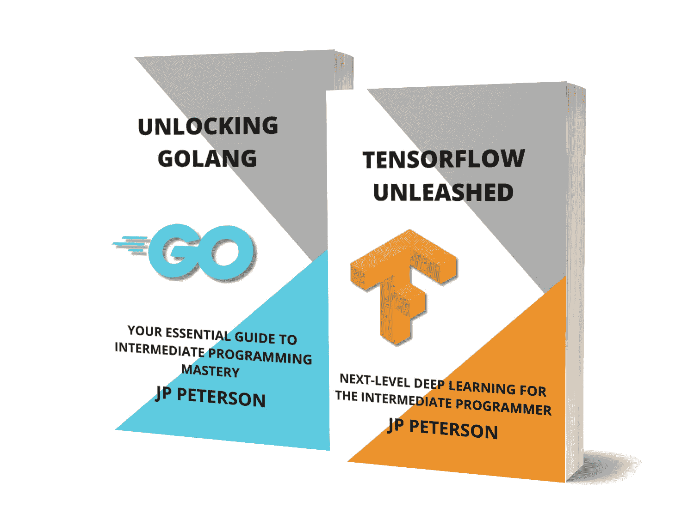

# TensorFlow 解锁与 Golang 解锁指南：面向中级程序员的进阶深度学习



## 引言

欢迎阅读 `TensorFlow Unleashed: Next-Level Deep Learning for the Intermediate Programmer`。在本章中，我们将探索 `TensorFlow` 的基础。在本章结束时，你将对 `TensorFlow` 是什么、它为什么至关重要以及如何开始有良好的理解。

## 介绍 TensorFlow

想象有一个能够赋能你构建、训练和部署机器学习模型的工具箱。`TensorFlow` 由 Google Brain 团队开发，是一个开源框架。其核心是 `TensorFlow` 将计算表示为图。这些图由节点（代表操作）和边（表示流在这些操作之间流动的数据）组成。这种基于图的方法提供了灵活性，并允许在 CPU 和 GPU 等各种设备上高效分布式计算。

## 张量（Tensors）：构建块

`TensorFlow` 的核心是张量。你可以将张量看作是可以存储数值的多维数组。它们有各种形状，从标量（0 维张量）到矩阵和高维数组。张量作为操作的输入和输出。

让我们深入一个简单的例子。考虑一张灰度图像。你可以将此图像表示为 2D 张量，其中每个元素对应于像素的强度。如果图像是 28x28 像素，则张量的形状将为 (28, 28)。

现在，想象你正在处理一组图像，每个图像都由一个 2D 张量表示。你可以堆叠这些张量来创建一个 3D 张量，其中第一个维度表示图像的数量，第二和第三维度分别表示图像的高度和宽度，第四个维度（如果适用）表示颜色通道的数量。

## 创建 TensorFlow 程序

要开始使用 `TensorFlow`，你需要使用以下命令安装该库：

```bash
pip install tensorflow
```

一旦安装了 `TensorFlow`，你就可以创建你的第一个程序了。让我们写一个简单的 `TensorFlow` 程序将两个数字相加：

```python
import tensorflow as tf

## 创建两个常量张量
a = tf.constant(5)
b = tf.constant(3)

## 相加张量
sum_tensor = tf.add(a, b)

## 启动 TensorFlow 会话
with tf.compat.v1.Session() as session:
    result = session.run(sum_tensor)
    print("Sum:", result)
```

在这个程序中，我们首先导入 `TensorFlow` 库。然后，使用 `tf.constant` 函数定义两个常量张量。我们使用 `tf.add` 函数相加这些张量。最后，我们使用 `tf.compat.v1.Session()` 启动 TensorFlow 会话并运行计算获取结果。

## 自动微分：训练神经网络

`TensorFlow` 的功能之一是执行自动微分的能力。这对于使用梯度下降等优化算法训练神经网络至关重要。

在神经网络中，你拥有权重，它们决定了每个输入对最终预测的影响。在训练过程中，模型会调整这些权重，以最小化预测值与实际目标值之间的差异。这种调整由梯度引导，梯度指示了为了提高模型性能，每个权重应该改变多大程度。

`TensorFlow` 的自动微分机制能够高效地计算这些梯度。你定义模型的操作，`TensorFlow` 会自动计算每个操作相对于模型输入和参数的梯度。这些信息被用于更新权重，并随着时间的推移提高模型的准确性。

## 结论

在本章中，我们为你的 `TensorFlow` 之旅奠定了基础。你已经学习了 `TensorFlow` 的基本概念，包括张量和计算图。你还了解了如何创建一个简单的 `TensorFlow` 程序，以及自动微分如何在训练神经网络中发挥至关重要的作用。

当你深入探索深度学习和 `TensorFlow` 的世界时，请记住，这一章只是一个开始。你在这里获得的知识将成为我们在后续章节中探索更高级技术和应用的基石。所以，请系好带，准备好以前未有的方式释放 `TensorFlow` 的力量。

在下一章中，我们将在此基础的基础上，迈出构建和训练神经网络的第一步。准备好让你的模型活起来，见证深度学习的魔法。

# 第 2 章：构建并训练你的第一个神经网络

欢迎来到《TensorFlow Released：面向中级程序员的进阶深度学习》的第二章。在本章中，我们将深入进入神经网络的精彩世界。我们将探索使用 `TensorFlow` 构建和训练你的第一个神经网络的过程。在本章结束时，你不仅将理解神经网络的组件，还能实现一个并训练它来对真实数据进行预测。

## 理解神经网络

神经网络的核心灵感源于人类大脑的结构和功能。它由相互连接的节点（称为神经元）组成，并组织成层。每个神经元接收输入、处理并传递到下一层。这种分层架构使得神经网络能够学习数据中复杂的模式和关系。

在神经网络中，输入层接收原始数据。隐藏层使用可学习参数（权重和偏置）处理这些数据，输出层生成预测或分类。神经网络的设计旨在通过名为“训练”的过程自动学习这些参数，即通过调整权重来最小化预测值与实际目标值之间的差异。

## 使用 TensorFlow 构建神经网络

让我们开始使用 `TensorFlow` 构建我们的第一个神经网络。我们将从一个简单的示例开始：对 MNIST 数据集中的手写数字进行分类。

```python
import tensorflow as tf

from tensorflow.keras import layers, models

## 加载并预处理 MNIST 数据集
mnist = tf.keras.datasets.mnist

(train_images, train_labels), (test_images, test_labels) = mnist.load_data()

train_images, test_images = train_images / 255.0, test_images / 255.0

## 构建神经网络架构
model = models.Sequential([
    layers.Flatten(input_shape=(28, 28)),
    layers.Dense(128, activation='relu'),
    layers.Dropout(0.2),
    layers.Dense(10, activation='softmax')
])

## 编译模型
model.compile(optimizer='adam',
              loss='sparse_categorical_crossentropy',
              metrics=['accuracy'])

## 训练模型
model.fit(train_images, train_labels, epochs=5)
```

### 训练与验证

在训练过程中，监控模型在未见过的数据上的性能是至关重要的。这有助于我们检测过拟合。我们可以修改训练循环以包含验证数据：

```python
history = model.fit(train_images, train_labels, epochs=10, validation_data=(test_images, test_labels))
```

### 进行预测

一旦模型训练完成，我们就可以用它对新数据进行预测：

```python
import numpy as np

predictions = model.predict(test_images)
predicted_labels = np.argmax(predictions, axis=1)
```

### 结论

恭喜！你成功使用 `TensorFlow` 构建并训练了你的第一个神经网络。在本章中，你学习了神经网络架构的基础知识、如何编译和训练模型，以及训练过程中验证的重要性。你还学习了如何使用训练好的模型进行预测。

当你继续你的《TensorFlow Released》旅程时，请记住神经网络有各种形状和大小，每种都适用于不同的任务。你在本章中获得的技能将为在未来的章节中探索更高级的架构和技术奠基础。

# 第 3 章：高级激活函数与优化器

欢迎来到《TensorFlow Released：面向中级程序员的进阶深度学习》的第三章。在本章中，我们将探索高级激活函数和优化器的世界。这些组件对于增强神经网络的能力至关重要。在本章结束时，你不仅将理解激活函数和优化器的作用，还能使用 `TensorFlow` 实现并尝试不同的选项。

## 激活函数：关键要素

激活函数为神经网络引入了非线性因子，使其能够学习复杂的模式。虽然 sigmoid 和 tanh 等基础函数在历史上被广泛使用，但现代架构通常采用能够缓解某些挑战的高级激活函数。

其中一种函数是修正线性单元（ReLU）。它将负值替换为零，并保持正值不变。ReLU 加速了训练过程收敛并缓解了梯度消失问题。然而，它也有局限性，例如“死亡 ReLU”问题，即神经元在训练过程中可能会死。

```python
## ReLU 激活
def relu(x):
    return max(0, x)
```

为了解决“ReLU 死亡”问题，引入了 `Leaky ReLU` 和 `Parametric ReLU` 等变体。`Leaky ReLU` 为负值允许一个较小的梯度，防止神经元死亡。`Parametric ReLU` 则更进一步，使斜率变得可学习。

```python
## Leaky ReLU activation
def leaky_relu(x, alpha=0.01):
    return x if x > 0 else alpha * x
```

## 优化器：导航优化区域

优化器在训练神经网络过程中起着至关重要的作用，它们通过调整参数来最小化损失函数。不同的优化器为这一优化过程提供了不同的策略。

随机梯度下降（`SGD`）优化器根据损失函数对权重的梯度来更新权重。然而，它的收敛速度可能较。动量优化（`SGD` 的变体）引入了动量项来加速收敛，特别是在梯度平坦的区域。

```python
## Momentum optimizer
def momentum_optimizer(weight, gradient, velocity, learning_rate, momentum):
    velocity = momentum * velocity - learning_rate * gradient
    weight += velocity
    return weight, velocity
```

Adam（`Adaptive Moment Estimation`）优化器结合了动量和 `RMSProp` 的优点。它能够自适应不同参数的学习率，使其适用于广泛的任务。

```python
## Adam optimizer
def adam_optimizer(weight, gradient, m, v, t, learning_rate, beta1, beta2, epsilon):
    m = beta1 * m + (1 - beta1) * gradient
    v = beta2 * v + (1 - beta2) * gradient ** 2
    m_hat = m / (1 - beta1 ** t)
    v_hat = v / (1 - beta2 ** t)
    weight -= learning_rate * m_hat / (np.sqrt(v_hat) + epsilon)
    return weight, m, v
```

## 在 TensorFlow 中实现

让我们使用 `TensorFlow` 实现高级的激活函数和优化器。我们将构建一个用于图像分类的神经网络，并尝试不同的激活函数和优化器。

```python
import tensorflow as tf
from tensorflow.keras import layers, models

## 加载并预处理数据集
(x_train, y_train), (x_test, y_test) = tf.keras.datasets.cifar10.load_data()
x_train, x_test = x_train / 255.0, x_test / 255.0

## 构建神经网络
model = models.Sequential([
    layers.Flatten(input_shape=(32, 32, 3)),
    layers.Dense(128),
    layers.LeakyReLU(alpha=0.01),
    layers.Dense(64),
    layers.ReLU(),
    layers.Dense(10, activation='softmax')
])

## 选择一个优化器
optimizer = tf.keras.optimizers.Adam(learning_rate=0.001)

## 编译模型
model.compile(optimizer=optimizer,
              loss='sparse_categorical_crossentropy',
              metrics=['accuracy'])

## 训练模型
history = model.fit(x_train, y_train, epochs=10,
                    validation_data=(x_test, y_test))
```

在这个示例中，我们使用 `model.compile` 配合 `optimizer` 和 `loss` 函数。`model.fit` 方法用于在 `x_train` 和 `y_train` 上训练网络。

数据增强涉及对训练图像应用随机变换，例如旋转、翻转和缩放。这增加了训练数据的多样性，从而产生更具健性的模型。

```python
## Data augmentation
data_augmentation = tf.keras.Sequential([
    layers.experimental.preprocessing.RandomFlip("horizontal"),
    layers.experimental.preprocessing.RandomRotation(0.1),
    layers.experimental.preprocessing.RandomZoom(0.1)
])
augmented_images = data_augmentation(x_train)
```

Dropout 是一种正则化技术，它在训练期间随机激活部分神经元，防止模型过度依赖某些特定的神经元。

```python
## Adding dropout layers
model = models.Sequential([
    # ... previous layers ...
    layers.Dropout(0.5),
    layers.Dense(10, activation='softmax')
])
```

## 使用 CNN 进行迁移学习

迁移学习是一种强大的技术，它在新的任务上对预训练模型进行微调。例如，`VGG16`、`ResNet` 和 `Inception` 等模型已经在 `ImageNet` 等海量数据集上经过了训练。我们可以利用它们学习到的特征来实现我们的特定任务。

```python
from tensorflow.keras.applications import VGG16
base_model = VGG16(weights='imagenet', include_top=False, input_shape=(224, 224, 3))
## Add custom classification layers
model = models.Sequential([
    base_model,
    layers.Flatten(),
    layers.Dense(256, activation='relu'),
    layers.Dense(10, activation='softmax')
])
```

## 结论

恭喜！你已经开启了卷积神经网络之旅。在本章中，你学习了 CNN 的架构、卷积层和池化层的作用，以及如何使用 `TensorFlow` 构建和训练 CNN。你还探索了数据增强、Dropout 和迁移学习等技术，这些技术能够增强 CNN 的性能和泛化能力。

当你继续探索《TensorFlow Unleashed》时，请记住 CNN 是现代计算机视觉和图像分析的基石。你在本章中获得的技能将使你能够应对各种图像相关任务，并为你进入更高级主题的旅程铺平道路。

在下一章中，我们将深入探讨循环神经网络（RNNs），它们在序列建模任务中表现出色。准备好释放深度学习在理解和生成序列方面的潜力吧！

# 第 5 章：循环神经网络：序列建模

欢迎来到《TensorFlow Unleashed：面向中间程序员的进阶深度学习》第 5 章。在本章中，我们将深入探索循环神经网络（RNNs）世界，这是一类为序列建模任务设计的模型。在本章结束，你将理解 RNN 的机制，知道如何使用 `TensorFlow` 构建和训练它们，并准备好处理涉及顺序数据的任务。

## 理解循环神经网络

序列存在于许多领域，例如自然语言、时间序列和音频。虽然传统的神经网络是为固定大小的输入设计的，但 RNN 可以处理变长度的序列。它们通过维护一个内部状态来实现，该状态会随着网络处理序列中的每个元素而演变。这种内部状态捕获了上下文，使得 RNN 在语言建模、机器翻译和语音识别等任务中变得强大。

## 时间步和隐藏状态的作用

在 RNN 中，每个时间步对应于序列中的一个元素。在每个时间步，网络接收输入并更新其隐藏状态。该隐藏状态保留了有关之前步骤的信息，使网络能够考虑上下文。

数学上，时间步 `t` 处的隐藏状态计算如下：

`h_t = f(h_{t-1}, x_t)`

在这里，`f` 代表 RNN 的激活函数，`h_{t-1}` 是上一个时间步的隐藏状态，`x_t` 是当前输入。

## 构建序列建模的 RNN


让我们使用 `TensorFlow` 构建用于序列建模的 RNN。我们将使用 `imdb` 数据集，标记为正面或负面的电影评论。

```python
import tensorflow as tf
from tensorflow.keras import layers, models
from tensorflow.keras.datasets import imdb
from tensorflow.keras.preprocessing import sequence

## 加载并处理 IMDb 数据
(x_train, y_train), (x_test, y_test) = imdb.load_data(num_words=10000)
x_train = sequence.pad_sequences(x_train, maxlen=200)
x_test = sequence.pad_sequences(x_test, maxlen=200)

## 构建 RNN 架构
model = models.Sequential([
    layers.Embedding(10000, 128),
    layers.SimpleRNN(64),
    layers.Dense(1, activation='sigmoid')
])

## 编译模型
model.compile(optimizer='adam',
              loss='binary_crossentropy',
              metrics=['accuracy'])

## 训练模型
model.fit(x_train, y_train, epochs=5, batch_size=128, validation_data=(x_test, y_test))
```

在本示例中，我们构建了一个用于情感分析的 RNN 架构。我们使用嵌入层将单词索引转换为稠密向量。`SimpleRNN` 层处理序列并捕捉上下文。模型使用 `Adam` 优化器编译并在 `imdb` 数据集上训练。

### 长短期记忆（LSTM）

虽然 `SimpleRNN` 能够很好地捕捉短期依赖，但它们处理长期依赖时表现不从心。引入长短期记忆（LSTM）网络是为了解决这一局限性。LSTM 具有更复杂的门控机制，允许它们在长序列中保留信息。

```python
model = models.Sequential([
    layers.Embedding(10000, 128),
    layers.LSTM(64),
    layers.Dense(1, activation='sigmoid')
])
```

### 门控循环单元（GRU）

门控循环单元（GRU）是 RNN 的另一种变体，在 `SimpleRNN` 和 `LSTM` 之间取得了平衡。它们的参数比 LSTM 少，并且能够比 `SimpleRNN` 捕捉更长的依赖关系。

```python
model = models.Sequential([
    layers.Embedding(10000, 128),
    layers.GRU(64),
    layers.Dense(1, activation='sigmoid')
])
```

### 双向 RNN

传统的 RNN 从左到右处理序列。双向 RNN 从两个方向处理序列，同时捕捉过去和未来元素的上下文。这对于需要过去和未来上下文的任务特别有用。

```python
model = models.Sequential([
    layers.Embedding(10000, 128),
    layers.Bidirectional(layers.LSTM(64)),
    layers.Dense(1, activation='sigmoid')
])
```

## 第 6 章：生成对抗网络（GANs）

欢迎来到《TensorFlow Unleashed：中级程序员的进阶深度学习》第 5 章。在本章中，我们将深入探索循环神经网络（RNN）的迷人世界，这是一类专为序列建模任务设计的模型。在本章结束时，你将理解 RNN 的机制，学会如何使用 `TensorFlow` 构建和训练它们，并准备好应对涉及序列数据的任务。

### 理解循环神经网络

序列广泛存在于各个领域，例如自然语言、时间序列和音频。传统的神经网络为固定大小的输入设计的，而 RNN 能够处理变长度的序列。它们通过维护一个内部状态来实现这一点，该状态会随着网络处理序列中的每个元素而不断演变。这种内部状态捕捉了上下文，使得 RNN 在语言建模、机器翻译和语音识别等任务中表现强强大。

### 时间步和隐藏状态的作用

在 RNN 中，每个时间步对应于序列中的一个元素。在每个时间步，网络接收输入并更新其隐藏状态。该隐藏状态保留了来自之前步骤的信息，使网络能够考虑上下文。

从数学角度来看，时间步 `t` 的隐藏状态计算公式为：

`h_t = f(h_{t-1}, x_t)`

这里，`f` 代表 RNN 的激活函数，`h_{t-1}` 是上一个时间步的隐藏状态，`x_t` 是时间步 `t` 的输入。

### 构建用于序列建模的 RNN

让我们深入使用 `TensorFlow` 构建一个用于序列建模的 RNN。我们将使用 IMDb 数据集，这是一个标记为正面或负面情感的电影评论集合。

```python
import tensorflow as tf

from tensorflow.keras import layers, models
from tensorflow.keras.datasets import imdb
from tensorflow.keras.preprocessing import sequence

## 加载并预处理 IMDb 数据集
(x_train, y_train), (x_test, y_test) = imdb.load_data(num_words=10000)
x_train = sequence.pad_sequences(x_train, maxlen=200)
x_test = sequence.pad_sequences(x_test, maxlen=200)

## 构建 RNN 架构
model = models.Sequential([
    layers.Embedding(10000, 128),
    layers.SimpleRNN(64),
    layers.Dense(1, activation='sigmoid')
])

## 编译模型
model.compile(optimizer='adam',
    loss='binary_crossentropy',
    metrics=['accuracy'])

## 模型
model.fit(x_train, y_train, epochs=5, batch_size=128, validation_data=(x_test, y_test))
```

在这个示例中，我们构建了一个用于情感分析的 RNN 架构。我们使用嵌入层将单词索引转换为稠密向量。`SimpleRNN` 层处理序列并捕捉上下文。模型使用 `Adam` 优化器编译并在 IMDb 数据集上进行训练。

### 长短期记忆（LSTM）

虽然 `SimpleRNN` 能够很好地捕捉短期依赖关系，但它们在处理长期依赖关系时表现不从心。长短期记忆（LSTM）网络的引入是为了解决这一局限性。LSTM 具有更复杂的门控机制。

```python
model = models.Sequential([
    layers.Embedding(10000, 128),
    layers.LSTM(64),
    layers.Dense(1, activation='sigmoid')
])
```

### 门控循环单元（GRU）

门控循环单元（GRU）是 RNN 的另一种变体。它们比 LSTM 更简单，但能够捕捉依赖关系。

```python
model = models.Sequential([
    layers.Embedding(10000, 128),
    layers.GRU(64),
    layers.Dense(1, activation='sigmoid')
])
```

### 双向 RNN

传统的 RNN 按一个方向处理序列。双向 RNN 则同时处理过去和未来的上下文。

```python
model = models.Sequential([
    layers.Embedding(10000, 128),
    layers.Bidirectional(layers.LSTM(64)),
    layers.Dense(1, activation='sigmoid')
])
```

### 总结

恭喜！你已经深入了循环神经网络的世界。在本章中，你探索了 `SimpleRNN`、`LSTM`、`GRU` 和双向层。当你继续《TensorFlow Unleashed》的之旅时，请记住 RNN 是处理序列数据的基石。

---

欢迎来到《TensorFlow Unleashed：中级程序员的进阶深度学习》第 6 章。在本章中，我们将探索生成对抗网络（GANs）的迷人领域，这是一种用于生成数据的框架。在本章结束时，你将理解 GAN 的原理，学会如何使用 `TensorFlow` 构建和训练它们，并准备好应对涉及创造性的任务。

### 理解生成对抗网络（GANs）

生成对抗网络（GANs）是一对正在进行创意对决的神经网络。其中一个网络是生成器，负责创作合成数据；另一个网络是判别器，负责评估生成的数据是真是伪。生成器的目标是产生与真实样本无异的数据，而判别器则力争更擅长识破伪品。这种对抗设置导致了动态的竞争，从而产生了卓越的结果。

### 使用 `TensorFlow` 构建 GAN

让我们深入使用 `TensorFlow` 构建一个 GAN。我们将创建一个简单的 GAN 来生成类似于 MNIST 数据集的手写数字。

```python
import tensorflow as tf
from tensorflow.keras import layers, models

## 生成器模型
generator = models.Sequential([
    layers.Dense(128, input_shape=(100,), activation='relu'),
    layers.Dense(784, activation='sigmoid'),
    layers.Reshape((28, 28))
])

## 判别器模型
discriminator = models.Sequential([
    layers.Flatten(input_shape=(28, 28)),
    layers.Dense(128, activation='relu'),
    layers.Dense(1, activation='sigmoid')
])

## 组合 GAN 模型
gan = models.Sequential([generator, discriminator])

## 编译判别器
discriminator.compile(optimizer='adam',
    loss='binary_crossentropy',
    metrics=['accuracy'])

## 编译 GAN
gan.compile(optimizer='adam', loss='binary_crossentropy')
```

GAN 的训练过程涉及生成器和判别器之间的交替更新。我们首先在真实数据和伪数据上训练判别器。然后，我们训练组合的 GAN 模型以提高生成器创建真实数据的能力。

```python
import numpy as np

## Training loop
for epoch in range(epochs):
    # 训练判别器
    real_images = np.random.choice(len(train_images), batch_size)
    real_images = train_images[real_images]
    fake_images = generator.predict(np.random.randn(batch_size, 100))
    real_labels = np.ones((batch_size, 1))
    fake_labels = np.zeros((batch_size, 1))
    d_loss_real = discriminator.train_on_batch(real_images, real_labels)
    d_loss_fake = discriminator.train_on_batch(fake_images, fake_labels)

    # 训练 GAN
    noise = np.random.randn(batch_size, 100)
    gan_labels = np.ones((batch_size, 1))
    g_loss = gan.train_on_batch(noise, gan_labels)
```

在此段代码中，我们实现了 GAN 的训练循环。我们为判别器采样了真实图像、伪图像以及相应的标签。然后，我们在真实数据和伪数据上训练判别器。随后，我们生成噪声，使用生成器创建伪图像，并训练 GAN 以生成更具说服的据。

### 挑战与增强

训练 GAN 可能会面临挑战，因为存在如模式崩溃（生成器只产生有限种类的数据）和梯度消失等问题。目前已经引入了如 Wasserstein GAN（WGANs）和深度卷积 GAN（DCGANs）等技术来缓解这些挑战。

### 结论

恭喜你！你已经深入探索了生成对抗网络（GANs）的世界。在本章中，你深入理解了 GAN 的运行机制、生成器和判别器的角色，以及如何使用 `TensorFlow` 构建和训练 GAN。你还触及了 GAN 训练中面临的挑战，并探索了提高其稳定性能的潜在增强方法。

当你继续探索《TensorFlow Unleashed》时，请记住 GAN 是一个具有变革性的框架，广泛应用于图像合成、风格迁移等领域。你在本章中获得的技能将使你能够释放创造力，并使用 AI 生成真实数据。

在下一章中，我们将深入研究迁移学习，这是一种强大的技术，允许你利用预训练模型来处理新任务。准备好解锁现有知识在新型应用中的潜力吧！

欢迎来到《TensorFlow Unleashed：面向中级程序员的进阶深度学习》第 7 章。在本章中，我们将深入学习迁移学习和模型微调这两项强大技术。这种方法允许我们利用预训练模型并将其适配到新任务中，从而节省时间和资源。在本章结束时，你将理解迁移学习和微调的概念，知道如何使用 `TensorFlow` 实现它们，并准备好为特定任务优化你的模型。

## 深入理解迁移学习

迁移学习是将预训练的神经网络作为新任务的起点的实践。我们不是从零开始训练模型（这需要大量的数据和计算资源），而是使用从另一个不同但相关的任务中学习到的权重来初始化模型。当你针对目标任务的数据有限时，这种方法别别有用。

### 迁移学习剖析

在迁移学习中，预训练模型通常由两部分组成：特征提取器和分类器。特征提取器通常由卷积层组成，学习从原始数据中提取有用特征。分类器则解释这些特征并做出预测。

在应用迁移学习时，我们冻结特征提取器，并用一个为目标任务定制的新分类器替换它。这允许我们在训练特定任务的分类器的同时，从预训练的特征中获益。

### 微调：适配预训练模型

微调是在新的特定任务数据上对预训练模型进行进一步训练的过程。在微调期间，我们会调整特征提取器和新分类器的权重。然而，我们通常会对特征提取器应用较小的学习率，以确保保留了在初始训练期间学到的有用特征。

### 实现迁移学习与微调

让我们深入学习使用 `TensorFlow` 实现迁移学习和微调。我们将使用在 ImageNet 数据集上预训练的 `VGG16` 模型，并将其适配于新的分类任务。

```python
import tensorflow as tf
from tensorflow.keras.applications import VGG16
from tensorflow.keras import layers, models

## 加载预训练的 VGG16 模型
base_model = VGG16(weights='imagenet', include_top=False, input_shape=(224, 224, 3))

## 冻结卷积层
for layer in base_model.layers:
    layer.trainable = False

## 添加自定义分类层
model = models.Sequential([
    base_model,
    layers.Flatten(),
    layers.Dense(256, activation='relu'),
    layers.Dense(10, activation='softmax')
])

## 编译模型
model.compile(optimizer='adam',
             loss='sparse_categorical_crossentropy',
             metrics=['accuracy'])
```

在这个示例中，我们加载了不带顶部分类层的预训练 `VGG16` 模型。我们通过将 `trainable` 设置为 `False` 来冻结卷积层。然后我们添加了自定义分类层并编译模型。

### 使用不同学习率进行微调

在微调期间，我们通常对特征提取器和新层应用不同的学习率。这确保了在保留已有特征的同时，让分类器适应新任务。

```python
## 为微调编译模型
model.compile(optimizer=tf.keras.optimizers.Adam(learning_rate=0.0001),
             loss='sparse_categorical_crossentropy',
             metrics=['accuracy'])
```

在此段代码中，我们使用较低的学习率为微调编译模型。


### 提高泛化能力的数据增强

在微调期间，数据增强对于防止过拟合变得更加重要，特别是当数据集较小时。通过对训练数据进行随机变换，我们增加了其多样性，并提升了模型对未知数据的泛化能力。

```python
from tensorflow.keras.preprocessing.image import ImageDataGenerator

## 应用数据增强
train_datagen = ImageDataGenerator(
    rescale=1.0 / 255,
    rotation_range=20,
    width_shift_range=0.2,
    height_shift_range=0.2,
    shear_range=0.2,
    zoom_range=0.2,
    horizontal_flip=True,
    fill_mode='nearest')

train_generator = train_datagen.flow_from_directory(
    train_dir,
    target_size=(224, 224),
    batch_size=batch_size,
    class_mode='sparse')
```

### 结论

恭喜你！你已经探索了迁移学习和模型微调的概念。在本章中，你学习了如何利用预训练模型处理新任务，如何通过微调对其进行适配，并针对特定目标进行优化。你还了解了在微调期间进行数据增强以防止过拟的重要性。

当你继续你的《TensorFlow Unleashed》之旅时，请记住，迁移学习和微调是高效构建强大模型的关键技术，即使在数据有限的情况下也是如此。

欢迎阅读《TensorFlow Unleashed：面向中级编程者的高级深度学习》第 8 章。在本章中，我们将深入 TensorFlow 探索自然语言处理（`NLP`）这一迷人的领域。`NLP` 使得机器能够理解、解释和生成人类语言，从而为广泛的应用开启大门。在本章结束时，你将理解 `NLP` 的基础知识，学习如何使用 TensorFlow 构建 `NLP` 模型，并准备好处理文本数据。

### 了解自然语言处理

自然语言处理，或称为 `NLP`，涉及计算机与人类语言之间的交互。它涵盖了文本分类、情感分析、机器翻译和文本生成等任务。`NLP` 模型的目标是从文本中提取有意义的见解，使机器能够理解并响应人类语言。

### 将文本表示为数字

在机器学习模型中使用文本之前，我们需要将其转换为数值数据。一种常用的方法是分词（tokenization），即将句子拆分解为单词或子词单元。每个标记（token）随后被映射到一个唯一的整数，从而形成文本的数值表示。

例如，句子“The cat sat on the mat” 可能会被分词为 `[1, 2, 3, 4, 5, 6]`，其中每个数字对应句子中的一个单词。

### 使用 TensorFlow 构建 NLP 模型

让我们学习使用 TensorFlow 构建一个 `NLP` 模型。我们将创建一个情感分析模型，用于预测给定的电影评论是正面的还是负面的。

```python
import tensorflow as tf
from tensorflow.keras.preprocessing.text import Tokenizer
from tensorflow.keras.preprocessing.sequence import pad_sequences
from tensorflow.keras import layers, models

## 示例电影评论
reviews = ["This movie was fantastic!", "I didn't like the acting.", "The plot was confusing but the visuals were great."]

## 创建分词器并拟合评论
tokenizer = Tokenizer(num_words=10000, oov_token='<OOV>')
tokenizer.fit_on_texts(reviews)

## 将文本转换为整数序列
sequences = tokenizer.texts_to_sequences(reviews)

## 填充序列以保持输入长度一致
padded_sequences = pad_sequences(sequences, maxlen=10, padding='post', truncating='post')

## 构建模型
model = models.Sequential([
layers.Embedding(input_dim=10000, output_dim=16, input_length=10),
layers.Flatten(),
layers.Dense(16, activation='relu'),
layers.Dense(1, activation='sigmoid')
])

## 编译模型
model.compile(optimizer='adam',
loss='binary_crossentropy',
metrics=['accuracy'])
```

在这个示例中，我们对电影评论进行分词并将其转换为整数序列。我们对序列进行了填充，以确保模型输入长度的一致。`NLP` 模型由一个嵌入层（embedding layer），它负责学习单词的向量表示，随后是用于分类的全连接层（dense layers）。

### 用于上下文理解的词嵌入

词嵌入是单词的稠密向量表示，能够捕捉语义关系。嵌入使模型能够更细致地理解单词的上下文和含义。流行的词嵌入方法包括 `Word2Vec`、`GloVe` 和 `fastText`。

```python
## 使用预训练的 Word2Vec 嵌入
embedding_matrix = load_word2vec_embeddings()
embedding_layer = layers.Embedding(input_dim=10000, output_dim=300, weights=[embedding_matrix], input_length=10, trainable=False)
```

在此段代码中，我们加载了预训练的 `Word2Vec` 嵌入并将它们使用在模型的嵌入层中。

### 用于序列的循环神经网络（RNN）

对于涉及序列数据（如文本）的任务，循环神经网络（`RNN`）是自然选择。`RNN` 拥有内部状态，该状态会在处理序列中的每个标记时不断演变。长短期记忆（`LSTM`）和门控循环单元（`GRU`）是解决梯度消失问题的流行 `RNN` 变体。

```python
model = models.Sequential([
layers.Embedding(input_dim=10000, output_dim=16, input_length=50),
layers.LSTM(64, return_sequences=True),
layers.GlobalMaxPooling1D(),
layers.Dense(1, activation='sigmoid')
])
```

在这个示例中，我们使用 `LSTM` 层来处理序列，并使用全局最大池化层来捕捉最相关的特征。

### NLP 的迁移学习

迁移学习在 `NLP` 领域同样非常有价值。`BERT`、`GPT-2` 和 `T5` 等模型已经在海量文本语料库上进行了预训练，并可以针对特定任务进行微调。

```python
from transformers import TFBertForSequenceClassification, BertTokenizer

## 加载预训练的 BERT 模型和分词器
model = TFBertForSequenceClassification.from_pretrained('bert-base-uncased')
tokenizer = BertTokenizer.from_pretrained('bert-base-uncased')

## 文本分词并编码
inputs = tokenizer("This is a positive review.", return_tensors='tf', padding=True, truncation=True)

## 获取预测
predictions = model(inputs).logits
```

在此段代码中，我们使用 Hugging Face Transformers 库加载了预训练的 `BERT` 模型和分词器。我们使用分词器对文本进行编码并从 `BERT` 模型获取预测结果。

### 总结

恭喜你！你已经探索了自然语言处理的世界。在本章中，你学习了 `NLP` 模型是如何运行的、如何将文本表示为数值数据以及如何构建 `NLP` 模型。

```python
rewards = np.array([-1, -1, -1, -1, 0, -1, -1, -1, -1, 10, -1, -1, -1, -1, -1, -1, -1, -1, -1, -1, -1, -1, -1, -1, -1, -1])
```

## 随机初始化 Q 值

`Q = np.random.rand(num_states, num_actions)`

# Q-learning 算法

`alpha = 0.1`

`gamma = 0.9`

`num_episodes = 1000`

```python
for episode in range(num_episodes):
    state = np.random.randint(num_states)
    while state != 9:  # 目标状态
        action = np.argmax(Q[state, :])
        next_state = np.random.choice(np.arange(num_states), p=[0.25, 0.25, 0.25, 0.25])
        Q[state, action] = Q[state, action] + alpha * (rewards[next_state] + gamma * np.max(Q[next_state, :]) - Q[state, action])
        state = next_state
```

在这个示例中，我们定义了一个带有奖励和障碍物的简单网格世界环境。我们的代理应用 `Q-learning` 算法来学习到达目标状态的最优策略。`Q` 值根据奖励和估计的未来奖励迭代更新。

### 使用神经网络进行深度强化学习

虽然像 `Q-learning` 等简单算法对于小规模问题有效，但深度强化学习（`DRL`）利用神经网络来处理更复杂的任务。深度 `Q` 网络（`DQNNs`）是一种流行的 `DRL` 方法，它使用神经网络来估计 `Q` 值。

```python
import tensorflow as tf
from tensorflow.keras import layers, models

## 定义一个 DQN 模型
model = models.Sequential([
    layers.Dense(24, input_shape=(num_states,), activation='relu'),
    layers.Dense(24, activation='relu'),
    layers.Dense(num_actions)
])

## 编译模型
model.compile(optimizer='adam', loss='mean_squared_error')
```

在这段代码中，我们使用带有两个隐藏层的神经网络定义了一个 `DQN` 模型。模型的输出代表每个动作的 `Q` 值。

## 训练 DRL 代理

训练 `DRL` 代理涉及探索（exploration）与利用（exploitation）之间的平衡。在探索期间，代理尝试不同的动作以发现环境。在利用期间，代理使用其学习的策略来最大化奖励。

```python
epsilon = 0.1
num_episodes = 1000
gamma = 0.9
for episode in range(num_episodes):
    state = env.reset()
    done = False
    while not done:
        if np.random.rand() < epsilon:
            action = env.action_space.sample()
        else:
            action = np.argmax(model.predict(np.array([state])))
        next_state, reward, done, _ = env.step(action)
        target = reward + gamma * np.max(model.predict(np.array([next_state])))
        target_vector = model.predict(np.array([state]))[0]
        target_vector[action] = target
        model.fit(np.array([state]), np.array([target_vector]), verbose=0)
        state = next_state
```

在这个示例中，我们使用 `epsilon-greedy` 策略训练一个 `DRL` 代理。代理通过以 `\epsilon` 的概率采取随机动作进行探索，否则利用其学习的策略。

### 强化学习中的挑战与进展

强化学习面临着探索-利用权衡、高维状态空间和样本效率低下等挑战。诸如近端策略优化（`PPO`）、信任区域策略优化（`TRPO`）和 Actor-Critic 架构等进展解决了这些挑战并提升了强化学习的性能。

### 结论

恭喜你！你已经深入了强化学习的世界，通过试错来训练智能代理做出决策。在本章中，你学习了强化学习的组成部分、如何使用 `Q-learning` 等算法构建简单的强化学习代理，并进阶到使用神经网络的深度强化学习。你还接触了强化学习面临的挑战，并探索了克服这些挑战的技术。

当你继续探索《TensorFlow Unleashed》时，请记住强化学习赋予了代理在复杂环境中导航和脱颖而出的能力，使其适用于从机器人到游戏等等广泛应用。你在本章中获得的技能将使你能够设计和训练学习做出最优决策的智能代理。

欢迎来到《TensorFlow Unleashed：面向中间程序员的进阶深度学习》第 10 章。在本章中，我们将深入探索使用循环神经网络（`RNN`）进行时间序列预测的迷世界。时间序列数据无处不在，涵盖了金融市场、天气模式等。在本章结束时，你将掌握时间序列预测的基础，知道如何使用 TensorFlow 构建用于时间序列预测的 `RNN` 模型，并具备做出知预测的能力。

## 理解时间序列预测

时间序列数据由在特定时间间隔记录的顺序观测组成。时间序列预测涉及根据历史数据预测未来值。这在金融、医疗保健和能源等多个领域至关重要，因为准确的预测驱动着明智决策。

### 时间序列预测的挑战

时间序列数据通常表现出趋势、季节性和周期行为等模式。传统的统计方法如 `ARIMA`（自回归移动平均模型）是很有用的，但深度学习技术（尤其是 `RNN`）可以捕捉复杂的依赖关系。

### 构建时间序列 RNN 模型

让我们深入使用 TensorFlow 构建时间序列预测的 `RNN` 模型。我们将使用一个基于历史数据预测价格的示例。

```python
import tensorflow as tf
from tensorflow.keras import layers, models

## 加载并预处理时间序列数据
time_series = load_time_series_data()
train_data = time_series[:-100]
test_data = time_series[-100:]

## 准备序列和目标
X_train, y_train = create_sequences(train_data, sequence_length=10)
X_test, y_test = create_sequences(test_data, sequence_length=10)

## 构建 RNN 模型
model = models.Sequential([
    layers.SimpleRNN(64, activation='relu', input_shape=(10, 1)),
    layers.Dense(1)
])

## 编译模型
model.compile(optimizer='adam', loss='mean_squared_error')
```

在这个示例中，我们加载并预处理时间序列数据。我们创建了输入序列和目标。模型由一个 `SimpleRNN` 层和一个密集层组成。

### 训练与评估模型

训练用于时间序列预测的 `RNN` 需要输入序列并将预测值与实际目标进行比较。一旦完成，模型就可以对未见的序列进行预测。

```python
model.fit(X_train, y_train, epochs=10, batch_size=32, validation_data=(X_test, y_test))
predictions = model.predict(X_test)
```

在这段代码中，我们在训练集上训练 `RNN` 模型，并在测试集上评估其性能。然后获取预测结果。

### 处理长期依赖关系

`RNN` 因为梯度消失问题可能难以捕捉长期依赖关系。长短期记忆（`LSTM`）和门控循环单元（`GRU`）层通过引入控制信息流的门控机制来解决这个问题。

```python
model = models.Sequential([
    layers.LSTM(64, activation='relu', input_shape=(10, 1)),
    layers.Dense(1)
])
```

在代码片段中，我们用 `LSTM` 层替换了 `SimpleRNN` 层，以更好地捕捉时间序列数据中的长期依赖关系。

### 序列到序列模型


虽然 `RNN` 适用于预测时间序列中的下一个值，但它们也可以用于序列到序列任务，如机器翻译或天气预测。编码器-解码器架构（由处理输入序列的编码器和生成输出序列的解码器组成）被用于这些任务。

### 处理多变量时间序列

在某些情况下，时间序列数据涉及多个特征或变量。多变量时间序列预测涉及同时预测多个值。通过调整输入形状和网络架构，`RNN` 模型可以适应处理多变量数据。

### 结论

恭喜你！你已经深入了使用循环神经网络进行时间序列预测的领域。在本章中，你洞察了时间序列数据中准确预测的重要性、时间序列预测面临的挑战，以及 `RNN` 在预测中的应用。你还探索了处理长期依赖关系以及调整 `RNN` 以适应多变量时间序列的技术。

当你继续《TensorFlow 释放》（TensorFlow Unleashed）的旅程时，请记住时间序列预测是在各个领域做出明智决策的强大工具。你在本章中获得的技能将使你能够分析时间序列数据并构建预测模型，有助于更好地理解和规划。

## 第 11 章：可解释人工智能

欢迎来到《TensorFlow 释放：面向中级编程者的高级深度学习》的第 11 章。在本章中，我们将深入探讨可解释人工智能（XAI）这一关键课题，探索解释和理解复杂机器学习模型所做决策的方法。在本章结束时，你将理解模型可解释性的重要，学习使用 `TensorFlow` 实现该点的技术，并准备好构建透明且负责的 AI 系统。

### 模型可解释性的重要

随着机器学习模型变得越来越复杂，它们有时会像“黑箱”一样，做出的决策难以解释。在医疗、金融和法律等关键领域，理解模型为何得出某个特定决策对于信任、问责和避免偏见至关重要。这正是可解释人工智能（XAI）大显身场的地方。

### 模型解释性技术

让我们探索增强模型可解释性的技术。这些方法旨在提供复杂模型内部机制的见解，让我们理解它们是如何得出特定预测的。

#### 1. 特征重要性

特征重要性分析揭示了哪些特征或变量对模型决策的影响最大。排列特征重要性和 `SHAP`（Shapley 相加性解释）值等技术量化了每个特征的贡献。

#### 2. LIME（局部可解释模型无关解释）

`LIME` 为单个预测生成局部忠实于解释。它在预测周围创建一个更简单的模型，并观察特征值的变化如何影响输出。

#### 3. 集成梯度（Integrated Gradients）

集成梯度通过计算模型预测相对于输入特征的梯度在从基准到实际输入路径上的积分，将预测归因于输入特征。

### 使用 TensorFlow 构建可解释模型

让我们深入学习使用 `TensorFlow` 构建可解释模型。我们将处理一个假设的贷款审批模型，并使用 `SHAP` 值来理解模型的决策。

```python
import tensorflow as tf
from tensorflow.keras import layers, models
import shap

## 载入并预处理贷款审批数据
X, y = load_loan_data()
X_train, X_test, y_train, y_test = train_test_split(X, y, test_size=0.2, random_state=42)

## 构建一个简单的贷款审批模型
model = models.Sequential([
    layers.Dense(128, activation='relu', input_dim=X_train.shape[1]),
    layers.Dense(64, activation='relu'),
    layers.Dense(1, activation='sigmoid')
])

## 编译模型
model.compile(optimizer='adam', loss='binary_crossentropy', metrics=['accuracy'])

## 训练模型
model.fit(X_train, y_train, epochs=10, batch_size=32, validation_split=0.2)

## 初始化 SHAP 解释器
explainer = shap.Explainer(model)
## 计算 SHAP 值
shap_values = explainer(X_test)
```

### 使用 SHAP 值解释模型决策

现在，让我们使用 `SHAP` 值来解释模型决策。

```python
## 选择一个样本进行解释
sample = X_test[0:1]

## 使用瀑布图可视化 SHAP 值
shap.plots.waterfall(shap_values)
```

### 提高模型公平性与偏见检测

可解释人工智能对于检测和缓解模型中的偏见至关重要。通过分析不同组的特征贡献，我们可以识别差异。

### 结论

恭喜你！你已经深入了可解释人工智能（XAI）的领域，这对于构建透明且负责的机器学习模型起着至关重要的作用。在本章中，你认识到了模型可解释性的重要，探索了特征重要性、`LIME` 和集成梯度等技术，并学会了使用 `TensorFlow` 和 `SHAP` 值构建可解释模型。

## 第 12 章：部署 TensorFlow 模型

欢迎来到《TensorFlow 释放：面向中级编程者的高级深度学习》的第 12 章。在本章中，我们将探索将 `TensorFlow` 模型部署到生产环境的关键步骤。有效地部署模型可以确保你在构建和训练模型上的心血能够发挥作用。

### 模型部署的重要性

模型部署是模型开发与真实世界应用之间的桥梁。部署模型涉及让用户或可以从其预测中受益的系统可以使用。有效的部署可以将 AI 解决方案的影响最大化。

### 模型部署技术

部署 `TensorFlow` 模型涉及多种技术。让我们探索一些让模型运行的常用方法。

#### 1. 模型导出

在部署之前，模型需要导出为适用于部署平台的格式。`TensorFlow` 支持 `SavedModel` 和 `TensorFlow Lite` 等格式的模型导出。

```python
## 以 SavedModel 格式保存模型
model.save('my_model')
```

#### 2. TensorFlow Serving

`TensorFlow Serving` 是在生产环境中部署 TensorFlow 强大工具。它提供了一种灵活且扩展的方法，通过网络 API 提供服务。

```bash
## 安装 TensorFlow Serving
docker pull tensorflow/serving

## 部署模型
docker run -p 8501:8501 --name=tf_model_serving --mount type=bind,source=/path/to/my_model,target=/models/my_model -e MODEL_NAME=my_model -t tensorflow/serving
```

像 `Google Cloud AI Platform` 和 `AWS SageMaker` 这样的云平台为部署机器学习模型提供了托管服务。这些平台处理基础设施的置备、伸缩和监控。

```python
## Deploy a model on Google Cloud AI Platform
gcloud ai-platform models create my_model
gcloud ai-platform versions create v1 --model my_model --origin gs://my_bucket/my_model --runtime-version 2.6
```

在这个示例中，我们创建了一个名为 `my_model` 的模型并使用 `Google Cloud AI Platform` 将其部署。

### 监控与扩展

一旦部署，监控和扩展就至关重要。你需要跟踪模型性能、确保一致的运行时间并处理增加的流量。`Prometheus` 和 `Grafana` 等工具可以帮助监控模型的健康和性能。

### 持续集成与持续部署（CI/CD）

`CI/CD` 流水线使部署过程自动化，使其更高效、更可靠。`Jenkins`、`Travis CI` 和 `GitLab CI/CD` 等工具能够实现模型的自动化测试、验证和部署。

### A/B 测试与金丝发布

部署模型可能涉及实验和对不同版本的测试。A/B 测试和金丝发布允许你向用户逐步引入新模型版本，从而最大限地降低风险。

### 结

恭喜你！你已经到达《TensorFlow Unleashed》的最后一章。在本章中，你探索了将 `TensorFlow` 模型部署到生产环境的关键阶段。你理解了有效部署的重要性，学习了使用 `TensorFlow Serving` 导出和提供模型的技巧，并对云部署、监控、扩展和 `CI/CD` 流水线有了见解。

在你结束《TensorFlow Unleashed》的之旅时，请记住，部署模型标志着你在开发智能应用程序方面努力和创造力的顶点。你在本章中获得的技能将使你能够让 AI 解决方案变为现实并与世界分享。

## 第 13 章：使用 Datasets API 处理大型数据集

欢迎来到《TensorFlow Unleashed：面向中间程序员的高级深度学习》第 13 章。在本章中，我们将深入研究使用 `TensorFlow Datasets API` 处理大型数据集的核心技能。大型数据集是机器学习中的常见挑战，而有效地管理它们对于训练准确的模型至关重要。在本章结束时，你将理解高效数据处理的重要性，学习利用 `Datasets API` 处理大型数据集的技巧，并准备好地应对数据挑战。

### 大型数据集的挑战

随着机器学习模型复杂性的增加，对大型且多样化数据集的需求日益增长。高效处理大型数据集对于确保平稳训练、最小化内存消耗和优化训练过程变得关重要。

### 介绍 TensorFlow Datasets API

`TensorFlow Datasets API` 提供了一种精简且内存高效的方法来加载、预处理和管理大型数据集。它为各种数据集提供了一致的接口，让你能够专注于模型开发而不是数据管理。

### 使用 TensorFlow Datasets API 加载数据集

让我们深入学习使用 `TensorFlow Datasets API` 加载数据集。我们将以 `CIFAR-10` 数据集为例。

```python
import tensorflow_datasets as tfds

# Load CIFAR-10 dataset
(train_data, test_data), info = tfds.load('cifar10', split=['train', 'test'], with_info=True)

# Print dataset info
print(info)
```

在数示例中，我们使用 `tfds.load()` 函数加载 `CIFAR-10` 数据集。我们还通过 `with_info=True` 参数获取了有关数据集的信息。

### 使用 Datasets API 构建高效数据流水线

`Datasets API` 允许你使用批处理（batching）、洗牌（shuffling）和预取（prefetching）等功能构建高效的数据流水线。

```python
# Preprocess and prepare data pipeline
def preprocess_fn(data):
    image = tf.image.resize(data['image'], (224, 224))
    label = data['label']
    return image, label

train_data = train_data.map(preprocess_fn).shuffle(buffer_size=10000).batch(32).prefetch(tf.data.experimental.AUTOTUNE)
```

在代码段中，我们定义了一个预处理函数并使用它来预处理数据集。我们在训练数据流水线上应用洗牌、批处理和预取。

### 自定义数据集

你还可以使用 `Datasets API` 创建自定义数据集。这在处理专利或特殊数据时特别有用。

```python
# Create a custom dataset
custom_data = tf.data.Dataset.from_tensor_slices((features, labels)).shuffle(buffer_size=10000).batch(64)
```

在这个示例中，我们从现有的特征和标签创建了自定义数据集，并应用了洗牌和批处理。

### 处理内存溢出（OOM）情况

对于可能无法放入内存的大型数据集，`Datasets API` 支持以分块加载和处理数据。

```python
## Load data in chunks
def load_and_preprocess_chunk(chunk):
    return preprocess_chunk(chunk)

def preprocess_chunk(chunk):
    # Preprocess chunk data
    return preprocessed_chunk

chunks = tf.data.Dataset.from_generator(generator, output_signature=tf.TensorSpec(shape=(None,)))
preprocessed_chunks = chunks.map(load_and_preprocess_chunk)
```

在段落中，我们演示了如何通过生成器以较小块加载和预处理数据来处理大型数据集。

### 结

恭喜你！你探索了使用 `TensorFlow Datasets API` 处理大型数据集的关键技能。在本章中，你认识到了高效数据处理的重要性，学习了使用 `Datasets API` 加载数据集，构建了带有批处理和洗牌的数据流水线，甚至处理了内存溢出情况。

在你结束《TensorFlow Unleashed》的之旅时，请记住，有效的数据处理是成功机器学习项目的基石。你在本章中获得的技能将使你能够放心地管理和预处理大型数据集，确保你的模型在高质量数据上进行训练。

## 第 14 章：自定义层和损失函数

欢迎来到《TensorFlow Unleashed：面向中间程序员的高级深度学习》第 14 章。在本章中，我们将探索在 `TensorFlow` 中构建自定义层和损失函数的充满创意且强大的世界。自定义层和损失函数允许你根据项目的特定需求定制你的神经网络架构和训练过程。

### 自定义化的力量

虽然 `TensorFlow` 提供了许多内置层和损失函数，但在某些情况下，你可能需要开发自定义组件。自定义化提供了实验新架构和应对独特挑战的灵活性。

### 构建自定义层

让我们深入学习在 `TensorFlow` 中构建自定义层。我们将创建一个实现 `Swish` 激活函数的自定义层。

```python
import tensorflow as tf
from tensorflow.keras.layers import Layer

class SwishLayer(Layer):
    def __init__(self):
        super(SwishLayer, self).__init__()

    def call(self, inputs):
        return inputs * tf.sigmoid(inputs)

## Using the custom layer
model = tf.keras.Sequential([
    SwishLayer(),
    tf.keras.layers.Dense(64),
    tf.keras.layers.Dense(10, activation='softmax')
])
```

在这个示例中，我们定义了一个名为 `SwishLayer` 的自定义层，它实现了 `Swish` 激活函数。随后我们在 `Keras Sequential` 模型中使用了这个自定义层。

### 开发自定义损失函数

当标准损失函数不适用于你的任务时，自定义损失函数就非常有价值。让我们为回归问题创建一个自定义损失函数，它会对比较大的误差进行额外的惩罚。

```python
import tensorflow as tf

def custom_loss(y_true, y_pred):
    error = y_true - y_pred
    return tf.reduce_mean(tf.square(error) * tf.abs(error))

## Using the custom loss
model.compile(optimizer='adam', loss=custom_loss)
```

在此段代码中，我们定义了一个名为 `custom_loss` 的自定义损失函数，它对较大的误差进行更多惩罚。然后我们使用这个自定义损失函数编译模型。

### 高级自定义：自定义正则化器

你还可以创建自定义正则化器来对模型权重实施约束。例如，让我们开发一个鼓励稀疏性的自定义正则化器。

```python
import tensorflow as tf
from tensorflow.keras import regularizers

class SparseRegularizer(regularizers.Regularizer):
    def __init__(self, sparsity_factor):
        self.sparsity_factor = sparsity_factor

    def __call__(self, x):
        return self.sparsity_factor * tf.reduce_sum(tf.abs(x))

# Using the custom regularizer
model = tf.keras.Sequential([
    tf.keras.layers.Dense(64, activation='relu', kernel_regularizer=SparseRegularizer(sparsity_factor=0.01)),
    tf.keras.layers.Dense(10, activation='softmax')
])
```


在这个示例中，我们定义了一个名为 `SparseRegularizer` 的自定义正则化器，它鼓励模型权重的稀疏性。我们在 Keras 模型中使用这个正则化器。

### 结论

恭喜！你已经探索了自定义层和损失函数的世界，并获得了了根据特定需求定制深度学习模型的能力。在这一章中，你掌握了定制化的重要性，学习了构建实现独特功能的自定义层，为特殊任务开发了自定义损失函数，甚至深入研究了如自定义正则化器等高级主题。

当你结束在《TensorFlow Unleashed》中的旅程时，请记住，创建自定义组件的能力使你能够创新，并调整深度学习技术来解决各种挑战。你在这一章中获得的技能将使你能够构建解决独特问题的复杂模型，并在训练期间微调网络的行为。

# 第 15 章：深度学习的未来趋势

欢迎来到《TensorFlow Unleashed：面向中间程序员的进阶深度学习》的最后一章。在这一章中，我们将开启通往未来的之旅，探索塑造深度学习格局的令人兴奋且充满前景的趋势。到本章结束时，你将对新兴的研究和应用方向产生见解，准备好处于 AI 创新的前沿。

## 不断演变的领域

深度学习自诞生以来经历了非凡的转型，它的进程远未结束。随着技术的进步和新挑战的出现，预计有几个趋势将塑造深度学习的未来。

### 1. 可解释人工智能（XAI）

可解释人工智能仍然是一个关键关注点。解释和说明模型决策的能力对于信任、问责和合规性至关重要。随着 AI 系统集成到关键领域，对可解释和透明化模型的需求将会增长。

### 2. 联邦学习

联邦学习允许在多个去中心化设备上训练模型，而无需数据离开设备。这种方法在尊重隐私和安全的同时，让模型能够从多样化的数据源中获益。它对于涉及移动设备和物联网等包含用户生成数据的应用尤为相关。

### 3. 自动机器学习（AutoML）

AutoML 自动化了设计、训练和优化机器学习模型的过程。随着它变得越来越复杂，AutoML 将赋予非专家利用 AI 力量的能力，让 AI 对更广泛的受众触及。

### 4. 生成模型与创造力

生成模型（如生成对抗网络 `GAN`）正在演进，不仅能创建真实的图像，还能创建音乐、艺术和文本。深度学习与创意表达的交汇将导致各个艺术领域的创新应用。

### 5. 多模态学习

结合来自文本、图像和音频等多个源的信息正变得强劲。多模态学习使模型能够更全面地理解复杂的现实场景，从而推动图像描述和情感分析等任务的进展。

### 6. 量子计算与 AI

量子计算具有通过比经典计算机快得多的速度解决复杂问题来彻底改变深度学习的潜力。量子增强 AI 算法将驱动优化和机器学习任务的突破。

### 7. 伦理、公平性与偏差缓解

AI 的伦理影响正受到关注。偏差检测与缓解以及公平感知算法的研究将确保 AI 系统是公平且无偏见的，特别是在医疗保健和刑事司法等领域。

### 8. 持续学习与终身学习

能够增量学习并适应数据分布变化的模型至关重要。持续学习和终身学习技术将使 AI 系统随着时间的推移而进化和改进，而不会忘记之前的知识。

### 9. 能源效率与绿色 AI

深度学习模型可能是资源密集型的。高效率架构和训练技术的研究旨在让 AI 更环保，从而实现可持续的 AI 应用。

### 10. 人机协作

人与 AI 之间的协作是一项新兴趋势。结合人类专业知识和 AI 能力的混合系统将在医疗诊断和科学发现等领域产生协同解决方案。

## 结论

恭喜！你已经到达了《TensorFlow Unleashed》的终点。在这一章中，你俯览了将塑造深度学习和人工智能的未来趋势。当你回顾这段旅程时，请记住 AI 的世界是动态且不断演变的。通过保持好奇心、适应性和对新想法的开放态度，你将能够很好地为未来的精彩进步做出贡献。

感谢你与我们共同这段通过 TensorFlow 探索奇妙深度学习世界的旅程。祝你未来的事业一切取得好运，并记住，每向前一步，你都在释放 AI 改变世界的潜力。

在本书中，我们将探索对于释放 Go 全潜力至关重要的高级概念、技术和最佳实践。每一章都将提供清晰的解释、实用的示例和动手操作的练习，以巩固你的理解。

## GOLANG

# 第一章：Go 编程简介

欢迎来到《解锁 Golang：中级编程精通必备指南》的第一章。在本章中，我们将开启探索 Go 编程基础概念的旅程。无论你是 Go 初手还是想要重温知识，本章都将为后续章节中涵盖的更高级主题奠定坚实的基础。

## Go 编程的本质

Go 通常被称为 `Golang`，是一种静态类型、编译型编程语言，由 Robert Griesemer、Rob Pike 和 Ken Thompson 于 2007 年在 Google 开发。它的设计重点是简单、高效和可读性，使其成为构建各种应用程序（从小型命令行工具到大规模分布式系统）的极佳选择。

### 让并发变得简单

Go 的突出特性之一是其对并发内置支持。并发允许程序同时处理多个任务，从而高效地利用现代多核心处理器。Go 通过其 `goroutine`（协程）和 `channel`（通道）机制实现并发。Goroutines 是轻量级线程，允许函数并发执行，而通道则提供了 goroutine 之间通信和同步手段。

```go
func main() {
messages := make(chan string)
go func() {
messages <- "Hello, "
}()
go func() {
messages <- "World!"
}()
msg1 := <-messages
msg2 := <-messages
fmt.Println(msg1 + msg2)
}
```

在上面的示例中，两个 goroutine 向通道发送消息，这些消息在 `main` goroutine 中被接收并拼接。这展示了 Go 处理并发任务的优雅方法。

### 简单且富有表现力的语法

Go 拥有简洁且表现丰富的语法，强调可读性和易用性。其极简的方法消除了不必要的杂乱，使得代码库更具维护性和易理解性。让我们 Go 一个简单的“Hello, World!”程序与其他流行编程语言的对应程序进行对比：

Go：

```go
package main
import "fmt"
func main() {
fmt.Println("Hello, World!")
}
```

Python：

```python
print("Hello, World!")
```

Java：

```java
public class HelloWorld {
public static void main(String[] args) {
System.out.println("Hello, World!")
}
}
```

Go 版本在保持清晰性的同时，代码行数更少。这种简单性也延伸到了其他语言特性，使得 Go 成为初学者和资深开发者都非常有吸引力的语言。

### Go 快速之旅

在我们深入研究 Go 编程之前，让我们设置开发环境并编写我们的第一个程序。

#### 安装 Go

要在系统上安装 Go，请按照以下步骤操作：

1. 访问 Go 官方网站：`https://golang.org/dl/`
2. 下载适用于你系统的安装程序。
3. 运行安装程序并按照屏幕指令操作。

安装完成后，你可以通过打开终端并运行命令来验证：

```sh
go version
```

#### 编写你的第一个 Go 程序

让我们写一个简单的程序，在控制台打印“Hello, Go!”：

```go
package main
import "fmt"
func main() {
fmt.Println("Hello, Go!")
}
```

将上述代码保存为名为 `hello.go` 的文件。打开终端，导航到文件所在的目录，并运行以下命令：

```sh
go run hello.go
```

你应该能看到输出：

```text
Hello, Go!
```

恭喜！你已成功编写并执行了你的第一个 Go 程序。

## 探索数据类型和变量

Go 提供了多种内置数据类型来表示不同的值。理解这些数据类型对于编写有效高效的程序至关重要。

### 数值类型

Go 支持各种数值类型，包括整数和浮点数。以下是一些常用的数值类型：

- `int` 和 `uint`：分别表示有符号和无符号整数，大小取决于平台（32 位或 64 位）。
- `int8`、`int16`、`int32` 和 `int64`：具有特定位宽的有符号整数。
- `uint8`、`uint16`、`uint32` 和 `uint64`：具有特定位宽的无符号整数。
- `float32` 和 `float64`：分别为单精度和双精度的 IEEE-754 浮点数。

```go
package main
import "fmt"
func main() {
var x int = 42
var pi float64 = 3.14159
fmt.Println("x =", x)
fmt.Println("pi =", pi)
}
```

在上面的示例中，我们用各自的数据类型声明了 `x` 和 `pi`。

### 字符串

Go 中的字符串是字符序列。可以使用双引号或反引号（用于原始字面量）来创建它们。

```go
package main
import "fmt"
func main() {
message := "Hello, Gophers!"
rawMessage := `This is a raw
string.`
fmt.Println(message)
fmt.Println(rawMessage)
}
```

`message` 变量包含普通字符串，而 `rawMessage` 包含保留格式的原始字符串。

### 布尔类型

`bool` 类型表示布尔值，`true` 或 `false`。

```go
package main
import "fmt"
func main() {
var isTrue bool = true
var isFalse bool = false
fmt.Println("isTrue =", isTrue)
fmt.Println("isFalse =", isFalse)
}
```

### 常量

Go 允许使用 `const` 关键字定义常量。常量是在定义后不可更改的值。

```go
package main
import "fmt"
func main() {
const gravity float64 = 9.81
const daysInWeek int = 7
fmt.Println("Gravity on Earth:", gravity)
fmt.Println("Days in a week:", daysInWeek)
}
```

在上面的示例中，我们定义了重力和一周天数的常量。

### 总结

在本章中，我们为 Go 编程之旅奠定了基础。我们探索了使 Go 成为强大且独特的核心原理，包括对并发、简单性和强类型的强调。我们还通过安装 Go 和编写基础程序迈出了第一步。

# 第二章：探索数据类型和变量

欢迎来到《解锁 Golang：中级编程精通必备指南》的第二章。在本章中，我们将深入研究 Go 的数据类型和变量。理解如何处理不同的数据类型并有效使用变量对于构建健壮高效的程序至关重要。在本章结束时，你对 Go 的数据类型有坚实的掌握，并能够自信地使用变量。

## 数值类型

Go 提供了多种数值类型，每种都有特定的特性和用途。让我们详细探索这些数值类型：

### 整数（`int` 和 `uint`）

整数是不带小数点的整数。Go 提供了两种主要的整数类别：有符号（`int`）和无符号（`uint`）。这些整数的位宽取决于平台（32 位或 64 位）。

```go
package main
import "fmt"
func main() {
var positiveInt int = 42
}
```

```go
var negativeInt int = -42
var unsignedInt uint = 64
fmt.Println("Positive Int:", positiveInt)
fmt.Println("Negative Int:", negativeInt)
fmt.Println("Unsigned Int:", unsignedInt)
```

### 浮点数（`float32` 和 `float64`）

浮点数表示带有小数点的实数。Go 提供了两种浮点类型：`float32` 和 `float64`，分别表示单精度和双精度。

```go
package main

import "fmt"

func main() {
    var pi float64 = 3.141592653589793
    var gravity float32 = 9.81
    fmt.Println("Pi (float64):", pi)
    fmt.Println("Gravity (float32):", gravity)
}
```

## 字符串

字符串是字符序列。在 Go 中，可以使用双引号或反引号创建字符串。双引号可以包含转义序列，而反引号字符串是原始字符串字面量，可以保留换行符和格式。

```go
package main

import "fmt"

func main() {
    regularString := "Hello, Gophers!"
    rawString := `This is a raw
string literal.`
    fmt.Println("Regular String:", regularString)
    fmt.Println("Raw String:", rawString)
}
```

## 布尔类型

布尔类型（`bool`）表示真或假。布尔值通常用于条件表达式和逻辑操作。

```go
package main

import "fmt"

func main() {
    var isTrue bool = true
    var isFalse bool = false
    fmt.Println("isTrue:", isTrue)
    fmt.Println("isFalse:", isFalse)
}
```

## 常量

常量是使用 `const` 关键字定义的不可变值。它们提供了一种方法，为代码中的固定值赋予有意义的名字。

```go
package main

import "fmt"

func main() {
    const gravity float64 = 9.81
    const daysInWeek int = 7
    fmt.Println("Gravity on Earth:", gravity)
    fmt.Println("Days in a week:", daysInWeek)
}
```

## 变量与声明

变量是用于存储程序中值的命名存储位置。在 Go 中，你使用 `var` 关键字声明变量，后跟着变量名、数据类型和可选的初始值。

```go
package main

import "fmt"

func main() {
    var age int
    age = 30
    var name string = "Alice"
    var temperature float64 = 25.5
    fmt.Println("Name:", name)
    fmt.Println("Age:", age)
    fmt.Println("Temperature:", temperature)
}
```

Go 还支持使用 `:=` 运算符进行短变量声明。这种简写用于在一步内声明并初始化变量。

```go
package main

import "fmt"

func main() {
    x := 10
    y := 20
    fmt.Println("x:", x)
    fmt.Println("y:", y)
}
```

## 类型转换

有时，你可能需要在不同类型之间转换值。Go 要求使用 `Type(value)` 进行显式转换。

```go
package main

import "fmt"

func main() {
    var a int = 42
    var b float64 = 64
    fmt.Println("a:", a)
    fmt.Println("b:", b)
}
```

## 类型推断

Go 编译器通常可以根据变量的值推断其类型。

```go
package main

import "fmt"

func main() {
    age := 30
    name := "Bob"
    fmt.Println("Name:", name)
    fmt.Println("Age:", age)
}
```

## 零值

Go 中未初始化的变量将根据其类型分配零值。

```go
package main

import "fmt"

func main() {
    var a int
    var b float64
    var c bool
    var d string
    fmt.Println("a:", a)
    fmt.Println("b:", b)
    fmt.Println("c:", c)
    fmt.Println("d:", d)
}
```

# 第 3 章：控制结构与决策

欢迎来到《解锁 Golang：你的中级编程必备指南》第 3 章。在本章中，我们将深入探索控制结构和决策的世界。这些基础结构使你能够控制程序的流，使其具有动态性并对不同场景做出响应。

## 条件语句

条件语句允许你根据某些条件执行代码块。Go 提供了 `if` 语句用于基础执行。

### `if` 语句

`if` 语句评估条件，如果条件为真，则执行代码块。


```go
package main

import "fmt"

func main() {
    age := 18
    if age >= 18 {
        fmt.Println("You are an adult.")
    } else {
        fmt.Println("You are a minor.")
    }
}
```

#### 带有短变量声明的 `if` 语句

你也可以将短变量声明与 `if` 语句结合。

```go
package main

import "fmt"

func main() {
    if num := 10; num%2 == 0 {
        fmt.Println(num, "is even.")
    } else {
        fmt.Println(num, "is odd.")
    }
}
```

#### 比较运算符

比较运算符用于比较值并判断条件是真是假。这里是一些常用的比较运算符：

- `==` 等于
- `!=` 不等于
- `<` 小于
- `>` 大于
- `<=` 小于等于
- `>=` 大于等于

#### 逻辑运算符

逻辑运算符用于组合条件创建复杂的表达式。逻辑运算符有：

- `&&` 与
- `||` 或
- `!` 非

### `switch` 语句

`switch` 语句提供了一种处理多种情况的优雅方式。它评估表达式并与各种情况进行匹配，执行相应的代码块。

```go
package main

import "fmt"

func main() {
    day := "Monday"
    switch day {
    case "Monday":
        fmt.Println("It's the start of the week.")
    case "Friday":
        fmt.Println("It's almost the weekend!")
    default:
        fmt.Println("It's a regular day.")
    }
}
```

### 循环结构

循环结构允许你多次执行代码块。Go 提供了多种循环结构，包括 `for` 循环。

#### `for` 循环

`for` 循环只要指定的条件为真就会重复执行代码块。

```go
package main

import "fmt"

func main() {
    for i := 1; i <= 5; i++ {
        fmt.Println("Iteration", i)
    }
}
```

#### 带有单一条件的 `for` 循环

你可以带有单一条件使用 `for` 循环，类似于 `while` 循环。

```go
package main

import "fmt"

func main() {
    count := 0
    for count < 3 {
        fmt.Println("Count:", count)
        count++
    }
}
```

#### 使用 `range` 的 `for` 循环

`for` 循环还可以用于迭代集合中的元素，如数组、切片和 `map`。

```go
package main

import "fmt"

func main() {
    numbers := []int{1, 2, 3, 4, 5}
    for index, value := range numbers {
        fmt.Printf("Index: %d, Value: %d\n", index, value)
    }
}
```

### 使用 `break` 和 `continue` 的控制流

`break` 语句用于提前退出循环，而 `continue` 语句用于跳过当前迭代并继续下一次迭代。

```go
package main

import "fmt"

func main() {
    for i := 1; i <= 5; i++ {
        if i == 3 {
            fmt.Println("Skipping iteration", i)
            continue
        }
        fmt.Println("Iteration", i)
        if i == 4 {
            fmt.Println("Breaking loop")
            break
        }
    }
}
```

### 总结

在本章中，我们探索了 Go 中丰富的数据类型和变量的世界。我们深入研究了数值类型、布尔值、常量、变量声明、类型推断和零值。掌握了这些知识，你已经准备好使用 Go 处理各种编程任务。

在本章中，我们深入研究了 Go 中的控制结构和决策机制。我们探索了条件语句、比较运算符和逻辑运算符、`switch` 语句以及各种循环类型。这些构造为创建灵活、响应且适应不同情况的程序奠定了基础。

# 第 4 章：Go 中的函数与方法

欢迎来到《解锁 Golang：中级编程精通指南》的第 4 章。在本章中，我们将探索 Go 中函数和方法的迷人世界。函数是模块化和可重用代码的基石，允许你封装逻辑并执行特定任务。另一方面，方法提供了一种将函数与特定类型关联的方法，为代码增加了一层组织和结构。通过掌握函数和方法，你将完全有能力编写高效且易维护的 Go 程序。

### Go 中的函数

函数是一个执行特定任务的自包含代码块。在 Go 中，函数是一种基础构造，在构建程序结构方面起着至关重要的作用。让我们深入研究 Go 函数的语法和用法。

#### 声明与定义函数

在 Go 中声明函数，你需要指定它的名称、输入参数（如果有）、返回类型（如果有）以及函数体。这里是通用语法：

```go
func functionName(parameters) returnType {
    // Function body
}
```

让我们定义一个简单的计算两个整数之和的函数：

```go
package main

import "fmt"

func add(a, b int) int {
    return a + b
}

func main() {
    result := add(5, 3)
    fmt.Println("Sum:", result)
}
```

#### 多返回值

Go 允许函数返回多个值。这一特性通常用于返回结果的同时带上错误值，以指示操作的成功或失败。

```go
package main

import "fmt"

func divide(a, b float64) (float64, error) {
    if b == 0 {
        return 0, fmt.Errorf("不能除以零")
    }
    return a / b, nil
}

func main() {
    result, err := divide(10, 2)
    if err != nil {
        fmt.Println("Error:", err)
    } else {
        fmt.Println("Result:", result)
    }
}
```

#### 变长函数

变长函数允许你向函数传递数量数量参数。当你预先不知道会提供多少参数时，这种方法非常有用。

```go
package main

import "fmt"

func average(numbers ...float64) float64 {
    total := 0.0
    for _, num := range numbers {
        total += num
    }
    return total / float64(len(numbers))
}

func main() {
    avg := average(2.5, 3.5, 4.0, 5.5)
    fmt.Println("Average:", avg)
}
```

### Go 中的方法

方法是与特定类型关联的函数，允许你定义与这些类型相关的行为和动作。方法增强了代码的组织性和封装。

#### 声明与定义方法

在 Go 中定义方法，你需要在函数名之前指定接收者类型（receiver）。接收者类型是方法操作的类型。让我们创建一个简单的 `Rectangle` 类型，并带有一个计算其面积的方法：

```go
package main

import "fmt"

type Rectangle struct {
    Width  float64
    Height float64
}

func (r Rectangle) Area() float64 {
    return r.Width * r.Height
}

func main() {
    rect := Rectangle{Width: 4.0, Height: 3.0}
    area := rect.Area()
    fmt.Println("Rectangle Area:", area)
}
```

#### 指针接收者

除了值接收者，你还可以使用指针接收者来修改类型的底层值。当你想要在方法内部更新原始值时，这非常有用。

```go
package main

import "fmt"

type Counter struct {
    Value int
}

func (c *Counter) Increment() {
    c.Value++
}

func main() {
    counter := Counter{Value: 10}
    fmt.Println("Initial Value:", counter.Value)
    counter.Increment()
    fmt.Println("Updated Value:", counter.Value)
}
```

#### 匿名函数与闭包

匿名函数（也称为 lambda 函数）是没有名字的函数。当你需要在内联定义函数时，通常使用它们。

```go
package main

import "fmt"

func main() {
    add := func(a, b int) int {
        return a + b
    }
    result := add(3, 5)
    fmt.Println("Result:", result)
}
```

闭包是一个与匿名相关的强大概念。闭包是一个“捕获”了周围作用域的函数，即使在外部函数执行完成后，仍然保留对变量的访问。

```go
package main

import "fmt"

func makeCounter() func() int {
    count := 0
    return func() int {
        count++
        return count
    }
}

func main() {
    counter := makeCounter()
    fmt.Println("Count:", counter())
    fmt.Println("Count:", counter())
    fmt.Println("Count:", counter())
}
```

### `defer`、`panic` 和 `recover`

Go 提供了三个处理异常情况的关键字：`defer`、`panic` 和 `recover`。

- `defer` 用于在函数返回后调度执行函数调用。
- `panic` 用于引起运行时错误并终止程序执行。
- `recover` 用于在 `panic` 之后恢复正常执行。

```go
package main

import "fmt"

func main() {
    defer func() {
        if r := recover(); r != nil {
            fmt.Println("恢复了错误:", r)
        }
    }()
    fmt.Println("执行中...")
    panic("发生意外错误")
    fmt.Println("这行不会被执行")
}
```

### 总结

在本章中，我们学习了 Go 中的函数和方法。我们探讨了匿名函数、接收者以及闭包。此外，我们还深入研究了 `defer`、`panic` 和 `recover` 机制。

# 第 5 章：Go 中的数组、切片与映射（Maps）

欢迎来到《解锁 Golang：中级编程精通指南》的第 5 章。在本章中，我们将探索 Go 中数据集合的世界。数组、切片和映射是管理数据的核心工具。通过理解如何处理这些数据结构，你将能够构建更复杂的应用程序。

### 数组（Arrays）

数组是相同元素的固定大小集合。Go 中的数组非常直观，提供了一种组合相关数据的方法。

#### 声明与初始化数组

在 Go 中声明数组，你需要指定元素的类型和方括号的大小。

```go
package main

import "fmt"

func main() {
    var numbers [5]int
    numbers[0] = 1
    numbers[1] = 2
    numbers[2] = 3
    numbers[3] = 4
    numbers[4] = 5
    fmt.Println("Array:", numbers)
}
```

#### 使用值初始化数组

你也可以在声明时初始化数组。

```go
package main

import "fmt"

func main() {
    weekdays := [7]string{"周一", "周二", "周三", "周四", "周五", "周六", "周日"}
    fmt.Println("Weekdays:", weekdays)
}
```

### 切片（Slices）

切片是数组的一种更灵活、动态的版本。它允许你处理数量数量的元素，是 Go 中的一种基础数据结构。

#### 声明与初始化切片

声明切片的语法与数组相同，但不需要指定大小。

```go
package main

import "fmt"

func main() {
    var scores []int
    scores = append(scores, 100)
    scores = append(scores, 85)
    scores = append(scores, 92)
    fmt.Println("Scores:", scores)
}
```

#### 使用范围初始化切片

你可以通过指定现有数组或切片的取值范围初始化切片。

```go
package main

import "fmt"

func main() {
    numbers := [5]int{1, 2, 3, 4, 5}
    slice := numbers[1:4]
    fmt.Println("Slice:", slice)
}
```

### 映射（Maps）

映射是键值对（key-value pairs）的集合，允许通过键快速检索值。

#### 声明与初始化映射

你可以使用 `map` 关键字来声明映射。

```go
package main

import "fmt"

func main() {
    colors := make(map[string]string)
    colors["apple"] = "red"
    colors["banana"] = "yellow"
    colors["blueberry"] = "blue"
    fmt.Println("Colors:", colors)
}
```

```go
slice := numbers[1:4]

fmt.Println("Slice:", slice)

}
```

#### 使用 `make` 创建动态切片

你可以使用内置的 `make` 函数动态地创建切片。

```go
package main

import "fmt"

func main() {
    dynamicSlice := make([]int, 3, 5)
    dynamicSlice[0] = 10
    dynamicSlice[1] = 20
    dynamicSlice[2] = 30
    fmt.Println("Dynamic Slice:", dynamicSlice)
}
```

### Go 中的 `Map`

`map` 是一个键值对对的无序集合。它允许你将值与唯一的键关联起来，提供了一种存储和检索数据的强大方式。

#### Map 的声明和初始化

要声明一个 `map`，你需要在方括号中指定键和值的类型。

```go
package main

import "fmt"

func main() {
    ages := make(map[string]int)
    ages["Alice"] = 30
    ages["Bob"] = 28
    ages["Charlie"] = 35
    fmt.Println("Ages:", ages)
}
```

#### 带初始值的 Map 初始化

你可以在声明时初始化带有值的 `map`。

```go
package main

import "fmt"

func main() {
    scores := map[string]int{
        "Alice":   95,
        "Bob":      87,
        "Charlie": 92,
    }
    fmt.Println("Scores:", scores)
}
```

#### 添加、修改和删除元素

`map` 和切片提供了方便的方法来添加、修改和删除元素。

#### 添加和修改元素


```go
package main

import "fmt"

func main() {
    scores := make(map[string]int)
    scores["Alice"] = 95
    scores["Bob"] = 87
    scores["Charlie"] = 92
    scores["Alice"] = 98
    fmt.Println("Scores:", scores)
}
```

#### 删除元素

```go
package main

import "fmt"

func main() {
    scores := map[string]int{
        "Alice":   95,
        "Bob":      87,
        "Charlie": 92,
    }
    delete(scores, "Bob")
    fmt.Println("Scores:", scores)
}
```

#### 遍历切片和 map

你可以使用循环来遍历切片和 map。

#### 遍历切片

```go
package main

import "fmt"

func main() {
    fruits := []string{"Apple", "Banana", "Orange"}
    for index, fruit := range fruits {
        fmt.Printf("Index: %d, Fruit: %s\n", index, fruit)
    }
}
```

#### 遍历 map

```go
package main

import "fmt"

func main() {
    scores := map[string]int{
        "Alice":   95,
        "Bob":      87,
        "Charlie": 92,
    }
    for name, score := range scores {
        fmt.Printf("Name: %s, Score: %d\n", name, score)
    }
}
```

### 总结

在本章中，我们探索了 Go 中数据集合的世界，包括数组、切片和 map。数组提供了固定大小的元素集合，而切片提供了动态且灵活的数组。map 允许你将值与键关联，提供了一种高效存储和检索数据的方法。

通过理解这些数据结构及其用法，你将能够很好地在你的 Go 程序中有效地管理和操作数据。

## 第 6 章：Go 中的指针和内存管理

欢迎来到《解锁 Golang：中级编程精通必读指南》的第 6 章。在本章中，我们将深入探讨 Go 中的指针和内存管理世界。指针是一个强大的工具，允许你直接处理内存地址，从而对数据进行更高效、更精确的操作。理解 Go 如何管理内存和指针将让你对该语言的内部机制有更深入的理解，并帮助你编写更高效、更可靠的程序。

### Go 中的指针

指针是一个存储另一个变量内存地址的变量。指针允许你间接访问并修改存储变量内存位置的值。

#### 指针的声明和初始化

在 Go 中声明指针，你使用 `*` 符号后跟它所指向的变量类型。

```go
package main

import "fmt"

func main() {
    var num int = 42
    var ptr *int
    ptr = &num
    fmt.Println("Value:", num)
    fmt.Println("Pointer:", ptr)
}
```

#### 指针的解引用

解引用意味着访问它所指向的值。你再次使用 `*` 符号来解引用指针。

```go
package main

import "fmt"

func main() {
    var num int = 42
    var ptr *int
    ptr = &num
    fmt.Println("Value:", num)
    fmt.Println("Pointer:", ptr)
    fmt.Println("Dereferenced Value:", *ptr)
}
```

### 将指针传递给函数

将指针传递给函数允许你在函数作用域外修改原始值。

```go
package main

import "fmt"

func modify(valPtr *int) {
    *valPtr = 100
}

func main() {
    var num int = 42
    fmt.Println("Before:", num)
    modify(&num)
    fmt.Println("After:", num)
}
```

### Go 中的内存管理

Go 有一个垃圾回收机制，会自动管理内存。这减轻了开发者手动管理内存的负担。

#### `new` 和 `make` 函数

`new` 函数为类型分配内存并返回指针。

```go
package main

import "fmt"

func main() {
    ptr := new(int)
    *ptr = 42
    fmt.Println("Value:", *ptr)
}
```

`make` 函数用于创建切片、map 和通道。

```go
package main

import "fmt"

func main() {
    slice := make([]int, 3)
    slice[0] = 10
    fmt.Println("Slice:", slice)
}
```

### 切片重切与内存泄漏

在重切切片时，数组仍然是被引用的。

```go
package main

import "fmt"

func main() {
    numbers := []int{1, 2, 3, 4, 5}
    slice := numbers[1:4]
    fmt.Println("Slice:", slice)
}
```

#### 使用 `copy`

要创建一个独立的切片，请使用 `copy` 函数。

```go
package main

import "fmt"

func main() {
    numbers := []int{1, 2, 3, 4, 5}
    slice := make([]int, 3)
    copy(slice, numbers[1:4])
    fmt.Println("Slice:", slice)
}
```

### 逃逸分析

Go 的逃逸分析确定局部变量应该分配在栈上还是堆上。这种分析有助于优化内存。

```go
package main

import "fmt"

func main() {
    num := 42
    fmt.Println("Value:", num)
}
```

### 总结

在本章中，我们深入探讨了 Go 中的指针和内存管理。指针允许你直接处理内存地址，为高效操作数据提供了强大的工具。我们探索了如何声明、初始化和解引用指针，以及如何将指针传递给函数以修改值。

我们还讨论了 Go 的内存管理，包括垃圾回收、`new` 和 `make` 函数以及内存泄漏的最佳实践。

## 第 7 章：Go 中的结构体和接口

欢迎来到《解锁 Golang：中级编程精通必读指南》的第 7 章。在本章中，我们将探索 Go 中两个强大的概念：结构体和接口。结构体允许通过组合相关字段来定义你自己的数据类型，而接口提供了一种可以被多个类型实现的行为。通过学习使用结构体和接口，你将能够设计出更模块化、可扩展的代码。

### Go 中的结构体

结构体是一种复合数据类型，将零或多个不同类型的字段组合在一起。它允许你创建自定义的数据结构，使得在程序中表示现实世界的实体变得更容易。

#### 结构体的声明和初始化

在 Go 中声明结构体，你需要定义它的字段及其数据类型。

```go
package main

import "fmt"

type Person struct {
    FirstName string
    LastName  string
    Age       int
}
```

```go
func main() {
	var p Person
	p.FirstName = "Alice"
	p.LastName = "Smith"
	p.Age = 30
	fmt.Println("Person:", p)
}
```

#### 使用值初始化结构体

你可以在声明时用值初始化结构体。

```go
package main

import "fmt"

type Person struct {
	FirstName string
	LastName  string
	Age       int
}

func main() {
	p := Person{
		FirstName: "Bob",
		LastName:  "Johnson",
		Age:       28,
	}
	fmt.Println("Person:", p)
}
```

### 访问结构体字段

你可以使用点符号（dot notation）来访问结构体字段。

```go
package main

import "fmt"

type Person struct {
	FirstName string
	LastName  string
	Age       int
}

func main() {
	p := Person{
		FirstName: "Charlie",
		LastName:  "Brown",
		Age:       35,
	}
	fmt.Println("First Name:", p.FirstName)
	fmt.Println("Last Name:", p.LastName)
	fmt.Println("Age:", p.Age)
}
```

### 嵌入结构体

你可以将一个结构体类型嵌入另一个结构体中，以创建更复杂的数据结构。

```go
package main

import "fmt"

type Address struct {
	Street  string
	City    string
	Country string
}

type Person struct {
	FirstName string
	LastName  string
	Age       int
	Address
}

func main() {
	p := Person{
		FirstName: "David",
		LastName:  "Wilson",
		Age:       40,
		Address: Address{
			Street:  "123 Main St",
			City:   "New York",
			Country: "USA",
		},
	}
	fmt.Println("First Name:", p.FirstName)
	fmt.Println("Street:", p.Street)
	fmt.Println("City:", p.City)
	fmt.Println("Country:", p.Country)
}
```

### Go 中的接口

接口（interface）是一方法签名的集合，定义了行为的契约。实现了接口的类型被认为实现了该接口。

#### 声明接口

在 Go 中声明接口，你需要指定实现类型必须定义的方法签名。

```go
package main

import "fmt"

type Shape interface {
	Area() float64
	Perimeter() float64
}

func PrintShapeInfo(s Shape) {
	fmt.Println("Area:", s.Area())
	fmt.Println("Perimeter:", s.Perimeter())
}

func main() {
	// 为矩形实现 Shape 接口
	type Rectangle struct {
		Width  float64
		Height float64
	}
	func (r Rectangle) Area() float64 {
		return r.Width * r.Height
	}
	func (r Rectangle) Perimeter() float64 {
		return 2*r.Width + 2*r.Height
	}
	rect := Rectangle{Width: 5, Height: 3}
	PrintShapeInfo(rect)
}
```

### 接口组合

你可以通过在新接口中嵌入多个接口来组合接口。

```go
package main

import "fmt"

type Logger interface {
	Log(message string)
}

type Formatter interface {
	Format(data string) string
}

type LoggerFormatter interface {
	Logger
	Formatter
}

type MyLoggerFormatter struct{}

func (lf MyLoggerFormatter) Log(message string) {
	fmt.Println("Logging:", message)
}

func (lf MyLoggerFormatter) Format(data string) string {
	return "Formatted: " + data
}

func main() {
	lf := MyLoggerFormatter{}
	lf.Log("Hello, world!")
	formatted := lf.Format("data")
	fmt.Println(formatted)
}
```

### 空接口与类型断言

空接口（empty interface）没有指定任何方法签名，实际上充当了任何类型值的容器。

```go
package main

import "fmt"

func PrintType(value interface{}) {
	fmt.Printf("Type: %T, Value: %v\n", value, value)
}

func main() {
	PrintType(42)
	PrintType("Hello")
	PrintType(3.14)
	PrintType([]int{1, 2, 3})
}
```

### 类型 Switch

类型 switch（type switch）允许你检查接口值的动态类型。

```go
package main

import "fmt"

func PrintType(value interface{}) {
	switch v := value.(type) {
	case int:
		fmt.Println("Type: int, Value:", v)
	case string:
		fmt.Println("Type: string, Value:", v)
	case float64:
		fmt.Println("Type: float64, Value:", v)
	default:
		fmt.Println("Unknown type:", v)
	}
}

func main() {
	PrintType(42)
}
```

```go
messages <- "Hello, world!"

}()

msg := <-messages

fmt.Println(msg)

}
```

#### 缓冲通道

```go
package main

import (

"fmt"

"time"))

func main() {

messages := make(chan string, 2)

messages <- "Hello"

messages <- "World"

close(messages)

for msg := range messages {

fmt.Println(msg)

}

}
```

### Select 语句

`select` 语句允许你同时等待多个通信操作。

```go
package main

import (

"fmt"

"time"
)

func main() {

ch1 := make(chan string)

ch2 := make(chan string)

go func() {

time.Sleep(time.Second)

ch1 <- "Channel 1 message"

}()

go func() {

time.Sleep(time.Second * 2)

ch2 <- "Channel 2 message"

}()

for i := 0; i < 2; i++ {

select {

case msg1 := <-ch1:

fmt.Println("Received from ch1:", msg1)

case msg2 := <-ch2:

fmt.Println("Received from ch2:", msg2)

}

}

}
```

### 总结

在本章中，我们深入探讨了 Go 中并发和 goroutines 的迷人世界。并发允许你同时执行多个任务，从而提高程序的响应能力和效率。Goroutines 为 Go 中实现并发提供了一种轻量且高效的方式，使得创建高响应、高效的应用程序变得简单。

我们探索了如何创建 goroutines、如何使用 wait groups 和 mutexes 对它们进行同步，以及如何使用 channels 在它们之间通信。理解这些概念将使你能够设计出并发且高效的程序，充分利用现代多核处理器的。

## 第 9 章：Go 中的错误处理与日志


欢迎来到《解锁 Golang：中级编程精通指南》的第 9 章。在本章中，我们将深入探讨 Go 中错误处理和日志这两个关键主题。错误是软件开发中不可避免的一部分，理解如何有效地处理和管理这些错误对于构建可靠健壮的应用程序至关重要。另一方面，日志提供了一种记录程序执行过程中重要信息的方法，有助于调试和监控。通过掌握错误处理和日志，你将完全有能力创建稳定且可维护的 Go 应用程序。

### 处理错误

错误是程序在发生意外或错误情况时的通信的一种方式。在 Go 中，错误由`error`接口表示。

### 返回错误

Go 中的函数通常返回错误以指示异常情况。

```go
package main

import (
	"errors"
	"fmt"
)

func divide(a, b float64) (float64, error) {
	if b == 0 {
		return 0, errors.New("division by zero")
	}
	return a / b, nil
}

func main() {
	result, err := divide(10, 0)
	if err != nil {
		fmt.Println("Error:", err)
		return
	}
	fmt.Println("Result:", result)
}
```

### 自定义错误类型

你可以通过为自己的结构体实现`error`接口来创建自定义错误类型。

```go
package main

import (
	"fmt"
)

type CustomError struct {
	Message string
}

func (e CustomError) Error() string {
	return e.Message
}

func process() error {
	return CustomError{Message: "Something went wrong"}
}

func main() {
	err := process()
	if err != nil {
		fmt.Println("Error:", err)
		return
	}
	fmt.Println("Process completed successfully.")
}
```

### Panic 和 Recover

在某些情况下，你可能会遇到不可恢复的错误。Go 提供了`panic`和`recover`机制来处理此类情况。

#### Panic

`panic`用于触发运行时错误并停止正常的执行流。

```go
package main

import (
	"fmt"
)

func main() {
	fmt.Println("Start")
	panic("Something went terribly wrong")
	fmt.Println("End") // 这一行将不会执行
}
```

#### Recover

`recover`用于在`panic`后重新获得控制并恢复正常执行。

```go
package main

import (
	"fmt"
)

func main() {
	defer func() {
		if r := recover(); r != nil {
			fmt.Println("Recovered:", r)
		}
	}()

	fmt.Println("Start")
	panic("Something went terribly wrong")
	fmt.Println("End")
}
```

### Go 中的日志

日志是在记录程序执行期间重要事件的实践。

#### 使用`log`包

Go 提供了一个内置的`log`包用于基础日志记录。

```go
package main

import (
	"log"
)

func main() {
	log.Println("Starting application")

	// 模拟一个错误
	err := doSomething()
	if err != nil {
		log.Printf("Error: %v", err)
	}

	log.Println("Exiting application")
}

func doSomething() error {
	return nil // 模拟错误
}
```

#### 使用日志库：`logrus`

`log`包虽然简单但缺少一些高级功能。一个流行的第三方日志库是`logrus`。

```go
package main

import (
	"log"
)

func main() {
	log.Println("Starting application")

	// 模拟一个错误
	err := doSomething()
	if err != nil {
		log.Printf("Error: %v", err)
	}

	log.Println("Exiting application")
}

func doSomething() error {
	return nil // 模拟错误
}
```

#### 日志级别与格式化

日志库通常提供不同的级别。

```go
package main

import (
	"github.com/logrus"
)

func main() {
	log := logrus.New()
	log.SetLevel(logrus.DebugLevel)

	log.Debug("Debug message")
	log.Info("Info message")
	log.Warn("Warning message")
	log.Error("Error message")
}
```

### 总结

在本章中，我们深入探讨了 Go 中错误处理和日志这些关键主题。错误是不可避免的，理解如何有效地处理和管理它们对于构建可靠健壮的应用程序至关重要。另一方面，日志提供了一种记录程序执行过程中重要信息的方法，有助于调试和监控。通过掌握错误处理和日志，你将完全有能力创建稳定且可维护的 Go 应用程序。我们讨论了如何返回错误、创建自定义错误类型以及使用`panic`和`recover`管理异常情况。

## 第 10 章：Go 中的文件 I/O 与序列化

欢迎来到《解锁 Golang：中级编程精通指南》的第 10 章。在本章中，我们将深入探讨 Go 中的文件 I/O 和序列化。文件 I/O 允许你的程序读写文件数据，而序列化允许你将复杂的数据结构转换为可以存储并在以后重建的格式。通过掌握文件 I/O 和序列化，你能够有效地与文件和外部数据源交互，使你的应用程序更加多样化且数据驱动。

### 读写文件

文件 I/O 是编程中的一项基础操作，允许你从计算机文件中读取和写入数据。

#### 读取文件

你可以使用`os`和`ioutil`包读取文件内容。

```go
package main

import (
	"fmt"
	"io/ioutil"
)

func main() {
	content, err := ioutil.ReadFile("example.txt")
	if err != nil {
		fmt.Println("Error reading file:", err)
		return
	}
	fmt.Println("File content:", string(content))
}
```

#### 写入文件

你可以使用`os`和`ioutil`包向文件写入数据。

```go
package main

import (
	"fmt"
	"io/ioutil"
)

func main() {
	data := []byte("Hello, world!")
	err := ioutil.WriteFile("output.txt", data, 0644)
	if err != nil {
		fmt.Println("Error writing file:", err)
		return
	}
	fmt.Println("File written successfully.")
}
```

### 操作目录

Go 提供了创建、删除和操作目录的函数。

#### 创建目录

```go
package main

import (
	"fmt"
	"os"
)

func main() {
	err := os.Mkdir("mydir", 0755)
	if err != nil {
		fmt.Println("Error creating directory:", err)
		return
	}
	fmt.Println("Directory created successfully.")
}
```

#### 删除目录

```go
package main

import (
	"fmt"
	"os"
)

func main() {
	err := os.Remove("mydir")
	if err != nil {
		fmt.Println("Error removing directory:", err)
		return
	}
	fmt.Println("Directory removed successfully.")
}
```

### 使用 JSON 进行序列化

序列化是将数据结构转换为可以存储或传输的格式的过程。

#### JSON 序列化

JSON（JavaScript 对象表示法）是一种轻量级的数据交换格式，易于人类读写，也易于机器解析和生成。

```go
package main

import (
	"encoding/json"
	"fmt"
)

type Person struct {
	FirstName string `json:"first_name"`
	LastName  string `json:"last_name"`
	Age       int    `json:"age"`
}

func main() {
	p := Person{
		FirstName: "Alice",
		LastName:  "Smith",
		Age:       30,
	}
	data, err := json.Marshal(p)
	if err != nil {
		fmt.Println("Error marshaling JSON:", err)
		return
	}
	fmt.Println("JSON:", string(data))
}
```

#### JSON 反序列化

```go
package main

import (
	"encoding/json"
	"fmt"
)

type Person struct {
	FirstName string `json:"first_name"`
	LastName  string `json:"last_name"`
	Age       int    `json:"age"`
}

func main() {
	jsonStr = `{"first_name":"Bob","last_name":"Johnson","age":28}`
	var p Person
	err := json.Unmarshal([]byte(jsonStr), &p)
	if err != nil {
		fmt.Println("Error unmarshaling JSON:", err)
		return
	}
	fmt.Printf("First Name: %s\nLast Name: %s\nAge: %d\n", p.FirstName, p.LastName, p.Age)
}
```

### 使用 Gob 进行序列化

Gob 是一种 Go Go 特有的二进制序列化格式。对于 Go 特有的类型，它比 JSON 更高效。

#### Gob 序列化

```go
package main

import (
	"bytes"
	"encoding/gob"
	"fmt"
)

type Person struct {
	FirstName string
	LastName  string
	Age       int
}

func main() {
	p := Person{
		FirstName: "Charlie",
		LastName:  "Brown",
		Age:       35,
	}
	var buf bytes.Buffer
	encoder := gob.NewEncoder(&buf)
	err := encoder.Encode(p)
	if err != nil {
		fmt.Println("Error encoding:", err)
		return
	}
	data := buf.Bytes()
	fmt.Println("Gob:", data)
}
```

#### Gob 反序列化

```go
package main

import (
	"bytes"
	"encoding/gob"
	"fmt"
)

type Person struct {
	FirstName string
	LastName  string
	Age       int
}

func main() {
	data := []byte{...} // 替换为实际的 Gob 数据
	var p Person
	decoder := gob.NewDecoder(bytes.NewReader(data))
	err := decoder.Decode(p)
}
```

## 第 12 章：Go 中的包管理和依赖项

欢迎来到《解锁 Golang：中级编程精通必备指南》第 12 章。在本章中，我们将深入探讨 Go 中包管理和依赖项的重要主题。管理包和依赖对于构建可扩展和可维护的应用程序至关重要。通过掌握包管理并理解如何处理依赖，你将能够高效地构建和维护复杂的 Go 项目。

### 理解包管理

在 Go 中，包是代码组织的构建块。它们提供了一种将相关的函数、类型和变量组织到单独文件和目录的方法。

### 创建包

要创建一个包，你将代码放在一个目录中，并包含一个`go.mod`文件来定义包的名称和版本。

```bash
$ mkdir mypackage
$ cd mypackage
$ go mod init github.com/username/mypackage
```

### 导出与导入

你可以通过将名称大写字母开头来导出函数、类型和变量，供其他包使用。

```go
// mypackage.go

package mypackage

import "fmt"

func SayHello(name string) {
	fmt.Printf("Hello, %s!\n", name)
}
```

在另一个包中：

```go
// main.go

package main

import "github.com/username/mypackage"

func main() {
	mypackage.SayHello("Alice")
}
```

### 管理依赖项

依赖项是你的项目依赖的外部包。正确管理依赖项可以确保你的项目稳定的安全。

#### 使用`go get`

`go get`命令用于从远程仓库下载并安装包。

```bash
$ go get github.com/username/mypackage
```

#### `go.mod`和`go.sum`文件

`go.mod`文件定义了模块名称、版本和依赖项。`go.sum`文件包含下载依赖项的校验和以确保完整性。

```bash
$ go mod init myproject
$ go get github.com/username/mypackage
```

#### 更新依赖项

你可以使用带有`-u`标志的`go get`命令更新依赖项。

```bash
$ go get -u github.com/username/mypackage
```

### Vendoring 与`go mod vendor`

Vendoring 涉及将依赖项的存储在项目内的本地`vendor`目录中。

```bash
$ go mod vendor
```

### 依赖管理工具

若干第三方工具提供了增强的依赖管理功能：

- **Glide**：一个用于 Go 的包管理器，使用`glide.yaml`文件来管理依赖项。
- **Dep**：一个原型级依赖管理工具，会创建一个`Gopkg.toml`文件。
- **Modules**：Go 1.11 引入的官方依赖管理系统，使用`go.mod`和`go.sum`文件。

### 版本控制与语义化版本

语义化版本（SemVer）是一种版本方案，使用三部分版本号（主.次.补）来表示向后兼容的更改、新功能和错误修复。

```bash
$ go get github.com/username/mypackage@v1.2.3
```

### 依赖锁定与`go.sum`

`go.sum`文件记录了每个依赖项的加密哈希值，以确保构建的可重现性。

### 总结

在本章中，我们探索了 Go 中包管理和依赖项的关键主题。包是代码组织的基础，允许你有效地构建和重用代码。管理依赖项对于构建稳定且可维护的项目至关重要。通过掌握包管理并理解如何处理依赖项，你的代码库将保持有序、模块化且更新。

## 第 13 章：使用 Go 进行 Web 开发

欢迎来到《解锁 Golang：中级编程精通必备指南》第 13 章。在本章中，我们将深入 Go Web 开发的迷人世界。Go 提供了强大的工具和库来构建健壮高效的 Web 应用程序。

### 设置 Web 服务器

使用`net/http`包在 Go 中创建一个基础 Web 服务器是非常简单的。

### 你好，世界！


```go
package main

import (
    "fmt"
    "net/http"
)

func handler(w http.ResponseWriter, r *http.Request) {
    fmt.Fprintf(w, "Hello, World!")
}

func main() {
    http.HandleFunc("/", handler)
    http.ListenAndServe(":8080", nil)
}
```

## 处理请求与路由

Go 的 `http` 包允许你定义路由并处理不同的 HTTP 方法。

### 处理路由

```go
package main

import (
    "fmt"
    "net/http"
)

func homeHandler(w http.ResponseWriter, r *http.Request) {
    fmt.Fprintf(w, "Welcome to the Home Page!")
}

func aboutHandler(w http.ResponseWriter, r *http.Request) {
    fmt.Fprintf(w, "This is the About Page.")
}

func main() {
    http.HandleFunc("/", homeHandler)
    http.HandleFunc("/about", aboutHandler)
    http.ListenAndServe(":8080", nil)
}
```

## 使用 `html/template` 模板

`html/template` 包允许你使用动态数据渲染 HTML 模板。

```go
package main

import (
    "html/template"
    "net/http"
)

func handler(w http.ResponseWriter, r *http.Request) {
    tmpl, err := template.New("index").Parse("<h1>Hello, {{.}}!</h1>")
    if err != nil {
        http.Error(w, err.Error(), http.StatusInternalServerError)
        return
    }
    err = tmpl.Execute(w, "Gopher")
    if err != nil {
        http.Error(w, err.Error(), http.StatusInternalServerError)
    }
}

func main() {
    http.HandleFunc("/", handler)
    http.ListenAndServe(":8080", nil)
}
```

## 处理表单与 POST 请求

处理表单提交和 POST 请求对于许多 Web 应用至关重要。

### HTML 表单

```html
<!-- index.html -->
<!DOCTYPE html>
<html>
<head>
    <title>表单示例</title>
</head>
<body>
    <form action="/submit" method="post">
        <input type="text" name="username" placeholder="Username">
        <input type="password" name="password" placeholder="Password">
        <button type="submit">提交</button>
    </form>
</body>
</html>
```

### 处理 POST 请求

```go
package main

import (
    "html/template"
    "net/http"
)

func formHandler(w http.ResponseWriter, r *http.Request) {
    tmpl, err := template.ParseFiles("index.html")
    if err != nil {
        http.Error(w, err.Error(), http.StatusInternalServerError)
        return
    }
    tmpl.Execute(w, nil)
}

func submitHandler(w http.ResponseWriter, r *http.Request) {
    username := r.FormValue("username")
    password := r.FormValue("password")
    // 处理表单数据
    tmpl, err := template.New("result").Parse("用户名: {{.Username}}<br>密码: {{.Password}}")
    if err != nil {
        http.Error(w, err.Error(), http.StatusInternalServerError)
        return
    }
    data := struct {
        Username string
        Password string
    }{Username: username, Password: password}
    tmpl.Execute(w, data)
}

func main() {
    http.HandleFunc("/", formHandler)
    http.HandleFunc("/submit", submitHandler)
    http.ListenAndServe(":8080", nil)
}
```

```go
{ID: 2, Name: "Product 2", Price: 200},
```

```go
func productsHandler(w http.ResponseWriter, r *http.Request) {
	w.Header().Set("Content-Type", "application/json")
	json.NewEncoder(w).Encode(products)
}

func main() {
	http.HandleFunc("/api/products", productsHandler)
	http.ListenAndServe(":8080", nil)
}
```

### 结论

在本章中，我们深入探讨了 Go Web 开发激动人的世界。我们涵盖了设置 Web 服务器、处理请求和路由、使用模板渲染动态 HTML 以及处理表单和 POST 请求的基础知识。此外，我们还探索了如何使用 Go 的 `net/http` 包构建 RESTful API。

通过掌握 Go 的 Web 开发，你将能够创建利用语言优势的动态且可扩展的 Web 应用程序。Go 的简单、高效和健壮使其成为构建现代 Web 应用程序的绝选择。

# 第 14 章：Go 中的数据库交互

欢迎来到《解锁 Golang：中级编程精通指南》的第 14 章。在本章中，我们将探索 Go 中数据库交互的领域。数据库在大多数应用程序中起着至关重要的作用，Go 提供了健壮的库和工具与各种类型的数据库进行交互。通过掌握 Go 中的数据库交互，你将能够创建高效存储和检索数据的应用程序，使你的应用程序更加动态和数据驱动。

## 与 SQL 数据库交互

SQL（结构化查询语言）数据库是应用程序中最常用的数据库类型之一。

### 连接数据库

要连接到 SQL 数据库，你需要一个与使用的数据库匹配的驱动程序。例如，`github.com/go-sql-driver/mysql` 包提供了 MySQL 驱动。

```go
package main

import (
	"database/sql"
	"fmt"
	_ "github.com/go-sql-driver/mysql"
)

func main() {
	// 打开数据库的连接
	db, err := sql.Open("mysql", "username:password@tcp(host:port)/dbname")
	if err != nil {
		fmt.Println("Error:", err)
		return
	}
	defer db.Close()
	// 检查连接
	err = db.Ping()
	if err != nil {
		fmt.Println("Error:", err)
		return
	}
	fmt.Println("Connected to the database")
}
```

### 执行查询

你可以使用 `Exec` 方法来执行 SQL 查询。

```go
package main

import (
	"database/sql"
	"fmt"
	_ "github.com/go-sql-driver/mysql"
)

func main() {
	db, err := sql.Open("mysql", "username:password@tcp(host:port)/dbname")
	if err != nil {
		fmt.Println("Error:", err)
		return
	}
	defer db.Close()
	_, err = db.Exec("INSERT INTO users (name, age) VALUES (?, ?)", "Alice", 25)
	if err != nil {
		fmt.Println("Error:", err)
		return
	}
	fmt.Println("Record inserted successfully")
}
```

### 查询数据

你可以使用 `Query` 方法从数据库中检索数据。

```go
package main

import (
	"database/sql"
	"fmt"
	_ "github.com/go-sql-driver/mysql"
)

func main() {
	db, err := sql.Open("mysql", "username:password@tcp(host:port)/dbname")
	if err != nil {
		fmt.Println("Error:", err)
		return
	}
	defer db.Close()
	rows, err := db.Query("SELECT id, name, age FROM users")
	if err != nil {
		fmt.Println("Error:", err)
		return
	}
	defer rows.Close()
	for rows.Next() {
		var id int
		var name string
		var age int
		err := rows.Scan(&id, &name, &age)
		if err != nil {
			fmt.Println("Error:", err)
			return
		}
		fmt.Printf("ID: %d, Name: %s, Age: %d\n", id, name, age)
	}
}
```

## 与 NoSQL 数据库交互

与传统的 SQL 数据库相比，NoSQL 数据库提供了不同的存储和检索数据的方法。

### 连接数据库

对于 NoSQL 数据库，你需要使用适当的驱动程序。让我们使用 `github.com/go-redis/redis` 包连接到 Redis 数据库。

```go
package main

import (
	"context"
	"fmt"
	"github.com/go-redis/redis/v8"
)

func main() {
	ctx := context.Background()
	client := redis.NewClient(&redis.Options{
		Addr: "localhost:6379",
	})
	_, err := client.Ping(ctx).Result()
	if err != nil {
		fmt.Println("Error:", err)
		return
	}
	fmt.Println("Connected to Redis")
}
```

### 存储和检索数据

你可以使用客户端方法在 Redis 数据库中存储和检索数据。

```go
package main

import (
	"context"
	"fmt"
	"github.com/go-redis/redis/v8"
)

func main() {
	ctx := context.Background()
	client := redis.NewClient(&redis.Options{
		Addr: "localhost:6379",
	})
	_, err := client.Ping(ctx).Result()
	if err != nil {
		fmt.Println("Error:", err)
		return
	}
	fmt.Println("Connected to Redis")
}
```

## 对象-关系映射（ORM）

对象-关系映射（ORM）简化了与数据库的交互。

### 使用 GORM

GORM 是一个流行的 ORM 库，允许以面向对象的方式操作 SQL 数据库。

```go
package main

import (
	"fmt"
	"gorm.io/driver/mysql"
	"gorm.io/gorm"
)

type User struct {
	ID   uint
	Name string
	Age  int
}

func main() {
	dsn := "username:password@tcp(host:port)/dbname?charset=utf8mb4&parseTime=True"
	db, err := gorm.Open(mysql.Open(dsn), &gorm.Config{})
	if err != nil {
		fmt.Println("Error:", err)
		return
	}

	// 自动迁移迁移
	db.AutoMigrate(&User{})

	// 创建一个用户
	user := User{Name: "Alice", Age: 25}
	db.Create(&user)

	// 查询所有用户
	var users []User
	db.Find(&users)
	fmt.Println("Users:", users)
}
```

```go
func func(cmd *cobra.Command, args []string) {
    fmt.Println("Hello, world!")
}

rootCmd.AddCommand(helloCmd)

if err := rootCmd.Execute(); err != nil {
    fmt.Println(err)
    os.Exit(1)
}
```

### 子命令

```bash
$ go run main.go hello
```

### 处理用户输入

命令行应用程序通常需要用户输入。`fmt` 包提供了从终端读取输入的方法。

#### 读取用户输入

```go
package main

import (
	"bufio"
	"fmt"
	"os"
)

func main() {
	fmt.Print("Enter your name: ")
	scanner := bufio.NewScanner(os.Stdin)
	scanner.Scan()
	name := scanner.Text()
	fmt.Printf("Hello, %s!\n", name)
}
```

### 构建交互式应用程序

交互式命令行应用程序允许用户导航菜单并执行操作。

#### 创建菜单

```go
package main

import (
	"fmt"
	"os"
	"github.com/manifoldco/promptui"
)

func main() {
	prompt := promptui.Select{
		Label: "Select an option",
		Items: []string{"Option 1", "Option 2", "Option 3"},
	}
	_, result, err := prompt.Run()
	if err != nil {
		fmt.Println("Prompt failed:", err)
		os.Exit(1)
	}
	fmt.Printf("You chose %q\n", result)
}
```

### 构建命令行工具

命令行应用程序也可以开发为执行特定任务的独立工具。

#### 创建一个工具

```go
package main

import (
	"fmt"
	"os"
)

func main() {
	args := os.Args
	if len(args) < 2 {
		fmt.Println("Usage: tool <command>")
		os.Exit(1)
	}
	command := args[1]
	switch command {
	case "greet":
		fmt.Println("Hello, world!")
	case "version":
		fmt.Println("Tool v1.0")
	default:
		fmt.Printf("Unknown command: %s\n", command)
	}
}
```

#### 运行工具


```bash
$ go build -o tool main.go
$ ./tool greet
```

### 总结

在本章中，我们探索了在 Go 中构建命令行应用程序的过程。命令行应用程序提供了一种灵活且高效的方式，通过终端与程序交互。我们涵盖了解析命令行参数、使用子命令创建模块化应用程序、处理用户输入以及构建交互式应用程序的基础知识。

通过掌握 Go 命令行应用程序开发，你将能够创建强大、用户友好且高效的工具，以执行各种任务。命令行应用程序对于开发者、管理员和用户来说都是非常有价值的工具，为自动化任务和与程序交互提供了方便的方法。

感谢阅读
