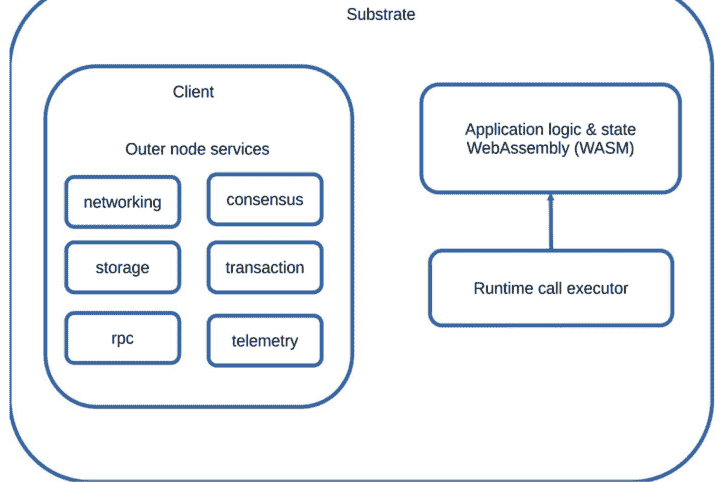
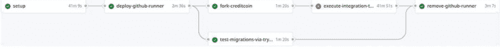
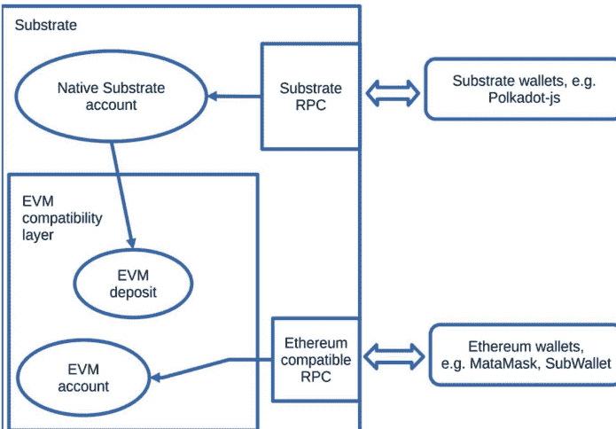
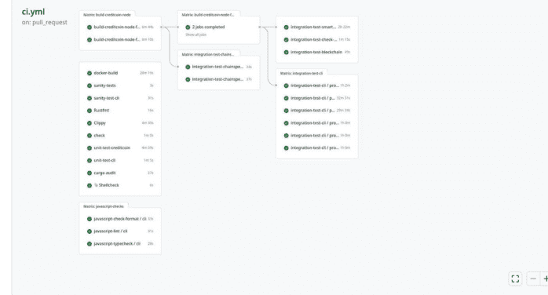
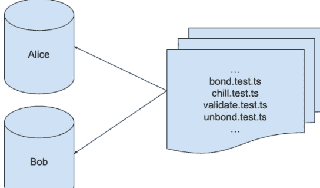
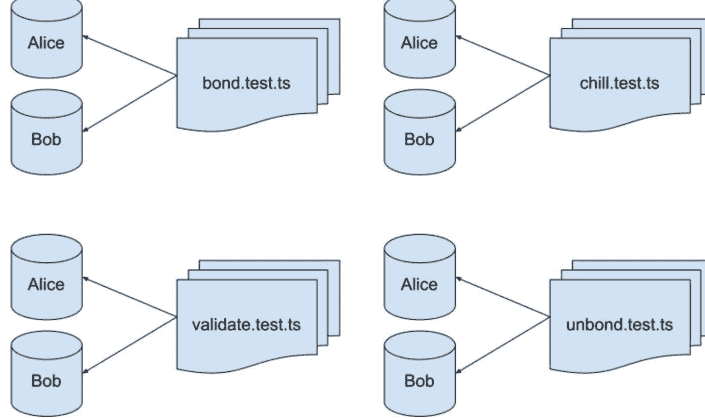
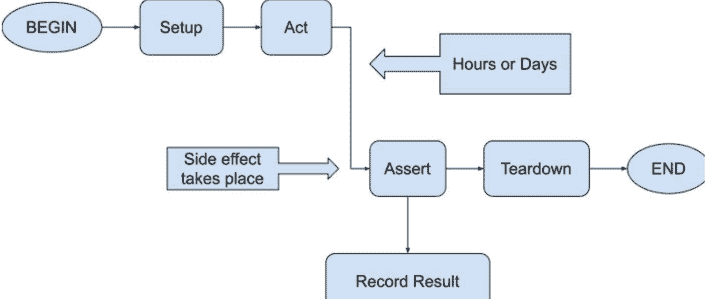
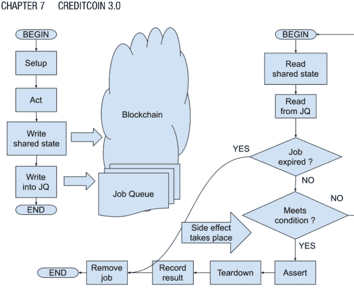
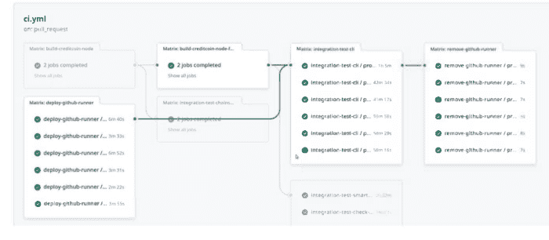

# Creditcoin 区块链测试……测试工程师视角 2024


献给给予我一切的测试者。

你向我展示了什么是真正的、无条件的爱与牺牲。我将永远珍惜你让我和你在一起的时光！

我深表歉意，我太自私了，没有及时意识到。我从内心向你道歉，因夺走你最神圣的梦想而伤害并背叛了你。

请原谅我！


# 关于作者


Alexander Todorov 是一位质量保证工程师，也是 ISTQB 和红帽认证专业人士，拥有二十年的行业经验。他是一位拥有数千次贡献的开源黑客、Python 讲师，以及 FOSDEM 测试与持续交付开发分会场的联合组织者。他还测试过红帽企业级 Linux 的多个组件，曾担任其版本 5 系列整个生命周期的测试负责人，随后测试了 Creditcoin 区块链的各种组件。

Alex 拥有保加利亚索非亚技术大学的计算机工程硕士学位，热爱公开演讲和骑快快摩托车。在空余时间，他是流行的开源测试管理系统 Kiwi TCMS 背后的首席工程师。

您可以在 LinkedIn 上找到 Alex：https://www.linkedin.com/in/alextodorov/，并在 GitHub 上直接关注他的工作：https://github.com/atodorov。

# 关于技术评审员


**Anandaganesh Bal Anandaganesh Balakrishnan** 是一位数据工程和数据分析领袖，曾在金融科技、生物技术和公用事业领域担任过高级领导职位。他的专长是构建可扩展、可靠且高性能的数据平台，用于高级数据分析、量化研究和机器学习。他目前的研究方向是非结构化数据的 AI、大语言模型 (LLMs) 以及生成式 AI (Gen AI)。

# 致谢

我想感谢 Anandaganesh Balakrishnan，他在数据工程和数据分析领域的领导力，曾在金融科技、生物技术和公用事业领域担任过高级领导职位。他在构建可扩展、可靠且高性能数据平台以用于高级数据分析、量化研究和机器学习方面拥有专长。他目前的研究方向是非结构化数据的 AI、大语言模型 (LLMs) 以及生成式 AI (Gen AI)。

感谢 Jeroen Rosink 对本书提供的宝贵反馈。感谢 Malyska 带我接触区块链测试。感谢 Andrew Snaith 在我误解某些内容时提供的多次帮助。

感谢 Sebastian Viquez 分享他的测试经验。最后但同样重要的是，感谢 Sebastian Snaith 分享他的测试经验，这为本书增加了许多维度。

# 前言

本书涵盖了区块链测试的历程，适用于那些可能很快进入区块链领域但对其、工作原理以及在质量保证方面缺乏必要理解的测试人员和质量工程人员。书中讨论的 99% 内容都是开源的，并贯穿了多处代码引用。

目标读者：

- 测试人员
- 自动化测试开发人员
- 质量保证工程师
- 质量保证经理

# 前序

你将学习到：

- 1. 区块链组件图
- 2. 热门区块链加密术语表
- 3. Hyperledger Sawtooth 框架区块链实现概述
- 4. Substrate 框架区块链实现概述
- 5. 与工作量证明、权益证明以及基于 EVM 的区块链相关的实际话题

# 第 1 章

# 引言

密码学家 David Chaum 在其 1982 年的论文《通过相互猜疑小组建立、维护和信任的计算机系统》中首次提出了类似于区块链的协议，并在后的 15 到 20 年中对这一想法进行了进一步改进。去中心化区块链由名为 Satoshi Nakamoto 的个人（或群体）于 2008 年构思，诞生了比特币。2013 年是以太坊的开始，它引入了智能合约功能。由于对加密计算所需的高能耗的担忧，后来的链（如 Cardano (2017)、Solana (2020) 和 Polkadot (2020））开始采用能耗更低的权益证明模型。

目前，我们正见证着对区块链技术的兴趣和投资不断增加，许多公司正在寻找加密货币之外的实际应用。这是区块链技术进入普通软件工程人员世界的时代。这也是区块链技术产品化的时代，导致了对这些产品进行测试变得必要。

作为一名拥有近二十经验的资深质量保证工程师，我对区块链测试领域的工作感到非常好奇，但与此同时，在很一段时间里也感到非常不安。我有过底层基础设施类型测试的经验


# 第一章 引言

软件与 Linux 操作系统系统的各个部分类似，但我在此之前对加密货币或区块链完全没有经验。因为我当时正在开发一个已经投入生产的产品，我需要非常快速地学习很多知识，以便成为团队中的高效成员。那种感觉就像在用高压水管喝水，直到今天，有时仍有这种感觉。

这本书是为普通测试人员和质量工程人员编写的，他们很快可能被要求从事区块链软件产品的工作，但他们可能对区块链是什么、它是如何运作的，以及在“保证”质量方面哪些是重要的仍然缺乏必要的理解。

区块链网络是分布式系统，与普通软件产品相比，它们通常更复杂，并且有无数项目需要测试，这需要庞大的技能集。本书并非旨在涵盖所有可能场景的详尽资源；那是不可能的。相反，它的目的是讲述我作为一个区块链测试工程师的故事，并希望成为你进入这一领域的起点。

祝测试愉快！

## 区块链简介

像区块链这样的分布式系统包含多个组件，除非你工作在这一特定的技术领域，否则其中某些组件并不是常识。本章将解释什么是区块链，并建立该领域常用的一些通用术语，并提供一些示例。

区块链是一个不断增长的记录列表，称为“区块”，通过加密函数安全地链接，这些函数保证了数据不可篡改。在图 1-1 的范围内，我们可以将每个区块视为特定时间段当前状态的快照。如果有人在之后尝试修改此状态，将导致后续的所有区块相对于被修改的区块失效，从而揭示数据篡改。它也被称为分布式数字账本。这种架构使得互不信任的参与者仍然能够信任记录在区块链上的数据。


**图 1-1. 形成区块链的链数据区块示例**
许可：CC BY 3.0，来源 https://commons.wikimedia.org/wiki/File:Blockchain_landscape.svg

区块链参与者是在其计算机系统上运行区块链客户端软件的个人操作员。他们的动机通常是财务上的——通过为区块链提供分布式计算资源获得奖励。

为了在区块链上记录新信息，参与者必须达成共识——例如，一个困难数学问题的答案是什么。这被称为共识（consensus）。从设计上，大多数区块链系统向任何人开放，在许多情况下，参与者是匿名的，可能是故障的（由于软件或硬件漏洞）或行为不当的（由于可能存在伪造区块链记录的外部激励），并且通常是不可信任的。共识算法的工作是确保此类系统中的参与者能够达成一致，并检测和排除被认为有故障的参与者。否则，区块链软件无法进入下一步，即将实际数据记录到存储中。

# 第一章 引言

一旦新交易组合成一个区块并将该区块分发到区块链中的多个节点上，它就无法被删除或修改。区块链确保了完整的交易历史，加密函数的使用确保了记录在链上的信息在设计上是安全的。这些记录本质上是只读的。选择算法和软件架构是为了保证这些原则。实际的加密、共识、网络和其他算法以及实现架构各异，该领域有许多正在进行的研究，但基本原理是如图 1-1 所示确保数据完整性。

尽管今天的许多区块链平台能够支持智能合约和加密货币，但这些对于区块链作为安全分布式账本的核心运行来说并不是严格要求的。相反，正是作为安全分布式账本，使得智能合约和加密货币的存在成为可能。

区块链实现是一种基础设施类型的软件，在非常抽象的层面上类似于数据库——存储和外部世界中记录了一些数据，也就是说其他应用程序可以对区块链进行读取和写入。

区块链应用程序通常比测试人员可能熟悉的其他软件更复杂，有多个组件并行工作，并且多个网络通道和协议同时激活。

## 区块链属性

包含此节仅供你参考。在实际实现中，得益于所选的区块链框架，这些属性的大多数是开箱即用的。

围绕这些特定属性的测试需求取决于你的运营和业务需求，在实际实现中，例如，在你没有开发底层算法本身时，这些需求最可能通过加强监控和告警来解决，而不是功能测试套件。

- **安全性（Security）**：区块链上的信息通常被认为是防篡改的，因此历史记录是可以信任的。由于其分布式特性，区块链通常也被认为是防止恶意攻击者安全的。
- **容错性（Fault tolerance）**：在区块链网络中，可能存在表现出故障或完全恶意的节点。区块链实现内置了对这种现象的容忍。
- **可靠性（Reliability）**：区块链在指定环境和给定时间内正常工作的概率。对于命名的权益证明（proof-of-stake）共识，这意味着在当前时代，至少有二之三的所有被选验证者在线并正常运行。
- **可重复性（Reproducibility）**：区块链上的交易可以由另一个节点重放，这应该始终产生相同的状态，例如，重放交易的节点在本地磁盘上存储相同的信息。
- **透明性（Transparency）**：公共区块链上的记录所有人都可以访问，从创世区块到当前区块的所有状态转换都可以被单独重放和验证。也就是说，尽管参与者是匿名的，他们所有的操作都是完全透明的。
- **终性（Finality）**：对最近添加到区块链的良好区块在未来不会被撤销并可以被信任的信心程度。大多数分布式区块链协议无法保证新提交区块的终性，而是依赖于“概率终性”：区块在区块链中的深度越深，被更改或回滚的可能性就越小。
- **公共与私有（Public vs. private）**：区块链是否对公众完全开放，例如任何人都可以参与。你在新闻中听到的区块链都是公有的，包括 Creditcoin。
- **无许可与许可（Permissionless vs. permission）**：任何人是否都可以加入现有的区块链网络、运行节点并参与共识，而无需先获得某种许可、批准等。流行的区块链如比特币、以太坊以及当然 Creditcoin 是无许可的。

## 区块链术语表

**交易（Transaction）**类似于普通 SQL 数据库中的操作，寻求在区块链上附加新信息的操作。它通常暴露为 API 函数，以便用户与区块链交互。区块链交易通常是一个实体，类似于针对传统数据库执行的单个 SQL 语句。交易代表区块链的业务领域，例如 Creditcoin 的 AddBidOrder 或以太坊中 Ether 从一方到另一方的转移。区块链网络可以支持多种交易类型。


哈希（Hash）是单向加密函数的结果，通常接收二进制数据作为输入并返回一个十六进制字符串！每份数据都有唯一的哈希表示，且你无法反转哈希值。输入数据即使只有一个比特的修改，也会导致完全不同的哈希值。这使得公开共享哈希值而非数据本身是安全的，并且可以使用相同的哈希值来验证两份数据是否完全相同。

交易哈希（Transaction hash）是一个代表每笔交易加密哈希的十六进制字符串。这些字符串通常被用作替代标识符。例如，https://etherscan.io/tx/0x8d16ea41628ac89745c95147c0ea394809074607395b0d792d1bea93628ob1 代表了一次交易，在这次交易中我用一种加密货币（G-CRE）兑换了另一种（ETH）。

Gas 费或交易费（Transaction fee）是在区块链上执行特定交易的成本表示。它会随着时间的推移和交易类型的不同而变化，旨在代表交易的计算费用。该值通常由区块链的原生加密货币表示。Gas 的目的与代币经济有关，同时也提供了一种安全特性，使得恶意行为在经济上变得不可行。

区块浏览器（Block explorer）通常是一个 Web 应用程序，允许用户搜索和检查区块链上的区块、交易和地址。流行的是 Etherscan，类似的功能也由 Subscan（https://creditcoin3-testnet.subscan.io/）和 Blockscout（https://creditcoin-testnet.blockscout.com）提供。

区块（Block）是多个交易的集合，原子化地记录在区块链上。区块内的所有交易要么都被记录，要么一个都不记录。如果我们将其与 git 版本控制系统进行类比：

# 第1章 引言

虽然我们通常将区块称为“记录”（records），但其含义与数据库记录不同。数据库记录代表的是离散值的单一集合，换句话说就是一列列的值。在区块链语境下，“记录”一词的含义更接近于包含多首歌曲的黑胶唱片记录。

区块包含交易列表、对前一个和下一个区块的引用，以及额外的元数据，如时间戳、加密哈希和签名。根据实现的不同，单个区块可以存储的交易数量有一个最大限制。

区块填充率（Block fullness）或区块饱和度（Block saturation level）代表区块内总可用空间实际被使用的百分比。例如，如果区块链未未使用，每个区块可能只包含一个心跳/时间戳交易；而在频繁使用的区块链中，它可能包含数百笔交易。

区块哈希（Block hash）是代表每个区块加密哈希的十六进制字符串。这些哈希经常被用作地址或标识符。例如，03e89f72d1bc09af19759a94c34d769a94bb0ca9d257b2efe8adac0502cc11 对应于以太坊网络上的第 19517842 号区块。其内容可以通过 https://etherscan.io/block/0x3e89f72d1bc09af19759a94c34d769a94bb0ca9d257b2efe8adac0502cc11 或 https://etherscan.io/block/19517842 进行检查。

此区块包含 185 笔独立交易，包括我兑换代币的那笔。

区块高度（Block height）或区块编号（Block number）是其之前的区块数量。旧区块的高度越低。这个数字越大，区块链存在的时间越久。

区块时间（Block time）是区块链上区块之间的平均时间，例如 15 秒。该值本身是任意的，由区块链的创建者选定。重要的是这个值大约是一个常数。在比特币中，预期的区块时间为 10 分钟，而在以太坊中，设计的区块时间为

# 第1章 引言

15 秒，实际中通常在 10 到 19 秒之间。Creditcoin 的初始实现使用 60 秒，后续版本降到了 15 秒。恒定的区块时间对于分层应用更好，因为它们知道操作在什么时间范围内可以被视为失败或超时。

创世区块（Genesis block）是 0 号。它通常被硬编码在区块链实现中（例如你的客户端程序中），并可能包含后续正确运行链所需的元数据。例如，哪个账户是根账户，或一组预定义地址的起始余额。

分叉（Fork）发生在区块链分出两条潜在的未来路径时。当多个节点在几乎相同的时间产生区块时，可能会发生分叉。当后续区块被添加且其中一条路径比其他路径长时，分叉就会解决。

硬分叉（Hard fork）通常发生在区块链协议发生不后兼容的更改时，要求所有用户升级软件以继续参与网络。在硬分叉场景下，区块链网络作为两个互不连接的数字实体存在。硬分叉也可能由于软件实现中的 Bug 和/或网络问题导致共识失败。换句话说，区块链的参与者无法就哪条未来路径应该是规范路径达成一致，结果就是产生了两条独立的链。

由于区块链旨在作为真理来源，无法解决分叉并导致硬分叉的情况被认为是关键且可能对区块链造成损害。

区块终结性（Block finality）指的是区块链上交易的不可逆确认，确保安全性并防止双重花费。区块终结化（Block finalization）是用于处理分叉并选择规范链的过程。在实践中，这意味着所有参与者的三分之二。

# 第1章 引言

状态（State）是区块链上的当前快照——区块总数、记录在这些区块中的交易以及记录在本地存储中的值。实践中，当我们谈论状态时，指的是区块链在特定区块的快照。例如，区块 1000 的状态是 Alice 余额为 300，而 Bob 没有！在区块 1010 中，由于期间执行了交易，内部状态发生了变化。例如，Bob 获得了一定数量的代币。当我们谈论状态时，通常指的是记录在区块链上的最后值，忽略历史。根据上下文，我们可能需要考虑之前的历史，可能是在你尝试重现特定 Bug 时。

挖掘（Mining）是工作量证明共识算法的一部分执行计算密集型加密操作的过程。执行这些工作的计算机被称为矿工。广义上我们也使用矿工一词来指代参与区块链的计算机和人类，无论实际共识算法如何。

在加密和区块链中，nonce 是通信中仅使用一次的任意数字。它通常是验证协议发布的伪随机数，以确保通信不会被用于重放攻击。

验证者（Validator）是验证区块链交易合法性的计算机节点。验证者也被称为矿工或铸币者（minters），他们是参与共识算法并获得向区块链添加区块权限的人。


提名者（Nominator）是区块链的参与者，他们通过其资金对所选定的验证者进行投票。在权益证明（Proof-of-stake）网络中，提名者是一种用户角色，他们不需要过多的技术知识来操作区块链节点即可参与区块链。他们有时被称为“投资者”，因为他们只使用资金，与技术操作员不同。

[Crypto] 代币（token）是一种数字代币，用于代表区块链上的价值，以便区块链网络在经济上是可持续的。验证者（Validators）通过运行支持区块链及其内部存储数据的硬件来获得代币奖励。

诸如 BTC、ETH、CTC 等代币被称为加密货币，它们可能有自己的生命周期。由于代币是价值的表示，它可以与其他有价值的代币进行交换，例如纸币（也称为法币）或另一种数字代币。代币经济学（Token economics）不在本书的讨论范围内。

加密代币的存在通常是公有区块链网络的必要条件，因为具有更严格访问控制和/或专注于解决特定业务问题的私有网络很少需要加密代币。解决当前业务问题所预期利润为此类网络的运营者提供了必要的动力。

注意，区块链通常拥有所谓的原生代币（native token）或实用代币（utility token），用于方便区块链的操作。然后可能存在其他代币，也称为币（coins），它们可以被交换、交易或用于任何其他目的。这些币仅仅因为它们的存在而被赋予巨大价值的情况并不罕见，而不是因为它们的技术用途。

## 第1章 引言

[crypto] 钱包地址表示为一个长十六进制字符串，包含关于不同加密代币的信息以及控制者拥有的余额。该十六进制字符串用作钱包地址，在实践中代表了私公密钥对的公钥。通常，钱包是区块链上的匿名账户。注意，此地址适用于特定的区块链。我在以太坊上的地址是 0x718bb20f2ab1937710d2Ac579d97835a6fD099C。我的地址在其他区块链网络上可能不存在。重要的是，不同的区块链可能使用不同的地址格式和表示方法。在以太坊中，长度为 20 字节，由 40 个十六进制数字表示，如所示。在 Subcoin（Substrate 框架）中，格式是 32 字节账户标识符；然而，并非所有基于 Substrate 的网络的地址都是基于密钥的。

由于生成这些地址的算法碰撞概率极低，钱包地址在实践中是唯一的，只要格式支持，就可以跨区块链使用。在实践中，当第一次向特定地址进行转账时，该地址背后的“账户”将在该特定区块链上开始存在。

钱包应用是一个持有你的公钥/私钥的程序，允许用户通过签名传输或交换不同加密代币的交易来与区块链交互。最常见的形式是浏览器扩展程序或移动应用程序。流行的钱包应用例如 MetaMask 和 SubWallet，但还有许多功能各异的可选应用。例如，金融移动应用 Revolut 也包含了加密钱包的功能，允许你购买代币、向其他地址发送传输或对加密货币进行投资，尽管它的功能范围要大得多。由于钱包应用持有私钥并允许用户签名交易，它们通常是用户与区块链交互时最可见的软件部分之一。

注意，根据上下文，“钱包”一词可能指账户地址，也可能指操作该账户资金的用户面向型应用程序，或者两者兼指。

## 第1章 引言

加密水龙头（crypto faucet）是一种快速奖励用户的方式，通过让用户在网站或移动应用程序上执行各种任务来换少量加密代币。用户完成的任务可以是点击付费广告、完成 CAPTCHA 验证、每天登录或与 Discord 机器人交互，例如。在区块链测试环境中，你的团队将拥有内部/外部水龙头，帮助测试人员获取一些加密货币并用于测试。

主网（Mainnet）、测试网（testnet）、开发网（devnet）和阶段网（stagenet）是区块链网络的多个独立实例。它们之间相互隔离，你可以根据测试和开发需要拥有任意数量的实例。唯一的账户、代币、区块和交易将存在于网络的每个实例中。被称为主网实例是生产环境。其余实例由区块链创建者多或少随机地分配。某些区块链可能有由名称命名的多个测试和开发环境。

质押（Staking）是投入一定数量加密代币以参与权益证明共识机制的行为。这适用于验证者和提名者角色。其经济激励是更高的投资回报。虽然与传统的投资工具相似，但质押过程本身旨在让用户积极参与，以确保区块链拥有一个健康的社区。记住，区块链是一个高度分布的环境，参与者越多越好。

罚没（Slashing）是在权益证明区块链网络中对恶意验证者实施惩罚（没收代币）的过程，从而使这种行为在经济上变得可行。罚没也扩展到提名者，

## 第1章 引言

这就是为什么建议区块链质押参与者保持活跃并定期监控区块链上发生的情况的原因。例如，不要为某个验证者投票后就忘记。

客户端（Client）是任何与区块链通信的软件程序。在区块链应用程序的背景下，我们通常指的是在计算机上原生执行并实现区块链各种组件的软件程序。那通常是在区块链上充当验证者的程序。在更广泛的背景下，客户端也可以指钱包应用或另一个与区块链交互的应用程序，例如质押仪表板或遥测仪表板。它也可以指旨在与特定合约交互的应用程序。

某些实现具有独立的运行时组件，用于封装交易和业务逻辑，而客户端本身负责处理网络通信、写入存储等底层任务。

Web3 是万维网的新一次迭代的想法，结合了去中心化、区块链技术和代币经济学等概念。该术由以太坊联合创始人 Gavin Wood 在 2014 年提出。

智能合约（Smart contract）是使用特定语言（例如 Solidity）编写并存储在能够执行此类程序的区块链上的程序。并非所有区块链都支持智能合约。最流行的例子是在以太坊主网上实现加密货币；然而，智能合约不仅限于此。示例展示了交易性游戏，如井棋、投票、盲拍卖、支付通道等。我认为任何可以表示为交易的内容都可以编写到智能合约中。

智能合约的核心属性是在部署上链后无法更改（它绑定到特定的地址或交易哈希），并且与智能合约的交互是透明的，以交易的形式表示，尽管所有双方可能是匿名的且并不相互信任。智能合约还可以通过调用暴露的函数来执行其他智能合约。智能合约内部定义的函数执行会被记录在区块链上的交易中。一旦部署上链，智能合约无法更改；但你可以部署新版本的合约，导致不同的合约地址。智能合约拥有合约存储（简称存储）的概念，合约内部可用，可以存储如新创建加密货币的令牌余额等信息。

EVM，或以太坊虚拟机，是执行智能合约和去中心化应用程序的环境。正如名称所示，此规范源自以太坊主网区块链。该规范是开放的，由以太坊基金会以太坊社区维护。

## 区块链组件

Polygon zkEVM 网络单计算节点架构图用作区块链实现复杂性的示例：


# 第 1 章 引言


图 1-2。Polygon 网络中的节点及其组件

来源：https://github.com/0xPolygonHermez/zkevm-node#architecture

许可协议：GNU AFFERO GENERAL PUBLIC LICENSE, Version 3

区块链应用具有多个并行运行的组件并以分布式方式工作。所有这些组件都可以被视为一个独立的软件系统，例如，点对点网络，它们有自己的模块、复杂性和测试要求。其中许多组件依赖于在其他更常见的软件开发领域并不常使用的算法。因此，区块链的实现往往比其他软件部分更复杂。


区块链节点之间需要进行通信，以交换数据和关于网络的信息，例如区块。

该组件负责对点发现和连接管理。它是某种点对点网络的实现，例如基于 `lib2p2` 库。可能还有其他组件需要或通过网络进行通信，且它们可以是相互独立的，例如通过不同的 TCP 端口暴露，或者实现为不同的独立进程。


分布式计算系统中的一个基础问题是在存在许多故障节点或不可信节点的情况下实现整个系统的可靠性。这通常需要协调进程以对计算期间所需的某些数据值达成一致。

共识算法、共识模型或共识引擎确保区块链参与者对区块链的当前状态达成共识，并设计用于防止恶意参与者获得附加区块的机会来确保区块链的安全。

# 第 1 章 引言

## 交易

除了将单个交易序列化为二进制格式以便将其记录到区块中的实际机制外，区块链的交易组件代表了其业务逻辑。即在该特定的区块链上可以记录什么类型的操作。

例如，资金转账（现代区块链背后的原始概念）、保险、贷款和借贷（以 Creditcoin 为例），以及任何与财务资产、物流和供应链追踪、所有权证明和转让（例如房产证）相关的事务。

一个既实用又易于理解的例子是井字游戏（Tic-Tac Toe）。我们可能拥有交易来记录新游戏的开始、记录每个玩家的回合（例如棋盘上的符号和位置）以及游戏的最终结果。交易方案可能如下所示：

- start_game(player_one_address, player_two_address)
- record_move(player_address, symbol, coordinates_on_board)
- calculate_outcome() - 可能在内部触发
- record_victory(player_address)

在原始的 Creditcoin 白皮书中，交易方案如下所示：

- 借款人申请贷款（特定条款）。
- 贷款人提出贷款（特定条款）。
- 记录一个贷款人和借款人对，例如，条款匹配/他们对条款达成一致。
- 记录资金转账。
- 实际资金转账等。

交易可以在区块链的节点之间进行内部消耗——例如，每个井字游戏的参与者都必须是区块链上的验证者，并且只能通过他们的验证者程序与区块链通信。

然而，更符合实际做法是将交易也暴露在外部，并通过某种 RPC 接口可用。这意味着游戏中的玩家可能与验证者不同。这也意味着他们可以更容易地参与，例如通过移动端或 Web 应用程序，同时利用区块链来记录他们的操作。


区块链网络的运行和维护并不是免费的。它需要现实世界的计算资源，这些资源通常由大型外部社区提供。这在公共区块链网络中尤为如此。这需要引入加密代币形式的交易费用。

为了使区块链在经济上具有灵活性，实现必须根据其需要控制交易费用组件。它可以是一个简单的数学公式，也可以是一个考虑多个因素的更复杂的算法，包括但不限于区块链上的历史性能。例如，当使用量极高且呈上升趋势时，费用也会随之增加。如果网络闲置了一段时间，费用可以自动下调，以刺激更多使用。


该组件负责将交易序列化为区块，并与共识、存储和点对点组件进行通信。区块链能够产生新区块是非常关重要的。如果没有外部活动，可能会由内部时钟触发一组交易。

# 第 1 章 引言

区块产生可能会因为此组件中的软件漏洞或由于共识或网络问题而受到损害。当区块链无法恢复时，我们称为“锁死了”区块链（brick the blockchain），导致链变得不可用，即无法再向其添加区块，这很可能意味着你的区块链结束了。


区块链上的矿工和/或验证者通常期望获得奖励，以换取维护基础设施所提供的计算资源。

与交易费用类似，奖励以加密代币的形式表示（可以是相同或不同的），并且通常是可以调整的。区块奖励组件可以是简单的数学公式，也可以是复杂的算法——这取决于特定区块链创建者的决定。

该公式可能会随着区块链流行程度的提高而变化，例如，在初始阶段提供更高奖励以刺激参与，然后在区块链变得更加流行或参与者趋饱和时缩减奖励。


为了让区块链用户能够与网络交互，他们需要某种网络启用接口。RPC 组件负责在区块链实现内部如何定义 RPC 方法以及如何向外部世界暴露。当我们谈论“用户”时，指的是“API消费者”，无论他们在现实中的角色如何。

例如，通过 JSON-RPC 和/or REST 协议提供 API 接口，这些可以通过 HTTP 和/or WebSocket 暴露。不同的实现也可能使用其他网络传输和 RPC 协议。例如，Hyperledger Sawtooth 区块框架使用 ZeroMQ/Protobuf 作为内部层，如果我没记错，客户端可以直接使用。为了方便起见，该层被封装在 REST API 中。

需要通过 RPC 层导出的最重要的组件是交易接口。通过标准网络协议暴露交易 API 允许各种类型的应用程序与区块链交互。使用广泛采用的行业协议使得从任何编程语言访问此 API 都变得更容易。

例如，移动应用程序可以使用公私钥对交易进行签名并将其发送到区块链节点，节点随后与 p2p 网络上的其他节点通信，交易最终会被区块。通过 RPC 组件接收交易的节点可能与验证和区块产生的节点不同。


负责在网络中每个节点的本地磁盘上持久化数据，通常作为高效的键值存储。

出于实际开发考虑，区块链上表示的数据必须通过具有字段的数据类型来表示，而不是二进制数据流。即，我们有一个在区块链软件开发期间使用的数据模式，它也可以以 SDK 的形式供第三方使用。

为了抽象化，存储组件的部分可以被视为 Web 应用开发中常见的对象关系映射（ORM）框架。


为了让实际的区块链应用根据业务需求进行演进，开发者需要能够修改数据结构。例如，在我们的井棋示例中，我们可能想要记录是在哪一步赢得了比赛，或者我们可能想要允许第三个玩家加入。

类似于 ORM 框架，迁移组件允许开发者转换存储在区块链上的数据，甚至删除其中的某些数据。所有这些转换都将在特定的区块高度保留在区块链历史记录中。如果查询较旧的区块，可能会检索到旧数据，但无法保证客户端应用程序具有向后兼容性。

迁移失败可能导致区块产生受损，这可能是致命的。


由于区块链应用需要根据业务需求进行演进，因此会有不同版本的实现方案。假设我们希望在我们的井棋区块链中引入三个玩家同时相互竞争的能力。

运行时升级组件负责此。在某些区块链实现中，业务逻辑（交易）可能与实际客户端程序分开存放。在使用 Substrate 区块链框架时就是如此情况。一种流行的选择是 WebAssembly 格式。如果运行时是分离的，它也可以被记录在区块链本身。

在其他实现中，交易可能与客户端程序的其余部分紧耦合，要求用户在访问区块链的新功能之前进行软件升级并重启。

该组件引发了关于不同客户端和运行时版本之间兼容性/互操作性测试的问题。


由于区块链应用是分布式的，并且出于安全考虑鼓励大量节点参与，因此通常需要暴露区块链软件内部运行的信息。这些信息可以被聚合到 Grafana 等工具中进行进一步分析。

遥测组件是定义此类指标并可以通过 HTTP 等推送到外部服务的地方。


在区块链上下文中，所有的计算和状态都存储在链本身。然而，实际应用需要与外部世界通信并在链内外安全传输信息。这就是所谓的预言机（oracle）或离链节点组件领域。

这里一个重要的点是，离链节点能够读取链上数据，但不应该能够直接修改它。该组件将向区块链发送交易，因为它需要反映外部世界的状态。这可以在内部发生，例如调用源代码中的交易函数，或者通过现有的 RPC 接口外部路由到区块链。这些交易调用将由其他组件处理，如果成功，将进入区块。也可能由于各种原因交易失败和/未能进入区块。


智能合约是存储在区块链网络上的计算机程序。一旦智能合约部署到区块链上，它就可以存储任意状态并执行任意计算或调用区块链上的其他合约。


每个智能合约都有与其关联的地址，该地址作为合约的入口点，类似于 REST API 函数的 URL 地址。终端客户端通过某种客户端库（一种流行的选择是 ethers.js）使用其地址发送交易来与智能合约交互。

一旦部署，智能合约就无法被修改。不过，新版本的合约可以部署到不同的地址。

智能合约创建者铸造一个新的加密代币是非常流行的做法，即凭空创建一个代币，并将其用作某些区块链网络上价值的表示。然而，智能合约也可以实现其他功能，例如自动和透明的投票。

智能合约的实际应用不在本节的范围内。


共识引擎是区块链最重要的组件之一，目前有许多正在开发或使用的机制。例如证明工作、证明权益、证明时间、证明容量、证明位置等。它们的属性会影响谁可以参与、参与的难易程度、维护成本、网络支持的节点数量以及区块链的安全性。

你可以参考此列表进一步了解：https://medium.com/consensusedia-an-encyclopedia-of


PoW 共识的参与者消耗计算资源来获得添加新区块的机会。他们需要解决计算密集型的难题并将解决方案提交给其他参与者，其他人可以轻松计算出是否正确。每个区块的数据部分作为难题的输入。第一个找到正确解决方案的矿工将获得将其添加到区块链的机会。因此，我们说他们挖掘了一个区块。矿工拥有的 CPU 资源越多，解决难题并添加区块的机会越大，从而获得奖励。


PoS 共识机制的参与者根据其质押的加密代币数量竞争添加区块的机会。通常认为，投入更多的代币增加了被算法中的概率，从而获得更大的回报。PoS 避免了 PoW 的高计算成本。这里没有真正的挖掘，因为计算要少得多；但在这种情况下，我们通常将验证者称为矿工。质押资金被区块链实现作为质押，如果验证者被举报并发现过错，资金可能会从验证者处没收。这一过程是自动化的，目的是限制人为参与并促进区块链网络的健康行为。例如，当验证节点长时间离线时，他们将受到惩罚。

这种应用惩罚并没收参与者现有资金的过程称为削减（slashing）。


证明权威是一种通过身份作为质押或声誉质押的共识机制提供较快区块时间的算法。在 POA 网络中，个人获得成为验证者的权利，因此他们有动力维持其所获得的地位。PoA 共识通常出现在私有许可区块链中。


在互联网上搜索“区块链开发框架”会得到多个结果，而且当你阅读这本书时，这些偏好可能已经发生了变化。具体的细节会有不同，但基本概念应该是类似的。在本章中，我将列出我个人使用过的框架，以便为后续章节提供更多背景。


Hyperledger Sawtooth 是由 Hyperledger 和 Linux Foundation 开发的区块链开发框架，并得到了 IBM、Intel 等公司的贡献。它是一个具有模块化架构的框架，核心系统与应用程序领域分离，开发者可以为应用程序指定业务规则，而无需了解整个系统的底层设计。Sawtooth 支持多种共识算法。

Sawtooth 最初由 Intel 贡献，是一个为通用性和可扩展性设计的区块链套件。交易业务逻辑从共识层解耦到所谓的“交易族”（Transaction Families）中，这允许受限或无限制的语义。原始网站：[https://wiki.hyperledger.org/display/sawtooth](https://wiki.hyperledger.org/display/sawtooth)。

Sawtooth 的初始版本是用 Python 实现的，随后某些组件用 Rust 重新实现。

注意：GitHub上的原始 Hyperledger Sawtooth 仓库已在其维护者的请求下于2024年2月1日（本书编写期间）存档。该代码库的持续维护发布已移至 Splinter 社区，地址为 [https://www.splinter.dev](https://www.splinter.dev)。

Hyperledger Sawtooth 是 Creditcoin 1.x 区块链的开发框架，我在其生命周期后期接触过它。


Substrate ([https://substrate.io](https://substrate.io)) 是一个区块链框架，声称是快速构建自定义、面向未来的区块链的最强大的框架。它允许开发者构建专门的区块链应用程序。Substrate 由 Polkadot 网络和 Parity Technologies 领导，后者由以的首任 CTO Gawin Wood 领导。

使用 Substrate 构建自己的区块链出奇地简单，你可以按照他们的教程快速入门。参见 [https://docs.substrate.io/tutorials/build-a-blockchain/build-local-blockchain/](https://docs.substrate.io/tutorials/build-a-blockchain/build-local-blockchain/)。这里的核心概念是可组合性——你的区块链实现由多个称为“pallets”（小节）的组件组成，这些组件在运行时胶合在一起。

Substrate 使用 Rust 编程语言构建，而 Polkadot 的其他工具则使用 TypeScript —— 这些通常是客户端库和前端应用程序。

Creditcoin 2.x 及更高版本是使用 Substrate 构建的。


我个人没有在以太坊上进行过任何开发和测试，提到它是因为它非常流行。Geth 似乎是用 Go 语言实现的主要的以太坊客户端；参见 [https://github.com/ethereum/go-ethereum](https://github.com/ethereum/go-ethereum)。因为该实现是开源的，完全可以分叉它并修改代码，以创建你喜欢的风格的自定义区块链。这显然是 Muscoin 链的做法。另一方面，你更有可能在以太坊主网上部署一个智能合约，而不是构建一条自定义链。

无论哪种情况，以太坊都有很多开发工具可用；如果你感兴趣，参见 [https://ethereum.org/en/developers/docs/frameworks/](https://ethereum.org/en/developers/docs/frameworks/)。


本书讨论的编程语言在 Creditcoin 1.x 期间是 Python、C++ 和 C#.NET 的丰富混合，而在 2.0 及之后的版本中主要是 Rust 和 TypeScript。


开发者 Graydon Hoare 在 2006 年于 Mozilla Research 工作期间将 Rust 作为一个个人项目。Mozilla 在 2009 年正式赞助了该项目，从那时起，该语言被快速采用。以下是 Rust 中 Hello World 程序的样子。


```
fn main() {
    println!("Hello, World!");
}

在 Rust 中，开发者可以使用 `struct` 或 `enum` 关键字创建用户定义类型，并使用 `impl` 关键字为这些类型附加方法。Rust 受到许多其他语言的影响，并不是完全的面向对象的。虽然你可以使用带有数据和方法的用户定义数据类型（它们看起来像类），但 Rust 并没有真正的 OOP 继承概念。相反，Rust 使用泛型、trait（特征）和多态。如果你对 trait 不熟悉，可以将其看作是接口定义，它需要在所有预期支持该接口的数据类型中进行实现。


- 编译器是你的朋友——内存安全几乎排除了随机的运行时失败；强类型意味着几乎不可能在不应该使用变量的代码块中误用变量（例如，复制粘贴问题）。
- 语言内置了良好的自动化测试设施。
- 断言（Assertions）通过宏执行，当它们失败时会产生运行时 panic（恐慌崩溃）。
- 从头编译需要相当长的时间，因此保留构建缓存非常重要。
- 流行的代码覆盖率和静态分析工具对 Rust 的支持可能较差，因为它仍然是一种相对较新的语言。
- “单元”测试和“集成”测试代码之间的区别很小，如果你对该语言不熟悉，可能不会立即显现。
- 内置测试框架中没有共享设置/清理（setup/teardown）的语法。

关于 Rust 语言特别是测试的更多信息，请参见 [https://doc.rust-lang.org/book/ch11-testing.html](https://doc.rust-lang.org/book/ch11-testing.html)。

**TypeScript** 是带类型的 JavaScript。TypeScript 是一种构建 JavaScript 之上的强类型编程语言。


const message: string = 'Hello, World!';
console.log(message);

之前提到的 Rust 的优点同样适用于这里。TypeScript 编译器和 linter 是最好的朋友，并为你捕捉错误。一个巨大的奖励是流行的 TypeScript 测试框架拥有 TypeScript 绑定并为第三方工具和服务提供了更多选择。网站：[https://www.typescriptlang.org/](https://www.typescriptlang.org/)。

在 Substrate/Polkadot 生态系统中，选择的选择是流行的 Jest 测试框架，我在测试 Creditcoin 时广泛使用了它。如果你来自 Web 应用程序测试的背景，可能有足够的经验快速上手。我的个人背景远离 Web，但在开始时只遇到了一些小问题。

Solidity 是一种静态类型的大括号编程语言，用于开发运行在以太坊和其他兼容 EVM 的链上的智能合约。


// 编译器版本必须大于等于 0.8.24 且 0.9.0
pragma solidity ^0.8.24;

contract HelloWorld {
    string public greet = "Hello World!";
}

该示例表示一个存储特定值的智能合约，它没有暴露任何外部调用的函数，仅用于说明。更多信息请参见 [https://soliditylang.org](https://soliditylang.org)。

虽然 Creditcoin 起初并不是智能合约平台，但一直存在与智能合约交互的需求——记住，在加密货币中进行的实际贷款转账和还款是在外部区块链上进行的。在后来的 Creditcoin 3.0 版本中，智能成为了了一等公民。

智能合约本身的测试超出了本书的范围，我个人在该领域没有经验。至少能够阅读和理解 Solidity 代码是非常重要的，以便在意外与智能合约交互的边界情况下使用。


区块链实现是一种复杂的、基础设施类型的软件，类似于操作系统或数据库管理引擎。你可以通过实现所有相关的组件和算法，来创建一个看起来和运行起来都像分布式账本的东西。

幸运的是，大多数软件公司并不是操作系统或数据库供应商。相反，这些公司从事的业务是为客户解决特定问题，例如，通过区块链技术安全地记录贷款交易，从而将区块链实现的重心转移到了其他地方。

目前看来，大多数实际的、基于区块链的赋能型应用，要么是构建在现有的区块链平台之上的，要么是使用区块链开发框架构建的独立网络，或者至少是作为另一个现有区块链实现的分叉（fork）。

作为与区块链打交道的测试人员和质量保证（QA）工程师，我们需要对基本原理有良好的理解，但大部分精力将花在测试利益相关者要求的业务功能和特定的区块链组件上。我们中只有极小部分人会从事底层算法和涉及的复杂性的测试。尽管我自己在直接测试 Creditcoin 区块链，但我需要深入研究 Substrate 框架的内部机制的情况相对少见，特别是为了测试某些东西的目的。

下面是一个代码片段展示了使用 Substrate 框架构建的区块链实现（列表 2-4）。


/// 具体的数据类型定义
pub type BlockNumber = u32;
pub type Signature = MultiSignature;
pub type AccountId = <Signer as IdentifyAccount>::AccountId;
pub type Signer = <Signature as Verify>::Signer;
pub type AccountIndex = u32;
pub type Balance = u128;
pub type Nonce = u32;
pub type Hash = H256;

/// runtime 中包含的各种 pallet 的配置
impl pallet_balances::Config for Runtime {
  type RuntimeEvent = RuntimeEvent;
  type WeightInfo = pallet_balances::weights::SubstrateWeight<Self>;

  type Balance = Balance;
  type DustRemoval = ();
  type ExistentialDeposit = ExistentialDeposit;
  type AccountStore = System;
  type ReserveIdentifier = [u8; 8];
  type RuntimeHoldReason = ();
  type FreezeIdentifier = ();
  type MaxLocks = MaxLocks;
  type MaxReserves = ();
  type MaxHolds = ();
  type MaxFreezes = (();
}


  type RuntimeEvent = RuntimeEvent;
  type RuntimeCall = RuntimeCall;
  type WeightInfo = pallet_sudo::weights::SubstrateWeight<Self>;
}
impl pallet_evm_chain_id::Config for Runtime { }

// 实现 runtime APIs
impl_runtime_apis!
impl sp_api::Core<Block> for Runtime {
  fn version() -> RuntimeVersion {
    VERSION
  }

  fn execute_block(block: Block) {
    Executive::execute_block(block)
  }

  fn initialize_block(header: &<Block as BlockT>::Header> {
    Executive::initialize_block(header)
  }
}

impl sp_api::Metadata<Block> for Runtime {
  fn metadata() -> OpaqueMetadata {
    OpaqueMetadata::new(Runtime::metadata().into())
  }

  fn metadata_at_version(version: u32) -> Option<OpaqueMetadata> {
    Runtime::metadata_at_version(version)
  }
}

fn metadata_versions() -> Vec<u32> {
  Runtime::metadata_versions()
}

完整版本可以在 https://github.com/gluwa/creditcoin3/blob/dev/runtime/src/lib.rs 获取。


对于任何软件，如何构建都会影响你如何测试。目前看来，大多数实际的、基于区块链的赋能型应用，要么是构建在现有的区块链平台之上的，要么是使用区块链开发框架构建的独立网络，或者至少是作为另一个现有区块链实现的分叉。

作为与区块链打交道的测试人员和质量保证（QA）工程师，我们需要对基本原理有良好的理解，但大部分精力将花在测试利益相关者要求的业务功能和特定的区块链组件上。我们中只有极小部分人会从事底层算法和涉及的复杂性的测试。尽管我自己在直接测试 Creditcoin 区块链，但我需要深入研究 Substrate 框架内部机制的情况相对少见，特别是为了测试某些东西的目的。

在实际操作中，我并不关注通过输入测试数据并执行数百次贷款交易来发现 Bug，我更关注输入数据是否可以记录到区块链上而不崩溃，以及谁可以记录，例如贷款人或借款人。许多输入验证方面实际上是由底层编程语言处理的。例如，当为参数指定无符号整数数据类型时，我不需要显式地测试它是否允许负值——我的编译器会处理这一点，彻底的代码审查就足够了。

另一个需要考虑的因素是 Creditcoin 是一个平台，它最初是为了解决特定的业务问题，后来演变为一个通用的平台。在非常高的抽象层面上，它只是区块链参与者可以在上面记录数据的地方。这并不是说 Creditcoin 没有 Bug，很可能有很多；但当你倾向于构建一个通用平台时，数据是 100% 准确的，而你的软件是否允许用户自毁变成了次要考虑的问题，因此据此进行规划和排序。


如果读者来自不同的背景，不要担心。我认为了解我的出处是有重要的。

在本书的初步评审阶段，我收到了 Jeroen Rosink 关于使用数据集进行测试的主题的有趣反馈。我认为我们之间的差异很大。让我详细说明一下。

在实际测试中，当我谈论“测试框架”时，通常指的是特定编程语言提供的实际功能和库。相比之下，Substrate 框架本身提供了创建模拟运行时（mock runtime）以测试特定组件。


在本章中，我介绍了我使用过的区块链开发框架，并简单讨论了它们之间的区别以及这对测试的影响。

在下一章中，我将向你介绍 Creditcoin 是什么以及它是如何工作的，这将成为后续章节与你分享测试旅程的基础。


## 介绍 Creditcoin 区块链

Creditcoin 解决的主要问题之一是：发展中国家有数百万甚至数十亿的人无法使用传统银行系统——也就是说，他们根本没有银行账户。这些个人无法将信贷作为一种金融工具来改善生活，因为由于缺乏银行账户，他们无法获得这种传统工具。在某些地区，可能还缺乏实体基础设施，例如，一位愿意承担债务以购买机器的农民，以此节省数小时的人工劳动并提高生产率。当你无法获得基础设施时，这种做法是不可能的，而这正是 Creditcoin 发挥用场的地方。


Creditcoin 区块链是 Creditcoin 协议的官方开源实现，由 Gluwa, Inc. 构建并维护。它是一个用于投资相关活动的区块链网络，将贷款交易记录在分布式公共账本中。这使得现实世界的资产能够具象化，并促进了投资者与筹资者之间的连接。记录永久存储在区块链上，这些数据可以供利益相关方（例如传统贷款贷人）用于未来的信誉评估。

书中提到的版本 1 和版本 2 范围较窄，侧重于贷款相关交易，而最新的版本 3 则变得更加通用，并演变为一个多链信贷协议，通过原生支持智能合约为现实资产提供动力。在 [https://gluwa.com/](https://gluwa.com/) 网站上，这一最新迭代被称为“技术赋能全球金融包容”，但我在此赘赘了。

图 3-1. Creditcoin 示意图

贷款条款、还款和信誉表现等信息可以在 Creditcoin 区块链上获取，便于进行透明的风险评估，并将 Web3 的资本连接到现实世界的信贷投资机会。Creditcoin 区块链本身是创建其他与贷款相关的金融产品的必要基础设施，例如点对点贷款平台、投资平台、交易所或上述所有者的结合。

原始 Creditcoin 贷款周期的完整架构在本页所示：

https://docs.creditcoin.org/cc2/faq#how-does-the-creditcoin-network-use-ctc

Creditcoin 在设计上是多链的，如图 3-1 所示。原生记录在 Creditcoin 链上的数据代表了贷款条款、协议，以及参与者之间随时间推的借贷、贷款和还款状态。例如，Alice 可能会记录她正在寻求相同条款的贷款，并最终记录他们的协议（称为 `DealOrder`）。Creditcoin 至少在最初设计时并不支持加密货币，这意味着实际转账发生在 Creditcoin 网络之外，并由第三方加密代币表示。例如，如果使用 ETH 进行贷款，交易将记录在以太坊主网上。如果使用不同的加密代币来记录法币交易，那么我们可能会使用其他以太坊兼容的网络，如 Goerli 或 Sepolia。当在外部区块链上进行融资时，必须将其记录在 Creditcoin 中。实际记录包含在外部链上有效的交易哈希，Creditcoin 软件将前往以太坊等检查并验证提交给它的信息。两个参与者之间传输的金额及其地址应与它们之前在 Creditcoin 中记录的身份和贷款条款相匹配。版本 1.x初始 Creditcoin 实现还带有比特币的方案验证代码；然而，我不知道它是否在实践中用过。

Creditcoin 区块链将其他区块链上的外部产物（如地址和交易）验证并记录在自己的链上，并且还验证地址的所有权，例如以太坊上的地址。

Creditcoin 区块链上的原生加密代币称为 CTC。它被用作实用代币来保证区块链本身的经济稳定性。在编写本书时，CTC 代币尚未直接用于贷款。

从业务角度来看，Creditcoin 背后的模型可以描述为“基础设施即服务”（IaaS）。该区块链基础设施的主要消费者是金融科技合作伙伴，他们希望将交易记录在区块链上，并愿意访问之前的信誉历史和/或获得基础设施所提供的潜在新市场和业务机会。例如，其中一个合作伙伴是尼日利亚的 Aella。事实上，根据 Creditcoin 的文档，Aella 是 Creditcoin 区块链的首个机构用户，已于 2022 年 6 月将其业务与 Creditcoin 集成。

真实的人参与信贷活动（例如我例子中的农民或投资代理人）在技术上可以直接使用区块链；这在 Creditcoin 1.x 客户端策略的 YouTube 视频中得到过演示；然而，我不认为这是一个可行的长期策略。此类用户更有可能使用移动 App 进行日常交互，而这个移动 App 将直接或通过某种后端 API 层与区块链基础设施通信。事实上，Gluwa, Inc. 也一直在开发一个名为 Credal² 的 API 层，但我对该领域没有太多参与。

> https://docs.creditcoin.org/cc2/faq#what-is-the-relationship-between-creditcoin-gluwa-and-aella

> https://docs.creditcoin.org/cc2/faq#what-is-credal-what-advantages-does-it-offer


区块链中的所有参与者无论是执行几次交易的个人，还是在网络上记录成千上万交易的贷款伙伴，都需要支付交易费。然而，大多数运营费用由运行各种区块链节点的人承担；他们通常向云提供商支付计算、存储容量和网络带宽费用。


请注意，本书涵盖的时间范围与 Creditcoin 本身的快速开发和演变同步。一方面，Creditcoin 的定义从 3.0 版本开始开始向一个更通用的区块链网络转变。另一方面，我们需要讨论这如何影响测试活动。

在任何快速节奏的环境中，实际的工程和测试活动看起来可能非常混乱，与我们在更传统的设置或较慢移动的环境中看到的不同。特别是：

- 没有多少时间来正式收集和记录深度需求。需求目标本身往往在实际技术实施过程中发生变化。


## 第3章 介绍 Creditcoin 区块链

- 测试策略可能并非显而易见，这是前述内容的直接结果。很多时候，测试会基于性原理开始，涵盖最显而易见的正向和反向场景，随着时间的推移和对被测系统的深入了解，测试会不断扩展。这与其他软件测试项目没有太大区别，但可能遗漏重要测试的风险稍高，因为环境本身具有更高的风险。

- 与更传统的应用程序类型相比，可用的测试工具选择较少。例如，如果我没记错，最初研究 Substrate 的客户端库时，只有两个——一个是 Python 编写的，另一个是 TypeScript 编写的。我现在找到了第三个用 Rust 编写的。虽然我更偏于 Python，但那个特定的库当时不支持异步函数（async functions），而整个 Substrate API 都是异步的。因此，技术选型其实并不是真正的选择。

后续章节将记录具体的场景，但需要注意的是，这里涉及到大量的第三方开源组件。事实上，Creditcoin 3.0 版本几乎完全由第三方依赖项组成，只有极少数自有组件。我个人认为，在区块链领域，这带来的风险比 Web 或移动开发要高。

虽然在 Web 和移动端你仍然依赖许多第三方组件，但它们背后的组织通常不是你的直接竞争对手。例如，Django 和 Ruby on Rails 框架由大型社区开发，并由各自的非营利基金会管理，唯一目的是为 IT 社区提供更好的框架来创建 Web 应用。另一个例子是分别由 Facebook 和 Google 的 React Native 和 Flutter 移动应用框架。虽然 Facebook 和 Google 并不是独立的软件供应商，但它们的核心业务依赖于快速开发高质量应用的能力，而且它们开发了大量的软件，这意味着它们实际上有直接的动力去创建良好的通用开发框架。

特别提到 Substrate 区块链框架及其生态系统，其主要开发者是 Polkadot/Parity Technologies，其核心业务是运行 Polkadot 网络区块链。虽然它们在提供通用区块链框架方面做得非常出色，但我们必须考虑到某些组件的内部优先级可能比其他组件更高，这与它们的业务目标一致。特别是我在 Polkadot Staking Dashboard 基础中看到过一些问题，这些问题导致了 Creditcoin 侧的问题。这种情况是：相同的核心技术导致同一领域内运行的两个不同供应商出现了多样化的已知问题和 Bug。在我看来，这需要考虑的一种技术风险，这种风险在更传统的 Web 和移动世界中程度较小。

由于上述提到的所有因素，我认为 Creditcoin 的测试策略是“计划-构建-测试-发现-重复”，或者用我喜欢的话说是“吃饭、睡觉、测试、重复”。也就是说，测试 Creditcoin 和提高质量是一个迭代过程，随着新领域和风险的发现，该过程会不断自我完善。

这也意味着，区块链实现的测试与其开发是紧密耦合的，你可以通过将测试工程师直接嵌入开发团队来获得最大的成效。考虑到已经提到的所有限制条件，我认为没有其他办法了。

关于测试的一个好消息是，尽管 Creditcoin 区块链用于记录真实世界金融资产的信息，但它并不直接处理此类资产。贷款和还款转账由双方在另一条区块链上发起的，这意味着你并不直接处理转账，只是检查并记录有关它们的信息。这大大减少了在任何金融服务应用中发现的相关风险。

可能的最坏情况是服务完全中断和 100% 的数据丢失。从业务和工程的角度来看，这仍然是一个噩梦般的场景，但比损失数百万真实的金融资产要风险小得多。为了论证起见，可以通过在热备机上增加冗余服务容量、建立良好的备份和灾难恢复程序，以及在最坏情况发生时制定应急计划来规避此类技术风险。


既然我已经涵盖了 Creditcoin 的历史及其目标；让我们进入测试吧！在接下来的几个章节中，我将谈论我在 Creditcoin 实现的各个主要版本期间的工作。


这是使用 Hyperledger Sawtooth 开发框架的 Creditcoin1实现，最初版本为 1.0.5，后来切换到框架的 1.2 版本。Creditcoin 1.x 是一个工作量证明（proof-of-work）区块链。一个重要的说明是，Sawtooth 本身是用 Python 编写的，在后续版本中，它的某些组件用 Rust 重写了。如图 4-1 所示，一个 Sawtooth节点代表多个组件的集合。


**图 4-1 参与网络的多个 Sawtooth 节点示意图**

许可证：Creative Commons Attribution 4.0 国际许可证；见 https://github.com/hyperledger/sawtooth-docs/tree/main


使用 Hyperledger Sawtooth 的区块链实现由多个相互连接的节点组成。在 Creditcoin 的 Sawtooth 架构中，上述每个组件都作为独立程序实现并作为容器镜像。单个 Creditcoin 节点是运行容器的集合，例如在测试期间使用 docker-compose 启动。


以下是 Creditcoin 1.x 高级组件列表。请始终记住这些组件之间是完全独立的，它们作为独立的容器分布，并与其他 Creditcoin 节点进行通信！每个组件都可能有自己的子组件！


ccclient 是一个命令行程序，允许人类通过注册以地址、收集初始 CTC 代币，并作为贷款人、借款人或收集者参与 Creditcoin 区块链。该程序不仅允许用户向区块链发送特定交易，还允许他们执行某些查询。这里是某些命令的形式：

- 转账
- 卖单
- 买单
- 报价

show Balance sighash|0
show Address sighash|0 blockchain network
show MatchingOrders sighash|0
show CurrentOffers sighash|0
show CreditHistory sighash|0
show NewDeals sighash|0
show Transfer sighash|0 dealOrderId
show CurrentLoans sighash|0

SendFunds amount sighash
RegisterAddress blockchain network
RegisterTransfer gain transferId TxId
AddAskOrderId amount fee expiration
AddBidOrderId amount fee expiration
AddOfferOrder bidOrderId expiration
AddDealOrder offerId expiration

ethereum RegisterTransfer gain dealOrderId|repaymentOrderId
rc20 - ...

此应用程序从 json 文件读取配置，然后与 Sawtooth 网络单节点的 REST API 端点通信。可以是任何节点，但通常是 Creditcoin 的公开 URL 或你自己在运行的节点。此组件用 C#.NET 编写。

源代码：https://github.com/gluwa/creditcoin-legacy-client


在 Sawtooth 框架中，验证器（validator）组件确保相同的交易导致相同的状态转换，并且网络中所有参与者得到的数据是相同的。验证器有两个主要的子组件，使用调度器根据交易处理情况计算更改和生成的 Merkle 哈希值。这些子进程负责创建新的候选区块、完成已发布的区块并验证提议区块以确定其是否应被考虑进入新链。虽然名称相同，但请不要将其与 Creditcoin 2 及以后版本范围中定义的验证器混淆。


虽然共识接口（consensus interface）负责决定谁可以发布区块、发布的区块是否符合共识规则，以及在发生分叉时哪个区块应成为链头，但发布区块的操作是由验证器组件（validator component）来完成的。

Creditcoin 1.x 中的验证器组件基于用 Python 实现的 `hyperledger/sawtooth-validator:1.0` 容器镜像。为 Creditcoin 部署的容器镜像是一个自定义构建，包含了覆盖原始工作量证明相关 Python 文件的热补丁！

请注意，在 Creditcoin 1.x 生命周期结束之时，曾尝试切换到 `hyperledger/sawtooth-validator:1.2`，其本身是用 Rust 实现的，Creditcoin 团队在此过程中发现了一些小问题。由于书中讨论的原因，这一尝试非常短暂。

另一个重要的注意点是，该组件仍然是一个旧版单体仓库（mono-repo）的一部分，而其他一些组件已经转换为独立的 git 仓库！这种结构反映了工程团队的增长，同时也当时正在进行的 git 仓库整体重组。

源代码：https://github.com/gluwa/creditcoin-legacy/tree/dev/PoW

## 共识

Creditcoin 1.x 使用由团队开发的的工作量共识引擎，该引擎通过 Sawtooth 内部互连协议与验证器组件直接连接。它使用 Rust 语言实现。由于 git 历史没有追溯到我加入 Creditcoin 团队之前，我不完全确定这个共识实现是从一开始就存在的，还是它替换了之前存在的另一种实现。

源代码：https://github.com/gluwa/creditcoin-legacy-consensus-rust

# 第 4 章 CREDITCOIN 1.X

## 交易处理器(s)

在 Hyperledger Sawtooth 框架架构中，所有可能的交易由一个名为“交易族”（transaction families）的可扩展系统定义。每个应用程序都根据其独特需求定义自定义交易族；这就是区块链应用程序的业务逻辑。在 Creditcoin 中，我们通过这种方式模拟贷款周期并将其产物记录在区块链上。

Sawtooth 框架允许应用程序开发者使用他们喜欢的编程语言编写交易处理器。有效交易族的集合最初被配置在创世区块（genesis block）中，并作为链上值保留，之后可以进行修改。Creditcoin 1.x 使用独立的交易处理器，它们作为节点的一部分，以独立容器的形式相互运行。

Settings-tp 起始于 `hyperledger/sawtooth-settings-tp:1.0` (Python)，后来演变为 `hyperledger/sawtooth-settings-tp:1.2` (Rust)。该交易处理器负责存储链上设置，如网关 URL（见下文）、有效交易族及其版本、共识算法及其属性等。它以键值对的形式存储在区块链上，你也可以定义自己的设置供其他组件使用。

CREDITCOIN 交易族处理器能够理解什么是贷款周期。版本从 1.0、1.1、1.2 一直演进到 1.8。客户端发送的每条交易都带有一个版本号，并可以被兼容版本号的交易处理器理解。换句话说，这就是你升级协议的方式。CREDITCOIN 族处理器会使用 Protocol Buffers 数据格式解析原始交易负载，并在将交易移交给验证器组件写入链上之前，执行诸如清理过期贷款请求等清理任务。

# 第 4 章章 CREDITCOIN 1.X

Creditcoin 交易处理器版本 1.0 到 1.7 最初是使用 C++ 实现的，并在我 2021 年年中开始工作 Creditcoin 时投入使用。

源代码：https://github.com/gluwa/creditcoin-legacy/tree/dev/ccprocessor

大约同时，Creditcoin 交易处理器使用 Rust 从头重写，并对 1.0 到 1.7 族提供了向后兼容，这也是我主要使用的部分。这个新实现旨在作为前面提到的切换到 Sawtooth 1.2 的一部分。请注意，尽管版本方案格式看起来像兼容的语义化版本（SemVer），但不同版本的交易处理器族之间可能是不兼容的。这意味着使用旧版本的区块链节点可能无法处理来自新客户端的交易，他们应该进行升级。例如，这可能是因为后续版本中增加了新的交易，这些交易如果由旧的交易处理器执行将会失败。

源代码：https://github.com/gluwa/creditcoin-legacy-processor-rust

## REST API

Sawtooth 框架提供了一个 REST API，允许客户端和外部应用程序使用常用的 HTTP/JSON 协议与区块链交互。它为提交交易和读取区块提供了一个语言无关的接口。值得注意的是，这在测试期间使用 `curl` 或你喜爱的编程语言的库来查询区块信息时非常有用。所有响应均为 JSON 格式。

REST API 是 Sawtooth 内部 ZeroMQ/Protobuf 通信层之上的轻量级层。如果客户端需要，可以完全跳过 REST API 接口，直接使用 ZeroMQ/Protobuf 与区块链通信。

59

# 第 4 章 CREDITCOIN 1.X

Creditcoin 中使用的 REST API 是 `hyperledger/sawtooth-rest-api` 的分支，并带有微小的外观补丁。据我观察，使用自定义容器是因为原始的 `sawtooth-core` 仓库是一个单体仓库而非其他的。

源代码：https://github.com/gluwa/sawtooth-legacy/tree/dev/rest_api

## 网关 (Gateway)

网关组件促进与外部区块链通信，以验证加密代币的传输。这就是所谓的“链外节点”（off-chain worker）组件。也就是说，它确保当 Creditcoin 记录贷款人和借款人之间的贷款交易时，外部区块链（如以太坊）上存在相应的传输。

网关监听网络套接字格式如下的请求：

```
<blockchain> <source_address> <destination_address> <proof> <destination_amount> <transaction_id> <networkId>
```

网关与 CREDITIN 交易处理器之间的通信协议是 ZeroMQ，网关与区块链端点的通信取决于目标，要么使用 Nether 或者使用 NBitcoin 库。

该组件用 C# .NET 实现，并异步且并行地处理所有请求。网关实现了 Bitcoin、ERC20、Ethereum 插件，愿景是未来能够支持其他区块链网络。据我所知，只有以太坊通过了测试并在环境中获得了官方支持。

源代码：https://github.com/gluwa/creditcoin-legacy-gateway

## SDKs

Sawtooth-SDK-Rust 和 Sawtooth-SDK-Cxx 是各自仓库的分支，用于 Creditcoin 交易处理器的开发。它们包含了许多发布给 Creditcoin 的补丁。

源代码：https://github.com/gluwa/sawtooth-legacy-sdk-rust https://github.com/gluwa/sawtooth-legacy-sdk-cxx

Creditcoin-Shared 是一个 C# 库，被一些用该语言编写的组件使用，例如被网关组件使用。

源代码：https://github.com/gluwa/creditcoin-legacy-shared 注意，在过渡到 Creditcoin 2.0 后，所有与 1.x 相关的仓库都已重命名，包含 `legacy-` 前缀。我们那时所谓的处理器现在被称为 `creditcoin-legacy-processor-rust`！在本书的其余部分，我将在论及各种组件时使用当前名称，以尽量减少混淆。

## Creditcoin-Legacy-Tests

这是 1.x 发布系列的主测试套件。它是一个集成测试套件，通过 RPC 端点向区块链发送交易。它在外部触发并执行，并位于独立的 git 仓库中。遗憾的是，源代码仓库不公开，因此我们不会在书中过多讨论它。

当我开始研究该仓库时，其中大部分基础工作已经存在，我添加了一些改进和新的测试场景，但没有更改测试套件本身的整体架构。同一代码库也被用作起点


## 第四章 CREDITCOIN 1.X

创建一个性能基准工具。该测试套件最初主要使用 C#.NET 和 MSTTest 编写，后来使用了 NUnit 测试框架。

## Creditcoin-Legacy-Docker-Compose

用于 Creditcoin v1.x 主网的 Docker Compose 文件。该仓库作为 Creditcoin 1.x 各组件各种 docker 镜像的权威参考，并作为如何启动必要组件以成为网络参与者的示例配置。它是创建用于测试目的配置的起点。

源代码：https://github.com/gluwa/creditcoin-legacy-docker-compose

## Creditcoin-Legacy-Docker-Compose-Testnet

这是后文讨论的测试用仓库。它包含了用于部署隔离测试环境的配置文件和 docker 镜像引用。

后来，该仓库还由社区成员监控，以获取即将发布的 Creditcoin 1.8 版本 Beta 测试所需的最新容器版本信息！

源代码：https://github.com/gluwa/creditcoin-legacy-docker-compose-testnet

## Creditcoin 1.x 时间线

根据 GitHub 和 Docker Hub 上的公开历史，我可以梳理出以下时间线。这里主要用于背景参考。

- 1. 我于 2021 年 6 月 17 日开始与 Creditcoin 团队合作。
- 2. 我的第一个拉请求（pull request）似乎出现在 2021 年 7 月 13 日。
- 3. Creditcoin 1.7.1 于 2021 年 7 月 23 日发布，我没有参与。
- 4. 基于 Sawtooth 框架的 Creditcoin 1.8 镜像于 2022 年 3 月 28 日由 Docker Hub 发布，作为 1.x 网络的最后一个版本。

实际上测试了 1.x 系列的最后更新，大约花费了 6 个月，如果信息仅部分可用，请见谅。更多时间戳请见后续章节。

## 测试 Creditcoin 1.x

在谈论 Creditcoin 1.x，特别是关于测试以及如何改进团队工作以获得更高质量软件的话题时，我们必须考虑此发生的时间段。在我看来，测试随着流程和组织变更而出现是不可避免的。

这里关注的时期大约是 2021 年，期间团队为每个组件使用了 GitHub 上的个人公共仓库。这也是团队转型为一名全职 QA 工程师（我本人）直接嵌入团队的时期。

仓库创建时间线：

- 2018 年 11 月 27 日：创建 https://github.com/gluwa/creditcoin-legacy。
- 2019 年 2 月 28 日：创建 https://github.com/gluwa/creditcoin-legacy-docker-compose-testnet。
- 2019 年 7 月 29 日：创建 https://github.com/gluwa/creditcoin-legacy-docker-compose。
- 2021 年 4 月 14 日：https://github.com/gluwa/sawtooth-legacy-sdk-cxx 在 fork 中首次提交。
- 2021 年 4 月 17 日：创建 https://github.com/gluwa/creditcoin-legacy-shared。
- 2021 年 4 月 17 日：创建 https://github.com/gluwa/creditcoin-legacy-client。
- 2021 年 5 月 22 日：https://github.com/gluwa/sawtooth-core 在 fork 中首次提交。
- 2021 年 5 月 28 日：创建 https://github.com/gluwa/creditcoin-legacy-processor-rust。
- 本人加入团队。
- 2021 年 8 月 3 日：创建 https://github.com/gluwa/creditcoin-legacy-consensus-rust。
- 2021 年 9 月 21 日：https://github.com/gluwa/sawtooth-legacy-sdk-rust 在 fork 中首次提交。
- 2021 年 9 月 29 日：创建 https://github.com/gluwa/creditcoin-legacy-gateway。

CI（持续集成）启用时间线：

- 2020 年 2 月 25 日：creditcoin-legacy-docker-compose-testnet - GitHub Pages 构建的 CI 状态，此仓库中没有实际测试。
- 2020 年 7 月 15 日：creditcoin-legacy-docker-compose – GitHub Pages 构建的 CI 状态，在我加入团队之前没有测试。
- 2020 年 10 月 27 日：sawtooth-legacy-core – fork 中的某个提交报告了首次 CI 状态，似乎是一个 Azure 流水线。配置文件不在 git 中，实际的 CI 任务日志早已丢失。我假设这是一个编译任务，根据 GitHub 上的提交历史，它似乎并没有每次提交时都触发。
- 2021 年 4 月 14 日：sawtooth-legacy-sdk-cxx – GitHub 中的 CI；fork 中之前的两个提交。它在 docker 容器内运行 CMake 构建。
- 2021 年 4 月 14 日：sawtooth-legacy-sdk-cxx – GitHub 中的 CI；fork 中之前的两个提交。它在 docker 容器内运行 CMake 构建。
- 2021 年 4 月 26 日：creditcoin-legacy-shared – GitHub 中的 CI；fork 中之前的两个提交。它在 docker 容器内运行 CMake 构建。
- 2021 年 4 月 26 日：creditcoin-legacy-shared – GitHub 中的 CI；fork 中之前的两个提交。它在 docker 容器内运行 CMake 构建。
- 2021 年 4 月 17 日：creditcoin-legacy-client – GitHub 中的 CI；fork 中之前的两个提交。它在 docker 容器内运行 CMake 构建。
- 2021 年 4 月 17 日：creditcoin-legacy-client – GitHub 中的 CI；fork 中之前的两个提交。它在 docker 容器内运行 CMake 构建。
- 2021 年 5 月 22 日：sawtooth-core – GitHub 中的 CI；fork 中之前的两个提交。它在 docker 容器内运行 CMake 构建。
- 2021 年 5 月 22 日：sawtooth-core – GitHub 中的 CI；fork 中之前的两个提交。它在 docker 容器内运行 CMake 构建。
- 2021 年 5 月 28 日：creditcoin-legacy-processor-rust – GitHub 中的 CI；fork 中之前的两个提交。它在 docker 容器内运行 CMake 构建。
- 2021 年 5 月 28 日：creditcoin-legacy-processor-rust – GitHub 中的 CI；fork 中之前的两个提交。它在 docker 容器内运行 CMake 构建。
- 2021 年 8 月 3 日：creditcoin-legacy-consensus-rust – GitHub 中的 CI；fork 中之前的两个提交。它在 docker 容器内运行 CMake 构建。
- 2021 年 8 月 3 日：creditcoin-legacy-consensus-rust – GitHub 中的 CI；fork 中之前的两个提交。它在 docker 容器内运行 CMake 构建。
- 2021 年 9 月 21 日：sawtooth-legacy-sdk-rust – GitHub 中的 CI；fork 中之前的两个提交。它在 docker 容器内运行 CMake 构建。
- 2021 年 9 月 21 日：sawtooth-legacy-sdk-rust – GitHub 中的 CI；fork 中之前的两个提交。它在 docker 容器内运行 CMake 构建。
- 2021 年 9 月 29 日：creditcoin-legacy-gateway – GitHub 中的 CI；fork 中之前的两个提交。它在 docker 容器内运行 CMake 构建。
- 2021 年 9 月 29 日：creditcoin-legacy-gateway – GitHub 中的 CI；fork 中之前的两个提交。它在 docker 容器内运行 CMake 构建。

（注：此处原文包含大量重复和 OCR 错误，已根据逻辑进行清理。）


# 第 4 章 CREDITCOIN 1.X

在流程方面，我建立了一种模式，让测试工程师参与代码审查、漏洞验证，最好是直接在现有的拉请求（pull request）上进行测试，并在任何合并之前将工单标记为已完成（DONE）！为代码审查建立了一份清单，其中一项是必须添加新的单元测试/集成测试。还启用了分支保护规则，并要求在合并拉请求之前至少需要两个批准。你可能会辩说这不是测试人员的工作，但我会反驳。如果它可以提高质量，那么这就是我的职责！

在此期间，我尝试更深入熟悉 Hyperledger Sawtooth 框架以及 Creditcoin 1.x 的各种组件，以便开始添加用 Rust 编写的单元和集成测试。由于优先级、时间限制以及 Sawtooth 的特性，我在这方面没有成功。我只成功为一些独立函数添加了几个明显的单元测试，远没有我预期的那么多。在接下来的章节中，你将看到 Creditcoin 2 与此完全相反。

这段时间的大精力放在集成测试套件上，并利用它完成即将到来的 v1.7 到 v1.8 的切换。1.8 的事务族与旧版本不兼容，而且几乎所有其他组件都发生了变化，这使得我们需要对这一迁移路径进行更严谨的执行和测试。

由于 Sawtooth 节点由多个独立组件组成，每个组件都作为一个独立的容器运行，因此直接在拉请求上进行测试并不容易。你需要硬件资源来启动一个独立的区块链，而且功能更改往往分散在多个组件中。这意味着进行孤立测试是不切实际的。实际上，我经常做的是检出相关的拉请求，有时将相关的提交拾取（cherry-pick）到一个临时分支；然后重新构建所有组件的 docker 镜像，并使用之前提到的 `docker-compose` 文件启动本地链。由于主测试套件是一个集成类型套件，与其它组件相比具有不同的访问控制（即在 GitHub 上不是公开的），因此执行它最可行的方法是将其配置指向新创建的链，并手动启动所有测试场景。考虑到现有的基础设施，将其自动化并非不可能，但也不十分实用。

尽管并非不可能，但使用集成类型测试套件在分布在多个不同仓库、使用多种不同编程语言编写的多个组件上收集覆盖率指标是不切实际的。因此，我不清楚现有测试套件对实现的覆盖程度和彻底程度。我分析了现有测试套件的源代码，据我所知，它至少执行了一次贷款周期中的所有事务，包括正向和反向场景。是否缺少了某个测试场景，或者某些场景之间实际上是重复的，我并不知道，而且情况并不显而易见。

### 测试的改进

我将这一节命名为“测试的改进”，因为当时我对 Creditcoin 1.x 的所有组件还非常陌生，而且测试策略的可视化和实现在这一时期处于起步阶段。因此，这一部分更多是我根据 GitHub 历史记录对我对 Creditcoin 1.x 早期贡献的重要说明。

- 维护私有的 `creditcoin-legacy-tests` 测试套件及相关的性能基准测试。
- 为每个拉请求实现粗略的 CI 支持——单元测试、代码检查器（linter）、收集代码覆盖率——最初是为了更熟悉代码库，建立“测试覆盖率”的基线，并找到我可以取得进展的领域。这适用于：
  - `creditcoin-legacy-consensus-rust`
  - `creditcoin-legacy-processor-rust`
  - `creditcoin-legacy-shared`
- 我认为“实验”一词适用于为某些用 Rust 编写的组件添加小型单元测试。我并没有在这个任务上花费太多时间，而且当时整个组件架构和实现对我来说仍然很模糊，所以我的效率并不高。

启用分支保护规则，并要求合并前至少需要两个批准，包括我通过审查清单进行的首次流程改进，如图 4-2 所示。

| 更改描述 |
| :--- |
| 代码审查清单 |
| 目标分支为 dev，除非我们从 dev 合并到 main |
| 所有 CI 检查报告显示通过 (PASS) |

**图 4-2. 代码审查清单**

这份清单后来演变为包含更多细节，但这是最早的版本之一。在我写这本书时，我看到另一个开源项目的同事类似清单；他们的好得多。每一项都是指向页面的超链接，提供有关特定需求或如何执行特定任务的更多细节和示例。

> 注意：作为测试人员，我们绝对应该利用这种格式，让清单链接回文档和示例，因为对于在仓库内部工作的每个人来说，这样效率高得多！

对于派叉（forked）仓库 `gluwa/sawtooth-legacy-core: gluwa/sawtooth-legacy-sdk-rust`，我最初启用了 GitHub Actions，希望我们可以直接使用他们已有的任何测试。这种做法是短暂的，因为当时 Hyperledger Sawtooth 使用的是 Jenkins 而不是 GitHub Actions，我没有足够的时间进行完全迁移，也没有兴趣为两个仓库部署并维护一个独立的 Jenkins 实例。相反，我满足于编译、代码检查和单元测试 CI 任务，只要我不需要执行配置 CI 流水线和执行几个 `cargo` 命令之外的任何其他操作即可。

我让 `creditcoin-legacy-gateway` 对来自外部的畸形消息更具健壮，这是我在处理无关任务时发现的。我还更新了 `docker-compose` 文件中的 `restart_policy`，因为节点有时会内存溢。

在每个可能的仓库中启用 Dependabot，以便我们可以保持更新。Dependabot 起于一家独立公司，后被 GitHub 收购，可以在新版本可用时自动跟踪依赖并打开拉请求。对于 C# .NET 仓库（主要是 `creditcoin-legacy-shared`），可以使用 SonarCloud 作为静态分析工具，它暴露了许多代码异味（code smells）。然后我工作修复了其中的许多问题。有人可能会这不是测试人员的工作，但我不同意——我是一名测试工程师，在能够做到的情况下我不反对修复代码。

# 第 4 章 CREDITCOIN 1.X

如果我们看我最喜欢的定义：

静态分析是……在不实际执行程序的情况下对计算机软件进行的分析……在源代码的版本上进行……

> https://en.wikipedia.org/wiki/Static_program_analysis

特别是参考文献 15、16 和 17，我们将看到与测试人员的职责存在重叠。我是静态分析工具的坚定支持者，事实上还使用、讨论过并举办过如何使用自定义规则扩展或构建自己的静态分析工具的工作坊，这可以帮助你在测试金字塔的阶段0 检测到漏洞或潜在错误。

在 Creditcoin 1.8 开发期间，添加了一个名为 `RegisterOrder` 的新事务。这也是与 Creditcoin 旧版本不兼容的原因。这个新事务作为一个方便的入口，在内部记录与理想独立事务相同的状态。我为 `RegisterOrder` 编写了新的集成和性能测试，并实际上检查了它在链上产生的副作用与它本要封装的其他事务产生的结果是否一致！毕竟贷款就是贷款，无论你使用多少个事务将其记录到区块链中——结果必须是相同的。

由于 Creditcoin 的几乎每个组件都以 docker 镜像分发，因此需要 CI 任务来不断构建和检查这些容器。这里的初始测试侧重于 Dockerfile 中包含 `HEALTHCHECK` 命令以及内部使用只读文件系统。


# 第 4 章 CREDITCOIN 1.X

是容器而不是数据卷，从运营的角度来看，这些者都是重要的。在 Creditcoin 2 和 3 中，通过使用额外的静态分析工具扩展了这一范围，这些工具可以检测出与行业最佳实践的多个偏差，但我们也放宽了对只读文件系统的要求。

在测试期间，我开始发布某种容器清单（manifest），让内部和外部观察者知道我们构建了什么，以及他们正在用什么进行测试，请参见：

https://github.com/gluuwa/creditcoin-legacy-docker-compose-testnet/pull/7/files。它的格式如下所示。

- # docker-compose 文件使用了以下镜像：

| 仓库 | 镜像 ID | 大小 |
| :--- | :--- | :--- |
| gluuwa/sawtooth-rest-api-priv | testing-2.0-29 | 7b1d8bd62893 | 224MB |
| gluuwa/creditcoin-validator-priv | testing-2.0-29 | 15887c9ed0ba | 390MB |
| gluuwa/creditcoin-processor-priv | testing-2.0-29 | 850090bd3c6e | 2.93GB |
| gluuwa/creditcoin-consensus-priv | testing-2.0-29 | 60f39e0be887 | 342MB |
| gluuwa/creditcoin-gateway-priv | testing-2.0-29 | 5a6d120bf2df | 738MB |

- # 构建自：

- Sawtooth-Core (validator/rest-api):
- https://github.com/gluuwa/Sawtooth-Core/pull/54
- https://github.com/gluuwa/Sawtooth-Core/pull/55
- https://github.com/gluuwa/Sawtooth-Core/pull/59
- https://github.com/gluuwa/Sawtooth-Core/pull/60
- https://github.com/gluuwa/Sawtooth-Core/pull/61
- rebased onto dev@8f80dc9d5249dcfe3ee1acb121ae4f0c1be0dec67
- # Creditcoin-Processor-Rust:
- dev@ac074bcb289912b2c5ac6197f2d9a4fca86aaa
# Creditcoin-Consensus-Rust:
- https://github.com/gluuwa/Creditcoin-Consensus-Rust/pull/34
- https://github.com/gluwa/CreditcoinConsensus-Rust/pull/19
- rebased onto dev@48b19e442cb18300cd43db3f400dce19ecba0a73
- Creditcoin-Gateway:
- dev@e35f2ea2837f708f5bba21f9a4fa015120b694

## v1.7 ► v1.8 切换及怀疑的网络问题

作为现有测试套件的一部分，我添加了额外的节点，以模拟旧的 1.7 节点尝试与升级后的 1.8 链配对，这按理是不可能的。实际的断言仅是检查被测试的节点并确保它没有连接到区块链的其他部分。还添加了一些其他场景，例如通过检查被测试的区块链来跟踪平均区块发布时间，并对所谓的“内部代币”（house-creditcoin）交易进行健全性检查。

在 Creditcoin 1.8 的测试期间，我主要与一个开发者合作调试一个怀疑的网络问题（可能是多个问题）。使用现有的 docker-compose 文件，我们在跨越多个云提供商和地理区域启动了区块链的专用版本，并在网络节点的指定方式上略有不同——要么是静态指定的，要么是动态发现。然后使用现有的测试套件向此目标链发送交易并观察网络状态。这就是 creditcoin-legacy-docker-compose-testnet 仓库的起源。后来，该网络向选定的社区成员开放，以获得更大的多样性。

我们寻找的主要项目是节点对等状态以及使用 https://github.com/atodorov/Creditcoin-Tools 上的工具检测分叉的存在，因为这些是尚未完全理解的根源的最明显的症状。在实践中，一个仅有 6-10 个节点的区块链，某些节点丢失彼此之间的连接将无法持续半天，无法重新连接并重启它们的分叉。有时节点会分成集群，进入 2 或 3 个孤立的分叉。手动强制它们重新连接（例如通过重启）并不总是有效，有时会导致无法解决的分叉。记住，即使验证者断开连接，他们仍然会产生区块，因为会有内部触发的交易，例如时间戳和维护事务。

在 v1.8 发布之前，这项工作经历了 41 次内部构建，如 https://github.com/gluwa/creditcoin-legacy-docker-compose-testnet/pull/12 所示。我上一次测试 Creditcoin Sawtooth 实现是 2022 年 3 月 15 日。https://github.com/gluwa/creditcoin-legacy-docker-compose-testnet/pull/12。

## 结束

即使验证者断开连接，他们仍然会产生区块，因为会有内部触发的交易，例如时间戳和维护事务。

在 v1.8 发布之前，这项工作经历了 41 次内部构建，如 https://github.com/gluwa/creditcoin-legacy-docker-compose-testnet/pull/12 所示。我上一次测试 Creditcoin Sawtooth 实现是 2022 年 3 月 15 日。https://github.com/gluwa/creditcoin-legacy-docker-compose-testnet/pull/12。

我们寻找的主要项目是节点对等状态以及使用 https://github.com/atodorov/Creditcoin-Tools 上的工具检测分叉的存在，因为这些是尚未完全理解的根源的最明显的症状。在实践中，一个仅有 6-10 个节点的区块链，某些节点丢失彼此之间的连接将无法持续半天，无法重新连接并重启它们的分叉。有时节点会分成集群，进入 2 或 3 个孤立的分叉。手动强制它们重新连接（例如通过重启）并不总是有效，有时会导致无法解决的分叉。记住，即使验证者断开连接，他们仍然会产生区块，因为会有内部触发的交易，例如时间戳和维护事务。

在 v1.8 发布之前，这项工作经历了 41 次内部构建，如 https://github.com/gluwa/creditcoin-legacy-docker-compose-testnet/pull/12 所示。我上一次测试 Creditcoin Sawtooth 实现是 2022 年 3 月 15 日。https://github.com/gluwa/creditcoin-legacy-docker-compose-testnet/pull/12。

## Creditcoin 1.X

- 以下是关于 1.8 发布的详细信息：
- 唯一被认为重要且需要迁移的数据是所有现有账户的非零 CTC 余额……

## 第 5 章

## Creditcoin 2.0

Creditcoin 2.0 是一个使用 Substrate 框架实现的工作证明（proof-of-work）区块链。它建模了与之前的 1.8 实现相同的交易和业务逻辑，但它是独立开发的。


# 第 5 章 CREDITCOIN 2.0

唯一需要验证的数据是区块链旧实例与新实例之间的账户/余额映射，这通过查询所有数据并进行比较相对容易实现。没有迁移其他数据（例如现有的贷款流交易）是一项业务决策，幸运的是，这同时也避免了在迁移过程中进行更全面数据一致性测试的需要。

为了讨论起，假设保留链历史是一项要求，但不需要让两个不同的技术栈相互连接。在这种情况下，我认为某种重放程序（replay program）将是一个很好的实用的解决方案：

- 查询来自 1.x 版本的区块并遍历结果以检查每个交易。这在技术上是可行的，而且我们已经知道如何做到了，因为所有必要的技术步骤已作为之前的 `creditcoin-legacy-tests` 测试套件的一部分在使用。Sawtooth REST API 实际上很好地暴露了这些信息。

- 然后使用相同的输入参数将每个 1.x 交易重放到 2.0 链上，重建历史。交易和区块哈希值将会不同；区块号也不会保持一致。为了透明起见，可以在每个数据结构中包含一个旧的 *hash field* 以引用来自 1.x 的交易。

- 出于测试目的，查询两条链，并在考虑到两者之间数据表示差异的情况下“确保状态匹配”！这在实际实现方面会稍微复杂一些，但应该是是可行的。

重放程序既可以作为测试和迁移准备的一部分，也可以用于生产环境本身的实际迁移。正如我们在书后半部分看到的，保留链历史已成为 2.3 版本的一项要求！

# 第 5 章 CREDITCOIN 2.0

情况表明之前技术栈的二进制历史应该被保留，这意味着通过现有的哈希值和活动贷款历史查询区块和交易（这本质上跨越了两个不同的链）超本书的范围，因为我没有测试过任何此类内容。我设想实现的最简单方法是让 Substrate 节点和 Sawtooth 节点共同运行，并加上一个额外的 RPC 路由层，它可以根据区块号连接到相应的链。在这个虚想设置的一个版本中，你必须考虑 Hyperledger Sawtooth 和 Substrate 之间 RPC 用的差异，或为之提供一个兼容层。你可能需要在新链上生成虚拟区块，以补偿区块高度的差异。

另一种可能性是将 v1.8 的原始区块数据封装进 Substrate 区块中，并将这些区块作为 2.0 网络过程的一部分注入，并在 Substrate 实现中提供某种兼容层。哪种方式更容易或更合适，我无法断言。

## Creditcoin 2.0 的组件

基于 Substrate 框架的区块链实现是一个单体代码库，编译后生成一个名为节点（node）的可执行二进制文件。节点有两个主要部分，称为客户端（client）和运行时（runtime）。定义区块链行为的应用逻辑、交易和存储项都定义在运行时内部。客户端部分负责标准化任务，例如点对点网络、暴露 RPC、共识、生成区块等。与 Creditcoin 2.0 之前的版本不同，所有内容都封装在一个单一运行的容器中。节点本身是一个多线程应用程序，它会产生区块链的各种组件并并行执行它们——如列表 5-1 所示，大约有 50 个线程。

## 列表 5-1. 从操作系统的角度看 Creditcoin-Node 进程的貌

```
creditcoin3-nod-11*[{creditcoin3-nod]
  |{futures-timer}
  |{log-autoflush}
    |-10*[offchain-worker]
      |{rocksdb:high}
      |-5*[rocksdb:low]
      |-20*[tokio-runtime-w]
```

Substrate 框架利用了灵活的模块化架构（如图 5-1 所示），你可以相对容易地扩展和或替换其组件，允许你仅在需要的地方添加自定义功能。



图 5-1 Substrate 框架的架构

Creditcoin 2.0 使用 Rust 语言实现并以 Docker 镜像的形式发布，尽管为了测试目的，我们通常会编译代码并直接作为独立二进制文件运行。

源代码：https://github.com/gluwa/creditcoin

## Extrinsics Pallets（外部交易插件）

定义区块链业务逻辑的函数称为 extrinsics（外部）。这是其他框架称为交易的内容。在 Creditcoin 2.0 中，这些函数组织在名为 pallets 的模块中。Creditcoin 2.0 使用了一些现成的模块，例如 sudo pallet、system pallet、balances 等。它还使用了与主业务逻辑相关的自定义 pallets。请查看源码内部的 pallets/ 目录。

Extrinsic 函数通过 RPC 自动导出，并可以使用客户端库从外部触发。这就是集成测试套件和客户端应用程序所做的。在编写单元测试时也可以直接调用 Extrinsic 函数。

## Creditcoin Pallet（Creditcoin 插件）

定义贷款周期如何记录在区块链上，这正是 Creditcoin 白皮书中详细描述的内容。它提供了与现有 Creditcoin 1.x 家族匹配的 RPC 调用。RPC 接口和函数签名在逻辑上是匹配的。它是集成器和外部应用程序的主要入口点。这也是大部分测试活动关注的地方。

## Difficulty Pallet（难度插件）

难度调整是 POW 算法的重要组成部分。网络难度级别确保区块时间一致性，防止攻击并保持挖矿的盈利能力。该插件负责在每个区块上计算并调整难度。它不对外部使用也不暴露 extrinsics；但暴露了一些存储项。

## Off-Chain Task Pallet（链链插件）

负责执行需要与外部世界交互的任务，例如验证。链下调度器本质上是一个等待任务的队列。该插件对链上存储具有只读权限，以便组件间的通信。然而，它无法直接写入区块链。

## Rewards Pallet（奖励插件）

在 Creditcoin 2.0 中，在区块链上运行节点的矿工获得 CTC 代币。基础奖励为每个区块 28 个 CTC，在区块确认时存入链上。回想 PoW 区块链，多个节点竞争添加区块的机会。成功完成的人获得奖励。启动 Creditcoin 2.0 时，有一个选项 `--mining-key <SS58Address>`，指定接收奖励的账户地址。该插件负责计算实际奖励并将其存入相应的账户。

## 费用

有一个公式定义了每笔交易的费用。费用可以是固定的，可以是动态的。在 Creditcoin 2.0 中，交易费用是动态的，主要部分是所谓的权重（weight）；见下一节。

- 已建立最小 0.01 CTC 的业务需求。实际价值和费用根据链的使用情况波动，在链不活跃期间可能会低于最低要求，在孤立的新链上进行测试时尤其如此。

- 其工作原理是我们的目标是区块填充率为 25%，因此如果区块填充率小于 25%，则下调费用；如果大于 25%，则上调费用。它源于代币经济学研究¹并与 Polkadot 区块链的方法相同。费用在 24 小时内的变化幅度最高可 30%。

更多信息和细节请参阅 https://wiki.polkadot.network/docs/learn-transaction-fees 和 https://github.com/paritytech/substrate/issues/2430。

> ¹https://github.com/w3f/research/blob/master/docs/Polkadot/overview/2-token-economics.md


## 权重与基准 (Weights and Benchmarks)

权重代表了在区块链上执行特定交易所需的计算负载，是确定交易费用的主要组成部分。在区块填充交易时，每个区块有一个容纳的最大权重。在像 Creditcoin 等基于 Substrate 的链中，权重通常表示为每个外部函数（extrinsic function）在链上的读取和写入操作次数。权重也会随着硬件配置而变化。

基准测试（Benchmarks）提供了一种一致的方法，用于表达在运行时不同条件下执行不同函数所需的时间。基准测试由开发人员编写，然后可以用于自动为外部调用生成更准确的权重！

通常，这些基准测试会在指定的“参考硬件”上执行，自动生成的权重将包含在源代码中。此操作将定期进行，例如在准备新版本发布时。

参考硬件是根据你对区块链的功能和客户/参与者目标所决定的任何设备。对于 Creditcoin 来说，这是 Azure 中内存优化的 `Standard_E4as_v4` 虚拟机实例。Substrate 框架的创建者 Polkadot 推荐更强大的硬件：Google Cloud Platform 上的 `n2-standard-8` 虚拟机实例以及 Amazon Web Services EC2 上的 `c6i.4xlarge`。

## 运行时 (Runtime)

`runtime/src/` 目录下是所有组件组合的地方，用于定义构成 Creditcoin 节点的内容。大部分是管道代码（plumbing code），为实现中涉及的所有模块（pallets）定义具体的的数据类型，例如：

```
pub type Moment = u64;

// 识别链上账户的某种方式。我们刻意将其等同
// 于交易签名方案的公钥。
pub type AccountId = <Signer as IdentifyAccount>::AccountId;

// 账户余额。
pub type Balance = u128;
```

运行时本身被编译为 WebAssembly (WASM)，并可以作为发布流程的一部分发布到链上。当原生编译的运行时版本与链上运行时版本匹配时，Substrate 节点将使用其原生运行时，因为它速度更快。在所有其他情况下（当链上和原生运行时版本号不匹配时），节点将使用从链下载的 WASM 运行时。这就是为什么更新基于 Substrate 的区块链实现的版本号非常重要！

这使得发布和升级过程变得简单得多，因为矿工不需要同时升级他们的容器！需要指出的是，不同原生和 WASM 版本之间的兼容性/互操作性属于 Substrate 框架本身的范畴，尚未作为 Creditcoin 的一部分进行过详细测试。我不记得由于团队在版本号更新上采取的预防性方法，这曾出现过问题。

## 存储迁移 (Storage Migrations)

对链上存储实际信息的良好类比是典型 Web 2.0 应用的数据库。类似于 Creditcoin 2.0 中的 ORM 模型，我们拥有存储项，这些数据类型定义了写入链上的内容，例如，账户与余额之间的映射，或出贷人与借款人之间的映射！在区块链上，这些都以二进制格式（SCALE）在我们的实现中进行编码。

# 第 5 章 CREDITCOIN 2.0

随着业务逻辑和源代码的更改，我们需要执行操作，将二进制数据从旧格式转换为目标所需的当前格式。这就是迁移组件负责的工作，它的行为类似于传统 ORM 框架中的数据库迁移。

迁移通过 WASM 运行时升级时的内部钩子（hooks）触发，并遵循内部编号方案。每个单独的模块（pallet）都可以有自己的迁移，且独立于其他模块。在 Creditcoin 2.0 中，系统模块外，只有 `pallets/creditcoin` 包含自定义迁移。

## 自定义 RPC (Custom RPCs)

此组件允许你定义并暴露额外的 RPC 方法，供外部应用程序使用。这些方法可以是你决定的任何内容。在 Creditcoin 2.0 中，它用于暴露一些与挖掘相关的统计数据以及用于监控运行中的矿工节点的链内部信息。

在 Substrate 框架中，RPC 方法通过 HTTP 和 WebSockets 同时以 JSON-RPC 暴露。

## 遥测与自定义指标 (Telemetry and Custom Metrics)

Substrate 框架允许你自动向 Prometheus 暴露遥测流（这是一个开源监控系统），并在 Grafana 中可视化这些指标。此组件也允许你定义自己的指标，这些指标可以方便地以纯文本格式在 `<url>:9615/metrics` 访问。

在 Creditcoin 2.0 的某些情况下，相同的数据会以 a. 两种形式可用。


当升级 CI 任务看起来像这样时。



这些图片截自 https://github.com/gluwa/creditcoin/pull/1203/commits，处于原始 2.0 生命周期末期的阶段。

## 单元测试

Rust 编程语言自带了其内置测试框架，内置测试运行器的入口点是 `cargo test`！Cargo 是 Rust 的包管理器！

任何可以作为单元测试轻松执行的内容在这里都得到了覆盖，重点是内建函数（intrinsics）。对于每个外部函数（extrinsic function），我们都包含了正向场景和所有负面场景。对于负面场景，对返回的错误进行断言，每个错误条件返回一个不同的错误结果（不同命类型）。

```rust
#[test]
fn close_deal_order_should_error_when_not_signed_by_borrower() {
    ExtBuilder::default().build_and_execute(|| {
        let test_info = TestInfo::new_defaults();
        let (deal_order_id, deal_order) = test_info;
        create_deal_order();
        let transfer_id = TransferId::new::<Test>(&deal_order.blockchain, b"12345678");

        assert_noop!(
            Creditcoin::close_deal_order(
                Origin::signed(
                    test_info.lender.account_id,
                    deal_order_id,
                    transfer_id,
                ),
                crate::Error::<Test>::NotBorrower
            )
        );
}
#[test]
fn close_deal_order_should_error_when_deal_timestamp_is_in_the_future() {
  ExtBuilder::default().build_and_execute(|| {
    let test_info = TestInfo::new_defaults();
    let (deal_order_id, deal_order) = test_info;
    create_deal_order();
    let transfer_id = TransferId::new::<Test>(&deal_order.blockchain, b"123456788");

    // simulate deal with a timestamp in the future
    crate::DealOrders::<Test>::mutate(
      deal_order_id.expiration(),
      deal_order_id.hash(),
      |deal_order_storage| {
        deal_order_storage.as_mut().unwrap().timestamp =
        Creditcoin::timestamp() + 99999;
      }
    );
    assert_noop!(
        Creditcoin::close_deal_order(
            Origin::signed(
                test_info.borrower.account_id,
                deal_order_id,
                transfer_id,
            ),
            crate::Error::<Test>::MalformedDealOrder
        )
    );
  });
}
```

在这个示例中，`ExtBuilder::default().build_and_execute()` 创建了所谓的“极端构建器”（extremities builder），它是对模拟运行时（mock runtime）的封装，我们可以在其中调用外部函数并模拟区块链中区块的产生。这允许在单元测试级别覆盖许多自定义链功能和错误处理。`ExtBuilder` 内部的执行环境是链上存储的内存实现。此外，所谓的模拟运行时是真实区块链运行时的部分表示，它可能会简化数据类型并丢弃必要的模块（pallets）以使测试更容易。对于 `creditcoin` pallet，它看起来像这样。

```rust
// Configure a mock runtime to the pallet.
frame_support::construct!(
    pub enum Test where
        Block = Block,
        NodeBlock = Block,
        UncheckedExtrinsic = UncheckedExtrinsic,
    {
        System: frame_system::{Pallet, Call, Config, Storage, Event<T>},
        Creditcoin: pallet_creditcoin::{Pallet, Call, Storage, Event<T>, Config<T>},
        Balances: pallet_balances::{Pallet, Call, Storage, Config<T>, Event<T>},
        Timestamp: pallet_timestamp::{Pallet, Call, Storage},
        TaskScheduler: pallet_offchain_task_scheduler::{Pallet, Storage, Event<T>},
    }
);
```

```rust
parameter_types! {
    pub const BlockHashCount: u64 = 250;
    pub const S558Prefix: u8 = 42;
    // used in tests, lower values = faster execution
    pub const PendingTxLimit: u32 = 500;
}
```

在这个示例中，用于单元测试 pallets/creditcoin 的运行时仅配置了 5 个 pallet——被测试的目标及其直接依赖项。

在测试 `pallets/difficulty` 时，模拟运行时更加简单。

```rust
// Configure a mock runtime to test the pallet.
frame_support::construct_runtime(
    pub enum Test where
        Block = Block,
        NodeBlock = Block,
        UncheckedExtrinsic = UncheckedExtrinsic,
        System: frame_system::{Pallet, Call, Config, Storage, Event<T>},
        Difficulty: pallet_difficulty::{Pallet, Storage},
        Timestamp: pallet_timestamp::{Pallet, Call, Storage},
    }
);
```

有关关于如何在 Substrate 中开始进行单元测试的更多信息，请访问 https://docs.substrate.io/。

通常，会执行外部函数以确保逻辑在各种条件下都能正常工作。集成测试是开发过程中的关键部分，用于确保组件之间能够正确交互。


# 第 5 章 CREDITCOIN 2.0

```typescript
lender,
(global as any).CREDITCOIN_REUSE_EXISTING_ADDRESSES,
);
askGuid = Guid.newGuid();
n});
```

```typescript
it('fee is min 0.01 CTC', async (Promise: Promise<void>) => {
  const { api } = ccApi;
  return new Promise((resolve, reject): void) => {
    const unsubscribe = api.tx.creditcoin
    .addAskOrder(
      lenderRegAddr.itemId,
      createCreditcoinLoanTerms(api, loans),
      expirationBlock,
      askGuid.toString(),
    )
    .signAndSend(lender, { nonce: -1 }, async ({
      dispatchError, events, status
    }) => {
      await extractFee(resolve, reject, unsubscribe,
      api, dispatchError, events, status);
    })
    .catch((error) => reject(error));
}).then((fee) => {
  expect(fee).toBeGreaterThanOrEqualTo((global as any).
  CREDITCOIN_MINIMUM_TXN_FEE);
});
});
```

此集成测试套件的核心重点是执行每个可外部调用（extrinsic），以确保可以从外部访问。在实际检查方面，主要重点是断言交易费用不会低于 0.01 CTC。实际上，此值可以通过参数进行配置，并允许误差范围，因为费用不是固定的，还取决于区块链的使用程度。

此集成测试套件还测试了自定义 RPC、自定义指标、一些明显的错误情况以及完整的生命周期，并将测试结果以良好的人类可读格式呈现。

PASS src/test/collect-coins.test.ts (49.97 s)

CollectCoins 请求

+ - 费用至少为 0.01 CTC (10 ms)
- 000 - 使用混合以太坊地址应抛出 IncorrectSender (11797 ms)
- 001 端到端 (15014 ms)
- 未找到 txHash 时应抛出 TransactionNotFound (9984 ms)

fail

- - 费用至少为 0.01 CTC (8 ms)
- 费用至少为 0.01 CTC 但被 OCW 跳过 (8 ms)

PASS src/test/register-funding-transfer.test.ts (59.98 s)

RegisterFundingTransfer

+ - 费用至少为 0.01 CTC (29060 ms)
- 如果传输无效则发布失败事件 (29987 ms)

PASS src/test/close-deal-order.test.ts (70.005 s)

CloseDealOrder

+ - 费用至少为 0.01 CTC (69127 ms)

这些许多集成测试由配置变量控制，Jest 使用配置文件，有时甚至会被跳过，因为我们添加了在多个环境（甚至是生产环境）中执行它们的机会。在主网中，这作为一种健全性测试，确保贷款周期功能仍然正常，并且交易费用符合最低要求。

## 健全性测试与静态分析

在此类别中，我将大部分不属于其他类型的内容分类：linter（代码检查）、代码格式化程序和自定义脚本——我喜欢遵循语言设定的最佳实践并编写整洁的代码。用于测试 Creditcoin 的工具包括 cargo fmt、Clippy、eslint 和 prettier。

在某些情况下，静态分析工具可以检测出可能导致 bug 的模式，我确保创建定制化工具来检查源码中的此类模式。在某些语言生态系统中，这种努力以 linter 插件的形式存在，而在 Creditcoin 的情况下，这些大多是独立的 bash 脚本。这些脚本将检查源代码（例如使用 grep），并向我们警告可能导致错误的常见错误。例如：

+ - 记住存在原生运行时和链上运行时，使用哪一个取决于运行时版本号？现在想象一下运行时行为改变但版本号没有改变的情况——这可能导致节点运行不同版本的代码。在许多情况下需要增加版本号，因此此脚本采取了预防性方法，并根据简化的启发算法要求增加版本号。有时这种版本号的增加并非绝对必要，但防患于一。它也与开发过程的其他部分完美契合。

- - Extrinsic 函数在其 pallet 源码中的定义顺序直接转换为它们在链元数据中的内部索引。这些索引直接转换为用户可见的错误信息（由 polkadot-js API 库解析），因此，我们需要确保 extrinsic 的顺序没有发生变化。该 bash 脚本是 polkadot-js-metadata-cmp 工具的封装。

- - 为了确保交易费用准确，每个 extrinsic 都一个关联的权重，该权重由关联的基准函数生成。确保所有内部定义的 pallet 都有基准测试，并将这些基准测试挂接到 CI 中以自动生成权重。此外，确保 extrinsic 名称、基准函数和权重函数匹配，以尽可能避免复制粘贴错误。

- - 我们希望保持依赖项更新并使用各种安全相关的工具，这些工具通常通过扫描包版本并与流行的第三方包仓库进行匹配来运行。因此，不推荐使用 git 仓库中的库。对于 Rust，优先使用 package crates。

- - 某些静态分析工具是为了提高质量。在健全性范畴内，我们正在构建集群并确保它不会崩溃，容器暴露 /health 端点供 DevOps 使用——确保代码看起来很漂亮。

## 机器人测试

在 Creditcoin 2.0 的开发过程中发生了许多自动化操作。我将它们称为“机器人测试”，但严格来说它们大多数与开发过程有关。无论如何，将其自动化都有其优势：

- 机械任务减少了人工干预。
- 它们会定期进行。
- 会自动打开拉取请求，从而触发 CI/CD 流水。

## Dependabot

第三方依赖的自动更新是 Creditcoin 2.0 的组成部分，也是我个人多年使用的功能。该服务按计划运行，并在依赖项有新版本时打开拉取请求。大多数请求与 creditcoin-js 和集成测试有关，因为它们是用 TypeScript 编写且更新频繁。然而，即使在 Rust 侧，我们也希望尽可能更新。这从远来看减少了维护负担，让你知道测试软件是否与新库兼容，并对提高整体安全性做出微贡献。如果 CI 作通过，则合并更新的版本，通常由 QA 工程师进行评审。

一个例外是 Substrate 框架本身，它是通过 git 仓库使用的。Substrate 的各种组件很少通过 crates.io（Rust 包仓库）发布，并且需要手动更新。该过程在 Creditcoin 2.0 中尚未实现自动化。从技术上说，很容易创建自己的机器人来为 Substrate 框架的新版本提出更新，即使是通过 git fork 使用的。我的印象是 Substrate 仍在频繁变化，需要手动工作来检查和评估任何不兼容性，因此自动化此过程可能没有太大收益。

## 使用 Gluwa-bot 进行类型定义

任何基于 Substrate 的链都会以 SCALE 格式（二进制编码）序列化数据类型和错误消息，并通过 RPC 暴露这些元数据。使用 Polkadot JS 库构建的客户端可以使用此刷新


# 第 5 章 CREDITCOIN 2.0

它们内部的 TypeScript 定义，并始终与区块链节点的实现保持同步。这使得 JavaScript 组件的类型检查运行得良好，反过来将某些错误的检测转移到了静态分析层面。强类型让测试人员的工作变得更加轻松！

Creditcoin 2.0 在 CI 中运行测试时会自动刷新类型定义，并自动提交和推送这些更改到 pull request 的当前分支。为了避免 CI 无限循环，大多数 GitHub 任务不会在自动化提交时重复执行。需要说明的是——在 CI 中执行任何测试之前，所有类型都已更新，并且只有在这些测试通过时，更改才会包含在提交中。

## 使用 Gluwa-bot 进行基准测试和权重生成

在 Substrate 中，基准测试（benchmark）是一种发现链上操作（extrinsic）计算复杂性的程序方法。通常情况下，它与存储读写次数有关。基准文件由人工编写。

然后，基准测试作为 CI 的一部分被执行，以确保它们可以编译且不会崩溃。这是健康测试部分。

在发布之前，会在参考硬件上执行基准测试，生成的权重会被提交到发布分支。因为这与开发分支不同，同一个提交也会自动重新变基（rebase）并针对开发分支发布一个 pull request。这确保了所有内容都得到了发布，同时也通过开发分支，最大限度地减少未来的偏差以及在 git 中解决冲突的需求，特别是在发布过程中。

## 迁移与升级测试

在内部调包（pallets）中，只有 `pallet/creditcoin/` 包含了存储迁移。它们按顺序命名为 v1、v2、v3 等，每一个都在模拟环境中通过单元测试进行验证。

这是为了确保迁移函数按预期运行——换句话说，存储项实际上被迁移（类似于 ORM 应用中的数据库迁移）。该模拟环境还测试了迁移前后的钩子（hooks），作为对迁移函数内部错误的早期警示。然而仍然存在一些不确定性：

- 我们遗掉了边缘情况
- 迁移在实际生产数据上是否可行

这些不确定性通过两个额外的测试任务来：

- 1) 模拟升级过程并确保其不会崩溃
- 2) 模拟链上状态和本地存储，确保存储迁移能够应用而不会崩溃

相同的模拟通过两种不同的方法执行：

- 1) 通过 `try-runtime`：这是 Substrate 框架提供的一功能set，允许在内存中模拟升级和迁移。它查询生产 RPC 端点以获取当前链上状态并在本地内存中进行复制。然后它针对本地内存存储执行迁移。如果没有失败，我们就认为成功。这可以被视为运行时升级的健康测试。详细的上游文档见 https://paritytech.github.io/try-runtime-cli/try_runtime/
- 2) 分叉链并升级：这种方法更接近现实，因为它消耗真实的生产数据并执行真实的运行时升级（在隔离环境中）。

# 第 5 章 CREDITCOIN 2.0

首先，我们启动一个 `creditcoin-node` 并与已有的区块链同步——例如测试网或主网，取决于我们的发布目标。然后使用一个名为 `creditcoin-fork` 的辅助工具 https://github.com/gluwa/creditcoin-fork，抓取当前的链上状态并记录到 JSON 文件中。该 json 文件代表了一个新的链规范，其中创世区块是最新链上状态的副本。这允许我们执行一个本地链，其存储项与生产版本匹配，但仍向其中注入开发账户并独立运行。当新创建的本地链运行时，执行运行时升级以触发存储迁移。通过后，针对分叉执行集成测试套件，以确保分叉在功能上与原始一致。

对于升级和迁移测试，我们使用自托管的 GitHub runners，这些 runners 按需在 Azure 中部署。这是因为升级和迁移工作流需要大量内存——至少 16 GB。区块导入过程也是计算密集型的。

为了方便这些测试活动，通过两种方式对存储迁移钩子进行了实例化：

- 每次迁移都有一个迁移和后钩子，允许我们在进行断言（assertions）时共享迁移前后的状态。由于存储迁移是在运行时执行的，我们利用了 Rust 中的 `assert!` 宏会导致运行时恐慌（panic），即如果断言失败，它将导致进程崩溃。非零退出码会导致 CI 任务报告失败。

# 第 5 章 CREDITCOIN 2.0

- 在可能存在边缘情况的语句周围使用 `warn_or_panic!` 宏。在生产节点中，此宏只会产生警告；但在测试期间，它也会导致崩溃。这种行为通过测试期间显式配置的编译器标志进行控制。你可以认为这是最后一道防线，你希望在测试期间通过崩溃来提醒你生产数据中已存在的边缘情况，但你不希望它在生产环境中崩溃或意外导致区块链宕。该宏的作用正如其名——要么记录警告，要么导致恐慌。
- 一个辅助静态分析脚本，当迁移源直接使用 `log::warn!` 宏时，该脚本会失败。这有助于确保我们始终使用 `warn_or_panic!` 宏，并且不会无意删除或绕过它。否则，由实际生产数据触发的边缘情况分支在测试期间不会失败，团队可能无法意识到这一点。

除了所有这些之外，creditcoin pallet 定义了一个 `STORAGE_VERSION` 常量，它必须与最后一次迁移的编号匹配。这在每次迁移以及静态分析脚本中都被强制执行——最后一个迁移文件的编号必须与 pallet 中定义的 `STORAGE_VERSION` 值匹配。以下是迁移如何在两个 pallet 之间移动存储项的示例

```rust
impl<T: Migrate> Migration<T> {

    fn pre_upgrade(&self) -> Vec<u8> {
        let count: u32 = Authorities::<T>::iter().count();

        assert!(count != 0, "Authorities not found during migration");

        let old_pallet = TaskScheduler::<T>::name();
        let new_pallet = SCHEDULER_PREFIX;

        if old_pallet == new_pallet {
            log::info!(
                target:"runtime::creditcoin",
                "pre-migrate V7, nothing to do.",
            );
            return vec![];
        }

        let storage_prefix = Authorities::<T>::storage_prefix();

        let new_pallet_prefix = twox_128(new_pallet.as_bytes());
        let authorities_prefix = [&new_pallet_prefix, &twox_128(storage_prefix)].concat();

        let new_pallet_prefix_iter = frame_support::storage::KeyPrefixIterator::new(
            authorities_prefix.clone(),
            authorities_prefix,
            |key| Ok(key.to_vec()),
        );

        assert!(new_pallet_prefix_iter.count() == 0,
            "Expected new authorities storage to be empty"
        );

        assert!((crate::Pallet<T> as GetStorageVersion)::on_chain_storage_version() < 8);

        count.to_le_bytes().to_vec()
    }

    fn migrate(&self) -> Weight {
        let count: u32 = Authorities::<T>::iter().count();
        saturated_into();

        let creditcoin = TaskScheduler::<T>::name();

        move_storage_from_pallet(
            Authorities::<T>::storage_prefix(),
            creditcoin.as_bytes(),
            SCHEDULER_PREFIX.as_bytes(),
        );

        crate::weights::WeightInfo::<T>::migration_v7(count)
    }

    fn post_upgrade(&self, ctx: Vec<u8>) {
        assert_eq!(
            StorageVersion::get::<crate::Pallet<T>>(),
            7,
            "expected storage version to be 7 after migrations
            complete"
        );

        let new_pallet = SCHEDULER_PREFIX;
        let new_pallet_prefix = twox_128(new_pallet.as_bytes());

        let past_count = useize::from_le_bytes(ctx.try_into().unwrap());
    }
}
```


## 第5章 CREDITCOIN 2.0

```rust
assert_eq!(new_pallet_prefix_iter.count(), past_count);
}
```

其余的迁移源码位于 https://github.com/gluwa/creditcoin/tree/dev/pallets/creditcoin/src/migrations。

## 在拉取请求、开发网（Devnet）、测试网（Testnet）和主网上的持续测试

在解释何时进行测试以及每个具体目标之前，我需要先解释不同的环境。

- **CI 环境：** 指在 GitHub Actions 上运行的隔离区块链，并使用所有可用的测试套件和测试脚本对其进行各种断言。通常发生在开放的拉取请求上下文中，无论目标分支为何；

- **Devnet（开发网）：** 这是一个区块链实例，通常升级到最新的可用版本。该实例的主要使用者是其他开发层级产品的开发者团队，例如移动端和/或前端应用程序。Devnet 环境的主要存在目的是为了开发与区块链通信的其他应用程序，并旨在作为内部的“自食”（dogfood）环境。该网络本身是公开的，但与 Testnet 相比，不太可能会有大量外部第三方参与。此外，该环境中的实际区块链数据很有可能随着时间的推移而不保留而被销。

- **Testnet（测试网）：** 这是 Creditcoin 的公开实例。它旨在作为发布流程的一部分，更新频率比 Devnet 低。它是即将发布的 Creditcoin 版本的“浸泡地”，同时也对公众开放。Testnet 既在需要时用于社区测试，作为即将发布内容的展示实例，同时也作为贷款提供者对其代码进行测试的实验场（以确保最新版本不会破坏他们自己的应用程序）。该环境可能会被清空，但预计这种情况只会在极少数情况下发生。对于所有实际用途而言，它被认为是一个生产环境。一旦进行升级，我会显式地针对该实例进行测试，以确保其功能符合预期。

- **Mainnet（主网）：** 这是生产级 Creditcoin 区块链，公众和贷款提供者可以使用。这里存储了贷款交易的标准信息。一旦升级，我将显式地针对该环境进行测试。

有关不同环境及其预期用途的更多文档，请参阅 https://docs.creditcoin.org/cc2/environments。

Creditcoin 的开发和发布流程确定了以下序列：

- 1. 每个新功能都会进入一个拉取请求（pull request），通过可用的测试套件进行自动测试，必要时根据需要反复进行手动测试。

- 2. 每个功能的拉取请求都会合并到 dev 分支。几乎所有的 CI 作业也会 dev 分支执行。自动创建新提交的作业会被跳过，它们仅在拉取请求时执行。

- 3. 编译来自 dev 分的 WASM 运行时，当其版本与 Devnet 环境上的版本不同时，会自动调度运行时升级。

- 4. 一段时间后，将从 dev 创建一个临时分支，并针对 testnet 分支开启一个新的拉取请求。所有可用的 CI 作业都会执行。此时，隔离的运行时升级和迁移测试也会启动。此拉取请求是新版本的准备工作。有时它可能因为 git 冲突而需要调整；有时它可能是经过精选的提交，而不是当前 dev 中的所有内容等。通常除非版本最近已经更新过，否则我们在此处需要进行强制版本号提升。

- 5. 将 (4) 中的拉取请求合并到 testnet 分支。

- 6. 发布带有必要版本号的新 git tag。这将构建 docker 容器和二进制产物，上传到 Docker Hub，并发布 GitHub Release。后缀为 -testnet。

- 7. 手动将 WASM 运行时上传到 Testnet 环境。随后为客户端应用程序部署较新的容器版本。没有特殊理由不将其自动化。

- 8. 一段时间后，重复 (4) 中描述的过程，并开启一个拉取请求将代码从 testnet 分支引入 main 分支！所有可用的 CI 作业（包括升级和迁移测试）将启动。

- 9. 合并到 main 并 git tag，等待 WASM 运行时、docker 镜像和二进制产物创建并附加到 GitHub release。发布本身是完全自动化的。

- 10. 手动升级主网。

除了单元测试、集成测试和各种脚本外，还有几种情况：

- Devnet、Testnet 或 Mainnet 的运行时升级。
- Devnet、Testnet 或 Mainnet 的集成测试。
- Devnet 上的安全测试。

Jest 使用的配置文件如下：

```typescript
import { Config } from "@jest/types";

const config: Config.InitialOptions = {
  preset: "ts-jest",
  testEnvironment: "node",
  testTimeout: 240000,
  globalSetup: "./src/devnetSetup.ts",
};

export default config;
```


# 第 5 章 CREDITCOIN 2.0

## 安全相关测试

工程团队内部有一种产生一个安全的 Creditcoin 实现的共识，但这种定义非常模糊。Creditcoin 2.0 的目标是解决安全光谱中最容易处理的问题。这些工作通常围绕建立安全实践的基准、安全相关工具的基准以及社区安全参与的基准展开。这些事项没有特定顺序如下：

- 保持所有依赖都是最新版本。
- 开始使用 `rustc stable` 版本代替 `nightly`。
- 启用流行的静态分析工具，以确定哪些工具适用于 Rust 生态和 Creditcoin，并修复这些工具报告的任何代码异味和问题。
- 启动一个低调的安全赏金计划，以便外部研究人员发现更多漏洞并进行跟进。

我已经启用的工具：

- Dependabot：将第三方依赖更新到最新版本并开启拉取请求（pull requests）。此外，在 GitHub 界面内提供影响任何第三方库的安全问题报告。
- GitHub 的 CodeQL：静态分析器，支持 JavaScript 但不支持 Rust，因此用不大。
- Cargo audit：一种 Rust 原生工具。报告 CVE 和未维护的依赖。我们通过一级依赖过滤掉了报告，因为我们对 Substrate 框架及其带来的整个依赖栈的控制较少。随着时间的推移，该工具开始报告除非升级 Substrate 框架版本否则无法修复的问题。
- MegaLinter 的 Rust 版本：更大的 lint（代码检查）工具集合，其中某些与安全有关。它帮助我们收紧了 GitHub actions 的权限并改进了 Dockerfile 实践。强制升级了某些报告过 CVE 的依赖项。

在保持更新方面，我们不允许通过 git 仓库使用 Rust 软件包，因为这会破坏 Dependabot 和大多数其他工具——这一点通过静态分析脚本强制执行。值得说明的例外是 Substrate 框架本身，它不在 crates.io 上发布包。相反，我们正在跟踪 Substrate 的特定 git tag。在写本文时，关于新版本 Substrate 版本的提醒不是自动的，但实现起来相当简单。

启用 `rustc stable` 编译需要对 Substrate 本身进行多次升级，这是由于 WASM 运行时的功能。我们必须一次升级一个版本并解决 Substrate 新版本引入的不兼容问题，但最终实现了目标。这样做并不特别困难，但它会带来巨大的维护负担，任何试图跟上流行框架更新的人都能证明这一点——所以如果没有要求，你可能不想频繁地这么做。

# 第 5 章 CREDITCOIN 2.0

## 测试 Creditcoin-squid

作为一种索引代理，creditcoin-squid 的主要挑战是维护数据完整性。为了测试目的，可以将其总结为“导出的数据始终与区块链一致！”

次要测试目标与从区块链上的多个事件聚合数据的能力有关——例如，累积事件是否运行正常，是否正确地累加了所有交易！

最初考虑过属性测试（property testing），我尝试寻找类似于“跨数据记录的属性进行断言”。最后我发现了 Slack 的一致性检查框架 https://slack.engineering/data-consistency-checks/，它提供了一些初步启发。

第三大挑战是 GraphQL API 应该为构建分层应用提供稳定的接口。因此，API 端点的任何向后兼容的更改都有破坏现有应用程序的风险，这是不受希望的。

你可以发挥想象力为这些挑战寻找创造性的解决方案。遗憾的是，我无法在这里分享源代码更多细节。

# 我们如何在第 100 万区块发现一个 Bug

我们有一个不属于常规开发生命周期的环境；它被用于性能测试，其中网络被涌入数千次交易，并最终达到了第 100 万区块。

这暴露了一个 Bug，许多记录（DealOrders）被设置为在区块 1000000 到期（来自测试脚本的硬编码值）。Creditcoin 过滤已期条目的方法是从存储中获取所有条目，移除未资金的项，然后将剩余部分写回存储。这段代码在名为 `on_initialize()` 的函数内每个区块执行一次。幼稚的实现是从存储中读取所有内容、遍历、过滤项目并写回剩余部分。这导致内存分配超过特定边界并引发崩溃。

# 第 5 章 CREDITCOIN 2.0

这个 Bug 的技术背景位于 Substrate 内部。它有一个32 MB 的最大限制，而 Creditcoin 已经有 10 个月的历史了。团队想要的解决方案是保持磁盘空间 https://github.com/parity/substrate/issues/11132 和 https://github.com/parity/substrate/pull/1120。在问题出现时，团队没有简单的解决方案，而且这是额外工作，不在范围之内，因此测试被放弃了。

可能可以通过 Promise 所有以及 Creditcoin RPC 的异步/并行特性、TypeScript 客户端库来调度这数千次交易。我们随后需要解决的是 nonce 管理——即客户端应用程序需要生成唯一的数字标识符，并随每笔交易一起发送，而不是依赖区块链像默认那样自己去计算。这在简单来说是不可行的。

这表明，你的实现中可能隐藏着 Bug，它们会在几个月甚至几年后出现，取决于使用量。每一部分测试基础设施都应该受到与生产环境同样的关注！

# 其他有趣的事实

如之前提到的，交易费用不是固定的，它们根据使用情况而波动。在 Creditcoin v2.0 生命周期的早期，我想通过集成测试来练习这一点，并断言当区块链被“重度使用”时交易费用会增加。由于当时我不知道“重度使用”的精确定义，我选择了一个简单的场景：提交 10 笔交易，并预计最后一笔费用大于第一笔。https://github.com/gluwa/creditcoin/pull/142/files。

这实际上如预期那样起了，因为测试场景是不正确的。我需要生成更多的交易，以便在一段时间（若干区块）内达到 25% 或更高的区块填充率，这样我们看到内部费用调整开始生效。团队快速估计我们需要每秒生成数千笔交易。如果我没记错，我们讨论的是 4000 左右，但我对这个数字可能错了。

大约 6 个月后，团队再次面临生成大量交易的挑战。背景是我们希望向测试网环境中填充大量记录，使其更像生产环境。这很重要，例如为了测试迁移以模拟真实的升级场景和性能基准测试。解决方案是创建一个名为 `creditcoin-transaction-producer` 的自定义工具，它能够产生数千笔并行交易并实现适当的 nonce 管理。

另一个被简要探索的测试领域是在 Creditcoin 运行时中启用所谓的“混沌（chaos）”调理（pallet）；见 https://


# 第 5 章 CREDITCOIN 2.0

github.com/gluwa/pallet-chaos/pull/1 和 https://github.com/gluwa/creditcoin/pull/774。这个 pallet 旨在向现有运行时（runtime）注入混沌性，基本上是尝试破坏你的实现，以寻找边界情况并推现有代码的极限。这是一个短暂的尝试，因为该 pallet 本身在 Creditcoin 的背景下似乎并不实用。上游 Polkadot 和其他 Substrate 链使用模糊测试（fuzzing），这在当前背景下更有用，但我还没有尝试过。

当时发现了一个有趣的问题：creditcoin-node 并不总是对 SIGTERM 信号做出响应，且缺少日志，导致你无法知道发生了什么。我是通过一个施加了人工资源限制的容器并在终端上按下 Ctrl+C 来测试此的，https://github.com/gluwa/creditcoin/pull/970。后来发现这是上游 Substrate 的 Bug，已通过升级到较新的 Substrate 框架版本修复。

之前我提到过集成测试套件是在特定环境部署后手动启动的。对于主网，使用的是以太坊主网；对于其他环境，我们最初使用的是 Rinky 测试网；然而它存在间歇性问题。一段时间后发现它将由太坊基金会于 2022 年 10 月 5 日弃用，因此我们切换到了 Goerli 测试网。短段时间内，Goerli 也出现了问题，特别是高交易费用。临时切换到 Sepolia 解决了这个问题；不过，我们可以在这里阅读更多关于 Goerli 和 Sepolia 差异的内容：

https://www.quicknode.com/guides/ethereum-development/getting-started/goerli-vs-sepolia-a-head-to-head-comparison。

提醒：注意与外部区块链的交互需要加密货币形式的额外资金，这意味着对于 Creditcoin 主网——以太坊主网的集成，测试套件实际上会消耗真实的 ETH 代币！如果不小心，费用可能会迅速增加，特别是在处理高价值代币时。

## 总结

在本章中，你可以看到 Creditcoin 的测试是如何开始成型的，并逐渐探索最明显领域之外的新感兴趣领域。当时从事区块链工作是一段非常愉快的时光，我在测试以及对区块链工作原理的理解上都取得了相当进展。

在下一章中，我将继续讲述 Creditcoin 2 的故事，另一个重大变化是将共识算法从工作量证明（PoW）切换为权益证明（PoS）！

# 第 6 章

# Creditcoin 2.3

Creditcoin 2.3（技术版本号），公称为 Creditcoin 2.0+（二加），是 Creditcoin 2.x 家族中的下一个重大发布。它是 v2.0 的自然继者，并构建在现有实现的基础上。最显著的变化是从工作量证明切换到提名权益证明（NPoS）共识算法。

注意，在书中我将继续使用 2.3 版本号，以便在谈论 Creditcoin 2 的 NPoS 变体时更加明确！

权益证明共识机制的参与者竞争向区块链添加新区块的机会，该机会与他们质押的加密货币代币数量成比例。通常情况下，假设代币数量越多，被算法选中的概率越大。提名权益证明（NPoS）是 PoS 共识机制的变体，它允许其他区块链参与者对诚实工作的验证者进行投票。

运行 Creditcoin 节点的节点仍被称为验证者（validators）。还有一组被称为提名者（nominators）的新类型参与者，他们可以使用自己的资金为验证者投票。也就是说，提名者在说：“我们信任这些验证者，把钱交给他们，因为他们过去表现得非常诚信。”请记住，通常所有这些参与者都是匿名的。

# Creditcoin 2.3 的组件

从操作角度来看，Creditcoin 2.3 为区块链引入了几个组件，但其他大部分内容保持不变！这些组件是 Polkadot 区块链用工具的分叉（forks），Polkadot 是一个流行的权益证明区块链，也是 Substrate 区块链框架的创建者。

# 质押相关的 Pallets

该组件指的是 Substrate 的标准 pallet，它们开启了质押功能，例如质押资金的能力；为验证者投票的能力；PoS 参与者的惩罚和奖励；以及决定参与当前时代（era）的活跃验证者集的选举机制。在 Creditcoin 2.3 及更高版本中，一个“时代”被定义为 24 小时，由 2 个被称为“周期”（epochs）的会话组成。

这些 pallet 被包含在 Creditcoin Runtime中，并对 pallet 本身进行了微小的修改。然而，运行时为它们定义了一些值，例如预期的区块时间以及以区块为单位的周期时长。

这不应与源码中的 `pallets/staking` 目录混淆。那是为了离链工作者（off-chain worker）努力的一部分，后来被删除了。可以说，该组件的命名并不好。

# Creditcoin-cli

提名权益证明区块链与工作量证明链相比，需要参与更多的交互。虽然提名者拥有 Creditcoin 质押面板 Web 应用，验证者并没有专门的界面。事实上，Substrate JS 应用可以用于配置任何 NPoS 验证者。与其使用这个第三方界面，`creditcoin-cli` 允许用户质押资金、成为验证者并执行维护操作。

这是一个用 TypeScript 编写的命令行应用程序，被封装在 Docker 镜像中。默认情况下，它是 `ws://127.0.0.1:9944`，节点接受连接。这种封装的原因是某些 RPC 调用是不安全的，不应通过互联网暴露——例如，轮密钥。Creditcoin 2 的标准 RPC URL 是 `ws://rpc.mainnet.creditcoin.network`，cli 命令可以与之通信。由于 Creditcoin 是一个分布式系统，指向哪个 RPC 端点并不重要。只要交易经过签名并被任何节点接收，它就会进入区块。我能想唯一异常是上述的轮密钥操作，它直接与节点通信，不需要签名，并以某种方式绕过了区块链。

# Switch_to_pos()

这是一个位于同名专用 pallet 中的自定义 extrinsic。它的作用是存储从 PoW 切换到 PoS 的区块高度，将难度提高到最大以防止任何现有 PoW 节点产生区块，并初始化第一个权益证明会话的验证者列表。

该 extrinsic 旨在在生产环境迁移到权益证明的最后一步执行，之后不再使用。它需要 sudo 权限。

这也是 Creditcoin 开发周期中生命周期最短的组件。在切换之后，它的大部分代码被移除，只留下了 `posSwitchBlockNumber` 项。

对于好奇的人来说，切换发生在第 715,239 号区块，可以从 Creditcoin 主网直接查询；参见 https://creditcoin.subscan.io/block/715239 和 https://polkadot.js.org/apps/rpc-wss://rpc.mainnet.creditcoin.network#/explorer/query/0xe0754be62367ba5b5c140a8603342736987b8cdfeac88819c8457d0a40d9。你也可以直接查询区块链存储并查看切换发生的时间，如图 6-1 所示。

img/fdf35d2d28d1fdd7aff60f2490629a1b_135_0.png

图 6-1. Polkadot/Substrate 门户显示 Creditcoin 在区块切换到提名权益证明共识


# 区块历史

由于 Creditcoin 2.3 是现有 2.0 链的自然演进，因此确保工作量证明（proof-of-work）期间生成的区块在链可用，并且在切换共识算法后仍然可以进行验证非常重要。

原始的 Substrate 实现假设权益证明（proof-of-stake）历史从零区块开始，这被硬编码在源代码的多个位置。最直接的解决方案是分叉 Substrate 并修改这些硬编码的位置。这是通过 Gluwa 的 Substrate Fork https://github.com/gluwa/substrate 中的 `pos-keep-history` 分支完成的。

# Creditcoin 质押面板

这是一个允许提名者（nominators）质押资金并为验证者投票的 Web 应用。它是一个标准的 React.js 应用，通过连接 SubWallet 等钱包浏览器扩展到 Creditcoin 区块链。Creditcoin 质押面板的主要功能是质押资金、过滤并为验证者投票，以及监控历史表现和奖励。

它是 Polkadot Staking Dashboard 的分支，针对 Creditcoin 调整了品牌，修复了一些 bug 并简化了功能。主要删除了与提名池相关的功能，因为业务决定不将其包含在迁移过程中。在随后的 Creditcoin 3.0 中，提名池将重新引入。

访问地址：https://staking.creditcoin.org。源代码：https://github.com/gluwa/creditcoin-staking-dashboard

# 第 6 章 CREDITCOIN 2.3

# Subscan 核心组件

Subscan 是一种 API 服务，用于监控数十个基于 Substrate 的区块链网络并将信息聚合到 SQL 数据库中。Subscan Essentials 是实现此功能的开源组件。值得注意的是，真实的 Subscan 软件实际上并非开源，且提供付费的本地化部署版本。Subscan 似乎使用了开源核心开发模型。据我所知，开源组件与该服务并非 1:1 匹配，缺少了一些功能，这是意料之中的。

该组件被 Creditcoin 质押面板用于渲染性能图表（例如历史奖励）。它用 Go 语言编写。

Creditcoin 2.3 使用了 subscan essentials 的分支，该分支增加了质押面板所需的缺失的 API 端点。该分支还引入了各种改进。

来源：https://github.com/gluwa/subscan-essentials

# Creditcoin-squid

这与之前描述相同的 GraphQL 索引器。这里没有添加与权益证明相关的实质性功能，为了完整起见在此提及。

# Creditcoin 2.3 时间线

v2.3 的时间线大致从 2023 年 5 月持续到 9 月份。这是一个快速测试和开发的时期，在此期间，主要组件得到了完善。这一阶段涵盖了开发、NPoS 测试网公告加社区互动，最后是 Creditcoin 主网向权益证明的迁移。

这里的首要目标是确保任何现有功能都不会损坏，并确保切换到权益证明不会导致网络崩溃——这包括网络保持运行（切换后网络继续产生区块）以及旧的历史记录仍然可访问。

另一个次要目标是确保用户可以承担新引入的角色（验证者或提名者），并使用提供的应用程序执行这些角色而不会出现重大 bug——这就是新的 Creditcoin 质押面板应用。任何其他组件都可以被视为较低优先级，因为它们更多是支持性的，而不是用户体验的核心。

## 单元测试

在 Creditcoin 2.3 期间添加的如 `switch_to_pos` 等其他几个外部交易（Extrinsics）已根据既定工作流接受了单元测试。我尝试覆盖所有可能的场景和错误条件，并对存储更改和发出的事件进行断言。这里并无特殊之处。

关于 NPoS 切换，其影响无法在单元测试层面真实观察到，而且通过单元测试模拟切换没有实际价值，因为使用了模拟的运行时实现（mocked runtime implementation）。这类内容更容易从外部进行观察和检查。

## 集成测试

大部分集成测试套件保持不变，我按照通常的工作流为新的外部交易添加了测试。一些指标（metrics）和 RPC 相关的测试被移除，因为它们不再适用。

在权益正式切换之前，有两个新项变得非常重要：

1. 断言区块历史被保留。
2. 将对 `switch_to_pos()` 的调用作为现有升级程序的一部分。

断言历史区块的保留相对直接：

- 启动一个用于测试的独立区块链。它以工作量证明启动。
- 从集成测试套件外部，记录最后一个工作量证明区块的信息——其哈希值和区块详情。将这些信息保存到 JSON 文件中。也可以作为测试套件内部的设置步骤完成。之所以在测试套件外部执行，是因为该测试套件可以在已经发生切换的其他链上运行。
- 通过调用 `switch_to_pos()` 外部交易切换到权益证明。
- 使用存储在 JSON 文件中的相同区块哈希再次查询区块链。
- 比较区块详情——它们应该与 JSON 文件中存储的相同。

# 第 6 章 CREDITCOIN 2.3

作为升级测试的一部分模拟切换也是同样简单的：

- 启动一个用于测试的独立区块链。它以工作量证明启动。
- 像以前一样与目标区块链（例如测试网）同步。
- 执行 `runtimeUpgrade` 脚本，该脚本会在链上上传最新的 WASM 节点（blob）。
- 分叉并/或断开本地节点与目标环境的连接，以防止更改传播。我们在两个独立的测试作业中都做了这两项操作。
- 对本地运行的节点调用 `switchToPos()` 以触发切换。
- 对本地节点执行现有的集成测试套件以确保一切运行正常。这还包含了内置在集成测试套件中的区块历史保留检查。

**提示** 在 Rust 源代码中，外部交易函数遵循 `snake_case` 命名规范，而在 TypeScript 客户端库中，相同的名称被转换为 `camelCase`。两者是一致的，但我猜如果不熟悉可能会导致困惑。

# 测试 Subscan Essentials

subscan essentials 的上游仓库在测试方面的状态并不理想。GitHub 历史记录显示，在我上次检查时，CI 任务已经失败了一年多，并且有一长串在 CI 失败的情况下合并到主分支的提交。

作为 Creditcoin 分支的一部分，我启用了我们在其他仓库中使用的常用工具——MegaLinter、pre-commit CI、Dependabot、CodeQL 等。还添加了 `golang ci linter` 作为语言特定工具，并确保了代码覆盖率报告并在每个拉取请求中执行 CI。

在此基础上，我还针对测试环境中的服务设置进行了多项改进——例如，使用现有的 `docker-compose.yml` 设置代替在多个处指定配置值，在 CI 中使用相同的 golang 版本，以及在构建 Docker 镜像时清理 Dockerfile 等。基本上是确保所有 Creditcoin 标准实践的额外工具运行正常，并且它们报告的问题得到解决。

好消息是，有一套用 Go 编写的现有测试套件。据我所知，它是一种 API 测试套件，介于完全集成测试套件和单元测试套件之间。它的工作是测试各种 API 端点并对其响应进行断言。


# 测试 Creditcoin 质押面板

该组件的上游版本位于 https://github.com/paritytech/polkadot-staking-dashboard。如果我们仔细观察其 2023 年夏季的测试套件，可以发现里面内容不多，至少在公开可见范围内是如此。CI 任务会在每个拉请求（pull request）时执行，并运行静态检查（linter）和构建任务。我能找到唯一的测试文件是 `graphs.test.ts`，它执行了几个辅助函数。似乎没有其他形式的单元或组件测试，也没有使用 Selenium 或 Playwright 等工具进行任何自动化测试。与 Polkadot 生态系统的其他组件不同，这里似乎没有在私有的 GitLab CI 或 Jenkins 实例中调度其他的测试任务。

现在完全有可能是该应用程序正在进行内部测试，或者可能作为另一个存储库的一部分存在自动化测试套件。我很难相信没有这些，只是我没找到任何可以在 GitHub 上 公开的显眼内容。因此，如果你正在一个下游分支（fork）上工作，这并不是理想的情况，但也无能为力。当你分叉 git 仓库并决定使用它时，这是一个你必须接受的风险。

对于 Creditcoin 的分支，我已经启用了我们所有的标准工具——pre-commit CI、Dependabot、CodeQL、MegaLinter 等。这些工具中仍有一些针对代码库报告了丢失的问题，这些问题是该组件初始状态的一部分。与 Creditcoin 3（所有报告的问题实际上都已修复）不同，这些问题中并非每一个都认为认为重要到需要修复的程度。

由于开发和发布 Creditcoin v2.3 的时间限制，团队同意在后续采用一个简单的手动测试计划——大约 20 个测试场景，涵盖了品牌展示和“正向路径”（happy path）功能最可见的方面——即，确保它能够发现并提名验证者，而不会出现任何明显的错误或问题。这并不意味着没有 Bug；当然，是有的。只是大多数问题并没有严重到足以阻碍运行的程度。许多 Bug 在随后的下游版本中也被修复了。

# 第 6 章节 CREDITCOIN 2.3

请记住，该测试计划最初是在 Creditcoin 任何质押功能之前，根据 Polkadot 质押面板的视觉线索开发的，并在积极执行过程中经历了多次更改和改进。这只是测试人员必须为未知情况做好准备的又一种情况。

此外，每个拉请求都经过了手动测试——验证所提要修复的问题是否已修复，并且如上述，没有东西看起来损坏。

在实践方面，这意味着在能够复制测试这些拉请求之前，需要检查拉请求、在本地构建并运行本地 Creditcoin 区块链。这一流程在 Creditcoin 3.0 中得到了改进。

# 测试 Creditcoin-cli

Creditcoin-cli 是一个标准的 TypeScript 应用，设计用于在终端执行，更准确地说，是在运行的 docker 容器内部执行。

有两个主要的子组件以相当直接的方式进行测试——工具函数和辅助函数通过单元测试执行，而实际命令则通过集成测试套件执行，方式就像节点 way触发这些命令一样。这两个测试套件都是使用 Jest 测试框架用 TypeScript 编写。

这两个测试套件之间有明确的分离——单元测试可以在没有任何外部依赖的情况下执行，而集成测试需要运行的 creditcoin-node(s) 和兼容以太坊的区块链（例如 Hardhat）。所有内容都在本地隔离环境中运行，并使用预定义的账户 Alice & Bob。

在断言方面，集成测试重用了现有的辅助函数和区块链 API 来断言预期状态。它们还对标准输出（stdout）命令输出进行断言！

由于开发速度快，creditcoin-cli 最初仅通过使用命令并尝试在 PoS 链中成为验证者来手动进行测试。我发现了许多边缘情况、Bug 和小错误，这些在正式发布前已纠正。单元和集成测试套件源于这种经验，在本文写作时仍处于进行中，因为大多数测试工作都是如此。

一个有趣的现象，例如，当新参与者想要加入 Creditcoin 区块链时，他们的账户中首先需要 CTC 资金。设置过程需要执行 `registerAddress` 和 `requestCollectCoins` 内置（intrinsics）。这些是为了允许外部证明以太坊钱包的所有权，并将后以太坊上的 G-CRE 代币转换为 Creditcoin 主网上的 CTC。

这里的问题是，这两个外部调用都带有交易费用，对于新用户来说，没有外部资金就无法在 Creditcoin 上开始。这给测试带来了问题，因为在领取更多资金之前，我们需要有资金的账户。这种孤立测试通过发布一个 sudo 交易来更新测试账户的余额而相对解决，因为我们知道 sudo 账户的密钥！在针对测试网（Testnet）或主网（Mainnet）进行测试时，我们需要使用已有资金的账户，且某些步骤不能执行两次，因此无法覆盖所有的测试场景。

在本书写作时，这个问题仍然存在且尚未解决。我认为它一直一直是 Creditcoin 交互流程的一部分，但之前没有出现，是因为到目前为止无辅助的外部参与是有限的。解决这个问题最简单的方法可能是取消 `registerAddress` 和 `requestCollectCoins` 内置的交易费用。

creditcoin-cli 测试会自动收集代码覆盖率指标并将其发送到 https://app.codecov.io/gluwa/creditcoin/tree/main/scripts%2Fcc-cli；然而，此指标并未用于指导测试套件的开发。在写作时，cli 集成测试套件的重点是执行 `wizard` 命令

# 第 6 章节 CREDITCOIN 2.3

并且将完整的验证者周期模拟作为正向路径测试场景进行练习。其他一些命令也经过了测试，但并没有对所有命令提供全面的测试覆盖。这种测试覆盖是在组件初始发布后添加的。

# 测试 Gluwa 的 Substrate 分支

由于上述的区块历史保留功能，我们选择使用 Substrate 框架的分支。关于质押奖励和惩罚的问题让我更仔细地研究了上游是如何测试它们的。我发现的结果作为一个职业生涯都致力于开源黑客的人，我并不认同的。

上游 Substrate 在私有的 GitLab 实例中执行测试。从我观察来看，他们的某些作业定义使用了同样不向公开的工具和容器镜像。总的来说，如果你试图维护一个开源框架的下游分支，用户体验是最糟糕的。

本质上，Creditcoin 团队无法知道我们所做的任何更改是否破坏了 Substrate，或者任何较新的 Substrate 版本是否与我们的更改兼容，在所有这些内容合并到下游分支并你尝试基于它构建 Creditcoin 之前。

警告：新版本的 Substrate 对质押子系统引入了重大更改，例如，将他们所谓的质押账户（stash account）和控制账户（controller account）仅合并为一个账户，这改变了大多数与质押相关的 API/交易调用的签名！

在 GitLab 上注册了与 Creditcoin 相关的组后，我花了一周时间试图理解上游所有的 CI 任务，找出它们在何报错，注释掉代码或尝试一些快速补丁，


并通常对其整体状态进行探索。这看起来并不容易，我起初觉得花费的时间会比预期的要长得多，因此我需要为分叉的仓库实现一种应急测试方法。

团队决定复用我们自己的私有测试基础设施（按需自托管的 GitHub 运行器）并运行 `cargo check` 和 `cargo test`。尽管硬件资源部署在私有环境中，但它们的配置和测试结果是公开可见的。

我们通过 Rust 编译器获得了静态检查，并使用了 Substrate 现有的单元测试套件。请注意，我称其为“单元测试”套件，因为在 ways Rust 内置测试设施时这很常见，但该测试套件本身包含了多个模块的数百个测试场景，且执行运行需要几个小时，因此它可能包含了许多类型的测试。这是一段第三方代码，我们并不了解其所有的细节，如果我们试图弄清所有细节，将会花费大量时间。

根据我早期的调查，我发现质押奖励和惩罚通过自动化测试场景执行得相当不错，而这恰恰是我们感兴趣的。我曾尝试将上游测试复制到 Crediticoin 代码库并修改导入/调用路径；然而，我很快意识到这行不通。上游质押插件（pallet）内部有一些私有函数被用作现有单元测试的一部分，这意味着对分叉需要进行更多修改，而这是我想要维护的。

请注意，在 Crediticoin 2.3 的开发期间，Substrate 框架出现了新版本。我们意识到至少有一个需要下游给予更多关注的破坏性变更（breaking change）。然而，在 2.3 开发初期，我们并没有做出升级 Substrate 的决定，以尽量减少失败风险和对工程资源的压力。正因如此，当发生重大变化时，现有的下游 CI 任务表现如何尚不清楚——在本文写作时，我们还没有尝试过这条路！

# 第 6 章 CREDITCOIN 2.3

另一个重要的说明是，gluwa/substrate 遵循一个来自上游的版本分支。如果我们想升级，就需要从当前代码库分支出，针对较新的版本分支进行变基（rebase），并观察结果如何。这是一个手动过程，在本书编写时尚未实现自动化。再次强调，在我们对测试方法以及下游测试任务检测故障的能力充满信心之前，还需要完成更多工作！

# PoS 测试网上的社区测试

没有没有 Bug 的软件；然而，切换区块链的共识引擎是一项重大事件，如果处理不当，会带来品牌损害和社区不满的风险。数据丢失（无论是历史数据还是产生区块的能力）是另一个主要风险，这已由现有的测试覆盖涵盖。以下是对堆栈中剩余组件的关注点。

内部所有组件都经过了调整到了不存在主要 Bug 和视觉缺陷的程度，或者这些缺陷在发布后对公众并非立即可见，随后 Creditcoin 的权益证明验证被认为足够好作为公测测试版发布。我们进行了全新的测试网部署，并附带了文档、质押仪表板（Staking Dashboard）、Subscan Essentials 以及 `creditcoin-cli` 组件。首次部署是“PoS Devnet”，供工程人员内部使用。面向社区的环境被称为“Creditcoin PoS Testnet”。

在创建了这个新的 PoS 测试网环境并部署了所有组件后，Creditcoin 网站和社区频道发布了公告。社区成员分到了测试网 CTC 代币，并被鼓励作为网络中的任提名者（nominators）和验证者（validators）参与进来。换句话说，他们被激励去使用新引入的软件组件。这一工作主要由营销团队驱动，他们协助收集用户反馈，并整理了一份来自社区的 Bug 和问题列表，随后发送给区块链工程团队。

这种社区测试的目的是多方面的，与其他软件供应商的类似努力并无二致：

- 当然，为了产生营销热度和社区参与度。
- 确保大部分组件运行符合预期。
- 确保文档足够完善，让没有经验的用户也能实际操作。
- 收集来自社区的 Bug 和问题。
- 发现那些在测试网中被遗漏的问题。


# 第 6 章 CREDITCOIN 2.3

“测试文档”的另一部分实际上是遵循所有列出的技术步骤并确保它们是正确的；顺序是正确的，并且所示的命令将产生文档中记录的结果，同时确保版本号、URL 等也是正确的。

文档的某些章节包含了适用于 Linux 以外平台的示例，因此需要有人来验证这些示例是否真实正确。在处理此文档工作了一段时间后，人会变得相当主观，并开始跳过文档中的某些章节，或者已经预判了你需要输入的哪些命令，因此勤勉地检查每一项内容就会变成一项苦差的任务。这时，你就必须引入其他成员，最好是那些经验较少和/或不熟悉文档以及整体“成为验证者”工作流的人员，这样他们就可以发现更多的边缘情况并改进文档。

文档 URL：https://docs.creditcoin.org/cc2（与 Creditcoin 3.0 文档不同）。

# 加载与性能测试

在提名权益证明机制（Nominated Proof of Stake）的背景下，关于区块链性能的问题再次变得重要。有多个项目在同时发生：

- 选择下一阶段验证者的算法实际上是在遍历一个图。验证者的数量越多，图就越大，求解所需的时间越长。如果我没记错，Web3 研究记录了 300 个验证者左右的实际限制，而 Kusama 和 Polkadot 等其他 Substrate 链已经在这一限制下运行。对于 Creditcoin 来说，找到我们的实际限制至关重要。
- 还有一个设置限制了验证者的提名者数量。不清楚这个数字是否会影响上一个项目中的图算法，如果有的话。
- 所有验证者在当前阶段都会发送 `i-am-online` 心跳包；否则它们将受到惩罚。
- 惩罚子系统监控在线心跳并在必要时计算惩罚，在需要时冷却验证节点。
- 根据每个验证者在当前阶段产生的区块数量，奖励子系统正在为验证者及其所有提名者计算奖励。
- 还有常规的 Creditcoin 贷款周期交易。

与其工作量证明的前身相比，整个区块链的通信要频繁得多。

看到针对 Creditcoin 2.3 的所有内容，我们需要建立一个性能基准以及一套进行“性能测试”的工具集/方法论。在这里使用引号是因为我只是在这个领域触了皮毛，正如你所看到的，并没有深入。

工具箱中的第一个工具称为 Zombienet，https://github.com/paritytech/zombienet，它使用模板并启动一个独立的瞬态区块链网络。使用模板文件，可以配置不同数量的节点和参数。你还可以使用 Zombienet DSL 语言对生成的网络进行断言！

我使用 Zombienet 启动了拥有 100 到 300 个验证者的网络，并调整了 Creditcoin 设置，以建立测试硬件要求的基准和网络行为基准。Creditcoin Zombienet 的入口是主 git 仓库内部的 `zombienet/` 目录。

下一个重要问题是“如果我们切换到提名权益证明，Creditcoin 能否支持最小数量的贷款交易”，或者准确地说，“它能支持多少贷款交易？”换句话之，从业务角度来看，切换到权益证明对区块链的吞吐量是否有任何影响？最初我们查看了 https://github.com/paritytech/polkadot-stps，这是一个基于 Substrate 链的通用工具。Polkadot-STPS 发送余额转账，这在任何使用 Substrate 框架的区块链实现中几乎都是保证存在的；然而，与贷款周期交易相比，它们非常轻量，因此不是最佳选择。

我没有深入研究这个兔子洞，因为最初发现的数据已经回答了近期预期区块链性能最重要的问题。还有一个由另一个团队成员创建的 `creditcoin-transaction-producer` 工具，其作用是发送成百上千次的交易。


## 第 6 章 CREDITCOIN 2.3

并没有遵循惯例。我打赌你没有想象过为 git 标签（tags）命名是一项需要测试的工作，但当你将其转换为公共接口时，它确实需要进行测试。

在设置负载测试工具时，我短暂遇到了一个问题，即 `creditcoin-transaction-producer` 无法与 Creditcoin 的最新实现配合。原因是它在创建要发送的交易之前会使用链的元数据（chain metadata）并检查兼容性，请记住 `gluwa-bot` 会在需要时自动更新链元数据。该机器人的一个副作用是，更新 Creditcoin 版本号也会更改元数据。这一切导致了一个 CI 任务，该任务会检查区块链与我们开发工具之间的兼容性，以便确保它们始终是可用的并且是同步的！

作为测试网（Testnet）社区测试流程的一部分，开发账户 Alice 和 Bob 已经被取消了资金（defunded），以防止滥用，例如窃取资金。默认情况下，Alice 还拥有 sudo 权限。这种取消资金的操作破坏了针对活跃目标的集成测试（integration and testing）。从那时起，测试过程开始使用不同的账户，这些账户的凭据在外部定义，并由于安全考虑被排除在 CI 执行环境之外。我想，除非你直接控制它们，否则不能认为某些账户和前提条件会始终成立。

作为 PoW-PoS 迁移准备的一部分，团队一直在使用阶段环境（staging environment）进行演练。该阶段环境在我们尝试在其上执行 PoW 到 PoS 的迁移过程后最初卡住了。由于是在调用 `switch_to_pos()` 外部（extrinsic）时，它期望一个账户列表，这些账户将在第一个选举周期完成之前作为初始验证者。该列表预期每个验证者有两个条目——质押账户（stash）和一个控制器账户（controller account），然后这些条目会被传递给生成新块的 BABE 插件（pallet）。其中这些参数在源代码中指定的顺序与 BABE 期望的顺序相反。在之前的测试中，我们始终对质押和控制器账户使用同一个账户，因此我们并没有发现这个 bug。从“测试”的角度来说，阶段环境起到了它的作用，捕获了这个问题。

顺带提：“stash”和“controller”是来自 Substrate 框架的概念，其中一个账户（“controller”）代表另一个账户（“stash”）执行操作。在迁移期间，Substrate 已经发布了框架的新版本，从 stash + controller 账户迁移到单账户，因为使用两个账户会令人困惑。在 Creditcoin 3.0 中只有一个“stash 账户”！工程团队中的每个人都知道这一事实，这就是为什么没有人考虑过使用两个不同的账户进行测试的原因，包括我在内。

在阶段环境中发现了另一组与迁移相关的问题，这两者都几乎肯定会导致整个区块链的崩溃。这两个问题都与一个特定的区块号有关，因为该数字被用作一个硬编码且足够大的值：

- 1. 发现了一个初始问题，节点内存耗尽并崩溃。这发生在运行时升级（runtime upgrade）之后。该操作尝试分配过多的内存并导致节点崩溃。内存足够大的机器没有崩溃，但升级花费的时间太长，无法被认为是行的。

- 2. 下一个问题是相邻的——在每个区块上执行的 `on_initialize()` 钩子尝试从存储中删除许多项。在 Creditcoin 2.0 中，发现该相同的函数过于急于从链上存储中读取项到内存中；请参见 https://github.com/gluwa/creditcoin/pull/1253 。当前的问题是要删除的项太多，导致 I/O 操作花费的时间超过了在破坏区块生产之前必须提交新区块的允许时间。这是 `::clear_prefix(block_number, u32::MAX, None)` 代码段试图删除数量极其离谱的项。此修复位于 https://github.com/gluwa/creditcoin/pull/1353 – 对可以删除的内容设置了限制。


在检查了上游仓库的状态后，我不认为 GitHub 上发布的代码与生产环境中所使用的代码完全相同。至少对于涉及的所有组件而言是如此。

然而，那里并没有更好的替代方案。如果团队认为这些上游组件不够好，我们可能不得不投入更多时间来开发自己的组件，或者与第三方供应商进行及时的讨论，以使用他们的托管服务。这作为一种长期策略是可行的，团队可能也会这样做，但在我们拥有快速开发周期时，这种做法在短期内行不通。

## 提示：对你可能依赖的任何关键第三方开源组件的状态进行断言（Assert）！即使该组件最初看起来并不那么关键！

接下来的挑战与之相关——由于不熟悉所有组件本身，导致未能充分理解组件的需求；以及与利益相关者就其发布计划和感知质量水平的预期沟通不够详尽。在实践中，“公共测试网发布”在进度和质量上与实际的主网发布非常接近。对于这个测试网，人们并不期望它达到 Beta 质量，而是期望它将接近生产级质量，仅存在细微的问题和错误。这与其他、更传统的软件的开发和发布方式不同。换句话说，大部分的测试和开发压力集中在发布周期的早期，你的冲刺阶段（sprints）可以大致归类为活跃期和其他相对安静的时期。

在某些领域，无疑是区块链和加密货币，测试发布版本的出现可能比该发布版本的功能质量更为重要。这扭曲了看似微小问题的优先级，

## 第 6 章 CREDITCOIN 2.3

使得那些“你可能以后再修复”的问题实际上变成了一个需要快速处理、甚至可能阻碍你发布的重大问题。这完全关乎面子（optics）！

我在本书早些部分提到过，在依赖第三方组件时，你需要意识到谁是生产它们的供应商以及他们的主要业务目标是什么。在直接修复开源应用时，这确实如此。例如，Polkadot Staking Dashboard 被 Polkadot 区块链使用，我发现了一些他们乐意容忍的 Bug。另一方面，同样的 Bug 也出现在 Creditcoin Staking Dashboard 中，而它们被视为 Creditcoin 产品所有者不太愿意容忍的问题，因此必须在同一领域内投入额外的开发和测试资源。仅仅因为一个规模更大的玩家使用了与你相同的底层软件组件，并不意味着该底层软件是 100% 顶尖的！

> 提示：确保整个团队都对质量方面的预期达成一致！确保工程人员和利益相关者达成共识！

此外，如果我们这些测试人员能够率先采用验收/发布标准，将是极好的。这些标准在处理企业级软件的大型组织中常见，但在快速发展的初创企业类环境中要少得多。

例如，Fedora Linux 发行版的的基础发布标准记录在 https://fedoraproject.org/wiki/Basic_Release_Criteria，在特定版本中添加的每个新功能都有自己的额外标准。我相信这有助于大家对交付内容建立预期，并进行反馈、计划和调整。显然，这可以从小开始并随着时间的推演变，但我认为缺乏标准是一个错误，尤其是对我这个测试人员来说。

## 从 PoW 到 PoS 的迁移

实际的迁移过程被列入了一份清单文档中，并在不同的环境中执行了多次：本地、Staging（主网的分叉），直到团队对所有步骤都充满信心，并且在实际迁移主网节点之前没有明显的问题为止！

遗憾的是，`switch_to_pos()` 外部调用、上述清单以及所有与断言迁移前后从工作量证明到权益量证明的状态相关的测试，在之后就不再需要了，并且已被删除。那确实是一次“一次性”的测试。

## 总结

Creditcoin 2.3 显然挺过了向权益量证明的切换。在写本文时，已经过了 200 万个区块之后，因此区块链作为权益量证明运行的时间超过了它作为工作量证明运行的时间。更重要的是，我度过了这段非常忙碌的，并学习了更多关于“测试区块链”的方面，这些是我以前没有考虑过的。

在下一章中，我将讨论下一次迭代——Creditcoin 3.0 以及它带来的新颖性。团队再次进行了切换——这次方向略有不同。

## 第 7 章

## Creditcoin 3.0

Creditcoin 3.0 是 Creditcoin 的下一次演进，从一个记录贷款交易的专用区块链演变为针对现实资产管理的更通用链。它是一个完全兼容 EVM 的 Layer 1 区块链。句话说，它支持智能合约开发，并与以太坊生态系统的许多流行工具兼容，例如钱包 App 和智能合约开发工具。Creditcoin 3.0 使用 Substrate 框架构建，在其上方添加了一个特殊的 EVM 兼容层，并使用了提名权益证明（nominated-proof-of-stake）共识算法。

两个主要设计特性是 EVM 兼容性和通用预言机（Universal Oracle），它解锁了多链信息流和跨链交易，以构建和部署多链合约。开发分阶段进行，在编写本书时，仅实现了 EVM 兼容层。

Creditcoin 3.0 是作为一个独立的区块链提出的，而不是来自 2.x 系列的增量式升级，这再次极大地简化了开发和测试。原始提案还规定，Creditcoin 2 功能将作为 L2 实现在 Creditcoin 3.0 上。我假设这是一个能够记录贷款流程的智能合约（s）。在编写时，这些实现细节尚不存在。

第 7 章 CREDITCOIN 3.0

**注意**：Creditcoin 3.0 测试网的公开公告 ¹ 也提到了现有区块链的重命名。之前的 Creditcoin 2 将重命名为“Creditcoin Classic”，而新的 EVM 兼容 v3.0 将简单命名为“Creditcoin”。在本书的剩余部分我将继续使用显式的版本号以避免混淆。

## Creditcoin 3.0 的组件

我在这里概述 Creditcoin 3.0 中最重要的组件。由于它是基于 Substrate 的链，某些项目与 Creditcoin 2 相同。

## Polkadot-sdk

这是用于构建前述区块链的核心 Substrate 框架。在比 Creditcoin 2 使用的版本更新的更新中，上游维护者决定将几个 git 仓库合并并归档旧版本。这是新的名称。

Creditcoin 3.0 使用了一个原始遵循 `release-polkadot-v1.1.0` 分支的分，在其上方添加了一些补丁。
来源：https://github.com/gluwa/polkadot-sdk

> ¹https://creditcoin.org/blog/creditcoins-real-world-evm-testnet-is-live/

160

## Frontier

这是 Substrate 的以太坊兼容层，提供了你可以包含在运行时实现中的额外插件（pallets）。该组件允许每个 Substrate 账户自动拥有一个所谓的“关联 EVM 地址”，可用于任何 EVM 相关的交易。该组件提供了 EVM 兼容性，并允许区块链用户在 Creditcoin 3.0 上部署智能合约。它看起来是这样的。



图 7-1。基于 Substrate 链内部的 EVM 兼容性

这里有一个重要的说明，Substrate 和以太坊使用不同的地址格式，长度也不同。以太坊地址以“0x”开头，而 Substrate 的不是（并且它们总是以 5 开头）。以太坊风格的地址为 20 字节，而


# 第 7 章 CREDITCOIN 3.0

基于 Substrate 的地址为 32 字节。这就是为什么在 Creditcoin 3.0 中，每个账户有两个不同的地址——原生 Substrate 地址和一个虚拟的 EVM 地址，称为关联地址（associated address）。

来源：https://github.com/gluwa/frontier

### Creditcoin3

这是 3.0 版本的主要源代码仓库，包含了区块链运行时（runtime）实现、Docker 容器规范以及其他部分。与 Creditcoin 2 相比的主要区别在于，该仓库的大部分是底层架构代码（plumbing code）——在编写时，没有自定义的调色（pallets），没有自定义交易，且几乎没有额外的 RPC 调用。

来源：https://github.com/gluwa/creditcoin3

### EVM 追踪 RPC

这是一个内部组件，是 `creditcoin3-node` 客户端的一部分，它导出了多个 RPC 方法，能够追踪发生在基于 Substrate 链 EVM 层上的交易，例如智能合约内部的交易。该组件的主要目的是为像 Blockscout 这样的区块浏览器提供必要的信息。如果没有它，区块浏览器应用程序仍然能够看到每个区块及其内部记录的交易；但它将无法遍历 EVM 相关的交易，无法显示其更细粒度的细节。

这些 RPC 的代码来自 Moonbeam 区块链，已合并到 `creditcoin3-node` 中，路径为 https://github.com/gluwa/creditcoin3/pull/169。由于这是一部分大量的第三方代码，经过人工验证其运行符合预期。最初，该组件暴露的 RPC 方法通过编译器标志有条件启用，随后被作为标准构建的一部分包含。

## 预编译（Precompiles）

这是 `gluwa/creditcoin3` 仓库内部的一个组件，是在 Creditcoin 3 测试网正式发布后添加的。该组件允许你跨越 Creditcoin 3 的以太坊侧与 Substrate 运行时之间的差距，并从 EVM 侧与运行时进行交互，这在通常情况下是不可能的。

从外部视图来看，该组件充当智能合约的角色，在固定地址始终可用，类似于一组预定义的智能合约集合。在实现方面，它有一个用 Rust 编写的入口函数，是 Creditcoin 运行时的一部分。在编写此书时，Creditcoin 3 包含一个名为 `substrate-transfer` 的单一预编译，其目标是让从现有的 Substrate 钱包一步到位为 EVM 地址注资变得更容易（否则需要两个步骤）。包含更多预编译合约的示例是 Moonbeam 网络；更多细节见 https://docs.moonbeam.network/builders/pallets-precompiles/precompiles/。

### Creditcoin 3 CLI

与 Creditcoin 2 类似，这是一个封装在容器镜像中的命令行程序，供验证节点节点操作者使用。它是 `gluwa/creditcoin3` 仓库的一部分。该组件最初是 Creditcoin 2 现有命令行源码的副本，但额外添加了两个功能：处理转账的命令以及对代理（proxy）功能的支持。

## 代理功能（Proxy Functionality）

这是区块链和命令行应用程序的功能性子组件。我在这里提到它因为它很重要，而且因为它影响了我们进行测试的方式。记得在讨论 Creditcoin 2 时，我提到过所谓的“储蓄”（stash）账户和“控制”（controller）账户，并且它们被弃用了。代理账户是新场的新秀。

正如 Creditcoin 3.0 名称所示，用户可以创建另一个账户，该账户持有足够的资金来支付交易费用，并代表其主账户进行日常操作。代理由主账户授权，然后用于代表主账户签名交易。使用代理账户可以显著降低风险：如果持有所有资金的主账户意外泄露或被盗，可以避免大量资金遭受损失损失。

在基于 Substrate 的链中，可以实现一种代理过滤器（proxy filter），它向用户导出不同的代理类型并控制允许哪些运行时调用（即外接调用 extrinsics）。这就是你如何为代理账户实现访问控制。Creditcoin 3 带有三种不同的代理类型：质押（Staking）、非转账（NonTransfer）和全部（All）！这就是 Creditcoin 定义过滤的方式：

### 代理过滤器实现

```rust
impl InstanceFilter<RuntimeCall> for ProxyFilter {
    fn filter(&self, call: &RuntimeCall) -> bool {
        match self {
            ProxyFilter::All => true,
            ProxyFilter::Staking => matches!(
                call,
                RuntimeCall::Staking(_),
                RuntimeCall::Session(_),
                RuntimeCall::Utility(_),
                RuntimeCall::VoterList(_)
            ),
            ProxyFilter::NonTransfer => matches!(
                call,
                RuntimeCall::Grandpa(_),
                RuntimeCall::ImOnline(_),
                RuntimeCall::Proxy(_),
                RuntimeCall::Session(_),
                RuntimeCall::Staking(_),
                RuntimeCall::System(_),
                RuntimeCall::Timestamp(_),
                RuntimeCall::Utility(_),
                RuntimeCall::VoterList(_)
            ),
        }
    }
}

fn is_upsert(&self, o: &Self) -> bool {
    match (self, o) {
        (ProxyFilter::All, _) => true,
        (ProxyFilter::NonTransfer, ProxyFilter::Staking) => true,
        (a, b) if a == b => true,
        _ => false,
    }
}
```

## 质押面板（Staking Dashboard）

这是一个允许提名者质押资金并投票验证者的 Web 应用。它是一个标准的 React.js 应用，将钱包扩展（例如 SubWallet）连接到 Creditcoin 区块链。质押面板的主要功能是质押、投票验证者、创建和参与提名池以及监控性能和奖励。

Creditcoin 3 的质押面板起源于对 Creditcoin v2 的现有质押面板。最初，我们认为通过 rebase 到上游最新版本就足以支持两个版本的链。原始提交位于 https://github.com/gluwa/creditcoin-staking-dashboard/pull/108。

在进行重base 时，团队实际上发现上游代码库已进化到需要更新构建区块链的 Substrate 框架版本。在一个质押面板中支持不同版本的链的安排是否可行无人知晓，因为我们决定将现有代码拆分到新仓库 `gluwa/creditcoin3-staking-dashboard` 并继续开发。在生产环境中，两个质押面板实例是分开的，托管在不同的 URL 下。

公共 URL：https://cc3-staking.creditcoin.org

## Subscan API

Subscan 是一个监控数十基于 Substrate 的区块链网络的服务，并将信息聚合到 SQL 数据库中。该组件被质押面板用于渲染性能图表（例如过去的奖励）。它还提供了某种程度的区块浏览器功能。

这是与 Creditcoin 2.3 相同的组件；但是，Creditcoin 3 没有使用其开源分支，而是使用了 SaaS 版本的 API，公开访问地址为 https://creditcoin3-testnet.subscan.io。

## Blockscout

Blockscout 是一个用于检查和分析基于 EVM 的区块链的工具，即区块浏览器。Blockscout 与 Subscan 等其他浏览器的主要区别在于它可以理解智能合约调用或所谓的内部交易。也就是说，即不是由现有 Substrate 原语表示的交易。

该组件以服务形式消费，Creditcoin 3.0 的测试网浏览器地址为 https://creditcoin-testnet.blockscout.com。


# Crunch

在基于 Substrate 框架的 NPoS 区块链中，验证者和提名者以加密代币的形式获得奖励。这种情况发生在每个代（era）中，并且存在一个支付此类奖励的最大窗口期—— 84 个代。任何人都可以触发不会自动发生的支付操作。

Crunch 是一个命令行界面和 Matrix 机器人，用于为基于 Substrate 的链在每个代申领质押奖励，从而减少了与区块链进行手动交互的需要。

该组件是 turboFlakes/crunch 的分支，包含了针对 Creditcoin 3.0 的特定更改，旨在用于 Gluwa 自己的验证节点自动请求支付。它使用 Rust 编程语言编写。

来源：https://github.com/gluwa/crunch

# Creditcoin 3.0 时间线

本书概述了从 3.0 仓库初始创建到 Creditcoin 3.0 测试网公开公告后不久的测试活动，大约在 2023 年 12 月到 2024 年 5 月之间。

Creditcoin 3 测试网于 2024 年 3 月 21 日宣布²

# Creditcoin 3.0 的测试

3.0 版本的测试很大程度上建立在测试 Creditcoin 2.x 系列时积累的经验基础上。这意味着像静态分析工具、外部和内部 linter（代码检查工具）以及自动更新（例如 Dependabot）与之前的版本基本相同。

> ²https://creditcoin.org/blog/creditcoins-real-world-evm-testnet-is-live/

由于 Creditcoin 3 的开发是在 Creditcoin 2 99% 的测试实践和基础设施已经到位之后开始的，因此在早期直接从 Creditcoin 2 仓库完整复制所有 CI 配置，然后在需要的地方进行细微调整是非常常见的。本节将尝试关注 Creditcoin 3.0 测试方面的不同之处，而不是重复我之前为 Creditcoin 2.0 和 2 提到的所有项目。

请记住，3.0 版本的主要测试目标之一是 EVM 兼容性。

以下是在拉取请求（pull requests）执行的典型 CI 流水线（图 7-2）。



**图 7-2.** CI 任务概述

## 单元测试

Creditcoin 3.0 的 Rust 代码库单元测试非常少，主要来自 `evm-tracing` 包。其余是围绕以太账户 ID 派生的检查，以及对外部交易（extrinsic）权重兼容 EVM 的检查。预编译（Precompiles）与外部函数类似，它们也有自己的单元测试。

# 第 7 章 CREDITCOIN 3.0

`gluwa/creditcoin3` 仓库中的实际源代码除了 `evm-tracing` 包和 `precompiles/` 目录外，大部分是运行时逻辑（runtime plumbing）。在单元测试层面没有太多可以的内容——没有自定义 RPC 或自定义指标，没有插件（pallets），也没有像 Creditcoin 2 那样的自定义外部交易。

# EVM 和智能合约测试

我们使用由另一个团队编写的智能合约测试套件。该测试套件被封装为 `@gluwa/evm-network-test` NPM 包，并提供了几个可执行命令作为其入口。在编写本书时，有 `baseTest` 和 `gasTest` 命令，两者都需要一个 Creditcoin RPC URL 和私钥作为参数。这些命令可以如下执行：

```
./node_modules/.bin/baseTest --rpc <creditcoin-rpc-url>
--private_key <private-key-for-a-funded-account>
```

注意，这里的地址和私钥是 EVM 格式（以 0x 开头），而不是 Substrate 格式。对于运行在开发者模式下的独立区块链进行执行，可以使用预置资金的开发账户及其地址和私钥，这些内容在 https://docs.moonbeam.network/builders/get-started/networks/moonbeam-dev/#pre-funded-development-accounts 上有更详细的描述。

此 EVM 测试套件通过 Hardhat Runner 执行——Hardhat 是一个流行的任务运行器，也是基于以太坊智能合约流行开发环境 Hardhat 的一部分。包含测试场景的实际文件使用 JavaScript 编写，并使用了流行的 `chai` 断言库，该库是 Hardhat 生态系统中的默认库。

`baseTest` 编译并部署一个代表加密代币的智能合约，然后对其进行执行各种交易，并对预期状态进行断言。这里的重点是确保代表 ERC20 加密代币的合约可以部署到 Creditcoin 上，代币可以在不同钱包之间传输，并且通常用户可以与部署的合约交互。`gasTest` 工具将结果收集到 CSV 文件中。尽管顾名如此，但该文件中没有任何断言。

该测试套件的源代码仓库无法通过 GitHub 获取，但以开源 MIT 许可证发布的 NPM 包可以从 https://www.npmjs.js/package/@gluwa/evm-network-test 获取，你可以在安装后查看实际代码。只需进入到 `node_modules/@gluwa/evm-network-test/` 目录查看即可。

从区块链的角度来看，作为此测试套件一部分的工具在我们运行区块链相关集成测试的每个环境中执行，例如：本地、Devnet、Testnet 等。你可以将其认为是主仓库中可用的集成测试套件的另一个分支。

# 测试 EVM 追踪功能

RPC 方法 `debug_traceTransaction` 和 `debug_traceBlockByHash` 是我们在运行区块链相关集成测试的每个环境中执行的 EVM 追踪入口点。它们通过集成测试部署一个智能合约，进行几次交易，并对响应进行断言。这些方法旨在供第三方提供者使用，因此如果出现问题将是重大阻塞。

# 区块链集成测试

这是针对区块链本身的任何类型的集成测试。它使用 TypeScript 编写，并使用 Jest 测试框架。源代码位置位于 `gluwa/creditcoin3` 的 `cli/src/test/blockchain-tests`。

> 为了更容易复用共享代码和辅助函数，集成测试套件与单元测试套件封装在一起。这节省了一些精力。另一种方案将其移动到单独目录并单独管理依赖，这被认为是额外工作且没有收益。

与 Creditcoin 2 类似，此测试套件通过 Jest 配置控制，并可以在包括生产环境在不同的环境中执行。在编写时，它包含了上述 `evm-tracing` 测试、查询，并对运行链的某些值进行断言，执行可用的预编译 `substrate_transfer`。

这里的另一个重点是 Creditcoin 3 在配置方面更加多样。主要差异在于区块时间和质押时长，这些在本地、Devnet 和 Testnet 是不同的。

## 预编译测试

之前已经提到过，但它值得拥有独立章节，因为该领域有更多内容。显然，有覆盖正向和反向路径场景的单元测试和集成测试。还有其他东西，被称为合约元数据。

元数据存储在 JSON 文件中，Blockscout 浏览器应用程序通过 URL 读取这些 JSON 文件。这是必要的，以便 Blockscout 在分析与其相关的内部交易时知道显示哪些额外信息。

此元数据包含预编译名称、地址及其字节码，以及 Solidity 源代码的单行版本。它被视为来自 Blockscout 程序的外部接口。

在测试方面，我主要使用自定义静态分析脚本来断言某些内容，例如

- 文件名不会更改，否则会导致 404 错误并破坏客户端应用程序。
- 元数据中的字节码和源代码实际上与 Solidity 接口定义匹配。
- 地址定义在独立的 JSON 字段中，因此它们需要匹配。
- 我们已经知道如何在底层源代码更改时自动更新仓库中的源码以重新生成元数据，并使用 `gluwa-bot` 提交到 git。

- 此处的命名约定遵循分支（例如 Devnet、Testnet、Mainnet），以确保根据我们发布的哪个分支可用预期的文件，并根据现有的发布流程推向前上述自动源码更新。


# 第 7 章 CREDITCOIN 3.0

- 现有的集成测试使用 ethers.js 库，该库需要合约十六进制地址和合约 ABI（应用二进制接口），并以另一个 JSON 文件的形式提供，才能实例化一个与区块链交互的对象。显然，这两部分信息是硬编码的，但我们需要确保它们始终与原始源代码匹配，而不会随着时间的推移而产生偏差——也就是说，不要测试了与你正在构建的完全相同的代码！

在编写本文时，我不清楚的问题是，如果区块链中添加了预编译合约（precompiled contracts），我们该怎么办？我们是将它们的所有元数据压缩到同一个 JSON 文件中，还是为每个合约创建独立的文件？这个问题的答案将影响检查的执行方式。

## 测试 Creditcoin 3 CLI 和代理功能

对于 Creditcoin 3 CLI，预期的测试组合包括：针对各种辅助函数的单元测试（这些函数不需要运行中的链），以及对单个命令和验证者流程进行的集成测试，并对它们的成功执行情况、预期的错误处理以及链上状态进行断言。这里的现有测试套件与 Creditcoin 2 CLI 测试套件相比更加详细。我特意为命令行应用程序支持的每一个命令添加了测试，涵盖了正向场景、负面场景，以及一些端到端的测试场景。

由于每个测试场景都是独立执行的，我放弃了收集和合并代码覆盖率指标的。我分析了每个命令的测试覆盖率并添加了缺失的部分。这听起来并没有那么糟糕，因为可用命令集在最初引入之后几乎不会再发生变化——在我看来，在这种情况下手动进行测试覆盖率分析是可以接受的。这一次，我选择了低技术解决方案，而不是寻求自动化。

Creditcoin 3 CLI 测试套件的一个显著区别是，作为测试套件的一部分执行了代理功能（proxy functionality）。我们必须考虑以下属性：

- 我们是否使用了代理账户（proxy account）？是或否。
- 提供的代理账户密钥是否有效？是；否；是，但账户没有资金；但代理已为不同的账户进行了配置。
- 代理类型是什么？三个可能的值。

在实现方面，使用代理账户会导致几处差异：

1. 任何处理密钥的代码必须请求代理账户密钥，而不是存储账户（stash account）的密钥。
2. 签名并向区块链提交交易必须通过代理账户完成。
3. 检查可用余额分为两个部分：
   1. 代理账户必须有足够的资金支付费用。
   2. 任何额外金额必须根据存储余额进行检查——例如，当你想质押更多资金时，你的主账户而非代理账户必须拥有指定的可用余额。
4. 显示余额和状态、查询操作，在通过代理账户查询链时必须始终使用主账户地址。

# 第 7 章 CREDITCOIN 3.0

我们不感兴趣提供的密钥无效的情况，因为那会导致密钥环（keyrings）无法初始化，无论是否使用代理账户。这会在到达链之前尽早失败，并且不会被显式测试。其他某些组合也是无效的，因此我们留下了以下测试组合，这些组合在 CI 配置中以环境变量变量的形式表示：

1. proxy=no
2. proxy=yes / no-funds /
3. proxy=yes / not-a-proxy /
4. proxy=yes / valid-proxy / type=Staking
5. proxy=yes / valid-proxy / type=NonTransfer
6. proxy=yes / valid-proxy / type=All

对于场景 2 和 3，重点在于断言预期的错误处理。命令行应用程序不应崩溃，也不应允许交易通过。相反，它应该打印一条易友的错误信息，解释哪里出了问题。这是我在测试网发布后仍在努力的工作，因为我们第一次尝试并没有完全做对。

测试套件使用了通用的设置/清理（setup/teardown）函数，这些函数会相应操作测试账户、其资金和/或密钥。该套件内部大部分测试场景使用了条件执行，利用了名为 `testIf` 和 `describeIf` 的自定义函数，见列表 7-2。这些函数构建在 Jest 框架现有的 `test()` 和 `describe()` 函数之上，并且仅在给定表达式为真时才执行实际测试场景，因为并不是每个测试场景适用于所有可能的环境组合，例如：

## 列表 7-2. testIF() 函数的使用示例

```js
testIF(
  process.env.PROXY_ENABLED === 'yes' && process.env.PROXY_
  SECRET_VARIANT === 'no-funds',
  'should error with account balance too low message',
  () => {
    try {
      CLI('bond --amount 111');
    } catch (error: any) {
      expect(error.exitCode).toEqual(1);
      expect(error.stderr).toContain(
        'Invalid Transaction: Inability to pay some
        fees , e.g. account balance too low',
      );
    }
  }
);
```

某些 CLI 命令不支持代理功能，要么是显式选择，要么是因为它们不需要用户进行身份验证。对于此类命令，条件测试执行将评估环境并在需要时跳过测试，而不是重复执行不会带来任何新信息的额外操作。这些命令主要在 `proxy=no` 时进行测试。

注意，所有这六种变体都是并行执行的，由于它们选择性地跳过了某些场景，因此开销并不大。实际问题是共享状态导致了副作用。


图 7-3.共享区块链的所有测试

虽然单个 *.test.ts 文件仍然是独立且顺序执行的，但实际的实现是每个测试场景都会在区块链上创建一个随机账户，然后用它来担任活跃验证者的角色并用该角色执行命令。共享状态（例如活跃验证者以及控制 Alice 和 Bob 的账户）记录在链上，结果在某些情况下，区块链的活跃验证者集配置了某些账户，而实际上下一个命令是用另一个账户执行的。

例如，validate.test ts 使用账户 XXXXX 成为 Bob 节点的验证者，并在结束后进行良好清理。在下一步，另一个测试场景生成了账户 YYYY 并尝试成为控制 Bob 节点的验证者！在严重的情况下，在没有进行良好清理的情况下劫持了运行的 Creditcoin 节点。这是可能的，因为为节点配置密钥（例如旋转密钥）是一个无许可的操作，只要你可以访问运行的进程（例如 RPC 端口），就可以这样做。

这导致了这样状态：链上算法等待某些签名后才能完成区块，但这些签名永远不会到达，因为验证账户消失了。这破坏了完成确认，进而破坏了所有客户端交易。具体来说，交易仍然进入新区块，但我们的工具（包括测试自动化套件）被设计为等待区块完成确认后再报告错误。由于完成确认从未发生，一切都变得缓慢，直到命令和测试作业最终超时。

解决这个问题的实际上非常简单——确保测试场景之间没有共享状态——也就是说，在执行每组测试场景之前启动一个新的独立的链，如图 7-4 所示！


# 第 7 章 CREDITCOIN 3.0



**图 7-4. 使用专用区块链实例进行每项测试**

为了实现这些单独测试之间分离的实际操作，我们通过在 Jest 运行器配置中为 `setupFilesAfterEnv` 键提供一个自定义值，并配合一组全局的 `beforeAll` / `afterAll` 对来执行对各个链的设置（setup）和拆卸（teardown）操作。这种方法效果非常理想，并且对总执行时间的开销增加忽略乎其微。

```
$ cat integration-tests.config.ts
import { Config } from @jest/types;

const config: Config.InitialOptions = {
  preset: 'ts-jest',
  testEnvironment: 'node',
  setupFilesAfterEnv: ['./.integrationTestSetupAfterEnv.ts'],
};

export default config;
```

```
$ cat integrationTestSetupAfterEnv.ts
```

```
global.beforeAll(async () => {
  await startAliceAndBob();
}, 10_000);

global.afterAll(() => {
  killCreditcoinNodes();
});
```

为了确保在执行任何命令并对其侧边效应进行断言之前被测目标是正常的，我们使用了相同的方法。列表 7-3 显示了全局 `beforeEach` 函数。这具有早期失败的额外益处。

# 列表 7-3. global.beforeEach() 设置函数的实现

```
global.beforeEach(async () => {
  const [last, finalized] = await Promise.all([
    api.rpc.chain.getBlock(),
    api.rpc.chain.getBlock(await api.rpc.chain.getFinalizedHead()),
  ]);

  const lastBlockNumber = last.block.header.number.toNumber();
  const lastFinalizedNumber = finalized.block.header.number.toNumber();
  expect(lastBlockNumber - lastFinalizedNumber).toBeLessThanOr(5);
});
```

函数 `startAliceAndBob` 会启动两个后台进程，并将 `stdout` 和 `stderr` 捕获到文本文件中，如果需要调试失败，这些文件将作为 CI 产物上传。该功能在实现 `global.beforeEach` 钩子期间变得非常实用。`api` 变量（为了简洁起见未在列表中显示）在同一函数内部创建并始终连接到 Alice。这是因为这段代码段在任何实际测试场景发生之前执行，我们无法访问所述测试场景中的上下文变量。在执行了八次测试后，一切在 CI 中都开始随机失败，但在本地运行正常。事实证明是网络问题，没有新的连接通过。情况如下所示（列表 7-4）。

# **列表 7-4.** 来自集成测试测试套件的失败输出

PASS src/test/integration-tests/validate.test.ts (285.371 s) validate

+   - 当未绑定时，当当前债券 < MinValidatorBond (105372 ms) 时应报错
+   - 当已绑定时，应带有 staking.NotController 消息报错 (62097 ms)
+   - 应该成为等待中的验证者 (94698 ms)
- skipped 跳过：当账户余额过低消息时应报错
- skipped 跳过：当带有 proxy.NotProxy 消息报错

PASS src/test/integration-tests/unbond.test.ts (155.562 s) unbond 当未绑定时

+   - 当已绑定时，应带有验证者未绑定的消息报错 (46586 ms)
+   - 应该能够解绑 (100319 s)
- skipped 跳过：当账户余额过低消息时应报错
- skipped 跳过：当带有 proxy.NotProxy 消息报错

FAIL src/test/integration-tests/evm.test.ts (254.119 s)
EVM Commands
EVM Fund

+   - 应该能够注资 (3157 ms)
-   无法向 EVM 注资 (15386 ms)

## EVM 提取

+   - 通过 url://127.0.0.1:9944 从 Substrate 账户提取 (4460 ms)
-  通过 url://127.0.0.1:9955 从 Substrate 账户提取 (440 ms)

## EVM 余额

+   - 当余额为 0 时能够正确显示 EVM (100 ms)
-   能够正确显示余额 (1 ms)


# 第 7 章 CREDITCOIN 3.0

正如预期的那样，上游的 `polkadot-staking-dashboard` 基础也包含会对下游分支产生负面影响的问题和 Bug，例如 https://github.com/paritytech/polkadot-staking-dashboard/issues/2031。我自己发现的另一个问题是，一旦设置了提名池佣金，就无法显示当前的配置。下次打开相应的模态窗口组件时，会显示一个空白屏幕，仿佛什么都没有配置过一样。在深入研究了 Substrate 源代码的相关部分后，在我看来这个功能区域尚未完全实现，而且我看到的一些提交表明，未来的版本中将实现一个围绕“谁可以配置提名池佣金”的访问控制模型。如果是这样的话，就能解释为什么为什么 Staking Dashboard 中的这个组件看起来边缘粗糙了。

虽然我们可以向上游报告问题、在下游进行补丁，甚至向上游贡献补丁，但我们应该意识到，没有任何保证能确保这些任何内容会被维护者接受。虽然他们慷慨地将其代码库开源，但必须认识到 Polkadot 的业务是构建 Web3 平台，实际上他们是直接竞争对手。他们并不一定是软件供应商或传统的开源项目，对其代码库的更改只有在符合他们自己的长期愿景和目标时最可能被接受。正如本书其他部分多次演示的那样，这对比像 Creditcoin 这样的下游消费者产生了影响。

事实上，在编写这本书期间，上游发生了一些破坏性变更（breaking changes），Polkadot 生态系统中的一个重要部分——一个与 Staking Dashboard 类似的 UI 应用，其其中一个页面更新为：仅支持较新的兼容链。那是 Staking 页面。事实证明，该问题在使用 Poladex 时立即被报告，从附的截图来看，它似乎使用了 Polkadot JS Apps 作为其用户界面的一部分；参见 https://github.com/polkadot-js/apps/issues/10505。在编写时，该上游问题正在寻求关于未来预期路径的指导，即是否会提供某种向后兼容性。目前，在编写本节期间，这一上游更改可能会影响 Creditcoin 的几个下游组件。其他依赖于相同上游代码库的区块链也是如此！

这种变化不仅对生产部署有影响，对测试也产生了影响——Polkadot JS Apps UI 是探索和监控区块链（特别是进行测试活动时的本地链）的便捷方式。该应用程序中整个页面的有效消失，特别是与所有质押活动相关的页面，使得无法观察该领域相关的任何内容，从而使下游测试变得更加困难。可能该应用的非开发实例（实际上是一个旧版本）在连接到不兼容的链（即旧旧链）时仍然显示 Staking 页面，这对于测试目的来说是一个可行的替代方案，直到该旧版本从互联网上移除。它托管在 https://ipfs.io/ipfs/Qmd5YFZh6CqnJJyQ9Wff9SDSP2mmj8oTqBaQz8ukwV/#/staking。

注意，此 URL 代表一个旧的生产版本，可能自那时起过期。

你还记得 Subscan API 服务吗？虽然迁移到 SaaS 服务会将该组件任何关于质量和测试的担忧转移给供应商，但它引入了一个不太理想的副作用——你无法测试 Staking Dashboard 应用的某些功能，因为它们依赖于消费 SaaS API，而这些 API 在所有环境中都是不可用的。在 localhost 上运行开发区块链时显然不可用。例如，关于提名池成员的数据来自 Subscan API 服务。由于该服务对 127.0.0.1 不可用，Creditcoin Staking Dashboard 在相应的 UI 组件中显示零成员和空列表！

虽然你可以使用连接到其他区块链环境的任意 Staking Dashboard 部署进行测试，例如 Devnet、Testnet 甚至 Mainnet（所有它们都有对应的 Subscan SaaS API 端点），但你根本无法针对 Creditcoin 进行测试，因为它们依赖于消费并非所有环境都提供的 SaaS API。在 localhost 上运行开发区块链时，这显然是不可用的。由于依赖于并非所有环境都可用的 API，这会导致一个问题。

## 文档评审与第三方工具

正如你想象的，Creditcoin v3 的文档最初是 Creditcoin 2 现有文档的分支，然后增加了关于 EVM 兼容层和智能合约部署指南的信息。文档内容的初始创建由开发团队完成，并由 QA 进行了评审。文档的某些页面包含命令行或源码示例，特别是智能合约指南部分。这自然引出了一个问题：我们如何确保这些示例始终是最新的？我甚至会进一步提问：我们如何测试第三方工具，例如通过 Remix（一个流行的 Ethereum IDE）或命令行工具 Hardhat 部署智能合约？记得 Creditcoin 2.0 上原始编程示例的类似用例导致了 creditcoin-js 库的诞生。随后这个库独立发展。编写本书期间，我开始测试这些第三方工具，并发现对于 Hardhat 的情况下，该工具的演进非常快，以至于 Creditcoin 文档中提供的某些命令已经过时。安装最新版本的 Hardhat 并字面遵循文档是不行的。这就是为什么所有这些示例都移动到了 git 下，并通过 CI 任务执行命令。


## 其他有趣的测试

**提示** 你使用的任何第三方工具和依赖项，即使只是作为开发、测试和/或发布流水线的一部分，如果你采取激进的升级策略，它们也可能会失败。

在 Creditcoin 和 Rust 编程语言的情况下，某些工具和包需要更高版本的编译器，例如，https://github.com/gluwa/creditcoin3/pull/159。如果你知道这一点并可以等待所有相关部分升级，那么那是没问题的。但当你有额外的依赖项时——这些项没有直接指定在 `Cargo.toml`（Rust 包管理器文件）中，而是使用固定版本直接安装到 CI 任务中——这就变成了一个问题。更糟糕的是，失败的 CI 任务是条件执行的，如果它不是更新编译器版本的拉请求（pull request），它就不会运行！更糟糕的是，导致失败的罪魁祸首 `subsum` 包在 crates.io（Rust 软件包仓库）上已经发布了 3 年；其新版本仅以 git tag 的形式发布，无法从自动化的 dependabot 升级中受益。

总之，这是一个关于测试的教训——你使用的每一个东西都需要经过测试。如果它没有包含在现有的 CI/测试套文中，那么你需要确保它被显式地执行！否则，它会在你最万意不到的时候失败，例如 https://github.com/gluwa/creditcoin3/pull/332。在写作此时，我不得不从 v0.17.1 升级到 v0.19.0 以避免编译器错误。即使这个版本也不是 100% 完美的。它产生了一个编译器警告：

warning: ambiguous glob-exports
```rust
--> lib/src/lib.rs:19:9
19 | pub use chain_info::*;
^^^^^^^^^^ the name `Error` in the type namespace is first re-exported here
24 | pub use types::;
but the name `Error` in the type namespace is also re-exported here
```

## 挑战：如何分析并跟踪链上设置的变化

关于修改各种链上以及可能的运行时设置，有一个有趣的挑战。如果你还记得，许多区块链参数被硬编码在 `runtime/` 目录下，并且许多参数在之后也可以更改。例如，使用 Polkadot JS Web 界面可以很容易地发送交易并修改现有配置——更改创建质押池所需的最小金额。这带来了两个主要挑战：

- 如何跟踪此类更改；换句话说，如果我要擦除现有环境并重新部署最新版本，我如何确保其参数与之前相同？
- 我如何分析此类更改，以找出在链上修改某个值可能带来的风险？https://github.com/paritytech/polkadot-sdk/issues/3739。

第一个挑战相对容易解决。Substrate 已经包含了迁移（migration）子组件，而且测试也不完美，可能会漏掉产生负面影响的场景。虽然为了更改一个单一的值而启用整套机制和周围的测试基础设施并不划算，但将所有链上存储更改作为迁移的一部分有以下几处好处：

- 所有内容都在 git 中，因此历史被保留了。
- 从未来版本启动的任何新环境将根据需要自行处理。
- 你可以针对模拟数据和生产数据进行测试，以发现边缘情况。

假设你知道如何解决挑战 #2，那么你可以使用迁移机制并在源代码中实现先决条件，当迁移可能会破坏时它会提醒你，例如在发布前对生产环境进行测试时。

## 生产环境测试的资源管理

我已经提到过我如何针对多个环境进行测试，并且在可能的情况下，我想针对生产环境运行测试套件，包括任何第三方组件的测试套件。那么挑战变成了，当你在步骤之间有很长一段时间时，你如何清理现场，见图 7-7？

任何与质押（staking）相关的操作都需要紧跟一个解绑交易（unbound transaction），然后等待停机期，然后提取资金。在这种情况下，可能会涉及更多步骤、更多参与者和等待。该周期基于区块产生时间和时代（eras）的数量，例如一个验证周期。在本地或 CI 中执行所有这些操作时速度非常快，而且你对值和环境有完全控制。在生产环境中执行相同的操作，差异是巨大的——一个时代是 24 小时。解绑期为 7 天。某些操作还取决于你具体在这 24 小时的什么时候发布交易，这导致了更长的等待时间。这是一个滚动窗口，效果可能需要 12 到 36 小时才能生效。

在写本文时，我一直在思考如何解决这个挑战，但还没有完整的答案。Creditcoin 的整体由几个层和应用程序组成，我相信无论你做什么分析，都必须涵盖所有它们。我坚信，面对未知技术时，我们应该首先努力理解它的核心是如何运作的，然后再尝试寻找边缘情况和可能的风险。如果没有深入的理解，我们只是在猜测，在我看来这并不好。整个过程可能会是这样的：

- 在所有应用程序或库中找到所有使用特定存储项/设置值的地方。
- 创建一个使用该值的不同功能区域的列表，例如 https://github.com/gluwa/creditcoin3/pull/283#issuecomment-2015，因为这可能不是一而易见的，或者其他开发者可能决定在意料之外的地方添加额外的检查。
- 尝试理解你列表上的所有区域在做什么以及是如何运作的。
- 追踪条件表达式和宏，例如 `if` 语句和宏，如果它们对你正在分析的值进行断言（assert），特别是当它们产生错误和崩溃（panic）时。这清楚表明在特定条件下会发生问题。
- 对于代表最小、最大等值，检查你当前的链上数据以查看是否存在离群值。例如，如果我要重新配置与最小金额相关的设置，链上是否已经有质押金额少于拟议新金额的参与者？这是一种针对现有数据的边界值分析。
- 这些“特定条件”成为你在应用迁移并将设置更新为新所需值之前的先决条件。这就是进一步测试该领域的开始。

上述列表只是一个粗略的轮纲。重要的是，它必须被编码成一个更正式的流程，供工程师和利益相关者遵循，并在该过程中有几个地方可以让我们停下来、评估优缺点并做出决策。另一个重要的事项是，这种流程和评估不能花费太长时间，或者至少是可预测的，以便你能够及时交付软件更改。这就是所有软件开发和测试的噩梦——当你完全不知道所有小部件是如何运作的，而且你依赖于成千上万个小部件时，你该如何估算未知，该如何管理风险？


# 第7章 CREDITCOIN 3.0

分层方法，其中所有功能将在隔离环境中进行测试，并仅针对生产环境进行部分测试。这引发了关于信任度的问题。

第三种可能性如图 7-8 所示，是将传统的“设置-执行-断言-清理”（setup-act-assert-teardown）流程分为多个可以独立执行的单元，例如通过 cron 或某种队列执行。这些独立的自动化部分需要在之间共享数据，在区块链测试的范围内，可能最简单的方法直接将此类数据记录在链上——不需要额外的 SQL 数据库。QA 和利益相关者应该能够为了状态报告查询这些数据。然而，这并没有解决触发这些自动化脚本的问题——智能合约无法自行启动操作，因此你需要一个外部进程定期调用智能合约中的函数。在智能合约内部运行的函数还面临着耗尽燃气（gas）并导致回滚的挑战，因此你不能在测试开始时调用一个函数；让它睡眠几天，然后让它进行清理。智能合约也不可能与链外世界交互，例如跨互联网调用 API 函数。目前有像 ChainAPI (https://chainapi.com/) 这样的解决方案，但我尚未尝试过。

我认为长运行测试场景编排的一种实用的解决方案看起来如下所示：

- 触发测试设置 + 执行脚本。
- 测试数据被记录在共享位置，可能通过智能合约记录在链上。
- 将期要执行的自动化脚本被记录在队列中，并可能带有它们需要执行时的估计区块号。
- 在未来的某个时间执行断言 + 清理部分；结果通过智能合约记录回链上。

在某些情况下，清理部分本身就是一个包含多个步骤的长运行任务。例如，释放未绑定资金，然后在一周后提取它们。对于这种情况也遵循已描述的过程。

在能够访问并测试同一条区块链的背景下，我认为将共享数据记录到链本身是另一种“自食其果”（eating your own dog food）的方式。然而，这并非绝对必要。你可以使用标准的 SQL 数据库并构建自己的报告，或者更好地使用测试管理系统，如开源的 Kiwi TCMS，它已经内置了必要的功能。

## 免责声明 我也是 Kiwi TCMS 的项目负责人！



图 7-7。区块链长运行进程生效之前传统测试序列在何处中断的示意



## 故障排除指南和 Sos-Report 命令

我遇到的另一个有趣挑战与社区互动有关。出于各种原因，某些最终会遇到问题——要么没有阅读文档，要么没有足够关注，或者尝试了从未预期的事情——用户在这方面非常擅长，甚至比我们的测试人员还要厉害。可能是在用户尝试执行操作时确实发生了某种技术问题，或者用户技术不够通俗无法理解文档，又他们仅仅是犯了错误。当这种情况发生时，他们会联系可用的通信和支持渠道并抱怨他们的问题。

# 第7章 CREDITCOIN 3.0

由于区块链中发生的一切情况、涉及的时间很长，而且你的用户群体不一定是技术人员，初始问题报告总是会缺少重要信息。有时，工程人员猜测实际问题是什么并提供一个反馈的解决方案会更容易；而在其他时候，这完全是不可能的。要清楚这一点，在某人想成为活跃验证者时，比通过 Creditcoin Staking Dashboard 成为验证者更容易发生这种情况。

为了应对这种情况，我提议了一种两步法：

- 1. 整理常见问题和额外信息请求列表——这是为了确保尽可能从用户那里收集大量的初始数据。要清楚这一点，在某人想成为活跃验证者时，比通过 Creditcoin Staking Dashboard 成为验证者更容易发生这种情况。为了应对这种情况，我提议了一种两步法：
（注：原文此处存在大量重复的段落，翻译已按要求去重并保留核心逻辑）

# 7 CREDITCOIN 3.0

- 1. 整理常见问题和额外信息请求列表——这是为了确保尽可能从用户那里收集大量的初始数据。要清楚这一点，在某人想成为活跃验证者时，比通过 Creditcoin Staking Dashboard 成为验证者更容易发生这种情况。为了应对这种情况，我提议了一种两步法：
- 2. 日志、用户、运行时间、跨互联网 Creditcoin、测量速度等也是可能的。我称之为

## 集成测试加速

我之前提到过，Creditcoin 3 测试套件最大的部分是集成测试套件。它包含最多的单个测试场景，执行时间最长。在每个 CI 任务中，执行时间已增长到约 90 分钟。在写这本书期间，我完成了一些任务来缩短这一时间，这首先从衡量我们到底做了多少测试开始。

# CREDITCOIN 3.0

在写书时，gluwa/credit3 仓库在 GitHub Actions 中已有超过7000次工作流运行。其中，集成测试作业每月平均消耗约1000 小时。初始加速针对几个显而易见的目标：

- 减少硬编码 sleep 调用的值，并尽可能删除此类调用。
- 重写设置部分，使相关的测试场景共享它们的设置，而不是每个场景都有自己的设置。这对于长运行的测试场景 `withdrawUnbonded.test.ts` 特别有用，它们在实际执行任何操作之前需要等待15 分钟以上以满足正确的先决条件。
- 条件跳过其他长运行的测试场景，例如 `validatorCycle.test`。该场景运行需约20 分钟，最大超时时间约为30 分钟，其作用类似于端到端测试，其中使用的所有单个命令已在隔离中经过单独测试。我们不需要在每一个 pull 请求中重复此操作，因此我添加了一个条件语句，仅在直接提交到 dev 分支时（例如合并后）执行此场景。在发布新版本之前为了额外的安全，它在针对其他分支的 pull 请求上仍会执行。

在这一优化领域中，最显著的更改是从 GitHub 托管运行器（hosted runners）切换到自托管运行器。这是我已经在运行时升级测试中使用的内容，因此只需向现有的 CI 流水线中添加一些额外配置即可。特别是，使用与 `integration-test-cli` 矩阵类似参数的矩阵作业提供自托管运行器。标记为


# 第 7 章 CREDITCOIN 3.0

根据测试矩阵新部署了带有相应标签的运行器（runners），然后在 `integration-test-cli` 任务定义中使用相同的标签来选择合适的运行器。这确保了六个唯一的运行器，每个运行器只会被分配给一个集成测试任务。完成后销毁它们！

此举使得矩阵中运行时间最长的测试任务缩短了 30 分钟。我推测，尽管区块链相关的操作有大量的等待，但使用这些自托管运行器（self-hosted runners）仍然比 GitHub 共享运行器更快，因为它们是专用资源，不会过度订阅。I/O 和大多数 CPU 操作花费的时间会更短，因为底层操作系统正在全力处理你的测试任务，而不是成百上千个其他进程。我还没有确凿的证明这是否真实原因，但它是合理的，而且实证结果表明使用这些自托管运行器比共享运行器更快。

**注意** 除了你的托管环境中可以同时部署虚拟机数量的限制外，还有另一个更微妙的因素可能对你的 CI 施加意外的限制。这就是你选择的云提供商设置的 API 请求速率限制，与你需要按需部署资源的频率有关。在 Creditcoin 3 中，我看到底层部署 API 返回 **429 Too Many Requests** 的频率足以令人恼火，并导致我的 CI 设置失败！

这告诉我，我在任何给定时间可以拥有的虚拟机总数与我每小时/每分钟允许的 API 请求数量没有关系。如果你的测试高度依赖于自托管运行器，这个问题需要进行更详细的评估。

使用 GitHub Actions 现有的语法完成所有这些并不困难；但它带来了一个不希望的副作用——你现在有了一个依赖于另一个矩阵测试任务的矩阵测试任务，见图 7-9。如果其中一个集成测试任务失败或超时，没有简单的方法可以重启它。我的意思是，你可以在 GitHub 界面上点击那个特定失败任务的重启按钮，但这会导致不想要的结果。你所做的最好就是一起重启矩阵中的所有任务——而这通过目前的 GitHub 界面简单是不可能的——你必须重启在同一个 yaml 文件中定义的所有任务。

在写此书时，这是一个相当最近的问题，但我想我知道解决方案应该是什么。如果在 `dependency-github-runner` 任务之前还有一个 CI（即在依赖链的左侧），它可以作为入口点。我们称之为 `integration-test-cli-entrypoint`。如果后续的任何任务需要重启，测试人员可以重启 `integration-test-cli-entrypoint` 任务以及其后的所有内容。这仍然不是最优，但它不会触发同一 yaml 文件中定义的其他 CI 任务重启。我正在本能地尝试！



图 7-9. 依赖矩阵任务

## 总结

正如你现在看到的，测试 Creditcoin 3 与其 v2 家族的前身非常相似。这是预料之中的，因为底层技术栈和开发实践大致相同。另一方面，出现了一些新的测试挑战，我想这也是预料之中的。

遗憾的是，目前我没有更多可以分享的测试内容了。由于我正在写这本书，Creditcoin 3 的下一个阶段尚未到来，我还没有参与其中，也不了解与其实现相关的实际细节。

在下一章中，我将讨论我通常如何处理测试，以及我认为测试工程师的工作是什么。请再多留一会儿。

# 第 8 章

# 其他人如何测试区块链

我写这本书的动力是分享我在区块链测试方面的个人经验，希望对其他人有所帮助。在写作过程中，我实际上结识了其他在区块链领域工作的测试人员。当然，他们所从事的产品与我的不同，他们的方法也各不同。

本章概述了 Andrew Snaith 和 Sebastian Viquezo 的经验，他们乐意接受与我的交流。正如你所看到的，区块链中需要测试的内容比我在之前所有章节涵盖涵盖得多。

## 我的区块链测试方法

与其他任何类型的测试一样，我首先尝试理解我们想要做什么以及我所工作环境的局限性：

- 被测区块链的所有组件有哪些？
- 每个组件是如何工作的？其复杂性如何？
- 涉及哪些风险？业务需求是什么？
- 哪些部分可以通过单元测试、集成测试和/或其他类型的测试进行？
- 我到底如何编写这些类型的测试——例如语法、可用工具和示例？

这帮助我从业务角度和技术角度建立对所有活动部分的理解。我倾向于先从技术方面开始逐渐扩大我的理解。只要可能，我会在开发周期早期参与测试并尽可能实现自动化。这也有助于对复杂系统的行为进行编码，这在许多情况下非常有用。

对于 Creditcoin，这意味着我专注于测试逻辑，并随着我们对整个区块链如何使用以及详细运行的的增加，在出现时覆盖额外的场景。持续参与拉取请求（pull requests）的代码审查，提出问题并为缺失的测试或重构需求创建工单（tickets），对质量的贡献超过了我自动化的任何特定测试场景或发现的单个 Bug。

这是一种自底而上的方法，也是一种有机的方法——从第一天开始测试，并测试你接触到的每一个微小产品。这也是我多年职业生涯产生的一种个人偏好——我一直都在产品公司工作，处理的都是高度技术性的产品，并且与开发者同事处于同一水平。对于基础设施类产品来说，事实如此。

我不确定自己是否有资格为没有这种情况的人提供建议。我想“去尝试一下”就是足够好的建议了。

## 跨区块链栈测试
对话 Andrew Snaith

测试区块链协议和客户端实现只是谜图的一面，由于 Gluwa 控制两者，这使得测试 Creditcoin 相对容易。我与 ChainSafe 的质量工程主管 Andrew Snaith 讨论了他对区块链测试的观点，并发现了比我想象的更多的细微差别。

ChainSafe 是一家多链区块链研究开发公司，拥有开源软件。他们为外部客户提供开发服务，同时也开发自己的产品。

在组织方面，公司有多个工程团队，大部分团队工作在他们所谓的“流”（streams）上。有些工程师致力于单个流，而另一些人并行处理多个流。同样，有些团队有专门的质量工程师，而另一些则没有，后文将介绍。工作本身跨越了多个链并跨越整个栈：主机客户端开发、跨链桥接、web3 工具库和 SDK、分布式应用、智能合约以及浏览器扩展。

注意 桥接（bridge）是连接两个或多个区块链的计算机程序。


# 第 8 章他人如何测试区块链

**Filecoin** 是一个基于区块链去中心化存储网络。它由 Protocol Labs¹ 开发，并借鉴了星际文件系统（IPFS）²的一些理念，允许用户租用闲置磁盘空间。区块链基于复制证明（proof-of-replication）和时空证明（proof-of-spacetime）³共识算法。

## 测试产品

我不会列出 ChainSafe 参与的所有项目，但这里按类别分类列出了几个值得关注的测试产品。请尽量记住这种多样性，因为它反映了测试是如何执行的。

## 协议客户端与桥接

- *Lodestar*¹ 是用 TypeScript 语言实现的以太坊共识。它是一个以太坊的轻级客户端，并被认为是生产级的。
- *Forest*⁶ 是 Filecoin 节点客户端的另一种实现，用 Rust 语言编写，而官方的 Filecoin 客户端和参考实现是用 Go 语言编写的。Forest 已被认为已投入生产。

¹ https://en.wikipedia.org/wiki/Protocol_Labs
² https://en.wikipedia.org/wiki/InterPlanetary_File_System
³ https://en.wikipedia.org/wiki/Proof_of_space-time
⁴ https://github.com/ChainSafe/lodestar
⁵ https://github.com/ChainSafe/forest

Gossamer⁶ 是 Polkadot 节点客户端的 Go 实现，尚未上线生产环境。这项工作在成功通过 Open Gov 提案后由 Polkadot 国库资助。

需要注意的是，所有这些在本质上都是某人开源协议的第三方实现，而本书的其余部分讨论的是同一团队的协议（Creditcoin 贷款周期和数据结构）以及客户端实现（creditcoin-node）！客户端多样化的一个重要原因是增强生态系统的安全性，即防止攻击者利用客户端程序本身可能不存在的漏洞，例如逻辑错误或其所在编程语言固有的漏洞。

Sygma⁷ 是一个模块化的、开源的跨链连接协议，允许应用程序在 EVM、Substrate 和其他链之间互操作性。你也可以将其称为跨链桥，例如一个能够连接不同区块链之间事件的软件组件。这些组件的确切范围取决于业务和功能需求。

## 库与 SDK

- web3.js⁸ - 一个非常流行的用于在以太坊上构建的 JavaScript 库，我用过的 ethers.js 的替代品。ChainSafe 是该开源库的当前维护者。
- web3.unity⁹ - 用于 Unity 框架的 SDK，允许游戏与区块链交互并提供管理面板。

⁶ https://github.com/ChainSafe/gossamer
⁷ https://github.com/sygmapprotocol
⁸ https://web3js.org/
⁹ https://github.com/ChainSafe/web3.unity

你可以在 ChainSafe 的 GitHub 页面上找到更多库：

https://github.com/orgs/ChainSafe/repositories?q=web3.

ChainSafe 也对他们的 cypress-polkadot-wallet 插件感到自豪；然而，这不是核心产品，而是他们的测试工具之一，稍后会详细介绍。

## 浏览器扩展与分布式应用

- 用于 MetaMask 的 Polkadot Snap¹⁰ 是一个用于与 Polkadot 等基于 Substrate 的链上的分布式应用的 MetaMask 插件，因为原生 MetaMask 只能与兼容以太坊的工作。
- Multix¹¹ 是一个用于在 Polkadot 区块链上轻松管理复杂多签名钱包的接口。

## 测试策略

Andrew 和我一样，都是从传统的软件开发和测试背景进入区块链世界的。他的价值主张是将现有的专业知识引入区块链领域。在实践中，这意味着要平衡区块链开发对敏捷快速的需求，同时又要定义一些流程，如收集产品需求、建立 pull request 评审流程、创建并执行测试计划、添加测试自动化等。

虽然我最初的印象是，由于分布式系统的固有复杂性以及相对不熟悉的编程语言，区块链领域的工程师并不多，但 Andrew 带来了一个稍微不同的观点：

¹⁰ https://github.com/ChainSafe/metamask-snap-polkadot
¹¹ https://github.com/ChainSafe/Multix

- 区块链开发在软件开发领域仍然是一个非常小众的领域。它主要由小型团队组成，技术栈仍然很新，因此寻找人才（特别是测试人员）通常可能很困难。
- 部分是因为不可篡改性因素，我也认为部分是因为分布式系统的性质，区块链开发者的测试经验似乎比 IT 行业其他领域更高。或者可能他们只是更经验丰富的开发者，因为要在这一领域工作，他们必须具备这些经验。
- 在单元和集成层的测试方面，我们看到了很多；但是，这是由开发人员作为许多职责之一完成的，而不是专门的投入。
- 有一个真正专注于质量流程和风险缓解的人至关重要，因为构建高质量的产品比仅仅创建和执行测试要困难得多。

我还会补充，一些区块链相关的初创公司为了投机和寻求快速退出，并没有遵循传统的软件开发流程构建高质量产品。

# 第 8 章 他人如何测试区块链

由于项目和团队的多样性，而且通常情况下，每个人对“高质量”的定义都是不同的。这个通用模型遵循 ISO 25010 标准²。

根据 Andrew 的说法，区块链工作方面的挑战如下：

- **数据不可变性**：区块链状态记录后无法更改，如果你的测试需要链上状态，你可以通过使用本地或共享测试网来缓解这一点。
- **最终性 (Finality)**：这是对最近添加的区块不会从链删除移除的程度。挑战在于存在多个独立运行的节点，可能你的交易在节点 A 上进入区块的同时，节点 B 产生了另一个区块。我们称之为分叉，健康的区块链能够解决这些分叉，最终所有节点将保持一致。测试（特别是对于桥这类产品）的在于当你检查链上状态时，你可能正在查看一个稍会被回滚的链分叉，即它尚未完成。解决此问题的方法是等待一定数量的区块（例如 12 个），然后对最新区块进行断言。这种宽限时间的长取决于你对底层区块链的深入了解。
- **延迟**：系统中原因与结果之间的延迟，这并不是区块链特有的，但根据 Andrew 的说法，在区块链测试场景中是一个因素。对于某些项目，ChainSafe 通过将他们的发布候选客户端部署到共享环境（例如测试网），并在特定范围内（通常为两周）在 Grafana 中记录性能统计来解决这个问题。你可以将其视为浸泡测试。测试结束后，将当前基准与之前的版本或竞争对手客户端的基准进行比较。外部资源

² www.iso.org/standard/78176.html


# 第8章 其他人如何测试区块链

可以在任何时候被移除。这与 Sui 网络上的 NFT 实现形成对比，13 在该网络上，所有数据可以、但不一定必须在链上无限存储。绕过此问题的一种方法是使用如 Pinata^14 这样的固定服务，你付费让你的数据在一段时间内持久化。这本质上是一个数据镜像服务，保证了 IPFS 文件的可用性。另一种方法是自己运行数据镜像服务和/或所谓的全节点，但在处理第三方链工作时，这种方法可能成本效益较低。在对公共区块链网络进行测试时，你可能会遇到预期数据缺失的情况，导致测试失败。

## 拥有专属 QA 工程师的小组

ChainSafe 的某些团队拥有全职分配给团队的专属 QA 工程师。这些工程师参与团队的所有活动，如站会会议和拉请求（pull request）评审。他们的重点和大部分测试工作发生在拉请求本身上，即在新功能或新更改合并之前进行。其他测试活动如下：

- 在独立环境中进行补充测试，例如独立链或测试网。
- 参与早期规划阶段 - 在编写任何代码之前，评审产品需求文档并与开发人员讨论实现细节/提出问题。
- 负责新功能的测试自动化，主要是集成类型的的测试。

^13 https://blog.sui.io/onchain-storage-explained/
14 www.pinata.cloud

这里的长期目标是让 QA 通过不断参与开发过程变得更强大、更有价值。

## 没有专属 QA 工程师的小组

这些团队正在开发新项目，可能是概念验证等。他们主要由开发者组成，主要依赖单元测试和集成类型测试。这些测试套件大部分由开发者自己创建，QA 工程师加入填补空白，大部分测试是由开发团队负责的集成测试。在团队中，QA 工程师帮助并建议测试相关活动，例如在需要时创建测试计划和测试用例，或执行手动测试，但并不完全负责测试工作。

在这里，取决于产品，团队可能有一套手动烟测试套件，预计测试工程师参与用户验收测试（UAT）、端到端测试以及测试网环境内部测试和/或主要发生在 git 仓库之外的自动化任务。

例如，在测试 Syigma 桥接时，可能会有针对两条链执行的多个步骤。在这种情况下，QA 工程师更有可能编写一些辅助脚本来自动设置链上状态，然后手动执行验证和检查，特别是对于新功能和新集成。这是一种半自动测试方法，而不是硬写一个完整的端到端测试用例。在信贷质押（Credit staking）的背景下，我之前描述过完全自动的 e2e 测试套件在清理方面面临着某些挑战，因为必须等待链上条件的实现。通过不进行 100% 自动化，ChainSafe 能够避免此类问题。

## 关于测试自动化和工具

考虑到产品的多样性及其成熟阶段，ChainSafe 在测试自动化和代码覆盖率指标方面没有一劳永逸的要求。在产品经历快速迭代和概念验证的期间，通常对测试自动化的投入不多。团队更倾向于等待架构模型稳定后再开始进行测试自动化并在 GitHub 的拉请求中启用 CI 任务。这通常发生在向被测试产品中添加新功能时。

在编程语言和测试框架方面，ChainSafe 团队在同一仓库中进行单元测试和集成类型测试时，使用语言自带的默认，涉及 Go、Rust 和 TypeScript。对于 Andrew 来说，准则就是“使用语言内置的标准测试工具”。这就是他所说的“核心测试（core-testing）”。

随着我们沿着测试金字塔移动到 e2e 和 UAT 测试，工具变得更加复杂。由于需要与浏览器插件交互，使用 Cypress 会遇到限制，尽管它可以用于监听区块链事件，ChainSafe 倾向于不使用通过 DOM 观察的或者通过插件可见的。

当被测试的对象是分布式应用时，Andrew 的主要目标是完全移除钱包，通过 mock `window.ethereum` 对象来实现。在实践中，浏览器插件也受到测试，极至少通过手动烟测试进行，且没有明显问题。

这种方法对于 Multix 并不适用，因为钱包的工作方式与 Ethereum 不同。此外，Andrew 发现需要变通方法处理多签钱包。解决方案是一个连接你的测试框架到 Polkadot API 的编程钱包库。这就是之前提到的 cypress-wallet 插件，可以通过 https://github.com/chainsafe/polkadot-wallet 获取。

另一方面，如果你没有资源创建自己的测试工具和库，且或者 ChainSafe 的工具不符合你的需求，你可以使用 Playwright 进行界面自动化。我见过使用 Chrome 浏览器执行多个浏览器插件的运行测试套件，它可以签名并提交交易。这可能并不优雅，但是一个相对容易上手的方法。

ChainSafe 使用的其他工具：

- Chopsticks：https://github.com/AcalaNetwork/chopsticks 是一个基于 Substrate 的网络分支工具，类似于我们的 creditcoin-fork。
- Dappeteer：https://github.com/ChainSafe/dappeteer（已归档）是一个使用 Puppeteer + MetaMask 进行 dApp 端到端测试的库。它最初由 ChainSafe 创建，用于在真实的 MetaMask 扩展下签名 dapps，后来更多用于测试 MetaMask 内的 snaps 开发。

对于智能合约，测试围绕逻辑验证、漏洞扫描和安全审计，包括来自第三方提供方的审计。

## 与 Sebastian Viquez 测试智能合约

在测试 Creditcoin 的过程中，我主要在协议层本身进行测试，而几乎没有测试在其之上的层——即作为智能合约实现的区块链应用。我甚至在书的开头提到，智能合约的实际应用不在本书的涵盖范围内。

好吧，好吧。考虑到 Creditcoin 现在已经演变成一个支持智能合约的通用区块链，从一个在该领域更有经验的人士那里听听不同的观点是完全合理的。

我和 Sebastian Viquez 聊了聊，他是一位来自哥斯达黎加的同行 QA 负责人，也是比特币的早期采用者。以下是他经验的总结。


注意：智能合约是一种记录在区块链本身上的计算程序！它可以在链上存储数据、执行其他智能合约程序并发出事件。用户通过向部署智能合约的地址发送交易来与智能合约进行交互。从用户的角度来看，这些交互是通过 MetaMask 等钱包应用程序完成的。

## 被测试产品

在本书中，我们将使用一个虚构名称来称为待测试的应用：NFT 市场（The NFT Marketplace）。请注意，该名称和描述是虚构的；但核心产品功能并非如此。

**提示：非同质化代币或 NFT** 是唯一的数字资产，记录在区块链上，并带有可以通过密码学验证的所有权。NFT 的元数据使其具有独特性，这意味着没有两个 NFT 是完全相同的。例如，这些元数据可以链接到数字文件。你可以将 NFT 视为一个标识符或收据，用于证明所有权和真实性。“非同质化”意味着它是独一且不能被其他东西替代；换句话说，每个代币都是非常具体的。另一端是普通的加密货币代币，它们是同质的，也就是说它们彼此相似并且可以轻松交换。

NFT 是通过被称为“铸造”（minting）的过程创建的，该过程还涉及与智能合约的交互。铸造 NFT 的主要目标是将你的数字内容放到区块链上，同时保留你数字艺术或物品的所有权。根据实际使用的区块链，NFT 指向数字艺术可能使用链上或链外存储！

实现 NFT 的智能合约遵循区块链生态系统中已建立的标准，例如 ERC-721 和 ERC-1155。相比之下，流行的加密代币遵循另一个标准，例如 ERC-20。关于这些标准的更多信息可以访问 https://veavid.com/blog/erc20-vs-erc721-vs-erc1155/。

数字内容可以被无限复制，没有办法区分一个文件和另一个文件，也就是说，原始和副本之间没有区别。使用 NFT 的唯一标识符有助于区分不同的 NFT —— 即即使它们的内容相同，也能区分不同的数字文件。这反过来为数字世界中寻求通过其作品获利的创作者们开启了更多可能性。

NFT 市场应用程序允许其用户根据其订阅级别与代表图像的 NFT 资产进行交易。用户可以查看、购买、出售、拍卖不同的数字资产。他们还可以获得价值积分，并根据其他用户的交互监控其资产价值的增长，例如，他们的图片获得了多少点赞。

NFT 市场应用程序由传统的 Web 2.0 前端、一个铸造过程以及一系列智能合约组成，这些合约负责：

- 管理用户账户，其中定义了多个角色：普通用户、管理员、艺术家。每个角色允许不同的功能集。
- NFT 铸造过程，涉及创建数字物品或文件、设计随物品艺术品、建立带有代码的文本文件、将文件上传到 NFT 智能合约并在 NFT 市场上发布。
- 处理资产交易，例如转移给其他用户。在铸造过程中，使用智能合约分配所有权并处理 NFT 的转移，同时证明其真实性。当一件艺术品被铸造为 NFT 时，它会被分配一个直接链接到单个区块链地址的唯一标识符。每个数字艺术都有所有者，所有细节在区块链上公开并可以验证。即使创作者铸造了同一物品的 1000 个 NFT，每一个也可以通过其唯一标识符轻松与其他区分来。
- 实现市场相关的应用程序功能。想象有一个网站，你可以在那里上传图像并将此图像转换为数字资产包含在你的个人账户中，就像艺术家在展厅展示他们所有待售画作一样。这是同一个概念，但增加了其他因素，例如社交媒体点赞和网站访问量，喜欢的人越多，获得的价值就越高，艺术家能赚到的钱就越多。

该应用程序部署在 Polygon 区块链上，其主要目标是：

1. 鼓励用户参与他们可以铸造、获取、出售或转移的资产订阅。
2. 增加资产价值。


此前在 LinkedIn 上发布过此 NFT 市场应用的简短演示视频。在视频中，我们注意到执行了以下测试场景，这些场景让我们对待测的功能有了更深入的了解：

- 转移 NFT 并支付 250 MATIC 市场版税
- 如果合约已暂停，不应铸造代币
- 如果公开铸造锁定，不应铸造代币
- 不允许用户铸造超过 5 个 NFT
- 应该铸造超过最大数量的 NFT
- 应该仅允许管理员设置令牌 URI
- 如果在 excludedList 中，则不应支付版税
- 如果余额不足以支付版税，不应转移 NFT
- 应该从 excludedList 中添加/移除
- 应该使用市场转账方法转移 NFT 并向艺术家授予销售金额的 6%

上述演示代码如列表 8-1 所示。

## 列表 8-1. nft-test.js

```javascript
const { expect } = require('chai');
const { ethers } = require('hardhat');
describe('NFT', async () => {
  let admin, artist, owner1, owner2;

const offMarketTransferFee = ethers.utils.parseUnits("250",
  "ether");
const mintPrice = ethers.utils.parseUnits("75", "ether");
const maxNFTs = 10;

let token, nft;

beforeEach(async () => {
  ([admin, artist, owner1, owner2] = await ethers.
  getSigners());

  const Token = await ethers.getContractFactory('MockToken');
  token = await Token.deploy();
  await token.deployed();
  await token.transfer(
    owner1.address,
    ethers.utils.parseUnits("500", "ether")
  );

  await token.transfer(
    owner2.address,
    ethers.utils.parseUnits("500", "ether")
  );

  const NFT = await ethers.getContractFactory('SNFT');
  nft = await NFT.deploy(artist.address, token.address, 6,
  offMarketTransferFee, mintPrice, maxNFTs);
  await nft.deployed();

  nft = nft.connect(admin);
  await nft.safeMint(artist.address, "0x");
});

it('Should transfer NFT and pay 250MATIC off market
royalties', async () => {
  let ownerNFT, balanceSender, balanceArtist;

nft = nft.connect(artist);
await nft.transferFrom(
  artist.address,
  owner1.address,
  0
);
ownerNFT = await nft.ownerOf(0)
expect(ownerNFT)
.to
.equal(owner1.address);

await token.connect(owner1).approve(nft.address,
offMarketTransferFee);
await nft.connect(owner1).transferFrom(
  owner1.address,
  owner2.address,
  0
);
ownerNFT = await nft.ownerOf(0);
balanceSender = await token.balanceOf(owner1.address);
balanceArtist = await token.balanceOf(artist.address);
expect(ownerNFT)
.to
.equal(owner2.address);
expect(balanceSender.toString())
.to
.equal(ethers.utils.parseUnits('250', 'ether'));

expect(balanceArtist.toString())
.to
.equal(ethers.utils.parseUnits('250', 'ether'));
});

```

it('Should not mint tokens if contract is paused,
async () => {
  // only admin role can pause contract
  nft = nft.connect(admin);
  await nft.pause();

nft = nft.connect(owner1);
await expect(nft.preMint(artist.address))
.to.be.reverted;

// make sure we can mint after unpausing
nft = nft.connect(admin);
await nft.unpause();
await nft.grantMinterRole(owner1.address);

nft = nft.connect(owner1);
await token.connect(owner1).approve(nft.address,
mintPrice);
await nft.preMint();

ownerNFT = await nft.ownerOf(1);
expect(ownerNFT)
.to
.equal(owner1.address);
});

it('Should not mint tokens if public mint locked,
async () => {
  // only admin role can pause contract
  nft = nft.connect(admin);
  await nft.lockPublicMinting();

nft = nft.connect(owner1);
await expect(nft.mint())
.to.be.reverted;

// make sure we can mint after unpausing
nft = nft.connect(admin);
await nft.unlockPublicMinting();

nft = nft.connect(owner1);
await token.connect(owner1).approve(nft.address,
mintPrice);
await nft.mint();

ownerNFT = await nft.ownerOf(1);
expect(ownerNFT)
.to
.equal(owner1.address);
});

it('Should not let users mint more than 5 NFTs',
async () => {
  // only admin role can pause contract
  nft = nft.connect(admin);
  await nft.grantMinterRole(owner1.address);

  nft = nft.connect(owner1);
  await token.connect(owner1).approve(nft.address,
  ethers.utils.parseUnits("500", "ether"));

  // mint 5 NFTs
  for(let i = 1; i <= 5; i++) {
    await nft.preMint();
    ownerNFT = await nft.ownerOf(i);
    expect(ownerNFT)
    .to
    .equal(owner1.address);
  }
  balanceArtist = await token.balanceOf(artist.address);
  // expect artist to have paid 75MATIC for mint
  expect(ethers.utils.formatEther(balanceArtist))
  .to
  .equal("375");
  // minting this 6 NFT should fail
  await expect(nft.preMint())
  .to.be.reverted;
});

it('Should mint more than max NFTs', async () => {
  // only admin role can pause contract
  nft = nft.connect(admin);
  await nft.grantMinterRole(owner1.address);

  nft = nft.connect(admin);
  // mint 10 NFTs
  for(let i = 1; i <= 10; i++) {
    await nft.safeMint(admin.address);
  }
  // minting this 11 NFT should fail
  await expect(nft.safeMint(admin.address))
  .to.be.reverted;
});

it('Should only allow admin to set token URI', async () => {
  // attempt to set uri without admin role
  nft = nft.connect(artist);
  const expectedTokenURI = "https://example.io/nft.json";
  await expect(nft.setTokenURI(0, expectedTokenURI))
  .to.be.reverted;

  nft = nft.connect(admin);
  await nft.setTokenURI(0, expectedTokenURI);

  actualTokenURI = await nft.tokenURI(0);
  expect(actualTokenURI)
  .to.equal(expectedTokenURI);

  ownerNFT = await nft.ownerOf(0);
  expect(ownerNFT)
  .to.equal(owner1.address);
});

it('Should not pay royalties if excludedList', async () => {
  let balanceSender, balanceArtist;

  nft = nft.connect(artist);
  await nft.transferFrom(
    artist.address,
    owner1.address,
    0
  );
  balanceArtist = await token.balanceOf(artist.address);
  expect(balanceArtist)
  .to.equal(0);

  nft.addToExcludedList(owner1.address);
  nft = nft.connect(owner1);
  await nft.transferFrom(
    owner1.address,
    owner2.address,
    0
  );
  balanceSender = await token.balanceOf(owner1.address);
  balanceArtist = await token.balanceOf(artist.address);
  expect(balanceSender.toString())
  .to
  .equal(ethers.utils.parseUnits('250', 'ether'));

  expect(balanceArtist.toString())
  .to
  .equal(0);
});

it('Should not transfer NFT if not enough for royalties', async () => {
  let balanceSender;

  nft = nft.connect(artist);
  await nft.transferFrom(
    artist.address,
    owner1.address,
    0
  );
  // 0 balance
  token = token.connect(owner1);
  await token.approve(nft.address, offMarketTransferFee);
  nft = nft.connect(owner1);
  await expect(nft.transferFrom(
    owner1.address,
    owner2.address,
    0
  )).to.be.revertedWith('ERC20: transfer amount exceeds balance');
});

it('Should add/remove from excludedList', async () => {
  nft = nft.connect(admin);
  await nft.addToExcludedList(owner1.address);
  expect(await nft.isExcluded(owner1.address))
  .to.equal(true);

  await nft.removeFromExcludedList(owner1.address);
  expect(await nft.isExcluded(owner1.address))
  .to.equal(false);
});

it('Should transfer NFTs using market transfer method and award the artist 6% of sale amount', async () => {
  nft = nft.connect(artist);
  await nft.transferFrom(
    artist.address,
    owner1.address,
    0
  );

  nft = nft.connect(owner1);
  token = token.connect(owner1);
  token.approve(nft.address, ethers.utils.parseUnits("100",
  "ether"));

  nft = nft.connect(owner1);
  await nft.marketTransfer(
    owner1.address,
    owner2.address,
    ethers.utils.parseUnits("100",
    "ether")
  );

  let balanceSender = await token.balanceOf(owner1.address);
  let balanceArtist = await token.balanceOf(artist.address);
  expect(balanceSender.toString())
  .to
  .equal(ethers.utils.parseUnits('994', 'ether'));

  expect(balanceArtist.toString())
  .to
  .equal(ethers.utils.parseUnits('6', 'ether'));
});
```


-   铸造测试：在各种条件下验证铸造功能——暂停的合约、锁定的公共铸造、超过铸造限制。
-   管理员功能：确保只有管理员可以执行某些操作，例如设置标记 URI。
-   排除列表：测试与将地址排除在版税支付之外相关的功能。
-   余额充足检查：验证只有当发送者拥有足够的标记来覆盖版税时，才会发生 NFT 转移。
-   市场传输：测试特定的市场传输方法及相关的版税。

Sebastian 在几年前于波兰 TestWare 测试会议上发表的一场名为《区块链测试框架挑战》的演讲中，他提到了多个我们可以且应该测试的区块链组件和层级，但我需要指出，这并不适用于每个人的每种情况。我认为许多区块链相关应用只关注堆栈的某些层，而这正是大多数测试发生的地方。

在上述描述的示例中，NFT 市场（NFT Marketplace）本质上是一个智能合约，根据业务需求，可能没有必要进行进一步的测试。一个反例是 Creditcoin，其主要测试是在协议层进行的。尽管在 Creditcoin 2.x 中我们从工作量证明切换到了权益证明共识，但我们并没有测试算法本身的实现。我们测试了过渡程序、保留链上数据和区块历史的能力，但共识算法本身是一个现成的组件，我们的实现直接了它，几乎就像一个即插用的替代品。

# 第 8 章 其他如何测试区块链

演讲中我特别喜欢的一句话是：

> 如果我们不完全理解一个智能合约，并且没有测试它的知识和工具，我们又该如何测试它呢？
> —Sebastian Viquez

我完全同意这一点，只需将“智能合约”一词替换为你恰正在处理的任何区块链组件即可。我主要工作在数据模型和事务层的测试，这相对简单。无论如何，我花花了很长时间才能完全理解所有组件及其内部相互作用，从而在我的环境中感到自如。如果你作为一个测试人员，对一个项目是新手的，对区块链技术也是新手的，你不可避免会经历同样的体验。

在工具谱上，我惊讶地获知 Hyperledger Caliper²⁰，这是一个性能基准测试工具，我本可以在 Creditcoin 1.x 期间使用它。相反，我和我的团队选择了内部工具，因为那是我们擅长的，而且坦率地说，我加入开发周期较晚，没有时间去研究和发现这个工具。在 Creditcoin 2.x 及其后的 3.0 中，我的团队执行了更多的性能基准测试，这一次我们意识到了 Substrate 生态系统中存在的工具。然而，我们再次选择了内部解决方案，因为现有的工具并不立即适用于我们的情况，创建我们需要的东西比研究如何绕过我们没有经验的工具的局限性快得多。这仅说明在某些领域，工具和测试框架生态系统可能不够成熟，或者不符合你特定的测试需求。

²⁰ https://www.hyperledger.org/projects/caliper

## 总结

正如你现在所看到的，区块链测试可以非常丰富。我们有许多可以测试的领域，也有许多可以使用的工具。尽管如此，尽管某些软件组件具有固有的复杂性，区块链测试与传统的软件测试并没有太大区别。

感谢你读到这里。我希望你喜欢这本书，并学到了可以应用到日常工作中非常有价值的知识！

祝测试愉快！

# 索引

A
AddBidOrder, 8
Aella, 46
Airdrop, 15

B
Bitcoin, 3, 8, 10, 45, 60, 222
区块链属性, 6
容错性 (fault tolerance), 7
最终性 (finality), 8
无许可 vs. 有许可 (permissionless vs. permissioned), 8
公共 vs. 私有 (public vs. private), 8
可扩展性 (scalability), 7
可重复性 (reproducibility), 7
安全性 (security), 7
测试需求 (testing requirements), 7
透明度 (transparency), 7
区块链组件 (Blockchain components), 19
区块产生 (block production), 22, 23
区块奖励 (block rewards), 22
共识算法 (consensus algorithm), 19
指标和遥测 (metrics and telemetry), 25
迁移 (migrations), 24
链外工作节点/预机 (off-chain worker/oracle), 25
点对点网络 (peer-to-peer networking), 19
polygon 网络及其组件 (polygon network and its components), 18
RPC API, 22, 23
运行时升级 (runtime upgrades), 24
智能合约 (smart contracts), 25, 26
存储 (storage), 23
交易费用 (transaction fees), 21
事务 (transactions), 20, 21
区块链开发 (Blockchain development)
区块链实现 (blockchain implementation), 35
开发与测试 (development and testing), 38–40
以坊 (Ethereum), 31
Hyperledger Sawtooth, 29, 30
编程语言 (programming languages), 31–34
substrate, 30, 31
区块链实现 (Blockchain implementations), 6, 7, 11, 16, 17, 22, 35–37, 49, 54, 81, 121, 149
区块链集成测试套件 (Blockchain integration test suite), 172
区块链网络 (Blockchain networks), 4, 7, 8, 11–15, 21, 25, 26, 28, 44, 130, 225, 227
区块链网络测试 (Blockchain Network Testing), 227
区块链节点 (Blockchain node), 13, 19, 23, 47, 90, 106
区块链协议 (Blockchain protocol), 8, 11, 211
区块链 (Blockchains), 201, 210
架构 (architecture), 6
属性 (attributes) 见区块链属性
组件 (components) 见区块链组件
加密函数 (cryptographic functions), 6
数据可用性 (data availability), 217
数据不可变性 (data immutability), 216
数据延迟 (data latency), 217
数据保留 (data retention), 217
最终性 (finality), 216
实现 (implementation), 6
链接区块 (linked data blocks), 5
作为安全账本 (as secure ledger), 6
测试区块链栈 (Blockchain stack under test), 212
浏览器扩展 (browser extensions), 214
分布式应用 (distributed apps), 214
库和 SDK (libraries and SDK), 213, 214
协议和桥 (protocol clients and bridges), 212, 213
测试策略 (testing strategy), 215
通用模型 (generic model), 216
不可变性方面 (immutability aspect), 215
过程 (processes), 214
QA 工程师 (QA engineer), 218
质量/风险缓解 (quality/risk mitigation), 215
半自动化测试 (semi-automated testing), 220–222
测试工程师 (test engineers), 219
测试套件 (test suites), 219
测试编写 (test writing), 215
工具 (tools), 220–222
区块链技术 (Blockchain technology), 3, 16, 35, 240
区块链测试 (Blockchain testing), 3, 209–210, 217, 241
区块链交易 (Blockchain transactions), 8
区块区块器 (Block explorer), 9, 162
区块完整性 (block fullness), 10, 85, 122
区块哈希 (Block hash), 10, 80, 132
区块高度 (Block height), 10, 24, 81
区块矿工 (Block miners), 84
区块数量 (Block number), 10, 11, 80, 127, 128, 198
区块产生 (Block production), 21–22
区块奖励 (Block rewards), 22
区块饱和度 (Block saturation), 10
区块时间 (Block time), 10–11, 26–28, 195, 197
无边界金融平台 (Borderless Financial Platform), 43
自底向上方法 (Bottom-up approach), 210
桥 (Bridge), 163, 211–213
20 字节 (20-bytes), 14, 161
32 字节 (32-bytes), 14, 162
C
CAPTCHA 测试, 15
Cargo 审计 (Cargo audit), 119
cargo test 命令, 91, 93
Cargo.toml, 192
客户端 (client), 55, 71
ChainSafe, 211-222
Chopsticks, 221
客户端程序 (Client program), 16, 24, 46, 213
代码覆盖率 (Code coverage metric), 97, 137, 184
代码审查 (Code review), 39, 68, 70, 210
币 (Coins), 13, 15, 123, 215
共识算法 (Consensus algorithm), 5, 12, 19, 58, 129, 159, 239
共识引擎 (Consensus engine), 19, 26, 140
共识机制 (Consensus mechanism), 15, 26, 248
PoA, 28
PoS, 27
PoW, 27
Credal, 46
Creditcoin 1.8, 62, 63, 72, 76
Creditcoin 1.x, 53, 55
组件客户端 (components client), 55, 56
共识 (consensus), 57, 58
Creditcoin-Legacy-Docker-Compose, 62
Creditcoin-Legacy-Docker-Compose-Testnet, 62
Creditcoin-Legacy-Tests, 61, 62
网关 (gateway), 60
REST API, 59, 60
SDKs, 61
处理器 (processors), 58, 59
验证者 (validator), 56, 57
测试 (testing), 63
代码审查清单 (Code Review Checklist), 70
Creditcoin 1.8, 74
creditcoin-legacy-tests, 67
维护事务 (house-keeping transactions), 74
Hyperledger Sawtooth 框架, 68
测试的改进 (improvement on tests), 69–73
集成测试套件 (integration test suite), 68
编程语言 (programming languages), 69
仓库 (repositories), 66
Sawtooth 节点 (Sawtooth node), 68
怀疑的网络问题 (suspected networking issue), 74
时间线 (timeline), 62, 63
CI 启用 (CI enablement), 64–66
仓库创建 (repositories creation), 63
Creditcoin 1.x 客户端客户端程序, 46
Creditcoin 2 cli 测试套件, 174
仓库 (repository), 169
测试套件 (test suite), 172
Creditcoin 2.0, 61
账户/余额映射 (accounts/balance mappings), 90
基准测试 (benchmarks), 86
creditcoin-js 库, 89, 191
creditcoin-squid, 89, 90
自定义 RPCs (custom RPCs), 88
外生插件 (extrinsics pallets)
creditcoin 插件, 83
难度插件 (difficulty pallet), 84
链外任务调度器插件 (off-chain task scheduler pallet), 84
奖励插件 (rewards pallet), 84
多线程应用 (multi-threaded application), 81
节点、客户端和运行时 (node, client and runtime), 88
Creditcoin 2.0 (续)
vs. 1.8 版本
插件 (pallets), 83
协议兼容性 (protocol compatibility), 79
参考硬件 (reference hardware), 86
RPC 路由层 (RPC routing layer), 81
Rust 编程语言 (Rust programming language), 83
存储迁移 (storage migrations), 87, 88
遥测和自定义指标 (telemetry and custom metrics), 88, 89
测试 (testing), 91
“混沌”插件 (chaos pallet), 122


# 索引

- OCW 随机, 153, 154
- PoS, 149
- PoW-PoS 迁移, 150
- 读/写操作, 152
- 阶段环境, 153
- stash 和控制器, 151
- subscan 基础知识, 134
- u32::MAX, 152
- 单元测试, 131
- 升级测试, 149
- 投票过程, 154
- 测试目标, 131
- 时间线, 130
- Creditcoin 3, 135, 163, 167, 202
- 配置, 172
- 开发, 169
- 文档, 190
- 测试, 206
- Creditcoin 3.0, 48, 129, 136, 151, 159
- 挑战, 193, 194
- 区块时间, 195
- 层与应用, 195
- 非链存储, 194
- 过程, 195, 196
- CJ 任务概述, 169
- CLI 集成测试套件, 202
- 标签, 204
- 运行器, 203
- 场景, 203
- 设置章节, 203
- 7000 工作流, 203
- 测试任务, 204
- 社区交互, 200
- 组件
- blockscout, 167
- Creditcoin 3 CLI, 164
- Crunch, 168
- EVM 追踪 RPC, 162
- frontier, 161, 162
- polkadot-sdk, 160
- 预编译合约 (precompiles), 163
- 代理功能, 164, 165
- 质押仪表板, 166
- Subscan API, 167
- 设计特性, 159
- 文档, 191
- 快速运行时编译器, 186
- GitHub 接口, 205
- integration-test-cli-entrypoint, 205
- 矩阵任务, 205
- Polkadot JS Apps Web 接口, 193
- 提案, 159
- 公开公告, 160
- 质量, 202
- 质押仪表板, 186
- 任意, 189
- CreditcoinLocal, 186
- 影响, 188
- 问题, 188
- 非开发实例, 188
- Polkadot, 187
- SaaS, 188
- 质押页面, 187
- 技术贡献, 186

## Creditcoin 3.0 (续)
- 静态文件, 186
- 测试, 168
- api 变量, 181
- beforeAll/after 对, 180
- 区块链实例, 180
- CLI 命令, 177
- 命令行应用, 176
- 编译器警告, 192
- Creditcoin 3 CLI, 174, 175
- crunch, 190
- 调试, 183
- EVM 兼容性, 169
- EVM 测试套件, 170, 171
- EVM 追踪, 171
- frontier, 189
- global.beforeEach, 181
- polkadot-sdk, 189
- 预编译合约 (precompiles), 173, 174
- 代理账户, 175, 176
- 代理功能, 175
- 资源管理，生产环境, 196, 198, 199
- 运行时升级, 185
- setupFilesAfterEnv key, 180
- setup/teardown 函数, 176
- 共享状态, 178, 179
- 签名, 179
- 智能合约测试套件, 170
- startAliceAndBob 函数, 181
- TCP 连接, 184
- test() 和 describe() 函数, 176
- 测试文件, 182
- 测试组合, 176
- 测试场景, 178
- *.test.ts 文件, 178
- 交易, 179
- 单元测试, 169, 170
- validate.test.ts, 179
- validator.test.ts, 177
- 变体, 177
- 测试挑战, 206
- 测试任务, 205
- 测试编排器, 200
- 测试, 178
- 传统测试序列, 199
- 两步法, 201
- Creditcoin, 开源实现, 44
- 信贷相关的活动, 46
- 外部产物, 46
- Creditcoin 初始性能, 45
- 贷款相关交易, 44
- 现实世界金融资产, 49
- 资产的示意图, 35
- Creditcoin 链, 45
- Creditcoin-js, 88, 98, 104, 115, 191
- Creditcoin-legacy-compose, 62, 64, 74
- Creditcoin-legacy-shared, 71, 62, 67, 80
- Creditcoin-legacy-tests, 61, 67, 80
- Creditcoin 周期, 45, 213
- Creditcoin PoS 测试网, 143
- Creditcoin 交易, 58
- Creditcoin v1.8, 75, 76
- 启用, 69
- 加密货币, 3, 6, 13, 17, 45
- 端到端测试, 203, 219, 222, 277
- 工程师, 35, 49, 214, 218
- 错误处理, 8–10, 14, 30, 34, 45, 60, 84, 123, 161, 212
- Ethereum 兼容网络, 45
- Ethereum 生态系统, 159
- Ethereum 虚拟机 (EVM), 17, 34, 159, 161–164, 169–171, 190, 213, 221
- ethers.js, 26, 174, 213, 228
- EVM, 见 Ethereum 虚拟机
- 加密水龙头 (Faucet), 15
- 加密代币, 13–16, 21, 26, 27, 45, 116, 123, 168
- Cypress, 220
- Cypress-polkadot-wallet, 421
- ExtBuilder, 95
- ExtBuilder::default().build_and_execute(), 95
- Externalities builder, 95
- Extrinsic 函数, 83, 86, 95, 103, 133
- 硬分叉, 11
- 哈希 (Hash), 9, 10, 132, 171
- HEALTHCHECK 命令, 72
- Hyperledger Caliper, 240
- Hyperledger Sawtooth, 29–38, 58, 68, 70, 81
- hyperledger/sawtooth-rest-api, 60
- hyperledger/sawtooth-validator:1.0, 57
- hyperledger/sawtooth-validator:1.2, 57
- 水龙头, 15
- 法定货币, 13, 45
- Filecoin, 212
- 最终性 (Finality), 8, 11, 216
- 最终化 (Finalization), 11, 179
- Forest, 212
- 分叉, 11, 57, 60, 61, 65, 74, 75, 107, 130, 135, 160, 187, 190, 216
- 集成测试, 98–102, 178, 226
- 集成测试, 68, 98, 101, 115, 116, 132–133, 173, 174
- 区块保护, 132
- Creditcoin 2.3, 132, 133
- 重要项目, 132
- 智能合约, 226
- 集成测试套件, 68, 98, 101, 115, 122, 123, 137, 171
- Ganache, 228
- Gas 或费用, 98
- 创世区块 (Genesis block), 11, 58, 79, 108
- Geth, 31
- GitHub 的 CodeQL, 118
- GitHub-bot, 117, 105, 106
- Goerli, 45, 226
- Goerli 测试网, 123
- Go 语言, 31, 130
- Gossamer, 213
- Jest 框架, 33, 98, 136, 172, 176
- Linux 操作系统, 4
- 负载与性能测试, 145–147, 227
- Lodestar, 212
- Polygon, 225
- Web 2.0 前端, 224, 225, 229
- 提名权益质押 (NPos), 7, 125–128, 130, 131, 144, 145, 147, 149, 159, 168
- 提名者 (Nominator), 13, 15, 125, 126, 129, 131, 140
- 非同质化代币 (NFTs), 217, 218, 223, 226
- 随机数 (Nonce), 12, 123, 154
- NPos, 见提名权益质押
- 主网, 15, 79, 108, 112, 117, 122, 137, 141, 151, 156, 168, 194, 208, 221, 235, 236
- 节点, 35, 57, 70, 84, 88, 98, 102, 105, 115, 119, 123, 130, 135, 142, 144, 147, 149, 150, 153, 157, 160, 163, 168, 170, 171, 181, 187, 189, 190, 194, 196, 199, 206, 208, 212, 213, 214, 216, 217, 218, 219, 221, 223, 226, 227, 228, 229, 233, 235, 236
- 编程语言, 16, 39, 69
- Rust, 31, 33, 54, 55, 57, 70, 81, 93, 98, 101, 106, 109, 112, 115, 117, 119, 122, 130, 134, 137, 141, 142, 144, 147, 149, 150, 151, 153, 154, 156, 157, 160, 161, 163, 168, 169, 170, 171, 174, 181, 183, 185, 187, 188, 189, 190, 192, 194, 196, 199, 201, 206, 208, 212, 213, 214, 216, 217, 218, 219, 221, 223, 226, 227, 228, 229, 233, 235, 236
- Sawtooth, 29–38, 52, 56, 58, 59, 60, 63, 68, 70, 75, 80, 81
- Sawtooth 网络图, 52
- Sawtooth REST API, 80
- Sawtooth-SDK-Cxx, 61
- Sawtooth-SDK-Rust, 61
- 安全赏金计划, 118, 147–149
- 安全相关测试, 118–119, 226
- Sepolia, 45, 123, 227
- 罚金 (Slashing), 15–16, 228
- 智能合约开发工具, 159
- 智能合约, 6, 16, 17, 25, 26, 159, 161, 163, 170–171, 190, 198
- Solidity, 34
- TypeScript, 33
- 金字塔测试, 72, 220
- Python, 30, 31, 48, 53, 57, 58, 98, 105
- Python 客户端库, 98
- 参考硬件, 86, 106
- RegisterDealOrder, 72
- 远程过程调用 (RPC) API, 22–23
- REST API, 22, 26, 56, 59–80
- RestAssured 库, 228
- Rinkey 测试网, 123
- RPC 方法, 22, 88, 89, 162, 171
- runtime/src/ directory, 86


# 索引

- 定义, 223
- 端到端测试, 227
- ethers.js, 228
- 集成测试, 226
- 负载与性能测试, 227
- Substrate/Polkadot 生态系统, 33, 135, 187
- SubWallet, 6, 14, 126
- witch_to_pos(), 127–128, 132, 150, 157
- Sigma, 213, 219
- NFTs, 224
- 演示引言, 240
- 被测产品
    - 数字内容, 224
    - 用户, 226
    - 安全相关测试, 226
    - 测试策略, 226, 227

# T
- 测试者, 6, 15, 32, 35, 156, 202, 210, 228, 240
- 测试框架, 33, 38, 93, 98, 172, 176, 220
- 测试工具, 48, 150, 214, 220, 221
- 测试网, 15, 48, 108–112, 122, 133–140–144, 150, 168, 186, 220
- NFT 市场平台（参见 The NFT Marketplace）
- 工具谱, 240
- 迁移程序, 239
- 单元测试, 226
- TestWarez 会, 239
- Solidity, 16, 15, 126, 129, 166
- Stagenet, 15
- 质押资金, 27
- 质押, 15, 16, 129, 166, 186, 197
- 第三方工具, 190–192
- time.set交易, 21
- 传统银行系统, 43
- 交易业务逻辑, 30
- 交易家族, 30, 58, 61, 68
- 交易费用, 9, 21, 22, 47, 85, 86, 102, 137
- Stash 和控制器概念, 151
- 存储迁移, 87–88, 106–108, 115, 185, 194
- 交易哈希, 9, 16
- 交易, 7–10, 12, 14–16, 20–21, 24, 81, 122, 162, 167, 170, 171
- Substrate API, 48
- 基于 Substrate 的实现, 38
- Substrate 区块链框架, 24, 49, 81, 126
- Substrate 框架, 14, 35, 38, 81, 82, 86, 97, 105, 119, 121, 123, 138, 147, 151, 168
- 交易架构, 20
- TypeScript, 33, 48, 133, 172
- TypeScript 客户端库, 133

# U
- 单元测试, 93–97, 131, 136, 139, 170–171
- Creditcoin 2.3, 13, 231
- Creditcoin 3.0, 169, 170
- 智能合约, 226
- 升级测试, 107–112
- 用代币, 13, 46

# W, X, Y
- 钱包地址, 14, 15
- 钱包应用, 14, 159
- WASM, *参见* WebAssembly (WASM)
- Web3.js, 16, 45, 145, 148, 187
- web3, 213
- web3.unity, 213
- WebAssembly (WASM), 24, 87, 88, 114, 115, 119, 133
- WebSocket, 22, 88, 127

# V
- 验证者组件, 56–58
- 验证者, 12, 13, 16, 21, 56–57, 125, 126, 144, 146, 179
- 虚拟机, 17, 86, 197, 204

# Z
- ZeroMQ, 23, 59, 60
- Zombienet, 146, 147

