# AI 攻略书：掌握机器学习部署的罕见艺术（前沿管理）


此书衷心献给我的母亲 Lisa Schamberg 和父亲 Andrew Siegel。


本书的注释——参考文献及进一步学习资源——可在 www.bizML.com 查阅。

有关包含本书中引入的术语及更多内容的教程词汇表，请参见 www.MachineLearningGlossary.com。

# 系列前言

管理理念并不匮乏。每年，成千上万的研究人员、从业者和其他专家产出数以万计的文章、书籍、论文、帖子和播客。但只有寥寥数个真正承诺能推动实践进步，更少者敢于触及管理未来的样貌。正是这种罕见的理念——对实践有意义、有证据支撑、并面向未来构建——我们希望在这个系列中呈现。

Abbie Lundberg
主编
MIT Sloan Management Review

# 前言

当今几乎没有哪项业务成果是机器学习无法帮助你改进的。从提供一流的客户和消费者体验，到提升生产力、提高安全性、优化运营和改善员工体验，ML 都能提升所有重要指标的标杆。其实际部署代表了人类进步的前沿：*利用科学改进运营*。但你从何处开始，又如何确保你开始的事情不会最终沦为废弃品？

在我的职业生涯中，我曾为超过三十家《财富》全球 500 强公司提供数据与分析咨询，并领导过卡特彼勒和联合利华的全球数据与分析组织。我见过高峰也见过低谷，包括创造巨大价值和竞争优势的分析项目，以及那些似乎永远无法起步的项目。根据我的经验，那些在大规模嵌入分析方面遇到困难的公司或团队，通常并非因为分析执行不完美或机器学习模型有问题，而是因为缺乏成功所需的其他因素。

作为一个例子，在咨询期间，我与世界上最大的零售商之一的分析团队合作开展了一个提升营销投资回报率的项目。内部团队已经开发了一个先进的媒体分析模型。他们数据丰富，利用了数亿个关于营销支出、响应、产品、门店及其他促成因素的数据点。团队投入了无数小时来完善模型，并将其调优到尽可能高的水平


准确性，然后将输出总结为可操作的顶级洞察列表。向市场领导层进行重大演示的日子到来了，团队提出了通过对离线营销支出进行关键变更来提高投资回报率（ROI）的建议。他们期待着来自高层市场领导的反应，期待微笑、感激、赞扬和赏识。然而，他们遇到的却是冷漠与怀疑交织的局面。问题在于，团队忽略了充分理解并纳入利益相关者优先事项、决策因素和流程所需的关键步骤。

这与我曾在联合利华主导的人工智能驱动的投资组合优化项目的经历形成鲜明对比。联合利华是一家全球性组织。其产品在190多个国家的2500多万家商店销售，每天有超过25亿人使用其产品。联合利华的品牌包括多芬、可登、飘柔、赫尔曼、斧头、本杰瑞、多美达、苏飞、丝蓓绮和美极。

我们看到了一个机会，可以通过采用全球化、数据驱动的方法来优化产品组合并降低复杂性，从而做出更明智、更快速的决策——通过一个我们后来命名为 Polaris 的项目。更精简的产品组合最终将惠及消费者和零售商，优化我们的运营，并为联合利华的股东带来盈利增长。我们的团队构建了一个人工智能驱动的能力和业务流程，以在全球范围内分析整个产品组合，并推荐需要下架、增长、修复和保护的产品。该系统利用分析来跟踪这些行动的执行情况，并在组织中成千上万的人员中推动问责制。我们在大约两年内创建并全球规模化了 Polaris，将机器和人类智能的最佳之处结合在一起，这使我们能够做出更高效、更有效的决策，并通过简化实现增长。

通往那里的道路并不容易，当时也没有可供参考的指南。幸运的是，本书中概述的步骤生动地展示了我们在交付具有持久商业影响的全球规模化举措时所遵循的关键最佳实践。这些包括：

## 1. 以结果为导向，专注于逐步交付价值。

我们从一个简单的问题开始：我们能否提高决策和执行的速度，以简化产品组合——在为客户带来增长的同时实现节省？只有在交付了该范围并确立了该价值之后，我们才扩展到完整的产品组合优化，包括面向消费者的简化之外的工作，例如标记规格和成分以在产品间进行协调。

## 2. 利用共情克服变革障碍。

无论有意识还是无意识，我们都天生抗拒变革。为了克服这一点，分析团队与业务中其他团队花费了数百小时，以了解当前投资组合决策是如何做出的——包括市场、销售、供应链、财务、研发以及零售商。通过了解当前流程中的痛点，我们能够为各层级和各职能的利益相关者提出一个引人注目的价值主张。

## 3. 准备数据以满足业务需求。

只有早期预见到由于我们业务的全球性而导致的数据可用性差异，团队才成功地在各地理区域规模化了该能力。我们认识到必须适应不同市场之间的数据差异——有些市场拥有丰富的零售商和第三方数据，揭示了购物者行为模式，而其他市场则基于上市路径持有不一致的销售点和购物者信息。多功能的数据基础设施和严格的数据验证流程是成功的关键。

这些经历让我深刻意识到，要使用机器学习实现规模化的价值实现，必须克服许多障碍。使用机器学习进行企业创新是革命性的，而革命从来都不容易。

许多高级数据领导者最终都会学到同样的教训，但往往是在多年经验和失败项目之后。即使他们自己理解了，在与业务对口人士倡导这些成功因素时仍然感到困难。如果没有业务利益相关者和数据领导者之间就交付数据和分析转型的最佳实践达成共同理解，许多项目无法启动，难以规模化，或最终无法实现业务成果。

行业需要一个框架来更好地利用机器学习实现业务成果。本书介绍了 bizML，以简洁且可操作的方式呈现最佳实践。本书不仅是行业及时且急需的补充；它还强大地将人工智能带回地面，摒弃炒作，使所有读者都能触手可及。本书是机器学习的驾驶手册——每位业务和分析专业人士都应该阅读。

摩根·沃特（Morgan Vawter）
联合利华数据与分析全球副总裁，
卡特彼勒前首席分析官，
埃森哲前数据管理实践负责人，
以及《财富》杂志“40 Under 40”荣誉获得者

# 前言

## 机器学习项目停滞的简史

在推广突破性技术时，要当心你所愿望的实现。
回到数据尚未酷炫、手机尚未智能的黑暗年代，我通过人脉进入了一位强大商业高管的时髦办公室。我希望他能把我介绍给——或者成为——我的第一个客户，于是我宣布自己将作为机器学习（ML）顾问独立执业。他不熟悉 ML 且不感兴趣，看着我就像在说，“别浪费我的时间”，我很快就回到了旧金山的街头。

那是2003年，就在我从东海岸搬迁并订购新名片之后，全都是为了追求我的热情。十多年前，我就爱上了机器学习，起初是在研究实验室，随后作为哥伦比亚大学教授讲授研究生水平的机器学习和人工智能课程。这是最令人兴奋、最强大且应用最广泛的技术。向西迁移后，我发誓要将其引入非学术界。我想看到机器学习被部署。

当时，工业界的一个角落已经在使用机器学习，但他们称之为别的东西：数据挖掘。我认为这个术语对非数据人士具有误导性，但“机器学习”却不断让我被赶出办公室。于是，我抓住了一个刚刚开始流行的新热词：预测分析。玫瑰换个名字叫什么都一样。

不幸的是，我改进后的词汇并没有立即为我带来客户。“你应该找个全职工作，”一家成熟分析供应商的高级高管直截了当地在我财务不稳定的脸上甩出这句话。
相反，我加倍努力。加倍再加倍。我举办了企业培训研讨会。我发表了文章。我疯狂地进行社交活动。

客户最终开始上门，但仅够让我忙碌。我需求深重，但需要更多。世界仍然不理解。我必须更加努力地布道。我采取了三管齐下的方法：

- 1. 会议。我发起了机器学习周（原名预测分析世界），这是学术和供应商活动之外的第一个机器学习会议系列。在其姊妹出版物《机器学习时报》的支持下，该会议系列此后已发展为国际上服务18,000名与会者。
- 2. 书籍。接着，我撰写了《预测分析》，这是第一本向各级读者展示算法如何运作的通俗读物。本书旨在点燃和激发兴趣，最终成为畅销书，赢得了多个奖项，让我在非自身会议上发表了100场主题演讲，并被数百所大学采用为教材。
- 3. 音乐视频。我甚至发布了一支名为“Predict This!”的教育说唱音乐视频，它走红了一点（观看请访问 www.PredictThis.org）。这无疑证明，我为了传播机器学习的福音，什么都愿意做。

这些努力是否帮助点燃了导火索，有一点可以肯定：机器学习的受欢迎程度爆发式增长。它从一个新兴行业发展成为一场全面的商业运动。它作为维持竞争优势所必需的核心企业实践而成熟。夸张之词盛行，数据科学家取代消防员，成为“最性感的工作”。

看着机器学习变得如此火热，既令人欣慰又仿佛不真实。这次经历强化了一个古老的教训：坚守信念。当你相信一个好主意——例如，从数据中学习不仅酷而且有价值——并坚持你的信念时，人们最终会认同。

## 启动失败

不幸的是，机器学习的巨大兴起也让我学到了另一课：当心你所愿望的实现。炒作已经走得太远。从某种意义上说，机器学习现在


过犹不及，反而不妥。问题在于，兴奋的浪潮助长了一个常见的误区，这个误区让许多ML项目走上歧途：

**ML谬误**：既然ML算法有效（这很了不起，也是事实），它们生成的模型就具有内在价值（这并非事实）。

ML的价值只有通过落地并推动组织变革才能体现。在用ML生成模型后，只有当你部署它并让它主动改善运营时，才能捕捉其潜在价值。直到模型被*被使用*来主动重塑你组织的运作方式之前，它都是*无用的*——字面意义上。模型本身无法解决任何业务问题，它也不会自己部署。ML确实可以成为人们所说的那种颠覆性技术，但前提是你要利用它来进行颠覆。

大多数ML项目无法部署。我认为这主要是因为大多数ML领导者忽略了对部署所带来的运营变化进行适当规划。这种规划所需的宣传、社交、跨学科协作和变革管理手腕，比许多人（包括我自己）最初意识到的要多得多。

很多时候，数据科学家交付了一个可行的模型，但运营团队还没准备好接招——于是他们掉链子了。当然也有令人惊喜的例外和耀眼的成功，但我们今天所见的普遍糟糕记录预示着人们对ML将普遍失望——甚至会迎来令人畏惧的*AI寒冬*。是时候踩下刹车、纠正航向，让ML能够兑现其承诺了。

## 突破ML困境

因此，我已从ML的啦啦队员转变为审慎的纪律执行者——尽管是个乐观的——肩负着新使命：*标准化并传播启动ML所需的非常特定的业务纪律*。与我的第一本书侧重于ML在技术层面如何运作不同，本书讲的是如何运行ML项目，使模型不仅在实验室中有效，还能成功部署。

首先：本书的主要读者群——业务专业人士——需要一些启发。在负责人能够自信地批准模型部署之前，他们必须具体了解ML项目如何从头到尾运作：模型将预测什么？这些预测将如何精确地影响运营？哪个指标能有意义地追踪预测效果？需要什么样的数据？

只有当业务领导者——包括高管、经理和决策者——掌握了这种半技术性但直截了当的知识，我们才能弥合技术与业务两侧之间的差距，使模型部署成为可能。

如今，我所做的一切都是为了统一这两个世界，技术与业务。除了这本书，我还采取了另一种三管齐下的方法：

- 1. 专注于部署的会议。我活动系列“机器学习周”的较新分支，在分析的具体落地层面基础上，还涵盖了行业特定的部署，包括营销、金融服务、工业4.0、医疗保健和气候技术等应用。第一个轨道专注于业务方面——我们称之为运营化与领导力轨道。
- 2. 商学院教授职位。在中断二十二年后，我重返学术界，以完善本书所述的方法论，担任弗吉尼亚大学达登商学院的Bodily分析学教授一年。部门的转换——多年前从计算机科学，最近转向商学——反映了我关注点的转移：要让ML取得成功，我们需要业务方面的视角。
- 3. 更广泛的培训。最后，我推出了一门在线课程，“机器学习领导力与实践：端到端精通”，旨在扩大当今ML课程几乎普遍狭窄的焦点——这些课程通常直接跳到数字计算，而忽略了本应首先进行的广泛业务规划。

如果你没有时间参加为期三个月的课程，不妨直接读读这本书。它涵盖了部署ML计划所需的有纪律的方法，被我制定为一套六步指南，称为bizML。在此过程中，它让各种背景的读者掌握所需的半技术性知识。

考虑到投入ML的无数资金和资源，如果采用一套促进达成部署所需协作与规划的通用程序，我们能捕获多少更多的潜在价值？

让我们来找出答案。

## 可选常见问题解答：本书讲什么，适合谁阅读

你可以跳过这个可选常见问题解答——但我建议你浏览下面的问题，找出与你相关或感兴趣的问题。本书的读者背景各异，对本书旨在解决的问题（即让机器学习落地）也有各种先入之见。这个常见问题解答将为你指明方向，阐明你为什么应该读这本书，并使你的期望与之保持一致。

### 本书讲什么？

本书提出了一套启动机器学习的战略与战术指南，即一套运行ML项目以使其成功部署的六步纪律。我称这种做法为bizML。

在此过程中，本书还以任何人都能理解的友好、易懂的方式，传授了项目参与者所需的半技术性背景知识。正因如此，本书也可作为新进入该领域的人的非技术性入门读物。

### 为什么机器学习需要专门的业务实践？

问题在于。ML是世界上最强大的通用技术。但ML只有通过改变大规模运营才能改善它们。出于这个原因，ML项目不应被视为“技术项目”。相反，为了产生影响，它必须被重新定位为一项旨在改善运营绩效的业务项目，其中ML只是一个组成部分——一个必要但不充分的组成部分。

由于注意力压倒性地集中在技术部分及其执行上，该行业未能建立起广泛采用的业务实践来执行成功ML项目的*另一整个半部分*。结果，新的ML计划经常无法部署。

### 如果大多数机器学习项目无法部署，机器学习领域就是个失败吗？

绝非如此。许多ML项目都成功了，即使只是少数——即使是这个热门领域众多项目中的一小部分，数量依然很多。此外，在某些情况下，ML项目注定会成功，例如大型科技公司的高优先级项目，或旨在更新已部署模型的项目。工业界对ML依然看好，因为其巨大潜力依然完好无损。

### 既然本书涵盖运行ML项目的实践，它只适合领导者吗？

不是。当ML项目遵循本书所呈现的组织实践bizML时，项目中每个参与者都会以某种方式参与该实践。只有当团队普遍熟悉这种端到端实践——以及驱动它的半技术性背景知识时，团队才能最有效地协作。

### 这本书适合谁？

本书适合任何希望通过参与ML的业务部署来获取价值的人，无论你将在业务方面还是技术方面发挥作用。

首先，也是最重要的是，我为业务专业人士写了这本书——即运行ML项目、在其中持有股份、对其做出决策，或管理将由其改变（和改进）的运营的人。这包括高管、董事、经理、顾问以及各种领导者。

但本书也适合技术人员。如果你是数据科学家、ML工程师或任何参与ML的技术从业者，本书邀请你从具体执行中抽身，对你所贡献的整体范式获得新的视角。

### 这是一本操作指南吗？

本书是一本业务操作指南，但不是技术操作指南。与大多数ML书籍不同，它着眼于业务实践而非技术实践。它介绍了一套运行ML项目的六步业务实践，即bizML。

本书不够深入，无法指导数据专业人员进行技术操作。那是绝大多数其他ML书籍的用途。它们涵盖的ML方法只是一种成分。它们构成了项目的关键技术组件，但该组件仅占本书涵盖的六个项目步骤中的一个。因此，本书只有一章，即第5章，深入探讨核心ML方法——它提供了一门易懂的“速成课”。

本书也与大多数关于ML的商业书籍不同，后者呈现的是战略行业概览。此类书籍通常从更高层面涵盖该主题，不提供操作指南，也不具体详细说明ML如何集成以实现运营改进。

### 阅读本书前我应该读哪些入门材料？

无需阅读任何材料。本书对所有读者都易于理解，并作为新进入ML领域的人的概念完整入门。在描述执行ML项目的端到端步骤时，它沿途涵盖了基础知识。阅读本书前获得一些ML方法的背景知识当然无妨，但考虑到本书的主题——ML项目的业务视角应先于技术视角——我们邀请你先读这本书，然后再决定想深入核心技术多少。

### 我已经明白ML项目必须以业务目标开始——我还需要这本书吗？


建立部署目标仅仅是第一步——名副其实。这是本书六步bizML实践中的第一步。其余步骤旨在实现该目标。追求该目标需要一套深入的端到端流程。仅有“有用的格言‘从业务目标出发’”本身并不能克服部署的挑战。需要一本书。

### 我是业务专业人士，不是数据科学家——我真的需要半技术知识吗？

> 迅速、持续的学习和再技能培训……始于高层。AI需要一种新型的C级领导，对AI及其影响有深刻理解……
>
> ——朱莉·甜，埃森哲董事长兼首席执行官

是的，你必须掌握一种特定的 _数据素养_，才能参与ML的部署，帮助指导每个项目，并确保其在业务运营中运行并成功产生价值。

你可能不信服。毕竟，开车不需要知道引擎如何工作。诚然——但你确实需要专业知识：对汽车运动方式的敏锐感知，对物理的感觉，包括车辆的动量和轮胎的摩擦力。作为驾驶员，你也已内化了交通规则，知道预期其他驾驶员会做出什么动作，以及他们对你的期望。

推动ML项目也是如此。为了追求提升运营绩效的目标，你需要知道“什么、为什么和多少”。你需要了解这项技术将如何精确地改变业务流程、这些变化的基础，以及对其运行效果的定量评估。

别担心——你不需要“火箭科学”部分的学位，你需要学习的内容也很容易掌握。它是概念性的，而非动手实践，不需要深奥的数学。本书深入探讨内燃机的巧妙原理，而不是如何更换火花塞。这种程度的数据素养对几乎所有人都有用，就像驾驶员教育，而不是汽车修理学校。

### 我是受过技术训练的数据专业人士——为什么我需要这本书？

本书建立了一个急需的战略框架，提供了所有优秀数据专业人士都需要掌握的业务侧补充知识。真正的“数据科学独角兽”不是精通每种分析技术和技术的人，而是扩展了技能组合，也能参与公司范围内、面向业务的努力，使其模型得以部署的人。毕竟，软技能往往是难掌握的技能。

在这样做的过程中，本书确实涵盖了数据专业人士课程和书籍中通常省略的某些技术步骤，包括如何充分建立因变量（本书中称为输出变量）、如何准备数据，以及如何建立性能指标（包括为什么准确率和一种称为AUC的流行技术指标通常是错误的选择）——所有这些都是为了使这些选择与业务目标和运营考量保持一致。

另一方面，请知道，这本广泛易读的书并非你可能习惯的技术读物。对于一些经验丰富的数据专业人士，最佳用法可能是快速浏览全书——放慢速度，完整阅读第0章（关于专业业务侧实践的必要性）和第3章（关于评估指标）——然后将其传给你的老板或关键同事。

### 这本书是关于人工智能的吗？

流行语AI可能有多种含义，但本书是关于ML的，ML是AI的核心基础，也是许多人所指的AI。本书不涵盖其他有时也被称为AI的领域，包括通用人工智能（假设性系统，能够执行人类能完成的任何智力任务）、自然语言处理、基于规则的系统和计算机视觉。

### 这本书是关于生成式AI的吗？

是的。生成式AI通过撰写文本和生成图像令世界惊叹——但在提升运营效率方面，经典ML（又称 _预测性AI_）长期占据主导地位。然而，生成式AI也非常合适，并在某些领域有可能超越经典ML。本书提出的bizML实践也适用于生成式AI——针对应用生成式AI来可衡量地改善大量运营决策的项目。无论哪种技术，bizML都能帮你实现目标，指导项目成功部署。

### 这本书是关于深度学习的吗？

是的。尽管深度学习在技术上比许多经典ML方法更复杂，并且往往应用于不同类别的问题（例如，更多用于图像处理，较少用于客户预测），但本书提出的ML项目纪律同样适用且同样必要。无论被部署的模型内部如何运行，部署的组织挑战在很大程度上是相同的。

### 这本书是关于预测分析的吗？

是的——_预测分析_是ML的一个主要子集。它是针对某些业务问题应用ML方法。或者，在许多语境中，_预测分析_仅仅是 _机器学习_ 的同义词。

### 这本书与你之前的书 _预测分析_ 相比如何？

本书与我之前的书—_预测分析：预测谁会点击、购买、撒谎或死亡的力量_—互补，但各自独立。两者互非必读，因此你可以只读一本或两本，顺序不限。两者都让业务专业人士、新手和其他非数据专业人士能够理解ML，但它们服务于不同目的：_预测分析_讲的是ML如何运作，而本书讲的是如何利用它。

| | The AI Playbook (本书) | Predictive Analytics (我之前的书) |
|---|---|---|
| 业务操作指南 | Yes | – |
| ML部署 | Yes | 总体概念 |
| 性能指标 | Yes | 总体概念 |
| 数据准备 | Yes | – |
| 技术建模方法 | 一章概述 | 决策树、集成学习、提升建模——各一章 |
| 技术陷阱 | 性能误报 | P-hacking、过拟合、假定相关性意味着因果关系 |
| ML伦理 | 简要但广泛的概述 | 关于ML如何揭示敏感信息和预测性警务的一章 |
| 案例研究 | UPS、FICO、两家互联网公司 | HP、Chase、NSA、183个微型案例研究 |

### 这本书适用于哪些ML工具和软件？

本书适用于所有ML软件。它是中立的且与工具无关。内容普遍适用，无论你或你的数据专业人士最终使用哪种ML软件工具。

### 这本书是关于有监督还是无监督机器学习的？

本书仅涵盖有监督机器学习，它在有监督数据上训练模型，即由已知目标预测的示例组成的数据——无论是通过积累历史结果还是手动标记数据（更具体地说，本书主要关注二元分类，即用于预测是/否结果的ML）。有监督ML是最常用于优化业务运营的ML类型。然而，本书提出的bizML实践在很大程度上也适用于无监督学习项目。

### bizML与MLOps有何不同？

本书提出的方法bizML，是一种用于成功运行ML项目直至部署的业务实践，而MLOps是一套用于管理和维护模型的技术方法和实践。尽管两者都与模型的运营化相关，但MLOps解决ML项目的技术执行问题，而bizML解决组织执行问题，包括项目领导和跨职能协作。两者协同工作：遵循bizML的项目很可能会采用MLOps。但没有单一的技术解决方案能够解决ML项目面临的业务侧挑战。相反，需要一种像bizML这样的业务范式。

### bizML与CRISP-DM有何不同？

本书对bizML的介绍代表了一项新的努力，旨在建立一本更新的、行业标准的运营手册，用于成功运行ML项目，并对业务专业人士和数据专业人士都具有相关性和说服力。近三十年前建立的一个先前标准CRISP-DM，通过阐述许多基础知识铺平了道路，但在业务专业人士中从未获得多大关注。更多详情，请参见第0章。

### 本书的注释和术语表在哪里？

本书的注释——参考文献，以及进一步学习的资源——可在 www.bizML.com 上查阅。如需查看包含本书中介绍的术语及更多内容的教程式术语表，请参见 www.MachineLearningGlossary.com。


# 引言

切勿兜售 AI。相反，应推介运营改进，最多只在脚注中提及机器学习是解决方案的一部分。

大多数 ML 领导者更关注技术本身而非其部署，因此大多数新的 ML 计划都以失败告终。

毫无疑问，运营变革是一项难以推销的提议，尤其是与那些销售异常轻松、以至于我们竟称之为“性感”的热门技术相比。提议流程彻底改造并不光鲜亮丽。人们听到这类建议，反应就像你在建议他们做根管治疗一样。但这就是生活——巨大的收益只有通过推动巨大的变革才能获得。

我们要讲述一个雄心勃勃的先驱的故事，他决心在一家成立百年、思维定式的财富 500 强公司大规模推广 ML。他的领域？物流。但请继续关注，你会明白为何那些看似老派的 ML 项目，反而才是真正最“性感”的。你还将看到如何克服创新者悖论，以及为什么最终大多数实用 ML 项目都注定要摒弃“AI”这一品牌，这其实是一件好事。

有人试图警告他。当 Jack Levis 追求内心深处创新的愿望时，他的同事们认为他在自毁前程。“我很欣赏你的热情，”一位同事告诉他，“但你需要知道：每个人都觉得你疯了。”

Jack 并非试图改变世界。他只是着手处理一件小事：优化联合包裹服务（UPS）的包裹配送方式——每天 1600 万件。他就是无法对现状心满意足。每年有 1.85 亿英里的行驶里程可能被削减。

Jack 是自愿承担这个疯狂想法的。这个项目并非来自上层的指派，也不是他 UPS 职责范围内的既定工作。相反，他主动组建了一个小团队来开发概念验证原型。作为一个团队，他们是业余时间、兼职地承担了这项工作。

某个秋天，经过多年努力，Jack 终于获得了一个令人兴奋的机会，向一位名叫 Chuck 的关键 UPS 高管进行演示。于是他让 Chuck 坐下，向他推介了一个富有创意的故事：一个为卡车司机制定更高效配送路线的系统——同时，也更充分地实现了 Jack 另一项近期贡献的价值，即一个通过预测来规划次日配送的系统。

当然，实施这个系统意味着要对现有运营引入巨大的变革。但它也承诺带来巨大的回报。Jack 迅速完成了他的演示，并圆满收官。

但作为回应，Chuck 的脸上毫无表情。停顿片刻后，他清了清嗓子问道：“那么，你在做什么重要的事情吗？”Jack 的心沉了下去。多年后，他仍清晰地记得那一天。“我向你保证，”他说，“那晚我一夜未眠。”

创新者悖论指出，一个想法越新颖或越激进，获得支持的斗争就越艰巨。这条强大的定律似乎束缚了 Jack 的手脚。你如何销售一种如此深刻、以至于买方无法理解的创新？

## 先驱者当心：自担颠覆风险

不幸的是，Jack 同事们的警告普遍适用：你的创新潜在影响越大，推进它就越危险。勇往直前，你将付出惨重代价，表现为怀疑、顽固、怨恨，以及或许最糟糕的，是严重缺乏赏识。作为你创新的回报，首先要做好被误解的准备，随后最终会被无情地剥削。

这个世界排斥的正是那些建造了它的创新者。假如你研发了第一台电视（Philo Farnsworth——灵感来自像农夫犁地一样逐行发射图像）或发明了间歇式雨刷（Robert Kearns——比你想象的更具挑战性）。假设你完成了第一次官方观测到的持续飞行（Alberto Santos-Dumont——不要被莱特兄弟的“长距离跳跃”所迷惑）或奠定了理论计算机科学的基础（Alan Turing——他还破解了德国二战期间的 Enigma 密码机，并奠定了 AI 哲学的基础）。对你来说，结果都不太好。企业帝国对 Farnsworth 和 Kearns 施加压力，政府残酷迫害 Santos-Dumont 和 Turing。结果？三人死亡和一次神经崩溃。

然而，在现代，创新者颠覆的程度比以往任何时候都更大。最大的机遇不在于制造电视或飞机这样的新设备。相反，领先的创新范式是升级现有系统。它渗透到既定企业中，彻底改造其最大规模的活动，即每天数百万次的运营。它应对风险、精准投放广告、防止欺诈、优化制造、分诊医疗病例并简化物流。

我指的是 *机器学习*（ML）。本书从以下实际应用的角度讨论 ML：

**机器学习**：一种从经验（数据）中学习，以预测每个客户、患者、包裹配送、企业、车辆、图像、设备或其他单个单元的结果或行为的技术——目的是驱动更好的运营决策。ML 生成一个 *预测模型*，其任务是为每个个体计算一个 *预测得分*（概率）。

ML 是 AI 的核心基础——也是许多人所指的 AI。本书不涵盖其他有时也被称为 AI 的领域，包括 *人工通用智能*（假设性系统，能够执行人类能完成的任何智力任务）、*自然语言处理*、*基于规则的系统* 和 *计算机视觉*。但本书确实涉及 *生成式 AI*，它最以撰写文本和生成图像而闻名。在提升运营效率方面，经典 ML 长期占据主导地位——但生成式 AI 也非常合适，并在某些领域有望超越经典 ML。本书提出的框架也适用于生成式 AI——针对那些应用生成式 AI 来可衡量地改善大量运营决策的项目。

ML 以一种直接的、尽管具有颠覆性的方式进行创新。不要让这项花哨技术散发的光芒掩盖其基本职责的简单性：对于大多数商业应用，ML 的目的是发出可操作的预测——这就是为什么它有时也被称为 *预测分析*。虽然从数据中学习以生成预测模型，值得像任何其他科学或工程壮举一样获得“ gee-whiz ”式的赞赏，但这种能力以一种不复杂的方式转化为具体价值：模型生成预测得分，进而驱动数百万个运营决策。

对于 UPS，Jack 使用 ML 来预测包裹配送，从而优化这些配送。这种预测用例明确——但同时也重大，甚至具有历史意义。它是一种推动广泛创新的策略，改善了组织所做的几乎所有主要事情，以及让世界运转的所有大规模运营。毕竟，驱动更好决策的通用关键在于计算风险和可能性——客户取消、债务人违约、部件故障、交易被发现为欺诈，或医学影像显示阳性诊断的可能性。

ML 是世界上最重要的技术。这不仅是因为它应用广泛。还因为它提供了一种无处可寻的新颖提升：在商业最终战场——流程优化——中获得关键优势。随着产品和服务日益商品化，组织在运营上变得越来越同质化，ML 已成熟为维持竞争优势所必需的核心企业实践。部署 ML 就是参与信息时代的最新进化步伐。

但巨大的收益只有通过巨大的颠覆才能获得。Jack 的系统将改善一个巨大的配送运营——但要实现这一价值，你需要通过实际在“现场”部署它来做出巨大的改变。Jack 需要说服他的上级，重塑 55,000 多名配送人员根深蒂固的流程。


## 当伟大近在眼前却难以看清

杰克的提案还面临另一个严峻挑战，这是所有 ML 项目的普遍难题：只有在长期追踪大量案例后，成功才会显现出来。对于传统发明，你只需打开它，就能看到它运作。你会立刻亲眼目睹它的威力。踩下油门踏板，汽车就行驶起来。按下发送键，你的朋友就会收到你的电子邮件。让我们花点时间欣赏一下：当只有细雨飘洒时，你的挡风玻璃雨刷在间歇性刮拭之间是如何优雅地停顿的。

但当企业部署 ML 时，其效果并非立即可观察。它不是作为单一设备运行，也不是在某一瞬间生效。相反，它的价值在于驱动许多决策（例如，向哪些客户做营销、向哪些高风险借款人放贷、或规划哪些送货地址），从而随时间累积。只有在长期统计大量案例后，你才能看到改变主要运营所带来的收益。因此，无论它多么强大，这个故事都更加抽象。

对许多人来说，这个价值主张并不像新发明的设备那样能迅速被理解。有些人在心理上尚未准备好，将这种运营变革视为其本身的关键创新——其影响力与那些彻底改变我们生活的各种小玩意儿一样深远。

此外，管理着世界运转良好机器的决策者们天然抗拒变革。他们的本业是规避风险，而非克服风险。因此，创新者感到阻碍自己的惯性，不仅源于某些任性、可憎的抗拒变革心理。这种抵抗是一种安全措施。老板从不倾向于培养对杰克那种高深莫测计算的兴趣，这有充分的理由。鉴于保持船只漂浮的优先事项，掌权者几乎没有精力去看一眼。

杰克审视了面前的挑战。有时似乎只有另一位无畏的创新者才拥有支持这项高影响力提案所需的远见。但在一家历史悠久的财富 500 强公司，高层领导们可不是那种人。你如何让他们从企业恍惚中清醒过来？杰克权衡了他的选择。

一个稳妥的赌注是：如果它很“性感”，就能卖掉。那么，把它包装成终极“秘密配方”怎么样？

## 性感但模糊：人工智能

ML 行业尝到了禁果：它选择将自身宣传为 AI，这是一个定义模糊的统称，其可塑范围涵盖了 ML。这容易产生误导，尤其是在讨论更典型、更务实的 ML 举措时——这类举措旨在改善业务运营，而非例如生成类人文本或实现人类水平的“智能”。

虽然世界在很大程度上将 ML 称为 AI——因此本书名为《The AI Playbook》——但 AI 这个词也是世界在很大程度上误解 ML 的方式。因为 AI 暗示“智能”，而在描述技术时，这一概念顽固地模糊不清，该术语倾向于夸大和神化，而非阐述技术的具体价值。AI 有时特指 ML 或其他技术（如聊天机器人或基于规则的系统）——但在许多其他用法中，这个词暗示了夸大的能力。

供应商、顾问，很可能还有你的一些同事，都使用 AI 这个品牌，而非清晰地、不加掩饰地宣传 ML 项目实际提供的东西。毕竟，许多有预算的人一听到某项技术多么先进、“智能”，就会竖起耳朵，即使不清楚它究竟将如何改善业务运营。因此，至少在短期内，这条路可能会让你的钱包鼓起来。

但这无法持久。ML 行业最好还是收敛一下，否则我们都将为此付出惨重代价。美化核心技术会让人忽略其具体价值，即部署该技术改善运营的具体方式。当部署并非计划的核心时，该计划不太可能实现。相反，组织必须考虑候选项目的价值主张，并基于这种具体价值支持该项目。然后，必须从项目开始就启动一个非常特定的变革管理流程。否则，你很可能会开发出一个从未上线的模型——这是 ML 项目失败的最常见方式。

## 物流正在重拾“性感”

> 对大企业而言，[ML] 的最佳用例，坦率地说，是最平凡的那些。
> —卡罗琳·扎博罗夫斯基，从天体物理学家转行成为数据科学家

杰克是我故事中完美无瑕的英雄，所以你可以肯定，他足够谨慎，不会用花哨的“AI”话术来修饰他的提案。他知道，影响每天 1600 万次配送的变革必须非常具体地推销。事实上，他甚至没有称之为 ML、预测分析或数据科学。相反，他使用了几乎是最无聊的词来称呼它：运筹学。

但无聊令人兴奋。这个项目是那种大规模优化，能减少大量碳排放并赚取大量金钱。它承诺带来大规模变革和切实收益。

反之亦然：一些看似“性感”的项目在改造业务方面进展缓慢。它们凭借令人印象深刻的能力吸引大量关注，承诺在长期内创造价值，但迄今为止几乎没有带来任何变化，短期内也不会成为赚钱项目。总有一天，完全自动驾驶汽车将拯救无数生命，但阻碍其大规模部署的障碍依然存在，有人估计需要数十年才能实现。同样，IBM 在 2011 年击败人类参赛者的电脑（在问答节目《Jeopardy!》中）让我兴奋不已，如同从未有过的技术一样——但其专业技能不易推广到现实世界任务中。同样，当 ML 攻克国际象棋、围棋和复杂视频游戏时，它令我们最优秀的人印象深刻——但 ML 的价值只有在实际应用中才能体现。而最突出的当属生成式 AI 系统，它们基于 ML 构建，能生成图像和文本——通常以如此娴熟、似人类的方式，让你产生它们“理解”人类概念，并能用语言和图像表达这些概念的印象。当用于协助人类完成创意任务时，生成式 AI 或许对企业有价值，但迄今为止，它通常并未以本文所涵盖用例采用的那种直接方式来提升企业效率。

与其追求花哨，不如为更有效地运营既有大规模业务所产生的可衡量影响而兴奋！杰克的故事发生在联合包裹服务公司（United Parcel Service），这是一家与美国邮政服务并驾齐驱超过一个世纪的稳健补充。我们说的是世界上最大的快递公司，收入甚至高于联邦快递（FedEx）。这不是某家炙手可热的新兴科技公司。不，这正是那种运行社会基本业务的老牌成熟企业——根深蒂固的流程亟待精简，尽管许多掌权者拼死反对变革。

谁能想到优化实体物流竟然如此“性感”？杰克的职位明确重申了这一点：UPS 高级流程管理总监。他不是“AI 总监”——也不是任何技术方面的总监。他的关注点在于目的——流程改进——而非手段，在于业务目标而非技术方案。在公司工作了三十多年后，他负责运营技术，并监督六个部门。他并不坐在高层高管之中，而这些高管正是他现在需要争取批准的人。他直接从事运营工作，就在最关键的地方。他有条件亲自推动运营变革。但杰克的上司对他冷淡以对。这个项目到底是个好主意吗？你如何区分可行的进步与过于激进的颠覆？首先，让我们深入了解杰克的系统是如何运作的。

## 基于不完整信息规划明天

想象一下，你经营着一个典型的配送中心，每天早上有五十五辆卡车出发，每辆卡车当天需要配送 300 个包裹。你的工作是决定如何分配这 16,500 个包裹


在卡车之间分配，使得整体操作所需的里程和司机工时尽可能少。为增加复杂性，有些配送承诺在特定时间进行，而且没有司机的班次可以过长。没压力。

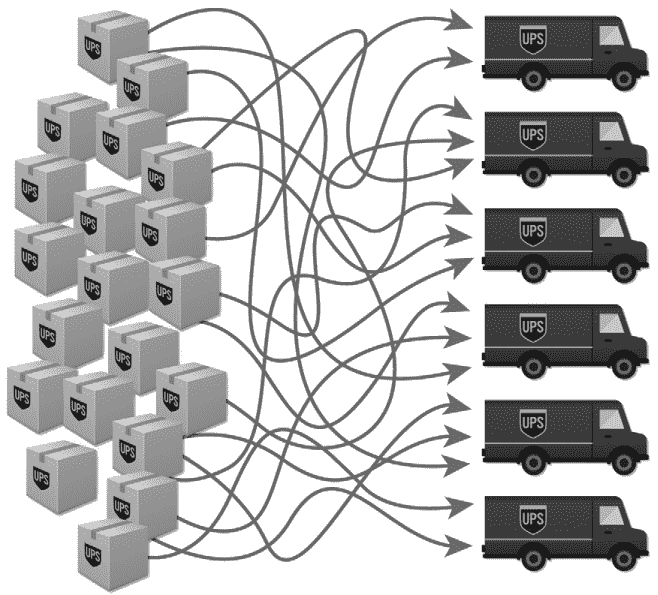

包裹在配送中心被分配给配送卡车。

现在将这个问题乘以1,000。你开发的系统必须每天为美国1,000个配送中心处理这些物流。在这场庞大的运营中，每分每秒都至关重要。每个司机每天多花一分钟，每年成本高达1450万美元。同样，每多一英里就价值5000万美元。不过，真的，没压力。

总的来说，每年有数百万加仑的燃料和数千公吨的排放量岌岌可危。好吧，也许还有点压力。

但真正的难点在于：系统必须在信息不完整的情况下工作。配送中心必须在明天所有配送都已知之前，就开始漫长的规划和装载卡车的过程。许多配送目的地直到凌晨才变得明确。

Jack称之为*配送悖论*。在不知道所有需要进行的配送之前，你无法最优地规划卡车装载。但等到你知道所有配送时，装载卡车的时间已经不够了。

这极大地复杂化了问题。毕竟，每个包裹对整体计划都至关重要。如果卡车装载后才出现一个意外的最后时刻包裹，它可能会给卡车现有的计划增加里程。如果你早知道，你可能会在卡车之间以完全不同的方式分配包裹。但你已经没时间了。装满的卡车已经出发，重新分配包裹需要太长时间。

Jack意识到配送悖论是一个核心难题，因为配送中心每天都要面对大量意外包裹。当时，在第二天规划必须开始时，多达30%的配送仍未进入系统。这是因为许多乘夜班航班到达的包裹缺少或只有部分追踪信息。一些托运客户上传货件数据较晚，或使用不合规或故障频发的系统上传。天气等因素导致的意外延误可能传播缓慢。在漫长的装载夜晚中，一些“哑巴”包裹甚至会在没有正确编码的情况下出现，因此操作人员必须现场手动输入目的地址。

这种信息滞后今天仍然普遍存在——尽管UPS对其系统进行了各种改进，但这在很大程度上是不可避免的。例如，假设一个包裹今天下午将从西海岸飞往东海岸配送中心，以便明天早上配送。如果东海岸中心在中午开始规划，西海岸那时还太早，目的地址可能尚未上传。另一个例子是，即使 *所有* 配送地址都已上传，每辆卡车需要停靠的次数（每次都会耗费宝贵时间）通常在实际配送完成前都未知，例如，一个有多个收件人的大楼或购物中心可能需要多次停靠。除此之外，一些粗略的规划必须提前几天完成，例如，预订合适数量的司机。

在像UPS内部包裹网络这样复杂的系统中，不确定性是固有的困境。解药是预测。

## 预测明天的配送

Jack的系统名为包裹流技术（Package Flow Technology，PFT），它预测明天的包裹配送，以便进行规划。这些预测的配送扩充了已知包裹列表。

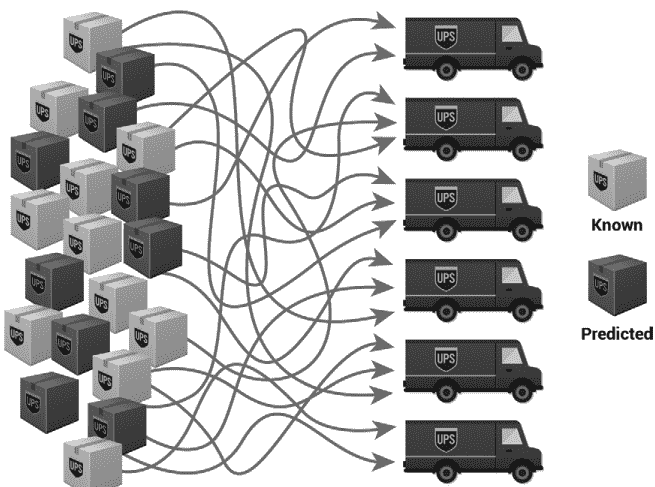

已知和预测配送的组合在配送中心被分配给配送卡车。

PFT可以利用这批扩充的配送目的地制定完整计划，并留出充足时间触发夜间装载过程。卡车通常在凌晨4:00到7:00之间装载，因此规划必须更早开始——在晚上，或者对于某些配送中心，甚至在白天。

让我们来看看这批配送预测是如何形成的。首先，预测模型一次生成一个单独的预测。

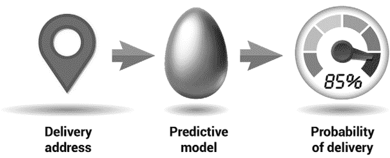

这里展示为金色鸡蛋的模型，是为此目的而从数据生成的。它编码了从过去学到的模式，现在用于对未来会发生什么进行概率评估——某个地址是否会有包裹到来。

该模型被反复应用，对每个可能的配送地址进行计算。对于美国来说，那就是2亿次预测。然后，所有最可能的目的地——例如，评分超过80%可能性的那些——与已知目的地列表合并。

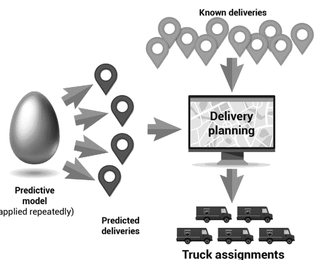

UPS的PFT用预测配送列表扩充计划配送的已知包裹列表，以便及时制定计划来装载配送卡车。

PFT定期更新这些预测——大约每两分钟一次——直到卡车出发。在整个夜间装载过程中，一些预测的配送变为已知，因为包裹实际到达了——此外，其他意外包裹也会到来。系统相应修订计划。结果，一些包裹可能会从一辆卡车移到另一辆，但大部分基于预测的计划仍然保持完整，而无需耗时的更改。到早上，任何未实现为真实包裹的错误预测配送都会从计划中删除。最终，当卡车载着包裹出发时，它们不再需要配送预测——但正是预测让它们能够及时为当天的行程做好充分计划并装满。

## 预测运行世界

除了UPS，同样的基本理念广泛适用。逐案预测的能力是圣杯，因为它无处不在，驱动着诸如哪个客户应成为营销目标、哪个患者应分诊、哪笔交易应审计欺诈、哪栋建筑应检查火灾风险，以及供应链中哪种产品应补货等决策。

这个故事是普遍的：企业和其他组织需要预测。预测需要机器学习。而机器学习依赖于数据。

反过来说，流程按以下顺序从左到右运行：

```
data → machine learning → model → predictions → operations
```

我们有数据，把它交给机器学习，它制作出预测模型，我们利用预测来更优化地驱动运营。

数据为预测提供燃料，因为它蕴含了可供学习的经验。回顾过去，组织知道，例如，谁买了什么，哪些交易最终被证明是欺诈性的，哪些建筑被烧毁。而UPS知道他们所做的每一次货件。在使用机器学习进行预测时，公司应用从这些经验中学到的知识。

说实话：这不是魔法水晶球。完美的预测不可能实现——但也并非必要。即使是糟糕的预测，只要比猜测好，通常也能带来巨大的系统性收益。毕竟，商业是一场数字游戏。即使略微将几率向我们有利的一方倾斜，也会产生巨大的影响。

## 全力以赴

为了实现包裹预测的真正潜力，Jack必须向UPS高管推销重大变革。到那时，PFT系统已经运行几年，但它仅被用于在卡车之间分配包裹，使每辆卡车都有一个设计良好的配送区域，高效路线可能覆盖该区域。

Jack现在正向Chuck推销一项额外的优化，承诺带来更显著的收益：规定这些高效路线，让司机遵循。每辆卡车被分配了一批可以高效配送的包裹——但这不一定意味着它会这样做。司机需要知道开往何处。Jack的团队已经表明，对于配送卡车载货的路线规划，机器胜过人类。

于是Jack向高管Chuck推销了这个重大变革。他说，让我们告诉我们的55,000名司机遵循电脑而不是凭直觉。这是充分实现包裹预测所承诺的效率的唯一方式。

但如你所知，Jack的推销失败了。

## 展示，而非讲述

Chuck毫不在意。他坐在那里，毫无反应，眨着眼睛看着Jack。

下一步？咬牙坚持。Jack沮丧但并未气馁。他早就从承受大量“嘲笑和激烈反对”中长出了厚厚的皮，正如他所说。Jack知道推销大想法意味着在危险水域中航行。要成为数据驱动型，*你希望人们改变他们今天正在做的决定*，Jack多年后在机器学习周大会的主题演讲中宣称。*你真的需要理解变革管理*。

Jack知道人们对具体体验的反应比对抽象概念更强烈。如果他们能亲眼目睹创新的运作，那么他们更有可能感受到其力量。

于是他带Chuck去兜风。是字面意义上的。第二天，他们驾车沿着Jack原型机导航的逐站配送路线行驶。这是高管第一次上路体验ORION——即On-Road Integrated Optimization and Navigation（道路集成优化与导航）的缩写。

出发不久，系统做出了一个违反直觉的选择。它直接跳过了三个配送地址，将它们留给了


后来。人类司机绝不会想到这样做。Jack 解释了这种短期牺牲如何改善了整体路线，确保其他送货的早期时间承诺能够得到满足。

Chuck 举起手说：“给我一分钟。”Jack 看到他在思考。然后灵光一现。“这很重大，不是吗？”Chuck 惊叹地意识到。

Jack 已经跨过了部署过程中的第一个重大组织障碍。

Jack 究竟施展了什么样的“心理魔术”，说服了这个务实、规避风险的决策者接受颠覆性创新？毕竟，只有在一段时间内跟踪绩效后，你才能确切知道改进重大运营的好处——你无法在某一瞬间，甚至在导航完一名司机的整个送货路线后就看到它。

直观的体验比任何 PowerPoint 都更能激发灵感。数字可以证明，但旅程才能打动人。Chuck 只有在亲自驾驶了几英里后，才感受到 1000 万英里的规模。通过巧妙处理这一人为因素，Jack 在推动进展的绿灯审批中达到了转折点。幸运的是，他大学时主修心理学。

## 上路吧，Jack

从那时起，Jack 仍花费了多年不懈的坚持才实现全面部署。还有更多高管需要说服。全国各地的多个运输中心进行了漫长的试点部署，这些试点慢慢无可置疑地证明了其价值。当试点转为永久推广时，Jack 开发了一套严格的流程，以确保每个运输中心有效采用新系统。最终，管理完整的全国部署需要一个超过 700 人的团队。

最终，Jack 将这项贡献作为他的“告别之作”献给了 UPS。他于 2019 年从公司退休，但他的遗产至今仍在取得惊人的成绩。使用 ML 来预测送货是整体优化系统的核心组成部分，据他最好的估计，它贡献了总节省额的 10%：

- UPS 系统：ORION 和 Package Flow Technology（两者协同工作）
- 专门归因于送货预测的年度节省（估计）：
  - 1850 万英里
  - 3500 万美元以上
- 综合系统实现的年度节省：
  - 1.85 亿英里
  - 3.5 亿美元以上
  - 800 万加仑燃料
  - 18.5 万吨排放量

可以说，Jack 取得了巨大成功。他的工作获得了十多个行业奖项以及多个高知名度的电视和杂志报道。

退休几个月后，Jack 与一名正在给他家送包裹的 UPS 司机聊了起来。无论好坏，Jack 都改变了这家伙工作日的每一刻。毕竟，正是广大司机承担了所有这些成果的负担。他们的时间和里程被更高效地利用，这意味着他们整天每小时都能完成更多送货。有些人提出了投诉，包括资历更深的司机，他们可能是最抗拒改变的人。

“你参与 ORION 项目吗？”司机问道。这家伙完全不知道自己在跟谁说话。这有点像问托马斯·爱迪生他是否与电灯泡有关。Jack 表明了身份，并做好了应对冲击的准备。

“我喜欢 ORION！”司机喊道。“我是新来的，在 UPS 只干了一年。它替我思考。我不需要担心按时送货。它减轻了压力。”

如今，Jack 反思自己贡献的意义。“我真的很自豪，”他说，“我们不再是一家拥有技术的卡车公司，而是一家拥有卡车的科技公司。”

## ML 的正确做法与错误做法

Jack 的故事堪称非凡。除了为 UPS 创造价值，他还为一种新的商业范式开辟了道路，为绿灯审批和执行 ML 部署这一巨大的运营变革制定了最佳实践。Jack 的工作为有效的 ML 领导力定义了一份蓝图。

以下是 Jack 做对的地方：

- 价值导向。Jack 宣传 ML 部署的具体收益，而非技术本身的花哨之处。
- 部署导向。他不遗余力地追求通往部署的战略路径，而不是假设部署系统的价值不言而喻并会由他人承担。
- 端到端负责。他对整个全流程负责——从开发到宣传到测试再到上线。

多年过去了，但做到这些仍然不是常态。相反，许多公司举步维艰，忽视了将 ML 部署到现场所需的端到端业务实践。

## 两种技术的故事

> 这是最好的时代，这是最坏的时代，这是智慧的时代，这是愚蠢的时代。
> ——查尔斯·狄更斯

一方面，正如《哈佛商业评论》敏锐地指出的，ML 是“我们这个时代最重要的通用技术”。另一方面，它也是最被误解和管理不善的技术。一次又一次的失误，许多 ML 项目在部署使命中搞砸了，它们的模型注定只能积灰。

利用这项技术至关重要——但启动它却臭名昭著地困难。许多 ML 项目永远无法超越建模和数字计算阶段。行业调查反复表明，大多数新的 ML 计划无法进入部署阶段，而价值正是在部署阶段才能实现。

炒作助长了这一问题。ML 被神话化，被误解为“智能”，而实际上并非如此。它也被错误地衡量为“高度准确”，即使这一概念无关紧要且具有误导性。目前，这些赞美之词在很大程度上淹没了忧虑的声音，但那些声音注定会越来越大。

以自动驾驶汽车为例。在 ML 炒作最引人注目的警示故事中，过度承诺导致猛踩刹车，进展放缓。正如《卫报》所说，“无人驾驶汽车革命已停滞。”这很遗憾，因为这一概念承诺了伟大的前景。总有一天，它将被证明是 ML 的一项革命性应用，能大幅减少交通死亡人数。据曾任 Google 自动驾驶团队 CTO、现任 Aurora 首席执行官（Aurora 收购了 Uber 的自动驾驶部门）Chris Urmson 称，这将需要一场漫长的“将在 30 年甚至更长时间内发生的转型”。但在 2010 年代中期，投资和狂热的炒作——包括特斯拉 CEO Elon Musk 的夸张推文——达到了过早的高潮。真正令人印象深刻的驾驶辅助功能被贴上“完全自动驾驶”的标签，并被宣传为即将实现广泛、完全自动驾驶——也就是说，允许你在后座小憩的自动驾驶。期望值随之增长，随后是……自动驾驶汽车的明显缺席。幻想破灭了，到 2020 年代初，投资大幅萎缩。自动驾驶注定要成为这个时代的喷气背包。

哪里出了问题？说是规划不足都轻描淡写。问题与其说是过度推销 ML 本身，即夸大预测模型能多好地识别行人和停车标志，不如说更大的问题是大幅淡化了部署的复杂性。只有全面、深思熟虑的计划，才有可能管理在缓慢将此类车辆投入世界时不可避免的一系列障碍。毕竟，我们说的是 ML 模型自主地在拥挤的城市中导航大型重型物体！一位科技记者恰当地称它们为“自动驾驶子弹”。在将 ML 运营化方面，自动驾驶 *简直* 是关键所在。比任何其他 ML 计划都更甚，它需要一个精明、渐进的部署计划，不承诺不切实际的时间表。

## 如何做对

许多 ML 项目的故事同样令人失望，尽管你通常不会面临像将模型安装到自动驾驶汽车中那样巨大的部署挑战。同样，你通常也不会面临优化 UPS 运营的复杂性。大多数 ML 项目要容易得多。然而，绿灯审批和管理模型集成仍然比预期的要困难得多。

在本书中，我介绍了一个启动 ML 的战略与战术手册，即一套六步业务纪律，用于运行 ML 项目以使其成功部署。我将这种做法称为 *bizML*。它克服了 ML 常见的启动失败，通过从一开始（甚至在动手做数据工作之前）就详细规划部署，来跨越部署的障碍。

在此过程中，我也涵盖了每个参与 ML 项目的人都需要的半技术背景知识——以任何人都能理解的友好、易懂的方式。当所有人都达成共识时，跨学科团队可以在整个端到端项目中深入协作。

下一章，第 0 章，概述了 bizML 范式，并以我自身咨询实践中的一个警示故事拉开序幕。接着，第 1 章到第 6 章介绍了六步纪律。最后，结论部分介绍了规划 ML 项目所需的一些最终要素，包括项目的人员配置、时间表、持续维护和伦理考量。


# 0 BizML

## 机器学习部署的六个步骤

为什么从“第 0 章”开始？本章介绍 bizML，即第 1 至第 6 章所涵盖的六步操作手册。BizML 规划出启动机器学习所需的战略实践——也就是说，不仅要对数据进行数值计算，还要将结果在运营层面部署。为了理解为何需要这种方法，本章解答了几个紧迫的问题：为什么大多数 ML 项目无法部署？为什么规划 ML 项目时必须倒推如此重要？为什么业务领导者必须具备半技术性知识，即使他们不是数据科学家？最初由谁来领导项目？

这是一场危机。人类最新、最伟大的发明刚一出发就停滞不前。机器学习项目经常失败。

这不能继续下去。世界需要 ML。它能应对我们最重大的风险——包括野火、气候变化、大流行病和儿童虐待。它能提升销售、降低成本、防止欺诈、简化制造并加强医疗保健。

但大多数 ML 计划夭折于早期：它们在部署前就停滞不前。这些失误代价高昂。谁该负责？

怪像我这样的数据科学家。

我令人后悔的行为始于多年前。我当时正在访问旧金山 gay.com 时尚的办公室——该网站现已倒闭，但当时是美国最受欢迎的同性恋约会网站。这是我作为新晋独立顾问承接的第一个重要客户项目。

“抱歉让您久等了，”副总裁对我说道，从会议室匆匆走出。她对我露出一个愧疚的笑容——但她脸上的表情不是关于时间，而是关于金钱。“我们有数百万美元闲置在支票账户里……哎呀！所以，我们必须决定把它投到哪里，或者类似的事情。”

资金充裕，她以我作为新顾问所期望费率的三倍续签了我的合同。“这是最后一次，”她警告道，仿佛在给一个十岁的孩子发 Twinkie。

我本可以欣喜若狂。孩子需要玩耍，外科医生需要切割，数据科学家需要建模。十多年前我就深深迷恋上了 ML，但迄今为止我只通过学术研究和教学追求我的热情。现在我有一家真正的公司付给我真金白银，让我向现实世界证明 ML 的价值。

## 预测的潜力

像大多数技术人员一样，我同意 Jack Levis 曾经说过的话：“业务驱动技术；技术不驱动业务。”但对于一个兴奋的数据科学家来说，情况也可能恰恰相反。我的项目追求一个值得的业务目标，但也对我有好处。我得以为了这个目标大展我的建模身手。

Gay.com 的业务目标是所有目标中最基本的之一：留住更多客户。毕竟，留住一个客户就等于赢得一个客户。营销界有一个众所周知的经验法则：留住现有客户远比从街头获取新客户更具成本效益。

预测使客户留存成为可能。如果 gay.com 通过营销联系针对可能流失的客户，并且成功挽回了其中原本会取消付费会员资格的 5% 的客户，该公司每年将从这些挽回的客户那里获得估计 862,000 美元的客户终身价值，即额外收入。

为何潜力如此巨大？这个约会网站是为短暂的激情而设。在其他以寻求关系的用户为主的网站上，用户往往会坚持下去（直到最终找到伴侣并取消，之后就很难再赢回他们）。而在 gay.com，多达 80% 的付费会员会在下一次自动续费前取消。我在数据中看到了这种行为，但起初我完全不明白原因。当我在幕后处理数据时，我与网站的外观和感觉隔绝了。我知道它面向男性用户，但我只是偶尔瞥一眼前端。它到处都是帅哥。有一次，有人明确告诉我：“这就是男人去寻找随意约会的地方。”

因此，生意兴隆。Gay.com 在持久性方面的不足，通过其受欢迎程度和不断涌入的新订阅者得到了弥补。这留下了 145,000 名付费高级会员的健康基数，以及数倍于此的免费账户。

这种高流失率既带来了机遇，也带来了挑战。鉴于客户进进出出的洪流，我们所要做的只是留住其中的一小部分。只要在这条宽阔的河流中舀一小桶水，就是一项巨大的胜利。但改变原本会流失客户的想法是昂贵的，通常通过向他们提供诱人的折扣来实现。一家公司无法向其整个客户群提供折扣。

预测是唯一的出路。公司将其外联集中，只向最可能取消的客户提供留存折扣。ML 的这种常见用途称为流失建模，对许多组织来说都有回报。例如，手机运营商就很流行。挪威电信（Telenor）是全球第七大运营商，拥有超过 1.5 亿订阅者，部署了流失模型，将其留存工作的回报提高了十一个倍数。

因此，我所要做的就是开发预测模型，并向 gay.com 解释其潜力。他们肯定会用它来推动营销活动，捕捉这笔未实现的利润。

## 机器学习的两个主要技术步骤

这两个步骤——开发模型，然后使用它——是通用的。它们是任何 ML 项目的两个主要技术步骤。首先，一种建模方法，也就是 ML 算法，将数据作为输入并对其进行处理，以生成预测模型。

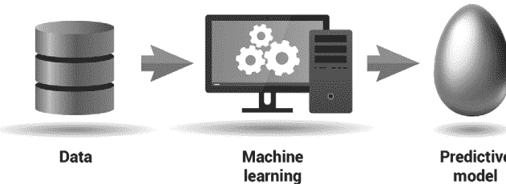

机器学习从数据生成预测模型。

这里将模型描绘成一个金色的蛋，它是从数据中“学习”到的东西。对于 gay.com，我生成了决策树模型，由 if-then 规则组成，例如：

```
IF the thing the customer was trying to do when they
got upgraded from a free to a paid membership
level was trying to chat with another user
AND
The customer signed up for a paid membership fewer
than 238 days ago
AND
They last had a failed login attempt within the last
2 days
THEN the probability of cancelation is 43%.
```

这就是有趣的部分。当机器自动发现历史模式——无论是以 if-then 规则还是更复杂的数学公式形式——你正在目睹最令人兴奋、最迷人、最深远的技术：能够学习的软件。

一旦创建——或者“学习”——之后，模型的目的是为尚未流失的当前客户逐个生成预测分数（概率）。因此，第二步就是使用它来做到这一点，从而应用所学到的内容。这被称为评分。使用模型进行评分，然后根据分数采取行动，称为模型部署。

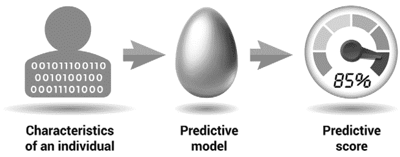

评分：模型为个人生成预测。

这就是发射，主事件，全部意义所在。第一步可能是“火箭科学”部分，但最终必须来发射火箭的时候了。在部署步骤中，我们将模型部署到现场，在那里它生成推动运营的预测——例如，向客户发送营销外联以留住客户。模型部署也被称为运营化、集成、实施或“将模型投入生产”。

例如，一旦模型部署完成，当上述规则对某个客户“触发”并因此给该客户评分 43% 的取消概率（这相对较高）时，它会触发一封电子邮件，内容为：“我们爱您作为客户，这是一个折扣代码。”

这就是我向 gay.com 提出的方案。开发模型后，我知道我必须提出商业论证，因此我制作了一个漂亮的 PowerPoint 演示文稿，以展示我的模型及其预计回报的潜力——只要他们愿意使用它。


## 机器学习失败通常是人为失败

> 技术的个人使用并不总能转化为在组织内部或作为组织有效使用这些工具的知识。
> —Gerald Kane 等人，《技术谬误：人才是数字化转型的真正关键》

> 统计学家，如同艺术家，有爱上自己模型的坏习惯。
> —著名统计学教授 George Box

但是 gay.com 没有部署我的模型。相反，他们称赞了它，并将其搁置一旁。副总裁向我保证，我的提案很有趣，他们会予以考虑。她感谢我的咨询工作，该工作已经结束。我再也吃不到 Twinkies 了——对他们也没有创造任何价值。

我很快就释然了。作为一个刚刚开始兴起的领域里的新晋顾问，我只能花一点时间感到困惑和失望。我已经尽了我的本分，这是他们的损失。

但今天，在又咨询了二十多年之后，这个教训已经深入人心。不幸的是，这个教训今天依然同样相关且来之不易，也许部分原因在于它是一个悖论：

**机器学习悖论**：要让这项先进技术取得成功，我们现在需要在人方面——在理解和领导力方面——取得改进，而非在技术本身上。

机器学习悖论是詹姆斯·贝森（James Bessen）所称的*自动化悖论*的一个特例。“当计算机开始做人的工作时，”他在《大西洋月刊》中写道，“对人的需求往往反而会增加。”

要推销、教育、推广并领导机器学习项目，需要一种全面的视角——一种整合业务和技术两方面视角的视角。缺乏这种视角，组织往往无法弥合业务/技术“文化鸿沟”。一方面，执行模型开发步骤的数据科学家，由于只专注于数据科学，从而降低了其工作的价值。通常，他们更希望被留在自己高度技术性的专业领域，不愿被“琐碎”的管理活动所打扰。数据科学家往往理所当然地认为自己的模型会被部署。其价值不言而喻——怎么可能不被实际使用呢？带着这种心态，他们热情地跳过严谨的业务流程，直接投入建模。在大多数情况下，得到的模型只会束之高阁。

另一方面，许多业务专业人士——尤其是那些已经倾向于将细节视为“太技术化”而予以忽略的人——被诱导认为这项惊人的技术是一种能自行解决问题的万能药。对他们来说，无需深入细节，因为技术本身具有内在价值，而细节仅属于数据科学家的职责范围。最终，当面对已部署模型将带来的运营变革时，这是一项难以推销的提议。措手不及的利益相关者在改变公司维持盈利的方式之前会犹豫不决。

当没有人主动承担责任时，水管和水龙头就无法连接。这种讽刺是不容否认的：各方都倾向于更关注技术本身，而非其应如何部署。这就像对火箭的开发比对其发射更感兴趣一样。

## 许多模型从未部署：一个行业普遍存在的问题

> 在没有模型运营化框架的公司中，PowerPoint 是模型的归宿！
> —Hulya Farinas，Fitbit 数据科学总监

有多少模型未能部署？大多数数据科学家表示，在他们的工作中，这一比例在 80% 到 100% 之间。在他们的项目中，只有 0% 到 20% 的模型被部署。幸运的是，其余数据科学家的成功率更高。这些观察结果来自我与 KDnuggets（一个深受数据科学家欢迎的开创性分析新闻网站）共同进行的调查，如下图所示的柱状图所总结。

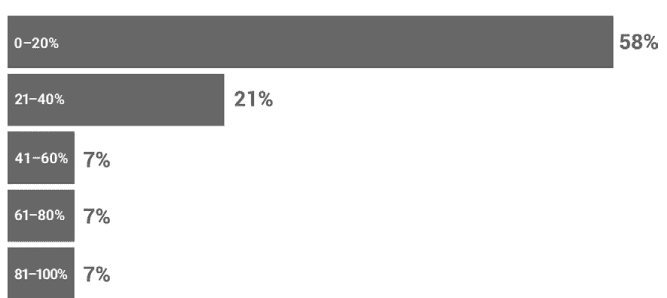

针对问题“你创建的或你同事创建的（旨在部署的）机器学习模型中，实际有多少比例被部署了？”的调查回复。总受访者：114 人。

其他行业研究也印证了这一令人沮丧的结果。由机器学习咨询公司 Rexer Analytics 运行的行业领先的数据科学调查显示，只有 11% 的数据科学家表示他们的模型总是会被部署。管理层也持同样观点，根据 MIT Sloan Management 和波士顿咨询集团的研究，他们指出“只有 10% 的公司从 AI 技术中获得显著财务收益”。同样，研究公司 Gartner 的一位分析师估计，接近 85% 的大数据项目失败。

尽管如此，机器学习绝非失败。如果世界上众多项目中有 15% 到 25% 被部署，那也绝非微不足道。预测模型每天都在积极影响我们的生活——例如，通过增强垃圾邮件过滤器和 Google 搜索结果来提供更相关的内容——大幅降低信用卡欺诈，等等。我自 2009 年以来一直在举办的机器学习周（Machine Learning Week）会议，建立在来自财富 500 强及其他企业的大量积极案例之上。

事实上，对于许多机器学习项目，成功的可能性相对较大。例如，在大型科技公司，经验丰富的员工和充足资源的巨大力量往往会为部署创造有利条件。如果你在一家已经部署信用风险模型多年的银行开发新更新的模型，情况也是如此。此外，像 UPS 的 Jack Levis 这样的罕见创新者，通过领导异常注重部署的项目而取得成功。

但如果你正在为组织开创一项新的部署，而运气又没有青睐，你可能面临艰巨的任务。麦肯锡的 AI 指数显示，“AI 领先企业与仍在努力利用该技术的大多数公司之间的差距”正在不断扩大。

越来越多的负面言论和轶事哀叹这一令人失望的事实。当我发布我们的调查结果时，专家们表示赞同。例如，分析领域领军人物 Armin Kakas（曾在 GE Capital、Molson Coors、Best Buy 和 American Tire Distributors 管理分析工作）表示：“多年来，我主导或监督过许多企业级分析计划……如果我宽厚一点，我会说大约五分之一的计划取得了成功，并为公司带来了一定程度的价值实现。”

顾问们也在打同样的仗。著名的《Digital Decisioning》作者 James Taylor——我所知道的极少数从业务视角而非数据科学视角运行分析计划的顾问之一——一次又一次地目睹了同样的情况。“在与许多公司的交谈中，”他说，“当我开始询问机器学习部署时，关注的是业务结果而非技术结果，是全面推广而非仅仅是试点，好案例并不多。我说，我对项目成功的定义是：模型已被开发并部署，从而为付费的组织创造了——注意过去时——业务价值。当你施加这个标准时，哎呀，外面一片寂静。”

力量被困在 PowerPoint 中。我们善加利用的速度太慢。时任 MIT Sloan 教授 Erik Brynjolfsson 在一次 TED 演讲中直言不讳：“仅靠技术是不够的。技术并非命运。我们塑造自己的命运，正如早期一代管理者需要重新设计他们的工厂一样，我们将需要重塑我们的组织……我们在这项工作上做得不够好。”

机器学习更广泛的成功并非在等待某项新的技术突破。它正在搁置，直到技术取得突破——直到它获得组织接受和运营采用。如果你正在启动一项新的机器学习计划，而不格外努力去采用一种非常具体的组织实践来运行项目，那么你的项目极有可能陷入同样常常导致他人失败的模式。

在概述该实践之前，让我们先看看为什么这么多机器学习项目难以部署。

## 他们不能部署……还是不愿部署？

机器学习行业已经掌握了开发潜在有价值模型的技术，但尚未掌握其部署。AI Journal 根据 Sapio Research 的调查编制的一份报告显示，数据团队的首要痛点是“通过 AI 立即实现业务影响”。96% 的受访者勾选了该选项。这一挑战超越了包括数据安全、法规合规以及各种技术和基础设施挑战在内的更广泛数据问题清单。但是，当面对一个模型时，业务领导者拒绝部署。他们只是说不。失望的数据科学家不禁想问：“你不能……还是你不愿？”

根据我与 KDnuggets 调查中提出的另一个问题（如下图柱状图所示），情况是两者的混合。

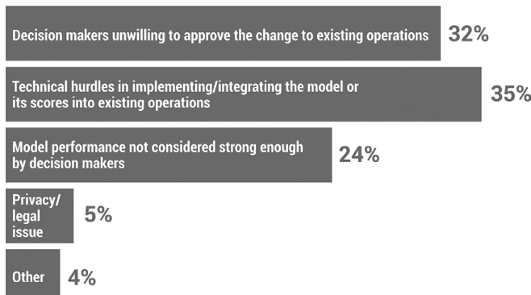

针对问题“模型部署的主要障碍是什么？”的调查回复。总受访者：114 人。


技术障碍意味着他们做不到。缺乏批准——包括决策者认为模型性能不够强大，或存在隐私或法律问题时——意味着他们不愿意做。

另一项调查也讲述了这个“有些做不到，有些不愿意”的故事。在机器学习咨询公司 Rexer Analytics 对数据科学家的调查中，当被问及为何拟部署的模型未能落地时，创始人 Karl Rexer 告诉我，受访者提交的两个主要原因是：“组织缺乏部署所需的适当基础设施”和“组织内的人不理解机器学习的价值。” 不出所料，Karl 表示，后者那群数据科学家——即“不愿意”而非“做不到”的人——听起来最沮丧。

无论他们是做不到还是不愿意，缺乏一套成熟的商业实践几乎总是罪魁祸首。部署面临诸多技术挑战，但只要项目领导者预见并规划应对，这些挑战就不会成为阻碍。只要有一个提供处理模型实施（有时甚至是大规模建设）所需时间和资源的计划，部署就会推进。归根结底，问题与其说是他们做不到，不如说是他们不愿意。

现在我们转向补救措施，即每个机器学习项目都需要的主动规划流程，以便他们能够做到并且愿意去做。

## 解决方案：BizML

> 大多数分析和 AI 项目失败，因为运营化仅被当作事后补救。
> ——Gartner

正如我们在引言中看到的 UPS 故事，Jack Levi 通过承担端到端的所有权（从项目启动到上线）成功推动了部署。这是一个跨度很大的过程。

任何机器学习项目都需要这样做。为了成功运行项目并使其上线，你必须遵循一套建立在三项基本准则之上的商业实践——第三项准则涉及端到端的所有权：

掌握机器学习半技术性——却又易于理解——的一面。在参与机器学习项目之前，所有专业人士都必须获得一些罕见的背景知识，熟悉一套易于理解的机器学习基础知识。令人惊讶的是，其中一些知识甚至连数据科学家也鲜有了解。本书第 1 至 6 章在介绍机器学习商业实践的同时，涵盖了这些基础知识。

规定业务专业人士与数据科学家之间必须深度协作。这两种截然不同的“物种”必须联手执行项目的每个步骤，以实现部署。毕竟，部署意味着对现有运营进行根本性改变。你不能假设决策者会轻易认可。为了保持项目进度并为运营化铺平道路，必须动员业务方利益相关者与数据科学家深度协作，并在每个项目步骤（端到端）中提出意见。这包括定义性能目标、准备数据，以及开发和部署预测模型。

倒推机器学习项目。在协作的第一步，即建模开始之前，先从最终目标出发：明确机器学习将如何部署以改进运营。利益相关者必须批准模型计算出的概率将如何改变业务流程以加以改进。只有在前期明确这一点，机器学习项目才有机会实现成功部署。这种“倒推”策略是一种简单却出人意料地未被充分利用的行业技巧。

为了体现这三项准则，一个知识渊博的团队必须协作遵循一套端到端的实践，该实践从为最终目标进行倒推规划开始。我将这种实践称为 bizML，它包含以下步骤。

## bizML 的六个步骤：

- 1. 价值：确立部署目标。此步骤定义商业价值主张：机器学习将如何影响运营，以便通过最终步骤（模型部署）加以改进。
- 2. 目标：确立预测目标。此步骤定义模型将针对每个具体案例预测什么。从商业角度来看，其中的每个细节都至关重要。
- 3. 性能：确立评估指标。此步骤定义哪些指标最重要，以及必须达到什么性能水平——模型必须预测得有多好——才能使项目成功。
- 4. 燃料：准备数据。此步骤定义数据应呈现什么样子，并将其转化为该形式。
- 5. 算法：训练模型。此步骤从数据生成预测模型。模型就是被“学习”的东西。
- 6. 启动：部署模型。此步骤使用模型生成预测（概率）——从而将所学内容应用于新案例——然后根据这些预测采取行动以改进业务运营。

这些步骤定义了一套商业实践，为机器学习部署铺平并导航一条精明的道路。任何希望参与机器学习项目的人都必须熟悉这些步骤，无论你将在业务方还是技术方扮演角色。撕下本书末尾附近的一页速查表，挂在你办公桌上方的墙上。

如果你见过本书的目录，这六个步骤会让你感到熟悉。它们是本书接下来的六章。每个步骤都有一整章专门探讨该步骤的注意事项、决策点和挑战。

在以步骤 6（部署）达到高潮后，你完成了……开始一件新事物。BizML 只是开启了一段持续的旅程，一个运行改进后运营并保持其正常运转的新阶段。一旦模型上线，就需要维护：监控它、维护它，并定期刷新它。本书的结论介绍了这一持续工作。

## 为什么行业正在汇聚于这六个步骤

按此顺序遵循这六个步骤几乎是逻辑上的必然。要理解原因，让我们从终点开始。最后两个高潮步骤（步骤 5 和 6）是机器学习的两个主要步骤：模型训练和部署。BizML 引导项目完成这两个步骤。

在这两个步骤之前的那个步骤——步骤 4：准备数据——是一个已知的要求，始终在模型训练之前进行。你必须以正确的形式向机器学习软件提供数据，才能使其工作。自 20 世纪 60 年代企业首次应用线性回归以来，该步骤一直是建模项目不可或缺的一部分。

在技术魔法之前，你必须先完成商业魔法。这就是前三个步骤的作用所在。它们在深入准备数据、开发模型和使用模型的实际工作之前，对项目进行了稳健的倒推规划。它们建立了一个急需的“预生产”阶段，用于推介、社交和协作，以便共同就机器学习将如何应用及其性能将如何评估达成一致。重要的是，这些初步步骤远不止于同意项目的商业目标。业务专业人士，请准备好深入探讨比你预期更深层的机制和算术。同样，数据科学家，请准备好超出你通常的技术圈层，与业务方人员密切合作。

我设计 bizML 是为了满足一个迫切且未被满足的需求：行业尚未建立一套为领导者、经理及其他希望应用机器学习的商业专业人士所熟知的标准化实践。近三十年前建立的一个标准曾获得一些关注，但几乎完全局限于数据科学家（当时称为数据挖掘者）之中。该标准设计于 1996 年，名为 CRISP-DM：跨行业标准数据挖掘流程。这项基础性工作通过阐述许多基础知识，为标准化铺平了道路。然而，它在商业专业人士中从未获得太多关注，部分原因是它在很大程度上使用技术语言，也许也部分是因为它最终落入机器学习软件供应商 SPSS（后被 IBM 收购）的控制之下，限制了其被供应商中立的倡议所推广的任何可能性。

本书对 bizML 的介绍代表了一项新的努力，旨在建立一本更新的、行业标准的手册，用于运行成功的


与业务专业人士和数据专业人士都相关且引人注目的 ML 项目。

BizML 补充了 CRISP-DM，因此两者兼容。CRISP-DM 适用于更广泛的项目范围——数据科学项目一般——而 bizML 专注于 ML 项目，因此本书的步骤更深入地探讨了预测模型特定主题，例如项目的预测目标、模型的预测性能指标以及模型的部署方式。

在更现代的层面上，bizML 也与最近被命名的实践“数据产品管理”完美契合，该实践主张对分析项目采取“产品”导向，这与软件产品管理高度相似。这意味着开发与客户需求高度契合的能力——在 ML 项目中，客户是消费模型分数的人，无论是为了指导团队决策还是改进其运营系统。通过倒推规划，bizML 遵循这一原则，将客户放在首位，交付可行的产品：满足客户需求的预测能力。

但 bizML 更具专业性。数据产品管理的智慧普遍适用于各种分析项目。它审慎地借鉴了软件产品管理的最佳实践，以运行产品的开发、维护和客户支持。与此同时，bizML 专为 ML 项目设计，所有六个步骤都专门针对成功部署预测模型所需的条件。

在进入下一章的 bizML 步骤 1 之前，本章仍需完成铺垫。我将介绍：

- 为什么 ML 术语需要一个新词：bizML
- 为什么技术本身比其推出更受炒作
- ML 行业必须如何重新定位自己
- 为什么数据素养是每个人都需要的——就像驾驶教育，而不是汽车修理学校
- 谁应该领导 ML 项目
- 我本应在 gay.com 项目中做出哪些不同的做法

## BizML：一个长期未命名的核心要求

遵循 bizML 实践的全部六个步骤并不常见，但也并非未曾有过。许多 ML 项目取得了巨大成功，即使它们属于少数。尽管一个广为人知、成熟的框架迟迟未出，但 bizML 框架核心的理念对许多经验丰富的数据科学家来说并不新鲜。

然而，最需要它的人——业务领导者和其他业务利益相关者——最不可能熟悉它。事实上，商业世界总体上甚至尚未意识到最初需要一种专门的业务实践。这是可以理解的，因为普遍的叙事误导了他们。AI 常被过度宣传为一种难以理解却又令人兴奋的万能药。与此同时，许多数据科学家更喜欢处理数字，而不是费心阐明。一直以来，没有流行的商业书籍，也没有普遍的商学院课程教授 ML 项目的详细操作手册。

最无帮助的是，它甚至还没有一个名称。没有广泛认可的术语来传播消息并创造趋势。相反，迄今为止获得关注的 ML 热门词汇涉及技术方法，而非业务方面的学科。例如，当前趋势的 MLOps 领域——涉及 ML 运营化，即部署的另一个术语——解决的是技术障碍，而非组织障碍。MLOps 指的是管理和维护模型的重要工程“行业诀窍”集合。这不应与管理人员的实践混淆。虽然两者都与模型的运营化相关，但 MLOps 解决的是 ML 项目的技术执行，而 bizML 解决的是组织执行。遵循 bizML 的项目完全可以采用 MLOps 作为一种宝贵的方法，以确保公司能够在技术上部署模型，但 MLOps 并未全面解决其领导者是否会部署它。单靠任何技术解决方案都无法解决 ML 项目面临的业务方面的挑战。相反，像 bizML 这样的有效业务实践必须是那条摇动 MLOps 尾巴的狗。

AutoML 是另一个流行术语，但它也命名的是技术解决方案，而非组织解决方案。AutoML 指的是一组宝贵的方法，用于自动化数据科学家传统上手动执行的某些任务，包括数据准备的某些方面以及选择最佳建模方法（分别对应步骤 4 和 5 的部分内容）。

因此，本书提出的运行 ML 项目的六步实践被命名为 bizML。这不是一种技术实践，而是一种涉及技术步骤的业务实践。

## 炒作的起源与代价

> 我预计未来五年内将出现第三个 AI 寒冬。……1991 年我获得 AI 和 ML 博士学位时，“AI”几乎是个贬义词。没有公司会考虑雇佣从事 AI 工作的人。
> 
> ——Usama Fayyad，在 2022 年 6 月的 Machine Learning Week 上发言

等等！按照六个项目步骤排序章节，我写了一本 ML 书，直到书的末尾才深入探讨 ML 本身。

事实上，这再好不过了。旨在推出 ML 的项目必须首先关注模型将如何部署，其次才是生成模型的核心数字处理——无论这种处理从科学角度看多么令人兴奋和印象深刻。

但数据科学家痴迷于核心 ML 方法。她天生如此。她的冲动是尽快“动手”进行建模。即使是初学者数据科学家也效仿，几乎总是从动手课程和书籍开始，这些课程和书籍假设训练数据已经准备好。而绝大多数教师和作者都在鼓励他们：第一步是将数据加载到建模软件中。这支持了一种错误的叙事，纵容跳过项目的早期步骤。因此，在建立通往运营部署的路径之前直接跳入核心 ML 本身，是使 ML 项目脱轨的最常见错误。

一些简单的经济因素进一步放大了这种对核心技术的不成比例的关注。在分析行业，赚大钱的最佳方式是销售软件。利润、收购和 IPO 都在这里。但销售 ML 软件工具的供应商不愿宣传其产品本身并不执行运营变革。他们可能会慢慢解释，ML 软件仅承担端到端 ML 项目中有限（尽管是核心）的技术部分。这些供应商有动力将注意力集中在其技术产品上，而不是企业流程上。

这种过度关注将让我们付出代价。喜不喜欢，我们都已系好安全带，准备经历加特纳炒作周期所著名地描绘的起伏，该周期说明了每种新技术从诞生到成熟的预期轨迹。

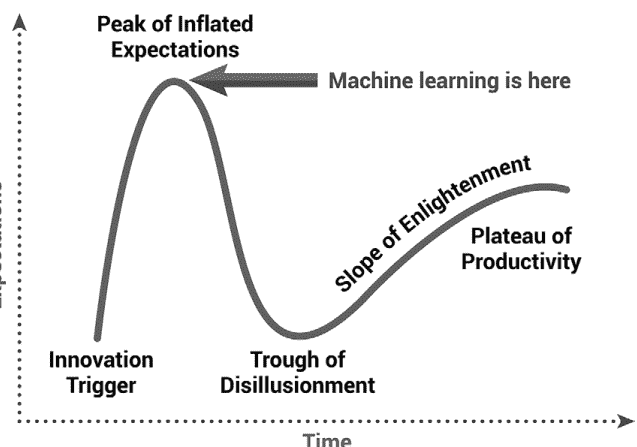

技术的加特纳炒作周期。

起初，随着新技术获得关注，期望值上升。但炒作通常过火，达到了“过度期待的高峰”。

对于 ML，我们正站在那个悬崖边，准备跌入“幻灭的低谷”。加特纳认为 ML 已经部分滑向低谷，但我会认为它仍停留在高峰。业界对 ML 的兴奋似乎尚未受到其部署困难的影响。

ML 的下跌可能比大多数技术更严重。炒作与现实之间的脱节似乎只在增加，对技术的关注远多于其部署价值。当高管们意识到这一点时，将付出惨重代价。如果我们继续当前的路径，从荣耀中坠落将更加陡峭，幻灭感也会更深。这将成为第三个 AI 寒冬的核心，一个兴奋和资金减少的时代。随后沿着“启蒙斜坡”爬回去可能会更加缓慢，生产力还要遥遥无期。

## 重新定位 ML

我们不关注技术。老实说，我没有一个单独的分析项目。我有业务项目，而分析可能只是其中的一部分。

> ——Jack Levi

如果我们重新定位 ML，就可以避免如此严重的下跌。虽然我认为 AI 寒冬是不可避免的，但那次痛苦的俯冲不必拖累 ML。通过现实而具体地传达 ML 提供的东西——并且，理想情况下，称其为“ML”而非“AI”——我们可以将其与常常缺乏根据的炒作区分开来，这种炒作定义了 AI 品牌，并拯救 ML，使其不成为自身热度的牺牲品。

我们只需重新定向焦点。不要提议一个“ML 项目”。相反，推介并领导一个将改善运营的项目，最多只在旁注中提及 ML 作为解决方案的一部分。通常，ML 项目是这样定位的：

AI 将改善运营。

除了摒弃通常会损害清晰度的“AI”术语外，我们还必须以这种方式重新定位项目：


## 我们将改进运营（使用 ML）

为了举例说明，让我们将这种重新定义应用到我们迄今为止涵盖的故事中——简而言之：

- 我们将运行新的营销流程以留住客户（使用 ML 针对最有取消风险的客户）。
- 我们将提高 UPS 包裹配送的效率（使用 ML 预测配送目的地）。

作为另外几个例子，让我们正确地构建信用评分和欺诈检测项目：

- 我们将改进银行的信贷申请处理（使用 ML 预测哪些申请人最有可能违约）。
- 我们将在不增加审计师工作量的情况下提高欺诈交易的检测率（使用 ML 预测哪些交易最有可能是欺诈交易）。

以这种方式重新定义 ML 项目，将业务目标置于技术之前——同样，它也将主导权从技术转移到了业务。句子的第一个词是“我们”而不是“AI”，是人类而不是机器。

此外，这一调整将变革管理明确地提上日程。变革管理是一门旨在促进运营转变的成熟学科——但只有在被采用时才能发挥作用。许多 ML 项目没有意识到变革管理的概念适用，但模型部署意味着改变业务运作的方方面面，这种变化必须像其他任何变化一样主动管理。通过将这项工作视为企业项目而非技术项目，人们将认识到一个常被忽视的真相：ML 部署带来的挑战，只有变革管理流程才能应对。

## ML 厂商提供帮助，但企业主导行业

ML 软件创造潜在价值，但只有更广泛的企业举措才能捕获该价值。ML 项目的成功不仅在于使用 ML 软件产品，还在于实施一种范式。对于业务项目，ML 软件发挥着至关重要的作用，但它只是一个辅助角色。

对于某些技术，产品本身就能创造价值。更快的计算硬件、更大的存储解决方案和精简的数据库软件本身就能提供价值。但 ML 软件不同：要改进业务运营，它必须被用作更广泛组织流程的一部分。

毕竟，没有哪个软件产品能单独解决 ML 项目所解决的那种重大问题：运营低效。ML 项目是一项咨询工作，而非技术安装。运行项目的人交付的是服务，而非软件。

因此，厂商不主导 ML 行业——用户才主导。从这个意义上说，ML 行业不同于手机行业、笔记本电脑行业，甚至许多形式的企业软件，在这些行业中，公司通过销售的产品争夺定义市场的领先地位。相反，ML 行业是由使用 ML 的公司内部的创新者领导的一场运动。它更像餐饮行业，炉灶制造商至关重要，但餐馆老板和厨师主导行业。

全能公民数据科学家的神话部分是由某些 ML 厂商传播的。当他们销售其 ML 软件产品本身就能解决企业问题的虚假叙事时，他们就在这样做。恰恰相反——未经培训的用户无法独立为新的 ML 计划开发预测模型。ML 软件需要数据科学专业知识才能使用并从而创造价值。而捕获该价值不仅仅是使用产品——它需要一种全面的、协作的企业实践。缺乏经验的企业会向 ML 厂商寻求指导，但厂商缺乏阐明其产品必须使用的完整背景的动机。他们常常利用这种缺乏经验，向尚未意识到捕获价值需要付出什么的客户销售产品。

现在，如果你希望被那种只需“插入”就能产生价值的技术所震撼，是时候管理期望了。那是银弹思维。从那个角度来看，有坏消息：

ML 项目是一项业务工作，而不仅仅是可以交给数据科学家独立承担的技术工作。

毕竟，模型将直接改变业务运营，因此项目需要一个完全由业务需求驱动的协作过程。这与其他数据密集型计划（如部署数据仓库或某些商业智能报告解决方案）完全不同，后者可以交给 IT 部门，稍后再回来查看结果。

但坏消息也是好消息：

ML 项目是一项业务工作，因此参与者有机会指导流程，并确保生成的模型在公司的运营框架内可操作，并在公司的业务模式中产生最大影响。

ML 项目的核心是模型部署及其带来的运营改进——而不是最初生成模型的软件的使用。

## 你需要的半技术背景知识

重新定义 ML 将有助于纠正一种常见的误解，即业务专业人士无需了解其任何细节。许多人在脑海中将 ML 视为只有数据科学家才能触及的黑盒。分析厂商喜欢这个黑盒，因为神秘的事物看起来很强大。

但大多数数据专业人士同意，业务利益相关者需要提升技能。根据分析厂商 Anaconda 的“数据科学现状”调查，“只有 36% 的人表示其组织的决策者非常精通数据，并理解可视化和模型所讲述的故事。”尽管如此，根据 NewVantage Partners 2023 年对高级数据和分析高管的调查，只有 1.6% 的受访者将数据素养列为其“主要数据投资领域”。

所以，像任何称职的技术作者一样，我来这里是为了揭开神秘面纱。是时候揭开盖子，熟悉一些内部运作了。

许多业务专业人士对此建议望而却步。“我不需要了解引擎的内部运作就能开车。我把所有那些技术事情都委托给专家。引擎盖下的摆弄是别人的责任。”

观点有道理——但这个类比的实际应用是这样的：这是驾驶员教育，而不是汽车修理学校。为了开车，你确实需要广泛的知识，熟悉导航、加速、动量、摩擦和碰撞等核心基础。你必须深入了解汽车如何与世界互动以及你如何控制它。

ML 也是如此：要利用它驱动业务，你必须完全掌握其基础，即使你不在“引擎盖下”工作。除了学习六个 bizML 步骤外，业务专业人士还必须通过掌握某些半技术细节来获得一种特定的 *数据素养*，正是为了能够积极地对它们发表意见。这些包括：

- **部署**：精确预测什么，以及这些预测将如何确切地改变运营以加以改进。
- **性能**：衡量和报告其工作效果的特定算术——它预测的有效性以及使用它的最终业务影响。
- **数据**：如何获取和准备这种“原材料”——它需要是什么样子，以便 ML 软件可以使用它。
- **模型**：它们的功能是什么——它们接受什么输入并产生什么输出——以及中间发生的事情的要点。就像内燃机的基础知识一样，这些“预测机器”背后的原理在每个专业人士的理解能力范围内，也在每个专业人士的职责范围内。毕竟，它们正准备主动改变你业务的方方面面。

本书涵盖了这些半技术基础，在接下来的六个章节中，随着 bizML 六个步骤的推进，将逐一阐述。如果你是一名业务专业人士，并且直到现在一直觉得这些细节不在你的职责范围内，是时候接受这个悖论了：经过一点培训后，比起其他任何东西，像你这样的非数据科学家正是 ML 项目所需要的。有了这些背景知识，你可以与数据科学家携手合作。他们擅长创造价值；现在，轮到你来捕获它了。

## 谁负责？

这种技能提升将使你不仅成为宝贵的参与者，还可能成为 ML 项目的领导者——有时被称为数据产品经理。BizML 及相关背景知识通过提供对部署将如何确切改变运营的理解，使业务专业人士能够承担领导角色——毕竟，必须了解变化才能管理它。同样，这些学习也通过提供一个全面的框架，使数据专业人士能够将其技术工作与业务目标保持一致，从而赋予他们权力。

领导者不一定非得是你，但在排除自己之前请三思。如果你已经将这一切铭记于心，你就可以开始了。你认识到六步实践的价值以及可能对你来说是新的额外背景知识。这句古老的谚语在这里比任何地方都更适用：如果你想把事情做好，就得亲自动手。

但如果领导力不感兴趣，你仍有另一种方式成为 ML 故事的英雄：确保无论谁担任领导，都愿意牵头推动端到端的业务实践。如果你不以这种方式主动出击，你就有可能陷入那些屡次证明自身不足的权威结构中。许多业务专业人士将主导权让给数据科学家是可以理解的，但这种技术专长不一定伴随着 ML 项目实现部署所需的多方面企业领导力。


与此同时，数据科学家往往屈从于金钱的权威。当 gay.com 付钱让我建模客户流失时，感觉像是一种认可——但并非如此。仅仅因为负责人在付钱给你，并不意味着他们愿意进行重大的运营变革。我看到许多同事也享受这种“声望职位”，他们的雇主或客户感到欣慰和自豪，知道自己正在追求最新、最先进的技术——然而，部署始终只是一个遥远的梦想。

但通过一点技能提升，你或你的同事可以成为那种稀有人才，通过弥补普遍存在的技能差距，准备好领导 ML 项目。如果你是业务专业人士，你可能仍需获得我们讨论过的半技术背景知识。如果你是数据专业人士，你也可能需要学习一些东西。正如我之前提到的“数据科学现状”调查所述：“软技能和业务相关技能是大学所教授的[数据科学家]与组织所需之间最显著的差距。”

随着行业对这一技能提升过程日益接受，谁应承担领导角色并没有既定标准。相反，这里有灵活性。原则上，业务线经理可能是最自然的人选，因为运营将通过 ML 得以改进的人，应该是负责优化这些运营的人。此人通常拥有业务目标，例如降低客户流失率。另一方面，往往是数据科学家对其工作如何产生价值有最清晰的愿景。对于许多项目，数据科学家一直是主要推动者，从一开始就为项目的启动注入了活力。或者，一位经验丰富的领导者可能来自你们的分析卓越中心，或者你们的首席数据官可以领导 ML 项目，尽管他们通常忙于行政职责——这是一个深入且要求高的过程，正如本书意在展示的那样。

在运行项目时，重要的是你做什么，而不是你是谁。重要的是流程，而不是职位头衔。BizML 的六个步骤是通用的——无论你的组织架构如何，它们始终有效。考虑到公司内部结构千差万别，这是一件非常好的事情。为分析项目规定任何一种放之四海而皆准的组织结构，都是徒劳的。对于 ML 项目团队的所有成员——包括领导者——来说，重要的是工作职责。

无论谁负责，他们都必须促进深度的业务/技术协作。除了管理技术任务外，领导者还必须吸引关键利益相关者、高管和决策者。只有实现企业范围内一定规模的参与度，项目才能获得足够的业务方反馈和支持。根据项目不同，这可能意味着要吸引 CEO 和十二位副总裁参与——或者可能只需要合适的业务线经理来监督相关运营。无论如何，核心团队必须打破障碍，建立繁荣的双向业务/技术交流。

## 以艰难方式学习

我们认为，[未部署] 的两个主要原因是缺乏强有力的领导和缺乏支持……你在没有让利益相关者参与的情况下进行项目，然后在完成后告诉他们，“数据显示如下。现在去利用它吧。”

> ——杰夫·迪尔和格哈德·皮尔彻，《挖掘你自己的业务》

gay.com 项目注定要失败。我是一个一手包办的人：项目推动者、供应商、数据整理师和数据科学家，一人兼多职。我缺乏适当的领导实践，因此，尽管怀有所有雄心、热情、能力和最佳努力，我都无法说服我的客户接受我的模型并启动新的运营流程来利用它。像许多建模项目一样，它归结为以下对话：

- 数据科学家：我开发了预测模型，性能非常好！
- 客户：这听起来很有趣。
- 数据科学家：看看预计的投资回报率，只要你采取行动。
- 客户：你什么意思？
- 数据科学家：只需将模型集成到这个新的大规模运营流程中。
- 客户：（对数据极客的胆量感到震惊）你要我做什么？

这次对话让数据科学家感到沮丧。她双手一摊，愤然离去，独自花时间处理数据。这种看似缺乏远见和不愿抓住机会的态度，令人困惑。

但是，如果她最初就推销了项目并让它获得批准，那么数据科学家要承担大部分责任。她一意孤行，执行了一个无法成功的项目的技术部分，因为从商业角度来看，该项目是不完整的。

许多资深数据科学家已经持有这种观点。他们超越了技术角色，提供了宝贵的领导力。以 Dean Abbott 为例，他是一位行业领先的顾问，《应用预测分析》的作者，他要求我们这些“量化分析师”负责：“我们会想，‘呃，他们就是不明白，他们不理解统计学，他们不理解机器学习。’确实，他们不理解。但你可能也不理解业务，以及他们所获得的所有投入、他们面临的压力。所以，我们必须降低墙壁，保持谦卑，提出很多问题，让他们用他们的语言解释事情，然后尝试翻译语言，以便你能认同同样的想法。”

当我推销 gay.com 时，我还没有加入那个开明的少数派。为了帮助公司留住更多客户，我本应该只向他们推销这一点——而不是 ML（或者当时更常用的术语“预测分析”）。与其说是流失建模本身，不如说我应该重新构建我的推销，专注于一项新的运营工作，并括号提及将驱动它的技术：

我们将运行一个新的营销流程来留住客户（使用 ML 来定位最有取消风险的客户）。

Gay.com 可能不会接受，但至少我不会向他们推销一个注定在实现价值之前就需要尚未被认识到的运营努力的技术项目。

## 以轻松方式学习

即使在 gay.com 的经历之后，我仍然没有吸取教训。一次经历不足以让我看清规律。此外，我的时间得到了丰厚的报酬，所以我并没有强烈的动力去进步。

但你的第二个 ML 项目成功有两种方式。一种是经历一次警醒，促使你有意识地遵循一套成熟的企业实践。另一种是纯靠运气。

当我获得第二个 ML 顾问工作时，我运气好。有时，你是以轻松的方式而不是艰难的方式吸取教训。下一章将以那个故事开头。

# 1 价值

## 制定部署目标

在机器学习项目的第一步中，你确立价值主张：模型将预测什么，以及这些预测将如何改进运营。这就是部署目标，即作为最终项目步骤计划启动的部署。你的倒推规划已经开始。

与任何技术一样，ML 项目必须以明确的业务目标开始，例如“减少行驶里程”或“留住更多客户”。但这并不是业务利益相关者参与的终点——那只是起点。业务考量也影响着模型部署将如何精确追求该目标的几个半技术方面。

除了帮助项目执行之外，让业务利益相关者深入细节也有助于从一开始就让项目获得批准。由于模型旨在夺取一定程度的控制权，负责人必须愿意接受一定的控制权丧失。为了获得他们的支持，你必须通过让他们了解预测将如何具体驱动运营决策，来提供完全的透明度。这样，他们将不仅接受概率思维，还会接受概率行动。

## BizML 实践：

- 1. 价值：制定部署目标。
- 2. 目标：制定预测目标。
- 3. 性能：制定评估指标。
- 4. 燃料：准备数据。
- 5. 算法：训练模型。
- 6. 启动：部署模型。


作为 ITworld 总编辑，Jodie Naze 将广告称为“互联网的命脉”。她写道，没有它，“互联网仍将是学术精英独享的孤立玩物。”

当我接到即将成为我第二个客户的公司的来电时，他们要求我使用机器学习来更好地定向投放广告——即那些产生其收入的广告。这家公司处于“稳赚不赔的送钱生意”中：它是学生助学金和奖学金的领先搜索引擎。三分之一的准大学高中毕业生注册，以了解自己有资格获得哪种资助。在这本书中，我将这家公司称为 EduPay。

用户“付费”使用 EduPay 的方式与您为大多数在线内容付费的方式相同：通过观看广告。但这些广告与众不同。首先，大多数广告与学生的兴趣相关。有些广告介绍了支付学费的方式，例如学生贷款和军队招募。其他广告则推介大学。此外，EduPay 从视觉上将广告融入到整体用户体验中。有些广告甚至会要求提供一些信息，例如电话号码或预计入学年份，以换取将用户与赞助商联系起来——而不仅仅是恳求被点击。结果，许多用户甚至不会注意到自己正在与付费商业广告进行交互。

但仍有改进空间。当时的 EduPay 系统并未个性化广告。它根据整体受欢迎程度而非相关性来选择广告，优先展示跨用户响应率最高的广告。这是一种稳妥且常见的策略，但它并未根据用户的个人偏好来选择广告。

使用 ML 个性化广告会提升用户认为信息丰富的广告数量。在 EduPay，独特的数据源放大了 ML 个性化的潜力。当用户注册时，他们的网站会收集丰富的个人资料，包括背景、兴趣和教育计划。这几乎提供了您所能期望的最佳定向广告机会。

但 EduPay 广告产品总监 Melissa 找我并不仅仅是为了改善用户体验。她希望公司能赚更多钱。广告商为每个线索支付高达 25 美元的赏金。如果广告响应率提高，收入也会随之增加——即使没有一个新用户或新广告商。

## 价值主张：定义 ML 应用

让我们从头开始，我指的是从终点开始。在规划成功部署时，EduPay 的 Melissa 做对的第一件事——甚至在她给我打电话之前——就是制定部署计划，即 ML 将以何种方式启动。这意味着指定将预测什么，以及预测将如何生效并改善运营。

EduPay 期望的业务成果很简单：

- 期望的业务成果：提高广告响应率（从而增加收入）。
- 应用：广告定向
- 1. 预测内容：用户会响应该广告吗？
- 2. 针对性措施：向用户最有可能响应的广告展示。

由于这两个要素描述了您应用 ML 的方式，它们指定了 ML 应用程序，也就是 ML 用例。它们为特定的 ML 项目建立了价值主张。这两者分别决定了我们在两个最终步骤中将做什么：步骤 5，训练模型来预测某事；步骤 6，将模型部署到现场以推动运营。

## 倒序规划：铺就 ML 部署之路

> AI 战略失败是因为 AI 是手段而非目的。“你有 AI 战略吗？”这个问题和问“我们有 Excel 战略吗？”一样没有意义。
>
> ——Mihnea Moldoveanu，管理学教授，多伦多大学

> AI 优先意味着最后使用它。
>
> ——Will Grannis，Google Cloud CTO 办公室创始人兼负责人

> 关注决策并倒序规划。
>
> ——Jack Levis

EduPay 项目有望成功启动——因为我们从一开始就对 ML 模型将如何积极改善运营有了精确的定义。每个 ML 计划都必须在启动之初就确立这一点。许多人未能做到这一点，因此注定失败，不容置疑。

通过确立最终目标，您就有了一个能让项目朝着正确方向前进的终点。您不是为了使用先进技术而使用技术，而是在追求一个运营目的。

所有规划都是倒序规划。您从目标开始，然后弄清楚如何实现它。假设您正在写电影剧本。根据好莱坞编剧 Steven Pressfield 的话：“从结尾开始。从高潮开始，然后倒序回到开头。《Carrie》《了不起的盖茨比》《Thelma and Louise》。结局决定开头。我非常喜欢这种前后颠倒的方法。它适用于任何事物——小说、戏剧、新商业提案、音乐专辑、编舞。首先，确定您想在哪里结束。然后倒序规划，设置好您需要的一切以到达那里。”

越来越多的共识认为，我们一直在颠倒 ML 的顺序，因为没有倒序规划。问题应当优先于技术，而非技术优先。人们正在反对 *AI-First 公司* 这一颠倒的概念——该术语由 Alphabet CEO Sundar Pichai 提出，并由著名风险投资家 Ash Fontana 将其作为书名确立下来。

虽然优先考虑 ML 当然有其价值——Alphabet 自身便证明了这一点，Google 利用 ML 支持互联网搜索——但作为一种运动，“AI-first”倾向于暗示先采用技术，随后再确定其具体用途。这样一来，它将 AI 视为一种能够肯定增强企业职能的“银弹”。

这是一种 *技术优先* 或 *解决方案优先* 的思维方式（此处，“解决方案”指的是技术本身，而非技术的有效使用）。反对这种思维的人建议您“热爱问题，而非解决方案”，正如 Ash Maurya 在其著作 *Scaling Lean* 中所说。

“AI 不能‘优先’，”ML 思想领袖和高管 Richard Heimann 在为我编辑的出版物 *机器学习时代* 撰写的对 *AI-First 公司* 的评论中写道。“如果 AI-first 从字面上看意味着解决方案优先，那么我们就缺乏了解正确解决方案和价值主张所需的问题特定信息。我们还将缺乏面向客户或市场的方向，并无法将战略与业务保持一致。”

*MIT Technology Review* 询问 ML 行业领袖 Andrew Ng，当人们问他“我如何构建一家 AI-first 企业”时，他如何回应。Ng 没有上钩。“我通常说，‘别那样做。’”他继续说道，“如果我去一个团队说，‘嘿，大家，请 AI-first，’那往往会关注技术，这对研究实验室可能很棒。但在如何让技术服务于业务方面，我倾向于以客户为导向或以使命为导向，几乎从不以技术为导向。”

不仅是思想领袖。一线数据科学家也在警告他人这个从经验中学到的教训。当 Bolt 的高级 ML 工程师 Francesco Pochetti 在线发表观点时，他每条帖子通常的两三个点赞飙升至超过 1,700 个，还有大量转发。以下是他的推文：

> **Francesco Pochetti** @Fra_Pochetti
>
> 我职业生涯中所有变成灾难的 ML 项目都有一个共同点：
>
> > 我没有先理解业务背景，对技术过于兴奋，并且过早地开始编码。
>
> 10:08 AM - Mar 12, 2022
>
> 阅读完整对话 ♥ 1.7k 287 转发

然而，如果您审慎地避免“AI-first”并从确立业务用例开始，那也仅仅是个开头。您之所以在读一整本书而不是一句车贴标语，是有充分理由的：仅行业语气的有益转变本身还不够。本章中确立部署目标的步骤是必要的，但不充分。这只是 bizML 六个步骤中的第一个。实现真正的运营变革还需要其余步骤。

事实上，仅靠本章甚至无法让您完全为步骤 1 做好准备——只有整本书才能。由于项目的第一步是严谨地规划最终步骤（即部署），在您熟悉该最终章节中涵盖的部署概念之前，无法完成第一步。您正在阅读的本章介绍了倒序规划的必要性，概述了步骤 1，并审视了您的业务应用选项——但第 6 章才是您将找到必须预先确立的模型部署的逻辑和机械细节的地方。正如您将看到的，这些重要细节在技术上并不晦涩或“过于深奥”，但该章将告知您第一步的部署计划必须变得多么详细——比“向用户最有可能响应的广告展示”要详细得多。我写了


this book to be read front-to-back, but then quite possibly referenced in reverse.

## 为何部署需要一次思维飞跃

Paradigm shifts don’t come easy. To deploy ML is to run mammoth numbers of decisions probabilistically, to systematically apply probabilities on a much lower level of granularity than traditionally conceived of. If you’re a data scientist, allow me to shatter your world:
| 概率化比率 | 客户被联系后会购买吗？ | 向可能购买的客户邮寄宣传册。 |
| Targeting ads to increase clicks | Will the user respond to this ad? | Display the ad to which the user is most likely to respond. |
| Churn modeling to decrease customer attrition | Will the customer defect if not contacted? | Reach out with a retention offer to those most likely to defect. |
| Credit scoring to decrease defaults | Will the debtor default on their loan? | Deny risky applications for credit. |
| Supply chain management to optimize inventory | How much demand will there be for each item? | Maintain stock levels accordingly. |
| Delivery prediction to plan for more efficient delivery | Will the address receive a package delivery? | Plan the delivery truck assignments of predicted packages alongside known ones. |

In marketing, response modeling is the most established application, with several decades of proven results. But, as a rule of thumb, churn modeling is arguably a hotter marketing application since it’s often a more cost-effective way to grow business. Despite that, your circumstances may veer away from this trend. For example, if your customer attrition rate is very low, that limits the potential gain with churn modeling, so response modeling may be a better fit.

In financial services, credit scoring is common practice. If your company isn’t already applying ML to assess the risk of each debtor, there could be a tremendous opportunity to do so. Insurance companies commonly apply ML to set prices and fast-track claims. On the other hand, most mid-sized and large companies could benefit from targeting their marketing, including financial services firms. The greatest opportunity with ML is not dictated by the sector alone.

In the public sector, ML is often applied to manage risk, targeting all kinds of safety measures and proactive investigations for risky situations such as bridges that risk collapse, buildings more likely to catch fire, manholes more likely to explode, homes more likely to expose kids to lead poisoning, restaurants more likely to violate health codes, drivers to flag as less vigilant, and workplace practices more likely to lead to injury.

## 检测情境而非预测结果

For some ML applications, the model detects or diagnoses a problem rather than predicting the future—although by convention we use the word “predict” anyway, such as when “predicting which transaction is fraudulent,” and we still call it a predictive model. In practice, it’s largely the same kind of endeavor. As with models that predict a future outcome, a “detection” model is attempting to ascertain an unknown and the same technical modeling methods apply. Here are some examples:


| 应用及预期业务成果 | 预测内容，即检测内容（模型输出） | 针对性措施（部署） |
| :--- | :--- | :--- |
| 欺诈检测以防止更多欺诈 | 该交易是否欺诈？ | 对高风险交易实施冻结和/或将其发送给人工审计员。 |
| 医疗诊断以改善治疗 | 患者是否患有该疾病？ | 将患者标记为需要进行额外检测，以便可能确认诊断。 |
| 垃圾邮件过滤，让你看到更少的垃圾邮件 | 该电子邮件是否为垃圾邮件？ | 将垃圾邮件归入单独的电子邮件文件夹。 |
| 语音识别以转录口语 | X 是否是与音频片段对应的单词？ | 将片段标记为预测最可能的单词。 |
| 故障检测以减少损坏物品数量 | 该物品是否有故障（例如，当它从工厂装配线上下来时）？ | 检查预测可能有故障的物品。 |
| 自动驾驶以减轻人类工作量并提高安全性 | 图像中是否有停车标志？ | 当检测到停车标志时，使车辆停止。 |

应用机器学习的方式还有很多，很多。不要害怕根据您业务的具体性质及其主要运营来发明一种新方法。让广泛的既定用例可能启发一个原创的方案。新方法不断涌现。机器学习已被用于分拣黄瓜、预测建设项目的结果、检测网络喷子和污水泄漏，以及抓获在人行道上非法骑行的电动滑板车。

我也鼓励您考虑有益于社会的社会公益应用。例如，模型可以识别最脆弱或面临风险的人群，以便进行干预。非营利组织 Predict Align Prevent 应用机器学习来识别面临虐待风险的儿童。该组织的模型改善了早期检测和干预。另一个例子是，美国平等就业机会委员会预测歧视，标记特定行业中哪些人群更容易受害。机器学习还作为气候技术的重要工具，例如，预测重新造林和再生农业项目捕获的碳量，预测可再生能源和储能的供需，并预测极端天气对房地产和农作物的风险（我创办的会议系列包括一个专注于此的分支，即面向气候技术的预测分析世界会议）。

通过确定机器学习应用，您已确立部署目标。现在您要做的就是推销它。

## 获得绿灯

本书以项目的开始作为结尾——结尾指导您如何推销机器学习项目。但目前，让我们通过 UPS 和 EduPay 如何为其各自用例获得关注来总结步骤 1。

当 Jack Levis 想要优化 UPS 配送路线时，他需要做大量说服工作。“我接到的电话令人难以置信。‘是时候停止这个了。没有计算机能告诉专业人士更好的配送方式。你得清醒过来。’”

但 Jack 有王牌：他推销的是潜在收益，而不仅仅是酷炫技术。而且他知道，说服的关键在于披露预期部署的细节，甚至亲自演示其运行情况——字面意义上，就像他带高管 Chuck 去那次命运般的乘车之旅时所做的那样。

Jack 还知道在说服的同时争取支持。随着机器学习项目的推进，推销和教育会演变为协作。利益相关者和业务线经理应从怀疑者转变为关键团队成员。他们运营业务，因此应帮助指导对这些运营的变更。没有他们，您无法制定出详尽的部署计划。在灌输理念的同时，也要招募人员。

相比之下，在推销运营变革方面，EduPay 处于劣势：他们有的是我，而不是 Jack Levis。我刚从学术界出来，热爱技术。即使在 gay.com 项目失望之后，我仍未学到这个教训：部署计划必须首先被推销。

幸运的是，我并不负责。我担任数据科学家，而非项目负责人。EduPay 找到我时已经心中有具体的部署计划。我的工作是制定建模的技术方法。我不需要向 EduPay 推销运营变革。该公司已经准备好这么做。

项目负责人 Melissa 风生水起。在构思了这个她的心血项目后，她已经获得了上级批准以实施她的愿景。一切进展顺利。EduPay 是一家小公司，Melissa 在广告系统的所有权方面拥有很大自主权。此外，她提出的变革相对渐进：她的目标不是首次实现广告选择决策自动化，而仅仅是改变这些自动决策的制定方式。EduPay 的系统已经在根据每条广告的总体受欢迎程度选择要展示的广告——现在我们要将其改为为每个单独用户选择要展示的广告。

## 后续步骤

但即使部署之路相对畅通，我当时也还没有为 EduPay 训练任何模型的准备。确定价值主张——预测什么以及针对预测采取什么措施——只是第一个预生产规划步骤。下一步是更具体地确定模型将预测什么——具体得多。

正如我们在接下来的章节中将看到的，从 EduPay 项目中还有很多可学之处。我们可能不人人都像 Jack Levis 那样天生就是机器学习领导者，但我们可以学会做得正确。

# 2 目标

## 确立预测目标

正如我们在上一章中讨论的，为了规划机器学习部署，您必须首先确立模型将预测什么以及针对每个预测将采取什么措施。在本章的步骤中，您将更充分地定义这两者中的第一个，即预测目标。必须详细指定它。

欢迎来到技术与业务的关键交汇点，这里业务实际考量影响半技术细节，业务利益相关者必须深入这些细节。您的使命，如果您选择接受，就是建立一种罕见的协作，邀请业务领导者对决定预测目标的所有细节中的注意事项和限定条件发表意见。如果您成功，您将把广泛定义的业务意图转化为技术执行的明确需求。

## BizML 实践：

- 1. 价值：确立部署目标。
- 2. 目标：确立预测目标。
- 3. 性能：确立评估指标。
- 4. 燃料：准备数据。
- 5. 算法：训练模型。
- 6. 启动：部署模型。

Jack Levis 不记得配送预测灵感降临的确切时刻。这是那种一旦摆上桌面就显得理所当然的伟大想法。但在有人构思它之前，UPS 无法完全优化。回想一下 Jack 是如何阐述那个一直阻碍公司的悖论的：

**配送悖论：** 在知道需要进行的所有配送之前，您无法最优地规划卡车装载。但等到您知道所有配送时，装载卡车的时间已经不够了。

您只能通过预测来摆脱这样的悖论。同样的难题出现在优化各种物流中，无论您是拼车送一群孩子（其中任何人都可能在最后一刻请病假）；还是为电影选角大牌明星（其中任何人都可能在您把角色提供给不那么出名的人之后惊人地答应）；或者接受新的咨询客户，尽管您知道明天可能会有更大的客户机会。但这些运营对于机器学习来说太小了。说实话：您孩子的拼车可能不会受益。

当应用于大型运营时，预测有帮助，即使不抱有对其精度的不切实际的期望。当 UPS 预测配送时，它被默认为既定事实，但并非武断。它只是暂时被视为既定事实——仅用于装载卡车的目的。等到卡车出发时，所有包裹都变成了现实——它们已到达运输中心并装上了卡车。任何未实现的预测都会被丢弃。

有了这样一个构思周密的方案——既强大又审慎——您可能会期望 Jack 立即启动机器学习项目。毕竟，预测目标看起来清晰简单：*预测哪些地址明天会收到 UPS 配送。* 所以启动预测引擎，倒入数据。

别太快。Jack 知道魔鬼藏在细节中。模型应该预测哪栋楼会收到包裹，还是应该更细致，预测单个公寓或商业


大楼内的套房？它应该预测包裹的数量，还是仅预测大楼是否至少需要一次停靠？那按时间段细分预测呢？有些包裹必须在清晨第一时间送达，而另一些则只承诺在当天结束前送达。当时，UPS提供了十三种服务级别，保证在一天中的不同时间送达。

## 部署计划决定预测目标

如果机器学习看起来很酷，但这些细节看起来很无聊，那么你正患有一种常见但可治疗的毛病。以下是解药，一条让你专注于价值的法则：

> **机器学习规划法则：** 始终将部署放在心上。预测将如何影响和改进运营的精确方式，决定了机器学习项目的每一步。

秉持该法则，Jack认真审视预测将如何被使用。每天，UPS现有的优化流程都会将每辆卡车分配给司机在一天工作日内能处理的区域。多个因素决定了分配的工作日是否可管理，包括区域有多大、需要多少次停靠，以及每个停靠点有多少个包裹。

该程序在各处都能运行，从人口稠密的市中心到停靠点相隔数英里的农村地区。它通过动态粒度来处理这种多样性。在乡村，一辆卡车可能被分配几个邮政编码用于明天的派送。但在城市，一辆卡车可能覆盖仅包含几十个送货地址的区域。

为了让包裹预测与现有流程兼容，它必须使用同一种语言。它必须根据区域，在相同的不同粒度级别上进行预测。在UPS中，这种大小可变的单元被称为序列。它是规划卡车装载和派送时考虑的最小地理单元。在一些地区，序列对应一个单独的送货地址。在人口较少的地区，它可能对应一组地址。而在最偏远的农村地区，序列对应整个邮政编码。

由于现有的规划流程是按每个包裹的序列进行操作的，*预测*的包裹也需要在序列级别上确定。但事情并未就此结束。在一个序列内部——无论大小——包裹的数量和卡车需要停靠的次数，对于确定司机的任务是否能在一天工作日内完成至关重要。在梳理完细节后，以下是Jack制定的预测目标。

**UPS预测目标**：对于每个序列（一种动态地理区域），明天需要多少个包裹分布在多少个停靠点——针对每个送达时间承诺？例如，序列457，一组包含二十四个商务套房的三栋办公楼，将在上午8:30前需要两个停靠点，每个停靠点三个包裹，并在下午5:00前需要五个停靠点，每个停靠点八个包裹。

在UPS引入包裹预测之前，规划流程已经对已知派送使用了这种详细程度。一旦该流程也能对*预测*派送使用相同的详细程度，它就能规划得更有效。由于预测是设计为与现有流程兼容，它们能够无缝融入。

追求这个预测目标费了不少周折。核心模型在单个送货地址级别上预测派送概率。但预测目标通常要求对更广泛的地理区域进行预测——此外，每个预测不应是“是/否”式的“会有派送吗？”预测，而是*有多少个*的预测。为了计算每个序列的这种定量预测，一些手工设计的代码将单个地址级预测“汇总”，将其聚合为所需的每序列预测。

## 机器学习失败与成功的区别

结果发现，很容易搞砸这一点，即未能将预测目标与预测将如何被操作化对齐。由于这只是第2步，这种错位会在项目早期就让项目偏离轨道。定义预测目标标志着所有机器学习项目在构思后不久都会遇到的关键转折点。许多项目做错了——它们在跳入分析之前，忽略了仔细地完善预测目标。这是一个致命错误，通常会导致模型被束之高阁而非被采纳。因此，正确定义预测目标是你大放异彩的机会——不是通过炫耀先进方法，而是通过保持克制和一丝不苟。

让我们重新审视经典的营销应用——响应建模。它旨在通过定向营销来增加利润。我们在上一章中是这样描述的：

| 应用及期望的业务成果 | 预测内容（模型输出） | 针对性措施（部署） |
|---|---|---|
| 通过响应建模提高营销响应率 | 客户被联系后会购买吗？ | 向可能购买的客户邮寄宣传册。 |

正如我们在这里再次看到的，每个机器学习应用都由*预测内容*和*针对性措施*定义。在这个bizML步骤中，我们正在定义预测目标——即“预测内容”部分。在后续步骤中，数据准备将使用该预测目标来填充一列数据，数据科学家将其称为*因变量*，而在本书中称为*输出变量*。有了这一列，整个数据集被称为*标记*或*受监督*数据。准备好后，机器学习算法将使用数据来训练一个尽可能准确预测的模型。通过当前步骤，我们正在为该预测模型定义目标。

预测目标必须更加具体。我们必须充分定义它，包括所有详细内容。对于几乎任何响应建模项目，“客户被联系后会购买吗？”都留下了太多未明确的内容。在我们梳理细节时，机器学习规划法则告诉我们要始终将部署放在心上。对于这个应用，模型的预测将用于定向营销。它们将决定谁会被列入营销活动的联系名单，谁不会。

那么问题是，值得向谁进行营销呢？嗯，客户必须购买足够多才能盈利。我们还需要一个现实的时间框架——一年后才购买的客户通常不计入营销活动ROI，这种滞后会使追踪变得困难。考虑到这一点，以下是一个正确的方向：

## 响应建模预测目标（假设示例）：

如果寄送宣传册，客户是否会在十三个工作日内购买，且购买金额（运费后）至少为125美元，并且在四十五天内不退货退款？

现在我们有戏了。我们已经完全定义了机器学习将追求的预测任务，即预测模型的需求规格。它基于特定的业务背景：模型预测将融入的现有实践以及它们将如何发挥作用。这是你在准备数据并使用数据训练模型之前需要建立的详细程度。

像这样的预测目标决定了模型对每个个体会做什么。目标针对单个个体提出一个问题——对于二元模型来说是一个是/否问题（参见下一侧边栏）。模型每次为个体打分时都会尝试回答这个问题。“客户会购买吗？”指的是模型正在打分的那个单个个体，因为它一次只打一个分。

在过于深入定义预测目标之前，有一个根本陷阱需要考虑：对真实预测目标采用不佳的近似。有时，可用数据仅仅是预测目标的代理。例如，执法部门旨在预测未来犯罪以指导量刑和假释决定，但只有再次被捕数据可用。被释放被告之后是否犯罪的真实情况并不直接可知——它只是


近似地、不精确地，并附带跟踪他们是否再次被捕的数据。但将“罪犯是否会再次被捕？”作为预测目标，引发了预测性警务的一个核心伦理问题。由于历史上处于劣势的群体（如非裔美国人）受到更严密的警务监管，这不公平地夸大了逮捕的相对频率，进而也夸大了为该预测目标训练的模型所预测的逮捕频率。同样，作为另一个例子，一个广泛用于指导医疗决策的模型是被训练来预测医疗成本而非需求。由于数据显示平均在非裔患者身上的花费较少，该模型被证明对这些患者不利。本书结论部分概述了机器学习部署中出现的其他伦理问题。

## 二元模型

与UPS的包裹预测目标不同，响应建模追求的是二元预测目标——它预测的是是/否问题的答案。这既适用于简化的目标“如果联系，客户是否会购买？”，也适用于刚才讨论的更完整的预测目标——同样也适用于本章及本书大部分章节中剩余的示例。为二元预测目标训练的模型称为二元模型或二元分类器。

对于大多数新的机器学习项目，二元模型通常是最佳的起点。几乎任何预测问题都可以被表述为二元问题——即分类哪些个体以某种定义的方式行事或不这样做，例如他们是否花费超过一定金额、信用违约、点击、购买、撒谎或死亡。这也适用于检测任务：这笔交易是否欺诈？这封电子邮件是否是垃圾邮件？这个制造产品是否有缺陷？

但模型也可以预测“多少”或“多大”，而不仅仅是“是或否”。此类模型预测购买数量、支出金额、保险索赔金额或客户终身价值，后者是在相对较长一段时间内预期的收入或利润金额（一个理想但有时过于雄心勃勃的预测目标）。这些有时被称为连续模型或数值模型。

二元模型有几个显著优势。首先，尽管它们只涉及两种可能的结果，但它们会估计该结果在可能性连续谱上的位置。也就是说，它们为结果提供一个概率——客户购买的可能性有多大？——而不仅仅是输出确定的“是”或“否”。由于概率传达了不确定性的程度，它能更有效地推动各种决策过程，从定价到广告选择再到风险管理。

此外，预测“多少”的模型在技术上往往更具挑战性——无论是开发还是评估。对于许多项目，二元模型提供了一种更直接的方法，避免引入不必要的复杂性。

## 主动防止不良结果

一些模型旨在预测不良结果，以便在它们发生之前进行干预。在营销方面，这意味着预测客户流失，以便我们能够最有效地定位保留工作。进入流失建模：

| 应用及期望的业务成果 | 预测内容（模型输出） | 针对措施（部署） |
| :--- | :--- | :--- |
| 旨在降低客户流失的流失建模 | 如果不联系，客户是否会流失？ | 向最可能流失的客户发送保留优惠。 |

但仅仅说“让我们预测哪个客户会流失”就遗漏了一些关键细节。这个问题是否适用于所有客户，甚至包括全新客户？我们只预测明确流失的客户，还是也想预测那些与我们业务大幅减少的客户？我们要预测多远的未来？

即使是在我的第一个咨询项目（gay.com）中，我也做对了这一点。通过天真地销售建模部分而非真正的运营变革，我扼杀了实现部署的机会。但我确实认识到需要仔细定义预测目标，以便模型的输出在业务环境中具有可操作性：

**流失建模预测目标（针对gay.com）：** 仅针对月度和季度计划的客户，客户是否会在三个月内有意且明确地取消订阅？由于信用卡失败而被动取消不算。

细节很重要。我们想预测那些可能仍能挽回的潜在取消者。预测太远的未来（例如一年后）对模型来说往往太困难。此外，我们不想在客户离开更迫切之前就提供留存激励（例如昂贵的折扣优惠）。这意味着要搁置那些年度计划的客户，因为他们的下一次续订可能在一年后（他们可以通过单独的流失建模项目来处理）。最后，我们只能尝试改变那些会故意取消订阅的客户的想法。对于信用卡扣款被拒绝导致自动取消的客户，公司采取被动而非预测性行动可能就足够了，可能不需要提供折扣。这些客户不是故意取消订阅，因此他们的流失是另一个项目的另一回事。

## 预测太晚

一些流失建模项目预测得不错，但预测太晚。机器学习顾问卡尔·雷克瑟（Karl Rexer）在帮助一家银行时，与我分享了一个完美的例子。目标是识别可能关闭账户的客户。卡尔发现，如果客户的存款和贷款余额都非常低——再加上关于客户的一些其他因素——他们在一个月内关闭账户的可能性为44%。从整体来看，这是一个惊人的发现。相对而言，44%非常高。而在所有客户中，可能性仅为2%。

对于这些客户中的任何一个，银行都面临失去他们的高风险。不幸的是，正如卡尔所意识到的，他们对此无能为力。这些预测几乎没用，因为已经太晚，无法改变他们的想法。也就是说，这个洞察不可操作。当账户持有人降低余额时，他们已经一只脚跨出门外。他们已经大多清空了账户并处理好了事务，只需作为行政步骤正式关闭账户。到这个时候，这类客户几乎不可能被挽回。

要使这些预测有价值，需要更早做出。如果客户注定要离开，但还需要几个月，那么仍有机会挽回他们。更早预测更难，所以你可能无法获得同样显著的预测提升，但这样做，预测通常更具可操作性。毕竟，如果客户被标记为高风险时，其可能的取消行为发生在更远的未来，就有更多时间进行干预。而且，正如我们将在下一章看到的，即使模型产生的概率不那么确定，它仍然可能非常有价值。

这就是卡尔与他的银行客户所做的——结合了另一种策略：他的模型不是预测客户是否会完全关闭账户，而是预测客户是否会通过交易量急剧下降而部分脱离。这使预测更有价值。通过预测通常先于完全流失的早期行为，银行仍可以采取行动，从而可能防止失去客户。

为了说明这可能是什么样子，请考虑一个在线订阅服务的合理预测目标：

**流失建模预测目标（假设示例）：** 对于订阅至少四个月的客户，客户是否会在未来三个月内将月使用量降低80%，且不增加对另一款内部产品的使用？

如果客户将大幅减少对产品的使用，那本身就值得关注，即使我们没有预测到他们会完全关闭账户。事先干预是值得的。当然，使用量下降只有在客户使用时间足够长、建立了交互基线的情况下才有意义。这就是为什么


## 预测中间步骤

我们的目标是仅针对客户关系时长至少四个月的客户进行预测。最后，如果客户流失但通过增加对我们另一产品的使用来补偿，这不算“流失”——这种变化可能不值得投入资源去阻止。

预测部分步骤也适用于预测好结果而非坏结果——即预测客户参与度而非流失。考虑针对慈善组织的筹款活动，这与直邮营销的响应建模非常相似：

| 应用及预期业务成果 | 预测内容（模型输出） | 针对措施（部署） |
|---|---|---|
| 针对筹款以增加捐款 | 个人是否会捐款？ | 向可能捐款的人寄送信件。 |

标准预测目标显而易见：个人是否会捐款？在某些情况下，这是最佳策略，例如针对直邮募捐。

但在筹款领域，直邮大多只能获得小额捐款。争取大额捐款是另一回事。培养大额捐助者可能需要数年的关系建设。这些捐款难以预测，因为它们很少见，而且很难将其与任何特定的先前行为联系起来。相反，一家慈善组织预测了获得大额捐款的中间步骤：

> **筹款预测目标（慈善组织）**：潜在捐助者是否同意与捐赠官员进行面对面会面？

如果潜在捐助者愿意会面，这至少表明其对慈善组织有好感，并标志着一段希望长期关系的开始。

这种方法奏效了。通过利用这些预测推动电子邮件、直邮和电话外联，该慈善组织识别出愿意会面的高价值潜在捐助者增加了40%。并且在对模型的回顾性评估中，模型识别出了已捐款的大额捐助者中75%。

## 决定展示哪个，而非是否展示

就我们迄今讨论的营销应用而言，模型驱动着对每个个体主动处理与被动处理之间的选择：联系还是不联系——这就是问题所在。响应建模决定是否发送销售材料，流失建模决定是否发送挽留优惠。

但对于 EduPay，模型需要决定展示哪个广告。是否展示广告根本不是问题——总会展示一个。被动处理从来不是选项。事实上，选项众多：有 291 个广告可供选择。这些赞助商已经排队，愿意每次用户响应其广告时付费。

在没有机器学习的情况下，广告效果已经非常好。通过优先展示最受欢迎的广告，系统每月已经产生150万美元的收入。但选择是一刀切的——有点像在电视上播放好莱坞大片。它们不是个性化的。没有尝试向个别用户展示他们最可能响应的广告。

我们需要一个小技巧来定义广告选择的预测目标，因为这并不简单直接。你不能简单地预测：“用户会响应哪个广告？”原因是我们没有数据。我们没有记录追踪任何被展示所有广告的用户以查看他们响应了哪个。我们从未进行过该或任何实验——目标是使用业务已经有机积累的数据。

这是在日常业务过程中收集的数据，也就是*发现数据*。它编码了建模过程可以学习的经验。

解决这一困境的办法是为每个广告开发一个模型——291 个不同的模型，每个预测用户是否会响应该广告。这意味着 291 个不同的预测目标，每个都采用这种形式：

**广告定向预测目标（EduPay）：如果展示该广告，用户是否会响应？**

为给定用户选择广告时，系统地应用所有模型，并根据预测概率决定展示哪个广告。有些模型可能说几率只有百分之一的几分之一，而其他模型可能高达20%甚至更高——考虑到在线广告大多被忽略，这已经很多了。这样一来，广告选择变得个性化，整体几率提高，响应数量随时间增加。

广告不仅根据模型概率选择。其他因素也起作用，例如赞助商愿意支付的金额以及赞助商规定的资格要求。当我们进入该步骤的章节时，将讨论步骤6、*模型部署*的这些及其他机制。

## 协作制定预测目标

让所有在开发过程中会接触分析模型的人参与进来。. . . 分析和数据科学计划的成败往往取决于业务“一线”人员是否实际使用和遵循它们。

> —汤姆·沃登，EMPLOYERS 首席数据和分析官

在权衡这些考量并详细制定预测目标时，你需要整个企业的支持。你不能独自完成。定义你将预测内容的每个半技术性方面都取决于务实的业务考量。为了使生成的模型在运营上可行，你必须组建一个多学科团队。

通过深度协作，业务专家和数据科学家可以将预测目标精炼为两组预测目标的交集——一组来自业务方，一组来自技术方：

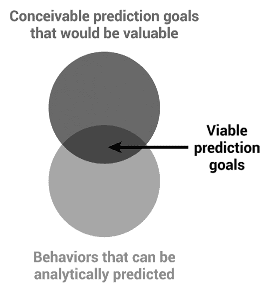

在上方，可能对业务有价值的可设想预测目标范围仅受你运营和营销人员想象力的限制。他们可能会发现预测各种个人结果或行为的价值，包括谁会撞车、坠入爱河、拖欠付款、辞职或实施欺诈。问题是，对于给定公司，其中只有部分想法可以通过建模可行地实现——例如，取决于需要预测的准确程度以及相关数据的可用性。

下方的集合也包含许多可能性。许多事情都可以在分析上预测，因为我们有大量记录各种不同结果和行为的数据。问题是，许多在实验室听起来很有吸引力的想法实际上永远不会被使用。在众多可以建模的结果中，只有少部分具有业务可操作性。例如，数据科学家可能开发出一个用于定向直邮营销活动的模型，却发现营销经理更喜欢联系其整个名单而不再进行进一步定向。仅仅因为数据科学家创建了一个有效的模型，并不意味着业务已准备好依据它采取行动来驱动决策。所有太常见的是，缺乏管理层支持或不可预见的业务约束阻碍了模型部署。这是当前机器学习部署率低的主要原因。

敏锐的业务视角会在这两组的交集中找到一个可行的预测目标——一个既可实现又可用的目标。你必须征询最明智的运营专家，以了解哪些预测行为具有潜在业务价值。最终，详细的预测目标需要协作者的洞察和支持，包括那些运行将受模型部署影响和驱动的业务的人员，例如营销人员，他们必须愿意相应调整定向。

通过征询这种硬核的多学科协作，你正在打破边界并参与一种非常罕见的团队合作。你正在让更大范围的人群参与预测目标的琐碎、准技术性方面，这些方面传统上对业务利益相关者来说不为人知，例如：

- 是预测最终结果还是中间结果
- 预测多远的未来
- 预测谁或什么——每个预测将适用于哪种类型的客户或其他组织元素

通过这种持续的业务方参与，你的模型输出的预测评分将产生最大影响。它们将与业务战略保持一致，并在你公司的范围内可操作。


运营框架。并且它们将由管理运营的人批准以进行集成。

## 检测与预测：有时更容易，有时更难

当你定义预测目标时，要警惕字面意义上的*预测*目标与预测某种情况或诊断（即检测目标）之间的区别。正如我在上一章中指出的，我们通常无论哪种情况都使用“predict”一词，例如“预测哪笔交易是欺诈性的”，我们仍称其为*预测模型*。但两者之间存在一些显著差异，这些差异可能会让项目变得时而更容易、时而更难。

乍一看，检测目标似乎更容易定义。在预测（检测）哪笔交易是欺诈性的、哪封电子邮件是垃圾邮件、哪张医学图像表示某种诊断时，会有多少限制和限定条件呢？

答案是，不多。由于模型不预测未来事件，我们在定义要预测的内容时无需处理时间概念。我们不需要决定预测多远的未来，例如，“客户是否会在三个月内取消？”我们不需要定义事件*发生*的程度，例如，“客户是否会将使用量减少80%？”我们也不需要考虑在最重要行为之前发生的中间动作，例如，“潜在捐赠者是否同意会面？”

在定义检测任务时，变化空间不大。例如，一笔交易要么被授权，要么是欺诈。指定预测目标往往更简单。

另一方面，预测未来的项目能够以检测任务无法做到的方式受益于*大数据*：模型训练可以*从历史中学习*。我们知道过去哪些客户购买了或没有购买，哪些取消了订阅，哪些点击了广告。这些信息已经编码在正常业务过程中收集的数据中。这个*现成数据*作为学习的经验。在第4步中，它将构成准备训练数据的基础，这些训练数据将推动我们在此步骤中建立的预测目标的追求。

相比之下，对于检测，训练数据必须手动标记。我们无法从“时间会说明一切”的现成数据中受益。时间已经说明了包裹通常被送往哪里——这提供了学习示例——但我们需要人类来标记一笔交易是否欺诈，或者一张医学图像是否表示阳性诊断。正因为如此，检测模型训练所需的数据通常比预测未来结果所需的数据更昂贵。

然而，标记数据的人类瓶颈并不总是那么糟糕。当我们进入第4步——准备数据时，我们会发现，对于某些检测任务，虽然每个标签都需要人工输入，但我们不需要比人们在正常商业过程中已经在做的更多的人工努力。

## 模型性能：我们能多好地实现预测目标？

既然我们已经定义了模型的功能目的——它应该做什么——下一个逻辑问题是，它做得如何？我们已经确定了它应该预测什么；现在我们想知道它预测得如何——以及哪个性能指标是报告的正确指标。那是下一章的步骤。警告：如果你认为“模型准确率”是正确的方法，那你就大错特错了。

# 3 性能

## 建立评估指标

一旦你确定了机器学习将预测_什么_，下一个问题是它预测得_多好_。幸运的是，评估其性能不需要成为技术专家，因为你可以在不考虑其内部工作原理的情况下对模型进行基准测试。在这里，我们只评判它预测得_多好_，而不是它_如何_预测。这只是算术问题，而不是“火箭科学”。

通常，你会听到_准确率_，这是一个简单的计数，统计模型预测正确的频率。但准确率不仅是大多数机器学习项目的错误衡量标准，它还助长了一种常见的谬误，极大地管理不当期望。

如果不是准确率，那是什么指标？一个是_提升度_，一个简单的乘数，告诉你你的模型比随机猜测好多少倍。另一个是_成本_——每个假阳性的代价和每个假阴性的（通常非常不同）代价。

一旦建立，这些指标既用于评估模型训练（第5步）也用于部署（第6步）。本章深入探讨核心问题。不完美的预测到底有多有价值？所有机器学习部署以何种方式用于分诊和优先级排序？你如何将原始预测性能转化为真正的业务指标，如利润？

## BizML实践：

- 1. 价值：建立部署目标。
- 2. 目标：建立预测目标。
- 3. 性能：建立评估指标。
- 4. 燃料：准备数据。
- 5. 算法：训练模型。
- 6. 启动：部署模型。

关于机器学习的头条新闻承诺神一般的预测能力。以下是四个例子：

- Newsweek：“AI Can Tell If You’re Gay: Artificial Intelligence Predicts Sexuality from One Photo with Startling Accuracy”
- The Spectator：“Linguistic Analysis Can Accurately Predict Psychosis”
- The Daily Mail：“AI-Powered Scans Can Identify People at Risk of a Fatal Heart Attack almost a Decade in Advance . . . with 90% Accuracy”
- The Next Web：“This Scary AI Has Learned How to Pick Out Criminals by Their Faces”

这全是谎言。机器学习无法自信地对每个人做出这样的判断。在大多数情况下，这些事情太难以确定性预测。

谎言是这样运作的。首先，研究人员报告高“准确率”，从而暗示——并可靠地误导读者相信——他们的模型可以识别阳性和阴性病例，并且无论哪种情况通常都能做对。对于许多预测问题，这种性能水平只在科幻小说中才能实现。

这些报告后来揭示——埋藏在技术论文的细节中——他们滥用“准确率”一词来表示另一种与准确率相关但实际远不如“高准确率”所暗示的那么令人印象深刻的性能指标。

但媒体会对此大肆报道。一次又一次，这种骗局成功地愚弄了媒体，这个野兽往往过度依赖夸张之词。这种经典策略反复制造出耸人听闻的宣传噱头，误导公众。

现在，他们所报道的预测模型通常确实值得高度赞扬。即使在许多情况下不能高度确定，能够比随机猜测更好地预测，也能改善各种业务流程。这就是致胜之道。而且，在一些有限的领域中，机器学习可以预测得非常好，例如识别照片中的交通灯等物体，或从医学图像中识别某些疾病的存在。

但许多人类行为无法可靠地预测。预测它们就像试图提前数周预测天气。无法实现始终如一的高确定性。没有神奇的水晶球。

## 斯坦福的“盖达”并非表面所见

看看围绕斯坦福大学臭名昭著的“盖达”研究的炒作。在2018年由研究人员Michal Kosinski和Yilun Wang发表的一篇论文的开篇摘要中，声称他们的预测模型在从面部图像区分男同性恋和异性恋男性方面达到91%的准确率。这促使记者广播了极度夸大的预测性能声称。一篇Newsweek文章开头写道：“AI现在可以通过分析你的脸部照片来判断你是同性恋还是异性恋。”《经济学人》杂志的封面描绘了一张看起来像指纹的脸，并配文：“机器能从你的脸上看出什么。”

这种误导性的媒体报道是可以预料的。研究人员开篇声称的91%准确率默示且不可避免地传达给——普通读者、非技术记者，甚至普通技术读者——该系统可以分辨谁是同性恋、谁不是，并且对于两类通常都能做对。

但这一断言是错误的。该模型无法自信地“判断”任何给定个体。相反，斯坦福模型91%的时间能做的要不那么引人注目得多：在已经确定一对男性中有一个是同性恋、另一个不是的情况下，它可以识别出哪个是同性恋。

这个基准——我称之为配对测试——听起来像是一个引人入胜的故事，但它是一个欺骗性的故事。起初，它可能看起来像是预测模型性能的合理指示，因为测试创造了一个公平竞争的环境，每个案例都有50/50的概率。而且，确实，这个测试的结果证实了模型比随机猜测表现更好。大多数数据科学家都知道配对测试 by


一个更技术性的名称，AUC（受试者工作特征曲线下面积）。然而，就我的经验而言，大多数数据科学家尚未意识到这两个指标本质上是同一个。AUC在数学上等于运行配对测试所观察到的性能（假设你运行足够多次）。它们只是估算同一数值的两种不同方式。尽管AUC在数据科学家中很受欢迎，但其技术细节超出了本书的范围。但由于配对测试更易于理解且是等效度量，我将在本章中使用这个术语。

但该模型有91%的时间能在配对测试中做对，这在研究实验室之外意味着性能较低，因为那里没有人为构建的场景来呈现这样的配对。在现实世界中，使用该模型需要权衡一个棘手的利弊。例如，你可以调整模型以正确识别三分之二的所有同性恋者，但它也会错误地将其他人识别为同性恋，这种错误称为*假阳性*。事实上，它会犯很多这样的错误，在其预测某人为同性恋时，超过一半的时间预测都是错误的！而且，如果你配置其设置使其正确识别的比例超过三分之二，该模型会更频繁地出现此类错误。

这是因为两个类别中有一个不常见——在这里，同性恋者约占男性总人口的7%（根据斯坦福研究引用的统计数据）。当一个类别处于少数时，这本身使得预测更具挑战性。

此外，准确率本身在这里就不是一个有用的基准。准确率只能告诉你模型有多少时候是正确的。

**准确率**：预测模型预测正确的案例比例，即模型正确的频率。

对于这个项目，要达到93%的惊人准确率毫无意义：只需将所有人都分类为异性恋。这样做，你有93%的时间是正确的，尽管你未能正确区分任何少数群体中的人，即那7%的同性恋者。要改进这一点并正确识别至少一些少数群体病例，需要做出权衡：引入假阳性，并且总体上准确率会降低。

斯坦福模型在一定程度上取得了成功——它能比随机猜测做出更好的预测——但随后研究人员通过将其在配对测试中的表现称为“准确率”而歪曲了其性能。瞧！记者及其读者相信该模型可以“判断”你是同性恋还是异性恋。

有些事情太难以可靠地预测。“Gaydar”作为一种流行概念，指的是一种无法实现的人类千里眼。我们也不应期望机器学习获得超自然能力。

## 准确率：一个常被误用的词

斯坦福研究是我所谓的“准确率谬误”的完美例子，这种谬误极大地夸大了机器学习在各领域的性能。它导致公众错误地相信，系统可以实现不切实际的“水晶球”级别的性能——具体来说，就是它可以区分阳性和阴性病例，并且通常对阳性和阴性病例都正确。对于许多值得注意的预测目标来说，这根本不可行。由于许多重要行为——例如你是否会点击、购买、撒谎或死亡——往往发生得较少，因此它们特别难以预测。一般来说，没有任何模型能高度可靠地“告诉”此类事情。

在某些情况下，研究人员会犯一种“准确率谬误”的变体：他们报告如果一半病例为阳性时你会得到的分类准确率。例如，埃默里大学和哈佛大学报告了一个预测精神病发病的模型，其“90%的准确率”是在50%的患者最终被诊断出精神病的世界数据上评估得出的。以这种方式衡量准确率有一个词：作弊。从数学上讲，这通常比配对测试稍微少夸大所报告的“准确率”，但这是一种类似的操作，并且以类似的方式大大高估了性能。

“准确率谬误”方案被广泛应用，用于关于预测犯罪性、自杀、工作辞职、畅销书、深度伪造、海啸和心脏病发作的报告中。这个名单长得令人惊叹。有关“准确率谬误”的更详细内容，请参阅本章的注释，网址为 www.bizML.com。

审查这些项目凸显了机器学习行业的好坏两方面。这些研究各自都歪曲了预测性能，但总体而言，它们说明了机器学习在各行业的广泛适用性。其中许多本身是合法的项目，已经生成了可靠且潜在有价值的模型。唯一的问题是它们以误导性的方式传达了模型实现的预测性能。

“准确率谬误”助长了AI炒作。通过传达虚高的性能水平，并将该技术称为AI而非ML，研究人员利用——同时也助长了——公众对那些令人惊叹却纯属虚构的能力的迷恋。

责任首先在于研究人员，其次在于记者，他们需要向记者明确且不误导地传达，其次，记者必须确保他们及其读者理解所报道的预测熟练度。但鉴于当前情况，我们都必须保持一定的警惕：对机器学习中“高准确率”的说法保持警惕。如果听起来好得令人难以置信，那大概率就是假的。

## 不完美预测的坏名声

当我们正确地打击夸大其词的奇幻预测说法时，其他人却错误地贬低了一些最敏锐、尽管不完美的预测。那些坦率地传达其模型局限性的清醒量化分析师，然而仍面临因反动性误解而损害声誉的威胁。

以著名的政治选举量化分析师内特·西尔弗为例。尽管他的政治预测有着出色的记录，但在2016年唐纳德·特朗普击败希拉里·克林顿赢得美国总统职位后，评论界将他钉在十字架上。西尔弗的选举预测曾将结果朝相反方向发展的概率定为约70%。正如《哈佛公报》所说，“震惊的政治评论家指责民调员和预测者，宣称‘数据的死亡’。”

但这根本不公平，也没有根据。“70%”并不意味着克林顿会明确获胜。特朗普获胜有30%的机会，这根本不是小概率事件。一件有30%的时间发生的事情相当常见和正常。这就是概率的含义。这意味着，在完全类似的情况下，它会在100次中发生30次，或10次中发生3次。那些不是小概率。

除非你在扮演算命先生，否则传达不确定性不是罪过——相反，这往往是一种美德。克林顿的70%概率更接近50/50的未知之数，而不是100%的“必胜”。从对克林顿的70%预测中得到的启示并不是她几乎是稳操胜券。不，启示是，“我不知道。”当时，大多数其他著名预测将克林顿的胜算定得高得多——在92%到99%之间。那些模型表现出过度自信。西尔弗的模型没有强烈承诺。它首先，最重要的是，表达了不确定性。但不幸的是，他的模型概率被广泛误解为确定性预测，仿佛他做出了绝对的断言。

## 迫使你表态

不表态往往是明智的。西尔弗应对公众误解的最佳防御可能是，在存在相当多不确定性时直接弃权，只有在候选人的胜率非常高时才公布他的预测。

但对于许多机器学习部署来说，即使预测不确定，它也必须做出承诺。它必须一遍又一遍地做出是/否决策。我们应该向谁做营销？那些预测会购买的人。我们应该批准谁的信用卡？那些预测会始终支付账单的人。正如我们将在后面部署章节中看到的，从预测到行动的映射并不总是那么简单，但最终，预测驱动运营决策，而手头的决策通常是二元的。

这听起来像是灾难的配方。我们知道，当它做出承诺性预测时，机器学习通常无法实现性能


在完美之处相去甚远。我们知道，高准确性甚至不是正确的目标。我们知道内特·西尔弗付出的代价。幸运的是，机器学习所玩的游戏比内特·西尔弗所玩的游戏更幸运，后者是那种一次性的选举预测游戏，每一次都受到公众审视。机器学习反复进行预测，影响着大量的运营决策，并在过程中积累业绩记录。

## 不完美预测的价值

> 所有模型都是错的，但有些是有用的。
> —著名统计学教授乔治·博克斯

通过反复、频繁的预测行为带来了好消息：对于许多机器学习应用来说，做错不少预测完全没问题。只要它比纯猜测预测得更好，这通常就足以改善大规模运营并提升利润。我称之为预测效应（在我之前的书《预测分析》中介绍过）：

预测效应：少量的预测也能大有裨益。大数定律站在我们这边；比猜测预测得更好，通常在应用于许多预测时就足以创造价值。

在部署机器学习时，我们享受着一种数字游戏的安全性，它比单一预测可靠得多，而单一预测任何一次都很容易出错。下季度经济会上涨还是下跌？下个月我们能完成销售配额吗？

在业务部署中，机器学习推动着许多重复的运营决策。通过长期概率博弈，随着模型预测提升组织效率，整体表现会表现良好。你的项目不是由任何单个案例来评估的——你无需为个别失误而烦恼。

好吧，模型可能足够好以产生价值，但究竟好到什么程度？我们如何衡量和报告预测性能？既然我们已经抨击准确率无礼且常常具有误导性，那么正确的指标是什么？

## 提升度：一个有意义的绩效衡量指标

为了以有意义的方式衡量预测性能，你必须区分正例和负例。准确率做不到这一点。它只是报告，“模型有多少时候是正确的？”——对正例和负例一视同仁。由于它不区分，它通常无法以有用的方式报告性能。一个糟糕的模型可能看起来不错。例如，如果只有 1% 的客户会购买，一个对每个客户都预测“不”的模型能达到 99% 的准确率，但无法正确预测任何正例——即任何将要购买的客户。

为了弥补这一不足，常见的方法是衡量模型特别正确识别正例的频率。例如，对于定向营销，这意味着我们衡量营销活动有多少次会联系到正确的客户——那些将要购买的客户。对于大多数项目，正例代表的是较少见的类别——这通常是正确识别更有价值的类别——例如将要取消服务的客户、将要违约的债务人、显示疾病存在的医学影像，或将要发生心脏病发作的患者。

更具体地说，我们想知道模型识别正例的频率比单纯猜测高出多少倍。正例可能不多——比如说，只有 1% 的客户会对营销做出购买响应。模型能否识别出一个回应者密度显著更高的“热点区域”？如果模型选出的群体中有 3% 的人会购买，那么它就比随机选择提高了三倍。这被称为提升度为三。这听起来像是一个值得营销的好群体。

等等——那个模型几乎不比蒙着眼睛扔飞镖的猴子好多少。它的预测并不十分自信。在它为营销联系所识别的客户中，只有 3% 最终会购买。它对任何一个将会响应的客户都没有高度信心。它永远无法宣称：“这个客户几乎肯定会购买。”

但是，仅仅改进这么一点点预测就大有裨益。比猜测好三倍的预测可以 *使利润翻三倍多*。假设模型对 25% 的客户做出了这些正例预测——也就是说，它针对联系的目标群体占总人口的四分之一。这可能使利润乘以五倍多，如下文边栏中的示例所示。

## 响应建模的利润

对于一个示例场景，这里有一些简要的计算，展示提升度为三如何转化为利润乘以五倍多。

- 客户数量：1,000,000
- 每次联系成本：$2
- 每次购买利润：$220
- 购买的客户数量：1 percent

```
Overall profit = revenue – cost
= ($220 x 10,000 responses) – ($2 x 1 million)
= $200,000
```

对（仅）25% 的客户进行营销，提升度为三——使用预测模型进行定向：

- 客户数量：250,000
- 每次联系成本：$2
- 每次购买利润：$220
- 购买的客户数量：3 percent

```
Overall profit = revenue – cost
= ($220 x 7,500 responses) – ($2 x 250,000)
= $1,150,000
```

鉴于达到一定提升度的明显好处，让我们正确地定义它：

**提升度：** 一个乘数：预测模型识别的群体中正例出现的频率，比正例在总体中出现的频率高出多少倍。

提升度捕捉了运营的乘数改进、你努力的回报增加、你花钱所获得的更多回报。提升度为三时，对目标群体进行营销将有效三倍。对标记的交易群体进行审计将发现三倍多的欺诈。检查划定的患者群体将发现三倍多的阳性诊断。通过这种方式，提升度量化了模型的贡献，即使对于那些不够自信或远未接近魔法水晶球的模型也是如此。

提升度反映了每个模型固有的局限性：当你针对更大的群体时，它的预测信心会降低。它预测为正例的案例越多，提升度通常就越低。提升度始终是相对于模型所针对的群体来衡量的。在响应建模示例中，模型对总人口四分之一（即预测最可能购买的 25%）实现了提升度为三。如果你进一步取一半，即预测最可能购买的 50%，提升度会更低，因为这个群体包括未进入前 25% 的个人。

或者，如果模型用于识别人口中更小、更精选的部分，它可以实现更高的提升度。例如，模型可能对人口中前 1% 实现提升度为 20。但只针对如此小的群体也有缺点：作为更自信预测的交换，你最终会得到一个小得多的潜在客户池——对于营销来说，这意味着可以营销的潜在购买者数量更少。

## 即使是一点点提升度也大有帮助

有时尽管意味着较低的提升度，针对更大的群体也是合理的。让我们转向信用评分，模型在那里预测信用申请人是否会违约贷款。假设 10% 的申请人最终会违约，而你的模型在 50% 时实现了提升度为 1.7。也就是说，它识别出申请人群体中的一半，这些人违约的可能性是平均水平的 1.7 倍——也就是说，比平均水平高 70%。在这种情况下，目标一半的人违约可能性为 17%。

17% 可能看起来不像世界上最糟糕的风险——但与另一半风险较低的群体（违约率仅为 3%）相比，它很高。我们怎么得到 3% 的？算术很简单：两半必须平均到总体 10% 的违约率。既然那是 17 和 3 的平均值，我们知道风险较低的群体必须有 3% 的违约率。

这有天壤之别！将其转化为利润就能体会到这一点——下面的边栏显示，我们可以在赢得或损失数亿美元之间做出选择。

## 信用评分的利润

| 参数 | 数值 |
|------|------|
| 贷款申请人数量 | 1,000,000 |
| 违约债务人的平均损失 | $5,000 |
| 还款债务人的平均收益 | $500 |

**如果你批准高风险申请人：**

收益 = 83% x 500,000 x $500 = $207.5M
损失 = 17% x 500,000 x $5,000 = $425M
利润 = 收益 - 损失 = -$217.5M（亏损）

**如果你批准低风险申请人：**

收益 = 97% x 500,000 x $500 = $242.5M
损失 = 3% x 500,000 x $5,000 = $75M
利润 = 收益 - 损失 = $167.5M（盈利）


提升度在机器学习应用中具有普遍适用性。无论你使用机器学习做什么，提升度都作为一种基础的、跨学科的指标，用于报告模型的纯预测性能。它能直观地反映模型识别出更有可能以某种方式行事的个体的能力。

但是，只有在模型锁定了某个群体之后，才能为该模型计算提升度。这意味着模型必须做出是/否预测，以确定哪些个体属于该群体，哪些不属于。计算提升度——以及利润——只有相对于这样一个群体才有可能。然而，原始模型并不做出承诺。对于每个个体，它输出一个跨越0到100%谱系的概率得分。因此，为了确定谁属于目标群体，必须建立一个阈值，以便对每个个体做出决定。得分高于阈值的个体属于目标群体。那么，你在哪里划定那条线呢？

## 示例：你的电视有多大？

在课堂上教授提升度时，我让每个人站起来充当数据。每个人举起一张纸，上面写着他们家中最大电视的尺寸，然后整个小组按电视尺寸排成一行：


按电视尺寸排列的人（零表示没有电视）。举手的人订阅了HBO。

然后我提出一个与电视使用相关的问题，例如，“谁订阅了HBO？”在充分定义预测目标的前提下，我的问题实际上更加精确：“谁住在一个不仅使用而且付费订阅HBO或Max的家庭中？”

如你所见，正例在该“人类数据集”的上部——即左侧——更加集中。让我们计算上部的提升度。总体而言，32%的人拥有HBO（38人中的12人）。但在前十名中，这一比例是70%。这意味着提升度为2.2：上部的正例数量是总体人口的2.2倍。

当然，这个课堂练习在几个方面过度简化了。这是一个滑稽的小数据集，因此结果远不可靠。而且，预测仅基于一个变量：电视尺寸（这就是我们所说的单变量模型）。此外，这些得分没有缩放为概率，尽管它们同样可用于排序和计算提升度。尽管有这些注意事项，但视觉效果和示例计算仍能为了教学目的阐明这些概念。

我为什么要为前十名而不是前二十名计算提升度呢？答案很实际。也许我的营销预算只够联系那么多人。或者，只有在HBO订阅率至少为70%的地方才值得推广我的产品。让我们继续看一些更现实的例子，进一步探讨。

## 部署机器学习即分诊与优先级排序

大规模建模项目也是这个道理：更可能为正例——因此更值得关注——的案例排名更靠前。

与课堂上那三十八个人不同，假设我们有一份10万名客户的名单。以下是前四名：

| 姓名： | 模型得分： | 购买： |
|---|---|---|
| E. Siegel | 85.628% | 是 |
| G. Clooney | 85.626% | 否 |
| T. Mitchell | 85.625% | 是 |
| T. Bayes | 85.623% | 是 |
| ... | | |

模型已为每个个体打分，我们根据该得分对列表进行了排序。第一个得分为85.628%。对于响应建模而言，这意味着模型计算出他们如果被联系就会购买的概率——考虑到营销活动的总体响应率通常非常低，个位数甚至只有百分之一小部分，这已经是相当高的概率了。

接下来，让我们只看最右边的一列，即该案例是正例还是负例（是或否）。为了展示更多内容，以下是前100个案例的该列值，正例显示为1，负例显示为0：

```
101111111101111011110011111101111101111101111111111111101111
1100111111101111111011110111111001110111111011010111
```

乍一看，你可以看到这个高排名部分有多密集地充满了1。在浏览这100个案例时，1的频率不一定会下降，因为这只是更长列表的一小部分。但是，如果我们提取列表中间的100名客户，我们会得到一幅截然不同的图景，正负例的混合更加均衡：

```
101101000101101011100010001011110111100000110101110100
1101101001000101110110101000101101110101011011110000
```

然后最后100个大多是负例：

```
110000000010100100001000000010000000001000010000001000
00110000000100100001000011000010000100001000010000100
```

在这个长列表中出现了与课堂上按电视尺寸排列的那一小群人相同的总体趋势：许多正例出现在排名的早期，逐渐减少，直到列表末尾只剩下少量正例。

模型在各种机器学习应用中都能实现这一同样宝贵的效果。其预测得分用于对个体进行排名，使得上部更密集地包含正例，而下部的正例则少得多。

通过对个体进行排名，机器学习使组织能够进行分诊和优先级排序。联系更有可能购买的客户。将保留工作投入到更有可能流失的客户身上。手动审计更可能是欺诈的交易。检查更可能起火的建筑物。

这一概念自然延伸到互联网搜索。它是信息过载的解药。Google使用机器学习将大量难以处理的项目排列成有意义的顺序，为你提供了便利。Facebook也是如此，它通过预测你的联系人最近发布的众多项目中哪些最可能引起你的兴趣来对其动态信息流进行排序。Airbnb和Match.com也效仿此法，帮助你筛选过剩的潜在对象，无论是出租房产还是浪漫伴侣。

当然，这也适用于最字面意义的分诊，即医疗分诊。首先照顾被模型评为更可能健康恶化或更可能获得阳性诊断的患者。重新检查被预测为未一年内更可能再次入院的患者。联系更可能跳过处方药或医疗预约的患者。

在所有情况下，模型都根据风险或机遇主动定位目标。它标记了风险最高或潜在收益最大的个体——那些值得投入有限时间和资源的人。

## 绘制利润曲线

排名列表告诉我们在哪里划线——在哪里设置阈值——以推动是/否的运营决策。考虑是否向每个客户发送营销推广的决策。你可以看到，当我们从最有可能购买到最不可能购买的客户发送宣传册时，利润是如何累积的。

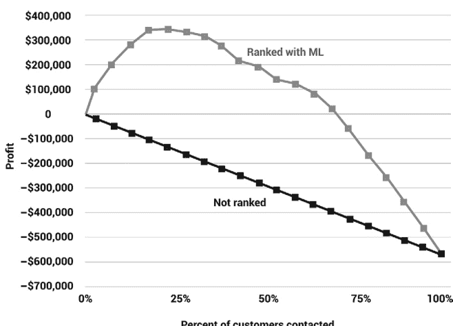

这是一个典型的*利润曲线*。横轴对应于我们在有序列表中向下进行了多远。从左到右，你从模型得分最高的客户开始。在每个位置，利润的计算方式与上面响应建模利润侧边栏中所做的相同，基于我们联系那么多客户所花费的金额以及从那些随后响应并购买的客户那里获得的收益。

沿着上方曲线，你可以看到营销活动的起伏。一开始，你联系的客户越多，利润就越高。虽然你花费更多来向右移动——联系越来越多的客户——但你获得了足够的正面响应来实现盈利。这就是你的营销资金获得最大回报的地方。

在列表大约四分之一的位置，边际效益递减开始显现。你已经耗尽了列表中最有响应的部分，实际上开始亏损——随着你联系更多客户，累计利润开始减少，但你不再能获得那么多正面响应。


如果你真的联系了整个名单，整体营销活动就会以失败告终。如果你联系了100%的客户，走到图表的最右侧，最终会损失约550,000美元。

对于所示的示例利润曲线，如果你根本没有模型，你只会亏损。为了可视化这种情况，直线的下方线显示了没有模型（因此也没有任何排序名单的手段）会发生什么。通过遵循实际上是随机的顺序，你在浏览名单时会以恒定速率亏损，因此下方线一直“直线”下降到最终结果。那条线作为比较的基准。相比之下，上方利润线的上升和最终下降证明了模型能提供多少价值。

无论如何，在最右侧，你最终会到达同一个地方，损失约550,000美元。这是因为，如果你在向所有人营销，那么你采取的顺序并不重要——你最终总会遭受相同的总体损失，即负利润。如果你打算只联系所有人，那么你就没有进行定向营销，因此拥有预测模型也没有意义。

回到上方利润曲线，你可能很想猛踩刹车，也许在25%左右的位置。如果你在那里停止，你的利润将是350,000美元。这通常是最佳选择——但并非绝对。有时，联系更多人的营销收益具有更高的战略优先级，即使这并未体现在短期利润中。在这种情况下，你可能会认为，在72%左右（盈亏平衡点）停止，比花费超过50万美元联系所有人要好得多。这样，你基本上可以免费向名单中近四分之三的人进行营销。最终，选择取决于你组织的长期营销策略和其他实际因素。无论如何，像这样的利润曲线有助于指导这一选择。

这次营销活动的兴衰似乎在讲述一个悲惨的故事。如果你在付诸实施之前就知道完整的故事，你就可以更早地结束故事，在领先时（即高点）退出，而不是通过最终到达图表致命的右下角点来艰难学习。有没有办法在经历之前就讲述这个故事？

## 激进部署还是防御部署——你的截止点决定一切

我要让你大吃一惊：利润曲线只是一个预测。你可以在开展营销活动之前绘制它。它不是跟踪营销活动的进展，而是事先估计其进展情况。

数据正是为此而用。它不仅用于训练模型，还用于评估模型并规划其部署。我们将在下一个bizML步骤——“准备数据”中深入探讨数据，但目前请知道：在部署之前，模型会在用于开发它们的同类历史数据上进行临时测试。

在部署之前，你可以为几乎任何ML项目绘制这种预测曲线。为了帮助决定要定位多少个人，你可以查看与模型对个人的排名相对应的选项光谱。随着你沿着光谱移动，决定联系多少人、批准多少贷款或审计多少欺诈行为，你通常会看到同样的模式：先上升后下降。有一个最佳点，一个“金发姑娘区域”，通常是停止的最佳位置。通过在那个位置建立一个阈值——也就是截止点——模型将发挥选择性作用，针对得分高于阈值的人进行处理。

这样一来，一个模型就提供了一整套选项。当你划定界限时，你就在确定部署时采用哪个选项——你正在精确决定如何使用模型。

例如，响应模型既可用于增加收入，也可用于降低成本。毕竟，提高效率可以以任一方式获得回报。为了在保持当前销售的同时降低成本，定位数量较少但排名更高的潜在客户。与不使用模型的大规模营销相比，这可以在花费更少活动资金的情况下实现相同的销售。或者，为了在不增加成本的情况下增加销售，可以通过使用响应模型进行定位，更明智地花费当前的营销预算。这样一来，你联系的就是一个更有响应的客户群。这两个选项之间的区别在于你在哪里划定界限，也就是说，你在排名客户名单中推进到何种程度。

同样，欺诈检测也提供了同样的权衡选项。例如，公民银行开发了一个支票欺诈模型，该模型可用于防止20%更多的损失，或将欺诈预防人员减少30%。一方面，一支固定的人工审计团队如果将时间花在包含更多欺诈的更有针对性的交易池上，就能捕获更多欺诈。这样一来，他们的时间会花得更值。另一方面，模型可以用更小的审计团队维持当前的欺诈检测水平。用更小的团队审计更小的一组交易——但这一组交易中欺诈更加密集——他们能捕获与不使用模型的更大团队相同数量的欺诈。再次强调，在这两个选项之间的选择是通过你设置阈值和划定界限来实现的。

你可以将这些选项对视为在更激进部署和更防御部署之间做出选择。这个决定是战略性的。尽管关于哪种更好存在一些激烈的争论，但没有一种适用于所有情况的选择。如果经济下滑或你的公司正处于艰难的季度，你可以预期会专注于削减成本。而且，一些ML应用通常更多地被宣传为“防御”方面的成本削减者，例如预测性维护和供应链优化。其他应用则更多地被作为增加收入的手段来销售，例如价格优化和产品推荐。但是，对于任何用例，模型部署始终有一系列选项。

在这些示例中，模型产生的最终利润指导了如何规划其部署。我们不会仅使用提升度来决定在哪里划定这些界限。那么，当业务指标始终占据主导地位时，我们为什么还需要像提升度这样的原始预测性能度量呢？

## 业务指标与模型指标

利润或ROI等业务指标推动ML项目。它们定义业务目标，为部署计划提供信息，并衡量项目成功。

相比之下，许多业务经理认为关于模型纯预测能力的报告抽象而晦涩。对他们来说，这感觉无关紧要。像提升度或配对测试这样的性能指标告诉你模型的技术能力，并让你了解其分析成功情况——例如，提升度告诉你它比随机猜测好多少——但它们并不直接告诉你模型部署将带来的业务价值。

那么，为什么不只使用像利润这样直接相关的业务指标，而完全放弃像提升度这样的技术指标呢？

衡量模型的预测能力可能很抽象，但这也是一种优势。模型性能指标具有普遍适用性，无论应用领域或行业如何，都能告诉你你的模型预测得有多好。鉴于ML的广泛适用性，这些指标建立了一种所有数据科学家及其工具始终可以使用的语言，跨项目、跨行业。而且，它们在涉及预期业务环境的复杂性之前，用于验证和调试原始模型。让我们为这个概念命名：

**预测性能指标：** 衡量模型纯预测性能的指标，例如提升度、准确率或配对测试。此类指标用于评估模型的*技术*性能，但不直接评估模型的业务价值。因此，在可能的情况下，这种原始指标会被转换为业务指标。

在许多常用的性能指标中，本章专注于提升度，因为它对许多项目来说是一个很好的起点。作为“预测乘数”，它直观易懂，并且对于许多项目，可以通过简单的算术转换为利润，正如我们所见。

除了提升度和配对测试，预测性能指标还包括*F度量*、*精确率*、*召回率*和*平方和*。本书不打算花篇幅介绍它们，但请知道它们都遵循相同的趋势：对业务领导者来说相对晦涩，但每个指标对数据科学家都有其适用的时机和场景。

尽管模型性能指标为技术模型开发过程提供了指导，但归根结底，业务指标占主导地位。它们拥有最终决定权。并且它们首先出现在一个


项目总结。对于 UPS 的交付预测项目，我没有让你等到第 6 章部署部分才了解业务指标收益。我在这本书的引言中就直接告诉了你：每年节省 3500 万美元和 1850 万行驶里程。

这引出了下一点：利润不是唯一的业务指标。节省、收入、投资回报率、营销响应率和债务人违约率只是其中几个。你该如何选择？

## 业务指标：关键绩效指标

对模型性能而言最重要的指标，是该模型本应影响的业务指标。

> —Wafiq Syed，沃尔玛数据产品经理

谈到业务指标，我们无需重复造轮子。让我们来点“老派”的。你的 ML 项目的业务目标是优化某件事，而那件事就是 KPI：

关键绩效指标（KPI）：对企业战略至关重要的运营业务绩效衡量标准。ML 项目的业务价值表现为 KPI 的改进。亦称业务指标。

KPI 这个词可能会让你耳朵发烫，听起来像是二十世纪的行业黑话。它常与较老的商业智能领域联系在一起。毕竟，KPI 在概念和数学上都很简单。它们通常只是关于计算某事物。

但 KPI 最为重要，因为它们报告了组织中最根本的成功概念。KPI 衡量战略目标的实现程度。因此，业务领导者会觉得 KPI 比预测性能指标更熟悉、更自在。他们也会对它更感兴趣。

KPI 将推动 ML 项目，因此请选择一个：

- 1. 与战略目标保持一致；
- 2. 能够说服利益相关方，从而为 ML 项目获得支持；以及
- 3. 可衡量，以便跟踪 ML 成功。

虽然收入和利润往往是显而易见的选择，但有时直接追求“黄金”是短视的。例如，降低客户流失率时最重要的是什么？只保留最有价值的客户？不一定。所有客户（包括那些几乎不产生利润的客户）的绝对流失率，体现了你业务的诚信程度以及客户体验满意的程度。

欺诈检测也提出了同样的问题。从短期来看，拦截最大的欺诈交易是有价值的——因此你可以将优先级设置为预防那些即将骗走价值 5 万美元商品的作案者，而不仅仅是骗走 50 美元的作案者。但惩罚大小违法者也有价值，以降低整体犯罪率并保护商业交易的基本诚信。

那像“满足当日目益升高的客户期望”或“提升用户体验”这样常听到的宏大业务目标呢？仅凭这些还不够具体，无法满足 KPI 的第三个要求：可衡量。它们必须转化为明确定义的定量指标，例如“产品退货频率”或“调查中传达的客户满意度”。

我们似乎一只脚踩在两个截然不同的世界里。KPI 追求业务目标。像提升度（lift）这样的性能指标追求纯粹的预测能力。两者之间有什么关系？

## 区分假阳性与假阴性

数据科学家受过训练要优化的量度、他们用来衡量数据科学模型进展的指标，如果没有大量转换，对业务利益相关者来说基本上毫无用处，且与之脱节。

> —Katie Malone，哈佛数据科学评论

有时，从性能指标转换到 KPI 很简单。在本章前面的几个侧边栏中，我们已经看到，基于模型提升度进行一些算术运算可以用来计算利润——用于响应建模和信用评分。这些计算背后的直觉很简单：提升度告诉我们模型比随机猜测好多少倍，而这个乘数就是我们更频繁地抓住更有利可图的案例或避免更昂贵案例的次数。

更一般地说，我们通常可以通过纳入模型预测错误时所付出的代价，在技术性能与业务性能之间搭建一座数学桥梁。对于两种不同的预测错误，你都会产生误分类成本：

**假阳性（FP）：** 当预测模型说“阳性”但却是错的时。这是一个被模型错误地标记为阳性的阴性案例。也称为*误报*或*虚假旗帜*。

**假阴性（FN）：** 当预测模型说“阴性”但却是错的时。这是一个被模型错误地标记为阴性的阳性案例。

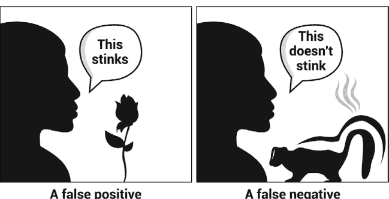

正如我们所见，准确率是一种粗糙的工具。知道模型有 12% 的时间是错的，这是一回事。这等同于说它有 88% 的时间是正确的；也就是说，它的准确率是 88%。但分别分析模型在阳性案例中出错的频率和在阴性案例中出错的频率，则是另一回事，也是一件更有帮助的事。准确率做不到这一点（配对检验也做不到）。

FNs 和 FPs 正是为此而存在。FP 是指模型说“阳性”但却是错的。这是一个被模型错误地标记为阳性的阴性案例。这也称为*误报*。那个“牧童喊狼”的故事就是关于他故意制造假阳性。FN 是指模型错误地说“阴性”。它忽略了一个阳性案例。

## 基于误分类成本计算节省

那么，我们如何为每种误分类分配成本呢？这取决于每种错误有多重要。对于几乎所有项目，FP 和 FN 的重要性是不同的。

以欺诈检测为例。当你银行的模型错误地将你的合法信用卡交易当作欺诈拦截时，你会感到不便。这是一个 FP。这平均可能使银行损失 100 美元，因为你可能会转而使用钱包里的另一张卡——不仅是针对当前购买，而是总体上如此。

另一种错误更糟糕。当银行的模型错误地允许一笔欺诈性信用卡交易通过时，这平均可能使银行损失 500 美元，因为罪犯带着赃物逃之夭夭。这是一个 FN。

这些成本并非小事。全球支付卡欺诈损失每年已超过 280 亿美元。持卡人或目光敏锐的审计员稍后可能会注意到这笔虚假交易，但对于卡片购买，如果模型没有实时捕捉到，钱就打水漂了。在美国，银行通常要对这笔损失承担责任。

通过确定这两种误分类成本，我们不仅为整个项目建立了成本效益分析，也为每个关于是否拦截或授权交易的单独决策建立了成本效益分析。接下来，我们将把这些单独成本加总，以计算整个项目的一个 KPI：*成本节约*。

如果没有部署欺诈检测模型，一家中型地区银行每年可能损失 5000 万美元。下面的侧边栏针对这样的银行逐步分析了一个场景，展示了引入欺诈检测模型所实现的节省。

## 欺诈检测的成本节约

假设一家银行发行了 100,000 张信用卡，每张卡每年平均有 1,000 笔交易，其中每 1,000 笔中有 1 笔是欺诈交易。总结如下：

- 年交易量：1 亿笔
- 欺诈交易占比：0.1%
- 年欺诈交易量：100,000 笔
- 每笔欺诈交易成本：500 美元（FN 成本）
- 欺诈造成的年损失：100,000 × 500 美元 = 5000 万美元

看来犯罪终究是有回报的。但在你辞掉日常工作加入欺诈者行列之前，让我们看看欺诈检测能做些什么来改善局面。

如果银行愿意将每 1,000 笔尝试交易中的 2 笔视为潜在欺诈——拦截交易并可能给客户带来不便——那么欺诈检测模型的任务就是标记哪些交易应该被拦截。

假设模型达到 300 的提升度。这比之前示例中讨论的，比如说 3 的提升度要高得多。但请记住，提升度始终是相对于目标群体大小而言的。在此例中，我们只关心那些被评为最可能为欺诈的交易中最顶端、最小那一小部分的提升度——即将被拦截的顶部 0.2%。我们不会拦截其他任何尝试交易，所以只有那一小部分才算数。鉴于这部分比例非常小，高提升度是可行的——模型的评分可能足以将交易排序，使得至少最顶端的那部分包含大量阳性案例。

首先，我们需要计算发生多少错误，细分为 FP 和 FN——模型错误拦截合法交易的频率


以及欺诈交易被放行的频率。具体明细如下：

- 被拦截的交易：200,000 笔（每 1,000 笔中有 2 笔）
- 被拦截交易中属于欺诈的比例：30%
- （提升度 × 整体欺诈率 = 300 × 0.1%）
- 被拦截的欺诈交易：60,000 笔（30% × 200,000）
- FP——被拦截的合法交易：140,000 笔（200,000 – 60,000）
- FN——被放行的欺诈交易：40,000 笔（100,000 – 60,000）

这个模型经常出错，但极具价值。当它拦截一笔交易时，通常是错的——只有 30% 的被拦截交易是欺诈。这并不罕见。由于欺诈极为罕见，如果不更频繁地错误标记合法交易，就很难正确识别某些欺诈案例。鉴于合法交易——即负例——如此普遍，即使只误分类其中一小部分，也会产生大量的 FP。

因此，我们对模型的最好期望是，它能在 FP（成本较低）和 FN（成本较高）之间提供有利的权衡。要计算最终成本，我们需要汇总各项成本。我们已经确定了单个错误的成本：

- FP 的成本：$100（给客户带来不便）
- FN 的成本：$500（骗子得逞）

因此，我们只需将这些成本乘以其发生频率：

- FP 总成本：$1400 万（140,000 笔，每笔 $100）
- FN 总成本：$2000 万（40,000 笔，每笔 $500）
- 采用欺诈检测后的总成本：$3400 万

我们将欺诈损失减少了 $3000 万（从 $5000 万降至 $2000 万），但因 FP 引入了 $1400 万的新成本。显然，这是一次值得的权衡。

总成本节省：$1600 万（$5000 万 – $3400 万）

如果您想获取包含这些计算的电子表格并尝试不同场景——例如调整模型提升度、持有的交易数量，或每笔 FP 和 FN 的成本——请参阅本章节末尾的注释，网址为 www.bizML.com。

欺诈检测之所以能实现上述侧边栏所示的成本节省，是以牺牲少量准确率为代价。该示例中的模型准确率为 99.8%，略低于“愚蠢”模型的 99.9% 准确率——后者仅假设每笔交易都是合法的（因此不采取任何措施防止欺诈）。在这种情况下，准确率较低的模型反而更好。

要理解原因，只需重新审视准确率的致命缺陷：它不区分不同类型的错误，将 FP 和 FN 视为同样糟糕。由于它没有考虑不同的误分类成本，准确率对绝大多数 ML 项目来说都过于简单化，只有在成本不相差的极少数 ML 项目中才例外。对于大多数项目，准确率是个误导。

除了创造商业价值，欺诈检测还承担着社会目标：打击犯罪。在所示示例中，它拦截了超过一半的企图欺诈交易。这样做，它满足了消费者的期望。尽管广大公民有时会对被模型预测感到反感——被电子化地归类以接收糟糕的广告或不良信贷——但在使用信用卡时，许多消费者欢迎预测，并欣然忍受偶尔被拦截的交易。相反，当没有预测性干预，而他们却为从未进行过的购买付款时，他们才会感到反感。尽管他们可能并不完全意识到这一点，但典型的持卡人都期望有欺诈检测。

在下一章中，我们将回到这一至关重要的 ML 应用：支付卡欺诈检测。但在此之前，我们必须先完成关于误分类成本的讨论。

## 主观成本：误诊与漏诊

建立误分类成本至关重要。通过这样做，我们可以弥合一个危险的差距，将纯粹的预测性能转化为商业 KPI。分析顾问 Tom Khabaza 长期以来一直告诉我们这一点的重要性——自从我们称 ML 为“数据挖掘”以来就是如此。他的数据挖掘价值法则指出：“[模型的]价值没有技术衡量标准。……唯一的价值是商业价值。”

但有时设定成本几乎是不可能的。以医疗诊断为例。如果你错误地告诉一名健康的患者他刚刚发生了心脏病发作，那真是糟糕透了。你可以想象不必要的压力，以及可能被给予的不必要的治疗。但如果你错误地未能检测出真正的心脏病发作，那就更糟了。你让一种严重的病症得不到治疗。与误诊相比，漏诊要糟糕多少倍？糟糕一百倍？一万倍？总得有人给出一个数字，我很庆幸那不是我。

但我们都必须比你意识到的更频繁地做出这种判断。例如，考虑在疫情期间是否要进行 COVID-19 检测。与预测模型一样，居家抗原检测并不完美。2021 年春季，在德尔塔变异株激增期间，一次居家抗原检测曾让我短暂地相信自己感染了 COVID，但随后的一系列抗原检测阴性结果以及几次 PCR 检测阴性结果表明，那几乎可以肯定是一次 FP。那次 FP 带来了代价：在意识到自己没事之前，我的生活受到了极大干扰，因为我与家人隔离并取消了各种计划。不便的成本可能与 COVID 未被检测出来的成本相比微不足道，但它并非零成本。权衡这些成本很少被明确提出，但关于它们如何比较的隐含分歧，是围绕 COVID 政策和礼仪的争议性公共争论的根源。事实上，当美国在 2021 年 12 月将建议的隔离期缩短一半时，部分原因是人们故意避免检测，以避免潜在 FP 的后果。

同样的挑战也适用于预测性警务，其中预测再犯的模型用于量刑，以及决定是否假释被监禁的罪犯。FP 意味着某人会在监狱中待更久，尽管他们不会再犯罪。FN 意味着某人会更早被释放，尽管他们会再次犯罪。如何确定这两种错误的相对成本，这一两难困境是司法的核心。当某一族裔、种族或其他受保护群体更频繁地通过模型遭遇不公正——即模型对某一群体的 FP 比另一群体更多时——这被称为算法偏见。关于 ML 伦理的一般话题，我在本书结论部分末尾提供了概述。关于算法偏见和其他 ML 伦理话题的深入探讨，请参阅我的文章和视频，网址为 www.civilrightsdata.com。

对于许多 ML 商业应用，我们要容易得多。误分类成本通常不言而喻，基于商业现实，例如营销成本、欺诈成本，或每个如果被联系就会响应的错过客户的机会成本。

但并非总是如此。即使是垃圾邮件检测也可能出错，并让你付出无法衡量的代价，例如错过一份工作——甚至错过与你最终会结婚的人的一次约会。FP 意味着你可能会错过一条重要消息，而 FN 意味着你必须手动从收件箱中过滤垃圾邮件。关于如何最好地确定这两者的相对成本，没有共识，但负责你垃圾邮件过滤器的人做出了那个决定——如果不是明确地，那就是通过允许系统有效地默认采用某种任意的设置。

有时决策者必须量化无法量化的东西。他们必须承诺特定的误分类错误成本——尽管存在主观性和伦理困境。成本驱动着模型的开发、评估和使用。行业领袖 Dean Abbott 告诉我：“务必为 FP 和 FN 分配成本，其方向应优于被动假设两种成本相等，”即使你没有真正客观的依据这样做。

## 从预测性能指标到 KPI 转换的挑战

在设定成本时我们可能会经历的分析瘫痪并非唯一障碍。有时，要将原始预测性能转化为潜在的 KPI 改进，你必须做出一些大胆的假设。有些项目需要做出推定性的飞跃，以估计部署将带来的预期商业价值。

当我向我的第一个客户 gay.com 推销部署时，我做出了这样的飞跃。虽然他们没有接受，但你可以肯定我推销了流失率


## 发射即是飞跃

model's potential value. At 27 percent, my model showed a lift of 1.5, which I translated into a potential profit of $286,000. That's where the beautiful profit curve that I showed them came to a peak, forecasting the effect of a targeted marketing campaign offering a discount to customers most at risk for cancellation.

模型的潜在价值。在27%时，我的模型显示提升了1.5倍，我将其转化为286,000美元的潜在利润。这就是我向他们展示的那条漂亮利润曲线达到峰值的地方，预测了向最有取消风险的客户提供折扣的定向营销活动的效果。

But the value of churn modeling is harder to forecast than the value of response modeling. A response model is trained on data recording a previous marketing campaign, but a churn model is only trained on the history of who did and who didn't cancel. Gay.com hadn't conducted a campaign to retain customers, so even if the model promised to target likely defectors well, we could only guesstimate how many of those defectors would change their minds after receiving a discount meant to keep them around. For gay.com, I assumed the company would gain an average of $100 in value for every would-be defector offered a $25 discount. The profit calculation also had to take into account that the company would lose $25 in revenue for FPs—customers who were provided that discount but weren't actually going to cancel.

但流失建模的价值比响应建模的价值更难预测。响应模型是在记录之前营销活动的数据上训练的，而流失模型仅在谁取消、谁未取消的历史上进行训练。Gay.com从未开展过留住客户的活动，因此即使模型承诺能很好地定位可能流失的客户，我们也只能估算在收到旨在留住他们的折扣后，有多少流失客户会改变主意。对于Gay.com，我假设公司每向一位可能流失的客户提供25美元折扣，平均能获得100美元的价值。利润计算还必须考虑到，公司会为FP（即获得了折扣但实际上并不会取消的客户）损失25美元的收入。

Although gay.com didn't deploy, my second client, EduPay, courageously launched my ad targeting models—despite an equally high dose of uncertainty. Remember that, for EduPay, I generated 291 different models, each predicting whether the user would respond to its corresponding ad. I could see how well each model predicted, but that only indirectly spoke to how much deployment would pan out financially. How much would using these predictions improve over the existing process of displaying ads that are popular across users in general? Until we conducted the ultimate experiment that is model deployment, we couldn't be certain how much value it would generate.

虽然Gay.com没有部署，但我的第二个客户EduPay勇敢地启动了我的广告定位模型——尽管同样充满不确定性。请记住，对于EduPay，我生成了291个不同的模型，每个模型都预测用户是否会响应其对应的广告。我可以看到每个模型预测得有多好，但这只能间接说明部署在财务上会带来多少收益。使用这些预测相比于向用户普遍展示受欢迎广告的现有流程，能带来多少改进？直到我们进行了模型部署这一终极实验，我们才无法确定它会产生多少价值。

At UPS, this uncertainty only added to the pressure Jack Levi felt. It magnified the challenge presented by the Innovator's Paradox—that the more novel or radical an idea, the greater the struggle to gain support for it. On top of that, Jack now faced the Deployment Paradox:

在UPS，这种不确定性只增加了Jack Levi感受到的压力。它放大了创新者悖论带来的挑战——一个想法越新颖或激进，获得支持的斗争就越大。除此之外，Jack现在面临着部署悖论：

The Deployment Paradox: For some projects, the business value of improved decisioning is hard to estimate before deployment; it can only be reliably established _部署后_ you deploy.

部署悖论：对于某些项目，改进决策的业务价值在部署前难以估算；只有在部署后才能可靠地确定。

Jack's model was technically sound, predicting up to 93 percent of tomorrow's deliveries correctly. And he knew how to estimate the misclassification costs. Each FP cost a good deal, on average, since the resulting plan would include an unnecessary delivery destination. FNs weren't as bad, since it was often relatively easy to later correct a truck's plan by incorporating a new destination.

Jack的模型在技术上是可靠的，能正确预测多达93%的次日配送。他还知道如何估算误分类成本。平均而言，每个FP都代价高昂，因为生成的计划将包含一个不必要的配送目的地。FN则没那么糟糕，因为通常相对容易通过加入新目的地来稍后修正卡车的计划。

But Jack wanted to translate this to business metrics. As he put it, “I wanted to know what more accuracy's worth, moneywise.” However, for UPS's complex delivery-planning system, this translation wasn't straightforward. Delivery prediction injected insight into UPS's complex planning system. How much this more sophisticated method would improve operations in business terms was something you could only roughly approximate beforehand. The pertinent KPIs included annual dollars and driving miles saved. They also included the more wonky metric _每英里停靠次数_, which increases as truck planning becomes more efficient—the more densely a route is packed with deliveries, the more value is generated from each mile of driving.

但Jack想将其转化为业务指标。正如他所说，“我想知道更高的准确性在金钱上值多少钱。”然而，对于UPS复杂的配送规划系统来说，这种转化并不简单直接。配送预测为UPS复杂的规划系统注入了洞察。这种更复杂的方法在业务层面能多大程度上改善运营，事先只能大致估算。相关的KPI包括每年节省的美元和行驶里程。它们还包括一个更偏门的指标 _每英里停靠次数_，随着卡车规划变得更高效而增加——一条路线上的配送越密集，每英里行驶产生的价值就越大。

Jack made rough estimates, but he would only find out the ultimate value of his optimization system by tracking its performance during deployment. When we get to the topic of deployment in chapter 6, we'll see the ups and downs his system experienced. And we'll also see EduPay's deployment results in that chapter as well.

Jack做了粗略估算，但只有在部署期间跟踪其性能，才能发现其优化系统的最终价值。当我们在第6章讨论部署话题时，将看到他的系统经历的起伏。我们还将在该章看到EduPay的部署结果。

But we have a couple more steps to go before deployment. In the next chapter, we prepare the data on which the model will be trained.

但在部署之前，我们还有几个步骤要走。在下一章，我们将准备用于训练模型的数据。

# 4 燃料

## 准备数据

Data trumps the algorithm. Machine learning algorithms may be the fun, sexy part—everyone wants to crash that party—but improving the data is where you usually get the greatest payoff. Data is the source of predictive power. It encodes the prior happenings of the world, the experience from which ML will learn. ML software is only as good as the data you give it.

数据胜过算法。机器学习算法可能是有趣、性感的部分——每个人都想参加那个派对——但改进数据通常是获得最大回报的地方。数据是预测能力的来源。它编码了世界先前发生的事情，即ML将从中学习的经验。ML软件的好坏取决于你给它的数据。

To make use of the data you have, you’ve got to expertly reconfigure it into training data, which takes a simple form: Whatever you want to predict, you need a bunch of both positive and negative learning examples. But despite this simplicity, training data is no easier to prepare than Michelin-starred cuisine. Whatever form your existing data has come to take, it probably wasn’t accrued with ML in mind. As a result, preparing the training data usually represents the ML project’s greatest technical bottleneck.

要利用你现有的数据，你必须将其巧妙地重新配置为训练数据，其形式很简单：无论你想预测什么，你都需要一堆正负学习样本。但尽管简单，准备训练数据并不比烹饪米其林星级菜肴更容易。无论你现有的数据采取什么形式，它可能最初并不是为ML而收集的。因此，准备训练数据通常代表了ML项目最大的技术瓶颈。

So why is data prep so commonly underestimated, underplayed, and undervalued? How do business-side priorities drive data requirements? How much data do you need? And how do you know which learning examples are positive and which are negative—where do you get those labels? Finally, what kind of noise in the data kills ML and what kind is copacetic?

那么，为什么数据准备经常被低估、淡化和贬值？业务方的优先事项如何驱动数据需求？你需要多少数据？你如何知道哪些学习样本是正例，哪些是负例——这些标签从哪里来？最后，数据中哪种噪声会扼杀ML，哪种是无害的？

## The BizML Practice:

## BizML实践：

- 1. Value: Establish the deployment goal.
- 2. Target: Establish the prediction goal.
- 3. Performance: Establish the evaluation metrics.
- 4. Fuel: Prepare the data.
- 5. Algorithm: Train the model.
- 6. Launch: Deploy the model.

- 1. 价值：确立部署目标。
- 2. 目标：确立预测目标。
- 3. 性能：确立评估指标。
- 4. 燃料：准备数据。
- 5. 算法：训练模型。
- 6. 启动：部署模型。

Scott Zoldi fights crime across the globe. His superpower is data—and an unprecedented, innovative process to amass that data.

Scott Zoldi在全球打击犯罪。他的超能力是数据——以及一种前所未有的、创新的数据收集流程。

He's got his work cut out for him. Every day, hordes of criminals work to exploit systemic vulnerabilities in how you and I shop. Their relentless work chips away at the very integrity of consumer commerce at large.

他任务艰巨。每天，成群的罪犯都在努力利用你我购物方式中的系统性漏洞。他们不懈的工作正在侵蚀消费者商业本身的完整性。

I'm talking about fraud. Crooks obtain your card details so that they can perform a transaction and make off with the spoils. In 2021, payment card fraud losses reached $28.58 billion worldwide. The United States suffers more than any other country, accounting for more than a third of that loss. To make matters worse, fraud increased during the pandemic, in part due to the increase in “card-not-present” virtual transactions. Some called it the “scamdemic.”

我说的是欺诈。罪犯获取你的卡片信息，以便进行交易并卷款而逃。2021年，全球支付卡欺诈损失达到285.8亿美元。美国受害最深，占该损失的三分之一以上。更糟糕的是，疫情期间欺诈有所增加，部分原因是“非刷卡”虚拟交易的增加。有人称其为“骗局大流行”。

Scott is FICO’s chief analytics officer. He oversees the world’s largest-scope anti-fraud operation. Day in and day out, his product Falcon screens all of the transactions made with most of the world’s credit and ATM cards—2.6 billion cards globally. With Falcon, banks and other financial institutions can instantly block suspicious purchases and withdrawals.

Scott是FICO的首席分析官。他负责监督全球规模最大的反欺诈运营。日复一日，他的产品Falcon筛查全球大多数信用卡和ATM卡进行的所有交易——全球26亿张卡。借助Falcon，银行和其他金融机构可以立即阻止可疑的购买和取款。

This capability hinges on machine learning—and it demands an impressive dataset. As we saw in the last chapter, a fraud-detection model must predict well, striking a tricky balance so that it recognizes a lot of fraud and yet does so without incurring too many false positives. To this end, the data must fulfill exacting requirements. If you visualize the data as a simple table, just a big spreadsheet, it must be long, wide, and labeled—here’s what I mean:

这种功能依赖于机器学习——并且需要一个令人印象深刻的数据集。正如我们在上一章看到的，欺诈检测模型必须预测准确，在识别大量欺诈的同时又不产生太多误报，这需要一种微妙的平衡。为此，数据必须满足严格的要求。如果你将数据可视化为一个简单的表格，一个大电子表格，它必须又长、又宽、有标签——我的意思是：

- 1. Long. You need data about real transactions—a lot of them. This list of many, many example cases from which to learn must be a long one. And by including a broad assortment of cases from around the world, the data can be representative. Each case composes a row of the data.

- 1. 长。你需要关于真实交易的数据——大量的数据。这个用于学习的众多示例案例列表必须很长。通过包含来自世界各地的广泛案例，数据可以具有代表性。每个案例构成数据的一行。

- 2. Wide. You need revealing information about each case, including behavioral characteristics of both the cardholder and the merchant. These are the factors on which a model will base its predictions. Since each row enumerates all these factors, the data is also wide. Each factor composes a column of the data.

- 2. 宽。你需要关于每个案例的揭示性信息，包括持卡人和商家的行为特征。模型将基于这些因素进行预测。由于每一行都列举了所有这些因素，数据也很宽。每个因素构成数据的一列。

- 3. Labeled. ML software needs many known examples of fraud from which to learn, prior transactions that have been designated as such. How do these cases get labeled? The fraudsters who perpetrated these crimes know which are which, but they have not, so far, been cooperative. This means we need humans on our side to manually label many examples. These labels typically make up the rightmost column of the data.

- 3. 有标签。ML软件需要许多已知的欺诈示例来学习，即事先被指定为欺诈的交易。这些案例是如何贴标签的？犯下这些罪行的欺诈者知道哪些是哪些，但到目前为止，他们并不合作。这意味着我们需要自己人手动为许多示例贴标签。这些标签通常构成数据的最右列。

## Wide data has more information about each case

## 宽数据包含每个案例的更多信息

| 电子商务 | $125 | 非刷卡 | $250/天 | .... | 是 |
|---|---|---|---|---|---|
| 杂货店 | $17 | 芯片 | $700/天 | .... | 否 |
| 服装 | $275 | 刷卡 | $25/天 | .... | 否 |
| 药店 | $27 | 挥卡 | $150/天 | .... | 是 |
| 公用事业 | $59 | 非刷卡 | $75/天 | .... | 否 |
| 航空公司 | $782 | 非刷卡 | $35/天 | .... | 是 |
| 酒店 | $1,221 | 芯片 | $100/天 | .... | 否 |
| 餐厅 | $76 | 挥卡 | $40/天 | .... | 否 |
| 药店 | $32 | 刷卡 | $275/天 | .... | 否 |
| 杂货店 | $112 | 挥卡 | $400/天 | .... | 否 |
| 电子商务 | $43 | 非刷卡 | $80/天 | .... | 否 |
| 餐厅 | $82 | 芯片 | $30/天 | .... | 否 |
| 公用事业 | $26 | 非刷卡 | $100/天 | .... | 否 |

Such a dataset sounds almost impossible to acquire. It could only be sourced from multiple banks across the globe. And even if you somehow

这样的数据集听起来几乎不可能获得。它只能从全球多家银行获取。即使你以某种方式


说服这些机构合作并获得了一批具有代表性的示例交易，但欺诈交易不会自行标记自己。

要获取这些数据，Scott得天时地利人和。

## 优化的命脉

大多数人认为数据很枯燥。“数据”这个词在鸡尾酒会上是个扫兴话题。我深有体会……我手头就有数据。

但数据不仅仅是神秘莫测的0和1的集合。它是历史记录，是先前事件的列表。它编码了组织的集体经验，从中可以分析性地学习如何进行预测。

数据准备既代表了机器学习项目最有意义的一面，也代表了最琐碎的一面。虽然它不是“火箭科学”部分，但却是构建预测潜力的方式。这是最耗时的技术步骤，本身就是一门学科，通常需要一名被称为数据工程师的专家。数据准备通常被估计会占据机器学习项目技术工作量的约80%，并且通常比预期的时间更长。它习惯性地被低估。

但这很值得！由此产生的训练数据是驱动机器学习的燃料。因此，即使是业务领导者也必须在概念上熟悉其重要的——且简单的——格式。

作为一个话题，数据准备被显著忽视，且通常不被教授。其缺失是一个可以理解但代价高昂的错误，困扰着机器学习领域：新手们蜂拥而至，投入到动手训练模型的兴奋中，却很少思考数据——及其要求——最初是如何被创造出来的。

更令人惊讶的是，教育工作者和其他领导者鼓励而非纠正这一错误路径。大多数技术类机器学习书籍和课程都视数据准备为理所当然——他们直接跳过它。第一天，你的第一步就是将数据加载到机器学习软件中。其假设是数据已经准备就绪，可以直接使用。但这个假设是错误的。

没有圣诞老人；你必须自己收集和组装训练数据。

正如思科首席数据布道师Jennifer Redmon所说：“新的数据科学毕业生对自己将收到的数据是可靠的抱有错误的安全感。”

通过不跳过包括数据准备在内的步骤，我们能够正确规划部署。特别是，步骤2确立了一个值得部署的预测目标——基于一个知情的、社会化的、最终获得批准的项目——而训练数据反过来将体现该预测目标；你追求该目标的方式就是相应地准备数据。

## 训练数据长什么样：行和列

在了解Scott和他在FICO的团队如何获取数据之前，让我们先通过一个更简单、更典型的故事来介绍基础知识。

当我为EduPay项目整合数据时，我比Scott轻松得多。我需要的数据触手可及。这很典型。毕竟，大多数机器学习项目只寻求优化业务，而不是整个世界，所以你不必到处寻找数据。内部数据就足够了——至少在开始阶段。

即便如此，数据准备始终面临巨大挑战。从内部来源准备必要的长表、宽表、带标签的数据集就已经足够困难，更不用说还要从跨组织中整合数据了。

数据服务于预测目标，因此该目标必须在数据中体现。预测目标决定了数据包含的内容，并影响其长度、宽度和标签。对于EduPay，我们有这个目标：

## 针对广告定向的预测目标（EduPay）：如果展示该广告，用户会响应吗？

我需要一个包含正例和负例的长示例列表，即用户响应了广告的情况和未响应的情况。以下是关于大学广告的三行示例数据：

| 已见过 | 年级 | 性别 | 接收邮件 | 美国公民 | 邮箱 | 主修专业数 | SAT写作分数 | 响应 |
|---|---|---|---|---|---|---|---|---|
| Y | 10 | M | Y | Y | yahoo! | 1 | 600 | N |
| N | 14 | F | N | Y | gmail | 0 | 520 | Y |
| N | 12 | M | N | N | hotmail | 2 | 710 | N |

这是用于建模大学广告响应的三行训练数据。仅显示输入变量（列）的一个样本。年级14表示大学二年级。

每一行都讲述了一个小故事，建模过程将从中学习。例如，在第一行中，一个之前已经看过广告的用户，十年级，男性，已选择接收电子邮件等。当展示广告时，用户没有响应——一个负例。最右侧的结果列——响应或未响应——保存了步骤2中确立的预测目标。

你现在了解训练数据的主要要求：

**训练数据**：建模学习的数据——即机器学习生成预测模型的数据。如果训练数据包括指示每个示例是正例还是负例的标签，则它是受监督训练数据，这是受监督机器学习所必需的，也是本书所涵盖的机器学习类型。

对于大多数机器学习业务应用，训练数据真的就这么简单：一个二维表，每个示例一行。这就是为什么它也亲切地被称为BOFF——“大而平的扁平文件”。你可能最初是由许多互连表组成的数据库开始的，但在将数据输入机器学习软件之前，必须将训练数据转换为这种二维形式。软件需要这种格式（从技术上讲，某些机器学习软件只要求以这种方式描述它，作为数据库视图，而不是将其重新格式化为BOFF，但概念工作量是相同的）。准备训练数据是建模的先决条件。

最显著的例外是处理图像或声音等大文件的模型，最常见的是*深度学习模型*，又称*深度神经网络*。在这种情况下，每个案例的原始数据无法优雅地装入单一行。例如，当你应用深度学习来分类医学图像时，训练数据不被视为二维表。每个案例由一张图像——本身是二维的——以及图像的标签组成，例如是否有阳性医学诊断。这种非表格数据有时被称为*非结构化数据*，而表格数据称为*结构化数据*。然而，即使是非结构化数据，更广泛的概念仍然适用：它是一个正例和负例的长列表，尽管列表中的每个项目都不是结构化为简单的数据行。

## 数据决定模型的功能

对于标准建模项目，你在训练数据中设置的列决定了模型的功能目的、输入和输出。*目标*列，通常但不总是最右侧的一列，是模型将尝试预测的内容——它对应于模型的输出。步骤2中确立的预测目标就在这里发挥作用。通过用这些值填充该列，你正在规定模型将预测什么。

设置数据就是设置建模。比起你在操作预测建模软件工具时可能调整的任何配置，你提供给该工具的训练数据才决定了你的建模项目将做什么，模型将为每个个体预测什么。你并不是以某种方式向建模软件“描述”或“刻画”预测目标。相反，你设立既定预测目标的唯一方式就是在这里，在步骤4中，通过填充该数据列。

其余的列是模型将用来进行预测的内容——它将把它们的值作为输入。通过设置这些数据列，你正在规定它们将可供结果模型使用。这些输入将构成模型的眼睛和耳朵，即模型用来进行预测所拥有的唯一信息片段，用于对……进行预测。


任何一个个体。它们是模型在生成预测分数之前会“咀嚼”的饲料。

如所有数据科学家所知，训练数据的输入列在技术上被称为*独立变量*（又称*特征*），输出列被称为*因变量*。但在本书中，我将简单地称它们为输入和输出变量，或者输入和输出。

通过在每一行中将输入变量与输出变量并置，我们将某一时间点已知的信息与后来发现的结果放在一起，而这正是我们希望能够预测的结果。这种并置使系统能够发现某一时间点已知的事物如何与——因此能够预测——后来将要发生的事情相关联。

确切地说，在这个数据中，输入和输出都是已知的——无需预测。相反，每一行都是可供学习的示例。一旦我们最终拥有一个模型，我们就会将其应用于与训练数据中的案例相似的案例，只不过输出尚未知晓。毕竟，这就是建模过程的全部意义：当生成的模型用于部署时，它拥有的只有输入变量。结果将是我们称之为未来的*终极未知*的一部分。对这种最终结果进行概率评估，正是我们制作模型的目的。

## 针对广告定向的大规模训练数据

当然，实际的训练数据比之前展示的三行九列的小样本要宽得多、长得多。之所以更宽，是因为模型输入越多，可用于预测的内容就越多。对于EduPay，我汇总了三十三个输入——如果同时计算输出变量，训练数据就有三十四列宽。这包括EduPay从用户那里收集的详细档案中的其他元素，例如职业目标、学校社团和军事经历。

它还包括我设计的、希望能提供新颖预测价值的输入，例如：

- SAT语文和数学成绩的比率。这反映了某人是相对更偏向“语文”还是更偏向“数学”。例如，如果用户语文得了700分，数学得了580分，则该变量的值为1.2。

- 学院类别，由机构名称中的关键词决定，例如常春藤联盟、州立学校、大学、技术学校或社区学院。

当你构思出这样的新输入时，它们被称为派生变量，而添加它们的努力被称为特征工程。这通常是一个临时的、手动的过程，发挥你自己的创造力。这是项目期间业务洞察力做出贡献的关键机会，可以补充机器自动形成对当前预测目标有用的组合的程度。人们想出的一些变量，对机器学习来说自动推导可能很难甚至不可能，因此手动设计新输入是数据准备过程的重要组成部分。与业务利益相关者合作生成新派生变量的想法，通常能产生有价值的影响。

一些最有成果的派生变量来自为当前用户显示的数据（如果显示的话）。这意味着每个训练数据集平均约有170,000个案例。

170,000行听起来可能很多——但不能轻率地假设这就足够了。

## 多大才算足够？

你需要多少数据？其实，这不是正确的问题。真正重要的是你有多少个正例，因为正例更稀少。你需要正例和负例的健康混合。如果你有足够的正例，那么肯定也有足够的负例。

例如，如果广告的响应率为1%，那么训练数据中1%将是正例，其余为负例。在这种情况下，负例出现的频率是正例的99倍。有1,000个正例，我们就会有99,000个负例。

好吧，那么你需要多少那些较少见的正例？通常，你会有成千上万个，甚至达到六位或七位数。但当正例非常稀少或你的整体数据集较小时，这个问题就会出现。对广告的响应是稀少的。欺诈案例更是如此，约占卡交易的0.1%。

这个问题只能模糊地回答。对于许多项目，几千个正例就足够了。即使只有几百个，也可能足以使项目可行——仍然值得一试。几十个通常会让你更多地进入“研究项目”领域。但这里没有绝对之事。在尝试之前，你永远不知道建模效果如何。没有提供绝对答案的具体理论，因为起作用的因素实在太复杂。这些因素包括你的输入（列）在多大程度上服务于预测目标，模型必须表现得多好才能创造价值——取决于业务背景——以及预测目标有多么“困难”。有些事情比其他事情更容易预测。例如，要求模型预测更远的未来，通常比预测更近的未来更难，因为对于长期预测，你的模型性能可能会更低。

无论多少数据可能足以训练模型，你实际上需要比这多一点的数据来评估模型——你需要测试数据。这是训练数据的一个样本，比如说20%，在模型训练期间被留出。由于在模型形成期间不可用，测试数据作为评估模型在一般情况下表现如何的基础——即在超出用于开发它的训练案例的新情境中表现如何。


所以，尽管存在关于淹没在“过多”数据中的神话，但真正的科学挑战来自于你拥有“小数据”——尤其是当正例数量非常少时。例如，在医疗保健领域，某些疾病非常罕见，相关患者记录可能难以获取。在非常小的数据集上建模是一个丰富的研究领域。已有研究发表，训练数据中的正例数量惊人地少，然而其他此类建模努力却彻底失败了。

但对于商业应用，你通常确实拥有足够的数据——而这不仅仅是因为当今普遍的“数据爆炸”。原因更具体：值得投入精力改进的大规模操作是那些频繁重复的操作，因此也是你积累了大量数据的操作。这是一个几乎不言自明的好消息：你频繁做的任何事情都会产生改进该流程所需的数据。你需要的数据已经在开展业务过程中自然增长。例如，如果你定期开展大规模直邮营销活动，你已经拥有此类活动的历史记录，包括联系了谁以及他们是否响应。如果你发行信用卡，你已经跟踪了哪些客户最终成为了可靠的债务人，哪些没有。许多次，广告已被展示并记录了响应。同样，许多交易已被批准，而欺诈交易随后被不满的信用卡持卡人发现。我们做的所有主要事情都值得改进，并且正是我们积累了经验——即数据——从中学习。

数据丰富是一件好事；多多益善。只要数据具有代表性，能反映部署时将提供给模型的案例类型，那么更多行的训练数据（包括正例和负例）只会进一步帮助训练模型。

但即使我们尽可能收集大量数据，正例与负例的比例通常也是失衡的。数据仅仅反映现实：那些至关重要的正例结果发生得较少。你的数据的偏斜会搞砸事情吗？

## 正例是否代表性不足？

正例通常更重要——正确预测它们的回报更高，错误预测它们的成本也更高（假负例——当模型将正例误预测为负例时）。最大的收益来自识别那些会响应广告的罕见客户和那些欺诈的罕见交易。

然而，往往是负例主导了训练数据。这是否意味着模型训练优先处理负例，生成的模型对负例的预测比对正例更好？

答案是否定的——这个问题已经解决了。对于某些建模方法，数学可以通过对训练算法应用某些调整来解决它，以考虑不平衡问题。在其他情况下，最好减少负例的丰富度，基本上“丢弃”其中一些——尤其是当数据量非常大时，这样做可以节省大量计算时间，而只损失微乎其微的模型性能。但是有一个关键的、却常被忽视的注意事项：如果你以这种方式精简训练数据，请不要对训练后用于测试模型的数据集这样做。该测试数据必须保留真实的、原始的平衡，就像它在“野外”发生的那样。否则，你就开始踏入我们在上一章中探讨的准确性谬误领域。

事实上，正例较少通常与拥有更有价值的机器学习项目相一致。当你和你的同事定义预测目标——即模型预测什么有价值，什么是正例——它自然会有些罕见。例如，如果目标是预测哪些客户将在三个月内取消订阅，你可能会得到，比如说，15%的正例。但如果你的预测目标是那些将在五年内取消订阅的客户，那是一种更常见的情况——可能占你当前客户群的一半。知道客户将在未来五年内的某个时间取消订阅，可操作性较低。它不明确要求任何立即响应。相反，知道客户可能会在近期取消订阅，更明确地暗示立即行动：投资于保留活动以防止即将发生的取消。

另一个例子，如果你进行目标营销，你可能希望预测高价值的响应者。也就是说，不要只预测谁会进行任何形式的购买，而是预测罕见的特殊情况，例如谁会购买大量商品或购买高利润产品。同样，对于欺诈检测，如果你预测的不是任何和所有欺诈，而是具体更昂贵的欺诈案例，你也会同样地将模型集中在识别那些更少、更重要的案例上。

罕见的正例不仅往往更有价值——还有一个外观上的好处：你的模型看起来会更令人印象深刻，因为它会表现出更高的提升度。如果广告的响应率为1%，模型可以现实地标记出一小群客户，其提升度为10。那个令人印象深刻的提升度10意味着，在那部分最有可能响应的用户中，他们响应的频率是平均水平的十倍——也就是说，有10%的时间。上一章，我们计算了一个提升度高达300的欺诈检测模型的价值。这只有在欺诈率极低（0.1%）的情况下才可行。

但如果你预测的是一半时间发生的事情——例如，哪个客户将在五年内取消订阅——你永远无法得到提升度10。那将意味着平均取消率的十倍：500%。你所能希望报告的最大提升度将是2，而模型的提升度通常会低于那个最大值，因此你可能期望提升度在1.2或1.3左右。

一般来说，报告低提升度看起来不太好。对经验丰富的数据科学家来说，它不够吸引人。事实证明，这是有充分理由的——对于许多项目，这不仅仅是外观问题。高提升度与高价值相一致。毕竟，以十倍于随机猜测的频率发现正例，确实可以对你的业务产生十倍的价值，因为运营的有效性也会相应倍增：审计师在处理的交易池中发现十倍的欺诈；广告展示时获得十倍的响应；营销触达十倍的响应者。

所以，如果这一步（数据准备）揭示你的正例接近一半的时间发生，这可能是一个信号，提示你回到第2步并重新审视预测目标，确保你已经建立了尽可能有价值的目标。

但需要取得平衡。如果你发现正例太罕见，导致训练数据中的数量太少，你也必须同样回溯到第2步——或者设法获取更多数据。

## 关乎时间：输入变量

> 时间是最明智的顾问。
> ——伯里克利

准备训练数据是一项真正的艰巨任务，因为时间很重要。你正在为训练模型搭建舞台，该模型在投入工作后，将输入当时已知的信息，并输出未来可能性的概率。这意味着你放在输入列中的值必须反映在输出列变得已知之前的更早时间点所已知的信息。

例如，假设你从公司日志中提取出，一名现在十年级的用户一年前响应了一个广告。这作为一个学习案例，但你必须倒转时钟：这行训练数据应该显示年级为九年级，因为那是他们响应广告时所在的年级。

目标营销也是类似的情况。作为模型输入的行为变量需要同样的悉心照料。考虑一行训练数据，对应一名去年10月18日收到营销手册的客户，当时我们知道他是男性，住在加利福尼亚州，迄今已进行了十次购买，以及其他因素。两个月后，即12月18日，我们知道结果是正的——他购买了该产品。


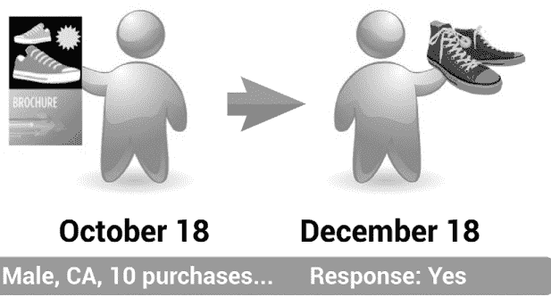

在这一行数据中，输入变量编码了我们在做出营销处理决策时所知道的内容，即本可以用于做出预测的时间点。该行数据中的最后一条信息，即结果，是后来才得知的——它现在也已经是过去式，但发生在更晚的时间点。

出错的潜在原因在于，此后可能发生了很多事情。假设现在是次年五月。如果记录目前显示他们总共进行了十五次购买，我们最好有办法计算出，回到十月时，他们当时只进行了十次购买，并将该数额包含在这一行训练数据中。

像这样与时间相关的挑战层出不穷，而且非常容易搞错。这些错误通常被称为“来自未来的泄漏”，即输入意外传递了只有后来才能知道的信息。例如，在应用流失建模时，考虑一个输入，它指示客户是否最近被纳入了仅应用于未取消订阅的客户的营销活动。在这种情况下，建模方法会非常快地“发现”这是一个有用的输入。模型的性能看起来会很高——但这是在作弊。在部署时，模型将无法访问那种对未来的“偷窥”。

另一个例子是，一家保险公司生成了一个模型，该模型似乎能很好地预测哪些保单持有人会提交高额索赔，方法是结合数据中发现的以下模式：存档有电子邮件地址的保单持有人更有可能提交高额索赔。但结果发现，电子邮件地址“泄漏”了未来，因为它们只从最终提交索赔的人那里征集。结果，拥有电子邮件地址的客户——也就是说，那些到目前为止已提交至少一份索赔而非零份索赔的客户——确实更有可能提交高额索赔。再次强调，在部署时，模型尚无法访问这一索赔指标。这一发现是循环的，而非预测性的。

这种“时间泄漏”陷阱损害了预测建模的完整性。在数据准备过程中，相对的未来始终触手可及，因此很容易无意中将那个未来提供给正在试图预测它的模型本身。这种时间泄漏是一个常见的“陷阱”。幸运的是，当数据科学家意识到模型的性能看起来好得令人难以置信时，通常可以发现它们。

## 大多数人未做好数据准备的准备

鉴于对每个输入的这些严格“时间”要求——即提供给模型的值仅反映过去某个时间点已知的内容——数据准备提出了一个棘手的挑战。你重新利用的数据源最初并不是为机器学习而收集的。无论你的数据目前以何种形式存在——分布在表格、数据库甚至系统中——你都必须将其转换为训练数据的形式和格式。这种转换不仅仅是实现所需的表格结构。不仅仅是数据的排列，你还要处理其本身的含义。

鉴于这些微妙的要求，你无法为新的机器学习项目完全自动化数据准备。每个项目都需要一个专门的数据库编程任务，根据数据源的来源方式对现有数据源进行定制。一些分析软件可能有助于自动化这项任务的有限部分——一些分析供应商会许诺天花乱坠——但没有软件能为你完全处理这件事的核心。一旦你弄清楚如何对其进行编程，程序随后可能会自动化未来迭代的数据准备以更新模型。但是，对于每个项目的首次运行，你只能深入其中并承担此事。无路可逃。

在某些情况下，你可以使用一个小技巧来绕过部分复杂性：*快照*。这是定期捕获输入变量的“定格画面”的过程，记录它们当前的样子，以便以后，在你跟踪将作为输出变量的结果后，就可以将此结果附加到每行训练数据上。在这种情况下，你不需要重新创建输入变量的过去值——你已经保存了它们在正确时间的样子。

然而，该技巧并不总是适用。如果快照之前并未长期实施，你就需要采用艰难的方式来利用你目前拥有的数据。

普遍认为，数据准备占项目实际工作时间的惊人80%，尽管有些估计较低。机器学习软件公司Anaconda的一项调查称，数据科学家将39%的时间花在数据准备上——根据同一项调查，这仍然多于训练和部署所花时间的总和。但是，对于新的机器学习项目，数据准备可能需要比这更长的时间。另一方面，如果你正在重复一个大部分已建立的数据准备流程以更新现有模型，后勤障碍和故障排除可能不会堆积得那么严重。

可以理解的是，机器学习行业淡化了所有这些。它更愿意将自己描绘成沉浸于从数据中学习的光鲜生活——而不是事先将数据拼凑在一起的苦差事。顾问、供应商和倡导者通常不提及这个麻烦，而更愿意讨论性感的部分，即建模。

除了大多数流行课程和操作指南书籍采用的“直接跳入建模”文化之外，另一个主要趋势也无意中导致了数据准备的昂贵贬值：公共机器学习竞赛。此类竞赛的主办方——最常见的是一家名为Kaggle的公司——提供训练数据，并让数据科学家相互竞争以训练出最佳模型。这推动了技术的进步，并通常为赞助商提供金钱能买到的最佳众包模型，但作为副作用，它延续了机器学习项目全部关乎建模的误导性叙事。如果你赢得了建模竞赛，这不一定意味着你已准备好领导机器学习项目进行部署。

为了解决这个问题，教育科技公司DeepLearning.AI推出了一种新型的数据中心竞赛。“在大多数机器学习竞赛中，你会被要求在给定的固定数据集上构建高性能模型，”这个独特的竞赛宣称。“数据中心人工智能竞赛颠倒了传统格式，反而要求你在给定固定模型的情况下改进数据集。”参赛者无法制作模型——他们只能改进随后用于模型训练的数据。这可能有助于纠正一个过度关注建模的文化。

## 有些噪声会杀死机器学习，但有些噪声是无妨的

鉴于其严格的要求，训练数据中的噪声有多灾难性？鉴于“垃圾进，垃圾出”的信条，人们可能会认为任何噪声都会杀死机器学习——尤其是考虑到模型训练的复杂性和精细性。如果机器学习算法被糟糕的数据误导并开发出有缺陷的模型，后果可能很严重——当你为欺诈检测、金融信用评分以及许多其他关键应用领域部署模型时，风险很高。

嗯，你可能会感到惊讶。机器学习实际上对某些类型的噪声相当稳健，因此你实际需要进行的清理工作有限。

首先，让我们对“噪声”这个词进行去噪。它可能有两种截然不同的含义。如果数据有错误——明显不正确的值——那是一种噪声。这有时被称为损坏数据。

另一方面，如果数据显示看似随机的值——因为我们无法预测它们，也没有理解其起源的基础——那是另一种噪声，不一定涉及不正确的值。它只是反映了我们人类知识的缺乏。它是不确定性。这就是内特·西尔弗在其畅销书《信号与噪声》的标题中提到的那种噪声。

因此，当数据看起来毫无意义或随机时，这不一定意味着它是有故障的。这只是意味着我们不了解所有影响它的因素。机器学习通过在数据中发现趋势，帮助我们更好地理解世界。它找到了一些信号，但绝不会消除所有噪声。

另一方面，就 outright 错误而言的噪声可能令人担忧。它无处不在，源于许多系统性问题。也许有人错误地标记了你合并的某个数据库中的字段。也许一组客户的年龄是根据出生年份计算的，而没有查看月份和日期，因此有时会差一岁，具体取决于当前的月份和日期。也许在数据在不同系统之间迁移时，缺失（未知）值被错误地更改为值0，而这些系统以不同方式表示缺失值。也许你的传感器记录不完美。或者，也许数据中的值甚至遭受了恶意的、故意的损坏。

尽管存在所有这些潜在噪声，情况并不那么糟糕。这里有你的救命稻草：输出变量标签中的噪声对机器学习有害，但机器学习通常可以承受输入变量中的噪声，只要噪声的数量保持一致。

首先，输出变量标签必须可靠。它们编码了预测目标，为模型训练提供方向。例如，如果许多未购买的客户被标记为已购买，或者反之，这将非常误导建模过程。输出变量的完整性至关重要——它必须与基准真相保持一致。它不仅指导学习过程，而且在建模完成后还用于评估模型性能。

但是，另一方面，机器学习对输入变量中的噪声具有稳健性。基本上，你可以往里面扔很多垃圾，虽然这对模型训练没有帮助，但通常不会像你想象的那样造成那么大的伤害。原因是，输入越无帮助，模型就越不依赖它。将这一点推向极端情况，如果一个输入有


如此多的错误值，以至于它实际上就是随机垃圾，那么一个好的学习算法将完全避免使用该变量——或者至少将其在模型中的参与度降至近乎零。

换句话说，错误的输入值只会增加更多噪声。输入值本身在不确定性的意义上已经是噪声。对于机器学习算法来说，噪声就是噪声，不管是什么类型的噪声都无关紧要。

这样想：如果你在做图像分类，你会发现即使图像中有相当多的噪声，你仍然很容易看出这是一张戴帽子的人的照片。模型处理噪声的方式大致相同。


加上噪声后，戴帽子的人的照片仍然容易辨认。

幸运的是，即使输入变量中存在错误值，世界也不会毁灭。但有一个主要的注意事项：训练数据和部署期间输入到模型的数据之间的噪声水平必须大致保持一致。如果在实际使用模型时提供了错误值，但在开发模型时的训练数据中并不存在类似的错误率，那么模型的性能就无法保持。因此，其输入最好不要比机器最初学习的训练数据中出现错误的频率高太多。

这只是更一般性要求的一部分：训练数据必须对部署期间遇到的数据具有*代表性*。也就是说，机器学习的经验必须来自模型随后将被使用的同一个“世界”或“宇宙”。学习案例必须*代表*相同的“现实”。例如，如果模型将面向美国所有客户进行营销，但训练数据仅包括加利福尼亚州的客户，那么该数据就不具代表性；你不能指望模型性能能推广到全国其他地区。

对于EduPay项目，我的数据未能满足这一要求。它并不完全具有代表性。对于每个广告，训练案例都是旧系统特性的结果。例如，一种临时方法估计了每个新广告首次推出时的受欢迎程度，这决定了它被测试的频率和对象。我使用的是手头现有的数据，而不是进行实验来为每个广告收集均匀分布的测试组。虽然有一些技术方法可能有所帮助，但我没有采取任何措施来解决数据中的这一不完美之处。在部署章节中，你会看到事情最终是如何发展的。

现在我们已经介绍了训练数据的各种要求，让我们回到FICO，看看该公司如何为其全球欺诈检测系统整合数据。

## FICO培育无国界数据

Scott Zoldi拥有杜克大学的理论物理学博士学位。他还组建了一个由七十多名博士组成的团队。他们共同构建了世界上事实上的欺诈卡交易检测系统。你、我以及大多数持有支付卡的人都在依赖他们。

Scott的反欺诈业务并不是FICO最广为人知的方面。与他的另一个团队一起，Scott还监督着这个国家*最著名*的部署模型：FICO信用评分。你的FICO评分决定了你的借贷能力。它是美国最广泛使用的信用评分，被绝大多数银行和信用授予者采用。它是家喻户晓的名字，许多人可以理解地觉得他们的FICO评分是其作为消费者身份的核心部分。

但是，FICO的欺诈检测通常对我们消费者来说是不可见的，却影响我们的频率要高得多。名为Falcon的产品是FICO软件业务中最大的部分，并且几乎每天都在影响我们中的大多数人——每次你使用卡片时。FICO白天评估财务实力——晚上打击金融犯罪。

为了履行这一职责，Falcon团队获得所需数据很重要——一些长、宽且带标签的数据。为此，它从全球银行网络中收集数据。

这种对跨企业数据（从多家公司收集）的依赖是不寻常的。通常，机器学习项目仅服务于运行该项目的企业。对于这样的项目，内部数据就足够了，因为公司一直在跟踪项目旨在改进的那些运营。相比之下，FICO不是一家银行。它不处理卡交易。相反，它在银行间担任着罕见的、全球性的中心、受信任的角色。

1992年，Falcon诞生于一小群银行的激进举措：他们决定合作而不仅仅是竞争。当时，几乎所有信用卡交易中有一大部分——近1%——是欺诈性的。欺诈率只在增长，并威胁着整个行业。这一迫在眉睫的危机说服金融机构克服其原始的资本主义本能，响应为普遍利益而战的号召：合作打击犯罪、提高交易完整性并减少损失。在一家名为HNC Software的公司的领导下，他们将数据合并在一起，从而成倍地增强了训练欺诈检测模型的能力。十年后，FICO收购了HNC Software——以及Falcon和Scott Zoldi。

从那以后，Falcon的联盟已发展到全球超过9000家银行，所有银行都在不断发送匿名的卡交易详情。FICO每月收到约200亿条记录——相当于太字节的原始数据——每五年一个拍字节。

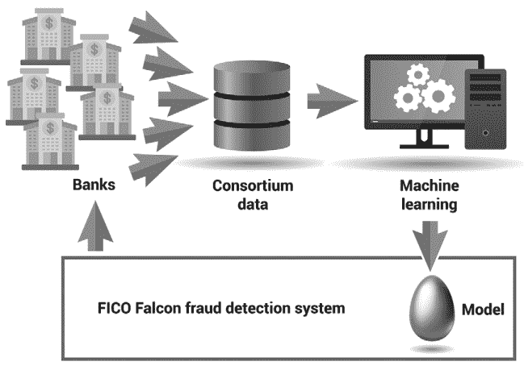

银行提供数据来开发Falcon的欺诈检测模型，而Falcon为每家银行部署该模型。

银行如果不做出贡献，就无法从Falcon中受益。要成为使用Falcon的FICO客户，你还必须加入联盟并共享你的数据。Falcon已经变得如此标准，以至于尽管具有合作性质，它也是一种竞争必要性。为了在支付卡市场中保持地位，银行需要Falcon一流的欺诈检测——而他们只有通过合作才能获得。最终，这使竞争环境公平化：即使是最小的银行也可以部署最好的欺诈检测模型。

## 为Falcon构建更好的输入

对于每笔卡交易，Falcon的模型都需要一份关于所有可能揭示其是合法还是欺诈的“证据”的信息丰富但相当简洁的摘要。该因素列表（每个都是潜在的模型输入）构成了一行训练数据。它包括持卡人之前交易的概述，例如交易总数、现金提取次数和平均交易金额。这些计数按不同时间范围细分，例如过去一天、一周、一个月和三个月内的交易。这些计数还按不同类型的商户细分，例如餐馆和服装店。

但这只是基本基础。Scott的团队已将特征工程变成了一门精妙的艺术，手动设计更复杂的输入以进一步帮助识别欺诈。这些输入编码了最近的交易是否标志着持卡人行为的变化，例如支出急剧加速或从完全新的类型商户购买——例如，从高尔夫商店购买，而你以前从未这样做过。同时，对每个持卡人的长期跟踪必须识别年度趋势，以免触发误报，例如一个家庭每年在佛罗里达州度假。

实际上，这比那更“元”一些。即使是最戏剧性的行为变化也不一定揭示欺诈，因为有些持卡人容易改变。他们倾向于做一些前所未有的事情。对于这类客户，第一次从高尔夫商店购买不应被解释为潜在欺诈。对他们来说，变化并不新鲜。有些异常是无害的。有了正确的输入，训练有素的模型将能够辨别哪种行为变化与欺诈相符。

除此之外，其他输入还跟踪持卡人个人资料的更新。例如，在你更改电子邮件地址后，你可能更有可能在对你来说是新的国家进行交易。通过设计用于反映这种变化的输入，模型可能学会何时对这种首次行为宽容。请记住，目标不仅是识别欺诈，还要通过允许合法交易（即使它们对该持卡人来说是异常值）来控制误报。

最后，其他输入帮助模型审查商户的各个方面。毕竟，不仅是持卡人的历史揭示了一笔交易尝试可能是欺诈性的。商户的活动——跨所有卡片——也提供线索。这包括是否


该商家经历了企图欺诈的增加，或该地交易趋势出现其他异常变化。

## 这还没完：标注数据

除了精心设计的输入，Falcon的训练数据还需要一种关键成分：输出的标签。每笔构成数据行的示例交易，在被指定为欺诈或非欺诈之前都是不完整的。这些标签将指导模型训练完成其工作：生成一个能够区分正例和负例的模型。

只有人类才能提供标签。如前几章简要提到的，对于检测任务，我们无法像预测未来事件那样受益于“时间会证明一切”。时间已经告诉我们，用户在看到某个广告时是否做出了反应，或者债务人是否违约。在这些情况下，我们可以“免费”获得标签。但对于检测每个案例的定性属性——例如是否为欺诈——每个训练示例的标签只能由人来确定。

人工标注劳动密集且昂贵。当需要主题专家（例如医生来确定每个示例是否指示某种医疗诊断）时，成本尤其会飙升。

另一方面，不需要特殊专业知识的问题，例如为自动驾驶项目在图像中标注交通灯，可以外包给Amazon Mechanical Turk等“众包劳动”平台，每个案例只需一分钱。但这有个阴暗面：据Vocativ报道，其大部分不受监管的工作条件“让我们一窥不断壮大的数字底层阶级未来可能面临的景象”。Marketplace称其为“数字时代的新工厂车间”。

更糟糕的是，欺诈检测需要大量标记的交易，因为正例很少。如果欺诈率为0.1%，并且你希望数据中包含至少10,000个正例，那么你需要标记1000万个案例，以确定每个案例是正例还是负例。

别担心！Falcon的训练数据通过依赖消费者的自然行为，设法绕过了这一昂贵的瓶颈。在卡片欺诈中，如果消费者看到错误的收费，他们会投诉。我们持卡人和银行实际上已经在日常生活中完成了所有标记许多欺诈案例的苦力工作。

这种方法之所以有效，关键在于，在卡片欺诈中，银行可以承受“吃一堑长一智”的代价。由于检测系统并不完美，它会允许一些欺诈交易通过。如果持卡人后来对未经授权的收费提出投诉，这就会产生一个正例训练案例——尽管那时通常已经太晚，无法阻止欺诈者的犯罪。成本由银行承担，但整个循环在经济上是合理的。在这个数据创建过程中，没有人类受到实质性伤害。

在其他领域，你不能这样做。对于会闯红灯的自动驾驶汽车或会漏诊断的医疗系统来说，漏掉、未被捕获的案例——即假阴性——远不可接受。在这些领域，你通常无法避免需要额外的人工工作来标记许多示例。

这种用于欺诈检测的“有机”标注过程，本质上是人们“跟着钱走”，它优先处理大额欺诈案例而非小额案例。FICO仅将经过裁决的欺诈视为正例，即持卡人已正式证明该交易为欺诈（无论最初是持卡人还是银行发现的）。这意味着，从未经过裁决的可疑案例不会在训练数据中被标记为正例，即使银行不得不核销该笔费用。由于人们更倾向于为高价值欺诈案例进行裁决，低成本欺诈较少被正确标记，因此实际上被Falcon模型降低了优先级。这可以接受，因为对它们来说，假阴性的成本较低。

除了人工标注之外，许多其他正例是被动标记的：即Falcon自动发现的案例。使用Falcon的银行会阻止一笔企图欺诈的交易，持卡人可能根本不会听说这件事。这几乎是一个循环过程，因为该正例随后将用于训练Falcon的更新模型，而最初正是该模型识别出了该正例。然而，再次，持卡人的自然反应有助于纠正数据。如果Falcon错了——如果是假阳性——那么持卡人（其合法交易尝试被阻止）通常会采取行动使其获批，该案例最终会在训练数据中成为负例。这样一来，模型犯下的错误将有助于改进下一版模型。

总而言之，这为Scott的团队提供了大量正例。他们最终得到的欺诈标记案例数量接近一百万。

## FICO Falcon 精彩打击欺诈

Falcon有效。我认为它是全球最成功、影响最广泛的商业机器学习部署之一。它筛选全球26亿张支付卡的所有交易。这占全球卡片的三分之二，包括美国和英国约90%的卡片。前20家国际信用卡发行商中的17家、美国所有100家最大的信用卡发行商以及美国前100家金融机构中的95家都在使用Falcon。

自推出以来，Falcon已将美国的卡片欺诈损失降低了70%以上。目前美国每年遭受约100亿美元的欺诈损失，这一降低每年为我们节省了约200亿美元。

正如Falcon的数据收集分布在各银行中一样，其部署也是如此。而且，该部署必须实时进行，在几毫秒内生成每个预测评分。这些考虑因素将在第6章部署中讨论。

但首先，我们转向第5步，使用我们辛苦获得的数据来训练模型本身。我们这些凡人如何设计一个从训练数据生成预测模型的算法？这真是一个艰巨的计算机编程作业。

# 5 算法

## 训练模型

机器学习算法是单一最强大的通用技术。它们也是最酷的。通过从数据中学习，它们推导出可行的模型——这些模型能够对新的、独特的案例进行预测。在训练模型时，计算机本质上是在为自己编程。

如果你兴奋地直接跳到了这一章，那么你志同道合——然而，你正是我为之前那些章节所写的那类读者。在你尽情享受这门性感的火箭科学之前，你需要先在业务方面付出代价。我们都必须克服天然的倾向，即不去过分关注发布，而是吹捧先进技术——以及不去执行使该发布成为可能的前四个项目步骤。但如果你读完了这一页之前的所有页面，你就赢得了尽情享受的权利——享受吧！

本章为新手和商务专业人士提供了一堂易于理解的机器学习算法速成课。毕竟，这些核心方法有着重大影响：它们将驱动你的大规模运营。我们将通过深入探讨内燃机的巧妙原理，而不是如何更换火花塞，来保持内容的相关性。

BizML 实践：
- 1. 价值：确立部署目标。
- 2. 目标：确立预测目标。
- 3. 性能：确立评估指标。
- 4. 燃料：准备数据。
- 5. 算法：训练模型。
- 6. 发布：部署模型。

对于EduPay项目，我乐得像猪在泥里打滚。我有5000万行数据，一个可行的机器学习商业案例——广告选择——以及一家愿意部署的客户。

但我也有艰巨的任务：我需要生成模型，能够为所有准备上大学的高中毕业生中的三分之一，在实时动态选择291个广告中的一个。这意味着我需要生成291个模型，每个广告一个。在大多数机器学习项目中，你只生成一个模型。从哪里开始？

数据如此之多，时间如此之少。

正如我们讨论过的，每个模型都旨在预测用户对其对应广告的响应：

## 定向广告的预测目标（EduPay）：如果显示此广告，用户会响应吗？

我最初只为几个广告开发模型。其中一个在10%时的提升度为3。这意味着，预测最有可能响应的10%用户，比平均用户响应的可能性大三倍。这些用户可能是展示此广告的合适人选，而不是，比如说，展示最受欢迎的广告。

手头的广告是为海军招募。它在蓝色图形上醒目地展示了标语“加速你的生活”，然后问道：“<username>，你准备好离开<city>去看看世界了吗？海军可以教你怎么做！”它呈现了两个选项，“是的，请联系我！”和“不，谢谢”，后面跟着一个“提交”按钮。用户必须选择其中一个才能越过这个“插页”页面，并继续使用EduPay网站探索大学助学金和奖学金。每个选择“是”的用户，海军都会向EduPay支付12.50美元。

让我们以这个模型为例进行深入探讨。

## 窥探模型

当一个新生模型出现时，它会吸引你的全部注意力。就像数婴儿的手指和脚趾一样，你会彻底检查它，探究它工作得如何以及为什么——是什么让它运转。


ML的发现通常是神秘、难以解释和显而易见的混合体。海军广告的模型包含以下规则：

```
IF the user
    has opted in for marketing emails
    AND
    has not been shown this ad yet
    AND
    is in college
    AND
    has not specified a high school name
    AND
    has an SAT written over 480
    AND
    has an SAT verbal-to-math ratio between 0.5 and 1.5
    AND
    has an ACT score over 15
THEN the probability of responding to the ad is
    2.6%.
```

可能很难完全理解其中的任何逻辑韵律或道理，但它有效。这条规则——有些人称之为模式——精准定位了一组相对容易响应的用户。该广告的总体响应率为1.6%，因此适用此规则的用户响应可能性高出63%。换句话说，它实现了1.63的提升度。

通过发现这种模式，组织将“从经验中学习”推向了高速档。我们过去曾向这类客户展示过该广告，响应效果相对较好，所以让我们多做同样的事情。这超越了传统企业简单地做更多有效事情的做法，例如Lands’ End服装零售商，它最初销售航海用品，但注意到其服装销售良好。ML更进一步，通过精确找出什么样的客户在什么样的情况下有效，提供了更精细的敏捷性。

## 模型合理吗？

有些部分似乎显而易见。选择接收营销邮件的用户也倾向于对广告响应更多——不仅是这个广告，而是所有广告。这并不奇怪。同样适用于用户是否已经看到过该广告。如果没有，他们更有可能响应，因为如果他们会响应，大多数情况下是在第一次看到广告时响应。未指定高中名称可能对应于这些用户已经在上大学这一事实，因此规则的这一部分可能与“is in college”大多重复，因此无关紧要。

当你查看模型并发现它大多发现了对你来说似乎显而易见的事情时，这并不令人失望。这意味着你的人类直觉已得到数据的验证。这种验证比你意识到的更为关键。毕竟，模型中你没有看到的是算法相当有帮助地排除的许多其他潜在的“显而易见”但错误的假设。此外，模型的价值不仅来自“显而易见”的发现，还来自它如何巧妙地将它们结合起来——以及一些潜在的惊人发现。通过做好这一点，建模方法展现出一定的逻辑和数学精妙之处。

此外，当模型似乎与人类直觉一致时，这有助于增强业务利益相关者的信心。取决于你组织的文化和期望，批准模型上线可能部分取决于决策者是否相信模型“合理”。

但理解模型很少是简单直接的，以及是否有必要这样做，在机器学习行业中是一场未解决的宗教辩论。看看上面展示的规则。它仅适用于某些SAT和ACT分数，并且当SAT语文与数学比例不过分极端时——用户可以思维不平衡，但不能太不平衡。你可以推测为什么这样的人更有可能响应海军征兵广告。也许军人家庭倾向于强调全面教育，因此这些家庭的热心新兵更有可能拥有更平衡的分数。或者也许极度不平衡的思维在某种意义上是古怪的。问题是，总有不止一种合理的解释。

拥有能够预测的规则就足够了；理解它们为什么成立既是可选的，也是笨拙的。除非你的数据来自特别设计的实验，否则任何旨在解释规则背后原因的解读都不超过主观猜测。试图理解“为什么”就是试图确定因果关系，而如果不为此目的通过受控实验收集新数据，我们就无法确定地建立因果关系——因此常听到的“相关性不等于因果性”。

尽管如此，建立因果关系是许多机器学习项目的全部目的。本项目的目的是选择最可能促使用户响应的广告。某些广告倾向于对某些用户产生更多响应，模型用于捕捉此类洞察。为了尽可能做好这一点，有一种称为提升建模的高级方法，相较于本项目为每个广告创建单独模型的相对简单方法具有优势，但我们在本项目的执行中并未走那么远，本书也没有篇幅介绍。有关该有前途话题的更多信息，请参见本章注释 www.bizML.com。

但广义地说，找出某些输入（例如，“SAT语文与数学比例”）与客户响应增加之间关联的因果解释，超出了此类商业项目的范围。我并非在攻读社会学博士学位以更好地理解人类行为。我只是试图为每个用户选择最佳广告。如果模型预测良好，且数据在合理怀疑之外验证了这一点，你是否在意它所发现模式的最终科学解释？为什么你公司的决策者应该要求这样的解释才能信任一个单纯数字已经证明是可靠的模型，尤其是当所尝试的解释仅仅是猜测时？

原则上，决策者不应该，但在实践中，他们常常这样做。你当然不能责怪人们去看一看并推测模型运作背后的逻辑。决策者通常不愿在未亲眼看过的情况下批准模型。否则，模型就是一个神秘的黑盒，许多人觉得难以信任。

我无法解决这场宗教辩论，试图解决也是愚蠢的。但即使你坚决反对得出可疑的解释，也有其他确定的理由来检查每个模型。一是检查错误，我现在就转到这一点。另一个是筛查模型驱动决策中的伦理问题，我将在本书结论中讨论。

## 检查模型以查找错误

在EduPay项目中，我面临一个棘手的困境：如何生成291个模型，然后亲自彻底检查每一个。

对于典型的机器学习项目，你必须对每个模型进行合理性检查。毕竟，有很多事情可能出错，数据中有很多潜在的陷阱和错误。我曾有一个模型建议高中辍学生是更好的雇员。这促使我重新仔细审视数据及其获取方式。结果发现，在人类从求职者简历中手动输入数据时存在系统性问题。

另一个警示故事中，华盛顿大学的研究人员生成了一个在图像中区分狼和哈士奇的模型。它表现出色，但当他们调查其决策方式时，发现它实际上是基于背景中是否有雪来运作的——狼图像比哈士奇图像更可能有雪。这是数据中的问题，但只有在检查模型时才变得明显。

这种事情时有发生。一般来说，数据科学家必须进行一些临时性的探查，进行一种模型完整性检查。在过分关注任何单一模型之前，第一个问题是建模方法是否根本有效，也就是说，生成的模型是否以有效的方式组合输入变量。模型是否主要依赖于单一输入变量，未能整合其他输入？如果有一个过于占主导地位的输入，其性能是否好得令人难以置信——可能揭示我上一章讨论过的那种“来自未来的时间泄漏”？

同时，你查看模型的预测性能，例如其提升度。它在留出的测试数据上是否表现良好，与其在用于生成它的训练数据上的表现相比如何？如果不是，这种表现不佳被称为过拟合。这意味着建模过程是在记忆训练数据特有的特性，而不是真正学习——即，发现普遍成立的洞察。如果你过拟合，就必须排查建模过程的设置方式，或者干脆转向另一种方法。

在EduPay数据上，少数模型似乎达到了标准。但除非我分身术或EduPay大幅增加项目预算，否则我如何将此过程扩展到291个模型？

在讲述我针对本项目的攻击计划之前，让我们退后一步，看看建模在一般情况下是如何工作的，以及数据科学家可以选择的广泛建模方法范围。

## 从数据中学习：终极技术挑战

在完成前四个项目步骤后，我们已完成准备工作，为机器学习项目的机器学习部分——即核心技术本身：步骤5，训练模型，也称为预测建模——奠定了基础。商业案例已商定，训练数据


已就绪。现在我们将其输入建模软件并按下“go”按钮。

当研究人员着手开发该软件时，他们面临艰巨的任务。他们必须制定从数据构建模型的逐步说明。也就是说，他们必须编写一个计算机程序，该程序将生成一个机制，该机制本身将处理个体的几十个或几百个输入值，以计算该个体的预测分数。该模型预计能够对用于指导其创建的训练数据中的示例个体进行相当准确的预测。更重要的是，它还必须对单独留出的测试数据集中的示例进行良好预测。这组单独的案例用于估计模型在从未遇到过的未见案例上的整体表现。该评估步骤告诉你建模是否成功。

多大的挑战啊！想象一下你那可怜的电脑的处境，一个孱弱、一无所知的机制。你向其中倾倒大量数据，但它并不“理解”数据。变量对它来说毫无意义。它不像你那样对用户画像和行为有一般性了解——它也不明白自己试图预测什么，即输出变量的现实世界含义。

模型必须考虑关于新的、独特的情况或个体的所有已知几十个或几百个因素。给定定义该情况的输入变量，它应该如何权衡或组合所有这些因素，以计算出正面结果的最精确概率？更确切地说，计算机如何能自动学会做到这一点——也就是说，它如何能自动生成该模型？

你即将揭晓答案。面对这一终极挑战，本章所述的预测建模方法等方法取得了科学上的伟大成就：它们的模型有效。从过去示例中得出的概括在应用于新的、前所未见的情况时依然成立。这种能力使ML成为世界上最强大、最广泛适用的技术。

建模方法经得起考验，源于研究实验室，并在商业部署中证明其娴熟且可靠。当我们使用它们时，我们站在巨人的肩膀上，即开发这些方法的研究人员。而且，在审视它们时，我们享有特权，得以看到哪些方法最终被证明效果最好，跳过那些发明者所经历的所有磨难与艰辛。正如天才一样，有人说研究是1%的灵感和99%的汗水。但对于成熟ML方法的商业用户来说，这毫不费力——或者至少大大减少了汗水。

很容易对这项事业的深远意义感到兴奋。让我们通过看看它究竟如何运作，将这种兴奋与具体的机制联系起来。

## 决策树：由规则构成的模型

最流行的建模方法之一是决策树。决策树由if-then规则组成，就像我们上面看到的那条规则——我确实是从决策树中提取的。以下是一个示例：

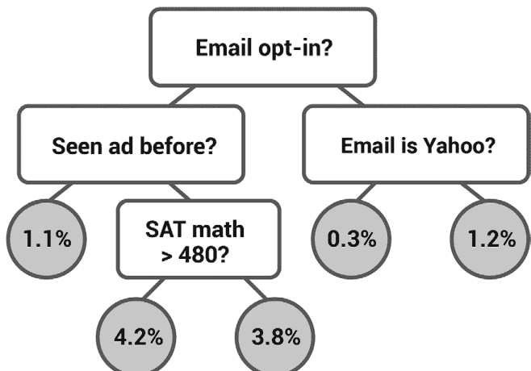

用于预测广告响应的决策树。从顶部开始。如果答案是“是”，则向左；否则，向右。

建模过程会自动从训练数据中创建这样的树——通常最终得到的树比上面所示的示例大得多。然后，要在部署中使用它来预测性地为个人（例如，EduPay用户）打分，你只需从顶部（即这棵倒置树的根节点）开始，通过回答是/否问题，一路向下到达一个终点（叶节点），从而得出该个体的分数。例如，如果答案是“是、否、是”，那么通过向左、向右、再向左，你最终会到达一个显示4.2%的叶节点——模型表示该个体看到广告后响应的概率为4.2%。

你可以将决策树视为一组嵌套的if-then-else语句（如果你做过一些编程），一个没有循环的流程图，或者一组规则——从根节点到叶节点的每条路径都构成一条规则。例如，对于我们刚刚介绍的路径，规则是：如果用户已选择接收电子邮件且之前未见过该广告且SAT数学成绩大于480，则分数为4.2%。

建模构建决策树的方式是“从上到下生长”它。它从顶部最具预测性的单个输入变量开始，从而将所有个体分为两组：在所示示例树中，即那些已选择接收电子邮件的人和那些未选择的人。然后，它在向下构建树的过程中进一步细分这些组。随着训练数据被划分为相当小的组，这一过程不断重复，但不会太小，因为仅凭少数示例无法很好地进行概括。通过遵循此过程，树的大小和形状——以及其是/否问题的输入变量选择——都会自动确定。

## 更多建模方法：线性回归和逻辑回归

其他建模方法看起来完全不同，工作方式也完全不同。线性回归创建一个线性模型，它只是用加权和组合输入变量，例如：

```
(0.0008 × SAT-written) + (0.4 × email-opt-in) + (0.16 × in-college)
```

这个示例线性模型——仅涉及三个输入变量——假设email-opt-in和in-college变量在为真时值为1，在为假时值为0。

在这种情况下，建模方法的任务是调整这三个权重，不断微调，直到模型在训练数据上的表现尽可能好。它不太可能表现特别出色；这种老派的标准统计方法已被现代建模方法所超越。

然而，线性模型作为其他方法的基础。其中一种非常流行的方法是逻辑回归，它只是一个线性模型，后面跟着一个被称为S曲线或Sigmoid函数的非线性变换。这个额外的步骤将中间范围的预测分数“拉伸”到更接近100%或0%的概率，实际上是试图让模型做出更明确的“是”或“否”预测。事实证明，对于许多是/否预测目标（又称二元分类），这比简单的线性模型效果更好。

现在，如果你不是数据科学家，你可能希望大部分情况下可以跳过这些技术细节。允许我实现你的愿望。

## 关于建模方法你需要知道的一切

在我们简要概述几种更多建模方法之前，先说清楚一件事：尽管它们之间看起来大相径庭，但所有模型都完成同一简单任务：它们接收输入并输出预测分数。这几乎就是字面定义：

预测模型：一种为个体预测行为或结果的机制，例如点击、购买、撒谎或死亡。它将个体的特征作为输入（输入变量），并以预测分数作为输出，通常以概率形式呈现。分数越高，个体表现出预测行为的可能性就越大。

由于模型由ML生成，我们说它是被“学习”或“训练”的东西。因此，ML也被称为预测建模。

本书前面，我们将模型描绘为一个黑箱——更准确地说，是一个金色的鸡蛋：

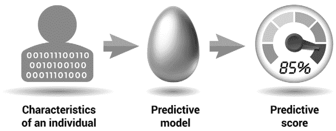

打分：模型为个体生成预测。

在这个鸡蛋内部，如果是决策树，那么它正在应用规则来得出分数。如果是线性模型，它正在应用算术。但无论内部在做什么，模型始终以相同的基本方式使用：组织从模型中检索分数，并据此指导运营决策，而不论分数是如何计算的。

从功利主义的角度来看，你可以将模型视为一个输出预测分数的黑箱。要使用这些分数，模型的内部工作机制差别不大。事实上，除了这一步之外的其他五个bizML步骤，无论你的数据科学家开发哪种类型的模型，其运作方式大多相同。只要模型完成工作且不消耗过多时间或计算资源，这些步骤就可以在很少关注建模方法选择的情况下执行。

即便如此，负责此模型训练步骤的数据科学家并没有奢侈地跳过内部工作机制。为什么他们必须忍受潜在无穷无尽的不同方法带来的头痛，每种方法都有其自身深奥的技术细节？为什么不能只有一种最佳方法呢？


## 为什么存在竞争性的建模方法

不存在单一的最佳 *预测建模方法*（又称 *ML 算法*）。没有“圣杯”，也没有通用冠军。无论一种建模方法多么好，总有一些数据集会由另一种方法更好地处理。表现最好的方法取决于手头的问题——归根结底，取决于数据的性质。

随着机器学习领域的发展，它并未趋向于单一的最佳建模方法。这一事实由 *不免费午餐* 定理所概括，这是学术和理论方面人士中的一条著名原则。这是一个可爱的名字，阐明了观点：如果存在一种总能获胜的方法，数据科学家就不必那么努力工作了。那就像是得到一份免费的午餐。

人性有时会试图反驳不免费午餐定理的不可否认性。机器学习从业者常常会对某一种建模方法情有独钟。但事实是，在你尝试替代方法之前，你永远不知道自己可能错过了什么，直到你在自己的数据上试用它。

解决方案的多样性是一件好事。行业通过利用广泛的竞争性方法而繁荣。即使理论上可能发现一种赢家通吃的算法，那也是向神灯许下的错误愿望。每种方法都有其自身的优缺点——不仅在于预测性能，还在于速度、人类可理解性（又称 *模型透明度*）、复杂性以及使用它所需的人类专业水平等各种实际因素。

方法的多样性源于其构想的多样性。当今广泛的方法是在不同时间、不同国家、由不同人发明的。每种算法都是围绕研究人员的直观概念构思和设计的，那是在该人看来似乎是个好主意的东西。

人类的想法往往相对简单，但这有助于机器学习发挥作用——因为 *简化有助于学习*。建模方法之所以有效，是因为它们过度简化了。从示例中学习只有通过“归纳飞跃”才有可能实现，这是关于世界的一种简化假设。例如，决策树强加了一种非常简单的结构：基于可用的有限输入变量集的僵硬 if-then 规则。即使理论上可能完美预测，也绝不会通过那种简单的机制来实现。无论世界如何运作，它都不可能用如此简单的术语来表达。但是，尽管远非完美，那些 if-then 规则表达的模式确实普遍有效，相较于纯粹的猜测提供了提升。建模方法之所以有效——之所以能从示例中得出概括——仅仅是因为这种结构对模式表达方式所施加的限制。如果没有这样的结构，机器学习算法就会过度拟合数据，记住其特性，而不是提取普遍成立的洞察。

拥有如此多样的方法范围，使数据科学家获得了力量。她手头有一套多功能、动态的选项工具包。根据项目的具体情况和要求，她可以尝试各种选项，遵循她在职业生涯中积累的直觉和实用经验法则。这个过程有一些临时性的方面，但随着经验的积累，专家会获得如何进行的感觉。

当你将这些可用方法组合在一起，使它们相互合作而非竞争时，这一可用方法范围尤其有价值。多样模型的集成本身实际上是最重要的建模方法类型之一。让我们看看它在流行方法的简短列表中的位置。

## 建模方法摘要

当今多样的建模方法大杂烩中存在一定的共性。正如我们所讨论的，它们都完成同一件事：生成一个接受输入变量并产生预测分数的模型。而且，它们都以类似的方式做到这一点：从一个糟糕的模型开始——一个非常小或完全随机的模型——然后迭代地调整它，反复进行小的修改，以便其在训练示例上的性能得到改进。

由于每次增量改进都会纠正模型，使其能够正确处理一些之前搞错的案例，你可以将该过程视为一种有条不紊、自动化的方式来改进科学假设或理论（事实上，在过去几十年中，一些机器学习研究人员使用“假设”一词而不是“模型”）。正如克莱顿·克里斯滕森在其著作《创新者的窘境》中所说：“改进任何理论的关键是暴露异常——理论无法解释的事件或现象。只有通过寻求解释异常值——理论的例外——研究人员才能改进理论。”从某种意义上说，建模自动化了完善假设的过程。

建模方法极其通用，适用于各行各业和组织职能。每种模型都可以服务于营销、金融风险管理、欺诈检测或临床医疗——区别在于你给它的数据。尽管我们在各个领域应用它们有各种具体方式，但方法本身是在抽象层面设计的。你作为训练数据汇集的输入和输出变量决定了模型是预测销售额还是成功手术。

以下是一些最流行建模方法的摘要（这些方法都依赖于带标签的训练数据，因此属于监督式机器学习方法）：

| | 训练期间从数据中学到的内容 | 训练后，模型如何生成分数 | 优缺点 |
|---|---|---|---|
| 决策树 | 决策树的架构：其大小、形状和输入选择 | 从顶部（根节点）开始，流向终点（叶节点）。 | 易于解释（透明），并且出乎意料地有效，因其简单性，尽管通常被更高级的方法所超越。 |
| 逻辑回归 | 每个输入的权重 | 对输入应用公式：将输入的加权和相加，然后应用非线性调整。 | 易于解释，但通常被更高级的方法所超越。 |
| 朴素贝叶斯 | 每个输入对正例的因子，以及对负例的相同因子 | 对输入应用公式：大致来说，先对正例相乘输入的因子，再对负例相乘，然后归一化。 | 易于编程且对过拟合具有鲁棒性，但在预测性能方面有限。 |
| 集成模型 | 一组简单模型——有时全是决策树（例如，随机森林和 TreeNet），有时多样化（例如，提升和装袋） | 用每个简单模型评分，然后合并分数，例如，通过平均或投票。 | 改进简单模型的优雅方式，但生成的模型集合难以解释（不透明）。 |
| 深度学习 | 大型复杂数学公式（深度神经网络）中的众多权重 | 对输入应用公式（复杂）。 | 一种突破性的高级方法，可以处理大量输入——例如，高分辨率图像的每个像素——而无需预处理，但难以解释（不透明），计算成本高，并且通常需要高度技术性的人类专业知识才能成功使用。 |

当专家提到其中一种方法时，例如决策树或集成模型，他们同时指代两件事：模型的结构和训练它的过程。这两个方面始终配对。模型的结构可以是树、简单公式或复杂网络（这只是可视化复杂公式的一种方式）。然后，对于每种结构类型，训练它——即执行建模——的过程都是针对该结构专门化的。

在某些情况下，建模过程有其自身的名称，与模型类型分开。对于神经网络，该方法是反向传播，它在训练案例上尝试模型，并在输出错误的程度内，将负反馈向后通过网络传播，相应地调整权重。通过反复这样做，模型的性能会提高。反向传播最初在 1980 年代开发，至今仍在训练当今更复杂、更强大的神经网络，即深度神经网络。这种方法称为深度学习（在此情况下，以建模过程而非模型结构命名）。

## 为什么建模方法也被称为算法？

> 你如何称呼一个可以预测阿尔·戈尔舞步的公式？
> 阿尔·戈尔节奏。
> ——匿名

建模方法也被称为建模算法或机器学习算法——因为算法仅仅意味着完成某事的过程。

算法：解决问题的一个明确定义的、有限的过程。

在机器学习的语境中，算法指的是一种建模方法，例如决策树或逻辑回归。但更广泛地说，算法是整个计算机科学的基础。在实践中，这个词仅仅指任何定义得足够具体、以至于你可以让计算机执行的过程。这个词听起来可能很技术化，但它是一个简单而直观的概念。

媒体使用“算法”一词的方式，很大程度上说明了机器学习的崇高地位。尽管该概念适用于我们用计算机做的任何和所有事情，但新闻界将 algorithm 用作 ML 的同义词。这就像发型师使用 product 一词来指代护发产品一样。或者，crypto 一词通常指加密货币，尽管密码学适用于保护任何和所有类型的交易和通信。当一个领域变得著名时，它会占据不成比例的词汇份额。


## 选择建模方法

更好的预测并非唾手可得。广义上讲，方法越好，越复杂——无论是使用还是解释生成的模型如何工作。你可以在前面表格中列出的方法列表中看到这种进展。在前三种较简单的模型类型——决策树、逻辑回归和朴素贝叶斯——之后，你会遇到一种更复杂、更高效的模型：集成模型。为了改进简单模型，集成模型字面上就是“将它们集成在一起”——因此，按定义，集成模型更复杂。到了列表末尾的深度学习，你对某些问题的能力大大增强，但也增加了复杂性。

对于许多项目，简单模型带来的可解释性是天赐之礼。正如我们所讨论的，能够理解模型的工作原理有时对于调试以及说服某些决策者全力支持至关重要。而且，出于伦理考虑对模型进行审计——以检查它如何做出影响人们的重大决策——也取决于对其内部机制的理解。这种理想的模型特性也称为可解释性或透明度。当你转向更复杂模型所带来的那种难以理解、难以处理的数学汤时，这种特性至少会部分丧失。决策树的长条if-then规则可能看起来晦涩难懂，但就整体而言，它们对人类眼睛来说相对友好。

为了可解释性，UPS在其包裹配送预测中保持了简单。为了形成对明天的预测，系统会查看每个地址在类似日期（如同一周的某天，或者在某些情况下，更具体的日期，如感恩节后的那一天）收到货件的频率。然后，每个地址的概率会根据总体预测进行调整。例如，如果总体上明天预计的配送量高于平均水平，那么每个单独目的地的概率会略微上调，以便汇总的预计数量与预测保持一致。这种方案的效果与决策树相似，并且具有同样的简单性。由于模型内部如此直观易懂，项目工作人员在公司内部推广其部署时更加得心应手。

坚持使用更简单模型的另一个原因是，即使你支付了额外的复杂性代价，也不一定能改进预测。更复杂的方法并不保证效果更好。有时不必走“火箭科学”这条路。同样，对于任何给定的数据，最佳方法都因情况而异。没有一种方法能确保始终表现最好。每个机器学习项目都具有实验性质：只有通过尝试，才能知道一种方法的效果如何。

在选择方法时，人类判断至关重要，因为严格比较每一种竞争方法是不切实际的。例如，通常可以对上面表格中列出的所有五种方法进行初步尝试，或者如果投入大量时间，甚至可以尝试三四倍于此数量的方法。挑战在于，对于每种方法，都有许多影响其性能的设置——太多了，无法穷尽测试。为了解决这个问题，AutoML领域的技术用于系统地探索许多方法和设置。AutoML是一种越来越流行的、尽管不精确的方法。它有助于扩大对最佳建模设置的搜索，但它不能取代数据科学家的专业知识。

最终，即使仅对两种建模方法进行严格的直接比较也是一项挑战，因为每种方法都有如此多的旋钮和拨盘，你可以无休止地进行实验性调整。任何一种方法的拥护者——那些是该方法爱好者并已精通该方法的数据科学家——往往能从中获得最佳性能。考虑到模型性能中的人为因素，任何将方法相互对比的直接比较试验的结论性始终都可以受到质疑。

归根结底，数据科学家必须具备技巧。他们的经验和直觉指导着模型的选择。实际上，对于许多机器学习项目，数据科学家最终只尝试了少数几种方法。此外，还有另一个更好的机会来提升预测性能。

## 关键在于数据，笨蛋！

> 我们并不比任何人拥有更好的算法。我们只是拥有更多数据。
> ——Peter Norvig，Google研究总监

> 我十年数据工作的总结是，数据比模型更重要。每次都是。
> ——Caitlin Hudon，OnlineMedEd首席数据科学家

微调算法并尝试新算法进行比较，只能让你走这么远。随着你投入越来越多的精力，回报往往会递减。你可能通过升级到更复杂的模型（如庞大复杂的集成模型甚至深度学习）来实现小幅的渐进式改进——但这通常不值得增加复杂性。有时，你对建模工作进行了大量调整，却只获得微小的提升。在其他情况下，对于某些项目，每一点微小的改进都能带来巨大差异，那么走这额外一英里可能是值得的。即便如此，这种额外的努力可能只带来微小的收益，并且可能只有几个月的回报期，之后业务变化就会要求重新启动整个项目。

无论如何，指令很明确：改进你的数据。你的努力通常会在那里获得更丰厚的回报。这意味着既要有更多数据，也要有更好的数据。Google研究总监兼人工智能教材合著者Peter Norvig主张获取更多数据，但这还不够。“更多数据胜过巧妙的算法，但更好的数据胜过更多数据，”他说。

改进数据质量而非数据数量更难以正式定义，但同样直观。只需想想什么可能使数据更具预测性。在前一章中，我们讨论了如何通过特征工程过程设计更具揭示性、更有信息量的输入。例如，FICO开发了持卡人倾向和消费行为变化的摘要。另一个例子是，一家电信公司通过合并用户使用网站的方式摘要，扩大了其流失模型的输入。那些查看过剩余合同义务的手机订阅者更有可能取消订阅。除了添加新的、有信息量的输入之外，人们还可以在数据质量保证方面投入更多精力，找出可能存在错误的地方。

但这需要纪律。只有最严谨的机器学习领导者才更关注这种“预测燃料”，而不是那个性感的“预测引擎”。正如Google机器学习软件工程师Josh Cogan所说，“我发现大多数人确实倾向于只关注优化机器学习算法。他们想确保自己拥有刚从论文中出来的最新、最酷的东西……我从未见过有人高估了最初正确完成数据收集有多难。”

同样在Google，一组六名研究人员直言不讳地呼吁理智：“在高风险AI中，数据质量具有更高的重要性，因为其下游影响更大，会影响癌症检测、野生动物偷猎和贷款分配等预测，”他们在一篇研究论文中写道。“悖论的是，数据是AI中最被低估、最缺乏魅力的方面。”他们给论文起了一个让没有人能错过要点的标题：“每个人都想做模型工作，不想做数据工作。”

为了强调数据的重要性，数据科学从政治科学借用了一句号角般的呼吁。“经济，笨蛋！”政治策略师詹姆斯·卡维尔在1992年为当选比尔·克林顿而工作的竞选工作人员面前宣称。通过将其作为竞选口号，他们赢得了总统职位。近年来，机器学习将这个传奇口号修改为自己的座右铭：“关键在于数据，笨蛋！”

然而，数据并非唯一的选择。更复杂的模型确实在某些项目中有其用武之地。

## 你的学习有多深？

建模方法中最新、最伟大的浪潮——深度学习——产生的模型涉及前所未有的复杂性。而且这通常会有回报。深度学习是神经网络的一种高级形式，它将复杂的数学公式表示为组织成层的网络。


深度学习改进了建模的最先进技术，使其能够真正利用大型复杂模型。一直以来，你都可以设置一个具有大量输入的神经网络——只是它以前从来都不好用。例如，如果你想让模型检测一张 1280 × 720 像素分辨率的图像是否包含交通信号灯，你可以直接向它输入全部 921,600 个像素。这比在预测客户流失等场景中通常提供的几百个输入要多得多。问题是，为了以有用的方式处理每张详细图像，模型必须能够进行娴熟、复杂的处理。模型不仅必须复杂，训练还必须能够利用这种复杂性。几十年前，当人们尝试这样做时，原始算法总是失败。

正因为如此，起源于 20 世纪 80 年代的神经网络起初规模较小。回到 1997 年，我第一次在哥伦比亚大学教授研究生机器学习课程时，神经网络是浅层而非深层的，但尽管如此，在许多领域，它们仍然是领先的选择。它们已经在有限的场景中用于自动驾驶汽车——但输入只是前方道路的非常低分辨率视图，一张 30 × 32 像素的图像。我甚至让学生将神经网络用于面部识别作为家庭作业，使用相同的低分辨率。

增加神经网络的层数——使其在字面上更深——会增加其所体现的数学公式的复杂性。但是，几十年来，建模过程（反向传播）无法扩展以利用这种复杂性。由于无法利用额外的层，神经网络无法有效处理大量输入。

随着数据的爆炸式增长，高级建模也随之发展。世纪之交后，令人惊讶的是，建模方法得到了改进，以应对挑战——并实现潜力——即正确训练深度神经网络。这得益于更大的数据集和更快的计算能力，以及对建模算法本身的一些新改进。

深度学习在热度和证明的价值上都蓬勃发展。它是实现并定义语音识别以及各种图像处理应用（包括医学图像诊断、自动驾驶汽车识别和分类周围物体，以及使用面部识别解锁手机等日常操作）的最先进技术的唯一技术。

例如，Google 利用深度学习对其大多数主要产品进行了重大改进，包括 Android、Apps、Maps、Speech、Search 和 YouTube。Gmail 现在拦截了 99.9% 的垃圾邮件。而且，你未加标签的 Google Photos 可以通过“拥抱”等临时术语进行搜索。Google Translate（任何人都可以在线使用）用深度学习驱动的大幅改进版本替换了原有的底层解决方案。去试试吧——给一个母语不同于你的朋友翻译一封信。我自己也经常使用它。

蓬勃发展的生成式 AI 领域建立在深度学习之上。这包括大型语言模型，它们为计算机撰写出连贯性令人印象深刻的散文；数字图像生成器，它们接受文本提示并为你创建图像；以及深度伪造，描绘不存在的人或现实中从未做过某事的真实人物。生成式 AI 还生成合成音乐、语音和视频。

为了跟上步伐，我们于 2018 年启动了深度学习世界大会，作为我于 2009 年创立的机器学习周会议系列的一部分。它们每年在两个大洲举行。

尽管我对深度学习无法不疯狂地着迷，但问题是：这个全能的绿巨人并不是每次都该召集的合适超级英雄。当你需要有人钻进老鼠洞时，蚁人会是更好的选择。

## 对许多业务问题而言，深度学习大材小用

与所谓的经典机器学习算法相比，深度学习倾向于解决不同类型的问题。首先，它更多用于检测而非预测未来。由于需要大量输入，深度学习模型可以直接处理整个未处理的文件，例如照片、医学图像或用于语音识别的音频文件。这使其适合检测每个文件是否包含某个元素或属于某个类别。

这往往将深度学习局限于某些行业，即需要对原始图像和声音文件进行检测的行业，例如自动驾驶汽车、医学图像处理以及需要识别语音的设备。这与本书主要关注的客户预测应用（例如定向广告和营销、管理金融风险、防范欺诈以及预测哪些地点将收到包裹配送）是一个有些不同的领域。

深度学习应用也倾向于允许高准确性——在日常意义上的高准确性：*绝大多数时间能够正确分类正例和负例的能力。* 正如人类通常可以分辨哪些照片包含交通信号灯、哪些不包含，哪些音频片段包含“hello”一词、哪些不包含一样，深度学习也可以。

相比之下，客户预测（通常是经典机器学习方法的领域）意味着预测人们会做什么。对于这些应用，除非你有魔法水晶球，否则只能希望相比于随机猜测获得一些有意义的提升。即使是深度学习也无法自信地预测一般的人类行为。无论模型和建模算法多么复杂和先进，都无法改变这样一个事实：我们正在尝试预测不可预测的事物：人。

考虑到预测性能存在内在上限，深度学习通常对于许多更经典、标准的机器学习业务应用来说是大材小用。对于这些问题，深度学习的强大功能往往被浪费，使用经典机器学习方法几乎同样有效，且需要更少的复杂性、时间、计算资源和高级专业知识。此外，更简单的方法保持透明度，因此更容易理解模型本身，了解学到了什么，以及模型在做出预测和决策时的依据是什么。

另一方面，也有例外情况，深度学习为传统业务应用提供了价值。例如，FICO 的 Falcon 欺诈检测系统部分基于深度神经网络。研究和咨询公司 Celent 估计，如果更广泛地部署，深度学习可以在全球范围内减少各种金融欺诈造成的 1610 亿美元损失。

> “深度学习在今天关于机器学习的媒体热议中占据主导地位，”行业领袖 Dean Abbott 指出。“它吸走了房间里的所有氧气。”

尽管如此，深度学习仅构成整个领域的一个子集。像所有建模方法一样，它属于技术分类学中的一个角落。

尽管具有独特性质，深度学习对项目业务端执行的改变并不大。成功部署需要相同的六步 bizML 实践。你仍然通过将预测概率集成到现有系统中来改变运营。你仍然需要培训决策者和业务线经理。你仍然需要克服数据准备的普遍挑战。而且，组织仍然需要理解并就预测性能和业务性能的定量指标达成一致。这是一种不同的动物，但驯兽师的技能可以很好地迁移。

## 机器学习软件：如何选择工具

如此多强大的机器学习算法，时间却如此有限。要使用这些算法，你需要实现它们的软件。好消息是，外面有许多竞争解决方案。二十多年来，我注意到新方案每两三个月就会出现在我的视野中。但这种爆炸式增长的选项足以让你陷入分析瘫痪，伴随着令人无法决策的购买后悔恐惧。该如何进行？以下是一些建议和指导。

不要从头开始编程机器学习软件。买而不是构建，下载而不是开发。机器学习项目几乎总是利用现有的分析软件。所有标准预测建模方法都已在许多你可用的软件工具中实现。即使是直接来自研究实验室的最新前沿技术，通常也已由研究人员以开源代码的形式发布。


它们自己。对于行业机器学习项目，情况极少需要从头开始编程算法。

**软件选择并不指导项目——项目需求和团队技能才是第一位。** 不要抱有任何幻想，认为分析软件工具可以成为你要解决的业务问题的“即插即用”方案。机器学习项目的目标是一种新的业务方式，是对运营的改进，而机器学习软件在其中扮演核心但有限的角色。一些机器学习供应商可能会提出强硬的销售推销，你需要抵制。相反，应让你的数据科学家在项目成熟和演变过程中确定软件需求。如果你的数据科学家有强烈偏好，或已经精通某个特定工具，那么使用该工具可能会使他们的工作最有效。

**推迟决策。** 如果没有预先指定的工具，除非绝对必要，否则不要贸然确定。在你批准项目并完成前四个步骤——即数据准备——之后，你将拥有用于评估建模软件的相关数据。许多供应商会提供免费评估许可，因此你可以在自己的数据上试用，可能比较多种工具。此外，在项目后期，其他决定性因素也会变得清晰，包括购买软件的预算、其模型如何与现有系统和数据管道集成，以及部署是基于云还是本地部署。

**用好现有资源。** 如果你的组织已经采用了某个解决方案，应将该产品作为首选，认真审视。通常，团队最终会采用付费和免费开源工具的组合，其中许多工具可以很好地协同工作。

## 为广告定位生成大量模型

让我们回到我为EduPay面临的挑战。我需要生成291个可部署的模型，通过消除花大量时间逐个摸索和检查模型的需求，来简化和扩展质量保证流程。

项目进行几个月后，我有了一个“顿悟”时刻。我做了一些实验，然后给客户发电子邮件提出解决方案：
Melissa，

我用另一种方法完成了几轮建模：朴素贝叶斯。结果不错——以下是主要结论：

- 朴素贝叶斯能提供完整覆盖。它可以让我们在按一下按钮的情况下，一举生成海量模型（每个广告一个），几乎不需要对每个模型进行手动“摆弄”。
- 朴素贝叶斯几乎能与决策树媲美，且我几乎不需要进行“摆弄”。
- 朴素贝叶斯是免费的（我从头开始编程实现的）。

以下是朴素贝叶斯工作原理的简要描述：它为每个输入计算一个预测“证据程度”。例如，假设一个用户在十年级，并且在ROTC中，这两者都提供了积极证据，表明该用户更有可能响应广告。这些证据程度通过简单相乘来汇总。这里涉及一些概率论，但主要部分是将与输入变量对应的预测证据程度相乘。

让我们进一步讨论！

—Eric

由于其简单性，朴素贝叶斯运行可靠。它对过拟合具有鲁棒性，因为它不会试图从少数个体中得出概括。相比之下，决策树会深入到“子子细分市场”，例如所有非美国公民且使用Hotmail作为电子邮件提供商的十年级男性。当你查看如此特定的群体时，可能只包含少数病例。但朴素贝叶斯一次只考虑一个输入变量，绝不会深入到如此特定的较小群体。

有了这种可靠性，我就不必逐个检查模型以查找问题。正如预期的那样，每个模型在未见测试数据上的表现都经得起考验。而且，我只需检查几个模型，就能对数据问题或其他错误进行足够的检查。

在得到Melissa的批准后，项目继续进行——然而，我却违反了上述侧边栏中关于机器学习软件的第一条规则：不要从头开始编程机器学习软件。这种不寻常的情况是例外证明了规则。当时，针对带有模型的个性化广告定位，现成的选择并不多。通过自己编程，我可以直接在EduPay现有数据库中实现它，而无需了解、选择、调整和集成他人的产品。

自该项目以来，机器学习的运营化已经取得了长足进步，你现在更有可能找到与项目匹配的现有软件。我从头开始编程是一次特例，是我唯一这样做的一次，除了我之前在学术研究领域的经历。据我所知，我所有的数据科学同事也是如此。

模型训练完成后，就是上线时间。我现在需要与一家对预测模型陌生的公司合作，指导他们将模型集成到其核心业务中。要走完项目的最后一英里需要什么？下一章回答了这个问题，并完结了EduPay的故事——但首先，它讲述了UPS故事中的一个前传片段，关于一次部署出错的经历。

# 6 发布

## 部署模型

部署模型是指将其从实验室推向现场，企业将在现场使用其概率分数来驱动运营决策。具体来说，每次模型对个人进行评分时，该分数都会直接告知针对该个人采取的行动，例如是否联系、批准或审计。这个项目的最终步骤是机器学习开始创造价值的地方（模型维护也随之开始，将在结论中介绍）。

部署需要全组织的支持，以及各级员工的合作。虽然高管是批准者，但运营人员也必须同意，因为部署正是引入变革的地方。你如何克服对这种变革的抵触？你如何降低部署失误的风险并安抚即使是最规避风险的利益相关者？你如何将预测概率转化为运营行动？你如何即时将正确数据输入模型，并让模型在高速进程中仅在几毫秒内工作？归根结底，即使性能提高，你如何证明功劳应归于你的机器学习项目，而不是组织内部或外部的其他变化？随着UPS和EduPay故事的结束，我们将找到答案。

## BizML实践：

- 1. 价值：确定部署目标。
- 2. 目标：确定预测目标。
- 3. 性能：确定评估指标。
- 4. 燃料：准备数据。
- 5. 算法：训练模型。
- 6. 发布：部署模型。

步骤6之后：维护模型（将在结论中介绍）。

Jack Levi在UPS陷入了困境。到目前为止，Package Flow Technology——部署他交付预测模型的系统——的试运行只带来了失望。“内部情况非常糟糕，”Jack回忆道。“简直是一场噩梦。”

布满荆棘的部署之路将考验任何技术先驱的意志。

但这不仅仅是内部事件。媒体已经得知此事并将其曝光。“UPS的新包裹流技术未能交付，”一篇Computerworld的标题喊道。特写文章继续写道：“其备受吹捧的包裹流技术并未像预期那样顺畅运行，在大约300个实施中心中的三分之一处出现了问题。”

在一个远离喧嚣的办公室里，UPS的首席运营官私下责备了Jack。这是一次激烈的讨论，其后果将长期回荡。即使两年后，当他们讨论下一个项目迭代时，首席运营官直视着Jack的眼睛，带着只有财富500强高管才能摆出的目光。“我不要再有另一个包裹流技术——你绝不能那样做。”

还记得Jack在本书早期练就的那份坚忍不拔吗？在应对组织变革中出现的冰雹风暴时，这派上了用场。

但Jack有充分的理由为他的创新辩护：到目前为止的问题不在于技术，而在于人。在UPS部署交付预测，就是要求人们改变惯常的例行程序并接受新范式。这是一个与机器学习一样古老的故事：部署计划说起来容易做起来难。

## 变局：当旧流程数字化

汰旧迎新。包裹流技术（PFT）旨在通过将每个运输中心的旧流程替换为更自动化、更集中的流程来提高效率：


## Legacy process:
每天，人类为每辆卡车必须覆盖的配送区域（序列）分配任务。其中许多决定发生在装载卡车期间，在此期间，员工根据需要临时调整分配。这有时意味着重新分配已经装载的包裹，将它们从一辆卡车转移到另一辆卡车。

## Updated process:
PFT系统集中化并半自动化了将序列分配给卡车的过程，主要基于预测的配送。就在卡车装载开始之前，计划经理通过中央PFT控制台完成最终调整，希望在装载过程中尽可能少地进行临时修改。

如果完全采用，这一流程变化将从根本上提高运营效率：它将减少整个卡车车队累积的里程数——以及司机记录的时间。之所以能够实现这一点，是因为它相对于旧流程具有两个根本优势。首先，它动态地纳入了对尚未知晓的配送的预测，以便提前规划并开始装载卡车，以准时出发。其次，它集中了决策，使其一次性应用于配送中心的所有卡车。这将击败旧流程中由单个卡车装载工在装载过程中临时做出的分散决策。

有了PFT系统，即使经理对计划进行手动调整，这两个优势依然存在。当他们这样做时，是在中央控制台上，可以鸟瞰当天出车的所有卡车。控制台纳入了当天的预测配送以及已知配送。当经理在屏幕上修改计划时，它会根据已知和预测的配送显示预测的效果。

但系统有一些“bugs”：人类——特别是那些执行其指令的人。如果装载卡车的员工过于频繁地推翻集中决策，PFT和配送预测的好处就会消失。更改包裹的卡车分配不仅意味着在没有中央控制台提供的鸟瞰视角的情况下执行可能次优的决策；还可能意味着低效地移动已经装载的包裹。这可能会导致卡车延误，无法准时出发。此外，当员工否决系统并将包裹装载到另一辆卡车时，他们通常不会更新系统。这意味着物理世界和数字世界没有对齐——这预示着麻烦。遵循手持设备上的数据，司机会去配送一个实际上在另一辆卡车上的包裹，而那辆卡车的司机甚至不知道他们有这个包裹。为了解决这种错位，Jack为他的员工制定了一个新口号：“数据与配送同样重要。”

显然，Jack的团队还有更多工作要做，让这些员工改变他们的做法。在旧流程中，员工运用了他们辛苦获得的知识和经验。如果一位经验丰富的卡车装载工看到一个他们认识的配送地址的包裹，他们会下意识地说：“哦，这个肯定得和这个其他包裹一起装上那辆卡车。”为了实现效率的潜在提升，Jack和他的团队必须说服并重新引导员工在装载卡车时更严格地遵循预先制定的计划。

## To Manage Change, Change Management

> 我的三分之二精力用于部署，而非与IT一起构建模型。
> ——Jack Levis

每个层级的员工都抵制变革，从装货码头到顶层办公室。回想本书早先的一个危急时刻，Jack在努力争取高管Chuck的授权时，字面意义上带他兜了一圈来演示系统的卡车导航。正如Chuck最初很难接受那些似乎违背他人类直觉的决定一样，那些装载卡车的人也是如此。

但每个层级的员工都必须合作。当组织不能或不愿合作时，部署就会停滞。获得自上而下的支持，就是确保部署的“能”和“意”——既有能力也有授权。高管批准变革，但执行者也必须遵守。我们必须实现全栈式的组织支持。

不同的决定，同样的故事。本章的故事是与Chuck那一集的前传。在这里，Jack致力于让规定的卡车装载得到正确实施。只有后来，他才让Chuck批准规定的卡车导航。

技术的效果往往取决于人类的采纳。“我工作中最困难的部分，实际上不是与数学家合作提出一个优美的模型来解决问题，”多年后一位主旨演讲者在机器学习周2022的舞台上大步走来时感叹道。作为会议主席，我邀请了另一位UPS领导，网络规划与优化总监Yentai Wan。他继续说道：“我工作中最困难的部分实际上是部署。也就是所谓的变革管理。我如何说服那些最终用户从旧系统转过来，利用我们构建的现代化技术？”

一般来说，这种变革管理挑战并不新鲜，但当涉及到ML项目时，精明地管理运营变革的需求常常被忽视。先进的建模算法本身吸引了项目的大部分注意力，并似乎承诺了月亮。ML交付了一枚火箭，但负责人仍然必须监督其发射。

## Training Daze

> 大规模变革需要推进鼓舞人心的愿景，建立关系资本，并保持组织一致性……领导力同时拥抱统一和颠覆的理想。
> ——Christopher Hornick，《领导力的最后一本书》

为了使转型成功，领导者必须以旨在……推动员工情感承诺的方式来对待它。

> ——Andrew White等人，《组织转型是一段情感之旅》，哈佛商业评论

随着PFT的有效性受到质疑，Jack感到了压力。但他和他的团队仍然看到与以往相同的潜力，即使回报目前被推迟了。问题出在人为因素，而非技术系统。Jack和他的团队低估了获得广泛支持和遵守所需的努力。是时候在这项努力上坚持到底了。

所以他们加倍致力于变革管理工作。在每个配送中心，培训团队必须坚持到底，拒绝在取得绩效结果之前离开。仅仅传递知识是不够的。中心的员工可能对新系统着迷，但这种兴奋往往只是昙花一现。如果太快地让他们自行其是，他们就会回到旧的例行公事。

你如何改造固执的习惯动物？总有纯粹的意志和铁腕。重大变革需要某种执法。团队监督、劝说，甚至有点微观管理。例如，那些难以打破旧习惯的装载工被重新分配到他们不熟悉的新区域，在那里他们不会认识配送地址。你不能把知识从一个人身上拿走，但你可以把人从其知识领域中带走。

但保姆式管理和胁迫只能起到有限的作用。与其仅仅依赖施加压力，Jack的团队通过分享成功的回报来动员员工。诀窍是以短期成功为奖励，因为底线效率的改善需要一些时间才能显现。“因为那些早期过渡日子不一定有利可图，我们不得不使用一张平衡计分卡，奖励那些实现了领先指标的经理，”Jack解释道。“如果你在做那些在你控制范围内的领先事情，节省的金钱这一滞后指标又怎么可能不随之而来呢？”

团队实施了计分卡，报告员工对改进程序的遵守情况，当有过多的覆盖或司机不得不等待卡车完成装载并延迟出发时发出警报。只有在通过考核后，配送中心才会“毕业”，培训团队才会离开。

这种绩效管理策略奏效了。它提高了对集中决策的遵守率，减少了临时做出的分散决策数量。辅助轮被取下了。

取得这些更快、渐进的胜利改变了谈话，赢得了高层的重新支持。预算和可用资源略有增加，培训团队扩大到覆盖更多的配送中心。一个典型的配送中心需要五名培训人员现场工作数周。为了应对这项全面变革管理流程的非凡需求，Jack的部署团队最终增长到约450人（后来为介绍中描述的ORION导航系统增长到700人）。

但随着积极结果开始显现，一个新问题浮出水面：Jack如何证明这些改进是来自他的PFT优化系统，而不是来自其他变化？在整个UPS，大量重叠的努力正在进行中，都试图提高运营效率。责任在于Jack，要以某种方式证明他的系统是大部分观察到的改进的原因。

## When You Don't Need Humans in the Loop

在EduPay项目中，我面临与Jack相同的两个部署挑战：（1）让模型得到正确集成以生效，以及（2）为其产生的价值建立应有的认可。他是在递送包裹，而我是在递送广告，但ML的挑战是普遍的。

幸运的是，对我来说，第一个挑战——集成——在我的EduPay项目中更容易解决。一方面，规模大约只有UPS的百分之一。每天，他的系统必须决定如何路由1600万个包裹中的每一个。但我的规模仍然可观，决定显示哪个广告大约200,000


每天多次。较小的幅度在缓解工程挑战方面帮助不大。

相比于规模的差异，我之所以更容易，主要是因为我的项目会自动化决策，而非支持人类决策。我可以把人排除在循环之外。这使得项目更简单。让计算机遵循指令更容易。毕竟，这就是它们被制造出来的目的。Jack 需要数百人来培训人类。我只需要一两名工程师来重新编程 EduPay 网站的某个方面。

ML 项目通常会自动化决策，例如响应建模、流失建模和垃圾邮件过滤。每当模型的输出决定是否联系客户或将电子邮件归入垃圾邮件文件夹时，循环中就没有人类。系统自主运行。

**决策自动化：** 部署预测模型以自动推动一系列运营决策。

当人类不在循环中时，他们并未完全退出画面。自动化简化了流程的核心部分，但人类在后续某个环节仍然参与其中。在模型定位营销活动后，即使你亲手舔每个邮票，这仍然是决策自动化，因为是否联系的批量决策是由模型单方面做出的。对于某些欺诈检测项目，模型决定哪些交易需要人工审计欺诈，但这一决策是自动的，而且，大多数交易在没有人类参与的情况下通过。信用评分可能决定一些小额贷款申请自动通过，一些自动拒绝，一些发送给人类贷款官员做出最终决定。由于对每个申请分配到这三个类别是自动的，有人会称其为“决策自动化”，但也有人会称其为“部分自动化。”

另一方面，UPS 项目因复杂性过高而无法实施决策自动化。该项目涉及预测与决策之间异常长的距离。预测配送，并将这些预测输入一个复杂的规划系统，该系统将预测和已知的配送分配给卡车，以便当天每辆卡车的路线都高效。预测影响最终决策，但更间接。由于运营复杂性，决策只是半自动的，由人类专家根据需要进行修改。

但许多更直接的部署也让人类参与循环。即使每个预测以直接、明确的方式告知每个决策，对于人力资源、医疗保健和执法等领域，完全自动化通常也不是考虑因素。在这些领域，计算机没有最终决定权。只有人类才能做出谁来雇佣、如何诊断或治疗病人，或是否假释囚犯等重大决策。

通过支持人类决策，模型是增强而非自动化。例如，如果模型表明一名求职者很可能成功，这可能会影响招聘经理的 from the user。

但还有另一个因素在起作用：每条广告的出价，即赞助商为每次响应支付的金额。毫不奇怪：EduPay 的目标是增加收入，而非点击量。因此，每条广告的 *预期回报* 是通过将响应概率乘以出价来计算的。例如，考虑在这两条广告之间做出选择：

广告 A 的概率为 20%，出价为 $5，因此预期回报为 $1。

广告 B 的概率为 10%，出价为 $15，因此预期回报为 $1.50。

系统将选择广告 B，尽管它的响应概率较低。通过这种运作方式，我们不最大化响应，但确实最大化了收入。回想第 3 章的侧边栏，我们同样将债务人还款的概率转化为预期回报，方法是考虑贷款产生的收入。

除此之外，EduPay 还必须按资格过滤广告。赞助商只会为符合条件的候选人产生的响应付费，例如某些仅面向十七岁或以上用户的军事招募。

归根结底，简单的逻辑和算术将预测转化为行动。对于每个 ML 项目，领导者根据业务实际和要求手动设计这种转换。转换方案可能详细且具体，但对于大多数 ML 项目，它并不十分复杂。

对于卡片欺诈检测，模型部署和分数转换由两家不同的公司分别进行。FICO 为银行部署 Falcon 模型。对于每笔交易，它提供 1 到 999 之间的分数——这是对传统 0 到 1 或 0 到 100 范围的一种表面修饰，概率通常在该范围内表示，FICO 仅使用它来让分数对银行来说更友好。然后，银行完全自行决定如何根据分数采取行动，这很大程度上取决于他们对欺诈的容忍度与打断客户购买的容忍度之间的比较。例如，银行可以实施规则，根据交易金额对不同风险级别采取不同处理方式，例如：

- 如果收费超过 $500 且分数超过 950，则拒绝交易。
- 如果收费超过 $100 且分数超过 980，则拒绝交易。
- 如果收费超过 $100 且分数超过 900，则联系客户确认收费。
- ...

此类规则通常超出数据科学家的职责范围。银行根据政策、法规和业务策略手动开发这些规则。规则不是自动生成的——它们体现了公司决定如何使用模型，而不是模型本身的一部分。小银行可能会使用 50 到 200 条此类规则，而大银行可能有数千条。归根结底，根据银行设定的规则，系统通常每 1,000 笔交易会干预大约 15 到 30 次。

将预测转化为行动不需要任何秘诀。即使逻辑可能变得更详细，这种转换也不需要任何形式的高级分析。警惕经常被引用的误称“规定性分析”，它错误地暗示你需要超越预测分析的另一种复杂技术才能推进


从预测结果到指导行动。预测分析，即在特定业务应用中使用机器学习，本质上已经是指导性的。其目的是指导行动，仅凭它本身就已经让你非常接近这一目标。至于最后那几英寸，你只需要精心设计的定制逻辑——而非全新的一类分析方法。毫无必要地引入“指导性分析”这一术语，暗示存在实际上并不存在的新型高级方法，这已经造成了混淆。

有了将模型分数转化为广告选择的既定方法后，EduPay 项目几乎准备就绪，即将上线。接下来，我们需要将模型嵌入到实时网站中。

## 如何导出模型

EduPay 的工程师们准备好集成我的模型——但他们对机器学习完全是门外汉。一个量化分析师要将他的模型转交给一组工程师，需要具备什么条件呢？

要部署模型，你必须让它“飞出去”。你需要将其从机器学习软件工具中导出，进入运营系统。这种“送别”在将模型嵌入移动设备时最为直白。每部 iPhone 内部都装有一个用于人脸检测的神经网络。与此同时，谷歌 Pixel 6 是第一款内置独立芯片来运行模型的手机。

但即使你不是在部署到无线设备，你的模型也必须同样迁移——交给那些将把它集成成其本应具备的功能装置的程序员手中。大多数机器学习软件工具通过几种方式来促进这一过程。一种是生成代码。按一下按钮，它就能将模型的机制翻译成 Python 或 C 语言，以便工程师更容易地将其集成到现有系统中。或者，工程师可以创建一个独立的软件模块来容纳模型，并通过应用程序编程接口（API）来调用它——这是一种系统之间相互调用的标准机制。这为工程师提供了一个函数，他们可以在自己的代码中调用该函数，传入关于某个个体的详细信息——即模型输入——并接收该个体的预测分数作为返回值。

我可没有那么容易。由于我是从零开始编程建模方法的，我没有工业化的工具。更糟糕的是，我不是工程师。虽然我从十岁起就开始编程，但我从未将其作为职业追求。作为一名从学术界转行的分析顾问，我在概念上知道需要做什么，但我无法亲自将我的模型转化为可投入生产的代码，并将该代码集成到运营系统中。

于是，我为他们详细说明了一切。在一份名为“评分模块需求”的密集、三页、单行间距的 Word 文档中，我写下了工程师所需的每一个细节，以及他们需要编写的每一个步骤，以便使用模型来预测广告响应。对于给定用户和给定广告，文档描述了他们的代码应如何在一个我创建的表中查找一堆值——该表包含约 50,000 行值，构成了 291 个模型——然后应用正确的算术运算。文档的结尾是这样写的：

> 最后，在计算响应（p1）和无响应（p0）的相对概率后，使用公式 p1/(p0 + p1) 对两者进行归一化。这就是响应的绝对概率，即模型输出的分数。

给定构成模型输入的个体特征，计算分数并不十分复杂——尤其是使用我为 EduPay 采用的这种简单模型，即朴素贝叶斯。但即时收集这些输入则是另一回事了。

## 数据断层：将输入传递给已部署的模型

> 将数据处理正确，并在正确的时间将其放在正确的位置，占了解决问题的 80–90%。
> 
> ——Scott Zoldi，FICO 首席分析官

如果部署预测模型的斗争是一场战斗，那么连接其输入的挑战就处于最前线。无论如何，已部署的模型每次被调用时都必须接收到正确的一组值。在模型要为某个个体案例打分的那一刻，它需要其输入——即描述该案例的值。在部署架构中，在正确的时间将这些输入放在正确的位置，可能是最棘手的工程挑战。

问题源于*数据断层*，即模型开发与部署之间可怕的鸿沟。在准备训练数据时，数据科学家通常只专注于孵化模型并确保其在“实验室”中表现良好。为此，他们以最方便的临时方式设置输入变量——这些变量作为训练数据中的列存在。

这为部署留下了一个艰巨的挑战。容纳模型的系统需要重新创建变量，使其与数据科学家在开发期间设置的完全一致，模仿它们在数据科学家的系统或机器学习软件中所具有的形式和格式，而这些系统对工程师来说通常都是陌生的。

在这项工作中，每一个细节都很重要。例如，我的 EduPay 模型将电子邮件域作为输入。它应该是像“yahoo”或“gmail”这样的字符串吗？还是也应该包含“.com”？必须全部小写吗？像“美国公民——是或否”或“已选择接收营销电子邮件——是或否”这样的布尔变量，应该表示为 1 和 0、“yes”和“no”，还是“Y”和“N”？你如何表示一个根本未知的值，也就是*缺失值*——是单词“NULL”、空字符串、负一（–1），还是其他什么？如果数学分数未知，你如何计算 SAT 语文与数学的比率，考虑到除以零是不可能的？

在将模型从一个系统转移到另一个系统时，我们就像被困在 1980 年，在没有拼写检查的 DOS 提示符下输入命令。只要任何细节出错，模型就无法按预期工作。

更糟糕的是，模型输入可能来自组织内各种孤立的来源。由于输入旨在全面代表关于个体的大部分已知信息，存储它们的数据库可能分布在不同的系统中。例如，人口统计信息可能来自客户关系管理数据库，而诸如“之前是否见过此广告——是或否”之类的变量可能只有通过扫描操作日志来检查才能获得。在部署期间即时大规模地将这些信息汇集在一起，是一个数据科学家往往未能预见的工程挑战。

这是一项艰苦的工作。根据 2021 年对数据工程师的一项调查，97% 的人感到“精疲力竭”，78% 的人希望自己的工作配备一名治疗师。虽然这不是个玩笑，但由 DataKitchen 和 data.world 发布的报告还是忍不住问道：“跟我谈谈你的主板吧。”

## 一家公司解决数据断层的坚定方法

数据断层的解药是什么？一种新的连接。模型开发与部署必须紧密结合、不可分割。传统上，这两者被分离处理，作为孤立的步骤——在概念上相关但在实践中解耦——但成功的领导者寻求将它们统一起来，使得为建模准备数据和为部署设计输入成为同一件事。

但这意味着要求数据科学家改变他们的习惯，并承担一些新的责任。许多人已经习惯于在模型训练步骤中随心所欲地构思和实现输入变量——而不关心它们在部署期间将如何提供。由于专注于离线开发和评估模型，他们将工程视为一项不同的工作、部门和思维方式。数据科学家常常认为自己从事的是原型设计，而非生产。

没有什么比高管权威更能打破技术人员的习惯了。登场的是 Gerhard Pilcher，Elder Research 的总裁兼首席执行官，这是一家经验丰富的数据咨询公司，我与其多次合作。Gerhard 在该公司的客户项目中灌输了最佳实践，使数据科学家从每次建模工作开始就与数据工程师详细协作。

我问 Gerhard 是否通过一条禁止数据科学家随意拼凑其训练数据的规则来实施这一改变，在 a


真空。他回避“规则”，但他是这样表述的：“我们不鼓励临时性的数据聚合。这一变化需要一点时间才能生根。”他坚定而友好的领导力带领团队经历了一场文化转变，进入了一个新范式。

在改进后的实践指导下，数据科学家会向数据工程师请求模型部署所需的模型输入，而不是仅仅为训练数据自行临时拼凑。这做起来不那么冲动，更具团队精神。有了这个流程，支持部署的数据基础设施——即数据管道——甚至在模型训练阶段就已经开始构建。部署时，即时交付输入的流程是可重复且可靠的。这是因为相关数据源在模型开发期间就已预先连接。这样一来，正如Gerhard所说：“一旦你调优并验证了模型，”“你就能更轻松地交付结果。”

通过尽早设计数据管道，你不仅能主动为部署做准备，还能通过尽早识别不可行性、提前项目决策点，甚至在需要时快速失败而获益。由于某些数据源集成成本高昂，Gerhard警告说：“客户会感到价格震惊。”“我们可以预先预防这种震惊并减轻冲击，或在必要时取消。越早终止不可部署的项目越好。”

这使得ML项目的部署成为一项可扩展的工作。我的EduPay项目本可以受益——没有它，我不得不在“评分模块需求”文档中痛苦地详细说明输入的计算，并希望工程师能全部正确完成。相比之下，FICO Falcon通过大量重复已经简化了其数据管道，因为每次FICO为新银行设置系统时，都必须使用该银行的数据计算相同的输入。

除了数据脱节之外，Elder Research还在部署的变革管理挑战以及争取一线人员接受方面吸取了其他艰难教训——这与UPS学到的教训大致相同。创始人John Elder表示：“ML‘往往规定了人们行为方式的重大变革。’‘许多人会回到旧的做事方式，而不是信任模型。我们研究了这一点，并找到了几种改善信任环境的方法——无论是技术层面还是人际层面。人们（通常是理性地）害怕变革。他们不想放弃自己的决策方式。解决这个问题最重要的方法是从一开始就与潜在的盟友并肩工作，并赢得他们的信任。”

这些流程改进奏效了。通过实施这些改进，Elder Research提升了其部署记录。在公司成立后的头十年（90年代中期），他们为客户开发的模型中只有65%被部署，尽管90%满足预测性能要求。这一成功率大约是整个行业的三倍，但该公司决心做得更好。通过实施这些新做法，在随后的十年里，该公司的模型部署率从65%飙升至92%，模型性能成功率从90%提升至98%。

在模型开发和部署之间建立紧密连接的主动策略是成功的关键要素。但我们的工作尚未结束。在解决数据脱节问题后，仍有一项重大工程挑战：确保模型运行足够快。

## 速度需求：实时驱动决策

对于某些部署，模型必须快速响应。当EduPay网页加载时，选定的广告必须立即出现。为此，模型必须即时驱动决策。当欺诈者试图进行卡片交易时，FICO Falcon必须足够快地拦截它。自动驾驶汽车必须足够快地识别障碍物以便转向或刹车。

对于其他部署，不紧张的离线评分就足够了。例如，直接邮件定向。你可能有1000万个联系人，每个都要根据他们收到宣传册后购买的可能性进行评分。但即便如此，你的系统每秒只需评分几百个就能在一夜之间完成任务，或者如果你有几天时间和几台电脑，每秒只需评分几十个。

其他类型的操作也是如此。离线批处理通常足以应对采购订单、保险索赔、银行支票或保险覆盖及信贷额度申请。对于这些用途，将评分引入现有流程通常不会带来激烈的性能挑战。更高的速度仍可提高组织效率，但我们不需要审视每一毫秒。

对于这些应用，你不一定甚至不需要导出模型。许多ML软件工具可以在工具内部直接应用模型对一批案例进行评分。你只需将工具指向新个人的数据表，它就会为每个人生成评分，并可将其作为新数据列附加上去。即使模型本身未导出，这种模型的使用仍被称为模型部署。

但是，ML的许多最大商业机会都需要实时评分。这是因为高速意味着高容量——发生得最快的操作也最频繁。为了优化这些最大规模的流程，模型评分必须在实时、每次交互的那一刻进行。

在网络上，速度至关重要。根据Google的说法，当搜索慢了半秒时，流量和收入将下降20%。同样，在亚马逊的实验中，即使网页减慢100毫秒，也会导致收入出现“实质性且昂贵”的下降。Booking.com发现，延迟增加30%会使转化率下降约0.5%——“对我们的业务来说是一笔相关成本”——而网络分析公司Kissmetrics报告称，“页面响应延迟一秒钟可能导致转化率下降7%。”

延迟也会严重打击自动化交易，因为几毫秒可能意味着错失价格机会。估计显示，如果电子交易系统比竞争对手慢5毫秒，每毫秒可能损失400万美元。

## 快速交付：模型运行迅速

好消息：模型评分可以很快，快到足以满足大多数项目的需求。模型评分不是机器学习中的*学习*部分——那是“重体力劳动”。相反，它是所学知识的应用。使用模型进行评分通常只是应用一个不涉及任何循环的固定数学公式。计算机执行此操作非常快。

前一步，模型训练，耗时最多。它必须在整个训练数据集上运行，该数据集可能包含数十万或数百万个学习案例。该算法消耗大量计算周期来生成模型，通过试错过程遍历数据。模型训练通常作为离线过程执行，不需要使用实时系统。在罕见情况下，已部署的模型会在遇到新训练示例时持续更新，但这种*在线学习*非常罕见，因为其实现复杂且成本高昂，且效果不佳——如果安排得当，定期批量训练以刷新模型通常会使模型性能几乎同样持久。

训练完成后，模型运行很快。要计算一个个体的评分，模型只需针对该个体的输入数据进行操作。而且由于模型本身通常是一个相对简单的结构，应用它对机器来说可能是一个相对轻量级的步骤。例如，逻辑模型只是输入的加权和，再加上一点非线性的“挤压和拉伸”作为点缀。

当然，要实现实时评分，必须配备合适的计算机硬件。但你可能已经拥有它：目前正在运行你旨在改进的高速操作的现有硬件。对于许多项目，已经为在线功能优化的高性能系统可能也能处理相对


轻量级的评分任务，将其纳入其中，使其对速度的影响微乎其微。

用于检测支付卡欺诈时，模型通常部署在大型机上。大型机常被误认为是过时技术，但实际上几十年来从未停止过进步。它们运行速度极快，且极其可靠，通常可以运行十年以上而无任何中断。金融机构利用它们处理 90% 的所有信用卡交易。

取决于使用它的银行，FICO Falcon 有时将其欺诈模型部署在大型机上，有时部署在成本较低的系统上，例如云端的 Linux 服务器。无论哪种情况，目标都是在不到 30 毫秒内对每笔交易进行评分，其中包括如果每次评分请求都必须往返云端所产生的延迟。该公司证实，许多银行对每笔交易的评分时间不到 100 毫秒，有时平均仅需 10 毫秒。

大型机制造商很快就会指出云部署会大幅拖慢速度。Jonathan Sloan 负责运行在 IBM Z 系统上的 ML 解决方案的市场营销工作，IBM Z 系统是大型机市场的领先者，他进行了实验，比较了使用本地大型机进行评分与调用云端计算机进行评分的速度。他的结果显示，云端可能将所需时间增加 80 多倍，例如，从 1 毫秒增加到 80 毫秒以上。使用大型机，“组织可以实现更高的吞吐量、大幅改善的响应时间，以及更强的服务水平协议达成信心，”他和一位同事在一份白皮书中写道。

无论哪种情况，无论您已经使用什么类型的系统来处理大规模操作，通常也都可以处理该模型。一家每天处理数十万笔卡交易的银行可以为每笔交易引入一个额外步骤：使用欺诈检测模型进行评分。同样，EduPay 的 Web 服务器已经在托管其访问量巨大的网站，它们也可以处理模型评分，以便在每次向用户展示广告时改进广告选择。

组织可以实时部署——我们拥有相关技术——但这并不意味着它们会这样做。许多组织仍然犹豫不决。

## 最大的机遇最难挖掘

组织常常错失机器学习所能提供的最大机遇：优化最大规模的操作。由于这些通常是速度最高的操作，它们需要实时部署，而这更难获得批准。这更加复杂且风险更大，因为这意味着更改关键任务的高速系统。

因此，集成实时预测评分比许多人想象的更少见，也更前沿。在机器学习行业孕育、发展并建立声誉的形成期几十年里，大多数模型并非实时部署，而是仅以离线“批处理模式”部署，用于不需要实时评分的应用，例如定向直销和信用申请人评分。对于大多数机器学习项目，情况仍然如此。

实时部署增加了潜在收益，但也增加了对变革的抵触。这只是人性使然。规模越大，恐惧越大。如果你提出一项改进计划，针对的是目前每秒处理数千笔交易的运行中的操作，你的一些同事可能会手足无措。有人会认为，公司不可能承担为每一笔交易引入新步骤的成本——也无法承担因此可能拖慢速度的风险。

但不前进将带来严重的机会成本，并使组织的竞争优势岌岌可危。

回归基础。bizML 的六步实践通过将原本令人恐惧的未知变为已知，从而克服抵触。只有让决策者参与并熟悉端到端计划——使他们充分理解部署的价值和技术可行性——领导者才能克服原本代价高昂的分析瘫痪。

一个简单的澄清尤其能加速获得批准：运行时操作不受模型训练繁重工作的影响。数据科学家在其他地方训练模型，使在线系统免于承担这一负担，从而能够继续平稳运行。深耕机器学习的人可能会忽略将这一点说得十分清楚，但这一区别能够安抚利益相关者，他们理所当然地想要保护运营系统。他们会很高兴地听到，无需给已经在处理操作的实时系统增加压力，建模算法进行的繁重工作被隔离开来，由分配给数据科学家用于模型开发的独立资源来处理。

我很高兴地发现，EduPay 既有能力也有信心部署我的模型——他们能做，也会做。但信心从来不会百分之百。与其完全更换现有的广告选择系统，不如从一个渐进的步骤开始会更安全。

## 使用对照组降低部署风险

EduPay 的董事 Melissa（她是聘请我的人）提出了一个审慎的下一步：部署将从仅一半时间使用模型开始。对一半用户而言，没有任何变化，但另一半用户将看到由模型选择的广告。

这是 A/B 测试，但不是网络营销人员通常设想的那种方式。通常，你会在两个简单选项之间设置直接对比。颜色 1 对 颜色 2。产品 A 对 产品 B。但在这种情况下，网站将比较一种复杂的广告选择方法与一种更复杂的基于模型的广告选择方法。数据科学家称之为受控实验。

无论你称之为何，这种策略都通过同时尝试两种方法，来衡量新方法相对于现有旧方法在业务指标上的改进程度。这一点至关重要，因为如果你在预定的时间段内尝试一种方法，停止，然后再尝试另一种，那么你就没有控制在此期间可能发生的其他变化。你无法直接控制所有可能导致比较不公平的因素，例如季节性变化、客户趋势变化或其他并发的运营变化。因此，即使部署后性能有所提升，只有在同时跟踪对照组时，你才能确定这是由模型（或模型）造成的。

除了确保功劳归属正确外，对照组还满足另一个关键需求：降低部署风险。部署时可能出很多问题，导致性能令人失望，甚至灾难性。毕竟，任何新系统都可能有 bug——而在模型部署的情况下，你不仅面临逻辑或编程 bug，还面临定量 bug，包括数学错误或对数据的误解。

幸运的是，你可以通过逐步部署，一次只部署一点，来按自己想要的保守程度管理这种风险。例如，与其直接跳到 Melissa 的 50/50 冠军/挑战者决胜，不如从更小、更渐进的步骤开始，仅 5% 的时间引入基于模型的流程。此后，随着信任度增加，再逐步扩大。同样，UPS 也最初只进行了部分部署，最初仅在少数几个运输中心集成了系统。

没有对照组，很容易不当地将功劳归于模型。这是一个常见错误，例如在直销中经常会发生。如果定向活动获得了高响应率，在祝贺营销经理之前，请停下来想一想。可能模型在识别更可能购买的客户方面做得很好，但其中大多数客户即使没有被联系也会购买。在这种情况下，花在邮寄宣传册上的钱可能并未对销售产生实际影响。对照组可以通过纠正这一误解来避免这个陷阱。如果你同时观察未与任何客户接触的对照组所进行的购买，那么你就有了比较的基准。

对于 EduPay，对照组提供了一个关键的衡量标准，因为我们在充满不确定性的情况下推进部署。我们事先没有可靠的方法来估计收益。我们可以评估


单个模型，但在每次广告投放中使用全部291个模型的综合效果在部署前是未知的。改进现有的旧方法并非稳操胜券，因为这是一个难以撼动的强势冠军。尽管现有方法并未根据每个用户的具体情况个性化广告选择，但事实是，只需向用户展示他们尚未见过的最具普遍吸引力、高付费的广告，就能取得好效果。这是在线广告的标准方法。每当基于模型的系统选择一款不那么普遍受欢迎的广告时，它就在冒险。

难怪加里·洛夫曼（Gary Loveman）在哈拉氏赌场（Harrah's casino）任职时——他是一位拥有MIT经济学博士学位的CEO——曾著名地说，他会像解雇从公司偷窃的员工一样迅速解雇任何在没有对照组的情况下进行实验的员工。

在这次冠军-挑战者决出胜负后，EduPay的结果出来了。与对照组相比，基于模型的广告使收入增长了3.6%，足以每十九个月多聚集100万美元——如果从插页广告扩展到针对嵌入其他网页的广告，可能还会更多。它通过有时选择那些不那么普遍盈利，但单个客户更有可能点击的广告来实现这一改进。因此，整体响应率的增长幅度超过了收入增长——达到了25%。可以安全地假设，这种更高的响应率意味着用户现在体验到了更高的广告相关性，更频繁地看到符合其兴趣的广告。

在大规模系统中，提升几个百分点就能产生重大影响。据麦肯锡（McKinsey）称：“我们的研究发现，对于银行发放的每50亿美元信贷余额，信贷模型预测能力仅提升一个百分点，仅在第一年就能将损失减少多达1000万美元。”

## 功劳归功劳：UPS的对照组

UPS也从一场小胜中看到了同样的潜力。正如UPS的杰克（Jack）所说：“小事很重要。如果我们仅在美国就能让每位司机每天减少一英里的行驶里程，就能影响公司5000万美元的净利润……每位司机每天节省一分钟价值1460万美元。”

无论大小，杰克都需要一场胜利。由于他加大了部署培训力度，并有大量团队专门负责这项工作，有充分理由相信业务绩效将受益。

杰克还有一个用于比较绩效改进的对照组：所有尚未部署其PFT系统的UPS运输中心。由于部署仅在有限数量的试点地点开始——该样本被认为代表了一般运输中心——因此所有其他站点的绩效都充当了对照。

初期迹象良好。部署几个月后，很明显，绩效比对照站点提高了15%，这是根据UPS内一个非常显眼的关键绩效指标（KPI）：每英里停靠次数（stops-per-mile）得出的。卡车路线规划和利用得越高效，每行驶一英里就能完成更多的投递停靠。随着每英里停靠次数增加，完成一天投递所需的总里程、汽油和司机时间都减少了。

PFT蒸蒸日上，最终成为一个成功案例：它每年节省了8500万英里的行驶里程。媒体准备祝贺而非严厉批评。InformationWeek甚至将该项目列入其年度“20个值得借鉴的好点子”榜首。

这一巨大收益来自包裹预测模型的部署，以及其他相关改进的结合，例如在每个运输中心集中包裹投递规划。杰克非正式地将PFT约10%–25%的胜利归功于预测模型本身，尽管很难区分相互依赖创新的贡献。

剩下的就是历史了，正如本书引言中已讲述的那样：杰克在PFT基础上构建了ORION，并说服高管查克（Chuck）授权该系统，该系统规定逐转弯的驾驶路线。整体效率进一步叠加，最终每年为公司节省1.85亿英里和18.5万吨的排放量。

## 终点是新的起点

“幸福的结局”是一个矛盾修辞法——如果一件好事结束了，你就会不开心。一旦你部署了模型，你才刚刚开始享受其带来的好处。同样，你也才刚刚开始维护模型。为了让模型持续运行并保持其有效性，你必须监控并定期刷新它。请转到本书的结论部分，了解模型维护的详细情况，以及你的机器学习项目的其他一些实际问题：如何推销它、找谁来参与、需要多长时间，以及如何负责任地管理其社会影响。

## BizML速查表

机器学习部署的战略手册

- **1. 制定部署目标（价值）**
  *定义业务价值主张：机器学习将如何影响运营以改进运营。*

- **2. 制定预测目标（目标）**
  *定义机器学习模型将针对每个具体案例预测什么。*

- **3. 制定评估指标（性能）**
  *确定在模型训练和部署期间需要跟踪的关键基准，并确定项目被视为成功必须达到的性能水平。*

- **4. 准备数据（燃料）**
  *定义训练数据应是什么样子，并将其转换为该形式。*

- **5. 训练模型（算法）**
  *从数据生成预测模型。*

- **6. 部署模型（上线）**
  *使用模型生成预测分数，然后根据这些分数采取行动以改进业务运营。*

- **步骤6之后：维护模型（维护）**
  *监控并定期刷新模型，作为一个持续的过程。*

### 关键执行策略

所有步骤都需要与业务利益相关者进行深度协作。
业务利益相关者必须对机器学习具有半技术性的理解。
这些步骤不是线性执行的——回溯是常态。

> ——摘自埃里克·西格尔（Eric Siegel）的 *《AI Playbook》*

# 结论

机器学习的电梯演讲、团队、时间表、维护与伦理

现在我们已经了解了整个端到端流程，是时候将其浓缩为一个简洁的主张了。本书结论部分描述了机器学习计划必须如何开始：推销项目。简而言之，你必须推销机器学习将如何启动以及这样做的价值。本结论还通过谁、多久、然后什么来完善bizML实践：谁构成项目团队，需要多长时间，以及之后必须执行哪些持续维护工作以保持模型运行。最后，我以部署机器学习时所承担的巨大伦理责任作为结尾。

当你推销机器学习部署时，逆着阻力和惯性奋力前行，有时感觉自己像是在硬推。但实际上，你是在招募。你在招募合作者并编排一个愿景。请不要误解；在为项目辩护时，有时你可能需要强力游说。在杰克·莱维斯（Jack Levis）故事的部分段落中，这看起来像是他与一片反对者之间的意志较量。但有时需要强力推销——不仅是为了取胜并获得认可，更是为了在整个企业中催生富有成果、统一的协作。

起初，这种失衡是真实的：你懂，而他们不懂。他们可能反应迟缓。但一旦他们最终认同，就取决于你是否能拥抱一种深刻的视角转变：他们不仅是你说服的怀疑者，现在更是关键合作伙伴，将为项目提供所需的新见解。只有当你让他们认同你的计划，才能现在共同完善和改进它。

初次推销时，不遗余力是交易的一部分。你可能觉得这些东西本身就应该能卖出去。毕竟，当你已经投入其中时，价值主张可能显得显而易见。潜在的运营改进是“不言而喻”的。但是，要获得绿灯，你必须让负责人不仅感兴趣，而且充满热情。这意味着要从兴奋中退后一步，讲述一个简单、非技术性的故事，语气应是冷静而非激昂，仿佛来自一位真正公正的第三方之口。在销售艺术中，公正更能鼓舞人心。

要有说服力地推销机器学习，就要简洁地推销。通过将推销浓缩为基本要素来增强其力度：精确的运营变化、该变化的价值，以及机器学习将如何实现该变化——按此顺序。是时候完善你的电梯演讲了。

## 电梯演讲

> 没有人想被推销，但每个人都喜欢购买。给他们一些可以购买的东西。
> —Jack Levi

本书bizML实践的前提很简单：将“机器学习项目”重新定义为“使用机器学习的运营改进项目”。以技术的科学美德和定量能力为开头——例如建模算法、从数据中学习的想法或概率概念——就是本末倒置。相反，应以业务价值主张为开头，讲述一个关于流程将如何改进的简单故事。

以下是一个电梯演讲示例：

目前，我们99.5%的直邮无效。只有0.5%的人回应。

如果我们能将其提高到1.5%，那将意味着预计收入增加50万美元，以换取我们目前的


市场营销支出，使营销活动的投资回报率（ROI）翻了三倍。我可以详细向你展示其中的算术。

机器学习可以通过定位更有可能响应的客户，精准锁定我们营销的目标人群。这应该能带来我刚才提到的收益和投资回报率。

你怎么看？你会支持这个项目，还是有异议？你有什么问题？

进行推介时，直奔主题，讲清楚商业价值和底线，然后观察你交谈对象的反应。他们会对商业价值感兴趣，但未必对机器学习感到兴奋。机器学习只是技术解决方案，是达成目的的手段，因此在这个早期阶段，其细节很容易让人分心、困惑或感到乏味。

你精准聚焦的推介必须完成三件事：

- 以价值主张开头，用业务术语表述，不涉及机器学习、模型或数据的细节。目前，不要分享机器学习的工作原理，只分享它带来的可操作价值和模型部署带来的运营改进。这通常意味着避免使用“模型”和“部署”这两个词。

- 估算价值，即用一两个关键绩效指标（KPI）来衡量的绩效提升，例如响应率、利润、ROI、成本降低或人力减少。你必须包含潜在的 KPI 胜利，即使只是从零开始的估算。用简单的方式传达这种潜力，例如只包含两个柱状图的条形图来说明潜在改进。现在还不是提及提升（lift）等预测性能指标的时候。要论证 KPI 胜利将足以证明机器学习项目的投入是合理的。

- 停下来倾听。保持推介简短，然后开启对话。意识到你的推介不是结论，而是启动对话的催化剂。通过阐明基本主张并请他们继续往下进行，你可以了解哪些方面令人担忧，哪些方面引起兴趣，并了解他们对机器学习或整体分析的接受程度。

推介之后，你需要互动式地判断何时深入探讨机器学习将如何应用——以及深度和速度如何。你交谈的业务人员对自己理解分析方法的能力感到紧张，这种情况比你想象的更为常见。人们很擅长掩饰这种紧张。保持简单。与许多技术一样，复杂化和晦涩复杂性的表象可能会扼杀新手对潜在价值的兴奋感。这可能会让他们只感到被“每个人都在做！”的炒作所施加的压力所驱动。用直截了当、具体的解释来扼杀这种倾向。只讲解足够的内部机制来消除对机器学习的神秘感。抵制乘“AI”炒作之风的诱惑。它过度兜售了。宣传的纯粹兴奋确实成功地传达了有价值可获取的信息——但它只会通过美化核心技术而分散对具体价值主张的注意力。不要被动地肯定那些看似正在向全能 AI 顶礼膜拜的星星眼决策者。如果你这样做，你将面临的风险是：当炒作消退、过度兜售被戳穿时，机器学习的大部分真实价值主张将不可避免地连同神话一起被抛弃，就像泼出脏水时把婴儿也一起泼掉一样。

## 保持耐心并征求意见

> 在咨询艺术中，我必须教导员工的最难的一件事是：你需要比你想要的更频繁地与人交谈。
> ——John Elder，Elder Research 创始人

> 数据科学家会字面意义上解决 AGI，而不是去和产品经理交谈。
> ——Josh Wills，经验丰富的数据科学家

随着决策者逐渐认同，你可能会发现他们是通过一条漫长曲折的道路才做到的。第一次会面只是众多会面中的一次。让其他人接受拟议的倡议，嗯，是一个过程。

归根结底，这是你与“对改变的恐惧”之间的较量。关于变革管理已有大量论著。事实上，这也是本书的主题。它涵盖了管理机器学习部署所带来的特定类型变革的实践和背景知识。

但没有任何预先制定的行动计划能对你最终将面临的王牌——人类焦虑——起到防弹作用。“我们无法承受将模型集成到关键任务运营中的成本，”紧张的高管们会宣称，“我们也无法承受因此带来的相关风险。”

你的回答很简单：我们承受不起不这么做。之后根据情况适当施加压力。如果我们不抓住这个机会——技术所能提供的独特差异化因素正在日益减少——我们将承受严重的机会成本，并危及我们的竞争优势。利用模型简化运营不是“是否”的问题，而是“何时”的问题：是在竞争对手之前还是之后？改变可能很难，但事实更加严峻。如果单纯的担忧阻碍公司追求机器学习所能提供的价值主张，那么业务正在阻碍业务的进行。

即使在推销时，你也在学习。做好改变方向的准备。你无法事先知道会出现什么异议、有效反馈和新信息。你在那里既是为了倾听，也是为了说话。毫无疑问，你会了解到新的实际考量，这意味着要修改你心目中的运营部署方案。

最终，你的坚持会得到回报——但前提是提供比电梯演讲中塞入的更多信息。管理层需要更多细节，包括人员配备要求和项目时间表，以便最终做出决定。你也需要这些细节，以便正确执行。让我们深入了解一下。

## 组建你的团队：机器学习项目的人员配置

至少，除了项目负责人——有时也称为数据产品经理——之外，你还需要技术专家来促进三个最终项目步骤中的每一个。请注意，这些角色的术语并没有太多统一意见。以下是详细说明：

对于步骤 4——准备数据——你需要一名数据工程师或数据清洗人员，即熟悉当前形式的数据表并能够将其转换为训练数据的人。此人负责访问和重新配置数据。这项任务通常会分给多个人，因为它涉及通常分配给某些数据库管理员和数据库程序员的各种杂项任务，并且涉及云计算和高带宽数据管道等多种技术。

对于步骤 5——训练模型——你需要一名预测建模人员，即核心机器学习方法的实操专家。此人使用在训练数据上运行的机器学习软件创建模型。通常，此人会承担更通用的数据科学家头衔，因此这是本书各章中最常提到的头衔。

对于步骤 6——部署模型——你需要一名机器学习工程师，能够修改现有运营系统，以便新集成模型。工程要求将因你所做的运营变更类型以及运营系统最初的构建方式而有很大差异。

对于试点项目——一个孤立的、聚焦狭窄的机器学习倡议——你可能不需要超过上述精简人员。对于此类项目，你会审慎地从小规模开始，因此你的人员配置投入也应该从小规模开始。另一方面，如果你的项目是更广泛的分析倡议的一部分，该倡议将在整个企业中产生多个项目，那情况就完全不同了，这可能涉及跨项目的共享团队和资源。

对于大多数项目，除了这些技术人员和项目负责人之外，你还需要填补另一个业务方面的角色：运营联络人（又称分析翻译人员、业务翻译人员、数据产品合作伙伴或创新推动者）。此人在技术与业务之间、技术项目人员与将要改变的运营负责的业务线利益相关者之间架起桥梁。运营联络人确保模型将被那些


## 为 ML 项目团队寻找人员

这些人从哪里来？毕竟，具备这些非常特定技能的人很难找到。

好吧，当你需要某样东西时，有三种获取方式：购买、租赁或自制。对于员工来说，这意味着雇佣新员工、聘请顾问或培训现有员工。

在启动试点 ML 项目时，外部顾问通常至关重要，因为这样，在您首次追求的 ML 应用价值得到更充分确立之前，就不需要承诺雇佣 ML 专家。外包给顾问可能很昂贵，但好消息是，您通常可以将这笔开支控制在合理水平，因为您只需要这些专家进行相对较轻的参与。在 bizML 的前三个规划步骤中，可以聘请顾问进行字面意义上的轻量“咨询”，帮助将项目计划细化到预测目标的细节，并告知数据要求。然后，步骤 4（数据准备）的大部分可以由您现有的内部员工处理。核心预测建模是您需要最密集专家协助的地方，但该步骤在人时和日历天数方面相对较短。

最终，随着您承担更多 ML 项目并朝着建立更多内部专业知识的方向发展，培训现有员工是“自培”ML 团队的一种受欢迎方式。除了培训员工之外，ML 领导力创新者兼教授 Bryan Bennett 还倡导一种他称之为 DataScienceStein 方法的互补方法——仿效弗兰肯斯坦的怪物。由于数据科学家很难找到，而数据科学涉及许多不同的技能，他建议“用目前员工或市场上容易获得的人员组建一支具备合适互补技能的团队，来‘构建’您的数据科学家”。

ML 专家来自各种背景和科学领域。在您的员工进一步发展其 ML 技能时，请记住，我们看到 ML 从业者来自各行各业，包括神经外科医生、物理学家和心理学家。事实证明，各种定量领域的经验通常可以很好地转化为从事 ML 工作。

在引入新员工或提升他们的技能时，要警惕“全能”数据科学家这一过度热衷的观念。让员工发展 ML 项目所需的特定技能，比让他们追求成为能够执行任何和所有数据相关任务的个人超级员工这一过于雄心勃勃的目标更好。确保项目角色定义明确，团队成员的技能满足每个角色的需求。

无论您如何为 ML 项目寻找员工，他们都不会便宜。您需要利用这些抢手专家多长时间？

## 预测项目：需要多长时间

> 理论上，理论与实践没有区别，但在实践中，却有区别。
> ——本杰明·布鲁斯特，十九世纪美国实业家

您可能面临一段漫长的旅程。ML 项目的持续时间与一般企业项目一样各不相同。而且它们像任何一种运营变更一样经常遭遇延误。

在最理想的情况下，星象可能会排列成一个两个月的项目。例如，如果您正在开发一个模型来针对现有的直营销运营——将其替换到既定流程中，并且只需要从 ML 软件内部进行批量部署，而无需导出模型，那么情况可能就是这样。

相比之下，Jack 在 UPS 的项目花了数年时间才全面推出。这是该公司首创的举措，在一个复杂的半自动系统中部署模型，需要在许多站点进行广泛的现场员工培训。

只有贵公司的人员和流程才能正确预测时间表。但是，为了帮助建立粗略估计，以下是每个步骤的大致范围，需注意，对于每个步骤，天花板可能是无限的：

- 步骤 1、2、3：确定部署目标、预测目标和评估指标：两周到三个月。
- 步骤 4：准备数据：四周到五个月。
- 步骤 5：训练模型：三周到两个月。
- 步骤 6：部署模型：三周到一年。

即使对新的 ML 计划充满热情，前三个预生产步骤也是一个规划、沟通和批准的时代。您的前期推介可能不到两分钟，但您需要多次乘坐那部电梯。

在三个技术步骤中，最精密的科学所需的日历时间最少。数据准备是一个持续被低估的瓶颈，模型部署也可能如此，尤其是当它要求模型集成到现有实时系统中时。另一方面，尽管模型训练需要最深厚的 ML 经验和专业知识，但它是一个相对封闭、孤立的过程——其前后的步骤有效地将核心数值计算本身与许多企业复杂性隔离开来。

另一个考虑因素使得项目时间表更难估算，并可能拖延：遵循这六个步骤不是一个线性过程。

## 回溯：对步骤进行迭代循环

几乎在所有我最成功的项目中，情况都是：您先获得信任和认可，然后尝试解决问题，接着发现大约一半的假设都是错的……您会发现项目中期需要调整和适应的事情。
——迪安·阿博特，著名顾问兼 Abbott Analytics 首席数据科学家

在 bizML 中，您会大量回溯，随着新见解的出现，循环回到之前的步骤。在每次迭代中，团队必须与利益相关者重新召开会议，重新审视早先的选择。以下是一些示例：

- 在准备数据时，数据科学家或数据工程师发现可用的正样本不足。这会触发团队成员重新召开会议，并将预测目标修改为有大量样本可用的目标。
- 在训练模型时，数据科学家检测到训练数据中的一个错误：数据泄露。这会循环回到数据准备。
- 在训练模型后，其性能令人失望，决策者表示它尚未准备好部署。这可能意味着循环回到任何先前的步骤，例如重新考虑预测目标、重新考虑评估指标或增强训练数据。
- 在部署期间，现场测试显示模型评分太慢，因为模型本身太复杂。通过循环回到模型训练，可能可以生成一个更简单、更快的模型，其预测性能仅有微小损失。在一个著名的案例中，Netflix 决定不部署竞争对手赢得该公司 100 万美元竞赛（以改进电影推荐）所使用的复杂模型。Netflix 选择部署内部开发的模型。
- 在部署后，业务环境发生变化——出现新法规或下达新的战略指令，促使部署目标发生变化。虽然这意味着要从步骤 1 开始重新开始，但在所有 bizML 步骤中完成的大部分工作在新的项目迭代中可能可以重复使用。

在最好的情况下，您会因为一个愉快的惊喜或新的灵感而循环返回。例如：

- 在模型训练期间，一个输入变量意外地证明很重要，这启发了在数据准备期间引入相关数据源。

关键的是，每次项目回溯时，跨学科团队共同导航，纳入数据科学家以及业务利益相关者和运营经理的见解。

## 上线后的生活：维护模型

“开发和部署 ML 系统相对快速且便宜，但长期维护它们却困难且昂贵，”Google 的一份技术论文警告道。这篇文章在数据科学家中获得了一些臭名昭著——尽管在我看来，也许还不够。这篇论文的标题会让最淡定的会计师也感到恐惧：“机器学习系统中的隐藏技术债务。”

当您将宇航员送入太空时，您就承担了一项新工作：您必须让他们活下来。同样，一旦模型投入使用，维持其可行性就需要维护、监控和警惕。模型及其托管的部署基础设施加入了关键任务企业系统的行列。这些东西都需要维护。

首先，模型会停滞不前。如果保持不变，它们就会退化。周围的世界在变化。经济在转变，客户行为模式在演变。因此，模型训练所用的数据变得不那么相关，不那么代表当今世界。毕竟，训练数据每天都在变得更加遥远。随着时间的推移，您的模型不可避免地会退化成一头过时的恐龙，这一现象称为模型漂移。这促使需要随时间监控模型性能。用于此目的的工具和技术有时统称为 ML 可观测性。


补救措施是定期更新模型。这是标准协议。这通常意味着在更新的数据上训练一个全新的模型（增量更新现有模型是一种替代方案，但很少值得所涉及的复杂性）。对于某些项目，刷新是每天进行的，而对于其他项目则是每年进行的。它可以在模型性能减弱时触发，也可以按固定间隔安排。当世界发生剧烈变化时，由于政治动荡、自然灾害或大流行病，模型过时得更快。此类事件可能凸显 ML 的优势：适应变化世界的能力。但只有在你使用反映你现在所生活的新世界的数据刷新模型时，这种能力才能得以实现。

值得注意的是，从某种意义上说，某些已部署的模型在更新之间会自行适应，因为输入始终保持更新。例如，FICO Falcon 的欺诈检测模型为使用它的 9000 多家银行每年只更新一次。但其中一些输入经过设计，用于跟踪每个持卡人不断变化的使用模式。例如，如果持卡人开始经常在小型网上商店购物，某个输入可以反映个人倾向的这种变化，将此类购买对他们来说显示为不那么异常。这种适应程度在模型更新之间是持续和不断的。定期模型更新所改变的是模型如何权衡和考虑此类输入，而输入本身则持续更新。

维护费用只会增加每个 ML 项目本已相当高昂的价格标签。仅为了部署所需的资源包括人员、软件和部署基础设施，例如数据管道，以及可能用于纳入模型评分的升级后的运营系统。这些支出的总额可以增长到几乎与任何类型的业务举措一样多。

但 ML 的价值减轻了价格冲击。将预期收益除以成本，你就得到了潜在的投资回报率。它注定会很强，原因很简单：预测有回报。

但除了业务收益之外，还有一个非财务因素也需要考虑。

## 道德很重要

> AI 是一种超能力，使小团队能够影响大量人群的生活……请确保你所做的工作让社会变得更好。
> ——Andrew Ng

当你使用 ML 时，你不仅仅是在优化模型和简化业务。你是在进行治理。实际上，模型体现并实施控制机会和资源获取的政策，例如信贷、就业、住房——甚至自由，当涉及到告知假释和判刑的逮捕预测模型时。保险风险模型确定每个投保人必须支付的费用，而定向营销决定谁能获得折扣、独家交易，甚至了解某些金融产品。

当 ML 充当这些机会的守门人时，它可能会延续或放大社会不公，通过不当且过度频繁地拒绝获取权限，对弱势群体产生不利影响。以下是其中可能发生的四种方式：

- 1. 歧视性模型：将种族或国籍等受保护类别作为输入的模型，因此其决策部分直接基于该类别。这些模型明确歧视，其可见性和可检测性比歧视他人但将决策依据保密的人更高。例如，此类模型可能因为某人是黑人而惩罚他。虽然在某些情况下被禁止且目前相对少见，但一些在 ML 伦理领域享有盛誉的专家大声主张允许将受保护类别作为模型输入。

- 2. 机器偏见：群体间假阳性率不均，这意味着模型比另一群体更频繁地错误地拒绝向某一群体批准或提供机会。即使模型不具有歧视性（如上所述），这种情况也可能并且经常发生，因为模型可以使用其他未受保护的输入变量作为受保护类别的代理。例如，ProPublica 著名地揭露了一个再次逮捕预测模型，该模型错误地将黑人被告关押的频率高于白人被告。

- 3. 编码凝视：当某个群体在训练数据中代表性不足时，生成的模型对该群体成员的效果会较差。这会导致排斥性体验，例如面部识别系统对黑人的失败率高于其他种族。这也被称为表征偏差，该现象也可能发生在语音识别中。

- 4. 推断敏感属性：模型的预测可以揭示群体成员身份，例如性取向、某人是否怀孕、是否会辞职，或者是否即将死亡。研究人员已经表明，可以根据 Facebook 点赞预测种族，中国官员使用面部识别来识别和追踪维吾尔族人，这是一个系统性受政府压迫的少数民族。在这些情况下，关于个人的敏感信息是从原本无害的数据中得出的。

始终要问的问题是：“这会对谁失败？”Cathy O'Neil 说道，她是《数学毁灭武器》的作者，也是 ML 伦理领域最显眼的活动家之一。这个根本性问题唤起了上述四个问题以及许多其他问题。这是一个热切的行动号召，提醒我们将伦理考量作为一种同理心实践来追求。

只有主动的领导者才能应对这些伦理挑战。使用 ML 的公司大多被企业公共关系要求的表面功夫所束缚。当公司呼吁 ML 部署应“公平、无偏见、负责任和有责任心”时，往往只是在摆姿态。这些是模糊的陈词滥调，本身无法指导具体行动。宣称这些，企业在表演伦理剧，保护其公众形象而非保护公众。你很少会听到公司对我上面列出的任何四个问题中的任何一个明确站队。

O'Neil 用另一种武器——羞耻感——来应对对这些及其他问题的冷漠。她主张将羞辱作为对抗不负责任地部署分析的公司的手段。她最近的著作《羞耻机器》针对“掠夺性公司”，同时批评向下而非向上施加羞耻。对羞耻的恐惧为她的模型审计咨询业务带来了客户。“人们雇佣我来审查他们的算法，”O'Neil 说。“通常，老实说，他们这样做是因为惹上了麻烦，因为他们感到尴尬……或者有时是，‘我们不想被指责那件事，并且我们认为这风险很高。’”

但我邀请你也考虑一个更高的理想：行善而非避免作恶。与其逃避羞耻，不如努力改善平等。将制定伦理 ML 标准作为一种社会行动主义来承担。为此，定义采取立场而非仅传达模糊陈词滥调的标准。首先，我主张以下标准，我认为这些标准是必要的但不充分的：禁止歧视性模型，平衡受保护群体间的假阳性率，履行个人对算法决策的解释权——至少在公共部门——并使分析团队多样化。

你的角色至关重要。作为参与 ML 部署计划的人，你拥有一个强大而有影响力的声音——其力量很可能远超你的想象。你是少数几个人之一，将塑造并设定那些自动决定大量消费者和公民能够获得的权利和资源的系统的轨迹。加拿大邮政数据科学与审计分析总监 Allan Sammy 这样说道：“组织分析模型做出的决策，就是该实体高级管理团队做出的决策。”

ML 可以帮助而非伤害。其日益广泛的采用提供了一个前所未有的新机会，可以积极对抗不公而不是延续不公。当模型显示出可能对受保护群体产生不成比例的不利影响时，它通过量化将问题摆上桌面并置于聚光灯下。然后，分析提供了通过调整来应对不公的定量选项。而用于自动化或支持 ML 决策的同一操作框架，也可以用于部署经过调整以改善社会公正的模型。


当你遵循本书的实践来成功部署机器学习时，请确保将这项强大技术用于正途。如果你只针对单一目标（例如提高利润）进行优化，将会带来负面后果和严重后果。但如果你也采用人道主义目标，科学可以帮助你实现它们。O'Neil 也看到了这一点：“理论上，我们可以让事情变得更公平。我们可以选择我们向往的价值观，并将它们嵌入代码。我们可以做到这一点。我认为，这是数据科学未来最令人兴奋的事情。”

在过去十年中，我将工作的大部分精力投入到了机器学习伦理方面。如需更深入的探讨，例如机器偏见的可视化解释、反对明确歧视的模型的呼吁，以及我所提议标准的更多细节，请参阅我在 www.civilrightsdata.com 上的文章和视频。

# 致谢

我的妻子 Luba Gloukhova 对本书作出了巨大贡献。虽然任何作者的伴侣都需要培养耐心，或许还要承担额外的育儿责任，但 Luba 还肩负着作为学科专家的额外负担：她是一名数据科学家，而且是一位富有洞察力、经验丰富的数据科学家（可参阅她的咨询公司 www.datagie.com）。因此，我在用餐、散步和游乐场里不断向她请教。她充当了 24/7 的意见交流平台，也是一位严谨的审稿人。Luba 与我更正式的合作也为本书提供了价值，包括她担任 Deep Learning World 会议系列的创始主席、*机器学习时报* 的总编辑，以及我在线课程的内容编辑。没有 Luba 的热情和支持，我无法写出这本书。不过，我还必须补充一点，她作为慈爱的妻子和母亲的卓越表现超越了一切！

我的父母和岳父母也为此项目付出了额外的努力来支持我。Lisa Schamberg（母亲）、Andrew Siegel（父亲）、Anna Gloukhov（岳母）和 Maya Kanyuka（岳祖母）提供了无价的鼓励以及写作见解。

我的文学代理人，来自 Levine Greenberg Rostan 的无与伦比的 Jim Levine，在本项目早期形成阶段对我的课程提供了关键修正，并在后续阶段继续跟进，帮助我将本书的愿景变成更精心打造的现实。如果没有他敏锐的智慧和商业头脑，这本书将少很多意义。

我的编辑，来自麻省理工学院出版社的 Catherine Woods，深知什么能让一本书可读、有共鸣且相关。在本书构思过程中，我经历了许多权衡，她的反馈至关重要。还有 Abbie Lundberg，尽管身兼《MIT 斯隆管理评论》总编辑的职责，她仍抽出时间深入研究，提供了急需的反馈，极大地改进了本书。更早的时候，Emily Taber 相信这个项目并接纳我作为作者。尽管在我完成初稿时她正要离开——在麻省理工学院出版社工作十三年后转投另一家出版社——她仍不遗余力地提供了深入的反馈。

Laurie Harper、Alison Jones、David Lamb、Barbara Monteiro、Barbara Oakley 和 Myles Thompson 在出版行业拥有丰富经验，担任导师。他们从本项目早期构思阶段就就如何进行出版流程向我提供建议，并对项目的构思提供了实质性意见。

在科技领域拥有一段完整的职业生涯，少不了一群不仅合作、更重要的是经常交流行业心得的朋友。Dean Abbott、John Elder、Karl Rexer 和 James Taylor 各自既是资深顾问也是企业家，多年来他们丰富了我的知识和乐趣，并且——最近——对本书早期草稿进行了广泛的审阅。

我还从更广泛的机器学习专业人士群体中学到了很多：他们是我于 2009 年创办的会议系列 Machine Learning Week（www.machinelearningweek.com，原名 Predictive Analytics World）的 18,000 名与会者和演讲者。由于我们在国际上举办的数十场活动吸引了富有成效且充满活力的社区，我获得了对行业的 360 度全方位视角，这极大地丰富了本书。我想感谢我在其制作方面的业务合作伙伴 Matthew Finlay，以及他所在的 Rising Media 团队中的精干成员，他们知道如何让活动既激动人心又团结一致。

弗吉尼亚大学 Darden 商学院的许多人——我在撰写本书期间担任该学院为期一年的 Bodily Bicentennial 分析学讲席教授——对我的思想构思作出了重大贡献，在我完善本文所述方法论的过程中尤甚。我感谢 Samuel Bodily，我的职位即以这位荣休教授的名字命名，他亲自为我的工作提供了大量投入和指导，其中大部分内容都收录于本书。Darden 及其他 UVA 部门的各位教职员工也提供了此类投入，包括 Michael Albert、Alexander Cowan、Renée Cummings、Rupert Freeman、Yael Grushka-Cockayne、Marc Ruggiano、Bill Scherer、Eric Tassone 和 Sasa Zorc。

我想感谢 Jack Levis、Scott Zoldi 和 Gerhard Pilcher，他们都是机器学习部署领域的创新者，忍受了我充满大量探询性问题的广泛访谈。

众人拾柴火焰高。我非常幸运，以下人士投入时间和精力审阅了这些章节的早期草稿：Rich Heimann、Eugene Kirpichov、Sam Koslowsky、Barry Lyons、Matthew Mayo、Glenn McMahan、Gregory Piatetsky-Shapiro、Steven Ramirez、Jonathan Sloan、Graham Southorn、David Stephenson、Martin Szugat、Morgan Vawter（除了为本书撰写鼓舞人心的前言之外），以及 Evan Wimpey。

感谢 SAS 的 Sean O’Brien 和 Catherine Truxillo 对我制作和托管在线课程系列“机器学习领导力与实践：端到端精通”（www.machinelearning.courses）的支持，该课程内容为本书奠定了基础。还要感谢 William Goodrum 对课程内容的协助。

多亏了《哈佛数据科学评论》最初发表了我关于 UPS 部署故事的文章，文章标题为“要部署机器学习，你必须管理运营变革——以下是 UPS 做得对的地方”（第 5 卷，第 2 期，2023 年春季）。该文章讲述了本书第六章主要涵盖的 UPS 故事部分，以及引言中涵盖的一些方面。

感谢《科学美国人》，它最初发表了我关于准确性谬误的文章，这是第 3 章开头的早期版本。

感谢极具才华的设计师 Matt Kornhaas 为本章提供了全书图表，以及非凡的艺术家 Daneen Wilkerson 为本书封面提供了弹弓图像。

最后，要向那些非同寻常的教育工作者致敬，我有幸遇到了不少这样的人：Thomas McKean（幼儿园）、Chip Porter（4–6 年级）、Margaret O'Brien（佛蒙特州伯灵顿高中）、Harry Mairson（布兰代斯大学）、Richard Alterman（布兰代斯大学）、James Pustejovsky（布兰代斯大学）和 Kathleen McKeown（哥伦比亚大学）。

上述人士塑造了我并支持了本书。尽管如此，我对书中内容的任何错误或不足之处独自承担责任。

# 关于作者

Eric Siegel 博士是一位领先的顾问，也是哥伦比亚大学的前教授，他帮助公司部署机器学习。他是长期举办的 Machine Learning Week 会议系列的创始人，备受好评的在线课程“机器学习领导力与实践——端到端精通”的讲师、*机器学习时报* 的执行编辑，以及一位经常担任主旨演讲嘉宾的人。他撰写了畅销书 *预测分析：预测谁会点击、购买、撒谎或死亡的力量*，该书已被数百所大学的课程采用。Eric 的跨学科工作弥合了顽固的技术/业务差距。在哥伦比亚大学，他教授机器学习和人工智能的研究生 *计算机科学* 课程时获得了杰出教职员工奖。后来，他在 UVA Darden 担任 *商学院* 教授。Eric 还就分析和社会正义发表评论文章。

Eric 曾出现在 Bloomberg TV 和 Radio、BNN（加拿大）、以色列国家广播电台、国家地理突破频道、NPR Marketplace、Radio National（澳大利亚）和 TheStreet 上。Eric 和他的前作曾被 *大胆思考*、*商业周刊*、*CBS MoneyWatch*、*传染杂志*、*欧洲商业评论*、*金融时报*、*福布斯*、*财富*、*GQ*、*哈佛商业评论*、*赫芬顿邮报*、*纽约书评*、*纽约时报*、*新闻周刊*、*石英*、*沙龙*、*旧金山纪事报*、*科学美国人*、*西雅图邮讯报*、*华尔街日报*、*华盛顿邮报* 和 *WSJ MarketWatch* 报道。

- Eric Siegel 可应邀进行精选讲座。如需咨询：www.MachineLearningKeynote.com
- 参加作者创办的会议：www.MachineLearningWeek.com
- 访问作者的在线课程：www.MachineLearning.courses
- 关注作者：@predictanalytic 或 www.linkedin.com/in/predictiveanalytics


# Index

- Abbott, Dean, 47, 110, 165, 206
- A/B 测试, 190
- 准确性, 定义, 81
- 准确性谬误, 81, 85–86, 125
- ACT 分数, 145
- 广告定向, 51, 58, 75, 111, 117, 120–122, 142, 164, 166–168, 185–186
- 《AI-First 公司》(Heimann), 53
- AI 寒冬, xvii, 37, 39
- 算法, 157
- 算法偏见, 110
- 分析, 35, 46, 56, 199, 202. 另见 预测分析
  - 行业, 38
  - 与道德, 211
  - 规范性, 179–180
  - 软件, 165–166
  - 厂商, 42, 129–130
- 分析翻译员, 202
- 应用程序编程接口 (API), 180–181
- 通用人工智能, xxv, 3
- 人工智能 (AI), xii, xv, xxv–xxvi, 3–4, 6–7, 36, 39, 82–83, 86, 200. 另见 生成式 AI
- 《人工智能：一种现代方法》(Norvig 和 Russell), 160
- AUC, 84
- AutoML, 37
- 自动驾驶汽车, 19–20, 60, 138, 162
- 反向传播, 157, 162
- 平衡计分卡, 174
- Bennett, Bryan, 203
- Bernstein, Peter, 55
- 大数据, 78
- 二分类, xxvii, 151
- 二元模型, 68, 69–70
- BizML, xix, xxiii, 20, 21–22, 31–32, 46–47, 63
  - 速查表, 195
  - 模型开发, 30–31
  - 与企业, 40–42
  - 其中的失败, 26–27
  - 与炒作, 37–39
  - 与领导力, 44–46
  - 模型部署失败, 27–30
  - 与运营化, 36–37
  - 预测的潜力, 22–23
  - 实践, 49–50, 64–65, 81–83, 113–114, 141–142, 169–170, 189, 197, 198
  - 重新框架, 39–40, 42–44, 198
  - 六个步骤, 32–35, 54, 56, 67, 99, 152, 165, 203, 206
  - 技术步骤, 23–25
- BOFF, 118
- Bolt, 53
- Box, George, 26, 88
- Brewster, Benjamin, 204
- Brynjolfsson, Erik, 29
- 业务指标, 100–103
- 业务翻译员, 202
- 加拿大邮政, 211
- Carville, James, 161
- 因果关系, 与相关性, 145
- 变更管理, 40
- 聊天机器人, 6
- 作弊。另见 准确性谬误
- Cherne, Leo, 177
- Christiansen, Clayton, 155
- 流失建模, 23, 47, 58, 59, 70–73, 74, 110–111, 128, 160–161, 176
- Chuck (UPS 高管), 2, 15, 16, 61, 172, 173, 193
- 公民数据科学家, 41
- 经典机器学习, xxvi, 4, 163, 164
- Clinton, Bill, 161
- Clinton, Hillary, 86–87
- Cogan, Josh, 161
- 计算机视觉, xxv, 3
- 《Computerworld》(杂志), 170
- 对照组, 190–192, 193
- 受控实验, 145, 190, 192
- 相关性, 与因果关系, 145
- 损坏数据, 131. 另见 噪声
- 信用评分, 40, 58, 59, 91, 92, 104, 189
- CRISPR-DM, xxviii, 34, 35
- Crypto, 157
- 客户终身价值, 22
- 数据, 43
  - 大数据, 78
  - 发现的数据, 75, 78–79
  - 标注数据, 114, 115, 117
  - 长数据, 114–115, 117
  - 数据准备, 129–131
  - 代表性训练数据, 134
  - 结构化数据, 119
  - 监督数据, xxvii, 67, 119
  - 测试数据, 123, 147, 148
  - 训练数据, 79, 118
  - 非结构化数据, 119
  - 宽数据, 114–115, 117
- 数据库视图, 118
- 数据驱动的竞争, 131
- 数据断层, 182
- 数据工程师, 116, 184, 202, 206
- 数据素养, xxiv, 35, 42–43
- 数据挖掘, xv, 108. 另见 CRISP-DM
- 数据管道, 184
- 数据产品经理与管理, 35, 44, 201–202
- 数据产品合作伙伴, 202–203
- 数据科学与数据科学家, 7, 27–29, 35, 41, 45–46, 159, 161, 204–205, 212
- DataScienceStein 方法, 203–204
- 数据清洗工, 46, 202
- Deal, Jeff, 46
- 决策自动化, 176–178
- 决策树, 149–150, 155
- 深度伪造, 86, 163
- 深度学习, xxvi, 119, 156, 157, 158, 160, 161–165
- 深度学习世界大会, 163, 213
- 深度神经网络, 119, 156, 157, 164–175. 另见 神经网络
- 交付悖论, 10, 64–65
- 因变量, 120
- 部署, 6, 62, 99, 110–111, 189, 201, 206. 另见 BizML; Jervis, Jack; UPS
  - 进攻性和防御性, 100
  - 部署算法, 33
  - 与逆向规划, 52–55
  - 批量, 204
  - 云端, 188
  - 专注于部署的会议, xviii
  - 与数据, 33
  - 与深度学习, 165
  - 定义, 43
  - 对复杂性的淡化, 19
  - 评估指标, 33, 81
  - 目标, 32, 49, 63
  - 阻碍, 30–31
  - 基础设施, 207, 208
  - 与发布, 33, 172, 173
  - 所需的心理飞跃, 55–58
  - 风险缓解, 190–192
  - 模型开发与部署, 25, 40, 42, 75, 77, 100, 101, 179, 182, 183, 184, 185, 186, 199
  - 与道德, 210
  - 部署规划, 20, 51, 61, 65–66, 203
  - 与预测目标, 33, 65–66, 87
  - 预测模型的部署, 176, 177
  - ML 部署战略手册, 195
  - 花费在部署上的时间, 130
  - 与训练数据, 150
- 部署悖论, 111–112
- 派生变量, 121
- 检测, 78–79
- 数字图像生成器, 163
- 《经济学人》(杂志), 83
- Elder Research, 184–185
- EduPay, 50–52, 61–62, 142, 150, 168, 178, 184, 185, 188
  - 其广告定向, 74–75, 111
  - 部署挑战与风险, 175, 190, 191–192
  - 工程师的 ML 准备度, 180
  - 其模型, 146–147, 166, 181, 182
  - 广告定向的预测目标, 117–118, 142
  - 其训练数据, 120–121, 122, 134
- Elder, John, 185, 200
- 端到端实践, xxii, xxiii, xxiv, 18, 31, 32, 38, 44, 189, 197
- 集成模型, 156, 158
- 模型集成, xxvii, 154, 160
- 伦理表演, 210
- 预期回报, 178
- 可解释性, 159
- Falcon 欺诈检测系统, 114, 135–140, 164–165, 179, 184–185, 188, 208
- 误报, 105
- 假阴性成本, 139
- 假阴性, 103–105
- 假阳性, 103–105
  - 配对测试中的, 84
- Farinas, Hulya, 27
- Farnsworth, Philo, 2–3
- 故障检测, 60
- Fayyad, Usama, 37, 122
- 特征工程, 121, 160
- FICO 和 FICO 分数, 134–135, 164–165. 另见 Falcon 欺诈检测系统
- f-度量, 101
- Fontana, Ash, 53
- 欺诈与欺诈检测, 3, 4, 14, 21, 55–56, 70
  - 已裁决的, 139
  - 信用卡, 28
  - 与信用评分, 40
  - Falcon 系统 (参见 Falcon 欺诈检测系统)
  - 与预测模型, 59–60
- 发现的数据, 75, 78–79
- 募捐定向, 73–74
- Gartner, 28, 31, 39
- Gartner 炒作周期, 38
- Gay.com, 21–26, 35, 45–48, 61, 70–71, 111
- Gaydar, 83–85
- 生成式 AI, xxv–xxvi, 3–4, 7–8, 163
- Grannis, Will, 52
- 地面真实, 68–69, 132
- 《卫报》(报纸), 18
- 《哈佛商业评论》, 18
- 《哈佛公报》, 87
- 医疗 (医疗) 诊断, 60, 109, 119, 138
- Heimann, Richard, 53
- Hornick, Christopher, 173
- Hudon, Caitlin, 160
- 人在环路中, 177
- 炒作, 37–39
- 假设, 155. 另见 模型与预测模型
- 自变量, 120
- 《Information Week》, 193
- 创新推动者, 202–203
- 《创新者的窘境》(Christensen), 55
- 创新者悖论, 1, 2
- 输入变量, 118, 120, 127–129, 132, 133, 147, 148, 150, 151, 154–155, 167, 182, 183, 207, 209–210
- 可理解性, 158–159
- 《ITworld》(杂志), 50
- Kaggle, 130–131
- Kakas, Armin, 29
- Kane, Gerald, 26
- Kearns, Robert, 3
- 关键绩效指标 (KPI), 102–103, 105, 108, 112, 193, 199
  - 转化为, 110–111
- Khabaza, Tom, 108
- Kissmetrics, 186
- Kosinski, Michal, 83
- 标注数据, 114, 115, 117. 另见 监督数据
- 大语言模型, 163
- 以发布为中心的部署, 18
- 遗留流程, 170–172, 173, 190, 192
- Lewis, Jack, 1–2, 39, 170, 76, 197–198, 205
  - 关于逆向规划, 52
  - 与交付悖论, 10–11
  - 与面向部署的项目, 28
  - 部署悖论, 111–112
  - 部署团队, 175
  - 与端到端所有权, 18, 31
  - 包裹流技术 (PFT), 170–172, 174, 193
  - 利用 ML 预测 UPS 交付的计划, 4–8, 14–18, 61–62, 64–66
  - 关于商业中的技术, 22
- 提升度, 81, 89–94
- 线性回归, 34, 150–151
- 装载, 卡车, 173
- 逻辑回归, 151, 156, 157, 158
- 物流, 7–8
- 长数据, 114–115, 117
- Loveman, Gary, 192
- 机器偏见, 209
- 机器学习 (ML), 3–4. 另见 BizML
  - 与部署, 27–31
  - 失败, 26–27
  - 主要技术步骤, 23–25
  - 重新框架, 39–40
- 机器学习周大会, 163, 173
- 营销定向, 58–59, 67, 75, 77, 91, 98, 99, 111, 126, 127, 164, 189, 199
- Maurya, Ash, 53
- McKinsey, 58, 192
  - AI 指数, 29
- 医疗 (医疗) 诊断, 60, 109, 119, 138
- Melissa (EduPay 广告产品总监), 51, 62, 168, 190, 191
- 错分成本, 104, 105–108, 110, 112
- 缺失值, 182
- 《MIT 科技评论》, 53
- ML 应用, 51
- ML 工程师, 202
- ML 谬误, xvii
- ML 可观测性, 207
- MLOps, xxviii, 36
- ML 悖论, 26–27
- ML 规划定律, 65, 68
- ML 用例, xxvi, 3–4, 7, 8, 51, 58, 60, 61, 100, 122
- ML 厂商, 40–42
- 模型与建模
  - 二元, 68, 69–70
  - 流失, 23, 47, 58, 59, 70–73, 74, 110–111, 128, 160–161, 176
  - 定义, 43
  - 部署 (参见 部署)
  - 漂移, 207
  - 集成, 156, 158
  - 集成, xxvii, 154, 160
  - 与欺诈检测, 59–60
  - 大语言, 163
  - 指标, 101–102
  - 负例, 82, 85, 89, 95, 104–105, 107, 117, 123, 124, 125, 138, 156, 164
  - 运营化, xxviii, 25, 32, 36, 168
  - 正例, 82, 85, 89, 91, 94–96, 104–105, 106, 117, 119, 122–123, 124, 138–140, 156, 164
  - 预测性, 24, 32, 46, 59, 68, 69, 90, 104, 118, 119–120, 147–148, 151–152, 153, 165, 176, 181–182, 203
  - 响应, 58, 59, 67–69, 74, 90, 95, 97, 104, 111, 118, 176
  - 透明度, 153
  - 正例表示不足, 125–127
  - 提升, xxvii, 145
- 模型部署, 186


# 索引

- 模型漂移, 207
- 模型指标, 101–102
- 模型透明度, 153
- 莫尔多韦亚努, 米赫内亚, 52
- 道德, 209–212
- 马斯克, 埃隆, 19
- 朴素贝叶斯, 156, 158, 167, 181
- 弱人工智能, xxvi, 3
- 自然语言处理, xxv, 3
- 导航, 卡车, 173
- 纳兹, 乔迪, 50
- 负样本, 在建模中, 82, 85, 89, 95, 104–105, 107, 117, 123, 124, 125, 138, 156, 164
- 神经网络, 157, 161–163, 180
  - 另请参见 深度神经网络
- 吴, 安德鲁, 53, 209
- 噪声, 131–134
- 非线性变换, 151
- 诺维格, 彼得, 160
- 奥尼尔, 凯西, 210–211, 212
- 运营低效, 41
- 运营联络, 202–203
- 运营化和模型运营化, xxviii, 25, 32, 36, 168
- 运筹学, 7
- 优化, 116–117
- ORION (道路集成优化与导航), 15, 17, 175, 193
- 输出变量, xxv, 67, 120, 130, 132, 148
- 过拟合, xxvii, 147, 156, 167
- 包裹流技术 (PFT), 11, 17, 170–172, 174, 192–193

- 配对测试, 83–84, 85, 102, 105
- 性能, 定义, 43
- 皮查伊, 桑达尔, 53
- 皮尔彻, 格哈德, 46, 57, 183–184
- 泔凯蒂, 弗朗切斯科, 53, 54
- 正样本, 在建模中, 82, 85, 89, 91, 94–96, 104–105, 106, 117, 119, 122–123, 124, 138–140, 156, 164
  - 表示不足, 125–127
- 精确率, 101
- 预测效应, 88
- 预测, 14
  - 潜力, 22–23
- 预测性 AI, xxvi, 3
- 预测分析, xv, xxvi, 4, 7, 47, 179–180
- 《预测分析：预测谁会点击、购买、撒谎或死亡》(Siegel), xxvi–xxvii
- 预测性能度量, 定义, 101
- 预测模型和建模, 24, 32, 46, 59, 68, 69, 90, 104, 118, 119–120, 147–148, 151–152, 153, 165, 176, 181–182, 203
- 预测建模师, 202
- 预测性警务, 69
- 指令性分析, 179–180
- 普雷斯菲尔德, 史蒂文, 52
- 利润曲线, 96–98, 99, 111
- 召回率, 101
- 雷德蒙, 珍妮弗, 117
- 回归
  - 线性, 34, 150–151
  - 逻辑回归, 151, 156, 157, 158
- 响应建模, 58, 59, 67–69, 74, 95, 97, 104, 111, 118, 176
  - 利润, 90

- 负责任的机器学习, 210
- 雷克瑟, 卡尔, 31, 71–72
- 基于规则的系统, xxv, 3, 6
- 萨米, 艾伦, 211
- 桑托斯-杜蒙, 阿尔贝托, 3
- SAT 分数, 145
- S 曲线, 151
- 自动驾驶汽车, 19–20, 60, 138, 162
- 《耻辱机器》(O'Neil), 211
- 《信号与噪声》(Silver), 132
- Sigmoid 函数, 151
- 西尔弗, 内特, 55, 86–87, 132
- 简化有助于学习, 153–154
- 斯隆, 乔纳森, 188
- 快照, 130
- 解决方案优先思维, 53
- 南方, 布兰登, 121–122
- 垃圾邮件过滤, 28, 60, 110, 176
- 语音识别, 60, 162–163, 164, 210
- 斯坦福大学, 83–85
- 每英里停靠次数, 112, 193
- ML 部署战略手册, 195
- 结构化数据, 119
- 主观成本, 108–110
- 平方和, 101
- 监督数据, xxvii, 67, 119
- 监督机器学习, xxvii
- 目标列, 119
- 泰勒, 詹姆斯, 29
- 技术优先思维, 53
- 测试数据, 123, 147, 148
- 训练数据, 79, 118
  - 代表性, 134

- 透明度, 158
- 特朗普, 唐纳德, 86–87
- 图灵, 艾伦, 3
- 终极未知, 120
- 非结构化数据, 119
- 提升建模, xxvii, 145
- 技能提升, 44–45
- UPS, 10–11, 14, 175, 191 另请参见
  - 莱维, 杰克
  - 以及决策自动化, 176
  - ORION, 15, 17, 175, 193
  - 包裹流技术 (PFT), 11, 17, 170–172, 174, 192–193
  - 每英里停靠次数, 193
- 乌姆森, 克里斯, 19
- 数据挖掘价值定律, 108
- 价值导向的部署, 18
- 价值主张, 51
- 王, 义伦, 83
- 《数学之毁灭》(O'Neil), 210
- 怀特, 安德鲁, 174
- 宽数据, 114–115, 117
- 威尔斯, 乔什, 200
- 万, 义泰, 173
- 扎博罗夫斯基, 卡罗琳, 7
- 佐尔迪, 斯科特, 114, 117, 134–135, 181
