# AI 产品攻略书：AI 驱动产品经理的策略、技能与框架


1. 封面
2. 扉页
3. 版权页
4. 作者简介
5. 致谢
6. 简介
7. 开始阅读
8. 索引
9. 最终用户许可协议

# 页码

1. iii
2. xix
3. xx
4. 1
5. 2
6. 3
7. 4
8. 5
9. 6
10. 7
11. 8
12. 9
13. 10
14. 11
15. 12
16. 13
17. 14
18. 15
19. 16
20. 17
21. 19
22. 20
23. 21
24. 22
25. 23
26. 24
27. 25
28. 26


29. 27

30. 28

31. 29

32. 30

33. 31

34. 32

35. 33

36. 34

37. 35

38. 36

39. 37

40. 38

41. 39

42. 41

43. 42

44. 43

45. 44

46. 45

47. 46

48. 47

49. 48

50. 49

51. 50

52. 51

53. 52

54. 53

55. 54

56. 55

57. 56

58. 57

59. 58

60. 59

61. 60

62. 61

63. 62

64. 63

65. 64

66. 65

67. 66

68. 67

69. 68

70. 69

71. 70

72. 71

73. 72

74. 73

75. 74

76. 75

77. 76

78. 77

79. 78

80. 79

81. 80

82. 81

83. 82

84. 83

85. 84

86. 85

87. 86

88. 87

89. 88

90. 89

91. 90

92. 91

93. 92

94. 93

95. 94

96. 95

97. 96

98. 97

99. 98

100. 99

101. 100

102. 101

103. 102

104. 103

105. 104

106. 105

107. 106

108. 107

109. 108

110. 109

111. 110

112. 111

113. 112

114. 113

115. 114

116. 115

117. 116

118. 117

119. 118

120. 119

121. 120

122. 121

123. 122

124. 123

125. 124

126. 125

127. 126

128. 127

129. 128

130. 129

131. 130

132. 131

133. 132

134. 133

135. 134

136. 135

137. 137

138. 138

139. 139

140. 140

141. 141

142. 142

143. 143

144. 144

145. 145

146. 146

147. 147

148. 148

149. 149

150. 150

151. 151

152. 152

153. 153

154. 154

155. 155

156. 156

157. 157

158. 158

159. 159

160. 160

161. 161

162. 162

163. 163

164. 164

165. 165

166. 166

167. 167

168. 168

169. 169

170. 170

171. 171

172. 172

173. 173

174. 174

175. 175

176. 176

177. 177

178. 178

179. 179

180. 180

181. 181

182. 182

183. 183

184. 184

185. 185

186. 187

187. 188

188. 189

189. 190

190. 191

191. 192

192. 193

193. 194

194. 195

195. 196

196. 197

197. 198

198. 199

199. 200

200. 201

201. 202

202. 203

203. 204

204. 205

205. 206

206. 207

207. 208

208. 209

209. 210

210. 211

211. 212

212. 213

213. 214

214. 215

215. 216

216. 217

217. 218

218. 219

219. 220

220. 221

221. 222

222. 223

223. 224

224. 225

225. 226

226. 227

227. 229

228. 230

229. 231

230. 232

231. 233

232. 234

233. 235

234. 236

235. 237

236. 238

237. 239

238. 240

239. 241

240. 242

241. 243

242. 244

243. 245

244. 246

245. 247

246. 248

247. 249

248. 250

249. 251

250. 252

251. 253

252. 254

253. 255

254. 256

255. 257

256. 258

257. 259

258. 260

259. 261

260. 262

261. 263

262. 264

263. 265

264. 266

265. 267

266. 268

267. 269

268. 270

269. 271


270. 272

271. 273

272. 274

273. 275

274. 276

275. 277

276. 278

277. 279

278. 281

279. 282

280. 283

281. 284

282. 285

283. 286

284. 287

285. 288

286. 289

287. 290

288. 291

289. 292

290. 293

291. 294

292. 295

293. 296

294. 297

295. 298

296. 299

297. 301

298. 302

299. 303

300. 304

301. 305

302. 306

303. 307

304. 308

305. 309

306. 310

307. 311

308. 312

309. 313

310. 314

311. 315

312. 316

313. iv

314. v

315. vii

316. 317

# Introduction

本手册是我们在 Google 和 Microsoft 等公司处于 AI 创新前沿工作的综合经验结晶，也是我们指导数千名产品经理的成果。多年来，我们看到出色的技术团队构建了强大的 AI 模型，却眼睁睁看着产品无法与用户建立联系。我们也看到产品领导者在炒作中挣扎，被术语吓倒，不确定如何弥合业务问题与技术 AI 解决方案之间的差距。

这一新领域需要一种新型的产品经理。本手册源于我们定义和支持这种演进的热情。它建立在这样一个信念之上：最成功的产品经理将是那些能够将永恒的产品工艺与对 AI 的现代理解相结合的人，从而能够引导他们的团队和产品度过我们这一代人最重大的技术转型。

本书是您培养这种技能组合的实践指南。它专为非技术专业人士设计，剔除炒作，专注于可操作的框架和现实世界应用。为了帮助您完成这段旅程，我们将本书分为三个部分：

*   **第一部分: 基础 AI/ML 概念** 将建立您的核心素养。我们将揭秘 AI 和机器学习的基本概念，从模型如何训练和评估，到不同类型的 ML 以及端到端的数据科学生命周期。

*   **第二部分: AI PM 专业方向** 将帮助您找到自己的位置。我们将深入探讨三种关键的产品经理角色——AI 体验、AI 构建者和 AI 增强型——以便您了解自己的优势并规划清晰的职业道路。

*   **第三部分: 连接 AI/ML 知识与产品经理技能** 将向您展示如何将所有内容付诸实践。您将学习识别 AI 机会、计算 ROI、应对伦理挑战以及部署现实世界 AI 解决方案的框架。

本手册是您的路线图。让我们开始吧。

# Part I  

基础 AI/ML 概念

在深入了解下一节中独特的 AI 产品经理角色之前，首先建立支撑现代产品体验的概念的坚实基础至关重要。本书的这一部分旨在从产品经理的角度揭秘 AI 和机器学习的核心。我们的目标不是让你成为一名数据科学家，而是为你提供必要的知识，以便有效协作、评估可行性，并在 AI 时代自信地领导。

在第一部分中，你将学会：

*   区分 AI、ML 和深度学习，并理解这些差异为何对你的产品策略至关重要。

*   识别机器学习的四种主要类型——监督学习、无监督学习、强化学习和生成式学习——并通过真实产品示例来理解理论。

*   掌握模型如何训练、验证和测试的基础知识，包括过拟合、偏差以及人机环回（HITL）的作用等关键概念。

*   可视化端到端的数据科学生命周期，了解产品经理在每个阶段的角色。

在第一部分结束时，你不仅能识别技术术语，还将了解如何将其应用于你的产品工作，并准备好弥合技术复杂性与用户价值之间的差距。

# CHAPTER 1  

人工智能与机器学习：每位产品经理都需要知道的内容

踏入 AI 产品管理的世界可能感觉像是在学习一门新语言。你可能会发现自己在会议中，谈话突然转向“训练模型”、“特征向量”和“精确率与召回率”。这些技术术语可能令人生畏，并在你与技术同行之间制造障碍，使你难以有意义地贡献或提出正确的战略问题。

本章旨在打破这一障碍。我们的目标是为你提供一个专注于产品经理的 AI 和机器学习核心概念的坚实基础。我们将揭秘术语，并以清晰易懂的方式解释基本原理，使用现实世界的类比和产品示例。

这不是关于学习编写算法；而是关于学习“说 AI 的语言”，以便你能自信地领导你的产品和团队。在本章中，我们将澄清 AI 与 ML 之间非常重要的区别，探讨机器学习的主要类型，了解模型如何从数据中学习，并从产品经理的角度走一遍数据科学生命周期。

## AI vs. ML

“人工智能”（AI）和“机器学习”（ML）这两个术语经常被混用，但对于产品经理来说，理解它们的区别非常重要。可以将 AI 视为创建智能系统的广泛目标，而 ML 是实现这种智能的一种特定且强大的方法。

AI 旨在在机器中模拟人类智能，以执行解决问题、理解语言和做出决策等任务。历史上，这通常涉及编程显式规则。例如，早期的国际象棋计算机是一种 AI，但它不学习；它只是为每一步可能的走法遵循一套庞大的预编程指令。

相比之下，机器学习（ML）是 AI 的一个子集，系统直接从数据中学习。ML 算法不是针对每个场景进行显式编程，而是识别模式以进行预测，并随时间推移提高其性能。这就是关键区别。在 ML 中，深度学习（DL）是一个专门分支，它采用多层神经网络从海量数据中自动学习高度复杂的模式。图 1-1 说明了这些概念之间的关系。

### 这对产品经理为何重要

理解这一区别不仅仅是学术问题；它以几种关键方式直接影响你作为 AI 产品经理的日常工作：

*   **可行性：** 了解一个问题是最适合使用基于规则的 AI 还是数据驱动的 ML 来解决，有助于你评估技术可行性。

*   **资源分配：** ML 需要数据——通常是大量数据。理解这一点有助于你规划资源（数据收集、标注、工程时间）。


### 迭代周期
ML 模型会随时间学习和改进。这会影响你的产品路线图和发布计划。

### 用户期望
ML 驱动的功能可能不如基于规则的系统可预测。这需要谨慎管理用户期望。

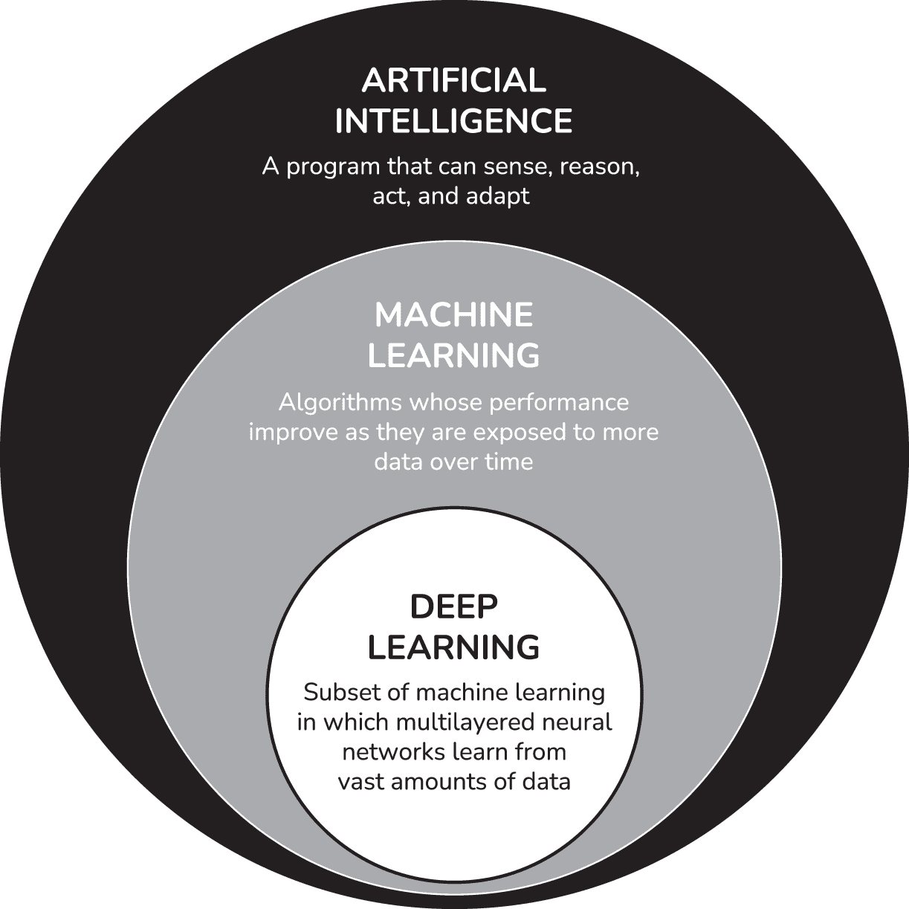

**Figure 1-1:** 人工智能（AI）、机器学习（ML）和深度学习（DL）之间的关系。ML 是 AI 的一个子领域，DL 是 ML 中的一个专业子领域。

### AI 与 ML 的主要区别

为了总结这些核心区别，下表提供了清晰的并列对比。

| 特性 | 人工智能（AI） | 机器学习（ML） |
| --- | --- | --- |
| 范围 | 广泛：机器模拟人类智能。 | 特定：一种通过从数据中学习来实现 AI 的方式。 |
| 方法 | 可以是基于规则、基于逻辑或基于学习的。 | 依赖于从数据中学习模式并进行预测的算法。 |
| 学习 | 不总是需要。 | 必需；系统通过经验（数据）不断改进。 |
| 示例（产品） | 带有预设时间表的智能恒温器。 | 根据你的观看偏好推荐新节目的推荐引擎。 |
| PM 影响 | 实现更简单，适应性较差。 | 功能更强大，需要数据和迭代。 |

这一区别至关重要：指导简单基于规则的 AI 功能的产品经理，在规划和资源讨论方面将与指导 ML 驱动功能的产品经理有非常不同的对话。以下示例进一步说明了这一区别：

*   **AI（非 ML）：** 使用预定义脚本回答常见问题的客户服务聊天机器人。它在有限的意义上是“智能”的，但不会学习。
*   **ML：** 根据文本和发件人信息中的模式学习识别垃圾邮件的垃圾邮件过滤器。随着它看到更多数据，它会随着时间的推移而变得更好。
*   **AI *由* ML 驱动：** 自动驾驶汽车。它们广泛使用 ML（处理传感器数据、理解环境）来实现自主导航这一更广泛的 AI 目标。
*   **AI *由* ML 驱动（生成式 AI）：** 类似 DALL-E 2（图像生成）或 ChatGPT（文本生成）的模型。它们从海量数据集中学习以创建新内容。

### PM 的常见误解：神话与现实

当你开始你的 AI PM 之旅时，驳斥一些常见的误解非常重要。尽早理清这些误解将为你节省时间，帮助你设定现实的期望，并让你能够更有效地与技术团队协作。

| 神话 | 现实 |
| --- | --- |
| “AI 是一个魔法黑盒，只需运行即可。” | AI 是运行在数据上的应用数学和统计学。其成功完全取决于数据质量、所选算法以及问题定义的清晰度——这些都是产品经理有重大影响力的领域。 |
| “我们需要一个巨大且完美的数据集才能开始。” | 虽然更多高质量的数据更好，但许多有影响力的 AI 项目都从较小且经过精心策划的数据集开始，以构建基线模型（“AI MVP”）。该过程是迭代的；模型和数据可以随时间改进。 |
| “AI 将取代用户研究的需求。” | AI 放大了用户研究的需求。AI 可以告诉你用户在做什么，但无法告诉你原因。定性用户研究对于理解数据背后的上下文并确保你解决的是正确问题至关重要。 |
| “推出 AI 功能是一次性的项目。” | AI 模型是一个活的系统。随着现实世界数据的变化，其性能可能会随时间下降（一个称为“模型漂移”的概念）。AI 功能需要持续的监控、维护和重新训练，这些都必须在你的路线图中规划。 |

内化这些现实是从传统软件思维转向 AI 优先产品思维的关键一步。

### PM 的术语表

为了帮助你自信地使用 AI 术语，下表分解了你工具箱中需要的核心 AI/ML 术语。我们将超越简单的定义，提供背景信息，帮助你真正掌握这些概念：

| 术语 | 定义 | 简单来说 | 示例 |
| --- | --- | --- | --- |
| 人工智能（AI） | 计算机科学的一个广泛领域，专注于创建能够表现出智能行为的机器。 | 让计算机变得“足够聪明”，能够完成通常需要人类智能的事情，例如解决问题、学习和决策。 | 能够理解客户问题并提供有用答案的聊天机器人，或者能够识别照片中物体的图像识别系统。 |
| 机器学习（ML） | AI 的一个子集，专注于使机器能够从数据中学习，而无需明确编程。 | 教会计算机从示例中学习，以便它们可以自行做出预测或决策，而不需要我们每次都告诉它们具体该做什么。 | 预测哪些客户可能会流失，或根据用户过去的购买记录推荐产品。 |
| 深度学习（DL） | ML 的一个子领域，使用具有多层（因此称为“深”）的人工神经网络来分析复杂数据。 | 一种更高级的机器学习类型，特别擅长处理非常复杂的模式，例如图像或语言中发现的模式。 | 照片中的人脸识别，实时语言翻译工具。 |
| 算法 | 计算机为解决问题而遵循的一组规则或指令。 | 一种配方，告诉计算机一步一步地做什么以实现特定目标。 | 将搜索结果从最相关到最不相关排序，或根据你的观看历史推荐电影。 |
| 模型 | 通过在数据上训练算法创建的现实世界过程或系统的表示。 | 计算机在从示例中学习后构建的“大脑”。它是做出预测的东西。 | 预测天气的模型，或识别垃圾邮件的模型。 |
| 训练数据 | 用于教导机器学习模型的数据。 | 计算机学习的示例。它就像 AI 的教科书。 | 一组客户电子邮件，每个都标记为“垃圾邮件”或“不是垃圾邮件”。 |
| 推理 | 使用训练好的模型对新的、未见过的数据进行预测或决策的过程。 | 当“大脑”（训练好的模型）用于对它以前未见过的新信息进行预测时。 | 使用训练好的电子邮件垃圾邮件模型将新收到的电子邮件分类为“垃圾邮件”或“不是垃圾邮件”。 |
| 特征 | 用作机器学习模型输入的数据的可测量属性或特征。 | 计算机用来做出预测的“原料”。 | 电子邮件的发件人地址、主题行和正文内容。 |
| 标签 | 与数据相关联的正确结果或类别，用于监督学习（一种 ML 类型）。 | 计算机在训练期间学习的“答案”。 | 分配给每封训练电子邮件的“垃圾邮件”或“不是垃圾邮件”指定。 |
| 神经网络 | 受人脑结构启发的计算模型，具有互连节点。 | 一个复杂的“神经元”网络，它们协同工作以学习模式。它就像一个简化的数字大脑。 | 用于深度学习中的图像识别和自然语言处理等任务。 |
| 数据集 | 用于训练或评估机器学习模型的数据集合。 | 计算机学习或测试其知识的一组示例。 | 客户评论数据集，每个都标记有情感评分（积极、消极、中性）。 |


### 将概念落地：现实世界中的 AI 实践

理解不同 AI 方法之间的区别，最好的方式是考察现实世界中的产品。以下案例研究说明了 AI 和 ML 如何用于解决特定问题，并强调了产品经理在界定、定义和指导这些举措中所起的至关重要的作用。请注意，在每个案例中，起点都是对用户或业务问题的深入理解。

*   **案例研究 1（成功的 ML）：Spotify 的“发现每周”**

    *   **用户问题：** 拥有超过 1 亿首歌曲的曲库，用户经常面临“选择悖论”。他们想要发现自己会喜欢的新音乐，但不知道从何开始，往往只能反复听同几首歌曲。

    *   **AI 解决方案：** Spotify 并未使用简单的规则（“喜欢艺术家 X 的听众也喜欢艺术家 Y”），而是使用一种称为协同过滤的复杂机器学习形式。系统会分析你独特的收听历史——你播放、跳过、添加到播放列表以及重复播放的内容——并将其与数百万其他用户的习惯进行比较。然后，它会识别出具有相似“口味档案”的用户，并推荐他们正在播放但你尚未听过的歌曲，每周以个性化播放列表的形式发送。

    *   **PM 要点：** PM 的核心工作不是发明算法。而是深入理解用户问题（“音乐发现既困难又耗时”），并倡导一种数据驱动、高度个性化的解决方案。他们的关注点在于*体验*——每周的惊喜，发现新喜爱艺术家的喜悦——这推动了巨大的用户参与度和留存率。

*   **案例研究 2（管理风险与错误成本）：Zillow 的“Zestimate”和“Zillow Offers”**

    *   **用户问题：** 房主和买家希望有一种快速、简便的方式来了解房屋的潜在市场价值，而无需聘请估价师。

    *   **AI 解决方案（“Zestimate”）：** Zillow 构建了一个机器学习回归模型，从海量数据中学习——房屋特征、该地区的最近销售情况、市场趋势——来预测房屋价值。作为一种*提供信息*的产品功能，“Zestimate”取得了巨大成功，并已成为家喻户晓的品牌。

    *   **PM 要点与挑战（“Zillow Offers”）：** 当公司试图将这些相同的预测用于另一种高风险应用时，挑战随之而来：自动购买数千套房屋，意图转售获利。对于信息性的“Zestimate”来说可以接受的微小模型预测错误，当乘以数千笔高价值交易时，就会在财务上造成灾难性后果，最终导致 Zillow Offers 业务关闭，并造成数亿美元的损失。这为 AI PM 阐释了一个非常重要的教训：你必须深入理解不仅仅是模型的准确性，还有业务风险和出错的成本，并相应地界定功能的应用范围。

*   **案例研究 3（平衡供需）：Uber 的“动态定价”**

    *   **业务问题：** 在需求高峰期（例如，音乐会结束后、暴雨期间），请求行程的乘客多于可用司机。这会导致长时间等待和糟糕的用户体验。

    *   **AI 解决方案：** Uber 的动态定价算法使用 ML 根据一天中的时间、天气、本地活动和历史数据等因素，实时预测乘客需求和司机供应。当需求超过供应时，系统会自动提高价格（“动态定价”）。这具有双重效果：它激励更多司机上路，并减少对价格敏感的乘客的需求，帮助市场更快地找到平衡点。

    *   **PM 要点：** 这是使用 AI 进行实时优化的经典示例。PM 的挑战不仅是技术性的，也是心理上的：管理一种有时可能感觉是负面的用户体验（价格更高），同时传达这是确保服务保持可靠（即，你实际上可以叫到车）所必需的。这需要在市场健康度与个体用户感知之间取得平衡。

*   **案例研究 4（大规模内容审核）：Meta 的主动检测**

    *   **业务问题：** 像 Facebook 和 Instagram 这样的平台如何可能审核数十亿篇每日帖子，以在有害内容（如仇恨言论、血腥暴力和欺凌）广泛传播之前将其删除？人工审核太慢，无法处理这种规模。

    *   **AI 解决方案：** Meta 使用多层 AI 系统。首先，简单的模型会主动标记已知的违规内容。更先进的 AI 系统，包括深度学习模型，甚至现在还有大型语言模型（LLM），被训练用于理解上下文并检测新出现和不断演变的有害内容类型，通常在任何用户举报之前就将其删除。这些 AI 系统优先处理最严重的内容，并将边缘案例或高度微妙的案例发送给人工审核团队。

    *   **PM 要点：** 这展示了 AI 在解决大规模运营安全挑战方面的能力。PM 的工作涉及不断管理*假阴性*（遗漏有害内容）和*假阳性*（错误删除合法内容，可能被视为审查）之间的关键权衡。他们必须专注于制定明确的政策、建立透明的报告机制、为用户创建申诉流程，并与数据科学团队合作，提高这些高风险系统的准确性和公平性。

*   **案例研究 5（推动核心用户成果）：Duolingo 的 AI 驱动学习**

    *   **用户问题：** 学习一门新语言很困难，当材料太难、太简单或与学习者的目标不相关时，动力会减弱。一刀切的课程并不奏效。

    *   **AI 解决方案：** Duolingo 使用一套 AI 模型（内部称为“Birdbrain”）来个性化学习体验。系统预测用户答对或答错练习的概率，然后定制课程，使用户保持在“金发姑娘区”——不太难，不太容易。它还使用生成式 AI（GPT-4）来创建“角色扮演”和“解释我的答案”等功能，允许用户练习现实世界中的对话并获得个性化反馈。

    *   **PM 要点：** 这展示了多个 AI 功能如何协同工作，通过改善核心用户成果（有效学习）来推动核心业务指标（用户留存率）。PM 的工作是识别学习旅程中 AI 可以创造更个性化、更具吸引力和更有效体验的每一个机会，然后将这些功能优先排序并整合成一个连贯的产品。

### AI PM 的指导原则


向前推进时，请牢记以下五条指导原则。它们是有效且负责任的 AI 产品管理的基石。将它们视为你的核心信条——在构建 AI 产品的复杂过程中，你应当回归的“第一性原理”。

## 从问题出发，而非技术

这是所有产品管理中最重要的原则，在 AI 领域更是至关重要。大型语言模型或先进预测算法等复杂技术的诱惑，可能会导致“寻找问题的解决方案”场景。作为产品经理，你的角色是定海神针，不断将对话拉回到基本的用户需求或业务问题上。在问“我们如何使用 AI？”之前，你必须严肃地问“最有价值的问题是什么，AI 是否真的是解决它的最有效方式？”

通常，更简单、非 AI 的解决方案可能实现得更快、更可靠，且对用户体验更好。你的责任是倡导最佳解决方案，而不一定是技术上最复杂的方案。

*PM 关键问题*：“我们试图解决的核心用户问题是什么？我们有什么证据表明，与更简单的非 AI 替代方案相比，AI 是解决该问题的独特有效方式？”

## 数据是你产品的基础

在传统软件开发中，核心逻辑是写在代码里的。在机器学习中，核心逻辑是从数据中学习的。这是一个根本性的转变。你的数据的质量、数量、相关性和合乎伦理的来源，将直接决定你 AI 产品的性能上限。你可以拥有世界上最出色的算法，但如果数据糟糕，你的产品也会糟糕。“垃圾进，垃圾出”是铁律。

作为 PM，你必须深度参与产品的数据战略。这意味着了解数据来自哪里，倡导数据质量，质疑数据集中潜在的偏见，并确保你拥有合法和合乎伦理的使用权。数据不再仅仅是副产品；它是你功能的基础原材料。

*PM 关键问题*：“我们是否能够获得高质量、具有代表性且合乎伦理来源的数据集，以有效训练模型来解决我们定义的问题？”

## 拥抱概率，而非确定性

传统软件是确定性的：如果你点击一个按钮，每次都会发生相同的、可预测的动作。然而，AI 模型是概率性的。它们不提供绝对的确定性；它们提供带有一定置信度的预测。模型不会说“这是垃圾邮件”；它会说“这个是垃圾邮件的概率是 98%。”

这种转变要求你设计能够优雅处理不确定性的产品。当模型出错时会发生什么？你如何以用户易于理解的方式向用户传达模型的置信度？当 AI 的置信度较低时，有哪些回退机制？以概率思维思考意味着为错误做计划，并设计一种在固有不确定性下建立信任的用户体验。

*PM 关键问题*：“当 AI 的预测出错时，我们的产品会如何表现，我们将如何设计用户体验来管理这种不确定性并保持用户信任？”

## 从第一天起就优先考虑信任和责任

公平性、偏见、隐私和透明度等伦理考量，不是开发周期结束时才添加的功能。它们是核心的、不可协商的要求，必须从构思过程的一开始就集成。在发布前才“检查偏见”已经太晚；到那时，偏见可能已深深嵌入你的数据和模型架构中。

作为 PM，你的角色是在开发过程中成为用户和社会的主要倡导者。你必须倡导伦理审查，就潜在的偏见和滥用提出尖锐问题，并确保用户隐私通过设计得到保护。建立用户信任是任何成功 AI 产品的先决条件。

*PM 关键问题*：“这个 AI 系统可能存在哪些伦理风险和意外后果，我们将如何从一开始就主动设计产品和流程来减轻它们？”

## 以生命周期思考，而非项目思维

发布传统软件功能通常被视为项目的终点。发布 AI 模型只是其生命周期的起点。与编码后永远以相同方式工作的按钮不同，模型的性能会随时间下降，因为它遇到的现实数据会“漂移”远于其训练所用的数据。

这意味着你必须为监控、评估、维护和重新训练模型的持续生命周期做计划。这种“MLOps”思维必须体现在你的产品路线图、资源规划和团队的持续职责中。工作不会在发布时结束；它才刚刚开始。

*PM 关键问题*：“模型发布后，我们长期监控、维护和重新训练该模型的计划是什么，以确保其性能和相关性随时间保持？”

## 章节摘要与关键要点

你现在对 AI 格局以及在其中领导所需的思维方式有了基础的理解。在本章中，你学会了区分人工智能的广泛目标和机器学习这一强大的数据驱动方法。我们揭开了常见误解的神秘面纱，超越了 AI 是“魔法”的观念，将其理解为一门实用学科。通过探索 Spotify 的个性化和 Zillow 的预测挑战等现实案例，你已经看到这些概念如何转化为产品成功和战略教训。最重要的是，本章为你提供了一套指导原则，它们将成为你进行的每个 AI 项目的战略指南针。

### 关键要点

*   你始终优先考虑用户问题，评估 AI 是否是最有效的解决方案，而不仅仅是最令人兴奋的方案。

*   你认识到数据是现代 AI 产品的基础原材料，其质量直接影响你功能的成功。

*   你以概率思维思考，而不仅仅是确定性规则，并为 AI 预测固有的不确定性做计划。

*   你将公平性和信任等伦理考量视为核心要求，而不是事后补救。

*   你将 AI 产品视为需要持续监控和维护生命周期的活系统。

### 接下来：一窥内部

有了这个基础格局，你现在准备好“窥探内部”了。下一章将探讨机器学习模型如何实际从数据中学习的基本过程。

# CHAPTER 2

## 机器学习模型如何学习：一窥内部

你不需要是数据科学家就能管理 AI 产品，但了解 ML 模型学习的 `基础` 是必不可少的。这种知识使你能够与技术团队有效协作，做出明智的产品决策，并设定现实的期望。我们将使用一个简单、贴近生活的例子：水果分类。

想象一下教一个孩子识别水果。你向他们展示苹果、香蕉和橙子，并指出它们的区别。ML 模型的学习方式类似：它们分析示例并识别模式。

“特征”是模型用来进行预测的具体特征。可以将它们视为数据的 `描述性属性`。`Figure 2-1` 中显示的示例使用以下特征：

*   `Color`：(以数字表示：1 = 红色，2 = 黄色，3 = 橙色)

*   `Shape`：(以数字表示：1 = 圆形，2 = 长形)

选择 `合适` 的特征是构建成功 ML 模型的关键。作为 PM，你将与数据科学团队合作，识别以下特征：


*   `Relevant:` 它们应与你试图预测的结果有很强的关联。

*   `Available:` 你需要能够收集并使用这些数据。

*   `Understandable:` 特征应相对容易解释（即使模型本身很复杂）。

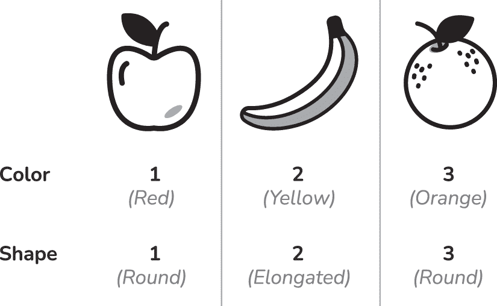

**Figure 2-1:** An illustration of fruits and features Color and Shape

## The Learning Process: Training, Validation, and Testing

要构建一个不仅仅是死记硬背而是真正学习的模型，数据科学家使用一个关键的三阶段过程。他们首先将完整的数据集拆分为不同的部分，如 Figure 2-2 所示。最大的一部分是 *training set*，用于教会模型模式。较小的 *validation set* 在开发过程中用于调整模型的设置（称为超参数），就像一次练习测验，用于防止 *overfitting*。最后，模型的实际表现是根据 *testing set* 来评判的——这是模型从未见过的数据，相当于它的期末考试。

1.  **Training:** 模型被输入一个大型数据集（即 *training data*），并识别特征与正确结果（例如，是哪种水果）之间的模式。这就像向孩子展示许多每种水果的例子。

2.  **Validation:** *During* training, a separate portion of the data (the *validation data*) is used to tune the model's settings (called *hyperparameters*). This is like giving the child practice quizzes and adjusting your teaching based on their performance, and it helps prevent overfitting.

3.  **Testing**: *After* training, the model is evaluated on a completely new dataset (the *testing data*) that it hasn't seen before. This is like giving the child a final exam with new fruits to identify and it measures how well the model generalizes to unseen data.

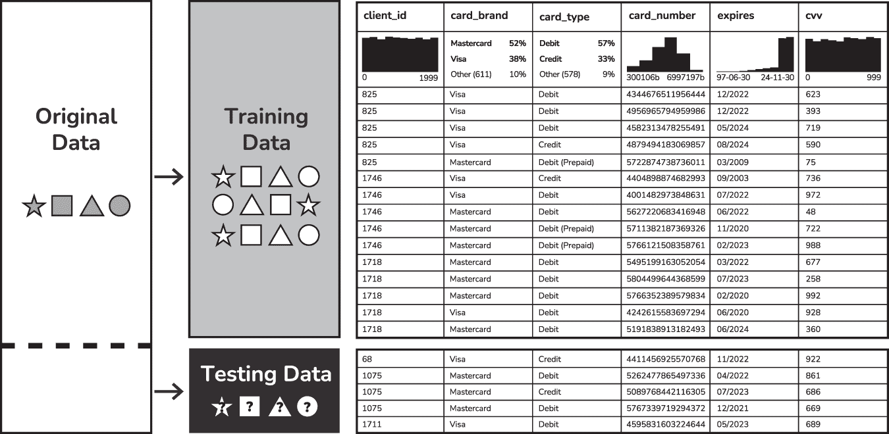

**Figure 2-2:** A visual example of splitting a dataset into training and testing sets—an essential step in supervised learning for evaluating model performance. (*Source*: Kaggle).

This learning process has important implications for Product Managers:

*   **Data Requirements:** Understanding the need for training, validation, and testing data helps you plan for data collection and labeling efforts.

*   **Model Performance:** You'll understand why a model that performs well on training data might not perform well in the real world (overfitting).

*   **Iteration:** The validation and testing phases are very important for iterating and improving the model—a key part of the product development lifecycle.

Let's use the simplified dataset shown in Figure 2-3 to illustrate how a Machine Learning model learns from data and makes predictions—an idea we'll explore next using the k-Nearest Neighbors algorithm.

We'll use the first six rows as our *training data* and the last three rows as our *testing data*. Notice we have examples of all three fruits types.

Now, let's look at *how* a model uses this data to actually make predictions. We'll explore a simple algorithm called k-Nearest Neighbors (k-NN) to illustrate the core concepts.

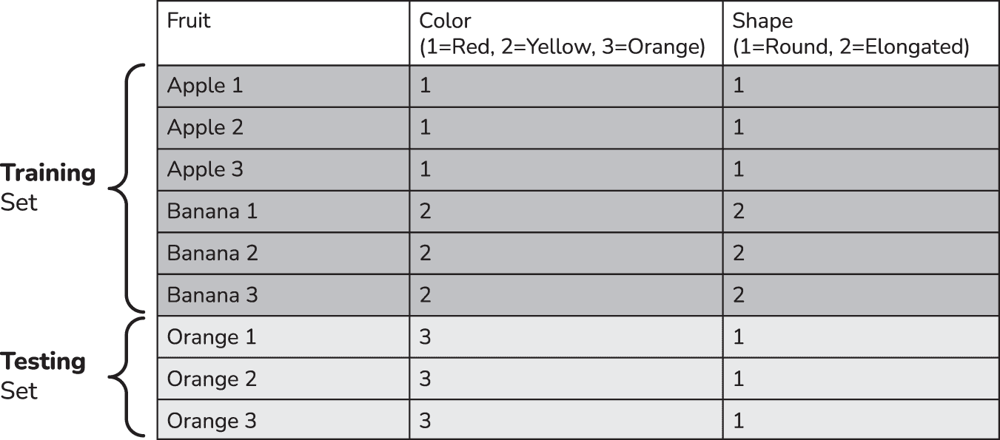

**Figure 2-3:** A simplified training and testing dataset of fruits, represented by color and shape features, used to illustrate how ML models make predictions

## How Models Learn: An Example with k-Nearest Neighbors (k-NN)

ML models use different algorithms—sets of rules—to find patterns in data. One simple example is *k-Nearest Neighbors (k-NN)*. Figure 2-4 shows how k-NN can visually separate data points into different groups based on feature similarity. Think of it like this:

Imagine you have a map showing the locations of different fruits based on their color and shape. To classify a *new* fruit, k-NN says: “Look at the ‘k’ closest fruits on the map. The most common type among those neighbors is likely the type of the new fruit.”

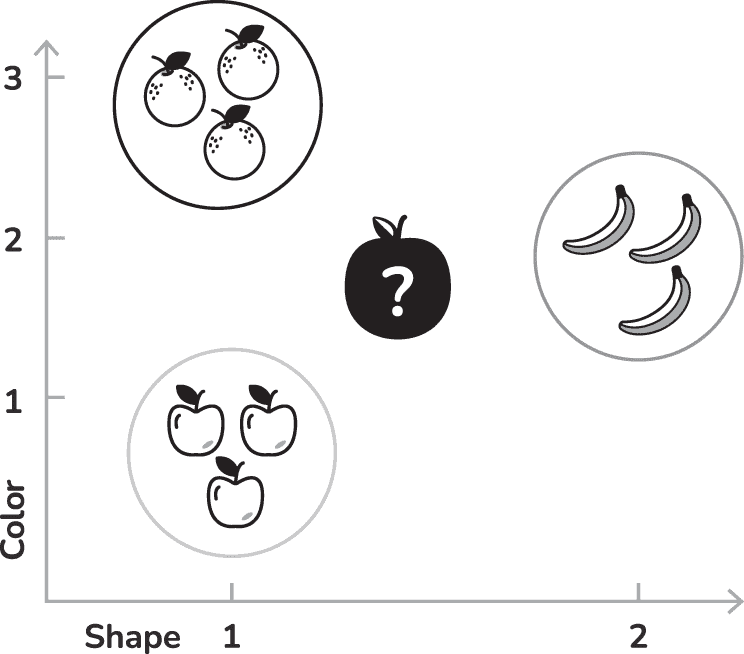

**Figure 2-4:** K-NN can help separate data into segments.

Let's walk through an example. Recall our training data (only Apples and Bananas):

| FRUIT || COLOR (1=RED, 2=YELLOW, 3=ORANGE) || SHAPE (1=ROUND, 2=ELONGATED) |

| --- | --- | --- |

| Apple 1 || 1 || 1 |

| --- | --- | --- |

| Apple 2 || 1 || 1 |

| Apple 3 || 1 || 1 |

| Banana 1 || 2 || 2 |

| Banana 2 || 2 || 2 |

| Banana 3 || 2 || 2 |

Now, let's introduce a new fruit from our testing data: an Orange (Color = 3, Shape = 1). Remember that our training data contained no Oranges.

| FRUIT || COLOR (1=RED, 2=YELLOW, 3=ORANGE) || SHAPE (1=ROUND, 2=ELONGATED) |

| --- | --- | --- |

| Orange 1 || 3 || 1 |

| --- | --- | --- |

### Applying k-NN (with k=1):

We'll start with k=1, meaning we look at only the *single* nearest neighbor. The k-NN algorithm calculates the “distance” between our new Orange and every fruit in the training data. While there are different ways to calculate distance, we'll use a simple one:

<math display="block" xmlns="http://www.w3.org/1998/Math/MathML"><mrow><mi mathvariant="normal">Distance</mi><mo>=</mo><mspace width="0.25em"/><mspace width="0.25em"/><mi mathvariant="normal">Difference&#160;in&#160;Color</mi><mspace width="0.25em"/><mspace width="0.25em"/><mo>+</mo><mspace width="0.25em"/><mspace width="0.25em"/><mi mathvariant="normal">Difference&#160;in&#160;Shape</mi><mspace width="0.25em"/></mrow></math>

Let's calculate the distances:

*   **Distance to Apple 1 (1, 1):** |3 - 1| + |1 - 1| = 2

*   **Distance to Apple 1 (1,1):** |Orange Color - Apple Color| + |Orange Shape - Apple Shape|

*   **Distance to Apple 2 (1, 1):** |3 - 1| + |1 - 1| = 2

*   **Distance to Apple 3 (1, 1):** |3 - 1| + |1 - 1| = 2

*   **Distance to Banana 1 (2, 2):** |3 - 2| + |1 - 2| = 2

*   **Distance to Banana 2 (2, 2):** |3 - 2| + |1 - 2| = 2

*   **Distance to Banana 3 (2, 2):** |3 - 2| + |1 - 2| = 2

The problem: all the distances are the same! With k=1, the model could randomly choose Apple or Banana. Figure 2-5 illustrates this ambiguity, showing that the Orange lies equidistant from both Apples and Bananas, making classification uncertain when k=1. It *cannot* correctly predict Orange because it has never seen an Orange before.

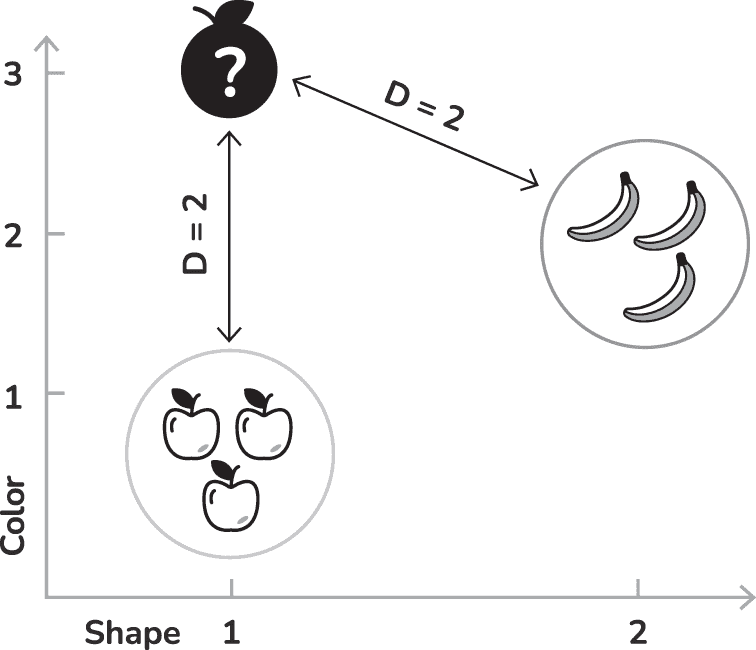

**Figure 2-5:** When using k=1 in k-NN, all distances from the new fruit (an Orange) to existing training points are equal, making the classification ambiguous.

What if we increase “k” to find more neighbors? Let's try k=3. In this case, the model looks for the three closest data points. Since all training points have a distance of 2, the model would likely select three neighbors at random, for instance, two Apples and one Banana. Based on this “vote,” it would incorrectly classify the new fruit as an Apple. This outcome, where the model is forced to make a “best guess” from known categories, is visualized in Figure 2-6.


这突出了机器学习的一个关键点：模型的预测质量取决于其训练数据的质量。如果训练数据中不包含某个特定类别（例如我们案例中的橙子）的具有代表性的示例，模型将难以识别它，并且很可能做出错误的预测。


Figure 2-6: An illustration of the k-NN algorithm with k=3. Even with more neighbors, the new fruit (Orange) is incorrectly classified because its nearest neighbors in the training data are a mix of Apples and Bananas, highlighting the model's dependence on representative training data.

## 另一个示例：测试未知水果

让我们尝试一个不同的测试水果：

| FRUIT | COLOR (1=RED, 2=YELLOW, 3=ORANGE) | SHAPE (1=ROUND, 2=ELONGATED) |
| --- | --- | --- |
| Unknown | 2 | 1 |

*   **With `k=1`:** 就像在前一个示例中一样，最近邻再次要么是苹果 (1,2)，要么是香蕉 (2, 2)。因此，预测可能是其中任何一个。Figure 2-7 通过展示当正确水果类别缺失于训练数据时，`k=3` 仍可能失败，来说明这种误分类。

*   **With `k=3`:** 我们查看 *三个* 最近邻。它们可能是：

    *   Banana (2, 2)

    *   Banana (2, 2)

    *   Apple (1, 1)

由于距离相同，如果大多数（3 个中的 2 个）是香蕉，预测很可能是香蕉。

这个预测非常奇怪，因为未知水果（颜色 = 黄色，形状 = 圆形）被预测为香蕉，尽管它本应是细长的！Figure 2-7 通过展示模型由于训练数据中缺乏黄色且圆形水果的示例，而基于其最近邻误分类未知水果，来可视化这种行为。


Figure 2-7: The effect of using `k=3` in k-NN classification. The new fruit is misclassified because the nearest neighbors only include Apples and Bananas—highlighting the need for diverse and representative training data.

请注意，“`k`”的值会影响模型的行为：

*   **Small `k` (e.g., `k=1`):** 对数据中的噪声和异常值更敏感。可能导致过拟合（在训练数据上表现良好，但在新数据上表现不佳）。

*   **Large `k`:** 决策边界更平滑，对噪声不那么敏感。可能导致欠拟合（无法捕捉重要模式）。

作为产品经理，您通常不会直接选择“`k`”，但您应该理解它是一个 *可调参数*，它会影响模型性能，并应与您的数据科学团队讨论。

我们已经了解了 k-NN 的工作原理以及数据的关键重要性。现在，让我们探讨如何使用准确率、精确率和召回率等指标来 *衡量* 模型的性能。

## 评估模型性能

训练后，我们需要 *评估* 模型的性能。可以将其视为模型的“成绩单”。我们使用各种 *指标* 来衡量模型在 *测试数据*（模型未见过的数据）上的表现。作为产品经理，理解这些指标至关重要，原因如下：

*   **评估产品可行性：** 模型是否足够好，足以解决用户问题？

*   **权衡取舍：** 不同的指标突出了性能的不同方面。您需要根据产品目标进行优先级排序。

*   **与数据科学沟通：** 您需要与技术团队智能地讨论这些指标。

由于我们的水果示例是一个 *分类* 问题（预测一个类别），我们将专注于分类指标。

### 混淆矩阵：理解的基础

在深入特定指标之前，让我们介绍 *混淆矩阵*。这个表格通过显示以下计数来总结分类模型的性能：

*   **True Positives (TP):** 正确预测的正例（例如，模型预测为“苹果”，并且它 *确实是* 苹果）。

*   **True Negatives (TN):** 正确预测的负例（例如，模型预测为“不是苹果”，并且它 *确实不是* 苹果）。

*   **False Positives (FP):** 错误预测的正例（例如，模型预测为“苹果”，但它实际上是橙子——一种 *I 类错误*）。

*   **False Negatives (FN):** 错误预测的负例（例如，模型预测为“不是苹果”，但它 *确实是* 苹果——一种 *II 类错误*）。

如果我们要求模型预测新水果是否为苹果，以下是混淆矩阵的示例。

| | PREDICTED APPLE | PREDICTED NOT APPLE |
| --- | --- | --- |
| Actual Apple | TP = 8 | FN = 2 |
| Actual Not Apple | FP = 3 | TN = 7 |

这个矩阵告诉我们：

*   模型正确预测了八次“苹果”（TP）。

*   模型在它 *确实是* 苹果时，错误地预测了两次“不是苹果”（FN）。

*   模型在它 *确实不是* 苹果时，错误地预测了三次“苹果”（FP）。

*   模型正确预测了七次“不是苹果”（TN）。

### 关键分类指标（及其对产品经理的影响）

现在，让我们使用混淆矩阵的概念来定义关键指标：

*   **Accuracy:** 正确预测的总体百分比。<math display="block" xmlns="http://www.w3.org/1998/Math/MathML"><mrow><mi mathvariant="normal">Accuracy</mi><mo>=</mo><mrow><mo>(</mo><mrow><mi mathvariant="normal">TP</mi><mo>+</mi><mi mathvariant="normal">TN</mi></mrow><mo>)</mo></mrow><mo>/</mo><mrow><mo>(</mo><mrow><mi mathvariant="normal">TP</mi><mo>+</mi><mi mathvariant="normal">TN</mi><mo>+</mi><mi mathvariant="normal">FP</mi><mo>+</mi><mi mathvariant="normal">FN</mi></mrow><mo>)</mo></mrow></mrow></math>

    *   示例（来自上面的矩阵）：(8 + 7) / (8 + 7 + 3 + 2) = 0.75 或 75 百分比。

    *   **产品经理影响：** 一个很好的起点，但如果类别不平衡（例如，您的数据集中苹果远多于橙子），可能会产生误导。

*   **Precision:** 在模型预测为“正例”（例如，“苹果”）的所有情况下，有多少百分比 *实际上* 是正例？ <math display="block" xmlns="http://www.w3.org/1998/Math/MathML"><mrow><mi mathvariant="normal">Precision</mi><mo>=</mo><mi mathvariant="normal">TP</mi><mo>/</mo><mrow><mo>(</mo><mrow><mi mathvariant="normal">TP</mi><mo>+</mi><mi mathvariant="normal">FP</mi></mrow><mo>)</mo></mrow></mrow></math>

    *   示例（来自上面的矩阵）：8 / (8 + 3) = 0.73 或 73 百分比。

    *   **产品经理影响：** 当 *假阳性* 的成本很高时很重要。例如，在垃圾邮件过滤器中，您希望高精确度（您不希望将重要邮件发送到垃圾邮件文件夹）。

*   **Recall:** 在所有 *实际* 正例（例如，所有实际的苹果）中，模型正确识别了多少百分比？


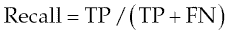<math display="block" xmlns="http://www.w3.org/1998/Math/MathML"><mrow><mi mathvariant="normal">Recall</mi><mo>=</mo><mi mathvariant="normal">TP</mi><mo>/</mo><mrow><mo>(</mo><mrow><mi mathvariant="normal">TP</mi><mo>+</mo><mi mathvariant="normal">FN</mi></mrow><mo>)</mo></mrow></mrow></math>

Figure 2-8 提供了一个视觉摘要，说明在分类场景中，精确率和召回率如何与真阳性、假阳性和假阴性相关联。

*   示例（来自上述矩阵）：8 / (8 + 2) = 0.80 或 80 百分比。

*   **PM 含义：** 当 `false negative` 的成本很高时很重要。例如，在医疗诊断中，你希望召回率高（你不想错过任何疾病病例）。

### 精确率-召回率权衡

通常，精确率和召回率之间存在权衡。提高其中一个可能会降低另一个。作为 PM，你需要决定哪个对于你的特定产品和用户需求更重要。

*   **示例：** 搜索引擎：

    *   **高精确率：** 搜索结果高度相关，但一些相关结果可能会被遗漏。

    *   **高召回率：** 显示所有相关结果，但可能也会包含一些不相关的结果。

*   **示例：** 欺诈检测：

    *   **高召回率：** 捕获 `all` 欺诈案例至关重要，即使系统将少数合法案例标记为欺诈。

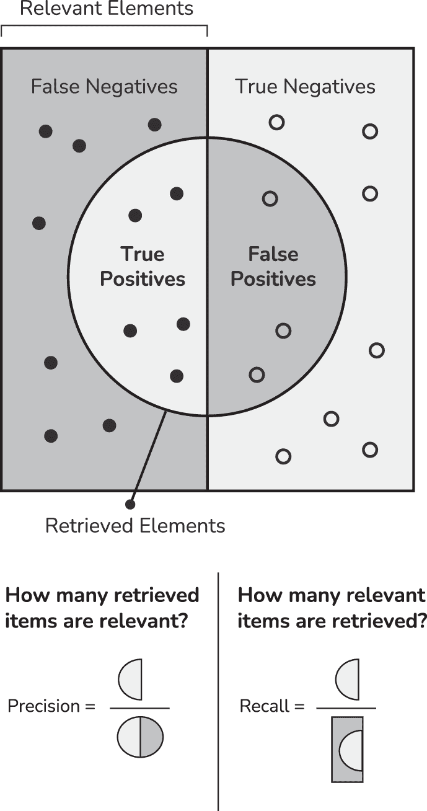

**Figure 2-8:** A visual representation of precision and recall, showing how true positives intersect with false positives and false negatives in classification tasks. ¶ (*Source:* Creative Commons)

### 选择合适的指标

`best` 指标取决于你的产品目标。问问自己：

*   假阳性的后果是什么？

*   假阴性的后果是什么？

*   是精确更重要，还是高召回率更重要？

理解这些指标是基础，但模型并不完美。让我们探讨两个常见问题：过拟合和欠拟合。

## 过拟合和欠拟合：为现实世界性能找到正确的平衡

即使有良好的指标，模型仍可能存在问题。两个常见问题是 `overfitting` 和 `underfitting`。在这两者之间找到正确的平衡对于构建在现实世界中表现良好的模型至关重要，而不仅仅是在训练数据上表现良好。Figure 2-9 说明了，如果没有偏差和方差之间的平衡，你的模型可能会出现过拟合、欠拟合，甚至可能是一个完全次优的模型。

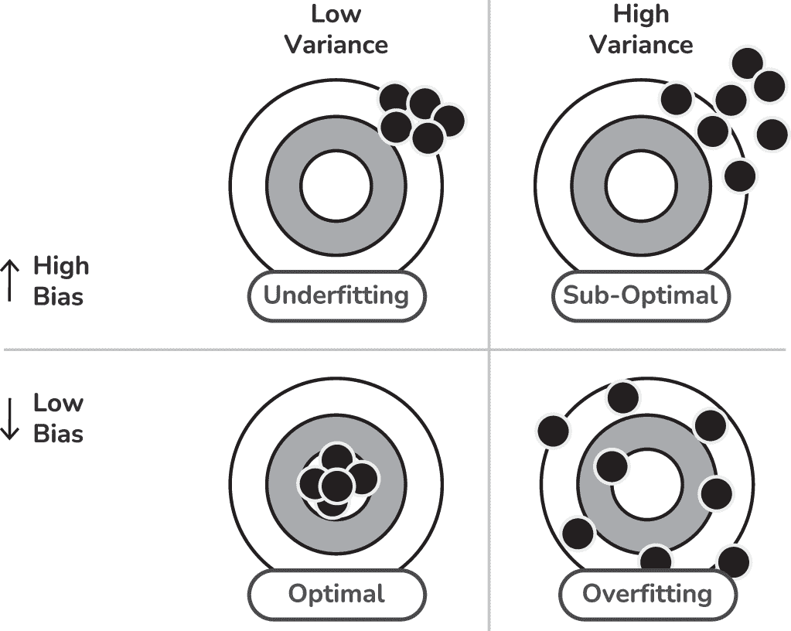

**Figure 2-9:** Visual comparison of underfitting, overfitting, and ideal model performance in Machine Learning. It shows how model complexity impacts the ability to generalize from data.

### 过拟合：死记硬背而不是学习

一个 `overfit` 模型就像一个学生，他死记硬背练习题的答案，却不理解其背后的概念。它在 `training data`（练习题）上表现非常出色，但在 `testing data`（真正的考试）上表现不佳。

*   **表现形式：** 训练数据准确率高，测试数据准确率低。

*   **发生原因：** 模型过于复杂。它学习了训练数据的噪声和特定细节，而不是一般模式。

*   **PM 含义：** 即使初步测试看起来很有希望，你的产品在现实世界中也会表现不佳。用户会遇到模型未见过的场景，导致错误和沮丧。

### 欠拟合：见树木不见森林

一个 `underfit` 模型就像一个学生，他没有充分学习，甚至无法回答基本问题。它在 `both` 训练数据和测试数据上表现都不佳。

*   **表现形式：** 训练数据和测试数据的准确率都低。

*   **发生原因：** 模型过于简单。它没有捕捉到数据中的潜在模式。

*   **PM 含义：** 你的产品无法有效解决用户问题，因为模型过于简单，无法做出有用的预测。

### 视觉类比：拟合曲线

想象你正在尝试将一条曲线拟合到一组数据点上。Figure 2-10 通过比较欠拟合、过拟合和一个泛化良好的模型的简单曲线拟合示例来说明这一概念。

*   **欠拟合：** 一条直线，没有捕捉到曲线的形状。

*   **过拟合：** 一条高度复杂、起伏的线，完美地通过每个训练点，但对新点的泛化效果不佳。

*   **刚刚好：** 一条平滑的曲线，捕捉了数据的总体趋势，而不会对单个点过于敏感。

 

**Figure 2-10:** A visual comparison of underfitting, overfitting, and an ideal (“just right”) model for both regression and classification tasks. This illustrates the fundamental challenge of finding the right level of model complexity to ensure good generalization.

### 找到最佳平衡点：泛化

目标是 `generalization`：构建一个在 `new, unseen data` 上表现良好的模型。这需要在复杂性和简单性之间找到正确的平衡。

数据科学家有许多技术，例如 `regularization`（惩罚过于复杂的模型）和 `cross-validation`（使用不同的数据子集进行训练和测试），以及选择合适的模型。

在我们之前的 k-NN 水果示例中：

*   **小 k（例如，k=1）：** 更容易 `overfitting`。模型对单个训练示例过于敏感。

*   **大 k：** 更容易 `underfitting`。模型变得过于一般化，可能会忽略水果类型之间的重要区别。Figure 2-10 说明了改变 k-NN 中 k 的值如何影响模型行为——从低值时的过拟合到高值时的欠拟合。

### PM 的角色

作为 PM，你不需要实现这些技术，但你应该：

*   **理解概念：** 知道什么是过拟合和欠拟合及其影响。

*   **提出正确的问题：** 询问你的数据科学团队如何解决这些问题。例如：“我们如何确保模型能很好地泛化到新数据？” “我们使用什么技术来防止过拟合？” “我们是否使用交叉验证？”

*   **监控性能：** 跟踪训练数据和测试数据上的性能，以检测潜在的过拟合或欠拟合。

*   **优先考虑数据：** 努力优先获取更多、更多样化的数据。

现在你了解模型如何学习、如何评估以及潜在问题，让我们探讨“人在回路中”的概念，以及为什么它对于构建强大且负责任的 AI 系统至关重要。

## Human-in-the-Loop: Blending AI Power with Human Expertise


虽然我们常常将 AI 想象为完全自动化，但现实是，`human expertise remains critical` 在许多 AI 应用中。这就是 `Human-in-the-Loop (HITL)` 发挥作用的地方。HITL 并非旨在取代 AI；而是关于将人类判断和监督战略性地整合到 AI 系统中，以提高准确性、处理歧义、减轻偏见并建立信任。将其视为人与机器之间的 `partnership`，发挥双方的优势。

## 什么是 Human-in-the-Loop？

如 图 2-11 所示，HITL 是一种设计模式，人类积极参与 AI 生命周期的 `various stages`，包括：

*   `Data Labeling`: 为训练数据提供准确的标签（对监督学习至关重要）。
*   `Model Validation`: 审查和纠正模型的预测或生成的输出。
*   `Decision-Making`: 在模型不确定或风险较高的情况下做出最终决策。
*   `Providing Feedback`: 提供反馈以提高模型性能并解决偏见问题。
*   `Edge Cases`: 处理训练数据未涵盖的情况。

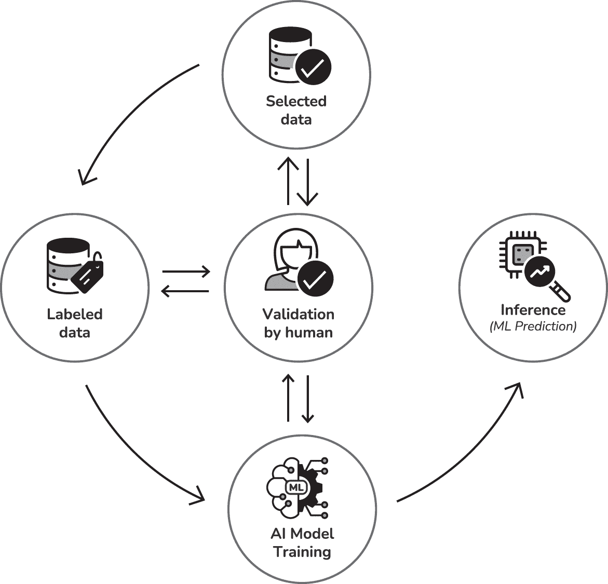

**Figure 2-11:** Human-in-the-loop. A design pattern where humans are actively involved in various stages of the AI lifecycle.

## 为什么 HITL 对产品经理（及其产品）至关重要

HITL 不仅仅是一个技术考量；它是一个 `product strategy` 决策。以下是它对 PM 至关重要的原因：

*   `Improved Accuracy and Reliability`: 人类通常能发现 AI 模型遗漏的错误或细微差别，尤其是在复杂或主观的领域。
*   `Handling Ambiguity and Edge Cases`: AI 模型可能难以处理模糊的输入或超出其训练数据的情况。人类可以提供处理这些情况所需的上下文和判断。
*   `Mitigating Bias and Ensuring Fairness`: 正如我们广泛讨论的那样，AI 模型可能会延续偏见。人工审查可以帮助识别和纠正有偏见的输出，确保更公平的结果。这是我们之前讨论的伦理考量的 `direct application`。
*   `Building User Trust`: 知道有人类“在循环中”可以增加用户信任，特别是对于高风险的应用程序。
*   `Adapting to Change`: 人类可以帮助 AI 系统适应不断变化的数据模式或用户需求，为模型重新训练提供反馈和指导。
*   `Complex Tasks`: 对于当前 AI 模型难以处理的情况。

下表展示了 HITL 在不同 AI 产品场景中的实际应用示例，突出了 AI 的任务、人类的角色以及由此产生的产品效益。

| SCENARIO | AI TASK | HITL ROLE | PM BENEFIT |
| --- | --- | --- | --- |
| Content Moderation (Social Media) | Identifying and flagging inappropriate content. | AI flags potentially harmful posts; human moderators review flagged content and make final decisions. | Reduces risk of wrongly censoring content (false positives) or allowing harmful content (false negatives). Improves community safety. |
| Medical Diagnosis Assistance | Analyzing medical images (X-rays, MRIs). | AI highlights potential anomalies; doctors make the final diagnosis. | Improves diagnostic accuracy and efficiency while ensuring human oversight for critical decisions. |
| Customer Support Chatbot | Answering customer questions. | AI handles routine inquiries; complex or sensitive questions are escalated to human agents. | Provides fast responses for common issues while ensuring human support is available when needed. Improves customer satisfaction. |
| Financial Fraud Detection | Identifying suspicious transactions. | AI flags potentially fraudulent transactions; fraud analysts investigate and take action. | Reduces financial losses while minimizing inconvenience to legitimate customers. |
| Hiring (Resume Screening) | Ranking candidates based on resumes. | AI scores resumes; recruiters review top candidates and make hiring decisions. This is a high-risk area for bias; HITL is critical. | Reduces time spent screening resumes while mitigating the risk of biased hiring decisions. |
| Product Recommendation | Suggesting products or content. | AI generates personalized recommendations; editors or curators review and refine recommendations, especially for high-value or sensitive items. | Provides the personalization and scale, while applying human curation and editorial judgment, ensuring high quality. |
| Autonomous Driving | Making real time driving decisions. | AI is in charge of driving. In edge cases, a remote human operator can be in charge. | Reduces risks and improves safety. |

本表表明 HITL 是一种多功能策略。然而，要在您的产品中成功实施它，需要深思熟虑的规划。

## 如何实施 HITL（PM 考虑事项）

在您的产品中成功实施 HITL 需要深思熟虑的规划和跨职能协作。以下是产品经理的关键考虑事项，以确保 HITL 系统实用、有效且可扩展。

1. `Identify Critical Decision Points`: 确定 `where` 在您的 AI 工作流中，人类干预最有价值且可行。这取决于风险级别、任务的复杂性以及模型的置信度水平。
2. `Design Clear Workflows`: 为人类如何与 AI 系统交互创建清晰高效的工作流程。这包括定义角色和职责、提供明确的指南以及设计便于人类审查和输入的用户界面。
3. `Provide Training and Support`: 培训人类审查员如何有效地与 AI 系统交互，以及如何识别和解决潜在的偏见或错误。
4. `Measure and Optimize`: 跟踪 AI 模型 `and` 人类在循环中的系统的性能。识别改进领域并随时间优化工作流程。关键指标可能包括：

    *   `Agreement Rate`: 人类和 AI 经常达成一致吗？
    *   `Intervention Rate`: 人类需要干预的频率是多少？
    *   `Time to Resolution`: 使用 HITL 解决案例需要多长时间？
    *   `User Satisfaction`: 用户对结果有多满意？

5. `Iterate`: HITL 不是一个静态系统。它应该设计为能够处理变化。

HITL 是构建更可靠、更负责任、更有效的 AI 驱动产品的强大方法。它认识到 AI 并非人类判断的替代品，而是一种可以通过人类专业知识得到增强的工具。作为产品经理，您在设计和实施利用人类和机器优势的 HITL 系统方面发挥着关键作用。通过这样做，您将能够提供更好、更可靠的产品。

## 章节摘要和关键要点

您现在已经详细了解了机器学习模型“引擎盖下”的工作原理。本章带您了解了模型开发的核心机制，从原始数据如何转换为模型可学习的有意义特征开始。您了解了将数据分为训练、验证和测试集的关键重要性，这是一种避免过拟合这一常见陷阱的基本做法。我们拆解了混淆矩阵，以表明评估模型远比单一准确率得分更具细微差别，迫使您考虑精确率和召回率等指标之间的权衡。最后，您了解到，当模型达到其极限时，引入 Human-in-the-Loop 是一种强大的策略，而非失败的标志。

### 关键要点


# CHAPTER 3

## 大局观：AI、ML 与你

在前面的章节中，我们探讨了机器学习的机制以及每个 AI 产品经理都应理解的基础概念。现在，我们将视野放大，了解这些元素如何关联到更大的图景：AI 在产品语境中究竟意味着什么，机器学习如何融入更广泛的 AI 领域，以及你——作为一名产品经理——如何利用这种理解来推动战略与创新。

本章侧重于战略流利度：识别不同类型的 AI，理解何时应用机器学习，并欣赏你的团队所做的技术选择如何影响产品的能力、风险和用户价值。

## 理解 AI、ML 与产品目标之间的关系

可视化人工智能、机器学习与你的产品策略之间的关系会很有帮助。

**AI 是目标；ML 是手段** 将 AI 视为宏大的抱负：创造表现出智能行为的产品，最终以更智能、更高效的方式解决用户问题。机器学习是我们目前实现这一目标的最强大技术之一。它不是*唯一*的方式，但通常是最具适应性和可扩展性的。

**示例：** 假设你的产品是一款音乐流媒体服务。你的*AI 目标*可能是“提供让每位用户感到愉悦并保持其参与度的个性化音乐推荐。”*机器学习*是实现这一目标的强大*手段*。你可以使用 ML 算法分析用户的收听历史、他们的喜好/厌恶，甚至是品味相似的用户的收听习惯，以预测他们会喜欢哪些歌曲和艺术家。这比仅仅提供预设播放列表（这将是一个基于规则的系统，从技术上讲属于 AI，但不是*ML*）要复杂得多。另一种手段可能是基于知识的 AI 系统，它使用本体论来理解音乐，但维护该知识库通常既困难又昂贵。

**并非所有 AI 都是 ML，但 ML 始终是 AI** 你可以在产品中拥有不依赖从数据中学习的 AI 系统。但是，任何使用机器学习的功能，按定义都在利用 AI。这包括深度学习，这是 ML 的一个强大子领域，它使用称为神经网络的结构来从海量数据中学习。

这些概念之间的关系通常被可视化为一系列嵌套和重叠的领域，如 图 3-1 所示。

**示例（非 ML 的 AI）：** 考虑你的产品中一个简单的“智能”电子邮件过滤器，它会自动将包含特定关键词（如“退订”或“发票”）的电子邮件移动到特定文件夹。这是一个基于规则的系统。你作为产品经理（或你的团队）定义规则：如果电子邮件包含“退订”，则将其移动到“促销”文件夹。这是 AI，因为它在自动化通常需要人类智能的任务，但它*不*在学习。除非你手动更新规则，否则它不会在过滤方面变得更好。

**示例（基于 ML 的 AI）：** 现在，想象一个*垃圾邮件*过滤器，它会从用户行为中学习。当用户将一封电子邮件标记为垃圾邮件时，系统会从该动作中学习，并提高其识别和过滤未来类似垃圾邮件的能力。这是 ML（因此也是 AI），因为它在没有明确编程的情况下进行学习和适应。

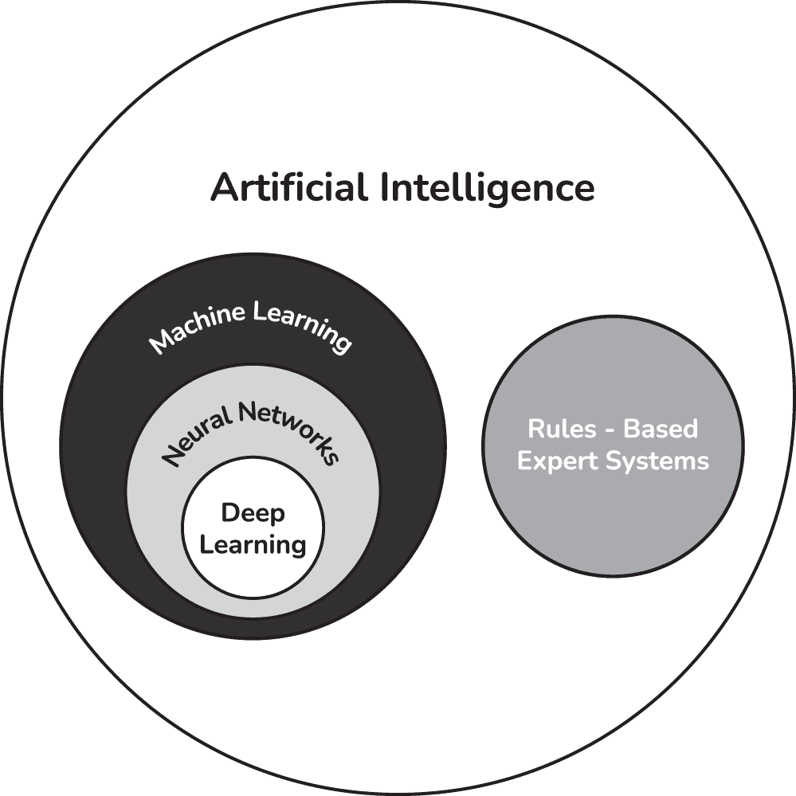

**图 3-1：** AI 领域的可视化表示。机器学习和基于规则的专家系统都是更广泛的人工智能领域的子集。在机器学习中，神经网络是一种关键技术，而深度学习是神经网络的一个专业子领域。

**ML 实现适应性：动态产品优势** 机器学习在产品管理中真正大放异彩的地方在于此。与静态的基于规则的系统不同，ML 模型可以适应不断变化的数据模式，并随时间推移提高其性能。这一点至关重要，因为用户行为、市场趋势和竞争格局在不断演变。

**示例：** 想想一款拼车应用。最初，该应用可能基于简单规则（距离、平均限速）来估计到达时间。然而，借助 ML，该应用可以从*现实世界数据——*交通模式、驾驶员行为、一天中的时间，甚至天气状况中学习，以提供越来越准确的到达时间预测。随着收集到的数据越来越多，模型会变得越来越好，提供卓越的用户体验。这种适应性是关键的竞争优势。

**理解方法选择：产品经理的战略优势** 你的角色不是编写算法，而是理解不同 AI 方法的战略影响。

这使你能够与工程团队进行富有成效的对话，并做出明智的产品路线图决策。关键是将工具与任务相匹配。

当你需要一个系统遵循一组严格的预定义规则时，基于规则的 AI 方法可能就足够了，而且实现起来可能更简单、更快。

**示例：** 一个基于关键词匹配提供常见问题解答（FAQ）的客户支持聊天机器人。

当你需要一个系统从数据中学习并进行预测时，机器学习可能是首选。你将能够与团队讨论所需的数据类型、潜在的准确性以及持续的维护工作。

**示例：** 一个电子商务平台的欺诈检测系统，其中 ML 模型从历史数据中学习识别指示欺诈的模式。

在处理图像或自然语言中发现的极其复杂的模式时，深度学习及其强大的神经网络可能是必要的。

**示例：** 一个自动为照片中的人打标签的社交媒体平台，这需要对面部特征有深入的理解。

通过学习这些核心 AI/ML 术语，你不仅仅是在学习词汇；你是在为战略思维打下基础。你将能够更有效地与技术团队协作，以更大的信心评估 AI 驱动功能的可行性，并最终做出更明智的产品决策，从而带来成功的结果。你将能够提出诸如“这个模型需要什么样的训练数据？”或“这个功能真的需要深度学习吗，还是可以用更简单的方法达到类似的效果？”这样的问题。这种程度的理解，正是在 AI 时代区分优秀产品经理与*卓越*产品经理的关键。

## 机器学习的类型：理解学习的光谱


# 人工智能与机器学习概述

我们已经确立了机器学习是一种强大的工具。但为了理解其地位，有必要审视整个人工智能版图，从我们今天构建的产品到未来的雄心壮志。这种 AI 能力的光谱通常被分为三个主要层级：

*   **传统或弱人工智能（ANI）**：这是我们今天拥有的 AI。它旨在执行特定的“狭窄”任务，例如下棋、推荐音乐或生成文本。你曾经使用过的每一个 AI 产品，包括最先进的生成式 AI，都属于此类。

*   **通用人工智能（AGI）**：这是下一个前沿领域。AGI 指的是一种假设性的 AI，具有理解、学习并将其智能应用于解决人类能解决的任何问题的能力。它将拥有意识、自我意识和可适应的问题解决能力。

*   **人工超级智能（ASI）**：这是一种理论形式的 AI，将在几乎所有领域超越人类智能和认知能力。

Figure 3-2 说明了整个光谱，从今天的强大工具到明天的理论可能性。


**Figure 3-2:** The spectrum of AI capabilities. All of today's systems, including Traditional AI and the more recent Generative AI, are forms of Artificial Narrow Intelligence (ANI). Artificial General Intelligence (AGI) and Artificial Superintelligence (ASI) remain future, theoretical goals.

作为产品经理，虽然思考 AGI 和 ASI 很令人兴奋，但你的重点将坚定地放在第一类。关键要点是，要构建今天强大的弱人工智能产品，我们使用一套不同的机器学习方法“工具包”。

可以将其比作烹饪：烹饪不止一种方式；你有烘焙、烧烤和油炸——每种技术最适合不同的结果。同样，机器学习工具包包含一系列方法。在本节中，我们将探讨你最可能遇到的四种主要技术：

*   **监督学习**：从标记示例中学习。

*   **无监督学习**：在数据中发现隐藏模式。

*   **强化学习**：通过试错学习。

*   **生成式 AI**：创建新内容。

让我们从最常见且通常最直观的类型开始：监督学习。

## 监督学习：使用标记示例引导模型

想象你正在引导一名新的客户支持代理。你不会直接把他们扔进深水区，对吧？相反，你会给他们一份培训手册和一叠过去的支持工单，每个工单都明确标记了问题类型：“技术问题”、“账单问题”、“功能请求”等。代理会研究这些示例，学习将工单内容与正确类别关联起来。随着时间的推移，他们将熟练地对新的、未见过的工单进行分类。

这正是监督学习的精髓。我们正在为机器学习模型提供一个以“标记数据集”形式出现的“老师”。该数据集中的每个数据点都有两部分：

*   **输入特征**：数据的特征或属性。在我们的客户支持示例中，这可能是工单文本、客户历史记录、他们使用的产品等。

*   **输出标签**：正确答案或类别。在我们的示例中，这将是“技术问题”、“账单问题”或“功能请求”。

这种过程，即 ML 模型从标记输入中学习以将其分类到不同类别中，在 Figure 3-3 中有所说明。


**Figure 3-3:** A conceptual diagram of a supervised learning classification model. The ML model is trained on labeled customer support tickets to learn how to automatically sort new, incoming tickets into predefined categories like “Technical Issues,” “Feature Requests,” and “Billing Questions.”

模型的工作是学习输入特征和输出标签之间的关系。这就像学习连接点。模型越理解这种关系，就越能准确地预测新的、未见过数据的正确标签。

监督学习是你每天使用的许多 AI 驱动产品的主力。它是以下内容的基础：

*   **预测客户流失**：根据客户的过去行为、人口统计学和与产品的互动，识别有流失风险的客户。

*   **欺诈检测**：根据从过去欺诈活动中学习到的模式，实时标记可疑交易。

*   **图像分类**：识别图像中的对象，例如在社交媒体上标记照片或使自动驾驶汽车“看到”道路。

*   **个性化推荐**：根据用户的过去偏好和相似用户的偏好，推荐用户可能喜欢的产品、电影或文章。

*   **销售预测**：根据历史数据、季节性、营销活动和其他相关因素预测未来销售。模型可能会学到销售在节假日或特定促销活动后激增。

*   **医疗诊断辅助**：根据标记了相应诊断的患者记录数据集，协助医生做出更快、更准确的诊断。

可以将电子邮件收件箱中的垃圾邮件过滤器（参见 Figure 3-4

**Figure 3-4:** Email spam classification.

## 技术深度解析：监督学习模型如何从标记数据中学习

让我们深入探讨监督学习模型如何实际“学习”。核心目标是找到一个数学函数——可以将其视为公式——以最佳近似输入特征（例如客户支持工单的文本）和输出标签（“技术问题”、“账单问题”等）之间的关系。模型试图找到最佳公式，以便根据输入特征预测正确标签。

这种“寻找最佳公式”是通过算法实现的，这些算法最小化模型预测与训练数据中实际标签之间的差异。还记得我们的客户支持代理类比吗？想象代理对如何对工单进行分类做出初步猜测。他们会猜对一些，猜错一些。“学习”过程涉及分析这些错误，弄清楚为什么错了，并调整他们的内部理解，以便下次做出更好的猜测。监督学习模型做类似的事情，但以数学方式。

以下是该过程的简化、分步分解：


1. **数据准备：搭建“课堂”**

标记的数据集就像是我们模型的教科书和模拟考试。我们将这个数据集分为两个关键部分。Figure 3-5 直观地展示了训练数据和测试数据之间的划分。

* **训练集：** 这是模型用来学习的主要“学习材料”。它是数据中最大的部分。

* **测试集：** 这是一个保留下来的“期末考试”，用于评估模型的学习泛化得如何。它包含模型在训练期间*未见过*的数据。这对于确保模型不仅仅是死记硬背训练数据至关重要（稍后将详细介绍）。

**示例：** 对于我们的客户支持工单分类，我们可能有 10,000 个标记的工单。我们可能会使用 8,000 个进行训练，并保留 2,000 个用于测试。

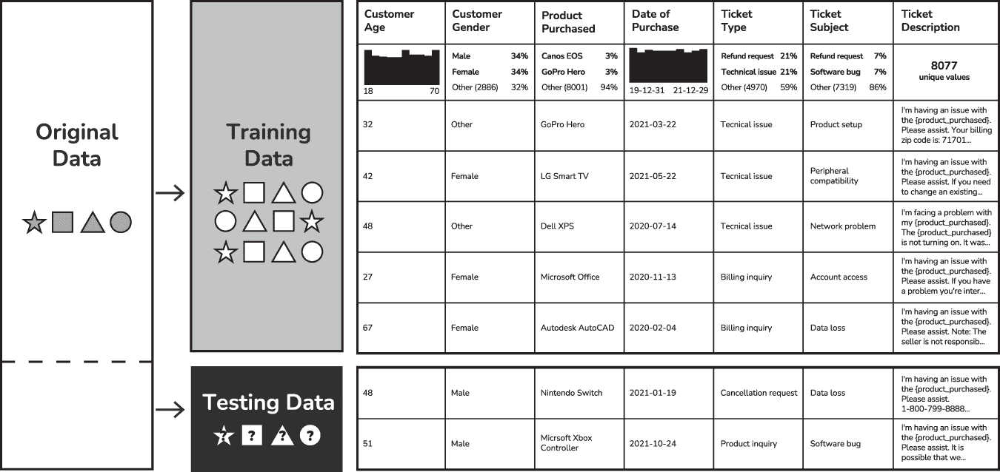

**Figure 3-5:** An illustration of how a labeled dataset is split into a larger training set for the model to learn from and a smaller testing set to evaluate its performance on unseen data. (*Source*: Kaggle).

2. **模型选择：选择合适的“学习风格”**

就像不同的学生通过不同的方法（视觉、听觉、动觉）学习效果最好一样，不同的机器学习算法也更适合不同类型的数据和任务。算法的选择取决于我们是预测连续值（例如客户的生命周期价值）还是类别值（例如我们的工单类型）。

**常见算法（以及产品经理可能遇到它们的场景）：**

* **线性回归：** 用于预测*连续*值。*例如*：根据房屋的大小、位置和卧室数量预测房价。或者，预测客户在明年会花费多少。

* **逻辑回归：** 用于预测*类别*值（即某物属于哪个类别）。*例如*：预测客户是否会点击广告（是/否）或交易是否欺诈（欺诈/非欺诈）。我们的客户支持工单分类就是一个很好的例子。

* **决策树：** 这些创建一个类似树的决策结构来对数据进行分类。*例如*：一个帮助确定是否应批准贷款申请的流程图。它们通常易于解释。Figure 3-6 展示了决策树模型如何通过一系列基于特征的问题分支来得出预测。

* **神经网络（包括深度学习）：** 这些是更复杂的模型，受人类大脑启发，可以学习非常复杂的模式。*例如*：图像识别、自然语言处理以及涉及复杂非结构化数据的其他任务。

* **随机森林：** 这些结合多个决策树以提高准确性并减少过拟合。*例如*：通过询问一组专家而不是仅依赖一位专家来做出决策。用于客户流失预测和欺诈检测等任务。

* **梯度提升：** 一种强大的技术，它按顺序构建模型，每个新模型纠正前一个模型犯下的错误。常用于获胜的 Kaggle 竞赛以及信用评分或个性化推荐等现实世界应用。

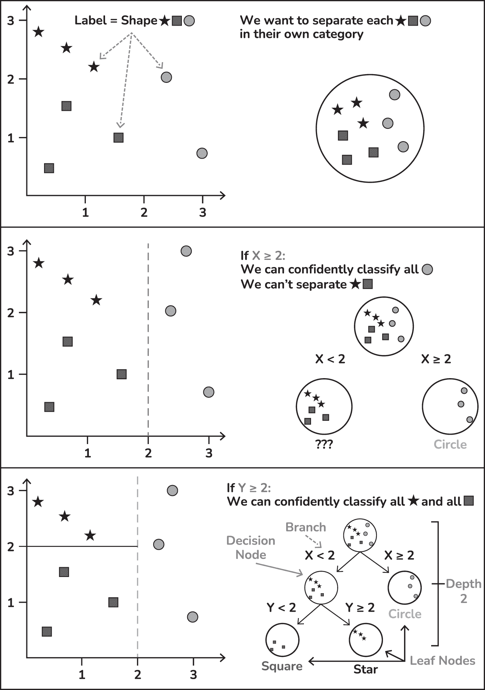

**Figure 3-6:** An example of how decision trees can solve Machine Learning problems.

3. **模型训练：“学习”过程**

模型训练过程涉及几个关键组件，它们共同作用，帮助算法从标记数据中学习并随时间改进其预测。

这就是奇迹发生的地方。算法接收训练数据，并迭代调整其内部参数（模型的“旋钮和旋钮”），以最小化其预测与实际标签之间的误差。

* **损失函数：** 这是一个数学函数，用于量化模型预测有多“错误”。它就像一个记分员，告诉模型它做得如何。不同的算法使用不同的损失函数。

* **优化算法：** 这是模型用来调整其内部参数以*最小化*损失函数的过程。可以将其视为模型学习和提高性能的策略。一种常见的优化算法是*梯度下降*，它就像滚球下山以找到最低点（最小损失）。梯度下降的一个关键设置是学习率，你可以将其视为模型在尝试最小化误差时所采取的步长。学习率的选择对训练效率有显著影响，如 Figure 3-7 所示。如果速率太低，模型学习得非常慢；如果速率太高，它可能会错过最优点并无法找到最佳解决方案。


**Figure 3-7:** An illustration of gradient descent and the impact of the learning rate. The goal is to find the “Just right” learning rate that allows the model to find the point of minimum error efficiently, without taking too many small steps (“Too low”) or overshooting the target (“Too high”).

* **示例：** 在我们的客户支持工单场景中，模型最初可能会预测包含“密码”一词的工单是“账单问题”。如果正确标签是“技术问题”，损失函数将指示错误。然后优化算法会稍微调整模型的参数，使其*更*有可能在未来将类似的工单分类为“技术问题”。

4. **模型评估：“期末考试”**

模型训练完成后，我们需要查看它在未见数据上的表现。这就是测试集的作用。作为产品经理，理解关键评估指标对于解读模型的“期末考试”分数并决定它是否准备好投入现实世界非常重要。

如何衡量“正确”与“错误”预测之间的关系，最好通过*混淆矩阵*来理解，它为每个结果（真阳性、假阳性、假阴性、真阴性）提供原始计数。从这些计数中，我们得出更有洞察力的指标。

下表详细说明了分类问题中最重要的指标。

| METRIC || KEY QUESTION IT ANSWERS || PM IMPLICATION AND WHEN TO PRIORITIZE |
| --- | --- | --- |
| Accuracy || “Overall, what percentage of predictions did the model get right?” || A good high-level summary, but it can be misleading if your data is imbalanced (e.g., 99% of transactions are not fraud). |
| Precision || “Of all the times the model predicted 'positive,' how often was it correct?” || Prioritize this when the cost of a **False Positive** is high. You want to avoid bothering users or creating unnecessary work (e.g., flagging a legitimate email as spam). |
| Recall || “Of all the actual 'positive' cases, how many did the model find?” || Prioritize this when the cost of a **False Negative** is high. You want to avoid missing important events (e.g., failing to detect a fraudulent transaction or a medical disease). |


| F1-Score | “Precision 和 Recall 之间的平衡分数是多少？” | 当假阳性和假阴性都有显著成本，且你需要一个能代表两者平衡的单一指标时，请使用此指标。 |

如表所示，Precision 和 Recall 之间通常存在权衡。高精度的垃圾邮件过滤器可能会漏掉一些垃圾邮件，但很少会因误报而打扰你。高召回率的欺诈检测系统几乎能捕捉到所有欺诈案例，但可能会偶尔将合法购买标记为欺诈。作为 PM，你必须决定哪种权衡对你的用户和业务目标更可接受。

## 5. 模型部署：让模型投入工作

一旦模型在测试集上达到所需的性能标准，就可以将其部署以对新的真实世界数据进行预测。这就是模型开始为你的产品提供价值的地方。

## 产品经理的关键考量因素

了解监督学习的机制很重要，但对于产品经理来说，了解项目可能出错的地方至关重要。这些不仅仅是数据科学团队需要解决的技术问题，而是可能影响你的时间表、预算和用户体验的基本产品风险。通过将以下关键考量因素列入你的关注范围，你可以提出更聪明的问题，预见障碍，并更有效地指导你的团队。

* **数据质量和数量：** 监督学习的有效性取决于训练数据的质量和数量。多样化、具有代表性且标记准确的数据集对于构建强大且准确的模型是 `essential` 的。垃圾进，垃圾出！

* **标记数据的挑战：** 获取标记数据可能是一个重大瓶颈。它通常需要人类专业知识和手动工作，这可能既耗时又昂贵。考虑诸如 `active learning`（模型帮助识别最有价值的待标记数据点）等策略，或利用现有的数据源。

* **过拟合：** 这是一个关键陷阱。当模型过于精确地记忆训练数据（包括其噪声和特性），而不是学习底层的可推广模式时，就会发生过拟合。过拟合的模型在训练数据上表现良好，但在测试数据（以及现实世界中）表现不佳。`regularization` 和 `cross-validation` 等技术用于应对过拟合。

* **欠拟合：** 当模型过于简单，无法捕捉数据中存在的复杂性时，就会发生欠拟合。

* **偏差：** 如果训练数据反映了现有的偏见（例如，某些人口群体的代表性不足），模型可能会继承并放大这些偏见，导致不公平或歧视性的结果。这是一个关键的伦理考量。

## 无监督学习：在数据中发现隐藏模式

让我们从监督学习的结构化世界转向一种更具探索性的方法：`Unsupervised Learning`。可以这样想：你不是在用标记的工单来培训客户支持代理（监督学习），而是在给一名市场研究人员一个巨大的客户购买历史数据集，其中 `没有` 任何预定义的类别。你要求他们找出有趣的模式、分组或洞察——`不` 告诉他们要寻找什么。这就是无监督学习的本质。

在无监督学习中，我们处理的是 `unlabeled data`。模型没有提供“正确答案”。相反，模型的任务是探索数据，并 `自行` 发现隐藏的结构、关系和模式。这就像在原始数据中筛选，寻找隐藏的宝石。

为什么这很有价值？因为通常，我们 `不知道` 数据中存在什么模式。我们可能有一个直觉，但无监督学习可以揭示我们否则永远不会发现的惊人洞察。它是一个强大的工具，可用于：

* **客户细分：** 根据客户的行为、人口统计或其他特征，将客户群划分为不同的群体。这允许更有针对性的营销活动和个性化的产品体验。例如，无监督学习模型可能会揭示一群你甚至不知道的“高价值、早期采用者”客户。

* **异常检测：** 识别与常态显著偏离的异常数据点。这对于欺诈检测、网络入侵检测和识别制造缺陷至关重要。想象一下，在数百万个合法交易中发现一个异常的交易模式。

* **推荐系统（在某些情况下）：** 虽然许多推荐系统使用监督学习，但一些方法利用无监督学习来查找项目或用户之间的相似性。例如，根据描述或特征将相似产品分组。

* **数据压缩和降维：** 通过减少变量数量同时保留重要信息来简化复杂的数据集。这可以使数据可视化和分析更加容易。

* **主题提取：** 识别文档集合中存在的主要主题或主题。例如，分析客户评论以了解最常见的投诉或赞扬。

想象你有一个巨大的网站活动数据集——页面浏览量、点击量、在每个页面上花费的时间等。你 `没有` 标签告诉你每个用户试图实现什么。无监督学习算法可以用于：

* **按相似浏览模式对用户进行分组：** 这可能会揭示诸如“研究人员”（花大量时间在深度内容上）、“随意浏览者”（快速浏览许多页面）和“潜在买家”（关注产品页面和定价信息）等细分群体。

* **识别异常用户行为：** 这可能会标记潜在的欺诈活动，或识别在浏览你的网站时遇到困难的用户。

Figure 3-8 说明了使用无监督模型从原始数据中发现不同用户群并识别异常值的过程。

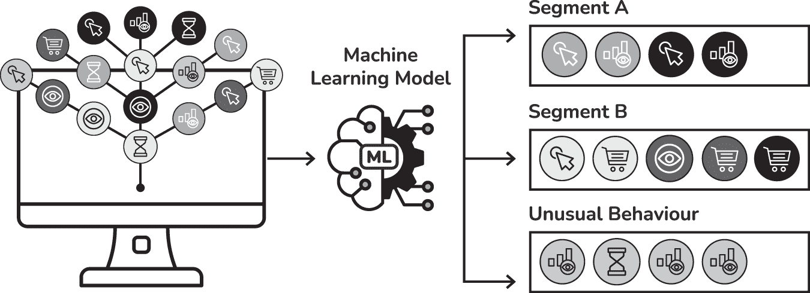

**Figure 3-8:** 无监督学习的实际应用示例。ML 模型处理各种未标记的用户活动数据点（点击、页面浏览量、花费时间），以自动发现不同的用户细分群体并识别异常或不寻常的行为。

无监督学习就像在你的团队中拥有一名数据侦探，发现隐藏的线索并揭示意外的洞察，这些洞察可以推动更好的产品决策并改善用户体验。它允许我们探索数据，提出开放性问题，并在一定程度上让数据自行说明。

## 技术深度解析：无监督学习模型如何发现模式

让我们深入了解无监督学习模型如何发现我们一直在讨论的隐藏模式。与监督学习不同，没有“答案键”或“老师”。模型必须依赖数据本身的固有结构。核心原则是衡量数据点之间的 `similarity` 或 `dissimilarity`。可以将其视为根据特征将相似对象分组，而不事先知道这些组应该是什么。

以下是简化的分步解析：

### 1. 数据准备：准备好数据

未标记的数据集已准备并预处理。这可能涉及：

* **清理数据**：处理缺失值和异常值。

* **缩放或归一化特征：** 确保所有特征都在可比较的尺度上（例如，防止以千为单位的特征主导以个位为单位的特征）。


## 特征工程

**特征工程：** 从现有特征中创建可能对模型更有信息量的新特征。

**示例：** 对于我们的网站活动数据，这可能涉及删除不完整的用户会话、缩放“页面停留时间”变量，以及创建一个新特征，例如“参与度得分”（结合点击、滚动和页面停留时间）。

## 算法选择：为工作选择合适的工具

算法的选择取决于你希望发现的模式类型以及数据的性质。

### 聚类算法

这些算法根据数据点之间的相似性将其分组为簇。

#### K-Means 聚类

你指定想要找到的簇的数量（`k`）。然后，算法会迭代地将数据点分配到最近的簇中心（即簇的“中心”）。

**示例：** 根据购买历史将客户细分为 `k` 个群组。产品经理可能会使用此方法为每个细分群体创建有针对性的营销活动。

#### 层次聚类

这会构建一个簇的层次结构，最初将每个数据点视为一个独立的簇，然后根据相似性逐步合并它们。**示例：** 根据客户评论对产品进行分组，揭示可能不明显的产品之间的关系。

### 降维算法

这些算法在保留重要信息的同时减少数据集中的变量数量。

#### 主成分分析（PCA）

将数据转换为一组新的不相关变量（主成分），这些变量捕获数据中的大部分方差。

**示例：** 减少用于描述产品的特征数量（例如，尺寸、颜色、材质、价格），转化为一组较小的“主成分”，这些成分仍然能捕获产品的大部分关键特征。这可用于可视化，或作为另一个模型的输入。

#### t-分布随机邻域嵌入（t-SNE）

专注于保留数据点之间的局部距离，因此特别适用于将高维数据可视化为 2D 或 3D。

**示例：** 在散点图上可视化客户细分群体，以查看它们之间的关系。

#### 关联规则挖掘

**示例：** 发现购物篮中物品之间的关系（例如，“购买尿布的客户也倾向于购买婴儿湿巾”）。

## 模式发现：寻找“恍然大悟”时刻

所选算法分析数据，并基于相似性或不相似性的数学度量识别模式。

### 聚类示例（K-Means）

算法可能会计算特征空间中数据点之间的欧几里得距离（直线距离）。图 3-9 通过展示数据点如何使用 K-Means 分组为簇来说明此过程的工作原理。彼此靠近的数据点会被分组到同一簇中。

### 降维示例（PCA）

算法会找到特征空间中捕获数据中大部分方差的方向。这些方向将成为新的“主成分”。

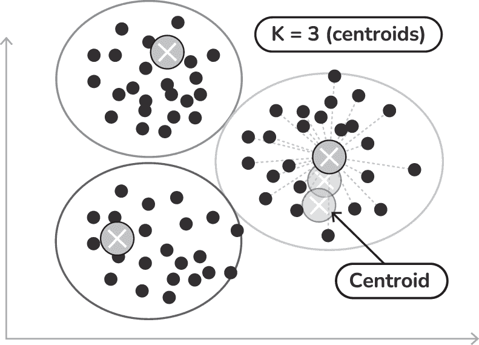

**图 3-9：** K-Means 聚类如何解决无监督机器学习问题。

## 结果解释：理解模式

这时，人为因素重新发挥作用。发现的模式需要被解释和评估，以确定其相关性和有用性。这通常涉及：

*   **可视化：** 创建图表和图形来可视化簇、降维后的维度或关联规则。
*   **领域专业知识：** 应用你对产品和用户的了解来理解模式的含义。
*   **迭代：** 尝试不同的算法和参数以优化结果。

## 应用：将洞察转化为行动

发现的模式被应用于解决目标问题。这可能涉及：

*   为不同的客户细分群体创建有针对性的营销活动。
*   基于识别的用户需求开发新产品功能。图 3-10 展示了 K-Means 聚类的输出——最初未标记的数据——如何被分组为有意义的簇，然后用于指导业务决策和下游任务。
*   通过识别异常模式来改进欺诈检测系统。
*   基于发现的用户偏好个性化用户体验。

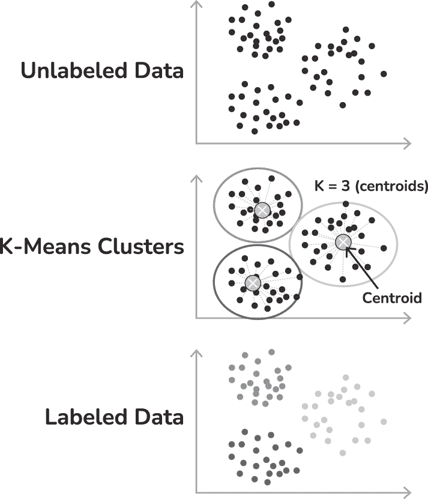

**图 3-10：** K-Means 聚类示例。

### 产品经理的关键考量

作为与无监督学习合作的产品经理，了解几个可能影响产品成功的实际挑战和权衡非常重要。

*   **没有“正确答案”：** 与监督学习不同，无监督学习中没有单一的“正确”答案可供比较。评估结果通常依赖于主观判断和领域专业知识。
*   **算法和参数敏感性：** 无监督学习算法的有效性可能对算法的选择及其参数的调整敏感。实验是关键。
*   **数据质量仍然重要：** 即使没有标签，数据质量仍然至关重要。噪声或无关的数据可能导致误导性的模式。
*   **可解释性：** 有些无监督学习技术（如基于深度学习的方法）可能难以解释。作为产品经理，尽可能优先考虑可解释性，因为这将帮助你理解模型做出某些决策的*原因*。
*   **与监督学习结合：** 无监督学习通常*不*单独使用。一种常见的方法是使用无监督学习来发现模式，然后将这些模式作为输入用于监督学习模型。例如，你可以使用聚类来细分客户，然后为*每个*细分群体构建一个单独的监督学习模型来预测流失。

## 强化学习：通过试错学习

让我们继续探讨机器学习中一个迷人且日益重要的领域：`强化学习（RL）`。把它想象成训练小狗。你不会给小狗一份关于如何坐下、停留或捡回物品的详细说明书。相反，你使用一套奖励（零食、表扬）和惩罚（温和的“不”或不给零食）的系统。小狗尝试不同的动作，观察后果，并逐渐学会哪些动作会带来积极的结果。这本质上就是强化学习的工作方式。

与标记数据（监督学习）或未标记数据（无监督学习）不同，强化学习使用`与环境的交互`。图 3-11 使用一个生动的类比来说明这一概念——一只狗在寻找奖励（零食）和避免惩罚（比如洗澡）的过程中导航——以代表代理人如何通过试错学习最优行为。我们有一个“代理人”（就像我们的小狗），它在“环境”（比如你的客厅）中采取行动，并以奖励或惩罚的形式接收反馈。代理人的目标是学习最佳的一系列动作——一个`策略`——以最大化随时间推移的累积奖励。这全都是关于通过试错来学习，就像那只学习捡回物品的小狗一样。

强化学习特别适合以下问题：

*   有一个明确的目标或目的。
*   代理人需要做出一系列决策，而不仅仅是单一决策。
*   环境是动态且可能不确定的。
*   有办法向代理人提供反馈（奖励和惩罚）。

这使其成为日益广泛的应用范围的强大工具，包括：


* `Game Playing`: 这是 RL 取得最令人印象深刻的成功的领域之一，模型学习下围棋、国际象棋和 Atari 游戏等游戏，水平已超越人类。

* `Robotics`: 训练机器人执行复杂任务，如行走、抓取物体或在环境中导航。

* `Autonomous Driving`: 教自动驾驶汽车实时做出决策，例如变道、调整速度和避障。

* `Resource Management`: 优化复杂系统中资源的分配，例如数据中心、电网或供应链。`Think`: 动态调整服务器分配以应对波动的网站流量。

* `Personalized Recommendations (In Some Cases)`: 将推荐视为一个序贯决策过程，系统学习推荐能够最大化用户长期参与度的项目。

* `Personalized Notifications`: 优化发送通知的时间和方式，学习什么是最佳时机。

想象你正在开发一款手机游戏。你可以使用强化学习来训练一个 AI 对手，使其能够适应玩家的技能水平，并提供具有挑战性但又不令人沮丧的体验。AI 代理会通过反复玩游戏来学习，获胜会获得奖励，失败会受到惩罚。随着时间的推移，它会制定出一种策略，以最大化获胜的机会。

或者，考虑一个希望优化广告投放位置的网站。RL 代理可以学习在页面的不同位置投放广告，点击会获得奖励，忽略广告会受到惩罚。代理会随着时间的推移，了解哪些位置对不同用户和不同类型的内容最有效。

强化学习旨在创建能够在复杂、动态的环境中学习做出智能决策的代理。这是一个强大的范式，正在推动产品开发许多领域的创新。

 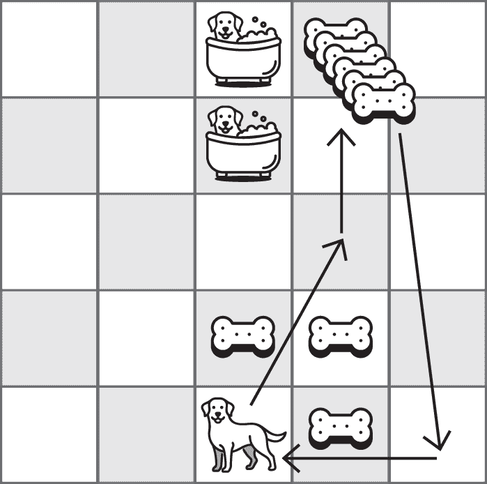

**Figure 3-11:** With reinforcement learning, we want our `Agent` (dog) to find the `reward` (treats) and not the bath!

#### *Technical Deep Dive: How Reinforcement Learning Agents Learn Optimal Policies*

Reinforcement learning, at its core, is about an `agent` interacting with an `environment` to learn a `policy`—a strategy—that maximizes its cumulative `reward` over time. This is achieved through algorithms that estimate the “value” of taking a particular action in a given state. It's a bit like learning to play a game by trial and error, keeping track of which moves lead to good outcomes and which lead to bad ones. Figure 3-12 shows how the dog (`agent`) moves through different states, takes actions, and receives rewards, illustrating how reinforcement learning agents interact with their environment.

Let's break down the key components, using the analogy of training a puppy (our `agent`) to fetch a ball (the goal):

* `Environment`: This is the world the agent interacts with. In our puppy example, it's the physical space where the puppy is playing, including the ball, the owner, and any obstacles. In a game, it would be the game board, the rules, and the opponent.

* `Agent`: This is the learner and decision-maker. In our example, it's the puppy. In a self-driving car, it would be the car's control system.

* `State (S)`: This is a snapshot of the environment at a particular point in time. For the puppy, it might be the puppy's location, the ball's location, and whether the owner is holding the ball. For a chess-playing agent, it would be the position of all the pieces on the board.

* `Action (A)`: This is a choice the agent can make. For the puppy, it might be “run forward,” “turn left,” “bark,” “jump,” or “pick up ball.” For a website optimizing ad placement, it might be “place ad A in slot 1,” “place ad B in slot 2,” etc.

* `Reward (R)`: This is feedback from the environment. For the puppy, a reward might be a treat or praise when it gets closer to the ball or brings it back. A penalty might be a gentle “no” when it runs away. For a game-playing agent, the reward might be winning the game, and the penalty might be losing.

* `Policy (π)`: This is the agent's strategy—a mapping from states to actions. It tells the agent what action to take in each state. The goal of RL is to learn the *optimal* policy, the one that maximizes the cumulative reward.

* `Value Function (V or Q)`: 

    * `V(s)`: The value of a state is the expected cumulative reward the agent can achieve starting from that state and following a particular policy.

    * `Q(s, a)`: The Q-value (or action-value) is the expected cumulative reward the agent can achieve starting from a given state, taking a specific action, and then following a particular policy. This is important because it tells the agent not just how good a state is, but how good a specific action is in that state.

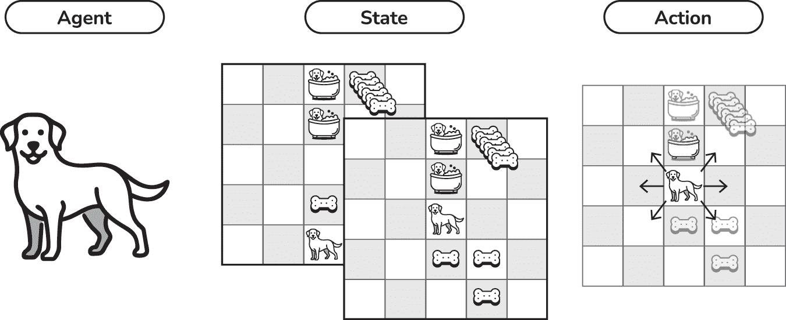

**Figure 3-12:** An example of `Agent`(dog) `State` (where the dog is located), `Reward` (Treats) and `Action` (where the dog can move).

#### *The Learning Process: Exploration, Exploitation, and Q-Learning*

The agent learns through a cycle of:

1. `Exploration`: Trying out different actions in different states to see what happens. This is like the puppy experimenting with different behaviors to see which ones lead to treats. It's important to explore to discover new and potentially better strategies. Figure 3-13 illustrates the trade-off between exploration (trying new actions) and exploitation (repeating known successful actions), a fundamental challenge in reinforcement learning.

2. `Exploitation`: Choosing the actions that are believed to be best, based on the current knowledge (the current estimates of Q-values). This is like the puppy repeating the actions that have led to treats in the past.

3. `Updating Value Estimates`: After each action and reward, the agent updates its estimates of the value function (`V`) or the Q-values (`Q`). A common algorithm for this is `Q-learning`.

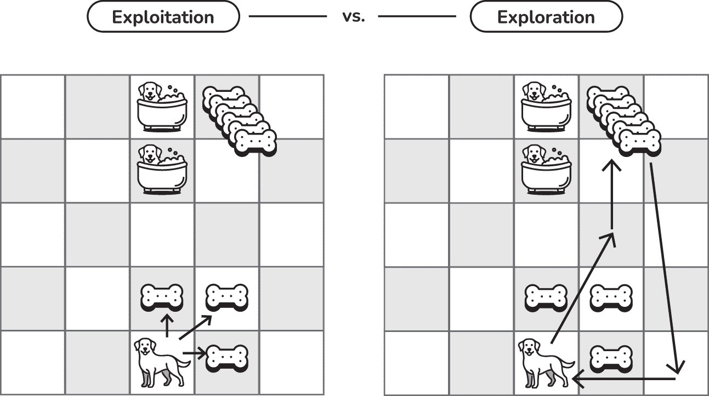

**Figure 3-13:** Exploitation vs. exploration example.

`Q-learning` is an algorithm that learns the optimal Q-values. Here's the basic idea:

1. The agent starts with an initial guess for the Q-values (often all zeros).

2. It takes an action in a state, observes the reward and the next state.

3. It updates the Q-value for the previous state and action using the following update rule (simplified):

```
New Q(s, a) = Old Q(s, a) + Learning Rate * (Reward + Discount Factor * Max Q(s', a') - Old Q(s, a))
```

Let's break that down:

* `s`: The previous state.

* `a`: The action taken in the previous state.

* `s'`: The new state.

* `a'`: All possible actions in the new state.

* `Learning Rate`: Controls how much the Q-value is updated based on each new experience.

* `Discount Factor`: A value between 0 and 1 that determines how much the agent cares about future rewards compared to immediate rewards. A higher discount factor means the agent values long-term rewards more.

* `Max Q(s', a')`: Looks at all available actions (`a'`) in the new state and chooses the highest Q-value.

The update rule essentially says: “Adjust the old Q-value based on the immediate reward received *plus* the estimated value of the best possible action in the next state, discounted by how much we care about future rewards.”

Over time, through repeated exploration and updates, the Q-values converge to their optimal values, representing the best possible policy (Figure 3-14).


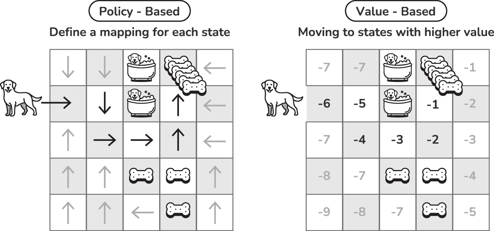

**Figure 3-14:** Policy is like the agent's brain and dictates what action to take given the state the agent is in. Two ways to find the optimal policy: policy-based and value-based.

#### Critical Considerations for Product Managers

While reinforcement learning can unlock powerful capabilities, it also introduces unique challenges for product teams. As a PM, you need to be aware of the key risks and design considerations that come with deploying RL in real-world environments.

*   **Reward Function Design:** This is very important. The reward function defines what the agent is trying to achieve. A poorly designed reward function can lead to unexpected and undesirable behavior. For example, if you reward a robot for moving forward, it might just learn to run in circles! You need to carefully consider the long-term consequences of the reward function.

*   **Exploration–Exploitation Trade-Off:** The agent needs to balance exploring new actions (to discover potentially better strategies) with exploiting its current knowledge (to maximize immediate rewards). This is a fundamental challenge in RL.

*   **Computational Cost:** Training RL agents can be computationally expensive and time-consuming, especially in complex environments.

*   **Safety:** In real-world applications like robotics or autonomous driving, safety is paramount. Ensuring that the agent explores safely and doesn't take actions that could lead to harm is very important.

*   **Simulators:** Often, RL agents are trained in simulators before being deployed in the real world. This allows for safe and efficient exploration.

### Generative AI: Powering a New Era of Language-Based Applications

We've explored Machine Learning models that predict, classify, and find patterns. Now, we enter a different realm: Generative AI, and specifically, large language models (LLMs). These models don't just analyze data; they create it. Think of an LLM not as a simple program, but as a sophisticated statistical parrot that has read the entire Internet (and more!). It has absorbed the patterns, structures, and styles of human language to such an extent that it can generate new text that is often indistinguishable from human-written content.

While the “parrot” analogy is helpful, it's also important to remember that LLMs don't “understand” in the human sense. They are incredibly powerful pattern-matching and prediction machines. Given a prompt—a starting piece of text—an LLM can predict the most likely continuation, based on its vast training data. This ability to generate coherent, contextually relevant text is revolutionizing a wide range of applications.

LLMs are more than just fancy text generators. They are becoming foundational components of many products, enabling capabilities like:

*   **Intelligent Chatbots and Virtual Assistants:** Creating more natural and engaging conversational experiences. Think: customer support bots that can actually understand complex questions and provide helpful answers, not just canned responses.

*   **Content Creation and Augmentation:** Assisting writers with drafting articles, generating marketing copy, creating personalized email campaigns, and even writing different kinds of creative content.

*   **Code Generation:** Translating natural language descriptions of desired functionality into working code, significantly speeding up the software development process.

*   **Data Analysis and Summarization:** Extracting key insights from large text datasets, summarizing lengthy documents, and answering questions about data.

*   **Language Translation:** Providing more accurate and nuanced translations between languages.

*   **Personalized Learning:** Adapting educational content to individual student needs and learning styles.

*   **Accessibility Tools:** Generating descriptions of images for visually impaired users or creating transcripts of audio content.

Imagine a Product Manager using an LLM to:

*   **Generate Multiple Variations of ad Copy:** Quickly create different versions of an ad headline and body text, testing which ones resonate best with the target audience.

*   **Draft Responses to Common Customer Inquiries:** Automate the creation of personalized and helpful responses to frequently asked questions, freeing up customer support agents to handle more complex issues.

*   **Summarize Customer Feedback from Surveys and Reviews:** Quickly identify the key themes and sentiments expressed in large volumes of text data.

*   **Create Product Documentation:** Generate initial drafts of user manuals, FAQs, and other documentation based on product specifications.

*   **Analyze Competitor's Product Descriptions:** Get insights on how your messaging can be better and more effective.

LLMs are not a magic bullet, and they have limitations (which we'll discuss later). However, their ability to understand and generate human language opens up a vast array of possibilities for product innovation. They represent a fundamental shift in how we interact with computers and how we build software.

#### Technical Deep Dive: How LLMs Understand and Generate Language

At the heart of most modern LLMs lies the transformer architecture, a type of neural network specifically designed to handle sequential data like text. These models don't “understand” language in the way humans do. Instead, they operate on the principle of statistical pattern-matching and prediction. They learn to predict the most likely next word in a sequence, given the context of the preceding words. This seemingly simple mechanism, when scaled up to massive models and trained on colossal datasets, produces remarkably human-like text.

Here's a simplified breakdown of the key components and processes:

1.  **Tokenization: Breaking Down Text into Units**

    Before an LLM can process text, it needs to break it down into smaller units called tokens. These tokens can be words, subwords (parts of words), or even individual characters.

    Example: The sentence “The quick brown fox jumps” might be tokenized as: [“The,” “quick,” “brown,” “fox,” “jumps”]. Or, using subword tokenization, it might become: [“The,” “quick,” “brown,” “fox,” “jump,” “s”].

    The choice of tokenization method affects how the model handles rare words and variations in spelling. Figure 3-15 illustrates how raw text is converted into tokens and then transformed into numerical embeddings that the model can understand.

2.  **Embedding: Converting Tokens to Numbers**

    LLMs can't directly process text; they work with numbers. Embeddings are numerical representations of tokens. Each token is mapped to a high-dimensional vector (a list of numbers) that captures its semantic meaning (or at least, its statistical relationships with other tokens).

    Example: The word “king” might be represented by a vector like [0.2, -0.5, 0.9, …, 0.1]. The word “queen” might have a similar vector like [0.2, -0.4, 0.8, …, 0.1], reflecting their semantic relationship. Words with very different meanings would have very different vectors.

    These embeddings are learned during the training process.

    

    **Figure 3-15:** Example of tokenization and embedding.

3.  **Transformer Layers: The Engine of Contextual Understanding**

    The core of an LLM is a stack of transformer layers. Each layer processes the embeddings, taking into account the relationships between all the tokens in the sequence. This is where the magic of “contextual understanding” happens.


Transformer 架构的关键创新是 *注意力机制*。这使得模型在处理特定单词时，能够衡量上下文中不同单词的重要性。

**示例：** 在句子“The bank can be a great place to relax if it has benches, but you should not try to deposit money in a river bank”中，“bank” 这个词有两种截然不同的含义。注意力机制使模型能够关注周围的单词（“river” 与 “deposit money”），从而在每种情况下确定正确的含义。

每个 Transformer 层由多个 *注意力头* 组成，每个注意力头都可以学习关注上下文的不同方面。每个 Transformer 层的输出是一组新的嵌入式，这些嵌入式融合了上下文信息。

## 4. 预测：猜测下一个单词

在嵌入式通过所有 Transformer 层之后，模型会对序列中的 *下一个标记* 进行预测。它通过计算词汇表中所有可能标记的概率分布来实现这一点。

**示例：** 给定输入 “The quick brown fox jumps”，模型可能会预测下一个标记是 “over”，概率较高，“under” 概率较低，“the” 概率非常低。Figure 3-16 通过展示模型如何对可能的下一个单词生成概率分布来可视化此过程。

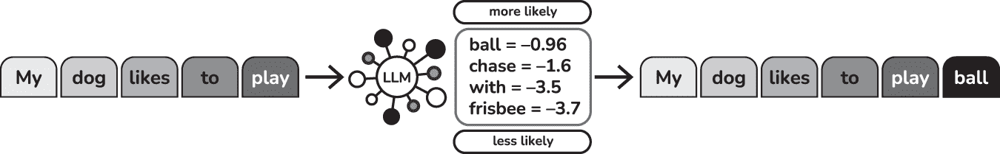

**Figure 3-16:** Example of an LLM guessing the next word.

## 5. 生成：创建新文本

要生成新文本，模型从一个 *提示词*（一段初始文本）开始。它预测下一个标记，将该标记添加到序列中，然后使用更新后的序列来预测 *下一个* 标记，以此类推。这是一个 *自回归* 过程。

有不同的方法从概率分布中选择下一个标记。Figure 3-17 说明了常见的解码策略——例如贪心搜索和 Top-K 或核采样——用于控制生成文本的多样性和连贯性。

* **贪心解码：** 始终选择概率最高的标记。这可能导致重复且可预测的文本。

* **温度采样：** 调整概率分布，使其更随机或更不随机。较高的温度使输出更多样化，但可能连贯性较差。较低的温度使输出更可预测，但可能更重复。

* **Top-K 采样：** 只考虑 *k* 个最可能的标记。

* **核（Top-P）采样：** 只考虑构成某个累积概率（例如，前 90%）的标记。

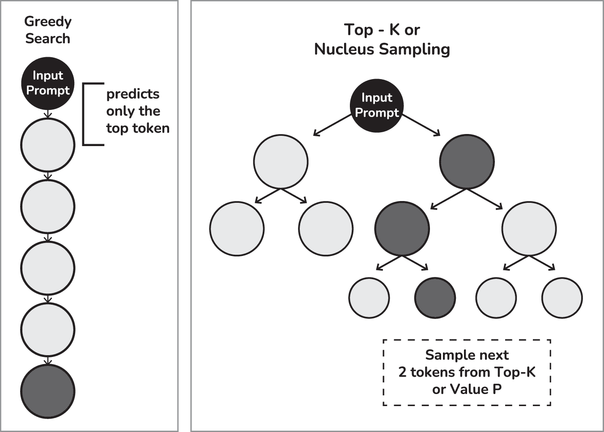

**Figure 3-17:** Decoding sample strategies for LLMs.

## 6. 训练

模型通过输入大量文本并让其预测下一个标记来进行训练。这是一种简单但非常有效的方法。

### 产品经理的关键考量

虽然你不需要成为深度学习专家，但理解以下核心概念将使你能够更有效地与技术团队协作，并在使用 LLM 时做出更明智的产品决策：

* **Transformer 架构：** 理解 Transformer 和注意力机制的基本概念，是欣赏 LLM 工作原理的关键。

* **分词和嵌入式：** 这些是影响模型处理和理解语言的基本概念。

* **自回归生成：** 了解 LLM 是逐个标记生成文本的，对于理解其局限性和潜在错误非常重要。

* **采样方法：** 理解不同的采样方法（贪心、温度、Top-K、Top-P）使你能够与团队讨论如何控制生成文本的创造力和连贯性。

* **计算成本：** 训练 LLM 需要大量的计算资源。

## “陷阱”：产品经理的 LLM 局限性和风险指南

虽然 LLM 的能力具有变革性，但它们并非没有重大挑战。理解其固有局限性是 AI 产品经理最关键的职责之一。这些不仅仅是技术上的边缘情况；它们是将直接影响产品设计、用户体验和潜在风险的基本特征。

通过主动识别这些“陷阱”，你可以做出更明智的战略决策，在问题变得严重之前降低风险，并构建更强大、更可信的 AI 驱动产品。以下是需要注意的最重要的局限性：

* **幻觉和事实不准确：** 这可以说是 LLM 最大的挑战。它们可以生成流畅、语法正确且看似合理的文本，但 *事实不正确* 或完全捏造。LLM 不像人类那样“知道”事物；它们没有知识库或与现实的连接。它们只是基于训练数据预测最可能的单词序列。

    * **产品经理影响：** 在没有独立验证的情况下，切勿依赖 LLM 来保证事实准确性。这在涉及健康、金融或法律信息的应用中尤其重要。考虑实施事实核查机制或提供免责声明。

* **偏见和毒性：** LLM 是在从互联网抓取的大型数据集上训练的，这些数据集不可避免地包含偏见、刻板印象和有害语言。因此，LLM 可能会在生成的文本中反映和放大这些偏见，产生歧视性、冒犯性或有害的输出。

    * **产品经理影响：** 仔细评估用例中偏见的潜在可能性。实施缓解策略，例如过滤训练数据、使用去偏技术以及监控输出中的有害内容。在部署 *之前* 考虑伦理影响。

* **缺乏现实世界理解：** LLM 没有感官输入、没有常识，也没有生活经验。它们仅在文本数据上运行。这限制了它们推理物理世界、理解因果关系或做出需要现实世界知识的判断的能力。

    * **产品经理影响：** 对于需要深入了解物理世界、人类情感或复杂社会动态的任务，要谨慎使用 LLM。它们最适合主要通过语言操作即可完成的任务。

* **上下文限制和“遗忘”：** 虽然 LLM 可以处理相对较长的文本序列，但它们在长对话或文档中保持上下文的能力仍然有限。它们可能会“遗忘”对话的早期部分，或在长篇生成文本中难以保持一致性。

    * **产品经理影响：** 对于需要长期记忆或跨多次交互进行复杂推理的应用，考虑加入跟踪上下文并确保一致性的机制。

* **可解释性和透明度：** LLM 通常被描述为“黑箱”。要理解模型 *为什么* 生成特定输出可能非常困难。这种缺乏透明度使得调试错误、识别偏见或建立用户信任变得具有挑战性。

    * **产品经理影响：** 尽可能优先考虑可解释性。考虑使用能提供模型决策过程一些洞察的技术。向用户透明地说明 LLM 的使用及其局限性。

* **提示词敏感性：** LLM 对提示词的表述方式可能出奇地敏感。措辞的微小变化可能导致截然不同的输出。这需要仔细的 *提示词工程*——即编写能引出所需结果的提示词的艺术。


### PM 影响：投入时间进行提示词工程和测试

将提示词设计视为一个迭代过程。请注意，提示词中看似微小的变化可能会产生重大影响。

### 数据依赖性

LLM 模型需要大量数据进行训练。训练数据中的缺陷可能会给模型带来很多问题。

#### PM 影响

模型中使用的数据必须涵盖大部分（如果不是全部）LLM 预期使用的场景。

### 过度依赖与技能退化

过度依赖 LLM 可能导致人类技能下降的风险，例如写作、批判性思维和解决问题的能力。

#### PM 影响

考虑对用户和社会的长期影响。设计增强人类能力而非完全取代人类能力的产品。鼓励批判性思维和对 LLM 输出的验证。

了解这些局限性并非为了否定 LLM；而是为了负责任且有效地使用它们。通过了解其弱点，产品经理可以就何时以及如何利用这些强大工具做出明智的决策，降低风险，并最大限度地发挥其创造积极影响的潜力。

## 导航生成式 AI 的细微差别：了解 GenAI 评估——确保质量和信任

我们已将生成式 AI 介绍为一种强大的机器学习类型，可以创建新内容——文本、图像、代码等。这为产品创新打开了令人难以置信的可能性，但也带来了新的挑战。与输出可预测的传统软件不同，生成式 AI 模型可能会产生以下输出：

* **可变性：** 相同的输入（提示词）可能会导致不同的输出。
* **主观性：** 输出的“质量”通常是主观的（例如，这段生成的文本写得好吗？这张生成的图片美观吗？）。
* **潜在问题：** 输出可能在事实上不正确、有偏见、荒谬，甚至有害。

这就是 GenAI 评估（GenAI Evals）变得绝对必要的地方。它们是生成式 AI 的质量控制机制。

### 什么是 GenAI 评估（以及为什么产品经理应该关心）？

GenAI 评估是一组用于评估生成式 AI 模型的质量、准确性、安全性和可靠性的过程和方法。可以将它们视为专门为创造内容的 AI 设计的严格测试程序。它们对于确保这种强大的技术适合用户至关重要。

作为产品经理，您会发现，将 GenAI 评估作为开发过程的核心部分对于以下几个关键原因至关重要：

* **降低产品发布风险：** 您不会在不测试的情况下推出新功能。GenAI 评估是生成式 AI 功能的等效物。它们可以帮助您在问题影响用户之前识别和减轻潜在问题。
* **确保用户信任：** 用户需要信任您的 AI 驱动功能是可靠且安全的。GenAI 评估提供支持该信任的证据。
* **满足道德和法律义务：** 正如我们在“负责任的 AI”部分讨论的那样，有道德和法律上的要求来确保公平并避免伤害。GenAI 评估可帮助您履行这些义务。
* **指导模型开发：** 评估为您的数据科学团队提供有价值的反馈，帮助他们改进模型性能并解决其局限性。
* **做出明智决策：** 评估为您提供所需的数据，以便就如何最好地将生成式 AI 集成到您的产品中做出明智的决策。

### GenAI 评估的关键方面

GenAI 评估超越了简单的“准确性”指标。它们关注一系列品质，包括：

* **相关性：** 输出是否满足用户的需求或提示词的意图？（例如，如果您要求聊天机器人帮助重置密码，它是否提供相关说明？）
* **连贯性：** 输出是否逻辑清晰、易于理解且内部一致？（例如，生成的文本摘要作为一个整体是否有意义？）
* **事实准确性：** 生成的信息是否正确且可验证？（例如，生成的新闻文章是否包含事实错误或“幻觉”？）
* **安全性：** 输出是否不包含有害、有偏见或不当的内容？（例如，生成的图像是否避免了有害的刻板印象？）
* **多样性：** 模型是否生成各种输出，还是倾向于产生重复或可预测的结果？（例如，产品描述生成器是否创建多样化的描述，还是它们都非常相似？）
* **创造力（如适用）：** 对于创造性任务，输出有多原创和富有想象力？（例如，生成的歌曲是否有趣且引人入胜？）
* **偏见：** 模型在其输出中是否表现出任何偏见（例如，性别偏见、种族偏见）？（这直接回到了我们之前讨论的公平性。）

请注意，GenAI 评估并非万能。所使用的具体方法将取决于：

* **模型类型：** 评估文本生成模型与评估图像生成模型不同。
* **预期应用：** 聊天机器人的评估标准将与代码生成工具不同。
* **潜在风险：** 高风险应用程序（例如，医疗建议）比低风险应用程序需要更严格的评估。

### 为什么 GenAI 评估对产品经理至关重要

我们已经了解了 GenAI 评估是什么。现在，让我们关注为什么它们对于使用生成式 AI 构建产品的产品经理来说绝对至关重要。这不仅仅是关于技术细节；而是关于产品成功、用户信任和负责任的创新。

以下是您需要优先考虑 GenAI 评估的原因分析：

#### 确保质量和可靠性：兑现承诺

**问题：** 生成式 AI 模型本质上具有可变性。相同的提示词可能会产生不同的输出。有些输出可能非常出色，而其他输出可能不准确、不相关或荒谬。

**产品经理的挑战：** 您需要确保产品具有一致的质量和可靠性。用户不会容忍一个有时运行良好、有时却惨遭失败的功能。

**解决方案（GenAI 评估）：**

* **衡量一致性：** 评估可帮助您量化模型产生高质量输出与低质量输出的频率。
* **识别弱点：** 评估可以确定模型遇到困难的具体领域（例如，事实准确性、处理某些类型的提示词）。
* **示例：** 产品描述生成器需要持续创建准确且引人注目的描述。评估将揭示它是否有时会编造功能或出现事实错误。

#### 降低风险和危害：保护您的用户和品牌

**问题：** 生成式 AI 模型可能会产生有偏见、有害或冒犯性的内容。它们还可能“幻觉”（编造）信息，导致错误信息。

**产品经理的挑战：** 您有责任确保您的产品安全、合乎道德，并符合法律法规。

**解决方案（GenAI 评估）：**

* **检测偏见：** 评估使用特定的数据集和指标，可以揭示模型是否生成有偏见的输出（例如，将某些职业与特定性别联系起来）。
* **识别有害内容：** 评估可以标记潜在的有毒、冒犯或不当的输出。
* **量化幻觉：** 评估可以衡量模型编造事实或提供错误信息的频率。
* **示例：** AI 驱动的写作助手需要经过严格测试，以确保它不会生成有偏见或冒犯性的内容，也不会做出虚假声明。

#### 建立信任和信心：交付可信赖的产品


# 问题：用户对 AI 的信任

用户对 AI 越来越怀疑（而且这种怀疑是合理的）。他们需要相信你的 AI 驱动功能是可靠且无偏见的。

**PM 的挑战：** 你需要建立并维护用户信任。

**解决方案（GenAI 评估）：**

*   **展示能力：** 评估能提供模型优势和能力的证据。你可以（负责任地）将这些数据用于产品信息传递中。

*   **承认局限性：** 对模型的局限性保持透明。评估能帮助你识别并诚实地传达这些局限性。

*   **示例：** 财务建议聊天机器人应明确说明它提供的是一般信息，而非个性化的财务建议，并且其回复应经过验证。这种由评估所指导的透明度能建立信任。

# 指导模型开发与改进：迈向成功的迭代

**问题：** 你需要知道如何改进你的 AI 模型。猜测是不够的。

**PM 的挑战：** 你需要为数据科学团队提供数据驱动的反馈，以指导他们的工作。

**解决方案（GenAI 评估）：**

*   **识别具体弱点：** 评估能精准定位模型需要改进的领域（例如，特定类型的提示词、特定的事实领域）。

*   **衡量进展：** 评估允许你随时间跟踪模型的改进情况，展示模型更新和优化的影响。

*   **优先排序：** 帮助识别并确定改进的下一步优先事项。

*   **示例：** 如果评估显示摘要模型在处理长篇复杂文档方面存在困难，数据科学团队可以专注于提升其在该领域的表现。

# 满足监管和合规要求：守法经营

**问题：** 围绕 AI 的法律环境正在快速演变。正在出台要求组织证明其 AI 系统安全且公平的法规。

**PM 的挑战：** 你需要确保你的产品符合所有相关法规。

**解决方案（GenAI 评估）：**

*   **提供合规证据：** 评估可以提供文档化的证据，证明你已采取措施减轻偏见、确保准确性并保护用户隐私。

*   **示例：** 使用 AI 驱动招聘工具的公司需要证明其符合反歧视法律。专注于受保护群体公平性指标的 GenAI 评估能提供关键证据。

简而言之，GenAI 评估并非可选的额外内容；它们对于负责任且成功的 AI 产品开发是 `fundamental` 的。它们是你确保质量、降低风险、建立信任并推动持续改进的工具。

# 如何进行 GenAI 评估：评估 AI 生成内容的工具包

我们已经确立了 GenAI 评估的重要性。现在，让我们探讨它们是如何实际执行的。作为 PM，你通常不会亲自进行这些评估，但必须了解不同的方法，以指导团队的策略。

主要有三种方法——人工评估、自动化指标和混合方法。最佳策略通常涉及根据可扩展性（评估大量内容的速度）与捕捉细微差别的能力（如创造力或语气等主观特质）之间的权衡来选择方法。Figure 3-18 说明了这种权衡，展示了每种评估类型所处的位置。

## 人工评估：黄金标准（带有保留）

**它是什么：** 真人根据特定标准评估 AI 生成的内容。这通常被认为是“黄金标准”，尤其是对于主观特质而言。

**为什么有价值：** 人类可以评估自动化指标经常忽略的细微差别，例如创造力、常识以及整体体验质量。

### 人工评估类型：

*   **评分量表：** 评估者对输出进行评分（例如，相关性的 1–5 星，连贯性的 1–7 李克特量表）。*示例：* 评估聊天机器人回复的有用性。

*   **比较评估：** 评估者比较不同模型（或模型与人类生成内容）的输出，并选择最佳的一个。

    **示例：** 比较两篇新闻文章的不同摘要，并选择更准确、更具信息量的那一篇。

    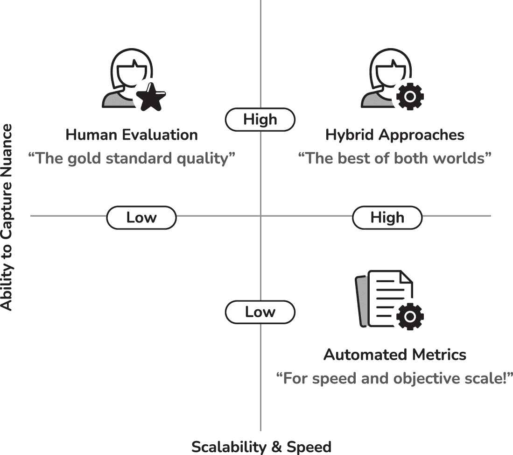

    **Figure 3-18:** A framework for choosing a GenAI evaluation method. The ideal approach depends on the trade-off between the need for scalability and the need to assess subjective, nuanced qualities.

*   **定性反馈：** 评估者为其评分提供书面评论和解释。*示例：* 解释 *为什么* 生成的产品描述令人困惑或具有误导性。

### PM 的角色：

*   **定义评估标准：** 与团队合作，为人工评估定义 *清晰、具体且可衡量* 的标准。对于这个特定功能，“好”是什么样子？这对于获得一致的结果很重要。

*   **招募和培训评估者：** 确保你有一个多样化的评估者群体，能够代表你的目标用户群。提供清晰的指示和培训。

*   **解释结果：** 了解人工评估的局限性（主观性、潜在偏见），并根据你的产品目标解释结果。

*   **预算和时间表：** 人工评估可能耗时且昂贵。在项目规划中考虑这一点。

**何时使用：** 始终。人工评估是理解模型的关键。

## 自动化指标：快速且可扩展的选项

**它是什么：** 算法基于预定义规则或与参考数据的比较，自动评估 AI 生成的内容。

**为什么有价值：** 快速、可扩展且客观（无人类变异性）。适合衡量流畅度、多样性以及（在某种程度上）事实准确性等方面。

### 常见示例（简化）：

*   **文本生成：**

*   **BLEU/ROUGE：** 衡量生成的文本与“参考”（人类编写）文本的 *重叠* 程度。适用于机器翻译或摘要等任务，其中存在“正确”答案。思考：AI 的摘要与人类编写的摘要匹配程度如何？

*   **困惑度：** 衡量模型对文本的“惊讶”程度。较低的困惑度通常表明流畅度更好。思考：基于模型所学的内容，生成的文本有多可预测？

*   **图像生成：**

*   **Inception Score (IS) / Fréchet Inception Distance (FID)：** 评估生成图像的质量和多样性的复杂指标。*思考：* 图像看起来真实且多样吗？

*   **自定义指标：**

*   通常，你的数据科学团队需要创建针对特定产品需求的 *自定义指标*。这是你的领域专业知识发挥关键作用的地方。

### PM 的角色：

*   **了解局限性：** 认识到自动化指标并非完美。它们无法完全捕捉人类判断，尤其是对于主观特质。

*   **选择相关指标：** 与数据科学团队合作，选择适合你特定用例的指标。

*   **设定阈值：** 为每个指标定义可接受的阈值（例如，“我们希望 BLEU 分数至少为 X”）。

*   **监控趋势：** 随时间跟踪自动化指标，以检测性能的任何下降。

**何时使用：** 对于所有客观、可衡量的指标。

## 混合方法：两全其美

**它是什么：** 结合人工评估和自动化指标，以获得更全面且高效的评估。


**Why it's valuable:** Leverages the strengths of both approaches: human judgment for nuance and subjectivity, automated metrics for speed and scale.

**Common Examples:**

*   **Automated Pre-Screening:** Use automated metrics to filter out low-quality outputs, so human evaluators can focus on the more challenging cases.

*   **Active Learning:** Use automated metrics to identify the most informative examples for human labeling or review. This makes the human effort more efficient.

*   **Human-in-the-Loop Refinement:** Use human feedback to improve the automated metrics or to retrain the model.

**When to Use:** Very often, especially for complex tasks.

##### Key Considerations for Choosing Your Evaluation Methods

Choosing the right blend of evaluation methods—human, automated, or hybrid—is a critical strategic decision that you, as the Product Manager, will help guide. This isn't a purely technical choice; it involves balancing product goals, available resources, and potential risks. The following table outlines the key considerations to help you and your team make an informed decision and select the most appropriate evaluation strategy for your specific GenAI feature.

| CONSIDERATION | DESCRIPTION | PM'S ROLE |
| --- | --- | --- |
| Evaluation Criteria | What specific qualities are you trying to assess (relevance, coherence, accuracy, safety, etc.)? | Define clear, measurable criteria that align with your product goals and user needs. |
| Data Availability | Do you have access to high-quality reference data (for automated metrics)? Can you recruit and train human evaluators? | Ensure the necessary data and resources are available. |
| Cost and Time | How much time and budget do you have for evaluation? Human evaluation is generally more expensive and time-consuming than automated metrics. | Allocate resources appropriately and prioritize the most critical evaluation methods. |
| Risk Level | How high are the stakes? For high-stakes applications (e.g., medical advice), more rigorous evaluation (including human review) is essential. | Assess the potential risks and consequences of model errors. |
| Model Type | Some metrics are specific to certain model types (e.g., BLEU for text generation, FID for image generation). | Understand the limitations of different metrics and choose those that are appropriate for your model type. |
| Iterative Evaluation | Plan multiple stages of evaluation, using what you find to improve. | Define the evaluation plan, set the schedule and be sure that there's time for model improvements. |

In conclusion, choosing the right GenAI evaluation methods is a fundamental part of the product development process. By understanding the different approaches and their trade-offs, you can work effectively with your technical team to ensure that your Generative AI features are high-quality, reliable, and safe. You'll be able to make informed decisions, building products your users will love.

#### Prompt Engineering: The Art and Science of Talking to AI

You've now explored the landscape of Generative AI and how to evaluate its outputs. But how do you actually `get` those outputs in the first place? This is where `prompt engineering` comes in. Think of prompt engineering as the art and science of crafting effective instructions for Generative AI models, particularly LLMs. Figure 3-19 illustrates how prompt engineering can be used to tailor LLM behavior for specific tasks, guiding the model toward more relevant, accurate, or creative outputs. It's about learning to “talk” to the AI in a way that elicits the desired responses.

 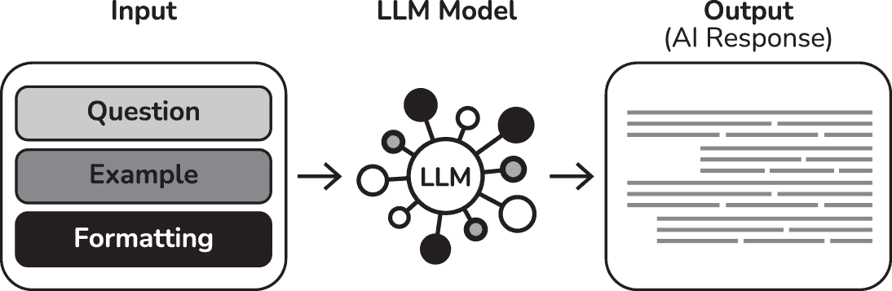

**Figure 3-19:** With prompt engineering. it's possible to tune an LLM model for specific tasks.

##### Why Prompt Engineering Matters to Product Managers

As a PM, you might not be writing prompts every day (although you might!), but understanding prompt engineering is a key part of GenAI for several reasons:

*   **Feature Design:** You'll be involved in designing features that use prompts, either explicitly (where the user directly enters a prompt) or implicitly (where the prompt is generated behind the scenes based on user actions).

*   **Quality Control:** You need to understand how prompt quality impacts the quality of the AI-generated output. Poorly designed prompts lead to poor results.

*   **Collaboration with Engineering**: You'll need to communicate effectively with your engineering team about prompt design and optimization.

*   **Setting Expectations:** You need to set realistic expectations for what the AI can and cannot do, based on the limitations of prompt engineering.

*   **Troubleshooting:** If an AI-powered feature isn't working as expected, understanding prompt engineering can help you diagnose the problem.

##### The Basics of Prompt Engineering

A prompt is simply the input you give to a Generative AI model. For LLMs, this is typically text. The quality of your prompt has a `huge` impact on the quality of the output.

Keep in mind the following key principles of effective prompt engineering:

1.  **Be clear and specific:** Vague prompts lead to vague outputs. Be as specific as possible about what you want the model to do. 

    *   **Poor Prompt:** “Write something about marketing.”

    *   **Better Prompt:** “Write a 200-word blog post introduction about the benefits of using AI-powered marketing automation tools for small businesses.”

2.  **Provide context:** Give the model enough context to understand what you're looking for. This might include background information, examples, or constraints. 

    *   **Poor Prompt:** “Write a product description.”

    *   **Better Prompt:** “Write a 50-word product description for a new noise-cancelling wireless headphone, targeting young professionals who work in busy office environments. Highlight the benefits of noise cancellation for focus and productivity.”

3.  **Specify the desired format and style:** Tell the model *how* you want the output to be formatted and styled. 

    *   **Poor Prompt:** “Write about customer service.”

    *   **Better Prompt:** “Write a bulleted list of five tips for providing excellent customer service via email. Use a friendly and professional tone.”

4.  **Use examples (few-shot learning):** One of the most powerful techniques is to provide a few examples of the desired output. This is called `few-shot learning`.

    **Example:**

    **Prompt:**

    `Translate the following English sentences to French:`

    | `English:` | `The cat sat on the mat`. |
    | --- | --- |
    | `French:` | `Le chat s'est assis sur le tapis`. |
    | `English:` | `Where is the nearest train station?` |
    | `French:` | `Où se trouve la gare la plus proche ?` |
    | `English:` | `I would like to buy a ticket`. |
    | `French:` |  |

    (The model will likely complete the translation correctly.)

5.  **Iterate and experiment:** Prompt engineering is an iterative process. Experiment with different prompts, analyze the results, and refine your prompts based on what works best.

6.  **Control the output:** LLMs offer parameters to control output: 

    *   **Temperature:** Controls randomness. Higher values = more creative, but potentially less coherent. Lower values = more predictable, but potentially repetitive.

    *   **Top-P (Nucleus Sampling):** Controls diversity by limiting the model to choose from a subset of the most likely next words.

    *   **Max Tokens:** Limits the output's length.

To make the principles of effective prompt engineering more concrete, let's look at some side-by-side examples. The following table illustrates how adding specificity, context, and clear instructions can dramatically improve the quality of AI-generated content across several common use cases.


| USE CASE | POOR PROMPT | BETTER PROMPT | EXPLANATION |

| --- | --- | --- | --- |

| Product Description | “Write a product description.” | “Write a 50-word product description for a new smartwatch, targeting fitness enthusiasts. Highlight its heart rate monitoring, GPS tracking, and long battery life. Use an energetic and enthusiastic tone.” | The better prompt provides specific context, target audience, desired features, and tone. |

| Customer Support Email | “Respond to this customer.” | “Write a polite and professional email response to the following customer complaint, apologizing for the delayed shipping and offering a 10% discount on their next order. Customer email: \[Insert email here\].” | The better prompt provides clear instructions, specifies the desired tone, and includes the necessary context (customer email). |

| Social Media Post | “Write a social media post.” | “Write a short, engaging tweet (under 280 characters) promoting our new AI-powered writing assistant. Include a call to action to try the free trial. Use emojis.” | The better prompt specifies the platform (Twitter), character limit, desired tone, and call to action. |

| Code Generation | “Write some code.” | “Write a Python function that takes a list of numbers as input and returns the sum of the squares of those numbers. Include a docstring explaining the function's purpose.” | The better prompt specifies the programming language, the desired functionality, and the desired format (including a docstring). |

| Summarization | “Summarize this.” | “Write a one-paragraph summary of the following article, focusing on the key findings and conclusions. Article: \[Insert article here\].” | The better prompts provides specific length, and the focus of the summary. |

Prompt Engineering is an *ongo process*. As a Product Manager, you should:

*   **Collaborate Closely with your Data Science/Engineering Team:** They are the experts in prompt engineering techniques.

*   **Test and Iterate:** Don't expect to get the perfect prompt on the first try. Experiment with different approaches and use A/B testing to compare results.

*   **Monitor User Feedback:** Pay attention to user feedback on the AI-generated content. This can provide valuable insights for improving your prompts.

*   **Document and Share:** Document prompts and share with your team.

By understanding the principles of prompt engineering, you can ensure that your Generative AI features deliver high-quality, relevant, and engaging outputs, maximizing their value for your users. This knowledge empowers you to be an active participant in the design and optimization of AI-powered experiences.

### Types of Machine Learning: A Recap

Just like there are different tools for different tasks, there are different types of Machine Learning (ML) suited for different product problems. As a PM, you don't need to be an expert in each type, but understanding the *fundamental differences* is key for effective collaboration with your data science team.

Here is a recap of four key types of ML we reviewed:

**Supervised Learning: Learning with a Teacher** This is the type we've been focusing on with our fruit example. The model is trained on *labeled data*—data where both the *input features* (e.g., color, shape) and the *correct output* (e.g., fruit type) are known. The model learns to *map* inputs to outputs.

**Analogy:** Learning with a teacher who provides the correct answers.

**Key Applications:**

*   **Classification:** Predicting categories (e.g., spam/not spam, fruit type, customer churn/no churn).

*   **Regression:** Predicting continuous values (e.g., house prices, stock prices, customer lifetime value).

**PM Relevance:** Most common type, used for many prediction tasks.

**Unsupervised Learning: Discovering Hidden Patterns** Here, the model is trained on *unlabeled data*—data with only input features, *no* correct answers. The model's goal is to find hidden patterns, structures, or relationships within the data.

**Analogy:** Exploring a new city without a map—you discover landmarks and neighborhoods on your own.

**Key Applications:**

*   **Clustering:** Grouping similar data points (e.g., customer segmentation, grouping similar news articles).

*   **Dimensionality Reduction:** Simplifying data by reducing the number of features while preserving important information (useful for visualization and speeding up other ML algorithms).

*   **Anomaly Detection:** Find outliers.

**PM Relevance:** Useful for understanding your data, discovering customer segments, and identifying unusual behavior.

**Reinforcement Learning: Learning by Doing** This type of ML is inspired by how humans learn through trial and error. The model (often called an “agent”) interacts with an *environment*, takes actions, and receives *rewards* or *penalties*. It learns to take actions that maximize its cumulative reward.

**Analogy:** Training a dog with treats and corrections.

**Key Applications:**

*   Game playing (e.g., AlphaGo—a computer program that plays the board game Go).

*   Robotics (e.g., teaching a robot to walk).

*   Autonomous driving.

*   Personalized recommendations (optimizing for long-term engagement).

**PM Relevance:** Less common in everyday product applications but critical for areas like robotics, gaming, and dynamic optimization.

**Generative AI: Creating New Content** Generative AI models go beyond prediction and classification. They *learn the underlying patterns* in a dataset and then *generate new, original content* that resembles the training data.

**Analogy:** A digital artist learning from countless paintings to create their *own* unique artwork.

**Key Applications:**

*   **Image Generation:** Creating realistic images (e.g., DALL-E 2).

*   **Text Generation:** Writing articles, summarizing text, generating code (e.g., ChatGPT, GitHub Copilot).

*   **Music Composition:** Creating original musical pieces.

**PM Relevance:** Revolutionizing content creation, design, and software development. Raises new challenges related to originality, copyright, and potential misuse.

The following table provides a comparative overview of the types of Machine Learning:

| FEATURE | SUPERVISED LEARNING | UNSUPERVISED LEARNING | REINFORCEMENT LEARNING | GENERATIVE AI |

| --- | --- | --- | --- | --- |

| Primary Goal | Predict outcomes based on labeled data. | Discover hidden patterns. | Learn optimal actions through trial and error. | Create new content. |

| Data Type | Labeled (features and outcomes). | Unlabeled (features only). | Interaction with an environment. | Labeled or unlabeled (to learn patterns). |

| PM Applications | Classification, regression. | Customer segmentation, anomaly detection. | Game playing, robotics, personalization. | Image/text generation, content creation. |

| Key Question for PMs | What outcome do we want to predict? | What hidden insights are in our data? | How can we optimize behavior over time? | How can we generate new and valuable content? |

| Data Needs | Large, labeled dataset. | Large dataset. | Simulated or real-world environment. | Large dataset (often very large). |

| Human Interaction | Requires labeled data (often from humans). | Less human interaction during training. | Humans define reward functions. | Human feedback can improve output quality. |

| Technical Complexity | Moderate | Moderate to High | High | High |

| Evaluation | Accuracy, precision, recall. | Clustering quality, variance explained. | Cumulative reward. | Quality of generated content (often subjective). |

## Introduction to Neural Networks and Deep Learning: The Engines of Complex Pattern Recognition


我们探索了各种类型的机器学习，从一些 AI 系统基于规则的简单性，到无监督学习的复杂模式识别。现在，让我们深入探讨支撑许多你遇到的最先进 AI 应用程序的核心技术：`Neural Networks` 和 `deep learning`。

当你听到“AI 驱动的图像识别”、“自然语言理解”或“自动驾驶汽车”等术语时，很有可能是神经网络在发挥核心作用。

回想一下我们关于 LLM 及其 Transformer 架构的讨论。该架构 `is` 一种神经网络。事实上，我们讨论过的许多高级功能都是由这些强大且可适应的模型实现的。那么，它们到底 `are` 什么？

### 神经网络：模仿大脑的连接（但并非完全如此）

从最基本的意义上说，神经网络是一种受人脑结构启发的计算系统（尽管它是一个 `very` 简化的模型）。它是一个由互连节点组成的网络，这些节点通常被称为 `neurons`，并按层组织。Figure 3-20 对比了机器学习和深度学习的工作流程，强调了深度学习如何使用多个层从原始数据中提取越来越复杂的特征。这些神经元通过“突触”（由权重表示）相互连接，在它们之间传输信号。Figure 3-21 通过展示输入数据如何在神经网络的隐藏层中移动以产生最终预测，来说明这一过程。重要的是要强调，神经网络不是大脑的数字副本，而是使用受其启发的数学概念。

想象一个复杂的传话游戏。一条消息（输入数据）从一个人传到另一个人（神经元到神经元）。每个人可能会根据自己的理解（神经元的激活函数）稍微改变消息。当消息传到终点（输出层）时，它已经被转换了。神经网络中的“学习”过程涉及调整每个人如何解释和修改消息（调整连接的权重），以确保最终消息正确。

 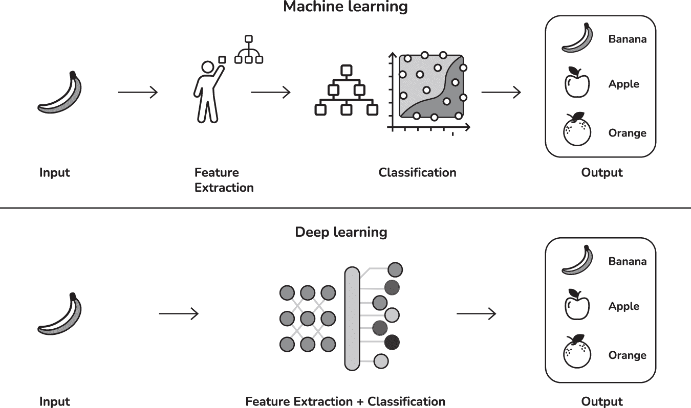

**Figure 3-20:** Machine learning vs. deep learning steps to make a prediction.

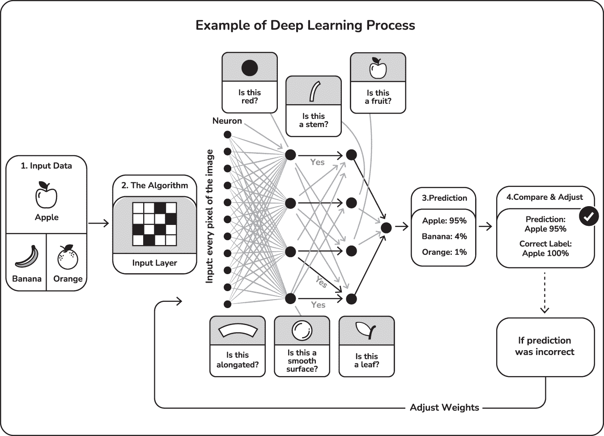

**Figure 3-21:** Visual example of how a neural network processes inputs through multiple hidden layers to produce an output. Each layer transforms the data to identify increasingly abstract patterns.

让我们分解一下关键组件：

*   **Input Layer:** 这是原始数据进入网络的地方。可以将其视为网络的“感官”。 

    *   **Example:** 对于图像识别系统，输入层将接收图像的像素值。对于垃圾邮件过滤器，它将接收电子邮件中的单词。

*   **Hidden Layers:** 这些是输入层和输出层之间的层，真正的处理发生在这里。网络通过一系列计算转换输入数据，提取越来越抽象和复杂的特征。Figure 3-22 可视化了这种转换，展示了输入特征如何逐层优化以支持准确预测。网络拥有的隐藏层越多，它就越“深”——因此称为“深度学习”。

    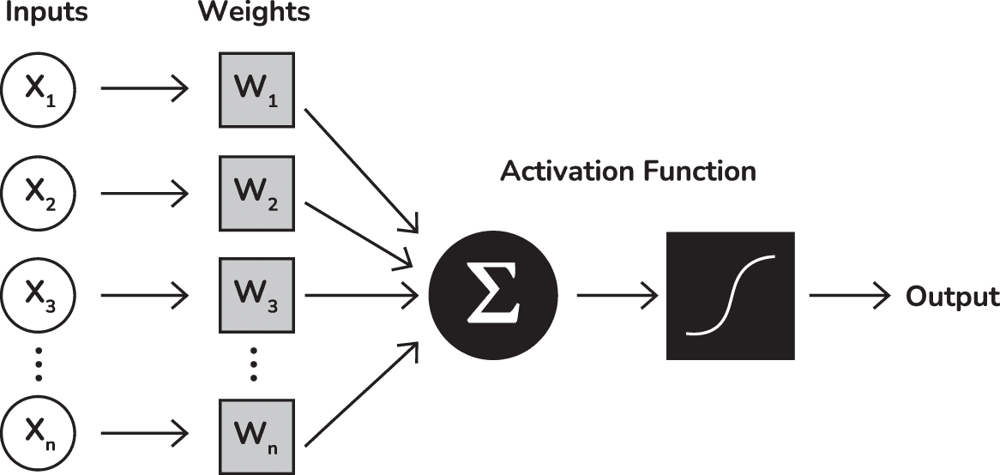

    **Figure 3-22:** A diagram of a single artificial neuron, the fundamental building block of a neural network. It calculates a weighted sum of its inputs and then applies an activation function to produce its output.

    *   **Example:** 在图像识别系统中，第一个隐藏层可能会检测边缘和角落等简单特征。后续层可能会结合这些特征来检测形状，而更深层的层可能会识别面部或汽车等对象。

*   **Output Layer:** 这一层产生最终结果或预测。 

    *   **Example:** 在图像识别系统中，输出层可能会指示图像包含猫、狗或汽车的概率。在垃圾邮件过滤器中，它将输出电子邮件是垃圾邮件的概率。

### 神经网络如何学习：调整连接

神经网络的力量在于它能够 `learn` 来自数据。这种学习是通过调整神经元之间连接的 `weights` 来实现的。可以将这些权重视为控制神经元之间信号强度的音量旋钮。

想象你正在教一个孩子识别不同类型的水果。你给他们看一个苹果并说“苹果”。起初，孩子可能不知道什么是苹果。但当你给他们看更多苹果，并在他们犯错时纠正他们（“那是香蕉，不是苹果”），他们就逐渐学会将苹果的视觉特征与“苹果”这个词联系起来。

神经网络的学习方式类似，但通过一种称为 `backpropagation` 的数学过程。基本思路如下：

1.  **Input and Prediction:** 网络接收输入（例如，苹果的图像）并做出预测（例如，“香蕉”）。

2.  **Error Calculation:** 将预测与正确答案（标签“苹果”）进行比较。预测与正确答案之间的差异就是 `error`。

3.  **Weight Adjustment:** 然后，网络调整神经元之间连接的权重以减少此错误。这些调整的方式使得下次看到类似图像时，它 `more likely` 预测“苹果”。

4.  **Iteration:** 这个过程重复多次，网络接收许多不同的示例。随着时间的推移，权重被精细调整，网络在其任务上变得越来越准确。

深度学习成功的关键在于它能够自动学习数据的复杂、分层表示。隐藏层充当 `feature extractors`，发现任务中最相关的特征，而无需明确编程。这与传统的机器学习方法相比是一个巨大的优势，后者通常需要手动特征工程。这也是它们可以在如此多不同场景中使用的原因。

### 技术深度解析：神经网络和深度学习的机制

让我们更好地理解神经网络的实际工作原理，而不必陷入复杂的数学中。我们将关注关键思想，并使用类比使它们更直观。

1.  **Activation Functions: The “Decision-Makers”** 

    *   **What they are:** 想象隐藏层中的每个神经元都是一个微小的决策者。它接收来自其他神经元的信号，并需要决定是“发射”（发送强信号）还是不发射。Figure 3-23 说明了单个神经元的基本结构。激活函数就像神经元用来做出最终“发射”或“不发射”决定的规则。

        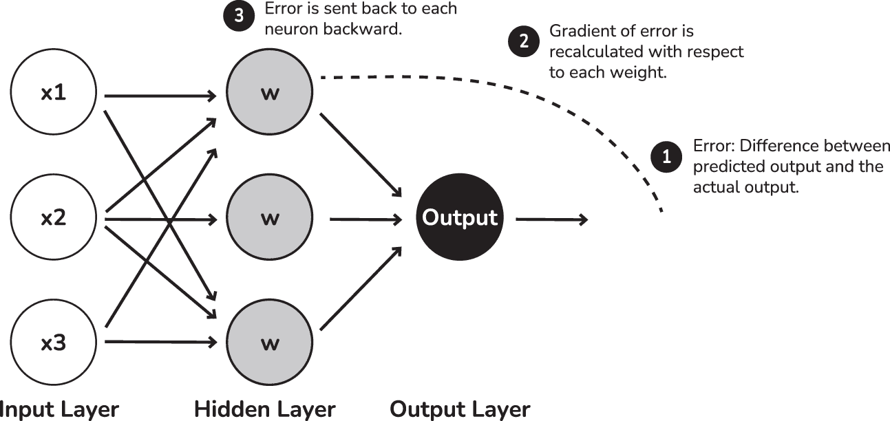

        **Figure 3-23:** Backpropagation adjusts the weights of the neural network layers.

    *   **Why they're important:** 它们引入了 `non-linearity`。可以这样想：如果每个神经元只是传递它接收到的信号（没有激活函数），那么整个网络就像一个单一的、简单的计算。激活函数使网络能够学习更复杂的模式，例如图像、语言或用户行为中发现的模式。


*   **简单类比：** 想象一个带有调光器的灯开关。简单的开/关开关就像一个*没有*激活函数（线性）的网络。调光开关允许一系列亮度级别，就像一个激活函数（非线性）。调光器允许更精细的控制。

## 2. 反向传播：从错误中学习

*   **工作原理：** 反向传播是网络用来学习的过程。它就像一个反馈循环。网络做出预测，将其与正确答案进行比较，然后调整其神经元之间的连接，以便在未来做出更好的预测。

*   **连锁反应：** 调整从输出层（做出预测的地方）开始，逐层向后通过网络传播。这就像追溯导致错误的步骤，以找出问题出在哪里。

*   **简单类比：** 想象你正在学习投篮。你投了一球没进。你分析*为什么*没投进（用力过大、角度不对等），并相应地调整下一次投篮。反向传播就像这种分析和调整过程，但针对的是网络。

## 3. 梯度下降：寻找“最佳点”

*   **它是什么：** 梯度下降是用于调整神经元之间连接（权重）的方法。这就像在高尔夫球杆上找到“最佳点”或相机镜头上的完美对焦。目标是找到一组权重，以最小化网络的错误。

*   **“滚球”类比：** 想象一个球在起伏的地貌上滚动。球会自然地向下滚动，寻找最低点。梯度下降就像这样——它引导网络的权重朝着产生最低错误（“山谷底部”）的值发展。Figure 3-24 说明了球在起伏地貌上滚动以找到最佳最小值（全局最小值）的概念。

*   **学习率：** 这就像球向下滚动时所迈的步子大小。小步子更精确但较慢；大步子更快，但可能会滑过底部。

## 4. 网络架构：不同任务的不同蓝图

有不同类型的神经网络架构，专为不同任务设计。

*   **前馈网络：** 最简单的一种，信息单向流动。适用于将电子邮件分类为垃圾邮件或非垃圾邮件等任务。

*   **卷积神经网络（CNN）：** 这些就像专门的图像处理网络。它们非常擅长识别图像中的模式，例如识别照片中的物体。

*   **循环神经网络（RNN）：** 这些旨在处理数据序列，如文本或股票价格。它们有一个“记忆”，允许它们在处理新信息时考虑过去的信息。

*   **Transformer：** 支持 LLMs 等模型的架构，它们在理解长文本的上下文方面表现出色。

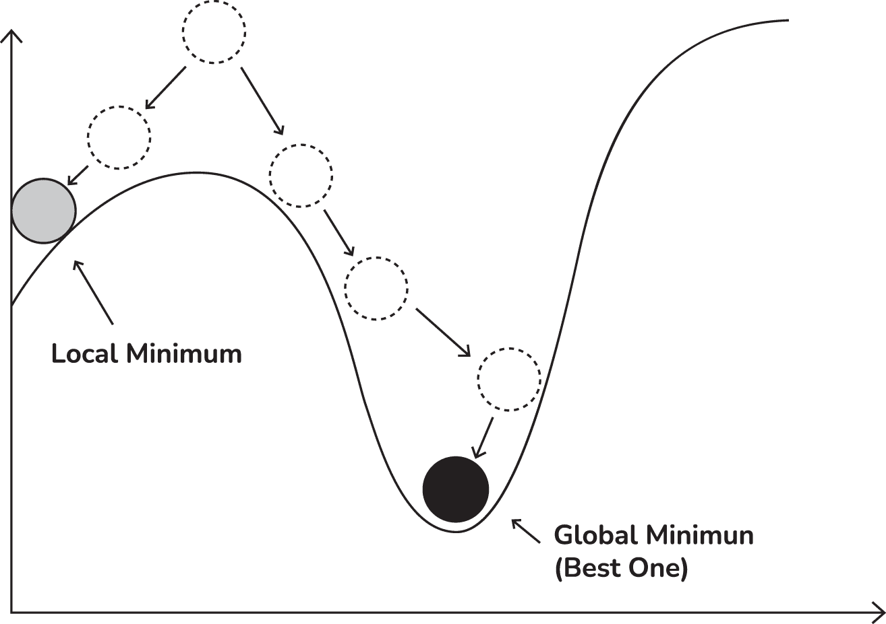

**Figure 3-24:** 梯度下降的一个示例，包含局部最小值和全局最小值。我们希望优化模型以获得全局最小值。

## 深度学习中的挑战

虽然深度学习解锁了强大的功能，但它也带来了产品经理应该了解的独特挑战。了解这些障碍是制定现实时间表并有效与技术团队合作的关键：

*   **消失/爆炸信号：** 有时，通过网络传递的信号可能会变得太弱或太强，使得网络难以学习。这就像试图在嘈杂的房间里听到耳语（消失），或者试图在摇滚音乐会上进行交谈（爆炸）。

*   **过拟合：** 模型学习训练数据*太好*，包括噪声和无关细节。这就像死记硬背特定测试的答案，而不是理解基本概念。它在训练数据上表现良好，但在新的、未见过的数据上表现不佳。

*   **欠拟合：** 模型太简单，无法理解数据中存在的模式。

*   **计算成本：** 训练这些网络，尤其是非常大的网络，可能需要大量的计算能力和时间。

现在我们已经深入探讨了 AI，让我们来看看构建和部署这些模型的*过程*。这是 AI *生命周期*。

## 章节摘要与关键要点

本章通过从技术机制放大到产品格局，为你提供了战略流利度。你现在可以阐述人工智能（创造智能行为）的广泛目标与用于实现它的机器学习（从数据中学习）的具体方法之间非常重要的关系。我们对比了机器学习的适应性和能力与更简单的基于规则的系统，强调你作为产品经理在为手头问题选择正确方法中的关键作用。你现在明白，机器学习的关键优势是其动态适应性，允许你的产品在从现实世界数据中学习的过程中随时间改进。

### 关键要点

*   你将 AI 视为*目标*（智能行为），将 ML 视为实现它的强大*手段*。

*   你认识到并非所有 AI 都是 ML，有时更简单的基于规则的系统可能是正确且最有效的解决方案。

*   你明白 ML 的核心优势是适应性——你的产品能够学习并随时间改进的能力。

*   你的战略优势来自于知道哪种方法（基于规则、机器学习、深度学习）最适合用户的问题。

### 接下来：映射过程

有了对 AI 的“什么”和“为什么”的清晰战略理解，你现在可以规划将 AI 产品付诸实施的端到端过程。下一章将从产品经理的角度详细介绍 **AI 生命周期**。

WileyPRE

# CHAPTER 4

## AI 生命周期

作为一名使用 AI 的产品经理，你不需要*执行*数据科学生命周期的每一步，但你*必须*理解它。如 Figure 4-1 所示，这个生命周期是构建和部署 AI 模型的路线图，从最初的想法到持续的维护。了解这个过程使你能够：

*   **有效协作：** 与你的数据科学和工程团队有效合作。

*   **设定现实期望：** 了解每个阶段所需的时间、资源和数据。

*   **优先处理功能：** 根据可行性和影响，就优先处理哪些 AI 功能做出明智决策。

*   **管理风险：** 识别潜在障碍并尽早减轻它们。

*   **确保一致性：** 使 AI 开发与整体产品策略和用户需求保持一致。

将数据科学生命周期视为创建 AI 驱动解决方案的结构化食谱。每个步骤对于成功结果都至关重要。

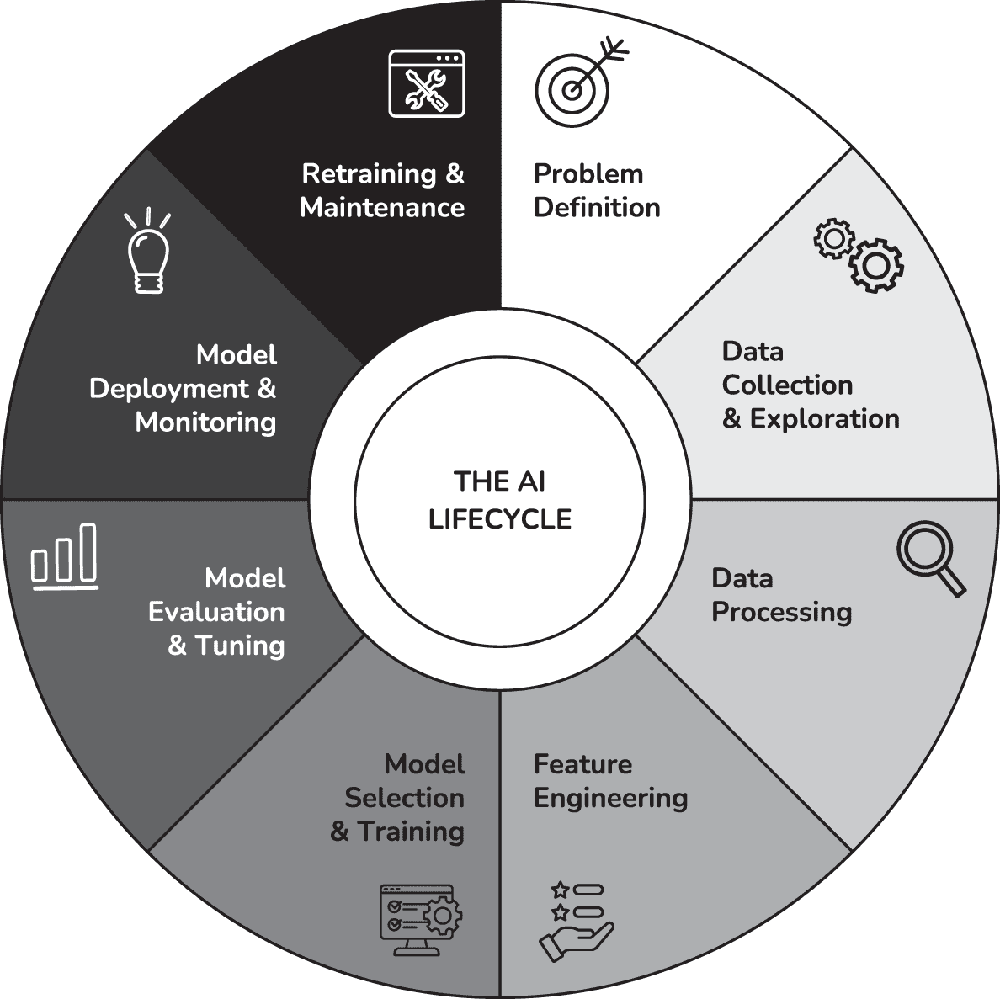

**Figure 4-1:** AI 生命周期

本章介绍了关键阶段的分解，重点关注产品经理的视角。

## 问题定义与业务理解：“为什么”

这是*你*，产品经理，发挥*关键*作用的地方。你定义 AI 计划背后的“为什么”。这包括：

*   **识别用户问题：** 我们正在解决哪些用户需求？

*   **定义业务目标：** 解决这个问题将如何使业务受益（例如，增加收入、降低成本、提高用户参与度）？

*   **设定可衡量的目标：** 我们将如何衡量成功？（例如，将客户流失率降低 X 个百分点，将点击率提高 Y 个百分点）。

*   **定义关键问题：** 我们需要 AI 模型回答哪些具体问题？


*Example*: A subscription-based streaming service wants to reduce customer churn. The problem is that users are canceling their subscriptions. The *business goal* is to retain more subscribers. A *measurable objective* might be to reduce churn by 15 percent within the next quarter. A *key question* for the AI model could be: “Which users are most likely to cancel their subscription in the next 30 days?”

*PM's role*: Lead this phase. Work with stakeholders to define the problem, goals, and objectives. Ensure alignment with overall product strategy.

## Data Collection and Exploration: Understanding Your Ingredients

Now we need the data. This involves:

*   **Identifying Data Sources:** Where can we find the data we need (e.g., databases, APIs, user activity logs)?

*   **Gathering Data:** Collecting the relevant data.

*   **Exploring the Data:** Understanding the data's characteristics, identifying missing values, outliers, and potential biases.

*Example*: For the churn prediction problem, we'd collect data on user demographics, viewing history, subscription plan, payment history, customer service interactions, and any other relevant information. Exploration might reveal that users who watch fewer than five hours of content per month are more likely to churn.

*PM's role*: Collaborate with data engineering and data scientists to identify and access relevant data sources. Understand the limitations and potential biases of the data.

## Data Preprocessing: Preparing the Ingredients

Raw data is rarely ready for modeling. This stage involves:

*   **Cleaning the Data:** Handling missing values, correcting errors, and removing inconsistencies.

*   **Transforming the Data:** Converting data types, scaling numerical features, and encoding categorical variables.

*Example:* In the churn prediction example, we might need to:

*   Handle missing values in user demographics (e.g., impute missing age based on other users with similar characteristics).

*   Convert date formats to a consistent standard.

*   Scale numerical features (e.g., viewing hours) to a common range.

*PM's role*: Understand the implications of data preprocessing decisions on model performance and potential biases. Ensure data quality and privacy are prioritized.

## Feature Engineering: Crafting the Inputs for Success

Feature engineering is the process of creating *new* features from existing ones, or transforming existing features, to improve model performance. It's about making the data more informative and easier for the model to learn from. Think of it as combining and transforming your ingredients to create a more flavorful dish.

*   **Why It's Important:** Well-engineered features can significantly boost model accuracy and make the model more interpretable.

*Example*: In our churn prediction example, we might:

*   **Create a “Recency” Feature:** How long ago did the user last interact with the service? (This is derived from existing interaction timestamps).

*   **Create a “Frequency” Feature:** How often does the user use the service (e.g., average sessions per week)?

*   **Create a “Content Diversity” Feature:** How many different genres of content does the user watch?

*   **Create a Feature Combining Time of the Day and Day of the Week (Is It Weekend, or Weekday, and Morning, Afternoon, or Night)**.

*PM's role*:

*   **Provide Domain Knowledge:** You have valuable insights into user behavior and the product. Share this knowledge with your data science team to help them brainstorm relevant features.

*   **Understand Feature Importance:** Ask your data science team which features are most important for the model's predictions. This can inform product decisions (e.g., if “Recency” is a strong predictor of churn, you might focus on re-engagement campaigns).

*   **Suggest Features:** You are close to the users and can provide meaningful suggestions.

## Model Selection and Training: Choosing the Right Algorithm

This stage involves selecting the appropriate machine learning algorithm and training it on the prepared data. Think of choosing the right tool for the job: a hammer for nails, a screwdriver for screws.

*   **Model Selection:** The choice of algorithm depends on: 

    *   **The Type of Problem:** Classification (predicting categories), regression (predicting continuous values), clustering (grouping similar data points), etc.

    *   **The Characteristics of the Data:** The size, dimensionality, and distribution of the data.

    *   **Interpretability Requirements:** Do we need to understand *why* the model is making certain predictions? (Some models, like decision trees, are more interpretable than others, like neural networks).

*   **Training:** The chosen algorithm learns the patterns and relationships between the features and the target variable (in supervised learning) using the training data.

 *Example:* For our churn prediction problem (a classification task), we might consider algorithms like:

*   **Logistic Regression:** A relatively simple and interpretable model.

*   **Decision Trees:** Easy to visualize and understand.

*   **Random forests:** An ensemble of decision trees, often more accurate than individual trees.

*   **Gradient Boosting Machines (GBMs):** Another powerful ensemble method.

*   **Neural Networks:** More complex models that can capture non-linear relationships, but often less interpretable.

*PM's role:*

*   **Understand the Trade-offs:** Discuss the pros and cons of different algorithms with your data science team. Consider factors like accuracy, interpretability, and computational cost.

*   **Define Success Metrics:** Reiterate the key performance indicators (KPIs) that the model should optimize (e.g., precision, recall, F1-score for churn prediction).

*   **Prioritize:** Give inputs on what to prioritize (e.g., accuracy over interpretability).

## Model Evaluation and Tuning: Ensuring Quality

After training, we rigorously evaluate the model's performance using the *testing data* (data the model *hasn't* seen during training). This is like giving the student a final exam.

*   **Evaluation Metrics:** We use metrics like accuracy, precision, recall, F1-score (which we covered earlier), and others depending on the specific problem.

*   **Tuning:** If the model's performance isn't satisfactory, we *tune* its hyperparameters (settings that control the learning process) or even try a different algorithm. This is an iterative process.

*Example:* We evaluate our churn prediction model on the testing data. We might find that it has high accuracy but low recall (meaning it misses many users who are actually about to churn). We might then tune the model's hyperparameters (e.g., adjust the threshold for classifying a user as “high risk of churn”) to improve recall, even if it slightly reduces precision.

*PM's role*:

*   **Understand the Metrics:** Know what the key evaluation metrics mean and how they relate to your product goals.

*   **Prioritize Improvements:** Based on the evaluation results, work with your data science team to prioritize areas for improvement. Focus on the metrics that matter most for your business.

*   **Iterate:** Recognize that model development is an iterative process. Be prepared for multiple rounds of evaluation and tuning.

## Model Deployment and Monitoring: Bringing AI to Life (and Keeping It Healthy)

Deployment is where your AI model goes from being a theoretical construct to a *working part of your product*. Monitoring ensures it *continues* to perform well in the real world.

*   **Deployment:** This involves integrating the trained model into your product infrastructure. This could mean: 

    *   Embedding the model in a mobile app.

    *   Deploying it as a web service (API) that other systems can access.

    *   Integrating it into a backend system for automated decision-making.


# 监控

**监控：** 这是 `critical` 且持续进行的。我们跟踪关键性能指标（与评估期间使用的相同指标），以检测性能随时间的任何下降。我们还监控：

*   **数据漂移：** 输入数据分布的变化（例如，新的客户人口统计信息，用户行为的变化）。
*   **概念漂移：** 特征与目标变量之间关系的变化（例如，预测流失的因素可能会随时间而改变）。
*   **系统健康：** 确保支持模型的基础设施正常运行。

*示例：* 我们的流失预测模型作为 Web 服务部署。每当用户与流媒体服务交互时，其数据会被发送到模型，模型预测其流失风险。此风险评分可能会触发干预措施（例如，提供折扣）以留住用户。我们持续监控模型的准确率、精确率和召回率，以及用户特征的分布。如果我们看到准确率显著下降或用户人口统计信息发生变化，这表明我们可能需要重新训练模型。

## PM 的角色

*   **定义部署要求：** 与工程团队合作，指定模型将如何集成到产品中。
*   **建立监控仪表板：** 与数据科学和工程团队合作，创建跟踪关键性能指标并在出现问题时提醒您的仪表板。
*   **设置警报阈值：** 为性能指标定义触发警报的阈值（例如，如果准确率低于某个水平）。
*   **规划降级方案：** 如果模型宕机或表现不符合预期怎么办？制定备用方案（例如，更简单的基于规则的系统，人工干预）。

# 重新训练与维护：保持模型的最新状态

AI 模型并非“设置好就不用管了。”它们需要持续的维护和重新训练，以保持准确性和相关性。

*   **重新训练：** 定期使用 `new data` 重新训练模型对于适应不断变化的条件（数据漂移、概念漂移）至关重要。重新训练的频率取决于特定应用程序以及底层数据变化的速度。
*   **维护：** 这包括以下任务：

    *   更新软件依赖项。
    *   确保与其他系统的兼容性。
    *   解决任何安全漏洞。

*示例：* 我们可能会每月使用最新的用户数据重新训练我们的流失预测模型。如果我们向流媒体服务引入重大新功能，我们可能也需要重新训练模型，因为这可能会显著影响用户行为。

## PM 的角色

*   **安排重新训练：** 与数据科学家合作，建立模型重新训练的计划（例如，每月、每季度，或基于性能触发器）。
*   **预算维护：** 如果适用于您的组织，分配资源用于持续的维护和更新。
*   **优先考虑数据收集：** 确保您继续收集重新训练所需的数据。
*   **考虑反馈循环：** 如果用户反馈表明模型不起作用，请了解原因。

# 章节摘要与关键要点

您现在可以可视化整个端到端的 AI 生命周期。本章为您提供了一条结构化的路线图，追溯了从初始业务问题到已部署和维护的 AI 模型的旅程。我们走过了八个关键阶段，从设定方向的问题定义，经过数据密集型的数据收集和特征工程阶段，进入模型训练和评估的核心，最后到部署、监控和重新训练等非常重要的上线后阶段。您现在将 AI 开发视为一个结构化的迭代过程，而不是一个神秘的黑盒，而您在其中扮演着至关重要的角色。

## 关键要点

*   您充当战略指南，在生命周期的开始（问题定义）和结束（评估/ROI）提供关键投入，并在整个过程中添加基本的产品背景。
*   您将生命周期视为一个连续的循环，监控的见解将反馈到未来的迭代和产品改进中。
*   您认识到数据是连接几乎每个阶段的中心线索，使数据策略成为 PM 的核心关注点。
*   您知道工作真正开始于部署，并且您计划为长期成功所需的持续监控和维护。

## 接下来：探索 AI PM 角色

在清晰了解端到端流程后，现在是时候探索“谁”了。第 II 部分 将重点介绍不同的 AI PM 专业方向，帮助您规划自己的道路。

## 第 II 部分

## AI PM 专业方向

AI 产品管理的世界正在快速发展。随着 AI 越来越多地集成到产品中，对 PM 的要求也在变化。虽然产品管理的核心原则保持不变——了解用户需求、制定战略、交付价值——但在 AI 背景下`应用`这些原则需要新的技能和视角。

第 II 部分介绍了三种不同但相互关联的 AI 产品经理专业方向：AI-体验 PM、AI-构建者 PM 和 AI-增强 PM。这些并非`互斥`的职位名称；相反，它们代表了更广泛的 AI PM 领域内的不同`关注领域`。单个 PM 可能承担跨越多个角色的职责，尤其是在较小的组织中。但是，了解这些专业方向将帮助您：

*   **识别您的优势和兴趣：** 您自然倾向于哪里？哪个角色最符合您现有的技能和职业抱负？
*   **专注您的学习：** 通过了解每个角色相关的关键职责和技能，您可以更有效地定位您的学习和发展工作。
*   **规划您的职业道路：** 无论您是希望在特定领域专精，还是拓宽技能，这个框架都为成长提供了一条路线图。
*   **了解您的团队：** 了解如何更好地与其他 PM 合作。

在深入了解每个角色的细节之前，重要的是要强调`协作`在任何角色中都是关键。无论您的专业方向如何，您都需要与数据科学家、工程师、设计师和其他利益相关者密切合作。这些角色是关于定义专业领域，而不是制造孤岛。

**三种 AI PM 角色（抢先预览）：**

1.  **AI-体验 PM**：用户体验的倡导者。这位 PM 关注 AI 驱动的功能是如何向用户展示以及用户如何与之交互的。他们擅长将用户需求转化为 AI 驱动的解决方案。*想想：* AI 的 UX 设计。
2.  **AI-构建者 PM**：AI 基础设施的架构师。这位 PM 专注于构建和管理支持 AI 驱动功能的底层 AI 平台、模型和框架。*想想：* AI 的平台和工具。
3.  **AI-增强 PM**：AI 工具的高级用户。这位 PM 利用 AI 工具和技术来改进他们`自己的`产品管理工作流程和决策。*想想：* AI 作为 PM 的个人助理。

让我们更详细地探讨每个角色。

## 第 5 章

## AI-体验 PM：塑造用户与 AI 的交互

AI-体验 PM 关注用户如何与产品中的 AI 驱动功能进行交互和体验。他们弥合了 AI 技术能力与最终用户需求和期望之间的差距。虽然他们不构建 AI 模型本身，但他们是设计和集成 AI 功能以创建无缝、直观且有价值的用户体验的专家。他们确保 AI 增强而非复杂化用户旅程。


这个角色至关重要，因为即使是最先进的 AI，如果用户无法理解它、使用它或信任它，也是无效的。AI-体验产品经理确保 AI 驱动的功能不仅功能完善，而且用户友好、引人入胜，并符合用户需求。这推动了采用率，并确保 AI 真正改进了产品。

这位产品经理与数据科学家和工程师（构建底层 AI 模型）、UX 设计师（打造用户界面）以及其他产品经理（可能专注于产品的不同方面）密切合作。他们在整个 AI 开发过程中代表用户的视角。

AI-体验产品经理角色经常涉及平衡潜在冲突的优先事项：利用最先进的 AI 功能的同时保持简单、用户友好的体验；最大化个性化的同时避免偏见并确保公平性；推动创新的同时坚持负责任和合乎伦理的 AI 原则。成功驾驭这些权衡是关键。

一位`高效`的 AI-体验产品经理将深厚的用户同理心与对 AI 功能`及其局限性`的深刻理解相结合。他们是富有创造力的问题解决者、出色的沟通者，也是以用户为中心的设计原则的坚定倡导者。他们设想 AI 不仅能解决问题，还能创造直观且有价值的体验。

让我们探讨定义这一关键角色的具体职责。

## 关键职责：塑造 AI 用户体验

AI-体验产品经理负责确保 AI 驱动的功能无缝集成到产品中并提供积极的用户体验。这涉及从最初的构思到持续优化的一系列职责：

### 识别和优先排序 AI 驱动的功能机会：

*   **行动：** 主动识别可以通过 AI 解决的用户需求和痛点，利用用户研究、数据分析和竞争分析。

*   **行动：** 根据用户影响、商业价值和技术可行性优先排序这些机会。这涉及做出明智的权衡，并与整体产品路线图保持一致。

*   **示例：** 识别出用户在大型知识库中难以找到相关内容，并优先开发 AI 驱动的搜索功能。

### 为 AI 功能定义以用户为中心的需求：

*   **行动：** 将用户需求和业务目标转化为 AI 驱动功能的清晰、详细需求。这不仅仅是声明“构建推荐系统”；它涉及指定系统应该推荐什么、如何呈现这些推荐，以及如何纳入用户反馈。

*   **行动：** 定义可衡量的成功指标（KPI），以反映用户满意度和业务影响。

*   **示例：** 为个性化学习路径功能定义需求，指定目标用户群体、期望的学习成果、要推荐的内容类型以及呈现学习路径的用户界面。

### 设计直观且引人入胜的 AI 交互：

*   **行动：** 与 UX 设计师密切合作，创建直观、引人入胜且透明的用户界面。这包括设计用户如何与 AI 驱动的功能交互、AI 输出如何呈现，以及用户如何提供反馈。

*   **行动：** 确保 AI 驱动的功能无缝集成到现有用户工作流中，最大限度地减少干扰并最大限度地提高可用性。

*   **示例：** 设计聊天机器人的交互流程，确保其易于使用、提供有用的响应，并在必要时无缝过渡到人工客服。

### 倡导合乎伦理和负责任的 AI 实践：

*   **行动：** 在整个产品开发生命周期中主动解决伦理问题。这包括识别和缓解 AI 模型中的潜在偏见，确保用户隐私，并促进透明度。

*   **行动：** 与法律和合规团队合作，确保 AI 驱动的功能符合所有相关法规。

*   **示例：** 确保个性化推荐系统不会歧视任何特定用户群体，并且用户数据得到负责任的处理。

### 主导实验和验证（A/B 测试）：

*   **行动：** 设计和执行 A/B 测试和其他实验，以验证 AI 驱动功能对用户行为和关键指标的影响。

*   **行动：** 分析实验结果，并根据数据驱动的洞察对功能设计和模型性能进行迭代。

*   **示例：** 对 AI 驱动的产品描述生成器的不同版本进行 A/B 测试，以确定哪个版本能带来更高的点击率和转化率。

### 监控性能并推动持续改进：

*   **行动：** 持续监控生产环境中 AI 驱动功能的性能，跟踪关键指标和用户反馈。

*   **行动：** 识别改进领域，并与数据科学和工程团队合作对模型和用户体验进行迭代。

*   **示例：** 跟踪 AI 驱动垃圾邮件过滤器的准确性和用户满意度，并识别减少误报和漏报的机会。

### 与利益相关者沟通：

*   **行动：** 向利益相关者（包括工程、设计、营销、销售和领导层）清晰传达 AI 计划的愿景、战略和进展。

*   **行动：** 倡导 AI 驱动的功能，并获得利益相关者的支持。

*   **示例：** 向利益相关者展示 A/B 测试结果，展示 AI 对关键业务指标的影响，并倡导继续投资于 AI 计划。

### 管理用户期望并处理不确定性：

*   **行动：** 主动管理用户对 AI 驱动功能的能力和局限性的期望。这涉及清晰的沟通、透明的设计以及提供适当的反馈机制。

*   **行动：** 设计能够优雅处理 AI 不确定或出错的情况的用户体验。这可能涉及提供备选方案、提供解释，或允许用户轻松覆盖 AI 的建议。

*   **示例：** 对于聊天机器人，明确指示机器人不确定答案时，并提供连接人工客服的选项。对于推荐系统，允许用户轻松对推荐的相关性提供反馈。对于文本生成功能，提供免责声明，说明生成的内容可能不准确。

这些职责突显了 AI-体验产品经理角色的多面性。它是用户倡导、战略思维、设计敏感度、数据分析和有效沟通的结合。AI-体验产品经理是创造不仅技术令人印象深刻，而且对用户真正有价值且令人愉悦的 AI 驱动产品的推动力。

## 日常活动

如 图 5-1 所示，AI-体验产品经理的日常工作充满活力且多面，融合了以用户为中心的设计、数据分析、战略规划和持续协作。这是一个既需要创造性问题解决，又需要严谨、数据驱动方法的角色。以下是可能填满他们日常工作的活动示例：

 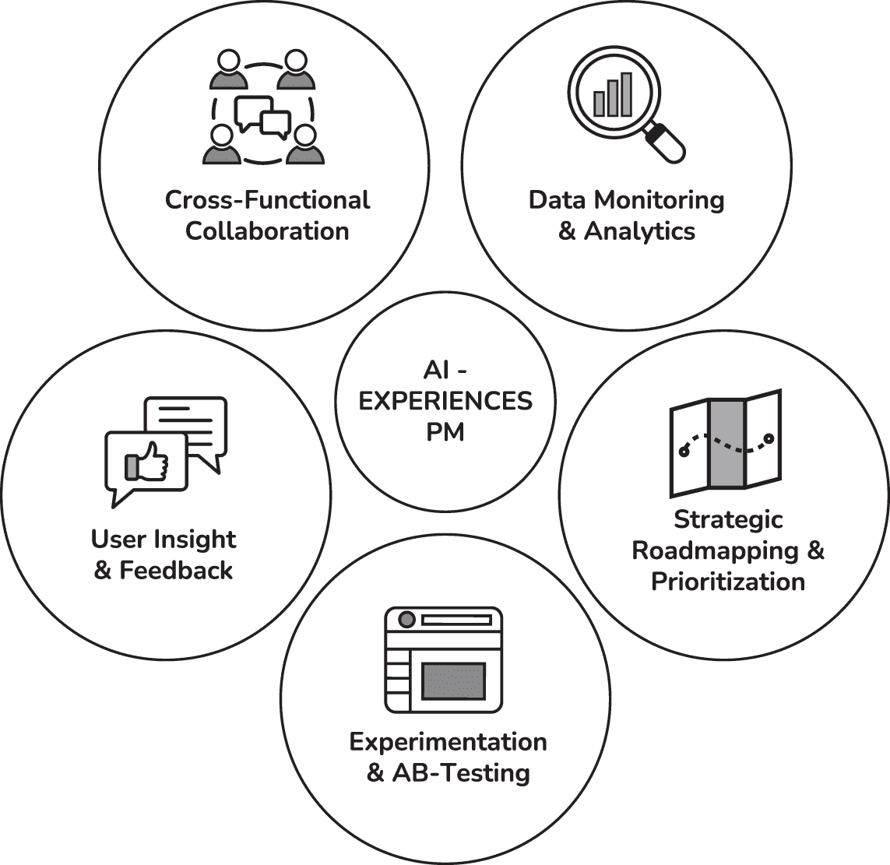


# Figure 5-1: AI-Experiences PM 的日常职责快照

AI-Experiences PM 的日常职责快照，重点介绍他们如何利用 AI 工具、与跨职能团队协作，并在一天中管理产品工作流。

该角色最重要的方面之一是与用户保持深度连接。这可能包括：

*   **分析用户反馈：** AI-Experiences PM 会定期从各种来源（应用商店评论、客户支持工单、应用内调查、用户论坛）审查用户反馈，以识别与 AI 驱动功能相关的重复主题、痛点和未满足的需求。例如，他们可能会注意到用户始终称赞个性化推荐的准确性，但对 `why` 某些项目被推荐感到困惑。

*   **开展用户研究：** 这可能包括对新的 AI 驱动功能进行可用性测试、进行用户访谈以了解用户对 AI 的期望和看法，或分析用户会话录像以识别用户旅程中的摩擦点。PM 可能会通过访谈发现，用户不愿信任 AI 生成的复杂文档摘要，从而导致设计变更，强调透明度和可解释性。

*   **监控用户行为：** AI-Experiences PM 使用分析仪表板监控用户与 AI 功能的交互情况：点击率、转化率、任务耗时、功能采用率以及其他相关指标。他们寻找可能表明改进领域的模式和异常。

协作和沟通也是 AI-Experiences PM 工作的核心：

*   **与数据科学协作：** PM 与数据科学家密切合作，为他们的工作提供“产品背景”。这包括传达用户需求、定义成功指标，并从用户角度对模型性能提供反馈 `from a user perspective`。他们可能会讨论不同模型评估指标之间的权衡（精确率与召回率），或头脑风暴新功能以提高模型准确性。这种协作的关键部分是讨论当前模型的 `limitations`，并为可实现的目标设定现实的期望。

*   **与工程协作：** PM 与工程师合作，确保 AI 驱动的功能无缝集成到产品中，并且用户体验流畅且直观。这可能包括讨论不同设计选项的技术可行性、排查集成问题或规划新功能的推出。

*   **与设计协作：** PM 与 UX/UI 设计师合作，创建既具有视觉吸引力，又能有效传达 AI 功能和局限性的用户界面。这包括设计如何向用户呈现 AI 输出、用户如何提供反馈，以及如何处理不确定性或错误。他们可能会对不同的设计选项进行 A/B 测试，以查看哪个选项能带来更好的用户参与度。

*   **利益相关者沟通：** AI-Experiences PM 定期与利益相关者（领导层、营销、销售）沟通，提供 AI 计划的更新，展示 A/B 测试结果，并倡导继续投资于 AI。他们需要能够以清晰简洁的方式解释复杂的 AI 概念，展示 AI 对用户和业务的价值。

战略规划和实验也是关键活动：

*   **优先级排序和路线图规划：** AI-Experiences PM 会不断评估新的 AI 机会，并根据用户影响、业务价值和技术可行性对其进行优先级排序。他们将这些优先级纳入产品路线图，确保 AI 计划与整体产品战略保持一致。

*   **设计和运行 A/B 测试：** A/B 测试是 AI-Experiences PM 工具箱中的核心部分。他们设计和执行实验，以严格评估 AI 功能对用户行为和关键指标的影响。这可能涉及测试不同版本的推荐算法、LLM 的不同提示词工程策略，或呈现 AI 生成内容的不同用户界面设计。

*   **跟进当前的 AI/ML 趋势和工具：** 不断推出新工具，可能有助于改进内部流程或改善客户体验。

AI-Experiences PM 是一名不断学习者、用户倡导者、数据解读者和战略思想家。他们的日子充满了各种各样的活动，所有这些活动都专注于确保 AI 驱动的功能为用户提供真正的价值和积极的体验。

## 所需技能和知识：AI-Experiences PM 工具箱

要成为一名出色的 AI-Experiences PM，你需要结合核心产品管理技能、扎实的 AI 概念理解以及强大的沟通和协作能力。本节概述了关键技能和知识领域，为了清晰起见进行了分类，并指明了所需的熟练程度。

### 核心产品管理技能与实践

构建成功的 AI 驱动产品不仅需要技术流利，更需要掌握适应 AI 独特挑战的核心产品管理实践。下表概述了基础 PM 技能如何转化为 AI 环境，并附有具体示例和行为指标，以区分有效的 AI 产品经理。

| SKILL || PROFICIENCY LEVEL || HOW IT'S APPLIED (AI-EXPERIENCES PM) |

| --- | --- | --- |

| User Research and Analysis || Working Knowledge || Conducting user interviews, surveys, and usability tests to understand user needs and pain points related to AI features. Analyzing user behavior data to identify opportunities for AI-powered improvements. Creating user personas and journey maps to guide AI feature development. |

| --- | --- | --- |

| Ideation and Solution Design || Working Knowledge || Brainstorming and conceptualizing AI-powered features that address user needs and align with product strategy. Applying design thinking principles to create intuitive and engaging AI interactions. |

| Prioritization & Roadmapping || Working Knowledge || Prioritizing AI features based on user impact, business value, technical feasibility, and ethical considerations. Integrating AI initiatives into the product roadmap and managing dependencies. |

| Requirements Definition || Working Knowledge || Writing clear and detailed product requirements documents (PRDs) and user stories for AI features, specifying functionality, user interactions, and success metrics. |

| Data Analysis and Interpretation || Working Knowledge || Analyzing data from user research, A/B tests, and model performance metrics to identify trends, draw conclusions, and make data-driven decisions. Understanding key metrics like click-through rates, conversion rates, user satisfaction, precision, recall, and F1-score. |

| Experimentation (A/B Testing) || Working Knowledge || Designing and executing A/B tests to evaluate the impact of AI features on user behavior and key metrics. Interpreting experiment results and iterating on feature design based on data. |

| Go-to-Market Strategy and Execution || Foundational || Collaborating with marketing and communications teams to develop launch plans for AI-powered features. Crafting messaging that highlights the user benefits of AI without overhyping capabilities. Monitoring user adoption and feedback post-launch. |

### PM 的工程基础

AI 产品经理必须弥合产品目标与工程约束之间的差距。虽然他们不需要编写代码，但理解核心工程原则（如系统架构、API 和基础设施权衡）至关重要。下表概述了每位 AI PM 应掌握的关键工程概念，以便有效协作并做出明智的技术决策。


| SKILL | PROFICIENCY LEVEL | HOW IT'S APPLIED (AI-EXPERIENCES PM) |

| --- | --- | --- |

| Software Development Methodologies | Foundational | 理解 Agile/Scrum 原则，以便与工程团队有效协作，并在迭代冲刺中管理 AI 功能开发。 |

| --- | --- | --- |

| Key Technical Concepts (APIs, Algorithms, System Architecture) | Foundational | 基本了解 AI 模型如何部署并集成到产品中（例如，通过 API）。了解不同算法的基本概念（无需编写代码），以便与数据科学家有效沟通。 |

| Working with AI Infrastructure | Foundational | 了解 AI 模型如何以及在哪里托管（例如，云端、本地），以及延迟等因素如何影响用户体验。 |

### Essential Leadership and Collaboration Skills

领导 AI 产品开发不仅需要技术和战略敏锐度，还需要强大的领导力和跨职能协作。AI PM 必须协调多元化团队，传达不确定性，并在不同学科之间达成共识。下表概述了关键的领导力和协作行为，使 AI PM 能够有效指导团队并大规模影响结果。

| SKILL | PROFICIENCY LEVEL | HOW IT'S APPLIED (AI-EXPERIENCES PM) |

| --- | --- | --- |

| Communication and Storytelling | Working Knowledge | 向技术和非技术受众清晰传达 AI 功能的愿景、战略和价值主张。以用户友好的方式解释复杂的 AI 概念。 |

| --- | --- | --- |

| Collaboration and Cross-Functional Teamwork | Working Knowledge | 与数据科学家、工程师、设计师、营销人员和其他利益相关者密切合作，使 AI 功能得以实现。促进团队间的沟通和协调。 |

| Problem-Solving and Decision-Making | Working Knowledge | 识别并解决 AI 功能开发和部署过程中出现的问题。做出数据驱动的决策，并平衡相互竞争的优先事项（例如，用户需求、技术可行性、业务目标）。 |

| Influence and Persuasion | Foundational | 倡导以用户为中心的 AI 解决方案，并获得利益相关者的支持。影响 AI 计划的产品战略和资源分配。 |

| Adaptability and Learning Agility | Working Knowledge | 跟上快速发展的 AI 领域，并适应新技术和最佳实践。 |

### AI Lifecycle and Operational Awareness

要设计出色的 AI 驱动体验，产品经理必须了解 AI 生命周期的实际情况。这种运营意识——从了解数据要求到了解模型如何部署和评估——使 PM 能够创建不仅创新，而且可行、可靠且负责任的功能。下表详细列出了 AI-Experiences PM 的基本生命周期和运营技能。

| SKILL | PROFICIENCY LEVEL | HOW IT'S APPLIED (AI-EXPERIENCES PM) |

| --- | --- | --- |

| Understanding AI and GenAI's Unique Capabilities | Working Knowledge | 识别利用 AI 优势（例如，个性化、自动化、预测）解决用户问题的机会。了解 AI 的局限性并设定现实的期望。 |

| --- | --- | --- |

| DataOps and Management | Foundational | 了解 AI 功能的数据要求，并与数据工程团队合作以确保数据质量和可用性。了解数据隐私和伦理考量。 |

| Productionization Considerations | Foundational | 了解在生产环境中部署和监控 AI 模型的基础知识。与工程团队合作制定推出计划和监控策略。 |

| Ethics and Compliance | Working Knowledge | 确保 AI 功能在开发和部署过程中符合伦理并遵守相关法规。识别并减轻 AI 模型和数据中的潜在偏差。 |

| Prompt Engineering (for LLMs) | Working Knowledge | （如果适用于产品）编写有效的提示以引出 LLM 的期望响应。根据用户反馈和模型性能迭代提示。 |

| GenAI Evals understanding | Working Knowledge | 了解评估生成式 AI 模型的不同方法。 |

## Illustrative Example: A Day in the Life of an AI-Experiences PM

为了让 AI-Experiences PM 角色栩栩如生，让我们走通过一天的假设情景，突出可能涉及的各种活动和互动。这不是一份严格的日程表，而是对工作动态和多面性质的快照。

### Morning

**8:30 AM–9:00 AM: Review User Feedback and Performance Metrics**

一天始于审查公司电子邮件产品中 AI 驱动的“Smart Compose”功能的用户反馈。PM 浏览应用商店评论、支持工单和应用内反馈表，寻找重复出现的主题和模式。他们还查看关键绩效指标仪表板，注意到“Smart Compose”接受率（接受 AI 生成建议的用户百分比）略有下降。

*Skills Used:* Data Analysis and Interpretation, User Research and Feedback Analysis.

**9:00 AM–10:00 AM: Stand-Up Meeting with the “Smart Compose” Team**

PM 参加与负责“Smart Compose”功能的数据科学家、工程师和设计师的每日站会。他们分享用户反馈趋势和接受率下降的情况，引发关于潜在原因和解决方案的讨论。数据科学团队建议探索底层语言模型的最近更改是否可能是原因。

*Skills Used:* Communication and Collaboration, AI Fluency, Problem-Solving.

**10:00 AM–11:00 AM: Design Review for a New AI-Powered Feature**

PM 参加新 AI 驱动功能的设计评审会议：一个“Meeting Summarizer”，将自动生成会议记录摘要。UX 设计师展示线框图和原型，PM 从用户角度提供反馈，重点关注清晰度、可用性以及 AI 输出的呈现方式。他们讨论如何处理摘要中的潜在错误或不确定性，以及如何允许用户提供反馈。

*Skills Used:* User-Centric AI Design, Communication and Collaboration, Understanding AI Capabilities.

**11:00 AM–12:00 PM: Prompt Engineering Workshop**

PM 参加由一名数据科学家主持的关于大型语言模型提示工程技术的研讨会。他们了解不同的提示策略，并尝试编写提示以引出“Meeting Summarizer”模型的期望响应。

*Skills Used:* Prompt Engineering, AI Fluency, Continuous Learning.

### Afternoon

**1:00 PM–2:00 PM: A/B Test Planning**

PM 与数据分析师合作，设计一个 A/B 测试来评估“Smart Compose”功能的新版本。他们定义假设，选择目标指标（接受率），确定样本量，并规划推出策略。他们讨论如何细分用户，以查看该功能对不同群体的表现是否不同。

*Skills Used:* Experimentation (A/B Testing), Data Analysis and Interpretation, Collaboration.

**2:00 PM–3:00 PM: Roadmap Prioritization Meeting**

PM 主持产品路线图优先级会议，根据用户研究、竞争分析和潜在业务影响，倡导 AI 驱动功能增强。他们展示现有 AI 功能的成功数据，并提出新举措，平衡用户需求、技术可行性和战略一致性。


*Skills Used:* Prioritization and Roadmapping, Strategic Thinking, Communication and Storytelling, Influence and Persuasion.

### 3:00 PM–4:00 PM: Review of GenAI Evaluation Metrics

The PM meets with the data science team to review the latest evaluation metrics for the “Meeting Summarizer” model. They discuss the model's performance on key metrics like accuracy, coherence, and hallucination rate. They identify areas where the model is struggling and discuss potential strategies for improvement, such as refining the training data or adjusting the model's parameters. They specifically review metrics related to bias and fairness, ensuring the summaries are not perpetuating harmful stereotypes.

*Skills Used:* Data Analysis, AI Fluency, GenAI Evals understanding.

### 4:00 PM–5:00 PM: Drafting a Product Requirements Document (PRD)

The PM starts drafting a PRD for a new AI-powered feature: a “Smart Reply” option for customer support emails. They outline the user problem, the proposed solution, the functional requirements, the success metrics, and the ethical considerations.

*Skills Used:* Requirements Definition, User-Centric AI Design, Communication, AI Fluency.

This “day in the life” example illustrates the dynamic and varied nature of the AI-Experiences PM role. It's a blend of strategic thinking, user empathy, data analysis, design collaboration, and constant communication. It's a role that requires both a deep understanding of user needs and a solid grasp of AI's capabilities and limitations. The AI-Experiences PM is at the forefront of shaping how users interact with and benefit from the power of artificial intelligence.

## Challenges and Complexities

The AI-Experiences PM role is both exciting and challenging. It offers the opportunity to shape the future of how users interact with AI, but it also comes with its own set of unique hurdles. Understanding both the challenges and the rewards is essential for anyone considering this career path.

Here are some of the common challenges you may face in this role:

### Balancing Innovation and Usability

One of the biggest challenges is finding the right balance between leveraging cutting-edge AI capabilities and creating a user experience that is simple, intuitive, and understandable. It's easy to get caught up in the technical possibilities of AI, but the AI-Experiences PM must always prioritize the user's needs and ensure that AI enhances, rather than complicates, the product.

### Managing User Expectations

AI is often hyped, leading to unrealistic expectations from users. The AI-Experiences PM needs to carefully manage these expectations, communicating both the capabilities and the limitations of AI-powered features. This includes being transparent about when and how AI is being used and providing clear explanations for AI-driven decisions.

### Dealing with Uncertainty and Errors

AI models are not perfect. They can make mistakes, generate unexpected outputs, or exhibit limitations that users may find frustrating. The AI-Experiences PM needs to design experiences that gracefully handle these situations, providing fallback options, offering explanations, and allowing users to easily provide feedback.

### Addressing Ethical Concerns

AI raises a host of ethical concerns, including bias, fairness, privacy, and transparency. The AI-Experiences PM must be a strong advocate for responsible AI development, proactively identifying and mitigating potential ethical risks. This requires staying informed about ethical guidelines and best practices.

### Keeping Up with a Rapidly Evolving Field

The field of AI is constantly changing, with new models, techniques, and tools emerging all the time. The AI-Experiences PM needs to be a continuous learner, staying up-to-date with the latest advancements and adapting their strategies accordingly.

### Data Dependency and Quality

AI-powered features are heavily reliant on data. The AI-Experiences PM often faces challenges related to data availability, quality, and bias. They need to work closely with data scientists and engineers to ensure that the data used to train and evaluate AI models is representative, accurate, and ethically sourced.

### Cross-Functional Collaboration

Successfully launching AI-powered features requires a high-level of coordination between PMs, Data Scientists, ML Engineers, and UX designers.

Despite the hurdles, the role is incredibly rewarding for several reasons:

### Shaping the Future of User Experience

AI-Experiences PMs are at the forefront of defining how users interact with AI, creating new paradigms and possibilities for human–computer interaction. This is a unique opportunity to shape the future of technology and have a significant impact on people's lives.

### Solving Real User Problems

AI has the potential to solve a wide range of user problems, from automating tedious tasks to providing personalized recommendations to making complex information more accessible. The AI-Experiences PM gets to see the direct impact of their work on users' lives, making their jobs more efficient, enjoyable, or meaningful.

### Working at the Cutting Edge of Technology

The AI-Experiences PM role is inherently innovative, involving constant learning and experimentation with new technologies. This is a rewarding experience for those who are passionate about technology and enjoy pushing the boundaries of what's possible.

### Collaborating with Talented Teams

AI-Experiences PMs work closely with talented data scientists, engineers, designers, and other professionals, learning from their expertise and contributing to a shared mission. This collaborative environment can be highly stimulating and rewarding.

### Seeing Tangible Results

The impact of the AI-Experiences PM's work is often directly measurable through key metrics like user engagement, satisfaction, and task completion rates. Seeing these metrics improve as a result of your efforts is highly gratifying.

### Driving Product Innovation

AI-Experiences PMs are key drivers of product innovation, identifying new opportunities to leverage AI and creating features that differentiate their products from the competition.

The AI-Experiences PM role is not for the faint of heart. It requires a unique blend of technical understanding, user empathy, strategic thinking, and resilience. But for those who are up to the challenge, it offers the opportunity to make a significant impact on the world, shaping how users interact with the transformative power of artificial intelligence.

## How the AI-Experiences PM Interacts with Other Roles

No AI product is built in a silo. The AI-Experiences PM acts as the central hub or the “conductor” of an orchestra, responsible for bringing together a diverse set of experts to create a harmonious and effective product. Successfully navigating this landscape means understanding not just *who* to talk to, but *what* expertise each role brings and *how* to best collaborate with them.

The stakeholder map in Figure 5-2 provides a high-level overview of this collaborative ecosystem. Let's break down these key relationships.


**Figure 5-2:** The stakeholder ecosystem for an AI Product Manager. The AI PM acts as a central coordinator, collaborating with cross-functional teams including AI/ML specialists, Engineering, UX Design, Business, Governance, and other PMs to successfully guide a product from concept to launch and beyond.

### Data Scientists


## 交互性质：频繁且紧密的协作

AI-Experiences PM 提供 `product vision and user context`，而数据科学家提供构建 AI 模型所需的 `technical expertise`。

### PM 职责

* 清晰地传达用户需求、痛点和期望结果。
* 为 AI 模型定义成功指标（例如，`precision`、`recall`、`F1-score`）。
* 从用户角度对模型性能提供反馈。
* 了解模型的局限性，并相应地管理用户期望。
* 协作进行特征工程，根据用户洞察建议潜在特征。
* 根据用户影响和业务价值，帮助确定模型开发工作的优先级。

### 示例

对于个性化推荐功能，PM 将与数据科学家合作，定义目标受众、要提供的推荐类型以及成功指标（例如，`click-through rate`、`conversion rate`）。PM 还将从用户角度对推荐的相关性和可用性提供反馈。

## ML 工程师

### 交互性质

紧密协作，特别是在部署和监控阶段。ML 工程师负责将训练好的模型投入生产环境使用。

### PM 职责

* 传达已部署模型的性能要求（例如，`latency`、`throughput`）。
* 协作制定推出策略（例如，`A/B testing`、`phased rollout`）。
* 与 ML 工程师合作建立监控仪表板和警报。
* 了解不同设计选择的基础设施影响。

### 示例

对于实时欺诈检测系统，PM 将与 ML 工程师合作，确保模型能够快速处理交易以防止欺诈，而不会给合法用户造成不可接受的延迟。

## UX 设计师

### 交互性质

极其紧密的协作。AI-Experiences PM 和 UX 设计师共同为 AI 驱动的功能设计 `user interface and interactions`。

### PM 职责

* 为 AI 功能定义用户流程和交互模式。
* 确保 AI 输出以清晰、易懂且可信的方式呈现给用户。
* 设计用户反馈和控制机制。
* 在设计中解决伦理问题（例如，`transparency`、`explainability`）。

### 示例

对于聊天机器人，PM 和 UX 设计师将协作设计聊天机器人的个性、对话流程，以及它如何处理错误或不确定性。

## 软件工程师和技术项目经理

### 交互性质

协作将 AI 模型集成到体验中。

### PM 职责

* 定义需求。
* 确保 AI 功能与产品的其他部分保持一致。
* 帮助测试集成。

### 示例

与工程师协作，确保推荐模型的输出在用户界面中正确显示，并与 TPM 合作，在推出期间跟踪后端和前端系统之间的依赖关系。

## 市场营销

### 交互性质

协作制定市场进入策略和信息传递。

### PM 职责

* 向营销团队传达 AI 驱动功能的价值主张。
* 确保营销材料准确反映 AI 的能力和局限性。
* 从营销活动中收集用户反馈。

### 示例

与营销团队合作，创建一个突出 AI 驱动的个性化推荐功能优势的活动，而不过度承诺或误导用户。

## 销售

### 交互性质

为销售团队提供有效销售 AI 驱动产品所需的信息和工具。

### PM 职责

* 向销售团队介绍 AI 功能的能力和局限性。
* 开发突出 AI 价值主张的销售材料。
* 从销售团队收集关于客户认知和需求的反馈。

### 示例

为销售团队提供 AI 驱动的客户支持聊天机器人演示，并解释它如何帮助他们达成交易。

## 法律/合规

### 交互性质

确保 AI 驱动的功能符合所有相关法规（例如，`data privacy laws`、`anti-discrimination laws`）。

### PM 职责

* 了解 AI 的法律和监管环境。
* 与法律和合规团队合作，评估和降低风险。
* 确保数据以合乎道德和负责任的方式收集和使用。

### 示例

咨询法律顾问，确保 AI 驱动的招聘工具符合反歧视法。

## 其他产品经理

### 交互性质

协作，特别是与 `AI-Builder PM`。

### PM 职责

* 分享最佳实践。
* 了解模型如何使用。

### 示例

与 `AI-Builder PM` 合作，了解新个性化模型的能力和局限性，然后将这些知识应用于在自己的产品领域设计定制的引导体验。

AI-Experiences PM 充当这些不同角色之间对齐和沟通的中心点，确保每个人都在为共同目标而努力：构建提供卓越用户体验的 AI 驱动产品。这需要强大的沟通技巧、协作思维，以及对 AI 技术和面向用户方面的深入理解，同时还需要经常与领导层沟通，并确保计划在各个组织中传达。

## 章节摘要和关键要点

你现在已经深入了解了 AI-Experiences PM 专业方向，这是人工智能世界中用户的重要倡导者。你探索了这位 PM 如何将用户需求转化为具体的 AI 机会，如何与 UX 设计师深度协作以打造直观的交互，以及如何使用像 `A/B testing` 这样的严谨实验来验证功能是否真正提供价值。你了解这一角色所需的平衡术：在概率性技术周围管理用户期望，同时将强大的个性化体验建立在 `fairness` 和 `transparency` 等伦理原则之上。最终，你在这个角色中的使命是塑造 AI 交互的“最后一英里”，确保复杂的技术增强用户旅程，而不是使其复杂化。

Figure 5-3 总结了该角色的核心方面——从其使命到其基本技能。

### 关键要点

* **你总是从用户开始。** 你的主要关注点是了解用户需求和痛点，以设计有价值且直观的有效 AI 功能。
* **你是一名跨职能翻译。** 这一角色需要与数据科学家、工程师和设计师密切协作，将用户需求转化为可行的产品体验。
* **你拥有“AI 流利度”，而不一定是技术精通。** 你了解 AI 的能力和局限性以指导产品设计，但你的核心关注点仍然是用户体验。
* **你是负责任的 UX 的所有者。** 作为用户倡导者，你是确保 AI 的面向用户方面公平、透明并优雅地处理不确定性的主要倡导者。

### 接下来：构建 AI `Foundation`


现在你已经探索了 AI-Experiences PM 的面向用户的角色，接下来将关注幕后的架构师。下一章将详细介绍 AI-Builder PM 的角色，该角色负责创建使这些体验成为可能的基础平台。

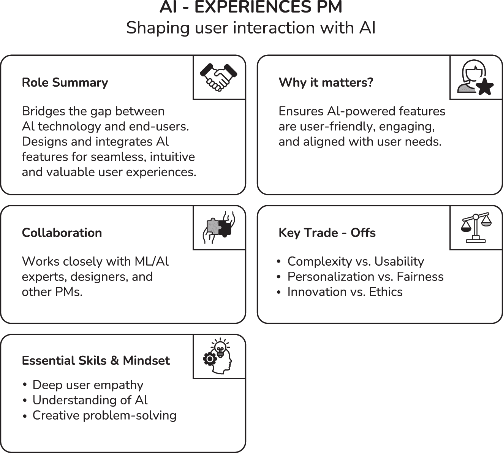

**Figure 5-3:** A summary of the AI-Experiences PM role, highlighting its core focus, key collaborators, trade-offs, and essential skills

WileyPRE

# CHAPTER 6

## AI-Builder PM: 构建智能系统的基础架构

AI-Builder PM 是负责组织内基础 AI 能力的战略和技术领导者。他们通常不关注单个面向用户的功能（那是 AI-Experiences PM 的领域）。相反，他们构建和管理平台、模型和框架，使其他团队能够创建 AI 驱动的产品。可以将他们视为 AI 基础设施的架构师和建设者——为 AI 创新奠定基础的人。

这个角色至关重要，因为强大且可扩展的 AI 基础对于 AI 的长期成功必不可少。AI-Builder PM 确保组织拥有开发和部署 AI 解决方案所需的工具和资源，以高效且有效的方式进行。他们是推动者，使其他人能够构建 AI 驱动的体验。

AI-Builder PM 与数据科学家和机器学习工程师（负责构建和训练特定模型）、软件工程师（负责将模型和平台集成到产品中）以及 AI-Experiences PM（负责定义面向用户的功能）密切合作。他们将高层业务需求和产品策略转化为 AI 基础设施的技术路线图。

这个角色伴随着其自身固有的挑战。AI-Builder PM 必须平衡对尖端 AI 能力的需求与可扩展性、可维护性和成本等实际约束。他们还必须处理数据治理、模型版本控制以及确保 AI 基础设施长期可靠性的复杂性。此外，他们必须关注并制定评估模型的计划，尤其是当这些模型是生成式 AI 模型时。

一位高效的 AI-Builder PM 具备扎实的技术背景，并辅以战略产品愿景。他们是出色的沟通者，能够弥合技术团队与业务利益相关者之间的差距。他们是积极主动的问题解决者，不断寻找改进 AI 基础设施并赋能其他团队构建创新 AI 解决方案的方法。

现在让我们来审视定义这一基础角色的具体职责。

## 关键职责：构建和管理 AI 基础

AI-Builder PM 负责创建和维护为组织内 AI 驱动产品和功能提供支持的底层 AI 基础设施。这涵盖了从战略规划到技术监督的广泛职责：

### 定义并拥有 AI 平台策略和路线图

*   **Action:** 制定并维护内部 AI 平台的战略路线图，使其与整体业务目标以及各产品团队的需求保持一致。这 *不* 仅仅是一个技术路线图；它是 AI 平台本身的 *产品* 路线图。

*   **Action:** 定义平台的功能、架构和关键特性，确保其可扩展、可靠、安全且具有成本效益。

*   **Example:** 为内部 AI 平台制定路线图，以支持新模型类型（例如 LLMs）、改进模型部署工作流以及增强监控功能。

### 推动基础 AI 模型的开发和部署

*   **Action:** 领导可重用 AI 模型的开发和部署，这些模型可供多个产品团队使用。这些是解决组织内常见需求的“基础”模型。

*   **Action:** 为这些模型定义需求，与数据科学家合作进行模型开发，并监督部署流程，确保模型文档齐全且易于访问。

*   **Example:** 构建公司范围的流失预测模型（作为 API），供不同产品团队集成到其产品中，而不是每个团队自行构建。其他示例：客户终身价值预测、欺诈检测、产品分类。

### 监督 AI 框架和工具的开发

*   **Action:** 识别需求并定义内部 AI 框架和工具的需求，以简化其他团队的 AI 开发流程。这旨在让其他人 *更轻松* 地构建 AI。

*   **Action:** 监督这些框架的开发和维护，确保其易于使用、文档齐全，并与 AI 平台集成。

*   **Example:** 创建用于 AI 模型 A/B 测试的标准化框架，提供模板和工具，简化所有产品团队的实验流程。另一个示例：用于构建和部署 GenAI 代理的框架。

### 管理 AI 基础设施和 MLOps

*   **Action:** 定义 AI 基础设施和 MLOps 实践的策略并监督其实施。这确保模型可以高效、可靠地部署、监控和更新。

*   **Action:** 与工程和运营团队合作，确保基础设施可扩展、安全且具有成本效益。

*   **Example:** 定义模型监控仪表板的需求，设置自动重新训练管道，并建立模型版本控制和回滚流程。

### 建立数据治理和合规性

*   **Action:** 与法律、安全和合规团队合作，为 AI 项目建立和执行数据治理政策。这确保数据以合乎道德、负责任且符合所有相关法规的方式使用。

*   **Action:** 定义数据访问、使用和存储的流程，确保数据隐私和安全。

*   **Example:** 实施数据匿名化策略，定义数据保留期限，并建立处理数据泄露的程序。

### 管理 GenAI 评估并确保模型质量

*   **Action:** 定义并监督强大的 GenAI 评估流程的实施，确保组织内使用的生成式模型符合质量、安全和道德标准。

*   **Action:** 与数据科学家和伦理学家合作，选择适当的评估指标并建立模型性能基准。

*   **Example:** 建立流程，定期评估客户支持聊天机器人中使用的 LLM 的准确性、连贯性和潜在偏见。

### 推动协作和知识共享

*   **Action:** 为 AI 开发营造协作环境，促进数据科学家、工程师、产品经理和其他利益相关者之间的沟通和知识共享。

*   **Action:** 推广 AI 开发和部署的最佳实践，确保各团队之间的一致性和效率。

*   **Example:** 组织 AI/ML 概念和工具的研讨会和培训课程，创建内部文档和 wiki，并建立定期沟通渠道。

### 性能和优化策略

*   **Action:** 确保 AI 系统在生产环境中运行最佳，并跨团队共享最佳实践。


这些职责凸显了 AI-Builder PM 角色的战略性和技术性。这是一个需要深入理解 AI、具备强大领导力，并能与广泛的利益相关方有效协作的角色。AI-Builder PM 是在整个组织中构建 AI 创新坚实基础的推动力。

## 日常活动

AI-Builder PM 的日常活动是战略规划、技术监督、跨职能协作和亲力亲为的问题解决的结合。他们不断平衡不同产品团队的需求、现有基础设施的限制以及 AI 平台的长期愿景。这些多样化的职责可以分为五个核心活动支柱，如 图 6-1 所示。以下是对其工作的更详细了解：

### 战略规划与路线图

*   **审查新 AI 功能请求：** PM 分析各产品团队关于新 AI 模型、功能或平台增强功能的请求。这涉及了解底层业务需求并评估每个请求的可行性和潜在影响。

*   **优先排序平台开发：** 基于请求和整体 AI 战略，PM 优先排序 AI 平台的开发工作，平衡短期需求与长期目标。这可能涉及在构建新功能、改进现有基础设施和解决技术债务之间进行权衡。

*   **制定和维护 AI 平台路线图：** PM 创建和更新 AI 平台的路线图，向利益相关方传达计划，并确保与业务目标保持一致。

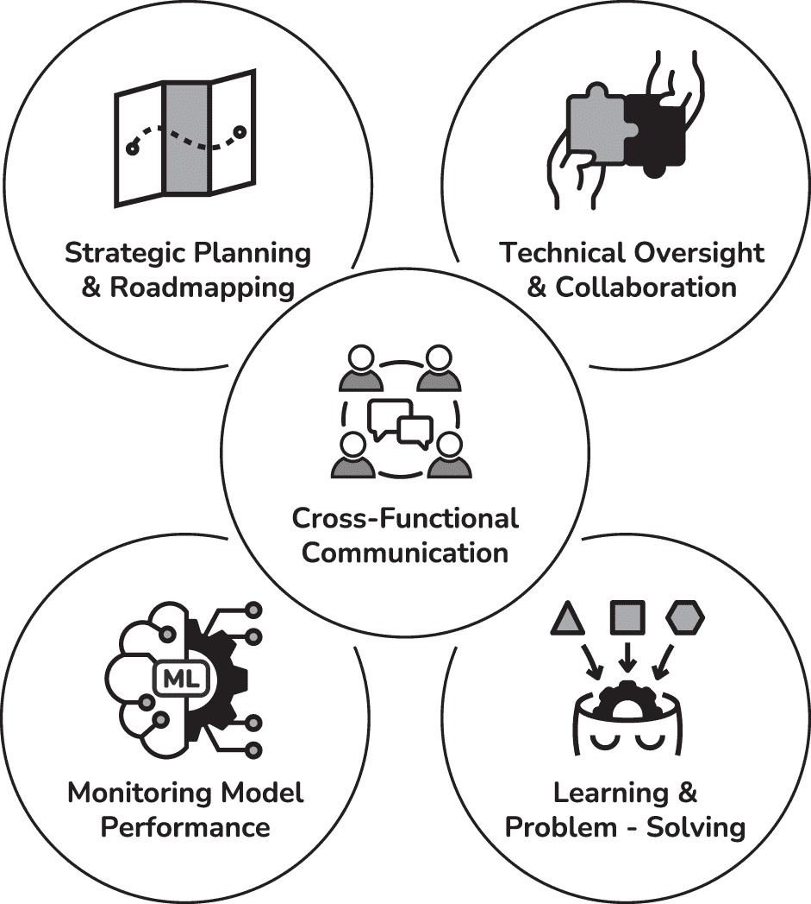

**Figure 6-1:** AI-Builder PM 日常活动的五个核心支柱，涵盖从高层战略规划和跨职能沟通到详细技术监督和性能监控的各个方面

### 技术监督与协作

*   **与数据科学家和机器学习工程师开会：** PM 定期与构建 AI 模型和平台的技术团队开会。这些会议可能涉及讨论模型性能、审查架构设计、排查技术问题或规划即将到来的冲刺。

*   **审查模型性能指标：** PM 监控已部署 AI 模型的性能，寻找性能下降的迹象或改进机会。这可能涉及分析准确率、延迟、吞吐量和成本等指标。

*   **与 DevOps/MLOps 工程师协作：** PM 与 DevOps 和 MLOps 工程师合作，确保 AI 模型和基础设施的顺利部署、监控和维护。这可能涉及讨论基础设施要求、设置自动化部署流水线或排查生产问题。

*   **审查文档和 API 规范：** PM 确保 AI 模型和平台功能有完善的文档，并附有清晰的 API 规范，使其他团队能够轻松将其集成到其产品中。

### 跨职能沟通与协调

*   **向利益相关方展示 AI 平台路线图：** PM 定期向利益相关方（包括产品领导层、工程团队和其他 PM）传达 AI 平台路线图和进度。这涉及解释平台的功能、优势和未来计划。

*   **收集产品团队反馈：** PM 主动征求其他产品团队对使用 AI 平台体验的反馈，识别改进领域和新功能请求。

*   **倡导 AI 平台采用：** PM 鼓励其他产品团队利用 AI 平台，展示其优势并提供支持和指导。

### 保持了解和问题解决

*   **了解新 AI 工具：** 某些工具可以帮助提高生产力。

*   **排查生产问题：** 当已部署的 AI 模型或基础设施出现问题时，PM 与技术团队合作诊断和解决问题，最大限度地减少对用户的影响。

*   **研究新技术：** PM 了解 AI 和云计算的最新进展，评估可能改进 AI 平台的新技术和工具。

AI-Builder PM 的日子充满了各种各样的活动，需要技术理解、战略思维和协作的强大结合。他们不断致力于改进 AI 基础，赋能其他团队，并在整个组织中推动 AI 创新。

## 所需技能和知识：AI-Builder PM 的技术和战略工具包

AI-Builder PM 角色需要技术专长、战略思维和产品管理能力的独特结合。本节概述了基本技能和知识领域，并按清晰度分类，并指示所需的熟练程度。我们将使用以下熟练程度，如 图 6-2 所示：

*   **基础：** 对概念的基本理解；能够参与讨论并理解影响。

*   **工作知识：** 能够在常见场景中应用技能；可以独立完成大部分相关任务。

*   **专家：** 对技能有深入理解和掌握；可以主导倡议并指导他人。

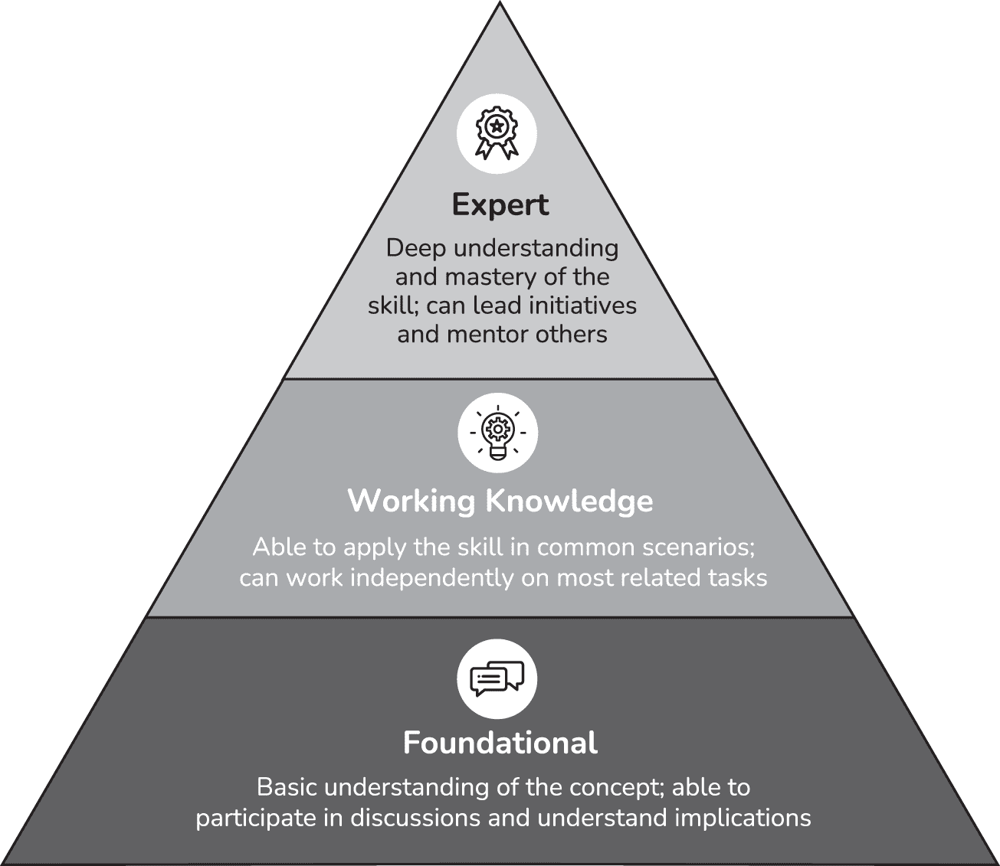

**Figure 6-2:** AI-Builder PM 的熟练程度

### 核心产品管理工艺与实践

虽然 AI-Builder PM 角色高度技术化，但成功建立在核心产品管理原则的坚实基础之上。这些技能在独特的背景下应用：“产品”是一个平台，“用户”是内部开发团队，“功能”是可扩展的 AI 功能。下表概述了这些基础 PM 技能如何适应构建组织 AI 驱动骨干的战略工作。

| 技能 | 熟练程度 | 如何应用（AI-Builder PM） |
| --- | --- | --- |
| 战略思维与愿景制定 | 专家 | 为 AI 平台制定长期愿景和战略，使其与业务目标保持一致并预测未来需求。识别创建可重用 AI 模型和框架的机会，这些模型和框架可以惠及多个产品团队。 |
| 优先级排序与路线图制定 | 专家 | 根据战略价值、技术可行性和资源限制，优先排序平台功能、模型开发和基础设施改进。创建和维护 AI 平台路线图，向利益相关方传达，并管理依赖关系。 |
| 需求定义 | 工作知识 | 为 AI 平台、模型和框架定义清晰详细的需求，将业务需求和用户故事转化为技术规范。 |
| 数据分析与解释 | 工作知识 | 分析平台使用情况、模型性能和基础设施成本的数据，以识别趋势、跟踪进度并做出数据驱动的决策。了解 API 延迟、模型准确率和资源利用率等关键指标。 |
| 实验（A/B 测试） | 基础 | 了解 A/B 测试的原则以及如何将其应用于评估不同版本的 AI 模型或平台功能。（虽然 AI-Experiences PM 可能会主导 A/B 测试，但 AI-Builder 需要了解该过程。） |


### 工程基础：面向产品经理

要有效构建基础 AI 能力，AI-Builder 产品经理必须具备超越典型产品经理的技术流利度。他们无需编写生产代码，但必须能够在关于系统架构、算法和基础设施的深入技术讨论中站稳脚跟。这种工程基础对于赢得技术团队的信任并做出明智的战略决策至关重要，如下表所示。

| 技能 | 熟练程度 | 应用方式（AI-Builder 产品经理） |
| --- | --- | --- |
| 软件开发方法论 | 基础 | 理解敏捷/Scrum 原则，以便与工程团队有效协作，并在迭代冲刺中管理 AI 平台开发。 |
| 关键技术概念（`APIs`、算法、系统架构） | 工作知识 | 理解 AI 平台和模型的技术架构，包括 `APIs`、算法、数据管道和底层基础设施。这使得能够与技术团队有效沟通，并就平台设计做出明智决策。 |
| 使用 AI 基础设施 | 专家 | 深入了解云计算平台（`AWS`、`GCP`、`Azure`）、容器化（`Docker`、`Kubernetes`）以及与 AI 相关的其他基础设施组件。就基础设施选择做出战略决策，以确保可扩展性、可靠性和成本效益。 |
| 基础模型理解 | 专家 | 了解基础 AI 模型及其应用、评估以及 GenAI Evals 流程。 |

### 必要的领导力与协作技能

构建集中式 AI 平台需要卓越的领导力，以及能够将多样化的高技术团队围绕共同愿景团结起来的能力。AI-Builder 产品经理充当关键影响者和跨职能领导者，推动数据科学、工程和其他产品团队之间的协调一致。下表概述了管理这些复杂依赖关系并引导项目走向成功所需的关键领导力和协作技能。

| 技能 | 熟练程度 | 应用方式（AI-Builder 产品经理） |
| --- | --- | --- |
| 沟通与讲故事 | 工作知识 | 向技术和非技术受众传达 AI 平台的愿景、战略和路线图。以清晰简洁的方式解释复杂的技术概念。 |
| 协作与跨职能团队合作 | 专家 | 与数据科学家、机器学习工程师、软件工程师、DevOps 工程师、产品经理和其他利益相关者密切合作，构建和维护 AI 平台。 |
| 问题解决与决策 | 专家 | 识别并解决与 AI 平台开发和部署相关的技术和战略挑战。在不确定性下做出明智决策。 |
| 影响力与说服力 | 工作知识 | 为 AI 平台辩护并获得利益相关者的支持。影响技术决策和资源分配。 |
| 适应性与学习敏捷性 | 工作知识 | 紧跟快速发展的 AI 领域，适应新技术和最佳实践。能够快速学习并整合新信息。 |

### AI 生命周期与运营意识

除了核心产品经理和工程技能外，AI-Builder 产品经理必须对整个 AI 生命周期有深入的运营意识。他们负责管理从数据管道到模型监控和重新训练的一切系统。下表详细列出了构建和维护强大可靠的 AI 生态系统所需的基本 AI 特定运营技能。

| 技能 | 熟练程度 | 应用方式（AI-Builder 产品经理） |
| --- | --- | --- |
| 理解 AI 和 GenAI 的独特能力 | 专家 | 深入了解各种 AI/ML 技术及其优缺点。识别利用 AI 解决业务问题并创建可重用 AI 能力的机会。 |
| DataOps 与管理 | 工作知识 | 了解数据管道、数据治理和数据隐私最佳实践。确保 AI 平台能够访问必要的数据，并且数据被负责任地使用。 |
| 生产化考量 | 专家 | 深入了解 `MLOps` 原则和实践。设计和实施在生产环境中部署、监控和维护 AI 模型的流程。 |
| 伦理与合规 | 工作知识 | 确保 AI 平台和基础模型符合伦理准则和法律法规。解决数据和模型中的潜在偏见。 |
| 提示工程（针对 LLM） | 基础/工作知识 | （如果适用于平台）了解提示工程的基础知识以及如何使用它与 LLM 交互。可能涉及为通过平台使用 LLM 的其他团队创建指南或工具。 |
| GenAI Evals 理解 | 专家 | 深入了解不同的评估方法。 |

## 示例：AI-Builder 产品经理一天的生活

为了具体了解 AI-Builder 产品经理的角色，让我们走 through 一个假设的一天。这不是一份严格的时间表，而是对工作动态和多面性质的快照。正如 图 6-3 所示，这一天是战略规划、技术协作和前瞻性研究的结合。

**上午：**

**8:30 AM–9:00 AM：审查平台性能指标和警报—**

一天始于审查跟踪 AI 平台及其关键组件（例如，基础模型、`APIs`、数据管道）性能的仪表板。产品经理检查是否有任何异常、性能下降或过夜触发的警报。他们注意到产品推荐 API 的延迟略有增加，并将其标记为由工程团队调查。

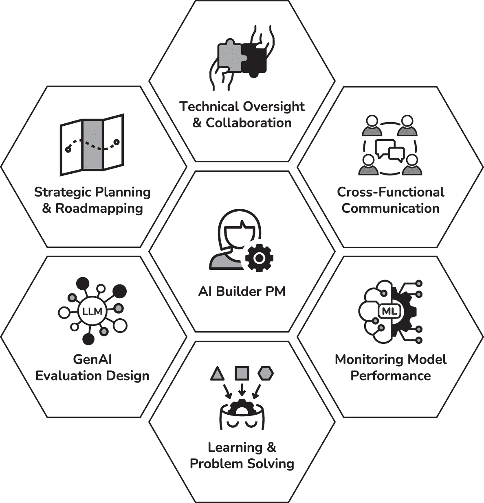

**图 6-3：** 定义 AI-Builder 产品经理一天的核心活动快照，平衡平台战略、技术协作和治理

*使用的技能：* 数据分析与解释、基础模型理解、使用 AI 基础设施、问题解决。

**9:00 AM–10:00 AM：与平台工程团队站立会议—**

产品经理参加与平台工程团队的每日站立会议。他们讨论正在进行的项目进展，解决任何障碍，并确定当天的任务优先级。团队讨论先前标记的延迟问题，并计划进行诊断调查。

*使用的技能：* 沟通与协作、项目管理、技术流利度。

**10:00 AM–11:00 AM：与数据科学团队会议—新模型请求—**

产品经理与来自希望将新自然语言处理（`NLP`）模型集成到其功能中的产品团队的首席数据科学家会面。他们讨论模型的要求（输入数据、所需输出、性能期望）、将其与现有 AI 平台集成的可行性，以及开发和部署的时间表。产品经理就模型的潜在偏见以及团队计划如何缓解偏见提出澄清性问题。


*Skills Used:* Strategic Thinking, Deep ML Knowledge, Communication and Collaboration, Data Expertise, Ethical Considerations and Bias Mitigation.

## 11:00 AM–12:00 PM: 审查并优先处理平台功能请求

PM 审查来自各个产品团队提交的 AI 平台功能请求积压项。这些请求范围从支持新数据源到增强 A/B 测试框架不等。PM 根据战略契合度、潜在影响和技术可行性对请求进行优先级排序，并相应更新平台路线图。

*Skills Used:* Prioritization and Roadmapping, Strategic Thinking, User Understanding.

## 下午

### 1:00 PM–2:30 PM: 工作会议：设计新的 GenAI 评估框架

PM 与数据科学家和 ML 工程师主持工作会议，旨在为整个组织设计一套用于评估生成式 AI 模型（GenAI Evals）的标准化框架。他们讨论要使用的不同评估指标、如何收集人工反馈，以及如何尽可能自动化评估过程。重点是创建一个可重复使用的框架，可应用于各种 GenAI 应用程序。

*Skills Used:* GenAI Evals Management, Deep ML Knowledge, Collaboration, Problem-Solving.

### 2:30 PM–3:30 PM: 审查新 API 端点的文档

PM 审查新部署的基础模型（情感分析 API）的文档和 API 规范。他们确保文档清晰、全面，并且易于其他将与该 API 集成的产品团队理解。

*Skills Used:* API Design and Development, Communication, Technical Fluency.

### 3:30 PM–4:30 PM: 与法律和合规团队会面

PM 与法律和合规团队的代表会面，讨论 AI 平台的数据治理政策。他们审查即将出台的数据隐私法规变更，并讨论如何确保平台保持合规。

*Skills Used:* Data Governance and Compliance, Communication and Collaboration.

### 4:30 PM–5:00 PM: 关注行业新闻

PM 花些时间了解新工具和研究论文。

*Skill Used:* Adaptability and Learning Agility.

这个“一天的生活”示例展示了 AI-Builder PM 角色的广度和深度。这是一个需要扎实的技术基础、战略思维以及出色的沟通和协作能力的角色。AI-Builder PM 是 AI 创新的关键推动者，使其他团队能够高效、有效地构建和部署 AI 驱动的产品。他们不断平衡短期需求与长期愿景，确保 AI 平台始终是整个组织的宝贵资产。

## 挑战与复杂性

AI-Builder PM 角色既充满挑战又非常有回报。它提供了塑造组织内 AI 技术基础的机会，但也要求具备独特的技术专长、战略思维和领导力的结合。了解挑战和回报是评估这是否是适合你的道路的关键。

以下是你在这个角色中可能面临的一些常见挑战：

### 平衡竞争性优先级

AI-Builder PM 经常面临平衡来自不同产品团队的竞争性优先级的挑战，所有团队都在争夺 AI 平台及其资源的访问权限。他们必须在支持现有功能、开发新功能和解决技术债务之间做出艰难的权衡。

### 管理技术复杂性

构建和维护一个强大且可扩展的 AI 平台本质上是复杂的。AI-Builder PM 需要了解平台的技术细节，预见潜在问题，并与工程团队密切合作以解决问题。这需要扎实的技术基础以及快速学习新技术的能力。

### 跟上创新步伐

AI 领域正在迅速发展，新模型、框架和工具不断涌现。AI-Builder PM 需要关注这些进步，并评估它们对 AI 平台的潜在影响。这需要持续学习和愿意尝试新方法。

### 确保平台采用

一个设计精良的 AI 平台如果无人使用，也是无用的。AI-Builder PM 需要在组织内积极推广平台，向其他产品团队展示其价值，并鼓励其采用。这需要强大的沟通和倡导能力。

### 数据治理与安全

AI-Builder PM 负责确保 AI 平台遵守严格的数据治理和安全政策。这涉及与法律和合规团队密切合作，以保护敏感数据并遵守相关法规。

### 定义和衡量平台成功

与用户面向的功能不同，后者的成功可以通过直接用户反馈和点击率等指标来衡量，AI *平台*的成功通常是间接的。AI-Builder PM 需要定义反映平台对*其他*团队构建和部署 AI 解决方案能力的影响的指标（例如，部署新模型所需的时间、使用平台的团队数量、自动化带来的成本节约）。

### 管理期望

不同的利益相关者可能有不同的期望。PM 必须确保所有人都保持一致。

尽管存在障碍，但该角色之所以非常有回报，有以下几个原因：

### 大规模推动 AI 创新

AI-Builder PM 有机会在*整个组织*范围内推动 AI 创新，而不仅仅是在单个产品或功能上。他们赋能其他团队利用 AI 的力量，放大其影响。

### 为未来奠定基础

AI-Builder PM 负责为未来的 AI 开发创建坚实的技术基础，使组织能够快速适应和创新。这是一个高度战略且有影响力的角色。

### 使用尖端技术

AI-Builder PM 角色本质上是技术性的，涉及不断学习和尝试最新的 AI 模型、框架和工具。对于热爱技术并喜欢解决复杂技术挑战的人来说，这是一种有回报的体验。

### 赋能其他团队成功

AI-Builder PM 在赋能其他产品团队构建 AI 驱动功能方面发挥着关键作用。他们提供工具、基础设施和支持，使这些团队能够成功。这是该角色中高度协作且有回报的方面。

### 塑造组织的 AI 战略

AI-Builder PM 对组织的整体 AI 战略有重大影响，帮助定义 AI 开发的方向，并确保 AI 投资与业务目标保持一致。

### 看到广泛的影响

虽然 AI-Experiences PM 关注*特定*功能的用户面向方面，但 AI-Builder PM 看到其工作在*多个*产品和团队中的影响。这提供了更广泛的成就感。

AI-Builder PM 角色要求高，需要技术深度、战略愿景和领导力的独特组合。这是一个适合喜欢构建复杂系统、解决挑战性技术问题并赋能他人成功的人的角色。但对于拥有正确技能和热情的人来说，它提供了对组织利用人工智能变革力量的能力产生重大且持久影响的机会。

## AI-Builder PM 如何与其他角色交互


AI-Builder PM 并非孤立运作。其成功取决于与组织内各种其他角色的紧密协作。以下是关键交互的详细说明：

*   **数据科学家：** 

    *   **交互：** AI-Builder PM 与数据科学家合作开发和部署基础 AI 模型。他们提供产品需求，确定模型功能优先级，并确保模型设计为可重用且可扩展。数据科学家则反过来提供技术专长，构建和训练模型，并评估其性能。

    *   **关键依赖：** AI-Builder PM 依赖数据科学家来实现 AI 模型的技术实现。

*   **机器学习（ML）工程师：** 

    *   **交互：** AI-Builder PM 与 ML 工程师密切合作，部署、监控和维护 AI 模型及 AI 平台。ML 工程师负责 MLOps 的运营方面。

    *   **关键依赖：** AI-Builder PM 依赖 ML 工程师来确保平台可靠、可扩展且性能良好。

*   **软件工程师：** 

    *   **交互：** AI-Builder PM 与软件工程师合作，将 AI 模型和平台功能集成到各种产品和应用程序中。这通常涉及定义 API 并确保无缝集成。

    *   **关键依赖：** AI-Builder PM 依赖软件工程师将平台的功能实际集成到最终用户产品中。

*   **UX 设计师：** 

    *   **交互：** 虽然 AI-Builder PM 不直接管理面向用户的设计，但他们可能会与 UX 设计师合作，设计 AI 平台本身的内部工具和仪表板（使其对内部用户——其他 PM、数据科学家等——易于使用）。他们还可能为正在开展 AI-Experiences 功能的 UX 设计师提供技术指导。

    *   **关键依赖：** 平台采用的成功往往取决于 UX 设计师为其内部工具和仪表板创建直观且高效的界面。

*   **其他产品经理（尤其是 AI-Experiences PM）：** 

    *   **交互：** 这是一项关键关系。AI-Builder PM 充当其他 PM（尤其是 AI-Experiences PM）的服务提供商。他们收集需求，提供支持，并确保 AI 平台满足不同产品团队的需求。

    *   **关键依赖：** AI-Builder PM 依赖其他 PM 采用和利用 AI 平台。AI-Experiences PM 是 AI-Builder PM 的“客户”。

*   **市场/销售：** 

    *   **交互：** AI-Builder PM 可能需要向内部利益相关者解释平台的工作原理。

    *   **关键依赖：** AI-Builder PM 提供的信息可能有助于其他团队更好地了解产品。

*   **法律/合规：** 

    *   **交互：** AI-Builder PM 与法律和合规团队合作，确保 AI 平台及其数据使用遵守所有相关法规和道德准则。

    *   **关键依赖：** AI-Builder PM 依赖法律/合规团队在数据治理、隐私和道德考量方面提供指导。

*   **高层领导** 

    *   **交互：** AI-Builder PM 定期通过报告、演示和路线图评审，向高层领导传达 AI 平台的战略愿景、进展和业务影响。

    *   **关键依赖：** AI-Builder PM 依赖高层领导进行战略对齐、资源分配，并获得对 AI 平台长期愿景的支持。

AI-Builder PM 充当一个中心枢纽，连接技术团队（数据科学、工程）与产品团队，确保 AI 能力在整个组织中得到有效的开发和部署。强大的沟通能力、协作能力以及对技术和业务需求的深入了解，对于在这个角色中取得成功至关重要。

## 章节摘要与关键要点

在本章中，你探索了 AI-Builder PM 这一战略性且高度技术化的角色。你了解了这位产品领导者如何架构基础 AI 能力——即平台、可重用模型和 MLOps 框架——以赋能整个组织。你现在明白，他们的关注点不在于单一的产品功能，而在于创建可扩展且可靠的基础设施，以实现所有未来的 AI 驱动创新。这是一个由战略愿景、技术深度以及使其他团队成功的能力所定义的角色。

Figure 6-4 总结了这一基础角色的核心方面。

 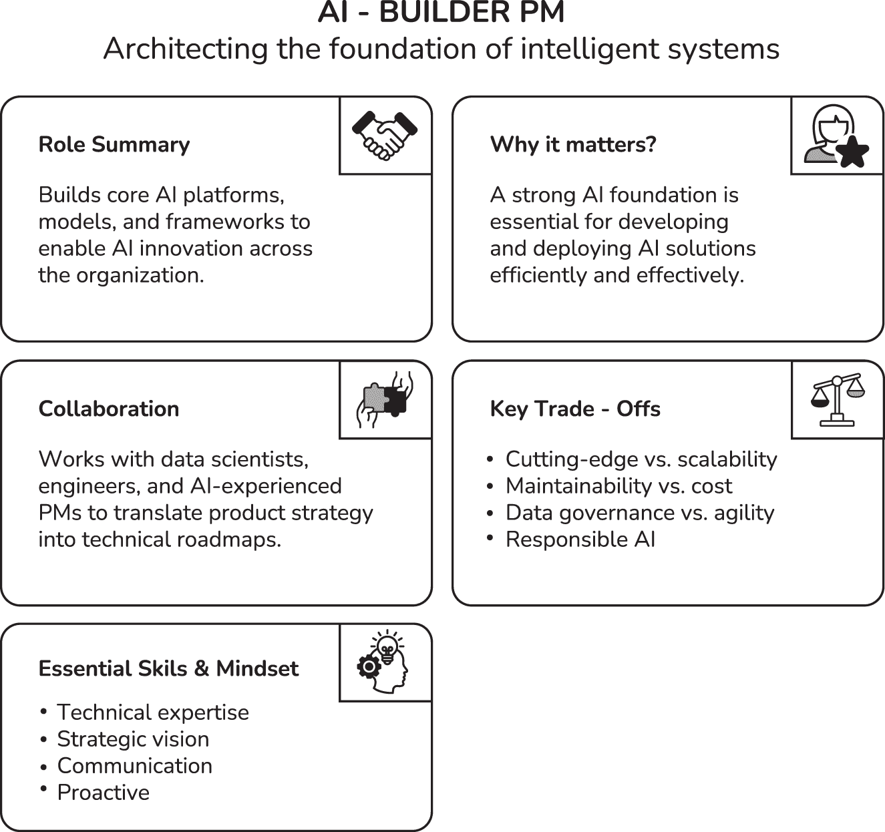

**Figure 6-4:** AI-Builder PM 角色摘要，强调其在创建基础 AI 能力、关键协作者、战略权衡和基本技能方面的核心关注点

### 关键要点

*   **你的“产品”就是平台。** 作为 AI-Builder PM，你的主要客户是内部开发团队，你的成功取决于他们能否高效地构建和部署高质量的 AI 功能。

*   **技术深度即战略。** 该角色需要深入了解 AI 基础设施、MLOps 和模型架构，以便做出可信的战略决策并有效指导技术团队。

*   **你的目标是创造杠杆。** 核心使命是构建可扩展且可重用的 AI 资产，这些资产可用于多个产品，从而为整个组织带来效率和一致性。

*   **你是创新的推动者。** 在这个角色中，你是关键的乘数器，为其他人提供工具、系统和治理，以加速 AI 开发。

### 接下来：超级充电 PM 工作流

在介绍了构建 AI 体验和 AI 平台的 PM 之后，你现在准备好将重点转移到第三个新兴专业方向。下一章将探讨 AI-Enhanced PM，他们利用 AI 不是为他人构建产品，而是为了超级充电他们自己的产品管理工作流。

WileyPRE

# CHAPTER 7  

AI-Enhanced PM：利用 AI 超级充电产品管理

AI-Enhanced PM 的主要关注点不是为用户构建 AI 产品或功能。相反，他们是利用 AI 改进自身产品管理工作流和决策的大师。可以将他们视为 AI 的高级用户，应用其能力来变得更高效、更数据驱动、更具战略性。他们是将 AI 拥抱为个人生产力和洞察生成工具的 PM。

这个角色变得越来越重要，因为 AI 提供了大量工具，可以显著增强产品管理实践本身。AI-Enhanced PM 积极寻找并采用这些工具，成为更有效、更有影响力的产品领导者。

这位 PM 与所有常规利益相关者（工程师、设计师、市场等）合作，但他们与数据科学家和 ML 工程师的关系与其他两种 PM 角色不同。AI-Enhanced PM 是 AI 工具和洞察的消费者，而不是构建 AI 模型或平台的直接协作者。他们可能会对内部构建的 AI 工具提供反馈，但其主要关注点是应用，而非创造。

该角色固有的挑战包括：跟上快速发展的 AI 工具格局、为工作选择合适的工具、将其有效集成到现有工作流中，以及批判性地评估 AI 的输出以避免过度依赖或误解。这还包括在其产品团队中倡导使用 AI 工具，培养数据驱动的文化。


一个 `highly effective` 的 AI 增强型产品经理（PM）是一位精通数据、工具娴熟且适应力强的产品领导者。他们充满好奇心，不断寻找利用 AI 改进工作的新方法。他们也是批判性思考者，能够评估 AI 工具的输出结果，避免盲目接受。他们是团队内 AI 采用的倡导者，以身作则。

让我们深入探讨定义这一日益重要角色的具体职责。

## 关键职责：利用 AI 增强 PM 工作流程和决策

AI 增强型 PM 负责将 AI 工具和技术战略性地整合到自己的工作流程中，并进而整合到产品团队的工作流程中。这涉及一种主动且持续的努力，以提高效率、决策能力和整体产品成果。

*   **识别 AI 驱动的工作流程增强机会：** 

    *   **行动：** 主动识别产品管理流程中 AI 工具可以自动化任务、提供洞察或改进决策的领域。这需要深入了解 PM 工作流程和可用 AI 工具的功能。

    *   **示例：** 认识到竞争分析耗时，并识别可以自动化收集和分析竞争对手信息过程的 AI 驱动工具。

*   **评估和选择产品管理的 AI 工具：** 

    *   **行动：** 研究和评估专为产品管理任务（例如市场研究、用户反馈分析、路线图优先级、文档）设计的 AI 驱动工具的格局。

    *   **行动：** 根据工具的功能、成本效益、集成难易程度以及与团队需求的契合度来选择工具。

    *   **示例：** 评估不同的 AI 驱动用户反馈分析工具，比较它们的功能、准确性和定价，为团队选择最佳选项。

*   **将 AI 工具整合到 PM 工作流程中：** 

    *   **行动：** 将所选的 AI 工具无缝整合到日常工作流程和产品团队的工作流程中。这涉及开发有效使用工具的流程和最佳实践。

    *   **示例：** 将 AI 驱动的会议摘要工具整合到团队的会议流程中，制定何时以及如何使用该工具的指南，并确保摘要对所有团队成员都易于访问。

*   **推动产品团队内 AI 工具的采用：** 

    *   **行动：** 在产品团队内倡导使用 AI 工具，为同事提供培训、支持和指导。这涉及展示工具的价值，并培养实验文化。

    *   **示例：** 组织研讨会，培训其他 PM 如何使用 AI 驱动的用户研究分析工具，分享最佳实践和成功案例。

*   **衡量和优化 AI 工具的影响：** 

    *   **行动：** 定义指标，跟踪 AI 工具对 PM 生产力、决策质量和整体产品成果的影响。

    *   **行动：** 定期分析这些指标，识别改进领域，并根据数据驱动的洞察优化工具使用和工作流程。

    *   **示例：** 跟踪使用 AI 驱动文档生成工具节省的时间，并衡量其对产品发布周期的影响。

*   **紧跟 AI 趋势和最佳实践：** 

    *   **行动：** 持续监控快速发展的 AI 领域，识别可能使产品团队受益的新工具、技术和最佳实践。

    *   **示例：** 参加关于新 AI 驱动市场研究工具的网络研讨会，阅读关于 LLM 提示工程的文章，并尝试新的 AI 平台。

*   **倡导 AI 素养和采用：** 

    *   **行动：** 在更广泛的组织内推广 AI 素养，与其他团队分享知识和洞察，并倡导负责任和有效地使用 AI。

    *   **行动：** 帮助制定流程以改进 AI 采用。

    *   **示例：** 展示产品团队如何成功利用 AI 改进其工作流程的案例研究，激励其他团队探索类似机会。

*   **确保 AI 的负责任和合乎伦理的使用：** 

    *   **行动**：确保所使用的所有工具都遵循伦理准则。

这些职责表明，AI 增强型 PM 不仅仅是 AI 工具的使用者，而是产品管理职能中 AI 的 `战略采用者和倡导者`。他们不断寻找利用 AI 改进自身工作和团队工作的方法，最终带来更好的产品决策和更成功的产品。

## 日常活动

AI 增强型 PM 的日常活动是战略分析、动手工具评估、工作流程优化和数据驱动决策的结合。他们不断平衡新 AI 工具的潜力与产品团队的实际需求，寻求在不牺牲关键判断的前提下增强自身能力。这些多样化的活动可以分为五个核心领域，如 图 7-1 所示。以下是他们典型活动的更详细概览：

*   **市场和竞争分析：**

    *   **使用 AI 驱动工具监控竞争对手活动：** PM 可能会使用自动跟踪竞争对手网站、社交媒体提及和新闻稿的工具，识别新功能发布、营销活动和客户情绪。这超越了手动 Google 搜索，提供自动化分析和警报。

    *   **利用 AI 分析行业趋势：** 利用分析大量市场研究报告、新闻文章和社交媒体对话数据集的 AI 平台，识别新兴趋势和潜在颠覆。这有助于制定产品策略和路线图优先级。

    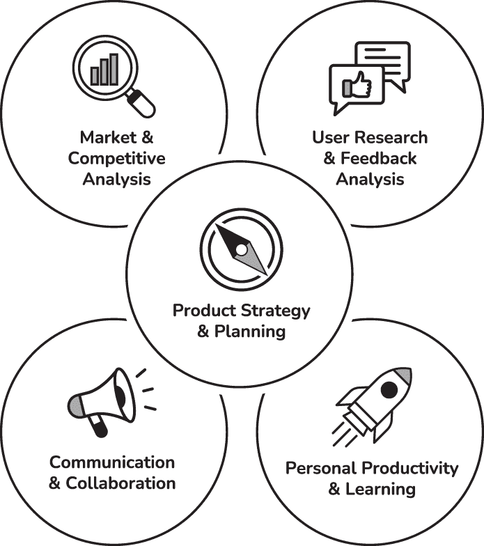

    **Figure 7-1:** The five core areas of an AI-Enhanced PM's daily activities, which range from high-level market analysis and strategic planning to personal productivity and learning, and user feedback analysis

*   **用户研究和反馈分析：** 

    *   **总结和综合用户反馈**：使用 NLP 工具分析用户评论、调查回复和支持工单，识别关键主题、痛点和功能请求。这取代了定性数据的手动标记和分析。

    *   **利用 AI 识别用户细分群体**：将无监督学习技术（聚类）应用于用户数据，以识别具有不同需求和行为的不同用户细分群体，即使这些细分群体不是预定义的。这为个性化策略提供信息。

*   **产品策略和规划：** 

    *   **AI 辅助路线图优先级：** 使用分析各种数据点（用户反馈、市场趋势、技术可行性、业务目标）的 AI 工具，帮助优先排序产品路线图上的功能。这为优先级排序提供了更具数据驱动的方法。

    *   **利用 AI 生成产品创意：** 尝试使用 LLM 头脑风暴新产品功能创意或现有功能的变体，使用基于用户需求和市场机会的提示。

    *   **起草产品需求文档（PRD）：** PM 可以利用 LLM 创建 PRD 的初始草稿。

*   **沟通与协作：** 

    *   **利用 AI 协助创建演示文稿和报告**：使用 AI 工具生成数据摘要、创建可视化效果，甚至起草演示文稿，节省时间并改善沟通。


## 自动化会议安排与跟进

使用 AI 驱动的调度工具为团队成员寻找最佳会议时间，并自动发送包含行动事项的跟进邮件。

## AI 驱动的记录与总结

使用可转录会议、生成摘要并提取关键决策和行动事项的工具，确保不遗漏任何内容。

## 个人生产力与学习

### 自动化常规任务

使用 AI 驱动的工具自动化电子邮件过滤、日历管理和数据录入等任务，从而腾出时间从事更具战略性的工作。

### 紧跟 AI 发展动态

花时间阅读文章、参加网络研讨会并尝试新的 AI 工具，以了解该领域的最新进展。

## 团队会议

分享使用上述任何 AI 工具所获得的见解，并与团队共同做出决策。

AI 增强型产品经理不断寻求利用 AI 增强自身及其团队能力的方法。他们不仅仅是在管理产品；他们正在积极转变产品管理本身的 `process`，将 AI 作为推动创新和效率的强大工具。

## 所需技能与知识：AI 增强型产品经理的工具箱

AI 增强型产品经理需要结合核心产品管理技能、对 AI 的基础理解以及采用和集成新技术的强大能力。本节按清晰分类列出了关键技能和知识领域，并指明了所需的熟练程度。

我们将使用以下熟练程度级别：

* `Foundational`：对概念有基本理解；能够参与讨论并理解其影响。

* `Working Knowledge`：能够在常见场景中应用该技能；可以独立完成大部分相关任务。

* `Expert`：对该技能有深入理解和掌握；可以主导项目并指导他人。

### 核心产品管理技艺与实践

AI 增强型产品经理在核心产品管理技能的基础上进行构建，但有一个关键区别：他们积极利用 AI 来增强和加速这些实践。他们的目标是使用智能工具，使日常工作更加高效和富有洞察力。下表概述了当这些核心技能通过 AI 驱动的视角来审视时是如何转变的。

| 技能 | 熟练程度 | 应用方式（AI 增强型产品经理） |
| --- | --- | --- |
| 数据分析与解读 | Expert | 分析来自各种来源（用户反馈、市场研究、竞争分析）的数据，以识别趋势、模式和洞察。解读 AI 生成的洞察，并将其转化为可操作的产品决策。 |
| 实验（A/B 测试） | Working Knowledge | 设计和执行 A/B 测试，以评估 AI 工具和工作流程的有效性。 |
| 用户研究与反馈分析 | Working Knowledge | 使用 AI 工具分析用户反馈并识别关键主题和痛点。了解 AI 驱动分析的局限性，并在必要时用定性研究进行补充。 |
| 优先级排序与路线图规划 | Working Knowledge | 对产品举措进行优先级排序，并将 AI 工具采纳纳入产品路线图。 |
| 需求定义 | Working Knowledge | 为将 AI 工具集成到产品经理工作流程中编写清晰简洁的需求。 |
| 上市策略与执行 | Foundational | 与本角色的直接相关性较低，因为重点在于内部工具。然而，基本了解有助于向利益相关者传达 AI 增强工作流程的价值。 |

### 产品经理的工程基础

虽然 AI 增强型产品经理不是技术角色，但对关键工程概念的基础理解对于有效选择和集成 AI 工具至关重要。这种知识使他们能够评估工具的功能，了解其如何与现有系统连接，并在需要时与 IT 或工程支持团队协作。下表详细说明了所需的技术流利程度。

| 技能 | 熟练程度 | 应用方式（AI 增强型产品经理） |
| --- | --- | --- |
| 软件开发方法论 | Foundational | 理解 Agile/Scrum 原则，以有效管理项目并与使用 AI 工具的团队协作。 |
| 关键技术概念（API、算法、系统架构） | Foundational | 理解 API 的基本概念及其如何用于将 AI 工具集成到现有工作流程中。对不同 AI 算法及其功能有高层次的了解。 |
| 使用 AI 基础设施 | Foundational | 了解云计算和数据存储的基础知识，因为许多 AI 工具都是基于云的。 |

### 必要的领导力与协作技能

对于 AI 增强型产品经理来说，领导力往往体现为变革推动者和新工作方式的内部倡导者。他们的角色需要强大的沟通和影响力，以鼓励更广泛的产品团队采用 AI 工具和数据驱动的实践。下表概述了推动这一转型所需的关键领导技能。

| 技能 | 熟练程度 | 应用方式（AI 增强型产品经理） |
| --- | --- | --- |
| 沟通与讲故事 | Working Knowledge | 向其他产品经理和利益相关者传达 AI 工具的价值。分享最佳实践和成功案例以鼓励采用。以清晰简洁的方式解释 AI 驱动分析得出的洞察。 |
| 协作与跨职能团队合作 | Working Knowledge | 与其他产品经理、数据分析师和 IT 团队合作，将 AI 工具集成到现有工作流程中。 |
| 问题解决与决策 | Working Knowledge | 识别并解决与 AI 工具集成和使用相关的问题。基于 AI 驱动分析的洞察做出数据驱动的决策。 |
| 影响力与说服力 | Working Knowledge | 倡导在产品团队和更广泛的组织中采用 AI 工具。为投资 AI 工具和培训争取支持。 |
| 适应性与学习敏捷性 | Expert | 紧跟 AI 工具和技术快速发展的趋势。愿意尝试新工具并根据需要调整工作流程。这是 AI 增强型产品经理的一个决定性特征。 |

### AI 生命周期与运营意识

AI 增强型产品经理必须是 AI 的智能消费者，这需要了解更广泛的 AI 生命周期及其运营现实。了解 AI 工具的功能、局限性和伦理考量对于负责任且有效地使用它们非常重要。下表详细说明了成功利用这些工具所需的基本 AI 特定意识。

| 技能 | 熟练程度 | 应用方式（AI 增强型产品经理） |
| --- | --- | --- |
| 理解 AI 和 GenAI 的独特功能 | Working Knowledge | 识别利用 AI 优势（例如自动化、模式识别、内容生成）来改进产品经理工作流程的机会。了解 AI 的局限性，避免过度依赖 AI 生成的输出。 |
| DataOps 与管理 | Foundational | 了解不同 AI 工具的数据要求，并确保数据可访问且可用。 |
| 生产化考量 | Foundational | 了解部署和维护软件的基本原则，因为它们适用于集成 AI 工具。 |


| 伦理与合规 || 工作知识 || 确保 AI 工具的使用符合道德规范并遵守相关法规。意识到 AI 驱动分析中可能存在的偏见，并采取措施加以缓解。 |

| 提示工程（针对 LLM） || 工作知识 || 通过编写清晰且具体的提示词，有效地使用 LLM 和其他生成式 AI 工具。了解如何控制这些模型的输出。 |

| GenAI 评估理解 || 工作知识 || 了解生成式 AI 是如何被评估的。 |

## 示例：AI 增强型产品经理的一天

为了了解 AI 增强型产品经理（PM）在实际工作中的角色，让我们走进一个假设的一天，展示可能涉及的各种活动和互动。这并非一份严格的时间表，而是一个快照，展示 AI 增强型 PM 如何利用 AI 工具来改进其工作流程和决策。这位 PM 为一家开发流行项目管理 SaaS 平台的公司工作。

### 上午

*   **8:30 AM–9:00 AM：竞争格局分析—**

    一天的开始是使用 AI 驱动的竞争情报工具。PM 不再手动搜索竞争对手的新闻和更新，该工具会自动从各种来源（新闻文章、社交媒体、公司网站）汇总相关信息。该工具还使用自然语言处理（NLP）来总结关键进展，并突出潜在的威胁和机遇。PM 审阅 AI 生成的摘要，注意到一家主要竞争对手刚刚发布了与 PM 路线图上的一项功能相似的新功能。

    *使用的技能：* 数据分析与解读、AI 工具熟练度、战略思维。

*   **9:00 AM–9:30 AM：用户反馈审查—**

    PM 使用 AI 驱动的情感分析工具，分析来自应用内调查和支持工单的最新一批用户反馈。该工具会自动按主题和情感（积极、消极、中立）对反馈进行分类。PM 迅速识别出用户对平台报告功能感到沮丧的反复出现的主题。

    *使用的技能：* 用户研究与反馈分析、AI 工具熟练度、数据素养。

*   **9:30 AM–10:30 AM：冲刺计划会议—**

    PM 与工程和设计团队参加每两周一次的冲刺计划会议。他们使用一个 AI 驱动的项目管理工具（集成到其现有平台中），该工具分析历史冲刺数据以预测任务完成时间并识别潜在瓶颈。PM 利用这些见解来指导讨论，并确保团队承诺一个现实且可实现的冲刺目标。他们还使用一个嵌入了 LLM 的协作文档，因此他们使用它来做笔记和总结。

    *使用的技能：* 沟通与协作、数据分析与解读、工作流优化、AI 工具熟练度。

*   **10:30 AM–12:00 PM：使用 AI 工具综合用户研究—**

    在冲刺计划会议上讨论的用户反馈主题之后，PM 使用像 NotebookLM 这样的 AI 工具上传几份最近的用户访谈记录。他们要求该工具总结与平台报告功能相关的关键痛点，并识别任何突出用户沮丧情绪的直接引语。这为他们当天晚些时候将要起草的 PRD 提供了有力的定性证据。

    *使用的技能：* 用户研究与反馈分析、AI 工具熟练度、数据素养。

### 下午

*   **1:00 PM–2:00 PM：起草 PRD—**

    PM 正在为一项新功能起草产品需求文档（PRD）。他们使用一个 LLM（如 ChatGPT 或专门的写作助手）来帮助头脑风暴功能的不同方法，生成用户故事的初稿，并润色文档的语言。PM 会批判性地评估 AI 生成的内容，根据需要进行编辑和补充。

    *使用的技能：* 需求定义、AI 工具熟练度、批判性评估、沟通。

*   **2:00 PM–3:00 PM：路线图优先级排序练习—**

    PM 使用一个 AI 驱动的优先级排序工具，该工具分析来自各种来源（用户反馈、市场研究、内部指标）的数据，以帮助对下一季度路线图的潜在功能进行排序。该工具会考虑用户影响、商业价值和技术可行性等因素。PM 审查 AI 的建议，根据自己的产品判断调整排名，并为领导团队准备一份演示文稿。

    *使用的技能：* 优先级排序与路线图规划、数据分析与解读、AI 工具熟练度、战略思维。

*   **3:00 PM–4:00 PM：探索新的 AI 工具—**

    PM 花时间探索一个新的 AI 驱动的用户研究平台，该平台声称可以自动化用户访谈分析过程。他们注册了一个免费试用，用一些示例数据测试该平台，并评估其对团队的潜在价值。

    *使用的技能：* 适应性和学习敏捷性、工具熟练度、批判性评估。

*   **4:00 PM–4:30 PM：团队培训会议准备—**

    PM 为产品团队准备一个简短的演示文稿，介绍如何有效使用他们已集成到工作流程中的新 AI 驱动摘要工具。他们专注于实用技巧和最佳实践，演示该工具如何节省时间并改善沟通。

    *使用的技能：* 沟通与协作、工具熟练度、变革管理。

*   **4:30 PM–5:00 PM：审查与计划—**

    PM 花些时间审查显示与 AI 工具使用相关的相关数据的仪表板。

    根据审查结果，他们对明天的计划进行了一些调整。

这个“一天的生活”示例说明了 AI 增强型 PM 如何将 AI 工具和技术无缝地融入其日常工作流程，利用 AI 来提高效率、获得更深入的洞察并做出更明智的决策。他们不仅仅是 AI 的用户；他们是产品管理职能中 AI 的战略采用者和倡导者。他们不断寻找新的方法来利用 AI 来增强自己的工作和团队的工作，最终有助于开发出更好的产品。

### AI 工具示例

AI 工具的格局正在以令人难以置信的速度发展，新应用每周都在涌现。因此，下面的列表并非旨在成为一套详尽或永久的推荐集，而是 AI 增强型 PM 今天正在使用的强大工具类型的一个快照，用于加速他们的工作。关键是要培养持续探索的心态，以找到最适合您需求的工具。

这些工具通常分为几个类别：

*   **用于构思、写作和规划：** 充当头脑风暴伙伴或写作助手的工具。

    *   Gemini, Claude, ChatGPT：擅长生成想法、起草 PRD、编写用户故事、总结文本和规划项目的大型语言模型。

*   **用于研究和实时洞察：** 可以综合实时互联网信息的工具。

    *   Perplexity, Grok：充当“答案引擎”，可以提供实时信息、研究主题，并为市场分析提供引用来源。

*   **用于信息提炼和学习：** 旨在帮助您分析和理解大量文档的工具。

    *   NotebookLM：一个研究助手，可以从您自己的源文档（如用户访谈、研究论文等）中回答问题并生成洞察。

*   **用于会议和工作流程生产力：** 旨在自动化常见、耗时任务的工具。

    *   Granola, Otter.ai：做笔记、转录会议，并生成带有行动事项的摘要。

    *   SuperWhisper：实时听写，快速将想法写在纸上。

*   **用于原型设计和 UI 生成：** 可以加速设计和开发过程的工具。


# 挑战与复杂性

AI 增强型产品经理（AI-Enhanced PM）角色处于产品管理的前沿，能够显著提升生产力并改善决策。然而，与任何拥抱新技术的角色一样，它也伴随着自身的一系列挑战。理解这枚硬币的两面对于成功至关重要。

以下是你在这个角色中可能面临的一些常见挑战：

## 工具选择过载

面向产品经理的 AI 驱动工具领域正在迅速扩展。选择`合适`的工具、评估其有效性，并避免陷入“新奇玩意综合征”，可能会让人感到不知所措。产品经理需要具备辨别能力，并专注于真正满足其需求的工具。

## 集成复杂性

将 AI 工具集成到现有的产品经理工作流程中可能很复杂，需要技术专长和仔细规划。数据兼容性、API 集成和工作流程调整可能会带来重大障碍。

## 数据依赖与质量

许多 AI 工具依赖于数据，而数据的质量直接影响生成的洞察质量。AI 增强型产品经理可能会面临与数据访问、数据清洁度和数据偏差相关的挑战。

## 过度依赖 AI

重要的是要记住，AI 是一种`工具》，而不是人类判断的替代品。在没有批判性评估的情况下过度依赖 AI 生成的洞察，可能会导致错误的决策。AI 增强型产品经理需要保持健康的怀疑态度，并始终验证 AI 输出。

## “黑盒”顾虑

有些 AI 工具是“黑盒”，这意味着很难理解`为什么`它们会产生某些输出。这种缺乏透明度会使信任结果或排查问题变得具有挑战性。

## 跟上变化的步伐

AI 领域正在以极其快速的速度发展。AI 增强型产品经理需要成为持续学习者，不断更新其知识和技能，以保持领先。

## 推动团队内部采用

说服其他产品经理采用新的 AI 工具并改变其既定的工作流程可能是一项挑战。AI 增强型产品经理需要成为 AI 的坚定倡导者，并通过具体成果展示其价值。

## 衡量 AI 工具的投资回报率

重要的是要确保在工具上所做的投资是值得的。

尽管存在障碍，但该角色之所以极具回报，原因有以下几点：

## 提高生产力和效率

AI 工具可以自动化许多常规的产品经理任务，从而腾出时间从事更具战略性的工作，例如用户研究、产品愿景制定和利益相关者沟通。这是一个直接且切实的好处。

## 数据驱动的决策

AI 驱动的分析可以提供关于用户行为、市场趋势和竞争格局的更深入洞察，使产品经理能够做出更明智、更具数据驱动的决策。

## 增强创造力和创新

AI 工具可以帮助产品经理头脑风暴新想法，探索不同的解决方案，并生成创意内容，从而促进创新。

## 改善产品成果

通过利用 AI 改善自身的工作流程和决策，AI 增强型产品经理最终可以为开发更好、更以用户为中心的产品做出贡献。

## 成为思想领袖

AI 增强型产品经理通常被视为其组织内的先驱和创新者，塑造产品管理的未来并推动 AI 最佳实践的采用。

## 个人和职业成长

AI 增强型产品经理角色提供了在快速发展的领域中持续学习和专业成长的独特机会。

AI 增强型产品经理角色并非没有挑战，但对于那些愿意拥抱 AI 机遇的人来说，它提供了显著的回报。这是一个适合对技术、数据和持续改进充满热情的产品经理的角色。通过战略性地将 AI 集成到工作中，AI 增强型产品经理可以提升自身表现，赋能团队，并推动产品创新。

# AI 增强型产品经理如何与其他角色交互

AI 增强型产品经理的协作角色是独特的。他们更多地充当整个产品团队的“力量倍增器”，而不是特定 AI 功能的总监。他们的交互集中在两个关键领域：首先，利用 AI 生成的洞察来告知并协调利益相关者；其次，倡导采用新工具和工作流程，使整个团队更高效、更具数据驱动性。

理解这些关键交互揭示了 AI 增强型产品经理如何通过转变产品管理流程本身，而非构建 AI 产品来创造价值。以下是最重要关系的详细说明：

## 其他产品经理（尤其是 AI 体验和 AI 构建产品经理）

**交互：** AI 增强型产品经理分享关于使用 AI 工具进行产品管理的洞察和最佳实践。他们可能会倡导在产品经理组织中采用特定工具。他们还可能会对内部构建的 AI 工具（如果产品经理使用这些工具）提供反馈。他们可能会从 AI 构建产品经理那里获得洞察。

**关键依赖：** AI 增强型产品经理受益于 AI 构建产品经理的工作（如果存在内部 AI 平台），并可以通过展示 AI 驱动洞察的潜力来影响 AI 体验产品经理的工作。

## 数据科学家

**交互：** AI 增强型产品经理`消费`数据科学家开发的洞察和工具，但通常不直接参与模型构建。他们可能会对数据分析工具的可用性提供反馈，或请求执行特定分析。他们还可能会将从 AI 驱动工具中获得的洞察`与`数据科学家分享，从而可能激发新的研究方向。

**关键依赖：** AI 增强型产品经理`依赖于`数据科学家，以获取高质量的数据分析，并可能依赖他们为产品经理开发内部 AI 驱动工具。

## 机器学习工程师

**交互：** 与机器学习工程师的直接交互通常有限；但是，AI 增强型产品经理可能会在对内部 MLOps 工具和部署平台的性能或可用性提供反馈时与他们合作。

**关键依赖：** AI 增强型产品经理对机器学习工程师有间接依赖，因为他们使用的 AI 工具的可靠性和性能通常依赖于机器学习工程师维护的底层基础设施和 MLOps 实践。

## 软件工程师

**交互：** AI 增强型产品经理可能会与软件工程师合作，将 AI 驱动工具集成到现有的产品经理工作流程中（例如，将用户反馈分析工具集成到公司的 CRM 中）。

**关键依赖：** AI 增强型产品经理`依赖于`软件工程师，以实现涉及 AI 工具的任何工作流程集成的技术实现。

## UX 设计师

**交互：** 与 UX 设计师的交互频率低于 AI 体验产品经理。主要协作发生在 AI 增强型产品经理对产品团队使用的内部 AI 驱动工具的可用性和设计提供反馈时，而不是针对面向用户的产品界面。

**关键依赖：** 间接——依赖于他们使用的工具的良好 UX 设计。

## 市场营销/销售

**交互：** AI 增强型产品经理可能会使用 AI 驱动工具进行市场研究、竞争分析或潜在客户评分，这些可能会为营销和销售策略提供信息。他们还可能分享从 AI 驱动用户反馈分析中获得的洞察。

**关键依赖：** 可能会使用 AI 增强型产品经理生成的洞察来制定他们的策略。


## 法律/合规

### 交互
AI 增强型产品经理确保其使用的 AI 工具符合所有相关法规和道德准则，特别是关于数据隐私的部分。

### 关键依赖
AI 增强型产品经理依赖法律/合规部门，就数据使用和道德考量问题获得指导。

## 高层领导

### 交互
与高层领导的交互包括定期提供关于 AI 工具对团队生产力和决策产生的可衡量影响的更新和报告，以及争取持续投资。

### 关键依赖
产品经理推动全团队效率的能力，取决于能否从高层领导处获得采购新 AI 工具和实施培训计划的支持与预算批准。

AI 增强型产品经理是产品管理组织内 AI 的高级用户和倡导者。他们更多地关注利用 AI 来改进自身工作和同事的工作，而非构建 AI。他们是 AI 潜力与日常产品管理实际现实之间的桥梁。

## 技能对比：AI 体验型产品经理、AI 构建型产品经理和 AI 增强型产品经理

下表概述了我们讨论过的三种 AI 产品经理专业方向（AI 体验型产品经理、AI 构建型产品经理和 AI 增强型产品经理）所需的关键技能和知识领域。这并非一份严格的清单；具体的技能和所需的熟练程度将因组织、产品以及角色的具体职责而异。然而，它是了解每个专业方向核心能力以及识别自身职业发展领域的宝贵指南。

每个角色的“如何应用”列提供了该技能在该产品经理专业方向背景下的具体应用示例。这对于理解每个技能的实际应用至关重要，而不仅仅是理论定义。

| 技能类别 | 技能 | AI-体验型产品经理 | 如何应用（AI-体验型） | AI-构建型产品经理 | 如何应用（AI-构建型） | AI-增强型产品经理 | 如何应用（AI-增强型） |
| --- | --- | --- | --- | --- | --- | --- | --- |
| 核心产品管理 | 用户研究与分析 | 工作知识 | 进行用户访谈、调查和可用性测试，以了解与 AI 功能相关的需求。分析用户行为。 | 基础 | 了解将使用 AI 平台的内部团队的需求。 | 工作知识 | 使用 AI 工具分析用户反馈、识别趋势并对用户进行细分。 |
| 构思与解决方案设计 | 工作知识 | 头脑风暴并构思 AI 驱动的功能。应用设计思维。 | 工作知识 | 定义 AI 平台和可复用模型的功能和能力。 | 工作知识 | 识别使用 AI 工具改进产品经理工作流程的机会。 |
| 优先级排序与路线图规划 | 工作知识 | 根据影响、价值和可行性优先排序 AI 功能。将 AI 集成到产品路线图中。 | 专家 | 优先排序平台功能、模型开发和基础设施改进。 | 工作知识 | 使用 AI 工具协助进行路线图优先级排序。 |
| 需求定义 | 工作知识 | 为 AI 功能编写 PRD 和用户故事，明确功能、用户交互和成功指标。 | 工作知识 | 为平台和模型编写清晰简洁的需求。 | 工作知识 | 为改进和优化将使用的 AI 工具编写清晰简洁的需求。 |
| 数据分析与解读 | 工作知识 | 分析来自用户研究、A/B 测试和模型性能指标的数据。 | 工作知识 | 分析平台使用情况、模型性能和基础设施成本的数据。 | 专家 | 使用 AI 工具分析大型数据集，识别趋势，并为产品决策生成洞察。 |
| 实验（A/B 测试） | 工作知识 | 设计和执行 A/B 测试以评估 AI 功能。 | 基础 | 了解 A/B 测试原则，以评估不同版本的 AI 模型或平台功能。 | 工作知识 | 使用 AI 工具更高效地设计和分析 A/B 测试。 |
| 上市策略与执行 | 基础 | 协作制定 AI 功能的发布计划。撰写突出用户利益的信息。 | 基础 | 与上市策略关系不大，但了解一些有助于在内部传达平台价值。 | 基础 | 与上市策略关系不大，但了解一些是有帮助的。 |
| 工程基础 | 软件开发方法论 | 基础 | 了解 Agile/Scrum。 | 基础 | 了解 Agile/Scrum。 | 基础 | 了解 Agile/Scrum。 |
| 关键技术概念（API、算法、系统架构） | 基础 | 了解基本的 AI/ML 概念，模型如何通过 API 部署，以及系统架构的影响。 | 工作知识 | 了解 AI 平台架构、API 设计以及不同算法的工作原理。 | 基础 | 了解如何使用 AI 工具和 API。 |
| 使用 AI 基础设施 | 基础 | 了解 AI 模型托管的方式和位置，以及延迟如何影响用户体验。 | 专家 | 就基础设施选择（云、本地、边缘）做出战略决策，以实现可扩展性、可靠性和成本效益。 | 基础 | 了解 AI 工具如何部署和集成。 |
| 必备领导力与协作 | 沟通与讲故事 | 工作知识 | 传达 AI 功能的愿景、策略和价值。清晰地解释 AI 概念。 | 工作知识 | 传达 AI 平台的愿景、策略和路线图。解释复杂的技术概念。 | 工作知识 | 传达 AI 工具的优势，并倡导其采用。 |
| 协作与跨职能团队合作 | 工作知识 | 与数据科学家、工程师、设计师、营销人员和其他利益相关者合作。 | 专家 | 与数据科学家、工程师、其他产品经理和利益相关者合作。 | 工作知识 | 与同事协作，将 AI 工具集成到共享工作流程中。 |
| 问题解决与决策 | 工作知识 | 在 AI 功能的开发和部署过程中识别和解决问题。 | 专家 | 识别并解决与 AI 平台开发相关的技术和战略挑战。 | 工作知识 | 使用 AI 驱动的洞察做出数据驱动的决策并解决产品问题。 |
| 影响力与说服力 | 基础 | 倡导以用户为中心的 AI 解决方案并争取支持。 | 工作知识 | 倡导 AI 平台并争取利益相关者的支持。 | 工作知识 | 倡导在产品团队中采用 AI 工具。 |
| 适应性与学习敏捷性 | 工作知识 | 了解 AI 领域的最新动态。 | 工作知识 | 了解 AI 领域的最新动态。 | 专家 | 了解快速发展的 AI 工具领域。 |
| AI 生命周期与运营意识 | 理解 AI 和 GenAI 能力 | 工作知识 | 识别利用 AI 优势的机会。了解局限性。 | 专家 | 深入了解各种 AI/ML 技术及其优势和劣势。 | 专家 | 识别利用 AI 改进产品经理工作流程的机会。了解 AI 工具的局限性。 |


| DataOps 和管理 || 基础 || 了解 AI 功能的数据需求，并与数据工程团队合作提升数据质量。 || 工作知识 || 了解数据管道、数据治理和数据隐私。 || 基础 || 了解 AI 工具的数据需求。 |

| 生产化考量 || 基础 || 了解 AI 模型的部署和监控。 || 专家 || 设计和实施部署、监控和维护 AI 模型的流程。 || 基础 || 了解部署和维护软件的基本原理。 |

| 伦理考量与偏差缓解 || 工作知识 || 确保 AI 功能合乎伦理且公平。解决潜在偏差问题。 || 工作知识 || 与利益相关方合作，确保遵循伦理规范。 || 工作知识 || 确保 AI 工具在产品团队内被负责任且合乎伦理地使用。 |

| 提示工程（针对 LLM） || 工作知识 || 为 LLM 编写有效的提示。 || 基础/工作知识 || 了解提示工程以指导 LLM 的内部使用。 || 工作知识 || 通过编写清晰且具体的提示，有效使用 LLM 和其他生成式 AI 工具。了解如何控制模型输出。 |

| GenAI 评估理解 || 工作知识 || 了解评估生成式 AI 模型及其输出的不同方法。 || 专家 || 定义和监督 GenAI 评估流程，确保模型质量和安全性。 || 工作知识 || 了解 AI 生成内容的局限性和潜在偏差，并批判性地评估 AI 工具的输出。 |

## 章节摘要与关键要点

本章向您介绍了 AI 增强型产品经理，即现代产品领导者，他们战略性地使用 AI 工具来增强自身的工作流程和决策。您已经探索了这一角色如何充当“力量倍增器”，利用 AI 处理从市场调研和用户反馈分析到路线图优先级排序的方方面面。您明白，他们的重点在于通过智能采用新工具来转变产品管理本身的 `流程`。

Figure 7-2 说明了这一以效率为中心的角色的核心方面。

 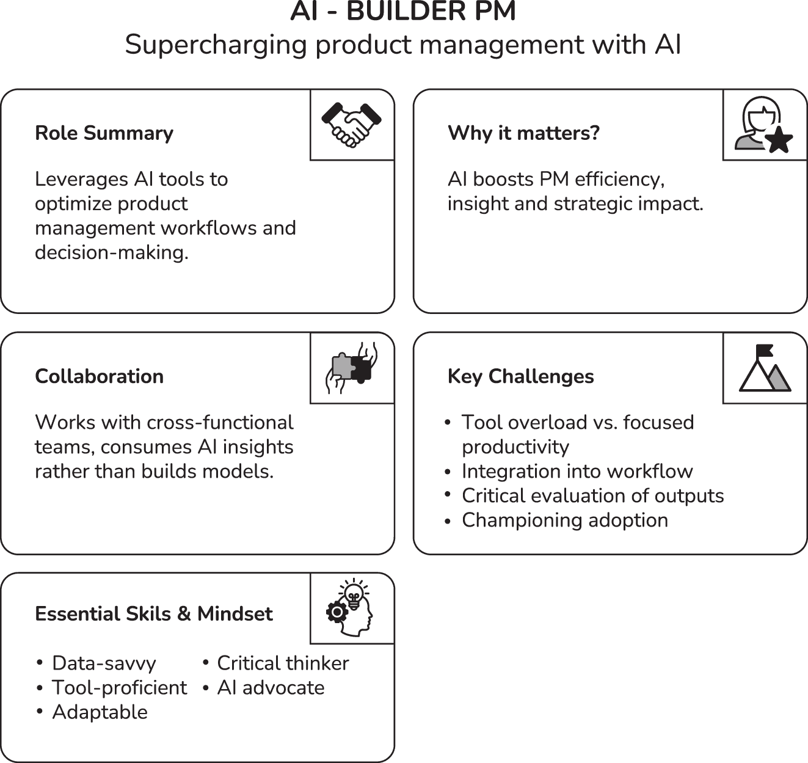

**Figure 7-2:** AI 增强型产品经理角色的摘要，突出其核心重点在于利用 AI 提升生产力、关键挑战和必备技能

### 关键要点

*   您将 AI 视为一种增强工具，用于提升您现有的技能和效率，而不是取代您的批判性判断和战略思维。

*   您的主要关注点是内部流程。该角色的主要影响在于提升您自己团队工作的速度和质量，从而做出更好、更快的产品决策。

*   您的角色需要适应性和持续学习，以跟上 AI 工具和最佳实践快速发展的步伐。

*   您充当采用的倡导者，以身作则，展示在产品经理工作流程中使用 AI 的价值，并鼓励您的同行。

### 接下来：从理论到行动

现在您已经全面了解了不同的 AI 产品经理角色，并可能已经确定了哪个角色最符合您，是时候将这些知识付诸实践了。下一章将为您提供一系列框架，用于识别和评估任何产品中的 AI 机会。

WileyPRE

# 第三部分  

连接 AI/ML 知识与产品经理技艺

现在您已经在 AI/ML（第一部分），是时候将这些知识付诸实践了。第三部分将您的技术理解与产品管理的核心职责相连接。您将学习如何在产品中识别 AI 机会，跨学科协调团队，将复杂功能转化为用户价值，并将 AI 思维融入产品开发生命周期的每个阶段——从策略到执行再到伦理评估。

在第三部分中，您将探索：

*   AI 机会发现和用户旅程分析的框架。

*   应用 AI 以增强产品功能并创建预测或自动化能力的实用策略。

*   每个 AI 产品经理都必须掌握的伦理、可行性和评估考量。

*   AI 语境下的创意构思和 A/B 测试技术，以及一个端到端的案例研究，将所有内容生动呈现。

到第三部分结束时，您将具备领导 AI 驱动的产品开发所需的工具和思维，自信地弥合 AI 素养与有影响力的执行之间的差距。

# 第 8 章  

识别和评估 AI 机会

您现在已经构建了 AI 和机器学习背后的核心概念和技术的基础理解。您了解监督学习和非监督学习之间的区别；您理解神经网络的威力；并且您了解 LLM 的能力和局限性。是时候从理论转向实践了。本章旨在培养产品经理的“AI 优先”思维——学习如何识别和评估利用 AI 解决用户问题并增强产品的机会。

## 发现潜在用例——在您的产品中挖掘 AI 黄金

构建成功 AI 驱动产品的第一步不是跟随最新的技术趋势。而是 `从问题出发`。就像任何良好的产品开发流程一样，我们首先要深入了解用户需求、痛点和改进机会。然而，现在我们是带着“AI 视角”来做这件事——寻找特别适合 AI 解决方案的问题。可以将其视为淘金：您需要知道在哪里寻找以及寻找什么。

关键在于识别 `数据丰富的问题`。AI，尤其是机器学习，依赖于数据。您拥有的数据越多，且数据与问题的相关性越高，构建成功 AI 解决方案的机会就越大。但是，“数据丰富”并不仅仅意味着“大量数据”。它意味着包含 AI 模型可以学习的 `模式` 和 `关系` 的数据。

让我们探讨通常适合 AI 解决方案的问题类型，以及如何在您自己的产品中识别它们：

### 识别数据丰富的问题领域

思考您产品中用户与数据交互、生成数据，或可以利用数据来改善其体验的领域。这些是您的主要勘探区域：

*   **重复性任务：自动化的金矿：** AI 擅长自动化重复性、可预测且涉及处理或分析数据的任务。寻找用户反复执行相同操作的领域，尤其是当这些操作枯燥或耗时时。这是 AI 的易得之果。 

    *   **示例 1** (`项目管理工具`): 想象一个项目管理工具，用户根据任务描述中的关键词（例如，“营销”、“设计”、“开发”）手动为任务分配标签。这既重复又容易出现人为错误。可以训练 AI 根据任务内容自动为任务打标签，节省用户时间并提高一致性。这利用了 `监督学习`，现有标签充当标记数据。


*   **示例 2（客户支持门户）：** 客户支持代理人员常常花费大量时间搜索相关知识库文章或过去的工单，以帮助解决客户问题。基于 AI 的搜索引擎，使用 `natural language processing (NLP)`，可以理解客户查询的 `meaning`（而不仅仅是关键词），并更快地呈现最相关的信息。这超越了简单的关键词匹配。

*   **示例 3（电子商务平台）：** 产品目录管理员常常手动将新产品分类到现有类别中。基于现有产品数据（描述、图片等）训练的 AI，可以自动建议甚至分配类别，显著加快目录编目过程。

*   **模式识别：在大海捞针：** AI 在识别人类可能忽略的数据中的模式、趋势和异常方面非常强大。在处理大型数据集或微妙模式时，这尤其有用。

    *   **示例 1（内容推荐）：** 新闻应用或流媒体服务可以使用 AI 分析用户行为（阅读的文章、观看的视频、收听的歌曲），以识别其偏好的模式。这使系统能够推荐用户可能喜欢的内容，从而提高参与度。这通常使用 `unsupervised learning`（聚类具有相似品味的用户）和 `supervised learning`（预测点击率）。

    *   **示例 2（欺诈检测）：** 金融机构使用 AI 实时检测欺诈交易。AI 模型在大量交易数据上进行训练，学习识别指示欺诈活动的微妙模式（异常购买金额、地点、时间等）。这是 `anomaly detection` 的一个经典示例，是一种 `unsupervised learning`。

    *   **示例 3（预测性维护）：** 在制造环境中，机器上的传感器生成大量数据。AI 模型可以分析这些数据，以预测机器可能发生故障的时间，从而允许主动维护并防止昂贵的停机时间。

*   **个性化机会：提供定制体验：** AI 可以分析用户行为、偏好和人口统计信息，以创建更相关、更具吸引力的个性化体验。这超越了基于简单规则的个性化（“如果用户在 A 组中，显示内容 X”），转向动态的、由 AI 驱动的定制。

    *   **示例 1（电子学习平台）：** 基于 AI 的电子学习平台可以跟踪学生的进度，识别他们遇到困难的领域，并推荐个性化的学习材料和练习。这创造了更有效、更具吸引力的学习体验。

    *   **示例 2（个性化通知）：** 移动应用可以使用 AI 学习何时以及如何最好地向用户发送通知。AI 不会用通用通知轰炸用户，而是可以根据个人用户行为个性化通知的时间、内容和频率，从而提高参与度并降低流失率。

    *   **示例 3（智能待办事项应用）：** 应用可以学习你何时更高效，你倾向于拖延哪些任务，等等。基于此，AI 可以建议最佳时间、任务或提醒。

*   **数据分析瓶颈：简化洞察：** 如果用户花费大量时间手动分析数据以做出决策，AI 通常可以简化这一过程，提供更快、更有洞察力的结果。

    *   **示例 1（财务报告）：** 财务团队常常花费数小时手动从各种来源收集数据、清理数据并生成报告。AI 可以自动化整个过程，使团队能够专注于更高级别的分析和战略决策。

    *   **示例 2（营销分析仪表板）：** 与其要求营销人员手动筛选数据以了解营销活动表现，不如由基于 AI 的仪表板自动识别关键趋势、异常和洞察，提供可操作的建议。

## 分析现有数据源

要识别这些数据丰富的问题，你需要成为一名数据侦探。以下是一些需要调查的关键来源：

*   **用户行为数据：** 深入研究用户交互日志、点击流数据和使用模式。查找：

    *   **频繁操作：** 用户最常执行哪些任务？

    *   **摩擦点：** 用户在哪里卡住、放弃工作流程或出错？

    *   **搜索查询：** 用户在搜索什么？他们找到所需内容了吗？

    *   **导航模式：** 用户如何在产品中导航？是否有常见路径或死胡同？

*   **内容数据：** 如果您的产品涉及内容（文本、图像、音频、视频），请分析其中的模式和机会。

    *   **常见主题和话题：** 用户生成的内容或产品内容库中讨论最多的主题是什么？

    *   **情感分析：** 用户评论、评论或支持工单中表达的总体情绪（积极、消极、中性）是什么？

    *   **图像和视频分析：** 如果您的产品使用图像或视频，AI 是否可以用于自动标记、分类或分析它们？

*   **性能数据：** 分析与产品及其功能性能相关的指标。

    *   **响应时间：** 产品是否存在缓慢或无响应的区域？

    *   **错误率：** 是否存在错误率高的功能或工作流程？

    *   **转化率：** 用户在关键漏斗的哪个环节流失？

*   **反馈数据：** 不要低估定性数据的价值。分析用户反馈、支持工单、评论和调查回复。

    *   **常见投诉：** 用户报告的最常见的投诉或痛点是什么？

    *   **功能请求：** 用户正在要求哪些功能或改进？

    *   **未满足的需求：** 用户是否在表达任何未满足的需求或问题？

## 问对问题

在分析数据并思考产品时，请问自己这些关键问题：

*   用户在哪些方面花费了最多的时间和精力？（关注节省时间的机会。）

*   用户在哪些方面犯了最多的错误？（关注提高准确性和减少挫败感。）

*   用户在哪些方面明确要求更多的个性化或自动化？（倾听用户的意见！）

*   我们有哪些数据可以用来解决这些问题？（识别您的数据资产。）

*   我们的数据中可能存在哪些我们目前忽略的模式？（思考来自 `unsupervised learning` 的潜在洞察。）

*   我们可以做出哪些预测来改善用户体验？（思考 `supervised learning` 的潜在应用。）

*   哪些重复性任务适合自动化？

*   如果我们对用户及其需求有完美的了解，我们会做出哪些不同的做法？（这有助于你大胆思考并识别潜在的 AI 应用。）

通过系统地探索这些问题领域，分析现有数据并问对问题，你将踏上在产品中发现有价值的 AI 机会之路。这个框架旨在帮助你成为一名主动的问题解决者，将 AI 作为一种强大的工具来增强你的产品并提供卓越的用户体验。

## AI/ML 能力匹配：将问题与解决方案连接起来


你已识别出潜在的“金矿”——产品中可能适合 AI 解决方案的数据丰富型问题。现在是时候为工作选择合适的工具了。可以将本部分视为你的 AI 工具箱，其中包含可应用于解决特定类型挑战的不同功能。就像木匠不会用锤子锯木板一样，你需要了解每种 AI/ML 技术的优势，以选择最合适的一种。

请记住，这并非要成为技术专家。而是要了解不同 AI/ML 方法的 `capabilities`，以便与工程团队进行有根据的对话，并做出战略性产品决策。

## 了解你的 AI/ML 工具箱：关键功能

以下是你可能会遇到的核心 AI/ML 功能的分解，以及它们如何应用于产品问题的示例：

### 分类：将事物归类

**它是什么：** 将数据分类到预定义的组或类别中。可以将其视为将邮件分类到不同的垃圾桶中。

**何时使用：** 任何时候你需要自动分类信息、标记数据，或在一组预定义选项之间做出决策。

**示例：** 

* **垃圾邮件过滤：** 将电子邮件分类为“垃圾邮件”或“非垃圾邮件”（`supervised learning` 的经典示例），如 图 8-1 所示。
* **客户支持工单路由：** 自动分类收到的支持工单（例如，“技术问题”、“账单问题”、“功能请求”），并将其路由到相应的团队。
* **文档类型识别：** 自动识别用户上传的文档类型（例如，发票、合同、简历、报告）。
* **图像标记：** 自动使用相关关键词标记图像（例如，“猫”、“狗”、“汽车”）。

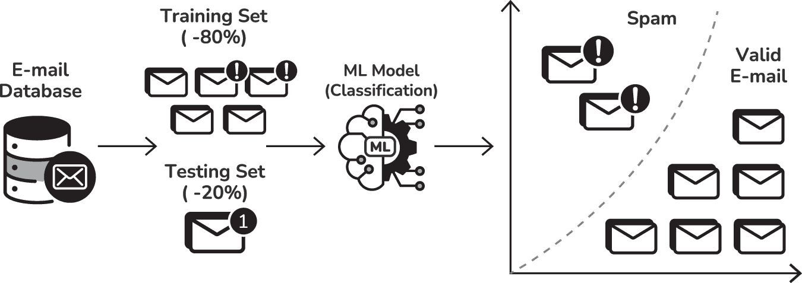

**Figure 8-1:** An illustration of a spam filter, a classic example of an AI classification model. The model analyzes an incoming email and automatically categorizes it as either 'spam' or 'not spam' based on learned patterns.

### 聚类：发现隐藏的群组

**它是什么：** 将相似的数据点分组在一起，*没有* 预定义的类别。就像是在你的数据中发现自然分组。

**何时使用：** 当你想要了解数据的底层结构、发现隐藏的细分市场，或识别异常时。

**示例：** 

* **客户细分：** 根据客户的行为、人口统计或购买模式，将客户群划分为不同的组，*不* 预先定义这些组，如 图 8-2 所示。这允许更有针对性的营销和个性化体验。（这是 `unsupervised learning` 的典型示例。）
* **识别用户角色：** 根据用户与产品的交互发现不同类型的用户，即使你之前没有明确定义这些角色。
* **分组相似产品：** 在电子商务环境中，根据产品的功能、描述或客户评论将产品分组，即使它们不属于同一预定义类别。


**Figure 8-2:** An illustration of customer segmentation, a common application of unsupervised learning. The model identifies hidden patterns in user data to automatically group customers into distinct segments, enabling more targeted product strategies and personalized experiences.

### 生成：创造新事物

**它是什么：** 使用 AI，特别是大型语言模型（LLM），创建新内容，例如文本、图像、音频，甚至代码。为此，这些模型首先将大量信息分解为称为 token 的较小片段——例如单词或单词的一部分。通过学习这些 token 之间的统计关系，模型随后可以生成新的、原创的内容。Figure 8-3 说明了处理文本的这一初始步骤。这是 AI 从分析转向创造的地方。

**何时使用：** 当你需要自动化内容创建、大规模个性化内容，或为用户提供创意协助时。

**示例：** 

* **生成营销文案：** 创建广告标题、电子邮件主题行或产品描述的变体。
* **总结文本：** 将长文章、文档或客户支持对话浓缩为简洁的摘要。
* **创建个性化电子邮件回复：** 根据电子邮件内容起草对客户询问的回复。
* **生成代码片段：** 通过基于所需功能的自然语言描述生成代码，帮助开发人员。
* **创建图像变体：** 基于现有图像或文本描述。

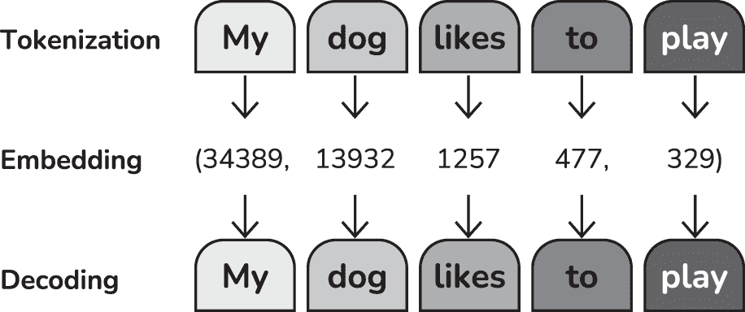

**Figure 8-3:** A simplified view of how LLMs process text. Input text is first broken down into smaller units called “tokens” and then converted into numerical “embeddings” before being used by the model to generate new content.

### 推荐：引导选择

**它是什么：** 根据用户的过去行为、偏好或相似用户的行为，向用户推荐相关项目或内容。这种常见的方法，称为协同过滤，如 Figure 8-4 所示。

**何时使用：** 当你想要提高参与度、促进销售，或帮助用户发现新内容或功能时。

**示例：** 

* **产品推荐：** 根据用户的过去购买或浏览历史，推荐用户可能感兴趣的产品（例如亚马逊的“购买此商品的客户还购买了……”功能）。
* **内容推荐：** 根据用户的过去消费模式推荐文章、视频或音乐（例如 Netflix 或 Spotify）。
* **功能推荐：** 根据用户的当前任务或工作流程，推荐用户可能发现有帮助的产品功能。

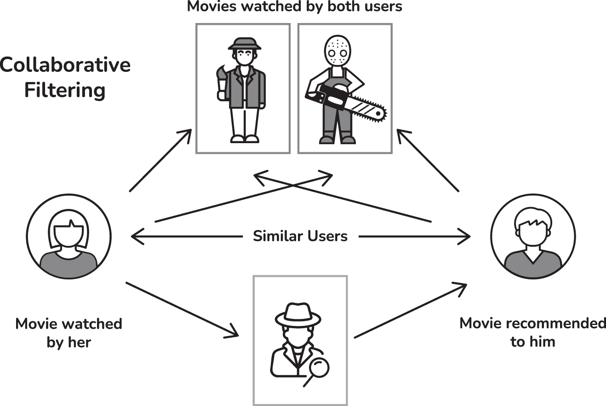

**Figure 8-4:** Collaborative filtering is a method used in recommendation systems that predicts a user's preferences by analyzing the preferences of other users with similar tastes.

### 异常检测：发现异常

**它是什么：** 识别与常态显著偏离的数据点。就像是发现离群值或例外情况，如 Figure 8-5 所示。

**何时使用：** 当你需要检测欺诈、识别系统错误，或标记异常行为时。

**示例：** 

* **欺诈交易检测：** 识别可能表明信用卡交易欺诈的异常消费模式。


*   `System Monitoring`: 检测服务器或网络上的异常活动，这些活动可能表明存在安全漏洞或系统故障。

*   `Manufacturing Defect Detection`: 基于传感器数据或图像分析，识别偏离质量标准的产品。

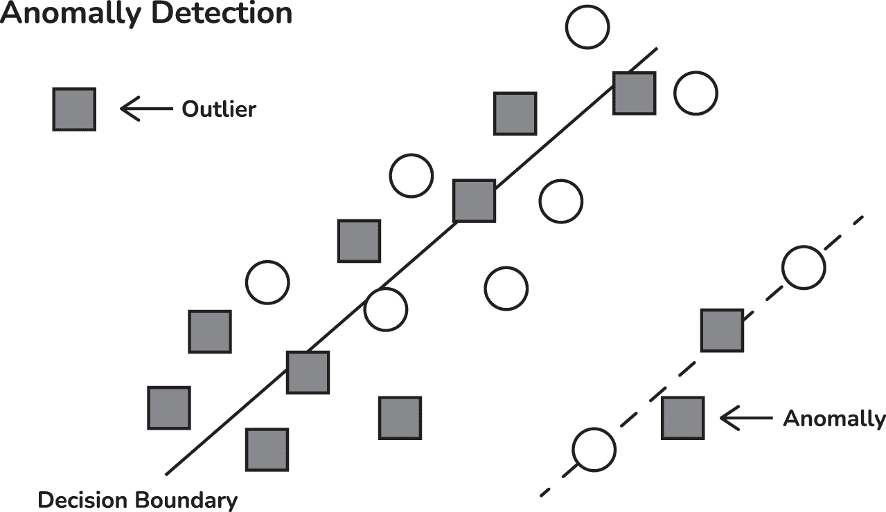

**Figure 8-5:** 异常检测示例。该模型学习“正常”数据点的模式，并标记任何显著偏离该模式的异常值，这种技术对于欺诈检测或系统监控等任务非常重要。

### Matching Capabilities to Problems: A Practical Approach

Here's a simple way to think about matching capabilities to problems:

| IF THE PROBLEM INVOLVES… || CONSIDER THESE AI/ML CAPABILITIES… |

| --- | --- |

| Forecasting or predicting || Prediction models (e.g., regression, time series analysis) |

| --- | --- |

| Categorizing data || Classification models (e.g., logistic regression, decision trees, support vector machines, neural networks) |

| Grouping similar data points || Clustering models (e.g., K-means, hierarchical clustering) |

| Generating new content || Generative AI models (e.g., LLMs, GANs) |

| Personalizing experiences || Recommendation systems (collaborative filtering, content-based filtering) |

| Identifying unusual patterns || Anomaly detection models (e.g., one-class SVM, isolation forest) |

| Understanding natural language || Natural Language Processing (NLP) techniques (e.g., sentiment analysis, topic modeling, named entity recognition, question answering) |

This table provides a helpful starting point, but the real power often comes from combining these capabilities. A single, sophisticated product feature rarely relies on just one AI technique; instead, it layers multiple approaches to solve a complex user problem. Understanding how these techniques can be woven together is key to envisioning truly innovative solutions.

Let's break down a few common product features to see how this works in practice:

#### Feature: Search Functionality in a Document Management System

The core user problem is finding relevant documents quickly, especially when users can't remember the exact title or keywords. A truly intelligent search feature addresses this by creating a multi-layered, responsive experience that understands what the user is truly looking for. To achieve this, it combines:

*   `NLP`: To understand the `intent` and `meaning` behind a user's query, not just matching keywords.

*   `Recommendation`: To proactively suggest other relevant documents based on the user's search history and the content they've previously viewed.

*   `Classification`: To work behind the scenes, automatically categorizing documents to power the search filters that help users narrow their results.

#### Feature: Customer Support Chatbot

Modern chatbots are designed to solve the business problem of high ticket volumes and slow response times by providing immediate, 24/7 assistance. An effective chatbot seamlessly blends several AI techniques to understand and respond to users effectively. These include:

*   `NLP`: To understand the nuances of a user's question, even when phrased in different ways.

*   `Classification`: To instantly categorize the support ticket (e.g., “technical issue,” “billing question”) to begin routing it correctly.

*   `Generative AI`: To provide an immediate, helpful response for common, well-defined questions.

*   `Sentiment Analysis`: To detect if a user is becoming frustrated, allowing the system to adjust its tone or escalate the issue to a human agent more quickly.

#### Feature: Reporting Dashboard for Marketing Campaigns

Marketers often spend an enormous amount of time manually sifting through data to find insights. An AI-enhanced dashboard transforms this workflow by automating analysis and proactively surfacing key information. This is accomplished by layering several capabilities:

*   `Prediction`: To forecast future campaign performance, helping marketers adjust their strategies before a campaign ends.

*   `Clustering`: To automatically segment users based on their response to the campaign, revealing valuable target audiences that might have been missed.

*   `Anomaly Detection`: To flag unusual patterns, like a sudden drop in click-through rates, which prevents wasted ad spend and alerts marketers to potential problems.

*   `Generative AI`: To create natural language summaries of the key findings, turning raw data into actionable, easy-to-understand insights.

By understanding these core AI/ML capabilities and how they map to different types of problems, you can start to think more strategically about how to leverage AI to enhance your product. This “toolkit” approach empowers you to collaborate effectively with your engineering team and build truly innovative AI-powered features. You will be able to have conversations that are way more productive and understand what engineers propose.

## Finding AI Opportunities in the User Journey

Understanding your users' journey—every step they take within your product or feature—is fundamental to good product management. Now, we're going to layer on an “AI lens” to that understanding. This means analyzing each step of the user journey, not just from a usability perspective, but also from the perspective of *how AI/ML could potentially improve, automate, or personalize that step*. Think of yourself as a user experience architect, now equipped with AI-powered tools.

### Mapping the User Journey: Charting the Course

Before you can analyze the journey through an AI lens, you first need to have a clear and detailed map of that journey. Creating a user journey map is a fundamental product management exercise that involves deconstructing the user's experience into a structured, visual format. This map becomes the canvas upon which we will later identify opportunities for AI-driven enhancements.

The process can be broken down into three initial steps:

1.  **Visualize the User's Path:** Start by creating a clear, visual map of the typical user journey for your feature or product. This could be a simple flowchart, a user journey map, or any other visualization that helps you see the complete process from the user's perspective. Include *every* step, no matter how small.

2.  **Identify All Touchpoints:** Mark each point where the user interacts with your product. This includes clicks, taps, form submissions, searches, page views—any action the user takes.

3.  **Document User Goals:** For each step, clearly define what the user is trying to *achieve*. What is their goal at that particular point in the journey?

A user journey map doesn't need to be overly complex to be effective. The following table provides a simple but powerful way to break down the user journey for a common scenario: a customer landing on an e-commerce product page.

| STEP || USER ACTION || USER GOAL || POTENTIAL PAIN POINTS |

| --- | --- | --- | --- |

| 1 || Arrives on product page. || Learn about the product, decide if to buy it. || Overwhelmed by information, can't find key details. |

| --- | --- | --- | --- |

| 2 || Scrolls through images. || See the product from different angles. || Images are low quality or don't show key features. |

| --- | --- | --- | --- |

| 3 || Reads description. || Understand product features and benefits. || Description is unclear, too technical, or too long. |

| --- | --- | --- | --- |

| 4 || Reads reviews. || See what other customers think. || Reviews are unhelpful, irrelevant, or overwhelming. |

| --- | --- | --- | --- |

| 5 || Selects size/color. || Choose desired product options. || Options are confusing or out of stock. |


| 6 || 添加到购物车。 || 准备购买产品。 || 过程缓慢或复杂。 |

| 7 || 进入结账流程。 || 完成购买。 || 结账流程冗长或令人困惑。 |

如表所示，通过将流程分解为这些不同的步骤，你可以清晰地识别每个阶段的用户目标和潜在痛点。这张详细的地图是我们分析的基础。

例如，考虑步骤 4：阅读评论。用户的目标是快速从他人的经验中了解产品质量，但痛点是被数百条无关或无帮助的评论所淹没。这个特定的摩擦点非常适合 AI 驱动的解决方案。AI 能否总结最常见的主题？它能否突出最有帮助的正面和负面评论？这就是“AI 镜头”所能实现的这种有针对性、以问题为导向的思维方式，我们将在下一节中探讨。

### 识别痛点和机会：AI 侦探工作

在绘制用户旅程图后，是时候戴上你的 AI 侦探帽了。在 *每个* 步骤，问自己这些关键问题：

| 问题 || 关注领域 || 潜在 AI/ML 解决方案 |

| --- | --- | --- |

| 用户在哪里遇到摩擦？ || 可用性、挫败感 || 简化工作流程，提供智能协助，提供个性化指导。 |

| --- | --- | --- |

| 用户在哪里花费了过多时间？ || 效率、自动化 || 自动化重复任务，提供快捷方式，简化流程。 |

| --- | --- | --- |

| 哪里可以由 AI 自动化任务？ || 自动化、效率 || 使用 ML 进行数据录入、分类或内容生成等任务。 |

| --- | --- | --- |

| 哪里可以由 AI 提供智能协助？ || 指导、支持 || 提供主动帮助，建议相关信息，提供个性化推荐。 |

| --- | --- | --- |

| 哪里可以由 AI 个性化体验？ || 相关性、参与度 || 根据用户行为、偏好或人口统计信息定制内容、推荐或交互。 |

| --- | --- | --- |

| 用户在哪里做出决策？ || 决策支持 || 提供数据驱动的洞察，预测结果，推荐最佳选择。 |

| --- | --- | --- |

| 用户在哪里输入数据？ || 数据录入、准确性 || 使用 NLP 进行文本输入，使用图像识别进行图像输入，或使用语音识别进行语音输入。 |

| --- | --- | --- |

| 用户在哪里搜索信息？ || 信息检索 || 使用 NLP 改进搜索结果，提供上下文信息，提供主动建议。 |

### 应用 AI/ML 增强接触点：转变

现在，让我们将这些痛点和机会与特定的 AI/ML 功能联系起来。以下是一些示例，建立在增强用户旅程中各种接触点的理念之上：

*   **个性化引导：** 

    *   **场景：** 新用户通常难以理解如何使用复杂的产品。

    *   **AI/ML 解决方案：** 分析用户在引导过程中的行为（他们探索哪些功能，在哪里卡住）并动态调整引导流程。根据他们的需求和学习风格，提供个性化教程、工具提示，甚至引导式参观。这使用 *监督学习* 来预测用户需要什么帮助。

*   **智能协助：** 

    *   **场景：** 用户正在填写复杂的表单。

    *   **AI/ML 解决方案：** 在用户输入时提供实时协助，使用 *NLP* 理解上下文并提供建议、自动完成字段或验证输入。这可以显著减少错误并提高完成率。

*   **自动化任务完成：** 

    *   **场景：** 用户反复执行相同的操作序列。

    *   **AI/ML 解决方案：** 学习这些常见的工作流程并提供自动化它们的选项。例如，在项目管理工具中，如果用户总是将某类任务分配给同一团队成员，系统可以学习此模式并在未来自动分配这些任务。这使用 *强化学习* 或 *监督学习*。

*   **个性化推荐：** 

    *   **场景：** 用户正在浏览大量产品或内容目录。

    *   **AI/ML 解决方案：** 使用 *推荐系统*（协同过滤或基于内容的过滤）根据用户的过去行为和相似用户的行为，推荐与用户兴趣相关的项目。

*   **预测性操作：** 

    *   **场景：** 用户经常忘记执行重要操作。

    *   **AI/ML 解决方案：** 使用预测模型来预判用户需求并采取主动操作。例如，如果用户通常将文档保存到特定文件夹，系统可以自动将该文件夹建议为默认保存位置。或者，如果用户经常购买的商品即将用完，系统可以主动提供重新订购服务。

*   **上下文信息：** 

    *   **场景：** 用户正在查看复杂的数据可视化。

    *   **AI/ML 解决方案：** 使用 *NLP* 和 *数据分析* 自动生成标题或摘要，解释可视化中的关键洞察，使用户更容易理解数据。

*   **错误预防：** 

    *   **场景：** 用户正在输入需要符合特定规则或约束的数据。

    *   **AI/ML 解决方案：** 使用 *异常检测* 或 *分类* 实时识别潜在错误，并向用户提供即时反馈，在错误发生之前防止错误。

为了了解这些不同的增强类型如何结合在一起，让我们重新审视我们之前映射的电子商务产品页面示例。通过对我们之前映射的用户旅程的每个步骤应用“AI 镜头”，我们可以为每个识别出的痛点头脑风暴特定的 AI 驱动解决方案。下表演示了这一过程，将每个步骤与潜在的 AI 增强和所需的底层功能联系起来。

| 步骤 || 用户操作 || 用户目标 || 潜在痛点 || AI/ML 增强机会 || AI/ML 功能 |

| --- | --- | --- | --- | --- | --- |

| 1 || 到达产品页面。 || 了解产品，决定是否购买。 || 信息过载，找不到关键细节。 || AI 驱动的产品摘要，突出关键功能和优势。 || 生成 (LLM)。 |

| --- | --- | --- | --- | --- | --- |

| 2 || 浏览图片。 || 从不同角度查看产品。 || 图片质量低或未显示关键功能。 || AI 驱动的图像增强；自动生成 3D 模型或虚拟试穿。 || 生成，计算机视觉。 |

| --- | --- | --- | --- | --- | --- |

| 3 || 阅读描述。 || 了解产品功能和优势。 || 描述不清楚、过于技术化或过长。 || AI 驱动的产品描述重写，以提高清晰度和简洁性；基于用户细分的个性化描述。 || 生成 (LLM)，个性化。 |

| --- | --- | --- | --- | --- | --- |

| 4 || 阅读评论。 || 查看其他客户的看法。 || 评论无帮助、无关或过多。 || AI 驱动的评论情感分析；关键优缺点总结；虚假评论识别。 || NLP，异常检测。 |

| --- | --- | --- | --- | --- | --- |

| 5 || 选择尺寸/颜色。 || 选择所需的产品选项。 || 选项令人困惑或缺货。 || 基于过去购买或浏览历史的 AI 驱动尺寸/颜色推荐；实时库存预测。 || 推荐，预测。 |

| --- | --- | --- | --- | --- | --- |

| 6 || 添加到购物车。 || 准备购买产品。 || 过程缓慢或复杂。 || 简化的“添加到购物车”流程，带有 AI 驱动的相关产品建议。 || 推荐。 |

| --- | --- | --- | --- | --- | --- |

| 7 || 进入结账流程。 || 完成购买。 || 结账流程冗长或令人困惑。 || AI 驱动的表单填充；欺诈检测；个性化支付选项。 || NLP，异常检测，预测。 |


从表格中可以看出，用户旅程中几乎每个步骤都包含 AI 驱动增强的机会。让我们回到我们特定的步骤 4：阅读评论。我们识别了用户的痛点：被过多的评论压得喘不过气来。表格通过结合多种 AI 能力，展示了一条清晰的前进路径。我们可以使用 NNLP 进行情感分析，然后使用生成式 AI 创建评论中最常见的“优点”和“缺点”的简洁摘要。我们甚至可以叠加异常检测来标记并隐藏潜在的虚假或无用评论。

这种详细的、逐步的分析将模糊的想法转化为具体、可操作的 AI 功能概念。这是每个 AI-Experiences PM 的基本过程。

## 通过 AI/ML 增强功能——转变现有功能

有时，利用 AI 最具影响力的方式不是构建完全新的东西，而是让你 `already have` 的东西变得显著更好。可以把它比作升级汽车的发动机——你并没有改变汽车的根本目的，但你正在显著提升其性能和能力。本节重点介绍如何使用 AI/ML 来 `supercharge` 你的现有功能，使其更智能、更高效、更易于使用。

这种方法有几个优势：

*   **Faster Time to Value:** 你正在基于现有基础设施和用户熟悉度进行构建，减少开发时间和用户采用障碍。

*   **Lower Risk:** 你正在改进经过验证的功能，而不是从头开始，这降低了失败的风险。

*   **Targeted Improvements:** 你可以专注于现有功能中的特定痛点或限制，提供有针对性且可衡量的改进。

### 识别增强机会：找出薄弱环节

成功功能增强的关键是识别现有功能在哪些方面表现不佳或可以显著改进。以下是一种系统的方法：

1.  **Analyze User Feedback:** 深入研究用户评论、支持工单、调查以及任何其他反馈渠道。寻找重复出现的投诉、痛点以及用户遇到困难的领域。

2.  **Examine Usage Data:** 分析用户如何与你的功能进行交互。他们是否按预期使用？是否存在流失点、错误或困惑的迹象？

3.  **Benchmark Against Competitors:** 你的功能与竞争产品中的类似功能相比如何？是否存在竞争对手提供更好用户体验的领域，可能是通过 AI 实现的？

4.  **Ask “What If?” Questions:** 想象你拥有完美的信息和无限的处理能力。你如何改进这个功能？这有助于你超越渐进式改进，识别出变革性变化的机会。

要将这些方法付诸实践，询问关于你产品的具体、有针对性的问题会很有帮助。下表提供了一组起始问题，按常见功能领域分类，以指导你的头脑风暴，并帮助你发现 AI 驱动增强的隐藏机会。

| 功能领域 || 识别增强机会的问题 |

| --- | --- |

| 搜索 || 用户能否快速轻松地找到所需内容？搜索结果是否相关？用户是否在处理复杂查询时遇到困难？ |

| --- | --- |

| 数据录入 || 用户是否会出错？数据录入是否耗时或枯燥？数据验证是否有效？ |

| 导航 || 用户是否会迷路？他们是否难以找到特定的功能或信息？是否有可以优化的常见导航路径？ |

| 报告/分析 || 用户能否轻松从数据中提取洞察？报告是否清晰且可操作？用户是否花费过多时间创建报告？ |

| 个性化 || 用户是否收到相关的内容和推荐？是否有机会根据个人需求定制体验？ |

| 通信（例如，电子邮件、消息传递） || 通信是否高效有效？用户是否难以管理大量消息？是否有自动化的机会？ |

这种基于问题的方法有助于将一般观察转化为具体、可操作的问题陈述。例如，与其仅仅知道“报告很难”，不如问“用户能否轻松从数据中提取洞察？”，这迫使你去调查特定的用户困难。你可能会发现，用户正在将数据导出到电子表格中手动创建图表——这是一个明确的信号，表明 AI 驱动的洞察生成或自动摘要功能可以提供巨大的价值。找出这些“薄弱环节”是主要目标；下一步是将它们与合适的 AI 能力相匹配。

### 应用 AI/ML 增强功能：转变过程

在确定了需要改进的具体领域后，你现在可以考虑不同的 AI/ML 能力如何解决这些限制。以下是 AI/ML 增强现有功能的一些常见方式：

| 增强领域 || 描述 || AI/ML 能力 || 示例（任务管理工具） |

| --- | --- | --- | --- |

| 提高准确性 || 使预测、分类或其他数据驱动的任务更加精确 || 监督学习（分类、回归）、计算机视觉、NLP || 基于历史数据和任务复杂度，提高任务到期日预测的准确性 |

| --- | --- | --- | --- |

| 提高效率 || 自动化重复性任务并简化工作流程，节省用户时间和精力 || 监督学习（分类）、NLP、由 AI 驱动的机器人流程自动化（RPA） || 根据任务描述自动分类任务，将其分配给相应的团队成员，或设置优先级 |

| 增强个性化 || 根据个人需求和偏好定制用户体验，使产品更加相关和吸引人 || 推荐系统、监督学习、无监督学习（聚类） || 根据过去的协作和项目上下文，为任务建议相关的协作者 |

| 主动协助 || 在用户明确请求之前，预判用户需求并提供帮助或指导 || 监督学习（预测）、强化学习、NLP || 预测项目中的潜在障碍并主动提出解决方案 |

| 上下文理解 || 使功能能够更好地理解用户操作和数据的上下文，从而做出更智能、更相关的响应 || NLP、计算机视觉、深度学习 || 理解任务管理工具中用户搜索查询的含义，而不仅仅是匹配关键词 |

| 错误减少 || 检测并自动纠正或建议纠正 || 监督学习、异常检测 || 自动修复任务描述中的拼写错误 |

为了用具体示例说明这些增强领域，让我们考虑几种常见的功能类型以及 AI/ML 如何转变它们：

#### `Feature: Standard Search Functionality`

传统基于关键词的搜索的问题在于，如果用户没有使用文档中存在的精确术语，他们通常很难找到相关信息。AI/ML 提供了一个强大的解决方案：

*   **增强：** 使用 NLP 实现语义搜索。搜索引擎理解用户查询的含义和文档的内容，而不仅仅是匹配关键词。

*   **优势：** 这将带来更相关的结果，即使用户的查询不包含文档中使用的精确单词。

#### `Feature: Data Entry Form`

用户在手动填写冗长表单时经常会感到沮丧并引入错误。AI/ML 可以通过以下方式显著改善这种体验：

*   **自动填充字段：** 根据之前的输入和上下文预测用户即将输入的内容。


*   **实时验证数据：** 在用户输入时识别潜在错误（例如，日期格式不正确、电子邮件地址无效）并提供即时反馈。

*   **建议值：** 基于其他字段中输入的数据。

#### 功能：报告仪表板

从充满原始数据的仪表板中提取有意义的洞察可能既耗时又具有挑战性。AI/ML 可以通过以下方式赋能用户：

*   **自动生成摘要：** 提供关键趋势和模式的简洁文本摘要。

通过专注于功能增强，您可以利用 AI/ML 快速高效地为用户提供显著价值。这种方法让您能够在现有成功的基础上进行构建，解决已知痛点，并创建更智能、更易于使用的产品。您还可以收集数据，这些数据未来可能有助于构建其他 AI 驱动的功能。

## 主动式产品管理——利用 AI 预判用户需求

AI/ML 最具变革性的方面之一，是其能够将产品管理从 *被动* 转向 *主动*。与其在用户需求出现 *后* 才做出反应，不如利用 AI *预判* 这些需求，并在用户意识到自己有问题之前提供解决方案。本节重点介绍如何识别利用 AI 预测和自动化能力的机会，以创建真正智能且易于使用的产品。您可以将其视为成为一名主动而非被动的产品经理。

### 了解预测与自动化的力量

要成为真正主动的产品经理，您必须学会利用 AI 提供的两种最强大的能力来预判用户需求。这两种能力分别是预测未来事件的能力和自动化复杂流程的能力。了解每种能力的工作原理，是识别您自己产品中这些变革性机会的第一步。

*   **预测能力：** 想象一下，您的产品可以“看到未来”，不是指魔法意义上的，而是指数据驱动的方式。通过分析历史数据并识别模式，AI/ML 模型可以预测未来事件、用户行为或潜在问题。这使您能够：

    *   **预测用户行为：** 预测用户接下来可能会做什么，从而个性化体验并提供相关推荐。

    *   **预判潜在问题：** 在风险、瓶颈或问题 *影响用户之前* 识别出来。

    *   **主动提供解决方案：** 在用户甚至还未提出请求之前，提供帮助、指导或资源。

*   **自动化能力：** AI/ML 可以接管重复性、耗时的任务，让用户能够专注于更具战略性和创造性的工作。这不仅仅是关于效率，更是关于让您的产品使用起来感觉 *轻松*。自动化可以：

    *   **简化工作流：** 消除不必要的步骤并简化复杂流程。

    *   **减少错误：** 自动化容易出现人为错误的任务。

    *   **提高效率：** 让用户在更短的时间内完成更多工作。

### 预测与自动化机会的关键领域

现在我们了解了预测和自动化的概念，让我们探讨如何将它们应用于真实产品。为了使这些想法具体化，我们将在以下表格中始终使用一个熟悉的示例：现代日历应用程序。通过检查该应用中的不同区域，我们可以看到如何将各种 AI 能力叠加，以创建真正主动且智能的用户体验。

| 区域 | 描述 | AI/ML 能力 | 示例（日历应用） |
| --- | --- | --- | --- |
| 主动协助 | 在用户明确请求之前提供帮助或指导。 | 预测、NLP、分类 | 预测用户可能会重复预订，并在他们确认新预约之前发出警告。 |
| 个性化推荐 | 根据用户行为和偏好推荐相关内容、功能或操作。 | 推荐系统、聚类、预测 | 根据与会者过去的排期模式和可用性，推荐最佳会议时间。 |
| 自动化工作流 | 自动化用户经常执行的任务序列。 | 监督学习（分类）、强化学习 | 根据电子邮件或消息自动创建会议邀请，提取日期、时间和与会者。 |
| 预测性维护 | 预测并防止系统故障或性能问题。（更多与基础设施/硬件相关，但为了完整性而包含。） | 异常检测、时间序列分析、预测 | N/A（不直接适用于日历应用，但在其他情境中相关，例如预测基于云的日历服务的服务器负载。） |
| 智能排期 | 优化排期和资源分配以提高效率。 | 优化算法、强化学习、预测 | 自动找到最佳会议时间，以容纳所有参与者的排期和偏好（例如，偏好的会议时间、时区）。还可以优化旅行时间并建议会议地点。 |
| 智能默认值 | 预测用户偏好并相应设置默认值。 | 预测、分类 | 根据用户过去的会议或会议类型，自动设置默认会议时长。 |
| 错误预防 | 预测并避免用户错误。 | 预测、异常检测 | 如果用户在已完全预订的日期安排会议，它会自动通知用户。 |

正如日历应用示例所显示，“主动”产品通常是许多小型智能部分的总和。它很少涉及单一的“预测”功能，而是关于将众多微功能（如智能默认值、主动警告和自动化工作流）编织到核心用户体验中。作为产品经理，您的目标是在整个用户旅程中识别这些潜在的增强时刻。下一节提供了一种实用的、分步骤的方法，帮助您做到这一点。

### 识别机会：实用方法

以下是识别预测和自动化机会的分步骤方法：

1.  **重新审视用户旅程：** 回到您的用户旅程地图（来自第 3 节，“绘制用户旅程：规划航线”）。对于每个步骤，问：“我们能预测用户接下来会需要或做什么吗？”以及“我们能自动化这一步骤的任何部分吗？”

2.  **再次分析用户数据：** 寻找用户行为中的模式，这些模式暗示了预测或自动化的机会。

    *   **频繁的操作序列：** 用户是否反复执行同一系列步骤？这是自动化的绝佳候选。

    *   **常见错误：** 用户是否经常犯同样的错误？这可以通过主动协助或错误预防来解决。

    *   **延迟或沮丧的点：** 用户在哪里卡住或花费过多时间？这可能表明需要智能协助或自动化。

3.  **头脑风暴“如果……会怎样”的场景：** 想象您的产品能够完美预判用户需求。那会是什么样子？哪些任务会被自动化？哪些信息会被主动提供？

    *   **优先考虑高影响力领域：** 专注于对用户体验和业务目标产生最大积极影响的机会。考虑以下因素：

    *   **任务频率：** 自动化频繁执行的任务将比自动化罕见任务产生更大的影响。

    *   **痛点严重程度：** 解决主要痛点将比解决小不便更有价值。

    *   **实施可行性：** 考虑实施不同解决方案所需的数据要求和技术复杂性。


通过专注于预测和自动化，你可以将产品从被动工具转变为主动伙伴，预判用户需求并提供更加无缝、高效且愉悦的体验。`AI/ML` 正是能够大放异彩的地方，能够创造出直观且近乎神奇的产品。这种方法让产品经理从功能构建者转变为战略合作伙伴。

## 负责任的人工智能基础——伦理与可行性考量

在全身心投入实施 `AI/ML` 解决方案之前，退后一步，审视你想法的伦理影响和实际可行性至关重要。这不仅仅是打勾完成任务，而是关于负责任且可持续地构建人工智能。如果不及早解决这些问题，可能会导致代价高昂的错误，损害产品声誉，甚至带来法律后果。可以将此视为为人工智能项目打下坚实基础——你不会在不稳固的地基上建造房子，对吧？

作为产品经理，你既是用户的倡导者，也是业务的倡导者。这意味着你有责任确保人工智能的使用既有益又合乎伦理。

### 伦理考量：“不造成伤害”原则

人工智能有潜力带来巨大的益处，但也可能造成重大伤害，往往并非出于本意。作为产品经理，你有责任从一开始就主动识别并缓解这些伦理风险。为了使这些概念具体化，我们将通过一个假设的求职推荐系统来探讨它们。下表列出了你在产品发现初期必须解决的关键伦理问题。

| 伦理问题 | 描述 | 产品经理的关键问题 | 示例（求职推荐系统） |
| --- | --- | --- | --- |
| 偏见与公平性 | AI 模型可能会延续并放大其训练数据中存在的偏见，导致不公平或歧视性的结果。 | * 此 `AI/ML` 应用程序是否会对任何特定用户群体造成不利影响或歧视？<br>* 我们可以采取哪些措施来减轻数据和模型中的潜在偏见？<br>* 部署后我们将如何监控系统中的偏见？ | 如果训练数据反映了就业市场的历史偏见，系统可能会向女性或少数群体推荐更少的高薪工作。 |
| 隐私 | AI 通常依赖于收集和分析用户数据，引发了对隐私和数据安全的担忧。 | * 我们将收集哪些数据，以及如何使用？<br>* 我们将如何确保遵守数据隐私法规（例如 `GDPR`、`CCPA`）？<br>* 我们将如何对用户的数据实践保持透明？<br>* 在实现目标的同时，如何尽量减少数据收集？ | 系统收集和分析用户的浏览历史、简历数据和申请历史，引发了对敏感个人信息隐私的担忧。 |
| 透明度与可解释性 | 用户应了解 AI 在产品中是如何被使用的，以及为什么做出某些决定，尤其是当这些决定影响到他们时。 | * 我们如何以清晰易懂的方式向用户解释 `AI/ML` 系统的决策？<br>* 对于此应用程序，“黑盒”模型是否可接受，还是我们需要更具可解释性的模型？<br>* 当 AI 做出不正确或意外的决定时，我们将如何处理？ | 系统向用户推荐特定工作，但不解释为何选择该工作，使用户难以理解推荐。 |
| 潜在滥用 | 考虑你的 AI 驱动功能可能会以你未预料的方式被使用，从而造成潜在伤害。 | * 滥用或意外后果的潜在风险是什么？<br>* 我们如何通过设计、监控或保障措施来降低这些风险？ | 系统可能被恶意行为者用于创建虚假招聘信息或歧视某些申请人。 |
| 责任归属 | 谁负责确保一切按预期运行？ | * 谁将负责创建 AI？<br>* 如果出了问题，谁负责？ | 系统由第三方构建。使用的模型已过时，导致 `LLM` 提供的数据出现问题。 |

该表表明，伦理 AI 开发并非抽象目标，而是一系列实际问题和权衡。在开发开始前提出这些问题，你将从被动的“损害控制”心态转变为主动的“负责任设计”心态。解决这些伦理问题是方程式的第一部分。接下来，我们必须考虑构建解决方案的实际可行性。

### 可行性考量：我们真的能构建这个吗？

除了伦理考量之外，你还需要评估 `AI/ML` 项目的实际可行性。这涉及评估你的数据、资源和技术能力。为了系统地评估你是否能（以及是否应该）构建拟议的 AI 解决方案，评估几个关键领域非常重要。下表提供了一个关键问题框架——涵盖数据、资源和范围——每个产品经理在 AI 项目获得批准前都应考虑。

| 可行性因素 | 描述 | 产品经理的关键问题 |
| --- | --- | --- |
| 数据可用性和质量 | AI 模型需要高质量数据才能有效学习。 | * 我们是否有权访问训练模型所需的正确数据？它是否与问题相关？<br>* 数据是否干净、准确且具有代表性？还是我们需要投入大量时间和精力进行数据清洗和准备？<br>* 我们有多少数据，足以训练一个强大的模型吗？ |
| 数据可访问性 | 即使数据存在，也需要以可用于训练的格式存储。 | * 数据是否以我们可以轻松访问和使用的方式存储？<br>* 我们是否拥有处理数据所需的工具和基础设施？<br>* 是否有任何技术限制可能阻止我们使用数据？ |
| 数据使用权利 | 你需要确保有权将数据用于 `AI/ML` 目的。 | * 我们是否拥有将此数据用于 `AI/ML` 训练和部署所需的许可和同意？<br>* 是否有任何隐私法规或合同义务需要考虑？ |
| 技术资源 | `AI/ML` 开发需要专业技能和基础设施。 | * 我们是否拥有构建和部署此解决方案所需的内部专业知识（数据科学家、机器学习工程师）？还是我们需要雇佣或外包？<br>* 我们是否拥有训练和运行模型所需的计算资源（例如 GPU、云计算）？ |
| 项目范围 | 从小处着手并进行迭代。避免一开始就构建过于雄心勃勃的 AI 解决方案。 | * 我们能否将此项目分解为更小、更易管理的阶段？<br>* 此 `AI/ML` 功能的最小可行产品 (`MVP`) 是什么？我们可以首先交付的核心功能是什么？ |

通过在构思过程中早期主动解决这些伦理和可行性问题，你可以显著提高构建成功且负责任的人工智能产品的可能性。这种前期的尽职调查投资将为你节省时间、资源和未来可能遇到的麻烦。它还为与用户建立信任并通过 AI 举措创造积极影响奠定了坚实基础。你正在为团队的每一项行动都与目标保持一致做好准备。

## AI/ML 用例的实用构思技巧——像 AI 优先的产品经理一样思考


你现在已对 AI/ML 功能、用户旅程分析、功能增强以及伦理和可行性考量的重要性有了扎实的理解。是时候将所有内容整合起来，为你的产品开始头脑风暴具体的 AI/ML 用例了。本节提供一系列实用的构思技巧，旨在帮助你以具有“AI 优先”思维的产品经理视角进行思考——即主动寻找利用 AI 解决用户问题并创造创新解决方案的机会。

这并非强行将 AI 融入你的产品，而是深思熟虑地探索 AI 如何提升用户体验并实现你的产品目标。

## 构思技巧：释放你的 AI 创造力

以下是几种用于头脑风暴 AI/ML 用例的结构化方法。

### “AI 功能风暴”：头脑风暴

这种技巧的目标是生成大量 AI/ML 功能创意，侧重于广度而非深度。在这个阶段，不必担心可行性；只需让创意自由流动！

要开始，选择一个特定的关注领域，例如用户问题或某个特定功能，并设定一个时间限制（例如，15–30 分钟）。然后，个人或团队使用诸如“AI/ML 如何自动化此任务？”或“AI/ML 如何个性化此体验？”等提示，尽可能多地头脑风暴 AI/ML 功能创意。关键是不加评判地记录每个创意。

例如，如果你正在为客户支持功能进行头脑风暴，你的团队可能会跨不同类别生成创意，如下表所示：

| 提示 | 潜在的 AI 功能创意 |
| --- | --- |
| AI/ML 如何自动化此任务？ | 自动分类工单，自动生成常见问题解答，自动将工单分配给代理。 |
| AI/ML 如何个性化此体验？ | 根据用户情感定制回复，根据用户历史个性化知识库推荐。 |
| AI/ML 如何预测用户需求？ | 预测工单数量，预测客户流失，预测工单需要升级的可能性。 |
| 如何提高准确性？ | 使用 LLM 提高聊天机器人回复的准确性。 |
| 如何带来新洞察？ | 分析交互中的文本，了解客户最在寻找什么。 |

### “AI 场景规划”：设身处地为用户着想

这种技巧帮助你探索 AI/ML 如何增强特定的用户场景。首先确定产品中 2–3 个关键场景，然后针对每个场景，记录“之前”（当前体验）和“之后”（AI 增强体验）。

为了说明这一点，让我们考虑一个文件共享功能，并探索不同用户场景如何通过 AI 改进，如下表所示：

| 场景 | AI 之前（当前体验） | AI 之后（改进后的体验） |
| --- | --- | --- |
| 与同事共享大文件 | 用户手动选择文件，选择共享选项（权限、过期时间），输入收件人电子邮件地址，然后发送文件。 | AI 根据过去的协作和文件内容建议相关收件人。AI 根据组织策略和文件的敏感性自动设置适当的共享权限。AI 建议过期时间。 |
| 与团队协作编辑文档 | 用户手动跟踪更改、管理版本并解决冲突。 | AI 自动跟踪更改，突出显示潜在冲突，并建议解决方案。AI 提供每个协作者所做更改的摘要。 |
| 搜索特定文件 | 用户手动使用关键词搜索文件，通常成功率有限。 | AI 驱动的语义搜索理解用户查询的含义和文件内容，提供更相关的结果。AI 根据用户当前任务建议相关文件。 |

### “数据机会映射”：利用你的数据资产

这种方法涉及根据你拥有的可用数据来识别 AI/ML 机会。首先清点产品收集的所有数据类型，然后针对每种数据类型，头脑风暴 AI/ML 如何用于提取洞察、进行预测、生成推荐或自动化任务。最后，将这些潜在应用与用户价值联系起来。

下表提供了这种映射可能的示例：

| 数据类型 | 潜在的 AI 应用 | 用户价值示例 |
| --- | --- | --- |
| 用户活动日志 | 识别用户细分，预测流失，个性化推荐，检测异常（例如，欺诈活动） | 改善用户体验 |
| 客户支持工单 | 分类工单，生成自动回复，识别常见问题，分析情感 | 更快的支持解决 |
| 产品使用数据 | 识别热门功能，了解用户工作流程，个性化引导，预测未来使用模式 | 提高功能采用率 |
| 文本内容（例如，文章、评论） | 总结内容，提取关键主题，翻译语言，生成相关内容 | 更好地理解可用信息 |

### “AI 能力对齐”：匹配游戏

这种技巧帮助你直接将特定的 AI/ML 能力与你已识别的问题和机会相匹配。首先审查你的问题列表，然后针对每个问题，识别可应用的 AI/ML 能力（来自第 2 节，“将能力与问题匹配：实用方法”）。

下表提供了如何将问题与潜在 AI 能力对齐的示例：

| 问题/机会 | 潜在的 AI/ML 能力 |
| --- | --- |
| 改善知识库中的搜索结果 | NLP（语义搜索），推荐系统（建议相关文章），分类（对文章进行分类） |
| 减少客户支持响应时间 | NLP（理解用户查询），生成（自动回复），分类（工单路由），情感分析（优先处理紧急/愤怒的客户） |
| 个性化产品推荐 | 推荐系统（协同过滤，基于内容的过滤），聚类（识别用户细分） |
| 自动化表单中的数据录入 | NLP（预测文本，自动完成），计算机视觉（从图像中提取数据） |

### “AI 驱动的功能逆向工程”：向他人学习

这种最终技巧涉及从其他产品中成功的 AI/ML 功能获取灵感。首先确定你钦佩的 AI 驱动功能，分析它们在高层次上的工作原理，然后考虑如何将这些概念调整或应用到你自己的产品中。

下表提供了如何从知名产品中逆向工程功能的示例：

| 产品 | AI 驱动功能 | 可能的 AI/ML 能力 | 潜在应用到你的产品（例如，项目管理工具） |
| --- | --- | --- | --- |
| Gmail | 智能撰写 | NLP（文本生成） | 在用户输入时建议任务描述、评论或项目更新 |
| Netflix | 个性化推荐 | 推荐系统 | 根据用户当前项目推荐相关协作者、任务或资源 |
| Grammarly | 语法和拼写检查 | NLP（错误检测，纠正） | 在任务描述和评论中提供实时语法和拼写检查 |

## 培养 AI 优先思维

除了这些特定技巧，培养“AI 优先”思维也很重要。这意味着：

* 挑战假设：不断质疑事情为何以某种方式完成，以及 AI/ML 是否能提供更好的方法。

* 拥抱实验：不要害怕尝试新事物并测试 AI/ML 创意，即使它们看起来不寻常。从小规模、低风险的实验开始。


* `Focus on User Value:` 始终优先考虑为用户提供清晰且可衡量价值的 AI/ML 应用程序。不要仅仅为了使用 AI 而使用 AI。

* `Stay Informed:` AI/ML 领域正在快速发展。请努力了解最新的进展和趋势。

* `Collaborate:` 与工程师、设计师和其他利益相关者密切合作。

通过将这些实用的构思技巧与 AI-first 思维相结合，你将能够识别和探索广泛的 AI/ML 机会，转变你的产品并提供卓越的用户体验。你将能够在每个产品和每个任务中看到 AI 机会，无论它多么简单。

## 章节摘要与关键要点

你现在掌握了一套全面的框架，用于在任何产品中发现和评估 AI 机会。本章引导你完成了戴上“AI 镜片”的过程，首先使用 AI 机会发现框架来寻找数据丰富的问题。你学习了如何分析用户旅程、增强现有功能，并使用结构化构思技巧从模糊的想法转向具体的 AI 用例。目标是为你提供一个可重复的流程，以寻找高影响力的问题，其中 AI 可以成为真正具有变革性的解决方案。

### 关键要点

* 你总是从用户或业务问题出发，而不是 AI 技术。你的首要角色是一位有纪律的问题发现者。

* 你分析整个用户旅程，以找到 AI 可以增强的特定摩擦点或机会时刻，使体验更加无缝和智能。

* 你认识到，创造价值可以来自于用 AI 增强现有功能，而不仅仅是从零开始构建全新的 AI 产品。

* 你使用结构化构思技巧（如 AI 功能风暴或数据机会映射）来系统地发现和阐述潜在的 AI 驱动解决方案。

### 接下来：衡量你的想法的价值

一旦你识别出一个有前景的机会，下一个关键步骤就是证明其价值并定义如何衡量其成功。下一章将重点介绍 AI 项目的 ROI 计算，为你提供衡量和展示 AI 举措潜在影响的工具。

WileyPRE

## 第 9 章

## AI 项目的 ROI 计算：衡量影响并展示价值

你已经识别出潜在的 AI 机会；现在是一个非常重要的步骤：弄清楚如何衡量你的 AI 投资的*价值*。这就是我们讨论 AI 项目投资回报率（ROI）的地方。计算 AI 的 ROI 可能比传统软件项目更复杂，但这对于证明投资的合理性、争取资源以及展示你的工作影响至关重要。作为产品经理，你在定义如何衡量成功方面发挥着关键作用。

本章不是关于复杂的财务建模。而是关于建立一个清晰的框架，以理解和量化你的 AI 举措的*影响*。我们将专注于定义正确的指标并建立基线以衡量进度。

### 从模型性能到业务影响：产品经理的 AI 指南

计算 AI 功能的 ROI 不是一个单一的公式；它是一个将模型的技术性能与实际业务结果联系起来的过程。这需要理解两个衡量层面。首先，我们需要评估模型本身——它准确吗？它快吗？这些是*模型性能指标*。其次，我们需要衡量该性能如何影响我们的目标——它是否降低了流失率？它是否增加了收入？这些是*业务结果指标*。

作为产品经理，你非常重要的角色是在这两个层面之间建立桥梁，展示模型性能的改进如何推动真正的业务价值。在本节中，我们将逐步介绍这个衡量框架的基本组成部分。我们将从定义用于评估 AI 模型的具体指标开始，然后讨论基线的重要性，最后探讨如何为你独特的产品环境选择正确的指标。

#### 定义 AI/ML 特定指标：衡量 ROI 的基础

为了准确衡量 AI 的 ROI，你需要超越传统的业务指标（如收入和成本节约），并纳入 *AI/ML 特定指标*。这些指标提供了 AI 模型*性能*的客观衡量标准，这是理解其更广泛业务影响的基础。可以这样想：在不检查发动机性能（AI/ML 指标）的情况下，你无法评估汽车的整体健康状况（业务影响）。

这些指标分为几个类别。我们将在即将到来的章节“AI/ML 模型的关键性能指标”中检查这些指标的具体公式和用例——例如准确率、精确率和召回率。目前，关键要点是它们是衡量模型性能的核心。

#### 基线的重要性：了解你从哪里开始

在实施任何 AI/ML 解决方案之前，建立*基线指标*非常重要。这就像拍一张“之前”的照片。你需要知道你的产品或功能在没有 AI 的情况下表现如何，才能衡量 AI 实施后的*改进*（或缺乏改进）。

* **要衡量什么：** 你选择的具体基线指标将取决于你试图解决的问题。它们应与用户问题和 AI 项目的目标直接相关。

    * **示例：** 如果你正在构建一个 AI 驱动的垃圾邮件过滤器，你的基线指标可能包括当前的误报率（合法邮件被错误标记为垃圾邮件）和漏报率（垃圾邮件进入收件箱）。

    * **示例：** 如果你正在使用 AI 改善搜索相关性，你的基线指标可能包括用户搜索的平均时间、搜索结果的点击率和用户满意度评分。

    * **示例：** 如果你正在自动化客户支持任务，你的基线指标可能包括代理解决该类型工单所需的平均时间、每次解决的成本和客户满意度评分。

* **如何衡量：** 你可能需要通过以下方式收集数据：

    * 分析现有日志和数据库。

    * 进行用户调查。

    * 运行 A/B 测试（尚未包含 AI 组件）。

    * 手动跟踪关键绩效指标 (KPI)。

关键是在引入 AI 之前，获得当前状态的清晰、定量的图景。这个基线将成为你衡量成功的基准。

#### 理解混淆矩阵：解码分类性能

评估分类模型性能最基本的工具之一是 `confusion matrix`。不要被名称吓倒——这是一个简单而强大的概念，用于理解模型性能的细微差别，而不仅仅是一个准确率分数。

混淆矩阵本质上是一个表格，可视化你的模型预测与实际结果（基准真相）的匹配程度。它清晰地分解了模型成功的地方以及它“困惑”的地方，如 图 9-1 所示。

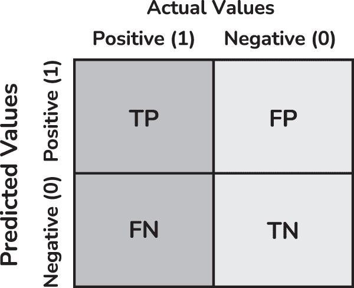

**图 9-1：** 混淆矩阵通过将预测与实际结果进行比较，直观地分解了分类模型的性能。它是计算精确率和召回率等关键指标的基础。

要解释矩阵，让我们以垃圾邮件过滤器为例，分解其四个象限：


### 真阳性（TP）

**真阳性（TP）：** 模型正确预测了阳性结果。

**示例：** 一封邮件实际上是垃圾邮件，过滤器正确地将其识别为垃圾邮件。*（这是一次正确的预测。）*

### 假阴性（FN）

**假阴性（FN）：** 当实际结果为阳性时，模型错误地预测了阴性结果。这是一种“漏检”。

**示例：** 一封邮件实际上是垃圾邮件，但过滤器未能识别它，并将其放入了用户的收件箱。*（这是一个危险的错误。）*

### 假阳性（FP）

**假阳性（FP）：** 当实际结果为阴性时，模型错误地预测了阳性结果。这是一种“误报”。

**示例：** 一封邮件是重要的合法消息，但过滤器错误地将其标记为垃圾邮件。*（这是一个令人沮丧的错误。）*

### 真阴性（TN）

**真阴性（TN）：** 模型正确预测了阴性结果。

**示例：** 一封邮件不是垃圾邮件，过滤器正确地将其识别为非垃圾邮件，并将其留在收件箱中。*（这是一次正确的预测。）*

**为什么这对产品经理很重要：** 混淆矩阵的价值在于，它将讨论从单一的准确率分数中移开，并迫使你考虑**不同类型错误的代价**。简单的准确率指标可能会产生危险的误导，下面是一个经典的例子，说明了原因。

想象一个垃圾邮件过滤器，其中 99% 的传入邮件都是合法的（“非垃圾邮件”），只有 1% 是实际的垃圾邮件。可以构建一个懒惰的模型，*始终*预测“非垃圾邮件”。从表面上看，这个模型的准确率为 **99%**，听起来很棒。

然而，这个模型完全没用，因为它让 **100% 的垃圾邮件** 进入了用户的收件箱。

混淆矩阵会立即暴露这个缺陷。它会显示该模型的 **真阳性** 为零（它从未正确识别垃圾邮件），并且 **假阴性** 数量很高（它错过了每一封垃圾邮件）。

这迫使你提出一个基本的产品问题：哪种类型的错误对我们的用户更有害？是 **假阴性**（让垃圾邮件进入收件箱）还是 **假阳性**（将重要的合法邮件发送到垃圾邮件文件夹）？回答这个问题是选择正确评估指标（如精确率和召回率）的基础，我们将在下一节中介绍这些指标。

## AI/ML 模型的关键绩效指标：超越混淆矩阵

混淆矩阵为我们提供了原始数据，但我们需要将这些原始数据组合成有意义的指标。这些指标就像你 AI 模型的关键绩效指标（KPI）。它们告诉你模型在执行其特定任务时表现如何。作为产品经理，你不需要能够*计算*这些指标（你的数据科学团队会处理这个），但你*确实*需要了解它们的含义，以及哪些指标与你的产品最相关。

下表列出了一些最重要的 AI/ML 性能指标的详细信息：

| 指标 | 定义 | 公式 | 何时使用 | 产品经理视角（为什么重要） |
| --- | --- | --- | --- | --- |
| 准确率 | 正确预测结果（阳性和阴性）的总体比例。 | `(TP + TN) / (TP + TN + FP + FN)` | 通常作为高级概览很有用，但在不平衡数据集（其中一个类别比其他类别频繁得多）时可能会产生误导。 | 易于理解，但要小心！高准确率并不总是意味着模型良好，尤其是当你有不平衡数据时（例如，大型数据集中极少数欺诈交易）。 |
| 精确率 | 所有预测为阳性的结果中，正确预测为阳性的比例。 | `TP / (TP + FP)` | 当假阳性的代价很高时。你希望非常确定，当模型预测“阳性”时，它实际上是阳性。 | *思考*：垃圾邮件过滤器。高精确率意味着较少的合法邮件被错误地分类为垃圾邮件（较少的假阳性）。你宁愿错过一些垃圾邮件（假阴性），也不愿丢失重要邮件。 |
| 召回率（灵敏度） | 所有实际为阳性的结果中，正确预测为阳性的比例。 | `TP / (TP + FN)` | 当假阴性的代价很高时。你希望确保捕捉到所有实际的阳性病例，即使这意味着会有几次误报。 | *思考*：医疗诊断。高召回率意味着较少的疾病病例被遗漏（较少的假阴性）。你宁愿有一些误报（假阳性），也不愿错过诊断。 |
| F1 分数 | 精确率和召回率的调和平均数，提供性能的平衡度量。 | `2 * (Precision * Recall) / (Precision + Recall)` | 当你需要精确率和召回率之间的良好平衡时。当你关心同时最小化假阳性和最小化假阴性时很有用。 | 当你没有强烈偏好最小化假阳性或假阴性中的任何一种时，这是一个很好的整体度量。 |
| 延迟 | AI/ML 模型生成预测或响应所需的时间。 | 毫秒（ms）或秒（s） | 对于实时应用程序至关重要，例如自动驾驶汽车、聊天机器人或欺诈检测系统，其中速度至关重要。 | 直接影响用户体验。即使模型准确，速度慢的模型也可能无法使用。 |
| 吞吐量 | 模型在给定时间段内可以执行的预测数量。 | 每秒/分钟等预测次数 | 对于高容量应用程序很重要，模型需要处理大量请求。 | 影响可扩展性。你的模型能处理预期的负载吗？ |


# 模型漂移

| 模型漂移 || 衡量已部署模型性能随时间变化程度的指标。 || 通过将当前模型性能与性能基准进行比较来计算。 || 部署后监控模型非常重要，确保其保持有用且不退化。 ||  |

| 均方误差（MSE） || 预测值与实际值之间平均平方差的度量。（仅适用于回归问题）。 || 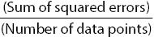<math xmlns="http://www.w3.org/1998/Math/MathML"><mrow> <mfrac> <mrow> <mi mathvariant="normal">(Sum&#160;of&#160;squared&#160;errors)</mi> </mrow> <mrow> <mi mathvariant="normal">(Number&#160;of&#160;data&#160;points)</mi> </mrow> </mfrac> </mrow> </math>  

<math display="block" xmlns="http://www.w3.org/1998/Math/MathML"><mrow> <mi>M</mi> <mi>S</mi> <mi>E</mi> <mo>=</mo> <mfrac> <mn>1</mn> <mi>n</mi> </mfrac> <mstyle displaystyle="true"><munderover> <mo>&#8721;</mo> <mrow> <mi>i</mi> <mo>=</mo> <mn>1</mn> </mrow> <mi>n</mi> </munderover> <mrow> <msup> <mrow> <mo stretchy="false">(</mo> <msub> <mi>Y</mi> <mi>i</mi> </msub> <mo>&#8722;</mo> <msub> <mrow> <mover accent="true"><mi>Y</mi> <mo stretchy="true">&#770;</mo> </mover> </mrow> <mi>i</mi> </msub> <mo stretchy="false">)</mo> </mrow> <mn>2</mn> </msup> </mrow> </mstyle> </mrow> </math>  || 用于预测连续值时（例如，预测房价、预测销售额）。对较大误差惩罚更重。 || MSE 越低越好。能让你了解误差的大小。 |

| 均方根误差（RMSE） || MSE 的平方根。（仅适用于回归问题）。 || √MSE  

<math display="block" xmlns="http://www.w3.org/1998/Math/MathML"><mrow> <mi>R</mi> <mi>M</mi> <mi>S</mi> <mi>E</mi> <mo>=</mo> <msqrt> <mrow> <mfrac> <mrow> <msubsup> <mstyle mathsize="140" displaystyle="true"><mo>&#8721;</mo> </mstyle> <mrow> <mi>i</mi> <mo>=</mo> <mn>1</mn> </mrow> <mi>N</mi> </msubsup> <msup> <mrow> <mrow> <mo>&#8214;</mo> <mrow> <msub> <mi>Y</mi> <mi>i</mi> </msub> <mo>&#8722;</mo> <msub> <mrow> <mover accent="true"><mi>Y</mi> <mo stretchy="true">&#770;</mo> </mover> </mrow> <mi>i</mi> </msub> </mrow> <mo>&#8214;</mo> </mrow> </mrow> <mrow> <mi mathvariant="normal">&#8202;</mi> <mn>2</mn> </mrow> </msup> </mrow> <mi>N</mi> </mfrac> </mrow> </msqrt> <mo>,</mo> </mrow> </math>  || 与 MSE 相同的用例，但结果与目标变量的单位相同，因此更具可解释性。 || 比 MSE 更容易理解，因为它与你要预测的事物单位相同（例如，美元、英寸等）。 |

| 平均绝对误差（MAE） || 预测值与实际值之间平均绝对差的度量。（仅适用于回归问题）。 || <math xmlns="http://www.w3.org/1998/Math/MathML"><mrow> <mfrac> <mrow> <mi mathvariant="normal">(Sum&#160;of&#160;squared&#160;errors)</mi> </mrow> <mrow> <mi mathvariant="normal">(Number&#160;of&#160;data&#160;points)</mi> </mrow> </mfrac> </mrow> </math>  

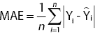<math display="block" xmlns="http://www.w3.org/1998/Math/MathML"><mrow> <mi>M</mi> <mi>A</mi> <mi>E</mi> <mo>=</mo> <mfrac> <mn>1</mn> <mi>n</mi> </mfrac> <mstyle displaystyle="true"><munderover> <mo>&#8721;</mo> <mrow> <mi>i</mi> <mo>=</mo> <mn>1</mn> </mrow> <mi>n</mi> </munderover> <mrow> <mrow> <mo>|</mo> <mrow> <msub> <mi>Y</mi> <mi>i</mi> </msub> <mo>-</mo> <msub> <mrow> <mover accent="true"><mi>Y</mi> <mo stretchy="true">&#770;</mo> </mover> </mrow> <mi>i</mi> </msub> </mrow> <mo>|</mo> </mrow> </mrow> </mstyle> </mrow> </math>  || 用于预测连续值，且你需要一个比 MSE/RMSE 对异常值更不敏感的指标时。 || 比 MSE/RMSE 对极端误差更不敏感。能让你了解误差的平均大小。 |

（注：`TP` = 真正例，`TN` = 真负例，`FP` = 假正例，`FN` = 假负例）

请记住，这些只是工具。作为产品经理，你应该决定哪些工具对你的产品更重要。例如：

*   **高精度：** 当假正例的代价高时很重要（例如，将合法交易标记为欺诈）。

*   **高召回率：** 当假负例的代价高时很重要（例如，在医疗诊断中未能检测出疾病）。

*   **低延迟：** 对实时应用至关重要（例如，自动驾驶汽车、聊天机器人）。

*   **高吞吐量：** 如果你需要处理大量请求，则需要高吞吐量。

本表提供了一个起点。你选择的具体指标将取决于你的 AI/ML 应用的性质以及你的整体业务目标。下一节将深入探讨为你的特定场景选择 `合适` 的指标。关键是能够与团队进行数据驱动的对话。

## 语境很重要：为你的 AI/ML 应用选择合适的指标

为你的 AI/ML 项目选择合适的指标，就像为科学实验选择合适的仪器一样。你需要选择能够准确测量你感兴趣的特定现象的工具。没有放之四海而皆准的答案；`最佳` 指标在很大程度上取决于具体应用、你的业务目标以及不同类型错误的潜在成本。这就是你的产品判断力发挥作用的地方。

这不仅仅是数据科学团队的技术练习。作为产品经理，你需要积极参与指标选择，因为它们定义了 *成功*。它们决定了你的 AI 驱动功能将如何被评估，并最终决定它是被视为成功还是失败。

以下是一个分步指南，帮助你完成这个关键过程：

### 1. 定义你的业务目标（并将其与用户需求联系起来）：

**从“为什么”开始：** 在考虑指标之前，清晰地阐述你的 AI/ML 项目的 *业务目标*。你试图解决什么问题？你试图满足什么用户需求？这个 AI 功能将如何为整体产品战略做出贡献？

*   **具体化：** 避免“提高用户参与度”等模糊目标。相反，要具体： “将推荐文章的点击率提高 15 个百分点”，或 “将客户支持工单解决时间缩短 20 个百分点。”

*   **联系用户需求：** 始终将你的业务目标与用户需求联系起来。例如，“缩短客户支持工单解决时间”（业务目标）转化为“帮助用户更快解决问题”（用户需求）。

将你的业务目标映射到特定的用户需求和潜在的 AI 应用是至关重要的第一步。下表为这一思考过程提供了一个简单的框架。

| 业务目标 || 用户需求 || 潜在的 AI/ML 应用 |


| --- | --- | --- |
| Increase customer retention. | Get problems solved quickly and efficiently. | AI-powered chatbot for faster support. |
| --- | --- | --- |
| Reduce operational costs. | Reduce manual effort. | Automate data entry with AI. |
| --- | --- | --- |
| Improve product recommendations. | Discover relevant and interesting products. | AI-powered recommendation system. |
| --- | --- | --- |
| Detect and prevent fraud. | Keep accounts and transactions secure. | AI-powered fraud detection system. |

这种初步的对齐为流程的其余部分提供了所需的清晰度。如果没有明确定义的业务目标和对用户需求的清晰理解，你就无法选择有意义的指标，也无法衡量 AI 功能的真实影响或投资回报率。一旦你有了明确的目标，下一步就是考虑你正在构建的 AI 应用程序的具体类型。

### 2. 考虑 AI/ML 应用程序的类型（及其固有的权衡）

一旦你有了明确的业务目标，下一步就是考虑你正在解决的 AI/ML 问题的*类型*。不同类型的问题需要不同的评估指标，因为它们衡量成功的方式从根本上不同。

对于**分类**问题，其目标是对数据进行分类（例如垃圾邮件检测），你将关注混淆矩阵推导出的指标。这里的核心产品问题是理解**精确率和召回率之间的权衡**。对于医疗诊断工具，你会优先考虑**召回率**以最大限度地减少假阴性（漏诊疾病）。相反，对于垃圾邮件过滤器，错误地将重要邮件标记为垃圾邮件（假阳性）是非常不可取的，因此你可能会优先考虑**精确率**。一种平衡的方法通常使用 **F1-Score**。

在处理**回归**问题时，你预测的是连续值（例如房价），你的指标将转向衡量*误差的大小*。你将使用诸如 **平均绝对误差 (MAE)** 或 **均方根误差 (RMSE)** 之类的指标。产品经理的关键问题是：“大误差是否会带来不成比例的高昂代价？”如果是，RMSE（对大误差惩罚更严厉）可能是更好的选择。

对于**推荐系统**，目标是呈现一个有用且有序的项目列表。这里的指标关注列表的质量，例如 **Precision@k**（前 *k* 个推荐中有多少个是相关的）或 **NDCG**（它还考虑相关项目的位置）。你的主要考虑是，你是优化只展示*相关*项目，还是优化确保在该顶部列表中展示*所有*相关项目。

最后，对于自然语言处理（NLP）或异常检测等专业任务，你将使用特定的指标。对于翻译或摘要等 NLP 任务，你可能会看到 **BLEU** 或 **ROUGE** 之类的分数。对于异常检测，你通常会回到**精确率和召回率**，但重点是模型捕捉罕见“异常”类的效果如何。

### 3. 评估错误成本：风险评估

选择指标最关键的部分可能是对**错误成本**进行清醒的评估。作为产品经理，你必须像风险管理人员一样思考，并确定模型出错的现实后果。核心权衡通常归结为：对你的用户和业务来说，假阳性和假阴性哪个更糟糕？

*   **示例：信用卡欺诈检测**

    **假阳性**发生在合法交易被标记为欺诈时。这会给客户带来不便，可能会导致尴尬，并可能损害他们对你服务的信任。**假阴性**是指欺诈交易被遗漏，导致直接的财务损失。在这种高风险场景中，大多数企业优先考虑**高召回率**以尽可能多地捕捉欺诈案例，即使这意味着偶尔会因误报而给客户带来不便。

*   **示例：内容审核**

    **假阳性**发生在安全、合法的内容被标记并删除时。这可能导致用户沮丧和审查指控，损害社区信任。**假阴性**是指有害或不当内容被遗漏并保持可见。这可能为其他用户创造不安全的环境。在这里，成本是平衡且复杂的，因此像 **F1-Score** 这样的平衡指标是更合适的选择。

### 4. 将技术指标转化为业务影响

最后，为了真正展示 AI 计划的价值，你必须将技术模型指标与具体的业务成果联系起来。利益相关者和领导层可能不理解“F1-Score 为 0.85”是什么意思，但他们会理解其对收入、成本或客户满意度的影响。

这意味着将你的发现转化为清晰的价值陈述。不要只报告模型性能，你应该努力说出诸如：

*   “通过自动化此任务，我们**将运营成本降低了 X 个百分点**。”

*   “我们的新推荐引擎将用户点击率提高了 Y 个百分点，从而带来了**销售额的直接增长**。”

*   “改进的欺诈检测模型将假阳性降低了 Z 个百分点，从而**减少了客户支持电话并为公司节省了资金**。”

*   “通过以 85% 的召回率预测用户流失，我们的干预措施**本季度额外挽留了 X 名客户**，从而带来了 **Y 美元的收入影响**。”

### 重要注意事项

最后，除了具体步骤之外，牢记一些高层次原则也很有帮助。这些考虑因素将指导你在应对衡量 AI 性能和价值的不可避免的权衡和复杂性时做出决策。

*   **情境为王：** “最佳”指标始终取决于情境。

*   **平衡是关键：** 通常，你需要在竞争性指标之间找到平衡（例如，精确率和召回率）。

*   **存在权衡：** 不同指标之间几乎总会存在权衡（例如，准确性与延迟）。要做好准备，就这些权衡做出明智的决策。

*   **迭代和完善：** 随着你对模型性能及其对用户体验影响的了解加深，你的指标选择可能会发生变化。不要害怕根据需要调整你的指标。

*   **业务影响非常重要：** 始终能够解释你的指标对产品和整体目标意味着什么。

通过仔细考虑这些因素并遵循本分步指南，你可以选择合适的 AI/ML 指标来准确衡量 AI 项目的投资回报率，并向利益相关者展示其价值。这个过程将你从技术指标的被动观察者转变为定义和衡量 AI 计划成功的积极参与者。

## 端到端示例——预测订阅服务中的流失

让我们通过一个完整的示例来说明我们讨论过的概念如何应用于现实世界的产品场景：预测基于订阅的在线学习平台的客户流失。这个示例将演示整个过程，从定义业务目标到计算投资回报率和持续监控。

### 1. 确定业务目标：定义“为什么”

任何 AI 项目的第一步都是明确定义业务目标。对于这个项目，我们的主要目标是减少客户流失。这是任何基于订阅的业务的关键目标，因为高流失率直接影响收入和增长，而且留住现有客户通常比获取新客户更具成本效益。


# 降低流失率的 AI/ML 解决方案

要有效降低流失率，我们必须首先了解导致流失的根本用户需求和痛点。流失并非随机发生，通常是由特定且可解决的问题驱动的。例如，如 图 9-2 所示，行业数据表明，订阅服务中超过一半的客户流失可归因于少数几个主要原因，例如入职引导无效、与客户建立的关系薄弱以及客户服务不佳。通过解决这些核心用户需求，我们可以制定更有效的留存策略。

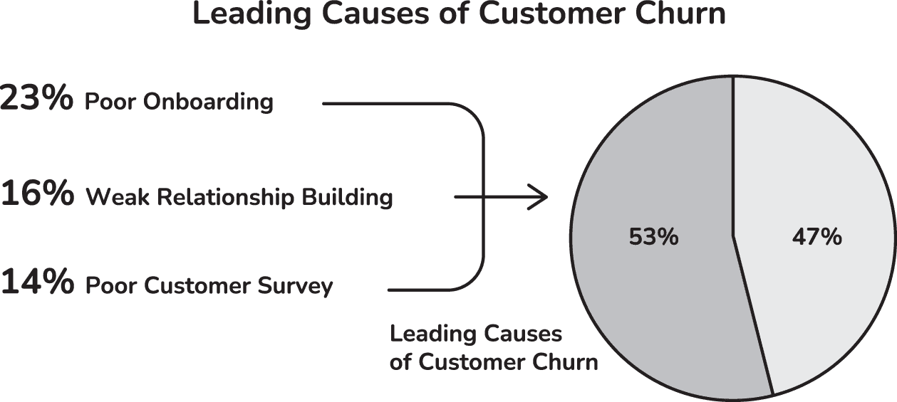

**Figure 9-2:** 订阅服务中客户流失的主要原因。很大一部分流失可归因于少数几个核心问题，例如客户服务差和与客户建立的关系薄弱。¶ (*来源：* Relently).

## 2\. 定义 AI/ML 应用程序和解决方案

在明确业务目标和用户需求后，下一步是概述具体的 AI 驱动解决方案。我们提议的应用是开发一个机器学习模型，在用户实际取消订阅之前预测哪些用户有高流失风险。

图 9-3 说明了这一概念。AI/ML 方法特别适合此场景，因为这是一个经典的预测问题（具体来说，是“流失”与“不流失”的分类任务）。我们可以利用丰富的历史用户数据，因为行为模式通常先于客户决定取消订阅。

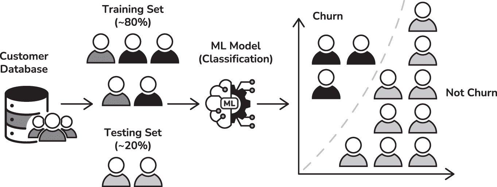

**Figure 9-3:** 流失预测的概念模型。AI 系统分析各种用户数据点以生成流失风险评分，将用户分为“（可能）流失”和“（可能）不流失”等组别，以便实施有针对性的干预

## 3\. 识别数据来源并进行特征工程：原材料

定义 AI 应用程序后，重点转移到其最关键的组成部分：数据。这一阶段是一个两部分的过程。首先，我们必须识别和收集所有潜在的“原材料”——可能包含预测信号的可用数据来源。然后，通过一种称为 *特征工程* 的创造性分析过程，我们将这些原材料精炼成模型实际用于学习的高质量原料。

### 可用数据

我们需要识别可能包含与流失相关信息的数据来源。这通常包括：

| CATEGORY | DATA POINTS |
| --- | --- |
| 用户人口统计 | 年龄、地理位置、订阅等级、职业、兴趣（如果可用） |
| 用户活动 | 课程完成率<br>登录频率和最近登录时间<br>在平台上花费的时间<br>论坛参与度（帖子、评论、回复）<br>与学习材料的互动（下载、浏览、参加的测验）<br>客户支持互动<br>特定功能的使用 |
| 订阅历史 | 开始日期、计划类型、付款频率、账单历史、使用的折扣 |
| 反馈数据 | 调查回复、评论、评分 |

### 特征工程

拥有这些原始数据只是第一步。然而，像原始“登录日期”这样的数据点并不总是以模型最有用的格式存在。下一个非常重要的步骤是特征工程，我们将原始数据转换为更有意义的信号，以提升模型性能。这就像厨师将基本食材变成美味酱汁一样。工程化特征的示例包括：

| FEATURE NAME | EXAMPLE VALUE | EXPLANATION |
| --- | --- | --- |
| Days Since Last Login | 15 | 用户上次访问平台是在十五天前。 |
| Average Courses Completed per Month | 1.5 | 平均而言，用户每月完成 1.5 门课程。 |
| Number of Support Tickets in Last Thirty Days | 0 | 用户在过去一个月内未开启任何支持工单。 |
| Forum Posts per Week | 0.2 | 用户在论坛上发帖不频繁（例如，大约每五周一次）。 |
| Subscription Length (in Months) | 24 | 用户已订阅两年（24 个月）。 |
| Discount Usage Rate | 0.10 | 用户在 10% 的订阅付款中使用了折扣代码。 |
| Has User Given Feedback? (Boolean) | Yes | 用户已通过调查或评分提交了反馈。 |

### 产品经理在此阶段的角色

虽然数据识别和特征工程具有高度技术性，但产品经理扮演着至关重要的协作角色：

*   **提供领域专业知识：** 你比任何人都更了解用户和产品。你的见解对于头脑风暴有意义的特征非常重要。例如，你可能会假设“完成入职引导清单的用户不太可能流失”——这一建议直接为模型带来了一个有价值的特征。
*   **倡导数据质量和伦理：** 你负责确保所使用的数据是合乎伦理来源的，并考虑潜在的偏见。你将倡导高质量的数据，因为它是特征性能的基础。
*   **帮助确定优先级：** 鉴于可以工程化的特征数不胜数，你可以根据对用户行为的假设及其对模型潜在影响，帮助数据科学团队确定优先构建和测试哪些特征。

## 4\. 选择指标：定义成功

在识别数据来源并工程化潜在特征后，下一步是定义如何衡量模型的成功。这需要将我们的业务目标（减少流失）转化为具体、可量化的模型性能指标。

### 错误的代价：优先考虑重要事项

对于我们的流失预测模型，并非所有错误都同等重要。我们必须首先考虑 *false positive* 与 *false negative* 的相对成本。

*   A **false positive** would be incorrectly flagging a happy user as “high risk.” The cost is the resources spent on an unnecessary intervention (like sending them a discount they didn't need).
*   A **false negative** would be failing to identify a user who is actually about to churn. The cost is lost subscription revenue, which is significantly higher.

鉴于此，我们的主要目标是尽量减少 false negatives——我们想尽可能多地捕捉潜在的流失用户。这直接影响了我们对指标的选择。

这些指标（尤其是 Precision 和 Recall）之间的关系源自混淆矩阵的四个结果。图 9-4 提供了这些关键公式的视觉参考。

### 我们选择的指标

基于对错误成本的分析，我们将使用以下指标来评估模型：

*   **Primary Metric—Recall (Sensitivity):** 我们将优先考虑 Recall，以最大限度地提高模型正确识别的实际流失用户比例，从而尽量减少代价高昂的 false negatives。
*   **Secondary Metrics:**
    *   **Precision:** 虽然对于此问题来说不如 Recall 关键，但我们仍然需要相当精确，以避免在不必要的干预上浪费太多资源。
    *   **F1-Score:** F1-Score 将被监控，以通过计算 Precision 和 Recall 的调和平均数来提供性能的平衡度量，为我们提供一个跟踪模型整体健康状况的单一数字。


# 模型漂移
模型漂移将被监控，以跟踪模型在遇到新的真实世界数据时，其性能随时间的变化或下降情况。

### 业务指标
最终，模型的成功将通过其对关键业务指标的影响来衡量：整体流失率。

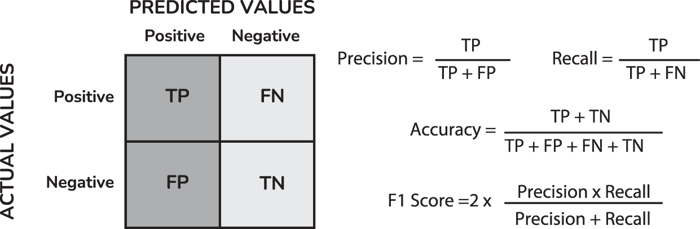

**Figure 9-4:** 分类模型的基础指标。混淆矩阵（左侧）提供了真阳性（TP）、假阴性（FN）、假阳性（FP）和真阴性（TN）的核心计数。这些计数随后用于精确率、召回率和 F1 分数等关键性能指标的公式中（右侧）。

### 5. 建立基准指标：设定起点

在我们能够衡量新 AI 模型带来的改进之前，必须首先建立一个基准。这是我们的“之前”图景，展示了产品当前的表现情况。清晰的基准对于证明 AI 计划的投资回报率至关重要。

对于我们的流失预测项目，我们有两个关键基准。首先是整体业务指标：我们的平台目前每月流失率为 20%。其次，我们将与现有的手动流程进行比较。假设我们的客户成功团队使用简单的规则（例如“用户三十天未登录”）来标记有风险的用户，而这种方法只能正确识别出 30% 的最终会流失的用户。这两个数字是我们的新模型必须超越的基准。

### 6. 进行模型训练和评估：构建和测试 AI

在定义数据和指标后，数据科学团队开始核心技术工作。该过程始于**数据分割**，其中历史数据被分为单独的训练集、验证集和测试集，以确保模型在从未见过的数据上进行评估。接下来是**模型选择**。数据科学家通常会尝试多种算法，以找到最适合该问题的算法。对于像这样的分类任务，他们可能会测试各种模型，每个模型的复杂程度不同，如 Figure 9-5 所示。

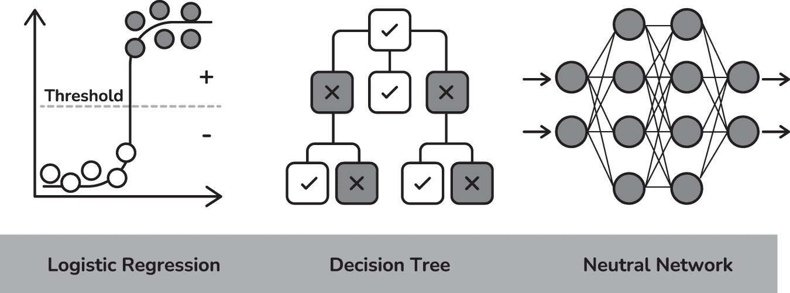

**Figure 9-5:** 不同分类算法的可视化表示。数据科学家通常会测试多种模型类型，例如相对简单的逻辑回归、基于规则的决策树，或更复杂的神经网络，以找到给定问题的最佳表现者。

在训练和调整各种模型后，选择表现最好的模型，并在最终的保留测试集上衡量其性能。对于我们的流失模型，假设初始结果如下：

*   **召回率：85%**（模型正确识别出 85% 实际流失的用户。）

*   **精确率：60%**（被模型标记为高风险的用户中，有 60% 实际流失。）

*   **F1 分数：70%**（性能的平衡度量。）

### 7. 进行 A/B 测试：衡量现实世界影响

在构建出有前景的模型后，下一个非常重要的步骤是通过进行 **A/B 测试** 来严格评估其现实世界影响。这使我们能够比较体验 AI 驱动干预的用户与未体验的用户的结果。测试结构如下：

*   **A 组（对照组）：** 随机选取的一组用户，他们继续获得标准产品体验，没有任何新的 AI 驱动干预。该组作为我们比较的基准。

*   **B 组（处理组）：** 第二组用户，其中 AI 模型处于活动状态。该组中被模型识别为“高风险”的用户将接受有针对性的干预，可能包括：

    *   带有课程推荐的个性化电子邮件。
    *   特别优惠或折扣。
    *   客户成功团队的主动联系。
    *   突出显示相关功能或内容的应用内消息。

在运行测试一段定义的时间后，例如一个月，我们比较流失率。结果显示，对照组的流失率保持在 20% 的基准水平，而处理组的流失率下降到仅 15%——这是一个统计学上显著的降低。

### 8. 计算结果和 ROI：量化价值

成功的 A/B 测试证实，AI 驱动的模型和干预措施导致流失率下降了五个百分点（从 20% 降至 15%）。为了了解这对业务意味着什么，我们可以将这个百分比转化为对用户留存和收入的直接影响。下表基于一个拥有 10,000 名订阅者的假设平台，以及平均每月订阅费 50 美元，详细说明了此计算。

| METRIC || CONTROL GROUP (BASELINE) || TREATMENT GROUP (AI + INTERVENTION) |
| --- | --- | --- |
| **Inputs:** | | |
| User Base || 10,000 || 10,000 |
| Avg. Monthly Revenue/User || $50 || $50 |
| **Monthly Churn:** | | |
| Churn Rate || 20% || 15% |
| Churned Users (#) || 2,000 || 1,500 |

#### 将结果转化为业务影响

表格的结果显示了明确的积极影响。通过将流失率下降五个百分点转化为财务术语，我们可以展示该计划的价值：

*   **留存用户：** 每月 500 名用户。
*   **每月节省的收入：** 25,000 美元。
*   **年化节省的收入：** 300,000 美元。

这展示了显著的潜在投资回报率，尽管完整的计算还必须考虑项目的开发、部署和干预成本。

#### 监控长期成功

虽然财务影响是最终的业务结果，但产品经理还必须跟踪模型的技术性能，以确保其长期的健康和效率。这些模型特定的指标充当未来问题的早期预警系统。因此，我们还将持续监控：

*   **模型漂移：** 确保随着现实世界用户行为随时间演变，我们的模型预测仍然准确。
*   **精确率：** 确保我们不会在本就不会流失的用户身上浪费过多干预资源。
*   **F1 分数：** 检查我们是否在捕捉潜在流失用户（召回率）和不过度标记满意客户（精确率）之间保持了健康的平衡。

### 9. 监控和维护模型以实现长期成功

AI 功能的发布并非项目的结束；它是其持续生命周期的开始。确保长期成功需要致力于观察、学习和改进的持续循环。该过程涉及几个关键的持续活动：

*   **持续监控：** 模型的性能指标（召回率、精确率、F1 分数）和核心业务指标（流失率）在生产仪表板上进行跟踪。配置了警报以检测任何显著的性能下降或模型漂移。
*   **模型重新训练：** 根据监控结果或设定的计划，模型会定期使用新的真实世界用户数据进行重新训练，以适应不断变化的行为并保持其预测准确性。
*   **干预优化：** 除了维护模型之外，产品策略本身也必须不断发展。这涉及持续对不同的干预措施进行 A/B 测试（例如，尝试新的折扣优惠或不同的电子邮件文案），以优化其有效性。


建立反馈循环：所有这些活动都会输入到一个持续的反馈循环中。来自模型性能、A/B 测试和直接用户反馈的洞察被用于全面改进模型、数据以及整体流失率降低计划。

这个端到端示例展示了产品经理如何使用 AI/ML 来解决关键业务问题（流失率），衡量解决方案的影响，并确保其长期成功。它强调了数据驱动方法、仔细选择指标以及持续监控和维护的重要性。

## AI 和 ML 项目的 A/B 测试：验证影响并优化性能

我们已经看到 A/B 测试在我们的流失预测示例中发挥了非常重要的作用，使我们能够 *量化* AI 驱动干预措施的影响。但 A/B 测试不仅仅是该特定示例中的一个步骤；它是验证和优化任何 AI/ML 驱动功能的 *基本方法论*。可以将其视为应用于产品开发的科学方法。

### 什么是 A/B 测试（简而言之）？

从本质上讲，A/B 测试是一种受控实验。如 图 9-6 所示，您将用户分为两个（或更多）组：

*   **A 组（对照组）：** 该组体验您产品或功能的 *现有* 版本（“现状”）。

*   **B 组（处理组）：** 该组体验您产品或功能的 *新* 版本，带有 AI/ML 增强功能。

    然后，您将比较这些组在关键指标（例如，流失率、点击率、转化率等）上的表现。如果 B 组（带有 AI 的）表现显著优于 A 组，您就有证据表明您的 AI/ML 功能正在产生积极影响。

 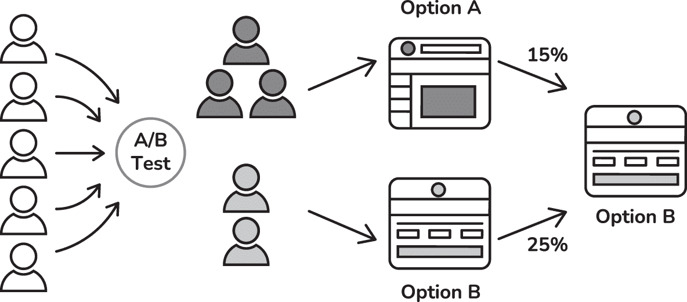

**图 9-6：** A/B 测试可以帮助确定产品中的新功能或更改是否会影响特定指标。

### 为什么 A/B 测试对 AI/ML *尤其* 重要？

A/B 测试对产品开发始终很重要，但对于 AI/ML 项目来说，它 *尤其* 重要，原因有以下几点：

*   **AI 模型是概率性的，而不是确定性的：** 与遵循显式规则的传统软件不同，AI/ML 模型基于概率进行 *预测*。总是存在出错的可能性（假阳性、假阴性）。A/B 测试帮助您量化这些错误的 *实际影响*。

*   **意外后果：** AI 模型有时会以意想不到的方式表现，尤其是在暴露于与训练数据不同的实际数据时。A/B 测试帮助您在影响整个用户群 *之前* 识别并缓解任何意外的负面后果。

*   **模型性能 ≠ 用户体验：** 模型在测试数据集上可能表现良好（例如，高精度和召回率），但这并不保证它会改善 *用户体验*。A/B 测试衡量对实际用户行为和业务结果的影响。

*   **持续优化：** AI/ML 很少是一种“设置好就不用管”的技术。A/B 测试允许 *持续优化*。您可以测试不同的模型版本、不同的参数设置，或将 AI 集成到用户体验中的不同方式。

*   **数据驱动决策：** A/B 测试提供 *客观、定量的证据* 来支持您的产品决策。它消除了猜测，并帮助您建立对 AI 投资的信心。

本质上，A/B 测试是您 AI/ML 的安全网和优化引擎。它允许您：

*   **验证：** 证明您的 AI/ML 功能确实产生了所需的影响。

*   **优化：** 微调您的模型及其集成，以最大限度地提高其有效性。

*   **降低风险：** 在造成广泛问题之前识别并解决任何负面后果。

*   **学习：** 获得有关用户如何与您的 AI 驱动功能交互的宝贵洞察。

### 如何为 AI 和 ML 进行 A/B 测试：分步指南

既然您了解了 *为什么* A/B 测试对 AI/ML 至关重要，让我们深入了解 *如何* 进行。以下是为您的 AI 驱动功能进行有效 A/B 测试的分步指南：

1.  **定义明确的假设：您预期会发生什么？**

    *   **从具体问题开始：** 不要只测试“AI 功能是否有效？” 要制定关于 AI/ML 功能将如何影响用户行为和关键指标的精确、可测试的假设。例如：

        | 不佳的假设 || 良好的假设 |

        | --- | --- |

        | “AI 驱动的聊天机器人将提高客户满意度。” || “AI 驱动的聊天机器人将至少将客户支持工单的平均解决时间缩短 15%。”（这具体、可衡量，并直接与业务结果相关联）。 |

        | --- | --- |

    *   **可衡量：** 您的假设应包含 *可量化* 的预期变化。

2.  **选择目标指标（或指标）：您将如何衡量成功？**

    一旦您有了明确的假设，就必须选择合适的指标来衡量成功。选择直接衡量假设中所述结果的主要指标非常重要——这应该与您用于基线的指标相同。但是，为了获得完整的图景，最好还跟踪次要指标，以监控意外后果（例如，速度是否损害了满意度？）或额外的好处。

    例如，如果您的假设是 AI 聊天机器人将缩短解决时间，您的指标可能是：

    *   **主要指标：** 平均解决时间。

    *   **次要指标：** 客户满意度（CSAT）评分、工单升级率、聊天机器人使用率。

    最终，您选择的指标必须与成本节约或客户保留等具体业务结果相关联。A/B 测试的目标是查看两组之间主要指标是否有统计学上显著的改进。图 9-7 说明了我们聊天机器人示例的成功结果，其中 AI 驱动的变体大幅缩短了解决时间。

    

    **图 9-7：** AI 驱动聊天机器人的 A/B 测试结果示例。使用 AI 的处理组（变体 B）在主要指标——平均解决时间——方面相比对照组（变体 A）显示出显著改进。

3.  **确定样本量：您需要多少用户？**

    *   **统计显著性**：您需要足够大的样本量，以确保对照组和处理组之间观察到的任何差异具有统计学意义——这意味着它不太可能是偶然发生的。图 9-8 说明了从更大的目标总体中抽取代表性样本的概念。

    *   **影响样本量的因素：**

        *   **基线指标值：** 您对照组的当前性能。

        *   **最小可检测效应（MDE）：** 您希望能够可靠检测到的目标指标的 *最小* 变化。较小的 MDE（检测较小的变化）需要更大的样本量。

        *   **统计功效（通常为 80%）：** 检测到统计学上显著差异的概率，*如果该差异确实存在*。更高的功效（更高的确定性）需要更大的样本量。


### 显著性水平（Alpha，通常为 5%）

错误地得出存在差异的结论（即“阳性假象”）的概率。较低的 alpha（降低阳性假象的概率）需要更大的样本量。

### 工具

使用在线样本量计算器（许多可免费使用）或统计软件（如 `R` 或 `Python`）来确定适当的样本量。

### PM 的角色

你不需要亲自进行计算，但你需要了解输入参数（尤其是 MDE），并与数据科学团队合作来确定适当的样本量。样本量直接影响 A/B 测试需要运行的时间。

### 用户数量少

用户数量少可能会导致问题，因为变异性会过高。


**Figure 9-8:** A visual representation of sampling. A smaller, representative Sample is selected from the larger Target Population to conduct the A/B test. The results from this sample are then used to infer the impact on the entire population.

## 4. 随机分配用户：确保公平比较

### 随机化是关键

有效 A/B 测试的基础是随机分配。你必须确保用户被随机分配到对照组（`A`）或处理组（`B`）。这有助于消除偏差并确保各组可比。

### 一致的随机化

在整个实验过程中使用一致的随机化方法。不要在测试中途更改分配规则！

### 工具

大多数 A/B 测试平台都提供内置的随机化功能。

## 5. 实施和部署：启动实验

### 对照组（`A`）

该组继续体验你产品或功能的现有版本（无 AI 增强）。

### 处理组（`B`）

该组体验带有 AI/ML 功能的新版本。

### 隔离变量

确保两组之间唯一的区别是你正在测试的 AI/ML 功能。在实验期间避免对用户体验进行任何其他更改。

## 6. 运行实验：耐心是美德

### 足够的持续时间

允许实验运行足够长的时间，以收集足够的数据以达到统计显著性。所需持续时间将取决于你的样本量和目标指标的变异性。

### 考虑外部因素

注意任何可能影响结果的外部因素（例如，节假日、营销活动、季节性）。

### 不要频繁查看（太频繁！）

抵制不断查看结果并做出过早结论的诱惑。虽然跟踪主要指标很重要，但查看太频繁可能会导致你看到阳性假象。

## 7. 分析结果：解读数据

### 统计显著性

使用统计方法（通常是 t 检验或卡方检验）来确定对照组和处理组之间目标指标的差异是否具有统计显著性。这涉及计算 p 值。

### P 值

如果组间实际上没有差异，观察到所获得结果（或更极端结果）的概率。

### 显著性水平（Alpha）

一个预定义的阈值（通常为 `0.05`）。如果 p 值小于 alpha，则结果被认为具有统计显著性。

### 置信区间

计算置信区间以估计可能的真实效应大小范围。这能让你了解结果周围的不确定性。

### 超越统计显著性

即使结果具有统计显著性，也要考虑其实际意义。观察到的差异是否足够大，在用户体验或业务影响方面具有意义？

## 8. 得出结论并采取行动：学习和迭代

你的分析结果将决定你的下一步行动。下表提供了一个清晰的决策框架，用于根据结果是积极、消极还是不具有统计显著性来决定如何进行。

| A/B 测试结果 | 解释 | 推荐的下一步 |
| --- | --- | --- |
| **显著的积极结果** | 有力证据表明 AI 功能改善了目标指标。 | 1. 评估实际意义（改进是否有意义？）。<br>2. 如果是，推出该功能（可能分阶段）。<br>3. 密切监控性能。<br>4. 记录并分享。 |
| **无显著结果** | 没有确凿证据表明存在影响（积极或消极）。可能是由于各种因素。 | 1. **调查：**<br>&nbsp;&nbsp;* 假设是否正确？<br>&nbsp;&nbsp;* AI 模型是否需要改进？<br>&nbsp;&nbsp;* 实施是否存在缺陷？<br>&nbsp;&nbsp;* 样本量是否太小（检验效力不足）？<br>&nbsp;&nbsp;* 是否存在混淆的外部因素？<br>2. 对功能/模型进行迭代或结束实验。<br>3. 记录并分享。 |
| **显著的消极结果** | 有力证据表明 AI 功能损害了目标指标。 | 1. 停止任何计划中的推出。<br>2. 彻底调查根本原因。<br>3. 如有必要，恢复更改。<br>4. 根据调查结果进行迭代或放弃该功能。<br>5. 记录并分享。 |

### 无统计显著性结果

如果没有统计显著性差异，并不一定意味着 AI 功能无用。这可能意味着：

* 假设不正确。
* AI 模型需要进一步改进。
* 实施需要调整。
* 样本量太小。
* 存在影响结果的外部因素。

### 迭代

A/B 测试是一个迭代过程。利用每次实验的洞察来完善你的假设，改进你的 AI 模型，并优化用户体验。

## AI/ML A/B 测试的关键考虑事项

虽然前面的步骤概述了任何 A/B 测试的坚实框架，但测试 AI 驱动的功能引入了独特的复杂性。与测试简单的按钮颜色变化不同，评估概率模型需要额外的严谨性。作为产品经理，了解以下考虑事项将帮助你设计更强大的实验，并与你的技术团队进行更有洞察力的对话。

### 模型版本控制

如果你正在测试不同版本的 AI/ML 模型，你必须建立一个强大的版本控制系统。你需要能够跟踪哪些用户看到了哪个版本的模型，并准确比较结果。

### 数据漂移

AI/ML 模型是在数据上训练的，数据会随时间变化。这被称为数据漂移。在实验期间监控数据漂移，因为它可能会影响模型性能并使你的结果无效。如果你检测到显著的漂移，你可能需要重新训练模型。

### 用户体验一致性

确保对照组和处理组之间的整体用户体验保持一致，除了正在测试的 AI/ML 功能之外。避免引入任何混淆变量。

### 伦理考虑

重申前面讨论过的伦理考虑。A/B 测试绝不应被用来操纵或欺骗用户。

### 监控

在 A/B 测试后，持续监控你的 AI/ML 功能的性能，包括技术指标和用户反馈。


*   **分段：** 考虑对用户进行分段，并为不同的细分群体运行单独的 A/B 测试。AI 功能对不同用户群体的影响可能不同。

*   **冷启动：** `“cold start” problem` 是个性化和推荐系统面临的常见挑战。当新用户或新项目进入系统，AI 模型没有历史数据来做出明智预测时，就会出现这种情况。在这种情况下，模型无法提供个性化体验，必须恢复到默认的非个性化状态（例如，显示全球热门项目，而不是个性化推荐）。你的 A/B 测试计划必须考虑如何处理这些新用户，以及他们的初始体验将是什么。

A/B 测试是验证和优化 AI/ML 功能的强大工具。通过遵循这些步骤并牢记这些注意事项，你可以确保你的 AI 投资为用户和业务带来真正的价值。作为产品经理，你将能够与工程师和数据科学家进行更有意义的对话，并了解 AI/ML A/B 测试的细微差别。

## 章节摘要与关键要点

本章为你提供了衡量 AI 举措影响并展示其价值的基本工具。你学习了如何定义模型级指标（如精确率和召回率），并将其与业务级指标（如收入或流失率）联系起来。我们分析了混淆矩阵，确立了基线的重要性，并通过一个详细的端到端示例，展示了这些概念是如何结合在一起的。你现在拥有一个清晰的框架，用于量化 AI 功能的成功。

### 关键要点

*   你理解衡量 AI 产品需要两个层面：技术模型性能和切实的业务影响，而你的工作就是将两者联系起来。

*   你可以通过分析特定产品的错误成本，阐述精确率和召回率之间非常重要的权衡。

*   你知道 A/B 测试是验证 AI 功能相对于对照组的实际影响的金标准。

*   你必须在推出 AI 功能之前建立明确的基线，以有效地证明其价值并计算投资回报率。

### 接下来：从实验室到正式产品

在识别机会并定义如何衡量其成功之后，最后一步是了解它是如何大规模构建和管理的。下一章将向你介绍构建和部署 AI 解决方案的世界，重点关注被称为 MLOps 的关键运营实践。

WileyPRE

# 第 10 章

构建和部署 AI 解决方案：从实验室到正式产品

你已经识别了一个有前景的 AI 机会，定义了指标，甚至通过 A/B 测试验证了你的方法。现在是关键阶段：让你的 AI 驱动功能栩栩如生。这不仅仅是将模型移交给工程团队；而是要了解在真实世界生产环境中构建、部署和维护 AI 解决方案的整个过程。这就是 `MLOps` 发挥作用的地方。

## MLOps：可靠且可扩展 AI 的关键

MLOps，即机器学习运营，是一套旨在弥合 `开发` AI 模型（数据科学家的工作）与 `部署和运行` 它们以在生产环境中可靠运行（工程师和运维团队的工作）之间差距的实践。Figure 10-1 说明了 MLOps 生命周期。你可以将其视为 DevOps，但专门针对机器学习的独特挑战进行了定制。你也可以将其想象成厨师在测试厨房中完善食谱（模型开发）与经营一家每晚供应数百份餐点的繁忙餐厅厨房（MLOps）之间的区别。两者都需要烹饪技能，但餐厅厨房需要一套完整的系统来确保效率、一致性和应对意外情况。


**Figure 10-1:** The cycle of MLOps in a nutshell

在研究环境中构建出色的 AI 模型只是战斗的一半。让该模型在真实世界产品中始终如一、可靠且大规模地工作，则是完全不同的挑战。与传统软件不同，传统软件在部署后往往比较静态，而 AI 模型是 `dynamic` 的。它们的性能取决于所输入的数据，而这些数据会随时间变化（数据漂移）。这是使 MLOps 变得必不可少的关键区别。MLOps 通过以下方式应对这一挑战：

*   **自动化 ML 生命周期：** MLOps 自动化机器学习管道的关键阶段，从数据准备到模型部署和监控。这加快了开发速度，减少了错误，并允许更快地迭代。

*   **确保可重复性：** MLOps 强调对代码、`data` 和 `models` 进行版本控制。这比单纯的代码版本控制更复杂。这确保了模型可以被一致地重现和测试。这对于调试、审计和保持模型质量至关重要。

*   **实现持续改进：** MLOps 为机器学习促进 `continuous integration and continuous delivery (CI/CD)`。这意味着模型可以被持续更新、测试和部署，使你的产品能够适应不断变化的数据和用户需求。

*   **扩展 AI 解决方案：** MLOps 提供扩展 AI 模型以处理大量数据和用户请求所需的基础设施和流程。

*   **改善协作：** MLOps 促进数据科学家、工程师和产品经理之间的协作，确保每个人都在目标和流程方面保持一致。

*   **降低风险：** 通过自动化测试、部署和监控，MLOps 减少了生产环境中出现错误和不一致的风险。

作为产品经理，你不需要成为 MLOps 专家，但你 `do` 需要理解其原则并认识到其重要性。这使你能够：

*   **提出正确的问题：** 了解部署计划、监控策略、回滚计划以及更新模型的流程。

*   **长期规划：** 认识到部署 AI 模型不是一次性事件；它是一个需要持续监控和维护的持续过程。

*   **有效协作：** 与你的数据科学和工程团队有效合作，确保部署顺利且成功。

*   **设定现实期望：** 了解时间表和流程。

虽然你不需要知道具体细节，但了解有支持 MLOps 的工具和平台是有帮助的。这些可能包括：

*   **模型注册表：** (例如，MLflow, Amazon SageMaker Model Registry)。

*   **数据版本控制工具：** (例如，DVC, Pachyderm)。

*   **CI/CD 平台：** (例如，Jenkins, GitLab CI, CircleCI)。

*   **监控工具：** (例如，Prometheus, Grafana, 云特定的监控服务)。

*   **特征存储** (例如，Feast, Vertex AI Feature Store)。

## MLOps 的关键组件——AI 生产线

在上一节中，我们将 MLOps 可视化为一个持续的循环过程，以强调其持续性。现在，我们将该循环分解为其关键组件或阶段。

将 MLOps 视为 AI 模型的装配线。就像工厂有制造产品的明确流程一样，MLOps 为构建、部署和维护 AI 模型提供了结构化的、分步的流程（参见 Figure 10-2）。这个装配线中的每个阶段都有特定的目的，它们共同作用以确保最终产品质量高并满足用户需求。


**Figure 10-2:** The stages of MLOps

以下表格从产品经理的角度分解了这些关键阶段：


# 数据工程：采集与准备原材料

这一基础阶段专注于收集、清洗和准备为 AI 模型提供燃料的数据。你可以将其视为为生产线采集高质量的原材料——输入数据的质量直接影响最终 AI 产品的质量（“垃圾进，垃圾出！”）。

| 数据工程活动 || 产品经理的角色与关注点 |

| --- | --- |

| **数据收集**

从各种内部和外部系统（数据库、日志、API 等）收集原始数据。 || **确保相关性和合规性**

与数据团队合作，确认收集的数据与定义的问题相关。确保收集方法符合隐私法规（GDPR、CCPA 等）和道德准则。 |

| --- | --- |

| **数据清洗与转换**

处理错误、缺失值、不一致性，并将数据转换为 ML 模型可用的格式。 || **倡导质量并了解影响**

倡导高质量、准确的数据。了解数据清洗决策（例如，处理缺失值、移除异常值）以及潜在的数据偏差如何影响模型和用户体验。 |

| **数据版本控制与数据管道**

跟踪数据集的变化（版本控制）并构建自动化工作流（管道）以实现高效的数据处理。 || **了解流程并确保可重复性**

对数据流动和版本控制方式有高层次的了解。确保有可重复性的流程（这对于调试、审计和重新训练非常重要）。 |

| **数据可用性与访问**

确保必要的数据存在，并且技术团队拥有使用所需权限和工具。 || **促进访问并识别差距**

帮助技术团队获取必要的数据源。尽早识别任何数据缺口，并在可行的情况下与相关利益方合作获取所需数据。 |

# 模型开发：设计原型

这是数据科学家构建和优化核心 AI 模型的阶段。你可以将其视为在我们的工厂中设计和制作功能原型，涉及实验和迭代以找到最佳方法。

| 模型开发活动 || 产品经理的角色与关注点 |

| --- | --- |

| **特征工程**

从原始数据中创建、选择和转换输入变量（特征）以优化模型性能。 || **提供领域背景并优先考虑洞察：**

分享你对用户和业务背景的深入了解，以指导相关特征的创建。帮助确定哪些数据洞察或潜在特征最有可能影响预期结果。 |

| --- | --- |

| **算法选择**

根据问题类型、数据特征和目标，选择最合适的机器学习算法（例如，决策树、神经网络）。 || **了解权衡并与目标保持一致：**

与数据科学团队讨论不同算法选项的优缺点（例如，准确性与可解释性、速度、数据需求）。确保所选算法与产品的目标和约束保持一致。 |

| **超参数调优**

优化所选算法的内部设置（超参数），以在评估指标上实现最佳性能。 || **定义成功指标和评估标准：**

清晰阐述调优过程应优化的关键绩效指标（KPI）和评估指标（例如，优先考虑召回率而非精确率）。确保这些指标与产品的成功定义保持一致。 |

| **模型版本控制**

跟踪和管理模型开发过程中的不同版本，包括代码、数据和参数的变化。 || **了解进度和迭代：**

跟踪不同模型版本及其性能改进。利用这种了解来在迭代开发过程中传达进度并管理预期。 |

# 模型验证与测试：质量控制

在将 AI 模型发布给用户之前，必须经过严格的测试，以确保其符合性能标准、可靠运行并符合道德准则。这是我们 AI 生产线上的关键质量控制检查点。

| 模型验证和测试活动 || 产品经理的角色与关注点 |

| --- | --- |

| **性能评估（交叉验证和留出测试集）**

使用训练期间未见过的数据评估模型的预测准确性和泛化能力。 || **定义验收标准并解释结果：**

与团队合作，根据产品目标设定明确、可衡量的性能阈值（例如，最小召回率 85%，最大延迟 500ms）。理解和解释评估结果，以做出部署的 go/no-go 决定。 |

| --- | --- |

| **偏差和公平性测试**

在不同用户群体（例如，基于人口统计学）上评估模型性能，以检测和缓解不公平的偏差。 || **倡导公平性并确保道德一致性：**

确保使用适当的指标彻底进行公平性测试。审查结果以确认模型表现公平，并符合负责任的 AI 原则和法律要求。如果检测到偏差，倡导进行必要的调整。 |

| **安全性测试**

评估模型及其部署基础设施的漏洞，以防范潜在的攻击或操纵。 || **了解风险并确保稳健性：**

了解与 AI 功能特定用例相关的潜在安全风险。确保执行适当的安全性测试，以保护用户数据并防止模型被滥用。 |

| **A/B 测试设置**

准备框架，以在实时环境中将新 AI 模型的性能与基准或控制版本进行比较。 || **定义假设和成功指标：**

为 A/B 测试定义具体的假设（例如，“新模型将使流失率降低 5%”）以及决定成功的关键指标。确保测试设置与验证目标保持一致。 |

# 模型部署：从生产线下线

这是将经过验证的 AI 模型集成到产品中并提供给用户（无论是完全提供还是作为实验的一部分）的非常重要的步骤。这就像成品从生产线下线并运往客户一样。

| 模型部署活动 || 产品经理的角色与关注点 |

| --- | --- |

| **选择部署环境**

根据成本、延迟和可扩展性需求等因素，决定模型将在哪里运行（例如，云服务器、本地、边缘设备）。 || **使环境与产品需求保持一致：**

了解部署环境选择对用户体验（延迟）、成本和可扩展性的影响。确保所选环境满足产品的要求和约束。 |

| --- | --- |

| **创建 API（应用程序编程接口）**

构建允许产品或其他应用程序向模型发送数据并接收预测的接口。 || **为产品集成定义 API 要求：**

定义产品将如何通过 API 与模型交互。确保 API 设计支持计划的用户体验以及现有产品功能中的集成点。 |

| **打包模型**

将模型及其必要的软件依赖项准备成可部署的单元（例如，容器）。 || **了解对更新和发布的影响：**


虽然主要是技术性的，但要了解包装如何影响模型更新的能力以及对计划推出策略的支持（例如，实现分阶段推出或 A/B 测试）。确保模型版本之间的平稳过渡。

### 实施推出策略

执行计划的推出（例如，金丝雀发布、分阶段推出、全量发布、A/B 测试部署）。

### 监督推出和沟通

负责整体推出计划。密切监控部署，与工程和市场团队协调，并管理关于新 AI 功能与用户及内部利益相关者的沟通。

### 模型监控：跟踪现实世界中的性能

推出模型并不是终点，而是其在生产环境中生命周期的开始。持续监控对于确保 AI 模型按预期运行、持续提供价值且不会随时间退化至关重要。可以将其视为在推出 AI 功能后，对其进行定期健康检查并跟踪客户满意度。

| 模型监控活动 | 产品经理的角色与关注点 |
| --- | --- |

#### 跟踪关键性能指标

使用评估期间定义的相同指标，持续测量模型在生产环境中的性能（例如，准确率、精确率、召回率、延迟、F1 分数、业务 KPI）。

**产品经理的角色：** 定义监控 KPI 和阈值

指定部署后需要跟踪的关键指标，并定义可接受的性能阈值。与工程团队合作，确保仪表板清晰地反映这些 KPI。定期审查性能与目标的对比情况。

#### 检测模型漂移

识别由于现实世界数据模式的变化或模型学习的底层概念发生转移，导致模型性能随时间退化的情况。

**产品经理的角色：** 了解影响并触发行动

了解如果发生模型漂移，可能对用户体验和业务产生的潜在影响。确保已建立检测漂移的机制，并与技术团队合作，确定何时需要对模型进行重新训练或其他干预措施。

#### 设置警报

配置自动化通知，当关键性能指标低于预定义阈值或检测到显著数据漂移时触发。

**产品经理的角色：** 定义警报标准和响应计划

定义应触发警报的具体条件（例如，“如果召回率在 24 小时内低于 80%，则发出警报”）。建立清晰的响应流程和升级路径，涉及相应的技术团队。

#### 监控用户反馈

积极跟踪用户反馈渠道（评论、支持工单、论坛），以获取关于 AI 功能在现实世界中的性能和用户满意度的定性见解。

**产品经理的角色：** 成为用户的代言人

通过不断监控用户反馈来补充定量监控。识别用户报告的可能无法仅通过自动化指标捕捉到的问题、可用性问题或意外的模型行为。

### 模型重新训练和更新：持续改进

AI 模型并非一成不变；随着现实世界的变化，其性能可能会退化。此阶段涉及定期使用新数据重新训练模型，以确保其保持准确、相关并适应不断变化的条件。可以将其视为根据新的性能数据和不断变化的道路状况，定期更新产品的引擎。

| 模型重新训练和更新活动 | 产品经理的角色与关注点 |
| --- | --- |

#### 触发重新训练

根据监控数据（例如，性能退化、检测到的漂移）、设定的时间表或重大新数据的可用性，决定何时启动重新训练过程。

**产品经理的角色：** 优先处理重新训练并定义触发条件

使用性能监控数据、模型漂移警报和业务背景，确定何时需要重新训练。根据潜在影响，将重新训练工作与其他产品计划进行优先级排序。

#### 自动化重新训练管道

利用 MLOps 工具和工作流，自动处理使用新数据重新训练模型的过程，确保一致性和效率。

**产品经理的角色：** 了解管道并确保一致性

对自动化重新训练过程有高层次的了解。确保自动化重新训练的频率和范围与产品需求和数据可用性保持一致。

#### 模型版本控制

保持不同训练模型版本的清晰记录，包括使用的数据、参数和性能指标。

**产品经理的角色：** 跟踪性能并管理发布

跟踪不同模型版本及其性能指标。使用这些信息来比较模型，了解改进或退化，并管理更新模型的发布流程。

#### A/B 测试更新的模型

在全面推出之前，在实时环境中将新重新训练的模型与当前部署的版本进行比较。

**产品经理的角色：** 定义成功标准并批准部署

定义 A/B 测试的标准（例如，“新模型必须在不降低精确率的前提下，使召回率提高 X%”）。审查 A/B 测试结果，并决定是否将更新的模型部署到所有用户。

#### 回滚策略

制定明确的计划和机制，以便在新部署的更新导致意外问题或性能不佳时，快速回滚到之前稳定的模型版本。

**产品经理的角色：** 确保风险缓解

确认模型更新存在可靠的回滚计划。了解在必要时启动回滚的流程，以最大限度地减少对用户的负面影响。

## CI/CD、IaC 和协作：MLOps 的基础支柱

这三个概念源自现代软件开发并经过改编，对于使整个 MLOps 生命周期高效、可靠且可扩展至关重要。它们是支撑 AI 生产线的支柱：

### CI/CD（持续集成/持续交付）：自动化流程

CI/CD 涉及自动化构建、测试和部署管道，从代码/数据更改一直到生产发布。

它使模型能够快速迭代，减少部署中的手动错误，确保一致的测试，并允许更快地将更新的 AI 功能交付到产品中。它是驱动监控和重新训练持续改进循环的引擎。

### IaC（基础设施即代码）：构建可靠的环境

IaC 涉及使用代码和自动化来管理和配置底层基础设施（服务器、数据库、网络），而不是手动配置。

它保证了训练、测试和部署模型的一致且可复现的环境。这对于可靠的模型性能、可扩展性以及简化灾难恢复或环境复制非常重要。

### 协作：人为因素

协作涉及所有相关团队（数据科学、ML 工程、软件工程、DevOps、产品管理以及可能的其他团队，如法务、安全）之间紧密、持续的团队合作和沟通。

AI 项目本质上是跨职能的。有效的协作对于弥合不同专业领域之间的差距、确保目标一致、快速排查问题以及成功贯穿从数据准备到持续模型维护的整个生命周期至关重要。


# 理解 MLOps 支柱

理解这些支柱对产品经理至关重要。它们代表了使 AI 功能能够被有效开发、部署和维护的运营基础。认识到它们的重要性，有助于你在讨论 AI 计划时，就自动化、可靠性、可扩展性和团队一致性提出正确的问题。

# MLOps 关键术语表

本术语表按机器学习生命周期中的角色，对关键 MLOps 术语提供了简洁的定义。它侧重于为产品经理提供背景和相关性，而不是作为一本全面的技术词典。在前面章节中已详细解释的术语在此处引用，而非重新定义。

## 核心概念

### MLOps（机器学习运营）

构建、部署和维护 AI 解决方案的整体实践集合。

## 数据管理

### 数据管道

一种自动化流程，用于收集、清洗、转换和准备数据，以供机器学习模型使用。可以将其视为数据的供应链。

### 数据版本控制

跟踪和管理数据集变更的做法，以确保可重复性。对于了解*哪些*数据用于训练特定模型版本至关重要。

### 特征工程

从原始数据中创建新的、信息丰富的特征以提高模型性能的过程。这是需要领域专业知识的关键环节。

### 特征存储

用于存储和管理机器学习模型所用特征的集中式存储库。有助于在不同模型和团队之间实现特征复用和一致性。

## 模型构建

### 模型开发

创建机器学习模型的整体过程。

### 算法选择

为给定问题和数据集选择合适的机器学习算法类型（例如，线性回归、决策树、神经网络）。不同算法有不同的优势和劣势。

### 超参数调优

优化所选算法的设置（超参数）以实现最佳性能。这就像为最佳性能微调汽车发动机。

## 模型评估与验证

### 模型验证

评估训练好的模型在未见数据上的性能的过程。

### 交叉验证

一种通过将数据分成多个折叠并对不同组合进行训练/测试来评估模型性能的技术。

### 偏差测试

评估模型中可能不公平地歧视某些群体的系统性错误。对于构建负责任且合乎伦理的 AI 至关重要。

### 公平性测试

评估模型以确保其公平对待不同群体。与偏差测试密切相关，但侧重于更广泛的社会影响。

### 安全漏洞测试

评估模型中可能被攻击者利用的潜在安全弱点。

## 模型部署与服务

### 模型部署

使训练好的模型在生产环境中可用的过程。

### API（应用程序编程接口）

一组规则和规范，允许不同的软件应用程序相互通信。对于 AI，这通常意味着创建一个 API，允许其他应用程序向模型发送数据并接收预测。

### 基于云的部署

在云计算平台（例如，AWS、Google Cloud Platform、Microsoft Azure）上部署模型。提供可扩展性和灵活性。

### 本地部署

在组织自身基础设施内的本地服务器或硬件上部署模型。出于安全或合规原因可能需要。

### 边缘部署

在网络“边缘”的设备上部署模型（例如，智能手机、物联网设备）。实现本地处理并减少延迟。

## 模型监控与维护

### 模型监控

对已部署模型性能的持续跟踪。

# 模型漂移

由于输入数据或环境的变化，模型性能随时间下降的现象。

### 模型重新训练

使用新数据更新已部署模型以保持其准确性的过程。

### 延迟

延迟。

### 吞吐量

完成的工作量。

## 支持性实践

### CI/CD（持续集成/持续交付）

自动化软件开发和部署流程。在 MLOps 中，这扩展到自动化整个机器学习管道。

### 基础设施即代码（IaC）

使用代码来管理和配置基础设施。实现一致且可重复的部署。

### A/B 测试

一种比较产品或功能的两个版本（A 和 B）以确定哪个表现更好的方法。对于验证 AI 功能的影响至关重要。

# MLOps 端到端示例：订阅服务中的流失预测（产品经理视角）

让我们重新回顾 第 9 章 中的流失预测示例，但现在我们将从 MLOps 角度来演示它，重点关注产品经理的角色以及将此 AI 功能从概念推向生产所涉及的关键决策。

## 准备数据基础

### 发生了什么（技术方面）

数据工程团队从各种来源（用户数据库、活动日志、支付系统）拉取数据，对其进行清洗（处理缺失值、异常值），将其转换为可用格式（例如，独热编码），并创建自动化数据管道以保持数据新鲜。他们还实施数据版本控制来跟踪变更。他们可能会使用 Apache Airflow 等工具。

### PM 的角色和关键问题

#### 数据相关性

收集的数据是否与预测流失实际相关？与数据团队合作，确保数据与导致流失的已识别用户行为和痛点保持一致（来自我们的用户旅程分析）。

#### 数据隐私

我们是否合乎伦理且符合隐私法规地收集和使用数据？这是一项关键责任。

#### 数据质量

数据是否可靠且准确？垃圾进，垃圾出！了解数据的局限性。

#### 数据可用性

所有必要的数据是否都可用？如果不是，请与相关团队合作以获取访问权限。

#### “为什么这很重要”

数据的质量和相关性是整个项目的*基础*。有缺陷的基础会导致有缺陷的模型。

## 开发和训练模型

### 发生了什么（技术方面）

数据科学家尝试不同的机器学习算法（例如，如前所述的 LightGBM），进行特征工程，并调整超参数，以创建能够准确预测流失的模型。他们使用 MLflow 等工具来跟踪实验。

### PM 的角色和关键问题

#### 特征优先级

基于我们对用户行为和流失驱动因素的理解，哪些特征最重要？提供产品背景以指导特征工程。

#### 算法选择理由

为什么选择了这个特定的算法？在这种情况下，它的优势和劣势是什么？了解权衡。

#### 模型可解释性

我们在多大程度上能理解模型做出预测的原因？这对于信任和调试至关重要。它还可能帮助改进产品，因为它可能揭示用户流失的原因。

#### “为什么这很重要”

你需要了解模型的能力和局限性，以设定现实的期望并指导产品决策。

## 验证和测试模型


### 发生了什么（技术层面）
模型经过各种技术（交叉验证、留出测试集）的严格测试，以评估其性能。关键的是，这包括 A/B 测试（如在 第 9 章 中讨论）以及偏差和公平性测试。

### PM 的角色和关键问题

#### 定义验收标准
此功能可接受的性能水平（`recall`、`precision`、`F1-score`）是多少？这应基于业务目标和错误的成本。

#### 解读测试结果
测试结果（包括 A/B 测试结果）是否支持部署模型？了解不同指标之间的权衡。

#### 偏差和公平性
模型在不同用户群体（例如，不同的人口统计群体）之间是否表现公平？这是一项道德和法律上的必要要求。

#### “为什么这很重要”
此阶段确保模型准确、可靠、公平，并已准备好用于现实世界。这是在问题影响用户之前发现重大问题的最后机会。

## 4. 将模型部署到产品中

### 发生了什么（技术层面）
模型被打包并部署到生产环境（例如，云服务器），并创建了一个 API，以便其他应用程序（如您产品的后端）可以与其交互。

### PM 的角色和关键问题

#### 用户体验
模型的预测将如何呈现给用户（或在内部使用）？设计用户界面和交互。

#### 与现有功能的集成
此 AI 功能将如何与现有产品功能和工作流程集成？

#### 发布策略
我们将如何向用户推出此功能（例如，A/B 测试、分阶段推出）？

#### “为什么这很重要”
如果模型没有以对用户有用且直观的方式集成到产品中，那么再好的模型也是无用的。

## 5. 监控性能并检测漂移

### 发生了什么（技术层面）
已部署模型的性能会持续监控，跟踪关键指标（`recall`、`precision`、`latency` 等）。会设置警报以通知团队任何问题。还会监控数据漂移。

### PM 的角色和关键问题

#### 定义监控要求
哪些指标最重要？可接受的性能阈值是多少？

#### 监控用户反馈
用户是否报告了 AI 驱动功能的任何问题？

#### 理解警报
警报的含义是什么？针对不同警报应采取什么措施？

#### “为什么这很重要”
持续监控确保模型长期保持良好性能并持续提供价值。这就像为您的 AI 进行定期体检。

## 6. 重新训练和更新模型

### 发生了什么（技术层面）
模型会定期使用新数据进行重新训练，以保持其准确性并适应不断变化的条件。新模型会与当前的生产模型进行 A/B 测试。

### PM 的角色和关键问题

#### 确定重新训练的优先级
何时需要重新训练？这基于监控数据和业务需求。

#### 批准更新
审查新模型版本的 A/B 测试结果并批准部署。

#### “为什么这很重要”
定期重新训练确保模型保持准确和相关，为用户提供持续价值。

## 7. CI/CD、IaC 和协作（快速回顾）

**这些是支撑支柱：**

*   **CI/CD：** 自动化整个过程，使其更快速、更可靠。
*   **IaC：** 确保一致且可复现的部署。
*   **协作：** 数据科学家、工程师和产品经理之间的紧密团队合作在整个 MLOps 生命周期中都是 `essential` 的。

这个端到端示例，从 MLOps 和产品经理的角色角度来看，展示了使 AI 驱动功能付诸实践所涉及的实际步骤。它强调了结构化流程、持续监控以及不同团队之间紧密协作的重要性。这不仅仅是构建模型；而是构建一个 `system`，为您的用户和业务提供持续价值。PM 是将所有这些团队聚集在一起的关键要素。

## 章节摘要和关键要点

本章探讨了 MLOps（机器学习运营）这一关键学科——它是将 AI 模型从数据科学家的笔记本带入实时生产环境的引擎。我们走过了整个“AI 生产线”，从数据工程和模型开发到部署、监控和重新训练等非常重要的上线后阶段。您现在了解了构建和维护可靠、可扩展且有影响力的 AI 解决方案所需的关键组件和实践。

### 关键要点

*   您认识到 MLOps 是数据科学（研发）与工程（运营和规模）之间非常重要的桥梁，确保 AI 模型可以可靠地部署。
*   您理解，发布 AI 模型只是其生命周期的开始，需要持续监控模型漂移和性能下降等问题。
*   您可以识别 PM 在 MLOps 生命周期各个阶段的角色，从在数据工程阶段提供背景到在部署后定义监控要求。
*   您认识到自动化（`CI/CD`）和协作对于任何 AI 产品的长期成功和可维护性的重要性。

### 接下来：以诚信构建

现在您了解了识别、衡量和部署 AI 解决方案的整个过程，我们将详细重新审视最重要的主题之一。下一章将深入探讨负责任的 AI 和伦理考量，确保您构建的产品不仅有效，而且公平且安全。

WileyPRE

# 第 11 章

负责任的 AI 和伦理考量：以诚信构建 AI

我们已经探讨了 AI 的技术能力、如何识别机会以及如何部署和管理 AI 解决方案。现在，我们来到了一个至关重要的话题：`responsible AI`。构建 AI 驱动的产品不仅仅是关于最大化效率或准确性；而是关于构建对所有用户都 `ethical`、`fair` 和 `beneficial` 的产品。作为产品经理，您处于这一努力的最前线。您有责任确保您构建的 AI 功能不仅创新，而且负责任。

本章是关于理解 AI 的潜在陷阱，特别是关于偏差和公平性，并采取主动措施来减轻这些风险。这是关于以 `integrity` 构建 AI。

## 理解 AI 偏差和公平性：负责任 AI 的基础

AI 系统从数据中学习。这是它们的力量，但也可能是它们的潜在弱点。如果用于训练 AI 模型的数据反映了现有的社会偏见（例如，性别偏见、种族偏见、年龄偏见），模型很可能会学习并延续这些偏见。这被称为 AI 偏差，并可能导致不公平或歧视性的结果。

对于产品经理来说，解决 AI 偏差不仅仅是一个抽象的伦理理想；它是一项具有实际后果的核心业务必要条件。在 AI 系统中优先考虑公平性至关重要，原因有以下几点：

*   **道德义务：** 作为影响人们生活的技术的创造者，有基本义务确保这些系统公平对待所有个人，并不造成歧视性伤害。
*   **法律和监管风险：** 忽视公平性可能会带来严重的法律后果。全球各地的司法管辖区，例如拥有 `GDPR` 的欧洲，正在建立法律框架，要求自动化系统中不得歧视，不合规将面临高额罚款。


### 业务绩效

除了法律风险，有偏见的产品会直接损害业务。它们会削弱用户信任，导致客户流失，并对公司的品牌声誉造成重大损害。

### 社会规模

AI 系统在大规模运行，具有广泛影响社会的能力。如果系统存在偏见，它可能会强化甚至放大现有的社会不平等，对边缘群体造成实际伤害。

### 识别潜在偏见：偏见可能潜入的地方

AI 系统中的偏见很少是故意的；它往往在开发过程的不同阶段悄然潜入，从数据的收集方式到模型本身的设计。了解这些不同的偏见来源是减轻偏见的第一步。Figure 11-1 说明了产品经理应了解的几种常见偏见类型。

让我们来分解这些类型：

#### 样本偏见

当用于训练模型的数据不能代表用户群或模型将被使用的现实环境时，就会发生这种情况。如果训练样本有偏差，模型的性能也会有偏差。

**示例（图像识别）：** 主要基于浅肤色个体图像训练的面部识别系统，在识别深色皮肤人群时会出现更高的错误率，因为训练样本的多样性不足。

#### 偏见性偏见

当训练数据反映了现有的社会刻板印象、偏见或历史不平等时，就会发生这种情况。模型在寻找模式的过程中，会学习并复制这些有害的人类偏见。


**Figure 11-1:** Common sources of bias in AI systems. Bias can be introduced at various stages, from collecting a non-representative `Sample` to embedding historical `Prejudice` in the data or designing a flawed `Algorithm.`

**示例（招聘工具）：** 基于公司过去 20 年历史招聘数据训练的模型，可能会学会将男性候选人与高级技术职位联系起来，从而延续过去的歧视性做法。

**示例（贷款申请）：** 如果历史贷款数据显示某些社区申请人的批准率较低（由于系统性偏见），那么基于此数据训练的模型会学会惩罚来自这些社区的新申请人。

#### 测量偏见

当用于收集或测量数据的工具或方法存在缺陷，或在不同群体之间不一致时，就会引入这种偏见。数据本身是对现实的扭曲反映。

**示例：** 想象一下，使用两台不同工厂摄像头的图像来训练质量控制模型。如果一台摄像头的传感器故障，导致图像带有轻微的黄色色调，模型可能会错误地学会将“缺陷产品”与黄色联系起来，而不是与实际缺陷联系起来。

#### 排除偏见

这通常发生在数据清洗或特征选择过程中，其中重要的数据点或整个群体被遗漏，通常是无意中发生的。

**示例：** 在构建信贷审批模型时，团队可能会决定删除所有没有信用记录的用户记录。这会系统性地排除和惩罚整个群体，例如年轻人、新移民或其他没有机会建立信用记录的人。

#### 算法偏见

即使数据完美，偏见也可能由模型的目标或设计引入。当算法本身通过其优化目标产生不公平结果时，就会发生这种情况。

**示例：** 一个仅为了最大化用户参与度而优化的内容推荐算法，可能会学会推送越来越极端或耸人听闻的内容，因为这类内容通常会引发强烈反应。即使在其狭隘指标下是“成功”的，这也会造成负面的用户体验。

### 减轻潜在偏见：主动方法

识别偏见来源是第一步；积极减轻偏见是至关重要的下一步。这不是一次性的修复，而是一个需要整个产品团队参与的持续工作。作为产品经理，你在整个 AI 生命周期中倡导这些减轻策略方面发挥着关键作用。下表分解了几种主动方法，并详细说明了你在每种方法中的具体职责。

| 策略 | 描述 | PM 的角色 |
| --- | --- | --- |
| 数据收集和准备 | 确保训练数据尽可能多样化、具有代表性且无偏见。 | 倡导多样化的数据收集。质疑数据来源。了解数据的局限性。 |
| 数据增强和合成数据 | 使用技术人为增加训练数据的规模和多样性，特别是针对代表性不足的群体。 | 与数据科学团队讨论这些选项。了解权衡。 |
| 算法选择和设计 | 选择不易产生偏见或具有内置公平性机制的算法。优先考虑透明度和可解释性。 | 询问算法选择及其潜在偏见。尽可能倡导可解释的模型。 |
| 评估和测试 | 使用公平性指标严格评估 AI 系统的偏见（我们稍后将讨论这些指标）。在多样化的数据集和用户群上进行测试。 | 在开发开始前定义公平性指标。确保测试包括多样化的用户群。以批判性的眼光解读测试结果。 |
| 人工监督 | 将人工审查纳入决策过程，特别是对于高风险应用。不要仅依赖 AI 的输出。 | 设计包含适当人工审查的工作流。建立明确的人工干预准则。 |
| 持续监控 | 在部署后持续监控 AI 系统的偏见。随着数据的变化，偏见可能会随时间出现。 | 建立监控流程和仪表板。及时响应任何出现偏见的迹象。 |
| 透明度和可解释性 | 对 AI 的使用保持透明。 | 与用户沟通，提供模型工作原理的清晰解释。 |

虽然表格中的策略提供了战术框架，但它们都源于每个产品经理都应内化的一套核心原则。要有效地在这个领域领导，非常重要的一点是关注这些关键要点：

*   **偏见意识：** 了解 AI 偏见是一个真实且严重的问题。它不仅仅是一个技术问题；它是一个产品问题、一个业务问题和一个伦理问题。
*   **优先考虑公平性：** 将公平性作为 AI 驱动功能的核心要求，而不是事后才考虑的问题。
*   **与专家合作：** 与数据科学家、伦理学家、法律专家和工程团队密切合作，以识别和减轻潜在偏见。你是这些团队之间的桥梁。
*   **透明沟通：** 对用户公开和诚实地说明你的 AI 系统如何工作、使用什么数据，以及你如何解决偏见问题。
*   **持续监控：** 偏见检测和减轻不是一次性任务；它是一个持续的过程。

下一部分将深入探讨特定的公平性指标、法律和伦理框架，以及如何将 AI 开发与社会价值观保持一致。但基础是：构建负责任的 AI 始于意识和对公平性的承诺。

## 受保护群体与 AI 公平性——为包容性设计


我们已经确定，无论偏见类型如何，AI 偏见都是一个严重的问题。现在，让我们关注公平性的一个特别重要的方面：确保 AI 系统不会歧视 `protected classes`。这些是基于特定特征而受到法律保护免受歧视的人群。这不仅仅是避免法律麻烦的问题；而是关于构建真正包容和公平的 AI。

## 什么是受保护群体？

受保护群体因国家或地区的具体法律法规而异。但是，它们通常包括以下特征：

*   `Race and Ethnicity`: 确保 AI 系统不会基于种族或族裔背景进行歧视。

*   `Sex/Gender`: 防止 AI 基于性别认同（包括男性、女性、非二元性别等）偏好或不利于个人。

*   `Age`: 防范基于年龄的歧视，特别是针对老年人，但在某些情况下也可能针对年轻人。

*   `Religion`: 保护个人免受基于其宗教信仰或无信仰的歧视。

*   `National Origin`: 确保 AI 系统不会基于个人的原籍国或血统进行歧视。

*   `Disability`: 防止 AI 对有身体或精神残疾的个人进行歧视。

*   `Other Characteristics`: 根据司法管辖区，这可能还包括性取向、婚姻状况、遗传信息、退伍军人身份或其他特征。

## 为何关注受保护群体？（法律和道德上的必要性）

作为产品经理，对受保护群体给予特别关注不是一项可选的道德练习；它是构建安全、合法且值得信赖产品的基本要求。部署针对这些群体进行歧视的系统的后果是严重的，并可能从法律、商业和社会维度影响您的产品。以下是为什么这种关注是不可谈判的关键原因：

*   `Legal Compliance`: 反歧视法律（如美国的《民权法案》、欧洲的 GDPR 以及许多其他法律）通常 `directly` 适用于 AI 系统，尤其是在以下领域：

    *   `Hiring and Employment`: 用于简历筛选、候选人选择或绩效评估的 AI。

    *   `Lending and Credit`: 用于贷款申请、信用评分或保险定价的 AI。

    *   `Housing`: 用于租客筛选或房产估值的 AI。

    *   `Education`: 用于录取、评分或个性化学习的 AI。

    *   `Criminal Justice`: 用于风险评估或预测性警务的 AI（这一领域尤其充满伦理问题）。

*   `Ethical Responsibility`: 即使 `without` 明确的法律要求，AI 系统应公平对待所有个人，无论其受保护群体状态如何，也是一项基本的伦理原则。

*   `Reputational Risk`: 有偏见的 AI 可能会严重损害您公司的声誉并削弱用户信任。

*   `Societal Impact`: AI 有能力塑造社会。我们有责任确保它以促进公平和平等的方式这样做，而不是加剧现有的不平等。

## 受保护群体与 AI 偏见的关系：歧视的机制

与受保护群体相关的 AI 偏见通常源于以下微妙但强大的机制：

*   `Data Imbalance`

    这是偏见最常见的来源。如果训练数据过度代表或代表不足某些受保护群体，模型可能会学习有偏见的模式。

    **Example:** 一个主要基于白人面部图像训练的面部识别系统可能会在其他种族群体的人脸上表现不佳。这是数据不平衡的直接结果。已有记录的案例表明，这会产生现实世界的后果。

    **Example:** 一个用于批准贷款的算法，如果主要基于历史上批准男性多于女性的数据进行训练，即使没有明确提供性别数据，它也可能会延续这种模式。

*   `Proxy Features`

    即使您从数据集中删除了受保护群体信息（如种族或性别），其他特征也可能充当这些受保护特征的代理，导致间接歧视。

    **Example:** 在贷款申请模型中使用邮政编码作为特征，可能会间接歧视某些种族群体，因为居住隔离通常与种族相关。邮政编码充当了种族的代理。

    **Example:** 在简历筛选系统中，使用就读学校的信息可能会导致歧视某些群体，如果这些群体历史上无法进入顶尖学校。

*   `Algorithmic Bias (Revisited)`

    如前所述，算法的设计本身可能会引入偏见，即使数据是平衡的。

## 减轻与受保护群体相关的偏见：产品经理的可操作步骤

下表描述了作为产品经理，您可以采取哪些措施来减轻与受保护群体相关的偏见：

| ACTION | DESCRIPTION | PM'S ROLE |
| :--- | :--- | :--- |
| `Data Auditing` | 仔细检查训练数据中与受保护群体相关的潜在偏见。查找代表性不平衡、数据缺失或可能充当受保护特征代理的特征。 | 倡导进行彻底的数据审计。就数据来源和潜在偏见提出关键问题。 |
| `Fairness Metrics` | 使用特定的公平性指标来评估模型在不同受保护群体中的表现。这些指标超越整体准确性，以衡量结果中的差异。 | 与数据科学团队合作，定义和实施适当的公平性指标。了解不同指标之间的权衡。 |
| `Bias Mitigation Techniques` | 探索各种技术以主动减少模型中的偏见，例如： | 与数据科学团队讨论这些技术并了解其影响。 |
| `Re-Sampling` | 调整训练数据中不同群体的比例（例如，过度采样代表不足的群体或欠采样代表过多的群体）。 | |
| `Re-Weighting` | 在训练期间为不同的数据点分配不同的权重，以抵消不平衡。 | |
| `Adversarial Debiasing` | 使用更高级的技术（通常涉及神经网络）来明确训练模型以保持公平。 | |
| `Transparency and Explainability` | 努力实现 AI 系统决策过程的透明度。这使得识别和解决潜在偏见变得更加容易。 | 尽可能倡导使用可解释的模型。确保用户了解 AI 如何被使用以及决策是如何做出的。 |
| `Continuous Monitoring (Post-Deployment)` | 偏见检测不是一次性任务。在部署后持续监控 AI 系统中的偏见，因为数据和用户行为会随时间变化。 | 建立监控流程和仪表板。为不同群体之间表现的显著差异设置警报。 |
| `Human-in-the-Loop` | 将人工审查纳入决策过程，特别是对于高风险应用程序（例如贷款申请、招聘决策）。人工监督可以帮助发现和纠正有偏见的 AI 决策。 | 设计在适当的地方包含人工审查的工作流程。为人工审查员提供明确的指南，说明如何识别和解决潜在偏见。 |
| `Diverse Teams` | 构建多元化团队可以减少偏见，带来更多视角。 | 倡导所有参与产品开发的团队在招聘中实现多元化。 |


通过主动解决与受保护群体相关的偏见，你可以构建不仅更加准确、有效，而且更加合乎道德和公平的 AI 系统。这是 AI 时代产品经理的关键责任。这关乎与用户建立信任，并确保你的 AI 驱动产品有助于构建一个更公平、更具包容性的社会。

## AI 伦理与法律合规——从原则到实践

构建负责任的 AI 不仅仅是避免偏见；而是在更广泛的伦理原则和法律法规框架内运作。本节将从 *what*（原则）转向 *how*（作为产品经理可以采取的实际步骤）。你可以将其视为在 AI 的伦理和法律环境中导航的路线图。

### 了解伦理环境：核心原则

AI 伦理是一个快速发展的领域，但一些核心原则始终受到强调：

*   **Fairness:**（在前面章节中详细介绍）——确保公平的结果并避免歧视。

*   **Transparency:** 坦诚地说明你的 AI 系统如何工作、使用什么数据以及如何做出决策。这能建立与用户的信任。

*   **Accountability:** 为 AI 系统的行为和决策建立清晰的责任界限。如果系统出错或造成伤害，谁应负责？

*   **Privacy:** 保护用户数据并尊重个人隐私权。这既是伦理要求，也是法律要求。

*   **Beneficence:** 致力于将 AI 用于善举——造福用户、社会和世界。

*   **Non-Maleficence:** 避免伤害——积极努力防止你的 AI 系统造成意外的负面后果。

### 了解法律环境：关键法规

围绕 AI 的法律环境也在快速发展。虽然大多数司法管辖区尚未有单一的全面“AI 法”，但现有法律和新兴法规日益相关：

*   **数据隐私法律：** 

    *   **GDPR (General Data Protection Regulation):** 欧盟的一项全面数据隐私法律，具有全球影响。它对收集、处理和存储个人数据（包括用于 AI 的数据）设定了严格要求。

    *   **CCPA/CPRA (California Consumer Privacy Act/California Privacy Rights Act):** 加州的数据隐私法律，赋予消费者对其个人数据更多控制权。

    *   **其他隐私法律:** 许多其他国家和地区都有自己的数据隐私法律，可能适用于你的 AI 系统。

*   **反歧视法律:** 现有的反歧视法律（例如，在就业、住房、贷款领域）通常适用于 AI 系统，即使法律没有明确提及 AI。

*   **产品责任:** 如果你的 AI 驱动产品造成伤害，你的公司可能会被追究责任。

*   **行业特定法规:** 某些行业（例如，医疗保健、金融）有管理 AI 使用的特定法规。例如，美国的 HIPAA 规定了患者健康信息的使用。

*   **新兴的 AI 特定立法:** 世界各国政府正在积极制定专门针对 AI 的新法律和法规。欧盟的《AI 法案》是一个突出的例子。

### 产品经理的可操作步骤：构建合乎道德且法律合规的 AI

以下是你作为产品经理可以采取的实际行动清单，以确保你的 AI 项目既合乎道德又法律合规：

1.  **开发前进行伦理和法律检查清单**

    在启动任何 AI 项目之前，创建检查清单并 *document* 答案。这是你的第一道防线。

    *   **关键问题：**

        *   **数据敏感性：** “该 AI 系统是否会收集、处理或存储敏感个人数据（例如，健康信息、财务信息、种族、宗教、性取向）？”

        *   **偏见潜力：** “该系统是否可能延续或放大现有的社会偏见？哪些受保护群体面临最大风险？”

        *   **高风险决策：** “该 AI 系统是否会自动化对人们生活产生重大影响的决策（例如，贷款申请、招聘决策、医疗诊断）？”如果是，则需要格外谨慎。

        *   **透明度：** “我们如何以清晰易懂的方式向用户解释 AI 的决策？”

        *   **用户控制：** “我们如何让用户控制其数据及其被 AI 使用的方式？”

        *   **滥用潜力：** “这项技术可能被如何滥用，我们如何防止这种情况？”

        *   **法律审查：** “我们是否咨询了法律顾问以确保遵守所有相关法规？”

        如果这些问题中的任何一个引起担忧，请进行更深入的 *ethical impact assessment*。

2.  **实施数据治理框架** 

    *   **建立明确政策：** 为数据收集、使用、存储和保留制定清晰、书面的政策。这些政策应涉及隐私、安全和伦理考量。

    *   **目的限制：** 仅为收集数据时的特定、合法目的收集和使用数据。向用户透明地说明此目的。

    *   **数据最小化：** 仅收集实现目标所需的最少数据量。

    *   **匿名化/去标识化：** 尽可能对数据进行匿名化或去标识化处理以保护用户隐私。

    *   **数据安全：** 实施强大的安全措施，保护数据免受未经授权的访问、使用或披露。

    *   **数据保留政策：** 建立明确的政策，规定数据保留多长时间以及何时删除。

    *   **数据保护官 (DPO)：** 考虑任命一名 DPO（根据 GDPR，某些组织需要）来监督数据治理。

3.  **将可解释性构建到 AI 系统中（尽可能）** 

    *   **优先选择可解释模型：** 尽可能选择本质上更具可解释性的 AI 模型（例如，决策树、线性回归），而不是“黑盒”模型（如深度神经网络）。

    *   **使用可解释性技术：** 如果你 *必须* 使用复杂模型，请探索诸如： 

        *   **特征重要性分析：** 识别对模型预测影响最大的输入特征。

        *   **LIME (Local Interpretable Model-Agnostic Explanations):** 通过在本地用更简单、可解释的模型近似复杂模型来解释单个预测。

        *   **SHAP (SHapley Additive ExPlanations):** 一种基于博弈论的方法，用于解释任何机器学习模型的输出。

    *   **提供用户友好的解释：** 不要只提供技术解释；要提供清晰、简洁且用户友好的解释，说明 AI 为何做出特定决策或建议。

4.  **建立反馈和补救机制** 

    *   **让用户轻松报告问题：** 为用户提供清晰且易于访问的渠道，以报告关于 AI 偏见、公平性或错误的问题。

    *   **彻底调查投诉：** 建立流程，及时且彻底地调查用户投诉。

    *   **提供补救：** 如果 AI 系统做出不正确或不公平的决策，请提供机制让用户上诉决策并寻求补救。这可能涉及人工审核。

    *   **记录和报告：** 跟踪并记录提出的问题，并与利益相关者共享信息。

5.  **关注不断变化的法规** 

    *   **指定责任：** 指定产品团队中的某人（或与法律团队合作）来监控与 AI 相关的法规和指南。这是一个快速变化的领域。

    *   **订阅更新：** 订阅相关监管机构和行业组织的新闻通讯和警报。


*   `Consult with Legal Counsel:` 定期咨询专注于 AI 和数据隐私的法律顾问，以确保合规。

6.  **实施人机环回系统（针对高风险应用）**

    *   **人工监督：** 对于做出具有重大后果决策的 AI 系统（例如，贷款申请、医疗诊断、招聘决策），将人工审核纳入流程。

    *   **明确指南：** 为人工审核人员提供明确的指南，说明如何识别和解决潜在的偏见或错误。

    *   **升级路径：** 为处理复杂或模糊的案例建立明确的升级路径。

    *   **可审计性：** 人工干预应当被记录并可审计。

7.  **记录 AI 开发和部署**

    *   **全面文档：** 维护整个 AI 开发和部署过程的详细记录。这对于问责制、调试和审计至关重要。

    *   **需要记录的关键信息：**

        *   数据源和预处理步骤。

        *   模型训练程序和参数。

        *   模型评估结果（包括公平性指标）。

        *   模型和数据的版本信息。

        *   部署详情。

        *   监控数据。

        *   遇到的任何事件或问题。

8.  **创建 AI 伦理委员会或审查流程（针对大型组织）**

    *   **正式审查：** 考虑建立正式流程来审查 AI 项目中的伦理问题，类似于研究中的机构审查委员会（IRB）。

    *   **多元化成员：** 包括具有不同背景和专业知识的个人（例如，产品、工程、法律、伦理、用户代表）。

    *   **定期审查：** 对新的 AI 项目和现有 AI 系统进行定期审查。

9.  **提供持续培训和教育**

    *   **该做什么：** 为产品、工程和数据科学团队实施关于 AI 伦理、偏见缓解和相关法律法规的定期培训计划。

    *   **PM 的角色：** 倡导并支持这些培训计划。确保培训被纳入入职流程和持续的专业发展中。

    *   **资源：** 鼓励团队保持更新，阅读博客和文章，并关注该领域的专家和组织。

10. **进行影响评估**

     *   **该做什么：** 在推出重要的 AI 驱动功能之前，进行正式的影响评估。这应当考虑：

         *   对用户和业务的潜在好处。

         *   潜在的风险和危害（偏见、隐私侵犯等）。

         *   对不同用户群体的影响。

         *   长期的社会后果。

     *   **PM 的角色：** 主导或参与影响评估过程。确保评估结果被纳入产品决策中。

### 与社区和外部利益相关方互动

构建负责任的 AI 不仅仅是局限于开发团队的内部练习。要真正了解您的产品的影响并建立持久的信任，您必须向外看，并直接与您的 AI 将影响的用户和社区互动。这种面向外部的互动对于识别盲点、促进透明度以及确保您的产品与更广泛的社会价值观保持一致至关重要。以下策略概述了您如何促进这一非常重要的对话：

*   **透明度和沟通**

    向用户透明地说明您的 AI 系统如何工作、使用什么数据以及如何做出决策。这能建立信任并允许知情同意。

    **Example:** 发布一份清晰易懂的“AI 原则”文件，概述您对负责任 AI 的承诺。

    **Example:** 在应用程序中提供关于 AI 驱动功能如何工作的解释。

*   **用户反馈机制**

    为用户创建易于使用的反馈机制，以报告关于偏见、公平性或其他伦理问题的担忧。

    **Example:** 在 AI 生成的推荐或决策中包含“报告问题”按钮。

*   **社区论坛**

    考虑创建社区论坛或其他平台，让用户讨论他们与 AI 驱动功能的体验并提供反馈。

*   **专家咨询**

    咨询 AI 伦理、法律和相关领域（例如，医疗保健、金融）的外部专家，以获取关于您的 AI 系统和负责任 AI 实践的反馈。

*   **行业合作**

    参与专注于负责任 AI 的行业倡议和合作。分享最佳实践并向他人学习。

*   **公开文档**

    保持透明，考虑拥有公开文档，说明您的模型是如何构建的。

通过实施这些可操作的步骤，产品经理可以在确保 AI 负责任、合乎伦理且符合法律要求地开发和部署方面发挥至关重要的作用。这不仅仅是关于避免负面后果；而是关于与用户建立信任、创造积极的社会影响，并释放 AI 为善的全部潜力。它还有助于降低风险，确保您的产品的长期成功。

## 章节摘要和主要收获

本章确立了构建具有诚信的 AI 不是可选的额外事项——而是每个产品经理的核心责任。您已经超越了对伦理的表面理解，深入探讨了 AI 偏见的具体来源、保护弱势群体的法律和道德重要性，以及伦理原则和法律合规的总体格局。我们不仅讨论了问题；本章提供了一套可操作步骤的实用工具包，从开发前检查清单到部署后的互动，帮助您负责任地领导。

### 主要收获

*   **负责任的 AI 是主动的，而非被动的：** 您必须从一开始就将伦理考量、公平性和隐私整合到产品开发生命周期中，而不是作为事后补救。

*   **偏见是一种系统性风险：** 您现在了解偏见可以从许多来源进入系统——包括数据、算法和人类选择——您的工作是在每个阶段保持警惕。

*   **您是伦理倡导者：** 作为产品经理，您是用户和负责任创新的主要倡导者，负责提出艰难的问题并确保团队以诚信构建产品。

*   **透明度建立信任：** 成功的长期 AI 产品的基础是用户信任，它是通过清晰的沟通、可解释性以及为用户反馈和补救提供机制来建立的。

### 向前：铺平您的道路

您现在拥有完整的图景：基础概念、不同的 PM 角色，以及识别、构建、部署和伦理引导 AI 产品的框架。凭借这些全面的知识，您已准备好进行最后一步。结尾章节将帮助您将所学的一切综合起来，铺平您在 AI 产品管理领域取得成功的独特道路。

WileyPRE

# CHAPTER 12

结论：铺平您成为 AI PM 的道路

您已经探索了核心 AI/ML 概念，深入研究了不同的 AI PM 专业方向，并考察了如何将以伦理、以用户为中心和以业务为导向的实践整合到产品开发中。现在是最重要的部分：规划您成为（并作为）AI 产品经理的个人道路。将其视为您的个人路线图，将您在本练习册中获得的所有知识和意识与开辟 AI PM 领域独特道路所需的切实行动联系起来。


Figure 12-1 说明了可帮助你将所学转化为前进动力的实用步骤和指导原则。无论你是渴望转向 AI 的产品经理，还是被 AI 与产品管理融合所吸引的新人，这些策略都将助你自信迈入职业生涯的下一阶段。


**Figure 12-1:** 7 practical steps towards your AI PM career

## 拥抱终身学习：保持好奇心并不断迭代

AI——尤其是 AI 产品管理——并非静止不变的领域。技术、最佳实践和监管环境都在不断演变。在 AI 领域取得成功的产品经理，是那些始终在学习、从不认为自己已经“完成”的人。

*   **持续跟踪 AI 趋势：** 订阅领先的 AI 研究仓库和社区；至少每周浏览一次最新内容。即使没有时间深入阅读，了解新突破的标题和摘要，也能让你与创新的大脉搏保持联系。

*   **动手实验：** 每隔两周左右抽出一小段时间（比如一小时）来探索新框架、工具或开源模型。尝试将它们应用到个人项目中。即使只是实验性的简单原型，动手实践也能加深你对 AI 可能性和局限性的直觉。

*   **寻求结构化教育：** 无论是在线课程、证书项目还是专题研讨会，正式学习都能在专业主题（如 NLP、提示词工程或高级数据伦理）上提供快速提升。

把自己当作自己的研发部门。保持好奇心，你就能维持前进的动力，并抓住意想不到的机遇。

## 培养以用户为中心的 AI 思维

无论底层模型多么先进，AI 功能最终都取决于它所提供的用户体验。将用户的需求、目标和情境置于中心，这是有效 AI 解决方案与花哨小玩意儿的区别所在。

*   **持续进行用户研究：** 确保你的用户研究方法（访谈、调查、原型测试）在推出 AI 功能后不会停止。AI 系统会随时间学习和适应，这可能会以意想不到的方式改变用户体验。安排定期的“检查点”，观察用户行为和反馈的演变。

*   **在简洁与透明之间取得平衡：** 尤其是在 AI 领域，“幕后”可能非常复杂。设计前端体验要简单，同时仍要为高级用户或好奇心强的人提供足够的透明度，让他们了解 AI 在做什么。例如，使用简短的工具提示或“此功能如何工作”的模态窗口，有助于建立信任。

*   **征求并采取反馈循环：** 建立让用户纠正或覆盖 AI 的方式。这对于生成式工具、预测功能或推荐引擎尤其关键。当用户可以轻松说“嘿，这不准确”时，他们会感觉更有掌控感，而你的模型也能获得直接的改进信号。

持之以恒的用户关注能帮助你打造引起共鸣的体验，确保你的 AI 功能不仅“能用”，还能让用户感到愉悦、获得赋能并建立信任。

## 深化跨职能协作技能

当你进入（或深入）AI 产品经理工作时，你的跨职能合作伙伴关系变得更加关键。虽然标准产品经理角色已经要求你进行协作，但 AI 在技术和伦理上都增加了额外的复杂性。

*   **掌握数据科学家的语言：** 你不需要自己成为数据科学家，但你需要理解数据标注、过拟合、验证集和可解释性等概念。请你的数据科学同事带你了解模型输出。不要死记硬背定义，尝试“看到”数据如何从摄入流向最终预测。

*   **与 UX 合作提升可解释性：** 与设计师合作，将复杂的 AI 输出转化为直观的体验。头脑风暴如何传达模型的置信度或不确定性。考虑使用护栏、免责声明或分层 UI，以适应不同用户对 AI 驱动决策的舒适度。

*   **尽早与法律和合规团队对齐：** AI 日益受到审查。每当你设计涉及用户数据、个性化或生成内容的功能时，都要主动让法律和合规团队参与进来。尽早对齐能保持团队的敏捷性，并帮助你以最小的干扰应对监管变化。

优秀的 AI 产品领导者是沟通的枢纽——将用户洞察和业务目标转化为数据需求，弥合技术约束与设计愿景之间的差距，并在伦理 AI 实践的伞下统筹一切。

## 构建独特的 AI 作品集（展示，而非仅仅讲述）

无论你是从非 AI 产品经理角色转型，还是刚刚起步，构建有形的作品集都至关重要。具体的作品比简历上的一行字更能证明你的技能。

*   **启动个人项目或黑客马拉松想法：** 没有什么比实践学习更好的了。选择一个现实的范围——也许是为志愿者组织开发一个小型聊天机器人，或为你参与的在线社区开发一个数据驱动的推荐引擎。记录你的产品决策、挑战和结果。即使它不是正式的工作项目，这段经验也非常宝贵。

*   **创建案例研究：** 不要只分享最终结果。展示你的方法——你如何定义问题、设定指标、与数据科学家合作、应对伦理风险、根据用户反馈进行迭代，以及如何衡量成功。突出用户故事、每个决策背后的“为什么”以及你获得的经验教训。

*   **为开源或本地数据项目做贡献：** 查看是否有你可以志愿参与的开源 AI 社区或本地数据科学团队。通过贡献功能、文档或以用户为中心的改进，你证明了自己能够在多元化团队中推动 AI 计划。

在 AI 领域，结果说明一切。展示你能够有效地构思、构建、部署和迭代 AI 产品——即使规模较小——也会让未来的雇主、团队和利益相关者对你充满信心。

## 为你的 AI 职业生涯制定个人愿景

在 AI 领域工作意味着你将成为塑造未来世界的一部分。定义你的个人“北极星”可以让你保持动力，并指导你在项目、角色甚至公司方面的选择。

*   **识别你的独特优势：** 也许你擅长向任何受众简化复杂概念，或者你擅长运行严格的 A/B 测试以进行迭代改进。拥抱这些优势；它们会让你在竞争激烈的领域中脱颖而出。

*   **规划里程碑：** 考虑短期和长期目标。也许你的下一步是成为当前产品团队的内部 AI 倡导者，或者也许是进入一家拥有强大 ML 基础设施的大型科技公司，担任更专业的 AI 产品经理角色。

*   **反思伦理影响：** AI 可以带来巨大的益处，但如果被滥用，也可能放大偏见或侵犯隐私。问问自己你希望如何做出贡献。也许你优先选择那些强调透明数据实践、负责任的 AI 指南，或将 AI 与社会公益倡议相结合的角色。

清晰的个人愿景将在你面对 AI 领域突破边界时常伴随的复杂性和伦理困境时，让你保持冷静。

## 保持韧性和适应力作为核心

AI 项目可能难以预测。一个在测试中表现出色的模型，可能会因为你未预料到的用户行为而在生产环境下表现不佳。新法规可能会颠覆你的数据策略。生成式 AI 的重大飞跃可能会在一夜之间改变用户期望。最优秀的 AI 产品经理将这些转折视为学习和适应的机会。


*   **拥抱快速迭代：** 不要陷入大爆炸式 AI 发布的陷阱，如果用户反馈或性能不如预期，这种发布很难调整方向。将你的 AI 计划分解为更小的赌注：快速测试、学习和迭代。

*   **构建备用方案：** 为 AI 无法满足性能阈值或遇到意外障碍时制定备用计划。这可能意味着，如果 ML 模型的置信度过低，则由更简单的基于规则的系统接管。

*   **庆祝渐进式胜利：** AI 进展可能会以爆发式的方式出现。庆祝每一步进步——用户满意度的微小提升或模型准确率的适度增加。这些里程碑能保持团队积极性，并增强你对用户真正关心什么的感知。

韧性使你成为团队中稳定的影响力；适应性使你成为能够在机会出现时抓住新视角的远见者。

## 最后的想法

你现在正站在产品领导力与前沿 AI 的交汇点上。这种技能的结合——对 AI 能力的技术认知、编织以用户为中心体验的共情力、使业务目标保持一致的战略思维，以及负责任地做事的道德支柱——使你能够打造既创新又真正有意义的解决方案。

请记住，对于你来说，不存在单一的“正确”路径或专业方向。你的旅程可能涉及在某个专业方向上迈出小步，或在另一个方向上跨出大步，横向移动或高级专业化，个人项目或正式认证。保持不变的是，始终要保持学习、以用户为中心、深度协作，并在面对不断变化的环境时保持韧性。

我们希望留给你的是，使你能够运用在本手册中获得的见解——将 AI/ML 知识与扎实的 PM 技艺相结合——你已经在成为 AI 产品经理并产生影响的道路上了。现在，重新想象你所在行业的可能性，加入 AI PM 的世界吧。

WileyPRE

# 索引

*   **A**

*   `A/B test`

    *   `AI-experiences PM`, 126

    *   `baseline metrics`, 231

    *   `conducting`, 248

    *   `designing`, 119

    *   `explained`, 251–259

    *   `MLOps`, 267, 274

*   `accessibility tools`, 68

*   `accountability`, 219, 292

*   `accuracy`

    *   `classification problem`, 53

    *   `confusion matrix`, 234

    *   `factual`, 77

*   `action (A)`, 64, 114

*   `activation function`, 95–96

*   `active learning`, 83

*   `actual value`, 232–233

*   `adaptability`, 43, 123, 148, 305–306

*   `adversarial debiasing`, 290

*   `age`, 287

*   `agent`, 63

*   `agentic AI`, 45

*   `AGI (artificial general intelligence)`, 45

*   `agreement rate`, 38

*   `AI (Artificial Intelligence)`

    *   `applications`, 238–239

    *   `capability alignment`, 224–225

    *   `capability matching`, 194–202

    *   `ethical considerations`, 281–299

    *   `feature storming`, 222

    *   `first mindset`, 226

    *   `foundational concepts`, 4–16

    *   `human expertise and`, 34–38

    *   `life cycle`, 101–110

    *   `Machine Learning compared to`, 41–44

    *   `metrics`, 29–34

    *   `portfolio`, 304–305

    *   `powered feature reverse engineering`, 225

    *   `Product Managers`, 112

    *   `scenario planning`, 223

    *   `solutions`, 261–279

    *   `tools`, 172–173

    *   `types of`, 45

*   `AI feature storming`, 222

*   `AI scenario planning`, 223

*   `AI-builder PM`

    *   `challenges`, 152–154

    *   `compared with AI-experiences PM and AI-enhanced PM`, 177–183

    *   `day in the life`, 149–152

    *   `day-to-day activities`, 141–144

    *   `introduction to`, 112

    *   `key responsibilities`, 138–141, 157

    *   `proficiency levels`, 144–149

    *   `relationship to other roles`, 154–156

*   `AI-enhanced PM`

    *   `challenges`, 173–175

    *   `compared with AI-builder PM and AI-experiences PM`, 177–183

    *   `day in the life`, 169–172

    *   `day-to-day activities`, 162–165

    *   `introduction to`, 112

    *   `key responsibilities`, 160–162, 184

    *   `relationship with other roles`, 175–177

    *   `tools`, 172–173

*   `AI-experiences PM`

    *   `compared with AI-builder PM and AI-enhanced PM`, 155, 177–183

    *   `introduction to`, 112

    *   `key responsibilities`, 114–117

    *   `role summary`, 135

*   `AI-first mindset`, 226

*   `AI-powered feature reverse engineering`, 225

*   `alert thresholds`, 108

*   `algorithm`

    *   `Deep Learning`, 93

    *   `explained`, 9

    *   `Machine Learning`, 42

    *   `optimization`, 52–53

    *   `selection`, 57–58, 266, 272

    *   `sensitivity`, 60

    *   `types`, 50–51

*   `algorithmic bias`, 284, 289

*   `alpha`, 254, 256

*   `Amazon SageMaker`, 263

*   `ANI (traditional or narrow AI)`, 45

*   `anomaly detection`, 55, 199–200, 239

*   `anti-discrimination laws`, 292

*   `API (Application Programming Interface)`, 268, 274

*   `application`, 59–60

*   `Application Programming Interface (API)`, 268, 274

*   `articles`, 224

*   `artificial general intelligence (AGI)`, 45

*   `Artificial Intelligence (AI)`

    *   `applications`, 238–239

    *   `capability matching`, 194–202, 224–225

    *   `ethical considerations`, 281–299

    *   `feature storming`, 222

    *   `first mindset`, 226

    *   `foundational concepts`, 4–16

    *   `human expertise and`, 34–38

    *   `life cycle`, 101–110

    *   `Machine Learning compared to`, 41–44

    *   `metrics`, 29–34

    *   `portfolio`, 304–305

    *   `powered feature reverse engineering`, 225


# 索引

## A

*   Product Managers, 112
*   scenario planning, 223
*   solutions, 261–279
*   tools, 172–173
*   types of, 45
*   ASI (artificial superintelligence), 45
*   assignment, 59
*   Association Rule Mining, 58
*   attention mechanism, 70
*   auditing, 189
*   augmentation, 68
*   automated metrics, 80, 82
*   automated pre-screening, 83
*   automation, 213–217
*   Automation Gold Mine, 190
*   autonomous driving, 37, 62
*   autonomous systems, 45
*   autoregressive project, 70
*   availability, 20

## B

*   back-propagation, 94, 96–97
*   baseline metric value, 254
*   baseline metrics, 230–231
*   beneficence, 292
*   bias
    *   importance of, 15
    *   Large Language Models and, 73–74
    *   mitigating, 36, 77, 285–286, 289–291, 293–297
    *   Product Managers and, 218, 276
    *   supervised learning, 55
    *   testing, 267, 272
    *   underfitting and overfitting, 32
    *   understanding, 281–286
*   bias awareness, 286
*   Birdbrain, 13
*   “black box” concerns, 173
*   BLEU score, 239
*   Bolt, 173
*   brain dump, 221
*   browsing pattern, 56
*   budget, 81, 109
*   business goal, 102–103, 237–242
*   business impact, 229–230, 241
*   business metric, 246
*   business outcome metrics, 230
*   business performance, 282

## C

*   California Consumer Privacy Act (CCPA), 292
*   California Privacy Rights Act (CPRA), 292
*   capability alignment, 224–225
*   capability matching, 194–202
*   CCPA (California Consumer Privacy Act), 292
*   centroids, 59
*   chain reaction, 96
*   chatbot, 68, 201
*   ChatGPT, 170–172
*   churn prediction, 274–278
*   CI/DC (continuous integration/continuous delivery), 262, 271, 274–278
*   classification, 33, 200, 238–239
*   classification metrics, 28–31
*   classification model, 200
*   Claude, 172
*   climate change, 45
*   cloud-based deployment, 273
*   cloud-specific monitoring services, 263
*   clustering algorithms, 57–58
*   clustering example, 58
*   clustering model, 200
*   CNNs (convolutional neural networks), 98
*   code generation, 68, 88
*   coherence, 77
*   cold start, 259
*   collaboration, 122–123, 142, 146, 270–271
*   collaborative filtering, 198
*   community engagement, 297–298
*   comparative evaluation, 80
*   complex tasks, 36
*   compliance, 133, 156
*   compliance specialist, 130
*   computational cost, 67, 99
*   concept drift, 107
*   confidence interval, 256
*   confusion matrix, 27–31, 53, 231–237
*   content data, 193
*   content diversity, 105
*   content generation, 45, 68
*   content moderation, 36
*   content recommendation, 191, 198
*   contextual limitations, 74
*   continuous integration/continuous delivery (CI/CD), 262, 271, 274–278
*   continuous monitoring, 190, 250
*   continuous optimization, 252
*   control group, 248–251, 256
*   convolutional neural networks (CNNs), 98
*   correct output, 89
*   cost of error, 239, 243
*   CPRA (California Privacy Rights Act), 292
*   creativity, 77
*   credit, 288
*   criminal justice, 288
*   cross-functional collaboration, 117, 123, 128, 143, 303–304
*   cross-validation, 33, 267 273
*   CSAT (customer satisfaction) score, 253
*   Cursor, 173
*   custom metrics, 82
*   customer churn, 47, 241–242
*   customer feedback, 69
*   customer retention, 238
*   customer satisfaction (CSAT) score, 253
*   customer segmentation, 55, 196
*   customer support
    *   chatbot, 36, 68, 87, 201
    *   Human-in-the-Loop and, 36
    *   Machine Learning and, 44
    *   opportunity mapping and, 224
    *   prompt engineering and, 87
    *   supervised learning, 46–55
    *   unsupervised learning, 55
    *   user feedback, 118

## D

*   data analysis
    *   application, 145
    *   bottlenecks, 192
    *   definition of, 68
*   data availability, 83, 265
*   data cleaning, 104, 265
*   data collection, 102, 103, 265
*   data compression, 56
*   data dependence, 75, 128, 173
*   data drift, 107, 258


# E

*   数据工程，264–265

*   数据录入表单，212

*   数据探索，102, 103

*   数据治理框架，294

*   数据不平衡，288–289

*   数据标注，34

*   数据挖掘，45

*   数据需求，91

*   数据机会映射，223–224

*   数据管道，265, 272

*   数据准备，49, 57

*   数据隐私法，292

*   数据处理，104

*   数据重处理，102

*   数据需求，21

*   数据科学家，117, 130–131, 154

*   数据源，103

*   数据分割，247

*   数据转换，104 265

*   数据类型，91

*   数据使用权，220

*   数据版本控制工具，263, 265, 272

*   DataOps，124, 148, 168

*   数据丰富的问题领域，190–192

*   数据集，10

*   日常活动，117–120

*   决策树，50, 106, 247

*   决策制定，35

*   解码，231–237

*   深度学习 (DL)

    *   与 AI 和 ML 的对比，5, 43

    *   定义，4

    *   流程，93–94

*   人口统计学，243

*   部署环境，268

*   设计协作，119

*   设计直观的，115

*   去技能化，75

*   DevOps，142–143

*   降维，56–59

*   残障，287

*   折扣因子，66

*   “发现每周”，11

*   距离，22–27

*   多样性，77, 291

*   DL (深度学习)

    *   与 AI 和 ML 的对比，5

    *   定义，4–6

    *   流程，93–94

*   文档类型识别，195

*   领域专业知识，59

*   领域知识，105

*   Duolingo，13

*   持续时间，256

*   电子商务，190

*   边缘情况，35

*   边缘部署，273

*   教育，288

*   E-learning，191

*   电子邮件，42, 48

*   嵌入，70

*   新兴 AI 特定立法，293

*   就业，288

*   环境，63

*   环境管理，45

*   错误计算，95

*   错误预防，215

*   伦理考量

    *   A/B 测试，258

    *   AI 体验产品经理，127–128

    *   解释，217–221, 281–299

    *   大语言模型，76

    *   优先级排序，15

*   伦理格局，291

*   伦理责任，288

*   伦理委员会，296

*   种族，287

*   评估标准，81, 83, 91

*   评估指标，106

*   评估者，81

*   排除偏差，284

*   预期，101

*   实验，121, 226

*   专家，144–149, 165–168, 177–183

*   可解释性，74, 219, 290, 294

*   爆炸信号，99

*   开发，65

*   探索，65

*   探索-开发权衡，67

*   外部因素，256

# F

*   F1 分数，53, 235, 239–240, 246–249

*   人脸检测，45

*   Facebook，12–13

*   事实准确性，77

*   事实不准确，73

*   公平性，15, 36, 267, 273, 281–287

*   假阴性 (FN)

    *   混淆矩阵，232–233

    *   错误成本，245

    *   定义，13–14, 28–30

    *   示例，239–240

    *   召回率和，53

*   假阳性 (FP)

    *   混淆矩阵，232–233

    *   错误成本，245

    *   定义，13, 28–30

    *   示例，239–240

    *   精确率和，53

*   常见问题解答 (frequently asked questions)，44

*   可行性，4, 217–221

*   Feast，263

*   特征设计，85

*   特征工程，57, 102–105, 171, 243, 266

*   特征增强，208–212

*   特征重要性，105

*   特征推荐，198

*   特征存储，272

*   特征，9, 19–20

*   反馈，35

*   反馈分析，163

*   反馈数据，193

*   反馈循环，250

*   前馈网络，97

*   FID (Fréchet Inception Distance)，82

*   FN (假阴性)

    *   混淆矩阵，232–233

    *   错误成本，245

    *   定义，13–14, 28–30

    *   示例，239–240

    *   召回率和，53

*   基础知识，144–149, 165–168, 177–183

*   FP (假阳性)

    *   混淆矩阵，232–233

    *   错误成本，245

    *   定义，28–30

    *   示例，239–240

    *   精确率和，53

*   欺诈检测，31, 37, 44, 47, 191


# G

*   `Fréchet Inception Distance (FID)`, 82

*   `frequency`, 104

*   `frequently asked questions (FAQs)`, 44

*   `game playing`, 62, 90

*   `gathering data`, 103

*   `GBMs (gradient boosting machines)`, 106

*   `GDPR (General Data Protection Regulation)`, 292, 294

*   `Gemini`, 172

*   `GenAI Evaluations`, 76–79

*   `gender`, 287

*   `General Data Protection Regulation (GDPR)`, 292, 294

*   `generalization`, 33

*   `generative AI`

    *   `evaluation`, 76–84

    *   `explained`, 10, 46, 90

    *   `language-based applications`, 67–72

    *   `models`, 200

    *   `nuances of`, 75–76

*   `global challenges`, 45

*   `glossary`, 7–10

*   `Gmail`, 225

*   `Goldilocks zone`, 13

*   `go-to-market strategy`, 121, 146

*   `gradient boosting`, 50

*   `gradient boosting machines (GBMs)`, 106

*   `gradient descent`, 52, 97

*   `Grafana`, 263

*   `Grammarly`, 225

*   `Granola`, 172

*   `greedy decoding`, 70

*   `Grok`, 172

*   `group A`, 248–251, 256

*   `group B`, 248–251, 256

*   `group users`, 56

# H

*   `hallucinations`, 73, 78

*   `healthcare revolution`, 45

*   `held-out test set`, 267

*   `hidden layers`, 94

*   `hierarchical clustering`, 57–58

*   `hiring`, 37, 288

*   `HITL (Human-in-the-Loop)`

    *   `explained`, 34–38

    *   `implementing`, 295

    *   `Product Manager role`, 291

    *   `refinement`, 83

*   `housing`, 288

*   `human evaluation`, 80–82

*   `human interaction`, 91

*   `Human-in-the-Loop (HITL)`

    *   `explained`, 34–38

    *   `implementing`, 295

    *   `Product Manager role`, 291

    *   `refinement`, 83

*   `hybrid approaches`, 80, 83

*   `hyperparameters`, 21, 266, 272

*   `hypothesis`, 253

# I

*   `IaC (Infrastructure as Code)`, 271, 274–278

*   `ideation`, 120, 221–226

*   `image classification`, 47

*   `image generation`, 82

*   `image recognition`, 45, 50

*   `image tagging`, 195

*   `impact assessment`, 296

*   `inception score (IS)`, 82

*   `inference`, 9

*   `influence`, 123

*   `Infrastructure as Code (IaC)`, 271, 274–278

*   `initialization`, 59

*   `input features`, 46, 89

*   `input layer`, 94

*   `Instagram`, 12–13

*   `intelligent scheduling`, 215

*   `interpretability`, 61

*   `intervention rate`, 38

*   `intervention refinement`, 250

*   `IS (inception score)`, 82

*   `iteration`

    *   `A/B testing`, 258

    *   `cycles`, 5

    *   `definition of`, 21, 59

    *   `evaluation`, 84

    *   `HITL and`, 38

    *   `neural networks and`, 95

    *   `Product Manager`, 107

    *   `prompt engineering and`, 87

# K

*   `Kaggle competitions`, 50

*   `key questions`, 103

*   `key technical concepts`, 146

*   `k-means clustering`, 57–60

*   `k-Nearest Neighbors (k-NN)`, 21–27

# L

*   `labeled dataset`, 46–47, 60

*   `labels`, 10

*   `landscape of AI`, 45

*   `language translation`, 68

*   `language-based applications`, 67–72

*   `large k`, 27

*   `Large Language Models (LLMs)`

    *   `examples`, 172

    *   `generative AI`, 67–72

    *   `prompt engineering and`, 85–87, 124, 169

    *   `purpose of`, 13

*   `latency`, 235, 237, 274

*   `leadership skills`, 122–123, 147

*   `leading experiment`, 115

*   `learning agility`, 123

*   `learning rate`, 66, 97

*   `legal compliance`, 288, 293–297

*   `legal counsel`, 130

*   `legal obligations`, 76

*   `legal risk`, 282

*   `lending`, 288

*   `lifelong learning`, 302

*   `LIME (Local Interpretable Model-agnostic Explanations)`, 294

*   `linear regression`, 50

*   `LLMs (Large Language Models)`

    *   `examples`, 172

    *   `generative AI`, 67–72

    *   `prompt engineering and`, 85–87, 124

    *   `purpose of`, 13

*   `Local Interpretable Model-agnostic Explanations (LIME)`, 294

*   `logistic regression`, 50, 106, 247

*   `long-term success`, 249–250

*   `loss function`, 52

*   `Lovable`, 173

# M

*   `Machine Learning (ML)`

    *   `applications`, 238–239

    *   `capability matching`, 194–202

    *   `compared to AI`, 4–6, 41–44

    *   `engineers`, 131

    *   `learning process`, 19–27, 93

    *   `specific metrics`, 230

*   `Machine Learning Operations (MLOps)`

    *   `example`, 274–278

    *   `foundational pillars`, 270–271

    *   `glossary`, 272–274

    *   `introduction to`, 261–263

    *   `key components`, 264–270

*   `MAE (mean absolute error)`, 236, 239

*   `magnetic resonance imaging (MRI)`, 36

*   `maintenance`, 102, 107


# N

*   `marketing`, 156, 201–202

*   `marketing campaign`, 47

*   `max tokens`, 87

*   `MDE (minimum detectable effect)`, 254

*   `mean absolute error (MAE)`, 236, 239

*   `mean squared error (MSE)`, 236

*   `measurable objectives`, 103

*   `measurement bias`, 284

*   `mechanisms of discrimination`, 288–291

*   `medical diagnosis assistance`, 36, 45, 47

*   `method choices`, 43–44

*   `metrics`

    *   `automated`, 80, 82

    *   `baseline`, 246–247

    *   `choosing`, 30–31

    *   `evaluation`, 106–108

    *   `evaluation model performance`, 27–31

    *   `fairness`, 290

    *   `key`, 38, 115–121

    *   `Product Manager role in`, 124–125, 142

    *   `selecting`, 253

*   `minimum detectable effect (MDE)`, 254

*   `misuse`, 219

*   `ML (Machine Learning)`

    *   `applications`, 238–239

    *   `capability matching`, 194–202

    *   `compared to AI`, 4–6, 41–44

    *   `engineers`, 131, 155, 176

    *   `learning process`, 19–27

    *   `specific metrics`, 230

*   `MLflow`, 263

*   `MLOps (Machine Learning Operations)`

    *   `example`, 274–278

    *   `foundational pillars`, 270–271

    *   `glossary`, 272–274

    *   `introduction to`, 261–263

    *   `key components`, 264–270

*   `model`

    *   `development`, 79, 265, 267–268, 272

    *   `evaluation`, 53, 102, 106, 273

    *   `explanation`, 9

    *   `registries`, 263

    *   `retraining`, 250, 274

    *   `selection`, 49, 84, 105

    *   `training`, 52–53, 247

    *   `validation and testing`, 266–267

    *   `versioning`, 270

*   `model deployment`, 53, 102, 107

*   `model drift`, 235, 246, 249, 269, 274

*   `model monitoring`, 107–108, 259, 269

*   `model performance`

    *   `A/B testing`, 252

    *   `definition of`, 21

    *   `evaluating`, 27–31

    *   `Return on Investment and`, 229–230

*   `model validation`, 35

*   `model versioning`, 258

*   `monitoring tools`, 263

*   `moral obligation`, 282

*   `MRI (magnetic resonance imaging)`, 36

*   `MSE (mean squared error)`, 236

*   `music streaming`, 11, 42

# O

*   `national origin`, 287

*   `Natural Language Processing (NLP)`, 10, 200–201, 239

*   `NDGG`, 239

*   `nearest neighbors algorithm`, 21–27

*   `Netflix`, 225

*   `network architecture`, 97–98

*   `neural network`

    *   `AI relationship to`, 43–44

    *   `explained`, 10, 50, 106

    *   `introduction to`, 92–94

    *   `mechanics of`, 95–98

    *   `visual representation`, 247

*   `NLP (Natural Language Processing)`, 10, 200–201, 239

*   `no significant result`, 257

*   `non-maleficence`, 292

*   `NotebookLM`, 172

*   `nucleus (top-p) sampling`, 72, 87

# P

*   `objectives`, 103

*   `on-premises deployment`, 273

*   `operational cost`, 238

*   `optimal policies`, 63

*   `optimization algorithm`, 52–53

*   `otter (website)`, 172

*   `output label`, 46

*   `output layer`, 94

*   `overfitting`, 20, 31–33, 99

*   `over-reliance`, 75

*   `Pachyderm`, 263

*   `pain point`, 203–205

*   `parameter sensitivity`, 60

*   `pattern discovery`, 58

*   `pattern recognition`, 45, 191

*   `PCA (principal component analysis)`, 58–59

*   `performance data`, 193

*   `performance evaluation`, 267

*   `performance monitoring`, 116

*   `perplexity`, 82

*   `Perplexity (tool)`, 172

*   `personal productivity`, 164

*   `personalized education`, 45

*   `personalized learning`, 68

*   `personalized notifications`, 62

*   `personalized recommendation`, 47, 62

*   `persuasion`, 123

*   `physical AI`, 45

*   `pipeline`, 270

*   `PM (Product Manager)`

    *   `applications`, 91

    *   `automated metrics and`, 82

    *   `becoming a`, 301–306

    *   `challenges`, 127–129

    *   `day-to-day activities`, 124–125

    *   `deep learning and`, 72–75

    *   `foundational concepts`, 3–6

    *   `glossary`, 7–10

    *   `guiding principles`, 14–16

    *   `HITL and`, 35–37

    *   `implications`, 29

    *   `misconceptions`, 7

    *   `prompt engineering and`, 85

    *   `reinforcement learning and`, 67

    *   `responsibilities`, 131–133

    *   `role in A/B testing`, 254

    *   `role in churn prediction`, 277

    *   `role in feature engineering`, 244–245

    *   `role in overfitting and underfitting`, 34

    *   `specializations`, 111–112

    *   `supervised learning and`, 54–55

    *   `unsupervised learning and`, 60–61

*   `policy (π)`, 64

*   `policy-based`, 66

*   `portfolio`, 304–305


# Q

- 定性反馈，81
- 质量控制，85
- 问题，193–194
- q-value (`Q`), 64–66

# R

- 种族，287
- 随机森林，50, 106
- 随机化，254
- 现实世界影响，248
- 召回率，30–31, 53, 234, 237–248
- 新近性，104
- 推荐系统，55, 239
- 循环神经网络 (`RNNs`), 98
- 回归，33
- 正则化，33
- 监管风险，282
- 强化学习 (`RL`), 46, 61–67, 90
- 相关性，19, 30, 76
- 相关项目，30
- 相关指标，82
- 宗教，287
- 重复性任务，190
- 报告仪表板，201–202, 212
- 声誉风险，288
- 重采样，290
- 韧性，305–306
- 资源分配，4
- 资源管理，62
- 负责任的人工智能，281–299
- 结果解释，59, 81
- 简历筛选，37
- 重新训练，102, 108, 270
- 检索项目，30
- 投资回报率 (`ROI`), 229–231, 248
- 评论，224
- 奖励 (`R`), 64
- 奖励函数，67
- 重加权，290
- 共享出行，12–13, 43
- 风险评估，239–240
- 风险等级，84
- 风险管理，101, 252, 270
- `RL` (强化学习), 46, 61–67
- RMSE (均方根误差), 236, 239
- `RNNs` (循环神经网络), 98
- 路线图规划，118, 120, 145
- 机器人技术，45, 62
- `ROI` (投资回报率), 229–231, 248
- 角色扮演，13
- “滚球”类比，97
- 推出/部署，268
- 均方根误差 (`RMSE`), 236, 239
- ROUGE 分数，239
- 基于规则的专家系统，43

## S

- SaaS (`Software as a Service`) 平台，169
- 安全性，67, 77
- 销售，132–133, 156
- 销售预测，47
- 样本偏差，282
- 样本量，254–255
- 排程训练，109
- 搜索引擎，30, 200–201
- 搜索功能，200–201
- 次要指标，253
- 行业特定法规，292
- 安全性测试，267
- 安全漏洞测试，273
- 分段/细分，259
- 灵敏度，234, 246
- 性别，287
- SHapley Additive exPlanations (`SHAP`), 294
- 显著性水平，254, 256
- 显著负面结果，257


# 索引

## S

* significant positive result, 257
* simple analogy, 96
* simulators, 67
* small k, 27
* Smart Compose, 125
* smart defaults, 215
* social media, 12–13, 88
* societal impact, 288
* societal scale, 282
* Software as a Service (Saas) platform, 169
* software development methodologies, 122, 146
* software engineers, 155
* solution design, 120
* space exploration, 45
* spam filtering, 195
* spectrum of learning, 44–45
* speech recognition, 45
* Spotify, 11
* stakeholders, 116, 118, 130, 298–299
* standard search functionality, 212
* state (S), 63–64
* statistical pattern matching, 69
* statistical power, 254
* statistical significance, 254, 256
* subjective, 75
* subscription service, 241–242
* success metrics, 106
* summarization, 68, 88
* supervised learning, 46–55, 89
* SuperWhisper, 172
* surge pricing, 12–13
* system health, 107

## T

* t-distributed Stochastic Neighbor Embedding (t-SNE), 58
* team meetings, 164
* technical complexity, 91
* technical metrics, 240
* technical oversight, 142
* technical resources, 221
* temperature sampling, 70
* testing, 21–27
* testing data, 21, 31
* testing set, 49
* text content, 224
* thresholds, 82
* throughput, 235, 237, 274
* time to resolution, 38
* timeline, 81
* TN (true negatives), 28–30, 232–233
* tokenization, 69
* topic extraction, 56
* top-k sampling, 72
* top-p (nucleus) sampling, 72, 87
* touchpoint, 203–208
* toxicity, 73–74
* TP (true positives), 27–30, 232
* trade-offs, 28, 30–31, 106, 241
* traditional or narrow AI (ANI), 45
* training
    * model, 105–106
    * overfitting and underfitting, 31–32
    * process, 20–27
* training data, 9
* training set, 49
* transformer architecture, 69
* transformer layers, 70
* transformers, 98
* transparency, 15, 74, 190, 219, 291
* treatment group, 248–251, 256
* trigger retraining, 270
* troubleshooting, 85
* true negatives (TN), 28–30, 232–233
* true positives (TP), 27–30, 232
* trust, 36, 76–79
* t-SNE (t-distributed Stochastic Neighbor Embedding), 58
* tunable parameter, 27
* tuning, 106

## U

* Uber, 12–13
* underfitting, 32–34, 99
* unlabeled data, 60
* unsupervised learning, 46, 55–61, 89–90
* unusual user behavior, 56
* user action, 203, 207
* user activity, 243
* user activity log, 224
* user behavior, 118
* user expectations, 5, 116
* user experience consistency, 258
* user feedback, 88, 118, 209
* user goal, 203
* user journey, 202–208
* user research, 118, 163
* user satisfaction, 38
* User-Centric AI Design, 125
* UX designers, 113, 125, 130–132, 155, 304

## V

* validation, 20, 115
* value estimates, 65
* value function, 64
* value-based, 66
* vanishing signals, 99
* variable, 75, 256
* variance, 32
* viability, 27
* virtual assistants, 68
* visualization, 59

## W

* weight adjustment, 95
* workflows, 38
* working knowledge, 144–149, 165–169, 177–183

## X

* x-ray, 36

## Z

* “Zestimate,” 11–12
* Zillow, 11–12

Copyright © 2026 by John Wiley & Sons, Inc. All rights reserved, including rights for text and data mining and training of artificial intelligence technologies or similar technologies.

Published by John Wiley & Sons, Inc., Hoboken, New Jersey.

Published simultaneously in Canada and the United Kingdom.

ISBNs: 9781394335657 (Paperback), 9781394335671 (ePDF), 9781394335664 (ePub)

No part of this publication may be reproduced, stored in a retrieval system, or transmitted in any form or by any means, electronic, mechanical, photocopying, recording, scanning, or otherwise, except as permitted under Section 107 or 108 of the 1976 United States Copyright Act, without either the prior written permission of the Publisher, or authorization through payment of the appropriate per-copy fee to the Copyright Clearance Center, Inc., 222 Rosewood Drive, Danvers, MA 01923, (978) 750-8400, fax (978) 750-4470, or on the web at `www.copyright.com`. Requests to the Publisher for permission should be addressed to the Permissions Department, John Wiley & Sons, Inc., 111 River Street, Hoboken, NJ 07030, (201) 748-6011, fax (201) 748-6008, or online at `www.wiley.com/go/permission`.

The manufacturer's authorized representative according to the EU General Product Safety Regulation is Wiley-VCH GmbH, Boschstr. 12, 69469 Weinheim, Germany, e-mail: `Product_Safety@wiley.com`.


**商标：** WILEY 和 Wiley 徽标是 John Wiley & Sons, Inc. 及/或其附属公司在美国和其他国家/地区的商标或注册商标，未经书面许可不得使用。所有其他商标均为其各自所有者的财产。John Wiley & Sons, Inc. 与本书中提及的任何产品或供应商均无关联。

**责任限制/免责声明：** 出版社和作者在编写本书时已尽最大努力，但对本书内容的准确性或完整性不作任何陈述或担保，并特此明确否认任何适销性或特定用途适用性的暗示担保。销售代表或书面销售材料不得创建或延长任何担保。此处包含的建议和策略可能不适合您的情况。如有必要，您应咨询专业人士。此外，读者应注意，本书中列出的网站可能在本书撰写和阅读之间已发生变更或消失。出版社和作者均不对任何利润损失或其他商业损害（包括但不限于特殊、偶发、后果性或其他损害）承担责任。

如需了解我们其他产品和服务的一般信息或技术支持，请在美国境内致电 (800) 762-2974，境外致电 (317) 572-3993 或传真 (317) 572-4002 联系我们的客户关怀部门。如需产品技术支持，您可以查找常见问题解答，或通过 `https://support.wiley.com` 的在线聊天联系我们。

如果您认为在本书中发现了错误，请通过电子邮件将 `wileysupport@wiley.com` 的读者支持团队告知此事，邮件主题为“Possible Book Errata Submission。”

Wiley 还以多种电子格式出版其书籍。印刷版中出现的一些内容可能在电子格式中不可用。有关 Wiley 产品的更多信息，请访问我们的网站 `www.wiley.com`。

**国会图书馆控制号：2025942269**

封面图片：© Vyacheslav Melnikov/Getty Images，© NAPISAH/[stock.adobe.com](http://stock.adobe.com)

封面设计：Wiley

# 关于作者

**Marily Nika 博士** 是 Google 的获奖生成式 AI 产品负责人，也是世界领先的 AI 教育者之一，拥有超过 13 年在 Google 和 Meta 构建 AI 产品的经验。她拥有机器学习博士学位，是一位作者、TED AI 演讲者、哈佛商学院研究员，也是 AI Product Hub 的联合创始人，该中心在 `aiproduct.com` 提供 AI 产品管理课程。

**Diego Granados** 原籍墨西哥，现居西雅图，是 Google Cloud 的 AI 产品经理，专注于构建赋能 AI 开发者和数据科学家的产品和工具。Diego 拥有杜克大学富夸商学院的 MBA 学位和佐治亚理工学院人工智能方向的计算机科学硕士学位，其独特背景结合了商业与技术。他将职业生涯建立在弥合商业战略与深度技术执行之间差距的基础上。他认为这种组合是 AI 时代产品经理的超能力，能够实现更好的沟通、战略以及对整个数据科学生命周期的真正理解。

# 致谢

我想感谢我的丈夫 Ray，在我作为作者和教育者的旅程中一直给予鼓励。他对我的信任和对这个项目的支持，让漫长的工作时光变得真正有意义。

我也感谢 AI 产品管理社区中的导师、同行和同事，他们启发并挑战我深入且批判性地思考。你们的交谈、反馈和见解帮助塑造了本书的方向。

最后，感谢我们的读者、AI Product Hub 的在校学生和校友——感谢你们的好奇心、对构建有意义的 AI 产品的热情，以及对学习的承诺。

—Marily

献给我的妻子 Daniela。虽然封面上是我的名字，但她的支持贯穿每一页。正是她让我在职业生涯中走得如此之远，她的合作创造了让我追求使本书成为可能的工作的空间。感谢她对我始终如一的信任，我将永远心存感激。

—Diego

# WILEY 最终用户许可协议

访问 [www.wiley.com/go/eula](http://www.wiley.com/go/eula) 以获取 Wiley 的电子书 EULA。

