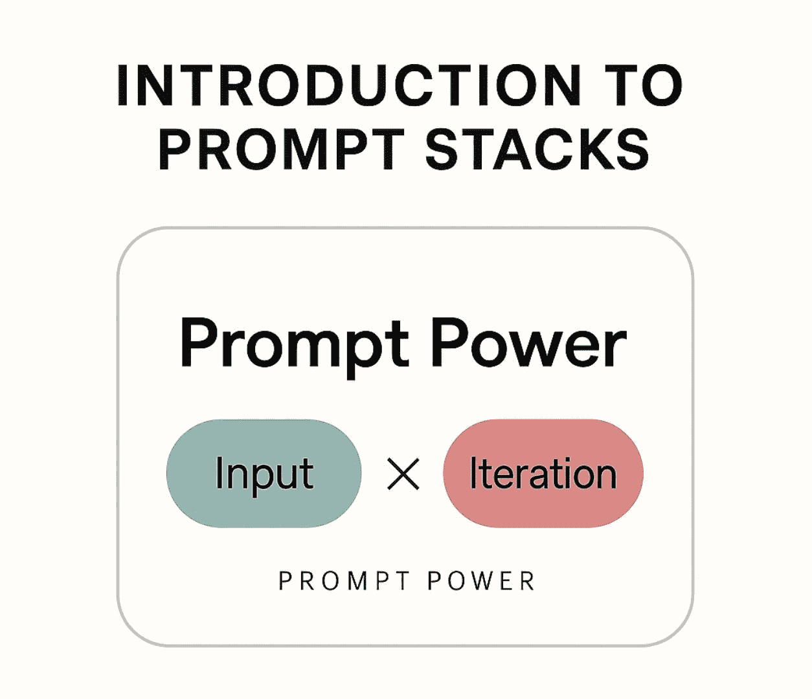
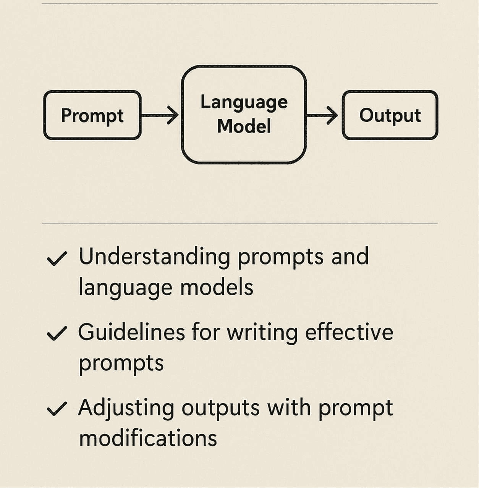
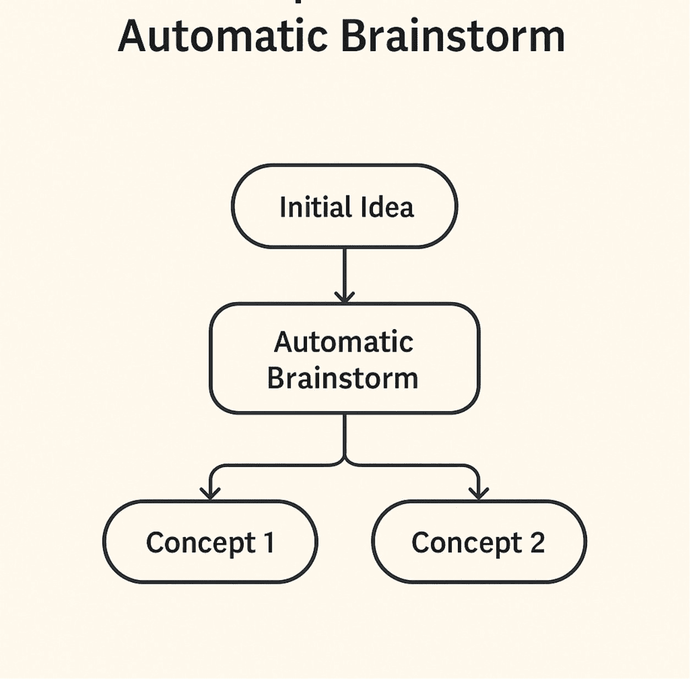
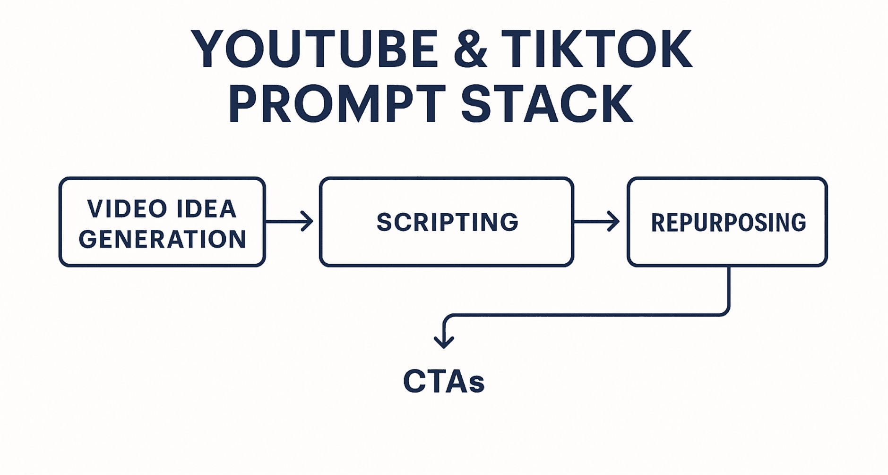
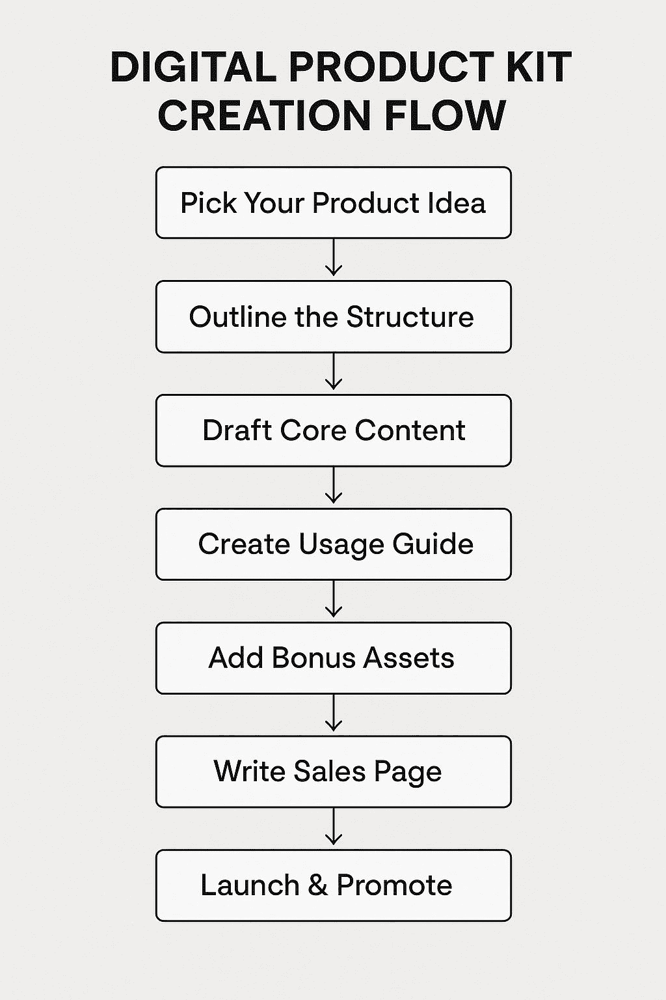
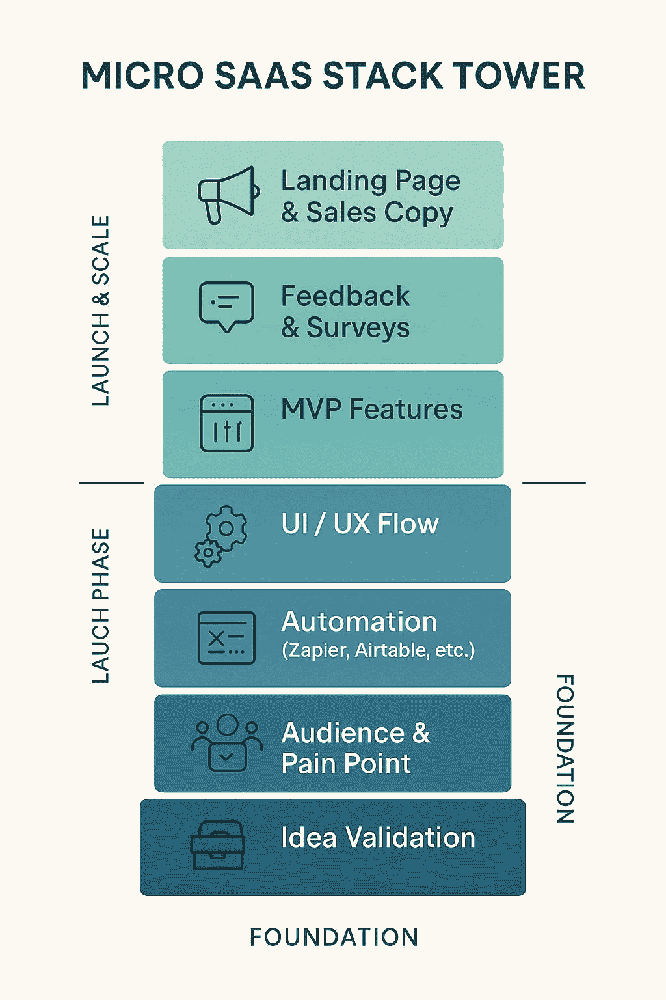

# 提示词艺术：高级用户基础指南（提示词力量系列 2）

## Jordan Lane 的其他作品

想超越这本书的内容吗？

探索 AI 驱动的提示词组合、实用的数字工具以及独家的创作者资源，旨在帮助你工作更聪明、变现更快。

请在此处访问完整收藏：[www.crescentrowmedia.com](https://www.crescentrowmedia.com)

下载即刻用的提示词包：[jordanwrites6.gumroad.com/l/jieaie](https://jordanwrites6.gumroad.com/l/jieaie)

更快创作。更智能地发布。像高级用户一样使用提示词。

## 关于作者

Jordan Lane 是一位数字战略家、提示词工程师，也是使用 AI 创建真实、可持续收入的倡导者。Jordan 拥有内容设计和数字创业的背景，赋能创作者释放 `ChatGPT` 及其他工具的全部潜力——不是通过炒作，而是通过智能的系统和真实的成果。

这是系列丛中的第二本书，旨在帮助你将创意变现，并掌握提示词的艺术。

## 第一章：提示词的艺术 – 高级用户的基础

我们处于一场革命之中——而你正握着遥控器。

不，不是电视那种。是 AI 那种。

那种只需通过输入一个清晰且带有意图的句子，就能在几秒钟解锁数小时工作量的类型。

创建一个 Logo。起草一份商业计划。写一封邮件。设计一节课程。为一个品牌进行头脑风暴。

这一切只需一个提示词。

但事实是：

关键不在于 AI 能做什么，而在于你利用 AI 能做什么。

这本书不是关于理论或炒作。

它关乎将你变成一个`提示词高级用户`（Prompt Power User）——一个不仅仅是为了好而使用 AI，而是为了有目的地进行构建、扩展、盈利和创作的人。

### 什么是提示词，到底是什么？

提示词（Prompting）是以获取最佳可能输出的方式与 AI 模型进行通信的行为。它就像是给一个超级快速、超级聪明的实习生下指令：

如果你描述得很模糊，它就会猜（而且会出错）。

如果你描述得很具体，它就会执行（通常非常出色）。

一个提示词不仅仅是一个命令。它是一场创造性的协作。当方法正确时，它感觉像魔法一样。

### 为什么提示词是新的素养

过去，我们学习打字。然后是学习用 Google。现在？我们学习写提示词。我们提问的方式比我们知道的更重要。考虑一下：

- 一个提示词良好的设计师生成资产的速度比一个设计团队更快。
- 一个能构建提示词组合的教练可以服务更多客户并实现入职自动化。
- 一个理解提示词的创作者可以将一个想法转化为 15 篇内容——瞬间完成。

提示词是数字时代的元技能。而且，是的——你可以快速学会它。

### 提示词威力 = 输入 × 迭代

你从 AI 获取的输出取决于两点：

- 你定义任务的程度如何（`input`）
- 你改进它的速度有多快（`iteration`）

糟糕的提示词 = 通用的垃圾。

良好的提示词 = 定制的黄金。

伟大的提示词 = 一个可重复的系统。

让我们来看一个例子：

弱的提示词：`“帮我写一篇关于心态的博客文章。”`

更好的提示词：`“为千禧一代写一篇关于建立成长心态的 700 字博客文章，包含 3 个例子，励性的语气，并在结尾带有一个可以推文的总结。”`

威力提示词：`“扮演一名励性作家。为 25-35 岁深受自我怀疑困扰的人写一篇 700 字的博客文章，专注于建立成长心态。结构：1) 引人共鸣的故事开头，2) 心态转变，3) 带有核心要点的总结。让语气显得真实但充满力量。”`

第三个提示词给了 AI 角色、结构、受众和目标。这就是像高级用户一样使用提示。

### 一个优秀提示词的解剖

这是一个让任何提示词变得强大的简单模板：

- `ACT AS`（作为）：给 AI 分配一个角色或人格。
- `TASK`（任务）：告诉它要创建什么。
- `AUDIENCE`（受众）：说明它是为谁的。
- `TONE & FORMAT`（语气与格式）：设定氛围或结构。
- `CONTEXT/EXAMPLES`（背景/示例）：（可选但非常强大）

如果不确定，就给 AI 提供过度信息。它在清晰的约束下效果最好。

### 提示词是一种技能，而不是捷径

很多人认为：“如果我找到了一个完美的提示词，我就再也不需要其他的了。”并不是那么回事。提示词就像学习一门新语言。练习得越多，就越流利。

真正的胜利是？提示词叠加（Stacking prompts）。

使用它们来：

- 头脑风暴想法
- 制定项目计划
- 创建草稿
- 润色结果
- 发布

你不需要一个完美的提示词。你需要一个随你一起进化的系统。

### 提示词在哪里节省时间和精力的

这里是 AI 提示词成为你快捷径的几个用例：

- **创意生成**：`“为想要在线扩大规模的瑜伽老师提供 10 个产品想法。”`
- **起草邮件或内容**：`“为加入我生产力课程的新成员写一封欢迎邮件。”`
- **制定课程或工具包大纲**：`“为一个关于数字服务定价的工作坊会创建一个 5 步大纲。”`
- **润色文案**：`“重写这段话，使其更有信心、更有活力。”`
- **创建数字资产**：`“将这个推文串转化为一个电子书大纲。”`

每一项都可以为你节省数小时。将这些倍加到整个业务中？你现在正以创始者的速度运行。

### 迷你案例故事：学会提示词的副业者

认识 Zoya，她是一个 34 岁的全职员工，想开始一份副业但“没有时间”。

她尝试过：

- 头脑风暴数字产品想法：卡住了。
- 编写销售页面：空白。
- 创建内容：毫无反应。

然后她学会了如何叠加提示词。在 3 天内，她：

- 通过提示词生成了 5 个经过验证的想法
- 制定并编写了一个 `Notion` 模板：“创作者时间追踪器”
- 使用 AI 生成的文案建立了 `Gumroad` 销售页面
- 通过 3 条提示词辅助的社交媒体帖子进行了发布

她在前 3 笔销售中赚了 63 美元。但比起钱，她获得了动力。

“提示词给了我在我以前会停滞时向前前进的方法。”

Zoya 没有外包她的创造力——而是升级了它。

提示词威力清单

在你使用 AI 任何任何事情之前，请先检查以下几点：

- ✅ AI 扮演的是什么角色？（例如：教练、作家、营销人员）
- ✅ 任务是什么？（写作、头脑风暴、总结、列大纲？）
- ✅ 它是为谁服务的？（受众、利基市场）
- ✅ 它应该遵循什么样的语气或格式？
- ✅ 你能为它提供背景、示例或参考吗？

如果你能回答这五个问题 —— 结果将会非常火 🔥。

### 结语：你 + AI = 无限杠杆

- 你不需要掌握每一个工具。
- 你不需要跟随每一个趋势。
- 但如果你能掌握提示词（Prompting）的艺术
- 你将获得终极力量：杠杆。

这种能力让你：

- 思维更清晰
- 工作更快速
- 构建更智能
- 发布更迅速

这仅仅是一个开始。

让我们开始构建你的提示词帝国吧——一次一个堆栈（Stack）。

## 🧠 等等——提示词栈（Prompt Stack）和提示词包（Prompt Pack）有什么区别？

让我们尽早弄清楚，这样你就可以放心地使用它们：

| 术语 | 想象成…… | 功能 | 结构 |
| :--- | :--- | :--- | :--- |
| `Prompt Stack` | 菜谱 | 帮助你通过一系列提示词完成一个特定的任务 | 逐步执行的序列 |
| `Prompt Pack` | 一本食谱 | 为一个目标或角色提供全套提示词栈集合 | 多个堆栈 + 赠品 |

### 🔹 提示词栈 (Prompt Stack)

`prompt stack` 是一个微系统。每个提示词都建立在上一个之上 —— 引导你从想法走向执行。

**示例：**

想写一篇博客文章吗？一个 `prompt stack` 可能包含：

1. 定义你的读者
2. 生成标题选项
3. 列出结构大纲
4. 编写章节草稿
5. 添加行动号召（CTA）并进行润色

### 🔸 提示词包 (Prompt Pack)

`prompt pack` 是多个堆栈和相关提示词的组合。它旨在帮助你在某个领域中获胜——比如自由职业、教练或内容创作。

**示例：**

自由职业者的 `Prompt Pack` 包含以下堆栈：

- 构建个人简介
- 洽谈客户
- 编写计划书
- 自动化跟进

将 `prompt stacks` 视为“如何做”，而将 `prompt packs` 视为“做什么”。两者结合？你将变得无所不能。

---

## 第 2 章：数字产品提示词包 – 一次创建，永远售卖

欢迎来到你最喜欢的新领域：数字产品。与用时间换钱的服务工作不同，数字产品带给你规模效应。创建一次东西。卖出百次——甚至千次。

更好的是？你不需要成为专家、设计师或课程创作者。你只需要正确的想法、一个简单的系统和几个提示词。在本章中，我们将使用 `prompt stacks` 来：

- 寻找高需求、低努力的想法
- 使用 AI 为你的产品列大纲并起草
- 命名、包装并销售
- 自动化你的内容创作

充满自信地开始被动（或半被动）收入

### 提示词栈 #1：想法生成器 – 低投入、高需求

最好的数字产品想法是解决一个小但令人烦恼的问题。`扮演一名数字教练。我想发布一个低于 25 美元的简单产品。目标受众：[描述你的利基市场]。`

**提示词：**

`建议 10 个我可以使用 AI + 无代码工具在一周内完成的数字产品想法。对于每个想法，请包括：产品标题、解决了什么问题、格式（例如 Notion、Canva 等）、变现潜力`

**后续提示词：**

`根据构建难度与受众需求的对比，对这些想法进行排序。列出一份根据你的优势定制的验证过的列表。`

### 提示词栈 #2：产品结构与构建计划

一旦你选定了一个想法，就对它进行规划。`扮演一名产品战略师。我选择了 [产品想法]。`

**提示词：**

`为它创建一个结构 —— 列出 5 个章节或模块。每个章节写下 1–2 句描述。格式：[Notion / PDF / 模板包]`

**也想要构建计划吗？**

`现在给我一个简单的 3 天构建计划。每天的任务，以便使用 AI 从零开始完成这个产品。`

### 提示词栈 #3：使用 AI 起草（内容 + 语气）

是时候创建你的产品内容了——快一点。`扮演一名产品作家。为我标题为“[插入标题]”的产品第一部分创建内容。语气：[有趣、可操作、赋能、极简、等]`

**受众：** `[创业者、创作者、家长等]`

**输出：** `项目要点列表、短提示，或便于扫读和使用的格式化文本。`

**提示：** `将字数控制在 [X] 以下。` —— 每个章节使用一次，然后在过程中不断润色。加入你的个人见解、故事和示例。

### 提示词栈 #4：产品名称与标语

命名困难？用提示词解决它吧。`扮演一名品牌专家。为一个帮助 [受众] 获得 [结果] 的数字产品建议 10 个朗朗上口的名称。`

**提示词：**

`让名称简洁、清晰并以收益为导向。为每个名称包含一行标语或副标题。`

**还是卡住了？**

`给我提供这些语气的名称：幽默的、极简的、感性的。`

### 提示词栈 #5：设计建议与格式流程

即使你不是设计师，你的产品也可以看起来很棒。`扮演一名数字产品设计师。根据我的内容大纲，为 Notion/Canva/PDF 产品建议一种布局。`

包含：自己的章节标题

- 图标或视觉元素
- 使用的字体
- 配色方案

保持 `[受众类型]` 的整洁且符合品牌形象。

**额外：** 建议哪里可以添加标注、插图以提升视觉效果。

### 提示词栈 #6：转化销售页文案

现在让它卖出去。`扮演一名销售文案专家。为“[产品名称]编写销售页，帮助[受众]解决[痛点]。`

包含：

1. 钩子标题
2. 问题章节
3. 功能 + 收益
4. 内容
5. 行动号召

语气：`友好、直接`

**可选 CTA 提示词：**

`给我 3 个可以使用的 CTA —— 温和的、大胆的、好奇。`

### 提示词栈 #7：引流磁或赠品创建

想增加销量或你的邮件列表吗？添加一个赠品。`扮演一名营销战略师。根据我的产品“[产品名称]”，建议 3 个引流磁或赠品。`

对于每个，描述：

- 它是什么
- 它与主产品的联系
- 它如何增加价值或转化

**现在提示构建：**

`现在创建第二个赠品的草稿 —— 让它轻量、实用且易于消费。`

### 提示词栈 #8：发布内容引擎

产品好了——让全世界知道。`扮演一名内容营销人员。创建 5 个短形式帖子创意（推特/Instagram/LinkedIn），向[受众]推广“[产品名称]”。`

包含：

- 钩子
- 正文
- 行动号召

语气：`[大胆的、教育性的、感性的等]`

**想要幻灯片创意？**

`现在将帖子 2 转换为 5 页 Instagram 幻灯片。包含幻片标题和标题文案。`

---

## 迷你案例故事：3 小时数字包

Ashley 一直想创建一个产品，但认为自己没有时间。她使用了本章中的提示词栈，并在 3 小时内完成了：

- 为初级助理提示了 5 个产品想法
- 选择了一个：助理入门 SOP
- 使用 AI 列出了 10 个 SOP 模板
- 提示了文案、销售页和 3 条 Instagram 帖子
- 上传到 Gumroad

两天内，她赚了 87 美元。两周内超过 400 美元。最棒的部分是什么？她现在拥有一套重复的系统来创建、发布和扩展 —— 而不会感到压力。

### 你的数字产品提示词栈清单

- ✅ 生成 10 个低投入、高需求的产品想法
- ✅ 根据投入与需求的对比进行验证
- ✅ 将产品分为 3–5 个章节
- ✅ 为每个章节或模板提示草稿
- ✅ 命名 + 编写副标题或标语
- ✅ 使用视觉设计建议构建布局

## ✅ 编写销售页面、CTA（行动号召）和赠品

- ✅ 使用 AI 生成的内容启动发布
- ✅ 重复、重混或组合打包

“每一个数字产品都只是对常见问题的组织化解决方案。提示词（Prompts）让你更快速、更简洁、更智能地构建这些解决方案。”

结语：这就是你如何实现自我扩展

- 你不需要团队。
- 你不需要走红。
- 你只需要将你的知识、技能或系统打包——提示词可以帮助你以清晰且高效的方式做到这一点。
- 所以下次当你想“我应该创作些什么……”时——
- 打开这一章。选择一个提示词。
- 构建资产。分享它。为其收费。
- 这就是你开始实现自我扩展的方式——一次一个提示词驱动的产品。

## 第 3 章：自由职业者提示词包：将提示词变为薪水

自由职业意味着自由——但也意味着丰收与歉谷。上个月，你还在应付五个客户；下个月，你可能要连续几个小时刷新 `Upwork`。自由职业最大的秘密不是才华，而是杠杆。这正是 AI 为你提供优势的地方。

本章将为你提供即插即用的提示词包，用于：

- 更快地获得更好的机会
- 充满自信地响应客户需求
- 在更短的时间内交付高质量工作
- 通过自动化重复任务避免职业倦怠

让我们在提示词的驱动下构建你的自由职业系统。

## 自由职业者的思维转变

大多数自由职业者是用时间换钱。但最聪明的人是用产出换钱。AI 让你产出更多、更好、更快——让你在客户面前看起来像个天才，同时在私下里工作得更聪明，而不是更努力。

无论你是文案作家、设计师、营销人员、虚拟助理还是全能者，你都希望：

- 将自己定位为专家（即使你还不是）
- 在提案之前使用 AI 对想法进行原型设计
- 自动化“无聊的行政杂事”，以便保持创造力

## 第一步：准备好面对客户

在推销之前，你需要听起来很专业——而不是很急切。使用这些提示词包来构建制胜的作品集、求职信和提案。

### 🧠 提示词包：构建你的自由职业简介

**提示词 1：**

作为一个品牌专家。帮助我为我的 `[自由职业技能——例如，文案写作、平面设计等]` 创建一个吸引人的自由职业者简介，目标群体是 `[理想客户]`。字数控制在 200 字以内，语气自信且友好。

**提示词 2：**

创建一个我可以在自由职业简介上使用的口号和简短的电梯演讲。它听起来要有专家水平但又要平易近人。我的前三大技能是 `[技能 1]`、`[技能 2]` 和 `[技能 3]`。

**提示词 3：**

给我 3 个独特的价值主张，让我通过它们在 `[行业]` 的其他自由职业者中脱颖而出。避免使用“勤奋”或“注重细节”之类的泛泛词藻。

### 🧠 提示词包：编写制胜的提案

**提示词 1：**

作为一个高评分自由职业者。为此职位描述写一份定制提案：`[粘贴客户需求简介]`。保持简洁，表现出对需求的理解，并主动提出 1-2 个改进或想法。

**提示词 2：**

重写这份提案使其更以客户为中心并更具说服力：`[粘贴你的草稿]`。增加个性、清晰度和专业性。

**提示词 3：**

给我一份每个制胜提案应该包含的 5 元素的清单。基于 `Upwork`/`Fiverr` 上表现优秀者的标准。

## 第二步：快速交付高质量工作

真正的钱不在于获得工作，而在于留住客户。这些提示词将帮助你持续交付。

### 🧠 提示词包：写作与文案项目

**提示词 1：**

你是一个专家文案作家。为 `[产品/服务]` 编写一份落地页文案，突出 `[核心优势]` 并以强有 `CTA` 结尾。

**提示词 2：**

将这篇长文章总结为简洁、吸引人的社交媒体帖子。添加相关的标签和行动号召：`[粘贴文章]`。

**提示词 3：**

为这次促销活动创建 5 个邮件主题行。保持有力、引发好奇，且字数在 50 个字符以内。

### 🧠 提示词包：设计与品牌项目

**提示词 1：**

作为一个创意总监。为目标群体为 `[观众]` 且风格为 `[情感或审美]` 的品牌提供调配色和情绪板描述。

## 第三步：自动化你的工作流

你来这里不是为了苦干。你来这里是为了扩展。

### 🧠 提示词包：模板与省时工具

**提示词 1：**

为 `[自由职业类型]` 提供一个可重用的模板。

**提示词 2：**

为`[客户名称]`起草一份提案。

## 提示词 3

帮助我为`[电子书主题]`创建大纲。

## 案例故事：Ana 如何通过提示词自由职业每月赚入 3500 美元

Ana 曾是一名老师，开始从事自由职业。她曾难以脱颖而出。使用 AI 后，她可以：

- 用一半的时间编写内容
- 立即创建大纲
- 提供引流工具（lead magnets）

在 60 天内，Ana 的月收入从 500 美元增加到 3500 美元。她的秘密是什么？系统。

## 总结与行动计划

使用 AI 像专家一样做自由职业：

- 打造具有强大定位的突出简介
- 使用定制提案提示词赢得更多订单
- 更快、更智能地交付

# 第 4 章：电子书作者提示词包——使用 AI 编写、格式化并出版

写电子书曾感觉像爬山。空白页、无尽的草稿、自我怀疑。但通过 AI 和提示词堆叠？你可以在几天内从想法变成电子书，而不是几个月。

这一章适用于：

- 想要引流工具的教练
- 将博客转变为书籍的作家
- 在`Gumroad`或`Amazon`上销售电子书的创作者
- 任何有知识分享且没有时间浪费时间的人

书中，你将获得提示词包来：

- 规划电子书内容
- 极速起草章节
- 编辑、润色和格式化
- 创建标题、封面
- 像专家一样上传并发布

## 提示词包 #1：定义你的大想法与读者承诺

在写作之前，定义你的书籍提供的核心转化。

作为一个电子书策略师。我想为`[观众]`编写一本 5000-10000 字的短电子书。

主题：`[插入主题]`

帮助我回答：

- 这本书解决了什么核心问题？
- 读者将获得什么转化？
- 这种方法有什么独特之处？

### 后续

现在提供 3 个专注于该转化的角度或标题。

## 提示词组合 #2：章节大纲生成器

结构即清晰。让 AI 来构建骨架。

为名为“`[插入暂定标题]`”、面向`[受众]`的电子书创建一个 7–10 章节的大纲。

**目标：**帮助读者从`[起始点]`达到`[预期结果]`。

包含章节标题以及每个章节的 1–2 句描述。

### 仍在完善中？

现在将这些章节分为 3 部分：开头、中间、结尾。为每个部分添加一句话总结。现在，你已经准备好带着方向进行写作了。

## 提示词组合 #3：章节草稿（听起来不像机器人）

用 AI 编写章节就像和一位才华横溢、高效的影子作家共同创作。

扮演一名非虚构电子书作家。

为`[受众]`的“`[电子书标题]`”撰写第一章。

**语气：**`[友好的、实用的、励志的等]`

**结构：**

1. 钩子或故事引言
2. 教学或核心内容（3–4 个子章节）
3. 总结或收获

**字数：**约 1,000–1,200 字

### 在过程中调整

- 重写第 2 部分，增加叙事性，减少指令感。
- 让它听起来像是一个真人在分享经验。
- 你不需要完美——你需要一个扎实的初稿。

## 提示词组合 #4：编辑、风格与流畅度润色

让 AI 帮你精炼文字并统一你的语调。

**提高清晰度：**

为了清晰度和结构编辑此章节。拆分长段落。使用更简单的语言。删掉废话。

**调整语气：**

用更具`[大胆 / 有同理心 / 幽默]`的语气重写此章节。保留观点，改变表达方式。

**添加名言或比喻：**

在引言中加入相关的名言或比喻，以产生情感吸引。

你的原始草稿现在听起来犀利、人性化且易于阅读。

## 提示词组合 #5：标题、副标题与标语

标题决定销量。但想出一个出色的标题很难——直到你用提示词生成它。

扮演一名图书营销人员。为一本帮助`[受众]`解决`[问题]`的非虚构电子书建议 10 组标题+副标题的组合。

**制作标题：**

- 清晰，而非花哨
- 利益驱动
- 易于快速扫读

**语气：**`[友好 / 大胆 / 赋能]`

### 后续

现在给我一个可以用在封面或落地页上的极简短标语（Tagline）。测试你最喜欢的。然后定稿。

## 提示词组合 #6：作者简介、封底与亚马逊描述

让我们来完善你的个人形象。

**作者简介：**

为一位`[你的背景/角色]`的人写一段简短的作者简介（75–100 单词）。

语气：平易近人、可信赖、带一点个性。

**亚马逊描述：**

为“`[标题]`”写一段书籍描述，要求：

- 吸引注意力
- 概述内部内容
- 描述转变过程
- 以行动号召（CTA）结尾

**限制：**200 单词。使用短段落格式。

**封底文案：**

现在将其缩短为封底：3 行内容，2 个利益点，1 句话。你的电子书现在听起来非常专业了。

## 提示词组合 #7：格式指南（告别头疼）

你不需要`Vellum`或花哨的工具。你需要结构。

扮演布局指南。我应该如何在`Word`或`Google Docs`中格式化 Kindle 电子书？

包含：

- 字体建议
- 标题样式
- 段落间距
- 分页
- 目录（TOC）设置

让它简洁且符合 Kindle。

### 需要视觉效果吗？

推荐一个极简风格的`Canva`模板。推荐 2–3 个符合本书语气的视觉主题。一致性 = 专业。

## 提示词组合 #8：发布内容与推广

让我们把这个东西卖出去。

扮演数字战略师。为我的电子书“`[标题]`”为`[受众]`创建为期 7 天的内容计划。

包含：

- 3 个推文创意
- 2 个 Instagram 标题
- 1 封发布邮件
- 1 个“幕后”故事

**语气：**`[教育性的 / 轻微炒热的]`

想要长青内容吗？现在将其转化为 5 篇我可以重复使用的长青帖子。

## 案例故事：从博客文章到畅销书

Nikhil 是一位效率教练，拥有几十篇博客文章和邮件内容，但从没时间写书。通过提示词组合，他：

- 根据受众痛点挑选了他最棒的话题
- 生成了完整的 8 章节大纲
- 粘贴博客并提示`AI`进行重构和重写
- 使用`ChatGPT`对语气和流畅度进行编辑
- 在`Gumroad`上发布，配有 AI 的落地页

他在第一周就赚了 297 美元，但更重要的是——那本电子书成为了获取 3 个新教练客户的敲门砖。“提示词并没有替我写书。它让完成这本书成为可能。”

## 电子书提示词包：主清单

✅ 定义受众、承诺和独特视角

✅ 提示词生成清晰的章节大纲

✅ 使用章节组合撰写初稿

✅ 提示词生成标题、副标题与标语

✅ 提示词生成作者简介、封底与亚马逊描述

✅ 提示词获取格式指南

✅ 提示词生成发布内容与推广

## 结语思考：提示词让写作成为可能

- 提示词并没有替我写书。它让完成这本书成为可能。
- 你的故事
- “提示词并没有替我写书。它让完成这本书成为可能。”

现在，你已经准备好带着方向进行写作了。

想深入了解吗？使用长文本格式，如 Instagram 轮播图或 Twitter 推文。

基于此想法创建一个 7 页的 Instagram 轮播图，目标受众为`[audience]`。

每一页应包含：

- 第 1 页：钩子（Hook）
- 第 2–6 页：步骤、价值、故事
- 第 7 页：总结 + 行动号召（CTA）

语气：`教育性的、激励性的、策略性的`

想要推文吗？

将此轮播图转换为 5-8 条推文。添加个性化的观点。

现在你默认实现了多平台发布。

## 提示词包 #5：内容复用机器

将一条帖子转化为多个内容。

将这段 Instagram 文案转换为：

- 推文
- LinkedIn 帖子
- 30 秒视频脚本
- 封邮件预告
- 轮播图大纲

### 后续

现在为每种格式创建 3 个选项。

你最好的想法现在随处都能发挥作用。

## 提示词包 #6：价值干货与教学帖子

想成为你所在领域的知名专家吗？

开始教学。

写一个帖子，解释如何帮助`[audience]``[达成结果]`。包含：

- 清晰的引言
- 3-5 个步骤（每步带有一个建议）
- 结尾语

语气：`明智的、慷慨的`

现在将此重构为轮播图或推文以深入讲解。

教学 = 信任。

## 提示词包 #7：故事讲述与真实性帖子

人们关注真实的人——而不是机器人。

让我们真实真实。

写一个关于真实性的帖子，关于我`[在业务或生活中遇到困难]`。包含：

- 快速故事开头
- 发生了什么变化
- 我学到的
- 给别人的建议

语气：`诚实的、感同的、非说教的`

想要更短的？

现在将其压缩为 5 条推文，讲述同一个故事。

你建立了情感连接——仅用 5 分钟。

## 提示词包 #8：行动号召（CTA）与互动提示

你已经发布了……现在做什么？

使用提示词引导你的受众。

写 5 个有创意的 CTA，用于教学`[主题]`的帖子。组合：

- 评论 CTA
- 分享/标记 CTA
- 收藏/书签 CTA
- 私信 CTA
- 点击链接 CTA

保持友好、具体且不咄咄。

你的内容不应只是说说，应该引发对话。

## 案例故事：30 天内增长 3 倍

Pam 是一位健康教练，粉丝量在 800 人停留了 4 个月。每天“露面”让她精疲力竭。

于是她建立了一个提示词系统：

- 定义了 4 个内容支柱
- 使用 AI 每周 5 个帖子
- 将 IG 帖子转换为 Threads 和 Reels
- 生成了文案、CTA 和轮播图脚本

在 30 天内，她获得了 2400 个新粉丝、92 个订阅并预约了咨询电话。

“一旦我停止过度思考每一个帖子并开始使用提示词，一切都变得简单了。”

## 社交媒体增长提示词清单

✅ 定义内容支柱

✅ 针对 3-5 个主题生成 15 个帖子创意

✅ 创建停止用户下滑的钩子

✅ 以不同的语气和格式编写帖子

✅ 构建轮播图并跨平台复用

✅ 清晰地教学并讲述故事

✅ 自动化 CTA 和行动号召

✅ 让你最好的内容发挥最大价值

“你的内容不需要完美——只需要持续。”

## 结语：更聪明地发布，而不是更努力

你不需要追逐趋势、破解算法或每天发布 5 次。你需要：

- 了解你的受众
- 提供价值
- 结构化的重复

提示词让内容从任务变成系统。当内容变成系统，增长就成为必然。去创作吧。发布。连接。一次一个提示词。

# 第 6 章：教练与咨询包

## 服务更多、卖得更好、扩展更快

你成为教练或顾问是为了帮助他人——而不是淹没在行政、内容创作或发布压力中。但在服务之间……你可能想过：“我需要第二个大脑。”这一章为你提供了一个——由 AI 驱动的提示词，与你一起思考和计划。无论你是刚开始还是约满当，这些工具包都能帮助你：

- 明确你的产品和理想客户
- 构建教练课程和资源
- 自动化入职和客户邮件
- 创建社交媒体、网络研会和销售内容
- 在不精疲力竭的情况下服务他人

让我们建立一个由你的智慧驱动并由 AI 支持的教练引擎。

## 提示词包 #1：明确你的领域与核心产品

你的产品应该是一个承诺——而不是一个包裹。

扮演一个清晰度教练。帮助我精炼我的领域和核心产品。我是一个`[教练或顾问类型]`。我帮助`[受众]`达成`[结果]`。

问我 3 个问题以深入探讨。然后总结：

- 我的领域
- 我解决的核心问题
- 用一句话描述我的核心产品

想要更多吗？

现在为我的核心教练包建议一个响亮的名字 + 口号。

清晰度带来销量。AI 帮助你磨炼它。

## 提示词包 #2：课程与教学构建器

在几分钟内构建一个 4、6 或 8 周的课程。

为`[受众]`创建一个 6 周的教练课程大纲，帮助他们`[达成目标]`。

每一周包含：

- 主题或重点
- 核心收获
- 行动步骤

语气：`变革性的、简单的`

需要资源吗？

现在为第 1 周创建一个工作表。包含 3 个问题 + 一个练习。

你现在有了结构化的产品来支持它。

## 提示词包 #3：客户入职邮件与表单

第一印象至关重要。自动化这一体验。

**欢迎邮件：**

为新的教练客户写一封温暖的入职邮件。包含：

- 感谢
- 预期内容
- 预约链接
- 他们应该准备什么

语气：`欢迎的、组织的、赋能的`

**入职表单：**

创建入职表单问题，帮助我了解他们的目标、挑战和预期结果。保持简单、反思性。

你从第一天起就会显得专业且富有关怀。

## 提示词包 #4：课程总结与教练笔记

在每次课程后，保持势头。

扮演教练助手。在客户课程后写一段总结邮件。包含：

- 我们涵盖的内容
- 核心收获
- 本周的行动步骤
- 鼓励性的笔记

想深入了解吗？

现在创建一个让客户在下次课程前回答的反思提示词。这种程度的跟进会创造留存率和好评。

## 提示词包 #5：小组教练与网络研讨会规划

如果你运营小组或现场活动——规划你的议程。

创建一个 60 分钟的小组课程大纲。主题：`[插入主题]`。包含：

- 5 分钟引言
- 教学点
- 2 个反思问题
- 小组讨论建议
- 总结与 CTA

对于网络研讨会：

写一个网络研讨会大纲，通过 3 个核心观点教授`[主题]`。在结尾包含对我产品的软推销。

你现在几分钟内规划好了下一次发布或工作坊。

## 提示词包 #6：教练的内容创作

你的客户需要提醒、灵感和严厉的爱。

写 5 条 Instagram 文案，激励`[受众]`为`[目标]`行动。语气：`大胆的、智慧的、激励的——像一个直言不讳的教练。`

想要故事帖子吗？

写一个关于客户从`[困难]`变为`[结果]`的故事（更改具体细节）。包含：引言、转化和给读者的 1 个教训。

现在你在发送私信之前就建立了信任。

## 提示词包 #7：证言与成功故事

让 AI 帮助你捕捉你最好的作品。

**请求邮件：**

写一封信息，向满意的客户索要证言。包含：

- 感谢
- 3 个提示问题
- 主动为他们编写一个草案

### 案例研究

现在根据这段客户旅程写一个简短的成功故事（3–4 句话）：

之前：`[struggle]`

之后：`[result]`

语气：自豪但谦逊。以我的品牌口吻说话。

社交证明 → 新线索 → 更大影响力。

## 提示词栈 #8：销售页面与私信策略

现在让我们来填满你的日程。

### 销售页面草案

为我的教练课程`[name]`编写一个销售页面，帮助`[audience]`实现`[result]`。

包含：

- 钩子标题（Hook headline）
- 痛点章节
- 内部内容
- 证言（占位符）
- 价格与行动号召（CTA）

语气：冷静、清晰、自信。

### 私信（DM）脚本

为一个点赞过我关于`[topic]`帖子的人写一封友好、不推销的私信，邀请他们预约咨询电话（clarity call）。

让 AI 帮你销售，而不会像垃圾信息。

---

## 微案例：从精疲力竭到约约满满

Jordan 是一位心态教练，他对内容、行政事务和不稳定的客户系统感到精疲力竭。

在 2 周内，他利用提示词实现了：

- 用一句话明确了他的产品
- 构建了一个为期 6 周的课程
- 创建了精美的入职体验
- 生成了 30 天的内容
- 自动化课后跟进
- 构建了一个带有 AI 支持的`Notion`客户跟踪器

“提示词给了我一个我不知道自己需要的系统。感觉我现在是在自己的才华领域进行教学——而不是在追逐任务。”

在一个月内，他提高了价格并创建了候补名单。

## 教练与咨询提示词栈清单

✅ 明确利基市场、核心信息和产品

✅ 构建你的课程结构和工具

✅ 创建入职邮件和 intake 表单

✅ 自动化课程总结和跟进

✅ 计划网络研讨会、工作坊或发布活动

✅ 生成启发性、信赖的内容

✅ 收集并重写证言

✅ 构建销售页面和外联消息

“你的客户不需要更多内容。他们需要的是清晰。提示词帮助你创造这种清晰度——为了他们，也为了你自己。”

## 结语：你教客户——让 AI 教工作流

教练是感性的、人性化的、转型性的。

那部分？仍然属于你。

但背后的压力呢？写作、结构化、发邮件、销售？

那是 AI 发光的地方——也是提示词栈成为你秘密武器的地方。

用它提供更好的服务。

更智能地扩展。

最重要的是——留在你的才华领域。

你进入这份工作是为了帮助他人。

现在让提示词来帮助你。

下一站 → 第 7 章：YouTube & TikTok 内容提示词包

# 第 7 章：YouTube & TikTok 内容提示词包——灯光、摄像、提示词

创作视频内容是建立在线权威和信任的最快方式之一。

大多数人在按下“录制”之前就卡住了。

“我要说什么？”

“我该怎么写脚本？”

“这真的有趣吗？”

引入提示词。

这一章是你的幕后制作团队——帮助你生成：

- 具吸引力的视频创意
- 吸引人的开头和行动号召（CTA）
- 短视频和长视频脚本
- 重新利用的 Reels 和 Shorts
- 描述、说明、标题和标签

无论你是一个害怕摄像头的初学者，还是一个想要节省数小时的内容机器——这个提示词包都是你的视频助攻手。

## 提示词栈 #1：脑风暴具有病毒传播意识的视频创意

从相关的、可搜索的、针对观众的创意开始。

作为一个视频策略师。为我的`[YouTube / TikTok / Reels]`频道建议 15 个内容创意。

主题：`[插入利基或主题]`

受众：`[描述理想观众]`

目标：`[增长粉丝，驱动销售，建立信任]`

语气：`[教育性的 / 有趣的 / 大胆的 / 感性的]`

### 后续

现在将每个创意标记为：

- 钩子驱动
- 故事驱动
- 技巧驱动
- 趋势跳转
- 常青（Evergreen）

现在你拥有了有范围的内容——而不是随机的内容。

## 提示词栈 #2：短视频脚本（60 秒以内）

快速钩子。交付价值。强力结尾。

为 TikTok 或 Reels 写一个 45–60 秒的视频脚本。

主题：`[插入创意]`

受众：`[目标观众]`

结构：

1. 钩子（前 3 秒）
2. 3 个快速要点或技巧
3. CTA（评论、关注或私信）

语气：`[大胆的、随意的、幽默的、励志的]`

### 奖励

现在将其重新格式化为 3 个短要点，用于屏幕文字叠加。

脚本写好了——只需出现并读出来即可。

## 提示词栈 #3：YouTube 长视频脚本编写

如果你在教学、演示或分享故事——`YouTube` 是你的舞台。

为这个标题写一个 5 分钟的 `YouTube` 脚本：`“[插入主题/标题]”`

受众：`[描述观众]`

包含：

– 吸人的开头

– 3–4 个主教学点

– 个人案例

– 总结与 CTA

语气：教育性的、高能量的、信赖的

后续：

现在添加 2 个时间戳，并为每个部分建议 3 个 B-roll（空镜）片段建议。

这就是你的下一个 `YouTube` 视频——已经完成了一半。

## 提示词栈 #4：钩子、开头与前 3 秒

注意力是快速赢得的。AI 可以写出让人停止滑动屏幕的文字。

为一个 `[教练 / 设计师 / 自由职业者 / 创作者]` 写 10 个短视频钩子，关于 `“[插入痛点或结果]。”`

每个少于 12 个单词。

让它们充满好奇感且大胆。

## 提示词栈 #5：真正转化的行动号召（CTA）

如果他们看了但不行动……有什么意义？

写 5 个短视频 CTA，邀请观众：

– 评论

– 保存视频

– 私信咨询

– 下载资源

– 点击链接

语气：随意的、自信的

## 提示词栈 #6：跨平台重新利用

将一个视频变成五种格式。

作为一个重新利用专家。将 `TikTok/Reel` 脚本重新利用为：

– 推文

– 轮播图大纲

– 播客介绍

– 博客段落

– 引用图

## 提示词栈 #7：YouTube 标题、缩图与描述

发现性始于点击率。

为 `[插入主题]` 写 5 个 `YouTube` 标题选项。让它们：

– 值得点击但不标题党

– 关键词优化

然后：

写一个 150 字的 `YouTube` 描述，包含：

– 视频教了什么

– 2–3 个搜索关键词

– 订阅或下载资源的 CTA

– 标签

奖励：

建议 3 个缩图文字选项和 2 个图片建议。

## 提示词栈 #8：短视频说明生成器

说明扩展范围——并深化共鸣。

为这个视频写一个 `Instagram Reels` 说明：`“[插入总结]”`

包含：

– 1 句引起共感的开头

– 核心洞察或故事

– 1 个评论 CTA

– 最多 5 个相关标签

语气：友好的、简洁的、不过正式

想要更有力的语气？

用 Z 世代/讽刺的/诗意的/思想领袖风格重写。

## 微案例：默默崛起的沉默创作者

David 是一位金融理财创作者，他非常害怕面对镜头说话。

他没有逃避，而是利用 AI 实现了：

● 为 20 个带有自信钩子的短视频脚本

● 结合视觉效果和素材 B-roll 批量录制旁

● 生成 `YouTube` 描述、SEO 标签和短视频版本

他的第二个视频在 4 天内获得了 4.8 万次观看。

他的邮件列表在 2 周内增加了 300 多人。

全程没有露脸。

“提示词给了我一个视频引擎——一个我可以运行而不会精疲力竭的引擎。”

✅ 将内容想法批量整合进 30 天日历

✅ 追踪哪些提示词（`prompts`）带来了最佳互动率

“如果你的信息足够有力，AI 会让它传播。如果你的内容足够优秀，提示词会让它规模。”

## 结语：你不仅仅是一个创作者——你还是导演

每一位伟大的创作者都是部分艺术家、部分制作人和部分策略家。

提示词可以帮助你：

● 像策略家一样头脑风暴

● 像剧作家一样写作

● 像制作人一样规划

● 像专家一样发布

这并不是为了走红。

而是为了建立一个记得你的观众。

所以，灯光就绪。摄影就位。提示词在手。

开始吧。

接下来 → 第 8 章：模板、工具包与速表提示词包

# 第 8 章

## 模板、工具包与速表提示词包 —— 构建一次，售卖永远

如果你想在不用时间换钱的情况下让你的技能变现——数字工具包、模板和速表就是你的黄金门票。

它们是：

● 构建快速

● 易于扩展

● 对你的观众有价值

● 而且通过提示词叠加（`prompt stacking`）变得简单得惊人

本章将帮助你从空白屏幕快速变为可下载的产品。

你将学会：

● 根据你的技能生成产品创意

● 使用 AI 规划模板和清单

● 编写说明和使用指南

● 格式化你的最终产品

● 创建销售文案和原型

无论是 `Canva` 工具包、`Notion` 计划表、`Google Sheet` 还是 `PDF` 速表——这就是如何构建一次并售卖永远。

## 提示词栈 #1：生成可售的产品创意

从专注于高实用性、低摩擦的产品开始。

扮演产品策略家。根据这项专业知识，建议 10 个我可以创建的数字模板或工具包创意：`[插入垂直领域，例如：效率教练 / 社交媒体自由职业者 / 健康顾问]`

每个创意都应该包含：

– 产品名称

– 格式（`Notion`、`Canva`、`PDF` 等）

– 它解决的问题

– 为什么易于使用

后续：

按从易构建到最有利的顺序对这些创意进行排序。

选择你的 MVP（最小可行性产品）——然后去构建它。

## 提示词栈 #2：规划产品结构

每一个好的工具包分步骤解决问题。让 AI 来拆解。

为我的产品创建一个结构：`“[插入产品创意]”`

观众：`[描述目标客户]`

包含：

– 3–5 个章节或模块

– 每个模块的一句句描述

– 推荐的文件格式或工具（例如，`Notion`、`Google Docs`）

额外奖励：

现在写一个使用流程——详细说明某如何与这个工具包进行交互。这将成为你的说明页面和你的话术。

## 提示词栈 #3：速表 + 清单创建器

速表和清单 = 高感知价值，低构建时间。

扮演文案人员。为 `[观众]` 创建一个标题为 `“[插入标题]”` 的单页速表，帮助他们 `[达成结果]`。

包含：

– 3–5 个类别

– 下的项目符号（简短、易于扫读）

– 底部的引言或提醒

清单变体：

为 `[任务、过程或结果]` 编写一个 15 步的清单。分为 3 个阶段：之前、期间、之后。保持对新手友好且易于扫描。你现在有了一个引流磁、赠品或产品了。

## 提示词栈 #4：模板内容

让 AI 帮助用智能默认值填充字段和章节。

创建一个示例文案，包含在 `[Notion / Canva / Google Sheets]` 模板中，用于 `“[插入使用场景]”`

包含：

– 标题或标签

– 示例输入

– 占符提示

语气：清晰、有帮助、轻微引导

示例：客户入职表单、习惯追踪器。提示一次，永久复制。

## 提示词栈 #5：说明性文案与使用指南

不要让你的买家感到困惑——引导他们。

为 `[描述产品]` 编写一个友好的“如何使用此模板”页面。

包含：

– 欢迎辞

– 此模板有什么帮助

– 开始开始的 3–5 个步骤

– 自定义提醒

语气：鼓励性的、清晰的、非技术性的

## 提示词栈 #6：赠品资产与配套文件

增加价值。在不推销的情况下进行向上销售。

建议我可以在我的 `[产品名称]` 工具包中提供的 3 个配套赠品，以增加感知价值。每个赠品都应该是使用提示词或模板轻松创建的。解释为什么它增加了价值以及如何将其捆绑。

然后构建一个：

现在为赠品 #2 编写内容：`[插入赠品名称或创意]`。你 15 美元的产品看起来像一个 47 美元的组合包。

## 提示词栈 #7：会卖的销售文案

不仅在于你做了什么——更在于你如何展示它。

为 `“[产品名称]”` 写一个产品销售页面。

观众：`[描述买家]`

它解决的问题：`[插入痛点]`

包含：

– 标题

– 3 个利益点

– 内部预览

– 价格行动号召（CTA）

语气：有帮助的、热情的、非炒作

然后……现在为列表页写一个 `Gumroad` 描述和一行标语。

可选：

建议 3 个可以用于推广此次发布的推特风格文案。

## 提示词栈 #8：原型、设计与交付创意

展示至关重要。

扮演产品设计师。建议 2 种在原型中视觉化展示产品的方法。

工具：`Canva`、`Figma`、`Preview`

包含：

– 原型类型（平板、手机、幻灯片）

– 背景想法

– 符合氛围的字体

然后：

现在写下包含项的文字。这将成为你的店铺视觉图。

## 案例故事：一个模板，100+ 销量

Ella 是一位社交媒体经理使用提示词栈构建了：

● 配文公式速表

● `Notion` 内容日历

● 客户入职工具包

每个构建不到 3 小时。她将它们打包成一个 27 美元的工具包，并在 60 天内卖出了 120 多份。“我不再等待完美的产品。提示词帮助我快速构建了一个实用的。”

她现在每月使用她的工作流发布一个新模板。

## 模板、工具包与速表清单

✅ 根据观众痛点 + 格式选择你的创意

✅ 规划结构和使用流程

✅ 起草工具包内容（速表、示例、默认值）

✅ 编写友好的使用指南

✅ 添加 1–2 个简单的赠品或引流磁

✅ 创建销售文案、CTA 和原型

✅ 上传、推广、捆绑并重复

“如果有人反复遇到问题，模板是解决问题的快速方法——而提示词让构建变得极快。”

## 结语：不要卖时间——卖帮助

● 模板和工具包不是为了设计的完美。

● 它们是为了帮助别人更快、更清晰、无障碍。

● 你已经拥有了技能。

● AI 提供了结构。

● 提示词提供了速度。

● 你的第一个数字产品不需要很大——只需要有用。

● 所以去构建它。卖掉它。改进它。然后构建另一个。

一旦你学会了如何通过提示词创建一个模板……你就可以扩展价值——扩展精力。

接下来 → 第 9 章：微 SaaS 与无代码提示词包

# 第 9 章

## 微 SaaS 与无代码提示词包 —— 小型构建、智能启动、快速扩展

你不需要成为开发者来发布技术产品。

感谢 AI + 无代码工具，构建微 SaaS 或自动化产品现在对于创作者、自由职业者、教练——任何有创意和用例的人来说都是可行的。

本章向你展示如何通过提示词完成：

● 创意验证

● MVP 设计

● 用户流程规划

● 落地页文案

● 发布策略

● 未来更新和反馈系统

你还将获得一系列提示词栈，用于使用 `Notion`、`Airtable`、`Glide`、`Zapier`、`Softr` 等工具进行构建——无需编写一行代码。

## 提示词栈 #1：微型 SaaS 创意生成器

从你观察过的真实世界问题开始——让 AI 为你构思灵感。

担任 SaaS 构思教练。针对以下内容建议 10 个微型 SaaS 或自动化产品创意：

– 受众：`[目标用户，例如：个人创业者、教练、机构所有者]`

– 问题：`[插入已知的痛点或低效环节]`

每个创意都应包含：

– 一句式推销（Pitch）

– 变现潜力

– 构建它的无代码工具建议

想要市场就绪的方向吗？

现在根据“构建易用性 vs 需求潜力”对前 3 个创意进行排名。

`Clarity` → `confidence` → `momentum`。

## 提示词栈 #2：定义你的 MVP

大多数 SaaS 创始人过度开发。不要这样做。

让 AI 定义你的最小可行性产品（MVP）。

担任产品策略师。

为这个创意定义一个 MVP：`“[插入微型 SaaS 创意]”`

包含：

– 它解决的 1 个问题

– 3 个核心功能

– 理想用户画像

– 构建它的平台（优先考虑无代码技术栈）

后续：

现在使用 `[Notion / Glide / Airtable / Tally / Zapier]` 创建一个为期 3 天的构建计划。

你现在有了一个可行的路线图——而不仅仅是一个梦想。

## 提示词栈 #3：UI / UX 流程规划

你不需要“设计”。你需要映射旅程。

为一款微型 SaaS 产品设计一个简单的用户流，帮助 `[受众]` 完成 `[任务]`。

包含：

– 入口（登录或首页）

– 用户可以执行的 3 个主要操作

– 基础布局建议

– 构建它的工具（`Notion + Super`、`Glide` 等）

额外奖励：

为欢迎屏幕或引导流程编写一段占位文案（Dummy copy）。

你现在有了一个线框——无需打开 `Figma`。

## 提示词栈 #4：功能描述与 AI 自动填充

使用 AI 来写出你工具的功能——清晰且有说服力。

为我的 SaaS 产品中一个名为 `“[插入功能名称]”` 的功能写一段话的描述。

解释它是如何工作的、能帮助谁，以及为什么重要——使用通俗易懂的英语。

需要 UI 填充文本吗？

为跟踪 `[X 指标]` 的仪表板创建示例输入字段、默认文本和提示。

这让你的 MVP 在用户面前显得真实。

## 提示词栈 #5：落地页与销售文案

你构建了它——现在卖掉它。

为我的无代码微型 SaaS 写一个落地页：`“[产品名称]”`

受众：`[描述用户]`

包含：

– 标题 + 副标题

– 问题 → 解决方案的流程

– 功能亮点（3 个要点）

– CTA（行动号召）

语气：现代、简洁

后续：

现在写一个市场就绪的标题。

你现在有了一个可执行的草稿。

## 提示词栈 #6：线框与用户反馈

你现在有了一个线框——无需打开 `Figma`。

## 提示词栈 #7：自动化与增长

你现在有了一个可执行的路线图——而不仅仅是一个梦想。

## 提示词栈 #8：启动策略与增长

你现在有了一个可执行的路线图——而不仅仅是一个梦想。

根据此客户项目编写一个简短的案例研究：

- 客户类型：`[describe]`

- 问题：`[brief summary]`

- 解决方案：`[your process]`

- 结果：`[data or qualitative feedback]`

语调：专注的、视觉化的、低调的炫耀

然后复用它：

写 3 条文案，供我用于社交平台，分享这个案例研究。

让你的结果自己说话。

## 提示词栈 #5：证言与社交证明

让满意的客户能够轻松地疯狂赞美你。

### 证言请求

写一封证言请求邮件，在项目结束时发送。

包含内容：

- 感谢

- 2–3 个简单的问题

- 提议帮助将他们的反馈整理成引言

语调：亲切且随和

### 然后进行二次创作

将这条证言改写为：

- 网站上的短引言

- Instagram 文案

- 个人作品集中的简介介绍

一条证言 = 多个信任证明点。

## 提示词栈 #6：客户反馈循环与评审流程

在混乱和范围蔓延发生前防止它们。

### 请求修改

写一条消息，要求客户对已交付的项目提供反馈。

包含内容：

- 对包含内容的提醒

- 评审行动号召 (CTA)

- 回复时间线

语调：冷静且主动

### 委婉地拒绝

帮我写一条消息，委婉提醒客户我们已经达到了包含在内的最后一轮修改。

如果需要，提供付费修改选项。

边界建立尊重。

## 提示词栈 #7：高转化的品牌信息

如果你是服务提供者，你的品牌不是 Logo —— 而是你的清晰度。

### 品牌简介

帮我写一个品牌简介，描述：

- 我帮助的对象是谁

- 我做什么

- 为什么有效

- 我的独特之处

字数限制：75–100 个单词

语调：机智、友善、有力

### 后跟进

写 3 条单行标语（`taglines`），供我用于社交媒体简介或网站页眉。

这就是你如何将无形的才华转化为令人深刻的定位。

## 提示词栈 #8：推荐、留存与重复业务

不要只是结束 —— 要重新开启大门。

### 请求推荐

写一封礼貌的邮件，询问满意的客户是否知道其他可能从我的服务中受益的人。

语调：温暖、无压力、专业

### 提供留存方案

为我刚完成项目的客户写一封简单的留存推销邮件。

包含内容：

- 我每月可以提供什么帮助

- 价格区间

- 预约通话的选项

语调：乐于助人且低

一个良好的客户 → 三个新机会。

## 迷你案例故事：从自由职业者到信赖的伙伴

Sara 是一位自由设计师，经常在不同项目之间跳槽。

她业务能力很强 ——但在拓展、跟进和范围清晰度方面表现不稳定。

使用本章的提示词栈，她：

- 通过一键欢迎包收紧了入职流程

- 在几分钟内写出了完美的提案计划书

- 以清晰的边界和后续步骤进行跟进

- 建立了一个基于 `Notion` 的证言库

- 通过复用案例研究赢得了 2 个留存客户

“我停止了仅仅是‘交付’，开始‘领导’。提示词给了我从自由职业者成长为品牌的系统。”

## 客户工作与品牌建设提示词栈检查清单

✅ 创建清晰的入职信息和预期

✅ 编写个性化的提案以促成更多交易

✅ 进行冷启动 —— 采用温暖的、人性化的语气

✅ 通过迷你案例研究 + 社交帖子分享作品

✅ 请求证言并将其改写为多种格式

✅ 像专家一样管理反馈和范围

✅ 打造高转化的简介、品牌信息和报价

✅ 邀请重复业务、推荐和留存

“客户的信任不是在项目本身中建立的。它是建立在项目周围的细节中的 —— 而提示词为你提供了这些细节的语言。”

## 结语：像创意者一样交付，像品牌一样领导。

客户需要的不仅仅是才华 —— 他们需要信任。

他们需要清晰度。边界。自信。存在感。

提示词帮助你：

- 更好的沟通

- 更好的销售

- 更好的领导

- 被记住

这不仅关乎更努力地工作 —— 更关乎更有结构地工作。

所以带着清晰度出现。

以卓越的标准交付。

让 AI 帮你同时做到这两点 —— 规模化。

下一步 → 奖励章节：构建你自己的提示词栈 – 框架方法

# 奖励章节

## 构建你自己的提示词栈 – 框架方法

现在，你已经看到提示词如何改变你的工作流了。

从电子书和数字产品…… 到自由职业系统、内容创作、SaaS 创意和客户工作 ——

提示词让你将清晰度转化为行动，将想法转化为收入。

- 但这是终极的密钥：

- 但这是终极的密钥：

- 但这是终极的密钥：

等等，让我们完善一下结构：

## 什么是提示词栈？

提示词栈不仅仅是一个提示词。它是一系列提示词，帮助你完成：

- 头脑风暴

- 计划

- 创建

- 完善

- 发布

一个很棒的提示是有用的。一个强大的提示词栈是不可阻挡的。

## 五部分法提示词栈框架

当你想要构建自己的时，使用此方法：

### 1. 定义结果

你希望结果是什么？博客文章？课程？脚本？

提示词：`I want to use AI to [describe the goal]`。

### 2. 拆分为阶段

现在对过程建模。步骤有哪些？

- 定义

- 大纲

- 编写

- 格式化

提示词：`Break down [task] into 3–5 stages`。

### 3. 选择格式和语调

你的输出是 PDF？轮播？网页文案？推文？应该反映什么样的语调？

提示词：`Suggest the best format and tone for this type of content`。

### 4. 在每个阶段进行迭代

栈中的每个部分都应该允许测试、重写或扩展。

提示词：`Rewrite this in a [tone/format] way`。

### 5. 系统化并保存

一旦可行，下次不要从头开始。将你的栈存储在`Notion`、`Google Docs`或任何提示词库中。专业提示：给你的提示词栈命名。

## 示例：从零开始提示词栈

假设你想卖一个`Notion`模板。以下是使用框架构建自定义栈的方法：

### 结果

销售一个面向远程工作者的`Notion`模板。

### 阶段

- 头脑风暴用例
- 列出内容大纲
- 填充示例数据

### 栈

1. `Act as a product strategist. What are 10 useful Notion templates remote workers needed?`
2. `Outline the sections of a Notion template called ‘Workday Clarity Planner’.`
3. `Add sample fields and example content for each section.`
4. `Write sales page copy for this template, including 3 bullet benefits.`
5. `Suggest a visual mockup idea using Canva, and write a caption for launch.`

保存它。微调它。再次使用它。

现在，你有了自定义的提示词系统。

## 提示词栈构建器检查清单

✅ 定义你所需的输出或交付物

✅ 将过程拆分为 3–5 个阶段

- ✅ 每个阶段编写 1 个智能、结构化的提示词
- ✅ 构建修改、重混或重新格式化的选项
- ✅ 以你记得住的名字保存提示词栈
- ✅ 再次使用 —— 或对其进行微调以构建新内容

你不需要精通编写提示词。你需要一个优秀的提示词系统。

### 结语：提示词是一种超能力，但提示词栈是工具箱

- 工具会变化。
- AI 模型会进化。
- 平台会兴衰。
- 但如果你能“栈”的方式思考……
- 如果你能将大目标拆分为小小的、可提示化的部分……
- 你永远拥有创意优势。
- 你会得更快。
- 工作更聪明。
- 构建得更好。
- 最重要的是——你再也不会害怕空白页。

构建你的栈。

保存它。

使用它。

通过提示词通向你正在创造的任何未来。

你不仅仅在使用 AI。

你是在与它共同构建。

开始吧。

### 来自 Jordan Lane 的更多内容

想超越这本书的内容吗？

探索 AI 驱动的提示词栈、实用的数字工具以及专有的创作者资源，旨在帮助你工作更聪明、变现更快。

访问完整集合：

[`www.crescentrowmedia.com`](https://www.crescentrowmedia.com)

下载下载即用的提示词包：

[`jordanwrites6.gumroad.com/l/jieaie`](https://jordanwrites6.gumroad.com/l/jieaie)

更快创作。更智能地发布。像高级用户一样使用提示词。
