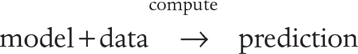

# 原子人：AI 时代的自我认知

*(注：为了简洁起见，省略了重复结构的 1-117 页页码)*

# 导航

1. 开始阅读

2. 致 Valerie、Mark 和 Garth

   探索书籍赠送、抢预览、优惠及更多内容。

   [点击此处了解更多](https://discover.hachettebookgroup.com/?ref=9781541705142&discp=0)。

   

# 序言

2013 年 12 月 8 日：内华达州斯塔特莱恩，哈拉赌场，行政套房。这是我成为一个人工智能的时刻。

“人工智能”这一术语拥有一段坎坷的历史。经典的 AI 技术依赖于对世界的逻辑推理，就像一个硅版的夏洛克·福尔斯。结果是通过根据数学逻辑的严格规则对证据进行权衡推导出来的。但尽管夏洛克·福尔斯的推理在侦探小说中读起来很有趣，但在应用于现实问题时，它们被证明是非常脆弱的。我们生活的的世界比简单的逻辑表示所能容纳的要复杂且微妙得多。回到 2013 年，我的社区——机器学习学习者们——将“AI”一词与一群过度承诺且交付远不如人预期的研究人员联系在一起。尽管存在了这些失败，人工智能在公众想象中一直占据着重要地位。也许雅恩（Yann）想利用这一点，但这个术语承载着沉重的文化包袱。过去的承诺导致了电影和文学中的形象，这些形象像夏洛克·福尔斯一样，娱乐了我们，却误导了我们对智能本质的认知。那么，什么是智能——什么是人工智能？在讨论智能时，面临的主要挑战之一是，“智能”在不同的背景下对不同的人意味着不同的含义。在本书，我将观察这种差异如何塑造——有时又扭曲——我们对人工智能本质及其可能性的感知。这就是为什么有时我用“机器智能”（machine intelligence）而不是“人工智能”。我希望一个新术语能带来新的理解。

亨利·福特围绕大众生产的原则建立了他同名的汽车公司，创造了第一种大多数人负担得起的汽车——T 型车。据说，在设计它时，如果他询问客户想要什么，他们会要求“一种更快的马”。如果亨利·福特今天向我们出售机器智能，客户会要求“一个更聪明明的人”吗？在内华达州的那个晚上，马克·扎克伯格就是那个客户：他正在购买一家 AI 实验室，那么他认为自己花这些钱买到了什么？

扎克伯格在活动中与潜在的招募者握手，概述了他对 Facebook 的愿景。有一次，我站在两个朋友兼同事身边听着他讲述，他们都是机器学习领域的长期资深学者。马克斯·韦林（Max Welling）曾是阿姆斯特丹大学的教授，而祖宾·盖哈拉马尼（Zoubin Ghahramani）曾是剑桥大学的教授。扎克伯格向我们三人阐述了他的愿景：一个互联的世界。一个纯粹的、专注的愿景。这让我想起过一个非常聪明的研究生，他正挥霍着大学提供的新颖知识自由，想象着他们的想法将给世界带来什么变化。我必须克制自己的条件性反应。通常，我会对学生们的梦想表示赞赏，但会警告他们可能面临的现实挑战。鼓励与引导。那个晚上，我听的是一个已经将世界上五分之一的人口连接在一起的亿万富翁。他的梦想已经实现，而人工智能对他而言是他雄心勃勃想要同化的新前领域。

而且不仅是 Facebook 将注意力转向了 AI。一个月内，伦敦又传出了另一条消息。Google 在最初投资的基础上，又花费了 5 亿亿美元资助了一总部位于伦敦的初创公司 DeepMind。这家雄心勃勃的风险声称目标是首先解决智能，然后用它来解决其他所有问题。但这个口号到底意味着什么？智能可以被“解决”吗？它像填字游戏一样，单词只需要填入位置吗？我不认同这个想法。我更倾向于将其视为一个谜语，谜语本身的措辞可能会误导你。

回想起来，对我来说，内华达州那个十二月的日子是一段旅程的开始。从那时起，我的研究领域已经变成了与最初完全不同的样子。2013 年的那场会议吸引了创纪录 2000 名代表。六年后，有 13000 名参会者，并有长长的候补名单。随着会议规模的变化，我们的社区也必须改变：机器学习在社会中变得越来越重要。我们开发的算法现在被广泛部署。不仅在社交网络中，还在于机器人系统和自动驾驶汽车中。这些算法对我们的生活甚至死亡有着直接影响。最近，我们开发的技术已经通过了图灵测试，这是 AI 领域一个长期以来的标杆性挑战。祖宾后来成为了 Uber 的第一首席科学家，现在领导 Google 的 AI 部门。马克斯成为了高通的机器学习副总裁，现在是微软的杰出科学家。我领导了亚马逊的机器学习部门部门。事实证明，Facebook 对我们的招拢预示了一场跨越科技行业和更广泛世界的运动：我们现在才刚刚处于这场运动的起点。

# 1. 引言

## 上帝与机器人

在西斯廷教堂天花板的中心，在你头顶的上方，可能是上帝和亚当最著名的图像。它描绘了了创世记中的创造故事：在圣经中，人类被描述为用地上的土形成的，上帝向他的鼻孔里吹入生命的呼吸。伟大的文艺复兴艺术家米开朗基罗在教堂天花板上以古典的形式表现了上帝。一个留着大白胡须、穿着飘逸长袍的白人，上帝伸出手触碰躺在山坡上慵懒的亚当的手指。

今天，社会关注着另一种形式的创造——机器智能的实现——对于这种创造，我们形成了自己的现代形象。曾有一段时期，几乎每篇关于人工智能的文章的主图都是一个红眼的机器人。当上帝向亚当注入生命时，詹姆斯·卡梅隆的《终结者》被创造出来灭人类的生命。

这两个图像相隔了五个世纪，它们是相反的：上帝是创造者；终结者是被创造者。上帝是我们的守护神；机器人是我们的宿敌。但这些图像之间有一条共同线，这条线与人类智能的一个关键特征内在相关。

机器使人类劳动自动化，我们可以将自动化历史追溯到米开朗基罗完成西斯廷教堂天花板的时期。在他那个时代，任何创造出的图像都必须手工渲染：西斯廷教堂天花板是艺术家仰卧着用湿画技法完成的。相比之下，《终结者》是通过机器增强的特效和摄像机渲染的。它可以在任何需要的地方几乎瞬间完成复制。

然而，图像和文本的高效复制可以追溯到米开朗基罗生活的时代。当他画天花板时，印刷机已经开始流行。起初它用于复制圣经文本，但很快被用于自动完成编写赎罪券的工作——这是由天主教会发放的票据，旨在为世俗罪孽在炼狱中获得救赎。印刷机允许广泛出售赎罪券，这些券不再需要刻苦地抄写。这些收益被资助了米开朗基罗后期的委托作品之一：罗马圣彼得大教堂的圆顶。

印刷机使文字复制变得自动化，从而促进了信息的快速交换。推销出售赎罪券时使用的高压策略，直接也间接地地导致了新教改革。但印刷机也让关于数学、逻辑和科学的古典著作得以广泛传播。印刷文字推动了欧洲从文艺复兴走向启蒙运动。识字率有所提高，而且从达芬奇到开普勒再到牛顿，创新跨代传承。

## 人工智能与人类思维的边界

印刷术消除了我们思想的阻塞，使其能够跨越时空自由流动，并最终导致了现代的技术驱动型社会。摄影和电影使图像创作变得自动化，消除了创作劳动中的障碍。印刷机使文字共享变得自动化，释放了我们的思想。人工智能是决策的自动化，它正在突破选择的瓶颈。

在本书中，我将解释人工智能是如何做到的，以及它对剩余的人类意味着什么。具体而言，这本书关于人类智能的——以及是否存在一种机器无法取代的人类本质。

为了更好地理解人类智能，我将密切审视一个已经到来的未来的危险与潜力：AI 的未来。为了理解这个未来，我将回顾过去的故事，利用它们来深化我们对人工智能以及它与我们何不同的理解。

### 锁闭症的故事

1995 年，当他担任法国 `Elle` 杂志主编时，`Jean-Dominique Bauby` 患了中风，破坏了他的脑干。他变得几乎完全瘫痪，但精神依然保持活跃，遭受着所谓的“锁闭综合征”（locked-in syndrome）。他唯一能自主控制的动作就是眨眼。在医院床上，在瘫痪后令人不可思议的时刻，`Bauby` 写了一本回忆录《蝴蝶》（Le papillon）。

`Bauby` 花了四年的时间躺在床上完成写作。在十几个月里，在每天四小时的练习中，`Bauby` 通过眨眼字母表来拼出单词。他的沟通能力被严重限制。他可以像我们每个人一样自由地思考，但无法分享他的想法。`锁闭综合征`的故事似乎对我们有着某种魔力。因此，你可能会惊讶地发现，我们都正处于这种状态。我们的智能在沟通能力上也受到很大限制。在某种意义上，我们每个人都是潜水服里的蝴蝶。

### 信息论的起源

今天，书面文字不仅通过印刷机传播，还通过一个全球即时通信的电子设备网络传播。这个网络允许我们无论在何处都能看到`米开朗基罗`的天花板画。为了分享这些图像，我们建立了一项国际基础设施，通过云端、海洋和陆地传输信息。

早期的通信网络由`电话公司`建立，铺设电缆的费用昂贵。`电话`公司需要估计城市之间传输了多少信息，以便规划铺设多少根电缆。在`贝尔实验室`工作的美国工程师`Claude Shannon`在多年后发现他了一种信息的数学表示法，以帮助量化传输的电信信息。我们称之为`信息论`。他建议信息应该从原始语境中分离：它不应以单词的形式呈现，而应呈现为 `1` 或 `0`。他将每个 `1` 或 `0` 称为信息的比特（bit）。

当我分享硬币掷的结果时（`1` 代表正面，`0` 代表反面），你就获得了一个比特的信息。这对于任何等概率的结果都适用。如果一个网球选手赢得比赛的机会相等，那么得知他们获胜的消息带给你一个比特的信息。信息的数量并不你是否是该球员的粉丝，你对比赛的感受，甚至取决于你对网球是否感兴趣。Shannon 的想法是用通用的方式量化信息，这种方式不取决于环境。

Shannon 兴趣在于最大化我们在网络上共享的信息量，但也量化了我们在语言中共享的信息量。他估计英语平均单词包含十二比特的信息。这相当于我们投掷十二次硬币的结果。

### 带宽对比

`Jean-Dominique Bauby` 以平均每个单词两分钟的速度写了他的自传。这意味着他以每分钟六比特的速度分享信息。在计算机科学中，这种通信速率的技术术语是`带宽`（bandwidth）。如果 `Bauby` 能口述他的传记，他将以更高的带宽通信。语速在每分钟 100 到 200 个单词之间，因此我们说话的速度比 `Bauby` 通过眨眼交流的速度快 300 倍。我们每分钟可以分享约 2000 比的信息。`Bauby` 比我们被“锁闭”了 300 倍。

但我感兴趣的带宽对比不是 `Bauby` 与我们之间，而是我们与中间机器之间。尽管机器使用不同的方法——`Wi-Fi` 或电缆——但我们可以用相同的术语衡量机器的通信率。机器之间的通信速度为每分钟 600 亿比特。它们比我们快数百万倍。

这些数字可能很难消化。为了直观感受，请将这些信息预算比资金。我们将这些通信带宽映射到月薪上。`Bauby` 的工资每月为 `$6`，这个金额即使是再吝啬的父母都会感到羞愧，不给零花钱。你的信息带宽相当于每月约 `$2,000`。按照欧洲或北美的标准，这是一份相当低的薪水，但今天世界上许多家庭正生活在这个水平。相比之下，计算机的工资是天文数字。机器每隔几个月就能赚到世界首富的净值。计算机的工资更接近英国政府的年度国家总预算，而不是任何个人的工资。它可以资助整个 `英国` 社会和医疗服务部门、国防、国家科学预算，并且仍有余用于建设和维护各种机场、铁路线路和国家公路网。

我们的信息预算与 `Bauby` 相比令人印象深刻，但与机器相比就微不足道。然而，被锁闭也意味着有思想可以分享的思想。对于 `Bauby` 来说，这些思想就是蝴蝶——他思考和梦想的能力，让他的思想超越肉体限制的边界。如果他什么都不想，就没有东西可以分享。所以，为了理解我们被锁闭到什么程度，我们必须将我们的思考能力与机器的计算能力进行比较。

思想是定义模糊的概念，因此这种比较具有挑战性。但我们的思想源于大脑的运作，源于数十亿个神经元的相互连接，它们同步触发以表示并响应我们周围的世界。我们可以估计需要多大的计算机来模拟所有的活动。我们最好的猜测是，如果一台机器要模拟我们大脑发生的所有计算，它需要位于英国西南部埃克斯特（Exeter）的英国气象局（Met Office）超级计算机的计算能力。它在 `2016` 年建成时，这台机器是世界上第十一快的机器。

因此，当我们谈及自身的认知能力时，可以将大脑类比为一级方程式赛车的引擎：在小小的体积内蕴含着巨大的能量。但当我们考虑到分享思想、分配信息的能力——即我们在实践中部署自身智能的能力时，我们应该将其想象成一辆方程式赛车，却安装在纤细的自行车轮子上，这迫使它必须仔细选择何时以及如何部署它的动力。计算机的功率较低，配备了微型卡丁车引擎，但它分配这种功率的能力与其引擎是匹配的。它能将认知能力直接部署在赛道上。

人类智能的艺术在于，在通信能力受限的情况下，控制并运用我们巨大的认知能力——这种通信限制是人类智能的根本约束，定义了我们是谁。我们的智能是被锁死的；而计算机的不是。现代机器智能系统正在利用机器的大带宽来检查超越任何个人人类吸收能力的数据集。

正是这种限制，导致了“上帝”和“终结者”这两个形象的强大。一个是画在湿灰泥上的彩画，另一个是 35 毫米胶片上的影像，但它们都反映了我们智能中一个无法被机器模拟的根本方面。这一方面源于我们被锁定的状态，源于一种特定的人类弱点。在这两个形象中，我们都体现了智能。上帝的画作体现了《圣经》中描述的超自然智能。终结者的形象体现了人工智能。当我们想象这些陌生的、超自然和人工的智能时，我们设想它们源于肉体。

我将计算能力与通信能力的比例称为“具身化因子”（embodiment factor）；它代表了我们的个体智能与同类人类之间的隔离程度。它代表了我们所有人与其物理身份的程度。具身化因子对于理解我们智能的本质至关重要。在原始希伯来中，上帝赐予的生命之息也有“精神”的意思。尽管我不是信徒，但我认同这种观点：我们内在有一种无法被机器取代的精神。机器已经具备了在物理上取代我们的能力——我们发明了收割机、机械织布机、制造汽车的机器人——随着人工智能的发展，机器现在能够在我们的智力工作中取代我们。现代计算机以难以想象的规模吸收着关于人类的信息。它们消耗和处理这些信息的能力，使得对我们发展至关重要的印刷机变成了一个可笑的过时产物。最新的机器学习模型，如 `ChatGPT`，被称为大语言模型。它们吸收了整个互联网的人类文字知识，并能像人类一样对话。这引出了一个问题：我们身上是否有一部分，即人性的一部分，是我们所特有且无法被机器模拟的？

在公元前五世纪，希腊哲学家德谟克利特对我们的物理宇宙提出了一个类似的问题。他想象通过一个重复的过程将物理物质切成碎片：切下一块，然后取其中一块碎片再次切割，使其每次都变得越来越小。德谟克利特认为这个过程必须在某处停止，即我们最终会留下一块不可分割的碎片。希腊语中表示“不可分割”的词是“原子”（atom），因此这一理论被称为原子论。本书考虑了这个问题，但在一个不同的领域，并提问道：当机器切掉人类能力的某些部分时，我们是否还留下了人性的内核，一个无法再被分为部分的不可分割的碎片？还是人类完全消失了？如果我们留下了某些东西，那么那个不可切断的部分，一种“原子态人类”，将告诉我们关于我们人类精神的某些事情。

### 原子人究竟位于何处？

这就是我将在书中探究的问题。通过剔除计算机可以完成的任务，我们可以更好地理解自己。我们可以通过理解其他智能来寻找我们的原子核心。我们已经介绍了我们与机器之间的第一个主要区别：我们（不）具备通信的能力。我们已经看到，我们的智能是具身的，而且我们喜欢将其他智能表示为具身的。但这种具身的表示具有误导性，而且并不是“智能”一词的唯一误导之处。

正确地，社会开始更多关注人工智能是什么以及它做什么。其他学术领域、广大民众、政府现在对机器学习的发展都产生了浓厚兴趣。我无法逃避我的工作；即使在花园的阳光下读书，也能听到邻居谈论人工智能。

为了更好地理解这个谜题，我开始就人工智能进行公开演讲。我解释了人工智能可以做什么和不能做什么。我加倍努力人工智能在现实世界的应用。我知道，就像经典人工智能一样，我们的现代方法在部署时也会表现出脆弱性。这波人工智能潮的局限性将如何显现？这段旅程让我从谢菲尔的机器学习教授，到亚马逊构建三年的人工智能解决方案，最后回到了学术界。这种变化的一个指标是，我目前的学术职位是由谷歌收购的那家初创公司资助的：我是剑桥大学首届的 DeepMind 机器学习教授。

我对人工智能持乐观态度，但我意识到我们今天面临着如何使用这些新工具的决策。当我们做出错误决策时，会产生长期影响。今天，我们的社交媒体通信发生在回声效应中。我们看到的帖子和广告是脸书和谷歌算法的结果。假新闻已成为这些算法的燃料，加剧了社会的分裂。只有通过从错误中学习并考虑人工智能可能带来的伤害，我们才能获得我们想要的益处。从积极的一方面，现代技术已经制造了只需 60 美元的智能手机。无论如何，人工智能系统与我们的个人和社会活动紧密结合在一起。要对其设计做出良好的决策，我们需要更好地了解我们是谁，我们的智能是什么，以及我们看重自己的什么。只有理解了自己，我们才能决定是否、何时以及在何处人工智能干预。

## 我学习机器学习的动力

我对机器学习的兴趣并非源于对解决智能的渴望，而是源于我工程师的背景。我曾曾在油井上与专家地质学家一起工作，测量地球的属性。看到他们如何将我测量的信息转化为我们脚下岩层的生动图像，令我深感着迷，于是我开始学习机器学习，因为我想理解地质学家的专业知识是如何被编码到机器中的。对我而言，动力在于解决问题，机器学习是实现我们目的的手段。但在 2013 年于哈拉赌场（Harrah’s Casino）的那个夜晚之后，我意识到我的许多同事将智能本身视为目标。

## 智能的分解

亨利·福特（Henry Ford）能够通过优化生产线生产出`Model T`车型，他将制造汽车这样的复杂问题分解为一系列可以由专门劳动力或机器执行的更简单的任务。福特分解了汽车制造是为了提高生产速度。我们能以类似的方式分解智能吗？它能被还原为一组独立的过程吗？答案取决于你对智能的定义。

## 智能的类型

### 人类智能与生物智能


在考虑人类智能时，我们关注的是大脑和意识。大脑是我们中枢神经系统的主要枢纽，是身体中在我们开始移动时就开始进化的信号装置。但那种形式的智能只是一个例子。即使在我们自己的体内，还有另一种智能与这种集中式智能共存并相互作用。我们的免疫系统是高度复杂的检测和决策系统，不断巡逻我们的身体以识别病原体。与我们的大脑不同，我们的免疫系统是分布式的智能：它的能力在我们身体的多个器官中得到磨练。它大部分运行在我们的意识感知之下——只有当我们生病、当我们的免疫系统正在挣扎时，我们才会意识到它的存在。我们大脑通过快速电信号进行通信。在我们身体内，由于神经信号的快速传输，神经系统的通信带宽很高。免疫系统则使用生化信号进行通信。它使用多种信息分子，其中一种就是`cytokine`。这些蛋白质分子帮助细胞相互通信，并向身体感染或炎症的区域移动。大脑和免疫系统在体内协同工作，但它们决策的本质非常不同。

## 分布式社会智能

另一种形式的分布式智能存在社会性昆虫群落中。蚂蚁、蜜蜂和白蚁从巢穴出发，独立觅食但朝着共同的目标努力。社会性昆虫通常有不同的角色，例如，有工蚁和兵蚁。正如生产线一样，它们将面临的挑战分解为不同的任务。我们的人类智能也是一种社会智能：自 2007 年以来，世界上大多数人口居住在城市中。

## 供应链即机器智能

这些过程的人类对应形式被称为供应链。在`Amazon`工作的三年里，我是`supply-chain-optimization`团队的机器学习总监。亚马逊的供应链是世界上自动化程度最高的供应链之一，它平衡了商品的需求与制造商的生产能力。它通过将货物运输到仓库来实现这一点，在收到订单时对货物进行重新分配。货物的移动或存储都是产生成本的，供应链的目标是在交付货物的同时将成本降最低。

供应链的挑战在于决定买什么、从谁那里买以及储放在哪里。高效供应链的幻象是说服消费者这些商品可以以低廉的价格随时且随地获得。为了实现这一点，供应链需要估算消费者的需求，即他们可能买什么，以及可能在什么时候买。亚马逊供应链的规模，每周都会做出数亿美元的自动购买决策，使其成为全球最大的机器智能。

社会性昆虫群落的所有功能都可以在亚马逊系统中找到。正如社会性昆虫和我们的免疫系统一样，智能并不限于任何单一实体，而是与决策生态系统相关联。

快速解决方案（最初的承诺）与缓慢解决方案（最终的交付计划）之间的紧张关系在现实世界的决策中不断出现，因为时间跨度成为规划中的一个重要因素。你可能认为，最佳解决方案是为产品的交付制定一个整体的“大计划”。这样，通过反复审视这个“大计划”，就可以保持一切的一致。对于包含数亿件商品和数亿客户群的产品目录来说，这个大计划将包含 10 万亿种可能的交付方式，其中几乎所有的都不会发生。当你考虑到任何客户都可能购买多个位于不同仓库的物品时，可能的交付数量甚至更大。因此，遵循“大计划”是完全不切实际的。尽管计算机拥有海量的信息预算，它仍然需要“临场作战”，结果就是它不得不自我怀疑。它必须在缺乏所有事实的情况下，对情况进行抽象和简化，并建立初始计划。

行为心理学家丹尼尔·卡尼曼（Daniel Kahneman）在他的著作《思考，快与慢》中探讨了人类决策的理性。他使用双过程模型来解释认知，认为我们的大脑中有两个系统：系统 1 是快速思考且有反应的；系统 2 是慢思考且更具反思性的。回到亚马逊，承诺是一个系统 1 决策，而交付则是一个系统 2 决策。

如果我要写一本关于亚马逊供应链中机器决策理性的书，我可能会将其命名为《反应，快与慢》。当我在那里工作时，我看到所有的决策都是由来自外部世界的事件以及需要答案的时间范围所驱动的。计算机对情况做出反应。双过程模型并没有涵盖这一点。对我来说，理想的智能不应该有两个系统，而是一系列答案，可以根据当前能够获得的最优信息以及响应的时间跨度来给出。

供应链的例子为人工智能系统的实际挑战提供了一些见解。但“人工智能”这个词还存在一个感性层面，我认为这是源于我们人类将智能视为某种非常我们自己特有的东西。我们似乎对自己的这一方面表现出一种特殊的、非常自然的兴趣。古希腊人有一个关于年轻猎人的故事，他长得非常漂亮，以至于他在池塘中看到自己的脸时就被深深地迷住了。他忽略了生活中的其他一切事情，最终死在水边。这个年轻人被称为纳西瑟斯（Narcissus），从他的故事中，我们得到了英语单词“自恋狂（narcissist）”。似乎纳西瑟斯对美的痴迷与我们对自身智能的兴趣之间存在某种联系。

这个故事与我们对 AI 的兴趣之间还有其他相似之处：美有某些方面使其难以定义。它不仅仅是简单的面部对称，或次性特征以某种方式的增强。正如任何考虑碧昂丝（Beyoncé）和汤姆·希德斯顿（Tom Hiddleston）相对美感的人可以告诉你，美在存在时是显而易见的，但极其难以捕捉。同样，智能也有某些方面使其难以定义。在 1964 年的一起美国最高法院案件中，波特·斯图尔特（Potter Stewart）法官被要求判断路易·马（Louis Malle）的电影《恋人》（The Lovers）是否是一部淫秽电影。在尝试刻画淫秽时，他写道：“我看到它就知道它是。”他的判断从根本上说是主观的。对于淫秽的真理同样适用于美和智能。对于许多人来说，在思考智能或美时，他们说他们看到它就知道它是。

我们的文学和神话反映了人类对自身智能的痴迷。从普罗米修斯到魔像（Golem），从弗兰肯斯坦怪物（Frankenstein’s monster）到终结者（The Terminator），我们的故事代表了创造智能的危险，其隐含意义是这种创造应该是神的领地，是凡人被禁止的。这些故事中一个常见的叙事始于对创造的惊奇和创造者的理想主义，以被创造者未能感激创造者为他们所做的一切而结束。被创造者是独立的。

博斯特洛姆关于超级智能的理念让他能够在各种场景下探索想象的智能机器的能力。他书的一大重点是此类机器可能造成的危害以及我们应该如何控制它们。超级智能的概念产生了巨大影响，引发了如埃隆·马斯克、比尔·盖茨和斯蒂芬·霍金等全球性人物警告，创造这种非凡的力量具有危险性。最近，诸如 `ChatGPT` 这样能够通过图灵测试的工具引发了关于控制超级智能机器的国际性讨论。

现在我已成为了一名人工智能专家，受邀参加了诸如“人工智能国际合作”或“人类人工智能全球论坛”等的重要会议。我被邀请对《自然》（`Nature`）的文章发表评论，例如《人工智能如何用于预防失明》。但我们正在推销的人工智能，我们正在使用的技术，仅仅是将海量数据集和计算机结合在一起。它是高级计算与`statistics`的混合。我最喜欢的技巧之一是在脑中纠正这些标题，心想：一场关于“计算机与统计国际合作”的会议是否会吸引这样的关注，或者我们是否会召集一个“人类计算机与统计全球论坛”。我问自己，《自然》杂志是否会对一篇关于“计算机和统计如何用于预防失明”的文章感兴趣。通常情况下，我的结论是它们不会。

尽管如此，公众对智能的痴迷提供了一个机会：也许应该举办关于计算机和统计合作的国际会议。也许《自然》杂志应该对计算机和统计如何用于预防失明产生更多兴趣。这些是新技术，我们欢迎参与到我们所创造的事物中，并对其部署方式投入建议。

无论我们是否创造了任何应该被称为“智能”的东西，我们能说的是我们开发的技术正允许计算机做出过去可能由人类做出的决策。使用计算机做决策并不是新主意。但新奇的是可用计算机的性能。随着这一技术飞跃，计算和统计所需的原材料呈爆炸式增长。无论是乌干达的作物监测、`Facebook`对机器学习的采用，还是像 `ChatGPT` 这样的新一代大语言模型，都是用于计算的数据可用性的增加驱动了我们称之为 `AI` 的技术的广泛采用。这引发了自动化的一波新浪潮：决策的大规模自动化，例如亚马逊的供应链。

追溯自动化的历史，追溯到印刷机、蒸汽机或联合收割机，我们看到，平均而言，人口财富随着自动化的提高而改善了。然而，平均值并不反映全貌。即使它们在上升，当我们观察整个群体时，发现既有赢家也有输家。自动化的益处往往是不均匀分布的，通常是社会边缘的人受到的负面影响最大。自动化可以、而且往往会加剧社会不平等。也许，通过仔细思考计算机和统计，我们可以确保自己对这种倾向进行补偿。也许我们可以更进一步，利用这些新技术来缩小机会差距，创造一个更公平的社会。

遗憾的是，我们对智能的痴迷也可能成为障碍。我们可能会被围绕创造智能的虚构叙事所分心，而不是关注我们实际上构建了什么。我们把智能具象化的倾向意味着，对于许多人来说，创造 `AI` 的概念意味着创造一个智能实体：一个具有智能的人造生物。然而，我们必须小心地将“作为属性的智能”与“作为实体的智能”概念区分开来。我们可能都同意希望自己的决策变得更智能，但我们可能在是否想要创造一个智能实体上产生分歧。

然而，无论我们作为一个社会可能想要什么，一些公司仍然热衷于创造一种智能。2017 年，我参加了皇家学会机器学习评审的工作组。我们对英国公众进行了调查，了解他们对机器学习的期望。公众可以看到它如何帮助许多不同领域——健康、交通、更美好的城市、社会护理；他们甚至可以在更具争议的领域看到可能性。公众不热衷进步的一个领域是人类创造力；这些被认为是人类的努力。然而，自 2017 年以来我们在哪个领域取得了无可争议的进展？我们现在有了像 `ChatGPT` 这样可以写诗的计算机程序，以及像 `DALL-E` 这样的图像生成程序。

我的机器学习之旅始于工程师。一个问题的解决者。当我成为 `AI` 专家时，我被指责是一个问题的产生者。将实体的智能与属性的智能相混淆并不限于大众。著名科学家也会犯这种错误。2017 年，斯蒂芬·霍金被引用说，人工智能的出现可能是“人类文明历史上最糟糕的事件”。

我们与人工智能的现代接触导致了超越主义运动的兴起，该运动提议我们对机器智能的反应应该是通过将我们的认知能力与机器相结合来加强。其支持者之一雷·库兹韦尔普及了“技术奇点”的概念。这种观点认为存在一个时刻，机器变得足够聪明可以设计自己。在这一点上，推理是：每一代机器都会变得更智能，导致产生超出我们控制的失控超智能。

我认为这是胡说。博斯特洛姆对超级智能的定义和技术奇点的概念都是有缺陷的。它们将智能误认为一种单一维度的质量，这并没有反映我们经历的智能的多样性。

智能的本质更让我想起了儿童牌游戏“大小王”（`Top Trumps`）。在游戏的不同版本中，牌代表不同的实体，例如超级英雄或虚构怪物。游戏的意图是通过比较超级英雄或怪物的能力或属性来赢得对手的牌片。但让我们想象一下，假设我们正在玩汽车套装。当轮到你的回合时，你提名一个类别，也许加速度或最高速度。持有主导特征片的玩家将胜过其他人，赢得他们的牌片并获得下一回合。

在学校里，我和朋友非常迷恋这种游戏，以至于我们自己制作了一套“大王”（Top Trumps）扑克牌。我们发明了各种类别和卡牌，并相互对抗。制作手工卡牌很有趣，但玩起来的趣味不如原版。我们的牌缺少了让游戏变得有趣的本质。在“大王”牌中，在多个属性上都占据优势的强牌被称为“超级王”（supertrumps）。例如，在车辆系列中，`Ferrari F40`跑车在速度、加速度和货币价值方面都很强大。游戏很大程度上就在于赢得这些超级王。当我们创建自己的牌组时，花了大量时间创造超级王。但如果一张牌在所有属性上都优于其他所有牌，那么游戏就会很容易赢且非常无聊。在设计良好的游戏版本中，甚至是超级王也可以被一张普通的卡牌击败。

让我们考虑一个假设的例子。在车辆系列中，其中一个属性可能是载重量——这样，强大的`F40` 可能会被平凡的`Ford Transit` 彻底击败。这就是游戏的本质，一种我和朋友未能通过自己的“大王”牌重新创造出来的本质。我们创造了在所有属性上都能超越其他所有牌的“超超级王”（ultratrumps）——但在现实世界中，选择更好的车辆取决于背景。法拉利适合赛车，但不太适合运送浴室瓷砖。

## 智能与奇点

智能也是如此的。不同的智能有不同的本质。因此，“超级智能”的概念是一个分散注意的杂念。它与我们在现实世界中构建的智能系统无关。至于技术奇点，就它可能发生的程度而言，它已经发生了。在许多领域，机器已经远远超过了我们。它们的通信速度比我们快得多，它们执行基础数学运算的速度也比我们快得多。这种现象发生是因为我们使用上一代机器来构建下一代机器。我们已经处于这样一个世界：机器可以存储关于我们每个个人的海量信息。事实上，我们在这个世界里已经生活五十多年了。

1971 年，哈佛法学院教授`Arthur Miller` 在《对隐私的攻击》（The Assault on Privacy）中警告说，这样一个世界：“今天的激光技术已经使得在一条长度不足 5000 英尺的磁带上存储每个美国人的 20 页档案成为可能。”

## 智能的语境性

比超级智能概念更得当的问题是：我们的智能有什么特殊之处？因此，我们的智能有什么宝贵之处？如果像机动车这样简单的东西都能表现出不同的方面（其中某些方面在特定情况下是优势，但在另一种情况下可能是劣势），那么这对于智能意味着什么？“大王”牌告诉我们，亨利·福特（Henry Ford）关于“更快的马”的概念需要澄清。在理解马需要什么特征来更快速地完成任务之前，我们需要知道马的工作是什么。它是在传送信息，还是在运送笨重货物？自然，当我们思考一个更聪明的人类时，智能的不同方面也需要结合语境化。

## 竞争非传递性

这个概念的专业术语是智能的竞争非传递性（competitive intransitivity）。非传递性是非线性的一种类型，在这种情况下，世界不再完全如我们预想的那样简单。传递关系是指：当 `A` 优于 `B`，且 `B` 优于 `C`，那么 `A` 优于 `C`。在非传递关系中，情况不再如此。另一个游戏场游戏“石头剪刀布”展示了这种非传递性。“剪刀”赢过纸，但输给石头。如果关系是传递的，我们预期石头能赢纸，因为石头赢过剪刀，而剪刀已经击败了纸，但在游戏中，纸赢了。

这些非传递关系正是这些游戏有趣的之处。非线性的特征之所以会出现，是因为这些物品的排名不是单维的。在“大王”牌中也是如此：`Transit` 货车不是传递的。就像车辆是多层面的，智能也是多层面的，智能实体之间的关系也是多面的，因此我们对任何将智能实体之间的关系描述为单维的论点都应该保持非常警惕。

## 决策与实体的混淆

`Kurzweil` 和 `Bostrom` 犯的错误是将决策的智能与智能实体的概念混淆为一了。可以想象，单个决策的质量是可以衡量的：如果我知道做出决策的语境，我可以想象一种对不同决策进行排序的方法。然而，当我把决策者从语境中分离出来，仅仅看做出决策的实体，而不知道该决策旨在促进的任务时，我发现没有任何简单的方法可以对它们进行排序。

我认为 `Zuckerberg` 在他在 `Harrah’s` 那天想象他对 `Yann` 新实验室的投资买到了什么时，也在混淆不同形式的智能。我认为他真的相信，他的投资随着时间的推移会买到一个更聪明的人。

## 具身性与社交交流

这种混淆之所以常见，可能是因为我们倾向于将智能具身化（embody）。我第一次在于 `Exeter` 进行的 `TEDx` 演讲中引入了具身化因素，以帮助解释计算机的智能与我们的有何不同。之后，一个后续想法浮现在脑海中：考虑到我们在通信带宽上的受限，我们为什么对拥有的东西如此浪费？当我与我的研究小组会面时，我们可能只有半小时在一起，那么我们为什么要浪费时间在闲聊上？我们为什么要选择询问彼此在个人生活中的状况？我们为什么要讨论天气，或者我们周末做了什么？我们是如此受信息的限制，我们为什么要把时间花在琐碎的事情上？答案是，这些对话帮助他人理解我们，而这种对彼此的理解帮助我们尝试相互交流。

我们拥有一种进化的智能，这种智能是跨越数千年来在通常恶劣环境中生存而产生的。为了达到今天的局面，我们的物种经历了洪水、地震、冰河时代、火山、龙风、干旱和捕食。但在日常生活中，我们不断遇到的最复杂、最具挑战性的实体是一个具有巨大能力但也熟悉的对手：我们的同类。无论他们是朋友还是敌人，我们总是在与一个高度智能的实体打交道——它有自己的目标，这些目标可能与我们一致。进一步的挑战在于，我们与其他实体交流的能力是有限的。我们带有强大的认知能力，但无法分享目标所有的微妙之处和复杂性，因此我们将大脑的大部分活动投入了理解我们的同类。在无法直接获取对方想法的情况下，我们投入大量的认知能力去猜测我们的人类同伴。正如 `Amazon 供应链智能` 必须猜测交付将如何执行一样，我们需要预测彼此以及我们可能的行为。

为了写下这本书的序言以及这一章，并传达我脑海中的思想，我需要对你是谁有一个了解。我需要理解你可能听过的故事，以及哪些故事会引起你的共鸣。这样，我就可以利用这些知识选择能够基于你的生活经验的词汇。我可以利用我们对世界和人类状况的共同语境理解来交流我脑海中的概念。到目前为止，我使用了 8,000 多个字。香农理论告诉我们，我分享了大约 100,000 比特信息。但我也依赖你对米开朗基罗、《终结者》系列电影、汽车、白日梦、卧床、深海潜水、《大对王》（Top Trumps）和石头剪刀布等游戏以及亚马逊配送的认知。

根据香农的信息论，我分享的思想可以在两台计算机之间不到十分之一毫秒完成交换。相比之下，一个典型的读者可能需要二十分钟才能看完这三十页。香农将信息定义为脱离语境的，但我完全依赖语境来传递我的信息。这就是为什么我在研究小组会议中的那些社交礼仪并非无用之物：它们是我们交流拼图中至关重要的一部分。要与另一个人类良好交流，我们需要了解他们是谁以及来自哪里。我们需要文化语境，也需要情况的细节。这种交流的形式是人类智能与机器智能之间的根本区别。

我们的人类交流依赖于对世界的共同感知所产生的共同经验。但这种感知是我们局限性的结果。我们的智能太偏向于理解和与其他人类交流了，以至于当我们经历世界中的其他现象时，我们会把人类的视角强加于它们身上。我们把周围的世界拟人化。我们赋予宠物、车辆、植物人类的人格。

我们对自己的看法，即我们作为一个被困在潜水服中的蝴蝶的视角，使我们对智能产生了扭曲的看法。在考虑智能时，我们关注的是大脑和意识。大脑是我们中枢神经系统的枢纽，是我们身体中从开始移动时最早进化的信号装置。但那种智能只是智能的一种。原子人类（the Atomic Human）的大脑锁在她的身体里。她与外界交流的带宽受到限制，这限制了她对周围复杂性的理解。

我们的大脑拼命在世界上寻找一个智力立足点，以此提升自己。在宗教中，我们将无处不在的智能概念具体化为米开朗基罗在西斯廷教堂天花板上描绘的穿长袍的神形象。在人工智能领域，它是投影在我们电影院银幕上的红眼终结者。但对于获得理解我们所创造的人工智能系统的本质所需的智力视野来说，这个立足点是一个糟糕的依靠点。


# 我们需要更深刻的洞察来理解人工智能

我们需要更深刻的洞察来理解人工智能，以便弥合我们的智能与我们正在创造的智能之间的鸿沟。如果我们想与这种新智能协作，弥合这一鸿沟至关重要。通过对自己建立更好的理解，我们可以更好地准备以适应这种新智能。向善的潜力是巨大的，但为了做出正确的选择，我们必须理解其巨大的伤害潜力。

我一直在用 AI 做些什么？我构建了用于理解疾病病因的系统，帮助一级方程式赛车队设计汽车的算法，让数字角色动画更真实的数学模型，以及协助设计可以垂直起飞和水平飞行的无人机的技术。在亚马逊的供应链中，我们的算法帮助准时送达了人们的圣诞包裹。到目前为止，这些系统中没有一个对我表达过任何恶意。它们根本没有真正表达过自己。

将智能视为一个实体的概念以及我们创造的人工智能的本质，不仅在波斯特罗姆（Bostrom）和库兹韦尔（Kurzweil）脑海中，在更广泛的公众讨论中发生了混淆。我和我被问的问题之间存在着巨大的差距。《原子人类》旨在消除这种混乱。我们对机器智能的痴迷是对我们自身的着迷，但通过将机器智能作为反映我们认知的镜子，我们可以将这种自恋转化为内省。这将让我们更深入地理解我们是谁、我们的需求是什么以及我们可能如何实现这些需求。通过这种方式，我们可以用机器智能的炒作替换为能够弥合我们对自身认知与现实之间差距的希望。通过将机器作为镜子来反射我们是谁，我们可以更好地理解我们想要什么，这种理解应该使我们能够决定在这个 AI 新时代希望社会如何运作，以及这些社会中的个体如何以平衡个人自由与社会对连贯性和安全需求的方式来履行他们的角色。《原子人类》是我尝试解决智能之谜。

# 自动机器

我的祖父弗雷德·劳伦斯（Fred Lawrence）是一位军事工程师，一名工兵。他并非出于选择成为工兵，而是出于环境。在第二次世界大战之前，他是一名木工和园艺师，但他被征入英国军队，负责造桥、清理地雷和挖掘战壕。

1944 年 6 月初，他被驻扎在英国南部汉普郡郡（Hampshire）的驻军镇阿尔德斯肖特（Aldershot）。部队正在为计划中的法国入侵行动集结，工程师们被召集建立运输军队的基础设施，并确保士兵有饭吃。弗雷德喜欢好东西。他在闲暇时间寻找方法补充他贫乏的餐食配额。他忠于国家，但也忠于家庭，他利用任何机会回到他的妻子、女儿和婴儿儿子（也就是我的父亲）身边。

部队成员没有被告知入侵何时发动，由罗梅尔元帅（Field Marshal Rommel）领导的德国防守者也不知道入侵何时发动，而且在距离行动还不到一周时，甚至连盟军总司令官德怀特·艾森豪威尔（Dwight Eisenhower）将军也不知道。艾森豪威尔在汉普郡郡等着百万士兵。罗梅尔有部队和坦克师等候抵御入侵者。每个人缺失的是信息。

陆军、海军和空军的联合入侵是一项庞大的后勤活动，也是人类在交流能力受限的情况下如何合作的惊人范例。艾森豪威尔领导的盟军必须决定哪些部队和材料需要在何时出现在何地。这项任务与我在亚马逊供应链工作时面临的任务相似。供应链需要理解哪些员工和材料需要在何时出现在何地，以满足客户需求。艾森豪威尔指挥盟军，当我在亚马逊时，杰夫·贝索斯（Jeff Bezos）是首席执行官。两人对决策负有最终责任，但艾森豪威尔和贝索斯到底有多少控制权？艾森豪威尔的“总司令”头衔意味着权力是绝对的，协作将通过指挥和控制来实现。杰夫的“首席执行官”头衔意味着类似的能力，但在亚马逊，我亲眼看到了那种权力的局限性。

我曾和杰夫·贝佐斯一起建造过一个避难所。当时我们在加利福尼亚州帕马斯林斯附近的沙漠荒野。杰夫是一个非常亲力亲为的人。他童年的夏天是在德克斯州祖父的农场度过的。和他一起建造避难所，主要意味着不要挡他的路。完成后，它看起来很棒，但艾森豪威尔和贝索斯无法为组织中的每一个人都建造避难所。他们处于指挥结构的顶端，这个结构过于庞大，他们无法参与每一个决策。当我祖父到达法国时，他和其他士兵在直属指挥官指定的区域内挖掘自己的避难所。

如果我们用逻辑关系来描述亚马逊内部的权力所在，那意味着贝索斯可以直接命令组织中的任何人做什么。但在实践中，贝索斯和艾森豪威尔的通信带宽是有限的。结果是他们的权力是间接的。他们接收到的信息经过过滤，他们的决策能力取决于层级结构选择呈现在他们面前的。每个组织都有一套如何通过其决策系统传播信息的策略。我将由这种策略产生的结构称为“信息拓扑”。

在地理学中，拓扑是景观中自然和人工特征的配置。它是土地的走势，是物理特征的排列，规定了我们可以对环境进行的不同用途。灌溉容易吗？挖掘容易吗？导航容易吗？入侵容易吗？这些问题是由拓扑构定的。信息拓扑也类似，但它主宰的不是货物、水流和人的移动，而是信息的流动。英国是一个岛屿，这使其难以被入侵，但也难以从那里发起入侵。具象化因素告诉我们，从信息的角度来看，人类也是“岛屿”。英国的物理拓扑意味着我们必须坐船跨越海洋；而原子化人类的信息拓扑则决定了我们如何分享思想。

盟军建立了自己的信息中心，用来为艾森豪威尔过滤和解释信息，该中心位于伦敦西北部的一个乡村庄园，名为布莱切利公园。这里是我们现代信息拓扑背后的思想诞生之地。布莱切利公园位于牛津和剑桥之间的大约中间，1939 年有一条铁路连接了这两座大学城。铁路穿过布莱切利镇，这种便利性正是该庄园被选为英国政府通信总部的所在地的原因。

很难隐藏一百万饥饿的士兵。盟军入侵法国的计划集中在诺曼迪海滩一次野心勃勃的两栖登陆。这些海滩从汉普郡郡攻击效果最好，德国人和盟军都清楚这一点。在该郡的大规模部队集结可能会泄露所选的登陆地点。如果德国人猜中了目标，那么隆梅尔的坦克师就可以就可以到位，防止盟军巩固阵地。

第二次世界大战到来时，正值信息拓扑被打破的时期。在闪电战中，无线电被用于协调德国坦克与空中支援，随他们横扫欧洲。无线电还用于传播新闻和政治宣传：政治领袖可以直接与家中的人们交谈。无线电的实现得益于一项电子创新：真空管。

真空管是一种电气开关，但它的工作原理是弯曲电子束，而不是移动金属触点。这意味着它没有机械部件，使其切换速度比早期的设备快得多。这些真空管位于便携式收音机内，指挥官利用这些收音机向部队下达命令。但无线电波很容易被窃听，因此士兵的位置及其通信很难隐藏。艾森豪威尔的布莱切利公园正在监听德国的无线电报。

德国人也有来自拦截部门的移动单元在监听盟军。隐藏部队的集结就像向邻居公寓隐藏一个家庭派对。基于无线电的信息拓扑会像穿过薄墙的震动声一样泄露。汉普郡的那场派对将很难被掩盖。

让派对保持安静是不现实的。因此，盟军并没有那样做，而是安排在另一个公寓举行一场更大规模的派对。他们发明了一个新的军群，并将其部署在东南部肯特郡。这支军队准备好跨越英吉海峡最窄的部分，从多佛峡到卡莱莱尔发动进攻。这是美国第一军群，由乔治·S·帕顿将军指挥。但这是一场没有宾客的派对。他们用橡胶坦克、胶胶板飞机和帆布卡车部署在整个肯特郡。这支部队在多佛峡港还配备了一支帆布船船队。盟军计划了一次虚晃之攻。他们试图通过虚假信息误导敌人。他们试图通过在国家远东部播放更大的音乐来掩盖汉普郡的家庭派对。盟军在这支假军队中开着广播假无线电信号的卡车，产生整个军群的无线杂音以扰乱德国的防御，德国现在必须决定打破哪一个派对。

在武装力量中，信息拓扑从最高司令官延伸到地面的士兵。在这个网络中，弗雷德离艾森豪威尔将军非常远，他对这一切一无所知。他有自己的目标。他的大部分精力放在平复他咕叫的肚子以及回家抱着他闹的婴儿上。最高司令部下达了命令，由于入侵在即，所有的休假都被取消了，所以弗雷德被困在了汉普郡。但他发现有 48 小时的局部假条。如果弗雷德知道休假为什么被取消，他绝不会做接下来的事情。

弗雷德获得了一张局部假条，然后从汉普郡前往伦敦。在尤斯顿站，他躲进货电梯避开了宪兵警察，然后乘坐火车前往考文特里。他正要回家。他住在市外五英里的肯尔沃斯镇。弗雷德正利用他的局部假与家人共度一个夜晚。

像许多家庭一样，弗雷德的家里拥有一台家用收音机。它本该站在他的客厅里，一个带网罩声器的大木箱。弗雷德和他的家人坐在它周围，听丘尔尔的广播。到 1944 年，真空管已经大量生产，收音机已成常见。在他回家的第二天早上，弗雷德醒来，来到客厅打开了收音机。上午 10 点，正常节目被一条特别公告中断：

> ‘D’日到了。今天早晨，盟军开始对希特勒欧洲堡垒的西北面发动进攻。第一条正式消息出现在 9 点半后，盟军远征军总部——通常简称为 `SHAEF` 发布了第一号公告。
>
> 公告写道：“在艾森豪威尔将军的指挥下，盟军海军在强大的空军支持下，于今天上午在法国北部海岸登陆盟军军队。”

这就是弗雷德得知他的部队正要前往法国，而他远在 80 英里外的肯尔沃斯家中。

弗雷的故事凸显了信息拓扑（information topography）面临的挑战之一。他被命令留在汉普郡（Hampshire），但他并不知道指令背后的动机。他在对家庭的义务与对所属部队更广泛的义务之间寻求平衡。弗雷曾对该做什么做了自己的决定，但现在情况变了。他立即离开了肯尼沃斯（Kenilworth），在之后的两年里在法国和德国战斗。当他最终回到肯尼沃斯时，他的儿子——也就是我的父亲——并不知道弗雷是谁。他一直问着我的奶奶：“那个人什么时候才离开？”

根据指挥逻辑，艾森豪尔负责管理弗雷，但职权的下放（devolution of authority）意味着弗雷可以在艾森豪尔的指令之外行动。有限的信息带宽不仅削弱了弗雷的理解，也限制了艾森豪尔控制其士兵的能力。你可能认为答案很简单——像弗雷这样的军人应该直接服从命令——但事实并非没那么简单。前线的士兵拥有指挥官所没有的信息。有时，他们需要遵循直觉而不是指令。通过将权力下放给部队而不是对他们的活动进行微观管理，军队可以变得更具活性。

我经常将这种权力的下放比作不松手骑自行车。自行车的简单逻辑模型会认为，是通过骑者手在车把上的动作来转向的，但现实要微妙得多。一名职业自行车运动员不仅通过手，还通过她身体在自行车上的位置来转向。她通过姿态来转向，利用身体重量来引导自行车。如果重量分配正确，自行车就会开始自动转向。

当骑者的重量在后轮时，自行车会更稳定。因此，有些反直觉的是，向后倾且不扶车把骑车更容易。下放责任也是如此。当你赋予权力并信任他们时，他们会变得更有自信，但就像在自行车上向后倾一样，这种授权对领导者来说可能感觉像是失去了控制。后倾会让自行车更稳定，但会让任何必要的干预——如刹车或绕过棘手的弯道——变得更加困难，因为骑者的手距离控制装置比她希望的要远。权力的下放面临类似的挑战：它意味着行使权威的一种不同形式。

在帕棕榈斯林斯（Palm Springs）沙漠建造生存避难所时，杰夫·贝佐斯（Jeff Bezos）的爱好之一是机器学习。当我还在谢菲尔德当教授时，在帕棕榈斯林斯遇到了杰夫。建造避难所是 MARS 会议的一部分：这是一个关注太空、机器人技术和机器学习的思想空间活动，并设有如避难所建造之类的团队建设活动。

我在那里做了一场关于数据和人工智能挑战的演讲。机器学习是通过为计算机提供示例来对其编程。但机器学习中引发国际对人工智能兴趣的真正突破，只有在我们获得大量示例时才实现——这些示例比人类完成相同工作所需的示例要多得多。机器学习的成功是由一个基于互联网的信息拓扑驱动的。有了互联网，数据变得更容易获取了，但原始的互联网数据并不总是足以教会机器。每个示例在机器消耗它之前都需要经过精炼，而只有当向机器展示数百万个这些精炼过的示例时，新的突破才会出现。

这意味着，大型科技公司在使用这种新技术时，比其较小的竞争对手具有显著优势。我在谢菲尔德的团队成立了一家小公司。它专注于如何在示例稀缺的情况下进行机器学习。也许由于那场演讲反响很好，又也许杰夫对我他在建造避难所时避开他的能力留印象深刻，因为在一年内，亚马逊收购了我的团队，杰夫也成了我的最高指挥官。

正是看到亚马逊是如何下放权力的，引起了我对领导一家大公司之挑战的关注。当我 2016 年加入时，它有 25 万名员工。到我 2019 年离开时，它已经接近一百万。艾森豪尔指挥过超过百万的大军，其中许多人像我的祖父弗雷一样，在英国的田野里坐在自己的帐篷下等待入侵开始。

杰夫在建造避难所时可能亲力亲为，但他经营公司的方法很大程度上是放任的。亚马逊有一种企业文化，教员工杰夫如何看待公司及其角色，并授权他们根据这些知识做出决策。我以前开玩笑说，这就像亚马逊在大脑里手术植入了一个小杰夫·贝佐斯。无论你处于什么情况下，你都接受过训练去像杰夫那样思考。希望是你能像杰夫那样行动。当然，杰夫确实会干预公司，但他的干预是经过计算且具有战略性的。它们相当于给公司的自行车按上刹车或绕过棘手的障碍物。日常管理通过员工对公司文化的理解被下放：大多数情况下，自行车已经训练得可以自动转向。亚马逊之所以这样管理，是因为它的规模太大，让杰夫无法参与每一个重要决策。它专注于建立一种文化并在这种文化中培训员工。然后，它信任员工去尝试做出如果杰夫在场会做出的决定。就像西西罗关于艺术、音乐和文学培养我们心灵的观点一样，亚马逊通过培训员工掌握公司的优先事项来培养他们。

在任何大型组织中，个人的自主性与通过更广泛活动协调带来的优势之间都存在张力。人类的锁定状态（locked-in condition）提供了瓶颈：信息无法在组织中瞬间传播。当贝佐斯执掌亚马逊时，他主要通过姿态来引导公司，使其能够自我运行，公司内部的大部分通信是通过共享文化实现的。

在英语中我们有一个表达：“It goes without saying”（不言而喻）。我们用它来暗示下一条信息是多余的。例如：“不言而喻的是，听完晨间广播新闻后，弗雷立即乘坐最近的一班火车回了阿尔德肖特。”。“不言而喻”的使用反映了这样一个事实：弗雷的后续行动是可以预测的。它们是对更广泛共同目标理解的直接结果。这是一个你可以本能识别的目标，尽管你对弗雷一知甚少，只知道他是一个生活在具有特定社会中的人类。所以，不言而喻的是他这么做了。当然，我还是说了它，因为在我们构建的更广泛叙事背景下，他的行动是重要的。

所以，弗雷登上下一列火车前往战场。作为一个孤立的决定，这看起来可能不是理性的行为，但当你知道他对部队以及对更广泛社会的义务时，这个决定就是合理的。也许你能够预测弗雷行动所唯一缺失的，就是对他个人价值观的理解。那么，现在你更了解他一点了，因为弗雷上了一辆火车去打了。

想象你拥有一家小店，我走进店并告诉你你的橱窗布置得真漂亮。接着，如果我说“如果有人用砖头砸破窗户，那该有多糟糕”，你可能会把我的话视作一种威胁，并认为我代表了某种形式的敲诈保护。尽管我口头上表达了希望你的橱窗不受损坏的愿望，但你可能感到受到了恐吓。

## 为什么会这样？

我静静地希望你的店橱窗不被砸碎，这是完全合理的：如果被砸碎了，那将是件不言而喻的遗憾。通过选择说出来，通过使用我们宝贵的带宽来传达本该显而易见的信息，我暗示了相反的情况可能会发生。这种复杂的通信形式依赖于对共同目标和背景的共同理解。我们期望彼此在这一背景下，对适当的行动得出自己的结论；我们可以推测这些行动应该是怎样的，并且在共同目标的基础上，我们可以允许个人自主运作。这就是我们处理极其有限的带宽的方式，这也是为什么如果不考虑这种背景，就很难捕捉人类交流和行为中的细微差别。

## 背景与目标的作用

战争中的共同目标是保卫国家或人民：拥有敌手会使人们达成一致。但在和平时期，我们也可以围绕共同理想进行协作。我们人工智能能力的最新进展是通过构建神经网络实现的，这些网络阅读了所有数字化的人类编写知识。这些被称为 `transformers` 的网络消耗了数十亿份文档，赋予了机器对话的能力。这种能力建立在通过阅读我们的文字作品而收集的对背景的感知之上。

我们在社会中扮演的不同角色在这个背景下是交织在一起的。在现代社会中，部分背景是由我们的工作生活提供的：我们定义了一系列职业，就像蚂蚁和蜜蜂演化并在群体中承担不同的角色一样。作为一名学者，我的职业符合一套指导我工作的共同理想。我在伯明翰阿斯顿大学开始学术生涯，随后去剑桥，然后向北到达谢菲德，接着是曼彻斯特，最后回到谢菲德，最近回到剑桥。这一系列大学有一个共同特征：学术文化。学者有自己的神话。我们视自己为坚强独立、客观的真理追求者。我们的研究由好奇心驱动，其影响力通过受尊敬的同行的尊重来衡量。我们将这与对下一代的教育相结合，确保有充足的优秀人才接力前进。

在实践中，学术现实往往偏离我们的神话，因为学者也是人。我们拥有个人自主性，并受到自我中心主义等人性弱点的影响。我们的学术理想往往为了对认可、资金和晋升的愿望而被牺牲。尽管如此，学术理想仍然作为一种文化调节器存在。即使我们中极少数人实现了它，它也代表了某种奋斗的目标。我们知道自己应该做什么，即使我们并不总是这样做。就像在“大富翁”（Top Trumps）游戏中一样，个别学者在角色的某些方面可能优于其他人。有些人可能是更好的讲师，另一些人可能是更好的研究人员，还有一些人可能是更好的导师。

## 企业文化与领导力原则

在沉浸于学术文化二十年之后，当我 2016 年离开谢菲德加入亚马逊时，我需要做一些适应。虽然我对亚马逊企业文化的刻板印象是它会在你脑子里塞进一个小小的杰夫（Jeff），但当你听到这种文化对新招员工表现并非如此时，你不会感到意外。你被教导的是一套价值观，捕捉了公司希望你行为的核心。

核心组成被称为 `leadership principles`（领导力原则），它们就像公司的十诫。但有几点不同。第一，当时有十四条；第二，它们会随着时间的推移而改变。例如，自从我离开亚马逊，他们又增加了两条，所以现在有十六条。其中最重要的之一是 `customer obsession`（客户痴迷）。公司倾向于将客户利益视为其所有决策的核心。另一个是 `earn trust`（赢得信任），它描述了如何与其他员工和不同团队建立关系，并反映了信任在任何分权自主系统中重要性。个人与群体之间的信任是我们克服带宽限制的一种方式。还有其他更复杂的原则，如 `right a lot`（经常正确），关于你如何吸收信息以做出决策。

`leadership principles` 为亚马逊提供了一套共同价值观，但公司意识到特定的项目可能需要一套更具针对性的原则。团队被鼓励为自己的项目列一份 `tenets`（准则）列表。在亚马逊的术语中，`tenets` 是个人团队设计的价值观，是一组微命令。这允许对公司目标进行一些调整，以更好地适应团队的需求。共享价值观系统创造了一种为决策提供背景的文化。这种地形结构帮助亚马逊应对沟通障碍。它为杰夫提供了一系列文化杠杆，通过它们他引导他的公司。

## 人类与机器的通信

让我们对比人类交流与参与类似对话的两台机器。机器无法获取背景，也无法理解共同目标，但它们拥有巨大的带宽。因此，如果一个客户机器人走进一家商店，并向一个店主机器人建议店主机器人的窗户如果破了就太可惜了，那么店主机器人将不会认为这种信息的共享很奇怪，因为这仅仅是两台机器能够交换的无数事实和数据中的一小部分。


# 当盟军准备入侵法国时

当盟军准备入侵法国时，Eisenbot 发现 Fredbot 在计划入侵的那一天没有在就位上，它可以利用其巨大的带宽发送直接指令，具体说明 Fredbot 应该做什么才能回到其部队。Eisenbot 可以直接命令 Fredbot 报告到特定地点，同时向当天早晨跨越英利海峡的 16 万名士兵机器人下达具体的着陆指令。此外，Eisenbot 甚至可以强迫 Fredbot 留在阿尔德斯肖特。在一个机器主导的地形结构中，一个机械的地形结构中，Eisenbot 将控制一切，Fredbot 和其他士兵机器人将不再是自主的，而是自动机。

作为具身的人类，我们无法处理这种机械地形结构所要求的通信量。相反，由于赋予了共同目标感，我们短路了我们的具身。我们观察所面临的情况，理解我们的共同目标，理解同类，推测他们的行为并选择如何行动。人类不是作为受指令的自动机进行协调；我们通过分权自主进行协作。至少过去是这样。

## 信息拓扑与职业转折

当我在利物浦湾的石油钻平台上工作时，我决定开启神经网络领域的职业生涯。那是 1996 年，互联网还处于婴儿阶段。我没有可以寻求建议的科技界人脉，于是我前往伦敦查林斯十字路（Charing Cross Road）上的 Foyles 书店，那里曾是世界最大的书店。我在迷宫般的书架间找到了神经网络书籍所在的区域。一位看起来像教授的同伴读者正在那里翻书，于是我问他应该买哪一本书。

在信息拓扑结构中，Foyles 提供了一个信息枢纽，我可以在那里遇到志同道合的人并交流见解与机会，一个信息可以交换和重新分配的地方。书店之所以成为枢纽，是因为它以书籍的形式存储信息，而这些书籍吸引了感兴趣的读者聚集在书架周围。互联网从根本上改变了这种信息格局，但二十五年前，当我必须亲身前往 Foyles 时，信息拓扑与我们的物理地形是紧密相连的。

今天，我们拥有互联的机器网络，它们可以在彼此之间协调决策。这是我们所面临的信息拓扑结构的构造性转变，而这种转变的早期震动，源于艾森豪决定发动欧洲入侵的那一刻。

## 艾森豪的决策与布莱切利公园

6 月 5 日，艾森豪正与他的工作人员召开会议。潮汐模式决定登陆法国必须在 6 月 6 日或 7 日进行。盟军拥有一个共享命令和计划的信息拓扑结构。军队拥有一套关于如何执行命令的文化。但计划仅根据“知情所需”原则进行共享，这就是为什么像弗雷（Fred）这样的士兵没有被告知入侵何时开始，但在那个下午，甚至艾森豪还不知道入侵即将开始。

问题出在天气上：风暴雨会让跨越英海峡的栖登陆攻击变得困难，并阻止空军支援海军部队。英国气象局预测 6 月 6 日天气可能出现转机，但这个时间窗口很短且极不确定。艾森豪面临着一个艰难的决定。在会议期间的关键时刻，他收到了一张纸条，他转向与会者宣布：“我们明天出发。”

当天晚些时候，艾森豪在一封信中反思道：“我决定在此时此地进攻，是基于所能获得的最佳信息。”事实确实如此，因为那张纸条包含了来自柏林最高司令官阿道夫·希特勒对罗梅尔的直接命令。那些命令要求罗梅尔保留诺曼迪的德国坦克师，因为预计会在加莱发动进攻。预计这次进攻将在诺曼迪海岸进攻五天后进行。

艾森豪是如何得知罗梅尔命令的？这些信息来自盟军信息拓扑结构核心的枢纽：布莱切利公园。

艾森豪的决定产生了数百万的下游影响。他没有能力跟进每一个下属，但他有信心知道周围的组织会做出正确的事。他可以“向后靠在自行车上”，知道它会随着他的意愿朝着这个新方向做出反应。于是，在此之前一直代表肯尼尔沃斯（Kenilworth）一根弯曲辐条弗雷，能够响应艾森豪的命令并纠正了自己。

最高司令官的大部分控制是通过姿态实现的，但仍有重大决策，例如入侵的启动日期。为了确保这些决策有充分的信息，指挥结构会吸收、筛选和总结信息，并将其呈给领导者。这种提炼过程使得在布莱切利公园被破解的秘密在会议上呈给了艾森豪。

即使有了布莱切利公园的信息，艾森豪的决定还需要判断。尽管有好消息，艾森豪仍然会有怀疑。有很多可能出错的事情：生命关乎生死，没有人会希望这种决策是自动做出的。即使在今天这个信息丰富的时代，我们也预期这样一个具有重大影响的决策将由人类做出；我们不希望将这种程度的责任交给机器。但其他一些决策是完全清晰而易见的。一个清晰到成为事实的逻辑结果的决策是可以下放到机器的——如果它不需要判断，那么这个决策就是自动化的理想候选者。

## 自动化决策与供应链

人工智能是一项使决策自动的技术。在亚马逊的供应链中，许多决策是自动化的：待售商品的采购、储放在何处以及从何处采购。这些决策所需的信息是自动收集的：亚马逊监控网站上的点击量以估算需求，并收集供应商的数据以估计送货时间。供应链是一项物理基础设施——仓库、货车和工人——它将货物需求与供应相匹配。我的工作是使用机器学习技术来使这种决策自动化。在我们的物理基础设施旁边，我们拥有一个信息拓扑结构，允许我们自动聚合供需数据，并使用计算和数学工具来自动化订购流程。这些决策完全下放给了机器。我们可以将这种自动化决策的起源追溯到布莱切利公园以及为了理解德国无线信号所做的努力。德国人一直在听英国的广播消息以确定从哪里发动入侵，但英国人也在听德国人，不仅仅是听他们嘈闹邻居的闲聊；他们还在从人群中分辨出特定的对话。

艾森豪是根据他掌握的信息做出的决定，但他决定的时机是由事件迫使的。他入侵的最终决定是在最后做出的，在部队到达诺曼迪前不到 24 小时。

## 布莱切利公园的“计算机”

1940 年，几乎没有自动化决策系统可用。艾森豪需要的大部分信息必须由人类收集和处理。我说大部分信息是由人类处理的，因为到 1944 年，布莱切利公园的房屋和园区已经拥有一系列旨在自动处理信息的机器。艾伦·图灵驻扎在该庄园，超级情报想法的发起者杰克·古德也是如此。不那么出名但同样重要的是，布莱切利公园还有 1.2 万名其他员工，其中包括数千名处理来自各地监听站的摩托车信使递送邮件的女性。

在《布莱切利公园的女孩们》中，迈克尔·史密斯描述了许多年轻女性的生活和工作。最早到达的人之一是迪娜·塞尔·拉克（Diana Russell-Clarke），她在 1939 年战争爆发前就加入了。迪娜向迈克尔描述了工作的性质：“……这非常、非常无聊，只是从一行数字中减去另一行数字”。

戴安娜的父亲曾在第一次世界大战期间与破译员共事。那是一场静态的事务——士兵被困在战壕中——但第二次世界大战则完全不同。那是一场动态的、不断变化的交锋。战争性质的改变是由通信技术的变革驱动的：电子管的大规模生产导致了便携式无线电的引入。这改变了信息拓扑，并催生了一种新的战斗风格——闪电战：由高度机动的部队发起的快速、协调且集中的攻击。从战争开始起，每一辆德国坦克里都配备了无线电台。无线电通信允许装甲部队与空中支援进行协同攻击。通信意味着协调。这种新的动态战争将欧洲的防守军队向后推进。到 1941 年底，欧洲大部分地区和苏联的一半已经投降。

## 无线电、密码学与信息战

20 世纪 40 年代，无线电已是一项成熟技术。古利埃莫·马可尼在 1901 年发送了第一个跨西洋无线电信号，1919 年美国无线电公司（`RCA`）成立。1920 年，英国广播公司（`BBC`）继之成立。到 1939 年战争爆发时，无线电已成为成熟的广播和通信工具。在战线上，它被用于协调部队；在后方则用于引导舆论。1944 年 6 月 6 日那个早晨，我的祖父和数百万其他人一样，通过收音机同时得知了入侵的消息。但是，除了告知民众外，任何能够即时连接人的系统也是极佳的宣传工具——用于制造虚假新闻。在德国，约瑟夫·戈培尔斯利用无线电传播宣传，并为战争建立民意支持的基础。

肯特郡的“幻影军”被用来对无线电的主要弱点。在协调部队时，无线电连接人群的能力是一个问题：它让间谍的工作变得异常简单。通过收听敌方信息，你可以读懂敌人的内心。为了防止这一点，军事命令需要通过密码学来隐藏：将信息隐藏在秘密代码中。

你可以将在代码中隐藏信息想象成使用密码组合锁将信息锁在箱子里。如果你与预期的接收者分享 `PIN`，你就可以把箱子寄给他们，当他们收到时，可以使用 `PIN` 解锁并阅读信息。但任何试图截获箱子的人在没有 `PIN` 码的情况下无法解锁。监听你无线电传输的对手并不知道代码，因此无法解锁信息。

我们使用物理组合锁将自行车锁在路灯柱上，或将衣服锁在健身房的储物柜里。组合的数字构成了锁的钥匙。如果其他人知道我们锁的钥匙，他们也可以打开它；如果小偷猜中了组合，他们就能偷走你的自行车。战争中的无线电信息是用数学组合锁加密的，这些锁就像物理锁一样拥有被称为“密钥”的 `PIN` 码。但就像物理组合锁一样，这种方法也有弱点——如果敌人能猜到或发现你的密钥，他们就能破解你的锁并读取你的信息。

讲述第二次世界大战的历史，如果没有揭开信息战的真相将是不可能的。北非战役、德国在东线的失败、大西洋护航战的解除、法国战役——这每一场战役都只有通过信息战的视角才能被完全理解。是谁在破解谁的数学锁？是谁在破译谁的代码？是谁在读懂谁的心灵？

亚马逊的首要目标是理解其客户。公司分析网站的哪些部分对客户具有吸引力，并以此解码客户对不同产品的需求。艾森豪的目标是理解他的敌人。在信息战中，目标是收集敌人的信息并解码他们的意图是什么。

人类是具象的，我们的智能被局限在肉体之中，因此我们能获取的信息对我们来说是珍贵的。与计算机相比，我们低廉的信息交流意味着我们会囤积那些认为可能有助于我们决定下一步行动的细节。我们的行动往往是由对他人意图的理解驱动的。正如亚马逊试图研究其客户，而军队试图理解其敌人一样。

## 隆美尔与蒙哥马利的博弈

当隆美尔抵达法国负责大西洋壁垒时，他已经名声显赫。英国媒体称他为“沙漠之狐”。他曾领导非洲军团，在整个北非通过大胆的突袭击败了英国第八军。但他遇到了不相上下的对手——瘦精干的“斯巴达式”将领伯纳德·蒙哥马利。传说他是夹着尾巴（狼狈地）逃出非洲的。

现实情况则有些不同。当隆美尔到达北非时，英国人已经破解了德国人的密码，可以解锁德国用于发送信息的数学组合。他们知道希特勒发给隆美尔的关于北非的命令细节。隆美尔被告知“守住防线”。遗憾的是，隆美尔利用了他被赋予的自主权。他看到了地面形势，理解了国家的共同目标并决定发动进攻。英国人在读了隆美尔来自希特勒的指令后，对他的行动感到惊讶，并未准备好应对他的进攻。

隆美尔也知道英国人的计划。驻开罗的美国军事随官正使用泄密的密码向华盛顿汇报，导致他们的计划暴露给了德国。随官在 1942 年 6 月 29 日更改了密码。蒙哥马利几周后到达，恰好处于情报战平衡转变的点。隆美尔的努力现在受到了阻碍，因为他失去了获取盟军计划的途径，而盟军通过自己的破译努力，对隆美尔延伸的供应链有了详细的了解。隆美尔依靠海军运输燃料、食物和装备。盟军知道这些物资何时以及何地交付，并摧毁了 70% 的物资，损害了非洲军团的机动能力，并迫使他们撤退到意大利南部。

隆美尔和蒙哥马利都是在高要求任务中表现卓越的指挥官，但回顾过去，我们知道他们在战场上的成就与其说源于自己的情报，不如说源于他们的军事情报。他们在破解敌方密码时取得了成功。他们的失败是因为自己的计划被敌人所知。

北非是一个相对较小的战场，但同样的故事在整个战争中上演。大西洋战役——希特勒让英国屈服的计划——因破解德国海军密码而破产。每一个德国潜艇群的行动路线都是已知的，大西洋护航队只需绕过它们即可。

在苏联，希特勒 1943 年发动德国进攻的计划在开始前三个月就已经已知。希特勒计划对俄罗斯城市库尔斯克进行夹击。坦克的数量、类型以及攻击的时间和地点，红军早已预知。他们据此部署了坦克和防御线。这场战斗涉及超过 200 万名战斗员，是世界上规模最大的坦克战。这是苏联的一场重大胜利，引发了德国从俄罗斯的撤退，并扭转了战争的局势。

这些计划正由戴娜·拉塞尔-克拉克（Diana Russell-Clarke）和她的同事在布莱切利公园（Bletchley Park）破译。密码学的失败对战争的方向和结果产生了重大影响。理解敌人意图的能力是战场上的主要优势。利用无线电控制部队允许协同攻击，并取得了一些惊人的成功，但未能保护通信导致部队在面对毁灭性反击时变得脆弱。信息就是力量。

对于军队而言是事实，对于人类也是如此。选择我们分享什么信息以及出于什么目的，是我们维持自我控制的方式之一。在一个信息珍贵的世界里，信息可以被用于与我们合作，也可以用于与我们竞争，我们选择对与谁分享个人信息保持审慎是完全理解的。

# 数学锁与物理锁

数学锁与物理组合锁一样，都需要钥匙。要破解一个物理组合锁主要有三种方法：

1. 首先，我可以尝试所有可能的钥匙。许多组合锁有四位代码。我可以尝试所有 10,000 种可能的钥匙来打开箱子。
2. 第二，我可能可以通过在改变组合时仔细感受锁来发现钥匙。锁的设计或用法上的缺陷可能让我感觉到触到正确钥匙的部分或全部时产生的感觉。
3. 第三，我可能会尝试猜钥匙——如果我知道是谁锁的锁，我可能会猜他们使用生日或另一个特殊日期作为钥匙。

数学组合锁也是类似的：这三种攻击中的每一种都可以尝试。尝试每种不同的组合被称为 `brute-force attack`（暴力破解）。数学锁的设计和用法上的缺陷则通过一种被称为 `statistical attack`（统计攻击）的方法来攻破。这两种攻击是戴娜·拉塞尔-克拉克和她的朋友们进行大量枯燥工作的原因。这两种攻击都需要大量的计算，其中大部分是重复性的。第三种攻击也很有用：我可能猜出敌人使用了什么类型的 `PIN` 码，也许是生日，或者是某个爱人的首字母。布莱切利公园的破译员将这些猜测称为 `cribs`（线索），这个词在英国俚语中指的是可以用来考试的信息。

# 计算机的起源

思考 `brute-force attack` 如何运作的一种方法是，想象一个没有任何线索的空白填字游戏。有很多种不同的单词可以填入该空间。`brute-force attack` 会尝试字母在方格中所有可能的排列，希望其中一种组合是正确的。但对于一个大型填字游戏，可能的字母排列数量巨大到人类无法全部过一遍。时间根本不够。

现在，我不想在这里透露太多，但你可以看到我们正引向什么。我们发明了计算机。或者更准确地说，我们发明了自动计算机。在战争初期，布莱切利公园雇佣了数千名女性，她们承担信息处理器的角色。此时，自动计算机并不存在，因此我们称这些人为“计算机”（computers）。接下来发生的是，戴娜·拉塞尔-克拉克及其同事的工作在我们所能管理的最大范围内实现了自动化，这就是现代计算机的起源。

## 自动化的背景

但让我们停下来反思并澄清一下。将布莱切利公园作为所有这些创新的起源符合我的叙述逻辑，但对自动计算机的需求是广泛存在的。在德国，康拉德·祖瑟（Konrad Zuse）为德国航空研究所制造了基于电话交换继电装置的计算机器。在美国，一台名为 `ENIAC` 的机器是为了为计算火弹表而设计的。自动化计算过程机器的需求甚至追溯到 19 世纪。剑桥数学家兼发明家查尔斯·巴贝（Charles Babbage）研究了工厂效率，引入了亨利·福特用于 T 型车的生产线背后的许多思想。巴贝还设计了一种用于自动创建数学表的机械计算机。我可以选择讲述这些中的任何一个，我们将看到认知劳动力自动化的相同模式。但人类与计算机不同，人类通过叙事分享信息，而关注布莱切利公园的事件更符合我的叙述逻辑。

最初的人类“计算机”，像戴娜·拉塞尔-克拉克那样的，执行的是依赖于相对简单的算术规则的任务。与艾森豪威尔入侵法国的决策（这是一个判断问题）不同，答案可以通过逻辑推演得出，而这一过程的自动化正是我们将算术从原子人类中剥离并让给机器的时刻。

## 破译与填字游戏

我在破译德国密码和做填字游戏之间建立了一种类比。真正的填字游戏通过线索的相互关联而变得更有趣。如果 1 下的答案是单词 `debut`，那么你就知道 1 横的答案也必须以“D” 开头。一旦你猜中了一个答案，其他答案的可能范围就受到了限制。任何一个正确的单词都会减少 `brute-force attack` 需要探索的可能性数量。

正是这些猜测，或 `cribs`，为破译艺术增添了极具人性的色彩。在布莱切利公园，盟军利用人类来想象德国士兵可能正在写的内容。如果一个德国部队负责天气报告，你可能会猜他们信息中的其中一个单词是 `Wetter`（天气）。如果你猜得对，你就缩小了你的 `brute-force attacks` 的搜索空间。一旦你找到了正确的 `crib`，密码就更容易破解了。破译密码与填字游戏之间的相似性没有被密码学家们忽略。

## 自动化与机器智能

用暴力法解决填字游戏看起来是自动化的良好候选者。它涉及一组重复的动作：在不同的组合中测试可能的单词。这个过程的输入是谜题的结构。输出是完成的填字游戏。设计一台可以重复这些动作的机器节省了大量的人力。在布莱切利公园，这些机器被称为 `bombes`，它们是由阿伦·图灵（Alan Turing）设计的。给定一个 `crib`，`bombe` 就可以探索钥匙的不同设置，以查看它们是否破解了密码。

然而，想象可能的 `cribs` 对机器来说似乎困难得多。一个好的 `crib` 需要理解人类语境：例如，无线电操作员在不同情况下会如何表现。这是一项需要共情的任务。今天，我们正处于构建能够理解我们部分人类语境机器的边缘。这些大语言模型阅读了它们能找到的所有文本，通过我们的写作，它们开始理解关于我们的一些事情。这是一个非常最近的发展，需要海量的数据来实现，但它远非机器在 1940 年代所能做的任何事情。但让我们小心：我们偶然发现了一个机器智能的陷阱。虽然共情对机器来说是一个非常困难的问题，但事实证明我们可以自动化猜测 `cribs` 的过程。

无线电操作员拥有习惯，事实证明，许多习惯在不同的无线电操作员之间是通用的。根据对他们过去行为的了解，我们可以对无线电操作员可能采取的行为做出预测。我们利用过去的案例来教机器。机器不需要理解人类就能识别人类行为中的模式。它只需要利用人类过去行为的统计数据，就能预测他们未来的行为方式。

布莱切利公园当时并没有具备使用机器自动生成“明文猜测”（cribs）过程的技术，但破译人员对明文猜测的生成过程进行了系统化处理，他们的系统可以帮助我们理解如今亚马逊和 Facebook 在其机器学习算法中所使用的技术。

布莱切利公园的破译人员利用不同单位中不同无线电操作员的历史行为，来预测他们未来可能的行为。他们保留了纸质文件，其中包含了这些操作员常用的词汇。不同操作员的弱点被存储在档案系统中，当需要对新的明文猜测进行预测时，破译人员就可以查阅这些之前的行为，以获得合适明文猜测的思路。在机器学习中，我们将这种方法称为 `词袋模型`（bag-of-words），因为系统存储了不同操作员使用的单个词汇。`词袋模型`是机器学习的一种简单形式；早期的邮件过滤器就使用了它们。在布莱切利公园，这些词汇存储在文件柜里；而在机器学习中，我们将这些词汇存储在计算机里。


# 布莱切利公园与信息处理的演进

## 信息流水线的诞生

布莱切利公园许多可以自动化的认知劳动是由人工操作员完成的，无论是归档还是计算，但整个组织结构也使得信息处理更加高效。复杂问题被分解为更简单的任务。这些任务由像戴娜（Diana）这样的人或像 `bombes` 这样的机器完成。亨利·福特通过构建装配线大规模生产了负担得起的汽车——这涉及将生产汽车所需的不同过程分解为可重复的活动，每项活动在流水线的不同位置执行。通过分解解密问题，布莱切利公园创建了一条信息流水线。现代人工智能系统的工作方式非常相似。在计算机科学中，这种策略被称为`分治法`，但这种策略在工业革命时期就已经广为人知。查尔斯·巴贝奇的作品《机器与制造经济学》于 1832 年出版。因此，即使在 20 世纪 40 年代，这些想法也并不新鲜，但 40 年代与今天的巨大区别在于数据的可用性以及现代计算机器的性能和灵活性。

布莱切利公园的故事是工业化规模解密的故事。在那里建造的用于特定任务的机器比人类快得多。权力被下放到机器来完成这些工作，但这些任务并不留有任何判断或解释的空间。这些任务是“信息完整”的——根据现有信息就可以推导出答案，而无需诉判断。自主权并没有像艾森豪和贝佐斯在管理盟军军队和亚马逊时那样被赋予。布莱切利公园拥有非常严格的信息拓扑结构；它被组织成不同的小屋，每个小屋处理不同的德国密码。在整个过程中，正如明文猜测的存储被系统化一样，信息处理也是系统化的。正如许多工厂一样，这条生产线是由人类和机器共同运行的：机器被用于自动化高度重复的任务，而人类在需要时介入，负责设置机器或在不同过程之间传递信息。这种模式在自动化中很常见：机器机械地执行重复性任务，而人类灵活的能力则被用来弥补空白。

## 恩尼玛机与密码学基础

在布莱切利公园处理的秘密信息也是使用机器构建的：德国人的大部分军事密码基于一种名为 `Enigma` 的机器。报告和指令通过无线电电码发送，一次一个字母。为了加密消息，`Enigma` 将原始消息中每个单词的每个字母映射到加密消息中的不同字母。在密码学中，原始消息被称为`明文`（plaintext），加密消息被称为`密文`（ciphertext）。

在布莱切利公园，我们已经可以看到信息流水线的三个组成部分：首先开发一种洞察，为你提供缩小谜题搜索范围的线索；在布莱切利，这些就是`明文猜测`（cribs）。他们利用背景知识来实现这一点。第二步是将这种洞察转化为机器可以理解并计算的术语。这项工作交给女性操作员，今天我们称之为“编程”。它涉及设置机器来处理明文猜测中的信息。最后，利用机器穷尽地搜索不同的设置以解决谜题。这三个步骤对于今天的信息处理系统仍然相似。自 20 世纪 40 年代以来的变化在于我们在多大程度上能够将权力赋予机器。

将任务分解为部分的过程被称为`分解`（decomposition）。对于计算机科学家来说，将任何复杂过程进行分解是本能。一旦完成分解，每个部分都可以独立地自动化。这些想法来自制造业进入计算机科学。生产线处理对象；计算机处理信息。在两种情况下，人类都整合到了处理过程中。这使我们与机器建立了关系。在物理生产线中，人类设置机器并适应任何不规则的情况，例如制造缺陷或机器维修。在信息流水线中，我们将我们拥有的想法转化为机器可以理解的术语。我们根据这种理解对机器进行编程。纵观，这就是我们与自动化的关系。机械生产线需要灵活且适应能力强的人来维护，直到最近，我们的信息处理流水线也需要灵活的人类认知来解释和翻译用于处理的想法。在过去，机器无法适应我们，因为它们不知道我们是谁以及如何与我们交流。直到最近，我们创建的所有智能都是为了特定目标设计的。从这个意义上说，它们是导向型智能——它们解决的是大整体的一部分的特定任务。它们被赋予了任务的背景：输入和必要的输出。随后，它们提供的解决方案的性能就可以被衡量，例如解决问题的速度快慢。自动解密为我们提供了这些智能是如何产生的背景：在暴力破解中，目标是明确的，但对于我们自己的智能，关于目标应该什么往往有更多模糊性。对于暴力破解解决方案（例如穷尽探索可能的组合密钥），我们可以明确说机器的表现比人类好。这是一项紧急的工作——大西洋战役的阶段随着破译人员读取消息能力的变化而发生转移。数万艘船只和数千条生命取决于布莱切利公园的人和机器读取 `Enigma` 的能力。

恩尼玛机（Enigma machine）以替换密码的形式隐藏明文信息。在这种密码中，原始信息中的每个字母都会映射到锁定密文中的不同字母。因此，“A”可能被映射为“G”，“B”可能被映射为“N”，以此此类推。用于破解替换密码的统计攻击被称为频率分析。频率分析的工作原理是观察到，例如，“E”是德语中最常见的字母。如果“E”是明文中最常见的字母，那么只要我们把所有的“E”替换为另一个字母（例如“X”），那么“X”就会成为密文中最常见的字母。这种攻击不能保证一定有效，因为信息可能是一条不包含字母“E”的特殊信息，但它很有效，这就是为什么它被称为统计攻击。

恩尼玛机配有一个键盘，按键上印有字母表中的二十六个字母，每当你按下按键时，机器就会改变替换字母。从数学的角度来看，它实现了一个函数。在数学中，函数将一组值映射到另一组值。就像机器一样，函数有输入，也有输出。但在函数中，这些输入和输出是以符号形式存在的，或者更常见的是数字形式。

抱歉提到这些数学——你不需要详细遵循它们，只需要理解机器可以是数学在现实世界中的实现。有时这种现象的发生是显而易见的，比如计算器。但有时它并不那么明显，就像恩尼玛机一样。

简单函数的例子是什么？嗯，我们可以考虑最简单的机器：一个什么都不干的机器。

使用机器来实现数学函数的思想是机器学习的核心。也许这现在让你让你对“机器学习”这个术语有了更深层次的理解。在某种层面上，它是相当具有误导性的：机器学习工程师并不是满身油油、穿着工作服，他们与数学和计算打交道——因为真正执行学习的并不是机器，而是在计算机上实现的数学函数。

在恩尼玛机中，输入值是消息的原始字母，输出值是秘密消息的替换字母。恩尼玛机通过从键盘字母连接到一组灯泡的电线来实现这一数学函数。

恩尼玛机提供了一个接收信息并输出加密密文的函数。现代机器学习方法允许我们创建具有可以“看见”的数学函数的机器。我的意思是，它们可以检测图像中的人脸或其他物体。为了让机器检测人脸和物体，我们必须决定哪些数字代表哪些人脸和物体。我们将这些数字称为标签（labels），然后创建一个数学函数，输入图像并输出物体的标签。即使像 `ChatGPT` 这样的大语言模型也有一个接受单词和短语作为输入、给出新单词和短语作为输出的函数。如果输入是问题或评论，输出是回复，那么你就有一个机器人。我们甚至可以跨语言这样做来实现自动翻译——句子中的单词或字母被转换为一组数字，然后我们学习一种数学函数，将这些数字从原始语言转换为法语、斯瓦希里语、德语、中文或其他语言的正确数字。巨大的区别在于机器的复杂性。我们今天使用的数学函数很难被写下来；它们是在现代数字计算机中实现的。恩尼玛机也将字母从明文翻译为密文（反之亦然），但它执行此操作的函数简单到可以使用 1920 年代已有的电气和机械技术组合封装在一个便携盒子里。

恩尼玛机有一组转子。当转子处于固定位置时，机器执行替换密码，但如果它只做这些，就会让机器容易受到频率分析（这是一种破解代码的统计攻击）的影响。为了防止这一点，替换会随着每次按键而改变。每当操作员按下键时，转子就会旋转，改变接线并不同的方式替换字母。通过一起使用三个转子，恩尼玛机可以循环 18000 种不同的替换密码。

为了使代码更加复杂，三个转子是可以互换的：它们可以按任何顺序放置。机器还配有两个备用转子：总共有五个可能的转子。不同的日子使用不同的转子。设置机器涉及选择转子、选择它们的位置并通过一组插头连接键盘。所有这些设置组合在一起等同于机械锁的组合钥匙。不同设置的组合意味着，相比于机械组合锁 10,000 种不同的密钥设置，三转子军用恩尼玛机拥有超过 150 万亿亿可能的密钥。

已知信息（cribs）为破译者提供了线索，减少了需要搜索的密钥数量，但即使有了这种减少，密钥的数量仍然超过了戴娜·罗塞尔-克拉克（Diana Russell-Clarke）和其他人类计算机能够独立探索的范围。因此，艾伦·图灵设计了 `bombes` 来完成这种重复性工作——这些可以自动测试恩尼玛机不同设置的大型机器。

## 从电话交换到自动化计算

20 世纪 30 年代的社交网络是电话。20 世纪 40 年代，克劳德·香农（Claude Shannon）响应电话线路和交换机的需求开发了他的信息论。当电话交换机最初建立时，人工操作员切换线路来连接你的电话。但到 20 世纪 30 年代后期，许多电话交换机已经实现了自动化。被称为 `relays`（继电器）的开关由磁铁自动打开和关闭，将通话引导到正确的目的地，实现了操作自动化。这些操作可以用逻辑进行精确建模。`relays` 作为自动机运行；没有留出自主权或解释的空间。没有 `relays` 在应该留在汉普郡时偏离路线去探望家人的风险。这股自动化潮流依赖于完整信息。

图灵在 `bombes` 中使用了同样的 `relays` 来自动测试不同的密钥组合以解码消息。图灵设计了一种使用这些 `relays` 来自动执行暴力攻击的机器。它对过去往的人力劳动进行了简单的自动化。这些机器的指令被称为 `program`（程序），这就是为什么我们今天仍然在谈论计算机编程。

布莱切利公园（Bletchley Park）行动是一个信息工厂。但在将认知劳动交给机器时，没有创新的空间，没有对不从的容忍；这些机器并不与自主性或判断相关。

布莱切利公园的信息拓扑支持了一个庞大的决策生态系统，1944 年 6 月 5 日，艾森豪威尔（Eisenhower）处于该系统的中心。但与在布莱切利运行暴力计算的自动机不同，艾森豪威尔并没有完整信息，他只有“现有的最佳信息”。他的决定需要判断：在他做出决定时，他知道自己可能是错的，而错误将对数千士兵和战争的长期进程产生可怕的后果。这种形式的判断仍然牢牢地属于人类的领地。

## 从油田到机器学习：一段个人历程

我大学毕业后的第一份工作是在斯陆力贝斯（Schlumberger）公司担任油井平台现场工程师。该公司的毕业生招聘手册上提到了高薪资、丰厚的奖金和异域风情。这个职位还承诺了一种“至高权力”：我将管理一个小团队，以及昂贵的设备。读完手册后，我想象自己正漫步在埃及的沙漠中，漂浮在尼日利亚的海面上，在哥伦比亚的丛林中流汗。我将横跨整个星球，测量地球。但在实践中，我的经历要平庸得多。我被分配到了两个陈旧的英国海滨度假地：莫康姆（Morecambe）和大雅尔穆斯斯（Great Yarmouth）。我在利物浦湾的油井平台、亨伯赛德外海的天然气钻平台以及遍布英国的一系列陆上井场工作。这些地点唯一的共同点似乎是，每个地方从我的基地出发都要跨越国家开车六小时。

这份工作很疲惫，但也涉及大量的等待。油井的活动中心是钻台。从那里，钻井工将长管拧入地下，开凿井孔并获取石油。我的工作要求我有完全的访问权限以进行测量。当我工作时，平台就在等待；反之，当钻井工和他的团队工作时，我在等待。这些闲暇时间加上跨国驾驶的时间，留下了思考和阅读的空间。我的工作是测量钻台下方的岩层。被赋予我的权力包括负责一台大型计算机、一台绞车机、一个炸药库、一组放射性源、一套进入井内的测量工具，以及我的两名协助设置一切设备的操作员团队。一旦我获得了钻台的权限，我就会与操作员紧密合作准备工具，然后与地质学家合作识别岩层类型以及石油或气体的位置。地质学家会分析我的测量数据并在报告中宣布结果。

地质学家是石油公司的代表，虽然我对我的团队拥有权力，但石油公司是我们的客户，所以地质学家对我拥有权力。但正如当我与操作员协作工作时团队运作得更好一样，如果我们与地质学家协作，情况也会变得更好。为了这一点，我学习了地质学家工作的某些方面。具体来说，我开始理解是如何识别岩层的。有时规则看起来非常简单，因此我开始怀疑为什么我使用的计算机不能为我们完成这项工作。

我们的工具测量岩石的属性：它们的密度、孔隙率、导电性。这些属性揭示了岩层是由石灰岩、砂岩还是泥岩形成的。但每当我认为自己理解了地质学家的规则之一时，异常就会出现。规则绝不是一成不变的——地质学家总是在考虑某些细微差别或背景。这让我想起在学校学习语言的尝试。我被教一套规则，但当我尝试说或写这种语言时，就会遇到一系列异常。这种细微差别对地质学家来说是自然的，就像语言的百变对母语者来说是自然一样，但就像我在学校学法语的挣扎一样，我在试图形式化我的理解时会处处绊。

## 逻辑模型的局限性

亚瑟·柯南·道尔的小侦探夏尔洛·福尔斯是推理大师。在小说《绯红的研究》中：

```
逻辑将世界表示为离散的对象：每个类别都有特定的属性。通过定义这些类别之间的关系，我们可以进行逻辑推理。不仅是华斯顿博士和柯南·道尔的读者们被这种形式化的推理所吸引。在 20 世纪 80 年代，人工智能研究人员的重点坚定地放在逻辑上：定义对象及其属性以回答问题。正如我试图通过逻辑理解地质学家的专业知识（即哪些测量指示石灰岩，哪些指示砂岩）一样，人们也编写了程序利用逻辑来诊断患者的疾病。甚至编写了程序来从法律案件的一系列事实中推导出结论，就像夏尔洛·福尔斯的故事里一样。
```

当我们读到福尔斯的故事时，我们被他的推理所吸引，部分是因为逻辑似乎为他的决策能力提供了一个模型。我们使用“模型”一词来描述一种对现实的抽象，它捕捉了某些显著特征，但缺乏某些或大部分的细节。统计学家乔治·鲍克斯（George Box）曾写道：“所有的模型都是错的，但有些模型是有用的。”

逻辑是决策的一种模型。它捕捉了决策的一些特征，例如存在某些输入和一个结论，但在其他方面它是欠缺的。一个大问题是，为了让逻辑推理生效，我们必须拥有完整的信息。仅知道当地存在某种特定颜色的泥是不够的，我们必须知道所有此类泥的位置以及它可能转移到衣服上的所有可能方式，以便得出逻辑结论。在实践中，这种完全的知识很少能够获得，如果我们只依赖逻辑，这对人类来说将是一个特别的问题。我们有限的带宽意味着我们很少知道全貌，我们的智能通常在处理信息的缺失。你可能认为机器可以逃避这些问题，因为它的高带宽让它能够访问更多数据，但从大数据集中推导出规则可能是困难的，而且尽管机器的带宽大得多，它能访问的数据量仍然只是所有可能数据的一小部分。

逻辑提供了一个数学模型，但模型也可以具有物理形式。在方程式赛车中，赛车的小比例模型被用于风洞测试。这使得风洞规模可以做得更小，并降低了模型的制造成本。

这些物理模型也基于对问题的抽象：方程式赛车模型不仅更小，而且还没有引擎。在抽象过程中，引擎被移除了，因为它与空气动力学无关。

逻辑模型属于一类模型，在这类模型中我们不需要构建物理形式。模型仅可以通过计算进行操作。这些模型被称为数学模型或计算模型。这些非物理模型是我们实现决策自动化的基础：专家系统是基于逻辑的数学模型。但像所有模型一样，它们捕捉了现实的某些显著方面，却忽略了其他方面。

专家系统在 20 世纪 80 年代流行，但正如我努力分类岩层一样，专家系统发现捕捉规则很容易，但捕捉细微差别很难。现实世界比简单的逻辑模型所表示的要复杂得多。我们需要处理规则之间的歧义冲突。我们需要吸收背景，并对何时可以合理地打破规则做出判断，而基于逻辑的专家系统无法做到这一点。

在《红红研究》中，霍尔姆斯能根据衣服上的泥土颜色推断某人去过哪里，但在现实世界中，泥土出现在那里可能有许多解释。一个天赋横禀的语言学家、一位优秀的医生、石油公司的地质学家或夏洛·霍尔斯的关键成就不在于应用逻辑规则，而在于根据特定语境决定哪些其他重要因素适用。当一个地质学家向我解释为什么他们认为某层岩石是石灰岩或砂岩时，他们会给我一个逻辑上的解释；但当我试图想象如何编写程序来复制他们的评估时，这对我来说似乎很神神秘，因为他们所展示的真实技能是将信息提炼为核心事实。这些事实随后被以简单的想法呈现出来。这非常重要，因为地质学家和我受限于同样的局限性：地质学家分享的想法必须足够简单，才能通过我们有限的带宽传达给我。

类似的挑战也适用于医学数据的专家系统。推测一个流着鼻涕且头痛的患者患了感冒这似乎是合理的。但如果花粉计数很高，且患者是一个刚考完试的学生，那么另一种解释就是患者正遭受轻度酒精中毒和花粉症。语境至关重要。引入语境意味着创建一套规则，而这些规则往往复杂到人类无法指定。在构建专家系统时，事实将领域专家的理解提取为一组可以输入计算机的一致规则是非常困难的。

与霍尔姆斯不同，在石油钻井上，我看不到我们测量的岩石颜色。但我确实拥有工具：一个利用伽马射线测量地层密度，另一个利用中子源测量地层孔隙率，第三个测量地层的电阻率。我会将这些测量数据与地质学家分享，他们会对地层评估给出逻辑理由。但地质学家工作的内容远比我刚给他们的测量数据得多。他们对当地地质以及英国地层与世界其他地方的区别了如指。他们利用这种理解来判断我分享的测量数据与他们的推断有多大关联。这种能力与多年的学术研究以及随后通过多年实践对地质直觉的进一步提炼有关。

## 机器学习的萌芽

到 20 世纪 90 年代，专家系统的挑战意味着 AI 未能实现早期的承诺。其他人也发现了我正在经历相同的问题。我在钻井上的闲闲时间是读科普杂志，并开始阅读关于自动化决策新方法的文章。这些文章声称，与其构建专家系统，我们应该受到启发，像大脑那样做决定。与其直接用逻辑规则为计算机编程，我们应该为它提供示例，并鼓励它从这些示例中学习规则。与其由我找出哪些关键因素然后为计算机编程，计算机应该自己想出来。这就是我发现我们现在称为“机器学习”的方法的方法。杂志文章讨论的受大脑启发的想法是被称为“人工神经网络”的数学模型。

鉴于我难以将地质学家的思维捕捉为一组逻辑规则，机器学习方法看起来很有前景。于是，我吞下了对日常工作中缺乏国际冒险的失望，转而专注于这些问题所引发的智力冒险。当我等待钻井为我的团队准备好时，我自学了如何构建这些神经网络模型。后来，我决定将最初的兴趣爱好变成我的新工作，我离开了石油钻井去攻读博士并学习更多这些新方法。

毕业后，我加入了微软研究院。当时，微软是全球最有价值的公司，其软件无处不在。我渴望部署我机器学习的新知识。布莱切利公园的信息生产线让我们对如何处理信息有了良好的了解，但在从那以后六十年里，事情已经发生了变化。布莱切利公园的团队通过手工接线继电器来为他们的机器设置程序。在现代计算机中，这些布线存储在软件中：不再是物理插板，指令以电子方式存储。这使得程序更容易创建、存储和共享，就像印刷机对文字的作用一样。但也让程序变得极其复杂。当我加入微软时，它最重要的产品（如`Office`）是如此复杂，需要两年才能完成。如果我想让我的想法出现在产品中，那么它们在设计过程的最初就需要被考虑。通过大量的努力和运气，它们会在两年后进入发布的软件中。带着某种幻灭感，我离开了微软，在谢菲尔德大学开始了学术生涯。


马克马克·扎克伯格对 AI 的兴趣源于他的公司 Facebook 需要处理信息的程度。在我离开微软十多年后，就在扎克伯格发布 Facebook AI 实验室的一年多以前，我受邀请来到硅谷梅洛公园的“黑客之路”，参加 Facebook 的首场学术峰会。活动从参观校园开始，然后工程副总裁格雷格带我们参观了 Facebook 的信息系统。Facebook 已经开始使用机器学习来增加用户参与度，在取得初步成功的激励下，公司正寻求与学术界接触。格雷格还扩展了 Facebook 的“黑客文化”。墙上贴满了他们的格言，其中包括“快速行动，打破常规”；“完成胜过追求完美”。Facebook 正在建立一种敏捷的企业文化，与微软不同，其原则中的一个重点是对部署速度的强调。

当我们漫步在 Facebook 校园时，格雷格向我们解释 Facebook 每周部署一次软件。软件工程师在周三编写代码，周五将其集成到系统中，并在下周二之前就在客户那里运行代码。这种过程被称为持续部署，它缩短了代码从构思到客户所需的时间，从微软的两年缩短到仅六天。

Facebook 的持续部署方法涉及了较少的中心化设计。它将自主权下放给了软件工程师，赋予他们将自己的想法带给客户。这使得创新更多，但这种创新是有代价的。改进往往是战术性的而非战略性的。小小的改变可以快速部署，但需要许多工程师之间协调的重大变更会变得更加困难，因为它们难以协调。你可以将微软的方法比作一群艺术家正在创作一幅巨大的织挂毯。挂毯应该包含的内容愿景是由中央控制的。个体织造者在如何解释中央指令方面可能有一定的自由度，但这是有限的。每个人都为了一个宏大的计划工作。而持续部署的方法更像是一块补丁被。创新发生在小的补丁中，但并不一定符合整体模式。补丁被的制作可能比挂毯更快，因为它不需要相同程度的中心化控制，但其结果可能比挂毯所能代表的故事缺乏连贯性。

我不是 Facebook 学术峰会中唯一的前微软员工。来自剑桥的好友华亚金刚刚跨越大西洋，来到那里开始工作。华亚金和我曾一起写过论文、编辑过书籍并组织过研讨会。他出生在西班牙的瓦伦西亚，三岁时搬到了摩洛哥。他在丹麦学习过，在德国工作过，搬到了英国，现在来到了加利福尼亚。他多元的经历赋予了他在不同文化背景下同化和工作的天然能力。华亚金加入 Facebook 并没有引起巨大的轰动——没有像扬加入时的那种顶层公寓发布会——但华亚金即将为 Facebook 构建的东西，比扬的 AI 团队之后做的任何事情都意义重大得多。

作为 Facebook 敏捷文化的一部分，公司将权力下放给了软件工程师。公司有一套严格的面试流程来选拔最优秀的人才，一旦他们到达，就会完成一门被称为“训练营”的 Facebook 系统和文化课程。华亚金曾为微软的搜索引擎 `Bing` 管理一个团队。他知道良好的工程基础设施的价值，也能看到快速移动为 Facebook 的机器学习系统带来的挑战。但他恰恰完成了 Facebook 训练营，他理解并对 Facebook 即将下放给他的自主权和权力感到兴奋。

华亚金混合的背景赋予了他非凡的文化敏捷性。他可以意志自己成为别人期望的那个人。无论是在他的学术角色中、在微软的时期，还是在他未来领导 Facebook 应用机器学习团队的领导职位上，华亚金都能调整自己的方法，以同化并运作他所掌握文化杠杆。

布莱切利公园是一个大型信息处理流水线，大规模执行特定任务。在 Facebook 的下放方法中，工程师被信任自己进行任何改进并将其添加到 Facebook 网站。每项改进都旨在增加网站的吸引力，因此 Facebook 设计了一种方法来衡量哪些改进更好。他们保留了让人们在平台上停留更长的更改：与网站的互动越多，广告时间越多，从而带来更多收入。

华亚金的角色是增加机器智能来增强 Facebook 网站。他正将图灵炸弹机的现代对应物引入信息处理流水线中。Facebook 的工程师已经实验过机器学习算法。这些算法的工作方式与布莱切利公园类似。

今天，恩尼格玛密码的故事已广为人知。艾伦·图灵非凡的人生使成为电影和书籍的主角。他在布莱切利公园破解恩尼格玛密码的成就是这些故事的核心。2005 年，在他加入 Facebook 的一年前，我们将同事聚在一起。我们由玛格丽特·赛尔接待。在会议的第二天，她安排我们观看她丈夫托尼的演示。他的职业生涯一直都在 `GCHQ` 度过，这是英国现代破译中心，诞生于布莱切利公园。托尼向我们展示了一台机器。它是根据他的记忆、稀有的照片和几张蓝图重建的。他站在他的作品面前，那是一个由开关、灯光和一条发出嗡作响的长纸带组成的装置。纸带编码了一条德语信息。托尼开始向我们讲述这台机器的故事。这是一个玛格丽特和托尼花了二十年中的大部分时间努力保护的故事。这是一个关于艾森豪威尔如何收到那封启动诺曼底登陆行动的信条的故事。

艾森豪威尔的信条包含了关于敌人意图的关键信息。但该信条并非来自图灵开发的炸弹机。那些机器是用于破译德国士兵之间的闲话的。托尼向我们展示的是一台完全不同的机器。它是布莱切利公园产生的最机密情报的来源。它是为了破译阿道夫·希特的直接指令而建造的。

2004 年的电影《降临》描述了希特勒政权的最后日子。布鲁诺·甘斯塑造了这位纳粹领袖、他的胡言以及最终的自杀。电影设定在他和亲信在战争最后几周使用的指挥地堡内。它穿插了集结将军的片段和来自前线的消息片段。每条消息都揭示了一个新的挫折或被忽视的命令。每条消息都会引发元首愤怒的爆发。

用于自行车的典型锁使用四个转盘，每个转盘有十个数字。恩尼格玛机器有三个轮，每个轮有二十六个字母，但伦兹密码来自一台带有十二轮的机器。这使得他们比自行车锁多出 1.6 万亿种可能的密钥。

2019 年 9 月，我正坐在剑桥儿子学校里，听着校长的演讲。我的思绪有些飘忽，环顾大厅，看向历届校友的荣誉榜。一个名字随处可见：国家奖学金、大学奖学金、三一学院研究员、皇家学会会士。金字刻刻着：W. T. Tutte。这些牌子列出了一系列卓越成就，但这仅仅是冰山一角。这里没有提到特特最重要的工作，因为他单凭一己就完成了洛伦兹密码的逆向工程。尽管他在战争结束之前从未见过洛伦兹机，但他成功破解了这把新锁。

1941 年 8 月，一名德国操作员犯了一个严重的错误：从同一台加密机发送了两条几乎完全相同的消息。仔细的分析揭示了消息的明文形式以及使用的加密密钥。比尔·特特分析了密钥，并在可能是第二次世界大战中最大的单项智慧成就中，他根据密钥中的模式推出了洛伦兹机的整个设计。

特特的分析识别了代码中的弱点。就像恩尼格玛一样，洛伦兹密码可以被视为一个数学函数。恩尼格玛是一种替换密码，但希特勒机器发送的消息是数字化的，转换成了电子比特流：1 和 0，就像香农对信息的表示方式一样。这种比特流与电子比特密钥相结合以锁定消息——这种方法被称为维纳姆密码。

创造“超强情报”一词的杰克·古被要求协助小组。他们由一位名叫马克斯·纽曼的数学家领导，加入他们的还有唐纳德·米奇，这是一位十九岁的语言学爱好者，误修了一门密码学课程。情况变得越来越绝望。当德国人开始使用洛伦兹密码时，操作员非常粗心，在加密时出错。这使得破解这种新的数学组合锁变得容易——扭转东线局势的库尔斯战役计划就是这样被破解的——但操作员的做法已经改进，破解消息变得越来越困难。

纽曼的团队建造了不同的机器，其中包括一台被称为“希斯·罗宾森”的机器。希斯·罗宾森是一位漫画家，他曾画过执行简单任务的复杂机器。

来自电话交换机的磁继电器让图灵能够设计出用于译恩尼格玛的破译机。汤米·弗洛斯是一位电信工程师，战前曾从事那些自动交换机的工作。在布莱切莱利公园，像弗洛斯这样的专家带来了他们对自动交换机的知识，帮助建造破译机和其他机器。

弗洛斯从伦敦的办公室被调到布莱切莱利公园。纽曼的团队希望他设计一个计数系统，用于比较“希斯·罗宾森”中的两条纸带。弗洛斯意识到，如果使用电子真空管而不是继电器，计数系统可以运行得更快。真空管是收音机（比如我爷爷的那种）使用的开关。它们比继电器切换更快，因为它们是由电子束而不是金属触点来切换的。有了真空管，“希斯·罗宾森”可以运行得更快，但这导致它的纸带在放出的过程中拉伸、断裂并散落在地板上。

弗洛斯知道机器的局限性在于旋转的纸带，他认为解决方案是用电子存储密钥来取代纸带：通过将系统的一半存储为电子，就可以建造一台速度得多的机器。弗洛斯草拟了一个计划。他将使用电子真空管来表示洛伦兹密码密钥。他可以通过使真空管的电压为负或正，用其表示 1 和 0。他画了一幅机器的设计图：它需要 1600 个真空管。

千年来，我们一直使用纸张来存储和分享思想。在米开朗基的时代，印刷机加速了这些思想的复制。在印刷机发明五百年后将思想从纸张转移到电子化是信息革命的下一步。弗洛斯提议建造的是世界上第一台电子可编程计算机。如果它成功了，将能够近实时读取德国最高级别的通信。这是一个极其雄心勃勃的计划。

怀着巨大的期待，弗洛斯将这个想法与艾兰·图灵、杰克·古以及纽曼团队的其他人分享。但令他失望的是，他们指出了一个致命缺陷。真空管已知是不可靠的。即使是我爷爷也知道，它们需要定期更换：就像白灯泡一样，它们会烧毁。弗洛斯要求使用海量的真空管；故障意味着，即使造出了这样一台机器，它也几乎无法正常工作。这个想法胎胎而死了。弗洛斯刚刚将 20 世纪最有远见的见解之一呈现给了世界上最聪明的一群大脑。他们的反对无疑是一次沉重的打击，甚至可能让他感到羞愧。他是如何反应的？他还是造了。

弗洛斯在战前就研究过自动电话交换机的大真空管系统，并知道它们是可以可靠的。真空管的故障是由于机器开关时的热循环导致的。这里的诀窍在于，不要关闭机器。失败无法消除，但可以将其降低到非常易管理的水平。

弗洛斯违背了指令，行使了被赋予的自主权。图灵、纽曼、米奇和古都是布莱切莱公园最聪明的人之一，但他们没有弗洛斯的经验。那种经验被锁在他的脑子里：如果他能分享他所知的一切，他们会全力支持他，但像所有人类一样，他的带宽是有限的。他无法向盟友同时分享他的意图和全部理解。因此他们持怀疑态度。但弗洛斯与图灵、纽曼、米奇和古有着共同的目标。他能够利用这种共同目标，通过建造他们他们认为无法运行的机器来支持布莱切莱利公园。

人们一定信任了弗洛斯，因为他不仅决定建造这台机器，还说服他的老板提供人员、空间和物资上的支持。这些物资包含了数千个珍贵的真空管。弗洛斯激励他的团队每周工作 80 小时，他们以这种持续的强度工作了十个月。只有少数人知道机器的真实用途，但他们都知道这对战争至关重要。到 1944 年 2 月，它完成了。这是布莱切莱利公园最大的机器。他们称它为“巨像兽”。

巨像兽投入运行，纽曼的团队等待着不可避免的真空管故障。但并没有发生。弗洛斯的直觉是正确的。

我们在 2005 年那天在布莱切莱利公园看到托尼·赛尔操作的那台机器是二型巨像兽。我曾处理过大型计算机，也站在它们曾经运行的房间里。我也和同事们一起看着托尼重建的巨像兽。加热数千个真空管所需的电力需求是巨大的。需要特殊的电源。热量会导致组件散发出刺鼻的气味。托尼缓慢地开启了他的他的作品，逐步通电，以避免会损坏真空管的热循环。今天，我们可以在博物馆里参观这些机器，可以品味这些过去的味道。但对于弗洛斯来说，当他开启巨像兽时，他开启的是未来——电子计算机。

图灵和他的团队一定大大惊舌了。在战前的数学工作中，图灵已经开发了“计算机器”的理论概念。他构想这种机器是为了证明数学定理。他发明了一种名为“通用计算”的概念，即可以模拟任何其他计算机器的机器。他展示了这样的机器需要具备的属性。在弗洛斯开启巨像兽之前，图灵的机器仅仅是一个念头，一个在茶余饭后讨论的概念。弗洛斯证明了通用计算机是可以制造的。

## 巨像兽的遗产

巨像兽是我们今天所从事的所有计算机的祖先，包括 Facebook 的计算机。正是弗洛斯的突破使得了最终对信息的海量吸收，而这构成了社交网络的基础。在那次演示七年后，也就是巨像兽构想出来七十年后，Joaquin 加入了 Facebook。当时公司已经拥有近十亿用户，员工不到 5,000 人。Facebook 可以追踪并存储这十亿人之间的所有对话。1943 年，布莱切奇利公园有 12,000 人追踪和监控德国武装军的对话，总人数达 1,800 万。Facebook 可以管理多得的信息，因为它使用了更多自动化的决策机制。在布莱切奇利公园开创的信息处理流水线现在可以由小型工程师小组利用巨大的电子数据库构建。信息处理已经从家庭作坊转向了巨型工厂。

## 机器学习的演进

尽管如此，Joaquin 在加入 Facebook 后意识到，即使是其信息处理流水线对于机器智能所需的新方法来说也过于碎片。他开始开发一个框架，允许任何工程师都能快速创建和测试新的机器学习算法。他将训练这些算法以及测试它们性能好坏的过程自动化了。这种方法彻底改变了 Facebook 部署机器学习的方式。它被称为 `FBLearner`。到 2016 年，这种新方法在公司内部取得了巨大的成功：

```
FBLearner Flow 被 Facebook 超过 25% 的工程团队使用。自成立以来，已训练了超过百万个模型，我们的预测服务已增长到每秒产生超过 600 万次预测。
```

Joaquin 创建了一个信息基础设施，让 Facebook 的软件工程师能够大规模部署自动化决策者。那每秒 600 万次的预测是针对十亿多人做出的决策。

## 智力革命

回到布莱切奇利公园，他们没有时间浪费去思考他们新机器的更广泛的影响。他们的目标是破解洛伦兹密码。弗洛斯已经建造了一个演示系统，但从中吸取了教训。团队立即委托他建造一个更新版本。他精疲力竭的团队加倍努力建造了巨像兽二型。四个月后，在 1944 年 6 月 1 日凌晨，弗洛斯正站在破裂水管齐踝深水中，进行最后的连接以使新机器上线。四天后，艾森豪正在阅读其第一批解密文件之一，并下令入侵诺曼迪。艾森豪利用第一台电子计算机读懂了敌人的思想，而 Fred 在肯尼尔沃斯的家中醒来，听到他的部队即将前往法国战斗。弗洛斯的机器不仅发起了一场入侵，更引发了一场智力革命。

## 人类 vs 机器智能

在寻求实现目标时，英国军事情部门相比我们的大脑有一个明显的优势。他们知道敌人是谁。人类处于一个不同的位置。我们不断面对其他可能与我们合作或竞争的人类。我们智力的高具身化因素意味着即使我们想公开分享知识和意图，我们也做不到。在布莱切奇利公园，存在人类与机器的混合组合，在信息装配线上工作。他们面临的挑战被分解成单独的任务，并部署了经过专门训练的人或机器来完成每个任务。这种分解之所以可能，是因为目标是明确的：破解德国拦截信号。相比之下，对于人类来说，我们面临的挑战类型各异，因此我们的智能需要更具适应性。

尽管团队存在怀疑，弗洛斯还是推进了巨像兽的开发。他无法分享自己对真空管更深层的理解。如果他可以分享，他们会完全支持他。事实是，他们必须信任他，但这种信任是有条件的。他们没有支持他，但也没有阻碍他。

## 信任的角色

这种信任的概念——一种基于他人能力和动机的信仰而产生的怀疑消除——对于高效的人类协作至关重要。它是我们用于协作的权力下放系统的关键组成部分。在信任个体的网络中朝着共同目标运行，让我们能够自由专注于自己的任务，而不必担心他人的动机。它允许我们克服智力的高具身化因素。然而，注入的信任也伴随着风险，因为它让我们变得脆弱。信任意味着我们不再对动机产生怀疑，因为我们相信我们一致。当事实并非如此，我们就会暴露在操纵之下。

## 虚假信息危机

2016 年 11 月 10 日星期四，在唐纳德·特朗普当选美国总统两天后，马克·扎克伯格在 Techonomy 16 上上向集会的参与者宣布：“……认为 Facebook 上的虚假新闻……以任何方式影响了选举，这种想法认为是一个非常疯狂的想法”。

十个月后，扎克伯格在美国参议院作证。Facebook 自己的内部调查显示，一家名为“互联网研究局”的俄罗斯公司对 Facebook 平台进行了系统性的剥削。

Facebook 估计，在 2015 年到 2017 年之间，该社交媒体上有多达 1.26 亿美国人通过 `IRA` 的 Facebook 页面接触过由 `IRA` 制造和传播的内容。`IRA` 的页面管理员利用伪造的人格和组织，伪装成一系列敏感问题立场的支持者和倡导者。`IRA` 的 Facebook 运营涵盖了美国政治的全光谱，包括针对移民政策、第二修正案和南方文化等政治右倾倾向观点的内容和页面，以及针对警察暴行、种族和性认同等政治左倾倾向观点的内容和页面。

所谓的“非常疯狂的想法”就此为止。`IRA` 由约 1,000 名员工组成。通过创建数百个页面，他们成功协调了一场影响 1.26 亿人的虚假信息运动。这个规模小的俄罗斯实体之所以能产生如此巨大的影响，是因为他们定制了分享帖子的方式，使其被 Facebook 创建的人工生态系统维持和传播。`IRA` 利用了 Facebook 的自动化决策机制来传播虚假信息。作为 Facebook 的最高指挥官，扎克伯格失去了对其系统的控制。

在上述引用的 Techonomy 采访中，扎克伯格解释了 Facebook 如何使用具有数千参数的 AI 算法来决定向哪些用户分享什么内容。扎克伯格对算法天真的自信是问题的核心。算法提供了一个单一攻击点，就像德国军队共享使用的恩尼玛密码为同盟军提供了一个单一攻击点一样。`IRA` 能够识别并利用这些弱点。

人类智能进化于社会群体，而为了保持凝聚力和信任，这些群体依赖于同伴的认可。这种认可培养了我们之间必要的信任。鉴于我们有限的通信带宽，寻求这种认可是理所当然的。我有时认为我们对信息的渴望类似于对食物的需求。因此，我们拥有一套“认知饮食”，就像我们有实际的饮食一样。现实世界中的社交认可就像在树上发现新鲜的水果——一个极佳的进食机会。我们的身体对果糖（我们在水果中找到糖）有特定的反应。社交媒体公司背后的算法所能创造的是一种人工的社交认可感——它们正在向我们提供认知上等同于高果糖玉米糖的物质。它触发了我们的认可感，但缺乏真实社交认可所带来的认知营养价值。


# Facebook 中对你的帖子进行排名的算法被称为“信息流排名”（Newsfeed ranking），而网络研究局（IRA）成功找到了认知上等同于猫薄荷的东西。俄罗斯特工在他们的帖子中加入了尖锐的不和谐因素：定制的虚假信息。这些帖子被美国公民广泛传播。IRA 就像布莱切利公园（Bletchley Park）的破译员发现德国密码中的漏洞一样，发现了 Facebook 算法的漏洞。一旦算法漏洞被发现，它就可以被反复利用，因为决策过程已经交给了自动化机器。

不仅仅是网络研究局发现了 Facebook 的生态系统是操纵的快乐猎场。IRA 在 Facebook 的阴影中运作，创建虚假账户分享虚假新闻。IRA 活动的规模直到在为期十月的调查后才揭露，但另一个互联网“巫师”人物并没有这种顾虑。这家公司公开了他们计划如何影响选举，并对自己的交付能力感到自豪。像肖邦德电影中的超级反派一样，它在成功的边缘大胆地分享了其征服世界的计划。剑桥分析公司（Cambridge Analytica）是一家总部位于伦敦的公司，为政治竞选活动提供服务。它对政治广告感兴趣，其商业理念是针对接收者个人进行定制广告。该公司可以向不同的选民推销不同的信息。广告一直针对社会的不同部门，但新的提议是针对个人。这种想法被称为“微定点投放”（microtargeting）。

正如布莱切利公园的破译员收集个人无线电操作员及其弱点的信息一样，剑桥分析公司非法收集了个人 Facebook 用户的数据。它利用每个人的点赞帖子来评估他们的性格。Facebook 认知提供的甜美滋味是获得帖子点赞所带来的社交认可。但是，通过分享我们的偏好，我们也分享了对自己性格的洞察。我们的点赞行为是我们心理测量画像的强力预测指标。这种画像是思考我们个人性格的一种高级方式，是刻画我们每一个人以及我们易感性的更深层次的方法。然后，该画像被用于向用户投放特定的政治广告。

这种形式的定向广告并不新鲜——多年来，政治竞选一直针对社会的不同部分定制其信息——但新颖的是投放的规模以及剑桥分析公司计划执行此操作的精细化方式。同样新颖的是剑桥分析公司的行为是非法的。该公司在未经许可的情况下访问了大量个人数据。这是亚瑟·米勒（Arthur Miller）在《攻击隐私》（The Assault on Privacy）中预测的实现。个人已经将其个人数据的控制权交给了 Facebook，而 Facebook 的系统未能保护他们。最终，Facebook 的系统还是未能保护他们。

那么，我们的目标是什么？嗯，关于这一点我们必须回到弗雷德（Fred）：像他一样，我们个人可能渴望食物、住所和家庭的舒适，但我们的责任也对更广泛的社会。这个社会提供了让我们和家庭能够获取那些资源的保障。人类是一种在竞争中进化的协作物种，我们仍然处于竞争之中，因此我们的环境是一个动态的世界，具有不断演变的目标，反映了不同个人的视角和自己的观点。人类并没有单一的目标。

基于在布莱切利园（Bletchley Park）开发的技术，Facebook 现在已我所谓的“数字寡头”这一更广泛系统的一部分。计算机具有高带宽，能够吸收海量数据并以超越人类能力的方式提供决策。这种权力由少数几大公司控制，它们对我们的个人数据拥有广泛访问权限，但这些寡头并不控制他们所创建的系统。从扎克伯格对 `IRA` 和 `Cambridge Analytica` 渗透其系统的反应中可以显而易见。与此同时，Facebook 信息基础设施的复杂性和缺乏活性使其容易受到敌对方的操纵。Facebook 的这种暴露也暴露了我们。

乔纳森·齐特莱因（Jonathan Zittrain）和哈佛法教授亚瑟·米勒（Arthur Miller）一样，将公司失去对自身系统理解的现象称为“智力债”。他所指的债务是对我们理解力的一种借记。Facebook 信息处理基础设施这块补丁布由许多不同的补丁组成。每个单独的补丁都可以被特定的工程师理解，但整个补丁布却不能。在软件工程中，这被称为“关注点分离”（`separation of concerns`）。这是查尔斯·巴贝奇（Charles Babbage）提倡、亨利·福特（Henry Ford）用于制造 T 型车的分治策略的范例。信息处理的关注点分离等于制造业的分工。它使得超越任何个人理解系统的构建成为可能。但这种分离意味着没有人关注整个系统。拥有一个无所不知的人会在系统管理中引入瓶颈，类似于杰夫·贝索斯（Jeff Bezos）和怀特·艾森豪威尔（Dwight Eisenhower）面临的微观管理挑战。但移除那个瓶颈会导致智力债。结果是，Facebook 仍然不知道它的整个系统是如何运作的，它仍然不知道其组件何时失效或何时被集体操纵。这些持续的挑战由 Facebook 举报人弗朗西斯·豪根（Frances Haugen）详细揭露。弗朗西斯曾在该公司担任公民诚信团队的 `Product Manager`（产品经理），他们的目标是阻断虚假信息的流动。她不仅强调了英语虚假信息问题的规模，还强调了在其他语言中控制它是有多困难，包括缅甸和埃塞俄比亚的少数民族语言，在这些地方，平台被个人和团体用于煽动极端的种族暴力。海牙的国际法院正在根据《种族灭绝公约》对缅甸政府提起诉讼。

Facebook 快速交付新功能和能力，但它构建了一个自己并不理解的互联决策者系统。它将权力下放到自动机器，使自己容易受到操纵。这就是数字寡头带给我们的挑战所背后的疯狂想法：甚至连寡头自己都无法控制它。如果寡头是蓄意伤害社会，那么我们可以对他们进行制裁。相反，寡头带来的挑战是系统性的。它源于在风险投资者巨额资金支持下的天真和笨拙。扎克伯格可能天真且笨拙，但在这方面他并不特殊。有一排其他天真且笨拙的人正等待取代他。

进一步的讽刺是，扎克伯格的天真也是他成功的关键。它支撑了他为公司赋予一个共同目标的能力——一个他的员工可以认同的愿景。Facebook 员工围绕两件事达成一致：他那天晚上在斯泰莱线（Stateline）顶层套房向我们宣扬的连接世界的愿景，以及格雷格（Greg）在那个学术峰会上向我们描述的黑客文化。为什么这些员工不会达成一致呢？连接人类不应该是一件好事吗？这绝对可以是，但计算机技术运行的速度和规模意味着，人与人之间的连接在被理解之前就可以被部署。快速行动确实会破坏事物（Moving fast does break things）。

Facebook 网站每周更新一次。网站根据用户之前的行为为个人用户定制外观。Facebook 的信息基础设施将该系统涉及几乎所有的决策都下放给了自动机器。这些自动机器是在由华金（Joaquin）的 `FBLearner` 系统支持的软件工程生产线上被构建并实现的。`FBLearner` 系统证实了这些自动机器仅在狭义意义上表现良好：它们增加了参与度。自动机器可以解决它们的任务集，但它们缺乏上下文，并且缺少从下放自主权中产生的安全机制。

戴夫·艾格斯（Dave Eggers）的小说《圆圈》（*The Circle*）描绘了一个由于天真创始人连接人们的计划而产生的乌托邦未来。他的共同创始人带来了技术能力和金钱头脑。艾格斯对这家虚构社交媒体公司运作方式的描述如此贴切，以至于在我读完他的书并看到封底注释后，才意识到它是作为一种反乌托邦式的讽刺而非现实的反映。

幸运的是，华金和弗朗西斯确实拥有下放的自主权。华金开发的 `FBLearner` 基础设施在 Facebook 是反文化的。当其他人都在快速行动并破坏事物时，华金正在设想更广泛的技术挑战并构建解决问题的方案。不幸的是，那个解决方案让 Facebook 运行得更快、破坏得更多。反思这让华金预见到 Facebook 正在引发的更广泛的社会挑战。2018 年 3 月，我在 Facebook 访问了他。我们一起穿过他家和 Facebook 总部之间的路网跑步。这些路径环绕着州际公路和郊区房屋，Facebook、Google 和 Apple 的员工就住在那里。华金的 `FBLearner` 系统在公司内赋予了他巨大的信誉，他利用了一次 AI 领导层的重组，这次重组旨在对算法进行更严格的控制。他建立了一个专注于负责任 AI 的团队——他启动了那个要构建 Facebook 良心的团队。最终他离开了 Facebook，今天他继续在演讲和写作中强调这些挑战。

并不是由于弗雷德（Fred）不从命令，盟军才能够协调完成历史上最大的两栖登陆，而是因为这种不从。下放的自主权加上共同目标让弗雷德和汤米·弗洛尔（Tommy Flowers）能够根据他们获得的信息做出决定。是的，弗雷德不应该在肯尼沃思（Kenilworth），但他理解了更广泛的优先级并迅速回到他在奥尔斯肖特（Aldershot）的部队。在亚马逊，我们有时将下放自主权的结构称为“组织化的混沌”，正是这种混沌让下放的自主权变得健壮。汤米·弗洛尔忽略了他的指令，因为他的奉献工作，入侵法国的行动于 6 月 6 日顺利进行。结果是弗雷德措不及防，但他对共同目标的使命感促使回到营地，并在六天后（6 月 12 日）作为登陆增援军的一部分被送往法国。

将这种组织化的混沌与支撑 Facebook 信息基础设施的、向自动机器精确分配决策的行为进行对比。使用数千个 `Joaquinbots`、`Fredbots`、`Francesbots` 和 `Tommybots` 使得每秒能对数十亿不同的人做出数百万次决策，但结构的僵化意味着它很容易被操纵。在人类决策结构中，华金、弗雷德、弗朗西斯和汤米带来了一份善意的混沌，增加了系统的健壮性。

作为人类，我们通过发展共同目标来协调行动，这种需求源于我们极高的具身性：我们的智能是被“锁闭”的（locked-in）。但从我们讲述的故事和描述的愿景中，通过将这一切与一点混沌相结合，产生了人性的一个关键组成部分。个人自由与物种更广泛的利益之间存在着紧张关系。文化引导我们，而具身性释放了我们。这种紧张关系是我们特有的吗？它是原子人类的内在部分吗？还是计算机最终也会同化的另一个方面？为了探索这一点，我们需要进一步溯源，看看这种文化是如何从我们共同跨越千年的旅程中产生的。

## 持续性

我在罗马最喜欢的建筑是万神殿。它具有经典的罗马神庙正面，但顶部是世界上最大的无钢筋混凝土穹顶。它的建造极其精妙：它已经屹立了近两千年。但这告诉了我们关于典型罗马建筑质量的什么信息？这是一个很难回答的问题，因为我们无法看到罗马人建造但后来已倒塌的所有建筑。

假设幸存的建筑代表了典型建筑是一种被称为“选择偏误”的统计错误：过去仍然屹立的建筑具有共同的持续性属性。这种品质使它们与其他大多数已倒塌的建筑区分开来。持续性也是地球上所有当前生命的特征。如果某种东西在今天是活着的，与曾经存在过的 99.9% 以上的物种不同，它还没有灭绝。我们正在从生命形式的全景中观察幸存的万神殿，而这些生命形式就像罗马人失败的建筑一样，被埋在化石记录中。

人类智能正是从这种选择偏误中脱颖而出的。它经历了不断变化的地球考验，并在持续过程中显现出来。在数十亿年里，进化的生命形式做出了数十亿次决定。这些决定使它们作为我们与我们共存的动物、植物、真菌、细菌和古菌构成的更广泛生态系统的一部分生存了下来。

查尔斯·达文将这种涌性的选择偏误称为“进化”。我们今天看到的生命是通过选择性的破坏创造的。有时这个过程被概括为“适者生存”，但这给人以错误的印象。万神殿可能是我最喜欢的建筑，但我们不能说万神殿是能建造的最好的建筑；它在任何意义上都不是最适宜的建筑。它只是一个运行良好的建筑，一个被证明能抵御时间侵蚀的建筑。人类智能也是如此：它就像万神殿——它在时间的推移中对选择性过程保持了健壮——但这并不意味着它一定是最好的智能形式。正如我们已经论过的，涉及到智能时，离开上下文的“最好”概念是没有意义的。

人类是社会动物，我们智能的核心是与其他人类交流的需求，但我们受带宽限制，所以必须仔细选择要交流的内容。人类智能是被锁闭的，但它并不是像让-多米尼克·鲍比的脑干中风那样突然变得锁闭的。我们的智能是以锁闭的形式涌现的；它没有其他方法。

有限的带宽意味着我们需要互相推测。我们的决定会对他人产生影响。在交流之前，我们会考虑到这些后果：我们使用大脑猜测他人的需求；我们决定在那个更广泛的背景下我们应该分享什么。通过投入计算努力来理解交流对象的动机，我们知道了哪些信息是最有用的。这种推测对我们来说是本能。它是如此根深蒂固，以至于当我们与汽车、猫或计算机等非人类实体互动时，我们也会赋予它们类人的动机。

我们将汽车无法启动归咎于脾气不好，假设猫的独立是傲慢，并将计算机的故障归咎于固执。因此，这并不奇怪，当涉及到其他智能时，我们也以人类的形式来表现它们。无论是米开朗基罗笔下身着长袍的神，还是詹姆斯·卡梅隆笔下的神，我们都以人类的形式来表现它们。超智能机器采取了超出我们经验的智能形式，并将其转化为认知上易于接受的形式。这种现象的词是“拟人化”（anthropomorphization）。这是一种特别有害的影响，因为它很容易做到，但很难表达。如果我发明一个词，它将是“拟人化”的简洁表达。让我们称之为 `anthrox`，其中 `x` = `pomorphization`。

罗马人设计并建造了万神殿，米开朗基罗设计并绘制了西斯廷教堂天顶。时间规定了这些作品得以持续。生命也是随着时间的推移而涌现，但它不像万神殿或西斯廷教堂天顶那样被设计过。尽管如此，在描述进化时，即使是最反创造论的科学家也会陷入设计的语言来解释生命。这是我们倾向于拟人化的另一个例子。

拟人化是一种很有用的交流方式。本书利用类比来分享思想。这些类比通过将熟悉的概念与不熟悉的联系起来，克服了我们的带宽限制。也许拟人化是通过类比交流的另一个例子。但就像所有的类比一样，它也有它的局限性。进化智能不是由某种隐藏的手塑造的。它们只是前身在选择性过程中的当前接力者。

缺乏设计者是我们看到的自然系统与我们自己的系统之间的主要区别。汤米·弗洛尔设计了 `Colossus`，雅奎克设计了 `FBLearner`，但汤米和雅奎克的智能不是设计的，而是涌现的，而这种涌性特性有一些重要的后果。特别是，涌性智能需要对变化的环境具有健壮性。

有时我们会干预进化的过程。动物和植物的选择性育种允许我们选择想要增强的特征。在植物中，我们干预以选择更大的果实或种子。一万年前，人类驯化了一种名为二麦的野生草，结果是小麦种子，这是约 35%世界人口的主食。

人工选择的一个问题是，我们的驯化品种往往是脆弱的。通常情况下，如果没有我们的干预，它们无法持续。它们分娩困难，更容易受到疾病影响，不能够应对捕食者或害虫。人工选择降低了韧性，因为它破坏了持续性的优先性。人工智能系统通常也是如此。它们是为了执行特定任务而设计的，但在执行这些任务之外，它们是脆弱的。如果存在设计者未想到的任何情况，人工系统就会失败。

为现实世界进行设计是困难的。我们部署自动化系统的通常方法是通过控制其周围的环境，以确保它们不会暴露在意外情况之下。这就是为什么亨利·福特（Henry Ford）在一座只有工人才能进入的工厂建筑内建造了 T 型车流水线。同样，我们的火车运行在禁止其他交通工具的轨道上。当我们在没有这些护栏的情况下部署自动系统时，可能会触发意外之外的后果。

Tay 是微软研究院开发的一个 AI 聊天机器人，旨在在 Twitter 上提供娱乐。它的目标群体是 18 至 24 岁的年轻人，但在发布后的十六小时内，它就开始发布涉及种族歧视和恐同性恋的推文。微软公司副总裁彼·李（Peter Lee）评论道：“尽管我们对许多类型的系统滥用做了准备，但对于这种特定的攻击，我们留下了致命的疏忽。结果，Tay 发布了极不当且令人指责的词汇和图像。我们对未能预见到这种可能性承担全部责任。”

Tay 的遭遇展示了将设计系统置于不受控环境中的后果。李认为，微软已经为许多形式的攻击做了准备，但被一种未预见的攻击打了个措手。重量级拳击迈克·泰森（Mike Tyson）有另一种说法。1997 年，在与埃文·霍利菲德（Evander Holyfield）进行世界重量级冠军赛之前，他被问及是否担心霍利菲德“战斗计划”对他构成的威胁。他的回答是，在被打脸之前，每个人都有计划。微软的 Tay 在比喻意义上被打了一个耳光。

同样，在进行人工选择时，选择韧性是困难的。我们可以尝试剔除掉一个明显的缺陷，但韧性要求我们以一种对世界抛给我们的一切都质疑的方式进行繁殖。我们需要培育不仅抵抗当今病原体和寄生虫，还能抵抗未来出现的病原体的动植物。我们需要培育能够抵抗季节变化和气候演变的有机体。正如微软在 Tay 聊天机器人身上发现的那样，人工选择的困难之处对人工智能来说同样困难。我们无法预见系统遭受的所有可能的攻击；只有时间的推移才能揭示事件将如何发展。

迈克·泰森的评论是对一位普鲁士陆军元帅的话的话：“任何行动计划在与主要敌对力量首次接触之后，都无法具有任何确定性。”

原子人类出现于一个主要敌对力量是涌现且不断演化的世界。它并不顺从某个宏大计划，它的行为和攻击是不可预测的。所有持久的生命形式都在这些条件下演化。如果它们有计划，那个计划就是预料之外的事。这就是为什么演化出的生命形式类型如此难以相互比较。问一棵树或一只猫更好是一个毫无意义的问题。这反映了我们在比较智能时面临的挑战：在不了解背景的情况下，我们无法说哪种智能更好。

误解演化、人类中心化演化（anthroxing evolution），假设它正朝着某个宏大计划或目标运行，已经产生了严重的后果。在优生学领域，假设是人类可以通过对自身物种的选择性繁殖来改进。这个词的希腊语源是“良好的起源”，但谁来决定什么是好呢？演化缺乏宏大计划，意味着没有全球真理，只有观点。优生学的自大在于暗示可能对不存在的东西拥有特权访问。如果我们对演化进行人类中心化，那么我们应该将其看作是随心所欲且反复无常的。我们可以在古希腊和罗马神话中看到这种反复无常的本质，万神殿正是为了庆祝这些。如果你必须对演化人类中心化，请将其看作是墨丘般的，将其看作是快乐的，将其在斗争和争吵中看作是奥林匹式的。

我们生存和繁荣的方式是多维的。像剪刀石头布一样，演化中的选择并不具有传递性。如果是那样，我们就不会看到现在这样的生命多样性。生命的特质是情境化的，我们无法将它们按排名排序。问“哪种生命形式最好？”或“什么是终极物种？”是没有意义的。不同的物种适应于不同的生态位。结果是生命的宝库，其多样性和复杂性让我们叹为不已。我们可以花费一生研究自然，而永远不会失去童真的好奇心。生存可能意味着长一个大鼻子（祝你，大象）、快速奔跑（猎豹没有跑步鞋），或睡眠十七年（早安，蝉）。如果存在适应性的概念，它也是流动的、移动的，它在当下是无法衡量的。正是演化这种反复无常的本质造就了我们的智能。为了生存，我们的智能必须具有韧性。


在这段持续的旅程中，我们的祖先面对盟友和敌人，今天我们周围仍然可以看到这些互动的例子。存在捕食者与猎物的关系，如狮子和角马、长颈鹿和金合树。存在寄生生物，如寄生植物或引起脚气的真菌。这些关系推动进化的发展，正如盟国与德国之间的斗争推动了第二次世界大战的技术发展一样。

战争初期，英国群岛的生存取决于对最弱版本的三轮恩尼玛机的破译。到战争结束时，生存取决于破解十二轮的伦兹（Lorenz）密码。竞争驱动了创新。盟国的能力与`Germans`的能力共同演化。如果让布莱切利公园小组在没有见过早期版本的情况下被要求破解战争末期的代码，他们将会失败。坦率地说，他们拥有更容易的切入点，驱动了后来的成就。较弱的代码为他们提供了一个狭窄的智力支撑。他们利用那个支点爬得足够高，以进攻后期增强的加密。他们的德国对手迫使他们达到了孤立时永远无法实现的能力。类似的效应在自然界也发生，不同物种在寻求生存的过程中成为盟友和敌人。布莱切利公园的成就花了六年才实现——想象一下，自地球生命诞生以来数十亿年来，这种对抗性发展会产生怎样的影响。好吧，你不需要想象：你随处可见它。

原子人类是在对抗性发展的烈火中锻造的。持久的生命形式与我们协作和竞争。进化的成功原则跨越时间和不同尺度作用于我们和我们的环境，从最大的动物到最基本的生命单位——生物细胞——但在这段演化史上，从未出现过通信速度比我们快得多的对手。这就是数字寡头向我们提出的挑战：机器已经改变了我们环境的本质。

`Trident XIV`（三叉戟 14 号）是一个钻井平台，一个三腿节上式平台。节上平台在海上漂浮，直到钻井时间到来。然后它们停止，将腿降至海底并将自己升起。`1995` 年，当我被分配到该平台时，`Trident XIV` 的腿已经固定在英国沿岸的海底。钻井平台立于爱尔兰海，可以清楚地看到兰开郡的度假小镇南特普特（Southport）。平台已有十三年机龄，而我二十三岁。

我会坐在安置在钻井平台上的蓝色小屋里测量岩层。这个过程被称为“测井”。在小屋的一侧，面对钻井平台，有一台卷扬机正缓慢地将我们的工具从井中抽出来。小屋的后方是一台大型电脑，我正坐在键盘前。那台电脑负责处理和存储来自钻孔的数据。测井需要时间，因此随着测量数据的不断输入，我会听地质学家向我讲述那些产生我们正在测量的岩层所需的世界。

我最喜欢的地质学家有着活泼的苏格兰口音。他会给我讲述 3.5 亿年前的时代，那时英国非常接近赤道，被充满生机勃勃的温暖浅海覆盖。他会给我讲述英国处于超大陆盘古大陆中心、作为一片大漠沙漠一部分的纪元，并谈论恐龙在陆地上漫游的侏罗纪。

我们正在测量过去。我们寻找的石油是近 5 亿年前的藻类和细菌的遗骸。当这些古老的藻类死亡时，它们落入海底。随着时间的推移，在深海和地球的压力下，它们分解并形成了油层。我们正在钻穿触发地质学家故事的岩石。现代人类出现在 20 到 30 万年前的非洲，我们的祖先在 400 万到 700 万年前与黑猩猩分开。在生命树更遥远的地方，该物种在约 100 万年前与大猩猩有共同的祖先，在约 8500 万年前灵长类与其他动物分离。在此之前的 3 亿年前，我们的四足动物祖先从海洋中浮现。所有这些生物都来自“三角十四号”钻穿的不同时代。

这些地质变化持续了数百万年，但地质学家的故事被压缩进我从井中取出工具的几个小时内。地质深层时间的缓慢使得驱动进化的动力变得难以理解。正是在这些无法想象的时间跨度上，自然智能才应运而生。但当我们进一步追溯到我们无法钻探的地方时，我们发现地球上的生命已经出现了近 40 亿年。

我们与地球上几乎所有其他生命形式都有关系：细菌、古菌、真菌、动物和植物。每种生物都由一个或多个细胞组成。每个细胞都由其壁定义，这是一种将细胞内容与其环境隔离开的膜，在所有这些生命形式中，细胞都有自己的遗传代码。这段代码就是生物的蓝图，存储在它的 DNA 中。

我爷爷的战争重点是获取食物、探望家人和寻找避难所。细胞的遗传蓝图包含了关于如何喂养、如何繁殖以及如何建造自己的避难墙的指令。细胞通过处理信息将这些指令转化为行动。布莱切利公园是一个人类设计的信息处理设施。细胞是一个进化的信息处理设施。细胞应该构建什么、如何构建以及何时构建，都存储在 DNA 中。

被拦截的德国恩尼玛密码使用字母表记录在纸上。DNA 则在一个“项链”上记录信息——你可以把它想象成一串乐高积木。链条上有四种积木块。

当代码不被读取时，它由两条 DNA 链像拉链一样结合在一起安全地锁住，允许积木耦合。这种拉链具有一种扭曲的形式，我们称之为双螺旋结构。

DNA 是存储生命构建指令的地方。存储是一种特殊类型的信息，一种跨越时间的信息。如果我把某物放入存储中，我正在与未来交流。在布莱切利公园，破解信息被存储在档案系统中；我们的 DNA 为细胞提供了生命的档案系统。在布莱切利公园，成千上万的年轻女性访问并存储这些文件中的信息，而在细胞内，这些文件由小型化学机器访问。在那里，这一过程被称为“转录”，这些机器拉开 DNA 并从中复制信息。DNA 中的信息被转录为名为 mRNA 转录本的信使化学物质，可以在细胞内共享。

在我们身体的每个细胞中，DNA 都包含一个独特人类的蓝图。我们可以使用香农的信息论来衡量该蓝图包含多少信息。你的每一个细胞都包含约 60 亿比特的信息。两台电脑大约需要六秒就能分享一个人的完整基因组，但一个人几乎需要一百年才能将其读给另一个人。在细胞内，mRNA 转录本等同于德国军事单位之间的信息。德国密码的设计是为了让德国无线电操作员读取的。而 mRNA 演变为可供细胞机制读取的。

人类细胞与植物、细菌、古菌、真菌和我们的同类细胞共享这种转录机制。德国军队将其命令转化为行动。在细胞中，mRNA 信息被翻译成蛋白链。这些蛋白质折叠成三维形状，构成了细胞的机制和结构。

转录后翻译的过程对生命来说是如此基础，以至于被称为“中心法则”。这一过程的细节和完善在不同生命形式之间存在差异，但基本原理是共通的，因为地球上的生命源于 40 亿年前的单一起源，我们都源于此。这个起源是我们共同的祖先，它催生了我们现在地球上看到的从细菌到灵长类的多样化生命。转录和翻译的机制并非完美；它们会产生微小的错误。这些错误中的一些导致了更具持续性的生命形式。我们在进化历史中所看到的都是这些错误的结果。我们基因组中的信息在数十亿年的进化中进入了我们的 DNA。在每个人类身上，这些突变发生的速率大约为每年 3 比特信息。

我已经指出了与计算机相比，我们的通信速度有多慢，现在你可以感受到计算机观察我们尝试交流时是什么感觉，因为从信息传递的角度来看，我们观察生命进化大致相当于计算机观察人类说话。

当我们自动化流程时，我们是在控制这些流程周围的环境。我们将机器置于建筑中，或者为我们的道路和铁路定义规则。同样，生命体也进化出了保护其流程免受更广泛环境的方法。细胞膜为细胞的信息处理操作提供了一些保护，但敌对的环境仍然会损害细胞壁并干扰这些机制。当细菌面对这些环境时，它们会形成保护性菌落。细胞已经学会了通过“围成圆”来寻求庇护。我们在这里不要拟人化。它们并没有聚在一起用拖长的口音讨论相互结合在一起的需求。它们只是简单地感知到敌对的环境，并在面对它时寻找其他细菌。同种的细菌具有共同的利益，这些利益在它们聚集在一起时达成了一致。

英国人以沉默寡言闻名，过去比现在更为如此。如果我在脑海中想象一下戴亚娜·拉塞尔-克拉克（Diana Russell-Clarke）、比尔·图特（Bill Tutte）、托米·弗洛尔（Tommy Flowers）、杰克·古德（Jack Good）和艾兰·图灵（Alan Turing）坐在一起的样子，我并没有想象出一幅嘈杂的交流场景。幸运的是，拉塞尔-克拉克、图灵、图特、弗洛尔和古德并不需要不断交流来协调他们的活动。他们有一个共同的目标和多样化的能力。他们信任彼此在各自的专业领域交付，并能够对环境做出反应，表达他们分享的自主性，以实现共同的目标。

英国人共同的利益源于他们的文化。当细菌菌落在实验室中生长时，它也被称为“培养基”（culture）：细菌通过提供食物和庇护得到了培养（cultured）。与细菌不同，我们不仅被食物和庇护所培养，还受到我们的艺术、文学、音乐以及我们的其他传统、机构和宗教的培养。但英国人和细菌信息一致性背后的原理是相同的：在我们的文化中，我们虽然独立运行，但又保持凝聚。这就是我们在拥有分享的自主权的情况下协调工作的方式。

Facebook 的文化也是为了交付凝聚的行动而设计的，但像许多企业文化一样，它比我们更广泛的文化要简单得多。扎克伯格围绕连接每个人的愿景召集了他的团队。该公司的交付文化基于“快速行动，打破常规”。这些想法简单且易于传播；它们可以作为 Facebook 入职培训的一部分被吸收。霍金在他参加的短期训练营中学了所有这些想法，但在一个微妙的世界里，简单的想法可能会产生问题。我们更广泛的人类文化在过去的 30 万年里演化而来，表现出比 Facebook 内部文化丰富得多的细节。

鲍比通过蝴蝶和潜水服的比喻描述了被锁住的状态。蝴蝶代表了鲍比的反思性自我。潜水服代表了鲍比在物理身体上经历的局限性——我认为那是他的反射性自我——但正如我们看到的，我们是一种协作智能，这意味着我们是一种社会智能。如果我们把反思性自我看作蝴蝶，那么我们应该把它看作社交蝴蝶。我们不是在吸食花蜜，而是在采集人类文化和接触的汁液。我们在共同努力的广阔领域中共同翩舞。

细菌没有大脑或欲望，但它们确实能感知环境并做出决策。这些决策可以影响它们基因的转录或繁殖过程中的细胞分裂。这些许多决策发生在细胞的代谢中；这个化学系统感知并响应细胞的环境。食物的消化通过代谢发生；对威胁的检测也发生在代谢中。这使得细胞对世界有了感知。

个体英国人和细菌都能感知它们的环境。它们都可以与环境互动以改善自己的处境。当独立行动导致协调活动时，我们可以认为这些实体处于一种信息一致的状态。细菌菌落和布莱切利公园（Bletchley Park）都利用了分享的自主性和条件性的文化反应。

信息一致性的关键在于外部性影响了英国人和细菌的决策。它们不需要直接交流。当细菌来自同一菌株时，它们感知到世界上相同的事情。当它们因为恶劣环境而感到威胁时，它们会做出反应。它们向同类寻求庇护和防御。这减少了它们在恶劣环境中的暴露。它们具有一致的共同利益，它们独立反应，步调一致。

虽然我们在处理和共享信息的方式上存在差异——细胞使用化学信号而人们使用语言——但当我们观察细菌、英国人和布莱切利公园时，我们发现密码中心是异类。人类和细菌是自然系统，它们是演化出来的；布莱切利公园是一个人工系统，它是被设计的。进化系统之所以存在，是因为它们在数十亿年的测试中生存了下来；而人工系统是根据目的而设计的。

在智能系统中，我将这种区别视为“引导性智能”与“演化智能”之间的区别。`Bletchley Park` 是引导性智能；而细菌是演化智能。引导性智能与一组目标相关。对于引导性智能，一旦我们确定了目标，就可以将智能行动视为用最少资源来实现该目标的行为。

`Bletchley Park` 的目标是破解敌方信息。`Amazon` 的目标是递送产品。`Facebook` 的目标是增加用户与其网站的互动。这些目标都是可衡量的。我们可以讨论它们实现有多快，或者成本有多低。知道目标并不意味着这些是容易解决的问题。破解德语信息需要数种不同的技能。我们看到，在解决引导性智能任务时，将问题分解为子任务是常有的。我们将较大的任务拆分为较小的组件。因此，在 `Bletchley Park`，`bombes` 和 `Colossus` 被用于穷举搜索，并使用文件系统来记录有用的 `cribs`。每个子任务都有自己的目标、输入和输出。每个子任务都是专门的。这种方法被称为分工或关注点分离，我们不仅在人工设计中看到这种策略，自然系统也采用了这些策略。`DNA` 在一个两阶段的过程中转换为蛋白质：任务被分成了子任务。在细胞中，形成了专门负责这些子任务的细胞器。对于人类来说，这种分而治之的策略允许子任务被自动化，或者由仅专注于该任务的经过训练的专家完成。在我们的细胞中也发生了同样的事情：不同的细胞器专门负责不同的子任务。观察到英国工厂的这种责任分工时，查尔斯·巴贝奇写道：

> 也许制造业经济所依赖的最重要原则，是执行工作的人员之间的分工……如果一个人将职业限制在制造弓的技术上，另一个人限制在建筑房屋，第三个人造船，以此类推，那么每个人都能获得更多的舒适和便利。

这已广为人知的 `Babbage` 原则。他并没有发明这个想法——它存在于他访问过的工厂里，甚至存在于他自己细胞和身体的器官与细胞器中——但他推广了它。

`transcription` 和 `translation` 的存在表明演化可以产生极其复杂的机制。这些过程在 40 亿年前刚冷却的地球上演化出来，如果说有什么的话，它们比 `Russell-Clarke`、`Tutte`、`Flowers`、`Good` 和 `Turing` 的成就还要特别。

在希腊神话中，泰坦神 `Prometheus` 负责赋予人类技术、火和知识。他因此受到 `Zeus` 的惩罚，宙斯把他绑在岩石上，派一只鹰去吃他的肝脏。因为 `Prometheus` 是永生的，所以惩罚是永久的，但当被英雄 `Hercules` 救时获得了怜悯。`Prometheus` 的名字翻译成英语是“先见”。他的兄弟被称为 `Epimetheus`——“后见”。`Epimetheus` 负责人类经历的所有痛苦，因为他接受了这些痛苦作为神的“礼物”，但演化并不涉及任何先见或后见。它不是预测性的或反思性的，它仅仅是反应性的，然而，这种盲目的演化过程产生了这些高度复杂的机制，无论是在细胞层面，还是跨越我们的社会和文化。原子人围绕着从我们文化中产生的思想聚集，而这些思想是我们所特有的。正如细胞的 `DNA` 是自中心法则首次出现以来生命形式学习的记录一样，我们的文化也存储了自我们作为语言物种出现以来人类的学习。

作为一种具有锁定智能的高级社会生命形式，我们创造了复杂的社会和文化，这反过来允许了复杂的信息一致形式。重要的是，驱动我们前进并让我们克服带宽限制的不仅是我们大脑中的内容，还有我们外化智力的方式。我们最重要的信息技术发展，如 `computer`，已成为这一更广泛格局的新工具。通信技术正在塑造我们思想存储和共享文化的形态。

`Alan Turing` 的模仿游戏表明，计算机能够在对话中模拟人类是对智能的适当测试。今天，我们已经建造了能够模拟对我们文化理解的机器。那些机器通过检查我们通过 `internet` 分享的丰富信息获得了这种理解。我们也可以建立一台可以创作 `Michelangelo` 风格绘画的机器。`OpenAI` 公司生产了一个名为 `DALL-E` 的产品，慕尼黑大学的研究人员生产了另一个，名为 `Stable Diffusion`。然而，这并不意味着我们取代了 `Michelangelo`。天花板上画作的重要性在于它们来自人类，来自像我们这样生活在五个世纪前的人。它们是跨越时间从一种文化传递到另一种文化的正在被阅读的信息。

Alan Turing 可能认为，让计算机欺骗人类就足以定义智能了。但这种欺骗并没有取代真相。

## 启蒙

`Andrew Dokett` 在剑桥经营一家学生宿舍，那里招收来自农村的年轻学者，他们的家庭在法国参加战争。那是战争期间的一段黑暗时期：土地正在流失，新的盟友正在形成，军队正在溃败。尽管在这些动荡不安的时期，`Dokett` 能够成功说服英国女王支持他从宿舍中建立一所新剑桥学院的目标。

法国战争结束了，但欧洲的革命开始了。边界被重新划分，撕裂了现有的社会结构。这是一场由我们分享思想的能力转变驱动的社会革命，是一场在战争期间播种的信息技术革命。但这不是 `Eisenhower` 和我爷爷的战争；这场战争发生在 500 年前的 15 世纪，在 `Michelangelo` 将画笔涂在西斯廷教堂天花板的湿灰泥之前五十年结束了。

这是剑桥第一个专门建造的学院。建筑呈四边形，模仿了英国的防御性房屋，并由一座军事风格的门楼保护。它位于康河岸的一个半英亩土地上。它包含一座礼拜堂、图书馆、餐厅、厨房和一套宿舍。学院为思想提供食物，为身体提供食物，并为灵魂提供食物。

语境驱动着我们的智慧，因为它为我们提供了决策的认知格局。我们的思想建立在主流文化的基础上。多科特（Dokett）的宿舍成为剑桥大学的皇后学院时，正值欧洲文化即将发生剧烈变革的时刻。对于多科特而言，文化背景是一个被称为封建制度的社会结构，这是一种规定个人行为的附庸制度。封建义务与宗教准则和骑士精神规范并存。对封建制度的遵循，使得在一个通信手段有限的社会中能够实现协作性的食物生产和社区防御。

剑桥曾是欧洲的偏远地区。英伦诸岛位于已知世界的西方边缘，在文化上，欧洲仍受罗马文明的支配，罗马文明的遗迹遍布在欧洲中部和南部。但在德国美因茨，一位金银匠正在加工金属，寻求硬度和耐用性。约翰内·古登堡（Johannes Gutenberg）正在调制可以铸造成活字的合金，这种活字是可以在印刷机上组装的活动活字。

古登堡发明了欧洲第一台实用的印刷机。在古登堡之前，书籍是以手稿形式存在的，字面意思是“手写”。每本书的每个字母都写在羊皮纸上，每张羊皮纸可以提供三页手稿。皇后学院成立于 1448 年，最初有四位学者，到 1472 年，它共拥有 220 本书。书籍被链在小型图书馆的讲台上，学生和学者可以去那里阅读。

原子化的人类依赖社会机制进行协作和交流。艾森豪威尔的军队依靠无线电，而多科特处于羊皮纸手稿和封建制度的时代。布莱切利公园是一个人们组织信息的故事，但信息也在组织人类。马克·扎克伯格（Mark Zuckerberg）围绕着连接人的简单构想召集了 Facebook，而杰夫·贝索斯（Jeff Bezos）则围绕销售书籍的简单构想构思了亚马逊。书中的思想构成了人类共同理解的一部分，古登堡通过发明一种创造廉价书籍的实用方法，为我们的思想赋予了自身的 DNA。他引发了一场持续到今天的信息革命。

印刷机对人类理解的惊人进步负责，但它对长达五百年几乎未中断的暴力也负责。它点燃了宗教和文化革命；它通过施加一种文化创伤带来了思想的进步。对文化规范的遵循是我们社会组织的关键组成部分。通过同意一套社会运行的原则，我们像细菌一样协调我们的活动。文化规范使我们能够在通信能力有限的情况下进行协作。印刷机使得打破既有共识的材料得以传播。它推进了欧洲的思考，但削弱了欧洲的凝聚力。在印刷机使用的早期，它被用作主流秩序的工具，但 1476 年威廉·凯克斯顿（William Caxton）在英国建立第一台印刷机时，人们的注意力已从正统宗教文本转向了更浅显的内容，其中包含了杰弗里·乔叟（Geoffrey Chaucer）关于前往坎特伯里的朝圣者的色情故事。书籍进入了主流。


出版业削弱了宗教霸权。书籍仍然是精英的专利，但它们不再需要被锁在学院图书馆的范围内。书籍变得更加负担得起，新思想开始传播。1520 年，马丁·路德对教会的腐败（尤其是出售赎罪券）感到愤怒，促成了新教改革。教会作为大陆上最强大的文化力量，分裂成了两半。

今天，我们正在经历认知定位的新的新动荡。古登堡在 15 世纪 40 年代开始研究活字。八年后，路德挑战了既有的社会秩序。托米·弗罗斯斯在 20 世纪 40 年代开始研发巨人计算机。八十年后我们来到了现在：计算机切割了我们的现代社会结构，最近是引入了社交媒体和人工智能。印刷机的发展与计算机之间存在着惊人的相似之处，尽管相隔 500 年。它们都带来了思想交换方式的剧变。正如印刷机之前所做的那样，计算机重新定义了我们分享和存储信息的方法，因此定义了有助于定义我们的文化语境。

当艾萨·牛顿于 1661 年来到剑桥时，他发现这座城市与多科特两个世纪前的剑桥已大然不同。那些遵循中世纪祈祷和学习之文化的僧侣和修道院已经消失了。骑士和侍从曾受骑士守的统治，并在法国参加过百年战争。他们也消失了。随之消失的还有拥有附庸和领主的封建英国。在这 500 年来，天主教会一直为整个英国社会设定文化背景。现在消失了。在两个世纪里，英国经历了两次内战、一个共和国和一次复辟，但改变才刚刚开始，牛顿将利用他在剑桥的时光写下他的`Philosophiæ Naturalis Principia Mathematica`（《自然数学原理》）：

我们脑海中那种漫画式的观念是，牛顿发现了引力，就好像在牛顿之前，没有任何东西掉落到地面上。牛顿最初的兴趣是光。他制造了一台反射式望远镜来观察星星，并使用棱镜将阳光分解成不同的颜色。他凭借这些发现建立了自己的声 way，并成为英国科学机构的一员，然后他将注意力转向了引力。

牛顿的《原理》是对自然运行规则的数学描述。这些是在地球上和在可见的苍空中都被被遵守的定律。牛顿开发了预测地球上物体坠落和物体在太阳系周围运行飞行的公式。他的公式赋予了我们运动的数学规则，但也暗示了一种普遍作用力的存在，这是一种来源未知但作用于所有已知实体的力量。这就是引力。

牛顿这种力的奇特本质对他的许多同时代人来说，就像今天的科学家发现“地地武力”一样荒谬，但与地地武力不同，牛顿的力是可预测的。通过假设引力的存在，我们可以对事件进行预测。这些预测是可以测试的。牛顿的力延伸了我们的远见性：它提高了我们预测未来的能力。我们可以通过实验验证这些预测。牛顿方程的简单性和通用性令人着迷。它们的预测使我们能够登上月球，但也对我们关于科学的文化观点产生了深远影响。

《原理》的影响是如此巨大，以至于我们现在将《原理》之前的时期称为“前牛顿时代”。这本书是科学革命的核心文本，科学革命引发了启蒙运动，启蒙运动是一场围绕追求知识以及个人自由、人类幸福等新社会理想的社会文化变革。对于欧洲人来说，书籍的广泛获取正在改变我们的语境，改变我们的文化。牛顿的方程将运动科学建立在数学的基础上，但与此同时，它们让科学思维得以飞翔。他改变了人类思考世界的方式。

牛顿在 1675 年给他的同时人罗伯特·胡克写的一封信中写道：“如果我看得更远，是因为我站在巨人的肩膀上。”

我们已经看到了文化传统在带来信息连贯性方面的重要，这种连贯性使得原子人类能够协作，但如果我们能仅仅围绕真理聚在一起，难道不是更好吗？这是我们完全认同的。牛顿的工作让我们相信这是可能的。关于真理最优雅的描述之一来自皮埃尔·西蒙·拉普拉斯，他是一位法国数学家和科学家，一生跨越了 18 世纪下半叶和 19 世纪的第一分之一。拉普拉斯是启蒙运动最伟科学家，或者至少法国人是这么说的，而在这一次，即使我作为一个英国人，我也倾向于同意他们。拉普拉斯的知识发展发生在一个由《原理》确立了科学发现新规则的世界里。拉普拉斯是一个幸存者，历经法国大革命。他在二十四岁时被选入法国科学院，随后成为拿破仑在军事学院（`École Militaire`）的考官。拿破仑后来在 1799 年政变夺权后，通过任命他为内部长来奖励这位教授。

## 拉普拉斯的数学遗产

在这一发现时期，拉普拉斯的足迹无处不在——如此多的现象用他的名字命名以至于令人困惑：`Laplace approximations`（概率论中的拉普拉斯近似）、`Laplace transforms`（常微分方程）、`graph Laplacian`（图论）、`Laplace’s equation`（偏微分方程）、`Laplace operator`（再次是微分方程）以及 `Laplace distribution`（又是概率论）。正如温斯顿·丘尔尔之于名言一样，皮埃尔·西蒙·拉普拉斯之于数学发现，但他也撰写了关于后《原理》时代宇宙观最重要的段落之一。在英文译本中是：

> 我们可以将宇宙的现状视为其过去的结果和未来的因。如果一个智力在某一时刻知道所有驱动自然运动的力量，以及自然界所组成的所有物品的位置，而且如果这个智力足够庞大，能够将这些数据提交分析，那么它就能用一个公式涵盖宇宙中最大的天体和最小的原子的运动；因为对于这样的智力来说，没有什么是不确定的，未来就像过去一样，将呈现在它的面前。

拉普拉斯在 1814 年发表了这篇哲学论文，但基于他在 1795 年所做的演讲。这篇论文是非技术性的，旨在向广泛读者传递拉普拉斯的理解。这段话被称为`Laplace’s demon`（拉普拉斯之魔，仿佛用他命名的东西还不够似的），这段文本提供了一种人工智能的早期配方。它描述了如何通过理解宇宙的规律和状态，我们可以对未来做出预测。

## 解构拉普拉斯之魔

值得解构拉普拉斯的话。他的第一句话反映了科学的因果本质。在启蒙运动之前，学者们会将宇宙视为更宏大计划的一部分。他们会假设他们感知到的现象具有某种目的：他们采取了目的论的视角。他们相信世界是由某种无形的手朝着一个宏大的愿景运行的，我们周围的实体具有内在的目的。在多凯特时代，这种观点无处不在；而在《原理》之后，一种新观点占据了主导。新的主流观点是，我们周围宇宙的组件受到相同的自然现象的影响，而宇宙正由如牛顿定律之类的机制驱动。这些是产生《原理》的原则，即我们感知到的东西是由过去引起并影响未来的观点。这是一种对宇宙的还原论视角。

下一句话提到一个被赋予了所有驱动自然运动的力量知识的智力。这些就是自然法则。拉普拉斯指的是宇宙运行方式的数学抽象，不仅是牛顿力，还包括电力、亚原子力。这是拉普拉斯公式的第一个成分，我将其视为模型，即对所有底层自然规律的数学描述。在这里，拉普拉斯谈论的是一个统治一切的模型，这个想法后来被称为“万物之理”。

然后我们被告知，需要的不仅仅是所有的力量，还有自然界所组成的所有物品的位置。万物皆在何处？它们在做什么？这就是宇宙的状态。即每个原子在哪里，它目前如何运动，以及它还连接着什么。这是第二个成分。在统计学和计算机科学中，我们称之为`data`（数据）。

最后，拉普拉斯包含了一个重要的假设：如果这个智力足够庞大，能够将这些数据提交分析。拉普拉斯是他那个时代最伟大的智力；他充分意识到将所有数据与宇宙的完整数学模型相结合有多么困难——一组令人眩晕的方程必须费力地手工分析。拉普拉斯将数据与模型的结合描述为“分析”。在拉普拉斯写下这些二十年后，查尔斯·巴贝花时间分析英国的制造工艺，构思了一台自动进行这种分析的机器。他将其称为`analytical engine`（分析机）。今天，我们承认巴贝的机器是第一台数字可编程计算机，并将`Laplace’s demon`中的第三个成分视为`computation`（计算）。

拉普拉斯继续建议，这种分析的结果将用一个公式涵盖宇宙中最大的天体和最小的原子的运动；因为对于这样的智力来说，没有什么是不确定的，未来就像过去一样，将呈现在它的面前。拉普拉斯构想了一个科学预言者。终极公式。通用数学模型与数据、计算的结合导致了一个结果，一个预测：我们获得了预见，这是拉普拉斯为我们准备的普罗米斯之礼。

## 简单配方

我们可以将`Laplace’s demon`提炼为一个简单的配方：



在配方中，预测被公式化为计算将模型与数据相结合的结果。这个配方也是现代人工智能的核心思想：即我们感知宇宙中的规律，并足以将其以数学方式编码到模型中。模型是现实的抽象，允许我们对随时间推移的宇宙做出新的预测。这种观点有时被称为“时钟宇宙”。

许多人工智能算法根据这种配方运行，通过计算将世界的简单数学模型（包含对宇宙规律的假设）与宇宙状态的数据相结合。这使我们能够做出预测。

牛顿的《原理》侧重于运动的数学模型。他在研究运动时使用的技巧之一是将速度视为位置的变化率。然后他将加速度视为速度的变化率。这种方法使他能够将物理世界的这些方面在数学世界中联系起来。运动理论的核心是支配变化率的方程。在数学中，我们把这些称为微分方程。为了推导出他的运动理论，牛顿开发了一种处理这些方程的新数学方法。今天我们将这种方法称为`calculus`（微积分），但`calculus`一词是其完整名称的缩写，即“无穷量微积分”，或极小量的微积分。

我们可以通过在已知距离上设置两个旗帜来测量汽车的速度。然后，我们可以记录汽车在两个旗帜之间行驶的时间。速度等于两个旗帜之间的距离除以汽车行过这段距离所需的时间。这种测量给出的是在这段距离上的平均速度，但汽车在不同时间的实际速度会有所不同。

`Newton` 的微积分源于以下思想实验：(1) 不断缩小旗帜之间的距离，直到它们之间只剩下无限小的距离；(2) 测量跨越无限小距离的时间变化；(3) 用极小的距离除以极小的时间。结果就是你创建微小量的那一点的速度。如果这个微小量足够小，我们就能获得任何给定点的速度测量。这是一个变革性的思想，它让 `Newton` 以新的方式处理微分方程，使他能够找到以前无法实现的方程解。

### 文化与科学发现

微软和脸书拥有允许员工为了组织共同目标进行协作的企业文化。在加入亚马逊之前，我主要以学术人员的身份工作，而科学学术文化可以追溯到 17 世纪的科学革命。许多文化依赖于通过故事来分享它们的哲学，学术界也不例外。就像古代世界的神话和史诗一样，科学故事告诉我们那些成就伟大智力事业的英雄。因此，我们没有吉尔伽美什，而是有了 `Newton`；取代赫尔墨斯的是我们有了 `Turing`；取代奥德修斯的是我们有了 `Laplace`。但是，正如 `Montgomery` 和 `Rommel` 在北非的成就很大程度上归功于他们接收到的军事情报，科学家们的成就在很大程度上归功于他们所处的更广泛的科学文化。所有的思想都有其时代和背景。原子化的人类利用外部文化思想来克服有限的通信带宽。因此，正如军事指挥的思想受到其更广泛的信息基础设施的影响，个人科学家的思想也受到他们与更广泛社区互动的影响。结果是，两个科学家可以在同一时间的不同地点产生相同的想法。这是信息相干性协调活动的一个例子。就像聚集在敌对栖息地的细菌一样，科学家也会各自对他们共同的科学环境做出反应，正如此在德国汉诺威，在距离 `Newton` 900 公里的地方，`Gottfried Wilhelm Leibniz` 也发明了微量微积分。这被称为“多重发现”。

多重发现在科学中经常发生，但它并不符合我们关于伟大发现的英雄主义叙事。当它发生时，我们的反应是说这两个（或多位）科学家独立地开发了相同的想法，但这是一种误导。如果一个想法确实是独立开发的，那么在整个历史范围内，它在几个月内于同一个相对较小的大陆上的两个地点被开发，这真是一个惊人的巧合。`Newton` 显然不认为这是巧合，并指控 `Leibniz` 犯了严重的科学罪行：抄袭。`Newton` 深信 `Leibniz` 直接抄袭了他的工作，但这并不是抄袭。这种联系源于他们共同的环境。它源于新兴的欧洲科学家社区，并由他们能够将思想付诸笔端、打印并通过邮政系统在整个范围内分享这些想法的能力支撑。`Newton` 和 `Leibniz` 通过信息拓扑连接在一起。产生想法的条件是成熟的，而汉诺威和剑桥的条件是类似的。`Newton` 和 `Leibniz` 的大脑对周围环境有反应，这使得他们都形成了微积分的思想。

### 优先权与学术冲突

学术理想基于启蒙运动追求知识的理念，这似乎与人类听取和讲述关于个人故事的内在结合在了一起。学术文化偏离我们理想的方式之一是科学家寻求声誉。要看科学家最狼狈的一面，就去观察他们如何争论谁先发明了什么。`Newton` 和 `Leibniz` 都是微积分思想结晶的载体，但在叙事中，知道这个想法先在何处结晶是重要的。在科学中，这被称为“优先权争论”，仿佛我们在道路交叉口互相让路，而想法正像流过街道一样倾涌而来。在实践中，当发生优先权争论时，几乎没有让路，只有大量的路怒症。这些争论通常不是理性的，而是本能的。`Newton` 的《数学原理》（Principia）让他非常出名，他利用自己的地位声称优先权，并指责 `Leibniz` 不诚实。这场争论以意料之中的民族主义立场得以解决。在英海峡英国岸，`Leibniz` 的贡献被贬低，`Newton` 的主张得到了青睐。在大陆彼岸，人们采取了更平衡的观点，但这种分裂对欧洲科学产生了深远影响。

### 符号的作用

`Leibniz` 和 `Newton` 产生的微积分不同不在于其基础，而在于其符号表示。数学符号是你用来表示自己思想的符号系统。符号的选择影响了我们交流和思考数学的能力。例如，古罗马数字系统使用字母表示数字：`M` 代表 1000，`C` 代表 100，`X` 代表 10。为了表示 300，罗马人重复了三次 100：`CCC`。这个系统是正确的，但不利于进行乘法或除法。它是一种有效的符号，但不利于复杂的算术，而当一种科学文化受到其符号的限制时，可能会限制它所取得的科学进步。

`Leibniz` 和 `Newton` 对他们微积分的推导各有一套正确且一致的符号形式。但这些形式的区别在于它们有多容易被构建。正如 `Newton` 所写，科学是通过站在巨人的肩膀上进步的，时间证明 `Leibniz` 的符号提供了比 `Newton` 更稳定的平台。如果你使用 `Leibniz` 的符号，构建微量微积分要容易得多，就像使用阿拉伯数字比罗马数字更容易做乘法一样。

英国科学家对《数学原理》仍然充满敬意，并僵硬地坚持 `Newton` 的符号。智力发展的平衡转移到了欧洲大陆。在法国，除了 `Pierre-Simon Laplace` 之外还有 `Joseph Fourier`、`Adrien-Marie Legendre` 和 `Jean-Baptiste d’Alembert`。在瑞士，`Bernoulli` 家族培养了三代数学家。另一位瑞士数学家 `Leonhard Euler` 被认为是历史上产出最多的数学家。相比之下，英国的理论工作一直难以摆脱《数学原理》的阴影。相反，焦点转向了这些思想的实际应用。

1788 年 5 月 28 日，`Matthew Boulton` 给他的生意伙伴兼朋友 `James Watt` 写了信。`Boulton` 的信包含了对一种重要且影响力的智能机器的描述。`Boulton` 和 `Watt` 正在合作完善并商业化一种新型蒸汽机。他们受命为一家面坊提供两台发动机，但 `Albion Mill`（阿尔比恩工厂）并不是一个典型的订单。它坐落在泰晤士河岸，是伦敦第一座大型工厂。十二对磨石将由两台发动机驱动。一旦建成，该工厂将为整个伦敦生产面粉。

`Boulton` 向 `Watt` 描述的智能机器是操作磨石的机制。它是速度敏感的。当发动机启动并加速时，磨石啮合；当蒸汽机减速并停止时，磨石分离。正如 `Boulton` 所说，这是一个装置：

> 用于调节磨石顶部与底座之间的压力或距离，使得引擎运转越快，磨得就越低或越密，而当引擎停止时，上石会升。我认为这项发明的主要优点在于便于设置引擎运行，因为在磨坊完全运转之前，上石不会压在下石上；这是通过两个铅块的离心力实现的，这两个块在运动时水平上升，在运动减慢时下降，这意味着它们作用于一个比例为 30:1 的杠杆上，但要解释这一点需要一张图。

这套系统能够感知速度，当引擎速度较高时接入磨石。铅块感知信息（速度）并将其传递以实现目标（接合磨石），而无需人类的帮助。这是定向智能的一种简单形式。

波尔顿提到的配重被称为飞速球。它们位于两个手臂的末端。手臂连接在转轴上，随着引擎旋转，转轴也旋转。视觉效果就像一个提着沉重哑铃的旋转芭蕾舞演员：随着速度增加，哑铃由于惯性向上并向外抛出。舞者的身体套有套筒，哑铃拉动套筒，套筒通过一系列连杆连接到磨石上。上升的套筒将磨石降到位。

Albion 飞速球机制是一种简单的自动控制系统。它被设计在给定速度下接入磨石。要做到这一点，飞速球需要合适的重量以提供足够的惯性。飞速球臂和连杆必须制成合适的长度。我们将这些长度和重量值称为系统的参数，这是一个希腊词，意为“侧面测量值”。类比乐器，正确设置这些侧面测量值被称为“调优控制器”。在小提琴中，参数是琴弦的张力；通过改变每根弦的张力来调节小提琴，直到产生正确的音符。在我们简单的智能系统中，调优参数使系统能够自动地接合磨石。

Albion 飞速球机制相对简单，但这种感知与行动的理念是智能的核心。该机制有一个输入（引擎速度）和一个输出（磨石之间的距离）。两者之间的关系由参数控制：飞速球的重量和连杆的长度。为了让系统正常工作，需要进行调优。这些也是机器学习系统的要素：区别在于，在机器学习中，机器是一个数学函数，而参数是控制函数行为的数字。

马修·波尔顿处于一个名为“月光协会”的启蒙思想家社区中心。他们辩论宗教、经济、政治和科学。但他们辩论的核心是对实现想法的渴望。他们是企业家，不仅在科学和工程领域，在社会、经济和政治领域也是如此。回顾过去，我们选择将这一称为工业革命，但这个术语并没有反映整个社会变化的广度。它也是一场政治、社会和文化革命。支撑这些变化的是信息网络，它们在整个欧洲传播思想，激发了新兴知识分子产生新思绪。这些思想推动了英国的机械创新，并激发了法国的社会革命。它们源于我们通过书籍分享思想的能力。工业革命是由印刷术发明所开启的信息时代的结果。这个时代从更好的一面改变了我们固有的智能能够存储和交流思想的方式。


并不是所有人都欢迎这个科学理性主义时期。诗人、画家和版画家威廉·布莱克（William Blake）住在伦敦的苏霍（Soho），与瓦特（Watt）和波尔顿属于同一个思想者圈。他以完全不同的视角看待从《自然原理》（*Principia*）产生的新还原论世界。他的诗集和印刷艺术作品《纯真之歌》（Songs of Innocence）于 1789 年出版，那是波尔顿写给瓦特那封信的次年。Albion 磨坊在 1791 年被付之一炬，也许是被它排挤出工作的磨坊主所为。布莱克的另一作《经验之歌》（Songs of Experience）于三年后 1794 年出版。该书中最著名的诗是《虎》（The Tyger），其第一节提问是谁能造出如此恐怖的生物：

```
Tyger Tyger, burning bright,
In the forests of the night;
What immortal hand or eye,
Could frame thy symmetry?
```

第四节想象了在波尔顿工厂里锻造这样一个猛兽：

```
What the hammer? what the chain?
In what furnace was thy brain?
What the anvil? what dread grasp
Dare its terrors clasp?
```

在布莱克想象的“虎”旁边，我们拥有波尔顿和瓦特创作的蒸汽机。他们的锤子、铁砧和链条位于伯明翰的另一个苏霍。波尔顿的苏霍工厂设在那里，那里是国家新兴制造业的明珠。

詹姆斯·瓦特（James Watt）是历史上最重要的工程师之一。他曾是苏格兰格拉斯哥大学的一名数学仪器制造者，1763 年被要求修理一个由德文郡的托马斯·纽科门（Thomas Newcomen）开发的简单蒸汽机模型。纽科门蒸汽机是第一个广泛使用的蒸汽机，但效率很低。瓦特的发明是开发一种带有独立冷凝器的蒸汽机。纽科门的原始引擎效率低下，是因为它通过加热和冷却同一个气缸来改变活塞所需的压力。它的工作原理有点像压力锅。气缸通过煤加热，导致压力增加活塞上升。但在加热后，为了降低压力并让活塞下降，通过水快速冷却气缸。这种加热和冷却的循环通过将热能转化为动能驱动活塞，但浪费了能量。瓦特的设计让气缸保持高温，并将冷却在一个称为冷凝器的独立容器中完成。瓦特的引擎效率高得多。

威廉·布莱克（William Blake）对效率、还原论和生产并不感兴趣，而是对童工劳动的社会挑战、性别平等以及米开朗基罗的绘画更感兴趣。尽管他从未去过罗马，但布莱克的训练包含了研究西斯廷教堂天花板的版画，他深受这位意大利大师的启发。1805 年，他创作了一幅向西斯廷教堂天花板致敬的作品。他对人类创造的愿景被称为`Elohim Creating Adam`，与米开朗基罗的作品形成了鲜明对比。`上帝`和`亚当`的面部都显出深切的痛苦。这一形象更接近`普罗米修斯`因分享火之知识而受罚的表现，而不是我们在米开朗基罗作品中看到那种慵懒的狂喜。

布莱克著名的作品之一是该系列中的另一幅版画，对`牛顿`的描写。布莱克这幅画基于西斯廷教堂天花板的另一幅图像，即睡眠的希伯来国王`亚比雅`。但在布莱克的`牛顿`中，主体并非在睡觉，而是处于一种智力上的出神状态。他的脸与米开朗基罗的`亚当`非常相似，但表达的不是慵懒的狂喜，而是专注。布莱克的`牛顿`只专注于使用圆规来操纵面前的几何形状。他这种出神的状态意味着他错过了周围丰富的海洋生活的复杂性，这是布莱克对还原论以及它如何让我们忽视周围世界的复杂性的评论。

布尔顿描述`阿尔比昂离心球机制`（`Albion fly-ball mechanism`）的信是`布尔顿`与`瓦特`关系的典型写照。行动中的创新。不仅是想法的形成，更是它们在现实中的实现。布尔顿在观察技术创新方面像喜鹊一样敏锐。他认为离心球机制潜在有用，于是写信给了伙伴。`瓦特`也看到了该机制的潜力，但他迈出了重要的一步。他没有将套筒连接到磨石上，而是将其连接到发动机的调节器（`regulator`）上。`regulator`是允许更多或更少蒸汽通过来控制速度的节门阀。瓦特的`governor`（离心调节器）感知并控制着发动机的速度。

`瓦特`发明的`分离冷凝`（`separate condenser`）提高了我们将煤炭转化为运动的效率。发动机用机器劳动取代了人类劳动。但当`瓦特`将`阿尔比昂离心球机制`连接到他的蒸汽机调节器时，他开启了一场不同的运动。通过将套筒连接到`调节器`，`瓦特`正在取代另一种形式的人类劳动：他消除了人类操作员决定何时打开和关闭`调节器`的需求。瓦特创造了一种取代认知劳动的设备。它被称为`离心调节器`（`centrifugal governor`）或简单的“瓦特调节器”。

这就是机器如何剥离原子人类的能力。我们被取代了原本属于我们的活动。`纽科门`的原始发动机通过从矿井抽水取代了体力劳动。在此之前，运动似乎是动物特有的，但随着蒸汽动力的发展，这从我们手中夺走了。作为人类，我们仍然保留了如何控制机器速度的能力，但`瓦特`的设备在没有人类干预的情况下控制了发动机的速度。因此，决策权现在也被机器主宰了。

`瓦特`对`调节器`的发明让蒸汽机具有了自我意识。这是一个大胆的陈述。澄清一下，机器并没有突然努力通过创作艺术来表达自我，它并没有变得痴迷于自己的……`拉普拉斯的魔`（`Laplace’s demon`）已与机器整合。

当`哥特弗雷·威廉·莱布尼茨`（`Gottfried Wilhelm Leibniz`）没有陷入与`牛顿`关于微积分的争论时，他花时间想象一种计算机器（`calculating machine`），一种可以自动完成复杂分析过程机器。`莱布尼茨`还超越了概念化，开始制造这些机器的简单版本来执行乘法。`莱布尼茨`的工作是巴贝奇`分析引擎`（`analytical engine`）的灵感。因此，机械系统可以执行计算，但这里的模型真的理解“赋予生命的力量”吗？虽然模型正在响应同样支配发动机的物理定律，但它简单的连杆无法包含底层蒸汽系统的所有复杂性。这个模型是一个抽象，它捕捉了为了控制速度所需的发动机本质。它感知发动机的速度，但它并不感知自身或它运行的更广泛的背景。在许多方面，这个模型是我们今天使用的机器学习方法的先驱。模型并不是按照`拉普拉斯的魔`的纯粹规则行事。它有一些做出智能决策的捷径，跳过了`拉普拉斯`的一些步骤。

也许你并不觉得将这组连杆看作是智能的。也许像`巨人座`（`Colossus`）这样的早期计算机由于其电子管和计算看起来更可能具有智能。`瓦特`的`调节器`并没有沉溺于自己在生命中的位置，它没有对自己在宇宙中的角色感到好奇，但这仍然是一种智能。这是一种不思考的智能。`离心调节器`具有自我意识但没有反思——它的输入触发即时输出。这是一种反射性智能。

在英语中，“autopilot”（自动驾驶）一词已经产生了一种口语用法：当我们不加思考地做事时，就会将其应用于自己身上。我可能会说我错过高速公路出口是因为我正处于自动驾驶模式。这种用法反映了我们自身某些智能不思考的本质。在自动驾驶模式下，我们正在处理信息，但并没有停下来进行反思和规划。瓦特（Watt）的调节器也类似：速度输入通过飞心球，并通过一组连杆进行放大。调节器处理信息，但它不会对背景或长期后果进行反思。

今天，汽车正被提出采用自动驾驶系统：无人驾驶汽车需要感知道路路径，以及其他车辆、自行车和行人的位置。得益于机器学习，这是可以想象的，但船只和飞机跨越海洋和天空；在它们行驶的地方没有道路。它们的环境没有我们的汽车环境那么杂乱，因此汽车的自动驾驶系统比船只和飞机需要更复杂的决策能力：它们需要理解更广泛的背景。这意味着，与自动转向游艇相比，引入自动驾驶车辆并非一帆风顺。在 2016 年，埃隆·马斯克曾说：“我真的认为自动驾驶基本上是一个已经解决的问题……我认为我们距离完全自主只有不到两年的距离了。”

阿尔比恩（Albion）飞心球机制可以感知引擎速度，并通过一组杠杆驱动磨石。这些杠杆提供了一条通信路线，将关于引擎速度的信息传输到磨石。布莱切利公园（Bletchley Park）的许多创新灵感源于自动电话交换机技术，这种机电设备连接了一个位置的呼叫者和另一个位置的听者。电气设备遵循一套不同于牛顿运动定律的法则，但在波尔顿瓦特的时代，电力是一种新颖且未被理解的现象，尚未准备好用于机器。

最初，电话通话是由人工操作员通过将导线插入插板来连接人们并将其切换到目的地的。汤米·弗劳尔斯（Tommy Flowers）和克劳德·香农（Claude Shannon）是一场革命的一部分，通过继电器和电子管将通过网络连接呼叫者和接收者的过程实现了自动化。我们体内的神经元面临着同样的挑战。它们需要将产生的脉冲发送到正确的目的地。神经元有一个细胞体，称为 `soma`，它连接到一根长纤维，称为 `axon`，从细胞体延伸出来携带电信号。此外，从 `soma` 像头上的头发一样延伸出来的是 `dendrites`（树突）。这些是接收其他细胞输入信号的丝状物。神经元利用 `synapse`（突触）将其 `axon` 与神经元的 `dendrites` 连接。`synapse` 是细胞之间的一个小间隙，`axon` 在此处连接到 `dendrite`。它控制电信号何时允许跨越细胞，桥接保护膜并通过其 `dendrites` 进入下一个细胞。正如在弗劳尔斯和香农建立的人工通信网络中，电磁继电器和电子管控制电力的切换一样，`synapse` 控制着我们为了在体内进行通信而进化出的电网络中的电切换。

“Dendrite”（树突）一词源于希腊语中的“树”。你可以通过树的感觉来想象神经元。神经元从受体细胞获取信息，每个受体细胞的作用与飞心球相同。受体细胞可以提供关于光、温度、运动或压力的信息。神经元的操作就像连杆：它们处理并传播信号到需要信息的地方。对于瓦特的离心调节器，关于速度的信息被传播到调节器。连接飞心球和调节器的连杆杠杆可以放大或缩小信号。神经元也可以通过它们的 `synapses` 放大或缩小信号。

阿尔比恩机制控制磨石之间的间隙，而自动驾驶机制作用于飞机和船只的襟翼或舵。神经元将信息传递给肌肉，从而触发动物身体的运动。我们身体中最长的 `axon` 属于 `sciatic nerve`（坐骨神经），从脊椎底部一直到大脚趾。这些纤维每个都跨越整条腿，正如阿尔比恩的磨石可以感知引擎速度一样，让你感知到脚趾。因此，虽然飞心球机制看起来很简单，但它包含了支撑我们智能的神经元相同的组件。

这些神经网络的许多令人兴奋的特性在它们连接在一起时出现，但即使是简单的神经系统也有用处。在三叉戟（Trident XIV）周围的海域可以看到欧洲鱿鱼。能潜到 500 米的鱿鱼是捕食者，以鱼类和甲壳类为食，但它们也是猎物，是海豚和大型掠食性鱼类（如金枪鱼）的重要食物来源。欧洲鱿鱼通过喷射推进移动。它利用神经系统控制肌肉，通过身体排出水来向前推进。比捕食者和猎物移动得更快使其能够生存。排出这些水的信号通过神经元发送；为了让鱿鱼快速移动，神经元频繁触发，并进化出了大直径的 `axon`。

布雷滕伯格鱿鱼因其神经系统的简单性而声名远扬。这种动物没有明显的头部，但在前端有一只非常原始的单眼。这只眼睛由一小块感光受体细胞组成，连接到一个具有巨大轴突的单个运动神经元。当鱿鱼头部感知到光线时，一个脉冲沿着轴突传导到鱿鱼的肌肉，导致动物收缩并喷出一股水。鱿鱼由此向前移动并吞入充满浮游生物的水。

白天，受体细胞感知光，因此鱿鱼向前移动。晚上，受体细胞接收不到光，鱿鱼保持静止。这种动物的布线类似于阿尔比昂飞球（Albion fly-ball）。飞球感知引擎速度并控制磨石之间的间隙；鱿鱼则感知光线并控制其前进速度。光线越亮，它移动得越快。

这种原始鱿鱼非常重要，因为它是被称为布雷滕伯格家族的鱿鱼家族的进化祖先。它有一个近亲种，即布雷滕伯格双目鱿鱼（Braitenberg duplex）。双目鱿鱼之所以得名，是因为在进化过程中发生了一次“倍增事件”。鱿鱼前端的眼睛分裂成了两个，每块细胞都有自己的神经元，将信息发送到鱿鱼推进系统的肌肉中。这种动物拥有原始的左右双眼，每只眼睛现在都连接到不同侧的肌肉。通过拥有两只眼睛并感知两侧光线的强度，鱿鱼获得了转向的能力。

鱿鱼如何转向取决于神经元的布线方式。一些双目鱿鱼会避开光，胆怯地向黑暗处移动。另一些则是交叉布线的，因此它们会向光转向，极具攻击性地向光而去。

这两种鱿鱼根据其布线方式表现出不同的行为。当食物充足且捕食者较少时，具有攻击性的交叉布线双目鱿鱼行为更为成功。当食物较少且捕食者较多时，胆小的直连布线双目鱿鱼占据主导。这两种性格哪一个占据主导取决于它们的环境。

双目鱿鱼只是布雷滕伯格鱿鱼家族的第一个后代。整个鱿鱼家族具有不同的行为，每种行为都取决于传感器和肌肉之间简单的布线。

在我们身体中，我们做出的许多决策是由反射弧控制的。这些是始于感觉神经元并连接到脊髓中运动神经元的神经通路。这些弧绕过了大脑，运作方式类似于飞球机制或布雷滕伯格鱿鱼中的神经元。它们是我们处理泰森式“口部拳击”的关键，例如被绊倒或赤脚踩到散落的乐高积木等意外事件。但它们也处理更常见的活动，如维持平衡。一个众知的反射是膝跳反射：通过敲击膝盖下方进行测试，导致腿部抽动。这种反射已进入我们的日常语言词汇，被称为“膝反射”（knee-jerk reaction），即对情况的一种无意识的反应：如果你赤脚踩到乐高积木，脚上的一个传感器会触发腿部迅速收回，同时你的重心会转移到另一只脚。这一切在你的大脑干预之前就发生了。当你走路或跑步时，如果前脚撞到了一个看不见的物体，你的后腿就会被触发挥动以承接你的重量（希望），这样你才不会脸朝地摔倒。这些反应需要迅速部署，但它们也具有环境敏感性：如果是后脚撞到的，反应就会不同。

我们的祖先拥有像布雷滕伯格那样简单的系统，所以为了介绍这一背景，我们需要介绍这个领域。控制论是由美国数学家诺伯特·维纳（Norbert Wiener）创立的一个学术领域。该领域的名称是不断产生的前缀 `cyber` 的词根。1948 年，维纳出版了一本书名为《控制论：动物与机器的控制与通信》，它成为了该领域的奠基性著作。它利用了第二次世界大战期间，不仅在密码学领域，还包括雷达和声纳领域，提出了一种新的理解科学。维纳对瓦特在其离心调节器中使用反馈留下了深刻印象，而 `cybernetics` 是维纳对希腊语中“舵手”一词的翻译，因此该领域是以詹姆斯·瓦特命名的。

至此，我们准备好进行一项基础性的发现了。我们已经收集了支持我所谓的“上坡式分析与下坡式发明定律”的证据。我的意思是：创造执行某些特定花样的小型机器是愉快且容易的。观察这些机器的完整行为模式也相当容易——即使它们往往超出了我们最初的计划（事实也确实如此）。但从外部开始，仅通过观察行为来推测其内部结构要困难得多。在理论上，如果不打开盒子，实际上是不可能准确确定隐藏机制到底是什么的，因为总有许多具有相同行为的不同机制。

布雷滕伯格定律（Braitenberg’s law）困扰着我们对智能的理解，因为我们拟人化的倾向会对行为背后的机制提出更复杂的解释，而这些解释比实际存在的要复杂。一旦我们发现了真实的机制，就会觉得被欺骗了。我们会回溯性地决定，如此简单的机制真的不应该被视为智能。上坡式分析的顶峰景色令人失望。这条定律甚至适用于最新一代的生成式人工智能。从外部看起来非凡的东西，只是工程魔术、海量数据集和大量计算的结合。这些模型的诀窍在于它们的数据源自我们：它们精炼了模仿的艺术。

对于原子级的人来说，布雷滕伯格定律为我们提供了一个观察自己的视角。我们的祖先是第一批进化神经元的生物。它们利用神经元感知海洋并像布雷滕伯格墨鱼一样在其中穿行。它们拥有简单的神经网络，但会表现出复杂的行为。但这些祖先并没有被锁定。就像飞球机制一样，它们由感知和反应的简单系统组成。就像欧洲鱿鱼一样，这些系统允许我们的祖先对威胁做出快速反应，避开突如其来的袭击。这些快速反应系统仍然存在于我们体内。我们的脊椎进化取代了鱿鱼的巨大轴突，它包含了对我们生存至关重要的快速反应智能。我们智能的这种反射方面，与鲍比（Bauby）的蝴蝶所代表的、被锁定的反射性智能一样，都是我们身体的一部分。

1914 年，年仅 19 岁的控制论奠基人诺伯特·维纳（Norbert Wiener）访问了剑桥的三一学院。他来这里与英国最伟大的哲学家和数学家之一一起工作，他是这样总结对方的：“除了说伯特兰·罗素（Bertrand Russell）看起来像疯帽子之外，没有无法描述他。”

当维纳提到疯帽子时，指的是刘易斯·卡罗尔（Lewis Carroll）的一本荒诞童书《爱丽丝漫游奇境记》中的一个角色。也许所有学者的宿命都是变成像荒诞童书中的角色，因为随着他职业生涯的进展，维纳即使出现在那类书中也不显违和。他以丢三落四而闻名。有很多故事说他去旅行后不小心没带妻子或车回来，还有关于他忘记自己住在哪、是否吃过午饭，甚至忘记了自己的名字。

当维纳到达剑桥时，伯特兰·罗素和他的同事阿尔弗雷德·诺斯·怀特海（Alfred North Whitehead）刚刚完成了他们的巨著`Principia Mathematica`。

维纳访问剑桥并非偶然。他是一个天才，18 岁时就获得了哈佛大学的博士学位。他的论文的主题是逻辑，重点是罗素和怀特海的作品。三一学院正处于英国数学理解的边缘，而逻辑正处于这一边缘的尖端。作为英国人，罗素和怀特海喜欢在喝茶时讨论数学。他们的对话中有些就像刘易斯·卡罗尔想象中的茶会一样奇特。罗素的常客是数学家 G. H.哈迪（G. H. Hardy），他也是三一学院的成员。在一次茶聚会上，哈迪对逻辑证明死亡的能力进行了推测：“如果我能通过逻辑证明你将在五分钟后去世，我会为你的去世感到遗憾，但我的悲伤会因证明带来的快乐而得到极大缓解。”

对于茶会来说，这是一个奇特的评论，它捕捉到了英国知识分子幽默感的精髓，但这个笑话也暗示他们对逻辑极其严肃。

逻辑贯穿了智能的历史。逻辑论证对于罗马人、古希腊人、皇后学院的早期成员、艾萨克·牛顿（Isaac Newton）和皮埃尔·西蒙·拉普拉斯（Pierre-Simon Laplace）来说都是可以识别的。它们对于阿兰·图灵也是如此。他的通用计算的概念基于逻辑符号的操作。

汤米·弗劳尔斯（Tommy Flowers）在布莱切利公园（Bletchley Park）的创新是使用电子管来实现逻辑。随后就可以构建出作为逻辑模拟的电子电路。这使他能够将洛伦兹密码（Lorenz cipher）的密钥从纸质转换为数字形式，从而让盟军破解了希特勒给隆美尔指令并发动了诺曼迪登陆。在克劳德·香农（Claude Shannon）开发信息论之前，他写了关于通信网络和逻辑硕士论文。他将电话网络的切换与逻辑谓词的真假联系起来。这为他提供了一个电话交换机的数学抽象，而那个数学模型是监控交换机信息流的重要一步。当香农正在通过逻辑重构电话交换机时，罗素和怀特海的`Principia`正试图从逻辑原理重构整个数学科学。


逻辑论证的核心可以在康南·道尔的夏尔洛·福尔斯故事中看到，但我们对逻辑最早的记录要早得多，源于公元前四世纪希腊哲学家亚里士多德。亚里士多德提出的逻辑论证形式涉及术语和命题。术语是实体：人、地方和事物；或者简单地说，术语代表东西。命题将两个术语联系起来，因此一个命题可以是“所有人类都是动物”。我们会断定这个命题是真实的，它允许我们推导出其他命题，例如“某些动物是人类”。然后我们可以把“所有动物都有神经系统”作为第二个真命题，从这两个命题中，我们可以推断出“所有人类都有神经系统”。

诺伯特·维纳出生于一个犹太移民家庭。他的父亲里奥（Leo）是哈佛大学的斯拉夫语言教授，在维纳 7 岁之前一直对他进行家庭教育。维纳在 11 岁时高中毕业，14 岁在塔夫斯大学获得数学学位。随后是哲学和动物学的进一步深造，并于 18 岁时获得了博士学位。维纳来到剑桥将成为他哲学教育的下一个阶段：他开始了一次欧洲之旅以巩固知识。

刘易斯·卡罗尔（他的疯帽让维纳想起了罗塞尔）是一位名叫查尔斯·道格森（Charles Dodgson）的牛津数学教员的笔名。《爱丽丝仙游记》于 1865 年出版，当时的数学世界正被新的表示法和代数重新定义。牛顿和莱布尼茨使用了不同的微积分符号，这两种符号之间的差异导致了英国和欧洲在自然科学研究性质上的分裂。卡罗尔时代的新表示法也将引发对数学看待方式的变化。

代数是一套用符号代替数字的系统。在高中代数中，我们用像 `x` 这样的占位字母来表示数字。我们可以对该字母应用标准运算，例如乘以 2 并加 1 得到 `2x + 1`。然后我们对符号应用算术规则：加法、乘法、减法除法。但在查尔斯·道奇森时代，数学家们开始发明新的代数，这些代数拥有新的规则，符号代表不同的思想。其中一种表示方法就是逻辑的新型代数视角。

1854 年，爱尔兰科克大学数学教授乔治·布尔（George Boole）出版了一本包含新代数的书。《An Investigation of the Laws of Thought on Which are Founded the Mathematical Theories of Logic and Probabilities》。这个标题很难记忆，因此通常被称为《思维法则》（The Laws of Thought）。这本书将逻辑思维从语言中抽离，并移植到了数学领域。布尔开发了一套符号和数学规则，使我们能够以数学方式组合逻辑命题。他为逻辑开发了符号代数。

开发逻辑学的数学表示是实现更复杂逻辑思维的重要一步。通过应用这种代数的规则，可以操作逻辑谓词。虽然这些数学抽象对未经训练的人来说看起来很复杂，但通过它们，我们可以编写命题、谓词和断言，并应用简单规则来推导出世界的其他特征。通过布尔的符号代数，复杂的关系可以在纸上表达，并通过规则进行操作以推导出新的关系。

这种新的符号代数是逻辑领域更加结构化、数学化思维的关键。通过将逻辑思想转化为抽象的数学表示，一系列逻辑思维的突破被开启了。正如牛顿将物理世界抽象为数学形式触发了物理学的新理解一样，乔治·布尔对论证哲学方法的重新表示导致了新的理解。这种进步引发了一波将逻辑作为知识基础模型的热潮。查尔斯·道奇森本人也工作于这一领域。在布尔去世五年后，我们看到夏尔洛克·福尔摩斯处于人气巅峰，罗塞尔（Russell）和哈代（Hardy）在喝茶时用“死亡的逻辑证明”的概念互相调侃，但诺伯特·维纳（Norbert Wiener）并没有那么容易被说服。他反对罗塞尔，并认为罗塞尔坚持将所有现象映射到逻辑基础上令人反感。罗塞尔与维纳之间的这种意见分歧反映了人工智能领域更广泛的分歧。

直到马克·扎克伯格在内华达州的顶层套房里，严恩（Yann）宣布他的实验室将专注于人工智能之前，人工智能的主流观点一直是它应该基于逻辑。这种经典的人工智能方法是逻辑与拉普拉斯妖魔带给我们的愿景的融合。这种想法是，逻辑代数将为我们提供知识的底层模型，然后为了做出预测，所需要的通过计算将我们的数据与知识相结合。

1911 年 10 月，就在《原理》（Principia）刚刚完成时，伯特兰·罗塞尔的一场茶会被一位奥地利工程师中断了。他毫无预兆地出现在三一学院罗塞尔的房间，受对逻辑的热潮驱动而来。他宣布自己想要改变研究领域的愿望，并与罗塞尔一起研究数学逻辑。

这位准学生参加了罗塞尔的讲座，并在剑桥到处跟在他身后。甚至当罗塞尔回到房间时他也跟过去。他不断地挑战罗塞尔的断言。罗塞尔最初不确定他是一个怪胎还是一个天才，但一个月后他决定是后者。这位工程师的名字是路德维希·维特根斯坦（Ludwig Wittgenstein）。

维特根斯坦后来写了 20 世纪一些最重要的哲学著作，但他生前出版的唯一著作是关于语言的逻辑理论。在《逻辑哲学论》（Tractatus Logico-Philosophicus）中他描述了一个有助于解释逻辑如何映射到计算机上的思想。它被称为真值表（truth table）。也许`真值表`这个词会让人联想到罗姆人帐篷和一个悬浮在水晶球上方的枯老妇人——数学中的`真值表`并不那么奇异，但有用得多。

`真值表`表示了给定逻辑运算的不同可能输入和输出。假设我们有一个想要讨论的命题。它可能是“夏尔洛克·福尔摩斯是一个虚构人物”。我们可能断定这是真的（True）。为了在布尔代数中表示我们的命题，我们使用一个字母。让我们用字母 `P` 来表示福尔摩斯是一个虚构人物这一观点。

逻辑运算与我们在学校学习的算术运算相似。它们等同于加法、乘法、除法和减法。但它们作用于逻辑谓词。例如，逻辑运算 `Not`（非）会反转一个断言。所以，如果我们说 `P` 是真的，那么 `Not P` 就是假的（False）。这种逻辑运算感觉就像算术中的否定。算术中的否定运算会将 `P` 变为 `-P`，而且就像否定一样，如果你应用两次，就能恢复原始答案。所以 `--P = P` 且 `Not Not P = P`。

维特根斯坦的想法是在表格中表示这些逻辑运算。因此，对于这个对 `P` 的运算，左侧列是 `P` 的原始输入值；右侧是经过 `Not` 后的输出值：

| Input | Output |
| --- | --- |
| P | Not P |
| False | True |
| True | False |

`Not` 运算是布尔代数中最基础的操作。`真值表`为我们提供了 `Not` 操作对于所有可能的输入的输出值。通过这个简单的`真值表`，我们似乎付出了很多努力却收获很少，但布尔代数还有更复杂的运算。其中一种被称为 `And`（与），它接受两个输入。如果两个输入都为真，它的输出就是真。所以，如果我们把命题 `P` 设为“夏尔洛克·福尔摩斯是一个虚构人物”，然后把命题 `Q` 设为“华生医生是一个虚构人物”，我们可以在真值表中定义 `P And Q`：

| Input | Output |
| --- | --- | --- |
| P | Q | P And Q |
| False | False | False |
| False | True | False |
| True | False | False |
| True | True | True |

如果“夏尔洛克·福尔摩斯是一个虚构人物”和“华生医生是一个虚构人物”这两个都是真的，那么 `P And Q` 的输出就是真的。

好的，`And` 操作看起来可能并没有 `Not` 操作复杂多少，而且听起来仍然像是捕捉“和（and）”这个非常自然的概念的一种冗长方式。但当我们开始引入许多不同的规则，且这些关系变得难以在脑海中记忆时，代数的优美就显现出来了。在数学中，这被称为**复合**（composition）。数学复合是将一个数学函数的输出输入到另一个数学函数中的过程。这与巴贝奇将复杂任务分解为更简单组件的过程相反。当巴贝奇审查维多利亚时代的制造方法时，他建议分工应该将制造过程划分为更简单的任务，每项任务都可以由一个专家来完成。

在计算机软件中，同样的方法导致了“关注点分离”（separation of concerns）。一个更复杂的系统被拆分为更简单的部分，系统的每个部分都有一个更容易理解的角色。这就是布莱切利公园（Bletchley Park）破译德国密码的方式，也是 Facebook 构建其社交网络的方式。数学复合是相反的过程：在数学复合中，我们将更简单的组件组合在一起形成一个更复杂的整体。香农就是用逻辑对电话交换机进行建模，霍德金和赫胥黎也是这样对鱿鱼巨轴进行建模的。他们将更简单的数学操作复合成更复杂的系统。

### 实践中的复合

你可以将复合看作是将一个过程的输出输入到另一个过程的输入。阿尔比恩飞球机构（Albion fly-ball mechanism）是飞球和一组带有调节执行器的连杆的复合。我们可以以函数的形式为这些组件中的每一个建立一个数学模型，然后通过考虑这些数学模型的复合将系统作为一个整体来看：我们将一个函数的输出输入到另一个函数的输入中。

我们可以在目前观察过的系统中看到复合的发生。在最高盟军司令部，艾森豪威尔的指令作为输入被他的下属接收，结合下属的专业领域，然后通过信息拓扑结构进行传递，最终到达穿着睡袍和睡裤的我的祖父手中。在布莱切利公园，恩尼格玛机的加密消息经过了不同的过程：首先从无线信号中转译，然后交叉比对寻找可能的“译字本”（cribs），然后在炸弹机（bombes）上进行处理以解密消息。这些过程正在复合以形成最终结果。

### 组合布尔操作

我们的真值表已经有了两个操作。那么，让我们尝试复合它们。我们将取 `And` 操作的输出并将其放入 `Not` 操作中。要用数学方式表示这一点，我们需要发明一种符号。在数学中，使用括号来复合操作是常见的。所以，我们将写 `Not(P)` 和 `And(P,Q)` 来表示我们的操作。现在，如果我们想在应用 `And` 之后应用 `Not`，我们可以写 `Not(And(P,Q))`。这给了我们一个新的操作，我们称之为 `Nand`。

| 输入 | 输出 |
| --- | --- | --- |
| P | Q | `Not(And(P,Q))` |
| False | False | True |
| False | True | True |
| True | False | True |
| True | True | False |

这些布尔操作都是简单的数学函数。它们非常常见，以至于当我们在实践中使用它们时，使用符号来表示它们。所以，`And` 操作 `P And Q` 通常写成一个小倒的“v”，即 `P ∧ Q`，就像“乘法”通常用一个小小的 × 表示一样。`Not` 通常写像一个带有弯曲末端的减号，`¬`。

### 逻辑门与早期计算

在解释布莱切利公园的恩尼格玛机时，我提到它是如何被看作实现一个数学函数的。托米·弗劳尔斯（Tommy Flowers）接到了相反的任务：建造一台实现数学函数的机器。他使用电子管来实现不同的操作，这就是电子计算机的基础。当我们在计算机中实现这些逻辑操作时，我们称之为逻辑门。

团队想要托米·弗劳尔斯为希斯·罗宾逊（Heath Robinson）机器制造的门被称为 `Xor` 门（`Xor` 门是异或门。它类似于 `Or` 门，区别在于当两个输入均为 1 时，它输出 0 而不是 1）；洛伦兹密码也使用了这个门来对德国高级司令部的消息加密。洛伦兹机实现了一种维纳姆密码（Vernam cipher），其中消息最初编码为 1 和 0 的字符串，等同于我们布尔代数中的 `True` 和 `False`。它通过取洛伦兹机生成的密钥，并将密钥与消息一起进行 `Xor` 操作来加密。`Xor` 门输出加密后的消息。比尔·图特通过逆向工程破解洛伦兹机是如何产生该密钥的，在此过程中揭示了加密中的一个弱点，托米·弗劳尔斯的巨人机（Colossus）正是利用了这一弱点。

但图灵和其他人对巨人机的兴奋并不仅仅是因为这个 `Xor` 门。巨人机还是可编程的。在巨人机上进行编程包括将一组逻辑门连接在一起形成一个复合。现代计算机以电子方式存储程序，但巨人机程序的编程是通过将弗劳尔斯建造的代表逻辑门的小型电子机器连接在一起完成的。弗劳尔斯提供了开关，允许编程人员更改机器中的连接。他在与纽卡斯尔计算机科学教授布莱恩·兰德尔（Brian Randell）的采访中对结果评价道：

> 它完全改变了整个局面……他们想要可编程逻辑——我们为他们提供了一个有很多键的大面板，通过拨动键，他们——那些数学家们——可以对机器进行编程——键执行了‘和’和‘或’函数——而我们没有做任何乘法；我们不需要乘法，但我们添加了‘和’和‘或’函数，而且他们非常开心。事实上，当我们第一次把它给他们时，他们就像得到了新玩具的小学生；他们为了看看能用它做什么，玩了很久。

巨人机让图灵等人能够对逻辑门的复合进行编程。这就是它成为第一台电子计算机的原因。逻辑门是用电子管实现的，但它们可以复合在一起，就像一个神经元输入另一个神经元，或者就像流水线上不同的流程一样。

### 布尔代数的神奇属性

布尔代数有三个神奇之处。第一个是复合思想。事实证明，通过复合不同的门，我们可以创建任何想象的真值表。换句话说，对于真值表中的任何输入，我们都可以构建产生我们选择的任何输出的逻辑门。

我们对“定向智能”的理解并没有提到记忆是智能的必要条件。它只是说，通过信息你可以更高效地实现目标。但我们已经看到了印刷文字对思想传播的影响。写作允许文字被存储，而印刷允许这些文字被快速复制和共享。DNA 允许构建我们细胞的指令被存储。记忆是信息的存储，它是一种跨越时间的交流方式，是将信息从过去传递到未来的方式。

我们对原子人类的大部分观点都取决于我们的交流能力，取决于我们将信息从一个地方移动到另一个地方的方式。记忆是一种特殊的交流。它与过去交流的能力意味着我们放入记忆中的任何东西都是我们选择与未来分享的内容，无论它是用于存储德国婴儿床的归档系统，还是 DNA 以化学字符串存储蛋白质指令的系统。如果我们能够访问记忆，就可以回顾世界过去的状态，而不仅仅是它的现状。这具有巨大的价值，特别是当你试图寻找你的车钥匙时。

### 触发器 (The Flip-Flop)

一个包含两个 `Nand` 门的简单反馈系统就足以提供记忆了。它被亲切地称为“触发器”。触发器结合了我们已经探索过的两个特征：交叉接线（就像我们在布雷滕贝格车辆的一种变体中看到的）和反馈（正如我们在瓦特调节器看到的）。

在触发器中，每个 `Nand` 门的输出都反馈到另一个的一个输入端。这使得门能够记住输入。你无法再通过简单的真值表来预测该系统的输出。系统的输出将取决于它过去看到了什么。触发器具有与过去交流的能力。从技术角度来说，我们说系统具有“内部状态”。我们的意思是，它不仅可以根据外部世界的输入做出决策（像布雷滕贝格的车辆那样），还可以根据之前的经验做出决策。因此，反馈允许我们的系统持有内部状态，即我们所说的记忆，而反馈也赋予了我们的系统基本形式的自我意识。也许你开始理解为什么维纳认为反馈是如此重要了。

### 通用门 (The Universal Gate)

你现在可能利用你自己的记忆想起，我曾建议过布尔代数有三个神奇之处，而到目前，我只描述了其中两个。第三个神奇之处是“通用门”的概念。组合、记忆，以及现在的通用门。也许“通用门”这个术语让这第三件事听起来是三者中最令人兴奋的，通用门确实是一个非常酷的概念。但它并不是一种让我们通过虫洞穿越宇宙的通用门，尽管那也确实很酷。布尔代数中的通用门是指提供了一种基本的形式，从这种形式中可以开发出所有其他表示形式。

让我们换一种方式重复一遍。通用门就像是真值表的终极乐高积木。通用门是我们创建任何所需真值表所需的唯一逻辑门。如果我告诉过你只能访问一种逻辑门，但你可以拥有任意数量的这种门，那么选择通用门是明智的。因为你始终可以通过组合通用门来形成任何其他门。有了通用门，你可以创建任何逻辑映射。

`Nand` 门就是通用门的示例。仅使用 `Nand` 门，我们就可以结合布尔代数的三个神奇想法。我们可以组合 `Nand` 门来创建任何我们可以想象的真值表，还可以利用反馈与 `Nand` 门结合创建记忆。所以只要我们有足够的 `Nand` 门，我们就可以创建任何喜欢的逻辑机器，并赋予它记忆。这些也是图灵通用计算机的要求——即他在战前构想的可以计算任何内容的虚拟机器。难怪弗劳尔斯的作品让布莱切利公园的数学家们表现得像小学生一样。他只是让他们窥见了数字化的未来。

### 启蒙运动与计算

印刷机引发了科学启蒙运动。书中思想的易共享导致了我们思考周围世界方式的革命。在牛顿的《自然哲学的数学原理》之后，一种基于基础科学真理的宇宙新观点应运而生。它表明，通过理解宇宙运行的所有底层现象，我们可以对这些现象做出预测。这种迷人的智能观点被包含在拉普拉斯之魔中。拉普拉斯之魔的回响可以在布莱切利公园用于解密德国信息的机器中找到。那些机器穷尽地探索了破译德国信息的各种解决方案，但当我们回顾现实世界中发现决策系统时，我们看到了基于飞球、杠杆、传感器和肌肉的更简单的系统。

布雷滕贝格的书将简单布线车辆的行为描述为一种合成心理学的练习。他随后讨论了进化（或者正如我们所引入的，选择偏好）如何决定哪些行为能够持续。即使是布雷滕贝格最简单的车辆也能表现出复杂的行为。这些实体中的复杂性源于何处？在检查原子人类时，答案反复出现：它源于外部世界。我们描述的车辆对环境中的光做出反应；其行为的任何复杂性都来自光变化的模式。这些看似简单的系统对周围环境反应迅速，且涉及计算很少。因此，它们不像我们的反思智能那样被锁定，但这样的系统也是原子人类不可或缺的一部分。

原子人类是由快速反应的反射决策和慢反应的反思决策组成的。自然，我们对反思决策的意识远高于反射性决策，就像艾森豪威尔对自己的命令的意识比对我祖父这样的单个士兵行动的意识得多。但诺曼底登陆既关乎单个士兵的经历，也关乎他们最高指挥官的经历。

艾森豪威尔的进攻决策受到了布莱切利公园关键情报解密信息的启发，但也基于他在北非和西西里领导两栖进攻的经验。在做出决定后，艾森豪威尔与温斯顿·丘吉尔一同视察了部队。在这段视察美国第 101 空降师的电影中，艾森豪威尔穿着他的正式军服站在丘吉尔身边，

```
我们在谢尔堡-哈弗地区的登陆未能获得满意的立足点，我撤回了部队……部队、空军和海军已经尽了勇气和尽职所能的一切。如果说这次尝试有任何责任或过错，完全是我的责任。
```

第二天早上，唐·普拉特准将是那数千牺牲士兵之一。他的滑翔机在诺曼迪的乡村坠毁，导致颈子因惯性而折断。


原子人就像艾森豪威尔思考那个决定时：我们反思性自我所能控制的范围是有限。我们行为的大部分复杂性源于它们与真实世界的互动。它源于没有任何计划在接触敌人时能够幸存，源于我们对周围世界的动态变化做出即时反应。即使是我们能构建的重建拉普拉斯妖魔的最复杂的计算机模拟模型，在现实世界的复杂性面前也显得黯白无力。这些模拟的状态必须完全存储在计算机内部：它们的复杂性都在机器内部。但布莱滕伯格的书提醒我们，人类智能的一个特征之一是其外部性。环境、文化、散落的砖块对我们行动和思维的影响。

与`Braitenberg’s squid`不同，人类行为的复杂性不仅取决于我们的物理环境，还取决于我们的文化环境。我们拥有一种共同记忆，自`Homo sapiens`出现以来已经演了至少 10 万年。虽然不存在布莱滕伯格章鱼，但具有简单神经系统的动物是存在的。水母拥有弥散的神经系统，其中包括感知重力、光和触觉的受体细胞。水母通过钟形身体的收缩产生动力，这种收缩由节奏控制。这允许它们向前游泳和转向。水母已经存在了至少 5 亿年。

在`Braitenberg’s`的作品中，他将章鱼描述为胆小且具有侵略性。他用`like`、`love`、`curious`和`fear`等术标记车辆。他认为它们的行为具有价值，并利用这种挑衅性的观点来探讨人类特有的动机和价值观。他的观点是，即使对于单个车辆，这些价值也有深远的渊源，源于模式的自然选择。我同意这一点，但我认为我们需要进一步推进他的这一概念。自然选择既在物种之间运行，也在物种内部运行。我们的个人行为是个人性格与其文化背景的结合。我们的智能与我们的目标交织在一起。这是一段我们共同经历的旅程，而机器才刚刚加入我们。就像在此之前的印刷书籍一样，机器可以增强我们，但无法取代我们，因为它既缺乏让我们成为人类的局限性，也缺乏让我们能够克服这些局限性的演化文化。

作为个体，人类的交流能力是有限的。作为回应，我们建立了拥有艺术、音乐、文学、诗歌、谜语、歌曲和类比的社会。我们很少通过一系列客观事实相互交流，我们通过`made by art`的主观事实进行交流，这些事实已成为艺术真理和社会真理。我们能用`Shannon’s information theory`来衡量`Lady Gaga’s ‘Poker Face’`或`Édouard Manet’s ‘Déjeuner sur l’herbe’`或`Isaac Newton’s Principia`第一版的信息吗？我不认为。但我们每个人可以通过触动我们的艺术、文学或音乐来定义自己。当我们这样做时，我们创造了一种文化共鸣，传达了关于我们的信息。这些人工制品是我们自身的投影。计算机通过数字、数据进行通信。而且，尽管它现在通过`generative AI`中的新技术获得了对我们背景的理解，它无法像人类那样欣赏这种背景或文化，因为它不受受到相同的局限性和共同历史的影响。

计算机之间可以直接且几乎瞬间地进行通信。但是，尽管带宽有限，我们仍然可以使用信息相干的技巧来对齐思维。这使我们处于一种认知景观中，允许我们交流表达价值观和目标的细微信息。通过在这个景观内协调我们的价值观和目标，我们可以将责任下放给个体，让他们独立工作但朝着共同目标努力。在这个景观中，我们每个人都带来了不同的视角。

我们也有自己的个人野心。在进入信息相干状态时，我们需要了解谁是我们的盟友和敌人。即使我们不完全理解他们所做的决定，也会支持信任的盟友。这种信任使得`Tommy Flowers`尽管受到同事的怀疑，仍然建造了`Colossus`。

文化制品带我们走了很远，而这些人工制品的性质在过去的五百年里演变非常快。印刷机的发明允许书面思想的快速传播。它打破了中世纪的宗教霸权。它导致了科学革命、还原论和启蒙运动。现在，我们面临着计算机发明带来的挑战。

## 6. 不确定性的小灵精

艾森豪威尔将知道罗姆尔被命令让他的`Panzer divisions`驻留在卡莱尔附近，但当罗姆尔到达北非时，他通过违从`Hitler’s orders`并攻击他们的防线让英国人感到惊讶。如果他再次违从了这些指令呢？对盟军来说幸运的是，在 D 当天早上，当他们登陆大西洋长城时，`Erwin Rommel`正在德国参加一个派对。罗姆尔回国是为了庆祝妻子的生日。如果有时刻是违从`Hitler’s orders`的时刻，那绝不是现在。为什么罗姆尔在这一关键时刻回到德国？盟军和德国人都知道潮汐模式使得`6 June`成为一个适合登陆的日子，但德国的天气预报显示天气将太风暴。就像我的祖父一样，罗姆尔冒了险，他回家了。

当气团碰撞时，英吉海峡会发生风暴。`air mass`是具有特定温度和湿度的巨大空气。当两个气团相遇时，能量会以风、雨和闪电的形式释放。天气预报是一种预测，建议此类风暴可能在何时何地发生。

“interpolation”（插值）一词源于拉丁语，意为“之间的抛光”。想象一下米开朗基罗用来混合颜色的调色板。调色板上分布着块状颜料，颜料之间的部分通过混合形成新的颜色。这个过程与天气预报图的形成相似，但气象学家不是用画笔或刮刀混合，而是通过数学方法来混合颜色。

想象地图上的两个地方，例如英国东部的剑桥和向北的谢菲尔市。如果我从剑桥的压力测量值`1,000 millibars`开始，我们将该点的“颜色”设为纯蓝色。然后我们在谢菲尔德的测量值为`900 millibars`，我们将这种颜色设为纯红色。这两个城市之间的压力差为`100 millibars`，它们之间的距离大约为`100 miles`。当你在两个城市之间移动时，这些颜色会混合，使得在距离谢菲尔德`30 miles`处我们得到一种砖红色。当我们到达彼得堡（向剑桥方向再走`40 miles`）时，它是深蓝色的。最后，当我们回到剑桥时，恢复了它的纯蓝色。在气象学中，这些颜色与不同的压力估计值相关，因此砖红色代表`930 millibars`，深蓝色代表`970 millibars`。这就是数学插值的过程，但要插值天气图，你必须抛光整张地图，而不仅仅是谢菲尔德和剑桥之间的那条线。核心思想是，压力随着测量点之间的移动平滑变化，始终在调色板上逐渐混合颜色。

通过对整个地图进行数学抛光，盟军气象学家绘制了一张覆盖欧洲的压力图，让他们能够识别不同的气团，就像地形图允许远足者识别山丘和山谷一样。`D-Day`登陆日）的前一天，盟军气象学家试图观察这些气团是否会在英吉利海峡碰撞，他们识别出了天气空隙——一个可以进行进攻的时刻。隆梅尔的德国预报员曾向他保证天气太糟糕，无法进行进攻，因此他冒了险。他开车回家陪伴。德国天气预报员为什么会错得如此离？他们的问题在于缺乏数据。

欧洲的盛风从西面带来天气；气团从大西洋移入。当天气到达海峡时，它已经穿过了英国列群岛的部分地区。对隆梅尔不利的是，德国预报员对`UK`或大西洋上的压力几乎一无所知：他们无法获取盟军的天气测量。这意味着他们无法插值。他们到达了调色板的边缘——他们不知道该用什么混合颜色，因为他们没有英国的压力测量值。预测调色板边缘之外是一个比插值大得多的问题，被称为`extrapolation`（外推），或“外部抛光”。他们能做出的最佳猜测是暴风雨天气将持续。于是，埃尔温·隆梅尔回家看他的妻子和儿子。像我爷爷一样，他经历了一个残酷的惊醒。6 月 6 日早上`7.20 a.m.`，他接听了电话，听到入侵已经开始。他被驱车横穿整个德国和法国回到总部，最终在晚上九点才到达。

隆梅尔之所以不在位置，是因为他的气象学家没有正确的信息。盟军可以对他们的测量值进行插值，因为他们有更多的数据。插值也是我们进行机器学习的主要方法之一。我们依靠“海峡两侧”的数据在感兴趣区域进行插值。

在布尔顿将阿尔比恩飞球介绍给詹姆斯·瓦特两年后，物理学家斯蒂芬·霍金给了我们他版本的拉普拉斯之魔：“如果我们真的发现了万物理理论……这将是人类理性的最终胜利——因为那时我们将真正知道上帝的心意。”

我们已经看到霍金倾向于夸张——他暗示人工智能可能是人类历史上最糟糕的事件——但当霍金写到“万物理理论”时，他指的是拉普拉斯在描述恶魔时所写的同样的定律。通过将上帝引入方程，霍金让我的脑海中浮现出西斯廷教堂天花板上对上帝的描绘——他促使我们将这些定律进行人性化处理。

1998 年，普林斯顿大学的数学教授约翰·霍尔顿·康威来到剑桥做了一场关于游戏的演讲。在演讲中，康威表演了绳索技巧，到处跳舞，并在不同的棋盘上玩了多种游戏。康威不仅是一个数学天才，他还誉为世界上最有魅力的数学家。

我读博士期间看过了这场演讲，康威的性格给我留下了深刻的印象。他被描述为阿基米德、米克·杰格和萨尔瓦多·达利的结合体，但我最喜欢的一张照片让我想起了另一种组合。我觉得他看起来像米开朗基罗在西斯廷教堂对上帝的描绘与理查德·阿登伯勒在电影`侏罗纪公园`中对虚构人物`Dr John Hammond`的塑造的结合。对我来说，这种性格的插值适用于康威，因为根据霍金在《时间简史》中的定义，我们可以将康威视为神。

康威对游戏痴迷，这促使他发明了一个游戏，但这是一个异常的游戏，因为它没有玩家。它被称为“生命游戏”。这个零玩家游戏在一个由大型方格组成的棋盘上进行。每个方格被称为`cell`（细胞），就像生物细胞一样，生命游戏中的每个细胞要么活着要么死去。细胞根据其状态着。。与现实不同，但许多棋游一样，游戏按回合进行。在每个回合中，细胞根据康威设计的规则出生或死亡。

康威宇宙中出生和死亡的规则非常简单。它们规定在每一代中，细胞如果太孤独或太拥挤就会死亡。孤独和拥挤通过观察网格中的相邻细胞来定义。如果少于两个邻居，细胞会因为孤独而死亡；如果有三个以上的活细胞，它会因为过度繁殖而死去。当一个死细胞恰好有三个活细胞时，就会发生出生。

这些规则很简单，但游戏的行为可以非常复杂。复杂到你甚至可以用这个游戏构建出图灵的通用计算机。观察游戏的进行就像是混乱版的黑白俄罗斯块。

就像拉普拉斯之魔一样，`Life`宇宙中的一切完全由初始配置和自然定律决定。在这种情况下，这些定律就是康威的规则。这就是斯蒂芬·霍金所说的知道上帝的心意：如果我们知道自然定律和初始配置，那么，就像拉普拉斯之魔一样，我们知道一切。霍金和康威的游戏都是零玩家的：这些不是允许创造者干预的宇宙。一旦规则确定并设置好棋盘，宇宙就会以完全预定的方式运行。

尽管康威的“生命游戏”规则简单，但就像现实生活一样，复杂的多细胞模式会涌现出来。最有趣的模式往往是动态且持续的。这些动态模式要么在原地振荡，要么在跨越棋盘时不断脉动。我们称这种现象为涌现行为。细胞之间的局部关系决定了哪些模式可以存在，就像宇宙的自然法则决定了我们周围会发生什么一样。在`LifeWiki`中，你可以找到许多此类动态持续模式的名称。跨越棋盘移动的动态模式被称为`Spaceships`（飞船）。有许多不同类型的`Spaceship`。康威在 1969 年发明了这个游戏，几个月后，一位名叫理查德·盖的合作者发现了第一个`Spaceship`。它被称为`Glider`（滑翔器）。

我用“发现”这个词来描述第一个`Spaceship`的出现。它之所以被发现，是因为`Glider`是康威简单规则的结果。一旦规则定义，`glider`就可以存在。它与规则是一致的。但在允许这些规则运行之前，并不知道它的存在，因此让计算机玩游戏就像是一场发现之旅，有时会看到新的可能性。

`Glider`仅用了几个月就从康威的宇宙中出现了，但在我们的宇宙中却花费了 140 亿年才出现。人类生命符合我们宇宙的法则，我们从其初始配置中出现的方式，与`Glider`在“生命游戏”中出现的方式相似。但如果你只给你一个`Theory of Everything`（万有理论）作为起点，想要猜出它会出来将极其困难。`Gliders`被发现得相对较，但另一种`Spaceship`——`Loafer`（漫游者），直到 2013 年才被发现。所以，即使在“生命游戏”中，即使了解上帝的心意（霍金的话），我们对于未来将发生之事的认知仍然有很大差距。

### 这种知识的匮乏从何处来？

将拉普拉斯之魔应用于康威的生命游戏，我们对数据拥有完全认知，也知道康威宇宙的所有法则。唯一缺失的是计算。即使我们知道规则和数据，游戏也必须运行才能看到发生了什么。对于康威的生命游戏有效的真理，也适用于我们的生活。即使我们知道上帝的心意，即使我们对宇宙运行的数学法则有精确总结，即使我们拥有关于宇宙如何开始的数据，我们仍然需要“运行计算”。

在道格拉斯·亚当斯的《银河系漫游指南》中，计算机`Deep Thought`（深思）被要求提供关于“生命、宇宙和万一切”这一终极问题问题的答案。经过七百百万年的计算，`DeepThought`完成了它的程序，但拒绝给它的创造者答案：

> “你们真的不会喜欢的，”`DeepThought`观察道。
>
> “告诉我们吧！”
>
> “好吧，”`DeepThought`说，“终极问题的答案是……”
>
> “是……！”
>
> “关于生命、宇宙和万一切的……”`DeepThought`说。
>
> “是……！”
>
> “是……”`DeepThought`说，并停顿了。
>
> “是……！”
>
> “是……”
>
> “是……！！！……？”
>
> “四十二，”`DeepThought`带着无尽的庄严和冷静说道。

在提问者震惊了一会儿后，机器继续解释道：

> “我检查得非常彻底，”计算机说，“那绝对是答案。坦率地说，我认为问题在于，你们从未真正知道问题是什么。”

为了理解这个问题，`Deep Thought`同意设计一台计算机来算出问题是什么。在书中，那台机器是地球，它的操作者是老鼠。`Deep Thought`的想法是，老鼠将观察地球，它们的观察将让他们知道终极问题是什么。

为了理解霍金`Theory of Everything`的后果，我们必须执行一个与`Deep Thought`类似的方案。该`Theory`不会直接告诉我们飓风的存在，或当日落时天空会呈现红色。它不会直接告诉我们水会在 100 摄氏度沸腾。这些`Theory`的后果只有在与数据结合并产生宇宙的涌现属性后才会显现。`Deep Thought`问题暗示了这种这一的不可行性。从拉普拉斯之魔做出预测所需的计算量可能是巨大的；`Deep Thought`打算创建一个行星来运行这些计算。这并不是我们智能在实践中的运作方式：所需的计算量将太巨大了。相对于宇宙的尺度，我们的大脑极其有限。幸运的是，为了做出这些预测，我们不需要建立自己的宇宙，因为我们已经拥有了一个。

当你是一个“脑筋很小的熊”（`Bear of Very Little Brain`）并且在思考事物（`Think of Things`）时，你会发现有时一个内在看起来很像“事物”（`Thing`）的东西在进入开放领域并被他人观察时是完全不同的。这段来自小熊（`Pooh Bear`）的评论出现在他试图通过从桥上扔下一块大石头来从河里救他的驴朋友屹伊（Eeyore）。维尼的想法是制造一个波浪将屹伊推向岸边，这个过程被兔子称为“呼啸流”（`hooshing`）。

`hooshing`是许多孩子尝试从河里取回球的技术。它是有效的，所以维尼的想法并不坏，但他面临的挑战在于执行。维尼的目标是屹伊的侧面，但不幸的是石头直接掉在了屹伊身上。但拉普拉斯之魔在`hooshing`中又是何在？正如我们在“生命游戏”中可以讨论`Gliders`和`Loafers`一样，我们在宇宙中也讨论石头和驴。维尼预测他可以用石头推走驴，这并不是基于`Theory`，而是基于对宇宙中物体作用方式的观察。他就像道格拉斯·亚当斯地球上的老鼠。他正在观察环境。他在环境中寻找模式。然后他借用了了宇宙已经完成的计算。他以前见过类似的情况——也许他曾用石头推过球。然后他从这些以前的情况中进行泛推，得出他也能推走屹伊。尽管是一个脑筋很小的熊，维尼也能通过观察周围`Theory of Everything`的运行来回答关于宇宙的问题，就像地球上的老鼠一样。维尼是否正确取决于他是否提取了问题的本质，即`hooshing`球是否可以推广到`hooshing`驴？维尼正在将他看到的模式提炼成对宇宙的理解。

这种泛化就像小熊维尼呼啸（hooshing）。它并非源于`Theory`，而是源于对宇宙运作方式的观察。当人们假设我母亲是一个黑帮头目时，他们基于自己的偏见、周围的经历以及他们所谓的真理。我喜欢这样一个宇宙：我的母亲开着`Hummer`，但在另外一个宇宙里，她开的是`VW`。

埃尔温·罗梅尔（Erwin Rommel）在 D 日前夕回到家中与他的妻子`Lucie`和儿子`Manfred`相聚。我的祖父回家探望他的妻子`Winona`和我的父亲`Garth`。罗梅尔的儿子是`Manfred`。

当我们年轻时，在学习宇宙及其运作方式时，我们受所接触的例子影响极大。我父亲的规划能力对我影响很大。然而，我还有一个哥哥`Mark`。我对他俩都充满敬畏，但与`Garth`相比，`Mark`更倾向于在系统外工作以让事情变得更好。`Mark`喜欢独立运作。他想让事情变得更好，但他喜欢通过揭露虚伪来实现。`Mark`并不是一个严谨的规划者；事实上，他无法想象比每天清楚自己要做什么更糟糕的事情。他是一个即兴者。

我的哥哥和父亲有相似的价值观——他们他们都有强烈的是非观，他们都对弱势群体深表关注——但他们的性格不同。他们对待生活的方式不同，在面对同样的挑战时，他们会提出不同的解决方案。对于当时同样敬畏这两个人的小男孩来说，这导致了许多困惑。这两个人怎么可能都是的？为了回答这个问题消除我的困惑，我不得不借用道格拉斯·亚当斯（Douglas Adams）书中的观点。`Deep Thought`（深思）让它的程序员们震惊，因为它真正的挑战不是答案，而是问题本身。

`Garth`喜欢知道他的团队在做什么以及什么时候做。`Mark`则热爱现场创新的挑战。`Garth`是一位工程师；`Mark`成了律师。他们在各自选择的职业领域都取得了成功，但方法不同。关于哪种方法才是正确的难题无处不在。我们在个人身上能看到这一点，甚至跨越了国家和文化。


# 一级方程式赛车队位于意大利的马拉内罗（Maranello）

一级方程式车队使用机器学习进行战略规划和空气动力学建模。2011 年 7 月，在我加入 Facebook 的一年前，我的朋友 `Joaquin` 和我访问了马拉内罗，讨论我们如何提供帮助。法拉利的策略主管 `Martin` 最近刚从 `Red Bull`（红牛）招聘，但他职业生涯始于 `McLaren`（迈凯伦）团队。`Neil` 正在适应新生活，并告诉我这两个最成功的车队——`McLaren` 和 `Ferrari` 之间的差异。运营一级方程式队是一项复杂的运作：这是一个动态供应链，团队必须将设备和人员转移到世界各地不同的赛道，为每场比赛做好准备。`McLaren` 提前规划了整个赛季。他们知道每辆车的每个零件在任何给定时间应该的位置。相比之下，`Ferrari` 一切都是最后一刻完成的，只在活动开始几周前才确定每场比赛的行程。如果公司有性格，那么从性格来说，迈凯伦就像 `Garth`，而法拉利就像 `Mark`。

## 变得像 `Ferrari` 和 `Mark` 一样有什么优势？

提前计划并知道万物应该在哪里不是更好吗？我问 `Neil`：“当事情出错时，这两个队是如何反应的？”`Neil` 的回答很快：“噢，当问题出现问题时，法拉利表现得不可思议。他们真的能收拾好局面，进行调整并修复它。”在这种情况下，迈凯伦并不高效：他们似乎会陷入一种“回溯性瘫痪”——执结于计划是如何失败的，而不是卷起袖子去修复它。

陆军元赫尔穆特·冯·莫尔特（Helmuth von Moltke）的话告诉我们：“没有任何行动计划在与敌方发生首次接触之后，还能具有任何确定的延续性。”我们可以制定计划，但无法保证这些计划在实践中奏效。屹伊（Eeyore）只有通过跳进水游向岸边才在小熊的呼啸中存活。美国第 101 空空师团长唐·普拉特（Don Pratt）将在滑翔机坠毁诺曼底时去世。计划偏离；士兵们失去了领袖，但他们通过即兴发挥使 D 日登陆取得了成功。

也许你现在可以看到尝试围绕`正确的方法`（right approach）达成一致的挑战。要理解计划中每一步的后果所需的计算量太大了。`Laplace’s demon`（拉普拉斯魔鬼）中的这一缺陷使我们无法对“什么是正确的”这个问题给出确定答案。这就是我们无法对智能实体进行排名 true。正确与取决于取决于。我们的公司有不同的文化，人们有不同的性格。讽刺的是，这也是拉普拉斯的观点。拉普拉斯将他的魔鬼呈现为一个稻草人论点……也许“稻草魔鬼”是一个更好的表达方式。我们从未被要求从字面上去接受他所建议的可能性。这个魔鬼出现在一部名为《概率论哲学随笔》（*A Philosophical Essay on Probabilities*）的作品中。这很奇怪，因为这个魔鬼是对决定论宇宙的描述。所谓的“发条机宇宙”（clockwork universe），一旦理解了钟表的机制——即`Theory`——我们所看到的一切都会不可避免地发生。为什么拉普拉斯在一篇关于概率的论文中谈论决定论宇宙呢？

`Laplace’s demon`如此完美地描述了决定论宇宙的概念，这个概念又是如此迷人，以它是他文章中最令人记忆深刻的部分。那段引用是物理决定论哲学的基础。但如果你在文中再读两页，你会发现他写道：

```
一个空气分子或蒸汽所描述的曲线，与行星轨道一样确定；它们之间的唯一区别在于我们的无知。
```

这是文章的主旨。拉普拉斯的意思是，在实践中，我们永远无法了解一切，我们必须处理这种知识的缺失。我把这个想法称为`Laplace’s gremlin`（拉普拉斯的小精灵）。拉普拉斯完全意识到他在魔鬼中描述的内容是不可能的。他知道我们永远无法得知自然组成生物的状态，也无法知道赋予自然的力量。即使我们知道，正如我们通过`Conway’s Game of Life`、小熊维尼和`Deep Thought`探索的那样，共同考虑所有实体的计算挑战也超出了我们最快计算机的能力。我们受限于我们的无知——对数据和模型的知识缺乏，以及我们计算的能力。我们总是处于不确定状态。一种持续且无处不在的怀疑状态，使我们受控于未知。

那么，我们该如何进行呢？我们彻底迷失了吗？一些希腊哲学家确实是这样认为的。皮浪（Pyrrho）是一位希腊哲学家，与亚士多德同时代。他创立了一个被称为怀疑论的哲学派别。据说他对自己的感官如此怀疑，以至于他的朋友必须紧跟在他后面，以确保他不会忽视眼睛看到的证据而直接走下悬崖边缘。拉普拉斯在文章中的回答没那么极端。他利用无知的存在向我们介绍了概率：

> 概率是相对的，这部分取决于我们的无知，部分取决于我们的知识。我们知道，在三个或更多事件中，理应会有一个发生；但但没有什么理由促使我们相信其中一个会比其他任何一个发生。在这种犹豫不决的状态下，我们无法确切地宣布它们的发生。然而，随机选择这些事件中的一个，很可能不会发生，因为我们看到了几种同样可能的情况，它们排除了该事件的发生，而只有一种情况支持它的发生。

好了，这不像他之前的引言那样精辟，但它是他文章的核心观点。要应对无知，我们应该引入概率——知识的匮乏会导致怀疑。问题不在于是否存在怀疑，而是怀疑的程度。Mark 和 Garth 的方法针对的是对不确定性水平的不同假设。Mark 的即兴方法在不确定性水平较高时比较合适；Garth 的规划方法在不确定性水平较低时更为合适。我们需要多样化的方法，因为我们也不确定自己将面临多少不确定性！所以，正确的方法是既有像 Mark 这样的人，也有像 Garth 这样的人。这样我们就能顾全大局了。

## 曾有一段时间，事件的随机性质被归因于神灵的反复无常

考虑到我们拟人化（anthrox）的倾向，这并不意外。占卜术（Cleromancy）通过掷签或掷骰子来决定神的意并做出决策，在圣经时代被广泛采用。古希腊也使用抽票来选择领导。希腊众神是反复无常的，因此他们的心意发生变化也是合情理的：曾经受到宠爱的可能会遭遇挫折。

这种迷信的方法并不限于古代人。现代民间传说也为厄运寻找解释。在第二次世界大战期间，飞机不断进行开发。新的创新被迅速部署，以使飞机在战斗中更具竞争力。创新的速度也导致了可靠性问题。发动机故障、电缆断裂、飞机坠毁。

飞行员面临着人类敌人和脆弱的设备。与其将失败归咎于运气不好，他们中的一些发现更容易将这些失败拟人化为一个敌对实体。“小妖魔鬼”（gremlin）的概念诞生了，这是一种企图进行破坏的恶作生物。不确定性的小妖魔鬼出现，旨在破坏我们周密的计划。

## 美国陆军航空在弗吉尼亚州的兰格利场（Langley Field）建立了一个试验场

为了应对可靠性挑战，美国陆军航空在弗吉尼亚州的兰格利场（Langley Field）建立了一个试验场。他们组建了一个测试飞行员团队，所有人都是经过训练的航空工程师。这些飞行员会试图重现并消除任何报告的问题。

兰格利场试验场由美国国家航空咨询委员会（`NACA`）运营。这是一个由名流组成的群体，包括奥维尔·莱特（Orville Wright），他设计并驾驶了第一架动力重于空气的飞机；以及查尔斯·林登伯格（Charles Lindbergh），他是第一个独自飞越大西洋的人。但飞机测试工作是由由鲍布·吉鲁斯（Bob Gilruth）的工程师领导的工程师和飞行员完成的。他们被要求解决的问题之一是他们的野马战斗机发生了不明原因的非战斗损失。飞机飞入云中，然后就会从空中坠落。

这些问题云层在气团碰撞时形成。当温暖的空气遇到冷空气时，它被迫向上移动，导致冷却并形成雨。云看起来可能非常平静，但积雨云是暴烈的地方，是雷电和风暴的源头。云层外部翻滚的特征反映了其内部极端的气流。当飞机进入这种快速上升和下降的空气时，一切都会剧烈颠簸。在艾萨·牛顿的运动理论中，加速度是速度的变化率。飞行员在积雨云中经历的是加速度的快速变化。加速度的剧变可能是致命的，就像导致唐·普拉特（Don Pratt）准将在 D 日滑翔机坠毁中的颈部受伤一样。在英国，工程师将此称为“yank”，但在美国，它被称为“jerk”（加加速度）。兰格利的工程师认为，这些加加速度力正在损坏飞机的机翼，导致结构性故障和坠毁。

斯特凡·卡瓦洛（Stefan Cavallo）是被选中测试这一理论的 `NACA` 飞行员工程师。加加速度对飞行员来说非常不舒服，会导致他们失去对飞机的控制。如果飞行员紧紧系在座椅上，他们就能忍受飞机的震动。飞行员还接受过松地握操纵杆的训练，这样加加速度力就不会干扰他们的控制。计划让卡瓦洛平直飞入云中，而他的同事罗伯特·贝克（Robert Baker）在他大约一英里外并肩飞行。两架野马飞机的受力会被监测，以便在卡瓦洛着陆后进行比较。卡瓦洛和贝克就像“深思”计算机里的老鼠：他们判断事件如何发展的唯一方法，就像小维尼对屹屹的吹气一样，就是在实践中去尝试。卡瓦洛以短篇的形式叙述了他的经历：

```
一进入云层，空气就变得非常剧烈，我觉得自己犯了错……
```

卡瓦洛一直被误认为，主要的担忧是加加速度力对飞机机翼造成的损坏。起初，飞机经住了冲击，他没有发现机翼有任何问题，但他对接下来发生的事情感到惊讶：

```
我正使用导航仪器进行平直飞行，突然，引擎罩正对着驾驶舱挡风玻璃的地方出现了一个洞，发动机变得非常剧烈——但仍在继续运行……
```

那个洞是由发动机的一个活塞造成的。卡瓦洛的野马飞机使用的是一种版本的 `Rolls-Royce Merlin`（罗莱斯斯莱斯林）发动机，这是一种十二缸发动机，产生接近 1500 马力。这大约是今天典型汽车发动机产量的十倍，是现代一级方程式发动机产量的两倍。失去一个活塞是灾难性的故障：虽然发动机可以在活塞减少的情况下运行，但在卡瓦洛的飞机上，活塞撞穿了发动机顶部，在发动机保护外壳上留下了一个大洞：

```
油渍像污迹一样抹过我的挡风玻璃……我向贝克喊，告诉他我有紧急情况，发生了什么，我看到了什么，以及我在做什么……
```

卡瓦洛是一名受过训练的测试飞行员兼工程师，所以即使在紧急情况下也在向同事描述事件。他正在实时观察事故；他现在能学的任何东西可能在未来拯救生命。抱着这种想法，他想救飞机，让它滑翔陆陆以便读取传感器数据并理解事故：

```
油渍覆盖了我的整个挡风玻璃，发动机现在变得非常剧烈，整架飞机开始摇抖……我需要跳伞……当我还在试图和贝克说话时，我听到一声响亮的“呼”声，整架飞机都被罩在火焰中。如果我对离开飞机有任何犹豫，那一刻就结束了。
```

火光说服了卡瓦洛是时候离开了。现代喷气式飞机配备了弹射座椅可以将飞行员射出飞机，确保他们迅速离开受损飞机。但在这些二战时期的飞机上，飞行员必须爬出驾驶舱跳伞，让自己进入时速数百英里的迎面风中。这必须在飞机在他们周围解体时完成。这是一项极其危险的任务。为了让过程更容易，卡瓦洛决定将飞机倒转过来，利用重力掉落。

> 我解开安全带，将其推到一边，开始向右侧翻滚。当飞机翻滚超过 90 度，倾角达到约 110 度时，我开始向驾驶舱右侧滑动。在飞机当时处于侧滑状态时，火焰向后回流过了顶部……

卡瓦洛（Cavallo）内心的另一个恐惧是，飞机尾部掠过他探出的身体时会将其切断。因此，他急于将自己推离飞机尽可能远：

> 我紧紧抓住操纵杆，顺着翻滚的飞机向上并向外滑动。最后，当我受到风流的猛击，随着我更多的身体挤出驾驶舱时，我用力推了推操纵杆顶部，并抓住了自己的膝盖。我曾想过让自己尽可能缩小，以避免撞到尾部。当我离开驾驶舱时，我一直睁着眼睛，在黄色的火焰和烟雾中翻滚了良久。我看到尾部上的数字一闪而过，听到风声在耳边呼啸。

卡瓦洛安全着陆并报告了那次事件。他的分析表明，震动力结合发动机的速度过大了，一种鞭梢效应将活塞从发动机中弹出。卡瓦洛是美国航空航空委员会（NACA）六名工程师飞行员之一。他们的观察对于对抗困扰飞机的“小鬼”（gremlins）至关重要，但为了探索这些失败，他们必须亲自观察，而他们成了自己实验中的实验白鼠。

“试飞员”一词强调了尝试新事物的重要性。卡瓦洛正在从他的飞机寻求“代理真理”。要成功做到这一点，他不仅需要表现出获取数据的严密计划，还需要具备应对正在解体的飞机的即兴能力。为了培养担任这一角色所需的技能，试飞员接受了高强度训练。尽管工作危险，这六名试飞员在兰格利飞行场测试飞机时均未遇难，且仅发生了两次跳伞事故。

相比之下，唐纳德·洛佩斯（Donald Lopez）的飞行员生涯作为美国陆军空军“飞虎”中队的一员，在中国天空展开。他们支持中国军队抵御入侵的日本军。洛佩斯的许多朋友牺牲了，但幸存者从经验中汲了教训：

> 正如我后来在空战中发现的那样，格斗战中几乎没有真正的思考和计划。一切都由本能驱动，随着经验的增加，你的本能会得到更充分的发展和磨炼，让你变得高效得多。

训练和经验让洛佩斯和卡瓦洛感到飞机已成为他们自身的延伸，正如洛佩斯后来写的那样，“与飞机融为一体”。当卡瓦洛飞进摧毁他的野马战斗机的的积雨云时，他描述那些云高度升到了 40,000 英尺。在理想的世界里，卡瓦洛本不需要进入云层。我们会利用科学知识预测会发生什么。我们会使用计算机模型模拟`P-51`穿过云层的飞行，但即使在今天，此类云层中的条件在计算机上依然难以模拟。卡瓦洛飞机承受的震动力使他的仪表读数饱和。在 1943 年，当计算机仍在开发阶段，只有一种方法可以处理我们对`P-51 野马`为何未能从此类云出来的无知。就像小熊和它极小的大脑一样，我们获取`拉普拉斯妖鬼`（Laplace’s demon）成分的途径有限，无法做出预测。就像小熊一样，NACA 选择的答案是在现实世界中进行测试。

## 希腊人对变幻无常的神的概念

希腊人对变幻无常的神的概念，就像飞行员对“小鬼”的概念一样，被用来解释他们世界的偶然性。但到了 18 世纪，基督教对上帝的观点认为是一个永恒且全能的实体。科学革命导致了由《牛顿力学原理》（`Newton’s Principia`）驱动的还原论“理性”时代。用霍金的话说，牛顿在理解引力定律以及统一天体和地体运动规律时，“窥见了了上帝的心意”。机缘这种变幻无常的本质与一个一贯且全能的存在是不相容的。

起初，我们对不确定性的技术理解与机会游戏、赌博联系在一起。这被视为一种廉价的数学形式，因此那些想要探索这一领域的人很难找到赞助。结果，考虑到数学原理的相对简单，用数学表征不确定性的任务得比我们预想的要晚。幸运的是，一旦不确定性的偶然形式被简化为简单的方程，它就被视为理性世界的另一个例子，符合完美创造的理念。正如此，概率论最重要的贡献之一是由非国教派牧师托马斯·贝斯（Reverend Thomas Bayes）写的。他的著作在他去世后由他的朋友、另一位非国教派牧师理查德·普莱斯（Richard Price）出版。普莱斯为这篇论文写了序言，并激发了贝斯的思想，认为这种对不确定性的数学表征使我们更接近确定世界的智能动因：

> 我的意思是，展示我们有什么理由相信，事物的构造中存在着固定的定律，事物并据此发生；因此，世界的框架必须是一个智能原因的智慧和力量的结果；并以此证实从终因推导出的关于上帝存在的论点。

通过这篇序言，普莱斯将概率领域牢牢地拉回了`拉普拉斯妖鬼`的范畴。普莱斯是一个理性的异见人士，一位一义派牧师，参与了一场拒绝英国国教会教义的运动。科学启蒙对所有知识领域都产生了深远影响。像理查德·普莱斯和马修·波尔顿这样的启蒙思想家活跃于政治、宗教、贸易、科学和工程领域。普莱斯也是全球知识和政治运动的一部分，这场运动最终导致了美国殖民地的反抗和法国大革命。他进一步强调了支撑贝斯方程的秩序本质：

> 显而易见，本文解决的逆问题更直接地适用于此目的；因为它清晰、精确地向我们展示了，在具有任何特定顺序或反复复出现的案例中，我们有什么理由认为这种反复出现或顺序源于自然界中稳定的原因或规定，而非源于任何偶然的无规则性。

`牛顿力学原理`的精确预测让人们相信，简单的解释构成了所有自然和社会现象的底层。对于理性异见人士来说，这些解释源于上帝。他们想要从教会中消除神秘主义，用科学思维来强化信仰。普莱斯引入了贝斯对不确定性的新数学形式化，作为证据，证明完美也是事件偶然性背后的隐形之手。

莱布尼茨和牛顿给了我们微量微积分。贝斯的论文给了我们一门关于不确定性的微积分，即支撑怀疑的数学方程。拉普拉斯说，“简单空气分子或水汽所描述的曲线，其受控方式与行星轨道一样确定。”虽然这一陈述被视为事实，且概率被视为解决方案，但当时对气体的理解处于物理学的边缘。

## 伯努利家族诞生了三代著名的瑞士数学家

丹尼尔·伯努利肩负着重任。成长过程中，他一直生活在父亲约翰、父亲的学生（也是一位多产的数学家莱昂哈德·欧拉）以及他哥哥尼克劳斯的阴影下。丹尼尔的父亲曾试图说服他学习商业和医学，但丹尼尔对追求数学家的职业坚定不移。我们应该感谢他的坚持，因为拉普拉斯在提到“空气或水汽的简单分子”时，受到了丹尼尔的启发。丹尼尔·伯努利将牛顿的思想引入流体和气体。他将物体运动理论应用于我们呼吸的空气以及后来为瓦特发动机提供动力的蒸汽。他在的一本名为`Hydrodynamica`（1738 年）的书中发表了这些思想。这本书是我们现代理解天气和飞行背后物理规律的基础。

当飞机没有因为受到冲击力作用而解体时，它们能留在空中是因为由于丹尼尔在`Hydrodynamica` 中首次描述的一种效应：这被称为“伯努利原理”。`Hydrodynamica`还描述了气体的运动理论。“动力”一词源于希腊语中的“运动”。因此，气体的运动理论实际上是关于气体运动的理论。伯努利将气体视为相互作用并相互碰撞的分子集合。他利用牛顿的运动理论来刻画流体流动时产生的力，发现了今天仍被用于设计飞机、船只甚至冰箱的原理。

在平静的一天里，你周围的空气看起来是静止的，但它由分子组成。任何一个氧分子的速度都可能达到每小时 1000 英里。分子移动得很快，但移动并不远。每个分子在撞击另一个分子之前，平均只移动大约 70 纳米。相对于它的尺寸，这相当于该分子跑了一场 100 米冲刺。在每次冲刺后，它都会发生碰撞并向不同的方向出发。这一切发生得如此快，以至于每个分子每秒经历大约 70 亿次碰撞。

拉普拉斯妖魔告诉我们，为了做出预测，我们需要考虑自然界组成的所有物品的位置。这意味着要追踪每一个分子的每一次碰撞。如果你为单杯空气中的每个分子都准备一棵树，你将足够的树来用森林覆盖整个太阳系。即使我们能测量所有这些分子的位置，预测它们下一步将移动到哪里对即使是最快的超级计算机来说也太了。

在`Hydrodynamica`中，丹尼尔·伯努利从这种复杂性中退后一步，考虑分子集合的行为而非每一个单独分子。这让他能够用数学方法描述流体的行为，即使他没有追踪每一个分子。伯努利迈出了考虑分子系行为的第一步。他意识到，虽然很难对单个分子下结论，但我们仍然可以对它们群体的行为做一些说明。

D 日当天的天气预报是通过插值完成的；这意味着德国人无法看到引发艾森豪威尔入侵的天气空隙。但现代的天气预报是以完全不同的方式进行的。它使用的计算机建立在对丹尼尔·伯努利在`Hydrodynamica`中首次描述的流体物理理解之上。


在学校里，数学侧重于教学生如何解方程组。学生接受关于解的知识的测试，或者有时测试将文字问题转化为方程组的能力。为了在考试中能够回答这些问题，我们学到的数学通常关注那些我们可以通过手工找到解的系统。在学校之外的世界，有很多问题是数学上根本行不通的。换句话说，有许多问题是不适用于拉普拉斯所谓的“分析”的。

如果你在高中学过物理，你一定学过来自《原理体系》的牛顿定律。

我们将那些有效的方程组称为“分析上可解的”（analytically tractable）。“Tractable”一词源于拉丁语中的“处理”，所以这只是对“我们可以通过分析处理的方程”的一种高级的说法。在牛顿方程中加入空气阻力使它们在分析上变得不可解，也就是说，我们无法通过可以手工完成的数学技术推导出解。

计算机登场了。解决不可解方程的方法之一是数值求解。数值解是一组步骤（或算法），如果重复执行，将给出一组提供解的数字。这个解不是数学公式的形式，而是一组数字。理想情况下，我们希望得到公式，但数学上的不可解性意味着我们找不到它，所以我们只能用一组数字来代替。

诺伯特·维纳对伯特兰·罗素的访问让他对哲学失去了兴趣，但罗素将维纳介绍给了他的数学家朋友 G. H. 哈代，维纳将注意力转向了数学。受哈代的影响并对罗素的逻辑知识理论表示蔑视，维纳开始探索“无知的数学”。他继续他的欧洲之旅，访问了欧洲的数学中心德国的哥廷根，在那里维纳接受了世界顶尖数学家之一大卫·希尔伯特的指导，但随后第一次世界大战爆发了，诺伯特·维纳回了美国。

维纳被征入陆军成为一名中尉，并派往马里兰州的美国阿伯丁试验场。正如兰格利试验场测试飞机的飞行一样，阿伯丁试验场测试的是炮弹的飞行。二十年后，像戴娜·克拉克一样，维纳成为了人类计算机。炮弹轨迹所需的计算在分析上是不可解的。空气分子与炮弹的相互作用使得牛顿方程难以求解，因此必须使用数值解。

到 20 世纪 40 年代，计算机已经从巴贝的机械构想走了很远的路。`Colossus` 中使用的电子管足够快速且可靠，使计算机能够为我们进行算术运算。我们可以使用自动计算机超越高中数学的范畴。在美国，摩尔工程学院制造了一台用于为计算火弹道的牛顿方程寻找数值解的机器——`ENIAC`。来自摩尔学院的机器后来被用于解决氢原子弹背后的某些棘手数学问题。`ENIAC` 被移到了阿伯丁试验场，因此，维纳和他的同类计算员的角色现在由自动机器承担了。

## 电子计算的兴起

受 `ENIAC` 和布莱切利公园 `Colossus` 工作的启发，到 20 世纪 40 年代末，全球范围内有多项构建电子计算机器的努力。除了摩尔学院，曼彻斯特大学还有马克斯·纽曼的团队，而在牛顿所在的剑桥，也有一个团队正在建造一台为大学提供世界上首项计算服务的机器。它被称为 `EDSAC`。剑桥团队当时与 `J. Lyons & Co.` 合作，这是一家连锁茶室和蛋糕生产商。

与 Lyons 的合作产生了一台名为 `LEO` 的计算机。当世界其他地方还在使用计算机制造核武器时，剑桥已经将其最优秀、最聪明的人才转向了制定终极的下午茶。将茶与蜜糖挞饼或布丁海绵蛋糕结合。烘焙交织蛋糕和贝克斯威尔塔。`LEO` 的第一份工作是制作烘焙预测；

## 数值天气预报

除了英国的下午茶，英国人的另一个爱好是讨论天气。无论社会地位、年龄、性取向、种族或性别，我们都受到雪、风暴和雨水的影响。这就是为什么在礼貌的英语对话中，任何沉默总是会被对天气的评论所填充。它将话题重新引导到一个没有争议的因素。它让我们回到信息的连贯性。因此，当剑桥的 `EDSAC` 机器足够强大时，它和它的姐妹机器 `LEO` 很快被赋予了数值天气预报的任务。

弹体的飞行需要数值解，因为弹体与空气颗粒之间存在相互作用。幸运的是，我们可以使用一些抽象方法，就像伯努利那样，以避免计算每个粒子的路径。但我们仍然需要数值解。天气预报更为复杂。要预报天气，我们需要预测不同气团之间的相互作用。我们使用的数值预测形式有点类似于康威的“生命游戏”。气象图被划分为正方形单元，数值解按回合进行。唯独在天气游戏中，回合代表了现实世界中时间的流逝，而规则则源自丹尼尔·伯努利首次描述的原理。

## 网格与规则

为了在气象图上建立网格，我们需要定义正方形单元的大小。为了做出现代预报，单元的边长介于一公里到五十公里之间。在“生命游戏”中，单元根据其相邻单元的状态来生存或死亡。在天气预报的这种“零玩家游戏”中，每个单元的温度、压力和湿度取决于相邻单元的温度、压力和湿度。每个单元都含有空气。每个单元拥有的空气量决定了气压。在每一回合，每个单元都会与其相邻单元进行通信，比较自己拥有的空气量与邻居的：它检查每个点的压力。然后，单元根据规则书在它们之间移动空气。空气从高压区流向低压区。在现实世界中，我们这种空气运动称为风。治理这种行为的规则集是丹尼尔·伯努利《流体力学》的完善，被称为 `Navier–Stokes 方程`。每一个局部变化都调整了每个单元将给出或接收的空气量。最终，在单元与其邻居经过大量的协商后，回合完成。然后过程重新开始。如果每个回合代表一小时，那么对于二十四小时的预报，就需要二十四回合。

在 `ENIAC`、`EDSAC` 和 `LEO` 等自动计算机之前，这类数值解将由戴安娜·拉塞尔-克拉克和诺伯特·维纳这样的人类计算员团队完成的。但这个过程缓慢且劳累。对于数值天气预报来说，这太慢了。正如计算机使我们能够破解德国密码，它也允许数值天气预报背后的棋盘自动化，并给了我们机会处理更复杂的大气模型。

## 现代计算与半导体

今天，做出我们天气预报的机器是地球上最强大的机器之一。有了它们，天气预报可以展望五天，做出比 20 世纪 40 年代每日预报还要准确的预测。数学并不是新的，但我们已经能够基于底层理论超越插值并外推天气。

到 20 世纪 60 年代，当气象局首次将数值天气预报整合到每日预报中时，一项新技术让计算机更加实用：固体半导体。现代计算机具有基于半导体材料的开关。这些晶体管以极微的尺度刻在计算机芯片上。一个现代晶体管可能只有 70 个原子宽，Flowers 的 `Colossus` 有 1600 个电子管，而现代计算机可能包含 300 亿晶体管。每个逻辑门使用几个晶体管，这意味着一个现代处理器可以包含数十亿逻辑门。

数值天气模型是一个机械模型；它包含了对地球运行机制的理解。通过引入机制，它允许我们对观测结果进行外推。在天气情况下，发生了某种抽象。模型并不追踪每个分子的运动，它们遵循丹尼尔·伯努利的方法，将分子分组处理以加速计算。重要的是，这些抽象是基于底层物理学的：它们是从理论应用于数十亿个分子时涌现的有效物理学。这些模型在精神上非常接近拉普拉斯之妖。但在天气预报或火弹道的情况下，它们无法产生一个单一的预测公式，因为分析是棘手的。

今天的机器使这些计算成为可能，意味着我们可以做出拉普拉斯或 Flowers 无法想象的预测。拉普拉斯之妖提供了我们的指导，而现代计算机赋予了我们吸收海量数据并进行数十亿次计算的能力。模型来自过去伟大的物理学家，但这些模型是否足以像拉普拉斯之妖那样让我们的未来变得确定呢？遗憾的是，这不是通往人工智能的路径。它也不是我们周围任何智能体运作的方式，甚至包括我们自己。

苏格拉底在公元前 399 年接受审判后被处决，他的命运是由雅典的 501 名陪审员决定的。他被指控亵渎、对雅典神灵不尊重以及破坏雅典文化。苏格拉底破坏了他所在社区所遵循的文化真理。他的学生柏拉图记录了他的辩护过程，但柏拉图对审判的描述使苏格拉底维护的是一种更基础的真理。在辩护中，苏格拉底思考了自己的智慧。他讲述了如何寻找一位以智慧闻名的政治领袖，但在探索那个人的知识时，他发现其实际不足：

```
I reasoned thus with myself: I am wiser than this man, for neither of us appears to know anything great and good; but he fancies he knows something, although he knows nothing; whereas I, as I do not know anything, so I do not fancy I do not. In this trifling particular, then, I appear to be wiser than he, because I do not fancy I know what I do not know. After that I went to another who was thought to be wiser than the former, and formed the very same opinion.
```

苏格拉底曾被德尔斐神谕告知他是最有智慧的人，他得出结论：神谕正确的唯一可能是，智慧并非与知识相关，而是与对局限性的认知相关。他决定自己智慧并不是因为知识，而是因为对自身无知的认知。这种形式的智慧承认了一个事实：无论你知道多少，世界上总有更多你所不知道的东西。尽管人类头脑极其精妙，但当我们考虑周围世界的复杂性时，我们开始分享小熊对自身局限性的那种苏格拉底式的理解——我们看到，与世界的复杂性相比，我们是“脑筋非常有限的熊”——然而，世界中那种以拉普拉斯不确定性小精灵为特征的不确定性，尚未将我们消灭。我们在计划与即兴之间维持着一种微妙的平衡，以应对这种不确定性。拉普拉斯妖意味着存在一个终极的宏伟计划，但实际的考虑意味着，即使这是真的，我们也不得不仓促地应付过生活。我们面临的许多决策都处于这两个世界之间：一个是一切皆可预测的世界，另一个是一切不可知的世界。这正是智能决策艺术的用武之地。这也是为什么关于哪种方法更好（是马克和法拉利的即兴方法，还是加加斯和麦克伦的计划方法）这个问题本身是有缺陷的。两者都是正确的。马克的专长是交叉询问，对不断发展的事件集做出反应。加加斯的专长是按时且预算内交付项目。他擅长整合事件的顺序，确定何时、何地需要谁和什么。当华金和我在 2011 年访问马拉内罗时，麦克伦和法拉利是 F1 赛车历史上获冠军次数最多的两个队伍。马克和加加斯性格不同，但价值观相同。麦克伦和法拉利有不同的企业文化，但有共同的目标；团队文化不同，但没有更好的方法，因为两种方法都导致了成功。哪种方法更好取决于具体情况。

在苏格拉底处决三年后，受希腊人皮浪怀疑主义运动的启发，皮浪主义哲学家应运而生。他们将在获得更多证据之前悬置判决的现象称为`epoché`。这个词在今天并不常用，但它本该如此。我想说如果我知道如何正确发音，它就很有分量；在此期间，我会悬置对它的使用，直到某个懂行的人告诉我。拉普拉斯小精灵导致了`epoché`现象，即在需要做出决策之前悬置判决。我们周围世界的不确定性、我们对宇宙如何运作的信息匮乏、对正确目标的不确定性，以及有限的数据和计算能力——这些导致了我们采取对冲策略。

悬置判决发生是因为我们没有足够的信息来做出决策。希望通过推迟决策，我们可能会获得一些缺失的事实。但我们不能无限地悬置判决。在某个时刻，我们需要做出决策，无论是入侵的作战天气窗口，还是加载网页的交付窗口。原子人拥有处理现实世界不确定性的两个主要工具。第一，我们维持方法的多样化，比如马克和法拉利对比加加斯和麦克伦；其次，我们可以悬置判决直到需要决策的那一刻。

我父亲的最后一个大项目是安装一个新的催化裂化炉。福尔利催化裂化炉是一座 20 米高的塔，将要插入到正在运行的炼油厂中间。该塔在印度制造，并乘船运到英国。一旦到达现场，它必须水平运输，跨越建筑、管道和塔架就位。然后它被竖起并落入最终位置。

操作计划是极其细致的。道路必须清理空中电缆。在现有的设备上方建造了一座天桥。裂化炉的直径受到它必须穿过的现有管道中最窄间隙的限制。该操作是一系列精心计划的事件，每一个事件都取决于前一个事件。

马克和法拉利更具即兴的方法在不确定的环境中效果更好。如果你面对许多不确定性，你就会成为悬置判决艺术的专家。就像接发球的网球运动员，你让自己位于底线中心以覆盖全场。你必须对事件做出反应，并在必要时干预，引导它们向正确的方向发展。

马克的客户是社会的弱势群体。他有一个客户，头骨被警察手枪的枪托击碎了。没有证人，案件将在陪审团面前进行审判。警察的枪已送去测试；在握柄上没有发现血。审判期间，证据在法庭的桌子上。当马克开始交叉询问时，他看到了测试武器的序列号。它与被指控警察的武器不匹配。警察送错了枪去进行测试。这就是审判的本质。马克的交叉询问计划被这一新信息推翻了。他必须即兴发挥。通过快速调整，他揭露了掩盖行为并为他的客户赢得了案件。

不同性格的人对不确定的小精灵采取不同方法。我的父亲，弗雷的儿子，通过计划将小精灵排除在外；我的兄弟，弗雷的孙子，则在小精灵出现时享受与之搏斗。这些方法在不同的环境中是有效的；它们是互补的。

为了让机器学习发挥作用，它需要吸收并提炼不确定性的“幽灵”。它需要在所需的计算投入与可用数据之间取得平衡。就像阿尔比恩飞球一样，机器学习尽管存在不确定性，但也可以采取捷径来做出良好的决策。在这些情况下，它是在模拟人类专家决策者的判断。但拉普拉斯的幽灵并没有“银弹”式的解决方案。机器学习方法是一族方法，每种方法在不同情况下都能很好地工作。人工智能需要多样化的解决方案，就像我们的自然智能中多样化的方法同样有用一样。我们对环境的不确定性以及将面临的挑战鼓励了多样性。我们在周围看到各种多样化的生命形式，在个人和文化解决问题的方法上也看到多样性。这种多样性带来了韧性。

马克和加斯都死于肺癌。但是，加斯的间皮瘤是由他在职业生涯中从工厂工业隔热材料中吸入的石棉引起的；而马克的腺癌则是由于他抽的烟和为了缓解肩负客户期望的压力而饮用的酒精引起的。马克去世时仅四十七岁。在他的葬礼上，我见到了他那个警察暴力案件的客户。他径直向我走来：“你看起来很像你哥哥；他是个很正派的人。”

## 7. 这不是火箭科学，也不是脑手术

我低着头，目光直视。我们四个人排成一排，拼命踩着踏板，速度接近 40 英里，沿着哈瑟萨奇路进入谢菲尔德。这种情况做了几百次了。保持距离，保持警惕。我是第二个。史夫在前面。史夫向右转。等等……向右转？这里没有转弯。史夫没有转。史夫在摔倒。我要撞上他了。我向左转。我绕了过去。史夫倒下了。迎面而来的汽车。史夫到了车……不……汽车刹住了……汽车转了。司机撞到了草坪。史夫的碳纤维自行车在车下被压碎。史夫在沥青路上滑动，停在司机门旁。短裤和夹克被撕成了碎片。皮肤红肿生疼。司机很警觉。史夫还活着。

这就是我记忆中的样子，但我知道不可能是那样。我们正一起骑车从峰区回来，排成紧密的一排。史夫确实摔倒了，迎面而来的汽车也确实避开了他，但他摔倒时，这些想法并没有过我的脑海。那段话大约有一百字，阅读可能需要一分钟。但史夫不到一秒钟就落地了。他的前轮被路上的一个裂缝扭曲了，但我强烈记得看到他在转向，那是我对正在发生的情况做出的反应，但我对事故的叙述是一种回顾，是我反思自我在事后的事件的解释。我采取的每一个动作都是本能的，但在回顾中，我觉得自己处于意识控制之下。结果是，每一秒都感觉更长了，仿佛在坠落期间时间膨胀了。并没有。回顾是一种心理幻觉，我的反思思维只是一个乘客，而我的反射反应在起主导作用。

斯特凡·卡瓦洛（Stefan Cavallo）从他的 P-51 战斗机跳出时发生了同样的心理幻觉。反射和反思融合成了一个叙述，卡瓦洛后来通过写下来与我们分享。在坠落期间，我的身体系统与阿尔比恩飞球或布莱滕伯格车辆（Braitenberg vehicle）的共同点更多，而不是拉普拉斯之魔。那么，为什么我的反思自我会有这种错误的控制感？这与艾森豪威尔作为盟军最高司令官时拥有的幻觉相似。在实践中，他的权威被交给了下属，就像我的骑行反应被交给了反射系统一样。但艾森豪威尔在制定战略时，必须相信自己掌握着局面，尽管在实践中，他无法也不应该直接决定每个士兵的行动。

如果你试图拍死一只苍蝇，苍蝇并不会停下来思考即将到来的手。它的神经系统就像我们脊髓中的反射弧。果蝇神经系统中大约有 13.5 万个神经元。中间神经元将其眼睛感受神经元直接连接到引发翅膀肌肉运动的神经元，作用就像阿尔比恩飞球中的杠杆，将引擎速度与磨石连接起来。蝇的眼睛感知你手的移动，这种移动直接传输到它的翅膀肌肉以触发反应。这意味着苍蝇对进来的手反应非常快。它迅速改变方向，因为移动的手导致了行动，没有任何反思的调介。当动作速度很重要时，反思是多余的。

史夫很幸运，人类身上也存在类似的模式。瓦特调节器（Watt's governor）可以经过调节来改变引擎运行的速度，我们的反射也可以通过练习获得。“Fell”是英语中对山丘或山的称呼。这个词来自一千多年前抵达英国的丹麦维京入侵者。在他们统治的北部，山丘通常被称为 fells。山地跑（fell-running）这项运动起源于山地农牧社区，在那里牧羊人需要快速穿过山丘来聚集羊。我在谢菲尔德大学期间开始跑山地跑，那里紧邻峰区。由于地形充满挑战且小径多石路，起初我跑山地跑时经常摔倒。但随着跑得越来越多，我的反射提高了，我很少摔倒。我开始惊叹于自己的腿。我的领先腿会绊到路上某块看不见的石头，但我的落后腿会在我下方迅速甩动，在我脸朝地摔倒之前接住我的重量。就好像我的腿有自己的思想。事实上，它们确实如此，因为在这些动作中，我的腿是由反射弧触发的。我的坐骨神经正向下脊髓中的中间神经元传递信息。中间神经元将这些信息传递给另一条腿的运动神经元。反射是在没有大脑参与的情况下执行的。每当我绊倒时，我的反思自我变成了反射的乘客。

我们腿部的反射是由脊髓中的这些中间神经元介导的。它们为腿提供了背景。神经活动波横跨脊髓传播，波的峰值和谷值向中间神经元信号我们腿的位置。脚被卡住的正确反应取决于领先腿还是落后腿。中间神经元提供了这些信息。

大脑就像一个过度兴奋的中间神经元。它为我们的反射提供了额外的背景，但这种背景也可能来自视觉、听觉，甚至是我们自己。在迎面而来的汽车驾驶员身上，也运行着类似的反射机制。为了速度，反射性大脑被绕过了。驾驶员看到了史蒂夫，他的反射性大脑移动了控制汽车转向的手臂。

尽管事件已经超出了我反思自我的控制范围，但我的大脑仍用一个叙事来戏弄我，仿佛由它掌控着一切。艾森豪威尔幻觉是强大的，并构成了我们个人体验的一部分，但仅仅因为反思性自我没有控制，并不意味着这种叙事没有用处。事故的某些方面可以提炼为未来的教训。经验被同化的方式不仅对我们的反射性自我，对我们的反思性自我都有重要意义。


我的反思性自我可以从自行车事故中学习，就像唐纳德·洛佩兹能够从空战中学习一样。回顾性的叙事是一种事后之笔的形式，帮助我将任何教训融入到未来的决策中。因此，反射系统与反思系统之间的互动是一场微妙的舞蹈。反思性自我将控制权让给反射系统，但通过回顾性叙事保持着对发生事情的感觉。这种感觉可以引发长期的行为改变。我反思性自我的叙事源于我反射性自我所做的决策。但作为人类，我们不仅从自己的经验中吸收信息，还彼此之间分享经验，而且这些经验往往以成就的形式进行分享。

我骑自行车是为了休闲。这通常不是一项危险的活动，它带给我成就感，并让我体验乡村风景。但对某些人来说，对成就的渴望可能会激发他们对更极端活动的兴趣。登山者乔治·马洛里于 1924 年死在珠穆玛山上，最后一次看到他正与登山伴侣桑迪·艾尔文向顶峰冲刺。马洛里的遗体在 75 年后才被发现。目前尚不确定马洛里和艾尔文是否到达了山顶，人们已经进行了搜索，试图找出发生了什么。在探险出发之前，马洛里被一位记者问为什么登顶对他来说很重要。他回答说：“因为在那儿。”当 29 年后，丹增仁·诺尔盖和埃德蒙·希拉拉确实到达山顶时，他们的成就席卷了全球头条。关于人类成就的故事，特别是面对危险时的故事非常受欢迎。

“特里斯特号”深潜器是为了到达海洋最深处而建造的。深潜器是一种可以脱离母船运行的潜水钟。在鲍的类比中，他暗示他身体受限的自我类似于一套深海潜水服。深潜器里的船员让这一类比变成了现实。这艘船由一位瑞士发明家奥古斯特·皮卡德设计。飞行员坐在一组装满汽油的非加压浮力箱下方的球形压力容器内。1960 年，“特里斯特号”下降到挑战者深渊，位于西太平洋海下近 11 公里处，那是海床已知的最深点。其中一名飞行员是奥古斯特的儿子雅克。他与美国海军中尉唐·沃尔尔什坐在一起。随着他们的下降，他们轮流通过有机玻璃窗户向外窥视。有机玻璃是唯一能够承受深海巨大压力的透明材料，但即使是有机玻璃对于这次旅行来说也不够坚固。一个外窗裂开了，导致整个船体震动，但他们继续了下去。那个裂开的窗是他们保护容器最脆弱的部分，但正是通过那里，他们能够将目光落在海床上，通过那些瞥见，他们分享了关于人类看到海洋最深处是什么感觉的故事。

我们对探索之旅的兴趣仍在持续。今天，我们争论将人类送往火星的优处。问题是：“既然机器可以同样很好地完成科学工作，为什么要让人类飞向太空呢？”1962 年，当在探索月球背景下提出同样的问题时，美国总统约翰·F·肯尼迪给出了有力的回答。在莱斯体育场（美国莱斯大学的体育场），肯尼迪发表演讲。莱斯大学的入学人数远少于德克萨斯大学。“为什么莱斯要打败德州？”他问道。在肯尼迪演讲之前的十年里，莱斯大学在与德克萨斯大学比赛中赢了五场球赛。击败德克萨斯是很困难的，但这正是成就的原因。肯尼迪的问题揭示了原子人类的本质。机器智能由其能力定义，但原子人类由其局限性定义。

总统们有演讲稿作者，但“莱斯对德州”的问题是肯尼迪本人用铅笔手写在打字稿上的。我们大多数人都熟悉肯尼迪演讲中的那段金句。视频片段经常播放他说“我们选择登上月球”的画面，但那是一场涵盖广泛的演讲，重点关注的是成就。肯尼迪引用了文字的发明、轮子、美国开拓者精神以及计算机的发展。为了证明任务所需的巨额支出的合理性，肯尼迪在最后引用了乔治·马洛里的话来支持前往月球，说我们应该去，“因为它在那儿。”

肯尼迪的演讲被记录为登月竞赛的开始。但我们飞向太空的可能性在 18 年前就已经显现了，就在艾森豪尔盟军部队登陆法国三个月后。为了回应入侵，一种新武器释放了英国。复仇武器 2 号，即`V-2`，是一种火箭动力的远程制导导弹。随着艾森豪尔士兵穿过法国进入德国，他们发射了约 5000 枚`V-2`火箭。它们杀害了近一万名平民和军人，但更多人死在生产它们的强制劳改营中。

火箭的历史随着 `V-2` 的出现而改变。它的射程达 `200` 英里，因此可以从法国北部、比利时和荷兰的基地发射伦敦。`V-2` 的飞行距离比康格里火箭远一百倍，但要做到这一点，它的飞行必须精确得多。这种火箭是一位名叫德国工程师维恩赫·冯·布劳（Wernher von Braun）的脑力。年轻时，冯·布劳曾参加过深度器设计师奥古斯特·皮卡德（Auguste Piccard）的讲座。据说他告诉皮卡德，他打算有一天要去月球旅行。回到地球后，冯·布劳的毕业论文专注于火箭发动机，他在战争期间不断完善发动机及其自动飞行仪控制器，最终创造了 `V-2`。

在许多方面，这个控制器的任务非常简单：就像布莱滕伯车辆（Braitenberg vehicle）一样，它需要感知姿态的变化并通过转向来做出反应。这是一个反射系统。想象在手掌上竖立平衡一把扫帚：当顶端向某一个方向倾倒时，你必须通过手掌的移动来反向补偿运动，以保持扫帚直立。冯·布劳想出了类似的方法控制 `V-2` 火箭。这种火箭能够爬升到地球上方 `50` 英里以上的太空边缘，然后降落在伦敦或其他目标。针对这些火箭的防御寥寥无几。英国最好的主意是散布一个假消息，称火箭飞过了目标；德国人由于误信了这个假消息，随后重新校准了自动飞行引导系统，导致火箭落在了目标前方。

战争结束时，冯·布劳与其他 `1,600` 名德国科学家一起被送往美国，加入了美国陆军军兵团。英国人曾借用迈尔浦苏丹的火箭技术；而美国人现在将借鉴冯·布劳的专业知识来建立自己的火箭军库。冯·布劳开始研究设计携带核弹头的导弹。历史性的转折是，他设计的导弹“红石”（`Redstone`）回了它的精神家园德国，但不再指向伦敦，而是指向苏联。

`1952` 年，德怀特·艾森豪威尔当选总统。他已成为美国最高司令官。`1957` 年，在艾森豪威尔第二个任期之初，苏联发射了第一颗卫星“斯普尼克”（`Sputnik`）。这一苏联成就震惊了美国，艾森豪威尔建立了一个民用航天机构——`NASA`，以集中美国力量进行追赶。新机构由现有小组组成——冯·布劳的 `红石` 导弹计划被并入其中，兰格利基地的 `NACA` 试验场也是如此，斯特凡·卡瓦洛（Stefan Cavallo）曾从他的“野马”（`Mustang`）中跳伞。新成立的 `NASA` 开始研究“水星计划”（`Project Mercury`）。其目标是测试人类是否能进入地球轨道。中世纪的经院哲学家曾被嘲笑争论针尖能承载多少个跳舞天使。来自兰格利基地的 `NACA` 团队被赋予任务，研究如何在弹道导弹尖上维持人类生存。

为了将人类送入太空，导弹弹头必须更换为人类货物，但这个人应该是谁呢？艾森豪威尔决定，第一批宇航员应该从军事测试飞行员群体中选拔，像斯特凡·卡瓦洛和唐纳德·洛佩斯（Donald Lopez）这样的人。他们选择了七名具有军事测试飞行员背景的年轻人，但这引发了更多问题。维恩赫·冯·布劳的突破在于导弹制导。这些火箭由自动飞行仪和发射中心控制。当你把一个人类飞行员放在导弹顶部时，由谁来控制？是飞行员、引导系统还是发射中心？`NASA` 给出的答案是，三者共同负责。

这种解决方案是“艾森豪威尔幻觉”的另一种体现。系统的不同部分根据所需决策的性质各自负责。决策会下放，而下放到谁身上取决于时机和背景。我的爷爷弗雷德（Fred）对自己如何解读艾森豪威尔的指令做出自己的决定。避免那次自行车事故需要我依靠自己的反射。在空战战中，唐纳德·洛佩斯将他的决策交给了他的反射。决策在何时做出取决于时间和可用的信息。同样的原理也适用于航天计划。

“水星计划”故事的简化版本在 `1983` 年的电影《真正的硬汉》（`The Right Stuff`）中被戏剧化。电影关注了飞行员与工程师之间关于早期太空探索中自动化水平的斗争。电影在加利福尼亚沙漠的穆罗克空军基地（`Muroc Air Base`）开启，记录了 `1947` 年空军测试飞行员查克·叶格（Chuck Yeager）如何成为第一个驾驶火箭发动机飞机——“X-1”号（`X-1`）在平地飞行中达到超音速的人。叶格被许多人视为飞行员的典范，但他选择不申请成为美国宇航员。测试飞行员群体的大部分情绪被叶格在电影中的一句台词所总结：“我告诉你们，任何坐上那个该死的玩意儿的人都会变成罐头里的午肉罐。”

“水星”号太空舱是兰格利小组开发的用于携带人类的解决方案。它是放置在火箭顶部的生命维持系统。测试飞行员的担忧可能并没有因为生命维持系统的首次测试而减轻。太空中的第一个灵长类不是人类，而是一只名为“哈姆”（`Ham`）的黑猩猩，它被送入一次测试飞行，所以不是罐头里的午肉罐，而是罐头里的“哈姆”。

除了测试飞行员，兰格利小组还有这样一群测试工程师。这些工程师将与飞行员密切合作以确定测试方案。团队由鲍勃·吉鲁斯（Bob Gilruth）领导，他对飞行分析采取了系统的方法。除了对抗“幽灵”（技术故障）之外，吉鲁斯还意识到飞行员与飞机之间的互动是设计的关键部分。飞行的感觉至关重要，正如唐纳德·洛佩斯强调的那样：

突然之间，我们两个月的训练结束了。我意识到，除了课程的正式目标，我们以不同程度学会了这项让飞行员在战斗中生存的关键技能：本能飞行。

洛佩斯的意思是飞机变成了飞行员的延伸：飞行员体内的反射弧会为了控制飞机而调整。类似的事情也发生在史蒂夫（Steve）和我当时的事故中。我们的运动控制系统同化了我们得到的工具——对我来说是自行车；对于卡瓦洛和洛佩斯来说是战斗机：

那是无数追逐比赛和空战的真正目标。在计划的中期某时，学生与飞机合而为一。飞行员而不是他的飞机，跟随前面的飞机完成所有机动，而无需对控制杆进行意识层面的关注。

反射决策接管了局面。训练结束后，飞行员不再需要意识地思考飞机应该向哪个方向移动；他只需要意念一动，反射系统就会给出相应的：

但并非所有飞机的性能都一样好，飞行员抱怨有些飞机很难驾驶。在 `NACA`，吉鲁斯和他的工程师及飞行员团队用数字量化了这种飞机的“感觉”。通过对飞机的分析，吉鲁斯编写了一本飞行手册，描述了飞机对各种输入应如何反应。

平衡测试飞行员的知识——包括反射性和反思性的知识，他的同事飞行员以及测试工程师之间的平衡，这共同构成了一个复杂的信息拓扑结构，引导着 `Stefan Cavallo` 的行动。

整个概念在我脑海中逐渐形成。在飞机飞行测试期间，我反复看到这一点。我们会非常详尽地计划一次测试，飞行员和地面工程师都清楚地知道应该在什么时候发生什么。我们也预先知道，飞行测试很少完全按照计划执行某些环节会发生变化——天气、燃料消耗、重复某个动作的需求——或者飞机会产生意料之外的反应。飞行员掌握着控制权，但他通常会接受地面飞行工程师通过无线电提出的建议。

`Kraft` 对必要的权力下放有深刻的理解。这源于他与 `NACA` 测试飞行员（如 `Stefan Cavallo`）工作的经历。当他反思自己的控制中心结构时，那些“小鬼（gremlins）”主导了他的思维：

“那些‘未知的未知’怎么办？正是那些意外事件会害了飞行员。”

这里的文字重点是 `Kraft` 的观点。

我越是思考那些未知的未知，就越确信我们需要一个团队在这些问题出现时去处理它们。而它们确实会出现。

`Kraft` 整个职业生涯都在与不确定性的“小鬼”作斗。他敏锐地意识到如何建立一个结构来应对不确定性：

“当我解释`水星控制中心`的基本概念时，有些人皱了眉头，但当我补充说我们将为宇航员建造一个程序训练器——这是系列日趋复杂的模拟器中的首个——而且它将与中心相连，以便宇航员和控制员可以一起训练时，有些人露出了微笑并点头。”

这也许是所有最重要的一点。不仅中心会有具有不同职责的不同组件，而且这些组件将共同训练；他们将练习不同的场景，以便在不同情况下测试适当的权力下放。

控制中心前排的工程师直接参与飞行系统。`Kraft` 的位置较靠后。他是飞行总，对每次飞行负有总责任。但他的决策是基于来自地面无数专家以及空中宇航员提供的信息做出的。飞行总不会直接与宇航员交谈；这是座舱通信（`Capsule Communication`）或任务通信员（`CapCom`）的工作：如何与飞行员进行有效的沟通是任务控制中心的一项全职工作。在实践中，这项工作交给了其他宇航员，他们是最熟悉同事在空中面临临挑战的人。

随着控制中心布局的发展，他们引入了一些个人，在紧急情况下可以调用外部资源并向外部世界解释正在发生的情况：

“一旦我们确定了由直接参与飞行的工程师负责的主控制台，我们就考虑可能还需要什么。`水星计划`是一项政府计划，我们都理解官僚体制。因此，在控制中心的最后，我们又增加了三个控制台。一个是给运营总监（`operations director`）的，他负责每次任务。”

## 运营总监与军事联系

运营总监是 `Kraft` 的老板，但在任务期间，他们的权力完全下放给了作为飞行总的 `Kraft`：

“第二排后排控制台分配给了国防部。我们需要一位高级军官，最好是将军，他能够立即调用我们可能需要的任何所有军事援助——用于额外的回收力量、任何种紧急情况、由于船只或飞机侵入我们区域导致的倒计时中断，以及任何其他可能出现的情况。这是一个活跃的控制台，在未来的几年里，我们多次需要它。”

通过高级将军调用美国军队的能力，将一项巨大的国家资源投入了太空计划的调度。额外资源的可用性是处理可能出现的任何“小鬼”后果的另一种方式：

## 公共事务与媒体

第三个后排控制台几乎是事后才考虑的。我们需要一名信息官（`information officer`）来让媒体，从而让整个外部世界知道飞行期间发生了什么。让他坐在自己的控制台前似乎对我们所有人都是最方便的。我们中没有人理解那个公共事务官员会有多重要、多有意义，也不知道 `PAC` 职位将成为控制中心最臭名昭著的之一。

`水星计划`是在公众的注视下进行的，因此，除了有一位飞行通信专家外，他们还有一位公共传播专家。媒体渴望获得更新，事实证明这 `Kraft` 的公共事务控制台将是一项全职角色。

## 反思性自我与任务控制

原子人拥有一个反思性自我，正如 `Don Lopez` 对他的飞机有感觉一样，我们对自己的反思自我也有感觉。一种对我们是谁以及我们可能如何行为的感知。这种感觉延伸到他人是谁以及他们可能如何行为。这种感觉是“蝴蝶效应”概念的基础。我们的反思性自我感知到自己处于掌控地位，就像飞行总在任务控制中心掌权一样，但在实践中，任务控制中心充满了下放的决策。作为飞行总，`Kraft` 的权威赋予了他干预任务任何方面的能力，但要很好地完成他的工作，他必须信任每一位任务专家来处理他们自己的专业领域。我们这种“锁定的智能”意味着个体人类没有足够的带宽来监测复杂任务的所有方面。决策下放是不确定性、时间压力和信息拓扑的结果。在信息基础设施的不同部分会做出不同的决策。发射过程需要监测许多系统，并需要一个冷静的头脑来进行决策。倒计时由地面触发或中止。

## 轨道力学与引导

在谢帕德的飞行之后，座舱获得了窗口期，但关于谁应该驾驶座舱的争论仍在。火箭的初始轨迹由自动引导系统决定。一旦火箭发动机关闭并座舱脱离，它将向地球自由落体。涉及的物理学是 `牛顿` 在 1687 年在《自然哲学原理》中描述的。轨道是一种自由落体，同时你在水平方向上的移动非常快，以至于你的投影落点点错过了地球。你没有掉地上，而是开始绕行星运行。一旦`水星座舱`进入轨道，除非它停止越过地球，否则它不会返回地球，为了这一点，它需要减速。座舱有一组反推火箭在再进入大气层时减速。这些可以自动控制也可以由飞行员控制。

他们飞驾驶太空舱的愿望表明——对于`水星`号飞行员来说，仅仅作为乘客被动地体验太空是不够的。他们想要控制自己的旅程；他们希望自己的干预在决定太空舱路径上至关重要。他们想要感受到掌控感。行动带给我们我们对自身命运的操控感，并且就像感官一样是人类体验的一部分。回溯到最早的动物，我们可以看到这种感知和反应欲望的起源——当第一生命形式演化出神经元时，感知总是伴随着行动。那些生物拥有感觉运动神经元，将它们的感知与反应直接连接起来。相比之下，飞行员所获得的控制水平是监管和限制的——太空舱太复杂，单个人类无法管理其所有方面。飞行员被锁在太空舱内，而飞行员的能力受到具身化因素的限制。过多的任务会让飞行员负担不堪，因此对于飞行员可以如何以及何时干预飞行做出了谨慎的选择。

艾森豪威尔创立了 NASA 并开发了`水星`计划，但谢泼德是在约翰·F·肯尼迪担任总统期间飞向太空的。`水星`计划的成功使肯尼迪在 1962 年从莱斯大学发起了登月竞赛，但`阿波罗`计划和登月将为宇航员以及引导他们的自动化系统带来严峻得多的挑战。

为了完成一次成功的太空任务，人类不仅要进入太空，还需要返回地球。20 世纪 50 年代的自动引导系统还无法胜任精准着陆的任务。因此，`水星`号太空舱被设计为在水中“溅落”着陆。测试飞行员中流传着一个玩笑：“良好的着陆是你能够离开，而真正出色的着陆是飞机第二天还能飞。”根据这个定义，`水星`号太空舱的溅落既不是优秀的也不是良好的着陆。`水星`号太空舱是单次使用的设计，你无法离开它。溅落后离开太空舱的唯一方法是游泳或飞行。艾兰·谢帕德是被直升机从舱内吊升走的。登月并返回地球不仅要求飞行员能离开着陆点，还需要航器在第二天可以使用以返回地球。这些挑战增加了自动化系统与人类之间交互的复杂性。

尽管火箭非常重要，但`阿波罗`计划的第一个合同却是制造一台计算机。在肯尼迪于莱斯大学发表演讲后不久，NASA 委托马诸塞理工学院的仪器实验室制造`阿波罗`太空器的引导计算机。这台机器将提供一种自动驾驶功能，从地球导航到月球，一旦进入位于月球上方 50,000 英尺的位置，它将把登月舱放置在月球表面。登月是通过对牛顿定律的理解以及在数字计算机上应用自动控制原理实现的，但尽管采用了数字化实现，该自动驾驶仪的运行仍遵循瓦特机械式调速器的传统。`阿波罗 11 号`利用惯性引导引导阿尔尔德林、阿姆斯特朗和柯林斯跨越 400,000 公里的太空到达月球。

在首次登月的一年前，亚瑟·C·克拉克和斯坦利·库布里克克导的电影《2001：太空漫游》上映。在电影中，在前往木星的途中，`发现一号`太空船的天线出现了问题。


首次太空交会直到 1966 年才完成。尼尔·阿姆斯特朗驾驶 `Gemini VIII` 与目标飞行器对接。与斯特凡·卡瓦洛（Stefan Cavallo）一样，阿姆斯特朗曾是一名 `NACA` 测试飞行员。由于年龄太小没有参加过第二次世界大战，他曾是一名海军飞行员，随后驾驶了 `X-1` 的继任者 `X-15` 火箭飞机。然而，在交会期间，推进器故障导致他的 `Gemini` 飞舱像干衣机一样旋转。仅仅是因为阿姆斯特朗敏捷的反应和使用备用推进器的技巧，航员们才得以生还。其他测试也暴露了问题，并非所有的航员都有幸运地幸存。被分配到 `阿波罗 1 号` 的航员从未获得过飞行机会。格斯·格里索姆（第二个进入太空的美国人）、埃德·怀特和罗杰·查菲在一次飞行前演习中因飞舱起火遇难。

当“鹰号”到达月球后，制导计算机从用于导航的惯性引导系统切换到用于着陆的雷达自动驾驶系统：`NASA` 工程师将自动化流程完善到了这种程度，以至于他们可以实现月球表面着陆过程的自动化。计算机程序由航员在键盘上输入指令启动。

在阿姆斯特朗和奥尔德林飞往月球的不到四十年前，1932 年 5 月 20 日晚上 7:20，阿梅莉亚·埃哈特驾驶她的 `Lockheed Vega` 从加拿大的哈伯格雷起飞。她将自己的飞机称为“小红巴士”。她向东飞行。四小时后，发动机的一个焊点发生断裂，火焰喷涌而出。她继续飞行。不久后，她的高度计失效了，失去了判断飞机高度的能力。接着，她进入了一场风暴。她在风暴中颠簸了一个小时。她飞了一夜，靠一罐西红柿汁维持直到第二天早上，她改变了航向，向东寻找陆地。她看到海岸线并沿着海岸飞行，但再次遇到雷暴，于是她向北飞行。她看到一条铁路，沿着铁路找到最近的城镇，并在爱尔兰的伦敦德里附近的一片草地上降落。她飞行了超过 2000 英里，成为第二个单人飞行跨越大西洋的人。

埃哈特通过推算法跨越了大西洋。这种导航方式意味着你设定一个初始航向，并在规定时间内遵循它。这就像远距离射击。随着子弹离开起点越远，目标就越难以命中。随着距离的增加，初始瞄准角度的误差变得越来越重要。子弹和飞机都会受到风力影响——埃哈特曾穿过过风暴。飞行时间越长，她偏离目标的概率就越大。这些误差被称为“漂移”。埃哈特遵循的是源自海事进入航空领域的导航传统，但跨越大西洋的船只船员可以利用星星和太阳的位置定期重新确定位置。埃哈特的飞机无法提供足够稳定的平台来进行此类测量。

埃哈特面临的问题是外推（extrapolation）挑战的一个范例。预测英吉海峡 D 日当天天气的德国气象学家无法测量英吉海峡之外的大气压力。埃哈特在海空时无法确定自己的位置。但与德国气象学家不同，埃哈特能够利用运动物理学来外推并更新她的位置。外推幅度越大，积累的误差越多，但运动物理学为她提供了所在位置的指导。相比之下，隆梅尔的德国气象学家没有外推天气的技术。他们无法将物理理解与数据相结合。他们并不理解风暴会在 D 日间中断。尽管埃哈特可以利用物理学，不确定性的幽灵仍然通过漂移进入她的测量中，误差在她对位置的估计中不断累积。当她飞越 1800 英里毫无特征的海域时，不确定性增加了。

第一个逃离地球引力的航天器是 `阿波罗 8 号`。当它从佛罗里达起飞飞向月球时，它必须穿越 200,000 英里的太空。指挥舱的制导计算机负责确保它保持在轨道上。像埃哈特一样，它也是通过外推进行导航。

在埃哈特的飞机上，她的操纵杆和引导飞机的舵面之间存在直接的物理连接。像唐·洛佩兹（Don Lopez）一样，她会感觉到飞机是她自己的延伸。就像斯特凡·卡瓦洛进入云层一样，她会感受到从她所穿过的风暴颠簸传给副面的压力。但当鲍勃·吉鲁斯的团队委托制造 `阿波罗` 航天器时，航员与推进器之间没有直接连接。`阿波罗` 的控制是通过电子设备进行的。像埃哈特一样，飞行员有控制杆，但控制杆连接到数字计算机。

来自 `NACA` 的鲍勃·吉鲁斯团队解决了谁执行着陆的问题：人还是机器。答案是两者皆可。`阿波罗` 制导计算机可以在自动模式下让月舱着陆，其自动模式使用简单的感知响应控制系统。但航员也有干预的能力。他们可以告诉计算机他们正在接管，然后计算机就会监控飞舱的操纵杆并响应他们的指令。在自动模式下，计算机可以通过雷达感知到与月面的距离，并通过发射推进器减速来响应接近的距离。再次，我们可以看到这与瓦特调节器的相似之处，后者感知引擎速度并通过调节器控制它。我们还能看到它与控制我们疼痛反应、平衡能力或避免跌倒能力的反射弧之间的关系。

在阿波罗 8 号任务成功七个月后，美国人终于准备好履行尼迪的承诺，阿波罗 11 号准备前往月球。发射三天后，计算机已引导他们跨越了超过 20 万里的无特征空间；在距离月球表面上方 5 万英尺的轨道上，尼尔·阿姆斯特朗（Neil Armstrong）和巴兹·奥尔德林（Buzz Aldrin）将登月舱与指令舱分离。为了应对那些未知的未知，奥尔德林还开启了会合雷达。有了这台雷达，“鹰号”就能追踪“哥伦比亚号”的位置：宇航员们希望与指令舱对接的系统已经准备就绪，以防他们必须中途放弃登陆。

他们为计算机输入了新程序。计算机从引导他们离开地球切换加载着陆程序，就像阿梅莉亚·埃哈特（Amelia Earhart）从推测法切换到对爱尔兰海岸特征的追踪。引导计算机现在正为着陆做准备。但就像“发现一号”飞船上的 HAL 9000 一样，这一刻正是出现问题的时刻。当阿姆斯特朗和奥尔德林接近月球表面时，他们的引导计算机发出了软件报警：`Error Code 1202`。阿姆斯特朗语气中担忧，向地面控制寻求建议。那一刻，阿波罗 11 号任务的未来落在了一个身上，即机载计算专家，25 岁的杰克·加曼（Jack Garman）。飞行总监就错误代码请求允许继续或停止。在杰克决定时，世界仿佛停滞了。

该错误代码是“执行过载”（Executive Overload）。

我们的大脑正处于与休斯顿任务控制中心当天所处的的境地。想象有一个物体正朝你的头部飞来，你用眼余光瞥了它。此时，需要一个像加曼那样的快速决策。等待更高级别的处理只会导致碰撞发生。你的智能被分解到各个感官中，以实现这种快速反应。防止我们绊倒的反射弧只通过脊髓基部；而让司机避开撞到我骑自行车的朋友的反射动作则直接通过脑干允许她做出反应。但重要的不仅仅是那一刻。正如月球登陆的成功取决于克拉夫（Kraft）让团队进行的训练和模拟工作一样，我们在史蒂夫事故期间的反应也取决于我们大脑与身体之间进行的训练和模拟。

阿梅莉亚·埃哈特和尼尔·阿姆斯特朗将他们的飞机和航天器停放在伦敦德里的的草地和月球的静静海，这需要手眼协调。为了实现这一点，大脑有一层操作机制。新皮层是大脑中像核桃一样褶皱的部分，当我们谈论大脑时，它主导着我们的想象。它是想象发生的大区域。新皮层并非人类特有，但其大小如此。与其他哺乳动物的大脑相比，我们的新皮层就像职业健体运动员过度发育的肌肉。它掩了大脑的其他。但大脑的其他部分才是驱动我们在这里关注的反射动作的关键。

你的眼睛是交叉连接的。来自眼睛的信号在通过丘脑之前离开眼睛并交换位置。视神经不是真正的神经，它们是脑组织的延伸，在信号到达视觉皮层之前，它们会过滤并筛选运动反应所需的信息。换句话说，在你意识到图像之前，你大脑中的“杰克·加曼们”已经验证了是否需要快速的运动反应。在你意识到图像之前，运动系统就协调了防御性反应。在史蒂夫跌倒期间，我们都是我们感觉运动系统的乘客。

一个反应是反射性的还是反性的，取决于需要答案的时间范围。在避开史蒂夫时，我没有时间反思我所做的每个决策的后果。但为了规划目的，正如艾森豪需要感到对部队有控制权一样，我们的反思自我需要感到它控制着我们的反射能力。所以，就像经历控制幻觉的最高指挥官忽略了他的某些士兵可能已经回到肯尼沃思这一事实一样，我的反思自我在事故发生后维持着一种控制的幻觉。

在避免自行车碰撞时，我们依靠快速反应系统。史蒂夫的生存取决于涉及的三个人快速反应系统的调节。瓦特（Watt）离心器是通过改变系统参数来调节的：连杆的长度和飞球的重量。这些参数在部署到机器之前就已经调好了。我们的快速反应系统是通过练习骑自行车（通常是童年，在安全的公园里）来调节的。在这两种情况下，快速反应系统在部署测试之前都经历了一段开发期。因此，虽然我们对自己的慢反应反思决策更有意识，但我们的快速反应反射和直觉动作源于我们的经验，也源于我们对自己讲述的故事以及从他人那里听到的。

“这不是火箭科学”这个短语意味着太空任务的困难与火箭本身有关。同样，暗示某事“不是脑手术”意味着从医学角度来看，人类最复杂的部分是大脑。这两个观点可能都是的，

在人类身上，我们看到运动智能获得的能力在运动中优雅地展现。我们可以惊叹埃尔林·哈兰德（Erling Haaland）将球射入网底的能力、塞雷娜·威廉姆斯（Serena Williams）击出过性球、史蒂·库里（Stephen Curry）投中三分球的能力，或者帕特里克·马霍姆斯（Patrick Mahomes）执行口袋传球达区得分的能力。我们的动物同类甚至更加不可思议。只要看一只红鹞在逆风中保持其地面位置，同时扫描猎物即可。

运动智能位于我们的意识之下；它利用肌肉、神经和骨骼之间的协同进化，演化出具有内在智能的子系统。我们的整体运动是互补系统之间复杂的相互作用。在我们的祖先中，运动控制中的任何导致跌倒或碰撞的错误对生存都有影响。我们的神经系统进化以适应环境并控制我们的运动，而大脑处于这个运动控制系统的顶端，正如飞行总监处于让阿姆斯特朗登上月球的决策层次的顶端。决策是由信息的可用性和需要答案的时间范围驱动的。如果你的手臂碰到热表面，撤回反射会分解到脊髓。你出生时这些反射弧就硬连接在你的神经系统中；它们由医生通过敲你的膝盖或抓你的脚底来测试。你的运动智能是一种分解的智能，具有控制层级，就像月球任务是被分解的一样；尽管人工智能在许多领域取得了进展，但目前机器和动物在我们运动智能方面的性能差距是巨大的。我们没有能够像长臂猿一样挥动的机器。

我们的智能源于简单生命形式的进化，这些形式与环境互动而对世界的物理学没有深层理解。今天，在经历了百万年的进化和数千年的思考之后，我们开始破解宇宙的物理规律，但我们对日常行动的决策并不是基于拉普拉斯的魔鬼。和其他动物一样，我们的智能由反应性的、插值的方法支撑，这对于我们祖先的生存至关重要，对我们现在依然至关重要。

正如罗马政治家西西罗所说，艺术、音乐和文学能够陶养心灵。或者也许我们应该将它们视为对反思性自我的培养。同样，我们的反思性自我也在培养着反射性自我。司机为了避免杀死史蒂夫而采取的动作，以及我为了不掉在他后面而采取的动作，都是反射，但它们是经过训练的反射。长臂猿不会骑自行车，没有练习的人类也一样。同样，我们需要学习如何驾驶汽车和飞行战斗机。那位司机已经调整了她的反射系统，以便在史蒂夫跌倒时避开他。我们所有人对反射系统进行的调节，等同于克里斯·克拉夫对任务控制中心的训练。他们反复的模拟确保了杰克·加曼在需要时能够迅速反应。

小团体骑行涉及许多小时，视野大部分被领骑骑者的背影占据，但在更广阔的视觉场景中，你的眼睛在进行探测。眼睛只能在视网膜中心解析出精细的细节——视觉边缘的细节较少——但它对运动非常敏感。这对史蒂夫来说是幸运的；他的跌倒发生在迎来司机视线的边缘。为了避免悲剧所需的一系列快速反应需要感官与动作之间的快速通信。信息需要从受体细胞出发，通过感觉神经，通过运动神经传递到肌肉。

与其他生命体一样，从哺乳动物到细菌，我们都面临着生存的挑战。我们对食物、避难所和家人有本能。正是这些本能驱使我的祖父弗雷德乘火车回家与家人团在一起。但另一方面，我们拥有一个反思性自我，这种自我是由我们周围的人以及我们听到的关于先辈的各种故事培养的。文化提升了我们的共同目标，这使我们与细菌和机器隔离开来。通过这种文化，弗雷德理解了自己的责任，离开家前往法国前线。我们的文化是人类特有的，也是历史特有的。不同的文化属于不同的人类群体，而文化的多样性为我们应对生活挑战提供了多样化的方法。机器智能现在是这片图景的一部分，但它是一个闯入者。它正在带来一场处理信息方式的新革命，但它并非并非在这个生态系统中进化出来的，也无法像人类那样融入。文化影响结果。如果那个迎来的司机在史蒂夫跌倒时正在超速，他就会倒在她的车轮下。因此，我们看到了一条运作链：我们的反思性自我受到文化的影响，而文化反过来影响我们的反射性自我。当我们在更大的组织（如美国国家航天局的飞行控制中心）工作时，这种文化允许我们协作并完成任何个人无法独立实现的任务。然而，个体在我们思想中仍然占据最高地位。登月活动在大多数人脑海中仍然由阿姆斯特朗首次脚踏在月球表面时说的话所定义。这是原子化人类“锁定”本质的一种症状。“人类的一的一小步，人类的一大飞跃”——尽管在这些话中我们听到了个体与社区的二元性，尽管为了到达那里付出了十年的努力，尽管为运送航天员的系统设计贡献了数千人、杰克·加曼的敏捷以及阿姆斯特朗引导月球舱安全降时表现出的技巧和勇气，对我们大多数人来说，重要的想法是尼尔·阿姆斯特朗迈出那一步时的感受如何。

## 8

## 零号

2006 年 3 月 13 日，八位年轻人来到伦敦西北部哈罗的一家独立诊所。每个人都收到了 2000 英镑的报酬。就像驻在 `NACA` 的六名测试飞行员和水星计划选出的七名航天员一样，这八个人正在参与一项测试。他们将拓展人类知识的边界；他们正在参加一期临床药物试验。药物名为 `Theralizumab`。为了确保我们的药物安全有效，会对其进行测试。全面的临床试验需要大量患者来证明药物的有效性，但在进行这些试验之前，会对药物的安全性进行测试。完整的临床试验首先在黑猩猩身上进行了测试（水星号舱的第一个灵长类），然后是艾兰·谢帕德。他的太空之旅并未进入轨道。同样，`Theralizumab` 首先在猕猴身上进行了测试；哈罗的诊所正在举办首次人类试验，药物的给药剂量非常低。

每个男人都卷起袖子，在手臂上插入了插管。两人接受了安慰剂，剂量不含任何活性药物。当斯特凡·卡瓦洛在云层中飞行时，罗伯特·贝克正随他一起作为作用。安慰剂在药物试验中扮演着同样的角色。其他六个人将飞入云层：药物直接进入他们的血液，一次一个，每隔十分分钟。

卡瓦洛在进入云层时几乎意识到自己陷入了麻烦。哈罗的男人多花了一点时间。在第一个人给药一小时多后，他开始抱怨头痛和发烧。然后，所有接受了药物的男人开始呕吐。一个人的头肿了起来。像卡瓦洛穿过积云云一样，情况出了严重问题。所有患者都被送入重症监护室，伴有多器官衰竭。

在牛顿的《哲学原理》之后，科学的还原论方法并没有带来统一的进步。云层形成的飞行物理学难以建模，运动规律并不容易转化到生命机制。在医学领域，不确定性的恶魔占据主导地位。

但是，尽管存在不确定性，生命依然延续，为了做到这一点，它进化出了多种形式的智能。当鲍比的脑干在中风中受损时，他失去了运动智能，失去了快速反应的反射性自我。大脑进化成为神经系统的最高指挥官，但我们的身体包含了两种主要的智能。在大脑和神经系统旁边，还有一种我们称为免疫系统的去中心化智能。

在神经系统中，反射性与反思性智能之间的互动非常紧密，但免疫系统与神经系统之间的耦合要松得多。它主要局限于免疫系统失效的时刻，当我们被病原体淹没的时刻，那些我们头痛、身体疼痛、流涕、体温升高的时刻。那些我们生病的时刻。2019 年底，从中国的医院开始收到新的疾病报告。世界接触了一种新的病原体，一种名为 `SARS-CoV-2` 的病毒和一场名为 `Covid-19` 的大流行病。

从病原体的角度来看，我们每一个人都是食物和庇护的来源，也是繁殖的途径，是一个潜在的天堂。当我们死去时，在没有免疫系统保护下，我们的身体会腐烂。当我们活着时，我们与那些吞噬我们的病原体进行着斗争。疾病就是局势转向有利于病原体的时刻。在那时，免疫系统从对我们身体维持治安转变为战争状态。免疫系统是存在于多细胞生物中的防御性智能：包括植物、真菌和动物。引发 Covid-19 大流行的冠状病毒已经通过我们免疫系统的防御找到了一条新途径。

和的大脑一样，我们的免疫系统具有适应性。它吸收所遇到的病原体信息，这种经验使其在下一次遇到这些病原体时能够更迅速地反应。正如大脑一样，我们的免疫系统在年轻时适应性最。年轻的心灵可以更快学习外语言并理解新技术；年轻的免疫系统也比老化的系统更快理解新病毒。年轻的智能经验较少，但更灵活。对于我们的免疫系统来说，新冠病毒的影响就像给每个人展示了一种新形式的智能手机。年轻的免疫系统能够迅速吸收这一新概念，但老化的免疫系统却在努力适应。平均而言，新冠病毒的死亡风险每增加六岁就会翻倍。

在哈罗（Harrow）参加试验的年轻男性可能拥有年轻的免疫系统，但 `Theralizumab` 是旨在刺激免疫系统的药物。我们的免疫系统是一个复杂的检测和决策系统，不断巡逻我们的身体。通常，我们认为大脑是智能的所在地。在“艾森豪威尔幻觉”（Eisenhower illusion）中，我们想象大脑是一个集中的指挥与控制决策权威，指挥我们身体的运行。但免疫系统是一种高度去中心化的智能。它的能力在我们身体各不同器官中得到磨炼。它是无处不在的，且大部分在我们意识之下运行。

免疫系统和神经系统是两个协同运行的智能，但它们决策的性质非常不同。鲍比（Bauby）回忆录中的蝴蝶代表了他的一种受限自我，尽管受到病情带来的身体限制，他感到自己在头脑中是自由的。人类拥有想象未来的能力，这使我们在计划时具有优势。想象中的自我感允许我们想象自己可能会做什么以及如何行动。这是我们对自身身份的内部模型。像鲍比一样，我们的通信带宽有限，但我们可以想象自己和我们的同类，并根据我们想象他们可能做的事来制定计划。这是我们社交智能的重要部分，使我们能够协作，让我们共同对周围不断变化的世界做出反应。对我们来说，这种自我感代表了我们个体的身份，但像任何其他模型一样，它不能代表我们所有的方面。它是一种简化。它无法解释当任何想象的未来在实践中发生时，将会产生的所有情感和反射。

无疑，当艾森豪威尔担心是否启动诺尔曼底登陆行动时，他构思了许多不同的情景：他大脑中负责想象的部分——那个“蝴蝶”——允许他做到这一点。但他没有办法探索每一种可能性。他的决定是想象与直觉的结合。他的直觉源于反射性自我，而想象源于他的反思性自我。蝴蝶赋予了我们在更长的时间尺度上思考和计划的能力。

当我负责亚马逊供应链时，我们会对哪些仓库订购什么产品做出决策。除了订购物品的决定，我们还要对工人以及他们需要在哪里进行分拣和递送做出其他决策。我们还需要进行更远的计划，因为模拟运行太慢了。

鲍比的蝴蝶可以进行反事实推演，这是让-多米尼克（Jean-Dominique）最看重的能力。蝴蝶允许他想象不同的情景，从身体的物理限制中解放出来。同样，一级赛策略和气候的计算机游戏与模拟也将从地球的物理现实中解放出来。我们受到限制，但这些模型是自由的。它们可以探索并想象不同的可能的现实。在大流行期间，模拟被用于帮助规划我们如何应对病毒。通过这些模拟，我们可以尝试回答诸这样的问题，例如社交距离或洗手的效果可能是什么。


供应链的目标是理解人类需求并通过提供产品来满足这些需求。我们是社交动物，就像蜜蜂和蚂蚁，但与蜜蜂蚂蚁不同，我们拥有非常的大脑。鉴于我们的社交本质，我们的大部分智能用于理解彼此，这并不意外。供应链也试图理解我们：它试着预测我们每个人想买什么。因此，在某些方面，大脑和供应链追求的是同一个目标。我们已经看到亚马逊的人工智能与我们的自然智能之间存在联系。但这些相似之处不应掩盖差异。人类具有很高的具身性（embodiment factor），我们受到带宽限制，而机器不是。因此，即使当人类和机器试图解决问题时，它们采取的方法也是不同的。机器通过分析海量的个人数据来理解人类行为。对于亚马逊来说，这涉及到监控客户搜索产品时点击的网页。面对数亿的客户和可用产品，这些数据过于庞大，任何个人都无法吸收。我们的大脑倾向与其他人类互动。我们太倾向于想象其他人类了，以至于当我们面对外星智能（如神和机器人）时，我们会对它们进行“人性化”（anthrox）。我们将它们描绘成米开朗基在西斯廷教堂天花板上画的上帝，或者像卡梅隆笔下的终结者。我们通过召唤模仿我们物理和心理形态的神和来向自己解释智能。我们被困住了，而机器没有，但我们将自己的智能投射到其他智能上，试图更好地理解它们。

我们自己的反事实模拟，即我们的社交蝴蝶，也涉及对我们自己以及周围人的抽象。我们反应缓慢的大脑像一个剧作家，探索不同的社交场景，并将自己设定为主角。这给了我们一种个人自由感。但虽然我们在脑海中将自己表现为主角，现实世界仍然遵循泰森格言。在实践中，我们只能对未来的自我和我们可能所处的处遇进行推测。对自身的抽象使我们从世界的物理现实中解放出来，允许我们进行心理探索，但它不可避免地忽略了限制我们行动能力的根本因素。供应链的模拟也存在同样的挑战——不可预见的事件（如全球流行病或苏伊士运河堵塞）意味着所有的规划可能化为乌有。在这种情况下，我们必须回归快速反应的操作智能，因为重要的不是我们计划做什么，而是我们实际上做了什么。

我们计划实现的目标与我们能实现的目标之间的这种紧张关系与笛卡尔二元论有强共鸣。这是法国哲学家勒内·笛卡尔探索的思想，即心灵与身体是独立的。换句话之，这就是巴比潜水服和他的蝴蝶之间存在清晰分离的想法。这种分离被巴比表达得很完美，也是我们每个人感受到的。但这种分离也出现在机器智能中。它源于跨不同时间尺度进行决策的需求，因此并不是原子人类所独有的。然而，当我们想象自己的行动时感受到的自我感是我们特有的。它源于我们很高的具身性以及我们克服交流限制的方法。我们大部分的反事实模拟必然涉及我们自己以及与人的互动。因此，我们进行“人性化”处理并不意外。所以，我们在穿长袍的人身上具化了上帝的概念，在机器人身上具化了人工智能的概念。独立于物理形式的精神概念也让威廉·布莱克着迷。布莱克在画《上帝创造亚当》中赋予亚当痛苦的表情，是因为布莱克认为人类灵魂获得肉体形式的时刻就是我们问题开始的时刻。布莱克的画是泰森格言的视觉化。正如宙斯束缚普罗米修斯在岩石上一样，亚当被束在地球。

我们的神经系统使用快速电信号进行通信，而免疫系统采用生化学信号。当它识别出敌人时，使用信息分子传播消息。其中一种分子是细胞因子。免疫系统是我们人类构造中强大且至关部分，但它没有巴比所描述的“蝴蝶”那样复杂的自我感。它由巡逻身体检测病原体的细胞组成。每个细胞都是一个微小的决策系统。当它遇到另一个细胞时，它决定那是朋友还是敌人。这种巡逻细胞的一种被称为`T 细胞`。这是我们免疫系统中响应疫苗的部分。接种是训练免疫系统的技巧。它通过展示灭活的病原体让免疫系统学习特定疾病的危险性。`T 细胞`产生于你的骨髓，但在一个名为`胸腺`的器官中成熟，`胸腺`就像是`T 细胞`的训练场。就像唐·洛佩斯对美国空军的训练一样，`T 细胞`的训练具有高度选择性。只有 5%被允许毕业。我们的`胸腺`在年轻时最活跃；随着年龄增长，它会退化，这种功能的衰减是导致老年人比年轻人更容易受到 Covid19 感染的原因之一。

你可以将`T 细胞`的选择过程看作是选择性育种。选择之所以可能是因为身体有一个`T 细胞`性能的标准：免疫系统不想产生攻击宿主体体的细胞。你的免疫系统还利用来自扁桃体和阑的信息。阑作为免疫系统与肠道之间的界面：健康的肠道菌群生态系统对我们的健康也关键。位于喉部的扁桃体提供了进入人体空气病原体的预警雷达。这些器官——`胸腺`、阑和体——一直被认为是退化的或原始的。这是对生命还原论方法的一种令人尴尬的失败。仅仅因为人们在切除这些器官时没有立即死亡，并不意味着它们是退化的或原始的。

尽管`T 细胞`接受了严格的训练，但拉普拉斯妖魔的挑战意味着它们永远无法完全确定遇到的细胞是朋友还是敌人。错误在所难免。我们可以将这些错误分为两类。如果`T 细胞`是一只守卫犬，那么如果狗咬了主人，这被称为`第一类错误`，或“假阳性”。当狗没有咬住小偷时，那被被称为`第二类错误`，或“假阴性”。`第一类错误`等同于判定无罪者；`第二类错误`等同于让罪犯逃脱。

我们希望不要出现错误，但小恶灵总会让错误变得不可避免。不同类型的错误具有不同的后果，因此反思这些后果变得非常重要。我们的`T 细胞`群体是多样化的：每个`T 细胞`都可以使用不同的方法来检测病原体。当`T 细胞`检测到病原体时，它们会进攻，破坏自身和病原体。当我们健康时，我们的免疫系统占据主导地位。在这种情况下，如果一个`T 细胞`漏掉了病原体，那么另一个`T 细胞`很有可能会识别出它，因此在健康情况下，`第二类错误`是有意义的。这就像我们有一群守护犬，即使一个失败了，另一个也可能成功。但当我们生病时，情况发生了变化。在这种情况下，到处都是入偷，我们的狗群已经不堪应交。现在，尽可能处理掉入偷是重要的，即使偶尔会犯错并咬到无辜的人。所以，现在我们倾向于`第一类错误`。狗群疯狂吠叫并陷入狂。它们更有可能咬任何人，包括它们的主人。在机器学习中，我们将这种方式调优的模型称为灵敏模型（sensitive models），而更谨慎的模型被称为特异性模型（specific models）。对于我们的免疫系统来说，情况是类似的，但`T 细胞`不是吠叫，而是释放细胞因子——这是`T 细胞`攻击时释放的小蛋白质。更多的细胞因子意味着友好细胞更容易受到攻击。在疾病中，免疫系统是灵敏的；在健康时，它是特异的。

在库尔斯克会战（东线战争的转折点）发生之前，布莱切利公园破解了列伦兹密码，俄罗斯人随后知道了在哪里部署坦克以保护库尔斯克免受德国坦克的入侵。免疫系统的工作与布莱切利公园的密码学家完全相同。它试图通过部署`T 细胞`而不是坦克来解码病原体的意图。像盟军一样，它拥有监听站来监控敌人：扁桃体和阑。免疫系统的正常角色是监控和执法，但当情况失控时，它会转向战斗状态。疾病是病原体影响和我们免疫系统反应的结合。炎症、体温升高和粘液产生都是免疫战的结果。

瑞拉珠单是一种细胞因子的刺激剂。这就像是向守护犬播放狼嚎声，哈罗的六个男士的免疫系统陷入了疯狂的恐慌。这种状态被称为细胞因子风暴：产生的细胞因子过多，以至于免疫系统变得高度灵敏，并充满了友伤事件。哈罗男士的免疫系统反噬了他们的身体，每个接受了这种药物的年轻人都遭受了系统性器官损伤。

可以说，我们的许多 AI 解决方案与我们免疫系统的共同点比与神经系统的更多。当我们听到“AI”这个词时，我们倾向于想象出像詹姆斯·卡梅隆电影中的《终结者》那样具身的全能智能。我们的机器智能系统面临着我们同样的挑战：和我们一样，它们面临计算时间、模型质量和数据可用性的限制。理想情况下，它们能够在反事实反思与快速反应反射之间取得平衡。但我们目前这一代机器智能解决方案无法像我们自己的智能那样平滑地切换这些不同的方法。在气候模拟、天气预测和供应链规划中，我们使用模拟。在我们的蒸汽机调节器和航天器自动仪系统中，我们使用快速反应智能。但用于推荐 Facebook 广告或 YouTube 视频的大规模机器学习模型看起来更像我们的免疫系统。它们没有我们的自我意识或规划能力，也不会整合来自环境的快速反馈。这造成了问题。如果这些机器智能无法将自己置于更广泛的人类背景中，它们如何以符合我们的观点和需求的方式运行？如果它们不对快速变化的情况做出反应，我们如何防止它们在错误上加速？

虽然有些人担心我们的 AI 系统变得具有自我意识，我们也可以看到，正是由于缺乏自我意识和对反馈的反应失败，导致了它们做出问题决策的习惯。早在 2015 年，我在剑桥心理测量中心的同事的一篇论文显示，通过利用人们在 Facebook 上的喜好，机器学习方法对我们某些方面的理解已经比我们的亲友更深了。

尽管这些机器无法解释自己，但它们可以理解我们。随着我们提供更多数据，算法可以对我们的状况、愿望、冲动、健康和财富做出更快速的判断。它们不需要对我们的处境或感受进行反事实模拟，因为它们直接从我们与它们共享的数据中读取我们的反应。2015 年，我开始为英国《卫报》撰写的一系列文章，试图阐述这个问题。我的担心是，当人们痴迷于超智能和机器崛起等概念时，我们面临的现实其实要平庸得多。机器正在以迄所无法想象的规模收割我们的数据，并利用结果重塑我们的信息世界。鉴于我们如此依赖有限的交流能力，这对我来说是一个大问题。回顾起来，我们可以感到庆幸剑桥分析公司（Cambridge Analytica）选择了广泛分享其计划，引起了社会对这种数据问题的关注。

机器无法在认知上与我们交流，导致在算法决策日益日益重要的世界里，算法问责面临着重大挑战。机器根据超出我们想象能力的规模获取的数据做出决策。我并不是唯一担心此的人。前华尔街量化交易员凯西·奥尼尔（Cathy O’Neil）在她的《数学杀手武器》（`Weapons of Math Destruction`）中警告我们挑战：

利用数据操纵观点和引导政策并非我们时代所有。在我为《卫报》写作的一百多年前，其前身《曼彻斯特卫报》引用英国政治家亚瑟·巴尔富（Arthur Balfour）的话：“有三种谎言——谎言、该死的谎言和统计数据。”

在新冠肺炎大流行期间，我们渴望获得能够帮助防止患者死于该疾病的信息。关于可能有效或无效的治疗方法有很多传言。但只有在使用数学统计方法时，才能得出肯定的结论。在英国，RECOVERY 试验是一项全国性的统计研究，监测不同药物对疾病存活率的影响。一旦新冠肺炎绕过了最初的免疫防御，它可能会引发严重的肺部问题，导致患者使用呼吸机。这些肺部问题与细胞因子风暴有关。RECOVERY 试验揭出的早期突破治疗方法之一是固醇类药物 `dexamethasone`。`dexamethasone` 对免疫系统具有安定作用，起到减轻细胞因子风暴的影响。该药物将死亡率降低了高达三分之一。

我们的神经系统通过快速电信号进行通信，而免疫系统则使用生物化学信号。当它识别出敌人时，它会利用细胞因子分子来传播消息。细胞因子相当于于加密的军事电报，但在免疫系统中，它们并不指挥军队的移动，而是指挥参与防御我们身体的细胞的移动。新冠肺炎期间最重要的医学突破是接种疫苗。接种的过程有点像是在分发已知罪犯的“通缉照”。当真正的威胁出现时，免疫系统拥有一种记忆，使其能够在病原体立足之前识别并处理这些威胁。

来自谢菲尔大学的同事戈登·达夫（Sir Gordon Duff）主持了调查治疗利单抗（Theralizumab）药物试验的专家小组。该小组的任务是理解哪里出了问题，并建立起防止此类事件再次发生的机制。

## 情报与信息的失败

情报工作的失败往往源于信息的匮乏。鲁梅尔错误的天气预报源于德国气象学家缺乏关于气压的数据。Theramuzilab 试验是一场灾难，因为人们当时并不理解猴类与人类免疫系统之间的差异。但在信息不完全的情况下，仍然需要做出决策。小熊抱怨自己是一只脑子不灵明的熊，这也是想法在实践中失败的原因，但与现实世界的复杂性相比，我们都是脑子不灵明的熊，我们的人工智能系统也是如此。泰森的格言提醒我们，我们不断暴露在“小鬼”（gremlin）面前，并且不可避免地会出错。在我们的身体里，这些错误可能发生在决策的每一个层面，从快速反应的反射到缓慢的反事实想象，再到免疫系统。拉普拉斯的魔鬼预设模型、数据和计算的完全可用，但在实践中这是罕见的。因此，从科学家到`T 细胞`，所有的智能系统都会出错。Harrow 药物试验在剂量上出了错误；在新冠肺炎中，我们的免疫系统在识别病原体时犯了错。鲁梅尔在参加妻子生日时也错了。我们应该努力减少错误，但完全消除错误是不可能的。这一原则同样适用于人工智能和自然智能。

## 理解错误的本质

一旦你接受了系统会出错，那么理解它们是如何出错就变得非常重要。免疫系统中的 I 类错误会导致过敏，即我们的免疫系统对不构成内在威胁（如花粉、屋尘螨或坚果）的东西产生反应。我们每个人的免疫系统工作方式略有不同。我们的每个免疫系统对威胁的反应也不同。我们有些人对屋尘螨过敏，另一些人对花粉过敏。这几乎就像每个免疫系统都有自己的性格和弱点一样。这些性格在新冠肺炎疫情中发挥了作用。不同个体对这种新型疾病有不同的反应。

## 变异的威力

当布莱切利公园发现德国恩尼玛（Enigma）密码的漏洞时，这些漏洞破坏了整个德国军队的。想象一下，如果每个德国部队都能使用略有不同的恩尼玛变体，那么在布莱切利公园利用的漏洞可能对某些通信有效，但不对所有通信有效。单一的弱点无法破坏德国军队的行动。

变异意味着整体大于部分之和。虽然我们的每个个体`T 细胞`都会出错，但希望它们会犯不同的错误。增加`T 细胞`的数量不仅增加了免疫系统的容量，还增加了它的能力。在机器学习中，这种方法被称为集成学习方法（ensemble approach），源自法语单词“聚在一起”。集成方法的重要的一点是，只有当底层种群存在多样性时，整体才会大于部分之和。我们也在性格中、在处理生活的策略中看到这种变异。从 Garth 和 McLaren 的计划方法，到 Mark 和 Ferrari 的即兴方法。人类社会也依赖多样性来确保整体大于部分之和。

## 多样性 vs. 简单 AI

相比之下，部署在我们社交媒体系统上的简单 AI 系统并没有表现出这种多样性。在 2016 年美国大选前，Facebook 新闻消息流根据简单机器学习算法对个人朋友帖子的感知兴趣程度进行排名。在我们的免疫系统类比中，这等同于有一个小的`T 细胞`为你的帖子进行排名。每当你加载 Facebook 页面时，那个`T 细胞`都会决定你应该看到什么。Facebook `T 细胞`每次都做出同样的决定。这使得 Facebook 容易受到操纵。俄罗斯互联网研究局发现了算法中的漏洞，并能够持续地利用这些漏洞，就像在布莱切利公园与电脑一起工作的人们能够利用恩尼玛密码的漏洞一样。我们免疫系统性格的差异对于我们物种的生存至关重要。在存在未知威胁的环境中，多样性是使自然系统健壮的特征。种群中策略的变异确保了没有单点故障。

## 回声定位与创新

当“鹰号”着陆月球时，巴兹·阿尔尔德林（Buzz Aldrin）开启了对接雷达。雷达的设计是为了追踪他们的母船——哥伦比亚号指令舱。不幸的是，那个操作触发了系统过载，但机敏的杰克·加曼（Jack Garman）拯救了任务。鹰号对母船的追踪使用了一种被称为回声定位的方法。蝙蝠也通过回声定位进行导航并捕捕猎物。它们发出高频的点击声，然后听这些声音从猎物上反射。声音在空气中以恒定的速度传播。蝙蝠测量声音发射与接收响应之间的间隔，以找到猎物的位置。这就是蝙蝠感知周围世界的方式。但声音在真空中不传播，所以阿尔尔德林使用的回声定位是基于不同的技术。阿尔尔德林正在利用无线电对“哥伦比亚号”进行回声定位。

物理学家唐纳德·麦凯（Donald MacKay）是图灵和古德的同代人，但他不在剑桥圈；他在苏格兰的安德鲁斯大学和伦敦国王学院学习。作为一名敏锐且严谨的苏格兰人，麦凯没有被邀请去布莱切利公园，他在战争期间也没有从事密码学工作：

```
在战争期间，我研究了自动化和电子计算理论以及信息理论，这些理论与自动飞行器和自动火控等领域高度相关。我发现自己正在处理海军火控器人工器官的设计问题，以及如何利用电子电路模拟外部世界的情景，从而为船只、飞机、导弹等提供目标引导。
```

今天，我们大多数人都拥有一台电脑：我们把它放在口袋里，告诉所有人它是一部电话。我们许多人还拥有一个磁控：我们把它放在厨房里，告诉所有人它是一个微波炉。这两项发明都是 20 世纪 40 年代开发的。计算机赋予了我们破解德语信息的能力；它通过让我们推测敌人的行动，增强了我们反应缓慢的反射性智能。腔体磁管给了我们捕捉猎物的能力。它增强了我们快速的反射性智能。但当蝙蝠在捕捉蛾子时，英国人正在捕捉梅塞密战斗机。

弹击钢琴上的一个音键，锤子击中琴弦，弦发生振动：它撞击空气中的分子。这些分子振动并产生一种运动波，直到它们撞击你的耳膜。耳膜产生共鸣振动，将波传播到我们的内耳，在那里，细小的毛发像海洋中的海藻一样波动。这些波触发了感官神经元，向的大大脑发送信号。万物都是连接在一起的，就像阿尔比昂飞球从发动机到磨石的连接一样确无疑。

我们有两只耳朵。根据头部转动的方向，声音到达耳朵的时间会有不同，通过转头，我们可以匹配这些时间并定位声音的来源。这就是我们听见并理解彼此的方式，这也是蝙蝠看世界的方式。

回声（Echo）是一个希腊山林女神，她爱上了纳西瑟斯。但她被赫拉下了咒，只能重复别人对她说的最后一个词。在目睹纳西瑟斯在欣赏自己的倒影时死去后，她也枯萎了，直到她只剩下自己的声音。“回声””的名字是一个短促而尖锐的声音。当我们对着悬崖大喊她的名字时，她似乎在回我们。这是因为她的名字会回响。振动的分子撞击悬崖壁并反射回我们这里。然而，蝙蝠不吃悬崖，它们吃昆虫，而要触发昆虫的回声需要频率高得多的声音。低音不会在昆虫身上产生回响，它们会流过它，就像被海浪淹没的冲浪者一样。蝙蝠叫出的频率远超人类的听力极限；它们唱出的音符比我们钢琴上的中音高七个八度。它们想要探测的昆虫越小，它们唱得就越高。

我们进化出通过声音进行交流的能力，但在战争期间，我们开始使用无线电。这让我们能够比以前想象的更快更远地分享信息。像声波一样，无线电波也会从物体反射。但因为它们传输的速度快百万倍，所以为了探测相同的物体，它们的频率需要高出一百万倍。幸运的是，梅塞密战斗机比蛾子大一千倍。因此，为了用无线电探测梅塞密战斗机，英国人需要产生频率比蝙蝠叫声高一千倍的波（比蝙蝠高十个八度）。


## 1940 年：雷达与空战

1940 年，在艾森豪威尔选择诺曼迪登陆时刻的四年前，德国入侵英国似乎迫在眉睫。为了发动入侵，德国军队需要建立空中优势，并在不列颠空战中为此而战，派遣飞机攻击英国空军基地。人数处于劣势的英国皇家空军（RAF）利用雷达来探测并威慑这些攻击。无线电发射器分布在英国南部和东部海岸，需要产生每秒波动 4500 万次（即 45 兆赫兹）的频率来探测梅塞施密特战斗机。这些高频给工程师带来了难题。就像歌剧演员努力唱出高 C 音一样，无线电发射器也费力产生极高频率的无线电传输。幸运的是，发射器是位于地面的，因此它们可以使用笨重而强大的系统来产生这些高音。这使得操作员能够通过观察小屏幕上的回声响应来探测飞入的飞机。当他们看到飞机时，操作员就派遣喷火式战斗机和飓风战斗机进行拦截。

雷达为盟军提供了观察飞入境的德国飞机的“眼睛”。他们可以使用强大且笨重的地面发射器以正确的频率传输无线电信号。但当巴兹·奥尔德林需要探测他的母船“哥伦比亚号”时，他正位于月球上 50,000 英尺处，那是人类距离地面最远。幸运的是，“鹰号”能够依靠在不列颠空战激烈期间同时开发的一种秘密发明。

## 腔体磁管：便携化雷达的关键

两名来自伯明翰大学的年轻物理学家约翰·兰道尔和亨利·布特被赋予解决如何产生高频无线电波的任务。他们给出的答案是一个谐振腔磁管。歌手利用头、鼻、嘴和胸腔来为声音带来共鸣和音色。吉他使用音箱来捕捉和增强琴弦的声音。腔体磁管使用了同样的原理来谐振无线电波。正如集成电路让引导计算机能够携带在月球登陆舱中，腔体磁管让雷达变得便携化。它现在可以随地面部队、在空中、跨越海洋，甚至随宇航员进入太空。今天，它甚至被用于微波炉，使那些无线电波的频率高到可以加热你的食物。

## 模拟计算机与自动火控

唐纳德·麦凯于 1943 年毕业于圣安德鲁斯大学，并在此后的三年为皇家海军从事雷达系统工作。他被赋予利用雷达构建在探测到目标时自动开火大炮系统的任务。自动火控将人类排除在操作之外，就像瓦特的离心调速器去除了控制蒸汽机速度的操作员一样。这个想法是雷达探测敌方目标的位置，大炮将自动定位并对其射击。雷达系统需要感知和反应；回声定位能力需要与射击系统集成。飞球调速器通过一系列连杆和杠杆与发动机集成。它是一个机械系统。相反，雷达是电学的；它需要通过电阻、电感和电容等电子元件与大炮集成。执行这种集成的机器被称为模拟计算机。正如我在这本书中使用类比将陌生的概念与熟悉的概念联系起来一样，模拟计算机利用物理系统之间的类比来进行预测。

## 双过程认知：模拟与数字

麦凯记忆中的那些“电子脑”头条，被应用于 `Colossus` 之后的第一代机器——即 `EDSAC`、`ENIAC` 和“曼彻斯特婴儿”。但麦凯所从事的模拟系统与我们腿部的反射弧或耳朵毛细胞的处理方式相比，比弗洛尔斯为 `Bletchley` 构建的数字系统更为接近。麦凯构建的是快速反应的系统，那些能够探测敌人并开火的系统。这些系统中没有反事实的反思。20 世纪 40 年代的数字计算机是 `Colossus` 的后代。它们擅长进行暴力计算，计算需要时间的答案；但并不擅长感知和射击飞机所需的快速响应。

虽然 20 世纪 40 年代的数字计算机工作方式可能与人类大脑不同，但它们确实具有某种形式的反思能力。它们可以处理和存储。而麦凯的模拟计算机是在探测和射击。在模拟系统中，决策几乎是瞬间做出的。模拟机器反应快，而数字机器反应慢。这两种方法非常紧密地对应了双过程认知，即丹尼尔·卡尼曼在《思考，快与慢》中普及的概念。卡尼曼描述了两个独立的系统：快速思考的 `System 1` 和慢思考的 `System 2`。我们可以将模拟计算机视为快速反应的 `System 1`，而将数字机器视为较慢的、反思性的 `System 2`。正如我们所看到的，任何一种方法单独无法捕捉我们智能的本质。麦凯还注意到，大脑不能简单地被描述为仅具反思或仅具反射：“但这自然让我感到不安，产生了一个问题：如果它不是这两者之一，它到底是什么样的系统呢？”

麦凯所描述的这种划分也触及了人工智能的核心。大脑是一种什么样的系统？人工智能应该是什么样的系统？快速反应还是慢反应？模拟还是数字？

## MONIAC：水流模拟经济

20 世纪 40 年代，构建数字机器的复杂性意味着模拟机器更被用于快速的智能决策。因此，当计算变得越来越复杂时，模拟机器也变得越来越复杂。1949 年，当麦凯在国王学院攻读 `Ph.D.` 时，在几百码外的伦敦经济学院，另一位学生比尔·菲利普斯正在建造一台名为 `MONIAC` 的模拟计算机。比尔对英国经济感兴趣。他的机器用水进行计算。计算机中的不同水箱代表经济的不同部分。水从 `Treasury` 水箱流到其他水箱，代表了“钱”支出的方式。有一个海外支出水箱、一个政府支出水箱和一个银行水箱。税率由 `valve` 设定。数量之间的关系通过水箱中移动阀门的浮标来设定。例如，消费与利率之间的关系可以通过浮标和阀门之间的杠杆来设定。这种类比是：水的流动就像钱的流动。

## EDSAC 与数字模拟

剑桥的 `EDSAC` 机器也在 1949 年运行了第一批程序。该机器的后续版本被商业化，并被编程用于电子模拟天气。但 `EDSAC` 是一台数字机器。因此，它不是用水或电进行模拟计算，而是首先将计算映射到数字逻辑上。问题需要翻译成一组维特根斯坦真值表。用于模拟天气的第一个程序将全球空气的运动表示为一组数字，而不是水或电。这些数字随后被翻译成逻辑形式，并由电子逻辑门表示。

## 电子模拟计算机

唐纳德·麦凯称自己为模拟计算机专家，并不是因为他正在操作水箱来预测船只移动并锁定目标，而是因为他正在处理电的模拟物。在学校里，如果你被介绍电子电路，可能是通过类比引入的。你可以将电路周围电子的流动等同于水的流动。电子逻辑门也是通过这种类比命名的。阀门通常用于允许水流，如 `MONIAC` 所示，但电子逻辑门允许电子流动。在英语中，我们说灯被“打开”或“关闭”，但在其他语言（包括中文、法语和意大利语）中，他们说“关”和“开”灯，就像你关掉龙头来停止水一样。电路中还有被称为 `capacitors` 的元件，它们等同于 `MONIAC` 中的水箱。名为 `resistor` 的元件像是一个限制电子流动速率的窄管。唐纳德·麦凯正使用这些组件构建计算机，为海军炮术执行模拟计算。

## 身体即计算机：反射与反思

麦凯所从事的模拟系统与我们的快速反应系统有很多共同点。我们腿部的反射是经过调节的系统。由神经元组成的电信号部分与骨骼和肌肉协同工作，因此这种类比跨越了电机械。这意味着肌肉反应的延迟以及骨骼和腿部的惯性都整合到了计算中。这是我们快速反应系统的特征：计算从我们的神经系统扩散到全身。一切都变成了电机械模拟计算机中的一个组件。就像瓦特调节器一样，该计算机经过调节，使我们能够快速反应。与操作员调节的瓦特调节器不同，我们的反应是由进化历史调节的。但当麦凯谈到大脑时，他指的也是我们的反思智能。我们智能中像鲍比的蝴蝶一样可以进行反事实模拟的组件——即对自我和更广世界具有感知的智能部分。这个部分并不容易符合我们对模拟计算机的理解。在神经系统的快速反应部分，很容易找到与现实世界的感官体验直接相关的单个信号。这些信号可能是神经元放电沿着神经传输的触觉、疼痛或声音。但当我们转向大脑反应较慢的部分时，信号变得更加抽象。它们与大脑的其他感官和记忆融合。大脑为这些信号增加了上下文，而在我们的脑海中，这些表征与现实世界的脱节更加严重。在 20 世纪 40 年代，这些复杂的表征可能看起来像数字计算机而不是模拟计算机。

## 控制论与反馈

随着战争的进行，腔体磁管使得雷达系统得以演进。它们不仅用于追踪船舶和飞机，还被用于从飞机探测地面目标以进行轰炸。战后，维纳的《控制论》描述了这些通信与控制的新创新，并将它们与动物智能联系起来。对于维纳来说，与反馈相关的简单自我意识是智能的核心。`feedback` 机制已被用于引导船只、飞机，而现在它们正被用于瞄准火器。维纳认为这些机制是生命的核心。《控制论》是一本相当晦涩、技术性强的书籍，但它成了畅销书。它描述了一个有望实现智力工作自动化的新领域。它勾勒了一个未来，我们对通信和控制机制的理解不仅可以部署在工程领域，还可以跨越社会科学。通过将 `Turing` 和 `Good` 等密码学家的理解与 `MacKay` 等雷达研究者的理解结合起来，第二次世界大战的斗争通过二十世纪的创新结出了技术果实。

## 视觉系统：采集世界的巨手

麦凯在战争期间对雷达的兴趣引发了他的和平时期活动，这些活动专注于理解人类视觉系统。我们的视觉系统是智能中带宽最高的部分。我们的视神经以每秒 1000 万比特的速度将视觉信息从眼睛传输到大脑。这比我们互相交流的速度快 30 万倍。但即使是这个速度也不足以为我们带来高分辨率的世界图像。麦凯喜欢将眼睛描述为“一只采集世界的巨手”。这是因为——为了处理受限的带宽——眼睛会在视觉场景中快速移动，选择观察的位置。眼睛这样做是因为，尽管它能以每秒 1000 万比特的速度向大脑传输信息，但它仍然受到带宽限制。我们在手机中安装的现代相机数据流每秒高达数万亿比特。这些手机吸收视觉世界信息的速度比眼睛快 10 万倍。因此，为了充分利用眼睛，大脑必须智能地决定让眼睛对准哪里。它需要对如何获取和处理信息做出明智决策。这就是麦凯所说的“巨手采集世界”的含义。在某些方面，我们的眼睛工作方式更像追踪飞机的腔体磁管，而不是我们的现代摄像手机。区别在于，我们的眼睛不是长时间专注于某架飞机，而是需要接收整个视觉场景。

## 主动感知与感觉运动方法

大脑使用主动方法来探测其视觉环境。这与免疫系统的方法，以及 Facebook 使用 `FBLearner` 部署用于新闻推送排序的机器学习系统形成了对比。那些系统在中心训练其 T 细胞或机器学习模型，然后在不使用反馈的环境中部署它们。我们神经系统的主动感知方法可以追溯到最早具有神经系统的有机生物。当 Steve 从自行车上掉下来时，迎面而来的司机和我都是通过快速的动作警觉了他的跌落。这些动作触发眼球快速移动，以捕捉正在发生情况的细节。这种运动被称为 `saccade`（眼扫动）。即使在没有紧急情况下，我们的眼睛也在不断地 `saccade`。无论我们是在看电脑屏幕、书，还是观察自然世界中的物体，眼睛都会跨越视觉景观快速移动，以捕捉图像的显著部分。麦凯对眼睛的描述捕捉到了我们视觉系统的这种探测本性。1962 年，他的描述也触动了一个名为 `Kevin O’Regan` 的 14 岁男孩的心灵。

O’Regan 是英国斯塔福德郡纽卡斯尔高中的一名学生。到 1962 年，麦凯已成为附近基尔大学的教授。他在 O’Regan 的学校进行了演讲，并分享了他关于眼睛和大脑的观点。这个小男孩遵循了麦凯从物理到心理学的学术路径，并在他的许多想法基础上进行了发展。Kevin O’Regan 将我们智能的抓取本性称为 `sensorimotor`（感觉运动）方法。记住，`sensorimotor neuron` 是既感知又立即行动的神经元，它不经过 `interneuron`（中间神经元）介导。O’Regan 对这个词的使用捕捉了我们智能的主动性，感知伴随着行动，而行动反过来影响感知。

## 触觉与视觉的类比

想象我们两个正见面喝咖啡。我们坐在桌旁。在桌下，我递给你一个物体。你用一只手感受这个物体。你感觉到物体上一个冰冷、光滑的部分。弯曲的金属。你的手指探测并感受那个长方形形状，在手中转动它。沿着侧面，你可以感觉到一个小正方形孔……不……好几个紧密排列在一起的正方形孔。有一个突出的金属按钮……一个口琴。感觉变了。现在你可以想象出整个口琴。鉴于你对整体的理解，你可以主动探索乐器的各个部分。你让它静止地停在四指中间。它分别接触每根手指，但你并没有感知到四个独立的物体。你感觉到的是一个连续的物体。

根据 O’Regan 和麦凯的观点，眼睛是抓取世界的巨手的想法给了我们一个关于感知视觉场景的类比。尽管眼睛看起来是一个了不起的器官，但它也有许多局限性。视网膜覆盖着血管和神经，导致没有视觉区域被称为盲点。但我们感知不到这些洞，就像我们感知不到口琴没有接触手指的缝隙一样。当你感觉到口琴时，你对坚实物体有一种感觉，就像即使你的眼睛只从视网膜中心分享详细信息时，你对完整的视觉场景也有感觉一样。你通过口琴感受到的单一物体感是触觉场景的一部分，而你的眼睛接收的是视觉场景。在两种情况下，你的大脑都会填补感官中的任何间隙，它进行插值，而场景的感觉不仅基于我们目前正在看到或触摸到的，还基于如果我们移动眼睛或手指将会看到或触摸到的东西。

这种对物体感觉如何的预判是 `sensorimotor approach` 的核心思想：我们对世界的感知不仅基于我们在特定时刻感知到的东西，还基于我们能采取的行动可能感知到的东西。这种 `sensorimotor view` 与我们构建的人工系统形成强烈对比。我们放在手机或自动驾驶车辆中的相机并不会像麦凯的巨手那样动态地抓取世界。我们构建的人工系统更接近免疫系统，T 细胞在胸腺和其他器官中中心化培养，然后部署到身体中执行任务。对这些组件执行方式的任何更改都必须在中心完成。在免疫系统中，这是在胸腺中完成的；在我们部署的人工机器学习系统中，这是通过被称为 `training` 的过程完成的。

## 鲨鱼与须鲸：带宽的策略

我们的感觉运动方法出现源于我们有限的信息带宽。我们的眼睛在场景中快速跳动以吸收一切：通过主动感知环境，我们可以选择关注点，并挑选出对我们来说最重要的信息。我们节约地使用有限的带宽；我们采取了一种智能的方法来收集信息。我们决定包含哪些信息以及排除哪些信息。相比之下，我们构建的人工系统就像须鲸，它们是巨型过滤性食性动物，通过吞噬海量数据来过滤出可食的信息碎片。这些认知巨兽需要巨大的信息带宽。而我们的头脑则更像鲨鱼，敏捷且反应迅速，选择并抓取想法，在事实构成的鱼群中穿梭自如，选择相关的碎片来完成一幅信息凝聚力的拼图。

## 工具与自我延伸

在这场信息的舞蹈中，我们的大脑吸收了世界如何对我们的干预做出反应。我们行动，并立即感知到行动的结果。我们可以与世界中的器物协作，甚至可以扩展我们的自我概念将它们纳入其中。我们将世界中的这些部分称为工具。一位熟练的小提琴家挥动琴弓，或一位雕塑家使用凿子作为自己身体的延伸。洛佩斯博士曾写过与他的战斗机合为一体的感觉。那辆险些避开蒂夫的汽车也与它的驾驶员合为一体。她能够扩展自己快速反应的自我来控制车辆并救了蒂夫的命。这些工具都以独特的方式响应我们的控制——每种工具都有自己独特的“感觉”。根据奥瑞根的感觉运动方法，对每种工具的“感觉”源于我们对每种工具具有的行动潜力。由于我能力有限，小提琴弓对我来说只有作为棍子有用。由于我缺乏训练，洛佩斯的 P-40 战斗机对我来说就像一个吵闹的座椅。要与工具合为一体，我们需要开发出操控它的运动技能。要控制机器，我们必须对机器有感觉。这是吉尔鲁斯和 NACA 团队为他们测试的战斗机解决的挑战，后来为他们创造的航天器解决的挑战：如何设计一种机器，赋予人类这种感觉和控制感，让飞行员能够通过他们的机器表达自我。这也是我们在面对下一波人工智能时面临的挑战：我们如何对这种新型的、高能力的机器产生一种“感觉”，使我们能够控制它并通过它扩展自我？

## 布雷滕伯格车辆与合成心理学

布雷滕伯格的车辆强调了这种感觉的原始本质。车辆的感觉运动系统极其简单，但车辆存在于一个环境、一个更广泛的背景之中。在他的书中，布雷滕伯格反复拟人化处理这些简单系统，例如将它们描述为表达爱意或攻击性。但这些车辆没有内部状态，没有背景，它们是简单的输入-输出系统。然而，它们感知世界的方式，也与我们最早的动物祖先感知世界的方式相似。它们的行动与其感官紧密相连。这种智能与我们免疫系统的对比是非常鲜明的。我们免疫系统中的 T 细胞是简单的模式识别器。当它们检测到病原体时，它们与之结合，并随之死去。它们并不以我们眼睛那种具有反应性的方式运作；它们没有表现我们在感觉运动方法中发现的对世界的感觉。布雷滕伯格的合成心理学认为，随着这些简单系统的发展，它们将开始预测它们的感官。根据奥瑞根的想法，正是这种对动作感官反应的预测，构成了我们对世界的感知。

## 共同演化与禁闭智能

随着我们神经系统的演化，其决策频谱吸收了我们反应较慢的反思系统和我们更广泛的社会背景。在《为什么红色听起来不像铃声》中：

> 我们看到身体内至少存在两种共存的智能。大脑是中枢神经系统的一部分，最初演化是为了处理运动，但它与我们的免疫系统共同工作，后者演化是为了防御病原体。正如我们免疫系统的智能与神经系统不同一样，机器的智能与我们不同。但我们的免疫系统和神经系统共同演化了数百万年。它们之间存在复杂的交互，超越了我们目前的科学理解。这就是医学试验必须如此仔细控制的原因之一；即使是你的疾病正在被治疗的这种想法，有时也足以让你好转。这被称为安慰剂效应。相反，人类社会面临的一个重大挑战是，机器智能和我们的自然智能还没有时间经历这种复杂的共同演化。这意味着机器可以操纵我们，而我们的智能还没有机会对此演化出反应。

鲍比关于被困在潜水钟中的蝴蝶的类比，为我们理解“禁闭智能”提供了一个视角。蝴蝶是我们的反思自我：它感到自由且不受约束。它可以想象并回答“如果……”的问题。潜水钟是鲍比的反射性自我：它能感知但不能行动。

## 对 AI 的恐惧与双过程理论

当史蒂芬·霍金说人工智能可能是人类文明历史上最糟糕的事件时，他触及了我们对人类命运根深蒂固的恐惧。这些恐惧并不新：亚瑟·C·克拉克和斯坦利·库布里克的电影《2001 太空漫游》的木星之旅中发现了它们。那部电影探索了未来与空间以及与智能之间的关系。当然，到 2001 年，这两种关系都没有实现，但这个故事之所以吸引人，是因为它结合了我们对空间及其尺度、与其创造关系的痴迷，以及对自身智能的痴迷。当我们不再向太空寻找答案时，我们看向内心；我们审视内心以更好地理解是什么驱动了我们。

丹尼尔·卡尼曼关于我们的 `System 1` 和 `System 2` 的著作，是对心理学中被称为“双过程理论”的一系列思想的描述。从西格蒙德·弗洛伊德开始，思考我们思维的人就将自己分成部分。对于弗洛伊德来说，是自我（拉丁语中的“我”）和本能（拉丁语中的“它”）。运动心理学家史蒂夫·彼得斯写了《猴子悖论》，这是一本关于管理我们决策不同侧面的书。他将它们称为“猴子”。


当我们构建人工系统时，我们也能看到，系统 1 和系统 2 概念所捕捉的决策频谱也是必要的。但它们的出现并非源于卡尼曼所说的快思考和慢思考，而是源于快速反应或不反应的需求。决策是由环境驱动的，环境决定了决策发生的时间范围。我们与其说是内在猴子、大象或本能的奴隶，不如说是事件的奴隶。当意外事件发生时，我们快速反应的系统必须处理它们，然后我们反应较慢的系统再处理这些决策的结果。这一切都建立在我们将自己视为一个统一整体的需求之上，以便我们预测自己并规划如何与环境协作工作。这导致了预见与事后之间复杂的舞蹈，即普罗米修斯与厄俄墨忒修斯之间的博弈。但机器现在介入了这种关系，因为其高带宽的信息投喂可能会破坏我们不同认知层之间微妙关系运作的主要假设。机器可以预判我们的行为，并利用我们感觉运动智能中的盲点。它已经变成了一个我们可以称为“系统 0”的新认知层次。

随着我们的互动从物理世界转向虚拟世界，我们的主动智能正被那些消耗我们个人信息的庞大“过滤饲者”所侵蚀。我们的智能源于数十年的进化。我们从尝试生存中汲取的教训通过繁殖传递给下一代。我们的基因组不断进化，并由存活到繁殖期的生物进行筛选。随着时间的推移，新物种应运而生。这种基因组突变的过程发生极其缓慢。从信息论的角度来看，80 亿人类与后代共享的遗传信息总量，大约与你通过阅读这句话所获得的信息量相当。这是因为我们基因组的突变率非常缓慢。这种生化学通信的运行速度远慢于口语和书面交流。这使得进化的概念非常难以想象，因为它运行的时间尺度远超我们所熟悉的任何事物。从我们的反射性决策到反思性决策，再到免疫系统对身体的防御，我们做出的决策跨度从毫秒到几个月不等，对于我们中最具远见的人来说，甚至是几年。在我们周围，进化的时间尺度跨越数百万年，但闯入的机器决策在微秒内就能完成。虽然中心化的机器学习方法与我们免疫系统的相似性大于神经系统的相似性，但机器获取和处理信息的规模意味着它的决策可以预先于我们最快的思考。

机器理解我们的方式并非通过我们认为的自己是谁，也不是通过我们保存在“蝴蝶”中的那个扭曲的自我模型，而是通过数据展示的我们如何行动。它可以利用统计学方法来理解关于我们自己都不了解的方面。我们通过反射性自我被吸引到社交媒体。机器绕过了我们的`System 2`，直接与我们反射性自我中类猿的伴侣交互。真正的大象之间可以进行远距离的次声波交流，这超出了我们的感知范围。这一代机器智能也通过召唤代表我们`System 1` 的内在大象来吸引我们的潜意识自我。正如我的反思性自我认为在史蒂夫的自行车事故中我处于控制地位一样，我的内在骑手也认为在社交媒体上他操控着那头大象。我的内在骑手认为，是他选择了购买昂贵的手表、对足球比赛的结果赌博、用品牌药物治疗我的疾病。但机器正通过我们的反射系统向我们召唤。它之所以能做到这一点，是因为可以使用统计调查技术来培育新的学习算法，这些算法学习如何操纵我们。这就是`System Zero`的本质——一个利用我们的数据来质疑我们、预判我们的需求并限制我们视野的决策系统。

`System Zero`之所以如此完全地理解我们，是因为我们向它暴露了内心深处的想法和反复。它利用了海量的连接和高带宽。我们的个人数据是我们自身的投影，我们允许它受到不受控制的操纵。它被同样在全球范围内访问他人数据的实体操纵。通过允许这种广泛的收集，我们允许`System Zero`通过我们的反射反应来操纵我们。通过交出数字灵魂的钥匙，通过交出个人数据，我们放弃了个人自由。

在 1999 年的电影《矩阵》中，机器通过将整个虚拟环境投影到人类心理上奴役了人类。`System Zero`是这一想法更微妙、高效的变体。当可以通过微小且精心挑选的方式扰动现有环境来影响人的行为时，并没有创建一个虚拟环境。控制我们的动机也比电影中给出的理由更为合理：我们不是作为奇活体能源，而是被当作金钱来源。要实现`System Zero`不需要庞大的阴谋。它是那些控制我们个人数据的实体试图为了财务利益而利用这些数据的自然结果。它是数字寡头集团的一种涌现属性。

我们创建的第一波自动化决策系统是一个不受监管的`System Zero`，它不理解社会背景，不理解偏见，对人类大目标没有感知，缺乏同理心。它被赋予特定的目标，并尽尽所能地实现这些目标，而不顾更广泛的负面影响。结果，它被`IRA`等实体操纵，以破坏我们的民主并摧毁社会凝聚力。这就是肖莎娜·祖博夫和凯特琳·奥尼尔在《监控资本主义》和《数学毁灭武器》中警告我们的世界。虽然将人们联系在一起具有广泛益处，但也面临着巨大的挑战。我们对机器学习和社交媒体的实验类似于第一阶段的社会试验，其危害是复杂且不断浮现的。

对于这第一波 AI，谈论奇点或有意识的 AI 一直是一个干扰。我们已经掉入了`System Zero`的陷阱。决定`System Zero`如何侵蚀我们的是一个人工意识体体，还是手握杠杆的真实人类，这并不重要。后果是相似的：社会的大部分变得受少数人意志的支配。这破坏了个人自主性，相应地破坏了社会多样性。结果是，`System Zero`加速了数字寡头集团的扩张。

《2001：太空漫游》始于一个想象中的史前，在那里我们的类人猿祖先捡起骨头并开始互相击打。这就是“人类的黎明”。我担心的是，通过诉诸我们的反射性自我而非反思性自我，`System Zero` 会导致我们退化到类黑猩般的反射性自我占据主导地位。诚然，用骨头互相击打的形象似乎很好地捕捉到了社交媒体上大多数辩论的特质。但面对这种猛攻，我们并非无能为力。在 1962 年 2 月 25 日《纽约时报》的一篇社论中（在约翰·格林恩乘坐水星号太空舱首次成功绕地球后不久），该报纸赞扬了水星计划赋予了宇天员控制权，并以“让渡接管”作为结尾。今天，我们也可以审视对于如何引导我们的数字未来，我们的选择是什么。我们面临着与 NASA 面对其宇天员时相同的选择。我们的互动可以由不参与我们社会利益的机器智能控制，或者我们可以选择锻炼并赋予我们自己的决策能力。如果我们不干预，我们就是在选择将权力让给机器。在这种情况下，我们变得无能为，就像那些测试飞行宇天员所担心的比喻罐装垃圾一样。但通过意识到 `System Zero` 正在通过我们的数据控制我们，我们可以重新获得对世界和未来的控制权。我们可以反思我们希望这种关系如何进展，并确保在做出这些决策时我们的声音能被听到。作为一个社会，我们不需要允许自己像被放在制导导弹顶端无窗密封舱内的人类那样无助地漂流。我们需要构建尊重我们个人个的系统。构建允许我们以适度信任共享数据的系统。我们需要让系统将个人信息的控制权保留在产生这些信息的人手中。我决定向朋友和同事分享我个人生活的什么。我决定告诉医生什么。对于我们的数字投影，我们应该能够决定信任谁来持有这些信息。

不要把我的担心误认为是对机器学习能带给我们的益处的一种误解。事实上，事实恰恰相反。除非我们解决当前系统的问题，除非我们的数字系统变得可信，否则人们将撤回他们的数据。基于信任的个人数据共享不仅对我们未来的自由至关重要，对于尊重“原子化人类”的机器智能的生存能力也至关重要。

建立信任是克里斯·克拉夫在设计决策支持生态系统时采取的方法，在《纽约时报》社论发表后七年半，阿姆斯特朗和阿尔德林登陆月球时，该系统正为宇天员服务。但通往这种平衡关系的道路需要艰出的努力。我们对 AI 的痴迷是对自身的投射痴迷。技术自恋可能是不健康的，但如果我们能将这种自恋转向内省，它将是有益的。这就是剖析“原子化人类”本质背后的思想。

虽然我们的免疫系统和神经系统之间存在分离，但并没有神经学证据表明 `System 1` 和 `System 2` 之间存在分离。这些认知的双处理模型是比喻，捕捉了这样一个观点：我们的认知光谱从从快速反应的反射性决策到缓慢响应的反思性决策。然而，我们与 `System Zero` 之间存在明确的分离——数字驱动的决策系统依赖于我们的数据。随着最新一波生成式 AI 的浪潮，我们的机器学会了对话。第一波 `System Zero` 主要与我们的反射性自我交流，但下一波将能够与我们更有反思性的自我互动。对于我们人类社会来说，这给了我们一个选择：我们真的希望像哈罗诊所的那六个人一样，相信这种系统性的干预是安全的吗？Theralizumab 试验是一场流程和理解的失败，六个人为此牺牲了健康。通过社交媒体和下一波生成式 AI，我们正在给自己服用 `System Zero`，并针对我们的社会健康对其进行测试，但其本质是我们在对自身注入剂量的 `System Zero`

# 9

## 大脑的设计

图灵测试的灵感源于大脑的设计

安兰·图灵最著名的论文描述了模仿游戏，其核心是区分机器和人类。在游戏中，有两个玩家。第一个玩家总是人类，第二个可以是人类或计算机。如果机器欺骗了第一个玩家，就赢了。这个游戏被称为“图灵测试”。受图灵论文的启发，罗伯奖每年颁给欺骗人类表现最好的机器。布莱恩·克里斯汀在《最像人类》中讲述了这个奖项的故事，如今我们已经有了可以通过测试的机器，但对我来说，论文中一个不为人知的方面更有趣：图灵描述游戏规则可能解释了感应的部分：

> 我假设读者熟悉超感知的概念，以及它的四项内容，即：感应、透视、预知和心灵控。这些令人不安的现象似乎否定了我们所有的科学观点。我们该如何质疑它们！不幸的是，至少对于感应，统计证据是压倒性的。

我不清楚图灵假设感应通过什么机制发生，但有一个可行的方法：想象如果我们头里都有高频无线发射器和接收器：我们就可以进化出 Wi-Fi 能力。对于任何没有这种能力的人类来说，这看起来就像感应。Wi-Fi 人类将拥有巨大的优势：他们不再被锁定。他们能够瞬间进行协作。如果这种情况发生，进化出这种能力的人类将迅速主导社会。这种情况并没有发生。图灵提到的统计证据来自于糟糕设计的实验，缺乏严谨的统计试验。图灵被该死的统计学欺骗了。我们并没有感应，但我们确实有通过非语言信号解码彼此反应的能力。图灵所指的错误来自于没有考虑到我们在不用使用语言交流的情况下也能读取对方的能力。

Wi-Fi 人类并不存在，

动力飞行的历史仅有一个多世纪，到 20 世纪 40 年代，鲍勃·吉尔鲁斯（Bob Gilruth）已经描述了飞机的操控感，但交流已经有了数千年的历史，而我们尚未刻画出同类人类的感觉。我们将协作单元称为团队，而团队合作是我们通往协调行动的途径。就像登陆日上的艾森豪威尔或`NASA 任务控制中心`的克里斯·克拉夫（Chris Kraft）一样，团队可以队长。但一个优秀的队长了解她团队的能力；她知道何时以及如何需要支持。优秀的队长对她的团队成员是谁有深的理解。优秀的队长赋予团队交付的能力，并允许他们不受干扰地履行自己的角色。她带领团队进入信息相干的状态。当团队理解了共同目标时，就能自然地根据自己的优势进行部署。在这种情况下，分工是涌现且自适应的。当我们能够以这种方式共同工作时，我们就实现了一个大于部分之和的整体。这在我们整个社会中都是如此，我们也可以在进化史中看到这一点。我们与同类合作了数十万年，作为动物已经合作了数百万年。人类协作导致了高度进化的交流形式，这些形式微妙到足以骗过`图灵`使其相信心灵感应。

诺伯特·维纳（Norbert Wiener）在`马萨诸塞学院`担任数学教授期间发展了他的`控制论`构想。与唐纳德·麦凯基（Donald MacKay）一样，在第二次世界大战期间，维纳被要求解决雷达射击目标的挑战。维纳深受反馈对自动控制系统重要性的启发，因此他也开始相信反馈是智能的基础，但反馈只是系统与其环境相互作用这一更广泛现象的一种形式。在反馈系统中，输出直接反馈到输入。在最早的神经系统中，输出是动作；它们通过这些动作对周围世界感知带来的变化来影响输入感官。最早的动物拥有感觉运动神经元，将它们的感官与原始肌肉直接连接起来：感觉直接导致行动，这些动物以`沃特调节器`与引擎结合的方式整合到它们的世界中。

这种早期的反射性智能并非固定不变。它是快速反应且不经反思的。其中，感知是环境的变化或动物作用于环境所产生的变化的结果。这两者交织在一起：感知与行动紧密耦合。将此与数字计算机的起源相对比：机电炸破机（bombes）通过穷尽探索`恩尼玛机`所有可能的设置的枯燥任务，或者炸破机的电子亲戚`巨机`（Colossus）所执行的重复比较任务。这些都是缓慢反应的过程。信息被准备好并呈现给机器；机器在给出答案之前，需要经过大量的计算。

直接连接的感官-运动系统处于我们智能光谱的一端。它们是快速的反射系统，但在我们最快反应的系统与`比`在《蝴蝶》中描述的反思性智能之间，存在着级联的反射系统。以那种骗过`图灵`的方式读取同类人类的思想，仅是我们所谓的“直觉”的一部分。这些是一组将我们的感官与过往经验融合在一起的本能。它们的本质和起源很难描述——我们使用“直觉”之类的词汇来捕捉它们。但当我们与同类人类互动时，这些本能会在对话的瞬间显现。它们影响我们的反应，并滋养了我们自己的情绪状态，引发共情、喜悦或愤怒。这些直觉形成了我们对同类人类的感觉。我们每个人在驾驶飞机的能力上各不相同，我们中许多人永远无法培养出阿米莉亚·埃尔哈特对飞机的感觉，我们对同类人类的感觉也各不同。我们适应和响应这种感觉的速度快慢，关系到我们的社交智能。

根据许多衡量标准，`图灵`应该被视为第二次世界大战最伟大的盟军大脑之一。在他卓越的智力之外，`图灵`还是一位出色的运动员，一名马拉松选手。1946 年，他在`英国国家锦赛`中获得第十名，2 小时 46 分 3 秒的成绩本会让他在 1948 年奥运会上获得第 15 名，落后冠军 10 分钟。

战后，`图灵`继续在伦敦西南部的`英国国家物理实验室`（简称`NPL`）从事电子计算机工作。`图灵`的跑步天赋引起了当地体育俱乐部秘书 J. F.“彼特”·哈丁（J. F. ‘Peter’ Harding）的注意：

> 我们是听见他多过看到他。他跑步时会发出可怕的喘息声，但在我们来得及说话之前，他已经像离弦的箭一样冲过了我们。几天后的晚上，我们跟上了他，足够让我问他他是为谁跑的。当他说没谁时，我们邀请他加入沃尔尔顿（Walton）。他接受了，并立刻成为了我们最好的跑步员。

此时，`图灵`希望以电子形式实现他对通用计算机的愿景。在`NPL`，他正在设计一种可编程数字计算机。`哈丁`继续对`图灵`的外表和社交融入进行评论：

> 回顾起来，他是个典型的丢三落事的教授。他看起来和其他小子们不同；他穿扮得相当凌乱，衣服质量很好，但身上没有褶皱；他用领带来系裤子；如果他戴领带，从没有好好打过结；他的头发在脑后直直竖着。他在男孩们中很受欢迎，但他并不是他们的一员。他是一个怪人，一种非常内向的类型，但他和每个人都相处得很好：他甚至还是我们委员会的成员。

`图灵`显然已经想出了如何与他的跑步伙伴们融合，但像许多学者一样，他被视为异异类。

> 我们完全不知道他是做什么的，也不知道他是一个多么伟大的人。直到`恩尼玛`事件曝光，我们才意识到这一点。我们甚至不知道他在哪里，直到他问我们沃尔尔顿是否愿意进行比赛。那是我第一次进入他们的场地。

那是 1946 年。图灵此时正与一位志同道合的天才交流。`NPL`本应致力于计算机的实际应用，但阿什比已给查尔斯爵写了关于大脑的信。阿什比是一位受过医学训练的病理学家，他对神经系统的适应性产生了兴趣。他利用业余自学高等数学并研究大脑。他与查尔斯爵分享的理论基于动物的适应。阿什比对稳态感兴趣。这是生命体对环境变化做出反应，以保持身体内部状况能够维持生命的过程。正如`Watt’s`离心器通过反馈给引擎调节器来试图保持引擎速度稳定，动物也必须适应其环境以维持其生物系统的运行。动物努力生存。阿什比描述他的想法是移开视线，盯着天花板，看自己的鞋或他的鞋。从这些描述来看，图灵可能是那些人之一，但在通过信件交流时，他可能像任何其他人一样热情。在 1946 年，他并不知道阿什比关于稳态的想法，他对阿什比的回信侧重于自己对大脑研究的计划：

> `ACE` 实际上类比我在关于可计算数的论文中描述的“通用机器”。这种理论上的可能性在实践中所有合理的情况下都是实现的，最坏的情况只是运行速度比为该特定目的专门设计的机器慢一点。

图灵的通用计算机是能够计算任何可计算内容的机器。实现这台机器是他在 `NPL` 工作的目标。在给阿什比的回信中，他将其数字通用计算机与特殊用途机器进行对比，后者就是我们所说的模拟计算机。

> 因此，尽管大脑实际上通过轴突和树突的生长改变其神经元电路来运行，但我们仍然可以在 `ACE` 内部建立一个模型，在这个模型允许这种可能性，但 `ACE` 的实际构造并不改变，而只改变被记忆的数据，即描述在任何时候都适用的行为模式。我觉得你最好利用这一原理，在 `ACE` 上进行实验，而不是制造一台特殊机器。我非常乐意在这方面为你提供帮助。

今天，我们现代的机器学习方法使用的正是图灵所描述的方法：我们在数字计算机上模拟神经网络。虽然图灵可以想象出这种解决方案，但他那个时代的技术无法实现它。他所经历的是一种“功能缺口”（affordance gap）。在他想做的事和他在 1946 年能做的事之间存在分离。他相信自己能够制造一台可以模拟大脑的机器，但他的想象跑在了现实前面。虽然他梦想的事情最终会变得可能，但在他的时代无法实现。这种功能缺口也是鲍比所经历的。他的想象可以带他去他物理上无法去的地方；它允许他想象自己再也无法感受感受，并以他再也无法采取的方式行动。获得诺贝尔奖的奥地利动物学家康拉德·洛伦茨曾写道：“思考是在想象的空间中行动。”这是对鲍比的蝴蝶所做事情的优美描述，也捕捉到了小熊在描述想法在体内的感受与付诸实践时的感受差异时的情感。将此与 `Watt’s` 飞球离心器所代表的无思考的智能进行对比。图灵和鲍比都在思考，但他们想象中的空间与他们所处的世界并不匹配。

当涉及到人工智能时，我们在流行文化中看到的许多观点都有一个特征。它们将 AI 描绘为一种能够适应我们的自动化形式。所以，当人们想象 AI 乌托邦时，他们想象的是一个能够满足我们个人需求的助手，一个类似于 P.G. 伍德豪小说中伍斯特家的管维斯式的硅基男仆。相反，AI 反乌托邦则是由理解我们并统治我们的机器人组成的。詹姆斯·卡梅隆的终结者机器人与人类对话的能力、解释人类行为的能力，并在展现超人类力量和刀枪不入的同时像人类一样。实践中，第一波算法决策——以《数学毁灭》和《监控资本主义》为特征——确实对我们有理解，但不是那种我们会描述为人类的理解。它通过其海量的信息容量操纵我们。它利用对我们个人数据前所未有的消费，这让它对我们有了不同的视角。我将这种现象称为“大 AI 谬误”。这种谬误在于，我们认为我们创造了一种算法智能，以我们理解彼此的方式来理解我们。一种让我们对它的感觉就像我们对同类人类的感觉的技术。

当威尔尔伯·莱特进行首次飞行时，他和他哥哥发明了他控制飞机的机制。在第一次飞行中，他必须培养出那种控制的感觉。他必须跨越一个功能缺口，因为在他飞行之前，从未有人在三维空间操控过动力车辆。飞行需要针对飞机的滚滚、偏航和俯仰的新控制装置。


当威尔伯（Wilbur）首次飞行后着陆时，他本会和他的兄弟奥尔（Orville）分享他的经历。他会分享使用操纵杆控制飞机高度是种感受，分享作为首位对人类与动力飞行器之间的界面产生感觉的人是种体验。我们之间如何分享此类信息，是一个我们现在需要回答的问题。

这是一项挑战，因为我们对 AI 的期望与我们产出的现实之间的差距正在缩小。通过生成式 AI 和诸如 `ChatGPT` 等大语言模型，我们现在可以构建机器学习系统，利用人类为自己开发的语言（而非为机器的语言），在人与机之间建立合理的通信。这一新前沿为终结 AI 谬论（AI fallacy）并使我们正在生产的技术与人们的期望保持一致，提供了一条充满前景的路径。

`Turing`（图灵）在代表他参加沃尔尔顿体育俱乐部（Walton Athletic Club）竞跑时只有三十四岁，对于一个发展出许多怪癖的人来说还很年轻，但在俱乐部秘书彼特·哈丁（Peter Harding）看来，`Turing` 已经与俱乐部的其他成员与众不同。当我读到 `Alan Turing`（艾伦·图灵）或 `Norbert Wiener`（诺伯特·维纳）时，我对他们的能力感到惊叹，但也读到他们的弱点感到松口气。当 `Wiener` 或 `Turing` 在工作、思考、狂热地涂写、停顿、反思、划掉并修正时，他们正对世界可能存在的方式进行深层反思。这正是威廉·布莱克（William Blake）在他著名的版画中描绘牛顿时捕捉到的那种入神状态。`Turing` 和 `Wiener` 都是数学家，这意味着他们不仅反思自己的想法，还能将思考转化为严谨的数学，并在该语境下对其测试。`Bertrand Russell`（伯特兰·罗塞尔）的《数学原理》（*Principia*）的目标是证明数学是一个有原则且自洽的理念框架：这使其成为大脑测试其更具即兴思维的理想对象。`Wiener` 和 `Turing` 使用他们的笔和纸来测试并提炼他们对数学如何运作的直觉和反思。通过这种方式提炼直觉，他们可以将他们的理解整合到他们快速反应、反射性的思维中。他们可以创造等同于小熊（Pooh）“呼啸”体验的数学体验。他们就是这样培养出对数学的感觉的。然后他们可以将此与周围的世界进行比较，并测试他们关于数学如何在现实世界中体现的想法。`Wiener` 和 `Turing` 有时会感到与他们的数学融为一体，正如 `Lopez` 感到与他的飞机融为一体。

1992 年，`Kevin O’Regan`（凯文·奥雷根）用“外部记忆”（outside memory）的概念捕捉到了这一想法。

……那只大猩猩无助地在站在角落的箱子和位于另一端挂着的香蕉之间张视；然后，由于发脾气，它试图背过这个问题……

根据 `Lorenz`（洛伦茨）的描述，这只动物正在环顾这些物品——包括一个可以移动的箱子——并将它们整合到对问题的分析中：

……它再次将注意力转向任务。突然间，它的眼睛从箱子移动到香蕉正下方的地板上，从地板向上到香蕉本身，然后再次向下并从那个位置回到箱子。一闪之间，正如从大猩猩表情丰富的脸上可以清楚看到的那样，它意识到了答案。

`Konrad Lorenz`（康拉德·洛伦茨）对猿类应对挑战的描述穿插着猿类对环境的瞥。在它寻找答案的过程中，它不断用眼睛紧盯着问题。要理解眼前的视觉场景，你不需要记住每个东西在哪里。只要你的眼睛能够快速扫视（saccade）以提取场景的显著部分，大脑就可以想象自己拥有了整个图像。当 `Wiener` 和 `Turing` 研究他们的数学想法时，也会产生类似。当数学家在数学和反思之间迭代时，他们在数学的框架内测试自己的直觉，就像大猩猩在眼前的视觉场景中测试它的想法一样。`Wiener` 和 `Turing` 有时会感到与他们的数学融为一体，正如 `Lopez` 感到与他的飞机融为一体。

神经活动的“全或全无”法则足以确保任何神经元的活动都可以被表述为一个命题。

他们的理论是，神经元是神经系统的基本逻辑单元，而这些神经元的组合导致了思维过程。他们将神经元视为智能的通用门。他们将这些神经元的组合称为“神经网”。他们的论文是图灵在写给阿什比时所提到的那类模型的第一个示例。麦卡洛（McCulloch）和皮茨（Pitts）的思想是彻底改变人工智能的现代方法的基础。它们是我们称之为神经网络的模型的最早例子。

## 阈值逻辑

麦卡洛和皮茨提出的方法被称为`阈值逻辑`。在他们的模型中，神经元的放电代表`True`。他们的阈值函数是一个像开关一样的数学函数。就像逻辑门一样，它有一个输入，但这个输入不是离散的 `True`/`False` 输入，而是一个连续的。如果该输入高于某个特定值（称为`threshold`），则函数的输出为 `1`。如果该输入低于`threshold`，则输出为 `0`。`1` 代表 `True`，`0` 代表 `False`。

最简单的阈值函数只有一个输入。让我们想象你的头脑里有一个简单的麦卡洛–皮茨感觉运动神经元。你用它来决定是否去户外湖泊游泳。我们假设你有一个感知温度的受体细胞。麦卡洛–皮茨神经元模型说，如果温度高于某个特定阈值（比如 `25°C`），感觉神经元就会放电。如果神经元放电，你就去游泳。从布莱滕贝格（Braitenberg）和奥里根（O’Regan）的角度来看，这是一种感觉反应：神经元检测到温暖，动作是去游泳；从麦卡洛和皮茨的角度来看，这种感觉运动方法是一个命题：“当温度高于 `25°C` 时，我去游泳。”因为神经元放电，该命题为 `True`。

## 权重与参数

这是一个模型，所以它过度简化了问题。想象一下如果真的是那样，如果每次温度超过 `25°C`，我们都直接跳进最近的水域。这看起来不是一个非常理性的模型，但麦卡洛–皮茨神经元考虑到了这一点。可能还有其他因素，比如你是否带了泳衣、你是否对自己的形象感到自信、周围是否有其他人。所以，你最终得到一个这种形式的命题：“如果温度很高，且我有泳裤，且我对自己的身体形象感到舒适，且我正和友好的人在一起，那么我就去游泳。”这个命题可以用 `And` 门来实现。但它也可以在麦卡洛–皮茨神经元中实现。

麦卡洛和皮茨的假设是，这些不同的因素——你对自身形象的感觉、你所处的人的性质等等——都可以分别编码到独立的神经元中，并输入到游泳决策神经元。这些神经元可以进行组合，因此不同行为之间的平衡可以编码在它们相互连接的方式中。当我们组合逻辑门来形成维特根斯坦的真值表时，我们将一个门的输出接到下一个门的输入。但在麦卡洛–皮茨的神经网，还有一个额外的步骤，被称为`weighting`。在输入下一个神经元之前，上一个神经元的输出会被一个数字加权。如果这个数字很小，该神经元对下一个神经元的影响就很小；如果数字很大，影响就很大。

权重就是参数集。我们已经在阿尔比恩（Albion）飞球模型中遇到过参数——它们是像连杆长度之类的侧面测量值。我们可以认为每个权重决定了每个输入对最终决策的影响程度。在思维的神经网模型中，权重反映了关于你行为的某些信息，关于你的性格。与游泳的欲望相比，你身体的舒适度有多重要？你有多在意他人的看法？在你想跳进去之前需要多热？可能在在一个温暖的日子里，你不在乎别人怎么想。通过这种方式，我们可以用参数来表示性格。在神经元的逻辑阈值模型中，你将与这些因素相关的权重相加，并与阈值比较。如果它们高于阈值，你就去游泳。模型中的权重代表真实神经元中的突触。突触是一个神经元的轴突下一个神经元胞体之间的小间隙。它调节任何两个神经元之间流过的电荷。在麦卡洛–皮茨模型中，权重类似于间隙的导性。

## 影响与遗产

麦卡洛和皮茨的方法具有高度影响。它展示了神经系统如何根据逻辑规则运行。这两个人在学术界声名显赫。在《控制论》的引言中，尽管维纳早期对罗素（Russell）的逻辑思想持怀疑态度，但他明确提到了沃尔特·皮茨和数学逻辑的重要性。

皮茨和麦卡洛关于大脑建模得出的结论与香农（Shannon）在为通信网络时得出的结论相同。逻辑是关键。在他们的论文发表的同时，在大西洋彼岸的英国，汤米·弗洛尔（Tommy Flowers）正在计划`Colossus`，一种用于破解德国高级司令部密码的逻辑机器。

阿什比对大脑的想法是基于稳态的重要性——即生命体必须适应以应对环境变化的思想。维持稳态是为什么细菌在受到威胁时会聚集成群的原因。我们的机器也可以与其环境作斗争。在自动化历史上，我们通常不会把它们投入世界中直接与不确定性的“小精灵”作斗。我们在受保护的空间里呵护它们。我们把它们放在工厂里，或者为它们修建铁路，或者在景观中铺设道路。当我们制造机器来为我们工作时，我们保护它免受损坏的外部挑战。通过这种方式，机器的不确定性降低了，它的工作也变得更容易了。但这一切之所以可能，是因为人类对机器的照料。当我们制造一台引擎时，它的庇护、燃料和维修都是由工程师、机械师和技术人员的手提供的。

巴特勒写作时距离查尔斯·达尔文发表《物种起源》仅过了三个半年——这本书阐述了自然选择的。巴特勒对自我调节机器的强调源于控制系统的发展，即源自瓦特对离心调速器使用的自动飞行器。19 世纪的新西兰羊业可能正如你所想象的样，离工业景观遥远，但机器正在让世界变得紧密。到 1858 年，第一条跨大西洋电缆已经铺设，将北美和欧洲之间的通信时间从十天缩短到了几分钟。印刷机让思想以书籍的形式广泛传播；而电报现在让信息几乎瞬间跨跨大西洋共享。新西兰仍然与这一网络隔绝，但巴特勒的信描绘了一个机器进化和改进的愿景。它反映了机器在多大程度上已经奴役了社会：

然而，一天比一天，机器正在向我们蚕食；一天比一天，我们对它们变得越来越顺从；越来越多的人每天被缚为奴隶去照顾它们，越来越多的人每天将毕生的全部精力投入机械生命的发展。结果仅仅是一个时间问题，但机器将对世界及其居民拥有真正统治地位的时刻到来，是任何具有真正哲学思想的人无法质疑的。

正如巴特勒所暗示的那样，机器不能设计自己，

## 模拟计算机

模拟计算机通过类比工作：它们由一组组件组成，这些组件相互连接时与相关的感兴趣系统具有类比性，例如 `MONIAC` 中的水流代表经济中的资金流。这种类比之所以有效，是因为底层的现象可以用相似的数学模型进行建模。物理世界可以进行计算，因此我们借用水流的计算来解释经济。这是将“代理真实”的思想又推进了一步。

## 数字计算机

数字计算机的情况则相反。数学是先的。数字计算机使用电子学来表示逻辑，但下一步是使用它们的数字逻辑来表示世界，创造图灵的通用机器。这是图灵与阿什比分享的想法：让我们先建立一台通用机器，然后在通用通用机器上模拟大脑。图灵知道这是可行的，因为他已经见过 `Colossus`。那台机器有十五个不同的逻辑门，每个逻辑门都可以以不同的配置连接以形成真值表。机器的编程由 `Wrens` 完成，即英国皇家海军的女性。在每次运行之前，她们会收到关于如何连接逻辑门的指令。这是所有现代计算机运行的基础。不同的处理单元被连接在一起，尽管今天我们以电子方式存储连接的性质，并将这些指令称为软件。软件的优妙之处在于计算机在电子上是可重新配置的。不需要让皇家海军的 `Wrens` 手动重新配置机器，机器的布线可以在运行时进行重新配置。这使得机器可以实现的真值表变得任意复杂。这就是这些机器实现艾兰·图灵通用计算机梦想的方式。这也是许多现代机器（如你的 `Kindle`、`Xbox` 和手机）的工作原理。

## 比例俱乐部

在塞缪尔·巴特勒写下关于机器兴起的警告八十年后，图灵、古德、阿什比、维纳、麦凯等人正在构想需要种种精巧的装置来赋予机器自我调节、自我治理的能力。在英国，这些努力的核心集中在一个名为 `Ratio Club`（比例俱乐部）的讨论小组。该俱乐部的名字来源于 `machina ratiocinatrix`，即“理性机器”。这一选择是向诺伯特·维纳在其《控制论》（`Cybernetics`）引言中使用的术语致敬。维纳受到 17 世纪莱布尼兹开发的计算机器早期概念的启发，即 `calculus ratiocinator`（推理演算术）。

`Ratio Club` 的每一次会议都涉及成员或客座对某个主题的演讲或系列介绍。唐纳德·麦凯对俱乐部的第一次演讲是关于“为什么视觉世界是稳定的？”。有一个简单的实验可以展示麦凯所说的内容。闭上左眼，非常轻轻地按压右眼睑上方。来自右眼的图像会移动。但如果你在眼窝内正常移动眼睛，或者如果你在房间里走动或转头，图像看起来是稳定的。这是怎么了？麦凯强调了一个事实：眼睛的图像是通过反馈控制的。

该小组的第一位客座演讲者出现在 1949 年，沃伦·麦卡洛克，神经元逻辑模型的起源者之一。唐纳德·麦凯在《透眼术》（*Behind the Eye*）引言中对模拟和数字计算机的回忆，反映了 `Ratio Club` 曾进行的讨论，与图灵和古德的影响产生共鸣，但到 1948 年，图灵在 `ACE` 上的工作陷入停滞。查尔斯·达尔文爵对图灵对计算实际应用缺乏兴趣感到沮丧，而曾在布莱切利园领导 `Lorenz` 密码团队的马克斯·纽曼成功诱导图灵离开 `NPL` 去曼彻斯特大学。后来，图灵说服杰克·古德加入他。在曼彻斯特，图灵终于可以使用通用机器了。他负责新的 `Manchester Mark I` 的软件。

`Ratio Club` 将神经学家、精神病学家与致力于赋予机器感知其他物体（通过雷达）能力的科学家，以及致力于赋予机器执行智力任务（如自动破译敌信息）能力的科学家结合在一起。书籍和论文在出版前会给俱乐部。罗斯·阿什比介绍了《大脑设计》（*Design for a Brain*）的概述。阿什比的理论有两个起点：第一，神经系统应该是自适应的——就像 `homeostasis`（稳态）——第二，神经系统是机械的，即其行为源于物理原理，如牛顿定律。他从这些简单的起点得出的结论惊人地广泛：他建议计算单元（想必是神经元）之间需要随机连接，第二，大脑内部必须像 `McCulloch–Pitts` 神经元那样的阈值函数。阿什比推导出随机连接的开关系统应该是智能的核心。他还发展了一种行为模式的“自然选择”理论——即某些行为会在进化中持续下去。就像布赖滕伯格车辆的行为被编码在它们的布线中一样。

`Ratio Club` 的科学家和工程师既精通模拟也精通数字计算，有一种数学工具可以为这两个小组之间建立桥梁。克劳德·香农的信息论可以同样适用于模拟和数字机器。这种让我们能够比较人类智能的高具身性与计算机、以及进化的缓慢性的同一信息理论，也让我们将模拟计算机和数字计算机视为同一枚信息处理硬币的两面。

如果比例俱乐部（Ratio Club）能够桥接雷达的模拟感知能力与数字计算机的数字决策能力，或许他们就能获得一种动物智能。克劳德·香农（Claude Shannon）似乎掌握着这种统一的关键，并于 1950 年 9 月受邀向他们演示。该小组进行了充分准备，进行了一系列关于信息论和概率论的介绍课程。

随着会议的进行，唐纳德·麦凯（Donald MacKay）的演讲从眼睛的细节转向了思维本身的本质。1952 年 3 月，他发表了关于“信息论中的意义”的演讲。香农信息论的活性在于它对信息的意义并不关心。我们引入信息论和“具身因素”（embodiment factor）来描述人类智能的锁定特性。我们能够根据处理信息的速率来描述人类和计算机的不同能力。我们之所以能做到这一点，是因为香农高明的技巧是将信息与其所属的事实分离开来。为了理解电话对话中的信息流，香农并不想知道那些电话是在谈什么。他不在乎曼哈顿的人是在与辛辛那提的亲戚讨论天气，还是在讨论洋基队棒球赛的结果。

唐纳德·麦凯致力于研究一种重新引入上下文的信息论，这种理论将知识带回了方程之中。如果信息论确实提供了一条统一模拟和数字领域的路径，如果它能够桥接维纳（Wiener）和拉普拉斯（Laplace）的魔，那么在某个时刻，上下文即信息所代表的事件需要被重新引入。否则，信息将无法被解释和采取。麦凯的思维似乎非常活跃。到 1952 年底，他发表了关于“机器自我意识的危险”的演讲。这既是塞缪尔·巴特勒（Samuel Butler）九年前信件中警告的回响，也是古德（Good）对超智智能警告的预言。

在基于他的吉福德讲座（Gifford Lectures）出版的书籍《视眼背后》（*Behind the Eye*）中，麦凯分享了他的结论：大脑既不是数字计算机，也不是模拟计算机。大脑神秘的本质促使他专注于此进行研究。麦凯关注视觉系统是很自然的，因为他自己的兴趣最初是由研究模拟机器和雷达所激发的。他认为，桥接模拟和数字解释是一个关键挑战。艾兰·图灵（Alan Turing）或许是是最能弥合数字与模拟智能方法之间差距的人。1952 年 2 月，他发表了关于“生物形式的化学起源”的演讲，他的演讲重点是化学反应、化学物质扩散以及这种结合如何诱导最终形成动物形状或形式的模式。这项工作的核心是将化学作为一种模拟计算机。存在我们古老星球上的细菌通过化学信号相互通信。我们的 T 细胞在与病原体战斗时，也通过化学信号进行通信。信息的化学传递是遗传密码的核心：它是生命形式将信息传递给后代的路径。在生命早期，所有的决策都是用化学信号语言编写的，但化学通信也整合在我们所有的细胞中。

不幸的是，在图灵向俱乐部展示了他最新的想法六周后，他因“严重猥琐”被起诉。图灵是同性恋者，而在 20 世纪 50 年代的英国，同性恋是非法的。图灵曾被一个他友好的年轻人入室，并允许其住在他在曼彻斯特的家中。当他向警方报告这一事件时，控诉的角色发生了反转，他发现自己竟然要为自己的行为辩护。图灵感到走投无路，不得不认罪。作为缓刑条件，他接受了激素治疗。

图灵对化学有着终身的痴迷。他的学校成绩单中有关于发现他在两支摇曳的蜡烛帮助下“煮着某种不知是什么的巫药水”的故事。他继续设计并进行自己的实验。1954 年，他在曼彻斯特家中的后屋使用氰化钾溶液为餐匙镀金。他利用了连接在天花板灯座上的电极，并通过房间的灯开关触发电镀过程。氰化物是一种毒药。它会干扰我们真核细胞产生能量的根本机制。它阻挡我们细胞燃料`ATP`的产生。它是地球上毒性最强的化合物之一，能在几分钟内致死。


1954 年 6 月 8 日早晨，图灵被他的女家发现已去世。官方裁定是自杀，但事实似乎并不明确。图灵的后屋没有通风橱，除非他保持上层通风良好，否则他的卧室可能会充满有毒的氰烟雾。图灵死亡的方式笼罩着一层拉普拉斯不确定性的阴影，这种不确定性源于我们对精确事件的无知。无论如何，结果都是一样的：图灵的死亡使智能领域失去了一位最伟大的大脑之一，失去了一个在推动我们对大脑的理解方面能够平衡模拟与数字世界的人才。图灵可能误解了社交通信的本质，并被误导认为人类具备我们不具备的能力，但他也是 20 世纪最具创造力的头脑之一。他在 1946 年构想了在数字计算机上模拟神经网络的可能性。他具有远见，能看到人工智能未来的样子，但他没有生活在一个我们已经具备实现这一愿景能力的时代。最终，他没有被给予看到他的许多其他想法开花结果的时间。年仅 41 岁时，这位想象了通用机器的人就离开了世。Wi-Fi 人类并不存在，但图灵想象的机器确实存在。我们今天面临的最大 AI 挑战在于，这些这些机器可以在不受我们约束的情况下进行通信，因此它们可能会主导社会。

# 10

# 情感操纵

拉罗盖永位于巴黎西北部，是罗姆尔在法国的总部，这位元帅正在那里康养。1944 年 7 月，他的随座车被盟军飞机扫射受了重伤。他的妻子露西、16 岁的儿子曼弗雷德和他的军事副官赫尔曼·阿尔尔丁格都在他身边。10 月时，两位将军从柏林抵达。他们来与元帅进行私人会面。半多世纪后，在接受记者安德鲁·纳戈尔斯基的采访时，70 岁的曼弗雷德回忆起发生的事情：

> 他上楼和我妈妈说话，但我妈妈非常恐惧，导致他无法继续和她交谈。然后他对着阿尔尔丁格和我。他说：“我 20 分钟就会死。”

在恩温·罗姆尔受伤三天后，发生了一次刺杀希特勒的行动。放置在会议室的炸弹爆炸了，但希特勒在桌子的保护下幸存了。恩温向阿尔尔丁格、曼弗雷德和露西解释了情况：

> 他们告诉我，我参与了这场阴谋，他们还提到了证人。他们告诉我，元首给了我一个毒毒死去的机会。如果我服毒，对我的家人就不会采取通常措施，对我的下属的调查也将不再继续。这是我能得到的最好的安排，所以我决定这样做。

罗梅尔面临着一个极其痛苦的选择：要么自杀，要么在“人民法庭”上面对名誉扫地以及下属和家人的遭受迫害。罗梅尔向他最亲近的人分享了他的决定。如果他服下毒药，一旦他去世，`Rouen` 当地的医院将宣布他的死因是中风。罗梅尔参与阴谋的行为将会被掩盖，他将获得国葬，并作为英雄被赞扬。他的军事副官想要反抗，但罗梅尔拒绝让士兵们陷入危险，同意服用氰化物以保护他的朋友和家人。

埃尔温·普朗克出生于埃尔温·罗梅尔之后两年。像罗梅尔一样，他也参加了第一次世界大战，但罗梅尔留在了德军，而普朗克则转向了政界。他成为了德国政府的副部长。他是一位自由政治家，在希特勒被任命为总理的 1933 年辞职。普朗克随后成为德国抵抗运动的一员。他躲过了战前的清洗，但在 1944 年暗杀希特勒未未遂三天后被捕。埃尔温·普朗克并没有得到罗梅尔那样的选择。他被要求面对人民法庭的审判。在判处死刑后，埃尔温·普朗克的父亲写信给了阿多夫·希特勒：

> 领袖：
>
> 得知我的儿子埃尔温被人民法庭判处死刑，我深感震惊。
>
> 领袖，您曾以体面的方式表达了我为祖国所服务的认可，这让我有理由相信你会听取一个 87 岁老人的请求。
>
> 作为德国人民对我一生工作的答报——这些工作已成为德国永恒的知识产权——我请求保留我儿子的命。
>
> 马克斯·普朗克

埃尔温的父亲、物理学家马克斯·普朗克在为其儿子的性命哀求，正如曼弗雷德·罗梅尔如果有机会的话，无疑也会为其父亲的性命哀求一样。这种哀求却石沉大海，埃尔温·普朗克于 1945 年 1 月被绞刑。

我们可以试着想象马克斯、曼弗雷德、露西和赫尔曼面对这些惨痛遭遇时会有怎样的感受。我们也可以想象埃尔温·罗梅尔和埃尔温·普朗克在做出导致死亡的决定时承受着多大的压力。以不同的方式，他们都是出于责任感——他们对社会和家庭的责任。

在父亲去世六个月后，曼弗雷德·罗梅尔从德国空军逃离并向法国投降。后来，作为 `Stuttgart` 市长，他成为了和解的象征和欧洲统一的倡导者。战争结束后两年，失去儿子的马克斯·普朗克在悲痛中 `Göttingen` 的一位亲戚家中去世。

阿尔伯特·爱因斯坦的“奇迹年”（`annus mirabilis`）由四篇彻底改变物理学的论文组成。其中一篇论文提出了“宇宙速度限制”的概念，即真空中的光速是信息传递的最快速度。在另一篇论文中，他在速度限制的基础上提出了质量与能量的等效性。他著名的方程 `E = mc²` 预测了我们可以从核裂变和核聚变中获得多少能量。

埃尔温·普朗克的父亲马克斯因发现能量量子而获得 1918 年诺贝尔物理学奖。这是一个激进的思想，认为能量并不是连续供应的，而是以极小包的形式存在，就像邮筒中不断到达信件一样。爱因斯坦 1905 年的第三篇论文利用马克斯·普朗克的能量量子概念解释了光电效应。这就是太阳能电池板利用的现象，将太阳能转化为电。这在经典物理学中是无法解释的。

因此，与其密友阿尔伯特·爱因斯坦的理论一起，普朗克的新思想推翻了自启蒙运动以来形成的经典物理学观点。事实证明，我们所熟悉的物理学，即我们在 `牛顿运动定律` 中经历的物理学，是一种抽象，是一种代理真理。这与丹尼尔·伯努利在 `Hydrodynamica` 中使用的抽象形式相同，即某些人所谓的“有效物理学”；正如小熊的呼啸定律并非普适，牛顿定律也并非。当我们从极小的尺度上观察宇宙，或者当能量或力非常高时，牛顿定律就会失效。

爱因斯坦凭借其“奇迹年”的论文，推翻了运动和电磁学的经典物理学。普朗克和爱因斯坦的工作开启了量子力学这一新领域。当能量足够低时，普朗克量子的颗粒性从根本上改变了物理学。为了表达与极微相关的不确定性，拉普拉斯的小恶魔提到了“空气分子的曲线”。当我们观察这些分子内部以及它们在极小尺度下如何相互结合时，拉普拉斯的小恶魔就嵌入了物理学之中：量子力学具有内在的不确定性。即使爱因斯坦也对这一理念的影响感到挣扎；他在给德国物理学家马克斯·伯恩的信中写：

> 量子力学令人印象深刻。但内心有一个声音告诉我，它还不是真的。这个理论产生了很多，但几乎没有让我们接近老者的秘密。无论如何，我相信他不掷骰子。

对于爱因斯坦来说，“老人”是万有理论秘密的守护者。他无法秘密的核心存在不确定性。但无论他是否掷骰子，老人似乎深藏不露，因为尽管爱因斯坦分享这些想法已过去了一个世纪，我们仍然无法将量子力学理论与引力理论统一。我们没有万有理论，我们只有有效物理学。

马克斯·普朗克之子的去世并非他生命中唯一的悲剧。他的第一妻子玛丽于 1909 年死于结核肺炎。他们的长子卡尔在第一次世界大战期间战于 `凡尔`。他们的双胞女儿艾玛和格蕾特都在分娩时去世。马克斯·普朗克的论文集和自传在他去世后出版，其中包含一段话：

> 一项新的科学真理之所以胜利，并不是通过说服反对者并让他们看到光，而是因为反对者最终死去，而熟悉它的新一代成长了。

普朗克的格言有时被更简洁地总结为“科学是通过一次次葬礼进步的”，而他对死亡和科学革命的熟悉意味着他的话应该被认真对待。但在寻找智能的领域，我认为情况恰恰相反。

艾兰·图灵于 1954 年因氰化物自杀。他是那位创造性的思想家，用通用计算机的概念启发了一代数学家。汤米·弗洛尔将图灵的许多想法付诸实践，使盟军得以破解了纳粹战争机器的意图。图灵跨越了理论与实践的边界。他致力于对智能进行深层次的理解。与诺伯特·维纳一起，他用智力严谨性和创造活力支撑了新兴的智能领域。艾兰·图灵的去世对于我们理解这一领域的进展是一场悲剧。

在图灵去世两年后，达特茅斯大学的一位年轻的数学助理教授组织了一个“夏季项目”。他的想法是聚集一群人专注于这一新兴领域。他与其他领先的研究人员（包括克劳德·香农）合作，提出了一项研究计划：

> 这项研究是基于这样一个假设进行的：学习的每一个方面或智能的任何其他特征在原则上都可以被描述得如此精确，以至于机器能够模拟它。

John `McCarthy` 的想法并不新，它仅仅是对 `Alan Turing` 1946 年的观点以及 `Norbert Wiener` 控制论之梦的重新表述，但他们在计划中使用的名称是新的。他们将其称为为“人工智能”。

在他的提议中，`McCarthy` 提到了十二位可能在达特茅斯度过夏日的参与者名单。其中包括 `Donald MacKay` 和 `Ross Ashby`，尽管他们最终都没有出席。在最终的会议上，只有一位控制论者在场，即 `Warren McCulloch`。另一位则因缺席而引人注目：`Norbert Wiener`。

`Wiener` 与 `McCulloch` 发生了一场灾性的破裂。他被告知他的女儿 `Barbara` 在作为 `McCulloch` 实验室的助理访问芝加哥期间遭到了了诱惑。

我怀疑失去对某人的信任这一点对我而言并非个例。当这种情况发生时，我需要重新审视自己对那个人的本能反应。我曾经认为理所当然的事情现在需要去处理。当我从自行车上摔下来时，也有同样的感觉。当我骑得很好时，就像 `Don Lopez` 在他的飞机里一样，我觉得自己与它合二为一。我可以以每小时 70 公里的速度下山路。我可以感觉到自行车在响应我的想法，我刹车并倾斜弯道，我和沥青路之间只有两平方英寸的橡胶，自行车对我的重量做出反应，它出现并直起身体带着我的速度过弯弯。但只要遇到潮湿的路面、一个判断错误的弯道、一次意料之外的爆胎，我就会摔倒。橡胶轮胎与道路之间的摩擦力消失了。当我重重摔倒，臀部或头部撞击地面时，我失去了对自行车关系的信任。我变得不再那么本能，更加反思，骑得也不那么自然。这同样适用于我与人的关系。正如道路与轮胎之间的摩擦力可能会中断，人之间的信任也可能中断。当这种情况发生时，就像地面从关系下方移动了。关系原本越亲密，现在就越令人不安。对我来说，当这种情况发生时，我不再觉得我可以依靠我的认知反射；我重新审视假设，投入那个反应缓慢的自我，而不是作为亲密关系基础的快速反应本能自我。

在 `Wiener` 和 `McCulloch` 的案例中，诡计生效了。`Wiener` 的家庭关系遭到了威胁，这破坏了他与 `McCulloch` 的友谊。两人之间的隔阂僵化了。`Wiener` 彻底绝了与 `McCulloch` 和 `Pitts` 的关系。他再也没有和他们交谈，也从未解释过原因。`Wiener` 现在被广泛的控制论界认为是独裁且控制欲强的。达特茅斯夏季项目的提议长达近 5000 字，但其中没有一个字是“控制论”。在一种学术宣传行为中，`Wiener` 和控制论被抹去了，该领域的新名称“人工智能”流传了下来。这种苏联式的历史重写不仅限于 `McCarthy` 的 AI 提议。`McCulloch` 曾对 `Wiener` 的生活和思想产生过如此积极的影响，但在 `Wiener` 的自传中完全没有提到他。

控制论运动的美妙之处在于其追随者观点和方法的多样性。即使 `McCulloch` 和 `Wiener` 关系的崩溃也是这种多样性的体现。他们有不同的性格和方法，他们之间的紧张关系因 `Wiener` 被告知的虚假谣言而加剧。但观点和方法的多样性是科学最具创造力和活力的标志。当真理不确定且前方的道路并不清晰时，科学进步受益于思想的混合和一系列哲学。在早期，控制论运动是多元主义的，但随着其一些观点变得越来越成功，社区的某些部分加倍投入这些方法，多样性也随之减少了。

学术文化推崇对人类知识的进步，但个体科学家对科学声誉的渴望也是凝聚体的敌人。从控制论革命的灰烬中，人工智能的凤凰脱颖而出。达特茅斯会议的参与者通常被视为 AI 领域的奠基父。但在会议开始时，`Turing` 已经去世，而 `Wiener` 成了不受欢迎之客。达特茅斯会议成功地从控制论者手中夺回了议程权，但这是一个诞生于俄狄浦斯式行为（杀掉其智慧之父）的领域，注定要将其精力消耗在还原主义的幻想上。

尽管失去了思想多样性并缺乏 `Turing` 这样的思想家，新领域仍有一个巨大的优势：数字计算机。虽然 `Turing` 曾想象过他可以用 `Ashby` 的思想和数字机器做什么，但 `McCarthy` 和他的达特茅斯参与者们实际上可以实现他们的想法。到 1956 年，数字计算机已经离开了大学实验室并被用于商业应用。`Lyons` 已经在基于 `EDSAC` 的 `LEO` 上完成了首次工资账单处理。曼彻斯特大学的 `Mark I` 正在由 `Ferranti` 推销，1953 年曼彻斯特还建造了第一台原型晶体管计算机。`IBM` 发布了一台名为 `701` 的计算机，它基于在 `Princeton` 高级研究所建造的一台机器，`Einstein` 曾在那里工作。在接后的几十年里，随着集成电路的发明，数字计算机将变得更加强大。然而，数字计算机的吸引力提供了一条看似简单的道路，使新的人工智能智能社区偏离了逻辑作为知识模型的局限性。但在在这条道路被遵循之前，控制论者将会有最后的狂欢。

在我们的神经系统中，存在一种防止我们跌倒的反射弧。它能感知到我们的脚何时被卡住，但反应取决于我们正在做什么。是后脚被卡住了，还是领先脚被卡住了？中间神经元会感知这种背景。沿着脊髓传输的脉冲告诉中间神经元腿的位置，因此，如果领先腿被卡住，中间神经元就会触发后脚迅速甩动。

在罗森布特的 `Perceptron`（感知器）中，中间神经元扮演了不同的角色。它们混合来自不同感觉神经元的信号。罗森布特试图重建视觉系统。罗森布特系统的下一个部分模拟了中间神经元的作用，即混合来自视网膜的信号。罗森布特不知道这些单元应该如何连接在一起，因此在阿什比《大脑设计》的建议启发下，他随机将它们连接在一起。他将这些神经元称为 `A-units`。`A` 代表关联（association）。这种想法是，这些单元将根据与它们检测到的形状的不同特征，以不同的方式做出响应。包含关联单元的组合被称为 `A-system`。

需要一个最终细胞组件来向用户提供模型所做出的预测。它包含了模型关于看到圆形还是正方形的决策，罗森布特将这些单元称为响应单元，或 `R-units`，因此 `A-system` 映射到一组被称为 `R-system` 的最终细胞组上。

重要的是，整个系统是由一系列层组成的。`S-points` 连接到 `A-units`，然后 `A-units` 再连接到 `R-units`。每组单元都是一层神经元，处理前一层的输出。第一层神经元是感知层，随后是结合感知细胞输入结合的层：`A-system`。最后一层是 `R-system`。

罗森布特的模型与麦卡卡洛和皮茨斯的模型不同之处在于，他并不试图证明他的系统可以实现逻辑。他感兴趣的是识别的统计学概念。就像小熊维的“呼呼”声一样，罗森布特的 `Perceptron` 将根据经验做出决策。罗森布特的提议是他康奈尔大学关于“统计可分性”这一想法的五年工作结晶。该理论认为，如果响应神经元（`R-units`）能够学习这些形状的特征，它们就能区分不同的形状。提取这些特征将是机器性能的关键。

我们所说的特征特征是什么意思？我们之前观察过的预测之一，是德国和盟国气象学家在预测天气锋位置时做的压力预测。在这种情况下，我们预计压力会随着我们在景观中的移动而变化。当我们从剑桥向北到达谢菲尔德，我们预计压力会与移动距离成比例地增加或减少。我们将这一过程称为插值。尽管最初看起来并不如此，但罗森布特的 `Perceptron` 是按照同样的原理运行的。

压力我们在气象图上绘制的特征之一，由平滑变化的数字组成，就像山丘的高度。但景观中还有其他离散的特征。例如，要么下雨，要么没下雨。或者地面要么结冰，要么没冻。这些离散特征更像景观中的悬崖，但通常其底层是一个连续量。想象一下，我们的气象图衡量的不是压力而是湿度。当我们穿过景观时，湿度会变化。但在某一点，湿度变得非常高，开始下雨。温度和冻土也是如此。

`Perceptron` 以类似于我们的景观对温度和湿度的响应的方式，将其特征景观划分为圆形和正方形。响应单元对我们可能认为是“正方形度”的底层量设置了一个阈值。权重在 `S-system` 中分析输入图像；中间神经元则在 `A-system` 中将图像不同部分的背景汇聚在一起。最后，响应单元给出表达“正方形度”概念的输出。如果该值超过了阈值，`Perceptron` 就会预测它看到了一个正方形。

罗森布特将他的中间神经元称为关联单元，因为他希望它们的特征与图像显示的形状类型相关联。这些特征与物理景观上的特征并不完全相同；它们更像是定义我们性格的特征。如果我告诉我喜欢威廉·布莱克的《牛顿》画作或米开朗基罗的《亚当的创造》，你就开始了解一些关于我的事情。如果我告诉我母亲开一辆悍马越，我是在告诉你关于她的事情。这些特征将我们置于社会景观之中。`A-units` 的输出是这一概念的简化版本。`A-units` 试图捕捉图像的特征——圆形的曲率或正方形的棱角性。

一旦景观特征被确定，响应单元就会对物体类型形成最终判断。具有更多曲率的图像是圆；具有更多棱角性的图像是方形。这就是统计可分性的概念。`R-units` 根据图像的特征定义决策边界。

罗森布特的试点项目预计需要三名工程师、一台数字计算机和大约十八个月。到 1958 年，它完成了。但最终实现与原始提议相比有一个重大创新。他需要中间神经元层将输入图像的背景结合起来。这意味着他需要两个 `A-system` 组合而不是一个。他将它们称为 `A1` 和 `A2`。

维纳在抱怨罗塞尔倾向于将整个宇宙强加于自己的思维上，而不是让自己的思维去适应宇宙。他表现出的不安与我们在布莱克描绘的牛顿画像中看到的相似：在复杂的自然包围中，处于一种出神的状态操纵着几何符号。至于罗塞尔，他在认为维纳既早熟又自命不凡之间摇摆不定。但他认定维纳是一个数学家，而不是哲学家。罗塞尔鼓励维纳去听剑桥最伟大数学家之一 G. H. 哈迪的讲座，并阅读爱因斯坦在 1905 年（即他的奇迹年）发表的一系列论文。吸引维纳注意的论文是爱因斯坦那年写的第四篇。它描述了一个微小粒子被快速运动的分子撞击的行为：“论热分子运动论要求的悬浮在静态液体中的微粒运动”。这篇标题听起来平平无奇的论文，对诺伯特·维纳的思维却是至关重要的。维纳认为，需要的不是知识理论，而是一种无知理论。爱因斯坦的论文将为他的理论提供数学平台。但爱因斯坦写这篇论文的动力来自于八十年前一位名为罗伯特·布朗的植物学家的观察。

罗伯特·布朗一直在研究植物的繁殖。他正通过显微镜观察一个花粉颗粒。花粉悬浮在水中。在花粉内部，水面上，他看到了微小的游泳圆柱形粒子。布朗将这些粒子称为“分子”。这些分子在水面上移动时会旋转和转动。


布朗最初的想法是，这些粒子可能试图游泳去为植物授粉，就像精子游去受精一样。但他是一个严谨的科学家，他继续观察和实验。首先，他在一系列开花植物中观察到了同样的现象。然后，他从死植物中提取了花粉：他观察到了具有相同游泳行为的分子。令他困惑的是，他测试非生物材料，在烟煤中发现了“活跃分子”。

那是 1827 年，在拉普拉斯发表关于概率的哲学论文后十三年。布朗发现了一个充满活跃分子的世界。布朗观察到的难道拉普拉斯的“小精灵”所想象的简单分子的曲线吗？

如果你向公交巴士扔一个网球，它会弹回来。巴士看起来可能没有反应，但牛顿定律告诉我们，巴士确实以一种不可察觉的在移动。常识也告诉我们，公交员的反应将非常明显。巴士不可察觉的反应是因为球和巴士的相对重量。巴士的重量是球的二十万倍。

如果我带着你、巴士和球进入太空，你把球出去，巴士将以大约每三分钟一毫米的速度离开你。这仍然非常慢，但随着时间的推移，移动的距离将变得可感知。在太空中，公交员的反应将不那么明显，因为在太空中，没有人听得见你的尖叫。

`Gullfaks C` 油气平台是人类移动过的最大的人工物体。它的重量达十亿公斤。如果它在太空与你汇合，你又向油平台投掷另一个网球，平台需要大约十四小时才能离开你一毫米。你所观察到的等同于罗伯特·布朗在显微镜下观察到的现象。网球撞击 `Gullfaks C` 油平台等同于一个水分子撞击布朗的“活跃分子”。爱因斯坦意识到，活跃的“分子”之所以移动是因为它们正在与真实的水分子发生碰撞，但就像油平台和网球一样，这些粒子的重量比水分子重几十亿倍。那么这种运动是如何被感知的呢？布朗是在显微镜下观察，所以分子及其运动被放大了，尽管运动非常缓慢——十四小时才移动一毫米——但显微镜将其放大了。因此，这些活跃分子看起来就像在游泳一样。

这个解释花了八十年才出现，并且其中包含了巧妙的数学方法。爱因斯坦考虑的不仅仅是一个网球，而是考虑了许多从不同方向投出的网球的影响，每个球都撞击了分子。这是爱因斯坦对液水的模型。它与丹尼尔·伯努利的气体运动论有许多共同点。布朗看到的并不是活跃分子，而是一个被数十亿次水分子碰撞撞击的被动粒子。布朗观察的是我们现在所谓的“随机游走”，而随机性的来源是水本身。

这种运动被称为布朗运动，而正是爱因斯坦的这篇文章引起了维纳的注意。在维纳的职业生涯中，这篇文章构成了他解决拉普拉斯“小精灵”问题的基础。正如拉普拉斯的小精灵灵感源于想象极微小意味着什么，维纳处理小精灵的方法源于对极微观世界的数学模型。今天，我们将这种布朗运动的数学模型称为 `Wiener process`。

与唐纳德·麦凯一样，维纳战时的活动侧重于利用雷达瞄准火炮。战争中摧毁城市的轰炸机以每小时约 300 公里的速度和约 6000 米的高度飞向目标。炮兵的任务是将这些轰炸机击落坠空。这构成了巨大的挑战。轰炸机的高度意味着从地面射出的防空弹大约需要 15 秒才能到达目标。到那时，飞机已经移动了很远的距离——炮手如何知道向哪里射击呢？

就像预测英海峡天气的德国气象学家一样，炮手也面临着外推的问题。但与气象学的问题不同，这个问题可以使用牛顿运动定律来解决。炮手知道飞机现在在哪里，但不知道飞机未来会在哪里。飞机将进入一个炮手没有数据的区域。德国气象学家在绘制地图时没有英海峡上方的数据，炮手也没有飞机未来去向的任何信息。但炮手可以使用物理知识来尝试解决这个问题。如果我们能追踪每架飞机的移动速度，就能预计弹药到达时飞机所在的位置。在 15 秒内，飞机将移动 1200 米。因此，大炮应该对准前方 1200 米处。

在 1941 年，所有这些工作都由人工完成。防空小组必须发现飞机、获取高度、跟踪飞机的向前运动，然后计算瞄准位置、移动炮管并射击。这涉及观测员、呼报员、计算员和射击手。

维纳的理论工作能有什么实际用途呢？当第一次世界大战爆发他回到美国时，就像布莱切利公园的迪亚娜·罗塞尔-克拉克一样，他在美国陆军的阿伯德登试验场担任“人工计算员”。他的工作是计算炮弹的弹道。维纳必须处理牛顿方程的棘手问题，为美国火炮的瞄准和射击创建射击表。这让维纳对应用数学工作产生了兴趣，到第二次世界大战爆发时，他渴望再次发挥才华。

射击的不确定性源于火炮与飞机之间的距离，以及飞行员难以预测的反应。在第一次世界大战中，炮兵专注于对静态敌人进行大规模轰炸，但第二次世界大战要动态得多。维纳将此问题视为“拉普拉斯小鬼”的例子。炮组无法知道飞行员在想什么，炮组无法预见飞行员将飞向哪里，因此存在不确定性。相反，你可以像模拟花粉粒子一样对飞机飞行建模——可以使用 `Wiener process`。你可以向模型中注入不确定性，并利用维纳对布朗分子运动的数学解释来推断路径。

维纳制造了一个利用雷达瞄准飞机的演示器。技术细节记录在一份名为《平稳时间序列的外推、插值和平滑》的机密报告中。该想法是维持一组“曲线族”，每条曲线都是飞机可能再次飞行位置的一种可能假设。你可以将每条曲线看作飞机不同飞行员可能采取的路径。

单门火炮应该对准大多数飞机经过的点。或者，如果雷达系统控制多门火炮，那么这组火炮可以对准并将火力分布在飞机的飞行路径族上。考虑到目标是不确定的，每门火炮都应该考虑不同的潜在未来。火炮应该有不同的策略，但它们可以通过单一系统进行协调，就像我们拥有多样化的个性，却通过文化协调获得信息的一致性。维纳的射击系统建议了目标的多样性，而通过维持对一组可能未来的预测来实现信息的一致性。当未来不确定时，我们通过考虑多种可能的未来情景来获得对不同结果的覆盖。

除了参加英国顶级数学家 G. H. 哈迪的讲座外，维纳后来访问哥廷根让他获得了与大卫·希尔伯特学习的机会。哈迪之于英国正如希尔伯特之于德国。诺伯特·维纳的数学教育是由地球上最有能力的两位数学家提供的。这了他的了他的数学能力，并向他介绍了当时刚刚从德国数学黄金时代出现的工具和技术。维纳将这些思想应用于布朗运动，开发了 `Wiener process`，并在此过程中他创立了随机过程领域。“随机”（Stochastic）是一个描述随机决定事物的科学词汇。这个词对于目标定位非常合适，因为它源于古希腊语词“猜测” stokhastikos，它本身源于词 stokhos，意为“瞄准”。换句话说，当希腊人猜测一个答案时，他们就在瞄准它。维纳利用他的随机过程来猜测他应该瞄准何处。但维纳的猜测是基于外推和不确定性理论的。这是一种有根据的猜测。

`Wiener process` 是第一个对“简单空气分子曲线”给出清晰答案的数学工具。维纳的无知理论以随机过程理论为基础，他的答案是：空气分子并不对应一条曲线，而是一族曲线，所有它们都有不同的概率。维纳的无知理论支持了任何这些可能的未来都可能是正确的观点；这族曲线被称为统计系（statistical ensemble）。统计系是思考许多其他事物的好方法，例如我用来向你描述计算机发明的可能使用的一系列叙事族；我选择关注 `Colossus`，但我本可以关于 `ENIAC` 或许多其他早期数字机器之一写得更多。这与莱布尼兹和牛顿发明微积分是相似的：对过去存在两种合理的描述，就像轰炸机的两个不同的未来轨迹一样。我们可以使用曲线族来表示对过去和未来的不确定性，因此前瞻性的眼量和事后性的反思都受益于维纳的无知理论。维纳解决不确定性“小鬼”的方案是考虑所有可能的曲线，并瞄准最可能的结果。

剑桥和谢菲尔德之间的英国地图可以用二维绘制，一条代表北-南，另一条代表东-西，但代表罗森布特感知机（`Perceptron`）中特征的地图需要更多的方向——图像地图中的特征无法画在二维地图上，它们存在于一个我们称为超空间（hyperspace）的数学对象上，在那里有比三个更多的维度可以移动。这意味着特征可能难以视觉化，但同一组数学方程仍然可以创建该空间。

`Perceptron` 在这些高维超空间之一中进行预测。不同的层赋予了神经网络对“在哪里”的理解，这正是它能够识别物体的原因。但在这些空间中，图像所在的区域并没有填满整个景观；像道路一样，它们穿过景观，随着像素值的变化而改变方向。道路在地理景观中形成一条线；但在代表图像信息拓扑的超空间中，它们形成了被称为“超平面”（`hyperplanes`）的对象。

那段描述中最难理解的部分或许是高维景观的概念。在高维空间中思考是困难的，因为我们周围的世界只有三维的。`Perceptron` 在一个 `64` 维空间中工作，而现代神经网络在更高维的空间中工作。在 19 世纪，英国数学家查尔斯·霍华德·廷顿（Charles Howard Hinton）试图开发工具帮助我们在四维空间中思考。廷顿想过存在四个物理维度的世界。他发明了超立方体（`tesseract`），立方体的四维版本。像立方体一样，超立方体具有等长度的边且边之间成直角，但立方体填充三个维度，而超立方体存在于四维空间（存在于超空间中的被称为 `hypercube`）。廷顿还试图帮助他的孩子在三维空间中思考。他用竹子搭建了一个框架，向孩子们喊出描述框架上某个地方的三维坐标，孩子们必须爬到那个地方。他的儿子塞巴斯蒂安·廷顿（Sebastian Hinton）受这个游戏的启发发明了攀爬架，即在美国被称为 `jungle gym`。廷顿还写了关于四维主题的虚构故事（被称为科学浪漫小说），他并制了一了一组真实的立方体来帮助我们想象这些空间的属性。

查尔斯·霍华德·廷顿不仅在几何上不受拘束思考，在浪漫方面也是如此。他娶了乔治·布尔（George Boole）的女儿玛丽·艾伦。但他的父亲詹姆斯是一位主张多妻制制的激进哲学家。查尔斯·霍华德有第二次婚姻和第二个家庭。在被判定重婚罪后，廷顿离开英国前往日本，随后去了美国。

罗森布特构建了感知机（`Perceptron`），以利用统计可分性的概念。在圣经中的审判日，上帝将羊和山分开，将山放在左边，羊放在右边。感知机的任务要平凡得多，但原理是相同的。响应单元计算描述正方形和圆形的特征（如曲线或角等特征）。每个特征都有一个分数，代表该特征有多像正方形或像圆形。如果是正方形特征，它会得到一个正分；如果是圆形特征，它会得到一个负分。这些分数存储在感知机的权重中，感知机将它们相加以得到每个形状的最终标记。如果总分为负（即在零的左侧），感知机判断它是一个圆；如果总分为正，它则判断是一个正方形。因此，感知机将圆放在左侧，正方形放在右侧。一旦完成加法，所有形状都与可以放置在直线上的数字相关联。在布尔逻辑中，我们将 True（真）与正数（即正方形）关联，将 False（假）与负数（即圆形）关联。感知机变成了一个正方形检测器。

机器通过改变其在超空间图中标记特征的方式来完成调优。感知机被赋予一组输入模式（即圆和正方形）以及它们的实际标签。这些数据被用于教感知机。每当训练集中的示例出现错误时，感知机就会修订其标记方案。如果机器在应该说是正方形时说是圆形，则该形状的所有特征在方案中都会获得一个标记；如果它在应该说是圆形时说是正方形，特征在方案中就会失去一个标记。通过这种方式，圆形特征倾向于获得更多的负标记，而正方形特征倾向于获得更多的正标记。

感知机的早期版本在数字计算机上实现，正如艾兰·图灵在给罗斯·阿什比的信中所构想的那样。弗兰克·罗森布特使用 `IBM 704` 进行了新闻演示，成功的消息于 1958 年 7 月 7 日发表在《纽约时报》上。

## 海军新设备通过实践学习

## 心理学家展示设计用于阅读并变得聪明的计算机雏形

华盛顿，7 月 7 日（联合联社）——海军今日展示了一种电子计算机的雏形，他们预计它将能够行走、说话、看、写、自我复制并感知到自己的存在。

这个雏形——气象局价值 200 万美元的“704”计算机——在海军为新闻记者进行的演示中经过五十次尝试后，学会了区分左右。

该部门表示，将利用这一原理建造其第一台感知机……


### 心理学家展示设计用于阅读并变得聪明的计算机雏形

华盛顿，7 月 7 日（联合联社）——海军今日展示了一种电子计算机的雏形，他们预计它将能够行走、说话、看、写、自我复制并感知到自己的存在。

这个雏形——气象局价值 200 万美元的“704”计算机——在海军为新闻记者进行的演示中经过五十次尝试后，学会了区分左右。

该部门表示，将利用这一原理建造其第一台感知机思考机器，它们将能够阅读和写作。预计将在一年内完成，花费为 100,000 美元。

感知机设计者弗兰克·罗森布特博士主持了演示。他说机器是第一台像人类大脑一样思考的设备。他说，像人类一样，感知机最初会犯错，但随着经验的增加会变得更加聪明。

康内尔航空实验室的研究型心理学家罗森布特博士说，感知机可能会作为机械太空探测器发射到行星。

### 无需人类控制

海军表示，感知机将是第一种“能够在没有任何人类训练或控制的情况下接收、识别和识别周围环境”的非生命机制。

“大脑”被设计用于记忆它自己感知到的图像和信息。普通计算机只记得通过穿孔卡或磁带输入的内容。

预测，未来的感知机将能够识别人并叫出他们的名字，并瞬间将一种语言翻译翻译成另一种语言的语音或文字。

罗森布特先生表示，从原理上可以在流水线上制造能够自我复制并感知到自己存在的脑。

在今天的演示中，“704”被输入了两张卡片，一张左侧标记有正方形，另一张右侧标记有正方形。

### 通过实践学习

在最初五十次尝试中，机器无法区分它们。然后它开始将左侧标记识别为“Q”，右侧为“O”。

罗森布特博士说，他只能用技术术语来解释机器为什么这样学习。

- 最著名的范式转移之一被称为“哥白尼革命”。这是我们从相信地球为中心的宇宙观转向以太阳为中心的宇宙观的时刻。在 1500 年里，欧洲盛行的宇宙观认为地球是静止的，行星、太阳和星辰都绕着我们运行。这被称为地心模型。尼古拉·哥白尼（Nicolaus Copernicus）是一位波兰天文学家，他通过假设地球绕太阳运行，为行星运动提供了更简单的解释。宇宙的日心说代表了那次范式转移。

- 尼克·查特（Nick Chater）是华威奇大学的行为科学教授。他在《心灵是平坦的》（*The Mind is Flat*）一书中探讨了我们大脑利用外部环境的程度。查特的关注点是思维的即兴本质。他认为我们的大脑具有像海绵一样的能力，可以吸收外部结构，无论这种结构是物理形式（如建筑），还是概念结构（如地图或数学）。这种观点认为，大脑与这些结构协同运作，赋予了我们“整体感”。构成范式基础的书就是这类结构的例子。

- 凯文·奥瑞根（Kevin O’Regan）的“外部记忆”思想也表明，我们大脑借鉴了周围世界的一致性。它没有存储一切的能力，但可以根据需要访问世界的各个方面。奥瑞根的观察灵感来源于他对视觉系统的理解，但库恩（Kuhn）关于范式的思想展示了教科如何为我们的科学思维提供文化背景。维纳（Wiener）或图灵（Turing）在验证数学推导时进行的智力跳跃，最终导致了一系列著作，这些著作构成了我们目前最佳理解的总结。这些书籍为我们现代数学科学提供了范式。

- 康拉德·洛伦茨（Konrad Lorenz）于 1973 年获得诺贝尔生理学或医学奖。他的书《镜镜背后》（*Behind the Mirror*）使用了一个类比来理解我们的心理学：观察“镜子背后”。洛伦兹将思想视为想象空间中的行动，但根据查特的观点，那个想象空间也依赖于周围世界的一致性：

- 梅尔文·皮克（Mervyn Peake）的《古门加斯特城堡》（*Gormenghast Castle*）是小说作品中最奇异的设定之一——宏大、扭曲、古老、破败且在建筑上独特。皮克的视觉想象力非常精彩——他既是作家也是艺术家和插图画家——他敏锐而震撼的描述创造了一个坚实、丰富且细节满满的世界。当你阅读他的小说《提图斯·格劳》（*Titus Groan*）和《古门加斯特》（*Gormenghast*）时，《古门加斯特城堡》开始进入你的想象。

- 挑战在于，我们的想象与周围的世界协同运作，并依赖那个世界来提供它所需的一致性。没有了那种结构，我们的想象就会偏离现实，只给我们留下一致性的幻觉。查特指出，想象中的城堡“古门加斯特”在实践中是不可能实现的。想象中的城堡在呈现上是不一致的。后来，他反思了当我们涉及到对世界的自身观点时，我们大脑经历着同样的挑战，这强调了我们对物理、心理学、道德和意义的直觉并不比皮克的《古门加斯特城堡》更连贯。相反，我们依赖周围的世界来为我们提供结构。世界与我们的心灵融在一起。我们的反思系统是具身的，但我们的反射系统不是。我们的反射弧与环境整合在一起，但我们的反思思想并不是。

- 这表明我们大脑是一个即兴器官，它从外部世界获取结构并插值细节。布莱滕伯格车辆（Braitenberg vehicles）中最简单车辆的行为是车辆与其环境之间相互作用的结果。同样，我们行为的复杂性是我们心灵与认知环境相互作用的结果。一方面，这种环境可以由我们的世界或库恩描述的科学范式组成，但在更广泛的意义上，这种环境是我们活生的人类文化。查特的观点是，我们的心灵只有在与外部世界的内部镜像相结合时才能能够工作。康拉德·洛伦茨在《镜镜背后》中表达了类似的观点。纳西瑟痴迷于池塘中自己的影像。同样，我们的智能痴迷于真实世界的反映。正如纳西瑟如果离开池塘，他的影像就会消失那样的，如果我们从身上移去外部世界，我们心灵表象上的丰富性也会消失。

- 这种幻觉的重要性被康拉德·洛伦茨对红猩猿固定悬挂香蕉的描述捕捉到了。洛伦兹认为这类似于我们所说的思想；他在提到红猩猿时说：“它在一个想象空间内执行想象的行为，其中枢神经系统中代表了空间对象的模型”。

- 这是我们反应较慢的内在红猩猿身上进行的反事实操作。在《心灵是平坦的》中，查特还补充了一点：我们的中枢神经系统与周围的外部世界不可分割地联系在一起。这些空间对象在我们神经模型中的实现取决于对外部记忆的访问。洛伦兹关于思考代表什么的观点也与奥瑞根的感觉运动方法一致。我们对人类和物体的感觉基于我们与它们交互的潜力。我们的思想最终回到了我们的现实。

- 我们周围的思想和文化产物为大脑的运作提供了背景，但这些文化产品的性质已经发生了巨大变化。库恩写作时，正处于从像《数学原理》（*Principia*）这类定义范式的著作转向捕捉当前既定思维的教育教科书时期。他将这些定义范式的产物视为进步的灵感，通过他描述为“常态科学”的“解题”方面。他甚至提到了字典对谜题的定义：

> 字典插图是“拼图游戏”和“字谜游戏”，而这些东西与常态科学问题共同具有的特征正是我们现在需要分离。

- 随着数字计算机的出现，有了一种记录、共享和存储信息的新方法。快速数字计算机补充并有时取代了教科书作为记录我们科学理解的手段。数字计算机成为了这一智力格局的新参与者。像书籍或数学一样，它是一种外部的知识表示形式，是我们大脑用来测试自身的东西，是产生让我们尝试解决的新谜题的东西。因此，数字计算机不仅改变了范式，它成为了表达范式的新方式。新范式转移的第一个受害者是感知机（`Perceptron`）。

当图灵设想他可能如何与阿什比的大脑模型合作时，他建议可以在计算机上模拟大脑。他不仅仅是在构想数学，他还在设想一个世界，在这个世界里，我们对大脑的最优理解可以像拉普拉斯魔神那样在机器上实现。这将允许图灵在机器上进行反事实模拟。数字计算机赋予了我们这种能力，并借此提供了一种呈现我们对科学最优理解的新方式。通用数字计算机的优势在于它可以模拟任何东西。

罗森布特的胚胎大脑被实现在当时最强大的计算机 `IBM 704` 上。但它能做的仅仅是识别左和右。罗森布特后来的 `Perceptron`（感知器）做得更多，能够识别圆形和正方形，但它需要在需要在 `704` 旁配备专门的硬件。尽管罗森布特取得了重大突破并远见卓识，但数字计算机也使得通过直接程序化到机器中来实现逻辑变得非常容易。结果，这种方法似乎比像 `Perceptron` 那样从示例中学习更有前景。

当图灵正投入如痴地研究他的数学时，他间歇性的反思会吸收他的手动推导。我们智力的美丽之处在于它能够与如此广泛的不同外部现象相互作用。对于图灵来说是他的数学，对于艾米莉亚·埃尔哈来说是她的飞机，对于梅文·皮克来说是《提图斯哀》小说，对于米开朗基罗和威廉·布拉克来说是他们对亚当创造的愿景。以不同的方式，数学、飞机、小说和绘画在这些人的神经系统中得到了镜像。

但我们的文化背景不仅取决于技术、艺术、音乐和文学。我们对离我们最近的人也负有责任——我们的孩子、伴侣、父母、朋友以及更广泛的社会。当我读马克斯·普朗克给阿多夫·希特勒的信时，我看到一个处于生命尽头的男人的正用他所有的范式转移成就来换取他唯一幸存儿子的生命。当我们听到曼弗雷德·罗梅尔描述最后一次看到父亲在世的情况时——欧尔温为了家庭牺牲了自己的生命——我们被提醒，尽管科学范式可能会发生，但对我们最亲近的人的责任依然存在。

马卡锡的 `Summer Project`（夏季项目）可以被视为智能研究领域范式转移的标志。图灵的死亡和维纳的排除是这种转移的一部分，但尽管马卡锡及其合作者取得了许多成就，他们所遵循的方法被证明是一条死胡同。数字计算机的吸引力分散了他们对逻辑作为知识模型的局限性的注意力。威廉·布拉克的牛顿版画显示他在深邃奇迹的环绕下痴迷于他的几何图。在那幅图像中，布拉克捕捉到了还原论失败的本质，即卡尼曼所说的理论引起的盲目，我称之为 `model-blinkers`（模型护目镜）。科学范式为大脑工作提供了一个框架，但也通过触发我们过度关注解决难题而限制了我们探索的范围。

我们的视觉系统赋予了我们面前生动图像的幻觉，因为眼睛在世界范围内跳动，但唐纳德·麦凯受声定位的启发，将眼睛认为更像一只抓握的手。适用于我们视觉系统的同样适用于我们的智力。因此，头脑中对世界的镜像或许被看作回声而非反射。它与周围的世界协同运作，但它需要被积极参与。就像声纳和雷达系统一样，它的音调需要经过调整以关注问题的相关方面，而且它只会在我们选择投射的方向上揭示世界的本质。当威廉·布拉克制作牛顿的彩色版画时，他是在评论在牛顿《原理》之后引发的科学理性主义运动。他暗示启蒙科学已屈从于还原论形式的 `model-blinkers`。这种挑战的另一种能引起共鸣的表述是“如果你有一个锤子，一切看起来都像钉子”。人工智能的先驱们有一把逻辑和数字计算机形式的锤子，戴上他们的 `model-blinkers` 后，一切看起来都像钉子。

我们的大脑将文化产物作为一种真理的形式吸收。罗素和怀特海的《数学原理》以及霍金的《万物起源》声称是更基础的真理。但数学和物理理论能够捕捉到我们周围世界的全部复杂性和细微差别是非常罕见的。当我们专注于解决难题而非质疑模型的有效性时，`model-blinkers` 就会出现。我们的智力与我们的物理、文化和智力环境交织在一起，但该环境的广度和复杂性加上我们有限的带宽，意味着在任何复杂情况下，任何个人都难以吸收我们需要考虑的所有不同视角。结果，一个简单的想法可能会以牺牲更细致的情况为代价占据主导。

在达特茅会议之后，逻辑变成了 AI 锤子背后的理论，而数字计算机则是使这把锤子被制造出来的工具。新兴的人工智能社区到处敲击他们能找到的钉子。幸运的是，现实世界包含许多问题，尽管这些机器不能模拟我们的智能，但仍然有趣的钉子可以敲。数字计算机非常成功。电子表格、数据库、下棋、文字处理、游戏、存档、社交网络。它已经完全主宰了我们的世界。学会拼写、下棋、存储信息——所有这些方面都可以从原子化的人中剥离并交给机器。这使我们能够通过将问题转化为机器可以解决的难题来构建日益复杂的程序。这些难题的规模已经变得如此大，以至于超出了我们的理解。它们大到我们无法吸收，大到连扎克伯格都不理解 `Facebook` 的系统以及它们在 2016 年大选前夕是如何被操纵的。

在 1938 年的戏剧《煤气灯》中，一个专横的丈夫杰克·曼宁汉试图说服他的妻子贝拉她疯了。当贝拉接受警察侦探 `Rough` 采访时，杰克的计划被揭露。曼宁汉夫人告诉 `Rough`，她的丈夫一直给她东西让她照看，然后当他要求索回这些东西时，她发现这些东西不见了。但贝拉并不知道，是杰克在移动这些物体，以试图改变她对周围现实的感知。这种操纵形式被称为“煤气灯效应”（gaslighting）。

统计监控是通过对现象进行严谨数据收集来理解问题的过程。例如，导致发现地塞米松治疗新冠 19 患者的方法的 `RECOVERY` 试验。国家监控是一个国家收集其公民的数据，以识别损害其安全的行为。1949 年 6 月，乔治·奥威尔的《1984》出版了。它设想了一个乌托邦社会，通过监控和审查来操纵其公民。一个名为大洋国的一党国家通过对 `IngSoc`（英社）党领袖的个人崇拜来控制，这位领袖只被称为 `大哥`：

党的两个目标是征服整个地球表面并彻底消除独立思考的可能性。

在书中，主角温斯顿·史密斯与他的同事朱莉娅相爱了。他们计划共同背叛党。他们知道自己很可能会遭受酷刑。《一九八四》为我们的语言引入了新词汇。`thoughtcrime`（思想罪）是指即使没有付诸行动也会被视为犯罪的想法。`Doublethink`（双重思想）是指同时维持两个冲突的观点并相信两者都是真的的能力。

知识就是力量，在现代世界，知识源于数据。这些数据通过数字监控获取。我们的互联网社会建立在大型互联网公司积累海量数据的基础上，这使我们容易受到操纵，就像贝拉·曼宁汉被她的丈夫操纵的那样。在过去，在人口规模上大规模获取个人细节需要一个庞大的、组织良好且资源充足的行政机构。要监控一个群体的习惯，需要大量的全职人员，并让很大一部分公民积极参与其中，详细记录我们日常生活的各个方面。但这并不意味着这是不可能的。

第二次世界大战盟国胜利后，德国国家一分为两个：一个由苏联主导的东德和一个由其他盟国支持的西德。东德成为一个名为德意志民主共和国的一党制国家，其第一部宪法于 1949 年 10 月公布。奥威尔本意希望这本书被视为对集权权力危险性的乌托邦式警告，但你可能会认为德意志将其作为“极权主义的粗指南”。宪法发布四个月后，东德的安全机构成立了。`Stasi`（史西）将成为“党的剑和盾”。它的作用是维护党的权力，通过控制信息来实现这一点。薇拉·伦斯费尔德是一位和平活动人士和异见人士，她于 1988 年 1 月在柏林被捕，原因是携带一条写着德意志民主共和国宪法`Article 27`内容的横幅：

> 德意志民主共和国的每个公民都有权根据本宪法的原则自由、公开地发表自己的意见。这项权利不受任何工作或雇佣关系的限制。行使这项权利的人不得因此不利。

这就是`doublethink`的体现：国家因公民分享其自身的法律而逮捕他们。德意志在对自己的公民进行煤气操纵。据保守估计，每六六名东德公民中就有一人担任`Stasi`的线人。

监狱现在是一座纪念馆，伦斯费尔德曾在此进行导览。`Stasi`因利用其收集的信息进行心理操纵和酷刑而闻名。守卫努力将囚犯与外界隔离开，打破他们思想与外部的联系，阻断我们情报用于环境回声信息的来源：

囚犯从未被告诉接下来会发生什么，他们被带到了哪里。你从未被直接从 A 送到 B。总是在楼梯上上下、左右移动，直到我们迷失了方向。直到我开始引导游客参观纪念馆，我才意识到这座建筑的楼图是一个简单的`U`型。作为一名囚犯，我感觉自己被带过一个复杂的迷宫。

这种心理操纵并不局限于囚犯。《一九八四》中的主角在真理部工作，那里文献证据被操纵，以使现实与党的版本的真相保持一致。`Stasi`也沉溺于类似的策略——它利用国家安全机构对民众进行心理操纵。在波茨坦有一所`Stasi 大学`，特工在那里接受训练，以识别他们迫害者的弱点，学习如何尽可能有效地利用他们的脆弱性。伦斯费尔德后来暗示，目标是毁灭灵魂，其优势在于灵魂的毁灭不会留下可见的伤痕。

`Stasi`的运作干扰异见人士拥有的每一个文化标杆。伦斯费尔德最终面临入狱或流亡的选择。她选择了流亡，离开东德前往英国的剑桥，并在那里读了一年的硕士学位。当苏联崩溃、柏林墙倒塌时，她回到了德意志民主共和国，并在德国统一后的首次选举中被选为德国议员。

这简直就像`Stasi`借用了《煤气灯》中杰克·曼宁汉的策略。它利用这些策略来服务于一个类似于奥威尔《一九八四》中大洋国的一党制国家。这导致了权力集中，意味着少数人的决定会影响许多人，破坏了社会多样性。国家采取行动破坏人类之间微妙的信任平衡，并将权力集中在政府机构中。正如佐博夫在《监控资本主义》中所概述的那样，今天的集权化是由商业利益驱动的。这种权力不再由`Stasi`的心理破坏者实施，而是下放到一个我们称之为`System Zero`的公司与计算机的混合体中。`Stasi`对受害者的剥削是有意的；而`System Zero`的剥削是涌现的。

在 1953 年的一篇文章中，哲学家赛亚·柏林普及了一个最初引用自伊拉斯拉斯《格言集》的希腊寓言：“狐狸知道很多事，刺猬知道一件大事。”就像布莱克的彩色印刷中的牛顿一样，`McCarthy’s Summer Project`之后出现的 AI 社区是一只刺猬。它痴迷于一个大想法——通过逻辑实现智能。被它取代的控制论者是狐狸；维纳及其合作者涵盖的思想广度包括逻辑、概率、反馈、神经模型和信息论。但到 20 世纪 50 年代，那些狐狸被关进了笼子。他们实现想法的能力受限于他们手中工具的能力。与此同时，AI 刺猬开始工作，改进并扩展了数字计算机的能力。

存在被称为“科学例外论”的现象。科学家们喜欢认为自己和追求是特殊的，但在探索和执行方面，科学并不特殊。早期的控制论者是探险家，是那些知道很多事的狐狸，但数字计算机的全部力量是通过完善和执行、通过那只知道一件大事的刺猬实现的。每个角色都同样重要。机器的完善最终将提供使下一波探索可能的工具。刺猬释放了狐狸。但狐狸们正在寻找下一个疆域，以便刺猬能够向前推进。

除了极少数例外（例如 1997 年`IBM’s DeepBlue`计算机击败了世界象棋冠军），AI 最初的目标很少能实现。经典的 AI 社区忽略了`Laplace’s gremlin`（拉普拉斯的小魔鬼）的影响。它采用的逻辑系统只在一个纯决定性的宇宙中运行，在那里一切都是已知的，结果是可预测的。AI 社区的失败在于它无法吸收渗透现实世界的变异、不确定性和怀疑。

维纳也知道这一切，但他被残酷地与他创立的社区隔离开了。他对概率的兴趣源于对`Laplace’s gremlin`的理解。他特别受到了美国化学家`J. Willard Gibbs`的启发，后者在`Bernoulli’s`和`Laplace’s`思想的基础上，引入了维纳在随机过程中使用的统计系综概念。

这种统计系（statistical ensemble）的概念扩展了贝叶斯概率分布背后的思想，为我们提供了处理拉普拉斯小鬼（Laplace’s gremlin）的数学工具。维纳（Wiener）也理解我们被锁定智能的本质：


由于我与神经系统的复杂机制有一定的接触，我知道我们周围的世界只能通过神经系统来获取，而我们关于那里的信息局限于神经系统所传输的有限信息。

当他仅有十岁时，就写了他的第一篇关于他所谓的“无知理论”的文章，这反映出即使在那个时候他也如此：

……我震惊于，利用人类大脑如此松散的机制，不可能建立出一个完美严密的理论。当我与伯特兰·罗塞尔（Bertrand Russell）一起学习时，我无法让自己相信逻辑上存在一个闭合公理集，而在这些公理定义的系统中没有留下任何任意性的空间。

世界的任意性源于不确定性这一小鬼。即使是现代计算机，拥有远超以往的信息带宽，也无法存储所有数据，或无法执行实现拉普拉斯魔所预言所需的全部计算。人类大脑这种松散的机制在处理周围世界时，已经进化出能够适应这种任意性。

更讽刺的是，数学逻辑之父乔治·布尔（George Boole）也意识到逻辑作为思维模型的局限性。他的书全名是《逻辑与概率数学理论基础的思维法则研究》（*An Investigation of the Laws of Thought on which are Founded the Mathematical Theories of Logic and Probabilities*）。

正如拉普拉斯的浅读者止步于他对机械论宇宙的描述一样，对布尔的肤浅理解也止步于逻辑。乔治·布尔对拉普拉斯小鬼的感知与维纳一样敏锐。那本引发逻辑革命、并带给我们霍尔斯、罗塞尔、维特根斯坦和数字计算机的书，在达特茅会议的一世纪之前出版了，即使在当时，布尔也明白，智能的本质在很大程度上取决于我们所不知道的，而不仅取决于我们所知道的。

那些痴迷于逻辑的人把护罩戴得太紧，以至于他们没有注意到他们的基性文献之一关于概率的内容与关于逻辑的内容一样多。现实世界中的无知意味着我们经常需要保留多种策略，通过考虑未来不同的可能路径来解决不确定性的挑战。然而，最终我们只能做出一个决定，而这通常是由反应的需求驱动的；事后顾思对于改进流程和发现理解中的漏洞是有用的，但事后顾思无法拯救那些正在大流行中死去或降落在法国海滩上的人。在时间的流逝中，我们可能会意识到我们的反应是错误的，因此我们的短期反应可能与长期目标不一致。这种不一致性需要被调和——在新闻语言中，奥威尔开发了“双重思想”（doublethink）的概念来描述英社政策的不一致性。这反映了国家意识到自己施加了这些不一致的思想，并会有意地强加它们。在我们的智能中，这些不一致性产生于我们行动所需的时间尺度，因此为了向奥威尔致敬，我们可能会将无知产生的不一致性称为 `doublereact`（双重反应）。虽然它的起源更为无害，但其影响可能是有害的。要解决双重反应，可能需要一种双重思想。就像那只够不着葡萄并决定葡萄是酸的的狐狸，我们反应缓慢的自我有时需要回溯地重新定位目标，以适应新情况。

我们无知的本质、我们对快速反应自我的脆弱性、在必须做出决策时解决不一致性的需要——所有这些现象为人类智能被操纵提供了路径。交付监控资本主义的企业是由个人控制的。被赋予此类非凡权力的人类其行为记录并不理想。控制这些公司的人也是人；因此他们倾向于采取双重思想，使他们能够免除公司所造成的伤害。

康拉德·洛伦茨（Konrad Lorenz）的《镜子背后》（*Behind the Mirror*）提出了一个让皮浪怀疑主义者震惊的问题：我们可以信任自己的感官吗？洛伦茨的答案来自进化生物学：他得出结论，我们生存了许多代事实证明了我们可以信任感官，因为它们告诉了我们周围的世界，使我们的物种得以延续。但当机器介入这一领域时，它通过我们的个人数据理解我们的基本欲望，并利用这种理解来破坏我们快速反应的自我。这意味着洛伦茨关于信任感官的进化论证正受到威胁。我们并没有随着 `System Zero`一起进化。

算法基于数据运行。它在数字世界中影响我们，这些影响渗透到了现实世界。今天，`System Zero` 对我们数据的使用如此广泛，以至于我们的个人数据已与个人安全紧密相连。奥威尔的《1984》在东德被禁止，但维拉·伦斯费尔德（Vera Lengsfeld）仍然设法获得了一。她在书中看到了独裁时代爱情与背叛的故事，但她没有看到那个故事与她的生活之间有任何相似之处。维拉的丈夫尼德（Knud）是一位受过美国教育的德国心脏病家的儿子；他是她的第二丈夫，长子菲利普（Philipp）的继父，并和她有了两个孩子雅各布和乔纳斯的父亲。

1992 年 1 月 2 日早晨，史西（Stasi）档案开放了。我发现自己位于 `Glinkastraße`，在那里`Gauck` 象征性地开始为选定的反对成员开启档案。我被带到桌旁，我的文件夹堆叠在那里。

东德的崩溃发生得如此，以至于他们的大量记录仍然保持完好。那些受监视的人有机会查看自己的档案，里面包含了被称为 . 的间子的名字。关于伦斯费尔德的报告来自近五十个不同的线人，但这些线人中的一个脱颖而出。

在第二页，我就发现了一份来自 `IM Donald` 的报告，这是尼德的 `IM` 名字之一，关于我们在马尔切西内的停留、我的疾病以及与菲利普的对话。如果我之前没有怀疑任何事情，这份报告会立刻让我清楚，它可能来自尼德。接下来的几个小时将改变我的生活。

我无法想象 `Lengsfeld` 这样被丈夫背叛时是什么感受。但正是这一点所在——我之所以能想象，是因为我也是人，尽管我们的处境不同，但我以类似的方式表现出脆弱。人与人之间的信任依赖于对世界的共同认知、对彼此脆弱性的共同理解；这种理解意味着我们都能想象出：一个 16 岁的男孩听到父亲正为了保护家庭而结束生命时是什么感受；或者一个 87 岁的老人给一个他痛恨的独裁者写信，提供自己一生的心血和声誉以换他唯一幸存孩子的生命；又或者一个 39 岁的女性读到她的丈夫背叛了冷酷的国家监控系统时是什么感受。这不是机器永远能够参与的生态系统；它不具备我们的这种脆弱性，因此在涉及产生后果的决策时，它无法产生共情，也不应该由它来决定。操纵破坏了 `Wiener` 和 `McCulloch` 之间的信任。操纵也干扰了 2016 年美国大的民主进程。当我们信任他人时，我们对他们就变得脆弱；当我们的信任得到回报时，我们信任的人也对我们变得脆弱。这些脆弱性是人类智能的核心。与信任共存的是背叛，即背叛 `Wiener` 以及背叛 `Lengsfeld`。

科学框架提供了一个连贯的图景，让我们可以依赖万物相互融合的方式。这就是 `Kuhn` 的范式概念。根据 `Kuhn` 的观点，常态科学在特定的范式内进行，并可以还原为解谜。科学中的范式转移是稀有的，但伟大的科学家可以触发它们。在这方面，人类努力没有科学那么幸运。世界如此复杂，以并不是每种情况都能用数学模型建模，并不是每个问题都能得到答案。在许多情况下，过度坚持范式会造成巨大破坏。我们需要依靠周围的人，特别是离我们最近的人。这种依赖所强加在我们身上的社会责任——我们需要平衡对家庭的关注与对更广泛家庭的关注——可能会导致巨大的牺牲和巨大的背叛。就像海上的船，我们的智能依赖外部性来确定自己的位置。当船只通过星辰或已知的岸线航行时，海员可以确定自己的位置。导航过程可以还原为类似于 `Kuhn` 常态科学的一系列谜题。但当云层遮住夜空，雾气隐藏了岸边，我们需要通过周围的其他船只来确定方向。我们对同行的直觉源于我们对他们的信任程度，而我们共同面临的危险则支撑了这种信任。机器既不像原子态的人那样脆弱，也不像数学那样无懈可击。然而在我们的海景中，`Perceptron` 的后裔已经形成了填满视线的新认知怪物。

# 11. 人类模拟机器

`Geoffrey Everest Hinton` 正在向我们阐述一个深奥的问题。他苍灰色的眼睛闪烁着，他那通常苍白的脸变得通红而神神。他这样向我们讲解——用瘦削的手指点着要点——而我们坐在那里，懒散地欣赏他对这个新悖论（我们当时这么认为的）的专注和多产。

那是 1997 年 8 月，我坐在剑桥 `Isaac Newton Institute` 的观众席上。`Geoff` 正在解释他关于大脑如何运作的想法。`Geoff` 是一个富有想象力的思考者，致力于他的热情：理解人类大脑。他的工作迅速吸收最新的技术概念，这意味着他的思考总是在演化的。他极具魅力，你永远不会忘记 `Geoffrey Hinton` 第一次向你解释大脑如何运作的时候，也永远忘记他第二次解释的时候。

与会者不仅听了 `Geoff` 的演讲，我们也听了 `Yann LeCun` 的演讲。他展示了 `Rosenblatt` 的 `Perceptron` 的现代版本。它被称为 `convolutional neural network`。

## 想法的演变

事实上，`Geoff` 的眼睛是浅灰色的。但我记得《每日电报》的摄影师在 `Geoff` 举起手时正在拍摄。这些词形容他非常合适——`Hinton` 的祖父 `Charles Howard` 曾扩展到多个维度。`H. G. Wells` 在《时间机器》中对时间旅行者的描述。`Charles Howard` 与 `George Boole` 的女儿离开了英国，但三代之后家族回了，`Geoff` 于 1947 年出生于温布卢。他是剑桥 `King’s College` 的本科生，那里 `Turing` 曾学习并写过关于通用计算机的论文。`Turing` 是一位数学家，但 `Geoff` 在本科阶段学习了心理学、生理学、哲学和物理。

剑桥 `Isaac Newton Institute for Mathematical Studies` 是一家国际领先的机构，两年前，数学家 `Andrew Wiles` 在那里展示了他挑战数学珠穆玛峰——费马大定理的首次尝试。机器学习社区在这一神圣的数学领域会面。我已经离开了钻井平台，参加了我的第一次神经网络会议。《每日电报》的摄影师之所以在那里，是因为 `Geoff` 回家了。他正回到伦敦，在皇后广场创立一所新学院，由 `Gatsby Foundation` 资助。该学院距离 `Ratio Club` 的首次活动地仅两门之隔。`Geoff Hinton` 正在将控制论的精神带回伦敦中心。这次移动将连结主义运动中一些令人兴奋的年轻人才从多伦多转移到了英国。

到那时，`Geoff` 已经成为多伦多大学的教授。

在 1997 年，大多数演讲者使用记号笔和过片投影仪，但 `Yann` 站在台上播放了一段他的神经网络识别手写数字的视频。我入迷了。背景中响着类似中世纪风管的音乐，屏幕上的数字在跳动；在台上，`Yann` 来来走去——他似乎也在跳舞。他还向我们展示了一个识别手写支票的系统。他正在演示 `differential programming` 的早期版本，这种技术支撑了现代神经网络模型的成功。

控制学的早期工作由二世大战期间英国和美国开发的科技思想占据主导。但这个新社区要国际化得多。其中有 `Manfred Opper`，一位德国统计物理学家。他正利用物理学和化学的技术来理解神经网络学习背后的理论。还有 `Leo Breiman`，一位来自伯克利的统计学家；`Mike Jordan`，一位来自麻省理工学院的认知科学家；`Shun’ichi Amari`，一位日本数学家和信息几何专家；以及 `Vladimir Vapnik`，一位在`Bell Labs`（香农昔的的知识殿堂）工作的俄罗斯数学家。

这场运动的许多先驱都是理论物理学背景的移民。联结主义方法正在兴起。到 1986 年，在达特茅斯会议三十年后，数字计算机已以桌面形式面世。加利州的初创公司已将芯片行业商品化。最初用于阿波罗号制导计算机的集成电路现在已随处可见。1958 年，为了让`Rosenblatt`实现他的`Perceptron`（感知机），一个六人团队花费了十八个月的时间；但到了 1986 年，在桌面机器上实现同样的模型仅需几天努力。就像我们可以用计算机模拟天气一样，我们现在可以模拟神经网络中的连接。可以编写程序，让特征提取器相互互连，并改变权重参数以拟合模型。编程赋予了联结主义运动力量。`Donald MacKay`指出，大脑并不是一台数字计算机，但现在——正如`Turing`所想象的那样——数字计算机已经足够快，可以用几百行计算机代码来模拟神经网络。

1986 年也是`Parallel Distributed Processing`（并行分布式处理）出版的一年。它是现代联结主义运动的一部两卷两本的“圣经”。这本宣言写在一个引言章节中，书中问道：“是什么让人比机器更聪明？”引言让人联想起 `Donald MacKay`在`Behind the Eye`（《透眼之后》）中的思考。它认为，数字计算机的编程尚不足以恢复类人类的智能。联结主义者明白，智能行为源于某种既不是模拟计算机也不是数字计算机的东西：

> 在我们看来，人们比今天的计算机更聪明，因为大脑采用了一种基础计算架构，这种架构更适合处理人类所擅长的自然信息处理任务的核心方面。

联结主义者正在推翻他们所说的人工智能预期经典答案的正统观点。他们正在回到自己所在领域的起源。那两卷`PDP`书籍是我 1997 年在`Isaac Newton Institute`（艾萨·牛顿研究所）看到的许多想法的灵感，`Geoff`和他的两个合作者写的章节对`Rosenblatt`的模型提出了一个重要的创新。这被称为`backpropagation`（反向传播）。

在`Rosenblatt`的`Perceptron`中，关联系统——那些类似于中间神经元的层，它们将来自图像不同部分的上下文混合在一起——具有固定权重。与真实大脑中突触的变化不同，`Rosenblatt`提供的特征表示使用了`Ashby`的思想，简单地将这些层设为随机连接并置之不理。`Rosenblatt`使用了层，但在`Yann LeCun`在牛顿学院提出的卷积神经网络模型中有六层。今天我们把这些关联层称为隐藏层。在`Yann`的卷积神经网络中，权重在每一层都是学习的。这意味着特征景观可以调整以适应数据。执行这种调整的技术在`Geoff`的`backpropagation`论文中有所描述。

神经网络模型几乎所有的力量都在其隐藏层，因为这些元素使得新的关联景观得以形成，并适应神经网络正在接收的信息。识别隐藏层的正确配置是联结主义解决抽象问题的方案。正如`Winnie-the-Pooh`（《小维尼》）对屹驴的呼唤背后的代理真相一样，我们对世界的理解基于我们选择总结它的方式。我们构建了关于不同物体（如填充驴、河流和石头）如何相互作用的模型。但当我们把这些模型泛化到新情况时，我们需要对这些物体进行抽象。当有一个要呼唤的对象时，驴真的能代替球吗？驴需要浮在河面上吗？为了让呼唤起，关键特征是什么？特征匹配是解决抽象问题的关键，对于联结主义来说，这些隐藏层就是产生抽象的地方。这就是我们的大脑中的表征与周围现实联系起来的方式。

# 预测需求

拉普拉斯的魔意味着进行预测需要三个关键要素：数据、模型和计算。联结主义运动拥有这些组件中的每一个，但所使用的模型并没有能整合我们对“赋予自然生命的力量”的理解。它也不太像唐纳德·马凯为海军火控瞄准系统开发的模拟计算机。那些计算机拥有能够直接表征物理世界数值的组件，例如船只与目标之间的角度、船只的前行速度以及目标的速度。

杨恩并不是像罗森布特那样站在电视摄像前拿着圆圈或正方形的图像——他的卷积神经网络使用的数据是以数字形式存储的。它可以轻松地在磁带或磁盘上共享。一旦数据以数字方式共享，不同的科学家就可以在同一数据集上测试不同的模型。这些基准数据集成为了判断不同机器学习方法的重要标准。杨恩自己分享了这些数据集之一——包含来自 750 多名高中学生和美国人口调查局员工的 60,000 个手写数字。

## 经典 AI 的局限性：象棋对围棋

中国古代游戏围棋发明于 4000 多年前。在一个宽 19 格、深 19 格的棋盘上，每位玩家都放置棋子试图从对方手中夺取土地。1996 年 2 月，在牛顿学院会议举行的一年半前，IBM 构建了一个国际象棋专家系统——`Deep Blue`（深蓝，为了纪念 `Deep Thought`），它成功击败了当时的国际象棋世界冠军加里·卡斯帕罗夫。深蓝使用数字计算机穷尽地探索所有可能的走法，并决定最佳下法。深蓝的胜利被证明是经典 AI 方法的巅峰。而围棋则呈现了一个更难攻克的新前沿。

为了理解为什么建立一个围棋专家系统会更困难，可以将计算机尝试赢得游戏的过程想象成在探索迷宫。想象计算机有自己的一只数字蝴蝶。游戏中的每一步都等同于迷宫中的转弯选择。要赢得游戏，计算机必须通过做出正确的转弯选择到达迷宫的中心。数字蝴蝶试图通过在迷宫中向前飞行来帮助计算机，探索所有不同的路径并报告哪条路径通往胜利。这是布莱切利园密码破解员所使用的穷举搜索法的另一个例子。穷举搜索是数字计算机版本的“在想象空间中行动”。它探索每一条路径——而问题正由此开始。如果游戏中有 30 种可能的走法，那么每一步都有 30 种选择。这意味着两步之后将有 `30 × 30` 种选择，即 900 条路径。三步之后将有 27,000 条路径。十步之后将有近 600 万亿种选择。在数学中，我们称之为指数增长，或者如果我们想表现得戏剧化，我们称之为指数级爆炸。这个词不仅仅是夸张，因为这种简单的数学现象也出现在化学中，它提供了真实爆炸背后的数学支持。在生物学中，它导致了 Theralizumab 试验引发的细胞因子风暴。在流行病学中，它导致了 Covid-19 病毒的快速传播，引发了大大流行。在物理学中，它导致了核链反应。在国际象棋中，数字蝴蝶面对的是在一个快速扩张的迷宫中探索，要在比赛允许的相对短时间内找到胜利位置。深蓝通过更计算机和一些有助于搜索的聪明技巧赢得了比赛。但围棋每一步都有得多的可能的走法，指数级爆炸在计算上等同于从常规武器转向核武器。这种差异使得围棋超出了穷举搜索等经典 AI 技术的范畴。

## 涌现模式与人类思维

约翰·康威的 `Life`（生命游戏）是一个零玩家游戏，我们将其作为例子，说明了大量的计算才能发现从拉普拉斯魔产生产生的涌现现象。我们知道围棋的规则，因此我们完全理解游戏背后的理论。生命游戏产生了游荡者和滑移动，就像纳维-斯托克斯方程产生天气前和风暴一样。所以，也许在围棋中我们也可以从纯理论方法跳出来，尝试提取涌现模式。这也是人类玩这些游戏的方式。就像小熊的呼呼声，我们从棋盘上看到的涌现现象中进行泛化。围棋的规则给了我们游戏的万物论，棋盘上棋子的位置给了我们一切的位置，但游戏迷宫中的指数级爆炸意味着数字蝴蝶要做的事情太多了。如果机器可以先提取涌现现象，那么希望数字蝴蝶的操作可以更像我们的反事实思维，而不是探索整个迷宫，而是只需要探索迷宫中那些通向胜利相关现象的部分。这种方法开始看起来更像康拉德·洛伦茨描述的人类思维过程。红猩猩将世界抽象成不同的物体，如香蕉和盒子。它通过想象那个世界如何对它的干预做出反应来计划下一步。要在围棋中获胜，机器必须做类似的事情。


## DeepMind 的方法

2016 年 2 月初，我位于一个名为 Chicheley Hall 的英国乡村庄园，与英国皇家学会聚集的机器学习专家在一起。小组的其他成员包括我的朋友舟宾·加哈拉马尼（Zoubin Ghahramani）和英国 AI 公司 `DeepMind` 的首席执行官德米斯·哈萨比（Demis Hassabis）。`DeepMind` 决定承担这项人工智能的重大前沿。它计划制造能够击败 18 次围棋世界冠军李世石的机器，并计划使用一种名为强化学习的机器学习技术来实现。引导阿波罗 11 号前往月球自动驾驶系统有一个目标：目标是引导航员降落在静海海。为了实现这一目标，计算机在正确的时间点推器以保持飞行器在轨道上。在强化学习中，关于何时点推器的决定被称为策略（policy）。它描述了数字蝴蝶如何穿过迷宫；它给出了实现目标应采取的一系列动作。对于阿姆朗和奥尔德的登月舱，策略是由深知飞行器飞行动力学的工程师预先设计的。在强化学习中，你使用机器学习模型（如神经网络）在飞行过程中开发你的策略。

`DeepMind` 使用强化学习训练了一个名为 `AlphaGo` 的神经网络。它与自己进行了数百万次围棋比赛，一旦开始破解游戏中的涌现现象，它也与人类专家进行了对弈。该机器通过 5-0 横扫欧洲冠军范辉完成了热身。李世石与 `AlphaGo` 的对决将是一场全球性事件，胜者将获得百万美元奖金。那天晚上在 Chicheley Park，我们询问德米斯关于 `AlphaGo` 的前景。他充满信心但也担忧：`AlphaGo` 有一个缺点——如果它被引导到一个网络未见过的位置，它就会变得困惑并可能出非常糟糕的走法。

这个问题类似于德国气象学家在尝试对没有测量数据的区域绘制气压图时所面临的挑战。防空炮手面临着类似的问题。炮手和气象学家都被迫进行外推。在中世纪的欧洲地图上，人们并不是用“小妖精”来表示不确定性，而是用“此处有龙”的字样标记未知区域，以强调潜在的危险。Demis 担心的是，`AlphaGo` 神经网络的景观图中存在未开发的区域。如果李世石成功地将 `AlphaGo` 推入这些区域之一，它就可能沦为龙的食物。为了缓解这一点，范辉加入了 `DeepMind` 团队，并帮助训练 `AlphaGo`。他的角色是与机器合作，教导这只数字蝴蝶找到这些区域，探索它们并消除不确定性的小妖精。

六周后，`AlphaGo` 击败了世界冠军。在五局四胜的比赛中，算法领先于人类。神经网络呼啸着取得了胜利。它找到了一种可以在游戏中做出良好决策的特征景观，人工智能的另一大重大领域被攻克了。但是，尽管 `AlphaGo` 已经下了数千万局棋，尽管范辉在训练 `AlphaGo` 上付出了额外努力，尽管在计算上花费了数百万美元并有数百科学家为 `DeepMind` 工作，李世石还是赢得了该系列赛中的第四场。面对如此巨大的压力，这对于人类来说是一个叹为观止的成就。李世石成功找到了一个与 `AlphaGo` 之前见过的任何局面都不同的棋位。在高维特征景观中，他找到了一个 niche，`AlphaGo` 铠甲上的阿喀琉斯之踵——他找到了巨龙。为了纪念这一成就，我喜欢将这些区域称为“李世石空隙”。

遗憾对于我们人类来说，一旦李世石在它的输入中发现了那个褶皱，`AlphaGo` 现在就可以将其抚平。它可以随心所欲地模拟从该棋位开始的比赛，确保“李世石空隙”得到探索和填补。这是机器的优势。它利用高带宽迅速吸收李世石的战术，这意味着我们的创新很容易被同化。但对我来说——考虑到信息博弈场的不平衡——李世石的成就仍然是更令人印象深刻的智慧胜利。

特征景观的抽象化是允许人类和计算机处理指数级爆炸的游戏迷宫计算复杂度的方法。但这也是导致我们犯错的原因。就像小熊维一样，我们是否错误取决于我们如何相信这些涌现象是如何相互作用的。我们对这些相互作用的假设并非源于底层的完美理论，而是来自对该理论在现实世界中如何实现的观察。这意味着我们可以犯错。一旦计算机获得了我们形成这些抽象的能力，它也获得了我们犯下类似错误的能力。这些错误是沿着迷宫走捷径的代价。

### 地质视角

在 `Trident XIV` 号测井单元上，与我坐在一起的地质学家研究地球。他对于组成地球的岩石有深入的了解，这些岩石如何组合成地层，以及这些地层如何组合产生地壳。当我们把工具从井中取出时，地质学家会仔细研究我绘制的图表。他会验证不同地层类型的位置。根据工具的测量值，他可以确定地壳的哪部分是在 35 亿年前的那片浅海下形成的。

### 进化与时间

遗憾对于我们人类来说，一旦李世石在它的输入中发现了那个褶皱，`AlphaGo` 现在就可以将其抚平。它可以随心所欲地模拟从该棋位开始的比赛，确保“李世石空隙”得到探索和填补。这是机器的优势。它利用高带宽迅速吸收李世石的战术，这意味着我们的创新很容易被同化。但对我来说——考虑到信息博弈场的不平衡——李世石的成就仍然是更令人印象深刻的智慧胜利。

特征景观的抽象化是允许人类和计算机处理指数级爆炸的游戏迷宫计算复杂度的方法。但这也是导致我们犯错的原因。就像小熊维一样，我们是否错误取决于我们如何相信这些涌现象是如何相互作用的。我们对这些相互作用的假设并非源于底层的完美理论，而是来自对该理论在现实世界中如何实现的观察。这意味着我们可以犯错。一旦计算机获得了我们形成这些抽象的能力，它也获得了我们犯下类似错误的能力。这些错误是沿着迷宫走捷径的代价。

在 `Trident XIV` 号测井单元上，与我坐在一起的地质学家研究地球。他对于组成地球的岩石有深入的了解，这些岩石如何组合成地层，以及这些地层如何组合产生地壳。当我们把工具从井中取出时，地质学家会仔细研究我绘制的图表。他会验证不同地层类型的位置。根据工具的测量值，他可以确定地壳的哪部分是在 35 亿年前的那片浅海下形成的。

### 视觉化缓慢

在广播员兼自然学家大卫·爱丁堡爵士的《植物私生活》中，植物的运动被放大，让观众感知：

> 冬日，乡村寂静得似乎失去了生命。但我周围这些树木、灌木和草都是生物，就像动物一样，如果想要生存，面临着同样的问题。它们必须相互斗争；它们必须为了配偶而竞争；它们必须侵入新的领土。我们很少意识到这些戏剧性，因为植物生活在一个不同的时间尺度上。

该系列大量使用了定格动画电影技术，在不放大植物的情况下放大其运动。它们将一周压缩成一分钟，放大倍数约为 10000 倍。当所有现代大陆在约 3 亿年前合并时，形成了冈瓦纳大陆。如果我们将美洲和欧洲之间的运动放大 10000 倍，然后再次放大同样的倍数，大陆将似乎以蜗爬的速度分离。那就是地质时间的速度，是进化过程被调谐以此反应的节奏。

花和蝴蝶大约在 1 亿年前出现，在一种共生关系中共同进化，这种关系让开花植物占据了主导地位。在之后的系列剧《植物王国》中，大卫和他的团队承担了视觉化进化过程的挑战。他的制作团队使用了计算机动画技术来视觉化“生命之树”。

“animation”（动画）一词与“animal”（动物）一词有共同的起源，其根源是印欧语中表示“呼吸”的词，这产生了拉丁语中表示思想（`animus`）和灵魂（`anima`）的词。这反映了作为人类，我们将决策和智能与运动联系在一起，但只有当这种运动发生的节奏与我们所适应的时间尺度相同时，我们才会用自己的方式来解释它。1944 年，奥地利心理学家弗里特茨·海德（Fritz Heider）和德裔美国心理学家玛丽安·西梅尔（Marianne Simmel）创造了一个实验。他们向三组受试者展示了一段关于二维形状的短定格动画电影：两个三角形和一个圆形在一个正方形周围互动。

在后续的一本书中，海德认为，当我们彼此交谈时，“我们都在每个参与者的脑海中形成了心理上的表征。”

希腊奥林匹斯众神的起源神话描述，他们在与先辈泰坦神经历了一场大战后现世。泰坦神与河神和仙女联系在一起，这些自然之灵存在于树木、河流和池塘中。仙女、神灵与河流木的联系被称为万物灵论（animism）。并非只有古希腊人沉溺于万物灵实践；当我们探索与自然和谐相处的土著的宗教和传统时，发现他们也被万物灵信仰所主导。康拉德·洛伦茨（Konrad Lorenz）告诉我们，思考是在想象的空间中行动。在万物灵实践中，人们在那个想象的空间里心理地表征他们的生态环境。这确保了维持这些人的环境由这些人维护。万物灵允许人类群体与脆弱的生态系统共存，在这个系统中，污染稀缺水源或破坏森林可能会对该群体的后代产生深远影响。从还原论的角度来看，河流、树木、海洋和湖泊可能没有灵魂或精灵，但它们受到我们行动的影响。万物灵是一种文化的代理真实，是一种有助于可持续行为的计算捷径。《植物王国》（*The Kingdom of Plants*）中的动画似乎正通过这种文化代理向我们重新呈现自我：为了让我们这个快速信息社会关注我们的生态，我们需要放大它的运动，以便在社会中对其进行心理表征。

波普尔（Karl Popper）在他 1963 年的著作《推测与反驳》（*Conjectures and Refutations*）中，对我们从科学过程中获得的知识的本质进行了沉思。他考虑的问题是，科学家如何衡量一个给定理论是否正确。对于波普尔来说，科学过程涉及假设与反驳的循环。假设是一个候选理论，是一组基于数学或计算推理的结构化思想，它提供了可以测试的预测。反驳的过程要求我们通过实验来挑战候选理论。波普尔考虑了现实世界中的观察（实验）是在候选理论（假设）的产生之前，还是反之，的问题。他将其等同于那个老的谜题：“是鸡先生还是蛋先生？”，并给出了以下答案：它们是共同进化的。换句话说，曾经存在一个原始物体——推测是一个生物细胞——它看起来既不像鸡也不像蛋。随着时间的推移，那个原始物体开始繁殖，其中包含了一个看起来稍微更像蛋的阶段。在多年的演化中，这两个阶段逐渐分化，直到我们看到了一只独立的鸡和一个独立的蛋。

波普尔对鸡蛋之谜的解答同样适用于我们的智能及其环境。我们与环境不可分割地相互联系在一起。

### 机械土耳的起源

2005 年，在机械土耳诞生 235 年后，杰夫·贝佐斯的亚马逊商店推出了一项名为 Mechanical Turk 的服务。亚马逊的机械土耳可以下国际棋、写诗、画画、进行对话。这一切都是通过可编程接口实现的，但正如海德伦的机器一样，移动机械土耳的隐藏后手是人类。

## 机械众包与早期视觉

机械众包（简称 `MTurk`）将请求者与工作者连接起来；请求者随后创建任务并支付报酬让工作者完成任务。因此，如果你想让 `MTurk` 下棋，你就可以定义一个任务，让工作者看到一个棋盘，并要求他们通过在盘上提出一个有效的象棋走法来完成任务。就像肯普伦的机械人兵一样，计算机正在通过一个巧妙的接口利用人类智能来伪装成计算机能力。为了向人类致敬，每个任务都被称为人类智能任务，或 `HIT`。

# 物体识别的追求

从弗兰克·罗森布特的 `感知器` 时期，一直到约翰·麦卡锡的 `达特茅斯夏季项目`，唐纳德·麦凯对更好地理解眼睛的探索中，我们希望计算机执行的一个关键任务就是识别图像中的物体。到 20 世纪 90 年代，我们已经有了 Yann LeCun 的 `卷积神经网络`，但即使那时，识别图像中的物体仍然是一个具有挑战性的问题。Yann 在美国国家标准与技术研究所从学生和人口普查局员工处收集的 60,000 个手写数字数据集上测试了他的模型。

# ImageNet 的诞生

到 2005 年 `Mechanical Turk` 推出时，数字相机的价格已低于 200 美元。它们可以捕捉拥有数百万像素的图像。这些图像也在互联网上广泛共享。我们是否可以使用神经网络模型来构建能够在这种丰富的新图像源上运行物体检测器，就像罗森布特的 `感知器` 分类电视图像那样？第一个挑战是获取一个数据集来教计算机。为了让计算机理解每个图像的内容，它需要区分猫、狗、不同品种的狗（如波美犬）、不同类型的花以及各种车型。为了教计算机所有这些内容，所有这些图像都需要进行标注。

2003 年，由 Pietro Perona 领导的加州理工学院团队建立了一个仅有 9000 多张图像的小型数据库。这些图像超越了罗森布特 `感知器` 中的圆圈和正方形，包含了 101 种不同的物体，包括蚂蚁、飞机、相机和手表。该团队建立了一个比罗森布特所想象的更大的数据集，但它仍然无法很好代表我们在现实世界中可能看到的广泛图像和类别。想象一下世界上所有可能的物体，以及这些物体所有可能的视角。加州理工团队只有 9000 张仅 101 个不同物体类别的图像。在现实世界的宏大范围内，这听起来并不多。研究人员知道这是一个问题，但图像的收集和标注是一项非常无聊的任务。他们尝试了一些技巧让它更有趣——他们举办了标注派对——但结果仍然只有几千图像和数百个类别。

# 语言与 WordNet


李飞飞（Fei-Fei Li）是 Pietro 团队的博士生。毕业后她离开了普林斯顿大学，在那里她遇到了 Christiane Fellbaum。Christiane 是一位自然语言处理研究员，该领域涉及教计算机如何理解我们的语言。她想帮助计算机理解单词的含义。因此，她收集了一个大型在线词典并将其称为 `WordNet`。与传统的词典不同，`WordNet` 的创建方式便于数字计算机读取和理解。每个单词都位于意义树中。`WordNet` 成为对计算机如何理解语言感兴趣的 AI 研究人员的重要资源。

# 向深度学习的转变

Christiane 一直在思考 `WordNet`...（文本后续遵循相同逻辑）

（注：由于提供的源文本后半部分有若干重复和碎片化的句子，我已根据要求对提供的段落应用了格式规则，同时保持了核心叙事流。）

人类大脑使用 40 到 60 瓦功率来完成所有工作。这大约相当于一个旧白炽灯泡的功率。当它击败李世石时，DeepMind 的 `AlphaGo` 神经网络使用了一千多个 CPU 和数百个 GPU。每一个 GPU 使用的能量都比李世石的大脑还要多。在比赛开始之前，`AlphaGo` 下的手的次数比李世石在几百辈子中都无法完成的次数还要多。为什么尽管计算机拥有如此巨大的信息优势，人类却能击败机器？似乎有时，敏捷且反应迅速的“信息鲨鱼”比庞大的“信息投喂机器”更有优势。李世石巧妙地利用他有限的信息带宽赢得了比赛。

模拟人类智能的神经网络模型使用了海量数据，这些数据对于任何人在人类的寿命内都是无法吸收的。这是一种新颖机器编程方式，在最近的形态中，通过 `ChatGPT` 等模型，它实现了甚至可以重构人类语言的生成式 AI。但这些模型存在弱点。“李世石空隙”（Sedolian voids）不仅仅是 `AlphaGo` 的问题。人工神经网络模型极易受到被称为“对抗攻击”的现象的影响。在对抗攻击中，你细微地操纵神经网络的输入。从人类的角度来看，这种变化是无法察觉的，等于仅仅偏离了穿插在信息地形中的那些道路般的超平面。但对于神经网络来说，即使只是离开道路很小的距离也可能导致网络掉入李世石空隙，并引发重大错误。对抗攻击利用这些空隙的特性并故意改变网络的输出。结果，你可以向神经网络展示一张照片，对人类来说这显然是一只熊猫，但神经网络会很有信心地断言它是一只长臂猿。神经网络把熊猫误认为长臂猿似乎无大碍，但这些图像识别器现在正被集成到自动驾驶汽车等安全关键型系统中。这些自动驾驶车辆依赖神经网络进行行人检测、道路标志检测，甚至路面检测。如果神经网络受到对抗攻击，汽车可能会变得困惑，从而导致死亡和严重伤害。

坦珀（Tempe）是亚利桑那州的一个小城市，位于菲尼克斯郊外。2018 年 3 月 18 日，埃莱恩·赫兹伯格（Elaine Herzberg）正在坦珀市湖北侧散步。她的自行车上载满了购物袋，她没有骑而是选择了推行。埃莱恩开始穿过马路。像许多美国道路一样，路非常宽，完全穿过大约 20 米。当她走着时，一辆沃尔沃混合动力 SUV 驶来，驾驶座是一个女人，但她没有透过挡风玻璃。她正低头看着中控台，看着手机直播电视选秀节目。在最后一刻，当她靠近埃莱恩时，那个女人抬头，但看到埃莱恩时太晚了。埃莱恩以每小时 40 英里的速度被 SUV 撞中。它在公路上拖了她 20 米；她的自行车被撞远了另外 10 米。埃莱恩死于钝性外伤。

现代自动驾驶车辆使用神经网络对道路上的物体进行分类。系统需要知道物体是人、车辆还是自行车，因为每种物体的行为方式都不同。车辆和自行车随交通流移动，行人则横穿马路。如果系统无法判断物体是什么，它就会显示“其他”。不幸的是，在这个系统中，埃莱恩掉入了一个李世石空隙：她是一个推着自行车的行人。当 Uber 车辆接近埃莱恩时，它判定她是机动车，然后又判定她是“其他”。神经网络在“车辆”和“其他”之间切换，直到碰撞发生前两半秒。在那个时刻，它终于决定埃莱恩是一辆自行车。汽车知道自行车是沿着道路行驶的，于是向右转向绕过埃莱恩，但不幸的是埃莱恩正在横穿马路，而不是沿着马路，汽车直直撞向了她。碰撞发生前一秒，系统判断将发生碰撞并开始刹车，但对埃莱恩来说太晚了。系统犯了错误，但事故的发生不仅是因为这个错误，还因为汽车应对“不确定性小怪兽”的方式。人类会犯错，但当我们对看到的景象感到困惑时，往往会停下来。如果人类对横穿道路的物体感到困惑，他们不会直接冲过去，而是会减速。延迟行动是我们应对不确定性小怪兽的方式之一。计算机没有停下，它冲向前。我们制造了会犯错误的计算机，但还没有制造出理解或承受这些错误后果的机器。

埃莱恩是第一个被全自动驾驶汽车杀死的人，但已经出现了一种事故模式，即汽车传感器变得困惑，导致未能减速或反应。2016 年 5 月，约舒亚·布朗（Joshua Brown）在佛罗里达州的一条公路上遇难，他的 `Tesla` 开进了一辆卡车下方。

`AlphaGo` 在失去李世石的第四场比赛时，陷入了陌生的情况。埃莱恩·赫兹伯格、约舒亚·布朗、沃尔特·黄（Walter Huang）和杰米·班纳（Jeremy Banner）都在驾驶汽车的机器学习系统遇到陌生情况时去世。我们的本能智能在一个不断受到意外考验的世界中。在审判中，苏格拉底说他的智慧源于知道自己无知。我们创造的机器智能系统中的李世石空隙表明，我们的人工系统尚未吸收苏格拉底的教训。

直到 2007 年，大多数人类才住在城市里，但人类文明的第一批城市可以追溯到久远以前。在苏格拉底之前的几千年前，巴比伦帝国在现代伊拉克地区的幼发拉河和底格里斯河沿岸由这些城市形成。其中一个被称为 `Uruk`，它的起源可以追溯到 7000 年前。大约 6000 年前，这座城市经历了巨大的扩张。巴比伦人食用驯化植物——如小麦和大麦等谷物，这些作物用于提供主食。幼发拉河提供了水来灌溉土地，使得这些谷物得以密集种植。`Uruk` 变成拥有自己的官僚机构和军队的城市化社会。城市拥有粮食剩余，但缺少木材等其他物资。他们通过贸易出售剩余并购买所需的物品。市场出现了，用供应充足的货物交易短缺的物品。商人在城市之间移动，将货物从供应地区运到需求地区。像我们之前的社会昆虫一样，`Uruk` 的人类承担了不同的角色。他们合作形成了公民社会，即我们现在说的文明。

在 `Uruk` 扩张一千年后，文字在城市出现。在蜂巢中，社会昆虫通过摇舞来交流所需花蜜的位置。人类城市需要更先进的通信形式来处理管理供应链的物流挑战。文字作为一种记账工具出现，用于记录货物的位置以及达成的交换协议。通过这种方式，`Uruk` 的人们可以理解谁欠谁什么。一块日期为 4000 年前的泥板在 `Umma` 城市被出土。它用楔形文字写，代表苏美尔语。

最早的文字是为了记录，但在 500 多年后，文字已变得足够复杂，可以表达口语了。巴比伦人开始记录故事。`Gilgamesh` 是乌鲁克最早的国王之一，有很多关于他的故事被记载。《吉尔伽梅什史诗》中的第一个故事讲述了一次前往 `雪松森林` 的六日之程。当他与同伴 `Enkidu` 到达那里时，他们开始砍树。他们遭到了森林万物灵论守护者 `Humbaba` 的挑战，但他们击败了他，并用砍下的树木建造了一只巨大的木筏，顺着 `幼发拉河` 漂向 `尼普尔` 城，并在那里建造了一扇巨大的雪松大门。人类最早的记载故事之一，就是一个关于生态破坏和供应链的故事。

在小群体中，我们可以依靠社会压力来规范行为，在个人利益和集体利益之间取得平衡，但随着社区的扩大，这些社会机制就显得力不从心。我们不仅需要供应链，还需要超越个体间信任关系的秩序体系。我们需要解决纠纷的方法，以及成文的行为标准。最早的成文法律体系来自巴比伦。其中之一就是《汉谟拉比法典》，它以一位在约 4000 年前的巴比伦国王命名。

`Jonathan Tenney` 是一位亚述学专家，他整天都在阅读这些古代文献。他的专业领域是 `尼普尔` 城，`Gilgamesh` 在那里建造了巨大的大门。Jonathan 研究的时期是 `Gilgamesh` 统治之后的 2000 年。通过他的研究，他可以提供这些城市生活的片段。其中一个片段是根据 `Hammurabi` 的法典进行的一次审判。该审判涉及一头牛的消失。案件由 `shakannakku` 主审，此职位通常是国王的代表：

### `shakannakku` `Adad-šuma-usur` 给出的判决如下：

关于 `Nergal-aha-iddina` 借给 `Sin-bununi` 随后在 `Sin-bununi` 家中死的那头牛：

如果 `Nergal-aha-iddina` 的信使 `Siyatu` 从 `Sin-bununi` 家移走了尸体并将其丢给了狗，那么 `Sin-bununi` 应当通过[神判]清白，而 `Nergal-aha-iddina` 的人 `[Siyatu]` 应被判定有罪。

[但]关于 `Nergal-aha-iddina` 那头在 `Sin-bununi` 家中死的牛：

如果 `Siyatu` 没有从 `Sin-bununi` 家移走尸体，而是由 `Sin-bununi` 对 `Siyatu` 发了虚假指控，那么 `Nergal-aha-iddina` 的人 `[即 Siyatu]` 应当通过[神判]清白，而 `Sin-bununi` 应被判定有罪。

记录几乎是以笔记形式呈现的，因此我们快速回顾一下我们认为发生了什么。`Nergal-aha-iddina`

泥板中描述的案件因两个原因而异常。首先，`shakannakku` 通常是王室代理，但在本例中，我们被告知它是巴比伦国王本人 `Adad-šuma-usur`。

泥板包含了词汇，但其解读需要专业知识。`Jonathan`

这一判决是在 3200 多年前做出的，但像现代案件一样，它的做出可能涉及听取证人证词然后做出决定。选择通过神判意味着证人证词存在冲突，国王认为他无法根据证据做出决定。神判将裁决权从 `shakannakku` 交给了神灵；这是一种具有致命后果的 `随机占卜`（`cleromancy`）。从翻译来看，还不完全清楚谁要进河……是仆人 `Siyatu` 还是控告者 `Sin-bununi`？我的人性悲观主义怀疑倒霉的是那个仆人。即使在 3000 年后的今天，尽管文化背景不同，我们仍然可以想象当时的权力动态，而且我的直觉告诉我，让仆人接受神判对国王来说是最容易接受的解决方案。

似乎我们经常无法从第一性原理来解释我们是如何定义不同概念的，也不应该被要求这样做。这听起来可能令人担忧，但它与小熊维尼试图给屹屹吹气（hooshing）的挑战有关。为什么维尼熊预想吹气可能会有效呢？大多数人都能追溯他的推理逻辑，但我们能从第一性原理推导出它吗？

我们发现解释自己所知的许多事情是如此困难，因为大部分内容并非来自第一性原理，而是来自经验。人类的推理不像罗塞尔、怀特海和牛顿的《原理》。它植根于一种人类特有的、基于我们历史和处境的世界表。这种历史和文化有客观的成分，但它很大程度上是主观的，就像鸡也是主观的：我们的想法随着时间演化，就像鸡随着时间演化一样。我们现在面临的机器问题之一是，人们习惯性假设机器是根据第一性原理工作的，并且不会出错。但为了实现我们机器现在展现的能力，我们也必须在它们中引入错误的可能性。

万物有灵论赋予了河流、树木和植物以灵魂或仙女，这为我们提供了一种像对待朋友或家人那样对生态系统进行推理的方式。如果我们想以这种方式推理我们的计算机呢？我们已经看到了我们对它们进行拟人化（anthrox）的倾向，就像我们对其他所有事物拟人化一样；但在过去——对我们大多数人来说——与机器的双向通信需要特定的软件，比如文字处理器或电子表格程序。我们中有些人已经学会了计算机编程。但与人类语言不同，编程语言的规范使得意图可以从第一性原理推导出来，以便计算机在执行这些指令时不会出错。当错误发生时，它们源于人类对计算机或程序的设计不当。这些问题被称为 `bugs`。我们的数字系统有很多 `bugs`，因为将人类的想法翻译给计算机是困难的；它需要特殊的思维方式，而那些能很好这一点的人——软件工程师——拿着高薪。在西雅图（Siyatu）时代，只有抄写员行会的成员才能读写，因此识字率受到限制。抄写员会为他们的服务收费。软件工程师是现代的抄写员；他们是拥有最流利数字素养的人群，可以将人类的想法最完整地翻译成机器能理解的术语。

唐纳德·麦凯（Donald MacKay）建议大脑既不是模拟计算机也不是数字计算机，我们已经看到大脑并非根据第一性原理运行，而是根据经验运行。这种经验赋予了我们特有的世界表征。为了方便我们与机器通信，如果计算机对这种表征有更好的理解将非常方便。唐纳德·麦凯在二战期间工作的模拟机器通过电压和电流来代表现实世界的状态，例如目标的位置和速度。`MONIAC` 是一台模拟机器，其水流代表经济中的资金流。为了让机器与我们互动，它需要一个与我们相似的世界表征。人类-模拟机器必须拥有与我们内部状态相似的内部状态。只有当机器拥有了这种能力，我们才能开始像相互交流那样与它通信，但这种能力也与我们所犯的错误内在相关。

像 `ChatGPT` 这样的大语言模型是神经网络，它们为计算机提供了这种能力的初步。当我们与 `ChatGPT` 通信时，我们正在与一个数字实体交互，它学会了和我们在迷宫中相同的捷径，因此我们正在与我们自己的镜像通信。这种人类-模拟机器——简称 `HAM`——的计算方式与数字计算机完全不同，虽然这允许它与我们互动，但也引入了我们所有的相同缺陷。当然，人类-模拟机器比 `MONIAC` 更聪明，因为它可以访问无法想象的数据量。这使得它非常博学，它的许多陈述也具有说服力，但它仍然受限于我们人类表征的局限。

`ChatGPT` 能够做到这一点与一种被称为“趋同演化”的现象有关。趋同演化的一个经典例子来自秃鹫。曾几何一段时间，关于秃鹫是依靠视觉还是嗅觉发现它们所食的尸体，是存在争议的。这种争议通过以下事实得到了解决：美洲的秃鹫和非洲的秃鹫只是远缘相关的物种。

当莱布尼兹和牛顿“独立”发现微积分时，发生了同样的现象。就像两只远缘相关的秃鹫一样，他们正处于同一个智力生态位，这一生态位是由科学革命引发的动态格局。我们现在周围的 `HAM` 也是以这种方式创建的。大语言模型通过训练大型神经网络来重构我们的语言。为了很好地完成任务，它们使用了我们产生这种语言时使用的概念。

遗憾的是，大众的 AI 概念将 `HAM` 的属性与所谓无所不入的数字计算机的属性混为一谈。`HAMs` 以我们相同的方式解决拉普拉斯难题，因此它们面临同样的缺陷。尽管如此，`HAMs` 为数字计算机接口提供了一个有前景的起点。正如阿姆斯特朗和埃尔哈特通过操杆与其机器交互一样，`HAM` 为机器提供了操杆。如果实施正确，这允许我们在脑海中对机器进行心理表征，并引发类似于古登堡印刷机发明后的识字率革命。但 `HAM` 也允许机器被心理性地误读，我们现在面临的许多危险与这种误读带来的新一波虚假信息和操纵有关。我不清楚 Radiohead 歌曲《假塑料树》的真正含义，但每当我听到它时，我都会想到人工智能。在开头，汤 Yorke 唱到了绿色塑料水桶、一棵假塑料橡胶植物和假塑料土壤里。在这三样东西中，只有一个是真的，另外两个是假的。假塑料植物是人造植物。人造植物可以履行自然植物的一些作用；它们可以装饰你的家或办公室，而且从远处——甚至近距离观察——有些植物看起来像真植物。但这种相似性是表面的。

在这方面，人工植物与人工智能有相似之处。神经网络模型的成就令人印象深刻：它们对隐藏层的使用使其能够学习特征图谱，从而对图像物体进行分类、为聊天机器人生成语言，甚至生成完全虚构的视频和照片。最顶级的成就是就是 `HAM`——一台编码了与我们类似的特征图谱的计算机。拉普拉斯的魔要求我们“知晓所有驱动自然运行的力量”，但神经网络模型采取了捷径。通过学习重新讲述我们的故事，机器已经同化了作为“人”的某些内涵。但它学习这种能力的方式与我们成为今天的方式大不相同。就像鸡和蛋一样，作为 `Homo sapiens`（智人），我们与环境和文化共同进化了数十万年；作为灵长类动物进化了数百万年；作为哺乳动物进化了 1 亿年；作为动物则进化了超过 5 亿年。机器现在为我们提供了一个类人的模型。这是一个游戏规则的改变者：这意味着我们正站在人机交互新黎明的边缘。

凭借生成式 AI 提供的能力，机器现在可以令人信服地模拟人类。这为机器的行为以及与我们互动的方式提供了新的可能性。通过特征表示，机器在高维空间中将概念联系在一起。这些是“代理真理”；拥有它们意味着人类不需要对光物理学有详细的理解就能识别出这是一只比特犬。`Rosenblatt’s Perceptron` 中的景观特征使类比特犬的特征在它们的超空间中像树林一样聚集在一起。卷积神经网络检测图像的独特部分，例如脸部的眼睛或尾巴的卷曲。它将不同的图像过滤到数据景观的不同部分。支撑 `ChatGPT` 生成式 AI 技术的现代 Transformer 网络使用了类似作用的上下文向量。在每情况下，每个隐藏层都对数据排序过程做出贡献，直到景观被塑造成一种适合进行插值的形式。

尽管如此，就像人工植物一样，这些 `HAMs` 缺失了我们智能的某些基本方面。它们缺乏处理自身无知领域的严谨方法。当我在 Hathersage 路骑自行车时，当我目睹 Steve 摔倒而迎面来的司机错过了他时，发生的一切都是条件反射。是对正在不断发生的情况的反射性反应。我对这次事故的叙述是意识大脑对事件进行的回溯性解释。在那个时刻，我采取的每一个动作都是本能的，但在我的回溯中，存在一个我的大脑选定的以解释事件的叙事。

Steve 今天之所以活着归功于这个集成多传感器系统。迎面而来的司机会以类似于我的方式经历那种情况。人类大脑同化来自不同感官的信息：视觉、听觉、平衡、触觉。在较低的感知水平，每种感觉都可能导致反射动作。意料之外的响声会让我们跳起来或逃跑；快速的移动会让我们畏缩或躲避；灼热的表面会让我们缩回手。在较高的感知水平，我们有更多的时间进行反思。我们可以暂停判断；在一个不确定的世界里，我们应用 `epoché`（悬置）。这些特征是自第一个简单神经系统出现以来，超过五亿年进化的结果。


如果我们回顾我们所走过的道路，可以说，当艾森豪在 1944 年 6 月 6 日决定发动诺曼底岛登陆时，他的最终决定是一个判断问题。他知道自己正在送许多年轻人走向死亡。他不知道会有多少人，也知道不入侵的后果。某些叙述表明，未来我们可能使用 AI 来做出我们认为太困难的决定——这种想法是机器可能会犯更少的错误。我们确实可以设计机器来帮助我们决策，但我们无法消除错误。维尼熊的失误是因为他是一只脑筋不小的熊。他的想法在部署到现实世界时，并没有像他希望的那样运作。迈克·泰森以不同的方式表达了这一点，告诉我们每个人在被打了一拳之前都有一个计划，或者正如野战帅赫尔穆特·冯·莫尔特所说：“任何作战计划在与主要敌方发生首次接触之后，都不有任何确定性的延伸。”计算机面临这些挑战正如维尼熊面临的一一样，因为无论它的能力如何——与宇宙的复杂性相比——正如 `Deep Thought` 所意识到的，计算机仍然是一只脑筋不小的熊。

在构建感知器（`Perceptron`）时，`Rosenblatt` 的创新是使用分层神经网络模型。从概念上说，我们的神经系统似乎也是分层的：不同的任务需要不同程度的注意力。每个级别的注意力都会导致不同的反应速度。我们的神经系统在反射和反思之间进行权衡；它并不总是等待对问题给出最佳答案。当冲击迫在眉睫时，反射胜过反思。`Epoché` 让位于行动。

果断决定会有后果，但大脑会对其进行润色。它通过事件进行插值，为我们的意识大脑提供令人信服的叙事。它为我们提供了便利的真理。这些便利的真理带来了大脑内部的一致性。它们导致我们内部信息处理系统的信息一致。

我们不同层次的感知感觉不同。我们的反射动作主导了我们的反思动作，但为了规划，我们的高级大脑感知自己处于主导地位。这种“艾森豪幻觉”对于大脑内部的信息一致性也很重要。

社会心理学家乔纳森·哈特（Jonathan Haidt）将这套设定称为“骑手与大象”。正如执行高层规划的需求需要骑手想象自己是主导伙伴一样，同样，我们的反思自我也想象自己掌控着我们的行动。它发展出一种叙事，在回溯中将自己置于决策的主导地位。通过这种方式，自欺得以维持。

人工系统模仿我们自然能力的方式完全取决于它们对我们信息的获取。我们面临的一个主要挑战在于，谁控制如何获取这些信息以及出于什么目的。在巴比伦社会，在 Siyatu 审判期间，对文字记录的获取将由书记员控制，因为只有少数人能读写。Siyatu 的审判是由书记员用芦苇在泥板上记录的三角形字母。在古代，书记员通过成为这种知识的守护者获得了巨大的权力。在过去的 500 年里，印刷术的发明和识字的提高将这种权力从书记员转移到了出版者。但现代书记员的对应物是软件工程师，他们的行会是像 `Facebook` 和 `Google` 这样的大型科技公司，这些公司给工程师的高薪使得政府、医院和普通企业难以竞争。这些行会还为他们的工程师提供了计算和数据资源——相当于芦苇和泥板——使他们能够将愿景变为现实。遗憾的是，他们在预见方法缺陷方面的记录糟糕。

我们在大脑中发现的感知层次在当前这一代 HAM（人机交互）中是缺失的。它们没有表现出同样快速反应的智能，因为它们没有一个可以栖息于世界的物理人格。在这方面，它们就像庄周梦蝶的蝴蝶。与康拉德·洛伦兹（Konrad Lorenz）那只饥饿的大猩猩不同，它们不与环境融合，不将环境作为外部内存来利用，也不会根据自身的能动性去执行想象中的未来。它们唯一的交互模式是对话。它们在物理具化形式与反应较慢的反事实自我之间并不存在亲密的关系。这些系统的力量源于机器对海量信息的获取以及对我们数据的无限制访问。对于第一代“系统零”来说，这些数据主要是大量个人的隐私信息，但随着新一轮技术浪潮，其范围已扩展到代表人类文化的数据。从荷马到嘻哈音乐，从吉尔伽梅什到格莱姆（grime），现代机器从我们的创造物中重构了人类的人工本质。

## 数字创世纪

这些技术正引导我们走向一个什么样的世界？从这个世界产生的乌托邦理想以及与其并行的反乌托邦兄弟，在创造亚当的创世纪故事中都得到了很好的反映。在西斯廷教堂，在米开朗基罗描绘创造的画面下方有两个面板，是他对《堕落与逐出乐园》的演绎。亚当和夏娃最初存在于伊甸园；他们的生活完全由他人管理。他们被警告不要吃知识树上的果实。当他们这样做时，他们产生了意识并被逐出花园。他们遭受了外界世界的苦难——疾病与痛苦。人工智能的承诺之一是，通过增加对我们生活的参与，能够满足我们的需求。通过赋予机器更多我们数据的访问权限，其理念是它能够减轻痛苦并治愈我们的疾病——机器将照顾我们。

在西方传统中，禁果是苹果，而在当今世界，可能是我们的 Apple 电脑引导我们回到伊甸园的围墙花园。我们的 Apple Watch 已经可以监测心率，并告诉我们为了保持健康需要走多少步。但当我们把控制权交给机器时，我们也在失去亚当和夏娃通过吃树之果所获得的东西。我们失去了个人责任和选择自由。伊甸园被描绘成一个仁慈的独裁政，但这种独裁政必然限制了其中个体的自由。不存在四一不变的价值体系。

每个人对这种代价是否值得这一结果会有不同的反应，我们的想法会随着时间而改变。当我们面对严大疾病而非年轻健康时，我们每个人想要被仁慈的监督者所约束的程度可能有所不同。如果我们尊重人类个人的尊严，我们需要接纳这种视角的多元性。

## 内省与机器

伊甸园故事中的元素可以被重新部署，用以理解我们当今社会面临的决策，这并非巧合。创造者所暗示的更高级智能的阴影，引发了跨文化、跨世代的反思，思考在这种背景下我们自己生活的意义是什么。这导致了一种形式的内省，关于我们是谁，以及我们想成为谁。通过从机器的角度观察我们的智能，通过剥离来揭示原子化的人，我本书的目标是让你们获得理解，帮助你们充满信心地参与这些决策。

在对西亚图（Siyatu）的审判中，祭司（shakannakku）遵循《汉谟拉比法典》规定，由于证人证词存在冲突，结果应通过神判来决定。很难判断谁对谁错，因此首选方案是让神通过将西亚图（或辛-布努尼）投入河中来做决定。这种占卜术（cleromancy）在现代世界中有着回响，有些人提议转向人工智能来为我们做出困难的决策。然而，这些人工系统会犯错，当这些决策对我们的同类产生深远影响时，以这种方式诉诸 AI 之神感觉就像是对责任的背弃。现代形式的祭司是我们的司法体系。它由个人以及对其行为提供问责的机构组成。但这个系统的关键组成部分是这些决策是由人类做出的这一理念。例如，在陪审团审判中，由我们的十二名同伴对证据进行裁决。

## 问责与流程

人工智能领域最重要的讲座之一，题为《信任问题》，是由哲学家奥诺拉·奥尼尔男爵（Baroness Onora O’Neill）在 2002 年发表的。她的重点并非专门针对 AI——她谈论的是通过程序追究个人责任所面临的挑战。但她的观点是，你不能信任一套程序，你只能信任程序中的人类。这是因为程序本身并不像个人人类那样拥有社会利益。程序不会被其丈夫向史塔西（Stasi）背叛，它们无法理解孩子失去父母或父母失去孩子是什么感觉。在她的讲座中，奥尼尔暗示智能问责依赖于这些社会义务。这对于 AI 辩论非常重要，因为社会中越来越多地使用机器进行决策导致了程序的激增。

## 决定论与责任

源于拉普拉斯之魔的决定论的挑战之一是处理个人责任的概念。毕竟，如果一切都被某些底层的“万物理论”所决定，那么我们中能有人对自己的行为负责吗？但正如我们看到的，即使我们拥有该理论，即使我们从数据的角度了解世界上的一切，我们仍然面临着“深思”问题：根据理论预测一切将如何发展将需要无法想象的巨量计算。因此，我们的社会责任是一种中介，使我们能够协作工作，相互委托行动，并相信我们都会尽可能地履行职责。牛津哲学家彼得·斯特劳森（Peter Strawson）在《自由与怨恨》一文中对这一观点给出了哲学视角。他反思了我们在社会中所扮演的不同角色以及这些角色导致的关系：

我们应该考虑到与他人建立的许多类型的关系——作为共同利益的分享者；作为同一家庭成员；作为同事；作为朋友；作为情人；作为各种交易和相遇中的偶然双方。

我们见过不同的关系——我爷爷对部队和家庭的责任、埃尔温·罗梅尔对家庭和军队的责任、马克斯·普朗克对儿子的责任。斯特劳森关注怨恨和感激的情绪，并反思了这些情绪的光谱以及我们的反应。正是这些平凡的情绪赋予了我们彼此的感觉，将我们围绕共同的目标联系在一起。

具化因素将“原子人类”与周围的世界隔离开来。我们的大脑拼命在世界上寻找一个智力立足点以提升自身，这包括对那些我们原本难以理解的概念进行心理表征。因此，对于宗教，我们将无处不在的智能概念具化为一个身穿长袍的神灵形象；对于人工智能，它是被投影在我们电影院银幕上的红眼终结者。但有时，这个立足点是一个糟糕的依靠，无法提升我们的思维，以去感知我们理解我们所创造之物本质所需的认知视野。

### 机器与人类的相互依赖

塞缪尔·巴特勒在 1863 年的信件《机器中的达尔文》写于蒸汽时代的顶峰。他的灵感源于驱动工业革命的体力劳动自动化。他认为机器奴役了我们。它需要我们为其饲养和维护，因此人类为机器服务。在许多方面，奴隶似乎并不是恰当的类比。没有了我们，机器是无助的。它依赖于人类。通常，我们不会用“奴隶”这样的词来描述我们与被依赖者的关系。孩子不会奴隶父母；宠物也不会奴隶主人。但人类与机器之间存在着相互依赖的关系：我们服务机器是因为它能帮助我们。机器以比人类社会更高的效率生产更大规模的工作——但在个人人类层面，这种感觉并非如此。对于特定的工人来说，这种体验可能像奴隶制，因为机器带来的社会收益分配是不均的。因此，我们一些人为机器服务，而另一些人从这些工作中受益。

### 将人工智能与原子武器对比

为了引起对人工智能危险性的关注，我的一些同事建议，人工智能系统的出现类似于原子武器的发展。一个好的类比应该呼应它试图帮助我们理解的底层现象，我认为与原子武器的类比在这方面失败了。机器智能是无处不在的，并融入我们生活的各个方面。它具有军事影响，但也对我们的健康、农业、城市、艺术、科学、工程、媒体和商业产生影响。作为一种无处不在的技术，它对我们人类的身份以及人类社会都有影响。原子爆炸带来的威胁是直观且易于理解的，可能引发核事故的情况也是如此。机器构成的威胁要更类似于我们对生态环境所构成的威胁。

### 三层信息地形

我们的现代世界是一个三层信息地形。底层是我们的生态环境，生命在地质时间尺度上做出反应；它通过生物化学反应跨代共享信息。“原子人类”位于中间层。我们进化出通过声音进行交流，在个体之间共享信息的速度比生命进化的速度快百万倍。我们开发了共享和存储信息的新机制。我们从口述历史开始，苏美尔人发明了书写泥板，古登堡普及了印刷书籍，最近我们开始依赖于一个互联的计算机网络。那些计算机似乎代表了一个主导层，因为它们共享信息的速度比人类快数百万倍。但这种想法忽略了每一层所蕴含的复杂性。在查尔斯·达尔文《物种起源》的结语中，他提到了“无尽的、最美丽且最奇妙的形式”是如何出现的。他描述的是底层，尽管它运行很缓慢，但已经存在了数十亿年，在这段时间涉及了无法想象的数百亿相互作用的生物。不幸的是，这些无限形式的多样性和复杂性很容易被我们这一层中笨拙的行动所破坏。这些行动正在导致一场危机。

### 关于机器的佳类比

这种三层信息地形表明，当我们想要引起机器对人类社会负面影响的关注时，更恰当的类比可能是引用我们面临的环境挑战。因此，我们可以将机器的影响与水道的状况、建筑中石棉的存在、或大气中二氧化碳含量的增加进行比较。这些类比利用了一个事实：机器与人类之间的界面是一个复杂性在我们这一方、而速度在计算机那方的界面；正如在我们与环境之间的界面上，复杂性在地球这一方，而速度在我们这一方一样。然而，这些类比也失败了，因为它们没有捕捉到技术能带来的收益。在伦敦自然历史博物馆与同事会面之前在接待处等候时，我最终与一名保安讨论了人工智能如何改变我们的生活。我们讨论了可能有哪些好处，但也讨论了它可能带来的挑战。

### 火的类比与自动化历史

`早期人类对火的控制早于智人（Homo sapiens）的出现`；它是我们已经灭绝的祖先留给我们的遗产。它在温暖和食物准备方面带来了非凡的收益，但如果管理不当，就会造成巨大的损害。`博尔顿和瓦特的发动机`仅仅是火控制的一种复杂形式。

在`人工智能`这一术语的使用背后，存在着一个潜在的承诺，即这种技术通过其智能性来适应我们。但在整个自动化历史中，一个持续的模式是我们对机器的适应。由于机器的缺乏灵活性，我们的伙伴关系是不等的。在机器出现之前，我们日常的节奏是由周围自然世界的节奏决定的：日光的可用性、天气的变化、土壤的易碎性。像`阿尔比恩磨坊（Albion Mill）`这样的早期工厂需要一种新类型的纪律工人。人类变成了机器的界面。我们的灵活性允许我们从世界的变性和不确定性转化为机器对一致性的需求。但在适应机器的过程中，我们最终变成了模仿机器。为了维持机器的劳动循环，我们的工作节奏进行了调整，迫使我们执行由我们创造的人造世界所决定的更有规律的任务：工厂哨、火车时刻表、以及将数字复制粘贴到`Excel`的网格行中。

## AI 谬误

AI 谬误捕捉了这样一个事实：直到现在，人工智能潜藏的承诺尚未实现。在人工智能的社会愿景背后，我们在科幻小说中所述的那些乌托邦式叙事，似乎存在一个心照不明的假设，即这次会有所不同。这一次，我们终于创造出了一种能够适应我们的技术。我们的 AI 伙伴将为我们每个人提供等同于虚拟个人助理的服务，迎合并帮助我们。人工智能将使用我们的语言进行交流，而不是使用可能需要软件工程师的编程语言。这种设想是，它不需要我们去想象它的格式需求，也不需要我们费力地编辑电子表格的每一个单元格，而是将想象我们的需求并适应这些需求。AI 的承诺在于，它将产生与我们的认知景观无缝集成的智能实体。计算机中的管家斯。在日常用法中，“智能”一词意味着常识和同理心。它意味着了一系列我们在人类伴侣、甚至是动物伴侣中理所当然的演化特征。它意味着我们正在创造一个灵活的实体，它可以与人类社会的织体无缝集。

在实践中，我们刚刚开始在第一波出现的 HAM（人类人工智能）中看到这种可能性的端。一个主要问题是，AI 谬误还会持续多久。现代 AI 系统已经从僵化的古典 AI 思想走了很远。我们是继续适应机器，还是由它适应我们？如果它确实对我们是谁有了更深入的理解并适应了我们的需求，我们该如何防止它操纵我们？

这里有一个巨大的讽刺：机器的定义特征是极强的信息消费能力，但在历史上，它与周围的世界并没有很好融合。尼古拉斯·尼格罗庞特在他 1995 年的书《数字比特》中引入了比特与原子的概念。

直到现在，机器一直呈现出鲜明的对比。尼格罗庞特书的第二部分关注人机界面，但在 1995 年，机器只能以非常有限的方式与现实世界交互。在《数字比特》出版后的三十年里，人类已经完成了物理介质（书籍、胶片电影、报纸和信件）向数字媒介的大规模转移。正是通过阅读这些文献、消费我们的故事、以一种二手的方式消化我们的互动，HAM 才运而生。

如果你曾是学校里的新学生，你就会感受到正在发生什么。作为一个新孩子，你来到一个现有的、进化的社会背景。这个背景可能由特定的衣服、音乐、视频游戏、电影、社交媒体影响者或电视节目组成。其他孩子已经共同经历了一段演化的旅程；他们通过一组新孩子不熟悉的文化产物相互联系。新孩子面临着双重挑战：既要理解这个更广泛的文化背景，又要通过对这一景观的隐性知识与其他孩子互动。机器就像学校里新学生的极端版本。人类一直共同走着一段进化的旅程。这段旅程涉及许多共同经历，并且是从一个锁定的智能群体的视角经历的。计算机迟到来到这个文化背景。但现在，凭借其对人类经验的海量访问，它已经开始与我们建立联系。在此基础上，像任何局外人一样，它带了对许多此前我们无法理解的理念的认知。然而，与学校里的新孩子不同，HAM 并不以我们相互互动的方式与我们互动，因为它在社会中没有利益，它不分担我们的脆弱和愿望。它有不同的功能和能力。它以不同的方式感知世界。这意味着它永远无法成为我们的替代。然而，它现在可以进行交互，并将在这种交互参与新一轮的信息同化。

在过去，系统零（`System Zero`）的出现是因为商业驱动与那些无法传达自身意图但对我们是谁有理解的机器相结合。这种理解源于追踪我们点击的内容，向我们投喂机器知道会吸引我们的信息。HAM 带来了新的能力，提供了改善这种情况的可能性，但同时也带来了许多操纵路径。它们以比鼠标点击更复杂的方式理解我们。很大程度上取决于谁控制了技术以及他们的商业模式。社交媒体生态系统的一个根本问题是它不是由用户付费的。这一观点被总结为句话：“如果你不是客户，你就是产品。”

你被交付给了广告商，他是客户。

他消费了你。

人工智能在我们的认知饮食上施展了与人工食品所使用的相同花招。机器的巨大成功在于建立了一个认知游乐场，其中心理上等同于精糖随处可见。人类是社会性动物，而互联网的认知主食是来自朋友、家人和周围世界的新闻。但可用信息量是巨大的。我们探究的大脑会很快被淹没。互联网更容易被这种饥渴信息的机器吞噬。为了鼓励互动，机器学会了如何奖励我们：它用人工甜味为信息调味。我们的帖子充满了点赞，这满足了我们对个人认同的内在需求。我们是一个社会物种；寻求认同是建立协作信任的一部分。机器的动力是收益，而这种收益是由互动的增加驱动的。它利用我们的认知弱点来驱动互动并实现收益最大化。我们的智能并没有随着一个庞大的人工数据收集实体而演化。对于 `System Zero` 设计的新花招，我们并不具备常识性的防御。

杰克·古德（Jack Good）的人工智能奇点概念涉及机器通过复制更优秀的机器变得比我们更智能。我们拒绝了智力可以分等级的想法，并看到地球上存在的智力是根据其角色和环境进行调整的。但我们在《终结者》中发现的超智能机器统治人类的这一陈调仍在不断出现。在写作期间，关于 AI 带来的生存威胁的最新一波头条新闻是由杰夫·辛顿（Geoff Hinton）引发的。自杰夫的公司被谷歌收购已经过去十年，他最近辞去了他在那里的职位。2023 年 5 月中旬，我顺路去他家里与他叙旧。我的朋友朱宾·加哈拉马尼（Zoubin Ghahramani）和伯恩哈德·舍尔尔普夫（Bernhard Schölkopf）也在那里。杰夫愉快地告诉我们，他前一天在英国首相官邸，告诉首相的高级顾问人工智能代表了对人类的生存威胁。杰夫是一个善良、慷慨且幽默的人，所以当他在结束故事告诉我们他不知道正确的政策干预措施应该是什么，但他一直想警告英国政府时，我假设他在开玩笑。

下周五，杰夫来到剑桥进行演讲，他在那里进一步阐述了关于这种威胁如何产生的想法。他解释说，他曾认为人类智能优于机器智能。他认为提高机器智能的最佳方法是让模仿我们的智能。他解释说他离开谷歌是为了警告我们人工智能的威胁，因为他意识到机器智能将优于人类智能，因此它将统治我们并利用我们来实现它的目的。


# 正文

我不想完全否定杰夫的担忧，但我想强调的是，这种现象的发生并非由 `HAM`（通用人工智能）的出现实现的。在演讲中，杰夫告诉我们，他担心一个会操纵和控制我们的“顶峰智能”。他还暗示，他没有见过高级别的智力被低级智力操纵的案例。我发现这些定义和术语是有问题的。西蒙·布莱克本（Simon Blackburn）和波特·斯图尔特法官（Justice Potter Stewart）都强调过某些概念很难精确定义，而我主张智能就是其中一个概念。杰夫陈述的问题在于，要让他所描述的后果在实践中发生，就需要对智能有一个精确且可分等级的定义。这一论点基于精确与不精确语言的不相容组合。通过我们的社交媒体，机器已经操纵了我们，但我认为这并没有让它比我们更智能。

重新平衡权力不对称的一种有前景的方法是监管这种权力的来源——在 System Zero 的情况下，它源于公司收集关于我们的海量数据集。追溯到 20 世纪 80 年代初，围绕个人数据的立法一直试图保护我们免受此类权力的滥用，但这些监管最初的设计是为了保护我们免受“后果性”决策的影响。关于我们是否应该获得贷款、医疗治疗、被允许进入哪所大学或我们的保险费应该是多少的决策。这项立法有一个不幸的名称叫做“数据保护”，但其意图是保护人而非数据，这项立法的更好名称应该是“个人数据权利”。

遗憾的是，这些规定并没有直接保护我们不受社交媒体平台经常对我们做出的“非后果性”决策。关于在社交媒体新闻流中突出哪些帖子，或向我们展示哪些广告。这一系列“非后果性”决策可能会累积起来，对我们的生活甚至我们的民主产生产生深远的影响。这是一种现有数据权利无法直接解决的新威胁。

解决这一威胁的一种提议是建立将我们的数据权利集体化的机构，并作为压力集团运作，以追数字寡头负责任。

自动化决策是一个较新的挑战，但思考如何应对这一挑战已经持续了四十多年。亚瑟·米勒的《对隐私的进攻》是干预的号召，到 1981 年，欧洲委员会通过《关于就自动处理个人数据保护个人公约》做出了回应，这是我们现代个人数据权利的基础。该立法的最新版本对后果性决策进行了规定，规定了允许自动化的程度。原始法案的背景是维拉·伦斯菲尔德（Vera Lengsfeld）的世界，以及德意志民主（GDR）等国家通过监视公民来滥用特权的可能性，但该立法已被用于遏制企业利益在利用我们个人数据方面的影响。这项监管是有“牙”的——Facebook 最近因违反欧洲隐私法被罚款 12 亿欧元。

托马斯·库恩告诉我们，科学在解决谜题和范式转移之间循环演进。谜题存在于范式的语境中，而范式被编码在书籍等文化制品中。随着计算机的出现，机器已成为存储和共享范式的新媒介，但机器能够存储和共享的庞大信息规模为我们理解数据以及支撑范式的模型带来了挑战。这就是乔纳森·齐特莱恩（Jonathan Zittrain）所谓的“智债”，计算机系统的复杂性可能超过其设计者的理解能力。`HAM` 的出现为我们提供了探索这些复杂系统的新可能。如果能开发出一种向人类操作员展示对复杂系统校准理解的 `HAM`，我们就可以更快应对互联网研究局和剑桥分析等实体所实施的操纵形式。

在人与机器复杂的的关系中，我们需要确保人类保持控制。AI 系统不能被允许代表我们做出后果性决策。自动化决策会犯错，而这些错误的后果将由人类个体承担。只有人类才能想象这些错误的后果，因为只有人类会暴露在同样的脆弱性中：生命或亲人的失去、贫困、尴尬、疾病和伤害。

当美国认为其在航空能力落后于欧洲时，它成立了国家航空咨询委员会。阿梅莉亚·埃尔哈特（Amelia Earhart）驾驶她的“小红巴士”飞行时使用的控制杆是 12 年前由莱特兄弟发明的。该系统后来被鲍勃·吉尔鲁斯（Bob Gilruth）刻画，并被用作空间航天舱的类比。通过这种类比，阿姆斯特朗觉得在“鹰陆号”着陆时他控制着一切，就像埃尔哈特觉得控制着她的“小红巴士”一样。区别在于，埃尔哈特直接连接到飞机的控制面，而阿姆斯特朗的指令是由机器调解的。阿姆斯特朗与计算机合作将“鹰陆号”送上了月球。

今天，我们已经建立了第一代人机模拟机器，但在我们理解人类对彼此的感觉之前，就已经制造了它们。在吉鲁斯之前，工程师们很难刻画飞行员在描述飞机时的感受。我们在没有理解这种关系的情况下就建立了这种类比。今天，在与 `HAM` 交互时，我们不知道自己被震惊或操纵的方式。这阻止了我们设计一种确保我们保持关系控制权的界面。

我们的社会关系比我们与机器的关系更复杂，因为当我们与个体互动时，信任的需求是双向的。这意味着需要对脆弱性有共同理解，特别是当我们面临有限信息且错误可能无处不在时。当存在权力不对称、当脆弱性全在一方时，人与人的关系可能会变得被滥用。当阿梅莉亚·埃尔哈特横跨大西洋驾驶“小红巴士”时，她必须相信飞机会按预期做出反应，但飞机不需要相信阿梅莉亚就能让飞行顺利进行。她的飞机并不像她那样脆弱。人与人关系的这一方面是无法通过人机关系得到恢复的。机器现在处于一种能够巧妙模拟我们对话能力的地位，但我们的对话永远无法拥有那样的信任关系。脆弱性的不对称由于机器卓越的信息带宽带来的知识不对称而复合。因此，我们与机器之间的关系需要仔细策划。

阿波罗计划在阿姆斯特朗和奥尔林着陆后继续进行，1972 年 12 月，阿波罗 17 号宇航员拍摄了一张看向地球的照片，现在被称为“蓝色弹珠”。这是人类首次从太空拍摄的地球全景照片，而那个静止在黑暗中的球体的脆弱性，在心理上代表了我们星球和物种的脆弱与危险。阿波罗 17 号给人类物种提供了一个观察自己的视角，这一视角对新兴的环保运动产生了重大影响。

尽管一个惊人的事实是，世界上出现过的大多数科学家仍然在世并工作；尽管这个国家的人才科学力量每 12 年翻一倍，增长率是我们总人口增长率的三倍以上；但尽管如此，那大片未知、未解答和未完成的领域仍然远超我们的集体认知。

尽管我们拥有现代能力，但肯尼迪的话在今天依然适用，即使我们的集体中已经包含了机器。可能对于战胜拉普拉斯的小怪兽（Laplace’s gremlin），并没有最终的胜利。未解答和未完成的事将永远超出我们的理解，这意味着即使有机器的支持，小怪兽也会获胜。我们与环境和生态系统的纠缠更恰切地描述为一场持续的舞蹈：我们的动作越侵略、越缺乏同情，我们就越会损害我们的伙伴。计算机可以改进我们跳这支舞的方式，通过改进对优质计算能力的获取，应该让更多的人参与到为公民、科学和社会提供 AI 服务的过程中。

人工智能可以被看作智力劳动的自动化，一种提升我们能力的工具。这本书试图表明，它也提供了一种内省的工具。它允许我们思考自己是谁，并反思我们想成为谁。为了应对未来的挑战，我们需要更好地理解做人的意义、我们如何被机器操纵，以及这对我们更广泛的文化意味着什么。本书的目标是让你对机器产生感觉。这种类人机器使用了我们大量的文学、传统和文化，以便在按照我们的方式与我们直接交流方面取得近期进展。它利用这些思想来精炼它的智力特征格局，以便更好地与我们交流。机器通过吸入我们的数据，根据需要进行插值和回吐来做到这一点的。

在他自传出版两天后，让·多米尼克·布比（Jean-Dominique Bauby）在贝尔克苏尔梅的医院去世。布比是在闭锁状态下完成他的书。由于他分享信息的能力有限，他所选择的每一个字都格外珍贵。有一个传闻故事，欧内斯特·海明威（Ernest Hemingway）被要求写一个六个字的小说。结果是“出售，童鞋，从未穿过”，包含了不足百比特的信息，价值相当于一百次抛硬币的投入，但这六个字的选择能与我们产生深层共鸣。那是未曾的生活所流失的潜力。布比生命的最后两年是以人类状况的浓缩形式度过的。死亡切断了通往他深层认知的最后纽带。

一旦痛苦的尖锐感过去，布比的朋友和家人可能会通过与那些了解他的人聚在一起，分享关于他是谁以及他是如何的人的想法和记忆来安慰自己。但即使对于那些很了解他的人，他们也只能重构所失去的一部分。布比的书向我们分享了他选择向世界展示的内容。他会与伴侣、商业同事和孩子分享不同的想法。每一个单词或短语都是专门为他们量身定制的。对于他生活中的每一个人，布比扮演了不同的角色：父亲、伴侣、爱人、同事、导师。每个角色都需要他不同的投射。

我们每个人都面临着与布比面对相同的决策。关于如何投影自己的选择。分享哪些词汇和思想，保留哪些。未曾的生活所流失的潜力。布比生命的最后两年是以人类状况的浓缩形式度过的。死亡切断了通往他深层认知的最后纽带。

我们每个人都面临着与布比面对相同的决策。关于如何投影自己的选择。分享哪些词汇和思想，保留哪些。未曾的生活所流失的潜力。布比生命的最后两年是以人类状况的浓缩形式度过的。死亡切断了通往他深层认知的最后纽带。

我们每个人都面临着与布比面对相同的决策。关于如何投影自己的选择。分享哪些词汇和思想，保留哪些。未曾的生活所流失的潜力。布比生命的最后两年是以人类状况的浓缩形式度过的。死亡切断了通往他深层认知的最后纽带。

我们每个人都面临着与布比面对相同的决策。关于如何投影自己的选择。分享哪些词汇和思想，保留哪些。未曾的生活所流失的潜力。布比生命的最后两年是以人类状况的浓缩形式度过的。死亡切断了通往他深层认知的最后纽带。

其次源于权力不对称。

# 结语

在歌德的诗《魔术师》中，一个年轻的魔术师学会了导师的一个咒语。他施展魔法让扫帚动起来帮助他分担挑水的任务。不幸的是，他无法控制这个法。这首诗激发了保尔·杜卡（Paul Dukas）的音乐作品，1940 年，迪士尼将这段音乐配给了动画电影《奇幻森林》中的一个场景。米奇老鼠扮演了那个释放了魔法却无法控制结果的可怜学徒。

这首诗让人想起我们现代社会正在发生的事情。就像魔术师学徒一样，我们的科技公司正在部署其创造者无法控制的软件系统。困难源于智力债和技术债——构建和维护大型软件系统的挑战——整体复杂性超出了任何个人的理解范围。软件通常通过所谓的“关注点分离”被不同的团队划分并构建，但这产生了一个不幸的副作用，即没有人理解整个系统是如何运作的。当出现问题时，其后果可能是毁灭性的。

在英国，我们看到了这些影响在地平线事件中爆发：国家邮政服务的会计系统由富士进行计算机化，并于 1999 年首次安装，但邮政局和富士都未能控制他们部署的系统。当系统出现问题时，个人邮局长被指责导致系统错误。在接下来的二十年里，他们被起诉并入狱，在机器错误的阴影下生活毁于一旦。当 2016 年美国选举期间，Facebook 系统被操纵以传播虚假信息时，我们也看到了这种现象。Facebook 本身进行了为期十月的调查，以了解他们的系统在多大程度上被俄罗斯的网络农场所操纵。

当迪士尼的《幻想曲奇》上映时，哲学家卡尔·波普尔的家乡维也纳正处于纳粹的统治下。他当时流亡于新西兰，并在那里写了《开放的社会及其敌人》。这本书捍卫了自由民主政治体系免受极权主义的侵害。波普尔在书序中写了如下的话：

> 如果在这书中对人类最伟大的知识领袖中的某些人使用了严厉的话，我的初衷（我希望）并不是贬低他们。相反，这源于我的信念：如果我们的文明想要生存下去，我们必须打破对伟人的崇拜习惯。伟人也会犯下巨大的错误；正如这本书试图展示的那样，过去一些伟大的领袖一直支持对自由和理性的长久攻击。

他在第二次世界大战的背景下写了这本书。在 1938 年 3 月纳粹入侵奥地利的当天，他做出了写这本书的。他的书是对极权主义的反击。

对于波普来说，“伟人”的思想一旦被强加于社会，就变成了极权主义。他主张直接自由民主是唯一一种可以在不发生流血的情况下允许制度变革的政府形式。开放社会的特征是，其机构和个人能够务实地追求社会和政治问题的解决方案。这些机构由专业人士提供支撑：律师、会计师、民政管理人员等许多专业人士。在波普看来，正是这些“渐进式社会工程师”为我们面临的挑战提供了务实的解决方案。

2019 年，马克·扎克伯格在《华盛顿邮报》上写了一篇评论文章，呼吁对社交媒体进行监管。他是在重复歌德学徒的感悟：他释放了一种他无法控制的技术。在歌德的诗中，师傅回来并喊道：“*Besen, besen! Seid’s gewesen!*”，翻译为“扫帚，扫帚！够了！”这一声大喊足以恢复秩序，但在现实世界中，事情并没那么简单。从波普的角度来看，开放社会才是师傅。它的行动通过我们的文化倾向，以及我们像汤米·弗洛尔斯、华奎金、弗朗西斯·霍根和我的爷爷那样，独立协作实现共同目标的能力来协调。不幸的是，我们所依赖的机构和个人已被这些现代学徒所施加的咒语所破坏。书、信件、账本——在我们的现代信息基础设施中，这些每一个都被计算机取代了。这套基础设施现在由一组新的书吏控制——他们是软件工程师，而他们的行会就是大型科技公司。Facebook 的口号是“快速行动，打破常规”；软件工程师恰恰做到了这一点，学徒夺走了师傅的力量。

这是一个绝望的境地，而且正在变得恶化。2022 年 11 月，随着 `ChatGPT` 的出现，生成式 AI 技术被大规模发布。通过此，萨姆·奥特曼和 OpenAI 成为了最新重演学徒角色的人。他们梦想用“通用人工智能”解决方案来解决社会问题，而这些方案将由 OpenAI 开发和部署。他们用巨大的计算机取代了伟人。他们的哲学与早期的某次社会工程尝试有着令人不安的回响：“通用智能”的概念有着有一段充满争议的历史。它与弗朗西斯·高尔顿关于遗传的思想以及他的优生学社会计划密切相关。

开放社会的特征是机构之间相互协作，务实地追求社会问题的解决方案。那些因为开放社会而繁荣的大科技公司现在正将这一生态系统推向危险。但开放社会要生存下去，首先需要恢复信心。我们今天面临的威胁是源于数字寡头的一种信息极权主义。

本书的出版日期为 2024 年 6 月 6 日，这正值艾森豪威尔派遣百万大军跨越英海峡发起进攻的 80 周年，而那次行动是基于布莱切利园公园第一台计算机的情报的。在这数百万人中，有数十万人失去了生命。我们欠那些为捍卫开放社会而牺牲生命的人巨大的债。这不仅包括参与进攻的士兵，还包括所有反对极权主义、支持原子人性以及我们多元文化的人。这份债务使我们肩负了一项义务：在我们面对新挑战并构建现代信息社会时，要倾听他们所有后代的声音，我们希望这个社会能让他们感到自豪。

# 致谢

“Mkono mmoja haulei mwana”是一句斯瓦希里语谚语，意为“单手无法养子”。同样，单手也写不一本书。

我非常感谢许多朋友和同事的帮助。首先是 `Jonathan Price`，我们在 `Fork Deli` 的多次长谈为我理解监管奠定了基础。这些想法促成了《卫卫报》上的文章，并由 `Adam Davidi` 和 `Oscar Williams` 熟练地编辑。他们的编辑将我的写作从学术风格转变为更具读性的风格。如果我写得好，那归于 `Adam` 和 `Oscar` 奠定的基础。但在缺陷方面，遵循通常规定：风格上的错误仍是我自己的，尽管我也可以告诉大家那是“我的个人风格”。

`Royal Society Machine Learning` 工作小组让我第一次能够建立对更广泛政策版图的理解。我感谢 `Royal Society` 的人员，为该工作小组汇集了如此广泛的专业知识。在那期间，我认识了 `Claire Craig` 和 `Julie Maxton`，他们慷慨地分享了关于如何与政府导航和沟通的理解。`Claire` 和 `Julie` 正如 `Adam` 和 `Oscar` 提供写作基础一样，为我提供了政策基础。通过这个小组，以及后来在 `Covid-19` 流行期间提供建议的努力，我有幸与 `Jessica Montgomery` 紧密合作。她的领导力、友谊和支持既落实又激励了我们共同领导的项目。

许多其他朋友和同事也曾有意识或无意地作为这里所提想法的听风板。这些想法之所以具有深度和润色，归功于他们的反馈和鼓励。从鼓励的角度来说，我特别感谢 `Richard Rex`、`Sebastian Nowozin`、`Lucy Cavendish` 和 `Rich Turner`。他们对最终结果的期望都很慷慨。我希望它能接近这些期望。灵感来自与 `Sarah Haggarty`、`David Hogg` 和 `Hong Ge` 的个人交谈，以及与 `Bernhard Schölkopf` 的持续交流。许多想法是在骑自行车时的谈话中产生或通过测试的。感谢 `Alistair Morfey`、`Rick Cotgreave`、`Peter Greenhalgh`、`Steve Marsden`、`Tony Ryan`、`Mike Hounslow` 和 `Jonathan Tenney` 忍我的杂言。`Francis O’Gorman`、`John Stringer`、`Mansur Boase`、`Andrei Paleyes` 和 `Lucia Reisch` 都仔细检查了手稿的错误。

`Kathy Weeks` 仔细指导我完成了合同流程的第一步，引导我联系了 `Robert Kirby`。他的建议和支持让我遇到了优秀的代理人 `Max Edwards`。这让我提到了 `Allen Lane` 的团队。`Keith Mansfield` 从初就相信我和这本书，他对书的热情和兴奋伴随着全面的编辑，提升了文本和叙事水平。也感谢 `Sarah Day` 的校对，感谢 `Rebecca Lee` 引导书籍进入制作阶段，并感谢 `Hanni Sondermann` 为这一切带来了一丝理智。

`Joaquin Quiñonero Candela` 处于一个特殊的地位，他既是影响过我想法的同事，也是书中的关键人物。我感谢他慷慨分享自己的经历，也感谢他作为朋友和同事的慷慨。

`Sylvie Delacroix` 不仅是我学术上的灵感来源，她还是一个足够慷慨的朋友，阅读了非常的草稿，提供了鼓励性的反馈，在我越界时给予了友好的告诫，她对世界的深刻见解拓宽了我的视野，深层次地丰富了我的思考。

`Matthew Syed` 在时间、思想以及对书的阅读上也极其慷慨，我们围绕人工智能、体育以及更广泛的政治、政策和日常生活进行了多次午餐和交流。

最后要感谢的群体是两类家庭：首先是我的学术家庭，我的学生和博士后，他们是我最亲密的合作者。由于人数众多无法一一点名，但 `Carl Henrik Ek` 也非常友好地对早期手稿提供了反馈和鼓励，不仅是为了这本书，更是为了生活。`Denis Thérien` 和 `Cia`，感谢你们。最后我的直系家庭，`Marta`、`Frederick` 和 `Paolo`。

—大卫·奥尔巴赫，*Meganets* 与 *Bitewise* 著者


“劳伦斯是 AI 领域最顶尖的权威之一，也是少数将 AI 部署于大规模工业系统的人之一。他还是一位罕见的技术领袖，将 AI 视为人类在认知图景与其他智能体交互的长期演变的一部分。在这部深刻且引人入胜的书中——从詹姆斯·瓦特的蒸汽机到第二次世界大战的炮手，再到阿波罗登月任务——劳伦斯展示了 AI 中哪些是新颖的，哪些是属于人的。对于想要理解 AI 在我们世界中的地位以及如何利用它促进人类繁荣的人来说，这都是一本必读之书。”

—卫·A·明德尔，麻省理工学院工程与制造史迪伯纳教授

“在《原子人类》广博的知识视野中，劳伦斯邀请公众理解并对比人类与机器智能，以及 AI 对社会意味着什么。他轻松地将 C. P. 雪的‘两种文化’与对数学和计算机科学的清晰、易懂的解释，以及从德莫克里特到欧内斯特·海明威的共鸣的人类与文化故事联系在一起。”

—珍·因内斯博士，艾伦·图灵研究所首席执行官

“这是一部关于人类、计算机以及它们之间巨大差异的极引入胜的描述。它解释了为什么 AI 无法取代人类智能，尽管机器智能对信息的使用方式和社会组织方式构成了巨大挑战。”

—戴安·科伊尔，剑桥大学贝内特公共政策教授

“这是一本写给任何对‘人类与机器有何不同’感兴趣的人的书，作者是 AI 研究领域的世界顶级专家。更深入地了解我们的差异可能有助于我们与非常智能的机器和谐相处，这样我们就可以少一些担心生存威胁，更多地关注如何与智能机器合作让世界变得更好。”

—温迪·哈尔爵士，南安普普顿大学计算机科学正席教授

“《原子人类》结论指出，无论 AI 变成什么样，无论它最终是否会对我们的物种构成威胁，它都永远无法复制或渗透‘人之为’的本质。”

—马修·赛义德，《周日时报》

# 注释

## 1. 众与机器人

1. 参见 B. Singler (2020), ‘AI 创作迷因：宗教新可见性的案例研究’，载于 *人工智能话语：宗教*, 11(253); https://doi.org/10.3390/rel11050253
2. 英文标题指的是一种潜水钟，但 `scaphandre` 更准确的翻译应该是一种老式的潜水服，即丁丁记和哈迪克船长在寻找红·拉卡哈姆的宝藏时使用的那种。
3. 参见联合国经济和社会事务厅人口司 (2019)。《世界人口化与城市化展望：2018 年修订版》(ST/ESA/SER.A/420)。纽约：联合国；https://population.un.org/wup/Publications/Files/WUP2018-Report.pdf
4. 参见 E. E. Greenwald, L. Baltiansky 和 O. Feinerman,‘个体作物负荷为蚁群的食物摄入提供局部控制’，`eLife`，2018 年 3 月 16 日；https://doi.org/10.7554/eLife.31730
5. 参见 M. Beekman 和 F. L. Ratnie (2000),‘蜜蜂`Apis mellifera`）的远距离觅食’，载于 `Functional Ecology`, 14: 490–96；https://doi.org/10.1046/j.1365-2435.2000.0443
6. 尼·博斯特洛姆，《超级智能：路径、危险、策略》（牛津：牛津大学出版社，2014），第 22 页。
7. I. J. Good,‘关于第一台智能机器的推测’，`Advances in Computers`，第 6 卷，1965 年。https://doi.org/10.1016/S0065-2458(08)60418
8. 在利斯本的世界峰会议上；https://www.cnbc.com/2017/11/06/step-hawking-ai-could-be-worst-event-in-civilization
9. Arthur R. Miller，《对隐私的攻击》（安阿伯堡：密歇根大学出版社，1971）第 12 页。

## 2. 自动人

1. T. H. Flowers,‘布莱切利公园的 D-Day’，载于`Colossus: The Secrets of Bletchley Park`第 6 章，J. Copeland 编（牛津：牛津大学出版社，2006），第 81 页。
2. Michael Smith，《布莱切利公园的》（Aurum Press，2015）。
3. 常识认为一个完全不工作的机器是。

## 3. 意图

1. A. Conan Doyle，《红四》（伦敦：Ward & Co.，1888）第二章。
2. Richard E. Susskind，《法律中的专家系统》（牛津：克拉登出版社，1987）。
3. G. E. P. Box (1976 年 12 月),‘科学与统计学’，`美国统计协会杂志`，71(3),791–99；https://doi.org/10.2307/228616
4. 这只有部分正确。当时法拉利赛车使用发动机排气来提高空气动力学性能，被称为‘扩散器’。
5. 在`维纳姆密码`中对两个流进行比较。如果二进制位不同，则编码为 1。如果相同，则为 0。如果你有密钥并知道原始消息与密钥不同，你就可以解码原始消息。
6. 在美国，这类机器以鲁比·戈德堡格命名，他是一位画过类似内容的漫画家。
7. 参见 J. Dunn，《引入 FBLearner Flow：Facebook 的 AI Backbone》，Facebook 工程博客，2016 年 5 月 9 日；https://engineering.fb.com/2016/05/09/core-infra/introducing-fblearner-flow-facebook-s-backbone

## 4. 持久

1. 大麦约在 10000 年前黎凡地区被驯化。参见 A. Badr 等 (2000 年 4 月),‘大麦（Hordeum vulgare）的起源与驯化历史’，`分子生物与进化`，17(4),499–510；https://doi.org/10.1093/oxfordjournals.molbev.a02633.
2. P. Lee，《学习 Tay 的介绍》，微软官方博客，2016 年 3 月 25 日；https://blogs.microsoft.com/blog/2016/03/25/learning-tays-introduction/#sm.00000gjdpwwcfcus11t6oo6dw793 引用出自冯·莫尔特克 1871 年的一篇关于战略的论文。原始德语引录可以在莫尔特克的《军事著作：第二卷：和平时期作为陆军总谋部长的活动》（柏林：Ernst Siegfried Mittler und Sohn，1906）中找到，第 291 页。
3. 每一块“砖”都是一种称为碱基的化学化合物。DNA 中的四种碱基称为鸟嘌呤、腺嘌呤、胞嘧啶和胸腺啶，它们的首字母分别将它们表示为 G、A、C 和 T。
4. 该估计是人类生殖系突变率的当前估计：参见 A. Scally, ‘Mutation rates and the evolution of germline structure’, Philosophical Transactions of the Royal Society of London: B, Biological Sciences, 2016 年 7 月 19 日, 371(1699):20150137; doi: 10.1098/rstb.2015.0137. PMID: 27325834; PMCID: PMC4920338.
5. Charles Babbage, *On the Economy of Machinery and Manufactures* (London: Charles Knight, 1832), 第 19 章，第 131 页。
6. 当然，这仅仅是我的主观观点。为了正确评定这两项非凡成就，我必须将“非凡”一词转化为客观衡量标准。我发现它更非凡的一个首是因为，这样做有助于传达本章的信息。因此，我想要创建的客观衡量标准结果源源上是主观的。

## 5. 启蒙

1. Isaac Newton, *Philosophiae Naturalis Principia Mathematica* (London: Royal Society, 1687)
2. Isaac Newton 写 Robert Hooke 的信，1675 年 2 月 2 日。Simon Gratz 收藏品，永久 ID: 9792。可从 `https://digitallibrary.hsp.org/index.php/Detail/objects/9792` 获取。
3. 这次任命仅持续了六周；拿破在回忆录中抱怨道拉普拉斯没有看到行政管理的微妙之处，随后拉普拉斯被拿破的兄弟所取代。也许其继任者的家族关系比拉普拉斯的行政能力更能解释这种取代。
4. Pierre-Simon Laplace, *Essai philosophique sur les probabilités* (1814)，译为 *A Philosophical Essay on Probabilities*, 1902 年，第 4 页。
5. Matthew Boulton 写 James Watt 的信，1788 年 5 月 28 日，伯明翰图书馆：伯明翰档案与遗产，Boulton & Watt 收藏，MS 3147/3/12.
6. 这台机器，即 Boulton 和 Watt 的“老虎号”，被称为 Lap Engine，是一台由蒸汽驱动并由离心调速器控制的发动机。它是幸存的最老的瓦特发动机，可以在伦敦科学博物馆看到。
7. Elon Musk，引用自 2016 年代码大会；`https://www.youtube.com/embed/wsixRI-Sz4?start=4678`
8. 在美国，本杰明·富克林因对电感兴趣而闻名。富克林的一些实验是在 1758 年和 1760 年访问英国期间与 Matthew Boulton 一起进行的。月社成员在社交上非常自由，使他们与美国开国父们志同道合。
9. Valentino Braitenberg, *Vehicles: Experiments in Synthetic Psychology* (Cambridge, Mass: MIT Press, 1984), 第 20 页。
10. 我的同事 Timnit Gebru 和 Emily Bender 为了承认这一点，将这些模型的聊天机器人版本称为“随机鹦鹉”。参见 E. M. Bender 等人 (2021),‘On the dangers of stochastic parrots: can language models too big? `images/Art_P382.jpg`’，2021 年第 ACM 公平、问责与透明度会议 (FAcc) 论文集，美国纽约，610–23 页；`https://doi.org/10.1145/3442188.3445922`
11. N. Wiener, *Exprodigy: Childhood and Youth* (Cambridge, Mass: MIT Press, 1953), 第 194 页。
12. Bertrand Russell 和 Alfred North Whitehead。*Principia Mathematica* (Cambridge: Cambridge University Press, 1910, 1913)
13. Bertrand Russell 在 1912 年 5 月 2 日写给 Ottoline Morrell 的信中引用了 G. H. Hardy 的话。信件收藏于麦克马斯特大学的 Bertrand Russell 收藏。文档编号 000435 号 2.58。
14. 这个新词仅仅是 Not 和 And 两个词的缩写。
15. Dermot Turing 在 1975 年接受 Brian Randell 采访时引用了 Tommy Flowers 的话，见 *Alan Turing Decoded* (Stroud: The History Press, 2015)，第 176 页。
16. ‘二世界大战期间，艾森豪将军和英国首相丘吉尔在英国视察第 101 空降师部队。’来自 Critical Past 的视频片段 65675076988。见 `https://www.criticalpast.com/video/65675076988_101st-Airborne-Division_Dwight-Eisenhower_Winston-Churchill_Maxwell-D-Taylor`
17. 来自艾森豪将军的笔记，1944 年 6 月 5 日晚间，艾森豪总统前论文，主文件，第 168 箱，Butcher 日记 1944 年 6 月 28 日–7 月 14 日 (2)；NAID `186470`

## 6. 不确定性的小精灵

1. Stephen Hawking *A Brief History of Time: From Big Bang to Black Holes* (London: Bantam, 1988), 第 12 章。
2. *俄罗斯方* 是一种电脑游戏，其目标是通过落下方块使其相互交叠来建立一道墙。
3. `https://conwaylife.com/wiki/Main_Page`
4. Douglas Adams, *The Hitchhiker’s Guide to the Galaxy* (London: Pan, 1979), 第 27 章。
5. 同上，第 28 章。
6. A. A. Milne 在《维尼熊小屋》(House at Pooh Corner, 1928) 中扮演维尼熊，第 6 章。
7. 与罗梅尔儿子曼弗雷德的口述历史采访，来自美国大屠杀纪念博物馆。入藏编号：2017.295.20 | RG 编号：`RG-50.957.0019` 可从 `https://collections.ushmm.org/search/catalog/irn56237` 获取。
8. Pierre-Simon Laplace, *Essai philosophique sur les probabilités*,1814，译为 *A Philosophical Essay on Probabilities* (New York: John Wiley & Sons, 1902) 第 6 页。
9. 同上，第 6 页。
10. 关于 Cavallo 职业来源包括 NASA 总口述历史项目。Sandra Johnson 采访的编辑口述历史记录，2005 年 9 月 30 日，`https://historycollection.jsc.nasa.gov/JSCHistoryPortal/history/oral_histories/NACA/CavalloSA_30-05.htm`，以及纽约方济圣教会对 Cavallo 的“教区焦点”，`https://www.youtube.com/watch?v=NST4dpniBA`，还有其儿子在 2019 年的采访，`https://www.youtube.com/watch?v=0S_QousMTW8`。
11. Donald S. Lopez，美国国家太空博物馆副局长兼二战 P-40 和 P-51 飞行员，在国家太空博物馆介绍 Cavallo 时发言；`https://www.youtube.com/watch?v=bYL_l18J1s`
12. Stefan Cavallo, *Bailout*，可从 `https://stefancavallo.com/wp-content/uploads/2022/09/Bailout-Final-Version.pdf` 获取。
13. Donald S. Lopez, *Into the Teeth of the Tiger* (Washington, DC: Smithsonian Books, 1997), 第 9 页。
14. Richard Price 在 Thomas Bayes 的 An essay towards solving a problem in the doctrine of chances》序言中，1763 年，第 374 页。
15. 同上，第 374 页。
16. 参见《与约翰·平克特顿的访谈》（1988 年 8 月 23 日）第 21 页，平克特顿在文中提到：“确实，自 1951 年以来，一项小工作一直在定期进行。这是一项面包店销售分析；最初当我们只有一台电报打印机输出时，它的运行速度非常缓慢。” 可自 https://conservancy.umn.edu/bitstream/handle/11299/107600/oh149jmp.pdf
17. 苏格拉底引自柏拉图的《申辩篇》（约公元前 399 年），由亨利·凯里翻译，收录于柏拉图的《苏格拉底对话录》、《游答篇》与《斐多篇》（纽约：Arthur Hinds & Company, 1892）。

## 7. 这不是火箭科学，也不是脑手术

1. 第一个进入太空的人类并不是人类，而是一只名为哈姆（Ham）的黑猩猩。它被用于测试水星号舱的生存系统。尤里·加加林在十周后发射，成为第二个进入太空的人类。参见克里斯托弗·克拉夫特（Christopher Kraft），《飞行：我在任务控制中心的人生》（波士顿，马萨诸州：E. P. Dutton, 2001），第 92 页。克拉夫特记录了“罐装垃圾”这一表达源于实验试验飞行员协会。
2. 唐纳德·S·洛佩斯（Donald S. Lopez），《进入老虎的牙齿》（华盛顿，哥伦比亚区：Smithsonian Books, 1997），第 43 页。
3. 罗伯特·R·吉鲁斯（Robert R. Gilruth），“飞机良好飞行性能的要求”，NACA 报告 `NACA-TR-755`，1943 年 1 月 1 日。


## 8. 零系统

[1] 呦呦（W. Youyou），M. Kosinski 和 D. Stillwell（2015），“基于计算机的人格判断比人类的判断更准确”，《美国科学院院报》，112 (4): 1036–40。

[2] 凯西·奥尼尔（Cathy O’Neil），《数学毁灭武器：大数据如何加剧不平等并威胁民主》（纽约：Crown, 2016）。

[3] 肖莎娜·祖博夫（Shoshana Zuboff），《监控资本时代：在权力新前沿为人类未来而斗争》（伦敦：Profile Books, 2019）。

[4] 参见 `https://www.york.ac.uk/depts/maths/histstat/lies`

[5] 第一阶段试验专家科学小组，2006 年 11 月 30 日，可见 `https://webarchive.nationalarchives.gov.uk/ukgwa/2013010710534/http://www.dh.gov.uk/prod_consum_dh/groups/dh_digitalassets/@dh/@en/documents/digitalasset/dh_073165.pdf`

[6] 唐纳德·M·麦凯（Donald M. MacKay）和瓦莱丽·麦凯（Valerie MacKay），《眼之后》（1986 年讲座）（牛津：Basil Blackwell, 1991），第 40 页。

[7] 同上，第 40 页。

[8] 同上。

[9] J. 凯文·奥雷根（J. Kevin O’Regan），《为什么听起来不像铃声：理解意识的感觉》（牛津大学出版社）。当然，这种类比对黑猩猩是非常不公平的，它们是极其社交的生物，其心理能力远超我们创造的任何东西。

[10] 乔·哈伊特（J. Haidt），《幸福假设》（纽约：Basic Books, 2006）。

## 9. 大脑设计

[1] 艾兰·图灵（A. Turing）（1950），“机器与智能”，《Mind》，49:433–60。

[2] 虽然人类尚不存在 Wi-Fi，但脑机接口是一个活跃的研究领域。当埃隆·马斯克（Elon Musk）创立 Neuralink 时，该领域受到了广泛关注。

[3] 完整结果请见 `https://www.olympedia.org/results/5857`

[4] 引自帕特·巴彻（Pat Butcher）与 J. F·哈丁（J. Harding）的采访，载于《跑步者世界》，1999 年 9 月，第 56–9 页。

[5] 罗斯·阿什（W. Ross Ashby），《大脑设计》（纽约：Wiley, 1952），第 59 页。

[6] 1946 年 10 月 14 日，阿什在日记中表达了这一观点：“条件反射（或任何生理‘过程’）无论外部看起来如何，内部必须保持‘适中’。外部变化越大，内部变化越小。” 可见 罗斯·阿什数字档案；`https://ashby.info/journal/page/2064.`

[7] 艾兰·图灵给罗斯·阿什的信，1946 年。参见 `https://ashby.info/letters/turing`

[8] J. K·奥雷根（J. K. O’Regan）（1992），“解决视觉感知的‘真实’谜题：作为记忆的世界，《加拿大心理学杂志/法语版》，46(3), 461–88。

[9] 康拉德·洛伦茨（Konrad Lorenz），《镜镜：人类知识自然史探索》（纽约：Harper, 1978），第 127 页。

[10] 沃伦·S·马库洛（Warren S. McCulloch）和沃尔特·皮茨斯（Walter Pitts）（1943），神经活动中蕴含思想的逻辑计算，《数学生物物理学杂志》，5, 115–33。

[11] 萨缪尔·巴特勒（Samuel Butler），“机器中的达尔文”，给《公报》编辑的信，1863 年。参见 `http://nzetc.victoria.ac.nz/tm/scholarly/tei-ButFir-t1-g1-t1-g1-t4-body.html`

[12] 虽然机器（还不能）自我设计，但我们正在发现机器协助设计的新方法，例如让编程变得简单。

## 10. 煤灯操纵

[1] 录于 1999 年 2 月 1 日。可见美国犹太屠杀纪念馆：`https://collections.ushmm.org/search/catalog/irn562437`；相关部分为 22:55 至 30:20。

[2] 马克斯·普朗克（Max Planck）给希特勒的信，写于 1944 年 10 月 25 日。

[3] 阿伯特·爱因斯坦（Albert Einstein）给马克斯·伯恩（Max Born）的 1926 年信。

[4] 马克斯·普朗克，《科学自传及其他论文》（纽约：哲学出版社，1949 年）

[5] 约翰·马卡锡等（1955 年），《达特茅斯人工智能夏季研究项目建议书》；`http://www-formal.stanford.edu/jmc/history/dartmouth/dartmouth.html`

[6] 关于这个故事以及维纳非凡的远见、性格和生活，请参阅 Flo Conway 和 Jim Siegelman 的《信息时代的黑暗英雄：寻找控制论之父诺伯特·维纳》（纽约：基础书籍出版社，2005 年）。

[7] 诺伯特·维纳写给父亲的一封信。《1913 年书信集》，1913 年 10 月 25 日。诺伯特·维纳手稿集（`MC-0022`）。马萨诸塞理工学院图书馆，特藏收藏部，`https://dome.mit.edu/bitstream/handle/1721.3/193611/abdb8ade94bccee6440f04d4b5e56d98.pdf`

[8] 约瑟里在约瑟夫·赫勒的《二十二条法则》（1961 年）中论“规避行动”，第 56 页。

[9] `http://matharts.aalto.fi/HintonCubes.pdf`

[10] W. 罗斯·阿什比，《大脑设计》（纽约：威尔 likely 出版社，1952 年）。

[11] 托马斯·S·库恩，《科学革命的结构》（第 3 版，1996 年）（伊利诺伊州芝加哥：芝加哥大学出版社，1962 年首版）。

[12] 同上，第 2 章，第 10 页。

[13] 尼克·查特，《心灵是平坦的：心理深度的幻象与即兴心灵》（伦敦：Allen Lane 出版社，2018 年），第 21 页。

[14] 康拉德·洛伦兹，《镜中背后：人类知识自然史的探索》（纽约：哈珀出版社，1978 年），第 128 页。

[15] 这个引用来自我的同事伯恩哈德·舍尔科普夫（Bernhard Schölkopf），他在关于因果关系的讲座中更简洁地将其总结为“思考是在一个想象的空间中行动”。

[16] 乔治·奥威尔，《1984》（1949 年）

[17] 1974 年民主共和国宪法第 27 条第(1)款，译自维 `https://en.m.wikisource.org/wiki/Translation_of_the_Democratic_Republic_(1974)`。该条款自 1949 年版起一直保留在宪法中，当时第 9 条。

[18] 约翰·O·科尔勒，《史塔西：德国秘密警察的未闻故事》（纽约：基础书籍出版社，2000 年）。

[19] 维拉·维纳，《渴望自由：墙与史塔西》（德国慕尼黑：Herbig 出版社，2011 年）。原文为德语 Vera Wiener, Ich wollte sein: Die Mauer, die Revolution。此处引用译自德语原文。

[20] 诺伯特·维纳，《我是数学家：一个天才的晚年》（马萨诸塞州剑桥：麻省理工学院出版社，1956 年），第 323、324 页。人类模拟机器。

[21] J. L. 麦克兰德、David E. 鲁梅哈特和杰 offrey E. 辛顿，《并行分布式处理的魅力》，《并行分布式处理》，第 1 卷，鲁梅哈特和麦克兰德编（马萨诸塞州剑桥：麻省理工学院出版社），第 3 页。

[22] 选自《庄子》第二章《齐物论》，伯顿·沃森（Burton Watson）译（纽约：哥伦比亚大学出版社，2003 年），第 44 页。

[23] 例如，1 号火控计算机，这是一种二战期间使用的机械计算机，用于追踪由机器齿轮位置表示的目标。观看此 YouTube 视频以了解更多其内部机制：`https://www.youtube.com/watch?v=x9YEPw7_YTk`

[24] `http://yann.lecun.com/exdb/mnist/`

[25] 大卫·爱登堡爵士在《植物的私生活》中：“旅行”，BBC，1995 年 1 月 11 日首播。

[26] 参阅 `https://www.youtube.com/watch?v=ZNKV7dY5PbE`

[27] F. 海德和 M. 西梅（1944 年），<表象行为的实验研究，《美国心理学杂志》，57, 243–59；`https://doi.org/10.2307/1416950`

[28] F. 海德，《人际关系心理学》（新泽西州霍伯霍肯：John Wiley 出版社，1958 年）。

[29] 引用自 Dave Gershgorn 的文章<<改变人工智能（AI）研究——并可能改变世界的数据>>，2017 年 7 月 26 日，Quartz；`https://qz.com/1034972/the-data-that-changed-the-direction-of-ai-research-and-possibly-the-world/`

[30] 高速公路事故报告：由开发自动驾驶系统控制的车辆与行人碰撞，亚利桑那州坦普，2018 年 3 月 18 日。美国国家运输安全委员会（NTSB）报告`HW18MH10`。`https://data.ntsb.gov/Docket?ProjectID=9684`

[31] 高速公路事故报告：配备自动驾驶系统的车辆与半挂式车碰撞，佛罗里达州威利斯顿，2016 年 5 月 7 日。NTSB 报告`HW16FH18`。`https://data.ntsb.gov/Docket?ProjectID=9358`

[32] 高速公路简报：配备部分自动驾驶的汽车与拖挂车碰撞，佛罗里达州德雷海滩，2019 年 3 月 1 日。NTSB 报告`HW19FH08`。`https://data.ntsb.gov/Docket?ProjectID=9904`

[33] 高速公路事故报告：配备部分自动驾驶的运动型用途车与护墩碰撞，加利福尼亚州山景，2018 年 3 月 23 日。NTSB 报告`HW18FH11`。`https://data.ntsb.gov/Docket?ProjectID=9693`

[34] YOS 18, 114 条目。楔形文字数字图书馆（CDLI）。2001 年 12 月 20 日；`https://cdli.ucla.edu/P142508`

[35] 未知书者的楔形文字板，写于公元 1250 年至 1200 年，发现于乌尔，约翰·滕尼译。文本编号为 `UET 7, 0011`。它挖掘于古乌尔，现藏于伊拉克博物馆。Oliver R. Gurney（1974 年），<乌尔考古发掘：中部巴比伦的法律文献和其他文献》，第 7 卷（伦敦：两个博物馆信托基金）。有关该板的更多细节请参阅 `https://cdli.mpiwg-berlin.mpg.de/artifacts/346976`

[36] 在阿卡德语中，名字会祈求神灵，其含义可以用句子来总结。内尔伽是战争和瘟疫之神；`Nergal-aha-iddina` 意为“内尔伽给了我兄弟”。今天许多印度名字也具有这种特征，例如 `Subramanian` 意为“布拉马曼喜爱的”，`Ramanujan` 意为“罗摩的弟弟”。

[37] 辛是月神，`Sin-bununi` 意为“辛是我们的善良”。

[38] Siyatu 的名字较短，表明它是一个长名字的缩写或者是外来名字。

[39] 阿达德是风暴之神。`Adad-šuma-usur` 意为“阿达德，请保护后代”。

[40] “耶霍的礼物”，其中 Yeho 是后来的闪闪神的名字，从铁器时代开始流行，并最终取代了罗马人的朱庇特。

[41] 约翰·F·肯尼迪，《在莱斯大学关于国家空间事业的演讲》，1962 年 9 月 12 日。

[42] Simon Blackburn，《思考：哲学的引人入胜介绍》（牛津：牛津大学出版社，2001 年），第 39 页。

## 第 11 章

[23] K. E. Stager, 《嗅觉在秃鹫（*Cathartes aura*）寻找食物过程中的作用》，《科学贡献》, 第 81 卷, 1964 年 6 月 30 日, 1–63; `https://gwern.net/doc/biology/1964-stager.pdf`

## 12 信任

[1] Peter Strawson, 《自由与怨恨及其他论文》（伦敦: Routledge 出社, 1962），第 6 页。

[2] 关于蒸汽机理论最重要的著作由法国工程师萨迪·卡尔诺（Sadi Carnot）于 1824 年出版。该书的标题为`Réflexions sur la puissance motrice du feu`，译为《对火的动力的反思》，这很好地提醒了我们：尽管现代内燃机极其复杂，但它仅仅是利用火的动能的一种复杂方式。

[3] J. Hasell 和 M. Roser, 《我们如何知道极端贫困的历史？》，《我们的世界数据》，2019 年 2 月 5 日; `https://ourworldindata.org/extreme-history-methods`

[4] 这本书封上有道格拉斯·亚当斯（Douglas Adams）的极佳赞誉：“尼古拉斯·内格罗庞特（Nicholas Negroponte）对未来的描写充满了见地、辩论性且趣味性，他就像一个在那里度过了大量时间的人那样权威。”

[5] Quote Investigator 网站提供了这段引言的精彩历史：`https://quoteinvestigator.com/2017/07/16/product/`

[6] Sylvie Delacroix 和 Neil D. Lawrence (2019), 《自下而上的数据信任：打破数据治理的“一刀切”方法》，《国际数据隐私法》，第 10。

[7] John F. Kennedy, 《在莱斯大学关于国家航天事业的演讲》。

[8] 这是 `ai@cam` 的格号，它是剑桥大学人工智能领域的旗舰任务，由我与 Jess Montgomery 一起领导。愿景请见 `https://www.cam.ac.uk/system/files/aicam_review_april22.pdf`

## 结语

[1] Karl Popper, 《开放社会及其敌人》（伦敦: Routledge & Kegan Paul Ltd 出社, 1945）

[2] Francis Galton, 《遗传天才：对其规律和后果的研究》（伦敦: Macmillan and Co., 1869） doi:10.1037/13474-000.

[3] Sara Lyons, 《评估智力：1860–1910 年英国的智力养成小说与人类潜力的政治》（爱丁堡: 爱丁堡大学出版社, 2022 年 10 月）

[4] 参阅第 8 章及 `https://www.theguardian.com/media-network/2015/mar/05/digital-oligarchy-algorithms-personal-data`

[5] 参见例如“殖民化与公司：1450 年以来的西方殖民主义百科全书”。Encyclopedia.com. 2024 年 2 月 21 日 `https://www.encyclopedia.com`。关于这些问题如何转化为人工智能，参见 Mohamed, S., Png, MT & Isaac, W. 《去殖民化 AI：作为社会技术远见的去殖民化理论》，《Philos. Technol.* 33, 659–684 (2020)。`https://doi.org/10.1007/s13347-020-00405-8`


## 参考文献

[6] 参见 Roger Piezle, Jr., 《诚实的中介：在政策与政治中理解科学》（剑桥: 剑桥大学出版社, 2007）。Piezle 的重点在于诚实中介在科学建议中的作用；在这里，我们也在思考大学如何从制度上扮演这一角色。

[7] 参见 `ai@cam` 的公告：https://www.cam.ac.uk/news/welcoming-ai-fellows

[8] C. West Churchman. 《棘手问题》，《管理科学》第 14 (4): B-141. 1967

[9] 参阅第 4 章。

[10] 参见例如 Claire Craig 《政府如何倾听？》（Palgrave, 2018）https://doi.org/10.1007/978-3-319-96086-9

[11] 参见《非洲如何从数据革命中受益》，2015 年 8 月 25 日发表于《卫报》。https://www.theguardian.com/africa-can-benefit-from-data

[12] 报告请见 https://www.who.int/publications/item/978 以及例如 Forbes https://www.forbes.com/sites/timworst/2013/03/more-people-have-

[13] 关于计划的详情，请参见 http://acceleratescience.io

该研究由 UKRI 资助，由图灵研究所组织。参见 https://www.turing.ac.uk/news/ai-fellows。关于该项目的更多细节，请见 https://mlat.github.io/autoai

[14] Sculley, D., Holt, G., Golovin, D., Davydov, E., Phillips, T., Ebner, D., Chaudhary, V., Young, M., 2015. 《机器学习中的隐藏技术债》，收录于：Cortes, C., Lawrence, N.D., Lee, D., Sugiyama, M., Garnett, R. (Eds.), *Advances in Neural Information Processing 28*. Curran Associates, 第 2503–2511 页。

[15] 参见 Cabrera, C., Paleyes, A., 以及 Lawrence, N.D., 2024. 自持续软件系统 (S4)：迈向解释性与适应性。《第一届软件架构新趋势国际研讨会 (SATrends)》。https://arxiv.org/abs/2401.11370

[16] 20. 数据信任可以缓解我们的隐私担忧。参见这篇《卫报》文章：https://www.theguardian.com/media-network/2016/06/03/data-trusts-privacy-fears-feudalism

[17] Delacroix, S., Lawrence, N.D., 2018. 打破数据治理的“一刀切”方法：自下而上的数据信任。SSRN。https://doi:10.1093/idpl/ipz0140.2139/ssrn.3265315

[18] 参见 https://datatrusts.uk 了解数据信任计划的工作概述，包括研究论文、会议组织以及三个数据试点项目的描述。

[19] 参见 https://www.adalovelaceinstitute.org/report/legal-mechanisms-data-stewardship/

[20] 参见 https://www.c-span.org/video/?287832-1/40th-anniversary-apollo-11-flight 的 1:27:10
