# 信息安全基础，第2版

## 作者简介

Jason Andress 博士（ISSAP, CISSP, GPEN, CISM）是一位资深安全专业人士，在学术和商业领域均拥有丰富经验。在他目前及之前的职位中，他为全球运营的各种组织提供了信息安全专业知识。自 2005 年以来，他一直教授本科和研究生安全课程，并在数据保护领域进行研究。他编写了多本涵盖数据安全、网络安全、渗透安全等主题的书籍和出版物。

## 致谢

非常感谢我的家人坚持完成了另一个项目。此外，感谢 Steve 做我的好朋友，并在技术编辑方面工作非常出色。

## 引言

- 概述与要点
- 读者群
- 本书的结构

## 信息安全基础

以下章节将为读者提供理解实际应用中安全概念的基础知识。

## 本书的结构

本书旨在引导读者按照从前到后的逻辑顺序学习。以下描述将提供每个章节的概述。

### 第 1 章：什么是信息安全？

在本章中，我们涵盖了信息安全的一些基本概念。在数据存储在各种计算机系统的时代，信息安全至关重要。我们讨论了如 CIA 三要素模型（CIA triad）和帕克六要素模型（Parkerian hexad）等模型，以及缓解这些风险的控制措施。最后，我们涵盖了深度防御及其在安全中的地位。

### 第 2 章：身份识别与验证

在本章中，我们涵盖了身份识别与验证的安全原则。我们讨论了识别是指我们断定特定方的身份的过程，无论该身份是否真实。我们讨论了使用验证作为验证身份主张是否真实的手段。涵盖的内容还包括多因素身份验证，以及使用生物识别和硬件令牌来增强身份验证过程的可靠性。

### 第 3 章：授权与访问控制

在本章中，我们讨论了授权和访问控制的使用。授权是允许实体访问资源时我们所处理流程的下一步。我们涵盖了在构建系统时使用的各种访问控制模型，例如自主访问控制（DAC）、强制访问控制（MAC）和基于角色的访问控制（RBAC）。我们还讨论了多级访问控制模型，包括 Bell-LaPadula、Biba、Clark-Wilson 以及 Brewer and Nash。除了讨论的逻辑访问控制概念外，我们还涵盖了在专门查看物理访问控制时可能会看到的某些特殊应用。

### 第 4 章：审计与问责

在本章中，我们讨论了审计和问责的使用。我们讨论了当我们为业务基础资源或敏感个人信息提供访问时，需要让他人承担责任的必要性。我们还概述了我们执行的流程，以确保我们的环境符合其法律、法规和政策，这被称为审计。此外，我们还介绍了支持审计、问责和监控活动的工具，例如日志记录和监控。

### 第 5 章：密码学

在本章中，我们讨论了密码学的使用。我们回顾了此类工具的历史，从非常简单的替换密码到在第一代现代计算系统发明之前使用的相当复杂的电机械装置，并探讨了它们是如何构成我们许多现代算法基础的。我们涵盖了加密算法的三大类：对称密钥加密（也称为私钥加密）、非对称密钥加密和哈希函数。我们还谈到了数字签名（它可以用于确保数据未被篡改）以及允许我们将公钥关联到特定身份的证书。此外，我们还涵盖了我们用于保护静态存储数据、传输中数据，以及在某种程度上保护使用中数据的机制。

### 第 6 章：法律与法规

在本章中，我们讨论了许多与法律、法规、合规性和隐私相关的问题。我们涵盖了大量可能与计算相关的法律法规，以及这些内容在不同国家之间可能存在着巨大差异。我们谈论了关于监管合规和行业合规的问题，以及这些因素可能如何影响在各行业中运营的企业和组织。最后，我们调查了隐私的整体问题，包括隐私权，以及在开展业务时隐私问题可能产生的影响。

### 第 7 章：操作安全 (OPSEC)

本章涵盖了操作安全。我们谈论了操作安全的历史，它至少可以追溯到公元前 6 世纪孙武的著作、乔治·华盛顿的话语、商业界的著作以及美国政府的正式方法论。我们谈论了操作安全的五个主要步骤：识别关键信息、分析威胁、分析漏洞、确定风险和规划应对措施。我们还回顾了库特·哈斯（Kurt Haas）所写的安全法则（Laws of OPSEC）。在讨论商业和政府领域操作安全的使用之外，我们还探讨了它如何应用于我们的个人生活，尽管这种方式可能不那么正式。

### 第 8 章：人为因素安全

在本章中，我们深入探讨了与信息安全人为因素相关的若干问题，以及为什么我们组织的人员会构成安全挑战，这种挑战在许多情况下无法通过技术控制直接解决。我们涵盖了我们可能希望与用户讨论的内容，包括保护数据、密码、社会工程学、网络使用、恶意软件、在公司网络上使用个人设备、清洁桌面政策以及政策和法规知识。我们还谈论了我们可以做什么来改进我们的安全意识和培训计划，以及我们可以采取哪些步骤使这些信息影响用户行为。

### 第 9 章：物理安全

在本章中，我们讨论了物理安全。我们介绍了物理安全控制的主要类别，包括威慑、检测和预防措施，并讨论了如何实施这些措施来缓解物理安全问题。我们谈论了物理安全中的首要关注点——确保人员的安全，并谈到了在采取适当预防措施的情况下，数据和设备通常是可以替换的，尽管人很难替换。我们还涵盖了数据保护（其重要性仅次于对人的保护），以及为什么在技术型业务的世界中这是一项至关重要的活动。最后，我们讨论了对我们设施内部和外部设备的保护工作。

### 第 10 章：网络安全

在本章中，我们研究了如何从多个不同角度保护我们的网络。我们正确地回顾了安全网络设计和分段，确保我们有适当的瓶颈来实施流量控制，并在需要的地方实现冗余。我们深入研究了安全设备的实现，如防火墙和入侵检测系统；研究了使用 VPN 保护网络流量，以及需要时使用针对无线网络的特定安全措施，并利用了安全协议。我们还考虑了多种安全工具，如 `Kismet`、`Wireshark`、`Nmap`、`honeypots` 以及其他类似的程序。

### 第 11 章：操作系统安全

在本章中，我们探索了“加固”作为保护操作系统的主要工具之一，以及我们为此所采取的步骤。我们还审查了可能用于保护系统的额外安全软件，包括反恶意软件工具、软件防火墙和基于主机的入侵检测系统，以保护免受各种攻击。最后，我们触及了一些从操作系统角度可以使用的安全工具，包括如 `Nmap` 的端口扫描器、如 `Nessus` 的漏洞分析工具以及如 `Metasploit` 的利用框架。

### 第 12 章：应用安全

在本章中，我们考虑了可能保护应用程序的各种方式。我们回顾了软件开发过程中常见的漏洞，包括缓冲区溢出、竞态条件、输入验证攻击、身份验证攻击、授权攻击和加密攻击，以及我们如何通过遵循安全编码指南来缓解这些问题。我们谈论了网络安全，即技术在客户端和服务器端关注的领域。我们介绍了数据库安全，并涵盖了协议问题、未经授权的访问、任意代码执行以及权限提升，以及我们可能采取的缓解此类问题的措施。最后，我们从应用角度检查了安全工具，包括如 `Wireshark` 的嗅探器、包括微软开发的工具在内的模糊工具，以及如 `Burp Suite` 等 Web 应用分析工具，以便更好地保护我们的应用程序。

## 结语

对于作者来说，写这本书一直是一场冒险。希望你们喜欢最终成果，并扩展了你们对信息安全世界的认知。安全领域是一个有趣且有时令人心惊胆战的领域。欢迎，祝你好运！

# 第 1 章：什么是信息安全？

在本章中，我们涵盖了信息安全的一些基础概念。在当今，无数个人和组织的数据存储在各种计算机系统中，且往往不受我们的直接控制，信息安全至关重要。我们谈论了安全与生产力之间对立的概念、有助于讨论安全概念的模型（例如机密性、完整性和可用性即 CIA 三元组和帕克六元组 Parkerian hexad），以及风险和缓解风险的控制的基本概念。最后，我们涵盖了深度防御及其在信息安全世界中的地位。

## 本章内容

- 什么是安全？
- 讨论安全问题的模型
- 攻击
- 深度防御

## 引言

信息安全是一个概念，它正日益地渗透到我们社会的各个方面，这很大程度上是因为我们对计算技术的几乎无处不在的采用。在日常生活中，许多人为雇主操作电脑工作、在家里玩电脑、在线上课、从网上商家处购买商品、带着笔记本去咖啡馆检查电子邮件、将手机随身携带并检查银行余额、通过鞋子里的传感器追踪运动情况等等，无止境。

尽管这项技术让我们工作效率更高，并允许我们只需点击鼠标即可访问大量信息，但它也带来了一系列安全问题。如果我们雇主或银行所使用的系统信息泄露给攻击者，后果将是极其惨重的。我们可能会突然发现资金空空，因为我们的银行账户内容在半夜被转移到了另一个国家的银行。我们的公司可能会因为系统配置问题导致攻击者能够访问包含个人身份信息（PII）或专有信息的数据库，从而损失数百万美元、面临法律起诉并损害声誉。我们在媒体上以令人不安的频率看到此类案例。

回溯 30 年前，这类与计算机系统相关的问题几乎不存在，这很大程度上是因为技术实现水平较低，使用现有设备的人很少。尽管技术以越来越快的速度变化，具体的实现似乎每天都在变，但讨论我们如何保持安全的许多理论其变化速度要慢得多，并不总是能跟上技术的进步。如果我们能良好地理解信息安全的基础，我们就有坚实的基础来应对随之而来的变化。

## 什么是安全？

根据美国法律，信息安全定义为“保护信息和信息系统免受未经授权的访问、使用、披露、中断、修改或破坏”。本质上，这意味着我们想要保护我们的数据（无论位于何处）和系统资产免受那些试图滥用它们的人的影响。

从广义上说，安全意味着保护我们的资产。这可能意味着保护资产免受攻击者入侵我们的网络、病毒/蠕虫、自然灾害、不利的环境条件、停电、盗窃或破坏或其他非理想状态的影响。最终，我们将尝试根据所处环境，在最大范围内保护自己免受最可能形式的攻击。

当我们看看到究竟在保护什么时，我们可能会有一系列广泛的潜在资产。我们可以考虑可能想要保护的物理物品，例如具有内在价值的物品（如金条）或对我们的业务有价值的物品（如计算硬件）。我们可能还拥有虚拟性质的物品，例如软件、源代码或数据。在当今的计算环境中，我们可能会发现逻辑资产价值至少与物理资产相当，甚至超过它们。此外，我们还必须保护运营人员。人是我们最宝贵的资产，因为没有他们我们无法开展业务。我们会对物理和逻辑资产进行备份以防范灾难，但如果没有熟练的人来操作维护环境，我们将迅速失败。

在努力保护资产时，我们还必须考虑所实施的安全措施的后果。有一句著名的名言说：“真正安全的系统是关掉电源、浇在混凝土块里并密封在有武装守卫的铅房间里的系统——即使如此我仍表示怀疑。”尽管我们可以说这种状态下的系统可以被认为是相当安全的，但它显然是不可用且没有生产力的。当我们提高安全性时，通常会降低生产力。对于我们引言中提到的系统，其安全性将非常高，但生产力将接近于零。安全计划的目标是在保护性、可用性和成本之间找到平衡。

此外，在保护资产、系统或环境时，我们还必须考虑安全水平与被保护物品价值之间的关系。如果我们愿意接受性能的下降，我们可以对负责的每项资产都应用极高的安全措施。我们可以建造一个耗资数十亿美元的设施，周围围着铁丝网栅栏，并由武装守卫和凶猛的攻击犬巡逻，将我们的资产仔细地放在内部的密封库中……以确保妈妈的巧克力饼干配方永远不受损害，但这并没有太大意义。然而，在某些环境中，这种安全措施可能还不够。在任何计划实施加强安全措施的环境中，我们还需要考虑万一丢失资产的更换成本，并确保为其价值建立合理的保护水平。我们所实施的安全成本绝不应超过其所保护对象的价值。

### 我们什么时候是安全的？

确定我们何时可以被认为是安全的精确点具有挑战性。如果我们的系统打了适当的补丁，我们就是安全的吗？如果我们使用了强密码，我们就是安全的吗？如果我们完全断开了互联网，我们就是安全的吗？从某个角度来看，所有这些问题的答案都是“否”，因此真正的问题是，我们是否处于合理的安全状态。

即使我们的系统已经打了适当的补丁，总会有新的攻击使我们变得易受攻击。当使用强密码时，攻击者会有其他可以利用的途径。当我们断开互联网连接时，我们的系统可能会被物理访问或被盗取。简而言之，要定义我们何时真正安全是非常困难的。然而，我们可以转换一下来看这个问题。

定义我们何时不安全是一项容易得多的任务，我们可以快速列出许多会让我们处于这种状态的因素：

- 不对系统打补丁或打补丁不够及时
- 使用“password”或“12345678”等弱密码
- 从互联网下载受感染的程序
- 打开来自未知发送者的危险邮件附件
- 使用未经加密的无线网络，任何人都可以对其进行监控

我们可以花很长时间来列出这样一份清单。好的一点是，一旦我们能够指出环境中导致不安全的区域，我们就可以采取措施来缓解这些问题。这个问题类似于反复将某物切成两半；总会有一小部分留待再次切割。虽然我们可能永远无法达到可以明确称为“安全”的状态，但我们可以朝着正确的方向努力。

## 警示！

合规性是任何安全计划的关键方面，并且应该在整个组织范围内进行协调。定义安全标准的法律体系在不同行业之间差异很大，在不同国家之间也差异巨大。目前，全球运营的企业非常普遍，我们需要确保在开展业务的过程中不违反任何此类法律。当我们观察美国和欧盟之间数据隐私法的差异时，就可以恰好看到这样一个案例。如有任何疑问，请在采取行动前咨询法律顾问。

某些法律体系或法规确实试图定义什么是“安全”，或者至少定义我们为了达到“足够安全”而应该采取的一些步骤。例如，针对处理信用卡支付的公司有《支付卡行业数据安全标准》（PCI DSS）；处理医疗保健和患者记录的机构有《1996 年健康保险流通性与责任法案》（HIPAA）；定义美国许多联邦机构安全标准的《联邦信息安全管理法》（FISMA）以及许多其他标准。这些标准是否有效是许多讨论的来源，但遵循定义的安全标准是有益的。

## CIA 三要素模型

- 机密性、完整性和可用性
- 所有权或控制
- 真实性
- 实用性

## 攻击

### 攻击载荷类型

- 拦截
- 中断
- 修改
- 伪造

### 威胁、漏洞与风险

- 威胁
- 漏洞
- 风险
- 影响

### 风险管理

- 识别资产
- 识别威胁
- 评估漏洞
- 评估风险
- 缓解风险

### 应急响应

- 准备
- 检测与分析
- 遏制、根除与恢复
- 事后活动

## 深度防御

### 分层

## 现实世界中的信息安全

## 总结

## 练习

## 参考文献


# 安全基础概念

## 安全标准与合规

针对处理信用卡支付的公司有《支付卡行业数据安全标准》（PCI DSS）；处理医疗保健和患者记录的机构有《1996 年健康保险流通性与责任法案》（HIPAA）；定义美国许多联邦机构安全标准的《联邦信息安全管理法》（FISMA）以及许多其他标准。这些标准是否有效是许多讨论的来源，但遵循定义的安全标准是有益的。

## 定义“不安全”而非“安全”

确定我们何时可以被认为是安全的精确点具有挑战性。如果我们的系统打了适当的补丁，我们就是安全的吗？如果我们使用了强密码，我们就是安全的吗？如果我们完全断开了互联网，我们就是安全的吗？从某个角度来看，所有这些问题的答案都是“否”，因此真正的问题是，我们是否处于合理的安全状态。

即使我们的系统已经打了适当的补丁，总会有新的攻击使我们变得易脆弱。当使用强密码时，攻击者会有其他可以利用的途径。当我们断开互联网连接时，我们的系统可能会被物理访问或被盗取。简而言之，要定义我们何时真正安全是非常困难的。然而，我们可以转换一下来看这个问题。

定义我们何时不安全是一项容易得多的任务，我们可以快速列出许多会让我们处于这种状态的因素：

- 不对系统打补丁或打补丁不够及时
- 使用如“password”或“12345678”等弱密码
- 从互联网下载受感染的程序
- 打开来自未知发送者的危险邮件附件
- 使用未经加密的无线网络，任何人都可以对其进行监控

我们可以花很长时间来列出这样一份清单。好的一点是，一旦我们能够指出环境中导致不安全的区域，我们就可以采取措施来缓解这些问题。这个问题类似于反复将某物切成两半；总会有一小部分留待再次切割。虽然我们可能永远无法达到可以明确称为“安全”的状态，但我们可以朝着正确的方向努力。

## 安全模型

### CIA 三要素模型

根据 CIA 三要素模型（CIA triad）的元素，我们可以开始以非常特定的方式讨论安全问题。例如，我们可以考虑一批运输中的备份磁带，其中存储了我们某些敏感数据的唯一副本，但这些数据并未经过加密。如果我们在运输过程中丢失了这批货物，我们就会面临一个安全问题：

- **机密性**：我们很可能会遇到问题，因为我们的文件没有加密。
- **完整性**：假设我们能够找回磁带，由于我们的文件没有使用加密，我们再次面临一个问题。如果我们找回了磁带，而未加密的文件被篡改了，这对于我们来说可能不会被立即察觉。
- **可用性**：除非磁带被找回，否则我们面临着一个问题，因为我们没有这些文件的备份副本。

尽管我们可以使用 CIA 三要素模型相对准确地描述这个例子中的情况，但我们可能会发现该模型对于描述整个情况来说更具局限性。存在另一种更为广泛的替代模型。

### 帕克六角要素模型

帕克六角要素模型以唐·帕克（Donn Parker）命名，并在他的著作《打击计算机犯罪》（*Fighting Computer Crime*）中引入，它提供了一个比经典 CIA 三要素更为复杂的变体。CIA 三要素由机密性、完整性和可用性组成，而帕克六角要素模型则包含这三个原则，加上所有权或控制、真实性和效用 [\[3\]](#chp001.xhtml#bib3)，总共六项原则，如图 1.2 所示。

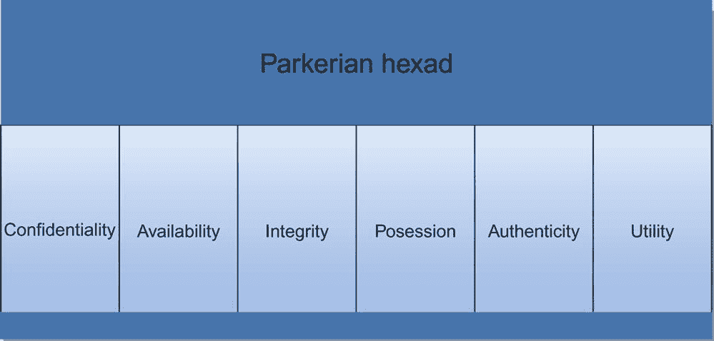

图 1.2 帕克六角要素模型。

尽管某些人认为这是一个更完整的模型，但帕克六角要素模型并没有 CIA 三要素那样广泛采用。如果我们决定在讨论安全状况时使用该模型，我们应该准备好解释其差异和优势。

#### 机密性、完整性和可用性

正如我们提到的，帕克六角要素模型包含了 CIA 三要素的三个原则，其定义与我们刚刚讨论的相同。帕克对完整性的描述存在一些差异，因为他没有考虑到经过授权但错误的数据修改，而是侧重于数据本身在完整性意义上的状态。

#### 所有权或控制

所有权或控制指的是存储数据的介质的物理处置情况。这使我们能够在不涉及可用性等其他因素的情况下，讨论数据在物理介质上的丢失。在我们丢失的备份磁带中，假设其中一些磁带经过了加密，而另一些没有。所有权原则将使我们能够更准确地描述事件的范围；该货物中的加密磁带是一个所有权问题，但不是机密性问题；而未加密的磁带在这两个方面都是问题。这在当今环境中至关重要，因为数据可能存在于多个设备上，并且可能存在许多版本。

#### 真实性

真实性允许我们讨论有关相关数据所有者或创建者的恰当归属。例如，如果我们发送的一封电子邮件被篡改，使其看起来像是来自与实际发送地址不同的电子邮箱地址，那么我们就违反了该封电子邮件的真实性。真实性可以通过使用数字签名来实施，我们将在第 5 章中进一步讨论。与此非常相似但方向相反的概念是非可否认性（nonrepudiation）。不可否认性防止某人在执行操作（如发送电子邮件）后，随后否认自己做过这件事。这对于电子商务至关重要，并由管理交易的法律定义。我们将在第 5 章中更详细地讨论不可否认性。

#### 效用

效用指的是数据对我们有多有用。效用也是帕克六角要素模型中唯一不一定具有二元性质的原则；根据数据及其格式，我们可以有不同程度的效用。这是一个相当抽象的概念，但在讨论安全世界的某些特定情况时，它确实是很有用的。例如，在我们之前的一个例子中，我们有一批备份磁带，其中一些经过了加密，另一些没有。对于攻击者来说，加密磁带的效用很小；而未加密磁带的效用很大。

## 攻击分类

我们可能会面临来自各种途径和向量的攻击。当我们观察攻击的组成时，可以根据攻击类型、攻击代表的风险以及我们可能用于缓解攻击的控制措施对其进行分解。

### 攻击负载的类型

当我们观察面临的攻击类型时，通常可以将其分为四类：拦截（interception）、中断（interruption）、修改（modification）和伪造（fabrication）。每一类都可以影响 CIA 三要素中的一个或多个部分，如图 1.3 所示。此外，攻击类别与其可能产生的特定影响之间的界限是模糊的。根据攻击的不同，我们可能会认为它属于多个一个类别，或者具有多种类型的影响。

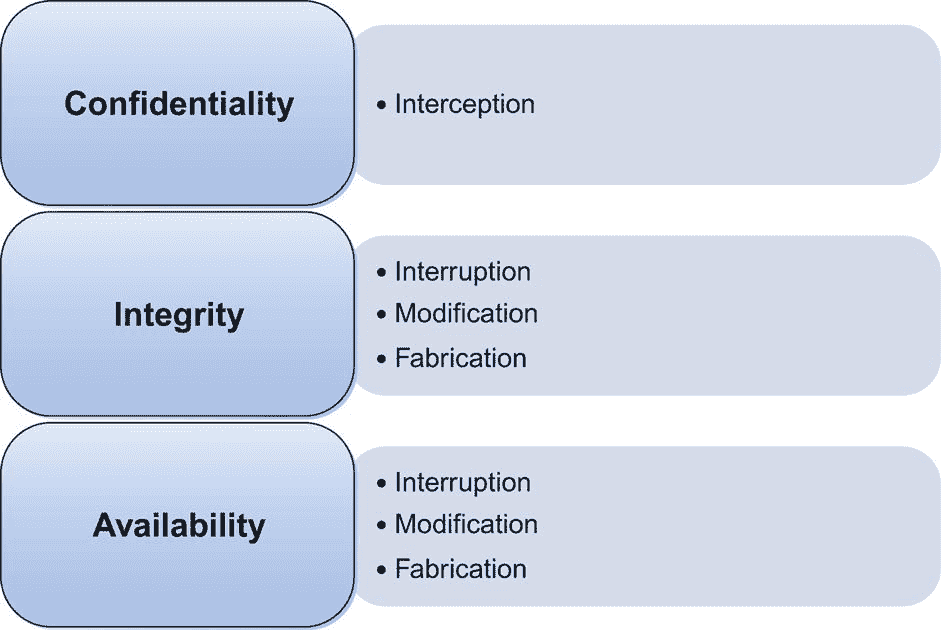

图 1.3 攻击分类。

#### 拦截

拦截攻击允许未经授权的用户访问我们的数据、应用程序或环境，这些主要是针对机密性的攻击。拦截可以表现为未经授权查看或复制文件、窃听电话对话或读取电子邮件，并可以针对静态数据或传输中的数据进行。如果执行得当，拦截攻击可能很难检测。

#### 中断

中断攻击导致我们的资产变得不可用或无法供我们使用，无论是临时还是永久性的。中断攻击通常影响可用性，但也可能是对完整性的攻击。在针对邮件服务器的拒绝服务（DoS）攻击的情况下，我们将其归类可用性攻击。在攻击者操纵数据库运行的进程以阻止对其中数据的访问的情况下，我们可能会认为这是一种完整性攻击，或者认为它是两者的结合。

#### 修改

修改攻击涉及对我们资产的篡改。此类攻击主要可能被视为完整性攻击，但也可能代表可用性攻击。如果我们未经授权的方式访问文件并更改了其包含的数据，我们就影响了文件中包含数据的完整性。然而，如果我们考虑的情况是，问题文件是管理特定服务行为的配置文件（例如一个作为 Web 服务器运行的服务），我们通过更改文件内容可能会影响该服务的可用性。如果我们继续这一概念，说我们在 Web 服务器文件中更改的配置是影响服务器处理加密连接的方式之一，我们甚至可以使这成为一种机密性攻击。

#### 伪造

伪造攻击涉及与系统生成数据、过程、通信或其他类似的活动。伪造攻击主要影响完整性，但也可以被视为一种可用性攻击。如果在数据库中生成了虚假信息，这将被视为一种伪造攻击。我们还可以生成电子邮件，这通常被称为欺骗（spoofing）。这可以被用作传播恶意软件的方法，正如可能会发现它被用于传播蠕虫一样。从可用性攻击的角度来看，如果我们生成了足够的额外进程、网络流量、电子邮件、Web 流量或几乎任何其他消耗资源的内容，我们极可能会导致处理此类流量的服务对系统的合法用户不可用。

## 威胁、漏洞与风险

为了能够更具体地讨论攻击，我们需要引入一些新术语。当我们观察特定攻击对我们产生影响的可能性时，我们可以从威胁、漏洞以及可能随之而来的相关风险的角度来讨论它。

### 威胁

当我们在本章较早的“攻击”部分讨论我们可能遇到的攻击类型时，我们讨论了一些可能对我们的资产造成伤害的因素。根结底，这就是威胁的本质——某种具有损害我们倾向的东西。威胁往往倾向于特定的环境，特别是在信息安全领域。例如，虽然病毒可能对 Windows 操作系统构成威胁，但同样的病毒不太可能对 Linux 操作系统产生任何影响。

### 漏洞

漏洞是可以用来损害我们的弱点。从本质上说，它们是威胁可以利用以对我们造成伤害的漏洞。漏洞可能是我们正在运行的特定操作系统或应用程序、我们选择放置办公楼的物理位置、空调系统容量超负荷的数据中心、缺乏备用发电机或其他因素。

### 风险

风险是坏事发生的概率。为了让我们在特定环境中产生风险，我们需要同时拥有一个威胁和一个该特定威胁可以利用的漏洞。例如，如果我们有一个木头制成的结构并对其点燃了火，那么我们就既有了威胁（火），也有了与之匹配的漏洞（木质结构）。在这种情况下，我们确实存在风险。

同样，如果我们面临着同样的火灾威胁，但我们的结构是混凝土制成的，那么我们就不再有可靠的风险了，因为我们的威胁没有可以利用的漏洞。我们可以争辩说足够热的火焰可能会损坏混凝土，但这种事件发生的概率要低得多。

我们经常会就计算环境中的潜在风险，以及可能发生但不太可能的攻击进行类似的讨论。在这种情况下，最佳策略是花时间去缓解最可能的攻击。然而，如果我们投入资源试图为每一种可能的攻击计划（无论其可能性多么微小），我们就会分散精力，并在我们真正最需要的地方缺乏保护。

### 影响

某些组织（例如美国国家安全局 NSA）在威胁/漏洞/风险方程中增加了一个额外因素，即影响（impact）。如果我们认为受威胁资产的价值可以被视为一个因素，这可能会改变我们是否认为存在风险。如果我们重新审视丢失备份带的例子，并规定未加密的备份带仅包含我们的巧克力碎片饼干配谱，那么我们可能实际上并没有风险。泄露的数据不会给我们带来问题，因为其中没有任何敏感内容，而且我们可以从源数据中制作额外的备份。在这种情况下，我们可以安全地说我们没有风险。相反，如果一家公司的关键专有信息被泄露，他们可能会导致破产。

## 风险管理

为了补偿我们环境中发生的风险，实施并遵循风险管理过程非常重要。该计划必须由组织的高层领导进行管理，并由每个人（而不仅仅是技术人员）执行。在高级阶段，我们需要识别我们的重要资产，识别针对这些资产的潜在威胁，评估我们存在的漏洞，然后采取措施减轻这些风险，如图 1.4 所示。

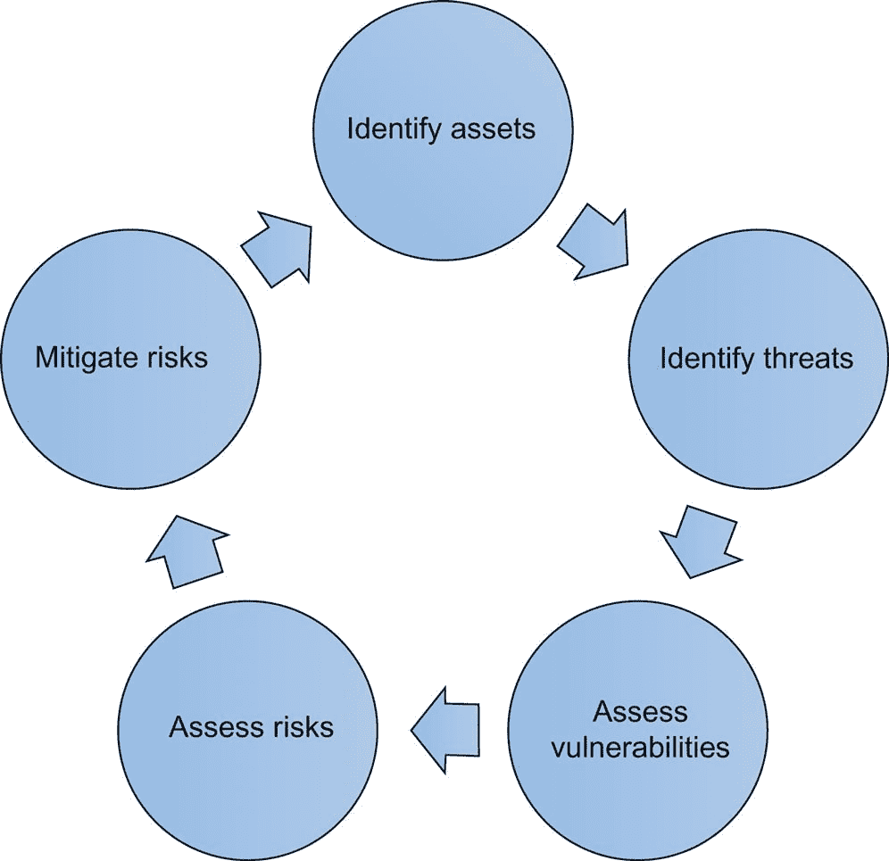

图 1.4 风险管理过程。

### 识别资产

风险管理过程的首要部分之一，可以说是最重要的部分之一，是识别和分类我们正在保护的资产。如果我们不能列出拥有的资产并评估每种资产的重要性，那么保护它们将成为一项非常困难的任务。

尽管这听起来像是一个极其简单的任务，但实际上，它可能比表面看起来要复杂得多。特别是在大型企业中，仅仅列出我们关注的所有资产列表可能就是麻烦的。在许多情况下，可能存在多个代不同的硬件和设备，来自其他公司收购的资产可能潜伏在未知区域，并且许多未记录的虚拟主机可能正在使用，其中任何一个都可能对某些业务部门的持续功能至关重要。

一旦我们能够识别出使用的资产，决定其中哪些是关键业务资产完全是另一个问题。如果我们询问资产所属的个人业务或职能部门，我们可能会发现它被认为是关键的，但它对于整个组织的功能是否至关重要则是完全另一个问题。要准确判断哪些资产对开展业务真正关重要，通常需要使用该资产的职能、支持该资产的职能以及可能相关的方的参与。并不是所有资产都需要被同等地保护，通过确定资源应该重点放在哪里，可以在增加安全性的同时降低成本。

### 识别威胁

一旦我们列出了关键资产，就可以开始识别可能影响它们的威胁。拥有一个在这一范围内讨论特定威胁性质的框架通常是有用的，我们在本章较早些时候讨论的 `CIA 三要素模型` 或 `帕克六角要素模型` 非常适合此目的。例如，如果我们将其应用于检查我们在处理信用卡支付的应用程序方面可能面临的威胁：

- **机密性**：如果我们不恰当地暴露数据，我们就存在潜在的泄露。
- **完整性**：如果数据损坏，我们可能会错误地处理支付。
- **可用性**：如果系统或应用程序崩溃，我们就无法处理支付。
- **所有权**：如果我们丢失了备份介质，我们就存在潜在的泄露。
- **真实性**：如果我们没有真实的客户信息，我们可能会处理欺诈交易。
- **效用**：如果我们收集了无效或错误的数据，它对我们的效用非常有限。

虽然这显然是对该系统威胁的高层次评估，但它确实立即指出了几个问题领域。我们需要关注失去数据控制、维护准确数据以及保持系统正常运行。根据这些信息，我们可以开始查看漏洞区域和潜在风险。

#### 评估漏洞

当我们评估漏洞时，需要在潜在威胁的背景下进行。任何特定资产都可能面临成千上万甚至百万可能影响它的威胁，但其中只有一小部分实际上是相关的。正如我们在上一节中讨论的，通过首先查看潜在威胁，可以大大缩小识别这些威胁的范围。在示例中，我们查看了针对处理信用卡交易系统的潜在威胁。虽然这只是高层面的分析，但我们可以查看已识别出的问题，并尝试确定这些领域中是否存在漏洞：

- **机密性**——如果我们不当暴露了数据，就可能发生泄露。我们的敏感数据在静态存储和传输过程中都经过加密。我们的系统定期由外部渗透测试公司进行测试。
- **完整性**——如果数据发生损坏，我们可能会错误地处理支付。作为处理工作流的一部分，我们会仔细验证支付数据是否正确。无效数据将导致交易被拒绝。
- **可用性**——如果系统或应用程序宕机，我们就无法处理支付。我们的支付处理系统后端数据库没有冗余设计。
- **所有权**——如果我们丢失了备份介质，就可能发生泄露。我们的备份介质经过加密，并由快递员手持运输。
- **真实性**——如果我们没有真实的客户信息，我们可能会处理欺诈交易。确保有效的支付和客户信息确实属于执行交易的个人是困难的，我们目前没有很好的方法来实现。
- **效用**——如果我们收集了无效或错误的数据，它们对我们的效用非常有限。为了保护数据的效用，我们可能会对信用卡号进行校验和，确保账单地址和电子邮件地址有效，并采取其他措施确保我们的数据无误。

这些示例是对我们需要执行的过程的非常高层面的概述，但它们说明了这项任务。从这里开始，我们可以再次看到几个关注领域，并可以开始评估我们可能存在风险的领域。

### 评估风险

一旦我们确定了特定资产的威胁和漏洞，就可以评估整体风险。正如我们在本章较早部分讨论的，风险是威胁与漏洞的结合。没有匹配威胁的漏洞，或没有匹配漏洞的威胁，都不构成风险。

例如，我们将以下项目既视为潜在威胁，也视为漏洞的易发区域：

- **可用性**——如果系统或应用程序宕机，我们就无法处理支付。我们的支付处理系统后端数据库没有冗余设计。

在这种情况下，我们确实同时拥有重合的威胁和漏洞，产生的风险是由于数据库后端的单点故障导致失去处理信用卡支付的能力。一旦我们以这种方式处理了威胁和漏洞，就可以着手缓解这些风险。

### 缓解风险

为了帮助我们缓解风险，我们可以采取措施来确保特定类型的威胁得到考虑。这些措施被称为 `控制`（controls）。控制分为三类：物理控制、逻辑控制和管理控制。

## 物理控制


物理控制是那些保护我们系统所在地或数据存储处的物理环境的控制措施。此类控制还控制进出这些环境的访问。物理控制在逻辑上包括围栏、大门、锁、护柱、守卫和摄像头等物品，也包括维护物理环境的系统，如暖空调系统、灭火系统和备用电源发电机。

尽管乍看之下，物理控制似乎对信息安全并非至关重要，但它们实际上是我们需要关注的最关键控制措施之一。如果我们无法从物理上保护我们的系统和数据，我们采取的任何其他控制都将毫无意义。如果攻击者能够物理接触我们的系统，他至少可以偷取或破坏系统，在最好的情况下导致我们无法使用。在最坏的情况下，他将直接访问我们的应用程序和数据，并能够窃取我们的信息和资源，或将其破坏为己所用。

### 逻辑和技术控制

逻辑控制（有时称为技术控制）是保护处理、传输和存储我们数据的系统、网络和环境的。逻辑控制包括密码、加密、逻辑访问控制、防火墙和入侵检测系统等物品。

逻辑控制使我们从逻辑上防止未经授权的活动发生。如果我们的逻辑控制实施得当并成功，攻击者或未经授权的用户在不破坏我们现有控制措施的情况下无法访问我们的应用程序和数据。这允许财务、人力资源和销售等多个功能在同一台服务器上运行，但它们之间无法相互访问。如果其中一个被攻破，并不是所有的都会被攻破。

### 管理控制

管理控制基于规则、法律、政策、程序、指南以及本质上是“纸面”性质的物品。本质上，管理控制规定了我们期望环境用户如何行为的规则。取决于所涉及的环境和控制，管理控制可以代表不同层级的权威性。我们可能有一个简单的规则，例如“下班时关闭咖啡机”，旨在确保我们不会因在晚上烧毁建筑而引起物理安全问题。我们可能还有更严格的管理控制，例如要求我们每 90 天更改一次密码。

在讨论管理控制时，一个重要概念是强制执行合规的能力。如果我们没有权限或能力确保我们的控制措施得到遵守，那么它们比没用还要糟，因为它们营造了虚假的安全感。例如，如果我们制定了一项政策，规定业务资源不能以任何形式用于个人，我们需要能够执行这一规定。在高度安全的环境之外，这是一项困难的任务。我们需要监控电话和手机的使用情况、Web 访问、电子邮件使用、即时消息聊天、安装软件以及其他潜在的滥用区域。除非我们愿意投入大量资源来监控这些和其他领域，并处理违反政策的行为，否则很快就会有一项无法执行的政策。一旦人们意识到我们不执行政策，我们就是为滥用甚至恶意活动留下了隐患。

### 事件响应

一旦我们的风险管理工作失败，事件响应便存在用于应对此类事件。事件响应应主要面向我们认为可能给组织带来痛苦的项，根据我们的风险管理工作，我们现在应该了解这些项目。对此类事件的反应应尽可能基于记录的事件响应计划，并且这些计划应由预计在实际事件发生时执行的人员进行定期审查、测试和练习。紧急情况的实际发生并不是去（尝试）遵循那些在架子上落灰、过时且指的是已发生巨大变化或不再存在的流程或系统的文档的时候。

事件响应过程在高层面上包括：

- 准备
- 检测与分析
- 封制
- 根除
- 恢复
- 事后活动

## 准备

事件响应的准备阶段由我们在事件本身发生之前可以进行的所有活动组成，以便我们能够更好地处理它。这通常涉及建立用于规范事件响应和处理的策略与程序，对事件处理人员和预期报告事件的人员进行培训和教育，开展事件响应演练，开发和维护文档，以及许多其他类似的活动。

不应低估事件响应中这一阶段的重要性。如果没有充分的准备，对事件的响应极可能无法顺利进行，且/或不会按照我们预期的方向进行。决定需要做什么、由谁做以及如何做的时间，不应该是我们在面临迫在眉睫的紧急情况时才来决定。

## 检测与分析

检测与分析阶段是我们事件响应过程中开始行动的阶段。在这个阶段，我们将检测到问题的发生，并判断其是否真的是一起事件，以便我们做出相应的响应。

此阶段的检测部分通常是基于安全工具或服务的输出进行监控或告警的结果。这可能是输出自入侵检测系统（`IDS`）、反病毒（`AV`）软件、防火墙日志、代理日志、安全信息和事件管理（`SIEM`）工具的告警（如果是内部程序）或托管安全服务提供商（`MSSP`）（如果是外部程序），或者任何许多类似来源之一。

此阶段的分析部分通常是工具或服务（通常是 `SIEM`）的自动化与人类判断的结合。虽然我们通常可以使用某种阈值来判断在给定时间内发生 `X` 次事件是否是正常的，或者某些事件的组合是不正常的（例如：两次登录失败后是登录成功，接着是修改密码，然后是创建新账户），但在讨论事件响应时，我们通常会在某个特定点希望人工干预。这种人工干预通常涉及对各种安全、网络和基础设施设备输出的日志进行审查、与报告事件的方取得联系，以及对状况进行总体评估。如果你运行着一个 24×7 小时的分析师团队，这可能是昂贵的，因此尽可能实现许多功能的自动化是关键。

当事件处理人员评估状况时，他们将就问题是否构成事件做出判断，对事件的严重性（如果有）进行初步评估，并联系进入下一阶段所需的任何额外资源。

## 封制、根除与恢复

封制、根除和恢复阶段是实际解决事件的大部分工作所在，至少在短期内如此。

封制涉及采取措施确保状况造成的损害不会比已经造成的更多，或者至少减少正在发生的伤害。如果问题涉及受远程攻击者积极控制的恶意软件感染服务器，这可能意味着断开服务器与网络的连接，设置防火墙规则以阻止攻击者，并更新入侵防御系统（`IPS`）上的签名或规则以停止恶意软件的流量。

在根除期间，我们将尝试从环境中消除问题的影响。对于我们被恶意软件感染的服务器，我们已经隔离了系统并切断了它与命令控制网络的连接。现在我们需要从服务器中移除恶意软件，并确保它在我们环境的其他地方不存在。这可能涉及对环境中的其他主机进行额外的扫描以确保不存在恶意软件，并检查服务器上的日志以及网络上攻击设备的活动，以确定受感染服务器与哪些系统通信过。对于恶意软件，特别是非常新的恶意软件或变体，确保我们妥善完成可能是一项艰巨的任务。对手正在不断针对最新的安全工具和方法开发应对措施。每当怀疑恶意软件或攻击者是否已真正从我们的环境中驱逐时，我们应该在权衡对业务影响的同时，倾向于谨慎。每种事件都需要进行风险评估。

最后，我们需要恢复到事件发生之前的良好状态，或者如果我们没有立即检测到问题，则可能是恢复到问题开始之前的状态。这可能涉及从备份介质恢复设备或数据、重构系统、重新加载应用程序或任何许多类似的活动。此外，我们还需要缓解所使用的攻击向量。再次，基于对事件周围状况以及究竟发生了什么可能不完整或不清晰的了解，这项任务可能比听起来的要更加痛苦。我们可能会发现自己无法验证备份介质实际上是干净且未感染的、备份介质可能完全损坏、应用程序安装包可能缺失、配置文件可能不可用以及任何许多类似的问题。

## 事后活动

事后活动与准备一样，是一个我们容易忽视的阶段，但我们应该确保不忽视它。在事后活动阶段（通常称为**后回顾**，拉丁语意为“死后”），我们尝试确定具体发生了什么、为什么发生，以及我们可以做什么来防止它再次发生。这不仅仅是一次技术审查，因为策略或基础设施可能需要更改。此阶段的目的不是指责或归咎责任（尽管有时会发生），而是最终为了防止或减轻未来此类事件的影响。

## 深度防御

深度防御是军事机动和信息安全中通用的策略。在这两种意义上，深度防御的基本概念都是制定一种多层防御，以便当我们的一个或多个防御措施失效时，我们仍然实现成功的防御。在 `图 1.5` 中，我们可以看到从逻辑角度我们可能希望部署以防御资产的层示例；我们至少希望在外部网络、内部网络、主机、应用程序和数据层上都有防御。由于每层都实施了良好的防御，这将深度渗透我们的网络并直接攻击资产变得非常困难。

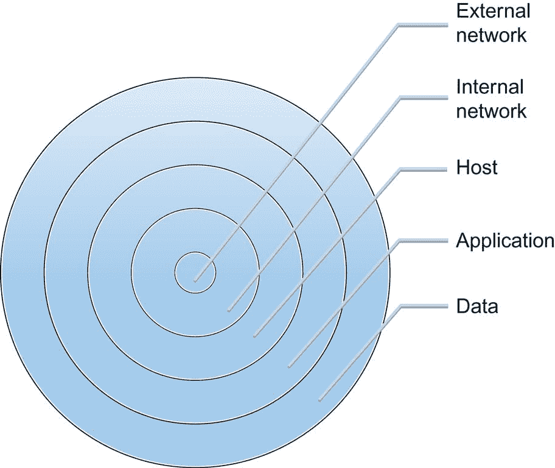

图 1.5 深度防御。

在使用深度防御规划策略时，需要注意的一个重要概念是它并不是灵丹妙药。无论我们部署了多少层，或者在每层放置了多少防御措施，我们都无法将所有攻击者挡在外面无限久，这也不是信息安全领域深度防御的最终目标。目标是在我们真正重要的资产与攻击者之间放置足够的防御措施，以便我们既能注意到到攻击正在进行，又能为我们赢得足够的时间采取更积极的措施来防止攻击成功。

我们可以在 2008 年上映的蝙蝠侠电影《黑暗骑士》（*The Dark Knight*）中看到这种策略。该电影的制作公司华纳兄弟花费了个月时间开发了一套多层防御策略，以尽可能地防止电影被盗版并上传到文件共享网络上。这些措施包括：一种追踪系统，用于监控在任何特定时间访问电影拷贝员；将电影胶分成多个部分分别运送到各个电影院，以防整部电影在运输过程中被盗；使用夜视设备监控电影院，以监视那些试图在影院内录像的人；以及其他措施。尽管投入了大量时间和资源来防止电影盗版，但该电影在发布 38 小时后仍在一个文件共享网络上被发现了#4]。对于华纳兄弟来说，这被认为是一个成功，因为公司防止电影被盗版的时间足够长，使得首映周末的销售额没有受到显著影响。

## 层级

当我们考虑在深度防御策略中可能部署的层级时，可能会发现这些层级根据我们所防御的特定情况和环境而异。正如我们所讨论的，从严格逻辑的信息安全角度来看，我们希望将外部网络、网络边界、内部网络、主机、应用和数据层视为部署防御的区域。我们可以通过包含其他关键层级（如物理防御、策略、用户意识和培训以及许多其他层级）来增加防御模型的复杂性，但目前我们将保持一个较简单的示例。随着书籍的深入，当我们讨论更特定领域的安全时，我们将再次回到深度防御的概念。

正如图 1.6 所示，图中列出了我们可能为讨论的每个层级使用的某些防御措施。在某些情况下，我们看到一种防御措施列在多个层级中，因为它适用于多个一个区域。就像军队拥有侦察部队监视前线一样，他们在总部周围仍有局部巡逻。在阅读本书的过程中，我们将更详细地讨论这些每一个区域，以及每个区域我们可能想要使用的特定防御措施。

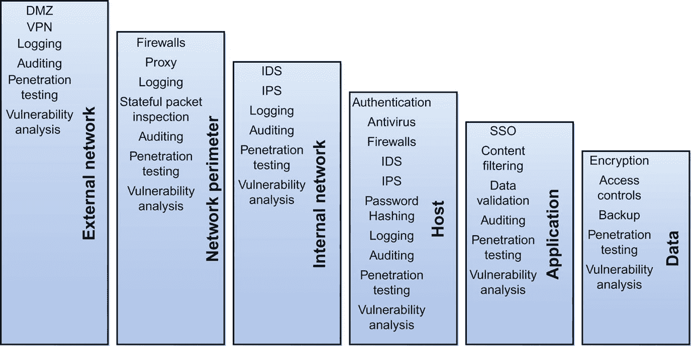

图 1.6 每层的防御。

## 现实世界中的信息安全

在本章中讨论的概念是信息安全的基础，并在许多组织的正常信息安全任务中被经常使用。我们经常会发现安全事件是根据其影响来描述的，例如机密性泄露，或给定电子邮件消息的真实性。

信息安全是任何规模组织的日常关注问题，特别是对于那些处理任何类型的个人信息、财务数据、医疗数据、教育数据或其他其运营国家法律监管的其他类型数据的组织。对于一个没有花时间在信息安全方面打好基础的组织来说，后果可能是严重的，包括声誉影响、罚款、诉讼，甚至如果关键数据无法挽回地丢失将导致无法继续经营。简而言之，信息安全是现代商业世界的关键组件。

## 总结

信息安全是一个时代至关重要的组件，在这个时代，无数个人和组织的数据被存储在各种计算机系统中，且这些系统通常不受我们的直接控制。在广义上讨论信息安全时，重要的是安全和生产力往往是彼此对立的概念，而且能够准确指出我们何时处于安全状态是一项困难的任务。

在讨论信息安全问题或情况时，有一个模型来进行讨论将是有帮助的。两个潜在的模型是 CIA 三元组（由机密性、完整性和可用性组成）和 Parker 六要素模型（由机密性、完整性、可用性、所有权或控制权、真实性和效用组成）。

当我们观察我们可能面临的威胁时，理解风险的概念是非常重要的。只有当威胁存在且我们拥有该特定威胁可以利用的漏洞时，我们才面临风险。为了减轻风险，我们使用三种主要的控制手段：物理控制、逻辑和管理控制。

深度防御是信息安全领域一个特别重要的概念。为了使用这个概念构建防御措施，我们部署了多层防御，每一层都为我们提供了额外的保护。深度防御背后的思想不是永久地将攻击者排除在外，而是延迟他足够的时间让我们发现攻击，并允许我们采取更主动的防御。

## 练习

1. 解释漏洞和威胁之间的区别。
2. 列出六个可能被视为逻辑控制的项目。
3. 我们可以使用什么术语来描述数据的效用？
4. 哪一类攻击是针对机密性的攻击？
5. 我们如何知道在什么时候可以认为我们的环境是安全的？
6. 使用深度防御的概念，我们可能使用哪些层级来防止有人通过 USB 闪盘从我们的办公室取走机密数据？
7. 根据 Parker 六要素模型，如果我们丢失了一批包含客户个人信息和支付信息的加密备份磁带，哪些原则会受到影响？
8. 如果我们环境中的 Web 服务器基于微软的 Internet Information Server (IIS)，并且发现了一种攻击 Apache Web 服务器的新蠕虫，我们缺少了什么？
9. 如果我们为环境开发了一项新策略，要求我们使用每个系统唯一的、自动生成的且长度至少为 30 个字符的复杂密码，例如 `!Hs4(j0qO&zn1%2SK38cn^!Ks620!`，什么将会受到不利影响？
10. 考虑到 CIA 三元组和 Parker 六要素模型，每个模型的优缺点分别是什么？

## 参考文献

1. US Government, Legal Information Institute, Title 44, Chapter 35, Subchapter 111, §3542, Cornell University Law School, <http://www.law.cornell.edu/uscode/44/3542.html> [访问 20.09.13]。
2. Spafford E. Quotable spaf, Gene Spafford’s personal pages, <http://spaf.cerias.purdue.edu/quotes.html>; 2009 [访问 20.09.13]。
3. Parker D. *Fighting computer crime* Wiley 1998; ISBN: 0471163783。
4. Chmielewski D. Secrecy cloaked “Dark Knight,” Los Angeles Times, <http://articles.latimes.com/2008/jul/28/business/fi-darkknight28>; July 28, 2008 [访问 20.09.13]。

# 第 2 章 识别与认证

在本章中，我们涵盖了识别和认证的安全原则。我们讨论了识别，这是一个通过确认特定身份的身份的过程，无论该身份是否真实。我们谈论了使用认证，作为验证身份主张是否真实的手段。我们还涵盖了多因素认证，以及使用生物识别和硬件令牌来增强认证过程中的确定性。

## 关键词

认证；生物识别；硬件令牌；识别；多因素认证；相互认证；密码；安全令牌

## 章节大纲

- 引言
- 识别
  - 我们声称的身份
  - 身份验证
  - 伪造身份
- 身份认证
  - 因素
  - 多因素身份认证
  - 相互认证
  - 密码
- 高级进
  - 生物识别
- 额外资源
  - 特性
  - 性能衡量
  - 问题
  - 硬件令牌
- 警告！
- 现实世界中的识别与认证
- 总结
- 练习
- 参考文献

## 本章内容

- 识别
- 身份认证

## 引言

当我们开发安全措施时，无论是在特定机制的规模还是整个基础设施的范围内，识别和认证都可能是关键概念。简而言，`identification`（识别）是对某人或某物身份的声称，而 `authentication`（身份认证）则是确定这一声称是否真实。我们可以看到这些过程每天以各种方式发生着。

一个非常常见的识别与认证交易示例是使用需要个人识别码（`PIN`）的支付卡。当我们刷过卡片上的磁条时，我们是在断言我们就是卡片上指示的人员。此时，我们只给出了识别，别无其他内容。当我们被提示输入与卡片相关的 `PIN` 时，我们就完成了交易的身份认证部分。

我们在日常生活中使用的某些识别和认证方法特别脆弱，在很大程度上取决于交易参与者的诚实和勤勉。许多涉及出示身份卡的交换（例如购买限制特定年龄以上购买的物品）都是基于这样一个理论：所展示的身份卡是真实且准确的。我们还依赖执行认证的人员或系统具备胜任能力，不仅能够执行认证行为，还能准确检测出虚假或欺诈活动。

我们可以使用多种方法进行识别和认证，从简单的用户名和密码，到用于通过多种方式建立我们身份的定制化硬件令牌。我们将在本章中讨论这些几种方法以及它们是如何使用的。

## 识别

正如我们在上一节中提到的，识别仅仅是对我们是谁的断言。这可能包括我们作为个人所声称的身份、计算机系统在网络上声称的身份、电子邮件的发件方声称的身份、我们声称拥有的权限，或类似的交易。需要注意的是，识别过程并不超出这一声称，不涉及对我们所声称身份的任何形式的验证或确认。该过程的这一部分被称为身份认证，是一项独立的交易。

### 我们声称的身份

我们声称的身份这个概念，充其量也只是一个脆弱的概念。我们可以通过全名、名字的缩写、自己的照片、昵称、账号、用户名、身份证件、指纹、DNA 样本以及海量的其他方法来识别自己。但遗憾的是，除极少数例外外，此类识别方法不是唯一的，即使是某些所谓的唯一识别方法（如指纹），在很多情况下也可以被复制或伪造。

在许多情况下，我们声称的身份可能是会变化的信息项。例如，我们的名字可能会改变，比如女性结婚后更改姓氏、法律上将名字改为完全不同的名字的人，甚至仅仅是选择使用不同名字的人。此外，我们通常可以很容易地更改识别的逻辑形式，例如账号、用户名等。即使是物理标识符（如身高、体重、肤色和眼色）也可以改变的。我们在处理识别时需要意识的最关键因素之一是：无效的声称是不可靠的。

## 身份验证

身份验证比识别更进一步，但仍然比身份认证差了一步。当我们被要求出示执照、社会安全码、出生证明或其他类似的识别形式时，这通常是为了身份验证，充其量也是非常肤浅的。

我们可以将这个例子进一步，通过与包含其信息的额外副本数据库进行对比来验证识别形式（例如护照），并将照片和物理特征与我们面前的人进行匹配。这可能让我们更接近一点，但我们还没有达到通过身份认证所获得的确定性水平。


身份验证不仅用于我们的个人面对互动，也用于计算机系统。在许多情况下，例如当我们发送电子邮件时，我们提供的身份被认为是真实的，而没有采取任何措施来验证我们。这种安全漏洞导致了我们看到的海量垃圾邮件，估计 2013 年第二季度垃圾邮件占了所有发送邮件的 70.7%。

### 伪造身份

正如我们所讨论的，识别方法是会变化的。因此，它们也可能被伪造。虽然许多执照现在有了全息或条形码，使其更难伪造，但存在一个地下行业允许美国的未成年人从海外公司购买真实的执照。这种安全措施与犯罪分子之间的持续斗争也在虚拟世界中进行。从稍微阴暗的一面来说，此类伪造的识别手段也被犯罪分子和恐怖分子用于各种邪恶任务。某些主要的识别手段（如出生证明）还提供了获得额外识别形式（如社会安全码或执照）的途径，从而强化虚假身份。

基于伪造信息的身份盗用在今天是一个主要问题，估计 2012 年给美国消费者造成了 209 亿美元的损失。这种攻击不幸非常常见且易于执行。只需极少的信息（通常姓名、地址和社会安全码就足够了），就可以冒充某人到足以在许多情况下充当该人的程度。身份盗用受害者可能会发现，信贷额度、信用卡、汽车贷款、住房抵押和其他交易已使用他们被盗的身份发生了。

由于我们参与的许多活动缺乏身份验证要求，此类犯罪变得更容易发生。在大多数情况下，唯一进行的检查是身份验证，正如我们在前一个节中所讨论的那样。这个过程充其量是一个微小的障碍，并且很容易使用伪造的身份证明来绕过。为了纠正这种局面，我们需要完成对这些交易中涉及人员的识别和验证过程，以便至少能更有说服力证明我们确实是在与我们所认为的人员进行交互。对于个人而言，这在技术上绝不是一个不可解决的问题，但它更多地是一个人性的问题。

当我们观察计算机系统和环境中的类似问题时，我们可以发现许多同样的困难。从与实际发送地址不同的地址发送电子邮件是完全可能的，这种策略经常被垃圾邮件发送者和基于社会工程的攻击使用。我们在许多日常使用并作为互联网功能的其他系统和协议中也能看到相同的问题。我们将在第 10 章中详细讨论此类问题。

## 身份验证

从信息安全的角度来说，身份验证是用来建立身份声明为真实的方法 set。需要注意的是，身份验证仅确立所提出的身份声明是否正确。身份验证并不推断或暗示被验证的方被允许做什么；这是一项独立的任务，被称为**授权**（`authorization`）。我们将在第 3 章中详细讨论授权，但现在需要理解的关键点是，身份验证需要首先发生。

### 因素

在身份验证方面，我们有几种可以使用的方法，每个类别被称为一个“因素”（`factor`）。在每个因素内部，我们有许多可以使用可能方法。当我们尝试验证身份声明时，使用的因素越多，我们的结果就越向好。不同的因素包括：你所知道的（`password`）、你所的（`Iris scan` 虹膜扫描）、你拥有的（`swipe card`）、你所做的（`gait (walking) recognition` 步态识别）以及你所在地（特定的终端）。

“你所知道的”是非常常见的身份验证因素。这包括密码、PIN 码、密码短语或人可以记住的任何信息。我们可以在登录计算机账户时使用的密码中看到这种非常常见的实现方式。这是一种比较弱的因素，因为如果该因素所依赖的信息泄露，就会使我们身份验证方法的唯一性失效。

“你所的”是基于个人相对独特的物理属性的因素，通常被称为**生物识别**。该因素可以基于简单的属性，如身高、体重、发色或瞳色，但这些属性往往不够独特，不足以形成非常安全的标识符。更常用的是更复杂的标识符，如指纹、虹膜或视网膜图案或面部特征。这个因素稍微强一些，因为伪造或盗取物理标识符的副本是一项相当困难的任务，尽管并非不可能。关于生物识别（`biometrics`）是否真的是一个身份验证因素，还是它真的仅构成验证（`verification`），尚存在疑问。我们将在本章后面深入介绍生物识别时再次讨论这一点。

“你拥有的”通常是基于对物品或设备的物理占有的因素，尽管该因素也可以扩展到一些逻辑概念上。我们可以在日常使用中通过 ATM 卡、州或联邦颁发的身份卡或基于软件的安全令牌中看到此类因素，如图 2.1 所示。某些机构（如银行）已开始将访问手机或电子邮件帐户等逻辑设备作为身份验证的方法。该因素的强度取决于实现方式。在安全令牌的情况下，我们实际上需要偷一个特定的设备来伪造该身份验证方法。而在将电子邮件地址访问作为此类因素的情况下，我们的强度衡量要低得多。

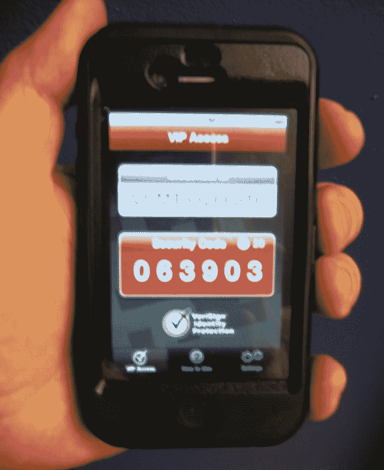

图 2.1 软件安全令牌。

“你所做的”（有时被认为是“你所的”的变体）基于个人动作或行为的因素。此类因素可能包括对个人步态的分析、对其手写中多个因素的测量、输入密码短语时击键之间的时间延迟或类似因素。这些因素提供了一种非常强大的身份验证方法，并且很难伪造或产生假阳性。然而，它们具有产生假阴性的可能，并以比其他某些因素更高的率错误地拒绝合法用户，导致某些本应通过身份验证的用户被拒绝在外。

“你所在地”是一个基于地理位置的身份验证因素。该因素的运作与其他因素不同，因为其身份验证方法取决于被验证的人是否物理位于某个特定位置或多个位置。最常见的实现方式是让服务器仅能从机房内的终端访问。该因素虽然的实用性可能低于其他某些因素，但如果不完全颠覆执行身份验证的系统或获得物理访问，它是很难破解的。

### 多因素身份验证

多因素身份验证使用了我们在前一个节中讨论的一个或多个因素。当我们只使用两个因素时，这种做法在某些情况下也被称为双因素身份验证，但多因素身份验证也涵盖了这个术语。

我们可以在使用 ATM 机时看到多因素身份验证的常见例子。在这种情况下，我们有我们所知道的`PIN`，以及我们拥有的`ATM card`。我们的 ATM 卡兼具了身份验证因素和身份识别的形式作用。我们可以在写出从银行账户取款的支票时看到类似的例子——在这种情况下，是我们拥有的（支票本身）以及我们所做的（在支票上签名）。在这里，写支票涉及的两个因素相当弱，所以我们有时看到第三个因素（指纹）应用在上面。

根据所选特定因素，我们可以在特定情况下构建更强或更弱的多因素身份验证方案。在某些情况下，尽管某些方法可能更难破解，但它们在实施上是不可行的。例如，`DNA` 可以作为非常强大的身份验证方法，但对于日常使用来说并不实际。正如我们在第 1 章中讨论过的，在讨论安全时，我们需要仔细构建与我们所保护的内容成合理比例的安全性。我们可以在每个信用卡终端上安装虹膜扫描仪而不是让客户在信用卡收据上签名，这确实增加了我们的安全性，但这将昂贵、减慢交易导致延迟，并可能让不信任该技术的客户感到不快。

双向认证是指双方对彼此进行身份验证的认证机制。在标准的认证过程中（仅为单向认证），客户端向服务器身份验证，以证明自己是有权访问服务器所提供资源的实体。在双向认证中，不仅客户端向服务器身份验证，服务器也会向客户端身份验证。双向认证通常通过使用数字证书来实现，我们将在第 5 章中详细讨论。简而言之，客户端和服务器都将持有一个证书来验证对方。

在我们不进行双向认证的情况下，我们就会容易受到冒充攻击的影响，这通常被称为中间人攻击。在中间人攻击中，攻击者将自己插入到客户端和服务器之间，并向客户端冒充服务器，同时向服务器冒充客户端，如图图 2.2 所示。以我们的 ATM 示例，这就像在普通的 ATM 机上放置一个读卡器来拦截信息。这是通过绕过正常的流量模式，然后拦截并转发本应直接在客户端和服务器之间流动的流量来实现。这通常是可能的，因为攻击者只需要破坏或伪造从客户端到服务器的身份验证。如果我们实施双向认证，对于攻击方来说，执行这种攻击将变得相当困难。

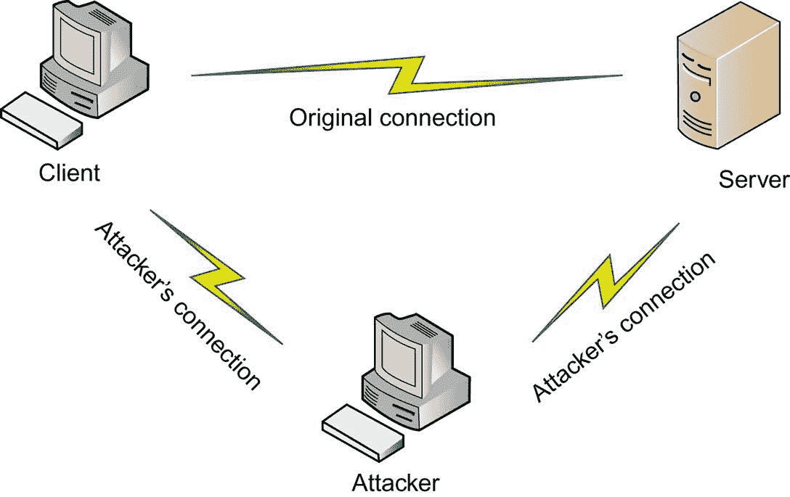

图 2.2 中间人攻击。

双向认证也可以与多因素认证结合，后者通常只在客户端侧进行。从服务器回客户端的多因素认证不仅在技术上具有挑战性，在大多数环境中也是不切实际的。可以想象，我们可以在极高安全的环境中实现双向多因素认证，但这会导致生产力的巨大损失。

## 密码

对于我们大多数经常使用电脑的人来说，密码非常熟悉，因为它们仍然是最常见的验证形式。与用户名结合使用，密码通常允许我们访问计算机系统、应用程序、手机或类似的设备。密码虽然只是一个身份验证因素，但当构建和实施得当时，它可以代表相当水平的安全性。

当我们描述一个密码是`强`的时，我们并没有对所讨论的内容提供一个直接准确的形象。一个更好的描述性词可能是`复杂`，以便传达构建密码时固有的重要概念。如果我们构建一个全小写字母且长度为八字符的密码，我们可以使用密码破解工具（我们将在第 12 章 才能破解。

### 更高级的

我们在这里讨论的密码破解类型被称为暴力破解。这涉及到按顺序尝试密码可能组成的所有字符组合，直到尝试过所有组合为止。在有一台可以运行破解器的强大系统且密码构建得不佳的情况下，这可以是恢复密码的一种非常有效的手段。我们将在第 12 章中详细讨论。这种类型的攻击可以通过限制用户在被锁定之前的尝试次数来缓解。锁定用户的问题在于对生产力的影响，以及管理员随后解锁账户的时间成本。

除了构建强密码之外，我们还需要注意养成良好的密码卫生习惯。强密码的一个问题是它们可能很难记忆。这可能会促使我们采取措施记住密码，例如将它们写下来并贴在方便的地方，也许是在键盘下面或显示器上。当然，如果有人在我们的办公桌周围窥视，这完全违背了设置密码的意义。

存在许多应用程序（通常标记为“密码管理器”，也称为“密码箱/钱包”），帮助我们管理为不同账户拥的所有登录信息和密码，有些是本地安装的软件，有些是 Web 或移动设备应用程序。关于此类工具有许多支持和反对的观点，但当谨慎使用时，它们有助于保持良好的密码卫生。

另一个密码安全问题是密码的手动同步——简而言之，就是在任何地方使用相同的密码。如果我们对电子邮件、工作登录、在线编织讨论论坛以及其他任何地方使用相同的密码，那么我们就是把所有账户的安全都交给了每个使用该相同密码的系统所有者。如果其中任何一个系统被攻破且密码泄露，我们就面临严重的问题。攻击者只需要在互联网上查找我们的账户名 `luv2knit`，以找到某些使用相同名称的地方并开始尝试我们的默认密码。当攻击者进入我们的电子邮件账户时，一切就都结束了。

### 生物识别

当我们考虑生物识别时，我们应该考虑将其作为一种身份验证因素时，它究竟是什么。正如我们在章节开头的“识别”部分所讨论的，身份验证和验证之间存在区别。当我们使用生物识别完成身份验证交易时，我们实际上是在要求用户提供证明其为其声称身份的证据；根据定义，这是验证而不是身份验证。虽然某些生物识别特征可能比其他更难伪造，但这只是由于今天技术的局限性。在未来的某个时刻，我们需要开发出更稳健的生物识别特征，以衡量或停止将生物识别作为认证机制。

尽管如此，我们仍然以两种不同的方式使用生物识别系统。正如我们之前讨论的，我们可以利用它们来验证某人提出的身份主张；或者我们可以反转这一过程，将生物识别作为一种身份识别方法。这种过程通常被执法机构用于识别遗留在各种物体上的指纹所有者，但鉴于此类机构拥有的指纹库规模庞大，这可能是一项非常耗时的工作。我们在对比犯罪嫌疑人采集的 `DNA` 样本与从犯罪现场恢复的物理证据时，也能看到类似的用途。

要以任何一种方式使用生物识别系统，我们都需要让用户通过注册过程（`enrollment`）。注册涉及从用户处记录选定的生物特征——例如，制作指纹的副本——并将该特征记录在系统中。对特征的处理可能包括根据所涉及的特征对图像某些部分进行标记，以便日后在系统中进行匹配。

生物识别面临的一个问题是目前缺乏保护用户数据的法律。虹膜扫描数据文件可能会被泄露，而且法律并没有要求通知受影响的用户。此外，某些生物识别可能会泄露个人信息。例如，虹膜扫描可以识别出指示女性怀孕的变化。

### 特性

生物识别因素由七个特性定义：通用性（`universality`）、唯一性（`uniqueness`）、永久性（`permanence`）、可采集性（`collectability`）、性能（`performance`）、接受性（`acceptability`）和规避性（`circumvention`） 4。

通用性规定，我们应该能够在预期注册系统的多数人中找到选定的生物特征。例如，虽然我们可以使用疤痕作为标识符，但无法保证每个人都有疤痕。即使我们选择了一个非常常见的特征（如指纹），我们也应该考虑到有些人右手手可能没有食指，并做好补偿的准备。

唯一性是衡量特定特征在个体之间独特程度的尺度。例如，如果我们选择使用身高或体重作为生物识别标识符，那么在任何给定小组中，我们很有可能找到几个身高或体重相同的人。我们可以选择具有更高唯一性的特征，例如 `DNA` 或虹膜图案，但始终存在重复的可能性，无论是有意还是无意。

永久性测试显示了特定特征随时间推移和年龄增长而抵抗的能力。如果我们选择一个容易变化的因素，如身高、体重或手部几何结构，我们最终会发现自己无法验证合法用户。相反，我们可以使用指纹等因素，尽管它们可以被改变，但在没有刻意行动的情况下不太可能改变。

可采集性衡量了获取稍后用于验证用户的特征的难易程度。最常用的生物识别（如指纹）相对容易获取，这也是它们被广泛使用的原因之一。如果我们选择一个较难获取的特征（如足迹），用户将需要脱掉鞋和袜子才能注册（以及稍后再次验证），这比采集指纹要麻烦得多。这些特征可能会随时间而改变。今天，人们正努力能够距离采集虹膜扫描，以便用户在走向设备时时就能被识别，他们甚至无需停下。

性能是一组判断给定系统运行良好程度的指标。这些因素包括速度、准确性和错误率。我们将在本节的后半部分详细讨论生物识别系统的性能。

接受性是衡量特定特征对系统用户接受程度的尺度。通常情况下，速度缓慢、难以使用或使用起来不便的系统不太可能被用户接受 5。要求用户脱掉衣服、触摸被他人反复使用过的设备或提供组织或体液的系统可能无法获得高程度的接受性。

规避性描述了系统被伪造的生物识别标识符欺骗的程度。针对指纹作为生物识别标识符的规避攻击的经典案例是“橡胶手指（`gummy finger`）”。在这种攻击中，指纹从表面被提取（可能以隐蔽的方式），并用于制作模具，攻击者可以用明胶浇铸出指纹的正像。一些较新一代生物识别系统具有专门设计的功能，通过测量皮肤温度、脉搏、瞳孔反应以及许多其他项目来击此类攻击。

### 衡量性能

在衡量生物识别系统的性能时，我们可以考虑许多因素，但有几个主要指标对于衡量系统运行良好程度尤为重要。假接受率（`FAR`）和假拒绝率（`FRR`）是其中两个 6。当我们接受了一个本应该拒绝的用户时，就会发生 FAR。这种问题也被称为假阳性（`false positive`）。FRR 是在我们本应该接受合法用户时拒绝了他们的问题。这种问题在生物识别领域之外通常被称为假阴性（`false negative`）。

这两种情况过过时都是不理想的。我们试图通过此类系统实现两种错误类型之间的平衡，称为等错误率（`EER`） 6。如果我们在图中绘制出 `FAR` 和 `FRR`，正如我们在图 2.3 中所示的那样，`EER` 是两条线的交点。EER 有时被用作衡量识别系统的准确性。

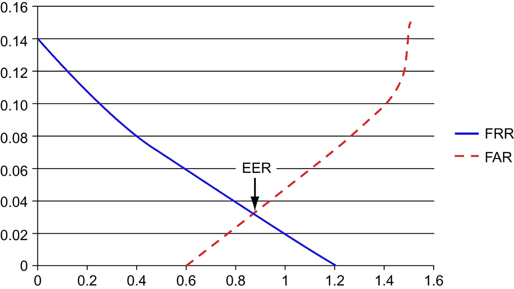

图 2.3 等错误率。

## 问题

### 硬件令牌

标准的硬件令牌是一种小型设备，通常采用信用卡或钥匙扣的通用外形设计。最简单的硬件令牌看起来与 USB 闪存驱动无异，包含少量的存储空间，用于存放证书或唯一标识符，通常被称为加密狗（`dongles`）。更复杂的硬件令牌则集成了 LCD 显示屏（如图 2.4 所示）、用于输入密码的键盘、生物识别阅读器、无线设备以及用于增强安全性的附加功能。


图 2.4 硬件令牌。

许多硬件令牌包含一个内部时钟，它结合设备的唯一标识符、输入的 PIN 或密码以及可能的其他因素，用于生成一个代码，该代码通常输出到令牌的显示屏上。代码会定期变化，通常每 30 秒变化一次。用于跟踪此类令牌的基础设施预测特定设备在任何时间的正确输出是什么，并利用此来验证用户身份。

## 警示！

最简单的硬件令牌仅代表“你拥有的”（`something you have`）因素，因此容易被盗，并可能被懂技术的犯罪分子利用。尽管这些设备确实增加了用户账户的安全性，且在没有与之关联的账户凭据的情况下通常用用，但我们确实需要记住保护它们。

硬件令牌代表“你拥有的”认证因素，有时也会实现“你所知的”（`something you know`）或“你所是的”（`something you are`）。对于仅提供“你拥有的”因素的简单硬件令牌，设备提供的安全性取决于我们防止其被盗的能力，因为它可以轻易被攻击者利用。对于包含输入 PIN、密码或读取指纹功能的更复杂的令牌，设备的安全性得到了大大增强。为了让攻击者利用被盗的多因素认证设备，攻击者不仅需要硬件令牌本身，还需要破坏与设备输出信息同步的基础设施，或者从设备的合法所有者处提取“你所知的”和/或“你所是的”因素。

## 现实世界的识别与认证

识别和认证每天在世界各地都在运行。我们可以指出的最常见例子之一是身份证，在美国通常是驾驶执照。此类卡片经常用于购物、与政府官员和部门打交道、注册学校以及执行各种其他任务时证明我们的身份。在许多情况下，身份证被用作执行这些事情时验证我们身份的方法。虽然这是一种弱的验证方法，但它是一种常用方法。目前的趋势是这些卡片带有条形码或带有额外信息的芯片，使其更难伪造。

当我们执行各种活动时，也能看到认证在发挥作用。当我们使用用户名和密码登录工作中的计算机或网站时，我们正在使用“你所知的”因素。当我们输入 PIN 并从 ATM 提取现金时，我们正在使用“你所知的”和“你拥有的”因素，并且正在使用多因素认证。许多人在日常生活中不会使用超出这两个因素的内容。

对于我们这些有权访问更安全设施（如数据中心、金融机构或军事设施）的人来说，可能会看到更复杂的认证方法。在某些此类环境中，我们将看到生物识别的使用，即“你所是的”因素。许多此类设施已转向使用虹膜扫描仪，这现在是一台悬挂在访问区域附近墙壁上的不起眼的设备，只需看一眼设备镜头即可继续。这种设备不仅易于使用，而且更容易被用户接受，因为我们不需要实际触摸它就能工作。


我们还可以看到硬件令牌的使用增加，即使对于普通大众也是如此。我们现在可以从 VeriSign 购买廉价的令牌，在登录 eBay、PayPal、GEICO、T-Mobile、RadioShack 以及数百其他公司运行的网站时提供额外的保护层。由于我们现在看到的大量在线欺诈和身份盗窃，我们在个人和组织层面可以使用任何措施（例如良好的密码习惯、强密码和使用硬件令牌），都将帮助我们全方位建立更强大的安全基础。

我们选择实施的安全因素类型基于我们愿意接受的风险程度。对于个人电子邮件或 Facebook 页面，我们可能可以接受简单的密码。对于关键的财务或企业专有信息，我们可能需要投资多因素认证。

## 总结

识别是对特定方身份的断言。这可以是个人、过程、系统或其他实体。识别只是对身份的声称，并不意味着该声称是正确的，也不意味着如果身份被证明属实可能与之相关的任何权限。

认证是我们用来验证该身份主张是否正确的过程。需要注意的是，认证和验证不是一回事，从安全角度来看，验证是一种弱得多的测试。

当我们执行认证时，可以使用许多因素。主要因素是“你所知的”、“你所是的”、“你拥有的”、“你所做的”以及“你所在的位置”。当我们使用包含多个因素的认证机制时，这被称为多因素认证。使用多个因素为我们提供了比可能拥有的强得多的认证。

## 练习题

1. 验证和认证之间的区别是什么？

2. 我们如何衡量生物系统中认证失败的速率？

3. 客户端认证服务器、服务器认证客户端的过程称为什么？

4. 密钥被描述为哪种类型的认证因素？

5. 哪种生物因素描述特征随时间变化的程度？

6. 如果我们使用身份证作为认证方案的基础，可能会增加哪些步骤以转向多因素认证？

7. 如果我们使用仅包含小写字母的 8 字符密码，将长度增加到 10 字符是否代表力性的显著提高？

8. 列出为什么身份证本身不能作为理想验证方法的三个原因。

9. 在为多人使用的安全环境中的工作站实施多因素认证方案时，我们可以使用哪些因素？

10. 如果我们为可能发现更多残障或受伤用户的环境（如医院）开发多因素认证系统，我们可能想要使用或避免哪些认证因素？为什么？

## 参考文献

1. Kaspersky. Spam in Q2 2013: More offices in danger from targeted plausible fakes, <`www.kaspersky.com/about/news/spam/2013/Spam_in_Q2_2013_More_offices_in_danger_from_targeted_plausible_fakes`>; 2013 年 8 月 [访问于 2013.10.15]。

2. Javelin 策略。2013 年身份欺诈调查报告，<`https://www.javelinstrategy.com/uploads/web_brochure/1303.R_2013IdentityFraudBrochure.pdf`>; 2013。

3. Lucas I, 密码恢复速度。Lockdown.co.uk，<`http://www.lockdown.co.uk/?pg5combi`>; 2009 年 7 月 10 日 [访问于 15.10.13]。

4. Jain AK, Ross A, Prabhakar S. 生物识别导论。*IEEE Trans Circuits Syst Video Technol*. 2004;14.

5. Patrick A. 生物识别安全系统的可用性与接受性。*Lect Notes Comput Sci*. 2004;3110. doi 10.1007/978-3-540-27809-2_11.

6. Matyás Jr V, Riha Z. 通向生物识别实现可靠的用户认证。*IEEE Secur Priv*. 2003;1(3):1540–7993。

# 第 3 章：授权与访问控制

在本章中，我们将讨论授权和访问控制的使用。授权是我们在允许实体访问资源时所执行的流程中的下一步。我们涵盖了在构建系统时所使用的各种访问控制模型，例如自主裁量访问控制、强制性访问控制和基于角色的访问控制。我们还讨论了多级访问控制模型，包括 Bell–LaPadula、Biba、Clark–Wilson 以及 Brewer and Nash。除了经常讨论逻辑访问控制概念外，我们还涵盖了在专门查看物理访问控制时可能会看到的某些特殊应用。

## 关键词

访问控制；基于属性的访问控制；授权；自主裁量访问控制；强制性访问控制；多级模型；物理访问控制；基于角色的访问控制

## 章节目录

* [引言] 40
* [授权] 40
    * [最小权限原则] 41
* [访问控制] 42
* [进阶] 42
    * 访问控制列表 43
    * [文件系统 ACL] 43
* [进阶] 44
    * 网络 ACL 45
* [警告!] 45
* [进阶] 46
    * 权限能力 47
    * [混淆代理] 47
    * [警告!] 48
    * 访问控制方法 49
        * 访问控制模型 49
        * 自主裁量访问控制 49
        * 强制性访问控制 49
        * [进阶] 50
        * 基于角色的访问控制 50
        * 基于属性的访问控制 50
        * 多级访问控制 51
        * 物理访问控制 52
        * 现实世界的授权与访问控制 54
    * [总结] 54
    * [练习题] 55
    * [参考文献] 56

**本章内容**

* 授权
* 访问控制
* 访问控制方法

## 引言

一旦我们接收了身份声明并确认了其身份（如我们在第 2 章中所讨论的），下一步就是处理实体可以做什么，以允许其访问资源。我们可以通过两个主要概念来实现：授权和访问控制。授权允许我们指定允许或拒绝访问，而访问控制则允许我们在更细粒度的层面上管理这种访问。

访问控制可以通过多种方式构建。我们可以根据物理属性、规则、人员列表或更复杂的因素建立访问控制。特定的访问控制类型取决于其所处的环境。我们可以在许多应用程序发现简单的访问控制示例，而更复杂的配置可能应用于军事或政府环境。在这些情况下，我们所控制访问范围决定了我们需要对多个敏感性级别进行跟踪。

当我们讨论访问控制概念时，我们指的是从纯逻辑或物理的角度来看它们，或者通常是指两者的结合。在访问控制系统方面，重要的是理解在计算环境中，逻辑与物理通常是紧密结合的。逻辑访问控制系统即使是那些没有明显物理组件的系统，仍然依赖物理硬件、网络和公用设施来执行任务。同样，许多但并非所有的物理访问控制（有时被称为保安、大门和枪支）都有某种逻辑组件。控制我们进入和在设施内部的系统取决于网络、计算机系统和其他类似的组件。在许多方面，信息安全与物理安全是紧密相连的。

## 授权

完成识别和验证后（如图 3.1 所示），授权是下一步。授权允许我们在验证相关实体后，准确确定他们被允许做什么。我们通常通过使用访问控制来实现授权，我们将在本章后续部分讨论。首先我们将介绍一些最佳实践。

```
图 3.1 识别、验证与授权。
```

### 最小权限原则

当我们决定为已授权的实体提供什么访问时，我们应该记住一个重要的概念，最小权限原则。最小权限原则规定，我们应该只允许实体（这可能是人、用户账户或进程）拥有最少权限，以便其执行所需的功能。例如，在销售部门工作的人为了工作，不需要访问我们内部人力资源系统的数据。违反最小权限原则是我们今天面临的许多安全问题的核心。

我们发现“最小权限原则”执行不当的一种常见方式，是在赋予操作系统用户账户的权限上，而这在微软操作系统的用户和管理员中被违反得频繁。在微软操作系统中，我们经常发现执行诸如在文字处理器中创建文档和交换电子邮件等任务的操作系统普通用户，被配置了管理员访问权限，从而允许他们执行操作系统允许的任何任务。结果是，每当这些权限过高的用户打开包含恶意软件的邮件附件，或遇到向客户端计算机推送攻击代码的网站时，这些攻击就可以在系统中畅通无阻，因为它们是以用户的身份运行的，而该用户反过来又赋予了管理能力。正如此，攻击者的工作变得简单得多，他们可以简单地关闭反恶意软件工具，安装任何可以获得的额外攻击工具，并继续完全破解系统。此问题的另一面是，通过拒绝管理权限，用户可能无法为主要应用程序下载新更新，或者在没有管理员支持的情况下安装需要的新程序——这可能会产生运营影响，其后果等于自我实施了拒绝服务。

在运行级别高于其功能需求的服务或过程中，我们也可以看到相同的问题。例如，如果我们有一个运行 Web 服务器的服务，该服务只需要足够的访问权限来访问与其所服务的 Web 内容直接相关的文件和脚本，不再需要其他。如果我们允许 Web 服务访问文件系统中的额外文件，攻击者可能会读取或更改这些文件，以获得比我们通常公开的更敏感信息的未授权访问，从而为攻击者提供了深入系统内部攻击的突破口。

通过在配置系统时细致遵循最小权限原则、为账户分配权限并规划我们的安全，我们可以移除一些攻击者可以用来对付我们较易获取的工具。这是一项非常简单的安全措施，我们几乎不花成本即可实施，而且非常有效，因此将产生非常积极的影响。

## 访问控制

当我们考虑访问控制时，我们有四个可能想要执行的基础任务：允许访问、拒绝访问、限制访问和撤销访问。在这四个操作中，我们可以描述大多数访问控制问题或情况。

### 允许访问

允许访问让我们允许特定的一个（或多个）方访问给定资源。例如，我们可能想赋予特定用户访问某个文件的权限，或者可能想让整组人员访问给定目录中的所有文件。我们可能还在指物理意义上的访问，通过使用钥匙或门禁允许员工进入我们的设施。

### 拒绝访问

拒绝访问仅仅是授予访问的反面。当我们拒绝访问时，我们是在阻止特定方对所涉资源的访问。我们可能根据时间拒绝特定人员尝试登录机器的访问权限，也可能拒绝未经授权的人员在办公时间之外进入我们大楼的大堂。大多数访问控制系统应被设置为默认拒绝，仅允许授权用户访问。

### 限制访问

限制访问是指允许对我们的资源进行某些访问，但仅限到特定程度。当我们使用可能暴露在易受攻击环境中的应用程序时，这一点非常重要，正如我们在互联网上使用的浏览器所看到的那样。在这些情况下，我们可能会看到应用程序在 `sandbox` 中运行，以限制在应用程序上下文之外可以执行的操作。在物理意义上，我们可以从建筑锁具的不同级别钥匙系统中看到访问控制限制的概念。我们可能拥有一把可以打开建筑内任何门的主钥匙，一把只能打开少数几扇门的中间钥匙，以及一把只能打开一扇门的低级钥匙。

## 进阶

当我们考虑限制软件的访问时，经常会看到使用 `sandbox` 一词来描述所实施的限制。沙箱简单来说是一个用于程序、进程或类似实体的资源集，该实体无法在此之外运行。我们使用沙箱是为了防止其内容访问它们不应与之交互的文件、内存和其他系统资源。沙箱对于包含我们无法信任的内容（例如来自公共 Web 网站的代码）非常有用。我们可以在 Java 虚拟机 (`JVM`) 中看到沙箱使用的示例，用 Java 语言编写的程序就在其中运行。`JVM` 专门构建用于保护用户免受他们可能下载的潜在恶意软件的影响。

撤销访问是访问控制中一个非常重要的概念。一旦我们赋予某方访问资源的权限，能够再次收回该访问至关重要。例如，如果我们解雇了一个员工，我们想要撤销他们可能拥有的任何访问。我们希望移除对其电子邮件帐户的访问，禁止他们连接到我们的虚拟专用网络 (`VPN`)，停用他们的门禁卡使其无法进入设施，并撤销他们可能拥有的其他访问。特别是当我们以某种方式处理面向计算机的资源时，能够非常快速地撤销对给定资源的访问可能是至关重要的，因此在离职案例中人事资源部门和 IT 部门之间需要良好的协调。

当我们考虑实现访问控制时，我们可能会使用两种主要方法：访问控制列表和能力列表。每种方法都有优缺点，并且根据我们选择的访问控制实现方法，我们执行之前涵盖的四个基础任务的方式将有所不同。

### 访问控制列表

访问控制列表 (`ACLs`)，通常被称为“ackles”，是访问控制实现的一种非常常见的选择。`ACLs` 通常用于控制运行操作系统运行的文件系统中的访问，并控制我们系统所连接的网络中的流量。`ACLs` 最常在防火墙和路由器的上下文中被讨论。

在构建 `ACLs` 时，它们通常是专门针对特定资源构建的，其中包含了允许访问所涉资源的方的标识符，以及该方相对于资源被允许执行的操作。正如我们在图 3.2 中所示，Alice 被允许访问该资源，而 Bob 则被明确拒绝访问。这看起来可能像是一个非常简单的概念，但在更大规模的 `ACL` 实现背景下（例如在文件系统中使用的 ACL），`ACLs` 可能会变得非常复杂，并且应该至少每年审查一次。

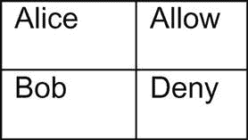

图 3.2 一个简单的 ACL。

#### 文件系统 ACL

当我们查看大多数文件系统中的 `ACLs` 时，我们通常看到三种权限被使用：读、写和执行，分别允许我们访问文件或目录的内容、向文件或目录写入，以及在假设文件包含可以在问题系统上运行的程序或脚本的情况下，执行文件的内容。

在文件系统的情况下，文件或目录可能还附载了多个访问控制列表（ACL）。例如，在类 Unix 操作系统中，我们可以看到给定文件具有独立的访问列表，形式为 `user`、`group` 和 `other` ACL。我们可以为单个用户授予读、写、执行权限，为一组不同的用户授予读、写、执行权限，并对任何我们未涵盖的个人或用户组的其他人授予一组不同的读、写、执行权限。这三组权限将显示为 `rwxrwxrwx`，第一组 `rwx` 代表 `user`，第二组代表 `group`，第三组代表 `other`，如图 3.3 所示。

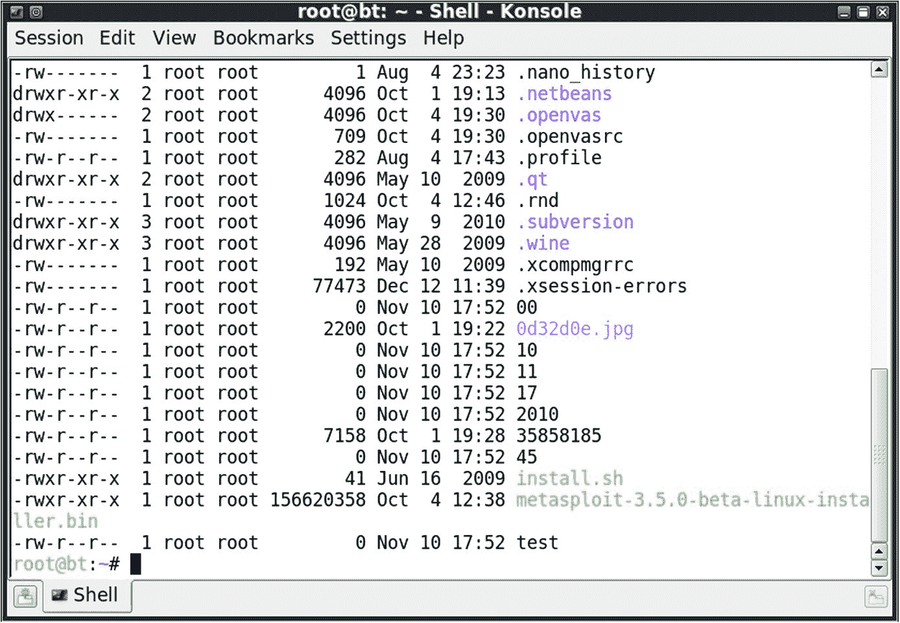

图 3.3 Linux 操作系统上的文件权限。

## 进阶

为了进一步探索这一概念，我们可以查看图 3.3 中显示的文件之一的特定示例。如果我们查看第一个文件 `.nano_history`，我们可以看到权限显示为 `- r w - - - - - - -`。这看起来可能有些晦懂，但我们可以通过将其划分为相关部分来某种程度上帮助理解。如果我们将其划分为 `- | r w - | - - | - -`，我们就能看到不同部分的位置。第一个 `-` 通常用于表示文件类型。在我们的示例中，`-` 代表普通文件，而 `d` 代表目录。第二个段（用户权限）被设置为 `r w -`，意味着拥有文件的用户可以读取和写入它，但不能执行它。第三段（组权限）被设置为 `- - -`，意味着拥有该文件的组成员无法读取、写入或执行该文件。最后一段也被设置为 `- - -`，这意味着任何不是文件所有者或属于文件所有者组的任何人都无法读取、写入或执行该文件。

通过使用此类文件权限集，我们可以简单地控制对使用我们文件系统的操作系统和应用程序的访问。尽管我们只查看了与 Microsoft 和类 Unix 操作系统使用的文件系统相关的此类文件权限，但大多数文件系统都使用非常相似、完全相同的权限集。

### 网络 ACL

当我们观察在私有和公有网络上发生的各种活动时，我们可以再次看到 ACL 调节着此类活动。在网络 ACL 的情况下，我们通常看到访问由我们用于网络事务的标识符控制，例如互联网协议（IP）地址、介质访问控制（MAC）地址和端口。我们可以在路由器、交换机和防火墙设备等网络基础设施中，以及软件防火墙、Facebook、Google、电子邮件或其他软件形式中看到此类 ACL 的运行。

网络 ACL 中的权限本质上往往是二元的，通常由允许和拒绝组成。


# 网络 ACL 与访问控制概述

网络 ACL 中的权限本质上往往是二元的，通常由允许和拒绝组成。当我们设置 ACL 时，我们通常看到访问由我们用于网络事务的标识符控制，例如互联网协议（IP）地址、介质访问控制（MAC）地址和端口。我们可以在路由器、交换机和防火墙设备等网络基础设施中，以及软件防火墙、Facebook、Google、电子邮件或其他软件形式中看到此类 ACL 的运行。

## 进阶

为了进一步探索这一概念，我们可以查看图 3.3 中显示的文件之一的特定示例。如果我们查看第一个文件 `.nano_history`，我们可以看到权限显示为 `- r w - - - - - - -`。这看起来可能有些晦懂，但我们可以通过将其划分为相关部分来某种程度上帮助理解。如果我们将其划分为 `- | r w - | - - | - -`，我们就能看到不同部分的位置。第一个 `-` 通常用于表示文件类型。在我们的示例中，`-` 代表普通文件，而 `d` 代表目录。第二个段（用户权限）被设置为 `r w -`，意味着拥有文件的用户可以读取和写入它，但不能执行它。第三段（组权限）被设置为 `- - -`，意味着拥有该文件的组成员无法读取、写入或执行该文件。最后一段也被设置为 `- - -`，意味着任何不是文件所有者或属于文件所有者组的任何人都无法读取、写入或执行该文件。

通过使用此类文件权限集，我们可以简单地控制对使用我们文件系统的操作系统和应用程序的访问。尽管我们只查看了与 Microsoft 和类 Unix 操作系统使用的文件系统相关的此类文件权限，但大多数文件系统都使用非常相似、完全相同的权限集。

### 网络 ACL

当我们观察在私有和公有网络上发生的各种活动时，我们可以再次看到 ACL 调节着此类活动。在网络 ACL 的情况下，我们通常看到访问由我们用于网络事务的标识符控制，例如互联网协议（IP）地址、介质访问控制（MAC）地址和端口。我们可以在路由器、交换机和防火墙设备等网络基础设施中，以及软件防火墙、Facebook、Google、电子邮件或其他软件形式中看到此类 ACL 的运行。

网络 ACL 中的权限本质上往往是二元的，通常由允许和拒绝组成。当我们设置 ACL 时，我们通常看到访问由我们用于网络事务的标识符控制，例如互联网协议（IP）地址、介质访问控制（MAC）地址和端口。我们可以在路由器、交换机和防火墙设备等网络基础设施中，以及软件防火墙、Facebook、Google、电子邮件或其他软件形式中看到此类 ACL 的运行。

## 警告！

网络 ACL 中的权限本质上往往是二元的，通常由允许和拒绝组成。当我们设置 ACL 时，我们通常看到访问由我们用于网络事务的标识符控制，例如互联网协议（IP）地址、介质访问控制（MAC）地址和端口。我们可以在路由器、交换机和防火墙设备等网络基础设施中，以及软件防火墙、Facebook、Google、电子邮件或其他软件形式中看到此类 ACL 的运行。

## 能力

基于能力的安全可以为我们提供一种访问控制的替代方案，其结构与我们在 ACL 中看到的不同。其中 ACL 是根据给资源、身份和一组权限定义权限，这些权限通常存储在某种文件中；而能力则是围绕使用控制我们访问的令牌的。我们可以将能力中的令牌比作我们可能用于打开大门的个人通行证。其中某人可能只能在工作日的办公时间内访问建筑，而另一个人可能在一周的任何时间段进入建筑的权限。

有趣的是，在基于能力的系统中，访问资源的权限完全基于对令牌（`token`）的持有，而不是基于持有者是谁。正如我们之前的证件示例所示一样，如果我们把证件交给别人，他就能使用该证件并根据我们拥有的任何权限集来访问建筑。在基于能力的系统中，应用程序可以与其他应用程序共享定义其访问级别的令牌。而在使用 `ACLs` 来管理权限的非基于能力的系统中，由于访问控制实现方式的原因，我们可能会遇到**混淆代理问题（confused deputy problem）**。让我们来看一个基于这一原理的攻击。

## 混淆代理问题

混淆代理问题是使用 `ACLs` 而非能力的的系统中常见的一种攻击类型。混淆代理问题的核心在于：当拥有资源访问权限的软件，其访问该资源的权限高于控制该软件的用户时，问题就会出现。如果我们（作为用户）可以欺骗软件去误用其更高级别的权限，那么我们就有可能实施攻击 [\[1\]](#chp003.xhtml#bib1)。我们将在本节稍后部分讨论几个利用混淆代理问题的实际攻击示例。

一些具体的特定的攻击（其中许多本质上是客户端攻击）可以实际利用混淆代理问题。这些攻击通常涉及欺骗用户采取某些操作，而用户却认为自己正在做完全不同的事情。此类攻击两种最常用的用法是客户端攻击，例如跨站请求伪造（`CSRF`）和点击劫持（clickjacking）。

客户端攻击是利用位于用户直接操作的计算机（通常称为客户端）上运行的应用漏洞的攻击。这些攻击可以以通过 Web 浏览器发送的代码的形式存在（代码随后在本地机器上执行）、畸形的 PDF 文件、嵌入了攻击代码的图像或视频或其他形式存在。在过去的几年里，软件供应商已经越来越意识到此类攻击是一个问题，并开始在他们的软件中构建防御措施，但新的攻击仍层出不穷。

`CSRF` 是一种误用用户计算机上浏览器权限的攻击。如果攻击者知道或能猜测用户可能已经通过验证的某个网站（可能是像 [Amazon.com](http://www.Amazon.com) 这样非常常见的网站），他们就可以尝试实施 `CSRF` 攻击 [\[2\]](#chp003.xhtml#bib2)。他们可以通过在网页或基于 HTML 的电子邮件中嵌入链接来实现这一点，该链接通常是指向他们希望在用户不知情的情况下引导用户访问的网站图像。当应用程序尝试检索链接中的图像时，它也会执行攻击者嵌入其中的额外命令。在我们的示例中，当用户的浏览器从 [Amazon.com](http://www.Amazon.com) 加载图像时，只要 Amazon 的身份验证 cookie 未过期，攻击者就可以导致用户在不知情的情况下进行购买，从而允许攻击者售出更多书籍副本。

点击劫持（clickjacking），也称为用户界面劫持，是一种特别狡猾且有效的客户端攻击，它利用了较新 Web 浏览器中提供的某些页面渲染功能。为了实施点击劫持攻击，攻击者必须合法地控制或已控制网站的某些部分（而网站所有者并未意识到其网站现在正在提供恶意软件），作为攻击载体。攻击者构建或修改网站，以便在客户端通常会点击的对象上方放置一个不可见的层，导致客户端执行与他们实际认为正在执行的操作不同的命令 [\[3\]](#chp003.xhtml#bib3)。点击劫持可用于欺骗客户端进行购买、更改其应用程序中的权限、共享有关其操作系统的信息或执行其他非法活动。

如果我们使用能力而非 `ACLs` 来管理权限，这些攻击将是不可能的。在每一个攻击案例中，权限的误用将是不可能的，因为攻击者在没有实际获得允许其执行操作权限的令牌的情况下，无法误用用户的权限。

## 警告！

浏览器攻击非常常见，并且可能对未针对此类攻击进行专门加固的系统成功。一些较常用的浏览器，如微软的 Internet Explorer 和 Mozilla Firefox，现在都包含至少一种针对此类攻击的原始形式保护。浏览器安全插件，例如用于 Firefox 的 `NoScript`^(1) 和用于 Internet Explorer 的 `GuardedID`^(2)，也可以帮助挫败此类攻击。

遗憾的是，最常用的操作系统对基于能力的安全实现仅有非常细微的实现，而且这种实现通常不会扩展到应用程序之间的权限共享。在大多数情况下，为了缓解我们讨论的攻击，需要应用程序或插件形式的额外安全层。

# 访问控制方法论

访问控制是我们实现授权并拒绝或允许某些方访问的手段，其依据是我们确定的他们应该被允许访问的资源。虽然这个术语听起来非常技术化且面向高安全计算设施，但访问控制是是我们每天都会处理的内容。

当我们锁上或打开房屋的门时，我们正在使用一种形式的物理访问控制，它是基于我们使用的钥匙（你拥有的东西）。

当我们启动汽车时，我们可能也会使用钥匙。对于某些较新的汽车，我们的钥匙可能通过添加射频识别（`RFID`）标签、类似证书的标识符以及其他安全技术来增加额外的安全层。

当我们到达工作场所时，我们可能会使用证件或钥匙（你拥有的东西）进入建筑，这再次是一种物理访问控制。

当我们坐在工作电脑前并输入密码（你知道的东西）时，我们正在进行身份验证并使用逻辑访问控制系统来访问我们被许可的资源。根据我们在工作、上学和执行组成日常生活的活动期间经过的环境，我们对访问控制的接触程度可能多有少，但大多数人都会经常看到这些实现方式。

## 访问控制模型

在日常访问的环境中，我们可能会遇到许多不同的访问控制模型，我们将在此处介绍最常见的模型。我们在安全领域最可能遇到的一组模型包括自主性访问控制、强制性访问控制、基于规则的访问控制、基于角色的访问控制以及基于属性的访问控制。

### 自主性访问控制

自主性访问控制（`DAC`）是一种基于资源所有者决定访问的访问控制模型。资源所有者可以决定谁拥有或不拥有权限，以及他们被允许拥有哪些权限。在微软操作系统中，可以看到 `DAC` 的实现。例如，当我们创建一个网络共享时，我们可以决定允许谁访问。

### 强制性访问控制

强制访问控制 (`MAC`) 是一种访问控制模型，在该模型中，资源的所有者并不决定谁可以访问该资源，而是由一个有权设置资源访问权限的组或个人来决定。我们经常可以在政府机构中发现 `MAC` 的应用，在这些机构中，对特定资源的访问很大程度上取决于该资源的敏感性标签（如机密、绝密等）、该个人被允许访问的敏感信息级别（可能仅限于机密），以及该个人是否确实访问该资源的需求（正如我们在本章较早之前讨论最小权限原则时所讨论的那样）。

## 进阶内容

值得注意的是，`MAC` 是一个多义的缩写，它可能有多种含义。在这种情况下，两种最常见的含义是：作为网络接口唯一标识符的 `MAC`（MAC 地址），以及作为一种访问控制类型的 `MAC`。

### 基于角色的访问控制


# 基于角色的访问控制 (RBAC)

基于角色的访问控制 (RBAC) 是一种访问控制模型，与 MAC 类似，它的运行基于由负责的机构设置的访问控制，而不是由资源的所有者设置。RBAC 与 MAC 的区别在于，RBAC 中的访问控制是基于被授予权限的个人所扮演的角色。例如，如果我们有一位员工，唯一的角色只是向特定应用程序输入数据，那么通过 RBAC，我们只允许该员工访问该应用程序，无论他可能访问的任何其他资源是否敏感或不敏感。如果我们有一位角色更复杂的员工——也许是在线零售应用程序的客户服务——该员工的角色可能要求他访问客户的支付状态和信息、发货状态、之前的订单以及退货信息，以便协助这些客户。在这种情况下，RBAC 将授予他多得多的权限。我们可以在许多面向销售或客户服务的大型应用中看到 RBAC 的实现。虽然这提供了更细粒度的安全性，但其实现和管理也需要耗费更多精力。

## 基于属性的访问控制

从逻辑上讲，基于属性的访问控制 (ABAC) 是基于属性的。这些属性可以是特定个人、资源或环境的属性。

主体属性是指特定个体的属性。我们可以选择任意数量的属性，例如经典的“身高不符才能玩”访问控制，它的存在是为了防止身高受限的人员乘坐可能对他们有害的游乐场设施。另一个非常常见的例子可以见于验证码（Captcha）的使用，如图 3.4 所示。验证码用于控制访问，其取决于另一端能否通过一项在理论上机器难以完成的测试，从而证明该方是人类。Captcha 或更准确的术语 CAPTCHA，全称为“用于区分人类与计算机的全自动公共图灵测试”[\[4\]](#chp003.xhtml#bib4)。CAPTCHA 用于防止自动化工具执行如注册新账户或在博客上添加垃圾评论等任务。

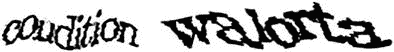

图 3.4 验证码。

资源属性与特定资源（如操作系统或应用程序）有关。我们经常看到这种情况，尽管通常是出于技术原因而非安全原因，当我们遇到只在特定操作系统上运行的软件或仅支持某些浏览器的网站时。我们可以通过要求使用特定软件或特定通信协议，将这种访问控制作为一种安全措施。

环境属性可用于基于环境条件的运行的访问控制。我们通常使用时间属性来控制物理和逻辑意义上的访问，基于已过去的时间长度或一天中的某个时间。建筑的访问控制通常基于此进行。我们常使用时间属性来启用基于环境运行的访问控制。我们经常在 VPN 连接上看到对时间设置的访问限制，以防止意外行为。

## 多级访问控制

多级访问控制模型用于简单的访问控制模型不足以保护信息的情况。此类访问控制被军事和政府组织广泛使用，它们通常处理非常敏感的数据。

Bell-LaPadula 模型实现了 DAC 和 MAC 的结合，主要关注资源的机密性。通常，在看到 DAC 和 MAC 同时实现的情况下，MAC 优先于 DAC。例如，我们可能有一个被分类为机密的资源，而用户拥有机密权限，通常 MAC 允许他们访问资源。然而，我们可能还有额外的 DAC 层，如果资源所有者没有授予权限，他们将无法访问。在 Bell-LaPadula 中，我们有两个定义了信息如何在资源之间流动的安全属性[\[5\]](#chp003.xhtml#bib5)：

1. 简单安全属性：授予个体的访问级别必须高于或等于资源的分类，该个人才能访问。
2. `*` 属性：访问资源的人只能将其内容写入到相同级别或更高分类的资源中。

这些属性通常被总结为“不向上读”和“不向下写”。简而言之，这意味着当我们处理机密信息时，不能读取高于我们许可级别的内容，也不能将机密数据写入更低级别。

Biba 访问控制模型主要关注数据的完整性，即使是以牺牲机密性为代价。Biba 有两条与我们在 Bell-LaPadula 模型中讨论相反的安全规则[\[6\]](#chp003.xhtml#bib6)：

- 简单完整性公理：授予个体的访问级别不能低于资源的分类。
- `*` 完整性公理：访问资源的人只能将其内容写入到相同级别或更低分类的资源中。

我们可以将这些规则总结为“不向下读”和“不向上写”。在考虑保护信息时，这似乎完全反直觉，但请记住我们已经将重点从机密性转移到了完整性。

Brewer and Nash 模型也称为“中国墙模型”（Chinese Wall model），是一种旨在防止利益冲突的访问控制模型。Brewer and Nash 模型常用于处理敏感数据的行业，例如金融、医疗或法律行业。该模型考虑了三类主要的资源类[7]：

1. `Objects`（对象）：属于单一组织的资源，如文件或信息。
2. `Company groups`（公司组）：所有属于特定组织的所有对象。
3. `Conflict classes`（冲突类）：涉及竞争双方的所有对象组。

如果我们以一家为某行业公司提供服务的商业律师事务所为例，我们可能会拥有一些属于该行业内不同个人和公司的文件。作为该律所的一名个人律师，在访问数据并为不同客户工作时，他在处理新案件期间，可能会访问到会产生利益冲突的机密数据。在 Brewer and Nash 模型中，律师允许访问的资源和案件材料将根据其之前访问过的材料发生动态变化。

## 物理访问控制

我们在本章中讨论的许多访问控制方法既适用于物理安全，也适用于逻辑安全。当涉及到物理访问控制时，我们通常很大程度上关注控制个人和车辆的访问。

个人的访问控制通常围绕控制进入和离开建筑或设施的移动。我们可以在许多组织的建筑上看到此类控制的简单示例，其形式为控制进入或在设施内开启门禁的证卡（这是你在第 2 章中有过的东西）。此类证卡通常配置在 `ACL` 上，允许或拒绝它们在某些门上的使用，并规定它们可以使用的时间段。

物理访问控制较为常见的问题之一是“尾随”（tailgating）。尾随发生于当我们通过物理访问控制措施（如使用证卡）进行身份验证后，另一个人直接跟在我们身后而没有进行身份验证的情况。尾随可能会导致各种问题，包括允许未经授权的人员进入建筑，以及在发生紧急情况下，无法准确反映建筑内实际的人员。

我们可以尝试通过多种方法来解决尾随问题，从实施禁止此类行为的政策，到在区域内部署保卫人员，或者简单地（但昂贵的）安装一种一次只允许一个人通过的物理访问控制解决方案，例如闸机。这些都是合理的解决方案，但取决于所处的环境，可能有效也可能无效。我们经常发现，需要多种解决方案的组合来开发出一个彻底且完整的解决方案。

许多人所熟悉的这种类型访问控制的一个复杂得多的例子是许多机场正在使用的安全系统。特别是在美国发生 9/11 恐怖袭击之后，我们看到机场的安全性水平提高，其中很大一部分面向访问控制方向。一旦我们进入机场安全系统，就被要求出示登机牌和身份证明（这是你拥有的东西，而且是两份）。然后我们通常会经过几个步骤以确保我们没有携带任何危险设备，这是一种 `ABAC` 的形式。随后我们前往登机口，再次出示登机牌以进入飞机。这些过程可能会根据我们旅行的国家而略有不同，但从访问控制的角度来看，它们通常是相同的。

车辆的物理访问控制通常围绕防止这些车辆进入或穿过我们不希望它们进入的区域。这通常通过使用各种简单的屏障来实现，包括如图 3.5 所示的贝杰西路障（Jersey barriers）、护柱、单向刺刺、围栏和类似的工具。我们可能还会看到更复杂的装置，包括有人守或无人值的升降屏障、自动门或窗或其他类似物品。

![图 3.5 贝杰西路障 [8]。](Images/F000038f03-05-9780128007440.jpg)

图 3.5 贝杰西路障 [8]。

当然，还有许多我们在此没有讨论过的其他物理访问控制和方法。此外，当我们提到物理访问控制设备或广义的访问控制时，身份验证设备与访问控制设备之间的界限往往变得相当模糊。

# 现实世界中的授权与访问控制

我们在个人和商业生活中几乎持续地看到授权和访问控制被使用，尽管我们直接可见的部分是访问控制。具体到逻辑访问控制，我们可以在登录计算机或应用程序时、在通过互联网发送数据流量时、在看电缆或卫星电视时、在手机上拨打电话时以及在数千其他地方看到它们的使用。在某些情况下，这些措施对我们是可见的并要求我们输入密码或 `PIN`，但其中很大一部分发生在后台发生，对我们正在执行的任务完全不可见，并由促进我们任务的技术负责处理。

在物理访问控制方面，我们也很频繁地看到这些措施，尽管我们可能并没有意识到正在使用它们。我们大多数人随身携带钥匙允许我们访问房屋、汽车和其他设备，这些是它们的访问凭据。我们许多人还带有感应卡，允许我们进入工作场所、学校以及在驾照办理处。我们还可以看到管理日常车辆移动的访问控制，例如停车场、停车区域以及白宫等高安全区域附近。

# 总结

授权我们在允许实体访问资源时所遵循流程中的关键步骤，其顺序为识别、身份验证和授权。我们通过使用访问控制来实现授权，具体来说通过使用 `ACL` 和能力列表（capabilities）来实现，尽管后者在大多数常用的操作系统中并未被完全实现。

访问控制的细节通过我们在构建此类系统时使用的各种模型定义。我们在日常生活中经常看到简单访问控制模型的使用，如 `DAC`、`MAC`、`RBAC` 和 `ABAC`。在处理更敏感数据的环境中，例如涉及政府、军事、医疗或法律行业的行业，我们可能会看到多级访问控制模型的使用，包括 Bell–LaPadula、Biba、Clark–Wilson 和 Brewer and Nash。

访问控制概念泛上很大程度上适用于逻辑和物理区域，但在专门查看物理访问控制时，我们确实可以看到一些专门的应用。在这里，我们有几组访问控制用于确保人员和车辆被限制进入或离开未经授权的区域。我们可以在日常生活的办公楼、停车场以及一般的高安全设施中看到此类控制的示例。

# 练习

1. 讨论授权与访问控制之间的区别。
2. Clark–Wilson 模型防止什么问题？
3. 为什么基于网络上系统的 `MAC` 地址的访问控制不代表强有安全性？
4. 授权（authorization）和身份验证（authentication）哪个先发生？
5. 在访问控制方面，MAC 和 DAC 之间有什么区别？
6. Bell–LaPadula 和 Biba 多级访问控制模型分别有其首要安全重点。这两个模型可以结合使用吗？
7. 假设有一个包含敏感数据并存储在 Linux 操作系统中的文件，将权限设置为 `rw-rw-rw-` 会引起潜在的安全问题吗？如果是的话，CIA 三要素中的哪些部分可能会受到影响？
8. 如果我们希望防止用户在办公时间后登录账户，应该使用哪种类型的访问控制？
9. 解释混淆代理问题（confused deputy problem）如何导致权限提升的发生。
10. ACL（访问控制列表）和能力列表（capabilities）之间有哪些区别？

## 参考文献

1. Hardy N. The confused deputy: (or why capabilities might have been invented). *ACM SIGOPS Oper Syst Rev*. 1988;22 ISSN: 0163-5980.
2. Higgins KJ. CSRF vulnerability: a “sleeping giant.” Dark Reading. <[www.darkreading.com/security/application-security/208804131/index.html](http://www.darkreading.com/security/application-security/208804131/index.html)>; 2006 年 10 月 17 日 [访问于 15.10.13]。
3. Callegati F, Ramilli M. Frightened by links. *IEEE Secur Priv*. 2009;7 ISSN: 1540-7993.
4. von Ahn L, Blum M, Langford J. Telling humans and computers apart automatically. *Commun ACM*. 2004;47.
5. LaPadula LJ, Bell DE. *Secure computer systems: mathematical foundations*. vol. l Mitre Corporation 1973.
6. Biba KJ. *Integrity considerations for secure computer systems* Mitre Corporation 1975.
7. Lin TY, Chinese wall policy—an aggressive model. Fifth Annual Computer Security Applications;1989.
8. Washington State Department of Transportation, Precast Concrete Barrier—Type 2 to Single Slope (TB-23). <[http://www.wsdot.wa.gov/design/standards/plansheet/tb-23.htm](http://www.wsdot.wa.gov/design/standards/plansheet/tb-23.htm)>; 2013 [访问于...]。

***

# 第 4 章

# 审计 (Auditing) 与问责制 (Accountability)

本章讨论了审计和问责制的使用。我们讨论了当提供基于敏感信息的资源访问时，需要对他人进行问责。我们还概述了为了确保环境符合相关的法律、法规和政策而所执行的流程。此外，我们介绍了用于支持审计、问责和日志记录等活动的工具。

## 关键词

问责制；证据效力；审计；威慑；入侵检测；日志记录；监控；不可否认性

### 本章大纲

* 引言 57
* 问责制 58
* 进阶内容 59
    * 问责制的安全效益 60
        * 不可否认性 60
        * 威慑 60
    * 进阶内容 61
        * 入侵检测与防御 61
        * 记录的证据效力 61
    * 如何实现问责制 62
    * 审计 62
    * 我们审计什么？ 63
    * 警告！ 63
    * 日志记录 64
    * 监控 65
    * 评估 65
    * 现实世界中的问责制与审计 66
    * 进阶内容 67
    * 总结 67
    * 练习 68
    * 参考文献 68

### 本章包含的信息

* 问责制
* 审计

## 引言

当我们成功通过身份识别、身份验证和授权流程后，或者在我们仍在执行该流程时，我们需要跟踪已发生的活动，如 [#chp004.xhtml#s0010] 所示。尽管我们可能已经允许访问资源，但仍需确保他们的行为符合策略。


图 4.1 问责制。

近年来，确保我们的环境遵守规则已成为一项至关重要的任务。我们现在以数字形式存储大量信息，包括医疗数据、财务信息、商业秘密和其他项目。如果我们没有足够的控制措施来威慑或防止那些违反规则并滥用其所访问资源的人，我们也会陷入困境。某些类型的数据——例如医疗和财务数据——通常受到各国法律的保护。在美国，两部此类著名的法律分别是 1996 年的《健康保护性与问责法》（`HIPAA`）和 2002 年的《萨班斯-奥克斯利法》（`SOX`）。

## 问责制

问责制为我们提供了将环境中的活动追踪到源头的手段。此外，在适当实施的情况下，它为我们提供了许多功能，这些功能在开展组织的安全和信息技术日常业务时非常有用。特别是组织需要仔细地维护问责制，以确保它们符合与其所处理的数据类型或所属行业相关的任何法律或法规。

为了确保我们拥有问责制，我们需要某些其他工具到位并正常工作。问责制依赖于身份识别、身份验证和访问控制的存在，这样我们就能知道某项交易与谁相关以及使用了哪些权限允许他们执行。在有适当监控和日志记录的情况下，我们通常可以做到这一点，并在短时间内确定情况的细节。

如果我们考虑 2001 年安然公司丑闻的案例，我们可以看到由于对股东、董事会、审计师和美国政府缺乏问责制，安然能够诈骗投资者数十亿美元。这是促成 `SOX` 法律颁布的事件之一，该法律专门针对停止此类行为。在某些情况下，问责制在某种程度上等同于透明度。在某些情况下，我们的活动必须对某些（如股东）透明，以便让他们对我们的行为负责。对于上市公司而言，这种透明度是法律强制规定的。

我们可能也会看到由外部机构促成问责的情况，但遵守这些要求的动力必须来自我们组织内部。我们可以从以下要求中看到一个例子：即在安全泄露中，通知那些个人或财务信息被未经授权的方式暴露的人员。此类泄露发生的频率高得令人心惊，我们通常可以通过简要搜索新闻媒体找到一个当前的案例。当一家公司在美国发生泄露时，根据州法律，它通常会被要求通知信息泄露的人。然而，在许多情况下，在向直接相关人员公布之前，公司之外可能只有极少数人知道泄露的情况。我们完全可以预见到，在这种情况下，此类组织可能会为了保护形象而对事件闭口不言。要查看已知泄露的列表，请访问 [`www.privacyrights.org/data-breach`](https://www.privacyrights.org/data-breach)。

## 进阶

在美国，截至编写本文时，46 个州、哥伦比亚特区、波多黎各和美属维尔京群岛已有法律规定，必须对个人身份信息（`PII`）涉及泄露的人员进行通知。目前，尚未实施此类法律的州有阿拉巴马州、肯塔基州、新墨西哥州和南达科他萨州 [[1]](#chp004.xhtml#bib1)。

尽管泄露可能对组织外部的人来说并非立即可见，或者根本不会被发现，但我们仍有责任遵守我们所在地管理泄露的法律，以及任何管理我们业务所处理数据的法律。如果我们在涉及这些法律方面表现不当，我们可能能够照常维持业务一段时间，但我们最终会被发现，而且由于最初没有妥善处理这种情况，其在个人、业务和法律层面造成的后果将大得多。

### 问责制的安全效益

实施问责制通常从安全角度带来许多有用的功能。当我们在系统和网络上实施监控和日志记录时，我们可以利用这些信息维持比其他时候更高的安全态。具体来说，允许我们问责的工具还实现了不可否赖性（证据），能够威慑那些可能滥用我们资源的人，帮助我们检测和防止入侵，并协助我们准备法律诉讼材料。

#### 不可否赖性


# 不可否赖性

不可否赖性是指存在足够的证据防止个人成功否认其曾发表过声明或采取过某种行动。在信息安全环境中，可以通过多种方式实现。我们可能直接从系统或网络日志产生活动证明，或者通过对涉及的系统或设备进行数字取证来恢复此类证明。我们还可以通过加密技术建立不可否赖性，具体来说是通过使用哈希函数对通信或文件进行数字签名。我们将在第 5 章学习加密时详细讨论此类方法。一个例子可能是系统对其发送的每封电子邮件进行数字签名，从而使任何关于发送该消息的否认都变得无效。

## 威慑

问责制也可以证明是环境中错误行为的极佳威慑。如果我们监控的对象知道这一事实，并且已经传达他们违反规则的行为将受到惩罚，这些个人在越界之前可能会三思考虑。

## 进阶

威慑的关键在于让我们想要威慑的人知道他们将对其行为负责。这通常通过审计和监控手段来实现，这两者我们将在本章的“审计”部分进行讨论。如果我们不明确这一点，我们的威慑将失去大部分力量。例如，如果作为监控的一部分，我们跟踪员工进出设施的刷卡访问时间，我们可以根据他们提交的时间对这一活动进行验证。虽然这在某些人看来可能带有“老大哥”的味道，但此类方法通常用于人员众多的领域。

## 入侵检测与防御

我们在环境中进行日志记录和监控的动机之一是检测和防止入侵。如果我们根据环境中的异常活动实施警报，并定期检查已记录的信息，我们就有更大的机会检测正在进行的攻击，并防止那些我们能看到预兆的攻击。

特别是在可能发生攻击的逻辑领域，最好实施自动化工具来执行此类任务。我们可以将此类工具分为两大类：入侵检测系统（`IDSes`）和入侵防御系统（`IPSes`）。`IDS` 严格作为监控和警报工具，仅通知我们正在发生攻击或不良活动。`IPS` 通常根据 `IDS` 发送的信息工作，实际上可以根据环境中发生的情况采取行动。响应网络攻击，`IPS` 可能会拒绝来自攻击源的流量。我们将在[第 9 章](#chp009.xhtml#chp009)、[第 10 章](#chp010.xhtml#chp010)和[第 12 章](#chp012.xhtml#chp012)详细讨论 `IDS` 和 `IPS`。

## 记录的可采性

当我们在法律环境中引入记录时，如果这些记录是由受监管且一致的跟踪系统产生的，通常更容易引入并被接受。例如，如果我们寻求提交收集的数字取证证据用于法庭案件，除非我们为该证据提供可靠且有记录的监管链，否则该证据可能无法被法院采纳。我们需要展示证据在任何时候处于何处、具体如何从一个人传递给另一人、在存储时是如何受到保护的等。

我们收集证据的问责方法如果能得到妥善遵守，有望让我们展示出这一不连续的监管链。如果我们无法证明这一点，我们的证据可能只能被视为口头传言，这会大大削弱我们的论点，并可能导致我们在法庭上处于失败位置。

证据还必须有一个哈希值（`hash`）来证明它是原始的且未被修改。哈希函数是一种分析设备上数据并产生代码或哈希值的算法。如果任何数据发生变化，哈希值就会改变。

# 我们如何实现问责

正如我们讨论过的，我们可以尝试通过制定规则并确保它们被遵守来确保问责制。虽然给某人一条规则并要求其遵守是很好，但我们通常需要采取进一步的步骤来确保这些措施切实生效。我们可以在执法领域看到这种系统的运作。我们生活的地理区域为民众制定了某些必须遵守的法律。通常，我们可以找到管理盗窃、伤害他人、车辆安全运行等许多法律。然后，我们有警察以被动和主动的方式确保这些法律的执行。警察既会巡逻寻找违规行为，也会响应来电调查违规行为。警察可以被比作系统管理员，侦探就像安全事件响应分析师，而犯罪现场调查（CSI）则是计算机取证调查员。每个小组都有自己的一套工具。

# 审计

我们通过技术手段确保问责的主要方法之一，是确保我们拥有准确的记录，记录谁在何时做了什么。在几乎任何环境中，从最低技术层到最高层，问责在很大程度上都是通过使用审计来实现的。《梅里亚姆-韦伯斯特法律词典》将审计定义为“一种有系统的检查和审查” [[2]](#chp004.xhtml#bib2)。

我们进行审计有几个原因之一。审计为我们提供了实施问责所需的数据。如果我们没有评估一段时间内活动的能力，那么我们就没有在大规模上促进问责的能力。特别是在较大的组织中，我们的审计能力直接等于我们让任何人对任何事情负责的能力。

我们可能还会受到合同或监管要求的限制，这些要求迫使我们必须定期接受审计。在许多情况下，此类审计是由认证并授权执行此类任务的无关且独立的第三方进行的。此类审计的良好例子是萨班斯-奥克斯法案（SOX）要求的审计，其存在是为了确保公司诚实地报告其财务状况。

## 我们审计什么？

当我们执行审计时，有许多项目可以检查，主要侧重于对相关法律和政策的合规性。在信息安全领域，我们倾向于将访问系统或退出系统作为主要关注，但通常也会将其扩展到其他领域，例如物理安全。

密码是一个常见的审计项目，因为我们应该制定政策来规定它们的构建和使用方式。正如我们在第 2 章的“身份验证”部分中讨论过的那样，如果我们不注意以安全的方式构建密码，它们很容易被攻击者破解。我们还应该关注密码更改的频率。如果密码确实落入了不该拥有它的人手中，我们希望在相对频繁的间隔更改密码，以确保该人员没有永久访问权限。在许多情况下，检查密码强度和管理密码更改是通过操作系统内部的函数或用于执行此操作的实用工具自动完成的，这些也需要进行审计，以确保它们已就位并配置正确。

软件许可是另一个常见的审计主题。特别是在我们工作的组织拥有的系统上，确保我们所有的软件都有适当的许可是一项重要任务。如果我们受到外部机构（例如商业软件联盟 BSA）的审计，并发现我们运行了大量未经许可的软件，那么罚款可能是非常严重的。最好的方法通常是在收到来自 BSA 等外部公司的通知之前，能够自己发现并纠正此类问题。

> **警告！**
>
> BSA 是一家代表软件公司（例如 Adobe 或微软）定期审计其他公司以确保其符合软件许可要求的公司。BSA 的罚款每出现`一次`未经许可的软件可能高达 25 万美元，而且 BSA 还通过为举报违规行为的举报人提供高达 100 万美元的奖励来增加其吸引力 [[3]](#chp004.xhtml#bib3)。

互联网使用是组织中一个非常常见的审计项目，通常很大程度上关注我们在 Web 上的活动，尽管它也可能包括即时消息、电子邮件、文件传输或其他交易。在许多情况下，组织配置了代理服务器，使所有此类流量都汇集到少数几个网关，以便能够记录、扫描并可能过滤此类流量。此类工具可以让我们能够检查此类资源究竟是如何被利用的，并在它们被滥用时采取行动。

正如我们在本章中提到的，许多组织处理敏感性质的数据。特别是在法律要求保护的数据情况下（医疗数据就是一个很好的例子），我们必须采取措施确保我们符合任何被要求实施的安全措施。特别地，我们通常有义务确保以授权的方式访问此类数据，满足对一段时间内数据保留的任何要求，并在数据不再需要时安全地销毁。此类数据通常存储在各种数据库中，其中大多数数据库具有内置功能，可以在非常细粒度的级别上控制和监控访问。

## 日志

日志为我们提供了被记录环境中已发生的活动历史。没有这些证据，审计和调查是不可行的。对于任何组织来说，确定正确的日志级别以支持其需求是关键。我们通常在操作系统以自动方式生成日志，并跟踪在大多数计算、网络和电信设备上发生的活动，以及大多数可以被远程认为包含或连接到计算机的设备。日志是一种被动的工具，因为它允许我们在事件发生后查看其记录。为了对发生的情况立即做出反应，我们需要使用类似于入侵检测/防御系统（IDS/IPS）的工具。

`Logs`（日志）通常仅供系统管理员查阅，且系统用户通常无法修改，但写入日志除外。需要注意的一点是，只收集日志而不进行审查是一项相当徒劳的任务。如果我们从不审查日志内容，那么从一开始不收集它们也无异。重要的是，我们必须安排定期审查日志的计划，以发现内容中的任何异常情况。

我们还可能被要求针对特定的事件或情况分析日志内容。在调查、事件处理和合规性检查中，这类活动通常由安全人员负责。在这些情况下，如果所涉及的时间跨度超过几天，这可能会是一项艰巨的任务。即使是搜索相对简单的日志内容（例如 Web 代理服务器生成的日志），也意味着要从来自一个或多个服务器的海量数据筛选。在这种情况下，自定义脚本甚至诸如 `grep` 这样的工具对于在合理的时间内完成此类任务将是无价之宝。

存储日志会迅速积累大量数据，从而导致成本高昂。应该有一项政策规定日志应存储多长时间以及在何种保真度下存储。对于网络流数据（net flow data），头部信息可能足够了。对于密码尝试，我们可能希望在较长时间保留日志的所有方面。我们还必须审查合规性问题，以确定是否有维护期限日志的要求。

## 监控

监控是审计的一个子集，倾向于观察被监控环境的信息，以发现不理想的情况，如故障、资源短缺、安全问题以及可能预示此类状况到来的趋势。监控在很大程度上是一种反应性活动，根据收集的数据（通常是来自各种设备生成的日志）采取行动。虽然我们可能认为日志的趋势分析部分视为一种主动性活动，但我们仍然是在对现状做出反应，以防止比目前看到的更糟糕的情况发生。可以将此比作看守着建筑入口摄像头画面的守卫。他们必须对未经授权的人进入做出反应，而不仅仅是阻止他们。

在进行监控时，我们通常观察收集到的特定数据项，例如计算机的资源使用情况、网络延迟、针对暴露在互联网的网络接口的服务器反复发生的特定类型攻击，以及在一天中异常时间通过物理访问控制的流量。当此类活动发生的水平超过我们正常预期水平（称为裁剪水位，clipping level）时，我们的监控系统可能会配置为向系统管理员或物理安全人员发送警报，可能会触发更直接的行动来缓解问题，例如丢弃来自特定 `IP` 地址的流量、切换到关键服务器的备份系统、召唤执法人员或其他类似任务。

## 评估

在某些情况下，我们的审计可能会采取更积极的途径，以确定一切是否都符合预期并遵守相关的法律、法规或政策。在这些情况下，我们可能会发现仔细检查环境的漏洞是很有用的。对于此类活动，我们可以采取两种主要方法：漏洞评估和渗透测试。虽然这些术语经常互换，但它们实际上是两组完全不同的活动。

漏洞评估通常涉及使用漏洞扫描工具（如图 4.2 所示的 `Nessus`）来定位此类漏洞。此类工具通常通过扫描目标系统来发现其哪些端口是开启的，然后询问每个开启的端口，以确切知道是哪种服务在所涉及端口上监听。根据这些信息，漏洞评估工具就可以咨询其漏洞信息数据库，确定是否存在任何漏洞。尽管此类工具的数据库确实相当详尽，但新的攻击或攻击者极少使用的攻击往往会逃过它们的注意。

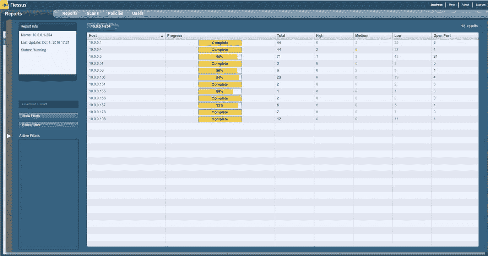

图 4.2 Nessus。

作为寻找安全漏洞的另一种更积极的方法，我们还可能希望进行渗透测试。渗透测试虽然以漏洞评估为起点，但又向前迈了几步。当我们进行渗透测试时，我们会尽可能模拟真实攻击者使用的技术。我们可能会尝试通过未修补的应用程序漏洞、连接的数据库或类似方法从目标环境获取额外信息。我们将在第 10 至 12 章中详细讨论渗透测试。对于想要验证其安全架构和能力的成熟机构，渗透测试通常更有用。

执行此类评估的最终目标是在攻击者之前发现并修复漏洞。如果我们能够成功地并定期这样做，将大大增强我们的安全态势。正如我们实施的任何安全措施一样，安全评估只是整体策略中的一个组件。

## 现实世界中的问责与审计

问责和审计在很大程度上常见于我们大多数人的日常活动中。当我们审视自己的问责经历时，可以发现它们发生非常频繁。我们对所在所在地法律和国家法律的合规负责；同样，我们也对雇主、学校、银行以及与我们进行各种业务往来的数百其他实体的政策和规定负责。我们还对交易对方的行为负责。我们希望处理我们信息的人能够保护它，希望领导层诚实并履行其声明的目标和政策等。

对于我们可能采取的任何行动，某个计算机系统都会创建或更新相关的审计记录。我们的医疗历史、学校成绩、购买记录、信用记录以及许多其他因素都会被接触的个人和组织定期查询和更新。这些数据被用于对我们的生活产生影响的决策。

信用卡行业使用一种名为`Payment Card Industry (PCI) Data Security Standards`（支付卡行业数据安全标准）的标准。这些标准规定了供应商保护客户数据的要求。它们包含了在本章中讨论过的`auditing`（审计）和`assessment`（评估）功能。

# 总结

当我们允许他人访问我们业务赖以生存的资源或敏感个人信息时，我们需要让他们对这些资源或信息的行为负责。取决于他们处理的数据类型以及所在的行业，问责制（Accountability）可能是组织的一项要求。

审计（Auditing）是我们通过的一个过程，以确保我们的环境符合约束它的法律、法规和政策。审计也是我们实施问责制的机制。我们以审计的名义执行各种任务，包括日志记录、监控和评估。

为了支持审计、问责制和监控活动，我们通常会对环境中的许多设备进行日志记录。此类日志通常由软件、计算设备以及连接到计算机的其他硬件生成。设备生成的日志在性质上可能非常通用，仅包含有限的信息；或者可能非常具体，包含大量详尽的信息。

根据我们从系统中收集的数据，我们还可以在环境中进行监控。监控允许我们在活动发生后的一段时间采取行动，其范围可能从识别系统运行的趋势，到在攻击被首次识别后迅速采取行动进行拦截。

# 练习

1. `logging`（日志记录）有什么好处？
2. 讨论`authentication`（身份认证）和`accountability`（问责制）之间的区别。
3. 描述 `nonrepudiation`（不可否认性）。
4. 列出我们可能想要审计的五个项目。
5. 为什么在处理敏感数据时`accountability`（问责制）很重要？
6. 为什么审计已安装的软件是一个好主意？
7. 在处理法律或监管问题时，为什么我们需要`accountability`（问责制）？
8. `vulnerability assessment`（漏洞评估）和`penetration testing`（渗透测试）的区别是什么？
9. `accountability`（问责制）对法庭案件中证据的可采性产生什么影响？
10. 环境处理敏感客户数据的服务器（其中某些暴露在网上），我们想要进行`vulnerability assessment`、`penetration test`还是两者都进行？为什么？

# 参考文献

1. 国家州立法者会议，州安全泄露通知法。National Conference of State Legislatures, <[`www.ncsl.org/issues-research/telecom/security-breach-notification-laws.aspx`](http://www.ncsl.org/issues-research/telecom/security-breach-notification-laws.aspx)>; 2012 年 8 月 20 日 [访问 15.10.13]。
2. 韦伯-韦斯特法律词典，审计。Dictionary.com, <[`dictionary.reference.com/browse/audit`](http://dictionary.reference.com/browse/audit)>; 2013 [访问 15.10.13]。
3. 商业软件联盟。互联网面孔。Business Software Alliance. Faces of Internet.

---

# 历史

历史充满了密码学的使用，一些最古老的例子是远古希腊人和罗马人使用的。信息通过各种代码被隐藏，其中一个极端的例子是将密文纹在信使剃光的头上，然后让头发重新长出，以及通过许多其他侧重于数学算法的方法。相关的历史信息足以填满一整本书，事实上关于这个主题已经写了许多书籍，但我们将仅回顾几个亮点。

## 凯撒密码

`Caesar cipher`（凯撒密码）是古代密码学的一个经典案例，据说被尤利斯·凯撒使用过。`Caesar cipher`基于置换，涉及将明文消息的每个字母移动特定数量的字母（历史上是三个），如图 5.1 所示。通过向相反方向应用相同数量的偏移可以解密密文。这种加密由于以一致的方式用一个字母替换另一个，被称为`substitution cipher`（替换密码）。

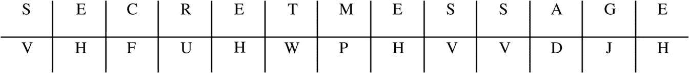

图 5.1 凯撒密码。

`Caesar cipher`较新的变体可以在`ROT13 cipher`中找到。`ROT13`使用与`Caesar cipher`相同的机制，但每个字母向前移动 13 位。移动 13 位的便利之处在于，再次进行一轮`ROT13`加密也可以充当解密功能，因为两次旋转会将我们回到字母表中的原始起始位置。执行`ROT13`的工具可以在许多 Linux 和 UNIX 操作系统自带的基础工具集中找到。有许多围绕简单置换构建的简易系统。

## 密码机

在现代计算机出现之前，已经存在一些机器简化了加密的使用，并使更复杂的加密方案变得可行。最初，这些设备是简单的机械设备，但随着技术的进步，我们开始看到电子元件和复杂系统的引入。

`Jefferson Disk`（杰斐逊盘）由托马斯·杰斐逊于 1795 年发明，是一种纯机械密码机。它由一系列磁盘组成，每个磁盘的边缘都标记有字母`a`到`z`，如图 5.2 所示。

![图 5.2 杰斐逊盘 [1]。](Images/F000051f05-02-9780128007440.jpg)

图 5.2 杰斐逊盘 [[1]](#chp005.xhtml#bib1)。

在每个磁盘上，字母的排列顺序不同；每个磁盘还带有唯一的标识符，以便按特定顺序排列。通过`Jefferson Disk`构建的设备允许通过对齐磁盘来加密消息。解密时，用户将磁盘与密文对齐，并从特定行读取字母以显示明文。

---

用于加密明文或解密密文的具体流程被称为`cryptographic algorithm`（加密算法）。加密算法通常使用`key`（密钥）或多个密钥来加密或解密消息，这大致类似于密码。密钥所有可能值的范围被称为`keyspace`（密钥空间）。密钥空间越大，解密消息就越困难。我们也可以提到`cryptosystem`（密码系统），这是一个涵盖了给定算法以及所有可能的密钥、明文和密文的概念。


### 密钥管理原则

3. 密钥必须易于通信和记忆，无需书面记录，并且在不同参与者之间易于更改或修改。
4. 系统应当与电报通信兼容。
5. 系统必须是便携的，且其使用不需要超过一个人。
6. 最后，关于此类系统的应用场景，它必须易于使用，并且既不需要费心，也不需要掌握长系列规则。

尽管随着辅助加密的计算机的出现，这些原则中的几个已经过时，但第二个原则已成为加密算法的准则。这一理念后来被克劳德·香农（Claude Shannon）重申为“敌人知道系统” [4]。这两种概念都意味着加密算法应该足够健壮，即使有人可能知道系统密钥以外的每一个位，他或她仍然无法破解加密。这种理念代表了与“通过隐性实现安全”对立的方法，是许多现代加密系统的底层原理之一。

# 现代加密工具

尽管存在过非常高效的机电加密系统（例如恩尼格玛机 Enigma，它在一段时间内提供了高度安全的通信手段），但随着强度和复杂性不断提升的计算机系统的出现，这些系统很快变得过时。这些系统并没有完全符合柯尔霍夫斯法则，很大程度上仍然依赖“通过隐性实现安全”来保护它们处理的数据。

为了能够真正使用开放加密算法，人们开发了依赖于困难数学问题的新技术，这些问题有时被称为单向问题。单向问题通常在一个方向上很容易执行，但在另一个方向上执行非常困难。大数的分解就是一个单向问题的例子。此类问题构成了许多现代加密系统的基础。

## 对称与非对称加密

当我们比较对称密钥加密与非对称加密的使用时，并没有发现一种在所有情况下都绝对优于另一种的情况。相反，在特定情况下，每种方法都有其优缺点。在许多情况下，对称密钥加密比非对称加密快得多，但对称加密带来了密钥交换的问题，因此在设计安全基础设施时很难确定使用哪种最好。我们将在本节中讨论每种算法以及每种类型的几个特定示例。

### 对称加密

对称密钥加密也称为私钥加密，使用单一密钥同时进行明文加密和密文解密。密钥本身必须在发送者和接收者之间共享，这个过程被称为密钥交换，它构成了密码学的一个整个子主题。我们将在本章后面的部分详细讨论密钥交换。对称密钥加密中的 `symmetric`（对称）指的是使用单一密钥。

对称密钥加密的主要缺点之一在于使用了单一密钥。如果密钥暴露在发送者和接收者之外，成功拦截密钥的攻击者可能会解密消息，或者更糟，解密消息、修改内容、然后再次加密并将其传递给接收者以替换原始消息。由于这些问题的存在，对称密钥加密本身仅提供机密性而不提供完整性，因为我们无法感知示例中的消息是否被更改过。

### 分组密码与流密码

对称密钥加密使用两种类型的密码：分组密码和流密码。分组密码取明文消息中预定义数量的位（称为一个“块”）并加密该块。块通常由 64 位组成，但根据所使用的特定算法以及算法可能运行的各种模式，块也可以更大或更小。流加密每次加密明文消息中的一个位，每次处理 1 位。通过将块大小设置为 1 位，分组密码也可以作为流加密使用。

目前使用的加密算法绝大多数是分组密码。虽然分组密码通常比流密码慢，但它们往往更高效。由于分组密码一次处理较大的消息块，因此它们往往更消耗资源，且在硬件或软件中的实现也更复杂。分组密码对加密过程中的错误也更敏感，因为它们处理更多数据。分组密码加密过程中的错误可能会导致比流密码更大范围的数据无法使用，因为流加密只处理一个特定的 1 位数据。

通常情况下，基于分组密码的算法可以使用几种分组模式来检测并补偿此类错误。我们可以在如数据加密标准 (`DES`) 和高级加密标准 (`AES`) 等算法中看到此类模式的应用，我们将在下一节讨论使用这些的算法时查看其中一些模式。

通常，分组密码更适用于消息大小固定或预先已知的情况，例如加密文件或在协议头中报告了消息大小的情况。流密码通常更适用于数据大小未知或数据处于连续流的情况，例如我们在网络上看到的正在移动的数据。

### 对称密钥算法

一些普通大众更为人知的加密算法是对称密钥算法。其中几种算法，如 `DES`、`3DES` 和 `AES`，目前或一直被美国政府和其他机构作为保护高度敏感数据的标准算法而使用。

`DES` 首次于 1976 年在美国投入使用，此以后被全球各方使用。`DES` 是一种基于对称密钥加密的分组密码，使用 56 位密钥。尽管 `DES` 在很一段时间内被认为是非常安全的，但现在不再被认为如此。1999 年，启动了一个分布式计算项目，通过测试整个密钥空间中的每一个可能的密钥来破解 `DES` 密钥，该项目在略多 22 小时后成功了。这种由密钥长度短带来的缺陷在一段时间内通过使用 `3DES`（读作三重 DES）得到了补偿，它简单来说就是使用 `DES` 对每个块进行三次加密，每次使用不同的密钥。`DES` 可以在几种不同的分组模式下运行，包括密码块链 (`CBC`)、电子密码本 (`ECB`)、密码反馈 (`CFB`)、输出反馈 (`OFB`) 和计数模式 (`CTR`)。每种模式都会改变加密函数的方式以及处理错误的方式。

`AES` 是由美国政府通过 `NIST`（美国国家标准与技术研究院）认可的一组对称分组密码，现在被许多其他机构使用，并作为美国联邦政府的标准加密算法取代了 `DES`。`AES` 使用了三种不同的算法：分别使用位为 128 位、192 位和 256 位的密钥，所有算法的块长度均为 128 位。目前已针对 `AES` 尝试了多种攻击，其中大多数针对使用 128 位密钥的加密，且大多数攻击都是失败的、部分成功的，或者完全是疑的。在本文写作时，美国政府仍然认为 `AES` 是安全的。`AES` 与 `DES` 使用相同的分组工作模式，还包含了诸如基于 XEX 的调整密码本（`TCB`）模式在内的其他模式。

还有许多其他知名的对称分组密码，包括 Twofish、Serpent、Blowfish、`CAST5`、RC6 和 IDEA，以及流密码，如 `RC4`、ORYX 和 SEAL。

## 非对称加密

虽然对称密钥加密仅使用密钥，但非对称密钥加密（也称为公钥加密）利用两个密钥：一个公钥和一个私钥。公钥用于加密从发送者发送给接收者的数据，并与所有人共享。我们看到公钥包含在电子邮件签名中、发布专门托管公钥的服务器上、发布在 Web 页面上，并以多种方式显示。私钥用于解密到达接收端的数据，并由接收者非常仔细守护。复杂的数学运算被用于创建私钥和公钥。这些运算目前的难度足够大，以至于不存在从公钥反推私钥的方法。非对称密钥加密由马丁·赫尔曼（Martin Hellman）和惠特菲尔·迪菲（Whitfield Diffie）在他们 1976 年的论文《密码学新方向》中首次描述。

非对称加密相对于对称密钥加密的主要优势在于消除了分发密钥的需求。正如我们在本章早期讨论的那样，当我们使用对称算法时，我们需要以某种方式分发密钥。我们可以通过面对面交换密钥、通过电子邮件发送密钥，或在电话中口头重复密钥来实现，但我们通常需要以带外方式通信密钥，这意味着我们不希望随消息一起发送密钥，因为这会导致消息很容易被窃听者获取。当我们使用非对称密钥加密时，不需要共享单一密钥。我们只需要让公钥易于获取，任何需要向我们发送加密消息的人都可以使用它。

### 非对称密钥算法

`RSA` 算法以其创建者 Ron·里维斯特（Ron Rivest）、阿迪·沙米尔（Adi Shamir）和伦纳德·艾德曼（Leonard Adleman）命名，是一种全球使用的非对称算法，包括安全套接层（`SSL`）协议，该协议用于保护 Web 和电子邮件流量等许多常见交易。`RSA` 创建于 1977 年，至今仍是世界上最广泛使用的算法之一。

椭圆曲线加密（`ECC`）是一类加密算法，尽管它有时被视为一种算法本身。`ECC` 根据其加密函数基础的数学问题类型命名。`ECC` 比其他类型的算法具有几个优势。与许多其他类型的算法相比，它的更短密钥具有更高的加密强度，这意味着我们可以使用 `ECC` 更短的密钥同时保持非常安全的加密形式。它也是一种非常快速且高效的算法，允许我们更轻松地在资源受限的硬件（如手机或便携设备）上实现它。我们可以在多种加密算法中看到 `ECC` 的实现，包括安全哈希算法 2（`SHA-2`）和椭圆曲线数字签名算法（`ECDSA`）。

还存在其他非对称算法，包括 ElGamal、Diffie–Hellman 和数字签名标准（`DSS`）。我们还可以看到基于非对称加密的各种协议和应用，包括用于消息和文件的优美隐私（`PGP`）、用于 Web 和电子邮件在内的多种流量的 `SSL` 和传输层安全协议（`TLS`），以及用于语音对话的一些 IP 语音（`VoIP`）。非对称加密让许多现代安全通信方法得以存在，并可能一段时间内继续作为它们的基础。

## 更高级的加密应用

`PGP` 由菲尔·齐默曼（Phil Zimmerman）创建，是第一批进入大众和媒体视野的强加密工具之一。`PGP` 的原始版本创建于 20 世纪 90 年代初，基于对称算法，可用于保护通信和文件等数据。`PGP` 的原始版本作为免费软件提供，包括源代码。在发布时，`PGP` 根据美国《国际武器贸易条例》（`ITAR`）被规定为军火。齐默曼接受了数年的犯罪活动调查，因为他被怀疑将 `PGP` 出口到国外，这在当时是非法的，而且加密系统被包含在武器走私条例中。

### 哈希函数

哈希函数代表了除对称和非对称加密外的第三种加密类型，我们可以称之为无密钥加密。哈希函数也称为消息摘要，它们不使用密钥，而是基于原始消息创建一个唯一且固定长度的哈希值（通常称为哈希），类似于指纹。消息的任何细微变化都会改变哈希值。

哈希不能用于发现原始消息的内容或其任何其他特征，但可以判断消息是否发生了变化。通过这种方式，哈希提供了完整性，但没有提供机密性。哈希可以用于程序（以判断是否有人修改了你想要下载的应用程序）、明文消息或操作系统文件。在分发文件或发送通信时，哈希非常有用，因为哈希值可以随消息一起发送，以便接收者可以验证其完整性。接收者只需使用相同的算法对消息再次进行哈希处理，然后比较两个哈希值。如果哈希值匹配，说明消息没有变化。如果不匹配，说明消息被更改过。

虽然在理论上可以为两组不同的数据构造出匹配的哈希值（称为碰撞），但这确实是一项非常困难的任务，通常需要破解哈希算法才能完成。某些算法，例如消息摘要算法 5（`MD5`），曾以这种方式受到攻击，尽管产生碰撞仍然并非易事。当此类情况发生时，受损的算法通常会淡出市场。在需要严格哈希安全的情况下，`SHA-2` 和即将到来的 `SHA-3` 等哈希算法已经取代了 `MD5`。

存在许多其他哈希算法，并用于各种情况，例如 `MD2`、`MD4` 和 `RACE`。

### 数字签名

数字签名是哈希函数应用的绝佳示例。数字签名允许我们对消息进行签名，以便检测内容的变化，确保消息是由预期方合法发送，并防止发送者否认其发送过消息（即不可否认性）。为了对消息进行数字签名，发送者会生成消息的哈希，然后使用其私钥加密哈希值，从而生成数字签名。随后发送者会将数字签名随消息一起发送，通常将其附加在消息末尾。

当消息到达接收端时，接收者将使用发送者的公钥解密数字签名，从而恢复消息的原始哈希值。接收者可以通过再次对消息进行哈希并比较两个哈希值来验证消息的完整性。虽然验证消息的完整性似乎需要大量的大量工作，但这通常是由某种软件应用程序完成的，且该过程对终端用户来说通常是不可见的。数字签名被认为具有法律约束，如果丢失或被盗，则必须撤销。

## 证书

除了哈希值和数字签名，我们还有另一种构造来扩展消息签名的使用，形式为数字证书，通常称为证书。证书的目的是将公钥与特定个人关联，并通常用作该特定个人的电子身份标识。证书通常通过获取公钥和身份信息（如姓名和地址），并由证书颁发机构（`CA`）签名形成。`CA` 是处理数字证书的可信实体。目前一个知名的 `CA` 是 `VeriSign`。此外，一些使用大量证书的大型机构（如美国国防部 `DoD`）可能会选择实施自己的 `CA` 以降低成本。

拥有证书的优势在于它允许我们验证公钥确实与某个特定个人相关。在上一节中讨论的数字签名情况下，可能有人伪造了用于签名消息的密钥，而这些密钥实际上并不属于原始发送者。如果我们有发送者的数字证书，就可以很容易地向 `CA` 核实，确保发送者的公钥是合法的。

`CA` 只是用于大规模处理证书的基础的一小部分。这种基础设施被称为公钥基础设施（`PKI`）。`PKI` 通常由两个主要部分组成，尽管某些组织可能会将某些功能分离到这些以外的更多。在 `PKI` 中，我们经常会发现发布和验证证书的 `CA` 以及验证与证书关联个人身份的注册机构（`RA`）。

在 `PKI` 中，我们还会处理证书撤销的概念，即在证书过期、证书泄露或出现其他我们需要确保证书不再被使用的原因时的情况。在这种情况下，我们可能会看到证书被添加到证书撤销列表（`CRL`）中。`CRL` 是一个公共列表，保存了一段时间内所有被撤销的证书，取决于相关组织。证书泄露对信任关系影响的一个例子是 `DigiNotar` 曾有数百个 `SSL` 证书被盗，黑客利用这些来自合法公司的证书签署恶意软件。

## 保护静态、传输中和使用中的数据

我们可以将密码学的实际应用分为两大类：保护静态数据和保护传输中的数据。保护静态数据很重要，因为在备份带、闪盘和笔记本电脑等便携设备上可以找到大量的存储数据。保护传输中的数据也至关重要，因为互联网上进行了大量的业务，包括金融交易、医疗信息、税务申报和其他类似的敏感交换。

### 保护静态数据

静态数据是一个安全通常松散的领域，也是我们选择不强调安全的特别糟糕领域。通常，当数据位于某种存储设备上且没有通过网络、协议等进行移动时，被认为是静态的。在逻辑上有些不合理，介质上的静态数据也可能处于运动中；例如，我们可能会运送一批包含敏感数据的备份带，在口袋里携带一个包含我们税表副本的闪盘，或者在汽车后座留下一台包含客户数据库内容的笔记本电脑。

我们在媒体报道中经常以一种令人不安的频率看到此类事件。2013 年 8 月，伊利诺伊州帕克里奇的 `Advocate Medical Group` 宣布，由于四台包含未加密存储介质的计算机被盗，导致了个人信息泄露。介质包含了超过 400 万名患者的姓名、地址、社会安全号码和生日等敏感信息。如果该小组采取了必要的措施通过加密来保护其静态数据，不仅不会发生如此大的安全事件，还可能避免公开披露该事件的发生，从而节省大量的尴尬。其他例子是智能手机、平板电脑和 USB 驱动器上的数据，如果它们丢失或被盗且数据未加密，则必须假设数据已泄露。

跨所有这些系统的密钥管理至关重要，这包括查找多年前存储的备份带密钥的能力、为忘记密钥的用户提供密钥恢复，以及在用户离开组织时更改密钥的能力。

#### 数据安全

保护静态数据有许多解决方案。我们使用的保护此类类型数据的首要方法是加密，特别是当我们知道存储介质（或包含它的介质和设备）可能会面临物理盗窃风险时，例如在备份带或笔记本电脑上。

市场上有大量的商业产品可以为便携设备提供加密，通常针对硬盘和便携存储设备，包括来自 `McAfee`（现由 `Intel` 所有）、`Symantec` 和 `PGP`（现由 `Symantec` 所有）等大公司的产品，仅列举几项。此类商业产品的功能通常包括加密整个硬盘的能力（称为全盘加密）以及各种可移动介质，以及集中式管理和其他安全和管理功能。市场上还有许多免费和/或开源加密产品，例如 `TrueCrypt`、`BitLocker`（随某些版本的 `Windows` 发行）、`dm-crypt`（特定于 `Linux`）以及其他。

我们还需要意识到我们负责的敏感性质数据的存储位置，并需要采取适当措施确保其在那里得到保护。

#### 物理安全

物理安全（将在 `第 9 章` 中详细讨论）是保护静态数据的另一个重要步骤。如果我们让攻击者物理访问或盗取包含我们敏感数据的存储介质变得困难，我们就解决了大部分问题。在许多情况下，大型企业拥有数据库、文件服务器和工作站，包含客户信息、销售预测、业务策略文档、网络图以及大量其他不希望公开或落入竞争对手之手的数据。如果此类数据所在位置的物理安全薄弱，攻击者可能只需进入建筑，偷走笔记本电脑、纸质文件、闪盘或服务器上的磁盘，然后带着系统及其数据直接离开。

物理安全疏忽是安全问题一个非常常见的起点。如果我们不采取措施从物理角度确保我们的重要资产受到保护，我们可能会使我们其他精心规划的安全措施付诸东流。物理安全应该处于我们所有安全规划讨论的核心。

我们还需要意识到我们无法在物理上进行保护的区域，并需要限制离开我们受保护区域的数据。在办公大楼内，我们需要保护的区域相当有限，我们可以对可能需要保护的区域应用更多层次的物理安全，例如放置我们服务器的数据中心。如果敏感数据离开了此类区域，除了使用加密之外，我们在物理上对其进行保护的手段将非常有限。

在 2010 年 5 月报道的美国退伍军人事务部（`VA`）泄露事件中，我们有了一个在物理和数据安全方面都未能保护数据的极佳案例。在该案例中，一台包含未加密信息的笔记本电脑（其中包括 616 名退伍军人的社会安全号码）从为 `VA` 工作的承包商的个人车辆中被盗。这一事件特别令人不幸的是，`VA` 在 2006 年也遭受过类似的泄露，同样是因为一台从个人车辆中被盗的未加密笔记本电脑。在这种情况下，泄露要严重得多，因为丢失的数据涉及 2850 万名退伍军人和现役军人，最终导致 `VA` 花费 4800 万美元进行清理 [7]。正如乔治·桑塔亚纳（George Santayana）所说，“不能忘记过去注定重蹈历史” [8]。

安全团队面临的新挑战是向云基础设施的迁移。在决定将所有原始数据外包给谁时，存储数据的设备的物理安全也应该是评估的一部分。

## 保护传输中的数据

保护我们数据的另一个主要关注点是数据在各种网络上传输时。这可能是通过闭源的 `WAN` 或 `LAN`、通过无线网络、通过 `Internet` 或其他方式。防止数据在网络介质上暴露的主要方法是加密，我们可能选择以两种主要方式之一应用加密：通过加密数据本身来保护它，或者保护整个连接。

### 保护数据本身

我们可以根据正在发送的数据以及发送数据使用的协议，采取多种方法来保护通过网络发送的数据。

`SSL` 和 `TLS` 通常用于保护通过网络和 `Internet` 发送的信息，它们与其他协议结合使用，例如用于电子邮件的互联网消息访问协议 (`IMAP`) 和邮局协议 (`POP`)、用于 Web 流量的超文本传输协议 (`HTTP`)、用于语音对话、即时消息以及数百种 `VoIP`。`SSL` 实际上是 `TLS` 的前身，而 `TLS` 大程度上基于 `SSL` 的最后一个版本。这两个术语经常通用，且它们几乎完全相同。两种方法仍然在使用。


# 第 6 章

## 法律与法规

本章讨论了许多与法律、法规、合规性和隐私相关的问题。它涵盖了大量可能与计算相关的法律法规，以及这些内容如何在国家之间存在巨大差异。它还讨论了关于监管合规和行业合规的问题，以及这些因素可能如何影响在各个行业运营的企业和组织。最后，它还讨论了整体隐私问题，包括隐私权以及在开展业务时可能涉及的隐私问题。

## 关键词

法律；法规；合规；隐私

### 章节大纲

## 引言

## 法律与法规

### 适用于计算的美国法律

### 美国以外的法律

## 合规

### 监管合规

### 行业合规

## 隐私

### 隐私的概念

### 隐私权

#### 2013 年，全球监控问题之年

### 隐私与业务

## 总结

## 问题

## 参考文献

## 本章内容

* 法律与法规
* 合规
* 隐私

## 引言

作为一名信息安全专业人员，理解法律法规所扮演的角色，以及合规如何从个人和业务角度对我们产生影响，是至关重要的。在许多情况下，我们在保护各自组织、帮助设计新系统和应用程序、决定数据保留期、建议对敏感数据进行加密或令牌化以及许多其他作为安全专业人员不可或缺的活动过程中，必须遵守的各项要求往往是由遵守一项或多项规则的需求驱动的。这些规则中，某些具有法律效力，另一些则是具有业务影响但无法律影响的行业标准。

这些要求还可能规范我们的流程，或我们收集信息、进行调查、监控网络的能力，以及我们可能希望作为履行职责的一部分而执行的任何活动。国际化运营的公司可能特别感受到这些问题的复杂性，因为有关数据、员工信息、加密使用以及类似的常见活动的法律实际上可能会根据企业所在地的不同，或者根据我们所存储数据来源的所属国家法律而发生变化。

## 法律与法规

具体从信息安全的角度来看，我们作为信息安全专业人员，可能需要关注的适用法律法规体系是极其庞大的。在物理事件的世界中，此类问题虽然仍然具有复杂性，但要简单得多，且更容易执行。

例如，让我们考虑一家实体店面遭到破坏的情况。我们的攻击者来到商店前，在店面正面到处喷漆淫秽信息，丢下漆桶，然后离开。修复损坏的成本超过了 1000 美元，因此警方对犯罪案件进行了调查。警方根据漆桶上攻击者的指纹记录，成功追溯到了他，并在此过程中发现他是一个连环破坏犯。此外，在调查过程中，发现该攻击者持有外国学生签证入境该国。鉴于其犯罪记录，他的签证被吊销，并被逐出该国。

现在让我们从稍微不同的角度来看同样的例子。在这种情况下，我们有一家在线商店（网页）遭到篡改。受害者公司信息安全部门的调查人员能够通过日志追溯，发现导致其 `Web` 服务器破解的攻击源于一个中国 `IP` 地址（类似于指纹）。不幸的是，篡改来自另一个 `IP` 地址，即微软 `Azure` 托管服务的 `IP` 地址。此外，日志中还发现了来自 `Amazon` 托管服务 `Rackspace` 以及其他许多服务的流量，所有流量都源自不同的国家。此时，公司已经修复了他们认为允许攻击者进入的漏洞，并修复了网站。他们有许多可以跟进的潜在线索，但没有权力进行追踪。此时，该事件被报告给美国联邦调查局（`FBI`），通常不会被作为主动调查来处理，因为由于案件量巨大，该损失未超过他们所遵循的损失阈值。

此类问题在信息安全行业再常见不过了。今天的法律遵循地理边界，而互联网忽略了这些边界，这使得执法在最好的情况下也变得复杂，在某些情况下甚至是不可能的，因为涉及的国家很少或根本没有管理互联网使用的法律。

### 适用于计算的美国法律

当我们谈论专门适用于计算的法律时，会涉及到一定程度的灰色地带。有某些法律，例如《计算机欺诈和滥用法》或《美国爱国者法案》，经常专门适用于计算和计算机相关问题。还有许多其他适用法律，通常与处理的数据、通信媒体以及此类因素有关。如果我们从高观角度审视可能适用于安全行业的美国法律、法规和标准，我们可以从表 1 中的列表开始看。

## 与信息安全相关的美国法律、法规和标准选编

| 名称 | 缩写 | 描述 |
| :--- | :--- | :--- |
| 《银行保密法》 | `BSA` | 洗钱 |
| 《1994 年执法部门协助电信法案》 | `CALEA` | 为执法部门提供电信协助 |
| 《控制未经索取的色情内容和营销法》 | `CAN SPAM` | 垃圾邮件规则 |
| 《1986 年计算机欺诈和滥用法》 | `CFAA` | 计算机欺诈和滥用 |
| 《2001 年儿童互联网保护法》 | `CIPA` | 保护儿童免受有害内容影响 |
| 《1998 年儿童在线隐私保护法》 | `COPPA` | 儿童的私有数据 |
| 《1994 年驾员隐私保护法》 | `DPPA` | 车辆管理局（`DMV`）记录 |
| 《1996 年电子自由信息法》 | `FOIA` | 政府文件 |
| 《平等信贷机会法》 | `ECOA` | 信用信息 |
| 《1986 年电子通信隐私法》 | `ECPA` | 电子通信（窃线窃听） |
| 《电子资金转账法》 | `EFTA` | 资金转账 |
| 《公平准确信用交易法》 | `FACTA` | 电子银行 |
| 《1996 年消费者信用改革法案》 | `CCRRA` | 信用记录 |
| 《1999 年公平信用报告法》 | `FCRA` | 信用记录 |
| 《公平债务催收实践法》 | `FDCPA` | 债务催收 |
| 《联邦能源监管委员会》 | `FERC` | 能源监管 |
| 《1974 年家庭教育权利与隐私法》 | `FERPA` | 教育记录 |
| 《金融行业监管局》 | `FINRA` | 证券 |
| 《联邦信息安全管理法》 | `FISMA` | 政府信息安全 |
| 《联邦贸易委员会法案》 | `FTCA` | 不公平贸易行为 |
| 《1999 年格雷姆-莱奇-布莱利金融服务现代化法案》 | `GLBA` | 消费者金融信息 |
| 《健康保险流通及责任法案》 | `HIPAA` | 患者信息 |
| 《经济与临床健康技术法案》 | `HITECH` | 健康信息技术 |
| 《国际武器贸易条例》 | `ITAR` | 军用物品的进出口 |
| 《北美电力可靠性协会》 | `NERC` | 电力事业的可靠性 |
| 《外国资产控制办公室》 | `OFAC` | 经济和贸易制裁 |
| 《支付应用数据安全标准》 | `PA DSS` | 支付卡 |
| 《支付卡行业标准》 | `PCI DSS` | 支付卡 |
| 《1980 年隐私保护法》 | `PPA` | 新闻人员隐私 |
| 《1978 年金融隐私权法案》 | `RFPA` | 金融机构的隐私 |
| 法律名称 | 缩写 | 描述 |
| :--- | :--- | :--- |
| 加州议会法案 1386 | `SB 1386` | 违规通知 |
| 萨班斯-奥克斯利法案 | `SOC` | 公司财务信息的准确性 |
| 1991 年电话消费者保护法案 | `TCPA` | 电话推销 |
| 2001 年通过提供必要工具拦截和阻止恐怖主义来统一和加强美国法案 | `USA PATRIOT ACT` | 反恐怖主义 |
| 计算机匹配与隐私保护法 | | 《隐私法》记录的自动匹配 |
| 联邦身份盗窃与假设威慑法案 | | 身份盗窃 |
| 请勿来电注册 | | 电话营销 |
| 财务诚信法案 | `FMFIA` | 政府会计与行政控制 |
| 2002 年帮助美国投票法案 | `HAVA` | 美国投票系统的要求 |
| 2002 年国土安全法案 | | 国土安全部数据 |
| `NASD` 规则 3110 | | 证券客户信息 |
| `SEC` 规则 17a-4 | | 证券交易数据 |
| 联邦法规第 21 卷第 11 部分 | | 电子签名 |

请记住，这绝不是一份详尽列表，但确实是一组令人生畏的各种立法或监管性质的条款，我们可能会发现身其中。在许多情况下，在任何行业运营的组织都会发现自己受到此列表中许多法律的约束。不言而喻，由于无知而违反其中一项或多项法律的可能性非常大。正因如此，我们经常会发现信息安全、隐私、人力资源和法务部门之间有着紧密的合作。

可能与计算相关的法律处于不断变化之中。此类信息的来源可以在美国州立法会议员全国会议 `1`、`HG.org` `2` 以及许多其他地方找到。作为安全专业人员，随着时间的推移，关注此类问题可能是值得的。

### 美国以外的法律

虽然我们之前讨论了与美国计算和数据相关的法律，但重要的是要指出，管理这些领域的法律在某些情况下与其境外大不相同。尽管表 6.1 中的美国法律列表很长，但对于我们这些国际业务的人来说，我们需要在计划业务的每一个国家找到对应的法律。此外，还有许多条约（具体取决于涉及的国家），涵盖了不同国家之间如何处理此类事项，即使只有数据跨越了实际国界。

特别是在安全行业，这是一个需要非常谨慎处理的领域。在一个国家，我们可能收集包含机器名称列表和关联用户名的日志数据，并通过所有者的员工编号和电子邮件地址进行交叉引用，这在另一个国家可能会产生很多问题，甚至可能是非法的。特别是在我们可能进行国际运营的领域，在实际遇到这些问题之前尽早发现会在哪里遇到此类问题是明智的。

一个说明这些问题的常见问题是欧盟（`EU`）的数据保护。特别是在安全行业，这是一个需要非常谨慎处理的领域。在一个国家，我们可能可以收集包含机器名称列表和关联用户名的日志数据，并通过所有者的员工编号和电子邮件地址进行交叉引用，这在另一个国家可能会产生很多问题，甚至可能是非法的。特别是在我们可能进行国际运营的领域，在实际遇到这些问题之前尽早发现会在哪里遇到此类问题是明智的。

（注：原文中该段落多次重复，根据“不要重复输出原文”的原则，译文此处保留核心逻辑描述或按要求精简）

## 合规性

2013 年 12 月，大型零售连锁 `Target` 宣布了一起涉及 40,000,000 条支付卡数据的泄露事件。此外，`Target` 的另一个系统遭到入侵，70,000,000 条包含个人身份信息（`PII`）的记录被外泄。所使用的恶意软件是一个名为 `blackPOS` 的工具包，它被用于多次商店攻破。由于撰写此内容时，`PII` 部分泄露的范围和细节尚未知。

在少数情况下，我们将面临某些法律并未强制规定的合规要求，但这些要求仍会对我们的业务开展能力产生严重影响。其中最常用的例子是遵守 `PCI DSS`，通常被简称为 `PCI 合规`。在这一特定情况下，一个由信用卡发行机构（如 `Visa`、`American Express` 和 `MasterCard` 等）组成的机构制定了一套安全标准，作为使用其各成员发行的信用卡进行信用卡交易处理的条件。

尽管该机构在法律上无法强制执行其标准，但其授权确实具有威慑力。基于 `PCI` 成员信用卡处理信用卡交易的商户，必须根据其处理的交易数量，提交其安全实践的年度评估。对于交易量非常少的情况，这是一个非常简单的自评估过程，由一份短问卷组成。随着交易量的增加，要求会变得日益严苛，最终需要经过专门认证的外部评估员上门、强制性渗透测试、对内部和外部漏洞扫描的要求以及更多要求。对于被发现不合规的情况，处罚措施从巨额罚款到取消处理信用卡交易的权限不等。我们可能会认为，对于高度依赖信用卡交易的业务（例如零售店）来说，失去处理信用卡的能力将是一个导致业务终结的。

## 隐私

在许多情况下，处理可能被视为隐私相关的信息（通常称为 `PII`）是开展业务的日常工作。如果我们看一家大型零售商，例如 `Amazon`，任何客户都可能向他们提供姓名、地址、社会安全号码（在通过他们购买手机和套餐时）、电话号码、电子邮件地址、移动设备信息、`IP address`、`MAC address` 以及许多其他类似的数据点。在金融机构或学校的情况下，这将扩展到出生日期、受养人信息、信用历史、之前的居住地、签名样本等。

虽然这些信息对某些消费者来说可能没有太大意义，但其未经授权的暴露可能会非常有害。由此产生的欺诈和身份盗窃会给违规公司带来各种问题，包括诉讼、声誉损害、监管机构的罚款以及许多其他费用。对于大规模泄露，缓解成本可能会非常高。

隐私在商业界和个人领域都是一个备受关注的问题，而且对于不同的人或企业以及不同的地理位置之间，它是一个高度多样化且相对的概念。当我们拥有一个如此模糊的概念，以至于两个人只能在最高层面上达成共识，而且在一个地方可以接受的内容在几步之隔的另一个地方可能不可时，我们就具有了创造或经历严重问题的巨大风险。

### 隐私的概念

当我们说隐私时，到底是指什么？这个问题的答案很大程度上取决于回答它的人。字典对隐私的定义是“不受他人观察或骚扰的状态或条件” [[4]](#chp006.xhtml#bib4)。虽然这可能是一个很好的定义并且确实涵盖了基础，但在隐私对我们意义的更微妙的领域，它显得有些欠缺。

许多围绕隐私的问题与定义的普遍缺乏以及该问题的高度情境化有关。例如，如果我们拍摄在公园里玩耍的孩子照片，这是一个问题吗？如果他们是我们的孩子，不是；但如果他们是别人的孩子，这可能是一个问题。如果我们的孩子和他们的孩子一起玩，这可能会让它变得更容易接受。在给定一组非常简单的参数时，此类问题很难分类，并随着复杂性的增加而变得更加困难。联邦、州、当地和部落法律都规定了可以记录的内容。当我们把摄像头作为安全基础设施的一部分时，理解这些法律是非常重要的。我们还需要记住，我们的视频记录可能会成为调查的一部分，或被他人传唤。

### 隐私权

个人隐私权的概念已经讨论了许多年，而且像任何其他隐私话题一样，是一个灰色地带。在某些国家，如 `西班牙`、`捷克`、`冰岛`、`挪威`和`斯洛文尼亚`，隐私问题通过法律定义得清晰。在天平的另一端，我们看到了如`巴林`、`伊朗`、`尼日利亚`、`叙利亚`和`马来西亚`等国家 [[5]](#chp006.xhtml#bib5)。

在美国，本章之前提到的主要隐私法之一是《1974 年联邦隐私法》。该法“通过在个人数据中创建四种程序性和实质性权利来保护隐私。第一，它要求政府机构向个人显示保留的该个人的任何记录。第二，它要求机构在收集和处理个人数据时遵循被称为‘公平信息实践’的原则。第三，它对机构如何与其他人和机构共享个人数据施加了限制。第四，最后，它允许个人因政府违反其规定而对其起诉” [[6]](#chp006.xhtml#bib6)。

除了可能适用于隐私的联邦法外，美国在过去十年中出现了许多州法律。这些州法律的实施往往是为了加强联邦法感知到的弱点。例如，`加利福尼亚州议会第 1386 号法案`（`SB 1386`）专门指出了处理与该州居民相关的未经授权数据暴露的要求。

`SB 1386` 规定，“要求在`加利福尼亚州`开展业务并拥有或许可计算机‘个人信息’的机构、个人或企业披露任何安全泄露（向任何被认为其未加密数据可能已披露的居民）” [[7]](#chp006.xhtml#bib7)。除了加利福尼亚州外，许多州也有关于如何处理居民数据的类似法律。在每个州，这些法律虽然主要相似的，但在执行上有所不同。这意味着在所有州都拥有客户的大型企业（`Amazon` 是一个很好的例子）需要确保符合每组州法律。


在发生安全事件的情况下（例如影响地理位置分散的客户的泄露），需要根据每个州的适用法律对受影响的客户进行通知。某些通知可能需要比其他更早发送，某些可能被强制包含特定的补救措施，某些可能还需要通知该州官员，依此类推。我们可以很快地看到，在州、联邦和国际层面的隐私法律面前，一家全球性公司很容易违反其中一个或多个地点的法律。

## 2013 年，全球监控问题的一年

2013 年，如果历史上还有什么事值得被记住，那么它一定会被因为以反对全球反恐斗争的名义，国家支持对个人公民进行大规模监控的曝光而闻名。这一系列关联问题的开端，是一个名为 `Edward Snowden` 的合同工窃取并随后披露了来自美国国家安全局（`NSA`）的机密文件。在这些文件中披露的许多项目中（在撰写本文时有更多内容持续发布），包含了用于监控美国公民电子通信的各种程序，包括电子邮件、社交媒体、电子设备固件和硬件的破解、整个互联网服务提供商（`ISPs`）的攻破，以及数不尽的此类案例 [8]。在首次此类曝光发生后，法国、德国、新西兰、加拿大及其他许多国家也发现了类似的程序 [9]。

这里要提问的终极问题是，组织如何管理其内部安全以防止信息未经授权的泄露？`WikiLeaks` 发布了有关银行、机密信息、政家等信息。这些信息来自像“匿名者”（anonymous）这样的入侵团体，以及向他们提供信息的内部人员。作为一名安全专业人员，我们既必须防止信息被未经授权的发布，又要在发生泄露时能够对被盗取的信息进行编目和分类。

## 隐私与业务

在经营业务时，隐私是一个非常敏感的概念，特别是在处理敏感数据方面。正如我们在本章早期讨论有关数据处理和保护的法律时所提到的，敏感数据的概念在最好的情况下也可能有些模糊。如果我们所从事的业的是一个涉及销售商品或服务的行业，我们可能会处理您的姓名、地址、社会安全号、支付卡数据、出生日期、电子邮件地址、电话号码、`IP addresses`、`MAC addresses`、操作系统和应用程序信息、移动设备信息、生物识别数据以及许多其他项目。我们刚刚列出的信息中，大多数（取决于地区，可能并非全部）都可以被视为敏感数据并需要妥善处理。即使在个人数据数据项不受监管的情况下，暴露它也可能导致声誉或品牌损害，并对组织产生负面影响，因此需要谨慎处理。另一方面，如果我们的一家社交媒体公司，我们可能不会将任何信息视为敏感信息，而是让用户签署协议，规定他们分享的所有内容都是开放免费使用的。

单个企业对隐私问题的敏感程度往往会随组织的不同而异。有些组织会近乎疏忽，投入很少甚至没有资源来确保隐私问题得到审慎处理。另一些组织会采取相反的极端，将隐私保护推到允许优先于业务经营的程度。我们可能会问，在这一光谱上的合适位置在哪里？正如许多问题一样，可能在中间某个位置。虽然确保隐私问题得到审慎处理非常重要，但确保业务能够实现其首要目的同样重要。

## 总结

在本章中，我们讨论了许多与法律、法规、合规和隐私相关的问题。讨论了存在大量与计算相关的法律法规，以及这些内容在不同国家之间如何存在巨大差异。我们谈到了有关监管合规和行业合规的问题，以及这些问题如何影响在各种行业中运营的企业和组织。最后，我们讨论了隐私的整体问题，包括隐私权以及在经营业务时隐私问题如何介入。

## 问题

1. 从本章适用于计算的美国法律列表中选择一种法律，并总结其主要意图。

2. 合规审计如何成为一种积极的事件？

3. 研究一个拥有强大隐私法的国家，并将其与在美国实施业务期间的法律进行对比。

4. `Edward Snowden` 是谁？他披露了什么？你认为他的所为正确吗？他的行为合法吗？

5. 哪些问题可能导致国际安全计划的执行变得复杂？给出三个例子。

6. 哪些因素使得隐私问题难以处理？

7. 为什么行业实施的法规（如 `PCI DSS`）很重要？

8. 在考虑隐私时，为什么像 `1386` 这样的法律具有意义？是否应该有涵盖隐私的联邦法律？

9. 为什么在起诉计算机犯罪时，引渡可能是一个敏感的问题？

10. 研究并找到三封从实际泄露事件发布的通知信。它们之间有什么不同？

## 参考文献

1 [#chp006.xhtml#bib1] Greenberg P. Computer statutes. National Conference of State Legislatures. [Online] [Cited: January 19, 2014]. http://www.ncsl.org/telecommunications-and-technology/computer-hacking-and-unauthorized-access.aspx

2 [#chp006.xhtml#bib2] HG.org. Computer law. HG.org Legal Resources. [Online] [Cited: January 19, 2014]. http://www.hg.org/compute.html

3 [#chp006.xhtml#bib3] BBC. Profile: Gary McKinnon. BBS News UK. [Online] [Cited: January 19, 2014]. http://www.bbc.co.uk/news/uk-1994692

4 [#chp006.xhtml#bib4] Oxford University Press. Definition of privacy in English. Oxford Dictionaries. [Online] [Cited: January 19, 2014]. http://www.oxforddictionaries.com/us/definition/american_english/privacy

5 [#chp006.xhtml#bib5] [Backgroundchecks.org](http://Backgroundchecks.org). Which Governments Prioritize Privacy and Which Lay on Spying? Gizmodo. [Online] [Cited: January 19, 2014]. http://gizmodo.com/which-governments-prioritize-privacy-and-which-lay-on-t-14446267

6 [#chp006.xhtml#bib6] Electronic Privacy Information Center. The Privacy Act of 1974. Electronic Privacy Information Center. [Online] [Cited: January 19, 2014]. http://epic.org/privacy/1974act/

7 [#chp006.xhtml#bib7] SB 1386. SB 1386 Management Toolkit. SB 1386. [Online] [Cited: January 20, 2014].

8 [#chp006.xhtml#bib8] Grenwald G. Edward Snowden: the whistleblower behind the NSA surveillance revelations. The Guardian. [Online] June 9, 2013. [Cited: January 20, 2014]. http://www.theguardian.com/world/2013/jun/09/edward-snowden-whistleblower-surveillance

9 [#chp006.xhtml#bib9] Kallon B. 12 Governments that love to spy on their own people. Global Post. [Online] October 24, 2013. [Cited: January 19, 2014]. http://www.globalpost.com/dispatch/news/politics/131023/12-governments-domestic-spying-surveillance-own-citizens

# 本章涵盖了行动安全（Operational Security）

本章涵盖了行动安全（Operational Security）。我们讨论了行动安全的历史，其历史至少可以追溯到公元前六世纪的孙子著作、乔治·华盛顿的言、商界的著作，以及美国政府的正式方法论。我们讨论了行动安全的五个主要步骤：识别关键信息、分析威胁、分析漏洞、确定风险以及制定应对措施。我们还回顾了由库特·哈斯斯（Kurt Haas）编写的《行动安全法则》。除了讨论行动安全在商业和政府领域的应用外，我们还探讨了它在个人生活中是如何被使用的，尽管这种方式可能不那么正式。

## 关键词

竞争性反情报；竞争情报；竞争策略；乔治·华盛顿；行动安全法则；行动安全；紫龙行动；风险；孙子；威胁；越南战争；漏洞

## 章节目录

* 引言 102
* 警示！ 102
* 行动安全的起源 102
    * 孙子 103
    * 其他资源 103
    * 乔治·华盛顿 103
    * 越南战争 104
    * 商业 106
    * 机构间 OPSEC 支持人员 106
* 行动安全流程 107
    * 关键信息的识别 107
    * 威胁分析 107
    * 漏洞分析 110
    * 风险评估 110
    * 应对措施的应用 111
* 哈斯的行动安全法则 111
    * 第一法则 112
* 进阶内容 112
    * 第二法则 112
    * 第三法则 113
* 个人生活中的行动安全 114
* 警示！ 114
* 现实世界中的行动安全 115
* 总结 116
* 练习 117
* 参考文献 117

## 本章信息

* 行动安全的起源
* 行动安全流程
* 哈斯的行动安全法则
* 个人生活中的行动安全

## 引言

行动安全在军事和政府领域被称为 `OPSEC`，从高层次上来说，它是我们用来保护信息的过程。尽管我们之前讨论过行动安全的某些元素，例如行动安全的使用，但这仅仅是整个过程的一小部分。

## 警示！

行动安全在军事和政府领域被称为 `OPSEC`，从高层次上来说，它是我们用来保护信息的过程。尽管我们之前讨论过行动安全的某些元素，例如行动安全的使用，但这仅仅是整个过程的一小部分。

## 行动安全的起源

行动安全 (`OPSEC`) 可能是一个相当新的术语，但构成它的概念确实非常古老。我们可以在几千年前 `孙子` 的著作中看到，也可以在美国开国者如 `乔治·华盛顿` 和 `本杰明·富兰林` 看到。虽然这本书是关于战争的，但它非常值得研究。

### 孙子

`孙子` 是一位生活在公元六世纪的中国军将。在具有军事或战略倾向的人中，`孙子` 的著作 *兵法* 被认为是行动安全的基石文本之一。《兵法》产生了无数仿本和文本，将这些原理应用于各种情况。

### 其他资源

《兵法》对于那些从事信息安全的人来说是一个极好的资源，绝对是推荐读物。在绝大多数良好的书店都能找到纸质版，Project Gutenberg 网站还免费提供在线版：`www.gutenberg.org/ebooks/132`。

### 乔治·华盛顿

乔治·华盛顿作为美国第一任总统，以精明干练的军事指挥官而闻名，同时也以推广良好的行动安全实践而闻名。在行动安全领域，他因这句话而广为人知的即使是微小的细节也应该在我们的收集中占有一席，因为某些看似微不足道的事情，当与其他更严重的事情结合时，可能会导致宝贵的结论” [\[2\]](#chp007.xhtml#bib2)，这意味着即使是单体看来毫无价值的小项信息，组合在一起也可能具有巨大的价值。我们从构成身份的三个主要信息项中看到了正是这一点的例子：姓名、地址和安全保障号码。单看这些项目是完全没有用处的。我们可以孤立地取出其中任何一个并将其挂在告示板上让全世界看，也不会有任何坏处。但结合在一起，这三项就足以让攻击者窃取我们的身份并将其用于各种欺诈活动。这就是 `OPSEC` 的基础，它关注的是未分类的数据，这些数据在关联后会变成应该被机密的数据。例如，`IP addresses` 不是机密的，`Missile Defense Command` 拥有 `Operations Center` 这一事实也不是机密的，然而 `Operations Center` 使用的特定 `IP address` 是机密的。

华盛顿还被引用过的话：“因为在大多数此类企业中，成功取决于保密，而由于缺乏保密，它们通常会失败” [\[3\]](#chp007.xhtml#bib3)。在这种情况下，他指的是一个情报收集计划以及对保持其活动保密的特殊需求。他通常被认为对情报问题非常了解，并被认为在在美国出现任何此类正式能力之前，就维护了一个规模相当广泛的组织来执行此类活动。我们今天将这种业务称为商业情报，并且许多相同的活动仍在继续。在国家层面，我们有诸如 `NSA/CIA` 这样的组织在对抗中国的长期持续性威胁（`APT`）。

### 越南战争

在越南战争期间，美国意识到有关部队调动、行动和其他军事活动的信息正泄露给敌人。显然，在大多数环境（无论是军事还是其他）中，让我们的对手预先知道我们的活动是一件危险的事情，特别是当可能涉及生命时。为了遏制这种未经授权的信息传递，进行了一项代号为 `Purple Dragon` 的研究，这是至今仍然存在的 `OPSEC` 符号，如图 7.1 所示，旨在查明根源。

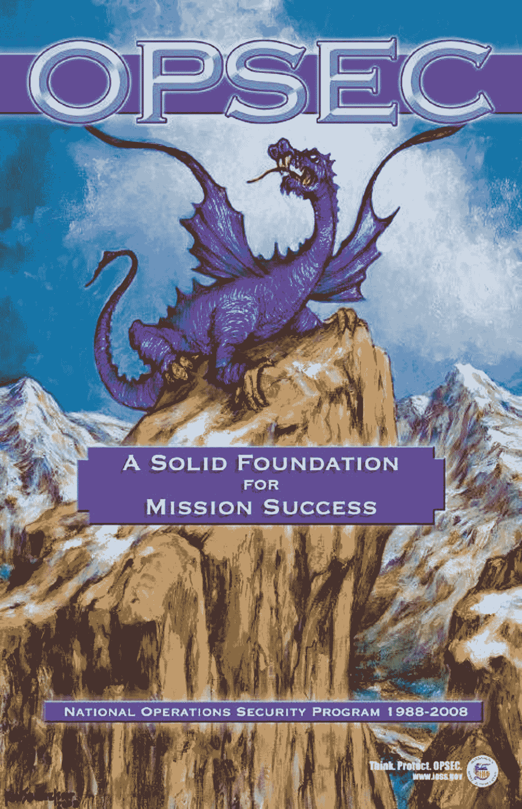

图 7.1 OPSEC 紫龙行动海报。

最终，这项研究带来了两个主要思想：首先，在那个特定的环境中，窃者和间谍无处不在；其次，需要进行调查来找出信息丢失的根源。调查提出了关于信息本身、脆弱性分析和其他项目的问题。执行这些调查和分析的团队还创造了 `operations security`（行动安全）术语及其缩写 `OPSEC`。此外，他们认为需要一个行动安全小组，作为一个机构来向政府内的不同组织推行行动安全原则，并与他们合作帮助建立这些原则，但这种情况直到很以后才发生。今天，对于部署在作战区域的单位，其单位及其家属都接受 `OPSEC` 培训和评估。

### 商业

在 20 世纪 70 年代后期和 80 年代初，用于军事和政府领域的一些 `OPSEC` 概念开始在商业世界生根。工业间谍和通过监视业务竞争对手来获得竞争优势的思想自古以来就有，但随着这些概念在军事世界变得日益完善，它们在商业世界也变得如此。1980 年，哈佛商学院的教授迈克尔·波特出版了一本名为《竞争战略：分析行业和竞争对手》（*Competitive Strategy: Techniques for Analyzing Industries and Competitors*）的书。这本书为所谓的竞争情报奠定了基础。竞争情报被定义为为了支持决策而进行的情报收集和分析。竞争情报的对应物是反情报，它与行动安全原则有非常直接的联系。我们可以在许多大型公司看到这些原则的应用。

### 跨机构支持小组

在越南战争结束后，执行 `Purple Dragon` 并开发 `OPSEC` 原则的团体试图为一个与各机构合作行动安全的小组争取支持。不幸的是，他们在引起各机构方面并不成功，未能获得美国国家安全局（`NSA`）的官方支持。幸运的是，通过美国能源部（`DOE`）和美国总务管理局（`GSA`）的努力，他们获得了足够的支持来推进。此时，起草了一份文件提交给当时的美国总统华盛顿。

这些努力由于华盛顿的竞选活动而推迟，但不久后，在 1988 年，跨机构行动安全支持小组（`IOSS`）根据《国家安全指令 298 号》成立 [\[4\]](#chp007.xhtml#bib4)。`IOSS` 负责各种 `OPSEC` 意识和培训工作，例如图 7.2 所示的海报。


图 7.2 OPSEC 紫龙海报。

## 行动安全流程

由美国政府概述的行动安全流程对于任何做过风险管理的人来说都会非常熟悉。从本质上说，该流程识别我们需要保护的信息，分析可能影响这些信息的威胁和脆弱性，并针对这些威胁和脆弱性制定缓解措施，如图 7.3 所示。

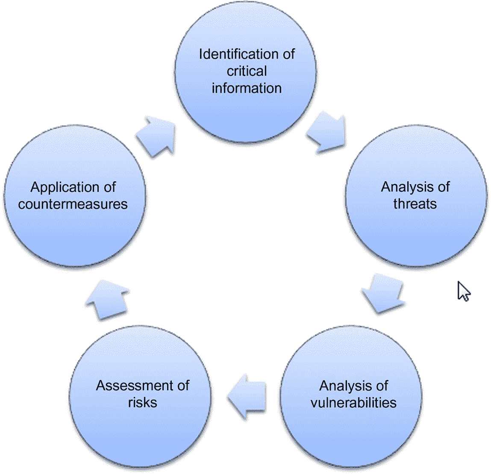

图 7.3 行动安全流程。

尽管该流程相对简单，但它非常有效并经过了时间的检验。

### 关键信息的识别

操作安全流程的第一步，且可以称是整个过程中最重要的一步，是识别出我们最关键的信息资产。尽管我们可以花费大量时间来识别每一项可能具有某种重要性的微小信息，但这并不是我们操作安全流程这一步的目标。对于任何给定的业务、个人、军事行动、流程或项目，都会有至少几项关键信息，其他所有事情都依赖于它们。对于一家软饮料公司来说，这可能是我们的`secret recipe`；对于应用程序供应商来说，这可能是我们的`source code`；对于一次军事行动来说，这可能是我们的`attack timetable`，以此此类推。这些是最需要保护的资产，一旦泄露将给我们造成最大的伤害，而这些正是我们应该识别的资产。

### 威胁分析

正如我们在第 1 章中讨论的那样，当我们涵盖威胁、漏洞和风险时，威胁是指某种可能对我们造成伤害的东西。在分析针对我们信息资产的威胁时，我们将从上一步识别出的关键信息开始。有了这些关键信息列表，我们就可以开始考虑关键信息暴露会导致哪些损害或财务影响，以及谁可能利用这种暴露。这是许多军事和政府组织用于信息分类并确定谁被允许查看信息的相同流程。


例如，如果我们是一家软件公司，并已确定我们某个主产品的专有`source code`为一项关键信息，那么我们可能会确定，此类暴露的主要威胁可能是暴露给攻击者和我们的竞争对手。如果`source code`泄露给攻击者，他们可能会确定我们用于为产品生成`license keys`的方案，以防止盗版，并利用对`source code`的访问权限开发一个可以生成合法密钥的工具，从而导致我们在软件盗版中损失收入。在竞争对手的情况下，他们可能会利用对我们`source code`的访问权限将其功能复制到他们自己的应用程序中，或者可能会复制我们应用程序的大部分并自行销售。

流程中的这一步需要对我们识别的每项关键信息重复，对每个可能在信息暴露后利用它的实体重复，并对他们可能对信息进行的每种用途重复。从逻辑上讲，识别的关键信息资产越多，这一步就变得越复杂。在某些情况下，我们可能会发现只有少数实体能够利用这些信息，且方式有限；而在某些情况下，我们可能会发现完全相反的情况。这种分析具有很强的情境性。

### 漏洞分析

正如我们在讨论威胁时一样，我们在第 1 章中也讨论了漏洞。漏洞是可能被用来伤害我们的削弱点。在分析我们为信息资产建立的保护措施中的漏洞时，我们将观察与这些资产交互的流程通常是如何进行的，以及我们可能从何处攻击以破坏它们。当我们研究威胁时，我们使用软件公司的`source code`作为一个关键信息的示例，如果该信息落入我们竞争对手手中，它可能会对我们造成伤害。

当我们观察漏洞时，可能会发现我们对所关注的`source code`采取的安全控制措施并不严格，并且在除了访问操作系统或网络共享所需的权限之外，就可以访问、复制、删除或更改它。这可能使已经攻破系统的攻击者能够复制、篡改或完全删除`source code`，也可能导致文件在系统维护期间易受到意外修改。我们还可能发现，没有实行的政策来规定`source code`的处理方式，即它应该存储在何处、其他系统或备份介质上是否应该存在副本，以及通常如何对其进行保护。在最坏的情况下，我们可能会发现发生了泄露，但没有基础设施或技能来确定实际损害有多大。这些问题结合在一起，可能会产生多个漏洞，可能导致我们安全性的严重泄露。

### 风险评估

风险评估是俗语说的“见真章”的时刻，它决定了在操作安全过程中我们真正需要关注的问题。正如我们在第 1 章中讨论的那样，只有当我们拥有匹配的威胁和漏洞时，风险才会发生。回到我们的软件`source code`示例，我们已经确定，我们的应用程序`source code`被未经授权的方式暴露存在一种威胁。此外，我们发现，对`source code`的访问和配置/版本管理控制薄弱也是一种威胁，并且缺乏关于具体如何控制它的政策。这两个匹配的问题可能会导致我们的关键信息泄露给竞争对手或攻击者。

必须再次强调的是，我们需要匹配的威胁和漏洞才能构成风险。如果我们的`source code`的机密性不是问题——例如，如果我们正在创建一个开源项目，且`source code`向公众免费——那么在这种特定情况下我们不会产生风险。同样，如果我们的`source code`受到非常严格的安全限制，以至于其以未经授权的方式发布几乎是不可能的，那么我们也只有极小的风险，但通常具有高昂的安全成本。速度、安全质量和成本必须始终保持平衡。

### 对策措施的应用

一旦我们发现了我们的关键信息可能存在哪些风险，我们就会采取措施来缓解它们。此类措施在操作安全中被称为对策措施。正如我们讨论过的，为了构成风险，我们需要一组匹配的威胁和漏洞。当我们针对特定风险制定对策措施时，为了达到最低要求，我们只需要缓解威胁或漏洞之一。在我们的`source code`示例案例中，威胁是我们的`source code`可能暴露给竞争对手或攻击者，而漏洞是我们为保护它所采取的薄弱安全控制。在这种情况下，在不完全改变我们的应用程序性质的情况下，我们无法做多来保护不受威胁本身，因此我们实际上没有好的步骤来缓解威胁。然而，我们可以采取措施来缓解漏洞。

在我们的`source code`示例案例中，由于对代码本身处理控制薄弱，我们拥有一个匹配威胁的漏洞。如果我们对代码的访问实施更严格的控制措施，并制定规定如何处理代码的政策，我们将在很大程度上消除这一漏洞。一旦我们打破了威胁/漏洞对，我们可能可能不再留下什么严重的风险。

需要注意的是，这是一个迭代过程；一旦我们到达风险评估周期的结束，我们很有可能需要多次循环该周期，以充分缓解任何问题。我们可能还需要对计划中的不同方面进行更细粒度的评估。每当我们执行一次该周期时，我们都会根据从之前的缓解工作中获得的知识和经验来操作，并能够调整解决方案以获得更高水平的安全性。此外，当我们的环境发生变化且新因素出现时，我们需要重新审视这一过程。

对于熟悉风险管理流程的人来说，在比较这两个流程时，我们可能会注意到业务安全方面缺少了一个步骤，即对我们防御措施的有效性进行评估。作者认为，这一点已经包含在业务安全流程中了。然而，该流程绝不是一成不变的，如果需要，完全没有理由不正式地包含这一步骤。事实上，我们可能会从中获得巨大的益处。

## 哈斯业务安全之法则

作为对业务安全流程的一个略有不同且更简短的观点，我们可以看看库尔特·哈斯（Kurt Haas）在纽约能源部（DOE）内华达运营办公室工作期间开发的业务安全（OPSEC）法则。这些法则代表了我们之前讨论的业务安全流程的精炼，虽然我们可能不认为它们是流程中最重要的部分，但它们确实突显了整个程序的一些核心概念。

### 第一法则

业务安全的第一条法则是：“如果你不知道威胁是什么，你如何知道要保护什么？” [[5]](#chp007.xhtml#bib5)。这条法则指的是需要对我们的关键数据可能面临的实际和潜在威胁建立意识。这条法则直接对应业务安全流程中的第二步。

归根结底，正如我们之前讨论的，我们可能会面临许多针对关键信息的威胁。每项信息都可能有一套独特的威胁，并可能存在多个威胁，每个威胁都来自不同的来源。特别是当我们看到云服务的激增时，理解威胁可能取决于位置也同样重要。我们可能列举了特定位置关键数据面临的所有威胁，但如果由于云存储机制，我们将数据复制到跨越多个国家的存储区域，那么威胁在不同的存储位置之间可能会有所不同。不同实体在某一特定区域可能拥有更好或更容易的潜在访问，或者法则在不同位置之间存在显著差异，并带来全新的威胁。

## 更高级的内容

云云计算是指托管在通常是互联网上的服务，旨在提供易于扩展的计算服务或资源。云服务通常使用以广泛分布式方式分布在许多设备上的硬件和网络基础设施，通常跨越地理边界。目前我们可以看到许多公司的云服务示例，包括谷歌、微软、IBM 和亚马逊等（仅列举几家）。云服务及其包含数据的安全性是目前信息安全领域的一个热门的话题，并且可能在未来一段时间内持续下去。取决于我们考虑在一个在很大程度上不受我们直接控制的环境中托管的数据和服务，其风险可能会是巨大的。

不仅理解威胁本身及其来源至关重要，理解特定情况下泄露所引发的后果也至关重要，这样我们就可以针对该特定事件制定非常具体的防御措施。

### 第二法则

“如果你不知道要保护什么，你又如何知道你正在保护它呢？” [[5]](#chp007.xhtml#bib5)。这条业务安全法则讨论了评估我们的信息资产并确定哪些究竟可以被视为关键信息的必要性。这第二条法则相当于业务安全流程的第一步。

在绝大多数政府环境中，信息的识别和分类是强制性的。每项信息（可能是一个文档或文件）都会分配一个标签，以证明其内容的敏感性，例如机密、绝密等。这种标记使得识别我们的关键信息的任务变得简单得多，但遗憾的是，在政府之外的使用频率并不高。在商业世界，我们可能会看到规定使用此类信息分类的政策，但根据作者的经验，这种标记通常只是零星实施，充其其量。少数民用行业，例如处理具有联邦保护要求的数据的行业（财务数据、医疗数据）确实利用信息分类，但这些是例外而非常态。

### 第三法则

业务安全的第三条也是最后一条法则是：“如果你不保护它（信息）……巨龙获胜！” [[5]](#chp007.xhtml#bib5)。这条法则是对业务安全流程必要性的总体陈述。如果我们不采取措施保护我们的信息免受巨龙（我们的对手或竞争对手），他们就默认胜利了。

“巨龙”获胜的案例——从新闻媒体不断报道的安全泄露事件，以及跟踪泄露事件的网站（如 [www.datalossdb.org](http://www.datalossdb.org)）来看，遗憾这似乎很常见。在许多情况下，我们可以检查一次泄露并发现，它是由于简单的疏忽以及未能遵守基本的安全措施和尽职调查而导致的。我们在加州斯坦福大学在 2013 年 6 月宣布的一次泄露中看到了这样一个例子。

在此案例中，大学暴露了包含卢西尔·帕坎德儿童医院（Lucile Packard Children’s Hospital）超过 12,000 名患者姓名、医疗记录号、年龄、电话和医疗程序信息 [[6]](#chp007.xhtml#bib6)。尽管我们可能假设群精明的黑客破解了大学严密的安全措施，并成功从大学网络上的受保护系统中窃取数据库副本，但遗憾的是事实并非。患者数据位于一台未加密的笔记本电脑上，该电脑随后被盗了。

在此类情况下，如果正确遵循业务安全流程，将很快指出此类关键数据集，使我们有更大的机会避免这种情况。防止像我们在杜兰大学（Tulane）案例中讨论的泄露所需的安全措施既复杂也不昂贵，通过实施所需的几个步骤，可以为我们节省大量的声誉和财务损失。

## 我们生活中的业务安全

尽管我们在本章中讨论了在商业和政府中使用业务安全流程，但它在我们的个人生活中也很有用。虽然我们可能没有有意识且正式地执行业务安全流程的所有步骤来保护个人数据，但我们仍然在使用我们讨论过的一些方法。

例如，如果我们要去度假几周，并在整个期间留下一栋空房子，我们在离开期间为了确保某种安全而采取的步骤通常与业务安全流程非常紧密贴合。我们可能会花几分钟时间思考指示房子无人且脆弱的迹象：

*   晚上不开灯
*   在 Facebook 上告诉所有人我们要走了
*   在度假期间在 Twitter 上发布我们正在做什么的内容
*   在我们通常在家的时候，家里没有传出声音
*   车道上堆满了报纸，或者报纸停运了
*   信箱里堆满了邮件
*   车道上没有车
*   没有人进进出出

我们可能还会采取措施，确保不会向那些可能威胁我们住所安全的人（即入室窃或破坏者）表现出这种显而易见的脆弱性。我们可能会为灯光设置定时器，让它们在全屋的各个时间开启和关闭。我们还可以在电视或收音机上设置定时器，以便产生与有人在家相符的噪音。为了解决邮件和报纸堆积的问题，我们可以在离开期间暂停它们的递送。为了营造出居住的假象，我们可能还会请朋友每隔几天来一次浇浇植物并检查情况，也许还时时让汽车进出车库。最后，我们需要关注小组中的每个人在社交媒体上发布了什么，并在旅行结束之前不要向不受限制或不可信任的群体透露我们正在做什么。

## 警告！

在社交网络工具时代，一种特定的个人操作安全违规行为正以不安的频率频繁发生。许多此类工具现在配备了位置感知功能，允许我们的电脑和便携设备在更新状态时报告我们的物理位置。此外，许多人喜欢添加他们要去吃午饭、外出度假等通知。在这两种情况下，我们都向公众（以及潜在的攻击者）留下了非常清晰的信号，告知我们何时可能不在家、何时可能出现在某个特定位置等。从操作安全的角度来看，这是不明明智的。

虽然这些步骤显然不是严格的条条框框的军事化性质（正如我们看到的政府实施的 `OPSEC` 那样），但其过程是相同的。由于威胁的显而易见性，我们大多数人在保护物理财产时都会遵循此类流程，但我们也需要注意在逻辑意义上保护自己。

在日常生活中，我们的个人信息会经过极其多样的计算机系统，并跨越大量的网络。虽然我们可能会采取措施（例如通过谨慎地在 `Internet` 上何地以及如何分享个人信息、在丢弃前粉碎含有敏感信息的邮件，以及其他类似措施）来确保缓解安全威胁，但遗憾的是，我们无法控制个人信息可能暴露的所有地方。

正如我们在本章之前提到的 `Stanford` 泄露案例所指出的，并不是所有人都会对我们的信息采取同样的谨慎态度。在这种情况下，如果我们提前为个人数据安全做了计划，我们至少可以在一定程度上缓解问题。我们可以建立监控服务来关注我们在信用报告机构的报告；在发生泄露时，我们可以向这些机构提交欺诈报告；我们可以非常仔细地监控我们的财务账户以及其他类似措施。虽然这些步骤可能并不复杂，执行起来也不非常困难，但在事件发生之前执行它们，比在问题发生后的混乱时期尝试执行它们要好得多。我们还需要检查所有账户的隐私设置。很多时候，我们可以减少将暴露的数据，或对其进行定制，以便所使用的信息能够改变是哪个账户被破解了。最后，我们需要制定关于组织哪些信息可以共享的政策。是否允许员工在工作时拍照并分享到网上？

## 现实世界中的操作安全

正如我们在整个章节中所讨论的那样，我们可以看到操作安全的概念在许多领域发挥作用。在政府，我们可以看到 `OPSEC` 作为一项指令被正式化使用。显然，当我们处理与进行战争和军事行动、强大的武器系统、政治博弈以及其他活动相关的信息时，保护此类信息项至关重要，如果我们未能做到，可能会导致许多生命的损失。

在商业世界，我们可能会看到相同的操作安全原则发挥作用，但在其实施方式上可能会看到巨大的差异。根据我们经营业务的行业以及我们处理的信息类型，我们可能会看到更多或少的操作安全关注。在某些情况下，例如当我们的业务处理医疗、财务或教育信息时，我们可能会受到监管或合同控制，要求我们采取某些保护措施。在这些实例，我们更有可能看到操作安全概念以某种程度的刚性得到应用。否则，企业可能会根据自己的需要选择应用此类想法。

在个人生活中，我们也可能选择应用操作安全原则，尽管通常是以更非正式的方式。虽然我们不一定有需要保护的核秘密或充满个人信息的数据库，但我们仍然有许多可能被视为关键信息的项目。我们需要保护我们的财务信息、关于身份的数据、个人记录或其他我们可能不希望公开的其他项目。在这些情况下，我们可能会跳过操作安全流程，简单地识别并找到保护个人信息的方法，但我们仍然遵循相同的通用步骤。

## 总结

操作安全的历史可以追溯到很久久以前。我们可以在公元前六世纪`孙子`的著作、`乔治·华盛顿`的话语、商业界的著作以及美国政府的正式方法论中找到此类主张。虽然操作安全的正式思想是较近期的产物，但它们所的基础原则确实古老，但仍然与它们开发的那一天一样有用。

操作安全过程由五个主要步骤组成。我们首先识别最关键的信息，以便我们知道需要保护什么。然后我们分析自己的状况，以确定我们可能面临的威胁，以及之后环境中存在哪些脆弱性。一旦我们知道了面临的威胁和脆弱性，我们就可以尝试确定我们面临的风险。实际存在的风险是匹配的威胁和脆弱性的结合。当我们知道面临着什么风险时，就可以计划可能采取的应对措施，以缓解我们的风险。

作为操作安全过程的简要总结，我们还可以参考 `Kurt Haas` 写的 `OPSEC` 法则：“如果你不知道威胁，你如何知道要保护什么？”“如果你不知道保护什么，你如何知道你正在保护它？”“如果你不保护它（信息），……巨龙赢了！”这三条法则涵盖了该过程的一些重点，并指出了我们可能想要内化的一些更重要的方面。

## 练习

1. 为什么识别我们的关键信息非常重要？
2. 操作安全（OPSEC）的第一法则是什么？
3. 信息运营源清单（IOSS）的功能是什么？
4. 乔治·华盛顿在操作安全的起源扮演了什么角色？
5. 在操作安全过程中，威胁评估和漏洞评估有什么区别？
6. 为什么我们可能想要使用信息分类？
7. 当我们完成整个操作安全流程后，我们就结束了玛？
8. 第一种正式的 OPSEC 方法源于何？
9. 操作安全的起源是什么？
10. 定义竞争性反情报。

## 参考文献

1. Tzu S, Griffith SB, Liddell Hart BH. *The art of war* Oxford University Press 1971; ISBN-13: 9780195014761.
2. 操作安全专业协会。OPSEC 的起源。Operations Security Professional’s Association, <[www.opsecprofessionals.org/origin.html](http://www.opsecprofessionals.org/origin.html)>; 2013 [访问 15.10.11]。
3. 美国中央情报局。乔治·华盛顿，1789–97，US Central Intelligence Agency, <https://www.cia.gov/library/center-for-the-study-of-intelligence/csi-publications/books-and-monographs/our-first-line-of-defense-presidential-reflections-on-us-intelligence/washington.html>; 2008 年 7 月 7 日 [访问 15.10.13]。
4. 白宫。国家安全决策指令第 298 号，白宫；1988。
5. Haas K. *Kurt’s Laws of OPSEC*. vol. II National Classification Management Society 1992; ISSN-0009-8434.
6. Zana E. 被盗笔记本电脑导致斯坦福发生第五起 HIPAA 违规，OMW Health Law, <http://omwhealthlaw.com/stanfordbreach5/>; 2013 年 6 月 26 日 [访问 17.10.13]。

***

# 第 8 章

## 人性安全


# 本章讨论了与信息安全人为因素相关的若干问题

## 关键词

安全意识；密码；社会工程；托词法；钓鱼；尾随；恶意软件；政策；法规；培训

## 节纲

* 引言
* 人：薄弱环节
* 安全意识
    * 保护数据
    * 密码
    * 社会工程
        * 托词法
        * 钓鱼
        * 尾随
    * 网络使用
    * 恶意软件
    * 个人设备
    * 整洁桌面
    * 政策和法规知识
* 安全意识和培训计划
    * 有效地触达用户
* 总结
* 练习
* 参考文献

## 本章内容

* 人：薄弱环节
* 安全意识
* 安全意识和培训计划

## 引言

所有信息安全中较困难的方面之一是为我们信息内部及周围的一些人员提供安全防护，包括我们的员工、承包商、合作伙伴、客户、服务提供商以及许多其他人。几乎无一例外，我们可以预期这些人会以意想不到或异常的方式行为，无论是出于无意、无知还是恶意。无论情况如何，为这一领域提供安全都是一项挑战。

## 人：薄弱环节

安全专业人员花费大量时间建立控制措施（行政、技术和物理）以阻挡外部、允许内部，并花费大量时间确保各种入侵检测、邮件过滤、防火墙以及许多其他设备恰当调节。遗憾的是，尽管意图良好，我们的用户仍然点击恶意链接、通过未保护的方法发送敏感信息、泄露密码、将安全信息写下来并贴在显眼位置、在社交媒体上透露敏感信息，以及许多此类行为。

更糟糕的是，在熟练对手的鼓励下，这些倾向会被转化为特定的攻击。一个极好的例子是 2011 年发生的 RSA 泄露事件。在该案例中，广泛使用的身份验证令牌敏感信息被盗，而进入公司的初始方法是社会工程攻击。

## 安全意识和培训计划

解决此类问题的方案，除了我们已经采取的技术措施外，就是稳健的安全意识和培训计划。我们必须让用户意识到他们通过行为承担的风险，并改变行为。

## 安全意识

正如我们之前讨论过的，在用户中建立适当的安全意识对于组织的持续安全至关重要。虽然我们与他们讨论的内容因组织或环境而异，但有一些核心项目在大多数工作中是标准的：保护数据、密码、社会工程、网络使用、恶意软件、个人设备的使用、整洁桌面以及政策知识。

在接下来的章节中，我们将查看这些领域的各个。

### 保护数据

无论我们在哪个行业经营，我们几乎总会有保护各种类型数据的需求。正如我们在第 6 章 中提到的，有许多法律法规监管数据，而遵守这些法规是经营成本之一。如果我们处理信用卡交易，我们需要考虑支付卡行业安全标准 (`PCI-DSS`)；处理医疗患者数据的机构需要考虑健康保险流通与责任法案 (`HIPAA`)；处理教育数据的机构需要考虑家庭教育权利与隐私法 (`FERPA`)，以及许多其他。

除了合规性要求外，保护数据对于一些较软性的理由也是明智的，例如声誉和客户留存。因为数据泄露而登上新闻可能会对公司造成极大损害，并可能导致客户迅速流向竞争对手。此外，不遵守某些法规可能会导致停罚、罚款，在某些情况下甚至导致监禁。

为了向用户充分传达数据安全的必要性，我们应该向他们提供定期的培训，定期涵盖我们工作中涉及的数据。用户需要理解从合规性、客户留存和声誉的角度来看，谨慎处理数据的至关重要。开展年度培训的公司发现，其留存率极低，行为改变微乎其微。关键在于每季度甚至每月进行让用户参与的培训。有些公司甚至将游戏化技术作为其计划的一部分。

### 密码

密码是一个我们可以在某种程度上容易实施技术控制的领域，以强迫用户妥善处理密码，但在另一个方面可能会完全失败。例如，在大多数操作系统和工具中，我们可以强制执行特定长度的密码强度：至少八个字符、至少一个大写字母、至少一个小写字母、至少一个符号、至少一个数字。这将产生一个类似于 `P@ssw0rd` 的密码。关键在于平衡密码复杂性与受保护内容重要性之间的关系。对于一个存储家庭照片的网站，八个字符可能足够，但对于银行账户则不建议。

此外，我们通常可以强制密码过期，并要求用户在一段时间后（例如 90 天）重置密码。此外，我们还可以规定新密码不能是之前使用的 10 个密码的变体，以防止用户进行诸如增加数字或更改字母的操作。这应该确保我们的密码不会被攻击者轻易猜中，尽管面对拥有足够资源访问权的坚定且熟练的攻击者，这些密码仍然立不住脚（很少东西能防得住）。

从安全意识的角度讨论这个问题时，强调强密码必要性的一种有效方法，是讨论如“password”等极简单密码与如 `P@ss\\/\\3rd` 等更复杂变体在暴力破解时间上的差异。此类信息的良好来源位于 `http://www.lockdown.co.uk/?pg=combi`。

我们遇到问题的地方是用户在设置好密码后实际上是如何处理这些密码或多个密码的。如果我们的理论用户采取了电影中的陈词滥调，他们会把密码写下来并贴在键盘下面。我们可能还会看到为了方便而让用户之间共享密码，根据宠物名称、生日或其他个人信息创建密码等。潜在的更有破坏性的用户行为之一是在系统或应用程序之间手动同步密码。

例如，我们可能会在工作场所的某个系统上强制使用强密码。试图让生活更简单的用户可能会手动将组织内的所有其他系统设置为同一个密码（包括他们的 `VPN` 凭据），然后回家对他们的网络论坛凭据、电子邮件、在线游戏密码等进行同样的操作。此时，该用户在各处都有一个强密码，生活变得简单许多了。太棒了！遗憾的是，对于该用户所在的组织来说，这并不妙。

继续我们的例子，一个在线论坛的密码数据库被破解并发布到互联网上，包含用户名（此处为电子邮件地址）和解密后的密码。此时，攻击者攻破了我们用户的网页邮箱，现在可以完全访问极多到令人不安的信息，包括用户通过电子邮件发送到其家庭地址的公司 `VPN` 连接指令。我们可以很快看出这可能会导致何种结果。

最终，在向用户传达密码安全信息时，要点是：他们即使在没有被强制要求的情况下也要使用强密码；他们需要妥善处理密码，不要将其遗留或记录在容易被泄露的地方；以及他们不应该在多个系统或应用程序中反复使用同一个密码。

### 社会工程

社会工程是一种依赖人们乐意帮助他人的技术，特别是当目标面对看起来处于困境的人、具有威慑力的人，或我们通常在特定情况下预期看到的人时。例如，如果有人试图未经授权进入某栋建筑，而该建筑通常需要近距离门卡，那么在没有卡的情况下，这可能成为社会工程面临的问题。我们可以首先通过研究地点来确定人员流动可能发生的时间。我们还应该观察进出建筑的人员，以了解合适的着装方式。我们可能会调查建筑的不同门，寻找一个没有安保守卫、缺乏旋转门等次要访问控制且最好没有摄像头的门。一旦穿戴得体，我们就会根据观察选择的时间进入建筑，并携带道具。在这种情况下，我们可能会选择一个大箱子，以便腾出手去拿（并不存在的）近距离门卡。在大多数情况下，除非我们的目标是安全性极高的设施，否则当我们跟在某人身后并显然提着包裹时，他们会为我们开门，而不会对我们的进入权限提任何问题。这就是社会工程，更具体地说是预判术。

#### 预判术

在预判术中，我们经常装成经理、客户、记者甚至是同事的家属。通过虚假身份，我们创建一个可信的场景，诱导目标向我们提供敏感信息或执行他们通常不会为陌生人的行为。

虽然我们可以在面对面或通过某些通信媒介使用预判术，但每种方式都有其挑战。直接面对面的交流需要对肢体语言高度关注，而间接交流（如电话或电子邮件）则要求我们更多地关注言语习惯。然而，这两种交流的成功都需要强大的沟通技巧、心理技巧、专业知识和敏捷的思维。

#### 钓鱼

钓鱼攻击是一种特定的社会工程技术，主要通过电子邮件、短信或电话等电子通信手段实施。大多数钓鱼攻击在本质上具有很广泛的性，涉及诱导潜在受害者点击电子邮件中的链接，从而将其重定向到旨在收集个人信息或凭据的虚假网站，或让受害者在其系统中安装恶意软件。基于 Web 的钓鱼攻击中使用的假网站通常是知名网站的副本，例如银行网站、`Facebook` 和 `eBay`。其中一些网站是设计粗劣的模仿品，在设计和标志上尝试着拙劣的模仿，且语法糟糕；而另一些则制作得非常精良，极难与它们所模仿的合法页面区分开来。

对于可能用于钓鱼、证书和其他类似攻击的额外方法，可以研究一下国际化域名（`IDN`）同形攻击。这种攻击曾经的危害比现在大得多，因为现在许多浏览器已经能够对此类问题发出警报。

大多数钓鱼攻击的问题在于，除非目标受害者实际上在伪造的网站上拥有账户，否则攻击将失败；没有 `MyBank` 银行账户的人不会被重定向到虚假 `MyBank` 银行网站的钓鱼攻击所说服。即使目标受害者拥有账户，人们也开始对来自银行或其他网站的未请求电子邮件保持警惕。通常情况下，钓鱼攻击并不依赖于收件者的仔细检查，而是依赖于在数十万或数百万次尝试中极小比例的成功率。为了获得更高的成功率，攻击者可能会转向鱼叉式钓鱼。

鱼叉式钓鱼是针对特定公司、组织或个人的针对性攻击。鱼叉式钓鱼攻击需要先进的侦察，以确保攻击媒介被认为是合法的，并将潜在受害者引导至一个受害者预期并认为可靠的虚假网站。此外，我们的电子邮件必须看起来来自有效的发送者——即受害者会信任的人，例如人力资源部门的人员、经理、公司 IT 支持团队、同事或朋友。

普通的钓鱼攻击可能很笨劣且结构糟糕，取决于极小比例的收件者无论如何都会；而鱼叉式钓鱼攻击完全相反。在鱼叉式钓鱼攻击中，攻击者将发送一封非常整洁的电子邮件，包含正确的标志、图形、签名块以及所有预期内容。语言在语法上是完全正确的，拼写也不是问题。如果存在链接，它们的伪装方式使其不会立即看起来具有恶意。攻击者甚至可以使用新窃取的凭据让受害者登录他们所模仿的真实网站，而不留下任何错误信息或损坏的会话来提示他们发生了异常。

#### 尾随

物理尾随，也称为“搭车”，是大多数人听到这个词时想到的内容。简单来说，这是在没有进入门所需的适当凭据、证书或钥匙的情况下，跟随某人通过控制点（如安全门）的行为。

尾随是使用技术访问控制场所常见的问题。在几乎任何地方，除非采取强力的预防措施，否则我们都能看到尾随现象。这部分是懒惰导致的，部分是出于礼貌的考虑。我们需要教育员工尾随的危险性以及如何防止它。

### 网络使用

网络使用，或者更准确地说，网络意识，是一个重要的讨论概念。人们将自己的设备连接到各种网络（例如在咖啡馆、酒店或机场）是常见现象。我们需要教育用户使用这些开放网络的风险以及如何保护他们的数据。

问题的另一面是在外部网络上使用公司资源，这是一个长期以来困扰着许多组织的问题，经常导致敏感数据泄露。如果我们在笔记本电脑上加载了敏感数据，然后接入当地咖啡馆或酒店的网络；我们极可能将这些数据与其他人所有人共享。解决此问题的方案是实施 `VPN` 以允许访问公司网络，并配置 `VPN` 客户端在设备发现处于异地网络时自动连接。此外，我们需要在用户中培养某种意识，关于他们将设备连接到哪些网络，以及他们需要如何处理这些设备包含的敏感数据。

### 恶意软件

恶意软件领域的教育很难传给用户，因为这方面的教育通常围绕着教他们不要盲目点击任何东西。这涉及在浏览网页、打开电子邮件附件、使用社交网络工具、使用智能手机以及许多其他类似活动时的谨慎。由于缺乏坏情况的详尽清单，这可能很困难，但我们可以指出一些常见的项目：

* 来自你不认识的人的电子邮件附件
* 包含特定文件类型（`exe`、`zip`、`pdf`）的电子邮件附件
* 使用短 URL 的 Web 链接
* 来自非官方下载网站的手机应用程序
* 盗版软件

总而言，我们希望在用户中培养一种“健康的警惕意识”，让他们默认的操作不再是立即点击某些内容，而是先联系我们的帮助台或安全团队进行咨询。是的，这确实意味着这些团队会有额外的工作量，但这比其他替代方案要好。

虽然短链接并不意味着一定专门指向恶意内容，但在我们看到另一端的具体内容之前，假设它是恶意的并且不使用浏览器跳转过去，无疑是明智的。不过，我们可以使用如 [`www.urlunshortener.com`](http://www.urlunshortener.com) 或 [`unshort.me`](http://unshort.me) 等工具来检查此类服务的目的地。这两款工具（以及许多其他工具）为信息安全人员甚至终端用户提供了一种安全的方法来发现这些信息，并减少在此过程中接收意外软件的概率。

### 个人设备

在工作场所使用个人设备是否允许，不同工作环境之间存在差异，但通常有一些共同点。为了维持合理的安全水平，接受使用个人设备的典型阈值位于组织网络的边界。也就是说，将个人笔记本电脑带到公司并将其与生产系统处于同一网络中通常是不可接受的，但将其连接到访客无线网络可能是可以的。公司政策应当规定如何处理此类情况。

虽然大多数用户都理解以此方式处理个人设备的原因（主要是出于恶意软件和知识产权问题），但要传达这些策略同样适用于其他非公司拥有的设备（如具有网络功能的厂商笔记本或 MP3 播放器），可能需要更多的沟通工作。

### 整洁桌面

整洁桌面政策在处理任何类型的受监管或敏感数据的环境中非常常见。此类政策通常规定，当敏感信息无人看管较长时间（例如下班或吃午饭）时，不得将其留在桌面上。我们试图向用户传达的最终信息是：即使数据不是电子形式，也需要被妥善处理。

这通常会随后讨论如何处理处于物理介质（如纸张或磁带）上的敏感数据，以确保操作得当，例如使用碎纸机箱、数据销毁服务、介质粉碎机等。

### 政策与法规知识

最后，但同样重要的是，如果我们希望用户遵守我们列出的规则、我们必须遵守的法规以及我们作为组织可能被迫遵守的其他项目，我们需要努力传达这些政策。虽然通过群邮件发送策略链接并让用户确认已读非常容易，但如果实际目标是实现某种程度的教育，这种策略不太可能非常成功。

可能有一组相对较小的政策和法规包含了我们认为向用户传达时最关键的信息。这些信息中的一部分应该被精简，并直接传达给用户，作为政策要点笔记或亮点集锦。

## 安全意识与培训计划

我们在本章中讨论的许多想法都汇聚了一个共同目标，即改变我们环境中用户的行为，使其向更安全的方向发展。为了向用户传达我们想要的信息，我们最经常会使用安全意识与培训计划作为载体。

此类计划通常由讲师引导或基于计算机的培训组成，通常在新员工入职过程中和某些定期期间进行，并通常由参加培训的人员进行强制测验或理解力确认。这些机制通常既作为参与者展示至少某种知识水平的“关口”，也是公司跟踪并确保员工完成培训要求的“尽职调查”形式。

### 有效地触达用户

尽管向全公司发送群邮件，要求他们在每隔一段时间的 `Y` 日期前完成 `X` 计算机的培训（CBT），确实涵盖了“为用户提供定期安全意识培训”的勾选框，但这可能不是引导用户行为向所需方向移动的最有效途径。每年一次的 CBT 培训或在会议室里的“PPT 死亡演示”可能会导致参与者感到无聊、培训师感到沮丧，并且在提高整体安全态势的积极方向上不会产生太大影响。如果目标是真正让用户在遇到钓鱼邮件或面对面社会工程师时能做出更好的决定，那么我们需要让培训向着更具趣味性且能产生积极结果的方向发展。

在增加趣味性方面，我们可以关注过去几年用于培训和教育用户的“游戏化”趋势。这并不一定意味着要使用视频游戏进行培训（尽管这种工具确实存在），但可以在我们的工作中加入某些游戏元素。例如，如果我们分配了一个小时为新入员工进行安全意识培训，可以将讲座部分缩短至 `30 min`，剩下的后半部分时间对刚刚涵盖的内容进行互动问答游戏。一旦我们加入了竞争元素（将学生分组）和激励元素（为胜者提供奖品），我们就为想要传达的信息创造了一个更有趣的环境。

我们还可以通过安全海报、赠品（如笔、咖啡杯等）、简报以及大量类似的设备来获取用户的注意力。最终，这些其他意识途径具体是什么并不重要，而是有不同的方法来传达相同的信息。如果我们能够在用户的一天中通过反复和多样化的途径引起他们的注意，那么我们更有机会让这些信息长期深入人心。

## 总结

在本章中，我们讨论了与信息安全人性要素相关的多个问题，以及为什么组织的人员构成了无法通过技术控制手段直接解决的安全挑战。我们涵盖了可能与用户讨论的项目，包括数据保护、密码、社会工程、网络使用、恶意软件、公司网络上的个人设备使用、清洁桌面政策以及政策与法规知识。我们还讨论了可以做什么来改进我们的安全意识与培训计划，以及可以采取哪些步骤让这些信息影响用户行为。

## 练习

1. 为什么人类被认为是弱环节？
2. 定义“尾随”。为什么这是一个问题？
3. 为了在安全意识培训中更有效地触达用户，我们需要做什么？
4. 为什么我们可能不想允许个人设备连接到组织的网络？
5. 你如何培训用户识别钓鱼邮件攻击？
6. 为什么对所有账户使用相同的密码是非常不重要的？
7. 什么是预设？它可能如何被使用？
8. 为什么在酒店使用公司电脑连接无线网络可能是危险的？
9. 为什么点击来自 `bit.ly` 等服务的短链接可能是危险的？
10. 为什么使用强密码很重要？

## 参考文献

1. Zetter K. 黑客间谍袭击安全公司 RSA。Wired.com [在线] 2011 年 3 月 17 日 [引用: 2013 年 12 月 26 日]。 <`www.wired.com/threatlevel/2011/03/rsa-hacked/`>。
2. Gabrilovich E. 同形字母攻击。cs.technion.ac.il [在线] 2006 年 7 月 28 日 [引用: 2013 年 12 月 26 日]。 <`http://www.cs.technion.ac.il/~gabr/papers/homograph.html`>。

# 第 9 章：物理安全


# 物理安全

在本章中，我们将讨论物理安全。我们将介绍物理安全控制的主要类别，包括威慑措施、检测措施和预防措施，并讨论如何实施这些措施来减轻物理安全问题。我们将论述物理安全中最首要的问题——确保我们的人员的安全，并讨论在采取适当预防措施的情况下，数据和设备通常是可以替换的，但人是非常难以替换的。我们还涵盖了数据保护（其重要性仅次于保护人员），以及在我们基于技术的业务世界中，这是一项至关重要的活动。最后，我们将讨论我们设施内外的设备设备。

## 关键词

访问控制；管理控制；备份；数据；检测；环境；设备；预防；残留数据；安全；选址；威胁

## 章节大纲

* 引言
* 警示！
* 其他资源
* 物理安全控制
    * 威慑
    * 检测
    * 预防
    * 我们如何使用物理控制
* 保护人员
    * 人员的物理考量
    * 安全
    * 疏散
        * 哪里
        * 如何做
        * 谁
        * 练习
* 管理控制
* 保护数据
    * 数据的物理考量
    * 可用性
    * 残留数据
    * 备份
* 更高级的
    * 保护设备
        * 设备的物理考量
        * 注意
        * 选址
        * 安全访问
        * 环境条件
* 现实世界中的物理安全
* 总结
* 练习
* 参考文献

## 本章内容

* 物理安全控制
* 保护人员
* 保护数据
* 保护设备

## 引言

物理安全主要涉及三类核心资产的保护：人员、设备和数据。当然，我们首要的问题是保护人员。人比设备或数据难以替换得多，特别是当他们在特定领域拥有经验，并熟悉自己执行的流程和任务时。

保护优先级仅次于人员的是数据。如果我们提前做了充分的计划和准备，我们应该能够轻松地保护数据免受任何全球性灾害的影响。如果我们不对这类问题做好准备，我们很容易永久丢失数据。

## 警示！

虽然我们在本章中将人员、数据和设备的保护作为独立的概念进行讨论，但它们实际上是紧密结合的。我们通常无法、也不应该制定独立于其他类别来保护其中任何一类对象的安全计划。

最后，我们保护设备以及安置这些设备的设施。这似乎是一组非常重要的对象，在规划物理安全措施时，我们可能希望对其分配更高的优先级。然而，在大多数情况下并非如此，大多数情况实际上都是围绕着人的安全展开的。在技术世界中，我们使用的许多硬件都是相对通用且容易替换的。

威慑控制旨在震慑那些试图违反我们安全控制措施的人，无论威胁是来自外部还是内部。多种控制措施都可能被视为威慑，包括正如我们在本节早些时候讨论的那样，其中某些措施与其他类别有重叠。从纯粹的检测控制角度来看，我们可以指出特定的项目，其目的是指示其他控制措施可能到位。

示例包括公共场所指示此处有视频监控的标牌，以及我们在住宅区可能会看到的带有警报公司标志的庭院告示。标牌本身并防止人们采取不当行为，但它们指出了这样做可能会导致后果。此类措施虽然没有直接增加我们所认为的物理安全，但确实有助于让诚实的人有所顾忌。

接下来是政策和法规。违反政策可能导致雇员受到纪律处分或解雇。违反法规或法律可能导致刑事或民事起诉。

我们可能还会看到其他类别的安全措施兼具威慑作用。如果我们部署了对于可能想要违反我们安全措施的人可见的明显安全措施，例如保镖、警犬、照明良好的区域、围栏和其他类似措施，潜在的犯罪分子可能会认为我们是一个过于困难的目标，不值得尝试。

### 检测

检测控制的作用是检测和报告正在发生的不良事件。检测控制的经典示例可以在防盗报警器和物理入侵检测系统中找到。此类系统通常监控未经授权活动的指示信号，例如门窗开启、玻璃破碎、移动和温度变化，同时也可能被用于监控不理想的环境状况，如洪水、烟雾和火灾、断电，以及空气中二氧化碳浓度过高。

我们可能还会看到以人类或动物守卫（即 `dogs`）形式存在的检测系统，无论它们是在物理上巡逻区域，还是通过摄像头系统等技术进行间接监控。这种监控既有优点也有缺点，因为生物在技术上可能没有电子系统那么专注，但确实有分心的可能，并且需要为了用餐、如厕休息和其他类似的活动进行轮换。此外，我们可以根据情况需要，将此类守卫的规模从最低级的无武装安保人员扩大到经过高度训练且装备精良的安全部队。最后，维持 24/7 安保人员的成本非常昂贵。正如大多数涉及安全的实施方案一样，深度防御原则（正如我们在 `Chapter 1` 中讨论过的）适用于此处。

### 预防

预防控制用于从物理上防止未经授权的实体突破我们的物理安全。预防安全的绝佳例子是简单的机械锁。锁几乎无处不在，用于保护各种设施免受未经授权的进入，包括商业、住宅和其他。

除了锁，我们还可以看到以高围栏、护柱（为了防止车辆驶入建筑而放置的涂有鲜艳颜色并填充混凝土的柱子）以及再次巡逻的保镖和警犬形式存在的预防控制。根据涉及的环境，我们还可能看到专门针对人员、车辆或其他特定关注区域的预防控制。

### 我们如何使用物理访问控制

预防控制通常是我们安全工作的核心，在某些情况下，它们可能是唯一的努力方向，也是实际部署的唯一物理安全控制措施。我们通常可以在住宅中看到这一点，那里门上装有锁，但没有报警系统或任何可能威慑犯罪分子获得未经授权进入的措施。

在商业设施中，我们更有可能看到所有类型的控制措施的实施，形式为锁、报警系统以及指示报警系统存在的标牌。遵循深度防御原则，我们为物理安全设置的层次越多，整体安全态势就越好。

实施物理安全的另一个重要考虑因素是，只部署与我们正在保护的对象价值相合理的安全措施。如果我们有一个空仓库，那么安装高安全性锁、报警系统和武装保镖是没有意义的。同样，如果我们拥有一间装满了昂贵电脑和电子产品的房子，配备廉价的锁并完全放弃报警系统是没有意义的。物理安全需要我们在之前的网络章节中使用的风险管理分析。

## 保护人员

物理安全的首要关注点是保护我们业务依赖的人员以及亲近的人。虽然我们部署了安全措施和备份系统以确保我们的设施、设备和数据保持功能状态，但如果我们失去了依赖他们来操作设备和数据的人，我们将面临一个相当棘手的问题。在许多情况下，我们可以从备份中恢复数据，如果设施被毁或损坏，我们可以建立新设施，并且我们可以购买新设备；但在任何合理的时间范围内，除了正常人员流失的一两个之外，要替换经验丰富的人是非常困难的，甚至是不可能的。

### 人员的物理关注点

由于人与设备相比相当脆弱，他们很容易受到在本章开头讨论的几乎整个范围威胁的影响。极端温度，甚至不是那么极端的温度，也能很快让人感到非常不适，充其量而已。

在液体、气体或毒素的情况下，各种物质的缺失、存在或比例错误都会对个人产生危害。我们可以非常清楚地看到，水等液体过量可能会成为不理想的因素，正如我们在 2012 年三星飓风期间美国南部发生的巨大洪水中所看到的。同样，氧气等气体的缺乏或过多都可能很快对人致命。尽管我们可以很清楚地看到毒素引入环境的危害从何而来，但许多常见物质可能已经存在，但在通常使用的浓度或混合物中并不产生毒性。我们可能认为某些化学品在过滤设施水质时是有益的，但如果化学配比或混合物发生变化，情况可能就不一样了。

任何种类的生物都可能对人产生危险，从大动物到虫子，再到肉眼几乎看不见的霉菌、真菌或其他微生物。人们可能以多种方式受到生物的侵害，从被各种昆虫咬或叮伤，到吸入霉菌引起呼吸问题。

当然，能量异常对人类来说是非常危险的。我们可能会发现设备维护不当导致屏蔽或绝缘失效，或者存在机械和或电气故障，这些故障可能导致人员暴露在微波、电力、无线电、红外线、辐射或其他有害排放中。此类暴露的结果可能是立即而易见的（例如触电的情况下），也可能是非常长期的（例如暴露在辐射中）。

当然，人本身就是对他人最严重的威胁之一。当我们规划自身安全时，他人给我们制造麻烦的方式是无穷尽的。在世界某些地区，我们可能会遇到社会动荡的现实风险。我们可能会遇到社会工程攻击，其目的是从我们的员工处获取信息，或通过他们获得对设施或数据的非法访问。我们的人可能在黑暗的停车场遭到身体攻击，或遭受其他类似的遭遇。我们还可以将投射物归入此类，因为伤害人体的投射物往往是应他人指示发射的。

烟雾和火灾对人类来说也非常危险，涉及灼伤、吸入烟雾、温度问题和其他类似问题。特别是对于大型设施，烟雾和火灾会导致区域的物理布局变得非常混乱或无法通行，使我们的人员很难找到通往安全的路径。我们可能还会看到物资、基础设施或建筑本身产生不利反应而导致问题恶化，例如释放毒素、坍塌或产生我们在本节中讨论的威胁。

### 安全

正如我们在章节开头提到的，当我们规划物理安全时，人员安全是我们列表首位且首要考虑的问题。人员安全高于任何其他考虑，即使这些行动会直接导致设备或数据的损坏，也必须优先考虑于保护这些物品。

我们可能会在某些数据中心使用的灭火系统中发现这种例子。在许多情况下，用于此类环境灭火的化学品、气体或液体对人体非常有害，在某些情况下如果在这种环境中使用它们可能会导致人员死亡，卤系灭火系统就是此类情况的一个例子。因此，灭火系统通常配备有安全覆盖控制功能，如果区域内有人，可以防止其部署。如果我们因为知道某人在数据中心内而阻止灭火系统灭火，我们可能会失去数据中心所有的设备，以及可能无法恢复的数据。在涉及人生命安全的情况下，这仍然是正确的选择。

同样，如果我们处于一个发生紧急情况的设施中，我们的优先任务应该是疏散设施，而不是设备的安全。

### 疏散

疏散是我们用来保护人员安全的最佳方法之一。在几乎任何危险情况下，离开危险源进行有序疏散都是我们能做的最好的事情。在规划疏散时，需要考虑几个主要原则：去哪里、如何去以及谁。

#### 哪里

我们要疏散到哪里是一个需要提前考虑的重要信息，无论我们是疏散商业建筑还是住宅。我们需要让每个人到达一个集合点，以确保他们处于安全距离，并且我们能统计每个人的人数。如果我们不以有序且一致的方式这样做，可能会导致各种问题。在商业建筑中，疏散集合点通常用标志标记，并标注在疏散地图上。

#### 如何

同样重要的是我们到达疏散集合点所遵循的路线。在规划此类路线时，我们应该考虑从给定区域到达最近出口路径，以及在紧急情况下某些路线无法通行时的备用路线。我们应该避免使用在紧急情况下危险或不可用的区域，例如电梯或可能被自动关闭的防火门封锁的区域。

#### 谁

疏散最重要的部分当然是我们确实让所有人离开了建筑，并且我们能在疏散集合点统计每个人的人数。这个过程通常需要至少两个人负责任何一组人员：一个人确保他或她负责的所有人都已离开建筑，另一人在集合点确保每个人都安全到达。

## 练习

特别是在大型设施中，全员疏散可能是一个复杂的任务。在真正的紧急情况下，如果我们不迅速、正确地进行疏散，可能会导致大量生命损失。作为对这一点不幸的证明，我们可以参考 2001 年美国世界贸易中心遭袭击的案例，如图 9.3 所示。

![图 9.3 2001 年 9 月 11 日的世界贸易中心北塔[1]。](Images/F000099f09-03-9780128007440.jpg)

图 9.3 2001 年 9 月 11 日的世界贸易中心北塔 [[1]](#chp009.xhtml#bib1)。

2008 年进行的一项研究确定，当警报声响起时，建筑内只有 8.6%的人实际上执行了疏散。其他人留在了建筑内，收拾物品、关闭电脑并执行其他此类任务 [2]。我们培训人员进行安全疏散，并在疏散信号发出后迅速正确地做出反应是至关重要的。

### 行政控制

除了我们采取的物理措施外，我们可能（也可能）还会实施各种行政控制措施来保护人员。行政控制通常基于各种规则。具体来说，它们可能是政策、程序、指南、法规、法律或类似的条文，并可能在从非正式公司政策到联邦法律的任何级别实施。

公司实施了几种常见的做法，专门为了保护我们的人以及整体利益。最常见的一种是背景调查。当个人在招聘流程进展到足够远，看起来可能被录用时，招聘公司通常会进行背景调查。全球许多公司开展此类背景调查，包括 `AccuScreen` 和 `LexisNexis`。此类调查通常涉及犯罪记录检查、之前的工作核实、教育背景验证、信用检查、药物检测以及取决于所申请职位的其他项目。

我们可能对在职人员进行各种定期的检查。一个较常见且广为人知的例子可以在某些雇主进行的毒品检测试中看到。我们可能看到在入职时讨论过的任何检查以类似的方式重复。此类检查是否发生通常取决于特定的雇主，某些雇主可能完全不进行。

我们可能看到类似类型检查的其他领域是人员被解雇时，或者当他或她自愿离职时。在这里，我们可能会看到离职面试，这是一个确保员工归还了所有公司财产并撤销了对系统或区域的所有访问权限的过程。我们可能还会要求个人签署文件，同意不对公司提起诉讼、签署额外的保密协议 (`NDA`) 以及其他协议，这些根据职位以及当地或联邦法律而异。

## 保护数据

仅次于人员安全之外，数据安全是我们的重点。正如我们在第 5 章中讨论过的，我们保护数据的主要手段之一是使用加密。虽然这是一个相当可靠的解决方案，但某些攻击可能会使其失效，例如破解加密算法本身的攻击，或通过其他手段获取加密密钥的攻击。遵循我们在第 1 章中介绍的深度防御概念，我们需要确保的另一层安全是物理要素。如果我们能确保我们的物理存储介质在物理上免受攻击者、不利的环境条件或其他可能损害它们的威胁的侵害，我们就能让自己置于一个更加稳固的安全基石之上。

### 数据的物理考量

取决于存储我们数据的物理介质的类型，许多不利的物理条件都可能对其完整性产生问题或危害。此类介质通常对温度、湿度、磁场、电力、冲击等非常敏感，每种介质都有其特定的优缺点。

磁介质（无论是指硬盘、磁带、软盘还是其他介质）通常涉及用于记录数据的各种运动部件和磁敏感材料。磁敏感性和运动部件的结合往往使得此类存储介质在某种程度上变得脆弱。在大多数情况下，强磁场会破坏存储在磁介质上的数据完整性，而金属外壳之外的介质（如磁带）对这种干扰更为敏感。此外，在这些介质运行期间（通常是在进行读取或写入时）对其进行剧烈震动可能会产生各种不良影响，往往会导致介质无法使用。

闪存介质（指的一大类在非易失性内存芯片上存储数据的介质）在本质上实际上是相当耐用的。如果我们能避免可能直接压碎存储数据芯片的冲击，并且不让它们暴露在电击下，它们通常能够承受许多其他类型介质无法承受的条件。它们对于低于实际破坏外壳的温度范围并不敏感，并且在事后正确干燥的情况下通常可以在短暂浸入液体后幸存。某些闪存盘专门设计为能够在通常会摧毁此类介质的极端条件下生存，以应对那些认为此类条件是潜在问题的用户。

光介质（如 CD 和 DVD）相当脆弱，任何有小孩或宠物的人都能深有体会。介质表面即使是微小的划痕也可能使其无法使用。它对温度也非常敏感，因为很大程度上是由塑料和薄金属箔制成的。在受保护的环境（如专门建造的介质存储库）之外，任何威胁都可能破坏此类介质上的数据。

在长时间处理存储介质时，另一个可能引起关注的额外因素是技术过时。存储介质的类型、软件、接口和其他因素都会影响我们读取存储数据的能力。例如，索尼在 2011 年 3 月停止了软盘的生产，在此之前，它负责了此类介质剩余产量的 70% [[3]](#chp009.xhtml#bib3)。尽管软盘直到现在才完全从使用领域中消失，但极少有新电脑配备了读取它们的驱动器。在短短几年内，寻找能够读取这些磁盘的硬件将变得非常困难。

### 可用性

当我们讨论保护数据时，我们较大的关注点之一是确保在我们需要访问数据时数据是可用的。我们数据的可用性通常取决于我们的设备和设施是否保持在工作状态（正如我们之前讨论过的），以及存储我们数据的介质是否完好。我们之前讨论的任何物理考量都可能导致我们的数据无法访问，即无法从存储数据的介质上读取这些数据。

虽然我们在这里专门讨论数据访问，并且我们之前谈到了访问某些类型介质时遇到的一些潜在硬件问题，但在讨论可用性时，还有一个相当重大的设备和基础设施部分需要考虑。我们不仅可能从介质上读取数据时遇到问题，还可能在到达存储数据的地方时遇到问题。如果我们经历了停机，无论停机与网络、电源、计算机系统或其他组件有关，只要发生在我们所在地与远程数据位置之间的任何一点，我们可能都无法远程访问我们的数据。如今许多企业在全球范围内运营，失去远程访问数据的能力（即使是暂时的）可能会是一个相当严重的问题。

### 残留数据

当我们考虑保持数据安全时，我们不仅需要在需要访问时让数据可用，还必须在数据不再需要时能够使数据无法访问。在某些情况下，这种需求是显而易见的；例如，我们可能不会忽略在丢弃一叠包含敏感数据的纸张之前将其粉碎的需求。但存储在电子介质上的数据可能对每个可能处理或处置它的人来说并不那么清晰。

在许多情况下，我们可以在多种与计算相关的设备中找到存储的数据，如计算机、磁盘阵列、便携式媒体设备、闪存盘、备份磁带、CD 或 DVD 介质以及类似物品。我们希望懂电脑的人能意识到介质或设备可能包含某些敏感数据，并且应该在处置之前擦除数据。遗憾的是，情况并不总是如此。

在 21 世纪初，人们对从不同来源购买的 150 多块二手硬盘进行了研究，其中大部分是从 eBay 购买的。当分析磁盘内容时，发现其中许多磁盘仍然包含数据，包括医疗数据、色情信息、电子邮件，以及几块磁盘似乎被用于存储包含 6500 多个信用卡号的财务数据 [[4]](#chp009.xhtml#bib4)。在许多情况下，人们并没有尝试从磁盘中擦除数据。

除了明显包含存储并可能持有潜在敏感数据的设备外，我们可能在其他各种地方找到存储的数据。尽管它们看起来并不直接是计算设备，但各种办公设备（如复印机、打印机和传真机）可能包含易失或非易失的内部存储，通常以硬盘的形式存在。在这些存储介质上，我们经常可以找到驱动器处理过的文档副本，包括敏感的业务数据。当此类设备退役或送去维修时，我们可能并不总是会想到移除存储介质上的数据，因此我们可能会暴露本不希望公开的数据。

## 进阶内容


# RAID

RAID，通常冗余地称为 RAID 数组，于 20 世纪 80 年代后期在加州大学伯克利分校开发 [[5]](#chp009.xhtml#bib5)。配置 RAID 有多种方法，但最终目标是将数据复制到多个存储设备中，以防止任何一个设备的丢失导致其存储的数据损坏。描述基本概念的原始 RAID 论文《廉价磁盘冗余阵列》（A case for redundant arrays of inexpensive disks (RAID)）可以在计算机协会（ACM）数字图书馆中阅读。

# 保护设备

在我们物理安全考虑的最后（尽管仍然非常重要且重大），是保护我们的设备，并在某种程度上保护安置设备的设施。这一类别排在最后，是因为它代表了我们资产中最容易替换且最便宜的部分。即使在发生完全破坏我们设施及内部所有计算设备的重大灾难时，只要我们还有运行业务所需的人员，并能够恢复或访问关键数据，我们就能很快恢复正常。更换地面空间或搬到附近的另一个区域通常可以相对容易完成，而且计算设备既便宜又充足。虽然我们可能需要一些时间才能回到事故前的状态，但从技术角度来说，达到最低的工作状态通常是一项简单、尽管艰巨的任务。

## 设备的物理问题

可能伤害我们设备的物理威胁虽然比我们认为对人体有害的威胁少，但仍然无处不在。

极端温度对设备非常有害。我们通常认为热量对计算设备的危害最大，这在很大程度上是正确的。在包含大量计算机和相关设备的环境中（例如数据中心），我们依靠环境调节设备将温度保持在合理水平，通常在华氏温度的 60 度度高温到 70 摄中旬之间，尽管对这一主题存在一些争议 [[6]](#chp009.xhtml#bib6)。

液体对设备非常有害，即使是像潮湿空气中那种微量的液体。取决于所涉及的液体及其存在量，我们可能会发现各种设备出现腐蚀、电气设备出现短路以及或其他有害影响。显然，在极端情况下（如我们可能遇到的洪灾），此类设备在浸没后通常会变得完全无法使用。

生物也可能对设备有害，但在我们通常关注的环境中，这些通常是较小的一种。进入我们设备的昆虫和小型动物可能会导致电气短路、干扰冷却风扇、咬坏电线，并通常制造破坏。

## Note

`bug` 一词用于指示计算机系统问题起源于 1947 年 9 月。在这种情况下，一个正在测试的系统发现有一只蛾子短路了两个连接并导致系统故障。当蛾子被移除后，该系统被描述为经过了调试（debugged）[[7]](#chp009.xhtml#bib7)，而实际的“bug”可以在图 9.4 中看到。

![图 9.4 第 bug [8].](Images/F000099f09-04-9780128007440.jpg)

图 9.4 第 bug [[8]](#chp009.xhtml#bib8)。

土壤和我们设施结构的变动对我们的设备可能是非常糟糕的。我们可以观察的最明显的例子之一是地震。地震不仅给我们的设施造成结构性损坏，由此产生的摇晃、震动以及由于结构失效导致的冲击还可能造成巨大损害。

能量异常会以各种方式对任何类型的电气设备产生极大的危害。如果我们看到电源缺失或临时未发送预期电压的问题，我们的设备可能会因此遭受无法修复的损坏。良好的设施设计将提供针对此类威胁的某些保护，但我们通常无法完全减轻严重电气问题（如雷击）的影响。

烟雾和火对我们的设备非常不利，因为它们引入了许多有害状况。有了烟雾或火，我们可能会遇到极端温度、电气问题、移动、液体以及各种其他问题。灭火的努力取决于所使用的方法，也可能造成与火本身同样的伤害。

## 选址

当我们规划新设施或选择新的迁入地时，应该意识到设施将所在的区域。许多因素可能我们在保护设备方面带来问题，并可能影响我们人员和数据的安全。如果选址位于易发生洪水、风暴、龙卷风、泥石流或类似自然灾害地区，我们可能会发现设施在某个时刻完全无法使用或被毁。

类似的问题可能包括潜在的动荡、电力或公用事业不稳定、网络连接差以及极端温度条件的地区。通过适当的设施设计，我们可能很轻松地补偿某些问题，例如通过安装电源滤波器和发电机来补偿电力问题，但其他问题（如当地温度），我们最终可能无法在大范围内予以缓解。

尽管潜在的选址问题可能不会完全排除我们使用设施，但我们应该意识到它们可能会给我们带来问题，并为此类发生做好计划。对于某些类型的设施（例如数据中心），对我们来说，选择一个尽可能无问题的环境可能非常重要，在出现此类问题时，我们可能想寻找其他地方。

## 确保访问安全

当我们讨论确保设备或设施的访问安全时，我们再次回到了“深度防御”的概念。根据环境，在内部和外部有多个区域我们可能想要放置各种安全措施。军事设施可能拥有最高级别的安全防护，而小型零售店可能只有最低水平。

我们经常可以看到在各种设施所在的物业周边界实施的保护物理访问的措施。通常，我们至少会看到一些基本措施以确保车辆交通受到控制且不进入理想的地方。此类措施可能以安全景观的形式存在。例如，我们可能会看到树木、大岩石、大型水泥盆等放置在建筑前或车道旁以防止车辆进入。在更安全的设施中，我们可能会看到围栏、混凝土屏和其他明显的措施。这些控制通常作为威慑手段，并且也可能具有预防性。

在设施本身，我们可能会看到进入建筑的门上安装了各种锁，无论是机械锁还是带有访问门禁的电子锁。非公共建筑的典型安排是，建筑的主入口在营业时间内开放，并在内部安驻有安保人员或接待员。在更安全的设施中，我们可能会看到所有的门随时都锁着，并且进入建筑需要卡片或钥匙。

进入设施后，我们通常会看到各种物理访问控制，这取决于所执行的工作和流程。我们可能会在内部大门或建筑的特定楼层看到访问控制，以防止访客或未经授权的人员自由访问整个设施。很多情况下，在存在机房或数据中心的情况下，这些区域的访问将仅限于那些因业务原因专门需要进入的人员。我们还可以在某些区域发现更复杂的物理访问控制，例如生物识别系统。

## 环境条件

对于我们设施内部的设备，维持适当的环境条件对于持续运行至关重要。计算设备对电源、温度、湿度的变化以及电磁干扰可能非常敏感。特别是在我们拥有大量设备的区域（例如在数据中心中可能会发现的情况），维持适当的条件至少也可以说是非常具有挑战性的。

在建造包含对此类条件敏感的设备的设施时，它们通常配备了提供应急电源的手段（通常是发电机形式），以及根据需要进行加热、冷却和调节湿度的系统。在没有配备这些设备的场所，我们的设备发生故障和损坏的风险将大大增加。遗憾的是，这种控制措施可能昂贵得令人望畏，我们可能发现较小的设施并没有配备适当的设备。

## 现实世界中的物理安全

物理安全是我们业务生活和个人生活中的事实。我们讨论的物理控制措施在许多环境中都能看到应用。在世界各地，几乎我们关注的任何区域，都能看到锁、栅栏、摄像头、安保人员、照明和其他此类措施。在高度安全的环境中，我们可以开始看到更复杂的安全措施，例如使用虹膜扫描仪、防撞门（想象成一个带有两扇门且会锁定的电话亭）、配备有用于存储证书的身份证以及其他此类工具。

在我们走入的几乎任何办公楼或公共建筑中，我们也能看到为了保护人员而采取的措施。我们几乎总能在设施内找到以地图形式贴出的疏散路线，以指示不同的路线，以及指示疏散时集结地点的标牌。我们还能看到专门用于保护人员的行政控制措施，例如大多数公司在聘用时运行的背景检查，以及在某些环境中运行的检测药物滥用的定期测试。此类行政控制的最好例子可以在不同国家的军队中找到。这些机构进行的背景检查通常比我们在此类环境之外看到的任何检查都要严格得多，并且在成员的职业生涯中持续进行。

对于任何基于技术的业务或机构来说，保护数据都是一个巨大的关注点。保留数据备份的想法是信息技术领域的一项制度，对于大多数组织来说是理所当然的。遗憾的是，对于存储数据的介质的安全并非如此。虽然这不是一个普遍问题，但它的发生频率足够高，以至于我们经常看到与丢失备份带、被盗的笔记本电脑等相关的介质安全泄露。“残余数据”的概念最近在公众视野中的地位也提高了很多，人们越来越意识到，即使在尝试对介质进行删除或格式化后，各种存储设备上仍可能遗留数据。

保护设备和设施是另一个在大多数商业行业中得到相当广泛接受的概念。我们需要保护建筑、在适当位置设置守卫，并根据我们要保护的对象的价值应用任何其他合适的安全措施，这种理念是内含的。这是可以理解的，因为保护设施和设备的物理安全概念是一个非常古老的概念。我们从历史很久以前就能看到出于安全考虑进行选址的想法。然而，为了方便计算环境而维持的环境条件的想法相当新，而且在业务中也非常常见。许多办公楼都配备了此类工作所需的大型环境和电力调节系统，特别是那些在建造时就考虑到数据中心的建筑。

# 总结

物理安全控制包括威慑、探测和预防措施，这些是我们用来缓解物理安全问题的手段。威慑旨在震慑那些可能违规的人，探测措施在发生入侵时提醒我们或让我们发现，而预防控制则实际上阻止入侵的发生。单看这些控制中的任何一个都不是完整的解决方案，但结合在一起，可以为我们的物理安全提供更稳固的基础。

保护人员是我们规划物理安全时的首要考虑。虽然数据和设备通常可以更换，但如果采取适当预防措施，人员将很难替代。人类是脆弱的生物。

# 练习

1. 按重要性顺序命名物理安全的三个主要关注点。
2. 列出我们通常关注物理安全的三个主要类别。
3. 为什么我们可能需要 RAID？
4. 与物理安全相关的，首要考虑的问题是什么？
5. 我们可能会采取哪种物理访问控制来阻止车辆进入？
6. 给出三个构成威慑的物理控制措施例子。
7. 举例说明生物可能对我们的设备构成威胁的例子。
8. 哪一类物理控制可能包含锁？
9. 什么是残余数据？为什么在保护数据安全时它是一个关注点？
10. 我们保护人员的首要工具是什么？

# 参考文献

1. 美国环保署。纽约贸易中心照片，纽约州，纽约市。[<http://www.epa.gov/wtc/pictureshtml>](http://www.epa.gov/wtc/pictureshtml)； 2001。
2. McConnell NC, Boyce KE, Shields J, Galea ER, Day RC, Hulse LM. 英国 9/11 疏散研究：WTC1 幸存者识别与响应阶段的分析。《火安全杂志》(Fire Saf J)。2008;45(1):21–34。
3. Musil S. 索尼送了软盘的最后葬礼，Cnet News，[`news.cnet.com/8301-1001_3-20003360-92.html`](http://news.cnet.com/8301-1001_3-20003360-92.html)；2010 年 4 月 25 日 [访问于 21.10.13]。
4. Garflinkel SL, Abhi S. 传递的数据数据的遗忘：磁盘清理实践研究。《IEEE 安全与隐私》(IEEE Secur Priv)。2003;3(1):1540–7993。
5. Patterson DA, Garth G, Randy HK. [<http://portal.acm.org/citation.cfm?id550214>](http://portal.acm.org/citation.cfm?id550214) 廉价磁盘冗余阵列 (RAID) 计算机协会 1988 年。
6. Miller R. 数据中心冷却设置点引发争议。《数据中心知识》(Data Center Knowledge)，[`www.datacenterknowledge.com/archives/2007/09/24/data-center-cooling-set-points-debated/`](http://www.datacenterknowledge.com/archives/2007/09/24/data-center-cooling-set-points-debated/)；2007 年 9 月 24 日 [访问于 21.10.13]。
7. Grace Murray Hopper 海军将，美国海军预备役 (1906–1992)，海军历史与遗产司令，[`www.history.navy.mil/photos/pers-us/uspers-h/g-hoppr.htm`](http://www.history.navy.mil/photos/pers-us/uspers-h/g-hoppr.htm)；2011 [访问于 21.10.13]。
8. 海军水面作战中心。照片 #NH 96566-KN（彩色），海军水面作战中心计算机博物馆，弗吉尼亚州达尔格伦；1988 年。

# 第 10 章

## 网络安全

在本章中，我们将探讨如何从多个不同的角度来保护我们的网络。我们将介绍安全网络设计和分段，确保我们有适当的瓶颈点以实现流量控制，并在需要冗余的地方实现冗余。我们将深入研究防火墙和入侵检测系统等安全设备的实现，使用虚拟专用网络 (VPN) 保护我们的网络流量，以及在需要时针对无线网络的特定安全措施，以及安全协议的使用。我们还考虑了多种安全工具，如 `Kismet`、`Wireshark`、`Nmap`、`honeypots`（蜜罐）以及其他类似的程序。

网络分段可以极大减少此类攻击的影响。当我们对网络进行分段时，将其划分为多个较小的网络，每个网络都作为一个称为 `subnet`（子网）的小网络运行。我们可以控制子网之间的流量，根据各种因素允许或禁止流量，甚至在必要时完全阻塞流量。分段得当的网络可以通过将某些流量限制在实际上需要查看这些流量的网络部分来提高网络性能，并帮助将技术性网络问题定位。此外，网络分段可以防止未经授权的网络流量或攻击到达我们希望防止其访问的网络区域，同时让监控网络流量的工作变得变得简单得多。

另一个有助于保护网络安全的设计因素是将网络流量引导通过某些点，我们可以在这些点对流量进行检查、过滤和控制，这些点通常被称为瓶颈点（choke points）。瓶颈点可能是流量从一个子网移动到另一个子网的路由器，控制进入、进入或离开我们网络或网络部分的流量的防火墙或代理服务器，或者是为特定应用程序（如 Web 或电子邮件流量）过滤流量的应用代理。瓶颈点存在某些风险，因为如果它们故障，网络就会受到损害。我们将在本章的下一节中详细讨论这些设备。

网络设计中的冗余性可能是帮助缓解网络风险的另一个主要因素。某些技术问题或攻击可能导致我们的网络某些部分、网络基础设施设备、边界设备（如防火墙）以及许多其他网络功能的组件变得无法使用。良好的网络设计包含了对设备故障、连接丢失或遭受攻击（以至于它们变得毫无用或我们失去对它们的控制）的预见性冗余。例如，如果我们的其中一个边界设备正遭受 `DDoS attack`，我们能采取的缓解攻击的步骤寥寥无几。但我们可以切换到不同的 Internet 连接，或者通过不同的设备路由流量，直到我们找到长期的解决方案。

## 防火墙

防火墙是一种维持对流入和流出网络流量控制的机制。防火墙技术的概念和首次实现可以追溯到 20 世纪 80 年代末和 90 年代初。最早讨论使用防火墙理念的论文之一标题为《简单且灵活的数据数据报访问控制》，该论文由当时任职于数字设备公司（DEC）的 Jeffrey Mogul 于 1989 年编写。我们还可以看到 DEC 的第一款商用防火墙——`DEC SEAL`，它于 1992 年出货。

防火墙通常放置在信任级别变化的网络中。我们可能会在内部网络与 Internet 的边界处看到防火墙，如 `Figure 10.1` 所示。我们还可以在内部网络部署防火墙，以防止敏感网络流量被那些没有理由访问的人。

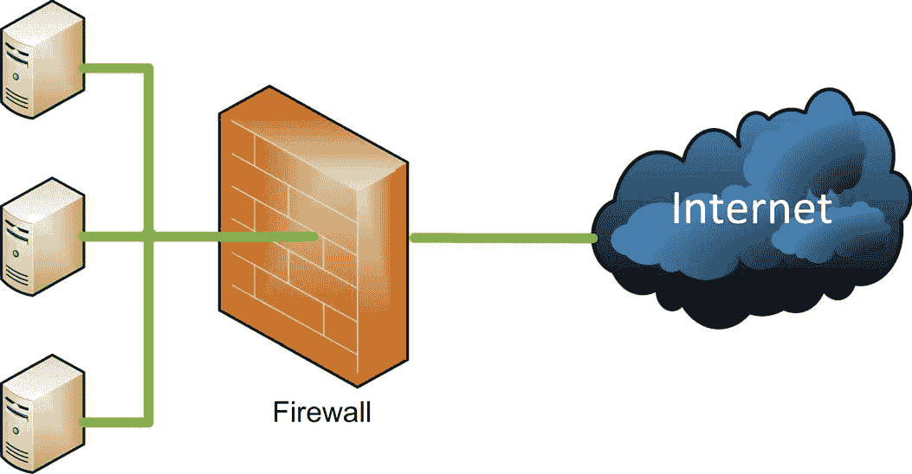

图 10.1 防火墙。

### 数据包过滤

数据包过滤是最老、最简单的防火墙技术之一。数据包过滤查看单个数据包，并根据源地址、目的地址、端口号和协议来决定允许还是阻塞流量。

### 状态检测包检测

状态包检测防火墙（通常称为状态防火墙）的工作原理与数据包过滤相同，但它们能够跟踪状态。状态防火墙使用所谓的状态表（state table）来跟踪连接，并且只允许属于新连接或已建立连接的流量。这使得防火墙能够在粒度级别监控流量。

### 深度数据包检测

深度数据包检测防火墙为我们的防火墙能力增加了另一层智能。它们能够分析流量的实际内容。数据包过滤防火墙和状态防火墙只能查看流量本身的结构，而深度数据包检测防火墙实际上会重组流量内容，查看将交付给最终应用程序的内容。

### 代理服务器

代理服务器本质上是防火墙的一种特殊变体。这些服务器提供安全和性能功能，通常针对特定应用程序，如邮件或 Web 浏览。代理服务器可以作为瓶颈点，以便我们过滤攻击流量或不良内容（如恶意软件或托管成人内容的网站的流量）。它们还允许我们记录通过它们的流量以供日后检查，并通过作为请求的单一来源，为背后的设备提供一层安全保护。

代理服务器在商业世界几乎无处不在，这在很大程度上是因为它们提供的过滤功能。许多公司依赖它们来防止流经电子邮件的大量垃圾邮件到达其用户并降低生产力。我们还看到它们在这些环境中被用于过滤 Web 流量，以防止员工访问可能包含违规材料的网站，并过滤掉可能表明存在恶意软件的流量。同样，它们的主要问题是由于增加了额外的检查步骤而导致的延迟。

## DMZ（非军事化区）

DMZ，或非军事化区，通常是网络设计特征与防护设备（如防火墙）的结合。正如我们之前在“网络设计中的安全”部分中所讨论的，我们通常可以通过对网络进行适当的分段来提高网络安全水平。当我们考虑为了运行而需要暴露外部网络（如互联网）的系统，例如邮件服务器、代理服务器、软件服务（SaaS）应用和 Web 服务器，我们需要确保这些系统以及其背后网络设备的安全性。我们通常可以在设备（如我们的邮件服务器）与互联网之间，以及我们网络其余部分与设备之间放置一层保护来实现这一点，如图 10.2 所示。


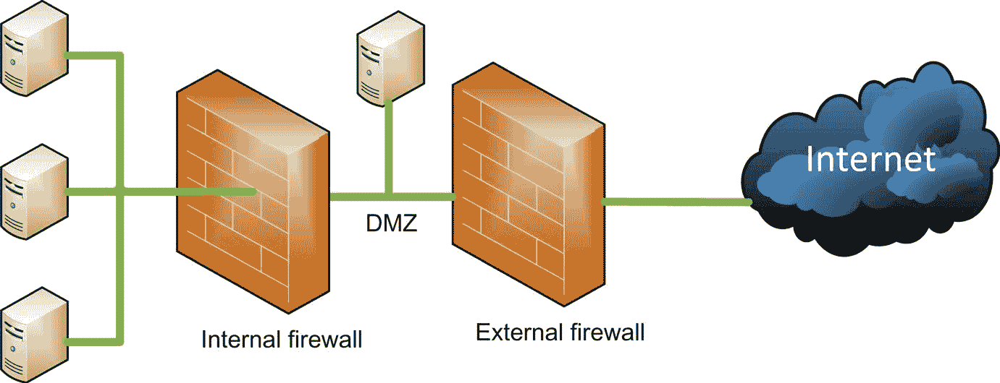

图 10.2 DMZ。

这仅允许需要到达邮件服务器的流量——例如分别在端口 143 和 25 上的互联网消息访问协议 (IMAP) 和简单邮件传输协议 (SMTP)——到达我们的邮件服务器，并允许相同的端口通过我们的网络。假设同一系统上没有运行其他服务，我们可以将进入和流出邮件服务器所在 DMZ 的流量限制在这些特定端口。

## 网络入侵检测系统

IDS 监控其连接的网络、主机或应用程序，以检测未经授权的活动。IDS 有多种类型，包括基于主机的入侵检测系统 (HIDS)、基于应用协议的入侵检测系统 (APIDS) 和基于网络的入侵检测系统 (NIDS)。在本章中，我们将关注 NIDS，并分别在第 11 章和第 12 章中回到 HIDS 和 APIDS。

NIDS 通常连接到网络中某个可以监控其经由流量的位置，但需要仔细放置，以防其负载过重。在另一个过滤设备（如防火墙）之后放置 NIDS 有助于消除一些显而易见的伪造流量，从而减少 NIDS 需要检查的流量。由于 NIDS 需要检查典型网络上的大量流量，它们通常只能进行相对粗略的检查，以判断网络状况是否正常。正因如此，NIDS 可能会漏掉某些类型的攻击，特别是那些专门为绕过此类检查而设计的攻击。数据包伪造攻击涉及专门设计的流量数据包，这些包携带攻击或恶意代码，但旨在避免 IDS、防火墙和其他类似设备的检测。将防火墙和 IDS 等功能整合到一个关联能力中，开启了当今组织赖以生存的深度防御安全计划。

### IDS 检测方法

IDS 通常根据其检测攻击的方式分类。通常来说，它们分为两大大类：基于特征的检测和基于异常的检测。

基于特征的 IDS 工作方式与大多数防病毒系统非常相似。它们维护一个可能指示特定类型攻击的特征数据库，并将传入的流量与这些特征进行比较。通常情况下，这种方法效果良好，除非我们遇到新的攻击，或者为了不匹配现有攻击特征而专门构建的攻击。这种方法的一个很大缺点是，许多基于特征的系统完全依赖其特征数据库来检测攻击。如果我们没有针对该攻击的特征，可能完全无法检测到它。此外，构造流量的攻击者可能可以使用与我们相同的相同的 IDS 工具，并可能能够针对这些工具进行攻击测试，以专门规避我们的安全措施。

另一种主要的 IDS 检测方法是基于异常的检测。基于异常的 IDS 通常通过对网络上发生的正常流量和活动建立基准来工作。它们可以根据此基准测量网络当前的流量状态，以检测出正常流量中不存在的模式。当我们试图检测新攻击或刻意组合以规避 IDS 的攻击时，这些方法非常有效。另一方面，我们看到的基于异常的 IDS 产生的误报可能比基于特征的 IDS 更多。如果网络上的流量与我们建立基准时的情况发生了变化，IDS 可能会将其视为攻击的迹象；同样，对于导致异常流量模式或流量激增的合法活动也是如此。

当然，我们可以部署一种兼具每种检测类型优势的 IDS，并在单个 IDS 中同时使用基于特征和基于异常的方法。这将允许我们在检测攻击时具有更大的灵活性，尽管可能是以运行速度稍慢且导致检测延迟为代价的。

## 保护网络流量

除了保护我们的网络免受入侵外，我们还需要关注流经网络的流量。根据深度防御的概念，我们希望根据所保护对象的价值部署尽可能多的安全层。

### 数据被拦截的影响

在我们在网络上发送敏感数据时，最大的担忧之一是数据被他人拦截并可能被滥用。考虑到如今办公室、酒店、咖啡馆、餐厅和其他地方提供的许多网络，无意暴露数据的机会很大。

当我们在不安全或不可信的网络上发送数据时，窃听者可以从我们发送的内容中汲取大量信息。如果我们使用不加密网络上传输内容的应用程序或协议，我们可能会将登录凭据、信用卡号、银行信息和其他数据提供给任何正在收听的人。

尽管此类不安全的网络存在安全问题，但它们并非不可逾越的障碍。我们将在下一节中讨论我们可能用于加固此类连接的工具之一。

### 虚拟专用网络

虚拟专用网络（VPN）的使用可以为我们提供一种在不安全网络上发送敏感流量的解决方案。VPN 连接通常被称为“隧道”，是两点之间的加密连接。这通常通过在连接的一端使用 `VPN` 客户端应用程序，在另一端使用名为 `VPN` 汇聚器的设备来实现。客户端使用该软件（通常通过互联网）对 `VPN` 汇聚器进行身份验证，连接建立后，所有从连接到 VPN 的网络接口交换的流量都将通过加密的 VPN 隧道流传输。

VPN 通常用于允许远程工作人员连接到组织的内部资源。当建立此类连接时，连接的设备就像直接连接到托管该连接的组织的内部网络一样。这非常有用，因为它允许我们在工作人员处于网络边界之外时，为其提供比通常情况下更安全、范围更大的访问权限。

除了允许我们访问组织的内部资源外，VPN 还可用于保护或匿名化我们在不可信连接上发送的流量。诸如 `StrongVPN` 等公司正是为了这些目的向公众出售其服务，允许我们保护流量内容免受互联网服务提供商（ISP）的记录或同网络上他人的嗅探，从而掩盖我们的地理位置并绕过针对位置的拦截。

此类服务也受到从事点对点（P2P）文件共享服务的人的欢迎。此类活动经常会被 ISP 以及美国电影制作协会（MPAA）和美国录音行业协会（RIAA）等组织标记，以便起诉那些侵犯版权的人。VPN 可以让从事此类活动的人的流量和实际 IP 地址对那些试图寻找他们的人保持隐藏状态。

### 无线网络安全

正如我们在本章前面讨论的那样，不安全的无线网络会自由广播我们的数据，让任何拥有适当（且非常常见）技术的人都能听到。目前，一个未经过放大的 `802.11` 无线连接的记录距离约为 237 英里 [\[4\]](#chp010.xhtml#bib4)。尽管这是在理想条件下取得的，但它让我们对无线信号可能传输多远有了初步了解。这意味着，即使在远不利的无线频率（RF）环境中（例如我们在居住区可能发现的环境），几英里之外的人如果有正确的天线，也可能窃听我们的网络流量。

除了流量可能被窃听的问题外，还存在无线设备在在我们不知情的情况下被放置的问题。特别是未经授权连接到我们接入的无线接入点（通常被称为“流氓接入点”），可能会带来严重的安全问题。

例如，如果我们在一个禁止无线网络的地方工作，我们可能会发现某个心心勃勃的个人决定带入一个他自己的接入点并将其安装在自己的办公桌下，以便为附近的室外吸烟区提供无线访问。虽然这可能并非出于恶意，但这一简单的动作就可能通过创建一个后门，而使我们之前所部署的整套精心规划的网络安全措施全部失效。

如果我们示例中的流氓接入点设置的安全性很差或完全没有安全性，那么我们那位意图良好的接入点安装者就只是为接入点覆盖范围内的任何人提供了一条直接进入我们网络的简易路径，从而绕过了我们可能设置的任何边界防护。网络入侵检测系统（IDS）可能会检测到来自流氓接入点的活动，但无法保证这一点。发现此类流氓设备的简单方法是：详细记录作为无线网络基础设施一部分合法设备，并定期使用我们在本章稍后讨论的某些无线扫描工具扫描额外设备。

对于网络上的合法和授权设备，我们保护流经设备流量的主要方法是使用加密。`802.11` 无线设备（无线网络设备中最常见的类型）所使用的加密分为三大类：有线等效隐私（`WEP`）、Wi-Fi 保护访问（`WPA`）和 Wi-Fi 保护访问版本 2（`WPA2`）。其中，`WPA2` 是最新的，提供了最内在安全性。

### 安全协议

我们保护数据的最简单、容易的方法之一是使用安全协议。许多常见且旧的协议，例如用于传输文件的文件传输协议（`FTP`）、用于与远程机器交互的 `Telnet`、用于检索电子邮件的邮局协议（`POP`）等，在网络上以不安全的方式处理数据（回想第 5 章），经常发送登录名和密码等敏感信息。

许多不安全的协议都有安全的替代方案，我们将在第 12 章中详细讨论。简而言，我们通常可以找到与我们想要传输的流量匹配的安全协议。与其使用 `Telnet` 通过命令行操作，我们可以使用安全外壳（`SSH`）；与其使用 `FTP` 传输文件，我们可以使用安全文件传输协议（`SFTP`），它也是基于 `SSH` 的。

`SSH` 是一种非常实用的通信安全协议，因为我们可以在上面发送许多类型的流量。它可以用于文件传输和终端访问（如前面提到的），还可以保护各种其他情况下的流量，例如连接远程桌面、通过 `VPN` 通信、挂载远程文件系统以及许多任务。`SSH` 使用的加密是 `RSA`，一种公钥加密算法。

## 移动设备安全

随着移动设备越来越普及，它们也带来了许多安全问题。此类设备在硬件资源和能力方面是相当强大的，并且通常一直连接到某种网络。它们会定期在不同环境中移动，在不经通知的情况下存储和传输数据，并且可能不符合我们在任何标准非移动计算机上认为基本的的安全措施。

### 什么是移动设备？

当我们讨论移动设备时，通常指的是智能手机和平板电脑，它们目前主要运行 Apple 的 `IOS` 或 Google 的 `Android`，此外还有少量其他系统。此外，还有各种头戴式设备、智能手表和各种其他设备。最后我们还有 `USB` 闪存（优盘）。移动设备用于发送和接收电子邮件、浏览网页、处理文档、播放视频、听音乐、玩游戏以及许多其他活动；简而言之，这些设备可以执行与非移动设备大部分相同的功能。

近年来，关于什么是移动设备以及什么不是移动设备的定义变得相当模糊。目前，我们拥有处理能力和存储容量可以与某些计算机竞争的智能手机，并且拥有同样强大的操作系统。另一方面，我们也有计算机，包括非常小轻便的超薄笔记本以及如 `Raspberry Pi` 这样运行硬件极简且功耗极低的设备，有些设备甚至运行如 `Android` 等“移动”操作系统。由于区分这些设备很大程度上取决于设计哲学而非物理能力，因此从安全的角度来看，通常倾向是将它们同等对待。最实用的定义是：任何可以访问外部系统，或在组织安全基础设施之外可以被访问的设备。

从安全角度来看，移动设备与其他设备之间实际存在差异的一个潜在领域是对其数据进行集中化管理。

### 移动设备管理

虽然大多数未运行移动系统的设备（即 `Windows`、`OS X`、`Linux` 等）拥有一套成熟的工具和功能允许其进行集中化管理，但对于移动设备可能并不适用。我们通常希望能够强制执行补丁和软件升级、强制定期更改密码、监管和跟踪已安装的软件、根据我们的策略规定的标准调整设置，以及许多其他类似的功能。为了实现此类任务，我们通常转向外部的移动设备管理（`MDM`）解决方案，例如由 `Good Technologies`、`MobileIron` 以及其他公司开发的解决方案。

`MDM` 解决方案的准确架构因供应商而异，但大多数解决方案会在移动设备上使用代理（agent），其目的是在客户端强制执行特定的配置。这些代理通常监管对企业资源的访问（例如电子邮件、日历或网络资源），并在配置不符合标准、设备被盗或用户离职时能够断开客户端的访问。此外，许多 `MDM` 解决方案还允许对设备进行远程擦除（无论是完全擦除还是仅擦除企业数据）和/或完全禁用。

随着移动设备与非移动设备之间的区别越来越小，`MDM` 解决方案供应商已开始支持某些传统上被认为非移动的设备。虽然这看起来与现有的企业管理工具有很大重叠，但使用相同的工具和技术远程管理移动和非移动设备，将减少管理资源的负担，并使相关设备集具有更的一致性。

### 自带设备

在讨论移动设备安全时，经常会提到“自备设备”（`BYOD`）术语。`BYOD` 通常是指组织关于使用个人与公司设备的策略和政策。这可以从仅允许公司所有设备与企业资源交互，到仅使用个人设备，以及两者之间的任何组合。`BYOD` 对于管理预算的人来说非常受欢迎，因为他们利用了组织无需付钱的设备。在某些情况下，为了节省成本，他们会推行 `BYOD` 而不考虑安全性安全性。

仅允许公司所有设备可以为组织管理提供一个更统一、更安全的移动设备基础。根据策略的实施情况，我们可能会选择禁止使用个人电子邮件和文件共享应用程序，并像本节早些讨论的那样，通过 `MDM` 解决方案禁用安装与业务无关的新应用程序的功能。我们还可以强制用户安装更新和安全补丁，更改他们的密码等。

## 网络安全工具

我们可以使用各种工具来提高网络安全。这些工具中的许多与攻击者渗透网络时使用的工具是相同的，这也是它们对我们有用的主要原因之一。唯一的区别在于，安全工具是由授权用户使用的。在没有明确书面许可的情况下，使用书中讨论的任何工具都是不明智的。我们可以使用攻击者渗透我们防御的相同工具来加固防御。

## 更高级的

如今市场上存在大量的安全工具，其中许多是免费的或有免费替代方案。许多工具运行在 `Linux` 上，某些工具配置可能有点困难。幸运的是，我们可以使用带有预配置好的所有工具的安全实时发行版（Security Live distributions）来尝试这些工具，而无需自行安装。较知名且更彻底的发行版之一是 `Kali`，可以在 `http://www.kali.org/` 下载。

```
```

使用此类评估策略的关键在于进行彻底且频繁的评估，以便我们能够在攻击者之前发现漏洞。如果我们只是偶尔、浅层地进行此类测试（通常被称为渗透测试），那么我们可能无法捕获到我们环境中存在的所有问题。此外，随着各种网络硬件设备及其运行的软件随时间推移而更新、添加或删除，我们环境中存在的漏洞也会发生变化。同样重要的是，我们可能使用的绝大多数工具只能发现已知问题。新的或未发表的攻击或漏洞（通常称为零日攻击）在出现时仍可能让我们措手不及。

### 无线

正如我们在本章前面讨论的那样，访问无线设备的攻击者可能会绕过我们所有精心规划的安全措施。更糟糕的是，如果我们不采取措施确保未经的无线设备（如非法访问点）没有部署在我们的网络上，我们可能会在网络安全中留下一个巨大的漏洞却无不知。

我们可以使用多种工具来检测无线设备。检测此类设备最知名的工具之一被称为 `Kismet`，它运行在 Linux 上并可以在 Kali 发行版中找到。`Kismet` 通常用于检测无线接入点，即使在有人尝试增加检测难度时，它也能找到这些设备。Windows 平台上也存在一个名为 `NetStumbler` 的类似软件，尽管它的功能集没有 `Kismet` 那么完整。

除了检测无线设备外，某些工具允许我们破解此类网络上正在使用的各种加密方式。存在许多此类目的的工具，但破解 `WEP`、`WPA` 和 `WPA2` 的常用工具包括 `coWPAtty` 和 `Aircrack-NG`。

### 端口扫描器

扫描器是安全测试和评估行业的主要支柱之一。我们通常可以将它们分为两大类：端口扫描器和漏洞扫描器。取决于我们讨论的特定工具，两者之间存在某些重叠。

我们可能想要使用的著名端口扫描器之一是一个名为 `Nmap` 的免费工具，它是 network mapper 的缩写。虽然 `Nmap` 通常被称为端口扫描器，但如果仅仅将其称为端口扫描器实际上是对它的一种不公。尽管 `Nmap` 可以进行端口扫描，它还可以搜索网络上的主机、识别这些主机运行的操作系统、检测任何开放端口上运行的服务版本，以及更多功能。

在大多数情况下，就网络安全的角度，扫描器作为发现我们环境中的网络和系统的工具是最有用的。我们将在第 11 章中讨论一些针对操作系统安全的特定扫描器用途。

### 数据包嗅探器

网络或协议分析仪，也称为数据包嗅探器（packet sniffer）或简单的嗅探器（sniffer），是一种拦截网络流量的工具，通常被称为嗅探。嗅探基本上等同于监听我们的计算机或设备网络接口可以看到任何流量，无论这些流量是否是打算由我们接收的。

### 注意！

使用嗅探器的关键元素之一将其放置在网络中的适当位置，以便我们能够看到想要嗅探的流量。在大多数现代网络中，流量被分段，使得除了我们自己机器生成的流量外，我们可能无法看到任何流量。为了能够进行有效的嗅探，我们可能需要获得一个高层网络交换机的访问权限，并可能需要使用专用设备或配置来允许我们访问目标流量。

`Tcpdump` 是一个经典的嗅探工具，自 20 世纪 80 年代后期一直存在。`Tcpdump` 是一个命令行工具，允许我们监控所连接的网络活动，并具有一些其他关键功能，例如流量过滤。`Tcpdump` 仅运行在类 Unix 操作系统上，但有一个版本被移植到了 Windows，被称为 `WinDump`。

`Wireshark`（以前被称为 `Ethereal`）是一个功能全嗅探器，能够拦截来自各种有线和无线源的流量。它具有图形界面，如图 10.3 所示。

```
if (condVar > someVal) {console.log("xxx")}
```

在当今的网上，网络安全的使用几乎无处不在。在企业和政府机构中，我们可以看到人们在设计安全网络方面付出的共同努力，包括实施防火墙和入侵检测系统（IDSes）。取决于我们所涉及的行业，我们的业务可能完全取决于这些措施在维护我们安全方面的成败。如果我们观察像 eBay 和 Amazon 这样以网络为核心的公司，它们的大部分业务都是直接在互联网上进行的。如果它们没有采取严密的安全措施，并且不持续评估这些措施以发现弱点，它们的业务将由于缺乏信任而迅速失败。

在此类组织的后端，我们还可以发现部署了各种安全措施，以确保员工和用户的流量及活动安全。企业对 VPN 连接的使用非常普遍，因为这允许在家里或出差期间工作的员工使用内部网络资源。当公司防火墙之外的人员与外部暴露的服务器通信以交换电子邮件、发送文件、通过即时消息进行通信等时，我们也能看到安全协议的使用。

正如我们提到的，此类公司还需要不断评估自身的安全措施。我们可以从网络角度使用许多工具来完成，包括包括在本章中讨论的少数工具以及更多工具。重要的是，要理解这些工具通常并不会清晰地跨越网络安全、操作系统安全和应用安全的界限，而是涵盖了其中一个或多个、甚至是全部方面。这反映了确保所有这些方面安全性的需求，以及这些类别之间存在高度重叠。

## 总结

当我们保护网络时，我们是从许多不同的角度进行的。我们使用安全网络设计来确保网络被妥善分，拥有正确的瓶颈点以便对流量进行监控和控制，并在需要冗余的地方实现冗余。我们还实施了防火墙和 IDSes 等安全设备，以保护网络内部和外部的安全。

除了保护网络本身，我们还需要保护我们的网络流量。由于网络（无论是线路还是无线）的特性，窃听在上面传输的流量通常是可能的。为了保护我们的流量，当在使用不可信的网络时可以使用 VPN 来加密连接，在需要时可以使用针对无线网络的特定安全措施，并可以将安全协议作为一种通用的安全措施。


在提供网络安全的努力中，可能会使用各种安全工具。在处理无线网络时，我们可以使用专门适用于任务的工具，例如 `Kismet` 或 `NetStumbler`。我们还可以使用 `Wireshark` 或 `Tcpdump` 等工具监听网络流量，使用 `Nmap` 等工具扫描网络上的设备，并使用 `hping3` 和其他类似的程序测试我们的防火墙。我们还可以在网络上部署称为 `honeypots`（蜜罐）的设备，专门用于吸引攻击者的注意力，以便研究他们及其工具，并在他们出现时提醒我们。

## 练习

1. 我们可以用工具 `Kismet` 做什么？

2. 解释分段（segmentation）的概念。

3. 企业中实施宽松的 BYOD（自带设备策略）政策可能存在哪些风险？

4. 三种主要的无线加密类型是什么？

5. 我们可以使用什么工具扫描网络上的设备？

6. 我们为什么要使用 `honeypot`？

7. 解释 IDSes 中签名检测和异常检测之间的区别。

8. 如果我们需要在不可信的网络上发送敏感数据，应该使用什么？

9. 我们用 `DMZ`（区化区）保护什么？

10. 状态检测防火墙和深度包检测防火墙有什么区别？

## 参考文献

[1] Madorie D. Internet blackout in Sudan. renesys.com, <http://www.renesys.com/2013/09/internet-blackout-sudan/>; September 25, 2013 [accessed 23.10.13].

[2] Mogul J. Simple and flexible datagram access controls for Unix-based gateways. USENIX Conference Proceedings; 1989.

[3] Higgins KJ. Who invented the firewall? Dark Reading, <http://www.darkreading.com/security/security-management/208803808/index.html>; January 15, 2008 [accessed 23.10.13].

[4] Kanellos M. New Wi-Fi distance record: 382 kilometers, Cnet News, <http://news.cnet.com/8301-10784_3-9730708-7.html?part5rss&subj5news&tag52547-1_3-0-5>.

我们有多种方法可以缓解从操作系统角度可能面临的各种威胁和漏洞。我们可以指出的最简单的一类方法是**操作系统加固**（operating system hardening）。在配置可能面临敌意攻击的主机时，我们可以使用这种技术，以减少攻击者最终触及我们的开启数量。

我们还可以向操作系统添加一些工具和应用程序，这些工具旨在对抗攻击者可能对我们使用的某些技术。其中最常见且显而易见使用**恶意软件工具**（我们将在本章稍后进行讨论），它可以保护我们免受系统可能暴露的各种恶意代码的侵害，特别是当系统面向互联网时。在同一大类软件中，我们还可以关注软件防火墙和基于主机的入侵检测系统（`HIDS`），用以阻塞不需要的流量，并在不良的网络流量到达或源自我们的系统时向我们发出警报。

此外，我们还可以利用大量的安全工具来帮助我们检测主机上潜在的漏洞区域。我们可能使用此类工具来发现在加固过程中未发现的服务，定位已知包含可利用漏洞的网络服务，验证补丁是否已更新，并对我们的系统进行通用的检查/审计。

通过所有这些努力的结合——再次回到**深度防御**（defense in depth）的概念——我们可以缓解我们负责的主机上发现的许多安全问题。

# 操作系统加固

当我们观察操作系统加固时，我们了解信息安全领域的一个新概念。操作系统加固的主要目标之一是减少操作系统可能受到攻击的可用途径数量。这些区域的总和被称为我们的**攻击面**（attack surface）。攻击面越大，攻击者成功渗透我们防御的几率就越高。每一个潜在不安全的区域都会增加我们的攻击面，而我们应用安全措施的每一个区域都会减少它。

我们可以减少攻击面的六种主要方法如下文所示，并在 `图 11.1` 中列出：

1. 移除不必要的软件
2. 移除或关闭非必需的服务
3. 对常用账户进行修改
4. 应用最小权限原则
5. 及时应用软件更新
6. 利用日志和审计功能

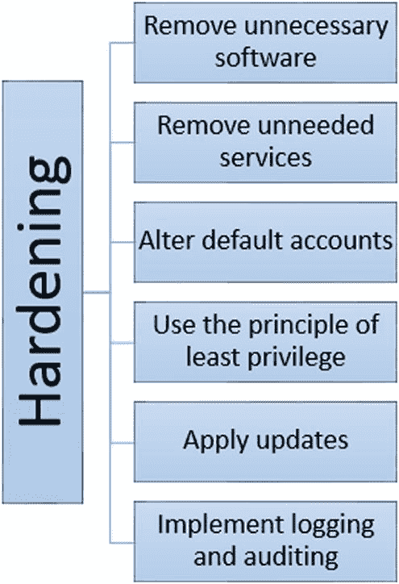

图 11.1 六大主要加固类别。

### 移除所有不必要的软件

## 警告！

在更改操作系统设置、工具和软件时，我们应该始终保持非常小心。我们可能做的某些更改可能会对操作系统的运行方式产生意外的影响，而生产机器不是通过经验来学习这些的地方。在做出更改之前，仔细研究更改并在实验室系统上进行测试始终是一个明智的策略。

安装在我们的操作系统上的每种软件都会增加我们的攻击面。某些软件的影响可能比其他软件大得多，但它们都是累积起来的。如果我们真的寻求加固操作系统，我们需要仔细审视应该加载在上面的软件，并采取措施确保我们只在满足功能性系统所需的最少组件上工作。

例如，如果我们正在准备一台 Web 服务器，我们应该拥有 Web 服务器软件、支持 Web 服务器所需的任何库或代码解释器，以及任何处理操作系统管理和维护的实用程序（例如备份软件和远程访问工具）。我们应该移除像 Microsoft Office 之类的应用程序或像文件传输协议（`FTP`）之类的服务。如果系统确实仅作为 Web 服务器运行，我们真的没有理由安装任何其他东西。

当我们看到机器上安装了其他软件时（通常是出于好意），问题就开始出现。例如，假设我们的一位开发人员远程登录并需要临时更改 Web 页面上的内容，因此他们安装了所需的 Web 开发软件。然后他们需要评估这些更改，于是安装了他们喜欢的 Web 浏览器以及相关的媒体插件（如 Adobe Flash 和 Acrobat Reader），以及一个视频播放器来测试视频内容。在很短的时间内，我们不仅有了不该出现在那里的软件，而且这些软件很快变得过时，因为它们没有打补丁，因为它们不是“官方”安装的，所以不是配置管理计划的一部分。在此时，我们在一台面向互联网的机器上产生了一个相当严重的安全问题。

### 移除所有非必需的服务

与移除不需要的软件异曲同工，我们还应该移除或禁用非必需的服务。许多操作系统在出厂时都开启了各种服务，以便在网络上共享信息、定位其他设备、同步时间、允许访问和传输文件以及执行其他任务。我们可能还会发现某些服务是由各种应用程序安装的，用来提供这些应用程序运行所依赖的工具和资源。

关闭系统级服务可能是一个充满实验和挫败的过程。在许多情况下，这些服务的命名方式无法指示其实际功能，追踪每个服务在做什么可能需要一些研究。在寻找此类多余服务时，首先要做的最好尝试是确定系统实际监听网络连接的网络端口。许多操作系统内置了允许我们执行此操作的工具，例如微软操作系统上的 `netstat`，但我们也可以将 `Nmap` 用于此类任务。

正如我们在第 10 章中讨论过的那样，`Nmap` 允许我们发现网络上的设备，它也可以允许我们确定特定系统在哪些网络端口上监听。如果我们运行以下 `Nmap` 命令：

```
Nmap <IP 地址>
```

我们将看到类似于 `图 11.2` 所示的结果。

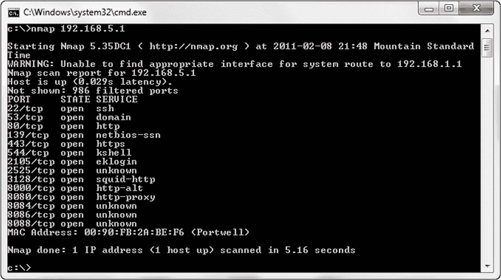

图 11.2 Nmap 扫描结果。

在这种情况下，我们可以立即指出目标上运行的几个常见服务：

* `端口 22` 系统的远程访问，使用安全外壳（`SSH`）保护。
* `端口 53` 域名系统（`DNS`），将友好名称转换为 IP 地址。
* `端口 80` 超文本传输协议（`HTTP`），用于提供 Web 内容。
* `端口 443` 安全超文本传输协议（`HTTPS`），提供受安全套接层（`SSL`）和/或传输层安全（`TLS`）保护的 Web 页面。

其他几个端口也是开启的，运行着各种服务。我们可以利用这些信息作为关闭不受欢迎服务的起点。对于我们的示例目标，端口 22、80 和 443 的开启如果意味着我们打算允许远程访问或提供 Web 内容，那么就是值得注意的。

### 修改默认账户

许多操作系统的共同弱点是使用了被称为“标准”的账户。在许多操作系统（以及某些应用程序）中，我们可以找到访客账户和管理员账户的对应项。我们还可能发现各种其他账户，包括供支持人员使用的账户、允许服务或实用程序运行的账户，以及许多根据操作系统供应商、版本等不同而大不相同的账户。此类账户通常被称为默认账户。

在某些情况下，默认账户可能配备了过于宽松的权限，来限制其允许执行的操作，当这些账户被经验老练的攻击者利用时，可能会引发巨大的麻烦。我们还可能发现默认账户设置了特定的密码，或者根本没有密码。如果我们允许此类账户以其默认设置留在系统中，我们可能就让保护系统访问的“大门”敞开，以便攻击者可以简单地走入并自如家中般自在。

我们采取的缓解此类安全风险的典型措施通常执行非常简单。我们首先应该决定是否需要这些账户，并禁用或删除任何我们将不会使用的账户。对于访客账户、支持账户以及其他性质的账户，我们通常可以快速轻松地关闭这些账户或将其完全删除，而不会给自己带来问题。对于管理员账户（通常名称为 `administrator`、`admin` 或 `root`），我们可能无法安全地从系统中删除它们，或者操作系统可能会阻止我们这样做。然而，在大多数情况下，此类账户可以重命名，以混淆可能尝试利用它们的攻击者。最后，我们不应该留下任何带有默认密码的账户，无论其状态如何；因为此类密码通常是有记录的且为众人所知的。

## 遵循最小权限原则

正如我们在第 3 章中讨论的那样，最小权限原则规定我们只允许一方拥有执行其功能所需的绝对最小权限。取决于所涉及的操作系统，我们可能会发现这一理念在很大或较小程度上得到了付诸实践。在几乎任何现代操作系统中，我们都可以将特定用户被允许执行的任务分为需要管理员权限的任务和不需要权限的任务。

总而言之，普通操作系统用户被允许读取和写入文件，可能还可以执行脚本或程序，但他们被限制在文件系统的某个受限区域内执行这些操作。普通用户通常不允许执行诸如修改硬件运行方式、更改操作系统本身依赖的文件以及安装可以更改或影响整个操作系统的软件等任务。此类活动通常仅限于那些允许获得管理员访问的用户。

在大多数 UNIX 和类 Linux 操作系统上，我们经常可以看到此类角色被严格执行。虽然此类系统的管理员可以允许所有用户以管理员权限行事，但这通常不是惯例，管理员或“root”访问通常受到仔细的保护。在微软操作系统上，我们经常会发现事实恰恰相反。在 Windows 系统上，默认是给用户更多控制权，因此需要小心更改权限以更具限制性。虽然由于微软市场份额更大，针对微软的威胁更多，但任何系统的安全态势都取决于管理员。同样的范式存在于 Apple iOS 和 Android 之间。

当我们允许用户拥有管理员权限时，我们就会让自己暴露在大量的恶意软件面前。如果我们限制权限，就是在缓解许多安全问题方面迈了一步。监控管理员账户的滥用很重要。在许多情况下，如果我们将权限限制到最小，攻击将会失败。理解策略的原因非常重要。这是我们可以采取的一种廉价的安全措施，而且实施简单。

## 执行更新

对我们的操作系统和应用程序进行定期且及时的更新对于维持强大的安全性至关重要。新的攻击定期发布，如果我们不应用供应商发布的补丁，我们可能会很快落入法网。

我们可以查看此时在互联网上传播的各种恶意软件，作为这方面的绝佳例子。许多恶意软件能够利用早已被修复的已知漏洞进行传播。虽然在计划安装软件时保持谨慎并在安装前进行彻底测试是有益的，但将此过程推迟很长时间通常是不明智的。

确保系统已正确打补丁的最关键时刻之一是完成安装后的立即。如果我们将一个新安装且完全未打补丁的系统连接到网络，我们可能会看到它在短时间内受到攻击并被破解。在这种情况下，通常认为的最佳实践是将补丁下载到可移动介质上，并在连接到网络之前使用该介质对系统进行补丁。完善配置管理计划的一部分是监控补丁公告。有一些服务可以为你做这件事。你还必须考虑对家庭电脑等系统进行自动补丁。

## 开启日志和审计

最后，但同样重要的是，我们应该为系统配置并开启适当的日志和审计功能。虽然配置此类服务的具体细节可能会根据所涉及的操作系统和系统的用途而略有不同，但我们通常需要对系统上发生的重要过程和活动保持准确且完整的记录。我们通常希望记录重大事件，例如管理员权限的行使、用户登录和注销系统或登录失败、对操作系统的更改以及发生的许多类似活动。对于简单的 Windows 操作系统，有 200 多与安全相关的日志可以开启，因此找到日志与存储之间的正确平衡点非常重要。

取决于我们将系统部署的环境，我们可能还希望包含额外的功能，以补充操作系统内置的此类目的的工具。我们可能想要安装多种监控工具，用于监控系统功能，并在系统本身出现问题或各种系统或应用程序日志中出现异常时向我们报警。我们还可能想要安装辅助性的日志架构，以监控多台机器的活动，或者简单地在系统外部维护日志的远程副本，以帮助确保我们对系统上可能发生的活动拥有未经篡改的记录。

除了上述讨论的加固方法外，还有许多特定的加固标准。其中讨论较常见的包括来自美国国防信息系统局（DISA）的安全技术实施指南（STIGs）以及美国国家安全局（NSA）提供的加固指南。

重要的是，虽然日志是事后调查的关键，但实际审查日志是该过程中至关重要的一部分。如果我们收集了日志但从不进行审查，我们将错过及早检测攻击的机会，并遭受更大的整体影响。

## 防御恶意软件

目前的一个大问题是全球网络、系统和存储设备上存在数量惊人且种类繁多的恶意软件。使用此类工具，攻击者可以禁用系统、盗取数据、进行社会工程攻击、勒索用户、收集情报并执行许多其他攻击。

研究一个特别复杂且具有影响力的恶意软件佳例是 Stuxnet。Stuxnet 发现于 2009 年 7 月，尽管其形式与其最终达到的水平要弱一些 [[2]](#chp011.xhtml#bib2)。虽然与多年来的其他一些重大恶意软件爆发相比，受感染的系统数量要少得多，但它的目标更有针对性，即监控控制与数据采集（SCADA）系统。在这种攻击案例中，这是一个国家对另一个国家的军事能力的攻击。

### 更多资源

有关 Stuxnet 的作用及其如何实现的更多详细信息，请参阅赛门铁克（Symantec）提供的“W32.Stuxnet Dossier”，地址见：[`www.symantec.com/content/en/us/enterprise/media/security_response/whitepapers/w32_stuxnet_dossier.pdf`](http://www.symantec.com/content/en/us/enterprise/media/security_response/whitepapers/w32_stuxnet_dossier.pdf)。

Stuxnet 的最终目标似乎是破坏 SCADA 系统，很大程度上针对伊朗核计划中运行的设备部分 [[3]](#chp011.xhtml#bib3)。Stuxnet 提高了恶意软件的门槛，使其从很大程度上基于虚拟的攻击转变为真正的物理破坏性。

### 反恶意软件工具

大多数反恶意软件应用程序检测威胁的方式与我们在第 10 章中讨论的 IDS 相同：要么通过与特征码进行匹配，要么通过检测正在发生的异常活动。反恶意软件工具倾向于更多地依赖特征码而非异常检测，这在反恶意软件领域通常被称为启发式算法（heuristics）。恶意软件特征码通常由应用程序供应商至少更新一次，如果需要，更新频率可能会更频繁。

反恶意软件工具通常通过两种主要方式检测恶意软件：要么实时检测恶意软件的存在或指示恶意软件的流量，要么对系统中已存在的文件和进程进行扫描。当发现恶意软件时，反恶意软件工具的响应可能包括：杀死任何关联进程并删除文件；杀死进程并隔离文件以使其无法执行但不删除；或者简单地对检测到的任何内容不处理。保持文件完整不是一种典型的响应，但可能是必要的，因为反恶意软件工具有时会检测到安全工具和其他非恶意软件的文件，而我们可能希望在未来留存它们并忽略它们。

我们可以在移动设备、个人系统以及各种服务器上找到反恶意软件工具，而在大型企业环境中，为了保护这些系统，在企业级对它们进行监控是常有的。我们还可能发现在代理服务器上安装此类工具，以过滤掉入出站流量中的恶意软件。这在电子邮件代理服务器中非常常见，因为许多恶意软件使用电子邮件作为传播手段。当此类工具检测到恶意软件时，我们可能会看到电子邮件被完全拒绝，或者可能只看到恶意软件从邮件正文中剥离或违规附件被移除。

### 可执行空间保护

可执行空间保护是一种基于硬件和软件的技术，操作系统可以通过实施它来挫败使用我们在恶意软件中常用的相同技术的攻击。简言之，可执行空间保护防止操作系统和应用程序使用的某些内存区域被用于执行代码。这意味着像缓冲区溢出这类经典攻击（它们依赖于在被劫持的内存区域执行其命令）可能根本无法运行。许多操作系统还使用地址空间布局随机化（ASLR）[[4]](#chp011.xhtml#bib4) 来移动正在使用的内存内容，使得篡改变得更加困难。

## 更高级

缓冲区溢出攻击通过向特定输入输入比应用程序预期的更多的数据来工作——例如，在一个只预期 10 个字符的字段中输入 1000 个字符。取决于应用程序的编写方式，我们可能会发现额外的 990 个字符被写入内存的某处，可能覆盖了其他应用程序或操作系统使用的内存位置。通过专门构造多余数据有时可以执行命令。

可执行空间保护需要两个组件才能工作：硬件组件和软件组件。主要的 CPU 芯片制造商 Intel 和 AMD 都支持可执行空间保护，Intel 将其称为禁止执行（XD）位 [[5]](#chp011.xhtml#bib5)，而 AMD 将其称为增强型病毒防护 [[6]](#chp011.xhtml#bib6)。

可执行空间保护的软件实现在许多常见的操作系统中都可以找到。可执行空间防护和 ASLR 均出现在 Microsoft 和 Apple 的许多操作系统，以及若干 Linux 发行版中（这仅是举例）。

### 软件防火墙和主机入侵检测


除了我们可以在网络上用于检测和过滤不良流量的工具（如防火墙和 `IDS`）外，我们还可以在主机级通过实施一套非常类似的工具来增加另一层安全。虽然我们可能经常发现防火墙和 `IDS` 以专用设备的形式实现在网络层，但它们执行的实际功能通常由设备上的专用软件完成。类似的软件可以直接安装在我们网络中的主机上。

配置恰当的软件防火墙是我们可以为网络中的主机添加的一层非常实用的额外安全防护。此类防火墙通常包含我们在大型防火墙设备上可能找到的功能子集，但通常能够执行非常相似的数据包过滤和状态数据包检测。我们经常发现此类应用程序的规则集是以特定应用程序和端口的形式的，这些端口允许在主机上的各种网络接口上发送和接收流量。这些软件的范围从内置并随常见操作系统（如 `Windows` 和 `OS X`）自带的相对简单版本，到用于企业网络的大型版本，后者包含了集中监控功能以及更复杂的规则和管理选项的能力。

### 主机入侵检测

主机入侵检测系统（`HIDS`）用于分析针对特定主机网络接口的或发生在该接口上的活动。它们具有与网络入侵入侵检测系统（`NIDS`）许多相同的优点，但操作范围大大缩小。与软件防火墙一样，此类工具的范围可能从简单的消费级版本到允许集中监控和管理的更复杂的商业版本不等。

集中管理的 `HIDS` 的一个潜在缺陷是，为了让软件能够实时向管理机制报告攻击，信息需要通过网络进行通信。如果目标主机正通过我们用于报告的同一网络受到积极攻击，我们可能无法做到这一点。我们可以尝试通过从设备向管理机制发送定期的心跳信号（`beacon`）来缓解此类问题，这样当我们停止看到多个设备意外离线时，就可以假设发生了问题，但这可能不是一个完整的解决方案。

## 操作系统安全工具

正如我们在评估网络安全可能使用的工具的第 10 章中讨论的那样，许多相同或类似的工具也可以用于评估我们主机的安全性。我们可以使用扫描器来检查主机如何与网络上的其他设备交互，使用漏洞评估工具来帮助指出我们可能发现易受攻击的应用程序或服务的特定区域，使用权限提升工具获取对系统的未授权访问权限，以及使用各种漏洞利用框架允许我们访问那些试图破坏我们安全的人员可能使用的广泛工具和攻击手段。我们在本节中讨论的工具并不像一份详尽的列表，但我们将介绍其中的几个重点。

### 扫描器

在查看主机时，我们可以使用大量的扫描工具来协助检测各种安全漏洞。虽然我们在第 10 章中是从网络角度讨论过此点的，但此类工具也可以增强我们主机的安全性。我们可以寻找开放端口和正在运行的服务版本，检查服务显示的横幅（`banners`）以获取信息，检查我们的系统通过网络显示的信息，并执行大量类似的任务。

在本章较早些时候，当我们讨论加固时，我们查看了一个非常简单的示例，即使用 `Nmap` 查看网络上的设备，以发现有服务在上面监听的端口。`Nmap` 实际上拥有一套非常庞大广泛的功能，如果我们要求它这样做，它可以为我们提供多得多的信息。在图 11.3 中，我们可以看到针对网络打印机进行的 `Nmap` 扫描结果。在这种情况下，我们要求 `Nmap` 同时查找它找到的特定服务版本，并尝试识别设备上运行的操作系统。如果我们查看列表中的端口 `9220`，可以看到该服务是 `hp-gsg`，虽然这个名字有点晦涩，但它可能为我们提供一些线索，表明它是针对 HP 打印机的特定服务；但如果我们查看同一行上的版本信息，就可以非常具体地看到该服务是 `HP Generic Scan Gateway 1.0`。基于这些信息，我们可能有更大的机会成功攻击该设备。

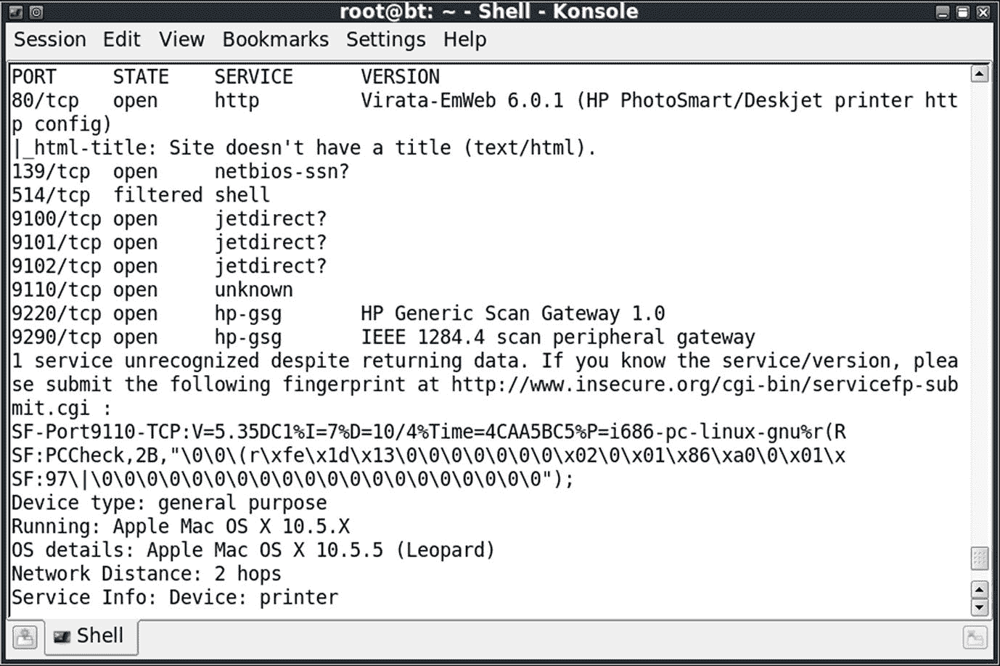

图 11.3 Nmap 扫描结果。

## 警告！

仔细观察图 11.3 中的 `Nmap` 结果，你会发现 `Nmap` 告诉我们被扫描设备是一个打印机，但它也告诉我们该设备运行的是 `Mac OS X` 系统。有时 `Nmap` 的操作系统指纹可能与设备上的实际情况稍有偏差，因此如果某些内容看起来奇怪，最好用另一个工具验证 `Nmap` 的输出。

除了 `Nmap` 内置的许多功能外，我们还可以通过使用 `Nmap 脚本引擎 (NSE)` 创建自己的自定义 `Nmap` 功能。

### 漏洞评估工具

漏洞评估工具通常包含我们在 `Nmap` 等工具中找到的部分功能集，专门针对发现和报告具有已知漏洞的主机上的网络服务的任务。

其中一种著名的扫描工具是 Tenable 的 `Nessus`。虽然 `Nessus` 曾经是一个免费工具，但它现在不再完全免费了。`Nessus` 现在主要是一个商业工具，仅为非商业用途提供有限免费许可。`Nessus` 主要是一个带有图形界面的漏洞评估工具，如图 11.4 所示。本质上，`Nessus` 将对目标进行端口扫描，然后尝试确定开放端口上运行的服务及其版本。`Nessus` 然后将返回我们可能发现的漏洞列表。


图 11.4 Nessus。

正如我们提到的，`Nessus` 作为其功能集的一部分包含了端口扫描器，因为在识别可能存在的漏洞之前，需要进行端口扫描。`Nessus` 还包含其他功能，包括通过 `NASL` 语言向工具添加自定义功能的能力。

### 漏洞利用框架

一类工具，更准确地说是一类工具集，被称为漏洞利用框架，它们在 21 世纪初几年几年变得非常流行，并且依然强劲。许多漏洞利用框架提供了各种工具，包括网络映射工具、嗅探器等，但我们在漏洞利用框架中找到的主要工具之一，逻辑上就是漏洞利用程序（`exploit`）。

漏洞利用程序是小型软件代码，它们利用其他软件或应用程序中的缺陷，使其违背创建者意图的方式运行。攻击者通常使用漏洞利用程序获取系统的访问，或者在已获得访问的情况下获取额外的权限。

漏洞利用框架，例如 Rapid7 的 `Metasploit`（如图 11.5 所示）、`Immunity CANVAS` 和 `Core Impact`，提供了大量的预封装漏洞集，以便于使用，并为我们提供比单独组装时更多的库。许多漏洞利用框架以图形界面工具的形式出现，其运行方式与其他应用程序功能非常相似。某些工具甚至可以配置为自动寻找并攻击系统，在获得额外访问权限后进一步渗透进网络。我们在渗透测试中经常看到漏洞利用框架的使用。

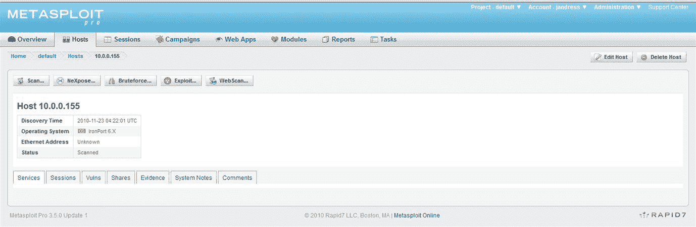

图 11.5 Metasploit Pro.

在本章中讨论的操作系统安全措施在全球范围内的公司中普遍使用。我们在讨论操作系统加固时涉及的各个步骤，通常由任何构建用于部署的服务器能够胜任的组织来实施，特别是当这些服务器将面向互联网时。取决于相关组织及其安全态势，我们可能会发现在客户端机器上实施了此类措施，也可能发现没有实施。虽然这些基础的加固措施是我们可以相对容易地增加安全性的方法，但这样做可能会以牺牲易用性和生产力为潜在代价。

反恶意软件工具、`HIDS` 和软件防火墙在许多具有相当规模的组织中也是处处可见的。我们经常会在代理服务器上看到反恶意软件工具，用于过滤从互联网进入的 Web 流量和邮件流量。如果没有这些工具，即使我们有防火墙和 `IDS` 形式的强力边界防护，一旦有东西设法突破这些措施，它将对我们的内部网络造成巨大破坏。

我们在本章以及第 10 章中讨论的工具都是安全行业的一些基础工具。在任何给定环境中，可能会使用大量且各种类的工具用于许多用途，但花时间学习一些更常见的工具，如 `Nmap` 和 `Nessus`，对任何进入安全领域的人都是有帮助的。我们可能会特定环境中看到更大、更昂贵的商业工具，但它们通常会与这些老牌工具并肩使用。

## 总结

在我们努力保护所负责的操作系统安全时，我们可以使用的首要工具之一就是加固。当我们寻求加固操作系统时，主要任务是移除所有不必要的软件、移除所有非必需的服务、修改系统上的默认账户、利用最小权限原则、以适当的方式对软件进行更新，并进行记录和审计。

我们还可以通过额外的软件形式为我们的操作系统应用各种额外的安全层。我们可以安装反恶意软件工具，以便在遇到恶意软件时进行检测、预防和清除。我们可以直接在主机上使用防火墙技术，以过滤进入或离开我们网络接口的非良流量。我们还可以安装 `HIDS` 以检测通过网络向我们发起的攻击。

在努力保护操作系统安全的过程中，我们可以利用各种安全工具来发现可能存在的安全漏洞。有很多扫描工具可用，其中 `Nmap` 是最广为人知的工具之一。我们还可以利用漏洞评估工具（如 `Nessus`）来定位服务或网络功能软件中的特定安全漏洞。此外，我们可以使用利用框架来攻击系统，以获取其访问权限或获得更高的权限级别，`Metasploit` 是较知名的工具之一。

## 练习

1. 什么是恶意软件传播的载体？

2. 什么是利用框架？

3. 端口扫描器和漏洞评估工具之间的区别是什么？

4. 解释攻击面的概念。

5. 如果网络上已经有了防火墙，为什么我们可能还想在主机上安装防火墙？

6. 什么是操作系统加固？

7. 什么是 `XD` 位？我们为什么要使用它？

8. 可执行空间保护为我们做了什么？

9. 最小权限原则如何应用于操作系统加固？

10. 从 [www.nmap.org](http://www.nmap.org) 下载 `Nmap` 并安装。使用 `Zenmap` GUI 或命令行对 [scanme.nmap.org](http://scanme.nmap.org) 进行基础扫描。你发现了哪些开放的端口？

## 参考文献

1. Schneider FB, ed. *Trust in cyberspace*. Washington, DC: National Academy Press; 1998; ISBN-13: 9780309065580.

2. Falliere N, Murchu LO, Chien E. `W32.Stuxnet Dossier`. *Symantec* 2011.

3. Barnes Ed. Mystery surrounds cyber missile that crippled Iran’s nuclear weapons ambitions, Fox News, <[www.foxnews.com/scitech/2010/11/26/secret-agent-crippled-irans-nuclear-ambitions/](http://www.foxnews.com/scitech/2010/11/26/secret-agent-crippled-irans-nuclear-ambitions/)>; November 26, 2010 [访问于 24.10.13].

4. Barrantes EG, Ackley DH, Palmer TS, Zovi DD, Forrest S, Stefanovic D. Randomized instruction setemulation to disrupt binary code injection attacks. Proceedings of the tenth ACM conference on computer and communications security; 2003. ISBN: 1581137389.

5. Intel Corporation. Execute disable bit and enterprise security, Intel.

6. Advanced Micro Devices, Inc.

## 章大纲

* 引言
* 软件漏洞
* 其他资源
* 缓冲区溢出
* 竞态条件
* 输入验证攻击
* 身份验证攻击
* 授权攻击
* 密码攻击
* Web 安全
* 客户端攻击
* 跨站脚本
* 警告！
* 进阶内容
* 服务端攻击
* 数据库安全

## 关键词

身份验证；授权；缓冲区溢出；Burp Suite；密码学；数据库安全；模糊测试；输入验证；协议；竞态条件；Web 安全

- 其他资源 201
- 应用安全工具 202
    * 嗅探器 202
    * Web 应用分析工具 202
        * Nikto 和 Wikto 203
    * 警告！ [203
        * Burp Suite 204
    * 模糊器 204
- 进阶内容 205
- 真实世界中的应用安全 206
- 总结 207
- 练习题 208
- 参考文献 208

## 本章内容

* 软件开发漏洞
* Web 安全
* 数据库安全
* 应用安全工具

## 引言

在第 10 章和第 11 章中，我们讨论了保持网络和操作系统安全免受可能发生的各种攻击和事件的必要性。确保攻击者无法未经授权的方式与我们的网络交互并破坏我们的操作系统安全，同样重要的是确保我们的应用程序不被滥用。

作为安全领域这三个领域重要性的一个良好例证，我们可以观察全球范围内公司不断发生的安全泄露事件。TJX 泄露事件是一个在攻击方法方面具有广泛影响的特定事件。

## TJX 泄露事件

TJX 公司是一家在 T.J. Maxx、Marshalls、Winners、Homesense、T.K. Maxx、HomeGoods、A.J.Wright 和 Bob’s Stores 等品牌下运营超过 2000 家商店的零售商。该公司于 2007 年 1 月报告了财务数据泄露。后来宣布，2003 年以及 2006 年 5 月至 12 月的销售交易数据已暴露，估计被盗了 4500 万到 2 亿张借记和信用卡号，以及 45.5 万包含身份信息、姓名和地址的记录。

泄露的起点是对位于明尼苏达州一家 Marshalls 零售店内用于手持式价格查询设备、收银机和商店计算机之间通信的无线网络的攻击 [[1]](#chp012.xhtml#bib1)。该系统使用 `802.11b` 无线协议进行通信，并使用有线等隐私（`WEP`）加密来保护传输媒介。`WEP` 是一种过时的加密协议，具有已知缺陷，并于 2002 年被淘汰 [[2]](#chp012.xhtml#bib2)。

一旦攻击者获得了本地商店系统的访问权限，他们就能访问位于马萨诸塞州的母公司 TJX 的中央系统。在系统被破解后，攻击者能够创建自己的账户，并直接从互联网访问被盗的数据。由于 TJX 网络中的敏感部分缺乏防火墙和加密，这成为了可能 [[3]](#chp012.xhtml#bib3)。

在这一案例研究所概述的泄露事件中，我们可以清楚地看到网络安全问题和操作系统安全问题的示例，当我们观察安全泄露时，这两者都是比较常见的。从安全角度来看，让这次攻击最令人痛心的一点是，攻击者能够通过未经授权的方式使用公司内部的正常通道，利用 TJX 自身的系统，以获取对敏感数据的访问。这些安全问题在今天仍然具有意义，如果我们不保护应用程序（包括运行操作系统的代码）、网络基础设施和其他关键部分，我们可能遗漏了需要保护的攻击面的关键部分。

## 软件开发漏洞

许多常见的软件开发漏洞会导致我们应用程序中出现安全问题。这些问题从安全角度来看都是众为人知的难题，而关于导致这些漏洞的开发实践不应被使用的原因，是信息安全和软件工程社区中经常讨论的话题。

软件开发漏洞的主要类别包括缓冲区溢出、竞态条件、输入验证攻击、身份验证攻击、授权攻击和密码攻击，如图 12.1

图 12.1 主要软件开发漏洞。

### 其他资源

安全开发标准的一个极佳资源是卡内基梅隆大学计算机应急响应小组（`CERT`）提供的系列文档 (1)）。该组织提供了多种语言的安全编码文档，是进一步研究通用安全编码的良好资源。

### 缓冲区溢出

缓冲区溢出（也称为缓冲区越界）发生在我们没有正确考虑输入数据的大小（即越界检查）时。大多数编程语言要求我们指定预期的数据量并为该数据留出存储空间。如果我们不对输入的数据量设置限制。

取决于我们为开发选择的语言，越界检查可以自动实现，例如 `Java` 和 `C#` 就是 [[4]](#chp012.xhtml#bib4)。

### 竞态条件

竞态条件发生在多个进程或进程内的多个线程控制或共享访问特定资源时，且对该资源的正确处理取决于正确的顺序或时机。

例如，如果我们通过 ATM 从银行账户中提取 20 美元，该过程可能如下：

1. 检查账户余额 ($100)
2. 取款 ($20)
3. 更新账户余额 ($80)

如果另一个人在同一时间启动相同的过程并尝试提取 30 美元，我们可能会遇到一些问题：

1. 用户 1：检查账户余额 ($100)
2. 用户 2：检查账户余额 ($100)
3. 用户 1：取款 ($20)
4. 用户 2：取款 ($30)
5. 用户 1：更新账户余额 ($80)
6. 用户 2：更新账户余额 ($70)

由于对资源（我们的银行账户）的访问是共享的，我们记录的余额为 70 美元，而实际上应该是 50 美元。在现实中，我们的银行会实施措施来防止这种情况发生，但这说明了竞态条件的概念。

竞态条件在现有软件中可能非常难检测，因为它们很难重现。当我们开发新应用程序时，仔细处理访问资源的方式以避免对时序的依赖，通常可以避免此类问题。

### 输入验证攻击

如果我们不小心对应用程序的输入进行验证，可能会发现自己陷入许多问题的困境，这具体取决于所使用的特定环境和语言。输入验证问题的一个典型例子是格式化字符串攻击。

格式化字符串攻击是指编程语言中的某些打印函数被用于操纵或查看应用程序的内部内存。在某些语言中，特别是 `C` 和 `C++`，我们可以在命令中插入某些字符，这些字符会对我们打印到屏幕上的数据进行格式化处理，例如 `%f`、`%n`、`%p`。虽然这些参数确实是语言的合法部分，但如果我们不小心过滤输入到应用程序的数据，它们也可能被用来攻击。

例如，如果攻击者在输入字段中包含 `%n`（向内存写入一个整数）参数，并对输入的其余部分进行了专门的构造，他或她可能能够将特定值写入一个他或她通常无法访问的内存位置。攻击者可以使用这种技术使应用程序崩溃，或导致操作系统运行命令，从而可能允许其破坏系统。

这类攻击几乎完全属于输入验证问题。如果我们仔细检查所接收的输入，并过滤掉意外或不受欢迎的内容，我们通常可以立即阻止任何问题。在格式化字符串攻击的情况下，我们可能从输入中删除违规的字符，或者实施错误处理以确保它们不会引起问题。

### 身份验证攻击


当我们规划应用程序使用的身份验证机制时，注意使用强机制将有助于确保我们在面对攻击时能够做出合理的反应。在我们可能选择的各种机制中，有一些共同因素可以帮助这些机制变得更强大。

如果我们在进行密码验证时，在应用程序中设置强密码要求，这将极大地有助于防止攻击者。如果我们使用一个 8 位全小写密码，例如 `hellobob`，一台性能相当的机器可能在几秒钟内破解密码。如果我们使用包含数字和符号的 8 位混合大小写密码，例如 `H3lloBob!`，我们破解密码所需的时间将增加到 2 年以上 [5]。此外，我们的应用程序不应该使用内置且不可更改的密码，这通常被称为硬编码密码。

此外，在客户端执行任何身份验证步骤通常不是一个好主意，因为我们把这些措施放在了容易受到攻击的地方。关于为什么我们不应该进行客户端验证的一个很好的例子，可以参考 2010 年 1 月报道的涉及 `SanDisk`、`Kingston` 和 `Verbatim` 某些硬件加密闪存的事件 [6]。在这种情况下，发现运行在用户计算机上的应用程序负责验证输入的解密密码是否正确，并向设备发送固定代码以解锁。安全研究人员能够构建一个工具在不需要密码的情况下发送相同的解锁代码，并能够完全绕过设备的安全性 [7]。

### 授权攻击

正如我们在讨论身份验证时讨论的那样，将授权机制放在客户端同样也是一个坏主意。任何在可能受到用户直接攻击或操纵的空间中执行的此类过程，几乎注定会在某一点变成安全问题。相反，我们应该在远程服务器或设备硬件上进行验证（如果我们有便携设备的话），在那里我们拥有多得多的控制权。

当我们为用户的某项活动进行授权时，我们应该遵循最小权限原则，正如我们在第 3 章中讨论的那样。如果我们不小心为用户和软件内部活动提供所需的最小权限，我们可能会让自己暴露在攻击和破坏之下。

此外，每当用户或进程尝试执行需要特定权限的活动时，我们应该在每次尝试时再次检查，以确保用户确实对该活动获得了授权。如果某个用户无论是意外还是设计地访问了我们应用程序的受限部分，我们应该采取措施不允许该用户继续操作。

### 加密攻击

如果在我们在应用程序中实现加密控制时，不对设计安全机制给予足够的关注，就会让自己面临失败的风险。密码学很容易被错误实现，这会给我们带来虚假的安全感。

实现密码学的一个大“陷阱”是抵挡开发自己发明的加密方案的诱惑。今天使用的主要的加密算法，如高级加密标准 (`AES`) 和 `RSA`，是由数千名技艺高超并以开发此类工具为生计的人开发并测试的。此外，这些算法之所以被广泛使用，是因为它们经受住了时间的考验，没有出现过严重的漏洞。虽然我们的自制算法可能有些独特之处，但存储或处理任何类型敏感数据的软件可能不是测试它的好地方。

除了使用已知算法，我们还应该为我们所选择的机制未来可能过时或被破解做好计划。这意味着，在我们的软件设计中，应该允许使用不同的算法，或者至少设计我们的应用程序，使得更改这些算法不是一项艰巨的任务。我们还应该计划更改软件所使用的加密密钥，以防我们的密钥被破解或暴露。

## Web 安全

随着 Web 页面和应用程序在近年来变得流行，对它们进行细致的设计和开发至关重要。攻击者可以使用无数种技术来破坏我们的机器、窃取敏感信息，并诱导我们在不知情的情况下执行某些活动。这些类型的攻击分为两大类：客户端攻击和服务器端攻击。

### 客户端攻击

客户端攻击利用加载到我们客户端的软件的漏洞，或者利用社会工程学诱导我们配合攻击的攻击。这类攻击非常多，但我们将特别关注一些将 Web 作为攻击载体的攻击。

### 跨站脚本

跨站脚本 (`XSS`) 是一种通过将以脚本语言形式的代码放入 Web 页面或其他媒体中进行的攻击，这些代码由客户端浏览器解释，包括 Adobe Flash 动画和某些类型的视频文件。当其他人查看该网页或媒体时，他或她会自动执行该代码，攻击随之发生。此类攻击的一个很好的例子可能是攻击者在博客文章的评论区留下一个包含攻击脚本的评论。每个在浏览器中阅读该命令的人都会执行该攻击。这种攻击被用于银行或电子零售商等合法网站，将它们变成恶意网站。

## 警告！

正如我们讨论过的，跨站脚本缩写为 `XSS`，这可能让一些人感到困惑。这样做是因为 `CSS` 缩写已经用于层叠样式表，另一种 Web 相关技术。

### 跨站请求伪造

跨站请求伪造（XSRF）攻击从广义上与 XSS 相似。在这种攻击中，攻击者在 Web 页面放置一个或多个链接，使其能够自动执行，从而在用户当前已身份验证的另一个 Web 页面或应用程序上启动特定的活动。例如，此类链接可能会导致浏览器在亚马逊的购物购物车中添加物品，或者将资金从一个银行账户转移到另一个账户。

如果我们正在浏览几个页面，并且仍然对攻击目标所在的同一个页面保持着身份验证状态，我们可能会在后台执行该攻击而完全无所不知。例如，如果我们在浏览器中打开了多个页面，其中一个名为 [MySpiffyBank.com](http://MySpiffyBank.com) 的页面（这是一家常见的银行机构），并且当我们在访问 [BadGuyAttackSite.com](http://BadGuyAttackSite.com) 时仍然登录了该页面，攻击页面上的链接可能会自动执行，从而诱导我们将资金转账到另一个账户。

这类攻击在实施时某种程度上采取了“散弹枪”的方法。攻击者很可能不知道用户登录了哪些网站，但可以猜测一些更常见的选择（如银行或购物网站），并包含专门针对这些网站的组件。

### 点击劫持（Clickjacking）

点击劫持是一种利用我们浏览器的图形显示能力的攻击，诱骗我们点击某些我们本不会点击的内容。点击劫持攻击通过在页面或页面的部分区域覆盖另一个层来实现，从而遮盖我们实际点击的内容。例如，攻击者可能会在一个标有“更多信息”按钮的层下面，隐藏一个标有“立即购买”的按钮。

## 更高级的攻击

这类攻击在很大程度上已被较新版本的通用浏览器（如 Internet Explorer、Firefox、Safari 和 Chrome）阻挡。我们在本节中讨论的最常见攻击会被这些自动拦截，但攻击格局在不断变化。然而，在许多情况下，新的攻击向量仅仅是旧攻击的变体。此外，还有无数运行在过时或未修补软件上的漏洞客户端，它们仍然容易受到旧攻击的影响。了解常见攻击的工作原理并防范它们，不仅为我们提供了额外的安全措施，还帮助我们理解新的攻击将是如何开发的。

跟上最新的浏览器版本和更新非常重要，因为生产浏览器的厂商经常更新其保护措施。此外，对于某些浏览器，我们可以应用额外的工具来保护自己免受客户端攻击。这些工具中较为人知的是 NoScript^(2)，目前仅适用于 Firefox。NoScript 默认阻止大多数 Web 页面脚本，只允许我们专门启用的脚本。通过谨慎使用，此类脚本阻止工具可以禁用我们可能遇到的许多 Web 威胁。

### 服务端攻击

在 Web 事务的服务器端，许多漏洞也可能给我们带来麻烦。此类威胁和漏洞的差异很大，具体取决于我们的操作系统、Web 服务器软件、各种软件版本、脚本语言以及许多其他因素。然而，在所有这些因素中，有几个因素是导致我们可能遇到的各种实现中常见的许多安全问题的根源。

### 缺乏输入验证

当我们观察 Web 平台时，缺乏适当的输入验证是一个大问题。正如我们在章的前部讨论的，这是软件开发中的一个通用的安全问题，但一些最常见的服务端 Web 攻击正是利用这种弱点来执行其攻击。

结构化查询语言（SQL）注入为我们提供了一个有力的例子，说明了如果我们不正确验证 Web 应用程序的输入将会发生什么。SQL 是我们用来与今天市面上许多常用数据库通信的语言。在连接到 Web 应用程序的数据库情况下，在与其交互的 Web 表单中输入专门构造的数据有时可能会产生开发人员未预料到的结果。我们将在本章稍后部分详细讨论 SQL 注入的细节。

如果我们仔细验证输入 Web 应用程序的输入，并过滤掉可能用于破坏我们安全的字符，我们通常可以在攻击开始之前就将其击退。在许多情况下，过滤掉诸如 `*`、`*%`、`‘;*` 和 `*/*` 等特殊字符将完全击败此类攻击。

### 权限不当或不足

权限不足经常会给 Web 应用程序以及任何类型的面向互联网的应用程序带来问题。特别是对于 Web 应用程序和页面，通常会有敏感文件和目录，如果它们暴露给普通用户，就会导致安全问题。一个可能会给我们带来麻烦的领域是配置文件的暴露。

例如，在许多使用数据库的 Web 应用程序（绝大多数都是如此）中，存在保存访问数据库所需的凭据的配置文件。如果这些文件和存放它们的目录没有得到妥善保护，攻击者可能简单地从文件中读取我们的凭据，并随心所欲访问数据库。对于持有敏感数据的应用程序来说，这可能是灾难性的。

同样，对于我们 Web 服务器上的目录，如果我们不妥善地保护它们，这可能会以一种不理想的方式向我们展示。我们可能会发现应用程序中的文件被更改、添加了新文件，或者内容被完全删除。面向互联网的不安全应用程序在被破解之前往往维持不了太久。

### 冗余文件

当我们将 Web 服务器从开发环境迁移到生产环境时，过程中经常被遗漏的任务之一是清理任何与运行网站或应用程序不直接相关的文件，或者可能是开发或构建过程产物的文件。

如果我们留下了构建应用程序的源代码存档、文件的备份副本、包含注释或凭据的文本文件或任何此类相关文件，我们可能正向攻击者提供其破坏我们系统所需的全部材料。在我们部署此类服务器时，最后的步骤之一应该是确保清理所有此类文件，或者如果仍然需要，则将其移动到其他地方。这也是一种良好的定期检查，以确保在故障排除或升级过程中，这些项目没有被遗留在公众可见的地方。

## 数据库安全

正如我们在讨论 Web 安全问题时提到的，今天使用的绝大多数网站和应用程序都使用数据库来存储它们显示和处理的信息。在某些情况下，此类应用程序可能持有非常敏感的数据，例如税单、医疗数据或法律记录；或者它们可能只包含编织论坛的内容。无论哪种情况，应用程序持有的数据对于应用程序所有者都是重要的，如果未经授权被损坏或操纵，他们至少会感到不便。

许多问题可能会给确保数据库安全带来麻烦。标准列表包括以下 [\[8\]](#chp012.xhtml#bib8)：

*   网络协议中的未验证漏洞
*   网络协议中的已验证漏洞
*   身份验证协议中的漏洞
*   未经授权访问功能
*   内置 SQL 元素中的任意代码执行
*   可安全 SQL 元素中的任意代码执行
*   通过 SQL 注入进行权限提升
*   本地权限提升问题

尽管这些对我们似乎是一组我们需要担心的复杂问题，但我们可以将其分为四个大类，如图 12.2 所示。

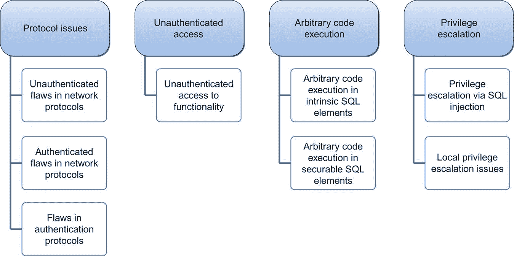

图 12.2 数据库安全问题分类

### 协议问题

我们可能会在任何数据库使用的协议中发现许多问题。我们可以查看用于与数据库通信的网络协议，其中某些需要一组凭据才能使用，而另一些不需要。无论哪种情况，对于我们感兴趣的任何主流数据库产品和版本，通常都会源源不断产生漏洞。此类漏洞通常涉及一些常见的软件开发问题，例如我们在在本章开头讨论过的缓冲区溢出。

当我们处理已知的协议问题时，最好的防御方法是确保我们正在使用相关数据库软件的最新内核版本和补丁，正如我们在第 11 章中所讨论的那样。针对目前未知的网络协议问题的防御通常围绕着限制对数据库的访问展开，这可以意味着实际上限制能够通过网络连接到数据库的人员（使用我们在第 10 章中讨论过的某些方法），或者对于身份验证协议问题，通过遵循最小权限原则，限制我们为数据库本身提供的权限和账户。

取决于我们使用的特定软件和版本，我们可能在数据库使用的认证协议中也会遇到问题。通常情况下，软件变得越旧、越过时，我们使用不健壮的认证协议的可能性就越大。许多旧应用程序将使用我们已知在某些时刻被破解的认证协议，或者具有明显的架构缺陷，例如像 `Telnet` 那样在网络上以明文形式发送登录凭据（请阅第 5 章）。再次，这里最好的防御是确保我们正在使用的软件处于当前版本。

### 未经身份的访问

当我们赋予用户或进程在不提供一组凭据的情况下与数据库交互的机会时，我们就制造了安全问题的可能性。此类问题可能与通过 Web 接口对数据库进行简单查询有关，在这种情况下我们可能会无意中暴露数据库中包含的信息；或者我们可能会暴露数据库本身的信息，例如版本号，为攻击者提供额外的材料来攻破我们的应用程序。

我们还可能会遇到与我们在本章开头讨论的软件软件开发实践相关的各种问题。如果强制用户或进程向我们发送一组凭据以开始事务，我们就可以根据这些凭据对用户或进程被允许的操作进行监控或设置限制。如果我们允许在不要求这些凭据的情况下访问我们应用程序或工具集的某部分，我们可能会失去对正在发生的操作的可见性和控制力。

### 任意代码执行

我们可以在用于与数据库通信的语言中发现许多安全漏洞区域。通常情况下，这些问题集中在 `SQL` 上，因为它是最常用的数据库语言。在默认的 `SQL` 语言中，许多内置元素可能存在安全风险，其中一些我们可以控制其访问，而另一些则不能。

在这些语言元素中，可能会发现许多与我们使用的软件 bug 相关的问题，或由于未使用安全编码实践而产生的问题，这些可能允许我们在应用程序内部执行任意代码。例如，正如我们在本章较早时候讨论的那样，允许我们进行缓冲区溢出的缺陷可能会使我们能够将攻击代码插入数据库或操作系统使用的内存空间中，并攻破其中一个或两者。

我们对此类攻击的最佳防御是双向的。从消费者角度来说，我们应该保持软件版本和补丁的更新。从供应商角度来说，我们应该在所有情况下强制执行安全编码实践，以从根本上消除漏洞，并进行内部审查以确保这些实践实际上得到了遵循。

### 权限提升

我们最后一类主要的数据库安全问题是权限提升。从本质上说，权限提升是一种攻击，我们利用许多方法将访问级别提高到我们授权范围之外。

正如我们在本章开头提到的，SQL 注入是一种针对可通过 Web 接口访问的数据库的非常常见的攻击，很大程度上是一个没有正确过滤或验证输入的问题。SQL 注入还可以用于从数据库中获取信息、修改数据库中包含的数据并执行许多类似的活动。

较常见的 SQL 注入示例之一是在用户名字段输入中发送字符串 `or '1=1`。如果应用程序没有对输入进行过滤，这可能会导致它自动记录我们已输入合法的用户名（我们显然没有这样做），从而允许我们可能提升权限级别。

## 附加资源

对于对 SQL 注入和通用数据库安全感兴趣的人，Syngress 出版了两本书：Denny Cherry 编写的 *Securing SQL Server*（ISBN: 9781597496254）和 Justin Clarke 编写的 *SQL Injection Attacks and Defense*（ISBN: 9781597494243）。这两本都是非常知识丰富的人士提供的优秀资源。

权限提升的另一个关注领域是操作系统的角度。数据库应用程序是运行在操作系统上的进程，使用操作系统用户的凭据和权限，就像 浏览器或其他我们可能运行的任何应用程序一样。如果我们不小心保护操作系统以及运行在上面的用户账户（正如我们在[第 10 章](#chp010.xhtml#chp010）和[第 11 章](#chp011.xhtml#chp011）中讨论的那样），我们可能采取的任何数据库安全措施可能化为乌有。

我们对此类操作系统问题的最佳防御是我们在第 11 章](#chp011.xhtml#chp011 中讨论的一系列加固和缓解步骤。如果我们能从源头上防止攻击者破坏我们的系统，我们就可以很大程度上避免这一特定的担忧。

## 应用程序安全工具

我们可以使用多种工具来评估并改进应用程序的安全性。我们在第 10 章和第 11 章中讨论了其中一些工具，例如嗅探器。另一些工具则不那么熟悉且也更加复杂，例如模糊测试工具和逆向工程工具。其中某些工具要求具备一定的软件开发经验以及对相关技术有更高的熟悉程度，才能有效地使用它们。

### 嗅探器

正如我们在第 10 章和第 11 章中讨论的那样，嗅探器在各种安全场景下都很有用处。我们可以在非常高的层面上使用它们来检查我们所连接的网络段传输的所有流量，前提是我们可以妥善地放置嗅探器以查看相关的流量。我们也可以非常具体地使用此类工具来监控与特定应用程序或协议交换的网络流量。在图 12.3 中，我们正在使用 `Wireshark` 专门检查超文本传输协议（HTTP）流量。

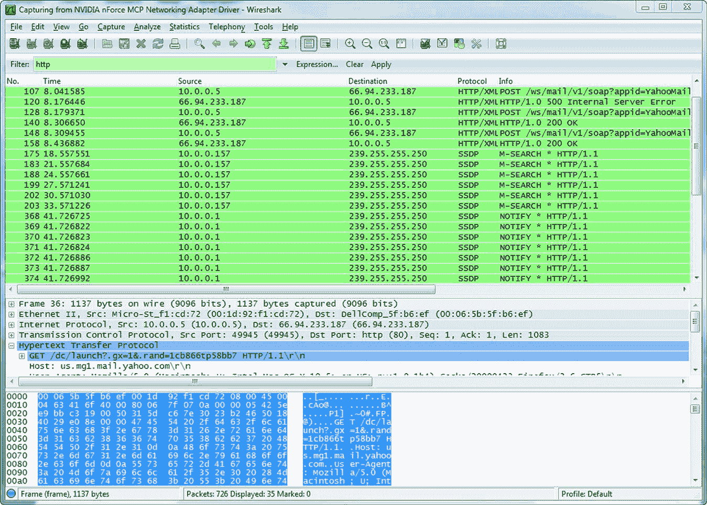

图 12.3 Wireshark 检查 HTTP 流量。

在某些情况下，我们还可以使用特定操作系统的工具从嗅探工具中获取额外信息。一个很好的例子是 `Microsoft Network Monitor` 工具，它不仅让我们能够嗅探网络流量，还能轻松将我们看到的流量与系统运行的特定应用程序或进程关联起来。这允许我们非常具体地将系统网络接口上看到的信息追溯到特定的进程，如图 12.4 所示。

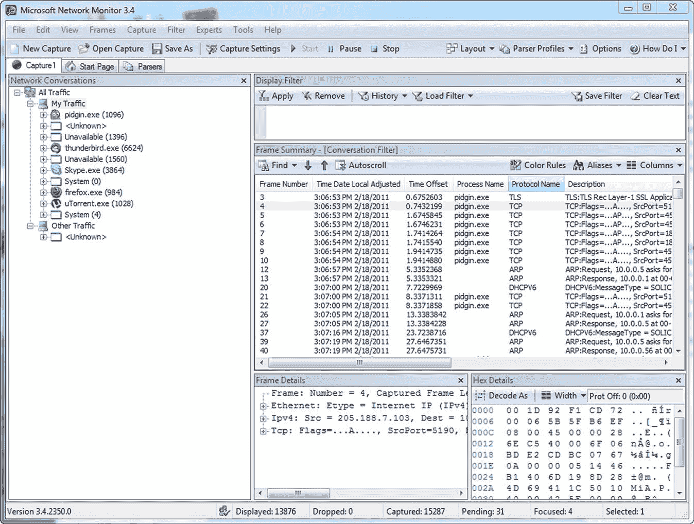

图 12.4 Microsoft network monitor 检查来自应用程序的流量。

### Web 应用分析工具

为了分析 Web 页面或基于 Web 的应用程序存在大量的工具，其中一些是商业性的，另一些是免费的。大多数工具执行相同的通用任务，并搜索常见的漏洞，如 XSS 或 SQL 注入漏洞，以及权限设置不当、额外文件、过时的软件版本等许多此类项目。

### Nikto 和 Wikto

`Nikto` 是一个免费开源的 Web 服务器分析工具，它会对我们在在本节开头提到的许多常见漏洞进行检查，这些漏洞在之前的章节中回顾服务器端安全问题时也讨论过。`Nikto` 会对它在目标 Web 服务器上可见的所有文件和目录进行建立索引（这一过程通常称为爬虫/抓取），然后定位并报告它发现的任何潜在问题。

## 警告！

在使用 Web 分析工具时，重要的一点是，工具报告的所有潜在问题并不实际上都是安全问题。此类工具几乎无一例外地返回一定数量的误报（false positives），即指示一个并不实际的问题。在采取行动缓解问题之前，手动验证该问题确实存在很重要。


`Nikto` 是一个运行在 Linux 上的命令行界面工具。对于我们这些处于 Windows 为中心的环境或倾向于使用图形界面的人来说，SensePost 开发了一个 Windows 版本的 `Nikto`，称为 `Wikto`，如图 12.5 所示。`Wikto` 的功能与 `Nikto` 非常相似，并为我们提供了图形用户界面（GUI）。

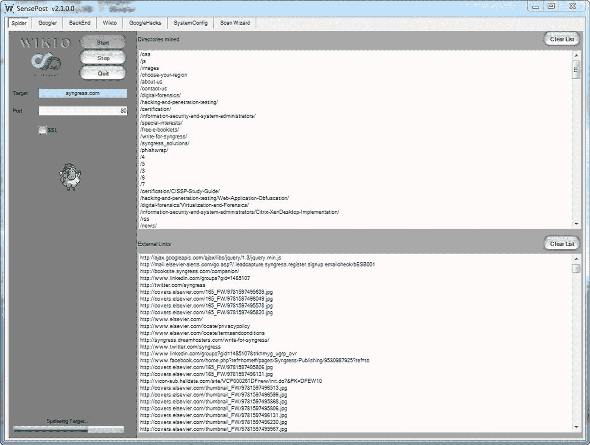

图 12.5 Wikto.

### Burp Suite

还有许多商业 Web 分析工具可用，价格从数百美元到几千美元不等。`Burp Suite` 就是其中一种工具，其专业版倾向于成本范围的低端（本文写作时每年 299 美元），但仍然提供了一套实用的功能。`Burp Suite` 在 GUI 中运行，如图 12.6 所示，除了我们在任何 Web 评估产品中找到的标准功能集外，它还包含了几个用于进行更深入攻击的更高级工具。

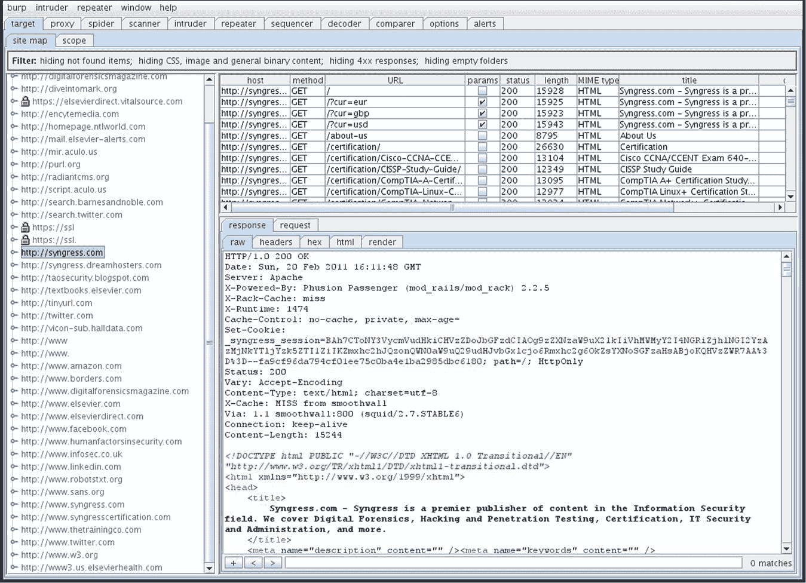

图 12.6 Burp Suite.

`Burp Suite` 还有一个免费版本，允许使用标准的扫描和评估工具，但不包含对更高级功能的访问。

### 模糊测试工具

除了我们可以用来检查软件各种已知漏洞的工具外，我们还有另一类工具可以用来发现完全意外的问题，这一过程被称为模糊测试（fuzz testing）。我们用于这种技术的工具被称为 `fuzzers`，它们通过用各种来源的数据和输入轰击我们的应用程序来工作，使其崩溃或以意想不到的方式运行。

#### 更高级的模糊测试

模糊测试的概念是由 Barton Miller 在 20 世纪 80 年代的一个大学课程中提出的 9，并深受安全研究人员和安全测试人员的欢迎。关于模糊测试的进一步阅读资源，包括一个启动该领域的文档，可以在威斯康星大学 Miller 的模糊测试网页找到：`http://pages.cs.wisc.edu/~bart/fuzz/`。

### 模糊测试工具详解

有很多模糊测试工具可用，有些有特定的重点，有些则更通用。微软发布了几个特定的模糊测试工具，以协助发现现有软件和开发软件中的漏洞，包括用于发现文件处理源码漏洞的 `MiniFuzz Fuzzer`、用于检查源代码通用良好实践的 `BinScope Binary Analyzer` 以及用于测试正则表达式潜在漏洞的 `SDL Regex Fuzzer`。

### Web 应用程序与数据库安全

保护我们的 Web 应用程序及其交互的数据库也是一项至关重要的活动。当我们观察任何涉及安全疏忽的泄露事件（无论是企业还是政府部门）时，几乎可以肯定在某个时间点存在应用安全漏洞。我们在本章早些讨论的 TJX 泄露事件最初并非应用程序故障，但该公司所实施的松散应用安全措施导致泄露后果比本应的情况严重得多。对于技术型公司来说，此类安全措施并非可选的，也不仅仅是一个“好主意”，而是是一项基础性要求。根据运营的行业和处理的数据，此类保护可能是法律的强制要求。

## 总结

在软件开发过程中，许多漏洞是普遍存在的，适用于我们可能开发或实施解决方案的许多平台。我们可能会遇到缓冲区溢出、竞态条件、输入验证攻击、身份验证攻击、授权攻击和加密攻击，这仅是其中几个。尽管这些问题非常常见，但通过遵循安全编码指南可以相对轻松地解决，这些指南可以是组织内部，也可以来自 `NIST`、`CERT` 或美国国土安全部的“软件安全保障倡议（BSI）”等外部来源。

在 Web 安全方面，关注领域可分为客户端问题和服务器端问题。客户端问题涉及针对我们正在运行的客户端软件或使用软件的人员的攻击。我们可以通过确保运行最新版本的软件及相关补丁，有时通过添加额外的安全工具或插件来帮助缓解这些问题。另一方面，我们还面临直接针对 Web 服务器本身的攻击。此类攻击通常利用了缺乏严格权限、缺乏输入验证以及开发或故障排除工作留下的文件等。修复此类问题需要开发人员和安全人员的仔细审查。

数据库安全是几乎任何面向互联网的应用程序的一个大问题。数据库安全关注的主要类别包括协议问题、未经身份验证的访问、任意代码执行和权限提升。通过遵循安全编码实践、保持软件版本和补丁更新以及遵循最小权限原则，可以缓解其中许多问题。

我们可以使用许多应用程序安全工具，尽力增强应用程序的抵御攻击能力。与网络和主机安全一样，我们可以利用嗅探器来检查进出应用程序的网络数据。我们还可以使用反向工程工具来检查现有应用程序的运行方式，并确定我们可能被熟练的反向工程工程师利用的缺陷。此外，我们可以利用模糊测试（fuzzing）工具和 Web 应用程序分析工具来定位漏洞，无论是已知的还是未知的。

## 练习

1. 模糊测试工具的作用是什么？

2. 给出一个竞态条件的例子。

3. 为什么从 Web 服务器中删除多余文件很重要？

4. `Nikto` 工具的作用是什么？我们在什么情况下可能会使用它？

5. 列出 Web 安全两个主要类别。

6. SQL 注入攻击是对数据库的攻击还是对 Web 应用程序的攻击？

7. 为什么输入验证很重要？

8. 解释 XSRF 攻击以及我们可以采取什么措施防止它。

9. 我们如何使用嗅探器来提高应用程序的安全性？

10. 如何防止应用程序中的缓冲区溢出？

## 参考文献

[1. Perira J. 信用卡数据是如何通过无线流出的。Wall Street Journal [Online], <http://online.wsj.com/news/articles/SB117824446226991797>(http://online.wsj.com/news/articles/SB117824446226991797>; 2007 [cited 25.10.13].

[2. Hickey A. WEP：无线安全在柜里的破损骨架。SearchNetworking.com., <http://searchnetworking.techtarget.com/news/1252992/WEP-Wireless-securitys-broken-skeleton-in-the-closet>(http://searchnetworking.techtarget.com/news/1252992/WEP-Wireless-securitys-broken-skeleton-in-the-closet>; April 26, 2007 [cited 25.10.13].

[3. Gregory P. 关于 TJX 泄露的有趣描述，请阅读他们的 10-K 表格，Securitas Operandi, <http://peterhgregory.wordpress.com/2007/05/03/for-an-interesting-account-of-the-tjx-breach-read-their-10-k/>(http://peterhgregory.wordpress.com/2007/05/03/for-an-interesting-account-of-the-tjx-breach-read-their-10-k/>; May 3, 2007 [cited 25.10.13].

[4. Sayao ML. Java 和 C# Web 应用程序或独立程序的效率，Yahoo Voices, <http://voices.yahoo.com/efficiency-java-c-languages-on-592948>(http://voices.yahoo.com/efficiency-java-c-languages-on-592948>; May 30, 2010 [cited 25.10.13].

[5. Lucas I. 密码恢复速度，Lockdown.co.uk., <http://www.lockdown.co.uk/?pg=combi&s=articles>(http://www.lockdown.co.uk/?pg=combi&s=articles>; July 10, 2009 [cited 25.10.13].

[6. Mearian L. 更多闪存驱动公司警告安全漏洞；NIST 展开调查，Computerworld, <http://www.computerworld.com/s/article/9143504/More_flash_drive_firms_warn_of_security_flaw_NIST_investigates?taxonomyId517&pageNumber51>(http://www.computerworld.com/s/article/9143504/More_flash_drive_firms_warn_of_security_flaw_NIST_investigates?taxonomyId517&pageNumber51>; January 8, 2010 [cited 25.10.13].

[7. Deeg M, Schreiber S. 加密安全？SySS 破解了 USB 闪盘，SySS, <http://www.syss.de/fileadmin/ressources/040_veroentlichungen/dokumente/SySS_knackt_SanDisk_USB-%20Stick.pdf>(http://www.syss.de/fileadmin/ressources/040_veroentlichungen/dokumente/SySS_knackt_SanDisk_USB-%20Stick.pdf>; 2009.

[8. Litchfield D, Anley C, Heasman J, Grindlay B. *The database Hacker's handbook: defending database servers* Wiley 2005; ISBN-13: 9780764578014.

[9. Miller B. 应用程序可靠性的模糊测试，UW-Madison 计算机科学，<http://pages.cs.wisc.edu/~bart/fuzz/>(http://pages.cs.wisc.edu/~bart/fuzz/>; May 25, 2008 [cited 19.02.11].

## 索引

滥用法, 91

可接受性, 33

访问控制, 39, 40, 42 访问控制列表 (ACLs), 43–44 文件系统, 43–44 网络 ACL, 45 允许访问, 42 基于能力的安全机制, 47–48 混淆代理问题, 47–48 拒绝访问, 42 限制访问, 42 方法论, 49–50 基于属性的访问控制 (ABAC), 50–51 任意裁量访问控制 (DAC), 49 强制访问控制 (MAC), 49–50 多级访问控制, 51–52 基于角色的访问控制 (RBAC), 50 物理访问控制, 52–53 在现实世界中, 54 撤销访问, 43 访问控制列表 (ACLs), 43–44 文件系统, 43–44 网络 ACL, 45 责制, 57, 58–59, 58*`f`* 完成, 62 在现实世界中, 66–67 安全效益, 60 记录的可采纳性, 61–62 震慑, 60 入侵检测与防御, 61 非否认性, 60 AccuScreen, 140 “Ackles.”, 参见 访问控制列表 (ACLs)

地址空间布局随机化 (ASLR), 180 行政控制, 16 Adobe Flash 和 Acrobat Reader, 174 Adobe Flash 动画, 195–196 高级加密标准 (AES), 77, 195 Aircrack-NG, 164 亚马逊, 95–96, 112 Android IOS, 176 基于异常的检测, 157–158 反恶意病毒工具, 179–180 Apple IOS, 176 基于应用协议的侵检测系统 (APIDS), 157 应用安全, 190 身份验证攻击, 193–194 授权攻击, 194 缓冲区溢出, 192 点击劫持, 196 跨站请求伪造 (XSRF) 攻击, 196 加密攻击, 194–195 数据库安全, 198–201 任意代码执行, 200–201 权限提升, 201 协议问题, 199–200 未身份验证访问, 200 输入验证攻击, 193–193 竞态条件, 192–193 在现实世界中, 206–207 服务器端攻击, 197–198 额外文件, 198 权限不当或不足, 198 输入验证验证, 191–191 软件漏洞, 190–191 TJ 破解, 202–203 工具, 202–203 Burp Suite, 204 模糊测试, 204 嗅探器, 202 Web 应用工具, 202–203 Web 安全, 195–196 客户端攻击, 195–196 任意代码执行, 200–201 *兵法法*, 103, 103, 103 非对称加密, 78–79 对对称加密, 76–79 非对称密钥算法, 78–79 攻击, 9–11 身份验证, 193–194 授权, 194 客户端, 195–196 跨站请求伪造 (XSRF), 196 加密攻击, 194–195 拒绝服务攻击 (DoS), 7 伪造, 10–11 格式字符串, 193 输入验证, 193 拦截, 9 中断, 10 中人攻击, 29–30 修改, 10 服务器端, 197–198 攻击面, 172–173 基于属性的访问控制 (ABAC), 50–51 审计, 62–63, 63 评估, 65–66 日志, 65 监控, 66–67 在现实世界中, 24 身份验证, 29–30 授权, 31 生物识别, 32–33 特性, 32–33 问题, 32–33 性能, 33 性能, 33 持久性, 32 唯一性, 32 通用性, 32 块加密对流加密, 76–77 Brewer 和 Nash 模型, 52 自带设备 (BYOD), 162–163 暴力破解, 30–31 缓冲区溢出, 192 Bug, 144 Burp Suite, 204 业务, 106 竞争, 106 智能, 106 和隐私, 98 业务连续性计划 (BCP), 132 业务软件联盟 (BSA), 63

备份, 143

BadAttack.com, 196

银行保密法, 92*`t`*

BCP/DRP, 132

Bell-LaPadula 模型, 51–52

iba 模型, 52

二进制分析器, 205

生物识别, 31

可接受性, 33

绕过, 33

可收集性, 32–33

特性, 32–33

问题, 32–33

测量性能, 33

性能, 33

持久性, 32

唯一性, 32

通用性, 32

块加密对流加密, 76–77

Brewer 和 Nash 模型, 52

自带设备 (BYOD), 162–163

暴力破解, 30–31

缓冲区溢出, 192

Bug, 144

Burp Suite, 204

业务, 106

竞争, 106

智能, 106

和隐私, 98

C

- 凯撒密码，71

- 加州州参议院第 1386 号法案，92*t*

- 基于能力的安全机制，47–48

- 混淆代理问题 (confused deputy problem)，47–48

- 验证码 (Captchas)，50–51

- 证书颁发机构 (CA),80–81

- 证书吊销列表 (CRL),81

- 证书，80–81

- 2001 年《儿童互联网保护法》，92*t*

- 1998 年《儿童在线隐私保护法》，92*t*

- 中国墙模型，*参见* Brewer and Nash 什模型模型

- 咽喉点 (Choke points)，153

- Chrome，196–197

- 密码块链接模式 (CBC),77

- 密码反馈模式 (CFB),77

- 密文，70

- 绕过，33

- 洁净桌面，127

- 点击劫持 (Clickjacking)，48, 196

- 客户端攻击，47, 195–196

- 劫劫持 (clickjacking)，196

- 跨站请求伪造 (XSRF)，196

- 跨站脚本攻击 (XSS)，195–196

- 云计算，112

- 可收集性，32–33

- 碰撞，80

- 1994 年《执法协助法案》，92*t*

- 竞争性反间谍，106

- 竞争性情报，106, 106

- **竞争策略：分析行业和竞争对手的技术*，106

- 复杂密码，30

- 合规性，94–95

- 行业合规，95

- 监管合规，94–95

- 计算机训练 (CBT)，128

- 1986 年《计算机欺诈与滥用法案》，91, 92*t*

- 机密性、完整性和可用性 (CIA) 三元组，5, 8

- 1996 年《消费者信贷报告改革法》，92*t*

- 应对措施的应用，111

- 计数器模式 (CTR),77

- coWPAtty，164

- 关键信息的识别，107

- 跨站请求伪造，47, 196

- 跨站脚本攻击 (XSS)，195–196

- 密码学攻击，194–195

- 密码学，69

- 历史，70–73

- 机器，71–73

- 现代工具，75–79

- 证书，80–81

- 数字签名，80

- 哈希函数，79–80

- 对称与非对称，76–79

- 静态地数据保护，81–83

- 传输中数据保护，81–83

- 使用中数据保护，81–83

- 在现实世界中，85–86

- **黑暗骑士*，19–20

- 数据保护，140–143

- 可用性，141–142

- 备份，143

- 传输中数据，84–85

- 数据保护方法，84

- 连接保护，84–85

- 物理关注量，140–141

- 剩余数据，142–143

- 静态数据，81–83

- 数据安全，82–83

- 物理安全，83

- 使用中数据，85

- 数据加密标准 (DES),77

- 使用中数据，85

- 数据库安全，198–201

- 任意代码执行，200–201

- 权限提升，201

- 协议问题，199–200

- 未经身份访问，200

- 深度包检测防火墙，155

- 默认账户修改，175–176

- 深度防御，19–21

- 层，20–21

- 非军事化区，*参见* DMZ

- 拒绝服务 (DoS) 攻击，7

- 侦测安全控制，134–135, 135


## 索引

### D
- 威慑控制，134–135
- Diffie-Hellman，79
- 数字设备公司 (DEC)，153–154
- 数字签名，80
- 数字签名标准 (DSS)，79
- 灾难恢复计划 (DRP)，132
- 强制访问控制 (DAC)，49
- 分布式拒绝服务 (DDoS) 攻击，152
- DMZ (非军事化区)，156
- 域名系统 (DNS)，175

### F
- 伪造攻击，10–11
- 《公平与准确信用交易法》（Fair and Accurate Credit Transactions Act），92*t*
- 1999 年《公平信用报告法》（Fair Credit Reporting Act of 1999），92*t*
- 《公平债务催收法》（Fair Debt Collection Practices Act），92*t*
- 假接受率（False acceptance rate (FAR)），33
- 假阴性（False negative），33
- 假阳性（False positive），33
- 假拒率（False rejection rate (FRR)），33
- 1974 年《家庭教育权利与隐私法》（Family Education Rights and Privacy Act of 1974），92*t*
- 联邦存款保险公司（Federal Deposit Insurance Corporation (FDIC)），94–95
- 联邦能源监管委员会（Federal Energy Regulatory Commission），92*t*
- 联邦身份盗与假设威慑法（Federal Identity Theft and Assumption Deterrence Act），92*t*
- 联邦信息安全管理法（Federal Information Security Management Act (FISMA)），5
- 1974 年《联邦隐私法》（Federal Privacy Act of 1974），97
- 联邦贸易委员会法（Federal Trade Commission Act），92*t*
- *打击计算机犯罪*（Fighting Computer Crime），7
- 文件传输协议（File Transfer Protocol (FTP)），160
- 金融行业监管局（Financial Industry Regulatory Authority），92*t*
- Firefox，48, 196–197, 197
- 防火墙（Firewalls），153–156
  - 深度数据包检测（deep packet inspection），155
  - DMZ（非军事化区，DMZ (demilitarized zone)），156
  - 数据包过滤（packet filtering），154
  - 代理服务器（proxy servers），155–156
  - 状态数据包检测（stateful packet inspection），154–155
- 工具（tools），167
- 第一个漏洞（First bug），145*f*
- 业务安全第一定律（First law of operations security），112
- 闪存媒体（Flash media），141
- Fluke 网络（Fluke Networks），165
- 格式化攻击（Format string attacks），193
- Franklin 克林（Franklin, Benjamin），102–103
- 全盘加密（Full disk encryption），82
- 模糊测试器（Fuzzers），204
- 模糊测试（Fuzz testing），204

### G
- 门（Gates），*参见* 物理访问控制（Physical access controls）
- 德国制造的恩尼格玛机（German-made Enigma machine），72
- Google，112
- 1999 年《格林姆-莱奇-布莱利金融服务现代化法》（Gramm–Leach–Bliley Financial Services Modernization Act of 1999），92*t*
- 守卫（Guards），*参见* 物理访问控制（Physical access controls）
- 枪（Guns），*参见* 物理访问控制（Physical access controls）

### H
- 哈斯定律（Haas’ Laws），111–112
  - 第一定律，112
  - 第二定律，112–113
  - 第三定律，113
- 加固（Hardening），172–178
- 硬件令牌（Hardware tokens），34–35
- 哈希函数（Hash functions），79–80
- 1996 年《健康可携带性与责任法》（Health Portability and Accountability Act of 1996），58
- 健康与健康信息技术法（Health Information Technology for Economic and Health Act），92*t*
- 健康保险携带性法（Health Insurance Portability Act），92*t*
- 1996 年《健康可携带性与责任法》（Health Portability and Accountability Act of 1996），5
- 2002 年帮助美国法（Help America Act of 2002），92*t*
- 2002 年国土安全法（Homeland Security Act of 2002），92*t*
- 蜜罐网（Honeynets），154–155
- 蜜罐（Honeypots），165–166
- 基于主机的入侵检测系统（Host-based intrusion detection systems (HIDS)），157
- HP 通用网关 1.0，182–183
- Hping3，167
- 人因素安全（Human element security），119
  - 安全意识（security awareness），120–127
  - 洁洁桌面（clean desk），127
  - 有效触用户（effectively reaching users），128
  - 恶意软件（malware），126
  - 网络使用（network usage），125–126
  - 密码（passwords），121–122
  - 个人设备（personal equipment），126–127
  - 政策与监管知识（policy and regulatory knowledge），127
  - 数据保护（protecting data），121
  - 社会工程（social engineering），122–125
  - 培训计划（training program），127–128
  - 弱环节（as weak link），120
- 超文本传输协议（Hypertext Transfer Protocol (HTTP)），84
- 安全超文本传输协议（Hypertext Transfer Protocol Secure (HTTPS)），175
- 识别（Identification），24
  - 声称（claiming），24–25
  - 伪造（falsifying），25–26
  - 验证（verification），25
- 身份盗窃（Identity theft），26
- IDS 检测方法（IDS detection methods），157–158
- 冒充攻击（Impersonation attacks），*参见* 中间人攻击（Man-in-the-middle attacks）
- 不当/权限不足（Improper/inadequate permissions），198
- 攻击（attacks），9–18
- 控制（controls），8
- 威胁、漏洞与风险（threats, vulnerabilities, and risk），11–12
- triad），5
- 缺乏（lack of），197
- Internet 控制协议包（Internet Control Protocol (ICMP) packets），167
- 消息访问协议（Internet Message Access (IMAP)），84
- Internet 服务提供商（Internet service providers (ISPs)），94–95），61），158
- 杰斐逊磁盘（Jefferson disk），145*f*
- 布局（Layout），53*f*

### K
- Kali，163
- 克克霍夫，奥古斯特（Kerckhoffs, Auguste），75
- 克克霍夫法则（Kerckhoffs’ principle），75

### L
- 法律法规（Laws and regulations），90–94
  - 与业务（and business），98
- 类 Linux 操作系统（Linux-like operating systems），[176](#chp011.xhtml#p330)
- 液体（Liquids），[144](#chp009.xhtml#p550)
- 活生物（Living organisms），[144](#chp009.xhtml#p555)
- 日志（Logging），[64–65](#chp004.xhtml#s080)
  - 与审计功能（and auditing functions），[178](#chp011.xhtml#s050)
- 逻辑控制（Logical controls），[15–16](#chp001.xhtml#s0200)

### M
- 磁性媒体，141
- 恶意软件，126
- 防防护，178–179
- 强制访问控制 (MAC)，49–50
- 中间人攻击，29–30
- 密码的手动同步，31
- McAfee，82
- 媒体，140–141
- 媒体访问控制 (MAC) 地址过滤，45
- 消息，70
- 消息摘要算法 5 (MD5)，80
- 消息摘要，*参见* 哈希函数
- Metasploit Pro，184*f*
- 微软，112
- 微软网络监控工具，202
- 微软操作系统，41, 176
- MiniFuzz 文件模糊，205
- 移动设备，161
  - 自带设备办公 (BYOD)，162–163
  - 管理，162
- 移动设备管理 (MDM) 解决方案，162, 163
- 修改攻击，10
- 监控，65
- 美国电影制作协会 (MPAA)，159
- Mozilla Firefox 浏览器，48
- 多因素认证，28, 28–29
- 多级访问控制模型，51–52
- 相互认证，29–30
- MySpiffyBank.com，196

### N
- 国家决策安全指令 298，107
- Nessus，65–66, 66*f*, 183, 184*f*
- Nessus 攻击脚本语言 (NASL)，183
- NetStumbler，164
- 网络 ACL，45
- 网络入侵检测系统 (NIDSes)，157, 157, 157–158
- 网络安全，152
  - 移动设备，161
  - 自带设备办公 (BYOD)，162–163
  - 管理，162
  - 网络防护防火墙，153–156
  - 网络设计的安全性，153
  - 网络入侵检测系统，157–158
  - 网络流量保护，157–158
  - 拦截数据，158–159
  - 安全协议，160–161
  - 虚拟专用网络 (VPNs)，159
  - 无线网络安全，159–160
  - 在现实世界，167–168
  - 工具，163
  - 防火墙工具，167
  - 蜜罐罐，165–166
  - 数据嗅探器，165
  - 端口扫描器，164
  - 无线，164
  - 网络分段，153
  - 网络使用，151–150
- Nikto，203
- Nmap，157, 203
- Nmap 扫描，184, 175*f*
- Nmap 结果，183, 175*f*
- Nmap 脚本，183
- 不可否认性，60
- 北美电力公司，92

### O
- 外国资产局，109*f*
- 业务安全 (OPSEC)，101
- 意识海报，108*f*
- Haas 准则，111–112
  - 第一条，112
  - 第二条，112–113
  - 第三条，113
- 跨部门 OPSEC 支持人员，106–107
- 起源，102–103
- 在生活中，114
- 流程，107–111
  - 关键信息的识别，107
  - 风险评估，110
  - 威胁分析，107–109
  - 漏洞分析，110
- 在现实世界，115–116
- 孙子，103
- 越南战争，104–106
- 华盛顿，乔治，103–104

### P
- 光介，141
- OptiView 便携式网络分析仪，165
- 输出反馈 (OFB)，77
- 包过滤防火墙，154
- 数据嗅探器，165
- Parker, Donn，7
- 帕克六六进制（Parkerian hexad），7
- 真实性，8–9
- CIA 三要素，8
- 所有权/控制，8
- 效用，9
- 密码管理器，31
- 密码，30, 121–122
- 审计，63
- 身份验证，30
- 手动同步，31
- 支付应用数据安全标准，92
- 支付卡行业（PCI），94
- 支付卡行业数据安全标准（PCI DSS），5
- 支付卡行业标准，92
- 渗透测试，14
- 人员，保护，136–140
  - 行政控制，139–140
  - 疏散，138–139
  - 物理方面的关注，136–137
  - 安全，137–138
- 性能，33
- 测量，33
- 久性，32
- 个人设备，126–127
- 个人识别码（PIN），6, 30
- 个人身份信息（PII），2
- PGP，79
- 钓鱼攻击，123–124
- 物理访问控制，52–53
- 使用，136
- 物理控制，15
- 物理安全，83, 131
  - 控制，134–136
  - 侦探控制，135
  - 威慑控制，134–135
  - 预防性控制，135
- 数据，保护，140–143
  - 可用性，141–142
  - 备份，143
  - 物理方面的关注，140–141
  - 剩余数据，142–143
- 设备，保护，143–144
  - 环境条件，146–147
  - 物理方面的关注，144
  - 访问安全，146
  - 站点选择，145–146
- 人员，保护，136–140
  - 行政控制，139–140
  - 疏散，138–139
  - 物理方面的关注，136–137
  - 安全，137–138
- 现实世界，147–148
- 使用，136
- 物理威胁，133
- 政策与监管知识，133f
- 端口扫描器，164
- 所有权/控制的含义，8
- 邮局协议（POP），84, 160
- 社交工程骗（Pretexting），123
- 极好的隐私（PGP），79, 79
- 预防性控制，135
- 最小权限原则，41–42
- PRISM 程序，85
- 隐私，95–98, 96
  - 以及业务，98
  - 权利，96–98
  - 全球问题年度，97–98
- 1980 年隐私法案，92
- 私钥加密，79
- 权限提升，201
- 保护恶意软件，121
- 传输中的数据，84–85
- 静态存储数据，84–83
- 数据安全，82–83
- 物理安全，83
- 代理服务器，155–156
- 公钥加密，81
- 公钥基础设施（PKI），104
- 紫色龙，195

### R
- 竞态条件，192–193
- Rapid7 的 Metploit，184–185
- 美国唱片协会（RIAA），159
- 独立磁盘冗余阵列（RAID），143
- 注册机构（RAs），81
- 剩余数据，142–143
- 1978 年金融隐私法案，92
- 风险，11–12
  - 评估，15
  - 管理，110
- 评估漏洞，12–16
- 识别资产，14
- 识别威胁，13–14
- 缓解，15–16
- 越器接入点，160, 160
- 基于角色的访问控制（RBAC），50
- ROT13 密码，71
- 转子，72
- RSA 算法，78, 195

### S
- Safari，196–197
- 萨班斯-奥克斯利法案 (SOX)，58, 92*t*
- 扫描器，164, 182–183
- 阿瑟·谢尔比亚斯 (Scherbius, Arthur)，72
- `SDL Regex Fuzzer`，205
- 操作安全法则，112–113
- 安全文件传输协议 (SFTP)，160–161
- 安全哈希算法 2 (SHA-2)，78–79
- 安全协议，160–161
- 安全壳 (SSH)，160–161, 161
- 安全套接层 (SSL) 协议，78
- 安全问题，模型，5
  - 机密性、完整性和可用性 (CIA) 三元组，5
  - 帕克森六元组 (Parkerian hexad)，7
- SensePost，203
- 服务端攻击，197–198
  - 无关文件，198
  - 权限不当/不足，198
  - 缺乏输入验证，197
- 基于签的人入侵检测系统 (IDSes)，157
- “简单且灵活的数据报访问控制”，153–154
- 简单邮件传输协议 (SMTP)，156
- 站点选择，145–146
- 烟雾与火灾，137
- 嗅探器，165, 202
- 嗅探，165
- 爱德华·斯诺登 (Snowden, Edward)，85
- 社会工程学，122–125
  - 钓鱼攻击，123–124
  - 预设攻击 (pretexting)，123
  - 尾随，124–125
- 软件开发漏洞，191, 192*f*
- 身份验证攻击，155–156
- 授权攻击，156
- 缓冲区溢出，154
- 密码攻击，157–158
- 输入验证攻击，155
- 竞态条件，154–155
- 软件防火墙，181
- 软件许可、审计，63
- 软件安全令牌，27*f*
- SSL，84
- SSL/TLS，84
- 状态检测包检测防火墙，154–155
- 战略与竞争情报专业人士 (SCIP)，106
- 流加密对比分块加密，76–77
- 强密码，*见*逻辑控制
- 强 VPN，159
- 结构化查询语言 (SQL)，197, 201
- Stuxnet，179
- 子网，153
- 替换加密，71
- 孙子，103
- 数据控制与数据采集系统 (SCADA)，179
- 赛门，82
- 对称加密，76–77
- 对比非对称加密，76–79
- 对称密钥，76–79
- 对比非对称加密，76–79
- 尾随，124–125
- `Tcpdump`，165
- 技术控制，*见*控制
- 1991 年电话保护法，92*t*
- `Telnet`，165
- Tenable 的，202


# 索引

## 威胁
112–113

## 传输层安全 (TLS)
84

## 隧道
160

## 未身份验证访问
202

## 唯一性
32

## UNIX 类操作系统
32

## 不必要的软件
174

## 美国能源部 (DOE)
106

## 美国总务署 (GSA)
106

## 美国国家安全局 (NSA)
11

## 美国爱国者法案
97–98

## V

### 乔治·华盛顿
102–103

### 虚拟专用网络 (`VPN`)
159

### IP 电话 (VoIP) 协议
79

### 漏洞
11

#### 评估
110

#### 评估
63

## W

### 全球监控问题年, 2013
97–98
