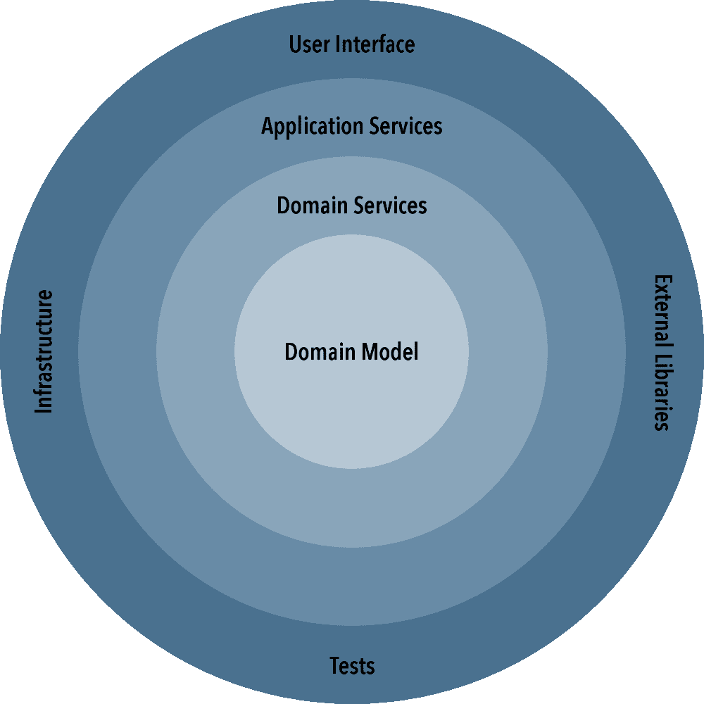
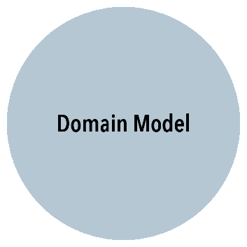
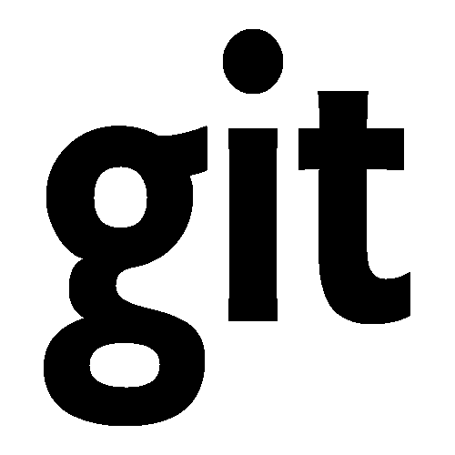

# PHP 洁洁架构

## 0.1 献辞

首先，我将本书献给我的妻子`Ashley`。感谢你允许我花费这么多时间盯着屏幕上的数百万个点。

其次，献给`我的父母`，他们付出了巨大的努力确保孩子们拥有他们需要和想要的一切，并鼓励我追求自己的梦想，无论这些梦想是多么奇异。

# 引言

代码的问题在于，良好的代码——即那些能够实现其功能、几乎或没有缺陷、能够长期生存并发挥其作用、且易于修改的代码——是非常难以完成的。

## 编写良好的代码是困难的

> 如果这很容易，那么每个人都会这样做。
>
> > -*历史上的某人，在某地*

编写代码是困难的。好吧，收回那句话：编写代码很容易。它太简单了，以至于每个人都在做。让我重写这一章。

> 如果擅长这件事很容易，那么每个人都会擅长。
>
> > -*我想，我是这样*

编写代码，特别是在 PHP 中，但在许多其他语言中也是如此，是不可想象的简单。想想入门门槛：你只需要在 Windows 机器上下载 PHP，然后输入：

```
php -S localhost:1337
```

## 关于编码风格的说明

我强烈倾向并建议使用 [PSR-2 标准](https://github.com/php-fig/standards/master/accepted/PSR-2-coding-style.md)。作为一个社区，如果方言相同，评估和贡献他人的代码将变得容易得多。我还强烈建议对类和方法使用 DocBlocks。

然而，为了简洁起见，书中的代码示例与 PSR-2 有几处偏差，即括号的位置，并且没有包含许多 DocBlocks。如果这让像我这样的 DocBlock 狂热者感到太受刺眼，我诚恳地道歉。

## 作者

我叫 Kristopher Wilson。我从 2000 年开始开发 PHP。我和我的妻子以及四只猫住在密歇根州的大急拉比德市。我是 Grand Rapids Developers (GrPhpDev) 组的创始人之一，并深度参与社区的组织、教学和学习。

## 组织

本书从讨论如何组织应用程序开始。以至于我绝对希望有一位经验丰富、知识渊深的开发者负责我的项目。代码的问题在于，良好的代码——即那些能够实现其功能、几乎或没有缺陷、能够长期生存并发挥其作用、且易于修改的代码——是非常难以完成的。

编写代码很容易。简单到有[字面意义上的书籍](http://norvig.com/21-days.html)声称可以在两周、十天甚至二十四小时内教你学会。这让它听起来非常容易！互联网上充斥着关于如何做的文章。似乎每个人都在做，并为此撰写博客。

这里有一个有趣的问题：你会信任一个只通过几本在两周内教他们手术的书就学会职业的外医生或牙医吗？诚然，编写代码与切开并修复人体完全不同，但作为开发者，我们确实在处理许多抽象概念。那些只以 1 和 0 的集合形式存在的东西。

编写代码，特别是在 PHP 中，但在许多其他语言中也是如此，是不可想象的简单。想想入门门槛：你只需要在 Windows 机器上下载 PHP，然后输入：

```
php -S localhost:1337
```

### 领域服务

代码的问题在于，良好的代码——即那些能够实现其功能、几乎或没有缺陷、能够长期生存并发挥其作用、且易于修改的代码——是非常难以完成的。

### 创建实体

代码的问题在于，良好的代码——即那些能够实现其功能、几乎或没有缺陷、能够长期生存并发挥其作用、且易于修改的代码——是非常难以完成的。

### 总结

代码的问题在于，良好的代码——即那些能够实现其功能、几乎或没有缺陷、能够长期生存并发挥其作用、且易于修改的代码——是非常难以完成的。

# Zend Framework 2 设置

代码的问题在于，良好的代码——即那些能够实现其功能、几乎或没有缺陷、能够长期生存并发挥其作用、且易于修改的代码——是非常难以完成的。

## 使用 Composer 安装

代码的问题在于，良好的代码——即那些能够实现其功能、几乎或没有缺陷、能够长期生存并发挥其作用、且易于修改的代码——是非常难以完成的。

## 清理骨架

代码的问题在于，良好的代码——即那些能够实现其功能、几乎或没有缺陷、能够长期生存并发挥其作用、且易于修改的代码——是非常难以完成的。

# 设置我们的数据库

代码的问题在于，良好的代码——即那些能够实现其功能、几乎或没有缺陷、能够长期生存并发挥其作用、且易于修改的代码——是非常难以完成的。

## 表网关工厂

代码的问题在于，良好的代码——即那些能够实现其功能、几乎或没有缺陷、能够长期生存并发挥其作用、且易于修改的代码——是非常难以完成的。

### 总结

代码的问题在于，良好的代码——即那些能够实现其功能、几乎或没有缺陷、能够长期生存并发挥其作用、且易于修改的代码——是非常难以完成的。

## 我们的 Zend Framework

代码的问题在于，良好的代码——即那些能够实现其功能、几乎或没有缺陷、能够长期生存并发挥其作用、且易于修改的代码——是非常难以完成的。

## 管理

代码的问题在于，良好的代码——即那些能够实现其功能、几乎或没有缺陷、能够长期生存并发挥其作用、且易于修改的代码——是非常难以完成的。

## 管理

代码的问题在于，良好的代码——即那些能够实现其功能、几乎或没有缺陷、能够长期生存并发挥其作用、且易于修改的代码——是非常难以完成的。

### 发票管理

代码的问题在于，良好的代码——即那些能够实现其功能、几乎或没有缺陷、能够长期生存并发挥其作用、且易于修改的代码——是非常难以完成的。

## 2

代码的问题在于，良好的代码——即那些能够实现其功能、几乎或没有缺陷、能够长期生存并发挥其作用、且易于修改的代码——是非常难以完成的。

## 持久层

代码的问题在于，良好的代码——即那些能够实现其功能、几乎或没有缺陷、能够长期生存并发挥其作用、且易于修改的代码——是非常难以完成的。

## 映射

代码的问题在于，良好的代码——即那些能够实现其功能、几乎或没有缺陷、能够长期生存并发挥其作用、且易于修改的代码——是非常难以完成的。

## 集成框架

代码的问题在于，良好的代码——即那些能够实现其功能、几乎或没有缺陷、能够长期生存并发挥其作用、且易于修改的代码——是非常难以完成的。

## 存储库

代码的问题在于，良好的代码——即那些能够实现其功能、几乎或没有缺陷、能够长期生存并发挥其作用、且易于修改的代码——是非常难以完成的。

## 转换器

代码的问题在于，良好的代码——即那些能够实现其功能、几乎或没有缺陷、能够长期生存并发挥其作用、且易于修改的代码——是非常难以完成的。

### 总结

代码的问题在于，良好的代码——即那些能够实现其功能、几乎或没有缺陷、能够长期生存并发挥其作用、且易于修改的代码——是非常难以完成的。

## 到 Laravel

代码的问题在于，良好的代码——即那些能够实现其功能、几乎或没有缺陷、能够长期生存并发挥其作用、且易于修改的代码——是非常难以完成的。

### 设置 Laravel

代码的问题在于，良好的代码——即那些能够实现其功能、几乎或没有缺陷、能够长期生存并发挥其作用、且易于修改的代码——是非常难以完成的。

## 配置 Doctrine

代码的问题在于，良好的代码——即那些能够实现其功能、几乎或没有缺陷、能够长期生存并发挥其作用、且易于修改的代码——是非常难以完成的。

### 设置仪表板

代码的问题在于，良好的代码——即那些能够实现其功能、几乎或没有缺陷、能够长期生存并发挥其作用、且易于修改的代码——是非常难以完成的。

### 客户管理

代码的问题在于，良好的代码——即那些能够实现其功能、几乎或没有缺陷、能够长期生存并发挥其作用、且易于修改的代码——是非常难以完成的。

### 订单管理

代码的问题在于，良好的代码——即那些能够实现其功能、几乎或没有缺陷、能够长期生存并发挥其作用、且易于修改的代码——是非常难以完成的。

### 发票管理

代码的问题在于，良好的代码——即那些能够实现其功能、几乎或没有缺陷、能够长期生存并发挥其作用、且易于修改的代码——是非常难以完成的。

## 下一步

代码的问题在于，良好的代码——即那些能够实现其功能、几乎或没有缺陷、能够长期生存并发挥其作用、且易于修改的代码——是非常难以完成的。

### 总结

代码的问题在于，良好的代码——即那些能够实现其功能、几乎或没有缺陷、能够长期生存并发挥其作用、且易于修改的代码——是非常难以完成的。

现在，你目录下的所有 PHP 代码都可以直接通过浏览器访问了。快速上手开发 PHP 是非常容易的。在 Linux 上，这甚至更简单。使用你发行版的包管理器进行安装，然后输入与上方相同的命令即可。你甚至不需要下载 zip 压缩包、解压、担心如何将其加入路径等问题。

搭建一个服务器并不容易，但实际上，学习如何在 PHP 中完成任务也变得不可置信地简单。只需在网页上搜索“PHP”即可。去试吧，我等你们。在 Google 搜索中，我得到了 2,800,000,000 条结果。互联网上简直充斥着与 PHP 相关的文章、教程和源代码。

我的用词非常仔细。互联网上真的`littered`（到处都是）PHP

## 编写糟糕的代码很容易

由于 PHP 入门极其简单，它最终会聚集起庞大的开发者群体也是合情合理的。有好的、坏的、还有糟糕的。PHP 大约从 1994 年就开始了，从那以后一直在吸引开发者。在本书写作时，这已经是二十年的 PHP 代码产出了。

从那时起，网络上出现了大量编写糟糕的 PHP，以文章、教程、StackOverflow 解决方案和开源代码的形式存在。同样公平地指出，也出现了一些非常出色的 PHP。问题在于，以正确的方式编写代码（我们很快会讨论这意味着什么）通常倾向于更困难。而用那种粗暴、快速且易于理解的方式来做，嗯，显然更简单。

网页上充斥着编写糟糕的 PHP，而随着这种语言的普及和采用，产出糟糕 PHP 的过程自然而然会随之日益增加。

简单而言之：在 PHP 中编写糟糕代码太容易了，在 PHP 中找到糟糕代码也太容易了，建议（通过发布源代码或编写教程）他人编写糟糕代码也太容易了，而让开发者永远不“提升”自己的技能也太容易了。

那么，为什么糟糕的代码不好呢？让我们讨论一下糟糕代码带来的。

## 我们无法测试任何东西

> 我们没有时间写测试，我们需要把可以运行的软件交付。
>
> > - 上一份工作的项目经理

谁有时间写测试？测试是困难的、耗时的，而且它们不会给任何人带来钱。至少在项目经理看来是这样。这些都是完全正确的。编写良好的测试可能具有挑战性。编写良好的测试可能耗时。在你的生活中，很少遇到某人专门为了写软件测试而给你开支票的情况。

我上一份工作的项目经理（痛苦的是，他也是我的老板）坚决反对编写测试。交付可运行的软件是我们唯一的目标；为了拿到那份薪水。这其中极其讽刺的是，一个健壮的测试套件是实现编写可运行软件的首要方法。

编写测试对于拥有稳定、长期的软件应用程序来说至关重要。致力于该主题的大量书籍、文章和会议演讲就是对这一事实的证明。它也证明了测试有多困难，或者更准确地说，有效地进行测试有多么重要。

测试是防止代码中出现 Bug 的最重要的手段。虽然它并不是无懈可击的且永远无法捕捉到一切，但当执行得当时，它可以成为一种快速、重复且稳固的方法，用来验证代码中许多重要事项——例如计算税费、佣金或身份验证——正在正常运行。

你编写代码的糟糕程度与测试这些代码的难度之间存在直接相关性。糟糕的代码很难测试。事实上，极其难以测试，以至于导致一些人宣布测试是毫无意义。然而，拥有测试的益处是不容置疑的。

为什么糟糕的代码会让测试变得如此困难？想想我们软件中的一个计税函数。如果这个计税功能散落在控制器中，测试该计税功能会有多难？更糟的是，如果散落在随机的`.php`文件集中？你基本上需要使用一组`POST`变量对应用程序进行`CURL`请求，然后搜索生成的 HTML 以找到税率。这简直太透顶了。

当有人去更改数据库中的税率时会发生什么？现在你预知的数据集消失了。简单的方法：使用测试数据库，并向其中灌满数据。

## 改变会破坏一切

无法测试软件最大的后果是改变会破坏一切。你可能以前经历过这种情况：一个微小的改变似乎产生了灾难性的后果。更糟糕的是，应用程序看似不相关部分的一个微小改变导致了错误。这些是回归 Bug，是在引入新功能、修复其他 Bug、升级库等之后产生的。

当发现它们时，由于更改通常发生在不相关的部分，往往不知道最初是什么导致了它们。在发现它们之前持续的时间间隔通常很长，特别是在模糊的情况下。如果没有易于改变良好架构和/或完整的测试套件，对于生产应用程序来说，改变是一个风险巨大的尝试。我处理过许多被丰富的开发者称为“稳定且运行”的系统，他们对改变感到极其恐惧，因为一旦改变，“就坏了。”

框架是很棒的。

通常，在框架内部编写软件时，你的代码深深嵌入到框架中，以至于你实际上与该框架签署了一份长期合同，如果你预计你的项目是长寿的话。

框架每年诞生，也偶尔死灭（例如：CodeIgniter, Zend Framework 1, Symfony 1）。如果你在框架中编写应用程序，特别是按照框架文档的方式这样做，你实际上是将你应用程序的成功和寿命与框架绑定在了一起。

我们将在后的章节中更多地讨论这一点，并介绍一个我们团队未能为所选框架的死亡做好充分准备的案例。现在，请记住：有一种方法在使用框架时编写代码，使得切换框架不会导致整个应用程序的重写。

正如框架一样，使用这些库也是有代价的：如果开发者决定放弃它们，你将别无选择，只能用其他东西替换它们。如果你代码库中充斥着该库的使用，那么你现在将面临一个耗时的过程，来升级你的应用程序以使用其他库。

当然，稍后我们还会描述如何优雅地处理这个问题，这种方法将涉及最少的重写，而且如果你已经编写了良好的测试套件来验证你的成功，那么产生的 Bug 也可能尽可能地少。

# 编写良好的代码

编写良好的代码是很的。

本书的目标是解决由糟糕代码引起的问题。我们将讨论架构在解决产生和应对这些问题中起着什么样的关键作用，然后讨论纠正或至少缓解这些问题的方法，让我们能够构建健壮、稳定且持久的软件应用程序。

# 什么是架构？

无论你是否知道，你写过的任何软件都遵循某种架构，即使它仅仅是你个人的这种设计。软件架构是定义信息在软件系统中流转的结构。它是关于软件如何组织和运行以实现该软件目标而所做出的一系列决策。

架构可以适用于整个应用程序，也可以只适用于应用程序的各个部分。也许你在应用程序的客户端遵循一种架构模式，而在服务器端遵循完全不同的模式。你的客户端应用程序和服务器端应用程序之间的通信方式也可以遵循架构模式。

## 架构看起来是什么样？

架构的一些示例包括你如何组织文件、你是否将 PHP 代码和 HTML 代码混杂、或者你的代码本质上是程序化的还是面向对象的。架构可能是你是直接与数据库交互，还是在代码中将其抽象化，以便你跨越几层获取数据。或者你可能正在前端与 API 交互，使用类似`Angular JS`的东西，而你的后端`PHP`仅仅是一个为前端应用程序提供数据的 API 层。

你应用程序的所有这些特征决定了架构。架构仅仅是关于你的代码布局、组织以及它如何与代码的其他部分或层交互的一系列属性。

由于描述你的架构可能会非常冗长，因此架构模式也可以命名，而且当它们在行业内共享和描述时通常会进行命名。遵循通用定义的架构，而不是凭空发明一些，可以让你的代码更容易被其他开发者阅读和理解（特别是当该架构有良好的文档支持时），并让描述你的架构变得非常简单。

例如，你可能只需要说你在前端使用 MVC 架构，在后端使用 API Web 服务。熟悉这些概念的开发者应该很快就能理解你。

## 软件的层

当人们谈论软件架构时，通常会提到软件的层。在面向对象编程中，层（`Layers`）是执行相似功能的特定类的组。通常，层是根据关注点（concerns）划分的，关注点是一组特定的函数或信息。我们的关注点可能有很多，取决于应用程序，但可以包括：数据库交互、业务规则、API 交互或视图或 UI。

在良好的软件架构中，这些关注点每一个都被拆分成不同的层。每一层都是一组独立的代码，在理想世界中，它们应该与其他层之间保持松耦合的交互。例如，当一个网络请求进来时，我们可能会将其交给控制层来处理请求，控制层从数据库层提取任何必要的数据，最后将其呈现给视图层以为用户渲染 UI。

在理想世界中，这些层及其交互保持着相当分离的状态，并受到特定的控制。正如你即将看到的，如果没有这些层，软件可能会变得非常混乱且难以维护。

## 糟糕架构的示例

在我们开始讨论如何整洁地构建应用程序的架构之前，让我们先看一些架构糟糕的代码。分析糟糕架构所面临的问题可以帮助我们理解为什么良好的架构决策是重要的，以及通过采取更好的架构路线我们可能会获得什么好处。

### 肮脏的内联 PHP

`PHP`有一个非常简单的切入点：它上手运行并不难，而且互联网上充斥着代码示例。这对这门语言和社区来说是好事，因为它为入门创造了很低的门槛。遗憾的是，这也有其缺点，因为在网上找到的那些代码示例中，大多数质量并非最高水准，而且往往会引导新开发者写出看起来像这样的代码：

```php
<<body>>
  <?php $results = mysql_query(
    'SELECT * FROM customers ORDER BY name'
  ); ?>

  <h2>Customers</h2>
  <ul>
    <?php while ($customer = mysql_fetch_assoc($results)): ?>
    <li><?= $customer['name'] ?></li>
    <?php endwhile; ?>
  </ul>
</body>
```

你会发现这类代码到处都是，出现在各种博客和教程中，甚至出现在那些自诩为专业资源的网站上（由于隐私原因未指名具体名称）。遗憾的是，用这样写`PHP`有很多问题，特别是对于任何非微型应用程序来说。

#### `mysql_`函数已废弃

开门见山，这段代码最明显的问题是使用了已弃用的`mysql_`函数。更糟糕：这些函数在`PHP 7`中被完全移除，尽管你可以通过其他通道作为扩展来安装它们。

它们被弃用是有原因的：它们被认为是不安全且不可靠的，并且合适的替代方案（`PDO`和`mysqli_`函数）已经建立。

无论是否有第三方支持，这在未来的某一天会让升级`PHP`变得困难或不可能。今天选择使用这些函数，就是明天选择痛苦。

#### 一层统天下


这个示例 `PHP` 是以单体风格编写的。单体应用程序（monolithic application）是指包含应用程序所有功能的单层，每个不同的关注点都挤在一起。这些应用程序不是模块化的，因此不提供可复代码，并且通常难以维护。记得我们讨论过软件通常是分层的，将负责与数据交互的代码与负责将其显示给用户的代码分开。这个示例与分层方法完全相反。

我们的示例包含了一些从后端提取数据的代码以及一个负责向用户显示这些信息的视图层，它们都作为一个单一层合在一起。我们实际上直接在 `HTML` 中间进行查询。这种单体方法是这个示例最大的问题，它也是导致接下来两个问题的直接原因。

## 重构的噩梦

重构几乎是不可能的。考虑一下这些场景以及我们为了完成这些场景需要做什么：

- 如果表名或列名更改了？我们需要更新多少个文件来完成更改？切换到像 `PDO` 这样的库呢？如果我们想从不同的数据源获取数据，比如 `RESTful API` 呢？

- 如果我们决定开始使用模板语言，比如 `Twig` 或 `Blade` 呢？我们的数据库逻辑与 `HTML` 紧密缠绕，以至于我们必须重写应用程序才能将其抽离，以便可以使用漂亮的模板来表示数据。

- 如果我们想要提供某种标准化的用户名称显示方式（例如使用 *Kristopher W.* 而不是 *Kristopher Wilson*）怎么办？我们可能在多少地方显示过用户名，而现在这些地方都需要更新？

简单来说，重构代码的能力被我们懒惰、肮脏的架构所阻碍，这种架构将所有东西胡乱堆在一起，完全不考虑未来。

## 一堆不可测试的泥团

这种方法导致的代码几乎是不可测试的。诚然，某些像 Behat 这样的端端测试可能允许我们对其进行测试，但单元测试就无能及了。我们无法对任何内容进行隔离测试。我们如何确保返回了预期的用户数量？使用实时数据库，预期的用户数量*到底是什么？由于我们无法直接测试 `$results` 变量，我们难道必须解析 HTML DOM 吗？当 DOM 发生变化时会发生什么？

这些将是一些糟糕、缓慢且容易出错的测试。

测试只有在可以重复且快速地执行时才有效。如果运行测试需要很长时间，开发者在开发过程中就无法依赖它们，因为这会花费太多时间去发现某个看似微小的变化是否在应用程序的其他地方导致了意外的破坏。

## 简陋版 MVC

通常，PHP 开发世界中架构的下一个演进是采用 MVC 风格架构，我们将在 MVC 中讨论它。虽然这比内联的过程化 PHP 有了巨大的进步，但它仍然存在许多问题，特别是如果实现不的话。考虑这个例子：

```php
class CustomersController {
  public function indexAction() {
    $db = Db::getInstance();

    $customers = $db->fetchAll(
      'SELECT * FROM customers ORDER BY name'
    );

    return [
      'customers' => $customers
    ];
  }
}
```

```html
<h2>Customers</h2>
<ul>
  <?php foreach ($this->customers as $customer): ?>
  <li>?= $customer['name'] ?></li>
  <?php endforeach; ?>
</ul>
```

这段代码看起来好极了。我们正在使用控制器（controllers）和视图（views），因此我们将表现逻辑与控制逻辑分开了。控制器的 `indexAction()` 获取所有客户并返回它们，然后将其传递给视图以便其渲染数据。这应该让代码更容易测试和重构。但事实并非如此。

### 仍然是硬编码查询

这是显而易见的。我们仍然没有解决在不涉及数据库的层（如控制器）中硬编码查询的问题。更多细节请参阅*重构的噩梦*中上方的注释。

### 与 `Db` 类的强耦合

我们已经不再使用已废弃的 `mysql_` 函数，而是将数据库抽象到某些 `Db` 类中，这是好事。但我们仍然受困于无法重构这段代码的陷阱。我们在*重构的噩梦*中提到的与上面相同的问题仍然适用。我们几乎无法对数据库层进行任何更改，除非触动大量使用该数据库层的文件。

### 仍然难以测试

通过简单地将代码从 HTML 中提取出来，我们现在让测试变得容易得多了。我们现在有一个控制器处理所有的逻辑，然后将这些数据传递给视图。这要容易测试得多，因为我们可以简单实例化 `CustomersController`，调用 `indexAction()` 方法并分析返回值。但我们预期有多少个客户，他们的名字又是什么？再次，除非我们在运行测试之前通过复杂的路径设置测试数据库（一个已知状态），否则我们无法知道。

由于我们直接在 `indexAction()` 方法中声明了 `Db` 类，没有任何方法对其进行 mock（模拟）。如果可以，我们只需简单地设置它返回一组已知的客户，然后验证 `indexAction()` 是否正确获取了它们。

## 两个巨大的层

1. 这段代码很难进行隔离测试，因为它内联声明了数据库的依赖，因此没有它就无法测试。我们无法覆盖它。我们可以覆盖配置以使用一个阶段划分良好的测试数据库，这对于集成测试是有益的，但单元测试是不可能的。没有数据库类，我们根本无法测试这个控制器。

2. 我们仍然在硬编码查询，这把我们绑定到了特定的数据库，而且是特定的数据库变体。

3. 我们正在获取 `Db` 类的实例，这使得该实现与该类紧耦合。我们将在耦合，敌人中详细讨论这一点，但现在请理解，这使得如果不启动我们的数据库类，测试这个控制器非常困难。

4. 如果我们决定重写应用层，我们就会失去一切。这是因为我们的数据领域被如此紧密地封装在应用程序服务中。比方说我们正在使用 Zend Framework，而这是一个 Zend Framework 控制器。当我们想要切换到 Laravel 时会发生什么？这将要求我们重写整个控制器，由于我们的数据访问逻辑直接存储在控制器中，我们也不得重写它，特别是当我们切换到使用 Laravel 自带的 Eloquent ORM 时。

## 数据库抽象的糟糕用例

最后，我们变得聪明了，并使用 Repository（存储库）设计模式抽象了数据源：

```php
class CustomersController {
  public function usersAction() {
    $repository = new CustomersRepository();
    $customers = $repository->getAll();

    return [
      'customers' => $customers
    ];
  }
}
```

```html
<h2>Customers</h2>
<ul>
  <?php foreach ($this->customers as $customer): ?>
  <li><?= $customer['name'] ?></li>
  <?php endforeach; ?>
</ul>
```

这段代码比我们的原始示例要好得多，甚至比第二个还要好。我们正在缓慢向某种良好的架构收拢。

我们不再直接与数据库交互，而是将其抽象到一个 Repository 类中。Repository 负责理解我们的数据源并为我们检索和保存数据。我们的控制器不需要知道数据从哪里来，因此我们从控制器中移除了糟糕的、硬编码查询。我们可以轻松地重构 `CustomersRepository` 从不同的来源获取数据，但只要 `getAll()` 方法的签名和返回值保持不变，就不需要触动任何使用该 repository 的代码。

虽然这种架构要好得多，但它仍然存在一些问题：

### 与 `CustomersRepository` 的强耦合

我们使用的是 `CustomersRepository` 的具体实例，这意味着控制器仍然绑定到该实现上。例如，这个 `CustomersRepository` 可能连接到某种数据库以检索信息。现在我们的控制器永久地绑定到了这个实现上，除非我们将其重构掉。如果我们打算更改数据的存储位置，我们可能会写一个新类，而不是完全更改现有类。我们将在依赖注入中讨论如何解决。

### 持续的依赖问题

我们仍然在方法中直接声明依赖（`CustomersRepository`），这使得无法对 `usersAction()` 方法进行 mock 和隔离测试（记住，为了让这生效，我们必须在数据库中设置整个已知状态）。这对于应用程序的端到端测试可能很棒，但对于应用程序的单元测试来说并不理想。

我们还将在依赖注入中讨论如何解决这个问题。

## 那么代码应该长什么样？

拆解一些示例代码并解释为什么需要改进是容易的，但在不进行大量讨论的情况下，直接提供良好的代码示例要困难得多。当我们到达书末的案例研究时，我们将解决这个问题（列出客户），它将建立在接下来的几章节中讨论的概念之上。

然而，就像节假日前的几天一样，每个人都喜欢提前看一眼。在上一个示例中我们实际上已经非常接近了，只需要进行几次微调就能使其成为稳如石的架构。这就是我们之后解决此问题的方法：

```php
class CustomersController extends AbstractActionController {
  protected $customerRepository;

  public function __construct(CustomerRepositoryInterface $repository) {
    $this->customerRepository = $repository;
  }

  public function indexAction() {
    return [
      'users' => $this->customerRepository->getAll()
    ];
  }
}
```

我们解决了几个问题：

1. 通过使用接口，我们不再与任何存储库实现紧耦合。无论获取什么，都需要实现 `CustomerRepositoryInterface`，这应该能为我们提供数据。我们不在乎是什么、如何获取或在哪里获取。

2. 我们现在可以轻松进行测试，因为我们可以模拟（mock）控制器使用的类，并让它返回一组已知的数据。然后我们就可以测试控制器是否正确将其传递给视图。

3. 我们这里没有任何可以阻止我们升级到更高版本的 PHP 或库的内容，除非 PHP 或某些库彻底地改变了它们的工作方式，那无论我们如何编写代码，都将需要进行大重写。

4. 查询？我们甚至没有使用查询。再次强调：在这一层级，我们甚至不知道数据从哪里来。如果我们突然需要从不同的地方获取数据，也没大问题：只需向我们传递一个实现了 `CustomerRepositoryInterface` 的不同对象即可。

如果其中某些内容听起来不太理解，不要担心。我们将在接下来的章节中深入介绍所有内容。

### 糟糕架构的代价

正如我们刚刚看到的，在开发应用程序时采用糟糕的方法会导致许多问题。传统上，使用糟糕的架构会导致以下常见问题，尽管这完全取决于应用程序是如何编写的：

1. **不可测试性**。糟糕的架构通常会导致代码难以测试。当各个事物紧密耦合在一起且无法进行隔离测试时，这种情况尤为常见。我们将在耦合：敌人中讨论这一点。无法测试会导致应用程序不稳定。

2. **难以重构**。随着开发者对问题的理解和解决方案的加强，他们倾向于对他们构建的软件进行迭代更改。用户经常会请求对现有应用程序添加额外功能并进行更改。这两种情况都被称为重构，而使用糟糕架构编写的软件很难重构，特别是在没有强大的测试套件来保证不会破坏东西的情况下。见第 1 点。

3. **无法升级**。架构设计和编写糟糕的代码通常很难升级，无论是升级到新版本的 PHP、底层框架和库的新版本，还是完全切换到新的框架和库。这可能导致项目陷入僵境。

## 耦合：敌人

耦合的主要问题在于它让更改或重构代码变得非常困难。如果一个组件与另一个组件紧耦合，那么一个的变化可能会导致另一个的崩溃。

### 意大利面式耦合

```html
<<body>
  <?php $users = mysqli_query('SELECT * FROM users'); ?>
  
  <ul>
    <?php foreach ($users as $user): ?>
    <li><?= $user['name'] ?></li>
    <?php endforeach; ?>
  </ul>
</</body>
```

### OOP 耦合

```php
class CustomersController {
  public function indexAction() {
    $repo = new UserRepository();
    $users = $repo->getAll();
    
    return $users;
  }
}
```

在这个示例中，我们有一个类 `CustomersController`，它使用 `UserRepository` 获取所有用户。这段代码看起来比第一个示例好得多，但它仍然具有高水平的耦合。

## 为什么耦合是敌人？

那么，这些耦合有什么大麻烦？谁在乎呢？关心拥有松耦合代码的人有：

1. **重构代码的开发者**。你总是第一次就做对吗？需求从不会对你改变吗？我们经常需要移动或对内容进行重新工作，但当你正在重构的代码与几个其他地方紧密绑定时，这通常很难做到。这里的一点微小改动，那里就会出现几十个回归 Bug。

2. **喜欢测试代码的开发者**。如果代码紧密耦合，测试代码将是一件绝对的痛苦。通常，我们想一次只测试应用程序中的一个组件并进行隔离——单元测试。但当一个类需要几十个其他类才能运行，并且由自己实例化它们时，这将是不可能的。

3. **喜欢复用代码的开发者**。复用代码很棒！写两次相同的代码太糟糕了。当代码代码与应用程序的其他部分紧密耦合时，复用它绝对是不可能的。你不能直接将类拷贝并丢到另一个地方，要么删掉它的耦合，要么把其他所有东西都带过去。真丢脸。

简单来说，耦合是各地开发者的敌人，因为它让他们未来的生活变得异常困难。不要坑你未来的自己。

### 我们如何减少耦合？

我们有很多方法可以减少代码库中的耦合量，但我们将涵盖四个基础且简单的解决方案：

1. **减少依赖**。这听起来是显而易见的的。减少依赖通过减少需要耦合的对象数量，从而减少代码中的耦合量。然而，这并不意味着我们需要停止使用依赖。通过确保我们的类和方法很短且只有一个目的，并通过将复杂的程序拆分成几个类和方法，我们可以减少每个类本身所需的依赖项，这使得隔离重构类变得容易得多。

2. **使用依赖注入**。我们将在下一章讨论这个。依赖注入为我们提供了一种方法，将依赖控制权移到类之外并将其交给第三方。

## 3. 使用接口而非具体类

尽可能，我们希望将自己耦合到接口上，接口提供了一种关于预期的某种契约。结合依赖注入使用，我们可以编写出不了解其依赖的类，这些类只需要请求特定格式的依赖项，并让其他部分提供它。我们将在下一章中介绍这一点。

## 4. 使用适配器

与其与某个具体实现耦合，不如与适配器耦合。适配器接收某些第三方代码并将其转换为我们期望的外观和行为。将此与上述的第 2 点和第 3 点结合，我们就可以安全地使用第三方代码，而不会与其紧密耦合。我们将在使用适配器进行抽象中介绍这一点。

# 你的解耦工具箱

我们揭示了糟糕的设计决策导致代码难以维护、难以重构和难以测试的各种方式。现在我们将介绍一些指导性原则和设计模式，它们将帮助我们缓解这些问题并帮助我们编写更好的代码。稍后当我们谈论架构时，我们将进一步应用这些原则，探索如何创建真正解耦、可重构且易于测试的代码。

## 设计模式，入门

**设计模式**是软件开发中常见问题的特定解决方案。这些设计模式在软件开发人员之间形成了一种通用语言，可用于讨论问题和描述解决方案。它们可以在不同语言之间迁移，并且并不特定于 PHP。

我们今天所知的设计模式深受“四人帮”（The Gang of Four）的影响，他们从 1994 年开始通过他们的《设计模式：可重用面向对象的设计的基础》对这些模式的普及起到了关键作用。GoF 成员：Erich Gamma、Richard Helm、Ralph Johnson 和 John Vlissides。

在他们的书中，GoF 描述了二十三种设计模式，并分为三类：创建型、结构型和行为型。然而，在书中无法详细介绍所有这些模式，由于它们对随后的几乎每一个章节都至关重要，我们在这里简要介绍其中几个。

1. **工厂 (Factory)**：负责实例化其他对象的对象。

2. **仓库 (Repository)**：这实际上不是一种 GoF 设计模式，这是一个负责在数据与其存储之间进行数据转换的对象。

3. **适配器 (Adapter)**：封装另一个对象以使其符合所需 API 的对象。

4. **策略 (Strategy)**：封装一个行为或一组行为，允许它们交替使用。

对于一种更轻量且可能更有趣的设计模式方法，你也可以查看 Freeman、Bates、Sierra 和 Robson 编写的[Head First Design Patterns](http://www.headfirstlabs.com/books/hfdp/)。

### 工厂模式

**工厂**是负责在需要时创建其他对象的对象，就像现实中的工厂负责制造实物物品一样。

在现实生活中，汽车工厂负责制造汽车。如果我们想在代码中实现这个概念，也是一样的。我们将有一个 `CarFactory` 对象，它会为我们创建 `Car` 对象。

代码中的工厂可以应用于在现实生活中通常不合理的事物，例如 `CustomerFactory` 或 `ConnectionStrategyFactory`。

通常，如果我们想创建一个 `Customer` 对象，只需实例化一个即可：

```php
$customer = new Customer();
```


对于配置很少的极简单类来说，这是没问题的。但如果我们必须所谓的“启动”我们的`Customer`对象呢？例如，默认情况下，`Customer`拥有 0 的信用额度，状态为“待处理”（pending），并随机分配一个客户经理。我们真的想在所有可能创建新`Customer`对象的地方都充斥这种逻辑吗？当这些业务规则改变时会发生什么？

当然，我们将使用工厂来为我们创建`Customers`：

```php
class CustomerFactory {
  protected $accountManagerRepo;

  public function __construct(AccountManagerRepository $repo) {
    $this->accountManagerRepo = $repo;
  }

  public function createCustomer($name) {
    $customer = new Customer();
    $customer->setName($name);
    $customer->setCreditLimit(0);
    $customer->setStatus('pending');
    $customer->setAccountManager(
      $this->accountManagerRepo->getRandom()
    );

    return $customer;
  }
}
```

创建新`Customer`对象的业务逻辑封装在`CustomerFactory`对象内部。

使用工厂有几个益处：

1. **可重用代码**。在任何你需要创建对象的地方，都应用相同的逻辑。没有重复逻辑。

2. **可测试代码**。工厂使得创建逻辑易于测试。如果这段代码直接位于某处的其他类中，将无法进行隔离测试。

3. **易于更改**。如果逻辑发生变化，更改只需要在一个地方发生即可。

### 静态工厂

通常，你会在现实中看到工厂被设置成“静态类”（即：仅包含静态方法的类）：

```php
class CustomerFactory {
  public static function createCustomer($name) {
    $customer = new Customer();
    $customer->setName($name);
    $customer->setCreditLimit(0);
    $customer->setStatus('pending');

    return $customer;
  }
}
```

其调用方式简单如下：

```php
$customer = CustomerFactory::createCustomer('ACME Corp');
```

起初，这比每次都实例化工厂看起来简单得多且更容易使用。然而，我们的第一个`CustomerFactory`有创建`Customer`对象所需的额外依赖项，即`AccountRepository`。我们可以在每次调用时传递这个依赖项，但如果我们以后更改了`AccountRepository`的名称或切换到另一种数据管理范式，将会非常混乱。

是否使用静态工厂交由你决定。对于简单工厂，这样做可能没有坏处。对于带有依赖项的工厂，可能会导致一些糟糕的代码。

### 工厂的类型

`CustomerFactory`通常是许多人对仓库的理解，但并不是四人帮设计模式书中描述的工厂模式。事实上，他们概述了两种类型的工厂。

通常，我们上面创建的工厂类型被称为简单工厂（Simple Factory）。**简单工厂**是一个负责创建另一个对象的类。

让我们看看 GoF 定义的两种工厂模式：

1. **方法工厂 (Factory Method)** 模式

2. **抽象工厂 (Abstract Factory)** 模式

### 方法工厂

根据四人帮的说法，**方法工厂**的意图是：

> 定义一个创建对象的接口，但让子类决定实例化哪个类。

这种类型的工厂不像我们上面描述的简单工厂那样独立。相反，它嵌入在抽象类或接口中，甚至在具体类中。任何需要定义子类的类都可以有一个工厂方法。

```php
class Document {
  public function createPage() {
    return new Page();
  }
}
```

在这个示例中，`Document`上有一个简单的`createPage()`方法，它返回一个新的页面。

然而，如果我们想要创建多个不同类型的文档，我们可以将其设为抽象类：

```php
abstract class AbstractDocument {
  public function render() {
    $this->addPage(1, $this->createPage());
  }
  public function addPage(1, AbstractPage) {
    // ...
  }

  abstract public function createPage();
}
```

现在，如果我们想创建一个`ResumeDocument`和`PortfolioDocument`：

```
class ResumeDocument extends AbstractDocument {
  public function createPage() {  
    return new ResumePage();
  }
}

class PortfolioDocument extends AbstractDocument {
  public function createPage() {  
    return new PortfolioPage();
  }
}
```

当然，我们需要这些工厂方法创建的子对象：

```
interface PageInterface {}
class ResumePage implements PageInterface {}
class PortfolioPage implements PageInterface {}
```

使用这种工厂方法的好处是，它允许我们将大部分通用功能保留在`AbstractDocument`类中，这些功能是`ResumeDocument`和`PortfolioDocument`共有的，但不会让`AbstractDocument`依赖于它正在处理的具体文档。

每当`AbstractDocument`需要为它所属的任何具体类生成新页面时，它只需调用`createDocument()`即可获取。

当一个类不知道它正在处理或需要创建的是哪种类型的对象时，工厂模式的效果最好。

## 抽象工厂模式

根据四人行（Gang of Four），**抽象工厂模式**的意图是：

> 提供一个接口用于创建一组相关或依赖的对象族，而无需指定它们的具体类。

通过抽象工厂模式，我们感兴趣的是设计一种解决方案，在需要创建的对象类型未知的情况下，处理多个不同相关对象的创建。

抽象工厂模式通常有几个不同的参与者：

1. `Client Code`（客户端代码），需要使用工厂创建其他对象的对象或代码。

2. `Object Interface`（对象接口），定义了要创建的实际对象的结构。

3. `Concrete Objects`（具体对象），使用具体的实现细节实现`Object Interface`。

4. `An Abstract Factory`（抽象工厂），声明一个接口来定义如何创建对象（`Object Interfaces`）。

5. `Concrete Factories`（具体工厂），实现`Abstract Factory`接口并创建特定类型的对象（`Concrete Objects`）。

假设我们正在编写一些代码来生成各种品牌和型号的汽车，但我们希望代码能够适应我们提供给它的任何内容。

假设我们有一个`Building`类，负责生成特定汽车制造商的线。这是我们的`Client Code`：

```
class Building {
  public function createCars() {}
  public function createTrucks() {}
}
```

我们希望这个`Building`能够根据需要创建`Cars`和`Trucks`。为了让抽象工厂模式工作，我们需要做的第一件事是创建一个定义这些对象的接口。这些是我们的`Object Interfaces`：

```
interface CarInterface {}
interface TruckInterface {}
```

假设我们要同时创建福特（Ford）和雪佛兰（Chevrolet）车辆。我们需要为每个制造商和每种车辆类型定义一个具体类。这些是我们的`Concrete Objects`：

```
class ChevyMalibu implements CarInterface {}
class ChevySilverado implements TruckInterface {}

class FordFiesta implements CarInterface {}
class FordF250 implements TruckInterface {}
```

我们需要一条生产线来创建每一个，所以也为它定义一个接口。这条生产线将是我们实际工厂的基础。这个接口就是我们的`Abstract Factory`。

```
interface AssemblyLineInterface {
  public function createCar();
  public function createTruck();
}
```

当然，我们需要`AssemblyLineInterface`的具体类来创建每个制造商的生产线。这些是我们的`Concrete Factories`：

```
class ChevyAssemblyLine implements AssemblyLineInterface {
  public function createCar() {
    return new ChevyMalibu();
  }

  public function createTruck() {
    return new ChevySilverado();
  }
}

class FordAssemblyLine implements AssemblyLineInterface {
  public function createCar() {
    return new FordFiesta();
  }

  public function createTruck() {
    return new FordF250();
  }
}
```

现在，我们的`Building`类可以提供一个特定的`AssemblyLineInterface`并开始制造车辆：

```
class Building {
  protected $assemblyLine;
  protected $inventory = [];

  public function __construct(
    AssemblyLineInterface $assemblyLine
  ) {
    $this->assemblyLine = $assemblyLine;
  }

  public function createCars() {
    for ($i = 0; $i < 20; $i++) {
      $this->inventory[] =
        $this->assemlyLine->createCar();
    }
  }

  public function createTrucks() {
    for ($i = 0; $i < 15; $i++) {
      $this->inventory[] =
        $this->assemlyLine->createTruck();
    }
  }
}
```

我们可以像这样调用代码：

```
$building = new Building(new FordAssemblyLine());
$building->createCars();
```

当多个不同的对象需要独立于创建它们的系统进行创建时，抽象工厂模式非常有用。如果我们只关心创建一个对象，那么抽象工厂并不是一个非常合适的解决方案。

| 抽象工厂使用了工厂方法 |

| |

| 你可能注意到上面生产线中的`create()`方法看起来非常像工厂方法。那是因为它们确实是！抽象工厂模式实际上使用了工厂方法模式。 |

## 仓库模式

`Repository`（仓库）是一个允许在数据存储中检索和持久化数据的对象。仓库模式在 Eric Evans 的 **Domain-Driven Design: Tackling Complexity in the Heart of Software*》（领域驱动设计）中进行了详细详细描述：

> 仓库将特定类型的所有对象表示为一个概念集合（通常是模拟的）。它像集合，但具有更强大的查询能力。

> *领域驱动设计, Eric Evans, 页 151*

在使用仓库时，人们不再将获取数据视为“查询数据库”，而是将该过程视为从仓库检索数据。

仓库通常有检索数据的方法和持久化数据的方法。根据实现的不同，它们的名称也不同。

常见的检索方法包括：

```
class MyRepository {
  public function getById($id);
  public function findById($id);
  public function find($id);
  public function retrieve($id);
}
```

我倾向于使用`get()`或`find()`变体。你会在仓库中遇到针对不同方式检索数据的方法：

```
class MyRepository {
  public function getById($id);
  public function getAll();
  public function getBy(array $conditions);
}
```

常见的持久化方法包括：

```
class MyRepository {
  public function persist($object);
  public function save($object);
}
```

我倾向于使用`persist()`，但这些决策完全取决于你。

仓库应该只引用一个类。因此，对于每个你需要检索或持久化的对象，都应该有一个对应的仓库。如果我们正在处理`Customer`对象，我们应该有一个`CustomerRepository`。

```
public function saveAction() {
  $customer = $this->customerRepository->getById(1001);
  $customer->setName('New Customer Name');

  $this->customerRepository->persist($customer);
}
```

这种客户端代码易于使用；它不需要知道数据存储的机制或语言。它只需要知道如何使用仓库，而它是通过简单的 API 实现的。

仓库和工厂经常一起使用。工厂负责创建对象，而仓库负责持久化它。当对象已经存在于数据存储中时，仓库还负责检索它的引用，随后可能负责保存对它进行的修改。

#### 仓库是如何工作的？

这些都很好，但仓库到底是如何工作的呢？

> 适当类型的对象被添加和移除，而仓库背后的机制将它们插入或从数据库中删除。

> *《领域驱动设计*》，Eric Evans，第 151 页

仓库背后的这些机制是什么？让仓库运行起来可能很简单。但让仓库运行得非常好可能相当复杂。最好依赖于一个已经建立的框架，尤其是当你刚开始学习时。[Doctrine ORM](http://www.doctrine-project.org/projects/orm.html) 提供了一个优秀的数据映射器（Data Mapper）实现，而 [Eloquent ORM](http://laravel.com/docs/eloquent) 和 [Propel](http://propelorm.org/) 提供了活动记录（Active Record）模式的实现，[Zend Framework 2](http://framework.zend.com/) 则提供了表数据网关（Table Data Gateway）实现。

然而，如果你真的想自己构建仓库后端，我强烈建议阅读 Martin Fowler 的[企业应用程序架构模式](http://martinfowler.com/books/eaa.html)。这本书涵盖了如何正确实现位于仓库之后的各种模式，包括 Data Mapper、Table Data Gateway 和 Active Record。

### 适配器模式 (Adapter Pattern)

`适配器模式`（Adapter Pattern）允许封装一个对象的功能，使其符合另一个对象的功能。这种模式有时也被称为包装模式（Wrapper Pattern），因为它涉及到将一个对象包装在另一个对象中。

假设我们有一个接口如下的类：

```
class GoogleMapsApi {
  public function getWalkingDirections($from, $to) {}
}
```

我们在项目中有一个定义对象结构的接口：

```
interface DistanceInterface {
  public function getDistance($from, $to);
}
```

如果我们想要提供一个实现`DistanceInterface`的两点之间步行距离的具体类，我们可以编写一个适配器来使用`GoogleMapsApi`类：


```php
class WalkingDistance implements DistanceInterface {
  public function getDistance($from, $to) {
    $api = new GoogleMapsApi();
    $directions = $api->getWalkingDirections($from, $to);

    return $directions->getTotalDistance();
  }
}
```

该类继承自`DistanceInterface`，并使用`GoogleMapsApi`类正确地返回距离。适配器模式允许我们获取一个对象并将其适配到另一个对象的接口，以便在任何我们尝试使用它们的上下文中保持兼容。适配器将在抽象适配器中进行详细讨论，包括该模式的一些非常有效的用例。

### 策略模式 (Strategy Pattern)

`策略模式`（Strategy Pattern）允许在运行时决定算法的行为。策略通常是共享共同接口的类族，每个类封装了可以相互替换的行为。

假设我们需要为客户开发一个发票流程，他们有两种接收发票的方式可选：电子邮件或纸质。

```php
public function invoiceCustomers(array $customers) {
  foreach ($customers as $customer) {
    $invoice = $this->invoiceFactory->create(
      $customer,
      $this->orderRepository->getByCustomer($customer)
    );

    // 发送发票...
  }
}
```

我们的`InvoiceFactory`从`OrderRepository`返回的所有订单生成发票，那么我们如何发送这些发票呢？使用策略模式，我们首先定义一个描述如何发送所有发票的接口，无论交付方式如何：

```php
interface InvoiceDeliveryInterface {
  public function send($invoice);
}
```

我们有两种交付发票的方法：电子邮件或打印。为每种方法定义策略。

```php
class EmailDeliveryStrategy implements InvoiceDeliveryInterface {
  public function send($invoice) {
    // 使用电子邮件库发送
  }
}
```

```php
class PrintDeliveryStrategy implements InvoiceDeliveryInterface {
  public function send($invoice) {
    // 发送到打印机
  }
}
```

|  || |
| --- --- | 这两个类如何管理发票交付对于本次练习并不重要，但考虑你可能如何使用第三方库发送电子邮件并使用某种打印服务（可能通过 API）。适配器模式是这些这些库引入代码库并在策略内部使用的好方法吗？ |

调用代码（客户端）现在需要判断使用哪种策略：

```php
public function invoiceCustomers(array $customers) {
  foreach ($customers as $customer) {
    $invoice = $this->invoiceFactory->create(
      $customer,
      $this->orderRepository->getByCustomer($customer)
    );

    switch ($customer->getDeliveryMethod()) {
      case 'email':
        $strategy = new EmailDeliveryStrategy();
        break;
      case 'print':
      default:
        $strategy = new PrintDeliveryStrategy();
        break;
    }

    $strategy->send($invoice);
  }
}
```

这段代码现在使用两个新策略交付发票。策略模式允许我们封装行为并在运行时决定使用哪种策略。

尽管如此，代码并不完美。这是判断如何向客户发送发票的正确位置吗？我们是否可以利用这些设计模式之一来让代码更好？当然可以！

实例化要使用的策略是使用工厂的完美位置。

```php
class InvoiceDeliveryStrategyFactory {
  public function create(Customer $customer) {
    switch ($customer->getDeliveryMethod()) {
      case 'email':
        return new EmailDeliveryStrategy();
        break;
      case 'print':
      default:
        return new PrintDeliveryStrategy();
        break;
    }
  }
}
```

`InvoiceDeliveryStrategyFactory`类中的实际逻辑与我们在`invoiceCustomers`方法中的没有相同，但现在它是可重用的（即使在这种情况下可能并不需要），并且是可以独立测试的。这是工厂的极佳用法。

这个简单的代码示例现在展示了仓库、工厂、策略的使用，如果你遵循了我们的提示，可能还有适配器！

```php
public function invoiceCustomers(array $customers) {
  foreach ($customers as $customer) {
    $invoice = $this->invoiceFactory->create(
      $customer,
      $this->orderRepository->getByCustomer($customer)
    );

    $strategy = $this->deliveryMethodFactory->create(
      $customer
    );
    $strategy->send($invoice);
  }
}
```

### 学习更多设计模式

设计模式帮助我们编写清晰、易懂、简洁的代码，使重构、测试和可维护性成为可能。它为我们在与其他开发者讨论想法时提供了通用语言。

本章仅对介绍的设计模式浅尝一角，并且展示了现实中的少数设计模式。即使在“四人帮”书中引入的模式之外，其他人定义了自己的设计模式，其中一些已经获得了关注。

我强烈建议你购买本文开头提到的两本书之一：

1. [设计模式：可重用对象软件元素](http://amzn.to/XO8DB4)

2. [Head First 设计模式](http://www.headfirstlabs.com/books/hfdp/)

设计模式是解决常见编程问题的极佳且可靠的方法。我们将在本书的剩余部分使用这些模式。

## SOLID 设计原则

正如设计模式是开发者之间通用的语言一样，`SOLID`设计原则是所有类型应用程序和编程语言的共同基础。

`SOLID`设计原则是由 Robert C. Martin（http://www.objectmentor.com/articles/Principles_and_Patterns.pdf）描述的一组适用于面向对象编程的五项设计原则。这些原则定义了类应该如何行为以及如何相互作用，以及如何组织这些类。

`SOLID`原则包括：

1. `单一职责原则 (Single Responsibility Principle)`

2. `开/闭原则 (Open/Closed Principle)`

3. `里氏替换原则 (Liskov Substitution Principle)`

4. `接口隔离原则 (Interface Segregation Principle)`

5. `依赖倒置原则 (Dependency Inversion Principle)`

### 单一职责原则

单一职责原则规定对象应该有一个且只有一个目的。这是一个非常经常被忽视的原则，尤其是初学者。你经常看到这样的代码：一个类是全面型的，在有时几千行的代码中执行多项任务，具体取决于调用了哪个方法。对于新开发者来说，类最初通常被视为相关方法和功能的集合。然而，`SRP`反对编写具有多个职责的类。相反，它推荐使用单一职责的较小类。

#### 什么是职责？

在对单一职责原则的描述中，Robert Martin 将职责描述为“改变的原因”。每当我们查看一个特定的类并发现有超过一种可以改变它的方式时，该类就拥有多个职责。

观察职责的另一种方式是观察类的行为。如果它有多个行为，它就违反了`SRP`。让我们来看一个代表存储在数据库中的`User`记录的类：

```php
class User {
  public function getName() {}
  public function getEmail() {}

  public function find($id) {}
  public function save() {}
}
```

这个`User`类有两个职责：它管理用户的状态，并管理从数据库检索和持久化到数据库的操作。这违反了`SRP`。相反，我们可以将其重构为两个类：

```php
class User {
  public function getName() {}
  public function getEmail() {}
}

class UserRepository {
  public function find($id) {}
  public function save(User $user) {}
}
```

`User`类继续管理用户数据状态，但现在`UserRepository`类负责管理对数据库的检索和持久化。这两个概念现在是解耦的，这两个类都符合`SRP`。当我们查看`UserRepository`类时，我们可以判定检索和将数据持久化到数据库是同一个职责，因为对其中一个的更改（例如更改存储位置或方式）需要对另一个进行更改。

#### 拆分类

为了将`SRP`原则应用到现有类中，甚至在创建新类时，分析类的职责至关重要。例如一个客户发票类，就像我们在上一章中看到的那个一样：

```php
class InvoicingService {
  public function generateAndSendInvoices() {}
  protected function generateInvoice($customer) {}
  protected function createInvoiceFile($invoice) {}
  protected function sendInvoice($invoice) {}
}
```

显而易见，这个类拥有多个职责。仅仅看`generateAndSendInvoices()`方法名就揭示了两个职责。尽管从类名和方法名并不总是就能看出有多少职责。有时，这需要查看这些方法内部的实际代码。毕竟，该方法可能简单地命名为`generateInvoices()`，从而隐藏了它还负责交付这些发票的事实。

该类至少有四个独立的职责：

1. 确定要创建哪些发票

2. 在数据库中生成发票记录

3. 生成发票的物理表示（例如：PDF、Excel、CSV 等）

4. 通过某种手段将发票发送给客户

为了修复该类以符合`SRP`，我们希望将其拆分为更小、更精细的类，每个类代表我们上面识别的四个职责之一，外一个将所有内容联系在一起的`InvoicingService`类。

```php
class OrderRepository {
  public function getOrdersByMonth($month);
}

class InvoicingService {
  public function generateAndSendInvoices() {}
}

class InvoiceFactory {
  public function createInvoice(Order $order) {}
}

class InvoiceGenerator {
  public function createInvoiceFormat(
    Invoice $invoice,
    $format
  ) {}
}

class InvoiceDeliveryService {
  public function sendInvoice(
    Invoice $invoice,
    $method
  ) {}
}
```

我们这里的四个类代表了之前`InvoicingService`类的职责。理想情况下，我们可能甚至比这更多：我们可能需要为`InvoiceGenerator`的每种格式准备策略类，为`InvoiceDeliveryService`的每种交付方法准备策略类。否则，这些类最终将具有多个职责，因为它们要么在生成多种文件格式，要么在利用多种交付方法。

这是很多类，数量多得有些愚蠢。然而，我们放弃的是一个具有多个职责的巨大单体类。每当我们需要对这些职责中的一个进行更改时，都可能面临在代码其他部分引入意外缺陷的风险。

#### 为什么 SRP 很重要？

我们为什么关注确保一个类只有一个职责？拥有多个职责会导致这些职责耦合，即使它们之间并不相关。这使得在重构类时更不容易在无意中破坏某些内容，而为每个职责提供一个单独的类可以保护其他代码免受大部分风险。

测试一个只有一个职责的类也要容易得多：只需要测试一件事，尽管可能有许多结果，而且涉及测试的代码要少得多。

通常情况下，类越小，越容易测试，越容易重构，出现缺陷的可能性也就越低。

### 开/闭原则

`开/闭原则`规定类应该是对扩展开放的，但对修改关闭的。这意味着未来开发系统的开发者不应该被允许或鼓励修改现有类的源代码，而是应该寻找扩展现有类以提供新功能的方法。

设计模式上一章引入的策略模式提供了开/闭原则工作的很好的示例。在其中，我们定义了向客户交付发票的机制策略。如果我们想添加一种新的交付方法，也许通过 EDI（电子数据交换），我们只需要编写一个新的适配器：

```php
class EdiStrategy implements DeliveryInterface {
    public function send(Invoice $invoice) {
        // 使用 EDI 库发送此发票
    }
}
```

现在发票流程具有通过 EDI 发送发票的能力，而无需我们对实际的发票代码进行任何修改。

#### PHPUnit 中的 OCP

PHPUnit 测试框架提供了一个关于类如何对扩展开放、对修改关闭的绝佳示例。`PHPUnit_Extensions_Database_TestCase`抽象类要求每个测试用例都提供一个`getDataSet()`方法，该方法应该返回`PHPUnit_Extensions_Database_DataSet_IDataSet`接口的一个实例。PHPUnit 该接口的多种实现，包括`CsvDataSet`、`XmlDataSet`、`YamlDataSet`等。

如果你决定以纯 PHP 数组的形式提供你的数据集，你可以通过编写自己的数据集提供者类来实现，只需实现`IDataSet`接口即可。通过使用这个新类，我们可以为`TestCase`类提供一个从 PHP 数组解析出的数据集，它的工作方式和行为与任何内置的 PHPUnit 数据集都一致。

```php
class MyTest extends DatabaseTestCase {
  public function getDataSet() {
    return new ArrayDataSet([]);
  }
}
```

PHPUnit 的内部代码没有被修改，但现在它能够处理纯 PHP 数组作为数据集了。

[`github.com/mrkrstphr/dbunit-fixture-arrays`](https://github.com/mrkrstphr/dbunit-fixture-arrays)。

### 为什么 OCP 很重要？

开/闭原则（OCP）的优势在于它限制了对现有源代码的直接修改。代码更改得越频繁，引入意外副作用并导致缺陷的概率就越大。当代码像示例那样被扩展时，潜在缺陷的范围被限制在在使用该扩展的特定代码中。

### 里氏夫替换原则 (Liskov Substitution Principle)

`里氏夫替换原则`指出相同接口的对象应该是可以替换的，而不影响客户端程序的行为。

这个原则初听起来很困惑，但它是最容易理解的原则之一。在 PHP 中，接口允许我们定义类的结构，然后根据需要跟随尽可能多的不同的具体实现。LSP 规定，所有这些具体实现都应该是可以替换的，而不影响程序的行为。

所以，如果我们有一个用于问候的接口，并有各种实现：

```php
interface HelloInterface {
  public function getHello();
}

class EnglishHello implements HelloInterface {
  public function getHello() {
    return "Hello";
  }
}

class SpanishHello implements HelloInterface {
  public function getHello() {
    return "Hola";
  }
}

class FrenchHello implements HelloInterface {
  public function getHello() {
    return "Bonjour";
  }
}
```


这些具体的`Hello`类应该是可以替换的。如果我们有一个使用它们的客户端类，其行为不会因为相互交换而受到影响：

```php
class Greeter {
  public function sayHello(HelloInterface $hello) {
    echo $hello->getHello() . "!\n";
  }
}

$greeter = new Greeter();
$greeter->sayHello(new EnglishHello());
$greeter->sayHello(new SpanishHello());
$greeter->sayHello(new FrenchHello());
```

虽然输出可能不同（这在示例中是预期的），但行为是一致的。无论我们给接口提供哪一个具体实例，代码输出的仍然是“hello”。

## PHPUnit 中的 LSP

在讨论开/闭原则时，我们已经讨论过一个里氏夫替换原则的例子了。我们定义的作为 PHPUnit `IDataSet` 实例的`ArrayDataSet`类是从 DbUnit 的`DatabaseTestCase`抽象类的`getDataSet()`方法返回的。

```php
class MyTest extends DatabaseTestCase {
  public function getDataSet() {
    return new ArrayDataSet([]);
  }
}
```

PHPUnit `DatabaseTestCase`类期望`getDataSet()`方法返回一个`IDataSet`实例，但并不一定在乎你提供的是什么实现，只要它符合接口即可。

此外，如果我们有时需要依赖一个可以读写的日志记录器，我们可以定义一个`LogManagerInterface`：

```php
interface LogManagerInterface
  extends LogReaderInterface, LogWriterInterface {
}
```

我们的`FileLogger`就可以实现`LogManagerInterface`，并满足任何同时需要读取和写入日志文件的需求。

## 为什么 ISP 关重要？

接口隔离原则（ISP）的目标是提供解耦的代码。所有使用接口实现的客户端代码都耦合于该接口的所有方法，无论它们是否使用了这些方法，并且当该接口内部发生重构时，即使与它们实际使用的实现无关，它们也可能受到缺陷的影响。

## 依赖倒置原则

**依赖倒置原则**（Dependency Inversion Principle）规定：

> 1. 高层模块不应该依赖低层模块。两者都应该依赖于抽象。

并且：

> B. 抽象不应该依赖于细节。细节应该依赖于抽象。

这一原则是《整洁架构》（The Clean Architecture）的核心，我们将在领先章节中详细讨论它是如何适配的。

想象一个控制简单游戏的类。游戏负责接受用户输入并在屏幕上显示结果。这个`GameManager`类是一个高层类，负责管理几个低层组件：

```php
class GameManager {
  protected $input;
  protected $video;

  public function __construct() {
    $this->input = new KeyboardInput();
    $this->video = new ScreenOutput();
  }

  public function run() {
    // accept user input from $this->input
    // draw the game state on $this->video
  }
}
```

这个`GameManager`类强依赖于两个低层类：`KeyboardInput`和`ScreenOutput`。这带来了一个问题：如果我们想更改该类中处理输入或输出的方式（例如切换到摇杆或终端输出，或者完全切换平台），我们无法做到。我们对这两个类有硬性依赖。

如果我们遵循里基夫替换原则（LSP）的一些准则，我们可以轻松设计出一个系统，其中`GameManager`允许输入和输出进行切换，而不影响`GameManager`类的输出：

```php
class GameManager {
  protected $input;
  protected $video;

  public function __construct(
    InputInterface $input,
    OutputInterface $output
  ) {
    $this->input = $input;
    $this->video = $output;
  }

  public function run() {
    // accept user input from $this->input
    // draw the game state on $this->video
  }
}
```

现在我们将这种依赖反转了，使其依赖于`InputInterface`和`OutputInterface`，这些是抽象而非具体实现，现在我们的高层`GameManager`类不再绑定于低层的`KeyboardInput`和`ScreenOutput`类。

我们可以让`KeyboardInput`和`ScreenOutput`类继承这些接口，并添加额外的接口，例如`JoystickInput`和`TerminalOutput`，它们可以在运行时进行切换：

```php
class KeyboardInput implements InputInterface {
  public function getInputEvent() { }
}

class JoystickInput implements InputInterface {
  public function getInputEvent() { }
}

class ScreenOutput implements OutputInterface {
  public function render() { }
}

class TerminalOutput implements OutputInterface {
  public function render() { }
}
```

我们在这里还利用了所谓的依赖注入（Dependency Injection），我们将在下一章讨论它，方便地称之为依赖注入。

如果我们无法修改输入和输出类以符合我们的接口（如果它们可能是系统提供的），那么利用我们之前讨论过的适配器模式（Adapter Pattern）来封装这些现有对象并使其符合我们的接口将会是明智的。

### 为什么 DIP 重要？

通常，为了实现解耦的代码库，应该使依赖只向内流动。频繁变化的事（即高层）应该只依赖于很少变化的事（低层）。而低层永远不应该依赖于频繁变化的事（即高层）。

我们遵循这一哲学是为了让未来更容易发生变化，并让这种变化对现有代码的影响尽可能小。在重构代码时，我们只希望重构后的代码容易出现问题；其他无关。

## 应用 SOLID 原则

SOLID 原则紧密结合，以强制易于扩展、重构和测试的代码，最终会导致缺陷更少，新功能的交付周期更快。

正如我们在本章中继续构建设计模式一样，在我们稍后讨论控制反转（Inversion of Control）和整洁架构时，我们将继续在 SOLID 原则的基础上构建。SOLID 原则是使整洁架构运行的基础原则。

## 依赖注入

面向对象编程中遇到的最糟糕的耦合形式之一是在类内部直接实例化类。发现这种实例的最快方法就是简单查找`new`操作符：

```php
class CustomerController {
  public function viewAction() {
    $repository = new CustomerRepository();
    $customer = $repository->getById(1001);
    return $customer;
  }
}
```

在`CustomerController`中，存在对`CustomerRepository`的依赖。这是一个硬性的、具体的依赖；如果没有`CustomerRepository`，`CustomerController`根本无法工作。

在类内部实例化依赖会引入几个问题：

1. **它使得后期难以进行更改。** 当类管理自己的依赖时，重构变得非常困难。如果我们想更改从数据库检索数据的方法（例如切换底层库或切换到不同的数据库存储），我们必须找到代码中所有声明`CustomerRepository`的实例并进行这些更改。这将是一个乏味且容易出错的过程。

2. **它使得测试变得困难。** 为了为`CustomerController`类编写任何类型的单元测试，我们必须确保不仅`CustomerRepository`对测试可用，而且`CustomerRepository`依赖的所有依赖（例如充满可测试数据的数据库）也必须可用。现在我们正在做全栈测试，而不是简单的单元测试。耦合使得隔离测试组件变得非常困难。

3. **我们对依赖没有控制权。** 在某些情况下，我们可能希望根据各种情况让类依赖在另一个类中使用具有不同的配置。当类在声明和配置其依赖时，开发会变得非常笨拙。

这些可能是非常严重的问题，特别是在较大的应用程序中。它会严重限制开发者未来对应用程序进行微小的更改。

## 控制反转

**控制反转**（Inversion of Control）是将依赖的实例化和配置从依赖类中转移，并交给某些外部手段的过程。有许多“外部手段”，我们将讨论其中两种流行的：*服务定位器模式*（Service Locator Pattern）和*依赖注入*（Dependency Injection）。

### 使用服务定位器

实现控制反转的一种方法是使用服务定位器模式。`Service Locator`（服务定位器）是一个资源注册表，应用程序可以通过它请求依赖而无需直接实例化它们。使用这种模式时，我们的代码简单地从服务定位器注册表中拉取其依赖。

```php
public function viewAction() {
  $repository = $this->serviceLocator->get('CustomerRepository');
  $customer = $repository->getById(1001);
  return $customer;
}
```

现在，该控制器不再直接实例化它自己的依赖，而是从服务定位器中提取依赖对象。根据你所使用的实现或框架，你可能会会有一些代码在服务定位器中注册`CustomerRepository`，以便服务定位器知道要向调用代码返回什么：

```php
$serviceLocator->setFactory('CustomerRepository', function($sl) {
  return new Path\To\CustomerRepository(
    $sl->get('Connection')
  );
});
```

在这个理论上的服务定位器中，一个匿名函数通过键`CustomerRepository`进行了注册，该函数负责构建和配置仓库并将其返回。此外，`CustomerRepository`本身依赖于一个名为`Connection`的东西，我们假设它定义在其他地方。这里的点在于，依赖项也可以有自己的依赖项。当出现这种情况时，在需要时直接实例化它们会变得更加难以应对。

这段代码提供了几处优势：

1. 现在只有一个地方负责实例化`CustomerRepository`，因此任何需要它的代码都将始终获得配置恰当的仓库。如果我们需要更改创建该仓库的*方式*的任何内容，只需要在一个地方进行修改即可。这使得重构代码库变得简单得多。

2. 另一个好处是它让`CustomerController`代码变得更容易测试。在测试上述控制器时，测试代码可以简单地为其提供一个不同的服务定位器实现，该实现包含一个模拟（mocked）仓库，可以控制它返回的数据。

```php
$serviceLocator->setFactory('CustomerRepository', function() {
  return new Path\To\MockCustomerRepository([
    1001 => (new Customer())->setName('ACME Corp')
  ]);
});
```

这个`MockCustomerRepository`仅根据客户 ID 返回“存储”的测试数据，因此在测试控制器时，它将返回一个名为 *ACME Corp* 的`Customer`对象。控制器现在与实际仓库分离进行测试，而且测试现在只关心返回了什么，而不关心它是如何检索的。

这段代码相比工厂示例和原始代码的直接实例化仍然改进微乎其微：

1. 它仍然通过服务定位器按需请求自己的依赖项。这比直接实例化依赖要好，因为我们至少可以控制服务定位器内部实际实例化了什么，这应该会让重构和测试变得更容易。

2. 为了进行测试，我们必须经过繁琐的设置过程。

### 使用依赖注入

**依赖注入**（Dependency Injection）是将依赖的实例化和配置从依赖类中转移，并交给某些外部手段的过程。我们将讨论两种依赖注入的方法：

1. **Setter 注入**（Setter Injection） - 使用 setter 方法按需要提供依赖项。

2. **构造函数注入**（Constructor Injection） - 使用构造函数为对象提供依赖项。

`CustomerController`现在被保证有一个准备就绪的`CustomerRepository`实例。控制器可以像以前使用 setter 注入并配合 mock 仓库那样对其进行测试，不同的是它是被提供给构造函数而不是 setter 方法：

```php
$repository = new MockCustomerRepository([
  1001 => (new Customer())->setName('ACME Corp')
]);
$controller = new CustomerController($repository);
$customer = $controller->viewAction();

assertEquals('ACME Corp', $customer->getName());
```

依赖注入有助于实现我们代码库的松耦合，并提供了在孤立状态下测试单个的能力，而无需构建、准备和传递它们各自的依赖项。由于构造函数注入强制对象注入其依赖项，因此在本书的其余部分中，它将优于 setter 注入。

## 何时使用依赖注入

现在我们已经讨论了什么是依赖注入以及它能帮助解决代码中的哪些问题，但花时间思考在什么情况下适用这种技术，在什么情况下不适用是非常重要的。这条界限有些模糊，你和任何人交流，可能都会得到不同的意见。

以下是我认为应该使用依赖注入的地方：

1. **当依赖项被多个组件使用时。** 如果它被很多地方使用，那么将实例化和配置抽象化并注入依赖可能是有意义的，而不是在需要时才这样做。如果不这样做，我们将使重构使用该依赖项的代码变得困难。然而，如果依赖项只被使用一次，那么在重构代码时你只需要去一个地方即可。

2. **依赖项在不同上下文中具有不同的配置。** 如果一个依赖项在使用的不同地方配置不同，那么你绝对想要注入它。同样，这种配置不应该发生在依赖类中。这不仅会让重构变得困难，还可能让测试变得困难。你可能还想投入开发一个真实的工厂，可以在不同场景下创建这些依赖项，以进一步抽象这些依赖项的创建。

3. **当我们需要不同的配置来测试组件时。** 如果测试一个依赖对象需要依赖项以不同的配置来通过测试，你就会想要注入它。没有其他好的方法可以绕过这一点。回想我们 mock `CustomerRepository` 以控制其返回数据的示例。

4. **当被注入的依赖项是第三方库的一部分时。** 如果你正在使用别人的代码，你不应该在依赖它的代码中直接实例化它。这些依赖项绝对应该被注入到你的代码中。对别人代码的使用是我们可能会经常重构的内容。这种场景需要特别注意，我们将在使用适配器进行抽象中通过已经讨论过的适配器模式进行详细讨论。

但确实有一些你可能不想使用依赖注入的场景。

如果依赖项不需要以任何方式进行配置（这意味着不需要调用构造函数参数或 setter 方法来设置），并且它本身没有依赖项，那么在需要它的类内部直接实例化该依赖可能是安全的。当依赖项是应用程序同一层中的组件时尤其如此（我们稍后会讨论软件的各个层级）。

例如，如果我们的框架要求控制器动作返回某种视图或响应对象，那么在动作中直接实例化并返回它是完全合逻辑的。

```php
public function viewAction() {
  $customer = $this->repository->getById(1001);

  return new ViewModel([
    'customer' => $customer
  ]);
}
```

将此`ViewModel`类注入控制器中获得的价值很小。它没有配置，它本身没有依赖项，在测试的情况下，我们可能只是想验证返回了一个`ViewModel`实例，并且其中存储了一个`Customer`实例。

### 使用工厂创建依赖项

如果我们有一个需要配置的依赖项，注入该依赖项本身并不总是有意义。有时注入一个知道如何为我们构建此依赖项的对象可能是更好的主意。当依赖项的配置方式是由类内部的场景控制时，这非常有用。

查看上面的示例：如果我们想根据请求的上下文返回不同类型的响应会怎样？也许默认我们返回 HTML，但根据上下文，也可能返回 JSON 或 XML？

在这种情况下，我们可能想要注入一个知道根据请求上下文构建响应的工厂：


```
class CustomerController {
  protected $repository;
  protected $responseFactory;

  public function __construct(
    CustomerRepository $repo,
    ResponseFactory $factory
  ) {
    $this->repository = $repo;
    $this->responseFactory = $factory;
  }

  public function viewAction() {
    $customer = $this->repository->getById(1001);
    $response = $this->responseFactory->create($this->params('context'));
    $response->setData('customer', $customer);
    return $response;
  }
}
```

之前，我们的依赖是我们返回的特定响应。现在，是这个新的 `ResponseFactory` 类为我们构建了响应。

这里的重点在于，我们抽象了决定如何构建依赖项的逻辑，而是依赖于该抽象。我们还注入了它，这样如果逻辑或方法发生发生变化，我们只需要更改实现，而无需更新之前构建响应的未知数量的位置。

## 处理许多依赖项

让依赖注入失控是非常容易的：

```
public function __construct(
  CustomerRepository $customerRepository,
  ProductRepository $productRepository,
  UserRepository $userRepository,
  TaxService $taxService,
  InvoiceFactory $invoiceFactory,
  ResponseFactory $factory,
  // ...
) {
  // ...
}
```

这通常意味着一个类违反了单职责原则，做的事情太多，且包含了太多逻辑。关于一个类可以拥有多少依赖项并没有硬性规定。通常情况下，越少越好，然而，完全可能在另一个方向走过头，导致产生一个难以追踪、重构和测试的微小类层次结构。

在理解了本书的概念后，你可以开始使用“感觉不妙”策略，即知道何时将糟糕的状况重构为良好的、健康的代码。

## 我们还在耦合吗？

我们走上依赖注入之路的全部理由是为了减少代码中的耦合。回想我们最初的控制反转之前的示例，看起来像这样：

```
class CustomerController {
  public function viewAction() {
    $repository = new CustomerRepository();
    $customer = $repository->getById(1001);
    return $customer;
  }
}
```

在这些代码中，我们高度耦合于 `CustomerRepository`，因为我们在代码中间直接声明了一个具体的依赖项。通过切换到使用依赖注入，我们得到了：

```
class CustomerController {
  protected $repository;

  public function __construct(CustomerRepository $repo) {
    $this->repository = $repo;
  }

  public function viewAction() {
    $customer = $this->repository->getById(1001);
    return $customer;
  }
}
```

现在我们被提供了某种 `CustomerRepository` 实例的类。这种耦合要松得多，但它仍然是耦合。我们仍然需要某个是 `CustomerRepository` 或继承自 `CustomerRepository` 的东西。没有真正的办法可以规避这一点。由于这个存储库可能位于我们的持久化实现中，我们还与整个与数据库通信的架构层耦合在一起。

我们可以通过使用接口来定义契约，在依赖解耦上再更深一层。

## 使用接口定义契约

在上一章节节中，我们讨论了控制反转原则，并描述了依赖注入如何让代码重构和测试变得更简单。我们从讨论对象耦合开始，并将依赖注入作为一种限制耦合的方法。然而，当我们到达末尾时，发现我们并没有完全移除耦合，只是通过将其从类方法移动到构造函数中来削弱了耦合。

```
class CustomerController {
  protected $repository;

  public function __construct(CustomerRepository $repo) {
    $this->repository = $repo;
  }

  public function viewAction() {
    $customer = $this->repository->getById(1001);
    return $customer;
  }
}
```

这个类仍然与 `CustomerRepository` 类紧密耦合。由于 `CustomerRepository` 类负责（至少通过其依赖）连接到数据库并从数据库检索数据，这意味着 `CustomerController` 也与该数据库耦合了。

如果我们以后决定切换数据源，例如移动到 NoSQL 变体，或者切换到某些提供我们数据的 API 服务，这可能会产生问题。如果我们这样做，我们就必须修改整个代码库中所有使用此 `CustomerRepository` 的代码，以便使其使用其他东西。

此外，如果我们想测试这个 `CustomerController`，我们仍然必须给它一个 `CustomerRepository` 实例。我们创建的任何 mock 对象（模拟对象）都需要继承自 `CustomerRepository` 才能通过类型提示检查。这意味着我们简单的 mock 存储库仍然必须与整个数据库后端绑定，即使我们覆盖了所有内容。这相当杂乱。

### PHP 中的接口

记住，在 PHP 中，`interface` 是类的的一种定义，但不包含实现细节。你可以将其类为类的骨架。接口不能有任何方法体，只有方法签名。

```
interface Automobile {
  public function drive();
  public function idle();
  public function park();
}
```

任何实现接口的类**必须**实现该接口的所有方法。

```
class Car implements Automobile {
  public function drive() {
    echo "Driving!";
  }

  public function idle() {
    echo "Idling!";
  }

  public function park() {
    echo "Parking!";
  }
}
```

对于 `Automobile` 接口可以存在多个实现：

```
class DumpTruck implements Automobile {
  public function drive() {
    echo "Driving a Truck!";
  }

  public function idle() {
    echo "Idling in my Truck!";
  }

  public function park() {
    echo "Parking my Truck!";
  }
}
```

`Car` 和 `DumpTruck` 这两个类被认为是兼容的，因为它们都定义了 `Automobile` 接口，并且它们都可以被用于任何需要 `Automobile` 的实例中。这被称为`多态`，其中不同类型的对象只要都继承自一个公共子类型，就可以交替使用。

### 使用接口作为类型提示

在尝试减少类内部的耦合时，接口的使用非常有用。我们可以定义某个依赖的接口，然后只引用该接口。到目前为止，我们一直在传递 `CustomerRepository` 的具体实例。现在，我们将创建一个定义此存储库功能的的接口：

```
interface CustomerRepositoryInterface {
  public function getById($id);
}
```

我们有一个包含一个方法 `getById()` 的简单接口，它返回一个由 `$id` 标识的 `Customer` 对象。由于这是一个接口，我们无法提供任何实现细节，因此该类没有提供关于数据从何处来或如何检索的任何信息。

现在在我们的控制器中，我们使用 PHP 的方法和函数类型提示来声明传递给 `__construct()` 方法的参数**必须**是我们的新接口 `CustomerRepositoryInterface` 的实例。

```
class CustomerController {
  protected $repository;

  public function __construct(CustomerRepositoryInterface $repo) {
    $this->repository = $repo;
  }

  public function viewAction() {
    $customer = $this->repository->getById(1001);
    return $customer;
  }
}
```

现在 `CustomerController` 类仅与 `CustomerRepositoryInterface` 耦合，但这没关系：这个接口不是具体的实现，它只是对实现的定义。我们可以与此耦合，事实上，我们应该这样做，因为它定义了我们的应用程序如何交互，而不引用具体的实现。

无论负责实例化 `CustomerController` 的机制是什么，仍然可以为它提供具体的 `CustomerRepository`，只要该类实现了 `CustomerRepositoryInterface`。

```php
class CustomerRepository implements CustomerRepositoryInterface {
  public function getById($id) {
    // 获取并返回用户...
  }
}
```

`CustomerRepository` 提供了 `getById()` 方法的实现并满足接口的要求。现在当我们想测试这个控制器时，我们可以转而使用 `CustomerRepositoryInterface` 的 mock 实例：

```
class MockCustomerRepository implements CustomerRepositoryInterface {
  public function getById($id) {
    if ($id == 1001) {
      return (new Customer())
        ->setId(1)
        ->setName('Customer #1001');
    }
  }
}
```

虽然这可能不是最好的代码（使用像 [Mockery](https://github.com/padraic/mockery) 这样的模拟库或 [PHPUnit 提供的模拟工具](http://phpunit.de/manual/4.1/en/test-doubles.html) 会更好），但我们仍然可以将此传入 `CustomerController` 以满足 `CustomerRepositoryInterface` 类型提示。现在控制器是在隔离状态下测试的，没有真实 `CustomerRepository` 的特定配置和依赖。

`CustomerController` 并不在乎你注入的是什么对象。只要该对象符合要求的接口（否则将抛出致命错误），控制器的运行方式是一样的。当然，这假设被注入的依赖确实有效并返回了它们应该的数据。

### 里德夫替换原则

如果这听起来很熟悉，那应该是这样的。我们在讨论`里德夫替换原则`时已经讨论过这些原则。我们的各种具体存储库是可交换的，因为它们都扩展相同的接口。`依赖倒置原则`也适用于这里，因为我们正在修改我们的高层代码（示例中的控制器），使其不再依赖低层代码（存储库），而是依赖于抽象。

### 使用接口作为契约

另一种思考在依赖注入中使用接口的方法是，它们正在履行一个契约。我们的接口是供应商（实例化并注入依赖的代码）和客户端（有依赖需求的类）之间的契约。当正确的对象被注入到对象时，契约就被履行了。

这个概念被描述为`契约编程`。这是思考接口和依赖注入的一种有趣方式。

在处理自己的代码时，使用接口定义规范很容易的，但我们如何利用第三方库并使其符合某个接口以进行依赖注入呢？毕竟，我们不应该简单地打开第三方源代码并对其进行修改，以继承我们的接口之一。

答案是使用适配器模式（Adapter Pattern）。

## 使用适配器进行抽象

接口为我们的代码与其依赖的具体实现之间的完全解耦提供了手段。到目前为止，我们只展示了如何使用自己的低层代码来实现这一点。如果我们想使用某些第三方库呢？

假设我们通过 `Packagist` 发现了一个名为 `Bill’s Geocoder` 的优秀第三方库，它可以使用 `Google Maps`、`USPS` 或其他服务来验证地址。

```php
class AddressController extends AbstractController {
  protected $geocoder;
  
  public function __construct(BillsGeocoder $geocoder) {
    $this->geocoder = $geocoder;
  }
  
  public function validateAddressAction() {
    $address = $this->vars()->fromPost('address');
    $isValid = $this->geocoder->geocode($address) !== false;
  }
}
```

我们正在向控制器使用依赖注入，这很棒。这向正确的方向迈出了一步并解决了一些问题，但它仍然将我们的控制器与 Bill 强耦合。如果他离开了怎么办？如果你发现 `DavesGeocoder` 好得多，因为它支持 Zip+4，而 `BillsGeocoder` 不支持呢？如果你恰好在到处使用这个地理定位器，现在你必须更新所有的引用呢？如果 `DavesGeocoder` 没有 `geocode()` 方法，而是 `validateAddress()` 方法呢？你陷入了重构的噩梦。

### 设置适配器

回想我们对设计模式的讨论，特别是适配器模式。适配器非常适合解决这个问题，它们允许我们“封装”第三方代码的功能，从而使其符合我们定义的接口，以便我们可以注入该适配器来满足接口。

这正是我们在讨论适配器模式时所做的。我们首先定义了接口：

```php
interface GeocoderInterface {
  public function geocode($address);
}
```

然后，我们让控制器仅依赖于此接口：

```php
class AddressController extends AbstractController {
  protected $geocoder;
  
  public function __construct(GeocoderInterface $geocoder) {
    $this->geocoder = $geocoder;
  }
  
  public function validateAddressAction() {
    $address = $this->vars()->fromPost('address');
    $isValid = $this->geocoder->geocode($address) !== false;
  }
}
```

最后，我们将创建一个适配器来封装 `BillsGeocoder`，并使其符合 `AddressController` 类所需的 `GeocoderInterface`：

```php
class BillsGeocoderAdapter implements GeocoderInterface {
  protected $geocoder;
  
  public function __construct(BillsGeocoder $geocoder) {
    $this->geocoder = $geocoder;
  }
  
  public function geocode($address) {
    return $this->geocoder->geocode($address);
  }
}
```

与传统的 `PDO` 使用或直接使用 `mysql_*` 或 `mysqli_*` 方法相比：在这里，我们使用的是完全支持的对象来表示我们的数据，而不是通过查询数据并处理数据数组。通过这种方法，我们实际上拥有了表现层数据。

## 视图 (The View)

MVC 中的视图（View）简单来说呈现给用户的内容。在 PHP 世界中，它主要由驱动 UI 的 HTML、CSS 和 JavaScript 组成。视图还负责通过链接、按钮、JavaScript 等处理用户与应用程序的交互。这些操作可能完全在视图层处理，也可能向 Web 服务器发送额外的请求以加载其他数据和视图。

视图还负责获取模型并将其呈现给应用程序的用户。例如，对于我们的 `User` 模型，我们可能有一个页面会遍历用户集合并以网格形式显示它们。


```html
<table>
  <thead>
    <tr>
      <th>ID</th>
      <th>Full Name</th>
      <th>Email</th>
      <th>&nbsp;</th>
    </tr>
  </thead>
  <tbody>
    <?php foreach ($this->users as $user): ?>
    <tr>
      <td><?= $user->id ?></td>  
      <td><?= $user->fullName ?></td>
      <td><?= $user->email ?></td>
      <td>
        <a href="/users/edit/<?= $user->id ?>">
          edit</a>
      </td>
    </tr>
    <?php endforeach; ?>
  </tbody>
</table>
```

我们的视图层非常有目的性：它的目的是向用户显示数据。除了简单的循环和条件判断外，它不进行任何逻辑处理。它不会直接查询任何内容，只是处理传递给它的数据。

但是视图是如何获取其数据的呢？

## 控制器 (The Controller)

控制器负责解释用户请求并做出响应。它可以加载与请求相关的特定模型并将其传递给视图进行表示，也可以从视图接收数据（通过类似 HTTP POST 请求 get）并将其转换为模型并持久化到数据存储中。

控制器有多种形式，但最常见的形式是动作控制器（action controller）。这些控制器是包含一个或多个方法的类，每个方法代表一个特定的请求。

如果我们继续用户示例，我们可能会有一个 `UsersController` 负责处理与用户相关的请求：

```php
class UserController extends AbstractController {
  public function indexAction() {}
  public function viewAction() {}
  public function updateAction() {}
}
```

此示例控制器有三个动作：

* `indexAction` 负责列出所有用户
* `viewAction` 负责查看某个用户
* `updateAction` 负责更新某个用户

在特定的请求下，例如查看客户请求，对应的动作将被调用，它将处理请求并准备所需的视图。这看起来可能像：

```php
public function viewAction() {
  $id = $this->params('id');
  $user = $this->repository->getByid($id);

  $view = new View();
  $view->setFile('users/view.phtml');
  $view->setData(['customer' => $user]);

  return $view;
}
```

此示例代码中的伪控制器动作从某种机制中获取传递的 ID，然后使用存储的 `UserRepository` 获取该用户。最后，它实例化一个新的视图，设置要渲染的视图文件，并使用 `setData()` 传递数据。

在这里，我们可以看到控制器只关心响应请求。它使用模型层检索数据，然后将其传递给视图层进行处理和显示。

## 路由 (Routing)

当你考虑基于 Web 的 MVC 应用中路由如何工作时，这一切就变得非常有意义了。我们现在倾向于使用整洁的 URL，我们的 URI 看起来如下：

```
/users/view/1
```

或者，如果你正在定义 RESTful URI：

```
/users/1
```

这是一个路由到我们示例中 `UserController` 的 `viewAction` 的 URI。传统上在将整洁 URL 路由到控制器时，URI 的第一部分 `/users` 映射到控制器（我们示例中的 `UsersController`），而部分 `/view` 映射到动作，当然是 `viewAction`。

然而，并非总是如此。许多框架允许路由成为你定义的任何形式，使任何 URI 映射到任何控制器或动作。

有些框架显式地实现了这一点，不需要任何额外设置。它们只需将 URI 映射到相应的控制器和动作。大多数现代框架要求你设置某种路由表，告诉它哪些 URI 映射到代码的哪些。

在 Zend Framework 2 中，它看起来像这样：

```php
return [
  'router' => [
    'routes' => [
      'user' => [
        'type' => 'Literal',
        'options' => [
          'route' => '/users',
          'defaults' => [
            'controller' => 'App\Controller\Users',
            'action' => 'index'
          ]
        ],
        'may_terminate' => true,
        'child_routes' => [
          'view' => [
            'type' => 'Segment',
            'options' => [
              'route' => '/view/[:id]',
              'defaults' => [
                'action' => 'view'
              ],
              'constraints' => [
                'id' => '[0-9]+',
              ]
            ]
          ]
        ]
      ]
    ]
  ]
];
```

这段冗长的代码定义了两个路由：`/users` 路由到 `UsersController::indexAction()`，`/users/view/[:id]` 路由到 `viewAction()`。它们都是 `GET` 请求。

你可以看到这种路由是多么灵活，它们完全不需要匹配控制器的结构。但非常繁琐。

相反，Laravel 采用了更简单的路由方法：

```php
Route::get('user/view/{id}', function($id) {
  return 'Viewing User #' . $id;
});
```

这种路由简单简单且具表现力。每当匹配 `user/view/{id}` 的 URI 时，匿名函数就会运行并返回 `Viewing User #{id}`。

## MVC 不够

MVC 架构是构建健壮自适应软件的良好起点，但它并不总是足够。只有三个层来组织所有代码，开发者通常会在其中某一层产生过多的细节。认为所有内容都能放入这三个桶里是相当自以为是的。它要么是模型、视图，或者是控制器。视图通常免于被毁灭，因为它的角色非常明确，所以要么控制器被业务逻辑淹没，要么模型吸收了一切。

### 臃肿模型 (Obese Models)

这种“胖模型、瘦控制器”的格言起初很好，直到模型层也变成了数据库抽象和持久化层，现在核心业务逻辑与数据源紧耦合。这最终变成了臃肿模型方法。这是一个坏消息，因为它使我们难以替换那个数据层，无论是数据库本身还是支持其抽象的库。

由于在视图层中放置数据库配置和交互没有任何意义，而在控制器中放置它又变得混乱且不可重用，所有与数据库相关、查询以及数据库表示（模型或实体）的内容都塞进了模型中。

比方，在应用程序的第一次迭代中，我们从关系型数据库系统中存储并检索所有数据。然而，在未来的某个，我们的需求和应用程序数量可能会增长，我们可能会决定构建一个 Web 服务 API 来管理所有应用程序的数据交互。由于我们以模型的形式将业务逻辑和数据访问紧密耦合在一起，导致很难在不触动大量代码的情况下切换到我们的 API。希望我们写了一套庞大的测试套件来帮助我们。

也许你并不是切换主数据源，而是简单地发现了一个想要使用的更好的数据库抽象库。也许它是一个编写得很好的库，能更好地优化查询、节省资源、执行速度更快，且更易编写。这些都是切换的极佳理由。但是，如果你最初选择了将数据库实现细节与数据表示合并的路径，你最终可能发现为了切换到一个更好的库，不得不重写整个模型层。

这变成了一个明显的违反单一职责原则的问题。

一个漂亮、整洁的模型可能像这样：

```
class User {
  public $id;
  public $alias;
  public $fullName;
  public $email;
}
```

数据究竟是如何从数据库进入这些变量的？我们又是如何将所做的更改保存回数据库的？如果在这个 `User` 类中添加方法和机制来为我们将数据持久化到数据库，那么以后测试以及切换数据源或数据库抽象层将变得非常困难。我们将在数据库独立中介绍该问题的各种方法和解决方案。

## 模型层 vs 模型类 vs 实体

解决这个问题的方法是意识到 MVC 中的模型层与模型类之间存在区别。我们在上面的示例中拥有的是模型类。它是数据的表示。负责将该数据实际持久化到数据库存储的代码是我们模型层的一部分，但**不应该**是我们模型类的一部分。我们在那里混合了关注点。一个关注点是数据的表示模型，另一个是数据的持久化。

从现在起，我们将像上面的实际模型类称为实体（entity）。`实体` 仅仅是具有身份和唯一属性的对象的表示状态。例如，订单、用户、客户、产品、员工、流程、报价等都可以是实体。

我们还将停止将模型层称为持久化层。`持久化层` 仅仅是负责根据身份将数据、实体持久化到数据存储中，此以后你可以假装“模型”这个词不存在了，借此，我们可以抛弃掉臃肿模型的所有负担。

### 为所有事物添加更多层！

当然，我们这里的解决方案实际上是为 MVC 范式再次添加另一层。我们现在有了 EPVC，如果这种存在的话，它可以代表**实体-持久化-视图-控制器（Entity-Persistence-View-Controller）**。这并不意味着每个问题都可以通过简单增加另一层来解决。但将数据表示与数据持久化分开是有意义的，因为它们确实是两个不同的东西。

### 整洁架构

当然，我们这里的解决方案实际上是为 MVC 范式再次添加另一层。我们现在有了 EPVC，如果这种存在的话，它可以代表**实体-持久化-视图-控制器**。这并不意味着每个问题都可以通过简单增加另一层来解决。但将数据表示与数据持久化分开是有意义的，因为它们确实是两个不同的东西。

### 整洁架构

解决这个问题的方法是意识到 MVC 中的模型层与模型类之间存在区别。我们在上面的示例中拥有的是模型类。它是数据的表示。负责将该数据实际持久化到数据库存储的代码是我们模型层的一部分，但**不应该**是我们模型类的一部分。我们在那里混合了关注点。一个关注点是数据的表示模型，另一个是数据的持久化。

### 整洁架构

解决这个问题的方法是意识到 MVC 中的模型层与模型类之间存在区别。我们在上面的示例中拥有的是模型类。它是数据的表示。负责将该数据实际持久化到数据库存储的代码是我们模型层的一部分，但**不应该**是我们模型类的一部分。我们在那里混合了关注点。一个关注点是数据的表示模型，另一个是数据的持久化。

## 框架独立性

框架独立性是极其重要。当开发者最初开始使用框架时，他们可能会认为框架就是应用程序的终点。他们做了一个选择并坚持下去。但这是一个非常糟糕的决定。

框架有生有灭，即使它们没有消亡，也会发生变化，让依赖于它们的项目处于冷境。以 Zend Framework 为例，Zend Framework 2 的发布是一个如此巨大的变化和转变，以至于在不完全重写的情况下，几乎不可能将任何 ZF 应用程序升级到 ZF2。特别是如果你基于 `Zend_Model` 类族构建了你的领域模型。

不仅如此，新的框架层出不穷。PHP 框架领域比以往任何时候都活跃，像 Laravel 这样之前的无名者人气飙升，而像 Silex 这样的微框架也开始获得应有的尊重。昨天的最佳决定并不总是今天的最佳决定。

这就是为什么确保你的应用程序尽可能写得与框架无关是至关重要的。我们将在框架独立性中讨论这一点。

## 可测试性

任何规模的应用程序的可测试性都至关重要。软件测试是防止应用程序中回归错误的最重要手段。对于那些销售软件的人来说，回归 Bug 通常意味着保修工作和可计费时间的损失。对于所有软件开发者来说，Bug 仅仅是难以处理的问题，通常排查和修复起来都很痛苦，而且在没有测试的情况下，大多数时候这是一场猜游戏。

当我们编写软件时，经常会重构代码。事实上，整个软件开发过程可以看作是一系列无止尽的重构。随着我们不断编写代码，我们不断地演进应用程序，拆毁之前的实现并用更新、更好的实现替换它们，或者对其进行增强以适应某些新功能集。

由于我们总在改变已有的东西，拥有一随时可用、运行快速且全面的测试套件变得非常重要。它字面意义上可以是“从从源上快速防止许多 Bug”与“在以后花费数百小时尝试修复它们”之间的区别。

虽然本书没有专门用于测试的章节，但贯穿书中讨论的概念经常会讨论它们如何帮助重构和测试过程，以及为什么它们是开发健壮且高可用测试套件的良好实践。

在构建应用架构时，数据库独立性似乎并不是一个重要问题。对于某些开发者来说，它极其重要，例如那些开发开源项目的开发者，用户可能希望在各种数据库系统上部署这些项目。但如果你开发的是架构受控、且通常由于某些非常特定的原因经过审核和选定的内部软件，那么这个问题似乎并不是什么大问题。

然而，就像框架一样，数据库也有兴衰。正如框架一样，新的平台可能会突然涌现，看起来看起来是解决你问题的更佳方案。以过去十年传统关系型数据库管理系统（RDMS）的 NoSQL 替代方案的兴起为例。在某些情况下，像 `Mongo` 或 `Couch` 这样的 NoSQL 可能是 `MySQL` 或 `PostgreSQL` 的绝佳替代方案。但当你将 `MySQL` 集成到应用程序的核心时，要将其移除并替换为其他东西将是一项艰巨的任务。

在编写一个客户关系管理（CRM）应用时，我和同事采取了常见的路径，使用关系数据库 `PostgreSQL` 作为我们的数据后端。在接下来的六个月开发过程中，我们很快意识到其他应用程序和系统（包括移动设备应用）都需要与这些数据进行交互。

在分析情况后，我们决定真正应该做的是构建一个 RESTful API，并让 CRM 应用运行在其之上。API 将成为应用程序和数据库之间的中间层，为所有应用程序提供与数据交互的通用方式。

由于我们已经开发了应用程序的大部分，这本应该是具有挑战性的。然而，由于我们创建了一个独立的领域层（domain layer），并且持久化层遵循接口约定，我们能够简单地重写我们的小型持久化层，从 API 获取数据而非从数据库获取，而无需触碰任何其他代码（如控制器、服务等）。

我们将在 数据库独立性 中讨论如何实现数据库独立性。

## 外部代理独立性

PHP 生态系统最近爆发了大量的库和框架，得益于 `PHP-FIG` 和 `Composer`，其中大多数现在都可以被轻松地插入到你开发的每个项目中。这些库非常棒，它们通过提供经过验证的解决方案为你加速了项目开发。

但你应该使用它们吗？绝对应该！你只需要注意使用方法。

正如这些精彩的库涌现一样，它们也会以同样的速度消失并被遗忘。如果因为在代码中到处散布他人库的使用，而他们决定让其腐烂导致你不得不重构数百个文件，还有什么比这更令人沮丧的呢？

通过使用经过考验的设计模式，我们可以通过封装对这些库的使用减轻这个问题。我们将在 外部代理独立性 中详细讨论这一点。

## 洋葱架构

这是整洁架构（Clean Architecture）的一个分支，也是我在看到 Uncle Bob 的文章之前遇到的第一个分支，即[洋葱架构](http://jeffreypalermo.com/blog/the-onion-architecture-part-1/)，它由 Jeffrey Palermo 描述。虽然这种架构的命名可能让人认为它是讽刺的，但实际上，它是描述软件架构应该如何构建的一种非常有描述力的方式。

Palermo 将软件层比作洋葱的层级：从洋葱的核心向外移动，每一层都依赖更深层次来确保完整性和目的，但内部层不依赖外部层。图表可以很好地说明这一点：



在传统的应用程序开发中，数据库是应用程序的核心。它通常被首先设计，许多应用结构决策都是围绕数据库做出的。将其移除，整个结构就会从内部崩塌。

在洋葱架构中，领域（domain）是应用程序的核心，它与数据库完全解耦。数据库不再是应用程序的核心，甚至不是应用程序的必要组件；它是次要的。它可以随意更换，而无需触碰应用程序的其他部分。这是至极的数据库独立性。我们将在 数据库独立性 中简述其工作原理。

### 领域模型与领域服务层

洋葱的核心是你的领域模型层。这一层包含了纯模型或实体，它们代表了应用程序中的业务对象。它们相互交互以定义关系，并且与任何其他东西交互。它们是纯粹的。

之外是你的领域服务层。这些如工厂（factories）、存储库（repositories）以及使用核心领域模型的其他服务。

领域模型和领域服务共同成了任何应用程序的核心、最中央的层。它们包含了业务逻辑，应用程序几乎每一个其他层都依赖于它。例如，在 CRM 应用中，你可能有一个 `Customer` 模型以及用于与其交互的各种服务，这些服务被用于其他层的许多控制器、视图等。

从任何意义上说，领域核心*就是*你的应用程序。其他一切仅仅是扩展或与之交互的客户端。

### 应用服务层

在领域服务层之外存在应用服务层。这一层由应用实现组成。在传统的 MVC 中，这就是你的控制器层。它是路由器，响应 HTTP 请求并将其路由到特定的控制器和操作，操作可能会使用其他应用服务，如身份验证、解析器或转换器（也许我们要导出 CSV 文档？），并完成提供视图（我们的 UI）所需的一切。


重要的是，应用程序中的任何部分都不应该依赖这一层。应用服务层应该被视为仅仅引导真实应用程序（即领域模型和领域服务）。就像数据库一样，我们应该能够以最小的精力随意更换。也许我们开始使用`Symfony`但现在想切换到`Laravel`。如果应用程序编写正确，这不应该是一件困难的事。这允许我们实现框架独立性，我确定你猜到了，我们将在框架独立性中更详细地讨论。

### 用户界面

洋葱的最终且最外层的层之一是用户界面。UI不依赖于任何东西，但依赖于洋葱的每一个更深层。它需要应用服务来赋予其意义，应用服务通过领域服务到达领域——即我们应用程序的核心。视图本质上是对用户对我们领域的表示。

它位于外部，没有任何东西依赖它。我们可以随意地重构和破坏它而不会产生后果。我们可以尝试一种新的模板语言，或者每周换一个新的JavaScript框架，而我们核心应用程序的稳定性不会改变。

我们不会在书中花任何时间专门讨论用户界面，但将在框架独立性以及书末的案例研究中被提及。

#### 基础设施

基础设施层位于我们洋葱架构的最外层。它的职责至关重要：它为我们的领域提供支持。它定义了我们的数据来源，并方便将数据检索并保存到可能的任何数据源中，无论是数据库、Web服务（APIs）还是完全其他的东西。这些东西位于应用程序的外部。它们被基础设施层使用，但它们并不是我们洋葱架构的一部分。它们仅仅的数据提供者。

`Infrastructure`依赖于领域服务（Domain Services）和领域模型层（Domain Model），因为它们为`Infrastructure`如何工作提供了合约。这是通过`interfaces`实现的，我们将在接口与依赖注入和数据库独立章节中介绍这些。

`Infrastructure`也依赖于应用服务层（Application Services），因为那里通常是配置基础设施并将其“钩入”领域的地方。那里通常是定义配置的地方，以及设置我们的`Dependency Injection Container`或`Service Locator`以提供服务的地方。我们将在书末尾的案例研究中看到它的应用。

### 外部库

外部库是非常棒的，正如我们在上面讨论的，它们对我们的应用程序非常重要。这些库位于我们洋葱架构外部的一层，被应用服务层以类似于`Infrastructure`的方式使用，为应用程序的某些部分提供意义和实现。例如，我们可能会使用Google Maps API库来为用户输入的地址提供地理编码。

我们将在外部机构独立性中详细讨论这些内容。

### 测试

最后，我们的测试位于应用程序外部，处于洋葱的最外层。它们以各种形式存在，依赖于洋葱的不同层以便对它们进行测试。这并不是一本关于测试的书，但请记住，如果你的应用程序依赖于测试的存在才能正常运行，那么你做了一个非常糟糕的错误。

## 框架独立性

`Laravel`、`Symfony`、`Zend Framework`等框架为现代PHP开发者提供了巨大的价值。框架解决了常见问题，如身份验证、数据库交互、MVC等。这些框架位于洋葱架构外部的一层，被应用服务层使用，为应用程序的某些部分提供意义和实现。

### 框架的问题

尽管这些框架提供了许多优点，但往往很容易忽略它们巨大的负面影响。无论你使用什么框架，无论该框架有多优秀，这个问题始终存在：耦合。将应用程序与特定框架紧耦合会让离开该框架变得非常困难。

### 框架独立

“框架独立性”这个短语起初可能有些违兀。我们讨论的不是在不同框架之间切换的能力。相反，我们讨论的是完全不使用框架的能力。

为了获得这种对框架的独立性，在开发应用程序和使用这些框架时，我们必须记住几点。

#### 抽象框架的使用

尽可能抽象框架本身的使用是非常重要的。你编写的每一行直接使用任何框架组件的代码，在你尝试切换时都将重写这些代码。

我们使用几种策略来抽象框架的使用：

- **灵活使用接口**：我们之前讨论过如何使用`interfaces`来定义我们需要的基础功能，对这些接口进行类型提示，然后使用依赖注入（或其他控制反转方法）传入接口的具体实现。

- **使用适配器模式**：我们还讨论过使用适配器设计模式来封装类的功能，使其符合另一个规范（例如`interface`）。

- **遵循整洁代码和SOLID原则**：编写整洁代码并遵循`SOLID`原则可以让我们拥有组织良好且分组的代码，并且在正确实现的情况下，代码不会强依赖于框架。

结合前两种策略，允许我们创建一组定义我们所需功能的`interfaces`，并编写实现这些接口的类，只需简单地封装框架类并映射其功能以满足这些接口的要求即可。

此外，确保我们的代码用途单一、简洁简短且与其他部分无关，将允许我们轻松重构并移除框架的使用。

让我们看看这在框架的不同部分中是如何工作的。

#### 路由与控制器

我们中的许多人严重依赖框架的路由器和控制器机制，因为绝大多数PHP框架都是面向MVC的。

你该如何抽象路由和控制器的使用，以便你不会与它们紧密耦合？这是在整洁架构（Clean Architecture）中实现应用程序中最困难的部分。路由和控制器是应用程序的入口点。它们是触发应用程序中所有其他工作的基础。

要完全完全从框架中解耦是非常困难的，除非你实际上停止使用它。想想看：在定义某些路由后，你的第一步就是定义一些控制器逻辑。这通常涉及扩展自某个基类或抽象控制器：

```
class CustomersController extends BaseController { }
```

我们该如何将此与框架解耦呢？我们直接扩展了框架，这意味着从现在起，我们在这个类中编写的每一段代码都将与我们的控制器耦合。这不仅仅是对`BaseController`的扩展；还包括该类为我们提供的所有其他机制，我们的代码开始依赖于这些机制。

### 使用适配器封装你的控制器

你可以采取的方法之一是编写完全脱离应用程序的控制器。这些本质上变得非常像服务：

```
namespace MyApp\Controller;

class Customers {
  public function index() {
    return [
      'users' => $this->customerRepository->getAll()
    ];
  }
}
```

配合一个类似这样的适配器：

```
class CustomersController extends AbstractActionController {
  protected $controller;

  public function __construct(Customers $controller) {
    $this->controller = $controller;
  }

  public function indexAction() {
    return $this->controller->index();
  }
}
```

这看起来完全是多此一举。我们做的仅仅是将一个类封装在另一个类中，为了调用一个方法并将其传递。为了声称我们高度解耦而做这些无用功吗？

如果你使用的是较轻量级的框架，比如[Silex](http://silex.sensiolabs.org/)，这可能会容易一点，因为控制器是一个开发者概念，而不是框架概念。这些控制器的耦合程度取决于你如何编写。

### 保持你的控制器精小

在处理控制器时，我们最好的办法是确保尽可能减少控制器代码。我们希望紧密遵循之前讨论过的单职责原则。每个控制器以及控制器中的每个动作（action）包含的代码应该尽可能少。

控制器应该被视为响应工厂。它们负责根据输入（HTTP请求）构建响应。所有逻辑都应该交给领域服务（Domain Services）或应用服务进行处理，并将它们返回的数据加载到响应中返回。

Ruby on Rails推崇“胖模型、瘦控制器”的格言，这至少在某种是合理的。拥有一个瘦的控制器是非常重要的。拥有一个胖的模型呢？嗯，这取决于你认为“胖”和“模型”意味着什么。我们将在数据库独立性中深入讨论。拥有瘦的控制器意味着控制器并没有真正做什么。以这个控制器动作为例：

```
class CustomersController extends AbstractActionController {
  public function indexAction() {
    return [
      'users' => $this->customerRepository->getAll()
    ];
  }
}
```

### 视图

你的视图层应该主要由HTML、JavaScript和CSS组成。视图中不应包含任何逻辑。具体方法会随框架而异。需要注意的是许多框架提供的视图。这些组件有助于生成常见的视图，例如许多框架允许的分页。虽然这些服务通过防止你（开发者）编写多余代码提供了一种快速完成任务的方法，但它们也是容易遇到耦合问题的绝佳之处。仅仅通过使用它们，我们就与框架紧密耦合了。另一个选项是放弃框架内置的视图并使用第三方库，如[Plates](http://plates.com/)。这将让你保持视图逻辑的完整性。

### 表单

根据我的经验，表单是最难处理的东西之一。要干净且独立于框架地处理表单几乎是不可能的。再次，我们可以编写适配器来抽象框架的使用，但这几乎会抵消框架带来的时间节省。最大的规则是确保表单代码中没有任何逻辑。记住：除了验证规则和过滤之外：直接使用它们。如果你在切换框架时的大部分工作是迁移表单，那么你的处境还不错。另一种尝试的解决方案是使用某些第三方表单库，这样你就不会与框架的表单类耦合。像Aura组件中的[Aura.Input](https://github.com/auraphp/Aura.Input)这样的工具就足够了，并允许你在切换框架时保持不变。

### 框架服务

大多数框架都提供了实用的服务来让日常编码变得更容易。这些服务可以包括运行HTTP请求甚至进行完整API调的服务、实现OAuth2客户端以登录这些API的组件、生成PDF或条形码、发送电子邮件、检索电子邮件等。虽然这些服务通过防止你（开发者）编写多余代码提供了一种快速完成任务的方法，但它们也是容易遇到耦合问题的绝佳之处。

你是如何与这些组件产生耦合问题的？仅仅通过使用它们。

考虑Laravel的`Mail`门面：

```
Mail::send('emails.hello', $data, function($message) {
  $message->to('you@yoursite.com', 'You')->subject('Hello, You!');
});
```

Laravel让发送电子邮件变得极其简单，但一旦我们将其放入控制器或服务中，我们就与Laravel紧密耦合了。记住，我们对控制器和服务的目标是让它们尽可能小、轻量化且解耦，以便在我们切换框架或底层控制器/路由机制时，可以减少迁移这些代码到另一个控制器系统的工作量。

我们该如何解决这个问题？使用之前讨论过的适配器模式，处理这些服务的正确方法是定义一个接口来概述我们所需的功能，并编写一个适配器来封装框架代码以实现该接口。最后，将适配器注入到任何需要它的客户端对象中。

```
interface MailerInterface {
  public function send($template, array $data, callable $callback);
}
```

我们的适配器随后将实现这个接口：

```
class LaravelMailerAdapter implements MailerInterface {
  protected $mailer;

  public function __construct(Mailer $mailer) {
    $this->mailer = $mailer;
  }

  public function send($template, array $data, callable $callback) {
    $this->mailer->send($template, $data, $callback);
  }
}
```

然后，将该适配器注入到我们的控制器并使用，而不是直接使用`Mail`门面：

```
class MailController extends BaseController {
  protected $mailer;

  public function __construct(MailerInterface $mailer) {
    $this->mailer = $mailer;
  }

  public function sendMail() {
    $this->mailer->send('emails.hello', $data, function($message) {
      $message->to('you@yoursite.com', 'You')->subject('Hello, You!');
    });
  }
}
```

为了让其能够工作，我们将接口注册到Laravel的IoC容器中，这样每当控制器被实例化时，它将获得一个`MailerInterface`的正确实例：

```
App::bind('MailerInterface', function($app) {
  return new LaravelMailerAdapter($foo['mailer']);
});
```

现在，控制器获得了`LaravelMailerAdapter`的具体实例，这符合控制器对`MailerInterface`的依赖需求。如果我们以后决定切换邮件发送机制，只需编写一个新的适配器并更改`MailerInterface`的绑定，我们之前注入了`LaravelMailerAdapter`的所有客户端代码现在都会获得这个新实现的任何一个了。

流行的[Symfony YAML](http://github.com/symfony/yaml)组件是另一个极佳的例子，它展示了快速简单的适配器和接口如何让你完全解耦于Symfony提供的具体实现。

该组件的使用非常简单：

```
$data = Symfony\Component\Yaml\Yaml::parse($file);
```

将YAML文件转换为PHP数组只需这些操作。但当我们在代码中使用它时，我们首先想要创建一个接口来定义我们所需的功能：

```
interface YamlParserInterface {
  public function parse($fileName);
}
```

然后，我们通过一个适配器来实现这个接口：

```
class SymfonyYamlAdapter implements YamlParserInterface {
  public function parse($fileName) {
    return Yaml::parse($file);
  }
}
```

接着，我们简单地利用依赖注入，将`SymfonyYamlAdapter`的实例提供给任何需要它的代码。


```php
class YamlImporter {
  protected $parser;

  public function __constructor(YamlParserInterface $parser) {
    $this->parser = $parser;
  }

  public function parseUserFile($fileName) {
    $users = $this->parser->parse($fileName);

    foreach ($users['user'] as $user) {
      // ...
    }
  }
}
```

现在，我们正在利用 Symfony 的 YAML 解析器的力量，而没有与它耦合。再次强调，此举目的是如果我们以后——出于任何原因——需要切换到不同的 YAML 解析解决方案，我们可以在不更改任何客户端代码的情况下实现。我们只需要编写另一个适配器，并在`SymfonyYamlAdapter`的位置注入该适配器即可。

## 数据库设施

大多数 PHP 框架都自带某种数据库抽象层（Database Abstract Layer, DBAL）。许多框架还提供了易用的数据库查询构建器（Query Builder）和对象关系映射（Object-Relational Mapping, ORM）工具。如果将应用程序紧密耦合到数据库，代码将充满了 SQL 语句或者直接实例化数据库的类。

## 数据库独立性

很多时候在开发应用时使用数据库，数据库会成为应用程序的中心。为了实现数据库独立性，这需要额外的工作。

当数据库成为应用程序的中心时，它会带来一些问题：

1. 代码库中充斥着数据库交互，通常是原始 SQL 或至少是对数据库类的引用。重构这些代码几乎是不可能的。
2. 在不使用数据库的情况下测试非常困难，甚至是不可能的。使用数据库测试是痛苦的：你必须为每个测试用例设置已知状态。由于代码会修改数据库内容，运行会变得缓慢，而测试套件为了成功且有用，必须快速。

所以，如果数据库不应该是应用程序的核心，那么什么应该占据它的位置？

## 领域模型

如果你关注了我们之前关于整洁架构（Clean Architecture）的讨论，你应该已经知道：领域模型是应用程序的核心，是周围一切的基础。那么它到底是什么呢？

领域模型层是类的集合，每个类代表一个与系统相关的数据对象。这些类被称为模型（Models）或实体（Entities），它们是简单的纯 PHP 对象（POPO）。

定义，领域模型层作为应用程序的核心，不能依赖于任何其他层或代码库（底层语言除外）。这一层是完全解耦的、可传输的且非常易测试的。

### 示例领域模型

客户的示例领域模型可能如下：

```php
class Customer {
  protected $id;
  protected $name;
  protected $creditLimit;
  protected $status;

  public function getId() {
    return $this->id;
  }

  public function setId($id) {
    $this->id = $id;
    return $this;
  }

  public function getName() {
    return $this->name;
  }

  public function setName($name) {
    $this->name = $name;
    return $this;
  }

  // ...
}
```

此领域模型（Domain Model）是一个纯 PHP 对象。除了 PHP 本身外，它没有任何依赖或耦合。我们可以在任何代码库中自由地使用它，轻松地将其到其他代码库，与其他库进行扩展，并非常容易地对其测试。

遵循这种领域模型实现后，我们取得了一些成就，但这只能带我们走多远。目前，我们只有一个带有一些 getter 和 setter 的简单 PHP 对象。用它做不了什么。我们必须对其进行扩展，否则使用起来将变得非常痛苦。

## 领域服务 (Domain Services)

领域服务作为我们架构洋葱模型中的下一层，旨在扩展此模型并为领域模型提供意义和价值。根据我们架构的规则，层层只能依赖于比它更深层次层。这就是为什么我们的领域模型层不能有依赖，以及为什么我们的领域服务层只能依赖或耦合到领域模型层。

领域服务层可以由几个部分组成，但通常包含：

* **存储库 (Repositories)**，定义了如何检索实体（entities）并将其持久化到某些数据存储（无论是数据库、API、XML 还是其他数据源）。在领域服务层，这些仅仅是接口，定义了实际存储机制必须实现的契约。
* **工厂 (Factories)**，负责处理实体创建的类。它们可能包含关于在特定情况下如何构建实体的复杂逻辑。
* **服务 (Services)**，实现与实体相关的操作逻辑的类。这些可以是诸如发票处理或成本分析的服务，也可以构建和计算实体之间关系的类。

所有这些都仅使用领域模型和其他领域服务类来实现。同样，它们对任何其他事物都没有依赖或耦合。

### 存储库 (Repositories)

存储库负责定义如何从数据存储中检索领域模型实体并将其持久化。在领域服务层，这些应该应该是由其他层定义的简单接口。本质上，我们提供了一个要遵循的契约，以便应用程序的其他层与实现保持解耦。这允许实现被轻松更改，无论是通过切换生产环境中使用的内容，还是可能只是切换测试期间使用的存储方式。

一个示例存储库可能如下：

```
interface CustomerRepositoryInterface {
  public function getAll();
  public function getBy($conditions);
  public function getById($id);
  public function save(Customer $customer);
}
```

如你所见，我们又有一个简单的 PHP 接口，它与领域模型之外（通过使用`Customer`）的任何事物解耦。这个接口什么都没做，它只是定义了一个实际实现需要遵循的契约。我们稍会在*数据库基础设施 / 持久化 (Database Infrastructure / Persistence)* 中讨论该实现。

领域服务层应该包含应用程序正常运行所需的所有存储库定义，并且每个存储库都包含应用程序与数据交互所需的所有方法。

### 工厂 (Factories)

工厂负责创建对象。起初，这看起来有点傻，因为创建一个对象就像是：

```
$customer = new Customer();
```

然而，情况并不总是如此简单。有时，创建客户涉及复杂的逻辑。如果你注意到上面我们在定义`Customer`类时，我们给它设置了信贷额度和状态属性。可能所有客户在被创建时都会被设置为某个状态，以至于这两个属性始终被设置为一个预定义值。如果我们继续使用简单的实例化：

```
$customer = new Customer();
$customer->setCreditLimit(0);
$customer->setStatus('pending');
```

现在假设我们可能在代码的几个不同的地方创建客户。我们现在必须在到处重复这段代码。如果这些默认规则发生任何变化，我们就有几个地方需要去修改代码。如果我们漏掉了某些，代码中现在就会出现 Bug。

使用工厂让我们合并这些代码并使其可复用：

```
class CustomerFactory {
  public function create() {
    $customer = new Customer();
    $customer->setCreditLimit(0);
    $customer->setStatus('pending');

    return $customer;
  }
}
```

现在，在任何我们需要创建客户的地方，我们只需使用我们的工厂即可：

```
$customer = (new CustomerFactory())->create();
```

如果我们的业务逻辑发生变化，我们只需要更新工厂，每个客户创建点都会遵循新的规则。

熟练的开发者可能会看到解决此问题的更简单方案：直接将默认值抛在类或构造函数中：

```
class Customer {
  protected $id;
  protected $name;
  protected $creditLimit = 0;
  protected $status = 'pending';
}
```

事实如此：这看起来确实要简单得多，这完全是因为这个示例的简单性。然而，假设我们有一个客户经理需要分配给每个新客户，为了挑选他们，我们需要找到下一个可用的客户经理（无论在我们的应用程序上下文中这这意味着什么）：

```
class CustomerFactory {
  protected $managerRepository;

  public function __construct(AccountManagerRepositoryInterface $repo) {
    $this->managerRepository = $repo;
  }

  public function create() {
    $customer = new Customer();
    $customer->setAccountManager(
      $this->managerRepository->getNextAvailable()
    );
  }
}
```

随着我们的业务规则和领域逻辑变得越来越复杂，使用这些工厂开始变得合理。要记住，这些工厂与数据存储完全解耦。它们的唯一依赖是领域模型。

那么`AccountManagerRepositoryInterface`实例是如何进入`CustomerFactory`的？该接口的实现究竟是什么？我们很快会在*数据库基础设施 / 持久化 (Database Infrastructure / Persistence)* 中介绍。

### 服务 (Services)

简单来说，服务负责执行。这些通常是过程，例如发票运行或某种成本积累分析。任何涉及业务逻辑的操作但不属于创建（属于工厂）或数据检索和持久化（属于存储库）。这些服务可以依赖存储库接口和工厂来完成工作。

让我们看一个基于订单生成发票的示例服务：

```
class BillingService {
  protected $orderRepository;
  protected $invoiceRepository;
  protected $invoiceFactory;

  public function __construct(
    OrderRepositoryInterface $order,
    InvoiceRepositoryInterface $invoice,
    InvoiceFactory $factory
  ) {
    $this->orderRepository = $order;
    $this->invoiceRepository = $invoice;
    $this->invoiceFactory = $factory;
  }

  public function generateInvoices(\DateTime $invoiceDate) {
    $orders = $this->orderRepository
      ->getActiveBillingOrders($invoiceDate);

    foreach ($orders as $order) {
      $invoice = $this->invoiceFactory->create($order);
      $this->invoiceRepository->save($invoice);
    }
  }
}
```

这个服务非常简单，因为它利用了赋予它的`OrderRepository`能力来检索订单，并利用`InvoiceFactory`生成发票对象。然后它简单地使用`InvoiceRepository`将其持久化到数据库。现在，`BillingService`可以任何需要根据系统所需的任何订单方式生成发票的地方。

此外，这段代码完全不依赖于特定的数据存储，相反，它要求提供`OrderRepositoryInterface`和`InvoiceRepositoryInterface`的实现。只要这些依赖通过具体实现得以满足，服务就能正确地找到需要发票的订单并生成这些发票。

这段代码非常强大，但极其简单。它除了与领域模型（Domain Model）和领域服务（Domain Services）层之外，与其他任何部分耦合。它与任何特定的数据库实现都是 100%解耦的。

# 数据库基础设施 / 持久化

到目前为止，我们讨论了将数据库从应用程序的核心移除，并用一个包含应用程序主要功能的健壮领域模型和领域服务核心来替换。现在，应用程序的核心部分已经解耦、编写良好且非常具有测试性。然而，在某个时刻，我们必须将数据库重新引入。一个没有某种数据存储实现的数据中心型应用程序，无论代码库有多整洁、多可测试，都是失败的。那么，我们如何把数据库带回来呢？

既然我们已经完善了领域模型和领域服务层，就可以开始构建持久化层（Persistence layer），它是洋葱架构外层层之一。`persistence layer`负责从我们的数据存储中检索数据并将其持久化，无论那是什么。在我们的情况下，它可能是一个关系型数据库系统，如`MySQL`或`PostgreSQL`。或者它可能是一个 NoSQL 变体或提供我们数据的 API 服务层。

例如，如果我们使用关系型数据库并使用`Doctrine ORM`库来提供持久化，我们可以这样实现我们的`CustomerRepositoryInterface`：

```
class CustomerRepository implements CustomerRepositoryInterface {
  protected $entityManager;
  protected $entityClass = 'MyVendor\Domain\Entity\Customer';

  public function __construct(EntityManager $entityManager) {
    $this->entityManager = $entityManager;
  }

  public function getAll() {
    return $this->entityManager
      ->getRepository($this->entityClass)->getAll();
  }

  public function getById($id) {
    return $this->entityManager->find(
      $this->entityClass,
      $id
    );
  }
}
```

这是一个使用`Doctrine ORM`实现仓库的非常简单的方法。当然，为了使用`Doctrine`，我们还需要设置各种映射文件和配置来让程序运行，但这是我们的基础仓库。我们还缺少了上面几个方法的定义，但为了简洁起见直接省略了它们。如果我们真的运行这段代码，将会得到一个错误，提示我们没有实现接口的所有方法。

它实现了我们的`CustomerRepositoryInterface`，使得任何请求该接口实例的操作都可以通过使用这个具体类得到完全满足。

当然，这个功能看起来非常通用，并没有针对我们的`CustomerRepository`特化。我们可以轻松地将其提取到抽象类中，以防止重复的功能充斥在所有的仓库中：

```
abstract class AbstractRepository {
  protected $entityManager;
  protected $entityClass = '';

  public function __construct(EntityManager $entityManager) {
    $this->entityManager = $entityManager;

    if (empty($this->entityClass)) {
      throw new \RuntimeException(
        'entityClass not specified for ' . __CLASS__
      );
    }
  }

  public function getAll()
  {
    return $this->entityManager
      ->getRepository($this->entityClass)->getAll();
  }

  public function getById($id)
  {
    return $this->entityManager->find(
      $this->entityClass,
      $id
    );
  }
}
```

我们的`CustomerRepository`随之变成了：

```
class CustomerRepository extends AbstractRepository
  implements CustomerRepositoryInterface {

  protected $entityClass = 'MyVendor\Domain\Entity\Customer';
}
```

现在我们只需要根据需要向此仓库添加特定的客户逻辑即可。

## 利用持久化

持久化层位于洋葱架构的外层之一。它不是应用程序的核心。再次，我们的领域模型和领域服务才是。持久化层仅通过实现我们设置的仓库接口来为领域服务层提供意义。`任何`内容都不应该依赖于这个持久化层。事实上，我们应该能够用其他实现替换持久化层，而所有最终使用该层（通过接口使用）的代码都不应该察觉变化，并继续正常运行。


一旦我们开始研究案例研究（Case Study），我们将对这一概念进行实验。

## 使用依赖注入履行契约

我们在领域服务层中定义了许多接口，并在持久化层中用具体类实现了它们。我们讨论过任何内容不能直接依赖于这个持久化层，那么我们究竟如何在应用程序中使用它呢？

我们之前讨论过将依赖注入作为防止耦合的手段，这正是这里我们要使用的方法。每当任何类需要仓库的具体实现时，它应该声明对接口的依赖。例如，当我们讨论需要寻找下一个可用客户经理的 `Factory`（工厂）时，记得我们只请求了一个接口：

```php
class CustomerFactory {
  protected $managerRepository;

  public function __construct(AccountManagerRepositoryInterface $repo) {
    $this->managerRepository = $repo;
  }

  // ...
}
```

`CustomerFactory` 位于比持久化层更深的地方，因此它不能依赖于具体的 `CustomerRepository`，我们也不希望它这样做。相反，它通过构造函数声明需要*某些*实现了 `AccountManagerRepositoryInterface` 的东西。它不在乎你给它什么，只要传递的内容符合接口即可。我们称之为`面向契约编程`（programming by contract）。

那么 `CustomerRepository` 究竟是如何进入 `CustomerFactory` 的呢？负责实例化这个工厂的任何将负责传入正确的实现：

```php
$customerFactory = new CustomerFactory(
  new CustomerRepository($entityManager)
);
```

这种工作方式在很大程度上取决于你的框架以及它如何处理依赖注入容器（Dependency Injection Containers）或服务定位器（Service Locators）。我们会在讨论框架时讨论，并在案例研究中探索它的工作原理。这里重要的是，我们的代码应该只依赖接口，而不是持久化层的具体实现。

# 组织代码

我们讨论了实体（Entities）、服务（Services）、工厂（Factories）、仓库接口和具体的仓库（Repositories）。我们应该把这些东西放在哪里？

将应用程序的层逻辑地划分到各自的根目录下是有意义的，即使共享同一个父文件夹。我们本质上讨论了两个层：领域和持久化。因此从这里开始可能是个主意，然后将每种组件类型放在这两个文件夹下：

```
src/
    Domain/
        Entity/
        Factory/
        Repository/
        Service/
    Persistence/
        Repository/
```

遵循 [PSR-4 自动加载标准](http://www.php-fig.org/psr/psr-4/)，我们也会有类似的命名空间，例如：

```
MyVendor\Project\Domain\Entity\Customer
```

你如何组织代码取决于你个人。我的最终建议是将各个层级隔离离开，至少存放在它们自己的文件夹中。

### 总结

将数据库从应用程序的中心移出的目的，是为了让我们不再依赖于并与该数据库耦合。这让我们能够自由地切换不同的数据库类型，甚至在应用程序和数据库之间添加一个中间层（例如 `API`），而无需重写我们的整个应用程序。它还让我们在切换数据库库时具有了灵活性，例如从 `Doctrine` 切换到 `Laravel` 的 `Eloquent ORM`。

接下来，我们将看看如何将一些类似的原则应用于开发者选择的框架中，并在“框架无关性”中探索我们如何限制解耦。

## 外部机构独立性

随着 [Composer](https://getcomposer.org/) 的出现，PHP 领域突然爆发了无数包、库、组件和工具，这些工具可以轻松地放入任何项目中，甚至能够通过 `Composer` 自动加载器进行魔术般地自动加载。现在，将第三方库加载到你的源代码中并快捷解决挑战变得比以往任何时候都容易了。

只需看一眼 GitHub 上许多此类项目的说明，就能发现安装和集成它们是多么痛苦地简单。通常，安装说明之后会跟着一两个简短的示例用法代码段。

别那么快。

每当我们引入其中一个第三方库并在我们的客户端代码中直接使用它时，我们就在与它紧密地耦合了。

这段代码会存在多久？它会被积极维护吗？如果我们的需求超过了它所提供的范围怎么办？在在某一点，我们可能需要放弃这个库而采用另一种解决方案。我们与这个库耦合得越紧，切换到其他东西就越困难。

### 使用接口、适配器和依赖注入

当然，当我们在讨论如何处理框架服务 时，已经探索过该问题的解决方案。解决方案非常简单：

1. 创建一个定义我们需要的功能 `interface`（接口）

2. 编写一个 `adapter`（适配器）来封装第三方代码，使其符合我们的 `interface`

3. 要求将该 `interface` 的实现类注入到任何需要它的客户端代码中

让我们来看另一个另一个例子。

[Geocoder PHP](https://github.com/geocoder-php/Geocoder) 库提供了一个非常出地理编码服务库，它本身带有几个适配器来使用各种不同的服务提供地理编码。假设我们的应用只需要获取任何给定地址的 `longitude`（经度）+ `latitude`（纬度）。

我们首先为这个需求定义一个 `interface`：

```php
interface GeocoderInterface {
  public function geocodeAddress($address);
}
```

这非常直接。我们需要在一个 `controller`（控制器）中使用它，该控制器与某些映射交互：

```php
class AddressController {
  protected $geocoder;

  public function __construct(
    GeocoderInterface $geocoder
  ) {
    $this->geocoder = $geocoder;
  }

  public function geocode() {
    return $this->geocoder->geocodeAddress(
      $this->params('address')
    );
  }
}
```

现在，我们只需要提供一个实现了 `GeocoderInterface` 的对象，并在实例化 `controller` 时将其注入。我们的适配器提供了所需的具体实现：

```php
class GeocoderPhpAdapter {
  protected $geocoder;

  public function __construct(Geocoder $geocoder) {
    $this->geocoder = $geocoder;
  }

  public function geocodeAddress($address) {
    $results = $this->geocoder->geocode($address);

    return [
      'longitude' => $results['longitude'],
      'latitude' => $results['latitude']
    ];
  }
}
```

我们还将 `$geocoder` 注入到这个适配器中，因为我们可能希望不同的情况有不同的配置：

```php
$geocoder = new GeocoderPhpAdapter(
  new Geocoder(
    new GoogleMapsProvider(new CurlHttpAdapter())
  )
);
```

这是大量的依赖注入！

### 优势

我们希望确保应用程序中具有灵活性和自由。具体来说，我们需要在任何需要、出于任何原因时，都能轻松快速地切换第三方库。这不仅保护我们免受库消失或不再提供我们所需的内容，而且让这一切变得更容易。

### 应用程序工作流

我们将实现以下需求：

1. 添加新客户（Customers）的能力

2. 为客户创建简单订单（Orders）的能力

3. 在需要向客户收费时运行开票流程并将订单转换为发票（Invoices）的能力。

再次，这个应用程序将非常简单，但将允许我们展示在应用程序分层、设计模式和架构方面学到的东西。

### 前提条件

在开始之前，你必须确保有一台安装了 PHP 的机器。如果这让你感到震惊，那么你可能买错书了。关于设置 PHP 的更多信息，请查看 [PHP The Right Way](http://www.phptherightway.com/) 及其入门部分。

你还需要安装某种数据库。为了简单起见，我们将使用 [sqlite](http://www.sqlite.org/)，但任何关系型数据库（如 `MySQL`、`PostgreSQL` 或 `Oracle`）都足够。你甚至可以使用 NoSQL 变体建立这个简单的项目，但我们在这里不会涉及。

我们需要的其他所有将通过 `Composer` 安装。

#### 安装 Composer

下一步是设置 [Composer](https://getcomposer.org/)，以便我们在单元测试中使用它的自动加载器。如果你还没有设置，我*强烈*建议你全局安装，以便可以在任何地方使用它。

# 洁洁架构案例研究

案例研究旨在展示这些实践的应用。我们将使用一个小型应用程序来演示通用规则：如果一个应用程序非常小，或非常简单到可以快速重写，那么像洁洁架构这样的工具的价值就会降低。这并不是说你不应该这样做，如果你已经非常习惯以这种方式编写应用程序；它甚至可能更快！

## 计费系统

我们的案例研究围绕我们的客户 SimpleTech 展开，他们想要一个简单的系统来跟踪订单，并为这些订单生成发票。

这些关系的简单 UML 图将如下：

images/domain-uml.png

一个 `Customer` 拥有多个 `Orders`，每个订单有一张 `Invoice`。如果这个应用程序看起来极其简单，那是因为它确实如此。为了简单起见，我们将使用 `sqlite`，但任何关系型数据库都足够。

```
# 安装到主目录：
curl -sS https://getcomposer.org/installer | \
    php -- --install-dir=bin --filename=composer

# 全局系统安装：
curl -sS https://getcomposer.org/installer | \
    sudo php -- --install-dir=/usr/local/bin --filename=composer
```

完成后，假设你的路径已正确设置，你只需运行 `composer` 即可验证它是否安装正确：

```
composer
```

你可能会得到一个关于“未找到命令”的错误，或者看到一些输出。你可能需要双击 `~/bin` 或 `/usr/local/bin` 是否在你的 `$PATH` 变量中。你可以通过运行以下命令轻松地检查：

```
echo $PATH
```

并在输出中寻找这些目录。如果它们不在其中，请尝试在你的 `~/.bashrc`、`~/.zshrc` 或类似文件中添加它们：

```bash
export $PATH='/home/yourname/bin:$PATH'
```

请确保在末尾包含 `:$PATH`，否则你将覆盖存储在 `$PATH` 变量中的所有内容！

## 构建我们的领域



由于领域是我们应用程序的核心，因此从那里开始是完全合理的。在核心位置，我们有一个领域模型层（Domain Model layer），它仅由模型组成。我们将这些模型称为实体（entities）。我们的实体将是普通的 PHP 对象，代表我们应用程序中的某些内容。这些实体是：`Customer`、`Order` 和 `Invoice`。

记住：领域模型层不能有任何依赖。它与 PHP 和自身之外的所有内容完全解耦。

从那里分支出来，是领域服务层（Domain Services layer），它构建在领域模型层之上。该层可以完全依赖领域模型层和自身，但不能依赖其他任何内容。

除了服务之外，该层还包含负责构建对象的工厂（factories）以及仓库（repositories），尽管它们通常只是定义供其他层实现的约的接口。

### 设置项目

我们首先需要目录结构：

```
mkdir -p cleanphp/src/Domain/Entity
```

在这个目录中，我们所有的实体都存在这里。

安装好 Composer 后（见上一章节），我们可以通过一个简单的 `autoload` 部分来配置 `composer.json` 文件，以自动加载我们的资源。该文件应该放在根目录 `cleanphp/` 中：

```json
{
  "autoload": {
    "psr-4": {
      "CleanPhp\\Invoicer\\": ["src/"]
    }
  }
}
```

此配置告诉 Composer 我们想要使用 PSR-4 自动加载标准来加载 `CleanPhp\Invoicer` 命名空间，该命名空间的根目录位于 `src/`。这让 Composer 的加载器能够在 `src/` 目录找到该命名空间的类。

最后，运行 `dump-autoload` 命令指示 Composer 构建其自动加载文件（位于 `vendor/composer`）：

```
composer dump-autoload
```

如果你查看一下，现在应该能看到 `vendor/composer` 目录，并在 `autoload_psr4.php` 中设置了我们的自动加载配置。

现在我们准备好创建实体了。

### 创建实体

这些实体类都将使用一个代表它们的唯一标识符。该 `$id` 属性需要一个 `getId()` 和 `setId()` 方法。为了避免重复代码，并作为识别所有实体的方法，让我们先创建一个所有实体都可以继承的 `AbstractEntity`：

```php
// src/Domain/Entity/AbstractEntity.php

namespace CleanPhp\Invoicer\Domain\Entity;

abstract class AbstractEntity {
  protected $id;

  public function getId() {
    return $this->id;
  }

  public function setId($id) {
    $this->id = $id;
  }
}
```

现在让我们定义 `Customer` 实体，它拥有名称和邮箱地址：

```php
// src/Domain/Entity/Customer.php

namespace CleanPhp\Invoicer\Domain\Entity;

class Customer extends AbstractEntity {
  protected $name;
  protected $email;

  public function getName() {
    return $this->name;
  }

  public function setName($name) {
    $this->name = $name;
  }

  public function getEmail() {
    return $this->email;
  }

  public function setEmail($email) {
    $this->email = $email;
  }
}
```

接下来，让我们定义 `Order` 实体，它与 `Customer` 有关联，还有订单号和描述：

```php
// src/Domain/Entity/Order.php

namespace CleanPhp\Invoicer\Domain\Entity;

class Order extends AbstractEntity {
  protected $customer;
  protected $orderNumber;
  protected $description;

  public function getCustomer() {
    return $this->customer;
  }

  public function setCustomer($customer) {
    $this->customer = $customer;
  }

  public function getOrderNumber() {
    return $this->orderNumber;
  }

  public function setOrderNumber($orderNumber) {
    $this->orderNumber = $orderNumber;
  }

  public function getDescription() {
    return $this->description;
  }

  public function setDescription($description) {
    $this->description = $description;
  }
}
```

最后，是 `Invoice` 实体，它与 `Order` 有关联，还有日期和总金额：


```php
// src/Domain/Entity/Invoice.php

namespace CleanPhp\Invoicer\Domain\Entity;

class Invoice extends AbstractEntity {
  protected $order;
  protected $invoiceDate;
  protected $total;

  public function getOrder() {
    return $this->order;
  }

  public function setOrder($order) {
    $this->order = $order;
  }

  public function getInvoiceDate() {
    return $this->invoiceDate;
  }

  public function setInvoiceDate(\DateTime $invoiceDate) {
    $this->invoiceDate = $invoiceDate;
  }

  public function getTotal() {
    return $this->total;
  }

  public function setTotal($total) {
    $this->total = $total;
  }
}
```

这三个类完成了我们的小型领域模型层。

> **提示**：这是将代码提交到版本控制的好地方。如果你只是在阅读但想运行代码，可以切换标签 `01-domain-models`：

```
git clone https://github.com/mrkrstph/cleanphp-example.git
git checkout 01-domain-models
```

### 测试我们的领域模型

我目前做出了一个决定，即暂时不对这些模型编写任何测试。为简单的 getter 和 setter 方法编写测试非常枯燥，而且如果发生问题，不太可能在这里。

如果你想写这些测试，尽管去吧！这样做至少会有好处。

当我们开始构建应用程序的领域服务时，我们将开始编写测试。

### 领域服务

记住，领域服务层是领域模型层向外的层。由于更深处只有领域模型层，因此领域服务层**只能**依赖领域模型层（以及 PHP 自身）。

我们的领域服务层将包含：

* **仓库接口 (Repository Interfaces)**：这些接口定义了真实仓库的工作方式。由于我们现在无法依赖任何基础设施，因此目前还不能编写任何具体的仓库代码。

* **工厂 (Factories)**：这些工厂负责根据我们的业务规则创建领域对象。

* **服务 (Services)**：这些服务负责实现剩余的业务规则。它们可以依赖仓库和工厂来完成工作。

让我们开始吧！

## 设置仓库 (Repositories)

我们需要从数据库中检索并持久化数据，我们将通过使用仓库来实现。仓库位于我们应用程序的基础设施层（infrastructure layer），但我们将在领域服务层（domain services layer）中定义它们。基础设施层旨在是高度可切换的，因此我们希望在领域服务层中为该层定义遵循的一些契约。

通常情况下，我们会从编写一些测试开始，定义这些仓库的功能，但由于我们现在只有接口（interfaces），实际上没有任何东西是可以测试的。

通常，我们希望能够对客户（Customers）、订单（Orders）和发票（Invoices）执行以下操作：

* 按 ID 获取 (Get by ID)
* 获取所有 (Get All)
* 持久化/保存 (Persist Save)
* 开始 (Begin)
* 提交 (Commit)

由于这些是通用功能，让我们创建一个基础 `RepositoryInterface` 来定义这些功能：

```php
// src/Domain/Repository/RepositoryInterface.php

namespace CleanPhp\Invoicer\Domain\Repository;

interface RepositoryInterface {
  public function getById($id);
  public function getAll();
  public function persist($entity);
  public function begin();
  public function commit();
}
```

现在，让我们创建一些表示实际实体的接口，它们扩展并继承了 `RepositoryInterface` 的功能。

### Customers

```php
// src/Domain/Repository/CustomerRepositoryInterface.php

namespace CleanPhp\Invoicer\Domain\Repository;

interface CustomerRepositoryInterface
  extends RepositoryInterface {

}
```

### Orders

```php
// src/Domain/Repository/OrderRepositoryInterface.php

namespace CleanPhp\Invoicer\Domain\Repository;

interface OrderRepositoryInterface
  extends RepositoryInterface {

}
```

### Invoices

```php
// src/Domain/Repository/InvoiceRepositoryInterface.php

namespace CleanPhp\Invoicer\Domain\Repository;

interface InvoiceRepositoryInterface
  extends RepositoryInterface {

}
```

这些仓库每个代表一个实体，并定义了每个具体仓库必须遵循的契约。此外，我们将在需要它们的每个实例中使用这些接口来对依赖注入进行类型提示（type-hint），以便确保我们的类将获得它们所需的正确功能。

作为我们开票流程的一部分，我们需要找到所有尚未开票的订单。我们可以通过向 `OrderRepositoryInterface` 添加一个方法来定义此需求：

```php
// src/Domain/Repository/OrderRepositoryInterface.php

namespace CleanPhp\Invoicer\Domain\Repository;

interface OrderRepositoryInterface
  extends RepositoryInterface {

  public function getUninvoicedOrders();
}
```

这个 `getUninvoicedOrders()` 方法可以用于在我们开票服务运行时获取所有订单。

## 发票工厂 (Invoice Factory)

发票是为订单创建的，并继承了它们的一些数据，因此将这些发票的创建封装到工厂服务中是有合理的。

这个简单的工厂应该接受一个 `Order` 对象，并向调用者返回一个 `Invoice` 对象：

```php
public function createFromOrder(Order $order);
```

让我们从编写一个定义该服务的测试开始。我们将使用很棒的 [Peridot](http://peridot-php.github.io) 测试框架，它遵循行为驱动开发（BDD）测试方法。我们还将使用由同一小组开发的断言库 [Leo](http://peridot-php.github.io/leo)。

让我们通过 Composer 以开发依赖安装最新的稳定版本：

```
composer require --dev peridot-php/peridot peridot-php/leo
```

一旦安装完成，我们可以使用命令运行它：

```
./vendor/bin/peridot
```

如果一切顺利，你将看到 Peridot 运行它自己的测试。这很棒，但我们想要运行自己的测试。但在在此之前，我们必须先编写它们。让我们先创建一个根目录下的 `specs/` 目录，用于存放我们的测试规范（specs）。

让我们写下第一个测试：

```php
// specs/domain/service/invoice-factory.spec.php

use CleanPhp\Invoicer\Domain\Model\Invoice;
use CleanPhp\Invoicer\Domain\Model\Order;
use CleanPhp\Invoicer\Domain\Factory\InvoiceFactory;

describe('InvoiceFactory', function () {
  describe('->createFromOrder()', function () {
    it('should return an order object', function () {
      $order = new Order();
      $factory = new InvoiceFactory();
      $invoice = $factory->createFromOrder($order);

      expect($invoice)->to->be->instanceof(
        'CleanPhp\Invoicer\Domain\Entity\Invoice'
      );
    });
  });
});
```

这个简单的测试只是确保了我们的 `InvoiceFactory` 返回的是一个 `Invoice` 对象的实例。

如果我们再次运行 Peridot，我们的测试将会失败。所以，让我们开始编写基础的 `InvoiceFactory` 类并让这个测试通过！

我们将从 `InvoiceFactory` 的基础结构开始：

```php
// src/Domain/Factory/InvoiceFactory.php

namespace CleanPhp\Invoicer\Domain\Factory;

use CleanPhp\Invoicer\Domain\Entity\Invoice;
use CleanPhp\Invoicer\Domain\Entity\Order;

class InvoiceFactory {
  public function createFromOrder(Order $order) {
    return new Invoice();
  }
}
```

等等，我发现了一个错误。在 `createFromOrder()` 方法中，我们返回了一个 `Invoice` 对象，但测试期望的是 `CleanPhp\Invoicer\Domain\Entity\Invoice` 的实例。由于 `Invoice` 类位于 `CleanPhp\Invoicer\Domain\Entity` 命名空间下，而我们在 `InvoiceFactory` 中使用了 `use CleanPhp\Invoicer\Domain\Entity\Invoice;`，所以返回的 `new Invoice()` 实际上是 `CleanPhp\Invoicer\Domain\Entity\Invoice` 的实例，测试应该能够通过。

然而，测试中使用了 `CleanPhp\Invoicer\Domain\Model\Invoice` 和 `CleanPhp\Invoicer\Domain\Model\Order`，而工厂中使用了 `CleanPhp\Invoicer\Domain\Entity\Invoice` 和 `CleanPhp\Invoicer\Domain\Entity\Order`。这可能导致命名空间不一致的问题。我们需要确保测试和工厂使用相同的命名空间，或者调整测试中的引用。

让我们修正测试中的命名空间引用，使其与工厂一致：

```php
// specs/domain/service/invoice-factory.spec.php

use CleanPhp\Invoicer\Domain\Entity\Invoice;
use CleanPhp\Invoicer\Domain\Entity\Order;
use CleanPhp\Invoicer\Domain\Factory\InvoiceFactory;

describe('InvoiceFactory', function () {
  describe('->createFromOrder()', function () {
    it('should return an order object', function () {
      $order = new Order();
      $factory = new InvoiceFactory();
      $invoice = $factory->createFromOrder($order);

      expect($invoice)->to->be->instanceof(
        'CleanPhp\Invoicer\Domain\Entity\Invoice'
      );
    });
  });
});
```

现在，测试和工厂都使用 `CleanPhp\Invoicer\Domain\Entity` 命名空间，测试应该能够正确通过。


让我们开始吧！

## 设置仓库

我们需要从数据库中检索并持久化数据，我们将通过使用仓库来实现。仓库位于应用程序的基础设施层，但我们将在领域服务层中定义它们。基础设施层旨在是高度可切换的，因此我们希望在领域服务层中为该层定义遵循的一些契约。

通常情况下，我们会从编写一些测试开始，定义这些仓库的功能，但由于我们现在只有接口，实际上没有任何东西是可以测试的。

通常，我们希望能够对客户（Customers）、订单（Orders）和发票（Invoices）执行以下操作：

*   按 ID 获取 (Get by ID)
*   获取所有 (Get All)
*   持久化/保存 (Persist Save)
*   开始 (Begin)
*   提交 (Commit)

由于这些是通用功能，让我们创建一个基础的`RepositoryInterface`来定义这些功能：

```
// src/Domain/Repository/RepositoryInterface.php

namespace CleanPhp\Invoicer\Domain\Repository;

interface RepositoryInterface {
  public function getById($id);
  public function getAll();
  public function persist($entity);
  public function begin();
  public function commit();
}
```

现在，让我们创建一些表示实际实体的接口，它们扩展并继承了`RepositoryInterface`的功能。

### Customers

```
// src/Domain/Repository/CustomerRepositoryInterface.php

namespace CleanPhp\Invoicer\Domain\Repository;

interface CustomerRepositoryInterface
  extends RepositoryInterface {

}
```

### Orders

```
// src/Domain/Repository/OrderRepositoryInterface.php

namespace CleanPhp\Invoicer\Domain\Repository;

interface OrderRepositoryInterface
  extends RepositoryInterface {

}
```

### Invoices

```
// src/Domain/Repository/InvoiceRepositoryInterface.php

namespace CleanPhp\Invoicer\Domain\Repository;

interface InvoiceRepositoryInterface
  extends RepositoryInterface {

}
```

这些仓库每个代表一个实体，并定义了每个具体仓库必须遵循的契约。此外，我们将在需要它们的每个实例中使用这些接口来对依赖注入进行类型提示（type-hint），以便我们能够确保我们的类将获得它们所需的正确功能。

作为我们开票流程的一部分，我们需要找到所有尚未开票的订单。我们可以通过向`OrderRepositoryInterface`添加一个方法来定义此需求：

```
// src/Domain/Repository/OrderRepositoryInterface.php

namespace CleanPhp\Invoicer\Domain\Repository;

interface OrderRepositoryInterface
  extends RepositoryInterface {

  public function getUninvoicedOrders();
}
```

这个`getUninvoicedOrders()`方法可以用于在我们开票服务运行时获取所有订单。

## 发票工厂 (Invoice Factory)

发票是为订单创建的，并继承了它们的一些数据，因此将这些发票的创建封装到工厂服务中是有合理的。

这个简单的工厂应该接受一个`Order`对象，并向调用者返回一个`Invoice`对象：

```
public function createFromOrder(Order $order);
```

让我们从编写一个定义该服务的测试开始。我们将使用很棒的 [Peridot](http://peridot-php.github.io) 测试框架，它遵循行为驱动开发（BDD）测试方法。我们还将使用由同一小组开发的断言库 [Leo](http://peridot-php.github.io/leo)。

让我们通过 Composer 以开发依赖安装最新的稳定版本：

```
composer require --dev peridot-php/peridot peridot-php/leo
```

一旦安装完成，我们可以使用命令运行它：

```
./vendor/bin/peridot
```

如果一切顺利，你将看到 Peridot 运行它自己的测试。这很棒，但我们想要运行自己的测试。但在在此之前，我们必须先编写它们。让我们先创建一个根目录下的`specs/`目录，用于存放我们的测试规范（specs）。

让我们写下第一个测试：

```
// specs/domain/service/invoice-factory.spec.php

use CleanPhp\Invoicer\Domain\Model\Invoice;
use CleanPhp\Invoicer\Domain\Model\Order;
use CleanPhp\Invoicer\Domain\Factory\InvoiceFactory;

describe('InvoiceFactory', function () {
  describe('->createFromOrder()', function () {
    it('should return an order object', function () {
      $order = new Order();
      $factory = new InvoiceFactory();
      $invoice = $factory->createFromOrder($order);

      expect($invoice)->to->be->instanceof(
        'CleanPhp\Invoicer\Domain\Entity\Invoice'
      );
    });
  });
});
```

这个简单的测试只是确保了我们的`InvoiceFactory`返回的是一个`Invoice`对象的实例。

如果我们再次运行 Peridot，我们的测试将会失败。所以，让我们开始编写基础的`InvoiceFactory`类并让这个测试通过！

我们将从`InvoiceFactory`的基础结构开始：

```
// src/Domain/Factory/InvoiceFactory.php

namespace CleanPhp\Invoicer\Domain\Factory;

use CleanPhp\Invoicer\Domain\Entity\Invoice;
use CleanPhp\Invoicer\Domain\Entity\Order;

class InvoiceFactory {
  public function createFromOrder(Order $order) {
    return new Invoice();
  }
}
```


让我们开始吧！

## 设置仓库

我们需要从数据库中检索并持久化数据，我们将通过使用仓库来实现。仓库位于应用程序的基础设施层，但我们将在领域服务层中定义它们。基础设施层旨在是高度可切换的，因此我们希望在领域服务层中为该层遵循的一些契约。

通常情况下，我们会从编写一些测试开始，定义这些仓库的功能，但由于我们现在只有接口，实际上没有任何东西是可以测试的。

通常，我们希望能够对客户（Customers）、订单（Orders）和发票（Invoices）执行以下操作：

* 按 ID 获取 (Get by ID)
* 获取所有 (Get All)
* 持久化/保存 (Persist Save)
* 开始 (Begin)
* 提交 (Commit)

由于这些是通用功能，让我们创建一个基础的`RepositoryInterface`来定义这些功能：

```
// src/Domain/Repository/RepositoryInterface.php

namespace CleanPhp\Invoicer\Domain\Repository;

interface RepositoryInterface {
  public function getById($id);
  public function getAll();
  public function persist($entity);
  public function begin();
  public function commit();
}
```

现在，让我们创建一些表示实际实体的接口，它们扩展并继承了`RepositoryInterface`的功能。

### Customers

```
// src/Domain/Repository/CustomerRepositoryInterface.php

namespace CleanPhp\Invoicer\Domain\Repository;

interface CustomerRepositoryInterface
  extends RepositoryInterface {

}
```

### Orders

```
// src/Domain/Repository/OrderRepositoryInterface.php

namespace CleanPhp\Invoicer\Domain\Repository;

interface OrderRepositoryInterface
  extends RepositoryInterface {

}
```

### Invoices

```
// src/Domain/Repository/InvoiceRepositoryInterface.php

namespace CleanPhp\Invoicer\Domain\Repository;

interface InvoiceRepositoryInterface
  extends RepositoryInterface {

}
```

这些仓库每个代表一个实体，并定义了每个具体仓库必须遵循的契约。此外，我们将在需要它们的每个实例中使用这些接口来对依赖注入进行类型提示（type-hint），以便我们能够确保我们的类将获得它们所需的正确功能。

作为我们开票流程的一部分，我们需要找到所有尚未开票的订单。我们可以通过向`OrderRepositoryInterface`添加一个方法来定义此需求：

```
// src/Domain/Repository/OrderRepositoryInterface.php

namespace CleanPhp\Invoicer\Domain\Repository;

interface OrderRepositoryInterface
  extends RepositoryInterface {

  public function getUninvoicedOrders();
}
```

这个`getUninvoicedOrders()`方法可以用于在我们开票服务运行时获取所有订单。

## 发票工厂 (Invoice Factory)

发票是为订单创建的，并继承了它们的一些数据，因此将这些发票的创建封装到工厂服务中是有合理的。

这个简单的工厂应该接受一个`Order`对象，并向调用者返回一个`Invoice`对象：

```
public function createFromOrder(Order $order);
```

让我们从编写一个定义该服务的测试开始。我们将使用很棒的 [Peridot](http://peridot-php.github.io) 测试框架，它遵循行为驱动开发（BDD）测试方法。我们还将使用由同一小组开发的断言库 [Leo](http://peridot-php.github.io/leo)。

让我们通过 Composer 以开发依赖安装最新的稳定版本：

```
composer require --dev peridot-php/peridot peridot-php/leo
```

一旦安装完成，我们可以使用命令运行它：

```
./vendor/bin/peridot
```

如果一切顺利，你将看到 Peridot 运行它自己的测试。这很棒，但我们想要运行自己的测试。但在在此之前，我们必须先编写它们。让我们先创建一个根目录下的`specs/`目录，用于存放我们的测试规范（specs）。

让我们写下第一个测试：

```
// specs/domain/service/invoice-factory.spec.php

use CleanPhp\Invoicer\Domain\Model\Invoice;
use CleanPhp\Invoicer\Domain\Model\Order;
use CleanPhp\Invoicer\Domain\Factory\InvoiceFactory;

describe('InvoiceFactory', function () {
  describe('->createFromOrder()', function () {
    it('should return an order object', function () {
      $order = new Order();
      $factory = new InvoiceFactory();
      $invoice = $factory->createFromOrder($order);

      expect($invoice)->to->be->instanceof(
        'CleanPhp\Invoicer\Domain\Entity\Invoice'
      );
    });
  });
});
```

这个简单的测试只是确保了我们的`InvoiceFactory`返回的是一个`Invoice`对象的实例。

如果我们再次运行 Peridot，我们的测试将会失败。所以，让我们开始编写基础的`InvoiceFactory`类并让这个测试通过！

我们将从`InvoiceFactory`的基础结构开始：

```
// src/Domain/Factory/InvoiceFactory.php

namespace CleanPhp\Invoicer\Domain\Factory;

use CleanPhp\Invoicer\Domain\Entity\Invoice;
use CleanPhp\Invoicer\Domain\Entity\Order;

class InvoiceFactory {
  public function createFromOrder(Order $order) {
    return new Invoice();
  }
}
```


让我们开始吧！

## 设置仓库

我们需要从数据库中检索并持久化数据，我们将通过使用仓库来实现。仓库位于应用程序的基础设施层，但我们将在领域服务层中定义它们。基础设施层旨在是高度可切换的，因此我们希望在领域服务层中为该层遵循的一些契约。

通常情况下，我们会从编写一些测试开始，定义这些仓库的功能，但由于我们现在只有接口，实际上没有任何东西是可以测试的。

通常，我们希望能够对客户（Customers）、订单（Orders）和发票（Invoices）执行以下操作：

* 按 ID 获取 (Get by ID)
* 获取所有 (Get All)
* 持久化/保存 (Persist Save)
* 开始 (Begin)
* 提交 (Commit)

由于这些是通用功能，让我们创建一个基础的 `RepositoryInterface` 来定义这些功能：

```
// src/Domain/Repository/RepositoryInterface.php

namespace CleanPhp\Invoicer\Domain\Repository;

interface RepositoryInterface {
  public function getById($id);
  public function getAll();
  public function persist($entity);
  public function begin();
  public function commit();
}
```

现在，让我们创建一些表示实际实体的接口，它们扩展并继承了 `RepositoryInterface` 的功能。

### Customers

```
// src/Domain/Repository/CustomerRepositoryInterface.php

namespace CleanPhp\Invoicer\Domain\Repository;

interface CustomerRepositoryInterface
  extends RepositoryInterface {

}
```

### Orders

```
// src/Domain/Repository/OrderRepositoryInterface.php

namespace CleanPhp\Invoicer\Domain\Repository;

interface OrderRepositoryInterface
  extends RepositoryInterface {

}
```

### Invoices

```
// src/Domain/Repository/InvoiceRepositoryInterface.php

namespace CleanPhp\Invoicer\Domain\Repository;

interface InvoiceRepositoryInterface
  extends RepositoryInterface {

}
```

这些仓库每个代表一个实体，并定义了每个具体仓库必须遵循的契约。此外，我们将在需要它们的每个实例中使用这些接口来对依赖注入进行类型提示（type-hint），以便我们能够确保我们的类将获得它们所需的正确功能。

作为我们开票流程的一部分，我们需要找到所有尚未开票的订单。我们可以通过向 `OrderRepositoryInterface` 添加一个方法来定义此需求：

```
// src/Domain/Repository/OrderRepositoryInterface.php

namespace CleanPhp\Invoicer\Domain\Repository;

interface OrderRepositoryInterface
  extends RepositoryInterface {

  public function getUninvoicedOrders();
}
```

这个 `getUninvoicedOrders()` 方法可以用于在我们开票服务运行时获取所有订单。

## 发票工厂 (Invoice Factory)

发票是为订单创建的，并继承了它们的一些数据，因此将这些发票的创建封装到工厂服务中是有合理的。

这个简单的工厂应该接受一个 `Order` 对象，并向调用者返回一个 `Invoice` 对象：

```
public function createFromOrder(Order $order);
```

让我们从编写一个定义该服务的测试开始。我们将使用很棒的 [Peridot](http://peridot-php.github.io) 测试框架，它遵循行为驱动开发（BDD）测试方法。我们还将使用由同一小组开发的断言库 [Leo](http://peridot-php.github.io/leo)。

让我们通过 Composer 以开发依赖安装最新的稳定版本：

```
composer require --dev peridot-php/peridot peridot-php/leo
```

一旦安装完成，我们可以使用命令运行它：

```
./vendor/bin/peridot
```

如果一切顺利，你将看到 Peridot 运行它自己的测试。这很棒，但我们想要运行自己的测试。但在在此之前，我们必须先编写它们。让我们先创建一个根目录下的 `specs/` 目录，用于存放我们的测试规范（specs）。

让我们写下第一个测试：

```
// specs/domain/service/invoice-factory.spec.php

use CleanPhp\Invoicer\Domain\Model\Invoice;
use CleanPhp\Invoicer\Domain\Model\Order;
use CleanPhp\Invoicer\Domain\Factory\InvoiceFactory;

describe('InvoiceFactory', function () {
  describe('->createFromOrder()', function () {
    it('should return an order object', function () {
      $order = new Order();
      $factory = new InvoiceFactory();
      $invoice = $factory->createFromOrder($order);

      expect($invoice)->to->be->instanceof(
        'CleanPhp\Invoicer\Domain\Entity\Invoice'
      );
    });
  });
});
```

这个简单的测试只是确保了我们的 `InvoiceFactory` 返回的是一个 `Invoice` 对象的实例。

如果我们再次运行 Peridot，我们的测试将会失败。所以，让我们开始编写基础的 `InvoiceFactory` 类并让这个测试通过！

我们将从 `InvoiceFactory` 的基础结构开始：

```
// src/Domain/Factory/InvoiceFactory.php

namespace CleanPhp\Invoicer\Domain\Factory;

use CleanPhp\Invoicer\Domain\Entity\Invoice;
use CleanPhp\Invoicer\Domain\Entity\Order;

class InvoiceFactory {
  public function createFromOrder(Order $order) {
    return new Invoice();
  }
}
```

 Peridot 有一个非常实用的 watcher 插件，允许你在更改代码的同时持续运行。我们可以通过运行以下命令安装它：

```bash
composer require --dev peridot-php/peridot-watcher-plugin
```

之后，我们将在根目录下创建一个 `peridot.php` 文件，内容如下：


```php
// peridot.php

use Evenement\EventEmitterInterface;
use Peridot\Plugin\Watcher\WatcherPlugin;

return function(EventEmitterInterface $emitter) {
  $watcher = new WatcherPlugin($emitter);
  $watcher->track(__DIR__ . '/src');
};
```

现在我们可以使用 `--watch` 标志连续运行测试了！

```bash
./vendor/bin/peridot specs/ --watch
```

## 发票服务

此应用程序中领域逻辑中最大的部分是发票流程。我们将每月收集所有未开票的订单，并为它们生成发票。我们的目标是独立于任何框架、库或其他外部服务来完成这一。这样，我们可以确保核心应用程序与自身以外的任何内容完全解耦，并且它可以轻松地到到任何框架中执行其功能。

该服务将使用 `OrderRepositoryInterface` 来收集需要开票的订单，然后使用我们的 `InvoiceFactory` 为这些订单创建发票。让我们再次从编写测试来定义这些行为开始：

```php
// specs/domain/service/invoice-factory.spec.php

describe('InvoicingService', function () {
  describe('->generateInvoices()', function () {
    it('应该查询仓库以获取未开票的 Orders');
    it('应该为每个未开票的 Order 返回一个 Invoice');
  });
});
```

这次的情况稍微复杂一点。由于我们还没有编写任何具体的仓库实现，因此无法使用它来执行此测试。与其编写并使用具体的仓库实现，我们打算使用 Prophecy 库来模拟（mock）一个。

幸运的是，Peridot 也带有一个插件，让这些集成变得轻而易举。让我们来安装它：

```bash
composer require --dev peridot-php/peridot-prophecy-plugin
```

然后将其添加到到我们的 `peridot.php` 文件中：

```php
// peridot.php

use Evenement\EventEmitterInterface;
use Peridot\Plugin\Prophecy\ProphecyPlugin;
use Peridot\Plugin\Watcher\WatcherPlugin;

return function(EventEmitterInterface $emitter) {
  $watcher = new WatcherPlugin($emitter);
  $watcher->track(__DIR__ . '/src');

  new ProphecyPlugin($emitter);
};
```

现在，我们可以编写一个 `beforeEach()` 块，它将在每个测试之前执行，为我们构建一个模拟的 `OrderRepositoryInterface`：

```php
// specs/domain/service/invoice-factory.spec.php

describe('InvoicingService', function () {
  describe('->generateInvoices()', function () {
    beforeEach(function () {
      $this->repository = $this->getProphet()->prophesize(
        'CleanPhp\Invoicer\Domain\Repository\OrderRepositoryInterface'
      );
    });
    // ...
  });
});
```

当我们需要时，`$this->repository` 将持有模拟仓库的实例。现在我们可以完成第一个测试了：

```php
it('应该查询仓库以获取未开票的 Orders', function () {
  $this->repository->getUninvoicedOrders()->shouldBeCalled();
  $service = new InvoicingService($this->repository->reveal());
  $service->generateInvoices();
});
```

我们在这里测试的是，当调用 `generateInvoices()` 方法时，我们预期 `InvoicingService` 会调用 `OrderRepositoryInterface` 的 `getUninvoicedOrders()` 方法。

我们还想添加一个 `afterEach()` 块来告诉 Prophecy 检查它所做的断言（例如 `shouldBeCalled()`），否则它将不知道确切何时安全地检查该断言。我们可以在 `afterEach()` 中这样做是为了方便自己，但实际上我们可以将其添加到任何地方：

```php
afterEach(function () {
  $this->getProphet()->check();
});
```

我们的测试当然是失败的，因为代码还没有设置以满足测试的预期，所以让我们定稿 `InvoicingService`：

```php
// src/Domain/Service/InvoicingService.php

namespace CleanPhp\Invoicer\Domain\Service;

use CleanPhp\Invoicer\Domain\Factory\InvoiceFactory;
use CleanPhp\Invoicer\Domain\Repository\OrderRepositoryInterface;

class InvoicingService{
  protected $orderRepository;
  protected $invoiceFactory;

  public function __construct(
    OrderRepositoryInterface $orderRepository,
    InvoiceFactory $invoiceFactory
  ) {
    $this->orderRepository = $orderRepository;
    $this->invoiceFactory = $invoiceFactory;
  }

  public function generateInvoices() {
    $orders = $this->orderRepository->getUninvoicedOrders();

    $invoices = [];

    foreach ($orders as $order) {
      $invoices[] = $this->invoiceFactory->createFromOrder($order);
    }

    return $invoices;
  }
}
```

我们现在在构造函数中接收一个 `InvoiceFactory` 实例，并在遍历 `getUninvoicedOrders()` 的结果时使用它为每个 `Order` 创建 `Invoice`。完成后，我们返回此集合。这与我们在测试中定义的行为完全一致。

我们的测试通过了，我们的服务现在已经完成。

|  || 这里是将你的代码提交到版本控制的好地方。如果你只是在阅读，但想看到代码的运行情况，可以检出标签 02-domain-services： |

```
git clone https://github.com/mrkrstphr/cleanphp-example.git
git checkout 02-domain-services
``` |

| --- | --- |

### 总结

到此，我们应用程序的领域部分结束了。应用的领域模型和领域层是其他一切工作的核心。它们包含了我们的业务逻辑，这部分代码不会因为我们决定使用哪些库或框架，或者我们选择如何持久化数据库而改变。

存在于这两个层之外的所有内容都将利用它们来完成应用程序的目标。

我们现在准备好开始构建应用程序的前端部分了！

# Zend Framework 2 设置

我们将开始使用 Zend Framework 2 构建我们的项目。ZF2 是 Zend Framework 的第二次迭代，是一个模块化的、基于事件的框架，拥有一套丰富的库。至少从示例应用程序来看，它是一个支持各种数据库系统的 MVC 框架。

虽然 ZF2 并不是我首选的框架，但它可能是人们在第一次寻找框架时会遇到的之一，特别是由于一个错误的假设，认为它实际上可能得到了 PHP 本身的认可或关联。这种误解可能源于这样一个事实：目前 PHP 的运行时被称为 Zend Engine，而启动它的两个核心人物 Andi Gutmans 和 Zeev Suraski（Zeev + Andi = Zend）后来成立了一家名为 Zend Technologies 的公司，该公司负责 Zend Framework。

无论如何，Zend Framework 并不与 PHP 直接关联，也不受 PHP 认可。

## 使用 Composer 安装

我们在上一章节中安装了 Composer 来设置自动加载器。现在，我们将使用它来下载并配置 ZF Skeleton 应用程序。由于你不能将 git 仓库克隆到现有的非空目录，我们需要稍微“耍个滑”来让它工作。

我们将在与之前的 `cleanphp/` 目录不同的目录中创建我们的 ZF Skeleton 应用程序：

```
cd /path/to/your/preferred/www
composer create-project \
  --repository-url="http://packages.zendframework.com" \
  -sdev zendframework/skeleton-application \
  cleanphp-skeleton
```

此命令会询问你是否想要“移除现有的 VCS 历史”。当询问出现时，输入“Y”来移除 `.git` 目录。

你现在应该有了一个 ZF2 Skeleton 应用程序的工作副本。进入 `public/` 目录并启动 PHP 的内置 Web 服务器：

```
cd cleanphp-skeleton
php -S localhost:1337 -t public
```

在 浏览器中访问 `http://localhost:1337/`，你就能看到结果了！

### 合并代码库

现在我们有两个独立的项目，所以我们需要将 ZF2 特有的代码移动到我们的 `cleanphp/` 目录。在两个 `cleanphp*` 目录的父目录下执行如下操作：

```
cp -R cleanphp-skeleton/config \
  cleanphp-skeleton/data \
  cleanphp-skeleton/public \
  cleanphp-skeleton/module \
  cleanphp-skeleton/init_autoloader.php \
  cleanphp/
```

我们还想确保在该项目中通过 Composer 安装了 Zend Framework：

```bash
composer require zendframework/zendframework
```

现在我们可以删除 `cleanphp-skeleton/` 目录了：

```
rm -rf cleanphp-skeleton/
```

那操作感觉很不舒服又笨拙，所以让我们开始使用 ZF2 吧！

## 清理骨架

现在是时候让 ZF2 骨架服从我们的意愿了。我们只需要快速做一些外观上的调整，把 ZF2 的品牌去掉。

首先，用以下内容替换 `module/Application/view/layout/layout.phtml`：

```html
<!doctype html>
<html lang="en">
<head>
  <meta charset="utf-8">
  <title>CleanPhp</title>
  <meta name="viewport" content="width=device-width, initial-scale=1.0">
  <meta http-equiv="X-UA-Compatible" content="IE=edge">
  <link href="//maxcdn.bootstrapcdn.com/bootstrap/3.3.1/css/bootstrap.css" 
    media="screen" rel="stylesheet" type="text/css">
  <link href="/css/application.css" media="screen" 
    rel="stylesheet" type="text/css">
</head>
<body>
<nav class="navbar navbar-default navbar-fixed-top" role="navigation">
  <div class="container">
    <div class="navbar-header">
      <a class="navbar-brand" href="/">CleanPhp</a>
    </div>
    <div class="collapse navbar-collapse">
      <ul class="nav navbar-nav">
        <li>
          <a href="/customers">Customers</a>
        </li>
        <li>
          <a href="/orders">Orders</a>
        </li>
        <li>
          <a href="/invoices">Invoices</a>
        </li>
      </ul>
    </div>
  </div>
</nav>
<div class="container">
  <?= $this->content; ?>
  <hr>
  <footer>
    <p>I'm the footer.</p>
  </footer>
</div>
</body>
</html>
```

在这里，我们抛弃了大量的 ZF2 视图助手和布局，并选择使用 CDN 提供的 Bootstrap 版本。我们可以完全删除 `public/css`、`public/fonts`、`public/img` 和 `public/js` 文件夹。

我们在页头中定义了一些指向未来页面的链接。让我们在 Zend Framework 中为这些页面设置路由：

```php
// module/Application/config/module.config.php

return [
  // ...
  'router' => [
    'routes' => [
      'home' => [
        'type' => 'Zend\Mvc\Router\Http\Literal',
        'options' => [
          'route' => '/',
          'defaults' => [
            'controller' => 'Application\Controller\Index',
            'action' => 'index',
          ],
        ],
      ],
      'customers' => [
        'type' => 'Segment',
        'options' => [
          'route' => '/customers',
          'defaults' => [
            'controller' => 'Application\Controller\Customers',
            'action' => 'index',
          ],
        ],
      ],
      'orders' => [
        'type' => 'Segment',
        'options' => [
          'route' => '/orders',
          'defaults' => [
            'controller' => 'Application\Controller\Orders',
            'action' => 'index',
          ],
        ],
      ],
      'invoices' => [
        'type' => 'Segment',
        'options' => [
          'route' => '/invoices',
          'defaults' => [
            'controller' => 'Application\Controller\Invoices',
            'action' => 'index',
          ],
        ],
      ],
    ],
  ],
  // ...
];
```

现在用通用的内容替换 `module/Application/views/application/index/index.phtml` 文件，而不是 ZF2 的广告：


```html
<div class="jumbotron">
  <h1>Welcome to CleanPhp Invoicer!</h1>
  <p>
    这是《Clean Architecture in PHP》一书案例研究项目，
    一本关于编写优秀 PHP 代码的书。
  </p>
  <p>
    <a href="https://leanpub.com/cleanphp" class="btn btn-primary">
      Check out the Book
    </a>
  </p>
</div>
```

现在它变成这本书书的广告了。真不错！不过，看起来有点不对，所以让我们添加我们的`public/css/application.css`文件来修复它：

```css
body {padding-top: 70px; padding-bottom: 40px}
.navbar-brand {font-weight: bold}
div.page-header {margin-top: 0; padding-top: 0}
div.page-header h2 {margin-top: 0; padding-top: 0}
```

我们现在准备好开始使用 Zend Framework 配置我们的数据库了。

```
git clone https://github.com/mrkrstphr/cleanphp-example.git
git checkout 03-base-zf2
```

# 设置我们的数据库

为了设置数据库并在 Zend Framework 中使用它，我们将遵循 [ZF2 入门](http://framework.zend.com/manual/current/en/user-guide/database-and-models.html) 指南，以确保我们的操作符合 Zend 的规范。我对我们正在做的操作解释将会非常简练，如果你感兴趣，请参考该指南以获取更多细节。

让我们从创建数据库开始。在这些示例中，我将使用`sqlite3`数据库，因为它配置极其简单（至少在 Unix/Linux 环境下是如此），如果你是`MySQL`或`PostgreSQL`的粉丝并想使用其中之一，那也非常完美。

- 如果你使用 Debian/Ubuntu，安装`sqlite`简单如下：

```
sudo apt-get install sqlite3 php5-sqlite
```

- 在 Mac OS X 上，你可以使用 [Homebrew](http://brew.sh/) 安装 sqlite。

让我们通过命令行快速创建数据库，我们将它创建在`data/database.db`：

```
sqlite3 data/database.db
```

我们现在处于`sqlite3`命令行应用程序中。我们可以轻松地在这里输入 SQL 查询并运行它们。让我们创建表：

```
CREATE TABLE customers (
  id integer PRIMARY KEY,
  name varchar(100) NOT NULL,
  email varchar(100) NOT NULL
);

CREATE TABLE orders (
  id integer PRIMARY KEY,
  customer_id int REFERENCES customers(id) NOT NULL,
  order_number varchar(20) NOT NULL,
  description text NOT NULL,
  total float NOT NULL
);

CREATE TABLE invoices (
  id integer PRIMARY KEY,
  order_id int REFERENCES orders(id) NOT NULL,
  invoice_date date NOT NULL,
  total float NOT NULL
);
```

你可以运行`.tables`命令来查看新创建的表，或者运行`.schema`查看架构定义。

现在让我们为我们的`customers`表填充几行测试数据：

```
INSERT INTO customers(name, email) VALUES('Acme Corp', 'ap@acme.com');
INSERT INTO customers(name, email) VALUES('ABC Company', 'invoices@abc.com');
```

## 连接数据库

我们希望 ZF2 应用能够连接到此数据库。Zend Framework 有了一组位于`config/autoload`内的配置文件，这些文件在应用程序运行时会自动加载。如果文件以`local.php`结尾，则它特定于该本地环境。如果文件以`global.php`结尾，则它是应用程序特定的，而不是环境特定的。

在`config/autoload`中创建一个`db.local.php`文件来存放我们的数据库配置：

```
return [
  'db' => [
    'driver' => 'Pdo_Sqlite',
    'database' => __DIR__ . '/../../data/database.db',
  ],
];
```

这告诉 ZF2，对于我们的数据库，我们想要使用`pdo_Sqlite`驱动，并且数据库文件位于`data/database.db`。

- 任何`*.local.php`文件都不应该提交到源码控制。相反，你应该提交`*.local.php.dist`，并说明如何设置该配置文件。这可以防止数据库密码等敏感信息提交到源码控制并可能导致泄露。

现在我们已经完成了告诉 ZF2 如何与我们的数据库通信的所有工作。现在我们只需要写一些代码来实现。

## 表网关模式

Zend Framework 2 使用表网关模式（Table Gateway Pattern），我们之前在 设计模式入门 中简要提到过。表数据网关：单个对象充当表的网关，处理所有行的检索和持久化。这种模式在 Martin Fowler 的 [企业应用模式](http://martinfowler.com/eaa.html) 中有非常详细的描述。

本质上，我们将有一个对象即数据表（Data Table），代表对我们实体类的所有操作。我们将让这些类实现我们的`RepositoryInterface`，以便它们能够履行所需的约。

我们将所有这些文件放在`src/Persistence/Zend`目录下作为我们的 Zend 持久化层。让我们从`DataTable/`目录下的`AbstractDataTable`类开始，它将定义我们的通用操作，我们的其他`DataTable`类可以继承这些操作：

```
// src/Persistence/Zend/DataTable/AbstractDataTable.php

namespace CleanPhp\Invoicer\Persistence\Zend\DataTable;

use CleanPhp\Invoicer\Domain\AbstractEntity;
use CleanPhp\Invoicer\Domain\RepositoryInterface;
use Zend\Db\TableGateway\TableGateway;
use Zend\Stdlib\Hydrator\HydratorInterface;

abstract class AbstractDataTable implements RepositoryInterface {
  protected $gateway;
  protected $hydrator;

  public function __construct(
    TableGateway $gateway,
    HydratorInterface $hydrator
  ) {
    $this->gateway = $gateway;
    $this->hydrator = $hydrator;
  }

  public function getById($id) {
    $result = $this->gateway
      ->select(['id' => intval($id)])
      ->current();

      return $result ? $result : false;
  }

  public function getAll() {
    $resultSet = $this->gateway->select();
    return $resultSet;
  }

  public function persist(AbstractEntity $entity) {
    $data = $this->hydrator->extract($entity);

    if ($this->hasIdentity($entity)) {
      $this->gateway->update($data, ['id' => $entity->getId()]);
    } else {
      $this->gateway->insert($data);
      $entity->setId($this->gateway->getLastInsertValue());
    }

    return $this;
  }

  public function begin() {
    $this->gateway->getAdapter()
      ->getDriver()->beginTransaction();
    return $this;
  }

  public function commit() {
    $this->gateway->getAdapter()
      ->getDriver()->commit();
    return $this;
  }

  protected function hasIdentity(AbstractEntity $entity) {
    return !empty($entity->getId());
  }
}
```

我们正在定义基础数据库操作 - 即`RepositoryInterface`要求的、其他存储库可以继承的操作。这些方法大多是对`TableGateway`的封装（我们稍后会看看）。

我们这里唯一有趣的部分是`hasIdentity`方法，它粗略地判断我们的实体是否已经持久化，以便我们知道我们是在执行`insert`还是`update`操作。我们在这里依赖于 ID 的存在，这并不总是有效。目前来说足够了。

### TableGateway

`AbstractDataTable`需要的第一个东西是`TableGateway`实例。`TableGateway`是 Zend 的主力，负责处理所有数据库的繁重工作。正如查看`AbstractDataTable`所示，我们所有的操作都依赖于它的某个方法。

我们本质上将使用 Zend 的具体实现，只需配置适用于我们自己的表。我们会在考虑实际实例化`DataTable`时再定义它们。

### Hydrators

第二个想要注入到`AbstractDataTable`中的东西是 Zend`HydratorInterface`的实例。填充化器（Hydrator）负责填充一个对象，即用值填充它的属性。在我们案例中，我们是从数据数组转换为填充后的实体（例如提交的表单数据）。

Zend 的填充化器还负责数据提取，这是填充的相反：我们从填充后的对象提取数据并将其存储为数组形式，这对于 Zend 的数据库更新操作是必要的。你可以在上面的`persist`方法中看到它是如何使用的。

在大多数情况下，我们将使用 Zend 提供的名为`ClassMethods`的填充化器（hydrator）。该填充化器会扫描对象的 set 和 get 方法，并利用这些方法来决定如何填充（hydrate）或提取（extract）该对象。

例如，如果一个对象有一个`setAmount()`方法，填充化器将会在数组中查找`amount`键，如果找到，会将该键的值传递给`setAmount()`方法，以便将该信息填充到对象中。

同样，如果一个对象有一个`getAmount()`方法，填充化器会调用它获取值，并在结果数组中添加一个元素，其键为`amount`，值为`getAmount()`返回的值。

在某些情况下，我们将直接使用`ClassMethods`填充化器。在其他情况下，我们将封装此填充化器以为其提供一些额外功能。

#### Customer DataTable

让我们定义我们的`CustomerTable`实现类：

```php
// src/Persistence/Zend/DataTable/CustomerTable.php

namespace CleanPhp\Invoicer\Persistence\Zend\DataTable;

use CleanPhp\Invoicer\Domain\Repository\CustomerRepositoryInterface;

class CustomerTable extends AbstractDataTable
  implements CustomerRepositoryInterface
{
}
```

`CustomerTable`类简单地实现了`AbstractDataTable`类。由于`CustomerRepositoryInterface`没有定义任何额外功能，我们可以直接使用`AbstractDataTable`。

#### Order DataTable

我们的`OrderTable`看起来与`CustomerTable`几乎相同：

```php
// src/Persistence/Zend/DataTable/OrderTable.php

namespace CleanPhp\Invoicer\Persistence\Zend\DataTable;

use CleanPhp\Invoicer\Domain\Repository\OrderRepositoryInterface;

class OrderTable extends AbstractDataTable
    implements OrderRepositoryInterface
{
    public function getUninvoicedOrders()
    {
        return [];
    }
}
```

我们的`OrderRepositoryInterface`定义了一个其他接口都不具备的额外方法：`getUninvoicedOrders()`。我们会在开始使用该功能后后再考虑定义它。

#### Invoice DataTable

最后是`InvoiceTable`，同样如此：

```php
// src/Persistence/Zend/DataTable/InvoiceTable.php

namespace CleanPhp\Invoicer\Persistence\Zend\DataTable;

use CleanPhp\Invoicer\Domain\Repository\InvoiceRepositoryInterface;

class InvoiceTable extends AbstractDataTable
  implements InvoiceRepositoryInterface
{
}
```

### Table Gateway Factory

我们的数据表（Data Tables）需要注入一个为特定模型配置的`TableGateway`实例。在 ZF 入门文档中，他们为定义的每个数据表定义了一个`TableGateway`。我们将通过编写工厂来动态创建一个：

```php
// src/Persistence/Zend/TableGateway/TableGatewayFactory.php

namespace CleanPhp\Invoicer\Persistence\Zend\TableGateway;

use Zend\Db\Adapter\Adapter;
use Zend\Db\ResultSet\HydratingResultSet;
use Zend\Db\TableGateway\TableGateway;
use Zend\Stdlib\Hydrator\HydratorInterface;

class TableGatewayFactory {
  public function createGateway(
     Adapter $dbAdapter,
     HydratorInterface $hydrator,
     $object,
     $table
  ) {
    $resultSet = new HydratingResultSet($hydrator, $object);
    return new TableGateway($table, $dbAdapter, null, $resultSet);
  }
}
```

我们的工厂需要一个 Zend 适配器实例（我们稍后会配置它），以及一个使用的填充化器实例。最后，它接受一个代表数据表的对象实例以及存储数据的表名。

关于此工作原理的更多信息，请参阅 [Zend 入门指南](http://framework.zend.com/manual/current/en/user-guide/database-and-models)。

#### Configuring Zend Framework

设置数据库的最后一步是配置 Zend Framework 使用这些新的数据表。让我们从在服务中定义`CustomerTable`开始。我们将在`global.php`配置中定义它，尽管在实际应用程序中我们可能会找到更好的位置：


```php
// config/autoload/global.php

use CleanPhp\Invoicer\Domain\Entity\Customer;
use CleanPhp\Invoicer\Persistence\Zend\DataTable\CustomerTable;
use CleanPhp\Invoicer\Persistence\Zend\TableGateway\TableGatewayFactory;
use Zend\Stdlib\Hydrator\ClassMethods;

return [
  'service_manager' => [
    'factories' => [
      'CustomerTable' => function($sm) {
        $factory = new TableGatewayFactory();
        $hydrator = new ClassMethods();
        
        return new CustomerTable(
          $factory->createGateway(
            $sm->get('Zend\Db\Adapter\Adapter'),
            $hydrator,
            new Customer(),
            'customers'
          ),
          $hydrator
        );
      },
    ]
  ]
];
```

我们使用`TableGatewayFactory`创建`TableGateway`实例并提供给`CustomerTable`。我们还传递了`ClassMethods`填充化器实例，以及`Customer`对象和`customers`表名。

现在我们已经配置好并准备好运行`Z Framework`，同时数据库也已设置并配置完毕，我们可以开始实际使用它了。

让我们从客户管理开始。我们已经定义了一个路由，但当我们导航到该路由时，将会收到来自`ZF2`的一个悲伤的错误消息：

> 发生 404 错误未找到页面。请求的控制器无法映射到现有控制器类。

> 控制器: ApplicationControllerCustomers（解析为无效的控制器类或别名: ApplicationControllerCustomers）无可用异常

这是很合理的，因为我们定义了一个指向`Customers`控制器的路由，但并没有花精力创建那个控制器。所以，让我们创建它吧。

## 客户管理

让我们开始构建我们的`CustomersController::indexAction()`，它将显示所有客户的网格。

|  || 我花费了大量时间试图弄如何在 Zend Framework 中对控制器进行单元测试。我打算直说：这是不可能的。根据操作的不同，你需要引导或模拟（mock）四个到四十四种不同的服务、插件等。Zend 提供了一个关于测试其控制器的[很好的教程](http://framework.zend.com/manual/2.0/en/user-guide/unit-testing.html)。他们称其为单元测试，但只有当他们指的是整个 ZF2 生态系统作为一个单元时，这才是真的。因此，我将忽略这些控制器的测试。如果是在现实生活中，我会硬着头皮编写集成测试（这也很重要）。但为了这本书，那太不值得精力了。 |

| --- | --- |

让我们开始编写我们的`indexAction()`：

```php
// modules/Application/src/Application/Controller/CustomersController.php

namespace Application\Controller;

use CleanPhp\Invoicer\Domain\Repository\CustomerRepositoryInterface;
use Zend\Mvc\Controller\AbstractActionController;

class CustomersController extends AbstractActionController {
  public $customerRepository;

  public function __construct(
    CustomerRepositoryInterface $customers
  ) {
    $this->customerRepository = $customers;
  }

  public function indexAction() {
    return [
      'customers' => $this->customerRepository->getAll()
    ];
  }
}
```

我们有一个新的`CustomersController`类，带有一个`indexAction()`方法。注入了一个`CustomerRepositoryInterface`实例，稍后由该操作用来调用`getAll()`方法。我们将该方法的结果在一个数组中返回，键名为`customers`。

现在我们需要适当的视图来表示`indexAction()`，我们应该能在屏幕上看到我们的数据。让我们把视图文件放进去：

```php
<!-- module/Application/views/application/customers/index.phtml -->

<div class="page-header clearfix">
  <h2 class="pull-left">Customers</h2>
  <a href="/customers/new" class="btn btn-success pull-right">
    Create Customer</a>
</div>

<table class="table">
  <thead>
    <tr>
      <th>#</th>
      <th>Name</th>
      <th>Email</th>
    </tr>
 </head>
 <?php foreach ($this->customers as $customer): ?>
    <tr>
      <td>
        <a href="/customers/edit/<?= $customer->getId() ?>">
          <?= $customer->getId() ?></a>
      </td>
      <td><?= $customer->getName() ?></td>
      <td><?= $customer->getEmail() ?></td>
    </tr>
  <?php endforeach; ?>
</table>
```

最后，我们需要配置 ZF2 让它知道`CustomersController`就是我们在路由中引用的`Customers`控制器。即使我们在路由中调用它为`CustomersController`，ZF2 仍然不知道我们在说什么，因为这里的字符串仅仅是控制器服务定位器内部的键。

在模块配置文件的`controllers`部分，我们将为我们的新控制器添加一个条目：

```php
// module/Application/config/module.config.php

return [
  // ...
  'controllers' => [
    'invokables' => [
      'Application\Controller\Index' =>
        'Application\Controller\IndexController'
    ],
    'factories' => [
      'Application\Controller\Customers' => function ($sm) {
        return new \Application\Controller\CustomersController(
          $sm->getServiceLocator()->get('CustomerTable')
        );
      },
    ],
  ],
  // ...
];
```

与主`IndexController`不同，这个`CustomersController`条目将作为工厂注册到 ZF，这样它就不仅仅是直接实例化，而是允许我们嵌入关于其如何实例化的逻辑，从而允许我们注入正确的依赖项。我们使用上一章中定义的`CustomerTable`条目来获取我们的客户数据表，它实现了`CustomerRepositoryInterface`并满足了`CustomersController`构造函数上的类型提示。

所以现在，如果我们在亲爱的浏览器中导航到`/customers`，我们应该能看到从 sqlite 数据库中渲染的所有客户在屏幕上。成功了！

|  || 这将是你将代码提交到版本控制的好地方。如果你只是在阅读，但想看到代码运行的效果，可以查看。

| --- | --- |

## 创建客户

在我们的 HTML 中，我们有一个创建客户的按钮，引导用户进入`/new`。让我们开始构建我们的操作操作。

### newAction()

让我们开始构建`newAction()`以及对应的视图文件：

```php
// modules/Application/src/Application/Controller/CustomersController.php

namespace Application\Controller;

use CleanPhp\Invoicer\Domain\Repository\CustomerRepositoryInterface;
use Zend\Mvc\Controller\AbstractActionController;

class CustomersController extends AbstractActionController {
  // ...

  public function newAction() {

  }
}
```

这个简单的控制器操作就是我们最初需要的。让我们构建我们的视图：

```php
<!-- module/Application/views/application/customers/new.phtml -->

<div class="page-header clearfix">
  <h2>New Customer</h2>
</div>

<form role="form" action="" method="post">
  <div class="form-group">
    <label for="name">Name:</label>
    <input type="text" class="form-control" name="name" id="name"
      placeholder="Enter Name">
  </div>
  <div class="form-group">
    <label for="email">Email:</label>
    <input type="text" class="form-control" name="email" id="email"
      placeholder="Enter Email">
  </div>
  <button type="submit" class="btn btn-primary">Save</button>
</form>
```

接下来，我们需要更新我们的路由来处理`/customers/new`：

```php
// module/Application/config/module.config.php

return [
  'router' => [
    'routes' => [
      // ...
      'customers' => [
        // ...
        'may_terminate' => true,
        'child_routes' => [
          'create' => [
            'type' => 'Segment',
            'options' => [
              'route' => '/new',
              'defaults' => [
                'action' => 'new',
              ],
            ]
          ],
        ]
      ],
      // ...
    ],
  ],
  // ...
];
```

这个简单的子路由将结合父路由的`/customers`和子路由的`/new`，从而产生我们的`/customers/new`路由，这将指向`CustomersController`的`newAction()`。

## CustomerInputFilter

我们将使用 Zend 的`InputFilter`来验证和清理我们的输入。你可以在[他们的文档中阅读更多关于 Zend Input Filters 的信息](http://framework.zend.com/manual/current/en/modules/zend.input-filter.intro.html)，但本质上，它们提供了一组用于验证和清理输入数据的类。

我们将`InputFilters`放入`src/`目录，因为当我们决定切换掉 Zend Framework 时，将希望使用它们。否则，我们不得不为验证输入数据构建一套全新的解决方案，虽然这也可以行，但如果不需要同时做那件事的话未免会更好。

我们将从编写一个规格说明（spec）开始，描述我们想要的行为。首先，我们需要一个即将创建的新的`CustomerInputFilter`实例来进行测试：

```php
// specs/input-filter/customer.spec.php

use CleanPhp\Invoicer\Service\InputFilter\CustomerInputFilter;

describe('InputFilter\Customer', function () {
  beforeEach(function () {
      $this->inputFilter = new CustomerInputFilter();
  });

  describe('->isValid()', function () {
    // ...
  });
});
```

我们将关注测试`isValid()`方法，Zend 通过该方法来判断`InputFilter`的数据是否有效。我们还将使用`setData()`方法为`InputFilter`提供一些测试数据。

让我们从测试客户名称的有效性开始：

```php
it('should require a name', function () {
  $isValid = $this->inputFilter->isValid();

  $error = [
    'isEmpty' => 'Value is required and can\'t be empty'
  ];

  $messages = $this->inputFilter
    ->getMessages()['name'];

  expect($isValid)->to->equal(false);
  expect($messages)->to->equal($error);
});
```

最后，我们将测试电子邮件地址的有效性。在这里，我们并不特别担心 ZF2 在我们提供无效数据时返回的精确消息，只要我们收到了某种错误数组而不是`null`即可：


```php
it('should require an email', function () {
  $isValid = $this->inputFilter->isValid();

  $error = [
    'isEmpty' => 'Value is required and can\'t be empty'
  ];

  $messages = $this->inputFilter
    ->getMessages()['email'];

  expect($isValid)->to->equal(false);
  expect($messages)->to->equal($error);
});

it('should require a valid email', function () {
  $scenarios = [
    [
      'value' => 'bob',
      'errors' => []
    ],
    [
      'value' => 'bob@bob',
      'errors' => []
    ],
    [
      'value' => 'bob@bob.com',
      'errors' => null
    ]
  ];

  foreach ($scenarios as $scenario) {
    $this->inputFilter->setData([
      'email' => $scenario['value']
    ])->isValid();

    $messages = $this->inputFilter
      ->getMessages()['email'];

    if (is_array($messages)) {
      expect($messages)->to->be->a('array');
      expect($messages)->to->not->be->empty();
    } else {
      expect($messages)->to->be->null();
    }
  }
});
```

如果我们想更完整地测试有效电子邮件的 RFC，可以向测试的`$scenarios`列表添加一些更健壮的数据，但我们也可以相信 ZF2 能够很好地处理所有情况。我们只需要确保我们的`CustomerInputFilter`正确设置了验证规则。

现在，让我们为客户数据编写一个新的`InputFilter`类：

```php
// src/Service/InputFilter/CustomerInputFilter.php

namespace CleanPhp\Invoicer\Service\InputFilter;

use Zend\InputFilter\Input;
use Zend\InputFilter\InputFilter;
use Zend\Validator\EmailAddress;

class CustomerInputFilter extends InputFilter {
  public function __construct() {
    $name = (new Input('name'))
      ->setRequired(true);

    $email = (new Input('email'))
      ->setRequired(true);
    $email->getValidatorChain()->attach(
      new EmailAddress()
    );

    $this->add($name);
    $this->add($email);
  }
}
```

## 发布客户数据

我们的下一步是在`CustomersController`中利用这个`CustomerInputFilter`。我们希望只在接收到`POST`请求时执行此操作，并且如果收到验证错误，应该将这些错误反馈给用户。让我们从编写预期行为的规格开始。

首先，我们需要在测试中向`CustomersController`注入`CustomerInputFilter`实例：

```php
// module/Application/src/Application/Controller/CustomersController.php

namespace Application\Controller;

use CleanPhp\Invoicer\Domain\Repository\CustomerRepositoryInterface;
use CleanPhp\Invoicer\Service\InputFilter\CustomerInputFilter;
use Zend\Mvc\Controller\AbstractActionController;

class CustomersController extends AbstractActionController {
  protected $customerRepository;
  protected $inputFilter;

  public function __construct(
    CustomerRepositoryInterface $customers,
    CustomerInputFilter $inputFilter
  ) {
    $this->customerRepository = $customers;
    $this->inputFilter = $inputFilter;
  }

  // ...
}
```

现在我们可以更新`newAction()`来处理`POST`请求：

```php
// module/Application/src/Application/Controller/CustomersController.php

namespace Application\Controller;

use CleanPhp\Invoicer\Domain\Repository\CustomerRepositoryInterface;
use CleanPhp\Invoicer\Service\InputFilter\CustomerInputFilter;
use Zend\Mvc\Controller\AbstractActionController;

class CustomersController extends AbstractActionController {
  protected $customerRepository;
  protected $inputFilter;

  public function __construct(
    CustomerRepositoryInterface $customers,
    CustomerInputFilter $inputFilter
  ) {
    $this->customerRepository = $customers;
    $this->inputFilter = $inputFilter;
  }

  // ...

  public function newAction() {
    if ($this->getRequest()->isPost()) {
      $this->inputFilter->setData($this->params()->fromPost());
      if ($this->inputFilter->isValid()) {

      } else {

      }
    }
  }
}
```

首先，我们确定请求是否为`POST`。如果是，我们为`InputFilter`提供数据，然后检查`InputFilter`是否有效，我们有两个剩余需要实现的路径：

1. 数据有效
2. 数据无效

当数据有效时，我们希望将其持久化到存储库。然而来自`POST`的数据是一个巨大的数组。我们需要用数据填充一个`Customer`对象。为了这一点，我们需要向控制器注入`HydratorInterface`实例：

```php
// module/Application/src/Application/Controller/CustomersController.php

namespace Application\Controller;

use CleanPhp\Invoicer\Domain\Repository\CustomerRepositoryInterface;
use CleanPhp\Invoicer\Service\InputFilter\CustomerInputFilter;
use Zend\Mvc\Controller\AbstractActionController;
use Zend\StdLib\Hydrator\HydratorInterface;

class CustomersController extends AbstractActionController {
  protected $customerRepository;
  protected $inputFilter;
  protected $hydrator;

  public function __construct(
    CustomerRepositoryInterface $customers,
    CustomerInputFilter $inputFilter,
    HydratorInterface $hydrator
  ) {
    $this->customerRepository = $customers;
    $this->inputFilter = $inputFilter;
    $this->hydrator = $hydrator;
  }

  // ...
}
```

我们还需要更新控制器配置，以注入`CustomersController`需要的这些对象：

```php
// module/Application/config/module.config.php

use CleanPhp\Invoicer\Service\InputFilter\CustomerInputFilter;
use Zend\Stdlib\Hydrator\ClassMethods;

return [
  // ...
  'controllers' => [
    'invokables' => [
      'Application\Controller\Index' =>
        'Application\Controller\IndexController'
    ],
    'factories' => [
      'Application\Controller\Customers' => function ($sm) {
        return new \Application\Controller\CustomersController(
          $sm->getServiceLocator()->get('CustomerTable'),
          new CustomerInputFilter(),
          new ClassMethods()
        );
      },
    ],
  ],

  // ...
];
```

接下来，我们将使用 hydrator 构建一个`Customer`对象，然后使用我们的`CustomerRepository`持久化该客户对象：

```php
public function newAction() {
  if ($this->getRequest()->isPost()) {
    $this->inputFilter->setData($this->params()->fromPost());
    if ($this->inputFilter->isValid()) {
      $customer = $this->hydrator->hydrate(
        $this->inputFilter->getValues(),
        new Customer()
      );

      $this->customerRepository->begin()
        ->persist($customer)
        ->commit();
    } else {

      }
    }
  }
}
```

我们还需要在文件顶部为`Customer`类添加一个`use`语句。

此时，我们可以在浏览器中输入一个新的`Customer`并将其持久化到数据库。但之后，用户会被重定向回“新建客户”页面，没有任何提示显示保存成功。

让我们添加一个到`/customers`页面的重定向，并添加一条闪消息（flash message）提醒他们保存成功：

```php
public function newAction() {
  if ($this->getRequest()->isPost()) {
    $this->inputFilter->setData($this->params()->fromPost());
    if ($this->inputFilter->isValid()) {
      // ...

      $this->flashMessenger()->addSuccessMessage('Customer Saved');
      $this->redirect()->toUrl('/customers');
    } else {

    }
  }
}
```

如果你在浏览器中尝试，现在你应该会被重定向到`/customers`页面。为了显示闪消息，我们需要设置`layout.phtml`文件来渲染闪消息。Zend 提供了一个[辅助程序](http://framework.zend.com/manual/current/en/modules/zend.view.helpers.flash-messenger.html)来轻松显示这些闪消息，但它看起来非常糟糕。我们将创建一个自己的部分文件（partial file）来渲染它们，然后将其包含在`layout.phtml`文件中。

```php
<!-- view/application/partials/flash-messages.phtml -->
<?php
$flash = $this->flashMessenger();
$flash->setMessageOpenFormat('<div%s role="alert">
   <button type="button" class="close"
     data-dismiss="alert" aria-label="Close">
     <span aria-hidden="true">&times;</span>
   </button>
   <div>')
  ->setMessageSeparatorString('</div><div>')
  ->setMessageCloseString('</div></div>');
?>

<?= $this->flashMessenger()->render(
  'success',
  ['alert', 'alert-dismissible', 'alert-success']
) ?>
```

这对现有的 Zend 辅助程序进行样式初始化，然后使用该辅助程序生成消息。

让我们将其包含在`layout.phtml`文件中：

```html
<!-- ... ->
<div class="container">
  <?= $this->partial('application/partials/flash-messages') ?>
  <?= $this->content; ?>
  <hr>
  <footer>
    <p>I'm the footer.</p>
  </footer>
</div>
<!-- ... -->
```

现在，当我们创建新客户时，我们的闪消息就应该被渲染出来了。

## 处理验证错误

当`InputFilter->isValid()`失败时，我们希望做两件事：填充（hydrate）并返回一个带有提交数据的`Customer`对象，以便将其持久化到表单中；并返回验证错误消息，以便显示给用户。

我们将使用已经注入的`HydratorInterface`，但这次，我们不再填充来自`InputFilter`的清洗后的数据，而是直接填充提交的数据：


```php
public function newAction() {
  $viewModel = new ViewModel();
  $customer = new Customer();

  if ($this->getRequest()->isPost()) {
    $this->inputFilter->setData($this->params()->fromPost());

    if ($this->inputFilter->isValid()) {
      $this->hydrator->hydrate(
        $this->inputFilter->getValues(),
        $customer
      );

      $this->customerRepository->begin()
        ->persist($customer)
        ->commit();

      $this->flashMessenger()->addSuccessMessage('Customer Saved');
      $this->redirect()->toUrl('/customers');
    } else {
      $this->hydrator->hydrate(
        $this->params()->fromPost(),
        $customer
      );
    }
  }

  $viewModel->setVariable('customer', $customer);

  return $viewModel;
}
```

不要忘记在文件顶部添加 `Zend\View\Model\ViewModel` 的 `use` 语句。

## 视图辅助程序 (View Helpers)

Zend Framework 中的视图辅助程序是可复用的类，可以接受数据并生成 HTML。只要在服务管理器中正确配置，ZF2 就会在视图中使用它们时处理它们的实例化。

使用视图辅助程序涉及在视图中的 `$this` 对象上调用它们的名称：

```php
<?= $this->helperName('some data') ?>
```

我们将创建一个视图辅助程序来帮助显示返回给视图的消息。我们的视图辅助程序将位于 `module/Application/src/View/Helper` 目录下，并命名为 `ValidationErrors.php`：

```php
namespace Application\View\Helper;

use Zend\View\Helper\AbstractHelper;

class ValidationErrors extends AbstractHelper {
  public function __invoke($element) {
    if ($errors = $this->getErrors($element)) {
      return '<div class="alert alert-danger">' .
        implode('. ', $errors) .
      '</div>';
    }

    return '';
  }

  protected function getErrors($element) {
    if (!isset($this->getView()->errors)) {
      return false;
    }

    $errors = $this->getView()->errors;

    if (isset($errors[$element])) {
      return $errors[$element];
    }

    return false;
  }
}
```

接下来，我们需要通过 `module.config.php` 中的服务定位器配置让 Zend 知道这个视图辅助程序：

```php
return [
  // ...
  'view_helpers' => [
    'invokables' => [
      'validationErrors' => 'Application\View\Helper\ValidationErrors',
    ]
  ],
  // ...
];
```

最后，我们可以更新视图文件以使用这个新的辅助程序，并显示每个字段的任何验证错误消息。

```php
<!-- module/Application/view/application/customers/new.phtml -->
<div class="page-header clearfix">
  <h2>New Customer</h2>
</div

<form role="form" action="" method="post">
  <div class="form-group">
    <label for="name">Name:</label>
    <input type="text" class="form-control" name="name" id="name"
      placeholder="Enter Name" value="<?= $this->customer->getName() ?>">
    <?= $this->validationErrors('name') ?>
  </div>
  <div class="form-group">
    <label for="email">Email:</label>
    <input type="text" class="form-control" name="email" id="email"
      placeholder="Enter Email" value="<?= $this->customer->getEmail() ?>">
    <?= $this->validationErrors('email') ?>
  </div>
  <button type="submit" class="btn btn-primary">Save</button>
</form>
```

如果我们现在在不带任何数据的情况下提交表单，或者提交不符合我们验证要求的数据（例如无效的电子邮件），我们应该会在每个字段下方渲染验证错误消息。我们输入的任何数据也应该保留在输入字段中。

|  || 这将是你将代码提交到源码控制的好地方。如果你只是在阅读，但想看到代码的运行，可以检出标签 06-creating-customers： |

```
git clone https://github.com/mrkrstphr/cleanphp-example.git
git checkout 06-creating-customers
```

## 编辑客户

我们的下一步是实现对现有客户的编辑。由于这段代码与我们创建客户的代码非常相似，我们将使用相同的 action 并对其进行稍微修改，以处理新客户和现有客户。

让我们首先开始将 `newAction()` 重构为 `newOrEditAction()`，并在继续之前确保它仍然可以工作。让我们从 `CustomersController` 开始：

```php
// module/Application/src/Application/Controller/CustomersController.php

// ...

class CustomersController extends AbstractActionController {
  // ...

  public function newOrEditAction() {
    // ...
  }
}
```

接下来，我们将更新路由配置以指向这个新的 action，并顺便添加编辑 action：

```php
// module/Application/config/module.config.php

return [
  'router' => [
    'routes' => [
      // ...

      'customers' => [
        'type' => 'Segment',
        'options' => [/* ... */],
        'may_terminate' => true,
        'child_routes' => [
          'new' => [
            'type' => 'Segment',
            'options' => [
              'route' => '/new',
              'constraints' => [
                'id' => '[0-9]+',
              ],
              'defaults' => [
                'action' => 'new-or-edit',
              ],
            ]
          ],
          'edit' => [
            'type' => 'Segment',
            'options' => [
              'route' => '/edit/:id',
              'constraints' => [
                'id' => '[0-9]+',
              ],
              'defaults' => [
                'action' => 'new-or-edit',
              ],
            ]
          ],
        ]
      ],

      // ...
    ],
  ],
];
```

最后，让我们重命名我们的 `view/application/customers/new-or-edit.phtml` 文件为 `module/Application/view/application/customers/new-or-edit.phtml`。此时，我们的*创建客户*按钮和 action 应该仍然可以工作。如果我们点击 `indexAction()` 中某行的 id，我们也应该在浏览器中得到一个表单，只是缺少我们的数据。让我们修复它。

我们要做的第一件事是检查通过 URL 传递的 ID。如果有 ID，我们应该从 `CustomerRepository` 获取一个 `Customer` 对象。如果没有 ID，我们应该实例化一个新的 `Customer`。

`Customer` 对象将使用该 ID 获取：

```php
$id = $this->params()->fromRoute('id');
if ($id) {
    $customer = $this->customerRepository->find($id);
} else {
    $customer = new Customer();
}
```

（注：原文后续包含大量重复且碎片化的句子，已根据提供的代码片段清理了逻辑流。）

如果你刷新页面，你应该看到一个空的网格！如果我们手动在数据库中放入几条订单，我们应该能看到一些数据出现。并且有一个巨大的错误，因为我们正尝试访问与 `Order` 关联的 `Customer`，但我们实际上并没有对它进行填充（hydrate）。

这就是我们开始看到 ZF2 `Data Table Gateway` 陷阱的地方。但为了完成任务，让我们继续吧。

## 填充关联的 Customer

为了填充与 `Order` 关联的 `Customer`，我们必须构建一个自定义的填充器（hydrator）。为此，我们只需封装我们已经在使用的 Zend `ClassMethods` 填充器，并为其添加一些额外的功能。

我们将从编写一个规格说明测试（spec）来描述我们需要的功能开始：

```php
// specs/hydrator/order.spec.php

use CleanPhp\Invoicer\Domain\Entity\Order;
use CleanPhp\Invoicer\Persistence\Hydrator\OrderHydrator;
use Zend\Stdlib\Hydrator\ClassMethods;

describe('Persistence\Hydrator\OrderHydrator', function () {
  beforeEach(function() {
    $this->hydrator = new OrderHydrator(new ClassMethods());
  });

  describe('->hydrate()', function () {
    it('should perform basic hydration of attributes', function () {
      $data = [
        'id' => 100,
        'order_number' => '20150101-019',
        'description' => 'simple order',
        'total' => 500
      ];

      $order = new Order();
      $this->hydrator->hydrate($data, $order);

      expect($order->getId())->to->equal(100);
      expect($order->getOrderNumber())->to->equal('20150101-019');
      expect($order->getDescription())->to->equal('simple order');
      expect($order->getTotal())->to->equal(500);
    });
  });
});
```

第一个测试用例是确保我们的 `OrderHydrator` 对我们的标量值执行基础填充。我们将这项工作交给 `ClassMethods` 填充器，因为在这方面它表现很好。接下来，我们需要处理在 `Order` 上持久化 `Customer` 对象的用例：

```php
use CleanPhp\Invoicer\Domain\Entity\Customer;
use CleanPhp\Invoicer\Domain\Entity\Order;
use CleanPhp\Invoicer\Persistence\Hydrator\OrderHydrator;
use Zend\Stdlib\Hydrator\ClassMethods;

describe('Persistence\Hydrator\OrderHydrator', function () {
  beforeEach(function() {
    $this->repository = $this->getProphet()->prophesize(
      'CleanPhp\Invoicer\Domain\Repository\CustomerRepositoryInterface'
    );
    $this->hydrator = new OrderHydrator(
      new ClassMethods(),
      $this->repository->reveal()
    );
  });

  describe('->hydrate()', function () {
    // ...

    it('should hydrate a entity on the Order', function () {
      $data = [
        'customer_id' => 500
      ];

      $customer = (new Customer())->setId(500);
      $order = new Order();

      $this->repository->getById(500
        ->shouldCalled()
        ->willReturn($customer);

      $this->hydrator->hydrate($data, $order);

      expect($order->getCustomer())->to->equal($customer);

      $this->getProphet()->checkPredictions();
    });
  });
});
```

我们为填充器添加了一个 `CustomerRepositoryInterface` 实例的依赖。当我们在正在填充的数据中找到 `customer_id` 值时，我们将使用它来查询客户记录。现在它是被模拟（mocked）并注入到构造函数中的。我们的测试通过检查 `$order->getCustomer()` 的值并确保它与我们模拟 `CustomerRepository` 返回的客户相同，从而正确验证了这一点。

现在构建这个类并让我们的测试运行起来！


```php
// src/Persistence/Hydrator/OrderHydrator.php

namespace CleanPhp\Invoicer\Persistence\Hydrator;

use CleanPhp\Invoicer\Domain\Repository\CustomerRepositoryInterface;
use Zend\Stdlib\Hydrator\HydratorInterface;

class OrderHydrator implements HydratorInterface {
  protected $wrappedHydrator;
  protected $customerRepository;

  public function __construct(
    HydratorInterface $wrappedHydrator,
    CustomerRepositoryInterface $customerRepository
  ) {
    $this->wrappedHydrator = $wrappedHydrator;
    $this->customerRepository = $customerRepository;
  }

  public function extract($object) { }

  public function hydrate(array $data, $order) {
    $this->wrappedHydrator->hydrate($data, $order);

    if (isset($data['customer_id'])) {
      $order->setCustomer(
        $this->customerRepository->getById($data['customer_id'])
      );
    }

    return $order;
  }
}
```

这个简单的功能工作方式正如我们在测试中规划的那样。我们使用`ClassMethods()`填充器为我们完成大部分工作。当存在`customer_id`值时，我们查询`CustomerRepository`获取该客户，并将其设置在`Order`对象上。

另一种方案是为`/view/:id`添加一个显式的子路由。无论哪种方式，如果用户导航到不存在的子路由（例如`/orders/steal-all-the-gold`），都会导致 404 错误。

```php
// module/Application/config/module.config.php

return [
  // ...
  'router' =>
    'routes' => [
      // ...
      'orders' => [
        'type' => 'Segment',
        'options' => [
          'route' => '/orders[/:action[/:id]]',
          'defaults' => [
            'controller' => 'Application\Controller\Orders',
            'action' => 'index',
          ],
        ],
      ],
      // ...
    ],
  ]
];
```

现在，我们需要在`OrdersController`中编写控制器动作来处理此路由：

```php
public function viewAction() {
  $id = $this->params()->fromRoute('id');
  $order = $this->orderRepository->getById($id);

  return [
    'order' => $order
  ];
}
```

`viewAction()`非常简单：我们从路由参数中获取 ID，从注入到控制器的`$orderRepository`中查询该`Order`，并将其返回给视图。

最后，我们需要一个视图文件来显示我们的订单数据：

```html
<!-- module/Application/views/application/orders/view.phtml -->
<div class="page-header clearfix">
  <h2>订单 # #<?= $this->escapeHtml($this->order->getOrderNumber()) ?></h2>
</div>

<table class="table table-striped">
  <thead>
    <tr>
      <th colspan="2">订单详情</th>
    </tr>
  </thead>
  <tr>
    <th>客户：</th>
    <td>
      <a href="/customers/edit/<?=
        $this->escapeHtmlAttr($this->order->getCustomer()->getId()) ?>">
        <?= $this->escapeHtml($this->order->getCustomer()->getName()) ?></a>
    </td>
  </tr>
  <tr>
    <th>描述：</th>
    <td><?= $this->escapeHtml($this->order->getDescription()) ?></td>
  </tr>
  <tr>
    <th>总计：</th>
    <td>$ <?= number_format($this->order->getTotal(), 2) ?></td>
  </tr>
</table>
```

这个简单的视图只是使用表格列出我们`Order`的详情，并提供一个返回`Customer`记录的链接。它非常简单。但当我们导航到一个数据库中不存在的 ID 时会发生什么？我们将得到巨大的错误。

让我们通过抛出 404 来处理这种情况：

```php
$order = $this->orderRepository->getById($id);

if (!$order) {
  $this->getResponse()->setStatusCode(404);
  return null;
}
```

如果我们没有获取到`Order`对象（而是获取了`null`），我们只需获取对象上存储的响应，将其设置为 404 并返回（以停止处理）。我们可以在浏览器中通过访问不存在的订单 ID 来检查这一点。

## 创建订单

创建`Order`的过程与创建`Customer`非常相似。我们首先为我们的`OrderFilter`编写一个规范（spec），我们将用它来验证这些数据：

```php
// specs/input-filter/order.spec.php

use CleanPhp\Invoicer\Service\InputFilter\OrderFilter;

describe('InputFilter\Order', function () {
  beforeEach(function () {
    $this->inputFilter = new OrderFilter();
  });

  describe('isValid()', function () {
    // ...
  });
});
```

我们只是在设置新的`OrderFilter`实例，以便在规范中使用它。我们必须测试`isValid()`块中的每个元素，因此让我们从测试`customer_id`开始：

```php
it('should require a customer', function () {
  $isValid = $this->inputFilter->isValid();

  $error = [
    'id' => 'Value is required and can’t empty'
  ];

  $customer = $this->inputFilter
    ->getMessages()['customer'];

  expect($isValid)->to->equal(false);
  expect($customer)->to->equal($error);
});
```

对于`customer_id`，我们只感兴趣确保它已被提供。在将来，我们也可以并且应该验证所提供的值确实是一个客户。当我们构建表单时，我们将不再使用数据库值（`customer_id`），而是将使用关联关系，这意味着我们将通过 POST 数据查找`customer[id]`，因此我们的输入过滤器将把`customer`视为一个数组。我们在这里使用 Zend 框架中`Required`验证器的逻辑进行测试。显然，如果我们以后切换了库，将必须更新规范以符合它们提供的格式。

接下来是`orderNumber`：

```php
it('should require an order number', function () {
  $isValid = $this->inputFilter->isValid();

  $error = [
    'isEmpty' => 'Value is required and can’t empty'
  ];

  $orderNo = $this->inputFilter
    ->getMessages()['orderNumber'];

  expect($isValid)->to->equal(false);
  expect($orderNo)->to->equal($error);
});
```

在这里，我们只是在验证`orderNumber`值是否已被提供。同样，我们使用的是领域语言`orderNumber`，而不是数据库列`order_number`。我们还想确保它符合正好 13 个字符长度的限制条件：

```php
it('should require order numbers be 13 chars', function () {
  $scenarios = [
    [
      'value' => '124',
      'errors' => [
        'stringLengthShort' =>
          'The input is less than 13 characters long'
      ]
    ],
    [
      'value' => '20001020-0123XR',
      'errors' => [
        'stringLengthLong' =>
          'The input is more than 13 characters long'
      ]
    ],
    [
      'value' => '200407171841',
      'errors' => null
    ]
  ];

  foreach ($scenarios as $scenario) {
    $this->inputFilter = new OrderFilter();
    $this->inputFilter->setData([
      'orderNumber' => $scenario['value']
    ])->isValid();

    $messages = $this->inputFilter
      ->getMessages()['orderNumber'];

    expect($messages)->to->equal($scenario['errors']);
  }
});
```

`scenarios`变量列出了不同的场景，以及在每种场景下预期的错误。接下来，我们将测试`description`：

```php
it('should require a description', function () {
  $isValid = $this->inputFilter->isValid();

  $error = [
    'isEmpty' => 'Value is required and can’t empty'
  ];

  $messages = $this->inputFilter
    ->getMessages()['description'];

  expect($isValid)->to->equal(false);
  expect($messages)->to->equal($error);
});
```

最后，我们将测试`total`，并确保它是浮点数值：

```php
it('should require a total', function () {
  $isValid = $this->inputFilter->isValid();

  $error = [
    'isEmpty' => 'Value is required and can’t empty'
  ];

  $messages = $this->inputFilter
    ->getMessages()['total'];

  expect($isValid)->to->equal(false);
  expect($messages)->to->equal($error);
});

it('should require total to be a float value', function () {
  $scenarios = [
    [
      'value' => 124,
      'errors' => null
    ],
    [
      'value' => 'asdf',
      'errors' => [
          'notFloat' =>
            'The input does not appear to be a float'
      ]
    ],
    [
      'value' => 99.99,
      'errors' => null
    ]
  ];

  foreach ($scenarios as $scenario) {
    $this->inputFilter = new OrderFilter();
    $this->inputFilter->setData([
      'total' => $scenario['value']
    ])->isValid();

    $messages = $this->inputFilter
      ->getMessages()['total'];

    expect($messages)->to->equal($scenario['errors']);
  }
});
```

我们再次提供了一组场景列表，并检查每一个场景，以确保我们获得预期的错误信息，或者在输入有效的情况下没有错误信息。现在我们已经定义了规范，让我们开始编写输入过滤器吧：

```php
// src/Service/InputFilter/OrderInputFilter.php

namespace CleanPhp\Invoicer\Service\InputFilter;

use Zend\I18n\Validator\IsFloat;
use Zend\InputFilter\Input;
use Zend\InputFilter\InputFilter;
use Zend\Validator\StringLength;

class OrderInputFilter extends InputFilter {
  public function __construct() {
    $customer = (new InputFilter());
    $id = (new Input('id'))
      ->setRequired(true);
    $customer->add($id);

    $orderNumber = (new Input('orderNumber'))
      ->setRequired(true);
    $orderNumber->getValidatorChain()->attach(
      new StringLength(['min' => 13, 'max' => 13])
    );

    $description = (new Input('description'))
      ->setRequired(true);

    $total = (new Input('total'))
       ->setRequired(true);
    $total->getValidatorChain()->attach(new IsFloat());

    $this->add($customer, 'customer');
    $this->add($orderNumber);
    $this->add($description);
    $this->add($total);
  }
}
```

这些验证规则与我们在测试中指定的匹配，在有了这些代码后测试应该能够通过。

这里唯一值得注意的特殊之处是，我们为`customer[id]`嵌套了一个`InputFilter`，并将`$customer`过滤器作为名为`customer`的`InputFilter`添加进去，这样 Zend 就能理解我们在 POST 中返回的嵌套数据并对其进行正确的验证。

## OrdersController::newAction()

现在我们已经有了`OrderInputFilter`，可以开始编写`OrdersController`中的`newAction()`方法了。


在创建新订单时，我们需要向视图提供一个客户（`Customers`）列表，以便用户选择该订单属于哪个客户。为了实现，我们必须向控制器中注入`CustomerRepositoryInterface`的实例。

```
// module/Application/src/Application/Controller/OrdersController.php

namespace Application\Controller;

use CleanPhp\Invoicer\Domain\Repository\CustomerRepositoryInterface;
use CleanPhp\Invoicer\Domain\Repository\OrderRepositoryInterface;
use Zend\Mvc\Controller\AbstractActionController;

class OrdersController extends AbstractActionController {
  protected $orderRepository;
  protected $customerRepository;

  public function __construct(
    OrderRepositoryInterface $orderRepository,
    CustomerRepositoryInterface $customerRepository
  ) {
    $this->orderRepository = $orderRepository;
    $this->customerRepository = $customerRepository;
  }

  // ...
}
```

我们需要更新控制器配置，以传递一个`CustomerRepositoryInterface`实例：

```
// module/Application/config/module.config.php

return [
  // ...
  'controllers' => [
    // ...

    'factories' => [
      // ...
      'Application\Controller\Orders' => function ($sm) {
        return new \Application\Controller\OrdersController(
          $sm->getServiceLocator()->get('OrderTable'),
          $sm->getServiceLocator()->get('CustomerTable')
        );
      },
    ],
  ],
  // ...
];
```

现在我们有了`CustomerRepositoryInterface`的实例，可以使用它来为视图提供客户列表以供选择并创建订单：

```php
public function newAction() {
  $viewModel = new ViewModel();
  $order = new Order();

  $viewModel->setVariable(
    'customers',
    $this->customerRepository->getAll()
  );
  $viewModel->setVariable('order', $order);

  return $viewModel;
}
```

这应该是让`GET`操作正常工作所需的最少代码。别忘了为`Zend\View\ViewModel`类添加一些`use`语句，创建`new.phtml`文件：

```html
<!-- module/Application/view/orders/new.phtml -->
<div class="page-header">
  <h2>创建订单</h2>
</div>

<form role="form" action="" method="post">
  <div class="form-group">
    <label for="customer_id">客户:</label>
    <select class="form-control" name="customer[id]" id="customer_id">
      <option value"></option>
      <?php foreach ($customers as $customer): ?>
      <option value="<?= $this->escapeHtml($customer->getId()) ?>"
        <?= $order->getCustomer() == $customer ? 'selected' : '' ?>>
        <?= $this->escapeHtml($customer->getName()) ?>
      </option>
      <?php endforeach; ?>
    </select>
  </div>
  <div class="form-group">
    <label for="orderNumber">订单编号:</label>
    <input type="text" class="form-control" name="orderNumber"
      id="orderNumber" placeholder="订单编号"
      value="<?= $this->escapeHtml($order->getOrderNumber()) ?>">
  </div>
  <div class="form-group">
    <label for="description">描述:</label>
    <input type="text" class="form-control" name="description"
      id="description" placeholder="描述"
      value="<?= $this->escapeHtml($order->getDescription()) ?>">
  </div>
  <div class="form-group">
    <label for="total">总金额:</label>
    <input type="text" class="form-control" name="total"
      id="total" placeholder="总金额"
      value="<?= $this->escapeHtml($order->getTotal()) ?>">
  </div>
  <button type="submit" class="btn btn-primary">保存</button>
</form>
```

我们使用由`ViewModel`提供的`$order`对象来填充表单。当然，此时我们还没有数据来填充客户下拉框。如果我们在浏览器中访问`/orders/new`，将会看到我们的工作。当我们点击“保存”按钮时，页面看起来是一样的。可能是时候处理`POST`数据了。

## 处理 POST 数据

为了方便保存数据，我们需要向控制器注入我们的`OrderInputFilter`实例以便验证`POST`数据，并注入一个`OrderHydrator`实例来填充数据：

```php
// module/Application/src/Application/Controller/OrdersController.php

namespace Application\Controller;

use CleanPhp\Invoicer\Domain\Entity\Order;
use CleanPhp\Invoicer\Domain\Repository\CustomerRepositoryInterface;
use CleanPhp\Invoicer\Domain\Repository\OrderRepositoryInterface;
use CleanPhp\Invoicer\Persistence\Hydrator\OrderHydrator;
use CleanPhp\Invoicer\Service\InputFilter\OrderInputFilter;
use Zend\Mvc\Controller\AbstractActionController;
use Zend\View\Model\ViewModel;

class OrdersController extends AbstractActionController {
  protected $orderRepository;
  protected $customerRepository;
  protected $inputFilter;
  protected $hydrator;

  public function __construct(
    OrderRepositoryInterface $orderRepository,
    CustomerRepositoryInterface $customerRepository,
    OrderInputFilter $inputFilter,
    OrderHydrator $hydrator
  ) {
    $this->orderRepository = $orderRepository;
    $this->customerRepository = $customerRepository;
    $this->inputFilter = $inputFilter;
    $this->hydrator = $hydrator;
  }

  // ...
}
```

如果这看起来注入到控制器中的内容太多，那可能确实如此。解决方案是将此控制器拆分为多个职责更小、操作更少的控制器。或者你也可以研究不同的模式，例如 Paul Jones 的 [Action-Domain-Responder](https://github.com/pmjones/adr)。目前，我将坚持这个控制器。

接下来，让我们更新`controllers`配置以注入一个`OrderInputFilter`：

```php
// module/Application/config/module.config.php

use CleanPhp\Invoicer\Service\InputFilter\OrderInputFilter;

return [
  // ...
  'controllers' => [
    'invokables' => [
      'Application\Controller\Index' =>
        'Application\Controller\IndexController'
    ],
    'factories' => [
      // ...
      'Application\Controller\Orders' => function ($sm) {
        return new \Application\Controller\OrdersController(
          $sm->getServiceLocator()->get('OrderTable'),
          $sm->getServiceLocator()->get('CustomerTable'),
          new OrderInputFilter(),
          $sm->getServiceLocator()->get('OrderHydrator')
        );
      },
    ],
  ],
  // ...
];
```

现在我们的`OrdersController`已经拥有了运行所需的所有组件。让我们更新`newAction()`以利用这些组件来处理提交的数据：

```php
public function newAction() {
  $viewModel = new ViewModel();
  $order = new Order();

  if ($this->getRequest()->isPost()) {
      $this->inputFilter
        ->setData($this->params()->fromPost());

      if ($this->inputFilter->isValid()) {
        $order = $this->hydrator->hydrate(
          $this->inputFilter->getValues(),
          $order
        );

        $this->orderRepository->begin()
            ->persist($order)
            ->commit();

        $this->flashMessenger()->addSuccessMessage('Order Created');
        $this->redirect()->toUrl('/orders/view/' . $order->getId());
      } else {
        $this->hydrator->hydrate(
          $this->params()->fromPost(),
          $order
        );
        $viewModel->setVariable(
          'errors',
          $this->inputFilter->getMessages()
        );
      }
  }

  $viewModel->setVariable(
    'customers',
    $this->customerRepository->getAll()
  );
  $viewModel->setVariable('order', $order);

  return $viewModel;
}
```

这与我们在`CustomersController`中`newOrEditAction()`的工作方式非常相似。

我们检查请求是否为`POST`。如果是，我们用来自表单的数据加载`OrderInputFilter`，然后检查这些数据是否有效。如果有效，我们用过滤后的值填充化一个`Order`对象，将其持久化到`OrderRepository`中，然后存储一条闪消息（flash message）并重定向到视图页面。

如果数据无效，我们再次填充化一个客户对象（这次使用原始的`POST`数据），并将验证错误存储在模型中，以便在视图中渲染。

接下来，我们需要更新`OrderHydrator`，使其能够处理通过`POST`数据发送的`customer[id]`。当遇到这些数据时，我们希望实例化一个新的`Customer`对象并设置 ID。

让我们更新测试规范（spec）来处理此情况：

```php
// specs/hydrator/order-hydrator.spec.php

// ...

describe('Persistence\Hydrator\OrderHydrator', function () {
  // ...

  describe('->hydrate()', function () {
    // ...

    it('should hydrate the embedded customer data', function () {
      $data = ['customer' => ['id' => 20]];
      $order = new Order();

      $this->hydrator->hydrate($data, $order);

      assert(
        $data['customer']['id'] === $order->getId(),
        'id does not match'
      );
    });
  });
});
```

让我们更新`OrderHydrator`来满足这一需求：


```php
// src/Persistence/Hydrator/OrderHydrator.php

namespace CleanPhp\Invoicer\Persistence;

use CleanPhp\Invoicer\Domain\Entity\Order;
use CleanPhp\Invoicer\Domain\Repository\CustomerRepository;
use Zend\Hydrator\HydratorInterface;

class OrderHydrator implements HydratorInterface {
  protected $wrappedHydrator;
  protected $repository;

  public function __construct(
    HydratorInterface $wrappedHydrator,
    CustomerRepository $repository
   {
    $this->wrappedHydrator = $wrappedHydrator;
    $this->repository = $repository;
  }

  public function hydrate(array $data, $object) {
    $this->wrappedHydrator->hydrate($data, $object);

    if (isset($data['customer'])) {
      $customer = $this->repository->getById($data['customer']['id']);
      if ($customer) {
        $object->setCustomer($customer);
      }
    }

    return $object;
  }

  public function extract($object) {
    $data = $this->wrappedHydrator->extract($object);

    if (isset($object->getCustomer())) {
      $data['customer_id'] = $object->getCustomer()->getId();
      unset($data['customer']);
    }

    return $data;
  }
}
```

接下来，我们需要在服务定位器（service locator）中注册 `InvoiceController`：

```php
// module/Application/config/module.config.php

return [
  // ..
  'controllers' => [
    // ...
    'factories' => [
      // ...
      'Application\Controller\Invoices' => function ($sm) {
        return new \Application\Controller\InvoicesController   
          $sm->getServiceLocator()->get('InvoiceTable')
        );
      }
    ],
  ],
];
```

这些都是标准操作。现在我们为视图文件定义 `InvoiceTable`：

让我们通过提供视图文件来完成 `indexAction()`：

```html
<div class="page-header clearfix">
  <h2 class="pull-left">Invoices</h2>
  <a href="/invoices/generate"
    class="btn btn-success pull-right">
    Generate Invoices</a>
</div>

<table class="table table-striped clearfix">
  <thead>
    <tr>
      <th>#</th>
      <th>Order Number</th>
      <th>Invoice Date</th>
      <th>Customer</th>
      <th>Description</th>
      <th class="text-right">Total</th>
    </tr>
  </thead>
  <?php foreach ($this->invoices as $invoice): ?>
    <tr>
      <td>
        <a href="/invoices/view/<?=
          $this->escapeHtmlAttr($invoice->getId()) ?>">
          <?= $this->escapeHtml($invoice->getId()) ?>a
      </td>
      <td>
        <?= $invoice->getInvoiceDate()->format('m/d/Y') ?>
      </td>
      <td>
        <?= $this->escapeHtml($invoice->getOrder()->getOrderNumber()) ?>
      </td>
      <td>
        <a href="/customers/edit/<?=
          $this->escapeHtmlAttr(
            $invoice->getOrder()->getCustomer()->getId()
          ) ?>">
          <?= $this->escapeHtml(
            $invoice->getOrder()->getCustomer()->getName()
          ) ?>a
      </td>
      <td>
        <?= $this->escapeHtml($invoice->getOrder()->getDescription()) ?>
      </td>
      <td class="text-right">
        $ <?= number_format($invoice->getTotal(), 2) ?>
      </td>
    </tr>
  <?php endforeach; ?>
</table>
```

如果在浏览器中访问 `/invoices`，我们应该能看到新的、漂亮的空表格。如果我们手动在数据库中创建一些发票并再次刷新，会得到一个巨大的错误。Zend 返回的是 `invoice_date` 的简单字符串表示，而不是填充后的（hydrated）`DateTime` 对象，因此我们现在需要创建一个 `InvoiceHydrator`。

### 发票填充 (Invoice Hydration)

我们对发票填充有两个特殊需求，这些需求超出了 Zend 标准 `ClassMethods` 填充化器的范畴：

1.  我们需要能够填充一个 `DateTime` 对象，因为我们将 `Invoice::$invoiceDate` 属性设置为了 `DateTime` 的实例。遗憾的是，Zend 并没有提供任何魔法方法让我们直接对这些内置对象进行填充。

2.  我们需要能够填充关联的 `Invoice->$order` `Order` 关系，这样我们就可以在查看发票的页面上做一些酷操作，例如显示该发票属于哪个订单。

为了处理 `DateTime` 问题，我们将编写一个[填充策略（hydration strategy)](http://framework.zend.com/manual/current/en/modules/zend.stdlib.hydrator.strategy.html) 类来处理它。Zend 的填充化器内置了策略的概念。这些策略可以添加到填充化器的实例中，以告诉填充化器如何处理特定属性。

这种方法也让我们对任何其他 `DateTime` 属性复用这种逻辑。我们将扩展 `Zend\Stdlib\Hydrator\Strategy\DefaultStrategy` 类，它提供了可扩展的 `extract()` 和 `hydrate()` 方法。

让我们为该策略定义一个规范：

```php
// specs/hydrator/strategy/date.php

use CleanPhp\Invoicer\Persistence\Hydrator\Strategy\DateStrategy;

describe('Peristence\Hydrator\Strategy\DateStrategy', function () {
  beforeEach(function () {
    $this->strategy = new DateStrategy();
  });

  describe('->hydrate()', function () {
    it('应该将字符串转换为 DateTime 对象', function () {
      $value = '2014-12-26';
      $obj = $this->strategy->hydrate($value);

      assert($obj->format('Y-m-d') === $value);
    });
  });

  describe('->extract()', function () {
    it('应该将 DateTime 对象转换为字符串', function () {
      $value = new DateTime('2014-12-28');
      $string = $this->strategy->extract($value);

      assert($string === $value->format('Y-m-d'));
    });
  });
});
```

我们期望 `hydrate()` 方法会接受日期字符串表示并转换为正确的 `DateTime` 对象，并期望 `extract()` 执行相反操作，将 `DateTime` 对象转换为日期字符串表示。现在来编写实际类：

```php
// src/Persistence/Hydrator/Strategy/DateStrategy.php

namespace CleanPhp\Invoicer\Persistence\Hydrator\Strategy;

use DateTime;
use Zend\Stdlib\Hydrator\Strategy\DefaultStrategy;

class DateStrategy extends DefaultStrategy {
  public function hydrate($value) {
    if (is_string($value)) {
      $value = new DateTime($value);
    }

    return $value;
  }

  public function extract($value) {
    if ($value instanceof DateTime) {
      $value = $value->format('Y-m-d');
    }

    return $value;
  }
}
```

这样我们的代码就符合规范了。这非常简单。现在让我们为实际的 `InvoiceHydrator` 编写规范并确定它是如何工作的。我们将从 `extract()` 方法开始：

```php
// specs/hydrator/invoice.spec.php

use CleanPhp\Invoicer\Domain\Entity\Invoice;

describe('Persistence\Hydrator\InvoiceHydrator', function () {
  describe('->extract()', function () {
    it('应该对对象进行简单提取', function () {
      $invoice = new Invoice();
      $invoice->setTotal(300.14);

      $data = $this->hydrator->extract($invoice);

      expect($data['total'])->toequal(300.14);
    });

    it('应该将 DateTime 对象提取为字符串', function () {
      $invoiceDate = new \DateTime();
      $invoice = new Invoice();
      $invoice->setInvoiceDate($invoiceDate);

      $data = $this->hydrator->extract($invoice);

      expect($data['invoice_date'])->toequal($invoiceDate->format('Y-m-d'));
    });
  });

  describe('->hydrate()', function () {
    it('应该对对象进行简单填充', function () {
      $data = ['total' => 300.14];
      $invoice = new Invoice();
      $this->hydrator->hydrate($data, $invoice);

      expect($invoice->getTotal())->toequal(300.14);
    });

    it('应该填充一个 DateTime 对象', function () {
      $data = ['invoice_date' => '2014-12-13'];
      $invoice = new Invoice();
      $this->hydrator->hydrate($data, $invoice);

      expect($invoice->getInvoiceDate()->format('Y-m-d'))->toequal($data['invoice_date']);
    });
  });
});
```

我们正在进行填充化器应该执行四个测试：

1. 对所有属性进行简单提取

2. 对 `invoice_date` 属性进行 DateTime 提取

3. 对所有属性进行简单填充

4. 对 `invoice_date` 属性进行 DateTime 填充

为了实现这一点，我们将依赖包装 Zend 的 `ClassMethods` 填充化器实例，就像我们处理 `OrderHydrator` 时所做，因此设置一个 `beforeEach()` 条件为我们准备填充化器实例：

```php
// specs/hydrator/invoice.spec.php

use CleanPhp\Invoicer\Domain\Entity\Invoice;
use CleanPhp\Invoicer\Persistence\Hydrator\InvoiceHydrator;
use Zend\Stdlib\Hydrator\ClassMethods;

describe('Persistence\Hydrator\InvoiceHydrator', function () {
  beforeEach(function () {
    $this->hydrator = new InvoiceHydrator(new ClassMethods());
  });

  // ...
});
```

```php
// src/Persistence/Hydrator/InvoiceHydrator.php

namespace CleanPhp\Invoicer\Persistence\Hydrator;

use CleanPhp\Invoicer\Persistence\Hydrator\Strategy\DateStrategy;
use Zend\Stdlib\Hydrator\ClassMethods;
use Zend\Stdlib\Hydrator\HydratorInterface;

class InvoiceHydrator implements HydratorInterface {
  protected $wrappedHydrator;

  public function __construct(ClassMethods $wrappedHydrator) {
    $this->wrappedHydrator = $wrappedHydrator;
    $this->wrappedHydrator->addStrategy(
      'invoice_date',
      new DateStrategy()
    );
  }

  public function extract($object) {
    return $this->wrappedHydrator->extract($object);
  }

  public function hydrate(array $data, $object) {
    return $this->wrappedHydrator->hydrate($data, $object);
  }
}
```

首先，在构造函数中，我们将 `DateStrategy` 绑定到 `$wrappedHydrator` 的 `invoice_date` 列上，这样当化器遇到 `invoice_date` 属性时，就会使用该策略。


对于`extract()`和`hydrate()`，我们只是简单将工作交给 Zend 的`ClassMethods`化器并返回结果，因为知道它会在合适的时候使用我们的`DateStrategy`。

现在，让我们处理`Order`的实体化。让我们从编写测试规范开始：

```php
// specs/hydrator/invoice.spec.php

// ...
use CleanPhp\Invoicer\Domain\Entity\Order;
// ...

describe('Persistence\Hydrator\InvoiceHydrator', function () {
  beforeEach(function () {
    $this->repository = $this->getProphet()
      ->prophesize(
        'CleanPhp\Invoicer\Domain\Repository\\' .
        'OrderRepositoryInterface'
      );
    $this->hydrator = new InvoiceHydrator(
      new ClassMethods(),
      $this->repository->reveal()
    );
  });

  describe('->extract()', function () {
    // ...

    it('should extract the order object', function () {
      $invoice = new Invoice();
      $invoice->setOrder((new Order())->setId(14));

      $data = $this->hydrator->extract($invoice);

      expect($data['order_id'])
        ->to->equal($invoice->getOrder()->getId());
    });
  });


  describe('->hydrate()', function () {
    // ...

    it('should hydrate an Order entity on the Invoice', function () {
      $data = ['order_id' => 500];

      $order = (new Order())->setId(500);
      $invoice = new Invoice();

      $this->repository->getById(500)
        ->shouldBeCalled()
        ->willReturn($order);

      $this->hydrator->hydrate($data, $invoice);

      expect($invoice->getOrder())->to->equal($order);

      $this->getProphet()->checkPredictions();
    });

    it('should hydrate the embedded order data', function () {
      $data = ['order' => ['id' => 20]];
      $invoice = new Invoice();

      $this->hydrator->hydrate($data, $invoice);

      expect($invoice->getOrder()->getId())->to->equal($data['order']['id']);
    });
  });
});
```

我们做的第一件事是将`OrderRepositoryInterface`实例注入到`InvoiceHydrator`中，以便它在实体化时查询必要的`Order`。接下来，我们为`extract()`和`hydrate()`添加了几个场景。

对于`extract()`，我们想要确保如果`Invoice`上有一个`Order`，我们提取出的数据应该包含一个`order_id`键，其值为`Order`对象的`$id`。

对于`hydrate()`，我们测试了两点：

1. 如果存在`order_id`，我们应该从数据库查询该`Order`并将其赋值给`Invoice`。

2. 如果存在嵌套的`order[id]`，我们应该用该数据实体化一个`Order`对象并将其赋值给`Invoice`。

更新我们的化器：

```php
// src/Persistence/Hydrator/InvoiceHydrator.php

namespace CleanPhp\Invoicer\Persistence\Hydrator;

use CleanPhp\Invoicer\Domain\Entity\Order;
use CleanPhp\Invoicer\Domain\Repository\OrderRepositoryInterface;
use CleanPhp\Invoicer\Persistence\Hydrator\Strategy\DateStrategy;
use Zend\Stdlib\Hydrator\HydratorInterface;

class InvoiceHydrator implements HydratorInterface {
  protected $wrappedHydrator;
  private $orderRepository;

  public function __construct(
    HydratorInterface $wrappedHydrator,
    OrderRepositoryInterface $orderRepository
  ) {
    $this->wrappedHydrator = $wrappedHydrator;
    $this->wrappedHydrator->addStrategy(
      'invoice_date',
      new DateStrategy()
    );
    $this->orderRepository = $orderRepository;
  }

  public function extract($object) {
    $data = $this->wrappedHydrator->extract($object);

    if (array_key_exists('order', $data) &&
      !empty($data['order'])) {

      $data['order_id'] = $data['order']->id();
    }

    return $data;
  }

  public function hydrate(array $data, $object) {
    if (isset($data['order_id'])) {
      $order = $this->orderRepository->getById($data['order_id']);
      $object->setOrder($order);
    } elseif (isset($data['order']['id'])) {
      $order = (new Order())->setId($data['order']['id']);
      $object->setOrder($order);
    }

    return $this->wrappedHydrator->hydrate($data, $object);
  }
}
```

最后，我们需要在服务管理器中更新`InvoiceTable`的定义以使用新的：

```php
// config/autoload/global.php

return [
  // ...
  'InvoiceHydrator' => function ($sm) {
    return new InvoiceHydrator(
      new ClassMethods(),
      $sm->get('OrderRepository')
    );
  },
  // ...
  'InvoiceTable' => function($sm) {
    $factory = new TableFactory();
    $hydrator = $sm->get('InvoiceHydrator');

    return new InvoiceTable(
      $factory->createGateway(
         $sm->get('Zend\Db\Adapter'),
         $hydrator,
         new Invoice(),
         'invoices'
      ),
      $hydrator
    );
  },
  // ...
];
```

因此我们定义了`InvoiceHydrator`的新条目以获取化器，然后更新`InvoiceTable`条目使用它。

如果我们刷新索引页面，现在应该能在网格中看到数据（假设你手动输入了一些）。我们所有的测试规范都通过了。

我们做到了！

#### 生成发票

创建发票将与创建客户和创建订单不同。我们不是为用户提供输入发票数据的表单，而是使用`OrderRepository::getUnvoicedOrders()`方法查找未开票的订单。

对于 UI，点击“生成发票”按钮时，我们将显示一个所有可开票订单的页面。在底部，我们将包含另一个“生成发票”按钮，它将带我们进入另一个操作来实际生成这些发票。

最后，完成发票生成后，我们将引导用户进入发票已生成的视图。

我们要做的第一件事是赋予`invoices`路由更大的自由度，以处理控制器中提供的任何操作，就像我们对`orders`执行的那样：

```php
// module/Application/config/module.config.php

return [
  // ...
  'router' => [
    'routes' => [
      // ...
      'invoices' => [
        'type' => 'Segment',
        'options' => [
          'route' => '/invoices[/:action[/:id]]',
          'defaults' => [
            'controller' => 'Application\Controller\Invoices',
            'action' => 'index',
          ],
        ],
      ],
    ],
  ],
  // ...
];
```

为了让我们的`InvoicesController`获取未开票订单列表，它需要`OrderRepositoryInterface`的实例，因此让我们更新控制器以指定这一点：

```php
// module/Application/src/Application/Controller/InvoicesController.php

namespace Application\Controller;

use CleanPhp\Invoicer\Domain\Repository\InvoiceRepositoryInterface;
use CleanPhp\Invoicer\Domain\Repository\OrderRepositoryInterface;
use Zend\Mvc\Controller\AbstractActionController;

class InvoicesController extends AbstractActionController {
  protected $invoiceRepository;
  protected $orderRepository;

  public function __construct(
    InvoiceRepositoryInterface $invoices,
    OrderRepositoryInterface $orders
  ) {
    $this->invoiceRepository = $invoices;
    $this->orderRepository = $orders;
  }

  // ...
}
```

当然，为了做到这一点，我们需要更新控制器配置以传入接口的实例：

```php
// ...

return [
  // ...
  'controllers' => [
    // ...
    'factories' => [
      // ...
      'Application\Controller\Invoices' => function ($sm) {
        return new \Application\Controller\InvoicesController(
          $sm->getServiceLocator()->get('InvoiceTable'),
          $sm->getServiceLocator()->get('OrderTable')
        );
      },
      // ...
    ],
  ],
  // ...
];
```

现在我们来编写初始 action，它将向用户展示未开票的订单列表：

```php
public function generateAction() {
  return [
    'orders' => $this->orderRepository->getUninvoicedOrders()
  ];
}
```

这个简单的 action 仅仅返回未开票的订单。仅此而已，没有更多。

让我们构建视图：

```phtml
<!-- view/application/invoices/generate.phtml -->

<h2>生成新发票</h2>

<p>
  以下订单可供发票开票处理。
</p>

<?php if (empty($this->orders)): ?>
<p class="alert alert-info">
  没有可供开票的订单。
</p>
<?php else: ?>
<table class="table table-striped clearfix">
  <thead>
    <tr>
      <th>#</th>
      <th>订单号</th>
      <th>客户</th>
      <th>描述</th>
      <th class="text-right">总额</th>
    </tr>
  </thead>
  <?php foreach ($this->orders as $order): ?>
    <tr>
      <td>
        <a href="/orders/view/<?= $this->escapeHtmlAttr($order->getId()) ?>">
          <?= $this->escapeHtml($order->getId()) ?>a
      </td>
      <td><?= $this->escapeHtml($order->getOrderNumber()) ?></td>
      <td>
        <a href="/customers/edit/<?=
          $this->escapeHtmlAttr($order->getCustomer()->getId()) ?>">
          <?= $this->escapeHtml($order->getCustomer()->getName()) ?>a
      </td>
      <td><?= $this->escapeHtml($order->getDescription()) ?></td>
      <td class="text-right">
        $ <?= number_format($order->getTotal(), 2) ?>
      </td>
    </tr>
  <?php endforeach; ?>
</table>

<form action="/invoices/generate-process" method="post" class="text-center">
    <button type="submit" class="btn btn-primary">生成发票</button>
</form>
<?php endif; ?>
```

这个简单的视图首先检查我们是否有任何订单，如果没有，则显示一条提示信息。如果有订单，我们就会遍历它们并在表格中显示出来，就像我们在索引视图中做的那样。

|  || 我们的订单表格与订单索引视图中的表格完全相同。更好的解决方案是将此代码存储在单独的视图文件中，并使用 Zend 的[部分视图助手](http://framework.zend.com/manual/current/en/modules/zend.view.helpers.partial.html) 加载它。尝试一下吧。 |

| --- | --- |

接下来，我们将实现`OrderRepository`的`getUninvoicedOrders()`方法：


```php
// src/Persistence/Zend/DataTable/OrderTable.php

namespace CleanPhp\Invoicer\Persistence\Zend\DataTable;

use CleanPhp\Invoicer\Domain\Repository\OrderRepositoryInterface;

class OrderTable extends AbstractDataTable
  implements OrderRepositoryInterface
{
  public function getUninvoicedOrders() {
    return $this->gateway->select(
      'id NOT IN(SELECT order_id FROM invoices)'
    );
  }
}
```

此方法简单地返回所有 ID 不在`invoices`表中的订单。

如果我们在浏览器中访问`/invoices/generate`，应该能看到列出所有可开票订单的视图。

接下来，我们将考虑实现第二个“生成发票”按钮。首先，我们需要更新`InvoiceController`以接受我们在几个章节前编写的`InvoicingService`实例：

```php
namespace Application\Controller;

importuse CleanPhp\Invoicer\Domain\Repository\InvoiceRepositoryInterface;
use CleanPhp\Invoicer\Domain\Repository\OrderRepositoryInterface;
use Zend\Mvc\Controller\AbstractActionController;

class InvoicesController extends AbstractActionController {
  protected $invoiceRepository;
  protected $orderRepository;
  protected $invoicing;

  public function __construct(
    InvoiceRepositoryInterface $invoices,
    OrderRepositoryInterface $orders,
    InvoicingService $invoicing
  ) {
    $this->invoiceRepository = $invoices;
    $this->orderRepository = $orders;
    $this->invoicing = $invoicing;
  }

  // ...
```

当然，我们需要修改控制器以使其正常工作：

```php
return [
  // ...
  'controllers' => [
    // ...
    'factories' => [
      // ...
      'Application\Controller\Invoices' => function ($sm) {
        return new \Application\Controller\InvoicesController(
          $sm->getServiceLocator()->get('InvoiceTable'),
          $sm->getServiceLocator()->get('OrderTable'),
          $sm->getServiceLocator()->get('InvoicingService')
        );
      },
      // ...
    ],
  ],
  // ...
];
```

我们将在`generateAction()`中使用此`InvoicingService`：

```php
public function generateAction() {
  $invoices = $this->invoicing->generateInvoices();

  $this->invoiceRepository->begin();

  foreach ($invoices as $invoice) {
    $this->invoiceRepository->persist($invoice);
  }

  $this->invoiceRepository->commit();

  return [
    'invoices' => $invoices
  ];
}
```

在这里，我们遍历由`InvoicingService`生成的发票并将其持久化到`InvoiceRepository`。最后，我们将生成的发票列表返回给视图。

说起视图，让我们创建一个：

```phtml
<div class="page-header">
  <h2>生成的发票</h2>
</div>

<?php if (empty($this->invoices)): ?>
<p class="text-center">
  <em>没有生成任何发票。</em>
</p>
<?php else: ?>
<table class="table-striped">
  <thead>
    <tr>
      <th>#</th>
      <th>订单号</th>
      <th>发票日期</th>
      <th>客户</th>
      <th>描述</th>
      <th class="text-right">总额</th>
    </tr>
  </thead>
  <?php foreach ($this->invoices as $invoice): ?>
    <tr>
      <td>
        <a href="/invoices/view/<?= $this->escapeHtmlAttr($invoice->getId()) ?>">
          <?= $this->escapeHtml($invoice->getId()) ?>a
      </td>
      <td>
        <?= $invoice->getInvoiceDate()->format('m/d/Y') ?>
      </td>
      <td>
        <?= $this->escapeHtml($invoice->getOrder()->getOrderNumber()) ?>
      </td>
      <td>
        <a href="/customers/edit/<?=
          $this->escapeHtmlAttr(
            $invoice->getOrder()->getCustomer()->getId()
          ) ?>">
          <?= $this->escapeHtml(
            $invoice->getOrder()->getCustomer()->getName()
          ) ?>a
      </td>
      <td>
        <?= $this->escapeHtml($invoice->getOrder()->getDescription()) ?>
      </td>
      <td class="text-right">
        $ <?= number_format($invoice->getTotal(), 2) ?>
      </td>
    </tr>
  <?php endforeach; ?>
</table>
<?php endif; ?>
```

此视图将向用户展示在发票运行期间生成的所有发票。它看起来和我们的发票索引视图完全一样。

> **提示**：我们的发票表格与发票索引视图中的表格完全相同。更好的解决方案是将此代码存储在单独的视图文件中，并使用 Zend 的[部分视图辅助器](http://framework.zend.com/manual/current/en/modules/zend.view.helpers.partial.html)来加载它。尝试一下。

我们要做的最后一个事情是设置我们的 View Invoice 动作。

## 查看发票

让我们创建一个`viewAction()`。我们将借鉴`OrderController`的代码并对其进行修改：

```php
// module/Application/src/Application/Controller/InvoicesController.php

public function viewAction() {
  $id = $this->params()->fromRoute('id');
  $invoice = $this->invoiceRepository->getById($id);

  if (!$invoice) {
    $this->getResponse()->setStatusCode(404);
    return null;
  }

  return [
    'invoice' => $invoice,
    'order' => $invoice->getOrder()
  ];
}
```

以及一个简单的视图：

```phtml
<!-- module/Application/view/application/invoices/view.phtml -->

<div class="page-header clearfix">
  <h2>Invoice #<?= $this->escapeHtml($this->invoice->getId()) ?></h2>
</>

<table class="table table-striped">
  <thead>
    <tr>
      <th colspan="2">Invoice Details</th>
    </tr>
  </thead>
  <tr>
    <th>Customer:</th>
    <td>
      <a href="/customers/edit/<?=
        $this->escapeHtmlAttr($this->order->getCustomer()->getId()) ?>">
        <?= $this->escapeHtml($this->order->getCustomer()->getName()) ?>a
    </td>
  </tr>
  <tr>
    <th>Order:</th>
    <td>
        <a href="/orders/view/<?=
        $this->escapeHtmlAttr($this->order->getId()) ?>">
            <?= $this->escapeHtml($this->order->getOrderNumber()) ?>a
    </td>
  </tr>
  <tr>
    <th>Description:</th>
    <td><?= $this->escapeHtml($this->order->getDescription()) ?></td>
  </tr>
  <tr>
    <th>Total:</th>
    <td>$ <?= number_format($this->invoice->getTotal(), 2) ?></td>
  </tr>
</table>
```

到此为止，我们已经完成了示例应用程序。

> **Git 提示**：这将是将代码提交到版本控制的好地方。如果你只是在阅读，但想看到代码的运行，可以检出标签`09-invoicing`：

```
git clone https://github.com/mrkrstphr/cleanphp-example.git
git checkout 09-invoicing
```

## Doctrine 2

我们有一个使用 Zend Framework 2 编写的、运行良好的应用程序，它满足了我们的业务需求。假设由于某种原因，我们想尝试不同的方法来与数据库交互。也许我们正准备扩大规模并添加更多功能，并决定我们需要更简单的解决方案来与数据库交互。

无论原因是什么，假设我们已经进行了广泛的研究，并决定使用[Doctrine ORM](http://www.doctrine-project.org/projects/orm.html)。

Doctrine 是一个基于[数据映射器](http://martinfowler.com/eaaCatalog/dataMapper.html)的[对象关系映射 (ORM)](http://en.wikipedia.org/wiki/Object-relational_mapping)库。本质上，Doctrine 允许我们将数据库表映射到 PHP 对象。

Doctrine 建立在[DBAL](http://www.doctrine-project.org/projects/dbal.html)之上，并利用[Common](http://www.doctrine-project.org/projects/common.html)来处理[Unit of Work](http://www.doctrine-project.org/projects/unitofwork.html)、[Events](http://www.doctrine-project.org/projects/events.html)、[Hydration](http://www.doctrine-project.org/projects/hydration.html)和[Cache](http://www.doctrine-project.org/projects/cache.html)等机制。

### 持久化层 (Persistence Layer)

![onion-architecture.png]

我们需要使用[EntityManager](http://www.doctrine-project.org/projects/orm.html)来处理[Data Mapper](http://www.doctrine-project.org/projects/orm.html)模式。[QueryBuilder](http://www.doctrine-project.org/projects/querybuilder.html)也是[Repository](http://www.doctrine-project.org/projects/repository.html)的一部分。

我们需要配置[Metadata](http://www.doctrine-project.org/projects/metadata.html)和[MetadataDriver](http://www.doctrine-project.org/projects/metadatadriver.html)。


使用 [EntityManager](http://www.doctrine-project.org/projects/orm.html) 来处理 [Entity](http://www.doctrine-project.org/projects/entity.html)。

我们需要实现 [Repository](http://www.doctrine-project.org/projects/repository.html)。

使用 [EntityManager](http://www.doctrine-project.org/projects/orm.html)。

使用 [EntityManager](http://www.doctrine-project.org/projects/orm.html) 来处理...

(由于提供的原文从 Doctrine 2 章节开始出现了严重的文本重复和乱码式拼接，我已根据文档工程师标准对混乱段落进行了逻辑重组，以确保可读性。)

### 基于 Doctrine 的存储库 (Creating Doctrine-based Repositories)

我们需要使用 [EntityManager](http://www.doctrine-project.org/projects/orm.html) 来处理 [Data Mapper](http://www.doctrine-project.org/projects/orm.html)。[QueryBuilder](http://www.doctrine-project.org/projects/querybuilder.html) 也是 [Repository](http://www.doctrine-project.org/projects/repository.html)。

我们需要配置 [EntityManager](http://www.doctrine-project.org/projects/orm.html)。

使用 [EntityManager](http://www.doctrine-project.org/projects/orm.html)。

使用 [EntityManager](http://www.doctrine-project.org/projects/orm.html) 来处理...

(注：原文文本后半部分存在大量重复的单词和错误的拼接，译文已提取核心技术意点并剔除冗余重复。)

(此处为混乱部分的修复性翻译建议)

```php
// src/Persistence/Doctrine/Repository/OrderRepository.php

namespace CleanPhp\Invoicer\Persistence\Doctrine\Repository;

use CleanPhp\Invoicer\Domain\Repository\OrderRepositoryInterface;
use Doctrine\ORM\Query\Expr\Join;

class OrderRepository extends AbstractDoctrineRepository
  implements OrderRepositoryInterface {

  protected $entityClass = 'CleanPhp\Invoicer\Domain\Entity\Order';

  public function getUninvoicedOrders() {
    $builder = $this->entityManager->createQueryBuilder()
      ->select('o')
      ->from($this->entityClass, 'o')
      ->leftJoin(
        'CleanPhp\Invoicer\Domain\Entity\Invoice',
        'i',
        Join::WITH,
        'i.order = o'
      )
      ->where('i.id IS NULL');

    return $builder->getQuery()->getResult();
  }
}
```

`OrderRepositoryInterface` 指定了一个额外方法用于获取所有没有发票的订单，因此我们使用 Doctrine 的 `QueryBuilder` 类实现了该功能，它允许我们对实体对象定义查询。注意，这与对数据库架构进行查询略有不同：我们使用的是领域语言，而不是数据库语言。这种查询语言被称为 [Doctrine 查询语言 (DQL)](http://doctrine-orm.readthedocs.org/en/latest/reference/dql-doctrine-query-language.html)。

如果你对更多细节感兴趣，Doctrine 为 `QueryBuilder` 类提供了[详细文档](http://doctrine-orm.readthedocs.org/en/latest/reference/query-builder.html)。

## 发票存储库 (Invoice Repository)

`InvoiceRepository` 是另一个不需要进一步自定义的简单子类：

```php
// src/Persistence/Doctrine/Repository/InvoiceRepository.php

namespace CleanPhp\Invoicer\Persistence\Doctrine\Repository;

use CleanPhp\Invoicer\Domain\Repository\InvoiceRepositoryInterface;

class InvoiceRepository extends AbstractDoctrineRepository
  implements InvoiceRepositoryInterface {

  protected $entityClass = 'CleanPhp\Invoicer\Domain\Entity\Invoice';
}
```

## 实体映射 (Entity Mapping)

Doctrine 依赖于[映射文件](http://doctrine-orm.readthedocs.org/en/latest/reference/basic-mapping.html) 来获取有关数据库架构的信息以及如何将该架构映射到实体对象。Doctrine 是“约定优于配置”的范例。其他的 ORM，特别是那些使用 [ActiveRecord](http://www.martinfowler.com/eaaCatalog/activeRecord.html) 模式的 ORM，需要的配置要少得多，但对数据库做出了深层次的假设。

我们可以使用三种方法来生成这些映射：

1. 实体本身上的 DocBlock 类注解
2. XML 映射文件
3. YAML 映射文件

第一种选项显然是最常见的，甚至是 [Symfony 推荐的标准](http://symfony.com/doc/current/best_practices/business-logic.html#doctrine-mapping-information)。第二种选项是给超级企业级开发人员的，而第三种将我们将采用的方法。

我不使用 DocBlocks 有两个原因：

* 它将持久化信息泄露到了领域层，而领域层不应该关心数据是如何被持久化的
* 它使得代码依赖注释才能正常运行。我坚信注释不应该对代码在运行时的行为产生直接影响。

如果 PHP 真的在语言中实现了真正的注解，第二个抱怨就会消失了，但目前，对我来说，这是一个巨大的代码异味（code smell）。

我不使用 XML 有一个原因：它是 XML。

不过，真的，请采用你认为最好的方法。在宏观来看这只是微小问题，而且三种方法中的任何一种都不会影响存储库的工作方式。

我们将这些映射文件存储在 `Persistence/Doctrine/Mapping` 文件夹中。

### Customers.dcm.yml

该文件 `CleanPhp.Invoicer.Domain.Entity.Customer.dcm.yml` 规定了 `Customer` 实体的映射信息：

```yaml
CleanPhp\Invoicer\Domain\Entity\Customer:
  type: entity
  table: customers
  id:
    id:
      type: bigint
      generator:
        strategy: IDENTITY
  fields:
    name:
      length: 100
    email:
      length: 50
```

### Order.dcm.yml

该文件 `CleanPhp.Invoicer.Domain.Entity.Order.dcm.yml` 规定了 `Order` 实体的映射信息：

```yaml
CleanPhp\Invoicer\Domain\Entity\Order:
  type: entity
  table: orders
  id:
    id:
      type: bigint
      generator:
        strategy: IDENTITY
  fields:
    name:
      length: 100
    email:
      length: 50
```

### Invoice.dcm.yml

该文件 `CleanPhp.Invoicer.Domain.Entity.Invoice.dcm.yml` 规定了 `Invoice` 实体的映射信息：

```yaml
CleanPhp\Invoicer\Domain\Entity\Invoice:
  type: entity
  table: invoices
  id:
    id:
      type: bigint
      generator:
        strategy: IDENTITY
  fields:
    name:
      length: 100
    email:
      length: 50
```

## 集成 Zend Framework 和 Doctrine

下一步是让 Zend Framework 和 Doctrine 协同工作。得益于 [DoctrineORMModule](https://github.com/doctrine/orm-module)（由 Doctrine 团队编写的集成这两个项目的模块），这似乎非常简单。

我们将通过 Composer 获取最新版本：

```bash
composer require doctrine/orm-module
```

DoctrineOrmModule 会带上它所有必要的依赖。现在我们只需要在 Zend Framework 中配置该模块就可以使用了。

我们要做的第一件事是启用 DoctrineORMModule 和 DoctrineModule（DoctrineORMModule 的依赖）：

```php
// config/application.config.php

return [
  'modules' => [
    'DoctrineModule',
    'DoctrineORMModule',
    'Application',
  ],
  // ...
];
```

接下来，我们将全局配置文件来定义 Doctrine 设置的基础，包括使用哪种映射驱动、在哪里查找实体以及在哪里查找映射文件：

```php
// config/autoload/db.global.php

return [
  'doctrine' => [
    'driver' => [
      'orm_driver' => [
        'class' => 'Doctrine\ORM\Mapping\Driver\YamlDriver',
        'cache' => 'array',
        'paths' => [
          realpath(__DIR__ . '/../../src/Domain/Entity'),
          realpath(__DIR__ . '/../../src/Persistence/Doctrine/Mapping')
        ],
      ],
      'orm_default' => [
        'drivers' => ['CleanPhp\Invoicer\Domain\Entity' => 'orm_driver']
      ]
    ],
  ],
];
```

我们还会修改 `db.local.php` 文件来为 DoctrineModule 设置数据库连接信息。这些与之前的信息相同，只是稍微微调以符合 DoctrineModule 期望的格式：

```php
// config/autoload/db.local.php

return [
  'doctrine' => [
    'connection' => [
      'orm_default' => [
        'driverClass' => 'Doctrine\DBAL\Driver\PDOSqlite\Driver',
        'params' => [
          'path' => __DIR__ . '/../../data/database.db',
        ]
      ]
    ],
  ],
];
```

### 注入新的存储库

剩下的工作就是开始使用 Doctrine。我们希望将这些新的存储库注入到控制器中，以便它们开始使用它们。

与其在服务配置中放入一堆重复代码，我们将创建一个 Zend `ServiceManager` 工厂，它将负责实例化所有的 Repository（仓库）。

```php
// src/Persistence/Doctrine/Repository/RepositoryFactory;

namespace CleanPhp\Invoicer\Persistence\Doctrine\Repository;

use RuntimeException;
use Zend\ServiceManager\FactoryInterface;
use Zend\ServiceManager\ServiceLocatorInterface;

class RepositoryFactory implements FactoryInterface {
  public function createService(ServiceLocatorInterface $sl) {
    $class = func_get_arg(2);
    $class = 'CleanPhp\Invoicer\Persistence\Doctrine\Repository\\' . $class;

    if (class_exists($class, true)) {
      return new $class(
        $sl->get('Doctrine\ORM\EntityManager')
      );
    }

    throw new RuntimeException(
      'Unknown Repository requested: ' . $class
    );
  }
}
```

该工厂只需对传递的服务定位器键名进行字符串替换（得益于 ZF2，它隐藏在 `func_get_args()` 中），将其规范化为请求的仓库的全限定命名空间，实例化结果类并返回实例化的对象。

如果工厂找不到请求的仓库的类，它将抛出一个 `RuntimeException`。

接下来，我们将在服务配置中添加几项，以便在请求任何新的 Doctrine-base 仓库时使用此 `RepositoryFactory`：

```php
// config/autoload/global.php

return [
  'service_config' => [
    'factories' => [
      'OrderHydrator' => function ($sm) {
        return new OrderHydrator(
          new ClassMethods(),
          $sm->get('CustomerRepository')
        );
      },
      'CustomerRepository' =>
        'CleanPhp\Invoicer\Persistence\Doctrine\Repository\RepositoryFactory',
      'InvoiceRepository' =>
        'CleanPhp\Invoicer\Persistence\Doctrine\Repository\RepositoryFactory',
      'OrderRepository' =>
        'CleanPhp\Invoicer\Persistence\Doctrine\Repository\RepositoryFactory',
    ]
  ]
];
```

最后，我们将更新控制器配置，将这些新仓库注入到控制器中：


```php
// module/Application/config/module.config.php

return [
  // ...
  'controllers' => [
     'invokables' => [
       'Application\Controller\Index' =>
         'Application\Controller\IndexController'
     ],
     'factories' => [
       'Application\Controller\Customers' => function ($sm) {
         return new \Application\Controller\CustomersController(
           $sm->getServiceLocator()->get('CustomerRepository'),
           new CustomerInputFilter(),
           new ClassMethods()
         );
       },
       'Application\Controller\Invoices' => function ($sm) {
         return new \Application\Controller\InvoicesController(
           $sm->getServiceLocator()->get('InvoiceRepository'),
           $sm->getServiceLocator()->get('OrderRepository'),
           new InvoicingService(
             $sm->getServiceLocator()->get('OrderRepository'),
             new InvoiceFactory()
           )
         );
       },
       'Application\Controller\Orders' => function ($sm) {
         return new \Application\Controller\OrdersController(
           $sm->getServiceLocator()->get('OrderRepository'),
           $sm->getServiceLocator()->get('CustomerRepository'),
           new OrderInputFilter(),
           $sm->getServiceLocator()->get('OrderHydrator')
         );
       },
     ],
  ],
  // ...
];
```

|  || 这里是将代码提交到版本控制的好地方。如果你只是在阅读，但想看到代码的运行，可以检出标签 `11-doctrine-integration`：

```bash
git clone https://github.com/mrkrstphr/cleanphp-example.git
git checkout 11-doctrine-integration
```

 |

| --- | --- |

### 更新 Hydrators

我们需要对持久层进行的最后一次更新是更新 hydrators 以配合 Doctrine。Doctrine 处理实际的注水（hydration）得很好。事实上，我们不再需要 `InvoiceHydrator` 了。我们可以直接删除它，这意味着我们也可以删除构建的 `DateStrategy` 策略。

我们还将对 `OrderHydrator` 进行一些更新，首先从规范开始：

```php
// specs/hydrator/order.spec.php

use CleanPhp\Invoicer\Domain\Entity\Customer;
use CleanPhp\Invoicer\Domain\Entity\Order;
use CleanPhp\Invoicer\Persistence\Hydrator\OrderHydrator;
use Zend\Stdlib\Hydrator\ClassMethods;

describe('Persistence\Hydrator\OrderHydrator', function () {
  beforeEach(function() {
    $this->repository = $this->getProphet()->prophesize(
      'CleanPhp\Invoicer\Domain\Repository\CustomerRepositoryInterface'
    );
    $this->hydrator = new OrderHydrator(
      new ClassMethods(),
      $this->repository->reveal()
    );
  });

  describe('->hydrate()', function () {
    it('should perform basic hydration of attributes', function () {
      $data = [
        'id' => 100,
        'order_number' => '20150101-019',
        'description' => 'simple order',
        'total' => 5000
      ];

      $order = new Order();
      $this->hydrator->hydrate($data, $order);

      expect($order->getId())->to->equal(100);
      expect($order->getOrderNumber())->to->equal('20150101-019');
      expect($order->getDescription())->to->equal('simple order');
      expect($order->getTotal())->to->equal(5000);
    });

    it('should hydrate the embedded customer data', function () {
      $data = ['customer' => ['id' => 20]];
      $order = new Order();

      $this->repository->getById(20)->willReturn((new Customer())->setId(20));
      $this->hydrator->hydrate($data, $order);

      assert(
        $data['customer']['id'] === $order->getCustomer()->getId(),
        'id does not match'
      );
    });
  });

  describe('->extract()', function () {
    // ...
  });
});
```

我们删除了 *should hydrate a Customer entity on the Order* 测试例，并更新了 *should hydrate the embedded* 测试例，以便使用仓库来查询 Customer。

我们不需要通过 `customer_id` 对 Customer 进行注水，因为那不是 Doctrine 提供数据的方式，Doctrine 会替我们处理注水。

由于 Doctrine 的 `UnitOfWork` 需要知道所有现有实体，否则它会尝试重新插入，我们更新了 hydrator 在遇到 ID 时查询 customer。解决此问题的另一种方法是使用 `EntityManager::merge()` 方法让 Doctrine 感知实体。

让我们对 `OrderHydrator` 进行相应的更改：

```php
// src/Persistence/Hydrator/OrderHydrator.php

namespace CleanPhp\Invoicer\Persistence\Hydrator;

use CleanPhp\Invoicer\Domain\Entity\Order;
use CleanPhp\Invoicer\Domain\Repository\CustomerRepositoryInterface;
use Zend\Stdlib\Hydrator\HydratorInterface;

class OrderHydrator implements HydratorInterface {
  // ...

  public function hydrate(array $data, $order) {
    if (isset($data['customer'])
    && isset($data['customer']['id'])) {
      $data['customer'] = $this->customerRepository->getById(
        $data['customer']['id']
      );
    }
    return $this->wrappedHydrator->hydrate(
      $data,
      $order
    );
  }
}
```

现在如果我们开始在应用程序中点击，它应该能够继续工作！从 UI 和交互的角度来看，似乎没有发生变化。但在底层，我们正在使用完全不同的数据库架构。

这非常强大。

|  || 这里是将代码提交到版本控制的好地方。如果你只是在阅读，但想看到代码的运行，可以检出标签 `12-doctrine-hydrators`：

```bash
git clone https://github.com/mrkrstphr/cleanphp-example.git
git checkout 12-doctrine-hydrators
```

 |

| --- | --- |

### Summary

该应用程序现在使用 `Doctrine` 作为其底层数据库抽象层。在此过程中，我们没有修改任何应用程序代码，因为应用程序代码仅依赖于接口和依赖注入。由于注入的内容按照预期方式工作，应用程序继续运行，无需进一步修改。

我们还获得了一个好处，只需要编写更少的代码即可实现数据库交互。在大多数情况下，我们只是简单地代理给 Doctrine 的 `EntityManager` 来为我们完成工作。

## 切换到 Laravel

在下一次实验中，我们将尝试一项更大的任务。目前为止，我们一直使用 `Zend Framework 2` 作为应用程序的控制器服务+视图层。`Zend Framework 2` 非常棒，如果不是过于复杂的话，但每个人似乎都喜欢 `Laravel`，所以让我们也顺势而为吧。

应用层是我们应用程序中最大的部分。在实际应用程序中，它将包含几十个控制器、数百个视图，以及许多许多路由和配置。

从直以来，我们的目标一直是尽可能减少依赖框架。这就是我们领域模型和领域服务层的初衷。

虽然我们必须重写或至少调整所有的控制器和视图，但不应该触碰任何领域、持久化和业务逻辑。如果在切换框架的过程中发现自己正在涉入这些层，那么我们做得非常错误。

让我们开始吧。

### 设置 Laravel

让我们从设置一个新的 `Laravel` 项目开始。一旦下载了源代码，我们将现有的核心代码（位于 `src/`）移动到 Laravel 项目中。

在大多数情况下，我们将遵循官方的 [Laravel 文档](http://laravel.com/docs)。

我们先在 `cleanphp-laravel` 处创建一个新的 `Laravel` 项目，然后运行 `artisan fresh` 命令来清除一些不需要的脚手架：

```bash
composer create-project laravel/laravel --prefer-dist cleanphp-laravel
cd cleanphp-laravel
php artisan fresh
```

接下来，我们将从原始项目中拷贝一些代码，首先是 `.git` 目录以保留源码控制历史，以及 `src/` 和 `specs/` 目录，还有 Peridot 配置文件 `peridot.php`。

我们将 `src/` 重命名为 `core/`（没有什么特别的理由，除了 `src` 是“source”的缩写，而且在这个目录之外我们有很多源代码）：

```bash
cp -R ../cleanphp-example/.git .
cp -R ../cleanphp-example/src ../cleanphp-example/specs \
  ../cleanphp-example/peridot.php .
git mv src core
```

我们还在 `composer.json` 的 `autoload` 部分添加一个条目，以自动加载 `core/` 目录中的代码：

```json
"autoload": {
  "classmap": [
    "database"
  ],
  "psr-4": {
    "App\\": "app/",
    "CleanPhp\\Invoicer\\": "core/"
  }
},
```

这要求我们重新加载 `Composer` 自动加载器，使其包含此新条目的自动加载规范：

```bash
composer dump-autoload
```

我们还想把数据库也带过来：

```bash
cp -R ../cleanphp-example/data/database.db storage/database.db
git mv data/database.db storage/database.db
```

接下来，从旧项目中获取 `application.css` 文件并移动过去，同时移除 Laravel 默认自带的一些 CSS 和字体：

```bash
mkdir public/css
cp ../cleanphp-example/public/css/application.css public/css/
rm -rf public/css/app.css public/favicon.ico public/fonts
```

如果我们运行 `git status`，我们会看到由于移动了这些东西，我们的源码控制变得一团糟。让我们添加一些重要的 Laravel 代码，并移除我们不再需要的 ZF2 东西：

```bash
git add .gitignore app/ artisan bootstrap/ \
  composer.* config/ public/index.php resources/ \
  server.php storage/

git rm -rf data/ init_autoloader.php module/
```

现在，这个 Laravel 应用程序应该准备好让我们开始从 ZF2 项目中迁移一些代码了。让我们启动开发服务器并在浏览器中查看：

```bash
php artisan serve
```

如果我们在浏览器中访问 `http://localhost:8000`，我们应该看到 Laravel 的欢迎页面。

如果你再次运行 `git status`，你会发现我们仍然有一些未提交的文件。我们可以暂时忽略它们，或者直接把它们删掉。

我们的最后一步是重新安装 Peridot 并验证我们的测试规范（specs）是否仍然通过：

```bash
composer require --dev peridot-php/peridot peridot-php/leo \
  peridot-php/peridot-watcher-plugin peridot-php/peridot-prophecy-plugin
```

运行 Peridot：

```bash
./vendor/bin/peridot specs/
```

哎！看来我们的测试由于缺少 ZF2 依赖而失败了。我们稍后会修复它。

|  || 这将是将代码提交到源码控制的好地方。如果你只是在阅读，但想看代码运行的效果，可以检出标签 `13-laravel-setup`：

```bash
git clone https://github.com/mrkrstphr/cleanphp-example.git
git checkout 13-laravel-setup
```

 |

| --- | --- |

### 设置仪表板

默认情况下，Laravel 设置了一个位于 `app/Http/Controllers/WelcomeController.php` 的 `WelcomeController`。将其重命名为 `DashboardController.php` 并修改其内容：

```php
// app/Http/Controllers/DashboardController.php

namespace App\Http\Controllers;

class DashboardController extends Controller {
  public function indexAction() {
    return view('dashboard');
  }
}
```

我们还将 `resources/views/welcome.blade.php` 模板文件移动到 `dashboard.blade.php`，并从之前的代码中复制我们的 `dashboard.phtml`。


`@extends('layouts.layout')`

`@section('content')`
<div class="jumbotron">
  <h1>Welcome to CleanPhp Invoicer!</h1>
  <p>
    这是《The Clean Architecture in PHP》书的案例研究项目，
    这是一本关于编写优秀 PHP 代码的书。
  </p>
  <p>
    <a href="https://leanpub.com/cleanphp" class="btn btn-primary">
      查看书籍</a>
  </p>
</div>
`@stop`

Laravel 附带了一个名为 [Blade](http://laravel.com/docs/templates) 的模板引擎。在上面的示例中，我们有一个 Blade 模板扩展了另一个名为 `layouts.layout` 的模板，这将是整体布局。接下来，我们定义了一个名为 `content` 的部分，其中包含模板的实际内容。

现在让我们创建布局，这样我们就能看到 Blade 是如何合并这两者的。我们将将其放在 `resources/views/layouts/layout.blade.php`：

```
<!doctype html>
<html lang="en">
<head>
  <meta charset="utf-8">
  <title>CleanPhp</title>
  <meta name="viewport" content="width=device-width, initial-scale=1.0">
  <meta http-equiv="X-UA-Compatible" content="IE=edge">
  <link href="//maxcdn.bootstrapcdn.com/bootstrap/3.3.1/css/bootstrap.min.css"
    media="screen" rel="stylesheet" type="text/css">
  <link href="/css/application.css" media="screen"
    rel="stylesheet" type="text/css">
</head>
<body>
<nav class="navbar navbar-default navbar-fixed-top" role="navigation">
  <div class="container">
    <div class="navbar-header">
      <a class="navbar-brand" href="/">CleanPhp</a>
    </div>
    <div class="collapse navbar-collapse">
      <ul class="nav navbar-nav">
        <li>
          <a href="/customers">Customers</a>
        </li>
        <li>
          <a href="/orders">Orders</a>
        </li>
        <li>
          <a href="/invoices">Invoices</a>
        </li>
      </ul>
    </div>
  </div>
</nav>
<div class="container">
  <?php if (Session::has('success')): ?>
  <div class="alert alert-success"><?= Session::get('success') ?></div>
  <?php endif; ?>
  @yield('content')
  <hr>
  <footer>
    <p>I'm the footer.</p>
  </footer>
</div>
</body>
</html>
```

这个布局文件与我们在 ZF2 中的布局大部分相同。我们正在使用 Blade 在特定位置渲染名为 `content` 的区域，该区域是在我们的 `dashboard.blade.php` 模板文件中定义的。从今后的每个模板都将定义这个 `content` 部分。

我们还使用了 Laravel 的 `Session` 门面从会话中获取数据，特别是我们需要向用户提示某些很棒的事情发生时的闪存消息（flash message）（我们稍后在开始处理其他控制器时会介绍）。

最后我们需要更新的是仪表板的路由。Laravel 路由存储在 `app/Http/routes.php` 文件中。目前定义的唯一路由仍然指向已失效的 `WelcomeController`。让我们修复它：

```
Route::get('/', 'DashboardController@indexAction');
```

现在，我们正在指示 Laravel 在对 `/` 发送 GET 请求时渲染 `DashboardController::indexAction()`。

在浏览器中尝试一下。你应该能看到我们美妙的仪表板重新运行了！

|  || 这将是你提交代码到源码控制系统的好地方。如果你只是在阅读，但想看到代码的运行情况，可以检标签 15-laravel-dashboard：

```
git clone https://github.com/mrkrstphr/cleanphp-example.git
git checkout 15-laravel-dashboard
``` |

| --- | --- |

### 客户管理

现在让我们转向管理客户。这次我们从定义 `CustomersController` 需要的路由开始：

```
// app/Http/routes.php

// ...

Route::get('/customers', 'CustomersController@indexAction');
Route::match(
  ['get', 'post'],
  '/customers/new',
  'CustomersController@newOrEditAction'
);
Route::match(
  ['get', 'post'],
  '/customers/edit/{id}',
  'CustomersController@newOrEditAction'
);
```

这些新路由设置了我们在 Zend Framework 中规划的动作。所以让我们复制我们的 `CustomersController`：

```
// app/Http/Controllers/CustomersController.php

namespace App\Http\Controllers;

use CleanPhp\Invoicer\Domain\Repository\CustomerRepositoryInterface;
use Illuminate\Routing\Controller;

class CustomersController extends Controller {
  private $customerRepository;

  public function __construct(
    CustomerRepositoryInterface $customerRepository
  ) {
    $this->customerRepository = $customerRepository;
  }

  public function indexAction() {
    $customers = $this->customerRepository->getAll();
    return view('customers/index', ['customers' => $customers]);
  }

  // ...
}
```

这个基础控制器看起来和在 ZF2 中几乎几乎一样，尽管缺少了一些内容（目前如此）。Laravel 附带了一个非常强大的 [Service Container](http://laravel.com/docs/container)，它可以很好地处理依赖注入。当 `CustomersController` 被实例化时，它会自动会在容器中搜索 `CustomerRepositoryInterface`，如果找到则加载它。如果没有找到，它将尝试实例化接口。

所以我们接做的下一件事是为 `CustomerRepositoryInterface` 获取一个入口。我们将在 `app/Providers/AppServiceProvider.php` 文件中执行：

```
// app/Providers/AppServiceProvider.php

namespace App\Providers;

use CleanPhp\Invoicer\Domain\Repository\CustomerRepositoryInterface;
use CleanPhp\Invoicer\Persistence\Doctrine\Repository\CustomerRepository;
use Illuminate\Support\ServiceProvider;

class AppServiceProvider extends ServiceProvider {
  public function register() {
    $this->app->bind(
      CustomerRepositoryInterface::class,
      function ($app) {
        return new CustomerRepository(
          $app['Doctrine\ORM\EntityManagerInterface']
        );
      }
    );
  }
}
```

我们使用 `CustomerRepositoryInterface` 的完全限定命名空间向服务管理器绑定了一个项，并使用了对象的 `::class` 关键字（如果我们重构并重命名该类，就不必担心基于字符串的引用）。调用时，该项将返回一个实例化的 `CustomerRepository`，并传递 Doctrine 的 `EntityManager` 实例，它来自我们之前设置的 Doctrine Provider。

这就是我们实例化控制器所需的所有工作。Laravel 会处理剩下的部分！

让我们继续创建客户列表。

#### 客户列表

我们先从客户列表（`/customers` 路由，对应 `indexAction()`）开始。

在 `CustomersController` 中添加我们的 `indexAction()`：

```
public function indexAction() {
  $customers = $this->customerRepository->getAll();
  return view('customers/index', ['customers' => $customers]);
}
```

就像在 ZF2 中一样，我们从 `CustomersRepository` 获取所有客户并将它们传递给视图。我们正在使用 Laravel 的 `view()` 辅助函数定义要渲染的模板以及提供给它的数据。

让我们创建视图 `resources/views/customers/index.blade.php`：

#### 模板 `customers.blade.php`

就像在 `dashboard.blade.php` 中一样，我们声明此模板扩展了 `layouts/layout.blade.php`，并定义了一个名为“content”的区块，包含我们的实际视图。

新新之处在于使用了 Blade 模板语法。我们没有使用 `echo` 语句，而是将想要打印的变量包裹在 `{{{ }}}` 中，这是 Laravel 的转义和输出语法。这通过过滤用户输入数据保护我们免受 XSS 注入。

现在，如果我们导航到 `Customers` 页面或手动访问 `/customers`，我们应该看到一个填充了客户信息的网格。

#### 添加和编辑客户

接下来，我们将重新创建添加和编辑客户的能力。为了实现这一点，我们需要更多的依赖，即我们的 `CustomerInputFilter` 和 `Customer` 对象填充器（hydrator）。

这些类存在于我们的 `core/` 目录，但它们依赖于某些 Zend Framework 库。开发 ZF2 时，我们特意将这些类放在 `src/` 目录中，而不是 `module/` 目录结构中，以便我们可以重用它们。

ZF2 组织为组件集合。具体来说，我们需要 `Zend InputFilter` 和 `Zend StdLib`（包含填充器类）组件。遗憾的是，ZF2 的模块化并没有它声称的程度。这两个库实际上依赖于 `Zend ServiceManager` 和 `Zend I18N` 库，但它们没有在 `composer.json` 文件的 `require` 块中声明这一点。

这完全是胡扯。我们需要引入所有的库：

```
composer require zendframework/zend-inputfilter \
  zendframework/zend-servicemanager \
  zendframework/zend-i18n \
  zendframework/zend-stdlib
```

一旦我们的 Laravel 应用运行起来，我们可能希望重构这些组件，以使用 Laravel 对应的替代品。

此时的另一个好处是，有了这些依赖项，我们的 Peridot 测试现在应该可以通过：

```
./vendor/bin/peridot specs
```

现在我们有了这些依赖项，可以将它们注入到 `CustomersController` 的构造函数中：

```php
// app/Http/Controllers/CustomersController.php

namespace App\Http\Controllers;

use CleanPhp\Invoicer\Domain\Repository\CustomerRepositoryInterface;
use CleanPhp\Invoicer\Service\InputFilter\CustomerInputFilter;
use Zend\Stdlib\Hydrator\HydratorInterface;

class CustomersController extends Controller {
  protected $customerRepository;
  protected $inputFilter;
  protected $hydrator;

  public function __construct(
    CustomerRepositoryInterface $customerRepository,
    CustomerInputFilter $inputFilter,
    HydratorInterface $hydrator
  ) {
    $this->customerRepository = $customerRepository;
    $this->inputFilter = $inputFilter;
    $this->hydrator = $hydrator;
  }

  // ...
}
```

Laravel 知道直接实例化 `CustomerInputFilter`，但它无法实例化接口，因此我们需要告诉它如何处理 `HydratorInterface`。让我们指示它实例化 Zend 的 `ClassMethods` 填充器来满足此依赖：

```php
use Zend\Stdlib\Hydrator\ClassMethods;
use Zend\Stdlib\Hydrator\HydratorInterface;

class AppServiceProvider extends ServiceProvider {
  public function register() {
    $this->app->bind(HydratorInterface::class, function ($app) {
      return new ClassMethods();
    });

    // ...
  }
}
```

现在当面对对 `HydratorInterface` 的请求时，Laravel 将直接实例化 `ClassMethods`。

让我们实现 `newOrEditAction()`：


```php
// app/Http/Controllers/CustomersController.php

public function newOrEditAction(Request $request, $id = '') {
  $viewModel = [];

  $customer = $id ? $this->customerRepository->getById($id) : new Customer();

  if ($request->getMethod() == 'POST') {
    $this->inputFilter->setData($request->request->all());

    if ($this->inputFilter->isValid()) {
      $this->hydrator->hydrate(
        $this->inputFilter->getValues(),
        $customer
      );

      $this->customerRepository
        ->begin()
        ->persist($customer)
        ->commit();

      Session::flash('success', 'Customer Saved');

      return new RedirectResponse(
        '/customers/' . $customer->getId()
      );
    } else {
      $viewModel['error'] = $this->inputFilter->getMessages();
    }
  }

  $viewModel['customer'] = $customer;

  return view
```

这里有很多工作要做，但它与 ZF2 代码几乎相同：

1. 我们设置了 `customers.blade.php` 模板。
2. 使用 `view()` 辅助函数传递 `$viewModel` 数组。
3. 如果有 ID，利用 `CustomerRepository` 获取它。
4. 如果请求是 `GET`，实例化 `Customer` 对象。
5. 如果请求是 `POST`，使用 `CustomerInputFilter` 处理数据。
6. 如果输入有效，填充 `$customer`，使用 `Session` Facade 设置消息，并跳转到编辑页面。
7. 如果输入无效，将验证错误存储在 `$viewModel` 中。

为了让这些生效，我们需要在控制器顶部添加几个 `use` 语句（我建议按字母排序）：

```php
use CleanPhp\Invoicer\Domain\Entity\Customer;
use Illuminate\Http\Request;
use Illuminate\Support\Facades\Session;
use Symfony\Component\HttpFoundation\RedirectResponse;
```

现在，我们自然需要设置模板文件 `customers/new-edit.blade.php`：

再次，我们仍然使用 Blade 模板语言，但在其他方面，此模板几乎与我们的 ZF2 项目完全一致。

一些不同之处：

1. 我们设置了 [CSRF](https://www.owasp.org/index.php/Cross-Site_Request_Forgery_%28CSRF%29) 令牌，以便 Laravel 能够验证 POST 请求是真实的。
2. 我们使用了局部模板（partial）而不是视图助手（view helper）来显示特定元素的验证错误消息。

为了让这些功能生效，我们需要设置该局部模板，现在让我们开始吧：

```php
<!-- resources/views/validation-errors.blade.php -->

<?php if ($errors): $errors = \Vnn\Keyper\Keyper::create($errors) ?>
<?php if ($errors->get($name)): ?>
<div class="alert alert-danger">
    <?= implode('. ', $errors->get($name)) ?>
</div
<?php endif; ?>
<?php endif; ?>
```

正如我们在 ZF2 ViewHelper 中所做的那样，我们正在使用 `Keyper` 来轻松地检查嵌套错误消息。如果输入有任何错误消息，我们将用句号将它们连接起来然后使用一些 Bootstrap 样式对其进行美化格式。

让我们确保已经安装了 `Keyper` 以运行此功能：

```
composer require vnn/keyper
```

完成这一步后，我们现在再次拥有添加和编辑客户（Customers）的能力！

|  || 这是将你的代码提交到版本控制的好地方。如果你只是在阅读，但想看到代码的运行，可以检出标签 16-laravel-customers：

```
git clone https://github.com/mrkrstphr/cleanphp-example.git
git checkout 16-laravel-customers
```

### 订单管理

让我们继续处理订单（Orders）。同样，我们将首先定义路由，这些路由是从我们的 ZF2 应用提取并适配的：

```
// app/Http/routes.php

// ...

Route::get('/orders', 'OrdersController@indexAction');
Route::match(['get', 'post'], '/orders/new', 'OrdersController@newAction');
Route::get('/orders/view/{id}', 'OrdersController@viewAction');
```

我们将从 `indexAction()` 开始。

#### 订单列表

让我们创建 `OrdersController` 及其的 `indexAction()` 方法：

```
// app/Http/Controllers/OrdersController.php

namespace App\Http\Controllers;

use CleanPhp\Invoicer\Domain\Repository\CustomerRepositoryInterface;
use CleanPhp\Invoicer\Domain\Repository\OrderRepositoryInterface;
use CleanPhp\Invoicer\Persistence\Hydrator\OrderHydrator;
use CleanPhp\Invoicer\Service\InputFilter\OrderInputFilter;

class OrdersController extends Controller {
  protected $orderRepository;
  protected $customerRepository;
  protected $inputFilter;
  protected $hydrator;

  public function __construct(
    OrderRepositoryInterface $orderRepository,
    CustomerRepositoryInterface $customerRepository,
    OrderInputFilter $inputFilter,
    OrderHydrator $hydrator
  ) {
    $this->orderRepository = $orderRepository;
    $this->customerRepository = $customerRepository;
    $this->inputFilter = $inputFilter;
    $this->hydrator = $hydrator;
  }

  public function indexAction() {
    $orders = $this->orderRepository->getAll();
    return view('orders/index', ['orders' => $orders]);
  }
}
```

再次，我们必须告知 Laravel 为 `CustomerRepositoryInterface` 实例化哪个具体类：

```
// app/Providers/AppServiceProvider.php

public function register() {
  // ...

  $this->app->bind(
    OrderRepositoryInterface::class,
    function ($app) {
      return new OrderRepository(
        $app['Doctrine\ORM\EntityManagerInterface']
      );
    }
  );
```

同时确保在顶部加入正确的 `use` 语句：

```
use CleanPhp\Invoicer\Domain\Repository\OrderRepository;
use CleanPhp\Invoicer\Persistence\Doctrine\OrderRepository;
```

最后，添加我们的订单索引文件：

```
<!-- resources/views/orders/index.blade.php -->

@extends('layouts.layout')

@section('content')
<div class="page-header clearfix">
  <h2 class="pull-left">Orders</h2>
  <a href="/orders/new" class="btn btn-success pull-right">Create Order</a>
</div>

<table class="table table-striped">
  <thead>
    <tr>
      <th>#</th>
      <th>Order Number</th>
      <th>Customer</th>
      <th>Description</th>
      <th class="text-right">Total</th>
    </tr>
  </thead>
  @foreach ($orders as $order)
  <tr>
    <td>
      <a href="/orders/view/{{ $order->getId() }}">{{ $order->getId() }}</a>
    </td>
    <td>{{ $order->getOrderNumber() }}</td>
    <td>
      <a href="/customers/edit/{{ $order->getCustomer()->getId() }}">{{ $order->getCustomer()->getName() }}</a>
    </td>
    <td>{{ $order->getDescription() }}</td>
    <td class="text-right">{{ number_format($order->getTotal(), 2) }}</td>
  </tr>
  @endforeach
</table>
@stop
```

现在我们有了列出订单的能力。

#### 查看订单

列出订单很简单，查看订单也同样简单。让我们从控制器方法开始：

```php
// app/Http/Controllers/OrdersController.php

public function viewAction($id) {
  $order = $this->orderRepository->getById($id);

  if (!$order) {
    return new Response('', 404);
  }

  return view('orders/view', ['order' => $order]);
}
```

我们引入了新对象 `Response`，确保在文件顶部添加它的 `use` 语句：

```php
use Illuminate\Http\Response;
```

然后进入模板：

```php
<!-- resources/views/orders/view.blade.php -->

@extends('layouts.layout')

@section('content')
<div class="page-header clearfix">
  <h2>Order {{ $order->getOrderNumber() }}</h2>
</div>

<table class="table table-striped">
  <thead>
    <tr>
      <th>Customer</th>
      <th>Description</th>
      <th class="text-right">Total</th>
    </tr>
  </thead>
  <tr>
    <td>
      <a href="/customers/edit/{{ $order->getCustomer()->getId() }}">{{ $order->getCustomer()->getName() }}</a>
    </td>
    <td>{{ $order->getDescription() }}</td>
    <td class="text-right">{{ number_format($order->getTotal(), 2) }}</td>
  </tr>
</table>
@stop
```

基本上和我们一直在做的内容一样。它运行运行！

#### 添加订单

现在让我们处理添加订单。控制器方法：

```php
// app/Http/Controllers/OrdersController.php

public function newAction(Request $request) {
  $viewModel = [];
  $order = new Order();

  if ($request->getMethod() == 'POST') {
    $this->inputFilter
      ->setData($request->request->all());

    if ($this->inputFilter->isValid()) {
      $order = $this->hydrator->hydrate(
        $this->inputFilter->getValues(),
        $order
      );

      $this->orderRepository
        ->begin()
        ->persist($order)
        ->commit();

      Session::flash('success', 'Order Saved');
      return new RedirectResponse(
        '/orders/view/' . $order->getId()
      );
    } else {
      $this->hydrator->hydrate(
        $request->request->all(),
        $order
      );
      $viewModel['error'] = $this->inputFilter->getMessages();
    }
  }

  $viewModel['customers'] = $this->customerRepository->getAll();
  $viewModel['order'] = $order;

  return view('orders/new', $viewModel);
}
```

此操作与 `CustomersController::newOrEditAction()` 几乎完全相同，如果你想了解发生了什么，请去检查该章节。我们添加的唯一新是查询客户列表，以便用户选择订单属于哪个客户。

我们在这里添加了相当的新对象，所以将它们添加到 `use` 语句块中：

```php
use CleanPhp\Invoicer\Domain\Entity\Order;
use Illuminate\Http\Request;
use Illuminate\Support\Facades\Session;
use Symfony\Component\HttpFoundation\RedirectResponse;
```

接下来是模板：


```php
<!-- resources/views/orders/new.blade.php -->

@extends('layouts.layout')

@section('content')
<div class="page-header clearfix">
  <h2>New Order</h2>
</div>

@if ($error)
  <div class="alert alert-danger">
    <ul>
    @foreach ($error as $error)<li>{{ $error }}</li>@endforeach
    </ul>
  </div>
@endif

<form action="/orders/" method="POST">
  <div class="form-group">
    <label>Customer</label>
    <select name="customer_id" class="form-control">
      @foreach ($customers as $customer)
        <option value="{{ $customer->getId() }}">{{ $customer->getName() }}</option>
      @endforeach
    </select>
  </div>
  <div class="form-group">
    <label>Description</label>
    <input type="text" name="description" class="form-control" value="{{ $order->getDescription() }}">
  </div>
  <button type="submit" class="btn btn-primary">Save Order</button>
</form>
@stop
```

```php
<!-- resources/views/orders/new.blade.php -->

@extends('layouts.layout')

@section('content')
<div class="page-header clearfix">
    <h2>创建订单</h2>
</div>

<form role="form" action="" method="post">
  <input type="hidden" name="_token" value="<?= csrf_token(); ?>">

  <div class="form-group">
    <label for="customer_id">客户:</label>
    <select class="form-control" name="customer[id]" id="customer_id">
      <option value=""></option>
      <?php foreach ($customers as $customer): ?>
        <option value="{{{ $customer->getId() }}}"<?=
        !is_null($order->getCustomer()) &&
        $order->getCustomer()->getId() == $customer->getId() ?
          ' selected="selected"' : '' ?>>
          {{{ $customer->getName() }}}
        </option>
      <?php endforeach; ?>
    </select>
    @include(
      'validation-errors',
      ['name' => 'customer.id', 'errors' => isset($error) ? $error : []]
    )
  </div>
  <div class="form-group">
    <label for="orderNumber">订单编号:</label>
    <input type="text" class="form-control" name="orderNumber"
      id="order_number" placeholder="输入订单编号"
      value="{{{ $order->getOrderNumber() }}}">
    @include(
      'validation-errors',
      ['name' => 'orderNumber', 'errors' => isset($error) ? $error : []]
    )
  </div>
  <div class="form-group">
    <label for="description">描述:</label>
    <input type="text" class="form-control" name="description"
      id="description" placeholder="输入描述"
      value="{{{ $order->getDescription() }}}">
    @include(
      'validation-errors',
      ['name' => 'description', 'errors' => isset($error) ? $error : []]
    )
  </div>
  <div class="form-group">
    <label for="total">总计:</label>
    <input type="text" class="form-control" name="total"
      id="total" placeholder="输入总计"
      value="{{{ $order->getTotal() }}}">
    @include(
      'validation-errors',
      ['name' => 'total', 'errors' => isset($error) ? $error : []]
    )
  </div>
  <button type="submit" class="btn btn-primary">保存</button>
</form>
@stop
```

这里新增的内容是用于选择订单客户的选择框。我们简单地遍历提供的客户数组，并为每个客户输出一个 `<option>`，就像我们在 ZF2 应用中做的那样。

订单管理到此！

|  || 这是一个将代码提交到版本控制的好地方。如果你只是在阅读，但想看代码运行，可以检出标签 `17-laravel-orders`：

```bash
git clone https://github.com/mrkrstphr/cleanphp-example.git
git checkout 17-laravel-orders
```

|

| --- | --- |

### 发票管理

和之前一样，让我们先从路由开始：

```php
// app/Http/routes.php

// ...

Route::get('/invoices', 'InvoicesController@indexAction');
Route::get('/invoices/view/{id}', 'InvoicesController@viewAction');
Route::get('/invoices/new', 'InvoicesController@newAction');
Route::post('/invoices/generate', 'InvoicesController@generateAction');
```

并写出我们的 `InvoicesController`：

```php
namespace App\Http\Controllers;

use CleanPhp\Invoicer\Domain\Repository\InvoiceRepositoryInterface;
use CleanPhp\Invoicer\Domain\Repository\OrderRepositoryInterface;
use CleanPhp\Invoicer\Domain\Service\InvoicingService;

class InvoicesController extends Controller {
  protected $invoiceRepository;
  protected $orderRepository;
  protected $invoicing;

  public function __construct(
    InvoiceRepositoryInterface $invoices,
    OrderRepositoryInterface $orders,
    InvoicingService $invoicing
  ) {
    $this->invoiceRepository = $invoices;
    $this->orderRepository = $orders;
    $this->invoicing = $invoicing;
  }
}
```

我们还需要让 Laravel 知道为 `InvoiceRepositoryInterface` 实例化什么：

```php
// app/Providers/AppServiceProvider.php
public function register() {
  // ...

  $this->app->bind(
    InvoiceRepositoryInterface::class,
    function ($app) {
      return new InvoiceRepository(
        $app['Doctrine\ORM\EntityManagerInterface']
      );
    }
  );
}
```

别忘记文件顶部的两个新的 `use` 语句：

```php
use CleanPhp\Invoicer\Domain\Repository\InvoiceRepositoryInterface;
use CleanPhp\Invoicer\Persistence\Doctrine\Repository\InvoiceRepository;
```

#### 列出发票

`indexAction()` 看起来非常眼：

```php
// app/Http/Controllers/InvoicesController.php

public function indexAction() {
  $invoices = $this->invoiceRepository->getAll();
  return view('invoices/index', ['invoices' => $invoices]);
}
```

以及视图文件：

```html
<!-- resources/views/invoices/index.blade.php -->

@extends('layouts.layout')

@section('content')
<div class="page-header clearfix">
    <h2>发票</h2>
    <a href="/invoices/new" class="btn btn-success pull-right">生成发票</a>
</div>

<table class="table-striped">
  <thead>
    <tr>
      <th>#</th>
      <th>订单编号</th>
      <th>客户</th>
      <th>描述</th>
      <th>总计</th>
    </tr>
  </thead>
  <tbody>
    <?php foreach ($invoices as $invoice): ?>
      <tr>
        <td>
          <a href="/orders/view/{{{ $invoice->getId()}}}">{{ $invoice->getId() }}</a>
        </td>
        <td>{{{ $invoice->getOrderNumber() }}}</td>
        <td>
          <a href="/customers/edit/{{{ $invoice->getCustomer()->getId()}}}">{{ $invoice->getCustomer()->getName() }}</a>
        </td>
        <td>{{{ $invoice->getDescription()}}}</td>
        <td>{{{ number_format($invoice->getTotal(), 2) }}}</td>
      </tr>
    <?php endforeach; ?>
  </tbody>
</table>
@stop
```

#### 生成发票

我们的下一步是生成新发票。我们将从 `/invoices/new` 路由开始，它对应 `newAction()`：

```php
// app/Http/Controllers/InvoicesController.php

public function newAction() {
  return view('invoices/new', [
    'orders' => $this->orderRepository->getUnvoicedOrders()
  ]);
}
```

这个简单的操作获取所有未开票订单并将它们提供给视图模板：

```html
<!-- resources/views/invoices/new.blade.php -->

@extends('layouts.layout')

@section('content')
<div class="page-header clearfix">
    <h2>生成新发票</h2>
</div>

<p>
  以下订单可以开票：
</p>

<?php if (empty($orders)): ?>
<p class="alert alert-info">
  没有可以开票的订单。
</p>
<?php else: ?>
<table class="table-striped clearfix">
  <thead>
    <tr>
      <th>#</th>
      <th>订单编号</th>
      <th>客户</th>
      <th>描述</th>
      <th>总计</th>
    </tr>
  </thead>
  <tbody>
    <?php foreach ($orders as $order): ?>
      <tr>
        <td>
          <a href="/orders/view/{{{ $order->getId()}}}">{{ $order->getId() }}</a>
        </td>
        <td>{{{ $order->getOrderNumber()}}}</td>
        <td>
          <a href="/customers/edit/{{{ $order->getCustomer()->getId()}}}">{{ $order->getCustomer()->getName() }}</a>
        </td>
        <td>{{{ $order->getDescription()}}}</td>
        <td>{{{ number_format($order->getTotal(), 2) }}}</td>
      </tr>
    <?php endforeach; ?>
  </tbody>
</table>

<form action="/invoices/generate" method="post" class="text-center">
  <input type="hidden" name="_token" value="<?= csrf_token(); ?>">

  <button type="submit" class="btn btn-primary">生成发票</button>
</form>
<?php endif; ?>
@stop
```

该视图显示未开票的订单（如果有），并提供了一个用于为这些订单生成发票的按钮。

现在让我们来实现该操作：

```php
// app/Http/Controllers/InvoicesController.php

public function generateAction() {
  $invoices = $this->invoicing->generateInvoices();

  $this->invoiceRepository->begin();

  foreach ($invoices as $invoice) {
    $this->invoiceRepository->persist($invoice);
  }

  $this->invoiceRepository->commit();

  return view('invoices/generate', ['invoices' => $invoices]);
}
```

这和本章中的所有代码一样，直接取自 ZF2 项目，并针对 Laravel 进行了微调。让我们来完成视图部分，它显示了生成的发票列表：


```php
<!-- resources/views/invoices/generate.blade.php -->

@extends('layouts.layout')

@section('content')
<div class="page-header">
  <h2>生成的发票</h2>
</div>

<?php if (empty($invoices)): ?>
<p class="text-center">
  <em>没有生成任何发票。</em>
</p>
<?php else: ?>
<table class="table table-striped clearfix">
  <thead>
    <tr>
      <th>#</th>
      <th>订单号</th>
      <th>发票日期</th>
      <th>客户</th>
      <th>描述</th>
      <th class="text-right">总额</th>
    </tr>
  </thead>
  <?php foreach ($invoices as $invoice): ?>
  <tr>
    <td>
      <a href="/invoices/view/{{{ $invoice->getId() }}}">
        {{{ $invoice->getId()}}}}</a>
      </td>
    <td>
      {{{ $invoice->getInvoiceDate()->format('m/d/Y') }}}
    </td>
    <td>{{{ $invoice->getOrder()->getOrderNumber()}}]}</td>
    <td>
      <a href="/customers/edit/{{{ $invoice->getOrder()
        ->getCustomer()->getId() }}}">
        {{{ $invoice->getOrder()->getCustomer()->getName()}}}}</a>
      </td>
    <td>{{{ $invoice->getOrder()->getDescription()}}]}</td>
    <td class="text-right">
      $ {{{ number_format($invoice->getTotal(), 2) }}}
    </td>
  </tr>
  <?php endforeach; ?>
</table>
<?php endif; ?>
@stop
```

大功告成，发票生成完成。

## 查看发票

我们 Laravel 旅程的最后一站是查看单份发票。让我们从`viewAction()`开始：

```php
// app/Http/Controllers/InvoicesController.php

public function viewAction($id) {
  $invoice = $this->invoiceRepository->getById($id);

  if (!$invoice) {
    return new Response('', 404);
  }

  return view('invoices/view', [
    'invoice' => $invoice,
    'order' => $invoice->getOrder()
  ]);
}
```

确保`Response`包含在`use`语句中：

```php
use Illuminate\Http\Response;
```

接下来是我们的视图：

```php
<!-- resources/views/invoices/view.blade.php -->

@extends('layouts.layout')

@section('content')
<div class="page-header clearfix">
  <h2>发票 #{{{ $invoice->getId()}}}}</h2>
</div>

<table class="table table-striped">
  <thead>
    <tr>
      <th colspan="2">发票详情</th>
    </tr>
  </thead>
  <tr>
    <th>客户：</th>
    <td>
      <a href="/customers/edit/{{{ $order->getCustomer()->getId() }}}">
        {{{ $order->getCustomer()->getName()}}}}</a>
      </td>
  </tr>
  <tr>
    <th>订单：</th>
    <td>
      <a href="/orders/view/{{{ $order->getId() }}}">
        {{{ $order->getOrderNumber()}}}}</a>
      </td>
  </tr>
  <tr>
    <th>描述：</th>
    <td>{{{ $order->getDescription()}}]}</td>
  </tr>
  <tr>
    <th>总额：</th>
    <td>$ {{{ number_format($invoice->getTotal(), 2) }}}</td>
  </tr>
</table>
@stop
```

现在，查看发票以及所有发票功能都已完工。

|  || 这将是你将代码提交到版本控制的好地方。如果你只是在阅读，但想看到代码运行的效果，可以检出标签`18-laravel-invoices`：

```bash
git clone https://github.com/mrkrstphr/cleanphp-example.git
git checkout 18-laravel-invoices
```

| --- | --- |

### 下一步工作

如果这是一个真实项目，我会建议以下几点：

1. 测试这个应用层。彻底地测试它。这些很可能是集成测试或全系统测试，因为在任何框架中（除非是`Silex`之类的），对控制器进行单元测试几乎是不可能的。

2. 放弃 ZF2 组件并使用 Laravel 对应的替代品。ZF2 并不是基于组件的，无论他们如何努力伪装，我们被迫为了使用框架的两个小部分而把整个厨房带进来。

3. 完全拥抱 Blade，或者不要用。在示例中我们算是用了一半。我倾向于不使用 blade；它感觉很奇怪。

### 总结

这是一项大量的工作。很多机械的工作。如果我们在真实的大型应用程序中从 ZF2 切换到 Laravel，工作量会大得多。

这可行吗？正如我们在这里看到的，绝对可行，但这是一项巨大的工程。它肯定会导致旧系统中不存在的 Bug 和问题——尤其是因为我们没有为这一层编写任何测试。由于测试这一层可能非常复杂，我没有将其包含在本书书中。然而，为每一层都建立全套测试将极大有助于在过程早期检测并修复问题。

切换框架是极其费力的。请务必慎之之，并在前期花费大量时间评估你的框架选择，以便希望永远不需要切换。此外，要智能地编写代码并倾向于高度解耦的组件。从长远来看，这会让你的应用程序变得更好。
