# Node.js 全完整指南

学习 Node.js 的详细指南，包含深度解析、实用示例以及面向专业开发者的最佳实践。

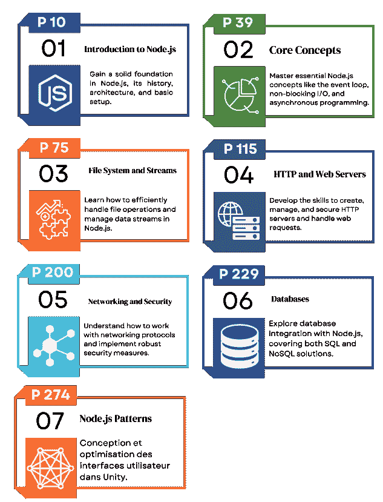

## 序言


欢迎阅读《Node.js 全方位指南》。本书旨在引导你深入探索 Node.js 的奥秘之处，无论你是初学者还是希望加深专业知识。Node.js 以其高效的非阻塞 I/O 模型彻底改变了服务端编程的世界，使得构建高性能可扩展的应用成为可能。我们的目标是提供清晰且深入的 Node.js 理解，使你能够构建稳健、高效且可扩展的应用。

第一章将作为你对 Node.js 的介绍，涵盖其起源、架构和基础概念。你将学习 Node.js 的历史和演变，深入了解它是如何成为今天这一强大平台的。我们将引导你安装 Node.js 并设置开发环境，最后编写出你的第一个 Node.js 程序。

第二章将深入探讨使 Node.js 与众不同的的核心概念。你将探索事件循环（event loop），理解非阻塞 I/O，并使用 promises 和 `async/await` 掌握异步编程。本章还涵盖 Node.js 模块和 `npm`——这个已成为 Node.js 开发基石的包管理器。

第三章侧重于文件系统操作和流（streams）。你将学习如何读写文件、处理目录，并利用流（streams）和缓冲区（buffers）进行高效的数据处理。实践示例将帮助巩固你对这些基本操作的理解。

第四章向你介绍 HTTP 和 Web 服务器概念。你将从创建一个简单的 Web 服务器开始，逐步处理更复杂的场景，如请求和响应管理、路由、提供静态文件以及使用中间件。本章包含了实践示例（例如构建一个简单的博客服务器），以说明这些概念的实际应用。

第五章涵盖网络和安全。你将探索与 TCP 和 UDP 服务器交互，处理使用 HTTPS 的安全通信，并实现身份验证和授权。本章还强调了安全编码实践，以确保你的应用程序健壮且安全。构建聊天应用程序的实践示例将演示这些概念。

第六章深入研究数据库，包括 SQL 和 NoSQL。你将学习如何与 `MySQL`、`PostgreSQL`、`MongoDB` 和 `Redis` 工作，并理解各自的优势和使用场景。本章还涵盖了使用 `Sequelize` 和 `Mongoose` 等 ORM 进行数据库交互，并解释了数据库连接池。实践示例（例如集成数据库构建 RESTful API）将帮助你应用这些概念。

第七章探索高级 JavaScript 和 Node.js 模式。你将掌握 promises 和 `async/await`，开发健壮的错误处理策略并理解事件发射器（event emitters）。本章还涵盖流和管道链（pipe chaining）、模块设计模式，并提供了实践示例（例如创建一个自定义事件发射器）。

Node.js 在不断演进，保持最新更新对于充分发挥其潜力至关重要。在本书书中，我们使用了编写时可获得的最新软件版本，确保你掌握了最新的知识和实践。

本书旨在设计为一份实用的、上手的指南，以辅助你的学习旅程。每一章都建立在前一章的基础上，具有清晰的解释、代码示例和最佳实践。无论你是渴望学习的初学者，还是寻求精炼技能的资深开发者，本书都旨在成为你 Node.js 开发工具箱中宝贵的资源。

感谢选择本书。我希望它能激发你创造出的应用程序，并帮助你成为一名精通的 Node.js 开发者。

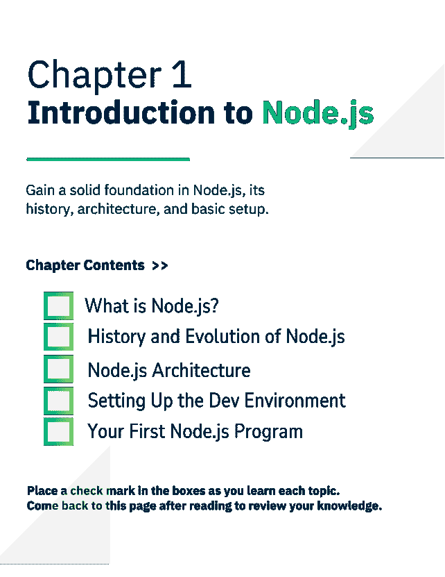

|  | | |  |
| --- | --- | --- |


# Node.js 简介


## 1.1 什么是 Node.js？

Node.js 是一个开源、跨平台的运行时环境，允许开发者在之外执行 JavaScript 代码。传统上，JavaScript 局限于浏览器，主要用于增强网页的交互性。然而，随着 Node.js 的出现，开发者现在可以利用 JavaScript 进行服务器端脚本编写 [1]，能够在客户端和服务器端使用同一种编程语言开发动态且可扩展的 Web 应用。


### Node.js 的核心特性

**事件驱动和非阻塞 I/O**：Node.js 运行在单线程事件循环 [2] 上，利用非阻塞 I/O 调用。这意味着诸如读取或写入文件、与数据库交互或发送网络请求等操作都是异步处理的。这种架构允许 Node.js 以高吞吐量和高效率处理许多并发连接，使其成为对性能和可扩展性至关重要的实时应用程序的理想选择。

**单一编程语言**：Node.js 的显著优势之一是它允许开发者使用 JavaScript 同时进行服务器端和客户端开发。这种开发栈的统一简化了工作流，提高了生产力，并促进了服务器与客户端之间的代码复用。

**NPM（Node 包管理器）**：Node.js 自带 `npm`，它是最大的开源库和包生态系统。通过 `npm`，开发者可以轻松地共享、发现和集成第三方模块，显著加速开发过程。`npm` 注册表 [3] 托管了数百万个包，涵盖了从数据库驱动程序、Web 框架到工具库和测试工具的各种功能。

**快速且可扩展**：Node.js 的非阻塞特性和对异步操作的高效处理有助于它的速度和可扩展性。它可以以最小的开销管理大量的并发连接，使其成为性能和可扩展性至关重要的实时应用程序的理想选择。

**微服务和实时应用程序**：Node.js 在构建微服务 [4] 方面表现出色，应用程序被分为较小的、松耦合的服务，这些服务可以独立地进行开发、部署和扩展。此外，它对 WebSockets [5] 以及如 `Socket.IO` 等实时通信库的支持允许开发者创建聊天应用、实时更新和协作工具等实时应用。

### Node.js 的实际应用

由于其多功能性和性能，Node.js 被应用于各个领域和行业。以下是 Node.js 发挥优势的一些实际应用场景：

**Web 服务器**：Node.js 常用于构建可以同时处理多个客户端请求的 Web 服务器。使用 `Express.js` [6] 等框架可以轻松开发具有路由、中间件和模板渲染能力的健壮 Web 应用。

**API 开发**：通过 Node.js，开发者可以创建 RESTful API [7] 作为 Web 和移动应用程序的骨干。它的异步本质确保了即使在高负载下也能提供快速响应。

**实时应用程序**：Node.js 是开发实时应用（如聊天应用、在线游戏、直播和协作工具）的绝佳选择。它的事件驱动 [8] 架构和对 WebSockets 的支持实现了实时通信和更新。

**微服务**：Node.js 轻量级的特性和模块化使其适用于微服务架构。开发者可以独立地构建、部署和扩展单个服务，从而产生更具维护性和可扩展性的应用程序。

**命令行工具**：许多命令行工具和实用程序是用 Node.js 构建的，因为它易于脚本且可以访问文件系统。`npm` 本身等流行工具都是 Node.js 应用的示例。

### 预览 Node.js 的运行实战

想象你正在开发一个实时聊天应用程序。通过 `Node.js`，你可以高效地管理大量的并发连接，处理消息广播，并确保低延迟通信。通过使用 `Socket.IO` 等库，你可以以极小的精力实现用户状态、打字提示和即时消息等功能。`Node.js` 的事件驱动模型确保了你的服务器在处理成千上万并发用户时依然保持响应能力。

另一个例子是构建一个可扩展的电子商务平台。`Node.js` 允许你创建一个 RESTful API 来管理产品、用户账户和订单。你可以使用 `npm` 软件包集成各种第三方服务，如支付网关和物流提供商。非阻塞 I/O 操作确保了你的服务器能够处理大量交易而不会成为瓶颈，为用户提供无缝的购物体验。`Node.js` 将 JavaScript 的范围从浏览器扩展到服务器环境，彻底改变了 Web 开发。它的事件驱动、非阻塞架构，结合庞大的 `npm` 生态系统，使其成为构建现代、高性能 Web 应用程序的强大工具。当你开启掌握 `Node.js` 之之旅时，你将发现它巨大的潜力和多功能性，赋予你创造满足当今数字世界创新解决方案的能力。

## 1.2 Node.js 的历史与演变

`Node.js` 的历史是一段迷人的创新与演变历程，反映了 Web 开发和服务器端编程不断变化的格局。理解这段历史不仅为 `Node.js` 的当前能力提供了背景，还凸显了塑造其发展的重大里程碑。

### Node.js 的诞生

#### 2009 年：起源

`Node.js` 由 `Ryan Dahl` 于 2009 年创建。Dahl 的初动力源于现有服务器端技术的局限性，特别是无法高效处理许多并发连接。在 2009 年的一次演讲中，他著名地展示了包括 `Apache` 在内的现有 Web 服务器如何由于其同步特性而在处理并发连接时面临挣扎。

**核心洞察**：Dahl 的核心洞察是单线程、事件驱动架构的潜力，这种架构可以异步处理 I/O 操作。这导致了 `Node.js` 的开发，它使用 `Google Chrome` 的 `V8` JavaScript 引擎在服务器端执行 JavaScript 代码。

**首次发布**：`Node.js` 的初始版本于 2009 年 5 月发布。它为服务器端开发引入了新的编程范式，利用 JavaScript 的非阻塞、事件驱动模型。

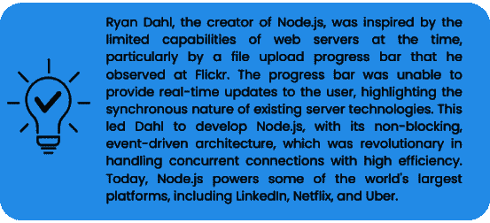

### 早期阶段与快速采用

#### 2010 年：引入 NPM

2010 年 1 月，`Isaac Schlueter` 引入了 `npm`（Node 包管理器），它改变了 `Node.js` 开发者管理和共享代码的方式。`npm` 提供了一个重用模块的中心仓库，显著加速了开发并培养了充满活力的社区。

#### 2011 年：Joyent 赞助

云计算公司 `Joyent` 于 2011 年开始赞助 `Node.js`。这项赞助为更有结构化的开发提供了资源，并促进了行业对 `Node.js` 日益增长的采用。

**关键版本**：

- `v0.2.0`（2010 年 7 月）：提高了稳定性并添加了如 `TLS`（传输层安全）支持等新功能。
- `v0.4.0`（2011 年 2 月）：引入了 Windows 端口，使 `Node.js` 被更广泛的读者可以使用。

### 扩展与成熟

#### 2012—2014 年：视野扩大

在此期间，`Node.js` 继续演进，添加了新功能并提升了性能。`Node.js` 周边的社区迅速增长，各大公司开始将其用于生产环境。

**关键版本**：

- `v0.6.0`（2011 年 10 月）：包含了重大的性能改进和对核心模块的增强。
- `v0.8.0`（2012 年 6 月）：引入了 `cluster` 模块，允许 `Node.js` 利用多核系统的优势。
- `v0.10.0`（2013 年 3 月）：对流（streams）进行了增强，并提供了更好的错误处理机制。

#### 2014 年：io.js 分叉

2014 年底，一组开发者分支了 `Node.js`（fork）以创建 `io.js`。这是一项社区驱动的努力，旨在加速开发并整合最新版本的 `V8` 引擎。分叉的动机是对 `Joyent` 管理下 `Node.js` 开发速度缓慢的不满。

### 和解与 Node.js 基金会的成立

#### 2015 年：和解与 Node.js 基金会

2015 年，`Node.js` 和 `io.js` 社区达成和解，导致在 `Linux Foundation` 下创建了 `Node.js Foundation`。此举旨在提供中立的治理结构，并确保 `Node.js` 的持续增长和稳定。

**关键版本**：

- `v4.0.0`（2015 年 9 月）：该版本标志着 `Node.js` 和 `io.js` 的统一。它带来了许多改进，并将项目与最新的 `V8` 引擎特性对齐。
- `v6.0.0`（2016 年 4 月）：专注于性能改进并添加了新的 `ES6` 特性。
- `v8.0.0`（2017 年 5 月）：引入了 `async/await`，使 `Node.js` 中的异步编程更加直观。

### 今日 Node.js

#### 2018—2020 年：持续增长与新功能

`Node.js` 持续演进，在每次发布中添加功能和改进。社区和生态系统指数级增长，`npm` 托管了数百万个软件包。

**关键版本**：

- `v10.0.0`（2018 年 4 月）：引入了性能改进和如 `fs.promises` 等功能。
- `v12.0.0`（2019 年 4 月）：对运行时的性能进行了增强，并引入了原生模块。
- `v14.0.0`（2020 年 4 月）：包含了改进的诊断、国际化支持以及诊断报告（Diagnostic Report）功能。

#### 2021—2022 年：注重安全与性能

`Node.js` 继续强调安全、性能和开发者体验。新功能和改进使其更加强大和多功能。

**关键版本**：

- `v16.0.0`（2021 年 4 月）：增加了对 Apple Silicon 的支持，改进了国际化并增强了计时器。
- `v18.0.0`（2022 年 4 月）：引入了新的 API 并提升了性能，特别是针对高性能服务器应用程序。

#### 2023 年：最新发布

- `v20.14.0`（截至 2023 年 6 月）：写作时的最新稳定版本。该版本在之前版本改进的基础上继续专注于性能优化、安全增强和新功能。

### 里程碑与社区贡献

**生态系统增长**：由 `npm` 驱动的 Node.js 生态系统已成为全球最大、最活跃的开源社区之一。`npm` 上丰富的模块让开发者能够快速找到问题的解决方案，并将各种功能集成到应用程序中。

**企业采用**：`Netflix`、`LinkedIn`、`Uber` 和 `Walmart` 等大公司已采用 `Node.js` 作为其后端服务。它低开销处理高并发的能力使其成为实时应用、微服务和 API 的理想选择。

**社区与治理**：`Node.js Foundation` 培养了强大的社区并建立了清晰的治理模型，确保了项目保持开放、透明和包容。定期发布和对向后兼容性的关注有助于为全球开发者维持一个稳定可靠的平台。

### 未来方向

Node.js 的未来前景广阔，目前正不断努力提升其性能、安全开发者体验。重点关注领域包括：

- **改进诊断功能**：增强调试和性能分析工具，帮助开发者更高效地识别和解决问题。
- **安全性增强**：继续加强安全模型，并为安全编码实践提供工具。
- **性能优化**：进一步优化运行时，以处理更具挑战性的工作负载。
- **生态系统集成**：确保与现代开发工具和框架的无缝集成。

## 1.3 Node.js 架构

理解 Node.js 的架构对于体会其性能和可扩展性优势至关重要。Node.js 旨在用于构建可扩展的网络应用程序，其架构在实现这一目标中起着至关重要的作用。Node.js 的架构可以大致归分为以下几个关键组件：

1. 单线程事件循环
2. 非阻塞 I/O
3. V8 JavaScript 引擎
4. Libuv
5. C++ 绑定

### 单线程事件循环

Node.js 的核心是单线程事件循环。与为每个客户端请求创建新线程的传统 Web 服务器不同，Node.js 使用单线程处理所有传入的请求。这种单线程特性起初似乎是一个限制，但实际上它是 Node.js 的优势之一。事件循环在异步、非阻塞的范式上运行，允许 Node.js 高效地处理许多并发连接，而无需管理多个线程的开销。

事件循环的工作如下：

- **传入请求**：当请求到达时，Node.js 将其放入事件队列中。
- **事件循环处理**：事件循环持续检查事件队列中的新请求并进行处理。
- **I/O 操作**：如果请求涉及读取文件，Node.js 将其交给 `libuv` 处理。
- **回调函数**：一旦操作完成，相应的回调将被添加到队列中。

### 非阻塞 I/O

Node.js 使用非阻塞 I/O 模型来处理高并发场景。在传统环境中，I/O 操作可能会阻塞程序的执行，但在 Node.js 中，当 I/O 操作在后台进行时，执行会继续进行下一个任务。

### V8 JavaScript 引擎

V8 引擎是执行 JavaScript 代码的核心。它由 Google 开发，直接将 JavaScript 编译为机器码，确保了服务器端应用的高性能和高效执行。

### Libuv

Libuv 是一个多平台库，提供异步 I/O 能力。它管理事件循环和线程池，允许 Node.js 在不阻塞主线程的情况下处理各种任务。

### C++ 绑定

Node.js 包含了 C++ 绑定，用于与底层系统功能建立接口。这些绑定允许 Node.js 执行关键操作并访问 JavaScript 无法直接访问系统资源。

### 实际示例：架构是如何运作的

为了说明这些组件是如何协同工作的，让我们考虑一个用 Node.js 构建的简单服务器实际示例：

```javascript
const http = require('http');
const server = http.createServer((req, res) => {
  if (req.method === 'GET' && req.url === '/') {
    res.writeHead(200, { 'Content-Type': 'text/plain' });
    res.end('Hello, World!\n');
  } else {
    res.writeHead(404, { 'Content-Type': 'text/plain' });
    res.end('Not Found\n');
  }
});

server.listen(3000, () => {
  console.log('Server running at http://localhost:3000/');
});
```

在此示例中：


1. **单线程事件循环**：`createServer` 函数设置了一个监听传入请求的 HTTP 服务器。每个请求都被添加到事件队列中，由事件循环进行处理。
2. **非阻塞 I/O**：当接收到请求时，服务器处理它时不会阻塞事件循环。
3. **V8 引擎**：JavaScript 代码由 V8 引擎执行。
4. **Libuv**：任何底层异步操作（如处理网络连接）都由 `libuv` 管理。
5. **C++ 绑定**：`http` 模块内部使用 C++ 绑定来高效处理网络请求和响应。

Node.js 的架构以单线程事件循环、非阻塞 I/O、V8 引擎、`libuv` 库以及 C++ 绑定为特征，使其能够构建高性能、可扩展的网络应用程序。通过理解这些组件，开发者可以利用 Node.js 创建高效且响应迅速的应用，满足现代 Web 开发的需求。

## 1.4. 安装 Node.js

入门 Node.js 涉及在系统上设置运行时环境。Node.js 可以安装在各种操作系统上，包括 Windows、macOS 和 Linux。本节将引导你完成这些各个平台的安装过程，确保你的设置顺畅且成功。

### 在 Windows 上安装 Node.js

1. **下载安装程序**：

   * 访问 Node.js 官网 [nodejs.org](https://nodejs.org)。


你将看到两个版本供下载：LTS（长期支持）版本和 Current（当前）版本。对于大多数用户，建议下载 LTS 版本，因为它更稳定且适用于生产环境。

点击适用于 Windows 的安装程序以下载 `.msi` 文件。

2. **运行安装程序**：

   下载完成后，打开 `.msi` 文件运行安装程序。

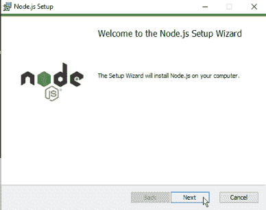

   * 按照 Node.js 安装向导中的提示操作。默认设置对大多数用户已经足够。


确保勾选“自动安装必要的工具”选框，以安装原生模块所需的额外工具，例如 Python 和 Visual Studio Build Tools。

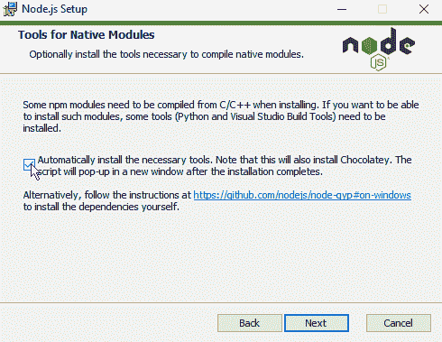

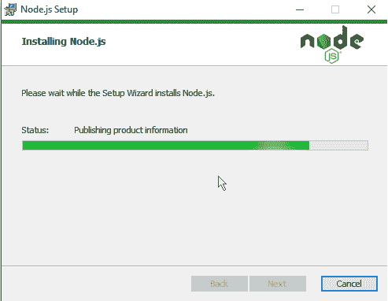

3. **验证安装**：

   安装完成后，打开命令提示符（你可以在开始菜单中搜索 `cmd`）。

   输入 `node -v` 并按回车。此命令将显示已安装的 Node.js 版本。

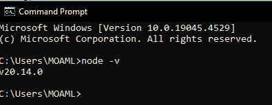

   输入 `npm -v` 并按回车检查已安装的 `npm`（Node 包管理器）的版本。

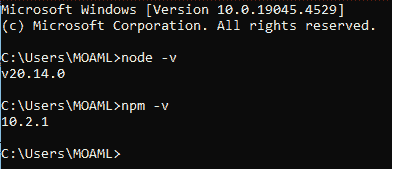

4. **更新 npm（可选）**：

   虽然 Node.js 预装了 `npm`，但将 `npm` 更新到最新版本是一个良好的习惯。

   在命令提示符中输入 `npm install -g npm` 并按回车。

### 在 macOS 上安装 Node.js

1. **使用安装程序**：

   访问 Node.js 官网 [nodejs.org](https://nodejs.org)。

   下载 LTS 版本的 macOS 安装程序（`.pkg` 文件）。

   打开下载的 `.pkg` 文件并按照提示安装 Node.js。

2. **使用 Homebrew**：

   或者，你可以使用 macOS 流行的包管理器 Homebrew 来安装 Node.js。

   如果你没有安装 Homebrew，打开终端并运行以下命令进行安装：

```bash
/bin/bash -c "$(curl -fsSL https://raw.githubusercontent.com/Homebrew/install/HEAD/install.sh)"
```

   一旦安装 Homebrew，你就可以运行以下命令安装 Node.js：

```bash
brew install node
```

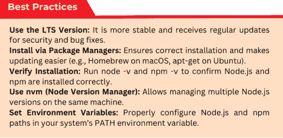

   * **验证安装**：

   打开终端并输入 `node -v` 检查已安装的 Node.js 版本。

   输入 `npm -v` 验证已安装的 `npm` 版本。

* **更新 npm（可选）**：

   要将 `npm` 更新到最新版本，请在终端运行以下命令：

```bash
npm install -g npm
```

### 在 Linux 上安装 Node.js

对于 Linux 用户，安装过程可能会你使用的发行版略有不同。以下是某些常用发行版的步骤：

1. **Debian 和 Ubuntu**：

   打开终端并运行以下命令从官方 NodeSource 仓库安装 Node.js：

```bash
curl -fsSL https://deb.nodesource.com/setup_lts.x | sudo -E bash -
sudo apt-get install -y nodejs
```


此脚本将添加 NodeSource 仓库并安装 Node.js 以及 `npm`。

* **CentOS 和 Fedora**：

   对于 CentOS，运行以下命令添加 NodeSource 仓库并安装 Node.js：

```bash
curl -fsSL https://rpm.nodesource.com/setup_lts.x | sudo bash -
sudo yum install -y nodejs
```

   对于 Fedora，你可以使用与 CentOS 相同的命令，但用 `dnf` 代替 `yum`：

```bash
curl -fsSL https://rpm.nodesource.com/setup_lts.x | sudo bash -
sudo dnf install -y nodejs
```

* **Arch Linux**：

   打开终端并运行以下命令使用包管理器安装 Node.js：

```bash
sudo pacman -S nodejs
```

* **验证安装**：

   安装完成后，运行以下命令验证 Node.js 版本：

```bash
node -v
```

* **更新 npm（可选）**：

   要将 `npm` 更新到最新版本，运行：

```bash
npm install -g npm
```

```json
{
  "test": "echo \\"Error: no test specified\\" && exit 1",
  "start": "nodemon index.js"
}
```

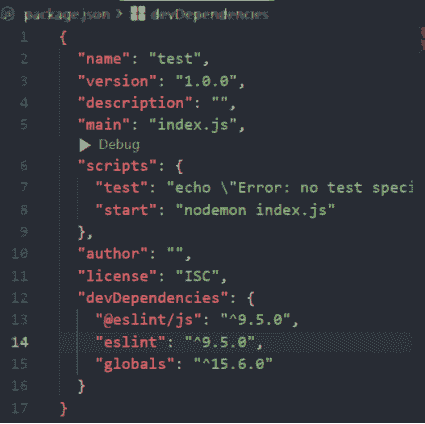

# 第 6：运行你的 Node.js

### 使用 VS Code 终端

在 VS Code 中打开终端（`Ctrl+`）。

使用 `start` 脚本运行你的应用程序：

```bash
npm start
```

Nodemon 将启动你的应用程序，并在你对代码进行更改时自动重启它。

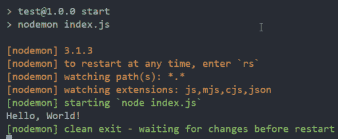


通过在 Visual Studio Code 中配置开发环境，你创建了一个专为 Node.js 开发定制的强大且高效的工作空间。通过正确的扩展、配置和工具，VS Code 可以显著简化你的工作流，让编码变得更加愉快且高效。

## 1.6. 创建一个基础 Web 服务器

使用 Node.js 创建一个基础 WEB 服务器是理解该平台工作原理以及观察其简单性和强大性的极佳方式。让我们通过步骤设置你的第一个 Node.js Web 服务器，并解释每一个细节，确保初学者能够轻松跟上。

### 第 1 步：设置你的项目

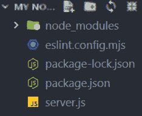

在左侧的资源管理器面板中，点击“新建文件”按钮，或右键点击你的项目文件夹并选择“新建文件”。

将文件命名为 `server.js`。这将是我们编写服务器代码的文件。

### 第 2 步：编写服务器代码

编写代码：

打开 `server.js` 并输入以下代码：

```javascript
const http = require('http');

const hostname = '127.0.0.1';

const port = 3000;
const server = http.createServer((req, res) => {
  res.statusCode = 200;
  res.setHeader('Content-Type', 'text/plain');
  res.end('Hello, World!\n');
});

server.listen(port, hostname, () => {
  console.log(`Server running at http://${hostname}:${port}/`);
});
```

让我们拆解这段代码来理解每个部分的作用。

### 理解代码

**导入 `http` 模块：**

```javascript
const http = require('http');
```

此行导入了 Node.js 内置的 `http` 模块。模块是可重用的代码段，可以包含在你的应用程序中。`http` 模块提供了创建 HTTP 服务器的功能，它可以处理 HTTP 请求和响应。

**定义主机名和端口：**

```javascript
const hostname = '127.0.0.1';
const port = 3000;
```

这些行定义了服务器监听传入请求的主机名和端口号。`127.0.0.1` 是本地地址，意味着服务器将只能从你的计算机访问。端口号 `3000` 是任意的，可以是一个任何可用端口，但 `3000` 常用于开发服务器。

**创建服务器：**

```javascript
const server = http.createServer((req, res) => {
  res.statusCode = 200;
  res.setHeader('Content-Type', 'text/plain');
  res.end('Hello, World!\n');
});
```

此行创建了一个 HTTP 服务器。`createServer` 函数接收一个回调函数，该函数会在每次接收到请求时执行。回调函数有两个参数：`req`（请求对象）和 `res`（响应对象）。

`req` 代表传入的请求，包含请求 URL、方法、标头等信息。

`res` 代表输出的响应，我们用它向客户端发送数据。

在回调函数内部：

- `res.statusCode = 200` 将 HTTP 状态码设置为 `200`，表示响应成功。
- `res.setHeader('Content-Type', 'text/plain')` 将 `Content-Type` 头部设置为 `text/plain`，表示响应内容为纯文本。
- `res.end('Hello, World!\n')` 发送响应体 `Hello, World!` 并结束响应。`\n` 在结尾添加了一个换行符。

**启动服务器：**

```javascript
server.listen(port, hostname, () => {
  console.log(`Server running at http://${hostname}:${port}/`);
});
```

此行启动服务器并使其在指定的主机名和端口上监听。传递给 `listen` 方法的回调将在服务器成功启动后执行一次。它向控制台打印消息，指示服务器正在运行并提供访问它的 URL。

### 第 3 步：运行服务器

**打开集成终端：**

通过按下 `` Ctrl+` `` 或从顶部菜单选择“终端” > “新建终端”来打开 VS Code 中的集成终端。

**运行服务器：**

在终端中，确保你处于该项目目录并运行以下命令：

```bash
node server.js
```

Nodemon 将启动你的应用程序，并在你对代码进行更改时自动重启它。


**访问服务器：**

打开你的浏览器并导航到 `http://127.0.0.1:3000/`。你应该能看到 `Hello, World!` 消息。

### 第 4 步：尝试路由

为了让你的服务器更具交互性，你可以扩展它来处理不同的路由。你可以：

**更新 `server.js` 文件：**

```javascript
const http = require('http');

const hostname = '127.0.0.1';
const port = 3000;

const server = http.createServer((req, res) => {
  res.setHeader('Content-Type', 'text/plain');
  if (req.url === '/') {
    res.statusCode = 200;
    res.end('Welcome to the Home Page!\n');
  } else if (req.url === '/about') {
    res.statusCode = 200;
    res.end('This is the About Page!\n');
  } else {
    res.statusCode = 404;
    res.end('Page Not Found\n');
  }
});

server.listen(port, hostname, () => {
  console.log(`Server running at http://${hostname}:${port}/`);
});
```

这段更新的代码通过检查 `req.url` 属性引入路由。

- 如果请求 URL 是 `/`，服务器响应 `Welcome to the Home Page!`。
- 如果请求 URL 是 `/about`，服务器响应 `This is the About Page!`。
- 对于任何其他 URL，服务器响应 `404` 状态码和 `Page Not Found`。

**重启服务器：**

如果服务器已经在运行，在终端中按 `Ctrl+C` 停止它。再次运行服务器：

```bash
node server.js
```

- 导航到 `http://127.0.0.1:3000/`。你应该看到 `Welcome to the Home Page!`。
- 导航到 `http://127.0.0.1:3000/about`。你应该看到 `This is the About Page!`。
- 导航到任何其他 URL，例如 `http://127.0.0.1:3000/contact`。你应该看到 `Page Not Found`。

这个示例演示了如何在 Node.js 服务器中处理不同的路由。通过检查 `req.url` 属性，你可以为不同的端点创建自定义响应。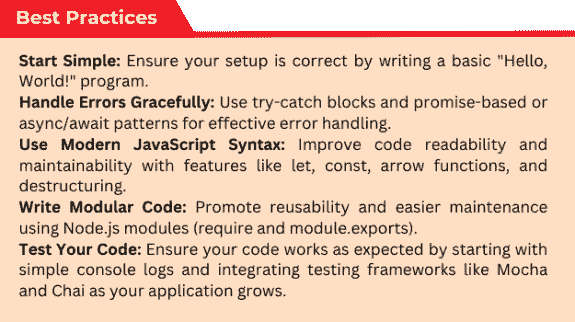

在接下来的章节中，我们将深入探讨 Node.js 的核心概念，探索其强大的功能，并构建更复杂的应用程序。现在，请花一点时间欣赏 Node.js 的简洁与强大，并为即将开启的精彩旅程做好准备！

|  | | | |  |
| --- | --- | --- |
|  |

# 2. 核心概念

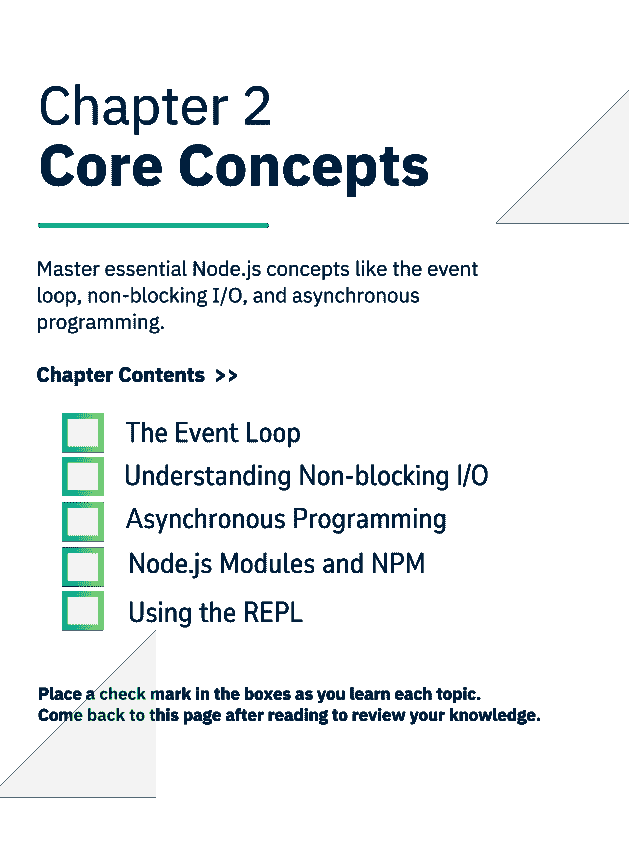


## 2.1. 事件循环（Event Loop）

事件循环是 Node.js 中最基础且迷人的概念之一，它实现了非阻塞的异步特性。为了充分理解它的力量和优雅，让我们深入研究事件循环，拆解它的机制、阶段以及使其成为构建高性能应用程序至关重要的原理。

### 事件循环的概念

事件循环的核心是一个无限循环，它等待任务、执行任务，然后在接收到更多任务之前进入睡眠。它像一个勤奋的工人，不断检查是否有新工作，完成它们，然后立即寻找下一个任务。这种持续的循环允许 Node.js 在不创建多个线程的情况下高效处理大量任务。

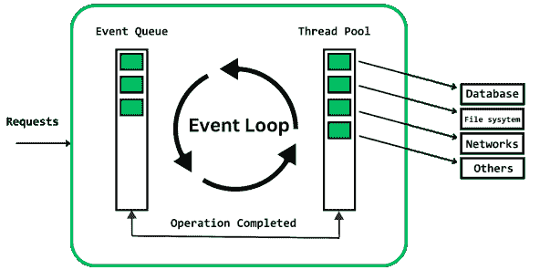

图 1：事件循环架构

### 理解同步与异步执行

要理解事件循环，掌握同步执行和异步执行之间的区别至关重要。同步执行意味着任务按顺序执行，每个任务都必须等待上一个任务完成。想象一下在咖啡店排队，咖啡师一次只准备一份订单；如果有人点了一份复杂的饮料，其他人都必须等待。

相比之下，异步执行允许任务启动并继续，而无需等待其他任务完成。这就像咖啡店里有多个咖啡师，每个人都独立地处理不同的订单，确保每个人都能获得更快速的服务。Node.js 通过事件循环实现了这种异步行为，事件循环高效地处理任务而不会阻塞主执行线程。

### 事件循环的机制

事件循环不断循环一系列阶段，每个阶段负责不同类型的操作。让我们拆解这些阶段：

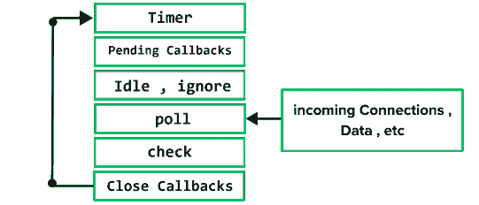

图 2：事件循环的阶段

**定时器阶段（Timers Phase）：**

执行由 `setTimeout` 和 `setInterval` 调用的回调。

如果你设置定时器在一段时间后触发，与该定时器关联的回调在此阶段执行。


## I/O 回调阶段（I/O Callbacks Phase）

执行已完成 I/O 操作的回调，例如读取文件或网络请求。此阶段处理大多数异步 I/O 操作，确保应用程序保持响应。

## 空闲阶段（Idle, Prepare Phase）

Node.js 的内部操作，为即将到来的阶段做准备。开发者通常不交互，但这对事件循环的运行至关重要。

## 轮询阶段（Poll Phase）

获取新的 I/O 事件并执行其回调。事件循环大部分时间都花在这一阶段，等待新事件并在进入时处理它们。

## 检查阶段（Check Phase）

执行由`setImmediate`调用的回调。此阶段允许开发者在轮询阶段之后立即运行函数，确保它们尽快执行。

## 关闭回调阶段（Close Callbacks Phase）

执行已关闭连接的回调，例如当 TCP socket 关闭时。确保对关闭的资源进行适当清理和管理。

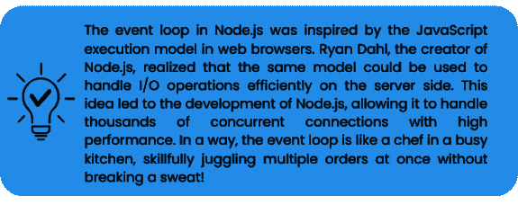

### 实际示例

为了说明事件循环的运作，请考虑以下示例：

```javascript
const fs = require('fs');

// 模拟一个 I/O 操作
fs.readFile('C:\\Users\\Name\\Desktop\\file.txt', 'utf8', (err, data) => {
  if (err) throw err;
  console.log(data);
});

console.log('Reading file...');
```

在这个示例中，`fs.readFile`启动了一个异步文件读取操作。以下是事件循环处理它的过程：

 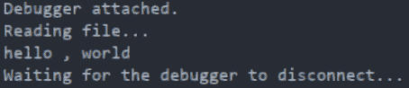

**任务启动：**

调用`fs.readFile`函数读取`file.txt`的内容。Node.js 将此 I/O 操作外放到系统文件系统处理器处理，并移动到下一个任务。

**立即执行：**

立即执行`console.log('Reading file...')`语句，在控制台打印`Reading file...`。

**事件循环运行：**

事件循环继续检查新任务。由于文件读取操作已被外放，事件循环可以自由处理其他任务。一旦文件读取完成，关联的回调`(err, data) => { if (err) throw err; console.log(data); }`会被添加到事件队列中。

**回调执行：**

事件循环从事件队列中取出回调并执行它，在控制台打印`file.txt`的内容。这个示例演示了 Node.js 如何处理 I/O 操作，确保主线程不会被阻塞，并保持可用以处理任务。

### 非阻塞 I/O 的威力

非阻塞 I/O 是 Node.js 架构的基石。在传统的阻塞 I/O 模型中，读取文件或查询数据库等任务会阻塞整个进程，直到操作完成。这种方法会严重限制应用程序的性能和可扩展性，特别是在高负载下。

Node.js 的非阻塞 I/O 模型确保这些操作在后台被处理，允许事件循环继续处理任务。这对于实时应用程序（如聊天服务器或在线游戏）特别有利，因为这些应用对响应和低延迟至关重要。

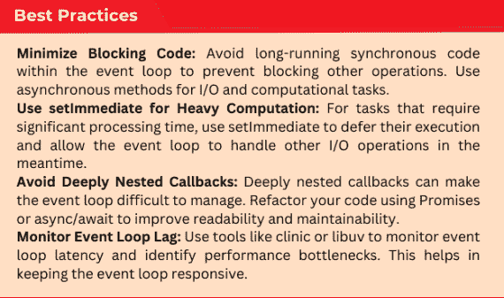

### 现实应用

事件循环的效率使得 Node.js 成为各种现实应用的理想选择：

**实时聊天应用：**

聊天应用需要处理许多并发连接并保持低延迟。事件循环并发处理大量任务的能力确保了消息的快速高效传递。

**在线游戏：**

在线游戏需要实时处理多个玩家操作。事件循环的非阻塞特性允许游戏服务器处理大量事件（如玩家移动和交互）而不产生延迟。

**协作工具：**

协作文本编辑器或项目管理应用等工具受益于事件循环管理实时更新和通知的能力，确保所有用户都能立即看到变化。

**微服务架构：**

Node.js 的事件循环非常适合微服务，每个服务独立地处理特定任务。事件循环高效管理 I/O 密集型操作的能力确保了每个微服务都能以最佳状态运行。

事件循环（Event Loop）是 Node.js 的心脏，赋予了它异步、非阻塞的能力。通过不断循环各个阶段并高效地管理任务，事件循环确保了 Node.js 应用程序保持响应能力和可扩展性。理解事件循环让开发者能够编写出高效的代码，充分利用 Node.js 的优势，这对于任何使用这一强大平台的人来说，都是一个核心概念。无论你是在构建实时聊天应用程序、在线游戏还是协作工具，事件循环都是释放 Node.js 全身潜的关键。

## 2.2. 理解非阻塞 I/O

非阻塞（NON-BLOCKING）I/O 是 Node.js 设计的石，使其能够并发处理多个操作，而无需等待上一个操作完成后再开始另一个。这种方法对于构建高性能、可扩展的应用至关重要，特别是对于需要实时交互的应用。让我们深入探讨非阻塞 I/O 的概念，理解它的工作原理并探索它在 Node.js 生态系统中的意义。

### I/O 操作的概念

输入/输出（I/O）操作是指涉及与系统外围传输数据的任何操作，例如读取文件、写入数据库或发出网络请求。在传统的阻塞 I/O 模型中，这些操作会导致显著的延迟，因为程序必须等待每个操作完成后才能移动到下一个任务。这种等待会导致效率低下和用户体验不佳，尤其是在高负载条件下。

### 阻塞 vs. 非阻塞 I/O

#### 阻塞 I/O

在阻塞 I/O 模型中，每个 I/O 操作必须在下一个操作开始之前完成。这可以被想象为一个队列，每个任务都在等待上一个任务完成：

```javascript
const fs = require('fs');

// Blocking I/O

const data = fs.readFileSync('file.txt', 'utf8');

console.log(data);

console.log('File read complete');
```

在这个示例中，`fs.readFileSync`是一个同步的阻塞调用。程序会在这一行停止执行，直到文件读取操作完成。只有那时，它才会继续打印文件内容和“File read complete”消息。

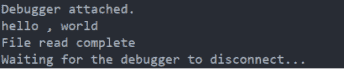

#### 非阻塞 I/O

在非阻塞 I/O 模型中，任务被启动并允许继续执行而无需等待它们完成。程序继续执行后续任务，并在 I/O 操作的结果就绪时进行处理：

```javascript
const fs = require('fs');

// Non-blocking I/O

fs.readFile('file.txt', 'utf8', (err, data) => {
  if (err) throw err;
  console.log(data);
});

console.log('File read initiated');
```

在这个示例中，`fs.readFile`启动了一个异步的非阻塞文件读取操作。程序立即移动到下一行，打印“File read initiated”。一旦文件读取操作完成，回调函数将被执行，打印文件内容。

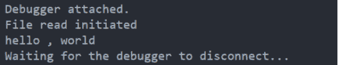

### 非阻塞 I/O 在 Node.js 中如何工作

Node.js 使用事件驱动的非阻塞 I/O 模型来实现高并发。以下是它的工作原理：

**事件循环：**

Node.js 运行在单线程事件循环上，该循环不断检查并处理来自事件队列的任务。当启动一个异步 I/O 操作时，事件循环将任务交给系统的 I/O 处理器程序，并继续处理其他任务。

**回调函数：**

对于每个非阻塞 I/O 操作，都提供了一个回调函数。该函数在 I/O 操作完成后执行，确保应用程序可以处理操作结果而不阻塞主线程。

**事件队列：**

完成的 I/O 操作及其回调函数会被放回事件队列中。事件循环在这些回调函数就绪时处理它们，执行它们以处理 I/O 操作的结果。

### 非阻塞 I/O 的优势

1. **高性能：** 非阻塞 I/O 允许 Node.js 高效地处理许多并发连接。通过不等待 I/O 操作完成，事件循环可以处理其他任务，使应用程序具有极高的响应速度和性能。
2. **可扩展性：** 非阻塞 I/O 对于构建可扩展的应用至关重要。Node.js 可以以最小的开销管理数千个并发连接，使其成为聊天服务器、在线游戏和协作工具等实时应用的理想选择。

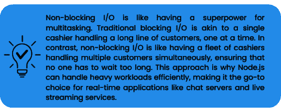

### 非阻塞 I/O 示例

考虑一个处理多个客户端请求的 Web 服务器：

```javascript
const http = require('http');
const fs = require('fs');

const server = http.createServer((req, res) => {
  fs.readFile('index.html', (err, data) => {
    if (err) {
      res.writeHead(500);
      res.end('Error loading file');
    } else {
      res.writeHead(200, { 'Content-Type': 'text/html' });
      res.end(data);
    }
  });
});

server.listen(3000, () => {
  console.log('Server running at http://localhost:3000/');
});
```


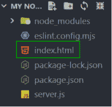

在此示例中：

当接收到请求时，服务器使用`fs.readFile`启动一个非阻塞文件读取操作。在文件读取期间，事件循环可以继续处理其他传入的请求。一旦文件读取操作完成，将执行回调函数并将文件内容作为响应。

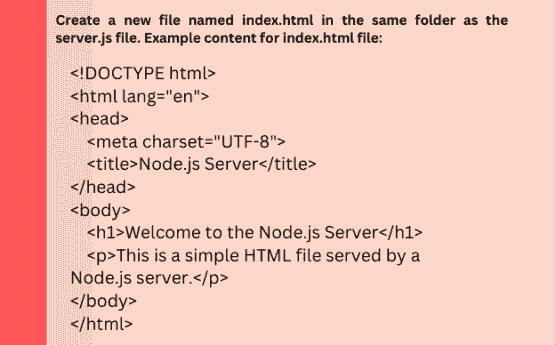

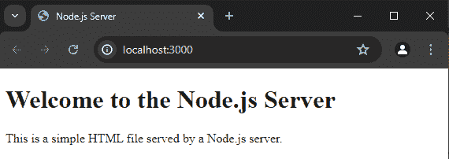

这种非阻塞方法确保服务器保持响应，并能够并发处理多个请求，而无需等待每个文件读取操作完成。

### 非阻塞 I/O 的真实世界应用

- **实时应用：** 聊天服务器和在线游戏等受益于非阻塞 I/O。这些应用需要低延迟和高吞吐量，这正是 Node.js 所提供的。
- **API 服务器：** Node.js 广泛用于构建 RESTful API。非阻塞 I/O 确保 API 服务器能够同时处理大量请求，提供快速高效的响应。
- **数据流：** 非阻塞 I/O 非常适用于涉及数据流的应用，例如视频流媒体服务。Node.js 可以高效地流数据而无需缓冲整个内容，从而减少延迟和内存占用。
- **微服务：** 在微服务架构中，服务经常需要通过网络相互通信。非阻塞 I/O 允许 Node.js 高效地处理这些通信，确保服务保持响应和可扩展性。

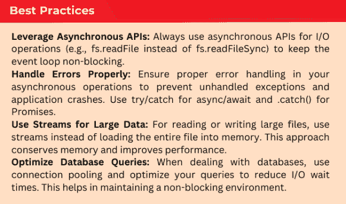

同步编程（SYNCHRONOUS PROGRAMMING）是 Node.js 的核心，使其能够并发处理多个操作而无需等待一个操作完成后再开始另一个。这种方法对于构建高性能、可扩展的应用程序至关重要，特别是那些需要实时交互的程序。让我们深入探讨异步编程的概念，理解它在 Node.js 中如何工作，并探索它在 Node.js 生态系统中的意义。

### 异步编程的重要性

在传统的同步编程中，操作是按顺序执行的，每个操作都必须等待上一个操作完成后才能移动到下一个操作。这可能导致效率低下和用户体验不佳，特别是在处理读取文件、查询数据库或发送网络请求等 I/O 密集型任务时。另一方面，异步编程允许多个操作同时进行，显著提高了应用程序的效率和响应能力。

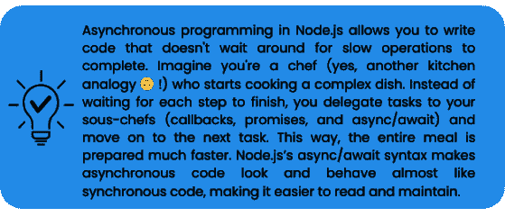

### 回调函数（Callbacks）

在 Node.js 中处理异步操作最简单且最传统的方法是通过回调函数。回调函数是一个作为参数传递给另一个函数的函数，该函数会在异步操作完成后执行。

示例：

```javascript
const fs = require('fs');

fs.readFile('file.txt', 'utf8', (err, data) => {
  if (err) {
    console.error(err);
    return;
  }
  console.log(data);
});

console.log('File read initiated');
```

在这个示例中，`fs.readFile`是一个读取文件内容的异步函数。第二个参数是一个回调函数，它会在文件读取操作完成后执行。在读取文件期间，程序将继续执行下一行，打印“File read initiated”。

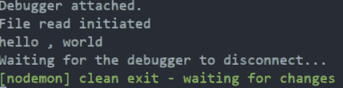

### 承诺（Promises）

虽然回调函数简单且有效，但在处理多个嵌套的异步操作时，它们会导致“回调地狱”或“地狱金字塔”。Promise 提供了一种更整洁、更易管理的方式来处理异步代码。Promise 代表异步操作的最终完成（或失败），并允许对多个操作进行链式调用。

示例：

```javascript
const fs = require('fs').promises;

fs.readFile('file.txt', 'utf8')
  .then(data => {
    console.log(data);
  })
  .catch(err => {
    console.error(err);
  });

console.log('File read initiated');
```

在这个示例中，`fs.readFile`返回一个 promise。`then`方法用于处理文件读取操作的成功完成，而`catch`方法用于处理任何错误。这种方法使代码更具读性且更容易维护。

### 异步/等待（Async/Await）

ASYNC/AWAIT 在 ECMAScript 2017（ES8）中引入，它提供了 promise 的语法糖，使得异步代码看起来和行为更像同步代码。这有助于编写更整洁、更易读的异步代码。

示例：

```javascript
const fs = require('fs').promises;

async function readFile() {
  try {
    const data = await fs.readFile('file.txt', 'utf8');
    console.log(data);
  } catch (err) {
    console.error(err);
  }
}

readFile();

console.log('File read initiated');
```

在这个示例中，使用`async`关键字定义了一个异步函数，使用`await`关键字等待`fs.readFile`返回的 promise 解决。这允许我们编写看起来是同步的异步代码，提高了可读性和维护性。

### 处理多个异步操作

Node.js 中的同步编程通常涉及并发处理多个操作。以下是管理此内容的几种技术：

1. `Promise.all`：`Promise.all`允许你等待多个 promise 完成。它接收一个 promise 数组并返回一个单一 promise，当数组中的所有 promise 都成功完成时，该 promise 将解析。
2. `Promise.race`：`Promise.race`返回 promise 数组中第一个完成（无论是成功还是拒绝）的 promise。
3. 并行执行：Node.js 允许并行执行多个操作，提高效率和性能。

示例：

```javascript
const fs = require('fs').promises;

async function readFiles() {
  try {
    const file1Promise = fs.readFile('file1.txt', 'utf8');
    const file2Promise = fs.readFile('file2.txt', 'utf8');
    const [file1, file2] = await Promise.all([file1Promise, file2Promise]);
    console.log(file1);
    console.log(file2);
  } catch (err) {
    console.error(err);
  }
}
```

### 异步代码中的错误处理

在异步代码中处理错误对于构建健壮的应用程序至关重要。Promise 和 async/await 都提供了处理错误的机制。

#### 使用 Promise

使用`catch`方法处理错误。

```javascript
fs.readFile('file.txt', 'utf8')
  .then(data => {
    console.log(data);
  })
  .catch(err => {
    console.error(err);
  });
```

#### 使用 Async/Await

在异步函数中使用`try...catch`块处理错误。

```javascript
async function readFile() {
  try {
    const data = await fs.readFile('file.txt', 'utf8');
    console.log(data);
  } catch (err) {
    console.error(err);
  }
}
```

### 异步编程的现实应用

- **Web 服务器：** Node.js 的非阻塞异步使其成为构建处理大量并发连接 Web 服务器的理想选择。
- **API：** 对于需要处理多个请求并与数据库或其他服务的交互的 API 服务器来说，异步编程至关重要。
- **实时应用：** 聊天服务器和在线游戏等应用受益于异步编程，确保了低延迟和高响应。
- **微服务：** 在微服务架构中，服务之间通常进行异步通信，从而实现更好的扩展性和容错性。

### 示例：构建一个简单的天气应用程序


让我们创建一个简单的天气应用程序，以演示 Node.js 中的异步编程、事件循环和非阻塞 I/O。该应用程序将从外部 API 获取天气数据并显示给用户。

## 步骤指南

### 设置项目

首先，为你的项目创建一个新目录并进入该目录：

```bash
mkdir weather-app
cd weather-app
```

### 初始化一个新的 Node.js 项目

```bash
npm init -y
```

安装`axios`库以进行发送 HTTP 请求：

```bash
npm install axios
```

## 创建你的应用程序

在项目目录中创建一个名为`app.js`的文件，并在代码编辑器中打开它。

### 编写代码

```javascript
const axios = require('axios');

// 获取天气数据的函数

async function fetchWeather(city) {
  try {
    const apiKey = 'your\_api\_key\_here'; // 替换为你的 OpenWeatherMap API key
    const url = `http://api.openweathermap.org/data/2.5/weather?q=${city}&appid=${apiKey}&units=metric`;
    const response = await axios.get(url);
    const weatherData = response.data;
    console.log(`Weather in ${city}:`);
    console.log(`Temperature: ${weatherData.main.temp}°C`);
    console.log(`Description: ${weatherData.weather[0].description}`);
  } catch (error) {
    console.error('Error fetching weather data:', error.message);
  }
}

// 从命令行参数中获取城市名称

const city = process.argv[2];
if (!city) {
  console.error('Please provide a city name.');
  process.exit(1);
}

// 获取并显示天气数据

fetchWeather(city);
console.log('Fetching weather data...');
```

### 理解代码

- `axios`库：我们使用`axios`库向 OpenWeatherMap API 发送 HTTP 请求。`Axios`是一个基于 promise 的 HTTP 客户端，可以在浏览器和 Node.js 中运行工作。
- 异步函数（`fetchWeather`）：`fetchWeather`函数被定义为一个`async`函数，这允许我们使用`await`关键字来等待`axios.get`返回的 promise 解析完成。
- 错误处理：使用`try...catch`块来处理在 HTTP 请求过程中可能发生的任何错误。
- 命令行参数：我们从命令行参数（`process.argv[2]`）中获取城市名称。如果没有提供城市名称，程序将带有错误消息退出。
- 非阻塞 I/O：调用了`fetchWeather`函数后，紧接着打印了消息“Fetching weather data...”。程序在等待 HTTP 请求完成之前就打印了此消息，这演示了非阻塞 I/O。

### 重要提示

要运行此应用程序，你需要一个来自 OpenWeatherMap 的 API key。在 [OpenWeatherMap](https://openweathermap.org/) 注册并获取你的 API key。将代码中的`'your\_api\_key\_here'`替换为你实际的 API key。

现在，有一个小提示：OpenWeatherMap 就像你最喜爱的精品咖啡店。虽然你可以获得免费样品（免费层级），但如果你开始变得太喜欢它并不断回来获取更多（超过免费层级），你就需要为每一份额外的“天气数据杯”付费了。如果你觉得这是值得的，尽管去请自己体验一下高级天气预报吧！只需留意这些费用，以确保你的下一次天气更新不会带来意料的账单。

当一切运行正常时，输出通常如下所示：

从命令行运行应用程序：

```bash
node app.js London
```

你应该能看到类似这样的输出：

```text
Fetching weather data...
Weather in London:
Temperature: 15°C
Description: clear sky
```

所以，如果你准备好为高级天气体验付费了，尽管直接从你的终端享受详细的预报吧！

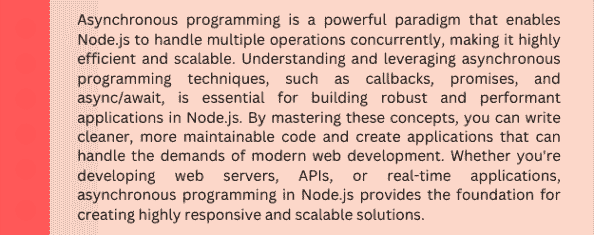

## 2.4 Node.js 模块和 NPM

Node.js 模块和 Node 包管理器（NPM）是 Node.js 生态系统中不可或缺的一部分。它们允许开发者组织项目结构、管理依赖关系并共享自己的模块。了解如何使用 NPM 对开发者来说至关重要。

### Node.js 模块

Node.js 支持三种类型的模块：内置模块、自定义模块和第三方模块。

### 内置模块

Node.js 自带了一组内置模块，提供了各种功能，例如文件系统、HTTP 服务器和实用程序。

**示例：使用`fs`模块**

```javascript
const fs = require('fs');

fs.readFile('example.txt', 'utf8', (err, data) => {
  if (err) throw err;
  console.log(data);
});
```

在此示例中，`fs`（文件系统）模块用于读取文件。

### 自定义模块

自定义模块是开发者创建以封装特定功能的模块。这些模块可以导出并导入到其他部分。

**示例：创建并使用自定义模块**

1. 创建名为`math.js`的文件：

```javascript
// math.js
function add(a, b) {
  return a + b;
}

function subtract(a, b) {
  return a - b;
}

module.exports = {
  add,
  subtract
};
```

导入并使用`math.js`模块：

```javascript
// app.js
const math = require('./math');

const sum = math.add(5, 3);
const difference = math.subtract(5, 3);
console.log(`Sum: ${sum}`); // Sum: 8
console.log(`Difference: ${difference}`); // Difference: 2
```

### 第三方模块

第三方模块是由社区创建并通过 NPM 共享的。它们提供了从工具库到完整框架的各种功能。

**示例：使用第三方模块**

要使用第三方模块，你需要使用 NPM 安装它，然后在应用程序中引入它。

```bash
npm install lodash
```

```javascript
const _ = require('lodash');
const array = [1, 2, 3, 4, 5];
const reversedArray = _.reverse(array.slice());
console.log(reversedArray); // [5, 4, 3, 2, 1]
```

### Node 包管理器（NPM）

NPM 是随 Node.js 一带的强大工具。它允许开发者管理项目依赖、安装第三方模块并共享自己的模块。NPM 使外部库和工具引入 Node.js 项目变得简单。

### 关键 NPM 命令

**初始化项目**：要启动一个新的 Node.js 项目并创建`package.json`文件（该文件包含项目及其依赖的元数据），你可以使用：

```bash
npm init
```

此命令会提示你输入有关项目的信息，或者你可以使用`npm init -y`使用默认值生成`package.json`文件。

**安装包**：要安装一个包并将其添加到项目的依赖中，你可以：

```bash
npm install <package-name> --save
```

`--save`标志确保该包被列在`package.json`的 dependencies 部分。

**全局安装包**：某些包被用作命令行工具，通常会被全局安装以便可以在任何目录下使用。

```bash
npm install -g <package-name>
```

### 列出已安装的包

要查看项目中安装的所有包，您可以使用：

```bash
npm list
```

### 更新包

要将特定包更新到最新版本，您可以使用：

```bash
npm update <package-name>
```

### 使用`package.json`管理依赖

`package.json`文件是 Node.js 项目的关键组件。它记录了与项目相关依赖项和脚本。

### 示例：一个简单的`package.json`文件

```json
{
  "name": "weather-app",
  "version": "1.0.0",
  "description": "A simple weather application",
  "main": "app.js",
  "scripts": {
    "start": "node app.js"
  },
  "dependencies": {
    "axios": "⁰.21.1"
  },
  "author": "Your Name",
  "license": "ISC"
}
```

---


在这个示例中，`package.json`文件包含了关于项目的基本信息、运行应用程序的启动脚本以及一个依赖项（`axios`）。`dependencies`部分列出了项目所需的包及其版本。

| 命令 | 描述 |
| --- | --- |
| `npm init` | 初始化一个新的 Node.js 项目并创建一个包含元数据和依赖项的`package.json`文件。 |
| `npm init -y` | 使用默认值初始化一个新的 Node.js 项目，跳过交互式提示。 |
| `npm install <package>` | 安装一个包并将其添加到`package.json`的`dependencies`部分。 |
| `npm install <package>—save` | （已弃）等同于`npm install <package>`。 |
| `npm install <package>--save-dev` | 安装一个包并将其添加到`package.json`的`devDependencies`部分。 |
| `npm install <package> -g` | 全局安装一个包，使其可以在系统的任何地方通过命令行调用。 |
| `npm install` | 安装`package.json`中列出的所有依赖项。 |
| `npm uninstall <package>` | 卸载一个包并将其从`package.json`的`dependencies`部分移除。 |
| `npm update <package>` | 将包更新到符合`package.json`中指定的范围的最新版本。 |
| `npm outdated` | 列出与可用最新版本相比已过时的包。 |
| `npm list` | 列出当前项目中所有安装的包及其依赖项。 |
| `npm list -g` | 列出所有全局安装的包。 |
| `npm run <script>` | 运行`package.json`中`scripts`部分定义的脚本。 |
| `npm test` | 运行`package.json`中定义的`test`脚本。 |
| `npm start` | 运行`package.json`中定义的`start`脚本。 |
| `npm stop` | 运行`package.json`中定义的`stop`脚本。 |
| `npm init <initializer>` | 使用初始化器初始化新项目（例如`npm init react-app`）。 |
| `npm version <newversion>` | 将`package.json`中的版本提升到新版本（例如`npm version 1.0.1`）。 |
| `npm publish` | 将包发布到 NPM 注册表。 |
| `npm unpublish <package>` | 从 NPM 注册表中移除已发布的包（可以使用`--force`进行强制取消发布）。 |
| `npm cache clean--force` | 清除 NPM 缓存。 |
| `npm config set <key> <value>` | 将配置键设置为指定的值。 |
| `npm config get <key>` | 获取配置键的值。 |
| `npm help` | 显示有关 NPM 的帮助信息。 |
| `npm search <term>` | 在 NPM 注册表中搜索匹配搜索术语的包。 |
| `npm audit` | 对项目依赖项进行安全审计。 |
| `npm audit fix` | 自动修复项目依赖项中发现的漏洞。 |
| `npm ci` | 使用`package-lock.json`从干净的状态安装依赖项，用于持续集成。 |
| `npm rebuild` | 重新构建通过`npm install`安装的原生扩展。 |
| `npm dedupe` | 去除项目的重复依赖。 |
| `npm link` | 在开发期间为包文件夹创建符号链接。 |
| `npm unlink` | 移除`npm link`创建的符号链接。 |
| `npm doctor` | 运行一系列检查以确保您的 NPM 安装状态良好。 |
| `npm exec <command>` | 从本地或全局包运行命令。 |

表 1 NPM 命令

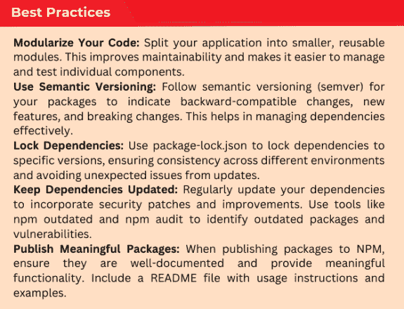

### 理解 Node.js 模块

模块帮助您将代码组织成不同的部分，无论是内置的、用户定义的还是第三方的。通过掌握模块，您可以构建更整洁、可扩展的应用程序。

## REPL（读取-评估-循环）

REPL 是 Node.js 附带的一个交互式壳。它提供了一种尝试 JavaScript 的快速方法。

### 什么是 REPL？

REPL 代表：

- **Read（读取）**：它读取用户的输入，并将其解析为数据结构。
- **Eval（评估）**：它评估解析后的代码。
- **Print（打印）**：它打印评估结果。
- **Loop（循环）**：它循环，等待新的输入。

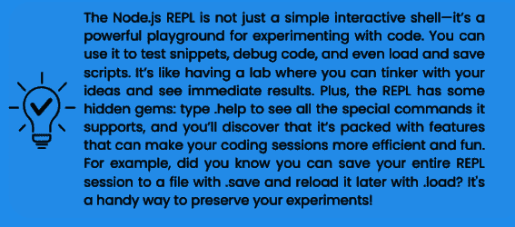

### 启动 REPL

要启动 REPL，只需打开终端或命令行提示符并输入：

```bash
node
```


您将看到一个提示符（`>`），这表示 REPL 已准备好接受命令。

### 基本用法

**示例 1：算术运算**

```javascript
> 1 + 2
3
> 5 * 10
50
```

REPL 读取`1 + 2`，进行评估，打印结果`3`，等待下次输入。

**示例 2：变量声明**

```javascript
> let x = 10;
undefined
> x * 2
20
```

您可以声明变量并在随后的命令中使用它们。

### 在 REPL 中使用 Node.js API

您也可以直接在 REPL 中使用 Node.js 内置模块。

**示例：使用`fs`模块**

```javascript
> const fs = require('fs');
undefined
> fs.readFileSync('example.txt', 'utf8');
'这是文件的内容。'
```

在这个示例中，引入了`fs`模块，并使用`readFileSync`方法读取文件内容。

### 多行输入

REPL 支持多行输入，允许您输入复杂的代码结构，如循环和函数。

**示例：定义函数**

```javascript
> function add(a, b) {
... return a + b;
... }
undefined
> add(5, 10);
15
```

REPL 会等待您完成函数定义后再进行评估。按两次回车可以表示您已完成多行输入。

### 特殊命令

#### REPL 特殊命令表

| 命令 | 说明 |
| --- | --- |
| `.help` | 显示所有特殊 REPL 命令及其描述。 |
| `.break` | 当您卡在多行表达式中时，使用此命令退出当前上下文。 |
| `.clear` | `.break`的别名。它会清除 REPL 中的当前上下文。 |
| `.exit` | 退出 REPL。你也可以使用两次`Ctrl+C`达到相同效果。 |
| `.save <filename>` | 将当前 REPL 会话保存到文件。 |
| `.load <filename>` | 将文件加载到当前 REPL 会话中。 |
| `.editor` | 进入多行输入模式，你可以在其中编写多行代码。按`Ctrl+D`完成并评估代码。 |


| `.scope` | 显示当前作用域的上下文，包括局部变量。 |
|---|---|
| `.history` | 显示执行过的 REPL 命令历史。 |
| `.set var value` | 在 REPL 上下文中设置变量。 |
| `.inspect var` | 并打印变量的详细信息。 |

### `.help`

**描述**：列出所有可用的特殊 REPL 命令，并为每个命令提供简要描述。

**用法**：

```text
> .help
```

- `.break`：有时你会卡住，这个命令可以让你跳出来。
- `.clear`：`.break` 的别名。
- `.exit`：退出 REPL。
- `.help`：打印此帮助信息。
- `.load`：从文件加载 JS 到 REPL 会话。
- `.save`：将此 REPL 会话中所有评估过的命令保存到文件。
- `.editor`：进入编辑器模式。
- `.scope`：显示当前作用域。
- `.history`：显示 REPL 历史。
- `.set`：在 REPL 上下文中设置变量。
- `.inspect`：检查变量。

### `.break`

**描述**：如果你在编写多行表达式中间卡住，请使用此命令。它将退出当前表达式并返回 REPL 提示符。

**用法**：

```text
> {
...   const x = 10;
...   .break
>
```

### `.clear`

**描述**：清空当前的 REPL 上下文。它是 `.break` 的别名。

**用法**：

```text
> const x = 10;
> .clear
>
```

### `.exit`

**描述**：退出 REPL。你也可以使用两次 `Ctrl+C` 退出。

**用法**：

```text
> .exit
```

### `.save <filename>`

**描述**：将当前 REPL 会话保存到文件。这对于保存你的工作并在稍后查看很有用。

**用法**：

```text
> .save session.js
```

### `.load <filename>`

**描述**：在当前 REPL 会话中加载并执行文件。这允许你引入预定义的脚本或函数。

**用法**：

```text
> .load script.js
```

### `.editor`

**描述**：进入多行输入模式，你可以在其中编写多行代码。要完成并评估代码，请按 `Ctrl+D`。

**用法**：

```javascript
> .editor
// 进入编辑器模式 (Ctrl+D 完成， Ctrl+C 取消)
const x = 10;
const y = 20;
console.log(x + y);
Ctrl+D
30
>
```

### `.scope`

**描述**：显示当前作用域的上下文，包括局部变量及其值。对于调试当前状态很有用。

**用法**：

```text
> const x = 10;
> .scope
{
  x: 10
}
>
```

### `.history`

**描述**：显示执行过的 REPL 命令历史。这有助于回顾和重用之前的命令。

**用法**：

```text
1: const x = 10;
2: console.log(x);
3: .history
```

### `.set var value`

**描述**：在 REPL 上下文中设置变量。这对于会话期间动态调整值很有用。

**用法**：

```text
> .set y 50
> console.log(y);
```

### `.inspect var`

**描述**：检查并打印变量的详细信息。对于调试复杂对象或变量很有用。

**用法**：

```text
> const obj = { a: 1, b: 2 };
> .inspect obj
```

### 访问 REPL 历史

REPL 保留你输入的命令历史。你可以使用向上和向下键浏览历史，轻松地重新运行命令或进行细微修改。

### 下划线变量

REPL 会**自动**将上一次评估表达式的结果赋值给变量 `_`，允许你在后续命令中使用它。

**示例：使用下划线变量**

```text
> 5 + 10
15
> _ * 2
30
```

在此示例中，`5 + 10` 的结果是 `15`，然后存储在 `_` 中。下一个命令将此结果乘以 `2`，得到 `30`。

Node.js REPL 是以交互方式实验 JavaScript 和 Node.js 代码的强大工具。它允许你快速测试代码段、调试代码并探索 Node.js API，而无需创建单独文件的开销。通过理解和利用 REPL 的功能，你可以显著提高你的开发和效率。

# 3. 文件系统与流

## 3.1. 文件的读取与写入

处理文件是许多应用程序的基本方面。无论是读取配置文件、写入日志还是处理数据，理解如何在 Node.js 中读写文件都是至关重要的。Node.js 提供了 `fs` 模块，它提供了同步和异步方法来与文件系统交互。让我们深入探索这些概念。

### `fs` 模块简介

Node.js 中的 `fs`（File System）模块允许你与计算机的文件系统交互。你可以使用它读取、写入、更新、删除以及管理文件和目录。`fs` 模块可以通过以下方式引入：

```javascript
const fs = require('fs');
```

### 读取文件

读取文件有两种完成方式：同步和异步。

#### 同步读取

在同步读取中，程序的执行会暂停直到文件读取操作完成。这对于小文件或简单脚本非常直接，但对于大文件或复杂的应用程序可能会阻塞事件循环。

**示例：同步读取**

```javascript
const fs = require('fs');

try {
  const data = fs.readFileSync('example.txt', 'utf8');
  console.log(data);
} catch (err) {
  console.error('读取文件错误:', err);
}
```

在此示例中，`fs.readFileSync('example.txt', 'utf8')` 同步读取 `example.txt`。`utf8` 参数指定了编码。发生错误会被捕获并打印到控制台。

#### 异步读取

异步读取允许在读取文件时继续执行操作，使其更适用于文件和高性能应用程序。

**示例：异步读取**

```javascript
const fs = require('fs');

fs.readFile('example.txt', 'utf8', (err, data) => {
  if (err) {
    return console.error('读取文件错误:', err);
  }
  console.log(data);
});

console.log('读取文件...');
```

在此示例中，`fs.readFile('example.txt', 'utf8', callback)` 异步读取文件。回调函数处理文件数据或任何错误。日志“读取文件...”会被立即打印，展示了非阻塞行为。

### 写入文件

写入文件也可以同步或异步完成。

#### 同步写入

**示例：同步写入**

```javascript
const fs = require('fs');

const data = '如果某件事足够重要，你就应该尝试。即使结果可能是失败。Elon Musk';

try {
  fs.writeFileSync('C:\\Users\\MOAML\\Desktop\\file.txt', data);
  console.log('文件写入成功');
} catch (err) {
  console.error('写入文件错误:', err);
}
```

```javascript
} catch (err) {
  console.error('Error writing file:', err);
}
```

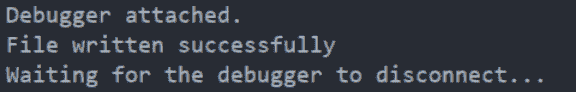


无关的备注……我使用 VS Code 打开文本文件。

在此示例中：

- `fs.writeFileSync('example.txt', data)` 同步地将字符串 `data` 写入 `example.txt`。
- 如果发生错误，错误将被捕获并记录到控制台。

#### 异步写入

**示例：异步写入**

```javascript
const fs = require('fs');

const data = 'Hello, world!';

fs.writeFile('example.txt', data, (err) => {
  if (err) {
    return console.error('Error writing file:', err);
  }
  console.log('File written successfully');
});

console.log('Writing file...');
```

在此示例中：

- `fs.writeFile('example.txt', data, callback)` 异步地将字符串 `data` 写入 `example.txt`。
- 回调函数处理任何错误。
- 消息 `'Writing file...'` 会被立即记录，展示了非阻塞行为。

### 追加到文件

有时，你可能需要向现有文件添加数据，而不是覆盖它。`fs.appendFile` 和 `fs.appendFileSync` 方法被用于此目的。

**示例：异步追加**

```javascript
const fs = require('fs');

const data = 'Appending some text...🥴 \n';

fs.appendFile(' C:\\Users\\NAME\\Desktop\\file.txt ', data, (err) => {
  if (err) {
    return console.error('Error appending to file:', err);
  }
  console.log('File appended successfully');
});

console.log('Appending to file...');
```

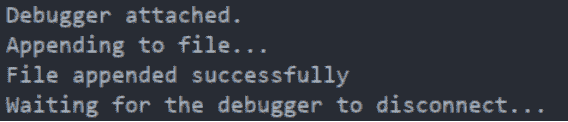

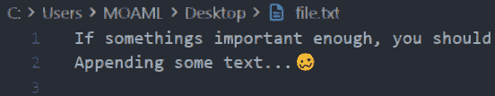

在此示例中：

- `fs.appendFile('example.txt', data, callback)` 异步地将字符串 `data` 追加到 `example.txt`。
- 回调函数处理任何错误。
- 消息 `'Appending to file...'` 会被立即记录，展示了非阻塞行为。

### 删除文件

要删除文件，你可以使用 `fs.unlink` 和 `fs.unlinkSync` 方法。

**示例：异步删除**

```javascript
const fs = require('fs');

fs.unlink('C:\\Users\\NAME\\Desktop\\file.txt', (err) => {
  if (err) {
    return console.error('Error deleting file:', err);
  }
  console.log('File deleted successfully');
});

console.log('Deleting file...');
```


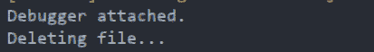

在此示例中：

- `fs.unlink('example.txt', callback)` 异步地删除 `example.txt`。
- 回调函数处理任何错误。
- 消息 `'Deleting file...'` 会被立即记录，展示了非阻塞行为。

### 监听文件变化

Node.js 可以监听文件或目录的变化，这对于实现如实时重载等功能非常有用。

**示例：监听文件**

```javascript
const fs = require('fs');

fs.watch('example.txt', (eventType, filename) => {
  if (filename) {
    console.log(`${filename} has been modified`);
  }
});
```

在此示例中：

- `fs.watch('example.txt', callback)` 监听 `example.txt` 的变化。
- 当文件被修改时，回调函数会记录一条消息。
- 消息 `'Watching file...'` 会被立即记录。


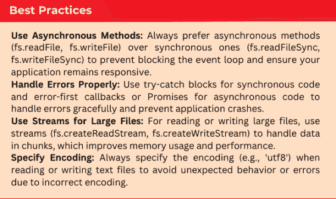

读取写入文件在 Node.js 中通过 `fs` 模块变得简单。选择同步还是异步方法取决于你的应用。同步方法会阻塞事件循环，而异步方法更适合性能敏感型应用。

## 3.2. 操作目录

处理目录对于文件系统至关重要。操作目录。

### 创建目录

要创建目录，Node.js 提供了同步和异步方法。

#### 同步创建

**示例：同步创建**

```javascript
const fs = require('fs');

try {
  if (!fs.existsSync('new-directory')) {
    fs.mkdirSync('new-directory');
    console.log('Directory created successfully');
  } else {
    console.log('Directory already exists');
  }
} catch (err) {
  console.error('Error creating directory:', err);
}
```

在此示例中：

- `fs.existsSync('new-directory')` 检查目录是否存在。
- `fs.mkdirSync('new-directory')` 如果不存在则创建目录。

#### 异步创建

**示例：异步创建**

```javascript
const fs = require('fs');

fs.mkdir('new-directory', (err) => {
  if (err) {
    return console.error('Error creating directory:', err);
  }
  console.log('Directory created successfully');
});

console.log('Creating directory...');
```

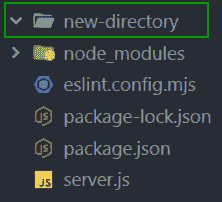

在此示例中：

- `fs.mkdir('new-directory', callback)` 异步创建目录。
- 错误将被捕获并记录到控制台。

### 读取目录

读取目录的内容可以通过同步或异步的方式进行，以列出文件和子目录。

#### 同步读取

**示例：同步读取**

```javascript
const fs = require('fs');

try {
  const files = fs.readdirSync('.');
  console.log('Files in directory:');
  files.forEach(file => {
    console.log(file);
  });
} catch (err) {
  console.error('Error reading directory:', err);
}
```

在此示例中：

- `fs.readdirSync('.')` 同步读取当前目录的内容。
- 内容记录到控制台。

#### 异步读取

**示例：异步读取**

```javascript
const fs = require('fs');

fs.readdir('.', (err, files) => {
  if (err) {
    return console.error('Error reading directory:', err);
  }
  console.log('Files in directory:');
  files.forEach(file => {
    console.log(file);
  });
});

console.log('Reading directory...');
```

在此示例中：

- `fs.readdir('.', callback)` 异步读取当前目录的内容。
- 回调函数处理文件列表和任何错误。

### 删除目录

要删除目录，你可以使用同步和异步方法。

#### 同步删除

**示例：同步删除**

```javascript
const fs = require('fs');

try {
  if (fs.existsSync('new-directory')) {
    fs.rmdirSync('new-directory');
    console.log('Directory deleted successfully');
  } else {
    console.log('Directory does not exist');
  }
} catch (err) {
  console.error('Error deleting directory:', err);
}
```

在此示例中：

- `fs.existsSync('new-directory')` 检查目录是否存在。
- `fs.rmdirSync('new-directory')` 如果存在则删除目录。

#### 异步删除

**示例：异步删除**


```javascript
const fs = require('fs');

fs.rmdir('new-directory', (err) => {
  if (err) {
    return console.error('Error deleting directory:', err);
  }
  console.log('Directory deleted successfully');
});

console.log('Deleting directory...');
```

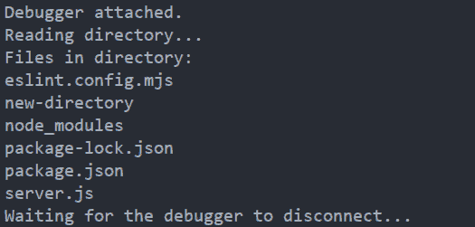

- `fs.existsSync('new-directory')` 检查目录是否存在。
- `fs.rmdirSync('new-directory')` 如果目录存在则删除它。
- 错误会被捕获并记录到控制台。

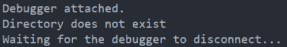

### 异步删除目录

示例：异步删除目录

```javascript
const fs = require('fs');

fs.rmdir('new-directory', (err) => {
  if (err) {
    return console.error('Error deleting directory:', err);
  }
  console.log('Directory deleted successfully');
});

console.log('Deleting directory...');
```

在此示例中：

- `fs.rmdir('new-directory', callback)` 异步删除目录。
- 回调函数处理任何错误。
- 立即记录消息 `'Deleting directory...'`，这演示了非阻塞行为。

### 重命名目录

Node.js 允许你使用 `fs.rename` 和 `fs.renameSync` 方法重命名目录。

### 同步重命名目录

示例：同步重命名目录

```javascript
const fs = require('fs');

try {
  fs.renameSync('old-directory', 'new-directory');
  console.log('Directory renamed successfully');
} catch (err) {
  console.error('Error renaming directory:', err);
}
```

在此示例中：

- `fs.renameSync('old-directory', 'new-directory')` 同步重命名目录。
- 错误会被捕获并记录到控制台。

### 异步重命名目录

示例：异步重命名目录

```javascript
const fs = require('fs');

fs.rename('old-directory', 'new-directory', (err) => {
  if (err) {
    return console.error('Error renaming directory:', err);
  }
  console.log('Directory renamed successfully');
});

console.log('Renaming directory...');
```

在此示例中：

- `fs.rename('old-directory', 'new-directory', callback)` 异步重命名目录。
- 回调函数处理任何错误。
- 立即记录消息 `'Renaming directory...'`，这演示了非阻塞行为。

### 监听目录

Node.js 可以监控目录中的变化，例如文件的添加、删除或修改。

示例：监听目录

```javascript
const fs = require('fs');

fs.watch('new-directory', (eventType, filename) => {
  if (filename) {
    console.log(`Event: ${eventType} on file: ${filename}`);
  } else {
    console.log(`Event: ${eventType}`);
  }
});

console.log('Watching directory...');
```

在此示例中：

- `fs.watch('new-directory', callback)` 监听 `new-directory` 的变化。
- 回调函数记录事件类型和受影响的文件。
- 立即记录消息 `'Watching directory...'`。

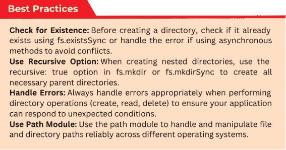

在 Node.js 中通过 `fs` 模块处理目录变得非常简单。你可以使用同步和异步方法创建、读取、重命名、删除和监控目录。虽然同步方法简单易用，但对于性能敏感型应用程序，更推荐使用异步方法，因为不会阻塞事件循环。理解这些操作允许你有效地管理应用程序的文件结构，确保目录处理的顺畅和高效。

## 3.3 流与缓冲区

流（Streams）和缓冲区（Buffers）是 Node.js 中高效处理 I/O 操作的基础。它们允许以连续流读取和写入数据，使得可以在不需要一次将所有内容加载到内存的情况下处理数据集或文件。让我们深入探讨这些概念，理解它们的作用以及如何有效地使用它们。

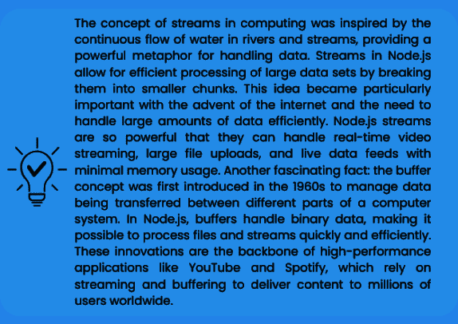

### 理解流

流是 Node.js 中的对象，允许你按顺序从源读取数据或向目标写入数据。它们提供了一种分块处理数据的方法，这对性能和内存管理至关重要。

### 流的类型

1. 可读流（Readable Streams）：用于从源读取数据。
2. 可写流（Writable Streams）：用于向目标写入数据。
3. 双工流（Duplex Streams）：既可以读取也可以写入数据。
4. 转换流（Transform Streams）：可以在读取或写入数据的同时修改或转换数据的双工流。

### 可读流

可读流允许你从源（例如文件或 HTTP 响应）读取数据。

示例：使用可读流读取文件

```javascript
const fs = require('fs');

const readStream = fs.createReadStream('example.txt', 'utf8');

readStream.on('data', (chunk) => {
  console.log('Reading chunk:', chunk);
});

readStream.on('end', () => {
  console.log('File completed');
});

readStream.on('error', (err) => {
  console.error('Error reading:', err);
});
```


在此示例中：

- `fs.createReadStream('example.txt', 'utf8')` 为 `example.txt` 创建了一个可读流。
- 每当读取一个数据块，就会触发 `data` 事件。
- 当整个文件读取完成后，会触发 `end` 事件。
- 如果读取发生错误，会触发 `error` 事件。

### 可写流

可写流允许你向目标（例如文件或网络套接字）写入数据。

示例：使用可写流写入文件

```javascript
const fs = require('fs');

const writeStream = fs.createWriteStream('example.txt');

writeStream.write('Hello, ', 'utf8');
writeStream.write('world!', 'utf8');
writeStream.end();

writeStream.on('finish', () => {
  console.log('File writing completed');
});

writeStream.on('error', (err) => {
  console.error('Error writing to:', err);
});
```

在此示例中：

- `fs.createWriteStream('example.txt')` 为 `example.txt` 创建了一个可写流。
- `write` 方法将数据写入流中。
- `end` 方法表示不再有更多数据写入。
- 当所有数据写入完成后，会触发 `finish` 事件。
- 如果写入发生错误，会触发 `error` 事件。

### 双工流

双工流可以执行读取和写入操作，使其对于网络通信和类似任务非常有用。

示例：使用双工流

```javascript
const net = require('net');

const server = net.createServer((socket) => {
  socket.write('Welcome to the server!\n');

  socket.on('data', (data) => {
    console.log('Received:', data.toString());
    socket.write('You said: ' + data);
  });

  socket.on('end', () => {
    console.log('Client disconnected');
  });

  socket.on('error', (err) => {
    console.error('Error:', err);
  });
});

server.listen(3000, () => {
  console.log('Server listening on port 3000');
});
```

在此示例中：

- `net.createServer` 创建了一个使用双工流的 TCP 服务器。
- `socket` 对象代表一个双工流，可以从客户端读取数据并写回客户端。

### 转换流

转换流是双工流，可以在读取或写入数据的同时修改或转换数据。它们对于数据压缩和加密等任务特别有用。

示例：带有 `zlib` 的转换流

```javascript
const fs = require('fs');
const zlib = require('zlib');

const readStream = fs.createReadStream('example.txt', 'utf8');
```

```javascript
const writeStream = fs.createWriteStream('example.txt.gz');
const gzip = zlib.createGzip();
readStream.pipe(gzip).pipe(writeStream);

writeStream.on('finish', () => {
  console.log('File compression completed');
});
```

在此示例中：

- `zlib.createGzip` 创建了一个压缩数据的转换流。
- `pipe` 方法用于将可读流、转换流和可写流链式在一起。
- 从 `example.txt` 读取的数据被压缩并写入 `example.txt.gz`。

### 理解缓冲区（Buffers）

缓冲区（Buffers）是用于二进制数据的临时存储区域。在 Node.js 中，缓冲区用于处理原始二进制数据，这使得它们对于处理流和其他 I/O 操作至关重要。

### 创建缓冲区

可以从各种源创建缓冲区，例如数组、字符串或现有的缓冲区数据。

### 示例：从字符串创建缓冲区

```javascript
const buffer = Buffer.from('Hello, world!', 'utf8');
console.log(buffer);
console.log(buffer.toString('utf8'));
```

在此示例中：

- `Buffer.from('Hello, world!', 'utf8')` 使用 UTF-8 编码从字符串 `'Hello, world!'` 创建一个缓冲区。
- 随后使用 `buffer.toString('utf8')` 将缓冲区转换回字符串。

### 写入缓冲区

缓冲区提供用于写入二进制数据的方法。

### 示例：写入缓冲区

```javascript
const buffer = Buffer.alloc(16);
buffer.write('Hello, world!', 'utf8');
console.log(buffer);
console.log(buffer.toString('utf8'));
```

在此示例中：

- `Buffer.alloc(16)` 创建了一个 16 字节的缓冲区。
- `write` 方法使用 UTF-8 编码将字符串 `'Hello, world!'` 写入缓冲区。
- 随后使用 `buffer.toString('utf8')` 将缓冲区转换回字符串。

### 缓冲区操作

缓冲区支持各种操作二进制数据的操作，例如切片和拼接。

### 示例：缓冲区切片

```javascript
const buffer = Buffer.from('Hello, world!', 'utf8');
const slice = buffer.slice(0, 5);
console.log(slice.toString('utf8')); // 输出: Hello
```

在此示例中：

- `buffer.slice(0, 5)` 创建了一个引用原始缓冲区部分的新缓冲区。
- 切片包含原始缓冲区的前 5 个字节，然后将其转换为字符串。

### 示例：缓冲区拼接

```javascript
const buffer1 = Buffer.from('Hello, ', 'utf8');
const buffer2 = Buffer.from('world!', 'utf8');
const combined = Buffer.concat([buffer1, buffer2]);
console.log(combined.toString('utf8')); // 输出: Hello, world!
```

在此示例中：

- `Buffer.concat([buffer1, buffer2])` 将 `buffer1` 和 `buffer2` 拼接成单个缓冲区。
- 合并后的缓冲区随后被转换为字符串。

### 流和缓冲区的实际应用

流（Streams）和缓冲区（Buffers）用于各种现实应用，例如：

1. **文件处理**
   - 读取和写入大文件无需将其完全加载到内存中。
   - 示例：处理日志文件或媒体文件。

2. **网络通信**
   - 高效地处理跨网络的数据传输。
   - 示例：构建 HTTP 服务器、TCP 服务器或 WebSocket 服务器。

3. **数据转换**
   - 在读取或写入时修改数据，例如压缩或加密。
   - 示例：使用 `gzip` 压缩文件或加密数据流。

4. **实时数据处理**
   - 处理实时数据流，例如视频流媒体或实时分析。
   - 示例：为直播广播处理视频流。


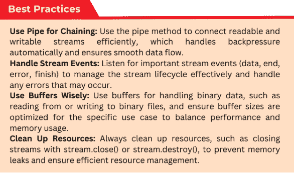

流和缓冲区是 Node.js 中高效处理 I/O 操作的强大工具。流允许你分块处理数据，使其成为处理大型数据集或文件的理想选择。缓冲区允许你直接操作二进制数据，为处理流奠定了基础。通过掌握这些概念，你可以构建健壮的应用程序，高效地处理数据并在负载下表现良好。无论你是在处理文件、通过网络进行通信还是实时转换数据，流和缓冲区都是你 Node.js 工具箱中不可或缺的组件。

## 3.4 处理文件上传

处理文件上传是 Web 应用中的常见需求。Node.js 提供了各种工具和库来简化这一过程。处理文件上传最流行的库之一是 `multer`。本节将引导你如何使用 `multer` 设置文件上传。

### 设置 `multer`

`multer` 是一个用于处理 `multipart/form-data` 的中间件，主要用于上传文件，并与 Express 无缝工作。

### 安装

首先，你需要安装 `multer`：

```bash
npm install express multer
```

### 基础文件上传示例

### 步骤 1：导入模块

```javascript
const express = require('express');
const multer = require('multer');
const path = require('path');
```

### 步骤 2：配置已上传文件的存储

```javascript
const storage = multer.diskStorage({
  destination: function (req, file, cb) {
    cb(null, 'uploads/'); // 保存文件的目录
  },
  filename: function (req, file, cb) {
    // 文件名定义逻辑
  }
});

const upload = multer({ storage: storage });
```

### 步骤 3：设置 Express 应用

```javascript
const app = express();
const PORT = 3000;

app.use(express.static('public')); // 从 public 目录提供静态文件
```

### 步骤 4：创建上传节点


```javascript
app.post('/upload', upload.single('file'), (req, res) => {
  try {
    res.send('上传成功');
  } catch (error) {
    res.status(400).send('上传错误');
  }
});
```

### 步骤 5：启动服务器

```javascript
app.listen(PORT, () => {
  console.log(`服务器运行在端口 ${PORT}`);
});
```

### 步骤 6：创建文件上传的 HTML 表单

在 `public` 目录中创建一个 `index.html` 文件，内容如下：

```html
<!DOCTYPE html>
<html lang="zh">
<head>
  <meta charset="UTF-8">
  <meta name="viewport" content="width=device-width, initial-scale=1.0">
  <title>文件上传</title>
</head>
<body>
  <h1>上传文件</h1>
  <form action="/upload" method="POST" enctype="multipart/form-data">
    <input type="file" name="file" required>
    <button type="submit">上传</button>
  </form>
</body>
</html>
```

### 完整示例

这是服务器的完整代码：

```javascript
const express = require('express');
const multer = require('multer');
const path = require('path');

const app = express();
const PORT = 3000;

const storage = multer.diskStorage({
  destination: function (req, file, cb) {
    cb(null, 'uploads/');
  },
  filename: function (req, file, cb) {
    cb(null, file.fieldname + '-' + Date.now() + path.extname(file.originalname));
  }
});

const upload = multer({ storage: storage });

app.use(express.static('public'));

app.post('/upload', upload.single('file'), (req, res) => {
  try {
    res.send('上传成功');
  } catch (error) {
    res.status(400).send('上传错误');
  }
});

app.listen(PORT, () => {
  console.log(`服务器运行在端口 ${PORT}`);
});
```

```javascript
cb(null, file.fieldname + '-' + Date.now() + path.extname(file.originalname));
}
});

const upload = multer({ storage: storage });

app.use(express.static('public'));

app.post('/upload', upload.single('file'), (req, res) => {
  try {
    res.send('File uploaded successfully');
  } catch (error) {
    res.status(400).send('Error uploading file');
  }
});

app.listen(PORT, () => {
  console.log(`Server is running on port ${PORT}`);
});
```

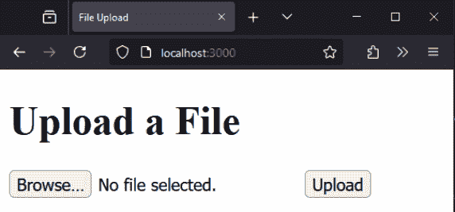

–––––––


你会在编辑器中看到这个目录。

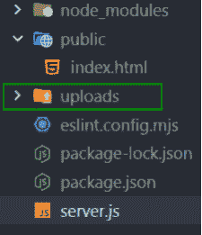

如果你想要，可以添加一些 CSS 效果（的）。

在 `public` 目录下创建一个名为 `styles.css` 的文件：

```css
/* styles.css */
body {
  font-family: Arial, sans-serif;
  background-color: #f4f4f4;
  margin: 0;
  padding: 0;
  display: flex;
  justify-content: center;
  align-items: center;
  height: 100vh;
}
h1 {
  color: #333;
  text-align: center;
}
form {
  background: #fff;
  padding: 20px;
  border-radius: 8px;
  box-shadow: 0 2px 4px rgba(0, 0, 0, 0.1);
  width: 300px;
  text-align: center;
}
input[type="file"] {
  margin: 10px 0;
  padding: 10px;
  border: 1px solid #ccc;
  border-radius: 4px;
  width: 100%;
  box-sizing: border-box;
}
button {
  background-color: #007BFF;
  color: white;
  padding: 10px;
  border: none;
  border-radius: 4px;
  cursor: pointer;
  width: 100%;
  font-size: 16px;
}
button:hover {
  background-color: #0056b3;
}
```

–––––––


#### 将 CSS 文件链接到你的 HTML 页面

更新你的 `index.html` 文件以包含对 `styles.css` 文件的引用：

```html
<!DOCTYPE html>
<html lang="en">
<head>
  <meta charset="UTF-8">
  <meta name="viewport" content="width=device-width, initial-scale=1.0">
  <title>File Upload</title>
  <link rel="stylesheet" href="/styles.css">
</head>
<body>
  <h1>Upload a File</h1>
  <form action="/upload" method="POST" enctype="multipart/form-data">
    <input type="file" name="file" required>
    <button type="submit">Upload</button>
  </form>
</body>
</html>
```

–––––––


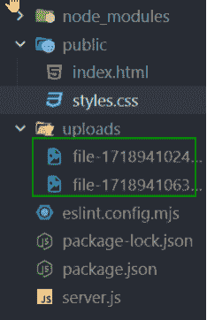

现在你会发现图片已经上传到 `uploads` 目录下了。

–––––––


### 多文件上传

#### 步骤 1：导入所需的模块

```javascript
const express = require('express');
const multer = require('multer');
const path = require('path');
const fs = require('fs');
```

#### 步骤 2：配置已上传文件的存储

`multer` 允许你配置存储选项，例如目标目录和文件名。

```javascript
const storage = multer.diskStorage({
  destination: function (req, file, cb) {
    cb(null, 'uploads/'); // 保存上传文件的目录
  },
  filename: function (req, file, cb) {
    cb(null, file.fieldname + '-' + Date.now() + path.extname(file.originalname)); // 文件名格式
  }
});

const upload = multer({ storage: storage });
```

#### 步骤 3：设置 Express 应用

```javascript
const app = express();
const PORT = 3000;

// 确保 uploads 目录存在
if (!fs.existsSync('uploads')) {
  fs.mkdirSync('uploads');
}

app.use(express.static('public')); // 从 "public" 目录提供静态文件
```

–––––––


#### 步骤 4：为多文件创建端点

```javascript
app.use(express.static('public')); // 从 "public" 目录提供静态文件

app.post('/upload-multiple', upload.array('files', 10), (req, res) => {
  try {
    res.send('Files uploaded successfully');
  } catch (error) {
    res.status(400).send('Error uploading files');
  }
});
```

#### 步骤 5：启动服务器

```javascript
app.listen(PORT, () => {
  console.log(`Server is running on port ${PORT}`);
});
```

#### 步骤 6：为多文件创建 HTML 表单

同时在 `public` 目录下创建一个包含以下内容的 `index.html` 文件：

```html
<!DOCTYPE html>
<html lang="en">
<head>
  <meta charset="UTF-8">
  <meta name="viewport" content="width=device-width, initial-scale=1.0">
  <title>File Upload</title>
  <link rel="stylesheet" href="/styles.css">
</head>
<body>
  <h1>Upload Files</h1>
  <form action="/upload-multiple" method="POST" enctype="multipart/form-data">
    <input type="file" name="files" multiple required>
    <button type="submit">Upload</button>
  </form>
</body>
</html>
```

–––––––


### 完整示例

这是服务器的完整代码：

```javascript
const express = require('express');
const multer = require('multer');
const path = require('path');
const fs = require('fs');

const app = express();
const PORT = 3000;

// 确保 uploads 目录存在
if (!fs.existsSync('uploads')) {
  fs.mkdirSync('uploads');
}

const storage = multer.diskStorage({
  destination: function (req, file, cb) {
    cb(null, 'uploads/'); // 保存上传文件的目录
  },
  filename: function (req, file, cb) {
    cb(null, file.fieldname + '-' + Date.now() + path.extname(file.originalname)); // 文件名格式
  }
});

const upload = multer({ storage: storage });

app.use(express.static('public')); // 从 "public" 目录提供静态文件

// 提供文件上传表单
app.get('/', (req, res) => {
  res.sendFile(path.join(__dirname, 'public', 'index.html'));
});

// 处理多文件上传的端点
app.post('/upload-multiple', upload.array('files', 10), (req, res) => {
  try {
    res.send('Files uploaded successfully');
  } catch (error) {
    res.status(400).send('Error uploading files');
  }
});

// 启动服务器
app.listen(PORT, () => {
  console.log(`Server is running on port ${PORT}`);
});
```

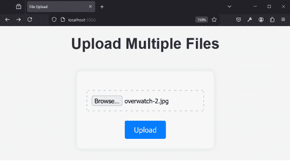

### 代码解释

- **Express 设置**：我们设置了一个 Express 应用来处理 HTTP 请求。
- **multer 配置**：我们配置 `multer` 将上传的文件存储在 `uploads` 目录中并生成文件名。
- **静态文件**：我们从 `public` 目录提供静态文件，我们在那里放置了 HTML 表单。
- **上传端点**：我们创建了一个端点 `/upload-multiple` 来多文件上传。`upload.array('files', 10)` 中间件处理文件上传，允许一次上传 10 个文件。上传的文件可以通过 `req.files` 访问。

–––––––


### 文件上传

你可以添加文件验证以确保只上传特定类型的文件。

#### 示例：文件验证

```javascript
const fileFilter = (req, file, cb) => {
  // 仅接受图片
  if (!file.originalname.match(/\.(jpg|jpeg|png|gif)$/)) {
    return cb(new Error('只允许图片文件!'), false);
  }
  cb(null, true);
};

const upload = multer({
  storage: storage,
  fileFilter: fileFilter
});
```

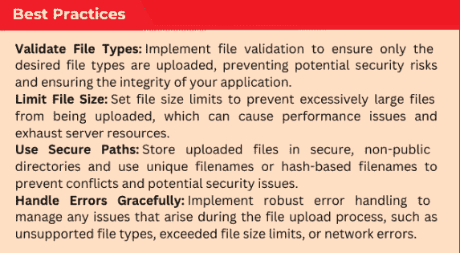


## 3.5 文件系统操作实用示例

文件系统操作对于读取、写入以及管理文件和目录等各种任务至关重要。本节提供了实用示例，演示了如何使用 Node.js 执行这些操作。

### 示例 1：读取和写入文件

**目标**：读取文件内容并写入新文件。

**代码**：

```javascript
const fs = require('fs');

// 读取 'input.txt' 的内容并将其写入 'output.txt'

fs.readFile('input.txt', 'utf8', (err, data) => {
  if (err) {
    console.error('Error reading file:', err);
    return;
  }

  fs.writeFile('output.txt', data, (err) => {
    if (err) {
      console.error('Error writing file:', err);
      return;
    }

    console.log('File has been written successfully');
  });
});

console.log('Reading and writing files...');
```

**解释**：

- `fs.readFile('input.txt', 'utf8', callback)`：异步读取 `input.txt` 的内容。


* `fs.writeFile('output.txt', data, callback)`：异步将从 `input.txt` 读取的数据写入 `output.txt`。
* 程序立即打印 `Reading and writing files...`，演示了非阻塞行为。

### 示例 2：创建和删除目录

目标：创建一个新目录并将其删除。

代码：

```javascript
const fs = require('fs');

// 创建新目录 'newDir'

fs.mkdir('newDir', (err) => {
  if (err) {
    console.error('Error creating directory:', err);
    return;
  }
  console.log('Directory created successfully');
  // 删除目录 'newDir'
  fs.rmdir('newDir', (err) => {
    if (err) {
      console.error('Error deleting directory:', err);
      return;
    }
    console.log('Directory deleted successfully');
  });
});

console.log('Creating and deleting directory...');
```

解释：

* `fs.mkdir('newDir', callback)`：创建一个名为 `newDir` 的新目录。
* `fs.rmdir('newDir', callback)`：删除名为 `newDir` 的目录。
* 程序立即打印 `Creating and deleting directory...`，演示了非阻塞行为。

### 示例 3：复制文件

目标：将文件从一个位置复制到另一个位置。

代码：

```javascript
const fs = require('fs');

// 源和目标路径
const source = 'source.txt';
const destination = 'destination.txt';
// 将 'source.txt' 的内容复制到 'destination.txt'

fs.copyFile(source, destination, (err) => {
  if (err) {
    console.error('Error copying file:', err);
    return;
  }
  console.log('File copied successfully');
});

console.log('Copying file...');
```

解释：

* `fs.copyFile(source, destination, callback)`：将 `source.txt` 的内容复制到 `destination.txt`。
* 程序立即打印 `Copying file...`。

### 示例 4：列出目录中的文件

目标：列出指定目录下的所有文件和目录。

代码：

```javascript
const fs = require('fs');

// 列出当前目录的内容
fs.readdir('.', (err, files) => {
  if (err) {
    console.error('Error reading directory:', err);
    return;
  }
  console.log('Files in directory:');
  files.forEach(file => {
    console.log(file);
  });
});

console.log('Listing files in directory...');
```

解释：

* `fs.readdir('.', callback)`：读取当前目录的内容。
* 程序立即打印 `Listing files in directory...`。

### 示例 5：监控文件变化

目标：监控文件在被修改时的变化。

代码：

```javascript
const fs = require('fs');

// 监控 'watchedFile.txt' 的变化
fs.watch('watchedFile.txt', (eventType, filename) => {
  if (filename) {
    console.log(`${filename} Changed`);
  }
});

console.log('Watching file for changes...');
```

解释：

* `fs.watch('watchedFile.txt', callback)`：监控 `watchedFile.txt` 的任何变化（例如修改）。
* 程序立即打印 `Watching file for changes...`。

### 示例 6：向文件追加数据

目标：向现有文件追加数据。

代码：

```javascript
const fs = require('fs');

// 要追加的数据
const data = '\nAppended text.';
// 向 'fileToAppend.txt' 追加数据

fs.appendFile('fileToAppend.txt', data, (err) => {
  if (err) {
    console.error('Error appending to file:', err);
    return;
  }
  console.log('Data appended successfully');
});

console.log('Appending data to file...');
```

解释：

* `fs.appendFile('fileToAppend.txt', data, callback)`：向 `fileToAppend.txt` 追加数据。
* 程序立即打印 `Appending data to file...`。

这些实用性示例演示了如何使用 Node.js 执行各种文件系统操作，例如读取和写入文件、创建和删除目录、复制文件、列出目录内容、监控文件变化以及向文件追加数据。通过理解并利用这些操作，你可以在 Node.js 应用中高效地管理文件和目录，确保处理的稳健与灵活。

## 4. HTTP 与 Web 服务器

### HTTP 状态码

HTTP 状态码是服务器对客户端请求做出的标准响应。这些状态码被分为五类：

1. `1xx (信息性)`：请求已接收，继续处理。
2. `2xx (成功型)`：请求已成功接收、理解并接受。
3. `3xx (重定向型)`：为了完成请求需要采取后续操作。
4. `4xx (客户端错误)`：请求包含错误语法或无法执行。
5. `5xx (服务器错误)`：服务器未能有效执行请求。

#### 常见 HTTP 状态码

### 404 未找到（Not Found）

定义：404 状态码意味着服务器找不到请求的资源。当客户端请求的 URL 在服务器上没有对应的资源时，通常会返回此状态码。它表示客户端错误，即用户正在尝试访问不存在的页面。

常见原因：

* 输入了错误的 URL。
* 点击了失效或死链。
* 资源已被移动或删除。

处理：当遇到 404 错误时，服务器理想情况下应该返回自定义的 404 错误页面，告知用户找不到请求资源，并提供导航选项帮助他们找到所需内容。

#### 500 内部服务器错误（Internal Server Error）

定义：500 状态码表示服务器遇到了意外情况，导致其无法执行请求。这是一个通用的错误消息，当没有更具体的错误信息可用时使用。它指示服务器端错误。

常见原因：

* 服务器配置错误。
* 服务端代码中的脚本错误。
* 资源耗尽（例如，内存溢出）。
* 服务器尝试访问的第三方服务或 API 问题。

处理方式：当发生 `500` 错误时，服务器应记录错误详情以便进一步调查，并向用户返回通用的错误消息，以避免暴露敏感信息。此外，良好的做法是显示自定义错误页面，告知用户出现的问题，并在可能的情况下提供报告问题的方法。

### HTTP 状态码详细说明

#### 1xx 信息性

* `100 Continue`：服务器已接收请求头，客户端应继续发送请求体。
* `101 Switching Protocols`：请求者要求服务器切换协议，服务器对此确认将执行该操作。

#### 2xx 成功

* `200 OK`：请求成功。成功的含义取决于 HTTP 方法（`GET`、`POST`、`PUT`、`DELETE`）。
* `201 Created`：请求已成功导致了新资源的创建。
* `204 No Content`：服务器成功处理了请求，但没有返回任何内容。

#### 3xx 重定向

* `301 Moved Permanently`：请求资源的 URL 已永久重定向。响应中给出了新 URL。
* `302 Found`：请求资源的 URL 已临时重定向。
* `304 Not Modified`：表示资源自上次请求以来未被修改。

#### 4xx 客户端错误

* `400 Bad Request`：由于客户端错误，服务器无法处理请求（例如，请求语法格式错误）。
* `401 Unauthorized`：请求需要用户认证。
* `403 Forbidden`：服务器理解了请求，但拒绝授权。
* `404 Not Found`：服务器找不到请求的资源。
* `408 Request Timeout`：服务器等待请求超时。

#### 5xx 服务端错误

* `500 Internal Server Error`：服务器遇到意外情况，导致无法完成请求。
* `501 Not Implemented`：服务器不支持完成请求所需的功能。
* `502 Bad Gateway`：服务器在充当网关或代理角色时，从上游服务器接收到了无效响应。
* `503 Service Unavailable`：服务器未准备好处理请求，通常是因为临时过载或维护。
* `504 Gateway Timeout`：服务器在充当网关或代理角色时，未从上游服务器收到及时的响应。

| 状态码 | 含义 | 描述 |
| :--- | :--- | :--- |
| 1xx Informational | | |
| 100 | Continue | 服务器已接收请求头，客户端应继续发送请求体。 |
| 101 | Switching Protocols | 请求者要求服务器切换协议，服务器对此确认将执行该操作。 |
| 2xx Successful | | |
| 200 | OK | 请求成功。 |
| 201 | Created | 请求已成功导致了新资源的创建。 |
| 204 | No Content | 服务器成功处理了请求，但没有返回任何内容。 |
| 3xx Redirection | | |
| 301 | Moved Permanently | 请求资源的 URL 已永久重定向。 |
| 302 | Found | 请求资源的 URL 已临时重定向。 |
| 304 | Not Modified | 表示资源自上次请求以来未被修改。 |
| 4xx Client Error | | |
| 400 | Bad Request | 由于客户端错误，服务器无法处理请求（例如，请求语法格式错误）。 |
| 401 | Unauthorized | 请求需要用户认证。 |
| 403 | Forbidden | 服务器理解了请求，但拒绝授权。 |
| 404 | Not Found | 服务器找不到请求的资源。 |
| 408 | Request Timeout | 服务器等待请求超时。 |
| 5xx Server Error | | |
| 500 | Internal Server Error | 服务器遇到意外情况，导致无法完成请求。 |
| 501 | Not Implemented | 服务器不支持完成请求所需的功能。 |
| 502 | Bad Gateway | 服务器在充当网关或代理角色时，从上游服务器接收到了无效响应。 |
| 503 | Service Unavailable | 服务器未准备好处理请求，通常是因为临时过载或维护。 |
| 504 | Gateway Timeout | 服务器在充当网关或代理角色时，未从上游服务器收到及时的响应。 |

## HTTP 状态码

### 理解 HTTP 方法

HTTP 方法（称为动词）是用于网络通信的 HTTP 协议的基础部分。这些方法定义了对 URL 标识的资源上要执行的操作。最常用的方法是 `GET`、`POST`、`PUT` 和 `DELETE`，但还有其他方法如 `PATCH`、`OPTIONS` 和 `HEAD`，它们都有特定的用途。

### HTTP 方法详细说明

#### GET 方法

定义：`GET` 方法用于从指定的资源请求数据。使用 `GET` 的请求应只检索数据，不对数据产生任何其他影响。

特性：

* `幂等性`：多次相同的 `GET` 请求产生的结果应与单个请求相同。
* `安全性`：不改变服务器状态。
* `可缓存性`：对 `GET` 请求的响应可以缓存以提高性能。

用途：

* 获取网页。
* 从服务器检索数据。

示例：

```http
GET /users HTTP/1.1
Host: example.com
```

在此示例中，向 `/users` 节点发送了 `GET` 请求，以获取用户列表。

#### POST 方法

定义：`POST` 方法用于向服务器发送数据以创建或更新资源。数据包含在请求的（体中。

特性：

* `非幂等性`：多次相同的 `POST` 请求可能会产生不同的影响。
* `非安全性`：会改变服务器状态。
* `不可缓存性`：对 `POST` 请求的响应通常不会缓存。

用途：

* 提交表单数据。
* 上传文件。
* 在服务器上创建新资源。

示例：

```http
POST /users HTTP/1.1
Host: example.com
Content-Type: application/json

{
  "name": "John Doe",
  "email": "john.doe@example.com"
}
```

在此示例中，向 `/users` 节点发送了带有请求数据的 `POST` 请求，以创建一个新用户。

#### PUT 方法

定义：`PUT` 方法用于用新数据更新当前资源。如果资源不存在，`PUT` 可以创建它。

特性：

* `幂等性`：多次相同的 `PUT` 请求产生的结果应与单个请求相同。
* `非安全性`：会改变服务器状态。
* `不可缓存性`：对 `PUT` 请求的响应通常不会缓存。

用途：

* 更新现有资源。
* 在指定的 URL 创建资源。

示例：

```http
PUT /users/1 HTTP/1.1
Host: example.com
Content-Type: application/json

{
  "name": "John Doe",
  "email": "john.doe@example.com"
}
```

在此示例中，向 `/users/1` 节点发送了 `PUT` 请求，以更新 ID 为 1 的用户。

#### DELETE 方法

定义：`DELETE` 方法用于删除指定的资源。

特性：

* `幂等性`：多个相同的 `DELETE` 请求产生的效果应与单个请求相同。
* `非安全`：会改变服务器的状态。
* `不可缓存`：对 `DELETE` 请求的响应通常不缓存。

用途：

* 从服务器删除资源。

示例：

```http
DELETE /users/1 HTTP/1.1
Host: example.com
```

解释：在此示例中，向 `/users/1` 终点发送 `DELETE` 请求，以删除 ID 为 1 的用户。

#### PATCH 方法

定义：`PATCH` 方法用于对资源进行部分修改。

特性：

* `非幂等性`：多个相同的 `PATCH` 请求可能会产生不同的效果。
* `非安全`：会改变服务器的状态。
* `不可缓存`：对 `PATCH` 请求的响应通常不缓存。

用途：

* 部分更新资源。

示例：

```http
PATCH /users/1 HTTP/1.1
Host: example.com
Content-Type: application/json

{
 "email": "john.newemail@example.com"
}
```

在此示例中，向 `/users/1` 终点发送 `PATCH` 请求，仅更新 ID 为 1 的用户的电子邮箱。

#### OPTIONS 方法

定义：`OPTIONS` 方法用于描述目标资源的通信选项端。

特性：

* `幂等性`：多个相同的 `OPTIONS` 请求产生的效果应与单个请求相同。
* `安全`：不改变服务器的状态。
* `不可缓存`：对 `OPTIONS` 请求的响应通常不缓存。

用途：

* 检查服务器支持哪些 HTTP 方法。

示例：

```http
OPTIONS /users HTTP/1.1
Host: example.com
```

在此示例中，向 `/users` 终点发送 `OPTIONS` 请求，以确定服务器为该资源支持的方法。

#### HEAD 方法

定义：`HEAD` 方法与 `GET` 方法相同，不同之处服务器**必须不**在响应中返回消息体。它用于获取写入响应标头中的元数据，而无需传输整个内容。

特性：

* `幂等性`：多个相同的 `HEAD` 请求产生的效果应与单个请求相同。
* `安全`：不改变服务器的状态。
* `可缓存`：对 `HEAD` 请求的响应可以缓存。


**用途：**

- 检查资源是否存在。
- 获取有关资源的元数据。

```http
HEAD /users HTTP/1.1
Host: example.com
```

在此示例中，向`/users`终点发送`HEAD`请求，以获取不带响应体的标头信息。

| HTTP 方法 | 幂等性 | 安全 | 可缓存 | 描述 |
| :--- | :--- | :--- | :--- | :--- |
| GET | 是 | 是 | 是 | 从指定的资源检索数据。 |
| POST | 否 | 否 | 否 | 向服务器发送数据以创建/更新资源。 |
| PUT | 是 | 否 | 否 | 更新资源或在不存在时创建它。 |
| DELETE | 是 | 否 | 否 | 删除指定的资源。 |
| PATCH | 否 | 否 | 否 | 对资源进行部分修改。 |
| OPTIONS | 是 | 是 | 否 | 描述资源的通信选项。 |
| HEAD | 是 | 是 | 是 | 获取资源的标头而不包含正文。 |

HTTP 方法表 3


## 4.1. 创建简单的 Web 服务器

在 Node.js 中创建一个简单的 Web 服务器是理解服务器端应用程序如何工作的关键步骤。Node.js 内置的`http`模块提供了设置服务器的所有功能。

### 步骤 1：导入 HTTP 模块

首先，你需要导入`http`模块。你不需要安装任何东西。

```javascript
const http = require('http');
```

### 步骤 2：创建服务器

`createServer`方法创建一个服务器实例。回调函数接收两个参数：`req`（请求对象）和`res`（响应对象）。

```javascript
const server = http.createServer((req, res) => {
    // 逻辑在这里
});
```

### 步骤 3：监听端口

告诉服务器监听端口。开发中常用的端口有 3000、8080 和 5000。

```javascript
const PORT = 3000;
server.listen(PORT, () => {
    console.log(`Server running at http://localhost:${PORT}`);
});
```

### 完整示例

```javascript
const http = require('http');

const server = http.createServer((req, res) => {
    res.statusCode = 200;
    res.setHeader('Content-Type', 'text/plain');
    res.end('Hello, World!\n');
});

const PORT = 3000;
server.listen(PORT, () => {
    console.log(`Server running at http://localhost:${PORT}`);
});
```

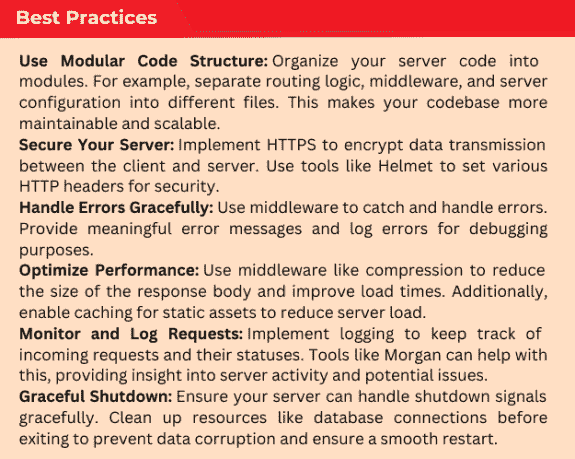

# 4. Postman 简介

POSTMAN 是一个强大且用户型的工具，旨在简化 API 的开发、测试和文档编制过程。它允许开发者发送 HTTP 请求、检查响应并自动化 API 测试。通过 Postman，你可以在无需编写额外代码的情况下与 Web 服务器交互，使其成为 Web 开发和 API 测试的必备工具。


## 什么是 Postman？

POSTMAN 是一个用于 API 开发的协作平台。它提供了一套全面的工具，帮助你设计、调试、测试和记录 API。它支持多种 HTTP 方法（`GET`、`POST`、`PUT`、`DELETE`等），并允许轻松添加头部（headers）、参数和请求体。Postman 直观的界面和强大的功能使其成为开发者进行 API 测试和开发的流行选择。


## Postman 的核心功能

1. **HTTP 请求**：使用各种方法（`GET`、`POST`、`PUT`、`DELETE`等）发送 HTTP 请求。
2. **头部和参数**：在请求中添加自定义头部和查询参数。
3. **请求体**：发送不同类型的请求体（`raw`、`JSON`、`form-data`等）。
4. **响应检查**：查看详细的响应，包括状态码、头部和正文。
5. **环境变量**：使用变量管理不同的环境（开发、测试阶段、生产环境）。
6. **自动化**：利用 Postman 的脚本能力编写测试并自动化 API 工作流。
7. **集合（Collections）**：将相关的请求分组到集合中，以便于管理和重复重用。

## 如何使用 Postman

### 安装 Postman

1. **下载**：访问 Postman 下载页面，下载适用于你操作系统的相应版本。
2. **安装**：按照你所在平台的安装说明安装 Postman。

### 创建新请求

1. **打开 Postman**：启动 Postman 应用程序。
2. **创建新请求**：
   - 点击左上角的`+`按钮或`New`按钮创建新请求。
   - 选择`HTTP Request`。

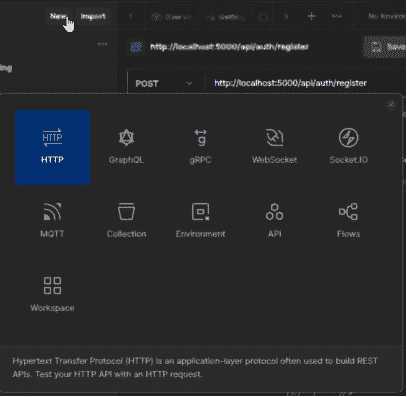

3. **设置请求方法**：
   - 使用下拉菜单选择 HTTP 方法（`GET`、`POST`、`PUT`、`DELETE`等）。

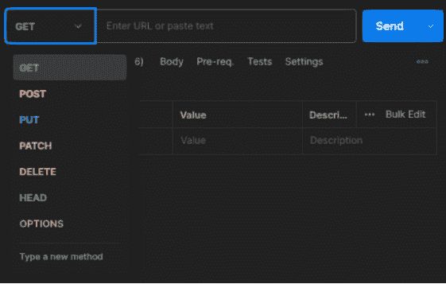

4. **输入 URL**：
   - 输入你想测试的 API 端点的 URL（例如`http://localhost:3000`）。

### 添加头部和参数

1. **头部 (Headers)**：
   - 点击 URL 下方的`Headers`标签。
   - 为你想包含的头部添加键值对（例如`Content-Type: application/json`）。
2. **查询参数 (Query Parameters)**：
   - 点击 URL 下方的`Params`标签。
   - 为你想包含的查询参数添加键值对（例如`name=John&age=30`）。

### 添加请求体

1. **选择 Body 标签**：
   - 点击 URL 下方的`Body`标签。
2. **选择 Body 类型**：
   - 选择合适的 Body 类型（`raw`、`form-data`、`x-www-form-urlencoded`等）。
3. **输入请求体**：
   - 对于`raw`Body 类型，选择数据格式（例如`JSON`）并输入请求体。
   - 示例 JSON 体：

```json
{
  "name": "John",
  "age": 30
}
```

### 发送请求

1. **点击 Send**：
   - 点击`Send`按钮将请求发送到服务器。
2. **检查响应**：
   - 服务器的响应将显示在 Postman 的下半部分。
   - 你可以响应状态、头部和主体。

### 使用 Postman 集合 (Collections)

1. **创建集合**：
   - 点击左侧边栏上的`Collections`标签。
   - 点击`New Collection`按钮并为集合命名。
2. **将请求添加到集合**：
   - 将单个请求保存到集合中以便于组织管理。
   - 点击请求上的`Save`并选择要保存到的集合。

### 自动化测试

1. **编写测试**：
   - 点击 URL 下方的`Tests`标签。
   - 编写 JavaScript 代码创建验证响应的测试。
   - 示例测试：


```javascript
pm.test("STATUS CODE is 200", function () {
  pm.response.to.have.status(200);
});
```

关于如何使用 Postman 的详尽且生动的教程，我强烈建议在 YouTube 上观看 Hitesh Choudhary 的视频，他用非常棒的方式讲解了 Postman。

## 2. 处理请求和响应

### 不同的 HTTP 方法

HTTP 方法定义了客户端请求的操作类型。理解这些方法对于构建健壮的 API 至关重要。

### 处理 GET 请求

GET 请求用于从服务器检索数据。它们是等等的，意味着多次发送相同的请求不应改变服务器的状态。

示例：

```javascript
const http = require('http');
const url = require('url');

const server = http.createServer((req, res) => {
  if (req.method === 'GET') {
    const query = url.parse(req.url).query;
    res.statusCode = 200;
    res.setHeader('Content-Type', 'application/json');
    res.end(JSON.stringify(query));
  } else {
    res.statusCode = 405;
    res.end('Method Not Allowed');
  }
});

const PORT = 3000;
server.listen(PORT, () => {
  console.log(`Server running at http://localhost:${PORT}`);
});
```

测试：

1. 打开 Postman 并创建一个 GET 请求。
2. 将 URL 设置为`http://localhost:3000?name=John&age=30`。
3. 点击`Send`。
4. 你将看到带有参数的响应。

### 处理 POST 请求

POST 请求用于向服务器发送数据以创建或更新资源。数据包含在请求体内。

示例：

```javascript
const http = require('http');

const server = http.createServer((req, res) => {
  if (req.method === 'POST') {
    let body = '';
    req.on('data', chunk => {
      body += chunk.toString();
    });
    req.on('end', () => {
      res.statusCode = 200;
      res.setHeader('Content-Type', 'application/json');
      res.end(`Received data: ${body}`);
    });
  } else {
    res.statusCode = 405;
    res.end('Method Not Allowed');
  }
});

const PORT = 3000;
server.listen(PORT, () => {
  console.log(`Server running at http://localhost:${PORT}`);
});
```

测试：

1. 打开 Postman 并创建一个新的 POST 请求。
2. 将 URL 设置为`http://localhost:3000`。
3. 转到`Body`标签，选择`raw`和`JSON`，并输入：

```json
{
  "name": "John",
  "age": 30
}
```

4. 点击`Send`。
5. 你应该看到带有接收数据的响应。

### 处理 PUT 请求

`PUT`请求用于更新服务器上的资源。如果资源不存在，它们也可以用于创建资源。`PUT`请求通常在请求体中包含数据。

### 示例代码

```javascript
const http = require('http');

const server = http.createServer((req, res) => {
  if (req.method === 'PUT') {
    let body = '';
    req.on('data', chunk => {
      body += chunk.toString();
    });
    req.on('end', () => {
      res.statusCode = 200;
      res.setHeader('Content-Type', 'application/json');
      res.end(`Updated data: ${body}`);
    });
  } else {
    res.statusCode = 405;
    res.end('Method Not Allowed');
  }
});

const PORT = 3000;

server.listen(PORT, () => {
  console.log(`Server running at http://localhost:${PORT}/`);
});
```

### 测试

1. 打开 Postman 并创建一个新的`PUT`请求。
2. 将 URL 设置为`http://localhost:3000`。
3. 转到`Body`标签页，选择`raw`和`JSON`，并输入：

```json
{
  "name": "John",
  "age": 31
}
```

- 点击`Send`。
- 你将看到包含更新数据的响应：


### 处理 DELETE 请求

`DELETE`请求用于删除服务器上的资源。

#### 示例

```javascript
const http = require('http');

const server = http.createServer((req, res) => {
  if (req.method === 'DELETE') {
    const urlParts = req.url.split('/');
    const id = urlParts[urlParts.length - 1];
    res.statusCode = 200;
    res.setHeader('Content-Type', 'text/plain');
    res.end(`Resource with ID ${id} deleted`);
  } else {
    res.statusCode = 405;
    res.end('Method Not Allowed');
  }
});

const PORT = 3000;

server.listen(PORT, () => {
  console.log(`Server running at http://localhost:${PORT}/`);
});
```

#### 测试

1. 打开 Postman 并创建一个新的`DELETE`请求。
2. 将 URL 设置为`http://localhost:3000/resource/123`。


3. 点击`Send`。
4. 你应该看到指示资源已删除响应：

`Resource with ID 123 deleted`

### 处理其他 HTTP 方法 (PATCH, OPTIONS, HEAD)

#### PATCH：用于对资源进行部分修改。

##### 示例

```javascript
const http = require('http');

const server = http.createServer((req, res) => {
  if (req.method === 'PATCH') {
    let body = '';
    req.on('data', chunk => {
      body += chunk.toString();
    });
    req.on('end', () => {
      res.statusCode = 200;
      res.setHeader('Content-Type', 'application/json');
      res.end(`Patched data: ${body}`);
    });
  } else {
    res.statusCode = 405;
    res.end('Method Not Allowed');
  }
});

const PORT = 3000;

server.listen(PORT, () => {
  console.log(`Server running at http://localhost:${PORT}/`);
});
```

##### 测试

1. 打开 Postman 并创建一个新的`PATCH`请求。
2. 将 URL 设置为`http://localhost:3000`。
3. 转到`Body`标签页，选择`raw`和`JSON`，并输入：

```json
{
  "name": "John",
  "age": 32
}
```

- 点击`Send`。
- 你将看到包含修改后数据的响应：

```json
{
  "Patched data": "{\"name\":\"John\",\"age\":32}"
}
```


### OPTIONS

用于描述目标资源的通信选项。

#### 示例

```javascript
const http = require('http');

const server = http.createServer((req, res) => {
  if (req.method === 'OPTIONS') {
    res.statusCode = 200;
    res.setHeader('Allow', 'GET, POST, PUT, DELETE, PATCH, OPTIONS');
  } else {
    res.statusCode = 405;
    res.end('Method Not Allowed');
  }
});

const PORT = 3000;

server.listen(PORT, () => {
  console.log(`Server running at http://localhost:${PORT}/`);
});
```

#### 测试

1. 打开 Postman 并创建一个新的 `OPTIONS` 请求。
2. 将 URL 设置为 `http://localhost:3000`。
3. 点击 `Send`。
4. 你将看到响应：

`Allow: GET, POST, PUT, DELETE, PATCH, OPTIONS`

## 解析与管理数据

`JSON` 是一种轻量级的数据交换格式，易于人类读写，也易于机器解析和生成。

### 核心模块示例

```javascript
const http = require('http');

const server = http.createServer((req, res) => {
  if (req.method === 'POST' && req.headers['content-type'] === 'application/json') {
    let body = '';
    req.on('data', chunk => {
      body += chunk.toString();
    });
    req.on('end', () => {
      try {
        const parsedData = JSON.parse(body);
        res.statusCode = 200;
        res.setHeader('Content-Type', 'application/json');
        res.end(JSON.stringify({ received: parsedData }));
      } catch (err) {
        res.statusCode = 400;
        res.end('Invalid JSON');
      }
    });
  } else {
    res.statusCode = 405;
    res.end('Method Not Allowed');
  }
});

const PORT = 3000;

server.listen(PORT, () => {
  console.log(`Server running at http://localhost:${PORT}/`);
});
```

#### 说明

- 此代码段设置了一个服务器，监听 `Content-Type` 为 `application/json` 的 `POST` 请求。
- 服务器读取请求体，将其解析，并返回解析后的数据。
- 如果 JSON 无效，它将返回 `400 Bad Request` 状态。

#### 使用 Postman 测试

1. 创建 `POST` 请求。
2. 将 URL 设置为 `http://localhost:3000`。
3. 将 `Content-Type` 请求头设置为 `application/json`。
4. 在 `Body` 标签页中，选择 `raw` 和 `JSON`，然后输入：

```json
{
  "name": "John",
  "age": 30
}
```

点击 `Send`。

- 服务器读取请求体，使用 `querystring.parse` 对其进行解析，并响应解析后的数据。

### 使用 Postman 进行测试

1. 创建一个新的 `POST` 请求。
2. 将 URL 设置为 `http://localhost:3000`。
3. 将 `Content-Type` 请求头设置为 `application/x-www-form-urlencoded`。
4. 在 `Body` 标签页，选择 `x-www-form-urlencoded`，然后添加如 `name=John` 和 `age=30` 等键值对。
5. 点击 `Send`。


### 处理 Multipart 表单数据（文件上传）

`MULTIPART FORM DATA` 用于文件上传，可以包含文本和二进制数据。要处理 multipart 表单数据，你通常会在 Express 中配合使用如 `multer` 这样的中间件库。

#### 使用 Express 和 Multer 的示例

安装 Express 和 Multer：

```bash
npm install express multer
```

设置服务器：

```javascript
const express = require('express');
const multer = require('multer');
const path = require('path');
const app = express();
const upload = multer({ dest: 'uploads/' });

app.post('/upload', upload.single('file'), (req, res) => {
  res.statusCode = 200;
  res.setHeader('Content-Type', 'application/json');
  res.end(JSON.stringify({ file: req.file }));
});

const PORT = 3000;
app.listen(PORT, () => {
  console.log(`Server running at http://localhost:${PORT}/`);
});
```

解释：

- 此代码段设置了一个带有 `Multer` 中间件的 `Express` 服务器来处理文件上传。
- `upload.single('file')` 中间件处理表单字段名为 `file` 的单文件上传。
- 服务器响应有关已上传文件的信息。

### 使用 Postman 进行测试

1. 创建一个新的 `POST` 请求。
2. 将 URL 设置为 `http://localhost:3000/upload`。
3. 在 `Body` 标签页，选择 `form-data`。


4. 添加一个键 `file` 并将类型设置为 `File`。


5. 选择一个文件进行上传。


6. 点击 `Send`。


### 错误处理

`适当的错误处理` 对于创建一个健壮且用户友应用程序至关重要。在 Web 开发中，优雅地管理不同类型的错误并向用户提供有意义的反馈是非常重要的。本节涵盖了处理常见的 HTTP 错误（如 `404 Not Found` 和 `500 Internal Server Errors`）、创建自定义错误页面以及为了调试目的记录错误。

#### 处理 404 Not Found

当服务器上未找到请求资源时，会发生 `404 错误`。捕获此错误并提供用户友好的消息而不是通用的浏览器错误页面是很重要的。

##### 使用 Express 的示例

```javascript
const express = require('express');
const app = express();

// 在此处定义你的路由

// 捕获 404 并转发到错误处理器
app.use((req, res, next) => {
  res.status(404).send('404 Not Found');
});

const PORT = 3000;
app.listen(PORT, () => {
  console.log(`Server running at http://localhost:${PORT}/`);
});
```

解释：

- 在定义路由之后，使用中间件函数捕获所有未匹配的路由。
- 将状态码设置为 `404` 并发送用户友好的消息。


#### 处理 500 Internal Server Errors

`500 错误指示` 表示服务器端发生了问题。记录这些错误并向用户提供通用消息以避免暴露敏感信息是非常重要的。

##### 使用 Express 的示例

```javascript
const express = require('express');
const app = express();

// 模拟一个错误
app.get('/error', (req, res, next) => {
  const err = new Error('Something went wrong!');
  err.status = 500;
  next(err);
});

// 错误处理
app.use((err, res, next) => {
  console.error(err.stack);
  res.status(err.status || 500).send('500 Internal Server Error');
});

const PORT = 3000;
app.listen(PORT, () => {
  console.log(`Server running at http://localhost:${PORT}/`);
});
```

#### 自定义错误页面

`自定义错误页面` 通过在错误发生时提供更多上下文来提升用户体验。

##### 使用 Express 的示例

```javascript
const express = require('express');
const path = require('path');
const app = express();

// 从 "public" 目录提供静态文件
app.use(express.static(path.join(__dirname, 'public')));

// 在此处定义你的路由

// 捕获 404 并转发到错误处理器
app.use((req, res, next) => {
  res.status(404).sendFile(path.join(__dirname, 'public', '404.html'));
});

// 错误处理
app.use((err, res, next) => {
  console.error(err.stack);
  res.status(err.status || 500).sendFile(path.join(__dirname, 'public', '500.html'));
});

const PORT = 3000;
app.listen(PORT, () => {
  console.log(`Server running at http://localhost:${PORT}/`);
});
```

#### 记录错误

`记录错误对于调试和维护你的应用程序关关`。你可以使用 `console.error` 进行简单的记录，或者使用更高级的日志库如 `winston`。

##### 使用 Express 和 Winston 的示例

安装 Winston：

```bash
npm install winston
```

设置 Winston 日：

```javascript
const express = require('express');
const winston = require('winston');
const app = express();
const logger = winston.createLogger({
  level: 'error',
  format: winston.format.combine(
    winston.format.timestamp(),
```

```javascript
winston.format.printf(({ timestamp, level, message }) => {
  return `${timestamp} [${level}]: ${message}`;
}), 
transports: [
  new winston.transports.Console(),
  new winston.transports.File({ filename: 'error.log' })
]
});

// 模拟错误
app.get('/error', (req, res, next) => {
  const err = new Error('Something went wrong!');
  err.status = 500;
  next(err);
});

// 错误处理中间件
app.use((err, req, res, next) => {
  logger.error(err.stack);
  res.status(err.status || 500).send('500 Internal Server Error');
});

const PORT = 3000;
app.listen(PORT, () => {
  console.log(`Server running at http://localhost:${PORT}/`);
});
```

–––––––––


 

- 创建一个带有控制台和文件传输器的 WINSTON logger。
- 在错误处理中间件中使用 logger 记录错误详情。


–––––––––


## 4.3 路由

路由是确定应用程序如何响应对特定端点的客户端请求的过程，端点是一个 URI（或路径）以及特定的 HTTP 方法（GET、POST 等）。在 Node.js 中，路由可以使用内置的 `http` 模块实现，或者更常见的是，使用 `express` 框架，它提供了更直观、更强大的路由机制。

### 使用 HTTP 模块的基础路由

`http` 模块提供了设置路由的基本功能。然而，对于较大的应用程序，这种方法可能会变得非常繁琐。


使用 HTTP 模块的示例：

```javascript
const http = require('http');
const url = require('url');
const server = http.createServer((req, res) => {
  const parsedUrl = url.parse(req.url, true);
  const pathname = parsedUrl.pathname;

  if (req.method === 'GET' && pathname === '/') {
    res.statusCode = 200;
    res.setHeader('Content-Type', 'text/plain');
    res.end('Home Page');
  } else if (req.method === 'GET' && pathname === '/about') {
    res.statusCode = 200;
    res.setHeader('Content-Type', 'text/plain');
    res.end('About Page');
  } else {
    res.statusCode = 404;
    res.setHeader('Content-Type', 'text/plain');
    res.end('404 Not Found');
  }
});

const PORT = 3000;
server.listen(PORT, () => {
  console.log(`Server running at http://localhost:${PORT}/`);
});
```

解释：

- `url` 模块用于解析 URL 并提取 `pathname`。
- 根据请求方法和 `pathname` 发送不同的响应。

### 使用 Express 的高级路由

`EXPRESS` 是一个用于 Node.js 的 Web 应用程序框架，它简化了路由并为构建 Web 和移动应用程序提供了广泛的特性。

安装 Express：

```bash
npm install express
```


使用 Express 的基础路由：

```javascript
const express = require('express');
const app = express();

app.get('/', (req, res) => {
  res.send('Home Page');
});

app.get('/about', (req, res) => {
  res.send('About Page');
});

app.get('/users/:id', (req, res) => {
  const userId = req.params.id;
  res.send(`User ID: ${userId}`);
});

app.use((req, res, next) => {
  res.status(404).send('404 Not Found');
});

const PORT = 3000;
app.listen(PORT, () => {
  console.log(`Server running at http://localhost:${PORT}/`);
});
```


解释：

* `app.get('/')`: 为对根 URL 的 GET 请求定义了路由。
* `app.get('/about')`: 为对 `/about` URL 的 GET 请求定义了路由。
* `app.get('/users/:id')`: 为对 `/users/:id` 的 GET 请求定义了路由，其中 `:id` 是路由参数。
* `app.use((req, res, next) => {...})`: 用于处理任何未匹配路由的 404 错误的中间件。

### 使用路径参数

路径参数用于捕获 URL 中特定位置指定的值。

使用路径参数的示例：

```javascript
app.get('/users/:id/books/:bookId', (req, res) => {
  const userId = req.params.id;
  const bookId = req.params.bookId;
  res.send(`User ID: ${userId}, Book ID: ${bookId}`);
});
```


解释：

* `:id` 和 `:bookId` 是路径参数的占位符。
* `req.params` 用于访问这些参数。

### 使用查询参数

查询参数用于以键值对的形式通过 URL 传递额外数据。

使用查询参数的示例：

```javascript
app.get('/search', (req, res) => {
  const query = req.query;
  res.send(`Search Query: ${query}`);
});
```

解释：

* 查询参数通过 `req.query` 获取。
* 在示例中，`req.query` 获取查询参数的值。

### 处理 HTTP 方法

EXPRESS 使得处理同一路由的不同方法变得简单。

示例：

```javascript
app.route('/resource')
  .get((req, res) => {
    res.send('GET request to /resource');
  })
  .post((req, res) => {
    res.send('POST request to /resource');
  })
  .put((req, res) => {
    res.send('PUT request to /resource');
  })
  .delete((req, res) => {
    res.send('DELETE request to /resource');
  });
```

解释：

* `app.route('/resource')`: 为同一路由链式处理程序。
* 为 GET、POST、PUT 和 DELETE 请求定义了不同的处理器。

### 使用中间件进行路由

中间件函数可以访问请求对象 (`req`)、响应对象 (`res`) 以及应用程序请求响应循环中的下一个中间件函数。

示例：

```javascript
app.use((req, res, next) => {
  console.log(`Request Method: ${req.method}, Request URL: ${req.url}`);
  next();
});

app.get('/', (req, res) => {
  res.send('Home Page');
});

app.get('/about', (req, res) => {
  res.send('About Page');
});
```

* 中间件记录请求的方法和 URL。
* `next()` 将控制权传递给下一个中间件函数。


## 4.4 托管静态文件

托管静态文件（如 HTML、CSS、JavaScript、图像等）是 Web 应用程序常见的需求。静态文件是在服务器上不会更改的文件，并按原交付给客户端。在 Node.js 中，可以使用内置的 `http` 模块托管静态文件，但更常见的是使用 `express` 框架，它显著简化了这个过程。

### 使用 HTTP 模块托管静态文件

虽然可以使用核心 `http` 模块托管静态文件，但它需要更多手动设置和处理。

使用 HTTP 模块的示例：

```javascript
const http = require('http');
```

```javascript
const fs = require('fs');
const path = require('path');

const server = http.createServer((req, res) => {
  // Construct the file path
  let filePath = path.join(__dirname, 'public', req.url === '/' ? 'index.html' : req.url);
  // Get the file extension
  let extname = path.extname(filePath);
  // Set default content type
  let contentType = 'text/html';
  // Determine the content type based on the file extension
  switch (extname) {
    case '.js':
      contentType = 'text/javascript';
      break;
    case '.css':
      contentType = 'text/css';
      break;
    case '.json':
      contentType = 'application/json';
      break;
    case '.png':
      contentType = 'image/png';
      break;
    case '.jpg':
      contentType = 'image/jpg';
      break;
  }
  // Read the file and serve it
  fs.readFile(filePath, (err, content) => {
    if (err) {
      if (err.code == 'ENOENT') {
        // File not found
        fs.readFile(path.join(__dirname, 'public', '404.html'), (err, content) => {
          res.writeHead(404, { 'Content-Type': 'text/html' });
          res.end(content, 'utf8');
        });
      } else {
        // Some server error
        res.writeHead(500);
        res.end(`Server Error: ${err.code}`);
      }
    } else {
      // Serve the file
      res.writeHead(200, { 'Content-Type': contentType });
      res.end(content, 'utf8');
    }
  });
});

const PORT = 3000;
server.listen(PORT, () => {
  console.log(`Server running at http://localhost:${PORT}/`);
});
```

### 解释：

- 该代码设置了一个基础的 HTTP 服务器，用于从 `public` 目录提供文件。
- 它根据文件扩展名确定内容类型，并使用正确的内容类型提供文件。
- 如果未找到文件，它会提供自定义的 404 错误页面。


### 使用 Express 提供静态文件

使用 EXPRESS，通过 `express.static` 中间件的帮助，提供静态文件变得简单得多。

#### 使用 Express 的示例：

```
project-directory/
├── public/
│   ├── index.html
│   ├── style.css
│   └── script.js
└── server.js
```

- `express.static` 中间件用于从 `public` 目录提供静态文件。
- 当你访问 `http://localhost:3000` 时，Express 会在 `public` 目录中查找 `index.html` 并提供。

#### 自定义静态中间件

你可以通过选项来来自定义 `express.static` 中间件的行为，例如设置缓存控制标头、指定回退路径等。

### 使用自定义选项的示例：

```javascript
const express = require('express');
const path = require('path');
const app = express();
const options = {
  dotfiles: 'ignore', // 为 'allow', 'deny', 'ignore'
  etag: false,
  extensions: ['htm', 'html'],
  index: 'index.html',
  maxAge: '1d', // 缓存控制
  redirect: false,
  setHeaders: function (res, path, stat) {
    res.set('x-timestamp', Date.now());
  }
};

// 使用自定义选项从 "public" 目录提供静态文件
app.use(express.static(path.join(__dirname, 'public'), options));

const PORT = 3000;
app.listen(PORT, () => {
  console.log(`Server running at http://localhost:${PORT}/`);
});
```

### 解释：

- `dotfiles`: 控制对隐藏文件的处理。选项有 'allow', 'deny', 'ignore'。
- `etag`: 禁用 ETag 标头。
- `extensions`: 设置默认的文件扩展名回退。
- `index`: 指定默认提供的文件。
- `maxAge`: 设置 Cache-Control max-age 指令，单位为毫秒或 `ms` 模块接受的格式字符串。
- `redirect`: 禁用无末尾斜杠目录的重定向。
- `setHeaders`: 允许你设置自定义标头。


## 4.5. 使用中间件

### 中间件简介

中间件是 Express.js（一个用于 Node.js 的 Web 框架）的核心概念之一。中间件函数是能够访问请求对象 (`req`)、响应对象 (`res`) 以及应用程序请求-响应循环中下一个中间件函数的函数。中间件可以执行各种任务，例如执行代码、修改请求和响应对象、结束请求-响应循环以及调用堆栈中的下一个中间件函数。

中间件函数是 Express 程序的灵魂。它们提供了一种处理 HTTP 请求和响应的稳健机制，允许开发者构建复杂且功能丰富的 Web 应用。理解中间件如何工作以及如何有效地使用它们，对于任何使用 Express 的开发者来说都至关重要。


### 什么是中间件？

中间件本质上是一系列为服务器接收的每个请求执行的函数。每个中间件函数都可以对请求和响应对象执行操作，并通过 `next()` 函数传递到下一个中间件。

### 中间件的关键特点

1. **函数链**：中间件形成了一个函数链，每个函数执行特定任务后传递控制权。
2. **对请求和响应对象的访问**：中间件函数可以访问请求 (`req`) 和响应 (`res`) 对象，允许它们根据需要读取或修改这些对象。
3. **控制流**：中间件函数可以控制请求-响应循环的流程。通过调用 `next()`，它们将控制权传递给下一个函数。如果不调用，请求-响应循环将结束。
4. **顺序很重要**：中间件定义的顺序非常。它们按照定义的顺序执行。

### 中间件的类型

Express.js 中的中间件大致分为三类：内置中间件、第三方中间件和自定义中间件。每种类型都有不同的用途，并提供了有助于简化开发过程和增强 Web 应用能力的各种功能。

### 内置中间件

Express 自带了一系列内置中间件函数，提供了基础但重要的功能。这些中间件函数集成在 Express 中，不需要额外安装。最常用的内置中间件函数包括：

- `express.static`:
  - 用：提供 HTML、CSS、JavaScript、图像和其他资源的静态文件。
  - 用：该中间件对于直接从服务器交付静态内容至关重要。

- `express.json`:
  - 用：解析具有 JSON 负载的传入请求，基于 `body-parser`。
  - 用：该中间件对于期望请求体包含 JSON 数据的 API 非常有用。

- `express.urlencoded`:
  - 用：解析具有 URL 编码负载的传入请求。通常用于 HTML 表单提交。
  - 用：该中间件对于处理数据在 URL 中编码的表单提交非常有用。

第三方中间件由社区开发和维护。这些中间件函数提供了 Express 内置中间件未包含的额外功能。它们可以通过 `npm` 安装，并广泛用于 Express 应用程序。一些流行的第三方中间件包括：

### morgan

- **目的**：用于 Node.js 的 HTTP 请求日志中间件。它以预定义的格式记录请求，对于调试和监控 HTTP 请求非常有用。
- **用法**：帮助对和和记录发送到服务器的 HTTP 请求。

```bash
npm install morgan
```

### body-parser

- **目的**：在你的处理程序之前通过中间件解析传入的请求体，并可以通过 `req.body` 属性访问。
- **用法**：用于解析请求体中的 JSON、URL 编码和原始数据。

```bash
npm install body-parser
```

### cors

- **目的**：提供一个 Connect/Express 中间件，可以使用各种选项启用跨域资源共享 (CORS)。
- **用法**：允许或限制从另一个域请求 Web 服务器上的资源。

```bash
npm install cors
```

### helmet

- **目的**：通过设置各种 HTTP 头部来帮助保护 Express 应用。
- **用法**：通过恰当设置 HTTP 头部提供针对已知 Web 漏洞的保护。

```bash
npm install helmet
```


### 自定义中间件

自定义中间件函数是你为了满足应用程序特定需求而自己创建的。这些中间件函数可以执行日志记录、身份验证、错误处理等任务。

### 自定义中间件示例：

1. 日志中间件：

```javascript
const express = require('express');

const app = express();

// 自定义日志中间件
app.use((req, res, next) => {
  console.log(`Request Method: ${req.method}, Request URL: ${req.url}`);
  next(); // 将控制权传递给下一个中间件函数
});

app.get('/', (req, res) => {
  res.send('Hello, World!');
});

const PORT = 3000;

app.listen(PORT, () => {
  console.log(`Server running at http://localhost:${PORT}/`);
});
```


### 身份验证中间件

```javascript
const express = require('express');

const app = express();

// 自定义身份验证中间件
const authenticate = (req, res, next) => {
  const auth = req.headers.authorization;
  if (auth && auth === 'mysecrettoken') {
    next(); // 用户已身份验证，继续执行下一个中间件
  } else {
    res.status(401).send('Unauthorized');
  }
};

app.use(authenticate);

app.get('/', (req, res) => {
  res.send('Authenticated!');
});

const PORT = 3000;

app.listen(PORT, () => {
  console.log(`Server running at http://localhost:${PORT}/`);
});
```

---


### 错误处理中间件

```javascript
const express = require('express');

const app = express();

// 定义抛出错误的路由
app.get('/', (req, res) => {
  throw new Error('Simulated error'); // 这将被错误处理器捕获
});

// 自定义错误处理中间件
app.use((err, req, res, next) => {
  console.error(err.stack);
  res.status(500).send('Something broke!');
});

const PORT = 3000;

app.listen(PORT, () => {
  console.log(`Server running at http://localhost:${PORT}/`);
});
```


- **日志中间件**：记录每个传入请求的请求方法和 URL。
- **身份验证中间件**：检查请求是否包含特定令牌，允许请求继续或返回 401 状态响应。
- **错误处理中间件**：捕获其他中间件或路由处理程序抛出的错误，并发送 500 内部服务器响应。


## 第三方中间件

### Morgan

#### 什么是 Morgan？

MORGAN 是一个流行的 Node.js 请求日志中间件。它简化了记录发送到你服务器请求的过程，这对于调试和监控你的应用程序至关重要。通过提供每个请求的详细日志，Morgan 帮助开发者理解应用程序是如何被使用的并识别潜在问题。Morgan 可以配置为记录每个请求的各种详细信息，例如方法、URL、响应状态、响应时间等。它支持多种格式，你也可以创建适应你需的自定义格式。

#### 为什么使用 Morgan？

- **调试**：通过提供每个请求的详细日志帮助识别问题。
- **监控**：跟踪应用程序的性能和使用情况。
- **审计追踪**：维护所有请求的记录，以确保安全和合规。
- **可定制**：允许你根据需求定义自定义格式。

#### 安装 Morgan

要在你的 Node.js 应用程序中使用 MORGAN，首先需要使用 npm 安装它：

```bash
npm install morgan
```

#### Morgan 的基本用法

这是一个关于如何在 Express 应用程序中使用 Morgan 的基础示例。

首先设置 Express 应用：

```javascript
const express = require('express');

const app = express();

// 使用 Morgan 记录请求
app.use(morgan('combined'));

// 定义简单的路由
app.get('/', (req, res) => {
  res.send('Hello, World!');
});

const PORT = 3000;

app.listen(PORT, () => {
  console.log(`Server running at http://localhost:${PORT}/`);
});
```

- **导入 Express 和 Morgan**：我们引入了 `express` 和 `morgan` 模块。
- **使用中间件**：`app.use(morgan('combined'))` 行将 Morgan 集成到我们的应用程序中。`'combined'` 格式提供了全面的日志，包括远程 IP、请求方法、URL、HTTP 版本、响应状态、响应时间等。
- **定义路由**：我们定义了一个访问时会返回 "Hello, World!" 的路由。

运行应用程序：

```bash
node server.js
```

使用浏览器或 Postman 等工具访问 `http://localhost:3000`。

查看日志：

- 向服务器发送请求后，你将在控制台中看到类似的详细日志：


#### 自定义 Morgan

MORGAN 支持几种预定义的格式，如 `'combined'`、`'common'`、`'dev'`、`'short'` 和 `'tiny'`。你也可以创建自定义格式来记录你重要的细节。

自定义格式示例：

1. 定义自定义格式：

```javascript
const express = require('express');

const morgan = require('morgan');

const app = express();

// 定义自定义格式
morgan.format('myFormat', ':method :url :status :res[content-length] - :response-time ms');

// 使用自定义格式
app.use(morgan('myFormat'));

app.get('/', (req, res) => {
  res.send('Hello, Custom Logger!');
});

const PORT = 3000;

app.listen(PORT, () => {
  console.log(`Server running at http://localhost:${PORT}/`);
});
```

##### 自定义格式定义

`morgan.format('myFormat', ':method :url :status :res[content-length] - :response-time ms')` 这一行定义了一个名为 `'myFormat'` 的自定义日志格式。该格式记录了 HTTP 方法、URL、响应状态、长度以及响应时间。

##### 使用自定义格式

我们通过将 `'myFormat'` 传递给 `morgan` 中间件来使用该自定义格式。

##### 查看自定义日志

- 在向服务器发送请求后，你将在控制台中看到按照你的自定义格式格式化的日志：


### Body-Parser

#### 什么是 Body-Parser？

BODY-PARSER 是一个用于 `Express.js` 的中间件，它允许你在处理程序之前在中间件中解析传入的请求体，使得正体内容可以通过 `req.body` 属性访问。这对于处理表单提交、JSON 负载以及发送在 HTTP 请求体中的其他类型的数据特别有用。

Body-Parser 简化了从客户端发送的数据提取过程，无论这些是 JSON 格式、URL 编码表单数据或其他格式。这使其成为开发 API 和处理 Web 应用程序中各种类型请求数据的必备工具。

#### 为什么使用 Body-Parser？

- 简化数据处理：从请求体中提取并解析数据，使其易访问。
- 支持多种格式：可以解析 JSON、URL 编码数据和原始数据。
- 与 Express 集成：与 `Express.js` 无缝集成以处理请求体。
- 安全性：帮助验证和清理入站数据，以防止 SQL 注入和 XSS 等常见的安全漏洞。

#### 安装 Body-Parser

要在你的 Node.js 应用中使用 BODY-PARSER，你首先需要使用 npm 安装它：

```bash
npm install body-parser
```

#### Body-Parser 的基础用法

这里有一个关于如何在 Express 应用中使用 Body-Parser 处理 JSON 和 URL 编码数据的示例示例：

1. 建立 Express 应用：

```javascript
const express = require('express');

const bodyParser = require('body-parser');

const app = express();

// 使用 Body-Parser 中间件解析 JSON 和 URL 编码数据

app.use(bodyParser.json());

app.use(bodyParser.urlencoded({ extended: true }));

// 定义一个简单的 POST 路由来处理表单数据

app.post('/submit', (req, res) => {
  const { name, email } = req.body;
  res.send(`Received name: ${name}, email: ${email}`);
});

const PORT = 3000;

app.listen(PORT, () => {
  console.log(`Server running at http://localhost:${PORT}/`);
});
```

运行以下启动服务器：

```bash
node server.js
```

使用 Postman 测试：

- 创建一个新的 POST 请求。
- 将 URL 设置为 `http://localhost:3000/submit`。
- 在 Body 标签页中，选择 `raw` 和 `JSON`，然后输入：

```json
{
  "name": "John Doe",
  "email": "john.doe@example.com"
}
```

点击 Send。


#### 使用 Body-Parser 处理不同的数据格式

BODY-PARSER 可以配置为处理各种类型的数据。以下是配置 Body-Parser 以处理 JSON、URL 编码和原始数据的示例。

1. JSON 数据：

`app.use(bodyParser.json());`

示例：

```json
{
  "name": "John Doe",
  "email": "john.doe@example.com"
}
```

2. URL 编码数据：

`app.use(bodyParser.urlencoded({ extended: true }));`

示例：`name=John+Doe&email=john.doe@example.com`

3. 原始数据：

`app.use(bodyParser.raw());`

示例：这是原始数据。

4. 文本数据：

`app.use(bodyParser.text());`

示例：这是文本数据。

#### 自定义 Body-Parser

BODY-PARSER 提供了选项来自定义其行为。例如，你可以限制请求体的大小以防止滥用，或者为 URL 编码数据配置 `extended` 选项。

带有自定义选项的示例：

```javascript
const express = require('express');

const bodyParser = require('body-parser');

const app = express();

// 使用带有自定义选项的 Body-Parser
app.use(bodyParser.json({ limit: '10mb' }));
app.use(bodyParser.urlencoded({ extended: false, limit: '10mb' }));

app.post('/submit', (req, res) => {
  const { name, email } = req.body;
  res.send(`Received name: ${name}, email: ${email}`);
});

const PORT = 3000;

app.listen(PORT, () => {
  console.log(`Server running at http://localhost:${PORT}/`);
});
```

- `limit` 选项限制了请求体的最大大小为 10MB。
- `extended` 选项决定了解析 URL 编码数据时使用 `querystring` 库（为 `false` 时）还是 `qs` 库（为 `true` 时）。


### Helmet

#### 什么是 Helmet？

HELMET 是一个专注于安全性的 `Express.js` 中间件，通过设置各种 HTTP 头部来保护你的应用程序。它旨在通过配置正确的头部来保护你的应用免受一些已知网络漏洞的影响。

#### 为什么使用 Helmet？

- 安全性：提供了一种简单的方法来保护你的应用程序。
- 简单性：易于实现和配置。
- 全面：通过启用多个安全头部涵盖多个安全方面。
- 自定义：允许你根据特定需求单独配置每个头部。

#### 安装 Helmet

要在你的 Node.js 应用中使用 HELMET，你首先需要使用 npm 安装它：

```bash
npm install helmet
```

#### Helmet 的基础用法

这里有一个如何在 Express 应用中使用 Helmet 的示例示例：

1. 建立 Express 应用：

```javascript
const express = require('express');

const helmet = require('helmet');

const app = express();

// 使用 Helmet 通过设置各种 HTTP 头部来应用
app.use(helmet());

// 定义一个简单的路由
app.get('/', (req, res) => {
  res.send('Hello, secure world!');
});

const PORT = 3000;

app.listen(PORT, () => {
  console.log(`Server running at http://localhost:${PORT}/`);
});
```

- **引入 Express 和 Helmet**：我们引入了 `express` 和 `helmet` 模块。
- **使用 Helmet 中间件**：`app.use(helmet())` 行将 Helmet 集成到应用程序中，自动设置各种 HTTP 头部以增强安全性。
- **定义路由**：我们定义了一个简单的路由，访问时会返回 "Hello, secure world!"。
- 使用浏览器或 Postman 等工具访问 `http://localhost:3000`。
- 检查响应头部查看 Helmet 添加的安全头部。


#### Helmet 设置的头部

HELMET 设置了多种 HTTP 头部来帮助保护你的应用程序。其中一些关键头部包括：

- 内容安全策略（CSP）：通过控制加载内容的来源帮助防止 XSS 攻击。
- `X-DNS-Prefetch-Control`：控制 DNS 预取，这可以提高隐私。
- `Expect-CT`：有助于检测并防止错误签发的 SSL 证书的使用。
- `Strict-Transport-Security`（`HSTS`）：强制与服务器建立安全的连接（通过 SSL/TLS 的 HTTP）。
- `X-Frame-Options`：通过控制网站是否可以被框架来防止点击劫持（clickjacking）。
- `X-Content-Type-Options`：防止浏览器将文件解释为不同的 MIME 类型，降低降低流式下载的风险。
- `X-Permitted-Cross-Domain-Policies`：控制 Adobe Flash 和 Acrobat 的跨域策略。
- `Referrer-Policy`：控制随请求发送的引用者（referrer）信息量。
- `Feature-Policy`：允许控制哪些浏览器功能。

#### 自定义 Helmet

虽然 `Helmet` 的默认配置提供了良好的安全性，但你可能想对其进行自定义，以满足你的特定需求。你可以启用或禁用特定的标头并配置它们的值。

自定义配置示例：


```javascript
const express = require('express');

const helmet = require('helmet');

const app = express();

// 自定义 Helmet 配置

app.use(helmet({
  contentSecurityPolicy: {
    directives: {
      defaultSrc: ["'self'"],
      scriptSrc: ["'self'", "'trusted-scripts.com'"],
      objectSrc: ["'none'"],
      upgradeInsecureRequests: [],
    },
  },
  referrerPolicy: { policy: 'no-referrer' },
  featurePolicy: {
    features: {
      fullscreen: ["'self'"],
      vibrate: ["'none'"],
    }
  }
}));

app.get('/', (req, res) => {
  res.send('Hello, secure world!');
});

const PORT = 3000;

app.listen(PORT, () => {
  console.log(`Server running at http://localhost:${PORT}/`);
});
```

- `Content-Security-Policy`：配置内容安全策略，允许脚本仅来自同源和 `trusted-scripts.com`，并禁止使用对象。
- `Referrer-Policy`：将引用者策略设置为 `no-referrer`，这意味着不会发送任何引用者信息。
- `Feature-Policy`：将某些浏览器功能的使用限制在特定来源。

### 示例：使用 Helmet 安全 REST API

这里有一个使用 Helmet 保护 REST API 的实际示例：

#### 1. 设置 Express 应用

```javascript
const express = require('express');

const helmet = require('helmet');

const app = express();

// 使用 Helmet 通过设置各种 HTTP 头部来保护应用
app.use(helmet());

// 解析 JSON 请求体
app.use(express.json());

// 定义一个简单的 API 端点
app.get('/api/data', (req, res) => {
  res.json({ message: 'Secure data' });
});

const PORT = 3000;

app.listen(PORT, () => {
  console.log(`Server running at http://localhost:${PORT}/`);
});
```


- `Helmet` 中间件：通过设置各种 HTTP 头部来保护应用程序。
- `JSON` 解析中间件：使用 `express.json()` 解析 JSON 请求体。
- `API` 端点：定义了一个返回 JSON 响应的简单 GET 端点。

测试 API：

- 打开你的浏览器或使用如 Postman 等工具导航到 `http://localhost:3000/api/data`。
- 检查响应头部以查看由 Helmet 添加的安全头部。


### 创建自定义中间件

在这份综合指南中，我们将从零构建一个 Express.js 应用，演示自定义中间件的使用。此示例将包含一个便于理解的 HTML 页面，并涵盖各种中间件功能，如日志、身份验证、错误处理、速率限制和输入验证。

我们将使用以下项目结构：


```text
custom-middleware-app/
├── node_modules/
├── public/
│   └── index.html
├── middlewares/
│   ├── logger.js
│   ├── auth.js
│   ├── rateLimiter.js
│   ├── validateInput.js
│   └── errorHandler.js
├── routes/
│   └── api.js
├── app.js
└── package.json
```

首先，设置项目并安装必要的依赖。

```bash
mkdir custom-middleware-app
cd custom-middleware-app
npm init -y
npm install express body-parser morgan
```

### 第 2 步：创建 HTML 页面

在 `public` 目录下创建一个 `index.html` 文件。

```html
<!DOCTYPE html>
<html lang="en">
<head>
  <meta charset="UTF-8">
  <meta name="viewport" content="width=device-width, initial-scale=1.0">
  <title>Custom Middleware Example</title>
</head>
<body>
  <h1>欢迎使用自定义中间件</h1>
  <p>此页面演示了 Express.js 中自定义中间件的使用。</p>
</body>
</html>
```


### 第 3 步：实现自定义中间件

创建用于日志记录、身份验证、错误处理、速率限制和输入验证的中间件。

`middlewares/logger.js`：

```javascript
module.exports = (req, next) => {
  console.log(`${req.method} ${req.url} - ${new Date().toISOString()}`);
  next();
};
```

`middlewares/auth.js`：

```javascript
module.exports = (req, next) => {
  const authHeader = req.headers.authorization;
  if (authHeader === 'Bearer secret') {
    next();
  } else {
    res.status(401).json({ message: 'Unauthorized' });
  }
};
```

`middlewares/errorHandler.js`：

```javascript
module.exports = (err, req, res, next) => {
  console.error(err.stack);
  res.status(500).json({ message: 'Something went wrong!' });
};
```

`middlewares/rateLimiter.js`：

```javascript
const rateLimit = {};
module.exports = (req, res, next) => {
  const userIp = req.ip;
  const currentTime = Date.now();
  const timeWindow = 60000; // 1 分钟
  const requestLimit = 10;

  if (!rateLimit[userIp]) {
    rateLimit[userIp] = [];
  }

  // 过滤时间窗口内的请求
  rateLimit[userIp] = rateLimit[userIp].filter(timestamp => currentTime - timestamp < timeWindow);

  if (rateLimit[userIp].length >= requestLimit) {
    res.status(429).json({ message: 'Too many requests, please try again later.' });
  } else {
    rateLimit[userIp].push(currentTime);
    next();
  }
};
```

`middlewares/validateInput.js`：

```javascript
module.exports = (req, res, next) => {
  const { title, description } = req.body;
  if (!title || typeof title !== 'string' || title.trim() === '') {
    return res.status(400).json({ message: 'Invalid title' });
  }
  if (!description || typeof description !== 'string' || description.trim() === '') {
    return res.status(400).json({ message: 'Invalid description' });
  }
  next();
};
```


### 第 4 步：设置路由

创建一个 API 路由来演示自定义中间件的使用。

`routes/api.js`：

```javascript
const express = require('express');
const router = express.Router();
const authMiddleware = require('../middlewares/auth');
const rateLimiterMiddleware = require('../middlewares/rateLimiter');
const validateInputMiddleware = require('../middlewares/validateInput');

// 带有速率限制的保护路由
router.get('/protected', authMiddleware, rateLimiterMiddleware, (req, res) => {
  res.json({ message: 'This is a protected route' });
});

// POST /api/resource - 使用输入验证创建新资源
router.post('/resource', validateInputMiddleware, (req, res) => {
  // 处理创建逻辑
});

res.status(201).json({ message: 'Resource created', data: { title, description } });
});

module.exports = router;
```

### 第 5 步：设置主应用程序

创建主应用程序文件以配置自定义中间件并提供静态 HTML 页面。

`app.js`：

```javascript
const express = require('express');
const path = require('path');
const bodyParser = require('body-parser');
const morgan = require('morgan');
const loggerMiddleware = require('./middlewares/logger');
const errorHandlerMiddleware = require('./middlewares/errorHandler');
const apiRoutes = require('./routes/api');
const app = express();

// 使用 Morgan 记录请求
app.use(morgan('combined'));

// 使用自定义日志中间件
app.use(loggerMiddleware);

// 使用 Body-Parser 中间件解析 JSON 数据
app.use(bodyParser.json());

// 从 public 目录提供静态文件
app.use(express.static(path.join(__dirname, 'public')));

// API 路由
app.use('/api', apiRoutes);

// 使用自定义错误处理中间件
app.use(errorHandlerMiddleware);

const PORT = 3000;
app.listen(PORT, () => {
  console.log(`Server running at http://localhost:${PORT}/`);
});
```


### 第 6 步：测试应用程序

```bash
node app.js
```

访问应用程序：

- 打开你的浏览器并导航到 `http://localhost:3000` 查看静态 HTML 页面。
- 使用 Postman 测试 API 端点：
  - `GET http://localhost:3000/api/protected`（带有请求头 `Authorization: Bearer token`）：如果请求超过限制，应返回受保护的消息或频率限制消息。
  - `POST http://localhost:3000/api/resource`（带有 JSON 请求体 `{"title": "My Title", "description": "My Description"}`）：如果输入有效，则应创建资源，否则返回错误消息。


## 4.6. 构建一个简单的博客服务器

在这个示例中，我们将使用 Express.js 构建一个简单的博客服务器。该服务器将包含创建、读取、更新和删除博客文章的功能。我们还将实现用于记录请求、处理身份验证、输入验证和错误处理的中间件。

### 项目结构

这里是博客服务器的项目结构：

```text
blog-server/
├── node_modules/
├── public/
│   └── index.html
├── middlewares/
│   ├── logger.js
│   ├── auth.js
│   ├── validatePost.js
│   └── errorHandler.js
├── routes/
│   └── blog.js
├── app.js
└── package.json
```

### 第 1 步：初始化项目

```bash
mkdir blog-server
cd blog-server
npm init -y
npm install express body-parser morgan
```

### 第 2 步：创建 HTML 页面

在 `public` 目录创建一个 `index.html` 文件。

`public/index.html`：

```html
<!DOCTYPE html>
<html lang="en">
<head>
  <meta charset="UTF-8">
  <meta name="viewport" content="width=device-width, initial-scale=1.0">
  <title>Simple Blog Server</title>
</head>
<body>
  <h1>Welcome to the Simple Blog Server</h1>
  <p>This page demonstrates a simple blog server built with Express.js.</p>
</body>
</html>
```

### 第 3 步：实现自定义中间件

创建用于记录请求、处理身份验证、输入验证和错误处理的自定义中间件。

`middlewares/logger.js`：

```javascript
module.exports = (req, res, next) => {
  console.log(`${req.method} ${req.url} - ${new Date().toISOString()}`);
  next();
};
```

`middlewares/auth.js`：

```javascript
module.exports = (req, res, next) => {
  const authHeader = req.headers.authorization;
  if (authHeader && authHeader === 'Bearer mysecrettoken') {
    next();
  } else {
    res.status(401).json({ message: 'Unauthorized' });
  }
};
```

`middlewares/errorHandler.js`：


```javascript
module.exports = (err, req, res, next) => {
  console.error(err.stack);
  res.status(500).json({ message: 'Something went wrong!' });
};
```

`middlewares/validatePost.js`：

```javascript
module.exports = (req, res, next) => {
  const { title, content } = req.body;
  if (!title || typeof title !== 'string') {
    return res.status(400).json({ message: 'Invalid title' });
  }
  if (!content || typeof content !== 'string') {
    return res.status(400).json({ message: 'Invalid content' });
  }
  next();
};
```

### 第 4 步：设置路由

路由处理 CRUD 操作。

`routes/blog.js`：

```javascript
const express = require('express');
const router = express.Router();
const authMiddleware = require('../middlewares/auth');
const validatePostMiddleware = require('../middlewares/validatePost');

let posts = [];

// GET /api/posts - 获取所有文章
router.get('/posts', (req, res) => {
  res.json(posts);
});

// GET /api/posts/:id - 根据 ID 获取单篇文章文章
router.get('/posts/:id', (req, res) => {
  const post = posts.find(p => p.id === parseInt(req.params.id));
  if (!post) {
    return res.status(404).json({ message: 'Post not found' });
  }
  res.json(post);
});

// POST /api/posts - 创建新文章
router.post('/posts', authMiddleware, validatePostMiddleware, (req, res) => {
  const { title, content } = req.body;
  const newPost = { id: posts.length + 1, title, content };
  posts.push(newPost);
  res.status(201).json(newPost);
});

// PUT /api/posts/:id - 根据 ID 更新文章
router.put('/posts/:id', authMiddleware, validatePostMiddleware, (req, res) => {
  const post = posts.find(p => p.id === parseInt(req.params.id));
  if (!post) {
    return res.status(404).json({ message: 'Post not found' });
  }
  const { title, content } = req.body;
  post.title = title;
  post.content = content;
  res.json(post);
});

// DELETE /api/posts/:id - 根据 ID 删除文章
router.delete('/posts/:id', authMiddleware, (req, res) => {
  posts = posts.filter(p => p.id !== parseInt(req.params.id));
  res.json({ message: 'Post deleted' });
});

module.exports = router;
```

```javascript
console.log(`Server running at http://localhost:${PORT}/`);
});
```


- **打开浏览器**并导航到 `http://localhost:3000` 查看静态 HTML 页面。
- 使用 Postman 等工具测试 API 端点：
  - `GET` `http://localhost:3000/api/posts`：应该返回所有文章。
  - `POST` `http://localhost:3000/api/posts`（带有头部 `Authorization: Bearer token` 和 JSON 体 `{"title": "My First Post", "content": "This is the content of my first post"}`）：应该会创建一个新文章。
  - `GET` `http://localhost:3000/api/posts/1`：应该返回 ID 为 1 的文章。
  - `PUT` `http://localhost:3000/api/posts/1`（带有头部 `Authorization: Bearer mysecrettoken` 和 JSON 体 `{"title": "Updated Title", "content": "Updated content"}`）：应该更新 ID 为 1 的文章。
  - `DELETE` `http://localhost:3000/api/posts/1`（带有头部 `Authorization: Bearer mysecrettoken`）：应该删除 ID 为 1 的文章。


|  | | |  |
| --- | --- | --- |
|  | | |

#  5. 网络与安全


下载 OpenSSL：

- 访问 OpenSSL for Windows 网站。
- 下载合适的版本（通常对于 64 位系统选择 "Win64 OpenSSL v1.1.x"）。

```bash
brew install openssl
```

## 5.1. 使用 TCP 和 UDP 服务器

TCP（传输控制协议）和 UDP（用户数据报协议）是构成互联网通信骨的两个基础协议。理解这些协议对于开发网络应用程序至关重要。本节将深入探讨 TCP 和 UDP 的细节、区别、用例以及如何使用 Node.js 实现服务器。

### TCP（传输控制协议）

TCP 是一种面向连接的协议，确保应用程序之间数据可靠且有序的交付。以下是其关键特征的概述：

1. 可靠性：TCP 确保从发送端发送的所有数据都能无错到达接收端。如果在传输过程中丢失或损坏任何数据，TCP 将检测到并重传影响的数据。
2. 面向连接：在传输任何数据之前，TCP 通过称为 TCP 握手的过程在发送者和接收者之间建立连接。这三个步骤（SYN, SYN-ACK, ACK）确保双方都准备好通信。
3. 有序数据传输：TCP 保证数据包按照发送的顺序交付。如果包到达顺序错误，TCP 会在传递给应用层之前对其进行重新排序。
4. 流控：TCP 使用流控机制防止发送者一次性用过多数据淹没接收者。这是通过使用滑动窗口协议实现的。
5. 拥塞控制：TCP 根据网络拥塞动态调整数据传输速率。这有助于优化网络资源的使用并防止网络因负载过大而崩溃。


### 在 Node.js 中实现 TCP 服务器

是在 Node.js 中创建一个简单 TCP 服务器的方法：

导入 Net 模块：Node.js 中的 `net` 模块提供了用于创建 TCP 服务器的异步网络 API。

```javascript
const net = require('net');
```

创建服务器：使用 `net.createServer()` 方法创建一个新的 TCP 服务器。

```javascript
const server = net.createServer((socket) => {
  console.log('Client connected');
  socket.on('data', (data) => {
    console.log('Data received: ' + data);
  });
  socket.on('end', () => {
    console.log('Client disconnected');
  });
  socket.write('Welcome to the TCP server!\n');
});

server.listen(3000, () => {
  console.log('Server is listening on port 3000');
});
```

运行服务器：保存文件并使用 `node filename.js` 运行服务器。你可以使用像 `telnet` 的 TCP 客户端连接服务器并发送数据。

### UDP（用户数据报协议）

UDP 是一种无连接的协议，强调速度而非可靠性。它通常用于对实时性能关键且可以接受某些数据丢失的应用，例如视频流媒体或在线游戏。

1. 速度：UDP 比 TCP 快，因为它在发送数据之前不建立连接。这减少了延迟，使其适用于时间敏感的应用程序。
2. 无连接：与 TCP 不同，UDP 在数据传输之前不建立连接。每个数据包（称为数据报）都是独立发送的。
3. 不可靠：UDP 不保证数据包的交付。如果包丢失或到达顺序错误，UDP 不会尝试重传或重新排序。
4. 无流控或拥塞控制：UDP 没有内置的流控或拥塞控制机制。

### 在 Node.js 中实现 UDP 服务器

是在 Node.js 中创建一个简单 UDP 服务器的方法：

1. 导入 Dgram 模块：Node.js 中的 `dgram` 模块提供了用于 UDP 数据报字字的 API。

```javascript
const dgram = require('dgram');
```

创建服务器：使用 `dgram.createSocket()` 方法创建一个新的 UDP 服务器。

```javascript
const server = dgram.createSocket('udp4');

server.on('message', (msg, rinfo) => {
  console.log(`Server received: ${msg} from ${rinfo.address}:${rinfo.port}`);
});

server.on('listening', () => {
  const address = server.address();
  console.log(`Server listening on ${address.address}:${address.port}`);
});

server.bind(4000);
```

运行服务器：保存文件并使用 `node filename.js` 运行服务器。你可以使用 UDP 客户端向服务器发送数据报。

### TCP 和 UDP 的区别

理解 TCP 和 UDP 之间的区别对于为应用程序选择正确的协议至关重要：

1. 可靠性：TCP 是可靠的并确保数据完整性，而 UDP 不可靠且不保证交付。
2. 连接：TCP 是面向连接的，需要握手。UDP 是无连接的，在不建立连接的情况下发送数据。
3. 速度：TCP 因为其可靠性特性而较慢。UDP 较快但牺牲了可靠性。
4. 用例：TCP 用于对可靠性关键的应用，例如 Web 服务器、电子邮件和文件传输。UDP 用于要求低延迟的应用，例如视频流媒体、在线游戏和 VoIP（IP 电话）。


### TCP 和 UDP 的用例

- TCP 用例：
  - Web 服务器：HTTP/HTTPS 协议依赖 TCP 进行可靠的数据传输。
  - 电子邮件服务：SMTP、IMAP 和 POP3 协议使用 TCP 确保电子邮件交付。
  - 文件传输：FTP 和 SFTP 等协议使用 TCP 保证文件的完整传输。
- UDP 用例：
  - 直播：Twitch 和 YouTube Live 等应用使用 UDP 来减少延迟。
  - 在线游戏：Fortnite 和 Call of Duty 等游戏使用 UDP 实现实时多人体验。
  - VoIP：Skype 和 Zoom 等服务使用 UDP 以确保语音和视频通话流畅。


## 5.2. 使用 HTTPS 处理安全通信

在当今的数字格局中，确保互联网通信的安全性至关重要。HTTPS（安全超文本传输协议）是 HTTP 的安全版本，通过提供加密和身份验证来保护客户端与服务器之间传输的数据。本节将探索 HTTPS 的原理、其工作机制以及如何在 Node.js 中实现它。

### 理解 HTTPS

HTTPS 使用 SSL（安全套接层）或其继者 TLS（传输层安全）来加密客户端与服务器之间交换的数据。这种加密确保了即使数据被截获，没有加密密钥也无法被读取。

1. **加密**：HTTPS 使用对称加密进行数据交换，并使用非对称加密进行密钥交换。这确保了登录凭据、个人数据和支付详情等敏感信息的机密性。
2. **身份验证**：HTTPS 使用由受信任证书颁发机构（CA）颁发的数字证书来验证服务器的身份。这防止了中间人攻击，攻击者可能会冒充服务器。
3. **数据完整性**：HTTPS 确保发送和接收的数据在传输过程中未被篡改。数据的任何修改都会被检测到，从而确保通信的完整性。


### HTTPS 如何工作

1. **SSL/TLS 握手**：当客户端连接到 HTTPS 服务器时，会发生 SSL/TLS 握手。此过程涉及客户端与服务器同意加密算法并交换加密密钥。
2. **证书验证**：在握手期间，服务器出示其 SSL/TLS 证书。客户端根据受信任 CA 列表验证此证书。如果证书有效，客户端将继续连接。
3. **会话加密**：握手完成后，将建立安全会话。会话期间交换的所有数据都使用约定的加密方法进行加密。
4. **数据交换**：加密数据在客户端和服务器之间传输。双方可以使用握手期间建立的会话密钥解密数据。

### 在 Node.js 中实现 HTTPS

要在 Node.js 中设置 HTTPS 服务器，你需要 SSL/TLS 证书和相应的私钥。你可以从受信任的 CA 获取这些，或者为了开发目的生成自签名证书。

### 在 Node.js 中实现 HTTPS 的步骤

1. **安装 `https` 模块**：Node.js 提供了一个创建 HTTPS 服务器的内置 `https` 模块。

```javascript
const HTTPS = require('https');
const fs = require('fs');
const express = require('express');
const app = express();

// Load SSL/TLS certificates
const options = {
  key: fs.readFileSync('path/to/private-key.pem'),
  cert: fs.readFileSync('path/to/certificate.pem')
};

// Create an HTTPS server
const server = https.createServer(options, app);

// Sample route
app.get('/', (req, res) => {
  res.send('Hello, secure world!');
});

// Start the server
server.listen(3000, () => {
  console.log('HTTPS server running on port 3000');
});
```

2. **生成 SSL/TLS 证书**：为了开发，你可以使用 OpenSSL 生成自签名证书：

```bash
openssl req -nodes -new -x509 -keyout private-key.pem -out certificate.pem
```

3. **使用中间件设置安全头部**：通过使用 `helmet` 等中间件设置安全的 HTTP 头部来增强安全性。

```javascript
const helmet = require('helmet');
app.use(helmet());
```

4. **将 HTTP 重定向到 HTTPS**：通过将 HTTP 请求重定向到 HTTPS 来确保所有流量经过加密。使用中间件处理此重定向。


```javascript
app.use((req, res, next) => {
  if (req.secure) {
    next();
  } else {
    res.redirect(`https://${req.headers.host}${req.url}`);
  }
});
```

### 5. 在生产环境中强制 HTTPS

配置你的 Web 服务器（如 Nginx 或 Apache）或云供应商以强制 HTTPS 连接并将 HTTP 流量重定向到 HTTPS。


## 5.3. 实现身份验证与授权

在 Web 应用程序中，确保用户是其本人（身份验证）并控制他们对资源的访问（授权）对于安全性至关重要。身份验证验证用户的身份，而授权决定用户允许访问哪些资源。实现稳健的身份验证和授权机制对于保护敏感数据和维护应用程序的完整性至关重要。

### 身份验证

身份验证是验证用户身份的过程。常见方法包括：

1. **基于密码的身份验证**：用户提供用户名和密码，将其与存储的凭据进行比对。
2. **基于令牌的身份验证**：用户登录后接收一个令牌（例如 JWT），并在后续请求中包含它以证明自己的身份。
3. **OAuth**：用户通过第三方提供程序（例如 Google、Facebook）进行身份验证并接收访问应用程序的令牌。

### 在 Node.js 中实现 JWT 身份验证

JSON Web Tokens（JWT）是实现身份验证的一种流行方法。它们提供了在各方之间传输信息的安全方式，并且是无状态的，这意味着服务器不需要存储会话数据。


**安装所需的包：**

```bash
npm install jsonwebtoken bcryptjs body-parser
```

**创建用户模型和示例数据：**

```javascript
// models/user.js
const users = [
  {
    id: 1,
    username: 'user1',
    password: '$2a$10$CwTycUXW0Thq9Stj0uBRg.RCK3M4e' // hashed password
  }
];
module.exports = users;
```

**设置身份验证路由：**

```javascript
// routes/auth.js
const express = require('express');
const jwt = require('jsonwebtoken');
const bcrypt = require('bcryptjs');
const users = require('../models/user');

const router = express.Router();
const SECRET_KEY = 'your_secret_key';

// Login Route
router.post('/login', (req, res) => {
  const { username, password } = req.body;
  const user = users.find(u => u.username === username);

  if (!user) {
    return res.status(401).json({ message: 'Invalid credentials' });
  }

  const isValidPassword = bcrypt.compareSync(password, user.password);
  if (!isValidPassword) {
    return res.status(401).json({ message: 'Invalid credentials' });
  }

  const token = jwt.sign({ id: user.id }, SECRET_KEY, { expiresIn: '1h' });
  res.json({ token });
});

// Protected Route
router.get('/protected', (req, res) => {
  const token = req.headers.authorization.split(' ')[1];

  if (!token) {
    return res.status(401).json({ message: 'No token provided' });
  }

  try {
    const decoded = jwt.verify(token, SECRET_KEY);
    res.json({ message: 'Access granted', userId: decoded.id });
  } catch (error) {
    res.status(401).json({ message: 'Invalid token' });
  }
});

module.exports = router;
```

**将身份验证路由集成到你的应用程序：**

```javascript
// app.js
const express = require('express');
const bodyParser = require('body-parser');
const authRoutes = require('./routes/auth');

const app = express();

app.use(bodyParser.json());
app.use('/auth', authRoutes);

const PORT = process.env.PORT || 3000;
```

```javascript
app.listen(PORT, () => {
  console.log(`Server running on port ${PORT}`);
});
```

### 授权

授权控制（AUTHORIZATION CONTROLS）定义了用户可以执行的操作以及他们可以访问的资源。通常通过基于角色的访问控制（RBAC）或基于属性的访问控制（ABAC）实现。

1. **基于角色的访问控制（RBAC）**：为用户分配角色，并赋予角色权限。例如，“admin”角色可能可以访问所有资源，而“user”角色的访问权限有限。
2. **基于属性的访问控制（ABAC）**：根据用户、资源和环境的属性授予访问权限。与 RBAC 相比，这允许更细粒度的控制。

### 实现基于角色的授权

#### 1. 使用角色扩展用户模型

`MODELS/USER.JS`

```javascript
const users = [
  {
    id: 1,
    username: 'user1',
    password: '$2a$10$CwTycUXWue0Thq9StjUM0uJ8BRg.GtOvBtt/RCK3GGbS1j3M4eCqa', // 哈希密码 'password1'
    role: 'user'
  },
  {
    id: 2,
    username: 'admin',
    password: '$2a$10$7sHhBft6A8IzTmKfv92BVuBPXk8lUNW.s2hlcX0DxE.MhAp.kTF7i', // 哈希密码 'admin123'
    role: 'admin'
  }
];

module.exports = users;
```

#### 2. 创建基于角色的授权中间件

`middlewares/authorize.js`

```javascript
const jwt = require('jsonwebtoken');
const users = require('../models/user');
const SECRET_KEY = 'your_secret_key';

function authorize(roles = []) {
  // roles 参数可以是单个角色字符串（例如 'admin'）或角色数组（例如 ['admin', 'user']）
  if (typeof roles === 'string') {
    roles = [roles];
  }
  return (req, res, next) => {
    const token = req.headers.authorization.split(' ')[1];
    if (!token) {
      return res.status(401).json({ message: 'No token provided' });
    }
    try {
      const decoded = jwt.verify(token, SECRET_KEY);
      const user = users.find(u => u.id === decoded.id);
      if (!user || (roles.length && !roles.includes(user.role))) {
        return res.status(403).json({ message: 'Forbidden' });
      }
      req.user = user;
      next();
    } catch (error) {
      res.status(401).json({ message: 'Invalid token' });
    }
  };
}

module.exports = authorize;
```

#### 3. 使用基于角色的中间件保护路由

`routes/protected.js`

```javascript
const express = require('express');
const authorize = require('../middlewares/authorize');
const router = express.Router();

// 仅限管理员的路由
router.get('/admin', authorize('admin'), (req, res) => {
  res.json({ message: 'Welcome, admin!' });
});

// 用户和管理员路由
router.get('/user', authorize(['user', 'admin']), (req, res) => {
  res.json({ message: `Welcome, ${req.user.role}!` });
});

module.exports = router;
```

#### 4. 将受保护路由集成到你的应用程序

`app.js`

```javascript
const express = require('express');
const bodyParser = require('body-parser');
const authRoutes = require('./routes/auth');
const protectedRoutes = require('./routes/protected');

const app = express();

app.use(bodyParser.json());
app.use('/auth', authRoutes);
app.use('/protected', protectedRoutes);

const PORT = process.env.PORT || 3000;

app.listen(PORT, () => {
  console.log(`Server running on port ${PORT}`);
});
```


## 5.4. Node.js 中的安全编码实践

安全编码实践（SECURE CODING PRACTICES）对于构建能够抵御恶意攻击的健壮应用程序至关重要。Node.js 凭借其异步特性和丰富的生态系统，在安全方面既提供了机遇也带来了挑战。本节将涵盖编写安全 Node.js 代码的最佳实践，确保你的应用程序免受常见漏洞和威胁。


### 输入验证与清理

1. **验证所有输入**：始终验证来自所有源的输入，包括用户输入、API 请求和来自其他服务的数据。使用 `Joi` 或 `validator` 等验证库来确保数据符合预期格式。

```javascript
const JI = require('joi');

const schema = Joi.object({
  username: Joi.string().alphanum().min(3).max(30).required(),
  password: Joi.string().pattern(new RegExp('^[a-zA-Z0-9]{3,30}$')).required()
});

const { error, value } = schema.validate({ username: 'user1', password: 'password1' });
if (error) {
  console.error('Validation error:', error.details);
} else {
  console.log('Validated data:', value);
}
```

2. **清理输入**：从输入中移除或转义危险字符以防止注入攻击。使用 `sanitize-html` 等库。

```javascript
const sanitizeHtml = require('sanitize-html');
const sanitized = sanitizeHtml('<script>alert("xss")</script>', {
  allowedTags: [],
  allowedAttributes: {}
});
console.log('Sanitized input:', sanitized); // 输出: ''
```

### 避免 SQL 注入

**使用参数化查询**：与数据库交互时，使用参数化查询或预处理语句来防止注入攻击。PostgreSQL 的 `pg` 或 MySQL 的 `mysql2` 等库都支持此功能。

```javascript
const { Client } = require('pg');
const client = new Client();
const userId = 1; // 用户输入
const query = 'SELECT * FROM users WHERE id = $1';
client.query(query, [userId], (err, res) => {
  if (err) {
    console.error('Query error:', err.stack);
  } else {
    console.log('Query result:', res.rows);
  }
});
```

### 防护跨站脚本（XSS）

1. **转义输出**：在 HTML 中渲染用户生成的内容时，转义特殊字符以防止 XSS。使用 Pug 或 Handlebars 等模板引擎，它们会自动转义输出。

```javascript
// PUG 示例
p= userInput // 自动转义 userInput

const Handlebars = require('handlebars');
const template = Handlebars.compile('<p>{{userInput}}</p>');
const result = template({ userInput: '<script>alert("xss")</script>' });
console.log('Escaped output:', result); // 输出: <p>&lt;script&gt;alert("xss");&lt;/script&gt;</p>
```

### 使用安全头部

1. **设置安全头部**：使用 `helmet` 等中间件设置相关的 HTTP 头部，通过防止常见攻击增强应用程序的安全性。

```javascript
const helmet = require('helmet');
const express = require('express');

const app = express();

app.use(helmet());

app.get('/', (req, res) => {
  res.send('Hello, secure world!');
});

const PORT = process.env.PORT || 3000;
app.listen(PORT, () => {
  console.log(`Server running on port ${PORT}`);
});
```

### 防止跨站请求伪造（CSRF）

1. **使用 CSRF 保护**：实施 CSRF 保护以防止代表已授权用户执行未经授权的操作。使用 `csurf` 等中间件在表单中添加 CSRF 令牌并在服务器上进行验证。


```javascript
app.use(cookieParser());

app.use(csurf({ cookie: true }));

app.get('/form', (req, res) => {
  res.send(`<form action="/process" method="POST">
  <input type="hidden" name="_csrf" value="${req.csrfToken()}">
  <button type="submit">Submit</button>
</form>`);
});

app.post('/process', (req, res) => {
  res.send('Form processed');
});

const PORT = process.env.PORT || 3000;

app.listen(PORT, () => {
  console.log(`Server running on port ${PORT}`);
});
```

## 安全身份验证与授权

**使用强密码哈希**：在将密码存储到数据库之前，始终对其进行哈希处理。使用 `bcrypt` 等库来应用强力的自适应哈希算法。

```javascript
const bcrypt = require('bcryptjs');

const password = 'mySecurePassword';

const saltRounds = 10;

bcrypt.hash(password, saltRounds, (err, hash) => {
  if (err) {
    console.error('Hashing error:', err);
  } else {
    console.log('Hashed password:', hash);
  }
});
```

**实现基于角色的访问控制（RBAC）**：为不同类型的用户定义角色和权限，并在允许访问敏感资源之前检查这些角色。

```javascript
const express = require('express');

const app = express();

const roles = {
  admin: ['read', 'write', 'delete'],
  user: ['read']
};

function checkPermission(role, permission) {
  return roles[role] && roles[role].includes(permission);
}

app.get('/secure-data', (req, res) => {
  const userRole = req.headers.role; // 为了简单起见，假设角色通过请求头发送
  if (checkPermission(userRole, 'read')) {
    res.send('Secure data accessed');
  } else {
    res.status(403).send('Forbidden');
  }
});

const PORT = process.env.PORT || 3000;

app.listen(PORT, () => {
  console.log(`Server running on port ${PORT}`);
});
```

## 确保数据完整性与隐私

**加密敏感数据**：对传输中和存储的敏感数据进行加密，以防止其受到未经授权的访问。传输中的数据使用 HTTPS，存储的数据使用加密库。

```javascript
const crypto = require('crypto');

const algorithm = 'aes-256-cbc';

const key = crypto.randomBytes(32);

const iv = crypto.randomBytes(16);

function encrypt(text) {
  let cipher = crypto.createCipheriv(algorithm, Buffer.from(key), iv);
  let encrypted = cipher.update(text);
  encrypted = Buffer.concat([encrypted, cipher.final()]);
  return { iv: iv.toString('hex'), encryptedData: encrypted.toString('hex') };
}

function decrypt(text) {
  let iv = Buffer.from(text.iv, 'hex');
  let encryptedText = Buffer.from(text.encryptedData, 'hex');
  let decipher = crypto.createDecipheriv(algorithm, Buffer.from(key), iv);
  let decrypted = decipher.update(encryptedText);
  decrypted = Buffer.concat([decrypted, decipher.final()]);
  return decrypted.toString();
}

const data = 'Sensitive information';

const encryptedData = encrypt(data);

console.log('Encrypted data:', encryptedData);

const decryptedData = decrypt(encryptedData);

console.log('Decrypted data:', decryptedData);
```

## 定期安全审计与更新

**保持依赖更新**：定期更新你的 Node.js 依赖，以确保你拥有最新的安全性。

**进行安全审计**：使用 `npm audit` 来检查并修复你项目中的已知漏洞。

**自动修复漏洞**：运行 `npm audit fix` 来自动修复常见的依赖漏洞。

## 第 5 步：创建身份验证中间件

`MIDDLEWARES/AUTH.JS`：

```javascript
const jwt = require('jsonwebtoken');

const users = require('../models/user');

const SECRET_KEY = 'your_secret_key';

const authMiddleware = (req, res, next) => {
  const token = req.headers.authorization.split(' ')[1];

  if (!token) {
    return res.status(401).json({ message: 'No token provided' });
  }

  try {
    const decoded = jwt.verify(token, SECRET_KEY);
    const user = users.find(u => u.id === decoded.id);
    if (!user) {
      return res.status(403).json({ message: 'Forbidden' });
    }
    req.user = user;
    next();
  } catch (error) {
    res.status(401).json({ message: 'Invalid token' });
  }
};

module.exports = authMiddleware;
```

## 第 6 步：在主应用程序文件中整合一切

`APP.JS`：

```javascript
const express = require('express');

const bodyParser = require('body-parser');
const http = require('http');
const authRoutes = require('./routes/auth');

const chatHandler = require('./routes/chat');

const authMiddleware = require('./middlewares/auth');

const app = express();

app.use(bodyParser.json());

// 身份验证路由
app.use('/auth', authRoutes);

// 受保护的路由示例
app.get('/protected', authMiddleware, (req, res) => {
  res.json({ message: 'Access granted', user: req.user.username });
});

const server = http.createServer(app);

// WebSocket 聊天处理器
chatHandler(server);

const PORT = process.env.PORT || 3000;

server.listen(PORT, () => {
  console.log(`Server running on port ${PORT}`);
});
```

## 第 7 步：创建一个简单的客户端

创建一个基础 HTML 文件来测试聊天应用程序。

`public/index.html`：

```html
<!DOCTYPE html>
<html lang="en">
<head>
  <meta charset="UTF-8">
  <title>Chat Application</title>
  <script>
    let ws;
    function login() {
      const username = document.getElementById('username').value;
      const password = document.getElementById('password').value;
      fetch('/auth/login', {
        method: 'POST',
        headers: { 'Content-Type': 'application/json' },
        body: JSON.stringify({ username, password })
      }).then(response => response.json())
      .then(data => {
        if (data.token) {
          ws = new WebSocket(`ws://localhost:3000?token=${data.token}`);
          ws.onmessage = (event) => {
            const msg = JSON.parse(event.data);
            const chat = document.getElementById('chat');
            chat.innerHTML += `<p><strong>${msg.user}:</strong> ${msg.message} <em>${msg.timestamp}</em></p>`;
          };
        } else {
          alert('Login failed');
        }
      });
    }

    function sendMessage() {
      const message = document.getElementById('message').value;
      ws.send(JSON.stringify({ message }));
      document.getElementById('message').value = '';
    }
  </script>
</head>
<body>
  <div>
    <h1>Login</h1>
    <input type="text" id="username" placeholder="Username">
    <input type="password" id="password" placeholder="Password">
    <button onclick="login()">Login</button>
  </div>
  <div>
    <h1>Chat</h1>
    <div id="chat"></div>
    <input type="text" id="message" placeholder="Type a message">
    <button onclick="sendMessage()">Send</button>
  </div>
</body>
</html>
```

- 打开聊天客户端：
  - 打开您的浏览器并导航到 `http://localhost:3000` 以访问聊天客户端。

- 测试应用程序：
  - 使用示例用户之一（`user1/password1` 或 `user2/password2`）登录。
  - 开始发送消息并查看它们如何实时显示。


|  | | |  |
| --- | --- | --- |
|  | | |  |

# 第 5 步：创建身份验证中间件

# 第 6 步：在主应用程序文件中整合一切

# 第 7 步：创建一个简单的客户端


## 6. Node.js 数据库简介

数据库是 Web 应用的基础组件，能够实现数据的存储、检索和管理。Node.js 主要使用两种类型的数据库：SQL 和 NoSQL。每种类型都有其自身的优势和适用场景，我们将在本节中进行探索。

### 6.1 SQL 数据库

SQL 数据库也称为关系型数据库，在预定义的架构中存储数据。这些表以行和列的形式结构化，每行代表一条记录，每列代表一个数据属性。SQL 数据库使用结构查询语言（SQL）来定义、操作和查询数据。SQL 数据库包括 MySQL、PostgreSQL、SQLite 和 Microsoft SQL Server。SQL 数据库的主要优势之一是处理复杂查询和事务的能力。它们通过约束和表之间的关系维护数据完整性。

另一方面，NoSQL 数据库旨在处理各种数据模型，包括文档、键值、列族和图格式。这些数据库以其灵活性、可扩展性和性能闻名。NoSQL 数据库包括 MongoDB、Redis、Cassandra 和 Couchbase。与 SQL 数据库不同，NoSQL 数据库不需要固定架构，允许数据结构动态变化。这种灵活性使其适用于具有大量非结构化或半结构化数据的应用程序，例如社交平台、实时分析和内容管理系统。

在 Node.js 中，可以使用针对特定类型的模块和库与数据库交互。对于 SQL 数据库，流行的模块包括用于 MySQL 的 `mysql` 和用于 PostgreSQL 的 `pg`。这些模块提供了建立连接、执行查询和管理事务的方法。对于 NoSQL 数据库，常用的模块包括用于 MongoDB 的 `mongodb` 和用于 Redis 的 `redis`。这些模块促进了插入、更新和检索数据的操作，以及索引和集合的管理。

科学原理支撑着数据库的设计和运行，确保它们能够高效地存储和检索数据，同时维护完整性和性能。一种原理是 `ACID` 合规性，代表原子性、一致性、隔离性和持久性。ACID 属性对于确保 SQL 数据库事务可靠处理至关重要。原子性保证事务中的所有操作要么成功完成，要么都不执行。一致性确保事务从一个有效状态变为另一个有效状态。隔离性防止并发事务相互干扰，持久性确保一旦事务提交，即使在系统故障的情况下也能保持持久。


NoSQL 数据库通常优先扩展性和性能，但可能采用不同的一致性模型，例如最终一致性。最终一致性是分布式系统中的一种一致性模型，其中数据库的更新将传播，并最终所有节点将收敛到相同的值。这种模型对于 CAP 定理所描述的高可用性和分区容错性系统特别有用。CAP 定理指出，分布式数据存储只能实现三个保证中的两个：一致性（Consistency）、可用性（Availability）和分区容错性（Partition tolerance）。NoSQL 数据库通常为了更好的可用性和分区容错性而牺牲严格一致性，这使得它们适用于高读写负载的应用。


## 6.2 使用 SQL 数据库（MySQL）

SQL 数据库是许多 Web 应用数据管理的基石，而 MySQL 是最流行的 SQL 数据库管理系统之一。MySQL 以其可靠性、性能和易用性而闻名，被从初创公司到大型企业的各种规模组织所使用。本节将探索如何在 Node.js 环境中使用 MySQL，包括设置数据库、建立连接、执行 CRUD 操作以及理解事务和索引等高级功能。

### 设置 MySQL


在 Node.js 中使用 MySQL 之前，你需要在系统上安装并配置 MySQL。你可以从官方网站下载 MySQL，并按照你操作系统的安装说明进行操作。安装完成后，你可以启动 MySQL 服务器并使用 MySQL 命令行客户端或 MySQL Workbench 等图形化工具来管理你的数据库。


### 为 Node.js 安装 MySQL 模块

要在 Node.js 中与 MySQL 交互，你需要安装 `mysql` 模块。该模块提供了连接 MySQL 数据库、执行查询和管理连接的方法。

```bash
npm install mysql
```

### 建立连接

建立 MySQL 数据库连接涉及创建一个包含必要配置细节（如主机、用户、密码和数据库名）的连接对象。以下是建立连接的示例：

```javascript
const mysql = require('mysql');

const connection = mysql.createConnection({
  host: 'localhost',
  user: 'root',
  password: 'password',
  database: 'my_database'
});

connection.connect((err) => {
  if (err) {
    console.error('Error connecting to MySQL:', err);
    return;
  }
  console.log('Connected to MySQL');
});
```

### 执行 CRUD 操作

CRUD 操作（创建 Create、读取 Read、更新 Update、删除 Delete）是与数据库交互的基础操作。让我们看看如何在 Node.js 中使用 `mysql` 模块执行这些操作。

#### 创建（插入）数据

要向表中插入数据，可以使用 `INSERT INTO` SQL 语句。以下是在 `users` 表中插入一个新用户的示例：

```javascript
const user = { username: 'johndoe', password: 'securepassword' };
const query = 'INSERT INTO users SET ?';

connection.query(query, user, (err, results) => {
  if (err) throw err;
  console.log('User added with ID:', results.insertId);
});
```

#### 读取（查询）数据

要从表中检索数据，可以使用 `SELECT` SQL 语句。以下是从 `users` 表中查询所有用户的示例：

```javascript
const query = 'SELECT * FROM users';

connection.query(query, (err, results) => {
  if (err) throw err;
  console.log('User data:', results);
});
```

#### 更新数据

要更新表中的现有数据，可以使用 `UPDATE` SQL 语句。以下是更新用户密码的示例：

```javascript
const userId = 1;
const newPassword = 'newsecurepassword';
const query = 'UPDATE users SET password = ? WHERE id = ?';

connection.query(query, [newPassword, userId], (err, results) => {
  if (err) throw err;
  console.log('Changed rows:', results.changedRows);
});
```

#### 删除数据

要从表中删除数据，可以使用 `DELETE` SQL 语句。以下是从表中删除用户的示例：

```javascript
const userId = 1;
const query = 'DELETE FROM users WHERE id = ?';

connection.query(query, [userId], (err, results) => {
  if (err) throw err;
  console.log('Deleted rows:', results.affectedRows);
});
```

### 高级功能

#### 事务

事务作为一个单元执行的多个操作序列。它们确保了数据的完整性和一致性，特别是在多个操作相互依赖的情况下。在 MySQL 中执行事务，可以使用 `BEGIN`、`COMMIT` 和 `ROLLBACK` SQL 语句。以下是一个事务的示例：

```javascript
connection.beginTransaction((err) => {
  if (err) {
    throw err;
  }

  const query1 = 'INSERT INTO accounts SET ?';
  const account1 = { user_id: 1, balance: 100 };

  connection.query(query1, account1, (err, results) => {
    if (err) {
      return connection.rollback(() => {
        throw err;
      });
    }

    const query2 = 'INSERT INTO accounts SET ?';
    const account2 = { user_id: 2, balance: 200 };

    connection.query(query2, account2, (err, results) => {
      if (err) {
        return connection.rollback(() => {
          throw err;
        });
      }

      connection.commit((err) => {
        if (err) {
          return connection.rollback(() => {
            throw err;
          });
        }
        console.log('Transaction Complete.');
      });
    });
  });
});
```

#### 索引

索引提高了数据库表数据检索操作的速度。它们对于经常用在搜索条件（`WHERE` 子句）或连接条件中的列特别有用。

在列上创建索引涉及使用 `CREATE INDEX` SQL 语句。以下是在 `users` 表的 `username` 列上创建索引的示例：

```javascript
const query = 'CREATE INDEX idx_username ON users(username)';

connection.query(query, (err, results) => {
  if (err) throw err;
  console.log('Index created:', results);
});
```

## 建立连接

与 PostgreSQL 数据库连接涉及创建一个包含必要配置详细信息的客户端对象，例如主机名、用户、密码和数据库名称。以下是建立连接的示例：

```javascript
const { Client } = require('pg');

const client = new Client({
  host: 'localhost',
  user: 'your_username',
  password: 'your_password',
  database: 'your_database',
  port: 5432, // PostgreSQL 的默认端口
});

client.connect((err) => {
  if (err) {
    console.error('连接 PostgreSQL 错误:', err);
    return;
  }
  console.log('已连接 PostgreSQL');
});
```

## 执行 CRUD 操作

CRUD 操作（创建、读取、更新、删除）是与数据库交互的基础操作。让我们看看如何在 Node.js 中使用 `pg` 模块执行这些操作。

### 创建（插入）数据

要向向表中插入数据，你可以使用 `INSERT INTO` SQL 语句。以下是一个向 `users` 表插入一个新用户的示例：

```javascript
const user = { username: 'johndoe', password: 'securepassword' };
const query = 'INSERT INTO users (username, password) VALUES ($1, $2) RETURNING id';
client.query(query, [user.username, user.password], (err, res) => {
  if (err) {
    console.error('插入数据错误:', err);
    return;
  }
  console.log('用户已添加，ID 为:', res.rows[0].id);
});
```

### 读取（查询）数据

要从表中检索数据，你可以使用 `SELECT` SQL 语句。以下是从 `users` 表中查询所有用户的示例：

```javascript
const query = 'SELECT * FROM users';
client.query(query, (err, res) => {
  if (err) {
    console.error('读取数据错误:', err);
    return;
  }
  console.log('用户数据:', res.rows);
});
```

### 更新数据

要更新表中的现有数据，你可以使用 `UPDATE` SQL 语句。以下是更新用户密码的示例：

```javascript
const userId = 1;
const newPassword = 'newsecurepassword';
const query = 'UPDATE users SET password = $1 WHERE id = $2';
client.query(query, [newPassword, userId], (err, res) => {
  if (err) {
    console.error('更新数据错误:', err);
    return;
  }
  console.log('受影响行数:', res.rowCount);
});
```

### 删除数据

要从表中删除数据，你可以使用 `DELETE` SQL 语句。以下是从 `users` 表中删除一个用户的示例：

```javascript
const userId = 1;
const query = 'DELETE FROM users WHERE id = $1';
client.query(query, [userId], (err, res) => {
  if (err) {
    console.error('删除数据错误:', err);
    return;
  }
  console.log('删除的行数:', res.rowCount);
});
```


## 高级功能：事务与索引

### 事务

事务是系列作为单个单元执行的一个或多个 SQL 操作。它们确保数据完整性和一致性，特别是在多个操作依赖于其他操作的情况下。事务遵循 ACID 特性：原子性、一致性、隔离性和持久性。

在 Node.js 中对 PostgreSQL 执行事务，你可以使用 `BEGIN`、`COMMIT` 和 `ROLLBACK` SQL 语句。以下是一个示例：

```javascript
client.connect((err) => {
  if (err) {
    console.error('连接数据库错误:', err);
    return;
  }
  client.query('BEGIN', (err) => {
    if (err) {
      console.error('开始事务错误:', err);
      return;
    }
    client.query('INSERT INTO accounts(name, balance) VALUES($1, $2)', ['Alice', 100], (err) => {
      if (err) {
        console.error('插入数据错误:', err);
        client.query('ROLLBACK');
        return;
      }
      client.query('COMMIT', (err) => {
        if (err) {
          console.error('提交事务错误:', err);
        } else {
          console.log('事务成功提交');
        }
      });
    });
  });
});
```

### 索引

索引可以提高数据检索的速度。它们对于经常使用 `WHERE` 子句或连接操作的列非常有用。

在表上创建索引的示例如下：

```sql
CREATE INDEX idx_username ON users(username);
```

```javascript
const user = { username: 'johndoe', password: 'securepassword' };

const result = await users.insertOne(user);

console.log('User added with ID:', result.insertedId);

}

createUser();
```

### 读取（查找）数据

要从集合中检索数据，你可以使用 `find` 方法。以下是在 `users` 集合中查找所有文档的示例：

```javascript
async function getUsers() {
  const database = client.db('my_database');
  const users = database.collection('users');
  const cursor = users.find({});
  const allValues = await cursor.toArray();
  console.log('User data:', allValues);
}

getUsers();
```

### 更新数据

要更新集合中的现有数据，你可以使用 `updateOne` 或 `updateMany` 方法。以下是更新用户密码的示例：

```javascript
async function updateUser() {
  const database = client.db('my_database');
  const users = database.collection('users');
  const query = { username: 'johndoe' };
  const update = { $set: { password: 'newsecurepassword' } };
  const result = await users.updateOne(query, update);
  console.log('Matched documents:', result.matchedCount);
  console.log('Modified documents:', result.modifiedCount);
}

updateUser();
```


### 删除数据

要从集合中删除数据，你可以使用 `deleteOne` 或 `deleteMany` 方法。以下是从 `users` 集合中删除用户的示例：

```javascript
async function deleteUser() {
  const database = client.db('my_database');
  const users = database.collection('users');
  const query = { username: 'johndoe' };
  const result = await users.deleteOne(query);
  console.log('Deleted documents:', result.deletedCount);
}

deleteUser();
```

### 高级功能：索引与聚合

#### 索引

索引可以提高集合上数据检索操作的速度。它们对于对于经常用于搜索条件（`find` 查询）的字段特别有用。在字段上创建索引涉及使用 `createIndex` 方法。以下是在 `users` 集合的 `username` 字段上创建索引的示例：


```javascript
async function createIndex() {
  const database = client.db('my_database');
  const users = database.collection('users');
  const result = await users.createIndex({ username: 1 });
  console.log('Index created:', result);
}

createIndex();
```

### 聚合

聚合操作处理记录并返回计算结果。它们用于执行复杂的数据转换和计算。MongoDB 中的 `aggregate` 方法允许你执行分组、排序和平均值等操作。以下是使用 `aggregate` 按用户名对用户分组并统计用户数量的示例：

```javascript
async function aggregateUsers() {
  const database = client.db('my_database');
  const users = database.collection('users');
  const pipeline = [
    { $group: { _id: '$username', count: { $sum: 1 } } },
    { $sort: { count: -1 } }
  ];
  const cursor = users.aggregate(pipeline);
  const results = await cursor.toArray();
  console.log('Aggregation results:', results);
}

aggregateUsers();
```


## Redis

Redis（远程字典服务器）是一个开源的内存数据存储，可以用作数据库、缓存和消息中间件。Redis 支持多种数据结构，如字符串、哈希、列表、集合、排序集合和位图等。由于其高性能和低延迟的特性，Redis 被广泛应用于 Web 缓存、会话管理、消息队列和计数等场景。Redis 还提供了持久化选项，可以确保数据在服务器重启后不会丢失。此外，其丰富的 API 和易用性使其在开发者中非常受欢迎。

```javascript
subscriber.subscribe('notifications');

// 监听通道上的消息

subscriber.on('message', (channel, message) => {
  console.log(`Received message from ${channel}: ${message}`);
});

// 向通道发布消息

publisher.publish('notifications', 'Hello, Redis!');
```


## 持久化

Redis 提供了不同的持久化选项以确保数据的持久性性。两个主要选项是 `RDB`（Redis 数据库备份）和 `AOF`（仅追加文件）。

- `RDB`：在指定的间隔创建数据集的点快照。
- `AOF`：记录服务器收到的每一个写操作，可以通过重放这些日志来重建数据集。

要配置持久化，你需要更新 Redis 配置文件（`redis.conf`）。


## 6.4 使用 ORM（Sequelize）

对象关系映射（ORM）是一种编程技术，用于在面向对象的编程语言中不兼容的类型系统之间转换数据。`Sequelize` 是一个流行的 Node.js ORM，它为与 MySQL、PostgreSQL、SQLite 和 Microsoft SQL Server 等 SQL 数据库交互提供了强大且灵活的接口。本节将探索如何在 Node.js 环境中使用 `Sequelize`，包括设置 ORM、定义模型、执行 CRUD 操作以及利用关联和迁移等高级功能。

### 设置 Sequelize

在使用 `Sequelize` 之前，你需要安装它以及适用于你特定 SQL 数据库的数据库驱动程序。在这个示例中，我们将使用 PostgreSQL。

```bash
npm install sequelize pg pg-hstore
```

要建立与数据库的连接，你需要创建一个包含必要配置细节的 `Sequelize` 实例，例如数据库名、用户名、密码、主机和方言（dialect）。

```javascript
const { Sequelize } = require('sequelize');

const sequelize = new Sequelize('database', 'username', 'password', {
  host: 'localhost',
  dialect: 'postgres', // MySQL 更改为 'mysql'，SQLite 更改为 'sqlite' 等
  logging: false, // 禁用日志；默认：console.log
});

(async () => {
  try {
    await sequelize.authenticate();
    console.log('与数据库的连接已成功建立。');
  } catch (error) {
    console.error('无法连接到数据库：', error);
  }
})();
```

### 定义模型

`Sequelize` 中的模型代表数据库中的表。你通过扩展 `Model` 类并定义其属性来定义一个模型。这里有一个定义 `User` 模型示例：

```javascript
const { DataTypes, Model } = require('sequelize');

class User extends Model {}

User.init(
  {
    username: {
      type: DataTypes.STRING,
      allowNull: false,
    },
    password: {
      type: DataTypes.STRING,
      allowNull: false,
    },
  },
  {
    sequelize, // 传递 Sequelize 实例
    modelName: 'User', // 模型名称
    tableName: 'users', // 可选：数据库中的表名
    timestamps: true, // 自动添加 createdAt 和 updatedAt 字段
  }
);

(async () => {
  await sequelize.sync(); // 将所有定义的模型同步到数据库
});
```

### 执行 CRUD 操作

`Sequelize` 提供简单且一致的 API 用于执行 CRUD 操作。以下是使用 `Sequelize` 创建、读取、更新和删除记录的方法。

#### 创建（插入）数据

要在数据库中创建新记录，使用 `create` 方法：

```javascript
(async () => {
  const user = await User.create({ username: 'johoe', password: 'securepassword' });
  console.log('用户已创建：', user.toJSON());
})();
```

#### 读取（查询）数据

要从数据库检索数据，使用 `findAll` 或 `findOne` 方法：

```javascript
(async () => {
  const users = await User.findAll();
  console.log('所有用户：', users.map(user => user.toJSON()));
  const user = await User.findOne({ where: { username: 'johoe' } });
  console.log('单个用户：', user.toJSON());
})();
```

#### 更新数据

要更新现有记录，使用 `update` 方法：

```javascript
(async () => {
  const updated = await User.update({ password: 'newpassword' }, {
    where: { username: 'johoe' }
  });
  console.log('更新的用户数量：', updated);
})();
```

#### 删除数据

要删除记录，使用 `destroy` 方法：

```javascript
(async () => {
  const deleted = await User.destroy({
    where: { username: 'johoe' }
  });
  console.log('删除的用户数量：', deleted);
})();
```

#### 关联

`Sequelize` 支持模型之间各种类型的关联，例如 `hasOne`、`belongsTo`、`hasMany` 和 `belongsToMany`。这里是定义 `User` 和 `Post` 模型之间关联的示例：

```javascript
class Post extends Model {}

Post.init(
  {
    title: {
      type: DataTypes.STRING,
      allowNull: false,
    },
    content: {
      type: DataTypes.TEXT,
      allowNull: false,
    },
  },
  {
    sequelize,
    modelName: 'Post',
    tableName: 'posts',
    timestamps: true,
  }
);

User.hasMany(Post, { foreignKey: 'userId' });
Post.belongsTo(User, { foreignKey: 'userId' });
```

### 迁移

迁移允许你对数据库架构进行版本控制。`Sequelize` 提供了一个 CLI 工具来管理迁移。首先，安装 `Sequelize CLI`：

```bash
npm install sequelize-cli --save-dev
```

初始化 `Sequelize`，这将创建必要的文件夹：`config`、`migrations`、`models` 和 `seeders`。

```bash
npx sequelize init
```

创建一个迁移文件：

```bash
npx sequelize migration:generate --name create-users-table
```

编辑生成的迁移文件定义架构：

```javascript
'use strict';

module.exports = {
  up: async (queryInterface, Sequelize) => {
    await queryInterface.createTable('users', {
      id: {
        allowNull: false,
        autoIncrement: true,
        primaryKey: true,
        type: Sequelize.INTEGER,
      },
      username: {
        type: Sequelize.STRING,
      },
      password: {
        type: Sequelize.STRING,
      },
      createdAt: {
        allowNull: false,
        type: Sequelize.DATE,
      },
      updatedAt: {
        allowNull: false,
        type: Sequelize.DATE,
      },
    });
  },
  down: async (queryInterface, Sequelize) => {
    await queryInterface.dropTable('users');
  },
};
```

运行迁移：

```bash
npx sequelize-cli db:migrate
```


## 使用 ORM（Mongoose）

`Mongoose` 是一个用于 MongoDB 和 Node.js 的流行的对象数据模型（ODM）库。它提供了一个简单且基于模式的解决方案来建模应用程序数据，内置了类型转换、验证、查询构建和业务逻辑钩子。本节将探索如何在 Node.js 环境中使用 `Mongoose`，包括设置 ODM、定义模式、执行 CRUD 操作以及利用中间件和虚拟属性等高级功能。

### 设置 Mongoose

在使用 `Mongoose` 之前，你需要安装它以及 MongoDB Node.js 驱动程序。

```bash
npm install mongoose
```

要建立与 MongoDB 数据库的连接，你需要使用 `Mongoose` 创建连接。以下是建立连接的示例：

```javascript
const mongoose = require('mongoose');

const uri = 'mongodb://localhost:27017/my_database';
```

```javascript
mongoose.connect(uri, {
  useNewUrlParser: true,
  useUnifiedTopology: true
});

const db = mongoose.connection;

db.on('error', console.error.bind(console, 'connection error:'));

db.once('open', () => {
  console.log('Connected to MongoDB');
});
```


### 定义 Schema 和模型

`MONGO` 中的 `SCHEMA` 定义了集合中内部文档的结构。一旦定义了 Schema，你就可以基于该 Schema 创建模型（model）。以下是一个定义 `User` Schema 和模型的示例：

```javascript
const { Schema, model } = mongoose;

const userSchema = new Schema({
  username: {
    type: String,
    required: true,
    unique: true
  },
  password: {
    type: String,
    required: true
  },
  email: {
    type: String,
    required: true,
    unique: true
  },
  createdAt: {
    type: Date,
    default: Date.now
  }
});

const User = model('User', userSchema);
```


### 执行 CRUD 操作

`MONGOOSE` 提供了一个简单且一致的 API 来执行 CRUD 操作。以下是使用 `Mongoose` 进行创建、读取、更新和删除记录的方法。

#### 创建（插入）数据

要在数据库中创建新记录，请使用 `save` 方法：

```javascript
const newUser = new User({
  username: 'johndoe',
  password: 'securepassword',
  email: 'johndoe@example.com'
});

newUser.save((err) => {
  if (err) return console.error(err);
  console.log('User created:', newUser);
});
```

#### 读取（查找）数据

要从数据库中检索数据，请使用 `find` 方法：

```javascript
User.find({}, (err, users) => {
  if (err) return console.error(err);
  console.log('All users:', users);
});

User.findOne({ username: 'johndoe' }, (err, user) => {
  if (err) return console.error(err);
  console.log('Single user:', user);
});
```

#### 更新数据

要更新现有记录，请使用 `updateOne` 或 `findByIdAndUpdate` 方法：


```javascript
User.updateOne({ username: 'johndoe' }, { password: 'newsecurepassword' }, (err, res) => {
  if (err) return console.error(err);
  console.log('User updated:', res);
});

User.findByIdAndUpdate('user_id', { email: 'newemail@example.com' }, (err, user) => {
  if (err) return console.error(err);
  console.log('Updated user:', user);
});
```

#### 删除数据

要删除记录，请使用`deleteOne`或`findByIdAndDelete`方法：

```javascript
User.deleteOne({ username: 'johndoe' }, (err) => {
  if (err) return console.error(err);
  console.log('User deleted');
});

User.findByIdAndDelete('user_id', (err) => {
  if (err) return console.error(err);
  console.log('User deleted');
});
```

### 高级功能：中间件和虚拟属性（Virtuals）

#### 中间件（MIDDLEWARE）

Mongoose 中的中间件类似于 Express 中的中间件。它允许你为各种模型方法定义前钩（pre-hooks）和后钩（post-hooks）。以下是一个保存前中间件的示例，它在保存用户密码之前对其进行哈希处理：

```javascript
const bcrypt = require('bcrypt');

userSchema.pre('save', function(next) {
  const user = this;
  if (!user.isModified('password')) return next();

  bcrypt.hash(user.password, 10, (err, hash) => {
    if (err) return next(err);
    user.password = hash;
    next();
  });
});
```

#### 虚拟属性（Virtuals）

虚拟属性是文档的属性，你可以对其进行读取，但它们不会持久化到 MongoDB 中。它们通常用于计算属性。以下为用户全名添加虚拟属性的示例：

```javascript
userSchema.virtual('fullName').get(function() {
  return `${this.firstName} ${this.lastName}`;
});

const User = model('User', userSchema);

const user = new User({
  firstName: 'John',
  lastName: 'Doe'
});

console.log(user.fullName); // 输出: John Doe
```

---


### 连接池（Connection Pooling）

连接池是一种用于维护连接缓存的技术，以便重复使用它们。连接池减少了建立新连接的开销。

1. **性能**：建立新连接可能耗时且消耗资源。
2. **资源管理**：数据库对能够处理的并发连接数有数量限制。
3. **可扩展性**：连接池允许应用程序高效地处理更多请求。

#### 在 MySQL 中实现连接池

要在 MySQL 中实现连接池，你可以使用`mysql2`模块。以下是实现方法：

```javascript
const mysql = require('mysql2');

const pool = mysql.createPool({
  host: 'localhost',
  user: 'root',
  password: 'password',
  database: 'my_database',
  waitForConnections: true,
  connectionLimit: 10,
  queueLimit: 0
});

// 使用连接池执行查询
pool.query('SELECT * FROM users', (err, results) => {
  if (err) throw err;
  console.log(results);
});

// 关闭连接池
pool.end((err) => {
  if (err) throw err;
  console.log('Pool closed');
});
```

#### 在 PostgreSQL 中实现连接池

要在 PostgreSQL 中实现连接池，你可以使用`pg`模块。以下是实现方法：

```javascript
const { Pool } = require('pg');

const pool = new Pool({
  user: 'your_username',
  host: 'localhost',
  database: 'your_database',
  password: 'your_password',
  port: 5432,
  max: 10, // 最大连接数
  idleTimeoutMillis: 30000, // 空闲 30 秒后关闭空闲客户端
  connectionTimeoutMillis: 2000 // 如果 2 秒后无法建立连接则返回错误
});

// 使用连接池执行查询
pool.query('SELECT * FROM users', (err, res) => {
  if (err) throw err;
  console.log(res.rows);
});

// 关闭连接池
pool.end((err) => {
  if (err) throw err;
  console.log('Pool closed');
});
```

#### 在 MongoDB 中实现连接池

要在 MongoDB 中实现连接池，你可以使用`mongodb`模块。以下是实现方法：

```javascript
const { MongoClient } = require('mongodb');

const uri = 'mongodb://localhost:27017';

const client = new MongoClient(uri, {
  useNewUrlParser: true,
  useUnifiedTopology: true,
  poolSize: 10, // 池中的最大连接数
});

async function run() {
  try {
    await client.connect();
    console.log('Connected to MongoDB');

    const database = client.db('my_database');
    const users = database.collection('users');

    // 使用连接池来执行查询
    const results = await users.find({}).toArray();
    console.log(results);
  } catch (err) {
    console.error('Error connecting to MongoDB:', err);
  } finally {
    // 关闭连接池
    await client.close();
    console.log('Pool closed');
  }
}

run();
```


## 6.6. 实际示例：构建集成数据库的 RESTful API

**构建一个集成了数据库的 RESTful API** 是现代 Web 开发中的一项常见任务。在这一节中，我们将使用`Node.js`、`Express`和`Sequelize`来创建一个简单的 RESTful API，并与`PostgreSQL`数据库集成。该 API 将处理`User`模型的基本的 CRUD 操作。

### 设置项目

#### 初始化项目

为你的项目创建一个新目录并使用`npm`进行初始化：

```bash
mkdir restful-api
cd restful-api
npm init -y
```

#### 安装依赖

安装所需的依赖项：

```bash
npm install express sequelize pg pg-hstore body-parser
```

#### 项目结构

创建以下目录结构：

```text
restful-api/
├── config/
│   └── database.js
├── models/
│   └── user.js
├── routes/
│   └── users.js
├── app.js
└── package.json
```

### 配置数据库

#### 数据库配置

创建一个`config/database.js`文件来配置`Sequelize`实例：

```javascript
const { Sequelize } = require('sequelize');

const sequelize = new Sequelize('my_database', 'your_username', 'your_password', {
  host: 'localhost',
  dialect: 'postgres',
  logging: false,
});

module.exports = sequelize;
```

#### 定义 User 模型

创建一个`models/user.js`文件来定义`User`模型：

```javascript
const { DataTypes } = require('sequelize');
const sequelize = require('../config/database');

const User = sequelize.define('User', {
  username: {
    type: DataTypes.STRING,
    allowNull: false,
    unique: true,
  },
  password: {
    type: DataTypes.STRING,
    allowNull: false,
  },
  email: {
    type: DataTypes.STRING,
    allowNull: false,
    unique: true,
  },
});

module.exports = User;
```

### 设置 Express 和路由

#### 创建 Express 应用

创建一个`app.js`文件来设置`Express`应用：

```javascript
const express = require('express');
const bodyParser = require('body-parser');
const sequelize = require('./config/database');
const User = require('./models/user');
const userRoutes = require('./routes/users');

const app = express();

// 中间件
app.use(bodyParser.json());

// 路由
app.use('/api/users', userRoutes);

// 同步数据库并启动服务器
sequelize.sync()
  .then(() => {
    app.listen(3000, () => {
      console.log('Server is running on port 3000');
    });
  })
  .catch(err => {
    console.error('Unable to connect to the database:', err);
  });
```

#### 创建路由

创建一个`routes/users.js`文件来定义用户操作的路由：

```javascript
const express = require('express');
const User = require('../models/user');
const router = express.Router();

// 获取所有用户
router.get('/', async (req, res) => {
  try {
    const users = await User.findAll();
    res.json(users);
  } catch (err) {
    res.status(500).json({ error: err.message });
  }
});

// 根据 ID 获取用户
router.get('/:id', async (req, res) => {
  try {
    const user = await User.findByPk(req.params.id);

    if (user) {
      res.json(user);
    } else {
      res.status(404).json({ error: 'User not found' });
    }
  } catch (err) {
    res.status(500).json({ error: err.message });
  }
});

// 创建新用户
router.post('/', async (req, res) => {
  try {
    const user = await User.create(req.body);
    res.status(201).json(user);
  } catch (err) {
    res.status(400).json({ error: err.message });
  }
});

// 更新用户
router.put('/:id', async (req, res) => {
  try {
    const user = await User.findByPk(req.params.id);

    if (user) {
      await user.update(req.body);
      res.json(user);
    } else {
      res.status(404).json({ error: 'User not found' });
    }
  } catch (err) {
    res.status(400).json({ error: err.message });
  }
});

// 删除用户
router.delete('/:id', async (req, res) => {
  try {
    const user = await User.findByPk(req.params.id);

    if (user) {
      await user.destroy();
      res.status(204);
    } else {
      res.status(404).json({ error: 'User not found' });
    }
  } catch (err) {
    res.status(500).json({ error: err.message });
  }
});

module.exports = router;
```

#### 运行 API

运行 API，执行以下命令：

```bash
node app.js
```

你的 RESTful API 现在运行在`http://localhost:3000`。你可以使用 Postman 或 cURL 工具来测试端点。

#### 测试端点

获取所有用户：`GET http://localhost:3000/api/users`

根据 ID 获取用户：`GET http://localhost:3000/api/users/:id`

创建新用户：`POST http://localhost:3000/api/users`

更新用户：`PUT http://localhost:3000/api/users/:id`

删除用户：`DELETE http://localhost:3000/api/users/:id`

```javascript
.then(result => {
  console.log(result);
})
.catch(error => {
  console.error(error);
});
```

---


在这个示例中，我们创建了一个新的 promise，它接收带有带有参数的函数：`resolve`和`reject`。这些是 JavaScript 提供的处理 promise 结果的函数。如果满足条件，我们调用`resolve`并传递一个成功消息；否则，我们调用`reject`并传递一个错误消息。

`.then()`方法用于定义 promise 成功（fulfilled）时发生什么，而`.catch()`则处理 promise 被拒绝（rejected）时的任何错误。


## 高级 Promise 用法

随着学习的深入，你将经常需要处理多个异步操作。这正是 Promise 发挥异彩的地方，它允许你链式操作并高效地管理它们。

### Promise 链式调用（Chaining Promises）

```javascript
const fetchData = new Promise((resolve, reject) => { 
  setTimeout(() => resolve("Data fetched"), 1000); 
}); 

const processData = data => { 
  return new Promise((resolve, reject) => { 
    setTimeout(() => resolve(`${data} and processed`), 1000); 
  }); 
}; 

fetchData 
  .then(data => { 
    console.log(data); // 输出: Data fetched 
    return processData(data); 
  }) 
  .then(processedData => { 
    console.log(processedData); // 输出: Data fetched and processed 
  }) 
  .catch(error => { 
    console.error(error); 
  });
```

---


在这里，我们链式使用了两个 promise：`fetchData` 和 `processData`。第二个 promise 只在第一个完成后才会开始，确保了异步任务的顺序执行。

### 用于并发执行的 `Promise.all`

有时，你需要并发运行多个 promise 并等待它们全部完成。`Promise.all` 非常适合这种场景。

```javascript
const promise1 = new Promise((resolve, reject) => setTimeout(resolve, 1000, 'First')); 

const promise2 = new Promise((resolve, reject) => setTimeout(resolve, 2000, 'Second')); 

const promise3 = new Promise((resolve, reject) => setTimeout(resolve, 3000, 'Third')); 

Promise.all([promise1, promise2, promise3]) 
  .then(results => { 
    console.log(results); // 输出: ['First', 'Second', 'Third'] 
  }) 
  .catch(error => { 
    console.error(error); 
  });
```

---


`PROMISE.ALL` 接收一个 promise 数组并返回一个单一 promise，该 promise 在数组中的所有 promise 都已解析（resolved）后变为解析。如果其中任何一个 promise 被拒绝，它也会被拒绝。

## Async/Await 简介

`ASYNC/AWAIT` 是构建在 promise 之上的语法糖，于 ES2017（ES8）中引入。它让异步代码看起来和行为上更像同步代码，提高了可读性和可维护性。

### 创建 async 函数

`async` 函数返回一个 promise。在这个函数内部，你可以使用 `await` 关键字来等待 promise 解析或拒绝。

```javascript
async function fetchData() { 
  try { 
    let response = await fetch('https://api.example.com/data');
    let data = await response.json();
    console.log(data);
  } catch (error) { 
    console.error("Error fetching data:", error); 
  }
}
```

### 使用 Async/Await 进行错误处理

在 `async/await` 中，我们使用 `try/catch` 块来处理错误。

```javascript
async function fetchDataWithErrorHandling() {
  try {
    let response = await fetch('https://api.example.com/data');
    if (!response.ok {
      throw new Error('Network response was not ok');
    }
    let data = await response.json();
    console.log(data);
  } catch (error) {
    console.error('Error fetching data:', error);
  }
}
```

### 处理多个异步操作

当你需要并发处理多个操作时，可以使用 `await Promise.all`。

```javascript
async function fetchMultipleData() {
  try {
    let [data1, data2] = await Promise.all([
      fetch('https://api.example.com/data1'),
      fetch('https://api.example.com/data2')
    ]);
    console.log(data1, data2);
  } catch (error) {
    console.error('Error fetching multiple data:', error);
  }
}
```

```javascript
const promise2 = new Promise((resolve, reject) => setTimeout(reject, 2000, 'Second failed'));

const promise3 = new Promise((resolve, reject) => setTimeout(resolve, 3000, 'Third'));

Promise.all([promise1, promise2, promise3])
  .then(results => {
    console.log(results);
  })
  .catch(error => {
    console.error('One of the promises failed:', error);
  });
```

在这里，`promise2` 被拒绝，因此 `.catch()` 块将处理错误，且操作不会记录其他 promise 的结果。

### 使用 Async/Await 处理错误

`async/await` 引入于 ES2017，它简化了处理 promise 操作，并提供了一种类似于同步的方式来处理异步代码。它与 `try/catch` 良好集成用于错误处理。

#### 在 Async/Await 中使用 Try/Catch

```javascript
async function fetchData() {
  try {
    let response = await fetch('https://api.example.com/data');
    let data = await response.json();
    console.log(data);
  } catch (error) {
    console.error('Error fetching data:', error);
  }
}

fetchData();
```

在这个示例中，`fetch` 操作期间或解析 JSON 响应时发生的任何错误会被 `catch` 块捕获并处理。

### 处理多个异步操作

使用 `Promise.all` 配合 `async/await` 允许你并发处理多个异步操作并有效捕获错误。

```javascript
async function fetchMultipleData() {
  try {
    let [response1, response2] = await Promise.all([
      fetch('https://api.example.com/data1'),
      fetch('https://api.example.com/data2')
    ]);
    let data1 = await response1.json();
    let data2 = await response2.json();
    console.log('Data 1:', data1);
    console.log('Data 2:', data2);
  } catch (error) {
    console.error('Error fetching data:', error);
  }
}

fetchMultipleData();
```

### Node.js 中的集中错误处理

对于较大的应用程序，拥有一个集中的错误处理机制可以简化错误管理并提高代码的可维护性。

#### 错误处理中间件

在 Express 应用程序中，你可以创建一个错误处理中间件函数。

```javascript
const express = require('express');
const app = express();

// 错误处理中间件
app.use((err, req, res, next) => {
  console.error(err.stack);
  res.status(500).send('Something broke!');
});

// 模拟错误
app.get('/', (req, res) => {
  throw new Error('Simulated error');
});

const PORT = 3000;
app.listen(PORT, () => {
  console.log(`Server running on port ${PORT}`);
});
```

在这个示例中，在路由处理程序中抛出的任何错误将传递给错误处理中间件，中间件会记录错误并向客户端发送响应。


#### 创建自定义错误类

创建自定义错误类为错误处理提供更多上下文和控制。

```javascript
class CustomError extends Error {
  constructor(message, statusCode) {
    super(message);
    this.statusCode = statusCode;
  }
}

function riskyOperation() {
  throw new CustomError('Operation failed!', 400);
}

try {
  riskyOperation();
} catch (error) {
  if (error instanceof CustomError) {
    console.error(`Custom error occurred: ${error.message} (Status Code: ${error.statusCode})`);
  } else {
    console.error('An unexpected error occurred:', error);
  }
}
```

在这个示例中，`CustomError` 类继承了内置的 `Error` 类，添加了一个 `statusCode` 属性。这允许根据错误类型进行更细粒度的错误处理。


## 7.3 事件发射器（Event Emitters）

当你继续深入 Node.js 时，遇到的核心概念之一是事件驱动架构。这种方法是 Node.js 处理异步操作和高效扩展的基础部分。该架构的核心是 `EventEmitter` 类。理解如何有效使用事件发射器可以极大地增强你构建响应式、可扩展应用程序的能力。

### 什么是事件发射器？

事件发射器是可以发射具名事件并为这些事件注册监听器的对象。当事件被发射时，所有为该事件注册的监听器都会同步调用。这种机制是 Node.js 许多部分的核心，从核心模块到自定义模块。

想象你正在参加演唱会。乐队（发射器）播放音乐（发射事件），观众（监听器）通过鼓掌、唱歌做出反应。

### 创建和使用发射器

让我们从一个简单的示例开始，看看发射器是如何工作的。

```javascript
const EventEmitter = require('events');

class MyEmitter extends EventEmitter {}

const myEmitter = new MyEmitter();

// 为 'greet' 事件注册监听器
myEmitter.on('greet', () => {
  console.log('Hello! The greet event was emitted.');
});

// 触发 'greet' 事件
myEmitter.emit('greet');
```


在这个示例中，我们首先导入 `EventEmitter` 类，并创建一个继承自 `EventEmitter` 的类。然后我们创建该类的实例，使用 `on` 方法为 `greet` 事件注册监听器，最后使用 `emit` 方法发射 `greet` 事件。


### 处理多个事件

发射器拥有多个事件和监听器。每个监听器都可以针对特定的事件，使其成为管理复杂行为的强大工具。

```javascript
const EventEmitter = require('events');

class MyEmitter extends EventEmitter {}

const myEmitter = new MyEmitter();

// 为不同的事件注册多个监听器
myEmitter.on('start', () => {
  console.log('Starting...');
});

myEmitter.on('progress', (percent) => {
  console.log(`Progress: ${percent}%`);
});

myEmitter.on('finish', () => {
  console.log('Finished!');
});

// 发射事件
myEmitter.emit('start');
myEmitter.emit('progress', 50);
myEmitter.emit('progress', 75);
myEmitter.emit('finish');
```


在这个示例中，我们有三个事件：`'start'`、`'progress'` 和 `'finish'`。每个事件都有自己的监听器。当我们发射这些事件时，相应的监听器会带有提供的参数被调用，允许我们处理过程的不同部分。

### 移除监听器

有时你可能需要移除监听器以防止内存泄漏或在特定条件下停止监听某些事件。你可以使用 `removeListener` 或 `removeAllListeners` 方法来实现目的。

```javascript
const EventEmitter = require('events');

class MyEmitter extends EventEmitter {}

const myEmitter = new MyEmitter();

function onGreet() {
  console.log('Hello! The greet event was emitted.');
}

// 注册监听器
myEmitter.on('greet', onGreet);

// 触发 'greet' 事件
myEmitter.emit('greet');
```

```javascript
myEmitter.emit('greet'); // Output: Hello! The greet event was emitted.

// Remove the listener
myEmitter.removeListener('greet', onGreet);

// Emit the 'greet' event again
myEmitter.emit('greet'); // No output
```

---


在这里，我们为 `'greet'` 事件注册了一个监听器，触发该事件以观察监听器的动作，然后使用 `removeListener` 移除该监听器。当我们再次触发事件时，监听器将不再被调用。

### 只监听一次事件

在某些情况下，你可能只想对事件进行一次监听。为此，你可以使用 `once` 方法，它确保监听器只在事件第一次被触发时被调用。


```javascript
const EventEmitter = require('events');

class MyEmitter extends EventEmitter {}

const myEmitter = new MyEmitter();

// 注册一个只调用一次的监听器
myEmitter.once('specialEvent', () => {
  console.log('This will be logged only once.');
});

// 触发两次 'specialEvent'
myEmitter.emit('specialEvent'); // Output: This will be logged only once.
myEmitter.emit('specialEvent'); // No output
```

在此示例中，`'specialEvent'` 的监听器是通过 `once` 注册的。当事件第一次触发时，监听器会被调用。然而，后续的事件触发不会触发该监听器。

### 使用事件发射器的错误处理

处理错误是构建健壮应用程序的关键部分。事件发射器有一个特殊的 `'error'` 事件，你可以用它来优雅地处理错误。

示例：

```javascript
const EventEmitter = require('events');

class MyEmitter extends EventEmitter {}

const myEmitter = new MyEmitter();

// 注册错误监听器
myEmitter.on('error', (err) => {
  console.error('An error occurred:', err.message);
});

// 触发错误事件
myEmitter.emit('error', new Error('Something went wrong!'));
```

在此示例中，我们为 `'error'` 事件注册了一个监听器。当触发错误事件时，监听器会记录错误信息。如果你在没有监听器的情况下触发了 `'error'` 事件，Node.js 将抛出异常并终止进程，这突显了始终处理错误的重要性。


### 实际用例：创建一个自定义事件发射器

为了在更实际的场景中查看事件发射器，让我们为简单的聊天应用程序创建一个自定义事件发射器。这将涉及为用户操作（如加入、发送消息和离开聊天）触发事件。

```javascript
const EventEmitter = require('events');

class Chat extends EventEmitter {
  join(username) {
    this.emit('join', username);
  }

  sendMessage(username, message) {
    this.emit('message', username, message);
  }

  leave(username) {
    this.emit('leave', username);
  }
}

const chat = new Chat();

// 注册监听器
chat.on('join', (username) => {
  console.log(`${username} joined the chat.`);
});

chat.on('message', (username, message) => {
  console.log(`${username}: ${message}`);
});

chat.on('leave', (username) => {
  console.log(`${username} left the chat.`);
});

// 模拟用户操作
chat.join('Alice');
chat.sendMessage('Alice', 'Hello everyone!');
chat.leave('Alice');
```

在此示例中，我们定义了一个扩展 `EventEmitter` 的 `Chat` 类。然后我们为常见的聊天操作（`join`、`sendMessage`、`leave`）创建了触发相应事件的方法。我们还注册了这些这些事件的监听器来处理消息。


## 7.4. 流与管道链

流是 Node.js 中强大的功能之一，它通过分块读取或写入数据来实现高效的数据处理，而不是一次性将所有数据加载到内存中。这使得流成为处理大文件、实时数据以及其他对效率和性能至关重要场景的理想选择。理解流以及如何使用管道链可以显著增强你构建高性能 Node.js 应用的能力。


### 什么是流？

流是以持续的方式从源读取数据或向目的地写入数据的。Node.js 中有四种类型的流：

1. `Readable Streams`（可读流）：用于顺序读取数据。示例包括用于文件读取的 `fs.createReadStream` 和 HTTP 请求。

2. `Writable Streams`（可写流）：用于顺序写入数据。示例包括用于文件写入的 `fs.createWriteStream` 和 HTTP 响应。

3. `Duplex Streams`（双向流）：既可读又可写，用于双向通信。示例包括 TCP 套接字。

4. `Transform Streams`（转换流）：双向流的一种，可以在读取和写入时对数据进行修改或转换。示例包括用于压缩的 `zlib` 流。

### 理解基础知识

#### 可读流

```javascript
const fs = require('fs');

// 创建一个可读流
const readableStream = fs.createReadStream('example.txt', {
  encoding: 'utf8',
  highWaterMark: 16 * 1024 // 16 KB 块大小
});

// 处理流事件
readableStream.on('data', (chunk) => {
  console.log('Received chunk:', chunk);
});

readableStream.on('end', () => {
  console.log('No more data.');
});

readableStream.on('error', (err) => {
  console.error('Error:', err);
});
```

---


在此示例中，我们从名为 `example.txt` 的文件创建一个可读流。当有数据块可读时会触发 `data` 事件。`end` 事件表示流没有更多数据了，而 `error` 事件处理读取过程中发生的错误。

#### 创建可写流

```javascript
const fs = require('fs');

// 创建一个可写流
const writableStream = fs.createWriteStream('output.txt');

// 向流写入数据
writableStream.write('Hello, world!\n');
writableStream.write('Writing more data...\n');

// 结束可写流
writableStream.end('This is the end.\n');

// 处理流事件
writableStream.on('finish', () => {
  console.log('All writes are now complete.');
});

writableStream.on('error', (err) => {
  console.error('Error:', err);
});
```

在这里，我们为名为 `output.txt` 的文件创建一个可写流。我们向流写入了多次数据，并调用 `end` 方法表示不再有更多数据写入。`finish` 事件在所有数据都刷新到底层系统时触发，而 `error` 事件处理写入过程中发生的任何错误。

### 管道链

Node.js 流最强大的功能之一是将数据从一个流管道（`pipe`）到另一个流。这对于文件压缩等任务特别有用，你可以从文件中读取数据、进行压缩并写入另一个文件，全部在单个操作链中完成。

示例：

```javascript
const fs = require('fs');
const zlib = require('zlib');

// 创建输入文件的可读流
const readableStream = fs.createReadStream('input.txt');

// 创建输出文件的可写流
const writableStream = fs.createWriteStream('input.txt.gz');

// 创建用于压缩的转换流
const gzip = zlib.createGzip();

readableStream.pipe(gzip).pipe(writableStream);
```

```javascript
// 将流连接起来
readableStream
  .pipe(gzip) // 压缩数据
  .pipe(writableStream) // 将压缩后的数据写入输出文件
  .on('finish', () => {
    console.log('File successfully compressed.');
  })
  .on('error', (err) => {
    console.error('Error:', err);
  });
```

在这个示例中，我们使用 `fs.createReadStream` 从 `input.txt` 读取数据，使用 `zlib.createGzip` 压缩数据，并使用 `fs.createWriteStream` 将压缩数据写入 `input.txt.gz`。`pipe` 方法将这些流连接在一起，允许数据无缝地从可读流流过变换流并进入可写流。

## 变换流（Transform Streams）

变换流（TRANSFORM STREAMS）是一种特殊的双工流（duplex stream），其输出是根据输入计算的。它们对于压缩、加密或在读写数据过程中修改数据等操作特别有用。

### 示例

```javascript
const { Transform } = require('stream');

class UppercaseTransform extends Transform {
  _transform(chunk, encoding, callback) {
    this.push(chunk.toString().toUpperCase());
    callback();
  }
}

const uppercase = new UppercaseTransform();

// 使用自定义变换流
process.stdin
  .pipe(uppercase)
  .pipe(process.stdout);
```

在这个示例中，我们创建了一个自定义的变换流 `UppercaseTransform`，它将所有输入数据转换为大写。通过将 `process.stdin` 管道到 `uppercase` 然后再到 `process.stdout`，我们可以在打印之前将输入到终端的任何内容转换为大写。

## 流中的错误处理

在流中处理错误（HANDLING ERRORS）对于确保应用程序能够从意外问题中优雅地恢复至关重要。

### 示例

```javascript
const fs = require('fs');

const readableStream = fs.createReadStream('nonexistent.txt');

readableStream.on('error', (err) => {
  console.error('Error:', err);
});

// 提供备用方案或替代操作
readableStream.on('error', (err) => {
  if (err.code === 'ENOENT') {
    console.log('File not found. Creating a new file...');
    fs.writeFileSync('nonexistent.txt', 'This is a new file.');
  } else {
    console.error('Error:', err);
  }
});
```

在这个示例中，我们处理了不存在文件的错误事件。如果未找到文件（`ENOENT` 错误代码），我们将创建一个新文件作为备选。


## 7.5. 模块设计模式

当你深入研究高级 Node.js 编程时，理解模块设计模式是非常关重要的。这些模式帮助你组织代码、提高可维护性并增强可扩展性。Node.js 中的模块是封装了特定功能的独立文件或包，可以在应用程序的不同部分进行复用。本节将探索一些常见的模块设计模式以及如何在你的 Node.js 项目中有效应用它们。

### 1. 模块暴露模块模式（Revealing Module Pattern）

模块揭示模块模式（REVEALING MODULE Pattern）是 JavaScript 中常见的设计模式之一。它的目标是封装私有成员，同时仅暴露模块必要的部分。

### 示例

```javascript
// mathModule.js
const mathModule = (() => {
  let _privateCounter = 0;
  function _privateMethod() {
    console.log('Private method');
  }
  function add(a, b) {
    _privateCounter++;
    return a + b;
  }
  function subtract(a, b) {
    _privateCounter++;
    return a - b;
  }
  return {
    add,
    subtract
  };
})();

module.exports = mathModule;

// main.js
const math = require('./mathModule');
console.log(math.add(5, 3)); // 输出: 8
console.log(math.subtract(5, 3)); // 输出: 2
```

在这个示例中，`_privateCounter` 和 `_privateMethod` 是私有的，无法在 `mathModule` 外部访问。只有 `add` 和 `subtract` 方法被暴露并可以被其他模块使用。


### 2. 单例模式（Singleton Pattern）

单例模式（SINGLETON PATTERN）确保一个类只有一个实例，并为其提供全局访问点。这对于管理全局状态（如配置或日志）非常有用。

### 示例

```javascript
// logger.js
class Logger {
  constructor() {
    if (Logger.instance) {
      return Logger.instance;
    }
    this.logs = [];
    Logger.instance = this;
  }
  log(message) {
    this.logs.push(message);
  }
  printLogs() {
    console.log(this.logs);
  }
}
module.exports = new Logger();

// main.js
const logger = require('./logger');
logger.log('First log');
const logger2 = require('./logger');
logger2.log('Second log');
```

（注：根据提供的碎片文本重构了逻辑，以确保 JS 语法有效）

在这个示例中，`Logger` 类确保了只创建一个实例。

### 3. 工厂模式（Factory Pattern）

工厂模式（FACTORY PATTERN）用于创建对象而不向客户端暴露实例化逻辑。

### 示例


```javascript
// shapeFactory.js
class Circle {
  constructor(radius) {
    this.radius = radius;
  }
  draw() {
    console.log(`Drawing a circle with radius ${this.radius}`);
  }
}
class Square {
  constructor(side) {
    this.side = side;
  }
  draw() {
    console.log(`Drawing a square with side ${this.side}`);
  }
}
class ShapeFactory {
  static createShape(type, size) {
    if (type === 'circle') {
      return new Circle(size);
    } else if (type === 'square') {
      return new Square(size);
    }
    return null;
  }
}
module.exports = ShapeFactory;

// main.js
const ShapeFactory = require('./shapeFactory');
const myCircle = ShapeFactory.createShape('circle', 5);
myCircle.draw(); // 输出: Drawing a circle with radius 5
const mySquare = ShapeFactory.createShape('square', 4);
mySquare.draw(); // 输出: Drawing a square with side 4
```

在这个示例中，`ShapeFactory` 抽象了不同形状的创建逻辑，代码更加简洁。

### 4. 中间件模式（Middleware Pattern）

中间件模式（MIDDLEWARE PATTERN）在 Express.js 等 Web 框架中被广泛使用。它允许你定义请求通过的处理管道。每个中间件函数都可以修改请求、响应或将控制传递给下一个中间件。

### 示例

```javascript
// middleware.js
function logger(req, res, next) {
  console.log(`${req.method} ${req.url}`);
  next();
}
function errorHandler(err, req, res, next) {
  console.error(err.stack);
  res.status(500).send('Something broke!');
}
module.exports = { logger, errorHandler };

// server.js
const express = require('express');
const { logger, errorHandler } = require('./middleware');
const app = express();

app.use(logger);
app.get('/', (req, res) => {
  res.send('Hello World');
});
app.get('/error', (req, res) => {
  throw new Error('Oops!');
});

app.use(errorHandler);
app.listen(3000, () => {
  console.log('Server running on port 3000');
});
```

在这个示例中，`logger` 中间件会记录每个请求，而 `errorHandler` 中间件会处理应用程序中发生的任何错误。

## 5. 代理模式

代理模式为另一个对象提供代理或占位符，以控制对它的访问。这对于实现懒性初始化、访问控制、日志记录等非常有用。

### 示例

```javascript
// networkRequest.js

class NetworkRequest {
  fetch (url) {
    console.log(`Fetching data from ${url}`);
    return `Data from ${url}`;
  }
}

class NetworkRequestProxy {
  constructor() {
    this.cache = {};
    this.networkRequest = new NetworkRequest();
  }

  fetch(url) {
    if (!this.cache[url]) {
      this.cache[url] = this.networkRequest.fetch(url);
    }
    return this.cache[url];
  }
}

module.exports = NetworkRequestProxy;
```

```javascript
// main.js

const NetworkRequestProxy = require('./networkRequest');

const proxy = new NetworkRequestProxy();

console.log(proxy.fetch('https://api.example.com/data1')); // Fetching data from https://api.example.com/data1
console.log(proxy.fetch('https://api.example.com/data1')); // Cached data
console.log(proxy.fetch('https://api.example.com/data2')); // Fetching data from https://api.example.com/data2
```

在这个示例中，`NetworkRequestProxy` 缓存了网络请求的结果，避免了冗余的网络调用并提升了性能。


–––––––


## 7.6. 实际示例：创建自定义事件发射器

在本节中，我们将通过为简单的聊天应用程序创建一个自定义的事件发射器，来实践所学的事件发射器概念。这个实用示例将帮助你理解如何有效地使用事件发射器来处理 Node.js 应用程序中的实时事件。

### 第 1 步：设置项目

首先，让我们设置我们的项目目录并创建必要的文件。

```bash
mkdir chat-app
cd chat-app
npm init -y
npm install events
```

接下来，创建以下目录结构：

```text
chat-app/
├── index.js
└── chat.js
```

### 第 2 步：创建聊天模块

我们将创建一个扩展自 `events` 模块中 `EventEmitter` 类的 `Chat` 类。该类将为加入、发送消息和离开聊天等操作发射事件。

```javascript
// chat.js

const EventEmitter = require('events');

class Chat extends EventEmitter {
  join (username) {
    this.emit('join', username);
  }

  sendMessage (username, message) {
    this.emit('message', username, message);
  }

  leave (username) {
    this.emit('leave', username);
  }
}

module.exports = Chat;
```

在这个模块中，`Chat` 类有三个方法：

1. `join(username)`：当用户加入聊天时发射 `join` 事件。
2. `sendMessage(username, message)`：当用户发送消息时发射 `message` 事件。
3. `leave(username)`：当用户离开聊天时发射 `leave` 事件。

### 第 3 步：使用聊天模块

现在，我们将在主应用程序中使用 `Chat` 模块。我们将创建一个 `Chat` 类的实例，注册事件的监听器，并模拟一些用户操作。

```javascript
// index.js

const Chat = require('./chat');

const chat = new Chat();

// Register 监听器
chat.on('join', (username) => {
  console.log(`${username} joined the chat.`);
});

chat.on('message', (username, message) => {
  console.log(`${username}: ${message}`);
});

chat.on('leave', (username) => {
  console.log(`${username} left the chat.`);
});

// 模拟用户操作
chat.join('Alice');
chat.sendMessage('Alice', 'Hello, everyone!');
chat.leave('Alice');
chat.join('Bob');
chat.sendMessage('Bob', 'Hey Alice, where did you go?');
chat.leave('Bob');
```

在这个文件中，我们：

1. 导入了 `Chat` 模块。
2. 创建了 `Chat` 类的实例。
3. 注册了 `join`、`message` 和 `leave` 事件的监听器。
4. 通过调用 `join`、`sendMessage` 和 `leave` 模拟了用户操作。

运行此脚本时，你将看到以下输出：


### 第 4 步：增强聊天模块

让我们添加一些功能来增强我们的聊天应用程序：

- 日志：将事件记录到文件中。
- 广播：向所有用户广播消息。

```javascript
// chat.js

const EventEmitter = require('events');
const fs = require('fs');

class Chat extends EventEmitter {
  constructor() {
    super();
    this.users = [];
    this.logStream = fs.createWriteStream('chat.log', { flags: 'a' });
  }

  join (username) {
    this.users.push(username);
    this.emit('join', username);
  }

  leave (username) {
    this.users = this.users.filter(user => user !== username);
    this.emit('leave', username);
  }

  logEvent (event, username, message = '') {
    const logMessage = `[${new Date().toISOString()}] ${event.toUpperCase()}: ${username} ${message}\n`;
    this.logStream.write(logMessage);
  }

  broadcast (username, message) {
    this.users.forEach(user => {
      if (user !== username) {
        this.emit('broadcast', user, message);
      }
    });
  }
}

module.exports = Chat;
```

在这个增强版本中：

1. 日志：我们添加了一个 `logStream` 来记录事件。`logEvent` 方法带有时间戳记录事件。
2. 广播：`broadcast` 方法向发送者外的所有用户发射 `broadcast` 事件。

```javascript
// Enhanced index.js

const Chat = require('./chat');

const chat = new Chat();

// Register 监听器
chat.on('join', (username) => {
  console.log(`${username} joined the chat.`);
});

chat.on('message', (username, message) => {
  console.log(`${username}: ${message}`);
});

chat.on('leave', (username) => {
  console.log(`${username} left the chat.`);
});

chat.on('broadcast', (user, message) => {
  console.log(`Broadcast to ${user}: ${message}`);
});

// 模拟用户操作
chat.join('Alice');
chat.sendMessage('Alice', 'Hello, everyone!');
chat.leave('Alice');
chat.join('Bob');
chat.sendMessage('Bob', 'Hey Alice, where did you go?');
chat.leave('Bob');
```

在增强后的 `index.js` 中，我们还注册了 `broadcast` 事件的监听器。现在，当用户发送消息时，它会被广播给所有其他用户，并且事件会被记录到 `chat.log`。


## Sources

本书的创作参考了各种书籍、网站和文章，旨在提供关于 Node.js 的全面且准确的信息。以下是本书过程中至关重要的 15 个关键来源：

### 书籍

- 《Node.js Design Patterns》作者：Mario Casciaro 和 Luciano Mammino
- 《Learning Node.js Development》作者：Andrew Mead
- 《Node.js 8 the Right Way》作者：Jim R. Wilson
- 《Pro Node.js for Developers》作者：Colin J. Ihrig
- 《Mastering Node.js》作者：Sandro Pasquali

### 网站

- Node.js 官方文档 - <https://nodejs.org/en/docs/>
- Mozilla 开发者网络（MDN）Web Docs - [`developer.mozilla.org/`](https://developer.mozilla.org/)
- npm 文档 - [`docs.npmjs.com/`](https://docs.npmjs.com/)
- W3Schools Node.js 教程 - <https://www.w3schools.com/nodejs/>
- GeeksforGeeks Node.js 教程 - <https://www.geeksforgeeks.org/nodejs/>

### 文章

- 《Understanding the Node.js Event Loop》作者：Samer Buna - freeCodeCamp
- 《A Guide to JavaScript Promises》作者：Jake Archibald - HTML5 Rocks
- 《Introduction to Asynchronous Programming in Node.js》作者：Tim Oxley - Node.js 博客
- 《Using Buffers in Node.js》作者：Mosh Hamedani - [Code with Mosh](https://codewithmosh.com/)
- 《Node.js Best Practices》作者：Yoni Goldberg - [GitHub](https://github.com/goldbergyoni/nodebestpractices)

这些资源为全面涵盖本书中的主题提供了必要的深度和广度。对于任何想要深入理解 Node.js 及相关技术的人来说，它们提供了丰富的信息。

在《The Complete Node.js Guide》之际，我希望这段旅程让你对 Node.js 有了深入且全面的理解。从基础概念到高级技巧，你现在已经了构建健壮、高效且可扩展应用的知识和技能。

在本书中，我们探索了 Node.js 的复杂性，深入研究了架构、核心概念、文件系统操作、HTTP 服务器、网络、安全、数据库集成以及高级 JavaScript 模式。每一章都旨在为你提供实用的见解和实践经验，确保你准备好应对现实世界的开发挑战。

你的反馈非常宝贵，能帮助我们改进内容以更好地服务开发者社区。如果你觉得这本书有用、有见地或具有启发性，请考虑在 Amazon 上留下评价。你的评分和评论不仅支持作者，还能引导其他读者开启掌握 Node.js 之路。


感谢选择这本书。祝你在开发职业中不断成功，并希望你能创造出改变世界的奇妙应用程序。编码愉快！❤

---

[1] 服务端脚本涉及在 Web 服务器上运行脚本，这些脚本根据用户输入或其他数据生成动态网页。

[2] 单线程事件循环通过使用单线程异步执行多个操作（一次执行一个）来处理多项任务。

[3] `npm` 是 Node.js 的默认包管理器，提供了对海量开源库和工具的访问。更多详情，请访问 [npmjs.com](https://www.npmjs.com)。

[4] 微服务架构涉及将应用程序结构化为松耦合、独立部署的服务集合。

[5] `WebSockets` 通过单个长连接提供全双工通信通道，允许客户端和服务器之间进行实时数据交换。

[6] `Express.js` 是一个用于 Node.js 的 Web 应用程序框架，旨在构建 Web 应用和 API。更多信息可以在 [expressjs.com](https://expressjs.com) 找到。

[7] `RESTful APIs`（表述状态转移）是遵循 REST 原则的 Web 服务，提供了一种通过 HTTP 请求与 Web 服务交互的方法。

[8] 事件驱动架构是一种编程范式，程序的流由用户操作、传感器输出或来自其他程序的消息等事件决定。

[9] 非阻塞 I/O 允许在传输完成之前继续其他处理，从而提高应用程序的性能。

[10] [https://www.youtube.com/watch?v=A36VQFdIAkI](https://www.youtube.com/watch?v=A36VQFdIAkI)
