# 
机器学习算法与技术综合指南

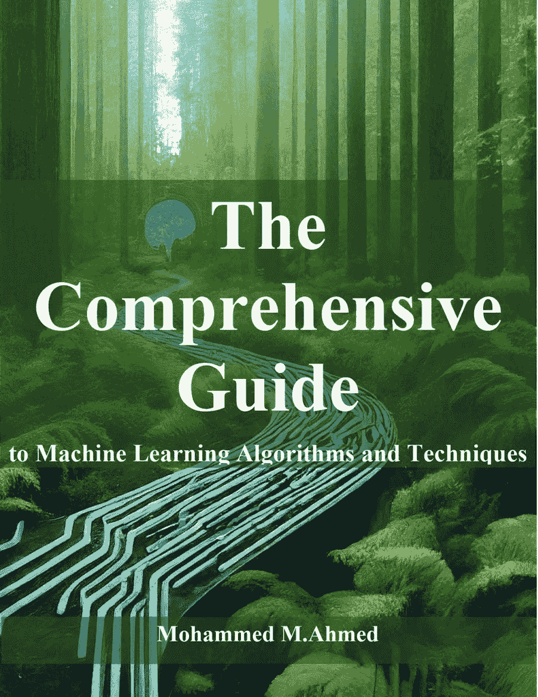  

#### 致谢

––––––––

致我的父母，他们始终在我身边

致我的妻子，她在我人生旅程中帮助我

1. Introduction

2. Regression Algorithms

2.1 OLS (Ordinary Least Squares)

2.2 Lasso (Least Absolute Shrinkage and Selection Operator)

2.3 SVM (Support Vector Machine) for Regression

2.4 Decision Tree for Regression

2.5 Random Forest for Regression

2.6 Neural Networks for Regression

2.7 GBM (Gradient Boosting Machine)

2.8 GLM (Generalized Linear Models)

2.9 K-Nearest Neighbors for Regression

2.10 Stepwise Regression

2.11 Quantile Regression

3. Classification Algorithms

3.1 Logistic Regression

3.2 Naive Bayes

3.3 SVM (Support Vector Machine) for Classification

3.4 Decision Tree for Classification

3.5 Random Forest for Classification

3.6 Neural Networks for Classification

3.7 Gradient Boosting Machine (GBM) for Classification

3.8 K-Nearest Neighbors for Classification

3.9 Multiclass Naive Bayes

4. Clustering algorithms

4.1 K-Means

4.2 Hierarchical Clustering

4.3 DBSCAN (Density-Based Spatial Clustering of Applications with Noise)

4.4 Gaussian Mixture Model (GMM)

4.5 Affinity Propagation

4.6 Spectral Clustering

5. Reinforcement Learning Algorithms

5.1 Q-Learning

5.2 Deep Q-Networks (DQN)

5.3 Policy Gradient Methods

5.4 Actor-Critic Methods

5.5 Proximal Policy Optimization (PPO)

5.6 Trust Region Policy Optimization (TRPO)

5.7 Asynchronous Advantage Actor-Critic (A3C)

6. Ensemble Methods

6.1 Boosting

6.2 Bagging

6.3 Stacking

6.4 Voting

6.5 Averaging

7. Dimensionality reduction methods

7.1 Principal Component Analysis (PCA)

7.2 Linear Discriminant Analysis (LDA)

7.3 t-Distributed Stochastic Neighbor Embedding (t-SNE)

7.4 Uniform Manifold Approximation and Projection (UMAP)

7.5 Independent Component Analysis (ICA)

8. Optimization Algorithms

8.1 Particle Swarm Optimization (PSO)

8.2 Genetic Algorithm

8.3 Gradient Search

8.4 Linear Programming

8.5 Integer Programming

8.8.6 Multi-Armed Bandit

9. Computer Vision Algorithms

9.1 CNN (Convolutional Neural Networks)

9.2 Fast R-CNN (Regions with Convolutional Neural Networks)

9.3 GANs (Generative Adversarial Networks)

9.4 YOLO (You Only Look Once)

9.5 ImageNet

9.6 U-Net

9.7 AlexNet

9.8 VGG (Visual Geometry Group)

9.9 ResNet (Residual Network)

10. Recommender Systems

10.1 Collaborative Filtering

10.2 Alternating Least Squares (ALS)

10.3 Content Filtering

10.4 Association Rule

10.5 RNN (Recurrent Neural Network)

10.6 Two-Tower Model

11. Forecasting Algorithms

11.1 ARIMA (AutoRegressive Integrated Moving Average)

11.2 SARIMA (Seasonal ARIMA)

11.3 SARIMAX (Seasonal ARIMA with eXogenous variables)

11.4 Exponential Smoothing

11.5 Deep AR

11.6 BayesDLM (Bayesian Dynamic Linear Model)

11.7 N-Beats

12. NLP/LLM Algorithms

12.1 RNN (Recurrent Neural Networks)

12.2 LSTM (Long Short-Term Memory)

12.3 BERT (Bidirectional Encoder Representations from Transformers)

12.4 GPT (Generative Pre-trained Transformer)

12.5 Word2Vec

12.6 LaMDA (Language Model for Dialogue Applications)

12.7 Llama (Large Language Model for Multimodal Access)

12.8 StableLM (Stable and Expressive Language Model)

13. Feature Selection Methods

13.1 Backward Elimination

13.2 Forward Selection

13.3 Stepwise Selection

13.4 Recursive Feature Elimination (RFE)

13.5 LASSO (Least Absolute Shrinkage and Selection Operator)

13.6 Random Forest Importance

13.7 Relief Methods

14. Overfitting Prevention Techniques

14.1 Cross-Validation

14.2 Early Stopping

14.3 Regularization (L1, L2)

15. Data Balancing Techniques

15.1 Random Undersampling

15.2 Synthetic Minority Over-sampling Technique (SMOTE)

15.3 Adaptive Synthetic Sampling (ADASYN)

15.4 SMOTE-Tomek

16. Fine-tune techniques for LLMs

16.1 LoRA (Low-Rank Adaptation)

16.2 Quantized LoRA (QLoRA)

16.3 Parameter Efficient Fine Tuning (PEFT)

16.4 DeepSpeed

16.5 ZeRO (Zero Redundancy Optimizer)

机器学习已迅速成为一项关键技术，它通过数据驱动的决策和预测分析，正在转变各行各业。随着数据量和复杂性的不断增长，利用高级机器学习算法的能力对研究人员、实践者和爱好者来说至关重要。本书旨在提供一个丰富的资源，涵盖该领域的几乎所有算法、方法和技术。它提供了每种方法的理论基础、实际应用以及优势和劣势的洞察，并为选择最合适的技术提供了稳健的框架，以应对许多项目和研究任务。

This 书 provides a comprehensive overview of various machine learning algorithms and techniques, categorized by their primary functions, such as regression, classification, clustering, optimization, and NLP. Each algorithm has been explained in terms of its main concept, purpose, use cases, mathematical background, loss function, pros and cons, and visual representation. This knowledge is crucial for selecting the right algorithm for specific problems and understanding the underlying mechanisms that drive their performance.

Machine learning algorithms are the engines driving sophisticated predictive modeling and artificial intelligence. The landscape of ML methods is vast and varied, involving simple linear models and deep learning models. For researchers and practitioners, selecting a suitable algorithm can significantly affect the performance and success of a project. This choice is not trivial; it includes understanding the nature of the data, the problem at hand, and the trade-offs between different model characteristics such as bias, variance, interpretability, and computational efficiency.

This book is designed to help demystify the complex world of ML algorithms. Providing clear and cutting-edge explanations of each method, along with practical examples and illustrative figures, aims to bridge the gap between practical implementation and theoretical knowledge. Whether you are working on stock price prediction, energy consumption forecasting, natural language processing, or image recognition, this guide will supply you with the knowledge needed to make informed decisions about which ML methods to utilize.

What sets this book apart is its unique structured and comprehensive approach. Each chapter is dedicated to a specific algorithm or technique, offering a uniform template that includes:

❑  Conceptual Overview: An explanation of the algorithm's main concepts and the problem it is supposed to deal with.

❑  Practical Application: practical examples that show how the technique can be applied to solve real-world problems.

❑  Mathematical Background: A look at the mathematical bases, providing the necessary for a deep understanding.

❑  Pros and Cons: An evaluation of each method's strengths and weaknesses, assisting readers to make informed selections.

❑  Illustrative Figures: Visualizations that boost comprehension and retain complex concepts.

This simple and clear approach ensures that readers can grasp the essence of each method and understand how to select the right technique for their problems.

In the fast-paced field of machine learning, staying updated with the latest innovations is crucial. This book not only covers well-established techniques but also covers the emerging techniques that are pushing the boundaries of what is possible with ML. By boosting a deep understanding of both foundational and cutting-edge methods, we encourage readers to explore and innovate, contributing to the ongoing advancement of the field.

Furthermore, the book's emphasis on the practical aspects of machine learning makes it a valuable tool for both beginners and experienced practitioners. It provides a robust ground and a clear roadmap for understanding machine learning techniques for freshmen. For professionals, it offers a reference guide that can be helpful when tackling new obstacles or teaching others.

This book is more than just a reference book; it can be a companion for the machine learning journey. It is designed to be an important resource that you can rely on for guidance, inspiration, and knowledge. Whether you are a researcher seeking to understand the outlines of ML, a practitioner aiming to deal with problems, or a student eager to learn about this transformative technology, this book will present the insights you need to succeed.

The reader is invited to delve into the fascinating ML world in this book, uncover the methods, and pave the power of data to create proper solutions and drive progress in such an important domain.

Regression algorithms are utilized for continuous numerical value predictions based on input variables. Linear regression, polynomial regression, and support vector regression are some examples of Regression Algorithms. Regression algorithms are basic in many applications such as stock market trends, predicting house prices, and many other cases where the output variable is a continuous value.

Main Concept Ordinary Least Squares (OLS) is a linear regression technique used to estimate the relationship between independent variables and a dependent variable by minimizing the sum of the squares of the differences between observed and predicted values.

Main Purpose To identify the best-fitting line between the data points and predict the output variable, OLS seeks to minimize the residual sum of squares.

When to Use It

❑  If there is a linear relationship between the variables.

❑  When forecasting continuous output variables.

Real-World Examples

❑  Housing Price Prediction: Estimating the cost of a home based on attributes like living space, number of bedrooms, number of bathrooms, etc.

❑  Stock market forecasting: predicting stock prices by utilizing past data.

Math Background

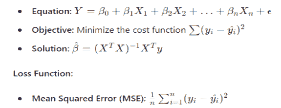

Pros and Cons

☺  Pros:

⇨  The Simplicity of implementing and interpreting.

⇨  Computational efficiency.

☹  Cons:

  The assumption of the linearity between the dependent and the independent variables.

  the Sensitivity to outliers.

Illustrative Figure

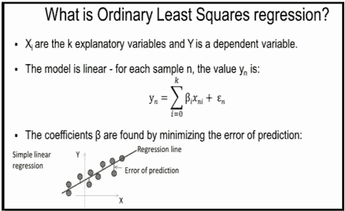

Main Concept Least Absolute Shrinkage and Selection Operator (Lasso) is one type of linear regression that performs variable selection and regularization to reinforce prediction accuracy and interpretability. It drives some coefficients to zero by posing a constraint on the sum of the absolute values of the model parameters.

Main Purpose Lasso aims to select a simpler model that avoids overfitting by improving the prediction accuracy and interpretability of the model by forcing some of the regression coefficients to be zero.

When to Use It

❑  with high-dimensional data that has many predictors.

❑  If there is a need for both regularization and variable selection.

❑  Selecting a subset of the most important features to enhance model interpretability.

Real-World Examples

❑  Gene Expression Data Analysis: determining the most predictive of a disease by identifying a subset of genes.

❑  Financial Modeling: forecast stock returns by determining the key predictors from a large set of economic indicators.

math background

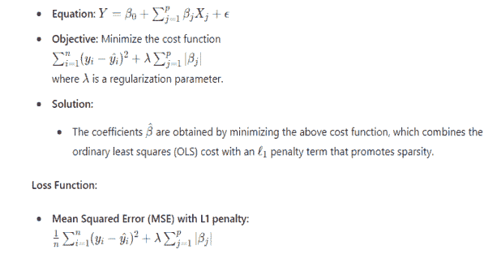

Pros and Cons

☺  Pros:

⇨  Simultaneously carry out regularization and variable selection.

⇨  The efficiency of handling high-dimensional data.

⇨  boosting the model interpretability via shrinking some coefficients to zero.

☹  Cons:

  selecting λ (the regularization parameter) is crucial.

  standardization is often necessary, so it Can be sensitive to the variables scale.

  If there are highly correlated variables it might not perform well.

Illustrative Figure

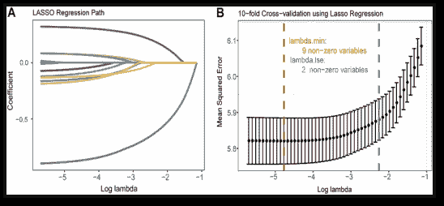

Main Concept Support Vector Machine for Regression known as Support Vector Regression (SVR), is a supervised learning algorithm that uses the principles of SVM to predict continuous outcomes, thus Its target is to find a function that deflects from the actual observed values by a value within a specified margin while being as flat as possible at the same time.

Main Purpose SVR aims to minimize the prediction error while maintaining a model complexity that ensures generalization to unseen data, effectively managing the trade-off between bias and variance.

When to Use It

❑  If the relationship between the predictors is not linear and complex.

当需要一个通用且稳健的模型来预测连续结果时。

当需要在拟合训练数据和保持对新数据的推广之间取得平衡时。

预测能源消耗：基于历史数据和各种影响因素预测未来的能源使用。

股价预测：利用历史价格趋势和一些市场指标预测未来的股价。

## 数学背景
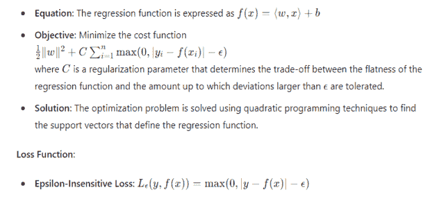

## 优缺点

☺ 优点：

⇨ 适用于高维空间，当维度数超过样本数时。

⇨ 在高维情况下特别有效地处理过拟合。

⇨ 多样化，拥有不同的核函数用于建模复杂关系。

☹ 缺点：

 调整超参数（如 C、ϵ）和选择合适的核可能具有挑战性。

 计算密集，特别是在大数据集上。

 模型结果难以解释。

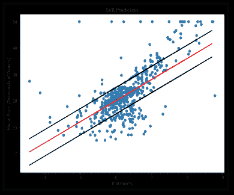

**主要概念**：回归决策树是一种监督学习方法，用于预测连续输出。它通过根据输入特征的值将数据分割成子集来创建决策树模型。

**主要目的**：将特征空间划分为区域，使得每个区域的预测为常数值，以在每个区域内最小化均方误差。

**何时使用**：

❑ 当变量之间的关系是非线性且复杂时。

❑ 当模型可解释性至关重要时。

❑ 当处理包含数值和类别特征的数据集时。

**实际案例**：

❑ 房价预测：根据房屋面积、位置和卧室数量预测房价。等。

❑ 设备寿命预测：根据运行数据预测工业设备的剩余寿命。

## 数学背景
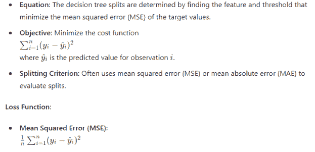

## 优缺点：

☺ 优点：

⇨ 易于理解和解释。

⇨ 可以同时处理数值和类别数据。

⇨ 无需标准化或缩放，因为它需要很少的数据预处理。

☹ 缺点：

 容易过拟合，主要发生在深树中。

 在某些情况下不稳定，即小的数据变化可能导致完全不同的树。

 倾向于具有更多级别或类别的特征。

## 示例图表：
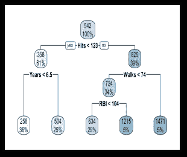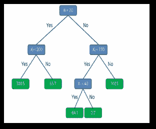

**主要概念**：随机森林回归是一种集成学习方法，它构建多个决策树并将它们结合起来以获得更准确的预测。它结合了多个基础估计器的预测，以提高可推广性和鲁棒性，优于单个估计器。

**主要目的**：通过平均化训练在训练集不同部分上的多个决策树，优化预测精度并控制过拟合。

**何时使用**：

❑ 当追求高预测精度时。

❑ 当处理包含许多特征的数据集时。

❑ 当需要防止过拟合并优化模型稳定性时。

**实际案例**：

❑ 环境建模：根据温度、湿度和污染物等环境数据预测空气质量。

❑ 经济预测：利用历史数据和各种影响因素预测经济指标，如 GDP 增长率。

## 数学背景
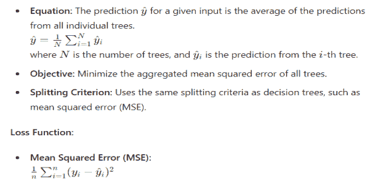

## 优缺点：

☺ 优点：

⇨ 由于集成技术，预测精度高。

⇨ 比决策树方法更强大地防止过拟合。

⇨ 能够处理大数据集和高维数据。

☹ 缺点：

 资源需求更高，计算密集。

 相比单个决策树，可解释性较低。

 由于树的数量众多，可能会变慢。

## 示例图表：
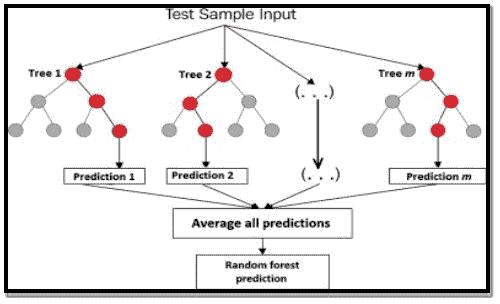

## 2.6 神经网络用于回归

**主要概念**：用于回归的神经网络是模仿人脑结构的计算模型，用于预测连续目标值。它们由相互连接的神经元（节点）层组成，通过反向传播和其他优化技术学习复杂模式。

**主要目的**：神经网络的主要目标是建模输入变量与连续输出变量之间的复杂非线性关系，提供高预测精度。

**何时使用**：

❑ 当输入变量与输出变量之间的关系高度非线性且复杂时。

❑ 处理包含大量特征的大数据集。

❑ 当传统回归模型无法捕捉数据中的核心模式时。

**实际案例**：

❑ 房价预测：根据位置、面积和卧室数量预测房价。等。

❑ 股价预测：利用历史价格数据和其他市场指标预测未来股价。

## 数学背景
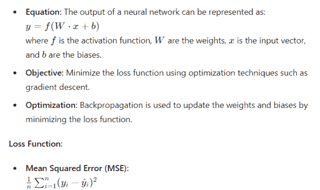

## 优缺点：

☺ 优点：

⇨ 能建模复杂且非线性的关系。

⇨ 灵活，支持多种架构（如卷积、循环）。

⇨ 能处理大规模和高维数据集。

☹ 缺点：

 需要精确调整超参数，如学习率、层数和神经元数量。

 计算密集。

 训练需要大量资源。

 如果未正确正则化，容易过拟合。

## 示例图表：
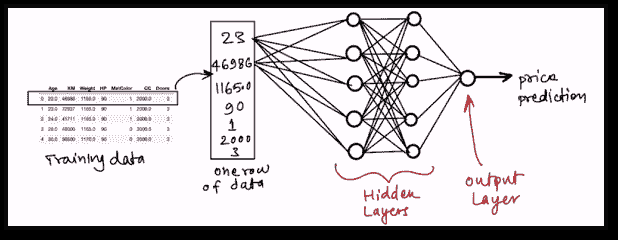

## 2.7 GBM（梯度提升机器）
**主要概念**：梯度提升机器（GBM）是一种集成学习技术，它构建多个弱学习者（通常是决策树）并将它们组合成强预测模型。它迭代地添加树，每棵树都通过优化损失函数来修正前一棵树的错误。

**主要目的**：GBM for regression 的主要目标是通过依次添加树来减少前一棵树的残差错误，从而创建强大的预测模型。

**何时使用**：

❑ 当需要高预测精度时。

❑ 当数据存在复杂的非线性关系时。

❑ 当数据量大且特征多时。

**实际案例**：

❑ 保险费用计算：根据客户数据和风险因素预测保险费用。

❑ 销售预测：根据历史销售数据和其他影响因素预测未来销售。

## 数学背景
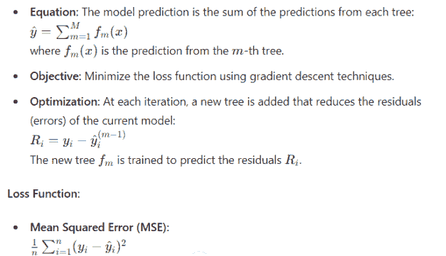

## 优缺点：

☺ 优点：

⇨ 预测精度高。

⇨ 可以处理数值和类别特征的混合。

⇨ 通过适当正则化，对过拟合具有鲁棒性。

☹ 缺点：

 计算密集，训练可能很慢。

 需要仔细调整超参数（如学习率、树的数量）。

 相比于更简单的模型，可解释性较低。

## 示例图表：
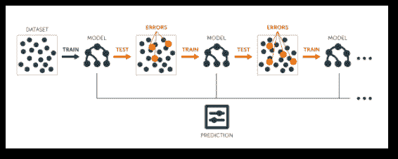

## 2.8 GLM（广义线性模型）

**主要概念**：广义线性模型（GLMs）通过允许因变量的分布不是正态分布来扩展线性回归。GLMs 由三个组成部分组成：线性预测器、链接函数和描述因变量分布的方差函数。

**主要目的**：GLMs 的主要目标是提供一个灵活的框架，用于建模不同类型的响应变量，如二元、计数和连续结果，通过使用不同的链接函数和分布。

**何时使用**：

❑ 当因变量不服从正态分布时。

-   [用于建模不同类型的结果，例如二元结果（逻辑回归）、计数数据（泊松回归）或比例数据（二项回归）。]

-   [当模型系数的可解释性很重要时。]

真实世界示例：

-   [医疗保健：使用泊松回归来建模住院患者就医次数。]

-   [金融：使用逻辑回归预测贷款违约的概率。]

数学背景：

––––––––

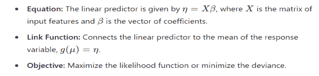

常见链接函数和分布：

-   [恒等链接函数（正态分布）：用于连续结果。]

-   [Logit 链接函数（二项分布）：用于二元结果。]

-   [对数链接函数（泊松分布）：用于计数数据。]

损失函数：

[损失函数取决于因变量的分布。例如：]

-   [逻辑回归：使用二项分布的对数似然。]

-   [泊松回归：使用泊松分布的对数似然。]

优缺点：

☺ 优点：

⇨ 对不同类型的数据和分布具有灵活性。

⇨ 系数具有可解释性。

⇨ 统计理论已相当成熟。

☹ 缺点：

 假设因变量服从特定分布。

 对离群点和有影响力的数据点敏感。

 需要慎重选择链接函数和分布。

示意图：

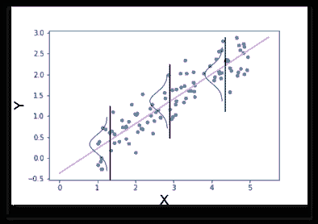

## 2.9 K-邻近回归

主要概念：K-邻近回归（KNN 回归）是一种非参数、基于实例的学习方法，用于预测连续目标变量的值。它通过找到与测试样本距离最近的 K 个训练样本，并对它们的目标值取平均来实现预测。

主要目的：KNN 回归的主要目标是利用特征空间中数据点之间的相似性（或距离），如果输入相似，输出也相似，从而进行预测。

何时使用：

-   [当数据结构简单且特征与目标变量之间的关系是局部的时使用。]

-   [当需要一个简单且可解释的模型时使用。]

-   [对于小到中等规模的数据集，KNN 可能在大规模数据集上计算开销较大。]

真实世界示例：

-   [房价预测：基于邻近房屋的价格和类似特征预测房价。]

-   [温度预测：根据邻近位置的温度预测特定位置的温度。]

数学背景：

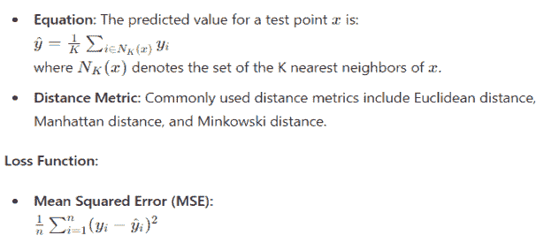

优缺点：

☺ 优点：

⇨ 易于理解和实现。

⇨ 自然支持多输出回归问题。

⇨ 对数据分布不作任何假设。

☹ 缺点：

 计算开销大，因为需要存储整个数据集。

 对 K 的选择和距离度量敏感。

 高维数据（维度诅咒）时性能会下降。

示意图：

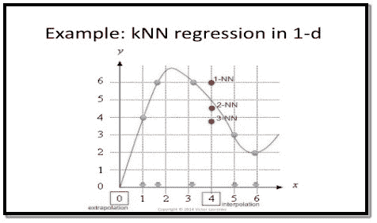

主要概念：逐步回归是一种自动选择预测变量的回归模型方法。它通过根据特定标准（如 p 值、AIC、BIC）有选择地添加或删除预测变量，找到最具统计显著性的模型。

主要目的：逐步回归的主要目标是构建一个仅包含最重要预测变量的模型，从而提高模型的可解释性并可能改善预测性能。

何时使用：

-   [当处理包含大量预测变量的数据集时使用。]

-   [当目标是识别最重要的预测变量子集时使用。]

-   [用于探索性数据分析以筛选显著变量。]

真实世界示例：

-   [医学研究：识别对特定健康结果最重要的因素。]

-   [经济学：确定对 GDP 增长影响最大的关键经济指标。]

数学背景：

-   [前向选择：从无预测变量开始，逐个添加预测变量，依据选定标准。]

-   [后向消除：从所有预测变量开始，逐个删除预测变量，依据选定标准。]

-   [双向消除：前向选择与后向消除的结合，根据标准同时添加和删除预测变量。]

损失函数：

[选择添加或删除预测变量的标准：]

-   [p 值：通常在 p 值低于特定阈值时加入预测变量，p 值高于阈值时删除。]

-   [AIC（Akaike 信息准则）：数值越小，模型越好。]

-   [BIC（贝叶斯信息准则）：数值越小，模型越好。]

优缺点：

☺ 优点：

⇨ 能处理大量预测变量。

⇨ 有助于识别显著预测变量。

⇨ 通过减少变量数量提高模型可解释性。

☹ 缺点：

 当预测变量很多时计算开销可能较大。

 如果控制不当，易产生过拟合。

 结果对初始模型和预测变量的加入/删除顺序敏感。

示意图：

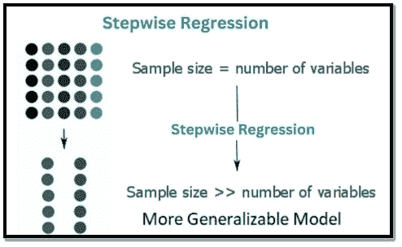

主要概念：量子回归是统计学和计量经济学中的一种回归分析方法，用于估计响应变量的条件量子（如中位数或 90% 分位点）。与普通最小二乘回归（OLS）估计条件均值不同，量子回归估计中位数或其他量子，从而提供更全面的变量关系分析。

主要目的：量子回归的主要目标是通过估计因变量条件分布的不同点，提供因变量与自变量之间关系的更完整视图。这在变量关系随分位数而变化的情形下特别有用。

何时使用：

-   [当数据存在异方差（方差随观测值变化）时使用。]

-   [当你想了解变量在结果分布不同点上的影响时使用。]

-   [当因变量与自变量的关系在不同的结果值上并不一致时使用。]

真实世界示例：

-   [收入不平等分析：研究影响收入的因素在收入分布的不同点（如中位收入与前 10% 收入）上的影响。]

-   [住房市场分析：理解房产特征如何影响不同价格区间（如低价房与高价房）的价格。]

数学背景：

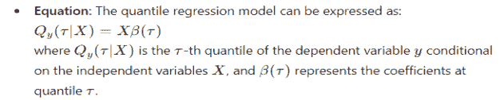  

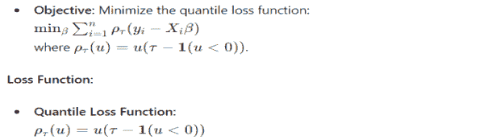

[该函数对残差进行非对称惩罚，取决于估计的量子是高于还是低于该量子。]

优缺点：

☺ 优点：

⇨ 提供变量关系的全面视图。

⇨ 对离群点具有鲁棒性。

⇨ 可以建模条件分布的不同部分。

☹ 缺点：

 计算开销比 OLS 更大。

 结果解释可能更为复杂。

 需要更高级的工具和技术进行估计和推断。

示意图：

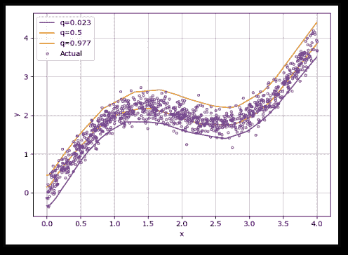
## 3 分类算法

分类算法用于将数据分类到预定义的类别或标签中。常见的算法包括逻辑回归、决策树、随机森林和支持向量机。它们广泛应用于垃圾邮件过滤、图像识别和医疗诊断等场景，目标是为数据点分配特定类别。

## 3.1 Logistic Regression

主要概念：逻辑回归是一种统计方法，用于建模依赖变量（二元变量）与一个或多个自变量之间的关系。

# 主要目的

预测二元结果的概率。

## 使用时机

- 当结果为二元时。
- 用于分类任务的基线模型。

## 实际应用示例

- 医疗：预测疾病发生的可能性。
- 金融：将贷款申请分类为批准或拒绝。

## 数学背景

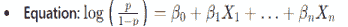

## 目标

最大化似然函数。

## 损失函数

二元交叉熵

## 优点和缺点

### 优点

- 简单且可解释。
- 在线性可分的数据上表现良好。

### 缺点

- 假设对数优势与预测变量之间呈线性关系。
- 不适用于非线性关系。

## 示例图

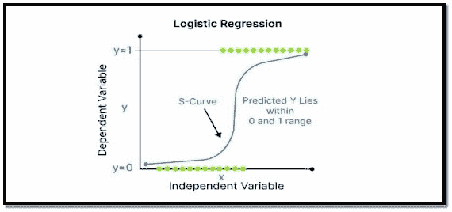

## 3.2 朴素贝叶斯

### 主要概念

朴素贝叶斯是一种基于贝叶斯定理的分类算法，它假设特征在给定类别条件下是条件独立的。

### 主要目的

基于训练数据中类别的先验知识对数据进行分类。

## 使用时机

- 当你有一个分类任务时。
- 特别适用于大规模数据集。
- 当特征之间的独立性假设 reasonably well 成立时。

## 实际应用示例

- 电子邮件过滤：将邮件分类为垃圾邮件或非垃圾邮件。
- 文档分类：将新闻文章分类到不同主题。

## 数学背景

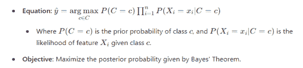

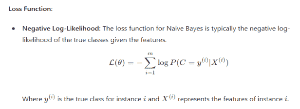

### 朴素贝叶斯分类器类型

- 高斯朴素贝叶斯：假设每个特征的连续值服从高斯（正态）分布。
- 多项式朴素贝叶斯：用于离散计数（例如文本分类中的词频）。
- 二元朴素贝叶斯：用于二进制/布尔特征。

## 优点和缺点

### 优点

- 简单且快速。
- 在高维数据上表现良好。
- 所需训练数据较少。

### 缺点

- 假设特征之间独立，这在实际数据中很少成立。
- 当特征存在相关性时表现不佳。

## 示例图

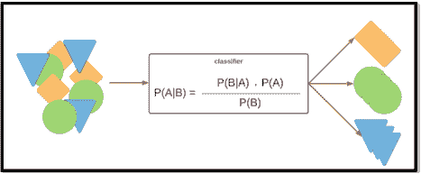

## 3.3 支持向量机（SVM）用于分类

### 主要概念

支持向量机（SVM）是一种监督学习算法，用于分类任务，旨在找到能够最大化不同类之间边界的最优超平面。

### 主要目的

通过找到最佳分离类别的超平面，将数据点分类到不同类别。

## 使用时机

- 当你有一个类别较为清晰分离的分类任务时。
- 对高维空间有效。
- 当特征数量超过样本数量时适用。

## 实际应用示例

- 图像分类：在图像中区分不同类型的物体。
- 文本分类：将文档分类到预定义的类别（如垃圾邮件检测、情感分析）。

## 数学背景

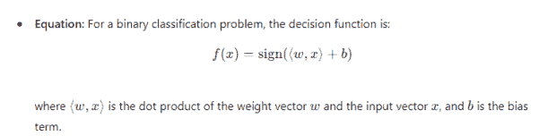

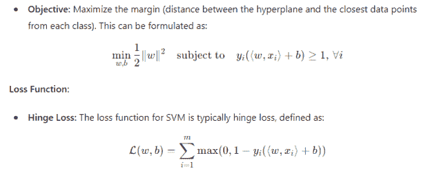

惩罚误分类点以及位于边界内的点。

### SVM 类型

- 线性 SVM：用于数据线性可分的情况。
- 非线性 SVM：使用核函数（如多项式、径向基函数）将数据映射到更高维空间，使其在该空间中线性可分。

## 优点和缺点

### 优点

- 在高维空间中表现有效。
- 对过拟合具有鲁棒性，尤其是在高维空间。
- 当存在明确的边界时表现良好。

### 缺点

- 由于计算复杂度，不适合非常大的数据集。
- 对类别重叠的情况效果较差。
- 需要仔细选择核函数和正则化参数。

## 示例图

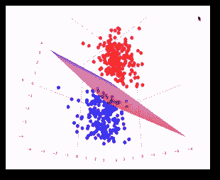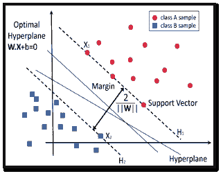

## 示例图

## 3.4 决策树用于分类

### 主要概念

决策树是一种非参数的监督学习方法，用于分类和回归。其目标是通过从数据特征中学习简单的决策规则来预测目标变量的值。

### 主要目的

基于特征学习决策规则对数据进行分类。

## 使用时机

- 当你需要一个可解释的模型时。
- 处理分类或连续输入特征时。
- 对于小到中等规模的数据集有效。

## 实际应用示例

- 医疗诊断：根据诊断检查结果判断患者是否患有特定疾病。
- 客户细分：将客户分为不同群体以进行精准营销。

## 数学背景

- 方程：决策树递归地将特征空间划分为子集，并在每个节点应用决策规则。
- 目标：在每个节点最小化不纯度（或最大化信息增益）。常用不纯度度量包括：

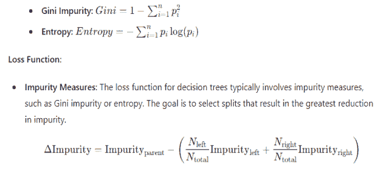

### 决策树类型

- 分类树：用于目标变量为类别的情况。
- 回归树：用于目标变量为连续值的情况。

## 优点和缺点

### 优点

- 简单易懂且易于解释。
- 所需的数据预处理较少。
- 能处理数值型和类别型数据。

### 缺点

- 容易过拟合，尤其是复杂的树。
- 稳定性差；小幅数据变化可能导致完全不同的树。
- 倾向于选择级别更多的特征。

## 示例图

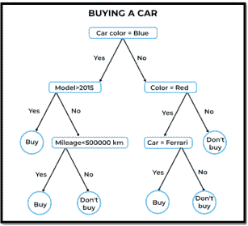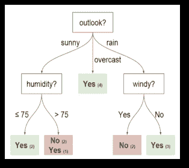

## 3.5 随机森林用于分类

### 主要概念

随机森林是一种集成学习方法，在训练过程中构建多个决策树，并输出各个树的类别众数作为最终预测。它是一种强健的方法，能够提高决策树的准确性和稳定性。

### 主要目的

通过组合多个决策树的预测，提高分类准确率并控制过拟合。

## 使用时机

- 当你需要一个强大且稳健的分类模型时。
- 对大规模数据集和高维空间有效。
- 当数据存在噪声时适用。

## 实际应用示例

- 医疗：基于多种健康指标预测患者结果。
- 金融：信用评分和风险评估。

## 数学背景

-  Bootstrap 抽样：从训练集中带有放回地随机抽取 n 个样本。
- 树构建：为每个抽样集生长一个决策树。在每个节点，随机选择一子集特征并在此中选择最佳划分。
- 聚合：使用多数投票（分类）聚合所有树的预测。

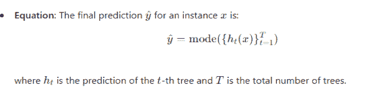

### 损失函数

- 不纯度度量：与决策树相同，随机森林使用不纯度度量（如基尼不纯度或熵）来构建各个树。
- 站出袋误差（OOB Error）：用于估计泛化误差。每棵树在未用于构建的样本上进行测试，整体误差率取平均。

### 随机森林类型

- 分类森林：用于目标变量为类别的情况。
- 回归森林：用于目标变量为连续值的情况。

## 优点和缺点

### 优点

- 通过平均多棵树的预测，降低过拟合。
- 能处理大规模高维数据集。
- 提供特征重要性得分。

### 缺点

- 计算开销大，内存消耗高。
- 比单棵决策树更难解释。
- 需要仔细调整参数，如树的数量和最大树深度。

## 示例图

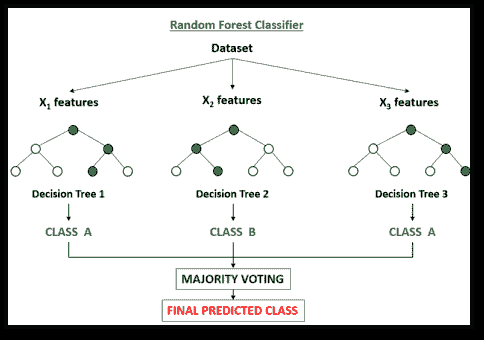

## 3.6 神经网络用于分类

### 主要概念

神经网络是一系列 loosely 仿照人脑的算法，旨在识别模式。它们通过机器感知、标记或聚类原始输入来解释感官数据。

# 主要目的：通过学习数据中的复杂模式和关系，使用多层神经元将数据分类为不同类别。

## 何时使用：

❑  当你拥有大型数据集和复杂模式时。

❑  同时适用于结构化和非结构化数据。

❑  当特征提取困难且需要学习复杂特征时。

## 实际应用示例：

❑  图像识别：对图像进行分类，例如在照片中识别物体或人物。

❑  自然语言处理：情感分析、文本分类和语言翻译。

## 数学背景：

❑  结构：由输入层、一个或多个隐藏层和输出层组成。

❑  激活函数：常见的激活函数包括 ReLU（整流线性单位）。

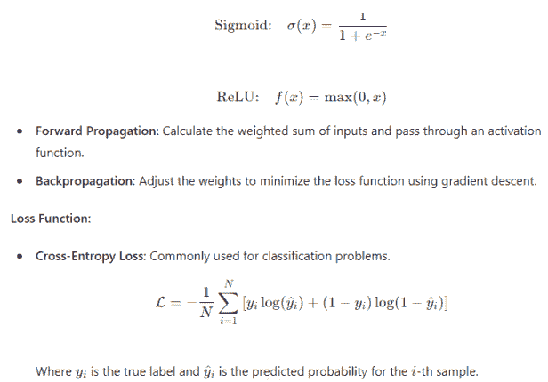

## 神经网络类型：

❑  前馈神经网络（FNN）：最简单的类型，连接不形成循环。

❑  卷积神经网络（CNN）：专为处理网格状拓扑数据（如图像）而设计。

❑  循环神经网络（RNN）：适用于序列数据，如时间序列或自然语言。

## 优缺点：

☺  优点：

⇨  可以建模复杂且非线性的关系。

⇨  能从原始数据中学习，无需手动提取特征。

⇨  可扩展到大规模数据集。

☹  缺点：

  需要大量数据和计算资源。

  由于缺乏可解释性，常被视为“黑盒”。

  若未正确正则化，易发生过拟合。

## 示例图：

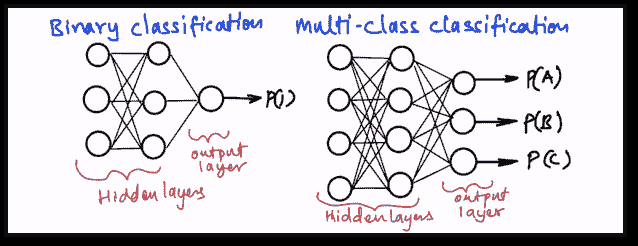

## 3.7  梯度提升机器（GBM）用于分类

主要概念：梯度提升机器（GBM）是一种集成学习技术，它按顺序构建模型，每个模型纠正前一个模型的错误。它结合多个弱学习者（通常是决策树）的预测，生成一个强学习者。

主要目的：通过迭代优化，降低模型的偏差和方差，从而提高分类准确性。

## 何时使用：

❑  当你需要高预测准确度时。

❑  适用于结构化/表格数据。

❑  适合处理数据中的复杂模式和交互作用。

## 实际应用示例：

❑  信用评分：预测借款人是否可能违约。

❑  客户流失预测：识别可能取消订阅的客户。

## 数学背景：

❑  初始化：从一个简单的模型开始，通常是预测目标变量的均值。

❑  顺序训练：在每一步，拟合一个新模型到前一个模型的残差上。

❑  更新：将新模型与之前的模型结合，更新预测。

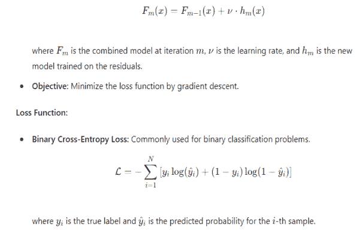

## 梯度提升的类型：

❑  分类梯度提升：通常使用决策树作为基学习者。

❑  回归梯度提升：将算法适应连续目标变量。

## 优缺点：

☺  优点：

⇨  预测准确性高。

⇨  通过适当正则化，对过拟合具有鲁棒性。

⇨  能处理各种类型的数据。

☹  缺点：

  计算开销大，训练速度比其他模型慢。

  需要仔细调整参数（如学习率、树的数量）。

  相比单个决策树，可解释性较低。

## 示例图：

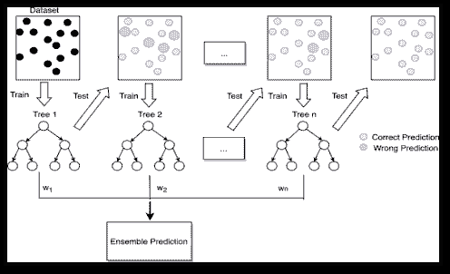

## 3.8  K-最近邻（KNN）用于分类

主要概念：K-最近邻（KNN）是一种非参数、实例基学习算法，用于分类（也用于回归）。它根据训练实例中最近的 KKK 个邻居的分类情况来判断新数据点的类别，其中“邻居”指在特征空间中距离最近的 KKK 个训练样本。

主要目的：根据 KKK 个最近邻中多数类别来分类数据点。

## 何时使用：

❑  当你拥有小到中等规模的数据集时。

❑  适用于相似实例具有相似输出的数据。

❑  当你需要一个简单且可解释的模型时。

## 实际应用示例：

❑  推荐系统：根据用户偏好相似性推荐产品。

❑  医疗诊断：根据患者症状和病史预测疾病的存在。

## 数学背景：

距离度量：使用距离度量（如欧氏距离、曼哈顿距离）计算输入实例与所有训练实例之间的距离。

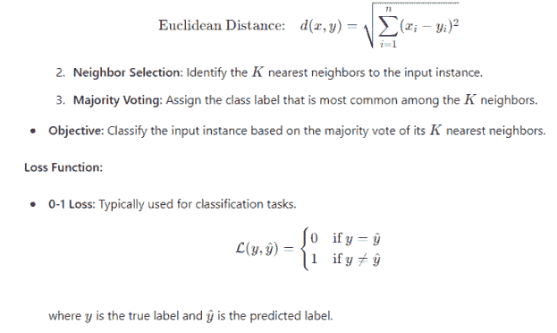

## KNN 的类型：

❑  分类 KNN：预测输入实例的类别标签。

❑  回归 KNN：预测输入实例的连续值。

## 优缺点：

☺  优点：

⇨  易于理解和实现。

⇨  非参数，对数据分布不作任何假设。

⇨  自然适应数据分布的变化。

☹  缺点：

  在预测时计算开销大，尤其是大数据集时。

  对 KKK 和距离度量的选择敏感。

  高维数据表现较差（维度诅咒）。

## 示例图：

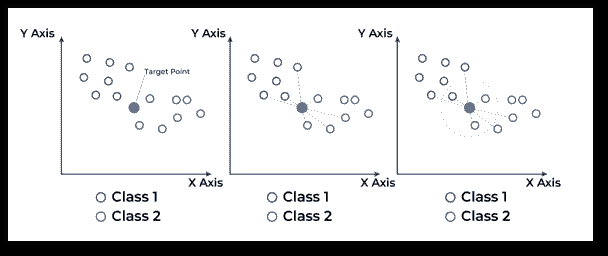

## 3.9  多类 Naive Bayes

主要概念：多类 Naive Bayes 将 Naive Bayes 算法扩展到处理多类分类问题，即存在多于两个可能类别的情况。

主要目的：根据不同特征的可能性将数据分类到多个类别之一。

## 何时使用：

❑  用于多类别的文本分类。

❑  当特征之间相互独立时。

## 实际应用示例：

❑  文档分类：将文档按主题分类到不同类别中。

❑  邮件过滤：将邮件分类到工作、个人和促销等不同文件夹。

## 数学背景：

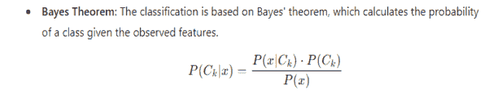  

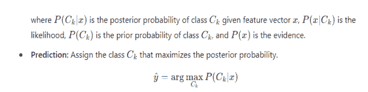  

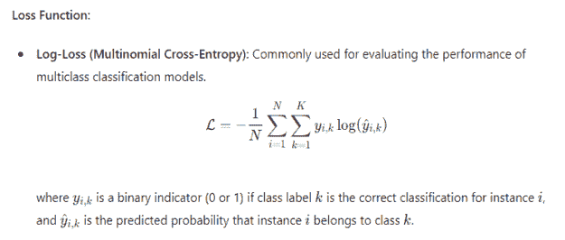

## 优缺点：

☺  优点：

⇨  简单且快速。

⇨  对高维数据表现良好。

☹  缺点：

  假设特征相互独立。

  如果特征相关，准确率会下降。

## 示例图：

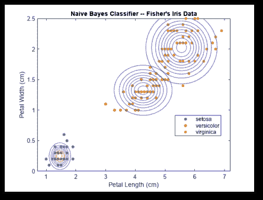

## 4.  聚类算法

聚类算法将相似的数据点分组为簇，无需预定义标签。k-means、层次聚类和 DBSCAN 等技术用于识别数据中的内在结构。聚类在市场细分、图像压缩和异常检测中有用。

## 4.1  K-Means

主要概念：K-Means 是一种无监督机器学习算法，用于将数据分组为 K 个基于特征相似性的簇。算法通过最小化数据点与其所在簇中心的平方距离之和来实现聚类。

主要目的：组织数据形成内部相似性最大、不同簇间相似性最小的均匀组。

## 何时使用：

❑  当你需要将大数据集分割为有意义的簇时。

❑  用于探索性数据分析，以了解数据的内在结构。

❑  适用于相对简单且小到中等规模的数据集。

## 实际应用示例：

❑  客户细分：根据购买行为将客户分组，以便进行精准营销。

❑  图像压缩：通过聚类像素值来减少图像中的颜色数量。

## 数学背景：

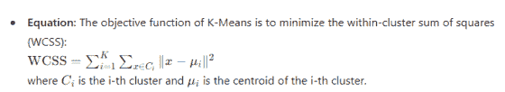  

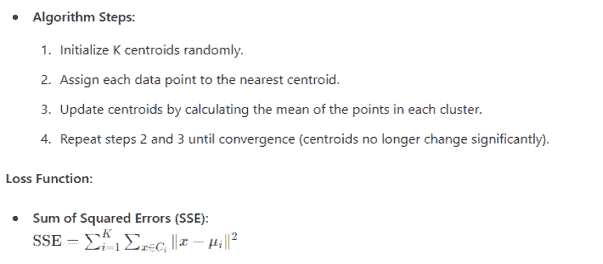

## 优缺点：

☺  优点：

⇨  实现简单，易于实现。

⇨  对小到中等规模数据集高效。

⇨  若优化得当，可扩展到大规模数据集。

☹  缺点：

  需要事先指定簇的数量（K）。

  对初始中心的位置敏感。

  假设簇是球形且大小相等，这在实际数据中可能不成立。

## 示例图：

# Main Concept
层次聚类是一种无监督机器学习算法，用于构建集群的层次结构。它通过合并较小的集群形成更大的集群（聚类合并方法）或通过拆分较大的集群形成更小的集群（聚类分裂方法）来工作。

# Main Purpose
层次聚类的主要目标是创建一个多层级的集群层次结构，使能够在不同粒度水平上探索数据。这种方法提供了一种树状结构，称为树状图（dendrogram），用于可视化数据点的层次分组。

## When to Use It:
- 当集群的数量未知且需要通过探索来确定时。
- 用于可视化数据中的层次关系。
- 当数据集较小或中等时，层次聚类可能计算开销较大，对大型数据集不友好。

## Real-World Examples:
- 基因表达数据分析：根据不同条件下的表达模式对基因进行分组。
- 文档聚类：根据内容相似性对文档进行层次化组织。

## Math Background:
- 距离度量：常用的度量包括欧氏距离、曼哈顿距离和余弦相似度。
- 联接准则：决定不同集群之间距离的计算方式。常见方法包括：
  - 单链接（Single Linkage）：不同集群中点之间的最小距离。
  - 完整链接（Complete Linkage）：不同集群中点之间的最大距离。
  - 平均链接（Average Linkage）：不同集群中点之间的平均距离。
  - 威尔逊方法（Ward's Method）：最小化簇内部方差的总和。

## Loss Function:
层次聚类没有像 K-Means 那样的特定损失函数，而是基于所选的联接方法优化一个准则，例如最小化簇内部方差或最大化簇间距离。

## Pros and Cons:
### Pros:
- 不需要在先预先指定集群数量。
- 生成树状图（dendrogram），能提供对数据结构的洞察。
- 能捕捉数据中的复杂层次关系。

### Cons:
- 计算开销大，尤其是大型数据集。
- 对噪声和离群点敏感。
- 当树状图非常大时，结果可能难以解释。

## Illustrative Figure:

## 4.3 DBSCAN (Density-Based Spatial Clustering of Applications with Noise)

# Main Concept
DBSCAN 是一种基于密度的聚类算法，它通过找出密切相连的点群来分组，将密度高的区域定义为簇，将密度低的区域定义为噪声。

# Main Purpose
它特别擅长识别形状和密度不规则的簇，并且能够有效处理数据中的噪声。

## When to Use It:
- 当处理包含噪声和离群点的数据时。
- 当簇具有不规则形状和密度时。

## Real-World Examples:
- 异常检测：在信用卡交易数据中识别欺诈交易。
- 城市规划：识别城市中人口密度高的区域。

## Math Background:
- 基于两个参数：ε（epsilon）和 MinPts（最小点数）。
- 根据 ε 的密度范围定义核心点、边界点和噪声点。

## Loss Function:
没有显式的损失函数；基于密度可达性和密度连通性。

## Pros and Cons:
### Pros:
- 对离群点和噪声具有鲁棒性。
- 能发现任意形状的簇。

### Cons:
- 对 ε 和 MinPts 参数的选择敏感。
- 处理密度差异大的簇时存在困难。

## Illustrative Figure:

## 4.4 Gaussian Mixture Model (GMM)

# Main Concept
高斯混合模型（GMM）是一种概率模型，用于表示整体人口中不同正态分布的子群。它假设数据是由多个高斯分布的混合物生成的，每个高斯分布都有其自身的均值和方差。

# Main Purpose
GMM 的主要目标是将数据分布建模为多个高斯分布的组合，从而为聚类、密度估计和异常检测提供灵活的方法。

## When to Use It:
- 当数据呈现多模态分布时。
- 当聚类任务中簇可能具有不同形状和大小时。
- 当应用中对概率框架有益时，例如在期望-最大化（EM）算法中。

## Real-World Examples:
- 语音识别：建模语音信号中不同音素的分布。
- 图像分割：根据像素强度识别图像中的不同区域。

## Math Background:

## Expectation-Maximization (EM) Algorithm:
- E-step：计算每个数据点属于每个高斯分量的概率。
- M-step：更新高斯分量的参数（均值、协方差和混合权重），以最大化数据的似然。

## Pros and Cons:
### Pros:
- 能以复杂的多模态数据分布形式建模数据。
- 提供概率框架，对许多应用有用。
- 能灵活表示形状和大小各异的簇。

### Cons:
- 计算开销大，尤其是大型数据集和高维数据。
- 对初始化敏感，可能收敛到局部最优。
- 需要在先指定组件数（K）。

## Illustrative Figure:

## 4.5 Affinity Propagation

# Main Concept
Affinity Propagation 是一种聚类算法，它通过在数据点之间传递消息来识别其中的典型点（exemplars），并基于这些典型点形成簇。它不需要事先指定簇的数量，这使其区别于许多其他聚类算法。

# Main Purpose
Affinity Propagation 的主要目标是找到一组代表性数据点（典型点），它们能最好地捕捉数据集的结构。它通过迭代传递数据点之间的消息直到收敛来实现这一目标。

## When to Use It:
- 当簇的数量未知且需要通过算法自动确定时。
- 当选择适当的初始簇中心具有挑战性时。
- 当处理的数据可以通过对 pairwise 相似性进行有效表示时。

## Real-World Examples:
- 图像聚类：根据视觉相似性对图像进行分组。
- 社交网络分析：识别社交网络中的社区，基于用户交互。

## Math Background:

## Convergence
当消息稳定且典型点被识别时，算法收敛。

## Loss Function
Affinity Propagation 不使用传统的损失函数，而是最大化数据点与其选定的典型点之间的相似度之和。

## Pros and Cons:
### Pros:
- 不需要在先预先指定簇的数量。
- 能处理非凸形簇和任意形状的簇。
- 通常能找到比需要预先指定簇数的方法更有意义的簇。

### Cons:
- 对大型数据集计算开销大。
- 需要仔细调整参数，如偏好参数（preference parameter）。
- 对相似度度量的选择敏感。

## Illustrative Figure:

## 4.6 Spectral Clustering

# Main Concept
Spectral clustering 是一种无监督学习算法，它利用相似矩阵的特征值（频谱）进行降维，然后在较低维空间中进行聚类，使簇更加明显和容易识别。

# Main Purpose
Spectral clustering 的主要目标是通过利用数据的图拉普拉斯算子（graph Laplacian）结构，找到数据点的簇，能够捕捉复杂的非凸形簇结构。

## When to Use It:

当数据在原始特征空间中呈现出复杂的非凸聚类形状且聚类不易分离时。

适用于受图结构表示有益的聚类任务。

当传统聚类算法如 K-Means 无法识别有意义的聚类时。

实际案例：

图像分割：根据相似性将图像中的像素分组为有意义的片段。

社交网络分析：基于交互模式在社交网络中识别社区。

数学背景：

  

特征分解：计算拉普拉斯矩阵的特征值和特征向量。使用前 k 个特征向量构建新的数据表示。

聚类：在新表示的数据上应用传统聚类算法（如 K-Means）。

损失函数：

光谱聚类旨在最小化归一化切割（normalized cut），这是不同聚类之间的边缘总权重与每个聚类内部边缘权重之和的比值。

优缺点：

☺ 优点：

⇨ 可捕获数据中的复杂非线性关系。

⇨ 适用于任意形状的聚类。

⇨ 通过图拉普拉斯矩阵利用数据结构的全局信息。

☹ 缺点：

 大规模数据集计算开销大，因需进行特征分解。

 对相似度测度和参数的选择敏感。

 需要在先预先指定聚类数量。

示例图：

5. 强化学习算法

强化学习算法通过与环境交互，让智能体通过试错学习最优行为。主要方法包括 Q-learning、深度 Q 网络（DQN）和策略梯度。该方法在机器人学、游戏玩耍（如 AlphaGo）以及自动驾驶中具有显著优势。

5.1 Q-Learning

主要概念：Q-Learning 是一种无模型强化学习算法，旨在为有限马尔可夫决策过程（MDP）寻找最优动作选择策略。它学习动作质量（Q 值），该值指示在特定情境下采取最佳动作以最大化累计回报。

主要目的：Q-Learning 的主要目标是学习最优策略，即在每个状态下指示最佳动作，以最大化长期期望回报。它通过迭代更新 Q 值，基于智能体在环境中的经验实现。

何时使用：

- 当智能体需要在离散状态和动作的环境中学习最优策略时。
- 环境模型未知或难以获得时。
- 需要在线从环境交互中学习的场景。

实际案例：

- 游戏玩耍：训练人工智能代理通过学习策略来最大化获胜概率，玩棋类、围棋或视频游戏。
- 机器人学：使机器人通过试错学习导航和操作任务。

数学背景：

  

损失函数：

时间差误差（Temporal Difference Error）：Q-Learning 最小化时间差误差，即预测的 Q 值与观测回报加折扣最大未来 Q 值之差。

优缺点：

☺ 优点：

⇨ 无模型：无需环境动态的知识。

⇨ 离线策略：可在不受智能体行为影响的情况下学习最优策略。

⇨ 收敛性：在特定条件下已证明可收敛到最优策略。

☹ 缺点：

 需要大量探索，可能耗时较长。

 学习率或折扣因子不当时，Q 值可能不稳定或发散。

 在状态空间和动作空间较大且没有函数逼近时表现不佳。

示例图：

5.2 深度 Q 网络（DQN）

主要概念：深度 Q 网络（DQN）通过利用深度神经网络来近似 Q 值函数，扩展了 Q-Learning，使其能够处理高维状态空间，适用于如直接从像素输入玩视频游戏等复杂任务。

主要目的：DQN 的主要目标是通过深度神经网络近似 Q 值，学习在状态空间大且维度高的环境中最大化累计回报的最优策略。

何时使用：

- 当状态空间大或连续，使传统 Q-Learning 不可行时。
- 需要处理高维输入表示，如图像输入时。
- 需要无模型强化学习的应用。

实际案例：

- 视频游戏玩耍：训练代理直接从原始像素输入玩 Atari 游戏。
- 机器人学：使机器人从高维感官输入（如摄像头图像）中学习控制策略。
- 自动驾驶：从摄像头和传感器数据中学习驾驶策略。

数学背景：

  

优缺点：

☺ 优点：

⇨ 能利用深度学习技术处理高维输入空间。

⇨ 经验回放提高数据效率和稳定性。

⇨ 目标网络降低训练时的发散可能性。

☹ 缺点：

 训练资源需求大，对硬件要求高。

 超参数调优复杂且耗时。

 若配置不当，可能不稳定或发散。

示例图：

5.3 策略梯度方法

主要概念：策略梯度方法是一类强化学习算法，直接优化策略。它们不学习值函数，而是通过神经网络参数化策略，使用梯度上升调整参数以最大化期望回报。

主要目的：策略梯度方法的主要目标是通过优化策略参数，直接找到将状态映射到动作的最优策略，从而最大化累计回报。

何时使用：

- 动作空间连续或高维时。
- 直接学习策略比学习值函数更为直接。
- 环境中平滑策略有益的情况。

实际案例：

- 机器人学：训练机器人进行运动、操作和导航任务。
- 自动驾驶：从传感器输入中学习驾驶策略。
- 金融：通过学习买卖资产的策略开发交易策略。

数学背景：

  

损失函数：

优缺点：

☺ 优点：

⇨ 适用于连续和高维动作空间。

⇨ 可学习随机策略，有助于探索。

⇨ 直接优化策略，往往学习更高效。

☹ 缺点：

 梯度估计的高方差会导致训练不稳定。

 需要精心调整超参数，常需使用方差降低技术。

 收敛速度通常慢于值基方法。

示例图：

5.4 Actor-Critic 方法

主要概念：Actor-Critic 方法结合了策略基于和值基于强化学习的优势。Actor 组件直接更新策略，Critic 组件通过学习值函数评估策略。这种混合方式利用了值基方法的稳定性和策略基方法的灵活性。

# 主要目的
Actor-Critic 方法的主要目标是通过使用估计的值函数和策略梯度的反馈，优化策略以选择动作。与纯策略梯度方法相比，这种方法实现了更稳定和高效的学习。

## 何时使用
- 当处理需要连续动作空间的环境时。
- 当政策和值函数的近似都有益处时。
- 在需要稳定学习和高效收敛的应用中。

## 实际应用示例
- 机器人：学习复杂的控制任务，如机械臂操作或双足步行。
- 金融：开发交易策略，其中动作（交易）和状态（市场条件）是连续且高度动态的。
- 医疗：基于连续患者数据个性化治疗策略。

## 数学背景
  

## 优点和缺点
### 优点
- 结合了策略和值基方法的优势。
- 能有效处理连续动作空间。
- 由于批评者的反馈，学习更稳定且高效。

### 缺点
- 相比纯策略或值基方法，实现和调参更为复杂。
- 需要仔细平衡演员和批评者的学习率。
- 批评者的值函数估计若不准确，可能引入偏差。

## 示例图
––––––––  

## 5.5  Proximal Policy Optimization (PPO)

# 主要概念
Proximal Policy Optimization (PPO) 是一种旨在提高训练稳定性和可靠性的增强学习算法。它通过优化“代理”目标函数，同时确保政策更新不过于大，从而保持新政策与旧政策的“贴近度”。

# 主要目的
训练代理人通过与环境交互学习最优策略，以做出一系列决策。

## 何时使用
- 当需要强大且可扩展的增强学习算法时。
- 在连续或离散动作空间的环境中表现良好。
- 适用于复杂任务，如机器人、游戏玩耍和自主驾驶。

## 实际应用示例
- 机器人：教 robots 执行如抓取物体或行走等任务。
- 游戏玩耍：训练代理人玩视频游戏或棋盘游戏，达到高水平。
- 自主驾驶：开发能够在各种驾驶条件下导航的自动驾驶汽车。

## 数学背景
  
  

## PPO 的类型
- PPO-Clip：使用上述描述的 clipped surrogate objective。
- PPO-Penalty：使用对新旧策略 KL divergence 的惩罚，而不是剪切。

## 优点和缺点
### 优点
- 比传统策略梯度方法更稳定可靠。
- 能有效平衡探索与开发。
- 可扩展到大型和复杂环境。

### 缺点
- 需要仔细调制超参数。
- 由于需要多个优化时代，计算开销较大。
- 剪切范围的选择会显著影响性能。

## 示例图

## 5.6  Trust Region Policy Optimization (TRPO)

# 主要概念
Trust Region Policy Optimization (TRPO) 是一种旨在通过确保政策更新不偏离当前政策太多来稳定训练的增强学习算法。它通过在约束 KL divergence（新旧政策之间的 Kullback-Leibler 差异）的范围内，优化一个代理目标函数来实现这一点。

# 主要目的
训练代理人，以一种方式优化策略，防止出现过大的更新，从而确保学习的稳定性和可靠性。

## 何时使用
- 当训练稳定性和可靠性至关重要时。
- 对复杂任务（连续或离散动作空间）有效。
- 适用于需要高效政策优化的场景。

## 实际应用示例
- 机器人：训练机器人执行如抓取物体或导航环境等任务。
- 自主系统：开发自动驾驶汽车和无人机的算法。
- 游戏 AI：增强游戏代理的能力。

## 数学背景
目标函数：TRPO 在 KL divergence 限制内最大化一个代理目标函数。  
  

## TRPO 的类型
- Vanilla TRPO：基本版本，带有 KL divergence 约束。
- 高级变体：为特定应用或提高效率而进行的修改和扩展。

## 优点和缺点
### 优点
- 提供稳定可靠的政策更新。
- 确保政策在迭代之间不会显著偏离。
- 对需要精确政策优化的复杂任务有效。

### 缺点
- 由于需要二阶优化，计算开销较大。
- 相比像 DQN 这样的简单算法，实现更为复杂。
- 与像 PPO 这样的其他方法相比，收敛速度可能更慢。

## 示例图

## 6  集合方法

集合方法通过结合多个机器学习模型来提高整体性能和鲁棒性。诸如 bagging、提升（如 AdaBoost、Gradient Boosting）和堆叠等技术可以提升预测精度。这些方法在减少过拟合和增加模型可推广性方面有效。

## 6.1  提升

# 主要概念
提升是一种集合技术，结合多个基础估计器（通常是弱学习者）的预测，以提高鲁棒性和准确性。它通过关注前一系列模型错误的实例，并给予这些实例更高的权重，将弱学习者转化为强学习者。

# 主要目的
通过依次应用弱模型并迭代纠正其错误，提升预测性能。

## 何时使用
- 当需要高预测精度时。

-   [有效用于回归和分类任务。](https://example.org)

-   [适用于处理包含噪声和离群值的复杂数据集。](https://example.org)

**实际案例：**

-   [金融：信用评分和风险评估。](https://example.org)

-   [营销：客户细分和流失预测。](https://example.org)

-   [医疗：疾病诊断和预后预测。](https://example.org)

**数学背景：**

  

**损失函数：**

**增强方法：**

-   [AdaBoost (自适应增强)：调整错误分类实例的权重。](https://example.org)

-   [梯度增强：通过在函数空间中应用梯度下降来优化损失函数。](https://example.org)

-   [XGBoost：高效且可扩展的梯度增强实现。](https://example.org)

-   [LightGBM：优化梯度增强以提高性能并降低内存使用。](https://example.org)

-   [CatBoost：处理类别特征并减少对大量超参数调制的需求。](https://example.org)

**优缺点：**

**优点：**

-   ⇨ 高精度和鲁棒性。

-   ⇨ 同时有效处理回归和分类问题。

-   ⇨ 可建模复杂关系。

**缺点：**

-    计算密集且耗时。

-    如果未正确正则化，易过拟合。

-    需要仔细调制超参数。

**示例图：**

## 6.2 袋装 (Bagging)

**主要概念：** 袋装 (Bootstrap Aggregating) 是一种集成学习技术，通过在训练数据的不同随机子集上训练多个模型版本，然后结合它们的预测来提高机器学习算法的稳定性和准确性。它旨在降低方差并避免过拟合。

**主要目的：** 通过结合在不同数据子集上训练的多个模型，提高预测准确性和鲁棒性。

**何时使用：**

-   ❑ 当你想要降低高方差模型的方差时。

-   ❑ 同时适用于回归和分类任务。

-   ❑ 适用于易过拟合的模型，如决策树。

**实际案例：**

-   [金融：预测股价和信用评分。](https://example.org)

-   [医疗：诊断模型和风险预测。](https://example.org)

-   [营销：客户细分和销售预测。](https://example.org)

**数学背景：**

  

**损失函数：**

**袋装类型：**

-   [随机森林：袋装的扩展，使用决策树作为基模型，并在每次分裂时引入额外随机性，通过选择每次分裂时的随机子集特征。](https://example.org)

-   [Pasting：与袋装类似，但样本不替换。](https://example.org)

**优缺点：**

**优点：**

-   ⇨ 降低方差并帮助防止过拟合。

-   ⇨ 提高模型稳定性和准确性。

-   ⇨ 简单有效，特别适用于高方差模型，如决策树。

**缺点：**

-    由于需要训练多个模型，计算密集。

-    比单个模型更难解释。

-    低方差模型可能表现不佳。

**示例图：**

## 6.3 堆叠 (Stacking)

**主要概念：** 堆叠 (Stacking) 是一种集体学习技术，通过结合多个基模型 (level-0 models) 的预测，使用一个元模型 (level-1 model) 来优化组合。元模型被训练以最佳地结合基模型的预测，从而提升整体性能。

**主要目的：** 利用多种学习算法的优势，通过元模型结合预测，提高预测准确性和鲁棒性。

**何时使用：**

-   ❑ 当你想要结合多种多样的模型以提升预测性能时。

-   ❑ 同时适用于回归和分类任务。

-   ❑ 适用于单个模型表现不佳的复杂问题。

**实际案例：**

-   [金融：信用评分和欺诈检测。](https://example.org)

-   [医疗：疾病预测和患者风险评估。](https://example.org)

-   [营销：客户细分和销售预测。](https://example.org)

**数学背景：**

**损失函数：**

-   [基模型：为每个基模型选择合适的损失函数（例如，回归使用均方误差 MSE，分类使用交叉熵）。](https://example.org)

-   [元模型：通常与基模型使用的损失函数相同，但应用于基模型的预测。](https://example.org)

**堆叠类型：**

-   [简单堆叠：使用基模型和元模型的基础模型。](https://example.org)

-   [混合：堆叠的一种变体，使用验证集训练元模型。](https://example.org)

-   [高级堆叠：利用复杂模型，可能包括多级堆叠。](https://example.org)

**优缺点：**

**优点：**

-   ⇨ 可以显著提升预测性能。

-   ⇨ 利用不同模型的优势。

-   ⇨ 比单个模型更能降低过拟合风险。

**缺点：**

-    计算密集且实现复杂。

-    需要仔细调制基模型和元模型。

-    由于模型复杂度，可能出现可解释性问题。

**示例图：**

## 6.4 投票 (Voting)

**主要概念：** 投票集成方法通过结合多个机器学习模型的预测来提升性能。它通过聚合多个基模型的预测，然后根据多数投票（分类任务）或平均（回归任务）确定最终预测。

**主要目的：** 通过利用多个模型的优势，增强预测的稳健性和准确性。

**何时使用：**

-   ❑ 当你拥有多个表现良好的个体模型，想要将它们结合以提升性能时。

-   ❑ 同时适用于回归和分类任务。

-   ❑ 适用于单个模型性能不足的问题。

**实际案例：**

-   [金融：信用评分和欺诈检测。](https://example.org)

-   [医疗：疾病预测和患者结果预测。](https://example.org)

-   [营销：客户细分和活动响应预测。](https://example.org)

**数学背景：**

**损失函数：**

-   [分类损失：为每个基模型选择合适的损失函数（例如，交叉熵）。](https://example.org)

-   [回归损失：均方误差 (MSE) 或平均绝对误差 (MAE)。](https://example.org)

**投票类型：**

-   [硬投票：使用每个分类器预测的多数类标签。](https://example.org)

-   [软投票：使用每个分类器预测概率的平均值，选择平均概率最高的类别。](https://example.org)

**优缺点：**

**优点：**

-   ⇨ 实现和理解简单。

-   ⇨ 比单个模型更能降低过拟合风险。

-   ⇨ 可以结合不同类型的模型，发挥各自优势。

**缺点：**

-    如果基模型不够多样，性能提升可能有限。

-    由于需要训练多个模型，计算开销较大。

-    比单个模型更难解释。

**示例图：**

## 6.5 平均 (Averaging)

**主要概念：** 平均集成方法通过对多个预测进行平均来提升整体模型性能。它通过平均各个模型的预测来减轻个体模型错误，通常能更好地泛化到新数据上。

**主要目的：** 通过平均多个基模型的输出，提高预测准确性和稳定性。

**何时使用：**

-   ❑ 当你拥有多个表现良好的回归模型或概率分类模型时。

-   ❑ 同时适用于回归和分类任务，特别是当模型输出概率时。

-   ❑ 适用于降低方差并提高预测鲁棒性。

**实际案例：**

-   [金融：预测股价和风险管理。](https://example.org)

-   [医疗：预测患者结果和疾病进展。](https://example.org)

-   [营销：估计客户终身价值和预测活动成功率。](https://example.org)

**数学背景：**

**损失函数：**

-   [回归损失：均方误差 (MSE) 或平均绝对误差 (MAE)。](https://example.org)

-   [交叉熵损失](https://wiki.example.org/feynmans_learning_method)是个别模型的分类损失，对最终预测的概率进行平均。

-   平均类型：

-   [简单平均](https://wiki.example.org/feynmans_learning_method)：直接对所有基模型的预测进行平均。

-   [加权平均](https://wiki.example.org/feynmans_learning_method)：对每个基模型的预测应用不同的权重。

-   优缺点：

-   ☺ 优点：

-   ⇨ 简单易实现。

-   ⇨ 降低方差，提高模型鲁棒性。

-   ⇨ 通过组合多样化模型，增强预测性能。

-   ☹ 缺点：

（1）如果基模板片的片段<unk><unk><unk><unk><unk><unk><unk><unk><unk><unk><unk><unk><unk><unk><unk><unk><unk><unk><unk><unk><unk><unk><unk><unk><unk><unk><unk><unk><unk><unk><unk><unk><unk><unk><unk><unk><unk><unk><unk><unk><unk><unk><unk><unk><unk><unk><unk><unk><unk><unk><unk><unk><unk><unk><unk><unk><unk><unk><unk><unk><unk><unk><unk><unk><unk><unk><unk><unk><unk><unk><unk><unk><unk><unk><unk><unk><unk><unk><unk><unk><unk><unk><unk><unk><unk><unk><unk><unk><unk><unk><unk><unk><unk><unk><unk><unk><unk><unk><unk><unk><unk><unk><unk><unk><unk><unk><unk><unk><unk><unk><unk><unk><unk><unk><unk><unk><unk><unk><unk><unk><unk><unk><unk><unk><unk><unk><unk><unk><unk><unk><unk><unk><unk><unk><unk><unk><unk><unk><unk><unk><unk><unk><unk><unk><unk><unk><unk><unk><unk><unk><unk><unk><unk><unk><unk><unk><unk><unk><unk><unk><unk><unk><unk><unk><unk><unk><unk><unk><unk><unk><unk><unk><unk><unk><unk><unk><unk><unk><unk><unk><unk><unk><unk><unk><unk><unk><unk><unk><unk><unk><unk><unk><unk><unk><unk><unk><unk><unk><unk><unk><unk><unk><unk><unk><unk><unk><unk><unk><unk><unk><unk><unk><unk><unk><unk><unk><unk><unk><unk><unk><unk><unk><unk><unk><unk><unk><unk><unk><unk><unk><unk><unk><unk><unk><unk><unk><unk><unk><unk><unk><unk><unk><unk><unk><unk><unk><unk><unk><unk><unk><unk><unk><unk><unk><unk><unk><unk><unk><unk><unk><unk><unk><unk><unk><unk><unk><unk><unk><unk><unk><unk><unk><unk><unk><unk><unk><unk><unk><unk><unk><unk><unk><unk><unk><unk><unk><unk><unk><unk><unk><unk><unk><unk><unk><unk><unk><unk><unk><unk><unk><unk><unk><unk><unk><unk><unk><unk><unk><unk><unk><unk><unk><unk><unk><unk><unk><unk><unk><unk><unk><unk><unk><unk><unk><unk><unk><unk><unk><unk><unk><unk><unk><unk><unk><unk><unk><unk><unk><unk><unk><unk><unk><unk><unk><unk><unk><unk><unk><unk><unk><unk><unk><unk><unk><unk><unk><unk><unk><unk><unk><unk><unk><unk><unk><unk><unk><unk><unk><unk><unk><unk><unk><unk><unk><unk><unk><unk><unk><unk><unk><unk><unk><unk><unk><unk><unk><unk><unk><unk><unk><unk><unk><unk><unk><unk><unk><unk><unk><unk><unk><unk><unk><unk><unk><unk><unk><unk><unk><unk><unk><unk><unk><unk><unk><unk><unk><unk><unk><unk><unk><unk><unk><unk><unk><unk><unk><unk><unk><unk><unk><unk><unk><unk><unk><unk><unk><unk><unk><unk><unk><unk><unk><unk><unk><unk><unk><unk><unk><unk><unk><unk><unk><unk><unk><unk><unk><unk><unk><unk><unk><unk><unk><unk><unk><unk><unk><unk><unk><unk><unk><unk><unk><unk><unk><unk><unk><unk><unk><unk><unk><unk><unk><unk><unk><unk><unk><unk><unk><unk><unk><unk><unk><unk><unk><unk><unk><unk><unk><unk><unk><unk><unk><unk><unk><unk><unk><unk><unk><unk><unk><unk><unk><unk><unk><unk><unk><unk><unk><unk><unk><unk><unk><unk><unk><unk><unk><unk><unk><unk><unk><unk><unk><unk><unk><unk><unk><unk><unk><unk><unk><unk><unk><unk><unk><unk><unk><unk><unk><unk><unk><unk><unk><unk><unk><unk><unk><unk><unk><unk><unk><unk><unk><unk><unk><unk><unk><unk><unk><unk><unk><unk><unk><unk><unk><unk><unk><unk><unk><unk><unk><unk><unk><unk><unk><unk><unk><unk><unk><unk><unk><unk><unk><unk><unk><unk><unk><unk><unk><unk><unk><unk><unk><unk><unk><unk><unk><unk><unk><unk><unk><unk><unk><unk><unk><unk><unk><unk><unk><unk><unk><unk><unk><unk><unk><unk><unk><unk><unk><unk><unk><unk><unk><unk><unk><unk><unk><unk><unk><unk><unk><unk><unk><unk><unk><unk><unk><unk><unk><unk><unk><unk><unk><unk><unk><unk><unk><unk><unk><unk><unk><unk><unk><unk><unk><unk><unk><unk><unk><unk><unk><unk><unk><unk><unk><unk><unk><unk><unk><unk><unk><unk><unk><unk><unk><unk><unk><unk><unk><unk><unk><unk><unk><unk><unk><unk><unk><unk><unk><unk><unk><unk><unk><unk><unk><unk><unk><unk><unk><unk><unk><unk><unk><unk><unk><unk><unk><unk><unk><unk><unk><unk><unk><unk><unk><unk><unk><unk><unk><unk><unk><unk><unk><unk><unk><unk><unk><unk><unk><unk><unk><unk><unk><unk><unk><unk><unk><unk><unk><unk><unk><unk><unk><unk><unk><unk><unk><unk><unk><unk><unk><unk><unk><unk><unk><unk><unk><unk><unk><unk><unk><unk><unk><unk><unk><unk><unk><unk><unk><unk><unk><unk><unk><unk><unk><unk><unk><unk><unk><unk><unk><unk><unk><unk><unk><unk><unk><unk><unk><unk><unk><unk><unk><unk><unk><unk><unk><unk><unk><unk><unk><unk><unk><unk><unk><unk><unk><unk><unk><unk><unk><unk><unk><unk><unk><unk><unk><unk><unk><unk><unk><unk><unk><unk><unk><unk><unk><unk><unk><unk><unk><unk><unk><unk><unk><unk><unk><unk><unk><unk><unk><unk><unk><unk><unk><unk><unk><unk><unk><unk><unk><unk><unk><unk><unk><unk><unk><unk><unk><unk><unk><unk><unk><unk><unk><unk><unk><unk><unk><unk><unk><unk><unk><unk><unk><unk><unk><unk><unk><unk><unk><unk><unk><unk><unk><unk><unk><unk><unk><unk><unk><unk><unk><unk><unk><unk><unk><unk><unk><unk><unk><unk><unk><unk><unk><unk><unk><unk><unk><unk><unk><unk><unk><unk><unk><unk><unk><unk><unk><unk><unk><unk><unk><unk><unk><unk><unk><unk><unk><unk><unk><unk><unk><unk><unk><unk><unk><unk><unk><unk><unk><unk><unk><unk><unk><unk><unk><unk><unk><unk><unk><unk><unk><unk><unk><unk><unk><unk><unk><unk><unk><unk><unk><unk><unk><unk><unk><unk><unk><unk><unk><unk><unk><unk><unk><unk><unk><unk><unk><unk><unk><unk><unk><unk><unk><unk><unk><unk><unk><unk><unk><unk><unk><unk><unk><unk><unk><unk><unk><unk><unk><unk><unk><unk><unk><unk><unk><unk><unk><unk><unk><unk><unk><unk><unk><unk><unk><unk><unk><unk><unk><unk><unk><unk><unk><unk><unk><unk><unk><unk><unk><unk><unk><unk><unk><unk><unk><unk><unk><unk><unk><unk><unk><unk><unk><unk><unk><unk><unk><unk><unk><unk><unk><unk><unk><unk><unk><unk><unk><unk><unk><unk><unk><unk><unk><unk><unk><unk><unk><unk><unk><unk><unk><unk><unk><unk><unk><unk><unk><unk><unk><unk><unk><unk><unk><unk><unk><unk><unk><unk><unk><unk><unk><unk><unk><unk><unk><unk><unk><unk><unk><unk><unk><unk><unk><unk><unk><unk><unk><unk><unk><unk><unk><unk><unk><unk><unk><unk><unk><unk><unk><unk><unk><unk><unk><unk><unk><unk><unk><unk><unk><unk><unk><unk><unk><unk><unk><unk><unk><unk><unk><unk><unk><unk><unk><unk><unk><unk><unk><unk><unk><unk><unk><unk><unk><unk><unk><unk><unk><unk><unk><unk><unk><unk><unk><unk><unk><unk><unk><unk><unk><unk><unk><unk><unk><unk><unk><unk><unk><unk><unk><unk><unk><unk><unk><unk><unk><unk><unk><unk><unk><unk><unk><unk><unk><unk><unk><unk><unk><unk><unk><unk><unk><unk><unk><unk><unk><unk><unk><unk><unk><unk><unk><unk><unk><unk><unk><unk><unk><unk><unk><unk><unk><unk><unk><unk><unk><unk><unk><unk><unk><unk><unk><unk><unk><unk><unk><unk><unk><unk><unk><unk><unk><unk><unk><unk><unk><unk><unk><unk><unk><unk><unk><unk><unk><unk><unk><unk><unk><unk><unk><unk><unk><unk><unk><unk><unk><unk><unk><unk><unk><unk><unk><unk><unk><unk><unk><unk><unk><unk><unk><unk><unk><unk><unk><unk><unk><unk><unk><unk><unk><unk><unk><unk><unk><unk><unk><unk><unk><unk><unk><unk><unk><unk><unk><unk><unk><unk><unk><unk><unk><unk><unk><unk><unk><unk><unk><unk><unk><unk><unk><unk><unk><unk><unk><unk><unk><unk><unk><unk><unk><unk><unk><unk><unk><unk><unk><unk><unk><unk><unk><unk><unk><unk><unk><unk><unk> 1. **Bold and Italic**: The text inside **bold** and *italic* should be translated, but the formatting symbols (`**`, `*`) must be kept.
   - Example: **Hello World** becomes **\<translation>\***.

2.  **Inline Code (`code`) and Code Blocks**: These should not be translated. Keep them as they are.

3.  **Links**: For links `[text:** Do not translate the text inside backticks (`). Keep it as is.
3.  **Links:** Translate the text inside the brackets `[...]` but keep the URL unchanged.
4.  **Lists,<unk><unk><unk><unk><unk><unk><unk><unk><unk><unk><unk><unk><unk><unk><unk><unk><unk><unk><unk><unk><unk><unk><unk><unk><unk><unk><unk><unk><unk><unk><unk><unk><unk><unk><unk><unk><unk><unk><unk><unk><unk><unk><unk><unk><unk><unk><unk><unk><unk><unk><unk><unk><unk><unk><unk><unk><unk><unk><unk><unk><unk><unk><unk><unk><unk><unk><unk><unk><unk><unk><unk><unk><unk><unk><unk><unk><unk><unk><unk><unk><unk><unk><unk><unk><unk><unk><unk><unk><unk><unk><unk><unk><unk><unk><unk><unk><unk><unk><unk><unk><unk><unk><unk><unk><unk><unk><unk><unk><unk><unk><unk><unk><unk><unk><unk> [content]...[/content]

Let me analyze the text to translate:

1. "Classification Loss: Cross-Entropy Loss for individual models, averaging the probabilities for the final prediction." - This is a title/heading. I need to translate "Classification Loss" and "Cross-Entropy Loss" while keeping "Cross-Entropy Loss"<unk><unk><unk><unk><unk><unk><unk><unk><unk><unk><unk><unk><unk><unk><unk><unk><unk><unk><unk><unk><unk><unk><unk><unk><unk><unk><unk><unk><unk><unk><unk><unk><unk><unk><unk><unk><unk><unk><unk><unk><unk><unk><unk><unk><unk><unk><unk><unk><unk><unk><unk><unk><unk><unk><unk><unk><unk><unk><unk><unk><unk><unk><unk><unk><unk><unk><unk><unk><unk><unk><unk><unk><unk><unk><unk><unk><unk><unk><unk><unk><unk> -   When using the translation tool, ensure that the content is correctly translated and formatted according to the specified rules.
-   **Bold and Italic:** If a word or phrase is bold or italic, translate the content and keep<unk><unk><unk><unk><unk><unk><unk><unk><unk><unk><unk><unk><unk><unk><unk><unk><unk><unk><unk><unk><unk><unk><unk><unk><unk><unk><unk><unk><unk><unk><unk><unk><unk><unk><unk><unk><unk><unk><unk><unk><unk><unk><unk><unk><unk><unk><unk><unk><unk><unk><unk><unk><unk><unk><unk><unk><unk><unk><unk><unk><unk><unk><unk><unk><unk><unk><unk><unk><unk><unk><unk><unk><unk><unk><unk><unk><unk><unk><unk><unk><unk><unk><unk><unk><unk><unk><unk><unk><unk><unk><unk><unk><unk><unk><unk><unk><unk><unk><unk><unk><unk><unk><unk><unk><unk><unk><unk><unk><unk><unk><unk> [content]...

# 图结构

构建一个图来表示数据点之间的关系。

## 损失函数：

## UMAP 步骤：

- 构建高维模糊拓扑表示以表示数据。
- 使用优化技术创建低维嵌入，以保持拓扑结构。
- 最小化高维和低维表示之间的交叉熵损失。
- 使用随机梯度下降或其他优化方法优化嵌入。

## 优点和缺点：

### 优点：

- 保留数据的局部和全局结构。
- 适用于可视化和理解复杂数据关系。
- 为探索和分析高维数据提供灵活的框架。

### 缺点：

- 大规模数据集计算量大。
- 需要仔细调整参数以获得最佳结果。
- 解释低维空间中的距离可能具有挑战性。

## 示例图：

## 7.5 独立成分分析（ICA）

**主要概念**：独立成分分析（ICA）是一种统计技术，用于将多变量信号分解为可加性、独立的组成部分。它假设观测数据是独立源信号的线性组合，可以通过最大化统计独立性来估计这些源信号。

**主要目的**：揭示观测数据中隐藏的因素（独立组成部分），旨在将混合信号分解为其原始源组件。

### 何时使用：

- 当你有假设为线性组合的混合信号时。
- 对于盲源分离有效，例如分离带有背景噪声的语音信号。
- 适用于神经科学、电信和图像处理等领域的数据预处理。

### 实际案例：

- 电信：在电信中分离混合信号以识别个别源。
- 神经科学：分析脑成像数据以孤立神经信号。
- 金融：提取影响金融时间序列数据的底层因素。

### 数学背景：

- 统计独立性：最大化估计组件之间的统计独立性。
- 目标函数：通常涉及最大化非高斯性或最小化相互信息。
- 算法：常用迭代算法，如快速 ICA（FastICA）或 JADE，用于估计独立组件。

### 损失函数：

- 非高斯性度量：常用于最大化估计组件的非高斯性。

### ICA 步骤：

- 预处理数据，确保均值为零且方差为一。
- 随机或使用预定义方法初始化权重向量 \( w_i \)。
- 迭代更新权重向量，以最大化非高斯性或最小化相互信息。
- 归一化权重向量以获得独立组件。

### 优点和缺点：

### 优点：

- 无需标记示例即可揭示数据中的隐藏因素。
- 有效分离混合信号以获取其源。
- 跨越不同领域和信号类型，广泛适用。

### 缺点：

- 假设线性混合和统计独立性，这可能并不总是成立。
- 对数据中的噪声和离群值敏感。
- 提取组件的含义可能难以解释。

## 示例图：

## 8 优化算法

优化技术用于在模型训练过程中最小化或最大化目标函数。像梯度下降、随机梯度下降（SGD）和 Adam 这样的方法对于调整模型参数以实现最佳性能至关重要。优化是传统机器学习和深度学习的核心。

### 8.1 粒子群优化（PSO）

**主要概念**：粒子群优化（PSO）是一种基于种群的随机优化技术，灵感来源于鸟群飞行或鱼群游动的社会行为。它维护一个候选解决方案（粒子）的种群，并通过根据其自身经验和邻居粒子的经验，迭代调整粒子的位置和速度，以朝向更好的解决方案移动。

**主要目的**：通过迭代更新粒子的位置和速度，基于其自身最佳位置和邻居的最佳位置，在搜索空间中寻找最优解。

### 何时使用：

- 在复杂且多模态的优化问题中寻找解决方案时。
- 对于目标函数噪声或不可微的问题有效。
- 适合并行计算环境以及变量数量较多的问题。

### 实际案例：

- 工程：优化机械结构的设计参数。
- 金融：组合优化和风险管理。
- 机器人：轨迹规划和控制。

### 数学背景：

  
  

### PSO 步骤：

- 在搜索空间内随机初始化粒子群。
- 评估每个粒子的目标函数值。
- 根据自身经验和邻居的经验更新每个粒子的速度和位置。
- 重复，直到收敛标准满足或达到最大迭代次数。

### 优点和缺点：

### 优点：

- 实现简单，易于并行化。
- 不需要梯度信息。
- 可处理多模态和噪声目标函数。

### 缺点：

- 在某些情况下可能出现早期收敛或停滞。
- 需要仔细调整参数（如惯性权重和加速常数）。
- 性能高度依赖于问题特性和参数设置。

## 示例图：

### 8.2 遗传算法

**主要概念**：遗传算法（GA）是一种受自然选择和遗传学启发的随机优化算法。它们通过维护一群候选解（个体）来实现，这些个体编码为染色体，并在代际之间通过选择、交叉和变异操作演化，以找到复杂优化问题的最优或近似最优解。

**主要目的**：通过模拟自然进化过程，迭代改进候选解，基于其适应度（目标函数值）来寻找最优或近似最优解。

### 何时使用：

- 适用于目标函数复杂、多模态或非线性的优化问题。
- 当梯度基于方法不可行或效率低下时有效。
- 对于具有多目标或约束的问题也很有用。

### 实际案例：

- 工程：结构工程和航空动力学的设计优化。
- 制造：生产调度和资源分配。
- 金融：组合优化和算法交易策略。

### 数学背景：

- 种群：维护一群候选解（个体）。
- 选择：根据适应度（目标函数值）选择个体。
- 交叉：结合选定个体的染色体（染色体）创建后代。
- 变异：在个体染色体上引入随机变化，以保持多样性。

### 目标函数：

目标函数：在搜索空间 \( x \) 上最小化或最大化目标函数 \( f(x) \)。

### GA 步骤：

- 初始化：随机或使用启发式方法生成初始种群。
- 评估：根据目标函数评估每个个体的适应度。
- 选择：根据适应度概率选择个体以形成下一代。
- 交叉：通过结合选定个体的染色体创建新个体。
- 变异：在个体染色体上引入随机变化以保持多样性。

-   [替换：用新一代取代旧一代。]

-   [终止：重复，直到满足终止条件（例如，最大迭代次数、收敛）。]

-   **优点与缺点：**

-   **优点：**

-   ⇨  对于复杂、多模态、非线性优化问题中的解的寻找非常有效。

-   ⇨  能够处理大规模解空间和多目标问题。

-   ⇨  提供全局搜索能力，探索解空间的多个区域。

-   **缺点：**

-     需要调参（例如种群规模、交叉率、变异率）。

-     在大规模优化问题上计算开销大。

-     对复杂问题而言，收敛到最优解不保证，尤其是在问题结构复杂时。

-   **示例图：**

### 8.3  梯度搜索

-   **核心概念：** 梯度下降是一种用于最小化可微分目标函数的迭代优化算法。它通过沿目标函数相对于参数的负梯度方向取步，实现优化。

-   **主要目的：** 通过迭代沿最陡降方向（负梯度）移动，找到函数的最小值。

-   **适用场景：**

-   ❑  适用于凸或可微分的优化问题。

-   ❑  适用于目标函数平滑且连续的问题。

-   ❑  在机器学习中，用于训练依赖梯度的模型非常普遍。

-   **实际案例：**

-   ❑  机器学习：用于神经网络、线性模型和支持向量机的参数优化。

-   ❑  工程：用于机器人控制参数和信号处理的调参。

-   ❑  金融：用于金融预测和风险管理模型的参数校准。

-   **数学背景：**

  

-   **优点与缺点：**

-   **优点：**

-   ⇨  对于凸和可微分的目标函数高效。

-   ⇨  可扩展到大数据集和高维参数空间。

-   ⇨  在机器学习和优化领域理解透彻且使用广泛。

-   **缺点：**

-     在非凸问题中可能陷入局部最小值。

-     对学习率选择和参数初始化敏感。

-     不适用于不可微分或离散优化问题。

-   **示例图：**

### 8.4  线性规划

-   **核心概念：** 线性规划（LP）是一种数学优化技术，用于在线性数学模型框架下，找到最优解，前提是目标函数和约束都是线性的。

-   **主要目的：** 在线性约束下，最大化或最小化线性目标函数。

-   **适用场景：**

-   ❑  适用于变量间和约束之间呈线性关系的问题。

-   ❑  适用于资源配置、生产计划和物流优化。

-   ❑  在运筹学、经济学和工程中广泛使用。

-   **实际案例：**

-   ❑  物流：优化运输路线和分销网络。

-   ❑  金融：用于组合优化和风险管理。

-   ❑  制造：用于生产调度和库存管理。

-   **数学背景：**

-   **步骤：**

-   ❑  **建模：** 定义目标函数和约束，使其符合标准 LP 形式。

-   ❑  **求解：** 使用 LP 求解器（如单纯形法、内点法）高效求得最优解。

-   ❑  **分析：** 进行敏感性分析，评估参数变化对解的影响。

-   **优点与缺点：**

-   **优点：**

-   ⇨  理论基础完善，算法高效，适用于大规模问题。

-   ⇨  适用于多个行业和决策情境。

-   ⇨  能够提供精确或接近最优的解，计算高效。

-   **缺点：**

-     仅限于变量和约束之间的线性关系。

-     在不使用扩展（如整数线性规划）的情况下，难以处理整数约束。

-     对模型假设和数值稳定性敏感。

-   **示例图：**

### 8.5  整数规划

-   **核心概念：** 整数规划（IP）是一种数学优化技术，其中部分或全部决策变量被限制为整数。它在线性规划的基础上，增加了变量必须取整的约束条件。

-   **主要目的：** 解决涉及离散选择的优化问题，常用于调度、网络设计和资源分配。

-   **适用场景：**

-   ❑  适用于决策变量为离散的问题。

-   ❑  适用于组合优化问题，如调度和物流。

-   ❑  在运筹学、电信和制造业广泛应用。

-   **实际案例：**

-   ❑  调度：医疗和零售行业的员工班次调度。

-   ❑  网络设计：交通运输网络的最优设计。

-   ❑  制造：带批次处理的生产计划。

-   **数学背景：**

-   **步骤：**

-   ❑  **建模：** 定义目标函数和约束，使其符合标准 IP 形式。

-   ❑  **求解：** 使用 IP 求解器（如分支约束、分支切割）高效求得最优整数解。

-   ❑  **分析：** 进行敏感性分析，评估约束和目标函数系数变化的影响。

-   **优点与缺点：**

-   **优点：**

-   ⇨  允许建模离散决策变量。

-   ⇨  对组合优化问题有效。

-   ⇨  如果规模适中，可提供精确解；否则提供接近最优的解。

-   **缺点：**

-     一般情况下 NP-难，大规模问题计算困难。

-     需要专用算法（如分支约束）才能求解。

-     对问题建模和模型复杂度敏感。

-   **示例图：**

### 8.6  多臂带纹盗贼

-   **核心概念：** 多臂带纹盗贼（MAB）是一种强化学习问题类别，代理人需要在时间上选择动作（臂）以最大化累计奖励，同时在探索（尝试不同臂）和开发（利用已知高回报臂）之间取得平衡。

-   **主要目的：** 依次分配资源（如时间、尝试次数、点击）给相互竞争的选项（臂），以最大化总奖励。

-   **适用场景：**

-   ❑  适用于在不确定性下进行序列决策的问题。

-   ❑  适用于在线广告、临床试验和推荐系统等场景。

-   ❑  在机器学习、人工智能和运筹学中广泛应用。

-   **实际案例：**

-   ❑  在线广告：优化广告选择以最大化点击或转化率。

-   ❑  医疗：在临床试验中测试疗法以最大化患者效果。

-   ❑  内容推荐：选择内容以最大化用户参与度。

-   **数学背景：**

-   **优点与缺点：**

-   **优点：**

-   ⇨  能在最小遗憾（实际奖励与最佳奖励之差）的情况下快速学习最优决策。

-   ⇨  适应性强，可应用于多种场景和环境。

-   ⇨  可扩展到包含大量选项（臂）的大规模问题。

-   **缺点：**

-     在平衡探索与开发方面存在挑战。

-     对初始条件和参数调优敏感。

-     在某些复杂情形下理论保证有限。

-   **示例图：**

––––––––

## 9.  计算机视觉算法

计算机视觉涉及使机器能够解释和理解世界中的视觉信息的技术。应用包括图像分类、目标检测和人脸识别。卷积神经网络（CNN）的进展极大地推动了该领域的发展，使得图像分析和解释变得更加高级和精密。

## 9.1  CNN（卷积神经网络）

主要概念：卷积神经网络（CNN）是专门用于处理结构化网格状数据（如图像和视频）的深度学习模型。它们使用卷积层自动学习输入数据的层次化表示。

主要目的：在输入数据中层次提取特征，并执行图像分类、目标检测和图像分割等任务。

使用时机：

❑ 适用于涉及具有空间关系的网格状数据的任务（如图像、视频）。

❑ 适用于计算机视觉领域，包括人脸识别、医学影像分析和自动驾驶。

❑ 广泛应用于机器学习、人工智能和机器人学。

实际案例：

❑ 图像分类：识别照片中的物体。

❑ 目标检测：定位并分类图像中的物体。

❑ 医学影像：分析扫描图像以辅助诊断。

数学背景：

❑ 架构：由卷积层、池化层和全连接层堆叠而成。

❑ 卷积操作：使用在输入数据上滑动的核（滤波器）提取特征。

❑ 池化：在保留重要特征的同时降低维度。

❑ 激活函数：引入非线性（如 ReLU）到 CNN 层中。

CNN 的步骤：

❑ 输入：预处理输入数据（如归一化像素值）。

❑ 卷积层：对输入数据应用卷积操作以提取特征。

❑ 池化层：降低特征图的空间尺寸。

❑ 全连接层：执行分类或回归任务。

❑ 输出：从输出层获得预测（如类别概率）。

优缺点：

☺ 优点：

⇨ 自动从原始数据中学习层次特征。

⇨ 在网格状数据中捕捉空间关系效果好。

⇨ 在各种计算机视觉任务中达到最先进的性能。

☹ 缺点：

 训练需要大量标记数据。

 计算需求高，需要大量计算资源。

 由于网络结构复杂，可解释性较难。

示例图片：

## 9.2 快速 R-CNN（快速区域建议网络）

主要概念：快速 R-CNN 是一种用于物体检测的深度学习模型，它将区域建议网络（RPN）集成到网络架构中，与之前的方法相比，能够更快、更高效地进行检测。

主要目的：通过使用卷积神经网络（CNN）来提议感兴趣区域（RoI）并对其进行分类，从而本地化和分类图像中的物体。

使用时机：

❑ 适用于需要精确定位和分类图像中物体的任务。

❑ 适用于实时应用，如自动驾驶、监控和机器人学。

❑ 广泛应用于计算机视觉和机器学习研究。

实际案例：

❑ 目标检测：在图像中检测并定位多个物体。

❑ 视觉监控：用于安全和安全目的的场景监控。

❑ 自动检测：用于制造过程中的缺陷识别。

数学背景：

❑ 架构：快速 R-CNN 结合区域建议网络（RPN）与 CNN 进行特征提取和分类。

❑ 区域建议：使用选择性搜索或边缘框来提议感兴趣区域（RoI）。

❑ 特征提取：利用 CNN 层从 RoI 中提取特征。

❑ 分类：使用 softmax 或 sigmoid 激活函数对 RoI 进行分类。

  

快速 R-CNN 的步骤：

❑ 输入：预处理输入图像并提取区域建议。

❑ 特征提取：使用 CNN 提取每个区域建议的特征。

❑ 区域建议池化：将不规则形状的 RoI 特征对齐并池化为固定大小的特征图。

❑ 分类与回归：为每个 RoI 预测类别概率和边界框坐标。

❑ 输出：通过组合和优化预测获得最终检测结果。

优缺点：

☺ 优点：

⇨ 将区域建议与分类整合到一个模型中，提高效率。

⇨ 在物体检测任务中达到最先进的准确性。

⇨ 能够处理图像中物体的不同尺寸和长宽比。

☹ 缺点：

 需要大量计算资源和训练时间。

 由于池化操作的限制，可能在检测小物体时表现不佳。

 由于网络结构复杂，可解释性较难。

示例图片：

––––––––

## 9.3 GANs（生成对抗网络）

主要概念：生成对抗网络（GANs）是由两个神经网络组成的，分别是生成器 G 和判别器 D。GANs 在竞争性训练中，生成器学习生成逼真的数据样本，而判别器学习区分真实数据样本和生成样本。

主要目的：生成与真实数据不可区分的合成数据样本，从而实现图像生成、数据增强和异常检测等应用。

使用时机：

❑ 适用于需要生成复杂、真实数据样本的任务。

❑ 适用于图像生成、风格迁移和数据增强等领域。

❑ 广泛应用于机器学习、计算机视觉和自然语言处理。

实际案例：

❑ 图像生成：从随机噪声生成逼真图像。

❑ 数据增强：生成额外训练数据以提高模型性能。

❑ 异常检测：通过生成正常数据分布来识别异常。

数学背景：

GANs 的步骤：

优缺点：

☺ 优点：

⇨ 能够生成高质量、真实的数据样本。

⇨ 不需要显式建模数据分布。

⇨ 灵活，适用于多种领域（如图像、文本、音频）。

☹ 缺点：

 训练不稳定，存在模式崩溃问题。

 需要仔细调整超参数和设计网络架构。

 由于生成样本的主观评估，评估指标较难确定。

示例图片：

## 9.4 YOLO（你只看一次）

主要概念：YOLO 是一种先进的实时物体检测系统，它将图像分割成网格，并在卷积神经网络（CNN）的单次前向传播中直接预测边界框和类别概率。

主要目的：通过统一的神经网络架构，实现高精度、高效率的实时物体检测。

使用时机：

❑ 适用于需要实时物体检测的应用，如自动驾驶、监控和机器人学。

❑ 适用于速度和精度都至关重要的场景。

❑ 广泛用于计算机视觉任务中对快速推断的需求。

实际案例：

❑ 自动驾驶：实时检测行人、车辆和交通标志。

❑ 监控系统：实时监控活动并检测异常情况。

❑ 零售分析：实时计数和跟踪货架上的商品。

数学背景：

❑ 架构：YOLO 模型通常由一系列卷积层和用于预测的全连接层组成。

❑ 网格划分：将输入图像划分为网格（例如 7x7）。

❑ 预测：每个网格单元预测边界框、置信度分数和类别概率。

❑ 损失函数：YOLO 使用组合损失函数，包括定位损失（如平滑 L1 损失）和分类损失（如 SoftMax 跨熵损失）。

损失函数：

YOLO 的步骤：

# 输入处理
将输入图像预处理为适合 YOLO 使用的格式。

# 特征提取
使用卷积层提取特征。

# 网格预测
为每个网格单元预测边界框和类别概率。

# 非极大抑制
后处理步骤，过滤掉冗余的检测结果并精炼边界框预测。

# 输出
获得最终检测结果，包括边界框和对应的类别标签。

## 优缺点

### ☺ 优点
- `高检测准确率和实时性能`。
- `统一的端到端架构用于目标检测`。
- `在单次通行中处理多个物体和类别`。

### ☹ 缺点
- `由于固定网格大小，可能难以检测小物体`。
- `在场景拥挤或物体重叠时性能可能下降`。
- `训练和推理时需要大量计算资源`。

## 示例图

## 9.5 ImageNet

### 主要概念
ImageNet 是一个大规模数据集，用于训练和评估深度学习模型，特别是图像分类任务。数据集包含数百万张标记图像，涵盖数千个类别。

### 主要目的
为深度学习算法的开发和评估提供标准化基准，特别是计算机视觉领域。

## 数学背景

- `数据集结构`：ImageNet 包含标记了其中超过 20,000 个类别的图像。
- `训练模型`：深度学习模型（如卷积神经网络 CNN）在 ImageNet 上训练，以从标记图像中学习特征和模式。

### 损失函数
在 ImageNet 上训练深度学习模型时，常用的损失函数包括：

- `交叉熵损失（Softmax Loss）`：用于多类分类任务，每张图像属于多个可能类别中的一个。交叉熵损失衡量预测类别概率分布与真实标签分布之间的差异。

### 训练步骤

- `数据准备`：为训练和验证划分预处理 ImageNet 数据集。
- `模型架构`：选择适合图像分类任务的深度学习架构，如 ResNet、VGG 或 EfficientNet。
- `损失计算`：在训练过程中计算选定的损失函数，以优化模型参数。
- `训练过程`：使用梯度下降或其变体迭代训练模型，最小化选定的损失函数。
- `评估`：使用 top-1 和 top-5 精度等指标在 ImageNet 验证集上评估模型性能。

## 优缺点

### ☺ 优点
- `大规模且多样化的数据集，有助于模型训练和评估的稳健性`。
- `为比较不同深度学习架构的性能提供了标准化基准`。
- `推动计算机视觉研究和应用的进步`。

### ☹ 缺点
- `数据收集和标注资源密集且耗时`。
- `可能无法覆盖所有可能的图像类别或真实场景的变体`。
- `使用图像时涉及隐私问题，涉及图像的使用和分发`。

## 示例图

## 9.6 U-Net

### 主要概念
U-Net 是一种用于生物医学图像分割的卷积神经网络架构，其特点是 U 形结构，包含收缩路径用于捕获上下文，以及对称的扩展路径用于精确定位。

### 主要目的
在生物医学领域进行图像分割任务，准确地划分图像中的感兴趣结构。

### 适用场景

- `适用于医学图像分析，如肿瘤分割、器官轮廓化和细胞分割`。
- `适用于任何需要精确定位物体的图像分割任务`。

### 实际案例

- `医学成像`：在 MRI 扫描中分割肿瘤，在 CT 扫描中分割器官，在显微镜图像中分割细胞。
- `农业`：分割植物的不同部分或在作物上检测害虫。
- `遥感`：从卫星图像中分割土地覆盖类型。

## 数学背景

- `架构`：U-Net 包含收缩路径（编码器）通过下采样捕获上下文，以及扩展路径（解码器）通过上采样实现精确定位。架构中包含跳跃连接，将编码器和解码器中对应层的特征图拼接，以保留空间信息。
- `卷积层`：编码器中使用卷积层、ReLU 激活函数和最大池化层，解码器中使用转置卷积层。

### 损失函数

### U-Net 步骤

- `输入处理`：预处理输入图像和对应的分割面具。
- `收缩路径`：应用一系列卷积和最大池化层，减少空间尺寸并捕获上下文。
- `瓶颈`：将收缩路径与扩展路径通过一系列卷积连接。
- `扩展路径`：应用一系列上采样和卷积层，利用跳跃连接从收缩路径中获取空间信息以精炼结果。
- `输出`：生成与输入相同空间尺寸的分割输出图像。

## 优缺点

### ☺ 优点
- `由于跳跃连接，在分割任务中实现高精度`。
- `由于广泛的数据增强，适用于小规模训练数据集`。
- `对称架构保留了空间信息`。

### ☹ 缺点
- `计算需求高，需要大量内存和处理能力`。
- `需要仔细调整超参数以获得最佳性能`。
- `训练数据的质量和数量会影响性能`。

## 示例图

## 9.7 AlexNet

### 主要概念
AlexNet 是一款开创性的卷积神经网络（CNN）架构，它大大推动了深度学习在图像分类领域的发展。2012 年，AlexNet 在 ImageNet 大规模视觉识别挑战（ILSVRC）中取得了突破性成果。

### 主要目的
通过深度学习技术进行图像分类，显著提高精度和效率，相比传统方法有显著提升。

### 适用场景

- `适用于通用图像分类任务`。
- `在计算资源足够的情况下，对其相对庞大的架构具有适应性`。
- `常作为计算机视觉研究和应用中的基准模型`。

### 实际案例

- `图像分类`：将图像中的物体分类到预定义的类别（如动物、车辆、日常用品等）。
- `特征提取`：使用预训练的 AlexNet 作为特征提取器，用于其他机器学习任务。
- `迁移学习`：在特定数据集上微调 AlexNet，用于医学图像分析或场景识别等应用。

## 数学背景

- `架构`：包含五个卷积层，随后是三个全连接层，使用 ReLU 激活函数、最大池化层和脱落层进行正则化。
- `卷积层`：对输入图像应用滤波器，以提取边缘、纹理、形状等特征。
- `全连接层`：将卷积层提取的特征组合，用于最终的分类决策。

### 损失函数

### AlexNet 步骤

- `输入处理`：通过调整大小和标准化预处理输入图像。
- `特征提取`：应用一系列卷积层、ReLU 激活函数和最大池化层，提取特征。
- `展平`：将最后一个卷积层的输出展平为一维向量。
- `分类`：使用全连接层对图像进行分类，输出预定义类别的概率。
- `输出`：获得最终的预测类别概率。

## 优缺点

### ☺ 优点
- `高检测准确率和实时性能`。
- `统一的端到端架构用于目标检测`。
- `在单次通行中处理多个物体和类别`。

-   [演示了深度学习在图像分类中的有效性，从而被广泛采用。](https://example.org)

-   使用 ReLU 激活函数，有助于加快训练速度并缓解消失梯度问题。

-   Dropout 正则化有助于防止过拟合。

☹ Cons:

 计算密集，需要大量内存和处理能力。

 参数数量庞大，可能导致在小数据集上过拟合。

 被更近期的架构（如 VGG、ResNet）取代，后者提供更好的性能和效率。

Illustrative Figure:

## 9.8  VGG (Visual Geometry Group)

Main Concept: VGG 是一个强调通过在增加深度来堆叠小（3x3）卷积滤波器来实现深度卷积神经网络架构的 VGG。VGG 的主要贡献在于证明网络深度是实现图像识别任务高性能的关键因素。

Main Purpose:

❑ 通过更深的架构提高图像分类任务的准确性。

❑ 由于其简洁性和有效性，作为许多图像处理任务的基准。

When to Use It:

❑ 适用于一般图像分类任务。

❑ 在计算资源足够的场景下有效。

❑ 经常作为各种计算机视觉任务（如目标检测和图像分割）的特征提取器使用。

Real-World Examples:

❑ 图像分类：将图像中的物体分类到预定义的类别中（如动物、交通工具、日常用品）。

❑ 特征提取：使用预训练的 VGG 作为特征提取器用于其他机器学习任务。

❑ 转移学习：在特定数据集上微调 VGG 用于各种应用，如医学图像分析或场景识别。

Math Background:

❑ 架构：VGG 网络（如 VGG16 和 VGG19）包含 16 和 19 层，主要使用 3x3 卷积核，后接 ReLU 激活函数和最大池化层。最后的全连接层用于分类。

❑ 卷积层：对输入图像应用小滤波器，以在不同抽象级别上提取特征。

❑ 全连接层：将卷积层提取的特征组合，用于最终的分类决策。

Loss Function:

Steps in VGG:

❑ 输入处理：通过调整大小和标准化来预处理输入图像。

❑ 特征提取：应用一系列卷积层、ReLU 激活函数和最大池化层来提取特征。

❑ 展平：将最后一个卷积层的输出展平为一维向量。

❑ 分类：使用全连接层对图像进行分类，输出预定义类别之一。

❑ 输出：获得最终的预测类别概率。

Pros and Cons:

☺ Pros:

⇨ 由于其深度架构，在图像分类任务中表现出色。

⇨ 采用小卷积滤波器的简单且统一的设计。

⇨ 作为转移学习的有效特征提取器。

☹ Cons:

 计算密集，需要大量内存和处理能力。

 参数数量庞大，可能导致在小数据集上过拟合。

 被更近期的架构（如 ResNet、EfficientNet）取代，后者提供更好的性能和效率。

Illustrative Figure:

## 9.9  ResNet (Residual Network)

Main Concept: ResNet，即 Residual Network，引入了残差学习的概念，用于解决深度神经网络中的消失梯度问题。通过使用跳跃连接，它使得梯度更容易在网络中流动，从而使得以前不可能实现的更深层网络得以训练。

Main Purpose: 通过利用非常深的网络架构，实现高精度的图像分类任务。

When to Use It:

❑ 适用于需要深度网络的图像分类任务。

❑ 在计算资源足以处理其深度架构的场景中有效。

❑ 经常作为各种计算机视觉任务（包括目标检测和分割）的骨干使用。

Real-World Examples:

❑ 图像分类：将图像中的物体分类到预定义的类别中（如动物、交通工具、日常用品）。

❑ 目标检测：在图像中检测并分类物体。

❑ 图像分割：在医学影像等应用中分割图像的不同区域。

Math Background:

  

Steps in ResNet:

❑ 输入处理：通过调整大小和标准化来预处理输入图像。

❑ 特征提取：应用一系列卷积层和残差块来提取特征。

❑ 展平：将最后一个卷积层的输出展平为一维向量。

❑ 分类：使用全连接层对图像进行分类，输出预定义类别之一。

❑ 输出：获得最终的预测类别概率。

Pros and Cons:

☺ Pros:

⇨ 由于能够训练非常深的网络，在图像分类任务中表现出高精度。

⇨ 残差连接缓解了消失梯度问题，使得更深的架构得以实现。

⇨ 灵活且有效，可作为各种计算机视觉任务的骨干。

☹ Cons:

⇨ 计算密集，需要大量内存和处理能力。

⇨ 参数众多，可能导致在小数据集上过拟合。

⇨ 比简单架构更复杂，需要仔细调整超参数。

Illustrative Figure

## 10  Recommender Systems

推荐系统预测用户偏好，并根据过去的行为和交互推荐相关项目。协同过滤、内容过滤和混合方法等技术用于提供个性化推荐。这些系统是 Netflix、Amazon 和 Spotify 等平台的重要组成部分。

## 10.1  Collaborative Filtering

Main Concept: 协同过滤是一种通过收集许多用户的偏好来自动预测用户兴趣的方法（协作）。

Main Purpose: 根据用户与另一用户的相似性，预测用户的偏好或兴趣。

When to Use It:

当存在大量用户-项目交互数据时。

当个性化和推荐准确性至关重要时。

Real-World Examples:

❑ 电影推荐：根据用户的评分和偏好推荐电影。

❑ 电商产品推荐：根据用户购买历史和行为推荐产品。

Math Background:

利用矩阵分解技术或用户和项目之间的相似性度量。

Pros and Cons:

☺ Pros:

⇨ 即使数据稀疏，也能提供准确的推荐。

⇨ 无需显式特征工程即可捕获用户偏好。

☹ Cons:

 新用户或新项目的冷启动问题。

 处理大规模数据集的困难。

Illustrative Figure:

## 10.2  Alternating Least Squares (ALS)

Main Concept: ALS 是协同过滤基于推荐系统中使用的矩阵分解技术。

Main Purpose: 它旨在将用户-项目交互矩阵分解为低-rank 矩阵，以捕获用户偏好和项目特征背后的隐性因子。

When to Use It:

❑ 处理大规模推荐系统时。

❑ 当可扩展性和效率是重要因素时。

Real-World Examples:

❑ 音乐推荐：根据用户的收听历史生成个性化播放列表。

❑ 新闻文章推荐：根据用户的阅读行为和兴趣推荐文章。

Math Background:

ALS 优化因子化矩阵，采用交替最小二乘法（alternating least squares）进行迭代优化。

Pros and Cons：

☺  Pros：

⇨  可扩展至大规模数据集，并支持并行处理。

⇨  能够处理隐式反馈和缺失数据。

☹  Cons：

  需要对正则化参数进行精细调参。

  若未进行适当初始化，可能会收敛到次优解。

Illustrative Figure：

## 10.3  Content Filtering

Main Concept：内容过滤根据项目的属性以及用户偏好档案，向用户推荐项目。

Main Purpose：旨在根据用户以往喜好的内容特征，推荐与其以往喜欢的项目相似的项目。

When to Use It：

❑  当项目拥有丰富的元数据时。

❑  当用户偏好可以从其交互项目的内容中推断时。

Real-World Examples：

❑  文章推荐：基于主题和用户兴趣推荐新闻文章。

❑  配方推荐：根据食材和烹饪方式推荐食谱。

Math Background：

使用相似度度量（如余弦相似度）计算项目特征向量之间的相似度。

Pros and Cons：

☺  Pros：

⇨  对新用户不存在冷启动问题。

⇨  能够推荐小众或不太受欢迎的项目。

☹  Cons：

  受项目元数据质量和丰富度的限制。

  可能难以捕捉复杂的用户偏好和随时间变化的口味。

Illustrative Figure：

## 10.4  Association Rule

Main Concept：关联规则挖掘在大数据库中识别变量之间的有趣关联。

Main Purpose：发现描述项目常一起购买或使用的模式。

When to Use It：

❑  在分析交易数据以识别项目关联时。

❑  在基于频繁共发生的项目生成推荐时。

Real-World Examples：

❑  市场篮子分析：找出零售交易中常一起购买的产品。

❑  电影推荐：基于用户评分的关联规则推荐电影。

Math Background：

使用支持度（support）、置信度（confidence）和提升度（lift）等度量衡量项目关联的强度。

Pros and Cons：

☺  Pros：

⇨  揭示交易数据中的有趣且可解释的模式。

⇨  可基于观察到的项目共发生生成推荐。

☹  Cons：

  仅限于二元交易数据（如购买），可能无法直接反映用户偏好。

  若未进行适当过滤，容易产生冗余或无意义的规则。

Illustrative Figure：

## 10.5  RNN (Recurrent Neural Network)

Main Concept：RNN 是一种带有循环连接的神经网络类，能够捕获序列数据中的依赖关系。

Main Purpose：在推荐系统中，RNN 可以建模用户交互的序列，基于用户完整历史进行预测。

When to Use It：

❑  当用户‑项目交互具有时间顺序或时序特征时。

❑  当捕捉用户行为的长期依赖性很重要时。

Real-World Examples：

❑  会话式推荐：基于当前会话历史推荐产品。

❑  序列用户行为建模：预测用户在序列中下一步可能交互的项目。

Math Background：

RNN 通过循环连接在不同时间步之间维护状态信息。

Pros and Cons：

☺  Pros：

⇨  能捕捉用户行为的复杂序列模式。

⇨  架构灵活，能够处理变长序列。

☹  Cons：

  训练时可能出现消失或爆炸梯度。

  在长序列中可能难以捕捉长程依赖。

Illustrative Figure：

## 10.6  Two-Tower Model

Main Concept：Two‑Tower Model（也称双塔模型）学习用户和项目分别的独立嵌入表示，然后将两者结合进行推荐。

Main Purpose：分别捕获用户偏好和项目特征，再组合得到最终推荐结果。

When to Use It：

❑  需要分别建模用户与项目交互时。

❑  处理多样化的用户‑项目交互类型（如点击、购买、浏览）时。

Real-World Examples：

1. 电商商品推荐：根据用户浏览历史和商品特征推荐商品。  
2. 音乐推荐：根据用户收听历史和歌曲属性推荐歌曲。

Math Background：

模型通常采用两个独立的“塔”（tower）神经网络结构，分别为用户和项目生成嵌入，嵌入后再进行联合计算。

Pros and Cons：

☺  Pros：

⇨  能够分别捕获用户偏好和项目特征，灵活性高。

⇨  可整合多种类型的交互数据。

☺  Cons：

  可能需要更复杂的模型架构。

  依赖于高质量且数量充足的交互数据。

Illustrative Figure：

## 11.  Forecasting Algorithms（预测算法）

预测算法基于历史数据预测未来数值。ARIMA、指数平滑、LSTM 等时间序列方法常用于金融、天气、销售等领域的趋势预测。精准的预测有助于战略规划和决策。

## 11.1  ARIMA (AutoRegressive Integrated Moving Average)

Main Concept：ARIMA 通过自回归（AR）、差分（I）和移动平均（MA）三个组成部分，对时间序列进行预测，广泛应用于多个领域。

Main Purpose：通过捕获数据的时序结构，分析并预测时间序列。

When to Use It：

❑  当时间序列数据呈平稳或可通过差分使其平稳时。

❑  用于基于历史值预测未来值。

❑  适用于存在趋势和季节性、经过必要变换后的数据。

Real-World Examples：

❑  经济：预测 GDP、失业率、股价等宏观指标。  
❑  金融：预测股价、市场指数、利率等。  
❑  销售预测：基于历史销售数据估算未来销量。  
❑  天气预测：预测温度、降水量等气象指标。

Math Background：

  

Loss Function：

Steps in ARIMA：

❑  Identification（识别）：利用自相关函数（ACF）和偏自相关函数（PACF）确定 p、d、q 的取值。

❑  Estimation（估计）：估计 AR 与 MA 组件的参数。

❑  Diagnostic Checking（诊断检查）：检查模型残差是否为白噪声。

❑  Forecasting（预测）：使用模型对未来值进行预测。

Pros and Cons：

☺  Pros：

⇨  对短期预测效果好。

⇨  能够处理带有趋势和季节性的多种时间序列。

⇨  统计学领域已相当成熟、易于理解。

☹  Cons：

  需要数据平稳或通过差分实现平稳。

  配置合适的 p、d、q 参数可能较为复杂。

  对非线性模式或大规模数据表现不佳。

Illustrative Figure：

  

## 11.2  SARIMA (Seasonal ARIMA)

Main Concept：SARIMA 是在 ARIMA 基础上显式支持季节性的时间序列模型，结合季节性差分与非季节性 ARIMA 组件，同时建模季节性和非季节性模式。

Main Purpose：分析并预测具备季节性的时间序列，捕获趋势和季节两个组成部分。

When to Use It：

❑  当时间序列数据具有明显的季节性时。

❑ 当处理具有明确季节性模式的时间序列数据时。

❑ 基于过去值（包括季节性波动）预测未来值。

❑ 适用于具有趋势、季节性和其他周期性行为的数据。

实际案例：

❑ 零售销售预测：预测在节假日期间会出现季节性峰值的月度销售。

❑ 天气预测：预测温度、降水等气象变量，这些变量表现出季节性变化。

❑ 电力需求：预测电力消耗，其具有季节性变化。

❑ 旅游业：预测游客到访量，通常遵循季节性模式。

数学背景：

  

  

结合 SARIMA 模型：

SARIMA(p,d,q) (P,D,Q) s

p：非季节性 AR 部分的阶数。

d：非季节性差分的阶数。

q：非季节性 MA 部分的阶数。

P：季节性 AR 部分的阶数。

D：季节性差分的阶数。

Q：季节性 MA 部分的阶数。

s：季节性周期的长度。

损失函数：

  

SARIMA 的步骤：

❑ 识别：使用自相关函数（ACF）和部分自相关函数（PACF）图等工具确定 p、d、q、P、D、Q、s 的值。

❑ 估计：估计非季节性和季节性组件的参数。

❑ 诊断检查：检查模型的残差，确保它们是白噪声。

❑ 预测：利用模型对未来值进行预测。

优缺点：

优点：

⇨ 有效捕获季节性和非季节性模式。

⇨ 为复杂季节性时间序列提供全面的预测框架。

⇨ 在时间序列分析中已被广泛理解和使用。

缺点：

 需要仔细识别和调谐许多参数。

 计算开销大，尤其是在长季节周期时。

 解释和诊断模型可能复杂。

示例图：

## 11.3 SARIMAX（季节性 ARIMA 与外生变量）

主要概念：SARIMAX 是 SARIMA 的扩展，加入了外生变量（预测器）以模拟外部因素对时间序列的影响。它同时包含季节性和非季节性组件，以及外部回归器，提供更全面的预测模型。

主要目的：通过捕捉时间结构和外部变量的影响，分析和预测时间序列数据。

使用场景：

❑ 处理具有季节性模式且受外部因素影响的时间序列数据时。

❑ 预测未来值，且外部变量在预测中起重要作用。

❑ 适用于存在趋势、季节性和外部影响的数据。

实际案例：

❑ 经济：预测国内生产总值（GDP），并加入利率、通胀等外部指标。

❑ 销售预测：预测销售额，并考虑营销支出和经济指标。

❑ 天气预测：预测天气模式，加入地理因素等外部变量。

❑ 能源需求：预测电力消耗，考虑温度、人口增长等外部变量。

数学背景：

  

  

结合 SARIMAX 模型：

SARIMAX(p,d,q)(P,D,Q)s+Xt

p：非季节性 AR 部分的阶数。

d：非季节性差分的阶数。

q：非季节性 MA 部分的阶数。

P：季节性 AR 部分的阶数。

D：季节性差分的阶数。

Q：季节性 MA 部分的阶数。

s：季节性周期的长度。

Xt：时间 t 的外生变量。

  

SARIMAX 的步骤：

❑ 识别：使用 ACF、PACF 等工具确定 p、d、q、P、D、Q、s，并选择外生变量。

❑ 估计：估计非季节性、季节性组件以及外生变量的参数。

❑ 诊断检查：检查模型残差，确保它们是白噪声。

❑ 预测：利用模型预测未来值，并纳入外生变量。

优缺点：

优点：

⇨ 捕获季节性和非季节性模式。

⇨ 考虑外部变量的影响，提高预测准确性。

⇨ 适合包含多种影响因素的复杂时间序列数据。

缺点：

 需要仔细识别和调谐许多参数。

 计算开销大，尤其是长季节周期和多个外生变量时。

 解释和诊断模型可能复杂。

示例图：

## 11.4 指数平滑

主要概念：指数平滑是一种时间序列预测方法，对过去观测值使用加权平均，权重随观测值的年龄指数衰减。该技术适用于短期预测。

主要目的：通过给近期观测更大权重，同时仍考虑历史数据，预测未来值。

使用场景：

❑ 处理可能存在趋势或季节性的时间序列数据。

❑ 短期预测，近期数据更能反映未来趋势。

❑ 适用于无显著季节性（简单指数平滑）或具有趋势和季节性（Holt‑Winters）的数据。

实际案例：

❑ 库存管理：根据历史销售预测未来库存需求。

❑ 金融：预测股价或经济指标。

❑ 能源消耗：预测未来电力使用量。

❑ 天气预报：短期天气预测。

数学背景：

  

  

  

指数平滑的步骤：

❑ 模型选择：选择合适的指数平滑模型（简单、Holt 或 Holt‑Winters）。

❑ 参数估计：使用优化技术估计平滑参数（α、β、γ）。

❑ 模型拟合：将模型拟合到历史数据上。

❑ 诊断检查：检查模型残差，确保它们是白噪声。

❑ 预测：利用拟合模型预测未来值。

优缺点：

优点：

⇨ 实现简单，易于部署。

⇨ 对短期预测有效。

⇨ 可处理带有趋势和季节性的数据（Holt‑Winters）。

缺点：

 假设线性关系，对非线性模式表现不佳。

 需要选择并优化多个参数。

 由于依赖近期数据，长期预测可能不准确。

示例图：

## 11.5 DeepAR

主要概念：DeepAR 是一种基于循环神经网络（RNN）的概率预测模型，利用深度学习预测未来时间序列值。它能够处理多个相关的时间序列，并提供概率预测。

主要目的：预测具有复杂模式（包括季节性、趋势和非线性关系）的时间序列数据，同时给出不确定性估计。

使用场景：

❑ 处理大量相关的时间序列数据集。

❑ 需要概率预测并关注置信区间的场景。

❑ 适用于模式复杂、非线性的时间序列数据。

实际案例：

❑ 零售：预测多个门店和商品的产品需求。

❑ 金融：预测股价和金融指标。

❑ 能源：预测不同地区的电力需求。

❑ 医疗：预测患者就诊人数或疾病爆发。

数学背景：

  

  

DeepAR 的步骤：

❑ 数据准备：收集并预处理时间序列数据及协变量。

# 模型训练
使用历史数据训练基于 RNN 的模型。

# 模型验证
使用验证集验证模型，以调整超参数。

# 预测
利用训练好的模型生成未来时间步的概率预测。

## 优缺点
### 优点
- `能够处理多个相关的时间序列`。
- `提供带有不确定性估计的概率预测`。
- `能够捕捉复杂的模式、趋势和季节性`。

### 缺点
- `训练需要大量数据`。
- `计算密集，可能需要显著资源`。

## 示例图

## 11.6 BayesDLM (贝叶斯动态线性模型)

### 主要概念
贝叶斯动态线性模型（BayesDLM）是一种时间序列模型，它通过引入贝叶斯推断扩展了传统的动态线性模型（DLM）。这种方法使得能够在时间变化的模式下建模时间序列数据，并提供参数估计和预测的概率框架。

### 主要目的
构建和预测时间序列数据，其中底层过程随时间变化，利用概率框架考虑参数不确定性。

### 适用场景
- `处理表现出非平稳性或结构变化的时间序列数据时`。
- `需要量化预测不确定性的概率性方法`。
- `适用于具有趋势、季节性和其他动态行为的时间序列`。

### 实际案例
- `金融`: 建模和预测股价或经济指标的变化趋势。
- `医疗`: 跟踪和预测疾病进展或患者生命体征。
- `工程`: 预测系统故障或动态系统的维护需求。
- `环境科学`: 建模和预测气候变量或污染水平。

## 数学背景
  

### 损失函数

### BayesDLM 步骤
- `模型规范化`: 定义状态空间模型，包括观测和状态方程。
- `先验分布`: 为模型参数指定先验分布。
- `贝叶斯推断`: 使用贝叶斯更新技术（如马尔可夫链蒙特卡罗或卡尔曼滤波）在新数据到达时更新参数的后验分布。
- `预测`: 利用参数的后验分布生成概率预测。

## 优缺点
### 优点
- `能够处理时间序列数据的非平稳性和结构变化`。
- `提供带有不确定性估计的概率预测`。
- `通过贝叶斯推断纳入先验知识`。

### 缺点
- `计算密集，尤其是大数据集或复杂模型时`。
- `需要仔细指定先验分布和模型参数`。
- `与简单模型相比，结果解释可能更为复杂`。

## 示例图

## 11.7 N-Beats

### 主要概念
N-Beats 是一种专为时间序列预测设计的神经网络架构，利用深度学习技术，旨在超越传统模型实现更准确的预测。

### 主要目的
提供准确且可解释的时间序列预测。

### 适用场景
- `广泛的时间序列预测任务`。
- `需要高精度和可解释性时`。

### 实际案例
- `零售销售预测`: 预测未来销售额以进行库存规划。
- `交通预测`: 预测交通流以进行城市规划。

## 数学背景
- `方程`: 结合前向和后向残差连接。
- `目标`: 将时间序列分解为可解释的组成部分。

### 损失函数
均方误差（MSE）

## 优缺点
### 优点
- `高精度`。
- `通过分解实现可解释性`。

### 缺点
- `需要大量计算资源`。
- `模型训练复杂`。

## 示例图

## 12 NLP/LLM 算法
NLP 涉及计算机与人类语言的交互，使机器能够理解、解释和生成文本。大型语言模型（LLMs）如 GPT-4 在大量文本数据上训练，能够执行翻译、摘要和对话等任务。NLP 应用包括聊天机器人、情感分析和语言处理。

## 12.1 RNN (循环神经网络)

### 主要概念
循环神经网络（RNN）是一种设计用于处理序列数据的神经网络类型。它们维护一个状态（记忆），能够捕获序列中之前时间步的信息，适用于顺序数据至关重要的任务。

### 主要目的
通过保留序列中之前输入的信息来建模和预测序列。

### 适用场景
- `处理序列数据，如时间序列、自然语言或视频帧`。
- `语言建模、语音识别和时间序列预测等任务`。
- `数据中时间依赖性的场景`。

### 实际案例
- `自然语言处理（NLP）`: 语言翻译、情感分析、文本生成。
- `金融`: 股价预测和算法交易。
- `医疗`: 基于病史预测患者结果。
- `语音识别`: 将音频语音转换为文本。
- `视频分析`: 视频中的活动识别。

## 数学背景
  
  

### 使用 RNN 的步骤
- `数据准备`: 将数据序列化为适当的输入输出对。
- `模型构建`: 设计 RNN 架构（层数、隐藏单元数等）。
- `训练`: 使用时间展开的反向传播和选定的损失函数进行训练。
- `评估`: 在验证集上评估模型性能。
- `预测`: 使用训练好的模型预测新数据。

## 优缺点
### 优点
- `能够建模序列数据中的时间依赖性`。
- `适用于顺序数据至关重要的任务`。
- `能够处理变长序列`。

### 缺点
- `训练可能较慢且计算密集`。
- `易受消失和爆炸梯度问题影响`。
- `在序列中长期依赖性可能表现不佳`。

## 示例图

## 12.2 LSTM (长短期内存)

### 主要概念
长短期内存（LSTM）是一种专门设计用于解决传统 RNN 所伴随的消失和爆炸梯度问题的循环神经网络（RNN）架构。LSTM 引入了记忆单元，能够在长时间内保持信息，特别擅长学习序列数据中的长期依赖。

### 主要目的
通过捕捉长期依赖并跨多个时间步保留信息，来建模和预测序列数据。

### 适用场景
- `处理时间序列数据、自然语言或任何序列数据，其中长期依赖性很重要`。
- `语言翻译、语音识别和时间序列预测等任务`。
- `数据中顺序和上下文的关键`。

### 实际案例
- `自然语言处理（NLP）`: 语言翻译、文本生成、情感分析。
- `金融`: 股价预测和金融建模。
- `医疗`: 基于历史医疗数据预测患者结果。
- `语音识别`: 将语音转换为文本。
- `视频分析`: 活动识别和视频字幕生成。

## 数学背景
  
––––––––  

### 使用 LSTM 的步骤
- `数据准备`: 将数据序列化为适当的输入输出对。
- `模型构建`: 设计 LSTM 架构（层数、隐藏单元数等）。

## 训练
使用反向传播通过时间（backpropagation through time）和所选的损失函数训练模型。

## 评估
在验证集上评估模型性能。

## 预测
使用训练好的模型对新数据进行预测。

## 优缺点
#### 优点
- 对序列数据中的长期依赖性捕获效果显著。
- 缓解了传统 RNN 的消失和爆炸梯度问题。
- 能够处理变长序列。

#### 缺点
- 计算开销大，训练速度慢。
- 训练需要大量数据。
- 若未正确正则化，模型复杂度可能导致过拟合。

### 示例图

## 12.3 BERT（Bidirectional Encoder Representations from Transformers）
**核心概念**：BERT（Bidirectional Encoder Representations from Transformers）是一种基于 Transformer 的模型，旨在通过同时利用左侧和右侧上下文在所有层中预训练深度双向表示。这使其在各种自然语言处理（NLP）任务上通过微调仅需添加一个额外输出层即可实现最先进的性能。

**主要目的**：提供一个强大的预训练语言模型，可微调用于多种 NLP 任务，如问答、文本分类和命名实体识别。

### 何时使用
- 需要利用预训练语言表示以用于下游 NLP 任务时。
- 需要理解单词在左右方向上的上下文时。
- 对高精度和高效率的语言理解与生成有需求的应用。

### 实际案例
- 搜索引擎：通过理解查询的上下文提升搜索结果的相关性。
- 对话机器人：增强对话代理的上下文理解和响应生成能力。
- 文档分类：根据内容对文档进行分类。
- 问答系统：从文本中根据用户查询提取答案。
- 情感分析：判断文本中表达的情感。

## 数学背景
  
  
––––––––  

### 使用步骤
- 预训练：在大规模文本库上使用 MLM（掩码语言建模）和 NSP（段落对预测）目标进行训练。
- 微调：在特定下游任务上使用标注数据对预训练的 BERT 进行微调。
- 评估：在验证集和测试集上评估模型性能。
- 预测：使用微调后的模型对新数据进行预测。

## 优缺点
#### 优点
- 在多种 NLP 任务上实现最先进的性能。
- 在大规模数据集上预训练捕获丰富的语言表示。
- 只需少量任务特定数据即可微调用于特定任务。

#### 缺点
- 训练和微调计算开销大。
- 大模型体积需要大量内存和存储空间。
- 微调对超参数和数据质量敏感。

### 示例图

## 12.4 GPT（Generative Pre-trained Transformer）
**核心概念**：GPT（Generative Pre-trained Transformer）是由 OpenAI 开发的一种基于 Transformer 的模型。它通过非监督学习在大规模文本语料上预训练，然后使用监督学习微调以适应特定任务。GPT 模型设计用于生成类似人类的文本，并在多种 NLP 任务中展现出最先进的性能。

**主要目的**：生成连贯且符合语境的文本，并执行诸如文本完成、翻译、摘要和问答等各种 NLP 任务。

### 何时使用
- 需要文本生成或完成的任务时。
- 需要理解并生成类似人类的文本的应用。
- 对话系统、内容创作和基于文本的预测任务。

### 实际案例
- 对话机器人：增强对话代理的上下文理解和响应生成能力。
- 内容创作：生成文章、故事或营销文案。
- 代码生成：帮助编写或完成代码片段。
- 翻译：在不同语言之间翻译文本。
- 文本摘要：对长文档或文章生成摘要。

## 数学背景

### 使用步骤
- 预训练：使用下一个词预测目标在大规模文本语料上训练模型。
- 微调：在特定下游任务上使用标注数据对预训练模型进行微调。
- 评估：在验证集和测试集上评估模型性能。
- 部署：使用微调后的模型生成文本或执行特定 NLP 任务。

## 优缺点
#### 优点
- 生成高质量、连贯且符合语境的文本。
- 在大规模数据集上预训练捕获丰富的语言表示。
- 只需少量任务特定数据即可微调用于特定任务。

#### 缺点
- 训练和微调计算开销大。
- 大模型体积需要大量内存和存储空间。
- 若控制不当，可能生成偏见或不适当的内容。

### 示例图

## 12.5 Word2Vec
**核心概念**：Word2Vec 是由 Tomas Mikolov 及其在 Google 团队开发的模型族，用于生成词嵌入，即词在连续向量空间中的稠密表示。这些模型通过大规模文本语料捕获词的语境信息，从而体现词之间的语义关系。

**主要目的**：创建高维向量表示的词，捕捉其含义及与其他词的关系，从而提升文本数据的机器学习效果。

### 何时使用
- 需要将文本数据转换为数值向量用于机器学习任务时。
- 需要捕捉词之间的语义关系时。
- 适用于文本分类、聚类、推荐系统和语言模型等任务。

### 实际案例
- 搜索引擎：通过理解查询词与文档词的语义关系提升搜索结果的相关性。
- 推荐系统：基于文本描述和用户偏好推荐产品或内容。
- 文本分类：根据内容对文档进行分类。
- 聚类：将相似文档或词语分组。
- 翻译：提升机器翻译系统的词义理解和上下文处理。

## 数学背景
  
  

### 使用步骤
- 训练数据准备：收集并预处理大规模文本语料。
- 模型训练：使用跳图（skip-gram）或连续词袋（CBOW）方法训练 Word2Vec 模型。
- 提取向量：从训练好的模型中提取词向量。
- 应用：将词向量用于各种下游 NLP 任务。

## 优缺点
#### 优点
- 在大规模文本语料上训练高效。
- 捕捉词之间的语义关系。
- 生成低维稠密的词嵌入。

#### 缺点
- 需要大量训练数据才能生成高质量的嵌入。
- 上下文窗口大小对嵌入质量影响显著。
- 处理未登录词（out-of-vocabulary）效果不佳。

### 示例图
  

## 12.6 LaMDA（Language Model for Dialogue Applications）

## Main Concept
LaMDA (Language Model for Dialogue Applications) 是由 Google 开发的对话式 AI 模型，旨在实现更自然、更具吸引力的对话。与传统语言模型不同，LaMDA 专门为对话应用进行微调，能够保持上下文，并在长对话中提供连贯、与上下文相关的回复。

## Main Purpose
通过提升对话的自然性、吸引力和上下文感知能力，增强对话式 AI 的表现，适用于多种应用场景。

### When to Use It
- 用于开发聊天机器人和虚拟助手。
- 在客服系统中，以对话方式处理用户查询。
- 在需要交互性和上下文感知的对话应用中使用。

### Real-World Examples
- 虚拟助手：提升 Google Assistant 等虚拟助手在对话中保持上下文的能力。
- 客服支持：提供更自然、高效的客服交互体验。
- 互动叙事：创造根据用户输入动态变化的引人入胜的叙事体验。
- 教育工具：构建互动式学习平台，提供更具参与感的学习体验。
- 社交媒体机器人：以更类似人类的参与度管理社交媒体互动。

### Math Background

### Training Objectives
- 对话上下文化：模型被训练在多轮对话中理解并生成上下文适当的回复。
- 对话质量的强化学习：LaMDA 利用强化学习技术，根据反馈和用户交互改进对话质量。

### Loss Function

### 使用步骤
- 预训练：在大规模文本和对话数据集上训练模型，学习通用语言模式。
- 微调：在对话专用数据集上微调预训练模型，提升上下文理解和回复生成能力。
- 强化学习：利用强化学习技术，根据用户反馈和交互质量对模型进行优化。
- 评估：使用流畅度、相关性和参与度等指标评估模型在对话任务中的表现。
- 部署：将微调后的模型集成到需要自然对话能力的应用中。

## 优缺点
- **优点**
  - 在多轮对话中生成连贯、相关的回复。
  - 通过大规模数据集预训练，捕捉丰富的语言表征。
  - 只需少量对话数据即可针对特定对话应用进行微调。
- **缺点**
  - 训练和微调过程计算开销大。
  - 大模型体积需要大量内存和存储空间。
  - 若控制不当，仍可能生成偏见或不适当的内容。

### 示例图

## 12.7 Llama (Large Language Model for Multimodal Access)
## Main Concept
LLaMA (Large Language Model for Multimodal Access) 是一款前沿的人工智能模型，设计用于理解和生成多种模态内容，包括文本、图像以及可能的其他数据类型。由 Meta（前身为 Facebook）开发，LLaMA 旨在通过引入更广泛的输入和输出数据，提升语言模型的能力。

## Main Purpose
创建一个多功能的人工智能，能够处理和生成多种数据类型，从而提升各种应用场景中交互的质量和上下文相关性。

### When to Use It
- 当任务需要整合和理解不同类型的数据，例如结合文本和图像时使用。
- 对需要丰富且上下文感知交互的应用场景适用。
- 适用于多模态检索、内容生成和交互式 AI 系统。

### Real-World Examples
- 多模态搜索引擎：通过理解和整合文本和图像查询来改进搜索结果。
- 虚拟助手：增强虚拟助手处理多模态输入并提供更全面回复的能力。
- 内容创作：通过结合文本和图像生成丰富的多媒体内容。
- 互动学习：构建利用文本和视觉数据的互动式教育工具。
- 客服支持：通过理解和整合用户提供的文本和图像输入，提供更优质的客服服务。

### Math Background

### 使用步骤
- 预训练：在包含文本、图像及其他数据类型的大规模多模态语料库上训练模型。
- 微调：在特定多模态任务的相关数据集上微调预训练模型。
- 评估：使用与每种模态及其组合相关的指标评估模型在多模态任务中的表现。
- 部署：将微调后的模型集成到需要多模态理解和生成能力的应用中。

## 优缺点
- **优点**
  - 能够处理和整合多种模态，提供更丰富的交互体验。
  - 从多样化的数据源中捕获更具上下文感知的信息。
  - 可针对特定多模态应用进行微调，使用相关数据集。
- **缺点**
  - 训练和微调过程计算开销大。
  - 需要大规模且多样化的数据集以实现有效的预训练。
  - 多模态数据的整合与一致性管理较为复杂。

### 示例图

## 12.8 StableLM (Stable and Expressive Language Model)
## Main Concept
StableLM (Stable and Expressive Language Model) 旨在提供稳健且富有表现力的自然语言理解与生成能力。其设计重点在于稳定性和多功能性，能够在各类自然语言处理（NLP）任务中表现出色，确保输出的一致性和可靠性。

## Main Purpose
通过提供一个稳定且富有表现力的模型，提升自然语言理解与生成的质量，适用于不同的应用和任务。

### When to Use It
- 当需要稳定可靠的语言生成时使用。
- 用于需要强大自然语言理解的任务。
- 适用于对话式 AI、文本摘要、机器翻译和内容生成等场景。

### Real-World Examples
- 对话式 AI：提升聊天机器人和虚拟助手提供稳定、连贯回复的能力。
- 文本摘要：准确概括大量文档或文章。
- 机器翻译：在语言之间提供可靠的翻译。
- 内容生成：为营销、教育等创作高质量的书面内容。
- 情感分析：分析文本情感，用于社交媒体监控或客户反馈分析。

### Math Background

### Loss Function

### 使用步骤
- 预训练：在大规模文本语料库上训练模型，学习通用语言模式。
- 微调：在特定任务的相关数据集上微调预训练模型。
- 评估：根据任务类型使用准确率、BLEU 分数、ROUGE 分数等指标评估模型表现。
- 部署：将微调后的模型集成到需要自然语言理解与生成能力的应用中。

## 优缺点
- **优点**
  - 提供稳定可靠的语言生成。
  - 可针对多种 NLP 任务进行微调。
  - 采用稳健的 Transformer 架构，确保性能和稳定性。
- **缺点**
  - 训练和微调过程计算开销大。
  - 有效预训练需要大规模数据集。
  - 在极其复杂或微妙的任务中可能仍难以理解上下文。

### 示例图

## 13. 特征选择方法

特征选择方法用于识别模型训练中最相关的输入特征，以提升性能并降低复杂度。技术包括过滤方法、包装方法和内置方法。有效的特征选择能够提高模型准确率，并通过消除无关或冗余特征来减少过拟合。

## 13.1 后向消除

**主要概念**：后向消除是一种包装式特征选择方法，它从包含所有特征的模型开始，并根据选定的标准迭代删除最不显著的特征，直至达到最优特征子集。

**主要目的**：旨在迭代删除对模型预测性能贡献最小的特征，从而简化模型，同时保持或提升其性能。

**适用场景**：

❑ 当特征数量超过样本数量时（如高维数据集）。

❑ 当需要一种系统化的特征选择方法，能够考虑特征之间的交互作用及对预测模型的影响。

**实际案例**：

❑ 医疗预测建模：从临床特征中筛选出对预测患者结果或疾病进展至关重要的特征。

❑ 营销分析：识别关键的人口统计或行为特征，用于预测客户流失或购买行为。

**数学背景**：

后向消除通常使用性能指标（如 AIC、BIC）来评估特征的显著性，并在每一步中删除最不显著的特征。

**优点与缺点**：

☺ **优点**：

⇨ 考虑特征之间的交互作用及其对模型性能的影响。

⇨ 可应用于多种机器学习算法和问题领域。

☹ **缺点**：

 计算开销较大，尤其是在大数据集和复杂模型中。

 可能无法找到全局最优的特征子集。

**示例图**：

## 13.2 前向选择

**主要概念**：前向选择是一种包装式特征选择方法，它从空集开始，并根据选定的标准迭代添加最显著的特征，直至达到最优特征子集。

**主要目的**：系统地搜索特征空间，通过逐个特征的加入，识别对模型预测性能贡献最大的特征。

**适用场景**：

❑ 当特征数量相对较少，且 exhaustive search 的计算成本是可接受的。

❑ 当需要一种系统化的特征选择方法，能够考虑单个特征对模型预测性能的贡献。

**实际案例**：

❑ 欺诈检测：从金融交易中筛选出对检测欺诈活动至关重要的交易特征。

❑ 文本分类：识别在情感分析或主题分类中对文本数据有信息价值的词汇或特征。

**数学背景**：

前向选择通过性能指标（如 AIC、BIC）评估每个特征的显著性，并在每一步中添加最显著的特征。

**优点与缺点**：

☺ **优点**：

⇨ 系统且 exhaustive 的特征空间搜索。

⇨ 可以提供单个特征相对重要性的洞察。

☹ **缺点**：

 计算开销较大，尤其是在特征数量较多时。

 可能无法找到全局最优的特征子集。

**示例图**：

––––––––

## 13.3 步进选择

**主要概念**：步进选择是一种包装式特征选择方法，它结合前向和后向选择技术，通过迭代添加或删除特征，直至达到最优特征子集。

**主要目的**：在保持前向和后向选择好处的同时，平衡特征添加与删除的策略，以提升模型性能。

**适用场景**：

❑ 当特征的增减策略都能对模型性能产生积极影响时。

❑ 当需要一种综合性的特征选择方法，既考虑特征交互作用，也考虑单个特征的贡献。

**实际案例**：

❑ 客户细分：从人口统计和行为特征中筛选出用于客户分段的关键特征。

❑ 时间序列预测：识别对预测未来数值有用的滞后特征。

**数学背景**：

步进选择根据选定的标准（如 p 值、性能指标）评估特征的显著性，并迭代添加或删除特征，直至收敛。

**优点与缺点**：

☺ **优点**：

⇨ 兼具前向和后向选择的优势。

⇨ 相较于单一方法，能提供更全面的特征选择策略。

☹ **缺点**：

 计算开销较大，尤其在大数据集和复杂模型中。

 需要仔细调节停止标准，以避免过拟合或欠拟合。

**示例图**：

## 13.4 递归特征消除（RFE）

**主要概念**：递归特征消除（RFE）是一种包装式特征选择方法，它通过递归删除特征并在这些剩余特征上构建模型，直至达到预定的特征数量。

**主要目的**：通过迭代评估特征在组合机器学习算法中的重要性，识别出最相关的特征。

**适用场景**：

❑ 当处理高维数据集时，特征冗余或无关特征可能影响模型性能。

❑ 当需要一种系统化的特征选择方法，能够考虑特征之间的交互作用及对预测模型的影响。

**实际案例**：

❑ 生物信息学：从高通量测序数据中筛选出与疾病相关的遗传标记。

❑ 图像处理：为图像分类任务选择有信息量的特征，以提升准确率并降低计算复杂度。

**数学背景**：

RFE 通常使用机器学习算法（如支持向量机、随机森林）为特征赋予重要性得分，并递归消除得分较低的特征。

**优点与缺点**：

☺ **优点**：

⇨ 考虑特征之间的交互作用及其对模型性能的影响。

⇨ 可应用于多种机器学习算法和问题领域。

☹ **缺点**：

 计算开销较大，尤其在大数据集和复杂模型中。

 需要仔细调节参数，如要选择的特征数量。

**示例图**：

## 13.5 LASSO（最小绝对收缩和选择算子）

**主要概念**：LASSO（最小绝对收缩和选择算子）是一种正则化方法，在损失函数中加入罚则项，促使模型选择稀疏的特征集，将部分系数驱动为零。

**主要目的**：通过仅选取一部分特征用于最终模型，提升统计模型的预测精度和可解释性。

**适用场景**：

❑ 当处理高维数据时，特征数量超过样本数量。

❑ 当需要降低过拟合并提升模型泛化性能时。

**实际案例**：

❑ 基因选择：从基因表达数据中筛选出与特定疾病相关的基因。

❑ 金融预测：选择关键财务指标用于预测股价或市场趋势。

**数学背景**：

LASSO 在优化过程中引入 L1 罚则项，使得系数向量在求解过程中呈现稀疏性。

**优点与缺点**：

☺ **优点**：

⇨ 考虑特征之间的交互作用及其对模型性能的影响。

⇨ 可应用于多种机器学习算法和问题领域。

-   可以同时进行特征选择和正则化。

-   减少过拟合，提高模型可解释性。

☹ Cons:

 如果特征与其他特征相关，可能会排除掉相关特征。

 倾向于将系数收缩至零，可能导致模型偏差。

Illustrative Figure:

## 13.6 Random Forest Importance

Main Concept: 随机森林重要性通过衡量在随机森林 ensemble 中所有决策树上对节点杂质（如基尼杂质）的降低程度，来评估每个特征的重要性。

Main Purpose: 旨在通过特征对随机森林模型预测准确性的贡献，识别最具信息性的特征。

When to Use It:

❑ 当使用随机森林等集成学习方法进行分类或回归任务时。

❑ 当寻找一种计算高效的特征选择方法，且无需重新训练模型。

Real-World Examples:

❑ 信用风险评估：利用集成学习识别预测信用违约风险的关键财务特征。

❑ 疾病诊断：从电子健康记录中使用集成方法选择相关医疗特征以用于疾病诊断。

Math Background:

随机森林重要性通过在随机森林 ensemble 中所有决策树上对每个特征的节点杂质降低进行平均计算，来衡量特征的重要性。

Pros and Cons:

☺ Pros:

⇨ 提供考虑特征交互作用的稳健特征重要性度量。

⇨ 能有效处理非线性关系和高维数据。

☹ Cons:

 可能高估相关特征的重要性。

 不考虑特征冗余或多重共线性。

Illustrative Figure:

## 13.7 Relief Methods

Main Concept: 缓解方法是一类基于滤波的特征选择算法，它们通过衡量特征在不同类别或标签之间区分实例的能力来评估特征的相关性。

Main Purpose: 旨在通过测量特征在区分类别或标签时的重要性，识别对目标变量最相关的特征。

When to Use It:

❑ 当处理分类或回归任务，目标是选择最具信息性的特征子集以预测目标变量时。

❑ 当处理高维数据，并寻找计算高效的特征选择方法时。

Real-World Examples:

❑ 疾病诊断：从患者数据中识别最相关的临床特征以预测疾病结果。

❑ 图像识别：在计算机视觉中的对象识别任务中选择具有歧视性的特征。

Math Background:

缓解方法通过计算同类和不同类标签的最近实例之间的特征值差异来估计特征重要性。

Pros and Cons:

☺ Pros:

⇨ 计算高效，可扩展到高维数据。

⇨ 能有效处理噪声和冗余特征。

☹ Cons:

 仅限于二元或分类目标变量。

 可能在类别失衡和罕见类别时表现不佳。

Illustrative Figure:

## 14 Overfitting Prevention Techniques

过拟合预防技术确保模型能够很好地推广到未见过的数据。策略包括交叉验证、正则化（如 L1 和 L2 正则化）、神经网络中的 dropout 以及决策树中的剪枝。预防过拟合对于构建稳健可靠的机器学习模型至关重要。

## 14.1 Cross-Validation

Main Concept: 交叉验证是一种重新采样技术，用于通过将数据集分割成多个子集，在一个子集上训练模型，并在其余子集上评估模型的泛化性能。

Main Purpose: 旨在估计模型在未见数据上的表现，并通过在多个独立子集上评估来检测过拟合。

When to Use It:

❑ 当训练预测模型以确保其能很好地推广到未见数据时。

❑ 当调谐超参数或选择模型以避免过拟合时。

Real-World Examples:

❑ 机器学习竞赛：通过交叉验证评估提交给竞赛的预测模型，防止模型对竞赛数据过拟合。

❑ 生物医学研究：评估基于患者数据训练的诊断模型的性能，确保在临床实践中可靠预测。

Math Background:

交叉验证将数据集划分为训练集和验证集，在训练集上训练模型，并在验证集上使用准确率、精确率、召回率或曲线下面积（AUC）等指标评估模型性能。

Pros and Cons:

☺ Pros:

⇨ 提供模型在未见数据上的性能估计。

⇨ 有助于检测过拟合并评估模型的泛化能力。

☹ Cons:

 对大数据集或复杂模型而言计算开销可能很大。

 结果的变异性可能因交叉验证方法和数据划分而较大。

Illustrative Figure:

## 14.2 Early Stopping

Main Concept: 早停是一种在机器学习模型训练过程中使用的正则化技术，通过在验证集性能开始下降时停止训练，防止过拟合。

Main Purpose: 旨在在模型复杂度与泛化性能之间找到最佳平衡，通过在训练数据上过拟合前停止训练过程。

When to Use It:

❑ 当训练神经网络或其他迭代模型以防止它们记忆训练数据中的噪声时。

❑ 当计算资源有限，需要在收敛前停止训练时。

Real-World Examples:

❑ 深度学习：在训练用于图像分类任务的卷积神经网络（CNNs）时使用早停，防止在训练数据上过拟合。

❑ 自然语言处理：在训练用于文本生成任务的循环神经网络（RNNs）时使用早停，避免在训练语料上过拟合。

Math Background:

早停在训练过程中监控验证集的性能，当性能在一定数量（patience）的 epoch 内不再改善时停止训练。

Pros and Cons:

☺ Pros:

⇨ 防止过拟合，提高模型的泛化性能。

⇨ 减少在性能不佳的模型上浪费计算资源。

☹ Cons:

 需要仔细调整超参数，如 epoch 数量和 patience。

 如果设置不当，可能会提前停止训练，导致模型性能不佳。

Illustrative Figure:

## 14.3 Regularization (L1, L2)

Main Concept: 正则化是一种在模型训练过程中向损失函数添加惩罚项的技术，通过鼓励模型更简单、降低复杂或冗余特征的影响来防止过拟合。

Main Purpose: 旨在通过惩罚大参数值并促进模型权重的稀疏性，在模型复杂度与训练误差之间找到平衡。

When to Use It:

❑ 当训练包含许多特征的模型以防止过拟合并提高泛化性能时。

❑ 当处理多重共线性特征或噪声数据，可能导致模型系数不稳定时。

Real-World Examples:

❑ 回归分析：使用 L1（Lasso）或 L2（Ridge）正则化对线性回归模型进行正则化，防止过拟合并提高预测精度。

# 深度学习：使用丢弃、权重衰减或批量归一化正则化神经网络，以提高泛化性能并防止深度学习模型过拟合。

## 数学背景：

L1 正则化（Lasso）在损失函数中加入模型系数的绝对值之和，而 L2 正则化（Ridge）在损失函数中加入模型系数的平方之和。

## 优缺点：

### 优点：

- 防止过拟合，提高模型泛化性能。
- 有助于稳定模型系数，减少多线性共线性的影响。

### 缺点：

- 需要调整正则化超参数（如正则化强度）以达到最佳性能。
- 过强的正则化可能导致参数估计偏差或丢失信息。

## 示例图：

## 15. 数据平衡技术

数据平衡技术解决数据集中的类别不平衡问题，以防止模型训练出现偏见。方法包括采样技术，如过采样少数类（例如 SMOTE）和下采样多数类，以及生成合成数据。平衡数据集有助于构建更公平和准确的预测模型。

## 15.1 随机下采样

### 主要概念：

随机下采样是一种数据平衡技术，通过随机选择少数类实例的子集来匹配少数类实例的数量，从而有效降低类别不平衡比例。

### 主要目的：

它旨在通过减少多数类实例的主导地位，使数据集更加平衡，从而提高在不平衡数据上训练的分类器的性能。

### 使用时机：

- 当处理类别不平衡的数据集，且多数类显著超过少数类时。
- 当计算资源有限时，下采样多数类是一个可行的选择。

### 实际案例：

- 欺诈检测：平衡数据集以检测金融交易中的欺诈行为，欺诈实例在交易中非常少见。
- 医疗诊断：解决医疗数据集中的类别不平衡问题，以提高罕见疾病诊断模型的性能。

### 数学背景：

随机下采样随机选择少数类实例的子集，以匹配少数类实例的数量，从而得到平衡数据集。

## 优缺点：

### 优点：

- 实现简单，易于实现。
- 降低模型对多数类的偏见风险。

### 缺点：

- 如果丢弃了重要的多数类实例，可能导致信息丢失。
- 不利用所有可用数据，可能降低模型的泛化能力。

## 示例图：

## 15.2 合成少数类过采样技术（SMOTE）

### 主要概念：

合成少数类过采样技术（SMOTE）是一种数据增强方法，通过在现有少数类实例之间进行插值来生成合成样本。

### 主要目的：

它旨在通过增加少数类的表示来解决类别不平衡问题，为训练分类器创建更平衡的数据集。

### 使用时机：

- 当处理类别不平衡的数据集，且少数类被低估时。
- 当保留所有可用数据至关重要，生成合成样本优于丢弃实例。

### 实际案例：

- 情感分析：平衡数据集用于情感分析任务，其中正面或负面情感的分布不均衡。
- 异常检测：解决网络安全数据集中的类别不平衡问题，以检测罕见的异常或入侵行为。

### 数学背景：

SMOTE 选择少数类实例，并通过在它和其 k 个最近邻之间进行插值来生成合成实例。

## 优缺点：

### 优点：

- 有效解决类别不平衡问题，通过为少数类创建合成样本。
- 保留所有可用数据，避免下采样导致的信息丢失。

### 缺点：

- 如果合成样本生成不当，可能引入噪声或类间重叠。
- 不考虑少数类的底层分布，可能导致不现实的样本。

## 示例图：

## 15.3 自适应合成采样（ADASYN）

### 主要概念：

自适应合成采样（ADASYN）是 SMOTE 的扩展，它根据少数类的分布适应性生成合成样本，重点关注难以学习的实例。

### 主要目的：

它旨在通过生成更具代表性的合成样本，提高分类器在不平衡数据集上的性能，这些样本更贴近少数类的底层分布。

### 使用时机：

- 当处理高度不平衡的数据集，且少数类分布非均匀或在特征空间中有所变化时。
- 当希望解决 SMOTE 在生成难以学习实例方面的局限性。

### 实际案例：

- 信用风险评估：平衡数据集用于信用风险评估，其中违约实例很少但重要性高。
- 医疗影像分析：解决医疗影像数据集中的类别不平衡问题，以检测罕见的异常或病理。

### 数学背景：

ADASYN 根据少数类实例在特征空间中的局部分布调整合成样本的密度，更关注难以学习的实例。

## 优缺点：

### 优点：

- 专注于为难以学习的实例生成合成样本，提高分类器在特征空间挑战性区域的表现。
- 解决了 SMOTE 在处理少数类分布非均匀时的局限性。

### 缺点：

- 相比 SMOTE，计算开销更大，因为需要基于局部分布进行自适应采样。
- 如果不加仔细调整，仍可能引入噪声或类间重叠。

## 示例图：

-   结合 SMOTE 和 Tomek 链接的优势，平衡类别分布，减少噪声和重叠。

-   通过提供更清洁且更具代表性的数据集，提升分类器性能。

☹ Cons:

 由于合成采样和数据集清洗过程的结合，计算开销更大。

 可能仍需仔细调参，以避免删除有用实例或生成非代表性的合成样本。

Illustrative Figure:

## 16. Fine-tune techniques for LLMs

Fine-tuning 涉及在特定任务或数据集上对预训练的大语言模型进行微调，以提升其在特定应用中的性能。技术包括使用标记数据的监督微调、迁移学习和领域适应。Fine-tuning 使得 LLMs 能够针对多种应用进行定制，从法律文档分析到客服聊天机器人。

## 16.1 LoRA (Low-Rank Adaptation)

Main Concept: LoRA (Low-Rank Adaptation) 是一种针对大语言模型（LLMs）的微调技术，利用低秩矩阵分解高效、有效地适配预训练模型。通过将权重更新分解为低秩矩阵，LoRA 旨在减少可训练参数的数量和计算需求，同时保持高性能。

Main Purpose: 使大型预训练语言模型的微调更高效、更低计算和内存成本。

When to Use It:

❑ 需要在计算资源有限的情况下，对大型预训练语言模型进行特定任务的微调。

❑ 需要将大模型适配到新域或任务，而无需重新训练整个模型的应用场景。

Real-World Examples:

❑ 文本分类：在标注数据有限的情况下，微调预训练模型用于特定的文本分类任务。

❑ 情感分析：将语言模型适配到特定领域（如金融或医疗文本）的情感分析。

❑ 问答：提升预训练模型在定制问答数据集上的表现。

❑ 机器翻译：微调多语言模型，提高特定语言对或领域的翻译准确率。

❑ 命名实体识别（NER）：适配预训练模型，识别文本中的领域特定实体。

Math Background:

  

Steps in Using LoRA:

❑ Pre-Training: 使用大型预训练语言模型。

❑ Matrix Factorization: 将权重更新分解为低秩矩阵 A 和 B。

❑ Fine-Tuning: 在目标任务的数据集上仅更新低秩矩阵 A 和 B，保持原始权重 W 不变。

❑ Evaluation: 使用适当的指标评估微调后模型的性能。

❑ Deployment: 将微调后的模型部署用于目标任务的推理。

Pros and Cons:

☺ Pros:

⇨ 显著降低可训练参数数量，降低计算和内存需求。

⇨ 在不进行大规模重训练的情况下，高效适配大型预训练模型到新任务。

⇨ 即使参数量少，仍保持高性能。

☹ Cons:

 对于极其复杂的适配任务，近似可能无法捕获所有细节。

 需要仔细调整低秩阶 r 和缩放因子 α 以达到最佳性能。

Illustrative Figure:

## 16.2 Quantized LoRA (QLoRA)

Main Concept: QLoRA 是一种高效的大语言模型微调方法，显著降低内存占用，同时保持全 16 位微调的性能。它通过在冻结的 4 位量化预训练语言模型上对低秩适配器进行反向传播来实现。

Math Background:

❑ Equation: W′=W+Q(A)Q(B), Q(A), Q(B): 低秩矩阵的量化版本。

❑ Objective: 优化量化矩阵，在降低内存占用的同时保持性能。

Loss Function:

Commonly Used: 交叉熵损失、均方误差（MSE）等。

Pros and Cons:

☺ Pros:

⇨ 进一步降低内存足迹和计算需求。

⇨ 适合在边缘设备上部署。

☹ Cons:

 量化可能引入近似误差。

 需要在压缩和准确性之间取得平衡。

When to Use It:

❑ Edge Deployment: 在内存和计算能力有限的设备上部署模型时。

❑ High Efficiency: 当模型大小和速度是关键因素时。

Example Use Cases:

❑ Mobile Applications: 为移动应用微调模型，满足严格的内存和速度限制。

❑ IoT Devices: 部署模型到物联网设备，实现实时处理。

Illustrative Figure:

––––––––

## 16.3 Parameter Efficient Fine Tuning (PEFT)

Main Concept: PEFT 是一种 NLP 技术，通过仅微调少量参数，高效适配预训练语言模型到各种应用，降低计算和存储成本。它通过防止灾难性遗忘、调整关键参数来实现任务特定的性能，在图像分类和 Stable Diffusion Dream Booth 等多种模态中，其性能与全量微调相当。PEFT 是实现高性能、最小可训练参数的有价值方法。

Math Background:

❑ Equation: W′=W+ΔW, ΔW: 稀疏或结构化的权重更新。

❑ Objective: 在最小化对预训练权重的改动的同时，最大化任务特定的性能。

Loss Function:

Commonly Used: 交叉熵损失、均方误差（MSE）等。

Pros and Cons:

☺ Pros:

⇨ 降低可训练参数数量。

⇨ 保持预训练模型的完整性和泛化能力。

☹ Cons:

 需要慎重选择要微调的参数。

 可能需要多次迭代才能找到最优参数。

When to Use It:

❑ Large Models: 当微调大型模型且训练全部参数不切实际时。

❑ Transfer Learning: 用于在数据有限的情况下适配模型到新任务。

Example Use Cases:

❑ Text Classification: 将预训练语言模型适配到将文本分类为不同类别。

❑ Speech Recognition: 微调模型以识别和转录特定口音或方言。

Illustrative Figure:

## 16.4 DeepSpeed

Main Concept: DeepSpeed 是一个加速大型语言模型训练的深度学习软件库。它包含 ZeRO（Zero Redundancy Optimizer），一种用于分布式训练的高效内存方法。DeepSpeed 可自动优化使用 Hugging Face Trainer API 的微调作业，并提供可替换脚本，以运行现有的微调脚本。

Math Background:

❑ Equation: 在典型优化算法的基础上，加入分布式训练增强。

❑ Objective: 最大化大型模型的训练效率和可扩展性。

Loss Function:

Commonly Used: 任务特定的损失函数，如交叉熵、均方误差等。

Pros and Cons:

☺ Pros:

⇨ 对大型模型训练有显著的速度加快。

⇨ 通过 ZeRO 等优化，降低内存占用。

☹ Cons:

 分布式训练需要复杂的配置。

 可能需要大规模训练的基础设施支持。

When to Use It:

❑ Large Scale Training: 在多 GPU 或多节点上训练非常大的模型。

❑ High Performance Needs: 当训练效率和速度至关重要时。

Example Use Cases:

❑ Language Modeling: 训练像 GPT-3 这样的极大规模语言模型。

❑ Image Classification: 大规模计算机视觉任务的训练。

Illustrative Figure:

## 16.5 ZeRO (Zero Redundancy Optimizer)

# 主要概念
ZeRO 是一套记忆优化技术，能够有效地训练参数量达数万亿级别的大型模型，例如 GPT-2 和 Turing-NLG 17B。ZeRO 的一个主要吸引力在于无需修改模型代码即可实现。它是一种高效的数据平行形式，让你可以访问所有可用 GPU 设备的总 GPU 内存，而不受数据平行性中数据复制带来的低效问题。

## 数学背景
- **方程**：将模型状态（优化器状态、梯度和参数）在数据平行进程之间进行划分，以最小化记忆占用。
- **目标**：高效分配内存使用，以便训练大规模模型。

## 损失函数
常用：任务特定的损失函数，如交叉熵、均方误差 (MSE) 等。

## 优缺点
### 优点
- 显著降低记忆消耗。
- 使得可以训练极其大规模的模型。

### 缺点
- 需要高级的分布式训练设置。
- 进程间通信开销。

## 何时使用
- **超大模型**：当训练的模型超过单卡 GPU 内存容量时。
- **记忆优化**：在内存效率至关重要的场景中。

## 示例用例
- **Transformer 模型**：用于 NLP 任务的非常大规模 Transformer 训练。
- **GANs**：大规模生成对抗网络 (GANs) 的高效训练。

## 示例图片

### 关于作者
-––––––––

`Mohammed M. Ahmed` 是巴林大学商业分析硕士研究生。他拥有巴林大学数学学士学位，以及巴林应用科学大学 (AUS) 人力资源管理 (HRM) 硕士学位。他的研究兴趣包括机器学习、MATH 和人力资源。他目前担任人力资源规划部门主管。

[`orcid.org/0009-0009-0658-6958`](https://orcid.org/0009-0009-0658-6958)

`phdmohammed114@gmail.com`
