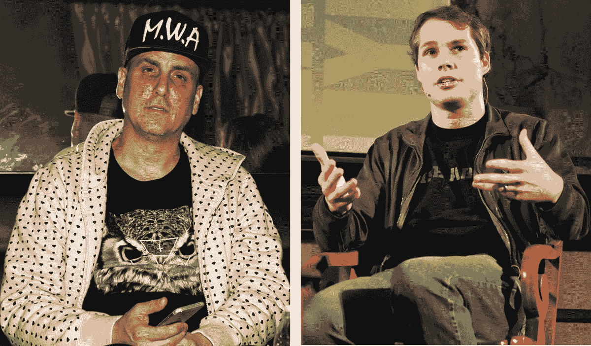
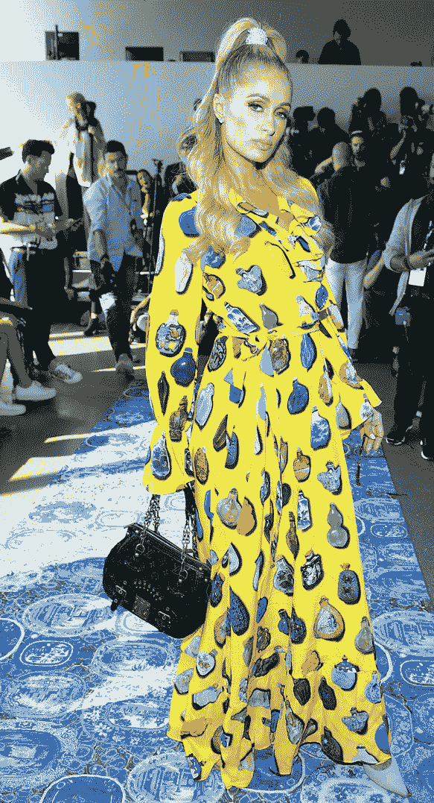

# NFT、数字艺术与区块链技术全面指南

献给我非常特别的妻子和最好的朋友 Alice。

并献给我两个了不起的孩子 Jude 和 Damaris。

## 作者的话

## 引言

加密货币的兴起正在改变支付的执行方式，同时也创造了一个完全全新的投资者群体。加密货币还在创造一个金融和金融交易的世界，这个世界以前所未有的方式不受政府监管。随着 `Bitcoin` 等数字代币的价值达到五位数，即使是那些对加密货币的效用表示怀疑（或直接称其为骗局）的实体，现在也改变了态度，纷纷涌入投资。

退后一步从更广视角来看，区块链——支撑加密货币和 `NFTs` 的机制——正在改进用于验证谁创建了某物品、谁拥有某物品（数字或其他实体）以及该物品源自何处的技术。通过区块链，货币的所有权历史被刻在货币本身中，任何查看它的人都可以访问。

想象一下，你可以从钱包里掏出一个美元，并立即知道使用过这笔钱的每一个人、它所用于每笔交易的性质，并且你可以追溯到钞票打印的那一刻。

在现实世界中，你可以和朋友用一张美元换另一张美元，你们各自钱包的内容——从实际角度来说——基本上没有变化。你们的任何一张都不会比另一张更有价值。而且这两美元的历史本质上仍然是一个谜。你不知道它从哪里来，也不知道它它是如何被使用的。你猜测这笔美元是真币还是伪币的机会可能也一样。

但 `NFTs` 则并非如此。

这就是 `NFT` 中的“NF”部分。它意味着**非同质化**（non-fungible）。这意味着你不能在其他地方用类似的东西交换它，并保持一切如初。

许多有价值的东西是同质的，特别是现金或硬币。但随着加密货币的兴起，这将发生变化——不仅对于货币，还对于艺术品、收藏品以及各种数字物品。

正如艺术界在 Beeple 的拼贴画售出后学到的，`NFT` 的价值是因为它是独一无二的物品，而且这一事实是可验证的。`NFT` 是其自身独特性的守护者。它可以自我验证自己是一件独一无二的艺术品。（就像防钞检测器可以显示钞票真伪一样，`NFT` 为自己实现了这一点。）`NFT` 可以“讲述自己的故事”，而且只要它存在，就可以一直这样做。

即使对于那些不熟悉加密货币或区块链的人来说，随着 Beeple 拼贴画的售出，拼图碎片开始对位。突然之间，区块链不再仅仅用于 `Bitcoin` 这样的数字货币。现在，它将用于各种各样的物品。

在艺术界，伪造品的问题将完全消失。作品的所有者可以随时出售该作品，并对交易充满完全信心。买家将对他们新资产的真实性享有更高水平的信心。

然后就是存在主义层面的问题！

以 `NFT` 形式购买艺术品将创造出艺术收藏家以前所未过的深度且强大的所有权水平。以 `NFT` 购买艺术品的人不仅对作品本身拥有完全主权，还对它的整个过去拥有主权，一直追溯到诞生的那一刻。此外，无论未来由谁拥有该作品，这位收藏家在作品的历史中将永远拥有一个不可撤销的位置。他们的名字将永远留在作品的区块链上，关于策展和管理的旧观念将发生彻底颠覆。

随着 `Everydays: The First 5000 Days` 售出那些令人震惊的情况逐渐明朗，从事内容创作的企业家和专业人士开始问一个新问题。不再是“刚刚发生了什么？”，而是“那么对我意味着什么？”

如果 `NFTs` 可以在精艺术世界发挥作用，那么体育图像、时尚摄影、音乐或重要的历史文献将会怎样？这个清单没完没了。

显而易见，任何被购买、出售、收藏或继承的物品都将受到 `NFTs` 的积极影响。艺术家和摄影师将发现卓越的新收入来源，以及他们作品以前无法想象的化身。品牌将找到与客户联系的新方式。娱乐艺人员和视频游戏开发者将以以前梦梦过的方式让粉丝沉浸其中。

我想写这本书，是因为，坦率地说，这种强大的变化无论人们喜不喜欢都会到来。在一个整个行业被颠覆和重组成为常态的时代，应对“NFT 转型”将是企业在 21 世纪保持竞争力的重要部分。

在这本书中，我的目标是为你提供关于 `NFTs` 的坚实概述，并消除 `Everydays: The First 5000 Days` 售出时某些人感到的“神秘”。我将阐述 `NFTs` 与区块链及数字货币的关系，帮助你精确理解 `NFTs` 是如何工作的。我们将探索 `NFTs` 如何帮助创作者以令人兴奋的新方式将其创意资产变现，以及收藏家如何抓住正确时机投资一种完全原始的资产形式。最后，我将帮助你准备现在就行动，以迎接这个即在眼前的新世界。

十年前解释 `Bitcoin` 是什么是一回事，而预测 `Bitcoin` 的意义则是另一回事。

如果你想了解 2021 年 3 月发生了什么，为什么它在今天很重要，以及如何在它即将开启的世界中定位自己以获得成功，请继续读下去……

# 第一部分

## 认识你的导师

我是谁？我是如何接触 `NFTs` 的？我是如何成为你的私人导师，引导你穿过这片奇异异域的新景观的？

我最为人知的身份是获奖机构 `DMA United` 的创始人，该机构将商业导向的原则与品牌和广告结合在一起。我喜欢说 `DMA United` 运营于“风格与设计的交叉点”。`DMA United` 的客户包括 NBA、Karl Lagerfeld、MoMA、LVMH、华纳兄弟娱乐、索尼音乐以及尼尔逊·曼德拉的遗产。

我还是一名拥有法学博士学位的律师，并且纽约大学斯特恩商学院 MBA 项目的兼职教授，在那里担任纽约大学斯特恩奢侈品与时尚委员会的联合主席。我与妻子和两个孩子住在纽约。

我进入 `NFTs` 的道路取决于一次偶然的会面。

这源于与 Stephane De Baets 的相遇。Stephane 从事金融、房地产和酒店业。他一直是一个非常有前瞻性的人，我非常尊重他。在那个命运般的夜晚，我在 SoHo 拥有一家名为 Chefs Club 的餐厅见到了 Stephane。表面上，我们去那里是为了探索为餐厅做一些品牌和广告。我们正在讨论对创新和未来主义的共同热情，这时 Stephane 告诉他最近通过“区块链”购买了位于阿斯彭的帝太岭酒店。

*通过区块链？* 我想。*怎么做？为什么？* 但他告诉我的越多，我就越清楚地发现他的疯狂行为其实是有章法的！这种区块链支持的购买方式开启了新的业务可能。正如他向我解释的，Stephane 使用瑞吉酒店（St. Regis）作为资产，支持了一种新型加密货币的发行——`Aspen Digital Token`，或称 `AspenDigital`——这让合条件的投资者能够获得物业本身的少数股权。最终，这使得酒店约 20% 的股份由这些少数投资者完全购买并所有。其余 80% 仍由 Stephane 公司拥有。但事实并非如此。`AspenDigital` 代币的持有者被邀请加入一个特殊的奖励和优惠计划，每当他们访问物业时，该计划就会激活。即使是持有少量 `AspenDigital` 的所有者，在瑞吉酒店入住期间的所有消费都可以获得 20% 的现金返还，而大额持有者可以获得高达 50% 的返还。

Stephane 的此举让我大开眼界。他不仅让投资过程民主化，还让小玩家也能拥有由区块链 100% 支持的强大投资。与此同时，他还在物业本身创造了完全全新的互动方式。

但是，正如我在后的几天里学到的，Stephane 尚未结束 . . .

当 COVID-19 疫情袭来时，Stephane 和我很早就预见到餐厅将面临巨大的压力，许多餐厅将无法生存。这一次，Stephane 和我以*义务服务（*pro bono）*的方式共同努力，寻找数字代币不仅可以支持餐厅主，还能创造一种触及厨房员工和零工经济工作者的滴漏效应。我们开发了一个简单的交换机制，客户可以进入餐厅并支付 500 美元购买一种数字代币，该代币在 COVID-19 之后可以兑换价值 1,000 美元的餐饮服务。这额外的 500 美元充当了预付款，帮助厨房在疫情期间维持运营，这种模式促成了一种专注于餐厅社区的新型加密货币。

不言而喻，我对我在区块链和加密货币领域看到的现象变得非常感兴趣——尤其是因为这远超大多数人在构想区块链支持的交易时的思维范围。这些创新者正在做完全新颖的事，我开始探索它可能如何与我在 DMA United 的世界产生交叉。

时尚、艺术、职业体育、社会正义——这一切都可能受到这些新工具的影响。2020 年 5 月，数字收藏和独特品牌所有体验的概念促使我试点 `Truesy`——这是一个 NFT 市场，它精准击中了 DMA United 社区中设计、品牌和时尚汇的“甜点”。

现在你知道我是谁了。接下来，我将更多地解释为什么我认为区块链是解决当下及未来问题的最佳解决方案 . . .

## 区块链与溯源问题

区块链是让 NFT 革命成为可能的技术，因此理解它是关键。

通常，理解一个复杂新发明的最简单方法是从提问开始：“这个设计是为了解决什么问题？”涉及到区块链时，答案是溯源问题。即，所有权的历史。

区块链是一个数字“活账本”，每发生一次就会增长一次。（等等，让我精简一下这部分以保持清晰）。

为了最好理解这项技术，考虑区块链最著名的例子可能会帮助，即 `Bitcoin`。运行 `Bitcoin` 的区块链是由一个名为 `Satoshi Nakamoto`（中本聪）的神秘人物（或人物）创建的。在创建他的加密货币时，`Nakamoto` 设计了一个系统，使得所有 `Bitcoin` 交易记录可以由全球范围内活跃 `mining` 的计算机网络进行去中心化的维护。

我们使用 `mining`（挖矿）这个词，但这些计算机实际上在做的是解决一系列复杂的数学问题，然后维护交易链。（为什么要进行这种 `mining` 呢？因为矿工会定期因这项工作获得他们自己的新 `Bitcoin` 作为奖励。）这种模型有一些缺点，例如对环境的影响——我们稍后讨论——但作为一种维护 `Bitcoin` 完整性的系统，这种大规模协作/验证模型运行良好。

`Bitcoin` 解决了溯源问题，但它还做得更多。`Bitcoin` 不是物理的。它们不是由可以用于任何东西的物质制成的。它们当然不像某些硬通币那样兑换成黄金（或其他贵金属）。然而，`Bitcoin` 的许多优势在于它们无法做到的事情上。也就是说，它们无法以任何方式被伪造。不存在虚假的 `Bitcoin`。纸币可以被伪造（而且确实被广泛伪造）。当你拿起一张 100 美元钞票时，你不知道它的来源。你不知道是在美国造币厂产生的，还是在朝鲜的伪造行动中产生的。作为接触货币的人，你无法获得这些信息。但对于 `Bitcoin`，这些信息不仅可用，而且是那枚货币不可分割的一部分。

比特币也免于任何与政府或中央监管实体挂钩而带来的风险。例如，政府可以突然宣布某种纸币可以兑换为 100 美元黄金，因此其“价值”为 100 美元。或者 200 美元。或者突然不再能兑换此前支持的物品。当政府这样做时，可能会导致通货膨胀、通缩、货币操纵以及全范围的混乱。但 `Bitcoin` 无法兑换任何实体，它的价值始终取决于人们愿意为它支付多少。而且它具有极高的流动性，易于售卖或转换。政府还可以根据需要通过发行更多货币来逐渐贬值。相反，`Bitcoin` 无法通过这种方式贬值，因为 `Bitcoins` 的数量是独特且固定的。在剩余的 `Bitcoins` 挖完，将不再有新的进入流通。（这种终局性和唯一性将在我们深入探讨 `NFTs` 的优势时发挥作用）。

最后，`Bitcoin` 通过将政府几乎完全排除在外，解决了中心权威的问题。（尽管并非完全排除。需要注意的是，某些政府已明确禁止了 `Bitcoin` 等加密货币的交易）。`Bitcoins` 是唯一的，当它们属于你时，它们可以永远属于你。但政府如果愿意，可以收回所有的纸币并将其替换为新发行的、更新后的纸币。当你拥有政府发行的实体货币时，总存在可能——尽管非常微小——该政府可以发布新的法律或裁决，对你的实体货币产生负面影响。

这种紧张关系也存在于艺术与金世界的交汇点——这里 `blockchain` 技术和 `NFTs` 将具有至关重要的作用。在艺术世界，压迫性的政府可能会将一幅绘画或其他艺术作品宣布为淫秽、“反革命”或其他叛逆行为——因此将其非法或没收。想象一下，如果一件精美且昂贵的艺术品突然变得非法持有！但当资产以电子方式和非物理形式被拥有时，政府物理上没夺一个货币单位或艺术品的能力将变成一个棘手得的问题。对于政府来说，要要实施此类压迫性规则将是极其困难。

《瑞克和莫蒂》的创始人 Justin Roiland 为一个 `NFT` 赚了超过 100 万美元，该 `NFT` 由一张简笔画的《辛普森一家》角色裸体草图组成。

总之，`blockchain` 是一种自我保护的数字账本，记录了账本上的所有内容以及与此相关的所有合法反应。它解决了溯源、伪造和各种物理欺骗的问题。当被用作货币支撑时，它在防止不当的政府干预和监管方面也迈出了巨大一步。

### 如果那是区块链，那么什么是 NFT ？

简单来说，一个 `NFT` 是一个由 `blockchain` 支持的数字代币——就像 `Bitcoin` 一样。然而，`NFT` 还代表一个独特的数字文件——而不是货币单位——这个数字文件通常以视觉艺术作品、`GIF`、音频文件或类似物品的形式存在。

另一种思考方式是，`NFT` 是一件与 `blockchain` 绑定的数字艺术、视频或音频，就像一个 `cryptocurrency` 单位一样。然而，虽然同一种 `cryptocurrency` 的单位在技术上都是独特的，但它们的价值也都是相同的。（你现在就可以上网查一下 `Bitcoin` 值多少钱。那个数字将是所有 `Bitcoins` 的市场价格）。`NFTs` 可能由同一个 `blockchain` 支持，但在大多数情况下，它们的价值是不同的——就像它们是独特的艺术品一样。因为它们确实是。

而且就像艺术品一样，数字 `NFT` 艺术品没有像你可以查阅 `Bitcoin` 价格那样的可以查阅的“市场价”。数字 `NFT` 艺术品不会有一个你可以查阅的“市场价”，就像你可以查阅 `Bitcoin` 的价格一样。

但仅仅因为 NFT 不会“挂”在你家里的墙上，并不意味着它不属于你，或者它是不安全的。（如果你愿意，它也可以挂在你的墙上，通过电视屏幕看到等。）相反，你的 NFT 艺术品可能从字面上是你拥有的最安全的东西。它几乎肯定是你拥有的最安全的艺术品。正如我们所看到的，由于 NFT 中的区块链技术字面上将作品的历史*印刻在*作品*上*，认证和来源可以立即知。即使对画布进行碳定年法，并有受过训练的艺术史学家的锐眼光，在实体艺术作品中，伪品仍然可能被充当真品。（或者被盗的画可能在多年可疑的所有权链后才被“找到”。）但当一件艺术品是 NFT 时，这种可能性被完全消除了。

艺术家 Urs Fischer 通过发布 NFT 与他的艺术交易商制造了紧张关系，但最终发现这种转型极其获利。

NFT 将“存在”于区块链上，但无论你以何种方式展示它，它都属于你。

NFT 是从 Beeple 开始的吗？显然不是。寻找 NFT 的确切起源可能相当困难。独特的数字物品已经存在几年了。但这些独特的数字物品是什么时候从商品跨越到“艺术”的界限的呢？

这无疑引出了一个更大的问题“什么是艺术？”，这个问题没有简单的答案。数字货币——比如 NFT 之前的比特币——能被算作艺术吗？

事实上，也许它们可以。

钱以前曾多次被用作（或作为）艺术，几位艺术家曾直接在画廊中将物理堆的货币作为艺术品展示。2017 年，艺术家 Danai Anesiadou 将一公斤黄金密封在塑料中并宣布这是一件艺术品。1994 年，Bill Drummond 和 Jimmy Cauty 执行了一件“艺术作品”，他们在火中烧掉了一百万英镑纸币。

在 NFT 之前，数字货币的形式是否已经作为艺术发挥作用？这是可能的。（而且这是艺术史学家在未来几年一定会争论的话题。）然而，该领域的大多数人认为，第一批正式的数字 NFT 艺术作品*可能*是 CryptoPunks，紧随其后的是 2017 年 11 月底首发的 CryptoKitties。CryptoKitties 是（仍然是）基于以太坊的区块链游戏，允许用户收集和繁殖数字猫通过强大的 CryptoKitties 在线社区，用户可以创建自己的独特猫——这些猫作为 NFT 永远存在——并相互进行交易和出售。在发布后的第一周内，CryptoKitties 的用户购买了价值 100 万美元的数字猫图像！

Larva Labs 的 CryptoPunks 已以数百万美元出售。

虽然在线猫作为一场巨大艺术革命的先驱似乎有些严肃，但人们购买这些猫的原因与任何人购买精美艺术品相同。这些图片很好看。购买它们很有趣。你可以从中赚钱，因为你购买的是一种增值的资产。这是一种证明你“知情”且“有文化养”（或至少是“在线文化”）的方式。这也是一种在从财务上支持艺术家的同时表达你兴趣的方式。

CryptoKitties 还展示了 NFT 艺术的一个定义性和革命性特征，即它几乎任何财富水平的收藏家都可以获得。价格最低的 CryptoKitty NFT 起仅 12 美元。

开发者们（正确地）察觉到这些猫 NFT 只是收藏级数字艺术伟大交响乐的序奏，他们迅速着手创建在线市场，在这些市场上可以买卖 NFT——并让该领域的新艺术家可以将他们的作品转换为 NFT。2018 年，包括 SuperRare、OpenSea、Nifty Gateway 和 MakersPlace 在内的多个 NFT 市场已经运行。

在大多数情况下，这些 NFT 市场通过抽取每笔 NFT 的百分比来盈利。作为回报，他们将 NFT 推现在买家面前，并促进交易。

随着这些在线市场的兴起，更多的玩家加入了游戏。

在遥远的某一天，在一个 NFT 已经普及到让人们几乎不再大动于色的市场里，我们可能会带着戏谑的心回首过去，发现这一切似乎都是从收藏级数字猫咪开始的。

区块链技术经历过不少少量的怀疑和批评。事到如今，我想我们应该已经习惯了这些了！

从远古以来，新的发明和创新总会引发人们对不熟悉的新产品的困惑。在某些不幸的情况下，这为消费者在完全不了解自己在买什么的情况下进行购买——甚至导致了赤裸裸的欺诈——下了笔。

好消息是，区块链支持的技术正变得越来越熟悉，包括那些可能并不处于技术前沿（或根本不精通技术）的人。区块链是什么以及它是如何运作的核心要素正在广为人知。每个人都听过 `Bitcoin`——这是一个良好的开始——即使他们不知道它是如何运作的或如何购买。虽然仍然存在误解的可能，但受过教育的消费者群体不断扩大，意味着通常情况下，对区块链技术的困惑在减少。

更棒的消息是，对于 NFT 而言，其独特的技术正为其前身所经历的大多数批评提供了强有力的反击。

例如，`Bitcoin` 等加密货币长期以来因其能源消耗和碳足迹而受到批评。一种你甚至无法握或触摸的数字货币，如何在“现实世界”中产生碳足迹？答案是：因为 `Bitcoin` 通过挖矿来维护其区块链，矿工总是需要电力来驱动执行挖矿的计算机。随着 `Bitcoin` 的增长——越来越多的币被挖出——挖矿成本不断加速。剑桥大学于 2021 年初发表的一项研究报告称，全球 `Bitcoin` 挖矿每年使用的电量大约相当于阿根廷国家。所有这些用电引发了碳排放的阴影，并增加了 `Bitcoin` 的碳足迹。遗憾的是，为 `Bitcoin` 挖矿提供动力的大部分尚未来自可再生能源（尽管 `Bitcoin` 爱好者承诺这很快就会发生变化）。好消息是，现代 NFT 的生产方式对环境的影响仅为 `Bitcoin` 之类产品的极小部分（这一点后文将详细介绍）。如果以正确的方式推出，NFT 将不必像比特币那样样的产生能量消耗。

对区块链产品的其他批评还源于其助成了“拉高出货”骗，或者通过推出毫无价值的加密货币来故意欺骗新者的计划。例如，当 `Bitcoin` 的价值在 2010 年代初缓慢但稳定地增长时，加密货币市场充斥着每周发布的新型“硬币”。这些新币的创建者中，许多人只是为了赚取快钱。为了赚这笔快钱，他们可能会推出一种与毫无意义的噱头相关的加密货币——“为鹦形鹉爱好者打造的新代币，每个养了鹦形鹉的人都会想用！”——然后发行十亿个币。其中一半将在加密交易所上出售，另一半由硬币创建者保留。例如，如果这种新币的价值仅达到一分钱，创建者就可以卖掉他们手中的五亿个 `ParakeetCoin`，凭空变出 `$20M` 并走人而去。持币者（以及各地的鹦形鹉爱好者）

有些企业可以帮助创作者“铸造”他们的 NFT，但也有协助销售 NFT 的平台、帮助艺术家和投资者理解这些数字作品公道价格的估值师，以及帮助收藏家策划其收藏品的顾问。

奢侈品牌正在自我反思，如何让奢侈品购买能够包含一个 NFT，从而“解锁”进一步的高端体验、独特服务、新产品发布访问权、联名合作等。体育公司正在为数字领域的巨幅增长做准备，而这种增长将由 NFT 驱动。此外，各行面向客户的公司也正准备在数字区块链的某处直接与这些未来的客户建立联系。

`Grimes 在短短几分钟内通过出售原创 NFT 艺术品赚了 580 万美元。`

企业意识到，词汇本身已经扩张了。随着人们趋于追求“真实性”和“真实”，买家将越来越想要拥有某个事物的真实且独特的版本。就像独特性在物理世界中存在一样，现在也将存在于数字世界。

随着每天都有越来越多的人发现这种格式，想要“把牙膏挤回管子里”几乎是不可能的了。NFT 将长久存在。

在下一节中，我们将探索企业和品牌创建的 NFT 类型，并观察我们预计这些 NFT 在何处创造最大的机会。

`由创作者 Hashmask 的 NFT 艺术品以超过 80 万美元的价格售出。`

# 第二部分

## 一个 NFT……但它是哪种 NFT

我们已经看到 NFT 将如何为纯艺术家、品牌、奢侈时尚设计师、精英运动员、音乐家和娱乐人员带来一场革命。我们正与渴望进入这一领域的客户建立新的伙伴关系。甚至在写这本书之前，我们的客户名单中就已包括华纳兄弟娱乐、纽约巴尼百（Barney’s New York）、纽约现代博物馆（MoMA）和 NBA。

我们到目前为止的工作可以为大型品牌和创作者面临的 NFT 机会提供指南。

在本节中，我们将看看品牌在考虑如何在其增长领域实施 NFT 时所面临的一些选择。

首先，让我们看看品牌必须做出的第一个选择。

NFT 能够作为令牌运行，在与品牌的数字接触点处被识别。

想想这种东西在例如零售世界中如何被使用……

这个 NFT 如何？它将让你在我们的任何零售精品店享受 10% 的折扣。

那个 NFT 如何？它将作为你参加我们为顶级客户举办的专属秘密活动的入场券。

另外这个 NFT 如何？它让我们在关于你购买的产品更新有突破性新闻时联系你。事实上，NFT 被嵌入在产品中。

但首先，了解 NFT 分为两种类型：静态（Static）和动态（Dynamic）很有帮助。

对我们而言，“静态”意味着一个自给自足的 NFT。它*并不一定*意味着“不移动”。静态 NFT 可以以静态图像的形式存在，是的，但它们也可以包括 3D、动画、VR、AR、GIF、短视频等。它们还可以包括音频元素（声音），或者完全静音。因此，一张图片、一段视频或一个音频文件 NFT 都可以静态 NFT。

静态 NFT 通常通过在初始销售中为创作者产生产生收入。（如果区块链上指定了此类条件，它们还可以在未来的每次交易中持续产生收入。例如，规定每当出售 NFT 时，创作者将获得销售价格的 5%。）

静态 NFT 包括作为纯艺术出售的 NFT。因此，当今天大多数人使用“NFT”一词时，他们通常指的是静态 NFT。当你查看（或聆听）一个静态 NFT 时，你体验的是它的本质和功能的全部宽度。它将永远代表它是什么以及它能做什么。

## 动态 NFT

动态 NFT 不同。

`像 Grimes 这样的艺术家通过 NFT 取得了巨大成功。`

动态 NFT 具有静态 NFT 的所有品质（它们可以是视频、动画、GIF、音乐等），但它们具有根据预设规则更新的能力。

这是动态 NFT 与静态 NFT 的区别例子。一张勒朗·詹姆斯的静态 NFT 球片将包含到 NFT 创建为止的生涯数据，而这些数据不会随着詹姆斯继续比赛而改变。而一张动态 NFT 球片可以在詹姆斯参加另一场比赛时不断更新。

动态 NFT 还可以被程序设定为与其他 NFT 协同工作。例如，当收藏家购买了某个球队的所有 NFT 时，该 NFT 可能会“注意到”这一点并变为完全新的背景颜色，以表彰成就。

动态 NFT 还可以同步并捕捉有关用户本身的信息……

考虑一个带有动态 NFT 的视频游戏。它会在用户获得新高时不断更新。（任何被杀死的龙或被救的少女都可以永远保存在区块链上！）

考虑一个汽车主。如果一个动态 NFT 连接到汽车的健康状况，那么在考虑转卖时，关于汽车被拥有多久、在哪里行驶以及何时更换机油将不再是问题。所有信息都将不可逆地保存在区块链上。

或者，将动态 NFT 与健身应用/追踪器结合？跑步者的最好成绩、最高心率或每日步数可以保存在只要运动员刷新个人记录就会更新的 NFT 中。

然而，如今的品牌已远超鞋子上的耐克钩标志。它包含了品牌身份、活动和表现的几乎每一个方面。它包括广告、代言、营销和传播作品、忠诚度计划等。然而，所有这些元素中唯一恒定的因素始终是`产品差异化`。总有一些东西让你的品牌与众不同。某些东西让它变得`独特`且`令人向往`。

当品牌被正确培养时，它的价值将超过其部分价值的总和。客户开始青睐某个特定品牌，它就可以拥有自己的生命（和价值）。世界上有很多被称为“僵尸品牌”的案例，这些企业可能早已倒闭，但它们的符号仍然是文化中不可或缺的一部分。

接下来，考虑“符合品牌”（on brand）这个短语。然后考虑这个短语在描述`实体商品之外`的事物时使用的频率。政客的演讲被认为“符合品牌”。歌手的新专辑？“符合品牌”（或者不符合，取决于音乐）。“品牌”已指代产品或服务的某一个预期方面，以客户期望的方式满足他们的需求，无论它是否为实体商品。

一家企业、一个政党，甚至一个人，都可以是一个品牌。

### NFT 与品牌身份

NFT 具有增加品牌表达自我、与客户和粉丝建立联系以及定义自身身份的潜力。NFT 可以让消费者了解更多关于品牌的信息，识别产品的益处，表达品牌价值或信念，或者简单地传达一种品牌个性和自我认知感。

我们亲眼目睹了 NFT 如何无缝地融入到艺术家或企业的现有品牌中。我们经常与品牌合作，帮助他们优化其`NFTs`，以便在市场中产生最大的影响。在这里，我们将概述这类工作的一部分，让您对`Static NFTs`（静态 NFT）如何与预存品牌整合有一个直观的感受。

当我们帮助正在扩展到 NFT 市场的客户时，我们会与他们合作创建一个独立的品牌画廊环境。这是一个“中心枢纽”，潜在客户和支持者可以来这里查看 NFT 内容。虚拟画廊看起来就像创作者品牌的延伸。它不会让客户觉得自己正要去一个在线艺术画廊，或者去某种“外部来源”。相反，从他们点击的那一刻起，访问者就会他们仍然处于品牌本身的一部分空间内。

`Static NFTs` 本身的设计也应该带有企业的品牌形象。然而，这只是通用的建议，且始终是通用的。企业应该觉得决定这种品牌化如何运作取决于他们自己。企业对自己的品牌形象极具保护欲，并在营销和传播部门设有内部的品牌守护者。这些人将热衷于确保品牌形象以正确且适当的方式部署在像 NFT 这样的内容中。

我们的合作伙伴对与我们合作感到很放心，因为他们保留了完全的创作控制权。最终，他们拥有最终决定权。

我们还可以帮助客户理解，尽管这是一项新技术，但 NFT 并不是一种异域的“他者”，不会成为他们品牌部门需要处理的某种意外变数。相反，NFT 可以成为他们已经制作的任何产品的延伸。他们可能会生产实体的收藏内容物品——如棒球牌或人偶——或者他们可能有现有的品牌形象，可以将其融入收藏级`Static NFT`中。例如，汽车公司通常不认为其产品是“收藏品”——除非是对极富阶层——但他们在所有平台上都有强有力的品牌形象。这种品牌身份可以轻松整合到诸如带有热门汽车的收藏 NFT 中。

当一家企业准备首次提供他们的`Static NFTs` 时，我们希望将其打造成为盛事！现在，让 NFT 发布进入新闻并不具有挑战性，因为人们对这项新技术有极大的兴趣。但随着新鲜感的消退，更重要的将是确保公司的核心客户群感知到 NFT。我们希望他们理解如何访问和收集 NFT，但帮助客户看到 NFT 如何作为他们粉丝文化和对产品热忱的延伸也是同样重要的。

最突出的 NFT 在它们自己的环境中进行展示和呈现。当创作者或品牌有单个 NFT 待售时，（显然）也是如此。如果一个 NFT 足够重要，那么关于发布和销售的一切切都将为该 NFT 定身定制。

我们还帮助客户根据通过我们与创作者关系优化的选定时间表发布他们的 NFT。时机就是一切，我们让客户理解不仅是“如何”和“何地”，以及`何时`发布他们的 NFT。NFT 发布可以与另一个新产品的发布同步。它可以作为大型活动的一部分，标志着品牌对 21 世纪技术的承诺。它还可以引入重要的新收入来源。我们努力确保品牌从市场的最佳时机中获益。

在最高层面上，我们听取客户的意见。我们了解他们希望实现什么。我们了解什么让他们的客户对产品产生热情。我们帮助他们确定其 NFT 发布如何与品牌的其他部分整合并提升整体认知。

我们的另一项核心任务是协助任何客户使其`Dynamic NFT`（动态 NFT）计划价值最大化，帮助他们发展品牌。

这类工作的几个例子包括：

- **整合奖励计划**：我们的客户是否希望 NFT 持有者在企业获得折扣？拥有 NFT 的客户是否应该积累可兑换的积分？可能性是无限的。我们帮助合作伙伴长期思考 NFT 如何让客户与品牌建立更牢固的关系。
- **为粉丝群体提供独特体验的机会**：对于音乐家这样的人，`Dynamic NFTs` 可以充当数字钥匙，解锁特殊体验，如演唱会或艺术开幕式。NFT 可以让粉丝感知特殊活动，同时作为进入内部的入场券。这些 NFT 可以为“超级粉丝”创造一种独特性感，让他们感到与喜爱的艺术家更近。
- **为粉丝群体提供独特服务的机会**：在许多优质餐厅，有一份为“内行人士”准备的特殊菜单——而其他人则只有普通菜单。就像它可以作为开启特殊活动访问权限的护照一样，NFT 也可以开启全新产品和服务菜单的访问权限。通过购买 NFT 与品牌建立的消费者可能对品牌非常忠诚，因此更有可能对额外的特殊服务产生兴趣。
- **为粉丝群体提供限量产品发售的机会**：与上述类似，NFT 持有者将是最可能抢购品牌可能提供的特殊限量版产品的人。那些没有 `Dynamic NFT` 的人甚至不知道这些供应的存在，这一事实可以创造出理想的错失恐惧症（FOMO），从而为这些特殊产品的业务带来增长（并将其直接引向最有可能购买的社区）。

动态 NFT（Dynamic NFT）最令人兴奋的特性之一，是在你的粉丝社区内建立联系，这不仅有助于提高品牌知名度，还能帮助购买你 NFT 的人们从“客户”转变为“品牌粉丝”。几乎每个品牌都希望培养粉丝社区并帮助他们成长。通过帮助确保 NFT 成为解锁品牌社区准入许可的“钥匙”，我们确保了粉丝之间能够建立联系，并帮助该粉丝群不断壮大。

显然，这里包含很多内容，而且动态 NFT 菜单中的每一个部分并不适用于我们合作的每一位合作伙伴。但如果你想跳过前面，本书的第四部分包含了关于不同行业如何使用（以及未来如何使用）NFT 的更多具体示例。

## 共同赋能艺术家、创作者和投资者

我目前工作中最令人兴奋和满足的部分之一，是深知我们将成为一种强大新力量的一部分，帮助人们为他们热爱的事情获得报酬。NFT 将允许一波新的艺术家和创作者通过艺术维持生。与此同时，艺术家和品牌将能够利用技术，以仅仅一代人以前无法想象的方式与粉丝互动。与粉丝、消费者、艺术品所有者建立直接且个人化的关系。

NFT 将为艺术品创造一个全新的“层”。也就是说，我们将在与艺术作品相关的产出列表中添加一个完全全新的项目。这里有原作、有作品的摄影复制品、有作品签名的印刷品、有官方授权的复制品等等——而现在，有了 NFT。

艺术家大坂直美子（Naomi Osaka）已以 NFT 的形式发布了许多作品。

这立即为许多艺术家和内容创作者带来了新的收入来源，因为这给了他们新的可以销售的东西。例如，一位画家画了一幅画。她可以出售实物画作，可以作为版权持有者对画作的各种复制品授权，而现在她还可以出售 NFT。

有些作品是数字化创作的，对于数字艺术家来说，要证明他们的“原作”与画布上油画的画品一样合法、独特且具有销售价值，有时一直是一项挑战。在这里，赋予数字艺术家出售其作品的完全独特的 NFT 的能力（其原创性和来源已内置在区块链中），能够为艺术家带来有意义的变革性变化。

虽然画布上的油画可能仍会遇到伪造品和假品的问题，正如我们所指出的，NFT 将向公众呈现一件完全“无法伪造”的作品。

如果你仔细考虑，与可以被伪造的同类实体艺术品相比，这可能会增加 `NFT` 的价值。媒体上充斥着关于艺术品伪造者欺骗专家的惊险传闻。每当有一幅画作或类似的实体艺术品待售时——即使是由非常有声誉的公司提供的——总存在作品可能不是正品的概率。我们从历史中知道，艺术买家总是在冒着风险。但如果没有风险呢？完全没有风险呢？这就是 `NFT` 将带来的价值，这也是为什么 `NFT` 能够开出不带有那种“作品可能非真”的“内置”可能性的价格。这是一个实实在在的利益，它增加了 `NFT` 在收藏家眼中的价值。（想看……你可以成为实物艺术品的收藏家，并有理由确信你收藏的大多数作品是真品；或者你可以成为 `NFT` 收藏家并绝对确定。听起来哪一个是更具吸引力的投资领域？）

`NFT` 还通过消除艺术家与其客户之间的许多障碍和中介来赋能创作者。艺术家将能够直接向消费者出售 `NFT`。他们将仅受到任何形式公司控制的极小影响。政府控制也将非常有限。例如，地方性艺术审查的尝试在 `NFT` 时代将不会长久；它们太容易地被绕过了。

`NFT` 还将带来一个全新的审美和数字画布，创作者可以在此进行实验。只有在极少数情况下，发明或创新才能允许这种情况发生。摄影。电影和动态影像。数字摄影和数字画布。现在是 `NFT`。随着每一个新作品的诞生，艺术家们利用技术创造了伟大的艺术。他们扩展了媒介本身，并以新的方式使用它。我们现在预测，未来十年将看到创作者、艺术家和品牌开始以我们现在无法想象的方式，将艺术品作为 `NFT` 进行优化。从字面和比喻的角度来说，`NFT` 都是一个全新的画布，新一代艺术家将在上面学习绘画。

这从 `NFT` 随时间演变的独特方面以及它们与其他 `NFT` 交互的能力中也能看到。因为它是数字的并由区块链支持，没有任何能阻止艺术家设计一种在每次出售、竞价、赠送给他人或继承时都会发生物理变化的 `NFT`。同样，作为数字实体，`NFT` 具有与其他 `NFT` 互动的潜力。想象一个画布，生命开始时是一种颜色，但当所有者拥有同一位艺术家的另一个 `NFT` 时，它就会改变。当收藏家从同一个系列中一个一个购买 `NFT` 时，收藏家的数字画布可能会继续更新和变化。也可能不会。这只是艺术家将拥有的有趣技术可能性之一。

`NFT` 的兴起还将公平和民权等领域产生许多影响。其实现这一点的一种方式是打破艺术家目前的中心化接入点，这些点导致了非常同质化的格局，直到今天，许多多样化的声音似乎被排除在外。例如，根据 2020 年 2 月发表在社会科学研究网络（`SSRN`）上的论文《艺术市场中的玻璃天花板》，拍卖出售的艺术品 96% 以上由男性创作。在利润最丰厚的艺术品销售中，女性艺术家的仍然非常少。纽约市立大学（`CUNY`）盖特曼学院 2016 年进行的一项研究发现，纽约顶级画廊代理的艺术家 80% 以上是白人。当该项调查仅针对美国出生的艺术家时，发现 88% 是白人。同一项研究还发现，纽约顶级画廊的艺术家绝大多数来自少数几个选拔（且昂贵的）大学和学院，而这些大学几乎全部位于洛杉矶、芝加哥或大西洋沿岸。在性别、种族以及经济地理多样性方面，我们可以做得更好。坦率地说，我们必须做得更好。如果艺术界对这种情况不感到深表羞愧，那么他们应该。`NFT` 可以通过让艺术不再是由一个少数而封闭的精英群体策展的东西，来帮助积极变革的发生。

艺术收藏家的处也会变得更好。`NFT` 将让那些以前从未想过自己能担任这一角色的人群也能参与艺术收藏。想一下当人们使用“艺术收藏家”这个词时，他们通常会想到什么（以及谁）。这通常是指有能力购买精美术品的人，但不仅于此。他们可能还需要依赖专家“向导”来引导他们发现那些可能最有投资价值的作品。他们应该有物理空间来存储购买的艺术品（无论是在座庄庄的豪宅里，还是在气候控制的存储设施中）。我们想象中的这类人生活环境足够安全，不必太担心他们的收藏品会从墙上被偷。我们想象他们离艺术销售中心足够近，以至于一旦决定出售某件艺术品，可以安排许多合格的潜在买家进行交易。

将此与 `NFT` 爱好者潜在收藏的世界进行对比。由于作品是以数字形式呈现的——而且任何人可以在任何地方进行购买——`NFT` 收藏家不需要生活在有联系的沿岸精英中，也不需要知道购买作品的正确场所和人。任何地方的任何人都可以在网上发现下一位伟大的 `NFT` 艺术家。而销售 `NFT` 的艺术家和实体，一旦有人对作品出价，就没有理由拒绝交易。他们甚至可能没有这种能力。（在精美术品界，画商知道，*谁*购买了某位在世艺术家的作品，就有潜力影响该艺术家后续作品的价格。因此，希望某位艺术家作品的市场价值上升的画商，首要希望是这件作品能被一家领先的博物馆购买。如果无法实现这一点，那么一位已经购买过许多经典派艺术家作品的顶尖收藏家就是次优选择。列表底端是一个以前从未买过艺术品的初次收藏家。有可靠的传闻说，画商会直接拒绝向那些（在画商看来）缺乏足够既有收藏的收藏家出售绘画。）易见，`NFT` 的兴起将完全颠覆这一局面。艺术界将不再有“内部人士”和“后台交易者”来决定谁值得购买某些东西。

对于想要投资艺术——但是艺术收藏的新手，或者恰好住在没有强有力艺术社区的物理位置的消费者来说，这种影响将在多个方面带来一种重要的公平。购买艺术可以成为创造跨代家庭财富的一种方式。它是美国梦的重要组成部分。而 `NFT` 可能会为工薪家庭开启这一全新的资产类别。我们能看到更多像 `Beeple` 那样飙升至八位数的 `NFT` 销售吗？肯定的。但我们也看到许多艺术家以三位到四位数的价格出售 `NFT`。由于它们与区块链的联系以及 `NFT` 带来的其他潜在优势，这些艺术品极有可能与它们那些价格昂贵到天文数字的“表兄弟”一起逐渐升值。即使是价值的微小增长，也有可能对获得作品的家庭产生意义的长期影响。简而言之，`NFT` 将一种通常仅供极富人享有的投资模式，并帮助它变成越来越多人负担得起的东西。

这也是一个很有把握的领域，即未来的创新将极大地帮助收藏家。点对点模式以及在线策展人正在进行的初步工作，展示了该领域未来可能实现的一些兴奋事物。我们只需拭目以待。

现在许多聪明且富有创意的人正在回答的一个特别有趣的问题是：“一旦你买了一个 `NFT`，展示它的*最佳*方式是什么？”

就像在触感艺术世界一样，拥有一件艺术品最好的部分之一可能是让人们知道你拥有它带来的文化资本。（我注意到，有些人人倾向于安静地收藏，只需让他们的艺术品静静地、在视线之外升值。这也是一种很好的模式。我不在这里评判！）但对于那些希望将展示快感作为 `NFT` 购买体验一部分的人来说，未来几年将开发出大量的选择。有些可能是含蓄的。有些可能是直接且俗艳的。有些可能需要技术知识。但实际上任何以任何价位购买 `NFT` 的人，都能找到一种有趣且令人兴奋的方式来分享他们的新投资。

在下一节中，我们将继续观察 `NFT` 革命将为所有人带来的积极优势——并探讨如果我们操作方法得当，`NFT` 将如何避开某些困扰过加密货币的陷阱。

`NFT` 的广泛采用具有跨越整个行业的革命性潜力，并可能引发自加密货币和 `Bitcoin` 引入以来未曾见的变革。`NFT` 的影响还可能更加强大，因为 `NFT` 能够保存文化遗产、数据和数字信息——本质上是地久天的。

`NFT` 也还准备好具有革命性，因为数字伙伴关系允许几乎任何人（或任何品牌）来创建一个。

铸造自己的加密货币通常需要在时间、技术和资金上投入大量，并使用加密货币交易所来促进货币的发布。是的，自 `Bitcoin` 之后已经发行了大量的加密货币。（行业领袖估计，截至 2021 年初大约有四千种加密货币。）然而，与现在正在创造以及未来将创造的 `NFT` 相比，这个数字完全显得微不足道。随着品牌开始理解将其内容作为 `NFT` 销售的益处——以及使用 `NFT` 与客户群体进行互动并建立建立桥梁——我们将看到 `NFT` 在各个学科和行业的应用出现近乎指数级的爆炸。在企业层面，有理由相信 `NFT` 可能会像今天的社交媒体一样，成为营销部门不可或缺的一部分。（正如各国营销部门在 21 世纪初增加“社交媒体明星”一样，在不久的将来，他们可能会为“NFT 明星”投放广告。）

*匿名艺术家 `Pak` 一直是 `NFT` 创新的先驱*。

`NFT` 易于创作，非常有用，而且很快就会产生大量的 `NFT`——出现在我们生活中几乎涉及任何数字内容的每一个领域。

是的，像《每一天：前 5000 天》这样的重大艺术品作为 `NFT` 将享有特殊优势，但更、更易获得的购买品也是如此。随着一切趋向数字化，像球卡之类的收藏品很快就会向 `NFT` 转型。即使是消费能力有限的年轻人，也能享受到知道自己独拥有独特副本带来的兴奋感。

`NFT` 未来之路的另一个重要部分将由艺术家们自己塑造。创意人士曾多少听过那句老掉牙的调：“我们付不起你的报酬，但这将是很好的曝光。”好吧，有了 `NFT`，报酬和曝光*将手并并行*。创意作品作为 `NFT` 销售时是独特的物体，但并不意味着艺术品本身在数字形式下不能展示。艺术品被看到的越多，其升值的可能性就越大。因此，`NFT` 所有者可以在享受其数字资产升值的同时，仍然根据自己的意愿向其他人展示实物艺术品。这真是一两兼得！

对于艺术家和内容创作者来说，另一个优势将是他们获得报的方式和时间。在历史模式下，艺术家只有在他们创作的单件艺术作品首次出售时才能获得报酬。像画家这样的艺术家在大多数情况下将保留出售作品复制品的权利——例如根据他们的绘画制作的海报——但在未来任何一次将他们的绘画从一个收藏家转卖给另一个收藏家的情况下，他们将无法获得任何新资金。

通过 `NFT`，创者可以在区块链本身中植协议，规定每当 `NFT` 出售或转售时，艺术家都有权获得销售额的一部分。或者一份新闻公告。或者艺术家可能希望指定的任何条件。

`NFT` 还让艺术家和创作者能够完全数字化的方式出售作品，并且在他们选择的情况下，不需要通过中间机构。如果创者愿意，他们可以约定在数字画廊中展示他们的 `NFT`，以让作品获得更多关注，但没有什么能阻止他们直接从自己的网站出售作品，并保留那些本该属于画廊或销售代理的百分比。`NFT` 还会消除艺术购买的匿名性。艺术家可以知道是谁购买了他们之前的某件作品，和/或目前是谁拥有它。然后他们可以利用这些信息，在有新作品出售时与收藏家进行跟进。（在一个仍在 `COVID-19 病毒` 后影响中震荡的世界里，无需亲身前往画廊即可买卖艺术品的优势无需多言。）

对正在进行的 `NFT` 革命的某些批评者表示困惑，为什么收藏家愿意为一张作为 `NFT` 出售的数字猫 `GIF` 支付数十万美元，而同一个 `GIF` 可以在网上免费地复制和粘贴。这种“批评”实际上强调了 `NFT` 艺术品对艺术家的益处。收藏家购买的是数字艺术品 . . . 但他们不仅购买了数字艺术品。他们购买的是特定的一个副本。

想象物理画布上有两幅看起来完全相同的画。它们是如此相同，以至于每一笔看起来都完全一样。而且，使用的画布和颜料也是相同的。唯一可见的区别是，其中一块画布是由一位老大师在三百年前创作的，而另一块是由一位伪造大师使用古董工具和颜料创作的。大师创作的真品可能价值数百万美元，而伪作品的价值会低得多，尽管它几乎一模一样。为什么？归根结底，这是因为收藏家购买的是一位著名的老大师在那个特定时刻创作了这件作品的事实。这并不关乎两幅画看起来是否相同。其中一是由特定人在特定时间创作的，而另一幅不是。

接下来，让我们看看 `NFT` 未来道路上最重要的转折点之一。比喻地说，它就在路前方。我们很快就必须决定走哪个方向。当我们做出那个决定时，它将对区块链本身产生巨大影响。

`NFTs` 最重要的选择之一将是它们选择依赖于利用 `Proof of Work`（工作量证明）模型的区块链，还是 `Proof of Stake`（权益证明）模型。如果这些术语对你来说很新，不要担心；我们现在就解释它们。

`Proof of Work` 和 `Proof of Stake` 是不同的区块链技术。它们都允许在没有第三方协助的情况下对区块链上的交易进行验证。然而，尽管它们最终都达到了同一个点，但它们“到达”的方式非常不同。

两种模型都基于密码学。它们验证交易并确保区块链中的每项物品都维护其完整性。为了做到这一点，`Proof of Work` 使用计算机必须解决的独特数学方程。对于像 `Bitcoin` 这样广泛使用的加密货币——它使用 `Proof of Work` 模型——这需要世界各地的大量计算机时刻工作。

对正在进行的 NFT 革命的某些批评者表示困惑，为什么收藏家愿意为一张作为 `NFT` 出售的数字猫 `GIF` 支付数十万美元，而同一个 `GIF` 可以在网上免费地复制和粘贴。这种“批评”实际上强调了 `NFT` 艺术品对艺术家的益处。收藏家购买的是数字艺术品……但他们不仅购买了数字艺术品。他们购买的是特定的一个副本。

想象物理画布上有两幅看起来完全相同的画。它们是如此相同，以至于每一笔看起来都完全一样。而且，使用的画布和颜料也是相同的。唯一可见的区别是，其中一块画布是由一位老大师在三百年前创作的，而另一块是由一位伪造大师使用古董工具和颜料创作的。大师创作的真品可能价值数百万美元，而伪作品的价值会低得多，尽管它几乎一模一样。为什么？归根结底，这是因为收藏家购买的是一位著名的老大师在那个特定时刻创作了这件作品的事实。这并不关乎两幅画看起来是否相同。其中一幅是由特定人在特定时间创作的，而另一幅不是。

接下来，让我们看看 `NFT` 未来道路上最重要的转折点之一。比喻地说，它就在路前方。我们很快就必须决定走哪个方向。当我们做出那个决定时，它将对区块链本身产生巨大影响。

`NFTs` 最重要的选择之一将是它们选择依赖于利用 `Proof of Work`（工作量证明）模型的区块链，还是 `Proof of Stake`（权益证明）模型。如果这些术语对你来说很新，不要担心；我们现在就解释它们。

`Proof of Work` 和 `Proof of Stake` 是不同的区块链技术。它们都允许在没有第三方协助的情况下对区块链上的交易进行验证。然而，尽管它们最终都达到了同一个点，但它们“到达”的方式非常不同。

两种模型都基于密码学。它们验证交易并确保区块链中的每项物品都维护其完整性。为了做到这一点，`Proof of Work` 使用计算机必须解决的独特数学方程。对于像 `Bitcoin` 这样广泛使用的加密货币——它使用 `Proof of Work` 模型——这需要世界各地的大量计算机时刻工作。

以太坊目前声称它正在转向权益证明机制（`Proof of Stake`）。然而，自 2014 年以来它一直在做出这一主张。以太坊必须通过“硬分叉”来实现这一点，这是一个巨大的挑战。所有用户都必须同时进行更新。也许因为这个问题，以太坊一直在拖延。我们这些构建系统和创作使用区块链艺术品的人，需要在*现在*就倡导一种更好的方法。

我们确实希望权益证明模型能够成为主流模型，并帮助确保 `NFT` 对环境的影响保持在最低。

我们正处于区块链技术的一个重要转折点。我们必须决定想要什么样的未来。区块链和 `NFT` 可以在工作量证明（`Proof of Work`）这种不可持续的模型下飞速发展。这将导致增长在达到某一点后无法继续，给环境带来难以想象的负担，并最终可能导致技术“熄灭”并消亡。或者，我们可以进行转变——甚至不是特别痛苦的转变——并在可预见的未来过渡到权益证明模型。这将允许区块链技术以一种环境可持续的方式持续增长。听起来是显而易见的事，对吧？嗯，正如我们在今天的许多问题中看到的，知道正确应该做是一回事，而采取行动真正去执行是另一回事。那些想要长期投资区块链的人必须迈出勇敢的一步，与该领域的同伴和同事断绝关系。

这引导我们思考区块链技术未来道路的另一个方面……

区块链技术将帮助解决的有趣挑战之一是：如果创建 `NFT` 的公司倒闭了，`NFT` 会发生什么？例如，像 `OpenSea` 这样的公司现在是销售 `NFT` 的领军者。但作为一个纯假设性的情况，如果 `OpenSea` 某天倒闭了呢？科技公司屡屡倒闭，对于消费者来说，这是一个合理的疑问。如果卖给你 `NFT` 的公司不存在了，和/或不再能提供验证，你还能证明你拥有该 `NFT` 吗？

好消息是，这个问题可以被——而且*正在被*解决。

我们正在努力使用星际文件系统（或 `IPFSs`），以确保任何购买 `NFT` 的人知道，如果销售它们的公司发生了什么事，他们的购买内容仍然存在。`IPFS` 是一种点对点网络，可以通过连接多个设备的数字文件共享系统来共享数据和信息。它是去中心化的，但仍然允许节点之间进行文件存储。网络中的任何节点都可以向任何其他节点请求内容验证。

`IPFS` 模型将取代目前的模式，在模式中，销售 `NFT` 的企业可能通过租赁 Amazon 服务器上的空间来运营。如果该企业租赁空间的能力（或 `Amazon` 本身）发生变故，那么验证该 `NFT` 所有权的能力可能会变得——至少可以这么说——岌岌可危。

但 `IPFS` 模型是以这种方式处理交易的：将元数据分布在整个节点网络中。`NFT` 数据将位于区块链本身，并本质上能够永远存在。

随着越来越多的消费者考虑涉足数字世界，这带来的额外安全性将是至关重要的。在 2010 年代，许多人对投资加密货币犹豫不决，因为他们听过 `Mt. Gox`（门头交易所）的惨剧，一家位于日本的比特币交易所宣布约 850,000 枚比特币从用户钱包中被盗窃。尽管后来追回了约 200,000 枚，但大多数从未被找回。即使对于不熟悉加密货币内部运作机制的普通大众——或者可能*特别是*对于他们来说——这只是避开区块链投资的另一个理由。当时有一种感觉，加密货币意味着花掉辛苦赚来的钱去投资一种某天可能突然消失的东西。

虽然由于 `Mt. Gox` 灾难引发的影响、后续和诉讼仍在进行，但毫无疑问，它造成了混乱，并在必要的情况下推后了加密货币的采用。如果 `NFT` 要像它们应得的那样无处不在并发挥其全部潜力，消费者需要理解购买 `NFT` 是一件有保障的事。支持购买的技术是强有力的，没有任何可能——即使在极端极端的情况下——`NFT` 本身会意外停止存在。

通过在 `NFT` 市场中追求基于 `IPFS` 的方法，我们可以确保这种情况的发生，并为 `NFT` 强大且持久的未来奠定基础。

然而，最终带给我们希望的是，即将到来的跨行业影响将带来新玩家进入该领域，他们将要求以正确的方式创建 `NFT`。他们将要求安全性和环保性。艺术家和加密货币投资者加入是一回事。但当各种类型的企业开始使用 `NFT` 时，它们将产生一种我们从未见过的、朝正确方向的拉力。

在下一节中，我们将专门介绍 `NFT` 跨行业的推出可能会如何发生，以及这对我们所有人意味着什么。

## NFT 跨行业的影响：未来几年的预期

我们正处于早期。在 2021 年初，我们还处于第一局的顶端。然而，我们仍然可以预测可能会从这个起点扩散出的各种变化。企业之间将相互学习。某些行业将注意到对 `NFT` 有效的“妙招”，并采纳它们。

最重要的是，我们将看到使用 `NFT` 的艺术品和视觉呈现发生非常显著演变。`NFT` 上将出现从静态艺术到动态艺术的强力转型。这将实现两件事：第一，它将随时间推移创造更多价值；第二，动态艺术将从营销角度为品牌创造价值。

这种价值的释放将通过所有行业的广告、营销和与客户的直接沟通来实现。这就像大浪行舟。

*艺术家 Kevin Abosch 在 2018 年就创建了区块链的数字艺术，当时 `NFT` 还是一个鲜为人知的词*。

现在让我们看看 `NFT` 的兴起如何被艺术家、企业和创作者利用——以及这对他们的行业产生什么影响。

### 音乐艺术家

表演者、音乐艺术家和乐队经营的是向观众出售实体物品、数字物品和体验的业务。

*DJ 和制作人 Steve Aoki 发布了一个包含 11 部分的 `NFT` 系列，这是迄今为止收益最丰厚的发布之一*。

我认为 `NFT` 在音乐人领域具有爆发性成功的潜力，因为它们将整合这三个领域——实物物品、数字物品和感官体验。

事实上，我预测 `NFT` 将彻底颠覆音乐产业。

通过使用 `NFT` 创建并发行门票，音乐人可以直接向粉丝出售即将举行的演唱会票。这些演唱会门票既是“艺术品”（因为它们是粉丝可以永久拥有并自豪展示的 `NFT`），同时，它们也将作为解锁粉丝与艺人之间进一步体验的钥匙。`NFT` 门票将提供“粉丝身份证明”，就像你在演唱会上购买的 T 恤可以让你在周一向朋友证明，你上个周末去参加了那场盛事一样。但它还能做更多事情……

演唱会结束后，艺人可以使用 `NFT` 与粉丝保持联系。这种做法的第一种是允许 `NFT` 持有者收听或下载他们参加过的演出的录音。一旦粉丝利用了这次下载，他们就与艺人建立了数字关系，而且这种关系可以变得更加深层。

粉丝的 `NFT` 可以解锁关于该乐队的特殊信息。多个 `NFT` 可以用于解锁不同等级的奖励或体验。你可能会获得下一张专辑的优先体验权，或者下一次巡演期间获得前排票的优先购买权。

如果你是一个音乐人，你可能想要出售一些特殊的奢侈品或体验。例如，你在上一次巡演期间在舞台上弹过的吉他。或者在异国他乡与极少数特殊粉丝一起进行的奢华沉浸式静修。但你如何识别那些愿意为这些产品投入巨额资金的“超级粉丝”呢？同样，你可以使用 `NFT` 兼门票。如果一个人拥有你上一次巡演每场演出的 `NFT` 票，他们可能愿意并且能够解锁这些特殊的终极体验。

该系统的额外好处在于，监管实物门票销售的机构可以被完全剔除，消除“中间人”，并可能为表演者和粉丝降低成本。`NFT` 还可以消除演唱会门票的倒卖和其他非法交易行为。

`NFT` 可以帮助音乐人识别潜在的新粉丝（甚至可以帮助粉丝自己注意到：嘿，我真的很喜欢正在听的这支很棒的新乐队）。让我们解释一下这是如何运作的。

到目前为止，我们只关注过通过货币交易获取 `NFT`。但如果存在*其他方式*来获取或解锁 `NFT` 呢？是的，音乐人可能会通过现金支付来向粉丝提供某种 `NFT`，但如果艺人是以交换某种活动的方式给粉丝提供 `NFT` 呢？例如，让我们假设一个消费者在音乐流媒体服务上听了某艺人的新歌 100 次。在第百次收听后，消费者收到来自艺人的通知，告诉他们由于是这首歌的粉丝，他们获得了一份 `NFT`。这个 `NFT` 可能会解锁艺人提供的福利，例如接触新音乐的机会、参加新粉丝聚会的邀请，或即将举行的当地演唱会的免费门票。从艺人的角度来看，通过“奖励”型 `NFT` 向粉丝迈出这一步，是将潜在粉丝或普通粉丝转化为死忠粉丝的绝佳方式！这对于粉丝社区本身也有意义。每个人都喜欢炫耀自己是第一个发现某个很棒的新音乐人的人（“*你*什么时候发现他们的？噢，真的吗？你能通过给我看你前百次收听的 `NFT` 来证明这一点吗？”）。

未来，音乐粉丝将从购买专辑、歌曲或演唱会门票转变为购买“粉丝身份的所有权”。这种所有权概念将带来一种特殊俱乐部的感觉。人们可能用来证明自己是粉丝群体一部分的传统“信号”仍然存在，但路径可能有所不同。例如，一个青少年可能还会穿着推广他们最喜爱乐队的最新 T 恤。但获得那件 T 恤的故事将不再是“我在网上订购的”，甚至不是“我去了演唱会并在周边摊里买的”。相反，粉丝将通过收集展示对乐队不同投入程度的 `NFT` 来解锁获得那件 T 恤的访问权限。

时尚品牌将从 `NFT` 的实施中获得巨大利益，尤其是随着他们的行业日益依赖电子商务。时尚和奢侈品品牌在 `NFT` 帮助实现的许多元素中蓬勃发展，例如独占性、稀缺性和特殊邀请。

时尚品牌力求赢得消费者的信誉。他们渴望在消费者中获得广泛的知名度，但同时又通过创造排他性文化来运营。时尚和奢侈品消费者想要时尚且制作精良的物品，但他们也想要不是任何人都能得到的东西。

“奢侈”捕捉了一种对世界的态度。它强调质量优先，但也用于表达购买者的生活方式目标和优先事项。那些获得并佩戴奢侈时尚的人在告诉世界他们拥有财富，能够获得独家产品，但他们也在广播他们对世界的某些优先事项和观点。通过这种方式，可能会发现最贵的商品/品牌并不总是最令人渴望的。

*超级模特凯特·莫斯（Kate Moss）出售了一系列以她各种姿态呈现的 `NFT`*。

然而，仍然令人渴望的是成为“圈内人士”、“高科技”、“与独占性连接”以及“领先潮流”。

奢侈时尚品牌已经在努力将他们的产品与专属体验联系起来。`NFT` 将在此基础上绝对使其周围的可能性发生爆炸式增长。

#### 这里是这种做法的一个例子……

沛爱达（Panerai）是一个瑞士/意大利的豪华腕表品牌，属于丽轩集团（Richemont Group）。2019 年，他们宣布推出一款以世界冠军自由潜水运动员吉尧·内里（Guillaume Néry）命名的潜水表。从独占性来看，这款腕表价格高达五位数，且全球限量 15 块。这已经非常有排他性了，但沛爱达并未止于此。最棒的是，购买这块表将使主者获得与内里本人一起学习潜水的机会。

所以，让我们思考一下这意味着什么。如果你了解高端腕表并遇到佩戴沛爱达内里的人，你就知道他们：1) 拥有财富，2) 有人脉获得这种限量版腕表，并且 3) *被邀请*与世界上最伟大的潜水员之一一起学习潜水。

`NFT` 将使我们追踪某人如何获得奢侈品的能力变得如激光般精准，而穿戴这些物品很快将带来一种前所未有的炫耀资本。

假设某项 `NFT` 被视为 `required` 用以验证某人是否具备购买奢侈品所需的经验。这种经历可以是与冠军自由潜水员一起潜水，没错，也可以从事慈善工作、为环保事业捐款、参加特殊活动，或通过某种形式的挑战或测试。`NFT` 将赋予时尚和奢侈品牌创造比以往任何产品都更接近“毕业戒指”产品的能力。它们将是可穿戴的时尚品，同时也标志着特定的`verified`成就。任何人都可以佩戴潜水表来表示自己喜欢潜水，但特定的 `NFT` 手表只会发放给那些曾与特定潜水员训练过的人，以此类推。

*创作者 Calvin Harris 举办了一场别开生面的 `NFT` 销售——只有已经拥有 100 个 `NFT` 的收藏家才有资格购买他的作品*。

显然，这里跨界联名的潜力是巨大的。体验提供商将能够与时尚品牌合作开发这些“经验证明”类物品。这些可能性简直令人惊叹！

## 可持续性与伦理

`NFT` 还可以用来帮助奢侈品牌履行它们在环境可持续制造和公平劳工实践方面的承诺。随着千禧一代日益关注时尚的伦理方面，一个可以验证企业伦理行为的 `NFT` 将成为核心。现在已经不是秘密了，几乎任何人都可以`claim` 自己是“环保的”、“人性化的”或任何你喜欢的词汇。然而，如果这些标准可以由外部实体进行验证——并且该实体可以通过写入产品区块链的 `NFT` 来确认这一点——那么游戏规则将再次改变。（这将影响远超奢侈品和时尚领域。各行业的商品都希望通过基于区块链的验证，证明它们的生产过程是公平、公正且尊重环境。）

## 客户关系

此外，`NFT` 将通过让时尚奢侈品牌与客户之间的联系更加真实和自然，来帮助这些品牌。客户将能够以以前无法实现的方式说：“我觉得这个品牌真的很懂我”。行业研究一贯表明，消费者希望与高端品牌建立个人关系。他们希望获得个性化的服务，也希望获得个性化的产品。他们希望奢侈品牌在生活的重要时刻陪伴他们，同时也希望看到品牌随着他们自身的成长而演变。

通过 `NFT`，奢侈品牌将能够为他们的客户创建一个可以被捕捉的真实体验“网络”。仅仅根据其客户具备的购买资格，奢侈品牌就能以一种目前无法实现的水平，“知晓”其客户可验证的事实。因为它是数字化且基于区块链的，这不需要一线员工对每一位进门的顾客都掌握百科全书般的知识；他们可以像查询客户账户一样轻松地调取信息。无论是店面销售还是在线购买，品牌都能以以前所未有的方式展示他们与客户的联系。

静态 `NFT` 可能也是奢侈时尚品牌的一个巨大增长领域。他们能够从原创时尚艺术、新的数字艺术品和新的数字商品中创造价值。收藏级 `NFT` 可以发布以补充实体时尚产品，且两者可以共享品牌形象。更重要的是，这些数字时尚品在进入市场时完全没有任何限制。奢侈时尚设计师可以使用它们创造出物理世界中永远无法实现的物品。`NFT` 不像处理面料或皮革时会有同样的限制！设计师可以做任何他们想做的事。`NFT` 还可以为设计师提供一个机会，展示他们草稿书中未入“最终入选”的物品。如果一个品牌对某种设计采取了某种方案，但另一个仅作为收藏级静态 `NFT` 发布的替代设计变得指数级流行，那么该品牌可以随时转型，考虑将该物品投入现实世界的生产中。

而且，这不仅仅是落选的设计！

`NFT` 可以锻造设计合作伙伴关系，其中 `NFT` 是现实世界与虚拟世界之间的秘密纽带。例如，Gucci 可以推出新款标志性鞋。他们可以在自己的实体店中销售实体鞋，并通过他们的数字平台销售该鞋的静态 `NFT` 艺术品。然后，通过与 `Roblox`、`Fortnite` 或《动物森友会》等在线游戏合作，Gucci 可以销售 `NFT` 的游戏版本，让玩家在数字角色身上穿上同样的 Gucci 鞋子。（有关游戏可能性的更多信息请参阅后续章节。）

时尚品牌是创造力的动态孵化器。他们制作插画、草图、广告活动、摄影、时尚秀等。探索和纪念这个创意世界的 `NFT` 可能对品牌追随者具有极大的吸引力。物品可以作为静态 `NFT` 销售，也可以作为动态 `NFT` 销售，重新构 VIP 奖励俱乐部的增值部分。通过拥有品牌的珍贵作品，消费者成为了一个专属群体的成员，获得新产品发布的独家访问权、参加特殊活动（店庆、工作坊、时尚秀）、获得独特服务等。

在动态 `NFT` 驱动的未来，奢侈客户将由他们喜爱的品牌所“知晓”。客户将欣赏这种个性化的关怀，以及他们被赋予的、通过所穿的衣服和使用的品牌来表达自己的兴趣、成就和冒险的能力。

事实上，`NFT` 将成为时尚品牌正常业务流程中一种自然的商业和营销延伸。

随着运动团队寻找在 21 世纪与粉丝联系的方法，并寻找变现和增长品牌的新方法，种种迹象表明，`NFT` 将是把他们的努力提升更高水平的工具。

`NBA Top Shot` 允许 NBA 将捕捉历史上某些精彩篮球时刻的 `NFT` 变现，并帮助粉丝对联盟产生新的所有感和联系。

NBA 比赛的 `NFT` 对粉丝来说之所以有意义，有很多原因。

在某些情况下，粉丝想要购买一张他们亲身参加过的比赛图像 `NFT`——这在某种程度上是保存赛程单的数字类比。在其他情况下，粉丝则希望在历史上最重要的比赛之一中感受到所有权。如果出现了一次史诗级的投篮、盖帽或扣篮，作为粉丝的他们来说，能够永远拥有那一个瞬间将是非凡的。而其他 `NBA Top Shot` 的客户似乎喜欢这种未知的快感，热衷于投资包含几张“神秘”`NFT` 的低价卡包。

`NBA Top Shot` 还是一个现场实验室，其他体育团队可以在此观察关于价格优化的 `NFT` 业务实时实验。NBA 拥有海量的——尽管技术上是有限的——内容，追溯到 1946 年联盟的第一场比赛。这些内容如何才能实现最佳商业变现？比赛历史上最令人记忆的图像应该多快发布？我们目睹了 `NBA Top Shot` 在“仅发布标志性时刻的单一 `NFT` 图片”与“发布有限的标志性时刻 `NFT`（每个像艺术家签名版画一样具有独特编号）”之间反复权衡。

我们还在观察 NBA Top Shot 如何学习对其 NFT 进行品牌化和主题化，以契合观众的兴趣。目前对主题化的 NFT 卡包有大量的实验，例如伟大的扣篮、新秀表现、全明星、后起之星等等。NBA Top Shot 网站定期提供这些主题包的限量版，并注明它们售罄的速度有多快，以强调其稀缺性。

“这些听起来很好，”你可能会说，“但如果这些粉丝是在花钱买 NFT，而不是购买其他的 NBA 收藏品呢？换句话，你如何知道 NBA Top Shot 没有在蚕食其他 NBA 资产呢？”

诚然，受 COVID-19 影响，2020 年和 2021 年的情况很难预测，但有一个巨大的指标显示 NFT 没有损害其他以 NBA 为导向的利润线：篮球卡。实体篮球卡在 2020 年底和 2021 年期间了巨大增长，并在 2021 年 2 月底一张单卡以 460 万美元的创纪录价格成交，达到了高潮！如果 NFT 的崛起对实物收藏品产生了影响，这种影响也是积极的而非消极的。

甚至 NBA 球员自己也开始了收藏，这进一步推动了对产品的关注。NBA 球员经常在社交媒体上发布他们开启 NFT 卡包的视频。有时他们希望得到自己的 NFT，但大多数球员似乎只是像其他人一样单纯享受收藏。

随着 2021-2022 NBA 赛季的开启，另一个变得更具衡量性的因素是：向 NFT 的转型是否推动新一波粉丝进入场馆。区块链技术的爱好者发展出了自己独特的文化，而 NBA 已成为首个接触这种文化的职业体育联盟。NBA 向数字收藏品粉丝迈出了一步，如果结果我们看到新粉丝占据了更多场馆座位，这可能并不意外。那些最初纯粹将 NBA NFT 视为收藏品和投资工具的人，可能会变成篮球粉丝。

同样值得注意的是，NBA Top Shot 的 NFT 可能作为连接收藏体育 NFT 与收藏艺术品（objets d’art）之间的“桥梁”。所有的比特币都是唯一的，但它们本身并不具有收藏价值。除了历史之外，任何一个比特币都不会显示出其他一个比特币无法比拟的特殊之处。虽然 NFT 艺术品具有具有吸引力的视觉元素，但很难知道是什么让它们具有价值。（这适用于所有艺术形式。为什么梵高的作品比你高中最好的艺术学生画的最佳作品更值钱？你如何发现这种区别？你如何知道该投资其中一个而不是另一个？）

但 NBA 中精湛的技艺成就让理解定价变得稍微简单了一些。即使是非专业人士，也能很快接受这样一个观点：比赛中某些关键动作和图像之所以是最核心的，是因为它们所代表的意义。在数字收藏家习惯于从加密货币转向数字篮球比赛动作后，他们可能会从捕捉篮球动作的 NFT 转向 NFT 精美艺术品。因此，通过这种方式，所有领域都将再次受益。

随着 NFT 的扩展，未来的几个月和几年将继续回答我们关于职业体育如何与粉丝建立联系的问题。目前，NBA 是当地少数几个项目之一。但当职业橄榄球、棒球、冰球等运动也拥有授权的 NFT 时，市场会如何反应？随着消费者探索其他运动，NBA NFT 的需求会下降还是会继续上升？也许更紧迫的问题是，NBA 是否会因为“抢占先机”获得回报？回顾加密技术的历史及其驱动它的趋势，有充分理由相信，虽然其他体育联盟也可能在 NFT 上取得成功，但它们将嫉妒 NBA 所获得的早期优势。

## 个人运动员

我们研究了整个联盟，但个人运动员又是呢？

这个领域也发生着有趣的创新。2021 年 3 月底，一位名叫 Oleksandra Oliynykova 的克罗地亚网球运动员（注：原文为网球手）将她右臂的一个空间作为 NFT 卖掉了。虽然在运动服上出售空间的概念并不新鲜，但 Oliynykova 通过出售与其与区块链挂钩的手臂空间独占所有权，将此推向了新的高度。Oliynykova 将赋予该空间所有者展示任何他们选择内容的权利——以临时纹身的形式——只要这不违反她所参加的网球比赛规则或不宣扬仇恨。重要的是，Oliynykova 是一位な新星，她的排名虽然不是顶尖，但正在上升。因此，随着她水平的提高，这个 NFT 的价值具有天数字增长的潜力。

现在让我们把这个真实案例扩展到理论层面。如果可以拥有球员身上某个空间的 NFT，为什么不能拥有多个球员的呢？为什么不能拥有一个球队的呢？想象一下，如果“超级粉丝”（无论是富有的个人还是公司）拥有他们喜爱的运动球队球衣某个空间的 NFT，他们与比赛之间的联系将是怎样的？

当 NFT 与现实世界中的物品和空间 1:1 对应时，体育和体育娱乐将从中受益。再次，这不仅仅是球队。

个人运动员——即使是参加集体运动的运动员——也将从 NFT 带来的机遇受益。随着运动员对生活方式领域兴趣增加，他们将能够将适用于生活方式类别的创意愿景提升到新的高度。NFT 将为运动员与其粉丝群体提供一条直接的沟通渠道。这将进一步使权力平衡向运动员一方倾斜。在提供新球鞋、性能装备、训练技巧、体育赛事门票——或运动员想要分享的任何东西时——运动员本身在连接和向粉丝群销售方面将拥有更多的话语权。

总结来说，职业体育可能是我们所看到的关于 NFT 如何在创造爆发性新收入增长的同时，赋能品牌、创作者和个人的最佳现实案例。

而这才刚刚开始。

视频游戏是一个 NFT 完美准备好爆发的行业。所有元素已准备就绪，让这项技术的引入成为一个绝对具有突破性的事件。你拥有一群习惯了数字产品、交易以及在线付费的观众。玩家们已经对点对点网络和在线建立连接非常熟悉。但尽管如此，在游戏中，你还拥有一种追求字面意义上的独特游戏体验的文化。形象（Avatar）已经从统一/相同演变为轻微定制，再演变为完全定制。在许多现代视频游戏中，设计角色的面部特征、性别、服装等已不罕见。几乎每一个元素对于那个游玩该角色的玩家来说都是独特的。但当游戏完成后会发生什么呢？当玩家在等待并期待续作时，还能做什么呢？

这是 NFT 与数字游戏交汇的开始。如果一个备受喜爱的形象——玩家与其在一起真的花费了成百上千的小小时——在游戏通关后可能永远丢失，这种想法令人们感到非常不快。但 NFT 将允许玩家在区块链上永久保留他们的角色及其成就——或者将其卖给下一个想玩这款游戏的人。与职业运动员相关的 NFT 上所保留的内容——他或她的比赛统计、独特的外貌以及招牌动作的 GIF——也可以为视频游戏形象所捕捉。就像运动员可能喜欢查看实体奖杯柜一样，玩家可以组装一个数字奖杯柜。他们每当完成一次游戏，就可以为自己的英雄创建一个 NFT，这个 NFT 将永远保存在区块链上——即使操作系统发生了变化，或者游戏主机已经移动到了“下一代”。

以上是“游戏之后”的场景。那么在游戏完成之前呢？在游戏进行期间呢？在这里，NFT 同样带来了变革性体验的能力。

在最流行的跨平台在线游戏中——《堡垒之夜》就是一个很好的例子——玩家通过获得游戏成就获得新物品、武器和装备作为奖励。这些东西可以用来为他们的角色在游戏中提供竞争优势——更好的伪装、更强大的枪等——但它们也可以用于为每个玩家的形象提供定制的外观。这些物品一旦获得，就可以随着游戏一直伴随形象，从本质上成为体验的永久组成部分。然而，尽管玩家热情收集的许多物品非常稀有（算法导致它们只偶尔出现），但它们并不是字面意义上的独特物品。如果你有一件超级特别的套装或武器，按理推说，游戏宇宙中其他地方的某人也拥有完全相同的装备。

但如果他们不能呢？如果另一个玩家无法拥有相同的武器、盾牌或角色舞蹈动作——因为你的是一个 NFT 呢？

区块链技术将允许游戏公司设计完全独特的物品，仅供成千上万可能玩同一游戏的玩家中的某一人使用。一旦被玩家获得，就可以像任何其他 NFT 一样（在游戏允许的情况下）进行交易或出售。在大型多人游戏中，这将为玩家提供一种全新的方式来使他们的角色独特，并为游戏体验增加连续性。

到 2021 年目前为止，使用 NFT 销售“数字房地产”引起了广泛关注。在仅一个例子中，2021 年 2 月，一名玩家为名为《荒奇宝贝》（Axie Infinity）的视频游戏中的多个数字财产支付了约 150 万美元。用真实货币购买视频游戏中的虚拟物品并不新鲜；只要计算机和主机能够处理数字交易，这种现象就一直存在。但之前的游戏内购买从未如此天文。在 NFT 出现之前，玩家可能额外支付 20 美元来升级角色的武器或外观，或支付 60 美元来解锁游戏的“附加”部分（例如可探索的新土地或角色要执行的额外任务）。需要注意的是，之前的游戏内交易引起了游戏社区的大量批评。例如，一个游戏定价为 60 美元，但需要另外花 20 美元来解锁所有角色特征，再花 60 美元来解锁所有任务——后这些部分只能通过数字内购买获得。在这些情况下，游戏社区通常会认为 60 美元的标价是欺骗性的，游戏本该直接定价为 140 美元，并将所有内容包含在初始版本中。

什么能让游戏内购买从两位数跃升到七位数？答案是：所购买的东西。人们愿意为排他性付费。对于限量版的产品，人们比对于无限供应的产品愿意支付更多费用。

人们愿意支付会费以加入具有排他性的俱乐部、协会和学会。拥有独特且特别的东西会让人们感觉良好，他们会花大价来获得这种感觉。

NFT 将改变视频游戏，因为可以购买的东西不仅会增加玩家的游戏体验，而且将创造出一种每个玩游戏的人都能看到并感受到的单一独特性。想象一下在游戏中购买一座城堡、宇宙飞船或一把剑，并知道你是世界上唯一拥有它的人，或者它曾由一位顶级玩家或名人拥有。你拥有的是“独一无二”的“稀有收藏品”。

### 投资与未来

显而易见的是，玩家有可能将这些新的游戏内购买作为投资。（至少在那些允许玩家既能购买又能出售物品的游戏中……这是玩家很快就会要求的功能。）假设我正在玩一款刚上市的全新视频游戏。目前尚无定论，评论还在不断出现，但我喜欢这个游戏，所以我花了 1000 美元真实货币为我的角色买了一把独特的魔法剑。几个月后，许多其他玩家效仿了我的做法并发现了这款游戏。它变得非常流行，玩家人数从几千增加到几百万。现在对我的剑的需求呈指数级增长，我可能转手将其卖掉，价格是我支付价格的十倍或更多。（相反，那些押错注的人将遭受相反的影响。那些仅仅为了以后转售而购买游戏内独特物品的人——而不是出于对游戏的任何真正热爱——将面临损失。）

一些公司已经在建立一个中心，用户可以在那里以 NFT 的形式购买、出售和交易独特的游戏内财产物品，从服装到房地产都有。如果虚拟财产流行起来，未来的消费者可能会把现在比作数字“俄克拉荷马土地大发现”的黄金时代，在那里，大量的空间几乎以极少的现金支出提供给所有参与者。

视频游戏也是我们清楚将将看到尚未想过的创新的空间。NFT 一定会有我们尚未想象到的用途，这些用途将不仅仅仅是目前视频游戏中出售的武器和服装“NFT 化”。

一个可能为我们的未来提供线索的迷人例子来自一个名为 `Alien Worlds` 的新型区块链游戏。在游戏中，用户竞争以殖民并开发外星景观。他们之间结成联盟和效诚关系，但也可能在时机合适时打破这些关系。一旦游戏中的土地被控制，就可以开采一种名为 `Trillium` 的游戏内加密货币。一旦开采，玩家可以根据自己的意愿使用 `Trillium`——例如购买土地、建立联盟、购买基于 NFT 的物品等等。重要的是，`Alien Worlds` 的创建者并没有规定在游戏中开采的 `Trillium` 只能在游戏内。相反，他们创建了一种用户可以在现实世界中进行交易的区块链货币。巧妙的是，这种安排似乎模糊了哪种采矿是“真实的”、哪种采矿仅仅是“玩游戏”的界限。

另一个值得讨论的绝例来自一个名为 `AnRKey X` 的游戏开发者，他们正在开发一款名为 `Battle Wave 2323` 的视频游戏。虽然游戏尚未正式发布，但其格式将以战斗和武器为主题，玩家将选择角色并在战斗中相互竞争。武器和服装将成为游戏的一部分——当然是以 NFT 的形式存在——但这并非全部。玩家在相互竞争时可以在比赛中 `stake`（质押）NFT。这代表了巨大的进步。在大多数格游戏中，人们仅仅是为了虚荣心而战。但在 `Battle Wave 2323` 中，玩家将有能力挑战对手并可能赢得他们独特且价值的 NFT。

随着 NFT 和游戏共同演进，可能还会出现一些需要回答的棘手问题。首先，监管机构需要回答何时“游戏”会演变成“赌博”。如果一个基于技巧的视频游戏允许玩家输掉或赢得价值数千美元的 NFT，那么这与拳击手在拳击赛中自己自己有什么相似或不同之处呢？

在英国，立法者已经采取措施限制视频游戏中的开盲箱（loot boxes）等元素。通过开盲箱，玩家打开一个神秘且不透明的数字盒子，里面装有随机的设备以帮助他们在游戏中。盲箱可以通过游戏过程获得，但也可以购买。英国公共健康专家担心，视频游戏盲箱可能会让儿童产生在线赌博的兴趣。名为 `GambleAware` 的慈善机构在 2021 年初发布的一项研究发现，5% 的视频玩家每月在盲箱上的花费超过 100 美元。考虑到视频游戏的普及，这是一个庞大的数字。媒体也报道了轰动性的新闻，关于儿童通过使用盲箱在父母的信用卡上产生了极高额的用的案例。

尽管视频游戏制造商坚称盲箱并不构成或鼓励赌博——而且像 `Sony` 和 `Microsoft` 这样的主机制造商已经安装了限制用户账户购买盲箱的控制措施——但对其仍然存在着强烈的反弹。

硬币的另一面是，未满十八或二十一岁的视频游戏观众中蕴藏着巨大的利润。某些事情告诉我们，针对这一市场的公司将足够聪明，以某种方式将 NFT 整合到青少年的游戏中。在寻找进入目标市场的方法方面，排除游戏行业是愚蠢的。

结论是，视频游戏是另一个 NFT 几乎可以获得极其丰富未来的领域。架构已经就绪，我们有每一个迹象表明，一旦 NFT 开始整合游戏，消费者就会扑而出。

博物馆、乐团、芭蕾舞团各种场所将能够利用 NFT 的力量扭转销售下降和兴趣减的趋势。他们能够连接并重振他们的粉丝“部落”，并重新定位自己以实现强大且有意义的增长。通过与核心人口群体建立联系并在跨媒体领域实施 NFT 以触达受众，文化机构将能够利用资产将正确的观众成员连接到正确的文化体验。

文化机构跨越两个世界，因为它们的生存依赖于捐助者也依赖付费客户。他们如何接触和参与这两个群体通常决定了是仅仅生存还是充分繁荣。NFT 在接触富有的赞助人和粉丝方面可以发挥作用。

文化机构是提供独特精彩体验的机器，他们有自己的芭蕾舞和交响乐，以及他们展示的绘画和雕塑。然而，他们还可以利用这些资产为他们的支持者提供近距离面对面的活动和特殊特权，以感谢他们的支持。

在 NFT 驱动的场景下，文化机构可以像现在一样向富有的支持者征集捐款。但在过去，超过某个美元金额的捐赠可能会获得参加招待会或活动的特别邀请——或者在任何其他人之前购买活动前排票的机会——但这些奖励的资格有时是模糊或不的。在某些情况下，如果赞助者知道自己在颁奖的盛大晚宴当晚已有计划，他们可能会犹豫进行大额捐赠。

艺术赞助者也将自动获得可以通过 NFT 解锁的机构活动。与捐赠绑定的 NFT 将作为数字钥匙，解锁特殊的体验和惊喜，旨在让最热烈的支持者快乐。

随着 NFT 数字票务系统结合 `Verifiable Credentials`（可验证凭证），这些奖励可以轻松定制和个性化，以新颖和兴奋的方式适应捐赠者。是否有捐赠者只参加有男低声出的歌剧？我们可以为那位安排一个与歌剧院男低声的幕后活动，作为对他最新慷慨捐款的“感谢”。

这对于可能不进行大额捐赠但仍通过参加活动和在礼品店消费来表现支持的普通观众持有者也是如此。我们也可以通过与其数字门票购买绑定的 NFT 了解这些消费者。文化机构可以使用相应的信息来提供可能符合他们口味的服务，并为他们提供专属购买机会——就像奢侈品牌一样——证明他们参与过某些文化活动。

NFT 可以让博物馆或音乐厅的粉丝获得某种定制福利，这些福利可以让他们感到特别，并将他们变成常客。从活动的提前座位和提前入场，到进入特殊区域，再到礼物和纪念品。

NFT 将是消费者的一种兴奋的新方式，将他们对文化机构的热爱与其生活的其他方面联系起来。每个人都在开玩笑说公共电台捐款的人中流行的“NPR 布袋包”。在未来几年，NFT 可能会让这些布袋面临不小的压力！

慈善机构、慈善基金和非营利机构与歌剧院、博物馆和文化机构有许多共同点。它们都从大捐赠者那里获得收入，但也依赖许多个人的小额收入。

慈善机构需要了解自己的捐赠群体并与他们建立深层联系。幸运的是，`NFTs` 将帮助这类使命驱动型非营利机构以以前所未有的深度与其群体进行互动。

为了履行其核心使命，慈善机构需要提高知名度。它们需要将自己定位为解决其关注问题的最佳途径——无论是致力于治愈疾病、改善环境，还是解决社会问题。为此，他们追求传统的广告和意识宣传活动，并使用社交媒体。而且——就像文化机构一样——慈善机构经常举办品牌化的年度活动，例如“为义举跑步/步行”，这可以帮助进一步筹款，同时为他们的支持者提供社交和面对面交流的机会，而不是仅仅是虚拟连接。

慈善机构还依赖于故事讲述，可能比传统企业更如此。慈善机构需要为他们的事业赋予真实的人面孔（有时是动物面孔）。他们需要展示他们正在帮助谁，以及如何帮助。他们需要证明影响力，并且必须在宏观和微观层面做到。他们可以谈论治愈的数千名病人、填饱的饥饿者或或保护的数英亩巴西雨林。然而，他们也会介绍那些生活受到该机构善举直接影响的人。

`NFTs` 将通过提供更细致的细分和更高的个性化来帮助慈善机构。慈善机构通过创建捐赠特定水平的捐赠者名单来繁荣。然而，他们也保留了以特定水平和特定方式参与的捐赠者名单。谁会对 `Facebook` 或 `Twitter` 上的行动号召做出回应？谁只有在信件物理邮寄到家里时才会做出回应？谁会参加活动和聚会？谁会在数据驱动的营销材料面前做出回应，而谁又只有在看到慈善机构所帮助之人的亲密个人肖像时才进行捐赠？

通过 `NFTs`，不仅这些事情对非营利机构来说将变得越来越容易，此外，慈善机构的支持者能够在数字领域和活动现场将 `NFTs` 融入他们的“个人故事”中。为该事业培养新“传道者”的潜力是前所未有的。

以特定水平或特定方式支持慈善机构的捐赠者可以获得独特的 `NFT` 奖励，证明他们金钱和/或时间的捐赠。这些 `NFTs` 可以具有视觉组件，支持者可以用它们展示他们对慈善机构的喜爱。某些 `NFTs` 还可以解锁福利，如舞会、盛宴和其他慈善机构可能举办的其他活动的门票。对慈善机构所帮助的人的个人故事感兴趣的捐赠者，可以在 `NFT-form` 中跟踪这一偏好。这将允许慈善机构未来对捐赠者进行更有效的募捐，并帮助捐赠者保持参与度。

Musicians Room Service International 已建立合作，通过发布 `NFTs` 为慈善机构募集了大量资金。

随着时间的推移，`NFTs` 的使用可以帮助慈善机构展示其在社区中的存在，以及与所有层面捐赠者的触达深度。（我们应该在这里补充一下，致力于保护环境的非营利机构将希望专门使用 `Proof of Stake NFTs`……但你已经知道了。）通过 `NFTs` 展示参与度将为你的慈善机构带来更多关注，帮助你创造更多。

`VR` 和 `AR` 正被许多行业使用，以至于很难追踪。但 `NFTs` 与 `VR` 和 `AR` 体验的结合将一切提升到一个全新的水平。

`VR` 或 `AR` 体验可以以 `Dynamic NFT` 的形式存在。例如，品牌可以奖励忠实客户一个包含随时间变化的专属体验 `NFT`，可以通过 `Oculus Rift` 或 `HTC Vive` 等设备访问。

或者 `AR` 呢？品牌可能会向其忠实客户发行 `NFT`，邀请他们参加产品发布会，但将前往那里的地图制作成 `AR` 体验。只有持有正确 `NFT` 的人看到的闪烁虚线可能会跨城市延伸。它将引导至发布现场，那里有一个数字“X”标记了地点。

你可能将 `AR` 视为 `VR` 的近亲兄弟。`AR` 稍微严肃一点，并且更关注“现实世界”。举个例子，石油平台上的工人可能会佩戴 `AR` 眼目镜。眼镜目镜最初看起来是透明的，但激活后可以提供他肉眼看不见的特殊信息。当工人看向压力阀时，眼镜目镜可能会在阀上方显示一个巨大的数字。装有危险品的容器可能会向工人闪红，警告他们额外的危险。当工人看向平台上的同事时，具有特定技能组合和头衔的工人上方可能会有一种颜色，而其他人可能有不同的颜色；如果工人需要快速找到一名员工帮助他解决问题，只需环顾就能发现合适的人，即使所有人都穿着相同的制服。

`Static NFTs` 购买者不仅可以在墙上欣赏艺术，还可以沉浸在 `NFT` 包含的变革性空间体验中。

某些艺术家将授予作品持有者解锁额外作品和体验的能力。

当像 Beeple 这样的创作者改变了数字领域的规则时，我们可以预见严肃艺术家将重新审视数字领域中可以创造的内容。在血肉之躯的世界里，可以绘制的西斯廷教堂天顶画数量是有限，但当艺术家们开始在 `VR` 世界中工作时，一切都改变了！

区块链技术还在哪些其他领域产生影响？请继续阅读下文。

### 房地产

房地产长期以来一直静静地从区块链技术中受益，而且这种趋势还将持续下去。

房地产起初是一个围绕面对面交易建立的行业。人们会想到与经纪人面对面会、实地看房产，以及前往办公室签署一叠叠的文件。然而，数字创新帮助了该行业的发展，使其变得更易于获取并保持了更强的竞争力。就在上一代人眼中，很难想象“虚拟”地查看待售房产；而现在，很难想象没有这项技术的购房过程了。

随着像 `Stephane De Baets` 这样的创新者将物业所有权代币化，我们正看到区块链技术与房地产连接的新方式。然而，即使是像 `Stephane` 所促成的变化，也无法描绘出房地产领域很快可能实现的全部图景。

区块链技术将使房地产更加精简、快速和敏捷。当房产被代币化时，交易这些代币将允许新的所有权场景。假设某处著名的商业地产破产了，它已被没收并将由银行拍卖。然而，如果不是将整栋大楼拍卖给一个竞标者，而是让银行将所有权分成十万个代币呢？理论上，一个有进取的竞标者可以购买所有代币并直接拥有该物业。但一个更现实且更有趣的场景是，该建筑将拥有多个所有者。当物业再次提供给租户时，这些代币的价值将会增加。（为了帮助首次拍卖，银行如果愿意，可以规定代币可以按特定法币金额卖回给银行。）

区块链技术还可以通过加速交易以及降低成本和费用来帮助房地产市场。处理从税收、律师到挂牌信息的所有事务都需要时间和人力。但新的平台和支付方式可能会促成新行业“规范”的形成，即交易被记录在区块链上，而“中间人”因为变得不再必要而被剔除。物业过去的所有权、成交价格以及 `when` 支付的等信息都可以记录在区块链上。物业发生过的任何问题也可以同样记录。

这种对中间人的缺失，加上物业历史的可获知即时性，将提高流动性。听着，房地产市场 `总是` 会受到外部力量的影响，而房产的增值 `总是` 需要时间的推移。然而，当买双方和卖双方 `确实` 决定时机可以交易时，他们都可以利用区块链快得多地完成交易。而涉及到碎片所有权——即由区块链支持的代币在加密货币之类的交易所上交易时——那么物业份额的出售几乎是瞬间完成的。

最后，不想谈得太哲学化，但区块链技术在房地产领域兴起的另一个重要益处，可能是对透明度和公众信任的有力恢复——这有望帮助整个行业实现这一目标。

买家将了解房产的历史以及该物业的交易情况。卖家将了解寻求购房的人员。而那些进行代币化房地产交易——以及未来必会出现的所有其他区块链衍生品交易的人将发现，他们的交易可以更快速、更安全，而且不需要政府监管。

## 旅游与休闲

酒店、航空公司、赌场、预订服务、旅行社、租车公司——这些只是构成旅游和休闲行业的少数参与者。虽然存在某些程度的垂直整合，但这些行业在很大程度上由许多独立的公司和连锁机构组成，它们必须协同工作（偶尔通过官方合作伙伴关系）才能共同取得成功。`NFTs` 和基于区块链的产品可以帮助这些行业克服许多集体性障碍，并让他们能够合作以新的方式服务消费者。

通过使用数字区块链技术，旅游和休闲服务提供者能够更直接地与客户联系，并利用 `NFTs` 与这些客户建立关系。这将有助于消除巨型预订网站（如 `Expedia`、`Priceline` 和 `[Hotels.com](http://www.Hotels.com)`）对该行业的垄断。

当消费者开始习惯直接与航空公司、酒店、租车公司以及探险/体验公司交易时，他们就不再需要依赖预订网站。而当这些独立的旅游行业提供者能够为客户提供定制化的优惠（通常通过 `NFTs`）时，消费者就不会再觉得必须通过一个让这些提供者相互竞争的网站来购买，以确保自己买得划算。

消费者的另一个巨大优势将来自建立一个点对点的环境，在这个环境里，旅游行业的推荐可以被证实是真实且自然的。按照目前的格局，旅游和休闲业务充斥着“软文”内容，以及伪装成原创、无偏内容提供者的推荐/评论网站，但这些网站实际上通过为某些旅行公司产生推荐引流来获利，和/或者为了换报酬而扭曲其编辑推荐。这些网站通常让消费者很难判断某个评论或推荐是否具有客观性。这让消费者感到警备，且确定是否能找到任何可以信赖的来源。但点对点的社区可以改变这一点。

当推荐、折扣、旅游政策和奖励被代币化和/或连接到区块链时，旅行者可以很自在地相互分享信息——优惠、折扣和推荐的来源可以被清楚地验证，甚至可以在二级市场上出售。旅游和休闲提供者甚至可以发行一个 `NFT` 作为折扣。

这个折扣的条件是什么？谁有资格获得？所有内容都在区块链上为消费者说明明了。

`NFTs` 和代币的流动也可以作为激励。例如，想象一个网站，消费者可以在那里为同行的旅行者留下反馈和推荐。每写一条评论或提供一个建议，评论者就会获得一份数字奖励。它可以是一个可以获得酒店或航空公司折扣的 `NFT`，也可以是评论网站发行的 `crypto`，随后可用于进行与旅行相关的购买。潜在的旅行者可以就某个地点提问，而回答问题的人也将获得数字奖励。这将激励旅游专家定期为该网站贡献内容以赚取数字奖励，网站访问者会觉得他们拥有了一个可靠的信息来源，其评论是由真实的旅行者提供的——而不是通过受秘密赞助的内容。同时，奖励这些真实评论的公司将获得关于访问者和贡献者的知识，其具体程度是其他格式中是不可能实现的。

基于区块链的产品能够协助旅游行业的另一种方式是关于奖励计划——特别是奖励积分计划。作为航空公司行业的一项长期特征，旅行者现在已经非常习惯根据他们的常客里程获得免费里程和升级。然而，当一家航空公司破产或被竞争对手收购时会发生什么？或者当消费者只是想将他们辛苦赚来的里程用于飞行以外的事情时会发生什么？在太多的情况下，里程/积分永久丢失且从不兑换。（或者在某些情况下，它们可以在旅行者不喜欢的竞争航空公司那里兑换。）但如果不是由每家航空公司根据其认为合适的任何条件发行自己的积分，而是旅游行业同意统一结算一种 `crypto`、`NFT` 或其他区块链支持的产品呢？（“AirCoin”和“MilesCoin”听起来是很不错的名字！）消费者可以预订机票，而不必担心他们的积分有一天丢失。因为积分是安全的且永久可兑的，旅行者将倾向于比现在飞得更频繁，确信他们获得的奖励将永远安全。如果旅行者突然决定他们更倾向于乘坐火车或船只旅行呢？他们可以进入交易所，在点对点的交易网络中出售或易物他们赚取的里程。再次，大家都赢了！

在未来的日子里，旅游品牌将处于独特地从 `NFTs` 中获利——如果和当他们愿意跨越到一个由 `NFT` 技术支撑的世界时。

## 医疗保健

大多数人同意美国的医疗保健体系存在问题。美国人均医疗保健支出比任何国家都多，但一项接再一项的研究表明，美国人并没有获得最好的护理，也没有最好的健康结果。医疗成本和医疗保险价格逐年上涨，似乎没有人知道该怎么办。虽然许多美国人认为医疗保健系统需要彻底的改革，但几乎每个人都会同意，它可以变得更高效、更少困惑。

因为这是一个许多人对此持有激烈意见的行业，所以知道它也可以通过区块链技术的兴起而改变，并可能在许多方面得到改进，是非常令人兴奋的。

# 接下来会发生什么？

没有人进门来（极少数能够负担得起自费费富患者除外）。

你忧心忡忡地转向你的医院财务总官（CFO），问道：“怎么了？为什么我们没有更多客户了？我建立了周围几英里最好的医院！”

你的财务总官解释了这个问题：大多数人通过*医疗保险*来支付医疗费用——这些保险是通过他们的雇主获得的，或者是从政府交易平台获得的。医疗保险公司决定哪些医院和诊所会被他们的保险覆盖。他们将此称为“网络内（being in-network）”。

“不用多说！”你对财务总官说。

你立即与当地最大的医疗保险公司安排了会议。在会议上，你展示了你所建造的医院的高质量，并为患者在那里将获得的卓越医疗服务提供了论据支持。

“哇，”医疗保险公司的高管回答道，“看起来你确实创建了一家顶尖医院。如果使用我们保险的人去你们的机构接受治疗，他们似乎将得到极好的照顾。”

然后，就在你认为已经板上钉同时，保险高管倾过办公桌问道：“那么，你打算为 *我* 做什么？”

“为你……做什么？”你天真地问，“你什么意思？我花了这么多钱来建造当地最好的医院，这难道还不够吗？”

这位高管对你缺乏世俗经验感到既好笑又困惑，他会温柔地向你解释：“如果我们选择将你的医院纳入我们的保险网络，你将立即获得成千上万的付费客户。如果我们选择 *不* 将你加入我们的网络，你就不得不依靠自费客户、政府计划以及其他支付方式的艰难拼凑来维持生存。换句话之，你 *真的* 想进入我们的保险网络。那么，如果你作为交换为我们做点什么怎么样？具体来说，如果你给持有我们保险来你医院的人提供大约 50% 的折扣，直接从顶部减免。我们会在他们的账单上将其称为‘网络内折扣’。所以，如果价格单上的某心脏手术费用为 10 万美元，我们希望你只向我们收取 5,000 美元。”

在紧张的时刻，你停顿了一下，试图思考你的回答。令你失望的是，你意识到这位保险高管是正确的。如果你的医院想要生存下去，你就需要与保险公司建立合作伙伴关系。但另一方面，他们的要求是巨大的。你医院的定价经过仔细设定，以产生你继续提供良好医疗服务、维护设施以及支付你高素质员工薪水所需的收入。然而，这间保险公司却希望他们的每一位被保险人员都能获得 50% 的折扣。你如何能让这在经济上可行呢？

你离开与保险高管的会议，立即拿出手机拨通了财务总官的电话。

“会议进展得怎么样？”财务总官问。

“很好，”你告诉他们，“只有一件事——我们要价格翻倍。”

然后……场景结束了。

## 经济困境

这个思想实验并不是为了将美国医疗保健问题的全部责任归咎于保险公司，但它确实展示了主要参与者之一的一种常见观点。因为医院知道保险公司会要求其成员获得大幅折扣——而且医院为了获得患者绝对必须进入保险网络——所以医院除了人为抬高价格外没有其他选择，这样它们在应用网络折扣后仍然能够盈利。但这对自费的人来说意味着什么境地？答案是，遗憾的是，他们处于一个非常糟糕的境地。一个没有保险的自费富人可能只是对发现被收取的费用大约是保险公司的两倍感到懊恼。但一个手段有限的无保险者可能会承担巨额的医疗债务。

最后，我们应该描绘出行业面临的另一个大问题，即网络内和网络外的医疗服务获取。许多 `have` 医疗保险的消费者并不理解其医疗保险公司可能与不同的服务提供商协商了不同的覆盖协议。例如，假设一个城镇有三家医院，但该居民的保险公司可能与这三家医院都签了不同的协议。如果该居民在 `Hospital A` 寻求医疗，可能会获得全额报销；而在 `Hospital B` 的医疗可能只获得部分报销，而 `Hospital C` 则完全不报销。虽然消费者通常会被引导至网络关系最有利的医生和医院，但每个人似乎都认识有人遇到过这种情况：被转诊给一位不在网络内的专家，并导致了巨额费用。在紧急情况下，最适合治疗患者的医生可能会被召进来，而不考虑该服务提供者的费用是否在网络覆盖范围内。更增加困惑的是，在某些情况下，来自不同服务商网络的医生办公室可能位于同一家医院内。

除了这些大型、宏观的系统性问题外，医疗行业还面临着与其对过时技术的持续依赖相关的挑战。众所周知，医院经常仍在使用传真机，并依赖纸质档案系统存储患者病历。在医疗行业，微小的低效率都有可能影响患者的护理。

所以，这些就是我们面临的问题。现在，区块链及类似的数字创新如何帮助这个重要但充满麻烦的行业朝着正确的方向发展呢？

### 透明度

第一个问题将涉及价格透明度。直率地说，医院不喜欢谈论自己的价格。这种抵触情绪有许多原因。正如前面讨论的，这里有满足保险公司所要求的折扣的棘手需求。还有对开放和竞争的抵制，而且通常纯粹是对比为了实现价格完全透明化所必需的大规模文化和物流变革的抵触。但想一下，`你` 能列出多少行业是无法轻松获取其所提供服务价格的呢？

有些医院对价格透明化的想法持开放态度，但即使是这些先驱，在公开价格方面也往往犹豫于“抢占先机”。因为这种情况非常罕见，第一家跳入水池的医院所受的影响大多是未知的，风险似乎超过了任何可能的益处。这种局面使得即使是具有改革精神的医院也维持现状。

但如果有一种强大的力量可以迫使透明化，并提供这种效率和益处，以至于消费者几乎会要求这样做呢？

区块链可能是那个解决方案。它们通过将价格与医院体验的特定方面（大手术、与医生的快速就诊、护士给的几片阿司匹林）挂钩，并消除由于整个“住院费用”成本带来的困惑，从而为医院开启价格透明的新纪元。

当价格列在区块链上时，消费者将确切了解医疗服务的成本，以及他们在某机构随时间推移的费用。

当消费者体验到透明定价的滋味时，它将驱动整个行业的需求，并在患者和医疗提供者之间建立信任。患者将对行业运作方式有更多的了解。许多人没有考虑过为什么医疗费用会这么高。但当消费者看到医院必须设初始价格背后的原因时，可能会促使他们支持保险行业的监管和改革，甚至采取政治行动。

最重要的是，透明度可能会鼓励某些人更有可能寻求医疗服务，这可能挽救生命。

### 患者护理

一旦患者进入医院，可验证凭证也可能帮助改善患者护理。随着患者的移动，病历会在不同机构之间转移。在理想情况下，这是无缝完成的，但在许多值得关注的案例中，病历是不完整的。医生每次看新患者时都必须生成全新的病史。区块链技术可以使医生在每次访问时都能确信自己拥有一份准确、不可篡改且完整的患者历史记录。出境旅行的患者可以随身携带他们的病史，这些病史记录在区块链上。这有助于确保无论他们在世界何处，当地医生都能获得所需的资料。国际医院之间的点对点网络也能使这种安排成为可能，且不需要患者采取行动。

解决美国医疗面临的许多挑战是任何新技术可能承担的最重大项目之一。但有了像区块链这样强大的工具，改革者将拥有一件大武器。我们都希望这能带来公平的价格和优质的护理。

## 政府

也许有一天我们在透明的投票系统中选举政治家，但在那时，我们如何确保他们履行职责？（至少在大多数时候……）我们如何消除腐败？我们如何确保政府运行高效？

区块链技术在所有这些问题上都可以发挥作用。虽然政府工作的一些挑战可能永远无法解决，但有理由认为区块链技术可以帮助各种规模的政府在许多方面取得实质性进展。

政府面临的最大问题可能是腐败。更具体地说，公共资金的使用极易受到不当影响。

听，政府`need`花钱。他们需要修路、建游乐场。他们需要雇用工人执行基本服务。但他们应该以不奖励权力者亲友的方式来这样做。

涉及公共资金的腐败是世界上每个国家的问题——无论大小、贫富。任何能够有效解决这一问题的可扩展方案都将对地球上的每个国家产生积极影响。

那么区块链如何帮助呢？区块链可以通过使公共采购过程完全透明来提供帮助。它们可以消除关于谁在什么时候提供了什么的模糊性。它们还可以让官员的决策过程更加透明，消除“暗箱交易”的可能性。

例如，假设当地政府需要聘用一家建筑公司建造新桥。十家不同的建筑公司提交了报价。负责最终决定的选举官员与某些建筑公司有联系。（也许一家是他哥哥拥有的，另一家是他大学朋友拥有的。）选举官员如何证明他选择的哪家公司都是不受不正当影响的？

答案是，选举官员可以启动一个由区块链支持的过程，促进第三方监督，并使报价的关键部分透明且不可追溯地更改。

区块链技术使此类流程更不易受腐败影响的另一种方法是引入智能合约。假设当选官员拥有一份关于项目的“一票否决”要求清单（例如：总成本、使用的材料、时间表、雇佣的当地工人人数等）。当选官员可以设计一种智能合约，自动拒绝任何未能满足这些最低要求的报价。但更令人兴奋的是，智能合约可以设计为自动`accept`（接受）任何`does`符合特定一组标准的报价。这样，接受某份报价而非另一份报价的原因将完全透明。人们将不再质疑`why`（为什么）接受它们，因为一旦提交，就`had`（必须）被接受。

坦白地说，上述示例并没有阻止采购过程中的`all`所有腐败途径。（例如，腐败官员仍然可以秘密地告诉朋友智能合约中的阈值，该阈值可以自动赢得合同。）但它在消除过程中发生任何不当情况的可能性方面迈出了巨大的一步。除了采购等项目外，该系统还可以扩展到任何资金分配透明度令人担忧的政府职能。赠款和慈善资金的发放、社区基础设施的资助以及社会援助资金的支出，都可以在区块链上公开中心信息的情况下进行。

## 注册登记与所有权

这项技术使政府效率大大提高并减少腐败的另一种方式，是涉及公司、土地、房屋以及所有其他政府跟踪的所有权形式的登记。

在全球范围内，腐败的发生是因为媒体或政府监管机构很难获知谁拥有企业和土地。

假设某个特定城市的一个社区对加油站有巨大需求。然而，当地的规划法不允许在大多数现有土地上建造加油站。市议会成员有权更改某块土地的规划。在这种情况下，一名腐败的市议员可能会悄悄购买该社区的几栋房屋，并将它们重新规划为加油站，使其价值翻倍或三倍。然后，当他离职时——或者如果他特别厚颜无耻，还在职期间——他可以将房子卖给一家建造加油站的公司。

令人沮丧的是，这种情况经常发生，因为很难轻松获取有关某些资产所有者的信息。但在这里，帮助又来了！区块链可以创建关于某些财产所有者的永久记录。任何所有权的变更将记录在区块链上，因此查询谁买了什么、谁卖了它以及何时卖的将变得非常容易。区块链可以用于创建财产和业务交易的中央登记，供当地政客和当选官员轻松进行交叉核对。所有权记录现在被跟踪的事实将产生连锁反应，抑制其他类型犯罪的发生。利用财产或业务来行贿、回报人情或洗白不法所得将变得稀少得多。潜在的犯罪分子在区块链上保留此类交易之前，无疑会反复考虑。

这种公共财产记录在某些情况下也可以防止政府“欺负小人物（pushing the little guy around）”。

“土地权”问题是一个公民可以变得非常热衷的问题。涉及到谁拥有哪些土地，可能会存在令人沮丧的模糊性。谁有权在土地上狩猎或钓鱼，或者获取位于土地上或穿过土地的自然资源，并不总是很清楚的。但通过将这些信息放入一个可以在中心搜索的数据库中，并将权属登记放在区块链上，就可以创建一个安全的、更新的且公开验证的资源。人们可以轻松查询财产边界在哪里，并知道他们对财产的权利。这将消除模糊性、邻里之间的矛盾、非法狩猎和盗猎等问题。

某些州已经开始了萌芽的举动。2019 年，佛罗里达州建立了一个区块链工作组，研究州政府、县和市政府如何从基于区块链的记录保存中受益。

在过去，用比特币支付房税似乎是一个激进的想法，或者是遥远的科幻未来。现在我们已经预见到政府将变得开放且不受腐败侵害的未来，所有权将变得清晰可见。这就是区块链成为变革和进步有力推动力的另一种方式。

## 供应链

负责产品进入市场的供应链业务也可以从引入区块链技术中获得效率。

“供应链”有几种不同的定义，以及关于技术上运营供应链的不同想法。我们不是在这里纠结细节，而是采用一个“大帐篷”式的定义，因为有许多相关领域区块链技术都可以应用。

供应链中的人员需要信息。他们需要知道已经发送到“链”上的货物在哪里。他们需要向上游查看。他们需要知道零售消费者终端的情况。他们需要确保自己的移动和更新与市场同步。

由于这些原因，供应链工作围绕着信任。我可以信任获得的关于链的信息吗？我足够信任供应商或伙伴以至于听从他们的话吗？这种信任（`could`）应该是自动化的吗？

在区块链的背景下，有工具可以为供应链业务创建信任或验证事实。当仓库工人检查托盘上的货物时，他不知道包装内的货物是否与标签上显示的一致。他也无法立即知道该托盘的历史或“故事”。但如果工人可以扫描托盘侧面的代码，并访问该托盘的整个运输历史呢？那个`NFT`将提供对该托盘整个运输历史的即时访问。它将告诉工人它去过哪里、何时以及谁参与。如果出现任何“瓶颈”或问题区域，报告这些的数据将具有 100%的完整性。没有人能在货物未按时交付时伪造事实。

对于价值特别高的物品，使用区块链技术运输将增加安全性。包装上的唯一标识符可以帮助确保在运输过程中不被盗或丢失。提交虚假清单——或使用假的库存清单——是不可能的，因为真实的清单将与区块链绑定。

这项技术在来源和历史重要的情况下也将非常有用。例如，水果蔬菜的产地国也可以通过这种方式进行追踪。（这些水果蔬菜是否经过空气污染的国家？等等。）而且，从高非法活动或走私产品的国家运货的货商，在面临政府监管或搜索时将不必那么担心。那些信息已经在区块链上了。

这项技术可以对供应链产生某种“临界质量”效应。当行业中足够多的参与者习惯于协作并使用区块链来确保货物链的完整性时，就会实现网络效应，从而产生全方位的效率提升。

## 安全与网络安全

许多安全和网络安全问题取决于两个问题：“你是谁？”以及“你是否应该在这里？”

当员工走过公司办公室的安全闸门并闪示胸牌时，他们正在用无声的方式回答这两个问题。即：我是谁，我今天来这里是因为我是一名员工（或访客）。

同样，当员工在电脑上输入姓名和密码以访问安全信息时，他们再次在回答这两个问题。

然而，尽管有许多安保人员和 IT 部门的网络安全提醒，我们仍然没有解决物理安全和网络安全问题。数字每年都在波动，但零售商每年因盗窃损失的资金约为 600 亿美元。至于网络犯罪，据估计全球范围内每年盗取的金额高达 5000 亿美元。

区块链和 NFT 将成为打击犯罪和帮助企业提高安全性的有力工具。

在物理犯罪和零售领域，NFT 可以帮助防范冒充和身份盗窃。例如，身份证可以被伪造，甚至带有数字技术的扫描胸牌也可能被破解。但可验证凭证（verifiable credentials）呢？它们是唯一的且与区块链绑定。想象一个工人带着可验证凭证胸章通过安全检查。当安保人员扫描胸章时，他们做的不仅仅是确保正面的照片与本人匹配，以及滑动胸章在电脑上显示出正确的姓名。他们还会根据区块链本身对胸章进行校验。犯罪分子无法伪造这样的胸章，因为区块链会立即感知。

那么零售盗窃呢？将区块链可验证凭证（可能与 NFT 结合）整合到实体物品中，有助于阻止黑市商人转售未经授权的商品。从另一个角度来看，二手店和当铺店可以双重确保他们没有买到赃物。潜在买家可以检查代币并询问：“这在区块链上有显示销售记录吗？”如果物品已合法售出，该信息就可以添加到区块链中。反之，如果没有销售记录，潜在买家就不能声称自己不知道正在购买非法物品。

此外，区块链的基础技术将让链上的所有用户能够立即获取可能发生的任何不当或犯罪信息。未经授权的用户可以从任何方向被立即检测到。而且这种检测没有任何延迟。这不会是“我们被黑客了！”，而是“我们此刻正在遭受攻击！”

了解每个人是谁——以及他们是否应该做他们正在做的事——将始终是安全和网络安全的核心。可验证凭证——在某些情况下与 NFT 绑定——将有助于更快速地建立身份，确定哪些交易使用了哪些货物，并确保只有合格的人在维护在线场所的安全。为了保持企业和信息安全，总会有问题需要询问，但在 NFT 的未来，这些问题可能会更少且间隔更长。

## 保险

保险行业将能够利用区块链技术为客户提供更快速的服务，在客户信任增加的环境下运营，而且最重要的是——防止欺诈。

尽管保险行业不断创新和改进，但仍受到刻板印象和误解的困扰，这让客户很难产生信心。有一种普遍的观念/感觉，即使保费已全额缴纳且已获得保障，保险公司在客户需要使用保单时仍会找到办法“不理赔”。在大多数情况下，这源于某人未能支付保费，或者某人根本没有理解自己的保单。尽管如此，这种刻板印象以及由此产生的不信任在今天仍然广泛存在。

区块链可以提供一份记录（对于消费者和保险公司而言都是），以验证确实获得了保障。它可以帮助保险公司为其提供的产品提供清晰的框架，并帮助被保险消费者在购买保险时理解他们正在购买什么。

保险公司依赖其使用的数据为大群体制定保险费率。这些数据必须准确。即使是最微小的错误也可能导致巨大损失。如果保险公司查看自己的数据，例如某个邮政编码内驾驶员的事故率，他们需要这些信息及时且准确。如果这些常规数据存储在区块链上，保险公司将拥有相关统计数据何时更新的精确记录，并且始终知道去哪里查找以获取最新的信息。

使用区块链还可以帮助防止保险欺诈。其方法之一是验证保险保单是否有效。在当今大多数需要保险证明的情况下，我们通常仍在谈论纸质文件。我们在钱包里携带纸质的保险证明卡片来验证汽车险，携带塑料卡片来证明我们有医疗和牙科保险。但服务提供者通常需要打电话或登录保险公司网站来验证与保单对应的卡片是否仍然有效。但如果我们携带的不是实体卡片，而是与区块链绑定的、可以在个人设备上调出的文档将会怎样？这些文档能够立即验证保障状态和保障金额等信息。这将防止任何人使用过期的文件进行欺诈索赔。

或者验证申请人提供给保险公司的信息呢？无论是就业状态、收入、驾驶记录、健康状况——或类似的类别——这些事实对于保险公司来说都可以立即验证。

区块链技术还将允许保险公司提供更好的服务。财产和意外险理赔可以更快处理。保险保单可以规定赔付将通过基于区块链的“智能合约”进行——这是一种自动执行的文件，其中双方（如买方和卖方）之间的协议被记录在区块链中，并在满足正确条件时自动发生，且具有可追踪性和不可逆性。

智能合约可以在满足正确条件时自动签保，并自动向保单持有人付款（使支付变得快得多）。它们还将为消费者创造巨大的清晰度，消除对为何理赔（或未理赔）的困惑。

任何能够为保险行业创造信任和清晰度的创新都是受欢迎的。当保险人和被保险人彼此信任、能够访问相同的数据，并且感到不会做出虚假陈述时，双方都能获得最佳收益。

所以，我们之前提到，这将是一个关于 NFT 和区块链技术将如何影响不同机构、领域和企业的列表。然而，我们并没有承诺所有这些影响都将是积极的。涉及到“大科技”和“大数据”时，肯定会有一个输家。

让我们从一开始就注意到，大科技不会被 NFT 彻底摧毁，但有理由怀疑大科技将被“削去棱角”。在许多行业观察者看来，这种事情发生的时候到了。

随着区块链技术和 NFT 的普及，消费者与技术公司之间的动态关系预料中会发生变化。NFT 和可验证凭证是受区块链支持的数据。但像`Facebook`、`Google`、`Microsoft`和`Apple`这样的大科技公司，大部分收入来自你的数据交易。你听过那句老话了：“如果你没有为产品付费，那么`你`就是产品。”在技术领域这句话确实如此。科技公司了解了关于你的一切（或`几乎`一切），然后出售这些知识。大科技知道你在线去了哪里，你在文档中输入了什么，你购买了什么，你在哪些数字广告上停留了多久……它知道你深夜访问哪些购物网站，把东西放入虚拟购物车但实际上没有结算。大科技可以听你的电话通话，或者如果你的手机恰好在身边，听你与真实真人的交谈。它可以注意到你在文档中键入的击键，即使你没有在线。

使用这些强大——且往往令人不安的工具，大科技公司正在收集关于其用户的大量信息。然后他们通过不同方式出售这些信息来使其变现。他们可以出售非常有针对性的广告位，因为他们已经知道谁对某种产品或服务感兴趣。许多科技公司还将将你的数据打包并出售给第三方。我们还看到这些公司试图慢慢渗透入我们生活的其他部分；他们推出支付系统、类信用卡产品和产品市场——希望扩大我们选择在他们平台上所做的事情范围。

当一家大科技公司向潜在广告商推销自己时，它会说：“对于你的客户，我了解他们喜欢的一切。我知道他们感兴趣什么。我知道他们`已经`想要什么，并且我知道如何把东西放在他们面前，以`促使`他们想要新东西。”

而且，在很大程度上，这并不是虚张声势。

在了解消费者关注的事以及思考这些欲望如何可能变现方面，科技公司`确实`非常高明。

但也许他们`太`高明了……

美国政府似乎也是这么认为。尽管该行业进行了大量的游说，大科技公司的首席执行官仍经常被传到国会，就他们对在线客户数据的近乎垄断做出解释。国会成员指控大科技的各种行为，从故意传播虚假信息到服务外国势力利益，再到越界并过度深涉美国人的隐私。

虽然这些听证会可能是件好事——而且会员和议员表达的担忧是非常真实的——但存在一种可能性，我们即将拥有一个强大的新工具来从大科技手中夺回我们的数据。那个工具是由区块链技术支持的主权身份（`SSI`）。

*音乐家 Mike Dean 与艺术家 Shepard Fairey 合作了具有音频和视觉元素的 NFT*。

`SSI`是以去中心化的方式管理的。这意味着消费者拥有自己的数据。消费者任何想在区块链上保留的任何内容，都可以被保留。对于对此感兴趣的消费者来说，将不再需要在科技公司网站那些“对用户不友好”的部分进行一系列晦涩的点击，才能挖掘显示“Facebook/Google/Apple 对我了解什么”的数据。相反，消费者将能够使用基于区块链的系统自己并`为`自己存储那些信息。

`SSI`的兴起还将通过减少数据获取的机会来削弱大科技/数据的控制力。因为 NFT 和`SSI`将赋能创作者和机构加强与客户的个人关系——并直接向他们出售物品——大科技经常扮演的中介/中间功能将被减少。

今天，我可能是我喜欢的音乐家粉丝的一个`Facebook`群组成员。因为`Facebook`拥有这些粉丝优秀的数据库，音乐家（或他们的唱片公司和管理层）可能会使用这个`Facebook`群组发布有关巡演日期或新专辑何时上市的公告。

但在一个充满`SSI`和 NFT 的世界里，我喜欢的音乐家已经会有关于我的大量信息了。音乐家直接向我卖票，每张票都是一个 NFT，可以解锁更多层次的访问权限。我参加过哪些演出、买过什么商品、听过哪些歌曲的记录都被捕获在区块链上——可能作为一种可验证凭证。简而言之，音乐家比`Facebook`任何时候都更了解我（至少在我的音乐品味方面），而且音乐家与我交流并向我卖东西比`Facebook`更好。

通过 NFT 和`SSI`，创作者与消费者之间的关系将发生转变，因为消费者将拥有自己的数据。虽然说大科技目前拥有大量消费者数据是正确的，但`SSI`将逐渐允许他们夺回。越来越多，消费者将直接与品牌交易。将发展出一种一对一的关系，其中数据将交换，但在封闭的圆圈内。消费者可以对他们喜欢的音乐家说：“我选择把我的数据交给你，且仅给你。”数据以主权方式由消费者拥有，他们不会被强制交出去。相反，他们将根据自己的选择进行分享，只有在他们想要的时候。

政治家将继续争论大科技公司对你的数据应该有多大的访问权限。这不是一个很快解决的问题。但随着越来越多的创作者和公司开始涉足 NFT 领域，这些数据巨头坚固的现代建筑中可能会开始出现裂缝。缓慢地，随着时间的推移，他们将开始被解除武装。

最后，我们应该注意到这种变化并不一定对像`Facebook`这样的企业产生不利影响。消费者将拥有直接与品牌互动的选择，这将迫使大科技关注其核心能力。它将不得不找到竞争的方法，并将会改进。它将不再过度扩张。竞争让每个人变得更好，并为消费者带来更好的产品。大科技是时候面对一些真正的竞争了。这种竞争将通过区块链技术实现。

我是否在这一节中漏掉了你的行业或业务？如果是的话，别担心。无论你喜不喜欢，NFT 和区块链仍然在路上。坦率地说，凭我微弱的力量无法增加或减少它们将带来的改变。

人们想要拥有 NFT，但也想拥有参与 NFT 的公司。在 2021 年的前几个月，由于投资者的浓厚兴趣，NFT 受到了巨大的推动。对“NFT 股票”——即将支持或受益于即将到来的 NFT 热潮的股票——的搜索激增。其中一部分源于自律的投资者，但无疑有一部分是由近期驱动大量科技投资的 FOMO（错失恐惧症）情绪产生的。然而，关键点在于这种兴趣是真实的——而且从所有指标来看，它正在增长。

提供 NFT 共享资产所有权服务，或为投资者参与 NFT 提供新途径的企业普遍表现良好，股价正经历显著的飙升。有时，仅仅是与 NFT 关联的传闻就足以吸引关注。考虑 2021 年 3 月底，有消息传出 Hall of Fame Resorts & Entertainment 将仅考虑专注于 NFT。该公司的股价在 24 小时内几乎翻了一倍！

公司也仅仅因为 NFT 的“一次性事件”而经历了兴趣的激增。例如，推特首席执行官杰克·多森（Jack Dorsey）曾以 290 万美元的价格卖出了他第一条推文的 NFT。（该 NFT 是在其他知名科技偶像之间的竞价中卖出的，这倒也没有什么影响。埃隆·马斯克（Elon Musk）的推文 NFT 同样在竞价中以 110 万美元售出。）多森本人并未从该 NFT 中获利，并承诺将交易获得的所有资金捐给在非洲对抗贫困的组织。然而，这不仅仅是一个噱头或为慈善筹款的方式。它是一个信号，表明推特非常打算并一直处于数字创新的前沿。

如果你正在寻找“投资 NFT”，实际上三条路线：你可以购买 NFT 本身，你可以投资作为 NFT 技术区块链“后端”一部分的企业，你可以投资一家现有公司——这家公司可能根本不是科技公司——它已宣布将 NFT 整合到其产品和服务中。

让我们检查这三条路线。

### 购买 NFT

投资 NFT 本身类似于购买艺术品。对于购买者来说，机会在于作品价值可能会升值并转售。（理想情况下，艺术品将在拍卖场景中转售，潜在买家将推高价格。）就像你投资实体艺术一样，当你投资 NFT 时，了解“你是哪种投资者”会有帮助。

首先，你对艺术是否有任何个人鉴赏？当你知道自己拥有某种美事物品时，你会产生积极的感觉吗？还是你是一个纯粹的逐利者？在你脑海中，油画和数字 NFT 图像完全完全替代的吗？确定你对打算购买的 NFT 艺术是否具有审美兴趣，是该过程中良好的第一步。

其次，了解你自己的风险承受能力以及你的投资窗口时间线至关重要。你是那种对“慢速且稳健”的、可预测且持续多年的收益感到最舒适的人吗？还是你愿意接受巨大的风险——以及可能在投资中亏损的情况——只要你有潜力快速获得巨额回报？市上有待售的 NFT 代表了这两种极端，以及两者之间的任何状态。

你对 NFT 作为艺术品的表现了解多少？很可能你并不非常了解，因为几乎没有人非常了解。不要相信任何告诉你他们拥有关于 NFT 表现长期信息的人，因为目前还没有所谓的“长期”！（告诉你这种话的人要么是在夸大，要么对“长期”的定义与我们大多数人完全不同。）无论你进入时的知识水平如何，你都想和其他人一样尽可能多地学习。NFT 市场正在增长，新的社区一夜夜之间在网上涌现。在网上与他人讨论 NFT 可能是很棒的，但始终要用对待任何可能影响你财务未来的事的审慎眼光来审查你获得的信息。

将 NFT 保持在你投资组合的一小部分也很重要。即使是那些现在花费数百万购买 NFT 的人也没有“全投入”。这是有原因的。并不是因为 NFT 比物理世界中的艺术品更可靠或不可靠；而是艺术市场的波动性意味着它只应该是你拥有资产的一小部分。（极少数人将收藏和艺术作为全职工作。但除非你打算买卖 NFT 变成你新的 9 5 工作，否则你将希望确保它不占资产（数字或其他）的大部分。）

你还需要考虑流动性对你有多重要。传统的实体艺术品流动性不高。如果你想将其转换为现金——并获得相当的价格——你将不得不开始漫长的销售过程，这通常涉及联系拍卖行。有了 NFT，你会有更多选择。你可能仍然希望通过拍卖师或经纪人出售你的 NFT，但拍卖行能带来的许多优势已经植入 NFT 的区块链中了。你艺术品的潜在买家不需要来源报告。他们不会好奇艺术品是在何时、何时创作的。区块链带来的“真实性保证”可能意味着买卖双方在独立进行 NFT 交易时变得更加舒适。（并且去除了拍卖行的抽成。）还没有人确切知道 NFT 艺术市场一旦会有多大的流动性，但可以肯定，NFT 将永远比传统的实体艺术品具有更高的流动性。

基于 NFT 的艺术与传统实体艺术的另一个共同点是，它们都是由人类创作的。捕捉为 NFT 的数字艺术利用了计算机技术，但归根结底，是一位真实活着的艺术家在按下键盘。在当今的艺术市场上，了解创作艺术的艺术家将比以往任何时候都更加重要。

原因是 NFT 呈现了一个艺术史上独一无有的局面，因为对于所有 NFT 来说，我们仍然非常接近“元年”。几乎所有创作过 NFT 艺术品的艺术家仍然在世。在绘画或雕塑世界，作品获得最高拍卖价格的大多数艺术家已不在人世。他们中的许多人早在几个世纪前就去世了。但不知为何，NFT 艺术家现在的价格已经可以与艺术界的一些老大师并肩齐，但不同在于他们还没有去世（在很多情况下甚至还很年轻）。你可以在 Twitter 和 Instagram 上关注他们，如果你喜欢，甚至可以与他们面面。这是一种令人震惊的改变，无论怎么强调都不为过。（尽管如此，我们会尝试使用斜体。）

高端收藏艺术出现了一种完全全新的格式，而且几乎在该格式下工作的每一位艺术家仍然在世。如果你能在 Facebook 上加梵高的的朋友，或者给马蒂斯发邮件，或者订阅巴斯基亚的在线通讯会怎么样？对于基于 NFT 的艺术家，1）你可以这样做，2）如果你计划成为一名严肃的 NFT 收藏家，你绝对应该这样做。几个世纪后，21 世纪 10 年代末和 20 年代初将被艺术界称为 NFT 的“黄金时代”。不仅是因为这是 NFT 登场的时候，还因为当时所有原始 NFT 艺术家仍然在世并创作艺术。遥远的收藏家将对今天 NFT 收藏家获得的机遇深表嫉妒和羡慕。历史上充满了收藏家成为艺术家赞助人——和/或个人朋友的例子，这导致了对许多艺术家作品的令人印象深刻的收藏。我们不是说你必须亲自与艺术家套近，但现在是一个充实自己并至少考虑了解那些在 NFT 格式下工作的艺术家的好时机。这样的机会在收藏史上非常罕见！

现在也是进入 NFT 艺术领域的绝佳时机，因为我们还没有看到“黑暗物质”或“黑暗收藏家”的影响力将会如何……仅仅是因为他们还没有建立。

对于那些不熟悉的人，这些“黑暗”相关术语在艺术界通常用来指代对市场施加无形手的力量——这些力量往往让艺术市场表现出不理性的方式。因为这很重要——而且绝对具有影响 NFT 定值的潜力——让我们来看一个假设的例子。假设有一位名叫“Andy W.”的多产 20 世纪视觉艺术家。再假设 Andy 在一生中创作了成千上万幅绘画和版画，今天有成千上人在收藏他的作品。一些艺术收藏家拥有的作品如此，以至于他们在他的作品中拥有重大的财务利益。现在，假设一张由 Andy 签名的名为“Marilyn”的著名女演员版画通常在拍卖会上以 100 万美元出售。让我们进一步说，即将的一场拍卖中，几件这样的签名玛丽琳将在大型拍卖行待售，但许多艺术行业专家指出，市场上已经充斥着大量的玛丽琳；他们推测市场可能会过饱和，因此价格可能会下跌。

然而，在拍卖当天发生了一非常奇怪的事情。每当一张玛丽琳上拍出售时，最初会有一些热烈的竞价，但当价格达到约 50 万美元时，竞价就变得乏力。但每当这种情况发生时，一小群匿名竞买者就会加入。该小组的成员相互竞价，将价格推高到 100 万美元左右。然后其中一人以该价格买下了这张玛丽琳。这种模式似乎在场拍卖拍卖提供的每件 Andy 作品上都发生过。

刚刚发生了什么？为什么一群匿名买家会冲出来，防止签名玛丽琳以其看似自然的半价（50 万）出售，而是通过推高价格并自己支付一个不必要的高价？艺术界的一个肮脏的秘密是，这些匿名（或简单说未知的）买家可能是代表富有的收藏家行动的“代持买家”，这些收藏家已经拥有了许多这样的 Andy W. 签名玛丽琳。他们推高价格是因为对他们来说，确保在有更多作品加入市场时，这些作品的价格不会下跌是他们的利益。而艺术拍卖可以作为艺术品的一种“交易”场所——在此时，特定艺术家或类型艺术的价值可以被设定。例如，假设我是一个富有的艺术收藏家，拥有 100 张每件价值约 100 万美元的签名玛丽琳。如果在一次艺术拍卖会上，一张与我的相似的玛丽琳仅以 50 万美元的价格出售，那么艺术估值师可能会认为市场已经饱和，而玛丽琳的真实价值现在就是这个新金额。我刚刚损失了 5000 万美元的财富！但现在想象我知道这可能会发生，所以我派人代表我参加拍卖，如果那张玛丽琳似乎将低于 100 万美元出售，我就让我的人把价格推高到那个数字。我只花了 100 万美元就省了 5000 万美元。

Pak 是一个加密艺术家，能够在保持完全匿名的情况下出售他们的作品。

通过这种方式，传统市场在涉及艺术品销售和定价时，可能会感受到这种诡异、奇怪且看似不合逻辑的操控。当然，收藏艺术品归根结底只是另一种形式的艺术，这意味着某一天我们可能会看到这些黑暗力量发挥作用。然而重要的是，目前它们还没有施加强有影响（如果有的话）。收藏 NFT 艺术品的另一个考虑因素是机构的角色。著名博物馆和文化机构将购买美术品和/或接受它们作为捐赠，这也是艺术市场的一个关键驱动力。艺术市场之外的人低估了博物馆接受捐赠作品所带来的影响力和力量。

正由于这一漏洞/系统/豁免条款，美术馆对 NFT 的兴趣在未来几年内将对 NFT 的定价至关重要。如果形成广泛的共识，即博物馆将接受 NFT 艺术捐赠作为其收藏，那么整个 NFT 艺术市场将得到推动。当这种情况真的发生时，NFT 的价格普遍将会上涨。明智的投资者可能想要现在就入场，因为这正开始发生。

### 市场时机与周期

在投资 NFT 艺术时，另一个重要的考虑因素是市场的整体时机。目前，我们仍然处于早期。然而，当 NFT 艺术的接受度开始像多米诺骨牌一样倒下时，我们可能会在某个时刻达到临界点的“爆发”。当这种情况发生时，熟悉的模式将会出现。当普通大众以及那些通常不处于技术前沿的投资者——开始感觉到繁荣的市场正在进行时，会有很多人追随大流。这可能会导致整个范围内价格出现小规模的人为推高，因为投资者们希望在并不真正了解市场的情况下赚快钱。

真正的 NFT 投资者将理解并欣赏 NFT 艺术作品的益处，并希望随着价值的逐渐增加而长期持有它们。但那些跳入市场并制造价格飙升的人通常只会为真正的投资者增加混乱。价格会出现一次飙升，即使是理智的投资者也会产生一种发生了一场繁荣与衰退的印象。（我们在加密货币投资中也看到了这种模式。）

### 给明智投资者的策略

那么明智的 NFT 投资者可以做什么呢？当你感觉到最初的、人为的爆发正在进行时，请保持冷静并持有你的 NFT。现在不是购买的时机，也不是卖出的时机。如果有帮助，请记住 2017 年底 `Bitcoin` 价格发生的情况。突然的繁荣使价格以人为的速度飙升至 20,000 美元。那些在这个价格急于售出的人——假设这是 `Bitcoin` 能够达到的最高价值——以及在这个价格买入以寻求快速获利的人，从长期来看都是亏损的！（在本文写作时，`Bitcoin` 徘徊在 60,000 美元左右。）让市场回调，然后恢复长期（更长期）收藏。当你周围的人表现不理性时，这是你保持清醒最可靠的方法。

### 相比传统艺术的优势

购买 NFT 相比传统艺术的最后一个但可能显而易见的优势是，你不需要将存储和/或维护和/或修复成本考虑入投资价格。即使你住在一个小工作室公寓里，你的 NFT 投资组合也可以是巨大的。你也不需要像为 `Picasso` 的画布那样为你的 NFT 投防艺术大盗保险。你的所有权建立在区块链上，这一事实使得像“粉红豹”那样的艺术大盗的想法变得某种过时的产物！

### 结论

总之，谈到以增加财富为目标收藏 NFT 艺术时，没有人在这场游戏中领先得太远，因为这场游戏本身才刚刚开始。通过学习基础知识并积极学习你所能学习的一切，你已经处于或接近队列的领先位置，因为这一切现在正在发生。将艺术收藏的基本原理应用于这种艺术的新表现形式，你会发现自己拥有一份在未来多年内可能令人向往的收藏。

#### 投资让 NFT 可能的业务

如果你正在寻找 `NFTs`，请考虑 `NFTs`……（为了简洁，文本继续）

在寻找 NFT 领域的合作伙伴或与此建立互利关系时，总括的原则是寻找那些了解该领域、对产品充满热情，并且打算长期经营的人。每当有像 NFT 这样的新创新事物进入市场时，投机分子就会蜂拥而上，试图利用形势获取短期利益。令人沮丧的是，这些投机分子往往只想赚取快钱。他们对数字领域并没有真正的热情，而且在该领域缺乏经验。那么，你如何能确定自己交易的是正确类型的供应商呢？我们并不是来这里提供具体建议的，但我们可以强调一个重要的词：社区。

在这个领域工作的人们之间存在着一种深层且真实的社区感。他们共同拥有创新的热情，熟悉行业术语，并知晓 NFT 的去向。这个社区中的成员对构建长期事物感兴趣，那些经经久远的东西，以及能够带来重大变革的东西。

任何仅仅向你的品牌强调通过跳入 NFT 可以赚到快钱的人，可能都在提议一种你并不想尝试的跳跃。

## 投资将整合 NFT 的业务

当一项新技术出现时，企业和消费者一样，会以不同的速度并遵循可靠的模式线来采用这项技术。始终会有：

- 先驱/前沿采用者
- 早期采用者
- 大众采用参与者
- “拖延者”

无论我们讨论的是打字机、计算机还是蜂窝技术，当具有通用性应用的新创新出现时，企业的反应几乎总是会让它们落入这些类别中。

在某些情况下，处于或接近前沿可以为公司带来巨大的业务优势。在另一些情况下，采用这项新技术并不会给公司带来竞争优势，甚至可能是一项没有产生实质优势的支出——但为了维持基本的竞争力，必须实施。

**先驱**是那些经常在行业内开发新技术（或该行业的某个子领域）的人。这些先驱将拥有特殊知识，并在任何其他人之前成为技术的实施者。他们的大部分工作发生在“幕后”。当先驱取得新突破时，主流商业界（以及普通大众）尚未意识到发生了什么。

**早期采用者**是那些能够立即看到新技术所提供的业务优势，并尽可能将其整合到自己业务中的人。他们可能占了转向新技术的人的 10% 到 15%。这些采用者是首批承担技术风险的人，但也是首批获得其所提供回报的人。这些人通常也是该技术的传教士。行业中的其他人会密切关注这些早期采用者，并利用他们的结果作为指标，判断何时是他们自己该迈出那一步的时候。

**大众采用**发生在大多数企业决定某项新技术对他们是合适的，并且是安全、必要且可靠的时刻。当新技术进入市场时，这一类别的采用者代表了该技术的大部分消费者——约占 70%。这一类别中的一些人是因为他们想要而做出改变，另一些人是因为他们觉得必须这样做，但当市场达到这一点时，意味着变化是不可避免的。这项技术将会发生。

最后，在涉及这些事情时，总会有一小比例的**拖延者**。这一类别并不大，通常由那些正在挣扎并认为自己负担不起实施新技术的企业组成，或者愿意承担其业务/产品/服务在没有这项技术的情况下也能蓬荣发展的风险。（而且总会有几个自认不宣的卢德主义者，他们仅仅是为了反对变化而选择抵抗。）在很多情况下，我们看到处于这一类别会带来业务成本，而几乎没有优势。

你（读者）和我（作者）知道 NFT 能带来的竞争优势，并且我们观察了 NFT 如何彻底改变大量行业。但许多投资者并没有我们的这些知识，仍然犹豫不决。这让你（作为读者）在投资早期采用者企业时拥有了优势。

正如前面提到的，只有大约 10% 到 15% 的企业属于这一类别。然而，我们现在远未达到这些数字。仍然有大量机会去识别那些将从早期采用 NFT 中获得竞争优势的企业。按照目前的发展趋势，到 2021 年底，如果我们能看到 2% 的企业以有意义的方式采用 NFT 技术，我们就已经很幸运了。进入这个游戏仍然有很大的空间。

当你考虑对一家实施 NFT 的公司进行投资时，问问自己，该业务是否能根据书中概述的任何方法从中受益。NFT 是否会在企业（或艺术家）与其客户（或粉丝）之间建立更直接的联系？该企业是否拥有可能想要收集 NFT 的粉丝群？新的业务效率是否会被释放，区块链是否会增加价值？

我们处于一个不断演变的空间，因此要寻找不断发生的变化和更新。NFT 几乎会有一些连我们这些在最沿工作的人都尚且不知的用途。（再次强调，这是好事！）当你看到一家早期采用者企业提议以一种新或新颖的方式使用 NFT 时，他们可能真的发现了该技术的一个重要新应用。你将不得不进行自己的尽职调查并相信你的直觉。

无论你选择在哪里投资，与领先于潮流的企业建立联系是你应该所在的地方。那些愿意双脚跳入 NFT 世界的人将看到巨大的竞争优势。

政府和监管机构在对加密货币等数字资产进行分类和监管方面一直进展缓慢，但他们正逐渐取得进展。根据许多行业观察者的说法，正是政府在区块链技术进行分类和监管（或不监管）方面的迟缓，阻碍了其以比现在的速度增长。投资者们担心政府可能会突然宣布加密货币交易非法，而此时他们（这些投资者）刚刚在其中投入了巨额资金。投资一种完全不受监管的东西是一件疯狂的事。这就像是在玩一个没有书面规则的游戏。但随着时间的推移，世界主要政府逐渐在几项基本原则上达成了共识。通过观察这些原则，我们可以对 NFT 的未来做出一些科学的预测。

### 税收

让我们从税收开始。

在 `IRS`（美国国家税务局）看来，加密货币和基于区块链的资产被视为财产。`IRS` 使用“虚拟货币”一词来描述加密，但它仍然被视为财产。当出售加密货币时，交易双方必须申报出售产生的任何收益或亏损。如果你因提供服务而获得加密货币报酬，你也必须向 `IRS` 申报。然而，在 `IRS` 看来，你技术上是“用一份财产”获得了报酬。同样，如果你收到加密货币礼物，它被视为财产礼物，而非货币礼物。

### 加密货币的监管

加密货币的监管呢？这里的界限就变得模糊了一些。

专家们对于将加密货币作为证券还是商品进行监管更为合适仍存在分歧。`证券`是指股票和债券之类的物品。人们投资于这些物品是因为可以预期其价值会增加或减少。与证券最常见的互动是长期投资持有。`商品`是指石油油、猪肉或玉米等实物货物。大多数商品买家在商品`实际存在之前`就购买了它们。买家以设定价格购买商品，然后商品在未来交付。买家赌注其商品价格将高于销售价格，然后就可以转售商品以获利。重要的是，商品被认为本质上是同质的。这里的玉米可以替代那里的玉米。猪肉和桶装油也是如此。

在美国，证券由`证券交易委员会`（`SEC`）监管，商品则由`商品期货交易委员会`（`CFTC`）监管。

基于区块链的代币某种程度上跨越了证券和商品之间的界限。

例如，某些加密货币（如 `Bitcoin`）具有固定且有限的供应。世界上永远只会开采 2100 万个 `Bitcoins`。这使其具有`有限物理实物`的属性。地球中也有有限数量的黄金、银和白金等待开采。黄金、银和白金绝对是商品，因此从这个角度来看，加密货币似乎也应该被视为商品。

但也有像 `Dogecoin` 这样的加密货币。`Dogecoin` 的创建是为了让矿工通常每年挖出 50 亿枚新硬币。`然而`，这个总数并没有上限。在不同时期，`Dogecoin` 的创建者曾决定允许创建额外的数字货币，尽管这引发了通货膨胀的阴影。一个中央机构决定可以发行新货币，且没有可见的硬性上限？这听起来不像商品，而更像是由政府发行的证券。

加密货币还有其他奇怪的方面似乎也让监管机构感到困扰。`Bitcoins` 可以被拆分成小份出售，而且现在通常都是这样做的。如果一家五金店接受 `Bitcoin` 作为支付方式，我可以走进那家店，用一部分 `Bitcoin` 买一把锤子。如果我手里有一块金条，我能通过切下一小块金来买同一把锤子吗？或者如果我只有一张 100 美元钞，锤子是 10 美元，而商店没有找钱呢？几乎可以肯定，五金店不会接受从我那张富兰克林纸钞上撕下的一条。

而且，根据加密货币专家的最佳估计，大约有 20% 的 `Bitcoins` 不被任何人拥有……因为它们已经不可修复地丢失了。这包括存储在忘记密码的数字钱包中的 `Bitcoins`，或存储在已损坏物理外部硬盘上的 `Bitcoins`。这能与任何事物相比吗？事实上，商品经常会被消耗——猪和玉米会被食用，石油会被精炼——但它们并不是简单地丢失。`联邦储备委员会`在纸币变旧磨损时会销毁，但那数量非常小。（在任何时刻，流通的实体美元现金在 1 万亿到 2 万亿美元之间。美国每年销毁的钞票价值仅几十亿美元。至于人们偶然不小心丢失——或锁在打不开的物理保险箱里的钱——那个数字要小得多。）

## 用场景

但围绕区块链货币分类的争论中，最有趣——可能也是最有争议的方面是：“它们能做什么？”

猪肉可以吃掉，也可以作为宠物。黄金可以用于工业目的，并被普遍认为具有巨大的美感。即使猪肉不再受厨师青睐，黄金被另一种贵金属作为“最美”的金属所取代，它们的价值几乎没有可能跌到绝对零。

但像 `Bitcoin` 这样的东西呢？

从一个角度看，`Bitcoins` 有极多用途。它们可以立即实现跨越远距离的安全交易，允许用户在一个不受法币限制的世界中进行交易，并作为金融工具提供了无与伦比的便利性。

从另一个角度看，`Bitcoins` 完全没有用途。它们与物理世界中人们通常愿意支付的任何东西都没有关联。它们不能被食用、燃烧、抽烟或实物欣赏。这导致一些怀疑者认为 `Bitcoins` 一无价值，认为 `Bitcoins` 的益处仅仅在于便于移动。

在人类历史上，不同的实体和群体发行过自己的物理货币。其中许多货币在今天是毫无价值的，只能作为历史奇事。这些怀疑者认为，一旦环绕 `Bitcoin` 的神秘感和新鲜感被剥离，它将回到本质为零的价值。

对未来价值评估的极端波动也导致了决定如何监管加密货币的困难。

需要注意的是，并非每个国家都以相同的方式思考这些问题。例如，英国政府创建了 `cryptoassets`（加密资产）这一伞术语，并根据货币的性质给不同的加密货币不同的分类。一些被视为 `电子货币` 并像现金一样受到监管。另一些由于具有与金融证券相关的特征而被归类为 `证券币`。还有一些（如 `Bitcoin`）属于 `无监管币` 的类别。

艺术世界的监管和监测人员关注的是防止一组非常特定的犯罪。NFT 的历史将与 `blockchain` 绑定，因此伪造（以及欺诈和冒充）将不再是一个问题。正如前面提到的，有少数艺术家声称他们的受版权保护的作品在未经许可的情况下被转换为 NFT。然而，这些情况非常罕见，并且可以迅速解决。

更棘手的问题是洗钱，这日益成为艺术市场监管机构的首要任务。精细艺术品有多种方式可以将“黑钱”（例如来自毒品交易或其他犯罪集团的资金）转化为“干净钱”。例如，持有“黑钱”的人找到一家不问任何问题就接受现金的拍卖行或艺术品商。他们购买一件艺术品，然后立即转手以大致相同的金额出售该艺术品。现在他们有了这笔艺术品销售的收据，这为他们获得资金的方式提供了一种“合法”的方法。

一些洗钱者使用了这种手段的变体，例如用黑钱购买艺术品，然后利用其价值从金融机构获得干净钱的贷款。其他版本还包括简单地与买家通气抬高艺术品的价格，进行“回卖”，每次都将更多的非法资金带入合法交易。

艺术世界的另一个主要关注点是价格操纵。（在之前的章节中，我们研究了 NFT 如何对此免疫。）此外，监管机构还在寻找可能在战争或恐怖入侵期间被盗窃或被“征用”的艺术品。这类艺术品之前可能从未作为“艺术品”出售过。这些物品可能只是被土匪或入侵士兵掠夺的文化古董。

即使是最不精通技术的监管人员也能理解 NFT 是不会被伪造的。由于它们与 `blockchain` 的关联，将会有防止价格操纵的内置安全措施。而且，当士兵在战斗后抢劫博物馆时，NFT 绝不会被掠夺。

这留下了洗钱问题，这可能是监管机构关注 NFT 的重点。尽管 NFT 是以数字方式购买的，监管机构仍然对资金来源非常感兴趣。“你是如何获得购买 NFT 的资金的？”这将成为要问的问题。NFT 的买家需要准备好回答这个问题。

如此。

## NFT 的分类与监管

鉴于这些复杂的关注点和模糊性网络，未来几年 NFT 可能会如何被分类和监管？

以下是我最好的猜测：

决策不太可能是二元化的（即完全是此，要么完全是彼）。监管机构可能会决定，一个价值 12 美元的数字猫形式 NFT 与 `Christie’s` 出售的 6900 万美元拼贴画 NFT 在本质上是不同的。

监管机构还可能决定某些 NFT 不应被同等对待。仅作为物理物品相关的真实性证书的 NFT 可能不会被视为证券。但对于那些向投资者提供明确增值承诺的 NFT——例如艺术品的代币化所有权——监管机构完全可能发现这些 NFT 应该像证券一样受到监管。

另一种很大可能是，用于向买家销售 NFT 的“营销语言”或“推销术”将决定它们如何被监管。例如，如果 NFT 作为收藏品推销给消费者，它们可能是安全的；但如果作为投资品进行推销，它们将受到审查。

## 潜在风险与合规性

此外，请确保鼓励公众购买你的 NFT 的任何人，在你的 NFT 被视为证券时，不会违反监管证券的规则。例如，`SEC` 曾调查过名人在其社交媒体账户上背书或广告证券产品（如股票），但未披露他们与股票背后公司的关系。例如，未披露他们是该种产品的付费代言人。我们已经看到，这其中包含了基于区块链的产品。

2017 年 7 月，`SEC` 针对名人对加密货币 ICO 的背书发布了一份“调查报告”。`SEC` 指出：“任何推广证券类虚拟代币或硬币的名人或其他个人，必须披露为换取推广而收到的报酬的性质、范围和金额。”如果你使用名人背书，请确保这些名人披露他们与你之间的关系。如果代言人没有获得报酬，但拥有你公司出售的 NFT，请确保也说明这一点。

涉及到纯艺术领域的监管机构时，可能的两个关注点是：

1. 确保购买 NFT 的人员准确了解他们正在（以及没有）买到什么——至少在 NFT 仍处于“新”阶段时。
2. 确保 NFT 不被用于洗钱。

第一个目标可以通过简单的消费者教育来实现。直接销售 NFT 的艺术家以及销售多个创作者 NFT 的平台，应该设立一个教育页面——或至少提供指向该页面的链接——以帮助可能接触该领域的新艺术买家理解 NFT 能提供什么。

令许多人惊讶的是，帕丽·希尔顿（Paris Hilton）利用她的知名度通过 NFT 创造了积极的变化。2020 年 3 月，她将首批著名的 NFT 之一——她在 iPad 上画的一只小猫画——售价为 17,000 美元，所有收益都捐给了慈善。

要防止监管机构因应对洗钱担忧而介入，将更加棘手。然而，NFT 社区可以通过建立自己的保护机制和行业最佳实践来做到。在很高的层面上，这些可能包括：

- 创建提交“可疑活动报告”的协议。作为一种行业内的程序，任何处理由于任何原因感到有些“可疑”的 NFT 交易的人，都应该有一种轻松向当局报告以进行进一步调查的方法。
- 当购买者有已知犯罪活动记录（如艺术欺骗）时，进行额外的尽职调查。
- 标记第三方购买 NFT 的行为，即记录 `Person A` 将 NFT 卖给 `Person B`，但由 `Person C` 付费的实例。
- 对市场中的欺诈进行定期风险评估，并培训员工如何检测和防止欺诈。

尽管每个 NFT 都具有固有的防欺诈内置机制，但监管机构仍然会看到自我监管而感到欣慰。与政府监管机构打交道相比，上述步骤并不具有挑战性，也不繁琐。

总之，NFT 的最终监管状态涉及猜测——是的——但这是一种有据可依的猜测。只需一点创造力，就能很容易看到未来可能影响 NFT 监管的问题。通过现在就开始准备应对这些问题，NFT 生态系统中的每一个人都将为长期成功占据良好位置。

## 缓慢增长、爆发还是缓慢衰退？

除了监管之外，NFT 领域公司面临的另一个大未知是 NFT 从此将如何增长。例如，我们会看到市场缓慢而渐进的采纳吗？我们会看到一个突然的轨迹，使其普及率飙升吗？还是说它们会膨胀然后衰退，甚至可能从市场中消失？

到目前应该很清楚，我们相信 NFT 在艺术、商业和营销的未来具有坚实且可靠的地位。尽管如此，让我们检查未来所有可能的路径，并考虑 NFT 的“后续故事”可能会如何发展。

第一种情况是，NFT 将继续在各行业中缓慢稳固地立足，并采取小步前进。每一家尝试使用 NFT 的新业务都将是在“为团队牺牲”，或者至少在没有最终回报保证的情况下承担风险。但当一个行业领导者展示了与 NFT 合作的强大业务优势时，同领域的其他人想要避开跳入水的冲动将变得具有挑战性。

投资者也将逐渐习惯 NFT 作为一种资产类别。可证明的所有权优势将是不可抵挡的。收藏家可能会逐渐意识到这一点，但他们会意识。艺术家起初可能对 NFT 感到不适，但他们会遵循趋势，并最终意识到 NFT 可以代表一种全新的收入来源。随着技术的缓慢扩展，创建 NFT 变得更容易、更便宜且更加环保，每个人都可以参与进来。孩子们可能开始创建 NFT，仅仅是因为很有趣。

在这种情况下，大多数参与 NFT 的人将理解 NFT 是什么、区块链是什么，并且几乎每个参与者对我们能从这项技术中期待什么都有合理的预期。

第二种情况，NFT 迅速飞起，而并不是每个人在参与时都理解自己在做什么。这种氛围是由 FOMO（恐惧错失）驱动的。

企业在完全理解以下两点之前，就跳入了 NFT 领域：

1. NFT 如何被使用。
2. NFT 可以以何种方式针对他们的行业进行优化。

尽管 NFT 快速飞起听起来像是件好事，但如果公司觉得他们“必须”推出 NFT，问题就会出现。

这听起来可能是一个奇怪的类比，但历史学家认为，这种 FOMO 导致了第一次世界大战的开启阶段。各国听到其他国家开始为一场大冲突武装，因此他们也因为担心显得没有准备好而开始为冲突做准备。他们这样做仅仅是因为每个人都在这样做，无论这是否有意义！这变成了一个自我实现的预言，并导致了可怕的结果。

如果有足够多的大品牌“早期且频繁地”加入 NFT，较小或不灵敏的品牌可能会觉得自己有问题——或者认为如果他们跟进，就会显得软弱或脱节。结果是什么？很多公司拥有他们不知道如何销售的 NFT。没有特别针对性的动态 NFT，无法很好地与客户建立联系。没有被收纳的静态 NFT。

问题在于，这将导致 NFT 看起来比它们实际上更没用、更没前景。原因是企业和品牌在跳跃之前没有观察。他们推出了没用的 NFT。现在，NFT 市场将能够从最初的过度扩张中恢复。真正有用且理想的 NFT 仍然会与消费者建立联系。然而，这种“繁荣与衰落”的感觉将在很长一段时间内让人们感到不悦。

另一种情况——最糟糕的一种，但在我看来也是可能性最小的一种——是 NFT 将以萎缩的形式存在，企业和艺术家可能无法利用它们带来的好处。这会如何发生？对于静态 NFT，艺术市场可能会决定数字艺术没有物理艺术重要。艺术史学家将认为 NFT 不值得认真研究。或者需求可能无法维持。

我们也不能忽略创作者们本身。静态 `NFTs` 是艺术，而艺术是由艺术家创造的。创作者们会继续将 `NFTs` 视为一种有趣且具有参与感的创作媒介吗？他们会从长远来看认为这在艺术上是令人满意的吗？画家将自己的画作制作成 `NFT` 是否会感到自豪和快乐（或者至少感到银行账户进账了一笔可观的额外收入）？

艺术世界可能是变幻莫测的。如果创作者们决定 `NFTs` 并不令人满意——或者认为出现的其他技术更令人满意——那么他们可能会停止使用 `NFTs` 创作艺术品。

另一个挑战是如果市场认为——尽管 `NFTs` 确实是精美艺术，而且确实具有巨大的数字效益——但它们本身并不值很多钱。我们已经看到 `NFTs` 价格的剧烈波动。例如，在 2021 年 2 月到 2021 年 4 月之间，平均 `NFT` 的价格从约 4,000 美元下降到约 1,250 美元。

这可能是市场短期的简单调整，但也可能是 `NFTs` 的价值无法维持在四位数的信号。如果每个人都认为 `NFTs` 是销售原创艺术的一种极佳且有效的方式……但同时也认为它们应该定价在 25 美元左右呢？Beeple 6,900 万美元的成交可能被作为一个特例载入史册，而非常态。（注：没有长期市场数据表明这可能是事实。）

最后，`NFTs` 可能会因为它们与特定区块链和加密货币绑定的方式而变成其现状的幻影。2021 年 4 月，CNN 报道称 `Ethereum` 的价值在 2021 年增长了 180% 以上，同时指出 `Ethereum` 是支持 `NFT` 交易的首选加密区块链网络。

这有点进入了阴谋论的领域，但如果 `NFTs` 是由 `Ethereum` 大持有者作为一种市场操纵的形式所推动的呢？这虽然是异想且具有假设性的，但 `NFTs` 的流行在某种程度上与推高该技术涉及其他方面价值的愿望联系起来，在技术上是有可能的。

### 未来情景与市场展望

存在三种主要情景：

- `NFTs` 可能会与一种尚不存在的新技术相结合。
- 它们可能被以新的方式利用。
- 它们可能因尚未引起关注的艺术方面而受到青睐。

归根结底，前方的道路看起来是有希望的。支撑 `NFTs` 的实用性并不是观点或趋势的问题。在区块链上验证内容和所有权的独特能力，使得 `NFTs` 仍然是目前最安全的内容形式。

无论有多少艺术家转向 `NFTs` 或是远离 `NFTs`，它们将仍然是那种最易于收集、存储最简单且防盗最安全的艺术形式。这纯粹是一个事实。

毫无疑问，我们将在 `NFT` 价格的“正弦波”中经历高峰和低谷——当然不是每个 `NFT` 艺术家都能期待像 Beeple 那样的经历——但我们极不太可能看到断崖式的下跌。在任何新技术中，都会有追风者和投机者。

有些人会认为 `NFTs` 本身就永远值得关注和具有价值。但随着技术一次又一次地证明自己，“真正”的 `NFTs` 会胜出，而那些误解该技术用处的人将会出局。

如果你问我，`NFT` 的未来仍然极其光亮。在几乎任何现实的情景下，`NFTs` 都会占据上风。

### 结语

`NFTs` 最令人兴奋的事情之一是，世界上最有才华的人中仍有人第一次听说它们。在未来的几十年里，`NFTs` 将如何被用于分享艺术作品、建立社区并赋能创作者和品牌？金融世界和金融交易将如何受到 `NFTs` 崛起的影响？良好的政府将如何变得更好的政府？

我们并不知道所有的答案，但如果最近的历史可以作为参考，有许多令人兴奋的改变正向我们而来，而且还没有人想过！

想一下 2010 年，一家披萨店接受一万个 `Bitcoins` 来换两块大披萨还是一条新闻。（今天，这意味着那些披萨每个价值约 2.5 亿美元。）我们现在看到的 `NFTs` 早期活动可能类比于这桩“史上最伟大的披萨买卖”。我们只是不知道。但这种兴奋感和可能性现在就在我们身边。

它也是安全的。`NFTs` 受益于区块链的支持，而区块链在过去的几年里已经经过了审查、修订和监管。当投资者理解他们将获得由区块链支持的东西时，他们确切知道自己得到了什么，并可以毫不犹豫地投入。

我们还生活在一个财富极度不平等的时代。越来越多地，人们普遍感到，那些富有且有人脉的人拥有最好的机会获取能够让他们增加财富的工具。这是一个复杂的问题，必须从许多角度来处理，但毫无疑问，`NFTs` 可以对艺术和投资市场产生强大且民主化的力量。

像 `NFTs` 这样的艺术品将消除那些可以提供艺术来源的传统门人。相反，这种来源将被构建在区块链中，并供任何人访问。艺术将向一个全新的投资者阶层开放，富有和有人脉将不再是先决条件。
