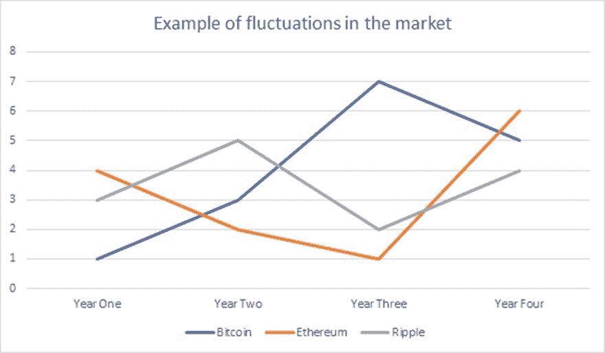
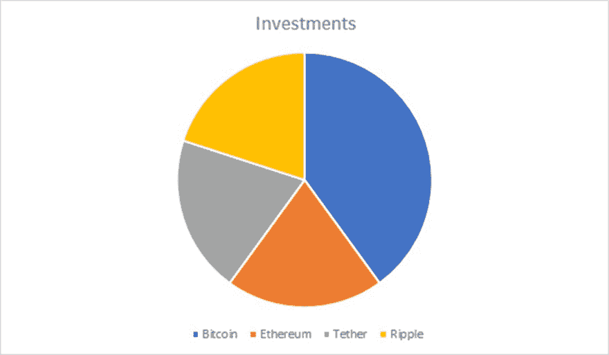
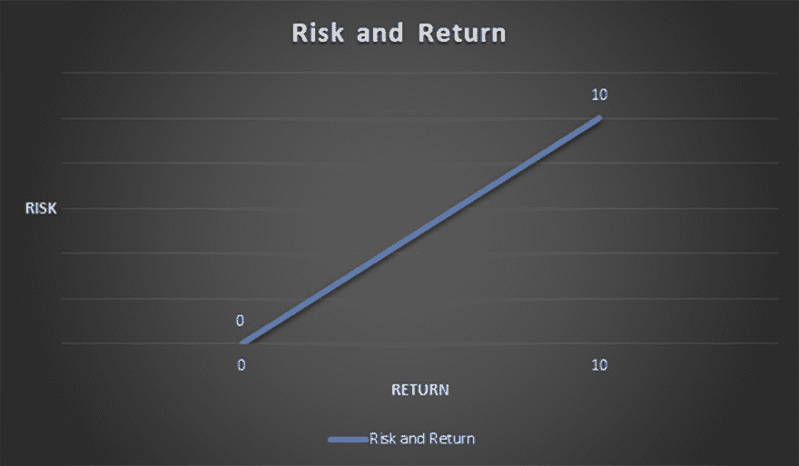
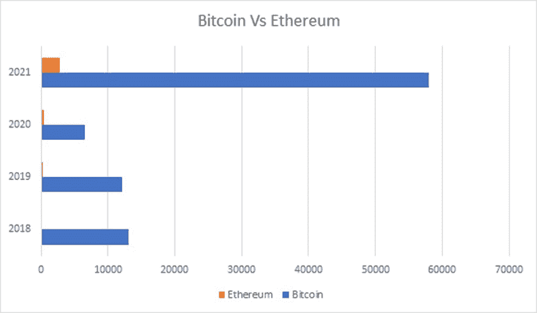
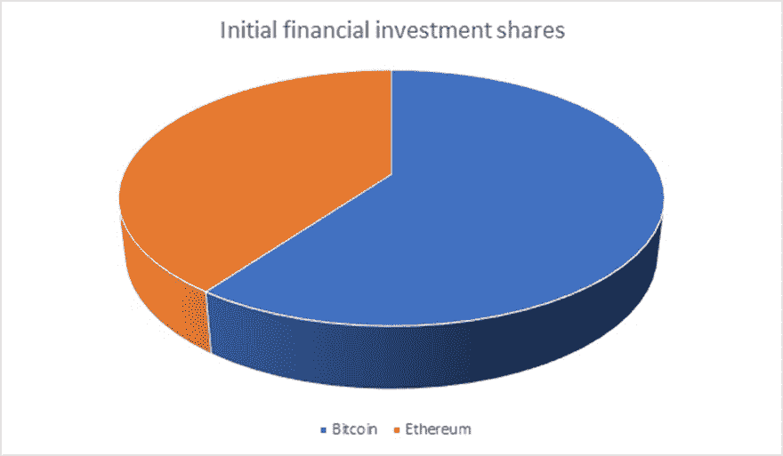
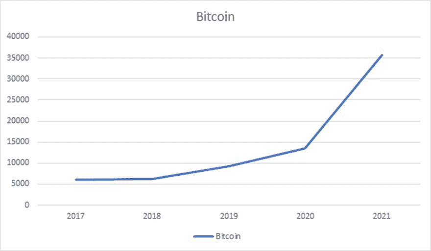
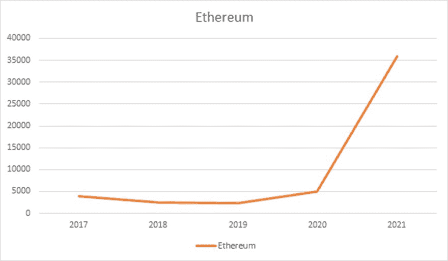
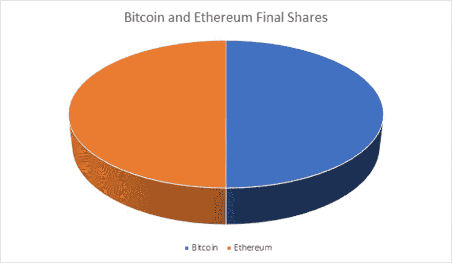
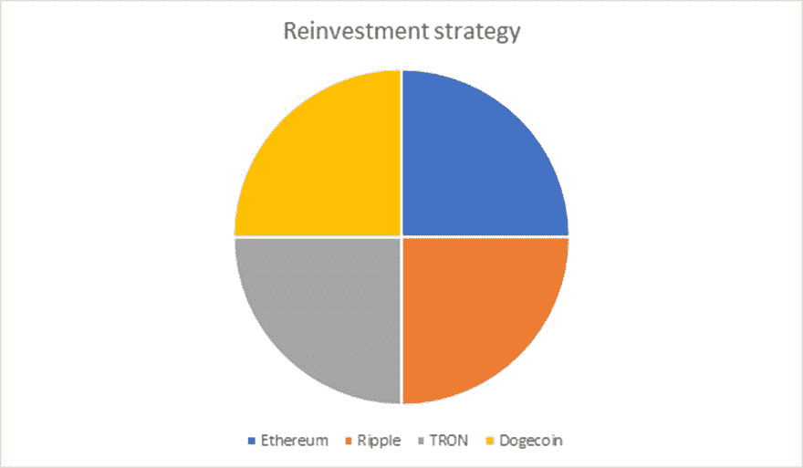

# 加密货币投资指南：从入门到专业投资者，仅需 10 天——如何投资加密货币、获取最大投资回报并深度理解区块链

## 简介

你可能偶然听说过加密货币，也可能是一位渴望将资金投入各类数字货币以期获得高回报的投资者。无论哪种情况，加密货币的世界都是广阔且多元的。它为卓越的赚钱策略提供了巨大的空间。同时，对于有志投资者而言，也存在大量危险的陷阱需要规避。在你投身加密货币投资之前，花时间和精力去了解其内涵、优势与风险至关重要。缺乏这些知识，许多绊脚石都可能导致你损失巨额资金。反之，一旦你掌握了如何投资加密货币，并深入了解各类型别、其含义及所提供的价值，你就能处于更有利的位置，决定最适合你的投资策略。

在本书中，我们将涵盖多个主题，助你构建对加密货币世界的深刻认知。加密货币并非单一术语，而是涵盖多种不同的数字货币，它们可用于购买商品和服务，也可作为独立资产进行交易。仅需十天，你就能获得开启投资获利之旅所需的专业知识。近三分之一的加密货币投资者年龄在 25 至 34 岁之间，这使其成为年轻群体中流行的投资方式。然而，任何年龄和背景的人都能确保在投资这些货币时获得良好的回报。

加密货币在物理层面上不存在，完全是数字化的。这意味着货币记录保存在高度安全的虚拟数据库中。因此，它们较不易受到犯罪伪造的侵害。随着加密货币人气的持续飙升，交易它们是获得财务投资良好回报的绝佳途径。不过，你需要确保采用正确的方式进行操作。

我们将介绍加密货币的真实含义、各类加密货币类型以及交换它们的不同方式。我们还将探讨在进行任何投资时，如何最大化收益同时最小化风险。除了加密货币见解外，你还将了解区块链机制、其运作原理及其与各类加密货币的关联。最终，你将精通加密货币世界，这能给你足够的信心进行投资，而无需担心踏错步骤或亏损。

最重要的是，请始终牢记一点：最好从小额开始，而不是贸然闯入市场。随着你学会如何驾驭市场，逐步增加你的投资。随着时间的推移，通过实践，这将使你成为一名经验丰富且自信的加密货币投资者。对许多人来说，加密货币投资是一份副业，但对其他人而言，它可以成为其财务策略的核心焦点。随着加密货币市场总市值触及一万亿美元的历史高位，所有投资者都有机会赚钱并享受这段加密之旅。仅需十天，你就能成为一名投资者，并学会通过多种方式从加密市场中获利。

*   **第一天：** 建立对加密货币及加密货币投资运作方式的认知。研究市场趋势，包括过去影响市场的历史趋势。理解区块链如何运作及其与加密货币的关联。
*   **第二天：** 根据市场数据选择你的加密货币，挑选你的加密钱包，并注册你想使用的货币交易所。
*   **第三天：** 制定投资或交易计划。
*   **第四天：** 学习如何最小化风险并最大化收益。
*   **第五天：** 将理论概念应用于真实投资。
*   **第六天：** 学会驾驭市场并预测价格波动。理解使用 App 监控价格或接收价格波动提醒的好处。
*   **第七天：** 发现买卖加密货币的完美时机。
*   **第八天：** 加入论坛获取技巧和建议。如果你尚未看到增值，可买入少量其他加密货币，在见到小幅上涨时卖出以获取快速利润并再投资。
*   **第九天：** 买入时机到了！
*   **第十天：** 开始进一步多元化你的投资组合。

当你登上加密货币阶梯时，巨大的盈利空间正等待着你。那么，为何不立即开启你的加密之旅呢？因为没有比现在更好的时机，十天后你可能就已经看到利润滚滚而入了！

## 第一天：建立认知

### 什么是加密货币？

加密货币的名称源于保护它们的加密技术，这使它们能抵御传统货币常见的多种欺诈手段。它们提供的安全性极大地吸引了投资者，并鼓励人们在近年购买它们。

加密货币本质上是一种以数字资产形式存在的虚拟货币。得益于保护它的密码学原理，它能防止伪造或双重支付。这使其比传统货币形式安全得多，因为传统货币在合适设备的帮助下极易被伪造，尤其是犯罪分子采用的技术手段日益复杂。

绝大多数加密货币都是基于区块链技术的去中心化网络。这意味着它们由一组独特的计算机强制执行，使这些加密货币能够在任何中央政府或权威体系之外独立存在。

加密货币是一个统称，涵盖多种不同的货币，包括以下多种类别：

*   `Bitcoin`
*   `Tether`
*   `Ethereum`
*   `Ripple`
*   `Dogecoin`

- TRON
- Cardano
- Binance Coin
- Litecoin
- EOS
- Stellar
- Polkadot
- VeChain
- Chainlink

虽然这些是最流行的一些形式，但也有更新的加密货币，它们很可能在未来几年内变得更受欢迎。对投资者而言，加密货币最吸引人的一点之一是不断演变的市场，它提供了多种选择和新的机会。2021 年，交易量最大的加密货币是泰达币（Tether），它以微弱优势击败比特币夺得榜首。根据 24 小时交易量，2021 年泰达币价值超过 1500 亿美元。泰达币和比特币是 2020 年和 2021 年仅有的两种交易量超过 1000 亿美元的加密货币，使它们成为市场的领跑者。它们始终是加密货币市场上交易量最大的两种虚拟货币。然而，就单个币种的价值而言，目前没有任何加密货币能与比特币抗衡。凭借最高的单币市值，比特币实际上为所有其他加密货币设定了黄金标准。这意味着投资比特币时，投机者可能没有足够的资金购买大量货币。幸运的是，可以购买比特币的一小部分，这使其成为更广泛的有志投资者负担得起的投资选择。十种加密货币占据了加密货币市场 88%的份额，意味着市场由大玩家主导。然而，尽管泰达币和比特币很受欢迎，许多其他选择也非常适合新手和新投资者。以太坊和瑞波币都是新兴货币。与比特币一样，以太坊基于区块链网络，我们将在本书后面讨论这一点。2020 年，以太坊每日交易量达到约一百万笔，使其在交易量上胜过比特币。尽管如此，比特币在 2021 年第一季度战胜了以太坊，凸显了加密货币市场瞬息万变的特性。此外，这也表明新投资者需要精通市场，并具备预测未来趋势的意识和知识，从而制定成功的投资策略。各种加密货币的所有权记录保存在数字数据库中，并由密码学高度保护。通俗地说，利用计算机编码来保护数据库中存储的任何信息，防止其被黑客攻击或为不法目的而渗透。比特币等加密货币是通过计算机手段“挖掘”出来的。本质上，这涉及解决某些极其复杂的数学方程，需要消耗大量的算力。每个数学方程都是完全独特的，允许解出它的人提供真实的所有权证明。大多数投资者选择质押货币而不是挖掘它们。首先，质押比挖矿耗时少得多。挖掘货币需要先进的硬件和软件。挖矿也可能对环境有害，特别是如果你不使用可持续能源来运行设备的话。此外，如果你选择挖掘货币，你需要大量资金来对必要的硬件进行初始投资。由于硬件价值随时间贬值且需要定期升级，这对大多数有志投资者来说并非一种具有成本效益的解决方案。一旦货币被挖出，就可以出售，这也是投资者开始参与的环节，因为货币可供买卖交易。由于其数字属性，加密货币极其安全，这使它们成为投资者最具吸引力的资产之一。安全的密码学使其免受欺诈，并采用多级保护防止任何人渗透存储它们的虚拟“钱包”。加密货币投资通常被视为一种高风险策略。然而，如果你知道在哪里投资、如何投资以及何时投资，就可以降低随加密货币投资而来的一些相关风险。还要记住，加密货币的定价不取决于实体铸币或相关资产等因素。它们仅根据市场本身的限制定价。如果你熟悉基于价值的定价——一种营销技巧，加密货币设定自身价值的方式与此类似。基于价值的定价本质上是根据消费者认为产品或服务的价值来定价。加密货币的运作方式相同。人们愿意为任何加密货币支付的金额决定了其价值。这是市场能够如此迅速涨跌的原因之一。当需求增加时，价格也会上涨。当需求下降时，货币不再受追捧，被其他投资者认为价值更低。

### 加密货币投资是如何运作的？

投资加密货币很像投资股市或外汇。从外部来看，它似乎非常简单，特别是如果你采用经过验证的“低买高卖”计划。然而，细微差别比这复杂得多，真正了解加密货币投资的具体细节，才有很好的盈利机会。并非所有投资者都购买加密货币。一些投资者只是交易者，他们在不实际拥有任何加密货币的情况下，对各种加密货币的价格进行投机。为此，你可以使用称为加密货币差价合约（CFD）的交易工具。通过交易，你可以通过第三方经纪商交易资产，而无需接触货币交易所的更高级机制。交易与投资各有利弊。首先，交易时你不必全额支付资产费用，而是可以只投入一小部分资金，从而获得杠杆头寸。此外，交易时你无需承担任何资本利得税，而买卖加密货币则需要纳税。然而，必须警惕交易，因为一旦出错，它会扩大异常亏损的范围。交易可能比投资波动性更大，虽然成本较低，但如果交易方式不当，最终可能代价更高。对于加密货币市场的新手来说，投资可能是赚钱更明智、更安全的方式。如果你打算买卖加密货币并获得良好的投资回报，有不同的投资策略。你可以在日常操作中采用一种或多种策略，或者通过尝试来看哪种适合你。首先，你可以尝试买入加密货币并持有一段时间。市场必然会有涨有跌，这在任何市场都是如此。当你看到价格开始上涨时，可以在你认为价格达到高点时卖出货币。这种策略的好处之一是，价格下跌无关紧要，因为你已做出长期投资承诺，因此这可以是一个低压力的计划。它为你的初始资金投资提供了小额和大额回报的空间，并让你对加密货币市场有良好的感知。对于初学者，这几乎肯定是最好的入门方式。许多投资者使用的另一种方法称为“做空”，这能让你获得可观利润。其运作方式是：以特定价格从借方借入一种加密货币。然后你可以卖出该货币，假设该加密货币的价格随后会下跌。如果奏效且价格确实下跌，你可以在将货币归还给原借方之前，以新的较低价格再次买入。然而，这样做也有陷阱。加密货币市场波动剧烈，可能在几周内出现剧烈波动。如果你押注价格会下跌却判断错误，你可能最终需要支付比卖出价更高的价格来回购。另一方面，如果货币价格确实下跌，则有巨大的获利空间。因此，在采用这种投资方式之前，最好先在加密货币市场积累一些经验。你对市场行情的感知越好，就越有可能投资正确的货币并获利，而不是遭受损失。加密货币交易中风险较大的策略之一，是正确把握市场时机，从短期价格波动中获益。这意味着你会频繁交易货币，而不是等待并度过市场的涨跌。你可能在时机上走运，但如果采用这种投资方式，面临巨额亏损的风险也很大。对于新投资者甚至资深投资者，最好坚持第一种策略，在建立信心后再尝试第二种。虽然第三种策略有可能提供巨额回报，但它导致极端亏损并让你对加密货币投资灰心丧气的可能性甚至更大。无论你选择哪种投资策略，购买加密货币时，你可以投资少于单个加密货币币。例如，如果单个比特币市场价格为 5 万英镑，你可以用 5000 英镑买入十分之一枚比特币。如果你可投资的流动资金较少，甚至可以购买单个加密货币更小的份额。这让所有投资者都能根据个人预算调整投资量，意味着你不必在初始投资中投入大量现金。开始投资加密货币时，一个重要的收获是：它们不能存放在个人储蓄账户（ISA）中。这意味着任何利润都需纳税，并须向政府申报。如果你未申报任何收益，可能面临罚款和监禁等处罚。投资加密货币可以非常有趣，也是一场惊心动魄的旅程。只要你不投资超出你承受能力的资金，这就是一种尝试盈利的极其愉快的方式。然而，不可避免地会不时发生市场崩盘，使你的资金面临风险。你可能发现的另一个风险是，这是一个无监管的领域。因此，如果一种加密货币或加密货币交易所倒闭，你将无法追回损失的金融资产。这凸显了安全投资策略的重要性，并强调了坚持计划、保持正轨的必要性，而不是被大额投资冲昏头脑。当然，永远记住，波动是加密货币投资的自然组成部分！

该图表是市场如何波动的一个典型例子。在任何给定的一周内，都可能出现一定的波动，但随着时间的推移，这可能变得更加明显。在不到三年的时间里，比特币价格在不到 1 万美元（美元）和 6 万美元（美元）之间波动。虽然比特币仍然是所有加密货币中最有价值、最昂贵的，但与其平均价格相比，它不一定显示出最大的百分比涨幅。对于初始投资资金较少的新投资者，比特币可以提供作为成熟加密货币的稳定性和保障，但它不一定是最具成本效益的加密货币。以太坊、瑞波币和其他币种可以在提供真实且能盈利的保障的同时，带来更大的总体利润。

### 什么是区块链？区块链机制是如何运作的？

区块链并不像许多人认为的那么复杂。本质上，区块链是一个旨在存储信息的数据库。区块链起源于 20 世纪 90 年代初，当时两位名为斯图尔特·哈伯和 W·斯科特·斯托内塔的研究人员试图设计一种能抵抗时间戳篡改的系统。多年来，该系统一直处于闲置状态，直到 2009 年比特币的出现。从那时起，区块链成为加密货币构建的黄金标准数据库形式，因为它是一个固有的高安全系统。区块链数据库本身被结构化为区块，以便存储在其中的信息和记录可以被搜索或筛选。它可以轻松地被大量用户同时访问和修改，并专门设计用于容纳大量记录信息。数据存放在极其强大的服务器上，以应对其需要处理的海量记录。然而，区块链在存储信息的方式上不同于传统类型的数据库。数据以区块的形式存储在数据库网络上，这些区块随后以链的形式链接在一起。这些区块链正是区块链名称的由来。所有区块在添加到信息链时都会被加上时间戳。当新数据进来时，这些数据会被录入一个全新的区块，随后该特定区块被数据填满。一旦完成，就会在该区块和前一个区块之间创建一条链，使它们按时间顺序链接在一起。通常，区块链用于存储交易数据，尽管它们也可用于其他用途。大多数加密货币使用去中心化区块链，不受任何特定权威机构（如特定金融机构、政府、团体或个人）控制。集体控制权由所有网络用户保留，这是投资者进行交易的一种有益方式。由于其去中心化的性质，区块链保持不可变性，因此录入的数据无法被更改或擦除。因此，交易在区块链上有永久记录，任何想要访问记录的人都可以查看。当然，一些加密货币允许更高级别的隐私，并提供隐藏记录的选项，以便获得更高程度的匿名性。区块链基于使其抗篡改的机制运行。如果有人试图篡改区块链数据库，一个区块与链中所有其他区块之间的交叉引用会识别出存储错误信息的位置。随后，这会凸显篡改系统的企图，并防止记录被更改。虽然试图篡改系统的黑客可以隐藏在匿名的面纱后，但他们试图篡改的实际交易可以轻松追踪。因此，例如，如果某人遭受重大资产损失，然后试图入侵其个人区块以修改此记录，他们的黑客行为可能无法追踪，但与该特定区块相关的交易和币种可以追溯到持有它们的个人。在其他情况下，有人可能试图入侵系统以窃取他人的币种。同样，黑客可能保持匿名，但币种可以通过其后续交易被追踪，从而可能抓获黑客。安全性是区块链的主要特征之一，因为区块按时间顺序和线性顺序存储，使得几乎不可能更改之前的记录。所有区块都被列出并加上时间戳，因此有清晰透明的交易记录。如果没有难以置信的算力、资源、资金和智慧，几乎不可能在同一时间修改超过一半的区块来更改记录。几乎每种加密货币的区块链网络都极其庞大，试图达到这种级别的黑客攻击不会带来任何利润。使用区块链有显著的优缺点。使用区块链的一些优点包括：

### 区块链技术的优势

*   降低成本，因为交易无需由独立第三方验证。
*   提高数据库记录的准确性，因区块链的自动化特性消除了人为错误的可能性。
*   具备防篡改性，得益于其去中心化特性。因此，若有人试图攻击网络，将无法访问整个区块链，只能攻击其中一小部分。这使得整体网络安全性显著增强。
*   为交易提供高水平的安全性和隐私。
*   卓越的效率与透明度，使交易能在几分钟内完成，而非数小时或数天。在跨国交易中，这一优势尤为明显，因为传统资金转账方式在有时区差异时极其缓慢。
*   无论特定国家的社会、政治或金融环境如何，均可在全球范围内使用，包括在欠发达或不稳定的国家。

### 区块链技术的劣势与现状

然而，尽管区块链网络有许多优势，也存在一些缺点。例如，它处于无监管状态，且每秒只能处理少量交易，这可能导致速度缓慢。由于本质上由比特币和山寨币矿工的高功耗挖矿行为提供动力，它也可能对环境产生负面影响。尽管如此，区块链已成为绝大多数加密货币运营的标准基础设施。在实际应用中，它也正扩展至投票、传统银行业、供应链、智能合约、财产记录和医疗用途等其他领域。在可预见的未来，区块链很可能仍将是记录和永久保存加密货币交易的标准方式，因为根本没有可在大规模应用的可行替代方案。考虑到其优势大于劣势，这使其成为投资者可以信赖的实用且安全的系统。

## DAY TWO：做出你的选择

### 选择最适合你的加密货币

当你开始加密货币之旅的第二天时，重要的是要更多地了解可用的不同货币。市面上有如此多不同的加密货币，要确定哪一种最适合你可能很困难。比特币大概是最著名的加密货币，即使是对加密投资知之甚少的人也认得这个名字。尽管如此，还有许多其他选择，每种都有自己的优缺点。你不必将交易限制在单一货币上。你可以根据需求交易多种货币。从本质上讲，它们的工作方式与传统货币相同。例如，如果你去法国，你需要正确的货币（欧元）来方便你的旅行。同样，如果你想要快速交易，你可以选择莱特币等加密货币。如果你需要匿名性，达世币可能是你的首选。

### 比特币

比特币采用开源设计，因此完全公开。没有人拥有比特币，它对所有投资者开放。它在运营中使用点对点技术，不受任何中心化机构或银行控制。它允许全球支付和交易，且费用相对较低。开设比特币钱包以安全地持有比特币既简单又容易。有可在移动设备上使用的应用程序，也可以通过笔记本电脑或 PC 进行交易。比特币可在多种国际交易所交易，包括：

*   [Bitfinex](https://www.bitfinex.com/)
*   [Gemini](https://gemini.com/)
*   [Kraken](https://www.kraken.com/)
*   [Bitstamp](https://www.bitstamp.net/)
*   [Crypto.com](https://crypto.com/)
*   [Coinbase](https://www.coinbase.com/)
*   [OKCoin](https://www.okcoin.com/)

比特币也可在点对点交易所交易，例如：

*   [Bisq](https://bisq.network/)
*   [BitQuick](https://bitquick.co/)
*   [Local Bitcoins](https://localbitcoins.com/)
*   [Paxful](https://paxful.com/)

除了国际交易所和点对点交易所，比特币还有许多本地交易所，可以轻松买卖。这使得比特币成为最容易获得的加密货币之一，也是新投资者和刚开始投资旅程的人最容易接触的加密货币之一。比特币通过技术挖掘，是一种有限货币，对最终可挖掘的数量有限制。在许多方面，这使它值得拥有。与美元、英镑或欧元等传统货币不同，无论您身在哪个国家，比特币的价值都是相同的。比特币的波动是全球性的，而不是局部或区域性的，这使其成为一个有吸引力的国际投资。然而，虽然比特币能给您带来卓越的回报，但它可能是一项高风险投资。首先，其价格极其波动。比特币价格可能在几周内翻倍或减半，飙升至 60,000 美元以上，然后再暴跌。对于新手投资者来说，这可能令人望而生畏。比特币必须是一项战略投资，也是您准备长期进行的投资。虽然您可能看到隔夜回报，但价格涨跌极快，因此保持警惕至关重要。投资比特币时，必须注意外部影响。例如，当埃隆·马斯克表达对比特币环境影响的担忧时，导致比特币价格下跌。几个月前，马斯克对比特币的投资导致其价格呈指数级增长。当然，这些外部影响不仅适用于比特币投资，也适用于一般的加密货币投资。像传统市场或外汇投资一样，政治和社会环境会对加密货币价格产生重大影响。因此，在任何可能推高或降低价格的事件方面保持领先至关重要。

### 以太坊

世界主要加密货币之一是以太坊，它在加密投资领域越来越受欢迎。以太坊用于智能合约，因此只要满足特定条件，就可以进行交易。智能合约的条款因司法管辖区而异，但在某些国家（如英格兰和威尔士）具有法律强制力。英国法律委员会在 2019 年作出裁决，确保智能合约现在可以依法强制执行。以太坊进入市场比比特币晚得多，仅于 2015 年发布。它基于区块链技术运行，主要用于促进智能合约，而不是作为支付商品和服务的货币。这使其区别于比特币和其他一些主要加密货币，深受投资者欢迎。这是因为与其他一些加密货币相比，它具有一定的稳定性。由于其主要用途不是购买商品，因此其价值不像其他一些加密货币那样剧烈波动。在许多方面，以太坊弥合了传统货币和加密货币之间的部分差距。公司将以太币纳入其交易手段，并确保货币可以记录基于加密的交易。例如，支付公司 Visa 打算使用以太坊作为记录其使用加密货币进行的交易的方式。以太坊最大的吸引力之一是所有权都通过区块链网络记录。因此，不存在伪造或假冒的可能性。这对公司极为有利，意味着投资者也会产生溢出效应。虽然它仍可被视为高风险投资，但它比比特币提供了更多的稳定性，是新投资者进入市场的绝佳方式。

### 莱特币

莱特币由查尔斯·李于 2011 年创建，是比特币的硬分叉。这意味着这种替代币的创建是由于区块链网络协议在交易有效性方面发生了一些极端变化。它是一个开源网络，促进全球支付，并与比特币有一些相似之处，例如去中心化。然而，它在许多方面也有所不同，因为它生成区块的速度比比特币快得多。自创建以来，其价值剧烈波动，曾达到按市值计算的第三大加密货币的高度。使用点对点技术可以促进全球支付。可生成的有限莱特币数量明显大于有限比特币数量（8400 万枚，而比特币为 2100 万枚）。因此，有充足的硬币供应。这可以使价格略低，但使其成为初学者更容易的投资。2021 年，莱特币的市值为 131 亿美元。莱特币的一些主要优势包括其快速的交易速度，确保交易能迅速完成，而不会损害网络的安全性或完整性。莱特币为投资者提供安全性和长久性，这对更谨慎的投资者和新手来说可能是有吸引力的特征。作为仅有的两个从未跌出市值前十的加密货币项目之一（另一个是比特币），莱特币提供了比其他一些替代币风险更低的潜在盈利投资项目。

### 泰达币

泰达币与我们已经讨论过的其他一些加密货币略有不同，因为它是一种稳定币。这本质上意味着它有抵押品支持，而不是独立存在。顾名思义，它“锚定”美元的价值。最初设计时，意图是 1 枚泰达币价值 1 美元。像其他稳定币一样，泰达币提供了大多数加密货币无法提供的额外安全维度，因为它有外部来源支持。作为一种法币抵押稳定币，泰达币深受投资者欢迎，在日常交易量方面名列前茅。有时，其交易币量甚至超过比特币。目前存在近 600 亿枚泰达币，使其极易被投资者获得。

### 瑞波币

与许多较新的加密货币不同，瑞波币不是比特币的分叉。瑞波币代码完全从头编写，旨在节省银行业务成本并提高交易执行速度。因此，在交易执行速度方面，它是一种极快的加密货币。瑞波币还不同于许多其他加密货币，因为它不能被挖掘。它是一个中心化系统的一部分，所有硬币都已存在，并属于创建者，直到被出售。由瑞波币实验室控制，瑞波币货币已被美国银行使用。对于寻找快速、简单且具有中高投资回报潜力的加密货币的新老投资者来说，瑞波币是一个绝佳选择。它也为新投资者提供了负担得起的入场点。

### NEM

相对较新的加密货币市场参与者，自 2015 年以来，NEM 拥有独特的代码，并使用重要性证明算法工作。本质上，这意味着账户余额较高的用户可以获得更大的奖励。此外，该算法为用户发布信任评分，较高的评分也可以增加他们的奖励。NEM 非常适合那些考虑进行大额加密货币投资并关注进行大量交易的投资者。NEM 可以奖励那些受信任、活跃且高度投入其货币的用户。

### 达世币

虽然所有加密货币都提供一定程度的匿名性，但达世币将其提升到一个新水平，确保无法在达世币系统内追踪任何其他人的交易。与比特币或以太坊等其他加密货币不同，交易数据从未在区块中发布。因此，没有可用于追踪的交易历史记录。对于关注高安全性和完全匿名性的投资者来说，达世币是一个绝佳选择。它本身是莱特币的一个分叉，但提供的隐私选项比莱特币或比特币多得多。它是去中心化和自治的。虽然它容易受到其他加密货币正常价格变化的影响，但由于它已经在市场上稳固确立，因此提供了很高的稳定性。因此，即使投资者以前从未做过任何投资，这也是他们开始加密货币投资的好方法。价格上涨的潜力很高。

### 波场

最初于 2017 年在以太坊上创立，波场现在拥有自己的区块链平台。使用权益证明算法处理交易，波场的价值持续增长。在过去一年中，它的受欢迎程度呈指数级增长，因为它可以托管去中心化应用，这是许多资深投资者的吸引人特征。作为一种价格实惠且具有价格上涨潜力的加密货币，这是任何希望在投资旅程后期实现投资组合多元化的人的绝佳选择。

### 狗狗币

与列表中许多其他加密货币相比，狗狗币的现金价值相对较低，但持续增长。埃隆·马斯克宣布其 SpaceX 接受狗狗币作为支付形式，这提振了其知名度。对一些人来说，它是一种有争议的加密货币，并不总是被投资者严肃对待。尽管如此，它已在市场上稳固确立，并继续增长。2021 年初价格飙升，并继续涨跌。

### ZCash

提供卓越的隐私保护，ZCash 防止在未经用户许可的情况下追踪任何交易。ZCash 通过为用户提供隐藏其任何交易的选项来实现这种匿名性。ZCash 交易被宣传为高效、安全可靠，如果您以前从未投资过任何加密货币，这可能会让您更放心。使用高级加密技术，它是一种高度私密的加密货币。

### 币安币

币安币的设定价值直接来自其效用和实用性。对该加密货币的需求水平决定了其价值。交易者能够在币安交易所购买其他加密货币，这是当今快速增长的全球加密货币交易所之一。随着通过该平台执行的交易数量不断增加，这也增强了币安币的价值。最初建立时，币安币运行在以太坊区块链上，随后迁移到币安链。对于寻找首次代币发行（ICO）投资的投资者来说，这是一个绝佳选择，在 ICO 中筹集资金以启动新的加密货币项目。这些可能极其有利可图，因为这相当于在底层参与一个新项目。

### 比特币现金

比特币现金是一个点对点系统，提供比比特币本身显著更多的可扩展性。与任何其他加密货币相比，拥有最大的市值之一，它正在投资者受欢迎程度排名中攀升。它与比特币的关联赋予了它额外的稳定性，这可以让新投资者更自由地购买它，而不会像对市场上其他一些较新的加密货币那样犹豫。随着价格逐渐上涨，它是长期或持有投资的绝佳选择，非常适合希望向加密货币市场投入更大资金的投资者。当然，这些只是众多可用加密货币中的一小部分。也就是说，这些是一些最成熟的加密货币，因此比一些鲜为人知的加密货币提供了更高程度的稳定性和可行性。因此，投资更知名的加密货币可以让您更安心，它们不会崩盘导致您失去资产。

### 如何买卖加密货币

一旦您决定购买哪些加密货币，就需要建立投资机制。投资加密货币不像走进商店或去货币兑换处，请出纳员用虚拟货币兑换您的钱，但一旦开始，它非常简单。本质上，如果您想购买加密货币，您需要首先拥有一个来源。有各种来源选项，例如使用加密货币交易所或使用 PayPal。这两种都是投资加密货币的安全方式。加密货币交易所类似于经纪公司，但它们专门设计用于促进由区块链驱动的虚拟货币和资产的交换。这意味着您可以将泰达币、比特币、以太坊等数字资产存放在安全的存储钱包中，该钱包也可用于买卖您的资产。然而，它们不是您也可以使用的个人钱包，您将需要将资产存储在钱包中，我们将在本书后面讨论。各种加密货币交易所的工作方式不同，但它们都依赖于相同的关键原则：能够出售、购买或持有您的加密货币，并确信您的交易是安全的。您可能还会注意到，在任何给定时间，单个加密货币在不同交易所的上市价格不同。这些价格差异往往是因为较小的交易所拥有较少的加密货币供应，因此会以更高的价格上市。相反，较大的交易所拥有更充足的比特币和替代币供应。供应越大，价格被压低的幅度越大，最终导致整体价格更低。您选择是否使用加密货币交易所可能取决于您的个人情况以及您最终计划如何使用您的加密货币投资。例如，如果您只是购买加密货币而没有立即交易的意愿，您可能更倾向于单独使用 PayPal。但是，如果您正在寻找一组特定的目标工具，为您提供扩展加密货币投资组合所需的功能，那么加密货币交易所可能有利于您的需求。有几个加密货币交易所可供选择，但选择正确的交易所对于确保您在加密货币投资方面获得长期成功至关重要。

#### Coinbase

作为市场上最受信任的加密货币交易所之一，Coinbase 自 2012 年以来一直帮助投资者。它对于想要多种加密货币选择（包括比特币和瑞波币等最流行的货币）的任何人都有益。事实上，它允许购买、出售、持有和交易 50 多种不同的加密货币。Coinbase 拥有许可证并受到全面监管，在全球领土合法运营，使其成为希望确信其投资完全安全且合规的投资者的理想选择。迄今为止，它从未卷入任何欺诈丑闻。此外，其界面极其简单，易于初学者使用，因此如果您是加密货币或加密投资的新手，您将能够迅速上手。该交易所提供无数有益功能，包括奖励计划、选择高级账户的选项、一系列交易工具、质押、稳定币和用户控制的存储。然而，使用 Coinbase 也有一些缺点。最显著的是，该交易所最大的缺点是交易费用异常高，即使与一些竞争对手相比也是如此。您买卖交易可能最终支付 0.5% 的费用，如果您打算进行大额投资，这会累积起来。在决定 Coinbase 是否是适合您的加密货币交易所时，必须权衡您是否愿意为确保该特定交易所提供的安全性而支付更多费用。

#### Bisq

Bisq 是一个去中心化的加密货币交易所，可从世界任何地点访问。这意味着银行系统不那么发达国家的用户也可以访问该交易所并交易加密货币。Bisq 通过点对点方式促进多种加密货币（包括比特币）的交易。您可以轻松下载安全软件，并通过平台与其他加密货币交易所进行交易。支付选项的多样性为用户提供了广泛的优势。Bisq 最大的好处之一是平台上没有强制注册。这为用户提供了额外的隐私和匿名层，使其成为希望确保交易保持私密的投资者的完美选择。它也可以从各种设备（包括智能手机和平板电脑）轻松访问，因此您可以随时随地使用它。然而，使用 Bisq 也伴随着一些不可避免的缺点。用户有时可能会对交易所中某些交易相对较低的速度感到沮丧，这可能会让渴望进入市场的新手投资者望而却步。此外，该交易所以交易量低而闻名。这最终可能会影响您在交易中获得的回报金额。

#### 币安

币安是世界上最大的加密货币交易所，为投资者提供的选择比其他一些交易所多得多。首先，它允许投资者购买与比特币等传统加密货币没有同等竞争水平的替代币和加密货币。币安币是该交易所自己的加密货币，每天交易数千次。购买可以用多种货币进行，如欧元或英镑，使用各种支付方式，如信用卡和借记卡。该交易所每秒支持超过 140 万笔交易，允许进行大量交易。币安的伟大之处在于，您可以自动化任何想要进行的定期购买，并进行场外交易。此外，它促进自动绘图，并为您提供投资 150 多种替代币的选择。然而，界面对初学者来说可能有点令人生畏，因此这更适合经验丰富的投资者。但是，如果加密货币是您的长期投资策略，随着您对加密货币交易变得更熟练，这是一个值得记住的选择。一般来说，货币交易所最大的缺点之一是它们是黑客的常见目标，黑客想要访问个人详细信息或窃取货币。这意味着对于所有投资者来说，无论技能或先前经验如何，在仔细考虑后选择正确的交易所都是必不可少的。选择交易所时，请寻找一个建立完善、具有必要安全措施并让您放心的交易所，确保您在使用它时投资安全。此外，请记住检查任何交易所收取的交易成本或交易费用，因为它们在不同的加密货币交易所之间是可变的。然而，为具有高安全功能的成熟平台支付稍高的费用，通常比选择安全性较低的平台以节省部分费用成本来冒险更值得。最终，您可以尝试不同的平台，找到适合您的那个。每个人都会发现不同平台的不同功能吸引他们，并使交易货币更容易。当然，您不受限于单一平台。加密货币交易所的好处之一是，您可以比不使用交易所自己交易更容易地使用它们。刚开始进入市场的新手可以从交易所中受益，尽管交易费用可能会略微侵蚀他们的利润。因此，当您开始投资旅程时，为您找到合适的交易所是一个绝佳的主意。不要害怕尝试各种平台。您几乎可以立即开始使用加密货币交易所，只要您准备好开始购买。每日市场波动意味着您可能会非常快地经历加密货币的上涨，并可以迅速出售以开始获得少量利润。在十天内，您可能会获得初始投资的良好回报。

### 如何存储您的加密货币

当您想要买卖加密货币时，您需要一个地方来存储它。就像您有一个真实的钱包来存放现金和信用卡一样，加密钱包是一个虚拟钱包，为您提供一个安全的地方来存储您的加密货币。虽然有方法可以最小化投资加密货币的风险，但仍然有一些恶意分子想要黑客攻击交易并窃取您的详细信息或资产。这增加了确保您的货币存储在黑客无法访问的地方的必要性。加密钱包是存储授予货币访问权限的密钥的软件程序。密钥可以是私有的或公共的。例如，您可以使用公共访问密钥允许人们向您发送加密货币，同时使用私钥从您的钱包向其他地方发送资金。这种多功能性允许您根据您的要求定制钱包。此外，加密钱包还与不同的区块链交互，以便其他用户可以从您那里接收资金，或者您可以从他们那里接收资金。除此之外，有了钱包，您可以密切关注您的余额，让您确切知道您目前拥有多少加密货币。对于任何加密货币投资者来说，加密钱包都是保管货币安全的安全方式。当有人向您发送加密货币时，他们将硬币的所有权从自己转移给您。分配给钱包的密钥需要匹配，转账才能成功。如果您向其他人发送硬币，这也是真的。没有真实的硬币被交换，只有虚拟的。如果交易成功，您的加密钱包余额将相应增加或减少。交易记录保存在区块链上。对于初学者来说，选择正确的加密钱包可能是一项艰巨的任务。像加密货币的其他方面一样，您需要寻找一个具有适合您个人需求和偏好的功能的钱包。需要考虑的一些主要功能包括：

## 选择加密货币钱包的关键因素

### Security
钱包应仅由在高安全性方面拥有良好记录的公司使用。您不想冒欺诈或被黑客渗透的风险。这是最重要的功能之一。

### Price
某些钱包没有附加费用，使用免费。但请记住，要在免费钱包的优势与潜在缺点（如免费钱包相关的较低安全功能）之间取得平衡。

### Ease of use
如果您是加密货币钱包世界的新手，复杂的界面可能不适合您。花些时间考察各类钱包，寻找设计直观、可在同一位置存储多种加密货币的钱包。

### Simplicity
任何加密货币钱包都应在必要时提供快速交易的便利。若想迅速买卖加密货币，您需要一款能促成此操作的钱包。

### Mobility
从多种设备轻松访问是不想受交易时间地点限制的投资者的必备功能。若想在家、工作中甚至旅行时均可交易，请选择支持此功能的加密货币钱包。

---

## 钱包类型及特点

存储加密货币的钱包形式多样，取决于您使用的平台。例如：Web 钱包、移动钱包、桌面钱包、纸钱包或硬件钱包。每种类型均有其独特功能与优势。

### Mobile Wallet
最流行的加密货币钱包形式。运行于 Android、iOS 等多种移动操作系统。通常相当易用，适合新手投资者，对高级用户也很友好。

### Desktop Wallet
最早的加密货币钱包形式，运行于 Windows、Mac OS 等系统。虽赋予用户对加密货币的绝佳控制权，但也有缺点：最显著的是可能不安全且配置不当，比其他形式更易被黑客攻击。不过若您偏好在电脑而非移动设备上交易，也有优秀的桌面钱包可供选择。

### Web Wallet
通过 Chrome、Firefox、Safari 等浏览器访问。因依赖第三方服务器，不建议在 Web 钱包存储大量加密货币。

### Paper Wallet / Cold Storage
最安全的存储方式之一，但属低技术含量存储方式。涉及打印控制货币的密钥，可实现长期存储。

### Hardware Wallet
若您有大量加密货币需存储，请考虑使用硬件钱包。其安全性极高，允许使用专用硬件处理任何加密货币操作。

---

## 钱包类型优缺点对比表

| Type of wallet | Pros |
| --- | --- |
| Hardware wallet | Safe and secure, resistant to hackers. Excellent for storing large amounts of currency. |
| Mobile Wallet | Easily accessed from mobile devices. |
| Desktop wallet | Great for user control. Easy interfaces in general that are good for beginners to learn to use. |
| Online wallet | Can be accessed from anywhere giving the potential for fast and easy off the cuff transactions. |
| Paper wallet | Extremely secure. |

---

## 安全策略与建议

大多数加密货币钱包相对安全，但不同类型间存在差异。归根结底，**硬件钱包**提供最高安全性，因加密货币信息离线存储，较难被黑客攻击，密钥与货币安全无虞。反之，**在线钱包**虽提供便利，但比其他形式不安全得多。

### 实战应用策略
若您大量投资加密货币，良策是将大部分货币存储在可安全保管的硬件钱包中。同时，在移动、桌面或在线钱包保留足够货币，以便随时买币。例如：若发现市场利于投资，但当时无法使用硬件钱包，拥有在线流动资金可确保您不错失良机。

### 额外收益
某些钱包若用户长期持有资产，会提供奖励。这为投资增添了额外盈利维度——只需将货币留在钱包中即可。

### 重要提醒
**务必确保所有信息均已备份。** 这样即便发生技术故障或意外，您也不会丢失密钥或货币。

---

## DAY THREE

## 制定投资计划

投资加密货币可以是短期投资，也可以是长期投资。如果你正在寻找一夜暴富的捷径，加密货币投资有时能给你带来不错的回报。然而，要想成功，你需要采用风险最高的策略，这可能会让你最终因巨额亏损而悔恨不已。在几小时或几天内，你就能看到利润开始滚滚而入，当然如果你更倾向于持有策略，也可以等待更长时间。

实际上，对于那些准备好在极其波动的市场中经受住涨跌起伏的坚定投资者来说，加密货币投资可以是一项长期投资。这是一个令人兴奋的前景，能让你在过程中体验一些惊心动魄的冒险。本质上，你是在玩一场策略游戏，就像国际象棋选手一样。你的目标是比市场多走一步，以确保你充分了解市场趋势，不被市场打个措手不及。

第三天，我们将重点放在制定你的投资计划以及决定如何管理你的投资上。

### 长期投资策略考量

当你考虑长期投资策略时，有几件事需要牢记在心。

**首先，不要恐慌性买入。** 如果你看到市场下跌，认为现在是投资的好时机，请记住货币价格可能会继续下跌。因此，如果你耐心等待更长一点时间再做关键投资，可能会买到更低的价格。当然，也有可能等待太久导致价格反弹上涨。因此，你需要在市场中摸索一段时间，以便对投资的合适价格有良好的把握。

**同样，恐慌性抛售可能是一个大错。** 如果你是为长线投资，当你的加密货币价格下跌时不要担心，这是正常现象。波动会持续发生，比特币或山寨币价格下跌并不一定意味着市场在自由落体式暴跌。如果有什么不同的话，不妨将其视为追加投资的良机，因为当价格不可避免地再次上涨时，你的投资可能会获得更大的利润。

从长期来看，加密货币可以大幅增值。短期内也可能贬值。因此，你需要记住，投资者必备的关键技能之一是耐心。与传统股市或外汇投资中的某些资产不同，加密货币往往会反弹，尤其是比特币等更成熟的币种。这意味着，即使你对投资存疑或感到担忧，也可以放心，随着时间的推移，你的投资很可能会增值。

**也要保持冷静。** 恐慌可能适得其反，导致你做出冲动的决定，比如如果资产价格下跌就凭一时冲动抛售。制定计划，并让历史和当前的市场趋势指导你的行动。虽然有时你需要对买卖做出果断决定，但除非迫不得已，尽量不要大幅偏离你的计划。

### 登上加密阶梯

你已经选好了加密货币、加密货币交易所和加密货币钱包。万事俱备，真正迈出第一步进行首笔投资仍可能让人望而生畏。第三天是时候制定计划，确定你将采用的投资策略了。如前所述，你现在面临更多选择：交易还是投资。这两种参与加密货币市场的方式有着根本区别。

#### 投资（长期持有）

| 特征 | 描述 |
| :--- | :--- |
| **持有期限** | 通常涉及长期持有资产，无论市场如何下跌。 |
| **频率** | 买卖新币的频率较低。 |
| **分析** | 使用基本面分析。 |
| **风险概况** | 适合风险厌恶型人士。 |

投资者倾向于着眼大局，考虑市场的长远未来。

#### 交易（短期获利）

另一方面，交易者更关注每日甚至每小时的价格波动。交易者的目标是在短期内快速获利。由于加密货币市场某些领域存在极端波动，这使得交易者有机会早上买入资产，到晚上就将收益翻倍。然而，这可能是一种高风险策略，因为它涉及对市场行为的深度预测。它通常更适合那些长期跟踪市场趋势的人。即便如此，在极短的时间内完全把握市场时机仍然很难。

在交易者群体中，有不同类型的交易者，他们以不同的方式进行交易。这些包括动量交易者、日内交易者、波段交易者和剥头皮交易者。

*   **剥头皮交易者：** 剥头皮交易是最活跃的交易形式，可能涉及每天多次买卖加密货币。有时交易可在几秒钟内完成。虽然单笔交易的利润可能极小，但由于交易量大，最终可以累积成可观的利润。
*   **日内交易者：** 从交易量来看，日内交易者比剥头皮交易者稍不活跃，但他们也不长时间持有币种。大多数日内交易者确保在当天结束前不持有任何币种。
*   **动量交易者：** 动量交易者的交易方式与日内交易者相似，区别在于他们会持有资产稍长一段时间，通常对任何特定加密货币的持有期限为几周。
*   **波段交易者：** 波段交易者试图预测大幅价格上涨将发生的位置，以便在价格指数级上涨前利用低价位买入。

对交易者的主要吸引力之一是潜在的超额回报。大多数交易者是风险承担者，因此他们准备好承担交易相关的高风险，以换取可能获得的潜在回报。通过**保证金交易**，风险可以进一步放大。这涉及向第三方借款进行交易。虽然额外的资金给你带来了更大回报的潜力，但如果你错误预测了市场波动，可能会酿成灾难。然而，对于任何享受加密货币高风险交易面带来的刺激感的人来说，这可以是一个赚钱的好方法。

#### 投资者与交易者分析对比

虽然交易者倾向于通过查看资产的内在价值来分析市场（技术分析），但投资者更专注于追踪市场数据的历史，并基于此方法预测价格涨跌（基本面分析）。因此，投资者可以专注于大局，集中于长期投资，虽然这可能无法提供与交易相同范围的总体利润，但仍能在风险略低的投资形式下提供极佳的回报。

归根结底，如果你是市场新手，那么在交易和投资之间做选择，或两者结合，将取决于你准备承担多少风险。风险程度通常与策略末端的回报金额直接相关。一些投资者也从事交易，反之亦然，因此找到适合你的平衡点很重要。在旅程开始时，你可能想同时涉足交易和投资。但请记住，只投资你承担得起损失的钱，因为加密货币市场中存在能同时困住交易者和投资者的陷阱。

## 第四天

## 风险最小化与收益最大化

### 投资中的风险最小化

加密货币投资在重仓时风险较高。然而，若能明智投资，也存在巨大的潜在回报。针对加密货币投资，有几种策略可将相关风险降至最低。

**分散投资组合**是将风险潜力降至最低的最佳方式之一。您可以在投资旅程的第 10 天执行此操作。其核心在于“不要把所有鸡蛋放在同一个加密货币篮子里”。投资多种加密货币，这样即使其中一种下跌甚至崩盘，您也不会失去所有资产。

第 3 天是考虑如何在开始投资加密货币时降低风险的最佳时机。例如，若您有 10,000 英镑可供投资，可考虑将 40% 的流动资金投入比特币。作为最成熟、最流行的加密货币之一，比特币不太可能崩盘，但其价值仍可能暂时贬值，导致无法获利。因此，明智的做法是将部分资金投入山寨币，如以太坊、泰达币和瑞波币。若将 10,000 英镑的 20% 分别投入这三种加密货币，并将 40% 投入比特币，即可最大程度降低即时或长期亏损的风险。

分散投资能拓宽投资范围，最大程度保障资产安全。但在投资初期，应坚持投资您熟知的成熟加密货币。市场上总会出现新币种，但这不代表它们有价值或会增值。您可能会将大量资金投入全新的山寨币，结果却发现是一笔毫无价值的投资。

在投资操作层面，也有办法降低风险。务必确保自身安全，防范黑客攻击，因为总有人试图突破安全防线窃取您的密钥或货币。您可通过尽可能离线存储信息来实现这一点。此外，仅使用可信赖的货币交易所，切勿轻信诈骗。通过访问在线论坛或查看最新资讯，及时了解当前流行的诈骗手段。其他交易者和投资者通常会伸出援手帮您规避风险。由于行业去中心化，欺诈实体更易实施区块链诈骗或兜售无价值加密货币。

刚开始投资时，仅投入您承担得起的金额可将风险降至最低。若您年可支配收入为 5,000 英镑，切勿投入 20,000 英镑。您可能认为投入越多利润越大，但也可能遭受巨额亏损，对生活造成负面影响。最好从小额起步，逐步增加投资。随着经验积累，您会成为更优秀的投资者。因此，在加密货币交易 6 个月或 1 年后，投入大额资金的风险会低于初入市时。

投资任何资产前，都需衡量风险。通常有几种主要方式衡量资产的上行风险：资产波动率、市场波动率，以及单个资产收益与市场整体的关系。实操中，若投资比特币，它属于波动性资产；加密货币市场也可能剧烈波动。但比特币相对于加密货币市场及同类资产，具有极高的潜在回报。考虑风险/回报平衡，比特币对投资者极具吸引力，即便它展现出较高风险。

若您热衷数据统计，可通过研读图表深入分析投资，了解比特币及山寨币多年来的涨跌历史。过往表现虽非未来的完美预测器，但却是市场潜在模式的优秀指标，还能让您更懂市场经历的峰值与谷值。重点关注特定指标，如您拟投资货币的日交易量、支撑位与压力位。这些历史数据能为您预判未来表现提供依据，让您对投资能力更有信心，从而减轻投资压力。

### 最大化收益

投资加密货币的理由很多，但首要目标是盈利。若过往投资回报寥寥，则需制定计划以增加收益。简单来说，正确的投资方式能带来更丰厚的利润。

在追求收益最大化时，请牢记需在风险与收益间取得平衡，二者密不可分。有时为获最大回报需承担稍大风险，但并非总是如此。第 3 天是您的投资日，您需确保投资得当，以获得理想回报。

**持续长期买入**是确保投资获得最大回报最稳妥的方式之一。这首先能构建您的投资组合。此后，您可选择长期持有，或等待价格大幅上涨后卖出。后者虽能快速获利，但也可能导致过早卖出，错失价格顶峰。反之，长期持有风险较大，因货币在暴跌后可能无法完全反弹。但您也可能见证大幅渐进式上涨，最终以更高价格卖出。长期持有还允许您在市场向好时分批卖出部分加密货币以获利了结。

**货币组合多元化**也能提高初始投资的回报率。您可在初始投资第 10 天、开始见到回报时执行此操作。多元化之所以有效，是因为不同加密货币涨跌幅度和周期各异。投资组合越多元，即使部分资产下跌，您也有更大机会从其他资产获利。

新手投资者常犯的一个大错是**直奔比特币投资**。虽比特币相对其他山寨币较稳定，但不一定提供最大的增值潜力。随着比特币价格走高，许多投资者资金不足以大量买入。因此，您可能只能买入 1 枚甚至不足 1 枚比特币。即便币价高企，如此少量的持仓也难获巨额利润。因此，投资基础价值较低的山寨币可能是最大化收益的绝佳策略。虽山寨币最终售价可能低于比特币，但您可在更大数量的资产上享受更高的百分比涨幅，从而提升整体利润率。

如前所述，**交易**也是在高水平上获取短期利润的好方法，但伴随固有风险。交易的主要优势之一是能在短时间内最大化回报，无需等待数周、数月甚至数年。但这需要高度投入，因为许多交易者（尤其是抢帽子交易者）每天参与巨额交易量。若您想无等待地获取高额利润，交易是实现这一目标的绝佳策略。

最后一个建议是**善用不同加密货币交易所的价差**。在大型交易所买入加密货币，往往能以低于在小型交易所卖出的价格买入。理想情况下，最好持有一段时间后再转手卖出。虽非万无一失，但若您大量买卖加密货币，此策略定能为您带来利润。

平衡回报与风险至关重要。低风险可能导致低回报，若想提高投资回报，可能需承担更高风险。回报与风险呈直接相关。

## 第五天：将概念应用于投资

### 真实世界的投资策略

当你将在本书中学到的策略应用到现实生活的投资中时，重要的是要记住价格和回报都是相对的。例如，2018 年 1 枚以太币价值 111 美元。与此同时，1 枚比特币价值超过 7,000 美元。如果你在 2018 年投资了 10 枚以太币，这将花费 1,110 美元。如果你随后按 2021 年每枚 2,760 美元的价格卖出，你本可以获得 26,490 美元的潜在利润。如果你在 2018 年花 1,110 美元买入比特币，然后按 2021 年的价格卖出，利润空间可能超过 8,000 美元。这凸显了选择价格较低货币的价值，因为其回报潜力更高。

对一些投资者来说，即使在今天，以太坊似乎也只值比特币总价值的一小部分。然而，由于以太坊的相对涨幅要陡峭得多，这意味着利润空间会更大。同样重要的是要记住，当你投资于价格较低的货币时，你可以直接买入更多。因此，当你看到单币价格显著上涨时，你可以确信最终将获得更多利润。对于许多相比于比特币——它在现代已基本成为加密货币的“黄金标准”——似乎拥有相对较低价值的山寨币来说，情况也是如此。山寨币可能比比特币带有一点更多的风险，仅仅是因为它们存在的时间不长，且不如比特币成熟。然而，它们能将小额投资转化为交易者和长期投资者更大的回报。

### 案例研究

如果你在 2017 年有 10,000 英镑可供投资，并决定将 60% 的资金投入比特币，40% 投入以太坊，你现在会获得什么样的回报？

2017 年 10 月，6,000 英镑可以买到 1 枚比特币。4,000 英镑可以在 2017 年 10 月买到 13 枚以太币。

正如你从图表中所见，你的 6,000 英镑比特币投资和较低的 4,000 英镑以太坊投资在 2021 年的价值几乎相等，均略高于 35,000 英镑。因此，与初始投资相比，是以太坊提供了更大的利润。当你进行投资时，请始终记住，较低的起始价格和更高的加密货币持仓量在长期内能带来最好的回报。

## 第六天：驾驭市场

与任何市场一样，加密货币市场会涨跌，个别加密货币的价值会增减。对于首次投资者来说，这可能是一个令人畏惧的前景。然而，当你知道什么因素会导致这些涨跌时，驾驭市场就会容易得多。在第六天，我们将讨论如何成功驾驭市场，以了解其中涨跌背后的原因。

加密货币的自然供应量会影响定价。正如我们之前所讲，许多加密货币是通过挖矿产生的。例如，如果在短时间内挖出了大量比特币，这意味着市面上可用的比特币更多。当市场上某种加密货币更多时，缺乏稀缺性会使其价值略微降低。这可能会压低价格。反之，如果一种货币供应短缺而需求增长，那么这将推高价值并增加投资者愿意支付的价格。

当一种加密货币受到炒作（无论是新币还是成熟币）时，都可能导致价格上涨。互联网通常是这种炒作的源头，论坛上的常驻发帖者往往能通过开启直接推高或压低价格的趋势来影响市场。即使是拥有大量追随者的社交媒体影响者也在推动这些趋势。随着传统法币和加密货币开始变得更加紧密相连，这很可能成为市场行为的一个更关键因素。例如，随着 Visa 开始以以太坊记录更多的加密货币交易，该货币的供应量可能会下降，价格可能随之被推高。

要计算加密货币的预测价格，你可以将总市值除以流通供应量。虽然这只是一个预测公式，但它可以让你大致了解未来任何加密货币的价格涨幅。请记住，该公式未考虑加密货币供应量的增加。

使用各种应用程序（如 Coinfolio 或 Blockfolio）追踪加密货币价格，可以让你更轻松地驾驭市场。这使你能够使用设置价格达到特定水平时提醒等功能。利用这项技术追踪市场，能确保你相对轻松地保持领先。你不必时刻盯着市场，而是可以利用这些应用程序的优势，坐等你所期待的涨跌。

# 第七天：

# 时间就是一切

了解何时买入和卖出加密货币是加密投资的核心。对于新手投资者来说，这可能是投资中难以适应的一部分，因为这是需要随着时间积累经验才能掌握的技能。然而，有一些应对市场的策略可以让你在其他投资者中占据优势。采用多种不同的策略能最大化你成为一名高度成功投资者的潜力。实事求是地说，如果你对自己的能力有信心，盈利的潜力就是无限的。你的投资日是你余生的第一天！

### 不要等待太久

等待比特币、以太坊或其他价格跌至历史最低点可能是无休止的。无法预测未来价格，因此等待只可能意味着价格将继续上涨，而你将错失最初的利润。起初先投入一小笔资金，并跟随市场的渐进趋势。你可能会看到涨跌，但大概率你会看到投资的某种回报。精准择时几乎是不可能的，所以直接入场并开启你的加密投资组合，意味着你可以先试探一下水温。

### 别人卖时买，别人买时卖

当其他投资者开始抛售一种加密货币时，这是一个显眼的霓虹灯信号，提示你应该买入。随着他人抛售货币，价格自然会下跌。这使得该货币成熟可买，让你能以比市场稳定时低得多的价格买入。同样，如果你看到其他投资者正在疯狂抢购某种特定货币的加密币，这可能是一个绝佳的卖出时机。当一种货币需求旺盛时，价格开始上涨。当然，它们可能会在特定价位见顶，但不要被诱导过早卖出。同时，也不要等待太久。在抛售热潮到来前精准卖出，能让你获得最大价值，锁定投资的最大回报。

你可以在 `Blockfolio`、`CoinCap` 和 `Coinfolio` 等应用上追踪各种币种的价格，从而监控加密货币的积累情况。如果一种币的价格在较长一段时间内缓慢但稳步上涨，那它可能是一项好的投资，未来将继续上涨。

### 高抛低吸

加密市场定期经历跌宕起伏。这是买入的绝佳时机。例如，如果你以每枚 0.10 英镑的价格买入一千枚某种特定加密货币，一年后以每枚 10 英镑的价格卖出，你可能获得数千英镑的利润。从一笔小额投资中，你可以获得极佳的回报。然后你可以将资金投入其他正处于低谷的加密货币，并重复这一循环。当然，你可能并不总能经历这种极端的高低点，但有足够多的机会以这种方式投资，给你留出了赚取可观收益的巨大空间。然而，保持耐心很重要。过早买入或卖出会损害你的利润空间。

### 长线持有

长期持有某种货币可能是一种获利极好的方式。采用此策略，你不需要过多担心择时问题。许多加密货币投资者声称，仅通过持有货币并等待其增值，就赚取了巨额资金。即使在极端下跌期间持有货币也可能盈利，因为不可避免地会有上涨在前方等待。用加密术语来说，无论急涨急跌，长期坚持持有某种货币的投资者被称为**强手**（钻石手/坚定持有者）。

### 仅卖出利润

玩转市场的一个好方法是，当加密货币整体上涨时保留你的初始投资。例如，如果你买入价值 1000 英镑的比特币，几个月后你的比特币价值 10,000 英镑，你会卖出价值 9,000 英镑的币并保留其余部分。这相当于在传统股票中套现利息（分红/增值部分），同时仍保留部分股份作为投资组合的一部分。一旦你卖出了利润，就可以用它们购买其他正在下跌的加密货币，或者等待你当前的加密货币下跌后再买回那些相同的币，等待循环重复。

---

## 第八天：不要独自作战

加密货币投资不必是孤军奋战。如今互联网上有许多论坛，允许你与其他投资者讨论投资策略。这类论坛的许多成员都是老手，能给你提供关于今天投资哪种货币最好的最新建议。请记住，市场的持续波动意味着它瞬息万变，因此获得每周更新的建议极具益处。

在论坛上，你还可以讨论区块链技术创新、ICO 以及刚刚涌现的新币种。这能让你在新货币的“零点”介入，并确保你不会错过岩底价格。请记住，较低的价格往往能带来投资的最大回报。

此外，你可以培养对加密货币的兴趣，并随时掌握最新资讯。加密市场节奏极快，论坛甚至能让你从开发者那里获取最新动态。如果你想对投资特定货币充满信心，这非常有帮助，因为新更新或货币供应量的增加可能暗示着是该买入还是卖出你的币的时机。

许多论坛聚集了消息灵通人士，他们能对各种货币即将到来的涨跌给出价格预测。社交媒体也是与这些人联系的绝佳方式，你会在 `Twitter` 等网站上找到他们。然而，在采纳在线建议时保持一丝警惕也很重要。虽然许多消息灵通人士有经验证的投资记录，但其他人只是在表达个人观点。因此，即使在与他人在线交流时，也要将直觉作为指南。

加密货币投资的一大优点是，它给你提供了成为紧密社区不可或缺一员的机会。对一些投资者来说，这些紧密的联系本身就和投资过程、投资利润一样令人愉悦。

---

## 第九天：买入时刻

欢迎来到第九天，也被称为**投资日**！在你十天计划的第九天，你已准备好购买加密货币并正式进入市场。此时，你已获得足够的知识，了解哪种货币最适合你、如何存储它，以及使用哪些交易所来满足你的交易或投资需求。当然，你要确保牢记在最大化回报的同时最小化风险。

今天就是大胆买入一种或多种加密货币的日子，请铭记迄今所学的一切。你已万事俱备，终于可以试探水温，迈出完成首笔交易的那一步。既然这是你的初始投资，请记住你不必投入大量资金。只投入你承担得起的金额，无论是 10 英镑还是 10,000 英镑。

### 回顾

*   选择适合你的加密货币，在尽可能低的价格买入。
*   找到一个安全可靠的加密钱包来存储你的加密货币。
*   选择一个在安全性和易用性之间提供完美平衡的交易所。请记住，要在交易所收取的费用与其提供的安全级别之间取得平衡。
*   将你的风险最小化和回报最大化知识应用到你的策略中。

## 第十天

*   制定计划开始投资，明确你是想快速交易加密货币，还是打算进行长期投资。
*   开始购买！

你现在应该也有了一个用于监控价格的应用程序，并且已经加入了一个论坛，那里可以帮助你获得关于当前最佳投资选择的每日最新建议。因此，你已经完全具备了开始所需的所有工具。祝你好运！

## 分散投资！

恭喜！你已完成首个投资周期的最后一天。到现在为止，你可能已经交易过一些加密货币，或者自昨天投资日以来一直买入并持有加密货币。当你看到市场价格上涨时，甚至可能已经卖出了一些加密货币。

正如前文所述，从投资旅程一开始，就要确保不把所有鸡蛋放在一个篮子里，这始终是明智之举。投资几种不同的加密货币，即使其他币种下跌，也能让你在一两种币种上获得收益。然而，既然你已经完全确立了投资策略，并练习了如何继续操作，现在是时候进一步分散你的投资组合了。

展望未来，你可以通过获取之前投资的利润，并将其再投资于山寨币来实现这一目标。例如，如果你最初投资了 1000 英镑购买比特币，并获得了 10% 的利润，你现在将拥有价值 1100 英镑的比特币。因此，如果你卖出价值 100 英镑的比特币，就会得到 100 英镑用于购买其他加密货币。

正如我们之前讨论的，在试图最大化收益时，最好确保尽可能多地投资于受信任的加密货币，以获得投资的最大回报。因此，你可以将利润分成四份。

你的投资组合现在将包含价值 1000 英镑的比特币、25 英镑的以太坊、25 英镑的瑞波币、25 英镑的波场币和 25 英镑的狗狗币。此外，如果你有其他资金留作投资，现在就是用它购买更多加密货币的时候。当然，你也可以采取另一种途径，完全卖出比特币，获得 1100 英镑投资于其他加密货币；或者卖出 50% 的比特币，将其余资金投资于其他货币。

通过像本书前面所讲的那样判断市场趋势，你将能够了解在当前情况下最佳的行动方案。例如，如果有迹象表明比特币即将下跌，那么卖出它是个好主意。然而，如果预测显示价格将继续上涨，则继续持有。这可能因日而异，所以请始终密切关注市场，并使用你的应用程序监控趋势、设置价格提醒。

你的十天旅程现已结束，但你的加密货币之旅才刚刚开始。如果你继续遵循我们讨论过的策略，未来许多年里，你都能在加密货币投资的世界中享受一段漫长且盈利的冒险旅程。

### 是什么赋予了加密货币优势？

传统投资并未消亡。事实上，许多在股市交易或从事其他投资策略的人也投资加密货币。那么，是什么让加密货币在当今时代成为一项稳健的投资呢？

首先，当你现在投资加密货币时，你进入市场的时机足够早，足以确保有巨大的增长空间。虽然这不是一个全新的现象，但它足够新，拥有大量的发展空间。以 Google 为例。当 Google 还是一个新颖创新的公司时，其股票以极低的价格出售。多年后，出售原始股票可获得四十倍的回报。加密货币也是如此，早期投资为你提供了极佳的长期回报可能性。

此外，许多投资者利用市场波动获利。由于价格可能极快上涨，他们会识别买卖货币的理想时机。这不是一项可以直接教授的技能，但可以通过实践和经验来习得。通过从小额开始并随时间增长你的投资组合，你可以培养出何时交易加密货币的直觉。

加密货币之所以变得如此流行，部分原因在于它们相对于传统金融机构拥有的交易优势。例如，使用比特币，你没有固定的交易时间限制。市场每天 24 小时、每周 7 天、每年 364 天开放。相比之下，大多数银行营业时间有限，当然无法提供加密货币那样的开放度。

至于交易费用，这因加密货币而异，也会根据你使用的加密货币交易所而变化（如果你在该交易所交易或投资加密货币）。此外，在大多数加密货币交易所注册或交易/投资加密货币时，你无需进行身份验证。

与股市等其他潜在资产相比，加密货币市场的主要优势之一在于其成熟度。与全球各大证券交易所相比，加密货币相对较新。这意味着仍有巨大的增长潜力。当投资者在证券交易所买卖股票时，可能需要大量初始资金才能获得丰厚回报。而在加密货币市场投资或交易则不然。由于有适合各种预算的货币可供选择，它可以成为利用少量资金产生巨额利润的理想方式。

交易者从加密货币市场获益也比其他传统投资形式显著得多。例如，剥头皮交易者依赖加密货币市场的波动性，而股市无法提供这一点。虽然传统股票也有涨跌，但通常不会在几秒或几分钟内出现剧烈变动。如果你打算交易，加密货币市场是满足你需求的理想场所。

在加密货币市场开始投资的相对简便性，也使其成为成为投资者的一种轻松快捷的途径。如果你想在证券交易所买股票，你需要一个经纪人，并受限于全球市场的开闭市时间。另一方面，加密货币市场持续开放，供投资者随时买卖。更重要的是，你可以自己使用加密货币交易所，无需寻找经纪人为你提供建议或促成交易。在处理加密货币时，交易和投资要快捷得多。

虽然加密货币被视为高风险投资，但当你拥有多元化的加密货币组合时，你会发现你的资产风险可能比将资金投入股市更低。这是因为加密货币不太会随大盘趋势涨跌。加密货币的趋势更具个性，特定于每种货币。相反，当股市崩盘时，上市的所有股票往往都会暴跌。历史上有许多此类例子，例如 1929 年华尔街股灾导致了极端且漫长的萧条。

总而言之，加密货币覆盖面极广，不受国家或地域限制。当特定全球事件发生时，它们往往更具抗跌性，从而为你的资产提供更多保护。加密货币不受监管且没有高额费用，这是一个理想的特性。这可以降低投资者和交易者的成本，并在你作为新投资者时允许更大的自由度。本质上，你不受任意规则的限制。虽然加密货币确实存在相关风险和亏损潜力，但对许多投资者而言，回报远远超过所有风险。

### 加密货币的未来将如何？

多年来，随着对加密货币需求的增加，投资者的潜力和空间也随之扩大。然而，虽然市场的剧烈波动对很大一部分投资者来说极具刺激和吸引力，但也可能导致新手和资深投资者遭受极端损失。因此，许多有抱负的投资者正在寻找替代性的加密货币投资策略。

许多投资者转向泰达币等稳定币，以确保即使加密货币市场崩盘，他们的资产也不会损失。稳定币本质上是一种由其他资产、货币或大宗商品支持其价值的加密货币形式。这些形式的加密货币降低了通常与投资加密货币相关的底层金融风险，因为它们的风险因素与支持货币的资产挂钩，而非货币本身。

每种稳定币都有其独特的特性：

# 稳定币类型对比

| 商品抵押型 | 法币抵押型 | 加密货币抵押型 |
| :--- | :--- | :--- |
| 价值与特定商品挂钩。 | 价值与特定货币（如美元或瑞士法郎）挂钩。 | 稳定币的价值与另一种加密货币挂钩。 |
| 价值可按需赎回。 | 挂钩通过银行或其他货币机构实现。 | 通过智能合约在链上执行挂钩。 |
| 投资者拥有付款承诺的保障。 | 挂钩并非通过区块链实现。 | 对稳定币供应量进行链上调节。 |
| 用于支持稳定币的商品需与流通中的稳定币供应量相关联。 | 用于支持稳定币的货币必须与稳定币的供应量相关联。 | 价格稳定性通过激励机制和其他工具而非仅靠抵押品来确保。 |
| 示例：Digix Gold Tokens | 示例：USDT (泰达币) | 示例：Havven |

### 稳定币前景展望

展望未来，稳定币极有可能变得更加流行，尽管它们存在一个缺点：如果抵押品的价值下跌，则会对稳定币的价值产生负面影响。这意味着它们并非进入加密货币投资的零风险途径。然而，与一些波动性更大的加密货币相比，它们的相对稳定性使其成为不愿冒险投入所有初始资金的新手投资者的一个极具吸引力的选择。对于寻求以主流加密货币之外的、风险略低的替代品来实现投资组合多元化的资深投资者而言，稳定币也可以是一个绝佳的选择。

## 结论

加密货币投资可以成为一种以长期盈利为目标的优秀解决方案。然而，显然，了解细节并对市场拥有洞察力和认知，对于任何立志成为成功投资者的人来说都是必不可少的。归根结底，你需要遵循许多步骤以确保你的投资获得回报。

*   对市场遵循的历史和当前趋势进行研究。
*   了解每种不同加密货币所提供的特性。
*   找到适合存储你货币的加密钱包类型。
*   选择最适合你的货币交易所。
*   在投资与交易之间做出选择，或两者兼顾。
*   购买你的第一笔加密货币。
*   出售你的第一笔加密货币。
*   使你的投资组合多元化。
*   制定计划并坚持执行。
*   不要害怕长期持有你的币种，而不是恐慌性抛售或恐慌性买入。

加密货币投资可以令人兴奋、恐惧、振奋且富有回报。最终，用正确的方式去做可以为你提供优异的回报。加密货币百万富翁确实存在，虽然并非所有交易者或投资者都能达到那令人眩晕的高度，但加密货币投资当然可以为你投入的任何流动资金提供极佳的投资回报。此外，请记住，成为一名优秀且成功的投资者需要实践。没有人能一夜之间学会弹钢琴，同样；也没有人能一夜之间学会成为一名优秀的投资者。如果早期遭遇一些挫折或绊脚石，请不要灰心，因为当你开始一项新事业时，这很正常。加密货币投资可以提供优异的利润，并给你带来无限的乐趣。在过去的十天里，你已经对令人兴奋的加密货币世界进行了一次旋风式的游览。现在，你可以根据选择的路径，持有投资、出售它们，或成为一名成功的交易者。你现在应该已经充实了足够的知识，能够对自己的能力充满信心，继续未来的旅程。

## 免责声明

免责声明 本书包含作者的观点和想法，旨在向读者传授信息丰富且有益的知识，但用户在应用所提供信息时应尽到应有的注意义务。说明和策略可能并不适合每一位读者，且不保证对所有人都有效。使用本书并实施其中包含的信息/方法，明确属于你自己的责任和风险。本作品及其所有内容，不保证所提供信息的正确性、完整性、质量或准确性。错误信息或印刷错误无法完全消除。

