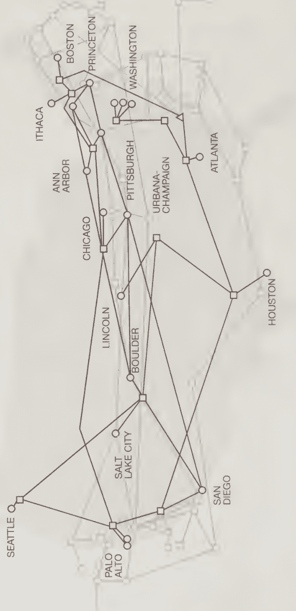
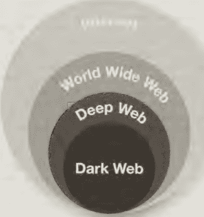
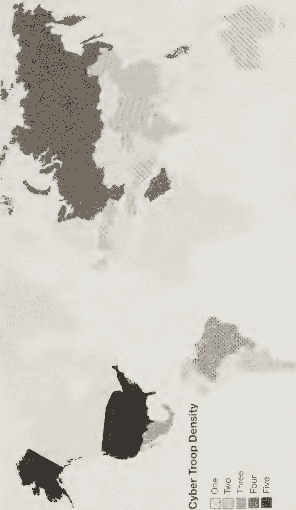

# 网络威胁与全球化：对美国国家和国际安全的影响

1周借期

## 格拉斯哥大学图书馆

已从
格拉斯哥大学
图书馆

2023年11月20日

首字母

30114016561196

军事科学
AB 69
JAR

## 前言

军事力量的运用在二十一世纪赋予了新的目的和意义。世界事务秩序的变化由颠覆性技术、不断扩大的全球经济、权力分散以及与根深蒂固的制度、利益和世界观的冲突所驱动。调整将继续是一个试错、重新定向、失误和疏忽的过程。尽管信息和通信技术（ICTs）已整合到军事平台上，且全球网络司令部应运而生，但军队仍难以抗拒采用二十世纪组织方法来组织、训练和装备的趋势。此外，将军事原始力量用作“政策工具”的性质，已不再是卡尔·冯·克劳塞维茨在世并著述时那个定义全球冲突的便捷定义。在当今后工业时代，信息比领土更有价值，并已成为影响地缘政治的主要商品。社会依赖网络空间和ICTs实现经济繁荣，国家安全依赖数据流，这代表了人类活动和冲突的新领域。网络空间既是经济推动者，也是全球不稳定的源头。其作为社会动荡工具的潜力——在动员民众方面——以及进入非对称冲突的低成本，迫使人类发生了一次自人类语言发明以来前所未有的范式转移，正如迈克尔·海登将军所言。

在应对国家安全和全球冲突中的范式转移方面，本书由合著者撰写，旨在作为希望更好地理解当今信息战争性质和生存威胁的安全研究与国际关系课程及学生的教材。此外，安全专业人士和从业者也会发现它是一个有用的工具。本书是一本概念性和实践性的著作，而非理论著作。它解释了相关概念，以及政策制定者苦恼和从业者必须应对的结构性挑战和责任。文本在章节中穿插了教学框，以说明双方面临的挑战和问题。对于对网络相关安全问题和安全事务感兴趣的普通公众，本书旨在使政策和技术概念易于理解，并希望阅读起来令人愉快。最终，它将提高所有关心网络威胁及其对社会影响（包括日常生活层面）的读者的理解水平。

本书的最终目标是使学生和关心的公民能够更好地理解与国家安全、商业以及我们常常视为理所当然的日常事物相关的不断演变的网络威胁向量的复杂性。本书面向国家和国际安全领域的高年级本科生及研究生高级课程。然而，安全专业人士也会发现这是一本宝贵的资源和参考书。虽然这不一定是计算机技术专家、供应链物流从业者、法律顾问、公共政策

管理人员和刑事司法专业人士会发现它是一个有价值的工具，能以通俗易懂、不那么深奥难懂的方式传达相关概念和定义。

希望了解我们对网络的过度依赖及其所面临漏洞的学术界和大众读者，会发现本书既有教育意义又能澄清问题。对这些读者来说，将会清楚地看到，美国经济、我们的政治制度和生活质量正受到攻击。书中描述了来自不满员工、黑客活动家、罪犯、恐怖分子和敌对政府的威胁，并以结构化、连贯的方式解释了安全漏洞。作者、撰稿人和出版商的愿望是，所有群体都将本书视为一本建设性、及时的文本，值得加入他们的图书馆。任何学生在公共行政、公共政策、犯罪学/刑事司法与警务、应急管理、政治学与国际研究、国际关系、全球事务、安全研究以及军事或国防研究等学科中，都可能接触到网络安全。随着社会机构和惯例适应信息时代及其带来的深远变革新模式，网络安全对许多领域来说都是基础性的。

此外，随着以国家为中心的国际体系面临巨大压力，安全框架变得更加过时。然而，面对恐怖组织、犯罪集团及其他非国家行为体所开发的进攻性网络能力带来的挑战，冷战时期的主要竞争对手仍然是主要参与者，并对国家和全球安全构成最重大威胁。在应对不对称攻击方面，本书对战争和经济竞争不断变化的格局进行了分析。本书以近期事件和有据可查的经验为例，揭示了我们对网络的依赖、这些网络的脆弱性，以及防御对手利用网络的计划、政策、技术进步和其他努力背后的真相。

为进一步丰富正文，教学方框中包含小故事和案例研究。知名学科专家还通过观点文章、散文以及来自证词和学术文章的延长引用来扩展主题。他们的观点是他们自己的，不受作者观点的影响。因此，他们的目的是就各种可辩论的问题和主题提供不同视角，并让读者在有组织的作品结构中接触到独立的思考文章。我们很幸运拥有被公认为权威的撰稿人，他们的见解为这本书增添了深度和广度，这本书试图在多变的环境和复杂且不断发展的世界秩序背景下，阐明一系列技术和政策问题中的一些真相和事实。

## 定义网络空间

### 与自身为敌的世界

2001年4月1日，一架美国EP-3侦察和监视飞机经南海在中国海南岛附近执行任务。当EP-3接近中国领空时，两架中国F-8战斗机紧急起飞迎击。一次空中相撞迫使侦察机在海南岛迫降，并导致一名战斗机飞行员死亡。这场冲突和中国战斗机飞行员王伟的死亡不仅是一起国际事件——它还引发了中国和美国聊天室的讨论，最终波及全球。

在中国，愤怒通过以下类似的信息得以发泄：
- “这是美国帝国主义者第三次把垃圾倒在中国人脖子上。”
- “我们可以不加入世贸组织，但丢不起这个人。”
- “美国为什么对那位失踪的可怜飞行员毫无人权关怀？”
- “全国人民都在拭目以待，看看中国能否与美国强硬对抗。”

两周内，太平洋两岸爆发了网络攻击交换。甚至有人宣布，中国和美国黑客之间将于4月30日至5月8日进行一场“网络战争”。这些“未经授权的爱好者”发动了拒绝服务攻击并篡改了网站。幸运的是，攻击造成的损害很小，因为参与者选择不发布恶意代码或攻击服务器。

三个中国团体对大多数被篡改的网站负有主要责任。中国红客联盟、中国黑客联盟和中国鹰联盟——一个由兼职网络狂热者组成的民间非营利组织——篡改了白宫主页、美国劳工部、美国卫生部以及UPI（联合国际社）的网站等目标。³ 当敌对行动结束时，中国黑客已篡改了大约一千个美国网站，常常配有挥舞的中国国旗图像和反美标语。

另一方面，美国人不仅针对中国政府网站，还针对大学和非营利组织。³ 带着一丝傲慢和特有的自信，一次美国篡改写道：“贝果——早晨的咖啡——以及一个中国网站。不错的小惯例。”4 这些攻击的核心是两个美国黑客团体，分别被识别为Pr0phets和PoizonBox。5

中国（中华人民共和国）和美国政府都认真对待这场网络“战争”。在侵略期间，国家基础设施保护委员会监视与预警单位设立了一条热线。美国海军也宣布其处于INFOCON ALPHA状态，这是物理威胁状态的网络等效状态。与此同时，中国共产党（中共）敦促公民通过篡改美国网站来表达“集体不满”。当美国机组人员获释、两国政府宣布该事件结束时，成千上万的年轻中国黑客已加入对军事设施和公共图书馆等多样目标的攻击。此外，在攻击结束前，来自世界各地的黑客都选边站队并参与其中。来自印度、巴基斯坦、巴西、印度尼西亚、马来西亚、阿根廷、韩国、沙特阿拉伯和日本的个人参与了今天将被描述为全球“网络骚乱”的事件。

然而，在美国发表“遗憾信函”并支付赔偿金后，中国黑客仍在继续从事他们的活动，即使面临被捕的威胁。作为回应，中共抓住时机，通过将这些“网络战士”群体转化为更正式的组织，将这一社区置于控制之下。2003年，中国人民解放军（解放军）开始进行调查和竞赛以识别人才。如今，估计多达二十万人在中国军队的支持下在实验室和商业公司工作。6 回顾2001年4月和5月的事件，中国国防大学教授、军事与装备教研中心主任张召忠评论说，网络冲突在网民眼前呈现出一种现代战争形式，蓬勃发展，并通过实践发明了许多作战方法，积累了丰富经验，扩大了黑客队伍，锤炼了他们在网络空间作战的意志，并向世界各地的网民展示了中国网民的智慧和能力。7

除了作为张召忠所假设的“现代战争形式”的平台之外，英国技术专家和记者本·哈默斯利宣称：“[互联网已成为]21世纪生活的主导平台。”EP-3事件中发挥作用的社交网络现象在过去十年中大幅增长。管理其的过程和关系是复杂的。对国家安全的益处是显著的，甚至是关键的。社交媒体（也称为Web 2.0）被视为一种连接工具和智力力量倍增器。8 然而，尽管EP-3事件颇具启示意义，它只是对当今冲突领域中网络密度和影响的片面一瞥。

二十一世纪军事力量运用方式已发生转变的观念，甚至在最顽固的常规智慧中也得到接受。然而，尽管信息和通信技术（ICT）已融入军事平台，全球网络司令部也应运而生，各国军队仍在使用……来组织、训练和装备人员。

十九世纪采用并贯穿二十世纪的组织方法。将原始军事力量作为“政策工具”的战略响应机制，在当今冲突领域已成为过去式。前阿富汗国际安全援助军司令兼中央情报局局长大卫·彼得雷乌斯将军评论道，“通过杀戮或俘虏来取得胜利”已不再是战略机遇。新冲突令人困惑的特征在于，由国家和非国家行为体主导的新战争与竞争策略，其目标并非最终确定。在这些新战争中，大规模破坏而非毁灭可以是可接受的目标。偏好无休止的冲突而非最终胜利，是另一个战略目标，迫使我们重塑关于备战和进攻规划的公认智慧。由于我们依赖技术，对这些威胁极为脆弱。因此，网络领域代表了最关键的冲突领域。

### 那么，什么是网络？

在*网络空间*、*网络安全*、*网络犯罪*、*网络战*等术语出现之前，存在着*控制论*（源自希腊语*kybernetes* [κυβερνης]，“舵手”，源自*kubernan*，意为“掌舵”）这一学科领域。控制论是研究生物和机器中通信与控制系统的学科。从20世纪40年代末开始，生物学、工程学和社会科学等不同领域的专家开始探讨“系统如何运作？”这一问题，从而使一个新的词素出现在现代词汇中。早期的自然变体包括*cybercube*、*cyber friend*、*cyber lover*、*cyber snob*，甚至*cyber-sheepishly*等副词。10

*网络空间*一词最早由科幻作家威廉·吉布森创造。他在小说*《神经漫游者》*中将“网络空间”表述为“一种共识性幻觉……对人类系统中每台计算机数据库中数据的图形化表征。”归根结底，*网络空间*一词至多是一个松散的术语，试图描述一个信息环境，同时传达其物质和本质的演进性与无拘无束性。随着时间的推移，五角大楼已提出至少十二种其认为的*网络空间*定义。11 归根结底，我们使用的操作性定义必须赋予*网络*及相关概念以意义，其术语应与我们用来理解、书写和表达关于海洋、外太空、生态系统以及其他人类努力前沿的观念时所用的术语相同，在这些前沿中，严峻挑战与合作的重大机遇并存。就本次讨论而言，我们可以参考美国参谋长联席会议的定义：

以电子学和**电磁频谱**为特征，通过网络系统及相关物理基础设施存储、修改和交换数据的领域。12

因此，网络空间既是逻辑的（虚拟的），也是物理的。它涵盖了数字化网络的信息和信息技术，包括通过数字网络连接到远程或硬盘（服务器）的计算机终端、服务器和移动设备。13 尽管是人造的，网络空间仍受物理定律约束。当辐射的波粒二象性与比特调制时，就会产生信息流，网络空间就存在于此。大多数关注点集中在

### 框 1.1 电磁频谱

所谓电磁频谱，是电场和磁场的组合。电与磁之间的相互关系构成了介质。当这些力在数学上被统一时，它们会产生无线电和光的电磁（EM）波。原子相互作用的振荡决定了波频，这支配着可见性和能量等特性，并可以创建信息流传播的独立路径，即波长。

网络空间的逻辑元素。然而，随着宽带和移动技术的不断融合，作为网络空间物理元素的电磁频谱（EMS）的重要性将日益增加。

正是网络的“逻辑”元素，使得信息能够跨网络流动并在应用程序中显现，从而在现实世界中产生影响，而这些影响仅受限于人类创新的极限。

两种主要的媒介或数字网络是因特网和内联网。内联网是指使用因特网软件创建的私有或受限网络。因特网，即万维网，是全球网络，允许访问全球计算机，并使用户能够连接和交换信息。如同所有技术的本性一样，万维网经历了几代演进过程。它始于Usenet，这是一个于1979年首次构思的基于计算机的分布式讨论系统。目前，我们正处于Web 3.0（即语义网）的边缘。这个技术时代的开端大约在2010年至2012年之间，并将在2020年加剧。从历史上看，因特网的演进轨迹如下：

- Web 1.0 是静态网络，人们上网阅读信息而不与媒体进行交互。也被称为个人计算机时代，从1980年到1990年。

- Web 2.0 是交互式和社交网络。这一趋势始于2000年左右，但直到该年代后期随着YouTube和Facebook等服务的普及才全面兴起。用户跨多种设备进行交互，并在作者和受众状态之间流畅切换——实时进行。信息检索（Google）和语音识别（IBM的ViaVoice）也属于网络开发的这个时代。

- Web 3.0，即语义网，是关于机器连接先前未链接的数据。语义网将教会计算机数据的含义，并将其演变为能够利用该信息的人工智能。语义网技术使人们能够在网络上创建数据存储、构建词汇表并编写处理数据的规则。问答系统（例如，IBM的Watson，曾出现在电视问答节目《Jeopardy!》的集数中）是Web 3.0技术的一个示例。

### 图 1.1 可访问因特网的用户

随着可访问因特网的人数增加，预计到2017年，总因特网流量将比2012年的水平增长超过一倍。

来源：美国国土安全部，2014年四年期国土安全评估报告。

万维网是一个令人惊叹的全球奇迹。从2007年到2013年，因特网用户数量翻了一番，达到约22.7亿。从2011年到2016年，专家估计全球网络连接数从106亿增加到189亿。连接设备的数量将在2020年达到310亿，而2011年仅为20亿。推动这些趋势的主要驱动因素是被称为物联网（IoT）和自带设备（BYOD）的技术。

物联网仍处于起步阶段。它是日常使用的物体网络，例如Fitbit、智能电视、家庭安防和恒温器、报警系统以及健康监测设备。这些物体包含嵌入式技术，能够通信并感知或与其内部状态或外部环境进行交互。BYOD是指允许员工将个人拥有的移动设备（笔记本电脑、平板电脑和智能手机）带到工作场所，并使用这些设备访问特权公司信息和应用程序的政策。随着此类机器日益普及和使用范围扩大，存在重大安全问题，这将在后文中更详细地讨论。

### 因特网的历史

史蒂夫·乔布斯曾说过：“创造力就是连接事物。”1968年，高级研究计划署（ARPA，后来成为国防高级研究计划署DARPA）开始着手开发最终成为现代因特网的项目，从而“连接事物”。ARPA的成立是由于1957年苏联发射斯普特尼克1号所造成的全国性创伤。为了应对苏联的新地位

优势，该机构存在的理由是识别科学和技术领域的关键挑战，这些挑战将使美国能够在这些领域重新夺回并保持领先地位。

到20世纪60年代末（冷战和“太空竞赛”的高峰期），计算机的使用日益普及。研究人员的需求开始超过供应。因此，该项目的主要目标是找到一种方法，让来自不同地点的科学家能够可靠地访问未使用的计算机时间。专用连接昂贵且容易中断。该项目的第二个目标是发明一种可扩展、能够抵御物理攻击并能够在系统其他点发生故障时幸存的通信网络。解决方案是一个共享的数据链路和计算资源网络。

这种连接意味着从传统的电路交换电话网络向革命性的分组交换网络的转变。数据包是数据的数字信封。信封外部是所谓的报头，其中包含关于网络源、目的地以及数据包内容的有限详细信息。沿网络分布着称为接口消息处理器（IMPs）或分组交换节点的设备，以促进连接——即我们今天所说的“路由器”。电子消息在起点被分解为数据位——以小数据包的形式包含和发送，这些数据包在数据包报头上带有路由信息。沿网络的路由器读取数据包报头并将数据包中继到目的地。在目的地，数据包到达时数据被重新组装成原始消息。第一条成功链路于1969年在UCLA和斯坦福之间运行，就这样，ARPANET诞生了。

然而，为了实现规模化，系统必须能够容纳许多具有不同底层技术的不同网络。在网络空间中，信息传输的电路可以是物理的（铜线、光缆）或基于辐射的（微波、WiFi）。因此，连接众多各异网络的数据包系统依赖于标准化的通信协议来确保运行和控制。1973年，斯坦福和ARPA的研究人员在一种称为传输控制协议（TCP）的模型中找到了解决方案。传输控制协议/互联网协议（TCP/IP）是管理设备之间数据传输的通用协议集。通信被分解为独立的层。IP报头中的关键信息允许TCP/IP的传输层，即“协议栈”，跨网络运行。IP报头只是一串数字，路由器读取这些数字以将数据包导向其目的地，从而形成连接。在接收端，报头还携带信息，指示目标计算机如何从传入的数据包数据中重新创建消息。一旦部署，TCP/IP 成为“此前不兼容计算机网络之间至关重要的通用语言”。19

此外，该模型允许系统完整性。网络上任何位置的传输故障或中断都不会导致系统失败。数据包只需重新路由。除非消息被加密或通过虚拟专用网络（VPN）传输，否则信息按照这种传输方式流动。系统的开放性既有助于这种韧性，也导致其脆弱性。20

ARPANET 创建后不久，美国国家科学基金会（NSF）意识到这项技术对全国大学研究可能产生的潜在影响。不幸的是，要访问 ARPANET，机构必须与国防部签订研究合同。1985年，NSF 通过创建 NSFnet 取消了这一限制，NSFnet 连接了 ARPANET 并连接了全国现有的超级计算中心。后来添加了一个 TCP/IP“骨干网”来管理不同区域网络之间的流量（参见图 1.2）。该架构的目标是创建一个“互联网”——一个“网络的网络”。新蓝图连接到 DARPA 自己的互联网，其中包括 ARPANET。其结果将使用户能够在其本地计算环境中访问远程计算资源。21 随着 NSFnet 成为 ARPANET 的继任系统，它立即取得成功并迅速过载。NSF 意识到它无法无限期地继续为建设融资，因此制定了商业化计划。22

在20世纪80年代末，NSFnet 商业化的基础正在打下。1989年，参议员阿尔·戈尔提出一项法案以加速网络的私有化。尽管他被政敌错误地指责声称自己“发明了互联网”，但他的立法对 NSFnet 的升级和商业化起到了关键作用。在2007年 NSFnet 20 周年纪念活动上，一位与会者表示，

在2000年选举中，时任副总统阿尔·戈尔被反对者嘲笑，他们声称他说自己“创建”了互联网。但许多聚集在此庆祝网络诞辰的科学家、工程师和技术高管表示，他在其发展中发挥了关键作用，并对他的愿景受到如此质疑表示愤慨。23

到20世纪90年代，互联网服务提供商（ISP）取代了曾由政府、大学和工业研究人员主导的互联网。ISP 根据价格和服务质量在区域范围内竞争——在此过程中签上了数百万客户。尽管来自各个政治角落的呼声主张有限政府，但互联网的创建代表了公私合作伙伴关系可能性的非凡例子。最终，是联邦政府通过国防部和国家科学基金会创建了构成互联网基础的基础设施，然后将其移交给行业运营。24

NSFnet 的商业化也与技术创新相重叠。阿尔·戈尔可能因声称自己发明了互联网而受到不公正的嘲笑，但蒂姆·伯纳斯-李理应因发明万维网而受到赞誉。1989年，在欧洲核子研究组织（CERN）担任承包商期间，蒂莫西·伯纳斯-李（现为蒂莫西爵士）提出了一种“通用链接信息系统”，允许全球学者在网络上上传大量信息并分配访问位置。他的超文本传输协议（HTTP）

### 图 1.2 骨干网络

是用于在“网络”（即互联网）上传输超文本文档的网络接口，或者说是计算机语言。

万维网（WWW）之所以存在，仅仅是因为计算机通过 MAC 和 IP 地址使用超文本传输协议（HTTP）相互连接，HTTP 可以通过统一资源定位符（URL）和域名系统（DNS）传输数据和信息。统一资源定位符是域名的目录。然后在此平台之上构建应用程序来组织数据并提供诸如 Facebook 和 Google 之类的服务。

URL 是指定网络上全球地址的协议。URL 是另一串数字，由机器读取并由域名系统（DNS）翻译（解析）为字母，以便人类更容易理解。因此，在访问搜索引擎时，无需输入 66.249.90.104，您可以输入更易于使用的 URL “google.com”。域名解析器是通常位于 ISP 或机构网络中的计算机，用于响应用户请求以“解析”域名。

十三台根服务器托管 DNS 数据库，促进 IP 和 URL 之间的转换。前美国商务部机构——互联网名称与数字地址分配机构（ICANN），分配 .com、.org、.edu、.gov、.mil 等顶级域名，并维护和更新数据。ICANN 现在是一个私人实体，并在国际压力下促进了从以英语为中心的域名命名系统向适应其他语言的转变。然而，针对中文、阿拉伯语、波斯语和俄语等非罗马字母语言的新顶级域名推出已被推迟，这一努力的暂停引发了新一轮针对美国和欧盟的“互联网帝国主义”和“西方重商主义”的指责。25

在这些问题的背景下，还有其他问题。虽然 DNS 允许自由开放的互联网运行，但 ICANN 用于维护域名注册表的标准和协议可以被个人、临时网络、

### 框 1.2 超文本、HTTP 和 HTML

- 超文本链接允许读者在一个数字文档和另一个数字文档之间切换。

- 超文本传输协议（HTTP）是万维网使用的底层协议。HTTP 定义消息的格式和传输方式，以及 Web 服务器和浏览器应对各种命令采取的操作。当您在浏览器中输入 URL 时，这实际上会向 Web 服务器发送 HTTP 命令，指示其获取并传输请求的数据。

- 超文本标记语言（HTML）是用于在万维网上创建文档的编写语言。HTML 通过使用各种标签和属性定义 Web 文档的结构和布局。

和国家以设计和部署一种替代域名系统，该系统可以独立于互联网，或“运行在互联网之上”。26 当一个群体希望运行在全球DNS根之上，但又要纳入其自身的伪顶级域时，伪域的核心运营者可以使用特定的软件资源来解析在其替代DNS系统中全球可访问的域名。在评估网络安全时，这些替代域名系统（altDNSs）是威胁矩阵的另一个关键关注点，因为对手正在开发方法来掩盖其存在以及互联网上任何有问题或非法的活动。

除了altDNSs的兴起之外，非拉丁字符URL以及通用顶级域名（gTLDs）也是一种趋势。像.com或.org这样的顶级域名扩展名已受ICANN限制。2011年，ICANN为申请人开放了创建自己的域名扩展名的流程，例如.culture。如果组织运行自己的顶级域名，他们可以随意运营，从而使gTLD对公众的开放程度完全取决于组织的意愿。

非拉丁文字在互联网上的使用正在增加。虽然今天使用A到Z的拉丁字符来解析URL，但ICANN已启动一项工作，将阿拉伯语、中文和希腊语等非拉丁文字引入域名系统。这将允许更多用户使用自己的语言访问互联网。27 因此，互联网将向大量新用户敞开大门，这些用户可能因为英语语言障碍而未曾进入这一领域。这带来了重大人力资本挑战，因为当今网络专业人员面临的文化和语言挑战只会加剧。

### 不受限制的增长与挑战

互联网的爆炸式增长使系统面临更大的风险。到20世纪90年代中期，商业已成为互联网设计和未来方向的主要推动力。ISP很快意识到通过互联网协议进行语音通信（VoIP）的好处。技术进步使互联网与传统电话线（PTN—公共电信网络）之间得以连接，并进一步推动了消费者需求。ICT的这场革命迫使PTN与互联网之间产生更大的相互依赖。它还增加了我们对计算机网络的依赖，因为这些系统变得更加由软件驱动。多年来，对大规模运营和更多接入点的旺盛需求对通信和商业产生了变革性的影响。网络的不断扩张进一步提高了脆弱性风险。28

今天当我们谈到互联网时，我们讨论的并非一个单一的连接框架，而是一个由硬件、软件、协议以及不断演进的技术幻象组成的复杂网络。一份2007年的报告估计，至少80%的美国商业活动通过互联网进行。29 就内容而言，它是一个拥有三十亿用户的领域，并且截至2014年，其经济影响达6.3万亿美元。30 网络空间的核心是允许互操作性和功能性的标准和协议。作为网络空间最强大的体现，互联网运行无缝。允许计算机互操作的协议和标准使这一技术奇迹能够在全球范围内催化创新和繁荣。

尽管这些数字庞大，但当前对互联网的概念是一种简单的模式，由一个四层堆栈结构（协议栈或TCP/IP，见上文）表达，每一层都有独立的功能。互联网的四层为：

- 基础设施层
- 逻辑层
- 应用层
- 内容层

**基础设施层**主要是硬件，包括路由器、交换机、互联网交换点（IXPs—网络之间的物理交汇点）以及光纤电缆、蜂窝系统、物联网结构和系统等传输设施。这些基础设施的大部分由私营部门拥有和运营，尤其是电信公司。

互联网的**逻辑层**包括互联网协议（IP）地址和域名，以及域名系统（DNS）。逻辑层还包括互联网标准，例如TCP/IP、HTTP（超文本传输协议）和HTML（超文本标记语言）——换句话说，就是允许信息在不同软件和硬件平台之间传输的核心协议和标准。

**应用层**包含最终用户和物联网设备直接交互的软件。移动应用、语音-over-IP应用、搜索引擎、社交媒体平台以及用于共享用户生成内容的平台，都是该堆栈层中应用程序的示例。

互联网的**内容层**是最明显的。字母数字文本（消息、物联网数据、电子邮件、网页内容和书籍）、音频（音乐和语音通话）、图片（照片、图表、数字艺术和插图）、视频（用户生成视频、视频会议和流媒体电影）以及各种多媒体（视频游戏、虚拟现实和物联网环境）都位于此层。

概括而言，互联网被描述为“部分是城镇广场（人们在那里参与政治和言论），部分是主街（人们在那里购物），部分是黑暗小巷（犯罪发生的地方），部分是秘密走廊（间谍在那里进行经济和军事间谍活动），部分是战场。”31 它连接了世界一半的人口，并且仍处于起步阶段。随着它的扩张，它会不断叠加。我们所有人的未来都将基于数字超级结构，该结构将支撑并塑造我们的生产、商业、贸易和治理模式。

互联网最初是一个封闭的军事项目，经历了多次演进周期。效率的提升、成本的降低以及访问的便捷性推动了商业发展，同时也考验着公共政策的韧性。与此同时，安全仍然是国家国防机构和私营部门面临的挑战。作为美国军事项目诞生之初，互联网的安全问题微乎其微。它是一个封闭系统，因为它只对拥有特定政府拥有和资助的大型主frame计算机授权访问权限的小范围用户圈子开放。由于政府最初的意图是保持功能和系统的有限性和专有性，当今面临的许多安全问题都是上一代开发遗留下来的特征。32 尽管互联网的原始开发者和其他人曾希望数字时代能带来新的赋权途径和民主精神，但趋势是这些希望往往让位于滥用和剥削。在全球化和颠覆性技术的混杂之中，国家与非国家行为体之间竞争的不祥时代经常出现。

### 信息技术与运营技术

网络空间基础设施是全球经济的关键基础。我们依赖这一关键基础设施来开展业务、为家庭供电、访问金融资产以及提供和接受医疗保健。因此，这些网络的安全对于我们的日常生活和国防至关重要。社会对网络空间以及信息通信技术为我们提供的数据流的依赖，对于我们当前的经济繁荣和国家安全至关重要。这些依赖也代表了人类活动和冲突的新领域。

在当今的冲突领域，威胁和攻击来源多种多样。网络犯罪分子、不满的员工、恐怖分子、活动家、有组织犯罪集团和国家行为体都有自己的资源和动机。然而，为了理解网络威胁，我们需要了解是什么使某物成为目标——即创造“暴露点”的装置、属性和功能。我们还需要了解这些元素如何互操作以及在哪里断开连接。这些洞察揭示了安全漏洞是如何通过旧系统的缺陷、系统/网络管理的常规方法以及推动投资的经济压力而产生的。

信息技术（IT）是一个广义术语。它基本上指的是存储、发送、接收和处理数据的系统的使用和研究。IT不包括个人或家庭计算和网络。另一方面，运营技术（OT）是管理和监控运行关键基础设施、自动化制造流程和国防网络的物理设备的硬件和软件系统。尽管这两个环境有一些共同点，但历史上它们仍然是独立的领域，并在组织内作为独立的孤岛进行管理。35 它们不仅在功能上有所不同，而且在文化和战略上也有所不同。传统上，商业企业将IT视为成本中心和支持单位，而OT则更直接地与核心业务以及资产和投资回报相一致。

公用事业、水务、石油和天然气、能源以及交通等关键基础设施部门依赖OT系统进行运行、支持和升级。庞大的国防工业基地以及制药和制药公司也是如此。这些企业需要一个系统来执行有限功能，但

在广泛分布的环境中。其价值在于在长时间内保持可靠性，且无需人工干预。网络安全公司 NexDefense 的一份白皮书指出，

虽然企业计算机通常在两到五年内被视为过时，但运营设备预计即使在恶劣的制造、炼油和室外环境中，也要至少使用 10–20 年。发现使用长达 50 年的旧设备仍然在原位并正常运作，并非罕见。34

监控控制与数据采集（SCADA）系统用于监控工业控制系统（ICS），是起源于 20 世纪 60 年代的 OT 系统。SCADA 系统可见于从交通和回收到制造和能源等公共和私营部门的运营中。炼油厂、超市和家庭都依赖某种类型的 SCADA。该缩写指的是从泵、阀门、变送器、传感器等远程设备获取数据，并将信息传输到带有 SCADA 软件的计算机进行分析和图形显示的功能。该技术无处不在。不幸的是，广域网 SCADA 系统通常依赖脆弱的通信链路。35 数据以“明文”形式发送，或通过依赖互联网且通常无需身份验证的开放路径传输。36 这一特点凸显了两个领域之间的另一区别。

从本质上讲，IT 和 OT 技术在安全方法和风险容忍态度上各不相同。未计划的 OT 中断或故障是一场危机。它可能导致严重的经济后果，甚至人身伤亡或生命损失的高影响事件。即使是为升级而计划的停机，由于与不想要的停机时间相关的担忧，也会对 OT 环境构成挑战。升级可能需要数月的提前规划，要求暂停运营，有时会导致收入下降并损害企业声誉。尽管比灾难事件更可取，但这些停机对 OT 部门的底线影响比对 IT 部门更直接，而 IT 部门将此类程序视为经营成本。与 OT 相反，在 IT 环境中，为升级软件、安装防火墙或运行系统审计而停机是可以接受且常规的。丢失的数据可以以最低成本恢复或重新创建。相比之下，产品和供应则不能。丢失的变压器或停产的生产线与故障服务器不同。云计算和服务器集群（也称为虚拟服务器农场，即可提供网络环境和备份能力的服务器集合）减少了 IT 部门因系统中断造成的影响。OT 领域没有相应的缓解功能。

尽管由于 OT 对基于 IT 技术的适应而出现了一些并行发展，但这些环境基本上仍按不同标准运行，使用不同的基础设施、不相关的流程和管理部门。37 然而，IT/OT 融合可能已成为不可再拖延的问题。对更集成、更整体方法的压力和呼声日益高涨。这些压力既是监管性的，也是组织性的。随着我们迈向智能电网、智能制造工厂、智能分销系统，甚至自动化武器系统的使用，智能设备日益增长的连接性将迫使对 IT 功能更强大的依赖。这些新兴架构依赖于自监测变压器、远程电表和复杂传感器系统的网络。38

在国防领域，美国军队设想的未来“大规模武器环境”将涉及复杂的系统工程和集成。它们包括无人作战、水下作战和补给以及延长空中作战的全球部署。39 该策略的核心是致命和非致命分布式系统。这些系统将依赖人工智能技术，支持全球传感器网络、加油能力以及空中和海上平台的打击行动。总之，商业、关键基础设施的守护者和军队面临的压力，除了适应不断变化的条件之外，别无选择。降低人员成本、网络安全风险以及性能提升的益处，代表了无法抗拒的力量。为此，IT/OT 学科融合是一种自我组织功能。

### 漏洞

SCADA 系统是安全问题区域。四十多年前开发这些软件应用程序时，设计师们寻求一种可扩展、易于操作并能连接分散设施的模式。在这种环境下，安全问题次于互联网扩展和可访问性的利益。因此，标准化技术和开放解决方案似乎更符合最初的愿景。当今软件产品、硬件产品及与其他网络连接的标准化既是问题所在，也是关键所在。日益升级的网络攻击威胁使这些控制系统以及依赖它们的关键国家基础设施设施面临风险。

SCADA 系统防御网络攻击的主要手段一直是其相对的偏远性和与主要网络的隔离。“偏远地点和专有工业网络曾通过隔离为 SCADA 系统提供相当程度的保护。”40 然而，通过互联网和企业网络连接（从网络节点到远程现场设备），该防御已被削弱。此外，没有任何网络是完全隔离的，或者说“气隙隔离”。完全隔离的系统将排除软件和认证更新并限制文件上传。41 智能电网和智能计量的扩展，使得断开连接的关键基础设施的概念与成本效率和服务/产品可靠性的目标背道而驰。

迄今为止最受关注且最先进的 SCADA 恶意软件是 Stuxnet。在官方圈子中被称为“奥运会”，Stuxnet 在 2008 年至 2011 年间攻击了伊朗纳坦兹核设施，使该设施 9000 台离心机中的 3700 台瘫痪，并使伊朗铀浓缩计划推迟了一年。42 Stuxnet 被认为是美国、以色列和英国的联合行动，包含多个零日漏洞利用，利用了多个 Windows 漏洞。它攻击了广泛使用的西门子工业控制软件和数据库以及 Vacon 和 Fararo Paya PLC（可编程逻辑控制器）。一旦激活，它就会导致离心机操作转子故障，迫使离心机倾倒内容物。

### 框 1.3 零日漏洞

零日或零日漏洞是利用代码开发者未知的软件安全缺陷的漏洞利用。当漏洞为人所知时，软件公司可能会发布公告或安全通告。然而，他们提供解决方案或“补丁”的能力可能要到未来某个时间才可用。零日一词指的是漏洞为人所知的那一刻或那一天。

零日漏洞利用很罕见。一年内可能只出现十几个。Stuxnet 蠕虫包含四个漏洞利用。据纪录片《零日》的制片人称，如此高度开发的恶意软件程序在黑市上的价格可能约为 500,000 美元。

当精密的精密调校仪器从六万三千转/分钟不受控制地旋转到八万转/分钟时，振动损坏了设备。随后系统将速率降至两转/分钟，导致进一步恶化。在此期间，控制中心报告称所有系统均正常运行。

尽管绝大多数事件集中在伊朗，Stuxnet 最早于 2010 年在白俄罗斯出现，并被认为已在全球传播。根据网络安全公司赛门铁克的说法，它可能引发了一种趋势，并成为 Duqu、Shamoon/Disttrack 和 Night Dragon 等其他恶意软件攻击的先驱。43 俄罗斯和中国都有该蠕虫的版本，伊朗可能不是唯一的受害者。自其发布以来，对美国银行、中东的美国能源公司以及沙特石油公司阿美的攻击有所增加。感染导致了一系列影响，从分布式拒绝服务（DDoS）攻击到无法解释的管道爆炸。

一般来说，旧系统的安全性仍依赖于所谓的商业现成（COTS）组件。这些产品充当“补丁”，而非整体解决方案。企业 OT 部门通过使用 COTS 避免整体系统升级的成本和延误。其安装不需要长时间的服务中断。然而，缺点是一套不太可行的补丁更新框架混合体。与集成的整体设计相比，此类修补削弱了系统完整性。一种常见的担忧是，当工业控制器和 SCADA 软件系统被替换和更新时，硬件可能会被破坏。44 使用 COTS 甚至可能违反制造商认证。45 此外，在某些条件下，COTS 可能使运营商面临诉讼。总之，打补丁的 SCADA 系统在短期内可能比整体解决方案更具成本效益，但伴随着风险。它们也是关键基础设施设施的额外风险因素，使其成为寻求利用安全漏洞的恶意黑客、罪犯或潜在恐怖分子的诱人目标。其脆弱性、对基础设施和国防运营的重要性，以及普遍意识到的安全性缺乏，用于

它们的设计和支持可能会将其暴露为任何国家或非国家行为体诱人的攻击面：46

### 物联网（IoT）

2015年一份白宫新闻稿将物联网描述为“无处不在的连接设备、智能传感器和大数据分析网络”。7 然而，与“网络”一词一样，物联网一词没有公认的标准定义。然而，未来十年其经济影响将以万亿美元计。对于消费者和企业而言，物联网在很大程度上仍是不可见的。尽管如此，来自众多设备（从普通到非凡）的数十亿条微小数据管道，由于这些设备网络的庞大和密集，正渗透到我们的世界中。物联网也称为泛在计算，已被用来描述近未来将共同运作并将彻底改变社会运作方式的设备全貌。它代表着从联网笔记本电脑和台式机向网络对象（这些对象能够感知环境并相互通信所见内容）的范式转变。

智能电视、健康监测系统、家用电器、恒温器以及家庭和企业网络上的NASA硬盘，都是通过互联网与计算机和其他对象通信的“事物”网络的一部分。几乎任何使用远程控制或远程数据收集的对象都属于物联网的范畴。这不仅仅是互联网向移动设备及其他设备的延伸，因为它可能包括在自有基础设施上运行且仅部分依赖互联网的独立系统。这些对象（从书籍到汽车，从电器到食品）构成了物联网。这些对象可能拥有自己的IPv6地址（如下文所述），或嵌入复杂系统中并使用传感器从环境中获取信息（例如记录供应链沿线温度的食品）。与其他领域一样，互联网的趋势是生态变得越来越碎片化，同时也越来越封闭。

物联网既是机遇也是挑战。快速扫描一下从Fitbit到智能汽车等各种设备中嵌入的潜在传感器数量，你就会达到一万亿个传感器，拥有待挖掘的信息库。由于过去未被捕获的数据分布，不再有秘密。现在数据正从对象中流出。例如，你的“笨”烤箱目前正在使用，但并未记录和分发其使用情况的数据。智能烤箱将在厨师和烤箱之间建立数据链接，以便厨师可以通过无线设备实时监控烤箱内的温度，从而提高烹饪过程的效率。这些收集到的数据可以分发回烤箱制造商，以获取关于烤箱性能的信息。当大量包含以前数字化并在机器之间和人类之间自动发送的信息的数据链接存在时，就会出现几个问题。

例如，我们与数据的关系如何改变？一代人以来，我们面对着过多的涌入数据。我们如何找到最重要的东西？如果敌对行为者关闭水龙头以拒绝访问重要信息怎么办？如果同一行为者选择向系统灌入虚假数据怎么办？出于国家安全考虑，如果该数据是保护国家的最重要事实，那么问题就变成了严重问题。如果情况如此，那么数据就是一种武器，认知战本身也是一种武器。

### 云计算

美国国家标准与技术研究院（NIST）将云计算定义为一种模型，用于“实现对可配置计算资源共享池（例如，网络、服务器、存储、应用程序和服务）的无处不在、便捷、按需网络访问，这些资源可以快速配置和释放，只需最小的管理努力或与服务提供商交互。”48 更简要地说，云计算是从远程终端访问共享软件或数据。

云计算和物联网虽然是独立技术，但正变得越来越集成。49 然而，物联网正变得如此系统化，以至于它已经超越了其运行的传输装置和访问的数据库。这一事实，加上商业领域内将许多独立服务部署在单一物理主机上的日益增长的趋势，正迫使进一步的研究和开发。

从运营角度来看，该范式允许在争夺环境中更具韧性地运行，使系统能够在面对原本会导致系统故障的一个或多个故障时，透明地继续运行。高度韧性系统是指能够快速重启并恢复数据的系统。在虚拟环境中，传感器将能够检测虚拟机故障，并基于可信虚拟环境的快照，用重复备份替换虚拟机。未在信任配置中备份的所有数据都将丢失，但系统功能将得到恢复。

有人可能会认为，集中管理虚拟资产可能会导致以前不存在的单点故障风险增加。然而，虚拟环境也可以为部署安全服务提供受保护的环境。这将增强缓解rootkit和社会工程攻击风险的努力。然而，虚拟机仍存在关于如何检测客户端应用程序是否以异常方式运行的问题。因此，误报的潜在可能性将持续存在。

虚拟化还使在单一管理机构下更容易进行安装操作和管理特定操作系统配置的实例。这有利于在多个虚拟机上自动化安装相同的操作系统。这种大规模部署会创建软件单一栽培体系，可能促进恶意软件的传播，但也会创建一个统一的生态系统，使部署漏洞补丁更加高效和有效。

最后，与物联网爆炸式增长相关的其他问题之一是延迟问题。延迟是指数据从设备或传感器传输到远程公共云所需的时间。与物联网的增长相比，宽带部署速度滞后，正在造成瓶颈。因此，延迟继续是一个问题，并阻碍了两种技术之间的完全功能融合。

尽管如此，我们的电网、交通基础设施、制造设施、Fitbit和汽车都连接到一个基本共享和分析数据的集成设备、机器和设备系统。一些人预测，未来可能是一个网络空间与人类空间合二为一的时代。⁵⁰ 后果可能是文化和社会规范发生转变的场景。⁵¹ 我们正处于从联网笔记本电脑和台式机向网络对象（这些对象能够感知环境并相互通信所见内容）的新模式转变的过程中。⁵¹ 除了提高生活质量的好处之外，这也加剧了我们对IT/OT技术的依赖，并使我们面临更高漏洞的环境。新技术时代及其新安全风险的迹象开始出现。

与此同时，这一趋势本质上为美国创造了一个艰难的运行环境，因为如果极端组织有效部署，安全虚拟环境与临时伪DNS系统相结合将难以渗透，并且除非被邀请加入网络，否则可能不可见。应对这一问题应成为计算机科学领域的最高技术优先事项。

### 一把双刃剑

这些风险如何渗透到我们日常生活的各种例子既显而易见又相当微妙。2010年，研究人员通过将计算机连接到汽车的车载诊断端口，证明他们可以直接控制汽车的锁、刹车和发动机。他们成功绕过了操作车辆的独立驾驶员和自动化控制。他们后来证明，可以通过蜂窝无线电、蓝牙、音频光盘播放器、导航系统和应急通信无线接管控制。没有关于网络攻击导致多少起汽车事故的文档或研究。然而，平均豪华汽车拥有多达100台计算机和至少七个网络，控制从娱乐到性能和位置检测的一切。⁵² 考虑到其频率以及技术上可行的已知内容，将车祸视为暴力犯罪或暗杀企图而非意外碰撞的威胁，可以被视为可能的范畴，而非单纯的不幸巧合。⁵³

还要考虑个人健康和医疗保健系统威胁。得益于远程医疗的突破，医生可以通过植入式芯片和药片检查我们的血液化学成分，这些芯片和药片监测我们对治疗的反应。起搏器也能提供我们健康状况的读数。令人不安的是，2008年，研究人员证明，带有电子电路的可植入式心脏复律除颤器和起搏器理论上可以被无线访问。黑客不仅可以获取个人健康信息，

### 框 1.4 针对公共服务的网络攻击简例

- 1997年3月，马萨诸塞州伍斯特市的一名青少年利用互联网接入，瘫痪了当地机场管制塔的控制系统。

- 2000年三个月内，澳大利亚昆士兰州一名前污水控制系统工作人员入侵系统，在不同地点释放了超过264,000升未经处理的污水，污染了环境。

- 2006年8月，两名举行罢工的交通工程师冒用经理身份登录道路交通管理中心，导致机场、高速公路匝道及其他关键路口交通瘫痪。

- 2008年1月，在波兰Łódź，一名14岁男孩改装电视遥控器，以控制城市有轨电车系统上的无线交换道岔。他的行为导致四辆有轨电车脱轨，造成十余名乘客轻伤。

但该实验揭示，他们还可以重新编程该设备，在十二米范围内发射致命的830伏电击。54同样，除非数据沿着黑客无法跨越的隔离闭环传输，否则血液化学结果也可能以同样的方式被操纵。

2015年奥巴马总统宣布智慧城市计划，是技术如何影响并与不断变化的社会相互作用的又一指标。尽管技术领域的革命性趋势仍在继续，但前所未有的大规模全球移民也正在发生。全球超过50%的人口居住在城市，且这一比例预计到2050年将增至70%。为应对这些变化模式，奥巴马政府宣布计划为城市基础设施发展提供拨款和投资，旨在“持续改进数据的收集、汇总和使用”。通过研究合作、投资低成本传感器技术，甚至创建“生活实验室”，政府计划利用新兴技术来应对一系列挑战，这些挑战从改善市政服务提供到应对气候变化的影响不等。新兴愿景是构建一种全新的基础设施和技术范式，以实现对交通、紧急响应、电力、公用事业、维修以及“其他无数但微小的优化任务（这些任务能让城市运行更高效）”的监控和管理。55然而，另一个挑战是，在我们经历并管理这一范式转变时，如何在即将获取、处理和传播的新一轮信息洪流中实施网络安全。

网络的复杂性以及对额外自动化功能的需求，使物联网的安全要素变得复杂。此外，物联网设备的互联互通也为恶意行为者提供了更广阔的潜在利用入口。访问数据库、远程电表和传感器设备、监控摄像头以及受限区域，为关键基础设施和私有网络带来了充满被攻破和入侵风险的世界。控制智能对象将使黑客能够发动网络攻击，窃取数据和知识产权、进行间谍活动并造成物理损害。震网病毒表明，即使智能对象和系统未连接互联网，也可能被黑客攻击，且没有任何隔离是完全不可渗透的。

物联网是一把双刃剑。一方面，它改善我们生活质量的影响深远且充满可能性。但另一方面，它也有可能使我们在管理医疗保健、开展业务、促进沟通、运营交通系统和保卫家园方面的努力变得更加不安全。这些系统的复杂性使其容易发生故障和破坏。56随着我们的依赖度增加，下一代互联网变得更加普遍，风险暴露也随之增加，因为漏洞点和应用程序缺陷遍布系统。为了保护我们的隐私并确保我们的安全，未来的互联网将需要新的最先进的规范以及利益相关方之间的合作。

### 下一代互联网（IPv6）

迈向未来的这一跃进伴随着网络世界从表层到核心的地壳性变迁。它也给现有互联网技术带来了代价。物联网中的任何“事物”或设备都有一个芯片，赋予该对象唯一标识符和互联网连接。这些“智能设备”的增长将呈爆发式和指数级。由于对这些对象的不可控制的需求，互联网流量将加速，并且随着其普及，这些智能设备将不断消耗IP（互联网协议）地址空间。可用地址的缺乏以及无线和高速连接的有限可用性给系统带来压力。因此，互联网从一个小型政府项目发展为全球体验，需要技术演进的下一次飞跃。

互联网协议第4版（IPv4）最早于1978年春季部署，一直是允许计算机互联的基础协议。IPv4现在正接近其极限。它可容纳42亿个唯一地址，而地球人口目前为73亿且还在增长。57目前数据显示，到2020年将有超过250亿个物联网对象投入使用，到2050年可能达到500亿个。58饱和点已近，向下一代互联网的转型也已迫在眉睫。

在“dot.com”繁荣期间，明显限制的迹象就早早出现了。意识到在20世纪90年代中期互联网的未来岌岌可危，互联网工程任务组（IETF）着手设计一种新版本的互联网协议，以确保互联网增长的快速爆发不会超过IP地址的可用性。新协议调整以适应IP地址数量的巨大增加。IPv6的崇高标准将允许超过10^38个地址——每人超过一万亿万亿个。59精确地说，新的地址范围数字是340,282,366,920,938,463,374,607,431,768,211,456。60

IPv6自1999年起可用，并于2012年正式启用，已不再是假设性的——从IPv4过渡亦是如此。当今的互联网已经处于转换过程中。一旦转变完成，这将是互联网历史上基础协议（TCP/IP）首次发生变更。这一过渡的影响将在未来二十到五十年内影响美国和全球的商业与安全。61

在美国以外，转移工作已经开始并正在加速。2012年8月，欧洲互联网注册机构耗尽了地址供应，导致该注册机构只向运营商分配IPv6地址。622011年4月，亚太地区已无法满足IPv4需求，IPv6成为构建新互联网网络和服务的强制要求，因为最后的IPv4地址空间正在分配给亚太网络信息中心（APNIC）。63

美国在过渡方面处于劣势。因为我们开创了互联网，所以拥有基于IPv4的旧版技术。因此，过渡成本高于大多数其他国家，这些国家没有这种旧版基础设施，可以直接迁移到IPv6兼容基础设施，在过渡期间无需双栈，然后关闭IPv4（双栈设备是指具有网络接口、可以发起和理解IPv4和IPv6数据包的设备）。安全问题以及替代应用程序和其他系统资源的可用性也阻碍了美国的转换过程。

与此同时，鉴于其IPv4分配于2012年到期，IPv6过渡在亚太地区最为强劲。事实上，中国教育和研究网是世界上最大的IPv6网络。亚太地区现在实际上成为第一个启用IPv6的地区。因此，对美国以外IPv6实施在野外如何运作有了更大的操作性理解。64目前，美国的采用率约为20%。65然而，转换过程零散且不均衡。一些报告暗示它可能已经趋于平稳，引发了对采用率是否足以容纳预期的物联网增长的疑虑。66

如上所述，一个促成性抑制因素是物联网增长与高速互联网和先进电信服务扩展之间的滞后时间。IPv6及其巨大地址空间的部署，加上工业感知系统与互联网的融合，也正在推动网络格局的第三大变化：宽带移动设备使用的加剧。虽然城市中心及其周边地区网络完善，但农村地区缺乏基础设施。它们也缺乏私营部门投资的经济激励。低人口密度和在广阔地理区域铺设线路的高昂成本限制了发展。当商业企业观望时，政府计划尚未到位以充分满足所有需求。67结果是供需缺口，减缓了基础设施建设。

升级到IPv6的滞后时间也通过推迟“溯源”机制的纳入，抑制了创建更安全网络环境的进程。

机制，可重建从流量源头经过中间位置到最终目的地的路径。技术人员认为，借助IPv6，有机会将逻辑地址映射到其物理对应地址。68 这一进步将大有助于解决归属问题，并针对高级持续性威胁及其他网络攻击内建威慑力。

随着物联网（IoT）不断扩展，被利用的风险和网络犯罪的机会也随之增长。在某些情况下，尤其是在安全体系较薄弱的欠发达国家，宽带本身就存在网络犯罪的天然风险。另一方面，工业化国家拥有更先进的网络防御，但也是更丰富的目标环境。它们吸引更高级的黑客，也是间谍活动的重点。物联网的增长尤其成问题，因为设备体积小，且设计为一次性使用。因此，它们的软件更新能力有限。如果设备无法安全且及时地更新，就面临被攻破的风险。一次利用行为可以在网络中传播，并感染任何接触到的硬件和软件。

BYOD——自带设备——是指组织允许员工将个人拥有的移动设备（如笔记本电脑、平板电脑和智能手机）带到工作场所的政策。在使用这些设备访问特权公司信息和应用程序时，雇主能够获得更高的生产率和成本节约。员工反过来也享受便利带来的好处。然而，安全顾虑显而易见。随着互联互通为坚定的黑客打开了网络的其他部分和潜在的漏洞点，信息系统面临未经授权使用和恶意意图的可能性。69 对组织的成本可能是致命的，而且也难以发现。如果没有关于物联网标准和最佳实践规范应用的任何治理或公认协议，情况将继续危险地停滞不前。70

### 网络安全

估算网络犯罪的成本很困难。桑迪亚国家实验室的专家将网络威胁的损失估值描述为“不成熟”。该报告进一步断言，网络威胁领域是“模糊不清”的，并且“往往难以轻易衡量，在某些情况下似乎无法衡量。”71 其对经济活动的影响以多种方式评估。为了充分理解其影响，必须以网络欺诈或货币盗窃所致的单纯硬美元以外的术语来计算。还有附带的、长期的社会影响。

网络犯罪分子可以获取关于商业计划、并购策略、未发表报告或其他可能影响公司股价或利润的敏感数据的内部信息。一旦掌握这些信息，犯罪分子就可以通过非法内幕交易或套利交易（在不同交易所同时买卖证券并从价格差异中获利）来利用市场。这些操纵行为难以发现，起诉起来更难，通常是因为其复杂性以及域外管辖权的法律限制。股东和企业在财务上遭受损失，当交易所面临声誉受损和投资者信心丧失时，国家经济也可能受到影响。Melissa Hathaway引用的一项2011年研究声称，“二十国集团（G20）经济体因假冒和盗版损失了250万个就业岗位，政府和消费者每年损失1250亿美元，包括税收损失。”72

网络犯罪还通过迫使企业将资金重新分配给安全，从而将资产从核心业务活动中重新分配，进而影响经济。以这种方式，网络犯罪将就业转向价值较低的工作。当企业预算将资金从研发转移，或为了赚取和保护短期利润而追求其他业务线时，也会产生机会成本。结果是创新速度放缓，投资回报率降低。73 被盗的知识产权还可能彻底摧毁公司并毁掉职业生涯。Nortel Networks多年来一直是网络犯罪的受害者。该公司曾是电信行业的全球领导者，也是20世纪90年代末加拿大最大的雇主之一。遗憾的是，由于网络企业间谍活动（据推测是中国发起），其十多万员工中的绝大多数离职，公司于2007年被迫破产。

根据迈克菲（McAfee）和战略与国际研究中心（CSIS）赞助的一项2014年研究，网络犯罪占据了互联网创造的经济活动价值的15%至20%。按这些估计，对全球经济的成本每年在4000亿至5750亿美元之间。74 在网络环境中，优势在于攻击者。回报可能很高，而被发现和起诉的风险很低。受害者的情况则恰恰相反。与此同时，社会面临的网络威胁正在超越我们的防御能力。75

此外，企业可能在入侵发生时无法发现攻击或自身的漏洞。它们通常只有在损害已经造成后才会意识到，这可能是在几年后，并且通常是通过第三方得知。由于人力和技术技能不足，网络犯罪经常不被发现，且对犯罪者没有不良后果。一旦市场或竞争优势丧失，反应可能也为时已晚。估算和打击网络犯罪的另一个问题是举报不足。当受害者未察觉电子入侵时，报告显然缺乏。蓄意意图也是举报不足的另一个因素。当网络犯罪确实浮出水面时，受害方有动机将这些事件排除在公众视野之外。对受害组织的后果可能令人沮丧。对私营部门企业以及公共办公室和组织来说，担心负面宣传始终是一个问题。在企业发生安全漏洞的情况下，该事件可能使组织面临诉讼和不利的市场影响。

公开披露安全失败也可能向攻击者发出信号，表明存在漏洞，组织可能已成熟到可以被利用。伴随这些情况而来的还有对失业和声誉受损的恐惧。在权衡报告此类事件的成本和影响时，不难理解为什么许多组织选择对自身情况保持沉默，而不是引起公众关注。此外，时间和资源的分配，以及起诉记录不佳，进一步抑制了举报此类犯罪的意愿。网络犯罪时代创造了一系列新的法律问题和议题。盗窃意味着占有，当涉及的财产是知识产权而非有形财产时，这是一个困难、微妙且更复杂的论点。此外，交叉询问过程中披露的信息可能对原告自身利益造成的损害，与原始犯罪一样大。控制网络犯罪及其不利的“激励方程式”的前景，可以用迈克菲/CSIS报告中的一段话来概括：

> 随着人们、企业和政府对计算机网络和设备的依赖日益加深，随着更多经济价值被数字化并存储在网络上，随着全球制造能力的提升，如果国际合作没有改善，网络犯罪造成的损失将会增长。

#### 攻击矩阵概述

计算机应急响应小组（CERT）将网络威胁描述为个人“[试图]使用数据通信通道未经授权访问控制系统设备和/或网络。这种访问可以由组织内部的可信用户发起，也可以由通过互联网的远程位置的未知人员发起。对控制系统的威胁可能来自众多来源，包括敌对政府、恐怖组织、不满的员工和恶意入侵者。”76

CERT（也称为CSIRT——计算机安全事件响应小组）是指处理计算机安全事件的计算机专家团队。CERT的起源源于自我复制计算机蠕虫的早期出现。（第一个“团队”成立于1988年，是对以其作者、康奈尔大学研究生Robert Tappan Morris命名的Morris蠕虫的回应。）全世界，超过250个使用CERT或CSIRT名称的组织专注于网络安全威胁问题和响应。美国CERT独立于这些组织运作，但为信息共享和协调目的保持关系（参见表1.1）。

US-CERT与其合作伙伴合作，控制网络空间中技术的滥用和误用。这些合作伙伴包括私营部门网络安全供应商、学术界、联邦机构、信息共享与分析中心（ISACs）、州和地方政府以及国内和国际组织。其参与的个人和组织网络代表了威胁的深度和广度。

国家行为体远少于私人行为体。尽管其能力和战略目的超过大多数其他行为体，但与非国家行为体相比，其活动要少得多。Verizon Enterprise Solutions发现，在2012年发生于二十七个国家的六百多起泄露事件中，超过75%可以追溯到可识别国家的某个人。在这些攻击中，只有19%的数据泄露被归因于国家附属

### 表 1.1 向美国计算机应急响应团队报告的涉及美国网络基础设施的网络事件

| 年份 | 事件数 |
|---|---|
| 2006 | 5,503 |
| 2007 | 11,911 |
| 2008 | 16,843 |
| 2009 | 29,999 |
| 2010 | 41,776 |
| 2011 | 42,854 |
| 2012 | 48,562 |

来源：美国政府问责局，“攻击来源”，2013年。

行为者。巴西、哥伦比亚、德国、亚美尼亚和荷兰各自约占泄露事件来源的1%。俄罗斯占5%，保加利亚占7%，罗马尼亚占28%，中国占30%，共同构成了检测到的入侵中另外70%的比例。美国占总数的18%。" 总计，四十个国家构成了针对美国的活跃国家名单。

大多数攻击出于经济动机，但源自中国的泄露事件几乎全部属于间谍活动。中国来源占数据集中所有间谍案件的96%。78 近年来，美国官员将高级持续性威胁（APTs）作为国家威胁（尤其是中国威胁）的代称。

非正式地，一些美国官员表示，约有140个外国情报和安全部门针对美国。据估计，有50个具备严重危害美国的能力，五六个是严重威胁。79 常被识别的国家网络威胁包括中国、俄罗斯、以色列、伊朗、朝鲜和法国。这些来源不一定是官方的；它们可能是私人活动家、拥有官方支持的私人行为者，或伪装的官方行为者。由于全球化，国家行为者与非国家行为者之间的界限已经模糊。这种模糊性阻碍了确定归属和制定适当回应的努力。例如，CSIS/McAfee报告声称，欧洲来源在前苏联维持着“20到30个具有‘国家级’能力的网络犯罪集团”。这意味着这些集团不仅拥有实施高影响事件所需的资源和熟练人员，还一再证明它们可以克服几乎任何网络防御。更加糟糕的是，它们与官方俄罗斯（俄罗斯联邦）的关联被方便地掩盖了。该报告还断言，“网络空间中的金融犯罪现在已达到工业规模。”80

最终，大多数网络攻击来源不与任何国家有关联，而是私下行动。在世界上近两百个主权国家中，很少有十个被普遍认为拥有大部分网络攻击能力或意图。这些行动通常受情报或军事机构管辖——美国政府将其指定为外国情报服务（FISs）和/或外国情报和安全部门（FISSs）。

然而，需要注意的是，随着全球商业的要求和跨国犯罪的诱惑使国家边界变得模糊，国家和非国家行为者的角色也变得复杂和具有变革性。对互锁网络的依赖，用于商业、金融服务、通信、公用电网、政府和军事后勤需求，使所有国家面临风险。如果没有某种形式的全球治理来确立对网络攻击的合法回应范围以及关于网络武器使用的规范，广大公共利益的宏伟希望将会消退。¹ 削弱这一希望的是冷战后重新军事化的前景。许多人认为这是一种可能性，并且已经认真且不可逆转地开始了。

以营利为目的的犯罪分子约占网络攻击的75%。² 在该类别中，多达80%的数字犯罪涉及某种形式的有组织活动。³ 其他估计称，该比例高达90%。⁴ 这些行为包括与计算机相关的欺诈、伪造和身份犯罪。尽管网络犯罪和有组织犯罪的定义会影响这些数字，但某种形式的有组织努力的参与继续推动着活动。⁵ 这些团体的规模可能从小型犯罪单位到松散的临时网络，或大规模运作的有组织犯罪不等。无论规模如何，有组织的网络犯罪都是一个不断扩大的全球现象。

总体而言，跨国有组织犯罪（TOC）从全球化和技术中获益，方式与全球企业类似。获得技术创新以及全球商品和金融市场的形成，为犯罪组织提供了机会。利用市场、利用资本和汇率差价、转移资金和人员不仅限于合法商业领域。在网络犯罪中，TOC找到了另一个可供利用的运作领域。更重要的是，犯罪分子不需要复杂的技能、正式教育或培训就能在这个领域从事他们的勾当。

有组织犯罪得到一个加速且强大的黑市的帮助，该黑市促进了网络犯罪的增长，并允许复杂且新的可利用技术的活跃交换。恶意软件工具包，或利用工具包，在线上可用。这些数据包为希望投放恶意软件负载并远程控制受感染系统的非技术人员提供了能力。它们通常包括用户友好的Web界面，用于创建未来利用的互联网平台。⁶

网络黑市负责一个恶意软件创建周期，其中包括针对零日漏洞的利基市场。如前所述，Stuxnet产品已经有一个既定市场和通行价格。计算机感染、个人和财务数据收集、数据销售以及财务信息的“变现”都是推动其扩张的制造和服务经济的一部分。此外，由于参与者/客户往往高度专业化，他们可以找到产品和“顾问”，这些产品和顾问会根据犯罪市场的需求定制“解决方案”。许多专家预期，地下市场将继续增长，甚至随着其适应不断变化的需求、继续成熟甚至推动创新而变得更加重要。88

犯罪的一种常见工具是僵尸网络。僵尸网络，即“机器人网络”的缩写，是大量被感染的计算机，用于执行自动化任务，通过垃圾邮件、拒绝服务命令、病毒和其他形式的恶意软件攻击其他网络。它们常被用来攻击信息系统以窃取数据。僵尸网络租赁在犯罪分子中很受欢迎。通过从一个群体或个人转移到另一个群体或个人而以相对较低的成本提供，带有存储恶意软件、利用工具包或僵尸网络组件的服务器每月成本在80美元到200美元之间。99 这项投资的回报可能在数万美元到数千万美元之间。

最大的一次网络盗窃涉及对100多家银行和其他金融机构的攻击。盗窃始于2013年底，直到2015年2月才被揭露。在两年的时间里，跨越三十个国家，黑客渗透系统并数字转移资金。ATM响应提示并吐出现金。通过一个同伙网络，账户泄露以缓慢滴漏的方式未被发现地发生，因为窃贼将取款限制在相对较小的金额。然而，当官员揭露该行动时，总计约10亿美元的盗窃已经发生。90

随着联网设备数量开始超过人口，并且到2017年宽带订阅量将接近世界人口的70%，很难想象一个高度互联的世界不受扩大的网络犯罪威胁的危害。事实上，可能很难想象任何不涉及网络组件的犯罪。引用联合国的一份报告，“在明天的高度互联世界中，将很难想象一种‘计算机犯罪’，或许任何犯罪，不涉及与互联网协议（IP）连接相关的电子证据。”91 此外，威胁不仅来自国家和有组织犯罪团体。不满的员工、恶意黑客和政治活动家都在为不断变化的威胁矩阵做出贡献。

内部威胁是指受组织雇佣、授权或被授予特权，但故意或无意中损害组织的人员。盗窃和安全合规失职导致无法计量的底线资金和机会成本损失。现任和前任员工、顾问、供应商、承包商，甚至业务合作伙伴都属于内部威胁的范围。

此外，信息/通信技术使内部人员拥有更多窃取数据的能力。物联网（IoT）的爆发以及“自带设备”政策日益流行，使员工能够更轻松、更快速地在多个程序和应用程序之间移动数据。无论意图如何，这些技术突破增加了恶意或粗心的内部人员数量，他们可以更多地接触到待批专利、商业秘密、并购计划以及其他竞争和市场情报等敏感信息。经济的全球化也导致了这种混乱。员工流动导致忠诚度松散或冲突。92 熟练

员工和经理经常跨越国界寻求机会，可能受到财务利益或对本国或活动家事业的爱国情感的影响。当企业全球化且劳动力本质上是流动的时，终身雇佣已成为过去式。

由普华永道和负责任企业与贸易中心赞助的一份报告发现了内部人员对拥有高价值商业秘密的公司造成的成本示例。其中包括：

- 2012年，一家北美汽车公司的前员工及其配偶被判犯有窃取与混合动力车辆技术相关的商业秘密的罪行，该技术价值4000万美元。这对夫妇打算将信息出售给一家中国竞争对手。
- 一家大型美国期货交易公司的一名员工于2012年底认罪，承认窃取了包含专有电子交易平台源代码的一万多个文件。检察官估计这些商业秘密的价值在5000万至1亿美元之间。该员工表示，他和两位商业伙伴曾计划使用这些源代码开发自己的公司。
- 2011年，一家汽车公司的前员工因复制约四千份关于发动机传动和电力供应系统设计的文件而被判处七十个月监禁。该员工打算将这些文件带到另一家北美公司的中国分公司的新工作中。

到2010年，一些公司已在雇佣合同中加入协议，规定不遵守将构成可解雇的过错（例如，违反两次或三次后）。不披露协议（员工承诺即使在离职后也不泄露敏感信息）在20世纪90年代变得普遍。93

内部人员可能出于自身动机，或被外部行为者招募。他们也可能是心甘情愿的同谋或无意的帮凶。无意泄露者可能是恶意软件和间谍软件漏洞的受害者，而非受贿诱惑所诱导。事件记录表明，原因大致各占一半。美国计算机应急响应小组（US CERT）在发现2003年至2007年美国一半的内部威胁是由外部人员（包括有组织犯罪和外国政府）招募的后，指出了外部行为者在内部威胁中日益增长的作用。新的合并和收购也增加了内部威胁的可能性。94 Verizon的一份报告在2015年证实了类似数据。95

布拉德利·曼宁可能通过他与一名最终背叛他的在线黑客的通信，概括了内部威胁问题：“服务器薄弱、日志记录薄弱、物理安全薄弱、反情报薄弱、信号分析不够关注……一场完美风暴。”96 在被联邦调查局（FBI）逮捕之前，曼宁是一名在美国陆军服役的士兵，在伊拉克担任情报分析师，他窃取了超过26万份美国外交电报和超过50万份关于或来自伊拉克和阿富汗的军事报告。这是单一来源泄露的最大量限制数据。

经济关系和治理观念感受到了全球化和技术飞速发展的压力。虽然技术将人口、文化和机构猛烈推入信息时代，但在许多方面，我们仍然按照工业时代的模式组织起来以应对冲突。对网络空间中形成的新战场格局的了解和熟悉程度始终在演变。战场地形模糊不清，武器不断升级，敌人难以捉摸且无处不在。竞争发生在国家、部落、犯罪组织、企业利益、宗教和政治派别，甚至盟友之间。有时还包括邻居和同事。

前文提到的网络空间——包括城镇广场、主街、黑暗小巷、秘密走廊和公开战场——并非静态环境。它是动态的，不稳定性目前是一种被接受的状态。正如这个隐喻所暗示的，网络冲突涉及许多行为者，层级各异，形式多样。最后，由于美国目标众多，建立秩序可能需要公众与其政府之间建立新的伙伴关系、重写法律法规，以及动员社会的新机制。

### 关键术语

- 电磁频谱
- 基础设施层
- 逻辑层
- 应用层
- 内容层
- 零日漏洞利用
- 无处不在的计算
- 延迟
- 自带设备（BYOD）
- 高级持续性威胁
- 僵尸网络
- 内部威胁

### 注释

- 1. Timothy L. Thomas, “The Internet in China: Civilian and Military Uses,” Information & Security: An International Journal 7 (2001).
- 2. http://www.popsci.com/scitech/article/2009-04/hackers-china-syndrome.
- 3. http://www.foxnews.com/story/2001/05/01/it-all-out-cyber-war-as-us-hackers-fight-back-at-china.html.
- 4. Thomas.
- 5. Ibid.
- 6. P. W. Singer and Allan Friedman, Cybersecurity and Cyberwar (New York: Oxford University Press, 2014).
- 7. Thomas.
- 8. Mark Drapeau and Linton Wells II, “Social Software and National Security: An Initial Net Assessment,” Center for Technology and National Security Policy, National Defense University, April 2009.
- 9. Christopher Paul, “Winning Every Battle but Losing the War against Terrorists and Insurgents,” in The Long Shadow of 9/11: America’s Response to Terrorism (Santa Monica, CA: Rand Corporation, 2011).
- 10. http://blog.oup.com/2015/03/cyber-word-origins.
- 11. Singer.
- 12. Panayotis Yannakogeorgos, 2009, www.jcs.mil/Portals/36/Documents/Doctrine/pubs/jp3_0_20170117.pdf.
- 13. Bruce Newsome and Jack Jarmon, A Practical Introduction to Homeland Security and Emergency Management from Home to Abroad (Los Angeles: Sage Publications/CQ Press, 2015).
- 14. Panayotis A. Yannakogeorgos and John P. Geis II, The Human Side of Cyber Conflict: Organizing, Training, and Equipping the Air Force Cyber Workforce (Maxwell AFB, AL: Air University Press, 2016).
- 15. Tim Berners-Lee, “Linked Data,” http://www.w3.org/DesignIssues/LinkedData.
- 16. Nigel Shadbolt, Wendy Hall, and Tim Berners-Lee, “The Semantic Web Revisited,” IEEE Intelligent Systems, May/June 2006, 96–101.
- 17. Newsome.
- 18. http://www.darpa.mil/about-us/timeline/where-the-future-becomes-now.
- 19. John Markoff, “The Team That Put the Internet in Orbit,” New York Times, December 9, 2007.
- 20. Jack Jarmon, The New Era in US National Security (Lanham, MD: Rowman & Littlefield, 2014).
- 21. https://www.nsf.gov/about/history/nsf0050/internet/launch.htm.
- 22. Andrew Tanenbaum, Computer Networks, 4th ed. (Upper Saddle River, NJ: Prentice Hall PTR, 2003), 56–58.
- 23. Markoff.
- 24. Tanenbaum.
- 25. Sinan Ülgen, Governing Cyberspace: A Road Map for Transatlantic Leadership (Carnegie Endowment for International Peace, 2016), 38.
- 26. Panayotis A. Yannakogeorgos, “Internet Governance and National Security,” Strategic Studies Quarterly 6, no. 3 (2012): 102–25.
- 27. Internet Corporation for Assigned Names and Numbers, “Internationalized Domain Names,” http://www.icann.org/en/resources/idn.
- 28. Hedieh Nasheri, Economic Espionage and Industrial Spying (Cambridge: Cambridge University Press, 2005), 98.
- 29. John Doyle, “Air Force to Elevate Status of Cyberspace Command,” Aerospace Daily & Defense Report, March 22, 2007.
- 30. Global Commission on Internet Governance, Centre for International Governance Innovation, and the Royal Institute for International Affairs, 2016, v.
- 31. “Securing Cyberspace for the 44th Presidency,” Center for Strategic and International Studies Commission Report, Washington, DC, December 2008.
- 32. Jarmon.
- 33. Derek R. Harp and Bengt Gregory-Brown, “IT/OT Convergence: Bridging the Divide,” nexdefense.com, 2015.
- 34. Ibid.
- 35. Schneider Electric white paper, March 2012.
- 36. “Making the Nation Safer: The Role of Science and Technology in Countering Terrorism,” National Research Council of the National Academies, Washington, DC, 2002, 140–41.
- 37. Harp.
- 38. Ibid.
- 39. Robert Martinage, “Toward a New Offset Strategy,” Center for Strategic and Budgetary Assessments, 2014, 27.
- 40. Bonnie Xia Zhu, “Resilient Control and Intrusion Detection for SCADA Systems,” PhD diss., University of California, Berkeley, 2011.
- 41. Candid Wueest, “Targeted Attacks against the Energy Sector,” Symantec, January 13, 2014.
- 42. Edward Turzanski and Lawrence Husick, presentation to the Foreign Policy Research Institute, October 12, 2012.
- 43. Ibid.
- 44. Larry Husick and E. A. Turzanski, “Why Cyber Pearl Harbor Won’t Be Like Pearl Harbor” (presentation to the Foreign Policy Research Institute, Washington, DC, October 2012).
- 45. Alvaro A. Cardenas et al., “Challenges for Securing Cyber Physical Systems” (report prepared for the Department of Electrical Engineering and Computer Sciences, University of California, Berkeley, and the Department of Electrical Engineering, Carnegie Mellon University, 2009).
- 46. Newsome, 364–65.

## 可变域 2

### 什么是密码学？

密码学作为一门科学至少有四千年历史。埃及人，以及后来的亚述人、希伯来人、希腊人和罗马人都使用过某种形式的加密来保障政府和商业通信的安全。密码学采用秘密符号系统、单词打乱和凹雕（平石印记）来秘密传输消息。在现代，密码学依赖数学理论来传输数据。数学算法是密码学的核心。存在三种密码学算法：哈希函数、私钥和公钥。

哈希函数通过获取一组字符并创建一串数字或“密钥”，将任意大小的数据映射为固定大小的数据，该串通常比原始数字串更短。本质上，文件内容通过加密算法处理，生成一个唯一的数值——即哈希值——用于标识文件内容。这些数值被称为密钥或简称“哈希”，常用于数据库索引和快速数据检索。哈希值代表原始字符串，但其压缩后的大小使得数据定位更快、更高效。哈希也可被视为文件的指纹。1

哈希函数有时被称为单向加密，它可以将文本消息转换为大固定数字串，以验证输入数据（消息）是否映射到特定的哈希值。在加密术语中，这种缩写的哈希值也称为消息摘要。哈希函数同样将数字签名转换为一小块数据，用于对数字消息或文档进行身份验证。数字签名和消息摘要传输给接收方。消息摘要和签名分别通过独立的传输发送。接收方随后使用相同的哈希函数重新生成消息摘要，并将其与从数字签名中推导出的摘要进行比较。如果哈希值/密钥相同，则消息很可能是无错误传输且真实的，因为它们由同一哈希函数关联。“单向”一词中“one-way”前缀指的是，将大固定数字串逆转回文本消息极其困难。

第二种算法密钥称为私钥或密钥。私钥是一种加密/解密方法，其中算法已知于交换加密消息的各方。通信者共享密钥，以便每个人都能加密和解密消息。由于每个可信方共享相同的密钥，该方法称为对称加密。安全风险在于系统或交换循环外部的人员可能获取密钥的威胁。

私钥方案的安全困境在1976年发生了根本性转变，当时两位斯坦福密码学家惠特菲尔德·迪菲和马丁·赫尔曼发表了一篇题为《密码学新方向》的论文。在此之前，该领域的一个基本问题是密码学密钥分发方法。这种新解决方案后来被称为迪菲-赫尔曼密钥交换，提出了一种协议，通过观察通信无法看到密钥传输。其原理在于，通信双方不是共享信息，而是共同创建一个密钥。具体做法是创建两个数学关联的数字，并将其作为单独的密钥使用——分别称为私钥和公钥。密钥对中的公钥可以与所有人共享；私钥保密。任一密钥都可用于加密消息；用于解密的是与加密所用密钥相反的另一密钥。换句话说，一个密钥加密的内容只有另一个密钥才能解密。一个粗略的例子是将半素数15作为公钥，私钥为素数因数（3 x 5），用于加密/解密。实际上，密钥交换中的数字非常大，虽然成对出现，但并不相同，因此是非对称的。

两名通信方之间的通信交换过程如下：通信的每一方都拥有一对公钥和私钥。每一方将自己的公钥共享给对方，同时保管好自己的私钥。只有接收方的私钥才能解密发送方的消息，发送方使用接收方的公钥对消息进行加密。如果这听起来令人困惑，可以尝试从以下五个步骤来理解非对称密码学：

- 1. 爱丽丝和鲍勃通过公开各自的公钥并保密、安全地保管私钥来建立通信。
- 2. 爱丽丝将一个秘密（使用鲍勃的公钥加密）放入盒子，并用她用私钥创建的数字签名（挂锁）将其锁上。
- 3. 她随后将盒子寄给鲍勃。
- 4. 鲍勃收到盒子，并使用与他的公钥对应的私钥解密消息，爱丽丝正是使用该公钥加密了她的消息。
- 5. 随后，他使用爱丽丝的公钥验证她的签名（挂锁），该签名是她用私钥加密的。

因此，鲍勃可以解密消息，并且可以确信消息来自爱丽丝。要回复爱丽丝，鲍勃重复该过程。由于盒子在传输过程中始终至少有一把锁，因此没有机会查看内部并窃取秘密。2 在密码学术语中，这意味着即使

- 44 https://www.whitehouse.gov/the-press-office/2015/09/14/fact-sheet.
- 45 彼得·梅尔和蒂莫西·格兰斯，《云计算的NIST定义》（华盛顿特区：美国国家标准与技术研究院，2011年），第2页。
- 46 大卫·林西卡姆，《传统云架构对许多物联网应用程序来说延迟过高：欢迎来到云端边缘》，Infoworld.com，2016年。
- 47 埃里克·A·菲舍尔，《物联网：常见问题解答》，国会研究服务处，2015年10月13日。
- 48 扬纳科格奥尔戈斯，2016年。
- 49 里克·赫特利，《将改变你的世界的技术》，载于《网络空间：恶意行为者、犯罪机遇与战略竞争》，菲尔·威廉姆斯和戴顿·菲德纳编（宾夕法尼亚州卡莱尔：战略研究学院和美国陆军战争学院出版社，2016年）。
- 50 S. 阿普尔盖特，《动态网络的黎明》，在第5届网络冲突国际会议上发表的论文，爱沙尼亚塔林，2013年）。
- 51 纽斯米。
- 52 迈克尔·奇特，《国家安全中的大数据：在线资源》，澳大利亚战略政策研究所，2017年，第12页。
- 53 菲舍尔。
- 54 同上。
- 55 思科，《泽字节时代——趋势与分析》，2015年5月。
- 56 同上。
- 57 赫特利，第80页。
- 58 帕纳约蒂斯·A·扬纳科格奥尔戈斯，《IPv6的兴起：转型军事网络空间的利弊》，《空间与太空力量杂志》29卷，第2期（2015年）：第103页。
- 59 C. D. 马尔桑，《欧洲的IPv4地址供应可能本月耗尽》，Network World U.S.，2012年。
- 60 A. 舒克拉，《亚太互联网注册机构无法满足IPv4地址需求》，MIS Asia，2011年。
- 61 扬纳科格奥尔戈斯，2015年，第103页。
- 62 Akamai，《按国家和网络划分的IPv6采用情况》，互联网现状，2015年9月16日，https://www.stateoftheinternet.com/trends-visualizations-ipv6-adoption-ipv4-exhaustion-global-heat-map-network-country-growth-data.html.
- 63 菲舍尔，第12页。
- 64 莱纳德·G·克鲁格和安吉拉·A·吉尔罗伊，《宽带互联网接入与数字鸿沟：联邦援助计划》，CRS报告RL30719，2013年。
- 65 约书亚·格伦斯佩赫，《网络安全与身份》，载于《网络基础设施保护》第2卷，塔雷克·萨达维、路易斯·H·乔丹 Jr.和文森特·布多编（宾夕法尼亚州卡莱尔：战略研究学院和美国陆军战争学院出版社，2013年），第166页。
- 66 菲舍尔，第15页。
- 67 http://www.mcafee.com/us/resources/reports/rp-economic-impact-cybercrime2.pdf.
- 68 M. 马泰斯基等人，《网络威胁指标》（新墨西哥州阿尔伯克基：桑迪亚国家实验室，2012年）。
- 69 纽斯米，第448页。
- 70 McAfee.com.
- 71 同上。
- 72 哈瑟威 [sic] 纽斯米，第488页。
- 73 https://ics-cert.us-cert.gov/content/cyber-threat-source-description.
- 74 Verizon 企业解决方案，《2013年数据泄露调查报告》，2013年，第3页。
- 75 纽斯米，第388页。
- 76 同上。
- 77 McAfee，第15页。
- 78 于尔根，第62–67页。
- 79 纽斯米，第380页。
- 80 BAE Systems Detica 和伦敦城市大学，《数字时代的有组织犯罪》，2012年。
- 81 Norton 网络犯罪报告，2011年。
- 82 联合国毒品和犯罪问题办公室（UNODC），《网络犯罪综合研究》，2013年2月。
- 86 https://zeltser.com/what-are-exploit-kits.
- 87 联合国毒品和犯罪问题办公室。
- 88 莉莲·阿布隆、马丁·C·利比奇和安德烈娅·A·戈莱，《网络犯罪工具和被盗数据市场：黑客集市》（加利福尼亚州圣莫尼卡：兰德公司，2014年），第39页。
- 89 同上。
- 90 卡巴斯基实验室，《大银行抢劫案：Carbanak 网络犯罪集团从全球100家金融机构窃取10亿美元》，2015年2月16日，http://www.kaspersky.com/about/news/virus/2015/Carbanak-cybergang-steals-1-bn-USD-from-100-financial-institutions-worldwide.
- 91 联合国毒品和犯罪问题办公室，第xxvii页。
- 92 普华永道，《商业秘密盗窃的经济影响：企业保护商业秘密和减轻潜在威胁的框架》，2014年。
- 93 纽斯米。
- 94 黛恩·卡佩利、安德鲁·穆尔、兰德尔·兹塞齐亚克和蒂莫西·J·希米尔，《内部威胁预防与检测常识指南》，第3版（卡内基梅隆大学，2009年），第6页。
- 95 Verizon 企业解决方案，2015年，第46页。
- 96 B. 本内特，《维基解密案证人描述安全松懈》，洛杉矶时报，2011年12月21日，http://articles.latimes.com/2011/dec/21/nation/la-na-manning-hearing-20111222.

即使有人拦截并记录了流量以便日后分析，也无法解密公钥/私钥。仅持有其中一把密钥，所提供的信息也不足以让入侵者推断出另一把密钥的值。尽管交换过程可能可见，但整个公钥/私钥从未被保存、从未被传输，也从未本身被暴露。

由于公钥和私钥的加密/解密是可互换的，私钥也用于加密数字签名。共享的公钥用于解密并验证签名，该签名由接收者从消息或文档中生成。

那么，这些作为大数的密钥又是如何关联的呢？配对数字的方式有几种。在密码学中，占据主导地位的标准是RSA算法。RSA代表了创建该数学方案的麻省理工学院研究人员，即Ron Rivest、Adi Shamir和Leonard Adleman。在Diffie和Hellman发表文章一年后，Rivest、Shamir和Adleman在《科学美国人》上发表了一篇名为“一种需要百万年才能破解的新型密码”的文章。该密码的安全性源于对两个大质数乘积的大整数进行因式分解的复杂性。这些半质数（semi-prime numbers）易于创建，但几乎不可能因式分解回溯到原始质数。此外，半质数越大，因式分解就越困难。已知最大的质数有1750万位数字。即使使用当今的超级计算机，由于所需时间，也无法确定RSA算法的原始质数。据Sophos安全公司全球安全研究主管James Lyne称，“需要数千台计算机花费数百万年”才能计算出相乘形成半质数的数字，以便回溯到原始值。³出于这个原因，RSA算法本质上仍然是互联网加密的主流标准。它内置于许多软件产品中，包括Netscape Navigator和Microsoft Internet Explorer。该技术如此强大且可靠，以至于美国政府限制将其出口到外国。⁴

尽管围绕RSA存在令人印象深刻的统计概率，但对更复杂整数的搜索仍在继续。事实上，RSA可能即将被替代因式分解的替代方法所取代。椭圆曲线密码学（ECC）正在获得支持，许多研究人员将其视为RSA的替代方案。ECC是一种基于椭圆曲线理论的公钥加密技术。它对许多安全专家的吸引力在于，它可以生成更快、更小、更高效的加密密钥。与因式分解相比，椭圆曲线离散对数为潜在黑客提出了显著更具挑战性的代码破解问题。此外，ECC密钥大小可以比RSA要求的小得多，同时提供等效安全性，且计算功耗和电池资源占用更低。结果是，ECC成为移动应用更高效的加密方法。⁵ 考虑到即将到来的物联网（IoT）使用激增，这一功能尤其有吸引力。

密钥交换、分发和验证的整个安排被称为**公钥基础设施**（PKI）。PKI的拓扑由硬件、软件以及用于管理密钥和数字证书的创建、管理、分发和吊销的策略和标准组成。数字证书有时也被称为公钥证书，是PKI的核心。这些数据单元以电子消息的附件形式存在。它们确认证书持有者的身份，并将该身份与数字证书中也包含的公钥绑定。数字签名由称为CA的组织颁发。CA代表“证书颁发机构”或“认证机构”，即生成签名数字证书的“受信任第三方”。VeriSign和DigiCert是示例。在某些情况下，公司和组织会创建自己的内部CA。

数字证书通常包含所有者的公钥（用于加密消息和数字签名）、证书的到期日期、所有者的姓名以及关于公钥所有者的其他相关数据。该系统依赖CA来为互联网流量创建可信的信息交换链。

然而，尽管可靠的CA可以确保数据流量的安全，但CA本身的安全并不总是有保障。2011年，多个CA成为黑客攻击的受害者。黑客入侵了用户账户并欺诈性地利用数字签名。在一个著名的案例中，某人（或某实体）窃取了一家荷兰CA的签名密钥。窃贼使用这些密钥拦截了伊朗用户对Google Gmail的访问。主要嫌疑人是美国国家安全局。在发现后的几周内，私人拥有的荷兰证书颁发机构DigiNotar的运营管理权被移交给政府，随后不久宣布破产。⁶ 同年，Stuxnet行动也使用了被盗证书来渗透纳坦兹的计算机系统。⁷

犯罪分子和政府可以并且已经使用被盗证书发起中间人攻击。这些技术会拦截或重定向流量到伪造网站，同时欺骗用户认为他们的通信是机密的。嵌入了被盗数字签名的恶意软件（如Stuxnet中使用的）可以逃避安装程序的检测，并使系统暴露于操纵和可能的破坏之中。恶意软件（malicious software）根据技术、目的和复杂程度而有所不同。它们是信息时代战争网络军备中的武器。它们的复杂性在加剧，传播速度每小时都在推进。

### 利用系统

如第1章所述，计算机网络依赖于使用国际标准化的通信协议（TCP/IP）来发送和接收数据包和信息。TCP/IP允许数据包和信息在计算机网络（包括互联网）之间流动。机器在互联网上相互识别的方式是通过互联网协议（IP）和媒体访问控制（MAC）地址。MAC是网络上每个节点的唯一硬件地址。回顾之前的讨论，IP最初并非旨在作为后来成为互联网的全球项目的骨干。IP在20世纪60年代末为军事和研究目的而设计和部署，在高度不可信的计算环境中跟踪和追踪用户行为的能力并未嵌入通信协议的设计中。⁸ 正是互联网赖以运行的这一基础协议，过于薄弱，无法提供可靠的安全机制。⁹ 根据互联网专家Tom Leighton的说法，DNS、端口和IP地址系统存在缺陷，这些缺陷“危及的不只是个人和商业机构。政府和军队的安全设施也可能被攻破。”¹⁰

因此，互联网网络架构中的当前缺陷是源于依赖三十五年前构建的协议，当时互联网并非全球实体，而是一个封闭的研究网络。当它变得全球化时，并没有转向创建更强大的安全机制。为了更好地理解TCP/IP的工作原理，有必要简要回顾和描述信息如何在网络之间发送。

数据包是网络流量的基本单位。它们是在网络上发送信息时将信息分割为更小单位的标准方式。计算机网络的一个重要组成部分是IP头部，其中包含有关源地址和目标地址的信息。机器需要这些数字字符串来连接到互联网或其他网络上的其他计算机。¹¹ 所有联网硬件必须拥有有效的IP和MAC地址才能在网络上运行。数据包由接收机器根据每个数据包头部中的信息重新创建，这些信息告诉接收计算机如何从数据包数据中重新创建信息。如果没有TCP/IP等国际标准，就无法保证数据包能被接收机器读取。¹²

操纵TCP/IP以伪造身份（即未知来源在伪装成接收者已知的来源的同时发送通信）已成为网络空间的常态。在过去，伪造自己的IP地址需要对网络有深入的理解。然而，在过去十五年中，针对普通用户匿名化其互联网活动的工具大量涌现。“洋葱路由”网络（下文将讨论）就是一个示例，它允许掩盖数据包的发源地。活动人士可能从不安全的WiFi网络或网吧进入互联网，或拨入全球各地的ISP，以隐藏其身份，躲避政府审查者的监视。大多数恶意行为者可能会传播僵尸网络以作为网络攻击的代理。行为者可能会伪造IP地址，将恶意数据注入关键基础设施、实施欺诈或绕过专制审查者。

这些伪造攻击是归因挑战的基础。在互联网上掩盖自己的位置，动摇了网络空间中身份和安全信任的根基。个人可以操纵TCP/IP协议的各个层，以创建用户、设备或网站的虚假外观。鉴于互联网的全球性，恶意行为者有可能利用软件漏洞，使计算机看起来仿佛位于世界其他地方。这种技术使熟练的攻击者能够逃避网络犯罪调查。Dorothy Denning恰当地指出，为了“追踪入侵者，调查人员必须获得路径上每个系统管理员和网络服务提供商的配合。”¹³ 这是归因问题的根源，但只要制定适当的全球政策，这并非无法克服的挑战。

### Box 2.1 互联网自由计划

互联网自由计划是由美国国务院民主、人权和劳工局运行的一个计划。该计划旨在通过反审查和安全通信技术、倡导、数字安全及研究方面的合作，促进基本自由、人权和在线信息的自由流动。

虽然伪造个人或实体位置的能力是网络犯罪、间谍活动和破坏活动的关键要素，但美国国务院目前正在开发利用IP协议和网络设计漏洞的工具，以通过互联网在封闭政权中促进言论自由。此类努力使网络攻击的归属变得复杂，因为人们正在积极接受匿名化其互联网活动的培训。这也阻碍了国际合作的前景，因为一些封闭政权将突破审查视为一种网络战争形式，从而在调查期间扣留信息。

作为其互联网自由议程的一部分，国务院正在与互联网公司合作，分发工具并举办关于如何在网络空间中隐藏身份的研讨会。虽然目标是信息的自由流动，但这些工具和策略也可用于攻击美国境内的信息系统。不幸的是，这并不有助于构建安全的网络生态系统。

### 洋葱路由器（TOR）

实现匿名性的一种强大方法是使用诸如“洋葱路由器”之类的技术，该技术最初由美国海军研究实验室开发，用于保护开放网络上的数据包。洋葱路由器系统是一个由虚拟加密隧道连接的代理服务器分布式匿名网络。

1995年，美国海军研究实验室的员工开始着手开发一个匿名网络系统，以庇护和保障美国在线情报通信的安全。洋葱路由器系统，更常被称为TOR，最初由数学家Paul Syverson和计算机科学家Michael G. Reed及David Goldschlag开发。在将项目移交给DARPA后，该项目最终于2003年投入运行。到2004年，政府在免费许可下发布了TOR代码，自2006年以来，该项目一直作为一家位于马萨诸塞州的501(c)(3)非营利组织进行维护和开发。TOR Project Inc.及其约三十人的员工队伍，从私人捐赠者和组织以及公共来源获得财务支持。其赞助商包括美国国务院民主、人权和劳工局；DARPA；以及国家科学基金会，仅举几例。14

TOR系统的匿名性源于两个基础要素。其一是用户可免费下载的TOR支持软件。其二是志愿者网络，他们将自己的计算机作为TOR流量的中继进行维护。数据像洋葱一样被加密多层，在通过TOR网络上的计算机或节点时，逐层剥离。在全球范围内，约六千台计算机¹⁵由三千名志愿者¹⁶支持，维护着TOR匿名系统。

连接到TOR网络并传输数据的计算机会将数据通过一系列随机选定的代理服务器发送，这些服务器会剥离一层加密以及IP识别信息。随着通信沿其路径蜿蜒前进，中继之间的信息是加密的。¹⁷ 洋葱服务器用新的IP信息替换IP识别信息，并将其指向另一个代理服务器以重复相同的过程，然后再连接到最终服务器以分发从起点发送的信息。在此方案中，每个中继解密一层加密，仅揭示电路中的下一个中继地址。从这一点开始，中继将剩余的加密数据传递给后续节点。最终中继（称为“出口中继”）解密最内层加密，并将原始源的数据发送到其目的地，而不揭示甚至不知道源IP地址或中间地址。其效果是，如果有人在任何代理服务器上观察网络流量，观察者将无法辨别点A的真实位置，也无法知道数据的目的地，除非他或她正在观察最终传输点。

由于通信路由在TOR电路的每个跳点处都部分隐藏，这种方法消除了在任何单一点泄露所有通信对等方身份的可能性。路径中的每个节点记录前一个节点和直接目标节点，但路径上的其他节点保持隐藏。点B的观察者不会知道数据真正来自何处，因为他只能检测到数据到达点B的代理服务器的位置。因此，系统的任何单一部分都无法用于建立与通信伙伴的流量链接。这样一来，网络地址被掩盖，点A与数据包的最终目的地之间没有直接链接。

对TOR协议的修订和增强包括托管在TOR节点上的不可追踪网站。这些网站仅可通过TOR网络访问，被称为“TOR隐藏服务”（THS）。被称为会合节点的特定网络节点存储访问TOR隐藏服务站点所需的联系信息。除了充当中间点外，它们还充当分布式哈希表（DHT）中的加密密钥，用于将普通DNS地址（如.com、.org、.gov、.ca和.uk）解析为.onion——即TOR隐藏服务的URL地址格式。¹⁸ THS协议有能力挫败任何第三方调查或阻碍流量的努力。然而，对于隐私顾虑较少的用户，有一个名为Tor2web的软件项目。Tor2web允许从标准浏览器访问TOR隐藏服务，而无需连接到TOR网络，但它不会匿名化活动。

在TOR网络内，THS的实际位置相互隐藏，使系统更加隐秘。¹⁹ 此外，Google和Yahoo!等常见搜索引擎也不进行索引。虽然在“暗网”上可以找到一些目录，20 但并不存在所有现有THS的中央记录，且一些THS地址未公布。（然而，ahmia.fi等THS搜索引擎正在出现，允许用户识别与特定内容相关的THS。）21

自作为政府研究项目开始以来，TOR网络已不断发展。研究估计，任何一天大约有四万五千个.onion地址活跃于TOR隐藏服务中。22 这些网站是随机且临时的，因此不存在对它们的准确统计。它们也不局限于合法活动。根据2015年英国议会赞助的一项研究，“在分析时，其中近一半无法访问，约三分之一链接到由受机器人网络恶意软件感染的计算机自动生成的网站。”23 犯罪活动占THS网络上流量的近一半。毒品、武器、假冒产品和非法色情制品是出售最常见的非法物品。

黑市网站丝绸之路（Silk Road）是最臭名昭著的TOR隐藏服务。从2011年2月到2013年7月，该网站处理了超过12亿美元的销售额，支持了4000名供应商和150000名客户。24 在当局终止其运营后，其他网站迅速在隐藏市场中填补了其位置。丝绸之路2.0在一个月内上线运行（尽管该网站在当局发现其计算机代码中的缺陷后也被关闭）。当丝绸之路的创始人Ross William Ulbricht（又名Dread Pirate Roberts）被捕时，网络黑市引起了全世界的公众关注。继任网站涌入TOR系统，并开始为供应商提供诸如客户反馈指标等增值功能。客户满意度评级包括产品质量和交付时间评分。25

并非所有TOR流量都是恶意的。TOR隐藏网站也为举报人和异见人士提供了避风港。《纽约客》杂志维护一个名为Strongbox的THS，允许线人匿名与该出版物共享消息和文件。26 同样，《华盛顿邮报》的SecureDrop和赫尔墨斯中心的GlobalLeaks是记者在保护来源的同时共享文件的工具。27 在另一个THS示例中，意大利公民联合起来成立了MafiaLeaks。开发者建立这个网站是为了颠覆黑手党的沉默守则（omertà），该守则保护帮派成员免受起诉。通过为公民提供匿名提交黑手党活动信息的手段，该网站有助于削弱意大利有组织犯罪恪守其“守则”并自由运作的能力。28

尽管如此，尽管TOR隐藏服务平台提供了额外的匿名性，但绝大多数TOR流量仍通过表面网络传输。根据TOR Project Inc.的说法，超过98%的TOR用户访问网络是为了访问公共网站和社交媒体，但出于保护隐私和维护言论自由的需要，他们想要或需要匿名性。29 阿拉伯之春期间以及伊朗和中国的异见运动得到了TOR的帮助，TOR帮助隐藏了活动人士的通信和位置。企业和个人都依赖TOR协议来保护敏感信息。公司可以保护项目和企业战略信息免受竞争对手和间谍的侵害。

讨论与虐待、疾病或犯罪受害相关的私人问题的论坛和聊天室可以使用 TOR 来确保聊天群组成员之间的保密性。30 执法机构发现 TOR 是针对犯罪网站进行监控行动的有效工具。公开和秘密地，当局可以追踪不仅犯罪组织而且恐怖组织的行动和活动。为此，TOR Project Inc. 与全球的执法和反恐工作合作，开发用于追捕和起诉犯罪者的工具。

关于 TOR 等匿名网络的用户及其使用范围和模式的数据稀缺且缺乏具体性。行动是随机的，网站本身也是转瞬即逝的。因此，随着加密技术的进步，归属的挑战依然存在。同时，安全需求与隐私和言论自由权利之间的摩擦也产生了紧张关系。许多私人公民、企业、政府机构和媒体组织依赖于 TOR 等网络的匿名性来传递敏感信息。不幸的是，罪犯和恐怖分子也是如此。

尽管美国政府最初的初衷并非如此，TOR 却是地下非法市场的主要网络。31 创建匿名网络的技术旨在掩盖情报通信并保护军事指挥控制中心与现场行动之间的联系，这项技术可能对执法、商业、政治活动以及言论自由和隐私权倡导者带来更广泛的益处，但它也促成了私人维护的、从事非法商品和服务交易的网站的兴起。走私毒品、武器、雇佣刺客、异国动物、儿童色情制品、被盗或伪造的文件等，既可以在地下消息板上找到（附有价格和联系信息），也可以在提供完整电子商务解决方案的网站上找到，包括购买/结账、支付管理系统和陪侍服务。32 此外，TOR 用户在其中导航的暗网阴影不仅让罪犯、国家赞助的间谍和恐怖分子进行商业交易，还为他们提供了一个不透明的平台，以便在不可追踪的论坛上部署恶意软件和僵尸网络攻击、协调行动和招募人员。

匿名技术的多方面影响，连同隐藏的环境，挑战着研究人员、政策制定者、安全专家甚至大众文化的想象力。尽管当局和公众对此感兴趣并着迷，但政策和法律法规的进展仍落后于技术进步。这些网络的跨国性质以及它们给传统执法带来的挑战，使这些匿名网络变得棘手。此外，它们在表面网之下活动的未索引环境，也是习惯于常规调查和起诉技术的当局的另一困扰。

TrendMicro 研究了 TOR 系统上可用的私人网站，并整理了一张可用信用卡购买的商品列表。表 2.1 仅列出了部分商品、价格和地址。出于显而易见的原因，僵尸网络租赁、恶意软件服务、武器购买、暗杀等更具反社会性的服务被省略了。

### TOR 上各类商品的价格

表 2.1

| 网站名称 | 地址 | 商品类型 | 价格 | 标准化成本 (美元) |
| :--- | :--- | :--- | :--- | :--- |
| CloneCard | http://kpmpp44tuberivan.onion/board/int/src/13683873711226.jpg | 欧盟/美国信用卡 | 1 BTC | 126 美元 |
| Mister V | http://wd5pd4odd7jmm46.onion | 欧盟信用卡 | 40-80 欧元 | 54-100 美元 |
| CC-Planet Fullz | http://r36bbfftdmavbl.onion | 欧盟/美国信用卡 | 40 乌克兰格里夫纳 | 54 美元 |
| CC 4 ALL | http://qhtk6coq2dsfllt.onion | 欧盟/美国信用卡 | 25-35 欧元 | 33-47 美元 |
| 克隆信用卡 | http://mxdcvy6gjs3vt5u.onion/products.html | 欧盟/美国信用卡 | 40 欧元 | 54 美元 |
| NDS CC Store | http://4vq45icqq5cx7u32.onion | 欧盟/美国信用卡 | 10 美元 | 10 美元 |
| Carders Planet | http://whwaoykcdzab.add.onion | 欧盟/美国信用卡 | 60-150 美元 | 60-150 美元 |
| HakPal | http://pcdyurvcdiz66wg.onion | PayPal 账户 | 1 BTC 换 1,000 美元 | 126 美元 换 1,000 美元 |
| 洋葱身份 | http://abbujjh5vtq77wg.onion | 假身份证/护照 | 1,000–1,150 欧元 (身份证) 2,500–4,000 欧元 (护照) | 1,352–1,555 美元 (身份证) 3,380–5,400 美元 (护照) |
| 美国国籍 | http://ayjkg6ombrshabx2.onion/silkroad/home | 美国国籍 | 10,000 美元 | 10,000 美元 |
| 美国假驾照 | http://en35uzqmn4lofkbk.onion | 美国假驾照 | 200 美元 | 200 美元 |
| 英国护照 | http://vfqod6mieccqyit.onion | 英国护照 | 2,500 英镑 | 4,000 美元 |
| 古腾堡印刷品 | http://kpmp444tuberivan.onion/board/int/src/1366833727802.jpg | 假币 | 面值的一半 | 面值的一半 |
| 高品质欧元复制品 | http://y3fpieiezy2sin4a.onion | 假欧元钞票 | 500 欧元 换 2,500 欧元 1,000 欧元 换 3,000 欧元 1,900 欧元 换 6,000 欧元 | 676 美元 换 2,500 欧元 1,352 美元 换 3,000 欧元 2,570 美元 换 6,000 欧元 |

来源：TrendMicro。

### 攻击者、促进者、防御者和目标

应对任何网络事件都需要在可接受的范围内回答以下问题，以便选择适当的响应：威胁主体是谁？是什么促使该主体行动，其目标是什么？使用了哪些方法和技术？效应的原因是什么，哪些服务受到影响，该事件造成了什么影响？³³

**攻击主体**可以是国家、非国家行为体（如中国私掠黑客或罗马尼亚计算机罪犯）、区域/全球组织（如俄罗斯商业网络，据信由俄罗斯政府赞助和支持），以及临时网络（如 LulzSec 或 Anonymous）。还有恶意个人，例如未改过的凯文·米特尼克（他因各种计算机相关罪行服刑五年，现在经营一家网络安全公司）以及那句老话中始终构成威胁的内部人员。

虽然信息系统中的所有攻击主体都构成威胁，但并非所有攻击主体都可能在网络空间产生威胁国家安全的效应。一个能够发动具有国家意义影响的复杂攻击，同时利用互联网的模糊性拖延事件归属的高级攻击主体，需要具备以下能力：(1) 专家级编程和密码学技能，(2) 详细了解工业控制系统，(3) 精通多种开放和封闭操作系统，(4) 详细了解电信和法律体系。

在评估攻击主体意图时，攻击的动机因素也很重要。身份盗窃、间谍活动、僵尸传播、敲诈勒索、破坏和大范围破坏是常见动机。其中前四种通常表明存在经济动机，即攻击者判断投入时间和其他资源将带来回报。攻击的目标和目的包括信息的篡改、捏造、销毁、披露或发现。系统颠覆或中断也可以是附加目标。网络事件发生的方式包括系统或协议被攻破、资源耗尽、硬件故障或软件崩溃。为实现这些目标所使用的技术包括针对系统、社会或协议漏洞的定向利用。网络或系统资源过载以及恶意软件的自主自我传播也是使用的其他技术。网络事件是由上述所有变量引起的。

攻击事件从有组织的网络攻击和僵尸传播到失控的恶意代码不等。具有国家意义的网络事件是指导致关键基础设施或关键资产遭受重大损害的事件。

目标和效应包括社会工程活动中的人员目标，这些活动旨在利用计算机用户之间的信任关系。2011 年对 RSA Security（由 RSA 算法创始人创立的网络安全和计算机公司）的攻击只是一个例子，其中员工与一封恶意电子邮件进行了交互，该电子邮件使攻击主体能够访问 RSA 的网络。其他目标包括关键基础设施和金融网络。与网络相关的事件将产生取决于肇事者动机的效应，

发动攻击。网络事件可以是离散且有限的事件，也可以是先进且持久的事件。离散且有限事件的一个例子是旨在通过攻击SCADA来降低关键基础设施运行的行动。高级持续性威胁（APTs）是与间谍和犯罪活动相关的威胁，旨在尽可能多地获取系统运行的信息，并且可以长期保持活跃。

### 恶意软件

我们称之为恶意软件的有害软件在全球呈指数级扩散。犯罪分子、国家行为体、研究人员和爱好者出于恶意意图、娱乐，有时也会无意中创建恶意软件。目前，每天出现近一百万种新的恶意软件。它们的功能和目标各不相同。然而，攻击者将其用途缩小到以下三条路径之一：窃取数据、滥用凭证和劫持资源。³⁴ 面临风险的是目标在战争或商业中的竞争力、保护平民或国家资产的能力，以及与运营分支或公众保持通信的能力。随着攻击矩阵的扩大和变得更加密集，恶意代码的趋势是更隐蔽、更深层的设计。这些升级使攻击者能够更经常地远程控制目标计算机，以发动大规模攻击或从网络中"外泄"（渗透和提取数据）敏感信息。³⁵

虽然恶意软件是一个广义术语，但其中存在细微差别。恶意代码通常被视为一种独立的威胁。从技术上讲，恶意代码并非软件，而是指旨在在计算机系统和网站上创建漏洞的脚本或代码。这些植入物利用软件中多个、通常不连续的故障序列（称为拜占庭故障）的未预见组合。³⁶ "感染"可能是各种方法或路径的结果。来源可能是USB驱动器、电子邮件、指向恶意在线网站的链接或社交网络中的消息。一旦被攻破，恶意软件（恶意软件）可以通过入口点上传。植入的恶意代码可以从系统内部向服务器发送信标以获取命令。Shell code是用于指代软件利用中的有效载荷的术语。它们还可以通过休眠直到指定时间或特定系统事件发生后再激活，从而自主运行。

在连接不断扩大、需求急剧增长的世界中，商业软件变得更加复杂。这种转变不仅使软件产品更加精密和复杂，还增加了固有软件缺陷和硬件漏洞的可能性。尽管只有少部分缺陷可能成为实际的恶意软件入口点，³⁷ 但计算机系统应用层中软件漏洞的扩散和蔓延仍然是网络安全面临的巨大挑战。问题不仅在于我们如何解决问题，还在于我们如何检测和衡量它。为进行基准测试，美国国家标准与技术研究院2005年的一份报告估计，每行代码（LOC）存在二十个缺陷。³⁸ 考虑到微软2000操作系统包含三千五百万行代码，很容易理解漏洞水平和被利用的潜在恐惧。然而，每行代码的缺陷数，即缺陷密度，很难估计。更近期的评估将该数字定为低于每行代码一个缺陷。³⁹

尽管在限制缺陷和提高软件可靠性方面取得了进展，但近似值仍然难以捉摸。这是因为威胁和目标的性质在不断变化。此外，当系统管理员重新配置软件以建立不同权限时，配置错误会在设计规范和实际代码之间产生逻辑差距。⁴⁰ 因此，漏洞源于软件或其执行环境的修改配置。⁴¹ 正如Martin Libicki所解释的，

> 每千行代码中如此众多缺陷不可避免性的统计数据表明，漏洞几乎是无限的（因为它们可能通过无限组合的错误产生）。... 设计规范所说系统将做什么与代码所说将做什么之间，存在潜在漏洞。⁴²

以下是各种恶意软件类别的简要列表。

### 恶意软件类别

- **计算机病毒**是系统感染最常见的形式。它们通常是一种传染性程序或恶意代码，会附着在另一段软件上，并在该软件运行时自我复制。这种情况最常见的是通过在计算机之间共享软件或文件来传播。计算机病毒之所以得名，是因为它们能够"感染"计算机上的多个文件。当受感染的文件通过电子邮件发送，或由用户携带在物理介质（如USB驱动器）上时，它们会传播到其他机器。

- **细菌**不携带恶意代码。细菌通过过载磁盘和内存容量来复制并损坏设备存储储备。通常，细菌通过消耗大量系统资源来导致拒绝服务攻击（试图使机器或网络资源对试图访问它的人不可用）。

- **蠕虫**是一种自我复制并破坏计算机上数据和文件的程序。蠕虫可以"吃掉"系统操作文件和数据文件，直到驱动器空空如也。奥林匹克运动会（Stuxnet）就是一个例子。与病毒不同，蠕虫是独立程序。它们不需要人工帮助来传播和感染：它们感染一次，然后利用计算机网络传播到其他机器——无需用户协助。在传输过程中，它们还可能生成额外的恶意软件。通过利用网络漏洞——例如电子邮件程序中的弱点——蠕虫可以发送成千上万份自身副本，希望感染新系统，在那里过程再次开始。蠕虫只是"吃掉"系统资源，从而降低性能。大多数现在都包含恶意"有效载荷"，旨在窃取或删除文件。

- **拒绝服务攻击/分布式拒绝服务攻击**通过占用共享资源来禁用计算机系统，使合法用户无法使用任何资源。DDoS（分布式拒绝服务）攻击是拒绝服务攻击的一种变体，它使用来自分布式计算机系统（例如僵尸网络，见下文）的协调攻击，而不是单一来源。

- **广告软件**是最不危险且最赚钱的恶意软件。广告软件在您的计算机上显示广告。最常见的在线滋扰之一就是广告软件。这些程序会自动将广告投递到主机计算机。常见的广告软件类型包括网页上的弹出式广告以及通常伴随"免费"软件的程序内广告。虽然某些广告软件相对无害，但其他变体使用跟踪工具获取您的位置或浏览历史记录信息，并向您的屏幕投放定向广告。它们还具有禁用防病毒软件的能力。

- **间谍软件**是可以检测您在计算机上进行什么操作的软件。它跟踪您的互联网活动，以便将广告软件发送回去，广告软件会收集按键、浏览习惯甚至登录信息等数据。您的信息会被转发给第三方，通常是网络犯罪分子。它还可能修改计算机上的特定安全设置或阻碍网络连接。合法公司使用间谍软件的形式来跟踪多个设备上的消费者行为。虽然它未经用户同意这样做，但这是合法的。

- **僵尸网络**（"机器人网络"的缩写）是一组运行用于监视和禁用网络的应用程序的计算机。它们涉及旨在自动执行特定操作的程序（机器人）。虽然它们可能用于许多合法目的，但也常被重新用作一种恶意软件。机器人程序可以在未经用户批准或知晓的情况下执行特定命令，以窃取敏感数据、监视受害者的活动、自动分发垃圾邮件，或对计算机网络发动毁灭性的DDoS攻击。当黑客用相同的机器人感染多台计算机时，他们会创建一个"僵尸网络"，然后用于远程管理被攻破的计算机。

- **根工具包**通过允许安装隐藏文件和进程来破坏操作系统，这些文件和进程使第三方能够远程访问或控制计算机。根工具包不易被察觉，并在功能上隐藏其存在。它们拦截来自终端、键盘和网络连接的数据。计算机的身份信息可能在未被发现的情况下被泄露，因此根工具包是所有恶意软件中最难发现的。因为它在受感染系统启动之前就被激活，其隐蔽特性使其不仅最难检测，也最难移除。手动监控异常并修补操作系统和软件以消除潜在感染路径是最有效的检测方法。尽管作为一种恶性恶意软件构成威胁，IT专业人员也发现根工具包在排查网络问题方面是一个有用的工具。

- **特洛伊木马**是通过伪装成合法或有用程序来掩盖其真实功能的恶意程序。特洛伊木马在受害者不知情或未经同意的情况下执行恶意活动。其目的是为黑客授予未经授权的系统访问权限，以窃取数据或造成损害。特洛伊木马可以访问受害者的财务信息，控制计算机的系统资源，并在较大的系统中发动拒绝服务攻击。

- **缺陷**是软件代码中的缺陷。它们不是一种恶意软件，而是编程错误。如上所述，它们为攻击者提供了通往

感染机器上的恶意软件。虽然开发者更好的安全性和质量控制有助于消除软件缺陷，同样重要的是不断应用软件补丁和更新，以解决已知的特定缺陷。

逻辑炸弹与软件缺陷相似，因为它们都是嵌入式代码。逻辑炸弹会在特定时间和日期激活，或可能由某个事件触发。它们可以通过特洛伊木马传播或由特洛伊木马生成。一旦嵌入系统，它们就会在关键点或关键时间损坏电路或使操作瘫痪。

后门与特洛伊木马或蠕虫非常相似，只不过它们在计算机中打开一扇“后门”，为黑客或其他恶意软件提供进入的网络连接，或用于发送病毒或垃圾邮件。

键盘记录器记录按键，以收集登录名、密码和其他敏感信息。信息会传输到键盘记录程序的源头。这些程序也被公司和多疑的父母合法地用于获取计算机使用信息。

浏览器劫持程序通过更改浏览器设置来重定向您的正常搜索活动。用户会发现自己来到了毫无兴趣或无意访问的网站。由于用户被强制访问网站，开发者会捕获您的上网兴趣。这对于在线银行或购物的用户来说尤其危险。浏览器劫持程序还可能包含间谍软件和键盘记录器程序。

勒索软件是一种恶意软件变体，可以加密个人文档或照片等敏感数据，并要求支付赎金以释放数据。除非付款，否则网络犯罪分子威胁要删除数据。某些勒索软件会拒绝访问计算机。受害者的屏幕上可能会出现一条消息，声称该行为是代表合法执法机构（如FBI）进行的。它暗示用户被发现从事非法活动，并锁定计算机。作为解决情况的回报，黑客要求付款。勒索软件有两种类型。锁定类型会阻止访问受感染设备，但不会破坏文件。第二种是加密勒索软件，它会加密计算机和移动设备上的文件。该程序会打乱内容，并需要解密密钥才能恢复正常使用。

根据网络安全公司Symantec的说法，勒索软件攻击正在达到新的复杂性和专业水平。43 此外，趋势表明针对组织而非消费者的攻击持续增加，攻击者部署了APT（高级持续威胁）中常见的策略。随着组织成为更频繁的目标，ICSs和SCADA软件可能面临未来勒索软件攻击的风险。关键基础设施设施遭受加密勒索软件感染可能会造成毁灭性后果。

### Cryptocurrencies

加密货币（也称为虚拟货币）的兴起促进了勒索软件的交易。网络犯罪分子需要一种不可追踪、可访问且可转换的转账支付系统。由于没有单一实体来管理交易的监督和验证，因此加密货币，如

### Box 2.2 Cryptocurrencies

加密货币是数字资产和交易媒介，使用密码学来保障金融交易安全。加密货币交易所是用户可以在这些数字记账单位中进行业务，并将其兑换为传统货币的集体。由于它们存在于传统银行系统之外，加密货币市场的参与者受益于极低的交易费用和更快的交易时间。

机制——转账是点对点的，并使用公钥和私钥。收件人将其货币地址提供给发件人，发件人使用其私钥授权交易。用户的地址和私钥存储在相应的钱包中，以便于验证并保持保密。记录保存在公共账本上，称为“区块链”，其中包含地址、交易日期、时间和金额信息。区块链本质上是一个分布式数据库，共享数据在地理上分布在多个站点、机构和国家。由于交易不需要披露身份，交易者享有一定程度的匿名性。某些虚拟货币（VCs）如比特币是半匿名的，而其他加密货币则具有提供额外匿名性的加密软件，并为那些寻求保密身份和交易的人提供进一步保障。虽然黑客攻击的威胁有限，但如果没有中央存储库，系统崩溃可能会造成灾难性后果。

宏观问题——由于这些公共系统不受政府控制、扣押和监管约束，它们也不受货币政策或财政政策的影响。由于没有中央政府来强制货币化，通货膨胀性干扰不是投资风险。流通中的货币数量通常有限，因此，出于这个原因，加密货币交易所类似于贵金属市场，并容易受到内在市场风险的影响。

自2009年（比特币首次出现）以来，现在流通着数千种其他加密货币。这些数字货币通常被称为山寨币，既有用户优势也有劣势。如上所述，资金转账更快且成本更低。用户避免了银行和其他金融机构收取的费用，以及他们从匿名性中获得的任何好处。虽然这些货币不受货币和财政政策导致的估值波动影响，但它们受供需法则的制约。因此，无论是数字货币还是法定货币（国家货币），货币之间的价格都可能大幅波动。

如比特币、莱特币、夸克币等，为勒索软件攻击者提供了诱惑。比特币是目前最流行的加密货币，根据兰德公司的说法，勒索软件是这些货币系统最常见的犯罪用途之一。"44 同时，交易所和市场在互联网上变得越来越普遍，兑换服务和买卖网站也是如此。许多银行和其他金融机构与合法公司有业务关系，这些公司将这些虚拟货币兑换为政府发行的货币。因此，由于这种互动，虚拟货币是真实经济的一部分：45 随着其使用量激增，许多消费者发现了新支付系统的好处。同时，这些基于数学的数字货币也给执法和监管机构带来了挑战。许多虚拟货币网络提供的匿名性给执法和反恐工作带来了明显困难。逃税、洗钱、恐怖融资以及毒品、武器和其他禁止商品和服务的非法贩运都偏好隐藏身份的交易。因此，FBI、IRS、USAID、缉毒局、财政部、国土安全部、司法部、金融犯罪执法网络（FinCEN）、证券交易委员会和审慎银行监管机构（FDIC、美联储、国家信用合作社管理局和货币监理署）等各种机构都在合作，以应对这些货币集体的犯罪潜力和用途。

### Advanced Persistent Threat (APT)

美国空军于2006年创造了“高级持续威胁”这一术语。如前所述，APT最初指国家安全威胁，具体来说是来自中国的威胁。直到最近，大多数专家仍认为，只有大约5%的世界主权国家拥有针对美国发动严重网络攻击的技术能力和可能意图。美国担心的不仅仅是传统对手。盟友也构成了日益增长的网络威胁向量。根据2013年1月的国家情报估计，以色列和法国在网络间谍活动中最为积极。尽管如此，这些国家针对美国的APT攻击可能与中国的努力相比“相形见绌”，并且大多出于经济动机。46 我们社会所经历的电子入侵是严重问题，并引起对竞争性质的关注，这揭示了全球政治和经济的重叠与冲突。

虽然美国可能是网络攻击最多的国家，但它经常被指责为发动此类攻击最活跃的国家。在网络战的应用和艺术中，许多国家将美国视为主要威胁。前兰德公司分析师、加州大学伯克利分校讲师布鲁斯·纽斯米引用国家反间谍主任办公室承认：“2010年，德国政府将美国和法国评为德国在友邦中面临的主要经济间谍威胁。”2011年，法国国内情报总局将美国和中国描述为法国企业的主要“黑客”。47 美国还被指责对从俄罗斯、中国、朝鲜、伊朗、叙利亚到匈牙利、加拿大和澳大利亚的一系列外国国家发动网络攻击。

然而，随着发动APT所涉及的成本和风险降低，该术语已演变为不仅代表这些长期网络攻击的其他国家来源，还包括非国家行为者实施的APT。由于为APT提供资金的能力不再局限于外国势力，所使用的方法

用于网络间谍活动的行为在针对私营部门企业（尤其是金融机构）的攻击中越来越常见。48 自“高级持续性威胁”这一军事术语进入现代词汇以来，它已成为一个定义和功能范围更为广泛的热门词汇。APT 攻击可能源自多个国家、从事工业间谍活动的全球企业、犯罪集团，甚至可能是恐怖组织。49 它们不仅收集数据，还可能造成相当大的损害和恐慌。

在涉及外国政府的 APT 问题中，归因是一个特别复杂且棘手的问题。攻击者可能是敌对国家，也可能涉及代理人。如果攻击源是掩盖与官方机构关联的私人行为者，政府可以声称合理否认。网络空间的阴影为那些将黑客“作为其武器系统一部分”的国家提供了极好的掩护。50 APT 的目标（无论是政府还是私营部门）发现自己处于危险境地，必须判断攻击是由一群网络犯罪分子实施的行为，还是由有官方支持的私人行为者实施的战争行为。攻击者也可能是伪装成与某政权无关的犯罪分子的官员。

APT 的来源决定了什么样的回应是合理且合法的。如果政府及其代理人之间的界限变得模糊，受害者的选择也将陷入同样的模糊灰色地带。这种非对称战争已被追踪和记录。自作为一种现象的早期以来，APT 已成为网络安全行业的噩梦场景。从 2003 年开始，调查人员认为源自中国的网络攻击正在系统性和常规性地针对美国的政府目标发起。据美国-中国经济与安全审查委员会向国会提交的 2008 年报告，五年之内，中国有 250 个黑客团体在获得政府支持或鼓励下运作。51 中国黑客被认为对国务院以及国防部、能源部、农业部、财政部和卫生与公众服务部发起了电子入侵。出于显而易见的原因，五角大楼及其庞大的私人承包商网络尤其成为目标。波音、雷神、通用动力、通用电气和洛克希德·马丁都曾遭受网络间谍的攻击，这些间谍正在寻找敏感信息。到 2012 年，随着攻击面变得更加广泛和密集，国防部长莱昂·潘纳塔警告国家注意 APT 的威胁：

> 它们可能会脱轨客运列车，或者更危险的是，脱轨载有致命化学品的客运列车。它们可能会污染主要城市的供水，或关闭全国大部分地区的电网。52

在此期间，分析人士主要关注中国的活动。与此同时，俄罗斯的网络行动变得更加强硬和明显。据 2016 年《纽约时报》一篇文章报道，俄罗斯式的混合战争采用一种方式，非官方网络战士“服务于多种目标，包括间谍活动和[破坏]关键基础设施”。53 在另一篇文章中，总部位于莫斯科的网络安全公司卡巴斯基实验室的创始人尤金·V·卡巴斯基描述了源自俄罗斯的网络犯罪活动的广度和深度：“他们不仅攻击受害者，还将技术卖给其他帮派，”他说。“现在美国和亚洲有数百个受害者。”54

APT 攻击始于侦察，以发现系统漏洞。这一初步阶段使用各种技术。一种常用方法是 **鱼叉式网络钓鱼**。鱼叉式网络钓鱼是一种利用策略，使用看似来自可信个人或组织的电子邮件。为了欺骗受害者，黑客会以合法金融机构、学院、慈善机构或商家的名称和伪造的在线地址作为掩护。他们经常使用目标熟悉的组织，这些组织是通过入侵受害者的公司网络或搜索真实网站、博客和社交媒体获得的。目标会无意中点击包含恶意软件的欺诈网站链接。该网站可能会要求提供密码、PIN 码、访问代码或用户 ID 等敏感信息。一旦被诱捕，网站会诱骗受害者下载旨在为政府或企业间谍目的窃取专有或秘密信息的恶意软件。这也是将系统劫持为僵尸计算机或僵尸网络的一种方法（见上文）。

与鱼叉式网络钓鱼类似的是“水坑攻击”。**水坑攻击**也使用网站来攻击网络系统。当黑客在合法网站中检测到漏洞并注入恶意代码，将目标重定向到托管恶意软件的损坏网站时，就会发生这种情况。他们通过根据目标的在线习惯进行画像，诱骗受害者访问这些网站。企业、政府机构和非政府组织（NGO）的员工经常访问具有亲和力内容的行业网站55，因此是理想的目标。

另一种常见的攻击向量是“岛屿跳跃”。岛屿跳跃，也称为“跳板”，是一个源自二战的借用术语。美国海军在太平洋使用岛屿跳跃策略，攻击战略上重要但防御较薄弱的日军占领岛屿。该策略使盟军能够控制一系列岛屿，并形成一条由登陆场和补给基地组成的网络，最终导致日本被遏制并最终战败。56 一般来说，岛屿跳跃策略将攻击集中在并非最终目标的实体上。攻击者利用这些单位来增强对原始主要目标的攻击。同样，在网络攻击中，黑客会针对目标保护较弱的附属机构或供应商，以利用主目标系统中的漏洞。被攻击的公司可能规模各异，涉及任何行业。除了研发、薪资、人力资源部门、医疗保健公司和律师事务所外，所有这些机构都保存着可能引起犯罪分子和敌对政府兴趣的敏感信息。

无论采用何种方法，一旦攻击者植入恶意软件，网络就已被攻破。然而，“被攻破”并不意味着系统已经被入侵——至少目前尚未。在激活漏洞利用之前，已安装的恶意软件还会探测网络中的其他接入点和漏洞。通过暴露更多接入点，黑客在主通道关闭时建立进入系统的备用入口。这确保了即使被网络安全检测到，网络攻击仍可继续。即使监控人员删除了 APT 攻击的证据，网络仍然处于被攻破状态。网络犯罪分子可以随时返回以继续入侵操作。

获得访问权限后，恶意软件会向命令和控制（C2 或 CC）服务器发出信标，请求额外指令或恶意代码。然后，恶意软件更新代码并将恶意负载分发到其他机器。一旦牢固植入，漏洞利用程序就会收集数据，包括用于解密的账户名和密码。攻击者识别并访问渗透系统中的信息，并将其收集到暂存服务器上。一旦网络落入攻击者控制并开始接收数据，该被劫持的网络就被视为已被入侵。

卡巴纳克——2013 年，一场 APT 攻击针对乌克兰、俄罗斯、德国、中国和美国的上百家银行。在该攻击被发现之前，专家估计已有超过十亿美元被盗。网络犯罪分子通过将资金转移到虚假账户，或通过 ATM 发放现金（由等待收取的附属人员或“骡子”领取）来掏空金融系统。骡子会收集资金，并通过 SWIFT（环球银行金融电信协会）将其转移到其他附属人员的账户中。57 卡巴纳克这个名称指的是被认为对该次攻击负责的网络犯罪集团及其在诈骗中使用的恶意软件。截至 2016 年，许多安全专家认为，该诈骗不仅仍在活跃，而且现在正在瞄准酒店业。58

初始攻击使用了针对目标银行员工的鱼叉式网络钓鱼电子邮件。这些电子邮件看起来像是来自同事的合法银行通信，通常附带一段新闻剪辑。一旦附件被点击，恶意软件就会被下载。有时，电子邮件收件人会被重定向到包含漏洞利用工具包软件的网站。这些漏洞利用工具包在 Web 服务器上运行，识别目标计算机中的漏洞，并最终与之通信，上传并执行恶意代码。该代码上传后，攻击者开始在银行网络中搜寻管理现金转账系统或能够远程连接 ATM 的员工。这些账户随后被攻破。59

卡巴纳克的侦察组件还使攻击者能够控制目标系统的视频功能。远程访问工具捕获了系统管理员和其他员工计算机的视频和屏幕截图，从而使攻击者能够进行长期监控。网络窃贼逐渐了解了受害者的运营情况。随着对目标协议、工作流程、实践和工具的了解不断加深，针对每个受害者开发并定制了漏洞利用方法和机制。网络犯罪分子冒充拥有执行操作权限的合法用户，这些操作后来被用于处理欺诈交易。60 不幸的是，即使 APT 攻击的证据已被删除，网络通常仍处于被攻破状态。因此，黑客可以随时返回以继续利用漏洞。该漏洞利用在其实施和执行中是长期的。

APT 代表了网络冲突领域不断发展的武器。在新的虚拟战场中，行为体受电子连接而非区域管辖权和国界约束。这些情况有利于法律之外的人，并为通常扎根于领土的执法部门制造障碍。全球化导致的世界地图“去边界化”涉及

商务在比治理更实际的层面上发挥作用。随着技术模糊了先前建立的边界和规范的轮廓，政策和法律法规以及各方主管部门都在争相行动，以跟上事态发展。

无论是出于文化和传统纽带的关联，还是出于赤裸裸的经济自身利益的驱动，新的作战秩序都是国家、公司、恐怖分子、罪犯和社会活动家交替出现的模式。这些行为体在一个依然无法治理的领域中攻击、互动，并常常秘密结盟。在维持秩序的尝试中，安全要求与隐私权和公民自由之间的冲突增添了更多混乱。在这些事务中，解决方案一直难以捉摸，构成了一场微妙的平衡艺术。

### 框 2.3 防御高级持续性威胁

#### 汤姆·凯勒曼

1940年5月10日，法国人意识到马奇诺防线对纳粹德国入侵的无效性。我们必须接受这样一个现实：边界防御对当今的利用工具包、远程访问木马（RATs [远程访问木马]）和基于应用程序的攻击无效。我们传统的网络安全架构和控制措施不足。正如最近的Verizon数据泄露报告所指出的，大多数泄露事件在至少一百天内都不会被发现。这一令人痛心的现实要求范式转移。鉴于网络犯罪分子在企业网络中长期留下痕迹，组织必须相应调整其安全态势；我们应评估网络对策效力的指标是它能多大程度地减少对手的潜伏时间。减少潜伏时间是衡量企业投资回报率的可量化指标。深入探讨减少潜伏时间为企业带来的好处，需要审视当数据外泄时企业面临的成本。贵组织的正确策略是构建一种结构，一旦对手渗透你的系统，就限制其自由移动。我们必须通过入侵抑制将我们的城堡变成监狱。入侵抑制需要对网络对手进行隐蔽检测、欺骗、转移和最终遏制。它涉及三个步骤，旨在通过减少网络犯罪分子的潜伏时间和横向移动来检测他们。

- A. 部署欺骗网格，以根据最新技术增强态势感知，在对手不知情的情况下欺骗和转移对手。
- B. 部署带有上下文验证的自适应身份验证，以消除对手对您网络的访问。
- C. 部署用户实体行为分析，它可对对手的活动和横向移动提供上下文分析。

我们必须重新布局棋盘。为了应对明天的网络间谍，必须采用入侵抑制架构。

汤姆·凯勒曼是战略网络风投公司（Strategic Cyber Ventures）的首席执行官，威尔逊中心研究员，以及美国第44任总统网络安全委员会的前成员。

### 深网与暗网

“互联网”和“万维网”这两个术语常被混用。然而，两者并不等同。互联网是一个连接数百万台计算机的庞大网络网络。它是一种全球网络基础设施，任何计算机只要都连接到互联网，就可以与任何其他计算机通信。互联网指的是所有信息所在的网络网络。文件传输协议（FTP）、互联网游戏、实时在线讨论和电子邮件等都属于互联网的一部分。然而，它们与万维网是分开的。

具体来说，万维网，或称“网络”，是互联网上的一个信息系统，允许文档连接到其他文档。如第1章所述，正是蒂姆·伯纳斯-李的“通用链接信息系统”的最初创建，使全球的学者能够在网络上上传海量信息并分配访问位置——这一切都归功于他的超文本传输协议（http）和统一资源定位符（URL）系统。

另一方面，“表层网”仅描述了万维网中普通大众可以通过Internet Explorer和Firefox等浏览器以及Google、Yahoo!等传统搜索引擎轻松访问的部分。通常，表层网由静态固定页面组成，这意味着它们作为HTML文件（超文本标记语言；见第1章）存储在服务器上，等待被检索。这些是域名以.com、.org、.net、.edu等结尾的网站，访问时不需要特殊配置，例如TOR。

表层网每天都在增长。估计表明，在新注册的网站数量减去下线的网站数量后，每天新增三万个网站。61 然而，尽管在增长，表层网仅是深网被认为规模的一小部分。商业搜索引擎（如上述及其他搜索引擎）使用的算法仅捕获了总互联网的大约5%至16%。62

然而，“深网”指的是未被索引且传统搜索引擎无法访问的内容。它包括私有网站、被屏蔽的网站、未链接的网站和非HTML网站。简单来说，它是“由于各种技术原因，搜索引擎未索引的互联网内容类别”。63 深网上的数据量一直在呈指数级增长。早期的估计表明，深网可能比表层网大四千到五千倍，64 而其他计算则将其体量更为保守地估计在四百到五百倍之间。无论数字差异如何，当前的评估都承认增长率可能无法量化。65

我们所知道的是，表层网之下存在着海量信息（见图2.1）。它包括Twitter和Facebook帖子、数据库中的信息，以及在标准搜索中检索的网站内容层下的数据。有些可以通过在特定网站上进行自定义查询来访问。例如，如果你想在表层网上查找关于“深网”的信息，可以先进行一次简单的Google搜索。

### 图 2.1 互联网的层级

注：图中比例未按实际比例绘制。

来源：国会研究服务处。

你可以筛选众多搜索结果，也可以直接访问公开可用的网站，例如国土安全部的数字图书馆，网址为 https://www.hsdl.org。当你到达该网站时，你仍处于表层网。在那里，你可以通过提交你的电子邮件地址，并将自己标识为政府或军事成员，或大学、学院或智库的研究人员，来请求访问完整数据库。一旦你登录并输入搜索条件，你就已经进入表层网之下，并成功进入了深网的世界。基本上，当人们脱离典型搜索引擎，直接在网站内进行搜索时，就进入了深网。66 BrightPlanet是一家专门“收集”深网数据的公司，它这样解释深网：

深网并非位于单一位置。它由结构化和非结构化内容组成——其中大量内容存在于数据库中。这些内容通常由全球各种机构的专家、研究人员、分析师以及通过自动化处理系统编制而成。所有内容都存储在不同的系统中，具有不同的结构，物理位置可能相距遥远，例如纽约和香港之间。67

传统搜索引擎使用“网络爬虫”来导航表层网。这些程序也被称为蜘蛛，网络搜索引擎使用它们通过跟踪页面之间的链接来索引网站上的所有页面。搜索引擎封装内容并将链接添加到其索引中。它们还可以定位

销售特定产品的网页或查找对产品有评论的博客。根据BrightPlanet的说法，这项技术的问题是搜索引擎根据受欢迎程度而非内容返回链接。⁶⁸ 随着表面网络的增长，这些网站的海量信息迫使信息通过带有数据库的自动化系统进行管理。结果是演变为以数据库为中心的设计，而非静态网站。

网络流量的主要增长发生在这里，因为更大、更动态的网站上线。动态网站能够从同一源代码文件为不同访问者生成不同内容。这与静态网站不同，静态网站的内容除非由管理员编辑，否则不会改变。交互式在线购物网站是动态网站的示例。其他示例包括博客以及任何用于预订、查询账户余额或提交表单的电子商务网站。几乎每次我们上网，都在工作、家庭和休闲时无意中使用深层网络的资源。

深层网络中有一小部分内容被称为暗网。暗网没有标准定义。在某些圈子里，暗网仅仅是指被故意隐藏且无法通过标准网络浏览器访问的数据。⁶⁹ 按此定义，从事非法商品和服务交易的隐藏网站，以及运营核电站的安全指挥控制中心，从技术上讲都属于暗网。有时，“_暗_”一词暗指互联网中更令人不安和恶意的一面，因此文献中在“深层”和“暗网”之间做出了区分。但如上所述，并非所有这些内容都像名称所暗示的那样险恶。尽管如此，一些学科专家坚持认为，暗网仅指可以匿名访问的网站。⁷⁰ 此外，为了使关于定义语言的辩论尽可能晦涩和令人困惑，许多评论家简单地混用这些术语。

撇开定义区分不谈，深层网络和暗网包含互联网上最大的替换和新鲜数据池。⁷¹ 此外，这些表层下网络适合进行更具针对性和主题相关的搜索，因为自定义查询通常通过特定内容网站进行。但是，由于深层网络上的网站未被索引，访问它们需要知道其特定的URL地址。替代搜索引擎可以帮助用户访问普通搜索工具无法触及的深层网络角落。这些订阅搜索引擎允许用户定位深层网络的不同部分以获取特定内容。内容范围从科学和政治话题到宠物护理和花样滑冰社区关心的问题。

在匿名暗网中，访问者主要使用TOR来浏览网站群体。隐形互联网项目，即I2P，是另一个为匿名性设计的分布式通信网络。然而，I2P的唯一目的不是像TOR那样作为连接和创建隐藏网站的工具，而是作为一种托管服务（如电子邮件、在线讨论（IRC—互联网中继聊天）以及称为“eepsites”的隐藏I2P网络网站）的机制。与I2P类似的是Freenet，这是一个功能平行但更有限的前身网络。

如上所述，暗网中的这些匿名领域是法律两边人士的避难所和掩护。其构想、兴起和延续反映了商业、国家安全、人权倡导和犯罪的需求。正如另一位观察者所说：“暗网只不过是社会的一面镜子：被在线生活的奇特和不自然条件所扭曲、放大和突变。”72 尽管有助于社会福利，它也助长了犯罪。然而，政策制定者并不试图限制它，而是专注于塑造其发展。为此，各项倡议和技术正在推进，以对抗利用暗网匿名性的不法分子。

这一努力的一个例子是CAUSE（网络攻击自动化非常规传感器环境），这是IARPA（情报先进研究计划局）的一个项目。总体而言，网络安全一直主要是被动的——依靠韧性和冗余来阻止入侵者造成最大损害并减轻损失。CAUSE的开发者希望通过创建一个“概率预警系统”框架来引入更主动的方法，该系统在新攻击向量出现之前预测并识别它们。73 因为网络攻击，如同物理世界中的攻击一样，分阶段推进，“对早期攻击阶段，如目标侦察、规划和交付的观察，可能使人们在网络事件进入最具破坏性阶段之前发出预警。”74 这些非常规“传感器”将过滤来自社交媒体、经济趋势报告以及政治和文化新闻的数据流。这些主题和来源可能与网络安全没有直接关系，但它们可能揭示潜在不法分子及其不断变化的动机和方法可能产生的影响。

我们已经知道社交软件如何追踪全球政治局势。它是信息共享和连接的宝贵推动者，也是智力倍增器。75 虽然它作为表达异议和倡导政策的一般网络装置很有用，但它也可以识别新兴趋势和影响者。社交媒体可以动员同情者、同伙和武装叛乱分子采取行动，支持事业或参与战斗。希望，借助CAUSE的其他数据来源，它可以帮助将信息流合并到一个自动化系统中，使当局能够在网络攻击发生之前很久就预见并抢先一步。

匿名网络的跨国动态使合法社会和执法机构感到沮丧。世界上经济萧条地区缺乏正常运作的市场，迫使它们寻求替代性商业行为，并使其面临剥削。与此同时，关于网络战争、网络间谍和网络犯罪定义的国际共识在官方政策和法律方面仍然难以捉摸。此外，关于暗网内容的数量、用途及其本质和范围的准确数据也缺乏可靠性。地下市场、失败国家以及不透明和匿名的网络空间这个阴暗世界已经导致了重大变化。这些力量改变了国家的角色和规则，为犯罪和恐怖主义滋生开辟了机会，改变了非政府组织（NGO）对公民社会的影响，并在人群中创造了新的权威领域。不断变化的幻象景象是一场盛景，全球安全机构的历史和经验与之相关的时间相对较短。

为了更好地理解网络安全的挑战，参考苏格拉底与一名名为梅诺的希腊奴隶之间的神话对话或许是明智的。梅诺向哲学家提出一个问题：“当你不知道它是什么时，你将如何寻找某物？”这表明理性探究是不可能的。苏格拉底的回答是，一般来说，解决方案的本质并不完全已知，但也并非完全未知。我们可能不知道问题的正确答案，但我们能够识别错误答案。最终，通过不断的尝试和探究，我们会得出正确结论。在当前的冲突领域，解决方案难以捉摸。国家和非国家行为体对政治和经济控制的竞争，以及犯罪分子、恐怖分子、不满员工、黑客活动家等不断扩大的网络，增加了网络安全版本的那个悖论。在战斗人员模糊不清且其动机往往模糊或故意掩盖的环境中，新的威胁正在形成，这些威胁不太符合以往的活动模式、分析和响应协议。

阻碍拦截能力的不仅是缺乏应对这种威胁的经验，还有缺乏有助于创建预测建模方法和工具的数据。这些新对手创建了一个多变量的策划者网络。在某些情况下，他们可能无关、无国籍且广泛分布，而在其他情况下则不然。因此，梅诺的问题成为安全和防御社区的一个棘手且持久的困境，因为过去的一个简单假设性查询演变为一个严峻的全球关切。

幸运的是，我们对虚拟世界的经验在不断增长，从中获得的教训使我们能够更好地应对日益增加的网络攻击和新一代恶意软件。不幸的是，随着技术进步的发生并助长暗网的隐蔽性和扩张，由于缺乏广泛共识，政策制定和执法工作滞后于步伐。深层网络和暗网每天都在变得更深、更暗。因此，情况过于关键，不能仅将解决方案交给专家。有必要进行广泛的公众辩论，以应对不断扩大的策划者阵列和不断变化的一系列复杂问题所带来的威胁。

### 网络冲突词汇表

如果大国与新兴大国之间发生战争，我们必须假设网络武器将被使用，并将武装冲突法适用于其使用，直到能够谈判、签署和批准更正式的条约或公约。定义的一致性至关重要。不能有一套供法律学者使用的定义体系，而另有一套供政策制定者、技术人员和外行使用的冲突定义体系。正是共同定义和语言的清晰度，才能构建国内政策和全球行为规范。在技术基础上澄清定义，有助于区分合法军事目标，并允许建立诸如升级阶梯等政策工具。禁运和贸易制裁可能是在严重知识产权盗窃较轻案例中的正确方法，并作为警告和象征，表明如果从网络间谍升级为攻击，将面临严厉惩罚。在恶意网络事件的早期阶段，美国

应以外交方式处理刑事纠纷。将所有恶意行为都称为网络战，可能会导致报复威胁，而在真正的网络战中，这些威胁可能被视为虚张声势。与其恐惧地反应并发表绝望的声明，不如积极把握当前形势，这将防止对手和公众产生误解。

参与空、陆、海、天力量辩论的所有人都知道武装攻击和使用武力的含义。定义和共同词汇是所有战争辩论的基础。关于定义的争论很少，通常围绕两三个大致意思相同的断言展开。

美国、其盟友以及世界各国在网络空间投入了巨额资金，该领域不仅被视为一个充满漏洞的关键国家基础设施，也是一个越来越关键的作战领域，对于提供军事能力和行动至关重要。此处的目的是鼓励正式辩论，制定根植于技术现实的共同网络空间定义，最终将导致更连贯的国内和国际网络政策、战略和学说。这不仅仅是学术语义学问题。1911年，英国海军理论家朱利安·科尔贝特爵士（Sir Julian Corbett）曾这样论述定义的重要性：“没有这样的工具，没有两个人能够在同一思路下思考；更不用说他们能希望分离出分歧的真正焦点并将其孤立出来以便平静地解决。”76

对网络战是什么——更重要的是，什么不是网络战——缺乏清晰理解，这一问题仍然带来挑战。这在很大程度上是由于缺乏对发动网络空间武装攻击事件所需的底层技术和专业知识，以及相关工具、技术和程序的理解。经验丰富的专业人士常常通过将网络空间概念聚焦于信息和通信技术（ICTs），而不理解其与工业控制系统（ICSs）的区别，从而加剧混淆。ICTs是全球人们日常用于社会经济目的的技术。ICSs控制现代社会也依赖的物理系统。然而，在那里，网络与物理的边界变得模糊。通过网络空间并借助网络空间与系统、仪表和控制相关的行动，可能产生实际的物理影响。

未能做出目标之间的区别，导致将针对企业职能（如电子邮件服务器）的恶意行为事件，与网络物理影响（如Stuxnet）混为一谈。简而言之，ICT通过Windows、互联网、恶意软件、僵尸网络等视角来看待安全，这些用于间谍活动、犯罪和破坏。虽然这些也可能是控制系统的问题，但可能导致重大物理影响的漏洞（如Aurora）存在于ICS专有平台和软件上，这些平台和软件无法被针对ICT的恶意软件利用。

未能区分ICT和ICS，导致截然不同的事件被视为单一概念：网络战。这一点的例证是《华盛顿邮报》编辑委员会的一项声明：“中国正在对美国进行一场安静的、

### Box 2.4 “Aurora”行动

Aurora是一项被归因于中国人民解放军（PLA）的高级持续性威胁行动。它首次出现于2009年，目标包括从Yahoo!、Adobe Systems、Juniper Networks和Symantec到Northrop Grumman、Morgan Stanley和Dow Chemical的数十个组织。总共有多达三十个组织成为目标。当Google意识到自己也正受到攻击时，它采取了前所未有的行动，公开宣布针对其网络的攻击源自中国。这一披露加剧了中华人民共和国（PRC）与美国之间的外交紧张局势。

Google进一步声称，这些攻击针对的是人权活动人士和个人的Gmail账户，中国政府将这些人视为政治异见人士。对Google同样严重的是，中国意图破坏Google的源代码。源代码是重要的企业资产和关键的知识产权。“如果黑客能够在未被发现的情况下修改源代码，他们可以直接在Google的产品计划中植入漏洞。”78 安全公司McAfee的官员表示，Operation Aurora的主要目标是访问高科技安全和国防承包商的源代码，可能旨在未来某个时间点对其进行修改。

Google的防御行动意味着追踪攻击路径并进入一家私营上市台湾公司的服务器。该回应可能会使公司根据美国《计算机欺诈和滥用法》（CFAA）面临诉讼。然而，美国联邦机构没有对Google提出指控，而是选择公开赞扬Google并谴责中华人民共和国。这一事件体现了两个显著观点：（1）如果没有可识别受害者的明确证据，此类反制措施可能逃避诉讼；（2）归因并非不可能。79

对美国进行一场大多不可见但规模巨大的网络战争，旨在窃取其最敏感的军事和经济秘密，并获得破坏其重要基础设施的能力。”80 窃取信息并为假设的未来破坏行动进行间谍活动，在常规作战的词汇中并未上升到武装攻击的程度，因此不应在网络领域将其混为一谈。必须明确将网络犯罪和网络间谍活动的讨论与网络战的讨论分开。虽然我们确实处于网络冷战中，但我们并不处于网络空间的国际武装冲突中。通过继续互换使用这些术语，当前的讨论从信息安全问题漂移到需要军事回应的国家安全问题。

网络间谍活动、犯罪和攻击截然不同，需要采取属于美国法典中互斥章节的应对措施。这使得我们明确界定网络攻击的目标和潜在影响变得越来越重要。现有的定义是有效的；丢失的是支撑网络行动以产生影响的技术理解。为了澄清网络空间中发生的事件类型，我们区分了有组织犯罪、网络间谍活动、犯罪、破坏和攻击：

- 网络间谍活动：获取竞争国家保密的军事或政治性质信息的行为。
- 网络犯罪：任何以欺诈或不诚实意图，未经权利为自己或他人获取经济利益而干扰计算机系统运行的行为。81
- 网络破坏：未经权利，通过输入、传输、损坏、删除、恶化、更改或抑制计算机数据，严重阻碍计算机系统运行的行为。82
- 网络攻击：无论是进攻性还是防御性的网络行动，合理预期会导致人员受伤或死亡，或物体损坏或毁坏。83

应对网络犯罪和网络间谍活动所需的范式，与在网络战中取得成功所需的范式不同。在技术层面上，对各类恶意网络活动做出清晰区分，对于确保政策制定者适当采用现有国际法或制定全球规范至关重要。正如稍后将讨论的，“网络安全”概念也存在独立的定义和认知。确实，“cyber”一词在每种语言中都没有直接的语义对应词。西方使用“网络安全”一词来指代技术领域，而其他政府则将网络安全理解为一个还包含内容的概念。内容是网络空间中需要保护的一个要素，但在某些情况下，这种解释可能意味着审查和/或信息武器化。技术术语与更全面的理解之间的这些差异形成了壁垒，阻碍条约，阻止国际法典化和全球规范制定的进展，并加剧政治体系之间的争议。因此，出于各种原因和在各个层面，泛泛而谈和武断断言的时代可能已经结束。

不幸的是，目前与网络空间相关的国际规范极为匮乏。推动全球规范的指导和集体行动一直有所欠缺。网络空间国际治理的这种脆弱性，与技术创新及其扩散的迅猛步伐形成鲜明对比。多边规则、政策和协议的缺乏代表了一个发展不足的系统，也是错失机会，无法创造不仅更安全而且更繁荣的国际环境。84

### 关键术语

- 哈希函数
- 密钥
- 哈希值
- 消息摘要
- 数字签名
- 私钥
- 公钥
- 公钥基础设施
- 证书颁发机构
- 互联网自由计划
- Tor2web
- 攻击代理

- shell 代码
- 计算机病毒
- 细菌
- 蠕虫
- 拒绝服务攻击/分布式拒绝服务攻击
- 广告软件
- 间谍软件
- 根工具包
- 特洛伊木马
- 漏洞

- 逻辑炸弹
- 后门
- 键盘记录器
- 浏览器劫持器
- 勒索软件
- 鱼叉式网络钓鱼
- 水坑
- 岛屿跳跃
- Carbanak
- 漏洞利用工具包
- Aurora

### Notes

1. https://www.trendmicro.com/vinfo/us/security/definition/hash-values.

2. http://security.stackexchange.com/questions/45963/diffie-hellman-key-exchange-in-plain-english.

3. http://www.pbslearningmedia.org/resource/nvhr-sci-algorithm/rsa-algorithm.

4. http://www.webopedia.com/TERM/R/RSA.html.

5. http://searchsecurity.techtarget.com/definition/RSA.

6. http://securityaffairs.co/wordpress/647/cyber-crime/2011-CAs-are-under-attack-why-steal-a-certificate.html.

7. Zero Days，纪录片，Alex Gibney 导演（2016年）。

8. Howard F. Lipson，《追踪与溯源网络攻击：技术挑战与政策问题》，CERT 特别报告，2002年。

9. Tom Leighton，“网络的真正安全问题”，《科学美国人》，2006年9月，第44页。

10. 同上。

11. Robert E. Molineux，《互联网内部：面向信息专业人士的网络技术导论》（Westport, CT: Libraries Unlimited, 2003），第85–86页。

12. 同上，第27页。

13. Dorothy E. Denning，“行动主义、黑客行动主义与网络恐怖主义：互联网作为影响外交政策的工具”，载于《网络与网络战争：恐怖、犯罪与民兵的未来》，John Arquilla 和 David Ronfeldt 编（Santa Monica, CA: RAND Corporation, 2001），第35页。

14. “暗网与在线匿名性”，POSTnote 第488号，英国议会科学与技术办公室备忘录第488号，英国议会，2015年。

15. Vincenzo Ciancaglini, Marco Balduzzi, Max Goncharov, 和 Robert McArdle，“深网与网络犯罪：不全关于TOR”，TrendMicro 研究报告，2013年，第6页。

16. 同上。

17. Kristin Finklea，“暗网”，CRS，2014年7月7日，第4页。

18. 同上，“暗网与在线匿名性”。

19. 同上。

20. Gareth Owen 和 Nick Savage，“TOR 暗网”，互联网治理全球委员会，查塔姆宫，2015年9月，第5页。

21. 同上。

22. “暗网与在线匿名性”。

23. 同上。

24. 同上。

25. Daniel Sui, James Caveree, 和 Dakota Rudesill，“深网与暗网：窥探互联网巨大黑箱”，伍德罗·威尔逊国际学者中心，2015年8月，第9页。

26. Finklea，第8页。

57. Sui，第9页。

58. 同上。

59. 同上。

60. Finklea，第8页。

61. Ciancaglini，第9页。

62. 同上，第14页。

63. 关于网络事件的分类法，参见 Keith Harrison 和 Gregory White，“影响社区的网络事件分类法”，载于《第44届夏威夷系统科学国际会议论文集》（2011年）。应注意，该论文包含了自然事件；然而，出于本文的目的，花鼠啃咬光纤电缆不被视为与国家对网络攻击的责任相关。

64. Singer，第39页。

65. Panovotis Yannakogeorgos，“私有化网络安全与保障数字环境安全的挑战”，载于《犯罪与恐怖主义风险：犯罪学与刑事司法研究》，L. W. Kennedy 和 E. F. McGarrell 编（New York: Routledge, 2012），第261页。

66. “软件安全保障：最新技术报告”，国防技术信息中心，2007年7月31日，第30页。

67. Martin C. Libicki，《和平与战争中的网络空间》（Annapolis, MD: Naval Institute Press, 2016）。

68. 美国政府问责办公室，《关键基础设施保护：国土安全部在履行网络安全职责方面面临挑战》，GAO-05-434，Washington, DC, 2005。

69. http://www.covertly.com/library/pdf/open_source_quality_report.pdf.

70. Libicki.

71. 软件安全保障，第30页。

72. 同上。

73. “2016年勒索软件与企业”，Symantec，2016年，第4页。

74. Joshua Baron, Angela O’Mahony, David Manheim, 和 Cynthia Dion Schwarz，《虚拟货币的国家安全影响：审视非国家行为体部署的潜力》（Santa Monica, CA: RAND Corporation, 2015），第19页。

75. 虚拟货币，GAO 报告，2014年5月，第5页。

76. Ellen Nakashima，“美国称成为大规模网络间谍活动的目标”，《华盛顿邮报》，2013年2月10日。

77. Bruce Newsome 和 Jack Jarmon，《从本土到国外的国土安全与应急管理实用导论》（Los Angeles: Sage Publications/CQ Press, 2015）。

78. Kaspersky Lab，“大银行抢劫案：Carbanak 网络犯罪集团从全球100家金融机构窃取10亿美元”，2015年2月16日，第23页，http://www.kaspersky.com/about/news/virus/2015/Carbanak-cybergang-steals-1-bn-USD-from-100-financial-institutions-worldwide.

79. Merete Ask，“高级持续性威胁（APT）：超越炒作”，Gjovik University College，2013年，第2页。

80. Andrew Higgins，“俄罗斯的敌人称儿童色情被栽赃以毁灭他们”，《纽约时报》，2016年12月8日。

81. 美国-中国经济与安全审查委员会2008年向国会提交的报告，第164页。

82. Elizabeth Bumiller 和 Thom Shanker，“潘内塔警告美国面临严重网络攻击威胁”，《纽约时报》，2012年10月11日。

83. Higgins.

84. Neil MacFarquhar，“一名俄罗斯网络侦探与互联网的‘黑暗时代’抗争”，《纽约时报》，2016年6月10日。

85. http://searchsecurity.techtarget.com/definition/watering-hole-attack.

86. http://america-at-war.weebly.com/island-hopping.html.

87. Kaspersky Lab，第3页。

88. http://securityaffairs.co/wordpress/53486/breaking-news/carbanakhospitality.html.

89. http://www.controlrisks.com/en/our-thinking/analysis/the-carbanak-hack-a-warning-to-all.

90. Kaspersky Lab，第4页。

91. 同上，第2页。

92. 同上，第13页；Sui，第6页。

61. Michael Chertoff 和 Toby Simon，“暗网对互联网治理与网络安全的影响”，互联网治理全球委员会，论文系列第6号，2015年2月，第1页。

62. BrightPlanet，“深网：入门”，http://www.brightplanet.com/deep-web-university-2/deep-web-a-primer.

63. Ciancaglini，第13页。

64. BrightPlanet，“澄清混淆：深网 vs 暗网”，https://brightplanet.com/2014/03/clearing-confusion-deep-web-vs-dark-web.

65. BrightPlanet，“深网：入门”。

66. 同上。

67. BrightPlanet，“澄清混淆”。

68. Sui，第6页。

69. 同上。

70. 同上，第12页。

71. http://www.federal-times.com/story/government/cybersecurity/2015/07/20/iarpa-cyberattack-unconventional-sensors/30415367.

72. 同上。

73. Mark Drapeau 和 Linton Wells II，“社交软件与国家安全：初步净评估”，国防大学技术与国家安全政策中心，2009年4月，第34页。

74. Julian S. Corbett，《海战略原理》（Annapolis, MD: Naval Institute Press, 1988），最初出版于1911年，第7页。

http://www.computerworld.com/article/2489451/malware-vulnerabilities/-elderwood--hackers still-setting-pace-for-zero-day-exploits.html.

75. “进入灰色地带：私营部门与应对网络威胁的主动防御”（项目报告，乔治·华盛顿大学网络与国土安全中心，2016年10月），第14页。

76. 同上。

77. http://www.washingtonpost.com/opinions/chinacyberwar/2011/12/15/gIQA2AwIwO_story.html.

78. 欧洲委员会，《网络犯罪公约》，ETS 第185号，2001年。

79. 同上。

80. Michael N. Schmitt 编，《网络战争适用国际法塔林手册》（Cambridge: Cambridge University Press, 2013）。

81. Sinan Ülgen，《治理网络空间：跨大西洋领导力路线图》（Carnegie Endowment for International Peace, 2016），第72页。

## 全球网络风险与访问向量 3

### 全球化进程

全文中，“全球化”一词指的是人口在经济和政治上相互联系的高度连接状态和方式。技术进步导致了时间和空间的压缩。其后果是前所未有的互联互通和相互依赖，这是各国人民和地区之间从未有过的。随着世界的转变，向类似单一空间的生存模式发展，市场关系和政治回应的可能性被提升和加强。这种迫使商业回应市场对精确质量和价格需求的新地理，同样对国家安全机构施加了历史性转型，要求其适应现代战争的精确武器和信息技术。在当前的词汇中，网络和全球化都是宽泛的术语。定义可能被政治化，或者在跨越其他语言和文化时没有直接的对应词。然而，一个相对恒定的事实是，无论目标或目的是市场还是战场，理想情况下，任何时候都没有领土是不可触及的。正如 James Mittelman 所说，全球化不仅仅是形成国际关系新结构的过程。它也是一个“知识领域”。William Gibson 所说的“共识幻觉”网络空间，是另一个信息领域，其中的结构是形成性的和可变的。

对商业以及国防和国家安全界来说，影响是巨大的。全球市场的完整性，以及保卫家园和推进美国海外利益的责任，都面临着新的压力。在后冷战环境中，全球化意味着重新构想优先事项，创建现代的分散型企业，调整力量结构，并制定与公民社会、私营部门和其他政府机构——无论在国内还是国际上——建立联系的新方式。

在他的1960年著作《原子时代的国际政治》中，John Herz 写道：“政治权威基于保护的能力。”确保的能力

美国通过保护国家经济实力和竞争力来生存，已不再是捍卫西欧和日本的战略市场，以及我们获取宝贵资源以驱动经济引擎的遥远领土。首要目标是经济引擎本身。它包括关键基础设施、知识产权和市场稳定性。这一论点的讽刺之处在于赫茨（Herz）的主张，即“国家的渗透性”是由于一种不同类型的猛攻爆发所致，这是一种不对称进攻，即使一国在战略核武器方面拥有优势，这种进攻依然存在。主要区别在于，不对称攻击不以彻底消灭或建立像以往安全体制那样的安抚区为目标。相反，其目标要么是寄生性的，如网络攻击常见的情况，要么是通过无休止的冲突在财务和心理上耗尽一个国家（“保护单位，”正如赫茨所说）。对某个地区或群体的安抚是无益的，并会助长任何寻求无休止战争的对手。市场的侵蚀意味着政治影响力的侵蚀。

美国、其盟友及其对手已进入一个新时代，面临着新一代武器。斗争不在于抵御毁灭，而在于避免被边缘化。此外，威胁矩阵的范围不仅包括国家，还涵盖犯罪集团、创业型恐怖分子、不满的员工或试图增加自身声望的自负黑客。因此，国家政府和军队提供“保护力量”的能力是有限的。责任在于社会各个部门，包括受过教育的公民。

适应世界事务的新秩序将继续是一个试错、重新定位、失误和疏忽的过程。阻碍进步的不仅是当前的机构和根深蒂固的利益，还包括政策制定机构以及偏好大规模机动战，这些都根植于波动的国家间体系。如上所述，这是一个已被技术和不断扩大和加剧的全球经济需求所重塑的体系。科学和商业领域的先进技能革命要求与一个全球市场和谐共存，该市场按“准时处理”的要求运作且不顾国界。这些相同的“巨变”已使信息以海啸般的规模变得可获取。今天，我们不再挖掘数据；我们被数据所淹没。如此宏大规模的信息管理至关重要。

然而，信息的财富也有其阴暗面。这些资源既可用于赋权，也可用于剥削一个群体以凌驾于另一个群体之上。随着这些发展使人口更加紧密地联系在一起，它们同时创造了合作与紧张的机会。与此同时，新兴技术和国界的削弱迫使军队调整兵力结构，以适应新一代武器，并更加灵活、以更小单位作战、调整目标，并按照不同的交战规则和战争定义进行机动。外交努力也面临类似要求，但还包括私营部门面对其在国家安全中修订后的角色时，经济和社会企业责任的必要性。

这些发展已导致不同结构和层次的互动。对于国家安全机构而言，这涉及脱离以国家为中心的国际体系，并更多地与国家和次国家政府、准国家、民族群体、传统盟友之间的竞争、犯罪帮派、散居族群、非政府组织以及媒体中的新现象打交道。在后冷战冲突领域，基于集体安全概念的过去权力联盟和战略的安全框架已过时，因为网络攻击会将此类事件提升到战争行为的层面。美国国家安全战略的组织原则反映的不再是来自对手军事竞争者的威胁，而是更多地采取“全灾害”方法来应对源自犯罪企业、恐怖分子、海盗和自然灾害事件的跨国力量。

然而，尽管这些新兴威胁存在，冷战的主要竞争者仍然是主要参与者。俄罗斯和中国是这场不对称战争的参与者和创新者。他们在政治和经济上与美国竞争，并继续进行源于上一时代的冲突的残余，但任务和理由已有所变化，以适应后冷战时期的现实。增加美国安全机构困惑和负担的是，美国霸权需要支持全球商业并捍卫全球公共领域。环太平洋国家，包括中华人民共和国，尽管近年来军力建设，仍依赖美国海军保护全球航运航线。其他国家，特别是沙特阿拉伯和日本，已购买美国联邦债务工具，作为对安全部队的间接付款。至少到目前为止，这些及其他政府已证明该投资比发展自身能力和使国内经济军事化的替代方案更有利。

这些动荡的结果是，几十年前熟悉的地面已变成一个不断变化的景观。此外，我们现在看到趋势和事件以历史性的速度发展和展开。然而，在它们有机会站稳脚跟之前，我们已目睹它们逆转方向，或在某些情况下完全消失。谨记当时大多数美国国家安全机构对苏联解体感到意外，并且没有人能预测自2001年9月11日以来世界发生了多大变化，这是明智的。随着我们发现人工智能的进步并开发新兴第三抵消武器，不可预见的情况和颠覆性技术的前景现在更大。

此外，失败国家阵列、犯罪-恐怖主义纽带、管辖权套利、归因与反应以及跨国公司的作用，只是创造和影响全球安全范式的一些问题。模式转变预示着一个新的危险世界的出现。国家安全的重新定位预示着一个实际上非不对称的不对称环境时代。新冲突的令人迷失的特征是主导国家和非国家行为体新战争与竞争战略的不熟悉目标。在这些新战争中，大规模干扰，而非毁灭，可以是可接受的目标。偏好无休止的冲突而非最终胜利是另一个战略目标，迫使重塑关于准备和进攻规划的公认智慧。

技术的影响一直是关键驱动力。时间和空间的压缩使人口更加可接近，无论他们是市场还是政治选民。正如经济全球化为新行为体和创造财富的机会打开了竞技场，全球战争也为许多竞争者提供了频繁的掠夺和剥削机会。动机可以是政治或经济的。此外，通过互联网的激进化正在全国和全球范围内创造危机环境。对攻击者而言风险可能较低，而对目标群体的损失可能很大。

关于这些主题，已有大量论述。现代武器、网络恐怖主义、企业间谍活动、失败国家的腐败性以及其他各种主题常被讨论为硬权力工具。每个主题都有特定的问题、行话以及著名权威和主题专家的圈子。

网络空间是新的战场。因为它是关键基础设施和工业控制系统的核心，电子媒介是对手的目标，无论他们是敌对国家、罪犯、恐怖分子还是不满的员工。电网是分散的、老化的，且容易停电。美国对这些系统的依赖以及数字经济不断增长的需求使生活质量变得脆弱。总体而言，网络安全威胁正在超越解决尝试。网络战和网络犯罪使用相同的武器并需要相同的技能。然而，这些技能和武器现在可能出售。为了强调网络威胁已变得如此普遍和庞大，国家网络安全联盟执行主任在2014年指出，几乎每起犯罪都有网络方面。¹世界可能正处于过去冷战对手之间国家间战争的开端，同时，也参与了非国家行为体的不对称冲突，这些行为体都拥有成为对手力量的渠道和手段。

恐怖分子与跨国犯罪网络之间的勾结是一个日益引起关注的主题，也是一个不断扩大的主题专家领域。然而，这是一个关键领域，在大多数国家安全课程的标准教材中往往被轻描淡写。尽管没有证据表明恐怖分子和罪犯有任何针对其合法对手的联合大战略，但世界各地都存在他们勾结的动机和机会。全球经济、通信/计算机网络以及传输信息量的增长推动了科学进步，但也使威胁向量复杂化，因为犯罪渗透到政治进程中，恐怖分子变得更具创业精神。适应新的危险环境的斗争已经耗尽了政府内部以及私营部门和公共部门之间重新思考和形成高效伙伴关系的能力。这些变化源于技术发展和进步以及大量贸易的自然和不可抗拒的力量。显然，法律之外的人也受益了。恐怖分子和罪犯利用与合法行为体相同的全球经济工具和机制。因此，创造财富和从事掠夺的机会并存。

在这些事件的背景下，许多人口群体已成为贫困的受害者。从上而下的经济全球化政策，例如结构性

结构调整计划、私有化策略以及国际货币基金组织和世界银行强加的其他改革项目，也是这种蔓延贫困的其他推手。发展中国家目前正经历的债务陷阱已引发大规模全球移民。民族群体、原住民人口、宗教教派及其他群体有能力跨越全球，同时与身份、文化、信仰体系以及忠诚或仇恨保持联系。他们通过技术和全球化的工具与自己的社区和世界观保持联系，这些工具降低了地理距离的重要性和相关性以及边境的有效性。那些可以激励和增强边缘化群体能力的同一工具，也可能使其成为恐怖主义和犯罪企业及阴谋的猎物。

以俄罗斯为例，全球化使该国能够通过将互联网和经济腐败武器化，将颠覆活动加入其武器库。万维网使普京政府的触角比列宁为其宣传先锋队所想象的任何东西都要更为广泛。冷战期间实行的苏联式“积极措施”做法，通过合法和伪新闻媒体、社交媒体以及二十四小时新闻周期的泛滥，在后冷战时代找到了新的效力。俄罗斯，如同其他国家和非国家行为体一样，利用数字技术组织一场精妙的欺骗。詹姆斯·耶稣·安格尔顿，1950年代中央情报局反情报创始负责人，将这种变质的国家治理称为“成千上万的策略、欺骗、伎俩以及所有其他虚假信息手段……以混淆和分裂西方[并]构建一个不断流动的景观，在那里事实与幻象融合，一种镜中迷宫。”72

据哈德逊研究所的马努斯·劳里纳维丘斯称，国际资金流是另一种“武器系统”。通过苏联安全部门最初建立的“友好公司”网络，俄罗斯创建了一个地下银行系统，以在全球范围内转移和洗白资金。这些资金通过腐败和资助极端政党而被武器化，这些政党致力于破坏不利于莫斯科的政策并在西方盟友中制造分裂。前美国国家情报总监詹姆斯·克拉珀将俄罗斯列为“威胁行为体”，并将其作为一个国家的例子，对于该国，“有组织犯罪、国家行为体和商业之间的关联模糊了国家政策与私人收益之间的区别。”此外，正如劳里纳维丘斯所指出的，特别是，西方合作伙伴。奖金、佣金、贿赂和董事职位的诱惑使政府办公室和银行的大门和金库始终对犯罪勾结敞开。合资企业以及国内和外国银行网络促成了此类安排，而宽松的监管制度、加密货币以及各级关联方进一步促成了这些安排。米特尔曼将“罪犯、富人和政客的网络，[其中]公职持有人为其合作伙伴提供‘法律’保护”称为全球化的另一个丑陋阴暗面。经济全球化加速了跨境资本流动和信息流动。在新自由主义时代，要求持续放松管制的政治力量与呼吁更多问责之间总是存在紧张关系。

撇开犯罪意图不谈，准时制处理的实际商业压力往往会挤占对安全的关注。财务限制、市场中断，以及缺乏建立和执行网络“公共卫生”防御的监管控制或治理，常常使投入资源保护数据或供应链要素所需的意愿和行动搁置。私营公司也犹豫不决，不愿将敏感的市场或竞争情报提供给政府，担心自身受损或失去竞争优势。他们有时也觉得对股东和客户负有首要责任，尤其是在信息发布可能引发法律后果时。与此同时，基础设施正在老化。威胁正在增长和演变。在这样的压力下，政府和商业是纠缠的伙伴。因此，职能的融合应反映政策的汇合——工业、国防、财政和外交政策。

全球化和国际贸易的力量、持久的仇恨以及经济和民主赤字的环境，创造出不熟悉的安全威胁和潜伏的紧张局势。当安全成为核心业务流程的一部分时，全球各国的国防可能会得到更好的服务。然而，尽管人们意识到挥之不去的网络威胁，激励措施仍然缺乏，安全投资不被视为直接转化为收益。

### 攻击动机与来源

2013年，前中央情报局雇员、美国国家安全局承包商爱德华·斯诺登披露了美国和英国大规模监控计划的细节，引发了全球争议，甚至有人指控他犯有叛国罪。尽管如此，他的揭露并未聚焦于这些计划的核心问题。政府面临的主要挑战不在于收集数据，而在于管理数据。每年产生的数据量估计几乎无法理解。社交网络的增长使情况更加复杂，并加剧了控制海量信息流的紧迫性。如何在这些海量记录中筛选出可能与国家安全相关的相对微小数据集，不仅是一项任务——它是一门产业。工具和方法从显而易见到奇特不等。一些政府，如伊朗，开发官方形式的社交媒体，以对社交媒体施加控制或从中获取信息。不那么传统的手段包括一份泄露的政府文件的记录，揭示美国和英国政府曾利用大型多人在线游戏（MMOGs）进行监控，以追踪潜在的恐怖威胁。8

归根结底，所有试图访问、操纵或更改信息的行为都有人类来源。僵尸网络和其他自动化攻击，最终都可以追溯到某个个人或团体。这些人类来源包括官方行为体（如间谍和破坏分子）、以利润为导向的有组织犯罪分子、恐怖分子、商业竞争对手、出于意识形态动机的黑客（包括政治和互联网自由倡导者）、代表特定候选人或政党工作的政治操作人员、好奇心强的人以及记者。来源可以分为外部威胁和内部威胁——即目标组织之外或之内的威胁。上述一些行为体类别相互重叠，有些更多是由其攻击途径而非动机来定义的。

在其对网络威胁的定义中，美国国土安全部将其定义为“在没有合法授权的情况下，针对访问、外泄、操纵或损害数据、应用程序或联邦系统的完整性、机密性、安全性或可用性的任何已识别努力。”美国政府问责局10在审查来自美国联邦调查局、中央情报局和软件工程研究所的数据后，将以下行为体列表确定为网络攻击的主要来源。

- **黑客** 为技术挑战的刺激或为了在黑客社区中提升声誉而入侵网络。虽然远程代码破解曾经需要相当多的技能或计算机知识，但黑客现在可以从互联网下载攻击脚本和协议，并针对受害者网站发起攻击。因此，攻击工具虽然变得更加复杂，但也变得更加容易获得和更易于使用。根据中央情报局的说法，绝大多数黑客不具备威胁关键美国网络等困难目标所需的专业知识。尽管如此，全球黑客群体仍构成相对较高的威胁，即可能造成严重损害的孤立或短暂中断。

- **僵尸网络操作者** 是黑客；然而，他们不是为了挑战或吹嘘而入侵系统，而是接管多个系统以协调攻击并分发网络钓鱼方案、垃圾邮件和恶意软件攻击。这些网络的服务有时会在地下市场上提供（例如，购买拒绝服务攻击、用于中继垃圾邮件或网络钓鱼攻击的服务器等）。

- **犯罪集团** 寻求出于经济利益攻击系统。具体来说，有组织犯罪集团利用垃圾邮件、网络钓鱼和间谍软件/恶意软件实施身份盗窃和在线欺诈（参见第2章）。国际企业间谍和有组织犯罪集团也通过其进行工业间谍活动和大规模金钱盗窃的能力构成威胁。这些服务可以雇佣，黑客人才也可以被培养和招募。许多跨国犯罪组织拥有国家级能力。此外，还有一个蓬勃发展的

地下市场交易服务和产品。其中许多可在暗网上访问，匿名市场为客户提供不可追踪的通信以及完整的订单和支付管理系统。

- **外国情报机构**将网络工具作为其信息收集和间谍活动的一部分。此外，几个国家正在积极开发信息战理论、方案和能力。信息战超出了网络的技术问题，还包括通过宣传、新闻操纵以及通过社交媒体和*kompromat*（涉及使用诽谤）来塑造态度的心理战。此类能力使单个实体能够产生重大而严重的影响。破坏行动可能会中断或摧毁支持军事力量的供应、通信和经济基础设施——这些影响可能会影响美国及全球其他国家公民的日常生活。

- **不满的组织内部人员**是计算机犯罪的主要来源。内部人员可能不需要大量关于计算机入侵的知识，因为他们对目标系统的了解通常允许他们获得不受限制的访问权限，从而对系统造成损害或窃取系统数据。内部威胁还包括外包供应商以及意外将恶意软件引入系统的员工。

- **网络钓鱼者**是个人或小团体，他们实施网络钓鱼计划，试图窃取身份或信息以获取金钱利益。网络钓鱼者还可能使用垃圾邮件和间谍软件/恶意软件来实现其目标。

- **垃圾邮件发送者**是个人或组织，他们分发带有隐藏或虚假信息的未经请求的电子邮件，以销售产品、实施网络钓鱼计划、分发间谍软件/恶意软件或攻击组织（即拒绝服务攻击）。

- **间谍软件/恶意软件作者**是怀有恶意的个人或组织，他们通过生产和分发间谍软件和恶意软件对用户发动攻击。多种破坏性计算机病毒和蠕虫已损害文件和硬盘，包括Melissa宏病毒、Explore.Zip蠕虫、CIH（切尔诺贝利）病毒、Nimda、Code Red、Slammer和Blaster。

- **恐怖分子**试图破坏、瘫痪或利用关键基础设施，以威胁国家安全、造成大量人员伤亡、削弱美国经济，并损害公众士气和信心。恐怖分子可能会使用网络钓鱼计划或间谍软件/恶意软件来筹集资金或收集敏感信息。

### 政策滞后于技术

2008年，一次网络攻击摧毁了一个由中央情报局创建的网站，该网站旨在拦截恐怖分子通信并监控中东极端分子的行动。该网站是中央情报局与沙特政府的合资项目。这些“蜜罐”是秘密组织的在线论坛，旨在诱捕参与者。策划者交换信息，协助进行攻击、破坏任务的作战规划，并向同伙传递有用的情报。该网站产生的流量反过来被仔细研究，并用于支持反情报行动。中央情报局及其沙特合作伙伴将这个多年项目视为遏制恐怖活动和阻碍敌方在该地区效能的福音。他们声称，由于从这个在线来源检索到的数据，他们抓获了大量激进分子并挫败了他们的袭击。这样的网站在当今的隐蔽战争中是宝贵的资产。作为信息管道，它们有助于挫败激进分子集结追随者、招募和传播其信息的企图。它们不仅是收集可操作情报的机制，还可以成为植入虚假信息的渠道。根据中央情报局的说法，这次成功袭击（使网站瘫痪）因此“导致了重大的情报损失”。11

然而，尽管该项目对反情报行动具有价值，但它并非因敌对团体或试图拆解该计划的被利用敌人的努力而被推翻。终止该行动的袭击来自一个离家更近的来源。做出决策并成功攻击摧毁该网站的源头是马里兰州梅德堡——国家安全局总部，也是另一个名为“反对敌对方使用互联网”的项目的所在地。12 换句话说，美国军队攻击并瘫痪了一项成功的美国情报行动。

五角大楼官员声称，该计划正在使美国人员的生命面临风险。尽管该网站对情报收集是一个有用的工具，但它似乎也在满足从沙特阿拉伯流入伊拉克的外国战士和圣战者的后勤需求。关于该网站命运的内部辩论涉及国家安全局、中央情报局、国家安全委员会、司法部、国防部和国家情报总监办公室。讨论中缺乏一项关于网络战行为的明确政策，以及用于分配适当权限以做出决策和执行计划的法律机制。如前中央情报局局长迈克尔·海登在《华盛顿邮报》一篇文章中评论道：“网络发展如此之快，我们总是面临在建立政策之前就建立先例的危险。”13

除了暴露国家安全政策中明显的无政府状态以及机构间和部门间的势力范围争斗之外，该事件还引发了一场外交风暴。尽管事先已得到通知，沙特官员仍表示愤慨。几位沙特王子和情报界人士对失去一项宝贵的反情报工具及其可能对本国国家安全造成的影响感到震惊。这些后果还波及了旁观组织。意外结果涉及沙特阿拉伯、德国和德克萨斯州超过三百台受影响的服务器。外交紧张局势与私营部门的附带损害同时出现。

工业时代策略与信息时代技术之间的这场冲突，在与全球反恐战争（GWOT）相去甚远的地方造成了自身的伤亡。整个事件勾勒出一幅图景：国家军队、私营部门利益、官僚领地、外交协议和法律管辖权之间形成了一个循环射击队。雪上加霜的是，这场行动悲剧的结尾是，针对伊拉克美军动员攻击者和资产的过程仍在继续。消除该网站并未对恐怖分子的后勤机制造成任何损害。在大约四十八小时内，存储在世界各地服务器上的信息出现在替代和替换网站上。数据和用户迁移到新位置，一个有用的恐怖分子工具仍在使用。最终算下来，一些美国人的生命可能得以保全。然而，副作用是外交紧张局势上升、失去一项宝贵的反情报武器，以及对战争努力造成进一步损害，这可能包括进一步的美国人员伤亡。

在经历这起事件的整个过程后，显而易见的是，尽管我们在技术上可能已准备好打击新时代战争，但我们却受制于过去时代的机构和机械而进行这些战争。上个世纪的旧协议和退化的安全框架主导了决策过程。政策自然遵循先例。然而，沿着这条曲线，时间滞后至关重要。与过去不同，防御能力在效率上往往落后于进攻能力。战斗的条件已经改变。攻击者可以选择攻击的时间和空间（无论是现实还是虚拟），而适应战争的新逻辑和要求一直很困难。基础国家安全机构在与范式转变作斗争时所引起的喧嚣、挫败和迷失方向，或许最好由两位博主关于网络战争的一次简单对话来表达。在给《华尔街日报》的一条评论中，一位匿名军事官员写道，

> 如果你们关闭我们的电网，也许我们会向你们的一个烟囱发射一枚导弹。

一位匿名黑客回应道：

> LOLZ……我们没有烟囱，老兄！14

美国拥有最多的个人计算机使用量，并托管了最有价值的网站、服务提供商和在线企业。作为世界上人口最多的国家，中国拥有第二大的个人计算机全国人口和最大的移动电话订户全国人口。接下来最大的移动电话订户人口在印度和俄罗斯（这些国家的个人计算机拥有率相对较低）。日本、加拿大和西欧落后于领先国家，而南美洲的巴西、中美洲的墨西哥和非洲的南非等地区领先行为者基本勾勒出了世界连接性地理分布的全球图景。很容易看出网络冲突最集中的地方。然而，随着更多公民通过不断扩大的数字设备阵列和商品化连接，万维网每小时都在变得更加密集。向IPv6的迁移仍在继续，国际规范和治理仍然宽松，技术压倒了法律和政策机构的尝试。

同时优先考虑国家安全利益和隐私权是一种微妙的平衡。幸运的是，将互联网打造成为更民主、更安全的赋权工具的技术手段正在不断开发中。有可用的软件并正在不断完善，以保护个人隐私权。除了数据提取、集成和分析的方法之外，

存在旨在确保匿名性的程序。公民自由不必总是为了安全而牺牲。为保护隐私和促进信息共享而对数据进行匿名化处理的技术始终在开发中。社交网络的图数据库和用于数据流的隐私保护算法是算法方法论领域的标准项目。这种算法研究可以生成决策树，使分析人员能够在为关联实体提供隐私的同时分离出有用的知识。因此，有可能建立一个有效的管理机制，在提取有价值的信息用于数据分析的同时确保隐私权——所有这些努力都出于国家安全的考虑。然而，分析人员、评论家和公众舆论对这些问题意见不一。愤世嫉俗可能已达到历史最高点，因为对政府的信任已降至历史最低点——即使是那些将安全视为国家首要优先事项的人也是如此。

### 社交媒体的“肮脏恩赐”

十九世纪英国诗人威廉·华兹华斯使用“肮脏恩赐”这一隐喻，表达了他对第一次工业革命早期充满希望的日子里人们对物质主义的痴迷的哀叹。在我们的信息时代，或许有一种华兹华斯“肮脏恩赐”的现代变体。互联网既是赋权工具，也是剥削工具。虽然它作为连接人们和思想的手段变得越来越不可或缺，但它也日益成为全球不稳定性的关键变量。

CIA 蜜罐的例子说明，从工业时代战争向信息战争（IW）时代的转变可能充满风险，并且对安全机构以及总体上民主社会而言，都充满了意想不到的后果。在宏观层面，万维网是一个极好的赋权工具。社交媒体，也称为社交软件或 Web 2.0（参见第 1 章），为这一动态增添了变量。用户跨多种设备进行交互，并在作者和受众状态之间流畅切换——实时进行，并触达数百万人。Facebook、Twitter、LinkedIn 等电子场所已成为信息流的驱动力。到 2009 年，维基百科拥有四百万篇文章，YouTube 拥有约一亿个视频。15 社交网络服务现在已超过基于 Web 的电子邮件使用量。16

对国家安全的潜在后果也是动态的。正如 CIA 蜜罐事件所显示的，社交媒体还可以动员同情者、同伙和武装叛乱分子采取行动，支持某些事业或参与战斗。同样的虚拟盛景也能将非暴力抗议者、商人和消费者聚集在一起，以实现和平互动和商业的持续进行。显然，并非所有影响者和结果都是积极的。虽然社交媒体的使用推动了电子商务和电子政务的指数级增长，但与此同时，它也成为了许多著名冲突事件的催化剂。

社交媒体已成为公共话语和互动的关键平台。对于年轻人群体来说，它是表达观点、消费新闻以及发展政治意识和身份认同的几乎不可或缺的媒介。另一方面，随着社交媒体力量变得越来越明显，它已被重新用作社会控制的工具。政府、企业和政党雇佣全球的公民、公关公司、私人承包商和水军农场来“生成内容、引导舆论，并与国内外受众互动”17（参见图 3.1）。

社交软件的力量不仅跟踪了埃及的政治局势，还影响了它。2008 年，一个 Facebook 群组发起了一场亲民主抗议活动，吸引了数万名追随者，并揭露了政府的暴行手段。几年后，它促成了胡斯尼·穆巴拉克总统被迫下台。穆巴拉克的继任者、穆斯林兄弟会代表穆罕默德·穆尔西在 2013 年也屈服于类似的压力。随着其扩张，社交媒体的机器并未失去时机，其政治力量只会愈发强劲。2010 年非正式启动的“阿拉伯之春”，其在埃及、也门、叙利亚、突尼斯以及整个阿拉伯世界的势头，很大程度上要归功于社交媒体组织的信息共享功能和行动主义。然而，这是一种具有幻象般特性的现象，常常将其置于公众赋权与暴民统治之间微妙的界线上。

2007 年对爱沙尼亚的网络攻击，由自由俄罗斯黑客在政府当局的勾结下发起和实施，涉及的同样可疑来源被指控在 2008 年同时进行军事入侵期间瘫痪和篡改格鲁吉亚政府网站（参见第 5 章）。这些被称为“网络骚乱”的事件，是一种新的作战方式。2001 年中美之间因美国 EP-3 侦察监视飞机与中国 F-8 战斗机发生事件而引发的“骚乱”，是一个早期的实例和典型案例。其他具有国家和国际安全影响的社交网络活动示例包括以下内容：

- 一场针对哥伦比亚革命武装力量（Fuerzas Armadas Revolucionarias de Colombia，FARC）的在线反革命运动，招募了超过一百万参与者，抗议该哥伦比亚游击队组织的恐怖和犯罪活动。2008 年的一场名为“一百万反对 FARC 的声音”的国际活动引起了关注，并谴责了 FARC 的暴行。

- 2008 年孟买恐怖袭击在线上实时直播。随着悲剧的发展，未经核实的报道与事实混杂在一起。信息流的速度给安全部门带来了额外压力，而错误信息的存在可能阻碍了政府有效应对的能力。

- 2007 年，巴基斯坦政府实施紧急状态，以此为理由关闭私营电视台。作为回应，活动人士、律师以及专业和业余记者记录了政府的行为。一旦形成并动员起来，这个虚拟社交网络致力于确保问责制，并在 2009 年成功帮助恢复了该国首席大法官的职务。18

- 一名目前在哥伦比亚监狱服刑的政治操盘手，利用黑客工具和控制社交媒体账户活动的计算机程序相结合的方式，影响了几次拉丁美洲选举。19 社交媒体软件机器人在服务国家和非国家行为体、恐怖组织、犯罪组织、企业、政客和私人公民的政治和

### 网络部队密度

- 一
- 二
- 三
- 四
- 五

政府、军队或政党操作团队组织的密度图，旨在操纵社交媒体内容。来源：Samantha Bradshaw 和 Philip N. Howard，牛津大学。www.politbots.org。

犯罪目标。

- 当自由叙利亚军黑客攻击美联社 Twitter 账户并使用机器人播报白宫发生爆炸的假新闻时，美国股市在两分钟内蒸发了 2000 亿美元的价值。20

- “佩纳机器人”是墨西哥总统恩里克·佩尼亚·涅托的支持者用于淹没其政治对手并压制反政府信息的标签垃圾邮件术语。除了通过操纵社交媒体算法将标签从热门列表中移除来模糊佩尼亚·涅托政治反对派的信息外，这些策略还包括向异见人士发布死亡威胁。21

- 中华人民共和国长期以来一直认可将社交媒体作为有效宣传工具和国家安全政策手段的使用。它不仅招募了数千名专业宣传人员来影响在线博客、聊天室、留言板和其他类型的社交网络网站。它还在开发进攻能力，以访问专有数据库、敏感的外国政府信息，并渗透到指挥控制设施（参见第 4 章）。

- 俄罗斯联邦的情报机构定期开展一系列活动，从美国和西方目标收集经济和技术信息。此外，俄罗斯将网络视为其“混合战争”战略的核心，只要它认为自己是世界舞台上一个强大的破坏性影响力，而由于其经济和军事角色的削弱，它已无法再影响这个舞台（参见第 5 章）。

在过去十年中，社交网络的增长异常强劲。管理它们的流程和关系复杂。对国家安全的益处可能是重大的，甚至是关键的。它是政府、政府机构、政府与其公民、政府内部个人与利益共同体、研究人员与政府数据源之间信息共享的宝贵推动者。Web 2.0 是一种连接工具和智力倍增器。22 它不仅作为表达和倡导政策的一般网络装置很有用，还可以识别新兴趋势和影响者。随着国土安全部（DHS）、国防部（DoD）、国务院以及执法和应急管理机构之间任务的重叠，这些能力对于形成多样化任务的无缝连接可能是必不可少的。

战斗人员和第一响应者依赖态势感知来提高作战效能。从地图和卫星图像中提取地理空间信息，以及从新闻文章、网站和 Twitter 中提取文本信息，可以帮助作战人员和应急人员，就像可以帮助分析人员一样。这些信息可以实时检索并以分布式方式共享。在这方面，Twitter 等社交网络为任何有能力适当过滤和分类消息的人形成了一个实时、地面上的分布式传感器网络。

### 算法、软件、受众映射与定向信息传递

一般而言，社交网络是情报界的资源，情报人员可以使用软件程序来帮助整合和提炼数据，以创建全面的可操作情报。这些信息可以反映特定时间发生的特定事件，如革命或地震，也可以反映个人或群体在一段时间内的知识、兴趣和活动。危机响应人员、应急管理人员和军事领导人倾向于关注前者，而情报分析师则专注于后者。在这两种情况下，自然语言处理程序都可以用于分析、过滤、分类和处理人类语言，无论是新闻文章、电子邮件、推文、报告、录音对话还是任何其他媒介。23

卡内基梅隆大学的 Eduard Hovy 进一步解释说，该领域包括执行信息检索（Google）、语音识别（IBM 的 ViaVoice）、将信息提取到数据库、对一篇或多篇文本进行自动摘要、问答（如 IBM 的 Watson 系统，曾出现在电视益智游戏《危险边缘》中）以及许多其他应用的程序。

这些引擎经常会对一个词、概念、主题、人物、组织甚至整篇文档创建一种描述，该描述包含与该对象最相关的单词和短语列表，每个单词或短语都会被赋予强度或权重分数。尽管它们并未完全描述所讨论对象的本质，但这些所谓的主题/单词签名对于多种用途都很有用。24 该领域还包括所谓的推理引擎，它们结合规则和旧事实来推导新事实，以帮助分析师填补知识缺口并发现口头或书面文本中的不一致之处。从这些程序中衍生出的数据分析技术，如异常检测和模式学习，有助于解释作者及其他代理人的主观文本、观点和态度。信息检索和消歧（决定词语在特定句子中可能适用哪种含义的自然语言处理）中的一个关键方法是文本蕴含。文本蕴含捕捉文本的语义变异性，并在从词汇语境转向关系语境时进行推理。简单来说，它是两个自然人类语言句子之间的关系，即“文本”的读者会同意“假设”最可能为真（彼得在打鼾 → 一个人在睡觉）。

而文本蕴含指的是文本片段之间的方向性关系，情感分析则是利用自然语言处理和文本分析，系统地识别、提取、量化和研究作者的主观信息及情绪状态。情感分析广泛应用于“客户之声”，范围从营销服务、调查回复到在线和社交媒体。它用于揭示说话者或作者对某个主题的态度和心态，或对整体语境极性、分离或对互动或事件的情感反应。这些算法也是情报收集的宝贵工具。它们已被成功应用于准确预测包括新兴市场信号、疾病爆发和政治动荡在内的事件。“情报先进研究计划局、前中央情报局副局长以及国家安全界的其他知名人士曾公开赞扬社交媒体情感分析”25，因为它在开源情报行动中越来越成为一种备受依赖的技术。

然而，这些算法的使用和益处可能会被任何敌对国家或非国家行为体所破坏，他们使用社交媒体软件机器人，即社交媒体机器人（SMBs），来生成针对社交媒体账户的互联网流量，以传播虚假信息。正如我们所见，这些在线策略会制造虚假共识的假象、捏造受欢迎程度并操纵公众舆论。其使用成为恶意活动的有效手段。最终，破坏民主、招募恐怖分子、扰乱市场以及使开源情报收集复杂化和阻碍，都是那些能够访问僵尸网络且只需具备业余黑客和软件脚本编写者背景的计算机程序员所导致的结果。

通常，机器人可以被编程为进行智能交互并影响行为。政治操盘手使用它们来识别那些可能对政府、某个政党或特定政治人物感到不满或愤慨的社交媒体用户。借助合适的信息传递，这些个人可以被招募为活动人士或友好选民。剑桥分析公司是一家数据分析公司，在2016年美国总统竞选期间引起了媒体和调查人员的关注。据一些报道，特朗普竞选团队聘请了剑桥分析公司，与其自身由唐纳德·特朗普的女婿贾里德·库什纳领导的数字运营合作。这些行动的主要目标是向选民发送精心制作的信息，以强化支持者的愤怒，或者培养希拉里·克林顿支持者和独立选民的冷漠。（该公司与《卫报》涉及一场诉讼，《卫报》发表了一系列文章，将其与英国脱欧公投前夕的 Leave.EU 运动联系起来。）26 剑桥分析公司绘制了选民地图，以确定共和党纲领中哪些部分最重要：贸易、移民、医疗保健等。随后的阶段包括制作内容或叙事、识别受众、构建机器人、对最关键的摇摆选区和州的选举及选民进行微定向，最后在最佳时机发布信息。一位一直在报道特朗普竞选团队与俄罗斯之间可能协调的 BBC 记者于2017年3月写道，

这是一个三头行动。一名前官员根据情报陈述案情时表示：首先，黑客窃取民主党高层的损害性电子邮件。其次，基于这些被黑客攻击的信息的报道会出现在由数千个自动机器人发布的 Twitter 和 Facebook 上，然后出现在俄语英语媒体 RT [俄罗斯时报] 和 Sputnik 上，接着出现在 Infowars 和 Breitbart 等右翼美国“新闻”网站上，然后是 Fox 和主流媒体。第三，俄罗斯人下载在线选民名单。27

对自由社会的威胁不仅在于民主进程，私人公民也面临风险。存在可以从与个人姓名相关的社交媒体中抓取信息的软件。不幸的是，尽管社交媒体网站经常鼓励用户扩展其社交网络，但隐私问题受到的重视太少，谨慎态度也常常被社交媒体公司和公众所忽视。一些社交媒体允许任何人查看任何其他人的信息，将此类信息存储在不安全的域中，甚至出售此类信息。这些数据对罪犯、恐怖分子和间谍可能很有用——这取决于目标用户的雇佣或职位。

2012年11月，一家比利时报纸发表了一项调查，探讨有多少比利时国家安全部门员工在 Facebook 或 LinkedIn 上列出了他们的雇主。几位法国 LinkedIn 用户将其雇主发布为法国外部情报机构。在类似的调查中，一位美国记者发现，超过两百名 LinkedIn 用户声称中央情报局是他们的雇主。28 当用户在寻找另一份工作或或许一段浪漫关系时，此类个人信息泄露更为频繁。官方员工在离职或求职期间，已知会在网上分享自己在安全域内的照片、官方凭证以及与重要人物合影的照片，作为其专业资格的证据。29 一旦被利用，网络虐待的受害者在司法系统中很难找到补救途径。与离线相比，在线时隐私和信息准确性在法律上得到的保护较少。正如 Bruce Newsome 所指出的，

私人公民在在线行为方面几乎不面临任何刑事法律限制。侵权体系对索赔人或受害者来说通常是浪费时间；在民事或刑事法庭审理的少数案件通常无法澄清责任或损害。在实践中，网络信息和虚假信息主要由用户和主机控制，其动机主要是内在伦理和外部商业压力，而非法律。在美国，1996年《通信 decency 法案》明确规定，互联网服务提供商和在线主机不对外部方发布的内容负责，尽管这种清晰度的积极含义是，主机可以自由审核或删除内容而无需承担法律责任。30

这些法律障碍鼓励了猖獗的网络诽谤、中伤、虚假信息和滥用，包括网络欺凌。法律中的模糊之处也允许罪犯甚至外国情报机构利用互联网和暗网的匿名性来追求他们的目标。俄罗斯情报机构经常利用网络空间，采用其克格勃前辈熟悉的肮脏伎俩。这些活动被称为 kompromat，包括捏造和植入有损或非法材料，以诋毁对手和记者，目的是塑造公众舆论。今天，俄罗斯官方和半官方黑客大军的“网络恶作剧”模糊了所有边界，“在服务于行动需求方面[以及]在真理与虚假之间制造模糊，并在俄罗斯营造了一种气候，在这种气候中，即使是最严重和最令人作呕的指控，如涉及恋童癖的指控，也仅仅是算清账的筹码。”31 受害者发现自己不得不在公开场合捍卫自己的声誉，以应对从腐败、贩毒和欺诈到通奸、恋童癖和卖淫等各种指控。

根据《纽约时报》2016年的一篇文章，“没有目标太小而不值得关注，没有攻击太微不足道”，攻击由那些“受过训练、相信目的总能证明手段正当”的特工实施。[32] 该文章还补充称，政治对手、环保活动家以及该政权认为冒犯的文化团体成员，都在 kompromat 目标名单之列。如第2章所讨论，暗网是一个网络领地，罪犯、恐怖分子以及国家赞助的黑客和间谍可以在此自由进行交易，有时还涉及毁掉私人生活的工作。这个卡夫卡式的地下世界是技术驱动的全球化进程中的另一种危险现实，这一进程挑战着人们的想象力，以便在跨司法管辖区公平地控制它。这一现代“肮脏恩赐”的黑暗面，或许最能通过一名深网网民的广告夸耀来体现：

> 为了钱，我什么都做。[我会毁掉] 你不喜欢的对手、商业或私人人士。我可以让他们在财务上破产，或者让他们被捕。随你所选。如果你想让某人被人知晓是儿童色情内容用户，没问题。[每个“账户”要求价格为600美元——以比特币计价。"[33]

阻碍使用社交媒体来打击国家和非国家行为体的滥用行为，往往是旧做法和指挥链层级结构的制度化。[34] 政府官僚结构的僵化往往与社交媒体的自我组织、水平化特性形成对比。许多军事指挥官与根深蒂固的官僚之间，以及与安全机构初级成员之间，还存在文化鸿沟：前者对社交软件的理解相对模糊，而后者则更加直接和清晰。许多观察者声称，在形成连贯的信息战略之前，社交媒体巨大的建设性潜力可能始终无法被充分利用。[35]

与此同时，算法方法论和认知安全领域的进步正在推进。机器人技术和机器人检测技术正处于日益激烈的军备竞赛中。根据一位专家的说法，这两种对立技术之间的竞争“只有在早期检测的有效性足以大幅增加欺骗成本时才会结束”。[36] 目前，算法使机器人能够自我管理，在网络上搜索个人资料图片，甚至“在一天中的特定时间发布消息、参与对话并克隆”真实用户的行为。[37] 随着算法研究变得更加精细，方法论从不那么复杂的启发式算法转向遗传算法理论，这场“竞赛”变得更加激烈。

目前，机器人检测技术成本高昂，其效果尚不足以令人信服以证明投资的合理性。[38] 然而，随着金融业越来越多地面临这种公共操纵带来的经济和市场风险，人们可能会对这一威胁产生新的认识。很可能，如果市场动荡和投资者信心下降是无所作为的后果，该行业将是第一个投入资源的行业。

### Box 3.1 Heuristic Algorithm versus Genetic Algorithm

#### Heuristic Algorithm

启发式算法在所有可能选项中寻找解决方案。然而，最优解并不保证。这些算法是近似的，具有方向性而非绝对性。它们能快速而轻松地找到接近最佳解的方案。然而，尽管算法抑制了问题的某些要求，解决方案可能仍是最优的。

#### Genetic Algorithm

遗传算法是一种基于模仿生物进化的自然选择过程来求解约束和无约束优化问题的方法。该过程不断调整个体解决方案的种群，并从当前种群中随机选择一些个体，在每一步中将其用作父母，为下一代产生后代。经过连续几代，种群“进化”趋向于最优解。

### “Swarmcasting”—Terrorists, Protesters, and Hired Guns

像 ISIS、努斯拉阵线及其附属组织这样的恐怖组织使用媒体平台作为后勤和招募工具，这一点众所周知且有据可查。根据 Ali Fisher 的说法，“媒体圣战者”依赖于涌现和自我组织的行为，以避免被平台所有者和政府机构曝光和截获。这些新的网络战士以集群形式工作，通过分散的账户网络运作，不断重新配置（如同蜜蜂或鸟类在飞行中重新组织），形成“蜂群广播”，利用网络的互联互通。在更短的时间内和更广泛的地点重新发布和分发信息的能力，相对于试图删除其内容的合法行为体来说，是一个关键优势。[39] 这些网络的一个关键要素是不存在所有信息都必须流经的单一枢纽点。这一理念与枢纽辐射状网络的设计背道而驰。这些集中式结构如果失去中心节点，就容易遭受瘫痪，而“这些操作是复杂系统的涌现性、集体行为——就像飓风和生态系统在自然界中自我组织一样。”

内容可以托管在“世界各地成千上万的设备上，电影副本分布如此广泛，以至于它具有永久存在感，因为任何副本被删除或用户请求特定视频时，都可以重新分享。”媒体圣战者也在重新配置构成蜂群广播的平台组合。[40]

与游击战的类比也说明了在针对金字塔结构的“非正规化”战争中，动能行动与网络行动之间的相似之处。与早期时代的前辈一样，这些网络战斗人员以小组形式运作，并具有蜂拥、渗透、分散、破坏、躲避、逃脱和重组（韧性）的能力。在组织上，这些对既定权力的挑战者让人想起自罗马时代以来的过去非对称冲突。如今，同样的战术可以适应信息时代。

与 ISIS 和努斯拉阵线的“媒体圣战者”不同，Anonymous 是一个松散的黑客集体，没有任何意识形态倾向或核心信仰，其运作方式类似。与一个致力于创建持续存在以传播宣传、策划攻击、组织行动和招募的忠实信徒网络不同，Anonymous 成员（称为 Anons）没有明确的个人画像。[41] 这是一个全球性的黑客活动家和脚本小子集合，其中异议很常见，目标因共识和对基础原则的相关性而异。专制主义是一个常见的主题目标。这是一个网络暴民，不时利用其不同技能水平的大量参与者，抗议他们视为不民主的政府、机构，有时也包括个人。然而，媒体机构免受他们的愤怒和攻击。

过去的目标包括美国、加拿大、以色列、突尼斯和乌干达的政府实体。Anonymous 还针对过山达教教会和各种已知的犯罪组织。攻击主要涉及针对该组织认为与其共同反对审查和控制互联网平台相悖的组织的 DDoS 攻击和网站篡改。Visa、MasterCard 和 PayPal 因拒绝处理向 WikiLeaks 的付款而成为其受害者。其他高知名度的猎物还包括 2012 年美国司法部、FBI、索尼、美国电影协会和美国唱片业协会的网站。根据 Anonymous 的说法，他们的“罪行”是试图关闭世界上最大的文件共享网站之一 Megaupload。[42] 另一方面，阿拉伯之春和占领运动获得了支持。

自 2003 年以来，该组织主要针对其认为的敌人负责骚扰和抗议活动，有时还与附属黑客组织 LulzSec（Lulz Security 的缩写）合作运作。虽然这些攻击造成的损害相对较小，“该组织的结构和全球成员使其对执法努力具有重大影响力和韧性。”[43] 尽管当局努力控制其行动，但在 2015 年，Anonymous 声称对攻击世界贸易组织、特朗普大厦和一个 ISIS 网站等高知名度目标负责。2017 年，Anonymous 还攻击了西班牙交通部和公共工程部的网站，以支持加泰罗尼亚独立。[44]

随着时间的推移，它为自己创造了一个独特的品牌名称。其网站（使用非标准英语）声称：“我们将永远为人民的权利而战。我们希望世界上每个公民都是平等的。我们随时伤害任何做错事的人。”[45] Anonymous 视频通常以专利口号结束：“我们是 Anonymous。我们是军团。我们不原谅。我们不遗忘。期待我们。”他们的徽章和图案是 Guy Fawkes 的风格化面具，他是 1605 年炸毁英国上议院阴谋的主要共谋者。

当然，纯粹、不加修饰的犯罪也是黑客组织中的另一大动机。如同在合法世界中一样，存在一个为……的经济服务部门

为客户提供被盗知识产权、商业秘密、财务数据以及商业计划或并购合同详情的承包商。一个例子是 Wild Neutron 组织，或称 Morpho——更广为人知的是 **蝴蝶组**。

蝴蝶组针对知识产权和内幕交易信息进行转售。它是一个受雇黑客组织，“随时准备为任何足够有动机雇佣它们的人工作。”46 药品配方、制造设计和战略规划细节都在其目标列表之内。赛门铁克（Symantec）2015 年的一份报告指出，“蝴蝶组出于财务动机，窃取可能从中获利的信息。该组织似乎对目标的国籍持中立态度，这让我们相信蝴蝶组不隶属于任何国家。”47 截至 2015 年，据信该组织已成功从二十多个国家的四十九个组织中窃取企业机密。

蝴蝶组及类似的雇佣兵和间谍组织，通过竞争对手来源或组织内部人员，获取要窃取的信息及窃取数据的系统的具体知识。水坑攻击是常见的攻击向量。赛门铁克进一步断言，蝴蝶组可能不仅仅是作为“受雇黑客”从攻击中牟利，按请求针对企业。该组织也可能自行选择目标，要么将被盗信息卖给出价最高者，要么将其用于自身目的的内幕交易。48 其受害者包括多家在互联网、IT 软件、制药和大宗商品领域运营的数十亿美元公司。截至目前，Twitter、Facebook、Apple 和 Microsoft 是公开承认遭受攻击的公司之一。49

如上所述，网络犯罪的规模难以评估，经济损失的数额同样难以估量。估计范围从几十亿美元到数千亿美元。数据收集复杂，尤其是涉及知识产权盗窃时。此外，一些公司未意识到自身损失，而另一些公司则努力隐瞒。50 随着恶意软件商品化和机器人租赁成本下降，非法市场的进入者将增多，技术获取也将变得更加容易。

### “心理战”

网络空间可分为三个主要层级：内容、连接和认知。在美国，我们关注连接层的网络安全，并主张任何试图限制内容自由流动的行为都违背我们的基本原则。例如，2011 年，白宫《网络空间国际战略》的副标题为“联网世界中的繁荣、安全与开放”，旨在在国际论坛中推动互联网自由议程。这样做使怀疑的国际受众将注意力集中在美国身上，认为其更倾向于通过言论自由将互联网作为民主化工具，而非关注开放网络带来的国家繁荣等经济利益。

美国公开推动和组织“数字活动人士”争取信息自由流动的行为，引发了国际摩擦，这不利于推动网络安全问题的国际合作。“互联网自由议程”就是这一现象的一个例子。国务院公开分发旨在绕过威权国家网络安全措施的“活动人士”软件。此类技术实际上允许公民活动人士绕过政府数字哨兵，传播被禁止的信息。其他工具允许活动人士伪装数字身份，并组织成旨在推翻政权的社会运动。俄罗斯、中国及其他非民主国家官员将这些活动视为等同于推动数字化政权更迭。从他们的角度来看，美国正在助长犯罪活动。这并不有助于我们保障网络空间安全的国家努力。对许多国家而言，国务院促使其传播的内容，从其角度来看，与恶意代码或知识产权盗窃对我们构成的危险同样严重。尽管“互联网自由议程”明确阐述了安全与自由的平衡，但将全球互联网使用脱离国家语境，创造一种一刀切的模式，是一种有缺陷的方法，它破坏了全球网络安全合作，并忽视了我们所称的 _心理战_ 的合法威胁。

互联网并非奢侈品。它是一种关键工具，在不受限制时，允许信息和知识在全球范围内自由流动。这为经济发展和创新开辟了新可能。其副产品之一是思想和表达自由。互联网自由是一项在美国境内应用不一致的政策。尽管美国国务院作为该政策的发起者，在全球范围内倡导言论自由，但该政策与盟友和竞争对手双方都造成了不必要的摩擦。欧洲有反对仇外言论的严格法律，这与“互联网自由议程”的精神相悖。国防部与恐怖分子玩“打地鼠”游戏，威权政权则将该议程视为对其政权稳定的直接威胁。事实上，在俄罗斯干预美国大选之后，“假新闻”似乎会影响选举结果。从华盛顿经马德里到巴黎，民主社会的政府开始意识到，不顾内容潜在政治后果的信息自由流动可能会对社会稳定产生不利影响。要避免走上滑坡，效仿中国或俄罗斯的信息审查模式，将是一场微妙的平衡艺术。然而，原本的“互联网自由议程”可能不再是那种试图通过互联网将美国宪法第一修正案全球化的利他主义政策选择了。

因互联网滥用而产生的类似挑战也在美国发生。尽管我们的应对措施不如威权政权严厉，但与较不民主社会中发生的情况存在一些相似之处。

尽管美国拥有成熟的民主制度，但反恐政治限制了互联网的某些用途。在 2009 年 G20 匹兹堡峰会期间，纽约的无政府主义者因涉嫌扫描警察频率并使用 Twitter 告知反全球化抗议者执法部门的行动而被捕。在 2011 年伦敦骚乱期间，信息自由流动也被以国家安全为由切断。将此与在中国抗议的茉莉花革命者相对比，他们因使用类似技术组织自身而以国家安全为由被捕。

### 宽带移动性

IPv6 及其巨大地址空间的部署，加上工业感知系统与互联网的融合，是将推动网络格局第三次重大变革的两大趋势：即使用宽带移动设备。在发展中国家，趋势是各国跳过普通旧式电话系统（POTS），直接安装无线通信基础设施，包括宽带互联网和蜂窝通信。WiMAX 等标准需要 IPv6 来支持大量客户。将有可能创建临时网络，这些网络在本地层面上实际上将成为“影子互联网”。这对美国军事行动既带来机遇，也带来风险。还应注意，极低价格的中国制造计算机硬件产品在亚洲和发展中国家是很有利可图的购买选择。51 此外，华为等中国实体正处于开发下一代移动 4G LTE 网络标准的前沿。52

即使在美国法律下，并非所有内容都能在互联网上自由流动。例如，美国法律将网络欺凌定义为“使用电子手段，以强迫、恐吓、骚扰或对某人造成重大情感困扰为目的，传播任何支持严重、重复和敌对行为的通信。”视情况和州法律而定，可能会面临法律后果。因此，创建某些内容可能被视为可处以罚款或监禁的刑事犯罪。俄罗斯和中国官员利用此类例子声称，美国国内和国际网络战略之间的不一致表明存在双重标准。

一个未来，人们只需从口袋里掏出设备即可建立人际连接，这表明国家安全规划者和执行者需要考虑利用心智在现实世界中产生效果的重要性，同时也要减轻旨在利用人类心智的潜在对手行动。此类努力远远超出恐怖分子激进化和招募个人加入其事业的范畴，对美国行动具有更广泛的影响。当今国家安全机构应提出的问题应集中于识别并阐明军队及更广泛的情报界在网络与神经科学交叉领域的角色与使命，以便为美国提供机会，在该领域反制和威慑可能的对手行动。

### 框 3.2 WiMAX

WiMAX（微波接入的全球互操作性）是一种用于远程无线网络的技术标准，适用于移动和固定连接。WiMAX 由一个行业联盟开发，由名为 WiMAX Forum 的组织监督，该组织认证 WiMAX 设备以确保其符合技术规范。

来源：www.lifewire.com。

框 3.3 4G LTE

4G LTE 这个术语实际上包含两个术语。4G 是指蜂窝网络的第四代数据技术，超越了第三代 3G。LTE 是“长期演进”的缩写，代表一种用于手机和其他移动设备的高速数据的非常技术性的过程。它与其说是一种技术，不如说是实现 4G 速度的轨道和方向。

另一项对国家安全可能有潜在负面影响的技术突破是 IPTV 和软件定义无线电。该技术允许通过分组交换 IP 网络广播音频-视频内容。目前，随着点播在线服务的兴起，正朝着这种编程模式转变。然而，IPv4 网络将传输限制在多播模式。也就是说，从使用体验来看，如果有人想更换节目，按下“下一频道”将需要设备建立新连接，导致所请求的下一频道或节目加载时间出现滞后。IPv6 允许多播。当今 IPTV 服务将运行的标准正在涌现（例如 ITU 的 G.hn 标准，AT&T 等美国公司支持该标准）。

IPTV 将使当前和新服务演变为一种格式，其无缝程度将类似于我们今天观看电视的方式。这很可能会导致一种范式转变，类似于电视模式从本地广播转向卫星广播时所经历的转变。因此，这将为美国向全世界广播信息提供新机遇，遵循从一般广播到针对个人屏幕的范式。这些机遇将存在于开放互联网上。然而，可以设想的是，当上述封闭网络中嵌入 IPTV 时，它将成为暴力极端组织在自我参照环境中牢牢掌控追随者思想的另一个安全平台。

本章的目的和范围是对若干技术提供一些见解和广泛的战略估计。这些工具中的许多已经出现。其他工具正在推出并逐渐付诸实践。在后续章节中，我们将关注可能塑造网络环境到 2035 年样貌的技术趋势。然而，鉴于当前的技术趋势，试图预测即使是未来五年网络空间将带来什么，都是徒劳的。还要考虑到私营部门创新的快速步伐以及颠覆性技术的不可预测性，该领域的专家最好是根据他们对未来的不同程度的无知来区分，而不是根据他们对未来的洞察。因此，本章旨在关注定义网络空间的某些变化的核心技术，以及它们对将构建应用程序的外围技术的影响。

最后，全球化已使人口更加紧密地联系在一起。随着进程的推进，它同时创造了合作与紧张的机会。

框 3.4 网络风险管理：企业治理的必要性

#### 约瑟夫·W·麦格拉思

全球跨国公司纷纷抓住全球化动态带来的机遇。它们知道，如果能够交付与在北美和西欧习惯的同样质量的结果，利用全球最低成本劳动力的经济效益就能提升其财务表现。它们将制造业转移到中国、台湾、越南、墨西哥和其他低成本国家。它们将呼叫中心迁至印度、东欧和拉丁美洲。它们将软件开发和信息技术托管服务转移到印度，印度拥有由印度理工学院（IIT）领导的庞大工程大学基础设施。英语作为第二语言在印度普及也至关重要。它们依赖准时制供应链系统，将这些企业连接到复杂的集成全球网络。

技术进步是这些广泛运营的基础。互联网和互联的高速通信网络是连接一切并推动这个跨六大洲、全天候实时系统中信息流动的数字循环系统。每个主要参与国普及的计算和通信使这一切成为可能。正是这种基础设施也被证明是其最大的弱点。这个全球网络是其最大的漏洞。在这个涵盖数据中心、服务器、网关、路由器和网站的广泛多国网络中，它永远无法做到完全安全。进入点太多，拥有某种形式访问权限的员工、客户、供应商和合作伙伴也太多。公共和私营部门的不法分子都准备利用它。而且他们确实利用了。

2016 年，报告的数据泄露事件增加了 40%。Yahoo! 宣布了历史上最大的数据泄露事件，影响了超过十亿个账户。在零售商 Target，1.1 亿客户的个人和财务信息泄露。Home Depot 被黑客攻击，五千万客户的信用卡数据被盗，这导致与客户达成了 1.79 亿美元的和解。黑客从与孟加拉国中央银行相关的 Swift 支付系统窃取了 8100 万美元。在 Blue Cross Blue Shield/Anthem，一次数据泄露影响了八千万客户，并导致 1.15 亿美元的和解。最后，Equifax（美国三大信用机构之一）遭遇了一次影响 1.43 亿客户的泄露事件，其中包括社会安全号码和驾驶执照号码。这可能是有史以来最严重的泄露事件。由于泄露发生与 CEO 向董事会和公司客户通报之间经过了大量时间，该公司失去了全部信誉，不得不在美国国会作证，CEO 被解雇。这些只是受网络攻击、入侵和盗窃影响的公司故事的冰山一角。

全球跨国公司的高管们现在意识到，网络风险可能是他们未来十年面临的最大挑战之一。这些公司中几乎所有公司都已任命首席信息安全官（CISO），并在首席信息官（CIO）领导下制定了网络风险安全计划，但他们现在认识到，这些努力仍无法满足未来的要求。CEO 和他们的董事会现在意识到，这一困境可能是其公司面临的最大系统性生存风险。

应对这一挑战的解决方案是一项涉及每位员工且最终由董事会负责的端到端策略。需要建立一个治理流程，识别所有潜在风险，并实时解决这些漏洞。需要建立一个全组织范围的网络意识文化。董事会需要在每次董事会会议上，由审计/风险委员会或技术委员会进行简报。理想情况下，他们应成立网络风险委员会。他们需要了解其公司面临的风险以及适当的应对措施。如果不这样做，这将是一个财务和声誉方面的游戏规则改变者。高级管理层和董事会必须制定一项极其全面的网络风险管理策略，作为其公司所有流程、系统和政策的覆盖层，并定义他们不可避免将面临的挑战的应对措施。

全球化极大地改善了许多全球跨国公司的财务表现。为支持全球化而建立的系统现在使其面临风险。现在必须投资于网络能力、系统和流程来保护它。这将确保企业最高层的问责制。

约瑟夫·W·麦格拉思是联合信息系统公司（Unisys Corporation）的退休首席执行官，曾是技术 CEO 理事会、商业圆桌会议和 G100 CEO 网络的成员。

无论是出于文化或传统联系，还是出于赤裸裸的经济或自身利益动机，新的冲突领域都是由国家、公司、恐怖分子、罪犯和社会活动家组成的星座。网络空间基础设施是全球经济和人类互动的关键基础，因此其完整性对国家安全、公共安全和现代公民交往至关重要。与全球化同步发展的高度互连扩大了所有人的机遇。然而，随着经济和民主赤字的持续，它们也在产生潜伏的紧张局势和不熟悉的安全威胁。

### 关键术语

- 黑客
- 僵尸网络操作员
- 犯罪集团
- 外国情报机构
- 不满的组织内部人员
- 网络钓鱼者
- 垃圾邮件发送者
- 间谍软件/恶意软件作者
- 恐怖分子
- 文本蕴含
- 情感分析
- 社交媒体机器人
- kompromat
- 匿名者
- 蝴蝶组
- WiMAX
- 4G LTE
- IPTV
- 软件定义无线电

### Notes

- 1 “地方执法机构在预防和调查网络犯罪中的作用”，载于《关键警务问题》系列，警察执行研究论坛，2014年4月，第4页。
- 2 https://wias.stanford.edu/Governments/gov_ciajamesatleton.htm.
- 3 Marius Laurinavičius，“武器化寡头政治：普京的混合战争”，哈德逊研究所，2017年6月，第35页。
- 4 同上，第13页。
- 5 同上，第16页。
- 6 Karen Dawisha，《普京的寡头政治：谁拥有俄罗斯？》（纽约：西蒙与舒斯特，2014年），第340页。
- 7 James H. Mittelman，《全球化综合征：转型与抵抗》（新泽西州普林斯顿：普林斯顿大学出版社，2000年），第209页。
- 8 M. Mazzetti 和 J. Elliott，“间谍渗透网络游戏的幻想领域”，纽约时报，2013年12月9日。
- 9 美国国土安全部，“增强网络安全服务（ECS）的隐私影响评估”，http://www.dhs.gov/sites.default/files/publications/privacy_pia_nppd_ecs.jan2013.pdf.
- 10 美国政府问责局，《关键基础设施保护：国土安全部在履行网络安全职责方面面临挑战》，GAO 05 434，华盛顿特区，2005年5月26日。
- 11 Ellen Nakashima，“沙特-CIA网站被摧毁凸显需要更清晰的网络战政策”，华盛顿邮报，2010年3月19日。
- 12 同上。
- 13 同上。
- 14 Lawrence Husick，外交政策研究所高级研究员，在华盛顿特区的演讲，2011年7月11日。
- 15 Mark Drapeau 和 Linton Wells II，“社交软件与国家安全：初步网络评估”，国防大学技术与国家安全政策中心，2009年4月，第1页。
- 16 Gregory C. Wilshusen，“社交媒体：联邦机构需要政策和程序来管理和保护其访问和传播的信息”，政府问责局，GAO-11-605，2011年6月。
- 17 Samantha Bradshaw 和 Phillip N. Howard，“军队、网络水军和搅局者：有组织社交媒体操纵的全球清单”，计算宣传研究项目，牛津大学，2017年，第4页。
- 18 Drapeau，第21页。
- 19 Matthew Bondy，“恶意机器人：社交媒体的武器化”，国际和平与安全项目，国际关系理论与实践研究所，2017年，第4页。
- 20 同上，第5页。
- 21 同上。
- 22 Drapeau，第34页。
- 23 Eduard Hovy，卡内基梅隆大学语言技术研究所，与作者的谈话，2013年7月17日。
- 24 同上。
- 25 Bondy，第7页。
- 26 Kate Brannen，“俄罗斯人是否在库什纳的帮助下针对民主党选民？”，新闻周刊，2017年5月23日，http://www.newsweek.com/did-russians-target-dem-voters-kushners-help-613612.
- 27 同上。
- 28 Bruce Oliver Newsome 和 Jack A. Jarmon，《从国内到国外的国土安全与应急管理实用导论》（洛杉矶：Sage Publications/CQ Press，2016年），第395页。
- 29 同上，第396页。
- 30 同上。
- 31 Andrew Higgins，“俄罗斯的敌人称儿童色情被栽赃以毁掉他们”，纽约时报，2016年12月9日。
- 32 同上。
- 同上（引用过的作品）。
- James J. Carafano，“社交媒体与国家安全：一次警钟”，联合部队季刊，2011年3月，http://archive.atlantic-community.org/index/items/view/Social_Media_and_National_Security:_A_Wake-Up_Call.
- 同上。
- Emilio Ferrara、Onur Varol、Clayton Davis、Filippo Menczer 和 Alessandro Flammini，“社交机器人的兴起”，《ACM通讯》59卷，第7期（2016年7月）：103–4页。
- 同上，99–100页。
- Bondy，第7页。
- Ali Fisher，“蜂群广播：圣战者网络如何保持持续的在线存在”，《恐怖主义透视》9卷，第3期（2015年）。
- 同上。
- James Scott 和 Drew Spaniel，“了解你的敌人：高级持续威胁群体入门”，关键基础设施技术研究所，第28页。
- Matt Peckham，“匿名者攻击的10个网站，包括FBI、DOJ、美国版权局”，时代杂志，2012年1月20日，http://techland.time.com/2012/01/20/10-sites-skewered-by-anonymous-including-fbi-doj-u-s-copyright-office.
- 同上（引用过的作品）。
- https://www.scmagazine.com/anonymous-hackers-launched-ddos-attacks-and-deface-spanish-government-sites/article/703115.
- https://www.anonymoushackers.net.
- https://www.csoonline.com/article/2947714/data-protection/morpho-group-goes-after-corporate-ip.html.
- https://www.symantec.com/connect/blogs/butterfly-profiting-high-level-corporate-attacks.
- 同上。
- 同上；Scott，第30页。
- “网络犯罪和网络间谍活动的经济影响”，战略与国际研究中心和McAfee，2013年7月，第3页。
- 海军中校 A. Anand，“对印度信息环境的威胁”，载于《信息技术：未来战争武器》（新德里：Ocean Books，2000年），56–62页。
- “华为进行全球首个商业网络LTE第四类试验”，2012年5月9日，http://www.cellular-news.com/story/54329.php.
- Sean Buckley，“AT&T正式认可G.hn家庭网络标准”，Fierce Telecom，2011年6月2日，http://www.fiercetelecom.com/story/att-officially-endorses-g-hn-home-networking-standard/2011-06-02.

## 中国 4

网络空间及其子组件互联网是二十一世纪的火药桶。在过去十年中，竞争性的利益和意识形态不断涌现，试图在一个本应代表构建全球信息社会巅峰的领域内划分出数字势力范围。遗憾的是，这个领域并未成为赋权和民主化的手段，反而被网络犯罪分子、恐怖分子和其他恶意行为者所主导，他们利用国际网络合作和治理的缺失，来扩大自身的议程和影响力。缺乏可强制执行的国际标准和法律法规，紧张了大国之间的关系。各国并未专注于如何加强合作和建立规范，而是在网络领域竞争以实现自身目标。随着世界远离工业时代的结构和思维，跌跌撞撞地进入信息时代，网络空间只是各国实施其地缘政治和经济战略的另一个竞技场。

中国已成为网络间谍领域美国经济主导地位和活力的最大威胁。中国利用该领域进行知识产权盗窃，以推动其确保经济增长的目标，同时也是一个在利用和优先考虑网络领域方面不断博弈的国家，其目的不仅是为了未来的繁荣，也是为了维护政权稳定。因此，由于中国在企图在经济和政治上应对这两项挑战的过程中，对企业网络进行入侵和冒险行动，中美关系变得紧张。另一方面，在中华人民共和国的评估中，美国推广言论自由和信息自由流动等美国价值观，被视为对其权威的直接安全威胁。本章对这些主题进行了概述。公开披露的数据和APT（高级持续威胁）牢固地记录了中华人民共和国的活动，使其成为世界上最活跃的国家和工业间谍活动来源之一。在本节中，方法、动机和能力将接受审查和讨论。本章还探讨了这些组成部分如何融入中华人民共和国为弥补其相对晚进入信息时代所做的努力。在这个国家和非国家行为体的新领域中，规范正在通过所有行为体之间的行为和互动来建立。与俄罗斯将网络整合到其大战略的外交、信息、军事和经济杠杆中不同，中国（至少目前看来）似乎更专注于利用网络空间，通过全球大规模窃取知识产权来实现其经济发展目标，而不是将其作为一种进攻性的力量投射手段。

### 市场所有权：控制领域的规则与物理规律

由于网络空间是一个人造领域，各国开发对他人具有吸引力和市场竞争力的产品和服务既是可能的，也是有利的。中国利用网络空间的自然力量谋取经济和战略优势，并不仅限于利用其窃取信息。中国还在积极推行一项战略，试图争夺并最终夺取非中国企业的市场份额。华为和中兴等公司正在与思科和AT&T等美国公司激烈竞争。随着技术和创新步伐的加快，一场争夺网络基础设施控制权的战斗正在迅速展开。

在网络战场景中，中国在计算机科学和工程领域正在实现一次技术上的“大跃进”。据美中经济与安全审查委员会报告，“如果当前趋势持续，中国（结合代理利益）将在包括电信在内的许多领域，基于消费、生产和创新，有效地成为主要的市场驱动力。”随着中国在这些市场中的地位上升，人们担心，过度依赖其作为计算机芯片和其他信息通信技术（ICT）硬件制造商，已经使得包括军方在内的美国实体所使用的设备面临病毒和后门访问的风险。不断扩大的市场份额可能只会给美国网络安全带来进一步风险。在亚洲和发展中国家可获得的极低价格中国制造计算机硬件产品，是一个有利可图的选择和明智的商业决策。竞争压力常常迫使美国公司依赖中国的外包生产设施来组装和制造产品。西方公司长期以来无法抗拒地被吸引与非西方伙伴建立商业联盟。这些合资安排为敌对行为者植入病毒、恶意软件、特洛伊木马和后门到专有民用和军用设备中提供了机会。

恶意内部人员访问这些产品是一个严重的安全问题。源代码，即软件编程指令，是特别有吸引力的目标。复制或损坏这些数百万行指令的能力，使黑客能够潜入世界各地的信息系统。一旦信息被访问，几乎没有什么能阻止某人窃取知识产权并插入自己的代码。据谷歌称，这不仅发生在他们身上，而且至少发生在三十

其他加州公司。1 此外，近年来，假冒思科路由器屡见不鲜。其入侵引发了担忧，即植入的软件可能使外国或其他未经授权的代理人能够像美国执法机构一样轻松地窃取网络。2 根据法律对网络硬件制造商的要求，思科系统公司按照允许美国政府为调查目的进行窃听的规格生产产品。3 在这种情况下，根据国土安全咨询委员会安全专家杰夫·莫斯（Jeff Moss）的说法，被篡改的路由器“可能提供完美的越肩视角，查看网络中输出的所有内容”。4 2016年，五角大楼联合参谋部情报总局制作了一份内部文件，声称联想电脑和设备可能构成网络间谍威胁。报告称，中国制造的产品可能会危及国防部供应链，并进一步断言，其他联想产品被发现会秘密地将信息传回中国情报机构。5

与中国早期进入市场的阶段相比，如今赋予中国产品如此市场吸引力的不仅是价格，还有ICT制造的质量。华为等中国实体正处于开发下一代移动4G LTE网络标准的前沿。长沙既是世界最快超级计算机天河二号的所在地，也是中国设计的开源软件麒麟Linux操作系统的所在地。虽然美国实体传统上制定互联网技术标准，但中兴通讯等中国实体正在国际电信联盟（ITU）中越来越多地承担起制定将塑造世界下一代网络的重要国际标准的角色。6

中国自然有权在全球市场上争夺信息技术领域的一席之地。不幸的是，并非所有因素都受中国控制。过去的事件和行为已经破坏了信任，并阻碍了伙伴关系及其他市场关系的建立。一个著名的例子是2010年4月8日的事件，当时互联网流量被无意或恶意地错误路由到位于中国的服务器。错误路由影响了美国政府和军事网络。根据美国-中国经济与安全评估委员会的说法，国有的中国电信发布了错误的网络路由，指示“海量”美国及其他外国互联网流量在十八分钟内通过中国服务器。7 在年度报告中，该委员会声称：“中国电信的服务器错误地开始宣传自己是大量互联网流量的最佳路由。此类重新路由以前曾因简单的配置错误而发生，当然也可能是由故意行为引起的。”8 此类事件以及缺乏公开处罚，导致一些美国人担心中国公司的参与和动机。对于美国及其盟国来说，此类事件几乎无法缓解对中华人民共和国在电信领域活动的疑虑。即使问题来源已知，这些事件也将归属问题提到了表面。常见主题的一个变体是，在什么时候，行动和后果是商业失误的结果，还是由政治和军事利益驱动？这个例子只是日益令人困惑的网络安全困境的众多方面中的又一个方面。

在这些事件的背景下，重要的是要记住，中国的长期战略是雄心勃勃的。政府寻求打破该国对外国生产商进口的依赖，原因有二：首先，它希望建立一个由具有全球竞争力的国内半导体公司组成的工业部门。有了这个工业基础，中国希望捕获目前流向外国公司的收入流。其次，根据东西方中心高级研究员迪特尔·恩斯特（Dieter Ernst）的说法，中国认为有必要通过打破“西方的技术主导地位并[加强]该国在网络安全战争中的地位”来建立抵御外国对国家安全威胁的屏障。9

最后，中国的网络行动反映了领导层确保中国共产党（CCP）统治权延续的优先事项：在中共看来，经济发展、军队重建、边境安全和国内稳定与其权力的强化和扩大有机联系在一起。10 这一理念可以追溯到中华人民共和国成立初期，当时列宁主义军队既需要支持和保障中国共产党的统治，也需要捍卫中国的领土。因此，与西方同行行使的权力不同，解放军部队指挥官受政治委员和党委的控制，后者要求在所有重大决策中发挥作用。随着解放军开始改革时代，这些问题需要变得可以调和。

解放军保留了旨在维持党对军队控制的特征，例如中央军委[中央军事委员会]（从技术上讲是中共中央的一个机构）、政治委员和党委。事实上，改革强调了加强党“绝对领导”的必要性。党的协商和团结的需求可能会降低指挥官的灵活性和自主权，尤其是在作战层面。11

2016年，中国公布了改革解放军组织结构的计划，该计划将持续到2020年——甚至可能更久。然而，打造更具技术性、灵活性和响应能力的部队与建立更强大的党对军事事务的监督和控制这两个同时存在的目标似乎背道而驰，且可能会产生冲突。列宁主义传统和构造至今仍然存在，并可能与解放军重新配置系统以简化指挥控制、打击腐败并提高跨多个领域联合作战能力的需求相冲突。中共面临的挑战将是，在重组期间重新构想其网络战略并重组安全机构时，如何保留这些列宁主义概念。

### 国家经济间谍活动

专家们在过去十年的大部分时间里都知道，解放军（人民解放军）是世界上最大的军事力量之一，2016财年年度预算为1466.7亿美元12（根据国防部13的数据，美国国防总预算为5827亿美元，2017财年），拥有“数万名学员对美国计算机网络发动攻击”。14 这些学员可能并非正式代表中国政府行事，从而使解放军能够合理地否认其对攻击的参与。为了补充人员，政府赞助的网络破解程序黑客（NCPH）通过竞赛识别熟练的黑客团体。被选中者每月从解放军领取津贴。他们被招募不仅要在外国目标上施展技艺，还要教导军校学员进行网络战的战术和工具。15 结果令人印象深刻。乔尔·布伦纳（Joel Brenner）是一名前高级政府反情报官员，曾任国家安全局监察长和国家情报总监办公室首席执行官，他对中国的网络威胁表示，

一些[攻击]，我们有高度把握，来自政府赞助的网站。中国人既通过政府机构运作，如同我们一样，但他们也通过赞助其他从事此类国际黑客攻击的组织来运作，无论是否受到具体指示。这是一种网络民兵……其规模之大令人震惊。16

自2014年以来，中国军队和情报机构与私营企业之间日益蔓延的勾结图景变得更加明确。报告显示，中国黑客机构不仅从中国大陆运作，还从网络安全能力薄弱的第三世界国家运作，以进一步掩盖攻击的真正发起者或意图。17 尽管存在遍布全球的网络基础设施和旨在阻碍对犯罪者归属的逃避策略，美国司法部已成功追踪到多起针对美国企业实体的中国黑客攻击，这些攻击此后已被详细记录，并成为全球安全文献的研究主题。这些行动的目的是未经授权地访问这些计算机系统以窃取信息。尽管有些拦截行动取得了成功，但许多行动仍然活跃，并且更多行动继续被发起。这些攻击捕获的数据在商业上有利于中国公司，从长远来看，也有利于中国经济。时任FBI局长詹姆斯·科米（James Comey）曾表示：“太长时间以来，中国政府一直公然试图利用网络间谍活动为其国有工业获取经济优势。”18

尽管官方和非官方中国实体之间的勾结模棱两可，但美国法律法典是明确的。根据18 U.S.C. § 793第(a)节“收集、传输或丢失国防信息”，国家安全商业秘密可以构成商业秘密。针对这种知识产权的活动符合间谍活动的法律定义。”不幸的是，尽管法律可能定义明确，但执法和起诉是不确定的，而且最多也只是勉强可行。在过去，这些努力甚至是徒劳的。有一段时间，中国当局能够就这些入侵主张合理的否认。然而，有迹象表明，外交压力和适当的制裁可以产生影响。

由于最近的攻击，美国政府对解放军采取了惩罚性行动。2014年，美国司法部第一次

采取了起诉中国政府人员，指控其从事商业网络间谍活动的非同寻常举措。五名官员被起诉。到次年夏天，在另一项前所未有的举措中，奥巴马政府授权并准备了一份针对特定中国个人和公司的经济制裁清单，原因是他们在这些行动中的角色。根据网络安全公司FireEye，这些行动在北京产生了影响，并可能影响了事件。19 就在宣布这些制裁中国商业的威胁后不久，网络安全分析师注意到，来自中国黑客组织对美国及其他国家的入侵活动明显下降。20

然而，国际关系的大局也为实用主义在中美事务中占据上风带来了一些希望。尽管美国和中华人民共和国在众多领域存在难以割裂的竞争，但每个国家都有利益关系于对方的未来。中国持有超过1万亿美元的美国主权债务——这有助于填满沃尔玛和塔吉特的货架，同时为数百万中国人提供就业。在不深入资产负债表的情况下，在探索领导人的政治声明时，牢记这一背景很重要。随着其经济和金融关系变得更加紧密，中国和美国往往可以达成共识，即它们的经济相互依赖受到网络战争的威胁。因此，这种超级大国竞争的拉锯战受到一种需求的制约，即致力于在国家与国家之间的竞争与高度互联的全球化经济中复杂的变化模式之间实现微妙的平衡。然而，直到这种微妙的平衡实现之前，竞争将在各个领域继续，并在一个同时是非对称和非非对称的冲突场域中继续。

### Box 4.1 美国对解放军黑客的起诉（2014）

#### 起诉案摘要
- 被告：王东、孙凯良、文新宇、黄振宇、顾春辉，他们是中国人民解放军（PLA）第三部门第61398单位的军官。起诉书指控，王、孙、文等（包括大陪审团所知和不知的其他人）黑客攻击或试图攻击起诉书中列名的美国实体，而黄和顾则通过管理用于黑客攻击的基础设施（例如，域名账户）等方式支持其共谋。
- 受害者：西屋电气公司（Westinghouse）、SolarWorld AG的美国子公司（SolarWorld）、美国钢铁公司（U.S. Steel）、阿勒格尼技术公司（ATI）、美国钢铁、造纸和林业、橡胶、制造、能源、联合工业和服务工人国际工会（USW）、以及铝业公司（Alcoa Inc.）。时间段：2006–2014。

来源：https://www.justice.gov/opa/pr/us-charges-five-chinese-military-hackers-cyber-espionage-against-us-corporations-and-labor.

尽管如此，ICT应用不断扩大和双用途技术的兴起创造了一个充斥着机遇与风险的网络，这些机遇与风险正等待被利用。自冷战结束以来，美国军方一直在进行热切且持续的努力，以使其部队适应由信息时代的开启和军事事务革命（RMA）所强加的新范式。正如中文“危机”一词所表达的，这些趋势的交汇为中国及其所认为的对手提供了机遇与危险的汇合点。这是一种技术危机，中华人民共和国一方面希望利用它来对付其对手，另一方面，在寻求捍卫其海外国家利益和国内权威的同时，偏转攻击。21

### 古老传统与现实

为弥补其在网络战领域相对较晚的入场，中国试图通过*shashoujian*（杀手锏）等项目与美国和俄罗斯实现平衡。*shashoujian*项目代号为998，被认为是对美国在军事事务革命（RMA）中持续努力的回应，也是在地区和全球事务中对抗美国霸权的重要工具。22 比喻地说，该术语广泛指代为扭转和逆转战局而部署的任何行动、技术、力量配置或技术。对许多军事建制派人士来说，这些努力的灵感源于一句中国谚语：“借刀杀人。”该概念至少自2000年起就一直是中国军事政策话语的一部分。23 1999年，中华人民共和国主席、原中央军委主席江泽民宣布，

> > 我们应当高度重视为国防目的加强高技术创新，并开发可同时用于军事和民用目的的技术，同时还应尽快掌握若干*shashoujian*以维护我们的国家主权和安全。24

这一表述既印证又预言了一种中国军事政策，该政策试图以卓越的战略克服技术不足。25 “如果你力量有限，那就借用敌人的力量。”传奇的公元前二世纪军事战略家、传统上被公认为 *《孙子兵法》* 作者孙子如是说。通过采纳古籍中的建议，中国已做好准备，在政治和经济上积极参与网络冲突。作为这一战略的一部分，解放军一直在与爱国黑客建立和培养关系，创建了NCPH，并为中国军事文献中称为“虚拟*势*”的战略概念奠定了基础。

术语*势*在西方没有对应词。这个词涵盖了一系列含义、解释和方面，指代常规作战序列、创造压倒性力量以及保持主动权。其中关键的概念还包括为发展有利局面以实现政治目标而谋求战略优势的观念。26 在动能的常规战争中，它相当于占据制高点的战术。在网络战中，它指通过不断探测网络、植入特洛伊木马和病毒、使用APT以及利用西方系统中的漏洞来实现战略优势。27 在任何领域，目标都是“在第一场战斗之前取得胜利”。

占据制高点是自古以来战争中常见的军事行动，正如孙子所说，这是为了“使自己处于不可战胜的境地”。在后冷战时代的网络冲突剧场中，中国领导人和军事规划者回归同一批古老文本和传统，以在不断演变的二十一世纪战场中寻求指导。他们运用这种思想和行动的表达来塑造战略计划，以利用外交努力、获得心理优势、运用软实力，并最终缩小自身与美国经济和武装力量之间的差距。因此，夺取“数字制高点”是一系列连续的历史和文化军事思维，是中国国家安全战略和战术概念化的核心。这些概念不仅是了解中华人民共和国希望如何改造其军队并继续推动经济发展的线索，28也是中国共产党打算如何稳定和巩固国内统治的线索。

然而，古老的教诲不足以完全理解中国在二十一世纪网络领域竞争的整个哲学。在关于其网络战略的文献中，常被弱调的是中华人民共和国政治结构的现实。古老的文学和思想可能将中国网络战略的心理和文化结构编织在一起，但该体系却被内部竞争以及欠发展的机构和行政机构所撕裂和磨损。29 根据北约塔林合作网络防御卓越中心，“机构碎片化一直是中国网络组织的一个恒常特征。”30 自邓小平执政以来，投身市场经济加剧了中央与地方政府之间的紧张关系，并使体系对内部冲突和谈判敞开了更多机会。其结果是一个充满派系主义、部门主义和频繁失能的政治结构。这些压力也渗透到了中华人民共和国的网络安全基础设施中，其中竞争群体包括政府、军事行为者、承包商、爱国黑客甚至犯罪分子。31 关于任务漂移、预算、自主权和优先事项的国内斗争是无休止的。文化冲动与政治结构之间的相互作用，有助于形成中华人民共和国必须管理的动态平衡，以服务其国家安全利益，同时继续中国经济奇迹。

### “在第一场战斗之前取得胜利”在国内外

网络战中的制高点意味着对对手计算机网络系统拥有先进的了解。这包括硬件配置拓扑和网络节点地理的映射，以及对通信系统、加密方法、系统平台、网络协议和软件能力的了解。32 计算机网络侦察是指

在网络战争领域收集情报，中华人民共和国希望这能让它“在第一战之前就取得胜利”。33 因此，针对可能揭示国家脆弱性的目标进行的侦察行动是中国网络战略的核心。为了理解中国的网络安全战略、其目标、影响它的力量以及使其能够运作和贯彻政策的基础设施，首先有必要建立一些定义主题和术语区分。

中国与俄罗斯（参见第5章）类似，对“cyber”一词没有直接的语义关联或对应词。两国的文献都将网络安全一词称为“信息安全”（信息安全, xinsi anquan,34 和 информационное пространство, informatsionnoye prostranstvo）。术语上的区分很重要。西方使用网络安全来指代涉及计算机和信息系统的物理和逻辑实体的技术领域。信息安全是一个独立的术语，通常被西方民主国家在指代内容时使用。而中国则将信息系统和信息内容都视为不可分割的组成概念，两者都属于信息安全（xinsi anquan）这一术语。

虽然俄罗斯和中华人民共和国都对网络持有更全面的看法，但与俄罗斯不同，中国主要将信息安全解释为对合法所有者的数据收集、使用和传输的防御。相比之下，俄罗斯则更毫不犹豫地将信息安全概念作为一种力量投射的形式来应用。网络战，即进攻行动，中国称之为“网络战”（网络战, wangluo zhan），是一个独立的概念。Wangluo zhan涉及摧毁或破坏对手的网络和信息系统，同时保卫中国的国家信息系统和信息网络。35 无论哪种情况，这种非西方的、更广泛的信息安全定义都将该术语的使用范围从ICT相关问题领域扩展到认知/心理领域。这种更具包容性的方法解释了中国政府（俄罗斯以及许多僵化和教条主义政权也是如此）如何看待数字领域的竞争，以及为什么中华人民共和国在其网络国内政策以及条约和国际标准谈判中一直寻求控制并采取限制措施。36

虽然中国不像俄罗斯那样依赖网络作为力量投射的工具，但它在开展网络行动方面更加积极和热切，会针对其他国家以及批评其国家政策、被视为威胁其国家安全的私营部门公司，进行目标定位、探测和间谍活动指导。根据Verizon Enterprise Solutions的数据，2012年所有网络间谍案件中有96%涉及中国。同一份2013年报告声称，中国实际上可能是“当今世界最活跃的国家和工业间谍活动来源”。37 这些攻击尝试已持续多年并遍及全球。2007年，日本经济产业省报告称，对制造公司的一项调查显示，超过60%的公司曾遭受中国网络行动的攻击。38 韩国也报告称，针对其的所有经济间谍活动中有一半可追溯至中国。在这些报告之后，英国国家基础设施保护中心（MI5内部的一个单位）分发了一份名为“来自中国间谍活动的威胁”的限制文件。收件人（包括数百家金融服务提供商）被警告称，解放军公安部的特工在贸易展览会上向英国国防、国际法、公共关系、通信和能源行业的代表赠送了包含恶意软件的USB和摄像头驱动器。

与此同时，中华人民共和国将不受控制的信息视为对其统治精英合法性和权威的威胁。尽管它投入大量精力和资源来利用数字世界的所有经济利益，但中国共产党对互联网的看法是，这是一个受限的全球公共领域，“围绕通过实时审查控制信息而构建”，39 而不是为赋权目的而构想的公共产品。直截了当地说，它是确保统治的权力工具。而西方偏好开放的网络环境，允许个人和私营公司探索、表达观点并流畅沟通，中国人则选择通过其政府和军队来控制网络空间。为此，

中国一直在积极推行反叙事：通过宣传为严格的互联网控制辩护，否认参与或对网络间谍活动负责，并指责美国对中国实施类似行为。40

然而，阻碍中国充分释放其网络潜力的，是上文讨论的机构碎片化。政府机构和军事部门、受雇黑客威胁组织以及中央与地方当局之间缺乏协调行动的混合，构成了收集、利用和开发宝贵情报的笨拙机制。此外，中国领导层必须解决日益腐败、缺乏问责、抗拒改革且接受重组缓慢的军事体制。在解放军成功解决这些问题之前，它将难以执行建立一支能够与西方在对等水平上进行现代联合作战的有效军事力量的计划。41

### 组织与使命

根据北约合作网络防御卓越中心的说法，“中国尚未以明确阐述该国网络目标及其实施的战略形式，建立起对网络问题的全面方法。”42 在寻求更清晰定义的过程中，中共继续控制着所有规范中国网络空间的机制。中国领导层为整合利益相关方和竞争利益而进行的斗争，于2016年启动了一系列旨在重组人民解放军的公开改革而开始认真展开。机构、政策和兵力结构的重组将持续到2020年，甚至可能远超2020年。43 按照目前的配置，中华人民共和国人民解放军总参谋部下设三个负责情报收集和分析的部门。解放军第三部门的执行机构一直是网络活动的主要作战力量。

总参谋部第二部门主要使用从开源信息和国防武官网络中汲取的常规方法。尽管其工具和方法并非技术性的，但该部门的非官方掩护网络被认为获得了关于美国和西方武器系统的宝贵信息。44 第二部门通常也不从事隐蔽和人力情报（HUMINT）行动。第三和第四部门是为执行防御和进攻性网络行动而设立的技术部门。

第四部门的主要重点是wangluo zhan——网络战。其任务是进攻性网络战，而非防御行动。45 摧毁对手的网络信息系统和关键基础设施、为军事行动提供计算机网络攻击（CNA）支持，以及对抗和破坏美国的C4ISR和指挥控制系统，都是第四部门提供工程和研发支持的能力。该部门还开展电子情报行动，这些行动可能与第三部门的活动交叉（或冲突）。由于其任务更多是理论性的而非可操作性的，至少在当前国际关系形势下，研究人员有时会忽视对第四部门活动的关注。然而，第四部门无疑对中华人民共和国的安全至关重要。它监督解放军若干与电子任务和对抗措施相关的研究机构，最著名的是第五十四研究所和电子工程学院，后者是电子战的学术中心和初级军官培训设施。因此，目前，第四部门的工作对中国整体信息安全界和机构的某些作战和战略规划方面产生影响，甚至可以推动这些方面。

如上文所述，总参谋部第三部门（3/PLA）一直是主要的网络作战力量。它是与美国国家安全局最为相似的中华人民共和国安全组织，负责监视外国军队的电信并制作成品情报。密码学、信号情报收集、计算机安全和分析是该部门总任务的组成部分。尽管解放军认为第三部门具有防御任务，但它非常主动。与第四部门一样，第三部门也有自己的研究机构。第五十六研究所（用于制造和破解代码和密码的超级计算）、第五十七研究所（通信拦截、信号处理和卫星通信）和第五十八研究所（密码学和信息安全技术）支持该部门的研发工作。46 目前，解放军总参谋部第三部门下设十二个局，总员工超过13万人。47 此外，还有七个军区总部管辖的独立技术侦察局（TRBs）。48

第三部门自2002年起开始运作，并被认为负责至少150个组织的入侵事件。其任务侧重于监视外国军队的电信，并基于这些军事情报制作成品情报。仅仅是一个简要的概述

### 解放军总参谋部第三部

| 作战局 | 使命 |
| :--- | :--- |
| 第1局—U61786 | 解密、加密及其他信息安全任务 |
| 第2局—U61398 | 区域重点——美国和加拿大，侧重政治、经济及军事相关情报，加上APT行动 |
| 第3局—U61785 | 采集直视无线电通信，包括边境控制网络、定向探测和发射控制与安全 |
| 第4局—U61419 | 区域重点——日本和韩国 |
| 第5局—U61565 | 区域重点——俄罗斯 |
| 第6局—U61726 | 政治委员（使命不确定） |
| 第7局—U61580 | 计算机网络防御与攻击、入侵模式及多样化研究，例如全球经济、外语机器解析、互联网的未来 |
| 第8局—U61046 | 区域重点——西欧和东欧，可能还有中东、非洲和拉丁美洲 |
| 第9局—未知 | 战略情报分析和/或数据库管理实体 |
| 第10局—U61886 | 区域重点——中亚或与俄罗斯相关的任务，具体为遥测和导弹追踪和/或核试验 |
| 第11局—U61672 | 区域重点——俄罗斯 |
| 第12局—U61486 | 卫星通信拦截和基于空间的SIGINT采集 |

来源：Mark A. Stokes、Jenny Lin 和 L. C. Russell Hsiao，《中国人民解放军信号情报与网络侦察基础设施》（阿灵顿，弗吉尼亚州：2049项目研究所，2011年11月）。

组织架构图暴露了第三部和第四部之间存在重叠，特别是在研发、情报收集以及联合网络管理和培训方面。49 表4.1列出了第三部的作战局及其使命。

上述全面的解放军重组将包括对其网络部队的变更。计划是成立一支新的战略支援部队（SSF），将中国与军事相关的信息安全活动统一于一个机构之下。总参谋部下属的第二、第三和第四部门大多将被改编以在SSF内运作。无论重组如何，大多数人都认为，无论哪些继任机构保留下来，以及它们以何种方式在新框架下运作，都将保持相似的相应目标和惯例。

### 为国家安全和经济优势进行的间谍活动——“知己知彼”

2013年，《纽约时报》披露了其与网络安全提供商Mandiant共同进行的一项调查的结果。该研究分析了针对记者电脑的攻击，并确定这些入侵使黑客能够访问用户密码和记者的消息来源。该调查进一步得出结论，中国军队对这些攻击负责，这些攻击是由该报关于中国总理私人财富的报道所引发的。Mandiant后来报告称，除了将其与自2006年以来对近150个组织的攻击联系起来外，还识别出一个长期存在的高级持续性威胁（后来被指定为APT1，也称为“评论组”和“拜占庭坦诚”）。

最终，专家们揭露了上海的一支中国军事单位，其编号为61398，否则称为中国第三部的第二局。除了主要关注北美的网络战行动外，其对商业目标的兴趣也非常强烈，包括财务数据和知识产权。与其说是军事或国家秘密，不如说第61398单位/第二局更多地寻求商业计划、专有文档、电子邮件通信和员工信息。他们的优先事项与中国《第十二个五年规划》（2011年至2015年）相符，其目标过去和现在继续是航空航天公司、IT公司和公共行政机构。50

第61398单位使用了超过1,000台服务器和832个互联网协议地址进行攻击。总共，它攻击了141家公司，其中115家位于美国；5家位于英国；以色列和印度各3家；加拿大、台湾、新加坡和瑞士各2家；日本、比利时、法国、卢森堡、挪威、阿联酋和南非各1家。这些公司涵盖二十个主要行业，其中代表性最强的前十个行业按顺序为：IT、航空航天、公共行政、电信和卫星、科学研究与咨询、能源、运输、建筑和制造、国际组织以及工程服务。51

与这些事件同步，一个名为Axiom的知名网络威胁行为体集团在安全专家社区中浮现。它是一个国家赞助的集团，而非军事单位。尽管如此，其目标选择和方法与与第61398单位相关的攻击相似。其动机也相似，似乎是经济性的而非军事性的。分析得出结论，Axiom专注于那些存放也有助于推进中国《第十二个五年规划》的信息的系统。同样的优先事项似乎延续到了后续的《第十三个五年规划》，但更加强调创建新的中国竞争对手，以在国外挑战美国公司。其目标是加速关闭中国对美国及其他外国公司在重要高科技领域的市场机会。52

Axiom与第二局/第61398单位的一系列战略目标反映了中国长期以来试图降低对外国技术依赖的尝试，特别是在电信、计算和机器人、生物制药以及能源领域。此外，与第61398单位的努力同步进行，还有证据表明该集团关注外国和国内的中国异见人士。53 一份受害者名单表明，中国共产党领导层同样关注非国家行为体和对手国家，因此积极追踪可能在国内对其权威构成挑战或在国际上破坏其议程的活动人士、监督团体和媒体组织的活动和行踪。53

在典型的APT作案手法中，Axiom通过基于Web的攻击、针对面向公众基础设施的定向攻击、零日漏洞利用、水坑攻击和网络钓鱼电子邮件来攻破系统（参见表4.2）。一旦系统被攻破并确认为有价值的目标，网络行动人员就会勘察网络。此时，恶意软件会在网络中横向移动，寻找用于未来利用的其他访问点。最后，有价值的数据会被识别并通过受攻破的C2基础设施（命令和控制服务器）外泄，该基础设施连接到受害者网络。为了掩盖其身份，进出目标系统的流量会蜿蜒经过美国、韩国、台湾、香港和日本的受攻破代理基础设施。

2009年中期发生的一起重大泄露事件中，一系列源自中国的网络攻击，代号“极光行动”，针对了一些最知名的

#### 表4.2 Axiom针对的行业列表

| 亚洲和西方政府 | 科学和技术领域 |
| :--- | :--- |
| 通信机构 | 电子和集成电路公司 |
| 执法部门 | 网络设备制造商 |
| 政府记录 | 基于互联网的服务公司 |
| 环境政策机构 | 软件供应商 |
| 人事管理部门 | 云计算公司 |
| 空间和航空航天探索研发实体 | 能源公司 |
| 政府审计和内部事务部门 | 气象服务公司 |
| | 电信公司 |
| | 制药公司 |
| 研究和分析组织 | |
| 新闻和媒体机构 | |
| 人权非政府组织 | |
| 国际律师事务所 | |
| 国际咨询和分析公司 | |
| 美国学术机构 | |

世界上的公司。许多网络安全专家认为“Aurora”具有划时代的意义。⁵⁴ 该行动始于2009年中期的攻击在2010年公开。其复杂性和先进能力使用户能够利用多个零日漏洞，渗透到Google、Juniper Networks、Morgan Stanley、Rackspace、Adobe Systems、Dow Chemical、Yahoo!、Northrop Grumman和Symantec等组织。根据网络安全公司McAfee的说法，这些攻击的主要目标是“获取并可能修改这些高科技、安全和国防承包商公司的源代码仓库。”⁵⁵ 对内部系统和软件配置管理（SCM）系统的访问使黑客能够调查并窃取包括商业秘密、专有配方、版权、商标和源代码在内的知识产权。⁵⁶ 拥有这条内部路径使中国特工能够窃听、破坏数据并实施“中间人”攻击（攻击者秘密中继并篡改两个相信自己正在直接相互通信的各方之间的通信）。面临风险的不仅是世界上一些最有价值公司的基本资产，还有美国的国家安全利益以及公平公正的全球市场中“无形之手”的完整性。

大多数人认为，Aurora是一个名为Hidden Lynx的中国职业黑客组织的创建。Hidden Lynx不同于Axiom和“第三部门”下属的各个局，是一个拥有约五十至一百名成员的独立“黑客受雇”组织。⁵⁷ 该组织被认为自2009年起开始运作，其特定的攻击专长和作案手法侧重于金融公司、研究和教育机构以及政府实体。对金融部门的攻击最为频繁（2011年占25%），⁵⁸ 但目的并非窃取资金。相反，该组织专注于机密财务数据，例如正在进行的谈判或商业安排的详细信息、即将发生和潜在的合并、合资企业或收购、竞争性市场情报，或任何可能为Hidden Lynx的客户提供商业优势的其他知识。⁵⁹ 在金融服务部门之外，Hidden Lynx针对政府实体和承包商，以获取军事和商业优势的技术洞察。虽然其一半行动针对美国的目标，但大量活动发生在中国的“邻域”，包括台湾、日本、韩国，甚至中国境内。

2013年，Hidden Lynx因入侵Bit9而臭名昭著，Bit9是一家位于马萨诸塞州剑桥的网络安全公司和证书颁发机构。该入侵通过SQL注入实施，是Hidden Lynx名为VOHO的更大规模行动的一部分，该行动渗透了全球数百家知名商业和政府组织。

在四周内，近四千台机器下载了VOHO的恶意负载。⁶⁰ 专家声称，Hidden Lynx一直在针对世界上一些防护最严密的系统进行操作。一些观察家认为其能力处于APT攻击的前沿，该组织继续按客户要求执行此类攻击。

### Box 4.2 结构化查询语言（SQL）

SQL（结构化查询语言；发音为“sequel”）是一种计算机语言，旨在存储、操作、请求和查询存储在关系数据库中的数据（关系数据库是一种能够识别存储信息项之间关系的数据库结构）。第一个SQL出现在1974年，当时IBM的一个小组开发了关系数据库的第一个原型。

SQL注入（SQLi）是指一种注入攻击，攻击者可以执行恶意SQL语句（通常称为恶意负载），从而控制Web应用程序的数据库服务器——即关系数据库管理系统。由于SQL注入漏洞可能影响任何使用基于SQL的数据库的网站或Web应用程序，因此该漏洞是Web应用程序漏洞中最古老、最普遍和最危险的漏洞之一。（因此，它在“水坑”攻击中尤为普遍。）

来源：https://www.acunetix.com/websitesecurity/sql-injection.

该组织反复使用零日漏洞利用，并能快速对这些漏洞利用进行重新加工和定制。2013年Symantec的一份报告描述了Hidden Lynx：“他们行事有条不紊，展现出的技能远超该地区其他一些攻击组织。”这些组织包括上述的61398部队，即与APT1相关的解放军军事单位。⁶¹ 该报告进一步指出，“如此广泛的目标信息范围表明，攻击者是一个专业组织的一部分。他们很可能被指派获取非常具体的信息，这些信息可用于在企业和国家层面获得竞争优势。”

### 为国家安全和军事优势进行的间谍活动——“借刀杀人”

除了为中国企业利益提供经济优势外，外国网络间谍活动还为中国提供了协助其军事技术发展的手段。中国政府及其庞大的军事网络单位、私营公司和无关联的公民，常被认定为针对主要西方大国以及地区目标的窃取攻击的主要嫌疑人或肇事者。为收集敏感技术秘密而对学术界、工业界和政府设施的入侵呈波浪式发生，且不断持续。

2007年5月，一群未知的网络间谍在从东欧和中亚到西欧和北美的官方组织和科研站点的计算机网络和移动设备上，以及在中国境外亚洲的军事商业和能源部门目标上放置了恶意软件。与APT的典型特征一致，该恶意软件通过网络钓鱼攻击植入，旨在收集电子邮件、提取在线浏览历史、提取保存的密码、记录按键、捕获屏幕截图，并收集连接到目标计算机的任何U盘和手机的信息。受害者暗示来源是中国，因为他们还针对西藏活动人士。该组织被称为Putter Panda，已与解放军有联系。具体来说，它是总参谋部第三部第十二局军事单位的一部分。62

在最近更为显著的披露中，《华盛顿邮报》报道称，黑客已入侵了二十多种主要武器系统的设计，包括“对美国导弹防御、战斗机和舰船至关重要的项目”。63 随着中国在过去十年中扩大网络间谍和知识产权盗窃活动，此类说法已变得司空见惯。据报道，价值数十亿美元的知识产权已因网络盗窃而丢失。

在其他高科技秘密和武器系统设计中，中国成功获取了F-35隐形战斗机的计划——这是美国最昂贵的军事投资。据称，黑客在2010年从美国国防承包商处窃取了超过五十太字节的数据。64 2013年，一份关于网络盗窃总体水平的国防科学委员会65报告发布，与安全咨询公司Mandiant声称解放军已创建一个专门渗透美国及其他地区政府和企业网络的单位的时间大致相同。该组织的主要目的是窃取敏感的工业和军事秘密。与Mandiant/《纽约时报》报告中强调的所谓国家赞助的企业间谍活动不同，此案的目标位于国防工业。

中国网络侦察工作的另一个例子是人事管理局（OPM）泄露事件。中国的人力情报机构利用网络行动来提高效率，并可能参与了对OPM的黑客攻击。2014年6月，OPM披露（未归因）称，有人篡夺了其计算机上的超级用户身份，从而获得了对敏感政府数据的广泛访问权限。最初，当局声称黑客泄露了超过四百万名现任、前任和退休政府雇员的记录。一周内，OPM承认，一名攻击者在政府更为敏感的安全许可系统数据库中停留了近一年。这种存在使他们能够访问网络手册以及两家政府调查服务分包商KeyPoint和USIS。主要医疗保健提供商Anthem也遭到入侵。

2015年6月，官员披露，中国支持的威胁行为者Deep Panda入侵了OPM系统。在这些披露之后，更新且更令人震惊的估计将受影响人数定为高达三千二百万人。此次盗窃的规模和范围前所未有。增加其严重性的是被盗数据的重要性和性质。该泄露事件包括SF-86安全申请表的数据，涉及现任、前任和潜在联邦雇员的信息。关于媒体和拥有联邦大楼访问权限的人员的信息也被泄露。此外，黑客访问了数百万张员工指纹图像。他们还获得了关于广泛敏感和个人话题的问题的回答，从外国联系到性行为，以及与家人和朋友访谈的细节。60 中国对详细来源的访问

对美国人员的个人信息让中国人力情报（HUMINT）收集者获得了大量可用于定位和招募美国行动者的信息。67 关于联邦雇员的如此详细的信息使敌对国家能够创建一个名副其实的联邦雇员数据库，并有能力基于数据采取行动，这给了他们那把著名的达摩克利斯之剑，它将在未来几十年悬在美国头上。68 迈克尔·海登将军在华盛顿时报的一篇评论文章中赤裸裸地揭示了这一事件的严重性：

> 我们以前见过泄露事件，但这些尤其令人震惊。庞大的美国政府姓名、社会安全号码、出生日期和地点、工作、培训和福利档案，为对手提供了可用于胁迫、敲诈或招募美国消息来源的数据。访问安全许可数据库将泄露更详细的个人信息，包括美国官员的外国联系人。69

这些网络进攻的目的不仅是为了在经济、政治和军事领域获得优势，以实现中国的长远战略经济目标并加强国防；其目的也可能仅仅是向对手展示其能力。除了削弱公众对联邦机构保护敏感系统和数据免受对手入侵能力的信心之外，网络武力展示还可以是后冷战时代威慑理论的一种应用。

在军事和外交事务中，威慑是一种旨在劝阻对手采取尚未发起的行动或入侵的战略——无论是出于自身还是代表其他行为体。在某些情况下，威慑不仅可以是一种阻止行为的政策工具，也可以是强迫行为的工具。该政策通常指军事硬实力报复的威胁，但经济制裁和“羞辱与指责”等软实力手段也同样适用。“羞辱与指责”是威慑的经过验证的策略，常由国际监督机构用于对待公然蔑视国际法和公认规范的不合规国家。

冷战期间，核威慑主导了超级大国的战略政策。相互保证毁灭（MAD）的前景足以维持世界秩序，关系到生存。然而，在信息时代，其相关性有待商榷，但在某些情况下仍然适用。然而，归因、集体安全、国家主权以及构成战争行为的法律定义等问题，使关于网络或信息威慑可行性的讨论变得复杂且充满争议。

中国或任何对手都利用威慑概念，作为实现“谈判灵活性并获得心理和数字战略优势，或许通过武力展示”的手段。70 该策略需要全方位的网络行动。全面执行涉及广泛的侦察工作，以识别对手网络拓扑中的漏洞，并分析潜在的攻击向量和破坏方法，以中断或摧毁对手的系统。71 攻击是逻辑上的。威胁可以是物理上的。压力是心理上的。来自猛烈攻击对目标的危险极具可信度。对关键基础设施、金融机构或电子政务系统进行警告性打击，以展示政治意愿和能力，将是一种令人信服的策略。该行动可能等同于先发制人打击的效果。最后，信息威慑既可以是非对称的，也可以是国家间的，这是网络冲突的本质。

### 为政权稳定进行信息控制

尽管中国深度参与网络间谍活动和国家认可的犯罪活动，以造福其国有企业，但中国将自己视为信息战的受害者。上文提到的“极光行动”是一个与中国有关的网络进攻示例，部分理由是中共认为通过信息控制保护其执政权是其主权权利。它试图“控制”的信息包括政治异见人士的谷歌用户账户，中共认为这些账户是潜在国内动荡的源头。²“极光行动”还针对其他人权活动人士的Gmail账户，并试图破坏谷歌源代码。这次打击迫使谷歌采取前所未有的行动，将攻击追溯到其源头，并进入位于台湾的命令与控制服务器。谷歌的行为可能涉嫌违反美国《计算机欺诈和滥用法案》（CFAA）；然而，美国政府从未提出过指控。³

2010年，恶意数据在世界各地的多个服务器之间传播，随后攻击了美国商业基础设施的组成部分。法医分析最终将这些攻击追溯到中国。在中国政府否认官方参与的情况下，它哀叹自己作为网络犯罪最大受害者的命运和全球地位。尽管责任人未被抓获，但中国通过国务院照会（一份未签署的外交通信）受到了轻微谴责。该事件发生在国务卿希拉里·克林顿2010年2月发表启动“互联网自由议程”讲话之前（见第2章）。“自由议程”本质上是美国努力使中国及其他威权国家境内的民主力量得以发挥作用的推广。对当时的中华人民共和国而言，这几乎等同于宣战。在中国，政权稳定依赖于国家批准信息的流通，以确立其合法性和权威。

### “防火长城”与“大炮”——网络双面神

中国在其境内进行信息控制的论点和必要性，与美国公民言论自由的价值——即他们“不可剥夺的”无惧起诉和监禁表达观点的权利——相冲突。中国版本的社会契约经常与西方言论自由原则直接对立。当中华人民共和国试图输出其内容控制模式时，界限交叉，基本准则发生冲突。

世界上最大、最普遍、最复杂的审查系统——中国防火长城（通常称为GFW）是中华人民共和国主权观念的具象化。防火长城建立于2003年，结合监管和立法行动，监控近七亿互联网用户，并将中共领导层认为不可接受的在线言论和活动定为犯罪。技术控制始终对TCP/IP的多个层面实施严格掌控。屏蔽选定网站、过滤搜索中的关键词、对抗翻墙工具、阻止诸如TOR之类的匿名覆盖网络，74 以及要求国际在线服务提供商将其中国客户的信息存储在中国境内，都是这道“墙”的部分功能。

然而，领导层控制信息和国内不可信来源的自然冲动，与无摩擦全球商业的要求背道而驰。准时制流程（不仅涉及商品，还涉及思想）的竞争环境，对中国经济奇迹构成了制约。对跨境互联网流量的影响是显著的。作为全球电子商务领导者，中国，GFW 在其虚拟边界内囊括了近四分之一的互联网用户。75 为捍卫这一庞大的审查和监控机制（中国人称之为“金盾”），原中央网信办负责人于2016年声称，该装置在“自由与秩序”以及“开放与自主”之间取得了正确的平衡。在维护中华人民共和国网络政策的论证中，陆淦补充道：“这条路是历史的选择，也是人民的选择，我们走在这条路上会更加坚定，充满信心。”76 然而，一位《华盛顿邮报》撰稿人则有不同说法：

> 的确，中国的防火墙远比一个简单的开关要复杂和多层得多：它是试图弥合该国最根本的矛盾之一——即拥有一个与外部世界错综复杂地相连的经济，却有一个与诸如言论自由和民主等“西方价值观”相隔绝的政治文化。77

维护中国的互联网主权既是防御性的，也是主动性的。雅努斯，这位罗马的双头神，掌管通道、门户和转变，是一个贴切的隐喻。这位神祇的两个面孔从相反的方向注视着世界。这位神祇代表着对城门内外威胁的防护，以及对过去和未来危险的防范。如果防火长城是中华人民共和国监控和审查系统的第一个面孔，那么“大炮”就是第二个面孔。它是一个与防火长城同位的攻击工具。大炮和防火长城都部署在同一台服务器上，并且很可能共享用于拦截通信的相同源代码。然而，多伦多大学的调查人员将大炮识别为不仅仅是防火长城的一个延伸。相反，他们观察到，它是“一个独立的进攻系统，具有不同的能力和设计”。根据多伦多大学的这些研究人员及其在公民实验室、普林斯顿大学和加州大学伯克利分校的同事的说法，大炮通过劫持指向中国网站的网络流量，并将相同的流量重新用于向目标Web服务器发起DDoS攻击以淹没和干扰它们，从而成为一种进攻性网络武器。它作为“中间人”，可以任意替换未加密内容，将普通互联网用户变成攻击的不知情传播媒介。因此，中国的网络监控装置不仅仅是一个被动的审查机制；它也是一种进攻性攻击武器。78

2015年3月，针对名为GitHub的流行编程网站的一次猛烈攻击迫使该软件开发平台的管理层通过Twitter宣布：“我们已持续遭受DDoS攻击24多个小时。攻击正在演变，我们正全力应对。”79 该托管服务维护了中共特别关注的一个目标——GreatFire的网页。GreatFire是一个反对中国审查的异议组织。该组织使用GitHub平台为《纽约时报》、BBC和Google建立镜像站点（镜像站点是网络上存储另一站点部分或全部内容的网站）。该组织还监控网络审查活动，并帮助用户绕过政府封锁访问政治敏感网站的企图。

在针对GitHub的攻击中，大炮拦截了互联网流量并将其发送给中国网络服务公司百度的基础设施服务器。百度运营着中国最大的搜索引擎，是世界上最大的互联网公司之一。恶意脚本被插入流量中并瞄准目标，导致GreatFire过载，并给该组织造成了“异常高昂”的损失。80 互联网用户被不知不觉地“征召”，并被迫请求访问GitHub内的特定网站。大炮将他们的通信武器化，并在滥用网络系统和国际规范方面树立了一个令人不安的先例。

西方也有等效的内容劫持/攻击工具。然而，迄今为止，它们的使用受到立法监督和法治的约束。在中国，制衡制度不够民主。此外，据《卫报》的Alex Hern所述，

> 大炮潜在地可能造成更大的破坏。对其配置进行技术上简单的更改，就可以让它瞄准特定个人，即使他们不居住在中国，并且在他们与“任何未采用加密保护的中国服务器”通信的那一刻拦截他们的通信。81

与此同时，随着大炮继续劫持互联网流量以服务于其目的，中国境内外的人们将受到一套武器化的信息系统的制约，该系统旨在破坏政府反对的事物，例如言论自由。82 虽然虚拟私人网络（VPN）通过使用户能够加密并跨不同国家隧道传输，提供了一些漏洞，但这些系统出口大多仅限于商业精英。其余人口（占全球零售销售额的40%）继续受到其声音和购买力的限制。

### PLA改革与战略支援部队

如上所述，解放军正处于大规模机构改革的早期阶段。腐败的军事建制、未能现代化以及在多个领域开展联合作战的失败，以及中共控制一个分散且争议不断的行政机构联合体并保护自身利益的需求，迫使中国发起了数十年来对其军事建制的最大规模组织改革。83 重组的正式开始是2015年12月31日。从根植于20世纪50年代苏联组织风格的建筑出发，一种新的力量结构和政策构造开始演变，并预计将持续到2020年才成型。该愿景预示了一种更接近美国模式的模式，其中权力线路被精简，作战指挥官有责任组织、训练和装备自己的部队。然而，尽管有了新的指挥问责制，中共仍控制政治委员和中共委员会，以确保遵守领导层的目标并参与所有关键决策。84

这些变化将影响中国的网络行动。在对战略支援部队（SSF）任务性质和范围的初步揣测之后，分析人士得出结论，该机构“将构成中国信息作战工作的核心”。85 SSF的重点将具体放在空间、网络和电子战上。86 此外，总参谋部第三和第四部门——解放军最杰出的网络情报和间谍单位——很可能会被整合到SSF中。这些行动将涉及负责网络攻防的“黑客部队”、负责执行监视和卫星行动的“太空部队”以及负责信号干扰和虚假信息的“电子部队”。SSF还可能承担第二部门的任务，即解放军的常规和人力情报部门。”88

传统观点认为，如此大规模的重组将把广泛而多样的网络行动统一在一个“信息伞”下。部门之间的条块分割和竞争预计将让位于单一的情报和信息作战结构，该结构将充分利用每一项资源。88 尽管充满希望，但敌对关系、组织文化、忠诚度以及对资源的竞争往往会在任何官僚体制中持续存在，无论政府类型如何。这些改革雄心勃勃，成功并非十拿九稳。

政治影响也可能巨大。SSF不仅将控制中国两百多万庞大军队中的大量人员和资源，还将承担保护不断扩大的民用基础设施和中国金融机构的责任。一般来说，中国公民的日常生活和生活质量也将纳入其职责范围。89 除了吸收军事人员外，SSF还将包括独立和半独立黑客组织以及商业组织员工的行列。为了按比例视角来审视其监督和管理的范围和规模，可以将该单位视为军事和商业组织的融合。这种范式将相当于一个美国类比，它将吞并政府和军事实体的联合资源，并将“英特尔、波音和谷歌”等公司纳入其中。如此广泛的组织代表了SSF构想和构建运作方式的美国等效模型。”90

该结构在多大程度上将反映原始蓝图的概念，仍有待观察。先前单位在新组织中将承担和执行什么角色，以及旧体制与发展型劳动力之间的互动将如何发展，都属于推测。此时，一种审慎的回应或许可以在北约合作防御卓越中心研究员Mikk Raud的评论中找到：

> 总体而言，战略支援部队的创建是一个里程碑式的发展，清楚地表明了解放军对信息化作战的关注，这引发了这样一个问题：这些行动应被视为公开冲突的挑衅性准备，还是仅仅为了在技术先进的西方大国面前为中国提供更具可信度的威慑。这些发展也必须放在政治背景下看待，因为它将中国最强大、战略上最重要的武器的控制权从军队转移到了由习近平主席领导的中央军事委员会。

美国的“第三抵消战略”起源于卡特政府时期，是一项通过技术维持美国全球力量投射领先地位的持续努力。为了确保美国军事优势的下一代技术和概念将意味着发展“无人系统；远程和低可观测空中行动；水下作战；以及复杂的系统工程、集成和运作。”据奥巴马时期国防部长阿什顿·卡特的前幕僚长埃里克·罗森巴赫称，第三抵消威胁可能是中国启动重组其安全结构并创建战略支援部队的主要灵感来源。这一旨在创建其系统能力更深入、更多样化融合的举措，揭示了解放军对其力量结构当前弱点的认识以及解决这些弱点的决心。因此，新的战略支援部队可能是中国实现太空、网络和电磁领域主导地位的关键组成部分。作为战略信息支持的核心要素，战略支援部队可能是解放军打赢现代战争能力中不可或缺的力量。美国、其盟友以及与私营部门通力合作采取适当的技术、外交和协作回应，将是不可或缺的应对策略和前进方向。

### 相互确保威慑

意识到每个国家对另一国经济的相互依赖程度，美国和中国一直在进行关于网络安全合作和冲突缓解的双边和多边讨论。这些会议代表双方试图创建和塑造全球共识，即负责任的国家应如何行动、各国应采取什么行为标准，以及如何在网络空间中为所有合法行为者创造公平竞争环境。中美网络对话和圆桌会议至关重要。尽管美国和中国同意这种冒险主义应当停止，但在网络安全问题上成功合作的障碍依然存在。随着两国越来越多的人获得先进ICT并进入数字信息社会，各国如何指导和回应针对商业系统和关键基础设施的恶意网络事件的后果尚不明确。如上所述，中美合作总体前景积极的原因之一是两国日益紧密的经济

和金融关系。这种动态与苏联和美国目前及冷战期间的战略竞争截然不同。因此，这种超级大国关系的修辞和内在节奏既非分离，也非易于把握，原因在于战略经济纠葛和竞争性地缘战略利益。

### 中美积极接触：网络稳定对话

2013年6月7日至8日，奥巴马总统和习近平主席在加州会面，讨论包括网络冲突在内的多个问题，两位领导人都表达了加强合作的愿望。习近平主席表示，“我们需要密切关注这一问题，并研究有效解决该问题的方式。而且，这件事实际上可以成为中美双方以务实方式相互合作的一个领域。”奥巴马总统承认，“说到黑客攻击或盗窃等网络安全问题，这些并非中美关系特有的问题。这些是国际关注的问题。很多时候，非国家行为体也在参与这些问题。我们将不得不非常努力地建立防御和保护体系，无论是在私营部门还是公共部门，即使在我们与其他国家就制定共同行为规则进行谈判的同时也是如此。”两位领导人都表达了应对威胁的愿望，但对中国利用网络空间进行经济间谍活动这一话题则避而不谈。

鉴于两国在技术开发、用户数量和大国地位方面的领导地位，奥巴马-习近平对话（简称OX）开始以身作则，着手解决二十一世纪初的最大安全困境。两位领导人于2015年9月得出结论：“美国和中国同意，任何一国政府都不会进行或明知支持网络赋能的知识产权盗窃，包括商业秘密或其他机密商业信息，意图为公司或商业部门提供竞争优势。”

中美在网络合作方面取得显著进展的机会在未来的数月和数年中持续存在。更深层次的网络合作体现在针对知识产权的入侵尝试减少。尽管改进领域包括中美计算机应急响应团队之间及时共享信息，以及加强执法活动，OX将成为网络问题合作增加的明确指标。这些不仅涉及网络问题，还涉及两国之间的整体战略对话。这一进展在奥巴马政府之后如何推进尚不确定。

### 构建合作精神

中美合作并非新事物。约瑟夫·拉尔斯顿将军（美国空军退役，前参谋长联席会议副主席）有力地论证了通过军事对军事接触与中国建立信任的长期益处。

关于在计算机安全和关键基础设施保护领域与中国建立信任，也可以构建类似的论证。迈克·麦康奈尔海军中将（美国海军退役）认为，中美合作将有助于“清理”恶意网络活动，并最大限度地减少由黑客攻击和网络犯罪造成的敌对入侵和破坏。2010年，美国国务卿詹姆斯·斯坦伯格访问北京，标志着在一系列关于美国向台湾出售武器、对伊朗实施联合国制裁以及互联网自由问题（因谷歌事件而加剧）的日益激烈的争议之后，中美关系出现缓和。

2013年4月，国务卿约翰·克里访问北京，这是在一系列关于美国向台湾出售武器、对伊朗实施联合国制裁以及美国“互联网自由议程”的日益激烈的分歧之后，人们希望出现中美关系缓和的早期迹象。克里的访问未达到预期的成功，因为此后几乎未能放缓中国的网络间谍活动，这佐证了布拉德·德朗的观点：由于基本经济因素，中美关系中的影响力平衡已发生剧变。显然，这种双边关系将会出现波动——最近的“低谷”与中国继续支持全面的解放军赞助的工业间谍活动以及中国在南海日益增长的强硬姿态有关。

此外，东西方研究所还开展了多项轨道2外交倡议以建立信任，此外还有轨道1.5对话。尽管这些会议的召开取决于两国更广泛战略关系的意愿，但这些会议是在2013年4月约翰·克里在北京宣布启动一项正式倡议，开始为美国和中华人民共和国之间的合作奠定基础时启动的。在他的声明中，克里国务卿表示，

> 我们将立即成立一个工作组，因为网络安全影响着每个人。它影响天空中的飞机、铁轨上的火车。它影响水坝中的水流。它影响交通网络、发电厂。它影响金融部门、银行和金融交易。现代国家的方方面面都受到网络网络使用的影响，显然，我们所有人、每个国家都有责任保护其人民、保护其权利、保护其基础设施。因此，我们将立即以加速的基础在网络领域开展工作。

对话已导致可验证的共同理解增加，即哪些国家认可的行为是可接受的。如果美国和中国领导人的公开声明是真诚且可持续的，这将是中美关系在网络空间中的一个积极步骤。

### 修辞之外

虽然政客们的言辞很好，但我们也可以看到，美国和中国执法机构在打击网络犯罪方面的实际合作有所增加。中国当局将恶意黑客攻击定为犯罪，如果罪犯被判定通过非法入侵计算机系统和网络造成损害，将被判处监禁——中国执法机构已与其美国同行合作。

### 框 4.3 中国2017年网络安全法概览

- 建立内部安全管理系统和运营政策，指定专职网络安全人员。
- 采取技术措施防止计算机病毒、网络攻击、网络入侵和其他有害活动。
- 监控和记录网络运行状态和网络安全事件，并保留相关网络日志至少六个月。
- 采取措施对数据进行分类，并备份和加密重要数据。
- 关键信息基础设施（CII）及其运营商必须遵守比所有网络运营商适用要求更严格的要求。《网络安全法》（CSL）规定国家对公共通信中的CII实施关键保护。

- CII运营商的年度安全评估应每年至少审查一次其网络安全并评估潜在风险，可以由其自身或通过第三方提供商进行。
- 采购安全审查：购买网络产品和服务时，CII运营商必须与供应商签署安全和保密协议，明确规定安全和保密的职责和责任。
- CII运营商必须将在境内收集和产生的所有个人信息和重要数据保留在境内中国。未经安全审查通过，不得将此类数据传输到海外。

来源：摘自：http://www.chinalawblog.com/2017/06/chinas-new-cybersecurity-law-the-101.html.

最近涉及中文网站托管儿童色情内容的事件就是如此，联邦调查局和中国公安部进行了合作并相互提供了援助。这表明在刑事案件中存在选择性合作。早在2010年，我们就看到与中国在执法方面开展合作的证据。美国-中国经济与安全评议委员会成员拉里·沃特泽尔的国会证词也清楚表明，网络空间合作是可能的，其证据是为特定执法目的提供的支持性活动：“在某些网络犯罪领域，例如信用卡盗窃集团和银行信息盗窃，中国的执法服务已与美国合作。”这种处理网络犯罪的共同历史可能有助于增加战略信任，并为中美就构建处理网络空间中犯罪、国家安全和军事行动的强有力行为准则进行严肃讨论（并最终进行正式双边谈判）铺平道路。

### Conclusion

总体而言，中美在网络安全领域的合作需要涵盖网络空间的军事和非军事两个方面。在中美关系中，军事领域与非军事领域相互关联极为紧密，因此对军事领域的有见地的关注，与对该领域非军事对应方的关注同样重要，这为双方政策制定者带来了一组独特的挑战需要克服。这种经济纠缠可能被误认为是和平的保证。然而，历史向我们发出了警告。当外交失败时，即使在一战前夕竞争者之间存在的那种激烈的全球经济纠缠时期，战争和冲突也可能随之而来。这就是为什么通过正式总统协议、外交沟通、执法合作和学术圆桌讨论来建立共同理解的持续努力至关重要。

网络冲突（从未授权访问到破坏再到武装攻击）构成了一种新的权力形式。防止网络战争是所有人的共同利益，应当凌驾于任何纯粹的国家福利或安全利益之上。真正的网络安全不仅体现在中美合作中，更体现在所有人的集体努力中。中美关系将被视为所有人眼中积极的第一步。它需要，并且今天也需要，真正放弃过去寻求网络安全所采取的步骤。很明显，在非常现实的意义上，过去的国家安全模式与在网络空间（一个包含许多相互依赖关系的领域）实现有效安全是不相容的。

### Key Terms

- 战略支援部队
- APT1
- 公理
- 中间人攻击
- 隐蔽猞猁
- SQL
- SQL注入
- 普特熊猫
- 网络或信息威慑
- 中国防火墙
- 金盾
- 大炮

### Notes

- 1 John Markoff 和 Ashlee Vance，“无迹可循的黑客之忧，”《纽约时报》，2010年1月20日。
- 2 同上。
- 3 Jack Jarmon，《美国国家安全的新时代》（兰厄姆，马里兰州：Rowman & Littlefield，2014年），第137页。
- 4 同上。
- 5 Samantha F. Ravich 和 Annie Fixler，“理解网络赋能经济战争的框架与术语，”制裁与非法金融中心，2017年2月22日，第14页。
- 6 Panayotis A. Yannakogeorgos，“互联网治理与国家安全，”*战略研究季刊* 6, no. 3 (2012): 102–25页。
- 7 http://www.reuters.com/article/us-cyber-china-pentagon-idUSTRE6A14HJ20101119.
- 8 美中经济与安全审查委员会2010年向国会提交的报告，2010年11月，第244页。
- 9 https://www.usc.gov/sites/default/files/Annual_Report/Chapters/Chapter%201%2C%20Section%203%20-%2013th%20Five-Year%20Plan.pdf (155).
- 10 Amy Chang，“预警状态：中国的网络安全战略，”新美国安全中心，2014年12月，第32页。
- 11 Phillip C. Saunders 和 Joel Wuthnow，“中国的戈德华特-尼科尔斯法案：评估解放军组织改革，”*联合部队季刊* 82 (2016年4月): 5页。
- 12 美中经济与安全审查委员会向国会提交的报告，2016年11月，第10页。
- 13 https://www.defense.gov/News/News-Releases/News-Release-View/Article/652687/department-of-defense-dod-releases-fiscal-year-2017-presidents-budget-proposal.
- 14 Brian Grow、Keith Epstein 和 Chi-Chu Tschang，“新的电子间谍威胁：《商业周刊》对美国最敏感计算机网络日益增加的攻击的调查揭示了惊人的安全漏洞，”*商业周刊*，2008年4月21日，30–41页。
- 15 Panayotis Yannakogeorgos，“网络空间中的军事化与安全技术，”罗格斯大学博士论文，2009年4月，第28页。
- 16 Shane Harris，“中国的网络民兵，”*国家期刊杂志*，2008年5月31日，http://www.nationaljournal.com/njmagazine/cs_20080531_6948.php.
- 17 http://en.africatime.com/kenya/articles/shocking-world-chinese-hackers-kenya.
- 18 https://www.justice.gov/opa/pr/us-charges-five-chinese-military-hackers-cyber-espionage-against-us-corporations-and-labor.
- 19 “划定红线：中国重新计算其网络间谍活动的使用，”FireEye iSight情报，2016年6月，第8页。
- 20 同上。
- 21 Jarmon，第135页。
- 22 Mary Kaldor，“超越军国主义、军备竞赛与军备控制”（为诺贝尔和平奖百年研讨会准备的论文，2001年12月）。
- 23 Michael Pillsbury，“中国对美军事战略：公开来源视角，”美中经济与安全审查委员会，2001年11月。
- 24 Alistair Iain Johnston，“向‘杀手锏’概念的情境化迈进，”哈佛大学政府系，2002年，第325页。
- 25 Timothy L. Thomas，“中国的电子战略，”*军事评论*，2001年5月–6月。
- 26 David Lai，“从棋子中学习：围棋方法与掌握中国战略概念‘势’，”陆军战争学院战略研究所，宾夕法尼亚州卡莱尔，2004年5月，第2页。
- 27 Timothy L. Thomas，“中国的侦察与系统破坏活动：支持信息威慑，”载于*网络空间：恶意行为者、犯罪机会与战略竞争*，Phil Williams 和 Dighton Fiddner 编（宾夕法尼亚州卡莱尔：战略研究所和陆军战争学院出版社，2016年），第183页。
- 28 Thomas，2001年。
- 29 Chang，第10页。
- 30 Mikk Raud，“中国与网络：态度、战略与组织，”北约合作网络防御卓越中心，2016年，第16页。
- 31 “划定红线”，第15页。
- 32 Thomas，2001年，第176页。
- 33 同上，第175页。
- 34 Chang，第14页。
- 35 同上。
- 36 Raud，第10页。
- 37 Verizon Enterprise Solutions 2013年数据泄露调查报告，2013年，http://www.verizonenterprise.com/DBIR/2013.
- 38 Bruce Newsome 和 Jack Jarmon，《从本土到国外的国土安全与应急管理实用导论》（洛杉矶：Sage Publications/CQ Press，2016年），第419页。
- 39 Raud，第6页。
- 40 Joseph Nye，序言载于 Chang，“预警状态：中国的网络安全战略，”新美国安全中心，2014年12月，第5页。
- 41 Saunders.
- 42 Raud，第5页。
- 43 Saunders，第1页。
- 44 Raud，第21页。
- 45 同上，第23页。
- 46 Thomas，2001年，第180页。
- 47 James Scott 和 Drew Spaniel，“了解你的敌人：高级持续威胁群体入门，”关键基础设施技术研究所，2015年11月，第11页。
- 48 同上，第181页。
- 49 Raud，第24页。
- 50 Scott，第12页。
- 51 同上，第422页。
- 52 美中经济与安全审查委员会，https://www.uscc.gov/Research/13th-five-year-plan.
- 53 Scott，第4页。
- 54 http://www.computerworld.com/article/2489451/malware-vulnerabilities/-elderwood-hackers-still-setting-pace-for-zero-day-exploits.html.
- 55 http://securityaffairs.co/wordpress/8528/hacking/elderwood-project-who-is-behind-op-aurora-and-ongoing-attacks.html.
- 56 “保护您的关键资产：从‘极光行动’中吸取的教训”（McAfee白皮书报告，2010年），第3页。
- 57 Scott，第7页。
- 58 Stephen Doherty、Jozef Cigény、Bronco Spasojevic 和 Jonell Baltazar，“隐蔽猞猁：受雇的专业黑客，”Symantec，2013年9月17日，第7页。
- 59 同上。
- 60 同上。
- 61 同上。
- 62 Scott，第11页；Raud，第23页。
- 63 Ellen Nakashima，“机密报告列出中国网络间谍窃取的美国武器系统设计”，《华盛顿邮报》，2013年5月27日。
- 64 http://securityaffairs.co/wordpress/45597/intelligence/china-hacked-us-defense-contractors.html.
- 65 http://freebeacon.com/national-security/china-sharply-boosts-cyber-warfare-funding.
- 66 Harry Krejsa 和 Hannah Sub，“浑水摸鱼的网络钓鱼：应对太平洋及台湾海峡两岸的网络间谍活动，”新美国安全中心，2017年4月，第9页。
- 67 https://www.uscc.gov/sites/default/files/Annual_Report/Chapters/Chapter%202%2C%20Section%203%20-%20China%27s%20Intelligence%20Services%20and%20Espionage%20Threats%20%20the%20United%20States.pdf (292).
- 68 James Scott，“保护关键基础设施完整性中加密的必要性：在下一代防御中针对超速演变威胁格局，使用格式保留加密保护静态、传输中和处理中的数据，”关键基础设施技术研究所，2017年6月，第5页。
- 69 http://www.washingtonpost.com/news/2015/jun/24/michael-hayden-opm-security-breach-blame-belongs-t.
- 70 Timothy Thomas，“网络/信息威慑：中国如何理解这一概念，”2016年3月5日，https://digital.report/cyber-information-deterrence-how-does-china-understand-the-concept.
- 71 Thomas，“中国的侦察活动，”第200页。

- 72 《进入灰色地带：私营部门与针对网络威胁的主动防御》（项目报告，2016年10月，乔治·华盛顿大学网络与国土安全中心），14。
- 73 同上。
- 74 Roya Ensafi, Philipp Winter, Abdullah Mueen, and Jedidiah R. Crandall, “跨时空分析中国防火墙,” https://www.degruyter.com/view/j/popets.2015.1.issue-1/popets-2015-0005/popets-2015-0005.xml.
- 75 Simon Denyer, “向世界传达的可怕教训：网络审查有效,” 《华盛顿邮报》, 2016年5月23日.
- 76 同上。
- 77 同上。
- 78 Alex Hern, “中国‘大炮’将互联网用户变成网络战武器,” 《卫报》, 2015年4月13日, https://www.theguardian.com/technology/2015/apr/13/great-cannon-china-internet-users-weapon-cyberwar.
- 79 https://twitter.com/githubstatus/status/581298353771802624.
- 80 Hern.
- 81 同上。
- 82 https://motherboard.vice.com/en_us/article/did-china-just-launch-a-cyber-attack-on-github?utm_source=mbtwitter.
- 83 Saunders.
- 84 同上。
- 85 Raud, 21.
- 86 同上，2.
- 87 Adam Segal, “中国战略支援部队：解放军网络行动的新家园?,” 《对外关系委员会》, 2016年1月20日, https://www.cfr.org/blog-post/chinas-strategic-support-force-new-home-plas-cyber-operations.
- 88 https://sputniknews.com/asia/201601191033349605-china-strategic-support-forces.
- 89 Raud, 25.
- 90 Chris Bing, “中国网络司令部如何构建以超越其美国军方对手,” CyberScoop.com, 2017年6月22日, https://www.cyberscoop.com/china-ssf-cyber-command-strategic-support-force-pla-nsa-dod.
- 91 同上，25–26.
- 92 同上。
- 93 Robert Martinage, “迈向新抵消战略——利用美国长期优势恢复美国全球力量投射能力,” 《战略与预算评估中心》, 2014, 2.
- 94 同上。
- 95 Elsa Kania, “解放军战略支援部队：中国军队的‘信息伞’,” 《外交家》, 2017年4月1日, http://thediplomat.com/2017/04/pla-strategic-support-force-the-information-umbrella-for-chinas-military.
- 96 https://obamawhitehouse.archives.gov/the-press-office/2015/09/25/fact-sheet-president-xi-jinpings-state-visit-united-states.
- 97 https://www.fbi.gov/contact-us/field-offices/newyork/news/press-releases/operator-of-18-chinese-language-child-pornography-websites-sentenced-to-210-months-in-prison.

## 爱沙尼亚，2007年

2007年4月，爱沙尼亚政府移除了纪念苏联将该国从纳粹手中解放出来的一座雕像。这座备受争议的“青铜士兵”，在该市俄语居民中亲切地被称为“阿廖沙”，是牺牲与拯救的象征。对爱沙尼亚人而言，它代表着苏联的压迫。他们更偏好一个不那么温和的别名——“未知强奸犯”。这两个民族之间的历史大多是对抗与冲突的故事。紧张关系已存在几个世纪。20世纪，1940年苏联吞并爱沙尼亚重新点燃了持久的怨恨。当苏联将数十万俄罗斯族人迁移到那里，以“俄化”文化并巩固苏联集团时，爱沙尼亚民族主义悄然根深蒂固。到2007年，苏联解体十六年后，沉默的骚动在另一次迁移计划公开后绽放成公开抗议。阿廖沙，苏联战争努力的象征，正从塔林中心被重新安置到附近军事公墓一个较为卑微的位置。迁移的主要目的是避免5月9日胜利日冲突，这已成为一年一度的传统，俄罗斯族爱沙尼亚人缅怀死者，而本地爱沙尼亚人则怀着怨恨。雕像被移除的消息在爱沙尼亚和俄罗斯引发了抗议。几天内，莫斯科的活动人士封锁了爱沙尼亚大使馆的进入，而塔林的俄语抗议者则继续进行示威和骚乱。

随着紧张局势升级，抗议演变为暴力，事件蔓延至网络领域。从4月27日到5月18日，分布式拒绝服务（DDoS）攻击瞄准了爱沙尼亚的基础设施。不仅爱沙尼亚政府部委网站被瘫痪，政党、新闻机构、银行和电信公司的网站也随之崩溃。那些通常每天仅收到一千次访问的网站，在入侵攻击速率超过每秒两千次访问时，系统也出现了故障。这个人口130万的国家的一位国防部长据称向一位美国空军将领承认，“一百万台计算机”攻击了他的国家。攻击源头是一个全球分散的“僵尸”计算机僵尸网络。专家认为，俄罗斯和俄罗斯侨民的黑客活动家劫持了无数个人电脑，地理范围从俄罗斯延伸到埃及、秘鲁、越南和美国。⁸ 虽然未造成永久性损害，但DDoS攻击造成了三百万欧元⁹的损失，并展示了协调的网络攻击如何瘫痪整个国家。爱沙尼亚，如同许多拥有普遍IT基础设施的西方国家一样，极易受到攻击。这种对系统的依赖，再次证明了IT/OT网络既是高科技政府和社会的恩赐，也是其阿喀琉斯之踵。¹⁰

由于攻击者使用了僵尸网络，并且与国家没有正式联系，因此将攻击归因于俄罗斯政府颇为困难。然而，对动机、手段和机会的简单计算得出结论：克里姆林宫很可能利用政府特工和办公室来支持或激励爱国黑客甚至罪犯，攻击爱沙尼亚的目标。网络攻击与塔林和莫斯科的有组织暴力示威相协调，进一步佐证了这一观点：这是一项由克里姆林宫设计、实施和批准的同步策略。尽管否认参与，俄罗斯政府仍发表声明赞扬和支持在线黑客。¹¹ 此外，爱沙尼亚官员坚称，这些攻击最可能是俄罗斯政府或其军队为期一年的策划结果，目的是惩罚爱沙尼亚的反俄政策。¹² 在雕像成为公众议题之前很久，爱沙尼亚当局就认为，抗议和网络攻击都是通过政府主导发起，并借助使用俄语论坛的同伙协助，帮助准备和协调这一阴谋。爱沙尼亚官员知晓这些交流，据称甚至在事件实际发生前几天就计划发布关于即将发生的网络打击的通告。¹³ 对电子邮件、聊天室和互联网流量的监控提供了证据，但在欧盟的压力下，官员们扣留了新闻稿。当时，安格拉·默克尔与弗拉基米尔·普京之间的会晤正在筹备中，对抗性新闻的背景被认为不宜，并将为峰会定下不当基调。

随着事件发展，西方和北约的反应软弱且延迟。俄罗斯的电子进攻引发警报，直击北约同盟的核心。关于集体自卫问题的担忧呼声浮出水面，但由于缺乏定义、先例、解决框架以及任何关于适当回应的明确政策指导，这些呼声几乎立即又沉寂下来。¹⁴ 尽管有协调攻击和俄罗斯参与的证据，北约并未提供任何报复性回应。在没有对爱沙尼亚公民造成任何物理损害或实际伤害的情况下，北约认定DDoS攻击不构成战争行为。一次反攻性网络攻击将违反国际规范和俄罗斯的主权。该行动将升级紧张局势，特别是考虑到克里姆林宫可合理否认的优势。此外，国际规范规定，网络行动必须被视为自卫行为。北约国家未经联合国安全理事会决议授权¹⁵（俄罗斯是常任理事国）进行进攻性网络行动是非法的。

然而，除了其成本之外，这次网络攻击还为联盟成员发出了行动号召，并最终出现了快速的国际响应。北约计算机应急响应小组（CERTs）和欧盟欧洲网络与信息安全局（ENISA）帮助恢复了网络运营。此外，该事件还推动了将欧洲国家网络防御机制和政策与北约机构保持一致的行动。¹⁶

最终，与爱沙尼亚的这场棋局的最后一阶段并未将政府逼至改变政策的境地。雕像被移除，示威活动平息。该事件未能迫使爱沙尼亚官员软化其对俄行动或态度。事实上，该事件的主要效果是提高了对俄罗斯所构成地缘政治威胁的认识，并强调了这种克里姆林宫新型*实力政治*的潜力。尽管这些攻击主要涉及DDoS活动，但观察人士很快意识到了更严重漏洞利用的潜力。未来的袭击可能会使军事系统以及能源电网、通信网络、空中交通管制运营以及水净化和供水系统等关键基础设施领域瘫痪。

此次攻击在其人员使用、信息时代武器以及利用不断变化的攻击面的能力方面具有独特性。正如一位分析师所指出的：“爱沙尼亚攻击之所以独特，在于俄罗斯人能够调动多个网络犯罪企业的努力，并将其集体力量指向一个国家目标，同时使俄罗斯官方机构免于承担责任。”¹⁷ 这次打击也再次展示了全球化对信息时代战争的影响。这场冲突中涉及的行为者范围广泛，且存在一种此前未知的不对称性。它还迫使传统国防思维转变，促使联盟走向协调各国军队，并迫使政府采用更智能的政策和流程，而不仅仅依赖技术作为威慑手段。¹⁸ 随后的结果包括在2008年采用统一的《网络防御政策》，以集中化北约范围内的网络防御规划和行动。¹⁹ 同年，规划者还在布鲁塞尔成立了网络防御管理局（CDMA）（后来被网络防御管理委员会-CDMB取代）²⁰，以及位于塔林的北约合作网络防御卓越中心（CCDCoE）。CDMB的主要目的是基于技术能力、政治风险分析和信息共享活动来制定和协调网络防御。²¹ CCDCoE通过一系列研讨会、演练、课程和专家团队，为CDMB提供研究、教育和信息共享的平台，从而互补。²² 可以认为，俄罗斯入侵的积极影响在于更智能的防御和持续的组织改革。

然而，主要的棘手问题依然存在。威慑原则——这一常规和核防御学说中如此根本的原则，*在事实上*，在当今的冲突领域中难以找到新的相关性。数字世界要求重新构想既定的国际规范。网络空间技术进步的速度超出了跟上法律框架、政策、战略和反防御措施的能力。“拒止威慑”和“惩罚威慑”机制面临着更具挑战性和复杂性的压力。23 随着国界模糊、人口在经济和政治上相互联系，以及对攻击的归属引发关于法律解释、适当回应以及国家主权权利合法性（或滥用）的问题，这些问题变得尤为突出。

对北约联盟来说，最根本的问题之一至今未解：如何在应对网络攻击时援引条约第5条。第5条，即casus foederis（联盟触发条件），规定北约每个成员国应将对任何其他成员的武装攻击视为对全体的战争行为。它是北约集体安全原则的核心。尽管网络攻击不涉及武装攻击，但2016年，北约将“作战领域”这一术语扩展到网络空间，从而将其与陆地、海洋、空中和外空等其他战争战场并列。24 然而，“什么样的网络攻击会上升到战争行为的层级？”这一问题至今仍未解决。在回应该问题时，北约的官方表述是：“北约及其盟友依赖强大且具韧性的网络防御，以履行联盟集体防御、危机管理和合作安全的核心任务。”25 集体安全似乎仍在很大程度上依赖防御战略，而进攻和报复政策依然难以捉摸。进展不仅受限于将网络进攻作为一种自卫形式的国际规范，还受限于核战争的术语和思维。军控规划者围绕最小威慑、灵活反击和对冲战略等概念构建了谈判和战略。将相同概念应用于网络领域证明是困难的。

与此同时，地区紧张局势依然高涨。2010年，北约批准爱沙尼亚制定应急计划，以防范假设的俄罗斯入侵。据报道，这包括城市战和逐户防御策略。26 自俄罗斯入侵乌克兰并强行接管克里米亚以来，爱沙尼亚加倍了对其国民防卫队（一支官方志愿者准军事力量）的培训。该培训包括准备成为游击队员，以及如何制作即兴爆炸装置（IEDs）的指导，例如那些曾用于对抗伊拉克美军的装置。27 在评估俄罗斯可能发动全面入侵的性质时，爱沙尼亚国民防卫队司令表示：“最好的威慑不仅是武装士兵，还有武装公民。”遵循准将Meeli Kiilis的建议，政府已向爱沙尼亚家庭分发了数量不详的瑞典制造AK-4自动步枪。根据该计划，持枪者被指示将武器和弹药藏在安全的隐蔽处，例如房屋墙壁内或后院的隐蔽处。28 当常规战争规划者进行准备时，网络专家预见到2017年波罗的海地区将出现新的紧张局势。他们预测，俄罗斯将在摆脱多年前的DDoS战术、转向可能针对基础设施发动破坏性网络攻击的战略过程中，制造更多地缘政治纷争。29

总而言之，对爱沙尼亚的攻击可能是俄罗斯长期持续的政治网络行动的一部分。尽管对爱沙尼亚电子政务和电子企业的网络攻击未造成永久性损害，对俄罗斯来说可能不算什么除了骚扰之外的价值，但更严重的战略早已在运作。早在2004年，“棋子风暴”行动（Operation Pawn Storm）就是一项活跃的亲俄网络任务，“其影响之深远与其雄心壮志相匹配。”30 该恶意软件行动针对俄罗斯政府的敌对派系和异见人士，但其主要优先目标是外国对手，包括美国军队、大使馆、国防承包商人员、高知名度人物以及北约和国际媒体等知名实体。31 其痕迹在2016年美国总统选举期间凸显显现，当时法医分析发现黑客已渗透到民主党国会竞选委员会和民主党全国委员会的系统。专家还声称，同一APT或其变体的签名在2017年法国总统选举期间试图渗透埃马纽埃尔·马克龙的竞选活动中出现。32 俄罗斯的网络攻击行动还包括数十个其他网络支持行动，代号为Snake、Turla、OLDBAIT、Tsar Team、CloudDuke、Energetic Bear、Tiny Baron、Cozy Duke等。35

随着爱沙尼亚及其他技术发达国家的高度数字化，这些威胁日益加深。物联网的增长和智能手机的普及促使一位波兰网络专家评论俄罗斯网络攻击的持续威胁：“[敌人]不在城门口，而在你口袋里。”34 当前及未来，网络防御在不断变化的环境中仍然是一场持久的斗争。在这个环境中，俄罗斯认为信息武器化至关重要，战争与政治之间的区别不复存在。

### “无论和平还是战争，都不存在绝对的行为准则”——列昂·托洛茨基

1918年，即布尔什维克接管俄罗斯政府的次年，列宁任命列昂·托洛茨基为红军领导人。当时托洛茨基是外交人民委员。他的新职位涉及一项艰巨任务：将松散的分遣队网络转变为一支强大且纪律严明的军队。有时这需要同时管理多达十六个战线的战争努力。征兵、纪律以及列宁主义关于国家和社会之间及内部始终存在围攻状态的学说，有助于赢得对反革命敌对势力（国内外）的胜利，并创造了成为苏联的要塞国家，以及尽管结构崩溃却依然延续的体系和思维模式。“冲突是恒常的”这一信念，不仅存在于黑格尔辩证法中，也深植于俄罗斯民族心理之中，是一种塑造并推动当前政府政策的传统。在这种永无止境的斗争环境中，列宁警告道，

> 任何不训练使用敌人所拥有或可能拥有的所有武器、所有战争手段和方法的军队，其行为都是不明智甚至犯罪的。这一原则在政治上比在战争艺术中更为适用。

在俄罗斯军事理论中，武力是若干“政策工具”之一。克劳塞维茨关于战争作为“以其他手段延续政治”的概念被颠倒过来，以适应列宁主义框架。在此语境下，“战争与政治是一个概念。”36 这种持续冲突适用于外部和内部敌人。俄罗斯渴望1945年国际体系中的冷战框架。37 该结构假定苏联在两极世界中的超级大国地位，并确认国家对国内事务的至高权力。在后冷战环境中，冷战时代继承的思维定势并未根本改变。俄罗斯沦为区域大国的降级地位以及军事霸权和经济影响力的丧失，只会加剧偏执感。克里姆林宫仍将世界视为外国威胁的海洋——特别是，在他们看来，来自美国寻求扩大全球主导地位并边缘化俄罗斯的威胁。俄罗斯对美国参与格鲁吉亚、乌克兰和吉尔吉斯斯坦“颜色革命”的怀疑，足以证实这种强烈的不信任。即使是非政府组织的活动，例如绿色和平组织针对北极石油储备钻探的抗议，也加剧了他们对世界正在动员反对其利益的看法。38 普京在《俄罗斯与变化中的世界》（Rosiya i Menyavayushchivisivya Mir）中撰文抨击他所谓的“软实力工具”，称“‘伪非政府组织’和其他试图在外部支持下颠覆其他国家的机构的活动是不可接受的。”39

除了其世界观，俄罗斯还从苏联时代继承了发展滞后且日渐衰败的基础设施，40 一个腐败和僵化的官僚体制，以及一个抗改革的军队。41 这些内外挑战在统治精英中制造了一种不安全感，即他们可能被迫卷入一场其部队可能既未武装也未接受过获胜训练的战争。这种同样的焦虑贯穿俄罗斯历史。在给美国国务卿的备忘录中，即著名的《长电报》，时任美国驻莫斯科临时代办乔治·凯南于1946年写道，

> 克里姆林宫对世界事务的神经质看法是俄罗斯传统的、本能的不安全感。……俄罗斯统治者一贯感觉到，他们的统治形式相对陈旧，心理基础脆弱而人为，无法与西方国家的政治制度相比或接触。出于这个原因，他们一直害怕外部渗透，害怕西方世界与他们自己的世界直接接触，害怕如果俄罗斯人了解真相会发生什么。42

基础设施崩溃、军队过时、高度腐败、经济疲软、资本外逃、人才流失和治理无效，共同导致了俄罗斯体系的弱点。这是一个无法将自己与世界其他地区隔绝的体系，然而与西方的比较和接触是不可避免的，如今比以往任何时候都更甚。然而，正是暴露俄罗斯缺陷的同一全球化进程，也使莫斯科能够传播和实践由其围城状态学说驱动的战术。IT和OT提供了通过列宁在输出革命时从未设想过的手段来推进政治斗争的机会。正如斯蒂芬·布兰克所说，通过信息技术将政治斗争带入物理和社会政治网络，“极大地扩展了几乎任何人进行此类操作的机会，无论是实时还是长期，以及在深度上。任何人都可以随时针对任何其他人或任何事物，而且大多数时候可以合理否认地这样做。”43 当然，对于一个经济遭受重创、军队努力现代化的俄罗斯来说，网络力量可以是一种理想武器：经济、隐蔽，并且在问责和归属方面不透明。

通过传播政治斗争来捍卫祖国的概念并未随苏联解体而消亡。将信息和通信技术作为军事和政治目的的武器是俄罗斯联邦的国家政策。”44 事实上，对于弗拉基米尔·普京总统及其来自军事安全机构的亲密顾问圈子（被称为强力部门人员，силовики）来说，苏联、南斯拉夫的解体以及一系列“颜色革命”揭示了，非军事威胁远比任何外国武装力量或暴力起义更为迫在眉睫，并构成更具威胁性的挑战。来自直接或间接的政治、外交、经济和信息压力的颠覆活动是俄罗斯国家安全的严重警示来源。”45 这些策略正被国家安全机构积极分析，以开发防御性对策。”46

克里姆林宫规划者还在评估并积极将这些策略付诸实践，以部署于进攻行动中。正如爱沙尼亚的例子所示，莫斯科多年来一直利用此类策略来影响目标国家的“力量对比关系”。47 相比之下，自由民主社会并非要塞国家。民主选举的代议制政府缺乏行使新闻/媒体渠道和经济/市场杠杆的合法使用所需的集中控制水平，以协调此类类军事行动和目标。”48 在防御此类策略时，这些文化和根本差异使民主社会处于可能与自身法治发生冲突的地位。例如，美国法典第10编中概述武装部队作用的章节，可能需要授权和例外才能进行防御和进攻行动。”49 这一问题在网络领域更加尖锐，因为战争与和平之间的界限不断变化和模糊。

与此同时，苏联解体及其余震继续回荡。后冷战“和平红利”的承诺从未实现。超级大国敌对的结束在全球留下了一串失败国家和准国家。随着苏联垮台，从中亚到东欧地区的新国家取而代之，成为莫斯科称为“近 abroad”的主权国家圈。这些非俄罗斯共和国按照苏联成立前确立的边界各行其是。到1991年，七十年中央经济计划和俄化计划期间发生的人口变动，使多达两千五百万俄罗斯族人身处俄罗斯联邦边界之外。”50 突然间，俄罗斯侨民占据了新的地缘政治地盘，他们的民族联系成为若干新独立国家摩擦和抵抗的来源。俄罗斯民族主义的呐喊以及对外国对俄罗斯人压迫的过度恐惧，成为干涉主义的新借口——取代了旧的马克思列宁主义阶级斗争口号。正如斯蒂芬·戴斯普林所说，

通过用“民族主义”或“俄罗斯身份”取代“共产主义”，俄罗斯人可能削弱了其对全球受众的潜在吸引力，但他们加强了与地区人口的联系，而他们必须获得这些人口的支持才能维护俄罗斯国家的完整。这一人口在“近 abroad”的存在，为受害者叙事、建立政治和非正规“分离主义者”以及最终作为俄罗斯干预的借口提供了必要元素。51

“近 abroad”，即拥有大量俄语人口的十四个前苏联共和国和东欧集团国家，是莫斯科强迫主权政府与俄罗斯国家利益保持一致的策略的特定目标。52 戴斯普林进一步指出，这不仅是大战略的一部分，普京还将其视为俄罗斯版本的“天定命运”。53

### 格鲁吉亚，2008年

2008年，捍卫民族主义和民族认同（尽管并非俄罗斯的）运动来到了前苏联共和国格鲁吉亚。几年前，即2003年，反对一场本可让总统爱德华·谢瓦尔德纳泽继续执政的选举的抗议爆发，并导致他被推翻。谢瓦尔德纳泽是三十多年来的重要政治人物，尽管在其职业生涯的大部分时间里都是受欢迎的人物，但他的政权已成为该前共和国与苏联过去联系的象征。当他的支持者策划伪造选举结果时，他的垮台随之而来。反弹演变为抗议和一场为期二十一天的运动，后来被称为玫瑰革命。学生们用玫瑰换取士兵枪支的举动象征了抗议，并为由此产生的政变命名。

五年后，俄罗斯干颇南高加索的理由是支持两个寻求正式自治的分离省份：南奥塞梯和阿布哈兹在紧张的零星挑衅、指责和各方炮击期间，已在第比利斯控制之外运行了十五年。俄罗斯于1991年在格鲁吉亚宣布独立时撤出了其军队，但在南奥塞梯和阿布哈兹维持了一支维和部队以确保秩序。最终，作为对格鲁吉亚2008年8月7日对南奥塞梯发动攻击的回应，俄罗斯在第二天发动了大规模的陆、海、空入侵。除了支持这些自治要求外，俄罗斯行动背后的主要动机可能还包括格鲁吉亚加入北约的倾向。54

当俄罗斯军队、空军和海军动员入侵格鲁吉亚时，另一场动员正在数字领域进行。莫斯科对格鲁吉亚基础设施和关键指挥控制武器系统发动了多方面的网络攻击。同时，俄罗斯人还针对媒体传播虚假信息运动，并开展心理

战争。55 网络战场迅速扩展至包括金融公司、企业、教育机构，甚至格鲁吉亚黑客论坛，以预先阻止任何报复行动。56

这次入侵作为一个历史标志具有重大意义，因为这是网络打击首次伴随武装攻击。虽然入侵格鲁吉亚鲜明地暴露了俄罗斯常规军力的不足，但其在数字战线上的成功清楚地表明，世界正进入战争的新时代。由于格鲁吉亚基础设施对网络的依赖较低，级联系统性故障的恐惧并不构成与爱沙尼亚攻击相同的威胁。然而，网络与军事行动的融合向世界各国国家安全界展示了这种新型协调冲突（涉及同步的网络和动能行动）的潜力和威力。

尽管攻击仅限于DDoS攻击和SQL注入（允许攻击者操纵Web应用程序数据库服务器的恶意软件），但其影响显著阻碍了格鲁吉亚的军事回应能力，并大大削弱了协调反击和控制事态的手段。黑客破坏了政府与格鲁吉亚社会其他部分之间的通信，阻止金融交易，传播和散布假新闻，并造成普遍的广泛混乱。俄罗斯网络水军（见下文）向媒体充斥相互竞争的叙事，以中和格鲁吉亚的新闻报道。除了影响叙事之外，莫斯科甚至试图改变事实的报道，因为俄罗斯博主淹没了“一个CNN Gallup民调，称俄罗斯的事业是正义的，并试图阻止格鲁吉亚媒体讲述‘第比利斯的故事。’”俄罗斯黑客活动网站，例如stopgeorgia.ru，发布了格鲁吉亚网站列表、可下载的恶意软件以及事后评估，以帮助和鼓励同情者。这种战争的众包招募了来自世界各地的黑客，为匿名性的格局增添了额外的全景，并为归因工作带来了新的复杂性。58

西方专家认为，对该攻击的最初规划可追溯至2006年。用于篡改政府网站的专用软件和图形艺术在敌对行动开始时已有两年历史，经过充分测试，且随时可用。战略家们为了提高惊喜程度，等到攻击前夕才使用新注册的网站和域名。59 DDoS攻击最早始于7月20日，很可能是为全面的8月战役进行的彩排。60 很明显，俄罗斯在实际事件发生之前很久就一直在磨练技能和改进战术。

到8月13日，俄罗斯停止了在格鲁吉亚的军事行动，并同意一项六点外交和平计划。乔治·W·布什总统第二天宣布美国打算提供人道主义援助。俄罗斯和格鲁吉亚在8月15日至16日期间完成了停火协议的签署，到8月22日，俄罗斯军队从格鲁吉亚领土撤出完毕。在五天的军事交战中，170名军事人员丧生，此外还有14名警察和228名格鲁吉亚平民。总伤亡人数为1,747人。俄罗斯损失了67名军事人员和283名伤员。南奥塞梯军队和平民总计365人死亡。61 作为一个附注（尽管远非最终结论），海牙国际刑事法院（ICC）下令对三个交战国可能的战争罪指控展开调查。“调查于2016年1月27日开启，涵盖2008年7月1日至2008年10月10日期间。”62

格鲁吉亚战役中常规部队的失败引发了俄罗斯军事战略家之间的紧张局势。在国防部，官员们对事后报告感到震惊，报告指出常备部队的备战和训练水平低下、武器质量和陈旧程度、指挥控制系统存在缺陷，以及不容忽视的军队社会状况。63 出于对西方监控的警惕，高级军官们带着警觉承认了俄罗斯武装部队令人沮丧的表现，并形成了一片要求改革的声音。现在，任何与西方的武装对抗似乎都充满了灾难。然而，尽管战备状态的差异显而易见，俄罗斯与其对抗世界之间还有其他差异。尽管与俄罗斯和西方在武装冲突方面的差异相比，这可能显得微妙，但用于描述综合网络战略和规划的语言中的细微差别同样具有战略性和启示性。

西方对网络安全的定义与俄罗斯的定义之间的差异，表明国家安全方法存在偏差——以及文化的分歧。自由民主国家通常使用“网络安全”一词来指代技术领域，而在俄罗斯，信息安全（информационное пространство）还包括认知领域。俄罗斯更广泛的定义假定经济和社会领域是战场的一部分，其任务不在于窃取或销毁信息，而在于破坏信息。64 根据俄罗斯生物学家伊万·沃罗比约夫和物理学家瓦列里·基塞列夫的话：“信息已成为一种武器。它不仅仅是火力、攻击、机动的补充，而是转化并统一了所有这些。”65 军事理论与政治理论的融合反映了一种综合战略，旨在在所有军事冲突都涉及武装部队与被感知的真理之间斗争的环境中捍卫俄罗斯的利益。

这场战争以及格鲁吉亚通过北约更接近欧洲的威胁，一方面说明俄罗斯将自己视为西方的目标和这些武器的受害者，另一方面，它预见自己将成为这些工具的卓越利用者。在俄罗斯的世界观中，苏联的解体是第一次信息世界大战，而第二次信息世界大战正在后冷战时代发生。66 颜色革命、阿拉伯之春、叙利亚、从波罗的海到中亚的动荡以及国内异议，在俄罗斯精英中引发了警觉，他们担心自己的体系脆弱，领导力可能不可持续。通过这一视角，弗拉基米尔·普京解读事件，并指责西方现代对“民主化”的呼吁，只不过是在重复前殖民大国在殖民时期援引“文明”呼吁时所使用的同样虚假愤慨和代号。他认为，俄罗斯今天的对手是那种传统的继承者。67 为了捍卫俄罗斯免受这些不可调和的价值观差异的影响，普京还“推理”道：“Chem sil'nee gosudarstvo, tem svobodnee lichnost（“Чем сильней государство, тем свободней личность”）：国家越强大，个人越自由。”68 相应地，异议等同于叛国。

### 网络战士

格鲁吉亚冲突后不久，一名俄罗斯黑客在网上论坛发帖称：“我们将重现历史公正。我们将把美国拉回到1928-33年的水平。”⁶⁹ 随着爱国黑客和俄罗斯犯罪组织日益受到民族主义热情的驱动，它们对国家的用途变得更加明显。俄罗斯网络犯罪组织与其他私人行为体与政府之间合作的确切性质和程度尚不清楚。然而，自爱沙尼亚以来，开展旨在破坏运行或为破坏或颠覆目的进行间谍活动的信息战和网络攻击，似乎是长期战略计划，而这种合并促进了该计划。

2007年冲突期间针对格鲁吉亚主要政府网站的网络攻击的主要嫌疑人是一个名为俄罗斯商业网络（RBN）的网络犯罪组织。⁷⁰ RBN提供完整的基础设施来从事恶意活动。其服务范围涵盖包括恶意软件托管、网络钓鱼、僵尸网络指挥与控制、DDoS攻击和儿童色情在内的一系列活动。⁷¹ RBN的历史可能可追溯至1996年。直到2007年，它还托管了一家互联网服务提供商（ISP）。⁷² 到那一年，它还运营了世界上最大的僵尸网络。⁷³ 随着其存在感和臭名昭著程度的扩大，网络安全行业的认识也随之加深。网络开始屏蔽或将RBN IP地址列入黑名单，迫使该集团重组。在中国和台湾网络上恢复运营的尝试失败了，但这并未导致该集团解散。⁷⁴ 观察人士认为，其总部仍在圣彼得堡，在那里它享有政治庇护和保护。⁷⁵

RBN的领导人化名“Flyman”。他的联系既涉及犯罪，也涉及政治。虽然与俄罗斯有组织犯罪的联系理所当然地被认为存在，但RBN与俄罗斯政府之间互动的确切性质仍不透明。然而，该集团内另一位主要行动者是亚历山大·博伊科夫——前联邦安全局（FSB，KGB的继任机构）中校。⁷⁶ 鉴于RBN在俄罗斯地下世界和俄罗斯官方体系之间所占据的独特地位，不难理解它与这两个世界的联系如何使其成为网络领域的强大行为体，以及国家和非国家盟友开展非对称/混合战争的主要枢纽。放弃RBN的ISP对RBN和俄罗斯网络犯罪活动没有立即影响。RBN通过分散到众多ISP和域名来应对。如今，其活动的传说和范围已达到这样的规模，以至于专家们在谈论俄罗斯网络犯罪组织及其一般活动时，常常提到RBN。⁷⁷ 尽管RBN的存在或灭绝有时仍然是争论的话题，但事实如此。

无论是RBN还是任何数量的网络犯罪集团，俄罗斯领导层都认识到其用途，并不犹豫在世界任何地方调用它们来帮助实现战略目标。⁷⁸ RBN不仅作为攻击力量的一部分出现在爱沙尼亚和格鲁吉亚，还出现在伊朗，在那里它帮助政权监控异见人士。他们的援助带有强烈的外交潜文本，因为

莫斯科正在加强与德黑兰的关系。79 那时如同今日，美国对叙利亚等地点和其他热点地区呼吁“政权更迭”，这引发了俄罗斯和伊朗两国威权政府将此类言论视为对其自身合法性的伪装威胁。俄罗斯和伊朗偏好一个团结起来反对美国单边主义的多极世界秩序。80 在这样的体系中，两国都将自己视为该地区的主要影响者，而在俄罗斯的情况中，则是全球性角色。网络犯罪分子和黑客爱国者在改变海湾地区、“近邻地区”及更远地区的权力关系方面可能至关重要。因此，随着信息在认知领域和技术领域的武器化，克里姆林宫的鼓励、赞助和援助只会增长。目前，欧洲情报官员估计，俄罗斯境内多达二十到三十个犯罪集团已经具备“国家级”能力，能够克服几乎任何网络防御机制。除了作为政府网络武库中的一支力量外，它们还在俄罗斯执法部门睁一只眼闭一只眼的情况下，以“工业规模”81 进行金融犯罪。

Energetic Bear/Crouching Yeti 是一个网络威胁行为体，使用专门针对在政治上反对俄罗斯利益的国家战略工业部门的恶意软件。工业控制制造商以及能源和国防部门是主要目标。从2011年到2013年，该组织对美国和加拿大的国防工业以及美国和欧洲的石油部门发起了协调的垃圾邮件和恶意软件活动。82 网络专家观察到，其攻击的主要目的是间谍活动。然而，对攻击工具包功能的分析显示，破坏是其高度专业化恶意软件的另一种选择。因此，对依赖ICS和SCADA系统的关键基础设施部门造成的破坏或中断，是一个迫在眉睫但至今尚未被调查的威胁。83 克制具有战术优势。如果黑客最终决定发动攻击，他们的目标可能会措手不及，因为它们在努力诊断问题及其来源。在没有任何事件历史的情况下，施害者之前自我施加的限制可能会欺骗目标，使其相信自己是系统故障的受害者，而非网络攻击的猎物。根据关键基础设施技术研究所（Institute for Critical Infrastructure Technology）的说法，“Energetic Bear 独特地定位于协助为军事或政治目的结合数字和物理战争。类似于俄罗斯在2008年冲突中的格鲁吉亚行动。”84 Energetic Bear 至少自2010年以来一直在进行大规模监控活动，其受害者名单达到数千。85 通过作为破坏代理保持不活跃，其有效性和破坏力因其隐蔽性而增强。

2016年，APT28 成为美国总统竞选和媒体报道的主题。APT28（也称为 Fancy Bear、Sofacy 和上述的 Pawn Storm）是被认为渗透了民主党国会竞选委员会计算机的攻击行为体。同一攻击行为体随后转向了民主党全国委员会（DNC）。俄罗斯军事情报部门，即总参谋部情报总局（GRU—Главное разведывательное управление），指导了该行动。86 在2016年之前鲜为人知，APT28 自2007年以来一直活跃。87 APT28 与经济犯罪无关。它似乎不是为了获取财务信息以实施金融欺诈或转售，而是收集与俄罗斯政治目标相关的情报并传播未来的网络攻击。88 除了DNC和民主党国会竞选委员会外，北约、媒体机构、军队和安保组织、欧洲政府（包括格鲁吉亚和乌克兰）也曾是目标。89

常被提及为伴随攻击行为体的 APT29 被认为是联邦安全局（FSB — Федеральная служба безопасности）的产物。Cozy Bear（有时也这样称呼）是一个较近期的攻击行为体。它经常与另一个名为 Cozy Duke 或简称为 Dukes 的黑客集团关联，甚至被互换使用。90 其最著名的攻击发生在2014年。那一年，美国国务院的一个非密级计算机系统遭到黑客攻击。当时，官员和网络专家将该系统描述为被攻击者“控制”。91 其他目标包括白宫和各种美国政府机构。尽管APT29的主要关注点是美国，但有证据表明，车臣、德国、韩国和乌兹别克斯坦的政府和商业实体也是过去的受害者。92 挪威是一个较近期的猎物。2017年2月，官员公开指出俄罗斯是针对挪威外交部、情报局、国家辐射防护局、工党甚至一所学校的攻击的幕后黑手。93 尽管攻击目的仍不清楚，但政府代表表示，这些攻击是对挪威支持欧盟对俄实施经济制裁立场的报复，并惩罚挪威允许三百名美军士兵部署在其领土上。

两个APT都专注于全球的政府机构、智库、大学和公司。他们的方法是鱼叉式网络钓鱼活动和水坑攻击策略的混合。2015年，APT29 通过电子邮件附件将恶意软件投递到民主党的计算机系统。一旦激活，攻击者就能够建立持久性、提升权限、指定目录账户并外泄电子邮件。94 一年后，APT28 再次渗透了民主党，这次使用鱼叉式网络钓鱼并利用指向恶意网站的网络链接。被针对的个人通过一个托管在APT28 代理服务器基础设施上的假冒网页邮件域更改了密码，这使得 Fancy Bear 能够获得访问权限并窃取内容。95 美国情报界最终确定并宣布，俄罗斯军事情报（以 Guccifer 2.0 为掩护名称，并通过 DCLeaks.com）将信息公开泄露，并向媒体机构提供独家报道。WikiLeaks 最终将受害者数据发布在网上。96

Sandworm 是另一个俄罗斯国家赞助的APT组织，在方法和目标上与 APT28 和 APT29 相似。俄罗斯联邦的政治对手是主要目标。评论者指出，该组织很可能参与了对格鲁吉亚的入侵。过去，Sandworm 的注意力集中在北约、欧盟、欧洲电信部门、欧洲能源公司、波兰和乌克兰政府。97 2016年，网络专家将 Sandworm 指认为针对乌克兰新闻媒体和电力行业的攻击的责任方。98 Sandworm 喜爱的恶意软件是 BlackEnergy。最初设计用于DDoS攻击和创建僵尸网络，BlackEnergy 迅速演变为访问银行信息的专用工具。一旦在系统中建立，该恶意软件可以窃取密码、截屏、收集连接USB设备的信息并记录按键。99 后来的用户将代码重新用于窃取数字证书和攻击思科网络设备。

BlackEnergy 也已被定制，以在针对SCADA和ICS系统的破坏攻击中发挥作用。100 2014年对西乌克兰伊万诺-弗兰科夫斯克地区一个能源控制中心的攻击提供了一些早期证据。尽管只花了六个小时就将大部分地区的电力恢复，但攻击数月后，控制中心仍未完全恢复正常运行。

| | |
|---|---|
| Agent.btz | Havex |
| APT 28 | MiniDionis |
| APT 29 | MiniDuke |
| Black Energy V3 | OLDBATE |
| Black Energy2 APT | OnionDuke |
| CakeDuke | Operation Pawn Storm |
| Carberp | PinchDuke |
| CHOPSTICK | Powershell backdoor |
| CloudDuke | Quedagh |
| CORESH3LL | Sandworm |
| CosmicDuke | SEADADDY |
| COZYBEAR | Seaduke |
| COZYCAR | SEDKIT |
| COZYDUKE | SEDNIT |
| CrouchingYeti | Skipper |
| DIONIS | Sofacy |
| Dragonfly | SOURFACE |
| Energetic Bear | SYNful Knock |
| EVILTOSS | Tiny Baron |
| Fancy Bear | Tsar Team |
| GeminiDuke | Twain_64.dll (64-bit X-Agent implant) |
| GREY CLOUD | VmUpgradeHelper.exe (X-Tunnel implant) |
| HammerDuke | Waterbug |
| HAMMERTOSS | X-Agent |

技术人员前往变电站并手动合闸，从而恢复了服务，而黑客通过操纵管理系统打开了断路器。¹⁰¹ 奇怪的是（或许并不奇怪），当时乌克兰议会曾努力将私营电力公司国有化。该立法本会对与弗拉基米尔·普京关系密切的强大俄罗斯寡头造成财务打击。¹⁰² 他的持股包括各种电力公司。出于显而易见的原因，该设施的物理设备和其他资产并未遭受严重破坏，但传给基辅的信息很明确。

随着攻击面的扩大，网络攻击因动机和行为者而变得更加复杂，这些行为者会结成权宜之计的联盟。Sandworm/BlackEnergy 就是一个例子。俄罗斯黑客组织与所有网络罪犯一样，是栖息于高度多变环境中的复杂行为者。犯罪软件不断易手、被复制、定制和更新。攻击向量在转移，战略目标亦是如此。因此，检测和起诉工作有时是西西弗斯式的，因为网络间谍、黑客活动家和网络窃贼会设法走在合法实体前面，而这些合法实体在法律和外交协议、管辖权冲突、主权权利和公民权利方面举步维艰。因此，不同的私营和政府组织根据往往不完整或片面的经验和分析为恶意软件和黑客组织命名，有时也根据它们对特定目标构成的威胁来命名。

美国政府将俄罗斯情报部门的恶意网络活动称为灰熊草原（Grizzly Steppe）。表 5.1 列出了由国土安全部和联邦调查局联合分析团队编制的俄罗斯高级持续性威胁行为者及其利用方式列表。在这些条目中，名称有时指代组织，有时指代其工具。尽管该表截至 2017 年是最新的，但始终可能会发生变化并进一步完善。

### 乌克兰

对克里姆林宫而言，自由民主的幽灵笼罩着“近邻国外”的另一个地区。这一次，这个“省份”在历史上、文化上和心理上都近得多。2014 年，乌克兰总统维克托·亚努科维奇公开向全国保证，政府计划与欧盟建立更紧密的联系，而事实上他已秘密与俄罗斯签署一项广泛的经济协议，这将把乌克兰与莫斯科捆绑在一起。

亚努科维奇政府与民众之间的不信任历史可以追溯到几年前。十年前，在克里姆林宫涉嫌选票计数舞弊和操纵的指控中，亚努科维奇在一场备受争议的选举中获胜。2004 年，他与亲西方反对派维克托·尤先科之间的摩擦和鸿沟无法再深或再宽了。尤先科对乌克兰的愿景意味着与欧盟实现更深层次的经济一体化。另一方面，亚努科维奇（普京的首选候选人）则向东看，寻求俄罗斯联邦的庇护，并加入其制衡组织——欧亚联盟。

当亚努科维奇被宣布获胜时，成千上万的人走上街头抗议选举结果。于是，“橙色革命”兴起，其名称来源于与维克托·尤先科竞选活动相关的颜色。103 克里姆林宫认为，橙色革命和前一年的格鲁吉亚“玫瑰革命”是西方阴谋的一部分，旨在前苏联领土上安装西方式民主政权。俄罗斯领导层将这次起义视为一种传染，如果失控，可能会蔓延到莫斯科。104 尽管亚努科维奇方面努力，但一个月后进行了复选，尤先科被宣布获胜。然而，当亚努科维奇在 2010 年总统选举中重返执政局时，命运发生了逆转。这一次没有发生民众起义。外部观察员宣布选举公正，结果合法。

然而，三年后，当亚努科维奇拒绝签署欧盟联盟协议时，动乱重返基辅。2013 年 11 月，抗议者聚集在迈丹广场，示威反对政府的决定。“欧罗迈丹”抗议活动在整个冬季势头不断增强，并于 2014 年 2 月 20 日至 22 日达到爆发阶段，当时政府军造成八十八人死亡。一些受害者被屋顶狙击手射杀。105 抗议者占领了行政大楼，并于 2 月 22 日着手组建新政府。在他的私人住宅被占领期间，亚努科维奇逃往俄罗斯。

2 月 27 日，克里米亚地区首府发生了一场对基辅事件的反击。克里米亚半岛和东乌克兰强大的亲俄势力为莫斯科的干预提供了正当理由。这些地区对基辅事件的反应迅速且有组织。携带俄罗斯制造武器和装备的武装亲俄民兵占领了辛费罗波尔的议会和总部，并在两栋建筑上升起了俄罗斯国旗。106 次月，克里米亚选择脱离乌克兰并加入俄罗斯联邦。这次投票是一场政治操纵的一部分，与一场仓促准备的公投同时进行，美国和西欧公开谴责该公投非法。两天后，即 3 月 18 日，普京签署俄罗斯宪法修正案，将克里米亚共和国和塞瓦斯托波尔联邦城市纳入俄罗斯联邦。因此，这些事件的结局是一个外国势力单方面吞并领土的行为——这是欧洲的一个里程碑，欧洲自二战以来未曾见过此类政治冒险。107

不到一个月，数万名蒙面俄罗斯士兵（或被欢迎为“友好人士”，vezhlivye lyudi，或被唾弃为“小绿人”，zeleni cholovikii）108 携带俄罗斯制造的武器和装备蜂拥至克里米亚半岛，以增援民兵力量。在几周之内，且未造成重大人员伤亡，亲俄势力夺取了政治权力中心，操纵了一场宣布克里米亚脱离乌克兰的公投，并迫使所有 193 个乌克兰守军投降。后来，顿涅茨克、卢甘斯克和哈尔科夫在四月落入亲俄反叛军手中，冲突蔓延至东部。令世界其余部分难以置信的是，普京坚称俄罗斯未参与其中。109

乌克兰人和俄罗斯人拥有共同的族裔血统和交融的历史。然而，紧张关系已持续几个世纪。1932–1933 年斯大林下令的一场国家赞助的饥荒导致数百万人饿死。这被称为大饥荒（Holodomor，饥饿瘟疫），是一项旨在压制农业部门并扼杀乌克兰民族主义任何抱负的政策。破坏之彻底，以至于人口的某些部分沦为食人族。110 乌克兰民族主义也触及了“伟大卫国战争”的情感和未被原谅的过去。俄罗斯人至今仍轻蔑地回忆说，许多乌克兰人在击败法西斯主义的斗争中与纳粹合作。通过将当代抗议者标记为“民族主义者”，亲俄支持者将这些欧罗迈丹主义者与过去一代人联系起来，那一代人在与西方的交锋中选边站队，那次交锋当时侵犯了俄罗斯，根据亲克里姆林宫的叙述，这代表了一种对当今所有俄罗斯事物笼罩的复辟。111

与爱沙尼亚或格鲁吉亚不同，当苏联解体时，乌克兰并非一个资源有限、战略影响力小的小型新独立国家。相反，这个国家突然发现自己拥有欧洲第二大军队。然而，尽管拥有基础设施资产和资源，它却没有财力来支持这支军队。112 为了减轻财务负担，同时使世界摆脱 1,850 件核武器，113 俄罗斯联邦、美国、英国和乌克兰于 1994 年签署了《布达佩斯安全保障备忘录》。主要条款是乌克兰同意解体其核武库，并将武器转移到俄罗斯境内的裁军设施。第二个条件要求所有签署方同意拒绝使用军事力量或占领对方领土。此外，该外交文件规定，所有各方将“在出现涉及这些承诺问题的情况时进行磋商”。114 由于该文件不是正式条约，其法律效力存疑。合法性是否会影响莫斯科的最终行动，如今已不足为据。克里姆林宫因这次入侵而承受的国际谴责，虽然极端且几乎普遍，但对领导层来说是一次可以接受的公关损失。

乌克兰在“近邻国外”中的战略地位是证明俄罗斯干预的更有力理由。其重要性在多个层面上都是独特的。乌克兰不仅一直是俄罗斯与西欧大国之间的边境领土，而且本身也是一个工业和农业中心。它既是莫斯科的政治缓冲地，也是一个经济市场。俄罗斯依赖它作为抵御西方式民主的防御圈的一部分，以及其能源出口的消费者。此外，尽管其经济状况虚弱，乌克兰拥有成为德国、法国或英国对手所需的基础设施要素和人口。115 因此，对于俄罗斯而言，乌克兰成为欧盟一员的可能性意味着领土丧失和对神圣俄罗斯空间的侵犯——在政治、军事、经济、意识形态、心理和文化方面。出于这些原因，俄罗斯将乌克兰脱离其轨道视为对其国家安全的不可容忍的威胁。领导层也清楚地认识到，如果乌克兰像其波兰、斯洛伐克、匈牙利和罗马尼亚邻国一样是北约成员国，俄罗斯采取的行动将是一场无可争议的战争行为。在北约成员国扩展到乌克兰之前，军事行动仍然是一个相对安全的经过计算的风险。

俄罗斯致力于在网络空间创建一支可随时部署、适应世界任何地方的军事力量。通过将军事与政治合并为单一学说，该战略在电子战（C4ISR）方面弥补了相对于美国的不足，同时在匿名性和可否认性的掩护下捍卫其利益。关键要素之一部分在于通过非军事手段实现军事结果的能力。网络空间是大规模军事行动的力量倍增器和/或替代方案。通过对手的ICS和SCADA系统拒绝、破坏、利用、腐化或篡改自动化决策的能力是一项持续进行的产业。通过部署公共信息活动（“网心战”）操纵目标社会的组织和人口群体，简单地说，一直在进行。

一种有助于实现力量平衡的rootkit，早在2010年就被发现存在于乌克兰政府计算机系统中。该APT被称为Uroburos，116似乎是名为“Snake”117的广泛活动的一部分（有时拼写为“Ouroboros”，该词指的是神话中的双头蛇）。118 它与上述恶意代码Agent.BTZ进行交互。安装后，通常通过电子邮件诈骗、水坑攻击和USB插入，Agent.BTZ会向命令和控制计算机发送信标以上传Uroburos恶意软件。美国当局于2008年首次在国防系统中发现它，并当时将其描述为“历史上对军事计算机最严重的入侵”。119

Uroburos的设计者（被认定为俄罗斯特工）创建它是为了扫描Agent.BTZ，以感染整个系统并窃取敏感信息。其复杂性、灵活性和优雅性表明开发人员拥有先进技术和资金。120 其目标恰当地是情报机构、企业、政府机构以及研究和教育设施。显然，俄罗斯人主要使用Uroburos来监视乌克兰政府通信。然而，分析人士也得出结论，它具有控制计算机和关闭信息系统的能力。121 其精妙之处在于它通过网络传播的方式，在感染系统的同时扫描拥有活跃互联网连接的主机。一旦定位到已连接的主机，它收集的信息随后可以从隔离系统中窃取以供检索。由于该软件复杂且隐蔽，它能够绕过许多安全控制并逃避检测。122 然而，即使在被检测到后，代码仍然植入系统中并继续搜索漏洞以进行进一步的攻破并最终窃取数据。

此类工具旨在促进俄罗斯军队在军事优势之外的“信息优势”。123 针对克里米亚和该国东部亲乌克兰势力的行动弧线涉及试图管理信息流，其范围从破坏安全通信到淹没公众叙事：

2014年春季在克里米亚发生的事件，为信息行动（IOs）与动能活动之间的相互作用提供了重要线索。事件进程——从夺取辛费罗波尔议会和拆除半岛上的乌克兰军事存在，到有争议的公投以及该地区事实上并入俄罗斯联邦——伴随着旨在控制信息流的密集活动。这种活动遍及整个通信谱系，包括针对通信物理层、逻辑层和社会层的动能、网络和信息行动。124

网络战包括对ICS和电信设备的攻击，以使基础设施或通信瘫痪。信息战是通过散布虚假信息和宣传活动来影响公众舆论，以尽量减少或扭转抵抗。就后者而言，俄罗斯冷战时期的成语“积极措施”（aktivnye meropriyatiya）适用于涉及假新闻和账户、使用前台组织以及伪造文件以诋毁个人、机构和政策的行动。125 这些做法与间谍活动不同，间谍活动是部署用于收集信息的行动。积极措施是部署用于影响事件的行动。这是许多行为者从事的一种技艺，它不仅在网络战领域幸存下来，而且蓬勃发展。信息时代的技术和全球化进程创造了新的机会，并为这些行动增添了新的力量。俄罗斯领导层早已认识到这些策略的潜力，并且由于源自列宁主义学说的传统，他们创建了一个由黑客活动家和技艺娴熟的特工组成的技术资源基础设施。相同的人员和专业知识通常操作小型网络水军军队，以加深和放大这些活动。作为额外的灵感，苏联国家创始人列宁的一句名言包含了这些策略的核心观点：“一个谎言重复一千遍就变成了真理。”公平地说，美国也开展过自己的积极措施，但如上所述，并不拥有同样的不受限制地进入国内经济/市场杠杆以及操纵顺从媒体的能力。

从事积极措施策略的一个黑客活动家团体是CyberBerkut。它在欧罗迈丹抗议早期阶段形成。黑客社区声称对乌克兰电子投票系统和国防部的攻击负责。在表达对乌克兰脱离俄罗斯独立的反对时，CyberBerkut自豪地在其网站和社交媒体上发布了所有主张。126 它还在2014年8月攻击了北约甚至波兰网站。近四十个波兰政府网站，包括华沙证券交易所，被篡改。显然，这些攻击是对波兰参与北约和支持乌克兰政府的报复。篡改行为涉及发布大屠杀的图形图像。127

俄罗斯军队复兴并现代化了“积极措施”的概念，以适应后苏联时代的需求。独立黑客、犯罪分子和深度潜伏的匿名国家安全部门组成了隐秘的网络军队，以破坏通信并传播宣传和虚假信息。俄罗斯和亲俄特工从2014年3月一直指导僵尸网络和DDoS攻击乌克兰，直到公投。128 尽管攻击规模有限，对基础设施的损害微不足道，但它们对克里米亚的并入起到了实质性贡献。没有开展更激进的网络行动的原因很可能是出于对俄罗斯自身网络造成意外反噬的担忧。

### 框 5.1 CyberBerkut

该团体的名称源自乌克兰特殊警察部队“Berkut”（乌克兰语意为“金雕”），该部队于1992年在内务部下属成立。CyberBerkut团队不仅使用了特种部队的称号，还模仿了其徽章。在CyberBerkut名称下方是他们的口号：“我们不会忘记，我们不会原谅。”

来源：TrendMicro。

俄罗斯和乌克兰网络之间的相互依赖有可能通过广泛且不受控制的病毒污染导致俄罗斯通信系统中断。出于这个原因，考虑到早期的成功，额外行动将是不必要的。此外，网络能力的全部范围和规模使乌克兰国防部门在猜测威胁的真实潜力，只要这些部队仍处于预备状态。

自事件开始以来，网络安全公司CrowdStrike报告称，“俄罗斯本土对手”可以在其网络战行动中包括对乌克兰战场、民用领域和关键基础设施的入侵。这些打击伴随着不懈的虚假信息行动。29 只要俄罗斯强烈要求其他国家尊重其在近邻地区以及其认为属于其安全轨道的任何地区的势力范围，它就会使用一切可用手段来应对其认为是生存威胁的任何威胁。这些手段包括信息行动和信息战。根据2013年文件《2020年前俄罗斯联邦国际信息安全领域国家政策基本原则》，该战略包含

> 将信息和通信技术作为政治和军事目的的信息武器，旨在干涉各国内政，……破坏公共秩序，煽动族裔、种族或宗教敌意，宣扬导致仇恨和歧视的种族主义和排外主义思想和理论，并鼓励暴力。130

### 美国

在20世纪90年代中期至晚期，一场网络攻击开始从包括洛斯阿拉莫斯国家实验室、桑迪亚国家实验室和美国陆军在内的一系列研究机构、大学和政府设施中窃取数千份敏感但未分类的文件。类似的受害者出现在英国、加拿大、巴西和德国。负责调查的FBI团队将该行动代号为“月光迷宫”。分析人士后来将此次入侵归咎于名为Turla的黑客组织，一些法医专家认为该组织可能与莫斯科的俄罗斯科学院有联系。131 最终，月光迷宫蔓延至海军、能源部、空军和NASA。到其高峰时期，官员们得出结论，总计

被盗文件的数量，如果打印出来堆叠，将比华盛顿纪念碑还要高。132 Turla 组织最初因其漏洞利用攻击在 2008 年攻破国防部机密材料而声名狼藉。俄罗斯黑客注入乌克兰政府系统的 Uroburos 高级持续性威胁（APT）也可能是由 Turla 开发的。该漏洞利用继续困扰着全球的国防承包商、大使馆和政府，并确立了一个奇特的事实：二十年前开发的黑客工具可能仍然对当前高价值目标有效。133

“月光迷宫”可能是世界进入持续网络间谍新时代的第一个信号，但到 2014–2015 年，俄罗斯似乎正在改变方向。而其他国家及其代理人疯狂窃取和出售军事秘密时，俄罗斯将其网络能力扩展到包括政治行动。134 美国国务院、参谋长联席会议和白宫等目标，其价值超出了作为间谍目的信息缓存的价值。黑客们认定，它们此外还是影响行动的宝贵素材库。对任何外国对手而言，塑造公众舆论以影响政策或选举的能力，比大多数国家或企业秘密更为珍贵。因此，俄罗斯黑客也觊觎进入两大政党、州和地方选举委员会以及媒体渠道。

通过网络行动影响美国选举有几种方式。操纵计票和限制选民参与是两种方法。这两种方法对外国对手来说都难度极大。虽然改变计票结果看似合理，但需要一支规模庞大且成本高昂的人员力量。135 约九千个非标准化投票系统的选区使得在全国范围内开展和协调网络行动来“调整”选票计数变得困难。这样的行动将需要在全国部署现场特工来注入恶意代码。这种规模和范围的计划将耗资巨大且难以隐瞒，因为一支小规模的特工部队可能过于显眼而难以避免引起怀疑。此外，任何历史选民模式的异常都会引起警报。即使排除非战略选区，这种行动也需要具备独特专业知识和资源的人员。然而，如果能够进入美国某大政党或其重要附属机构或竞选活动的选民数据库，这一情景将变得可行得多。

通过入侵选民登记文件并基于党派归属清除姓名来压制选票，也可以影响投票。这种网络行动可能会挫伤投票率，并扭曲选民流失以牺牲一个选择来偏袒另一个选择。136 这些伎俩可以使部分选民失去动力，并削弱他们对某一候选人或政党的支持。然而，这也可能过于显眼，因为战略选区中大规模延误和大量临时选票需求很可能也会引起关注。尽管如此，无论结果如何，调查都可能削弱人们对该过程的信心并使结果失去合法性。对于旨在对任何特定选举或一般民主进程散布怀疑和引发争议的对抗行为者来说，这可以被视为一种胜利。

另一种方法是通过积极措施来影响投票。言论自由保护少数群体、异议声音和艺术作品，但它也为那些散布毫无根据的主张、阴谋论以及煽动种族主义和排外主义的暗示之声的人提供了掩护。自由社会在意识形态上往往分裂，在人口群体之间制造裂痕的同一机会在某些情况下可能煽动暴力。虽然单独来看，这些伎俩各自伴随着风险和缺陷，但一系列此类策略的组合可能会产生一种足以左右选举的有效方案组合。

由于美国的两党制实际上创造了一个赢家通吃的终局，外国对手的操纵是一个诱人的前景，特别是当一个候选人明显优于另一个时。由于没有联合政府的经验，加上选举人团制度的结构和限制，这个深度分裂的国家将自己置于一个二元选择之中，结果取决于少数几个战略州的选民投票结果。137 因此，尽管存在被发现的风险，操纵美国选举进程的策略仍然是影响行动的诱人诱惑。

积极措施特别利用自由民主制度固有的脆弱性。这些行动在冷战期间及结束后就有历史，最近，此类行动已经取得了成果——特别是在欧洲。除了上述详细描述的例子之外，前德国总理格哈德·施罗德和前意大利总理西尔维奥·贝卢斯科尼被指控从其与普京的联系中获利，并以此类方式影响外交和国内政策以迎合克里姆林宫。138 观察人士还将荷兰、捷克共和国、匈牙利、瑞士、塞尔维亚、丹麦、奥地利、芬兰和法国极端主义和民粹主义政党的兴起与俄罗斯的影响力运动、财政支持甚至法律援助联系起来。139 尝试但成功较少的冒险包括干预2014年苏格兰独立公投的努力以及2015年英国议会选举被挫败的黑客攻击。140

在美国，俄罗斯依赖一些经过验证且更可接受的方法，例如游说华盛顿智囊团、施加外交压力和聘请游说公司。然而，只要与网络相关的影响力途径141仍然是一个诱人的选择，自由公开选举的民主进程就始终面临外国干预的风险。在社交媒体世界中，没有编辑机制来从白噪声中提炼事实数据。对选民群体的接触是跨国界的，包括极端组织、边缘分子，或任何感到自己的恐惧被压抑、声音未被听闻的受委屈人群。在美国，民调显示美国人对国会的支持率为个位数，反映出对华盛顿的持久不满。皮尤研究中心在2016年总统选举期间的一项研究断言，美国人不仅比过去二十年任何时候都更加分裂，而且对主流媒体的看法已降至历史最低点。142 当荒谬的断言和“假新闻”的背景噪音淹没了提升真相和进行合理话语的尝试时，这些条件会被放大。非理性的恐惧被放大，边缘思想发酵到合法选举议题的高度。143 对俄罗斯来说，混乱意味着机遇。

贝拉克·奥巴马连任一年后，俄罗斯境外的事件正在展开，一种新的军事学说正在成形。2013年2月，一个俄罗斯军事论坛刊登了一篇据称由总参谋部部长瓦列里·格拉西莫夫将军撰写的文章。题为《预期中的科学价值：新挑战要求重新思考战争的形式和方法》。尽管标题看似无害，但这份文件具有开创性。虽然它重述了非传统战争的要素和意义，但它主张强调使用非军事方法和手段来实现军事效果。144 该文章进一步建议，间谍活动、宣传和网络攻击的使用应按非军事与军事措施四比一的比例进行调整，以遏制武力的使用。145 这一计算使该学说（现在被称为格拉西莫夫学说）在和平时期拥有了新的机遇范围，并在公开冲突期间根据情况调整比例提供了灵活性。

格拉西莫夫认为，这种方法——在西方被称为混合战争，在俄罗斯被称为非线性战争——是西方煽动的“阿拉伯之春”和颜色革命背后的推手。尽管强大的中央政权在动员经济、媒体和其他非政府“资源”以实现军事目标方面优于民主社会，但格拉西莫夫学说将这种战略视为独特的西方战略，并提出了一种俄罗斯变体。格拉西莫夫学说论文中的一个特别关注点是“民众抗议潜力”这一要素。146 当不满民众的先决条件存在且对动员号召表示同情时，该模式效果最佳。美国公众对华盛顿、新闻媒体以及总体精英阶层的低声抱怨式不信任，为积极措施和非线性战争战术塑造政治格局提供了必不可少的条件。在对“阿拉伯之春”期间发生的事件的观察中，格拉西莫夫的文章指出：“一个繁荣昌盛的国家……可能会转变为激烈武装冲突的场所，成为外国干预的受害者，并陷入混乱的网络。”147

这篇文章发表四年后，仿佛是为了完善格拉西莫夫的想法，国家情报总监办公室向公众发布了其自己的文件《评估俄罗斯在最近美国选举中的活动和意图》。其关键判断如下：

> 我们评估，俄罗斯总统弗拉基米尔·普京下令在2016年开展一场针对美国总统选举的影响力行动。俄罗斯的目标是削弱公众对美国民主进程的信心，贬低克林顿国务卿，并损害她的当选可能性和潜在总统任期。我们进一步评估，普京和俄罗斯政府对当选总统特朗普有明确偏好。我们对这些判断有高度信心。148

报告继续表示，俄罗斯的信息传播策略是一场动用政府机构、第三方中介和国有媒体资源及人员的行动。149 活动包括隐蔽军事单位、情报机构以及受雇的“网络水军”进行的网络行动，他们登上社交媒体，以虚假身份发布亲克里姆林宫的宣传。

### Box 5.2 俄罗斯网络水军

"网络水军"的目的是让人们看起来，在各个光谱中都有庞大的追随者大军，他们维护有利于俄罗斯立场或支持这些观点的候选人的政策。"网络水军"一词在20世纪90年代成为一种流行的标签，用于那些试图用恶语、假新闻或垃圾信息来破坏在线对话的互联网用户。一个问题的双方都可能诉诸网络水军来谴责政客、骚扰记者，或通过关于暴力、骚乱或抢劫的虚假报道来诋毁示威者，所有这些活动都旨在让公众尽可能难以区分真相与捏造，并削弱反对派的叙事。俄罗斯赞助的网络水军通常维护多个虚假个人资料并遵循精确的指导方针。据报道，俄罗斯通过其网络水军基地控制和管理大量博主，并通过总统行政厅对其进行监督。据信，为俄罗斯网络水军基地工作的人数达到数千人。

在2016年美国总统竞选的情况下，俄罗斯计划无论选举结果如何都利用美国的政治进程。它对唐纳德·特朗普的偏好显而易见。然而，在竞选的大部分时间里，特朗普获胜的前景在渺茫与可能之间摇摆，使克里姆林宫抱有最好的希望并为最坏的情况做准备。普京憎恨克林顿，并指责她在2011–2013年莫斯科反克里姆林宫抗议活动中提供援助和煽动。他将她视为比奥巴马总统更具鹰派威胁的人，并相信他扩大俄罗斯地缘政治影响力和推翻经济制裁的希望将在克林顿政府下遭遇更强烈的阻力。

2015年国际货币基金组织（IMF）的一份报告估计，西方制裁和俄罗斯反制裁（作为对俄罗斯入侵乌克兰的回应）使经济每年损失1%至1.5%的GDP，中期损失高达9%的GDP。制裁包括限制出口钻探和压裂技术，这将阻碍获取高达8.2万亿美元石油储备的途径。油价下跌产生了额外影响，使俄罗斯经济萎缩到与西班牙和澳大利亚相当的水平。普京知道，对俄罗斯的经济压力最终将转化为他政府的政治问题。克里姆林宫的最佳选择要么是特朗普总统，要么是一个名誉扫地的克林顿总统。尽管民意调查一致预测克林顿将获胜，但亲克里姆林宫的博主组织了Twitter活动，对克林顿的胜利进行诋毁。在投票之前，一个名为#DemocracyRIP的账户已准备就绪。在此期间，俄罗斯网络水军和外交官公开谴责选举过程是一场骗局，并准备在选举后及其总统任期内继续宣称“操纵系统”的指控。

在11月选举前夕，俄罗斯的网络行动不仅包括入侵并披露民主党数据银行中的信息（如上所述），还包括从州和地方选举委员会、智库、初选竞选活动和游说团体获取数据。157 虽然国土安全部评估称，俄罗斯情报局（RIS）利用从选举委员会外泄的信息进一步分析美国选举进程并研究涉及的技术和设备要素，但未发现任何试图操纵实际投票计数的证据。158 然而，RIS确实通过特工Guccifer 2.0和DCLeaks，将其网络活动与向选定的媒体和WikiLeaks发布敏感信息相协调。随着总统竞选的展开并向选举日推进，俄罗斯国家控制的媒体放大了这些报道。最终，选举结果将胜利交给了唐纳德·特朗普，这对民主党来说是期望的逆转，也是大多数民调员和政治专家对不熟悉的政治现实的一种屈辱接受。

美国总统选举是俄罗斯国家运营的宣传机构在冷战后最新的一次考验。宣传机器作为向俄罗斯和国际受众传播亲俄信息的平台。它包括国内媒体机构、政府赞助的互联网网络水军网络，以及面向全球受众的Sputnik和RT（前身为俄罗斯今日）等媒体。

RT America TV是一个由克里姆林宫资助、从美国境内运营的频道。根据国家情报总监（DNI）报告，RT“将自己定位为美国国内频道，并故意试图模糊与俄罗斯政府的任何法律联系。”159 在选举期间，其对希拉里·克林顿的报道始终是负面的，集中于她的电子邮件泄露以及腐败、健康不佳，甚至据称与伊斯兰恐怖主义有联系的指控。与克林顿国务卿形成对比的是，同样的来源在初选和大选期间对唐纳德·特朗普提供了越来越多的赞许评论。在他获胜后，俄罗斯媒体继续赞扬特朗普的成功，并将其与普京旨在诋毁西方现状的自身运动的辩护联系起来，并赞扬他对全球民粹主义运动的支持。160

美国情报界的报告将俄罗斯的影响行动称为“美国有史以来最大胆的行动”，并表示“选举行动预示着俄罗斯影响行动的‘新常态’”。161 学者和全球安全专家越来越习惯于将冷战后时代称为“冷战2.0”，其中信息可以被武器化，社交媒体可以成为武器平台。DNI的最终评估认为，针对美国政府雇员、智库以及国家安全、国防和外交政策领域非政府组织的俄罗斯网络钓鱼活动将继续，俄罗斯发展额外能力的尝试也将继续。它还补充说，过去的影响行动“可能为未来的影响行动提供素材”。162

这些努力将包括一场大规模的虚假信息运动，以更大规模地影响美国公众舆论。根据2017年美国政府反间谍报告，俄罗斯已经部署了大规模网络宣传策略的初始阶段。163 在2016年总统选举期间，俄罗斯黑客使用命令和控制服务器，向数千名国防部雇员和选定的国会工作人员发送携带恶意软件的电子邮件。攻击者随后控制了受害者的手机、电脑和Twitter账户。不仅美国武装部队的权威受到损害，国会消息来源的真实性也受到影响，因为充斥着虚假信息和新闻的推特在社交媒体上泛滥，并实时相互印证。

社交媒体平台也被用来接触和影响选民群体。算法（在美国开发）被应用于分析数百万消费者、选民和活动人士的数据库。数据被切割和评估，以绘制由宗教、政治信仰和消费品味定义的数千个子群体。就像产品销售组织试图识别市场一样，俄罗斯黑客通过锁定争议性问题和战略选民细分市场来进行消息定位，将选民分类为追随者（买家）或易受影响者（潜在买家）。有说法称，FBI反间谍特工也调查了这些俄罗斯影响行动与与特朗普竞选活动有关联的组织之间可能存在的勾结。极右翼新闻媒体，如Breitbart News和Infowars，以及数据分析公司Cambridge Analytica引起了调查人员的兴趣（参见第3章）。164 与此同时，以百万计且实时修改公众情绪的潜力，仍然是国家安全专家和民主进程及公民自由捍卫者面临的挑战。

### “要做什么？”

在列宁革命生涯的早期，他出版了一本名为《要做什么？》（Chto delat? / Что делать?，1902）的小册子。该作品的核心主题是，马克思主义者需要组建一支先锋军，在群众中传播马克思主义政治思想。很难反驳这一理论：积极措施和影响行动在许多方面都是这一列宁主义过去的回声。斯大林，仿佛是在加倍强调列宁的思想，曾断言：“观念比枪支更有力。我们不会让敌人拥有枪支，为什么要让他们拥有观念？”苏联/俄罗斯领导层的这一策略经受住了革命、战争、和平、缓和、政治崩溃、政权更迭和重启的考验。

在全球化和信息战争时代，“要做什么？”如今已成为当代安全机构的一个迫切问题。数字世界极大地促进了政府之间、政府与其公民之间，以及利益共同体、研究人员和数据来源之间的信息共享。Web 2.0是一种赋权的连接工具和智力力量倍增器。它也是为犯罪分子和敌对国家行为体利用民众提供途径的手段。克里姆林宫领导层深知这一阴暗面，以及它如何以列宁在号召组建“先锋”时从未想象过的方式成为军事和政治力量倍增器。这些可被利用的目标不仅包括国外的社区，而且在克里姆林宫看来，还包括俄罗斯境内的人口细分群体。

审慎地认识到，信息战和网络战的武器对施害者和预期目标都构成风险，这一点很重要。

受害者。从许多方面来看，它类似于第一次世界大战中的化学武器战。毒气的使用受制于任何无法控制的条件，往往导致不可预测、存疑甚至适得其反的后果。同样，反噬始终是技术领域的潜在风险，因为恶意软件和其他网络武器在互联网上传播并绕回，无意中感染了从未预定为目标的计算机和系统。

此外，在认知领域，涉及假新闻和虚假信息的主动措施会随时间侵蚀，也可能产生意外结果。最终，更多事实浮出水面，证据随之出现以否定虚假叙事。¹⁰⁵ 因此，虚假信息运动在行动曝光时具有适得其反的元素。最终，“事实的暴政”变得无法避免，人口群体可能被疏远，反对派团体可能被激进化。¹⁰⁶ 这些主动措施的长期影响仍有待检验和分析，尤其是在信息流量巨大且不断增加以及24小时新闻循环的数据环境中。

正如北约联盟成员所发现的，国家网络安全不仅仅是技术问题。在认知领域，通过确保新闻自由的完整性、维护抗议权利、追究官员责任以及保障选举合法性来保护民主社会，最终是公众的责任，而非国家安全机构的又一个战场。在任何自由民主国家，对政府的不信任是健康的，但当然远远不够。无知可能是有害的且自毁性的。它破坏社会平等，并通过恐惧腐蚀社会。选民不仅可以通过抗议，还可以通过寻求真相来抵制他们不同意的体系。对任何试图篡改民主进程或阻碍我们享有公民权利的行为者所采取的主动措施，最好的防御可能在于托马斯·杰斐逊的远见卓识的忠告：“受过教育的公民是我们作为自由人民生存的重要条件。”

### Key Terms

- 俄罗斯商业网络
- 充满活力的熊/蹲伏的雪人
- APT28
- APT29
- 舒适熊
- 舒适公爵
- 沙虫
- 黑能
- 乌罗伯洛斯
- Agent.BTZ
- 主动措施
- 网络别尔库特
- 混合战争
- 非线性战争

### Notes

- 1. Casimir C. Carey III, “北约防御网络对抗非国家行为体的选择,” 美国陆军战争学院, 2013, 1.
- 2. Kertu Ruus, “网络战争I：爱沙尼亚遭受俄罗斯攻击,” 欧洲事务 9, no. 1 (2008年冬/春).
- 1. Richard C. Zoller, “俄罗斯网络空间战略及拟议的美国回应,” 美国陆军战争学院, 2010, 3.
- 4. Stephen Herzog, “重新审视爱沙尼亚网络攻击：数字威胁与多国回应,” 战略安全期刊 4, no. 2 (2011): 49–60.
- 5. “俄罗斯被指控发动网络战争以瘫痪爱沙尼亚,” 卫报, 2007年5月17日.
- 6. Clay Wilson, “僵尸网络、网络犯罪与网络恐怖主义：国会面临的漏洞与政策问题,” 国会研究服务处, 2007, 7.
- 7. Shane Harris, “中国的网络军队,” 国家期刊杂志, 2008年5月31日.
- 8. Michael Connell 和 Sarah Vogler, “俄罗斯的网络战争方法,” 海军分析中心, 弗吉尼亚州阿灵顿, 2017年3月, 14.
- 9. Carey, 2.
- 10. Vincent Joubert, “爱沙尼亚网络攻击五年后：北约吸取的教训,” 北约国防学院, 罗马, no. 76, 2012年5月.
- 11. Connell, 15.
- 12. Zoller, 3.
- 13. Stephen J. Blank, “俄罗斯式信息时代战争,”载于《网络空间：恶意行为者、犯罪机会与战略竞争》, Phil Williams 和 Dighton Fiddner 编 (Carlisle, PA: 战略研究学院和美国陆军战争学院出版社, 2016), 234–35.
- 14. Jack Jarmon, 《美国国家安全的新时代》 (Lanham, MD: Rowman & Littlefield, 2014), 138.
- 15. Carey, 5.
- 16. Herzog.
- 17. Stephen M. Dayspring, “迈向混合战争理论：和平时期的俄罗斯战争行为,” 海军研究生院, 2015, 72.
- 18. Jason Healey 和 Leendert van Bochoven, “北约的网络能力：昨日、今日与明日,” 大西洋理事会, 2012年2月.
- 19. 同上.
- 20. Joubert.
- 21. Healey.
- 22. https://ccdcoe.org.
- 23. Joubert.
- 24. http://www.nato.int/cps/en/natohq/topics_78170.htm.
- 25. 同上.
- 26. Eric Schmitt, “美国出于对俄罗斯的恐惧向波罗的海国家提供支持,” 纽约时报, 2017年1月1日.
- 27. 同上.
- 28. Andrew E. Kramer, “受俄罗斯惊扰，小小爱沙尼亚训练起一支叛乱者队伍,” 纽约时报, 2016年10月31日.
- 29. Tom Kellermann, 首席执行官, Strategic Cyber Ventures, 与作者的谈话, 2016年12月13日.
- 30. http://www.trendmicro.com/vinfo/us/security/news/cyber-attacks/operation-pawn-storm-fast-facts.
- 31. 同上.
- 32. “马克龙成为间谍相关团体网络攻击的目标,” 路透社, 2017年4月24日.
- 33. “灰熊草原——俄罗斯恶意网络活动,” 联合分析报告, NCCIC 和 FBI, 报告编号 JAR 20296, 2016年12月29日, 4; Lisa Sawyer Samp, Jeffrey Rathke 和 Anthony Bell, “安全与战略稳定视角：与波罗的海国家和波兰的第二轨道对话,” 战略与国际研究中心, Rowman & Littlefield, 2016年10月, 12.
- 34. Samp, 12.
- 35. Blank, 216.
- 36. John J. Dziak, 《苏联对军事力量的看法：理论与实践的相互作用》 (New York: Crane, Russak, 1981).
- 37. Ellie Geranmaych 和 Kadri Liik, “新权力夫妻：俄罗斯与伊朗在中东,” 欧洲外交关系委员会, 2016年9月.
- 38. Andrew Monaghan, “备战？莫斯科面临危机之弧,” 美国陆军战争学院出版社, Carlisle, PA, 2016年12月, 9.
- 39. Blank, 210.
- 40. 同上, xii.
- 41. Matthew Kosnik, “俄罗斯的军事改革与普京的最后一张牌,” 军事与战略研究期刊 17, no. 1 (2016).
- 42. George F. Kennan, 《长电报》 (Washington, DC: 国务院, 1946), 第2部分.
- 43. Blank, 218.
- 44. Jolanta Darczewska, “俄罗斯武装力量在信息战前线的战略文件,” 东方研究中心 [Centre for Eastern Studies], no. 57, 2016.
- 45. 同上, 223.
- 46. 同上.
- 47. 同上, 218.
- 48. Dayspring, 37.
- 49. Connell, 27.
- 50. 同上, 42.
- 51. 同上, 66.
- 52. Zoller, 1.
- 53. 同上.
- 54. Will Englund, “比较克里米亚冲突与2008年格鲁吉亚-俄罗斯局势,” 华盛顿邮报, 2014年3月2日.
- 55. Blank, 11.
- 56. 同上.
- 57. Paulo Shakarian 上尉 (美国), “2008年俄罗斯对格鲁吉亚的网络战役,” 军事评论, 2011年11月-12月, 65. 引自 Blank, 252.
- 58. Connell, 17.
- 59. Richard Weitz, “全球洞察：俄罗斯改进网络战争战略,” 世界政治评论, 2009年8月25日, http://worldpoliticsreview.com/articles/print/4218, 引自 Blank, 249.
- 60. David Hollis, “网络战争案例研究：格鲁吉亚2008,” 小战争期刊, smallwarsjournal.com.
- 61. http://www.cnn.com/2014/13/03/world/europe/2008-georgia-russia-conflict.
- 62. Radina Gigova, “国际刑事法院开启对格鲁吉亚-俄罗斯战争的调查,” CNN, 2016年1月27日, http://www.cnn.com/2016/01/27/world/icc-investigation-georgia-russia-war.
- 63. Kosnik, 147-48.
- 64. Zoller, 7.
- 65. I. Vorobyov 和 V. Kiseljov, “俄罗斯军事理论：过去与现在,” 军事思想 3 (2013), 引自 Margarita Jaitner 和 Peter A. Mattson, 《2014年俄罗斯信息战争》, 第7届网络冲突国际会议：网络空间架构, M. Maybaum, A.-M. Osula 和 L. Lindström 编 (NATO CCD COE 出版物, 2015), 41.
- 66. 同上.
- 67. Vladimir Putin, “年度联邦大会讲话,” 俄罗斯莫斯科, 2007年4月26日, http://en.kremlin.ru/events/president/transcripts/24203, 引自 Blank, 210.
- 68. Vladimir Putin, “Vladimir Putin 致俄罗斯选民公开信 [Vladimir Putin 致俄罗斯选民公开信],” 引自 Karen Dawisha, 《普京的寡头政治》 (New York: Simon & Schuster, 2014), 237.
- 69. “2009年虚拟犯罪报告,” 由 McAfee 委托, Paul Kurtz 撰写, Good Harbor Consulting, 2009, 12.
- 70. Zoller, 6.
- 71. David Bizeul, “俄罗斯商业网络研究,” 2007, http://fatalsystemerrorbook.net/pdf/bizeul_onRBN.pdf; Kara Flook, “俄罗斯与网络威胁,” 2009年5月13日, http://www.criticalthreats.org/analysis/russia/and-the-cyber-threat.
- 72. 同上.

- 77 Flook.
- 78 Blank, 248.
- 79 同上.
- 80 Geranmayeh.
- 81 “网络损失：估算网络犯罪的全球成本——网络犯罪经济影响 II，”战略与国际研究中心和 McAfee，2014 年 6 月，15.
- 82 James Scott 和 Drew Spaniel，“了解你的敌人：高级持续威胁群体入门，”关键基础设施技术研究所，2015 年，18.
- 83 同上.
- 84 同上.
- 85 http://securelist.com/files/2014/07/EB-YetiJuly2014-Public.pdf.
- 86 Eric Lipton 和 David E. Sanger，“完美武器：俄罗斯网络力量如何入侵美国，”纽约时报，2016 年 12 月 13 日.
- 87 Scott, 22–23.
- 88 同上，22.
- 89 Lipton.
- 90 Evan Osnos, David Remnick, Joshua Yaffa，“主动措施，”纽约客，2017 年 3 月 6 日.
- 91 同上.
- 92 Scott, 24.
- 93 http://securityaffairs.co/wordpress/55958/apt/apt-29-group.html.
- 94 “灰熊草原，”2–3.
- 95 同上.
- 96 “关于‘评估俄罗斯在最近美国选举中的活动和意图’的背景：分析过程和网络事件归属，”国家情报总监办公室，2017 年 1 月 6 日，ii–iii.
- 97 Scott, 25.
- 98 http://securityaffairs.co/wordpress/43413/malware/sandworm-apt-ukrainian-power-outage.html.
- 99 https://lifars.com/2014/11/kaspersky-provides-more-information-on-the-sandworm-apt-team.
- 100 Scott, 26.
- 101 Andrew Foxall，“普京的网络战争：俄罗斯在第五领域的国策，”政策文件第 29 号，亨利·杰克逊中心，俄罗斯研究中心，2016 年，9.
- 102 https://www.wired.com/2016/03/inside-cunning-unprecedented-hack-ukraines-power-grid.
- 103 Ariel Zirulnick，“橙色革命——乌克兰，”基督科学箴言报，2011 年 1 月 19 日.
- 104 Dayspring, 85.
- 105 同上.
- 106 http://www.independent.co.uk/news/world/europe/ukraine-crisis-armed-men-hoist-russian-flag-after-seizing-crimea-parliament-9156413.html.
- 107 Dayspring, 103.
- 108 M. Maybaum, A.-M. Osula, and L. Lindström，《2014 年俄罗斯信息战》，第七届网络冲突国际会议：网络空间架构（NATO CCD COE 出版物，2015 年）.
- 109 同上.
- 110 Aleksandr Solzhenitsyn，《古拉格群岛》（巴黎：杜伊出版社，1973 年）.
- 111 Janis Berziņš, Aivar Jaeski, Mark Laity, Nerijus Maliukevicius, Aurimas Navys, Gerry Osborne, Robert Pszczel, and Stephen Tatham，“俄罗斯针对乌克兰的信息战役分析，”北约战略传播卓越中心，里加，2015 年，4.
- 112 Dayspring, 108.
- 113 同上.
- 114 Ron Synovitz，“解释：布达佩斯备忘录及其与克里米亚的相关性，”欧洲自由电台/自由电台，2014 年 2 月 28 日，http://www.rferl.org/a/ukraine-explainer-budapest-memorandum/25280502.html.
- 115 Dayspring, 108.
- 116 Maybaum, 45.
- 117 《蛇根工具包报告》（英国吉尔福德：BAE 系统应用情报公司，2014 年），http://info.baesystemsdetica.com/rs/baesystems/images/snake_whitepaper.pdf.
- 118 Connell, 21.
- 119 Scott, 20.
- 120 同上.
- 121 Dayspring, 128.
- 122 同上，21.
- 123 Maybaum, 45.
- 124 同上.
- 125 “苏联影响活动：关于主动措施和宣传的报告，1986–87 年，”美国国务院，1987 年 8 月.
- 126 http://blog.trendmicro.com/trendlabs-security-intelligence/hacktivist-group-cyberberkut-behind-attacks-on-german-official-websites.
- 127 “理解网络赋能经济战的框架和术语，”制裁与非法金融中心，民主防卫基金会，2017 年 2 月 22 日.
- 128 Dayspring, 129.
- 129 “用于追踪乌克兰野战炮兵部队的花熊 Android 恶意软件，”CrowdStrike 全球情报团队，2017 年 3 月 23 日.
- 130 Darczewska, 15.
- 131 Chris Domon，“第一次网络间谍攻击：月光迷宫行动如何创造历史，”2016 年 7 月 7 日，https://medium.com/@chris.domon/the-first-sophisticated-cyber-attacks-how-operation-moonlight-maze-made-history-2adb12cc43f7.
- 132 Lipton.
- 133 http://securityaffairs.co/wordpress/57679/apt/moonlight-maze-turla-apt.html.
- 134 同上.
- 135 Jacob Bund，“网络安全与民主：黑客攻击、泄露和投票，”欧洲安全研究所，2016 年 11 月，3.
- 136 同上，3–4.
- 137 同上.
- 138 Dawisha, 6, 140–41.
- 139 F. Stephen Larrabee 等人，“乌克兰危机后的俄罗斯与西方：欧洲对俄罗斯压力的脆弱性，”兰德公司，2017 年，54.
- 140 Mika Aaltola 和 Maritta Mattisen，“民主中的选举黑客攻击：2016 年美国大选的案例，”芬兰国际事务研究所，2016 年 10 月，6–7.
- 141 同上，3.
- 142 Osnos.
- 143 同上.
- 144 Dayspring, 112.
- 145 同上，115；Osnos.
- 146 Valery Gerasimov，“预期中科学的价值：新挑战要求重新思考战争的形式和方法，”军工快报，2013 年 2 月 27 日，http://www.vpk-news.ru/articles/14632.
- 147 Osnos.
- 148 “评估俄罗斯在最近美国选举中的活动和意图，”情报共同体评估，ICA 2017-01D，2017 年 1 月 6 日，ii.
- 149 同上.
- 150 Adrian Chen，“机构，”纽约时报杂志，2015 年 6 月 2 日.
- 151 Berziņš, 23.
- 152 同上，22.
- 153 同上，22.
- 154 Rebecca M. Nelson，“美国制裁与俄罗斯经济，”国会研究服务处报告，2017 年 2 月，8.
- 155 Massimo Calabresi，“黑客攻击民主：俄罗斯对美国的媒体战内幕，”时代杂志，2017 年 5 月 29 日.
- 156 “评估俄罗斯活动，”2.
- 157 同上.
- 158 同上.
- 159 同上，6.
- 160 同上，3.
- 161 同上，5.
- 162 同上.
- 163 Calabresi.
- 164 同上.
- 165 Berziņš, 5.
- 166 同上，33.

## 网络领域的暴力极端组织与恐怖主义 6

要制造恐怖，人们必须感到迫在眉睫的危险。要将某事视为真正的网络恐怖主义，必须发生对恐怖主义行动的人类、生理和忧虑情绪反应。虽然在恐怖主义文献中存在对物理过程造成伤害的意图，但目前能力尚不足，据国家情报总监丹尼尔·科茨向参议院情报特别委员会的陈述：“恐怖分子——包括伊拉克和黎凡特伊斯兰国（ISIS）——将继续使用互联网来组织、招募、传播宣传、筹集资金、收集情报、激励追随者采取行动并协调行动。真主党和哈马斯将继续在中东内外发展其网络成就。ISIS 将继续寻找机会，针对美国公民并发布其敏感信息，类似于他们 2015 年披露美国军事人员信息的行动，以激发袭击。”

虽然可能存在低技能行为者可以利用的易攻击目标，但可能导致国家层面事件并使民众恐慌的目标对于当前能力来说过于复杂。此外，在网络攻击者与防御者之间的“猫鼠游戏”中，防御并非一成不变，因此有志于网络恐怖主义的组织的人力资本必须始终处于关键基础设施技术最新防御态势的前沿。因此，本章的重点是阐明恐怖组织滥用网络手段以实现招募、激进化、筹款以及在物理环境中策划和实施袭击等作战目标的实际情况。为了理解不断变化的局限性和能力范围，有必要在网络赋能的恐怖行动与在网络空间中产生相当于武装攻击的物理效果的行动之间划清界限。此类包括但不限于以下内容：

- 恐怖网络后勤中互联网的滥用（包括激进化、招募和融资）。
- 从即兴爆炸装置到行动期间复杂的指挥控制与通信，所观察到的网络赋能恐怖袭击。
- 网络恐怖主义对关键基础设施的威胁以及对民用网络的破坏。
- 无需实体存在即可恐吓或动员民众的心理网络战出现。

### 定义

为了将这些及其他现象置于各自的语境中，恐怖主义网络行动的光谱对于说明区别和应用定义很有用。在光谱的一端是网络攻击，另一端是滥用信息技术进行通信、侦察、规划、招募、筹资以及对关键基础设施的网络武装攻击，两者之间划清界限至关重要。² 对 *网络攻击* 的宽泛定义有可能将犯罪和间谍活动视为武装攻击/威胁和平。间谍活动、犯罪和武装攻击需要分别适用美国法典和相关国际法中互斥的章节来应对。越来越重要的是，对恶意网络活动的讨论必须准确描述并加以区分。应对恐怖分子滥用互联网进行间谍或犯罪活动所需的操作范式，在关键性和方式上与使其通过网络行动产生上升到武装攻击级别的效果所需的范式并不相同。根据美国法典，*恐怖主义* 被定义为“次国家团体或秘密特工针对非战斗目标实施的预谋的、出于政治动机的暴力行为”；“恐怖组织”是指从事或拥有显著子集从事国际恐怖主义的任何组织。网络恐怖主义不仅仅是在恐怖活动前加上 *网络* 前缀。就本讨论而言，*网络恐怖主义* 的定义是“使用计算机网络工具关闭关键国家基础设施（如能源、交通、政府运营）或胁迫或恐吓政府或平民人口。” ³

### 网络赋能恐怖行动的光谱

从头条新闻来看，非国家行为体因进入网络空间而掌握的力量数量，似乎在质的上改变了暴力非国家行为体可能施加的力量数量。2013 年向参议院作陈述时，前国家安全局局长兼美国网络司令部司令基思·亚历山大报告说：

> 网络计划和能力正在增长、演变和扩散；我们相信，由资金充足的国家行为体开发的那种复杂工具最终会落入某些群体甚至个人手中，而这些人出于发表某种政治声明的热忱，可能不知道或不在乎

对旁观者和关键基础设施造成的附带损害。美国已经是目标。由美国人拥有且位于此处的网络和网站已经遭受了蓄意的、国家赞助的攻击，有些因为碰巧位于通往另一国家海外目标的路径上而遭受了性能下降和中断。因此，我们的关键基础设施面临双重风险。根据我的经验，在一到十的评分标准中（十表示防御严密），我们关键基础设施抵御破坏性网络攻击的准备程度大约为三。各行业的准备程度存在差异，但所有行业都易受最薄弱环节漏洞的影响。⁴

上述陈述的关键点在于，根据目前观察，国家和非国家行为体的活动等同于服务的性能下降或中断。鉴于破坏效应需要对非常专业的计算机网络协议、工业设备、密码学和计算机编程具有高级知识，因此这是一个至关重要的区别。在他的国会证词中，亚历山大将军提到服务中断和性能下降（包括针对美国银行在2012–13年的攻击），这些攻击针对的是商业信息和通信技术，而非工业控制系统。因此，区分恐怖分子滥用信息和通信技术与针对工业控制系统的攻击至关重要。

网络空间与恐怖主义重叠的领域是一个已有大量文献的领域。⁵ 由于互联网的全球覆盖和“随时在线”特性，恐怖组织在策划攻击能力、匿名化通信、招募、激进化和煽动个人以及为其运作融资等方面的能力提升带来了挑战。将强调这一问题所有方面的技术现实，以期为更明智的框架和政策做出贡献。

图6.1中的图表描述了恐怖分子可能滥用网络空间要素的光谱，重点关注激进化、招募、筹款/策划、间谍活动、中断，最后是武装攻击。恐怖分子滥用互联网的光谱包括以下内容：

- 1. *网络影响*：滥用网络空间利用宣传影响民众。这可能是为了为事业创造同情者。该类别包括通过网络领域进行激进化和招募的过程。

- 2. *网络策划*：'Timothy Thomas将“网络策划”定义为“跨越地理边界的综合计划的数字协调，可能导致流血，也可能不导致流血。”⁶ Thomas在其著作中的定义包括影响和攻击执行的示例。有人可能会认为，通过网络空间进行招募以及行动的指挥与控制并不等同于策划。策划更类似于情报、监视和侦察。

- 3. *实时操作执行*：滥用网络空间以实际造成物理破坏。在通过蜂窝技术引爆即兴爆炸装置方面，这已不再是假设性的。⁷ 尚未观察到的是恐怖分子通过电子手段攻击工业控制系统以造成物理效果的能力。

### 图6.1 网络赋能行动光谱

- 用于宣传的网络存在
- 限制访问的网络论坛
- 培训材料
- 激进化
- 筹款
- 目标选择、监视、情报
- 准备性秘密通信
- IED触发
- 孟买11/26袭击
- 滥用网络空间
- 实时操作增强
- 影响：宣传暴力，招募和激进化暴力和非暴力同情者，他们将为战略目标而工作。
- 策划：促进恐怖主义行为的准备。
- 执行：实时通信和影响，以最大限度提高操作效率和公众的恐惧感。

### 网络赋能的招募与激进化

反对伊斯兰主义和其他形式极端主义的战斗不仅在物理领域进行，也在心智领域——即_网络世界_中进行。网络安全专家倾向于关注那些壮观的最坏情况场景，即恐怖分子通过几次键盘敲击将美国推入混乱。通过互联网对个人进行激进化和招募同样是一个重要问题。由于互联网的“随时在线”特性以及能够即时将信息传遍全球的能力，索马里和也门的武装分子能够影响美国公民。2010年国家安全战略清楚地反映了对国内恐怖主义所构成安全威胁日益增长的认识，并强调了解决这一问题的必要性：

美国境内最近几起致力于在国内和国外作战的暴力极端分子事件，凸显了在国内被激进化的个人对美国及其利益构成的威胁。

在互联网技术普及之前，同情基地组织目标的美国公民加入恐怖组织的门槛较高。在当今的信息社会中，大量恐怖招募者滥用互联网，成功招募了信奉伊斯兰教或阿拉伯血统的美国公民。下文讨论的两个案例揭示，互联网是激进化和招募个人的温床。

### 互联网激进化阶段

如将讨论的那样，互联网被用来招募和煽动居住在西方的人实施恐怖行为。制造恐怖分子的心理因素在大量来源中已被深入分析。此处的意图是强调，而非分析可能导致个人在线上或线下激进化的众多因素。

在互联网技术广泛普及之前，如果个人不处于会暴露于恐怖宣传的地方（例如索马里），居住在西方的穆斯林很难与激进分子接触。互联网改变了这一状况，通过其全球滥用促进了激进化过程。普通穆斯林现在可能可以访问始终在线且由宣扬旨在影响人们采取暴力行动的伊斯兰主义意识形态的个人制作的内容和社交网络。

互联网滥用是普通人全球激进化的必要条件。如果恐怖分子不滥用互联网，激进化就不会发生。那些原本不会在当地环境中接触到极端内容，但现在可以在互联网上获取这些信息的人，可能会在文本中找到合理性，并以某种形式开始支持伊斯兰主义事业。因此，如果没有恐怖分子对互联网的滥用和利用，在线上催化或孵化的必要激进化就不可能发生。

从阅读到试图在纽约市时代广场引爆一辆装满炸药的汽车，这段旅程漫长。进一步的研究已经证明了思想与行动之间的联系。为了本章的目的，图6.2中的金字塔有助于说明和情境化研究结果

### 图6.2 激进化动态

### 意见

- 中立者
- 激活者/催化剂（A/C）
- 抑制者/干预（I/I）
- 同情者（A/C）
- （I/I）
- 合理化者（A/C）
- （I/I）
- 个人道德义务（A/C）
- （I/I）

### 干预

- 抑制剂
- 激活者/催化剂

### 行动

- 惰性
- 激活者/催化剂（A/C）
- 抑制者/干预（I/I）
- 法律活动家（A/C）
- （I/I）
- 激进分子（A/C）
- （I/I）
- 恐怖分子（A/C）
- （I/I）

麦考利双金字塔激进化模型。12 该图表将“被激进化以同情思想和观点”与“被激进化采取行动”的过程分开。13

根据纽约警察局（NYPD）的说法，双金字塔模型内部的动态可与激进化的四个阶段相关联：预激进化、自我认同、灌输和圣战化阶段。14

#### 预激进化：

中立的互联网用户既不同情恐怖主义，也没有动机实施恐怖行为。在互联网上阅读恐怖内容并不是激进化的充分条件。一个人必须觉得内容有吸引力，反复访问某个网站，并主动联系恐怖分子并给予支持。网站、社交媒体、电子邮件和互联网论坛是激进政治或宗教组织影响人们的四种媒介。社交网络、网站和互联网论坛是互联网上的区域，无论地理位置如何，人们都可以在那里讨论各种话题。这包括但不限于在自我参照环境中讨论激进话题，在这种环境中，异议很少见，即使出现，也会被旨在否定异议观点的回应所淹没。一个人出于被动浏览材料或在网站上辩论观点的目的进入激进化的聊天室或论坛，这并不构成滥用互联网。

#### 自我认同：

在此阶段，一个人可能因现实世界事件而被促使开始寻找关于极端组织的信息。通过开始浏览极端主义网络，该个人会接触到大量歪曲伊斯兰神学、宣扬极端主义意识形态的网站。当一个人第一次阅读并开始认同恐怖分子的意识形态时，恐怖分子并不知道该个人正在转变为暴力政治实体。随着时间的推移，被激进化的个人会通过互联网联系恐怖分子并提供支持。恐怖分子接受这一点，并将该个人引导至互联网上的其他网站和恐怖分子。在恐怖分子与新被激进化的人之间建立信任后，恐怖分子会告知被激进化的个体同一地区还有其他被激进化的人。这些其他人也已通过恐怖分子的网站被激进化。这导致新的激进分子利用互联网讨论他们可以采取哪些行动来协助恐怖分子及其事业。由于他们地理位置相近，他们有可能在现实世界中而非互联网上继续会面。因此，恐怖分子已远程激进化人们以组建恐怖小组。

#### 灌输

当个体同情者开始花时间探索恐怖主义网站，并与宣扬极端意识形态的个人建立在线关系时，灌输便发生了。激进分子在互联网上发布的书面内容或演讲可能会影响非激进分子，使其接受激进行动作为应对感知到的不公正的合法手段。一位专家指出：“社交网络网站能够让个人嵌入多个非重叠的社交网络，这降低了任何单一观点对个人的影响力——组织诸如‘占领华尔街’之类的低承诺运动要容易得多，但要求对某一事业做出完全承诺则变得更加困难。”¹⁵ 激进网站的作用是诱捕那些原本只是寻找信息、无意加入恐怖组织的普通人。激进网站将合法内容与旨在扰乱个人心理的宣传相混合。

#### 暴力极端主义：

当受影响的个人从观点金字塔转向积极支持特定恐怖行为，或以超越思想范畴的某种物质方式促其实施时，激进化便告完成。¹⁶ 激进化是中立人物从不倾向于实施或支持恐怖行为转变为倾向于实施或支持恐怖行为的过程。¹⁷ 这导致了圣战化阶段，在此阶段，个人之间的在线关系通过鼓励暴力行动并提供实施该行动所需的物质手段来煽动恐怖袭击。

必须指出，激进化并非单向过程。在整个激进化过程中，不仅有推动因素，还有抑制因素。家人和朋友的干预以及其他反向激活因素，例如对某一政治事件的更深入了解，都可以在激进化过程中扭转个人的轨迹。

两个例子说明了通过思想进行在线激进化并随后采取行动招募人员的现实情况。2009年11月23日，美国联邦调查局宣布了美国本土最大的（非密）招募行动。青年党（Al-Shabab）是一个隶属于基地组织的团体，成功利用互联网作为宣传分发工具招募了几名年轻人。联邦调查局报告称，青年党在美国没有任何显著的地面存在，更倾向于制作针对居住在西方的年轻穆斯林群体的互联网视频。¹⁸ 这些招募者十多年前从索马里移民到美国，却在被激进化后返回家园，为青年党参与战斗。

在第二起更受公众关注的事件中，2009年11月6日，尼达尔·马利克·哈桑少校在得克萨斯州霍德堡向美军和文职人员开枪扫射。枪声和射击吸引了大部分媒体关注；然而，这场枪击事件实际上始于意识形态层面。哈桑的思想部分受到通过互联网交换信息的圣战者的影响。¹⁹ 在线上，他能够与可能在现实世界中相识的激进分子建立联系。参与自我参照的在线伊斯兰主义环境催化了激进化过程，将哈桑转变为一个倾向于以暴力影响政策的恐怖分子。

关于哈桑与弗吉尼亚州大瀑布市迁徙之家清真寺（Dar al Hijrah mosque）的联系，已有大量报道，他曾在2001年参加该清真寺的布道并为其母亲举办葬礼。他在清真寺的出席与两名9·11袭击实施者的出席时间重合。此外，激进神职人员安瓦尔·奥拉基（Anwar al-Awlaki）曾担任该清真寺的伊玛目，他被指控支持袭击军队和支持恐怖组织。尽管尚不确定哈桑在参加该清真寺礼拜之前是否已开始同情伊斯兰主义意识形态，但调查已明确，他继续通过互联网与奥拉基保持联系。事实上，这位在美国受教育的激进神职人员被描述为一名电子招募者和精神激励者。因此，在恐怖分子利用互联网的背景下，理解互联网滥用的一般过程以及它如何在激进化过程中充当催化剂至关重要。移动宽带设备和虚拟世界中日益增加的人际互联的未来，不仅仅是恐怖分子计划如何影响认知并在现实世界中取得效果的一个揭示性迹象，更是其战略规划的蓝图。然而，此类努力远远超出了恐怖分子激进化和招募个人加入其事业的范畴。这些策略和战术对美国的行动具有更广泛的影响。

恐怖分子已经部署了几种网络技术，使其能够规避监控。具体而言，秘密预备通信 VoIP 是一种用于拨打电话的技术，可以通过 VoIP 应用程序呼叫另一台计算机，也可以呼叫传统电话线。20 尽管反恐调查人员可以通过监控可疑电话线，对从 VoIP 服务拨打至传统电话服务的通话进行监控，但计算机之间的 VoIP 通信可以使用嵌入在 VoIP 软件（如 Skype、Viber 或 Microsoft 的即时通信工具）中的功能进行加密。因此，如果执法人员拦截包含语音数据包的数据流，他们将无法实时监听此类加密对话。因此，VoIP 为恐怖分子提供了能够挫败复杂执法努力的安全通信能力。

如前所述，互联网协议是一项关键的互联网资源，得益于由互联网名称与数字地址分配机构（ICANN）管理的 DNS 根系统，它允许全球可解析的 URL。尽管这使得自由开放的互联网得以运行，但 ICANN 用于维护域名注册表的标准和协议，可被个人、临时网络和国家用于设计和部署替代域名系统（altDNS），该系统可以独立于互联网，也可以“运行在互联网之上”。企业局域网（例如，供内部公司使用的“.公司名称”）是前者的一个示例。当一个群体希望运行在全球 DNS 根之上，但又要纳入其自身的伪顶级域时，伪域的核心运营商可以使用特定的软件资源，在其替代 DNS 系统中解析全球可访问的域名。

如上文所述，美国受众可以通过洋葱路由器（TOR）网络体验进入替代 DNS 宇宙是什么感觉。下载 TOR 软件包并导航到希望匿名访问的网站（TOR 的典型用途），用户可以将 TOR 浏览器指向“.onion”域上的网站，并与网络地下世界混在一起，后者近期已开始将其业务运营管理转移到那里，以避开执法并为其人格增加另一层保护。（免责声明：此内容仅供参考。读者在 .onion 域上采取的任何行动均自行承担风险，本文作者不对读者因此造成或遭受的任何损害负责。）

若此类暗网被大量使用，反恐操作人员针对目前在公开互联网黑暗角落运行的激进化网络将变得非常具有挑战性。因此，互联网将向大量新用户开放，这些用户此前可能因英语语言障碍而未进入该领域。这带来了重大人力资本挑战，因为当今反恐社区面临的文化和语言障碍只会加剧。因此，即使寻找替代性宣传来对抗或扭转激进化过程也将变得更加具有挑战性。

### 规划、指挥、控制与通信

信息技术在实际恐怖行动中的使用与其用于宣传理念、驱动原本中立各方采取行动的使用有所不同。今天，恐怖分子已证明，在所有恐怖行动中，都存在某种网络要素。这可能从在攻击筹备阶段使用加密技术保护通信，到行动过程中的实际指挥、控制与通信。

### 网络技术：秘密筹备通信

请回顾，IP语音（VoIP）是一种用于拨打电话的技术，可以通过VoIP应用程序呼叫另一台计算机，也可以呼叫传统电话线。21 尽管反恐调查人员可以通过监控可疑电话线路，对从VoIP服务拨打至传统电话服务的通话进行监视，但计算机之间的VoIP通信可以使用Skype、Viber或Microsoft即时通信器等VoIP软件中嵌入的功能进行加密。因此，如果执法人员拦截包含语音数据包的数据流，他们将无法实时监听此类加密对话。因此，VoIP为恐怖分子提供了能够挫败复杂执法努力的安全通信能力。加密技术是恐怖分子在攻击筹备阶段用于秘密通信的另一种方法。圣战者秘密（Mujahedeen Secrets）是其中之一，它包含256位加密、可变隐匿密码加密密钥、RSA 2,048位加密密钥以及加密聊天论坛支持的即时通信。22 这些技术使恐怖分子能够策划可能逃避负责发现潜在阴谋的执法机构监视的行动。

### 网络技术：实时网络指挥、控制与通信

世界已经目睹了在行动过程中使用信息技术实施恐怖行动的复杂应用的雏形阶段——即2008年11月26日至29日孟买酒店围困事件。在此次袭击中，莱特巴（Lashkar-e-Taiba）组织成员使用信息技术不仅塑造公众舆论、制造恐怖，还在事件过程中获取政府响应的实时信息以推动作战决策。23 特别是Twitter是一个有效的工具，公众可以通过该工具看到恐怖分子重新指挥行动。在推文中，恐怖分子从监控媒体的中央指挥所指出：“看，媒体说你们现在在360号或361号房间。他们怎么知道你们所在的房间？... 那里安装了摄像头吗？关掉所有灯光。... 如果你发现摄像头，开火打它... 看，他们无论如何都不应该知道酒店里有多少人，你们的状况如何，你们在哪里，诸如此类的事情... 这些会危及你们的安全，也会危及我们的行动。”24

使用网络手段推动作战决策的进一步证据体现在与是否应谋杀住在泰姬酒店的人质相关的通信中。一名现场特工通过卫星电话向远程控制者报告了一名人质的身份。远程控制者使用搜索引擎获取了关于目标的详细信息：“恐怖分子：他说他的全名是K.R. Ramamoorthy。指挥官：K.R. Ramamoorthy。他是谁？... 一名设计师... 一名教授... 是的，是的，我明白了... [来电者正在对该名字进行互联网搜索，当结果显示出Ramamoorthy的照片时]... 好的，他戴眼镜吗？[来电者想将电脑上的图像与恐怖分子面前的那个人进行比对。] 恐怖分子：他没有戴眼镜。嘿，... 你的眼镜在哪里？指挥官：... 他前额秃顶吗？恐怖分子：是的，他前额秃顶。”25 因此，社交媒体的使用已被观察到在行动过程中增强恐怖分子的策划，以挑战参与响应的反恐力量。

### 分布式拒绝服务中断

在刑事活动阈值之上但低于网络攻击阈值之间，存在一些虽具有恶意和破坏性、具有侵略性但未达到攻击水平的事件和行为。经常被引用的分布式拒绝服务（DDoS）中断案例是网络犯罪而非网络战争的示例。尽管网络间谍活动的实例可能对国家安全产生长期负面影响，但窃取数据本身的行为并未达到武装攻击的水平。

尽管私营部门持相反观点，工业间谍活动并非恐怖主义或战争行为，也不会要求政府进行军事回应。相反，已发生一起犯罪，若信息安全更好，本可预防。对诸如《计算机欺诈与滥用法》等联邦法律的改革将允许私营部门企业通过积极应对数据窃盗（包括销毁被窃数据）来保护自己。

美国国防部《军事及相关术语词典》将非致命武器定义为“明确设计并主要用于使人员或物资丧失战斗力，同时尽量减少人员死亡、人员永久伤害以及对财产和环境造成不必要损害的武器。”DDoS中断、操纵物流网络中的数据以及其他软件或硬件事件将归入此类。

### 框 6.1 简单网络管理协议（SNMP）

简单网络管理协议（SNMP）是一种常用的网络管理协议。它用于配置和收集互联网协议（IP）网络上服务器、打印机、集线器、交换机和路由器等网络设备的信息。SNMP于1988年开发，旨在为基于TCP/IP的网络提供网络设备监控功能，并于1990年由互联网架构委员会（IAB）批准为互联网标准，自那时起广泛使用。

来源：https://technet.microsoft.com.

爱沙尼亚和格鲁吉亚以及2012年底美国金融部门所采用的方法，当然未达到武装攻击的水平。然而，这些中断针对的是互联网的网络层。这并不适用于所有拒绝服务（DOS）事件。所谓“SNMP过载”是过载型DOS攻击的一个示例。例如，运行Windows 2000以在ICS网络上对PLC进行编程的计算机可能会成为恶意代码的目标，该恶意代码利用未修补的漏洞，导致“SNMP过载”。在这种情况下，计算机的内存而非网络连接将发生故障。

通过利用此漏洞，恶意行为者会导致系统出现故障，从而阻止*任何*新进程在目标机器上启动。该机器必须关机并重新启动才能再次运行。在关键基础设施中，系统可用性至关重要；否则可能会发生涉及国家安全的事件。因此，DOS攻击不仅仅是针对网络层、导致网站无法访问的攻击，还针对特定目标计算机的应用层，可能导致发电厂关闭。

### 武装攻击

现有的国际法律框架为法律和政策应如何处理网络战争实例提供了清晰的指导。《网络战争适用国际法塔林手册》——或许是当今关于该问题最全面的著作——将网络攻击定义为“无论是进攻性还是防御性的、合理预期会对人员造成伤害或死亡，或对物体造成损害或破坏的网络行动。”26

越过武装攻击阈值的网络事件需要使用网络武器，网络武器与火焰（Flame）、宙斯（Zeus）、高斯（Gauss）或其他恶意代码有显著不同。虽然网络武器可以是旨在攻击ICS的软件代码，但也可以是引入关键系统的硬件缺陷。由于ICS的复杂性，发现漏洞（即所谓的零日漏洞）所需的技能水平，以及寻找目标、获取访问权限和执行攻击所需的基础设施，都需要大量的财务和人力资本。截至目前，

### 框 6.2 Flame、Zeus 和 Gauss

#### Flame

Flame 是一种高度复杂的恶意程序，被用作网络武器，针对多个国家的实体。它旨在进行网络间谍活动，可以窃取有价值的信息——包括计算机显示内容、目标系统上的信息、存储的文件、联系数据，甚至音频对话。它已感染伊朗、黎巴嫩、叙利亚、被占领的巴勒斯坦领土以及中东其他国家的系统。

Kaspersky.com Wired.com

Zeus 木马（常被称为 Zbot）最初于 2007 年被发现，已成为世界上最成功的僵尸网络软件之一，影响了数百万台机器，并衍生出大量基于其代码构建的恶意软件。USA.kaspersky.com

#### Gauss

Gauss 是一款网络间谍工具包。它在中东出现，“能够窃取浏览器密码、网上银行账户、Cookie 和系统配置等敏感数据。据卡巴斯基实验室称，Gauss 似乎来自生产 Stuxnet 的同一批国家级工厂。” ZDnet.com

#### Zeus

Zeus 木马恶意软件是一种针对 Microsoft Windows 的恶意软件形式，常用于窃取财务数据。

只有 Stuxnet 已上升为可被国际法视为武装攻击的网络事件级别，因为它导致了物理破坏。有人可以认为针对石油行业的 Shamoon 病毒位居第二，因为它破坏了虚拟记录，但这些记录在未造成广泛破坏或人身伤害的情况下得到了恢复。然而，Shamoon 的影响在于网络空间的业务应用，而非可能引发国家安全担忧的 ICS 系统。有人认为，恐怖组织若拥有合适的专家团队，完全可能使用旨在非法进入系统的软件，轻轻一按开关就造成破坏，这正是网络战争被认为“与众不同”的地方。这一常被引用的观点毫无根据。像 Flame 或 Duqu 这样的访问软件，可能起到类似于引导武器打击最终目标的激光的作用。然而，定位激光仅是武器系统的一部分。导弹的有效载荷才是武器系统中产生破坏效应的实际对象。同样，在网络武器的案例中，操作人员可以利用之前的访问权限将武器引导至指定目标。然而，必须单独开发一个包来利用漏洞，从而导致死亡或破坏等物理效应。有人还可能认为，该包可能包含在执行侦察的工具集中，因此才有“轻轻一按开关就发动网络攻击”的论点。然而，鑒于 ICS 的独特特性，网络武器若不针对特定目标的数字和物理环境量身定制，就无法产生效应。简而言之，这需要 ICS 示意图、网络地图、编码人员、密码学家团队，以及一个复制目标的虚拟环境，以便在部署前测试武器的效应。持相反观点，就好比声称一名海豹突击队指挥官会将追踪本·拉登的首次侦察任务变成对阿伯塔巴德综合体的全面突袭，并期望成功的可能性很高。这两种情况在执行前都需要认真准备。

### 网络目标：工业控制系统

工业控制系统（ICS）与商业或社会环境中的商业 ICT 应用不同。ICS 之所以不同，是因为它们使用的技术在组织和复杂性方面与支撑互联网的技术大相径庭。它们旨在自动化工业、公用事业、交通管理、建筑控制、汽车等依赖以运行的复杂物理过程。出于其本质，ICS 在设计时并未考虑安全性。27 如果 ICS 进程失败，物理事件将停止运行，导致设备损坏、物理破坏，甚至可能造成人员伤亡。

与互联网服务和内容提供商不同，ICS 的重点在于可靠性和安全性。现代社会依赖于其正常运行。ICS 由分布式远程访问点组成，允许用户远程连接到特定 ICS 网络上的基础设施。这些系统与互联网的直接或间接连接允许远程监控工业和关键基础设施。28 各国和产业依赖这些计算机网络来高效维护国家所依赖的机器。因此，ICS 本身就是一个允许国家运行的关键系统。29 因此，旨在对这些系统造成危害的恶意软件对人类和国家安全构成重大威胁。目前，恐怖分子尚未展示出进行漏洞研究和设计在这些高度复杂系统中产生效应所需工具的必要能力。

然而，能力的缺乏不应令人放心。许多 ICS 具有网络脆弱且无法修补或修复的硬件配置。例如，由于 Aurora 漏洞，对美国电网的威胁非常具体，并且已经存在了很长时间。在一次 DHS 演习中，黑客被要求入侵发电机的信息系统。黑客成功远程访问了发电机的 SCADA 控制系统，并能够物理上摧毁发电机。这种漏洞被称为 Aurora 漏洞，它支持这样一种观点：操纵计算机代码在摧毁关键基础设施方面与导弹一样有效。由于公用事业公司现在使用 SCADA 远程监控和访问其服务的控制，并且 SCADA 是一种普遍的技术，美国公用事业公司同样容易受到这类攻击。事实上，已经发生过几起事件，其中 ICS 控制的物理元素被毁是由于系统设计不佳。其中一个例子是 2009 年萨亚诺-舒申斯卡亚水电站爆炸，原因是计算机配置错误，导致四台水电涡轮机——即整个工厂——被毁，此外还造成了环境损害的级联效应。30

像 Stuxnet 这样的近期事件表明，ICS 现在正成为精密计算专家团队的目标。如一位专家所言：“除了非常广泛的更传统的计算机网络攻击（黑客攻击）技能外，Stuxnet 还需要了解机械工程（以确定离心机可能的断裂点）、PLC 编程（以创建 PLC rootkit）、电气工程（以了解操纵变频器的影响）、人机界面（HMI）系统以及工程工作站（以了解如何向系统开发者隐藏攻击痕迹）的人员。”35 此外，仅能生成计算机代码是不够的。恐怖组织还必须开发模拟目标网络-物理环境的测试场，以测试恶意软件并确保产生所需效应。

与犯罪软件或 rootkit 相比，后者很容易以少量金钱找到和购买，针对 ICS 和 ICT 的网络行动之间的操作差异推高了人力和财务资本的成本。“因此，一个意图利用网络空间在物理世界中造成物理效应的恐怖组织，将不得不招募或培训开展该行动所需的专家团队。因此，尽管 ICS 更可能是恐怖组织为创造类似于常被引用的‘网络 9/11’的现实世界效应而针对的系统类型，但入门成本仍然很高。考虑到这一点，以下讨论将证明，当武器是内容且目标是人类思维时，利用 ICT 造成物理破坏是有潜力的。”

### “Psyber 操作”

滥用网络空间以造成对人身和财产具有破坏性的效应，并不仅限于工业控制系统（ICS）或计算机系统。正如在最近的抗议运动中所观察到的，例如伊朗（2009 年）、匹兹堡峰会（2009 年）和雅典（2008 年），个人正在使用融合的互联网和蜂窝技术，例如 Twitter 和 Facebook，自发地组织成最初非暴力但可能转向暴力抗议的群体。此外，网络手段已导致不止一起自杀事件，原因是个人在网上受到恐吓。32 一项研究发现，互联网可以通过群体的形成来促进抗议和其他反体制活动，并且技术对其后续集体行动有影响。33 因此，人类思维可以成为影响的目标，以动员、恐吓或恐怖化目标人群。这就是我所称的“Psyber 操作”：利用社交互动，在没有实体存在的情况下，动员人群造成物理效应。

这一概念的起点是互联网内容会产生情绪。如上所述，个人的极端化可能是这种情绪的最终结果。Psyber 操作并非极端化。如亚里士多德所言：“在形成观点时，我们并非自由：我们无法逃避虚假的替代方案。

或真相。此外，当我们认为某事物令人恐惧或具有威胁性时，情绪会立即产生。”54 psyber行动是指恐怖分子可以操纵大众情绪，从而产生一种效应，导致个人或大量人群在回应信息时自发地以特定方式行动。这并非臆测，而是已经被观察到。以2012年8月印度境内发生的事件为例。在短信和社交媒体信息虚假警告即将发生针对印度东北部（包括班加罗尔等大城市）移民的穆斯林袭击后，目标人群中出现了大规模恐慌和逃亡。印度总理曼莫汉·辛格警告说：“我们国家的统一和完整性岌岌可危。”"55 因此，这是 psyber 行动的一个例子。因此，网络空间内容中发生的事情可能对普通民众对周围世界的认知产生非常真实的影响，使他们感到恐怖，并对国家安全产生广泛影响。

### 战略网络恐怖主义的假设案例

恐怖分子将针对机构，无论是否有通过网络空间实施的方式。许多人认为，在网络空间中入侵成本较低，因为发起银行抢劫的数字版本、干扰医院的暖通空调系统或打开水坝闸门相对更简单。虽然确实进行网络攻击所需的资源要少得多，但这与领域的性质关系不大，而与产品开发、设计和实施不佳关系更大。软件开发商、硬件制造商和网络提供商对其生产或运营的系统不承担责任或义务。因此，他们没有理由向市场提供安全产品。随着云计算的普及，由此造成的泄露将破坏医疗保健体系中的多个点，而不仅仅是单一医院，这种风险将开始更加明显地显现。以下是网络攻击可能产生的一些影响。

表6.1中描述的思想实验更好地说明了恐怖组织在攻击期间战略性地利用网络空间来放大物理攻击效果的潜力。所需技能水平较高，且基于团队。整个目标是最大限度地增加伤亡，延迟和削弱第一响应者能力，在家长中造成最大恐惧和不确定性，并使政府保护公民的能力不堪重负。该行动的大部分需要了解第一响应者从过渡到实践（TTP）和规划的内部知识，提前预先部署，并根据可用的人力和破坏能力定制/调整效果。

如果针对特定问题的解决方案得不到应用，这份假设案例研究提供的有限洞察可能成为现实。由于技术技能和能力并非一成不变，了解恐怖组织战略性利用网络空间的潜力是有用的。预判这一危险意味着通过增加对网络技术的投资，并开始推动立法，要求所有关键基础设施和关键资源运营商遵守

#### 表 6-1

| 操作阶段/步骤 | 效果 |
| :--- | :--- |
| 零阶段 | 暴力极端主义组织已成功招募了未知数量的行动人员，计划在一座战略重要的中型城市发动袭击。部分行动人员将参与实际袭击，另一些则同情该事业。数月来，策划者利用网络和非网络手段规划一项混合行动，结合网络和物理手段以实现其组织目标。 |
| 移动零 | 向911系统发送虚假报告，将第一响应者引离第一目标（火灾/人质事件等）远处。 |
| 阶段1，步骤1 | 目标处的炸弹爆炸。 |
| 步骤2 | 黑客攻击交通信号控制系统，造成交通拥堵，延迟第一响应者抵达现场。 |
| 步骤2a | 通过分布式拒绝服务攻击瘫痪袭击现场附近的基站。 |
| 步骤2b | 通过欺骗SCADA系统监视器操纵消防栓系统水压，使监视器显示消防栓压力充足，但实际消防栓处无压力。 |
| 步骤3 | 通过互联网广播目标区域的视频信号——在公共场合处决？为阶段2、3的部队提供指令；阶段4部队嵌入当地媒体（无论是实地渗透还是入侵其频道和手机），并向C2部队发送状态/情报短信。 |
| 步骤3a | 在流入危机指挥中心的信息流中植入虚假更新/消息。 |
| 步骤4 | 破坏电网；瘫痪铁路/地铁系统。 |
| 阶段2，步骤5 | 攻击当地医院，禁用其备用发电机，黑客攻击ICU生命支持控制系统，开始杀害急诊室医生和护士。 |
| 阶段3，步骤6 | 迫击炮弹击中小学、警察局、消防站（随后在关键节点引爆简易爆炸装置）；在当地学校引爆伪装成救护车或校车的卡车炸弹。 |
| 阶段4，步骤7 | 找出市长等人将举行新闻发布会的地点。预先部署狙击手；在电视直播中暗杀领导人（或在讲台处引爆炸弹？）。 |
| 步骤8 | 如果附近有机场，以五百英尺间隔用迫击炮弹在跑道上制造弹坑（阻止任何起飞/降落）；袭击燃料库、客运航站楼。尽可能多地炸毁飞机——尤其是在起飞/降落时。还要袭击机场国民警卫队军械库。 |
| 步骤9 | 黑客攻击污水处理厂/水处理厂控制系统；制造混乱（更长期的健康影响——霍乱、伤寒、痢疾等疾病爆发，持续时间从最初袭击后几天到几周）。 |

采用基于风险的方法，以最高标准保障传统和下一代网络及计算环境的安全。36 没有防御是完美的。然而，在ICS环境中维持国家与恐怖组织之间的现状，将取决于持续致力于维持和提高非国家行为体在网络空间进行武装攻击的入侵成本。

### 结论

许多恐怖组织正在推进其利用网络空间以实现战术、作战和战略目标。这一事实表明，网络力量正在成为国家和暴力非国家行为体都日益重要的战略环境。本章的意图是调查网络空间在塑造恐怖行动中所扮演的角色。通过考察在恐怖分子利用该领域中所观察到的情况，本讨论提出一种观点：恐怖组织利用网络空间的能力与通过网络造成物理效果的能力是互斥的。对网络赋能行动谱系与网络行动之间差异的阐述证实了这一差异。青年党招募美国公民进行海外行动，以及安瓦尔·奥拉瓦基激进化一名美国军人的事实，引起了人们对电子招募者能够识别、吸引并激进化易受伤害个人的现实的关注。通过互联网的“随时在线”双向信息传输，使恐怖组织能够即时、加密且匿名地在全球范围内传播信息。我们看到，恐怖策划和执行正越来越向网络空间迁移。互联网的政治和技术两个方面都使得对这一新兴威胁的政策回应变得复杂。这一切的实际意义在于制定适当的反恐政策，在安全与隐私之间取得正确平衡。

此外，我们还未到恐怖分子能够对关键基础设施造成国家层面恶意影响的时点。考虑到目标集的复杂性，其人力资本和资金不足以引发被过度炒作的“网络9/11”。然而，被忽视的是 psyber 战的潜力。在近期，这是网络用于造成物理效果更可能的方式。当所有这些要素融合在一起时，我们就得到了恐怖组织假设性战略利用网络空间的极端示例。

### 关键术语

- 前激进化
- 自我认同
- 灌输
- 暴力极端主义
- 秘密筹备
- 通信 VoIP
- 替代域名系统

- 1 https://www.dni.gov/files/document/Newsroom/Testimonies/SSCI%20Unclassified%20SFR%20-%20Final.pdf.
- 2 E. F. Kohlmann, “网络恐怖主义的真实威胁,” Foreign Affairs 85 (2006): 115; M. R. Torres Soriano, “在线恐怖主义的脆弱性,” Studies in Conflict and Terrorism 35, no. 4 (2012): 263–77.
- 3 J. A. Lewis, “评估网络恐怖主义、网络战争及其他网络威胁的风险,” 战略与国际研究中心, 2002.
- 4 Keith B. Alexander 上将（美国网络司令部司令/国家安全局局长）在参议院拨款委员会前的陈述，2013年6月12日.
- 5 联合国毒品和犯罪问题办公室, 《利用互联网实施恐怖目的》（联合国出版物, 2012）.
- 6 Timothy L. Thomas, “基地组织与互联网：‘网络策划’的危险,” Parameters, 2003, 112–23.
- 7 Larry Greenemeier, “波士顿马拉松爆炸事件的后果：恐怖分子如何使用即兴爆炸装置,” Scientific American, 2013年4月15日, http://www.scientificamerican.com/article.cfm?id=boston-marathon-bomb-attack.
- 8 B. Braniff and A. Moghadam, “走向全球圣战主义：9/11以来基地组织的战略、意识形态和结构性调整,” Perspectives on Terrorism 5, no. 2 (2011); M. R. T. Soriano, “维持信息：圣战分子如何适应网络中断,” Foreign Affairs 85, no. 5 (2006).
- 9 《2010年国家安全战略》, 18.
- 10 R. Borum, “走向暴力极端主义的激进化 I：社会科学理论综述,” Journal of Strategic Security 4, no. 4 (2011): 2; Lisa Blaydes and Lawrence Rubin, “意识形态再导向与反恐：面对埃及的激进伊斯兰,” Terrorism and Political Violence 20, no. 4 (2008): 461–79; Arie W. Kruglanski and Shira Fishman, “恐怖主义心理学：‘综合症’视角与‘工具’视角,” Terrorism and Political Violence 18, no. 2 (2006): 193–215; S. Helfstein, 《激进化的边缘：暴力极端主义中的思想、个人与网络》（西点军校反恐中心[CTC]特别报告）.
- 11 A. Abbasi and H. Chen, “极端主义团体论坛中情感强度的分析,” Terrorism Informatics 18, no. 2 (2008): 285–307.
- 12 C. McCauley, “远离恐怖主义的群体：行为者、行动与结果的动态”（在布鲁塞尔皇家国际关系研究所[埃格蒙特研究所]发表, 2011年10月10日），2013年6月25日访问, www.egmontinstitute.be/speechnotes/11/111010/Clark-McCauley.pdf.
- 13 Abigail Desjardins, “大脑中的网络：网络神经生物学和网络心理学对政治极端主义的影响,” in 《影响与极端主义运营考虑议题：来自神经生物学和神经心理学的见解——运营视角》, ed. Sarah Canna (华盛顿特区: 参谋长联席会议和国防部, 2013).
- 14 M. D. Silber, A. Bhatt, and S.I. analysts, 《西方的激进化：本土威胁》（纽约: 纽约市警察局, 2007）.
- 15 Dave Blair, “回归未来：通过媒体社会类型学（过去与现在）理解激进化,” Topics for Operational Considerations: Insights from Neurobiology and Neuropsychology on Influence and Extremism—An Operational Perspective, Strategic Multiplayer Assessment Periodic White Paper, 2013.
- 16 S. Canna, C. St. Clair, and A. Chapman, 《关于激进化和动员至暴力的神经生物学和认知科学见解：综述》, Strategic Multiplayer Assessment, JS-J-3/DDGOS OSD/ASD (R&E)/RFD/RRTO, 2012.
- 17 Silber, 19.
- 18 Andrea Elliott, “指控详述20名美国人通往恐怖主义之路,” New York Times, 2009年11月23日, A1.
- 19 Yochi J. Dreazen and Evan Perez, “陆军未获悉哈桑的电子邮件,” Wall Street Journal, 2009年11月12日, A13.
- Federal Communications Commission (FCC), 《互联网协议语音：常见问题解答》, 2013年4月27日访问, http://www.fcc.gov/voip.
- FCC.
- Liam Tung, “圣战分子获得世界级加密工具,” ZDNet, 2008年1月29日, http://www.zdnet.com/jihadists-get-world-class-encryption-kit-1339285480.
- A. Gupta and P. Kumaraguru, “推特在孟买爆炸事件中活动爆发！生命线还是潜伏的无人监控守护进程？,” https://repository.iiitd.edu.in/jspui/bitstream/123456789/26/1/IIITD_TR-2011-005.pdf;
- O. Oh, M. Agrawal, and H. R. Rao, “信息控制与恐怖主义：通过推特追踪孟买恐怖袭击,” Information Systems Frontiers 13, no. 1 (2011): 33–43.
- Oh.
- M. N. Schmitt, ed., 《适用于网络战争的国际法塔林手册》（剑桥: 剑桥大学出版社, 2013）.
- ICSs are composed of SCADA/EMS, DCS, PLCs, RTUs, IEDs, smart sensors and drives, emissions controls, equipment diagnostics, AMI (Smart Grid), programmable thermostats, and building controls; D. A. Kruger, “挫败大规模ICS侦察与攻击,” in 《网络恐怖主义：理解、评估与应对》, ed. Thomas M. Chen, Lee Jarvis, and Stuart Macdonald (纽约: Springer, 2012), 43–62; Y. Yang, K. McLaughlin, T. Littler, S. Sezer, E. G. Im, Z. Q. Yao, and H. F. Wang, “针对智能电网SCADA系统网络安全漏洞的中间人攻击测试平台,” in 《可持续电力生产与供应国际会议(SUPERGEN 2012)论文集》, 2012 International Conference on Sustainable Power Generation and Supply (SUPERGEN 2012), http://digital-library.theiet.org/content/conferences/10.1049/cp.2012.1831.
- Aaron Mannes, “互联网面临的恐怖威胁,” in 《国土安全：保护美国目标》, vol. 3, 关键基础设施, ed. James J. F. Forest (康涅狄格州西波特: Praeger Security International, 2006), 339–53.
- M. Swearingen, S. Brunasso, J. Weiss, and D. Huber, “关于AURORA漏洞你需要知道（以及不需要知道）的事,” Power 157, no. 9 (2013); J. Weiss, “确保工厂工业控制系统的网络安全,” Power 156, no. 6 (2012); Andrew Hildick-Smith, 《关键基础设施SCADA系统安全》, 1, 2013年4月27日访问, http://www.sans.org/reading_room/whitepapers/warfare/1644.php.
- “西伯利亚河流水电灾害后绝缘油扩散,” RIA Novosti, 2009年8月18日, 2009年8月20日访问, http://en.rian.ru/russia/20090818/155846126.html.
- Eric P. Oliver, “Stuxnet：网络战争案例研究,” in 《网络空间中的冲突与合作：对国家安全的挑战》, ed. Panayotis A. Yannakogeorgos and Adam B. Lowther (博卡拉顿, FL: Taylor & Francis, 2013), 127–60.
- B. K. Wiederhold and G. Riva, “在线社交网络与网络欺凌体验,” Annual Review of Cybertherapy and Telemedicine 2012: Advanced Technologies in the Behavioral, Social and Neurosciences 181 (2012): 212; B. S. Xiao and Y. M. Wong, “大学生中的网络欺凌：来自社会认知视角的实证调查,” International Journal of Business and Information 8, no. 1 (2013); D. B. Sugarman and T. Willoughby, “技术与暴力：快速变化的社会环境引发的概念问题,” Psychology of Violence 3, no. 1 (2013): 1.
- James D. Fielder, “威权国家中的互联网与异议,” in 《网络空间中的冲突与合作：对国家安全的挑战》, ed. Panayotis A. Yannakogeorgos and Adam B. Lowther (博卡拉顿, FL: Taylor & Francis, 2013), 161–94.
- Aristotle, 《论灵魂》.
- J. Yardley, “地区冲突波及引发印度恐慌,” New York Times, 2012年8月17日, A1; R. Goolsby, “网络安全、众包与社交网络攻击,” Commons Lab Policy Memo Series 1 (2013): 9.
- J. Pollet, “制定稳健的SCADA安全策略,” in 《工业传感器会议, 2002, 第2届ISA/IEEE会议论文集》（皮斯卡特威, NJ: 2002）: 148–56.

## 公私合作伙伴关系

在全球化时代，军队、政府、关键基础设施、企业和公民社会越来越依赖构成网络空间的信息通信技术（ICT）来运作，我们正在见证信息社会的出现。这种新型政治伙伴关系的基础是网络空间的开放、信任与安全。然而，这个全球社会缺乏一套具有适当政治、执法和技术制度及机构的国际法，以管治网络环境中的人类活动。随着所有人类活动越来越多地转移到并依赖于网络空间，信息社会的成员资格也在不断增加。犯罪分子和暴力非国家行为体（VNSAs，如恐怖分子）对该领域的滥用，以及国家间战略网络战项目的扩散，使得制定和协调国家及网络犯罪法律的需求更加迫切。¹

国家和国际政策制定者已认识到，为了防止网络空间的滥用，尤其是其无处不在的互联网和万维网（WWW）要素，所有利益相关方必须合作，在国际社会现有努力的框架内协调其国家立法。²然而，现行框架并未强调在网络空间中强大的公共执法存在的重要性。相反，正如将在对联合国和欧洲委员会主导下开展的努力的回顾中所示，私人控制架构（政府发挥立法作用）受到鼓励，而其对网络空间日常运营的监督——这对保障信息社会至关重要——则受到不鼓励。有人认为，依赖私营部门提供网络安全会破坏网络空间的信任与安全，并阻碍司法的伸张。还有一种观点认为，必须开展国家和国际执法能力建设，以便所有公共执法机构能够牵头执行国家和国际机构制定的指令和法律。

### 信息社会：一个新兴的社会建构

理解公共执法在分配正义中的作用的哲学基础，对于评估主张私人安全秩序的论点至关重要。自威斯特伐利亚和约以来，民族国家被视为公共安全的主要提供者。因此，有必要简要思考民族国家在制定和执行其创造的法律方面的责任概念化。为了避免对民族国家的当代争论，³本章考察了希腊化古代时期的城邦（πόλις）概念化，以推导支撑现代民族国家的法、分配正义和公共秩序的历时抽象原则。

希腊化古代时期的城邦是“围绕城市中心组织起来的独立国家，通常由正式法律和共和制度治理。”⁴ 本质上，它是一种无论政体如何的政治伙伴关系。亚里士多德的观察是正确的：“每个伙伴关系都是为了某种善而构建的……而最具权威性并包容所有其他伙伴关系的伙伴关系，尤其如此，并旨在实现最具权威性的善。”⁵

亚里士多德伙伴关系模型中的子单位以目的论层级形成，概述如下：

[男/女] → [家庭] → [村庄] → [城邦]⁶

男性与女性的伙伴关系是家庭的起点，家庭是村庄的起点，村庄是城邦的起点，而城邦是所有其他终点的终点。⁷ 每个伙伴关系都是前一个伙伴关系的延伸，每个伙伴关系都“为了美好生活而存在”并自给自足。⁸ 政治体系被认为是最具权威性的，因为其他子单位会知道对自己有利的事物，并会管理自己的事务以符合自身利益。⁹ 因此，城邦与其他伙伴关系的区别在于，它是一种政治伙伴关系，主要负责制定以所有子单位利益为出发点的立法，以便正义存在于所有先前的社会子单位中。尽管在实践中这可能并不完美，但这比由某个子单位负责立法更完美。¹⁰ 因此，立法和裁决是城邦的主要功能，政权通过此功能在整个政治系统中平等地否定不公正行为的影响。人类天生冲动地努力实现这一最终状态。亚里士多德谴责那些不寻求成为城邦一员的人，因为他们渴望战争。¹¹

政治伙伴关系的目的是向构成整个社区的成员提供正义。有必要讨论亚里士多德所指的正义、立法和审议是什么意思。在城邦中，正义是保护社区幸福和自给自足的东西，在所有成员之间平等分配。¹² 不公正行为是指一个人自愿在受害者意愿的情况下伤害另一个人。¹³ 立法是在审议过程中制定的，政治家在此过程中设定正义的一般原则。14 这一过程可能缓慢；然而，对所作决定的行动必须迅速，以满足社区的需求。15 立法者制定法律，预见可能的不公正，以便通过裁决制定纠正措施来分配正义。当城邦的统治者不平等地对待所有成员时，只存在正义的幻象。16

上述讨论强调了确保个人利益不指导法律、裁决和正义分配的重要性。在此背景下，本文考察了公私合作伙伴关系在保障信息社会中的作用。

### 信息社会的全球网络安全文化

有人可能会建议为信息社会更新亚里士多德政治伙伴关系层级，如下所示：

- [个人/计算机] → [计算机/软件] → [计算机网络] → [信息社会]17

在此架构中，个人用户与计算机硬件结盟，以从计算机与软件之间的伙伴关系中获益。计算机/软件伙伴关系在于管理计算机与计算机代码和协议之间关系的规则。例如，个人可以通过其软件指示计算机与其他计算机进行互联。这是根据国际标准化组织（ISO）为开放系统互连（OSI）标准化的协议来完成的。这些协议建立在开放架构之上，该架构基于跨平台客户端/服务器模型设计，旨在最大限度地减少网络流量。18 通过网络连接的计算机依赖于七层标准，计算机通过这些标准与其他计算机和用户进行通信。19 没有这些国际标准，ICT将无法互联、互操作和互连。前面各单元的最终状态是信息社会：在众多全球行为体之间锻造的新兴政治伙伴关系，如相关联合国大会（UNGA）决议以及世界信息社会高级别会议（WSIS）和互联网治理论坛（IGF）的宣言和成果所述。20

建立“全球网络安全文化”（GCC）是联合国大会第57/239号决议的主要强调点。21 从第五段序言段落开始，联合国大会表示意识到：“有效的网络安全不仅仅是政府或执法实践的问题，而必须通过预防来解决，并在整个社会中得到支持。”22 通过将网络犯罪防范确定为一项与政府或执法分离的活动，这一要素基本上将国家安全的传统主要保障者降级为更广泛网络安全框架中的次要角色，在该框架中，其他行为体被赋予防范网络犯罪的任务。下一段表明联合国大会意识到“仅靠技术无法确保网络安全，必须将网络安全规划

### Box 7.1 IP层协议栈的机制

> 物理层包括光和电等信号、机械标准以及信号过程（例如信号的电压和频率）。数据链路层负责跨网络的数据包移动。这包括用于互连集线器、网桥、交换机以及其他未连接到互联网的硬件设备的协议，这些硬件用于在网络中移动数据包。网络层是一种分层寻址机制，数据通过该机制从机器X路由到机器Y。互联网协议（IP）是网络层的一个元素。该协议负责确保数据包在网络之间准确传输到其正确目的地。会话层控制跨网络应用程序之间连接的建立、维护和终止。表示层向应用层传递和格式化信息；在这里，构成数据包的0和1会根据用户通过应用层提出的服务请求进行压缩、解压缩、加密或解密，而应用层是用户在其屏幕上看到的内容。
>
> 来源：Robert Molineux，《互联网内部构造》。

以及整个社会中的管理。”23 第一部分是一个有效的观察。然而，第二部分没有确定负责在整个社会中管理和规划网络安全的主要行为体是谁。没有明确界定的政府角色在下一段变得有问题，联合国大会在该段中承认“以适合其角色的方式，政府、企业、其他组织以及信息技术的个人所有者和用户必须了解相关的网络安全风险和预防措施，并必须承担责任并采取措施增强这些信息技术的安全性。”24 因此，建立了一个广泛行为体（包括政府）的趋势，他们都负责保障ICT安全并防止其被滥用，这种趋势在某种程度上解除了政府在网络领域国家安全方面的主要责任。因此，在这些要素的顺序和措辞中，联合国大会设法剥夺了政府作为网络安全行动主要推动者的责任。因此，联合国大会鼓励一种趋势，即强调私人行为体在向社会提供网络安全方面的作用，而不是强调他们在支持政府和执法工作中的重要性。25

第57/239号决议的一个重要组成部分是其附件，该附件确立了构成全球网络安全文化基本原则的九个要素。26 这些要素是：意识、责任、响应、伦理、民主、风险评估、安全设计与实施、安全管理以及重新评估。27 对这九个要素的简要总结如下。全球网络安全文化的所有参与者都应保持对拥有安全信息系统重要性的一定程度的意识。28 每个参与者都有责任保障其自身信息系统的安全，并审查其

涉及其自身网络空间的政策、实践、措施和程序。信息社会成员共享关于威胁、漏洞和安全事件的信息，以便及时、协作地响应，从而促进对信息系统滥用的检测和响应。联合国大会承认可能需要跨境信息共享。GCC 的伦理基础建立在功利主义基础上，即每个参与者都应尊重他人的利益，并避免伤害他人的行为或不作为。网络安全制度由民主原则指导，这些原则被界定为思想和观点的自由、信息的自由流动、信息和通信的机密性、个人信息的保护、开放性和透明度。应定期进行基于技术、物理和人为因素、政策及服务的广泛风险评估，以确定适当的风险水平，并根据所评估信息系统中信息的重要性，以量表为基础来最佳管理对信息系统潜在危害的风险。安全应在任何信息系统的规划、设计、开发、运行和使用过程中融入。安全管理基于动态风险评估进行。最后，为了确保上述所有要素保持相关性，需要定期重新评估。

与前序段落一样，政府的角色并未明确界定。GCC 成员似乎负责保护其自身的信息系统，并制定网络安全政策，以确保一个信息系统中的漏洞不会影响另一个系统。此外，并非所有信息系统都同等重要，因为有些信息被认为比其他信息更有价值。下文将论证，这种方法是不正确的，也没有考虑到国家、组织和个人使用 ICT 的根本原因。

全球网络安全文化源于之前的一项联合国大会决议。题为“国际安全背景下信息和电信领域的发展”的联合国大会第 56/19 号决议，突出了若干与信息社会及其网络安全提供相关的关键问题。联合国大会承认 ICT（如互联网和万维网（WWW））的全球特性是信息社会的基础，并确定需要国际合作以确保 ICT 的和平使用。29

在联合国主持下正在进行的持续努力，推动了联合国大会在多项决议中所称的“全球网络安全文化”。如上文所示，这基于一种 P3 网络安全模型，其中私营部门在提供安全方面发挥主导作用。本节重点介绍联合国大会决议和欧洲委员会《网络犯罪公约》（CoE 公约）中描述的全球网络安全总体战略，旨在制定和协调全球网络安全战略。

回顾第 56/19 号决议。联合国大会承认 ICT 可能被滥用，从而“不利影响国家在民事和军事领域的安全”。30 鼓励会员国防止信息技术被用于犯罪或恐怖目的，同时促进其和平使用，尽管未提供具体如何做到的指导。在第 56/19 号决议的操作性段落中，大会呼吁会员国支持和参与多边努力，以识别因信息技术滥用而导致的当前和未来国际安全威胁，并制定应对这些威胁的对策。网络安全解决方案必须“与保持信息自由流动的需求相一致”。31

保持信息的自由流动是一项具有挑战性的目标，因为对策往往会以某种方式阻碍信息流动。例如，当有人在计算机网络上安装防火墙并将其设置为最安全模式时，防火墙会使互联网应用程序的使用比安装防火墙之前更加麻烦。当防火墙被调整以适应个人的使用模式时，信息的自由流动得以保留。在更大规模上实施网络安全解决方案时，也存在类似问题。企业防火墙可能会阻止某些对一些用户有用但对大多数用户构成安全风险的应用程序。然而，如果有人无法负担防火墙或杀毒软件，攻击者可以利用安全缺失，同样阻碍信息的自由流动，等等。这两个例子都表明，让私营部门和个人负责网络安全存在陷阱。下文将探讨的一项纠正措施涉及公共执法努力，这使用户无需自行实施网络安全。

在后续决议第 56/121 号“打击信息技术的犯罪滥用”中，联合国大会加强了第 56/19 号决议的措辞。32 在前序段落中承认，“信息技术的滥用可能对所有国家产生严重影响”，这是由于利用 ICT 来增强国际合作与协调的结果。33 此外，“各国在获取和使用信息技术方面的差距可能会削弱国际合作打击信息技术犯罪滥用的效果。”34 最佳前进方式是“各国与私营部门在打击信息技术犯罪滥用方面的合作……[以及] 对有效执法的需求。”35 因此，为了保持 ICT 在增强国际合作与协调方面的效用，所有国家都必须能够获取和使用 ICT，同时建立 P3 和执法机制，以遏制电信技术的犯罪滥用。

正如联合国大会在第 56/121 号决议中所建议的，通过将信息技术转移给发展中国家并培训当地人员使用，打击信息技术滥用的全球努力将得到加强。由此可见，如果有一个国家无法遏制其领土内恐怖分子对 ICT 的使用，那么该国就是遏制网络空间犯罪滥用链条中的薄弱环节。

为了说明弥合数字鸿沟以增强网络安全的重要性，有必要简要审视非洲的非法互联网服务提供商。此类网络为犯罪和恐怖组织绕过执法努力提供了机会。36 当网络运营商在不遵守国家法规或未支付互联网骨干服务接入费用的情况下，获取创建互联网服务提供商（ISP）所需的带宽时，非法互联网服务便被建立。在非法 ISP 的运营商将带宽从商业互联网骨干网络转移到非法网络后，这成为可能。随后，非法 ISP 能够以远低于合法 ISP 的成本向有意向的各方出售互联网接入。低成本是因为非法 ISP 未支付必要的接入和监管费用，这些费用在欠发达国家通常很高，因为可用带宽需求大而供应少。37 此外，这些地区通常存在电信垄断，这是合法 ISP 成本高昂的另一个因素。因此，非法 ISP 吸引人们，因为他们可以以合法 ISP 成本的一小部分获得相同的服务。38

有人认为非法 ISP 是一件好事，因为在某些情况下，例如南非，它们通过直接与合法电信提供商竞争，帮助打破了互联网行业的垄断。39 执法面临的问题是，例如，如果有人将非法 ISP 与互联网语音协议（VoIP）相结合。结果是使执法部门使用的合法通信拦截方法失效。40 因此，弥合发展中国家的技术差距是确保联合国大会全球网络安全战略中概述的 P3 和执法努力不被破坏的关键要素。

2004 年，联合国大会论述了保护关键信息基础设施的重要性。41 关键基础设施被界定为“用于（其中包括）能源生产、传输和分配，空运和海运，银行和金融服务，电子商务，供水，食品分配和公共卫生——以及日益互联并影响其运营的关键信息基础设施。”42 在本决议中，政府在处理关键信息基础设施方面的角色比以往决议更加明确。本决议附件中提出了十一项增强关键信息基础设施保护的要素。

- 首先，主张应建立预警网络，以识别和警告网络漏洞、威胁和事件。应提高普遍意识，以便促进对利益相关者在关键基础设施及其保护中所起作用的理解。该决议进一步鼓励私营和公共利益相关方建立伙伴关系，以更好地预防、调查和应对关键信息基础设施面临的威胁。应建立通信网络并定期测试，以确保其在危机情况下的有效运行。就各自而言，该决议敦促各国制定适当的国内法律和政策，以允许调查和起诉网络犯罪，以及能够实现此类滥用行为调查和起诉的训练有素的人员。此外，各国有责任识别针对关键信息基础设施攻击的肇事者，并将此信息与受影响的国家共享。就此而言，适当的国际

合作应依据精心制定的国内法律开展，以确保关键信息基础设施的安全。对防护系统的持续测试和人员教育被认为是此类措施成功的关键。

### 信息社会世界首脑会议与互联网治理论坛

信息社会世界首脑会议（WSIS）是上述联合国大会决议授权的论坛，各国政府及所有利益相关方在此商议新兴信息社会的指导原则。本节将重点阐述WSIS《日内瓦原则宣言》（2003年）、《突尼斯承诺》和《突尼斯议程》（2005年）以及首届互联网治理论坛（IGF）成果中，关于联合国大会所阐述的建立全球网络安全文化的相关要素。

WSIS第一阶段会议于2003年12月10日至12日在日内瓦举行，为所有相关方提供了正式启动基于信任与安全的信息社会发展进程的机会。会议讨论了大会决议（特别是56/121和57/239号决议，见下文）所确定的优先事项。会议最终由“世界各国人民的代表”起草并通过了《原则宣言》和《行动计划》。43

《原则宣言》规定，信息社会应围绕共同的愿望和承诺来组织，构建一个以人为本、包容且以发展为导向的信息社会，使每个人都能创造、访问、利用和共享信息与知识，从而使个人、社区和人民在促进可持续发展和提高生活质量方面充分发挥潜能，其前提是遵循《联合国宪章》的宗旨和原则，并充分尊重和维护《世界人权宣言》。44

因此，信息社会基于民主原则，保障个人自由创造和传播信息与知识的权利，前提是其目标不违背《联合国宪章》和《世界人权宣言》的原则。

安全是信息社会的基石。《日内瓦宣言》第5段指出，用户必须对信息社会充满信心，这一信任框架包括“信息安全和网络安全、身份认证、隐私和消费者保护”，必须建立该框架以确保数据、隐私、访问和贸易得到保护。45 此外，WSIS认识到ICT具有破坏性潜力，并建议在国家和国际层面采取适当行动以保障网络空间安全，防止ICT被用于“与维护国际稳定与安全的目标不一致，并可能对各国境内基础设施的完整性产生不利影响”的目的。46 就此而言，《原则宣言》呼吁所有利益相关方与国家和国际层面的政府共同致力于“数字团结”概念，并认识到需要建立新的伙伴关系形式，以实现宣言中设定的目标。

除《原则宣言》外，日内瓦WSIS第一阶段的参与者还就实现该宣言目标的《行动计划》进行了谈判并达成一致。在C.5.12节中，WSIS界定了为实现《原则宣言》第5段所载目标必须采取的行动。48 再次强调安全及其在增强用户使用ICT信心方面的作用，《行动计划》建议建立公私伙伴关系，以预防、检测和应对网络犯罪及ICT滥用行为。就政府的角色而言，各国政府被授权制定指南，同时考虑到这些领域的现有努力。

第二届WSIS信息社会首脑会议的主要成果是通过了《突尼斯承诺》和《突尼斯信息社会议程》。值得注意的，《突尼斯议程》呼吁信息社会确保其治理具备“所需的合法性，基于所有利益相关方（包括发达国家和发展中国家）在各自角色和职责范围内的充分参与”。49 互联网治理被定义为“政府、私营部门和公民社会在各自角色下，共同制定并应用塑造互联网演进和使用的共享原则、规范、规则、决策程序和方案”。49 该声明并未明确界定各利益相关方（尤其是政府）在互联网治理中的角色，但明确表明，除国家政府以外的行为体在互联网治理中发挥着重要作用。从亚里士多德的视角来看，允许非政府机构制定立法或法令的风险在于，这些各方可能会追求自身利益而非整个社区的利益。

此外，《突尼斯议程》指出：“现有的互联网治理安排已有效运作，使互联网成为今天高度强健、动态且地理多样化的媒介，私营部门在日常运营中处于主导地位，创新和价值创造发生在网络边缘。”50 文件进一步强调，未来存在“加强合作的必要性，使各国政府在平等基础上，能够履行其在涉及互联网的国际公共政策问题中的角色和职责，但不包括不影响国际公共政策问题的日常技术和运营事务。”51 因此，《突尼斯议程》明确界定私营部门的角色是负责互联网的日常运营，政府不应在这些技术和运营琐事中发挥作用。政府的角色仍然不明确，除其应在国际公共政策制定中发挥重要作用外。

首届互联网治理论坛参与者表达的观点，为政府在提供互联网安全方面应扮演的角色提供了进一步的洞察。52 值得注意的是，强调了一种市场驱动的方法，即“政府的首要责任是[制定]基准，并要求私营部门作出回应。”53 其理由是，该领域的主要行为体是服务提供商、软件行业和个人。54 虽然这些确实是主要利益相关方，但这种观点等同于建议针对某些犯罪设定基准，并认为非政府利益相关方有责任确保不发生犯罪。此外，还指出“更好的信息安全实践在全球范围内发生，而不仅仅是通过政府的协调作用在国家层面发生，而是通过行业的活动。”55 因此，政府的适当角色并非安全的关键提供者，而是为私营部门设定基准的安全协调者。根据《突尼斯议程》第40段，打击网络犯罪是利益相关方应开展协作努力的一个领域。由于互联网的全球性，人们认识到，在一个国家实施的网络犯罪可能会影响另一个国家的人们。

似乎存在一个悖论：在国际外交机构的主持下，除国家政府以外的实体被赋予治理任何领域的职责，因为治理是政府的责任。正如亚里士多德正确指出的，政治制度的存在是为了尽可能消除个人的偏见。这并非要说私营部门有罪，指责其利用自身作为信息社会所基技术的主要开发引擎的地位谋取优势。恰恰相反。必须牢记，国家政府是《原则宣言》、《突尼斯议程》和《突尼斯承诺》的主要谈判者。因此，政府似乎在逃避提供安全的责任，希望私营部门和个人在一些立法指导下，来完成政府应负责的工作。在审查美国《保障网络空间安全国家安全战略》（NSSSC）时，这一情况变得明显，这一点很重要，因为美国创立了互联网，因此在网络安全方面“拥有重要知识和经验”。56 在公私伙伴关系领域，NSSSC规定：

> 联邦政府不能——而且也不应该——保护私营银行、能源公司、运输公司及私营部门其他部分的计算机网络。联邦政府同样不应闯入家庭和小企业、大学，或州和地方机构及部门，以创建安全的计算机网络。每个依赖网络空间（即信息网络的网络）的美国人，都必须保护其拥有或负责的部分。57

因此，很明显，国家政府负责将网络安全的责任推给私营部门，而私营部门欣然接受了这一任务。这种做法被描述为一种“专家”式的网络安全方法。58

在美国，关于网络安全的公共秩序，情况依然严峻。一方面，国土安全部宣布了网络安全领域的“曼哈顿计划”。令人失望的是，其目标和范围仅限于“保护联邦领域，确保国家信息、技术和通信基础设施的安全、韧性和可靠性。”59 私营部门和个人应自行负责网络安全的观点继续渗透到政府团队（CERTs）中，这些中心缺乏协调，也不公开其收集的数据。这实际上阻碍了国际上保障网络空间安全的努力，因为从成功的网络攻击中汲取的一般经验未能在全球范围内传播。因此，在拥有完善CERT设施的国家运营的私营实体可能会意识到即将发生的网络攻击，而位于无CERT国家的另一家私营实体则不会。此外，当前CERT系统的问题在于，私营实体并未报告其网络空间遭受的所有侵害，因为他们担心利润损失。所需要的是建立一个类似于监控民航的模式，以监控数据流量中的攻击。然而，这同样需要P3，且由公共部门主导私营部门。该领域的现状是，它仍处于缓慢的过渡阶段。因此，尽管欧洲委员会（CoE）强调跨境24/7监控网络的重要性是正确的，但各国政府需要更加努力地促进此类网络的建立。

### 结论

必须解决公共执法机关无法在确保私营实体信息安全方面发挥主导作用的问题。网络犯罪对信息社会构成重大威胁。当网络上有更多用户时，计算机网络对用户的效用更大。个人使用计算机加入他们信任的网络，以便与其他用户交换信息。当这些网络上的信任受到破坏时，用户会离开网络，从而降低网络对社区其余部分的效用。安全与信任是信息社会的基石。每一次不正当的网络入侵都会削弱这些原则，无论入侵多么微不足道。

目前，私营部门被要求负责保障网络空间安全，因为包括互联网在内的大部分基础设施并非由政府所有。这一方针正得到联合国大会（UNGA）、世界信息社会高峰会议（WSIS）、互联网治理论坛（IGF）以及包括美国政府在内的各国政府的鼓励。这一策略是错误的。公共政策和治理是信任的基础。这一想法的根源在于亚里士多德对政治伙伴关系的概念化，该概念将城邦置于政治等级的顶端。城邦由个人、家庭和村庄之间的政治伙伴关系组成，是立法审议、执法组织和裁决发生的领域。亚里士多德将这些权力置于公共部门，因为

各城邦分支单位的利益领域可能不会寻求整个社区的最大利益。政府可以对未能为其订户提供安全数字环境的私人实体采取反应并施加法律制裁；然而，这并不能改变犯罪首先发生这一事实。

在这方面，由联合国安理会授权并在国际刑警组织合作下设立独立国际网络犯罪调查委员会是一个解决方案。这将增强各国调查网络犯罪的能力，并增加罪犯被捕获的机会。第二个提议是设立由公共执法机构运营的24/7数据流量监控和控制系统。

如果没有公共部门积极承担起保障私人网络安全的责任，网络空间的安全就不会在信息社会中得到平等分配。安全的网络空间是可能的。这一期望的最终状态只有在P3模式延续的情况下才能实现；然而，公共部门应当处于主导地位，而不是像目前这样，成为这一温和提议的反面。

各国不应等到发生毁灭性攻击才鼓励公共部门在引领网络安全方面发挥强大作用。

### Notes

- 1 马克·D·古德曼和苏珊·W·布伦纳，《网络空间犯罪行为的新兴共识》，《法律与信息技术国际期刊》10卷，第2期（2002年）：139–223页。

- 2 国际电信联盟，《数据隐私、安全与网络犯罪预防立法研究》（日内瓦：电信联盟，2006年）。

- 3 参见，例如，耶尔·弗格森和理查德·曼斯巴赫，《重塑全球政治：历史的复仇与未来冲击》（剑桥：剑桥大学出版社，2004年）。

- 4 卡恩斯·罗德，《导论》，载于亚里士多德，《政治学》，卡恩斯·罗德译（芝加哥：芝加哥大学出版社，1984年），第1页。

- 5 亚里士多德，《政治学》，1252a1–5。

- 6 同上，1252a1.25–1252b1.30。

- 7 根据亚里士多德的观点，起点“是那些因其存在或因其而发生之事的原因”。参见亚里士多德，《欧德谟伦理学》，1222b.29–30。

- 8 亚里士多德，《政治学》，1253b1.39–40。

- 9 亚里士多德，《尼各马可伦理学》，马丁·奥斯瓦尔德译（新泽西州上萨德尔河：霍尔出版社，1999年），1142a5–15。

- 10 同上，1253a1，1287a1–1287b36。

- 11 同上。

- 12 亚里士多德，《政治学》，1282b1.16–21。

- 13 同上，1136a.30–1136b.5。

- 14 亚里士多德，《尼各马可伦理学》，1141b25–30。

- 15 同上。

- 16 同上，1134a.26–31。

- 17 这一层级由P·扬纳科乔治奥斯表达。

- 18 罗伯特·E·莫利诺，《引擎盖下的互联网：信息专业人员网络技术导论》（康涅狄格州韦斯特波特：图书馆无限出版社，2003年），第29页。

- 19 吉恩·怀特，《互联互通与寻址》（纽约：麦格劳-希尔，1992年），第12页。

- 20 本文聚焦于此背景下安全领域的发展。

- 21 联合国大会（UNGA），《营造全球网络安全文化》，A/RES/57/239，2003年1月31日。

- 22 同上，序言段落5。

- 23 同上，序言段落6。

- 24 同上，序言段落7。

- 25 虽然本章不在讨论范围之内，即各国在谈判联合国大会决议时带到谈判桌上的技术地缘政治考量，但读者应牢记各国谈判并通过了该决议。这是本章的目标。

- 26 联合国大会，《营造全球网络安全文化》，运作段落3。

- 27 同上，附录。

- 28 同上。

- 29 联合国大会，《国际安全背景下的信息和电信领域发展》，A/RES/56/19，2002年1月7日，序言段落7。

- 30 同上，序言段落8。

- 31 同上，运作段落1。

- 32 联合国大会，第56/121号决议（2002年），序言段落5。

- 33 同上。

- 34 同上，序言段落6。

- 35 同上，序言段落8、11。

- 36 约书亚·戈登，《发展中国家的非法互联网网络》，研究出版物第2004–03号，哈佛法学院伯克曼互联网与社会中心，2004年2月。

- 37 同上。

- 38 同上。

- 39 与丹尼尔·阿吉翁的个人通信，联合国训练研究所，发展中ICT政策问题网络研讨会系列，利用宽带无线技术弥合数字鸿沟，联合国总部，纽约，2006年5月17日。

- 40 同上，第5页。

- 41 联合国大会，《营造全球网络安全文化并保护关键信息基础设施》，A/RES/59/199，2003年1月30日。

- 42 同上，序言段落3。

- 43 世界信息社会高峰会议，《原则宣言》，第1段。

- 44 同上。

- 45 同上，第5.35段。

- 46 同上，第5.36段。

- 47 世界信息社会高峰会议，《行动计划》，C5.12节。

- 48 《突尼斯议程》，第31段。

- 49 同上。

- 50 《突尼斯议程》，第55段。

- 51 《突尼斯议程》，第69段。

- 52 《突尼斯议程》第72–79行呼吁联合国秘书长设立互联网治理论坛，多方利益相关方在此期间就互联网治理进行讨论。首届互联网治理论坛于2006年10月31日至11月3日在希腊雅典举行，聚焦多个与互联网安全相关的议题。

- 53 理查德·辛普森，《通过合作建立信任与信心》，互联网治理论坛，希腊雅典，2006年10月31日。

- 54 亨里克·卡斯佩森，《通过合作建立信任与信心》，互联网治理论坛，希腊雅典，2006年10月31日。

- 55 肯·库克，《通过合作建立信任与信心》，互联网治理论坛，希腊雅典，2006年10月31日。

- 56 国际电信联盟，《数据隐私、安全与网络犯罪预防立法研究》。

- 57 乔治·W·布什，《保障网络空间的国家安全战略》（华盛顿特区：白宫，2003年），第11页。

- 58 格雷格·加西亚，《打造公私合作伙伴关系：网络安全的去专家化方法》，《Cutler IT期刊》19卷，第5期（2006年）：21–35页。

- 59 迈克尔·切尔托夫，《国土安全部长迈克尔·切尔托夫在2008年RSA大会上的讲话》，2008年4月8日，2008年4月9日访问，http://www.dhs.gov/xnews/speeches/sp_1208285512376.shtm。

- 60 同上。

- 61 同上。

- 62 尼尔·K·卡蒂亚尔，《私人秩序的阴暗面：犯罪的网络/社区危害》，载于《网络空间的法律与经济学》，马克·格雷迪和弗朗切斯科·帕里西编（剑桥：剑桥大学出版社，2006年），193–217页。

- 63 同上，第197页。

- 64 同上。

- 65 同上，第196页。

- 66 同上，第194页。

- 67 同上，第199页。

- 68 同上，第194页。

- 69 同上，第214页。

## 网络空间新视野

本章的宗旨是对当前正在推出、缓慢采纳或即将到来的新技术进行广泛的战略层面评估。尽管本章侧重于概述可能塑造未来网络环境的技术趋势，但正如我们在第3章中所警告的，预测未来五年网络空间版图的样子将是一场愚人之举。来自私营部门、大学和研究实验室的发展与创新步伐令人震惊。许多结果是结构化、经过计算的设计所致。其他后果则完全是非预期的。无论哪种情况，预测颠覆性技术的时机和影响都是不可能预言的。因此，关于预测的一句谨慎提示或许是恰当的。在1995年《InfoWorld》专栏中，3Com创始人罗伯特·梅特卡夫预言：“互联网很快将壮丽地超新星爆发，并在1996年灾难性崩溃。”为梅特卡夫对未来的愿景增添更多背景，一位匿名人士曾评论：“优秀的预言家并不比其他人更聪明，他只是将自己的无知组织得更好。”因此，本章旨在仅关注定义网络空间的核心和新兴技术中的某些变化。在此讨论中，我们也希望谨慎地预测这些变化对应用将驻留、运行和构建的外围技术的影响。这些变化代表了一系列技术、社会甚至道德层面的新解决方案、新威胁和新困境。它们将要求跨学科领域、不同职业的主题专家之间产生新的协同效应，并更加强调公私合作伙伴关系。

### 大数据

*数据挖掘*这一术语，虽然与“机器学习”（见下文）的讨论相关，却是一个有些过时的表达。我们不再“挖掘数据”——而是被数据所淹没。事实上，我们生活在大数据时代。我们所做的几乎所有事情都会产生被追踪和记录的数据。¹ 这些数据部分是

物联网（IoT）的到来和爆炸式增长，将我们与日常生活中的物品和仪器联系在一起，“我们的汽车、我们的家园、我们的家电、我们的衣物以及更多。在新兴的物联网世界中，我们所做、所见、所用或所触碰的一切都将留下电子痕迹，进一步扩大此类数据的潜在商业和社会价值。”²

每天产生的数据洪流难以理解。从规模上看，它可比拟于浩瀚的空间或人类的想象力。来源包括文本和音频形式的新闻文章和报道、图像、安全摄像头的视频、各种传感器、GPS系统、智能手机和平板电脑、新型媒体，以及LiDAR（光探测与测距——一种用于检查地球表面的遥感方法，包括传感器数据、建模/仿真和虚拟训练、地球物理分析以及灾害分析）。部分数据质量较低，例如网络数据、博客、论坛和推特。在复杂性之上又增加了模糊性，其中大部分信息是专有的，并在众多私营部门行为者之间分散，因此难以量化互联网的实际规模或全球网络犯罪和网络间谍活动的范围。³

这种数据异质性产生越来越复杂的问题，将需要新的处理方法以及一支由算法开发人员和软件工程师组成的队伍。⁴ 驾驭这些巨大数据流的好处将带来有价值的洞察，范围从精心定制的营销活动和发现检测疾病症状及其传播的新方法，到预测即将发生的国家灾难以及政治或恐怖事件。

为了理解数据环境的几乎不可计算性，可以考虑这一估计：地球每天产生2.5艾字节（exabyte = 十亿亿字节）的数据。⁵ 五艾字节据说是人类有史以来所说的所有单词的总和。单个艾字节的数据将填满15亿张CD-ROM光盘或三千个国会图书馆。因此，到今天结束时，我们将产生相当于7500个国会图书馆的数据量。到2025年，该数字将增加到数字世界每年产生约163泽字节（1 zettabyte = 1,000 exabytes）的程度。

除了庞大之外，数据也是异质的、相互关联的且复杂难解的。随着这些特性的加剧和放大，计算性能已达到平台期。摩尔定律（自1965年以来的公理，认为每十八个月计算机芯片上的晶体管数量翻一番，从而以更低的每功能成本推动芯片功能的扩展）已被宣告“死亡”。如今，对计算机性能和生产力的新依赖在很大程度上取决于算法研究的改进和发展。⁶

管理大数据的多维挑战来自被称为三个V的一组问题——容量、多样性和速度。容量是基础性挑战。数据的指数级每日增长压垮了我们的存储设施、传输数据的通信网络以及我们管理数据并使其可操作的能力。叠加在容量问题之上的第二个问题是——多样性。

多样性是指从简单数据到更复杂数据的不同数据来源和格式。简单数据通常适合电子表格或数据库应用程序中的字段。示例包括财务数据、传感器数据、元数据（关于数据的数据）和点击流数据（用户在浏览互联网时留下的虚拟流）。更复杂的数据包括生物特征数据、地理空间信息系统（GIS）数据、加密包、社交媒体数据以及其他类型的数据废气。这些分歧的数据生成事件释放出冲突的类别和格式。每个“事件”都需要其自身的分析方法，并导致并加剧了大数据的多样性问题。

此外，当分析人员试图将来自传感器或数据库的硬性数值读数与文章、照片、博客和推特所传达的较软性指标合并时，还存在融合挑战。在分析人员的世界中，数据基本上分为结构化数据和非结构化数据。顾名思义，结构化数据涉及高度组织化的信息。结构化数据形式的信息通常由表格、电子表格和列组织，可以通过简单或直接的搜索引擎算法或其他搜索操作轻松搜索。结构化数据无缝适应关系数据库，后者被配置为识别存储信息项之间的关系，因此能够灵活地支持搜索。信用卡记录、银行账户、零售购买、互联网服务提供商的元数据、航空航班、酒店预订、贸易流量以及各种统计数据等信息，仅是示例的简短列表。

另一方面，非结构化数据没有可识别的顺序或可辨别的关系，因此不适合数据库。电子邮件、文字处理文档、视频、照片、音频文件、演示文稿、网页以及许多其他类型的图像和业务文档可能具有一些内部结构，但由于此类信息没有预定义的数据模型且未以预定义方式组织，因此它是非结构化的。非结构化数据的分析具有高度的解释性。一张图像代表什么？如何衡量社论或社交媒体牢骚的语气？如何识别和追踪感兴趣个人在跨越地理边界和多个网络时的移动？如何跟踪任何实体在跨越一系列数据集时的移动？这些正是非结构化数据经常提出的问题。此外，非结构化数据无处不在，在数量和增长方面都远远超过了结构化数据。目前，超过80%的数据是非结构化的。与结构化数据一样，非结构化数据可以

### Box 8.1 数据废气

数据废气是指所有数字或在线活动产生的痕迹或信息副产品所生成的数据。这些包括可存储的选择、操作和偏好，例如日志文件、Cookie、临时文件，甚至是每个数字过程或交易生成的信息。这些数据可以揭示个人的很多情况，因此对研究人员以及尤其是营销人员和商业实体非常有价值。

来源：https://www.techopedia.com/definition/30319/data-exhaust.

是机器生成或人工生成的。无论来源如何，它都增加了复杂数据的汹涌浪潮，以及构建有弹性且经济的数据库和制定高效算法来管理信息的相关挑战。

大数据三部曲中的第三个V是速度。它是数据流动的衡量标准。不断提高的计算速度和对支持实时分析和决策的响应需求的压力，已经使传输设备不堪重负。得益于新的相量技术，智能电网沿线的状态更新以前每两到四秒发生一次，现在正在接近每秒十次的速率。⁸ 同时，高频金融交易以及那些依赖情境意识来履行职责的人，例如第一响应者、国家安全专业人员和军队，需要短的数据到决策周期。随着容量增加和多样性激增，速度是大数据问题中的第三个系数。三个V之间的相互作用挑战着将原始数据转化为可操作信息的努力。

总而言之，物联网的增长和大数据的爆炸将在可预见的未来继续对国家安全和全球安全体制造成更大压力。分析人员往往不堪重负。现有和未来的行动依赖于受过高等教育且具备技术背景的劳动力。由于人才短缺，许多安全职位空缺。（爱德华·斯诺登，他声称作为计算机专家每年赚取20万美元，辍学并在当地社区大学修读计算机课程但未获得学位。⁹）再加上这些条件，在寻找合格人员方面安全审查流程的严格性，以及战略、作战和战术层面不断增加的任务范围，持续加剧了需求增长的压力。

随着大数据革命的继续，此数据源列表将扩大到包括非结构化数据馈送，例如ISR和无人机录像、被动声纳馈送、枪声回声定位系统、交通系统、监控录像分析、应用于文本的文本分析、社交媒体——这一列表将扩展到包括随着创新而产生的新型传感器和融合数据产品。这些数据源将需要由国家安全社区进行管理，以保持其情报优势。¹⁰

假设这些问题得到解决，警察和情报机构调查嫌疑人并打击犯罪和恐怖主义的工作可以变得强大。然而，负面回报更难以预测。重要问题将困扰和折磨我们。这个日益密集的连接系统网络将如何使安全体制复杂化，并成为系统漏洞增加的一个因素？当国家和私人行为者获取私人信息的访问权限时，隐私担忧是否会与安全需求发生冲突？合法和非法行为者的滥用界限在哪里？

总而言之，数据生成的速度太快、来源太多、数量太多。如上文简要提到，通过提升计算机性能来管理数据的能力越来越依赖于算法理论和开发。新型分析有望不仅从表格来源，还从文本、语言和视觉馈送中收集、管理和分析数据。因此，将得出新的知识和洞察

通过一系列先进的自动化技术和方法论，同时容纳来自众多来源的海量数据。为此，人工智能及其子领域机器学习是关键概念。

### 人工智能

人工智能（AI）常常是一个宽泛的术语，非专业人士有时仅用它来描述前所未有的应用。人工智能通常分为两类——人工通用智能（AGI），也称为强智能，以及人工狭义智能（ANI），即弱智能。AGI的基本原理是，可以制造出能够思考并具备表征人类心智能力的机器，进而能够体验意识。因此，计算机、机器人或任何智能设备都可以以类似人脑的方式运作，在适用的输入、输出和恰当编程下，以与人类拥有心智完全相同的意义上拥有心智。如果实现，人们相信机器将能够推理、思考，并执行人类所能做的所有功能。

诺姆·乔姆斯基将AI研究描述为一个“分析系统内部结构、使其能够执行任务（计算机通常比人类更好、更快地完成此类任务）”的领域。11 作为一门学科，基本上，它指的是感知环境并采取学习和解决问题等通常需要人类或动物智能的行动的计算机系统。为了引入人类推理、问题解决以及我们随意称为常识的事物，机器需要访问数据库、逻辑规则以及有时机器人技术等信息、类别和对象。计算机探索和评估海量数据、检测模式并揭示关联的巨大能力，已在经济学、自然科学和国家安全领域得到证明。

这些认知功能旨在最大限度提高实现任何既定目标的成功概率，目前包括视觉感知、语音识别、语言翻译和决策制定等任务。最终，人工智能与机器人技术的结合将利用环境来执行更高级的认知任务，例如建造鸟巢这种本能的任务。其潜力巨大、具有变革性且充满猜测。的确，人工智能许多变革性的应用尚待开发。12 过去几年人工智能的进步已超出预期。专家预见未来将有更快的发展和进步速度。

哈佛大学贝尔弗科学与国际事务中心的研究人员格雷格·艾伦和塔尼尔·陈，将“寒武纪大爆发”作为机器人技术及人工智能所依托的自主计算机系统即将发生的进化变化的隐喻。寒武纪大爆发是地球历史上发生在约5.4亿年前的相对较短的时间事件。在此期间，生命形式的多样性和复杂性的进化速度发生了翻天覆地的变化。大多数主要现代动物门类出现在作者比尔·布莱森描述为“复杂生命绚烂绽放的那一刻”的时期。13 今天，算法理论和智能代理（如智能设备和软件）方面的类似突破，正在开辟一个知识发现的宏大世界，并影响日常生活的许多方面。这些人工代理控制信贷准入、确定资本投资、阅读新闻文章，并自动化谁获得工作或谁获得假释的选择过程。由于其提供的速度和效率，我们越来越多地将决策制定任务和代表我们采取行动的许可交给人工智能。此外，随着我们赋予它们权力，对人工代理的依赖继续增长。因此，关于未来有很多猜测。这些推测预示着世界经济、工程、国家安全、生物医学和日常生活充满希望的前景，同时也引发了对个人隐私、工作自动化、劳动力池的结构构成、商业模式的根本性变化、对全球贸易的影响、致命自主武器系统的使用、生化剂的武器化以及媒体剥削的担忧。

### 机器人技术与人工智能

机器人技术，许多科幻情节的主题，也是人工智能的一个基本相关领域。机器人需要人工智能来管理对象处理和运动规划与制图等导航练习等任务。人工狭义智能，即人工智能的非感知分支，在其功能是运行大多简单且重复的自动化任务时工作理想。尽管潜力仍在形成中，它将是短期内取得最多进展的人工智能领域。与狭义人工智能形成对比，尽管人类想象力无限且投资资金巨大，通用人工智能技术仍处于萌芽阶段，仍需多年严肃且协作的研究才能成为“完全功能性的现实”。14 然而，这个更具“意识”的人工智能分支是更具变革性的，也是许多研究和兴奋的主题，同时它也充满风险，给科学界、军事规划者、商业战略家和公共政策制定者带来风险。这种紧张关系是公开的，有时导致私营部门与军队之间的摩擦。

与强人工通用智能相反，人工狭义智能不试图执行完整的人类认知能力范围。人工狭义智能旨在学习和执行狭窄的目的和任务集，例如信用评分、保险定价以及异常、垃圾邮件或欺诈检测。它是非感知的，因为除了基于规则的编码和其执行的特定任务外，它不感知其环境。通常，除非用新数据重新训练并用新算法重新用途，否则为语音识别设计的人工狭义智能模型无法执行制图或运动规划功能，因为它受到编程所强加规则的限制。

人工狭义智能在其功能是运行大多简单且重复的自动化任务时工作理想。人工狭义智能从数据库中提取数据以查找查询的正确响应，要么是通过语音回应人类语言交互，要么是作为导航决策树的指南。全球定位系统（GPSs）、视频游戏和Apple的Siri是狭义或弱人工智能的例子，因为它们只能从链接数据库中准确响应信息。尽管看起来复杂或智能，这些类型的机器学习算法（见下文）除了数据库之外对其环境没有意识。然而，大数据的兴起、图形处理技术（如游戏视频）的发展以及算法方法论的突破，已经优化了人工狭义智能的潜力。

根据澳大利亚战略政策研究所的Michael Chi所说，“虽然许多不同种类的人工智能将无处不在，但它们将是狭窄的、有限的且针对特定目的。在未来10年里，你直接或间接交互的人工智能中，99%将是狭义自闭的、超级智能的专家。”15

无论是商业、政府还是公民社会，人工智能的进步都有可能改变游戏规则。在安全领域，后果将是深远且不可预测的。自主系统将增强国家安全的所有方面，并增加国家和非国家行为体使用武力的效果。与网络相结合并作为其增强，人工智能将使非对称冲突领域更加非对称。数字网络可以实现广泛的网络间谍活动，助长犯罪，帮助恐怖组织在线上组织，并在自由民主国家中利用媒体——并且随着时间的推移，以更低的成本这样做。

人工智能及其子领域（机器学习和深度学习）16 使系统不仅能从过去的数据中学习，还能从额外的数据输入中观察和自我学习。日益增长的能力允许机器（计算机、机器人或武器系统）做出决策并自主运行。新范式不仅将使网络防御系统能够自动化已知漏洞的防御，还能预测新兴威胁，因为系统本质上会重新编程自身并改进其功能。

不幸的是，任何拥有足够资源的对抗行为体都可以创建或获取能够自动化与渗透目标系统相关的常规资源密集型任务的人工智能漏洞利用。随着软件复制成本的下降和对高技能人员需求的减少，脆弱/腐败的国家行为体和非国家行为体的“进入工作因素约束”也随之放宽。17 因此，虽然人工智能的影响不确定，但如果这些行为体获得造成重大网络效应的能力，可能导致的权力扩散带来的冲击也是不确定的。

网络安全的其他威胁涉及自动化发现系统漏洞的前景，以及随之而来的更大规模的网络攻击。随着计算机系统变得更加复杂，学习系统依赖于不断扩大的大数据宇宙中的更庞大数据集，黑客也发现了一个充满机遇的世界。此外，将“毒数据”植入训练数据集可以让对手破坏人工智能系统，不仅使其瘫痪，还迫使其执行不准确或适得其反的操作。18 人工智能使伪造和篡改音频和视频媒体以破坏监控和情报行动成为可能。即使被发现和逮捕，此类行为体也会破坏跨机构的信任，并在人群中播下恐慌的种子。19

在当今人工智能的寒武纪大爆炸时期，国防部（DoD）在其联合部队计划中设想了一个无人系统的集成网络。系统正在快速开发，以部署于多域作战空间，这将从作战和道德层面改变我们作战的方式。美国正在投入数十亿美元，用于识别目标、驾驶无人飞机和陆地车辆、导航其水面和潜水舰队，并从卫星馈送、情报拦截、社交媒体、新闻以及所有来源的文献中筛选海量数据流。最终，杀戮的决定也可能掌握在自主武器系统的控制之下。这些人工智能工作是美国军队“第三抵消战略”的基础，该战略旨在通过部署先进技术和前瞻性作战概念，将战场的轴心转向对美国有利的方向。20 美国军队并非在推动人工智能的国防研究中孤军奋战，一些人对自主武器系统和“算法战争”的出现表示了担忧。

随着技术进程迅猛推进，政府的投资与私营部门相比相形见绌。对军事优势的追求仅次于对经济优势的热忱。我们投入数十亿资金和知识资本，来构建机器和系统以预测市场、改进产品并使贸易更加无摩擦。作为一种意外的结果，我们构建了如此复杂的机器，以至于头一次，我们现在拥有了“其创造者都无法理解其运作方式”的发明。21

程序可以生成自己的算法并编写自己的命令来解决问题和做出决策。即使是开发这些应用程序的软件工程师也无法完全解释其运行背后的行为和推理。这些系统内部的人工神经元在错综复杂的数学函数和变量网络中，跨越一系列复杂的层进行互连，这些层结合一系列计算迭代，形成一个不透明且几乎难以解读的矩阵。MIT Technology Review的威尔·奈特（Will Knight）描述了这些深度神经网络内部计算的相互作用：

第一层中的每个神经元都接收一个输入，例如图像中像素的强度，然后在输出新信号之前执行计算。这些输出以复杂的网络形式馈送到下一层的神经元，依此类推，直到产生总体输出。此外，还有一个称为反向传播（back-propagation）的过程，它以一种方式调整单个神经元的计算，使网络能够学习产生所需的输出。22

我们已经成功创造出能够执行远超人类自身能力规模和范围的任务并做出决策的机器。因此，我们开始依赖它们来组织我们的生活，让我们更加舒适，限制我们面临疾病和攻击的风险，并预测我们的未来。我们尚未成功的地方在于找到一种能够进行对话的方式。当我们赋予这些创造物诊断我们健康、改善我们日常习惯以及在冲突时期做出自主杀戮决定的权限时，我们至少应当考虑一种将人类元素插入循环的手段，哪怕只是为了能够问一句：“你为什么那样做？” 为了表达这些担忧，斯蒂芬·霍金在2016年的一次采访中宣称：“强大人工智能的兴起将是人类有史以来最好的或最坏的事情。我们还不知道是哪一种。” 23

### 机器学习

人工智能和机器学习是密切相关的概念。它们各自都是计算机科学领域内的类别，但并非没有一个重要的功能细微差别。人工智能是计算机科学的一个分支，致力于构建能够表现出智能行为的机器，而机器学习则是让计算机在无需明确编程的情况下执行任务的科学。英特尔机器学习负责人尼迪·查佩尔（Nidhi Chappell）如此描述人工智能与机器学习之间的区别：“人工智能是科学，而机器学习是让机器变得更智能的算法。……因此，人工智能的推动者是机器学习。”

机器学习算法创建能够从经验中学习的程序，根据对用户的经验观察自动推断或“学习”偏好模型。例如，每当你在谷歌上搜索巴黎的活动时，会出现一系列建议，所有建议均根据你之前记录的搜索和/或他人的搜索所进行的排名和评级顺序排列。通过这些偏好建模方法，更复杂的机器学习算法还可以执行搜索，以发现或“学习”单纯消费行为之外的事物，例如识别恐怖主义前兆犯罪、流行病学趋势，或人类基因组的工作原理。

原则上，机器学习是研究算法如何从数据中学习并基于数据进行预测的学科。机器学习常与数据挖掘一词合并使用，其背后的理念是制定利用输入数据和统计分析在可接受范围内计算输出值的算法。其结果是分析模型，使任何学科领域的研究人员、数据科学家、工程师和分析师能够做出可靠且可重复的决策，同时从历史关系和数据趋势中揭示先前的“隐藏洞察”，或从未知输出中揭示“隐藏结构”。此外，机器学习在处理新数据时可以迭代地改进或重新加权自身。出于这些原因，许多人认为机器学习是优化大数据分析最有前景的方法。

机器学习算法通常分为两类不同的分类：受监督学习或无监督学习。受监督学习算法更为常见。数学家通过使用已知数据集（称为训练数据集或标记数据）来制定这些算法以进行预测。训练数据集包括人工标记的输入和已知输出的已知响应值。在“训练”之后，受监督学习算法将所学内容应用于新数据，并试图基于标记数据构建模型，以对新数据集进行预测。它通过“观察”先前的数据示例并推导将进一步测试的模型来获得这些洞察。因此，该算法不受硬编码或固定程序参数的限制，这可能导致反模式响应和发现。相反，它使用标记数据来求解/推断分类或回归预测问题（回归分析是估计变量之间关系的统计过程）。模型在每次迭代中进行预测并自我完善。在受监督算法方法中，软件从数据中学习，以执行诸如特征如何与动作或事件相关联等过滤分析。随着算法随时间自我改进，它通过添加更大且更多样化的数据集来学习。应用示例包括从垃圾邮件过滤和异常检测到视觉模式识别以及从语音和视频来源进行的人类行为分析等一系列预测分析。美国海军应用受监督学习算法来支持潜艇浮潜前瞭望岗位。美国国立卫生研究院的早期肿瘤检测项目对分子标记成像应用采用了相同的方法。NASA的一款用于勘测外太空的遥感工具是该方法论在现实中应用的实例。26 受监督学习算法的目标是将新输入数据映射到该数据的输出变量，以便揭示“隐藏洞察”。

相比之下，无监督学习算法是未经训练的。这种方法使用未标记的数据来从活动或事件中推断标签。其目标是从未标记的数据集生成模型，而没有任何预定义的响应值、类别或已知输出。结果是基于输入之间的结构、关系、共性、趋势、模式和其他排序模式推断出的标签的“知识发现”。27 与受监督学习算法的分析相反，无监督学习试图从未知输出中揭示“隐藏结构”，而不是从已知输出和趋势中揭示“隐藏洞察”。该算法通过使用聚类或关联规则学习来实现这一点。28

简而言之，无监督学习问题旨在寻找数据中的固有分组，并将这些相关性转化为线索或“理论生成”。区分无监督学习算法与受监督学习算法的现实应用示例是零售营销。市场分析师将依赖受监督学习方法，利用过去的销售数据来预测消费者趋势和消费者需求。另一方面，同一制造商或零售商将使用无监督算法方法来生成消费者细分模型，以根据买家的相似性识别市场。买家对价格的抵触、产品属性的排名，或将消费者分类为创新者、早期采用者、落后者等，使公司能够识别并确定其产品或服务的市场规模。

由于80%的数据是非结构化数据，无监督学习正变得越来越重要。关联规则学习根据变量之间的关系筛选出群组。聚类根据共享特征将实体映射到更小的群组中。这些计算方法为商业和政府中广泛的应用提供了潜在解决方案，同时解决了大数据的多样性问题。聚类和关联规则学习已被发现对许多研究领域和应用有用，这些领域不仅包括营销，还包括医学、心理学、社会学、考古学、保险、安全，以及几乎任何公认的专业或科学领域。

原本会无所作为的非结构化数据洪流，可以通过机器学习方法论进行组织、建模和调度，以服务于社会和科学。机器学习使得“将[上文提到]的‘数据废气’自动处理为关于社会群体、消费习惯、社交媒体情绪以及其他多种趋势的有价值的信息，以及其他多种趋势和

能够揭示真相的推论。”²⁹ 汇总函数和模式聚类使分析人员能够透过多重视角看待自己的世界，从而促成进一步的实验和理论设计。机器学习优化了计算机被设计用来执行且最擅长的功能——在海量数据中进行计算。通过从处理后的数据中得出统计推论并构建模型，计算机似乎能够完成我们的思考。例如，当我们在搜索引擎中只输入几个字符时，算法会“神奇地”假设并完成整个查询字段。这只是机器学习分析无处不在的一个小例子——它形成新数据，创建新的预测工具，实现知识发现，并且常常微妙地丰富我们的生活。

这些工具所实现的“深度学习”机制，在预测疾病以及在金融、制造和军事行动中做出决策方面已被证明非常有效。然而，它们也是自动化系统中形成“黑盒”过程的一个因素，在这一过程中，系统本身、其创建者及其所有者都无法准确解释这些机器决策背后的人工推理。

这一问题留下了一个关于责任追究的道德疑问。尽管国防部已批准限制使用致命武力的自主和半自主系统，但私营部门和公众的怀疑态度依然存在。³⁰ 欧盟的《通用数据保护条例》将限制自动化决策。该法律将于2018年生效，并声称能有效创造“解释权”，使用户在算法决策影响到他们时可以要求做出解释。³¹ 但这项法律尚未在法院接受检验。此外，从技术上讲，是否能提供足够的解释？

技术再次将我们带入了未知的领域。在此情况下，赋权的潜力似乎是无限的，但伦理和道德问题却深刻无比。依赖“神机出现”来解决这些问题，可能意味着将我们的信任寄托在某个不可能的希望上。单纯渴望人工智能和机器学习方法能够自动自我完善并重新编程来消除我们的问题，如果我们陷入霍金的两难困境——“对人类来说，要么是最好的，要么是最糟糕的事情”，那么这可能会将我们的命运推向危险的方向。

### Box 8.2 深度学习

深度学习使用受人脑松散启发的结构，由一组单元（或称“神经元”）组成。每个单元将一组输入值组合起来产生一个输出值，该输出值随后会传递给下游的其他神经元。例如，在图像识别应用中，第一层单元可能会组合图像的原始数据来识别图像中的简单模式，第二层单元可能会组合第一层的结果来识别模式的模式，第三层可能会组合第二层的结果，以此类推。深度学习网络通常使用许多层——有时超过一百层——并且通常在每一层使用大量单元，以便能够识别数据中极其复杂、精确的模式。

来源：“为人工智能的未来做准备”，美国总统办公厅，国家科学与技术委员会技术委员会，2016年10月。

### 第三抵消战略

当哈里·杜鲁门总统于1953年离任时，美国仍在承受第二次世界大战的创伤。与朝鲜脆弱的停战协议是一项非正式条约，苏联对“自由世界”的威胁似乎在全球范围内升级。在过去的动荡和迫在眉睫的危险阴影下，《国家安全委员会报告68号》（NSC-68）呼吁大规模扩充美国军队及其武器。尽管这些建议最终成为政策，但杜鲁门担心这个饱经战争蹂躏的国家的经济能否在可能无限期的时间里维持巨额国防开支。³² 因此，他的政府呼吁制定一项抵消美国在人力和地理覆盖方面劣势的战略。推动这一第一抵消战略的逻辑是，作为对苏联或中国侵略的威慑，美国可以通过在自己选择的地点进行报复——包括“共产主义腹地”——来造成不可接受的损失。明确地说，“这必须以大规模原子能力为基础。”³³

核战略在冷战的后续几十年及越战时期维持了美国的主导地位。然而，从东南亚撤军与华沙条约组织军队的扩充以及苏联核武库的激增相结合，挑战了美国的优势。在国防部长哈罗德·布朗（1977–1981年）的领导下，军队着手开发精确制导弹药、隐身技术以及情报、监视和侦察（ISR）系统。新一代武器阵列在1991年海湾战争中大规模展示。使用“智能”武器——这些武器由全球定位导航系统和最新的信息技术支持——使盟军在沙漠风暴行动中能够超越对手、摧毁目标并限制伤亡。³⁴ 这一新范式被描述为另一种“系统之系统”，通常被称为C4ISR（指挥、控制、通信、计算机、情报、监视和侦察）。C4ISR结合信息的收集、分析和传输以及武器系统，以创造完美的任务分配——或者其他人讽刺地称之为“精确暴力”或“即时战争”。

当今，美国在军事“大国”竞争中所感知的优势正在逐渐削弱。即使是中国和俄罗斯的“客国”也能在先进武器方面展示出与美国相同的某些技术优势。同级和近同级竞争对手现在正在投资第二抵消能力，这正在产生美国与其全球对手和地区新兴大国之间日益增长的对称性。³⁵ 因此，为了在持续的军事事务革命中保持其主导地位，美国国防机构认为有必要致力于一条新路线——第三抵消战略。这一第三抵消战略依赖于人工智能的发展，以增强作战人员的能力，并在多域战场中使用无人武器系统。随着这一新一代武器的到来，战争的面貌正在改变，战斗决策正在发生转变，³⁰ 并且关于使用自主武器的道德和伦理问题也随之爆发。

机器学习/深度学习是未来军队发展的关键。陆地、海洋、空中和太空中无人载具的不对称优势依赖于人工智能。人工智能对于战斗中的人机协作和团队合作也至关重要。F-35联合打击战斗机（据称中国黑客于2010年从美国国防承包商处窃取了相当于超过五十太字节数据的计划；参见第4章）是第三抵消战略武器的典范。

除了隐身能力之外，F-35还包括信息共享、传感器融合和数字显示。它可以被描述为一个飞行传感器，能够容纳海量数据，对其进行分析，然后将其显示在飞行员的头盔上。这项技术使战争策划者和作战人员不仅能够做出更好的决策，还能创建一个集成的电子攻击平台。“F-35是空中力量的乘数器——空中行动的‘四分卫’，利用其先进的网络和传感器套件在空中图景中分发信息和目标分配。”³⁹ 正如一名海军试飞员所指出的，“在未来，武器来自哪里可能并不重要。我可能会传递数据，或者我可能会发射一枚武器，而它可能来自其他地方。我们正朝着这个方向发展。”⁴⁰

然而，如上所述，对网络技术的这种依赖会产生漏洞。自动化系统的深度学习机制和“黑盒”过程会在系统中创建创建者和操作者都不知晓的漏洞。这些系统缺陷很可能要在被对手利用之后才会被发现。由于算法的复杂性，希望通过与机器以某种方式合作来监控决策过程的想法是一个难以捉摸的解决方案——并且因对最佳效率和确定性的模糊定义和标准而进一步受阻。与此同时，巨大且不断增长的数据流、对即时处理的需求以及更短的决策周期正在压倒战争与和平中的人类能力。

然而，对于作战人员来说，对最佳决策和解决方案的需求是生死攸关的问题。尽管面临压力，我们仍然需要人类介入回路，以确保我们的道德责任和人性。在分布式战场中使用致命武力的决定不得交给机器。然而，在以机器速度受到攻击的那些情况下，如前国防部副部长罗伯特·沃尔以非常人性化的回应所说：“我们想要一台能够保护我们的机器。”第三抵消战略家面临的困境是，随着技术进步，无人系统随时间变得更加自主，我们如何保持有效和高效的控制？决策回路中的每个人类是否都会创造一个摩擦点，从而给没有这种强制性责任感（要求人类控制和验证）的对手带来时机优势？通往“优雅解决方案”并没有简单的路径。构建具备增强智能的无人系统面临着深刻的优先级设定挑战。

### 框 8.3 自主战争术语表

- **自主武器系统：**“一种武器系统，一旦激活，即可在无需人类操作员进一步干预的情况下选择并攻击目标。这包括人类监督的自主武器系统，此类系统旨在允许人类操作员覆盖武器系统的操作，但在激活后可以在无需进一步人类输入的情况下选择并攻击目标。”

- **人类监督的自主武器系统：**“一种旨在为人类操作员提供干预和终止交战能力的自主武器系统，包括在武器系统故障发生前，在造成不可接受损害水平之前进行干预。”

- **半自主武器系统：**“一种武器系统，一旦激活，旨在仅攻击由人类操作员选定的单个目标或特定目标群体。这包括：半自主武器系统在与交战相关的功能中采用自主性，包括但不限于获取、跟踪和识别潜在目标；向人类操作员提示潜在目标；对选定目标进行优先排序；开火时机；或为选定目标提供末制导以命中目标，前提是人类对选择单个目标和特定目标群体进行交战的决策保留控制权。”

来源：国防部指令 3000.09，2012 年，https://www.defense.gov/News/Article/Article/1254719/project-maven-to-deploy-computer-algorithms-to-war-zone-by-years-end.

除上述问题外，私营部门与国防部之间的合作将面临紧张，并可能需要在政府、国防工业和 IT 部门之间建立新的公私合作伙伴关系。IT 行业软件和硬件领域的许多公司几乎没有或根本没有与美国政府或国防工业主承包商、分包商和系统集成商合作的经验。⁴¹ 他们认为与联邦政府采购过程打交道的严苛要求和众多法规令人望而却步，宁愿向世界财富 100 强企业销售，也不愿承受政府合同所施加的合规负担、成本会计标准和知识产权问题。⁴² 就国防部而言，为了吸引人才打造更具创新性的军队，可能不得不牺牲一些组织和文化主题。⁴³ 在必要时，以商业模式为导向的运营方式可能会取代传统的军事思维方法。

尽管如此，美国也应设法说服其盟友开发类似的尖端技术。然而，在国内政治和经济不确定时期，说服各方承诺投资未来武器可能是一项难以推销的提议。这些问题的背景是，我们生活在不确定的时代，并且在可预见的未来很可能仍将处于这种状态。在这种环境下，安全部队比前任政权拥有的容错空间更小，因为权力格局和权力分散的不可预见波动似乎经常且几乎自然而然地发生。

本章开头曾讨论过预测网络空间未来的尝试。该领域的发展速度惊人、难以预测，可能将我们带向任何地方。对不断变化的网络格局和网络威胁的预测，从另一个角度发表第二点评论也可能合适。詹姆斯·R·克拉珀（James R. Clapper）时任国家情报总监，在参议院情报委员会的讲话中表示：“回顾我在情报界半个多世纪的生涯，我从未经历过一个像现在这样面临如此多全球危机和威胁的时期。”44 谨记我们所处的时代多么多变是明智之举。因此，当我们谈论网络威胁和全球安全时，我们谈论的是不断变化的概念、体制、范式、法律法规、标准和环境。这些是充满新复杂性的可变系统，涉及更广泛的国家和非国家行为体，以及前所未有的不对称性。

### 分布式账本技术

2013 年，美国联邦当局查获了名为“丝绸之路”的黑市网站的网站和服务器。次年，FBI 在该平台重新出现后第二次将其关闭。从 2011 年到 2014 年，“丝绸之路”从事毒品、恶意软件程序、盗版媒体、假护照、计算机黑客服务和洗钱计划的非法交易。这些非法商品和服务的支付方式是名为比特币的加密货币。如第 2 章简要讨论过，加密货币是使用密码学来保障金融交易安全的数字资产和交换媒介。由于它们存在于传统银行体系之外，加密货币市场的参与者受益于极低的交易费用、更快的交易时间以及不同程度的匿名性。

自 2009 年比特币推出以来，其受欢迎程度呈爆炸式增长。“父母用比特币发零花钱来教孩子成为数字公民。大麻吸食者从比特币支持的自动售货机购买大麻。巴西和俄罗斯等新兴市场的消费者开始使用比特币来对冲其波动的货币。”45 2016 年，比特币价值翻了一番多。事实上，它在一年内增长了 126%，超越了所有世界法定货币。根据 2016 年 Akamai 威胁通报，导致其增值的因素包括对国家货币不稳定性的投机以及资金从中国人民币流出，后者占所有比特币交易的 98%。46

虚拟货币有许多合法用途。除了降低交易成本，它们还促进在线微支付。（微支付是用户访问互联网页面或服务（例如音乐下载）时通常产生的非常小的支付金额。）在银行体系不发达、缺乏基础设施的地区，此类货币也可以支持和促进当地商业。虚拟货币也助力发达世界的商业。由于它们大多在自身的金融生态系统内开展业务，这些货币市场的参与者不仅受益于极低的费用和缩短的交易时间，还受益于避免因市场和汇率波动、财政政策和货币政策而导致的经济动荡。各家领先的风险投资公司出于这些及其他原因投资了虚拟货币初创企业。47 2016 年，投资基金开始提供包含比特币个人所有权的退休账户（对于幸运的投资者来说，2011 年末 5000 美元的比特币投资到 2017 年初价值 120 万美元）。48

加密货币网络的核心是分布式账本技术（DLT）。比特币用户将其称为区块链，它被描述为“一种用于新一代交易应用的技术，有助于建立安全、信任、问责和透明度”。49 私营部门不仅将 DLT 视为一种最终将在各个工业领域占据主导地位的理念和力量，美国政府也认为，投资和开发这项技术作为开源治理模式和打击网络犯罪及间谍活动的机制将很有用。“区块链技术有潜力简化和加速业务流程，提高网络安全性，并减少或消除行业间可信中介（或中央机构）的作用。”50 尽管加密货币目前对罪犯以及希望逃税或逃避非法商品和服务购买检测和拦截的人具有吸引力，但 DLT 的主要好处之一也是其使交易透明和安全的能力，作为在数字集体网络中建立对等客户和合作伙伴之间信任的一种方式。它被注入商业血脉的影响，被预测将像互联网对通信的影响一样具有潜在的颠覆性。51

DLT 的核心是分布式账本或数据库，它允许网络中的参与者（可以是个人或机构）以对等方式共享和保留相同的加密保护记录。52 交易在共享账本上只记录一次，并在商业网络中同步，从而消除了重复和对中介的需求。这种交互方式使交易更加高效且交易成本更低。

每笔交易都是一个包含地址、日期、时间、金额和数字签名的“信息块”，数字签名充当认证交易真实性的工具（参见图 8.1）。数字签名（参见第 2 章）通常是哈希函数，用于确认发起交易的实体与账本上存储的其数字身份相匹配。账本由计算机网络维护，节点不仅存储参与者账户信息，还保存交易历史记录。每个信息/交易块通过算法在数学上与前一个块相连，因此称为区块链。要将交易写入账本，网络成员通过计算哈希函数的正确输入来验证协议。该计算也充当数字签名。通过这种共识算法（即共识机制），每个网络参与者既充当发布者也充当订阅者。53 账本代表一个账户、余额和交易顺序历史的数据库，其中信息实时共享、更新和选择性复制。54

共识机制意味着信任被硬编码到系统中。入侵者无法修改记录而不被交易所的其他成员注意到区块链被篡改，因为每笔交易都嵌入了数字签名。PKI（公钥基础设施；参见第 2 章）协议确保只有有效用户才能与账本交互。尽管与身份相连

- A 想要向 B 汇款。
- 该交易在网络上表示为一个“区块”。
- 区块被广播到网络中的每一方。
- 网络中的各方批准该交易有效。
- 然后该区块可以添加到链中，该链提供交易的不可磨灭且透明的记录。
- 资金从 A 移动到 B。

虽然账户可能是匿名的，但与账户交易关联的数字签名是公开的，因为活动记录是共享的，所有参与者都可以实时访问。因此，不可能发生双重花费。这个共识平台不仅充当公共账本，还充当交易所每个成员都可以访问、监控和分析的哨兵、公证人和数据库。

以比特币为例，用户下载免费软件和/或获取用于解决共识算法输入问题并验证交易的专用计算机硬件——该协议称为“工作量证明”（POW）。当他们获取或“挖矿”货币时，参与者会创建一个虚拟“钱包”。这些钱包也是持有、存储和转移比特币的数字地址。此外，钱包包含私钥，允许“矿工”在货币网络中进行交互。比特币成员可以设置自己的钱包，或使用钱包提供商——一个提供存储和安全并维护账户余额的独立实体。钱包可以存储在热存储（在线）或冷存储（离线）中。比特币持有者可以使用在线兑换商和“钱包服务”，这些服务执行计算以换取费用和佣金，或者他们可以自行尝试这些算法。钱包服务提供商的名称在互联网上广泛可用，同时还有提供此类比特币相关服务的公司，例如货币兑换、借贷、小额支付、资产管理、风险投资等。

在工作量证明中，矿工们通过竞争解决一个极其困难的加密谜题，以争取将下一笔交易区块添加到链中。第一个解决谜题的人将获得新铸造的代币和交易费作为奖励。成员通常组队竞争，以合并计算能力。这种方法的主张是，由于计算能力的集中，达成了多数共识。一旦问题被解决，所有其他机器都会更新其账本，以匹配获胜团队的结果。

工作量证明在公共区块链上很有用；然而，缺点是随着规模扩大，它们需要大量的计算能力。这反过来又消耗电力，使其成为一种昂贵的共识方式。比特币目前每天消耗一百万美元。为了进一步说明计算成本有多高昂，研究估计，四百种独立的虚拟货币将需要爱尔兰消耗电力量的两百倍。55（网站 coinranking.com 列出了截至 2017 年 8 月的 1,757 种不同类型的加密货币。56）POW 协议还将大部分挖矿偏向世界上电力便宜的地区，并倾向于中心化该过程，这破坏了共识机制的主要优势之一。因此，公共区块链上的匿名性是有代价的，而在所有参与者都已知且对共识算法的依赖程度较低的私有业务网络中，这种开销是不必要的。57

工作量证明的一种更经济的替代方案是权益证明（POS）。它也是 POW 之后最常见的平台。在这种共识算法中，被称为“验证者”或“锻造者”的网络成员确认交易的合法性。要成为验证者，参与者必须持有网络总价值的一定百分比。在 POS 协议中，被选中生成下一个区块的概率取决于成员拥有的代币比例58（换句话说，基于网络成员的财富或在网络中的权益）。这种共识机制背后的一个推理是，没有理性的利益相关者会通过允许系统被破坏而违背自身利益。59

### 框 8.4 区块链技术

#### 安格斯·尚皮恩·德·克雷斯皮尼

区块链技术席卷全球。自比特币以来，它被宣称为新互联网、银行杀手，或者是庞氏骗局和最新的“郁金香泡沫”，这取决于你问谁。现实介于两者之间。该技术功能强大，但革命性技术需要时间来成熟，偶尔人们的想象力会超前于技术。公共区块链使网络参与者能够在特定时间点记录某些数据的状态，而没有人能轻易限制或更改该数据。对于比特币，这些数据是谁持有多少加密货币比特币。对于其他区块链，可能会共享其他数据甚至代码。那么，为什么这如此强大？价值转移一直需要一个中央方来确保人们不会花掉他们没有的钱，这导致权力在相对较少数的金融机构中高度集中，这些机构可以在一个相当封闭的网络中转移该价值。对于世界上许多人来说，这不是大问题，因为我们可以相对容易地访问该网络。然而，对于其他人，他们获取资金的能力却非常低。然而，有了区块链，价值可以像另一种形式的数据一样简单地移动。如果你可以访问互联网连接，你可以接收价值，也可以发送它。你甚至不需要是人类：机器或软件可以无缝地发送和接收价值。这是一个新的金融系统。

区块链还可以充当全球数据锚点，例如作为某人护照信息的数字指纹。受信机构可以验证数字指纹是否与原始护照匹配，只要其他人信任受信机构，他们就可以信任数字护照信息与原件匹配。我们现在有了数字护照。这项技术的影响巨大；然而，此类创新需要时间，因为途中有许多障碍。首先，金融系统的监管障碍比技术障碍多得多，因此将加密货币整合到金融系统不太可能让银行服务覆盖无银行账户人群。此外，当将其用作数据锚点并在区块链上存储敏感信息时，数据将永久保留在区块链上，即使数据被加密，这也不理想，因为我们不知道它在未来是否仍然安全。

比特币和区块链技术正在开启金融的新未来，但要发挥其潜力还需漫漫长路。需要用户友好的访问、消费者保护，以及获得消费者采纳所需的时间。然而，随着这一进程的演变，我们确实可以期待看到一些非常令人兴奋的事情。

安格斯·尚皮恩·德·克雷斯皮尼是一名顾问，负责为全球专业金融服务业务领导区块链战略。他是一位国际演讲者，就分布式基础设施的技术和监管问题向政府、媒体组织和初创公司提供咨询。

POS 通过将验证权限与锻造者持有的代币总额成比例来分配，以解决能源消耗问题。POS 锻造者不再像大多数 POW 矿工为达成共识所需的那样，耗费大量能量来解答 POW 谜题，而是仅限于验证反映其所有权比例的一定百分比的交易。作为服务回报，验证者将获得交易费。在这种类型的加密货币交易所中，代币并非在较长一段时间内挖出。相反，所有代币在共识网络初始阶段即全部产生。第一天之后不会再挖出新代币。除了 POW 和 POS 之外，还有其他共识算法，各有其优缺点。随着 DLT 概念的扩展以及对安全性、信任、问责制和透明度的需求随之增长，对更快速、更节能、更不中心化的变体的探索仍在继续。

DLT 还可以在其分布式网络上集成智能合约。智能合约是一种自执行的、计算机化的交易协议，用于执行合同条款。智能合约自主管理分散的匿名各方之间的可信交易和协议，而无需中央机构、法律系统或外部强制执行机制。买方与卖方、贷款人与借款人，或制造商、承运人、代理商、零售商、最终用户和维护提供商之间的协议条款直接写入代码行中，因此可以使交易可追溯、透明且不可撤销。

因此，智能合约有可能取代法律合同。根据安永金融服务办公室的说法，“启用智能合约的分布式账本可能能够执行当今需要集中式基础设施才能完成的可信数据库操作。”760 也就是说，这意味着为信托、融资协议、保险单、供应链管理等设计的智能合约应用，可能会减少对银行家、律师、经纪人、代理人和会计部门的需求。

此外，在安全领域，私营部门与政府之间的信息共享一直充满对敏感数据发布的猜疑和紧张。分布式基础设施网络可以将数据整合为威胁信息流，以确保交易完整性并维护声誉，同时不披露贡献者的身份。61 随着网络犯罪威胁蔓延并遍及全球，DLT 可以实现全球执法机构之间的互操作性，以及私营部门和公共部门在更大规模上的协作。

对于提供商和消费者、政府和公民而言，潜在的成本节约和社会效益包括：消除冗余簿记、缩短文件清算和结算时间、降低风险、简化税务和监管合规、作为应对网络犯罪和欺诈的对策、为作战人员提供分布式运营支持，以及提供一个更安全的环境来开展业务和维持日常生活。这些创新提供了变革性的机会，可能会彻底改变商业模式。然而，在标准和实践建立并得到普遍接受之前，该技术仍然是犯罪分子、对抗性国家行为体和

投机分子希望操纵一个流动且不受监管的系统。同样的潜力也可能适用于异见人士、叛乱分子、活动家和吹哨人。

### 结论

随着这些技术进步的发生，全球化进程也在不断推进。技术驱动全球化，而全球化则通过反馈循环做出回应，创造并影响着无休止的因果链条。技术演进与日益加剧的全球化是伴随的力量，共同构成了创新、揭示、风险、政府政策、公众舆论、颠覆和痛苦的社会节奏。高度互联的国家体系以及人口在经济和政治上的联系方式，导致了一个信息时代的到来，在这个时代，时间和空间被压缩，边界模糊，权力分散，替代性权威领域崛起。此外，国家曾经拥有的暴力垄断权已被信息的武器化所边缘化。这些元素使得二十一世纪的冲突在国家和非国家行为体的竞技场中呈现出对称和非对称的特征。

信息时代的“肮脏恩赐”在于，虽然由ICT推动的经济发展提高了生产力、创新和GDP增长，以及先进的熟练劳动力，但它也有阴暗面。如前文详细讨论，恐怖分子招募人员，罪犯进行剥削，对抗性政府可以破坏自由民主。然而，尽管存在危险，没有任何国家能够抵抗这些力量——即使他们选择这样做。过去的数据表明，GDP增长与互联网连接的增加直接相关。因此，我们艰难前行，将网络犯罪和恐怖主义造成的损失视为本质上是对经济增长的一种税收。62

上述讨论的部分内容还详细介绍了中国和俄罗斯试图将“信息安全”作为防御和进攻性战略武器，以推进国家利益并确保政治精英的国家主导地位。然而，在人权的要求下，美国也利用其网络能力支持这些国家的异见团体并促进言论自由。国家安全局不仅负责提供支持国防的关键信息，还精通网络渗透技术。定制访问行动办公室（TAO）由黑客、工程师、硬件和软件专家以及其他技术专业人员组成的团队，全天候24/7开展工作。TAO工具包括与美国对手使用的同一类别的恶意软件，并以有效的部署和回报实施它们。

这些努力被视为对中国、俄罗斯以及全球其他威权政权的生存威胁，这些政府抵抗和报复的步骤，在他们看来，在道德上是正当的。因此，为协调和配合国际协议和条约以打击恐怖主义和有组织犯罪并建立网络安全标准所做的努力，因各国未能找到共同点而失败和抵制而搁浅。

与此同时，其他国家也在努力崛起为网络超级大国。作为对Stuxnet、Duqu和Flame攻击的回应，伊朗成立了一个名为Tarh Andishan（创新者）的网络利用组织。Tarh Andishan针对各个领域的军事设施、研究机构、政府、金融机构和关键基础设施设施。有过与伊朗黑客交手经验的国家包括美国、英国、阿拉伯联合酋长国、中国、加拿大、法国、德国、土耳其、墨西哥、巴基斯坦、沙特阿拉伯、科威特、卡塔尔和韩国。63 该组织规模不大，但在伊朗境内和西方各地开展行动。其成员精通英语，并不断扩展其利用工具包。

朝鲜和叙利亚也寻求在战场上立足。尽管他们的攻击相对不成熟，但他们的意图是吸引全球关注，并最终转向更宏大的目标。他们的行动和目标与其他新兴经济体国家并无不同，这些国家知道其在世界上的政治影响力取决于其网络能力和工业基础设施的现代化水平。为了确保其崛起的希望，这些社会明白其商业和工业基础设施必须不断演进并具有韧性。其防御可能需要一支既具进攻性又具防御性的网络力量。

除了上述概述的技术之外，量子计算的潜力正在临近。尽管仍处于初期阶段，尚未准备好商业化，但量子计算提供了并行计算大量计算的能力。量子计算机依赖于称为量子比特（qubits）的亚原子粒子来处理数据。与需要基于二进制数字进行编码的数字计算机不同，量子计算具有亚原子特性，使其能够同时存在于多个状态并发挥作用。它们为未来带来的希望是，有可能将计算能力和性能提升到超越指数级的水平，并执行当今技术无法实现的功能。64

技术是一股不可抗拒的力量。我们忍受其带来的不确定性和颠覆，以便继续前进，因为我们别无选择。然而，如果我们不精确地使用它来追求模糊的机会，或为了成为第一个证明某个理论而获得满足感，现实世界的结果可能会以失望、怀疑或更糟糕的事情告终。65 霍金关于“对人类来说是最好或最坏的事情”的警告是一个我们接受并拥抱的困境，因为我们知道我们的未来将既得到回报，又会被进步、失误和有时灾难的交替考验所困扰。当前正在进行的数字化转型要求我们在高效与生产力，以及我们认为公正与道德的事物之间保持非常微妙的平衡。

### 关键术语

| 结构化数据 | 人工窄智能 |
| --- | --- |
| 非结构化数据 | 人工代理 |
| 人工智能 | 第三抵消战略 |
| 人工通用智能 | 机器学习 |

- 监督学习算法
- 无监督学习算法
- 深度学习
- 自主武器系统
- 人类监督的自主武器系统
- 半自主武器系统
- 分布式账本技术
- 分布式账本
- 共识机制
- 工作量证明
- 权益证明
- 智能合约
- Tarh Andishan

### 注释

1. Eric Jardine，《动荡世界中的网络安全》，全球互联网治理委员会和查塔姆研究所，2017年，第7页。
2. 《动荡世界中的网络安全》，第125页。
3. 同上，第22页。
4. “CCICADA与大数据”，2014年，https://www.hsdl.org/?view&did=789070。
5. Michael Chi，《国家安全中的大数据：在线资源》，澳大利亚战略政策研究所，2017年，第3页。
6. 同上。
7. https://brightplanet.com/2012/06/structured-vs-unstructured-data。
8. “CCICADA与大数据”，第5页。
9. Bruce Newsome和Jack Jarmon，《从本土到国外的国土安全与应急管理实用导论》（洛杉矶：Sage Publications/CQ Press，2016年），第361页。
10. Chi，第16页。
11. Yarden Katz，《诺姆·乔姆斯基谈人工智能哪里出了问题》，《大西洋月刊》，2012年11月1日，https://www.theatlantic.com/technology/archive/2012/11/noam-chomsky-on-where-artificial-intelligence-went-wrong/261637。
12. Greg Allen和Taniel Chan，《人工智能与国家安全》，贝尔弗科学与国际关系中心，2017年。
13. Bill Bryson，《几乎一切的简史》（纽约：Broadway Books，2003年），第325页。
14. http://analyticsindiamag.com/artificial-narrow-intelligence-vs-artificial-general-intelligence。
15. Chi，第11页。
16. https://blogs.nvidia.com/blog/2016/07/29/whats-difference-artificial-intelligence-machine-learning-deep-learning-ai。
17. Allen，第19页。
18. 同上，第25页。
19. 同上，第2页。
20. George Galdorisi，《为军事用途设计无人系统：利用人工智能提供增强智能》，《小战争杂志》，2017年8月27日。
21. Will Knight，《人工智能核心的黑暗秘密》，《MIT技术评论》120卷，第3期（2017年5月/6月）。
22. 同上。
23. http://www.bbc.com/news/technology-37713629。
24. http://www.wired.co.uk/article/machine-learning-ai-explained。
25. Chi，第8页。
26. http://cwh.ieee.org/cmte/cis/mtsc/ieeecis/Harold_Szu.pdf。
27. 同上，第9页。
28. 同上。
29. 同上，第10页。
30. Allen，第21页。
31. https://arxiv.org/abs/1606.08813。
32. Robert Martinage，《迈向新的抵消战略：利用美国长期优势恢复美国全球力量投射能力》，战略与预算评估中心，2014年，第8页。

33 James S. Lay, 《关于基本国家安全政策向国家安全委员会提交的报告》, NSC 162/2, 华盛顿特区, 1953年10月30日, 第34节, a段.

34 Simon Dalby, “地缘政治：军事事务革命与布什主义,” 《国际政治》46, 2–3期 (2009): 234–52.

35 Katie Lange, “第三方抵消战略101：它是什么，技术聚焦点是什么,” 国防媒体活动, 2016年3月31日; George Galdorisi, “为军事用途设计无人系统：利用人工智能提供增强智能,” 《小战争杂志》, 2017年8月23日.

36 同上.

37 Martinage, 第8页.

38 Lange.

39 Jacqueline Schneider, “数字化赋能战争：能力-脆弱性悖论,” 新美国安全中心, 2016年8月, 第8页.

40 同上.

41 Peter Dombrowski, “美国的第三方抵消战略：新军事技术及其对亚太地区的影响” (政策报告, 南洋理工大学, 2015年6月), 第8页.

42 Jesse Ellman, Lisa Samp, 和 Gabriel Coll, “评估第三方抵消战略” (CSIS国际安全项目报告, 2017年3月), 第8页.

43 同上., 第3页.

44 Ionut C. Popescu, “战略不确定性、第三方抵消与美国大战略,” 《美国陆军战争学院季刊》46, 第142期 (2016–2017年冬季): 71.

45 Olga Kharif, “比特币：不再仅仅是自由意志主义者和无政府主义者的天下,” BloombergBusiness.com, 2014年10月9日.

46 Benjamin Brown, “2016年暗网现状,” Akamai威胁通报, 2017年, 第6页.

47 同上., 第8页.

48 Jason Zeig, “你应该把比特币放入你的IRA吗?,” 《华尔街日报》, 2017年1月14–15日.

49 美国参议院商务、科学及交通委员会, “网络安全新兴技术的承诺与风险,” 第115届国会, 第1届会议, 2017年3月22日.

50 http://www.ey.com/gl/en/industries/technology/ey-blockchain-reaction-tech-plans-for-critical-mass.

51 同上.

52 “金融科技：子部门与监管监督信息,” 政府问责局, GAO-17-361, 2017年, 第40页.

53 Manav Gupta, 《区块链傻瓜书》, IBM限量版 (霍博肯, 新泽西: Wiley, 2017), 第10页.

54 同上., 第6页.

55 “新兴技术的承诺与风险.”

56 https://www.coindesk.com/short-guide-blockchain-consensus-protocols.

57 Gupta, 第17页.

58 https://www.coindesk.com/short-guide-blockchain-consensus-protocols.

59 Angus Champion de Crespigny, 高级经理, 安永会计师事务所(LLP), 纽约, 与作者交谈, 2017年8月30日.

60 “实施区块链与分布式基础设施,” 安永会计师事务所(LLP), 2016年.

61 “网络安全新兴技术的承诺与风险.”

62 Melissa Hathaway, 见 Bruce Newsome 和 Jack Jarmon, 《从本土到国外的国土安全与应急管理实用导论》 (洛杉矶: Sage Publications/CQ Press, 2016), 第448页.

63 James Scott 和 Drew Spaniel, “了解你的敌人：高级持续威胁组织入门,” 关键基础设施技术研究所, 2015年, 第13页.

64 Steven Grobman, 英特尔院士兼首席技术官, 英特尔安全集团, 关于网络安全新兴技术的承诺与风险, 在美国参议院商务委员会提交的记录陈述, 2017年3月22日.

65 Malcolm Harkins, 首席安全与信任官, Cylance Inc., 关于网络安全新兴技术的承诺与风险, 在美国参议院商务委员会提交的记录陈述, 2017年3月22日.

## 附录

### 战略军事网络概念

### 引言

网络能力为战争开辟了全新领域。它被称为军事事务革命——一种演进式的技术发展，以及相关的战术和战略变革，改变了战争的性质。¹

网络行动中存在许多与传统军事行动相同的战争法问题。战争法是否适用于特定的网络活动，可能取决于行为体之间是否存在武装冲突状态。在网络领域，这可能更具挑战性，因为一些基本问题仍未解决。或许最重要的是，尚未界定网络行动何时会被视为构成使用武力或武装攻击。尽管政策存在不确定性，但如果军事网络活动导致人员伤亡、死亡、损坏或破坏，网络法律从业者应假设该活动可能被视为国际法下的使用武力。²

尽管存在上述局限性，但作为政策，美国在所有军事行动中都遵守武装冲突法(LOAC)。³ 网络行动中出现的根本问题与动能军事行动相关的问题并无不同。网络战法的核心是相同的基本原则：军事必要性、避免不必要的痛苦(人道性)、比例性和区分性。网络战中最大的挑战之一，是将这些经得起时间考验的原则应用于实际的网络行动。下文将详细阐述这些问题。

另一个挑战是，网络战与日常生活的方方面面自由交织。影响网络系统可能会对公用事业系统(如电力和水务)、金融系统(如银行和信用卡支付)以及通信(如电话系统和社交媒体网络)产生负面影响。更加复杂的是，网络战技术往往与网络犯罪分子或间谍的做法并无太大区别。由于存在重大重叠，且不同领域适用不同的法律制度，网络活动需要相关律师进行仔细审查。

本章首先探讨网络犯罪，随后讨论适用于网络冲突的法律。它既讨论了诉诸武装冲突(开战法，jus ad bellum)，也讨论了武装冲突期间适用的法律(交战法，jus in bello)，重点关注网络法律从业者特别关注的问题。接下来，本章探讨了间谍活动。最后，讨论了美国在该领域的政策。

### 网络犯罪

### 美国国内法

一般来说，计算机代码被视为一种言论形式，并受第一修正案保护。这意味着加密技术和网络“武器”至少潜在上享有宪法保护。⁴ 下面列出了与计算机相关的美国法律的一些具体要素。

1984年，国会通过了《计算机欺诈与滥用法》(CFAA)，这是美国第一部国内网络犯罪法规。该法规禁止未经授权访问国防和金融计算机系统，当时国家刚刚开始意识到网络犯罪的可能性。⁵ 此后，美国网络犯罪法规的数量和范围已扩大，以应对网络威胁的快速扩张，形成了一套禁止和处罚网络，旨在将计算机网络或系统的几乎所有未经授权的使用定为犯罪。

《计算机欺诈与滥用法》(CFAA) 位于18 USC § 1030，仍然是该国最主要的网络犯罪法规，将七种主要的计算机相关活动定为犯罪。首先，它禁止未经授权获取国家安全信息，然后故意保留该信息，或向未经授权的接收者提供或试图提供该信息。⁶ 其次，它禁止未经授权访问金融机构、美国政府机构或任何其他受保护计算机的信息。⁷ 第三，它禁止闯入联邦政府计算机，即使在闯入过程中未获取任何信息。⁸ 第四，它禁止出于诈骗意图未经授权访问受保护计算机，如果该访问促进了预期的诈骗，并导致未经授权的一方获得有价值的东西。⁹ 第五，它禁止未经授权访问导致物理或逻辑损坏的受保护计算机。¹⁰ 第六，它禁止个人在计算机密码或类似信息的交易影响州际或外国商业，或可能被用于未经授权访问由联邦政府或为联邦政府使用的计算机时，进行此类交易。¹¹ 第七，它禁止涉及威胁对受保护计算机造成损坏或威胁损害从受保护计算机获取的信息机密性的敲诈勒索企图。¹²

《窃听法》位于18 USC § 2511，也已扩展以涵盖计算机时代的犯罪。该法最初旨在规范使用窃听调查犯罪，现已将其他类型的未经授权的通信拦截和披露定为犯罪，包括“电子通信”，例如通过互联网进行的通信。¹³ 《窃听法》的核心禁止是任何人不得故意拦截或试图拦截任何有线、口头或电子通信。¹⁴ 《窃听法》还禁止故意披露已知是非法拦截的通信。¹⁵ 最后，《窃听法》禁止在明知或有理由知道内容是通过未经授权的拦截获得的情况下，使用任何有线、口头或电子通信的内容。¹⁶

大量其他国内联邦法规也涵盖网络犯罪，包括以下内容：

- 《电子通信隐私法》位于18 USC §§ 2510–2521，保护免受传输中数据的非法拦截。
- 《存储通信法》位于18 USC § 2701，禁止未经授权访问电子通信服务提供商，并在电子通信(如电子邮件或语音邮件)存储期间获取、修改或阻止授权访问。¹⁷
- 《身份盗窃与冒用威慑法》位于18 USC § 1028，禁止未经授权使用、持有或转移他人身份识别手段，以进行任何非法活动。¹⁸
- 《身份盗窃处罚加重法》位于18 USC § 1021A，创设了一种加重身份盗窃的新罪行，每当某人明知在与某些联邦犯罪（例如上述违反CFAA的黑客活动）相关的重罪中，故意转移、持有或使用他人身份识别手段时，即适用加重处罚。¹⁹
- 《准入设备欺诈法》位于18 USC § 1029，禁止生产、使用、持有或交易未经授权或伪造的准入设备，即任何可用于获取金钱、商品、服务或任何其他有价值之物，或可用于发起资金转移的工具——例如密码或账户号码。²⁰

- 电信欺诈法，位于18 USC § 1343，禁止通过有线、无线或电视通信在州际或外国商业中传输任何装置，以欺诈方式获取金钱或财产。21 该法规被认为适用于互联网传输，这是对法规中“电信、无线电或电视通信”这一术语的宽泛解释所致。22

- 经济间谍法，位于18 USC § 1831，禁止在未经所有者同意的情况下接收和持有商业秘密。

- 国家被盗财产法，位于18 USC § 2314，禁止在州际商业中运输已知为被盗或欺诈所得且价值5,000美元或以上的“任何货物、商品、证券或资金”。计算机化资金转移已被该法涵盖。

- 通信线路、电台或系统，位于18 USC § 1362，禁止损坏或摧毁任何由美国运营或控制，或用于或拟用于美国军事或民事防御功能的无线电、电报、电话或电缆线路、电台或系统，或其他通信手段的任何工程、财产或材料。23

大多数州也有可能在某些情况下相关的计算机犯罪法规。在涉及计算机欺诈、计算机损坏或未经授权访问计算机的情况下，研究适用的州法律可能是值得的。

鉴于黑客攻击和恶意软件泛滥的持续问题，旨在遏制和惩罚网络犯罪的法律数量很可能继续增加。事实上，就在2015年1月，巴拉克·奥巴马总统提出了立法提案，这些提案将“允许起诉僵尸网络，将被盗美国金融信息（如信用卡和银行账号）的海外销售定为犯罪，将扩大联邦执法机构的权力以遏制用于跟踪或实施身份盗窃的间谍软件的销售，并将赋予法院关闭从事分布式拒绝服务攻击和其他犯罪活动的僵尸网络的权力。”24 这些提案中有多少将被加入日益发展的网络犯罪法律体系，尚待观察。

### 国际法

与国内立法的大量数量形成对比，目前用于打击网络犯罪问题的国际法律很少。事实上，在这方面只有一项主要的国际条约，即名副其实的《网络犯罪公约》（又称《布达佩斯公约》），该公约于2004年生效。25

《布达佩斯公约》的核心条款要求公约签署国（截至撰写本文时包括美国和其他46个国家）在其国内法中为四类计算机相关犯罪定义刑事犯罪和制裁：欺诈和伪造、儿童色情、版权侵权，以及黑客攻击、非法数据拦截和危及网络完整性和可用性的系统干扰等安全违规。26 该公约还要求签署国建立国内程序，用于检测、调查和起诉计算机犯罪，并收集任何刑事犯罪的电子证据。27

最后，也许最重要的是，该公约要求签署国建立一个快速有效的国际合作系统，用于调查和起诉网络犯罪，因为该公约将网络犯罪视为可引渡的犯罪，并允许一个国家的执法机构为另一个国家收集基于计算机的证据。28 虽然《布达佩斯公约》远未得到普遍接受，但证据表明它正在迅速获得接受，因为自2012年以来，47个现有签署国中有16个已加入该公约。29 《布达佩斯公约》的一项附加议定书，将通过计算机系统实施的种族主义和排外主义行为定为犯罪，于2006年生效。30 该附加议定书具体将通过计算机系统传播种族主义和排外主义材料、通过计算机系统发出种族主义或排外主义的威胁或侮辱，或使用计算机系统分发“否认、严重淡化、批准或证明构成种族灭绝或反人类罪的行为”的材料定为犯罪。31 虽然签署并批准该附加议定书的国家数量目前为24个，但美国尚未批准甚至签署它。32 这被认为是由于担心该附加议定书的条款与美国宪法保障（尤其是言论自由权）不一致。事实上，该附加议定书存在的主要原因是美国反对在《布达佩斯公约》中包含对种族主义和排外主义言论的禁止。33 因此，在可预见的未来，美国不太可能加入该附加议定书。

### 国际法与网络冲突

### 概念化网络空间

“网络空间”一词已被以多种方式定义，反映了对它的不同思考方式。网络空间是该术语的提出者所暗示的共享、共识性幻觉吗？34 或者，正如国防部（DOD）所确定的那样，它更具实体性：“包括互联网、电信网络、计算机系统以及嵌入式处理器和控制器在内的相互依赖的信息技术基础设施和驻留数据”35 本章将遵循国防部的定义，搁置通常被认为是网络空间定义一部分的人类因素。36 在未来，这可能确实是任何关于网络空间行动讨论的重要组成部分，但目前，美国法律、政策和学说是围绕以机器为中心的观点构建的。

确定网络空间是什么并不能回答其法律地位的问题。有人建议将网络空间视为全球公共领域，类似于公海。37 实施全球公地理论将是有问题的，因为各国似乎很少有兴趣将网络空间视为自由共享的资源。即使各国同意，也有大量非国家行为体为自身利益运作并损害他人利益，因此目前任何有意义的网络公地都只是一个崇高的理想。

主流观点认为，由于互联网托管在存在于物理领土上的基础设施（路由器、电缆、服务器等）上，网络空间仍然受传统领土主权观念的约束。即使采取这种最保守的方法，也会引发实际问题。通常，各国被期望控制自己的领土，确保犯罪和侵略行为不从其领土发出。由于隐私、言论自由、数据量以及其他挑战，各国实际上并不控制穿过其领土基础设施的网络活动。例如，据估计，约25%的控制僵尸网络的命令和控制服务器以及超过40%的恶意软件网站托管在美国。38 可以推测，美国可能更希望这种具有全球影响的犯罪活动不发生，但网络主权似乎有实际限制。未来可能会就传统主权的某个修订版本达成协议，各国对其知晓的行为承担责任。在当前体系下，影响位于另一国家领土上的网络或其他计算机基础设施可能构成对主权的侵犯，尽管关于虚拟入侵何时以及如何侵犯领土主权仍存在疑问。任何对主权的侵犯都是不友好的，但越过不干涉门槛的侵犯最为严重。不干涉原则规定，各国不得采取剥夺另一国对主权事务（例如军事、政治、经济或文化事务）控制权的强制或专断行为。违反这一原则可能成为行使国家自卫的基础。39

### 战争法：使用武力与自卫

千年以来，人类一直在努力决定何时适合诉诸国际使用军事力量。40 随着时间的推移，舆论的重心在允许各国将对其他各国不受限制地使用武力作为政治权力工具，与禁止任何作为文明社会所憎恶的国际冲突表现之间摇摆。41

在现代，管辖各国何时可以诉诸与其他国家冲突的法律体系（称为战争法）以联合国（UN）宪章为中心，该宪章于1945年10月24日作为条约生效。42

就战争法而言，联合国宪章中最重要的条款是第2(4)条，该条规定“所有会员国在其国际关系中应避免以武力威胁或使用武力侵犯任何国家的领土完整或政治独立，或以任何其他与联合国宗旨不符的方式。”43 因此，各国通常被禁止在本国边界之外使用武力。联合国执行这一禁止的主要手段是通过宪章第七章，该章概述了联合国安全理事会可以就被视为对和平的威胁、和平的破裂或侵略行为的行为采取的某些军事和非军事措施。44

尽管联合国安全理事会在遏制非法使用武力和恢复国际和平与安全方面发挥作用，但发现自己遭受非法使用武力的国家也可以在没有联合国安全理事会协助或与其协助相结合的情况下进行自卫。联合国宪章第51条将这一确立的原则成文，该条规定“本宪章任何内容均不得损害针对联合国会员国发生武装攻击时的个别或集体自卫的固有权利。”45 尽管第51条的字面意思似乎表明自卫权仅在一国遭受攻击后才存在，但关于此事的舆论重心认为，各国也有权针对尚未实施但迫在眉睫的攻击进行自卫。46 这一权利在攻击实施之前临时延伸的程度，是超出本章范围的辩论主题。

那么，剩下的问题是哪些活动根据第2(4)条构成使用武力，可能导致联合国安全理事会干预，以及哪些活动根据第51条构成武装攻击，允许一国根据其自卫权采取行动。在这些问题上，联合国宪章没有提供进一步指导。然而，为了协助定义“使用武力”这一术语，许多权威机构转而参考联合国大会第3314号决议，该决议提供了构成“侵略行为”的行为示例。这些行为包括以下内容：

- 入侵或攻击另一国家的领土；
- 轰炸或使用其他武器攻击另一国家的领土；

- 封锁另一国家的港口或海岸；
- 攻击另一国家的陆、海、空军或海军或空军舰队；以及
- 将武装团体、团伙、非正规军或雇佣兵派入另一国家或代表第三国，其执行的武力行为性质严重，达到上述列举行为的程度。47

此外，为了指导什么构成“武装攻击”，许多权威机构参考国际法院（ICJ）在“尼加拉瓜境内及针对尼加拉瓜的军事和准军事活动案”（又称尼加拉瓜案）中的判决。48 在该案中，ICJ认为，只有“最严重”形式的使用武力才构成武装攻击，这意味着该行为的“规模和影响”必须达到某个最低阈值，才能被提升至“使用武力”之上的层级。49 然而，包括美国在内的一些国家认为，允许构成使用武力的行为与符合武装攻击条件的行为之间存在质的差距，会导致一个国家既遭受武力又无法自卫的不可持续局面，因此主张它们有权针对任何不合法的使用武力行使自卫权。50

网络空间的行为如何纳入这一框架？在《联合国宪章》或“侵略行为”或武装攻击的经典定义中，均未提及网络空间或网络战。然而，这是否意味着国家在网络空间或通过网络空间实施的行为不能被视为使用武力或武装攻击？根据ICJ的观点并非如此。1994年，ICJ发表了关于核武器威胁或使用合法性的咨询意见，指出《联合国宪章》第2(4)条和第51条确立的原则“适用于任何使用武力，不论所使用的武器是什么”。51 美国已通过多种方式表明其接受ICJ在网络空间行动背景下的意见。首先，在2011年《国际网络空间战略》中，奥巴马总统表示，“与《联合国宪章》一致，各国固有的自卫权可由网络空间中的某些侵略行为触发。”52 此外，一年后，在2012年美国网络司令部跨机构法律会议上，美国国务院法律顾问哈罗德·科（Harold Koh）表示，“在某些情况下，网络活动可能构成《联合国宪章》第2(4)条意义上的使用武力”，并且“《联合国宪章》第51条承认的国家自卫权，可由构成武装攻击或迫在眉睫威胁的计算机网络活动触发。”53

鉴于现有的开战法法律框架适用于网络战，在网络空间或通过网络空间采取的具体行为将接受审查，以确定其是否达到使用武力或武装攻击的程度。

2009年，一支国际专家组应北约合作网络防御卓越中心的邀请，在爱沙尼亚塔林召开会议，讨论此及其他许多与法律和网络战相关的问题。54 该专家组得出的结论是，“伤害或杀害人员或损坏或摧毁物体的行为明确属于使用武力。”55 这似乎反映了美国的官方观点，正如科的另一番话所示：“网络活动若直接导致死亡、伤害或重大破坏，很可能被视为使用武力。”56 达到这一阈值的网络空间活动示例包括：引发核电站熔毁、在人口稠密地区上方开启水坝造成破坏，或瘫痪空中交通管制服务导致飞机坠毁。57

但那些不造成死亡或破坏的网络空间活动呢？虽然人们同意此类活动在理论上也可能达到使用武力甚至武装攻击的程度，但关于将使用武力与非使用武力区分开来的界限应在哪里划定，仍缺乏共识。58 该国际专家组的结论是，在没有明确阈值的情况下，考虑开展网络空间行动的国家将尽力考虑“国际社会可能对该行动是否违反禁止使用武力的评估”，方法是将网络空间行动与其他可能的行为进行类比，并应用一系列可能包括以下因素：

- 严重性：网络空间行动的后果越是涉及关键国家利益，就越有助于将该行动描述为使用武力；
- 即时性：产生即时结果的网络空间行动，比那些需要数周或数月才能实现预期效果的行动更可能被视为使用武力；
- 直接性：初始网络空间行动与其后果之间因果链条越直接，就越可能被视为使用武力；
- 入侵性：网络空间行动越是违背目标国利益而入侵该国或其网络系统，就越可能被描述为使用武力；
- 效果可衡量性：与那些难以衡量或具有主观性后果的行动相比，能够以非常具体的术语评估其效果的网络空间行动更可能被描述为使用武力；
- 军事性质：所涉网络空间行动与军事行动之间存在关联，会增加其被描述为使用武力的可能性；
- 国家参与度：国家与网络空间行动之间的关联越清晰、越紧密，其他国家就越可能将这些行动描述为该国的使用武力行为；以及
- 推定合法性：那些属于宣传、心理行动、间谍活动或经济压力等活动类别的网络空间行动，不太可能被视为使用武力，因为它们并未被国际法明确禁止。59

美国倾向于遵循这一做法，再次从科的讲话中可见一斑，他在讲话中表示：“在评估一起事件是否构成在网络空间或通过网络空间使用武力时，我们必须评估包括事件背景、实施行为者（认识到网络空间中归属问题的挑战性）、目标和地点、影响及意图在内的多种因素，以及其他可能的问题。”60 无论好坏，由于许多网络空间行动并不直接导致死亡或破坏，因此关于此类行动合法性的当前模糊状态很可能会持续下去，直到各国就网络空间行动制定特定条约，或通过反复的国家实践和习惯来回应此类行动，从而形成国际规范。

### 案例研究：爱沙尼亚，2007年

也许最能公开记录地说明单纯网络活动可能触发武装冲突的阈值的例子发生在爱沙尼亚。2007年4月，爱沙尼亚政府宣布将一座苏联时代的青铜雕像从首都塔林市中心迁至城市其他地方的一处军事公墓。在实际迁移发生之时，俄罗斯族人已发生骚乱，并爆发了其他暴力事件作为回应。雕像被移走的当晚，针对爱沙尼亚网站的大规模分布式拒绝服务（DDoS）行动开始了，这些网站被虚假请求淹没，无法履行其预定功能。其他活动还包括篡改官方网站和破坏域名系统。大约三周内，爱沙尼亚的电子政务和商业活动严重中断。61 虽然当时有人认为网络侵略可能足够严重，足以触发《华盛顿条约》第5条（该条款要求北约成员国在成员国遭受攻击时进行相互自卫），但这显然并未受到严肃辩论。爱沙尼亚政府认定这些行为可在执法体制下处理，但不清楚是否有人曾为此活动承担责任。62

### 报复与反制措施

即使在遭受未达到使用武力或武装攻击程度的网络不法行为时承诺遵守法律，各国也并非束手无策。它们可能采取三种潜在行动方案。

首先，报复是对另一国家不友好但非违法行为的一种不友好但合法的回应。由于报复行为是合法的，它们可以是惩罚性的或预防性的。63 例如，如果一个国家使用官方社交媒体账号传播关于另一国家的负面信息，第二个国家可以拒绝允许其互联网服务提供商被第一个国家使用。

第二种选择是反制措施，这更进一步。如果一个国家是非法活动的受害者，它有权采取反制措施，目的是终止另一国家的非法行为。反制措施本身本应是非法的，但因为它们是反制措施而合法。反制措施必须是必要且相称的。64 针对通过网络手段实施的非法行为采取的反制措施不限于网络活动，反之，针对动能攻击也可采取网络反制措施。

由于反制措施的适当目的是终止非法行为，如果侵害行为已经停止，则反制措施不合适。报复性活动不符合反制措施的资格。此外，不允许采取预防性反制措施。然而，这两种情况都可能因计划中的或正在进行的非法运动而变得复杂。如果一个国家已采取构成非法行为组成部分的步骤，即使该行为尚未发生，也可能允许提前采取反制措施。同样，如果某项特定非法行为已经停止，但属于持续非法行动运动的一部分，那么为终止该运动而采取的反制措施可能是合法的。

例如，一个国家可能通过计划中的领海入侵侵犯另一国家的主权。在这种情况下，受害国可能决定通过用常规网络流量使船舶通信系统过载来拒绝为其提供服务。干扰船舶系统本应是非法的，但因为这是适当的反制措施而合法。65

最后，国家可用于回应的第三种法律框架选项被称为“必要性抗辩”。如果一国的基本利益面临严重且迫在眉睫的危险，该国可以采取行动。66 虽然所采取的行动将类似于反制措施（即通常属于非法行为），但其区别在于通常具有预防性。

### 案例研究：震网病毒，2009年

最有文档记录且明确构成网络攻击的事件是震网病毒，这是一场针对伊朗核武器计划的网络攻击，摧毁了“约1000台核离心机”。67 专门设计用于针对运行铀浓缩的工业控制系统的品牌和来源的恶意软件

纳坦兹（Natanz）设施能够弥合系统与互联网之间的空气隔离，并对伊朗计划造成可控的破坏。68 该恶意软件通过导致精密离心机以超过其设计的方式改变转速来工作。由于离心机遭到物理损坏，Stuxnet 通常被视为网络攻击的一个例子。

当然，需要注意的是，在完成任何响应行动之前，必须进行归因，即对不友好活动的责任进行归属。大多数恶意活动旨在伪装责任方的身份。这可以通过多种方式实现。69 幸运的是，也有多种技术手段可以发现谁负责实施网络活动。这些手段可能涉及分析恶意软件以寻找关于作者的线索或与以往事件的相似之处。它还可以通过多种方式分析网络流量，以发现恶意软件的原始来源。70

鉴于网络行动可能由单独行动的个人、由团体或国家赞助的个人，甚至是不知其赞助商是谁的个人发起，归因很少是绝对确定的。虽然在某些法律领域这可能会阻止采取行动，但在国际法中，标准是合理性。71 如果一个国家认为归因已合理确立，它可以继续考虑选项。

### 网络空间的国际规范

由于国家一直不愿就法律如何适用于网络行动达成一致，规范发展在讨论中扮演了更大的角色。规范是“国家之间关于适当行为的共同期望”。72 联合国政府专家组（美国是其成员）提出了一系列似乎获得相当广泛接受的规范。它们包括以下内容：国家不得明知其领土被用于国际不法行为，也不得实施或明知会损害或妨碍关键基础设施或应急响应团队信息系统的使用。国家还应合作，协助涉及信息和通信技术（网络）的刑事调查。73

虽然规范不是法律，但它们确实开始定义那些有一天可能通过习惯和惯例成为国际法的行为。由于网络空间是一个新的行动领域，国家似乎不愿同意在法律上约束自己。更灵活的规范和其他建立信任措施可能是目前可用的最佳选择。74

### 交战法

假设国家之间已经存在敌对状态，将网络空间行动作为战争工具的使用将由一套完全不同的法律体系进行规范，即交战法（jus in bello）。这套法律在美国最常被称为武装冲突法（LOAC），它规范各方在武装冲突各个方面的行为。75 与开战法（jus ad bellum）不同，LOAC 的法源体系分散于多种条约之中，其中最重要的包括以下条约：

- 《海牙公约（II）关于陆地战争法和习惯》（1899）；
- 《海牙公约（IV）关于陆地战争及其附属规则》（1907）；
- 《日内瓦公约（I）关于武装部队在野战中的伤员和病员》（1949）；
- 《日内瓦公约（II）关于海上伤员、病员和遇难者》（1949）；
- 《日内瓦公约（III）关于战俘》（1949）；
- 《日内瓦公约（IV）关于平民》（1949）；
- 《日内瓦公约附加议定书（I）》（1977）；以及
- 《日内瓦公约附加议定书（II）》（1977）。76

可以看出，这些条约中的大多数在半个多世纪前就已生效，而日内瓦公约的两项附加议定书是在互联网仍处于起步阶段时颁布的。然而，尽管构成 LOAC 的主要条约中没有一项提及网络空间或网络战争，但主流观点认为，这些条约中确立的原则同样适用于网络空间行动，如同适用于其他军事能力一样。这是通过马滕斯条款实现的，该条款由 1899 年海牙公约的俄罗斯代表费奥多尔·费奥多罗维奇·马滕斯提出，条款规定：“在颁布更完整的战争法典之前，高级缔约方认为有必要宣布，在其采纳的规则未涵盖的情况下，平民和交战方仍受国际法原则的保护和管辖，这些原则源于文明国家之间确立的惯例、人道法则和公共良知的要求。”77 类似条款已被纳入此后每一项主要 LOAC 条约，这一事实意味着 LOAC 的基本原则适用于所有战争手段和方法，无论在谈判特定条约时是否预见到这些手段和方法。78

那么，在武装冲突中限制网络空间行动使用的 LOAC 基本原则是什么？就我们的目的而言，我们将讨论五项这样的原则：军事必要性、区分、比例性、人道（或不必要的痛苦）和骑士精神（或荣誉）。请记住，这些原则仅适用于符合“攻击”定义的网络空间行动，即那些倾向于导致物体损坏或毁坏，或人员受伤或死亡的行动。” 这使得评估网络行动的法律合规性更具挑战性，因为网络能力可以用于在武装冲突背景下未达到攻击程度的恶作剧，从而使 LOAC 原则（如区分和比例性）的应用变得不确定。80 破坏性活动可能包括电压骤降、DDoS、通信服务间歇性中断等等。81 只要这些事件不造成设备物理损坏或人员受伤，它们就不符合目前对攻击的定义。82 这些情况通常被视为执法问题处理。

### 军事必要性

军事必要性原则（见 1907 年《海牙公约》第 23(g) 条）简单地要求，交战方为尽快、最有效地击败敌人而使用的战争手段和方法，不得被 LOAC 以其他方式禁止。83 例如，军事必要性原则将证明战争性质固有必需的行动是合理的，例如使用网络空间行动摧毁或夺取适当攻击对象的人员和财产。84 一些评论家声称，军事必要性原则意味着只有在特定情况下实际必要的行动才被允许。85 根据这种表述，即使某项行动未被 LOAC 明确禁止，如果被认为是不必要的，它仍可能是非法的。美国已拒绝这一立场，认为它没有恰当反映国际条约或国家实践中所载的法律状况。86

### 区分

区分原则（载于《日内瓦公约附加议定书（I）》第 48 条）要求：“冲突各方应随时区分平民和交战人员，以及民用物体和军事目标，并相应地仅将其行动针对军事目标。87 军事目标是指‘由于其性质、位置、目的或用途而对军事行动作出有效贡献，并且在当时情况下，其全部或部分毁坏、夺取或中和能提供明确军事优势的物体’。88” 这种划分是必要的，以确保各方对平民及其财产给予应有的尊重，后者应尽可能免受战争无常的影响。89

在网络背景下，区分原则的应用将禁止针对表面上属于民用基础设施（如证券交易所、银行系统和大学的计算机系统）且能够摧毁敌方计算机系统的网络攻击。然而，许多网络资产同时用于军事和民用目的，这可能会使分析变得复杂。如果这种“双用途”系统对敌方的作战行动作出有效贡献，则它们是合法的军事目标。90 军事与民用网络基础设施之间日益增加的互联互通，使民用系统面临更大的潜在风险。电网、通信节点、交通系统——所有这些都可能是合法的军事目标。这也是动能行动中的一个问题，但网络能力的覆盖范围和影响力增加了实际上针对此类对象实施行动的机会。

### 案例研究：2007 年“果园行动”

2007 年，以色列在对叙利亚核设施发动空袭前，显然使用了网络技术来削弱叙利亚防空系统的效能，使其战斗机能够毫无阻碍地执行任务。集成防空系统显然是合法的军事目标。91

区分原则也将禁止针对平民使用网络攻击。然而，参与攻击（包括网络性质的攻击）的平民被视为“直接参与敌对行动”，因此失去通常给予平民的保护，成为合法目标。92 有趣的是，平民不应被用于参与攻击的一般规则在网络行动中可能难以适用。93 美国关于哪些网络活动构成攻击的政策不明确，因此确定哪些活动会使平民被视为直接参与敌对行动可能是一个挑战。此外，平民参与战斗的问题在于，他们可能会危及不参与的平民的安全。然而，由于网络行动的性质使其可以从遥远且安全的地点进行，网络操作员发动网络攻击对平民没有实际的额外危险。实施构成攻击的网络行动的平民可能会受到敌方或国际法庭的刑事起诉。

最终，尽管区分原则不会禁止针对双用途对象或直接参与敌对行动的平民的网络攻击，但与针对所有其他合法目标的攻击一样，此类打击仍需通过下文讨论的比例性原则来加以限制。

最后，区分原则将禁止使用无法针对特定军事目标或无法限制其效果的不分青红皂白的网络武器。94 例如，交战方不能使用一种一旦部署就随机打击的网络武器，因此它可能同样轻易地打击受保护的计算机系统，也可能打击构成合法军事目标的系统。95 交战方还被禁止使用一种能够针对特定军事目标的恶意软件，但该软件在打击目标后会无控制地扩散并对纯粹的民用网络造成危害。96

### 比例性

比例性原则的表达形式最

清楚地体现在《日内瓦公约》附加议定书（一）第57(2)(iii)条中，该条规定武装冲突各方应“避免决定发动任何可能预期会导致平民生命附带损失、平民受伤、平民客体损害，或上述各种情况组合，且该损失相对于预期的具体直接军事优势过度的攻击。”97 这一原则认识到，平民和平民客体虽然通常不应成为直接攻击对象，但在某些情况下，可能会因针对合法军事目标的打击而遭受附带损害。98 然而，在此类情况下，下令打击的人员应牢记通常赋予平民和平民客体的保护，并因此采取可行措施限制攻击将产生的附带损害。99 例如，在网络环境下，在规划针对军事计算机系统的网络空间行动时，评估可能对没有军事意义但碰巧与将被打击的军事计算机联网的私人平民计算机造成损害的潜在风险非常重要。100 在附带损害可能难以量化或完全预测的情况下，要求是考虑当时合理可获得的所有看似可靠的信息。101

然而，在特定网络空间行动的背景下审视比例性概念时，请牢记附带损害与附带效应之间的区别。虽然网络空间行动可能导致死亡或破坏——即附带损害——在计算打击的比例性时必须予以考虑，但网络空间行动也可能导致非破坏性的附带效应，例如不便、恼怒、压力或恐惧，在确定某次特定攻击是否比例适当时无需考虑这些效应。102 例如，针对军事目标的网络攻击可能会附带导致平民互联网服务出现轻微、短暂的中断。这种中断造成的不便将是一种附带效应，在进行比例性分析时需要将其与所获得的军事优势进行衡量和比较。103

### 人道性

人道原则（也称为不必要痛苦原则）载于《日内瓦公约》附加议定书（一）第35(2)条。根据该规定，冲突各方禁止使用“性质上会造成过度伤害或不必要痛苦的武器、弹药以及材料和作战方法。”104 基本上，只能造成完成军事目标所必需的最低限度的痛苦。超出此限度的任何痛苦都是不人道的。105 这一原则最常用于禁止使用特意制造以造成超出必要范围的痛苦的武器，或禁止以旨在造成此类不必要痛苦的方式使用其他合法武器。106 例如，在网络环境下，如果敌方战斗人员拥有一个可通过互联网寻址并内置除颤器的起搏器设备，那么控制起搏器以杀死他或以其他方式使其失去战斗能力是合法的。但是，以造成额外痛苦和折磨为目的开展行动（例如，在杀死他之前多次停止其心脏并使其复苏）则是非法的。107

为确保遵守避免不必要痛苦的原则，国防部要求在军队获准使用所有武器之前进行法律审查。108 国防部审查武器的要求早于附加议定书I，但其他合法合规国家遵循的规则是该议定书第36条。国防部在其审查中，确保其武器本身不具有不区分性，且不是旨在造成过度伤害。此外，国防部确保其武器符合特定条约，例如禁止毒武器和生物武器的条约。109

动能武器的审查相对简单；可能涉及武器试射和现场测试。另一方面，网络武器不仅难以审查，甚至难以定义。110 相反，网络作战方法可以接受审查，作战方法虽然较少被讨论，但也在禁止不必要痛苦的范围内予以涉及。恐怖主义、使平民挨饿和背信弃义（下文将讨论）都是被禁止的作战手段的示例。111 例如，如上文所述，不加区分地造成破坏的网络作战方法是非法的，包括随机分发会损坏物理计算机组件的恶意软件。当然，这种作战方法的军事效用似乎相对有限。随着技术的发展，法律顾问需要准备好审查新方法的合规性。

国防部《战争法手册》对法律从业者关于网络武器法律审查的指导甚少。它仅指出“[并非]所有网络能力……都构成武器或武器系统”，然后将读者引向各军种的法规。112 不幸的是，各军种在定义网络武器方面并不十分进取。

空军是第一个，也是迄今唯一专门规范该问题的军种。空军指令（AFI）51-402《武器和网络能力的法律审查》将武器定义为“旨在杀死、伤害、使人丧失能力或暂时使人失去行动能力，或破坏、损坏或暂时使财产或物资丧失功能的装置。”113 通常，构成网络攻击基础的是计算机代码或黑客技术。网络攻击涉及物理设备的情况要少得多。因此，大多数时候，网络攻击的工具性质不会根据空军的表述被认定为网络武器。该指令以“网络能力”这一术语弥补了这一空白。网络能力是“任何旨在干扰、拒绝、降级、否定、损害或摧毁对手计算机系统、数据、活动或能力的设备或软件载荷。”114 网络能力的定义进一步排除了“仅旨在为数据利用提供进入对手计算机系统途径的设备或软件。”115

一旦某事物被定义为网络能力（且不用于间谍活动），就附加了严格的法律审查要求。空军要求“空军开发、购买、构建、修改或以其他方式获取的所有网络能力……在用于冲突或其他军事行动之前，须根据武装冲突法、国内法和国际法进行合法性审查。”116 从表面上看，该规定要求每次修改一行代码时都要进行新的法律审查。由于在单次行动过程中可能发生几十次，在开发过程中会发生数千次，因此空军将如何实际执行该要求尚不清楚。

塔林手册采取了不同的方法，似乎将更多责任放在作战法律顾问身上，以确保遵守法律，并认识到行动可能进行的速度。117 塔林手册还排除了在代码以微小或无关紧要的方式更改时重新审查的要求。最后，塔林手册并不基于预期用途背后的动机而免除能力的法律审查，而是关注能力在作战背景下的效果。118

### 荣誉

荣誉原则（也称为骑士精神）主张战争武器的使用应受到“进攻和防御中一定程度的公平以及对立力量之间一定的相互尊重”的制约。119 基本上，当

载于《日内瓦公约》附加议定书（一）第35(1)条，荣誉原则明确承认“在任何武装冲突中，冲突各方选择作战方法或手段的权利不受限制。”120 最常见的是，荣誉原则禁止通过背信弃义行为杀害、伤害或俘虏对手，背信弃义行为在《日内瓦公约》附加议定书（一）第37(1)条中定义为“诱使对手信任，使其相信自己有权或有义务根据武装冲突适用的国际法规则获得保护，意图背叛该信任的行为。”121 其理由是，此类行为可能会

- 削弱或稀释武装冲突法（LOAC）所提供保护的效力，
- 损害各方以非敌对方式（例如通过外交谈判）进行互动的能力，以及
- 损害在一方未被另一方彻底摧毁的前提下恢复和平的基础。122

例如，在网络语境下，荣誉或骑士精神原则将禁止使用电子邮件邀请敌人与国际红十字委员会代表会面（国际公认的受保护标志），意图将敌军引入伏击。123

荣誉原则并非旨在禁止所有类型的军事欺骗。《日内瓦公约》附加议定书（一）第37(2)条明确允许战争诡计，即“旨在误导对手或诱使其鲁莽行动，但不违反武装冲突适用的国际法规则，且不构成背信弃义，因为它们并未诱使对手就该法律下的保护建立信任的行为。”124 在网络语境下，此类合法诡计将包括创建模拟不存在部队的虚拟计算机系统、传播虚假信息导致对手错误地认为行动即将发生或正在进行、声称由敌方指挥官发布的虚假命令等。125

无论如何，该原则在网络空间的应用可能尤其困难，因为远程作战中的荣誉概念已经岌岌可危。在网络战中，从数千英里外，敌人实际上被简化为计算机屏幕上的电子和图标，公平竞争的概念似乎几乎成了作战方程式的一部分，这听起来几乎有些过时。尽管如此，它仍被纳入《战争法手册》。

《战争法手册》在讨论荣誉时的一个特别怪异之处在于，它断言存在避免给平民带来不便的义务，但仅限于网络行动的情况。“[E]ven if a cyber operation is not an “攻击” or does not cause any injury or damage that would need to be considered under the proportionality rule, that cyber operation still should not be conducted in a way that unnecessarily causes inconvenience to civilians or neutral persons.”126 不清楚为何国防部在网络行动章节中加入了这一语言，因为在战争中不便并非考虑因素，如《战争法手册》其他部分所述。127 这些原则在战争时期适用，当时在适当情况下造成死亡和破坏是合法的。在这些条件下，避免仅仅带来不便所应给予的关注微不足道。

**案例研究：格鲁吉亚共和国，2008年。** 网络战最直接的用途是网络活动与动能行动同时进行，最著名的例子发生在2008年俄罗斯入侵格鲁吉亚共和国时。与此同时，俄罗斯军队进入南奥塞梯（俄罗斯针对的格鲁吉亚地区），该地区的大多数网站被关闭。此外，网络攻击同时瘫痪了格鲁吉亚政府网站。128

### 电子战 129

电子战（EW）通常被单独于网络战来考虑，但正呈现出将两个学科合并的趋势。这种趋势的推动力在于认识到两个领域在某种程度上都依赖电磁频谱，并且维持错误的分离是不合理的，可能对两个领域的行动都有潜在的不利影响。与网络战不同，电子战拥有悠久的理论和实践历史，使其能够作为动能行动不可或缺的一部分发挥作用。例如，在没有压制敌方防空系统的情况下，空袭不会被路由经过争议领土，而压制敌方防空系统可以是一项电子战任务。

### 网络间谍与情报收集

### 国际法

众所周知，各国通常利用网络空间对其他国家和非国家团体进行间谍活动。在武装冲突背景下使用时，间谍活动是被允许的，但受武装冲突法（LOAC）施加的限制，例如禁止背信弃义行为。然而，在武装冲突之外，国际法既未明确认可也未明确谴责间谍活动。事实上，尽管间谍活动自圣经时代起就常被用于收集情报，但国际社会鲜有努力去确定可接受间谍活动的界限，甚至未曾关注其国际合法性。各国似乎满足于通过国内立法禁止针对自身的间谍活动，同时却投入大量时间、精力和资源对其他国家（无论是友是敌）进行间谍活动。很明显，在国际法中没有直接禁止间谍活动本身的情况下，网络间谍活动不会在先前讨论的开战法（jus ad bellum）法律框架下上升到使用武力的程度。

尽管规则（或缺乏规则）很简单，但在网络空间中的应用可能很困难。在物理空间中，通常很容易区分间谍活动和更具侵略性的行动。传统战斗人员穿着制服并公开携带武器，使用动能武器致人伤亡的人不太可能被误认为间谍，因为这些活动差异太大。

另一方面，网络间谍活动很容易被误认为侵略性活动。未经授权访问计算机或网络、将权限从用户提升到管理员、查看系统文件以及安装恶意软件以实现持久访问，都是网络间谍和网络攻击行动中都会进行的活动示例。这种模糊性有可能造成混淆，即某项特定的网络行动应被视为侵略性行为还是使用武力。因此，传统的忽视间谍活动的国际法立场在网络空间中长期来看可能站不住脚。

美国长期以来认为，以牟利为目的窃取工业信息的网络间谍活动应受到比为国家安全进行的间谍活动更不利的对待。这一立场在历史上鲜有支持，但2015年，中国（其网络间谍活动常被指出是美国在该领域担忧的主要原因）在该问题上似乎有所让步。美国和中国同意，任何一方政府都不会进行或支持出于向私营公司提供竞争优势意图的网络支持的知识产权盗窃。人们担心中国的行为不会改变，但即使其承认一个独立的间谍活动类别，也可能被视为美国立场的某种胜利。

案例研究：黄铜弹行动。2008年。2008年，国防部的机密军事计算机网络遭到恶意软件攻击。一颗预加载了针对性恶意软件的闪存驱动器被插入到西南亚一个基地的军用笔记本电脑中。恶意代码从美国中央司令部的计算机网络传播到国防部信息网络，感染了机密和非机密计算机。该恶意软件的目的是发现网络上有哪些信息可用，将信息报告给其控制者，然后外泄所需信息。国防部得出结论，该恶意软件是由一个外国情报机构分发的。

黄铜弹行动是一个没有上升到使用武力或武装攻击程度的行动示例，而是有效地展示了网络技术作为间谍工具的价值。另一个例子是2015年美国人事管理办公室被黑客攻击事件，导致数百万持有美国安全许可的个人的个人数据被外泄。

### 国内法

应当首先指出，情报法是一个非常专业的执业领域。不经常在该领域工作的法律顾问在提供意见前应咨询该领域的专家。分类问题和该领域涉及的大量组织使其成为律师潜在的危险领域。

在美国，情报机构收集情报的能力受到旨在保护美国人隐私和宪法权利的法律限制。就国防部进行情报收集而言，该领域的主要法律来源是《第12333号行政令：美国情报活动》、《国防部指令5240.01：国防部情报活动》和《国防部5240.1-R：规范国防部情报组件活动的程序》。

上述文件中包含的情报监督规则仅适用于美国情报组件成员试图收集美国人信息的情况。就这些程序而言，信息仅在被情报组件雇员在其正式职责过程中接收用于使用时，才被视为“收集”。通过电子方式收集的数据仅在被处理成可理解的形式时，才被视为“收集”。“美国人”是指以下任何一项：美国公民；相关国防部情报组件已知为永久居民外国人；由美国公民或永久居民外国人实质性组成的非法人协会；或在美国注册的公司，但由外国政府或政府指导和控制的公司除外。

除非收到相反的具体信息，否则美国境外的人员或组织被推定为非美国人。同样，除非收到相反的具体信息，否则美国境内的外国人也不被推定为美国人。

为了让情报组件成员收集美国人信息，该收集必须是分配给收集组件的任务的必要方面，并且所收集的信息必须属于以下一项或多项类别：经同意获得的信息、公开可用的信息、外国情报、反情报、对情报活动的潜在协助来源、保护情报来源和方法、物理安全、人员安全、通信安全、毒品、安全威胁、高空侦察或行政目的。

国防部组件通过电子监视收集外国情报信息受到额外限制。例如，出于外国情报和反情报目的的电子监视，通常只能在美国根据外国情报监视法院发出的命令进行，而电子监视

为外国情报和反情报目的而开展的活动，通常只能在美国司法部长批准下在美国境外进行。145 虽然 DOD 5240.1-R 也简要讨论了开展信号情报收集的程序，但大部分涉及信号情报的信息仅限于由国家安全局局长颁布的机密附件。146

### 美国网络战公共政策

或许比国防部其他实践领域更甚，美国网络行动受到内部政府政策的影响，并经过密集的跨机构审查流程。147 这可能是因为该领域的法律尚未明确。不幸的是，与美国关于适用于网络战的国际法观点相关的公开文件寥寥无几。主要文件包括《网络空间国际战略》（2011年）、法律顾问哈罗德·科在美军网络司令部法律会议上的演讲（2012年）以及《国防部网络战略》（2015年）。148

《国防部战争法手册》中也有一章关于网络行动，但如前所述，该章内容乏善可陈。它严重依赖科的演讲，并未增加任何新内容，因此有必要转向其他来源寻求更全面的指导。例如，《国防部战争法手册》网络章节指出，武装冲突期间以下行为均不构成网络攻击：篡改政府网页；轻微短暂地中断互联网服务；短暂地中断、禁用或干扰通信；或传播宣传。这些例子过于明显和有限，对该领域的法律从业者帮助甚微。

现在转向当前美国政策文件中最早、最广泛的一份，《网络空间国际战略》在很大程度上是一份关于网络行动及与网络空间相关的国际关系应当如何的愿望清单。然而，它确实提供了一份有用的美国政策声明：“在必要时，美国将对网络空间中的敌对行为作出如同应对任何其他针对本国威胁的回应。”149 尽管这一声明措辞谨慎且模糊，但明确了一个观点：当网络侵略达到一定程度时，美国将其视为等同于传统动能攻击，从而招致激进的网络——甚至动能——回应。

2015年《国防部网络战略》是对2011年战略的更新。原始文件几乎完全是防御性的；2015年版本为武装冲突法从业者提供了更多值得关注的内容。首先，据称这是美国首次在公开文件中表示网络战是未来冲突中军方的一个选择。该战略指出：“美国军方可以开展网络行动，以应对针对美国本土或美国在网络空间利益的迫在眉睫或正在进行的攻击”，并进一步表明军方可能使用网络行动以美国条件终止正在进行的冲突，以防止对美国利益使用武力，或威慑和击败其他领域的战略威胁。150 同样值得关注的是，该战略将“与军事相关”的关键基础设施列为网络行动的潜在目标。151

其他可能对法律顾问有参考价值的文件包括《国家响应框架（网络附件）》、草案《国家网络事件响应计划》以及国防部与国土安全部关于网络安全的谅解备忘录。152153154

### 结论

网络空间及其中发生的活动在重要性和复杂性方面持续增长。大多数国家在网络空间的行动都是秘密进行的，各国似乎对同意新的条约法或特定行为规范兴趣不大。因此，网络行动将继续是一个法律密集型主题，需要该领域拥有深厚广博知识并能快速适应变化局势的律师的工作。本文作为一个基本的起点和参考，但在这个不断变化的领域，持续研究对于保持最新是必需的。

### 注释

本文此前发表于《空军人员网络力量指南》，http://www.airuniversity.af.mil/CyberCollege/Portal/Article/Article/1238536/cyberlaw-and-policy。

- 1 Steven Metz 和 James Kievit，《军事事务革命：从理论到政策》（宾夕法尼亚州卡莱尔：战略研究学院，1995年6月27日），http://www.strategicstudiesinstitute.army.mil/pdffiles/PUB236.pdf.
- 2 另见下文关于“攻击”概念的讨论。国防部（DOD）指令 2311.01E，国防部战争法计划，2011年2月22日，第4段，http://www.dtic.mil/whs/directives/corres/pdf/231101e.pdf.
- 3 在伯恩斯坦诉美国司法部一案中（第九巡回上诉法院，1999年），法院根据第一修正案保护了计算机代码的传播。
- 4 H. Marshall Jarrett 和 Michael W. Baillie，《起诉计算机犯罪》（华盛顿特区：美国检察官办公室法律教育执行办公室，2011年），第1页。
- 5 18 USC § 1030(a)(1).
- 6 18 USC § 1030(a)(2).
- 7 18 USC § 1030(a)(3).
- 8 18 USC § 1030(a)(4).
- 9 18 USC § 1030(a)(5).
- 10 18 USC § 1030(a)(6).
- 11 18 USC § 1030(a)(7).
- 12 Jarrett 和 Baillie，《起诉计算机犯罪》，第59页。
- 13 18 USC § 2511(1)(a).
- 14 18 USC § 2511(1)(c).
- 15 18 USC § 2511(1)(d).
- 16 18 USC § 2701(a).
- 17 18 USC § 1028(a)(7).
- 18 18 USC § 1028A.
- 19 18 USC § 1029.
- 20 18 USC § 1029.
- 21 18 USC § 1343.
- 22 Jarrett 和 Baillie，《起诉计算机犯罪》，第110页。
- 23 18 USC § 1362.
- 24 白宫，《保障网络空间安全——奥巴马总统宣布新的网络安全立法提案及其他网络安全举措》，白宫，2015年1月13日，https://www.whitehouse.gov/the-press-office/2015/01/13/securing-cyberspace-president-obama-announces-new-cybersecurity-legislat.
- 25 Kristin Archick，《网络犯罪：欧洲委员会公约》（华盛顿特区：国会研究服务处，2004年），第2页。
- 26 美国国务院，《网络犯罪公约》，条约及其他国际行为 13174，2004年7月1日，13174，第7-10条。
- 27 同上，第14-22条。
- 28 同上，第23-34条。
- 29 欧洲委员会条约办公室，《第185号条约：网络犯罪公约的签署和批准情况表》，欧洲委员会，2015年10月19日，http://www.coe.int/en/web/conventions/full-list/-/conventions/treaty/185/signatures?p_auth=WRkdnD5q.
- 30 欧洲委员会条约办公室，《第189号条约详情：关于通过计算机系统实施种族主义和排外主义行为定罪的《网络犯罪公约》附加议定书》，欧洲委员会，2015年11月5日查阅，http://www.coe.int/en/web/conventions/full-list/-/conventions/treaty/189.
- 31 《关于通过计算机系统实施种族主义和排外主义行为定罪的《网络犯罪公约》附加议定书》，2003年1月28日，第3-6条。
- 32 欧洲委员会条约办公室，《第189号条约：关于通过计算机系统实施种族主义和排外主义行为定罪的《网络犯罪公约》附加议定书的签署和批准情况表》，2015年10月19日，http://www.coe.int/en/web/conventions/full-list/-/conventions/treaty/189/signatures?p_auth=WRkdnD5q.
- 33 Archick，《网络犯罪》，第2-3页。
- 34 William Gibson，《神经漫游者》（纽约：Ace Books，1984年）。
- 35 JP 1-02，《国防部军事及相关术语词典》（截至2015年10月15日修订）。
- 36 例如，国会研究服务处将网络空间定义为“通过计算机和电信实现的人类完全互联互通，不受物理地理限制。” Steven A. Hildreth，《网络战》，提交国会报告，2001年6月19日，https://www.fas.org/sgp/crs/intel/RL30735.pdf.
- 37 另见，例如，Michael Chertoff，《互联网公共领域的战略意义》，《战略研究季刊》8卷，第2期（2014年夏季），http://www.au.af.mil/au/ssq/digital/pdf/summer_2014/chertoff.pdf.
- 38 Jaikumar Vijayan，《美国位居托管恶意软件和僵尸网络国家名单榜首》，《安全情报》，2014年11月18日，https://securityintelligence.com/news/us-tops-list-of-countries-hosting-malware-and-botnets.
- 39 关于在网络语境下适用不干涉原则的优秀论述见 Ashley Deeks，《网络冲突的地理：隔着一面昏暗的玻璃》，《国际法研究》89卷（2013年）：1页，http://stockton.usnwc.edu/cgi/viewcontent.cgi?article=1043&context=ils.
- 40 《互联网哲学百科全书》，词条“正义战争理论”，2015年11月5日查阅，http://www.iep.utm.edu/justwar.
- 41 Yoram Dinstein，《战争、侵略与自卫》（剑桥：剑桥大学出版社，2001年），第71-80页。
- 42 同上，第80页。
- 43 《联合国宪章》，1945年6月26日，第2(4)条，http://www.un.org/en/sections/un-charter/chapter-i/index.html.
- 44 同上，第39-50条，http://www.un.org/en/sections/un-charter/chapter-vii/index.html.
- 45 同上，第51条，http://www.un.org/en/sections/un-charter/chapter-vii/index.html.
- 46 Dinstein，《战争、侵略与自卫》，第165-168页。
- 47 联合国大会，第3314（XXIX）号决议，“侵略的定义”，1974年12月14日，http://legal.un.org/avl/ha/da/da.html.
- 48 Michael N. Schmitt（编），《适用于网络战的国际法塔林手册》（剑桥：剑桥大学出版社，2013年），第55页，https://issuu.com/nato_ccd_coe/docs/tallinnmanual/75?e=0/1803379.
- 49 尼加拉瓜诉美利坚合众国案，《国际法院判决、顾问意见和命令集》，1986年6月27日，第101-104页，http://www.icj-cij.org/docket/files/70/6503.pdf.
- 50 Matthew C. Waxman，《网络攻击与武力使用：回归第2(4)条的未来》，《耶鲁国际法杂志》36卷，第42期（2011年）：第438页，http://dx.doi.org/10.2139/ssrn.1674565.
- 51 《核武器威胁或使用的合法性》咨询意见，《国际法院判决、顾问意见和命令集》（1996年），第244页。
- 52 总统，《网络空间国际战略：网络化世界中的繁荣、安全与开放》（华盛顿特区：白宫，2011年），第10页，https://www.whitehouse.gov/sites/default/files/rss_viewer/internationalstrategy_cyberspace.pdf.
- 53 Harold Hongju Koh，《网络空间中的国际法》（演讲，美国网络司令部跨机构法律会议，马里兰州米德堡，2012年9月18日）。
- 54 由此产生的《塔林手册》确定了适用于网络战的国际法，并列出了95条规则及其评论。它代表了起草该手册的国际专家组的意见，并不一定反映北约或任何成员国的立场。
- 55 Schmitt，《塔林手册》，第48页。
- 56 Koh，《网络空间中的国际法》。
- 57 国防部法律顾问，《国防部战争法手册》，2015年6月12日，第998页。
- 58 Schmitt，《塔林手册》，第48页。
- 59 同上，第48-51页。
- 60 Koh，《网络空间中的国际法》。
- 61 Eneken Tikk、Kadri Kaska 和 Liis Vihul，《国际网络事件：法律考量》（爱沙尼亚塔林：网络防御卓越中心，2010年），第15-25页。
- 62 同上，第25-26页。
- 63 《塔林手册》，第9条，评论13。
- 64 《塔林手册》，第9条，评论2。
- 65 关于网络反制措施的讨论，参见 Geoffrey Corn、Rachel E. VanLandingham 和 Shane R. Reeves（编），《美国军事行动：法律、政策与实践》（牛津：牛津大学出版社，2015年），第139-146页。

60 联合国大会，第56/83号决议，《国家对国际不法行为的责任》，第25条，2001年12月12日，http://legal.un.org/ilc/texts/instruments/english/draft_articles/9_6_2001.pdf.

61 至少还有另外两个破坏性攻击的例子，包括以下内容：2014年对德国一家钢铁厂的网络攻击，攻击者进入工业控制系统并导致高炉爆炸。R. A. 贝克，《德国钢铁厂网络攻击导致“巨大”现实世界损害》，Nova Next，2015年1月8日，http://www.pbs.org/wgbh/nova/next/tech/cyber-attack-german-steel-mill-leads-massive-real-world-damage。另一个是2008年对土耳其一条石油管道的网络攻击，该攻击禁用了传感器并使石油过压以引起爆炸。乔丹·罗伯逊和迈克尔·赖利，《神秘的“08年土耳其管道爆炸开启了新的网络战争》，Bloomberg Business，2014年12月10日，http://www.bloomberg.com/news/articles/2014-12-10/mysterious-08-turkey-pipeline-blast-opened-new-cyberwar。这些事件中没有哪一个像Stuxnet那样有详细的文档记录。

62 金·泽特，《零日倒计时》（纽约：百老汇图书，2014年）。

63 在互联网上隐藏身份的一种流行方法是使用TOR（洋葱路由器）。参见 https://en.wikipedia.org/wiki/Tor，访问日期：2015年12月4日。

64 尼尔·C·罗韦，《网络战的归属》，载于詹姆斯·A·格林（编），《网络战：多学科分析》（纽约：Routledge，2015年），第61–72页。

65 门罗·利，《肯尼斯·B·叶格诉伊朗伊斯兰共和国》，《美国国际法杂志》82卷，第2期（1988年4月）：第353–62页，http://www.jstor.org/stable/2203199.

66 罗杰·赫维茨，高级报告员，《网络规范呼吁》（2015年3月），第1页。

67 政府专家组关于信息和电信领域在国际安全背景下的发展报告（2015年7月22日），http://www.un.org/ga/search/view_doc.asp?symbol=A/70/174.

74 保罗·迈耶，《又是一年，又是一个GGE？网络空间规范建设的缓慢进程》，IC for Peace基金会，2015年8月，http://ict4peace.org/wp-content/uploads/2015/09/CyberGEICIT4PCommentAug2015aa.pdf.

75 国际红十字会（ICRC），《国际人道法：您的疑问解答》（日内瓦：ICRC，2014年），第8页，https://www.icrc.org/en/document/0703-international-humanitarian-law-answers-your-questions.

76 同上，第14–15页。

77 鲁珀特·蒂斯赫斯特，《马滕斯条款与武装冲突法》，ICRC，1997年4月30日，https://www.icrc.org/eng/resources/documents/misc/57jnhy.htm.

78 同上。

79 Schmitt，《塔林手册》，第106–7页。

80 例如，威廉·H·布斯比，《目标法》（牛津：牛津大学出版社，2012年），第370页；“当然，在没有攻击的情况下，比例性问题不会出现”；以及国防部战争法手册，第16.5.1段：“如果网络行动构成攻击，[它]必须符合区分和比例性的要求。”

81 加里·D·布朗和欧文·W·图洛斯，《网络行动的光谱》，《小战争杂志》，2012年12月11日，http://smallwarsjournal.com/print/13595.

82 最清晰的定义见于《塔林手册》，规则30。国防部在《战争法手册》（第16.5.1段）中的立场虽然模糊，但似乎与塔林的表述一致。

83 国防部法律顾问，《国防部战争法手册》，第52页。

84 同上，第52–53页。

85 加里·G·索利斯，《武装冲突法：战争中的国际人道法》（剑桥：剑桥大学出版社，2010年），第258页。

86 国防部法律顾问，《国防部战争法手册》，第57页。

87 《1949年8月12日日内瓦公约及关于保护国际武装冲突受害者议定书（第一议定书）》（1977年6月8日），第48条。

88 第一附加议定书，第52(2)条。

89 ICRC，《国际人道法》，第47页。

90 规则8，ICRC习惯国际人道法研究，访问日期：2015年11月8日，https://www.icrc.org/customary-ihl/eng/docs/v1_cha_chapter2_rule8.

91 杰森·里维拉，《网络战理论：政治和军事目标、通信线路及目标》，《乔治城安全研究评论》，2014年6月10日，http://georgetownsecuritystudiesreview.org/2014/06/10/a-theory-of-cyberwarfare-political-and-military-objectives-lines-of-communication-and-targets.

92 同上，第118-22页。

93 “战斗行动”被认为是一种固有的政府职能，仅由军事人员执行，依据国防部指令1100.22，《确定劳动力组合的政策与程序》，附件4，第1(c)(1)段（2010年4月12日）。关于平民参与战斗的一些问题讨论，参见约书亚·P·纳图曼，《战场上的平民：利用美国平民参与反恐战争，是五十步笑百步吗？》，《内布拉斯加法律评论》91卷，第2期（2013年），http://digitalcommons.unl.edu/cgi/viewcontent.cgi?article=1176&context=nlr.

94 同上，第145-46页。

95 同上。

96 同上。

97 《1949年8月12日日内瓦公约及关于保护国际武装冲突受害者议定书（第一议定书）》，1977年6月8日，第57(2)(iii)条。

98 索利斯，《武装冲突法》，第274页。

99 同上。

100 国防部法律顾问，《国防部战争法手册》，第1004页。

101 《塔林手册》，规则51，第10段。

102 Schmitt，《塔林手册》，第160页。

103 国防部法律顾问，《国防部战争法手册》，第1004页。

104 《1949年8月12日日内瓦公约及关于保护国际武装冲突受害者议定书（第一议定书）》，1977年6月8日，第35(2)条。

105 “不必要的痛苦”这一崇高但有些模糊的概念在动力学语境中难以应用；将其应用于网络活动则更是困难重重。在虚拟世界本身中，很少有行为上升到痛苦的程度。痛苦似乎需要身体或心理影响；“伤害”可能是更能体现该条款意图的术语。

106 ICRC，《国际人道法》，第48页。

107 Schmitt，《塔林手册》，第143–44页。

108 DODD 5000.01，《国防采购体系》，2007年11月20日，第E1.1.15段。

109 国防部战争法手册，第6.4段。

110 加里·D·布朗和安德鲁·O·梅特卡夫，《易说难行：网络武器的法律审查》，《国家安全法与政策杂志》7卷（2014年）：第115页，http://jnslp.com/wp-content/uploads/2014/02/Easier-Said-than-Done.pdf.

111 痛苦似乎需要身体或心理影响，一些专家建议“伤害”将是更能体现意图的术语。

112 国防部战争法手册，第16.6段。

113 AFI 51-402，《武器和网络能力的法律审查》，2011年7月27日，第6页。

114 同上，第5页。

115 同上。这似乎表明在逻辑上区分军事行动和间谍活动时存在一定的不适感。

116 同上，第1.1.2段。

117 《塔林手册》，规则48。

118 同上，第8-9段。

119 国防部法律顾问，《国防部战争法手册》，第66页。

120 《1949年8月12日日内瓦公约及关于保护国际武装冲突受害者议定书（第一议定书）》，1977年6月8日，第35(1)条。

121 同上，第37(1)条。

122 国防部法律顾问，《国防部战争法手册》，第67页。

123 Schmitt，《塔林手册》，第181页。

124 《1949年8月12日日内瓦公约及关于保护国际武装冲突受害者议定书（第一议定书）》，1977年6月8日，第37(2)条。

125 Schmitt，《塔林手册》，第184–85页。

126 国防部战争法手册，第1005页。

127 同上，第242页，脚注306。

128 杰弗里·卡尔（编），《网络战内幕》，第2版（塞巴斯托波尔，加利福尼亚州：O’Reilly Media，2012年），第17页。

129 国防部将电子战定义为“[涉及]使用电磁和定向能来控制电磁频谱或攻击敌人的军事行动。”联合出版物1-02，《国防部军事及相关术语词典》，2015年10月15日。

130 国防部法律顾问，《国防部战争法手册》，第999页。

131 Schmitt，《塔林手册》，第193–94页。

132 丹尼尔·B·西尔弗、弗雷德里克·P·希茨和J·E·什雷夫·阿里尔，《第20章：情报与反情报》，载于约翰·诺顿·摩尔编，《国家安全法》，第2版

和罗伯特·F·特纳（北卡罗来纳州达勒姆：卡罗来纳学术出版社，2005年），965页。

143 同上。

144 同上。

145 施密特，《塔林手册》，50页。

146 白宫事实简报，习近平主席国事访问美国，2015年9月25日，https://www.whitehouse.gov/the-press-office/2015/09/25/fact-sheet-president-xi-jinpings-state-visit-united-states.

147 埃伦·纳卡希马，“国防官员披露网络攻击”，华盛顿邮报，2010年8月24日，http://www.washingtonpost.com/wp-dyn/content/article/2010/08/24/AR2010082406495.html。“猎枪行动”（Operation Buckshot Yankee）是2009年美国决定成立美国网络司令部（USCYBERCOM）的动因之一。

148 大卫·E·桑格和朱莉·赫希菲尔德·戴维斯，“与中国有关的黑客攻击暴露数百万美国员工数据”，纽约时报，2015年6月4日，http://www.nytimes.com/2015/06/05/us/breach-in-a-federal-computer-system-exposes-personnel-data.html?_r=0.

149 国防部5240.1-R号文件，关于管理影响美国人员的国防部情报组织活动的程序，1982年12月，13页。

150 同上，13页。

151 同上，15页。

152 同上。

153 同上。

154 同上，16–18页。

155 同上，24–25页。

156 同上，29页。

147 美国参议院，“提名美国网络司令部司令迈克尔·S·罗杰斯海军中将的预先提交问题”，2014年3月11日，http://www.americanrhetoric.com/speeches/PDFfiles/advancesadmrogers031114.pdf.

148 国防部，《国防部网络战略》，2015年4月，http://www.defense.gov/Portals/1/Features/2015/0415_cyber-strategy/Final_2015_DoD_CYBER_STRATEGY_for_web.pdf.

149 《网络空间国际战略》，2011年，14页，http://www.whitehouse.gov/sites/default/files/rss_viewer/international_strategy_for_cyberspace.pdf.

150 《国防部网络战略》，5页。

151 同上，14页。

152 《国家响应框架网络附录》，联邦应急管理局，FEMA.gov，2015年11月1日访问，https://www.fema.gov/media-library/assets/documents/25556.

153 《国家网络事件响应计划》，草案，2016年11月7日访问，https://www.us-cert.gov/sites/default/files/ncirp/NE%20DRAFT%20NATIONAL%20CYBER%20INCIDENT%20RESPONSE%20PLAN%2020160930.pdf.

154 国土安全部致国防部，谅解备忘录，2015年11月1日访问，http://www.acq.osd.mil/mibp/dpac/DOD-DHS%20Memorandum%20of%20Agreement%20Sept%202011.pdf.

## 朝鲜网络

亚当·阿尔巴拉多

认为网络是有效国策工具的支持者主张，此类攻击是合乎伦理的，因为网络武器能够精准定位特定系统以产生预期效果。1 反对这种观点的人认为，网络的使用限制太多，无法真正发挥实效。2 现实是，当网络作为整体政府胁迫或威慑方法的一部分，且国家保持升级优势时，它作为国策要素最为有效。这种能力通常掌握在较强国家手中。然而，弱小国家仍继续将网络作为国策工具，试图胁迫和威慑对手。朝鲜（DPRK）就是这种国家的一个例子。

除了经济疲软之外，它在大多数其他传统国策形式上也较弱。我将传统国策形式定义为DIME要素，即外交、信息、军事和经济。这里的例外在于，虽然朝鲜的大部分军事装备已过时，但它拥有世界上最大的军队之一，现役人员超过一百万，预备役人员达八百万。3 其炮兵部队使韩国首尔一直面临被摧毁的持续威胁，使得北方的军队成为可信的威胁，尽管其在常规兵力对抗中的能力存疑。因此，其军队可以与网络结合，用于协助胁迫行动。虽然其他弱小国家可能不具备这种军事能力，但重要的是，还有另一种国家力量要素可以发挥作用。

朝鲜国策的另一个特征是其愿意摒弃国际规范。一个例子是，平壤在国际社会接受《不扩散核武器条约》（NPT）以及多项旨在惩罚朝鲜核计划的联合国安全理事会（UNSC）决议的情况下，仍继续进行核试验。4 另一个例子是朝鲜持续进行的弹道导弹试验，这些试验也多次受到联合国安全理事会的谴责和制裁。5 联合国安全理事会决议对所有联合国会员国（包括朝鲜）具有约束力。然而，朝鲜继续无视对其行为的此类反对意见，削弱了网络规范能够有效威慑国家赞助的网络攻击并在网络空间发挥稳定作用的论点。6

自2009年以来，平壤已发动了大量网络攻击，有些估计称朝鲜每天对韩国在线实体发动多达2.5亿次网络攻击。7 鉴于普通民众缺乏互联网接入，这一活动表明平壤理解网络作为非对称替代方案的重要性，并在其网络战能力上投入巨资。鉴于军事基础设施老化和国家力量来源有限，朝鲜利用网络试图对更强大、更有能力的对手施加压力，并保持其全球重要性。

在金正日和其继任者金正恩的领导下，朝鲜自20世纪90年代起就开始发展网络能力，希望构建针对更强大对手使用的更便宜的非对称选项。8 在互联网出现之前，朝鲜仅限于使用常规军事选项来支持其胁迫和威慑行动，这些行动主要针对韩国。根据国际电信联盟的数据，2015年在167个受测国家中，韩国的信息通信技术发展指数（IDI）得分最高。由于网络的各个方面深度融入国家构成之中，韩国是网络威胁最脆弱的国家之一。美国紧随其后，得分为15.9。

朝鲜处于ICT光谱的另一端。由于缺乏足够数据来计算有效的IDI得分，估计该国2500万人口中只有少数精英能够定期使用互联网。这种有限的连接性使朝鲜相比于那些经济和指挥控制系统更依赖稳定可靠ICT系统的更强大国家，拥有较低网络攻击脆弱性的优势。

尽管首尔容易受到网络攻击，但平壤未能将其对邻国的网络侵略转化为明显的国家利益。虽然一些朝鲜网络活动或许属于威慑框架，但其他行为更适合被描述为地缘政治抗议或概念验证演示，以完善未来的网络能力。2009年、2011年和2013年针对韩国金融部门和政府的网络攻击给韩国公民造成了重大不便，删除了某些人的银行文件，并加剧了公众的整体不安。尽管这些行动并未使朝鲜获得任何明显的让步，但也未导致针对平壤的有效报复行动。

除了2014年索尼影业娱乐（SPE）被黑客攻击事件外，关于这一时期一些更重大攻击的可能动机或目标，鲜有著述。虽然平壤持续的网络侵略可能有助于实现与两个邻国之间技术性战争状态相关的总体目标，但网络攻击为北方提供了一种在和平时期和战争时期都可使用、且后果风险较小的工具。自2011年12月金正恩上台以来，这位年轻领导人在各个领域开展了一系列反复的侵略循环，以稳定其政权，并通过胁迫和恐吓对韩国获得筹码。2013年和2014年的网络攻击为得出关于金正恩在这些事件期间目标的结论提供了背景。

### 著名朝鲜网络攻击概述

如果新闻报道属实，韩国每天都在遭受朝鲜黑客部队的攻击。10 尽管朝鲜是世界上最贫穷的国家之一，但这个孤立的政权仍维持着17个网络战组织，约有5100人员，除了进行网络间谍活动和针对各种实体的网络攻击外，还开展研发工作。11 自2009年以来，朝鲜黑客持续针对韩国媒体、金融和政治机构。12

尽管平壤遭到国际社会孤立并被剥夺了全球化带来的经济利益，但它在网络空间仍继续采取侵略行动。使朝鲜难以防御的是其对国际法的无视。这种对国际法的轻蔑使朝鲜变得不可预测，并削弱了常规的威慑和胁迫方法。以下是两个更为重要的朝鲜恶意网络行动的概述。对这些事件及国际行为体反应的考察，有助于了解网络作为国策要素的有效性以及受害者可能的威慑回应。

### 2013年3月20日DarkSeoul攻击

2013年3月20日，首尔三家主要电视台（KBS、MBC和YTN）的网络，以及三家韩国银行（新韩银行、农协银行和济州银行）的网络，遭到了“DarkSeoul”的攻击。

被怀疑是由朝鲜第121局黑客分发的恶意软件。13 这些攻击导致受影响公司的网络被冻结，一些受影响银行的客户无法从ATM取款，新闻广播团队无法访问计算机。与韩国过去经历的分布式拒绝服务（DDoS）攻击不同，DarkSeoul恶意软件专门设计用于击败流行的韩国杀毒软件并攻击目标网络。值得注意的是，所有受害企业此前都曾被平壤列为潜在目标。很明显，金正恩正在试图传递一个信息。《纽约时报》指出，北方领导人正在展示“[朝鲜]可以触及首尔的经济心脏，而无需炸毁韩国军舰或炮击韩国岛屿。”14

每个受影响网络的中断仅持续了几个小时，随后银行和计算机服务得以恢复。没有任何电视广播公司的节目中断。15 2013年4月10日，韩国政府宣布朝鲜是此次攻击的幕后黑手，并掌握证据表明这些攻击至少策划了八个月。16 虽然归根结底尚不清楚3月20日针对韩国的网络攻击为何发生，但了解围绕该事件的一些情况，有助于为评估可能的朝鲜目标提供背景。

2013年，是朝鲜半岛南北关系的低谷。在执政仅第二年，金正恩仍在巩固其作为朝鲜最高领导人的地位，并可能在寻找向国内受众展示实力的机会。2013年2月12日，朝鲜进行了第三次核试验，引爆了其声称是小型化装置，助长了人们对其更接近将核弹头武器化以武装弹道导弹的担忧。17 该试验违反了《不扩散核武器条约》（UN NPT），朝鲜曾是该条约签署国，直至2003年正式退出，并公然无视关于核试验的国际规范。18 核试验还发生在奥巴马总统发表2013年国情咨询的同一天，并与朝鲜新闻媒体几天前就其声称遭受的网络攻击而威胁要报复美国和韩国的行动同时发生。19

除了核试验之外，韩国于2月15日就职了其首位女总统朴槿惠，大约在3月20日攻击前一个月。就职典礼发生在3月1日开始的年度FOAL EAGLE联合野战训练演习前大约两周，该演习涉及超过21万名美韩军事力量。由联合部队司令部执行的为期数周的FOAL EAGLE演习多年来一直是南北之间摩擦的根源。北方经常宣称该演习是挑起战争的挑衅。3月8日，在平壤因核试验而面临新制裁以及FOAL EAGLE演习即将开始之际，朝鲜新闻机构宣布该国已“废除”1953年停战协定。它还威胁要对韩国和美国进行军事报复，并于3月11日切断了两国政府之间的红十字热线，这一天正是年度美韩计算机辅助指挥所演习KEY RESOLVE开始的日子。20

作为回应，美国国防部长查克·哈格尔宣布，美国将在阿拉斯加部署14枚额外的地基中段拦截（GBI）导弹，以威慑朝鲜威胁。美国还部署了四艘额外的导弹驱逐舰（DDG），将B-52轰炸机部署在关岛，并派遣F-22猛禽战斗机参加演习的最后部分。最后，朝鲜继续挑衅，在本国边境内举行了一场异常激进的军事演习。21

### 2013年朝鲜目标与结果

在其父金正日统治下，朝鲜常规地进行可预测的边缘政策循环，通常会换取联合国或韩国的让步，以换取北方停止挑衅行为。作为停止其宁边核科学研究中心活动或其他煽动性行为的交换，朝鲜获得了经济援助或其他形式的豁免，巩固了金氏家族对权力的控制。22 金正日于2011年12月去世后，金正恩试图通过在2012年12月发射远程弹道导弹来效仿类似行为。虽然该发射服务于军事研发目的，但年轻的金很可能预期到类似的让步，他可以利用这些让步用于国内消费，并随后巩固其对权力的控制。

朝鲜还以在每次KEY RESOLVE/FOAL EAGLE（KR/FE）演习前进行姿态示威而闻名，试图迫使美国和韩国取消演习。如前所述，北方将年度演习等同于其对手的战争准备。过去，平壤曾提出暂停核试验并重返无核化六方会谈，以换取停止美韩联合演习。23

2013年初，为金正恩提供了最佳时机，试图从韩国新总统那里胁取让步，考虑到她最近刚刚就职；由于朝鲜2012年12月弹道导弹发射而实施的新联合国制裁；由于2月第三次核试验而带来的新制裁威胁；以及即将举行的KR/FE联合演习。这些事件中的每一个都可以被视为通过威慑和强制进行的胁迫尝试。一方面，通过其行动，朝鲜试图威慑韩国不要进行KR/FE演习。另一方面，金正恩很可能也在试图胁取让步（例如，增加人道主义援助，并可能与国际社会增加对话），以巩固其国内地位并提高其合法性。对韩国金融和媒体网络的计算机攻击旨在表明胁迫尝试的升级。朝鲜很可能选择计算机攻击，因为这是其仅剩的几种升级选择之一。

自1953年敌对行动正式结束以来，南北韩一直处于僵局，但两国都享有学者所谓的“稳定-不稳定悖论”。当双方拥有足够的整体威慑力以进行全面战争，但又不足以阻止小规模挑衅时，据说就存在这种情况。斯蒂芬·哈加德和乔恩·R·林赛将冷战视为这一例子。冷战期间，核战争的风险和相互确保摧毁威慑了美国和苏联之间的核战争和大规模常规战争。然而，这种威胁并未阻止两国之间的代理人战争或小规模常规冲突。哈加德和林赛通过以下说法结束他们的类比：“使用威胁来降低全面战争的风险……可能会激励较低级别的侵略。”24 在南北韩的情况下，之所以存在这种情况，是因为虽然美韩部队拥有压倒性的常规优势，但韩国的主要经济和人口中心都在朝鲜过度常规能力的打击范围之内。虽然韩国可能赢得与朝鲜的任何长期军事交锋，但此类冲突演变为地区战争并造成毁灭性损害的可能性阻止了此类冲突，但这不足以阻止较轻微的侵略形式，例如2013年3月的网络攻击。

最终，金正恩在2013年的努力未能产生强制或威慑，他额外使用网络侵略可以被视为为实现其战略目标而尝试升级。然而，金正恩无法复制其父使用的边缘政策循环，该循环曾定期导致成功的胁迫。金正恩也没有其他可行的升级选择，除非引发不可接受的回应。

朝鲜的行动并未给该政权带来任何人道主义、财政或其他让步，KR/FE演习也未被取消。从这一分析中可以得出三个重要观点。首先，国际上公认的威慑核试验和扩散的规范，以及禁止网络干预国家金融体系的新兴规范，对阻止国家赞助的网络攻击或加强此类攻击的胁迫效果几乎没有作用。其次，网络作为一种可用的国策手段，可用于胁迫尝试，但并非孤立使用，而是作为更广泛升级努力的一部分。最后，在此案例中，网络攻击是最后可用的升级形式，除非引发会导致金正恩国内声望下降或几乎肯定会导致失败的更大冲突的回应。换句话说，平壤并未保持升级优势。

### 2014年11月索尼影业娱乐（SPE）黑客攻击

2014年11月对SPE的网络攻击是朝鲜将网络作为国策要素的另一个例子。在此案例中，朝鲜试图阻止一家私营美国公司放映电影*采访*，该电影描绘了其领导人金正恩的谋杀。虽然平壤没有直接威胁美国政府，但它很可能知道美国会对通过美国网络针对SPE的任何胁迫尝试做出回应。这可能是2014年6月25日朝鲜外务省呼吁奥巴马政府不要支持该电影上映的动因，此前任何网络攻击都未发生。25

随着电影圣诞节上映日期的临近，并且显然SPE将放映该电影，被归因于朝鲜的实体入侵了索尼网络，并开始窃取包括电子邮件、电影剧本和其他敏感信息在内的敏感数据，然后于11月24日发起了“擦除器”攻击。26 SPE员工通过索尼终端屏幕上显示的消息得知了攻击，消息宣称“和平守护者”（GOP）实施了此次攻击。在接下来的几天里，SPE员工的个人数据，以及SPE高管的尴尬电子邮件和几部仍在开发中的电影剧本，被泄露到网上。“和平守护者”于12月16日升级了其言论，在网上发布威胁，要对放映*采访*的影院进行9/11式袭击。27

作为对恐怖主义威胁的回应，SPE于12月17日无限期推迟了*采访*的上映，这一天美国官员指责朝鲜是此次攻击的幕后黑手。“和平守护者”的网络攻击似乎在第二天（12月18日）结束。联邦调查局于12月19日确认了“和平守护者”与平壤的联系，这一天奥巴马总统在年末讲话中表示SPE取消上映是个错误，并宣布美国将采取相称的回应。总统的宣布也是美国首次指名一外国政府对网络攻击负责，并承诺惩罚它。两天后，SPE代表改变了主意，宣布*采访*将会上映。28

### 2014年朝鲜目标与结果

与2013年金融和娱乐网络攻击期间半岛关系日益紧张时的事件不同，朝鲜在2014年对其意图表达得明确且直言不讳。它通过“和平守护者”声明和朝鲜官方渠道表明了这一点。该

2014年SPE攻击的目的是阻止索尼发布《采访》，若未能做到，则阻止影院放映该片。虽然平壤最初成功迫使SPE取消发行，但一旦美国政府介入，其胜利便转化为失败。

尽管最终失败且相对无效，2014年SPE攻击展示了在处理低于国家层级的实体时，网络作为胁迫工具的潜在价值。SPE高管在公司网络最初被入侵后仅三周，以及在影院放映该片受到9/11式攻击威胁后仅一天，便迅速屈服于黑客的要求。如前所述，GOP的攻击似乎在索尼宣布推迟上映后结束。这可以被视为利用网络手段进行威慑的成功案例。

2014年SPE黑客攻击还有两个值得注意的特征。首先，SPE网络攻击与其他形式的国策手段相结合。SPE网络攻击包含外交（例如，外交部发表的声明）、信息（例如，通过朝鲜官方媒体发表的声明）和经济（例如，在线发布未公开的电影剧本以试图影响SPE收入）等要素。如果在行动初期就知道这些行为得到朝鲜政府支持并由其实施，每种手段的效果都会更好。例如，通过在开端混淆归属，朝鲜限制了利用军事或经济挑衅来威胁升级并从SPE或其他相关政府获得潜在让步的可能性。模糊归属也可能限制了未来通过外交手段阻止电影上映的任何尝试，尽管2014年6月的尝试已经失败。与其削弱受害者的报复，归属问题反而限制了攻击政府的选择。

其次，2014年SPE网络攻击是朝鲜无视国际行为准则的又一例子。在此次事件中，平壤通过实施一起导致位于美国境内的计算机网络遭窃取和损坏的网络攻击，违反了美国法律及美国领土主权。这些违规行为属于联合国政府专家组建议所认定的“国际不法行为”。29

最后，尽管GOP的攻击似乎在SPE宣布推迟《采访》上映后停止，但这一终止的确切原因仍有争议。朝鲜网络敌对行动的停止同样可以与奥巴马总统在12月19日的宣布中将朝鲜列为攻击责任方并承诺美国将做出回应所带来的升级联系起来。SPE在12月21日宣布《采访》确实将上映后，平壤并未有报复行动的报道，这一事实支持了这样的论点：如果攻击方无法保持升级优势，网络就不是一种那么有效的胁迫工具。总统的宣示代表了冲突的升级；并且美国在所有国策手段要素上对朝鲜保持升级优势。朝鲜因被美国指责为SPE攻击的责任方，若继续进行网络攻击，将面临进一步升级的风险。

朝鲜为美国政策制定者提供了如何处理那些对准则和国际法视若无睹的弱国的有益洞见。作为一个弱国，朝鲜在使用网络进行威慑和胁迫时大多不成功，主要原因是它在针对的国家行为体面前并未保持升级优势。在其确实保持升级优势的情况下（例如，在SPE黑客攻击中，美国政府介入之前），它取得了一定成功。其他弱国在将网络作为一种国策手段使用时，可能会发现类似的结果。虽然在网络空间中的国家行动辅以其他形式的国策手段可能会增强威慑行动的效果，但随着网络工具的成熟，网络作为一种国策手段的使用仍将是有限的。归属和可信度问题也削弱了网络作为一种国策手段的效力。

建立国际网络准则可能有助于限制近似对手竞争者之间的升级，但对寻求在国际社会中获取优势的弱国而言，不会产生类似效果。尽管这超出了本文的范围，但中国和俄罗斯等修正主义大国通过建立亚洲投资银行等机构以及基于非西方原则的组织来打造平行国际体系的追求，也限制了此类准则的效力和建立。参谋长联席会议在《联合作战环境（JOE）2035》中强调了这一点。JOE 2035突出了平行国际机构的演变，这些机构可能会使当前西方主导的国际秩序视为不合法的国家行为合法化。30 至多，网络准则可能会阻止一国采取可能导致制裁或声誉受损的行动。至坏，如果国家感到其主权受到威胁，或寻求挑战西方主导的国际秩序，它们可能根本不在乎准则。

### Notes

本文的一个版本曾以《当准则失效》（白皮书，空军网络学院政策简报，2018年3月）在其他地方发表。

- 1 《谈论外交政策：网络战讨论》，《凯斯西储大学国际法杂志》47卷，第3期（2015年春）：319–342页，325页。
- 2 Hyeong-Wook Boo 和 Kang-Kyu Lee，《网络战争与韩国规划者的政策建议》，《韩国统一研究国际杂志》21卷，第2期（2012年）：85–106页，89–90页。
- 3 James Hackett（编），《2010年军事平衡》，国际战略研究学会（伦敦：Routledge，2010年）。
- 4 《核不扩散条约》，联合国裁军事务厅，联合国，1968年7月1日，https://www.un.org/disarmament/wmd/nuclear/npt/text；Anna Fifield，《惩罚朝鲜：当前制裁概览》，《华盛顿邮报》，2016年2月22日，https://www.washingtonpost.com/news/worldviews/wp/2016/02/22/punishing-north-korea-a-run-down-on-current-sanctions/?utm_term=.8db1b327826f。
- 5 Edith M. Lederer 和 Eric Talmadge，《联合国安理会强烈谴责朝鲜导弹试验》，《芝加哥论坛报在线》，2017年2月13日，http://www.chicagotribune.com/news/nationworld/ct-north-korea-missile-test-20170213-story.html；Taehoon Lee 和 Ben Westcott，《美国称失败的朝鲜导弹“数秒内”爆炸》，《CNN世界在线》，2017年3月22日，http://www.cnn.com/2017/03/21/asia/north-korea-missile-test。
- 6 微软公司、联合国和欧盟等公共和私营实体声称，国际公认的网络准则和信任建立措施将威慑网络空间中的国家赞助恶意行为，并有助于降低冲突和误解的风险。参见北约合作网络防御卓越中心，《网络空间的OSCE信任建立措施》，2013年12月20日，https://ccdcoe.org/osce-confidence-building-measures-cyberspace.html；Angela McKay、Jan Neutze、Paul Nicholas 和 Kevin Sullivan，《国际安全准则：减少互联网依赖世界中的冲突》，微软，2014年12月；以及 Patryk Pawlak，《网络外交：信任建立措施》，欧洲议会研究服务处，2015年10月。
- 7 Chico Harlan 和 Ellen Nakashima，《涉嫌朝鲜对银行的网络攻击引发韩国及其盟友担忧》，《华盛顿邮报》，2011年8月29日，https://www.washingtonpost.com/world/national-security/suspected-north-korean-cyber-attack-on-a-bank-raises-fears-for-s-korea-allies/2011/08/07/gIQAvWwJ0J_story.html?utm_term=.c5b3ed73fc08；《朝鲜加强对韩国企业的黑客攻击》，《朝鲜日报》，2011年8月30日，https://www.english.chosun.com/site/data/html_dir/2011/08/30/2011083000444.html。
- 8 《朝鲜训练有素的黑客旅队与中央情报局相抗衡》，《朝鲜日报在线》，2011年5月5日，http://english.chosun。

com/site/data/html_dir/2011/05/05/2011050500392.html.

- 20 《2015年衡量信息社会报告》，国际电信联盟，2015年，第60页。IDI考虑了社会中ICT渗透的多种衡量指标（例如，互联网使用、宽带订阅、数据可用性、拥有电脑的家庭等）。

- 21 “朝鲜加大黑客攻击力度，”《朝鲜日报》。

- 22 Son To’k-ho，“平壤黑客支持人员增加900人，”《朝鲜日报》，2015年4月29日，在线访问自公开源中心，https://www.opensource.gov/portal/server.pt/gateway/PTARGS_0_0_200_0_43/content/Display/KPR2015050125607748?returnFrame=true。

- 23 David Lee，“第121局：金正恩的精英黑客有多厉害，”BBC在线，2015年5月29日，http://www.bbc.com/news/technology-32925503。

- 24 “广播公司和银行在疑似网络攻击后恢复网络，”联合新闻社，2013年3月21日，http://english.yonhapnews.co.kr/news/2013/03/21/55/0200000000AEN20130321003500315F.HTML；Graham Cluley，“DarkSeoul：索福斯实验室识别出用于韩国互联网攻击的恶意软件，”索福斯裸安全，2013年3月20日，https://nakedsecurity.sophos.com/2013/03/20/south-korea-cyber-attack。

- 25 Choe Sang-hun，“韩国计算机网络在网络攻击中瘫痪，”《纽约时报》，2013年3月20日，http://www.nytimes.com/2013/03/21/world/asia/south-korea-computer-network-crashes.html。

- 26 同上。

- 27 “韩国指责朝鲜对银行和电视网络攻击负责，”BBC在线，2013年4月10日，http://www.bbc.com/news/technology-22092051。

- 28 David Chance和Jack Kim，“朝鲜核试验引发愤怒，包括来自中国，”路透社，2013年2月12日，http://www.reuters.com/article/us-korea-north-idUSBRE91B04820130212。

- 29 Kelsey Davenport，“美朝核与导弹外交年表，”军控协会，2016年10月，https://www.armscontrol.org/factsheets/dprkchron。

- 19 Choe，“韩国计算机网络瘫痪。”

- 20 Choe Sang-hun，“朝鲜宣布1953年战争停战协定无效，”《纽约时报》，2013年3月11日，http://www.nytimes.com/2013/03/12/world/asia/north-korea-says-it-has-nullified-1953-korean-war-armistice.html。

- 21 Thomas Shanker、David E. Sanger和Martin Fackler，“美国加强导弹防御以威慑朝鲜，”《纽约时报》，2013年3月15日，http://www.nytimes.com/2013/03/16/world/asia/us-to-bolster-missile-defense-against-north-korea.html。

- 22 同上。

- 23 “朝鲜变化不等于政权更迭：美国高级外交官，”《韩国时报》，2015年2月5日，http://www.koreatimes.co.kr/www/news/nation/2015/02/485_173053.html。

- 24 Stephan Haggard和Jon R Lindsay，“朝鲜与索尼黑客：通过网络空间输出不稳定性，”《亚太问题》，第117期（2015年5月）：3-4页。

- 25 Choe Sang-Hun，“朝鲜就嘲讽其领导人的电影警告美国，”《纽约时报》，2014年6月25日，https://www.nytimes.com/2014/06/26/world/asia/north-korea-warns-us-over-film-parody.html?_r=0。

- 26 Ellen Nakashima，“索尼黑客为何引发美国对朝鲜的空前回应，”《华盛顿邮报》，2015年1月15日，https://www.washingtonpost.com/world/national-security/why-the-sony-hack-drew-an-unprecedented-us-response-against-north-korea/2015/01/14/679185d4-9a63-11e4-96cc-e858eba91ced_story.html。

- 27 Lori Grisham，“时间线：朝鲜与索尼影业黑客事件，”《今日美国》，http://www.usatoday.com/story/news/nation-now/2014/12/18/sony-hack-timeline-interview-north-korea/20601645；Ellen Nakashima，“索尼黑客为何引发美国对朝鲜的空前回应，”《华盛顿邮报》，2015年1月15日，https://www.washingtonpost.com/world/national-security/why-the-sony-hack-drew-an-unprecedented-us-response-against-north-korea/2015/01/14/679185d4-9a63-11e4-96cc-e858eba91ced_story.html。

- 28 Ellen Nakashima，“索尼黑客为何引发美国对朝鲜的空前回应，”《华盛顿邮报》，2015年1月15日，https://www.washingtonpost.com/world/national-security/

- 29 Ellen Nakashima，“索尼黑客为何引发美国对朝鲜的空前回应，”《华盛顿邮报》，2015年1月15日，https://www.washingtonpost.com/world/national-security/why-the-sony-hack-drew-an-unprecedented-us-response-against-north-korea/2015/01/14/679185d4-9a63-11e4-96cc-e858eba91ced_story.html；Haggard和 Lindsay，“朝鲜与索尼黑客”，Lori Grisham，“时间线：朝鲜与索尼影业黑客事件，”《今日美国》，http://www.usatoday.com/story/news/nation-now/2014/12/18/sony-hack-timeline-interview-north-korea/20601645。

- 29 联合国，大会，信息和电信领域在国际安全背景下的发展政府专家组，A/70/174，2015年，第2/17页，可在以下网址查阅：www.un.org/ga/search/view_doc.asp?symbol=A/71/172。

- 30 《联合作战环境（JOE）2035：争夺与失序世界中的联合部队》，2016年7月14日，第7-8页。

## 将网络中断常态化作为国家权力的一个要素

山姆·基德和帕诺·雅纳科杰奥尔格斯

网络能力在国家权谋的整个谱系中作为权力投射工具具有巨大潜力。

然而，当前对网络选项的指挥与控制如同核武器一样受到严格管控。我们认为，这归因于网络能力发展在军事语境下的聚焦，以及在破坏性网络行动领域缺乏战略思考。这可归咎于两个因素。首先，是一种观点认为：“将网络空间单纯视为冲突领域的分类导致了这种理论停滞，限制了政策制定者对网络空间在更广泛的国家权谋应用中如何被利用的理解。”其次，是一种论点认为：管辖“短于战争的武力使用”的国际法体系已废弃不用。我们在此认为，破坏性网络行动提供了多样化且可能具有梯度的手段，用以将外交、信息、军事和经济（DIME）权力工具针对国家和非国家行为体进行运作，以对违规者施加代价、威慑侵略者，并以人道主义、非致命的方式投射力量。我们的目的是推动美国国家安全和外交政策讨论，将破坏性网络行动作为塑造对立外国决策者行为的合法非致命手段。

定义和共同词汇是所有战争辩论的基础。参与空、陆、海、天力量辩论的人士都清楚武装攻击和使用武力的含义。在传统作战领域中关于定义的争论甚少，通常围绕两三个大致意思相同的断言展开。如在其他地方更详细地论述的那样，1 阐明网络冲突的定义将有助于明智地建立利用网络行动投射力量的政策工具。建立对访问、中断和攻击之间清晰且广泛接受的区分至关重要。一个不将每一项非防御行为都标记为攻击、并将网络行动类比于下文讨论的公认国际权谋工具的网络词汇，有可能将当前修辞置于权谋语境中，并为可行的政策和战略提供参考。

定义混淆导致对网络思想的过度强调。这导致大量思想论证将开战法和交战法适用于符合“使用武力”或“武装攻击”定义的网络空间行动。然而，还有其他经国际法承认和规范的权谋工具可用于网络领域。使用“破坏性网络行动”这一术语来描述未跨越“武装攻击”阈值的胁迫或影响性网络行动，比常用术语“计算机网络攻击”更能恰当地将讨论从攻击修辞中转移开。它也比同样常用的“网络赋能的恶意活动”更少妖魔化色彩。认识到大多数网络活动都属于破坏性网络行动的范畴，可能有助于促使外交政策决策者在现有管辖胁迫措施的习惯国际法框架下分析此类行动，而非基于武力或攻击构想。

国家实施的破坏性网络行动可分为报复、反制措施或武力报复。这些是习惯国际法中普遍承认的权谋工具，唯一的例外是在武装冲突语境之外采取的武装或武力报复行动。

一场武装冲突。一些评论家认为，这种报复形式已不再可接受，很大程度上是由于《联合国宪章》禁止“使用武力”。然而，关于《联合国宪章》框架的主流观点认为，“使用武力”与“武装攻击”阈值之间存在差距，这倾向于削弱旨在将“暴力控制在可接受水平”的“国际安全体制”概念。它显著缩小了“[各国] 机动——推搡、推挤并彼此斗争——以寻求申诉补偿”的空间。将反制、对抗措施和报复作为网络国策工具的应用，可能在威慑潜在对手和惩罚违反国际义务者方面证明是有效的。

反制与报复及其他形式的对抗措施有所区别，因为它描述的是本质上合法但“不友好”的行为。对抗措施和报复是原本会违反法律或对采取行动的目标国负有义务的行为，但被证明为迫使该国终止其自身“国际不法行为或不作为”的正当手段。由于网络空间仍然是一个相对宽松的环境，规范禁止的行为很少，利用外交、信息或经济权力手段开展的一大系列破坏性网络行动将被视为可接受的反制形式。反制行为适用的规则有限，因为该行为本身并不违法。

在国际法下，当制裁不与其他法律义务相冲突时，经济制裁是一种普遍接受的反制形式。在当今关于网络空间的讨论中，将网络行动与传统空域、陆域、海域和空间领域中存在的概念类比是司空见惯的，这导致了针对另一国国际不法行为的框架，以“制止或获得对非法行为的补救”。网络对抗措施作为应对计算机网络攻击的手段，已由 Michael Schmitt 和其他评论家进行分析。对抗措施是一种工具，可作为美国（U.S.）四种权力手段中任何一种的延伸运作，尽管 Schmitt 认为对抗措施既不是惩罚性工具也不是威慑性工具。对对抗措施的这种限制性观点有效地将和平时期的报复从政策制定者可用的合法对抗措施工具箱中排除。

接受“使用武力”与“武装攻击”阈值之间存在差距的问题在于，缺乏对不构成武装攻击的使用武力行为进行相称回应的合法选择。正如 Schmitt 所述：“特别是，它鼓励将此类行动视为武装攻击，以证明受损国家采取回应的正当性。”Schmitt 主张对抗措施作为一种手段的有效性，各国可通过该手段以“比反制更强硬、但又不如使用武力那样具有挑衅性的方式”回应“有害的网络行动”。然而，他也认识到这种对抗措施限制的现实：“其后果是，面对未达到武装攻击级别的网络使用武力[或任何使用武力]的国家，无法以牙还牙。”和平时期的武装报复概念是这三种工具中最具争议的，但如果该国在网络空间面临武力威胁或使用武力，或以其他方式拥有权限在不将事态升级为武装攻击的情况下进行相称回应以实行自卫，则可以克服这一问题。

报复不同于反制，是一种“根据国际法本身即属非法”的行为，但被证明为“对另一国非法行为的回应”是正当的。因此，报复通常与对抗措施一致，只是“报复”一词最常与武力行为相关联。学者们对武力报复的合法性存在分歧。《塔林手册》承认，少数国际法专家持有“相称的对抗措施可能涉及有限程度的军事力量，以回应低于第51条‘武装攻击’阈值的情况”的观点。规范上接受这一少数派意见将解决“使用武力/武装攻击”差距造成的问题。将这些武力对抗措施归类为报复将提供额外的实用性，尤其是在网络空间背景下。与自卫行动不同，报复“可以在与关键事件不同的时间和地点采取（尽管不能在完全遥远的时间）”。报复也可以针对个人或非国家行为体，以及针对国家。网络空间中的归因问题呈现出一种情况：受害国可能不知道谁对其施加的使用武力负责，以满足自卫回应的即时性要求。此外，网络空间中的使用武力可能由非国家行为体或未承认的代理人实施。有助于恢复报复合法性并阐明美国愿意针对对美国使用或威胁使用武力的国家或非国家行为体采取行动的政策，很可能最符合美国国家安全利益。索尼被黑客攻击后奥巴马总统的声明，即美国将“按比例……在我们选择的地点、时间和方式进行回应”，以及针对阿萨德政权可能使用化学武器，美国将使用空袭“为此类行为付出代价”，都是此类政策声明的示例。

在国际关系中，对非致命但可能具有武力性质的强制和惩罚性选项的需求，作为维护国际秩序和防止事态升级为武装冲突的手段，在历史上已得到证明。在当今环境下，DIME 的每个方面都已数字化并彻底互联。跨政府运作网络空间以利用数字 DIME 实现国家安全目标的需求已经存在，并将随着国家和非国家对手提出更复杂、更精巧的威胁而日益重要。缺乏有效工具的事实显而易见：美国相对愿意采用战略轰炸或毁灭性经济制裁作为强制或惩罚手段，尽管它们的成功历史有限。关于美国如何利用网络、反制、对抗措施或报复来回应俄罗斯入侵乌克兰或中国在南海建岛等激进的外国行动，鲜有讨论。美国外交政策制定者和战略家有机会重置网络词汇，并通过网络空间政策、战略和公认的国家实践继续充实现有的规范性国际法结构，以便为总统提供可行的非致命性、智能力量选项，以击败对手的策略。

### 注释

- 1 http://nationalinterest.org/commentary/keep-cyber-war-narrow-8459?page=2.
- 2 Charles W. Kegley Jr. 和 Gregory A. Raymond，“战争短缺下‘使用武力’的规范约束”，《和平研究杂志》23 卷，第 3 期（1986 年）：213。
- 3 同上。
- 4 Katherine C. Hinkle，“网络语境下的对抗措施：又一件需要担心的事”，《耶鲁国际法期刊在线》37 卷（2011 年）：12。
- 5 同上，14。
- 6 参见 Michael N. Schmitt，“低于阈值的网络行动：对抗措施回应选项与国际法”，《弗吉尼亚国际法杂志》54 卷（2014 年），以及 Hinkle，“网络语境下的对抗措施。”
- 7. Schmitt，“低于阈值”，715–16。
- 8 同上，730。
- 9 同上。
- 10 Georg Kerschischnig，《网络威胁与国际法》（海牙：Eleven International Publishing，2012 年），123。
- 11 同上。
- 12 Michael N. Schmitt（编），《适用于网络战的国际法塔林手册》（纽约：剑桥大学出版社，2013 年），38。
- 13 Kerschischnig，《网络威胁与国际法》，123。
- 14 同上。
- 15 Katie Zetzima，“索尼在网络攻击后撤电影‘犯了错误’”，WashingtonPost.com，2014 年 12 月 19 日，https://www.washingtonpost.com/news/post-politics/wp/2014/12/19/obama-to-hold-his-end-of-the-year-press-conference-friday.
- 16 Jeremy Rabkin 和 John Yoo，“回归强制：国际法与新武器技术”，《霍夫斯特拉法律评论》42 卷，第 4 期（2014 年），1118。

## ISR 和网络空间

Maj. Robert Johnson, USAF; Capt. Daniel Votipka, USAF; TSgt. Danielle Dye, USAF; Maj. Trevor Stutting, USAF; Capt. Jamie Blummer, USAF; Ms. Tiffany Harbour, DAF; Capt. Laura LeFevre, USAF; and Capt. Thomas Shew, USAF

### 引言

空军在网络空间内及通过网络空间执行其全球一体化情报、监视和侦察（ISR）的核心任务。这一新领域代表着日益扩大的情报数据来源，对联合军事行动的全方位开展至关重要。同时，网络空间既代表了对敌方施加武力的新途径，也代表了敌方同样如此所面临的日益增加的脆弱性。ISR是空军在网络空间中开展进攻和防御行动的关键推动因素。本章将探讨网络空间中的ISR以及那些使能网络空间行动的ISR行动。

此定义仅提供了有限的描述。对网络空间和ISR的完整讨论必须审视那些在网络空间中收集情报的监视和侦察行动，以及那些使能网络空间行动的ISR活动。

将网络空间ISR视为一个三条腿的凳子。三条腿分别是利用、攻击和防御。网络空间ISR活动利用网络空间，从敌方数字网络上传输和存储的信息中收集关于敌方的情报。网络空间ISR活动还使能针对敌方计算机网络的网络空间攻击，以及使我们能够保护自身网络的活动。支撑这三条腿的是由网络空间作战环境情报准备（C-IPOE）奠定的基础，它对网络战场提供了全面的了解。本章余下部分将更详细地描述这些网络空间ISR活动。

### 定义网络空间中的ISR

参谋长联席会议主席联合出版物3-12（R），《网络空间行动》，将网络空间ISR定义为：

> 为收集支持未来行动（包括进攻性网络行动（OCO）或防御性网络行动（DCO））所需情报而在网络空间中开展的ISR活动。这些活动同步和整合网络空间系统的规划与运行，直接支持当前和未来行动。网络空间ISR侧重于战术和作战情报以及绘制敌方网络空间图谱以支持军事规划。1

以下几个基础要点有助于指导后续讨论。首先，从网络空间收集的情报为联合行动的全方位开展提供信息，而不仅仅是网络空间行动。其次，网络空间活动的大部分涉及情报收集。第三，网络空间行动在很大程度上依赖ISR来刻画作战环境、确定接入点、开辟攻击途径并识别威胁向量。最后，网络空间行动依赖于所有情报学科，而不仅仅是网络空间中收集的情报。

### 网络空间作战环境情报准备

对任何联合行动而言，界定和理解作战环境都是关键的第一步。2 网络空间行动也不例外。网络空间作战环境情报准备通过利用所有情报学科进行广泛的网络映射，对网络地形提供详细了解，从而刻画敌方网络空间。

#### 网络映射

网络空间可分解为五个层——身份层、网络人格层、逻辑层、物理层和地理层——每个层都有其独特特征。3 C-IPOE的目标是理解每个层，以实现情报收集或OCO/DCO。许多时候，绘制敌方网络图谱的初始途径始于身份层和网络人格层。身份层描述在网络空间中行动的个人/群体，而网络人格层描述“个人或实体的数字表现”。4 刻画网络空间的身份层涉及命名实际个人、国家/非国家群体及其隶属关系，以及描述其能力和与物理世界相关的行为模式。绘制网络人格层包括将这些已命名的个人/群体与其关联的电子邮件地址、互联网协议（IP）地址、手持设备和/或计算机等关联起来。网络人格层映射还包括将身份与非恶意或恶意代码中的签名关联起来，详细说明个人的搜索历史记录，并记录个人访问或贡献的网站。5

身份层和人格层告诉我们谁在网络空间中运作。逻辑层和物理层告诉他们如何在网络空间中运作。逻辑层中的协议告诉数字信息在网络架构中流向何处以及如何流动。逻辑层还描述抽象实体：“不与个人、特定路径或节点绑定。一个简单的例子是任何托管在多个物理位置服务器上的网站，所有内容都可以通过单一统一资源定位符（URL）访问。”6

分析逻辑层类似于阅读信封外部的邮戳。网络空间ISR分析人员通过分析和解开穿越网络的信息包并追踪其流动路线来调查这一层，以便全面了解网络。物理层分析通过确定信息流经的硬件来补充这一点。可以开发逻辑网络图来以图形方式表示这些数据，详细说明信息流路径（链路）和用于路由和存储数字信息的网络设备（节点）。

绘制网络的物理层和地理层，将网络空间领域的抽象部分与其在自然领域（陆地、海洋、空中或太空）中的物理表现联系起来。物理层指实际网络元素，即基础设施。该网络基础设施包括链路、有线链路（电缆）和无线链路（卫星地面站和/或地面中继塔）以及中间连接器和节点，“路由器、交换机、服务器和计算机”。7 地理层代表网络元素在自然领域中的具体位置。8

本章中介绍这五个层的顺序不应暗示绘制网络空间地形必然按顺序或线性方式进行到某个终点。在任何一个层中收集的信息都可以提供与另一个层的关联，以便进一步绘制另一个层的图谱。这一映射过程是一个迭代、交叉反馈的分析过程。此外，网络空间在不断变化，往往变化迅速且不规则。因此，C-IPOE必须不断刷新。这是一项持续的活动，首先建立敌方网络基准图，然后通过识别敌方战术和/或战略网络状态的独特、相关变化来不断更新该网络图。对任何网络变化进行刻画，目的是对友方战略和战术做出适当调整，以保持在敌方网络中的接入权和行动机动自由。9 C-IPOE刻画工作必须是动态的，使用广泛的系统工具，例如高速逻辑传感器和先进的自动化分析支持系统。10 借助这些传感器和系统，分析人员具备刻画快速演变的网络空间地形的能力。

以及来自开源的其他元数据有助于详细说明逻辑层信息，以及有助于识别和地理定位此类敌方网络物理元素的信息。来自开源的图片和视频可以显示建筑物或其他独特的物理地形地标，以支持地理层映射。最终，C-IPOE活动需要一个与所有相关情报学科集成的规划、收集和分析过程，以成功同步和优化对网络空间的ISR支持。12 C-IPOE是所有其他网络空间行动的关键前提，并且通常是最困难、最耗时的。它可能需要数月甚至数年的详细调查和分析工作。

#### 多情报支持C-IPOE

C-IPOE依赖于全方位的情报学科。信号情报（SIGINT）可能识别对C-IPOE至关重要的感兴趣区域中的信号或通信。例如，从语音通信中截获的内容可能提供启用进一步网络空间映射所需的网络登录凭据。地理空间情报（GEOINT）可以详细说明各种电信电缆、无线电/蜂窝中继塔、卫星地面站和大型数据存储中心的位置和类型。11 来自人力情报（HUMINT）的情报收集，例如简报（审讯）和文档利用，可以提供与C-IPOE相关的信息，例如网络管理员姓名和日常例行程序（身份层）；电子邮件、电话号码和密码（网络人格层）；以及网络设计计划（逻辑层和物理层）。同样，来自开源情报（OSINT）的情报收集，例如社交媒体网站或其他各种网站，可以详细说明网络人格层、逻辑层和/或物理层。网站IP地址以及

### 来自网络空间的ISR

利用C-IPOE奠定的基础，可以识别网络元素以及接入向量，以便从网络空间中进行有针对性的情报数据收集。在数字网络中，此数据存在于两种状态之一：“在传输中”，在网络中的两台设备之间传输；或“静止”，存储在网络中的一台设备上。因此，网络空间数据收集活动可以根据数据状态进行划分。被动收集活动针对并收集在计算机之间的有线或无线链路上传输的数据以供分析。主动收集，即计算机网络利用，针对单个计算机和服务器上的休眠数据。本节将详细描述每种收集类型。

#### 被动网络空间收集

类比HUMINT有助于更好地理解网络空间中的被动收集。在HUMINT收集活动中，特工可能会前往已知两个目标会面的地点并偷听他们的谈话。在网络空间中做同样的事情可能更

复杂。通过被动收集在计算机之间的链路上在网络空间传输时窃听此次对话可能会因传输数据量大而困难。由于链路被来自多台计算机并在互联网上发送和接收信息的多个后台应用程序之间来回的消息饱和，对话很容易被“掩埋”。这种情况类似于人力情报（HUMINT）收集者试图在高峰时段的繁忙地铁站听到同一次对话。此外，随着现代加密技术的使用，通信者通常将消息编码为只有持有解密信息密钥的发送方和接收方才能辨识的语言。被动收集相对容易执行，OPSEC风险较小，因为在人群中难以识别监听者，但其本质上受限于目标在可听范围内愿意通信的数据。这种限制需要第二种收集方式：主动收集，即计算机网络攻击（CNE）。非常常见的是将被动收集的信息用于指导后续的主动攻击。相反，CNE操作通常在链路上获得初始访问权限，作为被动收集操作的前奏。

通过移动到摄像头视野未覆盖的所有位置来绕过所有安全摄像头。但是，每当收集由网络中的漏洞启用时，如果被目标发现，软件可以迅速修复，不仅关闭该网络未来的收集，而且一旦修复程序发布，还会关闭使用该软件的每个其他网络。

### 网络空间收集/分析的产品：DNI

### 主动网络空间收集：计算机网络攻击

通过被动和主动网络空间收集获得的数据，经处理和分析后成为一种分析产品，即数字网络情报（DNI）。为满足情报需求而生产DNI是一项SIGINT职能，由国家安全局/中央安全服务（NSA/CSS）根据美国法典第50编执行。14 当获得EXORD授权或由NSA/CSS委派临时SIGINT作战任务权限时，联合部队指挥官指挥下的单位也可以生产DNI。15 DNI可用于聚焦进一步的收集，也可用于满足战略、作战或战术情报需求，以支持任何领域的行动。DNI满足战略情报需求的一个示例可能是源于利用描述对手国家政治领导层发展核武器意图的数字信息而产生的产品。作战示例可以是从对手军事指挥、控制、通信、计算机和情报（C4I）系统收集的数字信息，概述了部队、武器系统和/或弹药的即将移动。最后，满足战术情报需求的DNI产品可以包括C4I系统网络流量的增加（如被动收集所示），表明敌方警戒级别的变化，例如集成防空系统的激活。专门针对网络空间行动的DNI生产描述了使能OCO和DCO的网络空间ISR活动。以下部分将更详细地解释这些活动。

### 针对OCO的ISR

### 网络空间目标定位

提供网络空间效果的能力需要三个关键要素：目标识别/特征、访问该目标以及交付预期效果的工具。网络空间目标定位使所有三者成为可能。网络空间目标定位将期望效果与对手网络空间漏洞相关联，以拒绝、干扰或摧毁对手能力。网络空间目标定位依赖于详细说明系统漏洞的情报，以确定在何处以及如何引导网络空间火力，回答当前特征或对手系统地形的变化是否为产生火力效果打开一条路径或关闭先前使用的一条路径的问题。网络空间目标定位必须考虑计算机操作系统的更新、与监控控制和数据采集（SCADA）系统的连接、系统安全策略的更改以及/或添加防病毒或其他安全产品。在大多数情况下，这些数据是通过定期主动探测对手网络来收集的，使用专门设计的消息来引出响应，这些响应提供关于网络地形和网络中每台机器上运行程序的信息。这通常被称为扫描网络。此外，可能需要利用漏洞来识别主动扫描故意隐藏的变化，例如已安装防病毒工具列表或连接的物理设备。最后，对于目标计算机系统，分析人员将当前网络特征或任何变化与进攻性网络空间工具进行比较，以确定这些当前特征或变化是否提供了使用进攻工具的机会、将工具排除在外，或改变与工具使用的特定技术相关的风险决策。

### 任务规划与执行

一旦网络空间“目标文件夹”（即详细目标解决方案）已开发完成，网络空间ISR分析人员和操作人员将制定任务计划。任务规划将任务目标转化为执行的战术任务。除了目标信息外，ISR对任务规划的输入还将包括预期威胁、中立行为体和/或在目标网络空间运行的其他友军力量。ISR分析人员将识别由于这些预期威胁和/或在该空间运行的其他行为体而可能对进攻工具造成的漏洞。ISR分析将提供在分析目标对手网络过程中发现的详细时机以及接近向量，以帮助编排任务执行。ISR分析人员还协助制定应急选项，以防自动网络响应、对手行动和/或其他行为体行动导致需要采取替代行动方案。在任务执行期间，网络空间ISR分析人员提供实时态势感知和威胁预警。最后，任务完成后，ISR分析人员将支持任务复盘和经验教训。ISR分析人员将描述对手在响应友军行动时采用的战术、技术和程序（TTPs），以及因行动而收集的任何其他对手网络情报，以改进未来的网络空间任务。

### 情报得失评估

联合目标过程纳入情报得失（IGL）评估，以权衡目标行动对未来情报收集活动的风险。在自然领域打击特定目标时，未来的收集可能会因失去一直提供有价值情报的目标而被拒绝。这对网络空间行动尤其关键。而在自然领域中，消除一个目标（例如，无线电通信塔）可能会因目标不存在而阻止局部作战区域的未来收集，但在网络空间中，使用网络空间工具对C4I目标产生效果可能会在全球范围内消除该网络空间工具用于未来情报收集或攻击任务的未来使用。网络空间行动（OCO或CNE）利用专用工具，这些工具需要大量资源、时间和技巧来开发，并依赖于特定的网络漏洞，以确保未被发现的持续访问以交付效果或收集信息。因此，网络空间行动可能会“可能危及（未来的）情报收集活动”以及进攻工具的未来使用，通过暴露这种敏感技术并提醒对手其网络漏洞，这些漏洞允许网络空间工具渗透然后攻击或收集。16 当此类网络漏洞被修补以应对网络空间工具时，补丁可以在全球范围内提供。因此，许多网络空间工具存在仅在少数几次或仅一次使用后就被对手反制措施在全球范围内消除其使用的风险。因此，网络空间领域内的IGL评估考虑了网络空间能力在暴露时所承受的极度危险性质。评估必须权衡网络空间工具是否可能用于潜在的更高优先级行动或情报收集工作，其中随后失去该能力是可以接受的。

### 针对DCO的ISR

### 指示与预警（I&W）

当友军行为体试图利用和攻击对手网络时，对手也在对友军网络做同样的事情。防御利用和攻击需要详细了解对手网络行为体及其能力，并保持持续警惕。网络空间I&W专注于预测、检测、分析和警报对手网络空间行动和威胁。《联合和国家情报支持军事行动（JP 2-01）》将I&W一般定义为一个分析和整合作战及情报信息以评估敌对行动概率并提供足够预警以预先制止、应对或以其他方式缓解其结果的过程。17 由于对手在网络空间享有匿名性和相对的机动自由，网络空间I&W可能只能识别对手网络空间行动触发器，而响应的机会窗口相对较短。

网络空间I&W数据可以组织成两种观察类型：一种是以网络速度实时发生的观察，另一种是在预测的攻击或间谍事件之前融合所有其他信息来源。在交付网络空间效果之前的敌方活动观察遵循所谓的网络攻击杀伤链。这条对手行动链会产生许多潜在可观察的事件，可能始于对手进行初始目标研究（例如，探测网络系统），随后通过测试试图获得越来越多的访问权限。然后，对手利用获得的知识定制（武器化）针对目标系统的代码。最后，对手选择一种交付方法（例如，带链接或附件的电子邮件），该方法安装恶意攻击代码以及任何旨在管理数据外泄的命令和控制代码（如果意图也是间谍活动）。18 与物理领域不同，从交付到攻击/利用的转变可能在几秒钟内发生。但是，在武器交付之前，对手网络空间目标定位发展的初始阶段会在较长一段时间内产生可观察的预警数据，以使友军部队能够警惕即将发生的对手网络

渗透旨在造成不利网络效应或从事间谍活动。例如，对手对军事组织结构、人员、网络基础设施和工作场所程序的研究增加，随后是网络探测、鱼叉式网络钓鱼电子邮件或社会工程学尝试，可能在任何网络层面不利效应出现之前几天、几周甚至几个月发生。此外，当攻击进入获取和扩展访问权限的中间阶段时，观察将包括发生在网络速度的那些。出于这个原因，网络空间预警系统最关键的要素之一是能够识别、收集并画像与潜在网络攻击所有阶段相关的网络异常，以便系统性地识别疑似和实际的恶意活动。19 网络空间I&W系统通过监控、检测、分析和警报针对DODIN和国家关键基础设施的威胁，为DCO提供支持。

防止未来攻击所需的行动。在此分析期间收集的情报使得能够开发新的对策（例如，安全补丁或更新的政策）以防止未来的成功攻击。在实现重大攻击归属的情况下，情报可用于告知DCO响应行动：关于攻击的来源、方法或目的的信息，用于开发反攻网络空间工具，在DODIN外部对对手网络产生相称效应。21 导致成功网络对策（例如，漏洞修补）和/或针对对手网络的响应行动的分析，有助于通过传达网络弹性（拒绝攻击带来的未来收益）和报复恐惧来实现威慑。

### 归属与缓解

如果网络空间ISR无法预测攻击以实现主动防御，它在攻击后确定关键信息方面可以发挥关键作用。归属包括“确定攻击者或攻击者中介的身份或位置”。20 网络人格的归属是一项极其困难的工作，因为互联网的规模、组成和治理。此外，确定攻击背后的意图/动机也是归属同样重要的一部分，因为它使领导者能够从防御角度确定需要解决的可能趋势或问题，以预测/防止未来攻击。

通过攻击后的分析阶段，防御者通常可以发现对手的战术、技术和程序、新的攻击向量以及未知的网络漏洞，以支持缓解、从当前攻击中恢复以及

### 结论

通信已从射频主导的范式转向IP主导的范式。此外，信息已从存储在纸质印刷形式中转变为以数字形式存储。因此，网络空间呈现出关于对手日益增长的情报来源，以及对我们自身行动日益增长的漏洞领域。网络空间ISR活动通过三项主要任务来描述：利用、攻击和防御，所有这些都需要C-IPOE奠定的基础。利用活动使能够访问并从对手信息网络中收集情报。从网络空间收集并经过处理和分析的数据，产生所谓的数字网络情报。DNI支持全范围的军事行动，而不仅仅是网络空间行动。在执行进攻性网络空间行动时，ISR行动对于目标开发和任务规划以及权衡使用极易过期的网络空间工具的成本与收益至关重要。对手也试图利用和攻击友方网络。因此，网络空间ISR活动检测、预测和/或缓解敌对入侵我们的网络。最后，网络空间行动的ISR需要多情报规划、收集和分析方法，以同步和优化对网络空间的情报支持。

www.foreignaffairs.com/modal_forms/nojs/link-form/pdf/1113238.

### 注释

- 1. 参谋长联席会议(JCS)，《联合出版物(JP) 3-12 (R)，网络空间行动》，2013年2月5日，II-4–II-5，http://dtic.mil/doctrine/new_pubs/jp3_12R.pdf.
- 2. JCS，《JP 2-0，联合情报》，2013年10月22日，I-17，http://www.dtic.mil/doctrine/new_pubs/jp2_0.pdf.
- 3. 同上，I-2，但为了清晰起见，已从三层扩展到五层。
- 4. 同上，I-4.
- 5. 同上，I-4.
- 6. 同上，I-3.
- 7. 同上，I-3.
- 8. 同上，I-2，I-3.
- 9. 对JP 3-12中关于事件检测和特征描述的定义进行重新表述，涉及II-8和II-9页，以使该主题更加清晰。
- 10. 威廉·J·林恩三世，《防御新领域：五角大楼的网络战略》，《外交事务》，2010年9月/10月，2015年8月10日访问，第15页，https://
- 11. JP 3-12，《网络空间行动》，IV-3.
- 12. 约翰·C·科齐奥，《争夺信息作战空间》，《联合部队季刊》，2007年第3季度，第71页，http://dtic.mil/doctrine/jtiq/jtiq_46.pdf.
- 13. 国防部，《JP 1-02，国防部军事及相关术语词典》，2011年1月31日，第73页。
- 14. 空军附录3-12，《网络空间行动》，2011年11月30日，第23页，https://www.doctrine.af.mil/download.jsp?file-name=3-12-Annex-CYBERSPACE-OPS.pdf.
- 15. JP 3-12，《网络空间行动》，II-4–II-5。同上，II-9.
- 16. JP 2-01，《联合及国家对军事行动的情报支持》，2012年1月5日，III-44，http://dtic.mil/doctrine/new_pubs/jp2_01.pdf.
- 17. 塞尔吉奥·卡尔塔吉罗内、安德鲁·彭德加斯特和克里斯托弗·贝茨，《入侵分析的菱形模型》，2013年5月7日，2015年8月21日访问，第31–32页，www.dtic.mil/get-tr-doc/pdf?AD=ADA586960.
- 18. 布赖恩·富勒，《联邦入侵检测、网络早期预警及联邦响应》,(SANS研究室，2003年)，第7页，2015年8月15日访问，http://www.sans.org/reading-room/whitepapers/warfare/federal-intrusion-detection-cyber-early-warning-federal-response-1095.
- 19. 杰弗里·亨克、鲍伯·哈钦森和乔纳森·马古利斯，《足够攻击归属的角色与挑战》,(信息基础设施保护研究所，2008年)，第5页，2015年8月10日访问，http://www.theip3.org/docs/publications/350.pdf.
- 21. JP 3-12，《网络空间行动》，II-2，II-3.

## 缩略语

- AGI 人工通用智能
- AI 人工智能
- ANI 人工窄智能
- APNIC 亚太网络信息中心
- APT 高级持续威胁
- ARPA 高级研究计划署
- BTC 比特币
- BYOD 自带设备
- CA 证书颁发机构
- CAN 计算机网络攻击
- CAUSE 网络攻击自动非常规传感器环境
- CCDCoE 合作网络防御卓越中心
- CCP 中国共产党
- CDMA 网络防御管理局
- CDMB 网络防御管理委员会
- CERT 计算机应急响应小组
- CFAA 计算机欺诈和滥用法案
- C4ISR 指挥、控制、通信、计算机、情报、监视和侦察
- CII 关键信息基础设施
- CIO 首席信息官
- CIS 独联体
- CISO 首席信息安全官
- CoE 欧洲委员会
- COTS 商业现成产品
- CPC 中国共产党
- CSIS 战略与国际问题研究中心
- CSL 网络安全法
- C2 指挥与控制
- DARPA 国防高级研究计划署
- DDoS 分布式拒绝服务
- DHT 分布式哈希表
- DNI 国家情报总监
- DNS 动态域名系统
- DOS 拒绝服务
- DTL 分布式账本技术
- ECC 椭圆曲线技术
- ENISA 欧洲网络与信息安全局
- FARC 哥伦比亚革命武装力量
- FIS 外国情报局
- FISS 外国情报和安全局
- FSB 联邦安全局
- GCC 全球网络安全文化
- GFW 中国防火墙
- gTLD 通用顶级域
- GWOT 全球反恐战争
- HMI 人机界面
- HTML 超文本标记语言
- HTTP 超文本传输协议
- HUMINT 人力情报
- IAB 互联网架构委员会
- IARPA 情报高级研究计划活动
- ICANN 互联网名称与数字地址分配机构
- ICC 国际刑事法院
- ICS 工业控制系统
- ICT 信息和通信技术
- IED 即兴爆炸装置
- IETF 互联网工程任务组
- IGF 互联网治理论坛
- IMP 接口消息处理机
- IP 互联网协议
- ISAC 信息共享与分析中心

- ISO 国际标准化组织
- ISP 互联网服务提供商
- ISR 情报、监视和侦察
- ITU 国际电信联盟
- I2P 隐形互联网计划
- IW 信息战
- LiDAR 光探测和测距
- LOC 代码行数
- MAC 媒体访问控制
- MAD 相互确保毁灭
- MMOG 大型多人在线游戏
- NCPH 网络破解程序黑客
- NIST 美国国家标准与技术研究院
- NSF 美国国家科学基金会
- NSSSC 保障网络空间国家安全战略
- OPM 人事管理局
- OSI 开放系统互连
- PKI 公钥基础设施
- PLA 中国人民解放军
- PLC 可编程逻辑控制器
- POS 权益证明
- POTS 普通老式电话系统
- POW 工作量证明
- PRC 中华人民共和国
- PTN 公共电信网
- RBN 俄罗斯商业网络
- RIS 俄罗斯情报局
- RMA 军事变革
- SCADA 监控控制和数据采集
- SCM 软件配置管理
- SMB 社交媒体机器人
- SNMP 简单网络管理协议
- SQL 结构化查询语言
- SQLi SQL注入
- SSF 战略支援部队
- SWIFT 全球银行间金融电信协会
- TAO 定制访问行动
- TCP 传输控制协议
- THS TOR隐藏服务
- TOC 跨国有组织犯罪
- TOR 洋葱路由器
- TRB 技术侦察局
- UNGA 联合国大会
- URL 统一资源定位符
- VC 虚拟货币
- VNSA 暴力非国家行为体
- WiMAX 微波接入互操作性
- WSIS 世界信息社会峰会

### A

- 阿伯塔巴德, 168
- 高级持续性威胁 (APT), 22, 25, 29, 44, 47, 49-53, 63n49, 92n41; 卡巴纳克, 52; 中国, 106, 121n47; 极光行动, 60; 俄罗斯, 137, 152n82
- 高级研究计划署 (ARPA), 5; ARPANET, 6-7
- ahmia.fi, 40
- 物理隔离的, 14, 140
- 阿尔-奥拉基, 安瓦尔, 162-163, 172
- 基地组织, 159
- 青年党, 162, 172
- 匿名化, 75; TOR, 37-39
- 匿名者, 43, 84, 90, 92n42
- 反全球化, 86
- 反模式, 199
- 反政权, 169
- 杀毒软件, 46, 180, 186, 240, 255
- 阿拉伯之春, 40, 76, 84, 132, 145
- 人工智能 (AI), 4, 14, 67, 195-196, 202, 213n11-12, 213n14, 214n35; AI和机器人技术, 196-199; AI和第三抵消战略, 203-205; 通用人工智能 (AGI), 195, 213; 专用人工智能 (ANI), 195, 213
- 亚太网络信息中心, 21

### B

- 百度, 113
- 柏卢斯科尼, 西尔维奥, 144
- 蒂姆·伯纳斯-李爵士, 7, 54
- 大数据, 16, 31n55, 191-195, 197, 199-200, 213n4, 213n8
- 比特币, 48, 81, 205-209, 214n43, 214n48
- Bit9, 107
- BlackEnergy, 135-137, 149
- 区块链, 48, 206-208
- 机器人检测, 82
- 僵尸网络, 27, 29, 40-41, 46, 124, 133, 141
- Breitbart, 80, 148
- 脱欧, 80
- BrightPlanet, 55-56, 64n64, 64n66-69
- 自带设备 (BYOD), 5, 22, 29
- 布达佩斯安全保障备忘录, 139, 152n114

### C

- 剑桥分析公司, 80, 148
- 凯撒条约, 126
- 证书颁发机构, 36, 61, 107
- C4ISR (指挥、控制、通信、计算机、情报、监视和侦察), 103, 140, 202
- 长沙, 95
- 聊天群组, 41
- 聊天室, 161
- 中国共产党 (CCP), 2, 96, 100, 102, 111-114
- 电路交换, 6
- 克劳塞维茨, vii; 克劳塞维茨式的, 128
- 点击流, 193
- 客户端/服务器模型, 177
- 破译, 35
- 冷战, vii, 6, 68-69, 99, 116, 129, 141, 144, 202, 241; 冷战 2.0, 147; 网络冷战, 60, 冷战后, 26, 65, 67, 69, 100, 110, 128-129, 132, 147
- 指挥与控制 (C2), 96, 133, 156-157, 239
- 商业现成品 (COTS), 15
- 中国共产党 (CPC), 2
- 计算机欺诈和滥用法案 (CFAA), 60, 111, 216-217
- 计算机网络攻击 (CNA), 103
- 计算机科学, 18, 94, 199
- 内容控制, 111
- 合作网络防御卓越中心 (CCDCOE), 125, 150n22, 244n6
- 欧洲委员会 (CoE), 179, 187
- 反情报, 69, 73, 147-148, 231, 236n132
- 对策, 53, 60, 103, 129, 180, 210, 223, 234n68, 247-249, 250n4, 256-257
- 反革命, 76, 127
- 反恐怖主义, 49, 163-164, 173n10
- CozyDuke, 127, 135-136, 149
- 克里米亚半岛, 138
- 刑事司法, viii, 63n35, 185, 259
- 犯罪软件, 137
- 关键信息基础设施 (CII), 118
- 众包, 131
- CrowdStrike, 142, 153n129
- 加密货币; 加密货币, iii, 47-48, 70, 205-210
- 加密勒索软件, 47
- 网络攻击, 1, 14, 18-20, 22, 26, 37-38, 43, 49-51, 57-58, 61, 63n33, 66-67, 71-72, 76, 89, 107, 118, 124, 126-127, 130, 133-135, 137, 142, 165, 167, 170, 187, 197, 237n137, 238-243, 245n14, 250n15, 256; 定义, 156-157, 166
- 网络攻击自动非常规传感器环境 (CAUSE), 57
- CyberBerkut, 141-142, 149, 153n1
- 网络欺凌, 87
- 网络能力, viii, 143, 150n18, 212, 216, 225-226, 228, 236n115, 239, 247
- 网络审查, 113
- 网络司令部, 122n90, 156, 164-172, 173n4, 232, 237n147
- 网络合作, 93, 116
- 网络对策, 53
- 网络犯罪, 3, 22-26, 31n84, 32n85, 32n88, 37-38, 50, 60-61, 64n81, 68, 85, 91n1, 100n50, 111, 117-118, 133, 150n6, 152n81, 165, 175, 177, 179, 183-185, 187-188, 189n57, 192, 211-212, 216-219, 233n25-26, 233nn29-33
- 网络罪犯, 51, 53, 133
- 网络防御, 25, 100, 102, 120n30, 125, 134, 197, 244
- 网络防御管理局 (CDMA), 125
- 网络防御管理委员会 (CDMB), 125
- 网络领域, v, 3, 60-61, 93, 100, 123, 126, 129, 133, 155-157, 178, 247
- 网络环境, 21, 23, 88, 102, 175, 191
- 网络赋能的, v, 116, 127, 153n127, 155-159, 172, 230
- 网络间谍活动, 50, 57-58, 60-61, 92n50, 93, 95, 97-98, 101-102, 109, 111, 117, 120n19, 121n66, 143, 153n131, 165, 167, 197, 230, 239
- 网络部队, 103-104, 212
- 网络基础设施, 31n68, 94, 226
- 网络进攻, 111
- 网络力量, 129, 152n86, 233
- 网络骚乱, 2
- 网络风险, 111, 65-66, 87
- 网络安全, iii, iv, 3, 10, 13-15, 19, 22-24, 29n6, 43-44, 47, 50, 53, 57, 61, 63n35, 64n73, 68, 85-86, 91n15, 94, 96-98, 100-101, 105, 107, 115-116, 118-120, 121n40, 132-133, 142, 149, 153n135, 159, 174n35, 177-188, 189n26, 197, 206-207, 211, 214n49, 214n61, 214nn64-65
- 网络安全法 (CSL), 118
- 网络空间, iii, vi, vii, 1-29, 30n25, 30n29, 30n31, 30n52, 30n60-61, 37-38, 43, 50, 57, 59-61, 63n37, 64n84, 65, 68, 81, 85-86, 88-90, 93-94, 102, 112, 115-119, 120n15, 125-126, 140, 150n3, 151n65, 152n108, 155-158, 167, 169-170, 172, 174n31, 174n33, 175, 179-180, 183-188, 189n58, 190n63, 191, 219, 221-222, 224-230, 232, 233n24, 234n36, 234n53, 234n56, 234n60, 237n49, 239, 243-259
- 网络战略, 100-101, 132, 258n10
- 网络打击, 格鲁吉亚, 124-125, 131
- 网络恐怖主义, v, 62n13, 155-156, 170, 174n27
- 网络战场, 100
- 网络窃贼, 27, 109
- 网络威胁, vii, 12, 22, 24, 31n71, 49, 68, 70-71, 97, 105, 134, 151n71, 205
- 网络战争, 3, 29n6, 57, 60, 68, 74, 91n11, 94, 98, 100, 111, 122n78, 141-142, 150n5, 151n65, 152n101, 250n1
- 网络战, 38, 49, 59-61, 64n80, 73, 97, 99-100, 103, 119, 134, 148, 165-167, 175, 234n36, 235n67, 236n91
- 网络战士, 50
- 网络武器, 26, 58, 112, 149, 166-167

### D

- 迁徙清真寺, 162
- 暗网, 40-41, 55-58, 62n17, 62n25, 64n63, 72, 81-82, 214n46
- 数据生成, 193
- 数据包, 6, 37, 39
- 数据集, 199-200
- 数据流量, 5, 36, 187-188
- DCLeaks.com, 135
- 原则宣言, 182-184, 189n43
- Deep Panda, 109
- 深网, 34-56, 58, 62n25, 64n64, 64nn66-67, 82
- 国防高级研究计划署 (DARPA), 5
- 邓小平, 100
- DigiNotar, 36
- 数字时代, 12, 31n83
- 数字签名, 33-35, 61, 206
- 国家情报总监 (DNI), 147, 173n1, 254, 257
- 分布式拒绝服务攻击, 1, 15, 27, 45-46, 71, 123, 165-166, 218, 223
- 分布式账本技术 (DLT), 5, 205-213
- 域名系统 (DNS), 9-11, 17-19, 171, 180, 231
- 双重花费, 208

### E

- 东方集团, 130
- 椭圆曲线密码学, 35
- 电子邮件, 11, 43-45, 52, 54-57, 59, 72, 75, 105, 135, 140, 147, 161, 217, 226, 229, 252-253
- 欧罗巴广场, 138, 141
- 欧盟网络与信息安全局 (ENISA), 125
- 欧盟联系国协定, 138
- 艾字节, 192
- 外渗; 外渗的; 外渗, 44, 85, 106-107, 135, 140, 147, 231
- Explore.zip, 72
- 领域外的, 23

### F

- Facebook, 4, 9, 54, 75-76, 80-81, 85, 169
- Fararo Paya, 14
- 联邦安全局 (FSB), 133
- 光纤, 11, 63n33
- FireEye, 98, 120n19
- 第一次工业革命, 75
- 第一响应者, 170
- 外国情报和安全局 (FISS), 26
- 外国情报局 (FIS), 26
- 4G LTE, 87-88, 90, 95
- 哥伦比亚革命武装力量 (FARC), 76

### G

- 通用顶级域 (gTLD), 10
- 格拉西莫夫主义, 145
- G.hn, 88, 92n53

### G

- GitHub, 113, 122n82
- Gmail, 36, 60, 111
- 全球反恐战争, 73
- GlobalLeaks, 40
- 阿尔·戈尔, 7
- 中国防火墙:
  - GreatFire, 113
- 灰熊草原, 137, 150n33, 152n94
- Gueifier 2.0, 135, 147

### H

- 硬实力, 68, 110
- 尼达尔·马利克·哈桑, 162
- 哈希函数, 33, 61, 206
- 标签, 78
- 哈希值, 33, 61
- 梅丽莎·哈瑟威, 23, 31n75, 214n62
- 斯蒂芬·霍金, 198
- 健康监测, 5, 16
- 黎巴嫩真主党, 155
- 霍洛多莫尔, 139
- 华为, 87, 92n52, 94–95
- 人力情报 (HUMINT), 103, 109–110, 253–254
- 超文本标记语言, 9, 11, 54
- 超文本传输协议, 7, 9, 11, 54

### I

- 图像识别, 201
- 工业时代, 29, 73, 75, 93
- 工业控制系统 (ICS), 59, 134, 136, 140–141, 166–169, 172, 174n27, 223, 235
- 信息和通信技术 (ICT), vii, 2, 10, 59, 94–95, 99, 101, 168–169, 175, 177–183
- 信息共享, 24, 57, 75, 78, 148, 179, 203, 210
- 信息社会, v, 93, 115, 159, 175, 176–188, 189n47, 245n9
- 信息战, 72, 75, 111, 114, 133, 141–142, 148, 151n65, 152n108
- Infowars, 80, 148
- InfoWorld, 191
- 美国情报先进研究计划局 (IARPA), 57
- 互联互通, 19
- 互锁网络, 26
- 国际刑事法院, 131
- 国际标准化组织 (ISO), 177
- 国际电信联盟 (ITU), 95, 189n57
- 互联网, iii, v, 2, 4–14, 20–21, 23–24, 26–27, 29n1, 30n19, 30n26–27, 30n30, 31n50, 35–38, 43, 46, 48, 54–56, 59, 61, 62n11, 62n20, 63n34, 64n63, 68–69, 71, 74–75, 80–81, 84–89, 93, 95, 102, 173–175, 177–185, 187–193, 205–206, 208–209, 211, 213n1, 217, 218–219, 223–225, 227, 232, 244n6, 245n9, 252, 254, 257, 259; 中国, 93–106, 112–113, 117, 120n8, 122n75, 122n78; 遏制对手使用互联网, 73; 激进化阶段, 155, 161–166, 168–172, 俄罗斯, 124, 133, 140–141, 146–147, 149
- 互联网架构委员会 (IAB), 166
- 互联网名称与数字地址分配机构 (ICANN), 9–10, 30n27, 163
- 互联网工程任务组 (IETF), 20
- 互联网自由议程, 38, 85–86, 111, 117
- 互联网治理论坛 (IGF), 5, 177, 182–183, 189n52
- 物联网, vii, 5, 11, 16–22, 27, 31n50, 35, 127, 192, 194
- 互联网协议, 6, 10–11, 20, 27, 36, 105, 163, 166, 174n20, 178, 181, 252
- 互联网服务提供商 (ISP), 133, 181
- 隐形互联网计划, 56
- IPv6, iii, 16, 20–22, 31n61, 31n65, 74, 87–88
- 岛屿跳跃, 51, 63n56

### J

- 努斯拉阵线, 83
- 江泽民, 99
- 圣战者, 73, 92n39, 162, 173n8, 174n22
- 史蒂夫·乔布斯, 5
- 联合部队计划, 198
- 合资企业, 94
- 朱尼珀网络, 60, 107

### K

- 按键记录器; 按键记录, 47, 62
- KeyPoint, 109
- kompromat, 72, 81, 82, 90
- 贾里德·库什纳, 80, 91n26

### L

- 标注数据, 199–200
- 乐什卡尔-埃-泰伊巴, 164
- 武装冲突法, 58, 216, 236n98
- 激光测距和测绘 (LiDAR), 192
- 代码行 (LOC), 44, 228
- 领英, 75, 81
- 洛克希德·马丁, 50
- 波兰罗兹, 19
- 鲁炜, 11
- LulzSec, 43, 84

### M

- 机器学习, v, 191, 195, 197, 199–203, 212
- MafiaLeaks, 40
- 迈丹广场, 138
- 恶意软件, iii, 14, 15, 26–28, 36, 40–41, 43, 51–52, 58–59, 71–72, 85, 90, 94, 102, 106, 108, 211, 219, 223, 224–226, 228, 230–231, 234n38, 239–240, 245n13; 恶意软件类别, 44–47, 64n77, 167; 俄罗斯, 147, 149, 152n98, 153n129
- Mandiant, 105, 109
- 中间人攻击, 36, 107, 112, 119, 174n27
- 大型多人在线游戏 (MMOG), 71
- 万事达卡, 84
- McAfee, 23–25, 60, 107
- 媒体访问控制, 36
- Megaupload, 84
- 安格拉·默克尔, 124
- 消息摘要, 33, 61
- 微支付, 205, 208
- 微定向, 80
- 凯文·米特尼克, 43
- 移动电话, 74
- 洗钱, 49, 69, 205
- 圣战分子, 83–84, 164
- 多域, 198, 203
- 相互确保毁灭 (MAD), 110, 241

### N

- 毒品国家, 69
- 塔夫兹, 14, 36, 224
- 国家网络安全联盟, 68
- 国家标准与技术研究院 (NIST), 17, 31n48, 44
- 保护网络空间国家安全战略 (NSSC), 184, 189n58
- 民族国家, iv, 10, 24–25, 27, 66, 96–97, 101, 108
- 新自由主义, 70
- 网络崩溃计划黑客 (NCPH), 97
- 非对称的, 98, 197, 211
- 非致命性, 14, 165
- 非国家, 3, 24–26, 50, 58, 67–69, 78, 80, 82, 94, 106, 133, 156–157, 172, 175, 197, 205, 211, 219, 230, 252
- 北罗格鲁曼, 60, 107

### O

- 人事管理局, 109, 231
- 洋葱路由器, iii, 38–41, 163, 235n69
- 开源, 80, 95, 103, 206
- 开放系统互连 (OSI), 177

### P

- 分组交换, 6, 88
- 莱昂·潘内塔, 50, 63n52
- PayPal, 42, 84
- 中国人民解放军 (PLA), iv, 2, 60, 86, 96–99, 102–104, 108–109, 113–114, 117, 120n11
- 中华人民共和国 (PRC), 2, 60, 96, 99–103, 111, 113, 117
- 大卫·彼得雷乌斯, 3
- 相量技术, 94
- 匹兹堡峰会, 86, 169
- 普通老式电话系统 (POTS), 87
- 政策制定, 58, 66
- post-up, 46
- 后工业的, vii
- 激进化前, 161, 172
- 俄罗斯总统行政办公厅, 146
- 私钥, 33–35, 48, 61
- 私营部门, 11, 13, 21, 23–24, 50, 64n78, 65–67, 69, 73, 88–89, 101, 114–116, 121n72, 165, 175, 179–180, 183–185, 187, 191–192, 196, 198, 201, 204
- 可编程逻辑控制器 (PLC), 14, 166, 169, 174n27
- 权益证明, 208, 213
- 工作量证明, 208, 213
- 宣传分发, 162
- 网络行动, v, 85–86, 140, 156, 159, 169–172
- 公钥, 33–35, 61
- 公钥基础设施 (PKI), 35, 61, 206
- 公共电信网络 (PTN), 10
- 弗拉基米尔·普京, 69, 124, 128–130, 132, 137–138, 144–145, 151n67–68

### Q

- 量子计算, 212
- 量子比特, 212

### R

- Rackspace, 107
- 米克·劳德, 115, 120n30
- 重新配置, 45, 96
- 再军事化, 26
- 远程访问, 46, 52–53, 168
- 军事变革, 99, 202, 214n34, 216, 233n1
- rootkit, 17, 46, 62, 140, 153n117, 169
- 玫瑰革命, 130, 137–138, 253
- 俄罗斯商业网络 (RBN), 43, 133, 149, 151n71
- 俄罗斯情报局 (RIS), 137, 147

### S

- 半匿名虚拟货币, 48
- 半自主武器系统, 204
- 半导体, 96
- 半素数, 34–35
- Shamoon, 15, 167
- 影子 IT, 99, 120n24
- shell code, 44, 62
- 埃德瓦尔德·舍瓦尔德纳泽, 130
- 势, 99
- 西门子, 14
- 辛费罗波尔, 138, 140
- 简单网络管理协议 (SNMP), 166
- 曼莫汉·辛格, 170
- 智能手机, 22, 127, 192
- 社交网络, 2, 75, 174n32
- 全球银行间金融电信协会 (SWIFT), 52, 89
- 软实力, 100, 110, 128
- 源代码, 28, 56, 60, 107, 111–112
- 南高加索和格鲁吉亚, 130
- 苏联集团, 123
- 鱼叉式网络钓鱼, 51–52, 62, 135, 147
- 卫星通讯社, 80, 122n88, 147
- 斯普特尼克1号卫星, 5
- 战略支援部队, 104, 113–114, 122n87
- 结构化查询语言 (SQL), 107–108, 119, 131
- Stuxnet, 14–15, 20, 26, 36, 45, 60, 167, 169, 174n31, 211, 223–224, 235n68
- 次国家, viii, 43
- 孙子, 99–100
- 超级计算机, 35, 95
- Supervisor, 109
- 监控控制与数据采集 (SCADA), 13–15, 30n40, 44, 47, 134, 136, 140, 168, 171, 174n27, 255
- 供应链, vii, 16, 70, 210
- 供需, 21
- 蜂群广播, iv, 83, 92n39
- 赛门铁克, 15, 47, 60, 85, 107, 108

### T

- 定制访问行动 (TAO), 211
- 塔林, 31n53, 64n83, 100, 123–125, 160, 174n26, 221–222, 228, 234, 235n79, 235n82, 236n101–102, 236n107, 236n123, 236n125, 236n131, 237n135, 249, 250n12
- 塔赫·安迪尚, 212
- 第三抵消战略, v, 115, 198, 202–205, 212, 214n41
- 第三世界, 97
- 3Com, 191
- 天河二号, 95
- 决策时间, 203
- 回溯, 21
- 跨国有组织犯罪 (TOC), 26
- 趋势科技, 41
- 突尼斯议程, 182–184, 189n48, 189n50–51
- 突尼斯承诺, 182–184
- 中国第十二个五年计划, 105
- Twitter, 54, 75, 78, 80, 85–86, 113, 122n79, 146, 148, 169, 174n23

### U

- 联合国大会 (UNGA), 184, 220, 235n66
- 统一资源定位符 (URL), 9, 39, 54, 56, 252
- 61398部队, 98, 105–106, 108
- Uroboros, 140, 143, 149
- US-CERT, 24, 28
- 美国-中国经济与安全评估委员会, 94–95, 118, 120n8, 120n12, 120n23
- Usenet, 4
- USIS, 109
- 美国海军研究实验室, 38

### V

- Vacon, 14
- ViaVoice, 4, 79
- 虚拟货币, 49, 66n44
- 互联网语音协议 (VoIP), 10, 163–164, 172, 174n20, 181
- VPN (虚拟专用网), 6, 113

### W

- 沃尔玛, 98
- 网络战, 101, 103
- 水坑攻击, 51, 62, 63n55, 85, 106, 108, 135, 140
- 网页邮件, 135
- Web 3.0, 4
- 西欧, 66, 74, 89, 108, 138
- 西乌克兰, 136
- WiFi, 6, 37
- WikiLeaks, 32n96, 84, 135, 147
- WiMAX, 87, 90
- 信息社会世界首脑会议 (WSIS), 177

### Y

- Yahoo!, 40, 54, 60, 89
- 维克托·亚努科维奇, 137–138
- YouTube, 4, 75
- 维克托·尤申科, 137–138

### Z

- 零日, 14–15, 29, 64n77, 106–108, 121n54, 167

## 关于作者

Jack A. Jarmon 是 _美国国家安全新时代_（Rowman & Littlefield, 2014）的作者，也是 _国土安全与应急管理导论_（2015）的合著者。他在宾夕法尼亚大学、塞顿霍尔大学约翰·C·怀特海德外交与国际关系学院以及罗格斯大学讲授国际关系课程，在罗格斯大学还担任高级数据分析指挥、控制与互操作中心（国土安全部科学与技术卓越中心）的副主任。20世纪90年代中期，他曾担任美国国际开发署（USAID）驻俄罗斯政府的技术顾问。在俄罗斯经济转型期间，他曾为俄罗斯私有化委员会工作，并与美国-俄罗斯投资基金、欧洲复兴开发银行以及多家货币中心银行等机构合作。他的私营部门职业生涯涉及全球咨询公司、科技公司和金融机构。他曾在莫斯科担任安达信（Arthur Andersen）经理，以及在安大略省布拉姆顿的 Nortel Networks 担任战略联盟总监。他在福特汉大学和哥伦比亚大学哈里曼研究院学习苏联和俄罗斯事务。他精通俄语，并持有罗格斯大学全球事务博士学位。

Pano Yannakogeorgos 是空军网络学院的创院院长。他的专业领域包括网络力量、国家安全与军事行动的交叉点；国际网络政策；网络军备控制；全球网络规范；以及东地中海安全。他曾作为首席研究员参与空军参谋长主导的研究，该研究发表为“网络冲突的人性面向”。此外，他还编辑过多本书籍，并撰写了专著、文章和章节，包括“保持网络战争有限”(_国家利益_)；“中国黑客只是故事的一部分”（CNN Online）；“互联网治理与国家安全”(_战略研究季刊_)；“监控网络军备控制的挑战”(_信息战与恐怖主义杂志_)；“公私合营模式的陷阱”，载于 _犯罪与恐怖风险：犯罪学与刑事司法研究_；以及“网络空间：新边疆与旧有的多边主义”，载于 _全球规范：美国赞助与世界政治新兴模式_。他还在 _大西洋月刊_、_国家利益_、CNN Online 和 _外交家_ 上发表过文章。在加入 AFRI 之前，Yannakogeorgos 博士曾是罗格斯大学全球事务学院的教员，并曾在联合国安理会担任顾问，就核不扩散、中东（包括伊朗）、基地组织以及互联网滥用等问题提供建议。他持有罗格斯大学全球事务博士和硕士学位，以及哈佛大学哲学学士（ALB）学位。

已撤出自
格拉斯哥大学
图书馆

2023年11月20日

首字母

格拉斯哥
大学
图书馆

> Jack Jarmon 和 Pano Yannakogeorgos 剖析了不断演变的网络威胁的复杂性质，并提供了一种既易读又深入的解读，说明我们的现代生活方式——从国家安全到商业再到通信——如何受到网络不安全的威胁。本书为理解网络空间如何改变国家安全、全球冲突和国际关系的本质提供了基础性认识，并在未来多年保持相关性。
> 
> —MELISSA HATHAWAY，Hathaway Global Strategies 总裁，以及前任乔治·W·布什和贝拉克·奥巴马总统的网络顾问

> “本书为关联和学习网络威胁与全球化创造了至关重要的背景。本书表述的清晰性和独创性使其同样适合本科生和普通读者。”
> 
> —RICHARD LANGHORNE，白金汉大学全球研究中心主任

后工业时代，信息比领土更具价值，并已成为当今影响地缘政治的主要商品。社会依赖网络空间以及信息和通信技术来实现经济繁荣和国家安全，这代表了人类活动和冲突的新领域。它们作为社会破坏工具的潜力以及进入不对称冲突的低成本，迫使范式发生转变。

《网络威胁与全球化》面向安全研究和国际关系专业的学生，以及希望更好地理解当今信息战争本质和生存威胁的安全专业人士而编写。本书解释了政策和概念，并描述了不满员工、黑客活动家、罪犯、恐怖分子和敌对政府对美国构成的威胁。

## 特色功能

- 特别文本框提供小故事和案例研究，以阐释关键概念。
- 著名主题专家的观点文章、论文和长篇引语强调了主要观点。
- 本书面向学生和普通公众编写，通俗易懂；概念清晰、引人入胜且极具实用性。

JACK A. JARMON 在宾夕法尼亚大学、塞顿霍尔大学约翰·C·怀特海德外交与国际关系学院以及罗格斯大学讲授国际关系课程，在罗格斯大学还担任高级数据分析指挥、控制与互操作中心（国土安全部科学与技术卓越中心）的副主任。

PANO YANNAKOGEORGOS 是空军大学网络学院院长。此前，他曾在罗格斯大学全球事务学院任教，并在联合国安理会担任顾问。

. 罗曼与利特尔菲尔德
800-462-6420
WWW.ROWMAN.COM

