# 数据准备之旅：R 找到你的方向

## 前言

人们经常指出，帕累托原则¹适用于数据科学——80%的时间花在数据收集和准备上，其余20%花在建模、数据可视化和沟通等“有趣的事情”上。

关于这20%的材料并不缺乏——教科书、期刊文章、博客文章、在线课程、播客等。这并不是说另外80%没有材料。但这些材料分散在各处，分布在特定技术的文章和特定领域的书籍中，还有 Stack Overflow 问题和各种博客文章。本书作为一本旅行指南：为那些寻求理解数据准备核心要素的读者，介绍并指引一些分散的资源。希望它像灯塔一样，既引导你朝正确的方向前进，又防止你搁浅。

本书将介绍数据准备的原则，并将其置于遵循典型数据科学或统计工作流程的系统化方法中。在此背景下，读者将使用统计与数据科学编程语言 `R` 来实践解决数据问题的方案。这些方案将包括复杂真实数据的示例。

> 在《探索性数据分析》中，Tukey 写道：“数据分析者既需要工具，也需要理解。本书的目的就是提供这两者。”（Tukey, 1977, p.1）我谦逊地希望本书也能为你提供工具和理解。

### 你，读者

你可能是一位在物理科学、社会科学或人文学科工作的学者，正在（或将要）将数据分析作为研究的一部分。你可能在商业环境中工作，根据你从客户互动中收集的数据中得出的洞察来做出重要决策。作为一名公务员，你可能正在创建

¹ https://en.wikipedia.org/wiki/Pareto_principle

证据是政府或其他公共机构用来为政策和项目决策提供信息。本书中描述的原则和实践无论在何种背景下都适用。

假设本书的读者对 `R`（无论是 `base` 还是 `tidyverse` 或其他包）或支持该工作的另一种编程语言中的基本数据操作函数有实践性了解。如果您能够按变量中的特定值进行筛选并选择所需的列，了解字符字符串和数值（`"1"` 或 `1`）之间的区别，并且能够通过对其他变量的操作创建新变量，那么我们就开始了。

本书在很大程度上依赖于 `R Markdown`，尤其是在描述文档和 `tidyverse` 包方面。熟悉两者将非常有帮助。

如果您尚未掌握这些知识，我建议您学习 Hadley Wickham、Mine Çetinkaya-Rundel 和 Garrett Grolemund 合著的 *《R 数据科学（第2版）》*（Wickham et al., 2023b）。本书可在 [`https://r4ds.hadley.nz/`](https://r4ds.hadley.nz/) 免费获取，将为您提供良好的起点。

虽然这里涵盖的一些主题可能与 *《R 数据科学》* 以及其他入门书籍和类似资源中出现的内容相似，但希望本书中的示例能提供更多背景并让您接触到更大的技术挑战。

## Outline

本书的前三章提供了一些基础，即数据准备过程中的要素，将有助于指导我们的思考和工作，包括数据文档（或记录保存）。

[第4章](#) 至 [第10章](#) 涵盖了从各种常见来源导入数据，包括纯文本、Excel、统计软件格式、PDF 文件、互联网来源和数据库。

[第11章](#) 和 [第12章](#) 讨论在数据中发现问题，然后处理这些问题。

最后 [第13章](#) 提供了简短的总结并提出了问题：“接下来去哪里？”

²[`https://r4ds.hadley.nz/`](https://r4ds.hadley.nz/)

## Acknowledgements

我谨此感谢所有为书中引用的书籍、文章、博客文章和 R 包做出贡献的人。 同时感谢我在 MNP 的现任同事、在 BC Stats 的前任同事，以及在维多利亚大学商业智能与数据分析项目中的同事和学生。 这个社区中人们的热情——有些我很熟悉，有些则是我从未谋面的世界各地的人——帮助维持了我自己的兴趣，而没有这种兴趣，我就不会写这本书。

感谢 Taylor & Francis 的各位在本书写作过程中给予我的支持。 特别感谢 David Grubbs、 Curtis Hill、 Robin Lloyd-Starkes 和 Lee Baldwin。

特别感谢 Julie Hawkins 和 Emily Riederer，她们都对早期草稿提供了宝贵的反馈，并通过她们的批评使本书比原本会有的更好。

最后，感谢我的家人对这个项目始终如一的热情。

## Land Acknowledgement

我怀着敬意承认 Lekwungen 语族人民，他们的传统领土是我生活和工作的地方，以及 Songhees、Esquimalt 和 W̱SÁNEĆ 人民，他们与这片土地的历史联系至今仍在延续。

## Some important details

### License

Martin Monkman[^3] 的此项作品采用知识共享署名-非商业性使用-禁止演绎 4.0 国际（CC BY-NC-ND 4.0）许可[^4] 许可。

[^3]: https://github.com/MonkmanMH

[^4]: https://creativecommons.org/licenses/by-nc-nd/4.0/

```
install.packages("bookdown")
# or the development version
# devtools::install_github("rstudio/bookdown")
```

## Cover image

封面图像是我家附近的一个路标：Fisgard 灯塔，标志着加拿大不列颠哥伦比亚省维多利亚市 Esquimalt 港的入口。 （位置：48.4307, -123.4477）

封面照片由 jennyt 拍摄，并已获许可使用。


## About the Author

我的职业简介写道：“Martin Monkman 拥有三十年的专业经验，通过从现有来源收集数据以及原始收集（包括调查），然后使用数据科学和统计方法生成理解，并通过报告和可视化传达这些信息，从而支持基于证据的政策和业务管理决策。”

这到底是什么意思？我花了很长时间寻找数据——通常是非常混乱的数据——然后使用不同的分析技术通过统计和数据科学方法提供洞察，从而帮助组织做出更好的决策。我在加拿大不列颠哥伦比亚省的省级统计局 BC Stats 工作多年，其中十年担任“省级统计员”。在这种情况下，数据分析所回答的问题通常与公共政策和公共机构的运作（包括人力资源研究）相关。我现在作为 MNP 咨询服务团队的一员，为公共和私营部门客户提供类似的工作，MNP 是加拿大领先的专业服务公司之一。这些经历，包括我在途中遇到的一些真实数据，影响了本书的内容。

我还在维多利亚大学继续教育学院的商业智能与数据分析项目中教授课程。这段经历也影响了本书的内容——这些课程中的一些课程内容已融入本书。

我拥有维多利亚大学地理学理学学士和文学硕士学位。我是 Carpentries 讲师，也是加拿大统计学会（SSC）和美国棒球研究学会（SABR）的成员。

# 1

## Introduction

### 1.1 The origin of data

数据正在激增，作为科学研究的一部分而被收集（无论是测量亚原子粒子还是早期宇宙中的星系，植物生长或动物的迁徙，人们的社会经济特征或他们在城市中生活和工作的地方），以及用于开展世界业务的工具。

今天，关于 *你* 的数据可能在你以下情况下被收集：

- 在咖啡馆买一杯咖啡。这至少会产生三种类型的数据：关于您点的饮料类型、通过奖励计划了解您的咖啡习惯，以及关于财务交易——这些数据由商店用于衡量销售额，由您用于管理个人预算。

- 使用流媒体服务观看电影或收听音乐。服务提供商会建立关于您偏好的个人资料，然后可用于推荐您可能也会喜欢的内容。服务还可以使用所有订阅者的汇总数据来评估其平台上内容的成功程度，并向内容创作者付款。

- 续期您的驾照。关于您的信息，如出生日期、身高、体重和当前地址会被记录下来，您随后可将其用作身份证明以验证您的身份。发证机构还可汇总使用数据来估计每月有多少人续期驾照，并经常（当然是安全地！）与其他机构共享数据。在不列颠哥伦比亚省，发证机构会将数据库中的部分内容，如您的当前地址，与省级选举机构共享，后者使用这些信息来维护省内合格选民的最新名单。（Elections BC, 2018，第 70 页）

- 前往您的工作或学习地点，通过手机的移动来捕捉。汇总的位置和移动信息可用于多种目的，包括 GPS 系统用来指示区域

道路拥堵，或让您知道下一班公交车何时到达您所在的车站。

- 参与调查问卷，或许会询问您对各个政党纲领及这些政党代表人士的看法。

### 1.2 分析数据：数据科学流程

关于组织“数据驱动”好处的论述已有很多，当良好的数据分析带来更优决策时尤其如此。数据分析的应用场景毫无止境。在私营部门，企业可以通过分析来展开竞争（Davenport 和 Harris, 2007），其中包括零售商（Colson 等, 2017）和供应链管理（Ashton, 2018）。它同样可用于公共部门：在疫情期间，数据分析可以为公共卫生策略提供信息支持（Polonsky 等, 2019）。

从上述这类过程中收集的原始数据，到辅助决策制定，这一过程通常被称为数据科学。数据科学结合了统计学、计算机编程以及特定学科领域（无论是天文学、心理学、经济学还是商业）的学术知识（Conway, 2010）。

典型的数据科学流程已在如下模型中进行描述（Wickham 等, 2023b）：

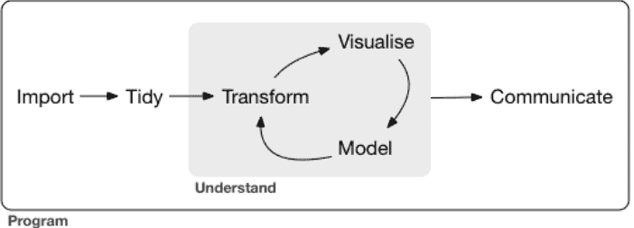

**图 1.1** *数据科学流程。*

通才型数据科学家在该工作流中会参与所有步骤（Monkman, 2019）；在本书中，我们将重点关注从“导入”到“整理”再到“转换”这些步骤。我们还将看到“可视化”如何成为探索性数据分析的重要部分，这是一种在清理数据之前识别数据潜在问题的策略。

### 1.3 现实世界中的数据

大多数数据科学和统计学教科书使用的示例数据集都格式规整、易于导入。安斯库姆四重奏（Anscombe, 1973）是一个著名的示例数据集，专为产生特定的统计结果而设计；它包含在 `R` 的基础版本中（R Core Team, 2021）。其他数据集可能是为用作教学示例而摘录的（Bryan, 2017），或是因其统计特性而被选用（Horst 等, 2022），或是作为展示某种方法论或技术的示例而编译（Kuhn, 2020），又或是用于清理、验证和汇总更大规模数据集合（Friendly 等, 2020）。

但在现实生活中，我们接触到的数据往往与这些教科书中的示例截然不同。

> *课堂数据就像泰迪熊；真实数据则像一只嘴里滴着鲑鱼血的大灰熊¹。*

- 数据可能以不同格式存储——电子表格、数据库、特定软件的文件格式、网站和 PDF 文件。无论是什么文件格式，我们都需要有工具来访问这些数据。

- 数据可能以不整洁的布局存储（Wickham, 2014），或者结构不一致。

- 我们可能会收到来自多个来源的数据，因此最终会出现两个文件，它们具有相同的值，但编码方式不同。例如，我在加拿大的家乡省份可以被表示为“British Columbia”、“B.C.”或“BC”。这三种写法都是准确的，但如果这些变体在数据源之间不一致（甚至更成问题的是在同一变量中不一致），就会引发问题。更别提日期格式了——我们稍后再讨论。

- 数据可能存在尚未被发现的错误。它可能不完整、不一致，或者存在数据录入错误和拼写错误。

- 数据可能存在偏差……而且偏差有很多不同类型。

- 数据可能来自行政来源，并且是为研究以外的目的而收集的。在这些情况下，你可能需要转换该数据，以使其符合研究问题的要求。

本书将介绍必要的步骤，以确保你能以允许你开展数据科学流程其余部分的方式组装你的数据，包括与其他可能寻求在进一步分析中使用该数据的数据分析师共享数据。

### 1.4 数据收集

在我们开始数据科学工作流之前——在我们到达“导入”步骤之前——必须有人收集数据。本书不涉及数据收集的过程，这是一个既宽广又深入的课题。其中包括确定数据将支持的研究问题（或假设）或业务需求，设计要捕获的实验或业务流程（这两者都可能包括调查问卷），以及开展实验（包括实地工作）或实施业务数据收集。数据收集过程的细节往往是特定于领域的，因此我鼓励你去寻找针对你所选学科领域的参考资料。

# 2 基础

本章内容：

- 数据准备流程

- 数据质量的原则，以及脏数据如何成为数据质量的一部分

- 理解什么使数据“干净”或“脏”，以及为什么上下文很重要

- 理解整洁数据的原则

### 2.1 数据准备流程

当我们开始数据准备之路时，首先应该思考我们想要达到的目标。

Ellis 和 Leek 的文章“如何共享数据进行协作”（Ellis 和 Leek, 2017）面向的是那些在学术环境中已经收集数据并准备进行进一步分析的科学家（“数据生成者”）——作者谈论的是“为统计学家准备数据”。

虽然 Ellis 和 Leek 有特定的背景设想，但他们论文中的原则具有广泛的适用性，这些实践在包括企业、政府或非营利组织在内的任何环境中都是必不可少的。在这些环境中，工作流中的角色、职责和分工通常与学术环境不同。数据收集和存储可能是为了支持业务需求，而将数据用于商业智能则是次要的好处。因此，常常有一个中间人，他不参与数据收集，但负责为建模、可视化和报告进行数据准备。同一个人也可能负责建模、可视化和报告。

在数据准备阶段结束时，在可视化和建模开始之前，应当具备：

### 2.2 数据质量

数据准备过程的一部分是问：“数据的*质量*如何？”

一个有助于构建你对此思考的参考资源是加拿大统计局的*《质量指南》*（Statistics Canada, 2019）。与世界各地其他官方统计机构一样，加拿大统计局的声音建立在向尽可能广泛的受众提供高质量数据之上。他们确定了数据质量的六个要素。

- 相关性：数据满足用户需求并与用户关心的问题相关联的程度。

- 及时性和准时性：信息参考期间与数据可用日期之间的延迟。

- 准确性和可靠性：准确性“是信息正确描述其旨在衡量现象的程度。”

- 可访问性和清晰度：“用户能够了解该信息（包括元数据）存在、找到它、查看它并将其导入自己的工作环境的难易程度。”

- 可解释性：“正确解释和使用统计信息所需的补充信息和元数据的可用性。”

- 一致性和可比性：“在广泛的分析框架内，随时间推移，该信息可以与其他统计信息可靠地组合和比较的程度。”

在我们的数据准备过程中，我们希望确保自己的工作是可访问和可解释的；这正是文档化的动机。

另一种“数据质量”分类法见（Wang 等, 1995）。高质量的数据是：

- 可访问的

- 可解释的

- 有用的

- 可信的

“脏数据”是指在*可信度*维度上有所欠缺的数据，具体而言，就是评估数据是否完整、一致和准确。需要特别指出的是，这些类别并非互斥；一个变量可能同时存在不一致和不准确的问题。

#### 完整

就我们的目的而言，“完整”是指每条记录中的各个值是否有缺失（内部完整性）。

“完整”并不意味着总体中的每一个成员都出现在数据中。通过精心设计的样本，总体中的一个子集有可能提供关于该总体的准确度量。此外，我们也有可能判断这些记录是否准确地代表了整体。

#### 一致

如果相同的值以相同的方式被记录，我们就认为该度量是“一致”的。

一致性的一些示例：

- 单位一致。一个例子是温度，确保数值统一以摄氏度报告，而不是混用华氏度和开尔文。另一个例子可能是在面向国际受众的调查或表单中，受访者可能以本国货币填写薪水。

- 拼写一致。我在加拿大的家乡省份是“British Columbia”，但经常被缩写为“B.C.”或“BC”。再想想美国薪资保障计划（PPP）申请中“Philadelphia”被拼写出的57种不同方式。（Au, 2020a）

- 在某些情况下，数据收集的方式可能会引入记录值的差异。这可以适用于从科学仪器（如空气质量传感器）的变异性（Khreis et al., 2008），到人们对不同媒介进行的调查作出回应方式的差异（Abeysundera, 2015）（Holbrook et al., 2003）（St-Pierre and Béland, 2004）。

#### 准确

当我们说“准确”时，我们指的是数据中记录的值就是所测量的值。

不准确数据的一些示例：

- 使用默认（或哨兵）值，将其作为占位符插入以代替缺失或“未知”的值。这有时是数据收集或数据库软件的一部分，导致本应为“unknown”的值被输入为默认值。这可能是数据录入验证过程要求必须有输入（也就是说，字段必须有条目才能继续数据录入），或者要求特定格式（如日期格式）的输入所导致的后果。在这些情况下，哨兵值可能被输入进去，而不是显式的“NA”。

> 安全文献数据库 SafeLit Foundation 的主管 Lawrence Davis 博士……告诉我，“在美国大多数州，警方事故报告的质量充其量只能算勉强可用作研究工具。……数据质量检查很少进行，而当质量被评估时，也发现存在不足。例如，在路易斯安那州，20世纪80年代的大多数事故中，大部分乘员是出生于1950年1月1日的男性。几乎所有涉及事故的车辆都是1960年款。”但实际上并非如此。这些只是默认设置。（Perez, 2019, p.190）

- 数据录入错误。最常见的可能是笔误，即输入了错误的值。另一种类型是我们所说的“变量错位错误”（即数值被移到了相邻的一列，这种情况在地址记录中屡见不鲜，比如城市名可能会出现在州/省那一列）。

- 数值被软件自动转换。微软的 Excel 电子表格程序是其中最著名的，它会把许多非日期值转换为日期格式，并赋予新值来存储数据。例如，输入字符串“SEPT1”会被转换为当年的9月1日。有记载的证据表明，这种软件行为曾导致基因研究出现错误。（Zeeberg et al., 2004），（Abeysooriya et al., 2021）

- 日期可能存储为数值（或“序列号”），表示从某个固定起点开始经过的天数——而该起点因操作系统而异。例如，Windows 版 Excel 使用1900年1月1日作为第一天，而早期的 Macintosh 电脑以及由此而来的 Macintosh 版 Excel 则使用1904年1月1日作为起始日期。因此，同一个日期会被存储为不同的值¹。（https://docs.microsoft.com/en-us/office/troubleshoot/excel/1900-and-1904-date-system）

1. “Excel 中1900和1904日期系统的区别”


- 矛盾。例如，假设同一个人被录入到两个数据库中，但当我们比较时发现出生日期不同，这可能是因为非 ISO8601 格式的录入：`07-08-79` 和 `08-07-79` 具有相同的数字，但一个可能是 `mm-dd-yy`，另一个可能是 `dd-mm-yy`……我们只是不知道哪个是正确的。或者是否有一个是笔误？

- 文化无知（暂时找不到更好的术语）。

  > “Prawo Jazdy”被认为是一个波兰人名字，被爱尔兰警察（Garda Síochána）列在警方刑事数据库中，称其在爱尔兰犯下超过50起交通违规。一份2007年的备忘录指出，调查显示 prawo jazdy [pra.v jaz.d] 在波兰语中是“驾照”的意思，错误是由于警察在开具交通罚单时，将波兰驾照上印制的这个短语误认为是人名而造成的。（Wikipedia contributors, 2021）

### 2.2.1 整洁数据

在清洗数据时，我们还应该考虑数据结构。目标应该是整洁的结构，即满足以下三条原则或规则：

- 每个变量必须有一列。
- 每个观测值必须有一行。
- 每个值必须有一个单元格。（Wickham, 2014）

在许多情况下，要实现整洁结构可能需要使用 `{tidyr}` 包的 `pivot_()` 函数对数据进行重塑（Wickham, 2021b）。在其他情况下，数据中的每个单元格可能有多个变量，需要将其拆分（例如地址）为每个变量单独的列。

其他常见的不属于上述四大数据质量类别的结构性问题包括：

1. 列标题是值而不是变量名。一个经常遇到的例子是时间单位，如下例所示。在下表中，“值”是年份。以这种方式组织的表只能显示一个变量的值；在本例中，它是国家的人口。

| country | 1952 | 2007 |
|---|---|---|
| Canada | 14,785,584 | 33,390,141 |
| United States | 157,553,000 | 301,139,947 |

更好的结构是设置一个 `year` 变量和另一个 `population` 变量。这种整洁结构还可以容纳这些年份内测量的其他变量，而不是在单独的表中显示。

| country | year | population | life expectancy |
|---|---|---|---|
| Canada | 1952 | 14,785,584 | 68.75 |
| Canada | 2007 | 33,390,141 | 80.65 |
| United States | 1952 | 157,553,000 | 68.44 |
| United States | 2007 | 301,139,947 | 78.24 |

2. 变量名重复（在某些数据存储格式中是可能的，包括纯文本和 Excel 文件）。
3. 不合适的数据类型，例如数字或逻辑值被存储为字符串。
4. 列中包含多种数据类型。例如，有些记录是数字，有些是字符串。这些值本身可能完全正确，但如果某些数字条目包含逗号作为千位分隔符，该变量将被读取并存储为字符类型。

## 2.3 清洗数据

如果数据不符合我们的标准或质量要求，我们就需要清洗数据。这听起来似乎不太有趣。我们不是想成为数据科学家、商业智能专家或学术科学家，去发掘隐藏在数据中的洞见吗？我们不是想进行分析吗？

有一种强有力的观点认为，数据清洗过程是分析过程的基本组成部分，或者相应的说法是：任何分析过程都需要数据清洗。

Randy Au 曾写道：“数据清洗的行为会对数据施加价值观/判断/解释，这些数据旨在让下游分析算法能够运行并给出结果。这与进行数据分析完全相同。事实上，‘清洗’只是走向完整数据分析过程中的一系列可复用数据转换。”（Au, 2020a）

此时我们应当问，当我们说“清洗数据”时，我们究竟在做什么？我们又该如何确认数据已按照我们所定义的方式“清洗”好了？

**第一个挑战**：我们如何发现数据中的问题？

**第二个挑战**：对于这些问题，我们能做什么，又应该做什么？

在接下来的几章中，作为数据导入过程的一部分，我们将会看到其中一些挑战和解决方案。我们还将在第11章和第12章中再次明确讨论这些挑战。

# 3 数据文档

在本章中：

- 我们为什么要创建文档
- 需要记录哪些要素
- 项目信息，包括数据字典
- 通过文学编程进行代码文档

## 3.1 引言

数据来源、方法和工作流程的文档对于可重复性至关重要。我们需要在两个方面拥抱文档：第一个是代码脚本内部，第二个是我们可能视为项目元信息的部分。

> “如果你没有考虑记录事情，你就不会去记录事情。” —— Karl Broman

如果你打算共享数据，文档也至关重要（White 等，2013）。我们创建的文档提供了元数据（我们将在下面的数据字典部分看到更多相关内容）。

## 3.2 文档与记录保存

记录我们工作的原因与保存并输出清洗后数据文件的原因类似：

- 使项目可供协作者使用。
- 为将来可能使用数据的其他人提供记录。你的项目可能会在一年或更久之后重复进行，而那时你可能已经转任新职。留下良好的文档是积德，或者说是“提前传递善意”——想象一下，当未来的用户发现你清晰的解释时，他们会感觉多么好！
- 在工作流程中创建一个保存点，以便我们之后可以继续工作，而不必经历所有步骤来记住我们所做的一切。

此外，事物会发生变化（数据、我们使用的软件和硬件、我们工作的动机），在我们实施这些事物时捕捉相关细节，有助于我们日后做出任何必要的更改。

在数据分析或数据科学的背景下，似乎没有一种“文档”的万能最佳方法指南。现有的建议往往是规定性的、高层次的，对于什么才是好的文档描述得不够具体。这个词出现在一些关于如何做数据科学的教科书和手册中，也有一些期刊文章在可重复性研究的背景下讨论文档。在博客文章“让我们认真对待文档”中，Randy Au 提出，或许“记录保存”（recordkeeping）是更好的术语。

> “记录保存是将记录、笔记和工件保留下来，以帮助将来创建文档。由参与实际工作的人员保存内容并做出只有他们自己才能真正理解的澄清，而不期望其他人都能理解一切。收集的材料主要用于编写实际文档。可以把它看作是为将来使用而保存原始数据。”（Au, 2020b）

我喜欢这种表述方式。在这种观点下，“文档”变成了一本完整成型的用户手册，适用于有许多不同贡献者参与的复杂且重复的项目，并且可能被认为是关键任务。很多数据科学工作并不符合这些标准，所以需要的不是“文档”，而是某人可以用来构建文档的笔记。

如果是一次性项目，你可以采用最少（但并非为零！）的记录保存。但定期重复的项目（无论是每日、每月还是每年）应该有更健全的记录保存，并可能还需要一些文档。

在工作开始时就考虑这一点非常重要，甚至可能在开始之前就要思考。采用这种方法，记录保存就融入了流程和你的日常工作流，并成为数据分析工作的一部分。例如，你可以在下载数据时记录数据的来源，或者在将某个特定函数纳入脚本后立即为其添加注释，说明选择该函数的原因。这些习惯不仅能捕捉你当时的想法，还会促使你思考决策背后的“为什么”——也许还会让你做出不同的选择。

可重复性的理念是良好科学实践的基本要素，并且应当扩展到包括数据分析。“可重复性的标准要求将用于分析数据的计算机代码和数据提供给他人。”（Peng, 2011, p.1226）

虽然在学术环境中这一点很重要，但可重复性的必要性也延伸到了商业和政府环境中。在任何数据分析为决策提供支持的情况下，分析师（也就是你）必须能够解释其方法，并快速有效地应对数据变化（你可能会收到包含更多记录或现有记录修订的数据更新）。

可重复性数据科学流程的好处总结如下：

- 节省时间，
- 产生更好的科学，
- 创造更受信任的研究，
- 降低出错风险，并且
- 鼓励协作。（Smith, 2017）

创建可重复性工作流程所涉及的所有细节都不在本书的范围内；在这里，我们只关心文档。

### 3.2.1 有效记录保存的要素

有效的记录保存需要捕捉三件事：

- 1. 决策的原因和方式。
- 2. 事物如何协同工作。
- 3. 如何进行更改。

## 3.3 代码文档

> “为你自己编写代码文档和注释，就好像你需要在6个月后理解它一样。”—— 归于 Jenny Bryan

在期刊文章《科学计算中的良好实践》中，作者写道：“良好的文档是软件被采用的关键因素，但在实践中，人们只有在有了会使用它的协作者之后，才会编写全面的文档。然而，他们会很快明白在每个脚本开头添加简短说明性注释的用处，因此我们建议将此作为第一步。”（Wilson 等，2017）

### 3.3.1 文学编程

计算机科学家 Donald Knuth 在1984年引入了“文学编程”的概念。在这种方法中，自然语言解释占据核心地位，每一步的代码块紧随解释之后。其理念是“将文档代码化”，而不是“将代码文档化”。

Knuth 写道：“让我们改变对程序构建的传统态度：不要想象我们的主要任务是告诉计算机做什么，而是专注于向人类解释我们想让计算机做什么。”（Knuth, 1992, p.99）

在数据科学项目中，这可以通过 R Markdown（或 Jupyter notebooks）实现，在这些工具中，关于代码块是什么以及为什么的文字描述可以放在代码块之前。因此，程序员的思考记录被保存在运行代码的文件中，而不是作为单独的“文档”存在。

这两句引言概括了代码文档的关键概念：

- “记录接口和原因，而不是实现。”（Wilson 等，2014）
- “注释应该解释为什么，而不是什么。”（Wickham, 2015, p.68）

在笔记中使用平实的语言也能促使你再次思考刚刚编写的代码。向想象中的未来读者（或你的橡皮鸭）解释代码，可能会帮助你找到更好的代码编写方式。

### 3.3.2 指令列表

指令列表是一种描述性文本，用来描述各部分代码在做什么。

在《如何共享数据进行协作》中，Ellis 和 Leek（Ellis and Leek, 2017）提出，代码功能的高层级概要至关重要。以下是对他们前两个步骤的改写：

- 步骤 1：获取原始数据文件，使用参数 `$a = 1, b = 2$` 运行汇总代码
- 步骤 2：分别对每个样本运行代码

接下来应用 Knuth 的“文学编程”（Literate Programming）理念，每一步后面都应该紧跟着实现该步骤的代码。R Markdown 格式非常适合这类工作；文本描述后面可以跟一段 R 代码，然后再跟另一对文本描述/R 代码块，以此类推。

在实践中，你可能会采取循序渐进的方法：

- 1. 为基本计划创建大纲，
- 2. 在该计划中添加你将在分析中执行的步骤，
- 3. 为每个步骤补充一些文本细节，
- 4. 编写代码。

### 3.3.3 带文档代码的示例

这些原则在实践中是什么样的？下面的示例展示了每个步骤可能的形式。

我们从大纲开始：

- 目标：找出世界上 10 个最大经济体的相对规模。
- 数据：将使用 `{gapminder}` 包，并使用最近一年的数据（2007 年）。
- 计算：人均 GDP * 人口 = 国家 GDP 总量。
- 表格：创建包含前 10 个国家的表格。

有了这个大纲，我们可以进入“数据”步骤

```
# DATA

gapminder_gdp <- gapminder::gapminder |>
  # filter for most recent year
  # use `slice_max()` function instead of hard-coding value
  # - make sure that it is the most recent data
  # note: this is a shorthand for `filter(year == max(year))`
  slice_max(year)
```

“计算”步骤：

```
# CALCULATION

gapminder_gdp <- gapminder_gdp |>
  # calculate total GDP
  mutate(gdpCountry = gdpPercap * pop) |>
  # divide by 10^12 to turn into trillions
  mutate(gdpCountry = gdpCountry/(10^12)) |>
  # select relevant variables
  select(country, gdpCountry)

head(gapminder_gdp)
```

```
## # A tibble: 6 x 2
##   country   gdpCountry
##   <fct>          <dbl>
## 1 Afghanistan    0.0311
## 2 Albania        0.0214
## 3 Algeria        0.207
## 4 Angola         0.0596
## 5 Argentina      0.515
## 6 Australia      0.704
```

最后，使用 `{gt}` 包创建表格并设置其格式（Iannone et al., 2023）

```
gapminder_gdp |>
  # use `slice_max()` with `n =` argument to get 10 largest economies
  # `slice_max()` has the added bonus of sorting in descending order
  slice_max(gdpCountry, n = 10) |>
  # create table with {gt} package
  gt::gt() |>
  # add table formatting
  fmt_number() |>
  # add table text
  tab_header(
    title = "Size of 10 largest national economies",
    subtitle = "Total GDP, 2007 (trillions of US$)"
  ) |>
  tab_source_note(
    source_note = "Source: {gapminder} package"
  )
```

10 个最大经济体的规模

2007 年 GDP 总量（万亿美元）

| 国家 | gdpCountry |
|---|---|
| 美国 | 12.93 |
| 中国 | 6.54 |
| 日本 | 4.04 |
| 印度 | 2.72 |
| 德国 | 2.65 |
| 英国 | 2.02 |
| 法国 | 1.86 |
| 巴西 | 1.72 |
| 意大利 | 1.66 |
| 墨西哥 | 1.30 |

来源：`{gapminder}` 包

```
# note: other table formatting to consider:
# - change variable names
# - add growth from 1957?
```

> > Benjamin D. Lee 的《记录科学软件的十条简单规则》（Lee, 2018）中的第一条是“边写代码边写注释。”

## 3.4 项目文档

项目文档中较高层级的一部分是项目文件的结构。

对于在学术环境中工作的人来说，Marwick、Boettiger 和 Mullen（Marwick et al., 2018）定义了研究汇编中应该包含的内容应遵循的三条通用原则。这些原则也可以适用于其他场景：

- 按照现行标准组织文件。
- 保持数据、方法和输出的清晰分离。
- 说明所使用的计算环境。

这些信息也被称为项目的“元数据”（White et al., 2013）。

需要纳入文档的更详细内容列表包括：

- 项目、分析和研究目标的简要描述。
- 文件夹结构图。
- 关于数据来源的详细信息
  - 收集数据的组织名称。
  - 该组织中负责人的姓名和联系方式。
  - 下载或提取日期。
  - 网页链接。
  - 原始文件名。
  - 指向数据附加文档（如数据字典）的链接。
- 关于分析*如何*完成的高层级说明
  - 例如：“本分析使用了 2010 年至 2019 年的每日数据来计算每月平均量，随后将其用于 ARIMA 模型以生成 6 个月预测。”
- 关于分析和代码的详细信息：
  - 影响决策的事项（“我选择这种统计检验是因为……”或“出生日期变量被转换为‘截至 2020 年 7 月 1 日的年龄’，因为……”）
  - 指令列表——描述文件或代码块在做什么、但不描述如何实现的描述性文本。
  - 数据字典或代码簿。
- 所用软件和包的详细信息：
  - 版本和（如有）发布日期。

### 3.4.1 README 文件

> > Benjamin D. Lee 在《记录科学软件的十条简单规则》（Lee, 2018）中的第四条规则是“包含一个带有基本信息的 README 文件。”

在项目的根文件夹中放置一个 README 文件，是记录项目大量重要通用信息的好方法。在数据文件夹中再放一个 README 文件也无妨。

另一个介绍数据文件 README 的来源是康奈尔大学研究数据管理服务小组撰写的《编写“readme”风格元数据指南》（Research Data Management Service Group, 2021）。

SFBrigade 是一个旧金山的志愿者公民科技组织，它为他们的项目创建了一个数据科学专用的 README 大纲，托管在 github¹。

推荐的基本最小 README 结构是：

¹Project-README-template.md (https://github.com/sfbrigade/data-science-wg/blob/master/dswg_project_resources/Project-README-template.md)

- 项目介绍/目标
- 项目描述
  - 一个缺失的组件是“数据来源”。
- 团队（含联系方式）

对于一个已完成的分析型项目，你可能还希望包含高层级的结果。这可能类似于学术期刊文章中的摘要，或商业或政府报告中的执行摘要。

另一个技巧来源是《README 的艺术》²。虽然它面向的是编写计算机程序和模块的人，但这些经验同样适用于数据科学项目。README 的目的是：

- 1. 告诉他们它是什么（结合上下文）。
- 2. 向他们展示它在实际使用中的样子。


- 3. 向他们展示如何使用它。
- 4. 告诉他们任何其他相关细节。

一个例子是 R 包 `{palmerpenguins}`，它在 GitHub 页面上有一个全面的 README。³

### 3.4.2 记录目录结构

你的文档（可能作为 README 文件的一部分）可以包含一张显示目录结构的图。`{fs}` 包（Hester et al., 2020）有一个函数 `dir_tree()`，它可以生成项目文件夹中文件夹结构和文件的树状图。

```r
library(fs)
```

默认情况下，它会显示当前目录下的所有子文件夹和文件。

```r
fs::dir_tree(path = "project_template")
```

## project_template

```
## +-- data
## |   \-- readme.md
## +-- data-raw
## |   +-- readme.md
## |   \-- source_data.xlsx
## +-- figs
## |   \-- readme.md
## +-- output
## |   \-- readme.md
## +-- readme.md
## \-- scripts
##      \-- readme.md
```

`recurse =` 参数指定树状图将绘制的目录结构深度。指定 `recurse = FALSE` 会将显示内容限制为当前目录内的文件和子文件夹。

```r
fs::dir_tree(path = "project_template", recurse = FALSE)
```

```
## project_template
## +-- data
## +-- data-raw
## +-- figs
## +-- output
## +-- readme.md
## \-- scripts
```

还可以通过使用整数（而不是 `FALSE` 或 `TRUE`）来指定层数。

```r
fs::dir_tree(path = "project_template", recurse = 2)
```

```
## project_template
## +-- data
## |   \-- readme.md
## +-- data-raw
## |   +-- readme.md
## |   \-- source_data.xlsx
## +-- figs
## |   \-- readme.md
## +-- output
## |   \-- readme.md
```

```
## +-- readme.md
## \-- scripts
##     \-- readme.md
```

Marwick、Boettinger 和 Mullen 提供了一些文件结构可能是什么样子的具体示例；请注意，该结构明确遵循 R 包的结构。他们展示的“中等规模汇编”图如下（Marwick et al., 2018, p.84）：


图 3.1 中等研究汇编。

在此示例中，有些元素可能与每个项目都无关（例如，代码和数据的许可证）。但请注意，数据与生成分析的代码之间有明确的分离。此外，这种结构得到了“项目”方法的良好支持，其中此处显示为“COMPENDIUM”的文件夹将是项目的根文件夹。我们需要的一切都包含在该单个文件夹中。

### 3.4.3 数据字典或代码本

正如我们将看到的，准备数据需要在过程中进行许多步骤，既有客观的也有主观的。创建这些决策的文档至关重要。该文档将作为数据来源的记录（如果还能包含收集细节的具体信息会更好，例如日期、收集方式和原始调查问卷），以及在重新编码和创建新变量时所做的假设和决策等等。

以下是数据字典的三个最低组成部分：

```
##  2  island      -  dbl+lbl  0
##
##
##  3  bill_length_mm  -  dbl  2
##  4  bill_depth_mm  -  dbl  2
##  5  flipper_length_mm -  dbl  2
##  6  body_mass_g  -  dbl  2
##  7  sex  -  dbl+lbl  11
##
##  8  year  -  dbl  0
## values
## [1] Adelie
## [2] Chinstrap
## [3] Gentoo
## [1] Biscoe
## [2] Dream
## [3] Torgersen
##
##
##
##
## [1] female
## [2] male
##
```

# 4 导入数据

本章内容：

- 导入数据的指南
- 为后续章节奠定基础

## 4.1 引言

数据已经收集。它可能是以下结果：

- 在受控实验室环境中进行试验或实验。
- 进行观察并记录观察结果（如天文学家或生物学家可能会做的）。
- 对某一地区的人进行抽样并向他们提出一系列问题。
- 作为业务运营的一部分收集信息。一个熟悉的例子是超市收银扫描仪，它们收集关于杂货购买的数据。这些数据随后通过跟踪销售和库存并生成订单来促进商店的运营管理。

一旦数据被收集，分析过程中的第一步之一就是导入数据——读取文件（或文件）的内容并开始为分析准备该数据。你可能自己收集了数据并设计了数据存储。或者在原始来源和它呈现给你的方式之间可能有一层处理。经过此处理后，你可能会：

- 可以访问存储原始数据的数据库，包括可能进行收集后额外操作的地方，
- 被发送一个包含原始数据样本的文件，
- 能够从网站下载数据，其中下载的表格包含已从更大的数据集中编译和汇总的数据。一个例子是某个国家的人口普查数据表。

需要注意的是，你的分析项目可能需要以上一种以上的数据收集方法。

你需要的数据如何组装将取决于许多因素，包括已有的内容、你的预算（例如，一些商业相关数据由公司收集，然后以成本提供），以及法律和监管环境（请注意，“个人信息”的定义因司法管辖区而异）。

“导入”步骤的具体细节将因文件格式和变量等因素而异，我们将在下一章中探讨所有这些内容。

## 4.2 数据格式

数据以多种电子格式存储。格式的选择可能受以下任何因素的影响：

- 数据收集者的基本需求（某些文件格式针对特定用途而定制）；
- 收集者可用的技术；
- 所收集数据的性质。

对于特定用例的最佳格式，有时（经常？）没有正确答案——每种格式都有利有弊。（话虽如此，数据存储和共享时通常有明显不太好的选择——我们看你，PDF。）这意味着在你的工作流程中，你必须处理需要从众多系统提取的数据，并且这些数据将以多种格式提供给你。

统计学家能够与数据库专家交流至关重要，并且作为团队成员，统计学家与其他大多数人一样，预计能够自行使用数据库设施用于大多数目的，当然也可以就设计方面提供建议。在分析开始之前，几乎无论数据库专家的工作多么出色，总是有大量的初步“数据清理”工作要做。（Venables, 2010）

有大量资源详细说明了不同数据存储格式的复杂性，以及确定特定用例适当格式的决策过程。我总是假设构建数据存储系统的专业人员做出了明智的决定，包括在不同格式之间平衡各种权衡，以及他们可能面临的预算和技术限制。

## 4.3 导入数据

这里有一些值得注意的建议：

1. 导入函数中的参数是你的朋友。在项目工作流程中将它们用作你的第一道防线。

   > “我的主要导入建议：使用**导入函数的参数尽可能快地尽可能深入**。*[特别强调。]* 初学者代码通常有很多不必要的导入后调整。阅读导入函数的文档并充分利用参数来控制导入。” (Bryan and The STAT 545 TAs, 2019, Chapter 9: Writing and reading files)

   实际上，这意味着导入函数的第一次迭代几乎肯定不会产生你想要的结果。我们很快就会看到一些例子，但这可能体现在变量名称或值的存储方式、缺失值的表示方式或电子表格的几何结构上。`read` 函数中的参数将允许你解决所有这些问题，甚至更多。返回并向函数添加参数，然后再次运行代码，反复运行，直到达到所需的位置。

2. 纯文本很无聊，但在长远来看是一种更灵活、更适应性强的格式；“今天的输出是明天的输入” (Bryan and The STAT 545 TAs, 2019, Chapter 9: Writing and reading files)

   > “在你有**实际证明**这行不通之前，以人类在文本编辑器中可读的纯文本文件作为你的默认选择。读写奇特或专有格式将是未来或在不同计算机上首先出现问题的地方。它也为使用不同工具包的人制造了障碍。保持软件无关。力求面向未来和傻瓜式。” (Bryan and The STAT 545 TAs, 2019, Chapter 9: Writing and reading files)

### 4.3.1 检查你的结果

在任何主要处理步骤后快速检查数据总是一个好主意。这可以从导入数据开始，但不限于此。

有些关于数据的问题需要问：

- 导入步骤是否给了你预期数量的记录（行）？
- 变量（列）的数量是否如你预期？
- 这些变量的变量类型（或类）是否符合你的预期？
  - 应该为数字的变量是否加载为数值类型，还是字符类型？
  - 如果使用标记变量，它们是否加载为因子类型？
- 缺失值是如何表示的？
  - 正如我们将在下一章看到的，许多导入函数提供了根据特定字符编码 NA 值的灵活性。

我们将在《验证策略》章节中查看调查数据内容的结构化方法。在接下来的几章中，我们将重点关注读取不同类型文件内容的过程。

### 4.3.2 结论

为了从不同文件类型导入数据，我们需要不同的 R 函数，我们将在下一章中深入探讨。虽然具体细节因文件类型而异，但有两个一般原则值得注意：

1. 使用导入函数的参数尽可能快地尽可能深入。
2. 在导入步骤结束时检查你的结果——不要等到后来才发现出了问题。

# 5 导入数据：纯文本文件

本章内容包括：

- 从分隔文本文件导入数据
- 从固定宽度文本文件导入数据

## 5.1 分隔的纯文本文件

纯文本文件（有时因其使用的字符编码标准而被称为“ASCII 文件”）常被用来共享数据。它们能包含的内容有限，这既有缺点也有优点。缺点在于它们无法携带任何附加信息，例如变量类型和标签。但优点在于它们不携带任何需要软件额外解释的附加信息。这意味着它们可以被多种多样的软件工具一致地读取。

纯文本文件有两种类型：分隔型和固定宽度型。“分隔”指的是文件中有一个字符作为两个变量之间的边界标记。一种非常常见的分隔格式是 CSV 文件；文件名中的字母代表“逗号分隔值”，并使用逗号作为变量分隔符。另一种不太常见的分隔类型使用制表符分隔变量，其扩展名为“TSV”，你猜对了，即“制表符分隔值”。偶尔你也会发现使用分号、冒号或空格作为分隔符的文件。

有一些基础 R 函数可以读取这种类型的文件。在处理纯文本文件时，`{readr}` 包（Wickham 和 Hester, 2020）中的函数相比基础 R 函数有一些优势。（`{readr}` 包是 tidyverse 的一部分。）与等效的基础 R 函数相比，`{readr}` 函数速度快得多，而且该包中的函数在将变量类型定义为读取操作的一部分时提供了一些有用的灵活性（而不是在读取数据后再修改变量类型）。此外，它返回的是 tibble 而不是数据框。（有关差异的信息，请参见（Wickham, 2019a, 3.6 数据框和 tibble）。）对于处理非常大的文件，你可能需要研究 `{data.table}` 包中的 `fread()` 函数（Doyle 等，2023）。

我们通过使用 `library()` 函数来激活 `{readr}`：

```r
library(readr)
```

在本章中，我们将使用 `{readr}` 包中的两个函数。每个函数都有多种参数，允许我们控制函数的行为；这些参数将在示例中介绍。

| 函数 | 用途 |
| --- | --- |
| `read_csv()` | 读取 CSV 文件的内容 |
| `read_fwf()` | 读取固定宽度文本文件的内容 |

## 5.2 使用 `{readr}` 读取 CSV 文件

在以下示例中，我们将使用 `{palmerpenguins}` 数据（Horst 等，2022；Horst，2020）中的版本。

在下面的代码块中，创建了一个 R 字符串对象 `penguins_path`，其中包含文件“penguins.csv”的位置文本字符串。

在第一个示例中，文件已使用 `{dpir}` 包加载到我们的计算机上，并使用该包中的 `dpir_data()` 函数访问该文件（无论它在我们计算机上的位置如何）。

在第二个示例中，文件位于 RStudio 项目文件夹中名为“data”的目录内。`{here}` 包将生成完整路径，使用斜杠或反斜杠分隔符（取决于计算机的操作系统），从 RStudio 项目的位置开始。

然后，`penguins_path` 对象被用于 `read_csv()` 函数中，以创建一个名为 `penguins_data` 的数据框对象。

```r
# Example 2
# create object path using the {here} package
penguins_path <- here::here("data", "penguins.csv")

# read the contents of the CSV file
penguins_data <- read_csv(penguins_path)
```

```
Rows: 344 Columns: 8 — Column specification
Delimiter: ","
chr (3): species, island, sex
dbl (5): bill_length_mm, bill_depth_mm, flipper_length_mm, body_mass_g, year
i Use `spec()` to retrieve the full column specification for this data.
i Specify the column types or set `show_col_types = FALSE` to quiet this message.
```

图 5.1 read_csv 消息。

该函数返回一条消息，让我们知道每个变量被分配的类型。

`{readr}` 包的参数允许对文件读取方式进行大量控制。特别有用的是以下这些：

| 参数 | 用途 |
| --- | --- |
| `col_types = cols()` | 定义变量类型 |
| `na = ""` | 指定哪些值要转换为 NA |
| `skip = 0` | 指定要跳过的行数；默认值为 0 |
| `n_max = Inf` | 要读取的最大记录数；默认值为 Inf，表示无穷大，解释为文件的最后一行 |

添加 `col_types = cols()` 参数有两个好处。首先，定义变量类型可以避免错误（例如数字字段将按数字读取，而不是字符），并加快读取过程，因为 R 不需要检查和推断变量类型。

其次，它允许我们修改 `{readr}` 已经为我们决定的内容。例如，我们可以将 species 变量设置为因子类型变量。

当我们显示整个表时，我们可以看到变量 species 现在是因子类型。

```r
penguins_data <- read_csv(penguins_path,
    col_types =
      cols(species = col_factor()))
penguins_data
```

固定宽度文件是存储昂贵和/或使用穿孔卡片时代遗留下来的。这意味着表格（或卡片）中的特定列被分配给一个特定变量，并且宝贵的空间没有被分隔符占用。自那以后，压缩方法意味着具有可变长度的 CSV 文件更为常见，但在某些大数据应用中，固定宽度文件可能更高效。

如果你必须处理固定宽度文件，你将（或应该！）收到一个配套文件，让你知道每个变量在每行中的位置。

在本例中，我们将使用 `{dpjr}` 包中提供的“authors_fwf.txt”。这个代码块将路径分配给文件位置，我们可以在后面的代码中使用它。

```r
authors_path <- dpjr::dpjr_data("authors_fwf.txt")
```

这个简单的文件有四个（或者，正如我们将看到的，如果我们把名和姓合并为一个，有时是三个）变量和三行记录。

- 名
- 姓
- 美国出生州（两位字母缩写）
- 随机生成的唯一 ID

如果我们在文本编辑器中打开文件，我们会看到：

```
Toni Morrison    IL    DJ-1944-QF96
Kurt Vonnegut    IN    XN-5632-TP58
Walt Whitman     NY    LW-1752-TD08
```

图 5.2 authors_fwf.txt。

我们也可以使用基础 R 函数 `readLines()` 来查看这些行：

```r
readLines(authors_path)
```

```
## [1] "Toni Morrison    IL    DJ-1944-QF96"
## [2] "Kurt Vonnegut    IN    XN-5632-TP58"
## [3] "Walt Whitman     NY    LW-1752-TD08"
```

`readr::read_fwf()` 函数中的参数包括上面为 `read_csv()` 函数列出的那些参数，以及其他一些特定于固定宽度文件的参数。

| 参数 | 用途 |
| --- | --- |
| `col_names = c()` | 定义变量名称列表 |
| `fwf_widths(widths = c(), col_names = c())` | 每个变量的字符长度及其名称的列表 |
| `fwf_positions(start = , end = , col_names = c())` | 每个变量起始和结束的字符位置及其名称 |
| `fwf_cols(variable1_name = c(), variable2_name = c())` | 名称后跟每个变量的起始和结束位置 |


| `fwf_cols(variable1_name = width, variable2_name = width)` | 名称后跟每个变量的宽度 |

下面的示例将详细说明这些参数。

第一种方法是让 `{readr}` 猜测列分隔的位置。`fwf_empty()` 函数会查看指定的文件并返回它猜测的开始和结束位置，以及 `read_fwf()` 函数使用的 skip 值。

注意，列名在列表中指定。

```r
fwf_empty(
  authors_path,
  col_names = c("first", "last", "state", "unique_id")
)
```

```
## $begin
## [1] 0 5 20 30
##
## $end
## [1] 4 13 22 NA
##
## $col_names
## [1] "first"   "last"    "state"   "unique_id"
```

然后该信息可以被 `read_fwf()` 函数使用：

```r
read_fwf(authors_path,
    fwf_empty(
      authors_path,
```

```
    col_names = c("first", "last", "state", "unique_id")
    )
```

```text
## # A tibble: 3 x 4
##   first last      state unique_id
##   <chr> <chr>     <chr> <chr>
## 1 Toni  Morrison  IL    DJ-1944-QF96
## 2 Kurt  Vonnegut  IN    XN-5632-TP58
## 3 Walt  Whitman   NY    LW-1752-TD08
```

注意，`{readr}` 会像处理 CSV 文件一样推断变量类型。虽然我们不会在这些示例中实现它，但同样地，`read_fwf()` 允许我们使用 `col_types` 规范，以及 `na`、`skip` 等参数。有关所有细节，请参阅 https://readr.tidyverse.org/reference/read_fwf.html 上的 `read_fwf()` 参考文档。

使用这三个作者姓名读取这个固定宽度文件是可行的，但它很容易出错。只要有一个人名字包含三个或更多组成部分（首字母、空格或连字符，如 Ursula K. Le Guin¹ 或 Ta-Nehisi Coates²），或者有一些缺失值，不一致的结构就会使 `read_fwf()` 解析器出错。

在下面的示例中，我们读取一个更长的作者姓名列表：

```r
authors2_path <- dpjr::dpjr_data("authors2_fwf.txt")

fwf_empty(authors2_path,
    col_names = c("first", "last", "state", "unique_id"))
```

```text
## $begin
## [1]  0 20 30
##
## $end
## [1] 19 22 NA
##
## $col_names
## [1] "first"     "last"      "state"     "unique_id"
```

如返回的“begin”和“end”值所示，`fwf_empty()` 函数只找到了三列。

¹ https://en.wikipedia.org/wiki/Ursula_K._Le_Guin

² https://en.wikipedia.org/wiki/Ta-Nehisi_Coates

当我们使用读取函数时，它找到三列：

```r
read_fwf(dpjr::dpjr_data("authors2_fwf.txt"))
```

```text
## # A tibble: 10 x 3
##    X1                  X2    X3
##    <chr>               <chr> <chr>
##  1 Toni Morrison       IL    DJ-1944-QF96
##  2 Kurt Vonnegut       IN    XN-5632-TP58
##  3 Walt Whitman        NY    LW-1752-TD08
##  4 Ursula K. Le Guin   CA    EZ-9789-EA77
##  5 Ta-Nehisi Coates    NY    YN-5151-NV82
##  6 W. E. B. Du Bois    MA    HN-6134-NF80
##  7 F. Scott Fitzgerald MN    YH-4405-TR02
##  8 N.K. Jemisin        IA    EF-7340-DW20
##  9 Flannery O'Connor   GA    HB-8269-XC88
## 10 Henry David Thoreau MA   RL-8200-SU83

Rows: 10 Columns: 3— Column specification

chr (3): X1, X2, X3
i Use `spec()` to retrieve the full column specification for this data.
i Specify the column types or set `show_col_types = FALSE` to quiet this message.
```

**图 5.3** *read_fwf 消息。*

现在添加 `col_names =` 参数会错误识别这些变量。

```r
read_fwf(authors2_path,
         fwf_empty(
           authors2_path,
           col_names = c("first", "last", "state", "unique_id")
         ))
```

```text
## # A tibble: 10 x 3
##    first                 last  state
##    <chr>                 <chr> <chr>
##  1 Toni Morrison         IL    DJ-1944-QF96
##  2 Kurt Vonnegut         IN    XN-5632-TP58
##  3 Walt Whitman          NY    LW-1752-TD08
##  4 Ursula K. Le Guin     CA    EZ-9789-EA77
##  5 Ta-Nehisi Coates      NY    YN-5151-NV82
##  6 W. E. B. Du Bois      MA    HN-6134-NF80
##  7 F. Scott Fitzgerald   MN    YH-4405-TR02
##  8 N.K. Jemisin          IA    EF-7340-DW20
##  9 Flannery O'Connor     GA    HB-8269-XC88
## 10 Henry David Thoreau   MA    RL-8200-SU83

Rows: 10 Columns: 3— Column specification

chr (3): first, last, state
i Use `spec()` to retrieve the full column specification for this data.
i Specify the column types or set `show_col_types = FALSE` to quiet this message.
```

**图 5.4** *read_fwf 消息。*

更可靠的方法是精确指定每一列的宽度。请注意，在下面的示例中，我们只指定“name”，而不将其拆分为 first 和 last。

| 变量 | 宽度 | 起始位置 | 结束位置 |

|----------|-------|----------------|--------------|

| name     | 20    | 1              | 20           |

| state    | 10    | 21             | 30           |

| uniqueID | 12    | 31             | 42           |

可以使用 `fwf_widths` 参数指定每列的宽度：

```r
read_fwf(authors2_path,
    fwf_widths(widths = c(20, 10, 12),
        col_names = c("name", "state", "unique_id")))
```

```text
## # A tibble: 10 x 3
##   name                state unique_id
##   <chr>               <chr> <chr>
## 1 Toni Morrison       IL    DJ-1944-QF96
## 2 Kurt Vonnegut       IN    XN-5632-TP58
## 3 Walt Whitman        NY    LW-1752-TD08
## 4 Ursula K. Le Guin   CA    EZ-9789-EA77
## 5 Ta-Nehisi Coates    NY    YN-5151-NV82
## 6 W. E. B. Du Bois    MA    HN-6134-NF80
## 7 F. Scott Fitzgerald MN    YH-4405-TR02
## 8 N.K. Jemisin        IA    EF-7340-DW20
## 9 Flannery O'Connor   GA    HB-8269-XC88
## 10 Henry David Thoreau MA   RL-8200-SU83

Rows: 10 Columns: 3— Column specification

chr (3): X1, X2, X3
i Use `spec()` to retrieve the full column specification for this data.
i Specify the column types or set `show_col_types = FALSE` to quiet this message.
```

**图 5.5** *read_fwf 消息。*

第三种选择是使用 `fwf_positions()` 提供两个位置列表，第一个包含起始位置，第二个包含结束位置。第一个变量 name 从位置 1 开始，到位置 20 结束；第二个变量 unique_id 从位置 31 开始，到位置 42 结束。注意，我们不会读取 state 变量，它占据了从 21 到 30 的十列。

```r
read_fwf(authors2_path,
    fwf_positions(start = c(1, 31), end = c(20, 42),
        col_names = c("name", "unique_id")))
```

```text
## # A tibble: 10 x 2
##   name               unique_id
##   <chr>              <chr>
## 1 Toni Morrison      DJ-1944-QF96
## 2 Kurt Vonnegut      XN-5632-TP58
## 3 Walt Whitman       LW-1752-TD08
## 4 Ursula K. Le Guin  EZ-9789-EA77
## 5 Ta-Nehisi Coates   YN-5151-NV82
## 6 W. E. B. Du Bois   HN-6134-NF80
## 7 F. Scott Fitzgerald YH-4405-TR02
## 8 N.K. Jemisin       EF-7340-DW20
## 9 Flannery O'Connor  HB-8269-XC88
## 10 Henry David Thoreau RL-8200-SU83

Rows: 10 Columns: 2— Column specification

chr (2): name, unique_id
i Use `spec()` to retrieve the full column specification for this data.
i Specify the column types or set `show_col_types = FALSE` to quiet this message.
```

**图 5.6** *read_fwf 消息。*

第四种选择是第三种选择的语法变体，使用相同的值但顺序不同。这一次，关于每个变量的所有相关信息都聚合在一起，变量名后跟起始位置和结束位置。

```r
read_fwf(authors2_path,
         fwf_cols(name = c(1, 20), unique_id = c(31, 42)))
```

```text
## # A tibble: 10 x 2
##    name                 unique_id
##    <chr>                <chr>
##  1 Toni Morrison        DJ-1944-QF96
##  2 Kurt Vonnegut        XN-5632-TP58
##  3 Walt Whitman         LW-1752-TD08
##  4 Ursula K. Le Guin    EZ-9789-EA77
##  5 Ta-Nehisi Coates     YN-5151-NV82
##  6 W. E. B. Du Bois     HN-6134-NF80
##  7 F. Scott Fitzgerald  YH-4405-TR02
##  8 N.K. Jemisin         EF-7340-DW20
##  9 Flannery O'Connor    HB-8269-XC88
## 10 Henry David Thoreau  RL-8200-SU83

Rows: 10 Columns: 2— Column specification

chr (2): name, unique_id
i Use `spec()` to retrieve the full column specification for this data.
i Specify the column types or set `show_col_types = FALSE` to quiet this message.
```

**图 5.7** *read_fwf 消息。*

最后，`{readr}` 提供了第五种读取固定宽度文件的方法，它类似于我们见过的第二种方法，将名称和宽度值聚合在一起。

```r
read_fwf(authors2_path,
         fwf_cols(name = 20, state = 10, unique_id = 12))
```

```text
## # A tibble: 10 x 3
##    name                 state unique_id
##    <chr>                <chr> <chr>
##  1 Toni Morrison        IL    DJ-1944-QF96
##  2 Kurt Vonnegut        IN    XN-5632-TP58
##  3 Walt Whitman         NY    LW-1752-TD08
##  4 Ursula K. Le Guin    CA    EZ-9789-EA77
##  5 Ta-Nehisi Coates     NY    YN-5151-NV82
##  6 W. E. B. Du Bois     MA    HN-6134-NF80
##  7 F. Scott Fitzgerald  MN    YH-4405-TR02
##  8 N.K. Jemisin         IA    EF-7340-DW20
##  9 Flannery O'Connor    GA    HB-8269-XC88
## 10 Henry David Thoreau  MA    RL-8200-SU83

Rows: 10 Columns: 3— Column specification

chr (3): name, state, unique_id
i Use `spec()` to retrieve the full column specification for this data.
i Specify the column types or set `show_col_types = FALSE` to quiet this message.
```

**图 5.8** *read_fwf 消息。*

### 5.3.1 一个固定宽度文件的极端示例

一个特别有趣的研究问题是教育水平与不同健康结果之间的关系。在这个示例中，我们将开始导入一个大文件的过程，该文件包含的数据将使我们能够探索是否存在相关性。

加拿大统计局提供了加拿大/美国联合健康调查（JCUSH）的公共使用微观数据文件（PUMF），该调查是于 2002 年底和 2003 年初进行的一项电话调查。调查共有 8,688 名受访者，其中 3,505 名加拿大人和 5,183 名美国人。可用的数据文件是匿名的，因此我们可以访问个人回答，这将有助于进一步分析。


该调查的网页，包括 PUMF 文件、数据字典和方法说明，位于：`https://www150.statcan.gc.ca/n1/pub/82m0022x/2003001/4069119-eng.htm`

PUMF 是一个名为“`JCUSH.txt`”的固定宽度文件。这个文件比上面的作者姓名示例大得多。共有 8,688 条记录，每条记录对应一名调查受访者。数据还包含 366 个变量，其中包括指定变量（如受访者唯一识别号和所在国家）、调查问题答复，以及在调查后数据处理过程中计算出的派生变量。

以下是第一条记录的前 40 个字符的示例：

```
readLines(dpjr::dpjr_data("JCUSH.txt"), n = 1)
```

## [1] "1000033308351200211170432144421333431126"

此数据文件中没有任何空白。366 个变量仅存储在 552 列中——平均每个变量 1.5 列！这很好地体现了这种数据编码方式所带来的效率。

让我们假设我们的研究目标是确定一个人的教育水平与其健康结果之间是否存在关系。我们已查阅数据文档，很明显 JCUSH 数据包含了我们所需的内容。

以下是数据字典中一个变量——最高后中学教育程度——的呈现方式：

| 变量名称 | SDJ1GHED | 长度 | 1 | 位置 | 502 |

| 问题名称 |  |  |  |  | |

| 概念 | 最高后中学教育程度 - (G) |  |  |  | |

| 问题 |  |  |  |  | |

| 总体 | 所有受访者 |  |  |  | |

| 备注 | 基于 EDJ1_02. |  |  |  | |

| 内容 | 代码 | 样本 | 人口 |  | |

| 中学以下 | 1 | 1,357 | 28,015,770 |  | |

| 高中毕业或同等学历 (GED) | 2 | 2,798 | 81,272,698 |  | |

| 职业证书/职业学校/社区学院/CEGEP | 3 | 1,451 | 32,707,506 |  | |

| 大学或学院证书（含本科以下） | 4 | 2,806 | 79,483,995 |  | |

| 未说明 | 9 | 276 | 8,984,053 |  | |

| 总计 |  | 8,688 | 230,464,023 |  | |

图 5.9 JCUSH 健康调查示例。

变量 `SDJ1GHED` 在数据中长度为 1 个字符，位置为 502。该变量可能只有 1 个字符长，但结合内容表中的信息，它就成为了一条非常有价值的信息。

对于我们的分析问题，我们将读取四个变量：唯一的家庭识别号、国家、总体健康结果和教育水平。对于变量名称，我们将使用数据字典中使用的相同名称：

然而，想象一下同时处理这么多数据的挑战！由于变量众多且值标签复杂，“数据”不仅仅是固定宽度的文件。这正是另一种数据存储解决方案（我们稍后会看到）具有一定优势的情况。

# 6

## 导入数据：Excel

本章内容：

- 从 Excel 电子表格导入数据
- 提取以 Excel 格式编码的数据

### 6.1 引言

电子表格和类似的数据表或许是数据最常见的提供方式。由于它们起源于会计工作表的电子版本，因此具有表格结构，适用于数据收集、存储、分析以及共享（即发布）等其他情况。某种形式的电子表格软件在购买新电脑时通常是标准配置，而 Microsoft Excel 是其中最常见的。Google 还提供了一个基于网络的电子表格工具 Google Sheets，其工作原理大致相同。

虽然电子表格中的数据通常以与纯文本文件（如我们在上一章中使用的 CSV 文件）类似的方式存储，但 Excel 的设计是为了提供更多功能。

Broman 和 Woo（Broman and Woo, 2017）提供了在电子表格中进行良好数据存储实践的指南，但你更有可能遇到不符合该标准的电子表格。Paul Murrell 将他的文章命名为“Data Intended for Human Consumption, Not Machine Consumption”（Murrell, 2013）是有原因的：太多的电子表格被用来使数据对你和我来说易于阅读，但这使得我们更难将其放入软件程序可以进行进一步分析的结构中。

电子表格如 Excel 也有一面阴暗的（至少在数据存储方面）——你看到的值不一定就是单元格中的内容。例如，一个单元格可能是算术函数的计算结果，该函数从工作表的其他位置（或在某些情况下，从另一张工作表，或另一文件中的另一张工作表）获取一个或多个值。一些用户会对单元格进行颜色编码，但没有索引告诉你每种颜色的含义。（Bryan, 2016b）（有关另一种设想，请参阅“Sanesheets”（Bryan, 2016a）。）

“将格式作为数据”和“将格式作为信息”这两种存储信息的方法会使我们难以进行分析。Excel 文件还可以包含各种各样的数据格式类型。例如，使用 Excel 时你会发现，前导或尾随的空白会使数字变成字符，即使单元格被赋予了 Excel 数字格式。

`{readxl}` 包（Wickham and Bryan, 2019）旨在解决读取 Excel 文件的许多挑战。要访问 `{readxl}` 中的函数，我们使用 `library()` 函数将包加载到活动项目中：

```
library(readxl)
```

`{readxl}` 会尝试弄清每个变量的情况，但与 `{readr}` 类似，如果返回的结果与分析所需不同，你可以覆盖其中一些自动决策。我们将使用的 `{readxl}` 参数包括以下内容：

| 参数 | 用途 |
|---|---|
| `sheet = ""` | 用字符字符串指定要读取的 Excel 工作簿中的工作表名称 |
| `range = ""` | 定义要读取的矩形；请参阅下面的示例了解语法选项 |
| `skip = 0` | 指定要跳过的行数；默认值为 0 |
| `n_max = Inf` | 要读取的记录的最大数量；默认值为 Inf（无穷大），解释为文件的最后一行 |

对于本示例，我们将使用一些模拟数据，这类数据是数据分析师在进行人力资源数据分析以支持业务决策时可能遇到的类型。文件“`cr25_human_resources.xlsx`”位于“`cr25`”文件夹中。

由于 Excel 文件可以包含多个工作表，因此我们需要指定要读取的工作表。`{readxl}` 函数 `excel_sheets()` 会为我们列出它们：

```
excel_sheets(dpjr::dpjr_data("cr25/cr25_human_resources.xlsx"))
```

```
## [1] "readme"              "df_HR_main"
## [3] "df_HR_transaction" "df_HR_train"
```

我们示例中需要的是“`df_HR_main`”，它包含 999 名员工各自的员工 ID、姓名、出生日期和性别。

在我们的 `read_excel()` 函数中，我们可以指定工作表的名称或基于其在 Excel 文件中位置的编号。虽然默认读取第一个工作表，但明确指定通常是良好的做法，因为 Excel 用户容易重新排列工作表的顺序（包括添加新工作表）。而且由于他们似乎不太可能重命名工作表，这也是我们使用名称而非编号的另一个原因。

```
df_HR_main <- 
  read_excel(
    path = dpjr::dpjr_data("cr25/cr25_human_resources.xlsx"),
    sheet = "df_HR_main"
  )
```

```
## New names:
## * ` ` -> `...2`
## * ` ` -> `...3`
## * ` ` -> `...4`
## * ` ` -> `...5`
## * ` ` -> `...6`
## * ` ` -> `...7`
```

```
head(df_HR_main)
```

```
## # A tibble: 6 x 7
##   df_HR_main   ...2   ...3   ...4   ...5   ...6   ...7
##   <chr>        <chr>  <chr>  <chr>  <chr>  <lgl>  <chr>
## 1 The main datab... <NA> <NA> <NA> <NA> NA <NA>
## 2 <NA>         <NA> <NA> <NA> <NA> NA <NA>
## 3 <NA>         <NA> <NA> <NA> <NA> NA <NA>
## 4 <NA>         <NA> <NA> <NA> <NA> NA <NA>
## 5 <NA>         emp_~ date~ name gend~ NA NOTE:
## 6 <NA>         ID001 29733 Avri~ Fema~ NA <NA>
```

该工作表具有我们在 Excel 文件中常见的结构：除了感兴趣的数据外，文件创建者还友好地为工作表添加了标题。他们还可能在数据的“边距”中（通常在数据右侧或下方）放置注释，并添加格式使其对人类阅读者更具视觉吸引力（注意空列或隐藏列和行！）。

虽然这通常是有用的信息，但其存在意味着我们需要修剪行和列，以便将数据框整理成适合分析的有用结构。

`read_excel()` 函数提供了多种定义要读取范围的方法。其中一种在函数中效果良好，并且与许多 Excel 用户思考电子表格的方式一致，使用 Excel 的列-行字母数字命名法定义数据的左上角和右下角。对于此文件，这将排除顶部行、数据左右两侧的空列以及右侧的额外注释。角落单元格为 B5 和 E1004。我是怎么知道的？

**重要提示：打开文件在 Excel 中进行视觉扫描以查找异常值并记录数据矩形的角落是完全没有问题的。**

```
```r

df_HR_main <-

  read_excel(

    path = dpjr::dpjr_data("cr25/cr25_human_resources.xlsx"),

    sheet = "df_HR_main",

    range = "B5:E1004"

  )

head(df_HR_main)

```
```

```
```text

## # A tibble: 6 x 4

##   emp_id date_of_birth             name              gender

##   <chr>  <dttm>                   <chr>             <chr>

## 1 ID001  1981-05-27 00:00:00 Avril Lavigne       Female

## 2 ID002  1973-09-24 00:00:00 Katy Perry          Female

## 3 ID003  1966-11-29 00:00:00 Chester Bennington Male

## 4 ID004  1982-09-17 00:00:00 Chris Cornell       Male

## 5 ID005  1976-07-17 00:00:00 Bryan Adams         Male

## 6 ID006  1965-07-03 00:00:00 Courtney Love       Female

```
```

`range` 参数还提供了使用 Excel 的行号-列号指定方式的选项，这会将上述 `range = "B5:E1004"` 改为 `range = "R5C2:R1004C5"`（“B”指第二列，“E”指第五列）。

```
```r

df_HR_main <-

  read_excel(

```


```

path = dpjr::dpjr_data("cr25/cr25_human_resources.xlsx"),

sheet = "df_HR_main",

range = "R5C2:R1004C5"

)

```

在 `read_excel()` 函数中，还有多种其他方式来定义数据矩形区域，在不同情境下可能更为合适。例如，如果表格底部不断有新行添加，使用 `range = anchored("B5", dim =c(NA, 4))` 这种指定方式可能更受青睐。这将从单元格 B5 开始，然后读取尽可能多的数据行（`c()` 函数中的“NA”表示行数不限定）以及四列数据。

```

df_HR_main <- 

  read_excel(

    path = dpjr::dpjr_data("cr25/cr25_human_resources.xlsx"),

    sheet = "df_HR_main",

    range = anchored("B5", dim =c(NA, 4))

  )

head(df_HR_main)

```

```

## # A tibble: 6 x 4

##   emp_id date_of_birth       name            gender

##   <chr>  <dttm>              <chr>           <chr>

## 1 ID001  1981-05-27 00:00:00 Avril Lavigne   Female

## 2 ID002  1973-09-24 00:00:00 Katy Perry      Female

## 3 ID003  1966-11-29 00:00:00 Chester Bennington Male

## 4 ID004  1982-09-17 00:00:00 Chris Cornell   Male

## 5 ID005  1976-07-17 00:00:00 Bryan Adams     Male

## 6 ID006  1965-07-03 00:00:00 Courtney Love   Female

```

`read_excel()` 的另一个出色特性是，对于它识别为日期的变量，会返回日期类型（S3：POSIXct）。

¹ 更多选项，请参阅 https://readxl.tidyverse.org/articles/sheet-geometry.html

### 6.2 扩展示例

很多时候，Excel 文件远比上述情况复杂。在下面的例子中，我们将读取英国国家统计局发布的一个 Excel 文件中的某个工作表，该文件取自 2021 年英格兰和威尔士人口普查。文件 “`census2021firstresultsenglandwales1.xlsx`” 包含按地方当局（地区）划分的人口数据，并包含有关数据的说明工作表，以及按性别和五岁年龄组划分的人口数据表，同时还有人口密度和家庭户数。

我们的重点是 “P01” 工作表，其中包含按性别划分的人口。数据的前几行如下所示：

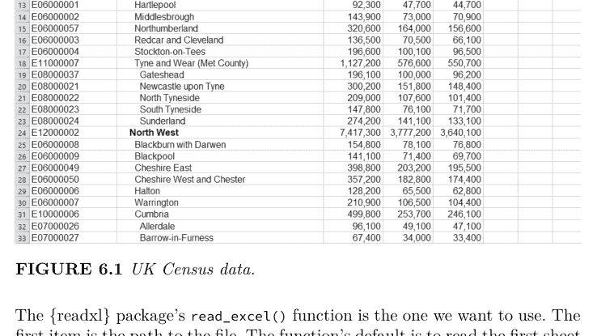

**图 6.1** *英国人口普查数据。*

我们要使用的正是 `{readxl}` 包中的 `read_excel()` 函数。第一项是文件路径。该函数的默认行为是读取 Excel 文件中的第一个工作表，这不是我们想要的，因此我们使用 `sheet =` 参数来指定 “P01”。我们还将使用 `n_max = 10` 参数仅读取工作表中的前 10 行。

```

uk_census_pop <- readxl::read_excel(

  dpjr::dpjr_data("census2021firstresultsenglandwales1.xlsx"),

  sheet = "P01",

  n_max = 10

)

```

uk_census_pop

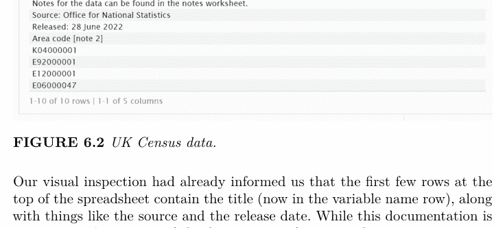

**图 6.2** 英国人口普查数据。

我们通过目视检查已经发现，电子表格顶部的头几行包含标题（现在位于变量名行），以及数据来源和发布日期等信息。虽然这些文档信息很重要，但它并不是我们分析所需的数据的一部分。

`read_excel()` 的另一个用于指定包含我们数据的矩形区域的参数是 `skip =`。由于我们的目视检查显示，我们感兴趣的数据的标题行从第七行开始，我们将使用它来跳过前 6 行。

```

uk_census_pop <- readxl::read_excel(

  dpjr::dpjr_data("census2021firstresultsenglandwales1.xlsx"),

  sheet = "P01",

  n_max = 10,

  skip = 6

)

head(uk_census_pop)

```

```

##  7 E0600002 Middlesbrough      143900  7.3 e4 7.09e4

##  8 E0600057 Northumberland     320600  1.64e5 1.57e5

##  9 E0600003 Redcar and Cle~   136500  7.05e4 6.61e4

## 10 E0600004 Stockton-on-Te~  196600  1.00e5 9.65e4

## # i 365 more rows


数据已被正确读取，包括数据变量以正确的格式读取。但这丢失了一项重要信息：地理层级。在 Excel 文件中，层级的级别通过缩进表示。我们的下一个挑战是捕获该信息，并将其转化为可用的数据。

### 6.2.1 将 Excel 格式作为数据

关于这些数据，有一点值得注意：`Area name` 变量是分层的，包含一系列小计。较低（较小）的层级包含层次结构中下一较高层级的组成区域，这些层级通过区域名称值中的缩进来表示。层级越低，区域名称的缩进越多。

层级的具体情况如下：

- “England and Wales” 的值包含总人口，即英格兰（Excel 的第 8 行）和威尔士（第 360 行）的总和。
- 英格兰（但不包括威尔士）再进一步细分为九个国家以下地区（在 `Area code` 变量的前三个字符中编码为 “E12”）。
- 这些地区再划分为更小的单位，但这些单位的描述各不相同。这些单位包括单一管理区（E06）、伦敦自治市（E09）、郡（E10）和大都会郡（E11）；为便于说明，我们将这一级别简称为“郡”。
- 郡级以下进一步划分为非都市区（E07），而大都会郡则细分为大都会区（E08）。上图显示泰恩-威尔（E11 大都会郡，第 18 行）被细分，从盖茨黑德开始，而坎布里亚郡（E10 郡，第 31 行）也被细分，从阿勒代尔开始。
- 威尔士划分为单一管理区，在 `Area code` 变量的前三个字符中编码为 “W06”。在威尔士，没有中间的地区层级，因此这些单一管理区与英格兰的单一管理区处于同一级别。“地方当局区、郡和单一管理区（2021 年 4 月）英国地图³。

2 英国行政地理的层级可在 [ONS “行政地理”页面](https://www.ons.gov.uk/methodology/geography/ukgeographies/administrativegeography) 上的 “英格兰” 和 “威尔士” 链接中查找。

这种复杂的结构意味着数据包含多个小计——对 `All persons` 变量执行 `sum()` 函数将得到总人口 277,092,700，大约是 2021 年英格兰和威尔士实际人口 59,597,300 的 4.7 倍。

更有用的结构应具备以下特征：

- 无重复（人口不被重复计算）。
- 一个用于层级级别的代码，以便进行筛选。
- 额外的变量（列），使每一行都包含其所归属的较高级别区域。例如，达勒姆郡应该有一个列包含地区值 “North East” 和国家值 “England”。

有了这样的结构，我们就可以在 `group_by()` 函数中使用不同的区域分组。

正如我们之前看到的，`{readxl}` 的 `read_excel()` 函数会忽略格式，因此无法从字符中辨别层级。

让我们探索一些方法来提取嵌入在数据和格式中的信息，并利用这些信息来修剪重复的行。

### 方法 1 - 使用地区代码

我们可以采用的第一个方法是提取 `area_code` 变量中的地区元素，并使用它来筛选数据。

例如，如果我们想按郡级绘制英格兰的人口，一种方法是识别所有地区代码以下列字符开头的行：

- 单一管理区（E06）、伦敦自治市（E09）、郡（E10）和大都会郡（E11）

为此，我们可以设计一个正则表达式，使用 “^” 字符来识别开头的字母 “E”。（请记住，“E” 代表英格兰，“W” 代表威尔士。）然后，在第 2 个字符位置（第一组方括号内）是 0 或 1，在第 3 个字符位置（第二组方括号内）是 6、9、0 或 1 之一。

```r
county_pop <- uk_census_pop |>
  filter(str_detect(area_code, "^E[01][6901]"))
dplyr::glimpse(county_pop, width = 65)
```

## Rows: 122
## Columns: 5
## $ area_code  <chr> "E06000047", "E06000005", "E06000001", "E06~
## $ area_name  <chr> "County Durham", "Darlington", "Hartlepool"~
## $ all_persons <dbl> 522100, 107800, 92300, 143900, 320600, 1365~
## $ females    <dbl> 266800, 55100, 47700, 73000, 164000, 70500,~ 
## $ males      <dbl> 255300, 52700, 44700, 70900, 156600, 66100,~

我们可以通过 `distinct()` 函数检查正则表达式是否按预期工作，仅检查 area_code 字符串的前三个字符：

```r
county_pop  |>
  distinct(str_sub(area_code, 1, 3))
```

## # A tibble: 4 x 1
## `str_sub(area_code, 1, 3)`
##   <chr>
## 1 E06
## 2 E11
## 3 E10
## 4 E09

另一种方法是创建所需三字符代码的列表，然后在主数据中创建一个新变量，并根据这个 UA 代码列表进行筛选：

```r
# create list of UA three-character codes
county_list <- c("E06", "E09", "E10", "E11")
county_pop <- uk_census_pop |>
  # create three character area prefix
  mutate(area_code_3 = str_sub(area_code, 1, 3)) |>
  # filter that by the county_list
  filter(area_code_3 %in% county_list)
```

为了进行验证检查，我们将确保 UA 清单是完整的，并且计算出的总人口与源数据中“England”一行的数据一致：

```r
# check
county_pop |>
  distinct(area_code_3)
```

```text
## # A tibble: 4 x 1
##   area_code_3
##   <chr>
## 1 E06
## 2 E11
## 3 E10
## 4 E09
```

```r
# check
county_pop |>
  summarize(total_pop = sum(all_persons))
```

```text
## # A tibble: 1 x 1
##   total_pop
##   <dbl>
## 1 56489600
```

虽然这种方法适用于我们的特定示例，但每次使用都需要仔细编写代码。由于灵活性有限，我们可能想采用另一种方法。

```text
## Rows: 1,888
## Columns: 3
## $ address      <chr> "A1", "D1", "A2", "A3", "A4", "A5", "A6~
## $ character    <chr> "P01 Census 2021: Usual resident popula~
## $ local_format_id <int> 48, 29, 30, 14, 14, 14, 14, 14, 55, 55,~
```

接下来，我们需要读取 Excel 文件中存储的每种格式的详细信息——格式“14”具有特殊特征，包括单元格中的缩进数量。

为此，我们使用 `{tidyxl}` 函数 `xlsx_formats()`。我们只需要指定文件的路径。“Excel 为整个工作簿只定义一个这样的字典，因此每种格式组合只记录一次。两个具有相同格式但位于不同工作表中的单元格，将具有相同的格式代码，引用该字典中的相同条目”⁴。

下面的代码读取格式并将结果分配给一个新对象 `uk_census_formats`。

```r
uk_census_formats <- xlsx_formats(
  dpjr::dpjr_data("census2021firstresultsenglandwales1.xlsx")
)
```

在我们的环境中检查 `uk_census_formats` 对象时，我们看到它包含两个列表，一个名为“local”，另一个名为“style”。如果我们查看“local”内部，会看到一个名为“alignment”的列表，其中包含“indent”——这就是我们要找的。

你可能已经注意到，这些列表中有 62 个元素，而不是 382 个（Excel 文件中的行数），也不是代表工作表 P01 中每个活动单元格的 1,888 个。62 表示整个 Excel 文件（跨所有工作表）中存在的不同格式的数量。

我们可以使用下面的代码提取这个嵌套列表，其中包含文件中不同单元格格式的所有缩进规范：

```r
indent <- uk_census_formats$local$alignment$indent
indent
```

```text
##  [1] 0 0 0 0 0 0 0 0 0 0 0 0 0 0 0 0 0 0 0 0 0 0
## [26] 0 0 0 0 0 0 0 0 0 0 0 0 0 0 0 0 0 0 0 0 0 0
## [51] 0 0 0 0 0 0 0 0 1 2 4 3 0
```

⁴Duncan Garmonsway，对 `{tidyxl}` 包存储库中第 84 号问题的回复，2022-05-26。https://github.com/nacnudus/tidyxl/issues/84

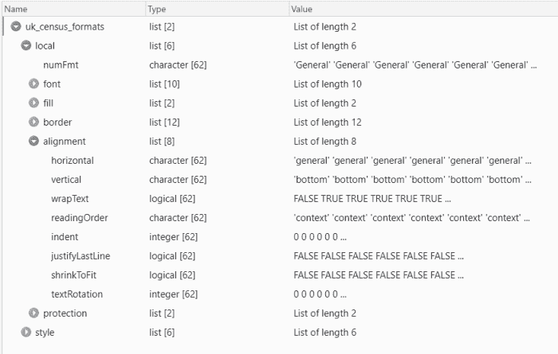

**图 6.3** *英国人口普查数据。*

这表明，对于文件中使用的大多数各种单元格格式，大多数缩进为零，但有些具有 1、2、3 或 4 个缩进。

回到对象 `uk_census`。我们感兴趣的是从第八行开始的数据，因此我们需要对其进行筛选。

要使 `{tidyxl}` 函数正常工作，第一列需要定义层次结构。为此，我们将使用 `!=` 运算符将其选中。

`behead_if()` 函数识别数据透视表中的一级表头，并将其作为数据的一部分。与 `{tidyr}` 包的 `pivot_longer()` 函数类似，它根据表头为每一行创建一个新变量。在英国人口普查数据中，表头通过格式中的缩进数量来区分。

让我们通过将“left-up”位置值赋给一个新变量 `field0` 来测试这一点。对于 `uk_census` 对象中的每一行，都会评估与 `local_format_id` 相关联的缩进数量；如果为零，则会发生以下情况：从数值开始，函数先向左查找，然后向上查找，直到找到缩进数量更少的值。例如，“England”行有一个缩进，因此函数会向左和向上查找，直到找到格式中缩进为零的值；该单元格的值会被赋给变量 `field0`（用于零缩进）。

```r
uk_census |>
  dplyr::filter((row >= 7)) |>
  filter(col != 1) |>
  behead_if(indent[local_format_id] == 0,
    direction = "left-up",
    name = "field0"
  ) |>
  select(address, row, col, content, field0) |>
  dplyr::filter(row < 30)
```

```text
## # A tibble: 90 x 5
##   address   row   col content field0
##   <chr>   <int> <int> <chr>   <chr>
## 1 C7          7     3 104     Area name
## 2 D7          7     4 105     Area name
## 3 E7          7     5 106     Area name
## 4 C8          8     3 59597300 England and Wales
## 5 D8          8     4 30420100 England and Wales
## 6 E8          8     5 29177200 England and Wales
## 7 B9          9     2 110     England and Wales
## 8 C9          9     3 56489800 England and Wales
## 9 D9          9     4 28833500 England and Wales
## 10 E9         9     5 27656300 England and Wales
## # i 80 more rows
```

让我们继续遍历所有缩进级别。一共有四个，因此我们将创建一个以 field 开头、后跟表示缩进数量的数字的变量。

```r
uk_census_behead <- uk_census |>
  dplyr::filter((row >= 7)) |>
  filter(col != 1) |>
  behead_if(indent[local_format_id] == 0,
    direction = "left-up", name = "field0") |>
  behead_if(indent[local_format_id] == 1,
    direction = "left-up", name = "field1") |>
  behead_if(indent[local_format_id] == 2,
    direction = "left-up", name = "field2") |>
  behead_if(indent[local_format_id] == 3,
    direction = "left-up", name = "field3") |>
  behead_if(indent[local_format_id] == 4,
    direction = "left-up", name = "field4")
```

在下面的版本中，只有最后一行发生了变化。所有其他缩进值都已评估，因此它不需要“`_if`”和相关评估，也不需要方向中的“-up”。

```r
uk_census_behead <- uk_census |>
  dplyr::filter((row >= 7)) |>
  filter(col != 1) |>
  behead_if(indent[local_format_id] == 0,
            direction = "left-up", name = "field0") |>
  behead_if(indent[local_format_id] == 1,
            direction = "left-up", name = "field1") |>
  behead_if(indent[local_format_id] == 2,
            direction = "left-up", name = "field2") |>
  behead_if(indent[local_format_id] == 3,
            direction = "left-up", name = "field3") |>
  behead(direction = "left", name = "field4")
```

在下面的代码中，新增的是列标题的赋值。在英国人口普查数据中，结构并不是特别复杂，但 `{tidyr}` 也可以处理标题中的嵌套层次结构。

```r
# from the previous chunk:
uk_census_behead <- uk_census |>
  dplyr::filter((row >= 7)) |>
  filter(col != 1) |>
  behead_if(indent[local_format_id] == 0,
            direction = "left-up", name = "field0") |>
  behead_if(indent[local_format_id] == 1,
            direction = "left-up", name = "field1") |>
  behead_if(indent[local_format_id] == 2,
            direction = "left-up", name = "field2") |>
  behead_if(indent[local_format_id] == 3,
            direction = "left-up", name = "field3") |>
  behead(direction = "left", name = "field4") |>
# now strip (behead) the column names
  behead(direction = "up", name = "gender") |>
# add row strips to preserve visual compatibility
  arrange(row)
```

## 6.2 扩展示例

我们得到预期的结果了吗？让我们对数据做几个快速检查，首先看看 Excel 数据的 1,125 个单元格（CX 到 DY）是否由单独一行表示（透视的结果）：

```r
glimpse(uk_census_behead, width = 65)
```

```text
## Rows: 1,125
## Columns: 30
## $ sheet              <chr> "P01", "P01", "P01", "P01", "P01", ~


## $ address            <chr> "C8", "D8", "E8", "C9", "D9", "E9", ~

## $ row                <int> 8, 8, 8, 9, 9, 9, 10, 10, 10, 11, 1~

## $ col                <int> 3, 4, 5, 3, 4, 5, 3, 4, 5, 3, 4, 5,~

## $ is_blank           <lgl> FALSE, FALSE, FALSE, FALSE, FALSE, ~

## $ content            <chr> "59597300", "30420100", "29177200", ~

## $ data_type          <chr> "numeric", "numeric", "numeric", "n~

## $ error              <chr> NA, NA, NA, NA, NA, NA, NA, NA, NA,~

## $ logical            <lgl> NA, NA, NA, NA, NA, NA, NA, NA, NA,~

## $ numeric            <dbl> 59597300, 30420100, 29177200, 56489,~

## $ date               <dttm> NA, NA, NA, NA, NA, NA, NA, NA, NA~

## $ character          <chr> NA, NA, NA, NA, NA, NA, NA, NA, NA,~

## $ character_formatted <list> <NULL>, <NULL>, <NULL>, <NULL>, <N~

## $ formula            <chr> NA, NA, NA, NA, NA, NA, NA, NA, NA,~

## $ is_array           <lgl> FALSE, FALSE, FALSE, FALSE, FALSE, ~

## $ formula_ref        <chr> NA, NA, NA, NA, NA, NA, NA, NA, NA,~

## $ formula_group     <int> NA, NA, NA, NA, NA, NA, NA, NA, NA,~

## $ comment            <chr> NA, NA, NA, NA, NA, NA, NA, NA, NA,~

## $ height             <dbl> 15.6, 15.6, 15.6, 15.6, 15.6, 15.6,~

## $ width              <dbl> 14.71, 12.43, 12.43, 14.71, 12.43, ~

## $ row_outline_level  <dbl> 1, 1, 1, 1, 1, 1, 1, 1, 1, 1, 1, 1,~

## $ col_outline_level  <dbl> 1, 1, 1, 1, 1, 1, 1, 1, 1, 1, 1, 1,~

## $ style_format       <chr> "Normal", "Normal", "Normal", "Norm~

## $ local_format_id    <int> 33, 33, 33, 33, 33, 33, 33, 33, 33,~

## $ field0             <chr> "England and Wales", "England and W~

## $ field1             <chr> NA, NA, NA, "England", "England", "~

## $ field2             <chr> NA, NA, NA, NA, NA, "North East~

## $ field3             <chr> NA, NA, NA, NA, NA, NA, NA, NA, NA,~

## $ field4             <chr> NA, NA, NA, NA, NA, NA, NA, NA, NA,~

## $ gender             <chr> "All persons", "Females", "Males", ~

我们还可以结合使用 `select()` 和 `slice_head()` 来查看我们感兴趣的变量的前几行。

```r
uk_census_behead |>
  select(field0:field4, gender, numeric) |>
  slice_head(n = 10)
```

```text
## # A tibble: 10 x 7
##   field0 field1 field2 field3 field4 gender numeric
##   <chr>  <chr>  <chr>  <chr>  <chr>  <chr>  <dbl>
## 1 England … <NA>   <NA>   <NA>   <NA>   All p… 5.96e7
## 2 England … <NA>   <NA>   <NA>   <NA>   Femal… 3.04e7
## 3 England … <NA>   <NA>   <NA>   <NA>   Males  2.92e7
## 4 England … Engla… <NA>   <NA>   <NA>   All p… 5.65e7
## 5 England … Engla… <NA>   <NA>   <NA>   Femal… 2.88e7
## 6 England … Engla… <NA>   <NA>   <NA>   Males  2.77e7
## 7 England … Engla… North… <NA>   <NA>   All p… 2.65e6
## 8 England … Engla… North… <NA>   <NA>   Femal… 1.35e6
## 9 England … Engla… North… <NA>   <NA>   Males  1.29e6
## 10 England … Engla… North… Count… <NA>   All p… 5.22e5
```

到目前为止，一切正常。

使用 `slice_tail()` 查看底部 10 行。

```r
uk_census_behead |>
  select(field0:field4, gender, numeric) |>
  slice_tail(n = 10)
```

```text
## # A tibble: 10 x 7
##   field0 field1 field2 field3 field4 gender numeric
##   <chr>  <chr>  <chr>  <chr>  <chr>  <chr>  <dbl>
## 1 England … Wales South… Somer… Blaen… Males  32800
## 2 England … Wales South… Somer… Torfa… All p… 92300
## 3 England … Wales South… Somer… Torfa… Femal… 47400
## 4 England … Wales South… Somer… Torfa… Males  44900
## 5 England … Wales South… Somer… Monmo… All p… 93000
## 6 England … Wales South… Somer… Monmo… Femal… 47400
## 7 England … Wales South… Somer… Monmo… Males  45600
## 8 England … Wales South… Somer… Newpo… All p… 159600
## 9 England … Wales South… Somer… Newpo… Femal… 81200
## 10 England … Wales South… Somer… Newpo… Males  78400
```

等等！我们不是学过威尔士没有按地区划分，而且没有单一管理区级别的划分吗？此外，你可能也已经知道 Somerset 在英格兰，而不是威尔士。出了什么问题？

## 6.2 扩展示例

对数据尾部（上文）的检查揭示了 Excel 文件结构存在问题，这（在很大程度上）反映了层级关系的本质。这不是 `{tidyr}` 和 `{unpivotr}` 函数的问题！这些函数完全正确地执行了操作。值是从“left-up”找到的值中提取的。

首先引起我注意的是，`field2`——地区——对于威尔士应该是 NA，但它被分配给了 South West，即数据中最后一个英格兰地区。

更成问题的是，威尔士单一管理区（W06）应位于 `field3`，与英格兰单一管理区（E06）处于同一层级，但实际上却被分配到了 `field4`。这导致英格兰的 Somerset 被分配到了我们期望看到威尔士单一管理区名称的列中。

让我们查看威尔士单一管理区的第一行的详细信息。首先，在 `uk_census` 对象中，我们看到名称（“Isle of Anglesey”）的 `local_format_id` 值为 60。

```r
uk_census |>
  dplyr::filter((row == 361)) |>
  select(address, local_format_id, data_type, character, numeric)
```

一个 tibble：5 × 5

|    | 地址 | 本地格式ID | 数据类型 | 字符 | 数值 |
|----|---------|-----------------|-----------|------------------|---------|
| 1  | A361    | 11              | character | W06000001        | NA      |
| 2  | B361    | 60              | character | Isle of Anglesey | NA      |
| 3  | C361    | 33              | numeric   | <NA>             | 68900   |
| 4  | D361    | 33              | numeric   | <NA>             | 35200   |
| 5  | E361    | 33              | numeric   | <NA>             | 33700   |

然后我们可以用它来检查缩进格式的详细信息，我们已将其捕获在 `formats` 对象中。

```r
uk_census_formats$local$alignment$indent[60]
```

```text
## [1] 4
```

有 4 个缩进。你会记得 `behead_if()` 函数是在向左和向上查找。在威尔士条目的情况下，该函数一直向左和向上查找，直到找到一个缩进更少的实体，而该实体恰好在英格兰，而不是威尔士。

```r
uk_census_behead |>
  select(row, col, starts_with("field")) |>
  arrange(row, col) |>
  mutate(field1 = if_else(field0 == lag(field0, n = 3), field1, NA)) |>
  mutate(field2 = if_else(field1 == lag(field1, n = 3), field2, NA)) |>
  mutate(field3 = if_else(field2 == lag(field2, n = 3), field3, NA)) |>
  mutate(field4 = if_else(field3 == lag(field3, n = 3), field4, NA))
```

```text
## # A tibble: 1,125 x 7
##     row   col field0      field1 field2 field3 field4
##     <int> <int> <chr>       <chr>  <chr>  <chr>  <chr>
##  1     8     3 England and… <NA>   <NA>   <NA>   <NA>
##  2     8     4 England and… <NA>   <NA>   <NA>   <NA>
##  3     8     5 England and… <NA>   <NA>   <NA>   <NA>
##  4     9     3 England and… Engla… <NA>   <NA>   <NA>
##  5     9     4 England and… Engla… <NA>   <NA>   <NA>
##  6     9     5 England and… Engla… <NA>   <NA>   <NA>
##  7    10     3 England and… Engla… North… <NA>   <NA>
##  8    10     4 England and… Engla… North… <NA>   <NA>
##  9    10     5 England and… Engla… North… <NA>   <NA>
## 10    11     3 England and… Engla… North… Count… <NA>
## # i 1,115 more rows
```

不幸的是，这个解决方案并不能修复威尔士 UAs 的错误分配。

在下面的代码中，`field1` 中的值将被评估。对于来自威尔士的人口数据，`field2` 和 `field3` 值将被替换为 `NA`。

```r
uk_census_behead_revised <- uk_census_behead |>
  mutate(field2 = case_when(
    field1 == "Wales" ~ NA_character_,
    TRUE ~ field2
  )) |>
  mutate(field3 = case_when(
    field1 == "Wales" ~ NA_character_,
    TRUE ~ field3
  )) |>
  select(field0:field4, gender, numeric)

uk_census_behead_revised |>
  tail()
```

```text
## # A tibble: 6 x 7
##  field0  field1 field2 field3 field4 gender numeric
##  <chr>   <chr>  <chr>  <chr>  <chr>  <chr>  <dbl>
## 1 England and… Wales <NA>   <NA>   Monmo… All p… 93000
## 2 England and… Wales <NA>   <NA>   Monmo… Femal… 47400
## 3 England and… Wales <NA>   <NA>   Monmo… Males  45600
## 4 England and… Wales <NA>   <NA>   Newpo… All p… 159600
## 5 England and… Wales <NA>   <NA>   Newpo… Femal… 81200
## 6 England and… Wales <NA>   <NA>   Newpo… Males  78400
```

在对该数据的许多使用中，我们希望移除小计行。在下面的代码中，`case_when()` 函数被用来创建一个新变量，为在下一层级被拆分的行（例如大都市郡内的城市，或地区内的郡）赋予值“subtotal”。

第一步是创建一个新的数据框 `field3_split`，用于识别在郡级有拆分的区域。这是通过先按 `field4` 过滤（其中存在有效值，标识为不是“NA”），并创建 `field3` 中不同值的列表来实现的。然后该列表作为 `case_when()` 内部评估的一部分，用于将值“subtotal”分配给新变量 `subtotal_row`。

```r
field3_split <- uk_census_behead_revised |>
  filter(!is.na(field4)) |>
  distinct(field3)

field3_split
```

```text
## # A tibble: 33 x 1
##  field3
##  <chr>
## 1 Tyne and Wear (Met County)
## 2 Cumbria
## 3 Greater Manchester (Met County)
## 4 Lancashire
## 5 Merseyside (Met County)
## 6 North Yorkshire
## 7 South Yorkshire (Met County)
## 8 West Yorkshire (Met County)
## 9 Derbyshire
## 10 Leicestershire
## # i 23 more rows
```

```r
uk_census_behead_revised |>
  mutate(subtotal_row = case_when(


`field3` %in% `field3_split$field3` & is.na(`field4`) ~ "subtotal",

`TRUE` ~ `NA_character_`

)) |>

`relocate(subtotal_row)`

```
```text

## # A tibble: 1,125 x 8

##   subtotal_row field0      field1 field2 field3 field4

##   <chr>        <chr>       <chr>  <chr>  <chr>  <chr>

## 1 subtotal     England and… <NA>   <NA>   <NA>   <NA>

## 2 subtotal     England and… <NA>   <NA>   <NA>   <NA>

## 3 subtotal     England and… <NA>   <NA>   <NA>   <NA>

## 4 subtotal     England and… Engla… <NA>   <NA>   <NA>

## 5 subtotal     England and… Engla… <NA>   <NA>   <NA>

## 6 subtotal     England and… Engla… <NA>   <NA>   <NA>

## 7 subtotal     England and… Engla… North… <NA>   <NA>

## 8 subtotal     England and… Engla… North… <NA>   <NA>

## 9 subtotal     England and… Engla… North… <NA>   <NA>

## 10 <NA>        England and… Engla… North… Count… <NA>

## # ℹ 1,115 more rows

## # ℹ 2 more variables: gender <chr>, numeric <dbl>

```

### 方法 3 - 构建对照表

如果我们需要更灵活且可重用的方法，可以考虑创建单独的对照表（也称为交叉表）的选项。这类表包含关键变量的不同值及其在另一种分类或模式中的对应值。一旦建立了这样的表，它就可以与我们的数据以及未来可能需要使用的任何其他表进行连接。

对于英国人口普查数据，我们将创建两个单独的对照表。我们将把这些表保存为 CSV 文件，以便在其他需要时随时使用，从而使数据的过滤和汇总更加高效。

对于第一个表，我们将构建一个包含每种行政区域类型及其相关三位数字代码的表。这是在 R 中使用 `{tibble}` 包（Müller and Wickham, 2021）以编程方式完成的。我们将使用 `tribble()` 函数，它将布局转置，使其类似于最终的表格结构。

除了区域代码前缀和行政区域类型的名称外，该表还编码了层级中的级别。

```
uk_region_table <- tribble(
  # header row
  ~"area_code_3", ~"category", ~"geo_level",
  "K04", "England & Wales", 0,
  "E92", "England", 1,
  "E12", "Region", 2,
  "E09", "London Borough", 3,
  "E10", "County", 3,
  "E07", "Non-Metropolitan District", 4,
  "E06", "Unitary Authority", 3,
  "E11", "Metropolitan County", 3,
  "E08", "Metropolitan District", 4,
  "W92", "Wales", 1,
  "W06", "Unitary Authority", 3
)

uk_region_table
```

```
## # A tibble: 11 x 3

##   area_code_3 category           geo_level

##   <chr>       <chr>                  <dbl>

## 1 K04         England & Wales           0

## 2 E92         England                   1

## 3 E12         Region                    2

## 4 E09         London Borough            3

## 5 E10         County                    3

## 6 E07         Non-Metropolitan District 4

## 7 E06         Unitary Authority         3

## 8 E11         Metropolitan County       3

## 9 E08         Metropolitan District     4

## 10 W92        Wales                     1

## 11 W06        Unitary Authority         3

```

该表可以保存为 CSV 文件以供将来参考：

```
write_csv(uk_region_table, "data_output/uk_region_table.csv")
```

下一步是使用 `mutate()` 函数从数据框 `uk_census_pop` 中的区域代码变量中提取唯一值，然后使用该新变量将数据框与前一个代码块中创建的 `uk_region_table` 进行连接。

```
uk_census_pop_geo <- uk_census_pop |>

# select(area_code, area_name) |>

  mutate(area_code_3 = str_sub(uk_census_pop$area_code, 1, 3)) |>

  # join with classification table

  left_join(

    uk_region_table,

    by = c("area_code_3" = "area_code_3")

  )

glimpse(uk_census_pop_geo, width = 65)
```

```
## Rows: 375
## Columns: 8
## $ area_code   <chr> "K04000001", "E92000001", "E12000001", "E06~
## $ area_name   <chr> "England and Wales", "England", "North East~
## $ all_persons <dbl> 59597300, 56489800, 2647100, 522100, 107800~
## $ females      <dbl> 30420100, 28833500, 1353800, 266800, 55100~
## $ males        <dbl> 29177200, 27656300, 1293300, 255300, 52700~
## $ area_code_3  <chr> "K04", "E92", "E12", "E06", "E06", "E06", "~
## $ category     <chr> "England & Wales", "England", "Region", "Un~
## $ geo_level    <dbl> 0, 1, 2, 3, 3, 3, 3, 3, 3, 3, 3, 4, 4, 4, 4~
```

由于级别现在已编码在数据框的相关行中，可以根据级别变量进行筛选以计算英格兰和威尔士的总人口。

```
uk_census_pop_geo |>

  filter(geo_level == 3) |>

  summarize(total_population = sum(all_persons))
```

```
## # A tibble: 1 x 1
##   total_population
##   <dbl>
## 1         59597300
```

可以从我们之前创建的截断表派生出一个更复杂的对应表。该过程的两个步骤是：

- 选择字段变量，然后创建一个仅包含所有行中不同值的表，
- 创建一个新变量“area_name”，其值为最低级别的值，即源表列 B 中的值。

```
uk_census_geo_code <- uk_census_behead_revised |>

  # select field variables

  select(contains("field")) |>

  distinct() |>

  # create variable with lowest-level value

  mutate(area_name = case_when(

    !is.na(field4) ~ field4,

    !is.na(field3) ~ field3,

    !is.na(field2) ~ field2,

    !is.na(field1) ~ field1,

    !is.na(field0) ~ field0,

    TRUE ~ NA_character_

  ))

uk_census_geo_code
```

```
## # A tibble: 375 x 6

##   field0     field1 field2 field3 field4 area_name

##   <chr>      <chr>  <chr>  <chr>  <chr>  <chr>

## 1 England and W~ <NA>   <NA>   <NA>   <NA>   England ~

## 2 England and W~ Engla~ <NA>   <NA>   <NA>   England

## 3 England and W~ Engla~ North~ <NA>   <NA>   North Ea~

## 4 England and W~ Engla~ North~ Count~ <NA>   County D~

## 5 England and W~ Engla~ North~ Darli~ <NA>   Darlingt~

## 6 England and W~ Engla~ North~ Hartl~ <NA>   Hartlepo~

## 7 England and W~ Engla~ North~ Middl~ <NA>   Middlesb~

## 8 England and W~ Engla~ North~ North~ <NA>   Northumb~

## 9 England and W~ Engla~ North~ Redca~ <NA>   Redcar a~

## 10 England and W~ Engla~ North~ Stock~ <NA>   Stockton~

## # i 365 more rows
```

第三步是从 `uk_census_pop` 表中连接区域代码变量。

```
uk_census_geo_code <- uk_census_geo_code |>

  left_join(

    select(uk_census_pop, area_name, area_code),

    by = "area_name"

  ) |>
```

### 6.2 扩展示例

```
relocate(area_name, area_code)

uk_census_geo_code
```

```
```text
## # A tibble: 375 x 7
##     area_name       area_code field0 field1 field2 field3
##     <chr>           <chr>     <chr>  <chr>  <chr>  <chr>
##  1  England and W~ K04000001 Engla~ <NA>   <NA>   <NA>
##  2  England         E92000001 Engla~ Engla~ <NA>   <NA>
##  3  North East      E12000001 Engla~ Engla~ North~ <NA>
##  4  County Durham   E06000047 Engla~ Engla~ North~ Count~
##  5  Darlington      E06000005 Engla~ Engla~ North~ Darli~
##  6  Hartlepool      E06000001 Engla~ Engla~ North~ Hartl~
##  7  Middlesbrough   E06000002 Engla~ Engla~ North~ Middl~
##  8  Northumberland  E06000057 Engla~ Engla~ North~ North~
##  9  Redcar and Cl~  E06000003 Engla~ Engla~ North~ Redca~
## 10  Stockton-on-T~  E06000004 Engla~ Engla~ North~ Stock~
## # i 365 more rows
## # i 1 more variable: field4 <chr>
```
```

通过连接之前创建的 `uk_region_table`，向该表添加地理级别值。

```
uk_census_geo_code <- uk_census_geo_code |>
  # select(area_code, area_name) |>
  mutate(area_code_3 = str_sub(uk_census_pop$area_code, 1, 3)) |>
  # join with classification table
  left_join(
    uk_region_table,
    by = c("area_code_3" = "area_code_3")
  )

uk_census_geo_code
```

```
```text
## # A tibble: 375 x 10
##     area_name       area_code field0 field1 field2 field3
##     <chr>           <chr>     <chr>  <chr>  <chr>  <chr>
##  1  England and W~ K04000001 Engla~ <NA>   <NA>   <NA>
##  2  England         E92000001 Engla~ Engla~ <NA>   <NA>
##  3  North East      E12000001 Engla~ Engla~ North~ <NA>
```
```
##  4 County Durham  E06000047 Engla~ Engla~ North~ Count~
##  5 Darlington     E06000005 Engla~ Engla~ North~ Darli~
##  6 Hartlepool     E06000001 Engla~ Engla~ North~ Hartl~
##  7 Middlesbrough   E06000002 Engla~ Engla~ North~ Middl~
##  8 Northumberland  E06000057 Engla~ Engla~ North~ North~
##  9 Redcar and Cl~  E06000003 Engla~ Engla~ North~ Redca~
## 10 Stockton-on-T~  E06000004 Engla~ Engla~ North~ Stock~
## # i 365 more rows
## # i 4 more variables: field4 <chr>, area_code_3 <chr>,
## #   category <chr>, geo_level <dbl>
```

现在我们有一个全面的表格，其中包含全部 375 个行政地理区域，包括名称、区域代码以及层级的所有详细信息。

该表也可以与人口表的内容进行连接，以提供更多详细信息。

让我们假设你的任务是确定在 UA 级别中 90 岁及以上人口比例最高的地区。下面的代码读取人口普查文件中的工作表“P02”的内容，其中包含每个区域人口的年龄详情。通过附加对应表的内容，可以实现不重复计数的详细分解。

除了更改工作表引用外，代码还更改了范围以反映内容上的差异。

```
uk_census_pop_90 <- readxl::read_excel(
  dpjr::dpjr_data("census2021firstresultsenglandwales1.xlsx"),
  sheet = "P02",
  range = "A8:V383"
) |>
  janitor::clean_names() |>
  dplyr::rename(area_code = area_code_note_2) |>
  # remove "_note_12" from population variables
  dplyr::rename_with(~str_remove(., "_note_12"))

head(uk_census_pop_90)
```


```
## # A tibble:  6 x 22
##   area_code area_name       all_persons
##   <chr>     <chr>                 <dbl>
## 1 K04000001 England and Wales    59597300
## 2 E92000001 England              56489800
## 3 E12000001 North East           2647100
```

```text
## 4 E06000047 County Durham              522100
## 5 E06000005 Darlington                  107800
## 6 E06000001 Hartlepool                   92300
## # i 19 more variables: aged_4_years_and_under <dbl>,
## #   aged_5_to_9_years <dbl>,
## #   aged_10_to_14_years <dbl>,
## #   aged_15_to_19_years <dbl>,
## #   aged_20_to_24_years <dbl>,
## #   aged_25_to_29_years <dbl>,
## #   aged_30_to_34_years <dbl>, ...
```

下面的 `filter()` 步骤执行以下操作：

- 选择感兴趣的区域代码和人口类别。
- 加入详细的地理描述。
- 过滤等级 3 的值，但这会留下进一步细分为城市类别的 UA 地区。

```r
uk_census_pop_90 <- uk_census_pop_90 |>
  select(area_code, all_persons, aged_90_years_and_over) |>
  full_join(uk_census_geo_code, by = "area_code") |>
  # filter so that only UAs remain
  filter(geo_level == 3)
```

使用此表，可以计算出 90 岁及以上人员的比例，并按降序对表进行排序：

```r
uk_census_pop_90 |>
  mutate(
    pct_90_plus =
      round((aged_90_years_and_over / all_persons * 100), 1)
  ) |>
  arrange(desc(pct_90_plus)) |>
  select(area_name, aged_90_years_and_over, pct_90_plus) |>
  slice_head(n = 10)
```

\# 一个 tibble：10 × 3

列类型：`area_name` `<chr>`, `aged_90_years_and_over` `<dbl>`, `pct_90_plus` `<dbl>`

| # | `area_name` | `aged_90_years_and_over` | `pct_90_plus` |
|---|-----------|------------------------|------------|
| 1 | Dorset [note 10] | 6300 | 1.7 |
| 2 | East Sussex | 8100 | 1.5 |
| 3 | Conwy | 1700 | 1.5 |
| 4 | Isle of Wight | 2000 | 1.4 |
| 5 | Torbay | 2000 | 1.4 |
| 6 | Devon | 11200 | 1.4 |
| 7 | Herefordshire, C~ | 2400 | 1.3 |
| 8 | West Sussex | 11900 | 1.3 |
| 9 | Bournemouth, Chr~ | 5400 | 1.3 |
| 10 | North Somerset | 2800 | 1.3 |

# 7 导入数据：统计软件

本章中：

- 从包含标记数据格式的统计软件包导入调查数据，重点关注 SPSS。
- 从 Excel 文件导入调查数据，包括由调查软件创建的数据字典，并根据数据字典创建标签。
- 导入纯文本数据并应用统计软件包的语法来应用标签并以统计软件数据格式输出，重点关注 SPSS。

## 7.1 统计软件

如果你是统计学家、经济学家、社会学家、调查从业者以及许多其他人中的一员，或者与他们合作，你会发现自己会遇到使用软件包 SAS、SPSS 和 Stata 创建的数据文件。这些工具已经存在很长时间了（SAS 和 SPSS 的历史可以追溯到 20 世纪 60 年代末，而 Stata 是在 1985 年创建的），多年来它们不断发展，证明了其稳健性，并在许多学术、企业和政府环境中变得常见。

这些程序的一个特点是变量及其相关值可以被标记。如果你熟悉 R，值标记在概念上类似于因子标签的使用。这些标签可以携带大量细节，而你可能 otherwise 难以轻松获取。

R 包 `{haven}`（Wickham and Miller, 2021）提供了读取这三种类型文件¹ 的功能。我们还将使用与 `{haven}` 相关的其他包。

¹ `{haven}` 的参考页面在这里：https://haven.tidyverse.org/index.html

```r
library(haven)
```

在下面的示例中，我们将使用 `{palmer-penguins}` 数据（Horst et al., 2022; Horst, 2020）中的数据版本。我们将使用 SPSS 格式的文件；对于 SAS 和 Stata 格式的方法类似，只是细节有所不同。例如，`haven::read_()` 函数仅随扩展名而变化；Stata 数据文件扩展名为 “`.dta`”，因此读取函数为 `read_dta()`：

```r
haven::read_dta(dpjr::dpjr_data("penguins.dta"))
```

SAS 文件的等效代码如下：

```r
haven::read_sas(dpjr::dpjr_data("penguins.sas"))
```

以下是读取同一数据文件 SPSS “`.sav`” 格式并将其分配给 R 对象 `penguins_sav` 的代码：

```r
penguins_sav <- haven::read_sav(dpjr::dpjr_data("penguins.sav"))

penguins_sav
```

\# 一个 tibble：344 × 8

列：`species` `<dbl+lbl>`, `island` `<dbl+lbl>`, `bill_length_mm` `<dbl>`, `bill_depth_mm` `<dbl>`, `flipper_length_mm` `<dbl>`, `body_mass_g` `<dbl>`, `sex` `<dbl+lbl>`, `year` `<dbl>`

| # | `species` | `island` | `bill_length_mm` | `bill_depth_mm` |
|---|---------|--------|----------------|---------------|
| 1 | 1 [Adelie] | 3 [Torgersen] | 39.1 | 18.7 |
| 2 | 1 [Adelie] | 3 [Torgersen] | 39.5 | 17.4 |
| 3 | 1 [Adelie] | 3 [Torgersen] | 40.3 | 18 |
| 4 | 1 [Adelie] | 3 [Torgersen] | NA | NA |
| 5 | 1 [Adelie] | 3 [Torgersen] | 36.7 | 19.3 |
| 6 | 1 [Adelie] | 3 [Torgersen] | 39.3 | 20.6 |
| 7 | 1 [Adelie] | 3 [Torgersen] | 38.9 | 17.8 |
| 8 | 1 [Adelie] | 3 [Torgersen] | 39.2 | 19.6 |
| 9 | 1 [Adelie] | 3 [Torgersen] | 34.1 | 18.1 |
| 10 | 1 [Adelie] | 3 [Torgersen] | 42 | 20.2 |

… 还有 334 行，以及 4 个更多变量：`flipper_length_mm` `<dbl>`, `body_mass_g` `<dbl>`, `sex` `<dbl+lbl>`, `year` `<dbl>`

你会注意到 `.sav` 版本的企鹅数据框中变量的值与从 `.csv` 版本读取的值不同。所有变量，包括那些原本为字符字符串的变量，都是数值。

例如，在变量 `species` 中，值是一列“1”、“2”和“3”，而不是物种名称。

还请注意，在变量描述中，对于那些带有 SPSS 标签的变量，它包含 `<S3: haven_labelled>`。

### 7.1.1 `{labelled}`

一旦我们使用其中一个 `{haven}` 函数将 SAS、SPSS 或 Stata 数据读入 R，包 `{labelled}`（Larmarange, 2022）就为我们提供了处理变量标签、值标签和定义缺失值的强大工具。

```r
library(labelled)
```

我们将使用的第一个函数是 `look_for()`，它返回我们数据中变量的标签、列类型和值。

| pos | variable | label | col_type | missing | values |
|-----|----------|-------|----------|---------|--------|
| 1 | species | – | dbl+lbl | 0 | [1] Adelie, [2] Chinstrap, [3] Gentoo |
| 2 | island | – | dbl+lbl | 0 | [1] Biscoe, [2] Dream, [3] Torgersen |
| 3 | bill_length_mm | – | dbl | 2 | |
| 4 | bill_depth_mm | – | dbl | 2 | |
| 5 | flipper_length_mm | – | dbl | 2 | |
| 6 | body_mass_g | – | dbl | 2 | |
| 7 | sex | – | dbl+lbl | 11 | [1] female, [2] male |
| 8 | year | – | dbl | 0 | |

在此视图中，我们可以在“values”列中看到物种名称。还请注意，“col_type”列显示“`dbl+lbl`”：双精度和标签。在此数据框中，未定义任何标签。

函数 `var_label()` 允许我们为变量添加描述性标签。在下一个代码块中，我们为 `species` 变量添加标签：

```r
var_label(penguins_sav$species) <- "Penguin species"
```

我们可以使用 `look_for()` 函数看到标签现在已纳入数据框：

```r
look_for(penguins_sav)
```

| pos | variable | label | col_type | missing | values |
|-----|----------|-------|----------|---------|--------|
| 1 | species | Penguin species | dbl+lbl | 0 | [1] Adelie, [2] Chinstrap, [3] Gentoo |
| 2 | island | – | dbl+lbl | 0 | [1] Biscoe, [2] Dream, [3] Torgersen |
| 3 | bill_length_mm | – | dbl | 2 | |
| 4 | bill_depth_mm | – | dbl | 2 | |
| 5 | flipper_length_mm | – | dbl | 2 | |
| 6 | body_mass_g | – | dbl | 2 | |
| 7 | sex | – | dbl+lbl | 11 | [1] female, [2] male |
| 8 | year | – | dbl | 0 | |

也可以添加多个标签。请注意，在此示例中，为“`dbl+lbl`”和“`dbl`”类型都添加了标签。

```r
var_label(penguins_sav) <- list(island = "Island of record",
    body_mass_g = "Weight, in grams")
```

```r
look_for(penguins_sav)
```

| pos | variable | label | col_type | missing | values |
|-----|----------|-------|----------|---------|--------|
| 1 | species | Penguin species | dbl+lbl | 0 | [1] Adelie, [2] Chinstrap, [3] Gentoo |
| 2 | island | Island of record | dbl+lbl | 0 | [1] Biscoe, [2] Dream, [3] Torgersen |
| 3 | bill_length_mm | – | dbl | 2 | |
| 4 | bill_depth_mm | – | dbl | 2 | |
| 5 | flipper_length_mm | – | dbl | 2 | |
| 6 | body_mass_g | Weight, in grams | dbl | 2 | |
| 7 | sex | – | dbl+lbl | 11 | [1] female, [2] male |
| 8 | year | – | dbl | 0 | |

#### 7.1.1.1 使用标签

`{haven}` 创建的数据框中的标签可以使用 `unlabelled()` 函数转换为因子类型。

如果我们使用来自 SPSS 文件的 penguins 数据框统计每个物种的企鹅数量，我们会看到以下内容：

```r
penguins_sav |>
  group_by(species) |>
  tally()
```

```text
## # A tibble: 3 x 2
##   species       n
##   <dbl+lbl> <int>
## 1 1 [Adelie]   152
## 2 2 [Chinstrap] 68
## 3 3 [Gentoo]   124
```

在这个版本中，“`species`” 变量保留了数值。

通过应用 `unlabelled()` 函数，“`haven_labelled`” 类型的变量被转换为因子类型，并且标签（即物种名称）现在显示在我们的汇总表中：

```r
penguins_sav |>
  unlabelled() |>
  group_by(species) |>
  tally()
```

```text
## # A tibble: 3 x 2
##   species       n
##   <fct>    <int>
## 1 Adelie   152
## 2 Chinstrap 68
## 3 Gentoo   124
```

另一种方法是显式更改变量类型，在 `mutate()` 和 `mutate_if()` 中的一个 `mutate` 函数内部使用 `to_factor` 转换。在此第一个示例中，变量 `species` 从 labelled 转换为因子类型。

```r
penguins_sav |>
  mutate(species = as_factor(species)) |>
  group_by(species) |>
  tally()
```

```text
## # A tibble: 3 x 2
##   species       n
##   <fct>     <int>
## 1 Adelie      152
## 2 Chinstrap    68
## 3 Gentoo      124
```

在这个第二个变体中，`mutate_if(is.labelled)` 函数转换了所有标记的变量。

```r
penguins_sav |>
  mutate_if(is.labelled, to_factor) |>
  group_by(species, island) |>
  tally()
```

```text
## # A tibble: 5 x 3
## # Groups:   species [3]
##   species island       n
##   <fct>   <fct>    <int>
## 1 Adelie  Biscoe      44
## 2 Adelie  Dream       56
## 3 Adelie  Torgersen   52
## 4 Chinstrap Dream     68
## 5 Gentoo  Biscoe     124
```

### 7.1.2 读取 SPSS 调查文件：“Video”

标记数据框的功能在处理调查数据时非常有益。数据框可以包含表单中捕获的变量代码、与这些值关联的值，以及标签中的问题文本。

本示例中使用的文件来自谢菲尔德大学数学与统计帮助中心的“教学数据集”²

²https://www.sheffield.ac.uk/mash/statistics/datasets

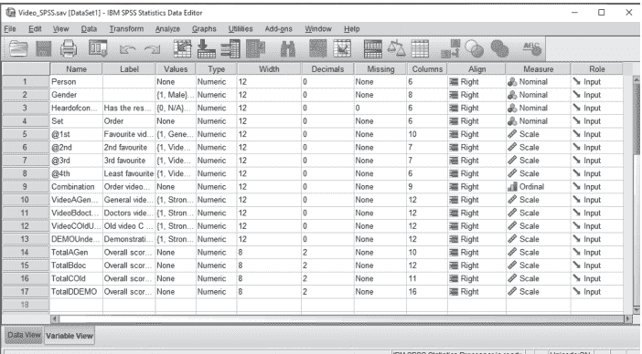

*图 7.2 SPSS 变量视图。*

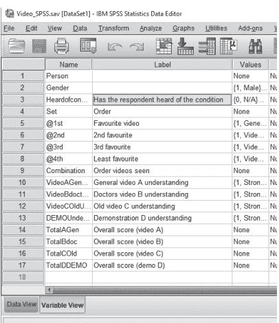

*图 7.3 SPSS 变量标签。*


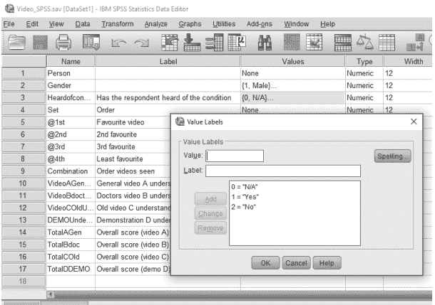

## 图 7.4 SPSS 值标签。

R 包 `{haven}` 允许我们捕获所有这些信息。

### 7.1.2.1 将 SPSS 数据读入 R

第一步，我们将使用默认参数从 SPSS 文件中读取数据。

```
df_video <- read_spss(dpjr::dpjr_data("Video_SPSS.sav"))

# display the data in the console
df_video
```

## # A tibble: 20 x 17

##   Person Gender Heardofcondition Set `@1st`

##   <dbl> <dbl+lbl> <dbl+lbl> <dbl> <dbl+lbl>

## ## 1 1 1 [Male] 1 [Yes] 1 4 [Demonst~

## ## 2 2 2 [Female] 1 [Yes] 1 4 [Demonst~

## ## 3 3 2 [Female] 2 [No] 1 4 [Demonst~

## ## 4 4 2 [Female] NA 1 4 [Demonst~

## ## 5 5 2 [Female] 2 [No] 1 4 [Demonst~

## ## 6 6 2 [Female] 1 [Yes] 11 1 [General~

## ## 7 7 2 [Female] 1 [Yes] 11 1 [General~

```
##  8        8 1 [Male]     1 [Yes]               11 1 [General~
##  9        9 2 [Female] NA                     11 1 [General~
## 10       10 2 [Female] NA                     11 1 [General~
## 11       11 1 [Male]    NA                     24 3 [Old vid~
## 12       12 2 [Female] NA                     24 3 [Old vid~
## 13       13 1 [Male]    NA                     24 3 [Old vid~
## 14       14 2 [Female] NA                     24 3 [Old vid~
## 15       15 2 [Female] NA                     24 3 [Old vid~
## 16       16 1 [Male]    2 [No]                 10 2 [Medical~
## 17       17 1 [Male]    2 [No]                 10 2 [Medical~
## 18       18 2 [Female] 1 [Yes]                 10 2 [Medical~
## 19       19 2 [Female] 1 [Yes]                 10 2 [Medical~
## 20       20 1 [Male]    1 [Yes]                 10 2 [Medical~
## ## i 12 more variables: `@2nd` <dbl+lbl>,
## ##     `@3rd` <dbl+lbl>, `@4th` <dbl+lbl>,
## ##   Combination <dbl>,
## ##   VideoAGenUnderstandingCONDITION <dbl+lbl>,
## ##   VideoBdoctorUnderstandingCONDITION <dbl+lbl>,
## ##   VideoCOldUnderstandingCONDITION <dbl+lbl>,
## ##   DEMOUnderstandingCONDITION <dbl+lbl>, ...
```

其中一些变量名以 @（at 符号）开头——这会在后面给我们带来一些麻烦，因此让我们使用 `{janitor}` 包（Firke，2021）³ 中的 `clean_names()` 函数来清理它们。

```
df_video <- janitor::clean_names(df_video)
```

现在，我们可以使用 `{labelled}` 中的 `look_for()` 函数来查看数据框的内容：

```
look_for(df_video)
```

### 7.1.2.2 处理缺失值

非常经常，SPSS 文件会有“用户定义缺失值”。在视频调查文件中，它们被编码为“NA”。但通常，调查结果的分析会有多种类型的“缺失值”：

- 受访者留空问题

- 受访者因跳逻辑而未回答问题（换句话说，受访者未看到该问题）

- 分析人员在计算其他类别响应的百分比时，可能决定将“不知道”或“不适用”编码为“缺失”。

根据具体情况，你可能希望统计其中一些。例如，如果有大量“不知道”和“不适用”响应，你可能希望分析其中哪一个（它们意味着完全不同的事情！）如果它们都被编码为“NA”，你就失去了获得该见解的能力。

在下面的代码中，向 `read_spss()` 函数添加 `user_na = TRUE` 参数可保留原始值。

```
df_video <- read_spss(dpjr::dpjr_data("Video_SPSS.sav"), user_na = TRUE)

df_video <- janitor::clean_names(df_video)

df_video
```

```
## # A tibble: 20 x 17
##   person gender  heardofcondition  set x1st
##     <dbl> <dbl+lbl> <dbl+lbl>       <dbl> <dbl+lbl>
## 1     1 1 [Male] 1 [Yes]           1 4 [Demonst~
## 2     2 2 [Female] 1 [Yes]          1 4 [Demonst~
## 3     3 3 2 [Female] 2 [No]           1 4 [Demonst~
## 4     4 4 2 [Female] 0 (NA) [N/A]     1 4 [Demonst~
## 5     5 5 2 [Female] 2 [No]           1 4 [Demonst~
## 6     6 6 2 [Female] 1 [Yes]          11 1 [General~
## 7     7 7 2 [Female] 1 [Yes]          11 1 [General~
## 8     8 8 1 [Male]  1 [Yes]          11 1 [General~
## 9     9 9 2 [Female] 0 (NA) [N/A]    11 1 [General~
## 10   10 10 2 [Female] 0 (NA) [N/A]   11 1 [General~
## 11   11 11 1 [Male]  0 (NA) [N/A]   24 3 [Old vid~
## 12   12 12 2 [Female] 0 (NA) [N/A]   24 3 [Old vid~
## 13   13 13 1 [Male]  0 (NA) [N/A]   24 3 [Old vid~
## 14   14 14 2 [Female] 0 (NA) [N/A]   24 3 [Old vid~
## 15   15 15 2 [Female] 0 (NA) [N/A]   24 3 [Old vid~
## 16   16 16 1 [Male]  2 [No]          10 2 [Medical~
## 17   17 17 1 [Male]  2 [No]          10 2 [Medical~
## 18   18 18 2 [Female] 1 [Yes]        10 2 [Medical~
## 19   19 19 2 [Female] 1 [Yes]        10 2 [Medical~
## 20   20 20 1 [Male]  1 [Yes]        10 2 [Medical~
## # i 12 more variables: x2nd <dbl+lbl>, x3rd <dbl+lbl>,
```

```
## #   x4th <dbl+lbl>, combination <dbl>,
## #   video_a_gen_understanding_condition <dbl+lbl>,
## #   video_bdoctor_understanding_condition <dbl+lbl>,
## #   video_c_old_understanding_condition <dbl+lbl>,
## #   demo_understanding_condition <dbl+lbl>,
## #   total_a_gen <dbl>, total_bdoc <dbl>, ...
```

第一个版本中为“NA”的内容现在变为“0”。

### 7.1.2.3 探索数据

`attributes()` 函数为我们提供了一种查看变量详细信息的途径。

首先，我们可以查看整个数据框的属性。

```
attributes(df_video)
```

```
## $class
## [1] "tbl_df"      "tbl"         "data.frame"
##
## $row.names
## [1]  1  2  3  4  5  6  7  8  9 10 11 12 13 14 15 16 17
## [18] 18 19 20
##
## $names
## [1] "person"
## [2] "gender"
## [3] "heardofcondition"
## [4] "set"
## [5] "x1st"
## [6] "x2nd"
## [7] "x3rd"
## [8] "x4th"
## [9] "combination"
## [10] "video_a_gen_understanding_condition"
## [11] "video_bdoctor_understanding_condition"
## [12] "video_c_old_understanding_condition"
## [13] "demo_understanding_condition"
## [14] "total_a_gen"
## [15] "total_bdoc"
## [16] "total_c_old"
## [17] "total_ddemo"
```

³`{janitor}` 的参考页面在这里：http://sfirke.github.io/janitor/

或者，我们可以使用美元符号（`$`）方法来指定单个变量；在本例中，即 `heardofcondition`：

```r
attributes(df_video$heardofcondition)
```

```
## $label
## [1] "Has the respondent heard of the condition"
##
## $na_values
## [1] 0
##
## $class
## [1] "haven_labelled_spss" "haven_labelled"
## [3] "vctrs_vctr"          "double"
##
## $format.spss
## [1] "F12.0"
##
## $display_width
## [1] 6
##
## $labels
## N/A Yes  No
##   0   1   2
```

在上面的输出中，`$label` 是问题本身，`$labels` 是与每个值（包括 N/A）关联的标签。请注意，其中还显示了 `$na_values`。

你也可以在代码中把这些串联起来。例如，如果我们只想查看值标签，代码如下：

```r
attributes(df_video$heardofcondition)$labels
```

```
## N/A Yes  No
##   0   1   2
```

#### 7.1.3 因子

因子的行为与标签不同：因子不会同时保留标签和值。相反，它们显示值并保留排序顺序（该顺序可以自动设置，也可以在代码中定义）。

在下面的代码中，我们将把 `df_video` 数据框中的所有变量设置为因子。在第一个代码块中没有额外参数。

```r
(df_video_factor <- as_factor(df_video))
```

```
## # A tibble: 20 × 17
##   person gender heardofcondition    set x1st   x2nd
##       <dbl>  <fct>   <fct>          <dbl> <fct>  <fct>
##  1       1 Male    Yes                 1 Demonstr~ Vide~
##  2       2 Female  Yes                 1 Demonstr~ Vide~
##  3       3 Female  No                  1 Demonstr~ Vide~
##  4       4 Female  N/A                 1 Demonstr~ Vide~
##  5       5 Female  No                  1 Demonstr~ Vide~
##  6       6 Female  Yes                11 General ~ Vide~
##  7       7 Female  Yes                11 General ~ Vide~
##  8       8 Male    Yes                11 General ~ Vide~
##  9       9 Female  N/A                11 General ~ Vide~
## 10      10 Female  N/A                11 General ~ Vide~
## 11      11 Male    N/A                24 Old vide~ Vide~
## 12      12 Female  N/A                24 Old vide~ Vide~
## 13      13 Male    N/A                24 Old vide~ Vide~
## 14      14 Female  N/A                24 Old vide~ Vide~
## 15      15 Female  N/A                24 Old vide~ Vide~
## 16      16 Male    No                 10 Medical ~ Demo~
## 17      17 Male    No                 10 Medical ~ Demo~
## 18      18 Female  Yes                10 Medical ~ Demo~
## 19      19 Female  Yes                10 Medical ~ Demo~
## 20      20 Male    Yes                10 Medical ~ Demo~
## # i 11 more variables: x3rd <fct>, x4th <fct>,
## #   combination <dbl>,
## #   video_a_gen_understanding_condition <fct>,
## #   video_bdoctor_understanding_condition <fct>,
## #   video_c_old_understanding_condition <fct>,
## #   demo_understanding_condition <fct>,
## #   total_a_gen <dbl>, total_bdoc <dbl>, ...
```

在第二个代码块中，`levels` 参数设置为“both”。

```r
(df_video_both <- as_factor(df_video, levels="both"))
```


```r
## # A tibble: 20 × 17
##   person gender       heardofcondition   set x1st   x2nd
##     <dbl> <fct>      <fct>          <dbl> <fct> <fct>
##  1       1 [1] Male   [1] Yes            1 [4] ~ [1] ~
##  2       2 [2] Female [1] Yes            1 [4] ~ [1] ~
##  3       3 [2] Female [2] No             1 [4] ~ [1] ~
##  4       4 [2] Female [0] N/A            1 [4] ~ [1] ~
##  5       5 [2] Female [2] No             1 [4] ~ [1] ~
##  6       6 [2] Female [1] Yes           11 [1] ~ [3] ~
##  7       7 [2] Female [1] Yes           11 [1] ~ [3] ~
##  8       8 [1] Male   [1] Yes           11 [1] ~ [3] ~
##  9       9 [2] Female [0] N/A           11 [1] ~ [3] ~
## 10      10 [2] Female [0] N/A           11 [1] ~ [3] ~
## 11      11 [1] Male   [0] N/A           24 [3] ~ [1] ~
## 12      12 [2] Female [0] N/A           24 [3] ~ [1] ~
## 13      13 [1] Male   [0] N/A           24 [3] ~ [1] ~
## 14      14 [2] Female [0] N/A           24 [3] ~ [1] ~
## 15      15 [2] Female [0] N/A           24 [3] ~ [1] ~
## 16      16 [1] Male   [2] No            10 [2] ~ [4] ~
## 17      17 [1] Male   [2] No            10 [2] ~ [4] ~
## 18      18 [2] Female [1] Yes           10 [2] ~ [4] ~
## 19      19 [2] Female [1] Yes           10 [2] ~ [4] ~
## 20      20 [1] Male   [1] Yes           10 [2] ~ [4] ~
## # i 11 more variables: x3rd <fct>, x4th <fct>,
## #   combination <dbl>,
## #   video_a_gen_understanding_condition <fct>,
## #   video_bdoctor_understanding_condition <fct>,
## #   video_c_old_understanding_condition <fct>,
## #   demo_understanding_condition <fct>,
## #   total_a_gen <dbl>, total_bdoc <dbl>, ...
```

## 7.2 从 Excel 文件创建带标签的数据框

你可能会遇到这样的情况：数据收集者最初使用的是 SPSS、SAS 或 Stata，但最终以 Excel 文件的形式共享数据。这可能是因为接收数据的机构没有这些专有软件，而 Excel 作为分析工具的普遍性使其成为一种实用的选择。

通常在这种情况下，数据收集者会分两部分提供数据：

- 各条记录，其中变量以数值编码。
- 一份单独的“代码簿”，其中包含与每个数值相关联的标签。

在下面的示例中，Palmer 企鹅数据（Horst, 2020）被存储在一个 Excel 文件中。该 Excel 文件的第一个工作表包含数据，其中三个字符变量（`species`、`island` 和 `sex`）的值已被转换为数字代码。例如，在 `species` 变量中，Adelie 企鹅用数值“1”表示，Chinstrap 用“2”表示，Gentoo 用“3”表示。

```r
penguins_path <- dpjr::dpjr_data("penguins_labelled.xlsx")

penguins_data <- read_excel(penguins_path, sheet = "penguins_values")

head(penguins_data)
```

看一眼数据框就会发现，`species`、`island` 和 `sex` 变量都被编码为数值型变量。与我们在本章前面读取的`.sav`文件不同，这个数据框并没有把标签作为变量的一部分来携带。

我们可以编写一些代码，使用 `{labelled}` 包中的 `val_labels()` 函数来应用标签并更改变量类型：

```r
# assign the species names as labels
labelled::val_labels(penguins_data$species) <-
  c("Adelie" = 1, "Chinstrap" = 2, "Gentoo" = 3)

# view the labels
val_labels(penguins_data$species)

# another way to view the labels
attr(penguins_data$species, "labels")
```

我们还可以使用 R 读取这些值并以编程方式应用它们。这将节省时间和精力，并降低录入错误的风险，尤其是在变量较多、且这些变量有大量值需要标记的情况下。

如果我们回到 Excel 文件 `penguins_labelled.xlsx`，会发现该文件中的第二个工作表名为 `penguins_codebook_source`。该工作表包含 SPSS 在使用 `DISPLAY DICTIONARY` 语法（或 `File > Display Data File Information > Working File` GUI 菜单序列）生成“字典”（即代码簿）时创建的输出。其中包含每个变量的信息，包括该变量是名义变量还是尺度变量。

我们特别关注的是与每个变量相关的值。这些信息保存在“变量值”标题下；对于 penguins 数据文件，它出现在 Excel 工作表的第 36 行。

**变量值**

| 变量 | 值 | 标签 |
|---|---|---|
| `species` | 1 | Adelie |
| `species` | 2 | Chinstrap |
| `species` | 3 | Gentoo |
| `island` | 1 | Biscoe |
| `island` | 2 | Dream |
| `island` | 3 | Torgersen |
| `sex` | 1 | female |
| `sex` | 2 | male |

*图 7.5 来自 penguins SPSS 输出的“变量值”。*

首先，我们读取 Excel 文件第二个工作表中包含代码簿的特定数据矩形区域的内容。请注意，我们从第 37 行开始读取，因此 `Value` 和 `Label` 会被分配为我们的变量名。在这段代码中，使用了 `anchored` 方法：先指定 Excel 单元格的左上角，然后在 `dim` 参数中指定要读取的行数和列数。

```r
penguins_path <- dpjr::dpjr_data("penguins_labelled.xlsx")

penguins_code <- read_excel(penguins_path,
    sheet = "penguins_codebook",
    range = anchored("A37", dim = c(9, 3)))

penguins_code
```

我们已经读取了 SPSS 输出并保存到 Excel 文件中的表格，但还需要进行额外的数据整理。

管道中的第一步是重命名变量。不仅 `Variable` 列被赋予了 `value` 这个名称，而且值列的名称被解释为空白，并被赋给了变量名 `...2`。

第二步是使用 `{dplyr}` 包中的 `fill()` 函数来填充 `variable` 变量中的缺失值。`fill()` 的默认填充方向为向下。

因此，我们不需要将方向作为参数来指定。稍后我们将探讨清理数据的其他方案。

```r
penguins_code <- penguins_code |>
  # rename variables
  rename(Value = "variable",
    ...2 = "variable_value",
    Label = "variable_label") |>
  # fill in blank names
  fill(variable) |>
  # change to numeric
  mutate(variable_value = as.numeric(variable_value))

penguins_code
```

此时，有两种可能的解决方案：

- 1. 将 `penguins_code` 数据框中的值连接起来，使得除了包含数值的变量外，还有一个包含字符串的变量。
- 2. 使用 `{labelled}` 包中的函数，将变量转换为 `labelled` 类型，这样数值保持不变，并应用标签。在这种情况下，最终状态与直接读取 SPSS 文件相同。

### 最后一步：连接变量

```r
penguins_code_wide <- penguins_code |>
  # mutate(row_num = row_number()) |>
  pivot_wider(names_from = c(variable), values_from = variable_label)

penguins_code_wide
```

## 7.3 从 SPSS 语法创建带标签的数据框

在上一章中，我们导入了使用 SAS、SPSS 和 Stata 软件包创建的数据文件。我们还了解了如何处理带标签的变量。

在我们寻找可分析数据的过程中，我们可能会遇到这样的情况：某个组织收集了调查数据，数据收集者公布了个人记录，使得像你我这样的研究人员能够进一步探索这些数据。

这些数据文件包含个人记录，而不是已用计数和百分比汇总的数据文件。包含个人记录的文件有时被称为“微观文件”（micro-file），而为发布而匿名化的文件可称为公共使用微观文件（Public-Use Micro File，缩写为“PUMF”）或公共使用微观数据样本（Public Use Microdata Sample，PUMS）\index{PUMS|see {Public-Use Micro File}}。

在本章中，我们将探讨数据收集者这样做的两种情况。但他们并非以多种格式发布微观数据，而是发布了一个压缩包，其中包含原始文本扁平文件，以及应用变量名、变量标签和值标签的语法（代码）文件。如果我们拥有其中一种专有软件工具的许可证⁴，那自然很好，但如果我们使用的是 R 呢？

幸运的是，有一个包提供了读取原始文本文件并应用 SPSS 语法来创建带有标签变量的 R 对象的函数：`{memisc}` (Elff 等, 2021)。

```r
library(memisc)
```

### 7.3.1 国家出行调查（NTS）

我们的第一个示例使用加拿大统计局（Statistics Canada）收集并发布的国家出行调查（NTS）数据（Statistics Canada, 2021）。

步骤 1 - 下载 2020 参考期的“SPSS”zip 文件，并将其解压到项目子文件夹 `data` 中。这将创建一个子文件夹，因此文件路径现在是 `data\2020-spss`。

该 zip 文件不包含 SPSS 格式的数据文件（`.sav`）。相反，该文件夹为三个调查组成部分（人员、出行和访问）各提供了一个固定宽度的文本文件，以及相应的 SPSS 语法文件，这些语法文件可用于将文件读入正确的变量，并应用变量和值标签。

在本例中，我们将使用 2020 年 NTS 的“Person”文件。加拿大统计局提供的原始数据文件是 `PERSON_NTS2020_PUMF.txt`。

步骤 2 - 使用 SPSS 语法文件（在 R 中）

该压缩包还包括带有 `.sps` 扩展名的独立 SPSS 语法文件。由于加拿大是一个双语国家，加拿大统计局发布两个版本

⁴或者我们可以承诺给一块巧克力棒来贿赂的朋友。

的标签语法文件，一个为英文，另一个为法文。它们可以通过文件扩展名之前的最后一个字母来区分。这些文件是：

- 变量标签：`Person_NTS2020_Pumf_vare.sps`（等效的带有法语变量标签的文件是 `Person_NTS2020_Pumf_varf.sps`。）
- 变量值：`Person_NTS2020_Pumf_vale.sps`
- 缺失值：`Person_NTS2020_Pumf_miss.sps`

这种结构与 `{memisc}` 函数配合得很好，这些文件不需要任何进一步的处理。（正如我们将在第二个示例中看到的，情况并非总是如此。）

由于加拿大统计局提供了其他年份的数据，我们将有意识地编写灵活的代码，以便日后以最少的更改重新运行我们的代码。因此，我们将把数据的年份赋为一个对象。

```r
nts_year <- "2020"
```

现在，在定义各个输入文件的位置时，我们可以多种方式使用这个包含年份编号的对象。请注意，此代码使用 `{glue}` 包中的 `glue()` 函数来创建文件名字符串，并使用 `{here}` 包中的 `here()` 函数来确定相对于我们的 RStudio 项目位置的文件路径。

```r
# define locations of input files

nts_year_format <- glue(nts_year, "-SPSS")

input_folder <- here("data", nts_year_format)
input_folder
## [1] "E:/github_book/data_preparation_journey/data/2020-SPSS"
```

```r
layout_folder <- here("data", nts_year_format, "Layout_cards")
layout_folder
##      [1]      "E:/github_book/data_preparation_journey/data/2020-SPSS/Layout_cards"
```

```r
# use the above to create objects with file names and paths

data_file_1 <- glue("PERSON_NTS", nts_year, "_PUMF.txt")
data_file <- glue(input_folder, "/Data_Données/", data_file_1)
data_file
## E:/github_book/data_preparation_journey/data/2020-SPSS/Data_Données/PERSON_NTS2020_PUMF.txt
```

```r
columns_file_1 <- glue("Person_NTS", nts_year, "_Pumf_i.sps")
columns_file <- glue(layout_folder, columns_file_1, .sep = "/")
columns_file
## E:/github_book/data_preparation_journey/data/2020-SPSS/Layout_cards/Person_NTS2020_Pumf_i.sps
```

```r
variable_labels_1 <- glue("Person_NTS", nts_year, "_Pumf_vare.sps")
variable_labels <- glue(layout_folder, variable_labels_1, .sep = "/")

variable_values_1 <- glue("Person_NTS", nts_year, "_Pumf_vale.sps")
variable_values <- glue(layout_folder, variable_values_1, .sep = "/")

missing_values_1 <- glue("Person_NTS", nts_year, "_Pumf_miss.sps")
missing_values <- glue(layout_folder, missing_values_1, .sep = "/")
```

下一步是使用 `memisc::spss.fixed.file()` 导入过程来创建数据集的定义。

```r
# read file, create datafile with nested lists
nts_person_2020 <- memisc::spss.fixed.file(
  data_file,
  columns_file,
  varlab.file = variable_labels,
  codes.file = variable_values,
  missval.file = missing_values,
  count.cases = TRUE,
  to.lower = TRUE
)
```

```r
# convert the resulting object into a "data.set" format
nts_person_2020_ds <- memisc::as.data.set(nts_person_2020)
```


然后，使用`as_haven()`函数将数据集对象转换为`tibble`。这个`tibble`已分配了所有变量和值标签，可通过`{labelled}`包中的函数进行访问。

```
nts_person_2020_hav <- memisc::as_haven(nts_person_2020_ds)
nts_person_2020_hav
```

```
## # A tibble: 79,771 x 13
##   pumfid verd ate  refyear  quarter inf_q01 inf_q02
##   *   <dbl> <chr>  <int+lbl> <int+l> <int+l> <int+lb>
## 1 1006690 10/12/2~ 2020 [Yea~ 1 [Ref~ 1 [Yes] 35 [Ont~
## 2 1006691 10/12/2~ 2020 [Yea~ 1 [Ref~ 1 [Yes] 35 [Ont~
## 3 1006692 10/12/2~ 2020 [Yea~ 1 [Ref~ 1 [Yes] 24 [Que~
## 4 1006693 10/12/2~ 2020 [Yea~ 1 [Ref~ 1 [Yes] 35 [Ont~
## 5 1006694 10/12/2~ 2020 [Yea~ 1 [Ref~ 1 [Yes] 24 [Que~
## 6 1006695 10/12/2~ 2020 [Yea~ 1 [Ref~ 1 [Yes] 35 [Ont~
## 7 1006696 10/12/2~ 2020 [Yea~ 1 [Ref~ 1 [Yes] 13 [New~
## 8 1006697 10/12/2~ 2020 [Yea~ 1 [Ref~ 1 [Yes] 11 [Pri~
## 9 1006698 10/12/2~ 2020 [Yea~ 1 [Ref~ 1 [Yes] 35 [Ont~
## 10 1006699 10/12/2~ 2020 [Yea~ 1 [Ref~ 1 [Yes] 35 [Ont~
## # i 79,761 more rows
## # i 7 more variables: page_grp <int+lbl>,
## #   gend_bin <int+lbl>, incomgr2 <int+lbl>,
## #   memc18up <int+lbl>, memclt18 <int+lbl>,
## #   resprov <int+lbl>, pumfwp <dbl>
```

在最后一步中，我们将数据框保存为 SPSS、Stata 和 RDS 文件以供将来使用。

对于 Stata 用户来说，一个重要说明是有一个`version`参数，它允许我们创建可被旧版 Stata 读取的文件（默认是 Stata 15）。

```
# export haven format table as SPSS .sav file
haven::write_sav(nts_person_2020_hav,
  here("data_output", "nts_person_2020.sav"))

# export haven format table as Stata .dta file
```

```
haven::write_dta(nts_person_2020_hav,
    here("data_output", "nts_person_2020.13.dta"),
    version = 13)

# export RDS
readr::write_rds(nts_person_2020_hav,
    here("data_output", "nts_person_2020.rds"))
```

# 8 导入数据：PDF文件

本章内容：

- 从PDF文件中读取数据和文本
- 将生成的对象处理成整洁的结构

## 8.1 PDF文件

> 便携式文档格式（PDF）是Adobe于1992年开发的一种文件格式，用于展示文档（包括文本格式和图像），其呈现方式独立于应用软件、硬件和操作系统<sup>1</sup>。

PDF文件格式提供了强大的功能和灵活性，可以创建高质量的输出。PDF文件常用于品牌营销材料和年度报告等场景，这些场景需要文档在屏幕上看起来与纸质打印效果一致，并组合文本和图像，以视觉上吸引人的方式进行设计和排版。

这些文档中可能包含我们分析所需的数据，或者我们可能想分析文档中的文本。PDF文件的结构方式使得提取内容（无论是数据表格还是文本）成为一项挑战。Adobe Acrobat和其他PDF工具中的“导出到Excel”功能可能会成功；务必先尝试一下。这句话中的关键短语是“可能会”。与我们在导入格式化Excel文件时遇到的挑战类似，PDF导出器会遇到视觉上看起来像表格的结构，但这些结构并非一致的整洁格式。有时变量名中的文本换行会导致拆分为多行，而在其他情况下，表中看似多个单元格的内容会被读取为一个单元格。

<sup>1</sup>维基百科条目“PDF”（Wikipedia contributors, 2022b）

幸运的是，其他数据科学家已经应对了从PDF文件中读取数据表格的挑战，并为我们提供了可用的工具。其中一个包是`{pdftools}`（Ooms, 2022）。

除`{pdftools}`外，本章我们还将使用数据操作包`{dplyr}`和`{tidyr}`，以及文本处理包`{stringr}`（Wickham, 2019b）。

```
# 读取PDF文件内容
library(pdftools)

# 数据整理包
library(dplyr)
library(tidyr)

# 字符串处理
library(stringr)
```

### 8.1.1 开始入门

要从PDF文件中读取数据，我们从一个`{palmerpenguins}`（Horst et al., 2022; Horst, 2020）数据摘要中读取数据。

虽然这是针对单页上的单个表格，但如果每页上每个表格的结构相同，同样的方法也适用于跨多页的多个表格。过程始终相同：从最小的单元开始，然后向外扩展。

- PDF文件的读取方式中，最小的单元是单行。
- 将其扩展到整个表格。在此阶段结束时应用列拆分和分配标题。
- 如果有多个结构相同的表格，则下一步通过循环处理每个表格。
- 一旦你成功处理了单页，就可以循环处理多页。

我们使用来自`{pdftools}`包的`pdf_text()`函数读取文件的全部内容，并将内容分配给环境中的一个R对象。

接下来，我们使用`str()`函数显示新对象结构的摘要。

```
penguin_summary <- pdf_text(dpjr::dpjr_data("penguin_summary.pdf"))
```

```
str(penguin_summary)
```

```
chr " species island mean_flipper_length_mm mean_body_mass_g\n\n1 Adelie Biscoe 188.795"| __truncated__
```

**图 8.1 来自PDF文件的企鹅数据。**

这样我们得到的结果是单个字符串，包含文件内容。在此示例中，只有一页，因此只有一个字符串。如果你处理的是多页文档，每一页都会有自己的字符串。

在视觉浏览此输出时，我们看到变量名以`species`开头。在最后一个变量`mean_body_mass_g`之后有两个换行符，表示为`\n`（读作“反斜杠n”）。我们将使用这些换行符作为解析过程的一部分。

查看页面内容的另一种方法是使用`cat()`函数（来自`{base R}`），它按打印方式显示内容：

```
cat(penguin_summary)
```

```
## species island mean_flipper_length_mm mean_body_mass_g
##
## 1 Adelie Biscoe 188.7955 3709.659
##
## 2 Adelie Dream 189.7321 3688.393
##
## 3 Adelie Torgersen 191.1961 3706.373
##
## 4 Chinstrap Dream 195.8235 3733.088
##
## 5 Gentoo Biscoe 217.1870 5076.016
```

接下来，我们使用`strsplit()`函数（来自`{base R}`）将长字符串拆分为单独的行。正如我们注意到的，每一行末尾都有两个`\n`字符对；如果在`strsplit()`函数中只使用一个，则数据行之间会出现额外的行。

```
penguin_summary_2 <- penguin_summary |>
  strsplit(split = "\n\n")

penguin_summary_2
```

```
## [[1]]
## [1] " species  island  mean_flipper_length_mm mean_body_mass_g"
## [2] "1 Adelie  Biscoe          188.7955          3709.659"
## [3] "2 Adelie  Dream           189.7321          3688.393"
## [4] "3 Adelie  Torgersen       191.1961          3706.373"
## [5] "4 Chinstrap Dream          195.8235          3733.088"
## [6] "5 Gentoo   Biscoe          217.1870          5076.016\n"
```

在此阶段，我们需要进行一些清理。如果现在不处理，稍后会造成一些麻烦。最后一个数据单元格的末尾有多余的回车符，所以让我们使用正则表达式将其删除。第一行开头也有空格，数据行开头有“数字-空格”组合。

通过在第一行中使用双方括号访问器，返回的对象不再嵌套，而是每一行都有一个单独的字符串。

```
penguin_summary_3 <- penguin_summary_2[[1]] |>
  str_remove("\\n$") |>
  str_remove("^\\s+") |>
  str_remove("^\\d ")
```

接下来，我们创建一个包含变量名的列表对象，以便将名称与最终表格中的数据分开。这通过将包含名称的行（第1行，使用方括号`[1]`标识）分配给一个单元素向量来完成。

```
penguin_variable_vector <- as.vector(penguin_summary_3[1])

penguin_variable_vector
```

```
## [1] "species    island    mean_flipper_length_mm mean_body_mass_g"
```

下一步是在有一个或多个空白的位置将此向量拆分为4个单独的元素，这些空白通过正则表达式`\s+`标识。`\s`匹配单个空格，添加`+`将其扩展为“一个或多个”前面的字符。

这将返回另一个嵌套列表。

```
penguin_variable_list <- str_split(penguin_variable_vector, "\\s+")
penguin_variable_list
```

```
## [[1]]
## [1] "species"            "island"
## [3] "mean_flipper_length_mm" "mean_body_mass_g"
```

为了获得我们所需的结构，我们对结果应用`unlist()`函数。

```
penguin_variable_names <- unlist(penguin_variable_list)
penguin_variable_names
```

```
## [1] "species"            "island"
## [3] "mean_flipper_length_mm" "mean_body_mass_g"
```

可以通过将字符串拆分包装在`unlist()`中将这两个步骤合并为一个：

```
penguin_variable_names <-
  unlist(str_split(penguin_variable_vector, "\\s+"))
penguin_variable_names
```

```
## [1] "species"            "island"
## [3] "mean_flipper_length_mm" "mean_body_mass_g"
```

下一步是使用for循环构建表格。（参见（Wickham et al., 2023b，第27章 迭代）以了解此过程的回顾。）

```
# 1. 定义输出
penguin_table <- tibble(value = NULL)

# 2. 循环遍历每一行
# 因为第一个元素是标题，
# 我们需要长度短一个
loop_length <- length(penguin_summary_3) - 1

for (i in 1:5) {
  j <- i + 1
  dat <- as_tibble(penguin_summary_3[j])
  penguin_table <- bind_rows(penguin_table, dat)
}

penguin_table
```

```
## # A tibble: 5 x 1
##   value
##   <chr>
## 1 Adelie   Biscoe          188.7955    3709.659
## 2 Adelie   Dream           189.7321    3688.393
## 3 Adelie   Torgersen       191.1961    3706.373
## 4 Chinstrap Dream           195.8235    3733.088
## 5 Gentoo   Biscoe          217.1870    5076.016
```

循环创建了一个只有一列`value`的`tibble`。我们将应用`separate()`函数将`value`拆分为之前分配给对象`penguin_variable_names`的每个变量名。拆分基于原始字符串中一个或多个空格的位置，使用`\s+`正则表达式。

```
penguin_table <- tidyr::separate(
  penguin_table,
  value,
  into = penguin_variable_names,
  "\\s+"
)

penguin_table
```

```
## # A tibble: 5 x 4
##   species   island   mean_flipper_length_mm mean_body_mass_g
##  <chr>  <chr>  <chr>  <chr>
## 1 Adelie  Biscoe  188.7955  3709.659
## 2 Adelie  Dream  189.7321  3688.393
## 3 Adelie  Torgersen 191.1961  3706.373
## 4 Chinstrap Dream  195.8235  3733.088
## 5 Gentoo  Biscoe  217.1870  5076.016
```

还有最后一步：将值的变量类型更改为数值。

```
penguin_table <- penguin_table |>
  mutate(
    across(
      contains("mean_"),
      ~ as.numeric(.x)
    )
  )

penguin_table
```

*# 一个 tibble：5 x 4*

| 物种 | 岛屿 | 平均鳍足长度_mm | 平均体重_g |

|---|---:|---:|---:|

| `<chr>` | `<chr>` | `<dbl>` | `<dbl>` |

| Adelie | Biscoe | 189. | 3710. |

| Adelie | Dream | 190. | 3688. |

| Adelie | Torgersen | 191. | 3706. |

| Chinstrap | Dream | 196. | 3733. |

| Gentoo | Biscoe | 217. | 5076. |

### 8.1.2 扩展示例：渡轮交通

对于本次练习，我们将从不列颠哥伦比亚省渡轮专员的年度报告中提取一个数据表，该报告涵盖截至2021年3月31日的财政年度（即2020年4月1日至2021年3月31日的十二个月期间）（British Columbia Ferry Services Inc., 2021）。

该报告以 PDF 文件形式发布，共 101 页，包含书面文本和数据表的混合内容。

`{pdftools}`使我们能够从本地副本或网络下载和读取文件。下面的代码块显示了从 URL 下载文件的代码。

```
# download file from web URL
download.file(
  url = "https://www.bcferries.com/web_image/h29/h7a/8854124527646.pdf",
  destfile = "bcferries_2021.pdf",
  mode = "wb"
)
```

一旦文件下载完成，我们就可以使用`pdf_text()`函数读取文件，并将其内容分配给我们环境中的 R 对象。当然，我们也可以选择读取已下载的文件。

```
# alternative, from the {dpjr} package
bcf <- pdf_text(dpjr::dpjr_data("bcferries_2021.pdf"))
```

上述代码会生成一个包含 101 个字符字符串的向量——原始文档的每一页对应一个。我们可以使用 R 的方括号访问器语法访问每一页。以下是查看第一页内容的代码：

```
bcf[1]
```


**图 8.2** *BC Ferries PDF 文件的标题页。*

使用`cat()`函数：

```r
cat(bcf[1])
```

```
## British Columbia Ferry Services Inc.
##
##             Annual Report
##                 to the
## British Columbia Ferries Commissioner
##
##     Year Ended March 31, 2021
```

### 8.1 PDF 文件

如果我们比较这两个输出，会发现第一个显示了字符`\\n`，它表示行尾。这些字符在`cat()`版本中用于渲染布局。

该年度报告涵盖的期间捕捉到了 COVID-19 大流行第一年期间对旅行的深远影响，并且报告中与之前的大流行前一年在车辆和乘客数量方面进行了比较。让我们从比较系统中每条航线乘客数量的表格中提取数据。该表格位于 PDF 文件的第 11 页：

Operations Summary Report for the Year Ended March 31, 2021. The table contains route-level passenger, vehicle, passenger-tariff revenue, and passenger-tariff revenue growth data, together with a separate “% Sailings Within 10 Min. (Note 3)” table.

**图 8.3** *BC Ferries，乘客总数。*

从我们从 PDF 报告创建的对象中，我们可以将第 11 页的内容分离到自己的对象中：

```r
bcf_11 <- bcf[11]
```

```r
bcf_11
```

等等！这不是我们想要的页面！虽然 PDF 文件对页面进行了编号，但标题页没有编号。编号为“11”的页面实际上是文件中的第十二页。

```
[1] "Operations Summary Report for the Year Ended March 31, 2021\n B C D E A Capacity H I J\n\n\n Capacity AEQ Tariff AEQ Tariff AEQ Tariff\n Capacity AEQ's Carried Actual Round AEQ Growth\n Routes Provided Utilization Fiscal Utilization Trips Revenue Fiscal Revenue Fiscal 2020 Fiscal 2020 (C - F)\n (AEQ's) 2021 Note 2 (H - I)\n\n\n\n 1 (C / B) Fiscal 2020 2021 Note 2 2020 Note 2 2021 2021 2020 2021 2,239,426 1,557,909 69.6% 3,250.0 (811,527) $ 106,232,291 $ 152,416,489 (46,184,198)\n 2 84.1% 2,369,436 2,213.5 1,374,776 838,402 61.0% 68.8% 1,334,158 (495,756) 55,498,711 81,940,368 (26,441,657)\n 9 2,834.0 1,755,940 1,081,426 61.6% 65.9%\n"
```

**图 8.4** *BC Ferries 来自 PDF 文件的第 11 页。*

```r
bcf_11 <- bcf[12]
```

```r
bcf_11
```

```
[1] "Operations Summary Report for the Year Ended March 31, 2021\n\n K L M N O P\n Passenger\n Passenger Tariff Passengers % Sailings within 10 Min. (Note 3)\n Passenger Tariff Passengers Growth Passengers Revenue Fiscal Revenue Fiscal\n (N - ... ) Fiscal 2021 Fiscal 2021 (K - L) Fiscal 2020 2021 Note 2 2020 Note 2 ) YE Fiscal 2019 YE Fiscal 2020 YE Fiscal 2021\n\n 1 2,578,221 6,124,234 (3,546,013) 39,230,411 91,309,787 1,669,054 3,298,151 87.6% 87.2% 86.6% 2 1,669,054 3,298,151 (1,629,097) 25,150,326 48,775,753 (23,625,427) 81.8% 87.3% 86.2% 3 (4,001,646) 1,797,894 2,631,102 (833,208) 9,517,331 13,518,977 (4,001,646) 81.4% 88.0% 83.7% 30 1,158,810 1,652,801 (493,991) 378,372 23,970,199 (6,591,827) 85.3% 85.2% 80.6% Major Routes 7,203,979 13,706,288 (6,502,309) 91,276,440 177,574,716 (86,298,276) 84.3% 86.6% 84.3%\n\n 10 15,788 45,748 (29,960) 1,577,178
```

**图 8.5** *BC Ferries 来自 PDF 文件的第 12 页。*

现在我们有一个对象，它是一个单一的文本字符串。我们想要的所有数据都在其中，但要提取我们想要的列并以可用的格式呈现，需要一些技巧。

使用`\n`换行字符，我们可以将这个单一值拆分为页面上存在的行数。

```r
# break into lines
bcf_11_lines <- bcf_11[[1]] |>
  strsplit(split = "\n")

# how many lines in the page?
length(bcf_11_lines[[1]])
```

```
## [1] 55
```

现在我们有一个包含 1 个元素的列表，其中包含 55 个单独的元素。

我首先注意到的是，表格从几行之后才开始，更成问题的是，由于文本换行，包含变量名的标题行被拆分了。我决定手动输入变量名，并专注于提取数字。数字从第 13 行开始，我们可以按如下方式访问：

```r
bcf_11_lines[[1]][13]
```

```
[1] " 1 2,578,221 6,124,234 (3,546,013) 39,230,411 91,309,787 (52,079,376) 87.6% 87.2% 86.6%"
```

**图 8.6** *BC Ferries：单行。*

我们可以指定一个行范围；让我们将前两行作为测试样本。

```r
tester <- bcf_11_lines[[1]][13:14]
```

我们如何将其拆分为单独的部分？这里`{stringr}`包和我们对正则表达式的了解就派上用场了。我们希望在多个空格处拆分字符串。如果在每个空格处拆分，我们会得到很多列。因此，我们是在空格出现的地方进行分隔（或拆分）。

查找任何空白字符的正则表达式是`\s`，要查找任意数量的空白字符，我们需要加上加号`+`。请记住，在 R 中，我们需要转义反斜杠，因此我们的正则表达式表示为`\\s+`。

```r
test_result <- str_split(tester, "\\s+")
test_result
```

```
## [[1]]
##  [1] ""      "1"     "2,578,221"  "6,124,234"
##  [5] "(3,546,013)" "39,230,411" "91,309,787" "(52,079,376)"
##  [9] "87.6%" "87.2%" "86.6%"
##
## [[2]]
## [1] "" "2" "1,669,054" "3,298,151"
## [5] "(1,629,097)" "25,150,326" "48,775,753" "(23,625,427)"
## [9] "81.8%" "87.3%" "86.2%"
```

这仍然是一个列表，现在包含两个元素——每个行一个。

下面，代码创建了一个包含变量名列表的对象。（有时，直接用手动解决方案处理这些清理问题会更有效，而不是花费时间在一次性编程解决方案上。）

```r
bcf_col_names <- c(
  "blank",
  "route",
  "passengers_fy2021",
  "passengers_fy2020",
  "passenger_growth",
  "passenger_tariff_revenue_fy2021",
  "passenger_tariff_revenue_fy2020",
  "passenger_tariff_growth",
  "pct_sailings_10_mins_fy2019",
  "pct_sailings_10_mins_fy2020",
  "pct_sailings_10_mins_fy2021"
)
```

```r
as_tibble(test_result, .name_repair = "unique")
```

```
## New names:
## * `` -> `...1`
## * `` -> `...2`
```

*# 一个 tibble：11 x 2*

| `...1` | `...2` |
| --- | --- |
| `<chr>` | `<chr>` |
| `""` | `""` |
| `"1"` | `"2"` |
| `"2,578,221"` | `"1,669,054"` |
| `"6,124,234"` | `"3,298,151"` |
| `"(3,546,013)"` | `"(1,629,097)"` |
| `"39,230,411"` | `"25,150,326"` |
| `"91,309,787"` | `"48,775,753"` |
| `"(52,079,376)"` | `"(23,625,427)"` |
| `"87.6%"` | `"81.8%"` |
| `"87.2%"` | `"87.3%"` |
| `"86.6%"` | `"86.2%"` |

```r
bcf_table <- tibble(value = NULL)

for (j in 1:2) {
  dat <- as_tibble(tester[j])
  bcf_table <- bind_rows(bcf_table, dat)
}

bcf_table
```

```
## # A tibble: 2 x 1
##   value
##   <chr>
## 1 " 1"           2,578,221      6,124,234      (3,546,0~
## 2 " 2"           1,669,054      3,298,151      (1,629,0~
```

```r
bcf_table_2 <- tidyr::separate(bcf_table, value,
                               into = bcf_col_names,
                               "\\s+")

glimpse(bcf_table_2, width = 65)
```

```
## Rows: 2
## Columns: 11
## $ blank                <chr> "", ""
## $ route                <chr> "1", "2"
## $ passengers_fy2021    <chr> "2,578,221", "1,669,054"
## $ passengers_fy2020    <chr> "6,124,234", "3,298,151"
## $ passenger_growth     <chr> "(3,546,013)", "(1,629,~"
## $ passenger_tariff_revenue_fy2021 <chr> "39,230,411", "25,150,3~"
## $ passenger_tariff_revenue_fy2020 <chr> "91,309,787", "48,775,7~"
## $ passenger_tariff_growth <chr> "(52,079,376)", "(23,62~"
## $ pct_sailings_10_mins_fy2019 <chr> "87.6%", "81.8%"
## $ pct_sailings_10_mins_fy2020 <chr> "87.2%", "87.3%"
## $ pct_sailings_10_mins_fy2021 <chr> "86.6%", "86.2%"
```

太好了！（我本应保留我在得到这个结果之前所做的所有失败尝试——很多尝试彻底失败了，或者我只完成了其中一两步就卡住了。）

除了……所有变量都是字符类型，因为使用了作为千位分隔符的逗号和百分号。

让我们回到`tester`对象，看看我们能否使用`{stringr}`函数`str_remove_all()`来去掉逗号。（注意`str_remove()`只会删除指定字符串的第一个实例。）

为本次练习的目的，我们不会担心括号中的数字，它们是前两个变量之间的差值（由于它们为负数，因此采用会计格式样式，用括号表示）。我们不会处理百分比，但百分号可以用与逗号相同的方式删除。

```r
# remove all commas
str_remove_all(tester, ",")
```

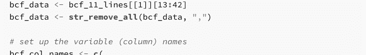

## 图 8.7 BC Ferries：删除逗号。

现在让我们把所有这些结合起来，以捕获完整的表格。

```r
# read the relevant rows and remove the commas
bcf_data <- bcf_11_lines[[1]][13:42]
bcf_data <- str_remove_all(bcf_data, ",")

# set up the variable (column) names
bcf_col_names <- c(
"blank",
"route",
"passengers_fy2021",
"passengers_fy2020",
"passenger_growth",
"passenger_tariff_revenue_fy2021",
"passenger_tariff_revenue_fy2020",
"passenger_tariff_growth",
"pct_sailings_10_mins_fy2019",
"pct_sailings_10_mins_fy2020",
"pct_sailings_10_mins_fy2021"
)

# set up the final table
bcf_table <- tibble(value = NULL)

# bind the rows together
for (j in 1:30) {
  dat <- as_tibble(bcf_data[j])
  bcf_table <- bind_rows(bcf_table, dat)
}

bcf_table
```

```
## # A tibble: 30 x 1
##   value
##   <chr>
## 1 "      1          2578221   6124234   (3546013) ~
## 2 "      2          1669054   3298151   (1629097) ~
## 3 "      3          1797894   2631102   (833208) ~
## 4 "      30         1158810   1652801   (493991) ~
## 5 " Major Routes    7203979   13706288  (6502309) ~
## 6 "" 
## 7 "      10         15788     45748     (29960~
## 8 "      11         17385     47070     (29685~
## 9 "      28         917       7585      (666~
## 10 "Northern Routes  34090     100403    (66313)~ 
## # i 20 more rows
```

```r
bcf_table_2 <- tidyr::separate(bcf_table, value,
    into = bcf_col_names,
    "\\s\\s+")
```

```r
bcf_table_2
```

还不完全完美，需要删除一些内容：

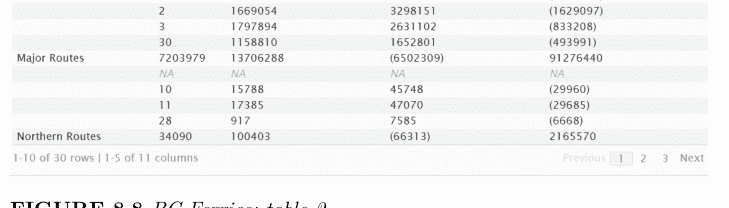

## 图 8.8 BC Ferries：表 2。

- 有路线类型的小计行
- 一个空白行
- 差异列


```
bcf_table_3 <- bcf_table_2 |>
# succinct way to remove a row which has a single "NA"
na.omit() |>
select(route,
    starts_with("passengers_"),
    starts_with("passenger_tariff_rev")) |>
# change variables to numeric
mutate(passengers_fy2021 = as.numeric(passengers_fy2021),
    passengers_fy2020 = as.numeric(passengers_fy2020),
    passenger_tariff_revenue_fy2021 =
    as.numeric(passenger_tariff_revenue_fy2021),
    passenger_tariff_revenue_fy2020 =
    as.numeric(passenger_tariff_revenue_fy2020))
```

```
bcf_table_3
```

如果我们需要按路线类型创建小计，最好有一个单独的变量来表示。这里就可以使用 `{dplyr}` 中的 `case_when()` 函数。

```
bcf_table_3 <- bcf_table_3 |>
    mutate(route_type = case_when(
    route %in% c("1", "2", "3", "30") ~ "major",
```

## 图 8.9 BC Ferries：表 3。

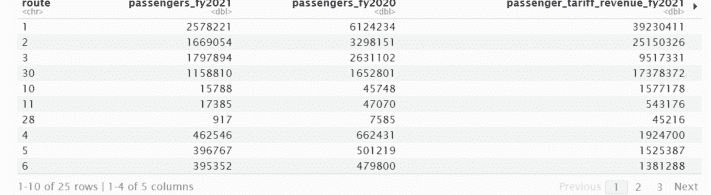

```
route %in% c("10", "11", "28") ~ "northern",
  TRUE ~ "minor"
))
```

`bcf_table_3`

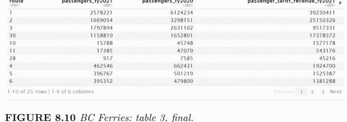

## 图 8.10 BC Ferries：表 3，最终。

现在我们可以使用数据整理技能来计算两年之间的百分比变化。让我们看看客运量的变化。

```
bcf_table_3 |>
  group_by(route_type) |>
  summarize(total_fy2021 = sum(passengers_fy2021),
            total_fy2020 = sum(passengers_fy2020)) |>
```

```
mutate(pct_change =
  (total_fy2021 - total_fy2020) / total_fy2020 * 100)
```

```
## # A tibble: 3 x 4
##   route_type total_fy2021 total_fy2020 pct_change
##   <chr>           <dbl>        <dbl>      <dbl>
## 1 major          7203979      13706288     -47.4
## 2 minor          5845280       7870649     -25.7
## 3 northern        34090        100403      -66.0
```

我们的分析：COVID-19 大流行对旅行产生了 *巨大的* 影响。2021 财年涵盖 2020 年 4 月 1 日至 2021 年 3 月 31 日的期间，几乎正好从严格的旅行限制开始实施。尽管在 12 个月期间后期限制开始放宽，但主要路线的旅行量下降了近一半。

# 9 数据来源网络

本章内容：

- 从网络存储库导入数据

## 9.1 引言

互联网上有大量有价值的数据，等待着好奇的数据分析师去发掘其中的洞见。有多种方式可以访问这些数据；在某些情况下，你可以下载 CSV 或 Excel 文件，然后将其读入 R。

但组成 R 社区的才华横溢的人们通过创建包使我们的生活变得轻松得多，这些包允许我们编写 R 脚本直接链接到我们想要的数据。如果访问的数据集会定期更新（例如每周财务报告或每月调查结果），这就特别有价值。

这种与互联网数据源连接的基础是 API（应用程序编程接口）。API 允许两个软件组件进行通信。在数据访问的上下文中，网站会设置 API 来定义数据如何被访问以及如何提供。

通常，API 包需要互联网连接。在某些情况下，API 可能需要请求用户密钥（网站可能用来验证用户或限制请求数量或大小的策略）。

利用 API 的 R 包有两种类型。第一种是专门针对特定数据源的，例如统计机构。除了获取数据外，这些包通常还具有额外的函数，可以为我们完成大量初始数据操作，使其成为 R 中有用的格式。

第二种类型超出了本书的范围，它们允许我们连接到原始数据源。对于这些来源，我们通常需要在使用数据之前进行一些整理。如果你有兴趣了解更多关于在 R 中创建与提供 API 的网站连接的内容，R 包 `{httr2}`(Wickham, 2023) 可能是一个不错的起点。

## 9.2 用于直接连接的 R 包

在本节中，我们将探讨示例，这些示例允许访问英国国家统计局和加拿大统计局托管的数据存储库。还有许多其他工具可用；其中一些列在本书章节末尾。截至撰写时，这些网站都不需要（至少）API 密钥。

### 9.2.1 国家统计局（英国）

我们的第一个示例将是 `{onsr}`，它直接从英国国家统计局下载数据（Vasilopoulos, 2022）。

```
library(onsr)
```

对于此，我们希望获得零售销售的时间序列数据。

我们可能想做的第一件事是探索我们感兴趣领域中有哪些可用内容。`ons_datasets()` 函数提供了当前可用的数据的完整列表。

```
datasets <- ons_datasets()

datasets |>
  select(id, description) |>
  filter(str_detect(id, "retail"))
```

从中我们将选择“按价值和数量计的英国零售销售数据，经季节性调整和未经季节性调整”，其 id 值为“retail-sales-index”。

`ons_ids()` 函数提供了从 `ons_datasets` 函数获得的 id 列的列表。

Another option is the `ons_browse_qmi()` function, which opens the relevant ONS page in your web browser software.

```
ons_browse_qmi(id = "retail-sales-index")
```

Finally, we will use the relevant id value in an `ons_get()` function to retrieve the data.

```
df_retail_sales <- ons_get(id = "retail-sales-index")
```

There are 42,400 rows in this data (as of 2023-06-14), with multiple variables for each month. Your analysis will require further filtering and selecting, but with the `{onsr}` package providing the access to the data, you are well on your way.

### 9.2.2 加拿大统计局

加拿大统计局，加拿大政府的一个部门，提供了一个名为“CANSIM”的社会经济时间序列数据库。发布到数据库中的数据是加拿大统计局定期收集的大部分汇总数据，例如劳动力调查（我们从中获得失业率更新）、消费者价格指数调查（关于通货膨胀）以及从怀孕和出生到预期寿命和死亡的健康相关信息。

包 `{cansim}`（von Bergmann 和 Shkolnik，2021）使用加拿大统计局创建的 API，以便直接下载数百个数据表和数千个单独的时间序列。

```
library(cansim) # access Statistics Canada's CANSIM data repository
```

One of the many tables related to international travel that is published in CANSIM is “Table: 24-10-0050-01 Non-resident visitors entering Canada, by country of residence”¹.

在 CANSIM 中发布的许多与国际旅行相关的表格之一是“表：24-10-0050-01 按居住国划分进入加拿大的非居民访客”¹。

Here’s a screenshot of the table, showing the number of people arriving by their continent of residence.

以下是该表的屏幕截图，显示按居住大陆到达的人数。

¹The webpage for the table, showing the most recently available data, is here: https://www150.statcan.gc.ca/t1/tbl1/en/tv.action?pid=2410005001

Geography: Canada (map)

地理：加拿大（地图）

| 居住国² | 2023年3月 | 2023年4月 | 2023年5月 | 2023年6月 | 2023年7月 |
|---|---:|---:|---:|---:|---:|
| **访客** |  |  |  |  |  |
| 进入加拿大的非居民访客 | 1,382,309 | 1,674,026 | 2,377,181 | 3,332,607 | 4,000,340 |
| 进入加拿大的美利坚合众国居民 | 1,094,111 | 1,300,810 | 1,831,912 | 2,632,723 | 3,132,681 |
| 进入加拿大的除美利坚合众国以外国家的居民 | 288,198 | 373,216 | 545,269 | 699,884 | 867,659 |
| 美洲，除美利坚合众国以外国家 | 74,654 | 92,600 | 90,704 | 116,030 | 141,622 |
| 北美，除美利坚合众国以外国家 | 42,446 | 56,789 | 49,022 | 56,651 | 69,313 |
| 中美洲 | 3,226 | 5,116 | 4,851 | 6,787 | 6,769 |
| 加勒比地区 | 11,203 | 15,742 | 14,952 | 20,830 | 28,585 |
| 南美洲 | 17,779 | 14,953 | 21,879 | 31,762 | 36,955 |
| 美洲，未另行说明³ | 0 | 0 | 0 | 0 | 0 |

**图 9.1** *CANSIM 表 24-10-0050-01.*

This table might be useful if you were developing a marketing campaign and you wanted to understand where tourists are coming from—the biggest markets and the fastest growing. But as shown, it is at too high a level; this is Canada by continent. For our purposes, we need to see specific country, those entering Canada via British Columbia, and a longer time series.

如果您正在开发营销活动并想了解游客来自哪里——最大的市场和增长最快的市场，该表可能很有用。但如图所示，它处于过高的层级；这是按大陆划分的加拿大。对于我们的目的，我们需要查看具体国家、经不列颠哥伦比亚省进入加拿大的人以及更长的时间序列。

We could use the filters and fiddle around making sure we got the right selections and then download the data, but if we have to do that next month it is going to be inefficient. We could also first click on the “download options” button and select “download entire table...” but again, this is not the most efficient way to do this, since there are a few manual steps we have to take and then open the file into R and filter to select the series we want.

我们可以使用过滤器并反复调整以确保获得正确的选择然后下载数据，但如果下个月必须这样做效率会很低。我们也可以先点击“下载选项”按钮并选择“下载整个表...”，但同样，这不是最高效的方式，因为我们必须执行几个手动步骤，然后将文件打开到 R 中并过滤以选择我们想要的系列。

This is where the `{cansim}` package comes in.

这就是 `{cansim}` 包发挥作用的地方。

### 第 1 步：下载数据。

- The `get_cansim()` function takes the table number as the parameter, and connects to CANSIM and downloads the data into an R dataframe.

```
travellers <- get_cansim("24-10-0050-01")
```

We will come back to filtering and variable selection along with working with date fields later, but here’s the code in R using the functions of the `{dplyr}` package to filter for the British Columbia cases during the month of June 2019:

我们稍后会回到过滤和变量选择以及处理日期字段，但以下是使用 `{dplyr}` 包的函数在 R 中过滤 2019 年 6 月不列颠哥伦比亚省案例的代码：

```
travellers_bc <- 
travellers |> 
  filter(GEO == "British Columbia",
         REF_DATE == "2019-06")

glimpse(travellers_bc, width = 65)
```

There are 287 rows, one for each of the categories in the Country of residence variable. It’s important to note that these are not just countries, but the variable also includes subtotals. What if we just want a monthly report on a single continent? One option would be for us to filter the “COUNTRY” variable; here we filter for visitors from Europe.

共有 287 行，每行对应居住国变量中的一个类别。需要注意的是，这些不仅仅是国家，变量还包括小计。如果我们只想要某个大洲的月度报告怎么办？一个选项是我们过滤“COUNTRY”变量；在这里我们过滤来自欧洲的访客。

```
travellers_bc |> 
  filter(`Country of residence` == "Europe")
```

One of the features of CANSIM and other similar tables is that the individual series are given a single identifier. In the case of CANSIM, these are called the “vector numbers”. Scroll to the right on this table, and you’ll see a variable called VECTOR. The vector identifier (sometimes called “the vector number” even though it’s a character string!) for European travellers entering Canada via British Columbia is v1277198032.

CANSIM 和其他类似表格的一个特点是各个系列都有一个唯一标识符。在 CANSIM 的情况下，这些被称为“向量编号”。将此表向右滚动，您会看到一个名为 VECTOR 的变量。经不列颠哥伦比亚省进入加拿大的欧洲旅行者的向量标识符（有时即使它是一个字符字符串也称为“向量编号”！）是 v1277198032。


The `{cansim}` package also gives us a function to select a single vector number, so we can be more efficient still. We can speed up the download time and skip the filtering steps to get to the one we want. (Note that this function requires us to enter a start date, and converts the reference date variable to the YYYY-MM-DD format.)

`{cansim}` 包还为我们提供了一个函数来选择单个向量编号，这样我们可以更高效。我们可以加快下载时间并跳过过滤步骤以获取我们想要的。（请注意，此函数要求我们输入开始日期，并将参考日期变量转换为 YYYY-MM-DD 格式。）

```
get_cansim_vector("v1277198032", start_time = "2015-01-01")
```

This table has the shortcoming of not including the “GEO” or “Country of residence” variables, so we need to ensure that we have adequately documented what has been accessed.

此表的缺点是不包括“GEO”或“居住国”变量，因此我们需要确保已充分记录所访问的内容。

The `{cansim}` package includes other very useful functions if you find yourself exploring Statistics Canada data sets.

如果您发现自己正在探索加拿大统计局数据集，`{cansim}` 包包含其他非常有用的函数。

The function `get_cansim_table_overview()` provides an abstract about the data table.

函数 `get_cansim_table_overview()` 提供有关数据表的摘要。

```
get_cansim_table_overview("24-10-0050-01")
```

## 9.3 用于直接访问数据的其他 R 包

The following is an incomplete list (in alphabetical order by name) of other packages that have been developed to provide direct access to a specific web resource.

以下是按名称字母顺序排列的不完整列表，其中包含为提供对特定网络资源的直接访问而开发的其他包。

- `{bcdata}` (Teucher et al., 2023) has tools to search, query, and download tabular and ‘geospatial’ data from the British Columbia Data Catalogue.

- `{fredr}` (Boysel and Vaughan, 2023) connects to the “Federal Reserve Economic Data”, or FRED, hosted by the Federal Reserve Bank of St. Louis. This data repository has (according to Wikipedia) over 800,000 economic time series from various sources.

- `{opendatatoronto}` (Gelfand and City of Toronto, 2022) provides a direct connection to the City of Toronto Open Data Portal.

- The `{readabs}` (Cowgill et al., 2023) package downloads and tidies data from the Australian Bureau of Statistics.

- `{RBNZ}` (Watson, 2020) downloads data from the Reserve Bank of New Zealand Website.

- `{tidycensus}` (Walker et al., 2023) has tools that connect to the United States Census Bureau and returns tidyverse-ready dataframes with the option of adding geographic details to allow for mapping. (See also (Walker, 2023).)

# 10 连接到关系数据库

In this chapter:

- Importing data directly from relational databases (SQL)

- Using relational data as part of the data preparation workflow

本章内容：

- 直接从关系数据库（SQL）导入数据

- 将关系数据作为数据准备工作流程的一部分使用

## 10.1 关系数据

Relational databases are commonly used for data storage. Unlike a “flat file” which contains all of the variables, the data is stored in multiple tables, which are linked via common variables (known as the “keys”). This facilitates efficient storage, as information does not need to be duplicated in multiple rows. We have seen an example of a relational table earlier, where we built a concordance table for the administrative geography of England and Wales in Chapter 6.

关系数据库通常用于数据存储。与包含所有变量的“平面文件”不同，数据存储在多个表中，这些表通过公共变量（称为“键”）链接。这有助于高效存储，因为信息不需要在多行中重复。我们之前见过一个关系表的例子，其中我们在第 6 章中为英格兰和威尔士的行政地理构建了对照表。

In that example, all of the data was loaded into our computer’s memory. In other instances, the size of the database, across multiple tables, will be such that it exceeds the capacity of your computer. In those cases, a server-based database will be established, and as the data analyst, we will need to retrieve only the variables and records that we need for our work. A database query can also include the calculation of summary statistics, which shifts the computational load to the server.

在那个例子中，所有数据都加载到我们计算机的内存中。在其他情况下，数据库的大小跨多个表，将超过计算机的容量。在这些情况下，将建立基于服务器的数据库，作为数据分析师，我们只需要检索我们工作所需变量和记录。数据库查询还可以包括汇总统计的计算，这将计算负载转移到服务器。

While SQL is the most commonly used query language, there are R packages that allow us to

虽然 SQL 是最常用的查询语言，但有 R 包允许我们

- Connect to a database,

- Write the code for our queries in R,

- Run the query, and

- Do our work in an R environment.

- 连接到数据库，

- 在 R 中编写查询代码，

- 运行查询，并

- 在 R 环境中进行工作。

在 R Markdown 或 Quarto 文档中编写代码时，如果更倾向于 SQL，你也可以灵活地使用 SQL 编写代码。

本练习复现了 Hadley Wickham 和 Garrett Grolemund 所著《R数据科学》中“关系数据”一章所述的连接操作（Wickham and Grolemund, 2016）。这里我们不使用 R 的 `{nycflights13}` 包（Wickham and RStudio, 2021），而是使用同一数据库的 SQLite 版本。

该数据库中有五个独立的表格。数据库中的 `flights` 表包含了 2013 年从纽约市出发的所有 336,776 架次航班。数据来自美国运输统计局（US Bureau of Transportation Statistics），并在 `?flights` 中进行了说明。

数据库中的其他表包括：

- `airlines` 允许你通过缩写代码查找完整的航空公司名称，

- `airports` 提供每个机场的信息，由 `faa` 机场代码标识，

- `planes` 提供每架飞机的信息，由 `tailnum` 标识，

- `weather` 提供纽约市每个机场每小时的天气情况。

这些表与 `flights` 表通过共同的变量相互*关联*。这些变量被称为“键”变量。

下图展示了这些关系：

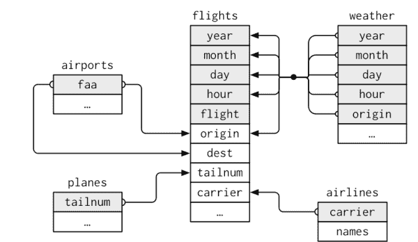

图 10.1 nycflights13。

（摘自 (Wickham and Grolemund, 2016)，第 174 页）

### 10.1.1 连接到数据库

SQL 是一种广泛用于在关系数据库中操作和提取数据的语言。因此，有很多关系数据库采用这种格式构建。大多数情况下，这些数据库会存放在网络服务器上，但对于较小的数据库，你可以将文件安装在本地计算机上。

在 R 中，我们可以使用 `{dbplyr}` 包（Wickham et al., 2023a）来访问 SQL 数据库和 SQL 函数。此外，我们需要 `{DBI}`（Müller, 2022）和 `{RSQLite}`（Müller et al., 2023）来建立与 RSQLite 数据库的连接。

```
library(dbplyr)
library(DBI)
library(RSQLite)
```

下面的代码建立与数据库的连接，并将连接（而不是数据表！）赋给对象 `con_nycf`（表示“Connection to New York City Flights”，即“到纽约市航班的连接”）。你会注意到，`{RSQLite}` 函数 `SQLite()` 位于 `{DBI}` 函数 `dbConnect()` 内部。`{DBI}` 包支持多种不同的数据库类型，包括广泛使用的 MySQL 和 Postgres。

```
# establish the connection to the database file
con_nycf <-  DBI::dbConnect(RSQLite::SQLite(), "data/nycflights13_sql.sqlite")

# list the tables in the connected database
dbListTables(con_nycf)
```

## [1] "airlines"   "airports"   "flights"    "planes"

## [5] "sqlite_stat1" "sqlite_stat4" "weather"

现在我们已经有了数据库连接，可以使用 `{dplyr}` 函数 `tbl()` 建立到特定表的连接。请注意，`flights` 对象不是表本身，而是到表的连接。

```
flights <- tbl(con_nycf, "flights")
```

### 10.1.2 提交查询

现在环境中的“flights”对象已经建立，我们可以编写 R 代码来创建航班的一个子集——即飞往西雅图的航班。同样，`flights_SEA` 对象不是数据框，而是一组创建连接和查询的指令。

```
flights_SEA <- flights |>
  filter(dest == "SEA")
```

我们还可以使用 `{dbplyr}` 的 `show_query()` 函数来生成 R 代码的 SQL 翻译：

```
flights_SEA <- flights |>
  filter(dest == "SEA") |>
  show_query()
```

```
## <SQL>
## SELECT `flights`.*
## FROM `flights`
## WHERE (`dest` = 'SEA')
```

在 SQL 中，我们使用 SELECT 来选择我们想要的列（或变量）（你会注意到这与 `{dplyr}` 中的术语相同）。星号“*”是一个通配符，用于选择所有表。

FROM 表示我们要从哪个表中获取列。

最后，按城市筛选使用 SQL 函数 WHERE。

在下面的代码中，我们按航空公司创建了从纽约到西雅图的平均飞行时间汇总表。

```
SEA <- flights_SEA |>
  select("month", "carrier", "air_time") |>
  group_by(carrier) |>
  summarize(
    n = n(),
    min_air_time = min(air_time),
    mean_air_time = mean(air_time),
    max_air_time = max(air_time)) |>
  # enter the resulting table into the R environment
  collect()
```

```
## Warning: Missing values are always removed in SQL aggregation functions.
## Use `na.rm = TRUE` to silence this warning
## This warning is displayed once every 8 hours.
```

```
SEA
```

```
## # A tibble: 5 x 5
##   carrier     n min_air_time mean_air_time max_air_time
##   <chr>   <int>        <dbl>         <dbl>        <dbl>
## 1 AA       365          289          336.         385
## 2 AS       714          277          326.         392
## 3 B6       514          283          330.         378
## 4 DL      1213          275          327.         389
## 5 UA      1117          280          326.         394
```

### 10.1.3 在 R 代码中使用 SQL

除了编写原生 R 代码之外，我们还可以在 R 代码中嵌入 SQL。在下面的示例中，R Markdown 文档中的 R 代码块使用了 `dbSendQuery()` 函数。在这个函数内部，我们首先指定所使用的连接，然后在引号内编写 SQL 代码："SELECT * FROM flights WHERE dest = 'SEA'"。

该查询指令被保存为对象 `SEA_sql`。

该 R 代码块随后还有一行使用 `dbFetch()` 函数来执行 SQL 查询。

`dbSendQuery()` 和 `dbFetch()` 都是 `{DBI}` 包中的函数。

```
SEA_sql <- dbSendQuery(con_nycf,
    "SELECT * FROM flights WHERE dest = 'SEA'")

dbFetch(SEA_sql)
```

## 10.2 在 R Markdown 中运行 SQL 语言代码块

《R Markdown：权威指南》（Xie et al., 2019, 第2.7.3节）提供了如何在 RStudio 中设置 R Markdown 以便运行 SQL 语言代码块的说明，包括使用 SQLite。

完成这些设置后，我们的 R Markdown 文档就可以将原生 SQL 查询纳入工作流程。请注意，在我们的 SQL 代码块中，我们指定了连接。在继续本示例的过程中，这个连接就是之前创建的 `con_nycf` 对象。我们的 SQL 代码块开头会包含以下文本：

```
{sql, connection=con_nycf}
```

```
SELECT *
FROM flights
WHERE dest = 'SEA'
```

### 10.2.1 可变连接和汇总表

可变连接是一种基于*键*上匹配的观测值来合并两个表中的变量的连接。


在这段 R 代码中，我们按航空公司名称创建了从纽约飞往西雅图的航班的汇总表。完整的航空公司名称不在 `flights` 表中；要获取该名称，我们需要将 `airlines` 表中的航空公司名称连接到 `flights` 表的西雅图汇总数据上。

第一步是建立到 `airlines` 表的连接。

```r
# establish connection to airlines table
 airlines <- tbl(con_nycf, "airlines")
```

连接建立后，就可以使用 `{dplyr}` 中的 `left_join()` 函数连接这些表，进行分组汇总计算，并按航班数量从多到少对表格进行排序。

该表还使用 `{gt}` 包（Iannone et al., 2023）进行了出版级格式设置；核心的 `gt()` 函数只是第一步，该包还提供了许多其他格式化选项。

```r
# join and summary table
flights_SEA_summary <- flights_SEA |>
# select(-origin, -dest) |>
  left_join(airlines, by = "carrier") |>
  group_by(name) |>
  tally() |>
  arrange(desc(n))

flights_SEA_summary |>
  gt()
```

| name | n |
|---|---|
| Delta Air Lines Inc. | 1213 |
| United Air Lines Inc. | 1117 |
| Alaska Airlines Inc. | 714 |
| JetBlue Airways | 514 |
| American Airlines Inc. | 365 |

下面的 SQL 代码返回相同的表。我们可以看出代码编写方式的一个不同之处——它“由内向外”执行，第三步先于第一步和第二步，而不是像我们在 R 管道中习惯的线性方式。

```sql
-- 3. select `name` variable from joined table and apply count
SELECT `name`, COUNT(*) AS `n`
FROM (
  SELECT `flights_sea`.*, `name`
  -- 1. query to filter Seattle flights
  FROM (
    SELECT *
    FROM `flights`
    WHERE (`dest` = 'SEA')
  ) AS `flights_sea`
  -- 2. join to airlines table
  LEFT JOIN `airlines`
    ON (`flights_sea`.`carrier` = `airlines`.`carrier`)
)
-- 4. define grouping for COUNT (from step 3) and sort
GROUP BY `name`
ORDER BY `n` DESC
```

**表10.2：5条记录**

| name | n |
|---|---|
| Delta Air Lines Inc. | 1213 |
| United Air Lines Inc. | 1117 |
| Alaska Airlines Inc. | 714 |
| JetBlue Airways | 514 |
| American Airlines Inc. | 365 |

这些连接（join）使用的术语与你在 `{dplyr}` 中熟悉的术语类似。这个左连接将返回 `flights` 表中的所有记录，以及 `airlines` 表中与之匹配的变量。

为了指定连接的关键变量，我们使用 SQL 术语 `ON`。请注意，我们指定的表名和变量名之间用句点分隔。

如需了解更多关于使用 SQL（尤其是 SQLite）的信息，强烈推荐托马斯·尼尔德（Thomas Nield）的《SQL入门》（Nield, 2016）。

## 10.3 使用 `{tidylog}` 包

任何表连接的重要环节都是检查结果，看它是否符合我们的预期。`{tidylog}` 包（Elders and Oldoni, 2020）

该包的作者承认，这一功能会为处理过程增加一些计算和时间开销，但这可能是值得的。如果使用得当，它返回的信息可以立即指示代码是否正常工作。这在编写代码的早期阶段尤其如此——当你确信得到预期结果时，可以移除这些函数。

```r
library("tidylog")
```

运行 `library(tidylog)` 函数后，结果会自动生成。

美国职业棒球大联盟（Major League Baseball）的球队在美国和加拿大的城市进行比赛（目前只有多伦多！），但吸引了来自世界各地的顶尖球员。在这个示例中，代码创建了一个汇总表，显示 2001 赛季击球手的出生国家。为此，我们将使用 R 包中存储的数据，该数据包含 Lahman 棒球数据库（以最初创建该数据库的肖恩·拉赫曼[Sean Lahman]的名字命名）（Friendly et al., 2020）。

此轮运行完成后，`{tidylog}` 包会生成关于连接、分组和计数（`tally`）函数的一些汇总信息。

```r
## start with the Batting table
Lahman::Batting |>
  ## filter for year
  filter(yearID == "2001") |>
  ## join to People table (where the birth country is recorded)
  left_join(Lahman::People, by = "playerID") |>
  ## now group_by and tally
  group_by(birthCountry) |>
  tally() |>
  arrange(desc(n)) |>
  slice_head(n = 10)
```

```
## filter: removed 110,845 rows (99%), 1,339 rows remaining

## left_join: added 25 columns (birthYear, birthMonth, birthDay, birthCountry, birthState, ...)

##          > rows only in x          0

##          > rows only in y  (19,456)

##          > matched rows     1,339

##          >                 ========

##          > rows total       1,339

## group_by: one grouping variable (birthCountry)

## tally: now 22 rows and 2 columns, ungrouped

## slice_head: removed 12 rows (55%), 10 rows remaining
```

```
## # A tibble: 10 x 2
##   birthCountry     n
##   <chr>        <int>
```

| birthCountry | n |
|---|---|
| USA | 1002 |
| D.R. | 120 |
| P.R. | 57 |
| Venezuela | 54 |
| Mexico | 19 |
| Cuba | 16 |
| CAN | 14 |
| Japan | 14 |
| Panama | 11 |
| Australia | 6 |

# 11 探索与验证策略

在本章中：

- 探索性数据分析以识别问题，包括 `{skimr}` 包
- 使用 `{validate}` 包进行结构化测试

## 11.1 识别脏数据

在第 2 章前面，我们介绍了与“脏数据”相关的挑战。

**第一个挑战：** 我们如何发现数据中存在的问题？

**第二个挑战：** 我们能够并且应该如何处理这些问题？

“数据验证”一词有时指在数据收集时应用的验证（例如，在基于网络的调查工具中），在其他情况下，它指确保数据满足指定条件的编程方法。在这两种情况下，我们都可以将数据验证视为一种质量控制形式，从快速的健全性检查到严格的编程测试。（White et al., 2013）

收集过程中的数据验证可以通过使用下拉框来消除拼写错误，或通过要求输入的文本匹配特定模式的输入字段来实现。例如，加拿大邮政编码始终遵循以下模式：大写字母（但并非所有字母）、0 到 9 的数字、大写字母、空格、数字、大写字母和数字。邮政编码的第一个字母指定一个地区；在纽芬兰与拉布拉多省，邮编以字母“A”开头，而在育空地区以“Y”开头，这为可能的验证增加了另一个维度。电子数据收集还可以强制要求在提交前完成某项内容的填写。

这些强加的验证规则带有风险，需要深思熟虑地实施。强迫一个人填写字段可能会导致捏造的值，这可能比缺失字段更糟糕。想象一下强迫某人报告他们的收入——他们可能不乐意分享这些信息，为了满足字段要求，可能会输入“1”或一个荒谬的大数字，两者都不准确。在这种情况下，表单最好提供一个“不愿回答”的选项，让受访者有一个不会扭曲最终结果的选项。

在这里的工作中，我们将重点放在数据收集后的检查和验证上。分析人员可以在数据提供给下一步骤之前指定参数。这些参数可以表示为规则或假设，并基于对主题的了解。（van der Loo and de Jonge, 2018，第 6 章：数据验证）

我们可能评估的内容包括：

- 字段必须以特定方式结构化；例如邮政编码和日期字段。
- 值可能有一定的范围或有限数量的类别。
- 某些值（如年龄）必须为正数。
- 两个或多个变量之间可能存在已知关系。

现在我们来讨论评估数据中值的方法。

## 11.2 探索性数据分析

识别脏数据的一种方法是通过 *探索性数据分析*（EDA）过程。（Tukey, 1977）EDA 过程首先旨在帮助指导我们的分析，但它还有一个额外的好处，即提供关于数据污染方式的线索。

EDA 由两类技术组成：

- 汇总统计
- 数据可视化

在此阶段，我们要查找的内容包括：

- 变量类型
- 缺失值
- 无效值和异常值，包括哨兵值
- 过宽或过窄的数据范围
- 数据的单位

（改编自（Zumel and Mount, 2019，第 54 页））

在此示例中，我们将查看一些关于公司员工的合成数据。数据存储在 Excel 文件的多个工作表中；我们将探索“`df_HR_train`”工作表中的数据，该工作表记录某人是否已完成强制培训课程。

```r
readxl::excel_sheets(dpjr::dpjr_data("cr25/cr25_human_resources.xlsx"))
```

```
## [1] "readme"      "df_HR_main"      "df_HR_transaction"
## [4] "df_HR_train"
```

一旦将数据读入我们的环境，我们就可以使用一些 EDA 方法来检查数据。

```r
df_HR_train <- readxl::read_excel(dpjr::dpjr_data("cr25/cr25_human_resources.xlsx"), sheet = "df_HR_train")
```

我们可以使用 `dplyr::glimpse()` 函数开始调查。此函数返回数据框的维度、变量类型以及每个变量的前几个值。

```r
glimpse(df_HR_train, width = 65)
```

```
## Rows: 999
## Columns: 5
## $ emp_id       <chr> "ID001", "ID002", "ID003", "ID004", "ID0~
## $ train_security <chr> "TRUE", "FALSE", "TRUE", "FALSE", "FALSE~
## $ train_crm    <chr> "TRUE", "FALSE", "TRUE", "TRUE", "FALSE"~
## $ train_qc     <chr> "NA", "FALSE", "FALSE", "FALSE", "FALSE"~
## $ train_history <chr> "TRUE", "TRUE", "TRUE", "TRUE", "TRUE", ~
```

由于原始 Excel 文件中的“NA”字符串，以 `train_` 开头的变量被存储为字符类型 `_<chr>_`。如果改为逻辑类型存储，这类变量在我们的分析中会更有用。一种选择是在我们环境中对现有对象修改变量类型，或者（采用“在导入阶段尽可能处理”的方法）我们可以重新读取文件内容并在此时应用变量类型定义。第二种方案还让我们能够明确地将那些编码为其他字符的变量定义为 NA。这里 NA 表示为“NA”，但在其他数据中，你可能会遇到“not available”、“9999”、“-”以及许多其他可能性。

```r
df_HR_train <- 
  readxl::read_excel(
    dpjr::dpjr_data("cr25/cr25_human_resources.xlsx"),
    sheet = "df_HR_train",
    col_types = c("text", "logical", "logical", "logical", "logical"),
    na = "NA"
  )

glimpse(df_HR_train, width = 65)
```

```
## Rows: 999
## Columns: 5
## $ emp_id       <chr> "ID001", "ID002", "ID003", "ID004", "ID005", ...
## $ train_security <lgl> TRUE, FALSE, TRUE, FALSE, FALSE, FALSE, ...
## $ train_crm     <lgl> TRUE, FALSE, TRUE, TRUE, FALSE, TRUE, TRUE, ...
## $ train_qc      <lgl> NA, FALSE, FALSE, FALSE, FALSE, NA, FALSE, ...
## $ train_history <lgl> TRUE, TRUE, TRUE, TRUE, TRUE, TRUE, TRUE, ...
```

现在这些变量都以适合其表示内容的类型存储，应用 R 的 `summary()` 函数为我们提供了另一种查看数据的方式。

```r
summary(df_HR_train)
```

```
##      emp_id      train_security  train_crm      train_qc
##  Length:999   Mode :logical    Mode :logical  Mode :logical
##  Class :character FALSE:500      FALSE:219     FALSE:494
##  Mode  :character TRUE :462      TRUE  :771    TRUE  :110
##                 NA's :37        NA's :9      NA's :395
##  train_history
##  Mode :logical
##  FALSE:16
##  TRUE :971
##  NA's :12
```

## 11.2 探索性数据分析

这个输出是我们的初步 EDA。我们注意到了什么？由于没有数值，我们不需要寻找异常值、哨兵值或值的范围。

在像这样的调查数据框中，出现一些 NA 值是意料之中的，少量 NA 值可能不会对分析产生影响。但 `train_qc` 变量有 395 个缺失值——几乎占 999 条记录的 40%。大量缺失值可能有其原因，分析师的部分责任就是理解这种情况发生的原因。首先，在关于数据的笔记中记录你观察到的这一现象。

对数据及其来源的透彻理解将确保你的分析准确无误。有必要对此情况做进一步调查（并保存记录）。你可以先查看随文件收到的数据文档。如果那里没有解释，可与了解数据采集方式的人员交流，然后与人力资源部门的人员交流——也许有一项政策豁免了一部分员工参加原本的必修课程。

### 11.2.1 数据可视化

图表可以向我们展示大量无法在汇总统计中表达的信息。让我们来探索 `df_HR_main` 工作表中的出生日期变量。

```r
df_HR_main <-
  read_excel(
    path = dpjr::dpjr_data("cr25/cr25_human_resources.xlsx"),
    sheet = "df_HR_main",
    range = "B5:E1004"
  )

head(df_HR_main)
```

A tibble: 6 × 4

| emp_id | date_of_birth         | name              | gender |
|---|---|---|---|
| ID001 | 1981-05-27 00:00:00 | Avril Lavigne | Female |
| ID002 | 1973-09-24 00:00:00 | Katy Perry | Female |
| ID003 | 1966-11-29 00:00:00 | Chester Bennington | Male |
| ID004 | 1982-09-17 00:00:00 | Chris Cornell | Male |
| ID005 | 1976-07-17 00:00:00 | Bryan Adams | Male |
| ID006 | 1965-07-03 00:00:00 | Courtney Love | Female |

我们将再次使用 `glimpse()` 和 `summary()` 函数来开始探索：

```r
glimpse(df_HR_main)
```


```
## Rows: 999
## Columns: 4
## $ emp_id <chr> "ID001", "ID002", "ID003", "ID004", "ID005", "ID006", ...
## $ date_of_birth <dttm> 1981-05-27, 1973-09-24, 1966-11-29, 1982-09-17, ...
## $ name <chr> "Avril Lavigne", "Katy Perry", "Chester Bennington", ...
## $ gender <chr> "Female", "Female", "Male", "Male", "Male", "Female", ...
```

```
summary(df_HR_main)
```

```
## emp_id date_of_birth name
## Length:999 Min. :1901-01-01 00:00:00.000 Length:999
## Class :character 1st Qu.:1965-10-25 12:00:00.000 Class :character
## Mode :character Median :1976-06-21 00:00:00.000 Mode :character
## Mean :1976-01-14 17:53:52.432
## 3rd Qu.:1987-03-08 12:00:00.000
## Max. :1999-01-01 00:00:00.000
## gender
## Length:999
## Class :character
## Mode :character
##
##
##
```

在这些信息中有一个有趣的异常——你可能已经发现了。如果我们绘制数据，这个异常会明显得多。下面是一个密度图，显示了员工出生日期的分布：

```
ggplot(df_HR_main, aes(x = date_of_birth )) +
  geom_density()
```

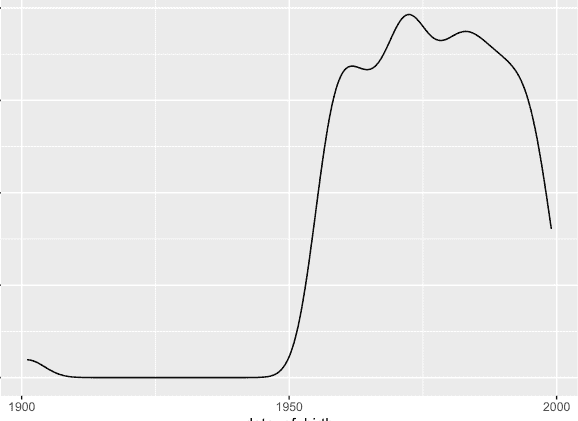

通过图表很容易看到，有少量出生日期在 1900 年前后，然后从 20 世纪 50 年代开始数量激增。

在查看 `summary()` 函数和图表的结果后，我们可能想要进一步探索 `date_of_birth` 变量，以下是一些问题：

- 最早的出生日期是 1901-01-01。这意味着截至数据集创建的时间点 2020-01-01，最年长的员工为 119 岁。你可能已经知道，只有一位年龄经过独立验证的人活到了 120 岁（其去世时为 122 岁 164 天）。维基百科，“经验证的最长寿者名单”¹。一种可能是 1901-01-01 是哨兵值，作为未知或缺失值的占位符。进一步探索将帮助我们理解；我们可以先统计某个特定日期的案例数量：

```r
df_HR_main |>
  group_by(date_of_birth) |>
  tally() |>
  arrange(desc(n)) |>
  head()
```

```
## # A tibble: 6 x 2
##   date_of_birth       n
##   <dttm>          <int>
## 1 1901-01-01 00:00:00 10
## 2 1955-10-26 00:00:00 2
## 3 1955-10-31 00:00:00 2
## 4 1955-11-22 00:00:00 2
## 5 1957-09-11 00:00:00 2
## 6 1958-10-28 00:00:00 2
```

有 10 个案例的出生日期为 1901-01-01。这正是我们使用哨兵值时可能看到的模式。

另一种调查方法是根据出生日期推导出一个单独的“年龄”变量，并使用箱线图按某个分类变量对年龄进行可视化，以便更明显地看出异常值。我们猜想出生日期的“1901-01-01”哨兵值可能与某个职业类别有关。利用关系数据库的“连接”技能，我们将`transaction`表中的职业变量连接起来，并在绘图中使用职业作为分组变量。你会注意到`transaction`表的结构不适合我们的分析需求，因此我们必须先进行一些数据整理。

```
# step 1; read transaction table, which contains occupation
df_HR_transaction <- 
  read_excel(
    path = dpjr::dpjr_data("cr25/cr25_human_resources.xlsx"),
    sheet = "df_HR_transaction",
    na = "NA"
  )

# step 2; determine occupation on the date the table was created
df_HR_occupation_2020 <- df_HR_transaction |> 
  group_by(emp_id) |> 
  summarize(occupation_current = max(occupation, na.rm = TRUE))

# step 3; in the main table calculate age and
#   join the occupation table created in step 2,
#   then plot the result
df_HR_main |> 
  # calculate age on January 1, 2020
  mutate(age_2020 = 
          date_of_birth %--% ymd("2020-01-01") %/% years(1)) |> 
  # join the current occupation table
left_join(df_HR_occupation_2020, by = "emp_id") |>
# plot
ggplot(aes(x = occupation_current, y = age_2020)) +
geom_boxplot()
```

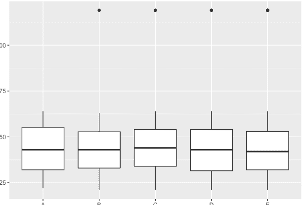

在箱线图可视化中，我们看到哨兵值出现在五种职业中的四种中，因此我们的猜想并不正确。

## 11.3 验证方法

探索性数据分析使用可视化和数据摘要扫描来发现潜在脏数据，而验证则是一种结构化的测试过程。

### 11.3.1 `{validate}` 包

与其他数据分析主题一样，R 用户社区的人们也遇到了脏数据问题，并编写和共享了一些函数来帮助我们其他人。`{validate}` 包（van der Loo and de Jonge, 2021, van der Loo et al. (2022)）由方法学家编写并维护，他们供职于荷兰统计局，并为我们提供了编写结构化验证测试的工具。

我们将在此包中研究的第一个函数是 `check_that()`，使用 `{palmerpenguins}`（Horst 等，2022；Horst，2020）中的数据。我们知道包中的数据是整洁干净的——它们已经经过验证过程。

```
library(tidyverse)

library(palmerpenguins)
library(validate)
```

### 数值范围：

作为企鹅专家，我们知道巴布亚企鹅（Pygoscelis papua）是企鹅物种中第三大的，体重可达 8.5 千克。因此我们可能想看看是否有任何记录的企鹅体重超过 8500 克。`check_that()` 函数将这个问题反过来了；我们确保所有记录中的企鹅体重值都小于或等于 8500 克。如果值低于该值，则返回“通过”。

```
check_penguins <- check_that(penguins, body_mass_g <= 8500)

summary(check_penguins)
```

对 `check_that()` 函数创建的对象使用 `summary()` 函数，结果显示所有企鹅的体重都小于或等于 8500 克，并且数据中有 2 个“NA”值。

### 关系：

虽然最重的巴布亚企鹅可达 8.5 千克，但体重超过 5 千克的阿德利企鹅或帽带企鹅非常罕见。如果我们将体重阈值改为 5000 克会怎样？

```
check_penguins <- check_that(penguins, body_mass_g <= 5000)

summary(check_penguins)
```

除了告诉我们有 61 条记录的 `body_mass_g` 变量值大于 5000 克之外，它还让我们知道有 2 个 NA 值。

我们可以添加一个 `if()` 语句来过滤掉巴布亚企鹅，然后检查体重。

```
check_penguins <- check_that(
  penguins,
  if (species != "Gentoo") body_mass_g <= 5000
)

summary(check_penguins)
```

现在所有记录（除了那一个“NA”）都通过了。发生了什么？首先是我们排除了所有巴布亚企鹅——如果是巴布亚企鹅，就会被标记为“通过”。所有剩余的企鹅（即帽带企鹅和阿德利企鹅）都会根据 5000 克的体重值进行评估。而且它们都通过了。

让我们进一步探索数据。如果我们按体重超过 5000 克的企鹅进行筛选，会发现什么？

```
penguins |>
  filter(body_mass_g > 5000) |>
  distinct(species)
```

```
## # A tibble: 1 x 1
##   species
##   <fct>
## 1 Gentoo
```

因此，这证实了所有较重的企鹅都是巴布亚企鹅，符合我们的预期。

### 范围：

我们知道 `{palmerpenguins}` 数据来自 2007-2009 年三个季度的测量。我们可以编写一个验证测试，确保 `year` 变量在该范围内。

```
check_penguins <- check_that(penguins, year >= 2007 & year <= 2009)
summary(check_penguins)
```

| 名称 | 项目数 | 通过 | 失败 | 缺失值 | 错误 | 警告 | 表达式 |
|------|-------|--------|-------|-----|-------|---------|------------|
| V1 | 344 | 344 | 0 | 0 | FALSE | FALSE | `year - 2007 >= -1e-08 & year - 2009 <= 1e-08` |

如果我们只检查某一年呢？

```
check_penguins <- check_that(penguins, year == 2009)
summary(check_penguins)
```

| 名称 | 项目数 | 通过 | 失败 | 缺失值 | 错误 | 警告 | 表达式 |
|------|-------|--------|-------|-----|-------|---------|------------|
| V1 | 344 | 120 | 224 | 0 | FALSE | FALSE | `abs(year - 2009) <= 1e-08` |

输出在“通过”列中给出了该年份的案例数，在“失败”列中给出了不在该年份的案例数。

### 关系：

我们知道有些物种只在三个岛屿之一上被测量过。巴布亚企鹅只在比斯科岛上取样，而我们样本中的帽带企鹅只来自梦想岛。数据是否反映了这一点？

在第一个测试（标记为 `g`，代表巴布亚企鹅）中，如果不是巴布亚企鹅，就会被纳入通过；如果是巴布亚企鹅，则必须在比斯科岛才能通过。在 `c`（代表帽带企鹅）测试中，我们将对帽带企鹅做同样的操作，它们应该都在梦想岛上。

```
check_penguins <-
  check_that(penguins,
             g = if (species == "Gentoo") island == "Biscoe",
             c = if (species == "Chinstrap") island == "Dream")

summary(check_penguins)
```

| 名称 | 项目数 | 通过 | 失败 | 缺失值 | 错误 | 警告 | 表达式 |
|------|-------|--------|-------|-----|-------|---------|------------|
| g | 344 | 344 | 0 | 0 | FALSE | FALSE | `species != "Gentoo" \| (island == "Biscoe")` |
| c | 344 | 344 | 0 | 0 | FALSE | FALSE | `species != "Chinstrap" \| (island == "Dream")` |

输出现在包含两个测试的结果。两个测试的所有案例都通过，没有失败。

我们本来可以编写代码生成汇总表来检查这一点。然而，在许多数据集中，组合太多，无法以这种方式进行可靠调查。

```
penguins |>
  group_by(species, island) |>
  tally()
```

| 物种 | 岛屿 | 数量 |
|---------|--------|---|
| Adelie | Biscoe | 44 |
| Adelie | Dream | 56 |
| Adelie | Torgersen | 52 |
| Chinstrap | Dream | 68 |
| Gentoo | Biscoe | 124 |

可以使用“与”运算符 `&` 编写单个 `check_that()` 测试。

```
check_penguins <-
  check_that(penguins,
    if (species == "Gentoo") island == "Biscoe" &
    if (species == "Chinstrap") island == "Dream")
```

```
summary(check_penguins)
```

| 名称 | 项目数 | 通过 | 失败 | 缺失值 | 错误 | 警告 | 表达式 |
|------|-------|--------|-------|-----|-------|---------|------------|
| V1 | 344 | 344 | 0 | 0 | FALSE | FALSE | `species != "Gentoo" \| (island == "Biscoe" & (species != "Chinstrap" \| (island == "Dream")))` |

### 图 11.1 `check_penguins`。

我们还可以根据一个已定义的列表进行测试。如果我们需要评估数据的列表非常庞大，这种策略会很有效。想象一下检查你所在地区每个城镇的名称拼写。如果你在现有数据文件中预定义了这些名称的列表，该列表可以被读入你的 R 环境，并针对该列表运行测试。在这个简短的示例中，创建了一个名为 `island_list` 的对象，并针对该列表的内容运行验证检查。

```
island_list <- c("Biscoe", "Dream", "Torgersen")

check_penguins <-
  check_that(penguins,
    if (species == "Adelie") island %in% island_list)

summary(check_penguins)
```

| 名称 | 项目数 | 通过 | 失败 | 缺失值 | 错误 | 警告 | 表达式 |
|------|-------|--------|-------|-----|-------|---------|------------|
| V1 | 344 | 344 | 0 | 0 | FALSE | FALSE | `species != "Adelie" \| (island %in% island_list)` |

_如果我们没有将梦想岛包括在发现阿德利企鹅的岛屿列表中，会怎样？_

`{validator}` 还允许我们在 `check_that()` 函数中检查变量类型。由于 R 将数据框列存储为单一类型，因此只会返回一个通过/失败评估。

```
summary(check_that(penguins, is.integer(year)))
```

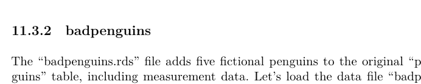

**图 11.2** `summary(check_that(penguins))`.

### 11.3.2 `badpenguins`

`badpenguins.rds` 文件向原始的 `penguins` 表添加了五只虚构的企鹅，包括测量数据。让我们加载数据文件 `badpenguins.rds`（一个 R 数据文件），并运行之前使用过的一些测试：

```
badpenguins <- read_rds(dpjr_data("badpenguins.rds"))
```

```
tail(badpenguins)
```


```
## # A tibble: 6 x 8
##   species island bill_length_mm bill_depth_mm flipper_length_mm body_mass_g
##   <fct>   <fct>       <chr>          <chr>           <chr>            <chr>
## 1 Chin... Dream      50.2           18.7            198              3775
## 2 Penguin Gotham     <NA>           <NA>            <NA>             90
## 3 Pingu  Antar~     <NA>           <NA>            <NA>             <NA>
## 4 Pinga  Antar~     <NA>           <NA>            <NA>             <NA>
## 5 Opus   Bloom~     <NA>           <NA>            <NA>             <NA>
## 6 Gunter Ice K~     <NA>           <NA>            <NA>             <NA>
## # i 2 more variables: sex <fct>, year <chr>
```

```r
check_penguins <- check_that(badpenguins, year >= 2007 & year <= 2009)

summary(check_penguins)
```

| 名称 | 项目数 | 通过 | 失败 | 缺失值 | 错误 | 警告 | 表达式 |
|------|-------|--------|-------|-----|-------|---------|------------|
| V1 | 349 | 344 | 5 | 0 | FALSE | FALSE | `year >= 2007 & year <= 2009` |

```r
check_penguins <- check_that(badpenguins, island %in% island_list)

summary(check_penguins)
```

| 名称 | 项目数 | 通过 | 失败 | 缺失值 | 错误 | 警告 | 表达式 |
|------|-------|--------|-------|-----|-------|---------|------------|
| V1 | 349 | 344 | 5 | 0 | FALSE | FALSE | `island %in% island_list` |

在这两种情况下，我们都会得到 5 个“失败”。

### 11.3.3 调查失败

我们如何检查哪些记录了失败？

{validate} 还提供了另外两个函数，`validator()` 和 `confront()`，它们让我们能够

- 同时运行多项检查，以及
- 生成一份详细的逐记录说明，指出哪些记录未通过我们的测试。

首先，我们使用 `validator()` 将测试的语法分配给对象`penguin_tests`。

```r
penguin_tests <- validator(
  island %in% island_list,
  year >= 2007 & year <= 2009,
  body_mass_g <= 8500
)

penguin_tests
```

```
## Object of class 'validator' with 3 elements:
##  V1: island %in% island_list
##  V2: year >= 2007 & year <= 2009
##  V3: body_mass_g <= 8500
```

在下一步中，我们使用 `confront()` 函数以一系列“confrontations”应用这些测试，生成一个我们可以调查的输出对象。

```r
penguin_confront <- confront(badpenguins, penguin_tests)

penguin_confront
```

```
## Object of class 'validation'
## Call:
##     confront(dat = badpenguins, x = penguin_tests)
##
## Rules confronted: 3
##   With fails  : 3
##   With missings: 1
##   Threw warning: 0
##   Threw error  : 0
```

```r
summary(penguin_confront)
```

| 名称 | 项目数 | 通过 | 失败 | 缺失数 | 错误 | 警告 | 表达式 |
| --- | --- | --- | --- | --- | --- | --- | --- |
| V1 | 349 | 344 | 5 | 0 | FALSE | FALSE | `island %in% island_list` |
| V2 | 349 | 344 | 5 | 0 | FALSE | FALSE | `year >= 2007 & year <= 2009` |
| V3 | 349 | 342 | 1 | 6 | FALSE | FALSE | `body_mass_g <= 8500` |

让我们查看 `confront()` 函数对我们的 `badpenguins` 数据结果的最后十行。第 340 行到第 344 行是原始干净企鹅数据集中的原始数据；第 345 行到第 349 行是坏企鹅。第一个坏企鹅在全部三个测试中均失败，而其他企鹅在前两个测试中失败，第三个测试的值为“NA”。

```r
tail(values(penguin_confront), 10)
```

| 行 | V1 | V2 | V3 |
| --- | --- | --- | --- |
| [340,] | TRUE | TRUE | TRUE |
| [341,] | TRUE | TRUE | TRUE |
| [342,] | TRUE | TRUE | TRUE |
| [343,] | TRUE | TRUE | TRUE |
| [344,] | TRUE | TRUE | TRUE |
| [345,] | FALSE | FALSE | FALSE |
| [346,] | FALSE | FALSE | NA |
| [347,] | FALSE | FALSE | NA |
| [348,] | FALSE | FALSE | NA |
| [349,] | FALSE | FALSE | NA |

在这个示例中，我们对数据的先验知识使我们能够快速定位未通过验证测试的行。在现实世界中，过滤验证测试结果的对象将使我们能够识别包含未通过测试记录的行。

我们用于此的函数是 `violating()`。`violating()` 函数的两个参数是

- 原始数据框 `badpenguins` 和
- `confront()` 函数的结果对象 `penguin_confront`。

```r
violating(badpenguins, penguin_confront)
```

| 物种 | 岛屿 | 喙长_mm | 喙深_mm | 翼长_mm | 体重_g | 性别 | 年份 |
| --- | --- | --- | --- | --- | --- | --- | --- |
| Penguin | Gotham | NA | NA | NA | 90 | male | 1966 |
| Pingu | Antarctica | NA | NA | NA | NA | male | 1986 |
| Pinga | Antarctica | NA | NA | NA | NA | female | 1986 |
| Opus | Bloom County | NA | NA | NA | NA | male | 1981 |
| Gunter | Ice Kingdom | NA | NA | NA | NA | unknown | 2012 |

一个 tibble：5 × 8（5 行）

图 11.3 `violating(badpenguins)`。

现在我们知道了未通过测试的案例的详细信息，我们可以根据我们正在进行的研究的理解，对如何处理这些案例做出一些决定。

# 12 清理技术

本章内容：

- 清理日期和字符串
- 创建条件和计算变量
  - 指示变量（也称为虚拟变量（Suits, 1957）和“one hot”编码）
- 处理缺失值

## 12.1 引言

我们已经应用了一些清理方法。在导入数据的章节中，我们处理了多种可归入“数据清理”的技术，包括分配变量类型和将数据重构为整洁格式。在本章中，我们更深入地探讨一些反复出现的数据清理挑战的示例。

### 12.2 清理日期

在许多数据分析项目中，反复出现的挑战是如何处理日期和时间字段。任何数据清理项目的第一步之一都应确保这些字段采用一致的格式，以便轻松操作。

正如我们在 (Broman and Woo, 2017) 中看到的，有一个国际标准（ISO 8601）用于以无歧义且有原则的方式书写日期和时间（以及组合的日期时间）。对于日期，我们写 YYYY-MM-DD。同样，时间写为 T[hh][mm][ss] 或 T[hh]:[mm]:[ss]，小时（24 小时制）后跟分钟和秒。

当我们处理日期时，清理的目标是将日期转换为 ISO 8601 标准，然后在适当的情况下将该结构转换为日期类型变量。日期类型格式的好处很多，其中最不重要的是为使用日期类型变量的分析和可视化而构建的 R 工具，(Wickham et al., 2023b, Chapter 18)，同样的工具也允许我们处理捕获日期元素的变量清理。

其中一个这样的包是 {lubridate}，它是 tidyverse 的一部分。

### 12.2.1 创建日期-时间字段

日期在您的数据中可能表示为三种独立字段的方式之一，一个用于年份，一个用于月份，一个用于日期。这些可以组合成单个日期变量，使用 `make_date()`，或单个日期时间变量，使用 `make_datetime()`。

在 {Lahman}（Friendly et al., 2020）表`People`中，每个球员的出生日期存储为三个独立变量。它们可以使用 `make_date()` 合并为一个变量：

```r
Lahman::People |>
  slice_head(n = 10) |>
  select(playerID, birthYear, birthMonth, birthDay) |>
  # create date variable
  mutate(birthDate = make_date(birthYear, birthMonth, birthDay))
```

| 球员ID | 出生年份 | 出生月份 | 出生日 | 出生日期 |
| --- | --- | --- | --- | --- |
| aardsda01 | 1981 | 12 | 27 | 1981-12-27 |
| aaronha01 | 1934 | 2 | 5 | 1934-02-05 |
| aronto01 | 1939 | 8 | 5 | 1939-08-05 |
| aasedo01 | 1954 | 9 | 8 | 1954-09-08 |
| abadan01 | 1972 | 8 | 25 | 1972-08-25 |
| abadfe01 | 1985 | 12 | 17 | 1985-12-17 |
| abadijo01 | 1850 | 11 | 4 | 1850-11-04 |
| abbated01 | 1877 | 4 | 15 | 1877-04-15 |
| abbeybe01 | 1869 | 11 | 11 | 1869-11-11 |
| abbeych01 | 1866 | 10 | 14 | 1866-10-14 |

日期存储的第二种有问题的方式是以多种经常含糊不清的序列存储。这可能包括月份的文本字符串（例如“Jan”、“January”或“Janvier”而不是“01”）、两位数的年份（“12”指的是 2012 还是 1912？），以及月份和日期的含糊不清的顺序（“12”指的是月份的第十二天还是十二月？）

如果我们知道数据存储的方式，可以使用 {lubridate} 函数将数据处理为 YYYY-MM-DD。这三种非常不同的日期格式可以转换为一致的格式：

```r
ymd("1973-10-22")
```

```
## [1] "1973-10-22"
```

```r
mdy("October 22nd, 1973")
```

```
## [1] "1973-10-22"
```

```r
dmy("22-Oct-1973")
```

```
## [1] "1973-10-22"
```

日期存储的第三种方式是使用截断表示。例如，整个月的总销售额可能记录为与“Jan 2017”或“2017-01”相关联的单个值，或季度测量可能为“2017-Q1”。

```r
# month
ym("1973-10")
```

```
## [1] "1973-10-01"
```

```r
my("Oct 1973")
```

```
## [1] "1973-10-01"
```

```r
# quarter
yq("1973-Q1")
```

```
## [1] "1973-01-01"
```

如果我们有一个包含年度数据的变量，就必须使用参数 `truncated = 2` 将年份转换为日期格式：

```r
ymd("1973", truncated = 2)
```

```
## [1] "1973-01-01"
```

通过将这些各种表示形式突变为一致的 YYYY-MM-DD 格式，我们现在可以运行计算。下面示例中，我们计算加拿大劳动力在给定年份的平均规模：

```r
lfs_canada_employment <- 
  read_rds(dpjr::dpjr_data("lfs_canada_employment.rds"))
```

首先，我们将字符变量 `REF_DATE` 转换为日期类型变量。

```r
lfs_canada_employment <- lfs_canada_employment |> 
  mutate(REF_DATE = ym(REF_DATE))
```

变量为日期类型后，我们可以使用 {lubridate} 中的函数进行分析。

计算每年的平均就业人数：

```r
lfs_canada_employment |> 
  group_by(year(REF_DATE)) |> 
  summarize(mean(VALUE)) |> 
  slice_head(n = 4)
```

一个 tibble：4 × 2；列 `year(REF_DATE)` 和 `mean(VALUE)` 均为 `<dbl>`。

| 年(`REF_DATE`) | 平均(`VALUE`) |
| ---: | ---: |
| 2011 | 17244. |
| 2012 | 17476. |
| 2013 | 17712. |
| 2014 | 17783. |

在第二次分析中，我们可能感兴趣的是判断加拿大劳动力是否存在季节性变化：

```r
lfs_canada_employment |>
  group_by(month(REF_DATE)) |>
  summarize(mean(VALUE))
```

```
## # A tibble: 12 x 2
##  `month(REF_DATE)` `mean(VALUE)`
##                 <dbl>         <dbl>
## 1                1        17841.
## 2                2        17960.
## 3                3        17907.
## 4                4        17848.
## 5                5        18255.
## 6                6        18539.
## 7                7        18514.
## 8                8        18514.
## 9                9        18423.
## 10              10        18458.
## 11              11        18421.
## 12              12        18369.
```

## 12.3 清理字符串

> “字符串不是 R 中光彩夺目、高调的组成部分，但它们在许多数据清理和准备任务中确实发挥着重要作用。” ——{stringr} 参考页

R 提供了一些处理字符串的强大工具。尤其是 {stringr}（Wickham, 2019b）包非常灵活。但在那之前，我们需要先了解一下正则表达式。

### 12.3.1 正则表达式

> “有些人在遇到问题时想：‘我知道了，我会用正则表达式。’现在他们有了两个问题。” —— 杰米·扎温斯基

正则表达式是一种指定字符模式的方式。这种模式可以是特定的字母或数字（“abc”或“123”），也可以是字符类型（字母、数字、空白等），或者是两者的组合。

学习基础知识的一个绝佳资源是 {stringr} 包网站上名为“正则表达式”的指南，网址为 stringr.tidyverse.org¹。

下面是一些有用的正则表达式匹配函数。请注意，方括号括起正则表达式以标识单个字符。在下面的示例中，三组方括号`[a][b][c]`包含三个独立的字符位置，而`[abc]`则标识一个单个字符。


| 字符 | 作用 |
|---|---|
| “abc” | 匹配“abc” |
| “[a][b][c]” | 匹配“abc” |
| “[abc]” | 匹配“a”、“b”或“c” |
| “[a-c]” | 匹配“a”到“c”中的任意一个（即匹配“a”、“b”或“c”） |
| “[ ^abc]” | 匹配除“a”、“b”、“c”以外的任意内容 |
| “^” | 匹配字符串开头 |
| “$” | 匹配字符串结尾 |
| “.” | 匹配任意字符串 |

| 字符 | 匹配频率 |
|---|---|
| “?” | 0 或 1 次 |
| “+” | 1 次或多次 |
| “*” | 0 次或多次 |
| “{n}” | 恰好 n 次 |
| “{n,}” | n 次或更多次 |
| “{n,m}” | n 次到 m 次之间 |

这些也需要转义：

| 字符 | 含义 |
|---|---|
| “”” | 双引号 |
| “‘” | 单引号 |
| “\” | 反斜杠 |
| “\d” | 任意数字 |
| “\n” | 换行符（换行） |
| “\s” | 任意空白字符（空格、制表符、换行） |
| “\t” | 制表符 |
| “\u…” | Unicode 字符* |

¹ https://stringr.tidyverse.org/articles/regular-expressions.html

Unicode 字符²的一个例子是“interrobang（问叹号）”，它是问号和感叹号的组合。

```
interrobang <- "\u2048"
interrobang
```

## [1] "?!"

加拿大邮政编码遵循一致的格式：

- 字母-数字-字母，后跟一个空格或连字符，然后是数字-字母-数字

与之对应的正则表达式如下所示，其组成部分如下：

- ^ : 字符串开头
- [A-Za-z] : 所有字母，包括大写和小写
- \d : 任意数字
- [ -]? : 空格或连字符；使用“?”可让这两者之一成为可选项（即可能存在，也可能不存在）
- $ : 字符串结尾

```
# regex for Canadian postal codes
# ^ : start of string
# [A-Za-z] : all the letters upper and lower case
# \d : any numerical digit
# [ -]? : space or hyphen,
#         ? to make either optional (i.e. it may be there or not)
# $ : end of string

postalcode <- "^[A-Za-z]\\d[A-Za-z][ -]?\\d[A-Za-z]\\d$"
```

> “如果你的正则表达式变得过于复杂，试着把它拆分成更小的部分，给每个部分命名，然后用逻辑运算将这些部分组合起来。” ——Wickham

²完整的 Unicode 字符列表可以在维基百科网页上找到（Wikipedia contributors, 2022a）。

以及 Grolemund 所著的《R for Data Science》（Wickham and Grolemund, 2016, p.209）

加拿大邮政编码的正则表达式可以使用大小写敏感运算符“(?i)”来缩短。将它放在表达式开头，会应用于正则表达式中的所有字母标识符；可以通过“(?-i)”将其关闭。

```
# option: (?i) : make it case insensitive
#       (?-i) : turn off insensitivity
postalcode <- "(?i)^[A-Z]\\d[A-Z][ -]?\\d[A-Z]\\d$(?-i)"
```

不列颠哥伦比亚省金伯利镇的邮政编码是“V1A 2B3”。下面是一个包含该编码的一些变体的列表，我们将用其测试我们的正则表达式。

```
# list of postal codes
pc_kimberley <- c("V1A2B3", "V1A 2B3", "v1a 2B3xyz", "v1a-2b3")
```

### 12.3.2 使用 {stringr} 进行数据清理

借助正则表达式的强大功能，我们可以使用 `{stringr}` 包中的函数来筛选、选择并清理数据。

```
library(stringr)
```

与许多 R 包一样，参考页对包中的函数提供了很好的解释，并提供了展示这些函数实际示例的指南。`{stringr}` 的参考页是 stringr.tidyverse.org³。

让我们看看 `{stringr}` 中特别适合清理任务的一些函数。

³https://stringr.tidyverse.org/

#### 12.3.2.1 字符串特征

| 函数 | 用途 |
|---|---|
| `str_subset()` | 字符型；返回包含匹配项的所有字符串 |
| `str_which()` | 数值型；返回匹配项在向量中的位置 |
| `str_detect()` | 逻辑型；若找到模式则返回 TRUE |

`{stringr}` 函数 `str_subset()` 和 `str_which()` 返回具有该模式的字符串，要么返回整个字符串，要么返回其位置。

```
# which strings have the postal code pattern?
str_subset(pc_kimberley, postalcode)
```

## [1] "V1A2B3"  "V1A 2B3" "v1a-2b3"

```
# which strings have the postal code pattern, by location?
str_which(pc_kimberley, postalcode)
```

## [1] 1 2 4

`{stringr}` 中的另一个函数 `str_detect()` 检测模式是否存在，并返回逻辑值（真或假）。在这里，我们使用包含加拿大邮政编码正则表达式的 `postalcode` 对象来测试这四个邮政编码的列表。

```
str_detect(string = pc_kimberley, pattern = postalcode)
```

## [1] TRUE TRUE FALSE TRUE

正如我们所见，第三个示例邮政编码——末尾包含一个额外数字——返回“FALSE”值。它可能在前 7 个字符中包含看起来像邮政编码的内容，但由于末尾有额外字母，它不是邮政编码。要查找在字符串任意位置匹配邮政编码的字符串，我们必须修改正则表达式，去掉开头的“^”和结尾的“$”指定：

```
# remove start and end specifications
postalcode <- "(?i)[A-Z]\\d[A-Z][ -]?\\d[A-Z]\\d(?-i)"
```

```
str_detect(string = pc_kimberley, pattern = postalcode)
```

## [1] TRUE TRUE TRUE TRUE

所有字符串中都有匹配加拿大邮政编码结构的部分。我们怎样才能提取匹配的部分呢？

如果我们重新运行 `str_subset()` 和 `str_which()` 函数，会看到现在四个字符串都被返回了。

```
# which strings have the pattern?
str_subset(pc_kimberley, postalcode)
```

## [1] "V1A2B3"  "V1A 2B3"  "v1a 2B3xyz" "v1a-2b3"

```
# which strings have the pattern ("e"), by location?
str_which(pc_kimberley, postalcode)
```

## [1] 1 2 3 4

借助这两个函数，我们可以识别哪些字符串包含我们要查找的字符。要获取特定的字符串，我们可以使用 `str_extract()`：

```
pc_kimberley_all <- str_extract(pc_kimberley, postalcode)
pc_kimberley_all
```

## [1] "V1A2B3"  "V1A 2B3" "v1a 2B3"  "v1a-2b3"

#### 12.3.2.2 替换与拆分函数

我们怎样才能清理这个列表，使我们的邮政编码格式一致？

我们的目标是得到一个六字符字符串，包含大写字母，且既没有空格也没有连字符。

下表展示了我们将使用的函数。

| 函数 | 用途 |
|---|---|
| `str_match()` | 提取匹配文本以及括号内的匹配部分 |
| `str_replace()` and `str_replace_all()` | 用新文本替换匹配项 |
| `str_remove()` and `str_remove_all()` | 删除匹配项 |
| `str_split()` | 在模式处拆分字符串 |

第一步将使用 `stringr::str_remove()` 函数移除模式为 " " 的空格。此步骤随后将使用 `pattern = "-"` 重复。

```
str_remove(string = pc_kimberley_all,
    pattern = " ")
```

## [1] "V1A2B3"  "V1A2B3"  "v1a2B3"  "v1a-2b3"

更高效地，我们可以在方括号内同时使用空格和连字符的正则表达式，其结果是替换空格或连字符中的任意一个。

```
pc_kimberley_clean <- str_remove(string = pc_kimberley_all,
    pattern = "[ -]")
```

第二步将大写字母。用于此目的的 `{stringr}` 函数是 `str_to_upper()`。（还有并行的 `str_to_lower`、`str_to_title` 和 `str_to_sentence` 函数。）

```
pc_kimberley_clean <- str_to_upper(pc_kimberley_clean)
pc_kimberley_clean
```

## [1] "V1A2B3" "V1A2B3" "V1A2B3" "V1A2B3"

如果这是在数据框中，这些函数可以添加到 `mutate()` 函数中，并在管道序列中应用，如下所示。

```
# convert string to tibble
pc_kimberley_tbl <- as_tibble(pc_kimberley)
```

```
# mutate new values
# --note that creating three separate variables allows for comparisons
#   as the values change from one step to the next
pc_kimberley_tbl |>
  # extract the postal codes
  mutate(pc_extract = str_extract(value, postalcode)) |>
  # remove space or hyphen
  mutate(pc_remove = str_remove(pc_extract, "[ -]")) |>
  # change to upper case
  mutate(pc_upper = str_to_upper(pc_remove))
```

```
## # A tibble: 4 x 4
##   value      pc_extract pc_remove pc_upper
##   <chr>      <chr>      <chr>     <chr>
## 1 V1A2B3     V1A2B3     V1A2B3    V1A2B3
## 2 V1A 2B3    V1A 2B3    V1A2B3    V1A2B3
## 3 v1a 2B3xyz v1a 2B3    v1a2B3    V1A2B3
## 4 v1a-2b3    v1a-2b3    v1a2b3    V1A2B3
```

#### 12.3.2.3 拆分和合并字符串

下面，我们使用 `str_split()` 函数根据逗号和空格位置拆分地址。

```
UVic_address <- 
  "Continuing Studies,
  3800 Finnerty Rd,
  Victoria, BC,
  V8P 5C2"

str_split(UVic_address, ", ")
```

```
## [[1]]
## [1] "Continuing Studies,\n  3800 Finnerty Rd"
## [2] "\n  Victoria"
## [3] "BC"
## [4] "\n  V8P 5C2"
```

`{stringr}` 包含三个用于合并字符串的有用函数。`str_c()` 将多个字符串折叠成单个字符串，用我们指定的内容分隔（默认为无，即 ""）。

下面我们将把地址的各个部分合并成一个字符串，各部分之间用逗号和空格分隔。

```
UVic_address_components <- c(
  "Continuing Studies",
  "3800 Finnerty Rd",
  "Victoria", "BC",
  "V8P 5C2"
)

str_c(UVic_address_components, collapse = ", ")
```

## [1] "Continuing Studies, 3800 Finnerty Rd, Victoria, BC, V8P 5C2"

`str_flatten_comma()` 是得到相同结果的快捷方式：

```
str_flatten_comma(UVic_address_components)
```

## [1] "Continuing Studies, 3800 Finnerty Rd, Victoria, BC, V8P 5C2"

请注意 `str_flatten` 也可以使用，但我们需要显式指定分隔符：

```
str_flatten(UVic_address_components, collapse = ", ")
```

## [1] "Continuing Studies, 3800 Finnerty Rd, Victoria, BC, V8P 5C2"

这些函数还具有参数 `last =`，允许我们指定最终分隔符：

```
str_flatten(UVic_address_components, collapse = ", ", last = " ")
```

## [1] "Continuing Studies, 3800 Finnerty Rd, Victoria, BC V8P 5C2"

### 12.3.3 示例：按 NAICS 代码划分的劳工统计局

在本示例中，我们将使用正则表达式过滤美国劳工统计局发布的就业数据表。该表显示

NAICS 系统中有三个“超部门”：初级产业、商品生产产业和服务生产产业。“Series ID” 变量字符串以“CEU”开头，其后是第 4 和第 5 位的数字，表示超部门。第一行，超部门“00”，是整个劳动力的汇总。

矿业、采石业和石油天然气开采是商品生产产业中的一个部门，其 NAICS 代码号为 21。这在字符串的第 6 和第 7 位表示。

矿业（NAICS 212）是一个子部门，由三个行业（在四位数级别）组成。

数据框的层次结构意味着如果我们简单地对列求和就会导致重复计数：煤炭、金属矿石和非金属矿物行业行的总和被报告为采矿（除石油和天然气外）的就业人数。

让我们设想我们的任务是制作一个图表，显示三个子部门的就业情况，以三位数表示。

首先，让我们创建一个包含与部门 NAICS 21 相关的所有行的表。

```
# create NAICS 21 table
bls_employment_naics21 <- bls_employment |>
  filter(str_detect(`Series ID`, "CEU1021"))
```

`gt(`

  `bls_employment_naics21`

`)`

```

| 系列 ID | 年度 2019 | 年度 2020 |
|---|---|---|
| CEU1021000001 | 678.1 | 553.0 |
| CEU1021100001 | 143.6 | 129.8 |
| CEU1021200001 | 190.4 | 176.3 |
| CEU1021210001 | 50.5 | 39.8 |
| CEU1021220001 | 42.2 | 41.4 |
| CEU1021230001 | 97.8 | 95.1 |
| CEU1021300001 | 344.0 | 246.8 |

在上表中，我们看到第一行的“Series ID”为 CEU1021000001。这个长串零表明这是部门 NAICS 21。每年就业总计是子部门 211、212 和
213 的汇总。此外，该表还显示了 212 内的行业，从 CEU1021210001（NAICS 2121）开始。

如果我们只选择第九位为零的值会怎样？

```

`gt(`

`bls_employment_naics21 |>`

  `# remove the ones that have a zero in the 5th spot from the end`

  `filter(str_detect(`Series ID`, "00001$"))`

`)`

```

| 系列 ID | 年度 2019 | 年度 2020 |
|---|---|---|
| CEU1021000001 | 678.1 | 553.0 |
| CEU1021100001 | 143.6 | 129.8 |
| CEU1021200001 | 190.4 | 176.3 |
| CEU1021300001 | 344.0 | 246.8 |

这不太正确——它包含了“21”部门汇总。

让我们使用 `str_detect()` 函数开头的感叹号过滤掉“21”之后为零的行。

```

# NAICS 212

bls_employment_naics21 |>


# use the exclamation mark to filter those that don't match

`filter(!str_detect(`Series ID`, "CEU0210"))`

```
```

## # A tibble: 6 x 3

##   `Series ID`   `Annual 2019` `Annual 2020`

##   <chr>                 <dbl>         <dbl>

## 1 CEU1021100001          144.          130.

## 2 CEU1021200001          190.          176.

## 3 CEU1021210001           50.5          39.8

## 4 CEU1021220001           42.2          41.4

## 5 CEU1021230001           97.8          95.1

## 6 CEU1021300001          344           247.

```
```

这不起作用，因为它保留了从 2121 开始的四位数行业。

解决方案可以通过关注层次结构中区分层级的字符找到。

让我们在第二个过滤器前面加上 1 到 9 的数字（字符串的第 8 个字符），并将下一个字符（第 9 个字符）保留为零。这应该能找到“CEU1021200001”但省略“CEU1021210001”。

```
# NAICS 212

bls_employment_naics21 |>

  # remove the ones that have a zero in the 5th spot from the end

  # - add any digit from 1-9, leave the following digit as 0

  filter(str_detect(`Series ID`, "[1-9]00001$"))
```

```
## # A tibble: 3 x 3

## `Series ID` `Annual 2019` `Annual 2020`

## <chr>       <dbl>         <dbl>

## 1 CEU1021100001 144. 130.

## 2 CEU1021200001 190. 176.

## 3 CEU1021300001 344 247.
```

另一个选项是使用否定零 “[ˆ0]”。你会注意到它使用了插入符号“ˆ”。因为它在方括号内，所以它具有否定命名值的作用。这与它在方括号外时的行为不同，在方括号外它表示“字符串的开始”。

```
# NAICS 212

bls_employment_naics21 |>

  # remove the ones that have a zero in the 6th spot from the end

  # - add any digit that is not a zero

  filter(str_detect(`Series ID`, "[^0]00001$"))
```

```
## # A tibble: 3 x 3

## `Series ID` `Annual 2019` `Annual 2020`

## <chr>       <dbl>         <dbl>

## 1 CEU1021100001 144. 130.

## 2 CEU1021200001 190. 176.

## 3 CEU1021300001 344 247.
```

这里还有一个最终选项，使用 `str_sub()` 在 `str_detect()` 函数内部指定位置。

在继续之前，让我们单独查看 `str_sub()` 函数的结果。在此代码中，该函数从“Series ID”变量的第 8 和第 9 个位置提取所有字符字符串，结果是长度为两个字符的字符串。

```r
# extract the character strings in the 8th & 9th position

str_sub(bls_employment_naics21$`Series ID`, start = 8, end = 9)
```

```text
## [1] "00" "10" "20" "21" "22" "23" "30"
```

从括号内部开始，我们有 `str_sub()` 函数来创建这些两字符字符串。接下来是带有正则表达式的 `str_detect()`，它识别第一位为非零数字、第二位为零的那些。表格随后会被过滤，只保留检测到的那些行。

```r
# NAICS 212

bls_employment_naics21_3digit <- bls_employment_naics21 |>

  # filter those that match the regex in the 8th & 9th position

  filter(str_detect(

    str_sub(`Series ID`, start = 8, end = 9),

    "[^0][0]"
  ))

bls_employment_naics21_3digit
```

| `Series ID` | `Annual 2019` | `Annual 2020` |
|---|---:|---:|
| CEU1021100001 | 144. | 130. |
| CEU1021200001 | 190. | 176. |
| CEU1021300001 | 344 | 247. |

清理此表格的最后一步是将它放入整洁的结构中。目前它违反了整洁数据的第二原则，即每个观测值构成一行。 (Wickham, 2014, p.4) 在这种情况下，每一年都应有自己的行，而不是为每一年分别设置一列。

我们可以使用 `{tidyr}` (Wickham, 2021b) 包的 `pivot_longer()` 函数来实现：

```r
bls_employment_naics21_3digit |>

  pivot_longer(

    cols = contains("Annual"),

    names_to = "year",

    values_to = "employment")
```

| `Series ID` | year | employment |
|---|---:|---:|
| CEU1021100001 | Annual 2019 | 144. |
| CEU1021100001 | Annual 2020 | 130. |
| CEU1021200001 | Annual 2019 | 190. |
| CEU1021200001 | Annual 2020 | 176. |
| CEU1021300001 | Annual 2019 | 344 |
| CEU1021300001 | Annual 2020 | 247. |

## 12.3.4 示例：NOC：从标题中拆分代码

本示例取自一个表格，显示了不列颠哥伦比亚省住宿行业不同职业的工作人数。在此表中，加拿大国家职业分类（NOC）代码与代码的标题在同一列中。

```r
noc_table <- read_rds(dpjr::dpjr_data("noc_table.rds"))

gt(head(noc_table))
```

| noc_occupation_title | certification_training_requirements | employment |
|---|---|---:|
| 063: Accommodation service managers | A university degree or college diploma in hotel management or other related discipline or equivalent job experience | 6,479 |
| 652: Occupations in travel and accommodation | Related post-secondary diploma; On the job training | 5,771 |
| 673: Cleaners | On the job training | 5,083 |
| 631: Food service supervisors | Post-secondary training in restaurant management or food service admin, or; Equivalent job experience | 3,479 |
| 632: Chefs and cooks | Cook’s apprenticeship program and training; Chef’s Red Seal Certification | 1,542 |
| 112: Human resources professionals | Related post-secondary degree or diploma | 1,271 |

**图 12.1 NOC 表格：步骤 1。**

此表在三列中有四个变量，每一个都至少有一个数据清理挑战。

### noc_occupation_title

此变量结合了两个值：三位 NOC 代码和职业的标题。

我们将使用 `{tidyr}` 函数 `separate_wider_delim()` 将其拆分为两个变量。该函数为我们提供了命名分离后产生的新列的参数，以及用于识别分离点的字符字符串，在本例中为“：”。**不要忘记空格！**

此函数还具有参数 `cols_remove =`。默认设置为 TRUE，会删除原始列。设置为 FALSE 时会保留原始列；我们这里不会使用，但可能有用。

还有基于固定宽度位置和正则表达式的 `separate_wider_*()` 函数。

```r
noc_table_clean <- noc_table |>

  tidyr::separate_wider_delim(

    cols = noc_occupation_title,

    delim = ": ",

    names = c("noc", "occupation_title")

  )

gt(head(noc_table_clean))
```

| noc | occupation_title | certification_training_requirements | employment |
|---:|---|---|---:|
| 063 | Accommodation service managers | A university degree or college diploma in hotel management or other related discipline or equivalent job experience | 6,479 |
| 652 | Occupations in travel and accommodation | Related post-secondary diploma; On the job training | 5,771 |
| 673 | Cleaners | On the job training | 5,083 |
| 631 | Food service supervisors | Post-secondary training in restaurant management or food service admin, or; Equivalent job experience | 3,479 |
| 632 | Chefs and cooks | Cook’s apprenticeship program and training; Chef’s Red Seal certification | 1,542 |
| 112 | Human resources professionals | Related post-secondary degree or diploma | 1,271 |

**图 12.2** *NOC 表格：步骤 2。*

### certification_training_requirements

此变量在开头有一个被表示为方块的字符，并且方块与第一个字母之间还有一个空格。

这里我们可以使用 `{stringr}` 函数 `str_remove_all()`。（请记住，`str_remove()` 函数只删除该字符的第一个实例。）

```r
noc_table_clean <- noc_table_clean |>

  mutate(

    certification_training_requirements =

      str_remove_all(certification_training_requirements, "□ ")
  )

gt(head(noc_table_clean))
```

| noc | occupation_title | certification_training_requirements | employment |
|:---|:---|:---|:---|
| 063 | Accommodation service managers | A university degree or college diploma in hotel management or other related discipline or equivalent job experience | 6,479 |
| 652 | Occupations in travel and accommodation | Related post-secondary diploma; On the job training | 5,771 |
| 673 | Cleaners | On the job training | 5,083 |
| 631 | Food service supervisors | Post-secondary training in restaurant management or food service admin, or; Equivalent job experience | 3,479 |
| 632 | Chefs and cooks | Cook’s apprenticeship program and training; Chef’s Red Seal Certification | 1,542 |
| 112 | Human resources professionals | Related post-secondary degree or diploma | 1,271 |

**图 12.3 NOC 表格：步骤 3。**

### employment

此变量应为数字，但却是字符类型。这是因为

- 使用逗号作为千位分隔符
- 最小的类别用 "-*" 表示以指示表格注释。

为了清理它，我们需要三个步骤：

- 1. 删除逗号
- 2. 将 “-*” 替换为 NA
- 3. 转换为数值

```r
noc_table_clean <- noc_table_clean |>

  # remove commas

  mutate(

    employment =

      str_remove_all(employment, ",")
  ) |>

  # replace with NA

  mutate(

    employment =

      str_replace_all(employment, "-\\*", replacement = NA_character_)
  ) |>

  # convert to numeric

  mutate(

    employment =

      as.numeric(employment)
  )

gt(head(noc_table_clean))
```


| noc | occupation_title | certification_training_requirements | employment |
|:---|:---|:---|:---|
| 063 | Accommodation service managers | A university degree or college diploma in hotel management or other related discipline or equivalent job experience | 6479 |
| 652 | Occupations in travel and accommodation | Related post-secondary diploma; On the job training | 5771 |
| 673 | Cleaners | On the job training | 5083 |
| 631 | Food service supervisors | Post-secondary training in restaurant management or food service admin, or; Equivalent job experience | 3479 |
| 632 | Chefs and cooks | Cook’s apprenticeship program and training; Chef’s Red Seal Certification | 1542 |
| 112 | Human resources professionals | Related post-secondary degree or diploma | 1271 |

**图 12.4 NOC 表格：步骤 4。**

## 12.4 创建条件变量和计算变量

我们有时会遇到想要将现有变量重新编码为其他类别的情况。一个例子是当有少数几个类别占了大部分总量时，将较小的类别汇总为“其他”会使表格或图表更易于阅读。一个例子是加拿大 13 个省和地区的总人口：人口最多的四个省（安大略省、魁北克省、不列颠哥伦比亚省和阿尔伯塔省）约占全国人口的 85%……加拿大的另外 15% 人口分布在九个省和地区。我们可能希望展示一个只有五行 的表格，将最小的九个省和地区归为一行。

我们可以用 `{dplyr}` 中的一个函数 `case_when()` 来实现。

```r
canpop <- read_csv(dpjr::dpjr_data("canpop.csv"))
canpop
```

| province_territory | population |
|---|---:|
| Ontario | 13448494 |
| Quebec | 8164361 |
| British Columbia | 4648055 |
| Alberta | 4067175 |
| Manitoba | 1278365 |
| Saskatchewan | 1098352 |
| Nova Scotia | 923598 |
| New Brunswick | 747101 |
| Newfoundland and Labrador | 519716 |
| Prince Edward Island | 142907 |
| Northwest Territories | 41786 |
| Nunavut | 35944 |
| Yukon | 35874 |

在第一个解决方案中，我们分别对最大的几个省份进行命名：

```r
canpop |>
  mutate(pt_grp = case_when(
    # evaluation ~ new value
    province_territory == "Ontario" ~ "Ontario",
    province_territory == "Quebec" ~ "Quebec",
    province_territory == "British Columbia" ~ "British Columbia",
    province_territory == "Alberta" ~ "Alberta",
    # all others get recoded as "other"
    TRUE ~ "other"
  ))
```

```
## # A tibble: 13 × 3
##   province_territory      population pt_grp
##   <chr>                       <dbl> <chr>
## 1 Ontario                  13448494 Ontario
## 2 Quebec                    8164361 Quebec
## 3 British Columbia          4648055 British Columbia
## 4 Alberta                   4067175 Alberta
## 5 Manitoba                  1278365 other
## 6 Saskatchewan              1098352 other
## 7 Nova Scotia                923598 other
## 8 New Brunswick              747101 other
## 9 Newfoundland and Labrador  519716 other
## 10 Prince Edward Island      142907 other
## 11 Northwest Territories      41786 other
## 12 Nunavut                    35944 other
## 13 Yukon                      35874 other
```

但这样需要输入很多内容。一种更简洁的做法是，将省份名称放入一个列表，然后用原始变量 `province_territory` 的值重新编码我们的新变量：

```r
canpop |>
  mutate(pt_grp = case_when(
    province_territory %in%
      c("Ontario", "Quebec", "British Columbia", "Alberta") ~
      province_territory,
    TRUE ~
      "other"
  ))
```

```
## # A tibble: 13 × 3
##   province_territory      population pt_grp
##   <chr>                       <dbl> <chr>
## 1 Ontario                  13448494 Ontario
## 2 Quebec                    8164361 Quebec
## 3 British Columbia          4648055 British Columbia
## 4 Alberta                   4067175 Alberta
## 5 Manitoba                  1278365 other
## 6 Saskatchewan              1098352 other
## 7 Nova Scotia                923598 other
## 8 New Brunswick              747101 other
## 9 Newfoundland and Labrador  519716 other
## 10 Prince Edward Island      142907 other
## 11 Northwest Territories      41786 other
## 12 Nunavut                    35944 other
## 13 Yukon                      35874 other
```

我们还可以使用比较操作来创建一个人口阈值，本例中为四百万：

```r
canpop <- canpop |>
  mutate(pt_grp = case_when(
    population > 4000000 ~ province_territory,
    TRUE ~ "other"
  ))
canpop
```

```
## # A tibble: 13 × 3
##   province_territory      population pt_grp
##   <chr>                       <dbl> <chr>
## 1 Ontario                  13448494 Ontario
## 2 Quebec                    8164361 Quebec
## 3 British Columbia          4648055 British Columbia
## 4 Alberta                   4067175 Alberta
## 5 Manitoba                  1278365 other
## 6 Saskatchewan              1098352 other
## 7 Nova Scotia                923598 other
## 8 New Brunswick              747101 other
## 9 Newfoundland and Labrador  519716 other
## 10 Prince Edward Island      142907 other
## 11 Northwest Territories      41786 other
## 12 Nunavut                    35944 other
## 13 Yukon                      35874 other
```

无论我们选择哪种方法，这个新变量都可以用来对表格进行分组：

```r
canpop |>
  group_by(pt_grp) |>
  summarize(pt_pop = sum(population)) |>
  arrange(desc(pt_pop))
```

```
## # A tibble: 5 × 2
##   pt_grp          pt_pop
##   <chr>            <dbl>
## 1 Ontario        13448494
## 2 Quebec          8164361
## 3 other           4823643
## 4 British Columbia 4648055
## 5 Alberta         4067175
```

### 12.4.1 分类系统

当我们开始在自己的数据中创建新变量时，了解一些已经存在的分类系统会很有用。这样，你可以：

- 免去自行设计变量分类的麻烦，并且
- 确保你的分析可以与其他结果进行比较。

当然，这些分类系统是针对特定学科领域的。

例如，在许多社会和企业数据中，人们的年龄通常被归入以5年为间隔的“组”，从0-4岁、5-9岁、10-14岁等开始。但并非所有年龄分类系统都遵循这种方式；这取决于具体情境。劳动力的人口统计数据不会需要“0-4”这一类别，而对学龄儿童的分析可能会按他们就读小学、初中和中学的年龄进行分组。因此，许多人口统计表会以多种不同的年龄分组方式提供不同的数据集。（有关示例，参见加拿大统计局，2007。）

还要注意，分类系统中的组成要素会随时间变化。一个常见的例子是，世界各地的城市和国家的边界已经发生了变化。城市边界会变化，往往是人口较多的城市扩张，将较小的社区纳入更大的法律实体。（现在的多伦多市就是由六个较小的自治市合并而成的。）一些地区的边界变化历史相当动荡，有些国家刚成立几年后就消失了。

如果你从事社会和经济研究领域的工作，国家和国际统计机构会提供健全而深入的分类系统，其中许多系统明确设计用于国际比较。这些系统涵盖了广泛的经济和社会统计数据。本章前面有一个使用北美行业分类系统（NAICS）的示例，该系统在加拿大、美国和墨西哥使用。（美国行政管理和预算局，2022；加拿大统计局，2022；另见加拿大统计局，2020）。澳大利亚和新西兰也有类似的分类系统（澳大利亚统计局，2006）；欧盟的欧盟统计局发布了一个标准分类系统，用于对采矿、制造和材料回收产生的产品进行分类（欧盟统计局 PRODCOM 团队，2022）。对于国际统计资料，你可以从联合国统计司维护的分类系统入手（联合国统计司，2020）。在第6章中，我们看到了按英格兰和威尔士的行政区划报告的人口统计数据。

在我们自己的工作中遵循这些标准化类别是有益的。它为我们提供了一个经过验证的结构，并且在适当的情况下，让我们能够获取其他数据，并将其纳入我们自己的研究。

你的学科领域有既定的分类；去找出来并加以使用。确保你的数据能够与其他数据集合并和比较，将为你的分析增添价值，并使未来的研究者（包括未来的你！）更容易使用你的数据。（White 等人，2013）

### 12.5 指示变量

> 要在回归中纳入分类变量，一种自然的方法是为每个类别构造一个“指示变量”。这样就可以为每个类别水平提供独立的效应，而无需假设各类别之间存在任何顺序或其他结构。（Gelman 等人，2014，第366页）

这种方法的例子不胜枚举。它在预测方法中是一种有用的方法；Hyndman 和 Athanasopoulos 提供了将公共假日和星期几设置为虚拟变量的示例（Hyndman 和 Athanasopoulos，2021，第7.4节“一些有用的预测变量”）。

在社会数据分析中，这也是一种常见的方法，其中分类变量被用来对信息进行编码。在（Cunningham，2021，第106-110页）中的“歧视与对撞偏差”一节中，数据以以下方式呈现⁴：

```
## # A tibble: 6 × 5
##    female ability discrimination occupation   wage
##    <dbl>  <dbl>              <dbl>      <dbl>  <dbl>
## 1      0  -0.786                 0     -0.555  0.162
## 2      1   2.81                  1      4.93  11.6
## 3      1  -0.977                 1     -4.23  -5.86
## 4      0   1.75                  0      3.95  10.4
## 5      0   0.152                 0      2.11   4.77
## 6      1  -0.561                 1     -1.48  -3.41
```

在这份数据中，`female` 变量被编码为数值型，因此它可以用作回归建模的一部分。

不过，更常见的情况是，这个变量会被捕获并保存为名为 `gender` 或 `sex` 的变量，而且通常是以字符串形式存储。上表的源数据最初可能如下所示：

```r
tb2 <- tb |> 
  dplyr::rename(gender = female) |>
  mutate(gender = case_when(
    gender == 1 ~ "female",
    TRUE ~ "male"
  ))
```

```
tb2
```

```
## # A tibble: 10 × 5
##    gender ability discrimination occupation   wage
```

⁴ 注：此表中的数据与 *因果推断：混音带* 中显示的数据不同，因为该来源中的数据值是随机生成的。

```
##   <chr>  <dbl>  <dbl>  <dbl> <dbl>
## 1 male  -0.786  0  -0.555 0.162
## 2 female 2.81  1  4.93 11.6
## 3 female -0.977  1  -4.23 -5.86
## 4 male 1.75  0  3.95 10.4
## 5 male 0.152  0  2.11 4.77
## 6 female -0.561  1  -1.48 -3.41
## 7 female 0.272  1  -1.56 -2.47
## 8 male 0.472  0  2.37 4.36
## 9 female 0.627  1  0.238 0.868
## 10 female 0.0128  1  -1.85 -2.54
```


### 12.5.1 `fastDummies`

由于这种类型的数据转换很常见，因此创建了包 `{fastDummies}`（Kaplan and Schlegel, 2020），其中包含函数 `dummy_cols()`（如果您喜欢多打字，也可以是 `dummy_columns()`），用于创建指示变量。

如果您使用 tidymodels 管道，则 `{recipes}` 包（Kuhn and Wickham, 2022）包含 `step_dummy()` 函数，其实现的效果与 `fastDummies::dummy_cols()` 大致相同。推荐阅读 Max Kuhn 和 Julia Silge 所著的《Tidy modelling with R》（Kuhn and Silge, 2022）；其中第 8 章“Feature Engineering with recipes”介绍了指示变量的创建。

```r
tb2_indicator <- tb2 |>
  fastDummies::dummy_cols()
glimpse(tb2_indicator, width = 65)
```

```
## Rows: 10
## Columns: 7
## $ gender          <chr> "male", "female", "female", "male", "mal~
## $ ability         <dbl> -0.78648, 2.81050, -0.97717, 1.74628, 0.~
## $ discrimination  <dbl> 0, 1, 1, 0, 0, 1, 1, 0, 1, 1
```

```
## $ occupation      <dbl> -0.5551, 4.9340, -4.2303, 3.9487, 2.1148~
## $ wage            <dbl> 0.1616, 11.6113, -5.8595, 10.4124, 4.774~
## $ gender_female    <int> 0, 1, 1, 0, 0, 1, 1, 0, 1, 1
## $ gender_male      <int> 1, 0, 0, 1, 1, 0, 0, 1, 0, 0
```

变量 `gender` 现在已被转换为两个额外变量 `gender_female` 和 `gender_male`。新变量的名称是原始变量名和值的拼接，以下划线分隔。

当 `gender` 的值为“female”时，`gender_female` 的值被赋为“1”，而当 `gender` 为“male”时，`gender_female` 为“0”。这与原始数据中的情况相平行。`gender_male` 则相反；`gender` 的值为“male”的行中，`gender_male` 的值为“1”。

在多元回归模型中，如果包含多个指示变量，则可能出现多重共线性，因为它们互为逆。因此，`dummy_cols()` 函数中的一个重要选项组围绕着移除除一个之外的所有创建变量。参数 `remove_first_dummy = TRUE` 正是如此；在这种情况下，`gender_female` 变量不会出现在最终结果中。这是因为新的指示变量按字母顺序创建（“female”在“male”之前），并且第一个被丢弃。

```r
tb2_indicator <- tb2 |>
  fastDummies::dummy_cols(remove_first_dummy = TRUE)
glimpse(tb2_indicator, width = 65)
```

```
## Rows: 10
## Columns: 6
## $ gender          <chr> "male", "female", "female", "male", "mal~
## $ ability         <dbl> -0.78648, 2.81050, -0.97717, 1.74628, 0.~
## $ discrimination  <dbl> 0, 1, 1, 0, 0, 1, 1, 0, 1, 1
## $ occupation      <dbl> -0.5551, 4.9340, -4.2303, 3.9487, 2.1148~
## $ wage            <dbl> 0.1616, 11.6113, -5.8595, 10.4124, 4.774~
## $ gender_male     <int> 1, 0, 0, 1, 1, 0, 0, 1, 0, 0
```

请注意，该参数的结果可以通过将字符变量转换为因子来控制。为了匹配原始数据框，我们将保留变量 `gender_female`。

```r
# create new tb table with "gender" as factor
tb3 <- tb2 |>
  mutate(gender = as.factor(gender))
levels(tb3$gender)
```

```
## [1] "female" "male"
```

请注意，默认顺序为字母顺序，因此“female”仍排在第一位。当应用参数 `remove_first_dummy = TRUE` 时，我们得到的结果与之前相同。

```r
tb3_1 <- tb3 |>
  fastDummies::dummy_cols(remove_first_dummy = TRUE)
glimpse(tb3_1, width = 65)
```

```
## Rows: 10
## Columns: 6
## $ gender       <fct> male, female, female, male, male, female~
## $ ability      <dbl> -0.78648, 2.81050, -0.97717, 1.74628, 0.~
## $ discrimination <dbl> 0, 1, 1, 0, 0, 1, 1, 0, 1, 1
## $ occupation   <dbl> -0.5551, 4.9340, -4.2303, 3.9487, 2.1148~
## $ wage         <dbl> 0.1616, 11.6113, -5.8595, 10.4124, 4.774~
## $ gender_male  <int> 1, 0, 0, 1, 1, 0, 0, 1, 0, 0
```

通过使用 `{forcats}`(Wickham, 2021a) 包中的 `fct_relevel()` 函数，我们可以指定任意顺序。

```r
# reorder levels
tb3$gender <- fct_relevel(tb3$gender, "male", "female")
levels(tb3$gender)
```

```
## [1] "male"  "female"
```

重新运行相同的代码，`gender_male` 变量将被丢弃。

```r
tb3_2 <- tb3 |>
  fastDummies::dummy_cols(remove_first_dummy = TRUE)
glimpse(tb3_2, width = 65)
```

```
## Rows: 10
## Columns: 6
## $ gender      <fct> male, female, female, male, male, female~
## $ ability      <dbl> -0.78648, 2.81050, -0.97717, 1.74628, 0.~
## $ discrimination    <dbl> 0, 1, 1, 0, 0, 1, 1, 0, 1, 1
## $ occupation    <dbl> -0.5551, 4.9340, -4.2303, 3.9487, 2.1148~
## $ wage          <dbl> 0.1616, 11.6113, -5.8595, 10.4124, 4.774~
## $ gender_female <int> 0, 1, 1, 0, 0, 1, 1, 0, 1, 1
```

`fastDummies::dummy_cols()` 中还有一个选项 `remove_most_frequent_dummy = TRUE`。在我们的数据中，编码为“female”的观测值更多，因此变量 `gender_female` 不包含在内。

```r
tb2_frequent <- tb2 |>
  fastDummies::dummy_cols(remove_most_frequent_dummy = TRUE)
glimpse(tb2_frequent, width = 65)
```

```
## Rows: 10
## Columns: 6
## $ gender      <chr> "male", "female", "female", "male", "mal~
## $ ability      <dbl> -0.78648, 2.81050, -0.97717, 1.74628, 0.~
## $ discrimination <dbl> 0, 1, 1, 0, 0, 1, 1, 0, 1, 1
## $ occupation    <dbl> -0.5551, 4.9340, -4.2303, 3.9487, 2.1148~
## $ wage          <dbl> 0.1616, 11.6113, -5.8595, 10.4124, 4.774~
## $ gender_male   <int> 1, 0, 0, 1, 1, 0, 0, 1, 0, 0
```

函数中的另一个参数是 `remove_selected_columns`。默认值为 `FALSE`，但如果将参数设置为 `TRUE`，则源列将从输出中排除。

```r
tb2_select <- tb2 |>
  fastDummies::dummy_cols(remove_selected_columns = TRUE)
glimpse(tb2_select, width = 65)
```

```
## Rows: 10
```

```
## Columns: 6
## $ ability         <dbl> -0.78648, 2.81050, -0.97717, 1.74628, 0.~
## $ discrimination   <dbl> 0, 1, 1, 0, 0, 1, 1, 0, 1, 1
## $ occupation        <dbl> -0.5551, 4.9340, -4.2303, 3.9487, 2.1148~
## $ wage              <dbl> 0.1616, 11.6113, -5.8595, 10.4124, 4.774~
## $ gender_female     <int> 0, 1, 1, 0, 0, 1, 1, 0, 1, 1
## $ gender_male       <int> 1, 0, 0, 1, 1, 0, 0, 1, 0, 0
```

`dummy_cols()` 的一些重要注意事项

- 该函数会为字符或因子变量中的每个取值创建相同数量的指示变量
- 除非另有指定，否则该函数会为数据中的所有字符和因子变量创建指示变量。

让我们看看 `dummy_cols()` 在 `{palmer-penguins}` 中的两个变量上的表现：

```r
library(palmerpenguins)
set.seed(1729) # Ramanujan's taxicab number: 1^3 + 12^3 = 9^3 + 10^3
penguin_subset <- penguins |>
  slice_sample(n = 6) |>
  dplyr::select(species, island) |>
  arrange(species)
penguin_subset
```

```
## # A tibble: 6 x 2
##   species island
##   <fct>   <fct>
## 1 Adelie  Biscoe
## 2 Adelie  Torgersen
## 3 Chinstrap Dream
## 4 Gentoo  Biscoe
## 5 Gentoo  Biscoe
## 6 Gentoo  Biscoe
```

```r
penguin_subset_1 <- penguin_subset |>
  fastDummies::dummy_cols()
glimpse(penguin_subset_1, width = 65)
```

```
## Rows: 6
## Columns: 8
## $ species          <fct> Adelie, Adelie, Chinstrap, Gentoo, Ge~
## $ island           <fct> Biscoe, Torgersen, Dream, Biscoe, Bis~
## $ species_Adelie   <int> 1, 1, 0, 0, 0, 0
## $ species_Chinstrap <int> 0, 0, 1, 0, 0, 0
## $ species_Gentoo   <int> 0, 0, 0, 1, 1, 1
## $ island_Biscoe    <int> 1, 0, 0, 1, 1, 1
## $ island_Dream     <int> 0, 0, 1, 0, 0, 0
## $ island_Torgersen <int> 0, 1, 0, 0, 0, 0
```

首先，您会注意到我们从两个因子变量 `species` 和 `island` 开始；现在我们对两者都有指示变量。

并且由于有三种企鹅物种和三个岛屿，因此我们对两个原始变量各有三个指示变量。

当源数据中有多个字符或因子变量时，我们可以使用选项 `select_columns` 控制哪些变量接受 `dummy_cols()` 处理。在下面的示例中，结果为我们提供了 `species` 的指示变量，但不包括 `island`。

此外，与其丢弃第一个创建的变量，我们可以使用参数 `remove_most_frequent_dummy = TRUE` 指定移除出现频率最高的取值。由于在我们的数据样本中 Gentoo 企鹅的数量更多，因此指示变量 `species_Gentoo` 未被创建。

```r
penguin_subset_2 <- penguin_subset |>
  fastDummies::dummy_cols(
    select_columns = "species",
    remove_most_frequent_dummy = TRUE)
glimpse(penguin_subset_2, width = 65)
```

```
## Rows: 6
## Columns: 4
## $ species <fct> Adelie, Adelie, Chinstrap, Gentoo, Ge~
## $ island  <fct> Biscoe, Torgersen, Dream, Biscoe, Bis~
## $ species_Adelie  <int> 1, 1, 0, 0, 0, 0
## $ species_Chinstrap <int> 0, 0, 1, 0, 0, 0
```

## 12.6 缺失值

通常，我们的数据中会出现缺失值。有些是数据中的空缺，有些则是由源数据文件的结构导致的。

处理数据值空缺（有时称为“缺失性”）的方法有很多，从列表式删除（删除所有包含缺失值的行）到应用方法对缺失值进行最佳估计插补的复杂算法。关于这一主题有深入的文献（参见 (Little, 2020)、(Gelman et al., 2014, 第18章) 和 (Gelman and Hill, 2007, 第25章)）；这里介绍的是针对常见且相对简单问题的一些解决方案。

### 12.6.1 缺失作为格式问题

一种常见的电子表格格式做法是设置一个子节标题（通常位于单独的列中），这使表格便于人阅读，但不太利于分析。在本例中我们将使用的 Excel 文件中，“Report”工作表包含不列颠哥伦比亚省国际学生支付的学费数据，以宽格式排列。具体院校名称位于第二列（在 Excel 命名法中为“B”），地区（“经济发展区域”）位于第一列。然而，地区名称只出现在该地区各院校上方的一行中。这使得表格格式美观，但如果我们想要按地区计算平均学费，就不太有用了[^5]。

[^5]: 该文件的创建者为我们提供了一个名为“Data”的整洁工作表，并以多种布局共享数据，值得称赞。但请注意，这种做法是例外，而不是常规。

我们的第一步是读取数据。请注意，代码使用 Excel 命名约定来定义要读取的矩形区域，并省略了工作表顶部的标题行和底部的注释。

```r
tuition_data <- 
  readxl::read_excel(dpjr::dpjr_data("intl_tuition_fees_bc.xlsx"),
                     sheet = "Report",
```

```
## 6 Mainland/Southwest  Justice In…  13592.  13864.  14141.
## # i abbreviated name: 1: `Economic Development Region`
## # i 7 more variables: `AY 2015/16` <dbl>, `AY 2016/17` <dbl>,
## #   `AY 2017/18` <dbl>, `AY 2018/19` <dbl>, `AY 2019/20` <dbl>,
## #   `AY 2020/21` <dbl>, `AY 2021/22` <dbl>
```

下一步是使用 `{tidyr}` 包中的 `drop_na()` 函数来删除任何包含 NA 值的行。在本例中，我们希望删除那些仅在第一列包含地区名称而其他列没有值的标题行。

这两种解决方案产生相同的结果：


```
drop_na(tuition_data_filled)
```

```
tuition_data_filled |>
  drop_na()
```

```
## # A tibble: 25 x 12
##   `Economic Development Region` Institution   `AY 2012/13` `AY 2013/14`
##   <chr>                        <chr>                 <dbl>        <dbl>
## 1 Mainland/Southwest           British Columbi…      17611.       17963.
## 2 Mainland/Southwest           Capilano Univer…      15000        15750
## 3 Mainland/Southwest           Douglas College       14400        15000
## 4 Mainland/Southwest           Emily Carr Univ…      15000.       15600
## 5 Mainland/Southwest           Justice Institu…      13592.       13864.
## 6 Mainland/Southwest           Kwantlen Polyte…      15000        15750
## 7 Mainland/Southwest           Langara College       16500        16950
## 8 Mainland/Southwest           Simon Fraser Un…      16236        17862
## 9 Mainland/Southwest           University of B…      22622.       23300.
## 10 Mainland/Southwest           University of t…      12720        13350
## # i 15 more rows
## # i 8 more variables: `AY 2014/15` <dbl>, `AY 2015/16` <dbl>,
## #   `AY 2016/17` <dbl>, `AY 2017/18` <dbl>, `AY 2018/19` <dbl>,
## #   `AY 2019/20` <dbl>, `AY 2020/21` <dbl>, `AY 2021/22` <dbl>
```

值得注意的是，`drop_na()`函数提供了一个参数，我们可以指定列。这使我们可以灵活地删除某些特定变量中有“NA”的行，同时保留那些在该变量中有值但在其他变量中没有值的行。

### 12.6.2 缺失数值

> “缺失数据是未被观测到的值，如果被观测到，对分析将是有意义的；换句话说，缺失值隐藏了一个有意义的值。”（Little, 2020）

上面用于填充缺失文本值的函数也可用于缺失数值。但在处理数值替换时，我们需要注意所使用的值将被纳入模型和分析；我们需要明确填充值是估计值，并在方法部分包含充分的文档说明。

此外，关于缺失值插补的主题有大量文献。作为研究者，我们需要意识到值缺失的原因：我们处理的是“完全随机缺失”、“随机缺失”还是“非随机缺失”？深入文献后你会发现，这些术语都有精确定义，我们处理缺失性所采用的解决方案将取决于数据缺失的一个或多个原因。（Little, 2020）

对于这里给出的示例，我们假设你已经对这些方法论问题进行了充分思考。正如本章前面所讨论的，我们如何清洗数据受研究问题的影响。此外，我们还需要根据原始数据为何如此来考虑清洗策略。

有了这些开场白，让我们转向处理一些真实数据。在本例中，数据系列是 2001 年至 2020 年加拿大不列颠哥伦比亚省住宿服务行业受薪雇员的数量。这些数据由加拿大统计局收集并发布，其中有些年份的数据被认为“太不可靠，无法发布”。这给我们的数据留下了一些空缺。

```
## # A tibble: 6 x 4
##   label ref_year REF_DATE VALUE
##   <chr>   <dbl> <chr>     <dbl>
## 1 Salaried   2001 2001-01-01  4458
## 2 Salaried   2002 2002-01-01  4392
## 3 Salaried   2003 2003-01-01  4124
## 4 Salaried   2004 2004-01-01  4828
## 5 Salaried   2005 2005-01-01  4069
## 6 Salaried   2006 2006-01-01  5048
```

我们将进行探索性数据分析，并绘制数据：

```
ggplot(naics721_sal, aes(x = ref_year, y = VALUE)) +
  geom_line()
```

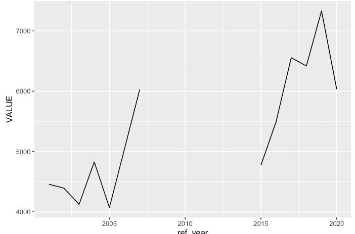

我们的第一种方法是直接删除那些缺少值的年份。这可能有助于某些计算（例如，在`mean()`函数中加上`na.rm = TRUE`参数就是如此），但这会产生误导性的图形——2009 年和 2015 年点之间的距离将与 2015 年和 2016 年之间的距离相同。

```
naics721_sal |>
  tidyr::drop_na() |>
  # show only first five rows
  slice_head(n = 5)
```

```
## # A tibble: 5 x 4
##   label    ref_year REF_DATE   VALUE
##   <chr>       <dbl> <chr>      <dbl>
## 1 Salaried     2001 2001-01-01  4458
## 2 Salaried     2002 2002-01-01  4392
## 3 Salaried     2003 2003-01-01  4124
## 4 Salaried     2004 2004-01-01  4828
## 5 Salaried     2005 2005-01-01  4069
```

或者，我们可以用上一个有效条目来填充该序列。

与我们上面看到的文本情况类似，同样的`fill()`函数也可以应用于数值变量。我们首先创建一个变量`new_value`，它保存与现有变量相同的值；`fill()`函数将应用于`new_value`。

```r
# fill down
naics721_sal_new <- naics721_sal |>
  mutate(value_fill = VALUE) |>
  tidyr::fill(value_fill)  # default direction is down

naics721_sal_new
```

```
## # A tibble: 20 x 5
##   label   ref_year REF_DATE  VALUE value_fill
##   <chr>      <dbl> <chr>     <dbl>      <dbl>
## 1 Salaried    2001 2001-01-01  4458       4458
## 2 Salaried    2002 2002-01-01  4392       4392
## 3 Salaried    2003 2003-01-01  4124       4124
## 4 Salaried    2004 2004-01-01  4828       4828
## 5 Salaried    2005 2005-01-01  4069       4069
## 6 Salaried    2006 2006-01-01  5048       5048
## 7 Salaried    2007 2007-01-01  6029       6029
## 8 Salaried    2008 2008-01-01    NA       6029
## 9 Salaried    2009 2009-01-01  5510       5510
## 10 Salaried   2010 2010-01-01    NA       5510
## 11 Salaried   2011 2011-01-01    NA       5510
## 12 Salaried   2012 2012-01-01    NA       5510
## 13 Salaried   2013 2013-01-01    NA       5510
## 14 Salaried   2014 2014-01-01    NA       5510
## 15 Salaried   2015 2015-01-01  4772       4772
## 16 Salaried   2016 2016-01-01  5492       5492
## 17 Salaried   2017 2017-01-01  6557       6557
## 18 Salaried   2018 2018-01-01  6420       6420
## 19 Salaried   2019 2019-01-01  7334       7334
## 20 Salaried   2020 2020-01-01  6036       6036
```

现在，当我们绘制数据时，缺失的点会被显示出来：

```
ggplot(naics721_sal_new, aes(x = ref_year, y = value_fill)) +
  geom_line()
```

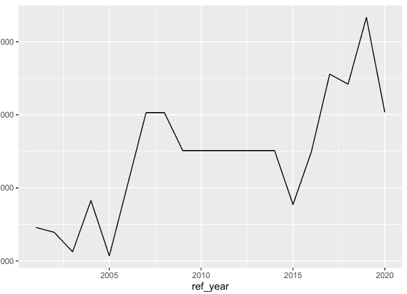

有几种不同的选项可以决定填充方向；默认值是`.direction = "down"`。

```r
# specified
# down
naics721_sal |>
  mutate(value_down = VALUE) |>
  tidyr::fill(value_down, .direction = "down")  # direction is specified as down
# up
naics721_sal |>
  mutate(value_up = VALUE) |>
  tidyr::fill(value_up, .direction = "up")  # direction is specified as up
```

### 12.6.3 时间序列插补

你可能已经意识到，我们上面填充的值来自一个时间序列。经济学家、生物学家以及许多其他研究时间序列数据的研究者已经积累了大量处理时间序列数据的工具，其中包括处理缺失值的稳健方法。

对于R用户来说，{forecast}包提供了面向时间序列的插补填充函数。（Hyndman et al., 2023; Hyndman and Khandakar, 2008）

{forecast}包中的`na.interp()`函数为我们提供了一种比简单扩展已知值更好的方法来填充时间序列中的缺失值。默认情况下，该函数使用线性插值来计算两个非缺失值之间的值。下面是一个简单的例子：

```r
x <- c(1, NA, 3)
x
```

```
## [1]  1 NA  3
```

从1到3的序列中间有一个`NA`值。`na.interp()`函数会填充这个缺失值。

```r
forecast::na.interp(x)
```

```
## Registered S3 method overwritten by 'quantmod':
##  method       from
##  as.zoo.data.frame zoo

## Time Series:
## Start = 1
## End = 3
## Frequency = 1
## [1] 1 2 3
```

对于更长的序列，也会发生类似的过程：

```r
y <- c(1, NA, NA, 3)
y
```

```
## [1]  1 NA NA  3
```

```r
forecast::na.interp(y)
```

```
## Time Series:
## Start = 1
## End = 4
## Frequency = 1
## [1] 1.000 1.667 2.333 3.000
```

你会注意到，该函数计算出的替换值构成了一个线性序列。

对于我们的受薪雇员人数，当我们用这个函数创建一个新值`value_interp`时，结果如下：

```r
naics721_sal <- naics721_sal |>
  mutate(value_interp = forecast::na.interp(VALUE))

naics721_sal
```

```
## # A tibble: 20 x 5
##   label ref_year REF_DATE VALUE value_interp
##   <chr>   <dbl> <chr>    <dbl> <dbl>
## 1 Salaried 2001 2001-01-01 4458 4458
## 2 Salaried 2002 2002-01-01 4392 4392
## 3 Salaried 2003 2003-01-01 4124 4124
## 4 Salaried 2004 2004-01-01 4828 4828
## 5 Salaried 2005 2005-01-01 4069 4069
## 6 Salaried 2006 2006-01-01 5048 5048
## 7 Salaried 2007 2007-01-01 6029 6029
## 8 Salaried 2008 2008-01-01 NA 5770.
## 9 Salaried 2009 2009-01-01 5510 5510
## 10 Salaried 2010 2010-01-01 NA 5387
## 11 Salaried 2011 2011-01-01 NA 5264
## 12 Salaried 2012 2012-01-01 NA 5141
## 13 Salaried 2013 2013-01-01 NA 5018
## 14 Salaried 2014 2014-01-01 NA 4895
## 15 Salaried 2015 2015-01-01 4772 4772
## 16 Salaried 2016 2016-01-01 5492 5492
## 17 Salaried 2017 2017-01-01 6557 6557
## 18 Salaried 2018 2018-01-01 6420 6420
## 19 Salaried 2019 2019-01-01 7334 7334
## 20 Salaried 2020 2020-01-01 6036 6036
```

用插补值绘制数据时，没有空隙。

```r
ggplot(naics721_sal, aes(x = ref_year, y = value_interp)) +
  geom_line()
```

```
## Don't know how to automatically pick scale for object of type <ts>.
## Defaulting to continuous.
```

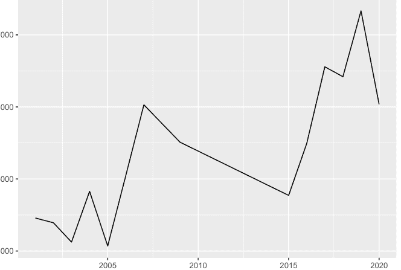

`na.interp()`函数还能够创建非线性模型。

其他时间序列缺失值插补函数的示例可以在{imputeTS}包中找到（Moritz and Bartz-Beielstein, 2017），该包提供了多种插补算法和绘图函数。一个关于使用R进行时间序列分析的绝佳资源，其中包含关于缺失值插补的章节，是（Hyndman and Athanasopoulos, 2021）。

## 12.7 从数值变量创建带标签的因子

在第7章中，我们导入了SPSS、SAS或Stata等统计软件包，并看到了在特定情况下拥有带标签变量的好处。这些是分类变量，类别数量有限。

在某些情况下，可能会有某个或多个值被分配到我们想要指定为“缺失”的类别中——一个常见的例子出现在调查中，受访者可以选择回答“不知道”和“不适用”。虽然这些回答本身可能很有趣，但在某些情境下，我们会希望将它们指定为缺失。

在其他情况下，数值用于存储分类响应。

我们在[第5章](#)导入固定宽度文件时看到的加拿大/美国联合健康调查（JCUSH）文件，是一个用数值变量存储类别的良好示例。例如，变量`SPJ1_TYP`对于加拿大样本的响应为“1”，对于美国样本为“2”。

我们将使用这个文件，从导入的变量中的数值创建带标签的因子。以下是我们之前读取该文件的代码：

```r
jcush <- readr::read_fwf(dslabs::dslabs_data("JCUSH.txt"),
        fwf_cols(
          SAMPLEID = c(1, 12),
          SPJ1_TYP = c(13, 13),
          GHJ1DHDI = c(32, 32),
          SDJ1GHED = c(502, 502)
        ),
        col_types = list(
          SAMPLEID = col_character()
        ))

head(jcush)
```


```
## # A tibble: 6 x 4
##   SAMPLEID    SPJ1_TYP GHJ1DHDI SDJ1GHED
##   <chr>          <dbl>    <dbl>    <dbl>
## 1 100003330835       1        3        4
## 2 100004903392       1        3        2
## 3 100010137168       1        2        1
## 4 100010225523       1        3        3
## 5 100011162367       1        2        2
## 6 100013652729       1        4        3
```

这些变量的值如下：

| 名称 | 变量 | 代码 | 值 |
|---|---|---|---|

| SAMPLEID | 家庭标识符 | 唯一编号 |  |
| SPJ1_TYP | 样本类型 [国家] | 1 | 加拿大 |
|  |  | 2 | 美国 |
| GHJ1DHDI | 健康描述指数 | 0 | 差 |
|  |  | 1 | 一般 |
|  |  | 2 | 良好 |
|  |  | 3 | 很好 |
|  |  | 4 | 优秀 |
|  |  | 9 | 未说明 |
| SDJ1GHED | 获得的最高中学后教育水平 | 1 | 高中以下 |
|  |  | 2 | 高中毕业或同等学历（GED） |
|  |  | 3 | 行业证书、职业学校/社区学院/CEGEP |
|  |  | 4 | 大学或学院证书（含学士以下） |
|  |  | 9 | 未说明 |

变量`GHJ1DHDI`包含了受访者对其整体健康状况的自我评估。以下是响应的汇总表：

```r
jcush |>
  group_by(GHJ1DHDI) |>
  tally()
```

```
## # A tibble: 6 x 2
##   GHJ1DHDI     n
##      <dbl> <int>
## 1       0   391
## 2       1   891
## 3       2  2398
## 4       3  2914
## 5       4  2082
## 6       9    12
```

但如果我们将值标签附加到数据框上，会更加有用和高效。

一种策略是创建一个新的因子变量，使用值描述代替数值表示。为此，我们将使用`{forcats}`包中的`fct_recode()`函数（Wickham, 2021a）。

```r
library(forcats)

jcush_forcats <- jcush |>
  # 1st mutate a new factor variable with the original values
  mutate(health_desc_fct = as.factor(GHJ1DHDI)) |>
# 2nd recode the values
mutate(
  health_desc_fct = fct_recode(
    health_desc_fct,
    "Poor" = "0",
    "Fair" = "1",
    "Good" = "2",
    "Very Good" = "3",
    "Excellent" = "4",
    NULL = "9"
  )
)
```

`levels()`函数允许我们查看标签。请注意，由于我们指定了原始值“9”为NULL，它不会出现在列表中。

```r
levels(jcush_forcats$health_desc_fct)
```

```
## [1] "Poor"    "Fair"    "Good"    "Very Good" "Excellent"
```

当我们按新变量对结果进行计数时，`GHJ1DHDI`中值为9的记录会显示为“NA”。

```r
jcush_forcats |>
  group_by(GHJ1DHDI, health_desc_fct) |>
  tally()
```

```
## # A tibble: 6 x 3
## # Groups:   GHJ1DHDI [6]
##   GHJ1DHDI health_desc_fct       n
##       <dbl> <fct>            <int>
## 1         0 Poor               391
## 2         1 Fair               891
## 3         2 Good              2398
## 4         3 Very Good         2914
## 5         4 Excellent         2082
## 6         9 <NA>                12
```

另一种选项由`{haven}`包提供（Wickham and Miller, 2021）。

```r
library(haven)

jcush_haven <- jcush |>
  mutate(health_desc_lab = labelled(
    GHJ1DHDI,
    c(
      "Poor" = 0,
      "Fair" = 1,
      "Good" = 2,
      "Very Good" = 3,
      "Excellent" = 4,
      "Not Stated" = 9
    )
  ))
```

请注意，我们的新变量是“S3: haven_labelled”类，`ls.str()`函数会将其显示为“dbl+lbl”：

```
ls.str(jcush_haven)
```

```
## GHJ1DHDI :  num [1:8688] 3 3 2 3 2 4 2 4 0 2 ...
## health_desc_lab :  dbl+lbl [1:8688] 3, 3, 2, 3, 2, 4, 2, 4, 0, 2, 4, 4, 4, 2, 2, 2, 1, 4...
## SAMPLEID :  chr [1:8688] "10003330835" "100004903392" "10010137168" ...
## SDJ1GHD :  num [1:8688] 4 2 1 3 2 3 2 1 3 2 ...
## SPJ1_TYP :  num [1:8688] 1 1 1 1 1 1 1 1 1 ...
```

**图 12.5 ls.str(jcush_haven)。**

`levels()` 函数可用于检查此 mutate 的结果。

```
head(jcush_haven$health_desc_lab)
```

```
## Found more than one class "haven_labelled" in cache; using the first,
##  from namespace 'memisc'

## Also defined by 'haven'

## Found more than one class "haven_labelled" in cache; using the first,
##  from namespace 'memisc'

## Also defined by 'haven'

## <labelled<double>[6]>
## [1] 3 3 2 3 2 4
##
## Labels:
##   value    label
##     0    Poor
##     1    Fair
##     2    Good
##     3  Very Good
##     4  Excellent
##     9 Not Stated
```

另一种选择是使用 `{labelled}` 包（Larmarange，2022）中的函数。

```
jcush_labelled <- jcush |>
  mutate(health_desc_lab = labelled(
    GHJ1DHDI,
    c(
      "Poor" = 0,
      "Fair" = 1,
      "Good" = 2,
      "Very Good" = 3,
      "Excellent" = 4,
      "Not Stated" = 9
    )
  ))
```

要查看单个变量，请使用：

```
head(jcush_labelled$health_desc_lab)
```

```
## <labelled<double>[6]>
## [1] 3 3 2 3 2 4
##
## Labels:
##   value    label
##     0      Poor
##     1      Fair
##     2      Good
##     3  Very Good
##     4  Excellent
##     9 Not Stated
```

该包还允许使用 `var_lab()` 函数为变量附加描述性名称。

# 13 回顾

## 13.1 一些要点

在本书中，我们通过了大量准备数据以进行分析的示例，无论是汇总制表还是建模方法，例如带指示变量的线性回归或时间序列分析和预测。

值得重申的一些要点：

- 你得到的数据不会是你需要的数据。准备好进行分析需要付出努力——深思熟虑的努力。
- 准备数据的过程不是线性的、分步的过程。它涉及迭代并返回到之前的步骤以解决数据问题。迭代始于 `import` 步骤，并贯穿 `validation` 和 `cleaning`。
- 准备过程中的每一个要素都需要你作为研究者，基于你对如何最好地实现研究目标的判断做出决策。从定义要导入哪些变量到如何解决数据中的缺失值，你必须根据数据的使用方式做出明智而深思熟虑的决策。
- 尽可能快地使用导入函数走得尽可能远。导入后需要做的更改越少越好。
- 将数据整理成整洁的结构至关重要。
- 文档至关重要，无论是在代码中还是在项目文件夹中。
  - 说明代码的 *why*，而不是 *what*。
  - 创建包含项目目标和其他关键信息的 README 文件。
  - 创建数据字典。
- 该文档的受众可能是你已知的合作者，也可能是你尚未见面的未来数据使用者。受众几乎肯定包括未来的你——明年、下个月或明天。
- 你接收到的数据将以多种格式出现，每种格式都有其自身的特点。熟悉各种格式为分析带来（或不带来）的东西可以帮助你更高效。例如，像 SPSS 和 SAS 文件这样的带标签格式会携带有关变量和值的宝贵元数据；利用这些额外信息可以为分析带来更深入的见解。
- 清洁的数据是完整、一致且准确的。具备这三项品质，它就 *可信*。验证和清理将努力在所有这三个维度上改进数据。
- 探索和验证数据需要专业知识。
- 使用包括可视化和结构化测试在内的方法组合，首先识别数据“脏”的方式，然后在采取必要步骤后，确保数据是干净的。
- 清理数据所需的步骤将取决于研究问题。同一源数据可能需要以完全不同的方式进行清理，以适用于两个不同的研究问题。
- 在某些情况下，替换缺失值有助于解决数据的结构性问题。在其他情况下，替换缺失值可能会改变我们分析的结果。在数据清理中引入替换时要小心。

## 13.2 接下来怎么办？

我们以灯塔的隐喻开始了本书，它指引船只朝正确方向航行并防止它们触礁。我希望本书中的原则和示例在准备数据以进行分析的背景下能达到同样的效果。

本书中的示例为你在准备数据以进行分析时可能遇到的一些挑战类型提供了指南。但当你踏上自己的数据准备之旅时，你会遇到与这里不同的问题。这里的示例不足以解决问题的可能性很高。你可能需要以不同的方式思考问题，才能找到解决方案。你可能需要其他工具，无论是其他 R 包还是不同的编程语言。你可能会遇到与此处介绍不同的数据存储方法；如果你开始处理非常大的数据库，这尤其可能。

我们的知识总是有限的。这就是为什么我们需要不断学习和练习我们的技艺。如果你工作或所修课程中没有遇到数据准备挑战，你可能希望将本书中的示例应用于其他数据。这可能是找到一个使用颜色作为变量的 Excel 文件。或者也许有一个 SQL 数据库需要你建立两个表之间的关系，但这两个表没有共同的变量，因此你必须将两者都连接到第三个表，然后该表可以链接到两者。

包括 tidyverse 在内的 R 生态系统的增长令人惊叹。你遇到的许多问题很可能已经被其他人遇到过。而那个人可能已经写了一篇关于其解决方案的博客文章，或编写了一个具有通用解决方案的包。

我希望本书中的示例能给你信心，让你勇往直前，并在挑战出现时面对它们。

## 参考文献

Abeysooriya, M., Soria, M., Kasu, M. S., and Ziemann, M. (2021). 基因名称错误：未吸取的教训. *PLOS Computational Biology*, 17(7):1–13.

Abeysundera, M. (2015). 使用总体调查误差研究模式效应及其他应用. In *Proceedings of the Statistical Society of Canada Annual Meeting, Survey Methods Section*.

Anscombe, F. J. (1973). 统计分析中的图表. *The American Statistician*, 27(1):17–21.

Ashton, D. (2018). 我的 T 恤去哪儿了？时尚行业的供应链预测. Accessed: 2020-07-09.

Au, R. (2020a). 数据清理是分析，而非苦力活. Accessed: 2020-09-15.

Au, R. (2020b). 让我们有意地进行文档记录. Accessed: 2020-09-29.

Australian Bureau of Statistics (2006). 澳大利亚和新西兰标准产业分类 (ANZSIC). Technical report, Australian Bureau of Statistics. Accessed: 2023-06-12.

Boysel, S. and Vaughan, D. (2023). *fredr: 用于 'FRED' API 的 R 客户端*. R package version 2.1.0.9000.

British Columbia Ferry Services Inc. (2021). 向不列颠哥伦比亚省渡轮专员提交的年度报告. Technical report, British Columbia Ferry Services Inc. Accessed: 2024-02-17.

Broman, K. and Woo, K. (2017). 电子表格中的数据组织. *The American Statistician*, 72(1):2–10.

Bryan, J. (2016a). sanesheets.

Bryan, J. (2016b). spreadsheets.

Bryan, J. (2017). *gapminder: 来自 Gapminder 的数据*. R package version 0.3.0.

Bryan, J. and The STAT 545 TAs (2019). Stat 545.

Colson, E., Coffey, B., Rached, T., and Cruz, L. (2017). 算法之旅：数据科学如何融入 Stitch Fix 的面料. Accessed: 2020-07-09.

Conway, D. (2010). 数据科学维恩图。访问日期：2020-07-04。

Cowgill, M., Meers, Z., Lee, J., and Diviny, D. (2023). *readabs：从澳大利亚统计局下载和整理时间序列数据*。R包版本 0.4.13.901。

Cunningham, S. (2021). *因果推断：混音带*。耶鲁大学出版社。

Davenport, T. H. and Harris, J. G. (2007). *基于分析竞争：制胜的新科学*。哈佛商学院出版社。

Dowle, M., Srinivasan, A., Gorecki, J., Chirico, M., Stetsenko, P., Short, T., Lianoglou, S., Antonyan, E., Bonsch, M., Parsonage, H., Ritchie, S., Ren, K., Tan, X., Saporta, R., Seiskari, O., Dong, X., Lang, M., Iwasaki, W., Wenchel, S., Broman, K., Schmidt, T., Arenburg, D., Smith, E., Cocquemas, F., Gomez, M., Chataignon, P., Blaser, N., Selivanov, D., Riabushenko, A., Lee, C., Groves, D., Possenriede, D., Parages, F., Toth, D., Yaramaz-David, M., Perumal, A., Sams, J., Morgan, M., Quinn, M., Javrucebo, Marc Outins, Storey, R., Saraswat, M., Jacob, M., Schubmehl, M., Vaughan, D., Hocking, T., Silvestri, L., Barrett, T., Hester, J., Damico, A., Freundt, S., Simons, D., de Andrade, E. S., Miller, C., Meldgaard, J. P., Tlapak, V., Ushey, K., Eddelbuettel, D., and Schwen, B. (2023). *data.table：‘data.frame’的扩展*。R包版本 1.14.8。


Elders, B. and Oldoni, D. (2020). *tidylog：为‘dplyr’和‘tidyr’函数记录日志*。R包版本 1.0.2。

Elections BC (2018). 2017/18年度报告及2018/19 - 2020/21服务计划。技术报告，Elections BC。访问日期：2020-08-01。

Elff, M., Lawrence, C. N., Atkins, D., Morgan, J. W., Müller, K., Schoonees, P., and Zeileis, A. (2021). *memisc：调查数据管理与分析结果呈现*。R包版本 0.99.30.7。

Ellis, S. E. and Leek, J. T. (2017). 如何共享数据以进行协作。《美国统计学家》，72(1):53-57。

EUROSTAT PRODCOM team (2022). 欧洲商业统计PRODCOM用户手册。技术报告，Eurostat。访问日期：2023-06-12。

Executive Office of the President, Office of Management and Budget (2022). 北美行业分类系统：美国，2022。技术报告，US Census Bureau。访问日期：2023-03-07。

Firke, S. (2021). *janitor：检查和清理脏数据的简单工具*。R包版本 2.1.0。

Friendly, M., Dalzell, C., Monkman, M., Murphy, D., Foot, V., and Zaki-Azat, J. (2020). *Lahman：肖恩·拉赫曼棒球数据库*。R包版本 8.0-0。

Garmonsway, D. (2023). *unpivotr：对复杂和不规则的数据布局进行逆透视*。R包版本 0.6.3。

Garmonsway, D., Wickham, H., Bryan, J., RStudio, and Kalicinski, M. (2022). *tidyxl：读取非整洁的Excel文件*。R包版本 1.0.8。

Gelfand, S. and City of Toronto (2022). *opendatatoronto：访问多伦多市开放数据门户*。R包版本 0.1.5。

Gelman, A., Carlin, J. B., Stern, H. S., Dunson, D. B., Vehtari, A., and Rubin, D. B. (2014). *贝叶斯数据分析*。CRC Press，第三版。

Gelman, A. and Hill, J. (2007). *使用回归和多层次/分层模型进行数据分析*。CRC Press。

Hester, J., Wickham, H., libuv project contributors, Joyent, I., and other Node contributors (2020). *fs：基于‘libuv’的跨平台文件系统操作*。R包版本 1.5.0。

Holbrook, A. L., Green, M. C., and Krosnick, J. A. (2003). 电话访谈与面对面访谈使用长问卷进行全国概率样本调查：受访者满足化和社会期望应答偏差的比较。《舆论季刊》，67(1):79–125。

Horst, A. (2020). *palmerpenguins：帕尔默群岛（南极洲）企鹅数据*。

Horst, A. M., Hill, A. P., and Gorman, K. B. (2022). palmerpenguins R包中的帕尔默群岛企鹅数据——安德森鸢尾花的替代品。《R杂志》，14(1):244–254。

Hudon, C. (2018). 实地记录：构建数据字典。访问日期：2023-06-13。

Hyndman, R., Athanasopoulos, G., Bergmeir, C., Caceres, G., Chhay, L., O'Hara-Wild, M., Petropoulos, F., Razbash, S., Wang, E., and Yasmeen, F. (2023). *forecast：时间序列和线性模型的预测函数*。R包版本 8.20。

Hyndman, R. J. and Athanasopoulos, G. (2021). *预测：原理与实践*。OTexts，第三版。

Hyndman, R. J. and Khandakar, Y. (2008). 自动时间序列预测：R的forecast包。《统计软件杂志》，26(3):1–22。

Iannone, R., Cheng, J., Schloerke, B., Hughes, E., Lauer, A., and Seo, J. (2023). *gt：轻松创建可用于演示的展示表格*。https://gt.rstudio.com/, https://github.com/rstudio/gt.

Kaplan, J. and Schlegel, B. (2020). *fastDummies：从分类变量快速创建虚拟（二元）列和行*。R包版本 1.6.3。

Khreis, H., Johnson, J., Jack, K., Dadashova, B., and Park, E. (2020). 评估德克萨斯州达拉斯低成本空气质量监测仪的性能。*Int J Environ Res Public Health*，19(3):1647。

Knuth, D. E. (1992). *文学化编程*。CSLI讲义；第27号。斯坦福加利福尼亚州语言与信息研究中心。

Kuhn, M. (2020). *modeldata：对建模包有用的数据集*。R包版本 0.0.2。

Kuhn, M. and Silge, J. (2022). *使用R进行整洁建模*。O’Reilly Media。

Kuhn, M. and Wickham, H. (2022). *recipes：用于建模的预处理和特征工程步骤*。R包版本 1.0.1。

Larmarange, J. (2022). *labelled：操作带标签数据*。R包版本 2.9.1.9000。

Lee, B. D. (2018). 记录科学软件的十条简单规则。*PLoS Computational Biology*，14(12)。

Little, R. J. A. (2020). *缺失数据的统计分析*。Wiley概率与统计系列。Wiley，新泽西州霍博肯，第三版。

Marwick, B., Boettiger, C., and Mullen, L. (2018). 使用R（及其相关工具）以可重现的方式封装数据分析工作。《美国统计学家》，72(1):80–88。

Monkman, M. (2019). 同名异鸟。访问日期：2020-05-19。

Monkman, M. (2024). *dpjr：书籍《数据准备之旅：用R找到你的路》的配套数据*。https://github.com/MonkmanMH/dpjr.

Moritz, S. and Bartz-Beielstein, T. (2017). imputeTS：R中的时间序列缺失值插补。《R杂志》，9(1):207–218。

Murrell, P. (2013). 为人类消费而非机器消费而设计的数据。见McCallum, Q. E.主编，《不良数据手册》，第3章，第31–51页。O’Reilly。

Müller, K. (2022). *DBI：R数据库接口*。R包版本 1.1.1。

Müller, K. and Wickham, H. (2021). *tibble：简单的数据框*。R包版本 3.1.2。

Müller, K., Wickham, H., James, D. A., Falcon, S., Hipp, D. R., Kennedy, D., Mistachkin, J., SQLite Authors, Healy, L., R Consortium, and RStudio (2023). *RSQLite：R的SQLite接口*。R包版本 2.3.1。

Nield, T. (2016). *SQL入门：初学者的动手实践方法*。O’Reilly Media。

## 参考文献

Ooms, J. (2022). *pdftools：PDF文档的文本提取、渲染和转换*。R包版本 3.3.0。

Peng, R. D. (2011). 计算科学中的可再现研究。《科学》，334:1226–1227。2011-12-02。

Perez, C. C. (2019). *看不见的女性：为男性设计的世界中的数据偏见*。Abrams Press。

Polonsky, J. A., Baidjoe, A., Kamvar, Z. N., Cori, A., Durski, K., Edmunds, J. W., Eggo, R. M., Funk, S., Kaiser, L., Keating, P., le Polain de Waroux, O., Marks, M., Moraga, P., Morgan, O., Nouvelllet, P., Ratnayake, R., Roberts, C. H., Whitworth, J., and Jombart, T. (2019). 疫情暴发分析：一门为应对新发病原体提供信息而发展的数据科学。《皇家学会哲学汇刊B》，374:20180276。2019-05-20。

R Core Team (2021). *R：统计计算的语言和环境*。R统计计算基金会，奥地利维也纳。

Research Data Management Service Group (2021). 编写“readme”风格元数据指南。技术报告，Cornell University。访问日期：2021-10-12。

Smith, D. (2017). 使用R实现可再现的数据科学。访问日期：2020-05-18。

St-Pierre, M. and Béland, Y. (2004). 加拿大社区健康调查中的模式效应：CAPI与CATI的比较。见《美国统计协会会议录：调查研究方法》。

Statistics Canada (2007). 个人年龄。技术报告，Statistics Canada。访问日期：2020-08-30。

Statistics Canada (2019). 加拿大统计局质量指南。技术报告 12-539-X。访问日期：2020-08-24。

Statistics Canada (2020). 定义、数据来源和方法。技术报告，Statistics Canada。访问日期：2020-07-30。

Statistics Canada (2021). 国家旅行调查微观数据文件。技术报告，Statistics Canada。访问日期：2022-07-18。

Statistics Canada (2022). 北美行业分类系统（NAICS）加拿大2022。技术报告，Statistics Canada。访问日期：2023-03-08。

Suits, D. B. (1957). 虚拟变量在回归方程中的应用。《美国统计协会杂志》，52(280):548–551。

Teucher, A., Albers, S., Hazlitt, S., and Province of British Columbia (2023). *bcdata：从BC数据目录搜索和检索数据*。R包版本 0.4.1。

Tukey, J. W. (1977). 探索性数据分析. Addison-Wesley.

联合国统计司 (2020). 统计分类. 技术报告, 联合国. 访问时间: 2020-09-07.

van der Loo, M. 和 de Jonge, E. (2018). 统计数据清洗及其在R中的应用. Wiley.

van der Loo, M., de Jonge, E., 和 Hsieh, P. (2022). validate: 数据验证基础设施. R包版本 1.1.1.

van der Loo, M. P. 和 de Jonge, E. (2021). 面向R的数据验证基础设施. Journal of Statistical Software, 97:1–33.

Vasilopoulos, K. (2022). osnr: 'ONS' API的客户端. R包版本 1.0.1.

Venables, B. (2010). 数据技术导论. Paul Murrell 著(书评). Australian and New Zealand Journal of Statistics, 52:469–470.

von Bergmann, J. 和 Shkolnik, D. (2021). cansim: 访问加拿大统计局数据表和向量. R包版本 0.3.14.

Walker, K. (2023). 分析美国人口普查数据: R中的方法, 地图与模型. CRC Press.

Walker, K., Herman, M., 和 Eberwein, K. (2023). tidycensus: 将美国人口普查边界与属性数据加载为'tidyverse'和'sf'就绪的数据框. R包版本 1.4.1.

Wang, R. Y., Reddy, M., 和 Kon, H. B. (1995). 迈向高质量数据: 一种基于属性的方法. Decision Support Systems, 13(3):349–372.

Watson, J. (2020). RBNZ: 从新西兰储备银行网站下载数据. R包版本 1.1.0.

White, E., Baldridge, E., Brym, Z., 和 Locey, K. (2013). 让(重复)使用数据更容易的九种简单方法. Ideas in Ecology and Evolution, 6(2):1–10.

Wickham, H. (2014). 整洁数据. Journal of Statistical Software, 59(1):1–23.

Wickham, H. (2015). 高级R. CRC Press.

Wickham, H. (2019a). 高级R. CRC Press, 第2版.

Wickham, H. (2019b). stringr: 用于常见字符串操作的简单一致的封装. R包版本 1.4.0.

Wickham, H. (2021a). forcats: 用于处理分类变量(因子)的工具. R包版本 0.5.1.

Wickham, H. (2021b). tidyr: 整理杂乱数据. R包版本 1.1.3.

Wickham, H. (2023). *httr2: 执行HTTP请求并处理响应*. https://httr2.r-lib.org, https://github.com/r-lib/httr2.

Wickham, H. 和 Bryan, J. (2019). *readxl: 读取Excel文件*. R包版本 1.3.1.

Wickham, H., Girlich, M., Ruiz, E., 和 RStudio (2023a). *dbplyr: 数据库的‘dplyr’后端*. R包版本 2.3.2.

Wickham, H. 和 Grolemund, G. (2016). *面向数据科学的R*. O’Reilly Media.

Wickham, H. 和 Hester, J. (2020). *readr: 读取矩形文本数据*. R包版本 1.4.0.

Wickham, H. 和 Miller, E. (2021). *haven: 导入和导出SPSS, Stata和SAS文件*. R包版本 2.4.1.

Wickham, H. 和 RStudio (2021). *nycflights13: 2013年从纽约市出发的航班*. R包版本 1.0.2.

Wickham, H., Çetinkaya Rundel, M., 和 Grolemund, G. (2023b). *面向数据科学的R*. O’Reilly Media, 第2版.

维基百科编者 (2021). Prawo Jazdy (被指控的罪犯) — 维基百科, 自由的百科全书. [在线; 访问于 2022-01-10].

维基百科编者 (2022a). Unicode字符列表 — 维基百科, 自由的百科全书. [在线; 访问于 2022-10-03].

维基百科编者 (2022b). PDF — 维基百科, 自由的百科全书. [在线; 访问于 2022-08-23].

Wilson, G., Aruliah, D. A., Brown, C. T., Hong, N. P. C., Davis, M., Guy, R. T., Haddock, S. H. D., Huff, K. D., Mitchell, I. M., Plumbley, M. D., Waugh, B., White, E. P., 和 Wilson, P. (2014). 科学计算的最佳实践. *PLoS Biology*, 12(1).

Wilson, G., Bryan, J., Cranston, K., Kitzes, J., Nederbragt, L., 和 Teal, T. K. (2017). 科学计算中的足够好的实践. *PLoS Computational Biology*, 13(6).

Xie, Y. (2021). *bookdown: 使用R Markdown编写书籍和技术文档*. R包版本 0.22.

Xie, Y., Allaire, J., 和 Grolemund, G. (2019). *R Markdown: 权威指南*. CRC Press.

Zeeberg, B. R., Riss, J., Kane, D. W., Bussey, K. J., Uchio, E., Linehan, W. M., Barrett, J. C., 和 Weinstein, J. N. (2004). 错误的标识符: 在生物信息学中使用Excel时可能会无意中引入基因名称错误. *BMC Bioinformatics*, 5(80).

## 索引

- 对照表, 71, 127
- 转换表, 参见 对照表


- 数据验证, 9, 58, 137, 145, 147
- 虚拟变量, 参见 指示变量
- EDA, 参见 探索性数据分析
- Excel, 47, 55
- 探索性数据分析, 2, 138
- 指示变量, 182–184, 187, 188
- ISO 8601, 155
- 加拿大/美国联合健康调查 (JCUSH), 42, 199
- 标签变量, 25, 30, 45, 79, 84, 94, 97, 101
- 缺失值, 6, 8, 30, 37, 89, 138, 139, 141, 189
- NAICS, 参见 北美行业分类系统
- 国家职业代码, 173
- 全国旅行调查 (NTS), 98
- NOC, 参见 国家职业代码
- 北美行业分类系统, 168, 169, 181
- 独热编码, 参见 指示变量
- `palmerpenguins`, 22, 25, 32, 80, 95, 104, 146, 147, 187
- 便携式文档格式 (PDF), 3, 103, 109
- Prawo Jazdy, 10
- 公共使用微观数据文件, 42, 98
- PUMF, 参见 公共使用微观数据文件
- `regex`, 参见 正则表达式
- 正则表达式, 56, 106–108, 113, 159, 162, 163, 165, 174
- 关系数据库, 127, 144
- 可重现性, 13, 15
- SAS, 79, 94, 97, 198
- 哨兵值, 8, 139, 141, 143, 145
- SPSS, 25, 79, 84–86, 88, 89, 94–97, 198
- SQL, 127, 130–134
- Stata, 79, 97, 198
- 整洁数据, 10, 11, 25, 172
