# 深度学习革命 机器智能遇见人类智能


献给 Bo 和 Sol、Theresa 以及 Joseph

纪念所罗门·戈洛姆

## 前言

如果你在安卓手机上使用语音识别，或在互联网上使用谷歌翻译，你已经与由深度学习训练的神经网络进行过通信。近年来，深度学习为谷歌创造了足够的利润，足以覆盖其在 Google X 的所有前瞻性项目的成本，包括自动驾驶汽车、谷歌眼镜和谷歌大脑。谷歌是最早拥抱深度学习的互联网公司之一；2013年，它聘请了深度学习之父杰弗里·辛顿，其他公司也在竞相追赶。

人工智能（AI）的最新进展是通过逆向工程大脑实现的。分层神经网络模型的学习算法受到神经元相互通信方式的启发，并由经验所修改。网络内部，世界的复杂性被转化为内部活动模式的万花筒，这些模式是智能的要素。我在20世纪80年代研究的网络模型与今天的模型相比微不足道，如今的模型拥有数百万人工神经元，且深达几十层。使深度学习能够在人工智能中一些最难解决的问题上取得重大突破的因素，是坚持、大数据以及大量更多的计算能力。

我们不擅长想象新技术对未来的影响。谁能在1990年互联网商业化时预测，它会对音乐产业、出租车行业、政治竞选以及我们日常生活的几乎所有方面产生什么影响？同样，人们未能想象计算机将如何改变我们的生活。IBM 总裁 Thomas J. Watson 被广泛引用于1943年说：“我认为世界上也许只有五台计算机的市场。”难以想象的是新发明会被用于何种用途，而发明家在预测这些用途方面并不比任何人更擅长。关于深度学习和 AI 的乌托邦与末日预言之间存在很大空间，但即使是最具想象力的科幻作家，也不太可能猜到它们最终的影响会是什么。

《深度学习革命》的初稿是在太平洋西北地区徒步旅行后的几个专注周内写成的，当时作者正在冥思人工智能世界中近期的显著转变，而这一转变起源于数十年前。这是一个关于一小群研究人员挑战当时资金充足得多、并且是“人工智能领域唯一游戏”的 AI 既有体制的故事。他们极大地低估了问题的难度，并依赖于被证明具有误导性的智能直觉。

地球上的生命充满了许多奥秘，但其中最具挑战性的或许是智能的本质。大自然中充满了各种形式的智能，从低等细菌到复杂的人类智能，每种都适应了自然中的自身生态位。人工智能也将有多种形式，并将在这个光谱中占据各自特定的位置。基于深度神经网络的机器智能一旦成熟，可能为生物智能提供一个新的概念框架。

《深度学习革命》是深度学习过去、现在和未来的指南。它不打算成为该领域的全面历史，而是对关键概念进展及其推动者们的研究人员社区的个人看法。人类记忆是不可靠的，并且在每次复述故事时都会发生变化，这一过程被称为“再巩固”。这本书中的故事跨越了四十年，尽管有些故事对我来说栩栩如生，仿佛发生在昨天，但我十分清楚，细节已随着时间的推移被我记忆的复述所修改。

第一部分提供了深度学习的动机及理解其起源所需的背景；第二部分解释了几种不同类型神经网络架构中的学习算法；第三部分探讨了深度学习对我们生活产生的影响及其未来可能产生的影响。但是，就像纽约洋基队的“哲学家”约吉·贝拉曾经说过的：“预测很难，尤其是关于未来的预测。”后续章节中的八个文本框为故事提供了技术背景；三个部分开头的时间线跟踪与故事相关的事件，并涵盖了六十年。

## 第一部分：重塑智能

### 时间线

- **1956—达特茅斯人工智能暑期研究项目**孕育了人工智能领域，并激励了一代科学家探索信息技术匹配人类能力的潜力。
- **1962—弗兰克·罗森布拉特**出版了《神经动力学原理：感知器与大脑机制理论》，该书引入了具有单层可变权重的神经网络模型学习算法——即当今深度神经网络模型学习算法的前身。
- **1962—大卫·哈布尔和托斯滕·威塞尔**发表了《猫视觉皮层中的接收野、双眼相互作用与功能架构》，首次报道了用微电极记录的单个神经元的反应特性。深度学习网络的架构与视觉皮层区域的层级结构相似。
- **1969—马文·明斯基和西摩尔·帕珀特**出版了《感知器》，该书指出了单个人工神经元的计算局限性，并标志着神经网络寒冬的开始。
- **1979—杰弗里·辛顿和詹姆斯·安德森**在加州拉何拉举办了联合记忆平行模型研讨会，汇聚了新一代神经网络先驱，并促成了辛顿和安德森于1981年出版的同名文集。
- **1987—第一届神经信息处理系统（NIPS）会议与研讨会**在丹佛技术中心举行，汇集了来自许多领域的研究人员。


### 1 机器学习的兴起

不久前，人们常说计算机视觉无法与一岁儿童的视觉能力相媲美。如今这已不再成立：计算机现在识别图像中物体的能力已与大多数成年人相当，道路上还有自动驾驶汽车，其驾驶安全性超过了平均十六岁青少年。而且，计算机不是被告知如何看或如何开车，而是通过经验学习，遵循了大自然百万年前走过的路径。推动这些进步的是海量数据。数据是新石油。学习算法是提炼原始数据中信息的炼油厂；信息可用于创造知识；知识带来理解；理解通向智慧。欢迎来到深度学习的崭新世界。¹

深度学习是机器学习的一个分支，其根源在于数学、计算机科学和神经科学。深度网络从数据中学习，就像婴儿从周围世界学习一样，从零开始，逐步掌握在新环境中导航所需的技能。深度学习的起源可以追溯到20世纪50年代人工智能诞生之初，当时关于如何创造AI存在两种竞争愿景：一种基于逻辑和计算机程序，这一愿景主导了AI数十年；另一种基于直接从数据中学习，后者花费了更长时间才成熟。

在20世纪，当计算机性能孱弱且数据存储按今天的标准来看十分昂贵时，逻辑是解决问题的高效方式。熟练程序员为每个问题编写不同的程序，问题越大，程序就越大。如今，计算能力和大数据丰富，使用学习算法解决问题更快、更准确、更高效。相同的学习算法可以用于解决许多困难问题；其解决方案比为每个问题编写不同程序要少得多的人力投入。

#### 学习如何驾驶

2005年国防高级研究计划署（DARPA）大挑战赛的200万美元现金奖金由Stanley夺得，这是一辆由斯坦福大学Sebastian Thrun团队改装的自动驾驶汽车，他们利用机器学习教会它在加利福尼亚沙漠中导航。132英里的赛道有狭窄隧道和急转弯，包括啤酒瓶隘口（Beer Bottle Pass），这是一条蜿蜒的山路，一侧是悬崖，另一侧是岩壁（图 1.1）。Thrun没有遵循传统的AI方法，即编写计算机程序来预判每一种意外情况，而是驾驶Stanley在沙漠中行驶（图 1.2），它根据视觉和距离传感器的感官输入自主学习如何转向。

Thrun后来创立了Google X，这是一个用于高科技项目的秘密研发团队，自动驾驶汽车技术在此得到进一步发展。谷歌的自动驾驶汽车此后在旧金山湾区行驶了350万英里。优步在匹兹堡部署了一支自动驾驶汽车车队。苹果正涉足自动驾驶汽车，以扩展其操作系统控制产品的范围，

图 1.1 Sebastian Thrun 与 Stanley 合影，Stanley 是赢得 2005 年 DARPA 大挑战赛的自动驾驶汽车。这一突破性进展拉开了交通运输技术革命的序幕。Sebastian Thrun 提供。

图 1.2 啤酒瓶隘口。这片挑战性地形位于 2005 年 DARPA 大挑战赛的终点附近，当时车辆需在无人协助下穿越 132 英里的非公路沙漠赛道。远处的一辆卡车刚开始攀爬。DARPA 提供。
希望重复其在手机市场的成功闯入。看到一个未变了100年的行业在眼前发生转变，汽车制造商们也纷纷效仿。通用汽车以10亿美元收购了正在开发无人驾驶技术的硅谷初创公司Cruise Automation，并于2017年额外投资6亿美元用于研发。² 2017年，英特尔以153亿美元收购了专门从事自动驾驶汽车传感器和计算机视觉的公司Mobileye。在经济的万亿美元交通运输领域，赌注极高。

自动驾驶汽车很快将颠覆数百万卡车和出租车司机的生计。最终，在城市中将不再需要拥有汽车，因为自动驾驶汽车可以在一分钟内出现并安全送你到达目的地，无需你停车。当今平均每辆汽车只使用4%的时间，这意味着它有96%的时间需要停在某个地方。但由于自动驾驶汽车可以在城市外进行维修和停放，如今布满停车场的大片城市土地可以被改作更有成效的用途。城市规划师已经在考虑停车场变成公园的那一天。³ 街道旁的停车车道可以变成真正的自行车道。许多其他汽车相关企业将受到影响，包括汽车保险公司和汽车修理厂。不再有超速或停车罚单。酒后驾车和驾驶员在方向盘前睡着导致的死亡将减少。通勤上班浪费的时间将被用于其他目的。根据美国人口普查局的数据，2014年，1.39亿美国人平均每个工作日往返通勤52分钟。这每年相当于296亿小时，或惊人的340万个的人类生命年，本可以用于更好的用途。⁴ 通过车队行驶，高速公路容量将增加四倍。⁵ 一旦开发并广泛使用，无需方向盘就能自行开回家的自动驾驶汽车将终结偷车行为。尽管前方有许多监管和法律障碍，但当自动驾驶汽车最终普及时，我们确实将生活在崭新的世界里。卡车可能最先实现自动驾驶，大约在10年内；出租车在15年；乘用车从开始到结束将在15到25年内。

汽车在我们社会中的标志性地位将以我们无法想象的方式改变，一种新的汽车生态系统将出现。正如100多年前汽车的引入创造了许多新行业和工作岗位一样，围绕自动驾驶汽车正在形成一个快速增长的生态系统。谷歌的自动驾驶分拆公司Waymo在8年里投资了10亿美元，在加利福尼亚州中央谷地建立了一个秘密测试设施，占地91英亩的假小镇，包括假自行车手和假汽车故障。⁶ 目标是扩大训练数据，以包括特殊和不寻常的情况，称为边缘情况。高速公路上罕见的驾驶事件往往会导致事故。自动驾驶汽车的不同之处在于，当一辆汽车遇到罕见事件时，学习经验将传播到所有其他自动驾驶汽车，这是一种集体智能。其他自动驾驶汽车公司也在建造许多类似的测试设施。这些创造了以前不存在的新工作岗位，以及引导汽车所需的传感器和激光器的新供应链。⁷

自动驾驶汽车只是由信息技术（IT）推动的经济重大转变中最显眼的表现。信息像水流经城市管道一样通过互联网流动。信息积累在谷歌、亚马逊、微软及其他IT公司运营的大型数据中心中，这些数据中心耗电量巨大，必须建在水电站附近，流媒体信息产生的热量如此之大，需要河流提供冷却剂。2013年，美国的数据中心消耗了1000万兆瓦，相当于三十四座大型发电厂产生的电力。⁸ 但如今对经济产生更大影响的是这些信息如何被使用。从原始数据中提取的信息正在转化为关于人和事物的知识：我们做什么，我们想要什么，我们是谁。而且，越来越多的计算机驱动设备正在利用这些知识通过口语与我们沟通。与外化于大脑之外的书籍中的被动知识不同，云中的知识是一种外部智能，正成为每个人生活的一部分积极组成部分。⁹

#### 学习如何翻译

谷歌今天在100多项服务中使用深度学习，从街景视图到收件箱智能回复和语音搜索。几年前，谷歌工程师意识到必须将这些计算密集型应用扩展到云端水平。着手设计专门用于深度学习的芯片时，他们巧妙地将主板设计为适合数据中心机架中硬盘驱动器插槽。谷歌的张量处理单元（TPU）现已部署在全球服务器上，为深度学习应用提供了一个数量级的性能提升。

深度学习能多么迅速地改变格局的一个例子，是它对语言翻译的影响——这是人工智能的一个圣杯，因为它依赖于理解句子的能力。最近揭晓的基于深度学习的新版谷歌翻译，在自然语言之间的翻译质量上实现了量子飞跃式的改进。几乎一夜之间，语言翻译从碎片化的、命中率不齐的短语拼凑变成了流畅的句子（图 1.3）。以前的计算机方法搜索可以一起翻译的词语组合，而深度学习则寻找整个句子中的依赖关系。

注意到谷歌翻译的突然改进后，2016年11月18日，东京大学的Jun Rekimoto通过让新系统将欧内斯特·海明威的《乞力马扎罗的雪》开头部分翻译成日语，再翻译回英文来测试该系统——结果如下（猜猜哪一个是海明威的原著）：

- 1: 乞力马扎罗是一座积雪覆盖、海拔19,710英尺的山，据说是非洲最高峰。其西峰被称为马赛语“Ngaje Ngai”，即上帝之屋。西峰附近有一具干枯冻僵的豹子尸体。没有人解释这只豹子在那个海拔高度寻找什么。


**图 1.3**
日本的标志和菜单通过谷歌翻译即时翻译成英语，而谷歌翻译现在已成为您智能手机上的应用程序。如果您需要在日本找到正确的火车，这将特别有用。

2：乞力马扎罗山是一座覆盖着白雪的山峰，海拔 19,710 英尺，被认为是非洲最高的山。西侧山顶在马赛语中称为“Ngaje Ngai”，意为上帝的居所。在西侧山顶附近，有一具干枯冻僵的豹子尸体。没有人能解释过豹子在那个海拔高度想要做什么。¹⁰

（海明威是第一。）

下一步将是利用段落训练更大的深度学习网络，以改善句子间的连贯性。单词都有悠久的文化历史。弗拉基米尔·纳博科夫，这位俄裔作家和英语小说家，曾撰写 _洛莉塔_，他得出结论认为跨语言诗歌翻译是不可能的。他将亚历山大·普希金的 _叶甫盖尼·奥涅金_ 直译成英文，并附有关于诗句文化背景的解释性脚注，以此证明了他的观点。¹¹ 也许有一天，谷歌翻译能够通过整合莎士比亚的全部诗歌来翻译他的作品。¹²

#### 学习如何倾听

人工智能的另一个圣杯是语音识别。直到最近，计算机的讲话人无关语音识别仅限于狭窄领域，例如航空预订。如今，它已无所限制。2012 年，多伦多大学的一名实习生在微软研究院开展的一个暑期研究项目，大幅提升了微软语音识别系统的性能（图 1.4）。¹³ 2016 年，微软的一个团队宣布，其具有 120 层的深度学习网络在多讲话人语音识别基准测试中达到了人类水平。¹⁴

这一突破的后果将在未来几年内向社会各方面扩散，因为计算机键盘将被自然语言界面取代。这正在通过亚马逊 Alexa、Apple Siri 和 Microsoft Cortana 等数字助手发生，它们相互竞相进入家家户户。正如打字机随着个人电脑的普及而淘汰一样，计算机键盘也总有一天会成为博物馆展品。

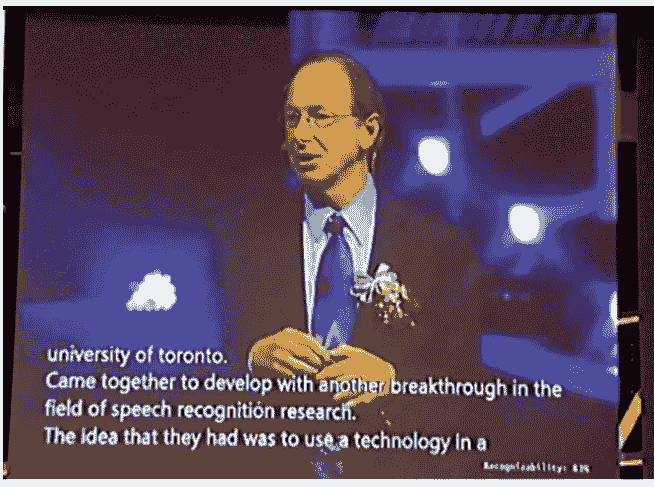

图 1.4

2012 年 10 月 25 日，微软首席研究官 Rick Rashid 在中国天津举行的一场活动中，现场演示了使用深度学习的自动语音识别。在 2000 名中国观众面前，Rashid 用英语说出的言语被自动系统识别，系统首先在 Rashid 屏幕图像下方的字幕中显示这些言语，然后将其翻译成中文语音。这一高难度表演在全球新闻中引起关注。图片由微软研究院提供。

当语音识别与语言翻译相结合时，人们将能够实时进行跨文化交流。《星际迷航》中的万能翻译器已触手可及（图 1.4）。为什么计算机的语音识别和语言翻译要花这么长时间才能达到人类水平？计算机的这些及其他认知能力同时达到临界点，仅仅是巧合吗？所有这些突破都由大数据推动。

#### 学习如何诊断

##### 皮肤表层

随着机器学习的成熟并被应用于大数据可用的许多其他问题，服务行业和专业领域也将发生转变。基于数百万患者记录的医学诊断将变得更加准确。一项最新研究将深度学习应用于 130,000 张皮肤病学图像，涵盖 2,000 多种不同疾病——这是一个比之前使用的医学数据库大十倍的数据库（图 1.5）。¹⁵ 该研究的网络被训练用于从它之前未见过的“测试集”新图像中诊断每种疾病。其在新图像上的诊断性能可与二十一名专家皮肤科医生相媲美，在某些情况下甚至更出色。不久，任何拥有智能手机的人都可以拍摄可疑皮肤病变照片并立即获得诊断，而这一过程目前需要去医生办公室就诊，长时间等待专家筛查病变——并支付一笔高额费用。这将大大扩大皮肤病学护理的范围和质量。如果个人能够快速获得专家评估，他们会在皮肤病早期就去看医生，这时更容易治疗。所有医生都将借助深度学习在诊断罕见皮肤病方面变得更加出色。¹⁶

##### 深层癌症

淋巴结活检切片图像中转移性乳腺癌的检测由专家进行，专家会犯错，这些错误可能导致致命后果。这是深度学习理应擅长的模式识别问题。确实，一个在已知真值的大型切片数据集上训练的深度学习网络达到了 0.925 的准确率，这不错，但不如在相同测试集上达到 0.966 的专家。¹⁷ 然而，当深度学习的预测与

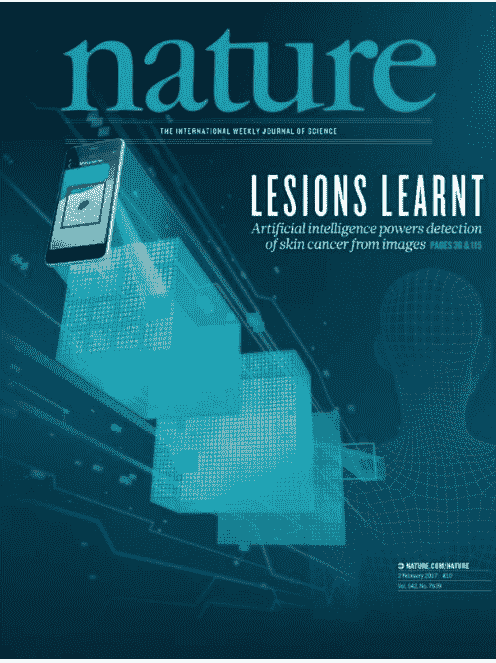

图 1.5
深度学习网络高精度诊断皮肤病变的艺术构想，2017 年 2 月 2 日《自然》杂志封面。

与人类专家结合时，结果是近乎完美的 0.995。两者合作比单独任何一方表现更好，因为深度学习网络和人类专家观察同一数据的方式不同。这可以拯救更多生命。这指向一个未来，在其中人与机器作为伙伴而非竞争对手共同工作。

##### 深度睡眠

如果您有严重的睡眠问题——我们中 70% 的人在一生中的某个时候都会遇到——在等待数月看医生之后（除非您的问题很紧急），您将被转介到睡眠诊所，在那里您会在整夜连接数十个电极的情况下接受观察，以记录您睡觉时的脑电图（EEG）和肌肉活动。每夜中，您会进入慢波睡眠，并周期性地进入快速眼动（REM）睡眠，在此期间您会做梦，但失眠、睡眠呼吸暂停、不宁腿综合征以及许多其他睡眠障碍都可能打破这种模式。如果您在家里睡眠困难，那么陌生床铺上连接电线、连接着令人不安的医疗设备睡眠可能是一个真正的挑战。睡眠专家会查看您的脑电图记录，并以 30 秒为一块标记睡眠阶段，为每八小时的睡眠打分需要数小时。您最终会收到一份关于睡眠模式异常的报告和一张 2,000 美元的账单。

睡眠专家经过培训，会寻找表征不同睡眠阶段的显著特征，这些特征基于 1968 年由 Anthony Rechtshaffen 和 Alan Kales 制定的系统。¹⁸ 但是，由于这些特征往往模棱两可且不一致，专家们只有 75% 的时间能对如何解释它们达成一致。相比之下，我实验室的前研究生 Philip Low 使用非监督机器学习，在不到一分钟的计算机时间内，以 3 秒的时间分辨率自动检测睡眠阶段，并且与人类专家的一致性达到 87%。此外，这只需要在头部的一个位置进行记录，而不需要许多接触点和一束需要很长时间才能戴上和取下的电线。2007 年，我们创立了初创公司 Neurovigil，将这项技术引入睡眠诊所，但它们对打破人工打分带来的现金流表现出的兴趣不大。的确，有了用于向患者开票的保险代码，他们就没有动力采用更便宜的程序。Neurovigil 在大型制药公司找到了另一个市场，这些公司开展临床试验，需要测试其药物对睡眠模式的影响，现在它正在进入长期护理机构市场，老年人在那里常有进行性睡眠问题。

睡眠诊所模式存在缺陷，因为基于如此受限的情况无法可靠地诊断健康问题：每个人都有不同的基线，而偏离该基线才是最有价值的信息。Neurovigil 已经有一款紧凑型设备 iBrain，可以在家里记录您的脑电图，将数据传输到互联网，并纵向分析数据以查找趋势和异常。这将使医生能够早期发现健康问题，在更容易治疗时发现并阻止慢性疾病的发展。还有其他疾病的治疗也能从持续监测中受益，例如 1 型糖尿病，血液中的糖分水平可以通过胰岛素输注进行监测和调节。


能够持续记录数据的廉价传感器的获取，对其他慢性疾病的诊断和治疗产生了重大影响。

从Neurovigil的经验中可以汲取几个教训。尽管拥有更好、更便宜的技术并不容易直接转化为可上市的新产品或服务——即使是远为优越的产品或服务——但当一家老牌企业牢牢占据市场时，存在一些次要市场，新技术可以在这些市场上产生更直接的影响，并为改进和更好地竞争争取时间。太阳能技术以及许多其他新兴行业的技术就是以这种方式进入市场的。从长远来看，睡眠监测和具有已证明优势的新技术将进入家庭，最终融入医疗实践。

#### 如何赚钱

纽约证券交易所超过75%的交易是自动化的（图1.6），由高频交易推动，高频交易在几分之一秒内进出头寸。（当你不需要为每笔交易付费时，即使是微小的优势也能转化为巨额利润。）较长时间尺度上的算法交易考虑了基于大数据的更长期趋势。深度学习在赚取更多资金和更高利润方面越来越出色。19 预测金融市场的问题在于数据嘈杂且条件不稳定——选举或国际冲突后，心态可能一夜之间改变。这意味着今天预测股票价值的算法明天可能就不奏效了。在实践中，使用了数百种算法，并不断组合最佳算法以优化回报。

20世纪80年代，当我为摩根士丹利提供股票交易神经网络模型咨询时，我遇到了大卫·肖，他是一位专门设计并行计算机的计算机科学家。肖当时休假离开哥伦比亚大学，在自动化交易的早期担任量化分析师，即“量化”。他后来在华尔街创办了自己的投资管理公司D. E. Shaw Group，现在已成为一位多亿富翁。D. E. Shaw Group非常成功，但不如另一家对冲基金文艺复兴科技公司成功，该公司由詹姆斯·西蒙斯创立，他是一位杰出的数学家，曾担任斯托尼布鲁克大学数学系系主任。西蒙斯仅在2016年就赚了16亿美元，那甚至都不是他最好的一年。20 文艺复兴科技公司被称为“世界上最好的物理和数学部门”，21 其“避免雇佣任何带有丝毫华尔街背景气息的人”。22

#### 延迟与位置时间轴

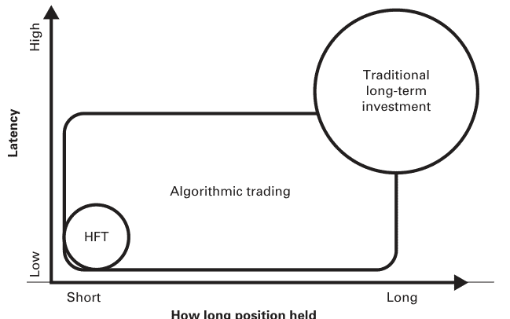

图 1.6

机器学习正在推动算法交易，其速度快于传统的长期投资策略，且比股票市场中的高频交易（HFT）更加审慎。多种不同类型的机器学习算法被组合使用，以实现最佳回报。

大卫·肖不再参与D. E. Shaw的日常运营，如今专注于D. E. Shaw Research，该机构制造了一台名为“安东”的专用并行计算机，其蛋白质折叠速度远快于地球上任何其他计算机。23 西蒙斯已退休，不再管理文艺复兴科技公司，并创立了一个资助自闭症研究以及物理和生物科学其他项目的基金会。通过加州大学伯克利分校的西蒙斯计算理论研究所、麻省理工学院的西蒙斯社会大脑中心以及纽约的平铁研究所，肖的慈善事业对推动数据分析、建模和模拟的计算方法产生了重大影响。24

更广泛的金融服务正在经历一场以金融技术（或称为“金融科技”）为旗帜的变革。诸如区块链这样的信息技术（一种安全的互联网账本，可在交易中取代金融中介）正在小规模测试，但很快可能颠覆万亿美元规模的金融市场。机器学习正在被用于改善贷款信用评估、准确传递商业和金融信息、捕捉预测市场趋势的社交媒体信号，以及为金融交易提供生物识别安全。谁拥有最多数据谁就获胜，而世界上充斥着海量的金融数据。

#### 学习法律

深度学习刚刚开始影响法律职业。律师事务所中每小时收费数百美元的初级律师的大量日常工作将被自动化，尤其是在大型高价值商业办公室中。特别是，技术辅助审查或证据开示将被人工智能接管，人工智能可以筛选成千上万份文件寻找法律证据而不感到疲劳。自动化深度学习系统还将帮助律师事务所应对日益复杂的政府法规。它们将使无法负担律师费用的普通人也能获得法律咨询。法律工作不仅会更便宜，而且会快得多，这一点往往比其成本更为重要。法律世界正在朝着“法律深度化”迈进。²⁵

#### 学习玩扑克

头头对决无限注德州扑克是最流行的扑克变体之一，常在赌场中进行，而无限注形式则在世界扑克系列赛的主赛事中进行（图1.7）。扑克具有挑战性，因为与双方都能获得相同信息的国际象棋不同，扑克玩家拥有不完全信息，而且在最高水平的比赛中，虚张声势和欺骗技巧与发到的牌同样重要。

数学家约翰·冯·诺伊曼，他是数学博弈论的创始人和数字计算机的先驱，对扑克尤为着迷。正如他所说：“现实生活包括虚张声势、小小的欺骗策略、问问自己对方会怎么理解我的意图。而我的理论所讨论的游戏正是关于这一点。”²⁶ 扑克是一款反映人类经进化打磨的部分智力的游戏。一个名为“深叠”的深度学习网络与三十三名职业扑克玩家进行了44,852场比赛。令扑克专家震惊的是，它以显著优势（一个标准差）击败了最好的扑克玩家，但在整体上以四个标准差的优势击败了所有三十三名玩家——一个巨大的差距。²⁷ 如果这项成就能在其他人类基于不完全信息做出判断至关重要的领域（如政治和国际关系）中复制，其后果可能将是深远的。²⁸


图 1.7
头头对决无限注德州扑克。底牌A。深叠在高注额扑克中掌握了虚张声势的技巧，它以巨大优势击败了职业扑克玩家，在自己的领域里战胜了他们。

#### 学习下围棋

2016年3月，韩国18次世界围棋冠军李世乭与DeepMind的AlphaGo进行了五局三胜的比赛并失利（图1.8），AlphaGo是一款使用深度学习网络来评估棋盘位置和可能着法的围棋程序。29 围棋的难度相对于国际象棋，就像国际象棋相对于跳棋一样。如果说国际象棋是一场战斗，那么围棋就是一场战争。19×19的围棋棋盘远大于8×8的国际象棋棋盘，这使得棋盘不同区域可以同时进行多场战斗。各场战斗之间存在长距离相互作用，即使是专家也难以判断。围棋合法棋盘位置总数为10^170，远多于宇宙中的原子数量。

此外，AlphaGo拥有一个完全不同的学习系统，用于解决时间信用分配问题：众多着法中，哪些导致了胜利，哪些导致了失败？大脑的基底神经节（接收来自整个大脑皮层的投射并向其投射回去）使用时间差算法和强化学习来解决这个问题。AlphaGo使用了与基底神经节进化出的相同的学习算法，以评估一系列


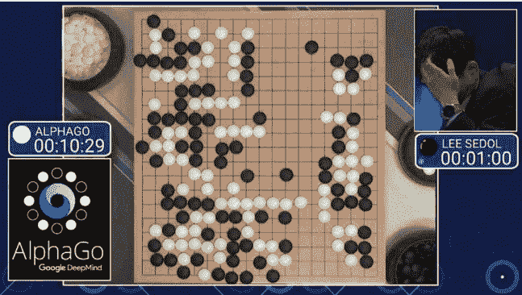

图 1.8
五局对弈期间的围棋棋盘，对弈双方为韩国围棋冠军李世石与 AlphaGo，AlphaGo 是一种深度学习神经网络，它通过自我对弈学会了下围棋。

为最大化未来奖励而采取的行动（这一过程将在第 10 章中解释）。AlphaGo 通过自我对弈学习——多次、多次地自我对弈。

AlphaGo 与李世石的围棋对弈在亚洲拥有大量追随者，在那里，围棋冠军是国家级人物，受到像摇滚明星一样的待遇。AlphaGo 此前击败了一位欧洲围棋冠军，但其棋艺水平远低于亚洲最高水平，李世石并未预期会有激烈的对弈。即使是开发 AlphaGo 的公司 DeepMind 也不知道他们的深度学习程序有多强大。自上次比赛以来，AlphaGo 与自身的几个版本进行了数百万盘对弈，无法对其棋力进行基准测试。

AlphaGo 赢下五局中的前三局，展现出出乎意料的高水平棋艺，这对许多人来说是一个巨大的震惊。这在韩国引起了极大的关注，所有主要电视台都对比赛进行了实时解说。AlphaGo 下出的一些棋步具有革命性。在第二盘第 38 手，AlphaGo 下出一手极具创意的精妙棋步，让李世石感到惊讶，他花了将近十分钟才作出回应。AlphaGo 输掉了第四盘，这是人类的颜面之胜，最终 AlphaGo 以四比一赢得比赛（图 1.9）。³⁰ 那些三月的夜晚，我在圣地亚哥熬夜到凌晨，被这些比赛深深吸引。它们让我想起 1966 年 6 月 2 日凌晨 1 点，我在克利夫兰坐在电视机前，目睹 Surveyor 机器人飞船登月并传回第一张月球表面照片的情景。³¹ 我实时见证了这些历史性时刻。AlphaGo 远远超出了我和许多其他人认为可能实现的范围。

2017 年 1 月 4 日，一名在名为“Master”的网络围棋服务器上下棋的棋手在战胜包括世界围棋冠军、中国十九岁天才棋手柯洁在内的一些世界最佳棋手后，被揭露为 AlphaGo 2.0，此前其连续 60 盘全胜。它展现出一种违背了古往今来战略智慧的新下棋风格。2017 年 5 月 27 日，柯洁在中国乌镇的未来围棋峰会上三盘不敌 AlphaGo（图 1.10）。这是有史以来最精彩的围棋比赛之一，数亿中国人关注了这场对弈。“去年，我认为 AlphaGo 的下棋方式与人类非常接近，但今天，我觉得他下棋就像围棋之神，”柯洁总结道。³²

输掉第一盘（仅差半子之微）后，柯洁说他“在比赛中途曾非常接近获胜”，并且他激动得“我能感觉到心脏怦怦直跳！也许是因为太兴奋，我下了一些愚蠢的棋。也许这就是人类最弱的地方。”³³ 柯洁经历的是情绪过载，但要达到巅峰表现，需要的是较低程度的情绪激动。确实，舞台演员知道，如果演出前肚子里有“蝴蝶”（紧张感），他们才能发挥出好的状态。他们的表现遵循倒 U 型曲线，最佳表现出现在低唤醒水平和高唤醒水平之间的最佳状态。运动员将此称为“进入状态”。

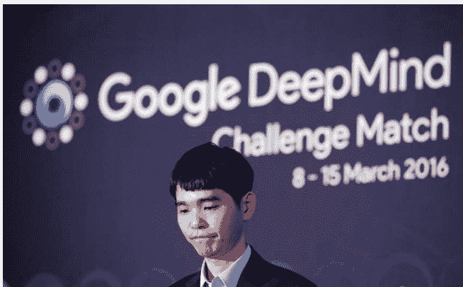

图 1.9
2016 年 3 月输掉围棋挑战赛后的李世石。

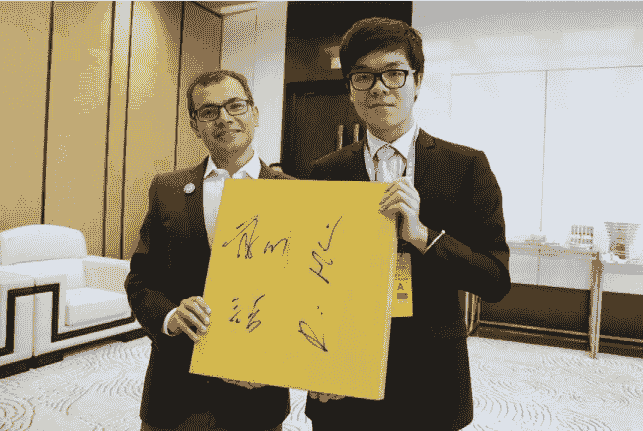

图 1.10
2017 年中国历史性围棋对弈结束后，戴米斯·哈萨比斯（左）与柯洁会面，手持一块柯洁签名的棋盘。图片由戴米斯·哈萨比斯提供。

AlphaGo 还于 2017 年 5 月 26 日击败了一支由五位顶尖棋手组成的团队。这些棋手已经分析了 AlphaGo 的棋步，并正在改变他们的策略。作为一种新形式的“乒乓外交”，这场比赛由中国政府主办。中国正在大力投资机器学习，其脑科学计划的一个主要目标是从大脑中挖掘出新的算法。³⁴

如果说这还不够令人惊叹，那么这个围棋传奇的下一章更加非凡。AlphaGo 最初是通过从 16 万盘人类围棋对弈中进行监督学习来启动的，随后才进行自我对弈。有些人认为这算作弊——一个自主的人工智能程序应该能够在没有人类知识的情况下学会下围棋。2017 年 10 月，一个名为 AlphaGo Zero 的新版本被揭晓，它仅从游戏规则出发学会了下围棋，并以 100 比 0 大胜 AlphaGo Master（击败柯洁的那个版本）。³⁵ 此外，AlphaGo Zero 的学习速度比 AlphaGo Master 快 100 倍，且计算能力仅需其十分之一。通过完全忽略人类知识，AlphaGo Zero 变得超级超人。

随着机器学习算法的不断改进，AlphaGo 还能变得多强尚无已知的上限。

AlphaGo Zero 已经摒弃了人类对弈，但程序用来表示棋盘的特征中仍然包含大量人工制作的围棋知识。也许 AlphaGo Zero 在没有任何围棋知识的情况下仍能进一步提升。就像可口可乐零度去除了可口可乐中的所有热量一样，所有围棋领域知识都从 AlphaZero 中被剥离了。结果。³⁶ 为了更戏剧化地说明“少即是多”，AlphaZero 在不改变任何学习参数的情况下，学会了以超人水平下国际象棋，下出了一些此前从未有人类下过的“外星人”棋步。AlphaZero 没有输给 Stockfish（已经以超人水平下棋的顶级国际象棋程序）。在一盘棋中，AlphaZero 做出了一次大胆的象棋牺牲（有时用于获得位置优势），随后又做出了皇后牺牲，这看似是一个巨大的失误，直到多步之后才导致将杀，而 Stockfish 和人类都未曾预见。外星人已经降临，地球再也不会像以前一样了。

AlphaGo 的开发商 DeepMind 由神经科学家戴米斯·哈萨比斯于 2010 年联合创立（图 1.10，左侧人物），他曾是伦敦大学学院加茨比计算神经科学单位的博士后研究员（该单位由彼得·戴扬领导，彼得·戴扬曾是我实验室的博士后研究员，2017 年与雷蒙德·多兰和沃尔夫拉姆·舒尔茨一起因对奖励学习的研究而获得享有盛誉的脑奖）。DeepMind 于 2014 年被 Google 以 6 亿美元收购。该公司雇佣了 400 多名工程师和神经科学家，其文化融合了学术界和初创企业的特点。神经科学与人工智能之间的协同效应深厚且正在加速。

#### 学习如何变得更智能

AlphaGo 智能吗？关于智能的论述比心理学中除意识以外的任何其他话题都多，而这两个概念都难以定义。自 20 世纪 30 年代以来，心理学家区分了流体智力（在不依赖先前知识的情况下，利用新情境中的推理和模式识别来解决新问题）和晶体智力（依赖先前知识，是标准 IQ 测试所衡量的内容）。流体智力遵循一个发展轨迹，在成年早期达到顶峰，随后随年龄增长而下降，而晶体智力则随着年龄增长缓慢且渐近地增加，直到生命较晚期。AlphaGo 在相当狭窄的领域中展现出晶体智力和流体智力，但在该领域内，它展现出了惊人的创造力。专业知识同样基于在狭窄领域中的学习。我们都在语言领域是专业人士，并且每天都在练习。

AlphaGo 使用的强化学习算法可以应用于许多问题。这种学习形式只依赖于一系列棋步结束时给予获胜者的奖励，这反而可以改进远早之前做出的决策。当与许多强大的深度学习网络结合时，这会导致许多特定于领域的智力片段。确实，已经论证了不同的特定于领域的智力类型：例如，社交、情感、机械和建构性智力。³⁷ 智力测试声称测量的“g 因素”与这些不同类型相关。解读 IQ 测试时需要谨慎，理由有很多。平均 IQ 自 20 世纪 30 年代首次被研究以来，在全球范围内每十年上升三个点，这一趋势被称为“弗林效应”。弗林效应有许多可能的解释，例如更好的营养、更好的医疗保健和其他环境因素。³⁸ 这很合理，因为环境影响基因调节，进而影响大脑连接，导致行为改变。³⁹ 随着人类越来越多地生活在人工创造的环境中，大脑正在被以大自然从未打算的方式塑造。是不是人类在更长的时间段内一直在变得更聪明？IQ 的增长还会持续多久？自从出现能够锦标赛水平下棋的电脑程序以来，人类与电脑下棋、玩双陆棋和现在围棋的比例一直在稳步上升，人类棋手的机器增强智能也是如此。⁴⁰ 深度学习将提升不仅是科学研究人员，而且是所有行业工人的智能。

科学仪器以惊人的速度生成数据。日内瓦大强子对撞机（LHC）中的基本粒子碰撞每年产生 25PB 的数据。大综合巡天望远镜（LSST）每年将产生 6PB 的数据。机器学习正被用于分析那些太大、人类无法通过传统方法搜索的巨大物理和天文学数据集。⁴¹ 例如，DeepLensing 是一个神经网络，用于识别因视线沿线另一星系周围的“引力透镜”导致光线弯曲而变形的遥远星系图像。这使得许多新的遥远星系可以被自动发现。物理学和天文学中还有许多其他“大海捞针”式的问题，深度学习极大地增强了传统的数据分析方法。


#### The Shifting Job Market

Introduced by banks in the late 1960s to dispense cash to account holders 24/7, a much-welcomed convenience for those in need of cash before or after normal banking hours, automated teller machines (ATMs) have since acquired the ability to read handwritten checks. And though they reduced routine work for bank tellers, there are more bank tellers than before providing customers with personalized services such as mortgage and investment advice, and new ATM repair jobs—just as the steam engine displaced manual laborers, on the one hand, but gave rise to new jobs for skilled workers who could build and maintain steam engines and drive steam locomotives, on the other. So, too, Amazon’s online marketing has displaced many workers from local brick-and-mortar retail stores but has also created 380,000 new jobs for workers in the distribution and delivery of the goods sold by it and by the many businesses under its umbrella.43 And as jobs that now require human cognitive skills are taken over by automated AI systems, there will be new jobs for those who can create and maintain these systems.

Job turnover is nothing new. Farmworkers in the nineteenth century were displaced by machines, and new jobs were created at city factories made possible by machines, all of which required an educational system to train workers in new skills. The difference is that, today, the new jobs being opened up by artificial intelligence will require new, different, and ever-changing skills in addition to traditional cognitive skills.44 So we will need to learn throughout our lifetimes. For this to happen, we will need a new educational system that is based at the home rather than the school.

Fortunately, just as the need for finding new jobs has become acute, the Internet has made available free massive open online courses (MOOCs) to acquire new knowledge and skills. Though still in their infancy, MOOCs are evolving rapidly in the education ecosystem and hold great promise for delivering quality instruction to a wider range of people than ever before. When coupled with the next generation of digital assistants, MOOCs could be transformational. Barbara Oakley and I developed a popular MOOC called "Learning How to Learn" that teaches you how to become a better learner (figure 1.11) and a follow-up MOOC called "Mindshift" that teaches you how to reinvent yourself and change your lifestyle (both MOOCs will be described in chapter 12).

As you interact with the Internet, you are generating big data about yourself that is machine readable. You are being targeted by ads generated


Figure 1.11
"Learning How to Learn," a massive open online course (MOOC) that teaches you how to become a better learner is the most popular MOOC on the Internet, with over 3 million learners. Courtesy of Terrence Sejnowski and Barbara Oakley.

from the digital bread crumbs you have left behind on the Internet. The information you reveal on Facebook and other social media sites can be used to create a digital assistant that knows you better than almost anyone else in the world and will not forget anything, becoming, in effect, your virtual doppelganger. By pressing both Internet tracking and deep learning into service, the educational opportunities for the children of today's children will be better than the best available today to wealthy families. These grandchildren will have their own digital tutors, who will accompany them throughout the trajectory of their education. Not only will education become more individualized; it will become more precise. There are already a wide range of educational experiments under way throughout the world at programs like the Khan Academy and funded by the Gates, Chan-Zuckerberg, and other philanthropic foundations that are testing software to make it possible for all children to progress at their own pace throughout their formal education and to adapt to the specific needs of each child.⁴⁵ The widespread availability of digital tutors will free teachers from the repetitive parts of teaching, like grading, and allow them to do what humans do best—emotional support for struggling students and intellectual inspiration for gifted students. Educational technology—edtech—is moving rapidly ahead, and the transition to precision education could be quite fast compared to self-driving cars because the obstacles it must overcome are much less daunting, the demand is much greater, and education in the U.S. is a trillion-dollar market.⁴⁶ One major concern will be who has access to the internal files of the digital assistants and digital tutors.

#### Is Artificial Intelligence an Existential Threat?

When AlphaGo convincingly beat Lee Sedol at Go in 2016, it fueled a reaction that had been building over the last several years concerning the dangers that artificial intelligence might present to humans. Computer scientists signed pledges not to use AI for military purposes. Stephen Hawking and Bill Gates made public statements warning of the existential threat posed by AI. Elon Musk and other Silicon Valley entrepreneurs set up a new company, OpenAI, with a one-billion-dollar nest egg and hired Ilya Sutskever, one of Geoffrey Hinton's former students, to be its first director. Although OpenAI's stated goal was to ensure that future AI discoveries would be publicly available for all to use, it had another, implicit and more important goal—to prevent private companies from doing evil. For, with AlphaGo's victory over world Go champion Sedol, a tipping point had been reached. Almost overnight, artificial intelligence had gone from being judged a failure to being perceived as an existential threat.

This is not the first time an emergent technology has seemed to pose an existential threat. The invention, development, and stockpiling of nuclear weapons threatened to blow up the world, but somehow we have managed to keep that from happening, at least until now. When recombinant DNA technology first appeared, there was fear that deadly engineered organisms would be set loose to cause untold suffering and death across the globe. Genetic engineering is now a mature technology, and so far we have managed to survive its creations. The recent advances in machine learning pose a relatively modest threat compared to nuclear weapons and killer organisms. We will also adapt to artificial intelligence, and, indeed, this is already happening.

One of the implications of DeepStack's success is that a deep learning network can learn how to become a world-class liar. What deep networks can be trained to do is limited only by the trainer's imagination and data. If a network can be trained to safely drive a car, it can also be trained to race Formula 1 cars, and someone probably is willing to pay for it. Today it still requires skilled and highly trained practitioners to build products and services using deep learning, but as the cost of computing power continues to plummet and as software becomes automated, it will soon become possible for high school students to build AI applications. Otto, the highest-earning online e-commerce company in Germany for clothing, furnishings, and sport, is using deep learning to predict ahead of time what its customers are likely to order based on their past history of ordering and then to preorder it for them.47 With 90 percent accuracy, customers receive merchandise almost before they order it. Done automatically without human intervention, preordering not only saves the company millions of euros a year in reduced surplus stock and product returns but also results in greater customer satisfaction and retention. Rather than displacing Otto’s workers, deep learning has boosted their productivity. AI can make you more productive at your job.

Although the major high-tech companies have pioneered deep learning applications, machine learning tools are already widely available and many other companies are beginning to benefit. Alexa, a wildly popular digital assistant operating in tandem with the Amazon Echo smart speaker, responds to natural language requests based on deep learning. Amazon Web Services (AWS) has introduced toolboxes called "Lex," "Poly" and "Comprehend" that make it easy to develop the same natural language interfaces based on automated text-to-speech, speech recognition and natural language understanding, respectively. Applications with conversational interactions are now within the reach of smaller businesses that can’t afford to hire machine learning experts. AI can enhance customer satisfaction.

When chess-playing computer programs eclipsed the best human chess players, did that stop people from playing chess? On the contrary, it raised their level of play. It also democratized chess. The best chess players once came from big cities like Moscow and New York that had a concentration of grandmasters who could teach younger players and raise their level of play. Chess-playing computer programs made it possible for Magnus Carlsson, who grew up in a small town in Norway, to become a chess grandmaster at thirteen, and today he is the world chess champion. The benefits of artificial intelligence will affect not just the playing of games, however, but every aspect of human endeavor, from art to science. AI can make you smarter.⁴⁸

#### Back to the Future

The Deep Learning Revolution has two intertwined themes: how human intelligence evolved and how artificial intelligence is evolving. The big difference between the two kinds of intelligence is that it took human intelligence many millions of years to evolve, but artificial intelligence is evolving on a trajectory measured in decades. Although this is warp speed even for cultural evolution, fastening our seat belts may not be the right response.

The recent breakthroughs in deep learning were not the overnight successes that you might have gathered from press reports. The story behind the shift from artificial intelligence based on symbols, logic, and rules to deep learning networks based on big data and learning algorithms is not


为人所周知。*深度学习革命*讲述了这个故事，并从我的角度探讨了深度学习的起源和后果，我既是20世纪80年代神经网络学习算法开发的先驱，也是神经信息处理系统（NIPS）基金会的主席，该基金会在过去三十年中一直监督机器学习和深度学习的发现。我和我在神经网络社区的同事们多年来一直是弱势一方，但我们的坚持和耐心最终取得了胜利。

### 2 人工智能的重生

马文·明斯基是一位杰出的数学家，也是MIT人工智能实验室（MIT AI Lab）的创始人之一。¹ 创始人设定了一个领域的方向和文化，在很大程度上得益于明斯基，20世纪60年代的MIT人工智能是聪明才智的堡垒。他点子多得比我认识的任何人都多，每分钟都能冒出新想法，他能让你相信他对问题的看法是正确的，即使常识告诉你相反的情况。我钦佩他的大胆和聪明才智——但不赞同他为人工智能所走的方向。

#### 小儿科？

积木世界是20世纪60年代MIT人工智能实验室出色项目的一个良好例子。为了简化视觉问题，积木世界由矩形积木组成，这些积木可以堆叠搭建出结构（图2.1）。目标是编写一个程序，能够解释指令，例如“找一个大的黄色积木放在红色积木上”，并规划机械臂执行该指令所需的步骤。这看起来像小儿科，但实际上需要编写一个庞大复杂的程序，该程序变得如此笨拙，以至于难以调试，并在编写该程序的学生特里·温诺格拉德离开MIT后被有效放弃。这个看似简单的问题比任何人想象的都要难得多，而且即使成功，从积木世界到现实世界也没有直接路径，因为现实世界中的物体有各种形状、大小和重量，并非所有角度都是直角。相比于可以固定光照方向和强度的受控实验室环境，现实世界中的光照会因地点和时间不同而剧烈变化，这大大增加了计算机对象识别的难度。

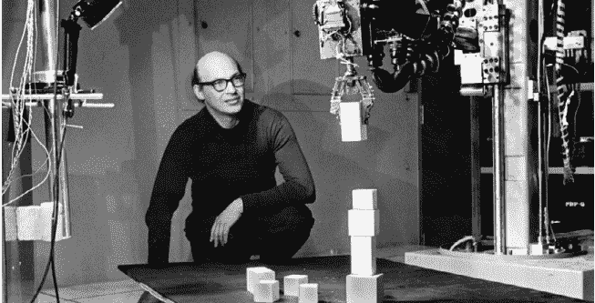

**图2.1**
马文·明斯基在1968年左右观看一台机器人堆叠积木。积木世界是我们与世界互动方式的简化版，但它比任何人想象的都要复杂得多，直到2016年才通过深度学习得到解决。

20世纪60年代，MIT人工智能实验室从一个军事研究机构获得了一笔巨额资助，用于建造一台能打乒乓球的机器人。我曾听说过一个故事，称主要研究人员在资助提案中忘记申请为机器人构建视觉系统的资金，于是将该问题作为暑期项目布置给一名研究生。我曾问过马文·明斯基这个故事是否属实。他反驳说我搞错了：“我们把这个问题布置给本科生。”MIT档案馆的一份文件证实了他所说的版本。² 看似易于解决的问题最终证明是一片流沙，吞噬了一代计算机视觉研究人员。

#### 为什么视觉是一个难题

我们很少难以识别一个物体是什么，尽管该物体的位置、大小、方向和光照有所不同。计算机视觉中最早的想法之一是将物体模板与图像中的像素进行匹配，但该方法失败了，因为同一物体在不同方向下的两张图像的像素不匹配。例如，考虑图2.2中的两只鸟。如果你将一只鸟的图像移到另一只鸟上面，你可以使一部分匹配，但其余部分无法对齐；但你可以用同一姿势的另一种鸟类图像获得相当好的匹配。

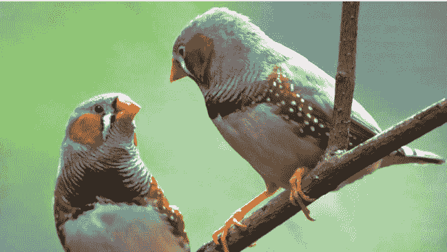

图2.2
两只斑胸文鸟互相商量。我们很容易看出它们是同一物种。但因为它们相对于观察者的方向不同，即使它们具有几乎相同的特征，也难以用模板进行比较。

计算机视觉的进步在于关注特征而非像素。例如，观鸟者必须成为区分不同物种的专家，这些物种可能仅在几个细微标记上有所不同。一本实用而流行的鸟类识别书籍只有一张鸟的照片，但有许多示意图指出它们之间的细微差别（图2.3）。³ 一个好的特征是只属于一种鸟类的特征，但因为相同的特征出现在许多物种中，使鸟类识别成为可能的是几个野外标记的独特组合，例如翼条、眼纹和翼斑。而且，当这些野外标记被密切相关的物种共享时，鸣叫和鸣歌可以将它们区分开来。鸟类的绘画或素描比照片更能将我们的注意力引导至相关的区分特征，因为照片中充满了数百个不太相关的特征（图2.3）。

这种基于特征的方法的问题不仅在于为世界上成千上万种不同物体开发特征检测器非常耗费人力，而且即使使用最好的特征检测器，来自部分被遮挡的物体图像的歧义也会产生，这使得在杂乱场景中识别物体对计算机来说是一项艰巨的任务。

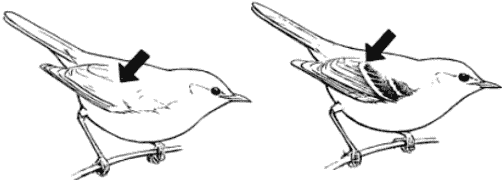

图2.3
可用于区分相似鸟类的显著特征。箭头指向寻找翼条的位置，翼条对于区分林莺科尤其重要：有些显眼，有些隐蔽，有些是双条，有些长，有些短。引自Peterson, Mountfort, and Hollom, *不列颠及欧洲鸟类野外指南*, 第5版，第16页。

20世纪60年代，几乎没有人意识到，计算机视觉达到人类水平的性能需要花费五十年和计算能力提高百万倍。认为编写计算机视觉程序会很容易的误导性直觉，基于我们觉得容易做的活动，如看、听和移动——但进化花了数百万年才做到这一点。让早期人工智能先驱们懊恼的是，他们发现计算机视觉问题极难解决。相比之下，他们发现让计算机证明数学定理——一个被认为需要最高智力水平的过程——要容易得多，因为计算机在逻辑方面远比我们擅长。能够进行逻辑思考是进化中的晚期发展，即使在人类中，也需要训练才能遵循一长串逻辑命题得出严格结论，而对于我们生存需要解决的大多数问题，基于先前经验的概括大多数时候对我们都很有效。

#### 专家系统

在20世纪70和80年代，AI专家系统很受欢迎，被开发用于通过一组规则来解决诸如医疗诊断等问题。因此，早期的专家系统MYCIN被开发用于识别导致脑膜炎等传染病的细菌。4 遵循专家系统方法，MYCIN的开发者首先必须从传染病专家和患者那里收集事实和规则，以及症状和病史，然后将这些输入系统计算机，最后编程让计算机使用逻辑进行推理。然而，开发者在从专家那里收集事实和规则时遇到了困难，尤其是在更复杂的领域，最好的诊断医生依赖的不是规则，而是基于经验的模式识别，这很难编码，⁵并且他们的系统必须随着新事实的发现和旧规则的过时而不断更新。而且，他们在收集和输入患者的症状和病史到系统计算机时也遇到了进一步的困难，这一过程每个患者可能需要半小时或更长时间，繁忙的医生无法承受。毫不奇怪，MYCIN从未在临床使用过。尽管为其他应用（如有毒溢出管理、自动驾驶车辆任务规划和语音识别）编写了许多专家系统，但今天使用的很少。

研究人员在人工智能早期几十年中尝试了许多不同的方法，但他们的方法比实际应用更聪明。他们不仅低估了现实世界问题的复杂性，而且他们提出的解决方案扩展性很差。在复杂领域，规则数量可能非常庞大，并且随着新事实逐条添加，跟踪与其他规则的例外和交互变得不切实际。例如，道格拉斯·莱纳特于1984年启动了一个名为“Cyc”的项目，以编码常识，这在当时似乎是个好主意，但实际上却是一场噩梦。⁶ 我们将关于世界运作方式的无数事实视为理所当然，其中大多数都基于经验。例如，一只从40英尺高处掉落的猫可能会避免受伤，⁷ 但人类从相同高度掉落可能不会。

早期人工智能进展缓慢的另一个原因是，按照今天的标准，数字计算机极其原始，内存也昂贵得令人望而却步。但由于数字计算机在逻辑运算、符号操作和规则应用方面效率很高，这些计算原始操作在20世纪受到青睐也就不足为奇了。因此，卡内基梅隆大学的两位计算机科学家艾伦·纽厄尔和赫伯特·西蒙于1955年编写了一个名为“逻辑证明者”的计算机程序，能够证明《数学原理》中的逻辑定理，这是阿尔弗雷德·诺斯·怀特海和伯特兰·罗素试图系统化数学所有内容的尝试。在那个早期，人们普遍期待着智能计算机指日可待。

寻求编写具有类似人类智能功能的计算机程序的人工智能先驱，并不关心大脑实际上是如何实现智能行为的。当我问艾伦·纽厄尔原因时，他告诉我他


个人一直对来自脑研究的洞察持开放态度，但当时知之甚少，没什么大用。20 世纪 50 年代，大脑功能的基本原理刚刚浮现，由艾伦·霍奇金（Alan Hodgkin）和安德鲁·赫胥黎（Andrew Huxley）的工作引领，他们解释了大脑的信号如何通过神经中的全或无电信号在长距离传输，还有伯纳德·卡茨（Bernard Katz），他发现了这些电信号如何在突触处转化为化学信号的线索，突触用于神经元之间的通信。

尽管到 80 年代，关于大脑的知识既更多了，也更广泛地为生物学领域之外的人所获取，但大脑本身对新一代 AI 研究人员来说已变得无关紧要，他们的目标是编写一个与大脑工作方式功能等价的程序。在哲学中，这种立场被称为机能主义，对许多人来说，这是忽略生物学中混乱细节的好借口。但一小群不属于主流的 AI 研究人员相信，一种受大脑实际生物学启发的人工智能方法，各种被称为“神经网络”、“联结主义”和“并行分布式处理”，最终可以解决逻辑 AI 所无法解决的难题。

我就是那群人中的一员。

#### 进入虎穴

1989 年，MIT 计算机科学实验室负责人迈克尔·德图齐杜斯（Michael Dertouzos）邀请我在 MIT 做一场杰出讲座，介绍我基于神经网络的人工智能先驱方法（图 2.4）。到达那里后，德图齐杜斯热情地迎接了我，当我们一起乘电梯时，他告诉我，MIT 的传统是杰出讲座演讲人需在午餐时花五分钟与教职员和学生讨论自己的主题。“还有，”当电梯门打开时，他补充道，“他们讨厌你所做的。”

房间里挤满了人，多达一百多人，连德图齐杜斯都感到惊讶。科学家们围成三圈站立：第一排是高级教职员，第二排是初级教职员，其后是学生。而我站在中间，站在自助餐台前，成了主菜。我能在五分钟内说出什么话，才能对一群讨厌我所做之事的听众产生任何影响吗？

我即兴发言：“食物上的那只苍蝇大脑只有 100,000 个神经元；它重一毫克，耗电一毫瓦，”我说，

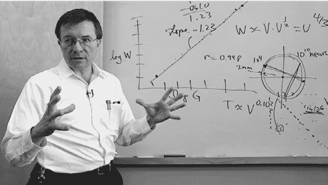

图 2.4 特里·塞伊诺夫斯基（Terry Sejnowski）于 1989 年移居索尔克研究所后不久，谈论皮层的缩放定律。感谢 Ciencia Explicada 提供。

随机应变。“苍蝇能看见，能飞行，能导航，能找食物。但真正了不起的是，它能自我繁殖。MIT 拥有一台造价 1 亿美元的超级计算机：它耗电一兆瓦，需要巨大的空调冷却。但这台超级计算机最大的代价是人力牺牲，即程序员来喂养它对程序的贪婪需求。那台超级计算机看不见，也不会飞，尽管它能与其他计算机通信，却不能交配或自我繁殖。这幅图哪里出了问题？”

长时间停顿后，一位高级教职员说：“因为我们还没写出视觉程序。”（国防部最近向其战略计算计划投入了 6 亿美元，该计划从 1983 年运行到 1993 年，但在制造用于引导自主坦克的视觉系统方面未能达标。）“祝你好运，”我回答道。

杰拉尔德·萨斯曼（Gerald Sussman）曾将 AI 应用于多个现实世界问题，包括用于轨道力学的高精度积分系统，他援引艾伦·图灵（Alan Turing）的经典工作来为 MIT 的 AI 方法辩护，图灵证明了图灵机（一个思想实验）可以计算任何可计算函数。“那需要多长时间？”我问。“你最好快点计算，否则就会被吃掉，”我补充道，然后走到房间另一头给自己倒杯咖啡。与教职员的对话就这样结束了。

“‘这幅图哪里出了问题？’是我实验室里每个学生都能回答的问题。但午餐听众中的前两排却犯难了。最后，第三排的一名学生给出了这样的回答：‘数字计算机是一种通用设备，可以被编程来计算任何东西，尽管效率低下，但苍蝇是一种专用计算机，能看见和飞行，却不能帮我平衡支票簿。’这是正确答案。苍蝇眼睛中的视觉网络经过数亿年的演化，其视觉算法嵌入在网络本身中。这就是为什么你可以通过反向工程来解析苍蝇眼睛神经电路的布线图和信息流来研究视觉，而对于数字计算机却做不到，因为数字计算机的硬件本身需要软件来指定正在解决什么问题。”

我看见罗德尼·布鲁克斯（Rodney Brooks）在人群后面微笑，我曾邀请他参加在马萨诸塞州科德角的伍兹霍尔举行的计算神经科学研讨会。布鲁克斯来自澳大利亚，在 80 年代，他是 MIT AI 实验室的初级教职员，他在那里构建了走行机器人昆虫，使用的架构不依赖于数字逻辑。他最终成为了该实验室的主任，并创立了 iRobot 公司，该公司生产 Roomba 扫地机器人。

我当天下午做讲座的房间非常大，里面聚集了大量本科生，这一代人面向未来而非过去。我谈到了一个学习如何玩双陆棋（backgammon）的神经网络，这是一个我与伊利诺伊大学厄巴纳-香槟分校复杂系统研究中心的物理学家杰拉尔德·特苏罗（Gerald Tesauro）合作的项目。双陆棋是两名玩家之间的比赛，棋子根据每次掷骰子的结果向前移动，沿途彼此通过。与国际象棋不同，双陆棋由机会决定：每次掷骰子的不确定性使得预测特定走法的结果更加困难。它在中东非常流行，有些人靠玩高赌注双陆棋为生。

与其编写一个基于逻辑和启发式的程序来处理所有可能的棋盘位置——这是不可能的任务，因为双陆棋有 10^20 种可能的棋盘位置——我们让网络通过观察老师下棋来学习通过模式识别下棋。10 Gerry 后来创建了第一个达到世界冠军水平的双陆棋程序，方法是让双陆棋网络与自己对弈（这个故事将在第 10 章讲述）。

讲座结束后，我得知当天上午《纽约时报》头版有一篇文章，报道政府机构正在削减人工智能资金。虽然这对主流研究人员来说是人工智能寒冬的开始，但这并没有影响我或我团队的其余成员，因为对他们来说，神经网络的春天才刚刚开始。

但我们的人工智能新方法花了二十五年才在视觉、语音和语言方面实现现实世界应用。即便是在 1989 年，我也应该知道需要这么久。1978 年，当我还是普林斯顿的研究生时，我将摩尔定律（计算能力呈指数级增长，每 18 个月翻一番）外推，看需要多久才能达到大脑级别的计算能力，并得出结论：这将发生在 2015 年。幸运的是，这并没有阻止我奋勇向前。我对神经网络的信念基于我的直觉：如果大自然解决了这些问题，我们也应该能够从大自然中学习如何解决它们。我不得不等待的二十五年，与大自然花费数亿年所解决的问题相比，甚至算不上一眨眼的时间。

在视觉皮层中，神经元按层级结构排列。随着感官信息经皮层一层一层地转换，世界的表征变得越来越抽象。几十年来，随着神经网络模型中层数的增加，其性能持续提升，直到最终达到一个关键阈值，使我们能够解决 80 年代只能梦想解决的问题。深度学习自动化了寻找区分图像中不同物体的良好特征的过程，这也是为什么当今的计算机视觉比五年前好得多。

到 2016 年，计算机的速度提高了一百万倍，计算机内存从兆字节增加到太字节，增加了十亿倍。可以模拟拥有数百万个单元和数十亿连接的神经网络了，而 80 年代的网络只有几百个单元和几千个连接。虽然与人脉相比仍然微不足道——人脉有千亿个神经元和百万亿个突触连接——但当今的网络已经足够大，足以在狭窄领域证明原理。

深度神经网络中的深度学习已经到来。但在深度网络出现之前，我们必须先学会如何训练浅层网络。


### 3 神经网络的黎明

人工智能中任何难题都能被解决的唯一存在性证明，就是通过进化，大自然已经解决了它们。但20世纪50年代就已有迹象表明，如果AI研究人员采取与符号处理根本不同的方法，计算机或许能真正实现智能行为。

第一个线索是，我们的大脑是强大的模式识别器。我们的视觉系统可以在十分之一秒内识别出杂乱场景中的一个物体，即使我们以前从未见过那个特定的物体，并且即使物体位于我们面前的任何位置、有任何大小、任何朝向。简而言之，我们的视觉系统的行为就像一台将“识别物体”作为单条指令的计算机。

第二个线索是，我们的大脑可以通过练习学习如何完成许多困难的任务，从弹钢琴到掌握物理学。大自然利用通用学习来解决专门的问题，而人类是学习的冠军。这是我们的特殊能力。我们大脑皮层的组织在各处都很相似，深度学习网络存在于我们所有的感觉和运动系统中。¹

第三个线索是，我们的大脑并不充满逻辑或规则。是的，我们可以学习如何逻辑思考或遵循规则，但只有在大量训练之后，而且我们大多数人都不擅长这一点。这在逻辑谜题“Wason 选择任务”（图 3.1）的典型表现中得到了说明。

正确的选择是带有“8”的卡片和棕色的卡片。在原始研究中，只有10%的受试者给出了正确答案。² 但当逻辑测试建立在熟悉的情境中时，大多数受试者都能轻松给出正确答案（图 3.2）。

推理似乎是领域特定的，我们对某个领域越熟悉，就越容易解决该领域的问题。经验使在领域内进行推理变得更容易，因为我们可以利用遇到过的例子来直观地找到解决方案。例如，在物理学中，

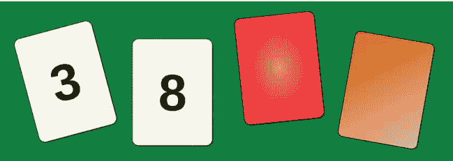

图 3.1
这四张卡片每张一面有一个数字，另一面覆盖着整个颜色区域。为了测试“如果一张卡片的一面显示偶数，那么其对面是红色”这一命题的真伪，你必须翻转哪张（些）卡片？（来自“Wason 选择任务”，维基百科。）


图 3.2
每张卡片一面是年龄，另一面是饮料。为了测试“如果你在喝酒，那么你必须年满18岁”这一法律规定，必须翻转哪张（些）卡片？（来自“Wason 选择任务”，维基百科。）

我们通过解决许多问题来学习电和磁等领域，而不是通过记忆公式。如果人类的智力纯粹基于逻辑，那么它应该是领域通用的，但实际上并非如此。

第四个线索是，我们的大脑充满了数以亿计的微小神经元，它们不断地相互通信。这表明，为了解决人工智能中的难题，我们应该研究具有大规模并行架构的计算机，而不是那些通过冯·诺依曼数字架构一次性获取和执行数据与指令的计算机。诚然，图灵机在给定足够内存和足够时间的情况下可以计算任何可计算函数，但大自然必须实时解决问题。为了实现这一点，它利用了大脑的神经网络，这些网络像地球上最强大的计算机一样，拥有大规模并行处理器。在它们上面运行效率高的算法最终将胜出。

#### 早期先驱

20世纪50年代和60年代，就在诺伯特·维纳基于机器和生物体的通信与控制系统引入控制论之后不久，³ 对自组织系统的兴趣爆发式增长。作为这种爆发所产生的巧妙创造的一个小样本，奥利弗·塞夫里奇创建了 Pandemonium，⁴ 这是一种模式识别装置，其中负责检测特征的“恶魔”相互竞争，以获得代表图像中物体的权利（深度学习的隐喻；图 3.3）；斯坦福大学的伯纳德·威多和他的学生泰德·霍夫发明了 LMS（最小均方）学习算法，⁵ 该算法及其后继算法广泛用于从消噪到金融预测的众多应用中的自适应信号处理。在这里，我将只关注早期那些十年的一位先驱，弗兰克·罗森布拉特（图 3.4），他的感知器是深度学习的直接前身。⁶

#### 从示例中学习

尽管我们对大脑功能的理解还不足，神经网络AI的先驱们还是继续前进，采用了神经元及其相互连接的卡通版本。康奈尔大学的弗兰克·罗森布拉特（图 3.4）是最早模仿我们视觉系统架构用于自动模式识别的人之一。⁷ 他发明了一种名为“感知器”的看似简单的网络，这是一种可以学习如何将模式分类到类别中（例如字母表中的字母）的学习算法。算法是为了实现特定目标而遵循的逐步程序，就像你遵循食谱烤蛋糕一样（第13章将通用地解释算法）。

如果你理解感知器学习解决模式识别问题的基本原理，那么你就已经理解深度学习工作原理的一半了。感知器的目标是确定输入模式是否属于图像中的某个类别，例如猫。方框 3.1 解释了感知器的输入如何通过输入单元到输出单元的一组权重进行转换。权重是每个输入对输出单元所做最终决策影响程度的度量。但是，我们如何找到一组可以正确分类输入的权重呢？

工程师解决这个问题的传统方法是基于分析或临时程序手工制作权重。这很费力，而且往往依赖直觉不亚于依赖工程。另一种方法是使用一种从示例中学习的自动程序，就像我们学习世界上的物体一样。需要许多示例，包括不属于该类别的示例，尤其是当它们相似时，例如如果目标是识别猫，那么狗也是。这些示例一次一个地传递给感知器，如果存在分类错误，则会自动对权重进行更正。

感知器学习算法的优点在于，如果存在这样一组权重并且有足够的示例可用，则它保证能自动找到一组权重。学习是在训练集中的每个示例被呈现并且输出与正确答案进行比较后逐步进行的。如果答案正确，则不对权重进行任何更改，但如果答案不正确（当应该为0时输出1，或当应该为1时输出

##### 新海军设备通过实践学习

##### 心理学家展示为阅读和变得更智能而设计的计算机雏形

华盛顿，7月7日（联合国际电讯社）——海军今天揭示了一台电子计算机的雏形，预计它将能够行走、说话、看、写、自我复制并意识到自身的存在。

这个雏形——气象局价值200万美元的“Mark I”感知器——在海军为新闻界进行的演示中，经过五十次尝试后学会了区分“标记左”和“标记右”。

该军种表示，它将使用感知器作为其第一台能够阅读和书写的感知器思维机器。预计大约一年后完成，成本为10万美元。

感知器的设计者弗兰克·罗森布拉特博士在司令部进行了演示。他说，这台机器将是第一台像人类大脑一样思考的设备。就像人类一样，感知器起初会犯错误，但随着经验的积累，它会变得更加智慧，他说。

罗森布拉特博士是布法罗康奈尔航空实验室的一名研究心理学家，他说感知器可能被发射到行星上，作为机械太空探险家。

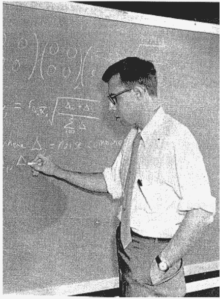

图 3.4
在康奈尔大学沉思中的弗兰克·罗森布拉特。他发明了感知器，这是深度学习网络的早期前身，具有一个用于将图像分类到类别中的简单学习算法。文章来源于纽约时报，1958年7月8日，来自联合国际电讯社的电讯报道。感知器机器预计在1959年完工时成本为10万美元，或按今日美元计算约为100万美元；1958年成本200万美元（即今日约2000万美元）的IBM 704计算机每秒可执行12,000次乘法，在当时速度极快。但更便宜得多的三星Galaxy S6手机每秒可执行340亿次操作，速度快上百万倍。照片由George Nagy提供。


#### 盒 3.1

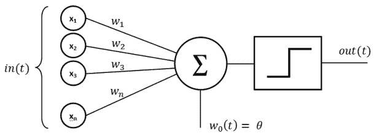

感知器是一种具有一个人工神经元的神经网络，包含一个输入层以及一组连接输入单元与输出单元的连接。感知器的目标是对呈现给输入单元的模式进行分类。输出单元执行的基本操作是将每个输入（x<sub>n</sub>）乘以其连接强度（即权重 w<sub>n</sub>）到输出单元的值求和。在上图中，输入的加权和（\(\Sigma_{i=1, ..., n} w_i x_i\)）与阈值 \(\theta\) 进行比较，并通过一个阶跃函数：如果总和大于阈值则输出 "1"，否则输出 "0"。例如，输入可以是图像中像素的强度，或者更一般地，从原始图像中提取的特征，例如图像中物体的轮廓。图像一次呈现一个，感知器决定图像是否属于某个类别，例如猫的类别。输出只能处于两种状态之一：如果图像属于该类别则为 "on"，否则为 "off"。"on" 和 "off" 分别对应二进制值 1 和 0。感知器学习算法是

```
\(\delta w_i = \alpha \delta x_i\)
\(\delta = output - teacher,\)
```

其中输出和教师信号都是二进制的，因此如果输出正确则 \(\delta = 0\)，如果输出不正确则 \(\delta = +1\) 或 -1，具体取决于差异。若为 1)，则权重会略微改变，这样下次给出相同输入时，就更接近得到正确答案（方框 3.1）。重要的是变化要逐渐发生，以便权重能感受到来自所有训练样本的拉力，而不仅仅是来自最后一个样本。

如果对感知器学习的解释不清楚，还有一个更整洁的几何方法来理解感知器如何学习对输入进行分类。对于两个输入的特殊情况，可以将输入绘制在二维图上。每个输入是图中的一个点，网络中的两个权重决定一条直线。学习的目标是移动直线，使其清晰地分隔正样本和负样本（图 3.5）。对于三个输入，输入空间是三维的，感知器指定一个分隔正样本和负样本训练集的平面。即使在一般情况下，当输入空间的维度可能非常高且无法可视化时，同样的原理也成立。

最终，如果存在解，权重将停止变化，这意味着感知器已正确分类训练集中的所有示例。但在所谓的“过拟合”中，也可能集中示例不足，网络只是简单地记忆了特定示例而无法泛化到新示例。为了避免过拟合，重要的是要有另一组示例，

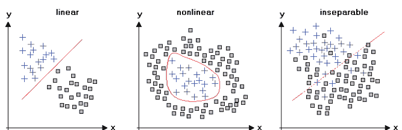

**图 3.5**

感知器如何区分两个物体类别的几何解释。物体具有两个特征，例如大小和亮度，它们具有值（x,y）并在每个图上绘制。左侧面板中的两种物体（加号和正方形）可以通过一条穿过它们之间的直线分隔；这种歧视可以由感知器学习。另外两个面板中的两种物体无法通过直线分隔，但中间面板中的物体可以通过一条曲线分隔。右侧面板中的物体需要进行选区重划才能分隔两种类型。如果有足够的训练数据，深度学习网络可以学习所有三个面板中的歧视。

称为“测试集”，它未用于训练网络。训练结束时，测试集上的分类性能是衡量感知器能多好地泛化到类别未知的新示例的真实指标。泛化是这里的关键概念。在现实生活中，我们永远不会以相同的方式看到同一个物体或遇到相同的情况，但如果我们能从以往经验泛化到新视图或情况，我们就可以处理广泛的现实世界问题。

#### SEXNET

作为感知器如何用于解决现实世界问题的示例，考虑你如何区分男性和女性面部，去除头发、珠宝和诸如喉结等次级性征（喉结在男性中通常较大）。Beatrice Golomb，1990 年在我实验室的博士后研究员，将她从一个数据库中获得的大学生面部作为输入，输入到一个被训练以 81% 的准确率分类面部性别的感知器中（图 3.6）。⁸ 感知器难以分类的面部对人类也难以分类，我实验室的成员在同一组面部上平均达到 88% 的性能。Beatrice 还训练了一个多层感知器（将在第 8 章中介绍），达到了 92% 的准确率，⁹ 优于我实验室的人员。在她于 1991 年神经信息处理系统（NIPS）会议上发表的演讲中，她得出结论：“由于经验能提高性能，这应该表明实验室的人员需要花更多时间来进行性别歧视。”她将她的多层感知器称为“SEXNET”。在问答环节，有人问 SEXNET 是否可用于检测变装者面部。“是的，”Beatrice 说，对此 NIPS 会议创始人 Ed Posner 反驳道：“那将是 DRAGNET。”¹⁰

图 3.6

这个面部是男性还是女性？一个感知器被训练以区分男性和女性面部。面部图像（顶部）中的像素乘以相应的权重（底部），然后将总和与阈值进行比较。每个权重的大小表现为像素的面积。正权重（白色）是男性的证据，负权重（黑色）支持女性。鼻子宽度、鼻子和嘴巴之间区域的大小以及眼部周围的图像强度对于区分男性很重要，而嘴巴和颧骨周围的图像强度对于区分女性很重要。引自 M. S. Gray, D. T. Lawrence, B. A. Golomb, 和 T. J. Sejnowski，“A Perceptron Reveals the Face of Sex,” Neural Computation 7 (1995): 1160–1164，图 1。

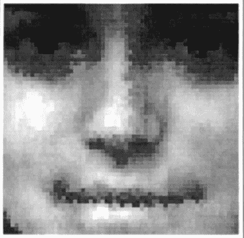
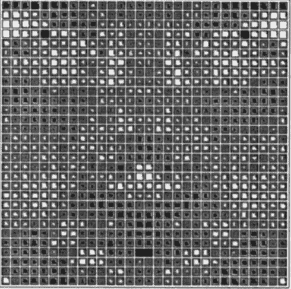

区分男性和女性面部之所以是一项有趣的任务，是因为虽然我们对此很擅长，但我们无法准确说明男性和女性面部之间的区别是什么。由于没有单一特征是决定性的，这种模式识别问题取决于结合大量低级特征的证据。感知器的优势在于，权重提供了关于面部哪些部分对性别最有信息量的线索（图 3.6）。惊人的是，人中（鼻子和嘴唇之间的空间）是最独特的特征，在大多数男性中明显更大。眼睛周围（男性更大）和上颊部（女性更大）的区域也对分类性别具有很高的信息价值。感知器权衡所有这些位置的证据来做出决定，我们也是如此，尽管我们可能无法描述自己是如何做到的。

Rosenblatt 于 1957 年证明的“感知器收敛定理”是一个突破，他的演示令人印象深刻。在海军研究局的支持下，他构建了一台定制硬件模拟计算机，拥有 400 个光电池作为输入，权重是由电机调节的可变电阻电位器。模拟信号随时间连续变化，就像黑胶唱片的信号一样。给定一组有坦克和没有坦克的图片，Rosenblatt 的感知器学会了即使在新图像中识别坦克。这被《纽约时报》报道并引起轰动（图 3.4）。¹¹

感知器启发了一项关于高维空间中模式分离的优美数学分析。当点生活在具有数千个维度的空间中时，我们无法依赖我们对三维空间中点之间距离的直觉。俄罗斯数学家 Vladimir Vapnik 基于此分析引入了一种分类器，称为“支持向量机”，¹² 它推广了感知器并在机器学习中广泛使用。他找到了一种方法来自动找到一个能最大程度分隔两个类别点的平面（图 3.5，线性）。这使得泛化对空间中点的测量误差更加稳健，并且当与“核技巧”（一种非线性扩展）相结合时，支持向量机算法已成为机器学习的支柱。¹³

#### 感知器黯然失色

但有一个限制使得感知器研究方向变得有问题。上面的警告，“如果存在这样一组权重”，引发了感知器能解决和不能解决哪些问题的疑问。


二维中尴尬地简单的点分布无法由感知器分离（图 3.5，非线性）。结果发现，坦克感知器不是坦克分类器，而是一天中的时间分类器。在图像中对坦克进行分类要困难得多；实际上，用感知器无法做到这一点。这也表明，即使感知器学到了某些东西，也可能不是你认为它学到的东西。对感知器的最终打击是 1969 年 Marvin Minsky 和 Seymour Papert 的杰出数学专著《感知器》。14 他们确凿的几何分析表明，感知器的能力是有限的：它们只能分离线性可分的类别（图 3.5）。他们的书封面展示了一个几何问题，Minsky 和 Papert 证明感知器无法解决（图 3.7）。虽然在书末，Minsky 和 Papert 考虑了将单层感知器推广到多层感知器的可能性，一层馈入下一层，但他们怀疑是否存在一种方法来训练这些更强大的感知器。不幸的是，许多人将这种怀疑视为定论，该领域被抛弃，直到 1980 年代新一代神经网络研究者重新审视了这个问题。

在感知器中，每个输入都向输出单元贡献独立的证据。但是，如果几个输入需要以某种方式组合，使决策取决于组合而不是每个输入单独作用，那该怎么办？这就是为什么感知器无法区分螺旋是否连通：单个像素不包含它在内部还是外部的信息。尽管在多层前馈网络中，输入和输出单元之间的中间层可以形成几个输入的组合，但在 1960 年代，没有人知道如何训练具有甚至一层这样的“隐藏单元”位于输入层和输出层之间的网络。

Frank Rosenblatt 和 Marvin Minsky 曾是纽约市布朗克斯科学高中的同学。他们在科学会议上辩论了各自在人工智能方面截然不同的方法，与会者倾向于 Minsky 的方法。但尽管存在分歧，两人都对我们理解感知器做出了重要贡献，而感知器是深度学习的起点。

Rosenblatt 于 1971 年在一次船坞事故中去世，时年 43 岁，当时对感知器的反弹正盛，有传言称他可能自杀，或者是一次悲惨的出游出了问题？15 变得清楚的是，利用神经网络发现一种新的计算方式的英雄时期正在结束；在 Rosenblatt 开拓性努力的承诺实现之前，将过去一代人。

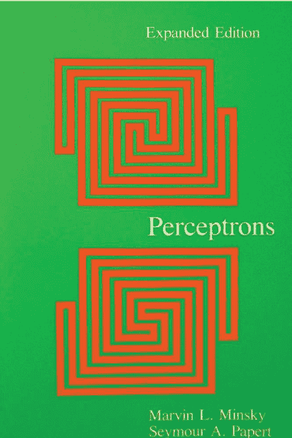

**图 3.7**

《感知器》扩增版的封面。两条红色的螺旋看起来相同但实际上不同。上面的是两条不连通的螺旋，下面的是一条连通的螺旋，你可以用铅笔描画环路内部来验证这一点。Minsky 和 Papert 证明感知器无法区分这两个对象。你不描画就能看出区别吗？为什么不行？

### 4 脑式计算

“如果我有脑子”是稻草人在经典 1939 年音乐电影《绿野仙踪》中演唱的一首歌。稻草人不知道的是，他本来就有脑子，没有脑子几乎无法说话或唱歌，但这个脑子只有两天大，他真正的问题是缺乏经验。随着时间的推移，他了解了世界，并最终被公认为奥兹国最睿智的人，睿智到足以认识自己的局限性。相比之下，铁皮人唱了“如果我有颗心”。他和稻草人辩论了哪个更重要，是有脑子还是有心。在奥兹国，以及在现实世界中，认知和情感——这两者都是大脑的产物——与学习一起，在创造人类智能的微妙平衡中协同工作。借鉴这部经典音乐剧，本章的主题是“如果 AI 既有脑子又有心”。

#### 大脑如何工作

Geoffrey Hinton（图 4.1）和我于 1979 年在 Geoffrey 组织的研讨会上相遇时，对神经网络模型的前景持有相似的看法。我们很快成为好朋友，后来共同发现了一种名为“玻尔兹曼机”的新型神经网络模型（将在第 7 章讨论），这一模型打破了阻碍多层网络模型学习长达一代人的僵局。

每隔几年，我就会接到 Geoffrey 的电话，电话总是以“我发现大脑是如何工作的”开头。每次，他都会告诉他一个改进神经网络模型的巧妙新方案。经过许多这样的方案和改进，多层神经网络中的深度学习才在手机语音识别和照片中物体识别方面达到与人类相当的性能水平。公众只是在几年前才意识到这些能力；现在它们广为人知，但来之不易。

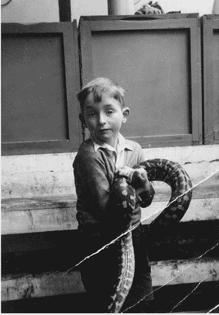

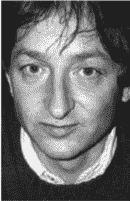

图 4.1
(A) Geoffrey Everest Hinton 职业生涯早期。他的中间名来自一位亲戚 George Everest，后者测量了印度，并想出了如何测量世界最高峰（如今以他命名）高度的方法。（B）1994 年的 Hinton。这两张照片相隔十五年拍摄。照片由 Geoffrey Hinton 提供。

Geoffrey 在剑桥大学获得心理学本科学位，并在爱丁堡大学获得人工智能博士学位。他的导师是 Christopher Longuet-Higgins，一位杰出的化学家，他发明了一种早期的联想记忆网络模型。当时，人工智能的主导范式基于编写使用符号、逻辑和规则来编码智能行为的程序；认知心理学家已采用这种方法来理解人类认知，尤其是语言。Geoffrey 逆流而上。没有人能预测他有一天会弄清楚大脑——或者至少类似大脑的东西——是如何工作的。他的讲座引人入胜，他能以清晰的方式解释抽象的数学概念，几乎不需要数学基础就能理解。他的机智和自谦幽默很有魅力。Geoffrey 天生竞争意识很强，尤其是在大脑方面。

我们第一次见面时，Geoffrey 是加州大学圣地亚哥分校（UCSD）由 David Rumelhart 和 James McClelland 领导的并行分布式处理（PDP）小组的博士后研究员。Geoffrey 相信，由简单处理单元组成的网络，并行协作并从示例中学习，是理解认知的更好方式。他是 PDP 小组的核心人物，该小组正在探讨如何将词语和语言理解为网络中大量节点上活动的扩散。

认知科学中关于语言的传统方法基于符号表示。例如，“cup”一词是一个符号，代表杯子的概念，不仅仅是某个杯子，而是所有杯子。符号的优点在于它们允许我们压缩复杂的想法并对其进行操纵；符号的问题在于它们被压缩得太过紧凑，以至于难以将它们与现实世界联系起来，在现实世界中，杯子有着无穷无尽的形状、尺寸和大小。没有逻辑程序能指定什么是杯子、什么不是杯子，或者能识别图像中的杯子，尽管我们大多数人看到杯子时都能非常好地认出它。正义与和平等抽象概念，逻辑程序更难界定。一种替代方案是用非常大的一群神经元上的活动模式来表示杯子，这可以捕捉概念之间的相似性和差异性。这赋予符号一个反映其含义的丰富内部结构。问题是，在 1980 年，没有人知道如何创建这些内部表示。

Geoffrey 和我并不是 1980 年代唯一相信网络模型有潜力模仿智能行为的人。世界各地的许多研究者，大多在孤立中孜孜以求，都持有我们的信念，并继续开发专门的网络模型。例如，Christoph von der Malsburg 开发了一种基于连接发射尖峰¹的人工神经元的模式识别模型，并后来证明这种方法可以识别图像中的人脸。² 另外，大阪大学的 Kunihiko Fukushima 发明了 Neocognitron，³ 这是一种基于视觉系统架构的多层网络模型，使用卷积滤波器和一种简单的 Hebbian 塑性，是深度学习网络的直接前身。还有，第三位，赫尔辛基大学的电气工程师 Teuvo Kohonen 开发了一种自组织网络，它可以学习将相似输入聚类到二维地图中，


表示不同的语音声音，例如，通过映射中的不同处理单元，相似的输入激活输出空间的相邻区域。⁴ Kohonen网络模型的一大优势是它不需要为每个输入提供类别标签（为监督网络生成标签进行训练成本高昂）。Kohonen只有箭囊里的一支箭，但这是一支非常精妙的箭。

在系统化概率网络的早期尝试中，加州大学洛杉矶分校（UCLA）的Judea Pearl引入了信念网络，将网络中的项目与概率关联起来，例如草地是因为喷水器打开而湿，还是因为下雨而湿的概率。⁵ 尽管Pearl的网络模型是跟踪世界因果关系的一个强大框架，但手动分配所有所需的概率被证明是不切实际的。需要一种突破，通过学习算法自动找到概率（将在第II部分讨论）。

这些以及其他基于网络的模型都有一个共同的致命缺陷：它们没有一个能够很好地解决现实世界中的问题。此外，开发它们的先驱很少相互合作，使得进展更加困难。结果，MIT、斯坦福和卡内基梅隆等领先的人工智能研究中心很少有人认真对待神经网络。基于规则的符号处理获得了大部分资金——并创造了大部分工作岗位。

#### 早期先驱

1979年，Geoffrey Hinton和布朗大学心理学家James Anderson在加利福尼亚州拉霍亚举办了联想记忆平行模型研讨会。⁶ 大多数与会者是第一次见面。作为哈佛医学院神经生物学博士后研究员，我只在一些不太知名的期刊上发表过几篇关于神经网络的高度技术性论文，因此对受邀参加研讨会感到惊讶。Geoffrey后来告诉我，他曾与David Marr（图4.2，中间）一起审核过我的情况，Marr是神经网络建模领域的巨擘，也是MIT人工智能实验室的领军人物。我最初在1976年于怀俄明州杰克逊霍尔的一个小型研讨会上遇到了Marr。我们兴趣相似，他邀请我去看他并在MIT做一次演讲。

Marr在剑桥大学获得数学学士学位和生理学博士学位。他的博士导师是Giles Brindley，一位专注于视网膜和色觉的生理学家，但也以其在音乐学和勃起功能障碍治疗方面的工作而闻名。他在内华达州拉斯维加斯美国泌尿协会会议上发表演讲时，曾著名地脱下裤子，以展示化学诱导勃起的有效性。Marr的博士论文描述了小脑中学习的神经网络模型，小脑是大脑中参与快速运动控制的一部分。他还开发了海马体和大脑皮层的神经网络模型，这些模型在晦涩的论文中被描述，并已被证明是预见性的。⁷

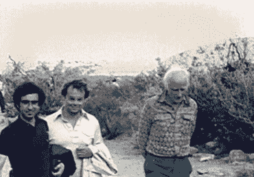

图4.2
（从左到右）Tomaso Poggio、David Marr和Francis Crick于1974年在加利福尼亚州徒步旅行。Francis喜欢与访客就许多科学问题进行长时间讨论。图片由索尔克生物研究学院提供。

当我第一次在杰克逊霍尔见到Marr时，他已经搬到了MIT，在那里他从事视觉研究，并且作为一位有魅力的人物，他吸引了有才华的学生与他合作。他采用自下而上的策略，从视网膜开始，视网膜是光转换为电信号的地方，并询问视网膜中的信号如何编码物体的特征，以及视觉皮层如何表示物体的表面和边界。他与Tomaso Poggio（图4.2，左侧）开发了一种巧妙的用于立体视觉的反馈连接循环神经网络模型，以检测随机点立体图中两只眼睛的点图像轻微横向位移所对应的物体深度。⁸ 双眼深度感知是Magic Eye图像“跳出来”的基础。⁹

Marr于1980年死于白血病，享年35岁，两年后他当时正在撰写的著作《视觉》遗稿出版。¹⁰ 具有讽刺意味的是，尽管Marr在视觉研究中采取了自下而上的方法，从视网膜开始并建模视觉处理的每一个后续阶段，但他的书最著名的是倡导自上而下的策略：从对要解决的问题进行计算分析开始，接着构建解决问题的算法，最后将算法实现在硬件中。但是，即使这可能是在你弄清楚事情之后解释事物的好方法，也不是发现大脑中发生了什么的好方法。难点在于第一步，即确定大脑在解决什么问题。我们的直觉往往具有误导性，特别是在视觉方面；我们在视觉方面非常出色，但大脑向我们隐藏了所有细节。结果，纯粹的自上而下策略有缺陷，纯粹的自下而上策略也是如此。（后续章节将探讨如何通过学习算法从内到外理解视觉所取得的进展。）

同样参加Hinton和Anderson在拉霍亚研讨会的还有Francis Crick（图4.2，右侧），他于1953年与James Watson在剑桥大学共同发现了DNA的结构。在他发现数十年后，即1977年，Crick搬到了拉霍亚的索尔克生物研究学院，并将研究重点转向神经科学。他会邀请研究人员去拜访他，就神经科学的许多话题（尤其是视觉）进行长时间讨论，而David Marr就是其中一位访客。在Marr的书末尾，有一个以苏格拉底对话形式呈现的发人深省的讨论，我后来得知这个对话源于Marr与Crick的讨论。1989年搬到索尔克学院后，我也逐渐体会到与Crick对话的价值。

#### George Boole与机器学习

1854年，一位自学成才的英国中学教师，他有五个女儿，其中一些女儿有数学天赋，写了一本名为《思维定律的探究》的书，这是如今被称为“布尔逻辑”的数学基础。George Boole关于如何处理逻辑表达式的见解是数字计算的核心，也是20世纪50年代人工智能早期努力的自然起点。Geoffrey Hinton碰巧是Boole的曾外曾孙，他很自豪地拥有Boole曾使用过的钢笔，该钢笔在家族中代代相传。

在准备一次演讲时，我发现Boole那本著名的书全名是《思维定律的探究：逻辑与概率数学理论的基础》（图4.3）。虽然《探究》最因其对逻辑的见解而被铭记，但它也有很多关于概率理论的论述，概率理论是现代机器学习的核心，并能比逻辑更好地描述现实世界中的不确定性。因此，Boole也是机器学习之父之一。多么讽刺啊，他思想中一个被遗忘的侧面，竟在250年后通过他的曾外曾孙而绽放光彩。Boole一定会为他感到骄傲。

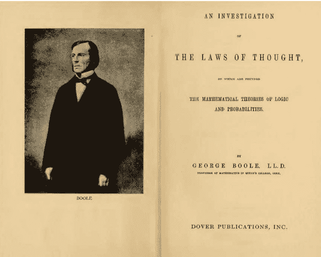

图4.3 尽管George Boole的《思维定律》因探究作为思维基础的逻辑而闻名，但请注意，它也关于概率。这两个数学领域分别启发了符号处理和机器学习的人工智能方法。

#### 蛋墩墩项目

作为普林斯顿大学物理系的研究生，我通过为非线性相互作用神经元网络列出方程并对其进行分析来研究理解大脑的问题，11 这很像物理学家几个世纪以来使用数学来理解重力、光、电、磁和核力的性质。每晚睡前，我都会祈祷：“亲爱的上帝，让方程为线性，噪声为高斯，变量可分离。”这些条件会导出解析解，但由于神经网络方程最终是非线性的，相关噪声是非高斯的，变量也不可分离，因此它们没有显式解。此外，当时在计算机上模拟这些方程对于大型网络来说慢得无法忍受；更令人沮丧的是，我根本不知道自己列出的方程是否正确。


在普林斯顿上课时，我发现神经科学家们正在取得令人兴奋的进展，这门相对年轻的学科成立于四十五年前。在此之前，大脑研究分布在许多学科中：生物学、心理学、解剖学、生理学、药理学、神经学、精神病学、生物工程以及许多其他学科。1971 年神经科学学会第一次会议上，弗农·芒特卡斯尔亲自在门口迎接每一位与会者。12 如今，该学会拥有超过 40,000 名会员，每年有 30,000 人参加年会。1982 年，我应聘到约翰斯·霍普金斯大学生物物理系担任第一份工作时，结识了这位传奇的神经生理学家——他发现了皮层柱，性格强势。13 我后来与芒特卡斯尔紧密合作，规划约翰斯·霍普金斯大学的心智/大脑研究所，这是世界上第一个此类研究所，成立于 1994 年。

大脑中有许多不同的研究层次（图 4.4），每个层次都取得了重要发现；整合所有这些知识是一个艰巨的问题。这让人想起“汉普蒂·丹普蒂”儿歌：

> 汉普蒂·丹普蒂坐在墙上，
> 汉普蒂·丹普蒂摔了个大跟头。
> 国王的所有马匹和国王的所有士兵
> 都无法把汉普蒂·丹普蒂重新拼好。

虽然神经科学家非常擅长解剖大脑，但将各部分重新组合在一起是一个更困难的问题，这需要综合而非还原，而这正是我想要做的。但首先，我必须知道各部分是什么，而大脑有很多部分。

在普林斯顿大学由查尔斯·格罗斯（一位研究猴子视觉系统的心理学家）讲授的研究生研讨会上，我对大卫·休贝尔和托斯滕·威塞尔在哈佛医学院记录视觉皮层单个神经元所取得的进展印象深刻。如果物理学不是理解大脑如何运作的皇道，那么神经科学或许就是。休贝尔和威塞尔因其在初级视觉皮层的开创性工作，将于 1981 年获得诺贝尔生理学或医学奖。（他们的发现将在第 5 章讨论，是深度学习的基础，深度学习是第 9 章的主题。）

#### 在伍兹霍尔学到的东西

1978 年在普林斯顿完成物理学博士学位后，我参加了在伍兹霍尔举办的为期十周的深入实验神经生物学暑期课程，在

#### 大脑的研究层次

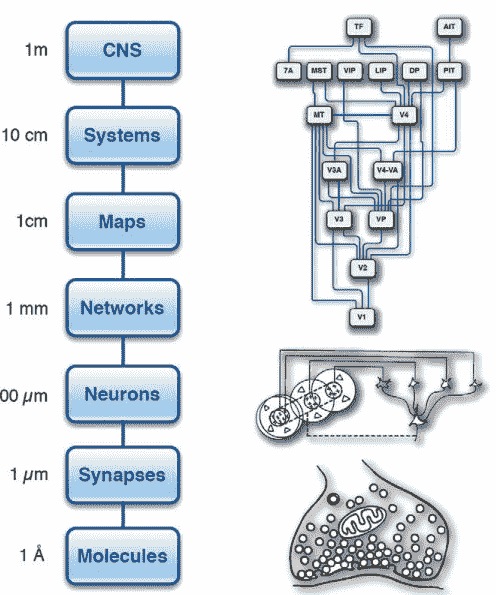

图 4.4
大脑的研究层次。（左）空间尺度从底部的分子层次一直到顶部的整个中枢神经系统（CNS）。每个层次都已知很多，但最不为人理解的是网络层次，即由大量高度互联的神经元组成的小群体——这是人工神经网络所模拟的层次。（右）突触（底部）、视觉皮层简单细胞（中部）以及视觉皮层区域层次结构（顶部）的图标。改编自 P. S. Churchland 和 T. J. Sejnowski，“认知神经科学视角”，《科学》，242 (1988): 741–745，图 1。

伍兹霍尔海洋生物实验室。我穿着休闲的蓝色运动外套和挺括的卡其裤，在课程第一天到达，却被课程讲师之一的斯托里·兰迪斯带到一边，她给我买了第一条牛仔裤。当时，斯托里·兰迪斯在哈佛大学神经生物学系任教，后来成为美国国立卫生研究院下属国家神经系统疾病和中风研究所所长。她至今仍提起这件事。

夏季课程结束后，我在九月又待了几周，完成一个已经开始的项目。鲨鱼和鳐鱼（包括鳐）能够感知非常微弱的电场；事实上，它们甚至能探测到横跨大西洋的 1.5 伏电池信号。凭借这种“第六感”，鳐鱼可以通过穿过地球磁场运动产生的微弱电信号来导航，这些信号会在它们的电感受器中产生微伏信号。我的项目拍摄到了鳐鱼电感受器的精彩电子显微镜图像。14

我在伍兹霍尔的勒布大厦地下室拍照时，接到了斯蒂芬·克夫勒的意外来电，他创立了哈佛医学院的神经生物学系。克夫勒是神经科学界的传奇人物，能够获得与他在实验室合作的博士后职位，这改变了我的一生。在与艾伦·格尔佩林完成关于花园蛞蝓 Limax maximus 足节神经节代谢活动图谱的短期博士后研究后，我搬到了波士顿。15 此后，我再也无法安心吃蜗牛了，因为青蛙交感神经节（图 4.5）中的一个突触比同一神经元上另一个突触的快速毫秒级兴奋反应慢了 60,000 倍。17 这些神经节包含构成牛蛙自主神经系统输出的神经元，该系统调节腺体和内脏器官。刺激通向突触的神经后，我可以去咖啡壶那里再走回来，而突触输入到达神经元峰值大约需要 1 分钟，恢复则需要 10 分钟。突触是大脑中基本的计算元素，突触类型的多样性意义深远。这次经历让我明白

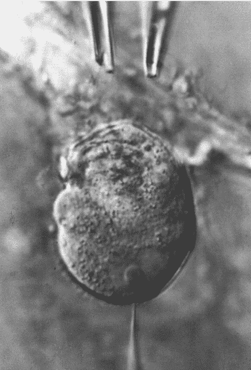

图 4.5
牛蛙交感神经节细胞。作为神经元，这些细胞接收来自脊髓的输入并支配牛蛙皮肤中的腺体。它们体积较大，其电信号易于用微电极记录（底部）。它们没有树突，可以通过神经（顶部，背景）或化学物质（顶部，一对微量吸管）进行电刺激。刺激神经会引发三种不同的突触信号：快速的毫秒级兴奋反应，类似于神经肌肉接头处的反应；一种峰值出现在 10 秒并持续 1 分钟的较慢兴奋反应；以及一种峰值出现在 1 分钟并持续 10 分钟的迟缓慢兴奋反应。这说明即使在最简单的神经元中，也存在广泛的时间尺度。选自 S. W. 克夫勒和 T. J. 塞杰诺夫斯基，“两栖动物交感突触的肽能和毒蕈碱兴奋”，《生理学杂志》341 (1983): 257–278，图版 I。

复杂性可能不是理解大脑功能的皇道。要理解大脑，我必须明白大自然通过进化很久以前就解决了大量问题，并将这些解决方案沿着进化阶梯从一个物种传递到另一个物种。我们大脑中有数十亿年前在细菌中首次进化出来的离子通道。

#### 缺失的环节

但如果物理学过于简单而生物学过于复杂，我应该向谁寻求指导呢？与物理学中的力不同，大脑电路有其目的，即为了在世界中生存而解决计算问题，如视觉和运动。即使是对神经元工作原理的完美物理模型，也无法告诉我们它的目的是什么。神经元的工作是处理承载信息的信号，而计算曾是


图 4.6 1980 年，特里·塞杰诺夫斯基和杰弗里·辛顿在波士顿讨论视觉网络模型。这是杰弗里和我在拉霍亚联想记忆并联模型研讨会上相遇的一年后，也是我在巴尔的摩约翰斯·霍普金斯大学建立实验室、杰弗里在匹兹堡卡内基梅隆大学建立研究小组的一年前。图片由杰弗里·辛顿提供。

在试图理解自然的过程中，计算是缺失的环节。过去四十年来，我一直在追求这一目标，开创了一门称为“计算神经科学”的新领域。

在 UCSD 完成博士后研究后，杰弗里·辛顿返回英国，在剑桥的医学研究委员会（MRC）应用心理学部担任研究职位。1981 年的一天，凌晨 2:00，他接到一个自称是加州帕洛奥托系统发展基金会主席查尔斯·史密斯的人的电话。18 史密斯说，他的基金会想资助那些潜在有前景但风险高、不太可能成功的研究，而杰弗里被高度推荐给他。杰弗里不确定这是否是真的。作为一位好朋友，杰弗里向史密斯提到了我的研究，并说这比他自己的研究更不可能成功。

该基金会确实存在，并向我们提供了第一笔资助，这大大加快了我们的研究进度。我们现在买得起更快的计算机，并支付与我们合作的学生的薪水了。杰弗里搬到匹兹堡的卡内基梅隆大学时，用一台花哨的 Lisp 机器19 取代了他的 Apple II；我搬到巴尔的摩的约翰斯·霍普金斯大学时，计算能力一度超过整个计算机科学系。20 我还能买到第一台调制解调器，将霍普金斯大学连接到 ARPANET（互联网的前身），以便杰弗里和我可以互相发送电子邮件。当我们踏上新的方向（图 4.6）时，我们再也无法要求更好的职业生涯开端了。多年来，我很幸运地获得海军研究办公室的资助，该办公室也支持了弗兰克·罗森布拉特和许多其他神经网络研究者。


#### 视觉系统的 5 条洞见

我最早的记忆之一，在上幼儿园之前，就是俯身拼图，利用形状、颜色和语境作为线索来匹配拼图碎片。我的父母常在聚会上让朋友们惊叹，他们年幼的儿子能多么快速地拼好拼图。我当时并不知道，但我的大脑正在做大脑最擅长的事——利用模式识别解决问题。科学充满了如同拼图般的问题，缺少一些碎片，对底层图景也只有模糊的提示。大脑如何解决问题是终极谜题。

赫尔姆霍兹俱乐部是南加州的一个小型视觉科学家团队，成员来自加州大学圣地亚哥分校、洛杉矶分校和欧文分校，以及加州理工学院和南加州大学，他们每月在欧文分校的下午聚会。¹ 赫尔曼·冯·亥姆霍兹是十九世纪的物理学家和医生，他发展了一种关于视觉的数学理论和实验方法，构成了我们当前视觉感知理解的基础。作为俱乐部的秘书，由我负责招募一位外部演讲者，向大约十五到二十名会员及其客人做报告。之后由俱乐部一位成员进行第二场报告。报告具有互动性，留有充足时间进行深入讨论。一位外部演讲者对提问者表示惊讶：“他们居然真的想知道答案。”对所有参加者来说，这些每月的会议都是智力上的高点，堪称视觉领域的大师课。²

视觉是我们最敏锐的感觉，也是研究最深入的感觉。凭借两只前置的眼睛，我们拥有精细的双眼深度知觉，且大脑皮层有一半与视觉有关。视觉的特殊地位由谚语“眼见为实”所体现。具有讽刺意味的是，我们能看得如此之好，反而让我们对视觉问题巨大的计算复杂性视而不见——这一问题经由自然在数亿年的进化中得以解决（如第 2 章所述）。视觉皮层的组织结构为最成功的深度学习网络提供了灵感。

在十分之一秒内，我们视觉皮层中一百亿个神经元协同并行工作，能在杂乱场景中识别出一个杯子，即使我们以前从未见过那个特定的杯子，即使它可能位于任何位置、任何大小，相对于我们处于任何方向。作为普林斯顿大学的研究生，我对视觉着迷，并在查尔斯·格罗斯的实验室工作了一个夏天，他研究猴子的下颞皮层（图 5.1），在那里他发现了对复杂物体（如面孔，以及著名的马桶刷）有反应的神经元。³

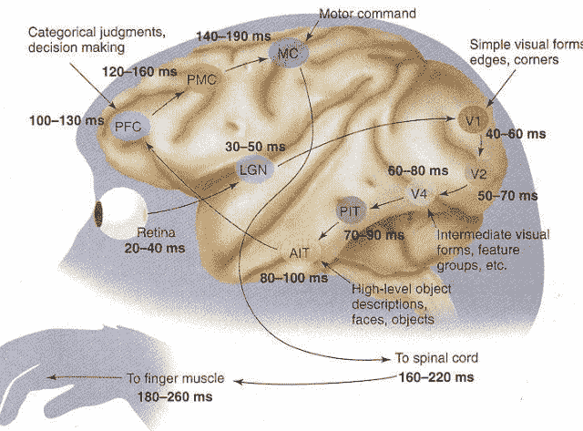

**图 5.1**
食蟹猴视觉系统信息流的示意图。箭头表示视觉区域之间的投射，起始于视网膜，以毫秒为单位的延迟出现在视觉处理的每个阶段。食蟹猴的视觉感知与我们类似，我们拥有相同的视觉处理阶段。LGN：外侧膝状体；V1：初级视觉皮层；V2：次级视觉皮层；V4：视觉区 4；AIT 和 PIT：前下颞皮层和后下颞皮层；PFC：前额叶皮层；PMC：前运动皮层；MC：运动皮层。源自 S. J. Thorpe 和 M. Fabre-Thorpe，“Seeking Categories in the Brain，”*科学* 291，第 5502 期（2001）：261。

在哈佛医学院神经生物学系期间，我与斯蒂芬·克夫勒合作，他早前发现了视网膜神经节细胞如何编码视觉场景，并且如果他没有在前一年去世，他很可能会与大卫·休贝尔和托斯滕·威塞尔一起，因在视网膜方面的发现而于 1981 年获得诺贝尔生理学或医学奖。1989 年移居索尔克研究所后，我与弗朗西斯·克里克合作，他于 1977 年将研究重点从分子遗传学转移到神经科学，并致力于寻找视觉意识的神经相关性。因此，能与那个时代最伟大的视觉科学家为伍，是我的荣幸。

##### 从下至上的视觉

如果我们跟随图像产生的信号进入大脑，就能看到它如何在一个处理阶段到下一个阶段的过程中一遍又一遍地转变（图 5.1）。视觉始于视网膜，在那里，光感受器将光转化为电信号。视网膜中有两层神经元在空间和时间上处理视觉信号，最终以投射到视神经的神经节细胞结束。

在经典的 1953 年实验中，其结果对所有哺乳动物均适用，斯蒂芬·克夫勒（图 5.2，左侧）记录了一只活猫视网膜输出神经元的电活动，同时刺激它们对光斑产生尖峰放电。他报告称，一些输出神经元在中心区域的光斑亮起时有反应，而另一些则在光斑熄灭时有反应。但是，在中心区域之外，周围的环状区域具有相反的极性：中心兴奋—周围抑制和中心抑制—周围兴奋（图 5.3）。神经节细胞对光模式的反应被称为“感受野”特性。

我曾问克夫勒，他的主要科学兴趣在于神经元之间突触的特性，是什么促使他研究视网膜。他说，由于他当时在约翰斯·霍普金斯大学的实验室位于威尔默眼科研究所，他觉得自己不研究眼睛感到内疚。作为视网膜单个神经节细胞研究的先驱，他将项目交给了实验室中的两位博士后研究员，大卫·休贝尔和托斯滕·威塞尔（图 5.2，右侧和中间），并建议他们追踪信号进入大脑。1966 年，克夫勒和他的博士后研究员移居哈佛医学院，成立了新的神经生物学系。

##### 大脑皮层中的视觉

休贝尔和威塞尔发现，皮层神经元对有方向的光条和对比度边缘的反应远优于光斑。皮层中的电路已经变换了输入信号。他们描述了

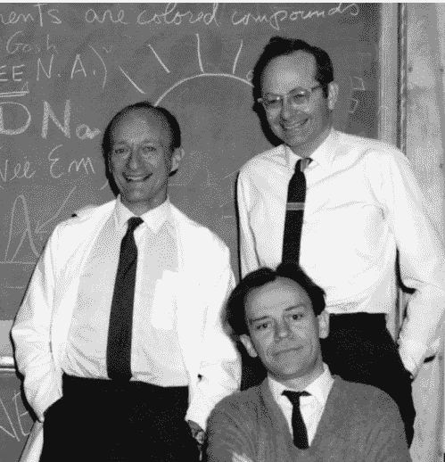

图 5.2（从左到右）斯蒂芬·克夫勒、托斯滕·威塞尔和大卫·休贝尔。哈佛医学院神经生物学系成立于 1966 年，这张照片拍摄于早期。我在工作日从未见过他们中任何人在实验室里戴领带，因此这必定是一个特殊场合。哈佛医学院提供。

两种主要类型的细胞：有方向的简单细胞，它像神经节细胞一样具有开区域和关区域（图 5.4）；以及有方向的复杂细胞，它对神经元感受野中任何位置的有方向刺激均匀反应（图 5.5）。

视觉皮层中的每个皮层神经元都可以视为视觉特征检测器，只有在接收到其特定视野区域中偏好特征的高于某个阈值的输入时才会被激活。每个神经元偏好的特征由其与其他神经元的连接决定。哺乳动物的新皮层有六个专门层。休贝尔和威塞尔还发现，两只眼睛的输入在皮层中层（第 4 层）以交替的左右柱状组织，来自丘脑中继站的输入投射至此。第 4 层的单眼神经元投射到接收双眼输入的上层（第 2 层和第 3 层）的神经元，这些神经元又投射到上游的其他皮层区域，以及下游的底层（第 5 层和第 6 层），这些底层

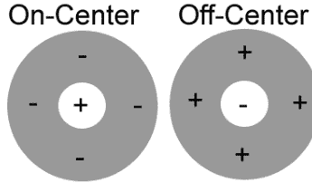

图 5.3
视网膜神经节细胞的反应特性。这两个甜甜圈代表了视网膜中两种神经节细胞的反应，它们向大脑发送编码信息，使你能够看见。对于中心兴奋型，中心区域的光斑亮起（+）和中心周围环状区域的光斑熄灭（-）会产生一串尖峰。相反，对于中心抑制型，中心区域的光斑熄灭（-）和中心周围环状区域的光斑亮起（+）会产生一串尖峰。照度变化携带关于移动刺激和物体周围对比度边界的重要信息。这些特性由斯蒂芬·克夫勒于 1953 年发现。

投射到皮层下。柱中每个细胞的偏好方位和眼优先性相同，并在皮层上平滑变化（图 5.6）。

##### 突触可塑性

如果猫在出生头几个月内有一只眼睛被闭合，通常由两只眼睛驱动的皮层神经元会变为单眼，仅由睁开的眼睛驱动。⁴ 单眼剥夺会导致初级皮层中突触强度的变化，在该区域，神经元的输入首次来自两只眼睛的汇聚输入。初级视觉皮层皮层可塑性的关键期结束后，闭合的眼睛不再能影响皮层神经元，导致一种称为“弱视”的状况。虽然未经矫正的错眼或“斜视”（在婴儿中很常见）会大大减少双眼皮层神经元的数量并阻碍双眼深度知觉，⁵ 但在关键期内及时进行手术矫正眼睛位置可以挽救双眼神经元。

单眼剥夺是发育早期高度可塑性的一个例子，在发育早期，环境塑造了大脑皮层和其他部分神经元之间的突触连接。这些活动依赖性的变化是在持续的


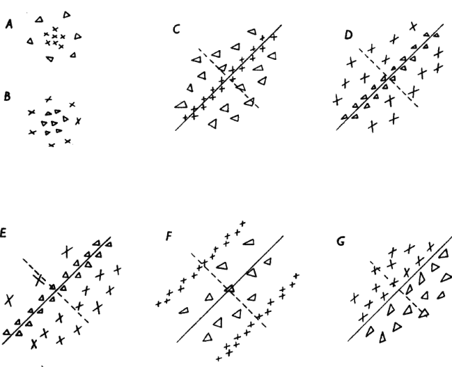

图 5.4 猫初级视觉皮层中简单细胞的感受野。本图来自 Hubel 和 Wiesel 于 1962 年发现简单细胞的论文。三角形表示视野中光点出现时产生 on-响应 的位置，叉形表示光点消失时产生 off-响应 的位置。（A）视网膜中的 On-中心细胞（与图 5.3 左侧对比）。（B）视网膜中的 Off-中心细胞（与图 5.3 右侧对比）。（C–G）初级视觉皮层中各种简单细胞感受野，与视网膜的感受野相比均呈长条状，并且 on-区域和 off-区域的排列更为复杂。引自 D. H. Hubel 和 T. N. Wiesel, "Receptive Fields, Binocular Interaction and Functional Architecture in the Cat's Visual Cortex," Journal of Physiology 160, no. 1 (1962): 106–154, figure 2.

所有细胞中发生的更新。尽管我们大脑中大多数神经元与出生时拥有的相同，6 但这些神经元及其连接的几乎所有成分和突触每天都会更替。蛋白质在磨损后被替换，膜中的脂质也会更新。由于存在如此动态的更新，我们的记忆如何在终身保持仍是个谜。

对记忆明显持久性的另一种可能解释是：它们可能像我们身体上的疤痕，作为我们一生中过去事件的标记而保留下来。寻找这些标记的地方不在于神经元内部（那里不断更新），而在于神经元之间的空间，在那里，由类似于疤痕组织中胶原蛋白的糖蛋白组成的细胞外基质是一种坚韧的、可保存多年的材料。7 如果这一猜想有朝一日被证明为真，它意味着我们的长期记忆嵌入在大脑的“外骨骼”中，而我们一直在错误的地方寻找它们。8

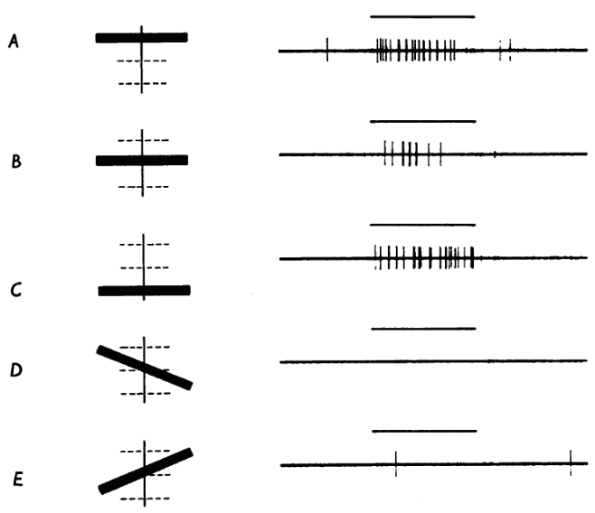

图 5.5 猫初级视觉皮层中复杂细胞的反应。本图来自 Hubel 和 Wiesel 于 1962 年发现复杂细胞的论文。一条长而窄的黑色条形，只要放在复杂细胞感受野（虚线所示）内的任何位置且方向正确，就会引发一阵尖峰（垂直刻线）（上方三条记录）。非最佳方向会产生较弱的反应或根本没有反应（下方两条记录）。引自 D. H. Hubel 和 T. N. Wiesel, “Receptive Fields, Binocular Interaction and Functional Architecture in The Cat’s Visual Cortex,” Journal of Physiology 160, no. 1 (1962): 106–154, figure 7.

突触包含数百种独特的蛋白质，用于控制神经递质的释放以及接收神经元上受体的激活。在大多数情况下，突触强度可以在一个宽范围内被选择性地增加或减少，在皮层中，这一范围是 100 倍。（脑中已发现的突触学习算法的示例将在后续章节中讨论。）更为显著的是，皮层中不断形成新的突触并移除旧的突触，使它们成为体内最动态的细胞器之一。大脑中大约有 100 种不同类型的突触，其中谷氨酸是皮层中最常见的兴奋性神经递质，另一种氨基酸 γ-氨基丁酸（GABA）则是最常见的抑制性递质。这些神经递质分子对其他神经元产生的电化学影响也有广泛的时间过程。例如，第 4 章讨论的牛蛙交感神经节细胞具有时间尺度从毫秒到分钟的突触。

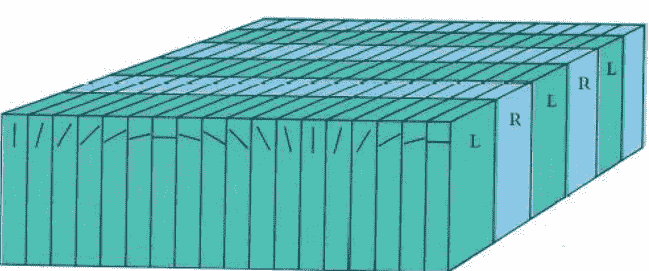

图 5.6 初级视觉皮层中神经元柱的冰块模型。在垂直微电极插入记录中，所有神经元都具有相同的方向偏好和眼优势。皮层每平方毫米下方都有一套完整的方向，它们在皮层表面上缓慢变化（立方体正面），以及来自双眼的输入（立方体右侧）。引自 D. Hubel, Eye, Brain and Vision (New York: W. H. Freeman and Company, 1988), 131.

#### 由阴影构建形状

Steven Zucker（图 5.7），其研究重点是计算机视觉与生物视觉的融合，自从我认识他以来（已有三十多年），他一直在撰写一本解释视觉如何运作的书籍。问题是，Steve 不断发现关于视觉的新事物，就像 Laurence Sterne 小说主角 Tristram Shandy 的情况一样，他发现得越多，书的结尾就越遥远。他对视觉的方法基于初级视觉皮层（图 5.6）那精妙的规则结构，这种结构在皮层其他地方找不到，那里的神经元以近乎马赛克式的排列方式组织，渴望得到几何诠释。大多数计算机视觉研究人员希望通过将物体与背景分割并识别少量诊断特征来识别物体。

Steve 更有雄心，他想了解我们如何从表面阴影以及皱褶和褶皱的明显迹象中提取物体的形状。在 2006 年神经科学学会年会的一次采访中，设计看起来像船帆的建筑的建筑师 Frank Gehry（图 5.8）被问及他如何为建筑获取灵感。他回答说，他的灵感来自观察揉皱纸张的形状。但我们的视觉系统如何从褶皱和阴影表面的复杂图案中拼凑出揉皱纸张的复杂形状呢？

我们如何感知毕尔巴鄂古根海姆博物馆（图 5.8）表面不断变化的形状？

Steve Zucker 最近能够解释我们如何在阴影图像中看到褶皱，这基于山脉等高线图上表面三维轮廓与图像中恒强度轮廓（图 5.9）之间的紧密关系。10 这种联系由表面的几何学提供。11 这解释了为什么我们对形状的感知对物体光照和表面特性的差异如此不敏感的谜团。它也可能解释为什么我们如此擅长阅读等高线图（其中轮廓被明确标出），以及为什么我们只需要几条特殊的内部线条就能看到漫画中物体的形状。

1988 年，Sidney Lehky 和我曾询问是否可以训练一个具有一层隐藏单元的神经网络来计算阴影表面的曲率。12 我们成功了，令我们惊讶的是，隐藏单元的行为类似于简单细胞。但经过更仔细的检查，我们发现并非所有这些“简单细胞”都完全相同。通过查看它们到输出层的投影（该层使用学习算法训练以计算曲率，在第 8 章中讨论），我们发现一些隐藏单元被用来决定正曲率（膨胀）和负曲率（碗状；图 5.10）。像某些简单细胞一样，这些单元

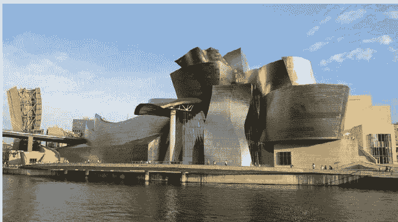

图 5.8
西班牙毕尔巴鄂古根海姆博物馆，由 Frank Gehry 设计。曲面的阴影和反射给人强烈的形态和动感印象。人行道上微小的人群标定了建筑的规模。

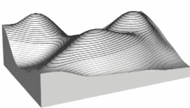

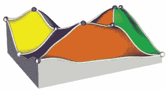

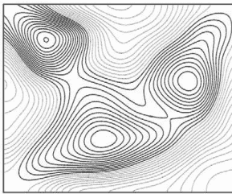

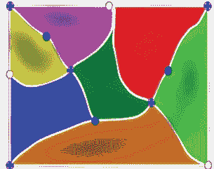

图 5.9
表面高度等高线（左上）与同一表面图像的同亮线（恒强度轮廓；左下）的比较。两者都在轮廓右侧所示的关键点之间产生相同的划分。引自 Kunsberg 和 Zucker, “Critical Contours: An Invariant Linking Image Flow with Salient Surface Organization,” figure 5. 感谢 A. G. Gyulassy 博士提供。

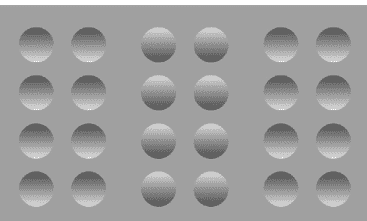

图 5.10
由阴影推导曲率。我们的视觉系统可以从包围轮廓内图像亮度的缓慢变化中提取物体的形状。你会看到鸡蛋或鸡蛋盒，这取决于阴影方向以及你对光照方向的假设（通常假设为来自上方）。将这本书倒过来，可以看到它们颠倒过来。引自 V. S. Ramachandran, “Perception of Shape from Shading,” Nature 331, no. 6152 (1988), figure 2.


是探测器；它们往往表现出低活性或高活性，呈双峰分布。相比之下，隐藏层中的其他单元具有分级响应，并充当滤波器，向输出单元传递曲率的方向和幅度。

这一结论令人惊讶：一个神经元的功能不仅由它对输入的响应决定，还由它下游激活的神经元决定——即它的“投射场”。直到最近，确定神经元的输出比确定其输入要困难得多，但新的遗传学和解剖学技术使得可以以高精度追踪轴突的下游投射，而新的光遗传技术则使得可以选择性地刺激特定神经元，以探测其对感知和行为的影响。13 即便如此，我们的小网络只能识别山丘或碗的曲率，而我们仍然不知道在心理学文献中称为“格式塔”的全局组织感知在皮层中是如何组织的。

1984年，史蒂夫·祖克和我曾被困在旧的斯台普尔顿国际丹佛机场，航班因暴风雪延误。对于仍处于起步阶段的计算神经科学充满热情，我们构思了一个将计算研究者和实验研究者聚集在一起的研讨会，并决定在伍兹霍尔举办，我曾在那里参加过神经生物学暑期课程，并多次回到那里与斯蒂芬·克夫勒在海洋生物实验室开展生理实验研究。伍兹霍尔是海边的一个美丽的科德角村庄，离波士顿不远。多年来，许多研究视觉的顶尖学者都参加过这个年度研讨会，这对我来说也是另一个科学高潮。这些研讨会孕育了视觉皮层计算理论的开端，尽管该理论的证实又花了三十年时间。（在第9章中，我们将看到最成功的深度学习网络的架构与视觉皮层的架构非常相似。）

#### 皮层中的视觉图呈层级组织

20世纪70年代初，乔恩·卡斯和约翰·奥尔曼在威斯康星大学神经生理学系期间，探索了接收来自初级视觉皮层输入的皮层区域，并发现不同区域具有不同的特性。例如，他们在一个称为“中颞皮层”或“MT”的区域中发现了视野图，该区域的神经元对沿首选方向移动的定向视觉刺激作出反应。奥尔曼曾对我说，他们很难说服他所在系的系主任克林顿·伍尔西接受他们的发现。在早期的实验中，伍尔西较粗糙的记录技术遗漏了卡斯和奥尔曼后来用更好的记录技术发现的视杆状体外视觉皮层区域。14 后来的研究在猴子视觉皮层中发现了大约二十四个视觉区域。

1991年，在加州理工学院期间，大卫·范·埃森对皮层中每个视觉区域的输入和输出进行了仔细研究，并将它们排列成一个层级图（图5.11）。他的图有时仅用于说明皮层的复杂性，它很像一座大城市的地铁图，方框代表站点，连接它们的线路代表高速列车路线。视网膜神经节细胞（RGC）的视觉输入投射到图底部的初级视觉皮层（V1）。从那里，信号沿层级向上传输，每个区域专门负责视觉的不同方面，例如形状感知。在图的右侧层级顶端附近，下颞皮层（AIT、CIT和PIT）前部、中央和后部区域的神经元接受野覆盖整个视野，并优先对人脸和其他物体等复杂视觉刺激作出反应。虽然我们不知道神经元如何做到这一点，但我们知道连接强度可以通过经验改变，从而使神经元学会如何对新物体做出反应。范·埃森此后已搬到圣路易斯华盛顿大学，在那里他是由美国国立卫生研究院（NIH）资助的人类连接体计划的联合主任。15 他在那里的研究团队的目标是使用基于磁共振成像（MRI）16 的成像技术，绘制人类皮层的远程连接图（图5.12）。

#### 认知神经科学的诞生

1988年，我担任麦道威尔和皮尤基金会的一个委员会成员，该委员会采访了知名认知科学家和神经科学家，以获取关于如何启动一门名为“认知神经科学”的新领域的建议。17 委员会周游世界，与专家会面，以获取关于哪些科学主题最有前景以及在哪里设立新的认知神经科学中心的建议。我们在一个炎热的八月下午在哈佛教职员工俱乐部会面，采访杰里·福多，他是思维语言方面的专家，也是模块化心智的倡导者。他开门见山地抛下挑战书：“认知神经科学不是一门科学，而且永远不会是。”他给人的印象是，他读过所有关于视觉和记忆的神经科学论文，但它们都未达到他的标准。但当他评论说“the

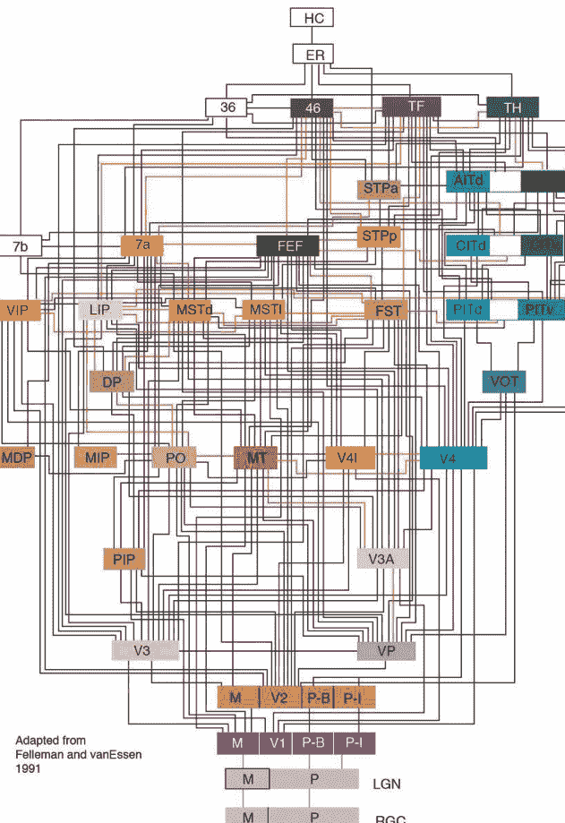

##### 图 5.11

猴子脑中视觉区域的层级。来自视网膜的视网膜神经节细胞（RGC）的视觉信息投射到丘脑的外侧膝状体（LGN），其中继细胞投射到初级视觉皮层（V1）。皮层区域的层级在海马体（HC）结束。图中近乎所有187个链接都是双向的，来自较低区域的前馈连接和来自较高区域的反馈连接。引自D. J. Felleman和D. C. Van Essen，《灵长类视觉皮层中的分布式层级处理》，《大脑皮层》1卷，第1期（1991年）：30页，图4。

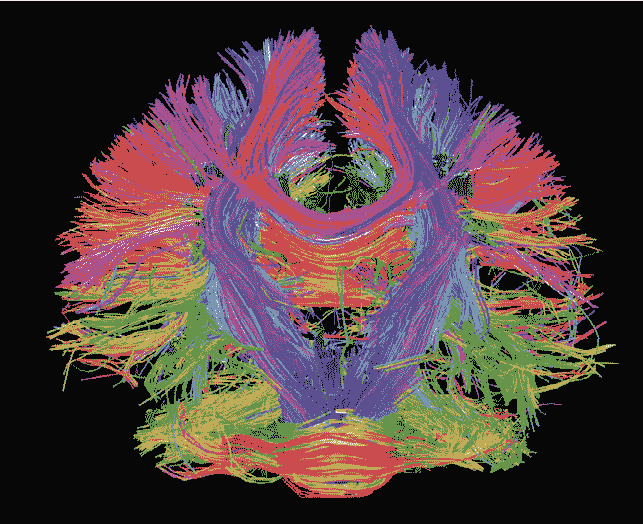

##### 图 5.12

人类连接体。大脑皮层白质中的长程纤维束可以通过基于水分子不均匀扩散的磁共振成像（MRI）无创地追踪。伪色标记不同通路的方向。引自人类连接体计划。

麦道威尔基金会在浪费钱，”麦道威尔基金会主席约翰·布鲁尔迅速指出，福多混淆了他的基金会和路边的汉堡店。

福多毫不在意地解释了为什么必须将心智视为运行智能计算机程序的模块化符号处理系统。加州大学圣地亚哥分校的哲学家帕特里夏·丘奇兰问他，他的理论是否也适用于猫。“是的，”福多说，“猫在运行猫程序。”但当美国国立卫生研究院研究视觉和记忆的神经科学家莫蒂默·米什金要求他介绍自己实验室的发现时，福多咕哝了一些关于在语言实验中使用事件相关电位的内容，我听不懂。幸运的是，就在这时，进行了消防演习，我们都有序地撤到外面。站在院子里，我无意中听到米什金对福多说：“那些都是小菜一碟。”演习结束后，福多已经不见了。

认知神经科学已发展成为一个重要领域，吸引了许多科学领域的研究者，包括社会心理学和经济学，这些领域以前与神经科学几乎没有或没有直接联系。使这成为可能的是，在20世纪90年代初引入了可视化大脑活动的非侵入性方法，尤其是功能性磁共振成像（fMRI），其空间分辨率现在可达几毫米。正在生成的大量fMRI数据集正在使用新的计算方法（如独立成分分析，将在第6章讨论）进行分析。

由于大脑没有氧气就无法工作，而且血流在亚毫米级别受到严格调节，fMRI测量血氧水平依赖（BOLD）信号作为大脑活动的替代指标。血液的氧合程度会改变其磁性特性，可以通过fMRI无创地监测，并用于生成时间分辨率为几秒钟的大脑活动动态图像，时间足够短，足以跟踪实验过程中大脑的哪些部分被激活。功能性磁共振成像已被用于探索视觉层级不同部分的时间整合尺度。

普林斯顿大学的乌里·哈森进行了一项fMRI实验，旨在探测视觉层级的哪些部分参与处理不同时长的电影。18 一部查理·卓别林的默片被剪辑成片段，并在4秒、12秒和36秒的时间尺度上进行打乱后呈现给受试者。在4秒时，受试者可以识别一个场景；在12秒时，是连贯的动作；在36秒时，是一个有开头和结尾的故事。无论时间尺度如何，层级底部初级视觉皮层中的fMRI反应都强烈且可靠，但在视觉层级的较高层次，只有较长的时间尺度才能引发可靠反应，而层级顶部的前额叶皮层区域需要最长的时间间隔。这与其他实验一致，表明工作记忆（即我们保留电话号码和正在处理的任务要素等信息的能力）也呈层级组织，前额叶皮层中的工作记忆时间尺度最长。

神经科学中最令人兴奋的研究领域之一是大脑中的学习研究，它可以在从分子到行为的多个研究层次上进行研究。


## II 多种学习方式

### 时间表

- 1949—唐纳德·赫布出版 _行为的组织_，引入了用于突触可塑性的赫布规则。

- 1982—约翰·霍普菲尔德发表《具有涌现集体计算能力的神经网络与物理系统》，介绍了霍普菲尔德网络。

- 1985—杰弗里·辛顿和特里·塞杰诺夫斯基发表《玻尔兹曼机学习算法》，这是马文·明斯基和西摩·帕珀特广泛接受的观点的一个反例，即认为不可能存在多层网络的学习算法。

- 1986—大卫·鲁梅尔哈特和杰弗里·辛顿发表《通过误差反传学习内部表示》，介绍了目前用于深度学习的“反向传播”学习算法。

- 1988—理查德·萨顿在 _机器学习_ 中发表《通过时序差分方法学习预测》。时序差分学习现在被认为是所有大脑中用于奖励学习的算法。

- 1995—安东尼·贝尔和特伦斯·塞杰诺夫斯基发表《盲分离与盲去卷积的信息最大化方法》，描述了一种用于独立成分分析的无监督算法。

- 2013—杰弗里·辛顿的 NIPS 2012 论文《使用深度卷积神经网络进行 ImageNet 分类》将图像中物体正确分类的错误率降低了 18 个百分点。

- 2017—AlphaGo，一个深度学习网络程序，击败了围棋世界冠军柯洁。

### 6 鸡尾酒会问题

在拥挤的鸡尾酒会上，当空气中充满周围其他人说话的嘈杂声时，听清面前的人说话可能是一项挑战。拥有两只耳朵有助于将听觉导向正确方向，而你的记忆可以补全缺失的对话片段。现在想象一个房间里有 100 个人，周围分布着 100 个非定向麦克风，每个麦克风都能接收到所有人的声音，但每个人在每个麦克风上的振幅比例不同。有可能设计出一种算法，将每个声音分离到独立的输出通道中吗？为了让问题更加困难，如果声源未知——例如音乐、拍手声、自然声音甚至随机噪声——该怎么办？这被称为“盲源分离问题”（图 6.1）。

在 1986 年犹他州斯诺伯德举办的、NIPS 会议的前身——AIP 会议“神经网络计算”会议上（时间为 4 月 13 日至 16 日），有一张题为《由神经网络模型进行空间或时间自适应信号处理》的海报。其作者，让妮·埃罗和克里斯蒂安·茹滕，使用一种学习算法，对呈现给神经网络模型的正弦波混合物（即纯频率）进行盲分离；他们指出了一类新的无监督学习算法。¹ 尽管当时不知道是否存在一种能够盲分离其他类型信号的通用解决方案，但十年后，安东尼·贝尔和我找到了一种可以解决一般问题的算法。²

#### 独立成分分析

感知机是一个单神经元神经网络。下一种最简单的网络架构在输出层中有不止一个模型神经元；每个输入神经元都与每个输出神经元相连，它将输入层上的模式转换为输出层上的模式。这个网络

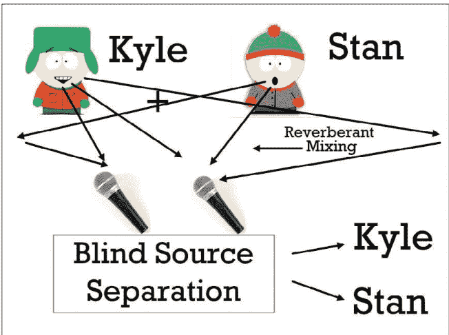

图 6.1
盲源分离。凯尔和斯坦在一个有两个麦克风的房间里同时说话。每个麦克风都能接收到来自说话者的信号以及房间墙壁的反射。挑战在于在对信号一无所知的情况下，将两个声音相互分离。独立成分分析（ICA）是一种学习算法，它可以在对声源一无所知的情况下解决这个问题。

这个网络

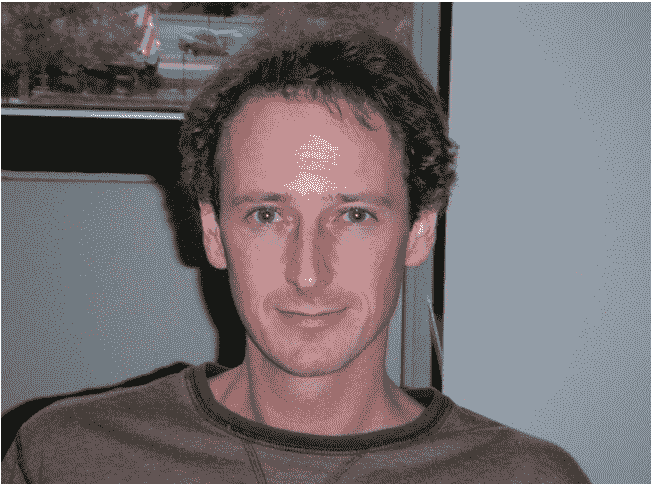

图 6.2 1995 年左右，安东尼·贝尔在研究独立成分分析时独立思考。专家们知道很多解决不了问题的方法，但往往是第一次看待问题的人才能看到新方法并解决它。托尼和我发现了一种用于解决盲源分离问题的迭代算法，该算法现在已载入工程教科书，并有数千种实际应用。感谢托尼·贝尔提供。

自那时起，独立成分分析已被用于数千种应用，并现在收录于信号处理教科书。⁵ 当应用于室外场景自然图像的补片时，ICA 的独立成分是定位的、有方向的边缘滤波器（图 6.3），类似于猫和猴子视觉皮层中的简单细胞（图 5.4）。⁶ 使用 ICA 时，只需要许多声源中的少数几个就能重建图像的一个补片；这种重建在数学上被称为“稀疏”。⁷

#### 框 6.1
独立成分分析的工作原理

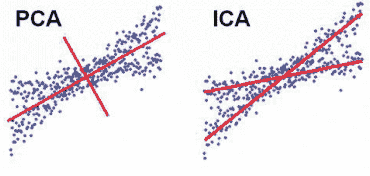

主成分分析（PCA）与独立成分分析（ICA）的比较。图 6.1 中两个麦克风的输出在上方垂直轴和水平轴上相互绘制。每个点的坐标是其在单个时间点的值。PCA 是一种流行的无监督学习技术，它选取一个平分两个信号并使它们最大程度混合的方向，PCA 轴始终相互垂直。ICA 找到沿着点分布方向的轴，代表分离后的信号，这些轴可能不相互垂直。

这些结果证实了杰出视觉科学家霍勒斯·巴洛在 20 世纪 60 年代提出的一个推测，当时大卫·休贝尔和托斯滕·威赛尔在视觉皮层中发现了简单细胞。图像包含大量冗余，因为附近的像素通常具有相似的值（例如天空中的像素）。巴洛推测，通过减少自然场景表征中的冗余，8 简单细胞能够更高效地传输图像中的信息。花费了五十年时间来开发数学工具以证实他的直觉。

托尼和我也表明，当独立成分分析应用于自然声音时，独立成分是具有不同频率和持续时间的时间滤波器，类似于听觉系统早期阶段中发现的滤波器。9 这让我们有信心，我们正在走正确的道路，以理解感官信号在视觉皮层处理最早期阶段中的表征基本原理。通过将这一原理扩展到线性滤波器的独立特征子空间，可以模拟视觉皮层中的复杂细胞。10

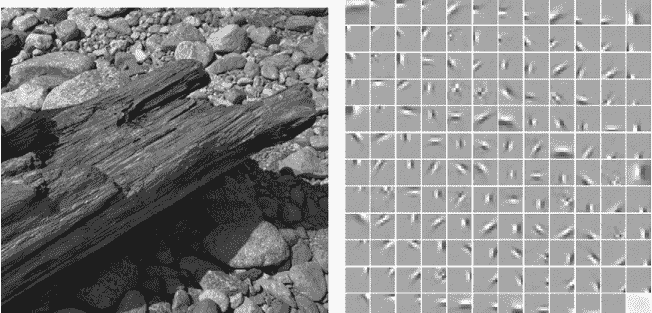

图 6.3 从自然图像中得出的独立成分分析滤波器。左侧面板中自然场景图像的小补片（12x12 像素）被用作具有 144 个输出单元的 ICA 网络的输入。右侧面板中得到的独立成分类似于初级视觉皮层中发现的简单细胞：它们具有定位性和方向性，带有正区域（白色）和负区域（黑色），灰色表示零。只需少数几个滤波器即可表示任何给定的补片，这一属性称为“稀疏性”。左图：感谢迈克尔·勒维茨基提供；右图：摘自贝尔和塞杰诺夫斯基的《自然场景的“独立成分”是边缘滤波器》，图 4。

ICA 网络的输入和输出单元数量相等，且它们之间具有一组完全连接的权重。为了解决盲源分离问题，麦克风的声音通过输入层播放，每个麦克风对应一个输入单元，ICA 学习算法（类似于感知机算法）会迭代修改指向输出层的权重，直到它们收敛。但是，与作为监督学习算法的感知机不同，独立成分分析是一种无监督学习算法，它使用输出单元之间独立性的度量作为代价函数；它不知道输出目标应该是什么。当权重被更改以使输出尽可能独立时，原始声源就会被完美分离，或者如果它们不独立，则会尽可能“去相关”。无监督学习可以在多种不同类型的数据集中发现先前未知的统计结构。


#### 大脑中的独立成分

Tony Bell 的 infomax ICA 算法引发了一连串“顿悟”时刻，因为我实验室的其他人开始将其应用于大脑的不同类型记录。1924 年，Hans Berger 首次从头皮上记录到大脑的电信号，并将其称为“脑电图”（EEG）。神经科学家利用这些复杂的振荡信号来窃听我们不断变化的大脑状态，这些状态随我们的警觉性和感觉运动交互而变化。头皮电极上的电信号接收来自大脑皮层内许多不同来源以及肌肉和眼动伪迹的输入。每个头皮电极接收来自大脑中同一组来源的信号混合，但幅度不同，这在形式上与鸡尾酒会问题相同。

Scott Makeig 曾在 1990 年代是我位于索尔克研究所实验室中的一名工作科学家，他使用 ICA 从 EEG 记录中提取了皮层中数十个偶极源及其时间进程（图 6.4）。偶极是大脑源可能具有的最简单模式之一，最简单的是由静止点电荷产生的头皮均匀模式，第二简单的是由沿直线移动的电流产生的偶极模式，这发生在皮层锥体神经元中。将偶极视为一支箭头。头皮表面在箭头方向为正，在箭尾方向为负；该模式覆盖整个头部，这就是为什么同时激活的许多大脑源如此难以分离的原因。从 EEG 中提取的两个源，IC2 和 IC3，在图 6.4 中大约是偶极源。独立成分分析还分离伪迹，例如眼动和电极噪声，然后可以以高精度将其减去（图 6.4 中的 IC4）。此后，已有数千篇论文使用 ICA 分析 EEG 记录，并利用 ICA 分析广泛的大脑状态取得了重要发现。

Martin McKeown 当时是我实验室中拥有神经学背景的博士后研究员，他找到了翻转空间和时间的方法，将独立成分分析应用于功能磁共振成像记录（图 6.5）。¹¹ 使用 fMRI 进行脑成像测量大脑内数万个位置的血氧水平，这与神经活动间接相关。在图 6.5 中，ICA 源是具有共同时间进程但彼此在空间上独立的大脑区域。空间域中的稀疏性意味着在任何给定时间，只有少数区域高度活跃。

#### ICA 分解

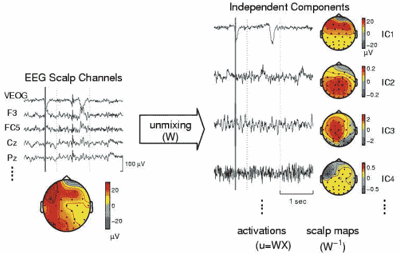

图 6.4
将独立成分分析应用于头皮脑电图（EEG）记录。从上方看到的头皮图（鼻子朝上），电极位于黑色圆点上，并显示某一时间点的微伏（μV）电压彩色图。左侧面板显示的五个头皮通道的波动 EEG 信号受到眼眨和肌肉信号伪迹的污染。ICA 将脑成分与伪迹分开，如右侧面板所示（“IC”代表“独立成分”）。IC1 是基于缓慢时间进程和头皮图的眼眨，其在眼睛上方具有最高值（红色）。IC4 是基于高频高幅噪声和头皮图上局部源的肌肉伪迹。IC2 和 IC3 是脑源，由头皮上的偶极模式指示（正红区域相对负蓝区域），与左侧面板头皮图所示的 EEG 记录头皮上的更复杂模式相比。图片由 Tzyy-Ping Jung 提供。

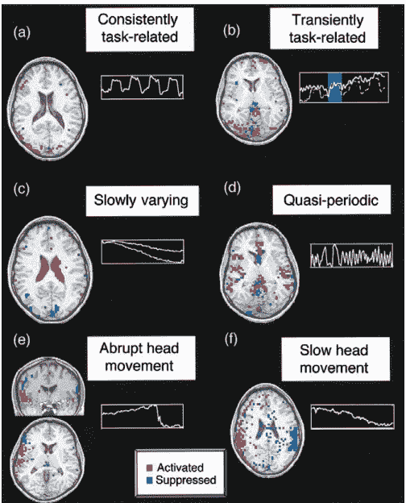

**图 6.5** 将独立成分分析应用于功能磁共振成像（fMRI）数据。一个成分由脑活动图和一个时间进程组成。这说明了几种类型的成分。任务呈现视觉刺激 5 秒，由与任务相关的成分捕获。方框中信号的时间进程约为一分钟，任务重复四次，如面板 (a) 所示。其他成分捕获头部运动等伪迹。引自 M. J. McKeown, T.-P. Jung, S. Makeig, G. D. Brown, S. S. Kindermann, T.-W. Lee, 和 T. J. Sejnowski，“Stroop 颜色命名任务期间功能 MRI 数据中的空间独立活动模式”，《美国国家科学院院刊》95, no. 3 (1998): 806, 图 1。

由于独立成分分析是无监督的，它可以揭示协同工作的大脑区域网络，这超越了试图将某一区域的活动与感觉刺激或运动反应相关联的监督技术。例如，ICA 已被用于发现 fMRI 记录中的多种静息状态，受试者仅被要求在扫描仪中保持静止并休息。¹² 我们仍然不完全理解这些静息状态的含义，但它们可能代表负责我们白日梦、心中挂念或计划晚餐时大脑中所发生情况的大脑区域组合。

最大独立性原理与稀疏编码原理相关。尽管 ICA 揭示了许多独立成分，但仅需要其中少数几个即可重建自然图像中的给定补片。这一原理也适用于视觉皮层，其细胞数量是来自视网膜的输入的 100 倍。我们每个视网膜有 100 万个神经节细胞，初级视觉皮层中有 1 亿个神经元，这是皮层中视觉层次结构的首层。视网膜中视觉信号的紧凑编码在皮层中扩展为一种高度分布且高度稀疏的新编码。扩展到更高维度的空间被用于其他编码方案，包括听觉皮层和嗅觉皮层中发现的方案，一类称为“压缩感知算法”的新算法已将稀疏性原理推广到提高复杂数据集存储和分析效率。¹³

#### 超越独立成分分析

ICA 的故事说明了技术在科学和工程中进行新发现方面的重要性。我们通常将技术视为显微镜和放大器等测量设备。但算法也是技术，它们可以使人们使用旧仪器的数据进行新发现。EEG 记录已有近 100 年的历史，但如果没有独立成分分析，就无法确定潜在的脑源。大脑本身是一套互锁算法的系统，如果在大脑的某个部分，自然发现了一种实现 ICA 的方法，我不会感到惊讶。¹⁴

在 1990 年代，开发神经网络新学习算法取得了许多其他进步，其中许多（如 ICA）如今已成为机器学习数学工具箱的一部分。这些算法嵌入在许多常用设备中，但没有一台设备标注“内部包含神经网络”。以耳机或手机为例。Te-Won Lee 和 Tzyy-Ping Jung 是我实验室的两位前博士后研究员，后来创办了一家名为“SoftMax”的公司，他们使用带有两个麦克风的蓝牙耳机中的 ICA 来消除背景噪音，使听众能够在嘈杂的餐厅或体育赛事中听到有人在说话。2007 年，SoftMax 被高通收购，高通设计用于许多手机的芯片，如今类似 ICA 的方案已嵌入十亿部手机。如果每部运行 ICA 的手机你都能得到一分钱，今天你就已经是亿万富翁了。

Tony Bell 长期以来一直对一个更困难的问题感兴趣。作为人类，我们体内有许多网络，信息从一个网络层级涌现到另一个层级，从分子到突触，到神经元，到神经元群体，再往上形成决策，所有这些都由物理学和生物化学定律解释（图 4.4）。但我们有一种印象：是我们，而非物理学或生物化学，在掌控一切。我们大脑中神经元群体内部涌现的内部活动如何导致我们做出决策（例如阅读本书或打网球），仍是一个谜。这些决策在远低于我们意识水平的层面上做出，它们不知为何从基于分子机制的经验所形成的突触中相互作用的神经元中涌现出来。但从人类的角度来看，正是我们的决策导致了大脑中所有这些事件的发生：从内省的角度看，因果关系似乎与物理学和生物化学的方向相反。如何调和这两个视角是一个深刻的科学问题。¹⁵


### 7 霍普菲尔德网络与玻尔兹曼机

计算机科学家杰罗姆·费尔德曼（Jerome Feldman）在20世纪80年代于罗切斯特大学时，采用了联结主义网络方法来研究人工智能。一向秉持实事求是的杰里（Jerry）指出，当时人工智能领域使用的算法需要数十亿步才能得出常常错误的结论，而大脑只需大约100步就能得出通常正确的结论。¹ 费尔德曼的“100步法则”当时在人工智能研究者中并不受欢迎，但少数人，尤其是卡内基梅隆大学的艾伦·纽厄尔（Allen Newell），确实将其作为一种约束条件。

有一次我滞留在纽约罗切斯特机场，是杰里救了我。我当时正从参观位于斯克内克塔迪的通用电气研究实验室（General Electric Research Laboratory）返回巴尔的摩的路上，机长开始向我们播报罗切斯特的天气情况，我才发现自己上错了飞机。降落后，我预订了最早飞往巴尔的摩的航班，但要到第二天才起飞，这时我碰到了杰里，他正从华盛顿特区的委员会会议回家。他好心邀请我当晚在他那里住下。杰里后来去了加州大学伯克利分校，但每当我在机场滞留时，我都会想起他。

杰里区分了“粗糙型”（scruffy）和“精细型”（neat）联结主义模型。粗糙模型，比如杰弗里·辛顿（Geoffrey Hinton）和我研究过的模型，将对象和概念的表示分布在网络的许多单元上；而精细模型，即杰里所相信的模型，则为对象和概念提供计算上紧凑的表示，每个单元对应一个标签。从更广泛的意义上说，粗糙科学使用近似方法来获得定性答案，而精细科学则力求找到问题的精确解。² 实际上，两者对于取得进展都不可或缺。我毫不反对先用粗糙方法站稳脚跟，但会不懈努力寻求更精确的解释，并且最终这番努力得到了回报：杰弗里和我即将打中“精细”的大奖。

#### John Hopfield

要获得物理学博士学位，必须解决一个问题。优秀的物理学家应该能够解决任何问题，但伟大的物理学家知道应该解决什么问题。约翰·霍普菲尔德（John Hopfield）是一位伟大的物理学家。在凝聚态物理领域有着卓越成就之后，他将兴趣转向了生物学，特别是“分子校对”问题。在细胞分裂过程中DNA复制时，错误不可避免，这些错误必须被纠正，以保留子细胞的保真度。约翰想出了一个巧妙的方案来实现这一点，尽管他提出的过程会消耗能量，但随后的实验证明他是正确的。在生物学中做对任何事情都是一项了不起的成就。

约翰是我在普林斯顿大学时的博士导师，当时他刚刚开始对神经科学产生兴趣。他满怀热忱地告诉我，他从在波士顿神经科学研究计划（Neuroscience Research Program, NRP）会议上发言的神经科学家那里学到了什么。我认为NRP出版的小型研讨会论文集非常宝贵，因为它们让我了解当时正在研究哪些问题以及该领域的思路。我至今仍保留着一次关于神经编码的研讨会论文集，该研讨会由传奇神经动物学家西奥多·霍姆斯·布洛克（Theodore Holmes Bullock）组织，他后来成为我加州大学圣地亚哥分校的同事。泰德（Ted）与阿德里安·霍里奇（Adrian Horridge）合著的关于无脊椎动物神经系统的书是一部经典。³ 我与泰德合作模拟珊瑚礁的集体行为，并自豪地成为他2008年最后一篇科学论文的合著者。⁴

具有反馈连接到早期层和层内单元之间循环连接的神经网络，其动态远比仅具有前馈连接的网络复杂得多。对于具有任意连接单元、既有正（兴奋性）权重又有负（抑制性）权重的网络一般情况，是一个难以处理的数学问题。尽管芝加哥大学的杰克·考恩（Jack Cowan）和波士顿大学的斯蒂芬·格罗斯伯格（Stephen Grossberg）在20世纪70年代末期已取得进展，证明此类网络可以复现视觉错觉⁵和视觉幻觉，⁶但工程师们发现很难让网络解决复杂的计算问题。

#### A Network with Content-Addressable Memories

1983年夏天，杰弗里·辛顿、约翰·霍普菲尔德（如图7.1所示）和我正在罗切斯特大学参加由杰里·费尔德曼组织的一次研讨会。

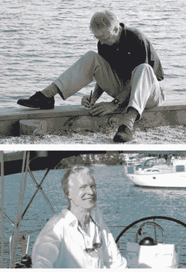

**Figure 7.1** 约翰·霍普菲尔德在1986年左右马萨诸塞州伍兹霍尔的滨水区解决问题。霍普菲尔德通过发明以他名字命名的网络，对20世纪80年代的神经网络产生了开创性影响，该网络为深度学习打开了大门。图片由约翰·霍普菲尔德提供。

费尔德曼。霍普菲尔德告诉我们，他解决了强相互作用网络的收敛问题。他证明，一种特定的非线性网络模型（现称为“霍普菲尔德网络”）保证会收敛到一个稳定状态，称为“吸引子”（如图7.2；框7.1所示）。⁷（高度非线性的网络容易振荡或表现出更混乱的行为。）此外，网络的权重可以选择，使得吸引子成为记忆。因此，霍普菲尔德网络可用于实现所谓的“内容寻址记忆”，即通过从记忆的一部分开始，让网络补全其余部分来检索存储的记忆。这让人联想到我们回忆记忆的方式。如果我们看到一个认识的人的脸，就可以回忆起该人的名字以及与他进行过的对话。

霍普菲尔德网络成为重大突破，在于它在数学上保证会收敛。研究人员原本认为，高度非线性网络的一般情况不可能进行分析。

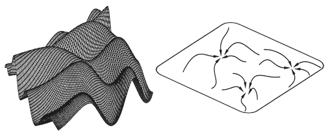

Figure 7.2 霍普菲尔德网络的能量景观。（左）网络的状态可以可视化为能量曲面上的一个点。（右）每次更新都会将状态移向其中一个能量极小值，称为“吸引子状态”。摘自A. Krogh、J. Hertz和R. G. Palmer合著的《神经计算理论导论》（加利福尼亚州红木城：艾迪生-韦斯利出版公司，1991年）。左：图2.6；右：图2.2。

如果在这样一个网络的所有单元上同时进行更新，动态可能会极其复杂，并且无法保证收敛。⁸ 但霍普菲尔德表明，当网络的单元按顺序更新时，成对单元之间相互连接强度相等的对称网络这一特例是可处理的，并且确实会收敛。

越来越多的证据表明，海马体（对存储特定事件和独特对象的长期记忆至关重要）中的神经网络具有与霍普菲尔德网络类似的吸引子状态。⁹ 虽然霍普菲尔德模型高度抽象，但其定性行为与海马体中观察到的相似。20世纪80年代，许多物理学家跨越了霍普菲尔德网络这一从物理学到神经科学的桥梁。通过用理论物理学的精密工具分析神经网络和学习算法，获得了令人惊讶的洞见。在神经科学理论的一个领域，物理学、计算和学习深度相关联，该领域在揭示大脑功能方面取得了成功。

约翰·霍普菲尔德与当时在贝尔实验室的大卫·坦克（David Tank）继续证明，霍普菲尔德网络的一个变体（其中单元取0到1之间的连续值）可以用于求解优化问题的良好解，例如“旅行商问题”，其目标是找到只访问每个城市一次的最短路径。¹⁰ 这是计算机科学中一个臭名昭著的难题。

#### Box 7.1

霍普菲尔德网络

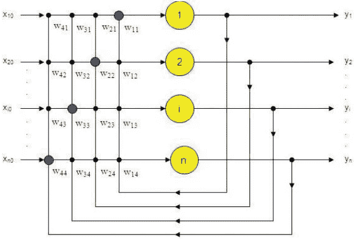

在霍普菲尔德网络中，每个单元都向网络中的所有其他单元发送输出线。输入为 $x_i$，输出为 $y_i$。单元间连接或权重的强度是对称的：$w_{ij} = w_{ji}$。在每个时间步，更新其中一个单元，通过求和输入并将其与阈值进行比较：如果输入超过阈值，则该单元的输出为1；否则为0。霍普菲尔德表明，网络具有一个能量函数，随着网络中单元的每次更新，该函数不会增加：

$E = \sum W_{ij} x_i x_j$

最终，霍普菲尔德网络会到达一个“吸引子状态”，此时没有单元再改变，能量函数处于局部最小值。该状态对应于一个存储的记忆，可以通过用存储状态的一部分初始化网络来恢复。这就是霍普菲尔德网络实现内容寻址记忆的方式。存储向量的权重可以通过赫布突触可塑性来学习：

$\Delta w_{ij} = \alpha x_i x_j$

其中左边是权重强度的变化，$\alpha$ 是学习率，$x_i$ 是存储向量。
图片由戴尔·希思（Dale Heath）提供。


#### 寻找全局能量最小值

网络的能量函数包括路径长度以及每个城市只访问一次的约束。在初始暂态之后，Hopfield和Tank的网络会稳定到一个最小能量状态，该状态代表一条良好的路径，尽管不一定是最佳路径。

Dana Ballard与Christopher Brown于1982年合著了一本关于计算机视觉的经典著作，11 他也参加了1983年的研讨会。Geoffrey Hinton和我正与Dana合作撰写一篇关于为Nature评论一种新图像分析方法的文章。12 其思路是：网络模型中的节点代表图像中的特征，网络中的连接实现特征之间的约束；兼容节点之间有正向交互作用，不一致节点之间有负向交互作用。在视觉中，必须找到满足所有约束的所有特征的一致性解释。

Hopfield网能解决这个约束满足问题吗？能量函数是衡量网络满足所有约束程度的指标（参见方框7.1）。视觉问题需要一个全局能量最小值、即最佳解的解决方案，而Hopfield网的设计初衷只是找到能量的局部最小值。我最近在《Science》杂志上读到Scott Kirkpatrick的一篇论文，他当时在纽约约克敦高地的IBM托马斯·J·沃森研究中心，我觉得这篇论文可能有所帮助。13 Kirkpatrick使用一种称为“模拟退火”的方法来绕过局部最小值。假设你有一组电气电路中的元件，需要安装到两块电路板上。零件的最佳布置方式是什么，才能使连接它们所需的导线数量最少？

不良解决方案是通过最初随机布置零件，然后逐个来回移动它们，以查看哪种布置所需的导线最少而找到的，因为当移动任何单个组件都无法改善时，网络很容易陷入局部最小值。逃离局部最小值的方法是允许随机跳转到导线长度更长的配置。跳出的概率起初较高，但逐渐降低，直到最后变为零。如果概率下降足够慢，零件的最终布置将具有连接导线的全局最小值。在冶金学中，这一过程称为“退火”；加热金属并缓慢冷却会产生缺陷最小的大晶体，这些缺陷使金属变得脆弱并容易开裂。

#### 玻尔兹曼机

在Hopfield网中，模拟退火对应于“加热”更新，使能量既可以上升也可以下降。因为在高温下单元会随机翻转，如果温度逐渐降低，那么当温度达到零时，Hopfield网有很高概率最终冻结在最低能量状态。在实践中，模拟从恒定温度开始，以便网络达到平衡，在那里它可以访问许多邻近状态并探索广泛的可能解决方案。

例如，在图7.3中，剪影图形是含糊不清的，取决于你关注哪个部分，你会看到一个花瓶或两张面孔，但绝不会同时看到两者。考虑决定图像中哪部分是图形、哪部分是背景（称为“底”）的问题。我们设计了一个模拟这一图形–底决策的玻尔兹曼机网络，¹⁴ 一些单元代表

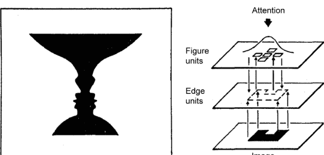

**图7.3**
含糊的图形–底问题。（左）当你关注黑色图形时，你看到一个花瓶，白色为底。但当你关注白色区域时，你可以看到两张面孔相互对视。你可以来回切换，但无法同时看到两种解释。（右）图形–底网络模型。两种类型的单元代表物体的边缘（线段）以及像素是属于图形还是属于底（方形）。图像输入自下而上，注意输入自上而下。注意被实现为对应填充为图形的区域的偏置。源自P. K. Kienker, T. J. 塞杰诺夫斯基, G. E. 辛顿, 和 L. E. 舒马赫, “利用并行网络区分图形与底,” Perception 15 (1986): 197–216. 左：图1；右：图2。

#### 方框7.2

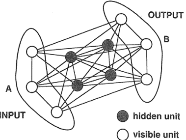

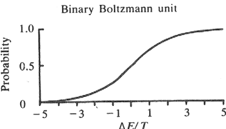

玻尔兹曼机中的所有连接都是对称的，如同Hopfield网一样，二进制单元一次更新一个，通过将 \( s_i = 1 \) 设置为由上述Sigmoid函数给出的概率来更新，其中输入 \( \Delta E \) 由温度 \( T \) 缩放。输入层和输出层是“可见”的，因为它们与外部世界交互。“隐藏单元”代表具有内部自由度的特征，这些自由度可以影响可见单元。玻尔兹曼机学习算法有两个阶段：在“唤醒”阶段，输入和输出被锁定，在网络达到平衡后计算单元对之间的平均相关性；在“睡眠”阶段，在输入和输出未锁定的情况下再次计算相关性。然后权重逐步更新：

\( \Delta w_{ij} = \epsilon (<s_i s_j>^{wake} - <s_i s_j>^{sleep}) \)

当它们被激活时代表图形，另一些代表边缘。我们已经知道视觉皮层中有由边缘激活的简单细胞，但图形可能位于边缘的任一侧。在我们的玻尔兹曼机网络中，这是通过拥有两个边缘单元来实现的，每个单元支持边缘任一侧的图形。此类神经元随后在视觉皮层中被发现，并被称为“边缘所有权细胞”。15

玻尔兹曼网络中的权重是手工制作的，以实现约束（图7.4）。边缘单元之间存在兴奋性连接，边缘单元之间也存在抑制性连接。边缘单元与它们指向的图形单元具有兴奋性连接，支持图形，并与相反方向的图形单元具有抑制性连接。注意是通过对某些图形单元的偏置来实现的。当玻尔兹曼网络对单元使用Hopfield更新规则时，它会陷入局部能量最小值，这些最小值在局部补丁中一致但在全球上不一致。当向更新添加噪声时，玻尔兹曼网络跳出局部最小值，并通过缓慢退火噪声的温度，网络在全局能量最小值处松弛到一个全球一致的解（图7.4）。由于更新是异步且独立的，该网络可以由一台计算机实现，数百万个单元并行协同工作，其收敛速度远快于一次执行一个操作、按顺序进行的数字计算机。

到那时，我已经在哈佛医学院与Stephen Kuffler完成了博士后研究，并搬到约翰霍普金斯大学的生物物理学系担任我的第一份工作；Geoffrey Hinton在卡内基梅隆大学计算机科学系担任教职，他很幸运地得到Allen Newell的支持，Newell对人工智能的新方向持开放态度。匹兹堡和巴尔的摩足够近，Geoffrey和我可以在周末互相拜访。我们将我们对Hopfield网的新版本称为“玻尔兹曼机”，以十九世纪物理学家Ludwig Boltzmann命名，他是统计力学的创始人，统计力学是我们用来分析波动神经网络模型的工具的来源，而我们即将发现，这个模型也是一台强大的学习机器。

保持恒定“温度”时，玻尔兹曼机将达到平衡。在平衡时会发生某种神奇的事情，它将打开一扇大家认为已永远关闭的大门：多层神经网络学习。一天，Geoffrey打电话说他刚刚为玻尔兹曼机推导出一个简单的学习算法。该算法的目标是从输入单元到输出单元执行映射，但与


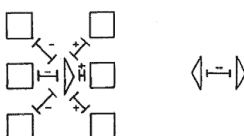


图 7.4

使用玻尔兹曼机分离图形与背景。（上方）网络中的方形单元识别图形，三角形边缘单元识别轮廓，连接符号已指示。边缘单元可以指向图形或背离图形。（下方）（a）关注“C”内部的网络快照。温度初始较高，单元在开启和关闭之间波动。（b）随着温度下降，“C”内部的单元开始聚合，得到指向内部的边界单元的支持。外部没有关注或边缘输入的单元在温度降低时消失。（c）当温度降至零时，关注内部会使图形被填充。（d）当重复该过程并关注外部时，外部会被填充。引自 P. K. Kienker, T. J. Sejnowski, G. E. Hinton, 和 L. E. Schumacher，“Separating Figure from Ground with a Parallel Network”，Perception 15 (1986): 197–216，下方：图 6；上方：图 3。

感知机，玻尔兹曼机中间也有单元，我们称之为“隐藏单元”（方框 7.2）。通过展示输入-输出对并应用学习算法，玻尔兹曼网络学习了所需的映射。但目标不仅仅是记忆这些对；还要正确分类未用于训练网络的新输入。此外，因为它始终在波动，玻尔兹曼机在学习概率分布——对于给定输入模式，每个输出状态被访问的频率——这使其具有生成性：学习后，它可以通过锁定每个输出类别来生成新的输入样本。

#### Hebbian 突触可塑性

令人惊讶的是，玻尔兹曼机学习算法在神经科学中有着悠久的历史，可以追溯到心理学家 Donald O. Hebb，他在著作《行为的组织》中假设，当两个神经元同时放电时，它们之间的突触应当增强：

> 让我们假设，回馈活动（或“痕迹”）的持续或重复往往会诱导持久的细胞变化，从而增加其稳定性。当细胞 A 的轴突足够接近以兴奋细胞 B，并反复或持续地参与其放电时，一个或两个细胞中会发生某种生长过程或代谢变化，使得 A 作为放电 B 的细胞之一，其效率增加。¹⁶

这可能是神经科学中最著名的预测。赫布式突触可塑性后来在海马中被发现，海马是长期记忆的重要脑区。当海马锥体细胞在神经元尖峰放电的同时接收到强输入时，突触强度会增加。随后的实验表明，这种增强基于突触递质释放与接收神经元电压升高的结合。此外，这种同时发生的现象由一种特殊受体识别，即 NMDA（N-甲基-D-天冬氨酸）谷氨酸受体，它诱导长时程增强（LTP），LTP 起效快且持久，是长期记忆基质的良好候选者。突触处的赫布式可塑性由输入与输出之间的巧合所控制，这与玻尔兹曼机学习算法类似（参见方框 7.2）。

更令人惊讶的是，玻尔兹曼机必须“入睡”才能学习。其学习算法有两个阶段。在第一个或“清醒”阶段，输入和输出模式被锁定到所需映射，网络中的单元被多次更新以趋于平衡，并统计每对单元同时开启的时间比例。在第二个或“睡眠”阶段，输入和输出单元被释放，并在自由运行条件下统计每对单元同时开启的时间比例。随后，每个连接强度按清醒与睡眠阶段巧合率的差值进行更新（方框 7.2）。睡眠阶段的计算原因是确定被锁定的相关性中哪部分是由外部原因引起的。如果不减去内部生成的相关性，网络会增强内部活动模式，并学会忽略外部影响，这是一种网络版本的“二人共痴症”。有趣的是，人类极端睡眠剥夺会导致妄想状态，这是没有窗户且照明持续的医院重症监护室中常见的问题。精神分裂症患者常有睡眠障碍，可能导致其妄想性构思。我们确信自己走在理解大脑运作方式的正确道路上。

#### 学习镜像对称

玻尔兹曼机可以解决而感知机无法解决的一个问题是如何学习镜像对称。¹⁷ 人体沿垂直轴呈两侧对称。我们可以生成大量带有此对称轴的随机模式，如图 7.5 所示，也可以生成水平轴和对角线轴的对称模式。在我们的玻尔兹曼机网络中，10×10 的二进制输入块投射到十六个隐藏单元，然后再投射到三个输出单元，分别对应三种可能的对称轴。在用 6000 个对称输入模式进行训练后，玻尔兹曼机对新输入的对称轴分类成功率达到 90%。感知机最多只能达到随机水平，因为单个输入不包含关于模式对称性的信息；必须探测输入对之间的相关性。值得注意的是，人类观察者看到的输入阵列并不是玻尔兹曼机所看到的内容，因为每个隐藏单元从整个阵列接收输入，且没有特定顺序。对观察者来说，等效的问题将是随机化阵列中输入单元的位置，即使存在隐藏对称，这也会使阵列对观察者看起来是随机的。

有一天，我正在观看显示屏，以每秒两个的速度呼出每个输入模式的对称性。当时是约翰斯霍普金斯大学心理学系同事的 Neal Cohen 也在观看


图 7.5

镜像对称的随机模式。每个 10×10 阵列都有垂直、水平或对角线的镜像对称轴。网络模型的目标是学习如何分类未用于训练网络模型的新模式中的对称轴。引自 T. J. Sejnowski, P. K. Kienker, 和 G. E. Hinton，“Learning Symmetry Groups with Hidden Units: Beyond the Perceptron”，Physica 22D (1986): 260–275，图 4。

显示屏，但若不仔细审视模式，他无法对这些对称性进行分类，并且对我能够做到感到惊讶。在玻尔兹曼机学习期间，我观看了数天的显示屏，这训练了我的视觉系统，使其能够自动检测对称性，而无需在显示屏上四处查看。Neal 和我设计了一个实验，让本科生作为没有先入之见的受试者，并跟踪他们的进展。¹⁸ 初始时，他们需要好几秒才能得出正确的对称性，但经过几天的训练后，他们快了许多；到实验结束时，他们能如此快速且轻松地检测对称性，以至于在做任务时还能和我们交谈，并且全部答对。这是非常快速的感知学习。

我在约翰斯霍普金斯大学教授《计算的生物物理学》，这门课程吸引了多位才华横溢的学生和研究人员。Ben Yuhas 是电气工程系的一名研究生，曾与我合作，并于他的博士论文中训练了一个神经网络来读唇语。¹⁹ 一个人的口型运动中包含着声音的信息。Ben 的网络将口部图像转换为每个时间步所生成声音的相应频谱。随后，可以将其叠加到噪声频谱中以改进语音识别。他的同门研究生 Andreas Andreou，是一位拥有洪亮嗓音的希腊裔塞浦路斯人，他在 Barton Hall 的地下室里制造模拟 VLSI（超大规模集成）芯片。（这些芯片在第 14 章中有介绍。）在 20 世纪 80 年代，他们系里的教员对神经网络抱有敌意，许多机构的情况也普遍如此，但这并没有阻止 Ben 或 Andreas。事实上，安德烈奥后来成为霍普金斯大学的正教授，并联合创立了约翰斯霍普金斯大学语言与语音处理中心。Ben 拥有一个面向政治和企业客户的数据科学咨询团队。

#### 学习识别手写邮政编码

最近，多伦多大学的 Geoffrey Hinton 及其学生训练了一个具有三层隐藏单元的玻尔兹曼机，用于以高精度分类手写邮政编码（图 7.6）。²⁰ 由于玻尔兹曼网络既有反馈连接也有前馈连接，因此可以逆向运行该网络，锁定其中一个输出单元并生成与该锁定输出单元对应的输入模式（图 7.7）。生成式网络捕捉训练集的统计结构，其生成的样本继承这些特性。仿佛这些网络入睡，并在网络的最高层激活，在输入层产生类似梦境的状态序列。

尽管神经网络在物理学和工程学中的兴起迅速，但传统认知科学家接受它作为一种形式主义的步伐缓慢。


**图 7.6** 用于手写数字识别与生成的多层玻尔兹曼机。该图像有 28 × 28 = 784 个像素，可以是白色或黑色。目标是根据十个输出单元（0–9）对数字进行分类。引自 G. E. Hinton，“Learning Multiple Layers of Representation”，《认知科学趋势》11 (2007): 428–434，图 1。


**图 7.7** 由训练用于识别手写数字的多层玻尔兹曼机生成的输入层模式。每一行是通过固定十个输出单元之一（图 7.6）生成的，输入层在上述示例之间不断平滑过渡。这些数字都不在训练集中——它们是训练有素的网络“幻觉”出来的。引自 G. E. Hinton、S. Osindero 和 Y. Teh，“A Fast Learning Algorithm for Deep Belief Nets”，《神经计算》18 (2006): 1527–1554，图 8。

为了理解记忆和语言处理。除了拉霍亚的并行分布式处理（PDP）小组和少数几个孤立据点外，符号处理仍然是唯一的主流。1983 年，我和杰弗里参加的一个认知科学学会研讨会上，研究短期记忆和图像的心理学家泽农·皮利肖文，将一杯水泼在舞台上并大喊，“这不是计算！”以表达他对玻尔兹曼机的轻蔑。其他人将整个事业贬低为仅仅是“统计”。但杰罗姆·莱特文不是这样，他告诉我们他非常喜欢我们正在做的事情。莱特文与亨伯托·马图拉纳、沃伦·麦卡洛克和瓦尔特·皮特斯合著了经典的 1959 年论文“What the Frog’s Eye Tells the Frog’s Brain”21，该论文报告了青蛙视网膜中对小暗斑反应最强的“虫探测器”神经元的证据，这一观点在系统神经科学中影响深远。他对我们初创神经网络模型的支持，是连接早期时代的重要纽带。

#### 无监督学习与皮层发育

玻尔兹曼机可以用于有监督版本（其中输入和输出都被固定），或用于无监督版本（其中只有输入被固定）。杰弗里·辛顿使用无监督版本，一次构建一层深度玻尔兹曼机。22 从与输入单元相连的一层隐藏单元开始，称为受限玻尔兹曼机，杰弗里在这些未标记数据上进行了训练，未标记数据比标记数据容易获得得多（互联网上有数以十亿计的未标记图像和音频录音），学习速度也快得多。无监督学习的第一步是从数据中提取所有数据共有的统计规律，但第一层隐藏单元只能提取简单特征，即感知机可以表示的特征。下一步是冻结到第一层的权重，并在其上添加第二层单元。更多的无监督玻尔兹曼学习会导致更复杂的特征集，此过程可以重复，以创建多层深的网络。

因为上层单元包含更多低级特征的非线性组合，使得它们作为一个群体能够从具体中抽象出一般性，因此上层的分类变得容易得多，只需要更少的训练示例即可在更高性能水平上达到收敛。尽管描述这种解纠缠的数学仍然是一个开放问题，但新的几何工具正在被应用于这些深度网络。23

皮层也似乎是逐层发育的。在视觉系统发育的早期阶段，初级视觉皮层（第一个接收来自眼睛输入的区域）的神经元具有高度可塑性，很容易由视觉输入流重新布线，这种情况会在关键期结束时停止。（这在第 5 章中有描述。）大脑后部的视觉区域和其他感觉通路的层级首先成熟；靠近大脑前部的皮层区域需要更长时间。最靠前的前额叶皮层可能要到成年早期才能完全成熟。因此，存在一种逐渐的发育波浪，伴随着重叠的关键期，在此期间皮层区域的连接最受神经活动影响。与其他同事合作，加州大学圣地亚哥分校的认知科学家杰弗里·埃尔曼和伊丽莎白·贝茨发展了连接主义网络解释，说明皮层的渐进式发育如何解释孩子在了解更多世界时出现的新能力。24 这开辟了一个新的研究方向，探讨我们漫长的童年如何使人类能够成为冠军级学习者，并将之前关于某些行为先天性的主张置于新的视角中。

在《骗子、爱人与英雄》25 中，这是我与史蒂文·夸茨合著的书，他是我实验室的前博士后研究员，现任加州理工学院教职，我们写道，在童年和青少年期延长的大脑发育期间，经验可以深刻影响神经元中的基因表达，从而改变负责行为的神经回路。遗传差异与环境影响之间的相互作用是一个活跃的研究领域，正在为大脑发育的复杂性带来新的见解，这一领域超越了先天与后天的辩论，并用文化生物学的术语重新定义它。我们的生物学既产生人类文化，也反过来被其塑造。26 这个故事的新篇章由一项最近的发现拉开序幕：在早期发育期间，神经元之间突触形成迅速增加时，神经元内部的 DNA 在出生后会通过一种调节基因表达且仅存在于大脑的甲基化形式进行表观遗传修饰。27 这种表观遗传修饰可能是史蒂夫·夸茨和我所设想的基因与经验之间的联系。

到 20 世纪 90 年代，神经网络革命已全面展开。认知神经科学正在扩展，计算机也在变得更快——但还不够快。玻尔兹曼机在技术上很出色，但模拟速度极其缓慢。真正帮助我们取得进展的是一个更快的学习算法，它在我们最需要它的时候不期而至。

### 8 误差反向传播

加州大学圣地亚哥分校成立于 1960 年，现已发展成为生物医学研究的主要中心。该校于 1986 年设立了认知科学系，这是世界上第一个此类系所。¹ 大卫·鲁梅尔哈特（图 8.1）已经是一位杰出的数学和认知心理学家，他曾在 20 世纪 70 年代人工智能研究中占主导地位的符号、基于规则的传统中工作。1979 年，我第一次在杰弗里·辛顿在加州大学圣地亚哥分校组织的研讨会上遇到大卫，他正在开创一种他和詹姆斯·麦克莱兰德称为“并行分布式处理”（PDP）的人类心理学新方法。大卫对问题深思熟虑，并常常提出富有见解的评论。

玻尔兹曼机学习算法可以被证明能够学习如何解决需要隐藏单元的问题，这表明，与马文·明斯基、西摩·帕珀特以及该领域大多数其他人的观点相反，训练多层网络并克服感知机的局限性是可能的。网络的层数或任何给定层内的连接性都没有限制。但有一个问题：达到平衡并收集统计数据的模拟变得越来越慢，更大的网络需要更长时间才能达到平衡。

原则上，可以构建一种大规模并行架构的计算机，其速度远快于传统一次只进行一次更新的冯·诺依曼架构计算机。20 世纪 80 年代的数字计算机每秒只能执行一百万次操作。如今的计算机每秒可执行数十亿次操作，通过将数千个内核连接在一起，高性能计算机的速度比以前快了一百万倍——技术实力的前所未有的提升。

曼哈顿计划是美国以 2016 年美元计算的 260 亿美元赌注，在没有任何保证原子弹


图 8.1 大卫·拉姆塞特（David Rumelhart）在加州大学圣地亚哥分校，大约在《并行分布式处理》（Parallel Distributed Processing）两卷本于 1986 年出版时期。拉姆塞特对多层网络模型学习算法的技术发展具有影响力，并利用这些模型帮助我们理解语言和思维的心理学。图片提供者：David Rumelhart。

可以奏效，而最大的秘密在于它确实奏效了。一旦使用玻尔兹曼机训练多层网络的秘密被公开，新的学习算法便如雨后春笋般涌现。在杰弗里·辛顿和我致力于玻尔兹曼机的同时，大卫·拉姆塞特为多层网络开发了另一种学习算法，该算法被证明更加高效。²

#### 优化

优化是机器学习中的关键数学概念：对于许多问题，可以找到一个代价函数，使得问题的解是系统代价最低的状态。对于霍普菲尔德网络，代价函数是能量，目标是找到使其最小化的网络状态（如第 6 章所述）。对于前馈网络，学习的一个流行代价函数是训练集输出层上的平方误差之和。“梯度下降”是一种通用过程，通过沿着代价最大减少的方向对网络权重进行渐进性调整来最小化代价函数。³ 可以将代价函数视为山脉，将梯度下降视为沿山坡最快滑下去所走的路径。

拉姆塞特通过一种称为“误差反向传播”（或简称“backprop”）的过程，发现了如何计算网络中每个权重的梯度（方框 8.1）。从输出层开始，在那里错误是已知的，很容易计算输出单元输入权重上的梯度。下一步是利用输出层梯度计算前一层权重上的梯度，以此类推，一层一层向后，直到输入层。这是一种非常高效的计算误差梯度的方法。

虽然它既不像玻尔兹曼机学习算法那样优雅，也没有那么深厚的物理学根基，但 backprop 更加高效，并使得进展快得多。由大卫·拉姆塞特、杰弗里·辛顿和罗纳德·威廉姆斯共同撰写的经典 backprop 论文于 1986 年发表在《自然》杂志上，⁴ 自那时以来，它在其他研究论文中已被引用超过 40,000 次。（一半发表的论文一次引用都没有，甚至连作者自己都不引用；一篇哪怕只收到 100 次引用的论文对一个领域也产生了重大影响，因此 backprop 论文显然是一篇大热之作。）

#### 方框 8.1

#### 误差反向传播


Backprop 网络的输入是前馈传播的：在上图中，左侧的输入通过连接（箭头）向前传播到隐藏层单元，隐藏层单元又投射到输出层。输出与训练者给出的值进行比较，差异用于更新输出单元的权重以减少错误。然后根据误差反向传播更新输入单元和隐藏层之间的权重，根据每个权重对错误的贡献程度进行更新。通过对许多示例进行训练，隐藏单元发展出选择性特征，可用于区分不同的输入模式，以便将它们分离到输出层的不同类别中。这被称为“表征学习”。图片提供者：Dr. Mahmoud。

#### NETtalk

1984 年，在普林斯顿，我听了一次由研究生查尔斯·罗森伯格关于玻尔兹曼机的演讲。虽然通常是我来做这个报告，但我印象深刻。查理问能否到我的实验室做一个暑期项目。等他来到巴尔的摩时，我们已经转向了 backprop，这使我们能够考虑处理实际问题，而不是我之前研究过的玩具示例问题。由于查理是传奇语言专家乔治·米勒的学生，我们在语言领域寻找一个“三熊问题”——即既不太难以至于我们无法取得进展，也不太简单以至于已知方法就能解决的问题。语言学是一个广阔的领域，有许多子学科：音位学（phonology，研究单词发音）；句法（syntax，研究单词如何在句子中排列）；语义学（semantics，关于单词和句子的含义）；语用学（pragmatics，研究语境如何影响语言含义）——仅举几例。我们决定从音位学开始，逐步深入。

英语是一种尤其难以发音的语言，因为规则复杂且有许多例外。例如，如果单词的末尾辅音后面跟着不发音的“e”，元音通常较长，如“gave”和“brave”，但也有例外，如“have”，其表现不规则。我去了图书馆，找到一本音位学家编纂了数百页这些规则和例外的书。例外中常常还有规则，有时这些特殊规则还有例外。简言之，对于语言学家来说，规则是“层层嵌套”的。⁵ 更糟糕的是，不是每个人都以同样的方式发音单词。有许多方言，每种方言都有自己的一套规则。

在这段早期规划期间，杰弗里·辛顿在约翰斯·霍普金斯大学看望了查理和我，并告诉我们他认为英语发音太难，不宜着手解决。于是我们降低了目标，找到一本包含一百个单词的儿童入门读物。我们设计的网络有一个七个字母的窗口，每个字母由二十九个单元表示（包括空格和标点），总共有 203 个输入单元。目标是预测窗口中间字母的发音。输入单元连接到八十个隐藏单元，隐藏单元投射到二十六个输出单元，分别对应英语中出现的每个基本发音，称为“音素”。我们将这个字母到发音的网络称为“NETtalk”（图 8.2）。⁶ 网络中有 18,629 个权重，按 1986 年的标准来说是一个很大的数字，按当时数理统计学的标准来说则是不可思议地大。有那么多参数，我们被告知会对训练集过拟合，网络将无法泛化。

当单词一次一个字母地穿过七个字母的窗口时，网络会为窗口中间的字母分配一个音素。项目中耗时最长的部分是手动将音素与正确的字母对齐，因为每个单词中字母的数量与音素的数量不相同。相比之下，学习过程发生在我们眼前，随着句子在窗口中循环，效果越来越好，当学习趋于收敛时，网络在 100 个单词的训练集上的表现几乎完美。对新单词的测试效果较差，但由于预期泛化能力将


**图 8.2** NETtalk 前馈网络模型。底层的七组单元表示在文本中移动的窗口中的字母，一次一个字母。网络的目标是正确预测中间字母的发音，在本例中是硬“c”音素。输入层上的每个单元都与所有隐藏单元建立连接，隐藏单元又投射到输出层上的所有单元。使用 backprop 学习算法根据教师的反馈训练权重。正确的输出模式与网络的输出进行比较，在此情况下是错误的“k”音素。错误被反向传播到前几层的权重上。


即使在如此小的训练集上，这一初步结果仍然令人鼓舞。

我们随后使用了包含20,000个单词的Brown Corpus⁷，并为每个字母分配了音素和重音标记。字母与声音的对齐花费了几周时间，但一旦学习开始，网络就在一个夜晚内吸收了整个语料库。但它的泛化能力如何呢？结果证明，效果出色。网络发现了英语发音的规律性，并能识别例外情况，这一切都使用了相同的架构和学习算法。按今天的标准来看，我们的网络很小，但它证明了反向传播网络在表示英语音系方面可以多么高效。这是我们第一个暗示，神经网络学习语言的方式——这种方式被视为符号表示的典型代表——与人类的学习方式是吻合的。

当它习得朗读能力后，NETtalk首先经历了一个咿呀学语阶段，在这一阶段，它识别出辅音和元音的区别，但将所有辅音都分配给音素“b”，将所有元音都分配给音素“a”。它听起来像“ba ba”，经过更多学习后，转变为“ba ga da”。这与婴儿咿呀学语的方式惊人地相似。接着，它开始正确识别小单词，最后，在训练接近结束时，我们能够理解大多数单词。

为了测试NETtalk在方言方面的表现，我们找到了一段采访录音的语音转录，采访对象是一位来自洛杉矶贫民区的年轻拉丁裔男孩。训练好的网络重现了这位男孩讲英语时的西班牙口音，他谈到探望祖母时有时会拿到糖果。我在学习的连续阶段中，将NETtalk的输出播放到名为“DECtalk”的语音合成器中进行录制，该合成器将一串音素标签转换为可听的语音。当我在讲座中播放这段录音时，听众震惊不已——网络确实为自己发言了。⁸这个暑期项目超出了我们所有的预期，并成为神经网络学习第一个现实世界的应用。1986年，我与NETtalk一起出现在《今日秀》节目中，节目被出乎意料的大量观众收看。到目前为止，神经网络一直是一个晦涩的学术主题。至今我仍会遇到一些人，他们是在观看该节目时第一次听说神经网络的。

尽管NETtalk是对网络如何表示语言某些方面的有力演示，但它并不是人类习得阅读技能的良好模型。首先，我们先学会说话，再学会阅读。其次，我们会得到少量语音规则，以帮助启动掌握大声朗读这一困难任务。但大声朗读很快就变成了快速的模式识别，无需有意识地应用规则。

大多数英语使用者都能毫不费力地朗读刘易斯·卡罗尔《荒诞诗》中的无意义单词，如“brillig”、“slithy”和“toves”，其方式与正常单词相同，NETtalk也是如此。这些伪单词不在任何字典中，但会触发由英语中相关字母模式形成的音素。

NETtalk给观众留下了深刻印象，但现在Charlie Rosenberg和我需要分析网络以弄清其工作原理。为此，我们对隐藏单元的活动模式应用了聚类分析，并发现NETtalk发现了语言学家所识别的相似元音和辅音的相同分组。Mark Seidenberg和James McClelland采用了类似的方法，作为对儿童学习阅读时所经历的阶段序列进行详细比较的起点。⁹

NETtalk以无人能预料的方式影响了世界。作为约翰斯·霍普金斯大学Thomas C. Jenkins生物物理系的教员，我开始对蛋白质折叠问题产生兴趣。蛋白质是氨基酸的链，会折叠成复杂的形状，从而赋予其广泛的功能，例如血红蛋白，它能与红细胞中的氧气结合。从氨基酸序列预测蛋白质的3D形状是一个困难的计算问题，即使有最强大的计算机，大多数蛋白质的该问题也尚未解决。然而，存在一些更可预测的基序，称为二级结构，其中氨基酸会形成螺旋、平板片层或随机线圈的形状。生物物理学家使用的算法考虑了不同氨基酸的化学性质，但其预测不足以帮助解决3D折叠问题。

钱宁是我实验室的一年级研究生，她是1980年从中国所有物理学生中选出的少数赴美攻读研究生的学生之一。我们想知道NETtalk是否可以用来处理一串氨基酸并预测蛋白质二级结构，为每个氨基酸分配α-螺旋、β-折叠页或随机线圈。这是一个重要的问题，因为蛋白质的3D结构决定其功能。输入不是一串字母，而是一串氨基酸；网络预测的不是音素，而是二级结构。训练集是由X射线晶体学确定的3D结构。令我们惊讶的是，对新蛋白质的二级结构预测远优于基于生物物理学的最佳方法。¹⁰这项里程碑式研究是机器学习首次应用于分子序列，该领域现在被称为生物信息学。

另一个学习如何构成英语动词过去式的网络，在认知心理学界引起了轰动，当时主张基于规则的旧势力与前卫的PDP小组展开了争论。¹¹构成英语动词过去式的常规方法是添加后缀“ed”，例如从“train”构成“trained”。但也有不规则例外，例如从“run”构成“ran”。神经网络对同时容纳规则和例外没有问题。尽管这已不再是活跃的争论，但关于大脑中规则显式表征的作用这一根本性问题仍然未解。关于神经网络学习语言的最新实验支持屈折形态的渐进习得，与人类学习一致。¹²谷歌翻译和其他自然语言应用中深度学习在捕捉语言细微差别方面的成功，进一步支持了这样一种可能性：大脑不需要使用显式规则来处理语言，尽管行为可能暗示它们需要。

Geoffrey Hinton、David Touretzky和我于1986年在卡内基梅隆大学组织了第一届联结主义暑期学校（见图8.3），那时只有少数大学有教职员工开设神经网络课程。在一场基于NETtalk的小品中，学生们排成层级，每个学生代表网络中的一个单位（尽管在传播“Sejnowski”中的“j”时他们出现了错误，因为它发音像“y”，不符合英语模式）。这些学生中的许多人后来做出了自己的重要发现，并建立了重要的职业生涯。第二届暑期学校于1988年在卡内基梅隆大学举行，第三届于1990年在加州大学圣地亚哥分校举行。新思想要进入主流需要一代人的时间。这些暑期学校是一次次强烈的体验，也是我们在早期为推动该领域所能做的最好投资。


图8.3 1986年卡内基梅隆大学联结主义暑期学校的学生。Geoffrey Hinton位于第一排，从右数第三位，两侧是Terry Sejnowski和James McClelland。这张照片是当今神经计算界的“名人录”。20世纪80年代的神经网络有点像二十世纪里的二十一世纪科学。照片由Geoffrey Hinton提供。

#### 神经网络重生

由Rumelhart和McClelland编辑的如今已成为经典之作的《并行分布式处理》（PDP）两卷本于1986年出版。这是第一本阐明神经网络和多层学习算法对理解心理和行为现象的意义的书籍。它售出了超过50,000册，按学术标准而言是畅销书。不仅通过反向传播训练的神经网络具有与视觉系统皮层神经元特性相似的隐藏单元；¹³这些网络展示的故障模式也与人类脑损伤后的缺陷有许多共同之处。¹⁴

Francis Crick是PDP小组的成员，并参加了该小组的大多数会议和研讨会。在关于并行分布式处理模型有多“生物学”的辩论中，他认为它们应被视为演示，而非大脑的字面模型。他为PDP一书撰写了一章关于当时已知的大脑皮层知识。我撰写了一章总结我们当时不了解的关于大脑皮层的内容。如果这些章节今天被撰写，两者都会长得多。

20世纪80年代有一些不为人知的成功故事。基于神经网络最盈利的公司之一是由Robert Hecht-Nielsen创立的HNC Software, Inc.，该公司利用神经网络防止信用卡欺诈。Hecht-Nielsen在加州大学圣地亚哥分校电气与计算机工程系任教，并教授一门关于神经网络实际应用的热门课程。每天，信用卡都在全球范围内被网络犯罪分子盗用。信用卡交易汇入汹涌的数据河流，从中甄别可疑交易是一项艰巨的任务。在20世纪80年代，人类会对特定信用卡交易是否应批准或拒绝做出时效敏感的决策。这导致了


更多超过 1500 亿美元的欺诈交易每年发生。HNC Software Inc. 使用神经网络学习算法检测信用卡欺诈，其准确率远高于人类，每年为信用卡公司节省数十亿美元。HNC 于 2002 年被 Fair Isaac and Company (FICO) 以 10 亿美元收购，该公司因发行信用评分而闻名。

观看网络通过小步快跑不断进步，其中有一种神奇之处。这可能是一个缓慢的过程，但如果有足够的训练样本且网络足够大，学习算法就能找到能很好泛化到新输入的良好表示。当从随机选择的初始权重集重复此过程时，每次学到的网络都不同，但性能都相似。许多网络可以解决同一个问题；这对我们在能够重建不同个体大脑的完整连接集时应期待什么具有启示意义。如果许多网络产生相同的行为，理解它们的关键在于大脑使用的学习算法，这些算法应该更容易被发现。

#### 理解深度学习

在凸优化问题中，不存在局部最小值，收敛会保证达到全局最小值；但在非凸优化问题中，情况并非如此。优化专家曾告诉我们，由于带有隐藏单元的网络学习是一个非凸优化问题，我们是在浪费时间——我们的网络会被困在局部最小值中（图 8.4）。经验证据表明他们错了。但为什么呢？我们现在知道，在非常高维的空间中，代价函数的局部最小值在学习的最终阶段之前都很罕见。在早期阶段，几乎所有方向都是下坡路，而在下坡过程中，有鞍点，某些方向误差向上，其他维度向下。网络会陷入局部最小值的直觉，源于在低维空间中求解问题，在那里逃离的方向较少。

当前的深度网络模型拥有数百万个单元和数十亿个权重。对于传统上分析只有少数参数的简单模型，以便使用小数据集证明定理的统计学家来说，亿维空间是一场噩梦。他们向我们保证，由于有如此多的参数，我们将无望地对数据过拟合：我们的网络只会简单地记忆训练数据，而无法泛化到新的测试输入。但通过使用正则化技术，例如在权重没有起到任何有用作用时强制其衰减，我们能够缓解过拟合。


**图 8.4**
非凸和凸代价函数。这些图表将代价函数 $J(\theta)$ 作为参数 $\theta$ 的函数进行绘制。凸函数只有一个最小值（右侧），即可以从表面上任何位置沿下坡方向到达的全局最小值。想象你是一名滑雪者，始终将滑雪板指向最陡峭的下坡方向。你可以保证到达底部。相比之下，非凸代价函数可以有局部最小值（左侧），这些是陷阱，阻止通过沿下坡方向移动来找到全局最小值。因此，非凸代价函数难以优化。然而，这个一维示例具有误导性。当有许多参数时（通常在神经网络中有数百万个），可能会出现鞍点，它们在某些维度上是向上凸的，在其他维度上是向下凹的。当你处于鞍点时，总有一个方向可以下坡。

一种特别巧妙的正则化技术叫做“dropout”，由 Geoffrey Hinton 发明。15 在每个学习时期，当梯度是根据许多训练样本估计并在权重空间中迈出一步时，一半的单元会从网络中随机移除——这意味着每个时期都在训练一个不同的网络。因此，每个时期需要训练的参数更少，并且得到的网络中单元之间的依赖比每个时期都训练同一个大网络时要少。Dropout 使深度学习网络的误差率降低了 10%，这是一项巨大的改进。2009 年，Netflix 举办了一场公开竞赛，向第一个能将其推荐系统误差降低 10% 的人提供 100 万美元奖金。16 几乎所有机器学习的研究生都参加了竞赛。Netflix 可能仅用奖金的成本就激发了 1000 万美元的研究。而深度网络现在已成为在线流媒体的核心技术。17

有趣的是，皮层突触以高速率脱落。在输入上的每个尖峰中，皮层中典型的兴奋性突触有 90% 的失败率。18 这就像一支棒球队，几乎所有球员的打击率都是 .100。大脑如何能靠如此不可靠的皮层突触可靠地运作？当神经元上有数千个概率性突触时，它们总活动的变异性相对较低，19 这意味着性能可能不会像你想象的那样下降很多。在突触层面使用脱落进行学习的好处可能超过精度降低的代价。而且，由于突触运行需要大量能量，脱落也能节省能源。最后，因为皮层使用概率来计算可能而非确定的结果，使用概率性组件是表示概率的一种有效方式。

无论它们多么不可靠，皮层突触在强度上却出奇地精确。皮层突触的大小及其相应的强度变化因子为 100，单个突触的强度可以在这个范围内增加或减少。与德克萨斯大学奥斯汀分校的神经解剖学家 Kristen Harris 合作，我的实验室最近重建了一小块大鼠海马体（形成长期记忆所需的脑区），其中包含 450 个突触。大多数轴突在树突分支上形成单个突触，但在少数情况下，来自单个轴突的两个突触接触了同一个树突。让我们惊讶的是，它们的大小几乎相同；根据以往研究，我们知道这意味着它们具有近乎相同的强度。已知许多关于导致这些突触强度变化的条件，这些条件取决于输入尖峰的历史以及树突相应的电活动，而对于来自同一轴突在同一树突上的突触对，这些是相同的。基于这些观察，我们推断信息以高精度存储在突触强度中，足以存储至少五位信息。20 深度循环网络的学习算法只需五位就能实现高性能，这可能并非巧合。21

大脑中网络的维度如此之高，以至于我们甚至无法很好地估计有多高。大脑皮层中突触的总数约为一百万亿，这是一个天文数字般的高上限。人的一生不过几十亿秒长。按照这个速率，你可以为生命中的每一秒分配十万个突触。在实践中，神经元倾向于具有聚集的局部连接，例如由十亿个突触连接的十万个神经元的皮层柱。尽管这仍然是一个很大的数字，但并非天文数字。长距离连接比局部连接少得多，因为神经线会占用宝贵的体积并消耗大量能量。

皮层中表示对象或概念的神经元数量是一个需要确定的重要数字。所需突触数量的粗略估计约为十亿，所需神经元数量约为十万个，分布在十个皮层区域中，22 允许


约100,000个互不干扰的对象和概念类别需要存储在100万亿个突触中。在实践中，表示相似对象的神经元种群是重叠的，这可以大大增加皮层表示相关对象及其之间关系的能力。由于进化过程中人脑联合皮层（位于感觉和运动层次结构的顶部）的非凡扩张，这种能力在人类中远大于其他哺乳动物。

在20世纪80年代，高维空间中概率分布的研究是统计学中一个相对未被探索的领域。少数统计学家研究了在高维空间和高维数据集中导航时出现的统计问题，例如来自斯坦福的Leo Breiman，他在神经信息处理系统（NIPS）社区找到了归属。而该社区的一些人，例如加州大学伯克利分校的Michael Jordan，被招募到统计学部门。但大部分情况下，大数据时代的机器学习已经涉足了统计学家不敢涉足的领域。但仅仅能够训练大型网络完成惊人的任务还不够；我们还需要分析和理解它们是如何完成这些任务的。物理学家在这方面占据了领先地位，利用统计物理的方法，分析在神经元和突触数量不断增加时学习的特性。

在2017年长滩举行的NIPS大会上，Test of Time奖颁给了加州大学伯克利分校的Benjamin Recht和Google的Ali Rahimi，以表彰他们2007年的NIPS论文23，该论文表明随机特征是改善具有一层学习权重的网络性能的有效方法，Frank Rosenblatt在1960年对感知器已有经验性认识。Rahimi在颁奖后的演讲是对机器学习严谨性的热情辩护，他哀叹深度学习缺乏严谨性，并轻蔑地将其称为“炼金术”。我坐在Yann LeCun旁边，他正怒不可遏。在演讲后的博客中，Yann写道：“仅仅因为我们当前的理论工具还没有跟上实践，就批评整个社区（而且是一个极其成功的社区）实践‘炼金术’是危险的。为什么危险？正是这种态度导致机器学习社区抛弃了神经网络超过10年，尽管有大量经验证据表明它们在许多情况下效果很好。”24 这是科学中散漫方法与严谨方法之间的经典交锋。两者都需要才能取得进展。

#### 神经网络的局限性

虽然它们可能给出问题的正确答案，但目前无法解释神经网络是如何得出该答案的。例如，假设一名女性患者因胸部剧烈疼痛来到急诊室。这是心肌梗死（在这种情况下需要立即干预），还是仅仅严重的消化不良？经过训练用于做诊断的网络可能比接诊医生更准确，但如果没有解释网络是如何做出决定的，我们就有理由不愿信任它。医生也受过训练，遵循本质上是算法的一系列测试和决策点，这些算法指导他们处理常规病例。问题是，存在罕见病例不在他们的“算法”范围内，而经过更多病例训练的神经网络，远超平均医生一生中会看到的病例数，很可能会捕捉到这些罕见病例。但你是否会信任没有解释的神经网络在统计上更强的诊断，而不是一个有合理解释的医生诊断呢？事实上，那些在罕见诊断中准确率很高的医生拥有广泛经验，大多数使用模式识别而非算法。25 这可能对所有领域的最高级别专家也成立。

正如可以训练网络提供专家诊断一样，是否可以通过将解释作为训练集的一部分来训练网络提供解释？这甚至可能改善诊断。之所以有问题，是因为医生给出的许多解释是不完整的、过度简化的或错误的。医学实践在一代又一代人之间发生剧烈变化，因为身体的复杂性远超我们当前的理解。如果我们能分析网络模型的内部状态来提取因果解释，这可能会带来可以测试的新见解和假设，从而推动医学进步。

关于神经网络是无法理解其结论的黑箱这一反对意见，也可以对大脑提出，而且，确实，给定相同数据时，个体所做的决定存在很大差异。我们实际上还不清楚大脑如何从经验中得出推断。如第3章所示，结论并不总是基于逻辑，而且存在认知偏差。26 此外，我们接受的解释往往只不过是合理化或似是而非的故事。我们不能排除这样一种可能性：某个非常大的生成网络终有一天会开始说话，我们可以要求它提供解释。我们是否应该期望从这样的网络那里得到比从人类那里得到的更好的故事和合理化？请记住，意识无法接触大脑的内部运作。深度学习网络通常提供的不止一个预测，而是几个按顺序排列的主要预测，这让我们了解结论的置信度。受监督的神经网络只能解决在训练网络所用数据范围内的问题。如果它在类似案例或示例上进行过训练，神经网络应该能很好地插值到新案例。但如果新输入超出训练数据范围，外推就是危险的。这不足为奇，因为同样的限制也适用于人类；不应期望物理专家就政治问题，甚至其专长以外的物理领域提供良好建议。但只要数据集足够大以涵盖潜在输入的完整范围，网络对新输入的泛化应该是好的。在实践中，人类倾向于使用类比，从已理解的领域外推到新领域，但如果两个领域根本不同，这些类比可能会是错误的类比。

所有对输入进行分类的神经网络都存在偏见。首先，分类类别的选择引入了一种偏见，反映了人类在如何划分世界时的偏见。例如，训练网络检测草坪中的杂草会很有用。但什么是杂草？一个人的杂草是另一个人的野花。分类是一个更广泛的问题，反映了文化偏见。这种歧义因用于训练网络的数据集而加剧。例如，几家公司向执法机构提供基于面部识别的系统来识别罪犯。黑人面孔中的假阳性比白人面孔多，因为用于训练网络的数据库中白人面孔多得多，而且数据越多，准确性就越高。²⁷ 可以通过重新平衡数据来纠正数据库偏见，但不可避免地存在隐藏的偏见，这取决于数据的来源以及它们被用来做什么决定。²⁸

对依赖神经网络的另一反对意见是，它们可能以牺牲公平性为代价来优化利润。例如，假设一个代表性不足的少数群体申请住房抵押贷款，却被一个在数百万份申请上训练的神经网络拒绝贷款。网络的输入包括当前地址和其他与少数群体身份高度相关的信息。因此，尽管有法律禁止明确歧视少数群体，但网络可能利用这些信息对他们进行隐性歧视。这里的问题不在于神经网络，而在于我们给它优化的成本函数。如果利润是唯一目标，网络将使用它获得的任何信息来最大化利润。解决这个问题的办法是


将公平作为成本函数中的另一项。虽然最佳解决方案应当在利润与公平之间取得审慎的平衡，但权衡必须在成本函数中明确体现，这需要有人决定如何对各个目标进行加权。人文科学和社会科学领域人士的伦理视角应当指导这些权衡。但我们必须始终牢记，选择看似公平的成本函数可能会产生意想不到的后果。²⁹

要求监管AI使用的呼声来自埃隆·马斯克和史蒂芬·霍金，以及立法者和研究人员。2015年，3,722名AI和机器人研究人员签署的一封公开信呼吁禁止自主武器：

> 总而言之，我们相信AI有潜力以多种方式造福人类，该领域的目标也应当如此。发起军事AI军备竞赛是个坏主意，应通过禁止超出有意义的人类控制的进攻性自主武器来加以防范。³⁰

这项禁止的呼吁出于善意，但可能会适得其反。并非所有国家都可能接受这一禁令。俄罗斯总统弗拉基米尔·普京曾这样表示：

> 人工智能是未来，不仅对俄罗斯，对全人类都是如此。它带来了巨大的机遇，但也伴随着难以预测的威胁。谁在这个领域成为领导者，谁将成为世界的统治者。³¹

全面禁止的问题在于，AI并非一个单一的领域，而是拥有众多多样化工具和应用的领域，每种工具和应用都有其自身的后果。例如，信用评分自动化是20世纪80年代机器学习的早期应用。人们曾担心，如果某人恰好住在错误的邮政编码区，可能会被不公平地评分。这促成了立法，限制用于计算评分的信息，并要求公司告知个人如何提高其评分。每种应用都会面临不同的一系列问题，最好采取个案处理方式，而不是全面禁止研究。³²

#### 段落

1987年，我在加州理工学院（Caltech）休职，担任科尼利厄斯·维尔斯马神经生物学访问教授期间，曾在索尔克研究所拜访了弗朗西斯·克里克。弗朗西斯正在组建一个在视觉领域尤其强大的研究团队，而视觉正是我特别感兴趣的方向。我在一次教职工午餐会上播放了我的NETtalk演示磁带，引发了一场热烈的讨论。我于1989年搬到拉荷亚，这标志着我从约翰斯·霍普金斯大学的初级教职人员转变为索尔克研究所的高级教职人员，几乎一夜之间，许多机会就打开了，包括获得霍华德·休斯医学研究所的聘任，该机构为我的研究提供了长达二十六年的慷慨支持。

1989年我搬到加州大学圣地亚哥分校（UC, San Diego）时，很遗憾大卫·鲁梅尔哈特——他曾教我们如何进行反向传播——已经去了斯坦福大学，此后我只偶尔见到他一面。多年来，我注意到大卫的行为发生了令人不安的变化。最终，他被诊断出患有额颞叶痴呆，这是一种影响人格、行为和语言的额叶皮层进行性神经元丧失症。鲁梅尔哈特于2011年去世，享年68岁，已无法认出家人或朋友。

### 9 卷积学习

到2000年，20世纪80年代的神经网络热潮已经退去，神经网络再次成为正常科学。托马斯·库恩曾将科学革命之间的时期描述为科学家在既定范式或解释框架内进行理论化、观察和实验的正常工作。¹ 杰弗里·辛顿于1987年移居多伦多大学，并继续推出一系列渐进式改进，尽管没有哪一项曾像玻尔兹曼机对我们那样充满魔力。辛顿在新世纪初十年成为加拿大先进研究院（CIFAR）神经计算与自适应感知（NCAP）计划的负责人，该计划由大约二十五名来自加拿大和其他国家的研究人员组成，致力于利用机器学习解决棘手问题。我是NCAP咨询委员会成员，由扬·勒京担任主席，并在NIPS会议前夕参加该计划的年度会议。神经网络先驱们在探索许多新的机器学习策略的同时，取得了缓慢但稳定的进展。尽管他们的网络有许多有用的应用，但20世纪80年代对该领域的高期望尚未实现。然而，这并没有阻止先驱们坚守信念。回首过去，他们正在为一场突破性进展奠定舞台。

#### 机器学习中的稳步进展

NIPS会议是20世纪80年代神经网络的孵化器，并为其他能够处理大型高维数据集的算法敞开了大门。弗拉基米尔·瓦普尼克的支持向量机（SVM）于1995年横空出世，为感知网络开辟了新篇章——这种网络在20世纪60年代已被视为不治之症。使SVM成为强大分类器（如今已成为每个网络工具箱中的常备工具）的是“核心技巧”，这是一种数学变换，相当于从数据空间跳跃到超空间，在其中数据点被重新映射，以便更容易分离。托马索·波焦此前开发了一个名为“HMAX”的分层网络，能够对有限数量的对象进行分类。² 这表明，更深层的网络将带来性能提升。

在新世纪初的几年里，图形模型得到开发，与一种丰富的概率模型脉络——即“贝叶斯网络”——相衔接，该模型基于十八世纪英国数学家托马斯·贝叶斯提出的定理，允许新证据更新先验信念。加州大学洛杉矶分校的朱迪亚·珀尔更早地基于贝叶斯分析向人工智能引入了“信念网络”³，并通过开发从数据中学习网络中概率的方法对其进行了加强和扩展。这些及其他网络的算法为机器学习研究人员构建了一套强大的工具箱。

随着计算机处理能力继续呈指数级增长，训练规模越来越大的网络成为可能。人们普遍认为，拥有更多隐藏单元的宽神经网络比拥有更多层数的深网络更有效，但对于逐层训练的网络而言，情况并非如此，⁴ 并且人们发现了消失的误差梯度问题，这减慢了输入层附近的学习速度。⁵ 然而，当这一问题最终得到克服后，训练在基准测试中表现良好的深度反向传播网络成为可能。⁶ 并且，随着深度反向传播网络开始在计算机视觉领域挑战传统方法，2012年NIPS会议上的传言是，“神经”重回了“神经信息处理系统”之中。

在计算机视觉领域，在上个世纪最后十年和本世纪最初十年中，图像对象识别方面的稳步进展使基准测试（用于比较不同方法）的性能每年提升不到百分之几。方法改进缓慢，因为每个新的对象类别都需要领域专家识别用于将其与其他对象区分开来的不变姿态特征。随后，在2012年，杰弗里·辛顿和两名学生（亚历克斯·克里热夫斯基和伊利亚·苏茨克维）向NIPS会议提交了一篇关于图像中对象识别的论文，该论文使用深度学习来训练AlexNet，这是一种深度卷积网络，将是本章的重点。⁷ 使用包含超过1500万张高分辨率标注图像、涵盖超过22,000个类别的ImageNet数据库作为基准，AlexNet将错误率降低了前所未有的18%。⁸ 这一性能跃迁在计算机视觉界引起了轰动，推动越来越大的网络在加速进步的道路上前进，如今已达到人类水平的性能。到2015年，ImageNet数据库上的错误率已降至3.6%。⁹ 凯明·何及其同事用来实现这一低错误率的深度学习网络在许多方面都类似于视觉皮层；该网络由扬·勒京提出，他最初称其为“Le Net.”

扬·勒京（见图9.1，右侧）是在法国读学生时，我们在20世纪80年代首次与他相识。他九岁时受到1968年史诗科幻电影《2001太空漫游》中任务计算机HAL 9000的启发，立志从事人工智能研究。他于1987年独立发现了一种用于博士论文的反向传播版本，¹⁰ 随后移居多伦多，与杰弗里合作。他后来搬到新泽西州霍尔姆德的AT&T贝尔实验室，在那里训练了一个能够读取信件上手写邮政编码的网络，使用的是修正的国家标准与技术研究院（MNIST）


**图 9.1** 杰弗里·辛顿和扬·勒京已掌握深度学习。这张照片拍摄于2000年左右加拿大先进研究院神经计算与自适应感知计划的一次会议上，该计划曾是后来成为深度学习领域的孵化器。图片由杰弗里·辛顿提供。


数据库，一个带标签的数据基准。每天有数以百万计的信件需要投递到邮箱；如今这已完全实现自动化。同样的技术还使得在 ATM 机上自动读取银行支票上的金额成为可能。有趣的是，最困难的部分是定位支票上数字的位置，因为每张支票的格式都不同。早在 1980 年代，就已经很明显 Yann 具有将原理性证明（学者们擅长的事情）转化为现实世界应用的非凡才能。这要求产品经过实战检验并具有鲁棒性。

#### 卷积神经网络

当 Yann LeCun 于 2003 年移居纽约大学时，他继续完善自己的视觉网络，该网络现称为“卷积网络”（ConvNet）（图 9.2）。网络的基本构建块基于卷积，可以将其视为一个小型滑动滤镜，掠过图像，在图像上创建一层特征。例如，该滤镜可以是第 5 章中介绍的定向边缘检测器，只有当窗口位于图像中物体边缘且方向或纹理与该方向一致时，它才会产生较大的输出。尽管第一层的窗口只是图像的一个小补片，但由于可能有许多滤镜，每个补片中可以表示许多特征。与图像进行卷积的第一层滤镜类似于 David Hubel 和 Torsten Wiesel 在初级视觉皮层中称为“简单细胞”的内容（图 9.3）<sup>11</sup>。更高层的滤镜对更复杂的特征作出反应。<sup>12</sup>

在 ConvNet 的早期版本中，每个滤镜的输出都会经过一种名为“Sigmoid 函数”的非线性函数，该函数从 0 平滑增加到 1，抑制弱激活单元的输出（请参见框 7.2 中的 Sigmoid 函数）。第二层中接收第一层输入的窗口覆盖了更大的视野区域，因此在经过若干更多层后，出现了接收来自整个图像输入的单元。该顶层类似于视觉层次结构的顶端，在灵长类动物中称为“下颞皮层”，具有覆盖大部分视野的感受野。然后将该顶层输入到一个全连接的分类层，该层用于通过反向传播训练整个网络来对图像中的物体进行分类。

多年来，对 ConvNet 进行了许多渐进式改进。一个重要的补充是将每个特征在某个区域内进行聚合，称为“汇聚”（pooling）。这提供了一种平移不变性的度量，并且与


图 9.2 用于图像中物体识别的视觉皮层与卷积网络的比较。（顶部）（a, b）视觉皮层的层次结构，从视网膜和丘脑（RGC、LGN）输入到初级视觉皮层（V1），再到下颞皮层（PIT、CIT、AIT），显示皮层区域与卷积网络层之间的对应关系。（底部）（c）左侧图像的输入投影到第一个卷积层，该层由几个特征平面组成，每个平面代表一个类似于视觉皮层中发现的定向简单细胞的滤镜。滤镜在第一层上进行阈值处理和汇聚，并归一化以产生跨越补片的不变响应，类似于视觉皮层中的复杂细胞（框：线性-非线性层中的操作）。此操作在网络的每个卷积层上重复。输出层与来自最后一个卷积层的输入具有全连接性。引自 Yamins 和 DiCarlo，“使用目标驱动的深度学习模型理解感觉皮层”，图 1。

与 Hubel 和 Wiesel 在初级视觉皮层中发现的复杂细胞相似，后者对视野中补片范围内同一方向的线条作出反应。另一种有用的操作是增益归一化，它调整输入的放大，使每个单元在其工作范围内运行，这在皮层中通过反馈抑制实现。Sigmoid 输出函数也被整流线性单元（ReLU）所取代，其在尖锐阈值以下输出为零，超过阈值后线性增加。这有利于


图 9.3
卷积网络第一层的滤镜。每个滤镜都定位于视野中的一个补片。前三行中滤镜的首选刺激像视觉皮层中的简单细胞一样有方向性。底部三行显示的第二层中的首选刺激更广泛且形状更复杂。引自 Krizhevsky、Sutskever 和 Hinton，“使用深度卷积神经网络的 ImageNet 分类”，图 3。

阈值以下的单元实际上被切出网络，这更接近真实神经元阈值的工作方式。

对 ConvNet 的每项更改都有计算依据，以工程师能够理解的方式提升了网络性能，但随着这些更改，它越来越接近我们在 1960 年代所了解的视觉皮层架构，尽管当时我们只能猜测简单细胞和复杂细胞的功能，或者层次结构顶部的分布式表示旨在完成什么。这说明了生物学与深度学习之间富有成效的共生关系的潜力。

#### 深度学习与视觉层次结构

心灵哲学家 Patricia Churchland 在加州大学圣地亚哥分校专攻神经哲学。<sup>13</sup> 知识最终取决于大脑如何表示知识，这一点显然并未阻止哲学家们将训练用于识别物体图像的猴子视觉皮层不同层级神经元的响应，与能够识别相同图像的深度学习神经网络中单元的响应进行比较（图 9.2）。<sup>15</sup> 他得出结论，深度学习网络中每层神经元的统计特性与皮层层次结构中神经元的特性非常接近。

深度学习网络中单元的性能与猴子视觉皮层神经元的性能之间的相似性是一个谜题，尤其是因为猴子的大脑不太可能使用反向传播进行学习。反向传播要求以远高于已知生物神经元反馈连接所具有的精度，将详细的误差信号反馈给神经网络中每一层的每个神经元。但其他学习算法更具生物合理性，例如玻尔兹曼机学习算法，它使用皮层中已发现的赫布突触可塑性。这引发了一个有趣的问题：是否存在一种适用于大类学习算法（包括皮层中的算法）的深度学习数学理论。在第 7 章中，我提到了视觉层次结构上层分类面的解纠缠，其中的决策面比下层更平坦。对决策面进行几何分析可能有助于更深入地理解深度学习网络和大脑的数学原理。

深度学习神经网络的一个优势是，我们可以从网络中的每个单元“记录”信号，并跟踪信息在层与层之间转换过程中的流动。随后，可将此类网络的分析策略应用于分析大脑中的神经元。一项行之有效的技术的美妙之处在于，通常既有背后良好的解释，又有强烈的动力去弄清该解释。最初的蒸汽机是由工程师根据直觉制造的；解释引擎工作原理的热力学理论是后来才出现的，同时也带来了效率的提升。物理学家和数学家对深度学习网络的分析正在稳步推进。


#### 工作记忆与活动持续性

神经科学自20世纪60年代以来已取得长足进步，我们可以从当前对大脑的认识中获益良多。1990年，Patricia Goldman-Rakic训练一只猴子记住一个由灯光短暂提示的位置，并在延迟期后向记忆中的位置做出眼动。16 通过记录猴子前额叶皮层，她报告称，一些最初对提示做出反应的神经元在延迟期内保持了活动。心理学家称这在人类中为“工作记忆”，这是我们在执行任务（如拨打电话号码）时能够保持7 ± 2个项目在心中的方式。

传统的前馈网络将输入逐层向上传播，一次一层。加入工作记忆将使较晚的输入能够与网络中先前输入留下的痕迹相互作用。例如，在将法语句子翻译成英语时，输入网络的第一个法语单词会影响随后英语单词的顺序。在网络中实现工作记忆最简单的方法是添加循环连接，这在人类大脑皮层中很常见。神经网络层内的循环连接以及到前一层的反馈连接允许对输入的时间序列进行时间集成。此类网络在20世纪80年代被研究，并广泛用于语音识别。17 在实践中，这对于短距离依赖性效果较好，但当输入之间的间隔较大时效果较差，因为输入的影响往往会随时间衰减。

1997年，Sepp Hochreiter和Jürgen Schmidhuber找到了一种克服衰减问题的方法，他们称之为“长短期记忆”（LSTM）。18 LSTM默认将活动无衰减地传递到未来，这正是猴子前额叶皮层延迟期内发生的情况，它还有一套复杂的方案来决定如何将新输入信息与旧信息集成。因此，远距离依赖性被有选择地保留。神经网络中的这种工作记忆版本沉寂了二十年，直到被唤醒并在深度学习网络中实现，在许多依赖于学习输入和输出序列的领域（如电影、音乐、动作和语言）中取得了惊人的成功。

Schmidhuber是位于瑞士南部提奇诺区小镇Manno的Dalle Molle人工智能研究所的联合所长，该小镇靠近阿尔卑斯山一些最佳徒步路线。19 这位富有创造力且古怪的神经网络界Rodney Dangerfield深信自己没有因其创造力而获得足够认可。因此，在2015年蒙特利尔NIPS会议的小组讨论中，他从观众席向自己介绍说：“又是你，Schmidhuber”，并在2016年巴塞罗那NIPS会议上纠缠一位教程演讲者五分钟，因为对方没有足够重视他的想法。

2015年，Kelvin Xu及其同事将用于图像中物体识别的深度学习网络与长短期记忆循环网络相耦合，用于为图片生成说明。他们使用一个深度学习网络（该网络识别场景中的所有对象）的首轮结果作为输入，训练了循环LSTM网络，以输出描述场景的一串英文单词作为说明（图9.4）。他们还训练了LSTM网络，以识别说明中每个单词在图像中对应的位置。20 使此应用程序印象深刻的是，长短期记忆网络从未接受过理解说明中句子含义的训练，只是根据图像中的对象及其位置输出语法正确的单词串。结合第8章中更早的NETtalk示例，这为神经网络似乎对语言有某种亲和力（我们尚未理解原因）提供了更多证据。也许通过分析LSTM网络将出现一种新的语言理论，这将阐明网络的工作原理以及自然语言的本质。

#### 生成对抗网络

在第7章中，玻尔兹曼机被介绍为一种生成模型，当输出被固定到它已被训练识别的类别且活动模式下渗到输入层时，它可以产生新的输入样本。Ian Goodfellow、Yoshua Bengio及其在蒙特利尔大学的同事表明，可以在对抗环境中训练前馈网络来生成更好的样本。21 可以训练生成卷积网络通过试图愚弄另一个卷积网络来生成良好的图像样本，后者必须决定输入是真实图像还是假图像。生成网络的输出作为输入提供给一个歧视性卷积网络，该网络经过训练以给出单一输出：如果输入是真实图像则为1，如果是假图像则为0。这两个网络相互竞争。生成网络试图增加错误率


一名女子正在公园里扔飞盘。


一只狗站在硬木地板上。


一名小女孩和泰迪熊一起坐在床上。


一群人正在水中的船上坐着。

#### 图 9.4

使用深度学习进行图片说明。上部面板展示了分析照片的过程。第一步中的 ConvNet（CNN）为照片中的对象贴上标签，并将其传递给循环神经网络（RNN）。RNN已被训练以输出适当的英文单词串。底部四个面板展示了一种进一步的改进，它使用注意力（白云）来指示照片中单词的指代对象。顶部：摘自 M. I. Jordan 和 T. M. Mitchell，“Machine Learning: Trends, Perspectives, and Prospects，”Science 349, no. 6245 (2015): 255–260，图2。感谢 Tom Mitchell。底部：摘自 Xu et al., “Show, Attend and Tell,” 2015, rev. 2016，图1和3，https://arxiv.org/pdf/1502.03044.pdf。感谢 Kelvin Xu。

，而歧视性网络试图降低其错误率。这两个目标之间的张力产生了惊人的逼真图像（图9.5）。22

请记住，这些生成的图像是合成的，其中的对象从未存在过。它们是训练集中未标记图像的泛化版本。请注意，生成对抗网络是无监督的，这使得它们可以使用无限的数据。这些网络有许多其他应用，范围从使用超分辨率清理星系天文图像中的噪声23 到学习情感语音的表示。24

通过缓慢改变生成网络的输入向量，可以逐渐移动图像，使得窗户等部件逐渐出现或转变为其他对象，如橱柜。25 更为引人注目的是，可以对表示网络状态的向量进行加减运算，以获得图像中对象的混合，如图9.6所示。这些实验的含义是，生成网络中图像的表示方式与我们描述场景各部分的方式非常相似，用于表示房间。这项技术正在迅速发展，其下一个前沿是生成逼真的电影。通过针对像玛丽莲·梦露这样的演员的电影训练循环生成对抗网络，应该可以为已故演员创造新的表演。

米兰时装周正在举行，表情超凡脱俗的模特们以引人注目的步态走在T台上（图9.7）。时尚界正在酝酿某种变化：“许多工作正在消失，”Silvia Venturini Fendi在她的发布会前说：“机器人将接管旧工作，但它们无法取代的唯一东西是我们的创造力和我们的头脑。”26 现在想象一下，经过训练的生成对抗网络可以生成几乎无穷无尽的新风格和高级定制服装。时尚界可能正处于一个新时代的边缘，许多其他依赖创造力的行业也是如此。

#### 一切关乎规模化

大部分当前学习算法都是在二十五多年前发现的，那么为什么花了这么长时间才对现实世界产生影响？在20世纪80年代研究人员可用的计算机和标记数据下，只能在玩具问题上演示原理验证。尽管有一些有希望的结果，但我们不知道网络学习和性能将如何随着...


##### 图 9.5

生成对抗网络（GANs）。上部面板展示了一个用于生成图像样本的卷积网络，该网络经过训练以愚弄判别式卷积网络。左侧的输入是随机选择的100维连续值向量，用于生成不同的图像；输入向量随后激活空间尺寸越来越大的过滤器层。下部面板显示了在单类照片上训练GAN所生成的样本图像。上部：来自A. Radford, L. Metz, 和 S. Chintala，“使用深度卷积生成对抗网络的无监督表示学习”，图1，arXiv:1511.06434，https://arxiv.org/pdf/1511.06434.pdf。感谢Soumith Chintala。下部：来自A. Nguyen, J. Yosinski, Y. Bengio, A. Dosovitskiy, 和 J. Clune，“即插即用生成网络：潜空间中的图像条件迭代生成”，图1，https://arxiv.org/pdf/1612.00005.pdf。感谢Ahn Nguyen。


##### 图 9.6

生成对抗网络中的向量运算。在人脸上训练的生成网络的输入混合物产生了左侧的输出，然后通过添加和减去所选的输入向量，利用这些输出创建了右侧的融合图像。由于融合是在最高表示层级进行的，因此部位和姿态被无缝组合，而不是像变形中那样进行平均。改编自A. Radford, L. Metz, 和 S. Chintala，“使用深度卷积生成对抗网络的无监督表示学习”，图7，arXiv:1511.06434，https://arxiv.org/pdf/1511.06434/。


##### 图 9.7

米兰乔治·阿玛尼2018年春夏男装展。

单元和连接的数量增加，以匹配现实世界问题的复杂性。人工智能中的大多数算法扩展性很差，从未超越解决玩具问题。我们现在知道，神经网络学习扩展性良好，性能会随着网络规模和层数的增加而持续提升。尤其是反向传播，扩展性极好。

我们应该感到惊讶吗？大脑皮层是哺乳动物的发明，在灵长类动物中，尤其是在人类中迅速扩展。随着其扩张，更多容量变得可用，并在联合区中添加了更多层，用于高阶表示。很少有复杂系统能如此良好地扩展。互联网是为数不多的规模也扩大了百万倍的工程系统之一。互联网在建立用于通信数据包的协议后演变起来，这很像DNA的遗传密码使细胞能够进化。

用同一组数据训练许多深度学习网络，会产生大量性能大致相同的不同网络。我们想知道的是，所有这些同样优秀的网络有什么共同点，但分析单个网络不会揭示这一点。理解深度学习背后原理的另一种方法是进一步探索学习算法空间；我们仅在所有学习算法的空间中采样了少数几个位置。从更广泛的探索中可能出现一种计算学习理论，其深度可与科学其他领域的理论相媲美，^27 这种理论可能会对自然发现的学习算法带来备受欢迎的启示。

蒙特利尔大学的Yoshua Bengio^28（图9.8）和Yann LeCun在CIFAR的“神经计算与自适应感知”（NCAP）项目通过十年评审并更名为“机器与大脑中的学习”时，接替Geoffrey Hinton担任该项目的主任。Yoshua领导蒙特利尔大学的一个团队，将深度学习应用于自然语言，这将成为“机器与大脑中的学习”项目的新重点。在十年的会议中，这个由大约二十四名教员和研究员组成的小团体催生了深度学习。过去五年中，在将深度学习应用于许多曾经难以解决的问题方面取得的重大进展可以追溯到他们，但当然，他们只是更大社区的一小部分（该社区将在第11章中探讨）。

尽管深度学习网络在许多应用中已证明自身价值，但它们永远无法独自在现实世界中生存。^29


##### 图 9.8

Yoshua Bengio是CIFAR“机器与大脑中的学习”项目的联合主任。一位出生于法国的加拿大计算机科学家，Yoshua一直是将深度学习应用于自然语言问题的领导者。Geoffrey Hinton、Yann LeCun和Yoshua Bengio的进步对深度学习的成功具有开创性意义。由Yoshua Bengio提供。

它们被研究人员精心呵护：研究人员为它们提供数据，调整超参数（如学习率、层数和每层的单元数量）以改善收敛，并为它们提供庞大的计算资源。另一方面，大脑皮层如果没有大脑和身体其余部分提供支持和自主权，也无法在现实世界中生存；而在不确定的世界中，这比模式识别要困难得多。第10章将介绍一种古老的学习算法，它通过激励我们寻求有回报的经验，帮助我们在自然界中生存。

### 10 奖励学习

根据一个追溯到中世纪的故事，象棋的发明者曾受一位感激不尽的统治者赠送一块麦田。发明者却要求在第一个方格上放一粒麦子，第二个方格上放两粒，第三个方格上放四粒，以此类推，每个后续方格上的麦粒数量翻倍，直到棋盘的所有六十四个方格都覆盖满麦粒。统治者认为这是一个适度的请求，便欣然同意。然而，现实是，要满足这一请求，他不仅得把王国里所有的麦子都给发明者，还得把未来几个世纪全世界的麦子都给他，因为第六十四个方格上的麦粒数量将达到2^64（大约10^19）。^1 这被称为“指数增长”。象棋和围棋等游戏的棋盘位置数量增长速度比我们故事中的麦粒数量还要快。在每一步中，象棋平均有三十五种可能的走法，而围棋的分支因子是250。这使得指数增长快得多。

#### 学习如何玩双陆棋

游戏的优势在于规则明确，玩家对棋盘有完全了解，决策不如现实世界那么复杂，但足够复杂，具有挑战性。1959年，IBM机器学习先驱Arthur Samuel在商业数字计算机早期编写了一个可以下跳棋的程序，该程序宣布当天，IBM股价大幅上涨。跳棋是一个相对简单的游戏，但Samuel的程序基于代价函数来评估不同棋局的优劣，类似于之前的游戏程序，并在IBM的第一台商用计算机IBM 701（使用电子管）上运行，在一个新颖方面令人印象深刻：它通过自我对弈来学习。

在前往纽约约克敦高地IBM托马斯·J·沃森研究中心之前，Gerald Tesauro曾与我合作，当时他正在伊利诺伊大学乌巴纳-香槟分校复杂系统研究中心，致力于教神经网络下双陆棋的问题（图10.1）。² 我们的方法利用专家监督，用反向传播训练网络来评估棋局和可能的走法。这种方法的缺陷在于，程序永远无法比我们的专家更强，而这些专家并非世界冠军水平。但是，通过自我对弈，或许可以做得更好。当时自我对弈的问题是，唯一的学习信号是游戏结束时的胜负。但是，当一方获胜时，众多走法中到底是哪些走法负责？这被称为“时间信用分配问题”。

一种可以解决这一时间信用分配问题的学习算法，于1988年由Richard Sutton³ 发明。他当时一直在马萨诸塞大学阿默斯特分校与他的博士生导师Andrew Barto密切合作，研究强化学习的难题。强化学习是机器学习的一个分支，受动物实验中联想学习的启发（图10.2）。与深度学习网络（其唯一工作是将输入转换为输出）不同，强化网络在与环境的闭环中相互作用，接收感官输入，做出


#### 图 10.1

双陆棋棋盘。双陆棋是一场冲向终点的比赛，红色棋子与黑色棋子朝相反方向移动（箭头所示）。显示了起始位置。掷两个骰子，两个数字表示两枚棋子可以向前移动的距离。


图 10.2 强化学习场景。代理主动通过采取行动和进行观察来探索环境。如果行动成功，代理会获得奖励。目标是学习能够最大化未来奖励的动作。

决策，并采取行动。强化学习基于这样一个观察：动物在不确定条件下，通过探索环境中的各种选项并从结果中学习，来解决难题。随着学习的改进，探索逐渐减少，最终导致对学习过程中发现的最佳策略的纯粹利用。

假设你必须做出一系列决策才能达到目标。如果你已经知道所有可能的选择及其各自预期的未来奖励，你可以使用搜索算法——具体来说，理查德·贝尔曼（Richard Bellman）的动态规划算法⁴——来找出能够最大化未来奖励的选择集，但是，随着可能选择数量的增加，问题的规模会呈指数级增长，这被称为“维度灾难”，并在本章开头进行了说明。但是，如果你事先不了解选择结果的所有信息，你就必须在过程中学习，尽可能做出最佳选择。这被称为“在线学习”。

理查德·萨顿（Richard Sutton，见图 10.3）开发的在线学习算法依赖于预期奖励与实际获得奖励之间的差异（方框 10.1）。在时序差分学习中，你将当前状态下采取某个动作的预估长期奖励，与基于实际获得奖励的更好估计器以及下一个状态的预估长期奖励进行比较。通过将先前的估计调整得更接近改进后的估计，你在移动方面做出的决策将会变得更好


图 10.3 2006年，理查德·萨顿在阿尔伯塔大学埃德蒙顿分校。他教会我们如何学习通往未来奖励的路径。里奇是癌症幸存者，一直是强化学习领域的领导者，并继续开发创新算法。他慷慨地分享自己的时间和见解，该领域的每个人都高度珍视。他与安德鲁·巴托（Andrew Barto）合著的《强化学习：导论》（Reinforcement Learning: An Introduction）是该领域的经典之作。第二版可在互联网上免费获取。由理查德·萨顿提供。

更好。更新作用于一个价值网络，该网络估计每个棋盘位置的未来预期奖励，并用于决定下一步移动。在有足够时间探索可能性之后，时序差分算法会收敛到在给定状态下做出决策的最优规则。维度灾难得以避免，因为只有所有可能的棋盘位置中的一小部分被实际访问过，但这足以为新游戏中可能出现的类似棋盘位置制定良好的策略。

格里·特苏罗（Gerry Tesauro）的程序名为“TD-Gammon”，它内置了双陆棋棋盘和规则的重要特征，但不知道什么是好棋。在学习开始时，移动是随机的，但最终一方获胜并获得了最终奖励。

#### 方框 10.1

#### 时序差分学习


在这个蜜蜂大脑模型中，选择的动作（例如落在花朵上）将最大化所有未来的折扣奖励：
\( R(t) = r_{t+1} + \gamma r_{t+2} + \gamma^2 r_{t+3} + ..., \)

其中 \( r_{t+1} \) 是时刻 t+1 的奖励，而 \( 0 < \gamma < 1 \) 是折扣因子。基于当前感觉输入 \( s(t) \) 的预测未来奖励由神经元 \( P \) 计算：
\( P_t (s) = w^y s^y + w^b s^b, \)

其中，来自黄色（Y）和蓝色（B）花朵的感觉输入分别由 \( w^y \) 和 \( w^b \) 加权。时刻 \( t \) 的奖励预测误差 \( \delta(t) \) 由以下给出：
\( \delta_t = r_t + \gamma P_t(s_t) - P_t(s_{t-1}), \)

其中 \( r_t \) 是当前奖励。每个权重的变化由以下给出：
\( \delta w_t = \alpha \delta_t s_{t-1}, \)

其中 \( \alpha \) 是学习率。如果当前奖励大于预测奖励，且 \( \delta \) 为正，则对奖励出现前存在的感觉输入的权重进行增加；但如果当前奖励小于预期，且 \( \delta \) 为负，则权重会减少。

改编自 Montague, P. R. 和 Sejnowski, T. J., *预测性大脑：突触学习机制中的时间巧合与时间顺序*，图 6A。

双陆棋的获胜者是第一个将所有棋子从棋盘上“移出”的玩家。

由于唯一的实际奖励发生在游戏结束时，你可能会合理地预期 TD-Gammon 会先学习残局，然后是中局，最后是开局。在“表格式强化学习”或“表格式 RL”中，情况确实如此，其中状态空间中每个状态都有一个值表。但使用神经网络时则完全不同——它们会很快捕捉到输入特征中简单可靠的信号，而较复杂且不可靠的输入信号则会在后来学习。TD-Gammon 学习的第一个概念是“移出棋子”，通过对表示已移出棋子数量的输入特征赋予正权重来实现。第二个概念是“击打对手棋子”——这是一个在所有阶段都相当不错的启发式方法，通过对编码被击打的对手棋子数量的输入单元赋予正权重来学习。第三个概念“避免被击打”是对第二个概念的自然反应，通过对可能被击打的单个棋子赋予负权重来学习。第四个概念是“建立新点”，通过对已建点输入赋予正权重来阻碍对手的进展。掌握这些基本概念需要几千场训练比赛。到10,000场比赛时，TD-Gammon 正在学习中级概念；到100,000场比赛时，它开始学习高级概念；到一百万场比赛时，它已经学习了要么是世界级、要么超出20世纪90年代初人类知识范围的概念。

当格里·特苏罗（Gerry Tesauro）在1992年⁵向世人展示 TD-Gammon 时，它让我和许多其他人感到惊讶。价值函数是一个带有八十个隐藏单元的反向传播网络。三十万场比赛之后，该程序已经能击败格里，于是他联系了著名的世界冠军双陆棋玩家兼作者比尔·罗比（Bill Robertie），邀请他到约克敦高地的 IBM 与 TD-Gammon 对弈。罗比赢得了大部分比赛，但惊讶地输掉了几场下得不错的比赛，并宣称这是他玩过的最好的双陆棋程序。TD-Gammon 的一些不寻常走法他以前从未见过；经过仔细检查，这些走法被证明总体上优于人类下法。当该程序达到150万场自我对弈比赛时，罗比再次回来，当 TD-Gammon 与他战平时，他感到惊讶。它进步了这么多，以至于他觉得它已经达到了人类锦标赛水平。一位双陆棋专家基特·伍尔西（Kit Woolsey）发现，TD-Gammon 关于是走“安全”（低风险/回报）还是走“大胆”（高风险/回报）的位置判断，在那个时候比他见过的任何人类都要好。虽然150万场比赛似乎是大量的训练比赛，但它仅占所有可能的 10^20 个双陆棋棋盘位置中极小的一部分；这要求 TD-Gammon 几乎在每一步都能将新棋盘位置推广开来。

TD-Gammon 没有 IBM 深蓝（Deep Blue）那样获得那么多宣传，深蓝在1997年击败了加里·卡斯帕罗夫（Garry Kasparov）下棋。国际象棋比双陆棋困难得多，而卡斯帕罗夫当时是世界冠军。但是，从某些方面来说，TD-Gammon 是一项更令人印象深刻的成就。首先，TD-Gammon 使用模式识别自我学习如何下棋，这种风格与人类下棋的方式相似，而深蓝则通过蛮力获胜，使用定制硬件来提前查看比任何人类都多的步数。其次，TD-Gammon 富有创造力，提出了人类从未见过的微妙策略和位置打法。通过这样做，TD-Gammon 提高了人类的下棋水平。这项成就是人工智能历史上的一个里程碑，因为我们从一个自我学习掌握一个已被广泛研究领域中复杂策略的 AI 程序那里学到了一些新东西，这种策略值得人类的关注和努力。

#### 大脑中的奖励学习

TD-Gammon 的核心是时序差分学习算法，该算法受动物学习实验的启发。从蜜蜂到人类，几乎所有经过测试的物种都可以通过联想来学习，就像巴甫洛夫的狗一样。在巴甫洛夫的实验中，铃声等感觉刺激之后随即呈现食物，这引起了流涎。经过多次配对后，单单是铃声就会导致流涎。不同物种在联想学习中偏好不同的非条件刺激。蜜蜂非常擅长将花朵的气味、颜色和形状与花蜜奖励联系起来，并利用这种学习到的联想来寻找当季的类似花朵。这种普遍的学习形式一定很重要，在20世纪60年代有一段时期，心理学家们集中研究引发联想学习的条件，并开发模型来解释它。像 B. F. 斯金纳这样的行为主义者训练鸽子识别照片中的人类，这让人想起深度学习可以取得的成就，但两者有很大的区别。反向传播学习需要对输出层所有单元提供详细反馈，而联想学习只提供单一的奖励信号，正确或错误。大脑必须弄清楚世界上哪些特征对成功的决策负责。

只有在奖励之前发生的刺激才会与奖励相关联。这很合理，因为如果刺激出现在奖励之前，它导致奖励的可能性比出现在奖励之后要大。因果性是自然界的一个重要原则。当条件刺激后面跟随惩罚（例如电击脚部）时，会发生相反的情况，这会教会动物避开该刺激。在某些情况下，


条件刺激与惩罚之间的间隔可能非常长。在20世纪50年代，John Garcia 展示，如果大鼠喝了加糖水，几小时后感到恶心，那么几天之后大鼠就会避开加糖水。这被称为“味觉厌恶学习”，在人类中也会发生。⁶ 有时，恶心会与错误的摄入食物（如巧克力）相关联，巧克力很不幸地在同一时间被消费但并未引起恶心；由此产生的厌恶感可能持续多年，即使有意识意识到巧克力并非问题所在。

多巴胺，一种由脑干中一组弥散投射神经元携带的神经调节剂（figure 10.4），长期以来与奖赏学习相关联，但尚不清楚它们向大脑皮层传递了什么具体信号。20世纪90年代，我在实验室的博士后 Peter Dayan 和 Read Montague 意识到，多巴胺神经元可以实现时差学习。⁷ 在我生命中最令人兴奋的科学时期之一，这些模型及其预测被发表，随后


Figure 10.4 人脑中的多巴胺神经元。中脑的几个核团（VTA 和 黑质）将轴突投射到大脑皮层和基底神经节（纹状体和 伏隔核）。瞬时爆发表示奖赏预测与所获得奖赏之间的差异，这些差异被用来选择动作并修改预测。

被 Wolfram Schultz 及其同事在猴子单神经元记录（figure 10.5）⁸ 和人类脑成像中证实。⁹ 现在已有充分证据表明，多巴胺神经元活动的瞬时变化传递奖赏预测误差。

1992 年，当我们在灵长类动物的奖赏预测误差方面取得进展时，我去柏林拜访了 Randolph Menzel，他正在研究蜜蜂大脑中的快速学习。蜜蜂是昆虫世界中的学习冠军。蜜蜂只需几次拜访有奖赏的花朵就能记住那朵花。蜜蜂大脑约有一百万个微小的神经元，由于它们非常微小，记录起来非常困难。Menzel 小组发现了一种名为“VUMmx1”的独特神经元，它对蔗糖有反应但对气味无反应。然而，如果气味的呈送紧随蔗糖奖赏之后，VUMmx1 也会对气味产生反应。¹⁰ 多巴胺时差学习模型可能由蜜蜂大脑中的单个神经元实现。VUMmx1 释放章贝碱（octopamine），这是一种在化学上与多巴胺密切相关的神经调节剂。这种蜜蜂学习模型可以解释蜜蜂心理学的一些微妙方面，例如风险厌恶。¹¹ 如果给蜜蜂在固定奖赏和两倍奖赏（但仅有半数时间）之间做选择，蜜蜂会选择固定奖赏，尽管平均值相同。¹² 苍蝇中也存在多巴胺神经元，并且已证明它们包含几条并行的强化学习通路，用于短期和长期联想记忆。¹³

#### 动机与基底神经节

多巴胺神经元构成了控制大脑动机的核心系统（figure 10.4）。所有成瘾药物都通过增加多巴胺活动水平来发挥作用。当足够多的多巴胺神经元死亡时，帕金森病的症状就会出现，包括运动颤动、发动动作困难，最终是对任何活动完全丧失愉悦感（“快感缺失”），最终导致完全缺乏运动和反应（“木僵状态”）。但正常运作的多巴胺细胞在出现意外奖赏时会向大脑皮层和其他脑区提供短暂的多巴胺爆发，在体验低于预期的奖赏时则提供减少量的多巴胺。这正是时差算法的特征（figure 10.5）。

当我们需要做决定时，可以对我们的多巴胺神经元进行“询问”。我们应该从菜单上点什么？我们想象每一道菜，多巴胺细胞会提供预期奖赏的估计值。我们应该嫁给这个人吗？我们的多巴胺细胞会给我们一个“直觉”式的意见，该意见


Figure 10.5 猴子大脑中多巴胺神经元的反应，证明其向大脑其他部分传递奖赏预测误差。每个点代表多巴胺神经元的一个峰值。每行代表一次学习试验。每个时间箱中的峰值数量显示在每个栅格图的顶部。(Top) 在学习开始时，奖赏是意外的，多巴胺在奖赏后短时间内持续发放一串峰值。(Middle) 在多次试验后，当一束光（条件刺激，CS）在奖赏呈送前持续闪烁，多巴胺细胞对 CS 有反应但对奖赏无反应。根据时差学习，奖赏后的反应被奖赏预测抵消。(Bottom) 当在捕获试验中扣留奖赏时，会显现出一个表示预期奖赏的发放下降。改编自 Schultz, Dayan, and Montague，“A Neural Substrate of Prediction and Reward”，1594，figure 1。

比推理更值得信赖。但在这里，涉及许多不可通约维度的问题最难决定。在选择配偶时，我们如何在幽默感与邋遢之间权衡，或者在正面品质与负面品质之间做出数百种其他权衡？我们的奖赏系统将所有这些维度归结为一种共同的货币，即瞬时多巴胺信号。大自然在我们发现普遍货币的经济力量很久以前就已经发现了这一点。

时差学习算法有两个参数：box 10.1 中的学习率 \(\alpha\) 和折扣因子 \(\gamma\)。某些昆虫（如蜜蜂）具有较高的学习率，蜜蜂只需拜访一次花朵就能学会将花朵与奖赏联系起来，而哺乳动物的学习率较低，通常需要经过多次试验才能学会。折扣因子也在广泛范围内变化。当 \(\gamma = 0\) 时，学习算法是贪婪的，决策仅基于即时奖赏；但当 \(\gamma = 1\) 时，所有未来奖赏被赋予相同的权重。在一个经典实验中，年幼的孩子可以选择立即吃掉一棵棉花糖，或者等待十五分钟以获得一颗额外的棉花糖。¹⁴ 年龄是一个强有力的预测因素，年龄较小的孩子无法延迟满足。如果我们认为这是实现预期奖赏所必需的，期待遥远未来的大奖励可能导致我们在短期内做出带有负面奖赏的选择。

多巴胺神经元接收来自大脑一个称为“基底神经节”（figure 10.4）的部分的输入，该部分已知对于序列学习和习惯性行为的形成很重要。基底神经节纹状体中的神经元接收来自整个大脑皮层的输入。来自皮层后半部分的输入尤其参与学习实现目标的运动动作序列。来自前额叶皮层到基底神经节的输入更多涉及规划动作序列。从皮层到基底神经节再返回的循环需要 100 毫秒，每秒循环信息十次。这允许为实现目标而做出快速决策序列。基底神经节中的神经元还评估皮层状态并为其赋予一个值。

基底神经节执行 Gerry Tesauro 在 TD-Gammon 中训练的值函数的一个复杂版本，用于预测棋盘位置的价值。第 1 章中描述的 DeepMind AlphaGo 在围棋中达到世界锦标赛水平的惊人成功，基于与 TD-Gammon 相同的架构，但更为强大。TD-Gammon 值网络中的一层隐藏单元在 AlphaGo 中变成了十几层，AlphaGo 进行了数百万盘对弈。但基本算法是相同的。这生动地展示了神经网络学习算法的扩展性有多好。如果我们继续增加网络规模和训练时间，性能会提升多少？

游戏比现实世界简单得多。通往更复杂、更不确定环境的垫脚石来自电子游戏世界。DeepMind 在 2015 年展示，时差学习可以学会以超人水平玩 Atari 街机游戏，例如 Pong，将屏幕像素作为输入。¹⁵ 下一个垫脚石是三维环境中的电子游戏。星际争霸（StarCraft）是有史以来最好的竞技电子游戏之一。DeepMind 正在使用它来开发能够在该世界中茁壮成长的自主深度学习网络。微软研究院（Microsoft Research）最近购买了另一款流行电子游戏《我的世界》（Minecraft）的版权，并将其开源，以便其他人可以定制其三维环境并加速其人工智能的进展。

在锦标赛水平下双陆棋和围棋是一项令人印象深刻的成就，玩电子游戏是重要的下一步，但解决现实世界的问题呢？感知-行动循环（figure 10.2）可以应用于解决任何基于感官数据规划动作的问题。动作的结果可以与预测结果进行比较，然后差异用于更新进行预测的系统的状态；对先前条件的记忆可以用于优化资源利用并预见潜在问题。

安大略省汉密尔顿麦克马斯特大学的 Simon Haykin 使用此框架来改进几个重要工程化软件系统的性能，¹⁶ 包括认知无线电（动态分配通信信道）、认知雷达（动态切换频段以减少干扰）和认知电网（动态负载平衡电网上的电力）。风险控制也可以在同一感知-行动框架内管理。¹⁷ 在每个这些软件系统中使用感知-行动框架所带来的改进，以及它们所管理领域的改进，都是巨大的，显著提升了性能并降低了成本。

#### 学习如何翱翔

2016 年，加州大学圣地亚哥分校的物理学家 Massimo Vergassola 和我思考，是否可以使用时差学习来教翱翔机


如何像许多鸟类一样盘旋并长时间滞空而不消耗太多能量。18 热空气上升气流可以将鸟类带到高处，但在热气流内部，空气是湍流的，既有下降气团也有上升气团。鸟类在如此多的颠簸中保持上升轨迹所使用的线索尚不清楚。我们的第一步是开发一个物理上逼真的湍流对流流动模拟和滑翔机空气动力学模型。接下来，我们模拟了滑翔机在湍流中的轨迹。

起初，滑翔机无法利用上升的空气柱，而是向下滑翔（图10.6）。在因上升而获得奖励后，滑翔机开始学习一种策略，经过几百次尝试后，滑翔机的轨迹类似于盘旋鸟类形成的紧密环路（图10.6）。滑翔机还针对不同程度的湍流学习了不同的策略。通过分析这些策略，我们可以提出假设，并询问盘旋鸟类是否实际上使用了这些策略。随后，我们为一架翼展六英尺的真实滑翔机安装了仪器，并教会它盘旋和滞空。19

#### 学习如何歌唱

增强学习能力的另一个例子是鸟类学习歌唱与儿童学习说话之间的平行关系。在这两种情况下，初始的听觉学习期之后是渐进的运动学习期。斑文鸟在生命早期就能听到父亲的歌声，但直到几个月后才自己发出声音。即使在运动学习阶段之前与父亲隔离，它们也会经历一段嘶哑的次歌阶段，这种次歌会不断改善，最终结晶为父亲方言的鸟鸣。斑文鸟可以通过同类的歌声知道它来自森林的哪个部分，就像我们通过一个人的口音知道那个人来自哪里一样。推动鸟鸣研究的假设是，在听觉学习阶段，会学习到一个模板，然后在运动学习阶段用来改进运动系统产生的声音。负责人类和鸣禽运动学习阶段的通路位于基底神经节，我们知道增强学习发生在那里。

1995年，我实验室的博士后研究员Kenji Doya为鸟鸣的运动精细化开发了一个增强学习模型（图10.7）。该模型通过调整运动通路中通向鸟类发声器官（“鸣管”）模型的突触来提高性能，然后


图10.6
滑翔机在热气流中学习盘旋的模拟。（上部面板）（A）未训练滑翔机（A）和已训练滑翔机（B）在雷利-贝纳德湍流中飞行的典型轨迹。颜色指示滑翔机经历的垂直风速。绿点和红点分别指示轨迹的起点和终点。未训练滑翔机做出随机决定并下降，而已训练滑翔机在强上升气流区域飞行特征性的螺旋模式，这与观察到的鸟类和滑翔机热气流盘旋一致。（下部面板）我们三维雷利-贝纳德对流数值模拟中的垂直速度（A）和温度场（B）快照。对于垂直速度场，红色和蓝色分别指示大向上和向下流动的区域。对于温度场，红色和蓝色分别指示高温和低温区域。引自G. Reddy, A. Celani, T. J. Sejnowski, 和 M. Vergassola，“Learning to Soar in Turbulent Environments”，顶部：图2；底部：图11。


图10.7
斑文鸟鸣鸣。在图右侧的声谱图中，父亲的歌声（导师，顶部）教导儿子的歌声（学生，从上往下数第二个），鸟鸣的方言一代代相传。请注意声谱图中动机（红色方框标注）的相似性（频谱功率作为时间的函数）。动机随每一代而变短。左侧：http://bird-photoo.blogspot.com/2012/11/zebra-finch-bird-pictures.html；右侧：Olga Feher, Haibin Wang, Sigal Saar, Partha P. Mitra, 和 Ofer Tchernichovski，“De novo Establishment of Wild-Type Song Culture in the Zebra Finch”，图4。

测试以查看新歌是否比之前的歌更符合模板。如果是，则保留更改；但如果新歌更差，则允许突触中的变化衰减回原始强度。20 我们预测，在生成音节序列的运动回路顶部，应该有仅在鸟鸣单个音节上活跃的神经元，以便更容易分别调整每个音节。自那时以来，MIT的Michale Fee实验室和其他鸟鸣实验室的研究结果已经证实了这一点以及该模型的其他关键预测。

Allison Doupe在加州大学旧金山分校研究鸟鸣学习，Patricia Kuhl在华盛顿大学西雅图分校研究婴儿语言发展，她们在鸣禽学习与幼儿语言出现之间得出了许多相似之处。21 鸟类的音节和婴儿的音素最初都是作为声音来学习（听觉学习），运动学习只在后来出现，首先是鸟类的次歌和婴儿的咿呀学语。大脑中有许多特定领域的学习和记忆系统，它们必须协同工作以获取新技能，而鸣禽学习鸟鸣的增强学习算法和猴子、人类、蜜蜂及其他动物奖励系统中的时差学习算法只是其中的两个例子。

#### 其他形式的学习

尽管在自动化视觉和听觉等某些认知功能方面取得了进展，但在人类智能的许多其他方面，人工智能仍需要取得进展。皮层中的表征学习与基底神经节中的增强学习相辅相成，强大地互补。学习下围棋冠军的AI能否转化为解决其他复杂问题？人类的许多学习都基于观察和模仿，与深度学习相比，我们需要的示例要少得多来学习识别新对象。未标记的感官数据非常丰富，强大的无监督学习算法可能在任何监督发生之前利用这些数据。在第7章中，无监督版本的Boltzmann学习算法被用于初始化深度学习网络，在第6章中，独立成分分析（ICA），一种无监督学习算法，从自然图像中提取了稀疏种群编码，在第9章中，生成对抗网络，一种无监督学习系统，可以创建新颖的逼真图像。无监督学习是机器学习的下一个前沿。我们刚刚开始理解脑式计算。

大脑具有许多协同工作的学习系统和多种可塑性形式。即使在皮层内部，也有几十种可塑性形式，包括神经元兴奋性和增益的可塑性。一种特别重要的突触可塑性形式是稳态性的，它确保神经元保持在其最佳动态范围内的活动水平。当突触强度降至零或达到最大限度时会发生什么？这可能导致神经元永远无法获得足够的输入以达到阈值，或者获得过多输入并始终保持高水平的活动。在大脑中，一种新的形式


由吉娜·图里吉亚诺发现的一种突触可塑性形式，可使神经元上所有突触正常化，以维持神经元活动的平衡。22 如果平均发射率过高，所有兴奋性突触强度均会调低；如果过低，则所有强度均会调高。对于抑制性输入，情况相反：若发射率过高，突触强度会调高；若发射率过低，则会调低。这种正常化形式在建模大脑中神经图谱的发展方面已被证明有效。23 由随机梯度下降驱动的人工神经网络可能从稳态缩放中受益。

大脑神经元膜上有几十种对电压敏感和配体门控的离子通道，用于调节兴奋性和信号传递。必须存在基于神经元树突、胞体和轴突中局部活动模式的机制，以动态调节这些通道的位置和密度。已有多种算法被提出来实现这一点。24 这种稳态形式不如稳态突触可塑性被充分理解。

#### 缺失了什么？

德米斯·哈萨比斯和我参加了在蒙特利尔 2015 年 NIPS 会议期间举行的“大脑、心智与机器”研讨会以及在巴塞罗那 2016 年 NIPS 会议期间举行的“比特与大脑”研讨会上关于人工智能未来及其下一优先事项的激烈辩论。人工智能领域仍有许多待解决的开放问题。首要的是因果性问题，它支撑着人类推理的最高层次，以及行动的意图性，这两者都预设了心智理论。我之前提到过，我们创建的深度学习系统都无法独立生存。只有当这些系统包含类似于大脑中迄今未被重视的其他许多部分（例如下丘脑，它对进食、繁殖、激素调节和内脏器官的稳态至关重要；以及小脑，它帮助我们基于运动预测误差来改进运动）的功能时，这些系统的自主性才有可能实现。这些是所有脊椎动物中都有的古老结构，对生存至关重要。

哈瓦·西格尔曼是马萨诸塞大学阿默斯特分校的一名计算机科学家，她证明了模拟计算是超图灵的；也就是说，它能够超越数字计算机所能计算的范畴。25 能够根据环境进行适应和学习的循环神经网络也具有超图灵计算能力，而那些从训练集中学习后即被冻结、并在运行过程中不从实际经验中学习的网络，只不过是图灵机。然而，我们的大脑必须继续适应不断变化的条件，使我们成为超图灵系统。如何在保持先前知识和技能的同时实现这一点，是一个未解决的问题。哈瓦是 DARPA 终身学习项目的项目经理。她的终身学习计划正在资助旨在为自主系统创建新的集成架构的终身学习先进研究。

### 11 神经信息处理系统

追溯思想的起源很难，因为科学是许多个体的集体活动，这些个体通常广泛分布于空间和时间上。神经信息处理系统（NIPS；图 11.1）会议一直是本书叙事的主线，到目前为止，应该很明显这些会议不仅对我，而且对整个领域都产生了巨大的影响。¹ 我的未来妻子比阿特丽斯·戈隆布在一次早期 NIPS 会议（1990 年）上做了她的 SEXNET 演讲，而正是在我们结婚后不久的另一次会议上，我们差点分手。NIPS 会议是全身心投入的，白天有正式会议，晚上有海报会议，一直持续到午夜以后。当我凌晨 3 点从一次这样的会议回到房间却找不到比阿特丽斯时，我知道我有麻烦了。二十八年后，我们仍然在一起。

深度学习有着可以追溯到每年 NIPS 会议和研讨会以及早期先驱的悠久血统。在 1980 年代，一群工程师、物理学家、数学家、心理学家和神经科学家在 NIPS 会议上聚集在一起，构建一种新的人工智能方法。物理学家分析神经网络模型、心理学家建模人类认知、神经科学家建模神经系统并分析神经记录、统计学家在高维空间中探索大型数据集、工程师构建能像人类一样看见和听见的设备所取得的进展，都推动了快速进步。

1987 年在丹佛科技中心举办的第一届 NIPS 会议有 400 名与会者。学术会议通常专注于狭窄的研究领域，这很舒服，因为每个人都说同样的行话，但早期 NIPS 会议的科学多样性确实令人惊叹。生物学家在向其他生物学家做报告时使用暗语。² 数学家和物理学家更甚，他们只用方程交流。工程师好一些，因为他们建造的东西本身会说话。但由于这些文化障碍，跨学科研究虽被普遍期望，却很少实现。在早期 NIPS 会议上，仿佛每个人都在说天书。

1987 年主会议结束后，与会者聚集到附近滑雪胜地 Keystone 参加研讨会，并现场自行组织成更小的小组会议。学科之间的真正交流正是在这里开始的，环境更为非正式。我清晰地记得，一位神经科学家在 Keystone 的热水浴池里建议我们举办关于海蛞蝓 Aplysia 的研讨会。3 热水浴池里坐在我旁边的国防部先生可能在想 Aplysia 与国家安全有什么关系。然而，如今 NIPS 研讨会已成为带有海报的小型会议，有些能吸引数千名与会者。

使 NIPS 年复一年保持凝聚力的因素，首先是空气中那种我们正处在解决基于生物灵感学习算法的困难计算问题边缘的兴奋感；其次是 Ed Posner（图 11.2），他是加州理工学院的信息论专家，也是喷气推进实验室的首席技术官，对该领域有着长期愿景，并创立了神经信息处理系统基金会来管理这些会议。

一个组织的文化往往反映其创始人的特质；Ed 赋予了 NIPS 智慧、实务才干和幽默感的独特结合。他是一位鼓舞人心的教师和有效的领导者，深受在


图 11.1 神经信息处理系统会议的标志。NIPS 会议创办于三十年前，是机器学习和深度学习领域的顶级会议。NIPS 基金会提供。


图 11.2 加州理工学院的爱德华“Ed”Posner，他创办了 NIPS 会议，这些会议在三十年后依然活跃，部分归功于他的远见卓识。加州理工学院提供。

加州理工学院的爱戴，因为他支持本科生研究奖学金（SURF）计划，该计划是加州理工学院的“明珠”之一。Ed 聘请 Phil Sotol 作为无偿法律顾问，数十年来，随着 NIPS 规模和复杂性的增长，他使 NIPS 保持正轨，尽管有很多方式可能让其脱轨。

Ed 在 Beatrice Golomb 还是小女孩时就认识她，并通过 NIPS 分别认识我；所以当我突然在一次 NIPS 会议上告诉他 Beatrice 和我订婚时，他回答说，“订了什么婚？”1993 年 Ed 在自行车事故中去世后，我成为了 NIPS 基金会的主席，该基金会继续成长和繁荣。我们在 NIPS 上每年举办一次 Ed Posner 讲座以纪念他。受邀演讲者通常在 NIPS 主流领域之外的领域工作，但 Posner 讲座


展示了我们社区中一位为本领域做出重大贡献的人物。

NIPS会议的大会主席是一群杰出的科学家和工程师。举例来说，Scott Kirkpatrick是一位物理学家，他（如第7章所述）发明了一种方法，让计算机通过“加热”并慢慢“冷却”来解决困难的计算问题，这一过程被称为“模拟退火”；Sebastian Thrun是一位计算机科学家，他（如第1章所述）赢得了2005年DARPA自动驾驶汽车大挑战赛，为当今的自动驾驶汽车打开了大门；Daphne Koller是一位计算机科学家，她联合创办了Coursera（在第12章中提到），该机构率先开创了大规模开放在线课程（MOOCs）。

推动深度学习兴起的是大数据。不久前，1太字节的数据还需要占据整个机架的计算机；如今，可以将1太字节（万亿字节）的数据存储在单个U盘上。互联网公司拥有存储多个PB的数据中心，每个PB等于一千个太字节（千万亿或10^15字节）。自20世纪80年代以来，世界上的数据量每三年翻一番。每天都有成千上万PB的数据被添加到互联网上，其总容量已达到1拓字节，即一百万个PB（百万亿或10^21字节）。大数据的爆炸不仅影响科学和工程，还影响社会的每一个领域。如果没有互联网上可用的数百万张图片和其他标注数据，要训练真正大型的深度学习网络是不可能的。

世界各地的大学正在为数据科学设立新的中心、研究所和系所。2009年，Alex Szalay在约翰·霍普金斯大学创立了数据密集型工程与科学研究所（IDIES），这一举动建立在他参与斯隆数字天空观测（SDSS；http://www.sdss.org/）项目的经验之上，该项目始于1998年收集天文数据。它使天文学家有史以来收集的数据总量增加了一千倍，并且今天是世界上使用最广泛的天文设施。但斯隆数字天空观测收集的太字节级数据集本身将被正在建设中的大综合天空巡天望远镜（https://www.lsst.org/）将要收集的PB级数据集超出一千倍。当Yann LeCun于2013年在纽约大学创立数据科学中心时，各个系所的教师都拿着数据敲他的门。2018年，UCSD设立了新的Halıcıoğlu数据科学研究所。数据科学硕士（MDSs）学位正变得和MBA一样受欢迎。

#### 深度学习在赌桌上

深度学习在2012年塔霍湖畔的NIPS会议上（图11.3）走向成熟。神经网络早期先驱Geoffrey Hinton及其学生发表了一篇论文，报告称具有多层的神经网络在图像对象识别方面表现出色。⁴这些网络不仅在对象识别方面优于当时最先进的计算机视觉技术，而且处于另一个更高的层次，性能已接近人类水平。《纽约时报》发表了关于深度学习的文章，Facebook也宣布成立一个新的人工智能实验室，由另一位深度学习先驱Yann LeCun担任创始主任。

当年，Facebook首席执行官Mark Zuckerberg参加NIPS深度学习研讨会，既是安全方面的头痛问题，也是巨大的吸引力，因此需要设置一个带视频信号的溢出房间。事后的招待会上，我被介绍给Zuckerberg，他向我问了关于大脑的问题。他特别对心智理论感兴趣。在心理学中，我们对心智的运作有一种隐性理论，并以此作为理解他人心智的指南。当我们给朋友发短信时，并不知道大脑在要输入什么以及如何输入方面做出了许多决定。Zuckerberg提出了许多问题。“我的大脑如何为自己建立心智模型？”“我的大脑如何根据经验为他人建立心智模型？”“我的大脑如何预测他人的未来行为？”“其他物种有心智理论吗？”我最近在索尔克研究所共同组织了一场关于心智理论的研讨会，Zuckerberg想要所有研讨会的参考资料。


**图11.3**
2012年NIPS会议在塔霍湖畔一家赌场举行，是该领域的一个转折点，将“神经”重新带回“神经信息处理系统”。NIPS基金会提供。

在机器学习中，谁拥有最多数据，谁就获胜；Facebook掌握的关于人们喜好、朋友和照片的数据比任何人都多。利用所有这些数据，Facebook可以构建关于我们心智的理论，并用它来预测我们的偏好和政治倾向。总有一天，Facebook可能比我们更了解自己。Facebook总有一天会成为奥威尔“老大哥”的化身吗？你觉得这是一个令人不寒而栗的前景，还是觉得拥有一个数字管家来满足你的需求很方便？我们或许应该问Facebook是否应该拥有这种权力，但我们在这件事上可能没有太多话语权。

尽管我们曾在塔霍湖的赌场举办2012年和2013年NIPS会议，但与会者都避开了赌桌。他们知道概率对赌场有利，而他们从事的工作要令人兴奋得多。赌博之所以会上瘾，是因为大脑中多巴胺奖励预测误差系统（在第10章中讨论）。赌场已经优化了有利于赌博的条件：大奖的承诺；偶尔随机间隔的较小胜利（奖励），研究表明这是让实验室大鼠持续按压杠杆获取食物的最佳方式；老虎机中奖时触发的噪音和灯光；日夜昏暗的灯光，它们使你受光线驱动的生物钟与正常的日夜周期脱节，鼓励你一直赌直到筋疲力尽。但从长远来看，赌场永远是赢家。

2015年在蒙特利尔举行的NIPS会议上，3800名国际与会者挤满了蒙特利尔会议中心。会议开始时的深度学习教程非常受欢迎，我们不得不拒绝部分人入场以符合消防规范。深度学习已被高科技领域几乎每家拥有大数据的公司采用，并以加速的速度传播。2016年在巴塞罗那举行的NIPS会议不得不在会议前两周将与会人数限制在5400人。一位从纽约飞来的临时参会者很失望地发现无法现场注册。2017年长滩举办的NIPS会议注册在开放十二天后就达到8000人上限并关闭。如果自2014年以来每年50%的参会人数增长继续下去，地球上的每个人最终都想来参加NIPS会议。当然，泡沫最终会破裂，但和大多数泡沫一样，没有人知道何时破裂。

来自科学和工程各个领域的研究人员继续聚集在NIPS会议上，正如他们过去三十年每年所做的那样，尽管在2016年巴塞罗那NIPS会议的5400名与会者中，有40%是第一次参会。直到2016年，NIPS基金会理事会明智地决定保持会议单一轨道，这在大型会议中很少见。其理念是让所有人坐在同一个房间里，以防止该领域分裂。但2016年，单一轨道变成了两个轨道，因为很难找到足够大的房间容纳所有人。尽管如此，这仍远少于大多数其他大型会议常见的十个轨道。NIPS的投稿录用率一直保持在约20%，低于大多数期刊的录用率。NIPS还举办了机器学习女性研讨会（WiML），⁶2016年该研讨会带来了近600名女性（占所有与会者的10%）参加巴塞罗那会议，2017年带来了1000名女性参加长滩会议。多样性始终是NIPS会议的标志。没有单一领域本身就能汇聚创造深度学习的多元人才。

考虑到其对众多行业的潜在影响，深度学习知识产权保护专利如此之少或许令人惊讶。20世纪80年代，当我们希望将学习算法作为一门新科学领域的基础时，我们认为申请专利并无帮助。毫无疑问，今天各公司正在为特定应用申请专利，因为如果没有保护，公司不会在新技术上进行大量投资。

#### 为未来做准备

神经网络学习的重大突破每三十年发生一次，始于20世纪50年代感知机的提出，接着是20世纪80年代多层感知机的学习算法，以及2010年代的深度学习。在每种情况下，都有一段狂热期，短时间内取得了大量进展，随后是更长一段进展缓慢、渐进式的时期。不过，一个区别在于，每次狂热期的影响都在不断扩大。最新的增长爆发得益于大数据的广泛可用性，而NIPS的故事就是为这一天到来做准备的故事。


## III 技术和科学影响

### 时间轴

- **1971—诺姆·乔姆斯基**在《纽约时报书评》（*New York Review of Books*）上发表了《反对B.F.斯金纳》（*The Case against B. F. Skinner*），这是一篇使一代认知科学界人士远离学习的文章。

- **1982—克劳德·香农**出版了奠基性著作《通信的数学理论》（*A Mathematical Theory of Communication*），为现代数字通信奠定了基础。

- **1989—卡维·米德**出版了《模拟VLSI与神经系统》（*Analog VLSI and Neural Systems*），创立了神经形态工程领域，该领域构建受生物启发的计算机芯片。

- **2002—斯蒂芬·沃尔夫拉姆**出版了《一种新的科学》（*A New Kind of Science*），探讨了元胞自动机的计算能力，这是一种比神经网络更简单但仍能进行强大计算的算法。

- **2005—塞巴斯蒂安·特伦**的团队赢得了DARPA无人车大挑战赛。

- **2008—托比亚斯·德尔布吕克**开发了一种名为“动态视觉传感器”（DVS）的高度成功的尖峰视网膜芯片，它使用异步尖峰，而非当前数码相机使用的同步帧。

- **2013—美国BRAIN计划**，旨在开发创新神经技术以加速我们对大脑功能的理解，在白宫宣布。

### 12 机器学习的未来

认知计算时代正在来临。不久我们将拥有比我们开车更好的自动驾驶汽车。我们的家会识别我们，预测我们的习惯并提醒访客。Kaggle是一个最近被谷歌收购的众包网站，曾举办了一项100万美元的比赛，寻找能在CT扫描中检测肺癌的程序，并正在为国土安全部举办一项150万美元的比赛，寻找能在机场身体扫描中检测隐藏物品的程序。¹ 借助认知计算，医生助手将能够诊断甚至罕见疾病并提高医疗水平。有成千上万这样的应用，还有更多尚未被想象。一些工作将会流失，另一些工作将会创造。尽管认知计算技术具有颠覆性，社会需要时间来吸收和适应，但它们并非生存威胁。恰恰相反，我们正进入一个发现和启蒙的时代，这将让我们更聪明、活得更长久、更加繁荣。

我于2015年在旧金山一次IBM赞助的认知计算会议上担任演讲者。² IBM正在对Watson进行大力投资，Watson是一个基于从历史到流行文化等各方面大量事实数据库集合的程序，可以使用自然语言界面通过多种算法进行查询。肯·詹宁斯在Jeopardy!节目中连续192天赢得了74场比赛，这是该游戏节目历史上最长的获胜纪录。然而，当Watson在2011年的Jeopardy!中击败詹宁斯时，世界引起了注意。

从酒店到会议地点的出租车上，我无意中听到两位IBM高管在车后座谈论工作。IBM正在围绕Watson推出一个平台，该平台可用于组织和回答来自健康和金融服务等专业领域非结构化数据库的问题。Watson可以回答问题并提出建议，其基于的数据比任何人类可能知道的都要多，当然，与其他机器学习程序一样，仍然需要人类来提出问题并在建议中做出选择。

IBM早已剥离其硬件部门，其计算机服务部门也不再具有竞争力。通过押注Watson，IBM指望其软件部门帮助替代700亿美元的收入来源。该公司在慕尼黑为其Watson物联网业务投资2亿美元建立新的全球总部，³这是IBM在欧洲的最大投资之一，旨在回应超过6000名希望利用人工智能转型运营的客户的需求——这仅是该公司计划在认知计算领域投资30亿美元的全球计划的一部分。但许多其他公司也在对人工智能进行重大投资，现在还为时过早，无法说哪些赌注会成为赢家，谁会是输家。

#### 二十一世纪的生活

在传统医学中，相同的治疗通常适用于所有患某种特定病症或疾病的患者，但现在，由于认知计算，治疗变得个性化和精确。曾经被视为死刑的黑色素瘤，现在可以通过测序患者的癌细胞并为该人癌症设计特定的癌症免疫疗法，在许多患者中停止甚至逆转。尽管这种治疗目前成本为25万美元，但由于测序患者癌基因组的基础成本仅需几千美元，所需单克隆抗体的成本仅需几百美元，它最终将对几乎每一位黑色素瘤患者来说都负担得起。一旦从具有广泛突变和结果的患者中积累了足够的数据，医疗决策将变得更好且成本更低。一些肺癌也可以用同样的方法治疗。制药公司正在投资癌症免疫疗法研究，许多其他癌症很快也可能可以治疗。如果没有用于分析大量遗传数据的机器学习方法，这一切都不可能实现。

我曾任委员会成员，该委员会就美国脑研究通过推动创新神经技术（BRAIN）计划向国家卫生研究院（NIH）院长提出建议。我们的报告强调了概率和计算技术在帮助我们解释新神经记录技术生成的数据方面的重要性。⁴ 机器学习算法现在被用于分析来自成千上万个神经元的同步记录，分析自由活动动物的复杂行为数据，并自动从连续电子显微镜数字图像中重建3D解剖电路。当我们逆向工程大脑时，我们将发现大自然发现的许多新算法。

过去五十年里，国家卫生研究院一直在资助神经科学的基础研究，但趋势是将其越来越多的拨款支持转向具有即时健康应用的转化研究。尽管我们当然希望转化已经发现的知识，但如果现在不同时资助新发现，五十年后就几乎没有什么可转化到临床的东西了。这也是为什么今天启动像BRAIN计划这样的研究项目如此重要，以便为精神分裂症和阿尔茨海默病等致残性脑疾病找到未来的治疗方法。⁵

#### 身份的未来

2006年，2650万名退伍军人的社保号码和出生日期从美国退伍军人事务部一名员工的家中被盗。黑客甚至不需要解密数据库，因为退伍军人管理局正在使用社保号码作为其系统中退伍军人的标识符。只要有社保号码和出生日期，黑客就可以盗取他们的任何身份。

在印度，超过10亿公民可以通过指纹、虹膜扫描、照片和十二位身份证号码（比社会安全号码多三位）被唯一识别。印度的Aadhaar是世界上最大的生物识别身份计划。过去，一名印度公民若想获取公共文件，将面临无休止的延误和无数需要收取“贡品”的中间商。如今，通过快速生物扫描，公民可以直接获得补贴食品权利和其他福利，许多没有出生证明的贫困公民现在拥有一个可携带的身份证，可以在任何时间、任何地点在几秒钟内识别他们。曾经截取福利支持的身份盗窃已被制止。除非窃贼准备砍断该人的手指并摘取其眼睛，否则一个人的身份无法被盗窃。⁶

印度的国家登记册是南丹·尼尔卡尼⁷的一个七年项目，他是亿万富翁，也是外包公司Infosys的联合创始人。尼尔卡尼庞大的数字数据库帮助印度超越了许多发达国家。据尼尔卡尼说：“微小的渐进式变化乘以十亿，就是巨大的飞跃。……如果十亿人能在15分钟而不是一周内拿到手机，这将向经济注入巨大的生产力。如果一百万人能自动收到银行账户里的钱，那将是经济中的巨大生产力飞跃。”⁸


拥有数字身份数据库的优势与隐私的丧失相抵消，尤其是当生物特征 ID 与其他数据库（例如银行账户、医疗记录和犯罪记录）以及诸如交通等其他公共项目相关联时。隐私问题在美国和许多其他国家中已至关重要，这些国家的数据库正在被关联，即使其数据已被匿名化。⁹ 因此，我们的手机已经在追踪我们的行踪，无论我们是否愿意。

#### 社交机器人的崛起

电影经常将人工智能描绘成像人类一样行走和交谈的机器。不要期待一个像 1984 年科幻/奇幻电影《终结者》中的德语口音终结者那样的 AI。但你会与像 2013 年爱情/科幻电影《Her》中 Samantha 的 AI 声音交流，并与 2017 年科幻/奇幻电影《星球大战：原力觉醒》中的 R2-D2 和 BB-8 等机器人互动。AI 已经是日常生活的一部分。像 Amazon Echo 音箱中的 Alexa 这样的认知电器已经在和你说话，乐于帮助让你的生活更轻松、更有回报，就像 2017 年奇幻/爱情电影《美女与野兽》中的时钟和茶具一样。生活在一个拥有这样的生物的世界里会是什么样子？让我们来看看我们迈向社交机器人的最初步骤。

人工智能的当前进步主要集中在感知和认知方面，运动和行动智能的进步尚待到来。我有时开始演讲时会说大脑是已知宇宙中最复杂的设备，但我的妻子 Beatrice（一名医生）经常提醒我，大脑只是身体的一部分，身体比大脑更复杂，尽管身体的复杂性不同，源于运动能力的进化。

我们的肌肉、肌腱、皮肤和骨骼会主动适应世界的变迁、重力以及其他人类。在内部，我们的身体是化学处理的奇迹，将食物转化为精心制作的身体部件。它们是终极的 3D 打印机，从内向外工作。我们的大脑接收来自身体每个部位内脏传感器的输入，这些传感器不断监测内部活动，包括皮层表征的最高层级，并对内部优先级做出决策，在所有竞争需求之间保持平衡。从真正意义上说，我们的身体是大脑的组成部分，这是具身认知的核心原则。¹⁰

#### Rubi

Javier Movellan（图 12.1）来自西班牙，曾是加州大学圣地亚哥分校神经计算研究所机器感知实验室的教员和联合主任。他认为，通过构建与人类互动的机器，我们能比进行传统实验室实验更多地了解认知。他建造了一个会在你对他微笑时向你微笑的机器婴儿，这在路人中非常受欢迎。Javier 在研究婴儿与母亲互动后得出的结论之一是：婴儿会最大限度地从母亲那里获得微笑，同时将自身努力最小化。¹

Javier 最著名的社交机器人 Rubi 看起来像个天线宝宝，长着表情丰富的脸、会因感兴趣而扬起的眉毛、四处转动的摄像头眼睛以及能抓握的手臂（图 12.2）。在 UCSD 幼儿教育中心，18 个月大的幼儿通过作为 Rubi 肚子的平板电脑与 Rubi 互动。

幼儿很难取悦。他们的注意力持续时间非常短。他们玩一个玩具几分钟，然后就失去兴趣并把它扔掉。他们会如何与 Rubi 互动？第一天，男孩子们扯掉了 

**图 12.1**
Javier Movellan 在加州大学圣地亚哥分校的机器人工作室接受 *科学网络* 采访。Javier 在课堂上开创了社交机器人，并编程让社交机器人 Rubi 吸引 18 个月大幼儿的注意。Roger Bingham 提供。


图 12.2 Rubi 在课堂环境中与幼儿互动。Rubi 的头部可以旋转，眼睛是摄像头，嘴巴和眉毛表情丰富。头顶蓬松的光纤会随 Rubi 的情绪改变颜色。Javier Movellan 提供。

Rubi 的手臂出于安全考虑，并非工业强度。经过一些维修和软件补丁后，Javier 再次尝试。这一次，机器人被编程为在手臂被扯时大叫。这制止了男孩子们，并让女孩子们冲过去拥抱 Rubi。这是一次重要的社交工程学课程。

幼儿会通过指向房间里的物体（例如时钟）来与 Rubi 玩耍。如果 Rubi 没有在 0.5 到 1.5 秒的狭窄时间窗口内看向那个物体来回应，幼儿就会失去兴趣并走开。太快 Rubi 就太机械；太慢 Rubi 就太无聊。一旦建立起互惠关系，孩子们就把 Rubi 当作有感觉的生物而不是玩具。当幼儿在 Rubi 被带走（送去维修店升级）后感到不安时，他们被告知 Rubi 生病了，会在家待一天。在一项研究中，Rubi 被编程为教幼儿芬兰语单词，他们学习这些单词的热情不亚于学习英语单词；一首流行歌曲是一种强大的强化物。12

将 Rubi 引入课堂环境的一个担忧是，教师可能会感到受到威胁，因为机器人有一天可能会取代他们。但情况恰恰相反：教师欢迎 Rubi 作为助手，帮助保持班级秩序，尤其是在课堂上有访客时。一项本可改变早期教育的实验是“千 Rubi 项目”。构思是大规模生产 Rubi，将其安置在一千个教室里，并通过互联网每天收集成千上万个实验的数据。教育研究的一个问题是，一个学校有效的方法可能在另一个学校无效，因为学校之间存在太多差异，尤其是教师之间。一千个 Rubi 本可以测试许多改进教育实践的想法，并可以探究全国不同社会经济群体服务学校之间的差异。尽管该项目从未获得运行所需的资源，但这仍然是一个好主意，值得有人去追求。

两足机器人不稳定，需要复杂的控制系统来防止它们摔倒。确实，婴儿双足人类大约需要十二个月才能开始不摔倒地行走。Rodney Brooks（图 12.3），他在第 2 章中简要出场过，

**图 12.3** Rodney Brooks 监督 Baxter，后者正准备将插头放入桌上的孔中。Brooks 是一位连续创业者，此前创办了生产扫地机器人的 iRobot，现在创办了生产 Baxter 的 Rethink。Rod Brooks 提供。

他想制造能像昆虫一样行走的六足机器人。他发明了一种新型控制器，可以对六条腿的动作进行排序，使他的机器人蟑螂向前移动并保持稳定。他新颖的想法是让腿与环境的机械相互作用取代抽象规划和计算。他主张，为了让机器人完成日常任务，其高级认知能力应基于与环境的感知运动交互，而不是抽象推理。大象非常社交，记忆力超群，是机械天才，13 但它们不下棋。14 1990 年，Brooks 随后创办了 iRobot，该公司已售出超过 1000 万台扫地机器人来清扫更多地板。

工业机器人有僵硬的关节和强大的伺服电机，这使它们看起来和感觉上都很机械。2008 年，Brooks 创立了 Rethink Robotics，该公司制造了一种名为“Baxter”的机器人，具有柔性关节，因此其手臂可以随意移动（图 12.3）。不必编写程序来移动 Baxter 的手臂，只需将每只手臂移动到所需的动作，它就会自行编程以重复动作序列。

Movellan 比 Brooks 更进一步，开发了一款名为“Diego San”（在日本制造）的机器人婴儿，15 其电机为气动式（由气压驱动），所有四十四个关节都具有柔顺性，与大多数工业机器人使用的僵硬扭矩电机相比（图 12.4）。这样做的动机是，当我们拿起某物时，我们身体的每一块肌肉都在某种程度上参与其中（当我们一次只移动一个关节时，我们看起来就像机器人）。这使我们能更好地适应负载和与世界交互的变化条件。大脑可以同时平滑地控制身体的所有自由度——所有关节和肌肉——Diego San 项目的目标就是找出如何实现这一点。Diego San 的脸部有二十七个活动部件，能够表现出广泛的人类情感。16 机器人婴儿的动作非常逼真。尽管 Javier 有几个成功的机器人婴儿项目，但 Diego San 并非其中之一。他只是不知道如何让机器人婴儿像人类婴儿一样流畅地行动。

#### 面部表情是你灵魂的窗户

想象一下，当股价暴跌时看着你的 iPhone，它却问你为什么心烦。你的面部表情是你大脑情绪状态的窗户，深度学习现在可以


图 12.4 迭戈·桑，一台机器人婴儿。气动执行器使所有关节都能柔韧地移动，因此你可以与机器人握手。面部由大卫·汉森和汉森机器人设计。关于面部动画，请参见《迭戈已安装》，由哈维尔·莫韦兰提供。https://www.youtube.com/watch?v=knRyDcnUc4U/.

看进那个窗户。认知与情绪传统上被认为是大脑的分离功能。人们普遍认为认知是皮层功能，而情绪是皮层下功能。事实上，存在调节情绪状态的皮层下结构，例如杏仁核，当情绪水平较高（尤其是恐惧）时会被激活，但这些结构与大脑皮层强烈相互作用。例如，杏仁核在社交互动中的参与会导致对该事件形成更强的记忆。认知与情绪相互交织。

20世纪90年代，我与保罗·艾克曼（图12.5）合作，他是加州大学旧金山分校的一位心理学家，是面部表情领域的世界顶级专家，也是电视剧《谎言不说》中卡尔·利赫特曼博士的现实原型，不过保罗比卡尔好得多。艾克曼前往巴布亚新几内亚，以探究前工业文化是否像我们一样以相同的面部表情做出情感反应。他在研究过的所有人类社会中发现了六种普遍的情绪表情：快乐、悲伤、愤怒、惊讶、恐惧和厌恶。从那以后，有人提出了其他普遍面部表情的看法，但并未达成普遍共识，且一些表情（如恐惧）在少数孤立社会中被解读不同。

1992年，艾克曼和我组织了由国家科学基金会赞助的面部表情理解规划研讨会。17 当时，要获得面部表情研究方面的支持相当困难。我们的研讨会将神经科学、电气工程和计算机视觉的研究人员与心理学家聚集在一起，为面部分析开辟了新篇章。这让我深受启发：尽管面部表情分析对科学、医学和经济等众多领域可能至关重要，但却一直被资助机构忽视。

艾克曼开发了面部动作编码系统（FACS）来监测面部每块肌肉（共四十四块）的状态。经过艾克曼培训的FACS专家需要花费一小时来标记一分钟的视频，一帧一帧地进行。表情是动态的，可以持续多秒，但艾克曼发现有些表情只持续几帧。这些“微表情”是被抑制的大脑状态的情感外泄，往往很有意味，有时会揭示无意识的情绪反应。例如，在婚姻咨询会议中出现的厌恶微表情，是婚姻会失败的可靠迹象。18

20世纪90年代，我们使用受过训练的演员（就像艾克曼一样能够控制面部每块肌肉）的视频录像，利用反向传播（backprop）训练神经网络以实现FACS的自动化。1999年，由我的研究生玛丽安·斯图尔特·巴特利特（图12.6）利用反向传播训练的网络，在实验室内达到了96%的准确率，条件是光线完美、面部完全正面，并且对视频进行了手动时间分割，19 这一表现足以让玛丽妮和我于1999年4月5日与黛安娜·索耶一起在《早安美国》节目中露面。玛丽妮继续在加州大学圣迭戈分校神经计算研究所担任教职期间开发计算机表情识别工具箱（CERT），20 随着计算机速度的提升，CERT逐渐接近实时分析，从而能够标记人员视频流中变化的面部表情。


图 12.6 玛丽安·斯图尔特-巴特利特演示面部表情分析。时间线是深度学习网络的输出，这些网络正在识别快乐、悲伤、惊讶、恐惧、愤怒和厌恶的面部表情。玛丽安·斯图尔特-巴特利特提供。Robert Wright / LDV Vision Summit 2015。

2012年，玛丽妮·巴特利特和哈维尔·莫韦兰创立了一家名为“Emotient”的公司，以商业化面部表情的自动分析。保罗·艾克曼和我担任其科学顾问委员会成员。Emotient开发了深度学习网络，在实时且自然行为的情况下，在广泛的光照条件下以及面部非正面时，准确率可达96%。在Emotient的一次演示中，其网络在几分钟内检测出唐纳德·特朗普在第一场共和党初选辩论中对焦点小组产生了最大的情感影响。民调机构花了几天才得出相同的结论，评论员则花了几个月才认识到情感参与是触达选民的关键。焦点小组中最强烈的面部表情是喜悦，其次是恐惧。Emotient的深度学习网络还预测了哪些电视剧会成为热门剧集，时间比尼尔森收视率公布早几个月。Emotient于2016年1月被苹果公司收购，玛丽妮和哈维尔目前为苹果工作。

在不太遥远的未来，你的iPhone不仅会问你为什么难过，还可能会帮助你平静下来。

#### 学习科学

12年前，在2005年温哥华NIPS会议上，我与加州大学圣迭戈分校计算机科学与工程系的同事加里·科特雷尔一起吃早餐。加里是20世纪80年代最初的并行分布式处理（PDP）小组成员之一，也是UCSD最后的幸存者之一。他也是60年代最后的坚持者之一，扎着马尾辫，胡须已花白。他偶然看到国家科学基金会的一份关于学习科学中心提案征集公告。引起他注意的是每年500万美元的预算，为期五年，可续期五年。他想提交一份提案，并问我能否帮忙。当他说如果成功，他就再也不用写另一份资助申请时，我告诉他，如果成功，这将是一份职业生涯终结性的资助。他笑着说，我们便着手开展了这件事。

最终，我们的提案成功了，正如我所预测的那样，报告工作量巨大，年度报告多达300页，但科学成果令人惊叹。我们的学习时空动力学中心（TDLC）包括全球十八个机构中的100多名研究人员。在NSF资助的六个学习科学中心中，我们的中心最侧重神经科学和工程，并将机器学习的最新进展融入我们的项目（图12.7）。

Rubi和CERT是学习时空动力学中心资助的两个项目。我们还有一个移动脑电实验室，受试者可以在虚拟环境中自由活动，同时记录他们的脑电波。在大多数脑电实验室中，受试者需要保持静止且不眨眼以避免伪迹。我们使用独立成分分析（ICA）来消除运动伪迹，从而能够在受试者积极探索环境并与其他人类互动时观察脑活动。

以下是TDLC研究人员开展的众多项目中的一些示例：


图 12.7 新的学习科学包括机器学习和神经科学，以及心理学和教育学的见解。来源：Meltzoff, Kuhl, Movellan, and Sejnowski，“学习科学的基础”，图1。


- 拉格斯大学分子与行为神经科学中心的 April Benasich 开发了一项测试，可基于婴儿在听觉感知中的时间性来预测婴儿是否会出现语言习得和学习方面的缺陷；她表明，这些缺陷可以通过自适应操纵声音时机和奖励反馈来纠正，从而让婴儿发展出正常的听力、口语和学习能力。²² 这些结果所基于的实验从三个月到五岁对婴儿进行了纵向跟踪。即使是正常发育的婴儿也从这种互动环境中受益。April 于 2006 年创立了 AAB Research LLC，将快速听觉处理技术 (RAPT) 带入家庭，以增强婴儿的学习能力。

- Marian Stewart Bartlett 和 Javier Movellan 使用机器学习自动记录学生的面部表情，²³ 当学生看起来沮丧且可能不理解所讲内容时，这可以提醒教师。借助深度学习，今天可以自动且准确地同时对班级中每个孩子完成此操作。面部表情分析在营销、精神病学和法医学中还有许多其他未开发的应用。

- 加州大学圣迭戈分校的 Harold Pashler 和科罗拉多大学博尔德分校的 Michael Mozer 通过将之前的大学生研究（时间跨度为数月）扩展到 K–12 学生研究（时间跨度为数年），调查了通过间隔个性化复习而非突击学习来改善长期学习保留的方法。²⁴ 他们表明，当需要更长期的保留时，学习的最优间隔更长，并且他们为语言课程的学生实施了最优复习计划，取得了出色的结果。

- TDLC 博士后研究员 Beth Rogowsky、拉格斯大学的 Paula Tallal 和范德比尔特大学的 Barbara Calhoun 表明，使用口头材料或书面材料学习之间没有统计学差异，首选学习风格与教学方法在即时或延迟理解中也没有关系。²⁵ 适应学生首选学习风格没有好处，这意味着大力推广针对个人学习风格的培训和测试材料的庞大产业并没有为课堂增加价值。

- Paula Tallal 对 2014 年启动的 1500 万美元全球学习 X 奖（Global Learning X-Prize）起到了关键作用，该奖项激励教育创新，其目标是开发开源且可扩展的软件，使发展中国家的儿童能够在十八个月内学会基本的阅读、写作和算术技能。为全球学习 X 奖进行的研究的有益影响将在未来几十年内在全球范围内产生回响。

- TDLC 科学总监 Andrea Chiba 在 2014 年上海科学学习国际大会上展示了关于所有学习如何改变大脑结构的研究，²⁶ 这令许多代表感到惊讶，他们原本认为孩子出生时就带有固定潜能，而教育对于那些能力较差或年龄过大无法学习的人来说是浪费。世界上存在着大量未被开发的人类潜能储备。

我们发现，教育中最大的问题不是科学问题，而是社会和文化问题。美国有 13,500 个学区，每个学区都有自己的校董会，负责决定课程、教师资格和最佳实践；要接触到所有学区并解决每个独特情况，需要数十年时间。在教师能够教学之前，他们必须管理课堂，这对于低年级和内城学校来说尤其具有挑战性。提出要求的家长可能没有意识到，由于资源缺乏以及教师工会的影响（这些工会经常阻碍进步努力），教师倦怠率很高。

教学本质上是一项劳动密集型活动。最好的、最有效的教学方式是通过熟练成人教师与学生之间的一对一互动。²⁷ 我们背负着一个为大规模教育而设计的流水线制度，在这个制度中，学生按年龄隔离，在大班教学中，教师年复一年地教授同样的课程。这可能是建造汽车的好方法，在劳动力只需要基础教育的时代可能也足够了，但当今工作需要更高水平的培训和终身学习来更新工作技能，这一制度正在让我们失望。作为成年人重返校园可能既痛苦又不切实际。我们正在经历的信息革命已经超越了代际时间尺度。幸运的是，新技术正在出现，可能会改变我们的学习方式。互联网正在以我们在 2006 年启动科学学习中心时从未预料到的方式改变学习版图。

#### 如何学习

大规模公开在线课程（MOOCs）于 2011 年凭借《纽约时报》上一篇关于斯坦福大学人工智能在线课程受欢迎程度的高可见度文章崭露头角。²⁸ 大量报名 MOOCs 的学生及其通过互联网实现的前所未有的覆盖范围引起了世界的关注。几乎一夜之间，新公司纷纷成立，开发并免费在线分发世界上最优秀教育家的讲座。只要有互联网连接，这些讲座随时随地可按需观看。除了讲座，课程还包括测验、考试、学习者可以在其中提问的论坛、助教，以及学生可以在非正式环境中讨论课程的自组织本地“聚会”。MOOCs 的受众大大扩大——2015 年，“MOOCers”的数量翻了一番，从估计的 1700 万增至超过 3500 万。MOOCs 绕过了教育界所有的把关人。

2013 年 1 月，我在加州大学欧文分校国家科学院赞助的一次会议上认识了 Barbara Oakley。她是密歇根州奥本山和罗切斯特山奥克兰大学的电气工程教授，尽管她在学校里数学和科学成绩不好。她是人文专业学生，曾是美国陆军上尉，在回到学校之前曾在白令海的苏联拖网渔船上担任俄语翻译，在那里她克服了对数学的心理障碍，并获得了电气工程博士学位。晚餐时，我发现 Barbara 和我对学习有相似的看法，并且她正在写一本书《数学思维之道：即使你代数不及格，也能擅长数学和科学》（A Mind for Numbers: How to Excel at Math and Science (Even If You Flunked Algebra)）。我邀请她到加州大学圣迭戈分校，为高中生和教师做一次 TDLC 演讲。

Barbara 非常受学生欢迎，显然她是一位天赋异禀的教师。她的方法和实用见解源于我们对大脑的了解，因此我们联手为 Coursera 开发了一门名为“如何学习：帮助你掌握难学科目的强大心理工具”（Learning How to Learn: Powerful Mental Tools to Help You Master Tough Subjects）（图 12.8；https://www.coursera.org/learn/learning-how-to-learn/）的 MOOC，该课程于 2014 年 8 月首次推出。它目前是世界上最受欢迎的 MOOC，在头四年拥有超过 300 万注册学习者，并且每天继续从 200 多个国家吸引 1000 名新学习者。“如何学习”基于我们对大脑如何学习的了解，为你提供成为更好学习者所需的工具。学习者的反馈非常积极，我们开发了第二门 MOOC“思维转换”（Mindshift），以帮助那些想要转换工作或改变生活方式的人。这两门 MOOC 都可免费使用。

“如何学习”提供了关于如何成为更好的学习者、如何应对考试焦虑、如何避免拖延以及我们对大脑如何学习的了解方面的实用建议。这是一门为期一个月的免费课程，包含 5 到 10 分钟的视频片段、测验和测试，已被翻译成二十多种语言。课程的基石之一是你的潜意识大脑在你做其他事情时能为你做什么。亨利·庞加莱是一位杰出的十九世纪


**图 12.8**
Barbara Oakley 介绍“如何学习”大规模开放在线课程（MOOC）。超过 300 万名学习者修读了该课程，使其成为世界上最受欢迎的互联网课程。图片由 Barbara Oakley 提供。

这位数学家曾经描述过，他是如何终于解决一个他密集攻关数周却毫无进展的困难数学问题的。他去度假了。当他正要踏上法国南部的一辆公共汽车时，问题的解决方案不期而至，从大脑中一直在处理该问题的部分突然涌现，而他正在享受假期。他知道自己找到了证明的正确路径，并在回到巴黎后完成了证明。他之前对该问题的密集工作为大脑做好了准备，使得他的潜意识在他放松时能够继续处理该问题。这两个阶段对创造力都同样重要。

令人惊讶的是，即使在你睡觉、毫无察觉时，大脑也能在处理一个问题。但前提是你在入睡前专注于尝试解决该问题。早上，常常会有一个新的洞察突然浮现在脑海中，帮助你解决问题。度假前或入睡前的强烈努力对于“预热”大脑很重要；否则，它同样可能去处理其他问题。在这方面，数学或科学并无特殊之处——如果你最近一直在想这些，你的大脑在解决社会问题上会和在数学及科学问题上一样卖力。

“如何学习”带来的最令人满意的结果之一，是收到快乐学习者的来信，感谢我们提供了他们上过的最好的课程，或讲述它如何影响了他们的职业选择。29 教师也写信告诉我们，他们正在将“如何学习”中的课程内容融入自己的课堂。

我们最初将“如何学习”面向高中和大学生，但他们最终仅占参加该课程所有学习者的 1% 以下。由于学校被迫为了“共同核心”考试而教学，他们没有时间教学生如何学习，而这将更有帮助。并且要求学区采用“如何学习”将是一场艰苦的战斗，因为学校的运营预算有限。学区不愿意大规模修订课程以融入“如何学习”的教导，因为任何大规模努力都需要昂贵的课程表重新安排、教师再培训和新教材开发。但我们不知何故需要在十二岁儿童进入高中之前接触到他们。芭芭拉和我撰写了一本面向这类读者的书，希望能在这些年轻学生在数学课程中遇到障碍之前接触到他们，这通常发生在初中。30

与“全有或全无”的课堂课程不同，MOOC 更像你随时可以翻阅、有选择地阅读的书：学习者倾向于“挑拣”并选择性地挑选满足其即时需求的讲座。MOOC 最初被视为传统课堂的替代方案，现在正在教育领域中找到一个与其他教学场所不同的互补位置，以更传统的教育方法无法实现的方式满足学习者的需求。例如，MOOC 已被采用在翻转课堂中，学生在自己的时间观看选定的讲座，教师在课堂上引导对材料的讨论。我们的教育系统是为工业时代设计的，学校传授的知识曾足以让你找到一份工作并终生成为一名有生产力的公民。今天，学校传授的知识在学生毕业时就已经过时了。MOOC 通过直接进入家庭，绕过了教育系统。在 Coursera，在线注册者的年龄高峰位于 25-35 岁，超过一半的注册者拥有大学教育。这些是需要新技能并在线学习这些技能的劳动力中的年轻成年人。我们的教育系统需要更根本的变革，以使我们的大脑适应经济信息领域中快速扩张的工作。例如，通过互联网收集信息需要判断力以及制定搜索关键词和筛选错误线索的基本技能。不幸的是，在学校白天似乎没有时间教授基本的互联网技能，尽管学生学习如何主动寻找信息而非被动接受课程将受益匪浅。

由自动驾驶汽车界的塞巴斯蒂安·特伦创立，Udacity 是另一家制作 MOOC 的教育组织。除了免费访问其课程外，Udacity 还与希望提升员工技能的公司合作。Udacity 根据公司需求定制 MOOC，员工有动力参加它们。这对雇主、员工和 Udacity 是三赢的。Udacity 还设有课程集群，可在自动驾驶汽车技术（800 美元）等主题上获得纳米学位，并附带在 6 个月内找到工作的退款保证。31 传统学校之外的教育领域正在快速发展，MOOC 可以为终身学习产生各种解决方案。

我们的后续 MOOC“思维转变：突破学习障碍，发现你的隐藏潜能”（https://www.coursera.org/learn/mindshift/）于 2017 年 4 月推出。它配有芭芭拉·奥克利的一本新书，32 该书利用案例（包括我自己的案例）来说明当你想以某种方式改变生活时会出现的问题，这些问题基于他人的经验。就我而言，我从物理学转到神经生物学，但在另一个案例中，一位成功的音乐会独奏家放弃了自己的职业成为一名医生。工作转变变得越来越常见，“思维转变”旨在使这一过程更容易。“思维转变”目前是世界上第 3 受欢迎的 MOOC。

成为更好学习者的另一种方式是通过交互式电脑游戏。像 Lumosity 这样的公司提供可在线玩的游戏，声称可以改善记忆力和注意力。问题是，支撑此类说法的研究往往缺乏或质量不高，尤其是在将培训转移到现实世界任务方面。但这是早期阶段，更好的研究开始帮助我们分辨哪些有效、哪些无效。结果往往令人惊讶且违反直觉。

#### 大脑训练

在广泛提升认知功能方面效果最好的视频游戏是那些你需要追逐僵尸、需要击杀坏人的战争游戏以及赛车驾驶游戏。日内瓦大学的达芙妮·巴韦利尔表明，玩《荣誉勋章：突袭》等第一人称射击游戏改善了感知、注意力和认知——尤其是视觉、多任务处理和任务切换——并加快了决策速度。³³ 她得出结论，玩一些这类射击游戏可以让年长的大脑反应速度像年轻的大脑一样快（对任何正在变老的人来说都是好消息）。但某些射击游戏也可能降低长期记忆保持。³⁴ 每种游戏都有各种需要单独审查的益处和弊端。

旧金山大学的亚当·加扎莱定制设计了一款名为 NeuroRacer 的三维视频游戏，可提高多任务处理能力，该设计基于研究表明大脑中神经调节剂的活动对注意力、学习和记忆至关重要。³⁵ NeuroRacer 玩家在蜿蜒多山的道路上驾驶汽车，同时注意随机出现的某些标志并忽略其他标志。这要求玩家使用注意力和任务切换等多种认知技能进行多任务处理。在测试 NeuroRacer 时，亚当及其同事发现，在培训后，受试者显著提高了这些技能，并在非培训内容的工作记忆和持续注意力任务上获得了更高分数。此外，他们的表现优于未经训练的二十岁年轻人，并且六个月后无需练习仍保留了提高后的技能。³⁶ NeuroRacer 目前正作为治疗注意力和记忆缺陷患者的疗法进行临床试验。

当时在罗格斯大学的保拉·塔拉尔和当时在 UCSF 的迈克尔·默泽尼希于 1997 年创立了一家名为“科学学习”的公司，针对患有语言和阅读障碍（如失读症）的儿童。言语理解依赖于快速听声过渡的听觉。例如，听到“ba”、“ga”或“da”的区别取决于音节开始时毫秒级的时间差。无法检测这些时间差的儿童处于学习劣势，因为他们会混淆含有这些发音的单词。为了学习阅读，儿童必须能够识别和区分单词中字母所代表的简短声音。塔拉尔和默泽尼希开发了一系列现已庞大的电脑游戏，名为“快速前行”，通过先夸大音节、单词和句子内的声学时间差，然后随着儿童在各级语言和阅读水平上的进步而逐渐缩小这些差异，来改善听觉辨别、语言和阅读理解能力。³⁷ 在教育类游戏中评价最高，“快速前行”电脑游戏已在 6000 所学校和 250 多万名儿童中使用。它们还在 55 多个国家用于帮助儿童将英语作为第二语言学习。默泽尼希后来开发了 BrainHQ（https://www.brainhq.com），这是一款基于类似科学原理、旨在减缓老年人认知下降的游戏。


你还可以通过大脑锻炼来提升运动技能。加州大学河滨分校的 Aaron Seitz 开发了一款计算机程序，用于锐化视觉感知和反应时间。使用该程序后，棒球队报告称视力更好、三振更少、创造的得分更多，最终在 54 场赛季中多赢了 4-5 场比赛。38 Seitz 开发了一款名为“UltimEyes”的廉价应用，将其研究成果公之于众，尽管联邦贸易委员会已在更多研究证实其主张之前叫停了其传播。39 在玩反应时间游戏时，特定认知技能的提高往往会迁移到其他认知技能，但在玩许多其他领域特定游戏（如记忆游戏）时则不会。尽管我们正在变得越来越擅长设计既能改善大脑、好玩且可通过应用交付的互动视频游戏，但还需要更多研究来了解迁移发生的条件。全球认知提升的潜力巨大。

#### AI 商业

在 2015 年 NIPS 大会开幕式上，我穿着一件印有四十二家赞助商标志的 NASCAR 式外套欢迎与会者（图 12.9）。在 2016 年巴塞罗那 NIPS 大会上，赞助商多达六十五家，徽章太多无法全部缝在夹克上，而支持 2017 年长滩 NIPS 大会的赞助商有九十三家。这种爆炸式增长最终会结束，但其对社会的影响可能持续几十年。这些赞助公司会派招聘人员前往 NIPS 大会，急于聘请供不应求的优秀研究人员。我的许多同事已加入 Google、Microsoft、Amazon、Apple、Facebook、Baidu 以及众多初创公司。这导致大学流失人才。Sebastian Thrun 估计，当像 Otto 或 Cruise 这样的初创自动驾驶公司被大公司收购时，每位机器学习专家的成本为 1000 万美元。40

Geoffrey Hinton 于 2013 年成为 Google 员工，当时 Google 收购了他的公司 DNNresearch，该公司由他本人和他在多伦多大学的两名研究生组成。他现在能使用到比在多伦多时曾梦想拥有的更多计算能力，但更重要的是，Google 拥有海量数据。Google Brain 是由 Jeff Dean 组建的一支极具才华的工程师和科学家团队，Jeff Dean 设计了 MapReduce（Google 的文件系统，其所有服务都依赖于此）。当你让 Google 为你翻译时，它现在使用的是由 Dean 的 Google Brain 团队设计的深度学习。当你在 Google 上搜索一个词时，深度学习有助于对结果进行排名。当你和 Google 助手交谈时，它使用深度学习来识别你说的话，并且随着它在与你对话方面变得越来越出色，它将使用深度学习来更好地为你服务。Google 正在全力投入深度学习，其余高科技行业也是如此，但这才刚刚开始。


图 12.9 Terry Sejnowski 穿着的 NASCAR 夹克，用于在蒙特利尔开幕 2015 年 NIPS 大会。赞助商涵盖顶级互联网公司以及金融和媒体公司。他们都对深度学习有所投入。NIPS 基金会提供。

美国正在失去在人工智能领域的领先地位，等你读到这篇文章时，其他国家可能已经甩开我们了。多伦多的 Vector Institute 于 2017 年 3 月启动，获得加拿大和安大略省政府、多伦多大学以及私营企业提供的 1.75 亿加元支持。41 Vector 的目标是成为世界领先的人工智能研究中心；培养出机器学习领域最多的博士和硕士生；并成为推动多伦多、安大略省乃至整个加拿大经济的 AI 超级集群的引擎。但加拿大将面临来自中国的激烈竞争，中国正在培训数千名机器学习工程师，并且神经形态计算是其脑计划的两个支柱之一。受 2017 年 AlphaGo 击败柯洁的推动，这一事件对中国的影响很大程度上类似于 1957 年斯普特尼克对美国的影响，北京启动了一项雄心勃勃的新千亿美元级人工智能计划，涵盖项目、初创企业和学术研究，目标是在 2030 年前实现全球主导地位。42 凭借其海量的医疗和个人数据，以及远低于西方民主国家的隐私关注程度，中国可以超越那些将个人数据封存在专有孤岛中的其他国家。中国还将农业和制造业定为数据收集目标。谁拥有最多数据，谁就获胜，这对中国极为有利。

更令人担忧的是，中国还希望“人工智能集成到导弹中，用于闭路电视摄像头跟踪人员、审查互联网甚至预测犯罪。” 43 与此同时，美国政治领导人正计划削减科学和技术经费。在 20 世纪 60 年代，美国在太空竞赛中投资了 1000 亿美元（经通货膨胀调整），44 这催生了卫星行业，使美国在微电子和材料领域占据领先地位，并就国家在科学技术方面的实力发表了政治声明。这项投资至今仍在回报，因为微电子和先进材料是美国仍具竞争力的少数行业之一。因此，中国在 AI 竞赛中的大力投资可能会使其在二十一世纪大部分时间里在多个关键行业占据领先地位。这是我们的警钟。

人工智能正在加速“无形”信息经济。一个经济体的产出通过其国内生产总值（GDP）来衡量，即所有商品和服务的美元总价值。这一衡量标准是为工业经济设计的，其主要产品和服务是有形的，例如食品、汽车和医疗服务。然而，信息公司越来越多的价值并非由这类产品衡量。例如，Microsoft 拥有的建筑物和设备仅值 10 亿美元，仅占其市值的 1%。45 其余价值基于软件以及 Microsoft 程序员的专业技能。你会给智能手机下载的信息定价多少？我们需要一种新的衡量标准，来计算各种形式信息的价值：国内无形生产总值（GDI），以补充 GDP 作为生产率的衡量指标。46

当前的人工智能应用基于三十年前进行的基础研究。三十年后的应用将取决于今天进行的基础研究，但最优秀、最聪明的研究人员正在为行业工作，专注于短期产品和服务。这一趋势正由最优秀、最聪明的学生所平衡，他们正涌入机器学习领域，而一代人之前他们本会去投资银行工作。

在思考人工智能的未来时，我们需要长远考虑，因为我们距离实现人类水平智能所需的计算能力还相差甚远。深度学习网络现在拥有数百万个单元和数十亿个权重。这比人类大脑皮层中的神经元和突触数量少了一个 10,000 的数量级，大脑皮层中每立方毫米组织就有十亿个突触。如果世界上所有传感器都连接到互联网并由深度学习网络互联，它有一天可能会醒来并说：“你好，世界！” 47

### 13 算法时代

2016 年 6 月，我在新加坡参加了南洋理工大学举办的“21 世纪科学重大挑战”会议，进行了一周的讨论。讨论范围广泛，从宇宙学和演化到科学政策。1 W. Brian Arthur 是一位对技术持久感兴趣的经济学家，2 他指出，过去技术由物理定律驱动；在 20 世纪，我们寻求使用微分方程和连续变量的数学来理解物理世界，这些变量随时间和空间平滑变化。相比之下，今天的技术由算法驱动：在 21 世纪，我们寻求使用离散数学和算法来理解计算机科学和生物学中的复杂性本质。Arthur 是新墨西哥州圣达菲研究院的教员，该研究所是 20 世纪涌现出的众多用于研究复杂系统的中心之一。3

算法无处不在。我们每次在 Google 上搜索查询时都在使用算法。4 我们在 Facebook 新闻动态上阅读的新闻是由算法根据我们各自的新闻动态点击历史选择的，这会影响我们的情绪反应。5 随着深度学习为我们的手机带来语音识别和自然语言能力，算法对我们生活的侵入正在加速。

算法是执行计算或解决问题时遵循的一组离散步骤或规则的过程。“算法”一词源自拉丁语 algorismus，以九世纪波斯数学家 al-Khwarizmi 命名，并在十七世纪受希腊语 arithmos（“数字”）的影响，从“algorism”改造为“algorithm”。尽管算法的起源古老，但数字计算机近年来将它们推到了科学和工程的前沿。


#### 复杂系统

20世纪80年代，复杂性研究涌现出许多新方法。其目标是开发新的方式来理解生物中存在的那类系统，即比物理和化学系统更复杂的系统。与火箭运动的简单性不同——火箭运动遵循艾萨克·牛顿的运动定律——描述一棵树如何生长并没有简单的方法。计算机算法被一群色彩斑斓的先驱者用来探索这些关于生物的古老问题。

斯图亚特·考夫曼受过医师训练，对基因网络产生了浓厚兴趣，其中被称为“转录因子”的蛋白质靶向基因并影响其是否被激活。⁶ 他的模型是自组织的，基于二进制单元网络，在某些方面类似于神经网络，但时尺要慢得多。克里斯托弗·兰顿在20世纪80年代末创造了“人工生命”这一术语，⁷ 这导致大量尝试去理解支撑活细胞复杂性和复杂行为发展的原则。尽管我们在细胞生物学和分子遗传学方面取得了进展，揭示了细胞内分子机制的高度演化复杂性，但生命的奥秘仍然难以捉摸。

算法为创建我们可以与自身复杂性相媲美的世界提供了新机遇。确实，20世纪发现的算法让我们重新思考复杂性的本质。20世纪80年代的神经网络革命源于类似的尝试，试图理解大脑的复杂性，尽管我们的神经网络模型比大脑的神经电路简单得多，但我们开发的学习算法使得探索一般原则成为可能，例如信息在大量神经元群体中的分布。但网络功能的复杂性如何从相对简单的学习规则中产生？是否存在一个更简单的系统，其复杂性更容易分析？

#### 细胞自动机

另一位对复杂性采取科学严肃态度的色彩斑斓人物是斯蒂芬·沃尔弗拉姆（图 13.1），他是神童，20岁就获得加州理工学院物理学博士学位，是有史以来最年轻的获此学位的人，并于1986年创立了伊利诺伊大学复杂系统研究中心。沃尔弗拉姆认为神经网络过于复杂，于是决定转而探索细胞自动机。


图 13.1 斯蒂芬·沃尔弗拉姆在马萨诸塞州康科德的家中，站在一个由算法生成的地板上。沃尔弗拉姆是复杂性理论的先驱，他表明即使是简单的程序也能产生我们在世界上遇到的那种复杂性。图片由斯蒂芬·沃尔弗拉姆提供。

细胞自动机通常只有少量离散值随时间演变，取决于其他单元的状态。最简单的细胞自动机之一是一个一维单元阵列，每个单元的值为 0 或 1（框 13.1）。或许最著名的细胞自动机称为“生命游戏”，由普林斯顿大学约翰·冯·诺依曼数学教授约翰·康威于1968年发明，由马丁·加德纳在《科学美国人》的“数学游戏”专栏中推广，并在图 13.2 中有示意。棋盘是一个二维单元阵列，只能是“开启”或“关闭”，更新规则仅取决于最近的四个邻居。在每个时间步，所有状态都会更新。阵列中会生成复杂的模式，其中一些有名称，例如“滑翔机”，它们在阵列中飞掠并与其他模式碰撞。初始条件

#### 框 13.1 细胞自动机

##### 规则 110


规则 110。细胞自动机规则指定单元的颜色，取决于其颜色及其直接邻居的颜色。例如，对于顶部显示的三个单元的八种可能的黑白组合，上述规则 110 指定该框下方的下一个颜色。该规则一次应用一行，从单个黑色单元开始的演化，在下方显示十五个时间步，再下方显示 250 个时间步。简单的初始条件演化为一个高度复杂的模式，并无限延续。复杂性从何而来？更多详情，请参见 http://mathworld.wolfram.com/Rule110.html。


**图 13.2** 生命游戏。高斯珀滑翔机枪（上方）的快照，它发射一系列斜向移动的滑翔机，从“母船”（上方）到右下角。来自维基百科：枪（细胞自动机），其中包含滑翔机枪运行的动画 GIF。

对寻找显示复杂模式的配置至关重要。

产生复杂性的规则有多常见？沃尔弗拉姆想知道最简单的能导致复杂行为的细胞自动机规则，因此他开始搜索所有规则。规则 0 到 29 产生的模式总会回归到无聊的行为：所有单元最终都会进入重复模式或某个嵌套分形模式。但规则 30 产生了展开的模式，而规则 110 则以不断演变的复杂模式令人目眩目迷（框 13.1）。⁸ 最终证明，规则 110 能够进行通用计算；也就是说，所有可能的细胞自动机中最简单的一些具有图灵机的能力，可以计算任何可计算函数，因此原则上它与任何计算机一样强大。

这一发现的一个含义是，我们在生物中发现的显著复杂性可能通过采样分子间最简单的化学相互作用空间而演化出来。从进化中涌现出复杂的分子组合是应当预期的，而不应被视为奇迹。但细胞自动机可能不是早期生命的良好模型，哪些化学系统能够创造复杂分子仍是一个开放的问题。⁹ 也许只有特殊的生物化学系统具有此特性，这可能有助于缩小生命可能起源的相互作用集合。

生命的一个基本属性是细胞自我复制的能力，这一能力由匈牙利裔美国数学家约翰·冯·诺依曼在20世纪40年代于普林斯顿高等研究院利用细胞自动机进行了探索。冯·诺依曼的作品对数学的许多领域产生了重大影响，尤其是他在博弈论方面的开创性著作（第 1 章中提到）。冯·诺依曼寻找能够精确自我复制的最简单细胞自动机，发现了一个具有二十九种内部状态和大容量存储且能自我复制的复杂细胞自动机。10 这具有相当大的生物学兴趣，因为能够自我复制的细胞也具有许多内部状态和以 DNA 形式的存储。从那以后，人们还发现了许多更简单的细胞自动机，它们也能自我复制。

#### 大脑是计算机吗？

1943年，沃伦·麦卡洛克和瓦尔特·皮茨表明，可以用类似感知机的简单二进制阈值单元构建数字计算机，这些单元可以连接起来形成计算机中的基本逻辑门。11 我们现在知道，大脑具有混合模拟和数字特性，其神经电路通常不计算逻辑功能。但麦卡洛克和皮茨1943年的论文当时引起了广泛关注，尤其启发了约翰·冯·诺依曼思考计算机。他建造了最早的一些具有存储程序的数字计算机之一，这对当时的数学家来说是一个不寻常的项目，尽管当冯·诺依曼于1957年去世时，高等研究院并未继续他的研究路线，并报废了他的计算机。12

冯·诺依曼也对大脑感兴趣。在他在耶鲁大学1956年的西利曼讲座中，13 他思考了大脑如何使用如此不可靠的组件来可靠运行的问题。当数字计算机中的晶体管出错时，整个计算机可能会崩溃，但当大脑中的神经元误发时，大脑的其余部分会适应误发并继续运行。冯·诺依曼认为，冗余可能是大脑稳健性的原因，因为每个操作都涉及许多神经元。冗余传统上基于备份，以防主系统失败。但我们现在知道，大脑中的冗余基于多样性而非复制。冯·诺依曼还关注逻辑深度：在累积错误损坏结果之前，大脑能进行多少个逻辑步骤？与计算机不同，计算机可以完美执行每个逻辑步骤，而大脑有许多噪声来源。大脑可能无法达到完美，但由于其众多神经元并行协同工作，它在每个步骤中完成的工作远多于计算机在单个步骤中所能完成的，并且需要的逻辑深度更少。


#### 算法空间

想象所有可能算法的空间。这个空间中的每个点都是一个执行某项任务的算法，有些算法极其有用且高效。在过去，此类算法由像手工行会里的工匠一样工作的数学家和计算机科学家手工制作。Stephen Wolfram 通过穷举搜索自动化了元胞自动机算法的发现，从最简单的自动机开始，其中一些产生了高度复杂的模式。这一洞见可以用 Wolfram 定律来概括，该定律指出，你不需要在算法空间中走很远就能找到解决一类有趣问题的算法。这就像派机器人上网玩《星际争霸》之类的游戏来尝试所有可能的策略。根据 Wolfram 定律，在算法宇宙的某个地方应该有一个算法星系，能够赢得这场游戏。

Wolfram 关注的是元胞自动机空间，这是所有可能算法空间中的一个小子空间。但是，如果元胞自动机是具有比其他算法类别更普遍性的非典型算法呢？我们现在在神经网络空间中得到了对 Wolfram 定律的证实。每个深度学习网络都是使用学习算法找到的，学习算法是一种元算法，用于发现新算法。对于大型网络和大型数据集，从不同的初始状态进行学习可以生成一群彼此大致相当、能够解决某个问题的网络。这提出了一个问题：是否存在比梯度下降更快的方法来找到算法空间的区域，梯度下降很慢且需要大量数据。这可能可行的一个暗示是，每个生物物种都是围绕生物算法空间中某个点由变异DNA序列创建的个体云，而自然选择使大自然能够从一个云跳跃到另一个云，这种突跃过程称为“平衡间断”，14 并伴随随机突变的局部搜索。遗传算法被设计用来进行这样的跳跃，其原理大致基于自然界进化新生物的方式。15 我们需要一种数学来描述这些算法云。谁知道算法宇宙是什么样子？还有许多我们尚未发现的算法星系，但可以通过自动发现来找到它们——这是最终的边疆。

这一过程的一个简单示例由我的实验室博士后研究员 Klaus Stiefel 遵循，他于 2007 年使用一种算法在计算机中生长具有复杂树突树的模型神经元。16 树突就像天线，用于收集来自其他神经元的输入。可能的树突树空间非常广阔，目标是指定所需功能并在树突树空间中搜索能够计算该功能的模型神经元。一个有用的功能是决定输入尖峰到达的顺序：当某个特定输入先于另一个输入到达时，神经元应该输出一个尖峰，但如果它后来到达，神经元应该保持沉默。通过使用遗传算法搜索所有可能的树突树，发现了这样一个模型神经元，解决方案看起来就像皮层锥体细胞，底部有一个细树突上的突触（基底树突）和顶部有一个粗树突上的另一个突触（顶生树突；图 14.6）。这可能解释了为什么锥体细胞具有顶生和基底树突，如果没有深入搜索所有可能的树突空间，这种功能可能无法想象。通过从其他功能开始重复此搜索，可以自动编译一份按树突形状列出功能的目录，当发现新神经元时，可以在目录中查找其形状以找到其可能的功能。

Stephen Wolfram 离开学术界去经营 Wolfram Research，该公司创建了 Mathematica，这是一个支持广泛数学结构并广泛用于实际应用的程序。Mathematica 使用 Wolfram 语言编写，这是一种通用多范式编程语言，也为 Wolfram Alpha 提供动力，Wolfram Alpha 是基于符号方法的关于世界事实的第一个可运行的问答系统。17 在学术界，流通货币是已发表的论文，但当你是一名自给自足的绅士科学家时，你可以跳过小篇幅的论文，出版书籍，留出足够空间彻底探索一个新领域。几个世纪以来，这一直是常态，因为只有富人或有富有赞助人的人才能从事科学工作。

Wolfram 于 2002 年撰写了《一种新的科学》。18 该书重达 5.6 磅，共 1,280 页，其中 348 页是包含相当于一百篇新科学论文的注释。该书在新闻界引起轰动，但在复杂系统界引起了褒贬不一的反应，一些人认为它没有充分承认他们的工作。这一反对意见错过了本书的要点，即将以前的工作置于新的背景下。Carolus Linnaeus 为分类植物和动物发展了现代分类学（“二名法”，例如，E. coli），这是查尔斯·达尔文进化论的重要先驱，并为以前的分类学提供了背景。Wolfram 开辟的道路现在正被新一代研究者所追随。

在 20 世纪 80 年代，Wolfram 对神经网络在现实世界中能取得多大成就持怀疑态度，事实上，在接下来的三十年里，它们确实没有产生多大影响。然而，过去五年的进展改变了这一状况：Wolfram 和许多其他研究人员承认他们低估了网络能够完成的工作。19 但是，谁能预测神经网络在性能上的扩展性会如此出色呢？支持 Mathematica 的 Wolfram 语言现在也支持深度学习应用，其中一项应用是第一个提供图像在线对象识别的应用。20

Stephen 将我介绍给 Beatrice Golomb，1987 年我访问圣地亚哥时，她正在 UCSD 攻读博士学位。他打电话告诉我，他的朋友 Beatrice 会参加我的 PDP 演讲（之后又分别给我们打电话，询问演讲进行得如何）。几年后，我搬到了圣地亚哥，Beatrice 和我订婚了。1990 年在 Caltech Athenaeum 结婚后，我们去了 Beckman Auditorium 参加婚姻研讨会，Beatrice 穿着婚纱发表了演讲（“婚姻：理论与实践”）。Stephen 充满信念和自豪地谈到他是如何介绍我们相识的，但当 Beatrice 指出如果他要接受功劳，也必须承担责任时，他谨慎地婉辞了。

### 14 您好，芯片先生

我们正在见证计算机芯片行业新架构的诞生。设计和构建新一代芯片的竞赛已经开始，这些芯片用于运行学习算法（无论是深度学习、强化学习还是其他算法），其速度比目前在通用计算机上模拟的方式快数千倍，效率更高。新的超大规模集成（VLSI）芯片具有并行处理架构，并内置了存储器，以缓解过去五十年主导计算的顺序冯·诺依曼架构中存储器与中央处理器（CPU）之间的瓶颈。在硬件方面，我们仍处于探索阶段，每种专用 VLSI 芯片都有不同的优势和局限性。运行为 AI 应用开发的大规模网络需要大量计算能力，构建高效硬件有巨大的盈利潜力。

主要计算机芯片公司和初创公司都在大力投资开发用于深度学习的芯片。例如，2016 年，Intel 以 4 亿美元收购了 Nervana，这是一家位于圣地亚哥的小型初创公司，专门设计用于深度学习的专用 VLSI 芯片；前 Nervana 首席执行官 Naveen Rao 现在领导 Intel 的新 AI 产品部，该部门直接向 Intel 首席执行官汇报。2017 年，Intel 以 153 亿美元收购了 Mobileye，这是一家专门从事自动驾驶汽车传感器和计算机视觉的公司。Nvidia 开发了专门针对图形应用和游戏优化的专用数字芯片，称为“图形处理单元”（GPU），现在正在销售更多用于深度学习和云计算的专用芯片。Google 设计了一种更高效的专用芯片，即张量处理单元（TPU），用于为其互联网服务提供深度学习动力。

但是，专用软件对于开发深度学习应用同样重要。Google 已公开提供其用于运行深度学习网络的 TensorFlow 程序，尽管这可能不像看起来那么无私，


似乎是这样。例如，免费提供 Android，让谷歌控制了如今全球大多数智能手机上使用的操作系统。但现在有公开可获得的 TensorFlow 替代品：微软的 CNTK、由亚马逊和其他主要互联网公司支持的 MXNet，以及其他可行的深度学习程序，例如 Caffe、Theano 和 PyTorch。

#### 热芯片

2011 年，我组织了“在绿色环境中发展高性能计算”研讨会，该会议由 Kavli 基金会赞助，在挪威特隆赫姆举行。¹ 我们估计，采用当前微处理器技术，艾克萨级计算（比宠芯级计算强一千倍）将需要 50 兆瓦的功率——这比运行纽约市地铁所需的功率还要多。因此，下一代超级计算机可能不得不运行在低功耗芯片上，例如由英国跨国半导体公司 Arm Holdings（ARM）为手机开发和优化的芯片。很快，为最密集计算的应用使用通用数字计算机将不再实际，专用芯片将占据主导地位，就像它们在手机中已经做到的那样。

人脑中约有 1000 亿个神经元，每个神经元连接到几千个其他神经元，总共达到一千万亿（10¹⁵）个突触连接。大脑运行所需的功率约为 20 瓦，即运行整个身体所需功率的 20%，尽管大脑只占体重的 3%。相比之下，宠芯级超级计算机（其性能远不及大脑）消耗 5 兆瓦，即 25 万倍的功率。自然通过将信号传输和通信所需的神经元组件微型化到分子水平，并以三维方式互连神经元（微芯片表面的晶体管仅以两维互连），实现了这种惊人的效率，从而尽可能减少所需体积。而且，因为自然很久以前就演化出了这些技术，我们有很多需要赶上的地方。

深度学习计算密集度很高，目前在集中式服务器上进行，结果被传送到边缘设备（如手机）。最终，边缘设备应该具有自主性，这将需要截然不同的硬件——硬件要比云计算轻得多、功耗低得多。但幸运的是，这种硬件已经存在——神经形态芯片，其设计灵感来源于大脑。

#### 冷芯片

我第一次遇见卡弗·米德（见图 14.1）是在 1983 年匹兹堡郊外一家度假村举行的研讨会上。杰弗里·辛顿召集了一个小组来探索神经网络的发展方向。米德因其在计算机科学领域的重大贡献而闻名。他是第一个意识到，随着大规模集成芯片上的晶体管变得越来越小，芯片将变得越来越高效，因此计算能力将在很长一段时间内继续提升的人。他根据戈登·摩尔的观察（芯片上的晶体管数量每 18 个月翻一番）创造了“摩尔定律”这一术语。他因在 1981 年发明硅编译器而已经传奇，硅编译器是一种自动布置芯片上导线图案和系统级功能模块的程序。² 在硅编译器出现之前，每个芯片都是由工程师根据经验和直觉手工制作的。本质上，米德的解决方案是让计算机设计自己的芯片。这些是我们迈向纳米尺度工程的第一步。

米德是一位远见卓识的人。即使我们在匹兹堡郊外研讨会的一个小房间里围坐在一张桌子旁，楼上正在举行超级计算机大会。Cray 公司和控制数据公司等主要超级计算机公司正在设计标价 1 亿美元的专用硬件，其速度比我们实验室里的计算机快几百倍。Cray 超级计算机运行速度如此之快，以至于必须使用氟利昂进行液冷。米德告诉我，超级计算机公司还不知道，但微处理器将取代它们，它们很快就会灭绝。尽管远比超级计算机中的专用芯片慢，但个人计算机中的微处理器进化速度比超级计算机快，因为缩小基本器件尺寸带来了越来越大的成本降低和性能提升。现在手机中的微处理器计算能力是 1980 年代 Cray XMP 超级计算机的十倍，而拥有数十万个微处理器内核的高性能超级计算机已达到宠芯级，速度是已灭绝的 Cray 超级计算机的一百万倍，成本大约相同（经通胀调整后）。

在 1983 年的那次研讨会上，米德向我们展示了一个硅视网膜，它使用与 VLSI 芯片相同的技术构建，但使用的是模拟电路而非数字电路。在模拟电路中，晶体管上的电压可以连续变化，而数字电路中的晶体管只能取两个二进制值之一，“开”或“关”。人眼视网膜拥有一亿个光感受器的阵列，但与仅将光子桶传输到内存的相机不同，视网膜有几层神经处理，将视觉输入转换为高效的神经编码。视网膜的所有处理都是模拟的，直到其编码信号到达神经节细胞，神经节细胞沿着百万根轴突以全或无的尖峰形式将这些信号传输到大脑。尖峰的全或无特性类似于数字逻辑，但尖峰的时序是模拟变量，且没有时钟，使得尖峰列车成为一种混合编码。

在米德的视网膜芯片中，处理的分级部分是通过使用低于从“关”到接近“关”状态阈值拐点的电压来实现的。相比之下，以数字模式运行时，晶体管会迅速跳转到完全“开”状态，这需要消耗更多功率。因此，模拟 VLSI 芯片消耗的功率仅为数字芯片的一小部分，功率范围从纳瓦到微瓦，而非从毫瓦到瓦，使其能效高出数百万倍。1989 年，神经形态工程的创始人米德（其目标是构建基于大脑式算法的芯片）表明，嵌入昆虫和哺乳动物眼睛神经电路中的神经算法可以在硅中高效地复制。³


图 14.1
1976 年的卡弗·米德，大约是他在加州理工学院创建第一个硅编译器的时期。卡弗是一位远见卓识的人，他的见解和技术进步对数字和模拟计算都产生了重大影响。照片中的电话表明了拍摄年代。加州理工学院档案馆。加州理工学院提供。

视网膜芯片是米德杰出研究生米夏·马洪沃尔德（见图 14.2）于 1988 年的一项杰出发明。⁴ 她的见解结合了她在加州理工学院本科生物学专业的经历与电气工程研究生阶段的工作，从而获得了四项专利。1992 年，她因关于能够进行实时立体匹配的微芯片的博士论文而获得米尔顿和弗朗西斯·克劳瑟奖，这是第一款为高要求任务使用真实集体行为的芯片。1996 年，她入选国际女性科技协会（WITI）名人堂。

晶体管在阈值附近的物理学与生物膜中离子通道的生物物理学之间存在密切对应关系。马洪沃尔德与牛津大学的神经科学家基万·马丁和罗德尼·道格拉斯合作开发了硅神经元⁵，并随他们前往苏黎世，帮助创立苏黎世大学和苏黎世联邦理工学院的神经信息学研究所（见图 14.3）。然而，在遭受抑郁症困扰后，米夏于 1996 年结束了自己 33 岁的生命，一颗璀璨的陨石坠落。


图 14.2
1982 年的米夏·马洪沃尔德，时任加州理工学院卡弗·米德的学生，当时她创建了第一个硅视网膜。她对神经形态工程的贡献具有开创性。图片由托比亚斯·德尔布吕克提供。


图 14.3
硅神经元。这款模拟 VLSI 芯片拥有类似神经元离子通道的电路，能够实时模拟神经电路，芯片上方绘制了 Misha Mahowald 绘制的卡通图。致谢 Rodney Douglas。

卡弗·米德（Carver Mead）于 1999 年从加州理工学院（Caltech）退休，搬到了西雅图，我在 2010 年曾去拜访他。从他家的后院，可以看到飞机在海面上空盘旋，准备进场降落西雅图-塔科马国际机场（Sea-Tac Airport）。他的父亲是一名工程师，在大溪水电工程（Big Creek Hydroelectric Project）的一座发电厂工作，该工程是加州中部内华达山脉上圣华金河上游河系的一个大型水电方案。一代人之内，技术从早期水电跃迁到微电子学，这一飞跃令人叹为观止。卡弗的爱好是收集用于悬挂电力线的古董玻璃和陶瓷绝缘子。如果你知道去哪里找，这些绝缘子就像散落的印第安箭头一样可见。卡弗是一位远见卓识的人物（他拥有一个激光陀螺仪，曾用来测试量子物理学的新方法），但让他如此高效的原因，在于他致力于制造不仅能正常工作，而且你能亲手拿在手里的东西。

#### 神经形态工程

1990 年，作为 Fairchild 特聘学者在加州理工学院（Caltech）休学期间，我很享受旁听实验室会议，尤其是克里斯托夫·科赫（Christof Koch）及其同事的会议，科赫是一位计算神经科学家，与我有共同的研究兴趣；还有卡弗·米德的研究小组——该小组的惊人项目之一是硅耳蜗，其具有频率调谐电路，类似于我们耳朵中耳蜗的电路。其他研究人员正在研究硅突触，包括用于突触可塑性的硅机制，以便在硅芯片上实现权重的长期变化。卡弗·米德小组的学生后来纷纷走出校园，分布在世界各地的工程学院。

1993 年，克里斯托夫·科赫、罗德尼·道格拉斯和我共同创立了神经形态工程研讨会（Workshop on Neuromorphic Engineering），由美国国家科学基金会（NSF）赞助，该研讨会至今仍每年七月在科罗拉多州特尔赖德（Telluride）举办三周。研讨会具有国际性，学生和讲师来自许多不同的背景和国家。与大多数更多是空谈而非实干的研讨会不同，特尔赖德研讨会的房间里挤满了正在处理微芯片并利用其制造机器人的学生。不过，在将视网膜芯片连接到视觉皮层芯片，以及将皮层芯片连接到运动输出芯片时存在一个问题——连接它们需要太多电线。

与连接模拟 VLSI 芯片相比，使用尖峰（spikes）是一个远为优越的替代方案，这正是我们的大脑通过构成大脑皮层一半的白质中的长距离轴突所做的事。但是，用一百万根电线连接视网膜芯片和皮层芯片是不可行的。幸运的是，可以使用快速数字逻辑对每根电线进行复用，允许多个视网膜细胞在同一根电线上与多个皮层细胞进行通信。具体做法是，将发送芯片中每个源尖峰的地址传输到接收芯片，然后对其进行解码并路由到其连接的单元，这被称为“地址事件表示”（address event representation）。

目前在苏黎世大学神经信息学研究所，托比亚斯·德尔布吕克（Tobias Delbrück，图 14.4，顶部）是卡弗·米德的研究生之一。7 2008 年，他开发了一款非常成功的尖峰视网膜芯片，名为“动态视觉传感器”（Dynamic Vision Sensor，DVS），大大简化了跟踪移动物体和使用两台摄像机进行深度定位等任务（图 14.4，底部）。8 常规数码相机基于帧，存储一系列 26 毫秒的快照。每帧内都会丢失信息：想象一个带有光点的旋转圆盘，以每秒 200 转的速度旋转。


图 14.4
动态视觉传感器（DVS）。（顶部）托比亚斯·德尔布吕克正拿着他在苏黎世大学神经信息学研究所发明的 DVS 相机。这台相机是一种专用芯片，像数码相机输出帧不同，它是异步发射尖峰。（底部）相机有一个镜头，将图像聚焦到模拟 VLSI 芯片上，该芯片检测每个像素处光强度的增量增加和减少。尖峰沿着“on”导线发射正增量，沿着“off”导线发射负增量。输出尖峰由电路板处理，电路板显示框 14.1 中看到的尖峰模式。你的视网膜是一种高度先进的 DVS 相机。来自视网膜的尖峰模式在大脑中被转换，但仍然是尖峰模式——你的大脑任何地方都没有图像，尽管你是这样感知世界的。顶部：致谢 Tobias Delbrück。底部：致谢 Samsung。

每秒；光点将在每帧内旋转五次，数码相机的播放会呈现为一个静态环（框 14.1）。相比之下，托比亚斯的尖峰相机可以用极少的尖峰以微秒精度跟踪移动的光点，这使其既快速又高效。作为基于尖峰和尖峰时序的新一类传感器中的第一款，DVS 相机有望提升许多应用（包括自动驾驶汽车）的性能。2013 年特尔赖德研讨会的一个项目就是利用它来防守进球，抵御来袭的射门（图 14.5）。

尖峰神经元开辟了新的计算机遇。例如，神经元群体中尖峰的时序可用于调节存储哪种类型的信息。1997 年，德国的亨利·马克拉姆（Henry Markram）和贝尔特·萨克曼（Bert Sakmann）报告称，他们可以通过将输入尖峰与突触后神经元中的输出尖峰反复配对，既增加又减少突触强度。9 如果输入发生在输出尖峰前 20 毫秒窗口内，则会出现长时程增强；但如果输入尖峰的重复配对发生在输出尖峰后 20 毫秒窗口内，则会出现长时程抑制（图 14.6）。“尖峰时序依赖性可塑性”（Spike-timing-dependent plasticity，STDP）已在许多物种大脑的多个部位被报道，可能对于形成事件序列的长期记忆很重要——但也许同样重要的是，它对赫布假设（Hebb’s postulate，第 7 章中讨论）提供了更好的解释。10

关于赫布可塑性的普遍观点是，当神经元输入和输出上同时出现尖峰时，突触强度应当增加，这是一种巧合检测形式。但赫布实际说的是：“当细胞 A 的轴突足够接近以兴奋细胞 B，并反复或持续地参与使其放电时，一个或两个细胞中会发生某种生长过程或代谢变化，使得 A 作为使 B 放电的细胞之一，其效率增加。”11 要让细胞 A 对细胞 B 的放电做出贡献，细胞 A 必须在细胞 B 的尖峰之前发射一个尖峰。正如赫布所描述的，这一条件暗示因果关系，而不仅仅是相关性。虽然赫布对降低突触强度的条件未置一词，但当输入尖峰发生在输出尖峰之后时，它与输出神经元的因果连接可能性较低；如果长期来看强度的增加和减少需要平衡，那么断开突触是有意义的。

在特尔赖德神经形态研讨会上，模拟 VLSI 拥护者与数字设计师之间存在着持续的辩论。模拟 VLSI 芯片有许多优势，例如所有电路并行工作时功耗极低，但它们也有缺点，例如

#### 框 14.1

动态视觉传感器相机的工作原理


如上图所示的 DVS 相机帧中，白色斑点来自“on”通道的尖峰，黑色斑点来自“off”通道的尖峰。灰色表示无尖峰。在左上角帧中，可以检测到两张面孔，因为它们在 26 毫秒帧期间略微移动了。在右上角（抛球）帧中，斑点的到达时间由灰度指示，因此你可以看到轨迹。左下角面板中的旋转圆盘以每秒 200 转（rps）的速度旋转。在底部中间面板中，轨迹是向上移动的螺旋。在右下角面板中显示的螺旋的短暂 300 微秒切片中，只有 80 个尖峰，通过测量黑白尖峰的位移除以时间间隔，可以轻松计算速度。请注意，帧持续时间为 26 毫秒的数码相机将无法跟踪以每秒 200 赫兹旋转的光点，因为旋转周期为 5 毫秒，每帧都将是一个环形。相机的唯一输出是一串尖峰，就像视网膜一样。这是一种高效的场景表示方式，因为大多数像素大多数时间都处于静默状态，每个尖峰都承载有用信息。摘自 P. Lichtsteiner, C. Posch, 和 T. Delbrück，“A 128x128 120 dB 15 µs Latency Asynchronous Temporal Contrast Vision Sensor,” IEEE Journal of Solid-State Circuits 43, no. 2 (2008): figure 11. 致谢 Tobias Delbrück。


**图 14.5** 2013年特勒里德神经形态工程研讨会上的神经形态守门员。(上) Fopefolu Folowosele（左）正在测试神经形态守门员（右）。背景中可以看到其他学生及其项目。(下) 德尔布吕克的DVS相机将油漆搅拌棒末端的拍子引导过去。守门员比学生快得多，并扑出了每一次射门。我也试过但没能进球。致谢 Tobias Delbrück。


**图 14.6**

峰值时机依赖性可塑性 (STDP)。(左) 由伟大的西班牙神经解剖学家 Santiago Ramón y Cajal 绘制的皮层锥体神经元图。神经元 A 的输出轴突在神经元 C 的树突上形成突触接触（箭头）。(右) 两个如左图所示的神经元被电极穿刺并受到刺激，以产生两个神经元之间峰值的时间延迟。当输入峰值到神经元与输出峰值反复配对时，突触强度的变化（垂直轴）可以在 20 毫秒窗口内（水平轴）前突触输入到达后突触峰值之前时增加，或者在顺序相反时强度减少。左：Ramón y Cajal, S. Estudios Sobre la Degeneración y Regeneración del Sistema Nervioso (Moya, Madrid, 1913–1914), 图 281。右：G. Q. Bi 和 M. M. Poo，“Synaptic Modifications in Cultured Hippocampal Neurons: Dependence on Spike Timing, Synaptic Strength, and Postsynaptic Cell Type,” Journal of Neuroscience 18 (1998): 10464–10472, 图 7。致谢 Mu-ming Poo。

晶体管变异性，导致同一图案绘制的晶体管产生的电流可能相差 ±50%。相比之下，数字 VLSI 尽管更精确、更快且更易于设计，但需要大得多的功率。位于加利福尼亚州阿尔马登的 IBM Research 中 Dharmendra Modha 的团队开发了一款名为“True North”的数字芯片，拥有 4,096 个处理内核和 54 亿个晶体管。12 尽管该芯片可配置为模拟由 2.68 亿个突触连接的百万个峰值神经元，但其功耗仅为 70 毫瓦。但这些突触的强度是固定的，这种缺乏灵活性限制了许多重要功能的实现，例如弱化或强化。

带峰值神经元网络的另一个缺点是，由于峰值时的不连续性，梯度下降（它推动了连续值神经元网络中的学习）不可行。这限制了峰值网络可以学习的内容的复杂性。梯度下降在训练具有连续变化输出速率的模型神经元的深度网络方面非常成功，因此输出函数是可微分的，这是反向传播学习算法的一个基本特征。尽管不可微分的峰值网络在发生峰值时存在不连续性，但这一缺点最近已由我实验室的博士后研究员 Ben Huh 克服，他找到了一种方法，利用梯度下降使峰值神经元的循环网络模型在长时序列上执行复杂任务。13 这为训练深度峰值网络打开了大门。

#### 莫尔定律已死？

正如莫尔定律所预测的，自 20 世纪 50 年代数字计算机发明以来，计算能力已增加了超过一万亿倍。此前从未有任何技术能够跨越如此多数量级实现指数级增长，这导致计算机被嵌入几乎每一件制造设备中，从玩具到汽车。计算机可以自动调整现代望远镜的自适应光学以最大限度地提高分辨率；它们可以分析现代显微镜捕获的光子，以超分辨率定位分子。科学和技术的每个领域现在都依赖于 VLSI 芯片。

Carver Mead 基于缩小芯片上线宽的潜力预测了这些芯片的兴起，但线宽如今已达到物理极限：导线中的电子太少，它们往往会泄漏或被随机电荷阻挡，甚至使数字电路变得不可靠。14 莫尔定律已经不再适用了吗？继续提高处理能力需要一种根本不同的架构，一种不依赖于数字设计完美精度的架构。正如混合动力汽车将电动机的效率与汽油发动机的续航能力相结合一样，一种混合数字和神经形态设计正在兴起，它利用神经形态芯片在计算中的低功耗需求和数字芯片在通信中的高带宽。

莫尔定律仅基于芯片的处理能力。在未来五十年，随着并行架构的不断演进，莫尔定律应当被一款兼顾能量与吞吐量的定律所取代。在由 Intel 在俄勒冈州波特兰主办的 2018 年 NICE 会议上，来自美国和欧洲的研究人员展示了三款新的神经形态芯片：Intel 的 Loihi 研究芯片，以及两款由欧盟人脑计划支持的第二代芯片。随着大规模并行架构的发展，正在创建新算法以在这些架构上运行。但是，这些架构中的芯片需要通信信息，这是第 15 章的重点。

### 15 内部信息

我从未想过自己有一天会变得无所不知，而在实际意义上，我以及任何能够上网的人如今实际上已经做到了。信息以光速在互联网上流动。从互联网获取一个事实比从书架上的书中获取更容易。我们正经历着各种形式信息的爆炸。从望远镜到显微镜的科学仪器正在收集越来越大的数据集，并使用机器学习进行分析。国家安全局使用机器学习筛选其收集到的所有数据。经济正在数字化，许多公司对编程技能需求巨大。随着世界从工业经济转向信息经济，教育和工作培训将不得不适应。这已经对世界产生了深远影响。

#### 信息论

1948 年，新泽西州默里山 AT&T 贝尔实验室的 Claude Shannon（图 15.1）提出了一种异常简单却又微妙的信息理论，用以理解嘈杂电话线路中的信号传输。\(^1\) 香农的理论推动了数字通信革命，催生了手机、数字电视和互联网。当你进行手机通话时，你的声音会被编码成比特，并通过无线电波和数字传输线传送到接收器，在那里数字信号被解码并转换为声音。信息理论对通信信道的容量设定了界限（图 15.2），并且已经设计出逼近香农极限的编码。

尽管世界上存在多种形式的信息，但有一种方法可以精确测量数据集中包含多少信息。信息的单位是“二进制位”，其值可以是 1 或 0。“字节”是 8 个比特。


图 15.1 约 1963 年，Claude Shannon 在电话交换网络前。他在发明信息理论时在 AT&T 贝尔实验室工作。来源：Alfred Eisenstaedt/The LIFE Picture Collection/Getty Images。

高质量照片的信息内容以兆字节（即百万字节）为单位计量。手机中存储的信息量以千兆字节（即十亿字节）为单位计量。互联网上的数据以千兆兆字节（即千万亿，或者百万个十亿字节）为单位计量。

#### 数论

在其年度国际研讨会上，IEEE 信息理论学会（ITS）颁发 Claude E. Shannon 奖，这是一项崇高的荣誉，旨在表彰该领域的杰出研究。在学会 1985 年于英国布莱顿举办的研讨会上，Shannon Award 颁给了 Solomon


#### 通信系统的香农模型


图 15.2 通信系统的香农模型。消息被编码为二进制比特，并通过信道传输，信道可以是电话线或无线电波，在此处接收并解码。信道容量（以每秒比特为单位）取决于系统中的噪声量。来自 https://dennisjones.wordpress.com。感谢 Dennis Jones。

南加州大学的 Golomb（见图 15.3），其关于移位寄存器序列的工作对现代数字通信至关重要。² 移位寄存器序列是一种生成长 0 和 1 伪随机序列的算法。每次你用手机打电话，都在使用移位寄存器序列。Golomb 展示了如何使用移位寄存器序列高效地对信号进行编码，然后可以在接收端传输和解码。如果你把手机和其他通信系统生成移位寄存器序列的所有次数加起来，这个数字将是惊人的：超过一垓次，即 10²⁷，即十亿个十亿个十亿（1,000,000,000,000,000,000,000,000,000）。³

我曾经问索洛蒙·戈隆布（他是我的岳父），他是如何想出这样一个优雅的通信问题解决方案的。他说，这源于他在数论方面的训练，数论是数学中最抽象的分支之一。他在巴尔的摩格伦·L·马丁公司担任暑期实习生时，初次接触到了移位寄存器序列。1956 年，在哈佛大学获得数论博士学位后，这是一个高度


图 15.3 2013 年获得国家科学奖章的索洛蒙·戈隆布。他对移位寄存器序列的数学分析，使得在加州理工学院喷气推进实验室期间，能够与深空探测器进行通信；移位寄存器序列后来被嵌入手机通信系统。每次你使用手机，都在使用他的数学代码。南加州大学提供。

抽象的数学领域，他加入了加州理工学院喷气推进实验室（JPL），担任通信小组负责人并从事空间通信工作。深空探测器被发射到太阳系边缘，但返回的信号微弱且含有噪声。移位寄存器序列和纠错码大大改善了与空间探测器的通信，同样的数学为现代数字通信奠定了基础。

戈隆布在 JPL 聘请了另一位杰出的信息论专家安德鲁·维特比，并将他引荐给欧文·雅各布斯——他曾邀请雅各布斯从 MIT 休假期间来 JPL 访问。数十年后的 1985 年，维特比和雅各布斯共同创立了高通公司，高通通过使用将信息分散到宽频带而非使用单一频率的移位寄存器序列，彻底改变了手机技术，这是一种更


**图 15.4**
海蒂·拉玛在 1940 年的 MGM 宣传照中。第二次世界大战期间的舞台和银幕明星，她共同发明了跳频技术，这与军队和许多手机使用的扩频通信相关。

高效的通信方式。这一思想的更简单版本可以追溯到海蒂·拉玛（见图 15.4），她是一位电影演员和发明家，于 1941 年共享跳频专利，该技术是在二战期间为军队开发的安全通信系统。⁴ 当索尔·戈隆布离开 JPL 加入南加州大学任教时，埃德·波斯纳接管了他的小组，正是创立 NIPS 的同一位埃德·波斯纳，但戈隆布继续以建议支持他以前的 JPL 小组。

移位寄存器序列背后的数学是数论的一个深刻分支。当戈隆布在哈佛大学获得博士学位时，他的导师以及当时大多数数学家都自豪地认为，纯数学永远不会有任何实际应用。剑桥大学教授 G. H. 哈代也持这一观点，他有影响力的著作 A Mathematician’s Apology⁵ 声称，“好的”数学必须是纯粹的，而应用数学是“无趣的”。但数学本身就是数学，既非纯粹也非应用。一些数学家可能希望他们的数学是纯粹的，但他们无法阻止它解决现实世界中的实际问题。的确，戈隆布的职业生很大程度上被定义为寻找重要的实际问题，并使用“纯数学”中的正确工具来解决这些问题。

戈隆布还发明了数学游戏。他的书 *多形棋* 向世界介绍了涉及由许多正方形组成的形状的游戏，推广了只有两个方块的多米诺骨牌。马丁·加德纳在 *科学美国人* 的“数学游戏”专栏中使 Polyominos 流行起来。四畸形 Tetrominoes 是由四个正方形组成的形状，是 *俄罗斯方块* 的灵感来源，这是一款令人上瘾的游戏，Tetrominoes 从上方落下，需要被引导到下方的槽中。Polyominos 仍然是一款流行的棋盘游戏，并在数学的一个子领域中引发了大量有趣的组合问题。

戈隆布也是一位圣经学者，能说几十种语言，包括日语和普通话。比阿特丽丝曾送给他道格拉斯·R·霍夫施塔特所著 *哥德尔、埃舍尔、巴赫：集异璧* 的初版本。索尔翻到扉页，图注说那是古希伯来文《创世纪》的前二十行。“首先，它是倒放的，”他说，然后把它转过来。“第二，这是古撒马利亚文，不是古希伯来文。第三，这不是《创世纪》的前二十行，而是《创世纪》前二十行中每行的前七个单词。”他接着朗读并翻译了这段文字。

克劳德·香农出席了在布莱顿举行的 1985 年 IST 研讨会，戈隆布在那里发表了香农讲座，这是香农除了自己在 1972 年的讲座之外参加的唯一一次香农讲座。

#### 预测编码

在通信系统中，无论变化是横跨空间还是随着时间的变化，变化都具有高信息价值。强度均匀的图像携带的信息很少，不变化的信号也是如此。向大脑发送信号的传感器主要检测变化，我们在第 5 章视网膜中和第 14 章 Tobias Delbrück 的 DVS 摄像头中已经看到了例子。一旦图像在视网膜上稳定，几秒钟后就会消失。⁷ 虽然我们没有意识到，但我们的眼睛每秒会多次做出称为“微跳跃”的微小跳动，每次跳跃都会刷新我们对世界的内部模型。当世界中的某物移动时，视网膜会适当地向上游报告，它们的报告会更新大脑的世界模型，这一操作如图 15.5 所示。大脑的模型是层级结构的，传入的感官信息与模型预期之间的比较在多个层级进行。⁸ 明亮的闪光或巨大的噪音通过自下而上的显著性立即吸引你的注意力。


图 15.5
一个分层预测编码框架。感知取决于基于从早期感官事件中提取的规律性所形成的先前期望。在此框架中，皮层高层对当前感官信号的预测来源于 E 和 R 群体之间的相互作用，并反馈到早期层级。只有预测误差会向前传播。这是亥姆霍兹无意识推断的一个实现。来自 Gábor Stefancis, Jan Kremlášek, 和 István Czígler，“视觉失配负电位：一种预测编码观点”，《人类神经科学前沿》8 (2014): 666, 图 1. doi:10.3389/fnhum.2014.00666.

但你会在更高层次上注意到你办公桌上的东西发生了变化，通过从记忆中进行自上而下的比较。所有这些都在大脑中实时发生，这引导我们走向卡弗·米德的格言：“时间是其自身的表征。”9

预测编码可以追溯到赫尔曼·冯·亥姆霍兹，他将视觉解释为无意识推断，即自上而下生成视觉信息以消除噪声、填补不完整信息并解释视觉场景。10 例如，我们视网膜上熟知之人的图像大小是深度的单眼线索，因为我们熟悉那个人的实际大小，并有经验知道视网膜大小如何随距离变化。在更高认知水平，詹姆斯·麦克莱lland 和大卫·拉姆勒发现，当字母位于单词的语境中时，受试者识别它们的速度比在没有语义语境的非单词中更快。11 他们的并行处理模型表现出类似的行为，


这让两位研究人员对自己在理解信息如何在大脑中表示方面走在正确轨道上充满了信心。

#### 全球大脑

由白宫于2013年4月2日启动（图15.6），美国BRAIN计划正在创造新的神经技术，以加速我们对终极信息机器——大脑——的功能与功能障碍的理解速度。正如NIPS会议将许多学科的研究人员聚集在一起以创造学习机器一样，BRAIN计划正在将工程师、数学家和


图15.6 2013年4月2日，在白宫宣布BRAIN计划前不久，参与的机构和组织的代表。（从右到左）卡夫利基金会首席科学官米宾·春，她主导了BRAIN计划的白皮书；NIH BRAIN计划咨询委员会联合主席威廉·纽瑟姆；NIH主任弗朗西斯·柯林斯；霍华德·休斯医疗研究所珍利亚园区主任杰拉尔德·鲁宾；NSF主任科拉·马雷特，美国总统贝拉克·奥巴马，总统生物伦理委员会主席埃米·古特曼；卡夫利基金会主席罗伯特·康，DARPA主任阿拉蒂·普拉巴卡尔；艾伦脑科学研究所主任艾伦·琼斯；索尔克研究所特里·塞杰诺夫斯基。图片由托马斯·凯利提供。

物理学家进入神经科学，以改进探测大脑的工具。随着我们对大脑，尤其是关于学习和记忆的底层机制了解得更多，我们将对大脑功能的原理有更好的理解。

虽然大脑在分子和细胞水平上已经知之甚多，但我们尚未在高层次上实现对大脑如何组织的可比理解。我们知道不同类型的信息存储在大脑皮层广泛分布的部分，但我们不知道如何能如此迅速地检索所有分散的信息片段，以解决像从人脸图像中辨认出该人姓名这样的复杂问题，而该姓名存储在大脑皮层的不同部分。这个问题与大脑中意识的起源密切相关。

我的实验室最近在人类睡眠大脑中发现了全球性的活动模式，这可能让我们了解大脑皮层广泛分布的信息片段是如何连接在一起的。在介于恢复性慢波睡眠和快速眼动（REM）梦境睡眠之间的睡眠阶段，被称为“睡眠纺锤波”的高度同步时空振荡主导着皮层活动。这些10–14赫兹的振荡持续几秒钟，在一夜中出现数千次。有实验证据表明，睡眠纺锤波在我们睡眠时参与记忆巩固。在人类皮层记录中，Lyle Muller、Sydney Cash、Giovanni Piantoni、Dominik Koller、Eric Halgren和我发现，睡眠纺锤波是扫过皮层所有区域的全局、圆形传播电活动波（图15.7）。12 我们称它们为“莱娅公主波”，因为它们看起来像她的发型（图15.8）。我们推测，睡眠纺锤波可能是皮层将白天获得的新信息与皮层广泛分布的先前记忆整合起来的一种方式，通过加强它们之间的长距离连接。这是BRAIN计划推动的系统神经科学水平的许多研究项目之一。

#### 操作系统

数字计算机的架构与神经网络不同。在数字计算机中，内存和中央处理单元（CPU）在空间上是分离的，内存中的数据必须顺序移动到CPU。在神经网络中，处理在内存中并行进行，这消除了内存和处理之间的数字瓶颈，并允许大规模并行处理，因为所有


**图15.7**
人类大脑皮层中的旋转电传播波。在睡眠纺锤波期间，皮层表面8×8电极网格的记录，睡眠纺锤波参与记忆巩固。（左）纺锤波是圆形波，沿箭头所示方向穿过皮层的侧面视图，每80毫秒完成一个环路。这一过程在一夜中重复数千次。（右）小箭头显示皮层表面六十四个记录位点上传播波相位最大增加的方向。来源：L. Muller, G. Piantoni, D. Koller, S. S. Cash, E. Halgren, 和 T. J. Sejnowski，“人类睡眠纺锤波期间的旋转波在夜间组织全球活动模式”补充7，受试者3，TPF。左：图2B，右：图1。


**图15.8**
卡丽·费雪在史诗级1977年科幻/奇幻电影《星球大战》中饰演莱娅公主，正在巩固一段记忆。她的发髻类似于睡眠纺锤波期间在皮层上流动的圆形流场。（与图15.7比较。）照片由Sunset Boulevard/Corbis/Getty Images提供。

网络中的单元都在同时工作。神经网络中软件和硬件也没有区别。学习通过对硬件进行更改来发生。

从20世纪80年代开始，当时计算机集群被组装在一个机架中，数字计算机已经变得大规模并行。最早的并行计算机之一是连接机，由丹尼·希利斯于1985年设计并由思维机器公司销售。希利斯是一名工程师和发明家，他在MIT接受培训，当时已清楚地表明，需要更多的计算能力才能使人工智能解决极其复杂的现实问题。随着20世纪90年代计算机芯片上的晶体管数量按照摩尔定律不断增加，将许多处理单元放在同一芯片上、许多芯片放在同一电路板上、许多电路板放在同一机柜中、许多机柜放在同一房间内成为可能——结果是，今天地球上最快的计算机拥有数百万个内核，每秒可执行数百万亿次操作。艾克萨级计算的前景是每秒执行数百亿亿次操作。

神经网络模拟可以充分利用这种大规模并行硬件。多个内核可以被编程在同一网络模型上并行工作，这大大加快了处理速度，但也导致处理器之间通信出现延迟。为了减少这些延迟，公司正在构建专用数字协处理器，这些协处理器将极大地加速网络模拟，以至于语音和视觉等认知任务将变成单条强大的指令。当我们的智能手机内置深度学习网络芯片时，它们会变得聪明得多。

数字计算机有操作系统，将我们与硬件隔开（框15.1）。当我们在笔记本电脑上运行文字处理程序或在手机上运行应用程序时，操作系统会处理所有关于将按键放入内存的位置以及如何在屏幕上显示输出的细节。我们的心智在我们大脑的操作系统上运行相当于应用程序的东西，这些操作系统将我们与信息的内容、位置和存储方式隔开。我们不知道我们的大脑如何存储我们在一生中积累的庞大经验数据库，也不知道我们的行为如何被这些经验塑造。可以使一些经验变得明确，但我们有意识地意识到的只是冰山一角。我们的大脑如何管理这一点是一个谜。如果我们能弄清楚我们大脑的操作系统如何工作，我们可以根据相同的一般原则组织大数据。然后，意识可以被解释为在大脑操作系统上运行的一个应用程序。


#### Box 15.1
数字计算机的操作系统


操作系统控制运行在计算机硬件上的程序。如果你使用 PC，操作系统通常是 Windows；如果你使用 iPhone，则是 iOS；大多数服务器运行的是 UNIX 的某个版本。操作系统会在程序需要时分配内存；它还在幕后通过名为“守护进程”的进程来跟踪程序，这些进程在后台运行，并跟踪打印机和显示器等实用程序。操作系统的设计是为了在任何硬件上工作，使你的应用程序可以在计算机之间移植。

#### 信息无处不在

信息爆炸已将生物学转变为一门定量科学。生物学家传统上只需要统计学入门课程之外的很少数学培训来分析他们的数据，而这些数据很少且来之不易。在 2002 年长岛冷泉港实验室举办的分子遗传学研讨会上，我觉得格格不入，因为我是唯一做计算演讲的人。在我之前发言的是利罗伊·胡德，一位分子遗传学家，多年来一直在加州理工学院任教。1987 年我在加州理工学院休假时，惊讶地发现胡德的实验室占据了整栋大楼。此后，他搬到了西雅图，并于 2000 年在那里共同创立了系统生物学研究所，这是一个试图理解细胞内所有分子相互作用复杂性的新领域。

在他的演讲中，胡德说，有一天他问自己，为什么工资单上的计算机科学家比生物学家多。他得出结论，原因是生物学已成为一门信息科学，而计算机科学家对分析信息了解远比生物学家多，后者已被基因测序等现代技术产生的海量数据压得喘不过气来。我无法再希望有更好的方式来激励我的演讲，该演讲是关于理解信息如何在大脑神经元之间的突触处存储。

如今，系统生物学正在吸引许多计算机科学家和物理学家，来分析和理解 DNA 测序产生的信息以及由 RNA 和蛋白质控制的细胞信号。人类细胞 DNA 中的 30 亿个碱基对包含细胞生存、复制和分化所需的全部信息。有些碱基对是制造蛋白质的模板，但基因组的其他部分包含一种抽象代码，用于调节在发育过程中用于引导身体和大脑构建的基因。或许是宇宙中最苛刻的建设项目，大脑的构建由嵌入 DNA 中的算法指导，这些算法协调大脑数百个不同部分中数千种不同类型神经元之间连接的发育。

#### 玩长线游戏

基础科学研究开发的技术商业化通常需要大约五十年。20 世纪第一个十年在相对论和量子力学领域取得的伟大发现，促成了该世纪下半叶的 CD 播放器、GPS 和计算机。20 世纪 50 年代对 DNA 和遗传密码的发现，催生了当今正在产生经济影响的医学和农业应用。BRAIN 倡议和世界各地其他大脑研究项目今天所取得的基础发现，将在 50 年后带来如今被视为科幻的应用。13 我们可以期待，到 2050 年，AI 将拥有与我们大脑中操作系统相当的操作系统。但哪些公司和哪些国家将控制这项技术，取决于今天所做的投资和大赌注。

### 16 意识

当他的母亲问年轻的弗朗西斯·克里克他想在生活中追求什么科学问题时，他告诉她只有两个问题感兴趣：生命之谜和意识之谜。¹ 克里克显然对什么重要有着敏锐的感知，但他可能没有意识到这些问题的难度。他的母亲很少料到，几十年后的 1953 年，她的儿子和詹姆斯·沃森将发现 DNA 的结构——这根松散的线头最终将揭开生命伟大之谜之一。但克里克（图 16.1）对此成就并不满足。

1977 年搬到索尔克研究所后，克里克重拾了他长期以来对意识的兴趣。他决定专注于视觉意识问题，因为人们已经对大脑的视觉部分了解很多，而理解视觉感知的神经基础将为探索意识其他方面的神经基础提供坚实基础。²

尽管 20 世纪 80 年代意识研究在生物学家中已不受青睐，但这并没有阻止克里克。视觉感知充满了难以理解的幻觉和奥秘。为了在解剖和生理机制中寻找解释，他提出了新颖的“探照灯假说”。³ 节神经细胞沿视神经投射到丘脑，丘脑再将尖峰传递到视觉皮层。但为什么节神经细胞不能直接投射到皮层呢？克里克指出，皮层到丘脑存在反馈投射，就像探照灯一样，可能会为后续处理突出图像的部分。

#### 意识的神经关联

克里克在探索意识过程中最亲密的同事是当时在加州理工学院的神经科学家克里斯托夫·科赫，他们共同发表了一


图 16.1
大约 1957 年，弗朗西斯·克里克与他的妻子奥迪勒和女儿杰奎琳在英国剑桥的 Cam 河上划平底船。Maurice S. Fox 提供。

系列论文，探讨“意识的神经关联”（NCCs；负责产生意识觉知状态的脑结构和神经活动）。4 在视觉意识方面，这意味着寻找大脑不同部分神经元放电特性与视觉感知之间的相关性。克里克和科赫假设，我们并不意识到初级视觉皮层中发生的事情，5 初级视觉皮层是大脑皮层第一个接收视网膜输入的区域；相反，我们只意识到视觉皮层层次结构最高层级中发生的事情（图 5.11）。这一可能性的支持来自于

双眼竞争的研究，即向两只眼睛呈现两种不同的图案，例如一只眼睛看到竖条纹，另一只眼睛看到横条纹：视觉感知不是看到两幅图像的融合，而是每隔几秒就在截然不同的图像之间突然切换。初级视觉皮层中的不同神经元会对每只眼睛的图案作出反应，而不论在任何时刻哪个图案被有意识地感知。然而，在视觉层次结构的高层级，许多神经元只对被感知的图像作出反应。因此，仅凭神经元放电不足以使其成为感知的神经关联。显然，我们只有在视觉区域层次结构中协同工作的一组活跃神经元子集所代表的内容时才会有意识。

#### 祖母细胞

2004 年，加州大学洛杉矶分校医学中心的一名癫痫患者（其大脑正被监测以检测癫痫发作起源）被展示了一系列名人照片。植入患者大脑记忆中心的电极报告称，对照片产生了尖峰反应。在这些患者中，一名患者的单个神经元对几张哈莉·贝瑞的照片和她的名字（图 16.2）反应强烈，但不对比尔·克林顿或朱莉娅·罗伯茨的照片或其他名人的名字作出反应。⁶ 研究人员发现了对其他名人、特定对象以及建筑物（如悉尼歌剧院）有反应的神经元。

由加州大学洛杉矶分校伊茨哈克·弗里德和克里斯托夫·科赫领导的团队发现的神经元，五十年前就已被预测，当时首次有可能记录猫和猴子大脑中单个神经元的活动。研究人员认为，在大脑皮层视觉区域的层次结构中，神经元的反应特性会随着层级越来越高而变得越来越具体，或许是如此具体，以至于层级顶端的单个神经元只会对单个人的照片作出反应。这被称为“外婆细胞假说”，源于你大脑中那个“认识”你外婆的假设性神经元。

更戏剧性的是，患者观察两个代表熟悉个体的图像的融合，并被要求以牺牲另一个竞争个体为代价想象其中一个，同时记录偏好其中一个或另一个图像的神经元。受试者能够增加代表他们在融合中偏好的面孔的神经元的放电率，同时降低偏好竞争面孔的其他神经元的放电率，尽管


**图 16.2**
哈莉·贝里细胞。来自患者海马体中单个神经元对照片的反应。六个单独试验的尖峰（蓝色刻线）显示在每张照片下方，并附有平均值（直方图）。(A) 哈莉·贝里的照片和她的名字引发了尖峰爆发，而 (B) 其他女演员的照片和名字则没有。哈莉·贝里主演了2004年的动作超级英雄电影《猫女》（照片3）。引自 A. D. Friederici 和 W. Singer, “Grounding Language Processing on Basic Neurophysiological Principles,” Trends in Cognitive Sciences 19, no. 6 (2015): 329–338, 图 1。

视觉刺激没有变化。实验者随后根据偏好这些图像的神经元的放电率，控制混合物中两张图像的比例，从而形成闭环，使受试者能够通过想象其中一张图像来控制输入——即两张人脸的比例。这表明，识别过程并非简单的被动过程，而依赖于记忆和内部注意控制的主动参与。

尽管有这些引人注目的证据，祖母细胞假说不太可能是视觉感知的全部故事。根据该假说，当细胞活跃时，你才会感知到你的祖母，因此它不应对任何其他刺激放电。只测试了几百张图片，所以我们真的不知道“哈莉·贝里细胞”有多具选择性。其次，电极恰好记录到大脑中唯一的哈莉·贝里神经元的可能性较低；更可能的是，大脑中有成千上万个这样的细胞。也必须有许多响应其他著名面孔的神经元副本，以及更多针对你认识的每个人和你能识别的每个对象的副本。尽管大脑中有数十亿个神经元，但并不足以由一个大型专用神经元群体来独占代表一个人所知道的每个对象和名字。最后，该反应仅与感觉刺激相关，可能并非因果关系。同样重要的是神经元的输出及其对行为的下游影响（第5章中介绍的投射野）。尽管如此，响应的选择性确实引人注目。在录音开始前，患者被要求确定一位最喜欢的名人，因此哈莉·贝里在患者大脑中可能被过度代表。

在老鼠、猴子和人类中，同时记录数百个皮层神经元，正在引导一种关于神经元如何集体感知和决策的替代理论。⁷ 在猴子的记录中，刺激和任务相关信号广泛分布在大量神经元群体中，每个神经元都对刺激和任务细节的不同特征组合进行调谐。⁸ 不久之后，将有可能记录来自数百万个神经元的信号并操纵其放电率，同时区分不同类型的神经元及其彼此之间的连接方式。⁹ 这可能会导致超越祖母细胞的理论，并更深入地理解神经元群体的活动如何产生思想、情绪、计划和决策。当然，神经元代表面孔和对象可能有多种方式。然而，随着新的记录技术投入使用，我们很快就能知道答案。

自20世纪80年代以来，人们就知道在具有一层隐藏单元的训练神经网络模型中，以及最近在深度网络中，神经网络中每个输入的活动模式都高度分布式，其定性上与在皮层神经元群体中观察到的各种反应相似（图 9.2）。¹⁰ 分布式表示可以用于识别同一对象的许多版本，同一组神经元可以通过不同地加权其输出来识别许多不同的对象。当以神经生理学家记录视觉皮层神经元的相同方式测试神经网络中的单个隐藏单元时，有时会发现层次结构顶部附近的一个模拟神经元对其中一个对象产生特定偏好。但是，由于剩余神经元携带代表该对象的冗余信号，当此类单元被移除时，神经网络的性能不会明显改变。尽管受损，神经网络仍能表现出强健的性能，这是这些网络和大脑本身的架构与数字计算机架构之间的主要区别。

需要多少个皮层神经元才能区分许多相似的对象，例如面孔？根据成像研究，我们知道人脑中有几个区域对面孔有反应，有些区域具有高度选择性。但是，在这些区域内，关于任何单个面孔的信息都广泛分布在许多神经元中。加州理工学院的Doris Tsao记录了猴子皮层中对面孔有选择性反应的神经元，并表明通过结合200个面部细胞的输入（即所有面部选择性神经元的一个相对较小的子集）可以重建面孔。¹¹

#### 何时感知视觉事件的时间？

视觉意识的另一个方面是大脑努力将事件（例如光闪）注册为发生在特定时间。视觉皮层神经元对闪现视觉刺激的反应时间延迟在25到100毫秒之间，通常在皮层的同一区域内。尽管如此，我们可以判断两个相隔40毫秒以内发生的闪光的顺序，以及两个相隔不到10毫秒的声音的顺序。更具悖论的是，视网膜中的处理需要一定的时间，这段时间不是固定的，而是取决于闪光的强度，因此暗闪的第一个尖峰到达时间比亮闪晚，尽管暗闪和亮闪似乎同时发生。这就引发了一个问题：为什么视觉知觉似乎具有统一性，而皮层中时空分布的活动模式根本看不出这种统一性。

当我们进行跨模态比较时，同时性问题变得更加棘手。当你看着有人砍倒一棵树，假设你足够近时，你会同时看到和听到斧头每次击中树木，尽管声音的速度远慢于光速。此外，随着与树的距离增加，同时性的错觉仍然保持，¹² 尽管视觉和听觉信号到达大脑之间的绝对延迟可变化超过80毫秒，之后错觉就会被打破，声音不再被感知为与斧头击中同时发生（大约在100英尺外）。

研究视觉时序方面的研究人员发现了另一种称为“闪光滞后效应”的现象。这可以在带有闪烁尾灯的飞机飞过头顶时观察到，闪光和尾部似乎没有对齐——闪光似乎滞后于尾部。另一种常见情况发生在足球比赛中，当一名跑动的球员似乎领先于被踢出的球（闪光）时，这可能导致未补偿这种错觉的助理裁判做出越位判罚。这可以在实验室中使用如图16.3所示的视觉刺激进行研究。在闪光滞后效应中，同一位置的闪光和移动物体似乎存在偏移。


图 16.3 闪光滞后效应。（顶部）一个环形从左向右移动（黑色）。当它经过中心时，下方会短暂闪烁一道光（黄色）。（底部）受试者报告，在闪光发生时，物体似乎向右移位。致谢 David Eagleman。

一种主要解释——这在直觉上说得通，并且有脑部记录方面的证据支持——是大脑预测移动光点短时间后将出现在哪里。但是，感知实验表明，这不能解释闪光滞后效应，因为归因于闪光发生时间的感知取决于闪光后80毫秒内发生的事件，而不是闪光前发生的事件（这些事件本可用于做出预测）。¹³ 对闪光滞后效应的这种解释意味着大脑是“事后推断”的，而不是预测性的；也就是说，大脑不断修改历史，以使有意识的当下与未来保持一致。这是我们的大脑如何基于嘈杂和不完整的数据生成合理解释的一个例子，魔术师一直利用这一点来实现变戏法效果。¹⁴

#### 视觉对象在大脑的哪个位置被感知？

脑部成像为我们提供了感知某物时与不感知时大脑活动的全局图景。利用实验证据，研究人员提出了一个特别引人注目的假设：只有当皮层前部（对规划和决策很重要）的脑活动水平达到阈值并点燃反馈通路时，我们才会对某事产生有意识的意识。¹⁵ 尽管引人入胜，这些观察并不令人信服，因为它们只建立了相关性，而没有确立因果关系。如果意识的神经关联物（NCC）负责——引起——一种意识状态，那么通过改变NCC就应该能够改变该意识状态。Doris Tsao在她的2017年实验中表明，情况确实如此；通过刺激猴子视觉皮层中的面部区域，她能够干扰它们对面部的辨别。¹⁶ 当在人类身上进行类似实验时，受试者报告说面部看起来像是在融化。¹⁷ 光遗传学¹⁸等新技术最近可供选择性操纵神经元活动，这允许测试NCCs的因果性。如果感知状态对应于高度分布式的活动模式，这可能难以做到，但原则上，这种方法可能揭示感知和意识的其他特征是如何形成的。¹⁹

#### 学习观察何处

视觉搜索是一项既依赖于自下而上的感觉处理，也依赖于由期望驱动的自上而下的注意处理的任务（图 16.4A）。


这些处理方式在大脑中交织在一起，难以分离，但最近开发了一种新的搜索任务来将它们区分开来。20 受试者坐在空白屏幕前，被告知他们的任务是用眼睛探索屏幕，以寻找一个隐藏的目标位置，当他们的注视靠近该位置时会发出奖励音调。隐藏目标位置每次试验都会变化，并从高斯分布——一种由峰值位置和宽度表征的钟形曲线——中抽取，参与者不知道该分布，但在整个会话期间它保持不变（图 16.4D）。

会话开始时，受试者没有任何先验知识来指导他们的搜索。一旦注视获得奖励，他们就可以利用该反馈来辅助下一次试验。随着会话进行，受试者通过对隐藏目标分布形成预期，并利用该预期来指导未来的搜索，从而提高了成功率。经过大约十几次试验后，受试者的视觉注视缩小到目标概率高的区域。所有受试者的这种效应表征如图 16.4D 所示。搜索区域最初很广，随着会话进行而缩小。令人惊讶的是，许多受试者无法阐述他们的搜索策略，尽管经过几次试验后，他们的第一次跳眼运动总是指向不可见目标分布的中心。

这些实验表明，行为受经验指导的无意识控制。通过消除视觉输入，可以将无意识过程单独研究。参与这项搜索任务的脑区包括视觉皮层和上丘，它们分别控制视野的地形图并将跳眼运动引导至视觉目标，并与眼动系统的其他部分密切协作。学习还涉及基底神经节，这是脊椎动物大脑的重要组成部分，通过强化学习来学习动作序列。21 预期奖励与实际获得奖励之间的差异，通过中脑多巴胺神经元发放率的暂时增加来传递，这调节突触可塑性，并影响无意识层面上决策和计划的制定方式（如第 10 章所讨论）。

#### 段落

在他生命的尽头，弗朗西斯·克里克邀请我去他家中讨论隐幕，这是皮层下方神秘的薄细胞层，接收来自许多皮层区域的投射，并反过来投射回去。尽管克里克患绝症，他仍专注于完成他的最后一篇论文，该论文假设隐幕负责意识的统一


#### 图 16.4

学习看向哪里。（A）经验丰富的行人知道在这个街道场景中应看向哪里以寻找标志、汽车和人行道。（B）鸭子在大片草地上觅食。（C）屏幕的表示与隐藏目标分布叠加，该分布在会话过程中学习，并包含参与者 M 三次试验的示例眼动轨迹。每次试验的第一次注视用黑点标记。最后一次且获得奖励的注视用阴影灰度点标记。（D）屏幕中通过注视采样的区域，从早期试验的整个屏幕（浅灰色圆圈；前五次试验）缩小到一个近似高斯整数分布目标位置的大小和位置的区域（方形，颜色与 (C) 中给出的概率成正比；后期试验的红色圆圈；第 32–39 次试验）。引自 L. Chukoskie, J. Snider, M. C. Mozer, R. J. Krawzils, 和 T. J. Sejnowski，“Learning Where to Look for a Hidden Target”，图 1。

性，凭借其中央位置。只有极少数研究人员曾研究过隐幕，他几乎给他们每个人都打了电话，询问更多信息。我的拜访是我最后一次见到他。弗朗西斯于 2004 年 7 月 28 日去世，当时他正在努力完成他最后一篇论文的稿件22，并完成他对意识起源的探索。

在他和詹姆斯·沃森于 1953 年发现 DNA 结构五十年后，人类基因组被测序。克里克告诉我，他从未想过这会成为可能。五十年后，在意识问题上我们将走多远？到那时，我们将拥有与我们互动的机器，其方式与我们现在通过言语、手势和面部表情互动的方式大致相同。创造意识可能比完全理解它更容易。

我认为，我们可以通过首先理解无意识处理——当我们看、听和移动时视为理所当然的所有事情——来更快地取得进展。我们已经在理解动机系统方面取得了进展，动机系统强烈影响我们的决策；以及注意系统，注意系统帮助引导我们从世界中搜寻信息。通过对支配感知、决策和计划的大脑机制的更深入理解，理解意识的问题可能会像切郡猫一样消失，只留下一个宽宽的笑容。23

### 17 自然比我们更聪明

一位牛津大学出身的化学家，曾从事生命起源研究的莱斯利·奥尔格尔（图 17.1，右侧）在索尔克研究所担任同事多年，是我见过的最聪明的科学家之一。与他在周五教职工午餐时的讨论总是非常有趣。生命起源可追溯到数十亿年前，那时的地球与今天截然不同，无法支撑我们所知的生命。条件恶劣，大气中几乎没有氧气。细菌在地球上之前是古细菌，但古细菌之前是什么？DNA 今天普遍存在于所有细胞中，但 DNA 之前是什么？1968 年，莱斯利·奥尔格尔和弗朗西斯·克里克推测，RNA（在细胞中源自 DNA）可能是前体，但这需要 RNA 能够自我复制。核酶的发现为这种可能性提供了证据，核酶是能够催化 RNA 反应的 RNA 型酶，如今该领域的大多数研究人员相信，所有生命都可能起源于更早的“RNA 世界”。但 RNA 从何而来？不幸的是，我们几乎没有来自那个时期的证据可供参考。

#### 奥尔格尔第二定律

一次又一次，被普遍接受的真理被惊人的发现所粉碎。我们抬头看到太阳绕地球转，但实际上是我们在绕太阳转。进化论把人类放到了应有的位置，尽管直到今天，许多人仍难以接受。许多年后，我们的后代将回顾我们的时代，并说我们关于智能的直觉最多不过是过于简单化，并在五十年里阻碍了人工智能的进步。正如奥尔格尔第二定律所言，进化比你更聪明。我们的意识觉察只是冰山一角，我们大脑的大部分运作无法通过内省来触及。我们有“attention”


图 17.1
弗朗西斯·克里克（左）和莱斯利·奥尔格尔（右）于 1992 年在索尔克研究所，分别追踪意识起源和生命起源。索尔克研究所提供。

和“intention”这样的词来描述我们的行为，但这些是模糊的概念，掩盖了其背后大脑过程的复杂性。基于直觉的民间心理学的人工智能令人失望。我们看，但不知道如何看。我们思考，因此相信我们存在，但思考背后的机制是一个谜。自然没有生存优势去向我们揭示大脑的真正运作方式。奥尔格尔第二定律依然成立。

如第 2 章所述，我们拥有高度进化的视觉系统，但这并不能使我们成为关于我们如何看的专家。³ 我们中许多人甚至没有意识到，我们有一个只有 1 度弧宽的、视力敏锐的中央凹，大约相当于伸直手臂时的拇指大小，并且在中央凹之外我们在法律上属于盲人。有一次我向母亲指出这一点时，她说她不相信我，因为她看向哪里哪里都很清楚。但我们产生到处都是高分辨率的错觉，因为我们可以快速重新定位眼睛。你是否意识到，当你凝视一个物体时，你的眼睛每秒在物体上来回移动三次？周边视觉空间分辨率可能较低，但对亮度和运动变化非常敏感。视觉皮层中的一个主要通路，与识别物体的通路分开，专门用于在空间中移动。


计算机视觉的先驱们着手构建视觉系统时，其目标是从图像中创建世界的完整内部模型，这一目标已被证明难以实现。但对于大多数实际用途来说，一个完整且准确的模型可能并非必要，而且鉴于当前视频摄像机的低采样率，这样的模型甚至可能不可能实现。

基于心理物理学、生理学和解剖学的证据，帕特里夏·丘奇兰、神经心理学家 V. S. 拉马钱德兰和我得出结论：大脑只代表世界的一小部分，仅代表在任何时刻执行手头任务所需的那部分。4 这也使得强化学习更容易缩小有助于获取奖励的可能感官输入的数量。视觉的表面模块化（与其他感官处理流相对分离）也是一种错觉。视觉系统整合来自其他流的信息，包括来自奖励系统的信号，这些信号指示场景中物体的价值，而运动系统通过重新定位传感器（例如移动眼睛，在某些物种中还有耳朵）来主动寻找信息，以收集可能导致有益行动的信息。

大脑通过长期适应环境的渐进过程进化而来；自然界无法从零开始，只能在保持当前物种生存的同时，通过修改部分组件来将就使用。在他的书 *进化的大脑* 中，5 约翰·奥尔曼通过讲述他参观圣地亚哥一座老旧发电站锅炉房的经历，以城市人类尺度阐释了渐进进化：他注意到在一排排电子管旁边，错综复杂地排列着一系列小型气动管，旁边还有几代计算机控制系统。由于该发电站需要持续输电，无法为了每项新技术而停机改造，因此旧控制系统保留原位，新系统被整合到其中。进化的大脑亦然：自然界无法抛弃旧的大脑系统，只能在现有发育计划上小改小改，偶尔增加一层新的控制。基因复制是引入基因副本以便其为新功能发生突变的常用途径。全基因组复制也发生过，这可能导致全新物种的出现。

#### 反对诺姆·乔姆斯基

20 世纪 30 年代研究学习的心理学家将行为视为感官输入到运动输出的转变，并自称“行为主义者”。联想学习是行为主义的关注重点，通过让动物在不同的奖励计划下训练，发现了许多学习规律。哈佛大学的 B. F. 斯金纳是该领域的领导者，并撰写了多本畅销书来阐述他发现对社会的影响。⁶ 当时，行为主义在大众媒体中备受关注。

1971 年，著名语言学家诺姆·乔姆斯基（图 17.2）在《纽约书评》（图 17.3）上撰文，对行为主义尤其是 B. F. 斯金纳进行了毁灭性的抨击。⁷ 下文是他专门关于语言的论点摘录：

> 但说我从未听说过或产生过的某个英语句子属于我的“语言库”，而任何中文句子都不属于（因此前者具有更高的“概率”）是什么意思呢？讨论到这个阶段，斯金纳主义者会诉诸“相似性”或“概括”，但始终没有准确刻画新句子如何与熟悉示例“相似”或如何从中“概括”出来。这种失败的原因很简单。就目前所知，相关属性只能通过抽象理论（例如语法）来表达，这些理论描述了有机体假定的内部状态，而这类理论在先被排除在斯金纳的“科学”之外。直接后果是，一旦讨论涉及事实世界，斯金纳主义者就必须陷入神秘主义（无法说明的“相似性”和“概括”类型）。尽管在语言方面情况或许更为清晰，但没有理由认为人类行为的其他方面会落入受先验斯金纳限制约束的“科学”之掌控。8


图 17.2 1977 年的诺姆·乔姆斯基，此前他为《纽约书评》撰写了《反对 B. F. 斯金纳》。乔姆斯基的文章对一代认知心理学家产生了深远影响，他们将符号处理作为认知的概念框架，并贬低了大脑发育和学习在认知和智力中的基本作用。汉斯·彼得斯/Anefoto。


**图 17.3**

《纽约书评》上 1971 年诺姆·乔姆斯基针对 B. F. 斯金纳的抨击文章的封面标题。乔姆斯基的文章将影响一代科学家，让他们放弃行为学习，转而采用符号处理来解释认知。但通过符号方法，人工智能从未实现认知水平的表现。B. F. 斯金纳在强化学习方面走在正确轨道上，而乔姆斯基对此嗤之以鼻：当今最令人信服的人工智能应用基于学习，而非逻辑。图片来源：《纽约书评》。

从当今的视角来看，我们可以看到乔姆斯基理解了什么是关键所在，但他只是不知道学习的力量。深度学习向我们表明，如同大脑本身的神经网络一样，模型神经网络能够进行乔姆斯基嗤之为“神秘主义”的那种“概括”，并且可以被训练为有选择地识别多种语言的语音、在语言之间进行翻译以及为图像生成标题，且语法完全正确。最终的讽刺在于，机器学习已经解决了自动分析句子的问题，这是乔姆斯基关于语法的“抽象理论”尽管经过计算语言学家的艰苦努力也从未完成的事情。当与斯金纳在动物身上率先研究的强化学习相结合时，可以解决那些依赖于做出一系列选择以实现目标的复杂问题。这就是问题解决的本质，也是智力的最终基础。

充满轻蔑，乔姆斯基的文章远远超出了对 B. F. 斯金纳的批判：它挑战了——实际上是否定了——学习作为理解认知的方式。这对 1970 年代的认知心理学产生了决定性影响。联想学习竟然能产生像语言这样复杂的认知行为——这是乔姆斯基论点的核心——这种想法简直难以想象（至少对乔姆斯基来说是这样）。不过请注意，这一论点基于无知。仅仅因为世界领先的语言学家说他无法想象某件事，并不意味着它不可能。但乔姆斯基的修辞与 1970 年代的时代精神相呼应，颇具说服力。到 1980 年代，认知的符号处理方法已成为唯一的主流，并成为一门名为“认知科学”的新领域的基础，该领域是认知心理学、语言学、哲学和计算机科学的结合体。神经科学曾是认知科学的“弱势亲属”，多少被忽视，直到 1990 年代认知神经科学兴起。

#### 想象力的贫乏

此后，乔姆斯基多次使用同样的修辞论点，最著名的是他基于“贫乏的刺激”来论证语言的先天性，该论点断言婴儿听到的句子示例不够多，无法学习语法规则。但婴儿不是一台从世界接收一串非具象符号的计算机。婴儿身处丰富的感官体验世界中，并以令人叹为观止的速度学习世界的本质。世界充满了与声音相关的有意义体验，这些体验始于母体内，是一种无监督学习，只有在奠定这一基础之后，语言产生才开始，先是咿呀学语，然后是单个单词，远在以后才是语法正确的词序。与生俱来的不是语法，而是从经验中学习语言的能力，以及在丰富的认知语境中吸收话语的高阶统计特性的能力。

乔姆斯基无法想象的是，当与环境的深度学习和经过一生经验锤炼的深度学习价值函数相结合时，像强化学习这样薄弱的学习系统确实可以产生认知行为，包括语言。在 1980 年代，这对我而言绝非显而易见，尽管我本应意识到，如果像 NETtalk 这样的小网络可以处理英语发音，那么在它们对单词的表示中，学习网络（无论是模型网络还是皮层网络）很可能对语言有着天然的亲和力。乔姆斯基的立场基于想象力的贫乏，但它从奥格尔第二定律得出的逻辑结论：进化比你更聪明，这包括乔姆斯基这样的专家。确实，当专家告诉你自然界中某事不可能时，当心——无论论点多么合理或令人信服。

乔姆斯基对词序和语法的强调成为二十世纪下半叶语言学的主导方法。但即使是扔掉词序的“词袋”模型神经网络，在确定文章主题（如体育或政治）方面也表现得相当出色，并且通过考虑文章中单词的紧邻上下文，其性能还可以得到提升。深度学习的教训是，尽管词序承载着某些信息，但基于词义及其与其他单词关系的语义更为重要。单词在大脑中由丰富的内部结构表示。随着我们对深度学习网络中单词语义表示的了解越来越多，我们可能已有了开端


新语言学。正如自然界没有理由让我们去了解我们如何看见，我们对自己如何使用语言的直觉也没有理由就更好。

让我们来考虑一下，在针对自然语言任务训练的模型网络中，单词的内部结构可能是什么样子。虽然网络可能针对特定问题进行训练，但网络表示其输入的方式可以用于解决其他问题。一个很好的例子是训练用于预测句子中下一个单词的网络。训练后网络中单词的表示具有内部结构，即网络中所有单元的活动模式，可用于在单词对之间进行类比推理。¹¹ 例如，当这些活动模式投影到平面上时，连接国家与其首都的向量都是相同的。该网络学会了自动组织概念，并隐式地学习它们之间的关系，而无需任何关于首都意味着什么的监督信息（图 17.4）。这表明，可以使用无监督学习从文本中提取国家和首都的语义。

我曾在 MIT 的一次演讲开场时宣称：“语言太重要了，不能交给语言学家。”¹² 我的意思是，我们不应该仅在行为层面描述语言。我们应该力求理解语言的生物学、底层生物机制，以及语言能力在 *智人* 中是如何进化的。借助无创脑成像技术和直接从癫痫患者大脑中记录的信号，这一切已成为可能。同样重要的是，通过将人类大脑与黑猩猩及其他高等灵长类动物的大脑进行比较，开展脑研究，以理解使语言成为可能的差异；与早期且缓慢得多的感知运动技能获取相比，使用语言的能力是在进化转瞬之间产生的。强大的基因工具将使我们能够解剖大脑的发育过程，并理解进化是如何通过微调发育而催生我们天生学习语言的能力的。

语言可以通过诉诸表面合理性和以无知为由进行辩论来误导和控制人们，其不幸的后果远远超出了科学领域。历史上充斥着煽动者，当其贫乏的想象力被揭露时，最终会被抛弃。幸运的是，大脑存在的时间远比语言长，如果我们依赖那些在语言出现很久之前就进化出来的大脑部分，我们会受益更多。¹³


图 17.4
用于预测句子中下一个单词的网络中单词的内部表示。每个单词都是网络中的活动向量，可以像上面所示那样投影到二维平面上。这些箭头连接国家与其首都。由于所有这些箭头都彼此平行且长度大约相同，因此单词对以类比的方式表示。例如，如果你想找出另一个国家的首都，可以将此示例箭头添加到该国家的向量中，并检索其首都向量。出处：T. Mikolov, I. Sutskever, K. Chen, G. Corrado, 和 J. Dean，“词语与短语的分布式表示及其组成性”，图 2。Jeffrey Dean 致谢。

#### 反对黑箱的论点

回顾过去，二十世纪行为主义和认知科学在行为研究上采取了相反的方法，却因忽视大脑而犯下了同样的错误。行为主义者不想因内省而被误导，因此他们视不去大脑寻求指引为荣。他们认为，通过仔细控制黑箱的输入和输出，就有可能发现任何情境下的行为规律。另一方面，机能主义认知科学者摒弃了行为主义，认为自己能够发现心智的内部表示，但由于他们同样认为大脑如何实现这些表示的细节无关紧要¹⁴，因此他们所发展的内部表示建立在不可靠的直觉和民间心理学之上。大自然比他们更聪明。

黑箱的内部状态极其复杂；因此，发现内部表示和行为规律极其困难。如果有一天我们确实发现了行为规律，或许能够对其进行功能性解释，尽管这种解释可能像量子力学对物理学家那样反直觉。要发现行为规律，我们需要从大脑中获得所有可能的帮助。深度学习网络是关注大脑架构的某些一般特征和大脑功能的一般原则所能取得的进步的良好例子。我毫不怀疑，强硬的机能主义者会提出抗议，但我们需要向前迈进，而不是回头看。在每一步中，添加来自大脑架构的新特征都提升了深度学习网络的功能：皮层区域的层级；大脑将深度学习与强化学习相耦合；循环皮层网络中的工作记忆；以及事实和事件的长期记忆——仅举几例。大脑中还有许多更多可供学习和充分利用的计算原理。¹⁵

在研究感知、记忆和决策的神经科学家的实验中，通常使用基于试验的任务，即训练实验动物对刺激做出所需的反应。经过数月的训练，这些由刺激驱动的反应变成了反射性的，而不是反思性的，这可以揭示习惯性行为背后的机制，但不能揭示认知行为背后的机制。思考不是反射；它可以在没有任何感官刺激的情况下发生；但传统的实验设计方式忽略了在没有感官输入的情况下存在的持续自发活动。需要新方法来研究既非感官相关也非运动相关的内部活动，这包括有意识的思考和无意识的处理。现在这种情况开始出现了，因为脑成像实验揭示了当某人被放入扫描仪并被要求“休息”时会自发出现的静息状态。当无事可做时，思绪会飘散，而想法则表现为我们可以看到但尚未理解的脑活动变化模式。

脑成像，尤其是无创功能性磁共振成像（fMRI），为研究社会互动和决策开辟了新的途径，催生了一个被称为“神经经济学”的新领域。¹⁶ 因为人类并非古典经济学常假设的理性行动者，我们需要构建一种基于实际而非理想化的人类判断和动机的行为经济学，而这些判断和动机源于复杂的内部大脑状态。¹⁷ 如第 10 章所述，多巴胺神经元通过表示奖励预测误差对动机有强大影响。对社会互动的脑成像以纯行为实验无法做到的方式探测了人类的动机。目标是用基于先前经验的概率决策理论取代基于逻辑的理性决策理论。

#### 反对马文·明斯基的论点

神经网络的早期历史是一个案例研究，说明一个虽小但有影响力的群体如何阻碍竞争性研究方向的探索。在《感知机》的末尾，马文·明斯基和西摩·帕珀特（图 17.5）表达了这样一种观点：感知机学习算法无法扩展到多层感知机：

> 扩展问题不仅仅是技术问题，也是战略问题。尽管（甚至正因为！）其严重的局限性，感知机已证明自身值得研究。它具有许多吸引注意力的特点：其线性；其引人入胜的学习定理；其作为一种并行计算的清晰范式简单性。没有理由认为这些优点中的任何一项会延伸到多层版本。尽管如此，我们仍认为这是一项重要的研究


图 17.5 1971 年的马文·明斯基和西摩·帕珀特，就在他们撰写《感知机》之后不久。这本对简单网络进行的出色数学分析，对一代追求基于多层网络学习的人工智能方法的研究者产生了寒蝉效应。Cynthia Solomon/MIT 致谢。


阐明（或驳斥）我们关于扩展是贫乏的直觉判断的问题。也许会发现某个强大的收敛定理，或者会找到导致无法为多层机器产生有趣的“学习定理”的某个深层原因。18

确实贫乏。明斯基和帕珀特的这本否则出色的书中这种毫无根据的“直觉”，对神经网络学习的发展产生了寒意般的影响，并使研究倒退了一代，尽管我本人从中受益，因为这使我的职业生涯成为可能。但我在明斯基职业生涯的暮年有机会窥见幕后。

我受邀参加了2006年达特茅斯人工智能会议“AI@50”，回顾1956年在达特茅斯举行的开创性人工智能暑期研究项目，并展望人工智能的未来。19 1956年项目最初的十位先驱中有五位出席：约翰·麦卡锡（斯坦福大学）、马文·明斯基（麻省理工学院）、特伦查德·莫尔（IBM）、雷·索洛蒙诺夫（伦敦大学）和奥利弗·塞尔夫里奇（麻省理工学院）。这次会议在科学和社会学上都十分迷人。

在他的演讲“人工智能视觉：进展与非进展”中，卡内基梅隆大学的武田健史指出，1960年代的计算机内存按今天的标准来看非常微小，一次只能存储一幅图像。1974年，武田在他的博士论文中表明，尽管他的程序能在一幅图像中找到坦克，但在坦克位置不同、光线不同的其他图像中这样做太困难了。但是，到他早期的学生毕业时，他们设计的程序能在更一般的条件下识别坦克，因为计算机更强大了。如今，他的学生们的程序可以在任何图像中识别坦克。区别在于，今天我们可以访问数百万张图像，涵盖广泛的姿态和光照条件，且计算机强大了数百万倍。

在“智能与身体”中，麻省理工学院的罗德尼·布鲁克斯谈到了他在建造爬行和游移机器人方面的经验。智能在大脑中进化以控制运动，身体则通过这种智能与世界互动而进化。布鲁克斯摒弃了机器人学家使用的传统控制器，将行为而非计算作为设计机器人的隐喻。随着我们从建造机器人中学到越来越多，身体是心智的一部分这一事实将变得显而易见。

在“为什么自然语言处理现在是统计自然语言处理”中，尤金·恰尔尼亚克解释说，语法的基本部分之一是为句子中的词性打标签。这是人类经过训练可以做得比现有解析程序好得多的事情。计算语言学领域最初试图应用诺姆·乔姆斯基在1980年代开创的生成语法方法，但结果令人失望。最终奏效的是雇佣布朗大学本科生为《华尔街日报》成千上万篇文章中的词性进行人工标注，然后应用统计技术来识别特定单词在其他特定单词邻域中最可能的词性。需要许多示例，因为大多数单词有多种含义，每个单词都有许多不同的语境。基于机器学习的句子词性自动标注现在已成为一个已解决的问题。

这些成功案例有着共同的轨迹。过去，计算机速度很慢，只能探索参数很少的玩具模型。但这些玩具模型在推广到现实世界数据时效果不佳。当大量数据可用且计算机速度快得多时，就有可能创建更复杂的统计模型，并提取更多特征以及特征之间的关系。深度学习自动化了这一过程。不再由领域专家为每个应用手工制作特征，深度学习可以从非常大的数据集中提取特征。随着计算取代劳动并继续变得更便宜，更多劳动密集型认知任务将由计算机执行。

在会议结束时的总结演讲中，马文·明斯基开头就说，他对演讲内容以及人工智能的发展方向都感到失望。他解释了原因：“你们在研究的不是通用智能问题，你们只是在做应用。”本应是对我们取得的进步的庆祝，因此他的责备令人刺痛。我关于强化学习近期进展以及TD-Gammon在教导网络下冠军级双陆棋方面取得的显著成果的演讲并未给他留下印象。他将其视为仅仅是一个游戏。

明斯基所说的“通用智能”是什么意思？在他的著作《心智社会》20中，前提是通用智能源于更简单智能体之间的相互作用。明斯基曾表示，他理论想法的最大来源之一是尝试创建一台使用机械臂、摄像机和计算机来搭建儿童积木结构的机器（图2.1）。21 这听起来可疑地像是一个应用。但具体的应用迫使你以抽象理论无法做到的方式专注于问题并深入探究。达特茅斯会议演讲者报告的成功案例伴随着对具体问题的深刻洞察，为更通用的理论理解铺平了道路。也许更好的通用智能理论总有一天会从这些窄人工智能的成功案例中出现。

我们的大脑并非简单地坐在那里产生抽象的想法。它们与我们身体的所有部分紧密相连，而身体又通过我们的感觉输入和运动效应器与世界紧密相连。因此，生物智能是具身的。更重要的是，我们的大脑在与世界互动的长期成熟过程中发育。学习是一个与发育同时进行并持续到成年后很久的过程。因此，学习是通用智能发展的核心。有趣的是，人工智能中最难解决的未解决问题之一是常识，儿童明显缺乏常识，而大多数成年人只有在与世界长期接触后才会慢慢产生常识。在人工智能中常常被忽视的情感和同理心，也是智能的一个重要方面。22 情绪是全球性信号，用于为大脑准备那些无法由局部大脑状态决定的行动。

AI@50的最后一天有一场宴会。晚宴结束时，1956年达特茅斯人工智能暑期研究项目的五位返回成员就大会和人工智能的未来发表了简短讲话。在问答环节，我站起来，转向明斯基，说道：“神经网络界有一种信念，认为你是那个导致1970年代神经网络寒冬的魔鬼。你是魔鬼吗？”明斯基开始长篇大论，说我们不理解自己网络的数学局限性。我打断了他——“明斯基博士，我问你一个是或否的问题。你是不是魔鬼？”他犹豫了片刻，然后大喊：“是的，我是魔鬼！”

1958年，弗兰克·罗森布拉特构建了一台模拟计算机，旨在模拟感知器，因为数字计算机模拟高度计算密集型的网络模型非常缓慢。到1980年代，计算能力大幅提升，我们能够通过小型网络的仿真来探索学习算法。但是，直到2010年代，足够的计算能力才可用于将网络扩展到足以解决现实世界问题的规模。

明斯基1954年在普林斯顿大学的数学博士论文是关于使用神经网络进行计算的理论和实验研究


networks. 他甚至用电子元件搭建过小型网络，以观察它们的行为。我作为普林斯顿大学物理系的研究生时听说，数学系里没有人有资格评阅他的博士论文，23 于是他们把论文送到了普林斯顿高等研究院的数学家那里，据说那些数学家能和上帝对话。回信说：“如果这今天不是数学，总有一天它会成为数学，”这足以让明斯基获得博士学位。而神经网络确实催生了一类新的数学函数，正在推动新的研究，并有望成为数学的新分支。年轻时的明斯基超前于他的时代。

#### 选段

马文·明斯基于 2016 年去世，始终坚信神经网络是通往通用人工智能道路上的死胡同。斯蒂芬·沃尔弗拉姆在一篇关于与明斯基友谊的深刻文章中写道：“尽管我想当时没有人能预知，但我们现在知道，明斯基早在 1951 年就在研究的神经网络，实际上正处于一条道路上，这条道路最终将通向他所期望的那种令人印象深刻的人工智能能力。遗憾的是花了这么长时间，明斯基几乎没有亲眼看到这一切。”24

明斯基去世后不久，DeepMind 研究人员亚历克斯·格雷夫斯、格雷格·韦恩及其同事，通过添加动态外部记忆，实现了基于深度学习的通用人工智能的下一步。25 活动模式在深度循环神经网络中只能暂时存储，这使得模拟推理和演绎变得困难。研究人员通过向网络添加一种可以以与数字计算机记忆相同的灵活性进行写入和读取的稳定记忆，展示了一个经强化学习训练的网络，该网络能够回答需要推理的问题。例如，其中一个网络对伦敦地铁中的路径进行了推理，另一个则回答了关于家谱中亲缘关系的问题。动态记忆网络还能够掌握 20 世纪 60 年代曾让 MIT 人工智能实验室望而却步的积木世界迁移任务（图 2.1）。这又把我们带回了第二章的起点。

弗朗西斯·克里克于 2004 年去世，莱斯利·奥尔格尔随后于 2007 年去世，标志着坎克研究所一个时代的结束。既然这些科学巨人已经不在了，新一代人正在奋勇前进。我在坎克研究所工作了三十年，是其历史的一半。1960 年，坎克研究所如同一个家庭起步，教职员工同乘一条小船，规模小到大家彼此都认识。但即便如此，在今天拥有 1000 名人员的情况下，它仍保有家庭般的氛围，见证了该机构持久的文化。

我们是伟大存在链中的一个物种，可追溯到细菌及更早。能够来到理解大脑及其进化的边缘，真是一个奇迹，这将永远改变我们对自我的看法。

#### 弗朗西斯科·克里克在天堂

西德尼·布伦纳生于南非，并在南非接受教育，曾参与剑桥大学分子遗传学的早期研究（图 18.1）。他在分子生物学实验室（LMB）与弗朗西斯·克里克共用一间办公室。在发现 DNA 结构并破解遗传密码之后，你的下一个项目该做什么？弗朗西斯决定专注于人脑，而西德尼开创了一种新的模式生物，*秀丽隐杆线虫*（*C. elegans*），这是一种生活在土壤中、长度仅 1 毫米、仅有 302 个神经元的圆形线虫。这种线虫成为许多突破性研究的起点：通过追踪生物体中每个细胞随时间的变化，来理解生物如何从胚胎发育而来，为此西德尼于 2002 年与 H. 罗伯特·霍维茨和约翰·E·萨尔斯顿共同获得了诺贝尔生理学或医学奖。布伦纳还以其才智闻名。在他的诺贝尔奖演讲中，他赞美了这种线虫：“我的讲座题目是‘大自然赐予科学的礼物’。这不是关于一个科学期刊向另一个期刊致敬的讲座，而是关于生物世界的巨大多样性如何既能激发又能服务于生物学研究的创新。”¹ 看来，西德尼·布伦纳是出现在创世之时的人。

2009 年，布伦纳在坎克研究所就“读取人类基因组”² 系列讲座所做的三场演讲，堪称精彩绝伦，全程未使用一张幻灯片或道具。西德尼指出，迄今为止只有计算机而非人类曾读取过完整的人类基因组，以碱基对为单位，他将此作为自己的目标，并在实现这一目标后，发现了不同基因及不同物种之间的 DNA 片段存在诸多有趣的相似之处。

西德尼足迹遍布世界。他在新加坡有一个实验项目；他是冲绳科学技术研究生大学的创始校长；他是位于弗吉尼亚州阿什本的霍华德·休斯医学研究所珍内利亚研究园区的高级研究员，也是我主持的位于拉荷亚坎克研究所的克里克-雅各布斯理论与计算生物学中心的高级研究员（我已缩写了他的头衔列表）。布伦纳在分子生物学实验室雇佣了大卫·玛尔，让其在完成博士学位后从事计算研究，并后来通过他的朋友兼南非同胞西摩·帕佩特，为玛尔在 MIT 人工智能实验室安排了一个职位。分子遗传学与神经生理学之间的联系非常深厚，而西德尼正处于两个领域的中心。


**图 18.1**
西德尼·布伦纳是生物学领域的传奇人物。他研究过遗传密码，即 DNA 中碱基对如何被转录为蛋白质，并因其在新模式生物方面的开创性工作获得了诺贝尔奖。这张照片拍摄于 2010 年他接受*科学网络*采访时，http://thesciencenetwork.org/programs/the-science-studio/sydney-brenner-part-1。

在拉荷亚一次拜访期间的晚宴上，我告诉西德尼一个多年前在哈佛医学院做博士后研究员时听到的故事。弗朗西斯·克里克去世后上了天堂。圣彼得看到这个虔诚的无神论者感到惊讶，但弗朗西斯是来向上帝提问的。他被引导到一个木棚里，棚子所在的田野里散落着各种轮子和齿轮——失败的实验——弗朗西斯发现上帝穿着皮围裙，在工作台上摆弄一种新生物。“弗朗西斯，”上帝说，“见到你真高兴。我能为你做什么？”弗朗西斯说：“我一生都想知道这个问题的答案：为什么果蝇会有成虫盘？”³ “亲爱的弗朗西斯，”上帝回答道，“真是惊人！从来没有人问过我这个问题。我已经把成虫盘放进果蝇里好几亿年了，却从未收到过一封投诉信。”

西德尼沉默了，我想知道拿他的好朋友开玩笑是不是个好主意。“特里，”他说，“我可以告诉你这个故事是什么时候想到的。弗朗西斯和我坐在办公室里，弗朗西斯正在读一本发育生物学书籍，突然他举起双手说：‘上帝知道为什么果蝇会有成虫盘！’”

我惊呆了。你有多少次能遇见一个你几十年来耳熟能详、讲过无数次的故事的源头？我请西德尼告诉我原始版本。他说那个故事名为《弗朗西斯科·克里克在天堂》；他的故事与我的具有相同的基本结构，但细节不同⁴——正如进化论坚守其故事的基本内核，同时改变许多细节一样。

2017 年 1 月，我去新加坡拜访西德尼，庆祝他九十岁生日。由于健康问题，他不再出行，且被限制在轮椅上，但他看起来和我见过的他一样充满活力。西奥多西·多布然斯基曾说过，没有进化论的视角，生物学就毫无意义。⁵ 西德尼于 2017 年 2 月 21 日在新加坡南洋理工大学的《“10-on-10：进化编年史”》系列讲座中，就细菌进化发表了一场引人入胜的演讲。⁶ 我于 2017 年 7 月 14 日在此系列中发表的关于大脑进化的演讲，以这个主题的变体开头：没有 DNA 的视角，生物学就毫无意义。⁷

#### 智能的进化

智能在许多物种中进化出来，以解决它们在环境生态位中生存所面临的问题。在海洋中进化的动物与在陆地上进化的动物面临着不同的问题。视觉感知使我们能够感知周围的世界，我们发展了视觉智能来解释这些视觉信号。研究非人类动物在自然环境下行为的动物行为学家，已经发现了一些对人类来说陌生的能力和技能，例如回声定位：蝙蝠会主动发出听觉信号来探测环境，并分析返回的回声。这就在内部创造出一个对外部世界的表征，从表面上看，这与我们的视觉体验一样生动。蝙蝠拥有听觉智能，能够区分来自扑翅昆虫（待捕食）和障碍物（待躲避）的信号。

纽约大学哲学家托马斯·内格尔于 1974 年撰写了一篇题为《作为一只蝙蝠是什么感觉？》的论文，并得出结论说我们无法


想象在没有直接回声定位体验的情况下，蝙蝠世界是怎样的。⁸ 但缺乏这种体验并没有阻止我们发明雷达和声纳，这些技术让我们能够主动探测无法看见的世界，同样也没有阻止盲人通过对声音反射的敏锐感知来导航世界。我们可能不知道做一只蝙蝠是什么感觉，但我们可以构建类蝙蝠的智能，帮助自动驾驶汽车利用雷达和激光雷达进行导航。

我们人类是大自然中的学习冠军。我们能够在更广泛的主题范围内更快地学习，记住更多，并在更多代际中积累更多知识，超越任何其他物种。我们创造了一种称为“教育”的技术，以增强我们在一生中能学习的知识量。儿童和青少年现在花费他们成长的岁月坐在教室里，学习他们从未直接体验过的世界事物。阅读和写作是相对近期的人类发明，需要多年才能掌握。但这些发明使得能够传递给下一代的积累知识比口头传统所可能的更多——以书籍形式书写、印刷或展示并阅读。正是书写、阅读和学习，而非口语，使现代文明成为可能。

#### 我们从何而来？

我们的进化起源是什么？我于1998年帮助创立的“拉霍亚人类起源解释小组”（The La Jolla Group for Explaining the Origin of Humans）最初是一个定期召开会议、讨论可能帮助我们回答这个问题的大量证据来源的小型团队，涵盖古生物学、地球物理学、人类学、生物化学和遗传学，一直到比较神经科学。它逐渐吸引了国际成员，并于2008年成为“UCSD/萨尔克人类起源学学术研究与培训中心”（UCSD/Salk Center for Academic Research and Training in Anthropogeny，CARTA）。⁹ 正如NIPS汇聚了科学和工程的所有流派来理解神经计算一样，CARTA在探索我们人类从何而来、如何到达这里，并培养新一代思考者去寻找这些古老问题答案的过程中，也汲取了所有科学领域的见解。¹⁰

最终产生人属（Homo）的谱系与导致黑猩猩的谱系大约在600万年前分化（图 18.2）。黑猩猩是一个高度智能的物种，但黑猩猩的智能与我们截然不同。试图教黑猩猩语言初步知识的尝试结果是，它们学会的手语不超过几百个，黑猩猩用这些手语表达简单需求，尽管这是对其智力的不公平衡量


图 18.2
黑猩猩大脑与更大的人类大脑的对比，人类大脑进化出了大幅扩展的大脑皮层，具有更多脑回。引自Allman，《进化的大脑》，第164页。感谢约翰·奥尔曼提供。

他们的智力。如果我们必须在黑猩猩群落中生存，我们表现会如何？所有物种都像我们一样以自我为中心吗？

寻找人类与黑猩猩差异的一个地方在于我们的DNA。我们早就知道，我们30亿个DNA碱基对中只有1.4%与黑猩猩不同。当黑猩猩基因组首次被测序时，人们认为我们将能够阅读生命之书，发现人类与黑猩猩的区别。不幸的是，我们至今仍未学会阅读这本书中大约90%的内容。11 我们的大脑与黑猩猩的大脑非常相似；神经解剖学家在两个物种中识别出了相同的大脑区域。但人类与黑猩猩之间大多数差异都在分子水平上，且微妙得多，与我们行为上的戏剧性差异相比。再一次，大自然比我们更聪明。

### 生命的逻辑

奥格尔第一定律，Leslie告诉我，指出细胞中每个基本反应都进化出了一种酶来催化该反应。这种酶不仅加速了反应，还使得通过与其他分子的相互作用来调节反应成为可能，因此细胞既能更高效也能更具适应性。大自然从一个巧妙的反应途径开始，然后通过添加酶和备用途径逐步完善它，但在缺乏某些核心过程的情况下，这一切都无法运作，对于细胞而言，这些核心过程就是DNA的维护和复制，DNA是细胞生物化学物质中的“蜂王”。

单细胞已适应许多不同的条件，并进化到许多生态位中。例如，细菌已适应从海底热液喷口到南极洲冰层，再到更温和的环境（如我们的胃和肠道，其中栖息着数千种物种）的极端环境。像大肠杆菌（Escherichia coli；图 18.3）这样的细菌已经开发出沿着梯度游向食物来源的算法。因为它们太小，无法直接感知梯度（只有几微米宽），细菌使用趋化作用，这涉及定期翻滚并朝随机方向出发。¹² 这看似适得其反，但通过在较高浓度时延长游泳时间，细菌可以可靠地沿着梯度上升。它们的智力是原始形式的，但细菌比最聪明的生物学家更聪明，后者至今尚未弄清楚它们如何设法生存


#### 图 18.3

大肠杆菌的扫描电子显微照片。细菌是地球上最多样、最强健、最成功的生命形式。通过研究它们，我们可以学到许多关于自主人工智能的知识。（NIAID, NIH）

在如此广泛的环境中。多细胞动物中存在更复杂的智力形式。

我们已经看到，强化学习所依赖的时序差分学习算法可以导致高度复杂的行为，在人类中，由大脑皮层中的深度学习使其更加复杂。自然界中存在一系列智能行为，人工系统可以从中学习。算法生物学是一门横跨计算机科学和生物学的新兴科学领域，试图使用算法语言来描述生物系统使用的问题解决策略。13 希望识别这样的生物算法既能在工程中启发新的计算范式，又能对生物网络提供系统级理解。这是最终能够解释生物系统中跨越空间和时间尺度的嵌套复杂性水平的开端：基因网络、代谢网络、免疫网络、神经网络和社会网络——处处都是网络。

深度学习依赖于优化代价函数。自然界中的代价函数是什么？进化中的代价的倒数称为适应度，但这只是一个只有在具体约束集（来自环境或被优化的系统）的上下文中才有意义的概念。在大脑中，有一些先天的代价调节行为，例如对食物、温暖、安全、氧气和繁殖的需求。在强化学习中，采取行动以优化未来奖励。但除了确保生存的奖励之外，可以优化的广泛奖励范围从令人眼花缭乱的人类行为范围中显而易见。是否存在某种负责这种多样性的底层通用代价函数？

我们仍在寻找能够揭示最高形式智力之谜的核心概念。我们已经确定了几个关键原则，但我们还没有一个能像DNA解释生命本质一样优雅地解释大脑如何工作的概念框架。学习算法是寻找统一概念的好地方。也许我们在理解深度学习网络如何解决实际问题方面取得的进步会带来更多线索。也许我们将发现细胞和大脑中使进化成为可能的“操作系统”。如果我们能解决这些问题，可能会带来难以想象的益处。大自然可能比我们个人更聪明，但我认为我们作为一个物种，总有一天能够解决智力之谜。


## 致谢

我工作的索尔克生物研究院是一个特别的地方。从外部看，它像一座混凝土要塞，但当你进入中央庭院时，一片宽阔的华丽石灰华铺展至太平洋，两侧的塔楼矗立，界定出这片超凡脱俗的空间（图 19.1）。我的实验室位于南楼，庭院旁（照片左侧）。你一进门左侧，便看到一幅墙面大小的海马体电子显微镜照片，看起来像一盘意面的横截面；入口通向茶室，这是计算神经生物学实验室的核心。

世界上最杰出的科学家中有一些人，包括弗朗西斯·克里克（他喜欢与学生和同事侃侃而谈），围坐在圆形白色茶桌旁，讨论所有科学话题（图 19.2）。确实，茶室成为了克里克的书_惊人假设：_中的一个场景：

> 索尔克研究院特里·塞杰诺夫斯基的团队每周大多数下午都会举办非正式茶话会。这些茶话会是讨论最新实验结果、提出新想法，或者只是八卦科学、政治或一般新闻的理想场合。有一天我去参加茶话会，并向帕特里夏·丘奇兰和特里·塞杰诺夫斯基宣布，意志的所在已被发现！它位于或靠近前扣带回。当我与安东尼奥·达马西奥讨论此事时，我发现他也得出了同样的想法。

我特别记得1989年弗朗西斯·克里克与贝阿特丽斯·戈隆布一起来参加茶话会的那天。他告诉我，她想研究神经网络，我应该雇用她。贝阿特丽斯是加州大学圣地亚哥分校的医学/博士生，曾短暂地作为研究生与克里克合作。她本来想以神经网络为论题撰写博士论文，但生物学系不允许她这样做。我听取了克里克的建议，从贝阿特丽斯那里学到的东西，和她从我这里学到的一样多——


**图 19.1**
位于加州拉何亚的索尔克生物研究院俯瞰太平洋。这座由路易斯·康设计的地标性建筑是科学殿堂。我每天来这里工作。图片由索尔克生物研究院的肯特·斯诺克提供

自1990年在加州理工学院的雅典娜俱乐部与她结婚以来，我一直向她学习。

这张茶桌随我从约翰斯·霍普金斯大学一路而来；它是我在1981年于该校托马斯·C·詹金斯生物物理学系的第一份工作中，为新实验室购置的第一件物品。该系就像一个大家庭，我是备受宠爱的小儿子；他们给了我信心，让我大胆探索新方向，对此我永远感激。我在哈佛医学院神经生物学系担任博士后研究员时，便采纳了下午茶传统。在一个庞大而多元的系里，这是一种保持联系、了解走廊另一端正在进行的实验的方式。我在索尔克研究院的实验室是一所微型大学，学生来自科学、数学、工程和医学等不同背景，而茶时间就是我们大家聚在一起的时候。

我非常幸运。我的父母从小就重视教育并信任我；我生活在一个前所未有的经济增长时代


**图 19.2**
2010年索尔克研究院计算神经生物学实验室的茶室。日常茶话会一直是本书所述许多学习算法和科学发现的社会孵化器。图片由索尔克生物研究院提供。

和机会，这些机会开阔了我的视野；我有幸拥有慷慨分享见解和建议的导师和合作者；我也有幸与一代才华横溢的学生共事。我特别感谢杰弗里·辛顿、约翰·霍普菲尔德、布鲁斯·奈特、斯蒂芬·克夫勒、迈克尔·斯蒂纳克和约翰·惠勒，也感谢我的岳父所罗门·戈隆布，他在我职业生涯的各个转折点帮助我做出正确选择。贝阿特丽斯·戈隆布是一位批判性思考者，我从她那里学会了如何避免从众心理。仅仅因为每个人都相信某个解释，并不意味着它就是真的。有时需要一代人，一个普遍持有的信念才能从社区中被淘汰。

我感谢许多其他帮助我撰写本书的人。与长期合作者帕特里夏·丘奇兰以及互联网上*科学网*创始人罗杰·宾厄姆的讨论，是灵感的源泉。约翰·多伊尔来自控制理论的见解阐明了我对大脑操作系统的讨论。与凯里·斯塔勒在瑞士克洛斯特和达沃斯周围山区的一次长途徒步，澄清了算法的宇宙。芭芭拉·奥克利教会了我如何接触比课堂大得多的受众。凯里和芭芭拉都帮助塑造了我讲述深度学习故事的方式。还有许多其他人为本书提供了反馈和意见，包括约舒亚·本吉奥、西德尼·布伦纳、安德烈娅·奇巴、加里·科特雷尔、克丽达·克里克、罗德尼·道格拉斯、保罗·艾克曼、米凯拉·恩尼斯、杰罗姆·费尔德曼、亚当·加扎利、杰弗里·辛顿、乔纳森·C·霍华德、欧文·雅各布斯、斯科特·柯克帕特里克、马克和杰克·尼克雷姆、李特文、大卫·林登、詹姆斯·麦克莱兰、萨凯特·纳夫拉卡、芭芭拉·奥克利、托马索·波焦、查尔斯·罗森伯格、哈瓦·西格尔曼、大卫·西尔弗、詹姆斯·西蒙斯、玛丽安·斯图尔特·巴特利特、理查德·萨顿、保拉·塔拉尔、杰拉尔德·特绍罗、塞巴斯蒂安·特伦、阿吉特·瓦尔基、马西莫·维尔加索拉、史蒂芬·沃尔弗勒姆（*《深度学习革命》*的书名也是他建议的），以及史蒂文·祖克。

计算神经科学伍兹霍尔研讨会自1984年以来每年夏天都举行，由一小群固定成员和新参与者组成，在早晚进行深入讨论，下午则留给户外活动——这是一种完美的组合。该研讨会的校友后来都有了辉煌的职业生涯。伍兹霍尔研讨会延续至今，但于1999年移师泰勒里德，以与年度神经形态工程研讨会同步。我感谢过去三十年来参加这些研讨会的所有人，尤其是约翰·奥尔曼、达纳·巴拉德、罗伯特·德西莫尼、约翰·多伊尔、卡塔林·戈塔德、克里斯托夫·科赫、约翰·莫森塞尔、威廉·纽苏姆、巴里·里奇蒙、迈克尔·斯特赖克和史蒂文·祖克。

我位于拉何亚的索尔克生物研究院和加州大学圣地亚哥分校的同事们，是一群卓越的企业家精神与合作精神并重的研究者，他们正在创造生物医学科学的未来。UCSD 神经计算研究院的师生们以一种我于1990年创立它时从未梦想过会实现的方式，融合了神经科学与计算。

索尔克研究院的计算神经生物学实验室（CNL）过去三十年来一直是我的家园，我的众多学术子女已走向世界各地，开创了蓬勃发展的职业生涯。实验室就像一个家庭，一代又一代热情的研究生和博士后研究员极大地丰富了我的人生。好船 CNL 得到了我的实验室经理罗斯玛丽·米勒和玛丽·埃伦·佩里的悉心照料。在过去十年的增长期中，玛丽·埃伦一直担任 NIPS 的执行董事，李·坎贝尔开发了一个计算机平台，使我们能够将会议规模扩大十倍。

我感谢 MIT 出版社，它已成为四十年来可靠的合作伙伴，出版了我与托马索·波焦共同编辑的一套计算神经科学丛书；我于1989年创刊的期刊*《神经计算》*；我的著作*《计算大脑》*（1992年）；以及许多其他机器学习奠基之作，包括理查德·萨顿和安德鲁·巴托的*《强化学习：导论》*，以及伊恩·古德费洛、约舒亚·本吉奥和阿隆·库维尔的权威教材*《深度学习》*。该出版社的罗伯特·普赖尔帮助本书在漫长的出版之路上绕过了诸多意外的弯道。

我感谢 NIPS 社区，没有他们我就不会写下*《深度学习革命》*，尽管这本书远非该领域的全面历史，而是只关注了参与神经网络研究的少数主题和人物。国际神经网络学会的期刊*《神经网络》*一直是扩大神经网络影响力的中坚力量。该学会与电气与电子工程师学会（IEEE）合作，每年举办国际神经网络联合会议。机器学习也催生了许多优秀会议，包括国际机器学习会议（ICML），这是 NIPS 的姊妹会议。该领域从所有这些组织以及为其做出贡献的研究人员中获益匪浅。

在2018年长滩 NIPS 的开幕会上，我对 NIPS 的发展感到惊叹：“30年前在第一届 NIPS 会议上，我万万没想到今天会站在这里面对8000名与会者——我原以为只需要10年。” 2016年4月，我在山景城拜访了杰夫·辛顿。Google Brain 拥有整栋大楼的一整层。我们追忆往昔，得出结论认为我们赢了，但过程比我们预期的要漫长得多。在此过程中，杰夫当选为英国和加拿大两个皇家学会院士，而我当选为美国国家科学院、国家医学院、国家工程院、国家发明家院和美国艺术与科学院院士，这是一项罕见的荣誉。我欠杰弗里·辛顿一份深深的感激，感谢他多年来分享关于网络计算的见解。

作为普林斯顿大学的研究生，我曾从事广义相对论中黑洞和引力波的研究，这是阿尔伯特·爱因斯坦的引力理论。然而，在获得物理学博士学位后，我转向了神经生物学，大脑从此一直吸引着我。我还不知道我的第三幕会是什么。所罗门·戈隆布曾告诉我，职业生涯是回头看才发生的，我在写这本书时印证了这一点。重新审视我的过去，揭示了引导我来到今天的事件和决定，当然，当时我并不知道这一点。


## 推荐阅读

### 神经科学导论


*深度学习革命* 仅简要涉及神经科学，而神经科学本身是一个庞大的领域，拥有快速推进的科学前沿。与深度学习最相关的神经科学部分称为“系统神经科学”。如果你想了解更多关于大脑和神经网络的知识，一个好的起点是 *计算大脑*，第2版（MIT出版社，2016年），作者是Patricia S. Churchland和Terrence J. Sejnowski。这本书介绍了神经科学的基础知识，并给出了神经网络在广泛脑结构中的应用，例如视觉系统、指导我们眼球运动的眼动系统以及皮层中空间表示的方式。

面向普通读者编写的 *说谎者、爱人和英雄：新的大脑科学揭示我们如何成为我们自己* (Harper-Collins，2002年)，作者是Steven R. Quartz和Terrence J. Sejnowski，探讨了我们最高尚和最黑暗的特质如何根植于如此古老的大脑系统中，以至于我们与昆虫共享这些系统——即DeepMind用于训练AlphaGo的相同强化学习算法。

神经科学学会托管了一个网站 (http://www.brainfacts.org/brain-basics/neural-network-function/)，你可以在此查找关于大脑功能和脑部疾病诸多方面的信息。

### 生物智能


《智力与人类智力》(Oxford University Press，2002年)，作者Nicholas Mackintosh，是智力心理学（包括社会和情感智力）的可靠且全面的入门读物。智力的生物学基础取决于大脑在发育过程中与世界的相互作用。动物智力也已得到广泛研究，《动物心智：从认知到意识》(University of Chicago Press，1992年)，作者Donald R. Griffin，是一本不错的入门读物。

### 机器学习


《模式识别神经网络》(Oxford University Press，1995年)，作者Christopher M. Bishop，是学习神经网络基础知识的好地方。信息论与学习算法之间深层的联系在《信息论、推断与学习算法》(Cambridge University Press，2003年)，作者David J. C. MacKay中得到了精彩阐述。深度学习正在快速发展：《深度学习：从业者方法》(O’Reilly Media，2017年)，作者Josh Patterson和Adam Gibson，是一本不错的入门读物，《深度学习》(MIT Press，2016年)，作者Ian Goodfellow、Yoshua Bengio和Aaron Courville，目前是权威教材，可在线阅读 (http://www.deeplearningbook.org)。《机器学习：概率视角》(MIT Press，2014年)，作者Kevin P. Murphy，是一本涵盖更广泛机器学习算法的汇编。深度强化学习处于研究前沿，权威教材是《强化学习：导论》(MIT Press，1998年)，作者Richard S. Sutton和Andrew G. Barto (即将出版的第二版在线草稿可在 http://www.incompleteideas.net/sutton/book/the-book-2nd.html 查阅)。

### 术语表

**自适应信号处理** 改进信号质量的方法，例如自动增益控制或能自动降低噪声的可调滤波器。

**算法** 为实现目标而遵循的逐步配方，不亚于烤蛋糕。

**反向传播（误差反向传播）** 通过梯度下降优化神经网络以最小化代价函数并提高性能的学习算法。

**贝叶斯定理** 根据新数据及与事件相关的条件的先验知识来更新事件概率的公式。更广义地说，贝叶斯概率是基于当前和先验数据对结果的信念。

**玻尔兹曼机** 由相互作用的二进制单元组成的神经网络模型，其中单元处于活跃状态的概率取决于其集成的突触输入。以十九世纪物理学家Ludwig Boltzmann命名，他为统计力学奠定了基础。

**约束** 优化问题的解必须满足才能具有正值的条件。

**卷积** 通过计算一个函数在另一个函数上移动时的重叠量，将一个函数与另一个函数混合的过程。

**代价函数** 指定网络目标并量化其性能的函数。学习的目标是降低代价函数。

**数字助手** 能帮助完成任务的虚拟助手，例如Echo上的Alexa，Amazon的智能音箱。

**时代** 在学习过程中，从指定数量的示例中计算平均梯度后更新权重。

**平衡** 不存在物质或能量净宏观流动的热力学状态。在玻尔兹曼机中，由于单元是概率性的，当输入保持不变时，系统会稳定到平衡状态。

**反馈** 神经网络中从高层向低层逆向传播的连接，在网络中形成一个环路，使信号能够在网络内循环。

**前馈网络** 分层神经网络，层之间的连接是单向的，从输入层开始，到输出层结束。

**梯度下降** 一种优化技术，在每个时代都会更改参数以降低代价函数，代价函数是衡量网络模型性能好坏的指标。

**霍普菲尔德网络** 由John Hopfield引入的完全连接神经网络模型。它被保证会收敛到一个固定的吸引子状态，该状态取决于初始状态，并可用于存储和检索信息。这个网络催生了大量论文。

**学习算法** 根据示例更改函数参数的算法。当同时给出输入和所需输出时，学习算法被称为“监督学习”；当只给出输入时，则称为“无监督学习”。强化学习是监督学习算法的一种特例，此时唯一的反馈是良好表现的奖励。

**逻辑** 基于只能为真或假的假设的数学推理。数学家使用逻辑来证明定理。

**机器学习** 计算机科学的一个分支，使计算机能够从数据中学习执行任务，而无需进行显式编程。

**毫秒** 一秒钟的千分之一（0.001秒）。1千赫兹音调的一个周期所需时间。

**MOOC（大规模开放在线课程）** 可在互联网上免费获得的、涵盖广泛主题的课程讲座。第一个MOOC提供于2006年，到2018年1月，已有超过9400门MOOC，吸引了9100万学习者。

**神经元** 专门的脑细胞，整合来自其他神经元的输入并向其他神经元发送输出。

**归一化** 将信号的幅度保持在固定限值内。归一化随时间变化的正信号的一种方法是将其除以最大值，从而将其限制在1以内。

**优化** 通过在允许集合中系统地搜索输入值以找到函数的最优值，从而最大化或最小化函数的过程。

**过拟合** 学习算法达到的状态：当网络模型中可调参数的数量远多于训练数据的数量，而算法利用过剩容量来记忆示例。尽管过拟合大大降低了网络对新示例的泛化能力，但可以通过正则化来减轻。

**感知机** 由一个单元和可变权重的输入组成的简单神经网络模型，可以训练将输入分类为类别。

**可塑性** 改变神经元功能的变化，例如其连接强度的变化（“突触可塑性”）或神经元对其输入的响应方式（“内在可塑性”）。

**概率分布** 指定系统所有可能状态或实验中所有可能结果发生概率的函数。

**循环网络** 具有允许信号在其内部循环的反馈连接的神经网络。

**正则化** 当训练数据有限时，避免对具有许多参数的网络模型进行过拟合的方法，例如权重衰减，即网络中的所有权重在每个训练时代都会降低，只有具有较大正梯度的权重才能幸存。

**缩放** 算法的复杂性如何随问题大小而变化。例如，求和n个数的复杂度与n成线性关系，但将n个数的所有对相乘的复杂度与n²成正比。

**臭鼬工程** 组织内在高度自主下从事先进或秘密项目的团队。该名称源自漫画《Li'l Abner》中的私酒厂。

**稀疏性原则** 信号（如EEG和fMRI）的稀疏表示是指仅用少量固定基函数的加权和来近似信号的表示，这些基函数在独立成分分析中称为来源。在神经元种群中，输入的稀疏表示是指仅有少数神经元高度活跃的表示。这减少了与表示其他输入的其他活动模式的干扰。

**棘突** 神经元树突上的多刺状突起，作为突触的后突触位点。

**突触** 两个神经元之间的专门连接点，信号从前突触神经元传递到后突触神经元。

**训练集和测试集** 由于训练集上的性能并不能很好地估计神经网络在新输入上的表现，因此使用训练期间未使用的测试集来衡量网络的泛化能力。当数据集较小时，可以将训练集中留出的单个样本用于测试在其余示例上训练的网络的性能，并对每个样本重复此过程以获取平均测试性能。这是交叉验证的一种特例，其中n = 1，即留出n个子样本。


**图灵机** 是艾伦·图灵（Alan Turing，1937年）发明的假设性计算机，作为数学计算的简单模型。图灵机由一个可以前后移动的“纸带”、一个具有“状态”的“读写头”（该状态可改变其下方活动单元的属性）以及一组指令组成，指令规定读写头应如何修改活动单元并移动纸带。每一步中，机器可能修改活动单元的属性并改变读写头的状态。之后，它将纸带移动一个单位。

## 附注

### 前言

- 1. 严格来说，神经网络是一种生物实体，而机器学习中使用的模型是人工神经网络——ANNies。不过，在本书中，除非另有说明，“神经网络”指人工神经网络。

- 2. Conor Dougherty， “谷歌‘登月计划船长’Astro Teller谈如何在谷歌X盈利，”《纽约时报》，2015年2月6日，https://bits.blogs.nytimes.com/2015/02/16/googles-captain-of-moonshots-on-making-profits-at-google-x。深度学习使运行数据中心的能源成本降低了15%，每年节省数亿美元。

- 3. 虽然1943年Watson的那句引语从未得到证实，但它反映了当时几乎普遍未能想象计算机未来的情况。

### 第1章

- 1. “哦，多么勇敢的新世界，竟有这般人！”——莎士比亚《暴风雨》中米兰达的台词（5.1.182–183［牛津标准版莎士比亚］）。

- 2. Bill Vlasic， “通用汽车希望驾驶未来自动驾驶汽车，”《纽约时报》，2017年6月4日，https://www.nytimes.com/2017/06/04/business/general-motors-self-driving-cars-mary-barra.html。

- 3. “全速前进：当100%的汽车都实现自动驾驶时，”《纽约时报杂志》，2017年11月8日。https://www.nytimes.com/interactive/2017/11/08/magazine/tech-design-autonomous-future-cars-100-percent-augmented-reality-policing.html?hp&action=click&pgtype=Homepage&clickSource=story-heading&module=second-column-region&region=top-news&WT.nav=top-news/。

- 4. Christopher Ingraham， “通勤中浪费的惊人人类潜能，”《华盛顿邮报》，2016年2月24日，https://www.washingtonpost.com/news/wonk/wp/2016/02/25/how-much-of-your-life-youre-wasting-on-your-commute/?utm_term=497dfd1b5d9c。

- 5. Patcharinee Tientrakool、Ya-Chi Ho 和 N. F. Maxemchuk， “利用车辆对车辆通信和传感器进行避碰带来的高速公路容量效益，”IEEE车辆技术会议，旧金山，2011年9月5–8日。

- 6. “谷歌Waymo在无人驾驶汽车竞赛中取得里程碑，”《金融时报》，2017年12月10日。https://www.ft.com/content/dc281ed2-c425-11e7-b2bb-322b2cb39656/。

- 7. B. A. Golomb， “当它发生时我们能否识别出来？”收录于Brockman，J.（编），《思考会思考的机器》（纽约：Harper Perennial，2015年），第533–535页。

- 8. Pierre Delforge， “美国的数据中心消耗并浪费日益增长的能源，”自然资源保护委员会议论文，2015年2月6日。https://www.nrdc.org/resources/americas-data-centers-consuming-and-wasting-growing-amounts-energy/。

- 9. W. Brian Arthur， “技术正在将经济带向何方？”麦肯锡季刊，2017年10月。https://www.mckinsey.com/business-functions/mckinsey-analytics/our-insights/Where-is-technology-taking-the-economy/。

- 10. Gideon Lewis-Kraus， “人工智能的大觉醒，”《纽约时报杂志》，2016年12月14日。https://www.nytimes.com/2016/12/14/magazine/the-great-ai-awakening.html。

- 11. 亚历山大·谢尔盖耶维奇·普希金，《叶甫盖尼·奥涅金：一部诗体小说》，第2版，弗拉基米尔·纳博科夫译（普林斯顿：普林斯顿大学出版社，1991年）。

- 12. 关于这一领域的早期探索，请参见Andrej Karpathy的 《循环神经网络的惊人效能》，Andrej Karpathy博客，2015年5月21日发布。http://karpathy.github.io/2015/05/21/rnn-effectiveness/。

- 13. G. Hinton、L. Deng、G. E. Dahl、A. Mohamed、N. Jaitly、A. Senior 等人， “语音识别中声学建模的深度神经网络，”IEEE信号处理杂志 29，第6期（2012年）：82–97页。

- 14. W. Xiong、J. Droppo、X. Huang、F. Seide、M. Seltzer、A. Stolcke 等人， “实现对话式语音识别的人类水平性能，”微软研究院技术报告 MSR-TR-2016-71，2017年2月修订。https://arxiv.org/pdf/1610.05256.pdf。

- 15. A. Esteva、B. Kuprel、R. A. Novoa、J. Ko J、S. M. Swetter、H. M. Blau 和 S. Thrun， “利用深度神经网络进行皮肤科医生水平的皮肤癌分类，”《自然》 542，第7639期（2017年）：115–118页。

- 16. Siddhartha Mukherjee， “人工智能对医生：当诊断实现自动化时会发生什么？”《纽约客》，2017年4月3日。http://www.newyorker.com/magazine/2017/04/03/ai-versus-md/。

- 17. Dayong Wang、Aditya Khosla、Rishab Gargeya、Humayun Irshad 和 Andrew H. Beck，*利用深度学习识别转移性乳腺癌*，arXiv:1606.05718。他们使用的指标称为信号检测理论下的曲线下面积，对假阴性和假阳性均敏感。https://arxiv.org/abs/1606.05718/。

- 18. Anthony Rechtschaffen 和 Alan Kales 编，*人类受试者睡眠阶段标准化术语、技术与评分系统手册*，美国国立卫生研究院出版物编号204（贝塞斯达，马里兰州：美国国立神经系统疾病与失明研究所，神经信息网络，1968年）。

- 19. 参见 Ian Allison， “前核物理学家Henri Waelbroeck解释机器学习如何缓解高频交易，”*国际商业时报*，2016年3月23日，http://www.ibtimes.co.uk/former-nuclear-physicist-henri-waelbroeck-explains-how-machine-learning-mitigates-high-frequency-1551097/；Bailey McCann， “人工智能投资者：AI基金招手，”*华尔街日报*，2017年11月5日。https://www.wsj.com/articles/the-artificial-intelligent-investor-ai-funds-beckon-1509937622/。

- 20. Sei Chong， “早间议程：艰难的一年中对冲基金负责人仍获高薪，”*纽约时报*，2017年5月16日。https://www.nytimes.com/2017/05/16/business/dealbook/hedge-funds-amazon-bezos.html。

- 21. 国家安全局（NSA）除外，该局雇佣了数千名数学家。Alfred W. Hales，个人通信，2016年5月4日。

- 22. Sarfaz Manzoor， “量化分析师：运营华尔街的数学天才，”*每日电讯报*，2013年7月23日。http://www.telegraph.co.uk/finance/10188335/Quants-the-maths-geniuses-running-Wall-Street.html。

- 23. D. E. Shaw、J. C. Chao、M. P. Eastwood、J. Gagliardo、J. P. Grossman、C. Ho 等人， “Anton：分子动力学模拟专用机器，”*ACM通讯* 51，第7期（2008年）：91–97页。

- 24. D. T. Max、Jim Simons， “数字之王，”*纽约客*，2017年12月18日&25日。https://www.newyorker.com/magazine/2017/12/18/jim-simons-the-numbers-king/。

- 25. 即将推出大电影。

- 26. John von Neumann，引自Jacob Bronowski，*人类的登攀*，纪录片电视系列，第13集（1973年）。

- 27. 参见 M. Moračević、M. Schmid、N. Burch、V. Lisý、D. Morrill、N. Bard 等人， “DeepStack：扑克头对头无限注中专家级人工智能，”*科学* 356，第6337期（2017年）：508–513页。标准差是钟形曲线的半宽。只有16%的样本大于平均值一个标准差。只有万分之三的样本大于平均值四个标准差。

- 28. 让人联想到1983年科幻电影《战争游戏》中的情景。参见 https://en.wikipedia.org/wiki/WarGames。

- 29. 参见 D. Silver、A. Huang、C. J. Maddison、A. Guez、L. Sifre、G. v. d. Driessche 等人， “利用深度神经网络和树搜索掌握围棋游戏，”《自然》 529，第7587期（2016年）：484–489页。

- 30. “我不知道今天该如何开口或说什么，”世石对记者们说，“但我想我得首先表达歉意。我本应展现出更好的结果、更好的结局，以及在对弈内容方面更好的表现，我确实为无法满足许多人的期望而道歉。我感觉有点无力。如果回顾这三场比赛，即使第一局我可以回去重新下一遍，我也觉得自己赢不了，因为我当时误判了AlphaGo的能力。”引自Jordan Novet， “围棋冠军李世石为输给谷歌人工智能道歉，”VentureBeat，2016年3月12日。https://venturebeat.com/2016/03/12/go-board-game-champion-lee-sedol-apologizes-for-losing-to-googles-ai/。

- 31. 勘测者1号于1966年6月2日6时17分36秒UT（EST凌晨1:17:36）在月球表面着陆。着陆点位于Flamsteed环形山以北一个100公里环形山内的平坦地区。

- 32. 柯洁引自Selina Cheng， “青少年围棋冠军对弈谷歌AlphaGo的极度挫败感，”Quartz，2017年5月27日。https://qz.com/993147/the-awful-frustration-of-a-teenage-go-champion-playing-googles-alphago/。

- 33. 柯洁引自Paul Mozur， “谷歌人工智能程序在获胜比赛中让中国围棋大师不安，”《纽约时报》，2017年5月25日。https://www.nytimes.com/2017/05/25/business/google-alphago-defeats-go-ke-jie-again.html。

- 34. Paul Mozur， “北京希望到2030年实现人工智能‘中国制造’，”《纽约时报》，2017年7月20日。https://www.nytimes.com/2017/07/20/business/china-artificial-intelligence.html。

- 35. Silver D.、J. Schrittwieser、K. Simonyan、I. Antonoglou、A. Huang、A. Guez、T. Hubert、L. Baker、M. Lai、A. Bolton、Y. Chen、T. Lillicrap、F. Hui、L. Sifre、G. van den Driessche、T. Graepel 和 D. Hassabis， “无需人类知识即可掌握围棋游戏，”《自然》 550（2017年）：354–359页。

- 36. David Silver、Thomas Hubert、Julian Schrittwieser、Ioannis Antonoglou、Matthew Lai、Arthur Guez、Marc Lanctot、Laurent Sifre、Dharshan Kumaran、Thore Graepel、Timothy Lillicrap、Karen Simonyan、Demis Hassabis，《通过自我对弈与通用强化学习算法掌握国际象棋和将棋》，arXiv:1712.01815（2017年）。

- 37. Harold Gardner，《心智的框架：多元智能理论》，第3版（纽约：Basic Books，2011年）。

- 38. J. R. Flynn， “14个国家的智商大幅提升：智力测试真正衡量的是什么，”《心理学公报》 101，第2期（1987年）：171–191页。


- 39. S. Quartz 和 T. J. Sejnowski，《说谎者、爱人与英雄：新的脑科学揭示了我们如何成为我们自己》（纽约：哈珀柯林斯，2002 年）。

- 40. Douglas C. Engelbart，《增强智能：智能系统与工作和学习的未来》，SRI 摘要报告 AFOSR-3223（华盛顿特区：道格·恩格尔巴特研究所，1962 年 10 月）。http://www.dougengelbart.org/pubs/augment-3906.html。

- 41. M. Young，《机器学习天文学》，《天空与望远镜》，2017 年 12 月：20–27。

- 42. 《ATM 正在抢走工作吗？》，《经济学人》，2011 年 6 月 15 日。https://www.economist.com/blogs/democracyinamerica/2011/06/technology-and-unemployment/。

- 43. John Taggart 和 Kevin Granville，《从“僵尸商场”到博诺博斯：美国零售业转型的样子》，《纽约时报》，2017 年 4 月 15 日。

- 44. E. Brynjolfsson 和 T. Mitchell，《机器学习能做什么？劳动力影响》，《科学》，(2017)：358:1530–1534。doi: 10.1126/science.aap8062。

- 45. 《技术正在改变孩子上学时发生的事情：改革者正在使用新软件来“个性化”学习》，《经济学人》，2017 年 7 月 22 日。https://www.economist.com/news/briefing/21725285-reformers-are-using-new-software-personalise-learning-technology-transforming-what-happens/。

- 46. 教育市场估计超过 1.2 万亿美元，包括三个主要领域：学前教育：700 亿美元；K–12 教育：6700 亿美元；高等教育：4750 亿美元。参见 Arpin Gaijar，《美国教育市场有多大：来自白宫的报告》，《面向未来的学生》，2008 年 10 月 10 日。https://medium.com/students-for-the-future/how-big-is-the-education-market-in-the-us-report-from-white-house-91dc313257c5。

- 47. 《算法零售：自动为人服务》，《经济学人》，2017 年 4 月 15 日，第 56 页。

- 48. T. J. Sejnowski，《人工智能会让你更聪明》，载于 J. Brockman（编），《关于会思考的机器我们该思考什么》（纽约：哈珀多年文库，2015 年），第 118–120 页。

### 第 2 章

- 1. 虽然麻省理工学院人工智能实验室直到 1970 年才正式成立，但其研究始于 1959 年，并于 2003 年与麻省理工学院计算机科学实验室（LCS）合并，成立了麻省理工学院计算机科学与人工智能实验室（CSAIL）。然而，为求简洁和连贯，我将从该实验室创立之初至今统一称其为“麻省理工学院人工智能实验室”。

- 2. 参见 Seymour A. Papert，《夏季视觉项目》，AI 备忘录 AIM-100。1966 年 7 月 1 日，DSpace@MIT。https://dspace.mit.edu/handle/1721.1/6125。根据 2016 年麻省理工学院毕业生 Michaela Ennis 的话：“关于麻省理工学院本科生被分配‘计算机视觉’作为暑期项目的故事，实际上是由 Patrick Winston 教授每年在课上讲述的，他还说这位学生是 Gerald Sussman。”

- 3. 参见，例如，Roger Peterson、Guy Mountfort 和 P. A. D. Hollom，《不列颠及欧洲野外鸟类指南》，第 5 版（波士顿：霍顿米夫林哈考特，2001 年）。

- 4. Bruce G. Buchanan 和 Edward H. Shortliffe，《基于规则的专家系统：斯坦福启发式编程项目的 MYCIN 实验》（马萨诸塞州里丁：艾迪生-卫斯理，1984 年）。

- 5. S. Mukherjee，《人工智能 versus 医生：当诊断实现自动化时会发生什么？》，《纽约客》，2017 年 4 月 3 日。

- 6. Pedro Domingos，《主控算法：寻找终极学习机器的探索将如何重塑我们的世界》（纽约：基本图书，2015 年），第 35 页。没有人甚至知道如何量化我们所拥有的、并理所当然的所有常识知识。

- 7. 猫比人类轻，即使是背部着地落下，也能在空中旋转。J. A. Sechzerra、S. E. Folstein、E. H. Geiger、R. F. 和 S. M. Mervis，《正常小猫姿势反射的发育与成熟》，《实验神经学》第 86 卷，第 3 期（1984 年）：493–505。

- 8. B. Katz，《神经、肌肉和突触》（纽约：麦格劳希尔，1996 年）；A. Hodgkin，《机遇与设计：和平与战争中的科学回忆录》（剑桥：剑桥大学出版社，1992 年）。

- 9. M. Stefik，《DARPA 的战略计算：概述与评估》，《ACM 通讯》第 28 卷，第 7 期（1985 年）：690–704。

- 10. G. Tesauro 和 T. J. Sejnowski，《一个学习下西洋双陆棋的并行网络》，《人工智能》第 39 卷（1989 年）：357–390。

### 第 3 章

- 1. 在局部层面，大脑皮层不同部分之间存在细胞特性和连接性的差异，这些差异大大可能反映了对不同感觉系统和层级结构中不同层次的专门化。

- 2. P. C. Wason，《自我矛盾》，载于 P. N. 约翰逊-莱尔德和 P. C. 华森（编），《思维：认知科学选读》（剑桥：剑桥大学出版社，1977 年）。

- 3. Norbert Wiener，《控制与通信：动物与机器中的控制与通信》（马萨诸塞州剑桥：麻省理工学院出版社，1948 年）。

- 4. O. G. Selfridge，《万灵之殿：学习的一个范式》，载于 D. V. Blake 和 A. M. Uttley（编），《思维过程机械化研讨会论文集》（1959 年）：511–529。

- 5. 参见 Bernard Widrow 和 Samuel D. Stearns，*自适应信号处理* (新泽西州恩格伍德克利夫斯：霍尔出版社，1985 年)。

- 6. 参见 Frank Rosenblatt，*神经动力学原理：感知机与脑机制理论* (华盛顿特区：斯巴坦图书，1962 年)。

- 7. Rosenblatt 是一位害羞的单身汉，但仍然喜欢在康奈尔大学校园里开着跑车兜风。他是一位博学多才的人，兴趣广泛。其中之一是如何通过测量行星凌日时恒星亮度的轻微下降来寻找围绕遥远恒星运行的行星，这种方法现在常规地用于探测我们银河系中围绕恒星运行的系外行星。

- 8. M. S. Gray、D. T. Lawrence、B. A. Golomb 和 T. J. Sejnowski，《感知机揭示了性别之面》，《*神经计算*》第 7 卷，第 6 期（1995 年）：1160–1164。

- 9. B. A. Golomb、D. T. Lawrence 和 T. J. Sejnowski，《SEXNET：一种从人脸识别性别的神经网络》，载于 R. Lippmann 和 D. S. Touretzky（编），《*神经信息处理系统进展 3*》（1991 年）：572–577。

- 10. Posner 的双关语是对 *Dragnet* 的典故，这是一部 1950 年代流行的电视剧，展示了洛杉矶警察局的破案英雄。

- 11. M. Olazaran，《感知机争议官方历史的社会学研究》，《*科学的社会研究*》第 26 卷，第 3 期（1996 年）：611–659。

- 12. Vladimir Vapnik，《*统计学习理论的本质*》（纽约：斯普林格，1995 年），第 138 页。

- 13. 刘伟丰、José C. Principe 和 Simon Haykin，《*核自适应滤波：全面介绍*》（新泽西州霍博肯：威利，2010 年）。

- 14. Marvin Minsky 和 Seymour Papert，《*感知机*》（马萨诸塞州剑桥：麻省理工学院出版社，1969 年。另参见 Marvin Lee Minsky 和 Seymour Papert，《*感知机：计算几何导论*》，扩展版（马萨诸塞州剑桥：麻省理工学院出版社，1988 年）。

- 15. 根据 UCSD 的同事 Harvey Karten 所说，Rosenblatt 是一位经验丰富的水手，曾带一群学生出海游玩。他被横桁击中落水，但没有一名学生能够救他（私人交谈，2017 年 11 月 8 日）。

### 第 4 章

- 1. Christoph von der Malsburg，《脑功能的相关性理论》，内部报告 81–2（哥廷根：马克斯·普朗克生物物理化学研究所，1981 年），https://fias.uni-frankfurt.de/fileadmin/fias/malsburg/publications/vdM_correlation.pdf。

- 2. P. Wolfrum、C. Wolff、J. Lücke 和 C. von der Malsburg，《基于对应的人脸识别循环动态模型》，《*视觉杂志*》第 8 卷，第 34 期（2008 年）：1–18。

- 3. K. Fukushima，《新认知机：一种不受位置转移影响的模式识别机制的自组织神经网络模型》，《*生物控制论*》第 36 卷，第 4 期（1980 年）：93–202。

- 4. T. Kohonen，《拓扑正确特征图的自组织形成》，《*生物控制论*》第 43 卷，第 1 期（1982 年）：59–69。

- 5. Judea Pearl，《*智能系统中的概率推理：可信推理网络*》（加利福尼亚州圣马特奥：摩尔考夫曼，1988 年）。

- 6. 这促成了他们的论文集：Geoffrey E. Hinton 和 James A. Anderson（编），《*联想记忆的并行模型*》（新泽西州希尔斯代尔：劳伦斯·埃尔鲍姆出版社，1981 年）。

- 7. Terrence J. Sejnowski，《大卫·马尔：计算神经科学的先驱》，载于 Lucia M. Vaina（编），《*从视网膜到新皮质：大卫·马尔论文选*》（波士顿：比尔基浩塞尔出版社，1991 年），第 297–301 页；另见，例如，D. Marr，《小脑皮层理论》，《*生理学杂志*》第 202 卷（1969 年）：437–470；D. Marr，《大脑新皮质理论》，《*伦敦皇家学会学报：B 生物科学*》第 176 卷（1970 年）：161–234；D. Marr，《简单记忆：古皮质理论》，《*伦敦皇家学会哲学学报：B 生物科学*》第 262 卷（1971 年）：23–81。

- 8. D. Marr 和 T. Poggio，《立体视差的协作计算》，《*科学*》第 194 卷，第 4262 期（1976 年）：283–287；关于随机点立体图的描述，另参见 Béla Julesz，《*独眼人视觉基础*》（芝加哥：芝加哥大学出版社，1971 年）。

- 9. Magic Eye 图像是一种自立体图，图案中隐藏着三维结构，通过发散双眼可以看到。Christopher Tyler 于 1979 年创作了第一批黑白自立体图。参见 http://www.magiceye.com/。

- 10. David Marr，《*视觉：对人类视觉信息表示和处理的计算研究*》（纽约：W. H. 弗里曼公司，1982 年）。

- 11. Terrence Joseph Sejnowski，《非线性相互作用神经元的随机模型》（普林斯顿大学博士论文，1978 年）。

- 12. T. J. Sejnowski，《弗农·蒙特卡斯尔：神经科学之父》，《*美国国家科学院院刊*》第 112 卷，第 4262 期（2015 年）：6523–6524。

- 13. 约翰斯·霍普金斯大学有三个生物物理学系，分别设在医学院、公共卫生学院和文理学院。（我当时在家园校区文理学院的 Thomas C. Jenkins 生物物理学系。）

- 14. T. J. Sejnowski 和 M. I. Yodlowski，《鳐鱼电感受器的冻裂研究》，《*神经细胞学杂志*》第 11 卷，第 6 期（1982 年）：897–912。


- 15. T. J. Sejnowski, S. C. Reingold, D. B. Kelley, and A. Gelperin，“单软体动物神经元中 [³H]-2-脱氧葡萄糖的定位，”Nature 287, no. 5781 (1980): 449–451.

- 16. 此句受遗传学家兼进化生物学家西奥多修斯·多布然斯基名言的启发：“除了置于进化论的视角下，生物学中的任何事物都毫无意义。”此版本由比尔·纽索姆提供，可见 BRAIN 2025，即 NIH 脑计划的路线图。https://www.braininitiative.nih.gov/2025/.

- 17. S. W. Kuffler and T. J. Sejnowski，“两栖动物交感神经突触中的肽能和毒蕈碱能兴奋，”Journal of Physiology 341 (1983): 257–278.

- 18. 系统开发公司是一家位于加利福尼亚州圣莫尼卡的非营利软件公司，为美国军方承接合同工作。公司解散时，变卖了其大楼并获得了大量利润，而这对于非营利组织来说是不允许的。系统开发基金会位于加利福尼亚州帕洛奥多，成立于 1969 年，旨在通过 1980 至 1988 年的拨款计划分配出售大楼所得款项。

- 19. 由 Symbolics 制造的 Lisp 机器专为编写符号处理 AI 程序而设计，并且在这方面表现出色，但在数值计算方面则不尽如人意，而数值计算是模拟神经网络所需要的。

- 20. 1984 年，作为 NSF 总统青年研究员，我从 Ridge（一家新的计算机公司）以大幅折扣获得了一台性能相当于 VAX 780 的计算机，VAX 780 当时是学术计算领域的主力机器。

### 第 5 章

- 1. 亥姆霍兹俱乐部由弗朗西斯·克里克、V. S. 拉马钱德兰和戈登·肖在 20 世纪 80 年代创立，持续了二十多年。其历史请参见 C. 艾卡尔迪，“亥姆霍兹俱乐部：南加州视觉与认知神经科学的萌发地及其赞助人弗朗西斯·克里克，”《生物学和生物医学科学史与哲学研究》45, no. 100 (2014): 1–11.

- 2. 一位满意的与会者曾说：“我从遇到的每个人那里都学到了很多。我为自己采纳他人的想法而感到羞愧。……我最强烈的学习经历——就是这个叫做亥姆霍兹俱乐部的东西。你是否听说过？……那里大概有二十个人。我一次也不缺席。我会让别人代我上课，因为它和我的课撞时间了。但我还是去，因为这太重要了，不能错过。”卡弗·米德，载于 James A. Anderson 和 Edward Rosenfeld 编，《神经网络口述史》（剑桥，麻省：MIT 出版社，2000 年），第 138 页。

- 3. R. Desimone, T. D. Albright, C. G. Gross, and C. Bruce，“猕猴下颞神经元对刺激的选择性特性，”Journal of Neuroscience 4, no. 8 (1984): 2051–2062. 查尔斯·格罗斯实验室的许多研究人员都留着胡须，因此视觉皮层中对马桶刷有反应的神经元可能是胡须细胞。

- 4. 大卫·休贝尔，*眼、大脑与视觉* (纽约：W. H. Freeman，1988 年)，191–216 页。

- 5. 猫的关键期大约从出生后 3 周到数月大，人类则从几个月到 7–8 岁。关键期的结束可能不如以前认为的那么突然，且经过强烈训练后，患有矫正斜视的成人也能获得立体视。参见 Susan R. Barry，*修复我的凝视：一位科学家进入三维世界的旅程* (纽约：Basic Books，2009 年)。我曾在普林斯顿大学读研究生时认识“立体视苏珊”（即 Barry 现在的称呼）。

- 6. 这一规则有少数例外：海马齿状回的颗粒细胞和嗅球中的神经元会在我们的一生中持续产生。参见 Michael Specter，“重新思考大脑：金丝雀的歌声如何推翻一项基本科学原理，”*纽约客*，2001 年 7 月 23 日。http://www.michaelspecter.com/2001/07/rethinking-the-brain/.

- 7. Terrence Sejnowski，“我们如何记住过去？”载于 John Brockman 编，*我们相信但无法证明的事：当今领先思想家关于确定性时代科学的信念* (伦敦：Free Press，2005 年)，97–99 页；以及 R. Y. Tsien，“非常长期的记忆可能储存在围神经元网的孔隙图案中，”*美国国家科学院院刊* 110, no. 30 (2013): 12456–12461.

- 8. 在阿尔茨海默病中，细胞外基质的完整性受损，这可能导致长期记忆丧失。John Allman，私人通信，2017 年 7 月。

- 9. 关于 Gehry 演讲的摘要，参见 Shelley Batts，“SFN 特别讲座：弗兰克·盖里与神经建筑，”*科学博客*，发布于 2006 年 10 月 15 日。http://scienceblogs.com/retrospectacle/2006/10/15/sfn-special-lecture-architect-1/.

- 10. B. S. Kunsberg and S. W. Zucker，“关键轮廓：将图像流与显著表面组织相连接的不变量，”2017 年 5 月 20 日。https://arxiv.org/pdf/1705.07329.pdf.

- 11. 山地等高线图上表面的三维轮廓与图像上的等强度轮廓之间的联系，由表面上的临界点和梯度流的几何学所解释，这被称为“莫斯-斯迈尔复形”。

- 12. S. R. Lehky and T. J. Sejnowski，“由遮蔽场和投射场共同产生的神经功能：从阴影判断形状的网络模型，”Nature 333, no. 6172 (1988): 452–454.

- 13. Terrence J. Sejnowski，“皮层神经元的投射场是什么？”载于 J. Leo van Hemmen 和 Terrence J. Sejnowski 编，《系统神经科学的 23 个问题》（纽约：牛津大学出版社，2005 年），394–405 页。

- 14. C. N. Woolsey，“由诱发电位和电刺激方法定义的皮层定位，”载于 G. Schaltenbrand 和 C. N. Woolsey 编，《大脑定位与组织》（麦迪逊：威斯康星大学出版社，1964 年），17–26 页；J. M. Allman 和 J. H. Kaas，“猫头鹰猴中颞回后三分之一的视野表征。”Brain Research 31 (1971): 85–105.

- 15. L. Geddes，“人脑以空前的细节被绘制成图：对大脑皮层的检查揭示了近 100 个此前未被识别的大脑区域，”Nature，2016 年 7 月 20 日。doi:10.1038/nature.2016.20285.

- 16. 这种技术之一是弥散张量成像（DTI），它追踪构成皮层白质的轴突方向。

- 17. Elizabeth Penisi，“两个基金会合作开展认知神经科学，”*科学家*，1989 年 10 月。http://www.the-scientist.com/?articles.view/articleNo/10719/title/Two-Foundations-Collaborate-On-Cognitive-Neuroscience/.

- 18. U. Hasson, E. Yang, I. Vallines, D. J. Heeger, and N. Rubin，“人类皮层中时间感受野的层级，”Journal of Neuroscience 28, no. 10 (2008): 2539–2550.

### 第 6 章

- 1. J. Herault and C. Jutten，“由神经网络模型实现的空间或时域自适应信号处理，”载于 J. S. Denker 编，《用于计算的神经网络》，AIP 会议论文集 151, no. 1 (1986): 206–211.

- 2. A. J. Bell and T. J. Sejnowski，“盲分离和盲去卷积的信息最大化方法，”Neural Computation 7, no. 6 (1995): 1129–1159.

- 3. 早些时候，IBM 的 Ralph Linsker 提出了一种名为“infomax”的算法，用于解释视觉系统在发育过程中如何形成连接。R. Linsker，“感知网络中的自组织，”Computer 21, no. 3 (1988): 105–117.

- 4. A. J. Bell and T. J. Sejnowski，“盲分离和盲去卷积的信息最大化方法。”

- 5. ICA 发展的其他重要贡献者还包括 Pierre Comon、Jean-François Cardoso、Apo Hyvarinen、Erkki Oja、Andrzej Cichocki、Shun-ichi Amari、Te-Won Lee、Michael Lewicki 及许多其他人。

- 6. A. J. Bell and T. J. Sejnowski，“自然场景的‘独立分量’是边缘滤波器，”Vision Research 37, no. 23 (1997): 3327–3338.


- 7. Bruno Olshausen 和 David Field 基于稀疏性的另一种学习算法得出了相同的结论。B. A. Olshausen 和 D. J. Field，“通过学习自然图像的稀疏编码来获得简单细胞感受场特性”，*自然* 381, no. 6583 (1996): 607–609.

- 8. Horace Barlow，“感觉信息转换背后的可能原则”，载于 Walter A. Rosenblith (编), *感觉通信* (Cambridge, MA: MIT Press, 1961), 217–234.

- 9. A. J. Bell 和 T. J. Sejnowski，“学习自然声音的高阶结构”，*网络：神经系统中的计算* 7, no. 2 (1996): 261–267.

- 10. A. Hyvarinen 和 P. Hoyer，“通过将自然图像分解为独立特征子空间来获得相位和平移不变特征的出现”，*神经计算* 12, no. 7 (2000): 1705–1720.

- 11. M. J. McKeown, T.-P. Jung, S. Makeig, G. D. Brown, S. S. Kindermann, T.-W. Lee 和 T. J. Sejnowski，“Stroop 颜色命名任务期间功能性磁共振成像数据中的空间独立活动模式”，*美国国家科学院院刊* 95, no. 3 (1998): 803–810.

- 12. D. Mantini, M. G. Perrucci, C. Del Gratta, G. L. Romani 和 M. Corbetta，“人脑静息状态网络的电生理特征”，*美国国家科学院院刊* 104, no. 32 (2007): 13170–13175.

- 13. D. L. Donoho，“压缩感知”，*IEEE 信息论交易* 52, no. 4 (2006): 1289–1306; Sanjoy Dasgupta, Charles F. Stevens 和 Saket Navlakha，“一种解决基本计算问题的神经算法”，*科学* 358 (2017): 793–796. doi:10.1126/science.aam9868.

- 14. 大脑可能在小脑中实现了独立成分分析，具体体现在苔藓纤维输入汇聚到颗粒细胞树突的层面。参见 D. M. Eagleman, O. J.-M. D. Coenen, V. Mitsner, T. M. Bartol, A. J. Bell 和 T. J. Sejnowski，“小脑球状体：有限的细胞外钙是否实现了稀疏编码策略？”，载于 *第8届神经计算联合研讨会论文集* (La Jolla, CA: Salk Institute, 2001).

- 15. Tony Bell 正在使用独立成分分析和近红外光谱学研究水的结构。他试图证明，水形成通过光进行交流的相干结构，并构成生物分子生命在迄今为止仪器所不可见的尺度上的基质。这一想法认为，当“神经方案”充分松弛以允许从全身细胞中更分布式的原子网络中涌现出相干信息时，决策就会发生。

### 第7章

- 1. 大多数神经元做出决策的最快速度约为10毫秒，在1秒内做出决策不超过100个时间步。

- 2. 说到电磁学，迈克尔·法拉第的物理学比较松散，而詹姆斯·克勒克·麦克斯韦的则很整洁。

- 3. Theodore Holmes Bullock 和 G. Adrian Horridge, *无脊椎动物神经系统的结构与功能* (San Francisco: W. H. Freeman, 1965).

- 4. E. Chen, K. M. Stiefel, T. J. Sejnowski 和 T. H. Bullock，“珊瑚神经网络中行波模型”，*比较生理学杂志* A 194, no. 2 (2008): 195–200.

- 5. D. S. Levine 和 S. Grossberg，“神经网络中的视觉错觉：线中和、倾斜后效应和角度扩张”，*理论生物学杂志* 61, no. 2 (1976): 477–504.

- 6. G. B. Ermentrout 和 J. D. Cowan，“视觉幻觉模式的数学理论”，*生物控制论* 34, no. 3 (1979): 137–150.

- 7. J. J. Hopfield，“具有涌现集体计算能力的神经网络与物理系统”，*美国国家科学院院刊* 79, no. 8 (1982): 2554–2558.

- 8. 尽管1976年Marr-Poggio立体视觉模型（在第4章中提到）的神经网络是对称的，但由于Marr和Poggio使用了所有单元的同步更新，该网络的动力学比采用异步更新的Hopfield网络要复杂得多。D. Marr, G. Palm 和 T. Poggio，“协作立体算法分析”，*生物控制论* 28, no. 4 (1978): 223–239.

- 9. L. L. Colgin, S. Leutgeb, J. Kezek, J. K. Leutgeb, E. I. Moser, B. L. McNaughton 和 M.-B. Moser，“海马网络中吸引子图与基于自联的吸引子动力学”，*神经生理学杂志* 104, no. 1 (2010): 35–50.

- 10. J. J. Hopfield 和 D. W. Tank，“优化问题中决策的‘神经’计算”，*生物控制论* 52, no. 3 (1985): 141–152. 旅行售货员问题在计算机科学中很有名，它是一类问题的示例，解决此类问题所需的时间随问题规模的增大而非常迅速地增加。

- 11. Dana H. Ballard 和 Christopher M. Brown, *计算机视觉* (Englewood Cliffs, NJ: Prentice Hall, 1982).

- 12. D. H. Ballard, G. E. Hinton 和 T. J. Sejnowski，“并行视觉计算”，*自然* 306, no. 5938 (1983): 21–26; R. A. Hummel 和 S. W. Zucker，“关于松弛标记过程的基础”，*IEEE 模式分析与机器智能交易* 5, no. 3 (1983): 267–287.

- 13. S. Kirkpatrick, C. D. Gelatt Jr. 和 M. P. Vecchi，“通过模拟退火进行优化”，*科学* 220, no. 4598 (1983): 671–680.

- 14. P. K. Kienker, T. J. Sejnowski, G. E. Hinton 和 L. E. Schmacher，“使用并行网络分离图形与背景”，*知觉* 15 (1986): 197–216.

- 15. H. Zhou, H. S. Friedman 和 R. von der Heydt，“猴视觉皮层中边缘所有权编码”，*神经科学杂志* 20, no. 17 (2000): 6594–6611.

- 16. Donald O. Hebb, *行为的组织：一种神经心理学理论* (New York: Wiley & Sons, 1949), 62.

- 17. T. J. Sejnowski, P. K. Kienker 和 G. E. Hinton，“使用隐藏单元学习对称群：超越感知器”，*Physica* 22D (1986): 260–275.

- 18. N. J. Cohen, I. Abrams, W. S. Harley, L. Tabor 和 T. J. Sejnowski，“对称检测中的技能学习与重复启动：人类受试者与连接主义模型的并行研究”，载于 *第8届认知科学学会年会论文集* (Hillsdale, NJ: Erlbaum, 1986), 23–44.

- 19. B. P. Yuhas, M. H. Goldstein Jr., T. J. Sejnowski 和 R. E. Jenkins，“用于改进元音识别的感觉整合神经网络模型”，*IEEE 学报* 78, no. 10 (1990): 1658–1668.

- 20. G. E. Hinton, S. Osindero 和 Y. Teh，“深度信念网络的快速学习算法”，*神经计算* 18, no. 7 (2006): 1527–1554.

- 21. J. Y. Lettvin, H. R. Maturana, W. S. McCulloch 和 W. H. Pitts，“青蛙的眼睛告诉青蛙的大脑什么”，*无线电工程师学会论文集* 47, no. 11 (1959): 1940–1951. http://hearingbrain.org/docs/letvin_ieee_1959.pdf.

- 22. R. R. Salakhutdinov 和 G. E. Hinton，“深度玻尔兹曼机”，载于 *第12届人工智能与统计国际会议论文集*，*机器学习研究杂志* 5 (2009): 448–455. Paul Smolensky 介绍了玻尔兹曼机的这种特例，他将其称为 Harmonium：P. Smolensky，“动态系统中的信息处理：和谐理论基础”，载于 David E. Rumelhart 和 James L. McClelland (编), *分布式并行处理：认知微结构探索，第1卷：基础* (Cambridge, MA: MIT Press, 1986), 194–281.

- 23. B. Poole, S. Lahiri, M. Raghu, J. Sohl-Dickstein 和 S. Ganguli，“通过瞬时混沌实现深度神经网络的指数表达能力”，载于 *神经信息处理系统进展* 29 (2016): 3360–3368.

- 24. Jeffrey L. Elman, Elizabeth A. Bates, Mark H. Johnson, Annette Karmiloff-Smith, Domenico Parisi 和 Kim Plunkett, *重新思考先天性：发展的连接主义视角* (Cambridge, MA: MIT Press, 1996).

- 25. Steven R. Quartz 和 Terrence J. Sejnowski, *说谎者、爱人和英雄：新的大脑科学揭示我们如何成为我们自己* (New York: Harper-Collins, 2002).


- 26. S. Quartz 和 T. J. Sejnowski，“认知发展的神经基础：建构主义宣言,”《行为与脑科学》20, no. 4 (1997): 537–596。

- 27. 这称为“非CG甲基化”。参见 R. Lister、E. A. Mukamel、J. R. Nery、M. Urich、C. A. Puddifoot、N. D. Johnson、J. Lucero、Y. Huang、A. J. Dwork、M. D. Schultz、M. Yu、J. Tonti-Filippini、H. Heyn、S. Hu、J. C. Wu、A. Rao、M. Esteller、C. He、F. G. Haghigi、T. J. Sejnowski、M. M. Behrens 和 J. R. Ecker，“哺乳动物脑发育期间的全景表观基因组重构,”《科学》341, no. 6146 (2013): 629。

### 第 8 章

- 1. UCSD 认知科学系由唐·诺曼（Don Norman，人因工程与工效学专家）创办，其教师队伍风格各异。

- 2. 反向传播学习算法所用的数学早已存在，可追溯到 20 世纪 60 年代的控制理论文献，但将其应用于多层感知机才产生了最大的影响。参见 Arthur E. Bryson 和 Yu-Chi Ho，《最优控制：优化、估计与控制》（密歇根大学，Blaisdell 出版社，1969）。

- 3. 参见 Michael Jordan 关于现代随机梯度下降的权威讲座：“基于梯度的优化：加速、分布式、异步与随机”，2017 年 5 月 2 日，加州大学伯克利分校计算理论研究所。https://simons.berkeley.edu/talks/michael-jordan-2017-5-2/。

- 4. D. E. Rumelhart、G. E. Hinton 和 R. J. Williams，“通过误差反向传播学习表象,”《自然》323, no. 6088 (1986), 533–536。

- 5. 在广为流传的一个故事中，伯特兰·罗素曾就天文学做过一场公开演讲。演讲结束时，房间后排一位老妇人站起来说：“你告诉我们的都是胡说。世界实际上是一只巨大的龟背。”罗素微笑着回答说：“那这只乌龟站在什么上？”老妇人说：“你很聪明，年轻人，很聪明。但我知道答案。是一只乌龟顶着另一只乌龟，一直到底！”这位老妇人用递归解决了自己的问题，不过代价是无限回溯。在实践中，循环必须终止。

- 6. C. R. Rosenberg 和 T. J. Sejnowski，“学习发音英文文本的并行网络,”《复杂系统》1 (1987): 145–168。

- 7. W. Nelson Francis 和 Henry Kucera，“面向数字计算机的当代美式英语标准库,”布朗大学，1964 年；1979 年修订扩充，http://clu.uni.no/icame/manuals/BROWN/INDEX.HTM。

- 8. 网络在学习不同阶段的声音录音可从 http://papers.cnl.salk.edu/~terry/NETtalk/nettalk.mp3 下载。

- 9. M. S. Seidenberg 和 J. L. McClelland，“单词识别与命名的分布式发展模型,”《心理学评论》96, no. 4 (1989), 523–568。

- 10. N. Qian 和 T. J. Sejnowski，“利用神经网络模型预测球蛋白的二级结构,”《分子生物学杂志》, 202 (1988): 865–884。

- 11. David E. Rumelhart 和 James L. McClelland，“学习英语动词过去式,”载于 Rumelhart 和 McClelland 编，《分布式并行加工：认知微观结构探索》（剑桥，马萨诸塞州：MIT 出版社，1986），2:216–271；J. L. McClelland 和 K. Patterson，“过去式屈折是规则还是连接：证据排除了什么？”《认知科学趋势》6, no. 11 (2002): 465–472；以及 S. Pinker 和 M. T. Ullman，“过去式的过去与未来,”《认知科学趋势》6, no. 11 (2002): 456–463。

- 12. M. S. Seidenberg 和 D. C. Plaut，“准规则性及其不满：过去式辩论的遗产,”《认知科学》38, no. 6 (2014): 1190–1228。

- 13. D. Zipser 和 R. A. Andersen，“模拟部分顶叶神经元反应特性的反向传播编程网络,”《自然》331, no. 6158 (1988): 679–684。该网络将视网膜上物体的位置从视网膜坐标转换为头中心坐标，并考虑了眼位。

- 14. G. E. Hinton、D. C. Plaut 和 T. Shallice，“模拟脑损伤,”《科学美国人》269, no. 4 (1993): 76–82。“脑损伤成年人阅读单词时会犯一些奇怪的错误。如果一组模拟神经元网络被训练阅读然后受损，它会产生惊人相似的行为”（76）。

- 15. N. Srivastava、G. Hinton、A. Krizhevsky、I. Sutskever 和 R. Salakhutdinov，“Dropout：一种防止神经网络过拟合的简单方法,”《机器学习研究杂志》15 (2014): 1929–1958。

- 16. “Netflix 奖,”《维基百科》, 最后修改于 2017 年 8 月 23 日, https://en.wikipedia.org/wiki/Netflix_Prize。

- 17. Carlos A. Gomez-Uribe 和 Neil Hunt，“Netflix 推荐系统：算法,”《ACM 管理信息系统事务》6, no. 4 (2016), 文章编号 13。

- 18. T. M. Bartol Jr.、C. Bromer、J. Kinney、M. A. Chirillo、J. N. Bourne、K. M. Harris 和 T. J. Sejnowski，“突触可塑性变异性的纳米连接组学上界,”《eLife》, 4:e10778, 2015, doi:10.7554/eLife.10778。

- 19. 这源于概率论中的“大数定律”。这就是为什么赌场在长期运行中总是会赢，尽管它们在短期内可能会输。

- 20. Bartol Jr. 等人，“突触可塑性变异性的纳米连接组学上界。”

- 21. J. Collins、J. Sohl-Dickstein 和 D. Sussillo，“循环神经网络中的容量与可训练性,” 2016, https://arxiv.org/pdf/1611.09913.pdf。过度解读巧合是危险的：“一天 24 小时，一箱 24 瓶啤酒。这只是巧合吗？我不是这么认为。”普林斯顿大学每年在保罗·纽曼日（Paul Newman Day，4 月 24 日）庆祝这一巧合。

- 22. 可通过取突触数量下限和上限乘积的平方根来粗略估计突触的维度。参见 Lawrence Weinstein 和 John A. Adam，《费米估计：在鸡尾酒餐巾背面解决世界的问题》（普林斯顿：普林斯顿大学出版社，2009），第 3 页。将皮层中突触总数（100 万亿）作为上限，将单个神经元上的突触数量（10,000）作为下限，表示一个复杂对象所需的突触数量大约为十亿。将同样的经验法则应用于所需的神经元数量：上限为 100 亿（皮层中的神经元数量），下限为一个神经元，因此表示一个复杂对象所需的神经元数量为十万，大约相当于皮层中一平方毫米面积内的神经元数量。但这些神经元可能广泛分布于皮层的不同部位。我们可以估计表示一个概念必须连接的皮层区域数量：上限为 100（皮层区域总数），下限为 1，因此估计为 10 个皮层区域，每个区域包含 10,000 个神经元。BRAIN 倡议正在开发的新技术将从实验上确定这些数字。

- 23. Ali Rahimi 和 Benjamin Recht，“大规模核机器的随机特征,”《神经信息处理系统进展》20 (2007)。

- 24. https://www.facebook.com/yann.lecun/posts/10154938130592143/。

- 25. Mukherjee，“人工智能 versus 医生,”《纽约客》, 2017 年 4 月 3 日。http://www.newyorker.com/magazine/2017/04/03/ai-versus-md/。

- 26. Daniel Kahneman，《思考，快与慢》（纽约：法拉、斯特劳斯与吉鲁出版社，2011）。

- 27. Clare Garvie 和 Jonathan Frankle，“面部识别软件可能存在种族偏见问题,”《大西洋月刊》, 2016 年 4 月 7 日。https://www.theatlantic.com/technology/archive/2016/04/the-underlying-bias-of-facial-recognition-systems/476991/。

- 28. Kate Crawford，“人工智能的‘白人男性’问题,”《纽约时报》, 2016 年 6 月 25 日。https://www.nytimes.com/2016/06/26/opinion/sunday/artificial-intelligences-white-guy-problem.html。

- 29. Barbara Oakley、Ariel Knafo、Guruprosad Madhavan 和 David Sloan Wilson（编），《病态利他主义》（牛津：牛津大学出版社，2011）。

- 30. https://futureoflife.org/open-letter-autonomous-weapons/。


- 31. http://www.cnn.com/2017/09/01/world/putin-artificial-intelligence-will-rule-world/index.html.

- 32. Andrew Burtjan, “让人工智能安静些,” 纽约时报, 2018年1月4日. https://www.nytimes.com/2018/01/04/opinion/leave-artificial-intelligence.html.

### 第9章

- 1. Thomas S. Kuhn, *科学革命的结构*, 第2版 (芝加哥: 芝加哥大学出版社, 1970), 23

- 2. M. Riesenhuber and T. Poggio, “皮层中目标识别的层次模型,” 自然神经科学 2: 1019-1025, 1999; T. Serre, A. Oliva, and T. Poggio, “快速分类的前馈架构,” *美国国家科学院院刊* 104, 第15期 (2007): 6424–6429.

- 3. Pearl, *智能系统中的概率推理*. 摩根考夫曼; 1988.

- 4. Yoshua Bengio, Pascal Lamblin, Dan Popovici, and Hugo Larochelle, “深度网络的贪婪层式训练,” in Bernhard Schölkopf, John Platt, and Thomas Hoffman, eds., *神经信息处理系统进展19: 2006年会议论文集* (剑桥, 麻省: MIT出版社), 153–160.

- 5. Sepp Hochreiter, Yoshua Bengio, Paolo Frasconi, and Jürgen Schmidhuber, “循环神经网络中的梯度流: 长期依赖学习的难题,” in John F. Kolen and Stefan C. Kremer, eds., *动态循环神经网络指南* (纽约: IEEE出版社, 2001), 237–243.

- 6. D. C. Ciresan, U. Meier, L. M. Gambardella, and J. Schmidhuber, “手写数字识别的深度大型简单神经网络,” *神经计算* 22, 第12期 (2010): 3207–3220.

- 7. A. Krizhevsky, I. Sutskever, and G. E. Hinton, “ImageNet分类与深度卷积神经网络,” *神经信息处理系统进展* 25 (NIPS 2012). https://papers.nips.cc/paper/4824-imagenet-classification-with-deep-convolutional-neural-networks.

- 8. 同上.

- 9. K. He, X. Zhang, S. Ren, and J. Sun, “图像识别的深度残差学习,” 2015. https://www.cv-foundation.org/openaccess/content_cvpr_2016/papers/He_Deep_Residual_Learning_CVPR_2016_paper.pdf.

- 10. Yann LeCun, “连接主义学习模型” (Modèles connexionistes de l’apprentissage) (博士论文, 皮埃尔和玛丽·居里大学, 巴黎, 1987).

- 11. Krizhevsky, Sutskever, and Hinton, “ImageNet分类与深度卷积神经网络.”

- 12. M. D. Zeiler and R. Fergus, “可视化与理解卷积网络,” 2013. https://www.cs.nyu.edu/~fergus/papers/zeilerECCV2014.pdf.

- 13. Patricia Smith Churchland, *神经哲学: 迈向心智-大脑统一科学* (剑桥, 麻省: MIT出版社, 1989).

- 14. Patricia Smith Churchland and Terrence J. Sejnowski, *计算大脑*, 第2版 (剑桥, 麻省: MIT出版社, 2016).

- 15. D. L. Yamins and J. J. DiCarlo, “利用目标驱动的深度学习模型理解感觉皮层,” 《自然·神经科学》 19, 第3期 (2016): 356–365.

- 16. S. Funahashi, C. J. Bruce, and P. S. Goldman-Rakic, “眼动范式揭示的灵长类前额叶神经元的视觉空间编码,” 《神经生理学杂志》 63, 第4期 (1990): 814–831.

- 17. J. L. Elman, “时间中的结构发现,” 《认知科学》 14 (1990): 179–211; M. I. Jordan, “串行顺序: 并行分布式处理方法,” 《心理学进展》 121 (1997): 471–495; G. Hinton, L. Deng, G. E. Dahl, A. Mohamed, N. Jaitly, A. Senior, et al., “语音识别中声学建模的深度神经网络,” 《IEEE信号处理杂志》 29, 第6期 (2012): 82–97.

- 18. S. Hochreiter and J. Schmidhuber, “长短期记忆,” 《神经计算》 9, 第8期 (1997): 1735–1780.

- 19. John Markoff, “当人工智能成熟时，它或许会称于尔根·施密德胡伯为‘爸爸’,” 纽约时报, 2016年11月27日, https://www.nytimes.com/2016/11/27/technology/artificial-intelligence-pioneer-jurgen-schmidhuber-overlooked.html.

- 20. K. Xu, J. L. Ba, K. Kirov, K. Cho, A. Courville, R. Slakhutdinov, R. Zemel, Y. Bengio, “展示、关注与讲述: 基于视觉注意力的神经图像字幕生成,” 2015, 2016年修订. https://arxiv.org/pdf/1502.03044.pdf.

- 21. I. J. Goodfellow, J. Pouget-Abadie, M. Mirza, B. Xu, D. Warde-Farley, S. Ozair, A. Courville, Y. Bengio, “生成对抗网络,” 《神经信息处理系统进展》, 2014. https://arxiv.org/pdf/1406.2661.pdf.

- 22. 参见 A. Radford, L. Metz, and S. Chintala, “深度卷积生成对抗网络的非监督表示学习,” 2016, https://arxiv.org/pdf/1511.06434.pdf; Cade Metz and Keith Collins, “人工智能‘猫鼠游戏’如何生成可信假照片,” 纽约时报, 2018年1月2日. https://www.nytimes.com/interactive/2018/01/02/technology/ai-generated-photos.html.

- 23. K. Schawinski, C. Zhang, H. Zhang, L. Fowler, and G. K. Santhanam, “生成对抗网络恢复超越去卷积极限的星系天体物理图像特征,” 2017. https://arxiv.org/pdf/1702.00403.pdf.

- 24. J. Chang and S. Scherer, “使用深度卷积生成对抗网络学习情感语音的表示,” 2017. https://arxiv.org/pdf/1705.02394.pdf.

- 25. A. Nguyen, J. Yosinski, Y. Bengio, A. Dosovitskiy, and J. Clune, “即插即用生成网络: 潜在空间中图像的条件迭代生成,” 2016, https://arxiv.org/pdf/1612.00005.pdf; Radford, Metz, and Chintala, “深度卷积生成对抗网络的非监督表示学习,” 2016. https://arxiv.org/pdf/1511.06434.pdf.

- 26. Guy Trebay, “米乌恰·普拉达与西尔维娅·芬迪面对新世界,” 纽约时报, 2017年6月19日. https://www.nytimes.com/2017/06/19/fashion/mens-style/prada-fendi-milan-mens-fashion.html.

- 27. T. R. Poggio, S. Rifkin, Mukherjee and P. Niyogi. “学习理论中预测性的一般条件,” 《自然》 428, 第6981期 (2004): 419–422.

- 28. Bengio 也是包括微软在内的多家公司的顾问，并联合创立了 Element AI，但他与学术界的联系最为密切，并致力于科学进步和公共利益.

- 29. 参见 Churchland and Sejnowski, *计算大脑*, 第2版, ix–xv 的前言.

### 第10章

- 1. 虽然我们那位传奇发明家的命运不明，但国王一旦意识到自己被愚弄，很可能就会因为他的无礼而将他处决.

- 2. Tesauro and Sejnowski, “学习下双陆棋的平行网络.”

- 3. R. Sutton, “基于时间差方法的预测学习,” 《机器学习》 3, 第1期 (1988): 9–44.

- 4. 参见 Richard Bellman, *自适应控制过程: 导览* (普林斯顿: 普林斯顿大学出版社, 1961), 51–59.

- 5. G. Tesauro, “时间差学习与 TD-Gammon.” 《ACM通讯》 38, 第3期 (1995): 58–68.

- 6. J. Garcia, D. J. Kimeldorf, and R. A. Koelling, “因伽马射线照射而产生的对糖精的条件性厌恶,” 《科学》 122, 第3160期 (1955): 157–158.

- 7. P. R. Montague, P. Dayan, and T. J. Sejnowski, “基于预测赫布学习的中脑多巴胺系统框架,” 《神经科学杂志》 16, 第5期 (1996): 1936–1947.

- 8. W. Schultz, P. Dayan, and P. R. Montague, “预测与奖赏的神经基质,” 《科学》 275, 第5306期 (1997): 1593–1599.

- 9. P. N. Tobler, J. P. O'Doherty, R. J. Dolan, and W. Schultz, “人类神经学习取决于阻塞范式中的奖赏预测误差,” 《神经生理学杂志》 95, 第1期 (2006): 301–310.

- 10. M. Hammer and R. Menzel, “蜜蜂的学习与记忆,” 《神经科学杂志》 15, 第3期 (1995): 1617–1630.

- 11. L. A. Real, “动物选择行为与认知架构的进化,” 《科学》 253, 第5023期 (1991): 980–986.

- 12. P. R. Montague, P. Dayan, C. Person, and T. J. Sejnowski, “使用预测赫布学习在不确定环境中觅食,” 《自然》 377, 第6551期 (1995): 725–728.

- 13. Y. Aso and G. M. Rubin, “多巴胺能神经元以细胞类型特异性规则书写和更新记忆,” in L. Luo (ed.), eLife 5 (2016): e16135. doi:10.7554/eLife.16135.

- 14. W. Mischel and E. B. Ebbesen, “延迟满足中的注意,” 《人格与社会心理学杂志》 16, 第2期 (1970): 329–337.

- 15. V. Mnih, K. Kavukcuoglu, D. Silver, A. A. Rusu, J. Veness, M. G. Bellemare, et al., “通过深度强化学习实现的人类水平控制,” 《自然》 518, 第7540期 (2015): 529–533.

- 16. Simon Haykin, *认知动态系统: 感知-行动循环、雷达与无线电* (纽约: 剑桥大学出版社, 2012).

- 17. S. Haykin, J. M. Fuster, D. Findlay, and S. Feng, “物理系统的认知风险控制,” 《IEEE Access》 5 (2017): 14664–14679.

- 18. G. Reddy, A. Celani, T. J. Sejnowski, and M. Vergassola, “在湍流环境中学习翱翔,” 《美国国家科学院院刊》 113, 第33期 (2016): E4877–E4884.

- 19. G. Reddy, J. W. Ng, A. Celani, T. J. Sejnowski, and M. Vergassola, “通过野外强化学习像鸟一样翱翔,” 待发表.

- 20. Kenji Doya and Terrence J. Sejnowski, “鸟鸣声学习的新型强化模型,” in Gerald Tesauro, David S. Touretzky, and Todd K. Leen, eds., 《神经信息处理系统进展7》 (剑桥, 麻省: MIT出版社, 1995), 101–108.

- 21. A. J. Doupe and P. K. Kuhl, “鸟鸣与人类语言: 共同主题与机制,” 《神经科学年度评论》 22 (1999): 567–631.


- 22. G. Turrigiano，“太多厨师？皮层回路精细化中的内在与突触稳态机制”，《神经科学年度评论》34 (2011): 89–103.

- 23. L. Wiskott 和 T. J. Sejnowski，“神经图形成中的约束优化：权重增长与归一化的统一框架”，《神经计算》10，第 3 期 (1998): 671–716.

- 24. A. J. Bell，“真实神经元中的自组织：‘通道空间’中的反赫布学习？”，《神经信息处理系统进展》4 (1991): 59–66；M. Siegel, E. Marder 和 L. F. Abbott，“模型神经元中的活动依赖性电流分布”，《美国国家科学院院刊》91，第 24 期 (1994): 11308–11312.

- 25. H. T. Siegelmann，“超越图灵极限的计算”，《科学》238 (1995): 632–637.

### 第 11 章

- 1. 在 NIPS 会议上发表的所有论文均可在线查阅：https://nips.cc/.

- 2. 要了解生物学家的行话，可参考《科学》最近一篇综述中随机摘录的这句话：“少突胶质细胞呈现多种抑制轴突再生的蛋白质，包括髓鞘相关糖蛋白、神经突生长抑制剂‘Nogo’、少突胶质细胞-髓鞘糖蛋白以及类毛素。”B. Laha, B. K. Stafford 和 A. D. Huberman，“从眼睛到大脑再生视觉通路”，《科学》356，第 6342 期 (2017): 1032.

- 3. 这位神经科学家原来是 Howard Wachtel，他在科罗拉多大学博尔德分校研究 Aplysia 的神经系统。

- 4. Krizhevsky, Sutskever 和 Hinton，“使用深度卷积神经网络进行 ImageNet 分类。”

- 5. George Orwell, 《一九八四》(伦敦：Secker & Warburg, 1949). 这本书最近获得了新的含义。

- 6. Women in Machine Learning 成立于 2006 年，一直在为机器学习领域的女性提供展示和推广其研究的机会。参见 http://wimlworkshop.org.

### 第 12 章

- 1. Kaggle 网站拥有百万数据科学家，他们相互竞争以凭借最佳表现赢得奖金。Cade Metz，“山姆大叔想要你的深度神经网络”，《纽约时报》，2017 年 6 月 22 日，https://www.nytimes.com/2017/06/22/technology/homeland-security-artificial-intelligence-neural-network.html.

- 2. 观看我关于“认知计算：过去与现在”的讲座视频，请访问 https://www.youtube.com/watch?v=0BDMQuphd-Q.

- 3. 参见 Jen Clark，“慕尼黑 IBM 物联网倒计时”，IBM 物联网（博客），发布于 2017 年 2 月 8 日。https://www.ibm.com/blogs/internet-of-things/countdown-ibms-iot-hq-munich/.

- 4. BRAIN 报告提出了建议，并为创新技术设定了优先事项，以帮助推进我们对神经回路和行为的理解。BRAIN 工作组，BRAIN 2025：科学愿景，提交给 NIH 主任咨询委员会的报告 (贝塞斯达，马里兰州：美国国立卫生研究院，2014 年 6 月 5 日)，https://www.braininitiative.nih.gov/pdf/BRAIN2025_508C.pdf.

- 5. 参见 K. S. Kosik, T. J. Sejnowski, M. E. Raichle, A. Ciechanover 和 D. A. Baltimore，“理解神经退行性变化的途径”，《科学》353，第 6302 期 (2016): 872–873.

- 6. 在 2002 年的科幻电影《少数派报告》中，Tom Cruise 躲避政府追捕，通过非法眼球移植避免被发现。

- 7. 参见 Nandan Nilekani 和 Viral Shah，《重启印度：实现十亿人的愿望》(古尔冈：Penguin Books India, 2015).

- 8. Nandan Nilekani，引自 Andrew Hill，“Nandan Nilekani，Infosys，关于重启印度”，《金融时报》，2017 年 1 月 22 日，https://www.ft.com/content/058c4b48-d43c-11e6-9341-7393bb2e1b51?mhq5j=e1.

- 9. 例如，参见 M. Gymrek, A. I. McGuire, D. Golan, E. Halperin 和 Y. Erlich，“通过姓氏推断识别个人基因组”，《科学》339，第 6117 期 (2013): 321–324.

- 10. 参见 M. Wilson，“身体认知的六种观点”，《心理onomic 公报与评论》9，第 4 期 (2002): 625–636.

- 11. P. Ruvolo, D. Messinger 和 J. Movellan，“婴儿把握微笑时机以让妈妈微笑”，《PLoS One》10，第 9 期 (2015): e0136492.

- 12. Abigail Tucker，“机器婴儿”，《史密森尼杂志》，2009 年 7 月，https://www.smithsonianmag.com/science-nature/robot-babies-30075698/；Tiffany Fox，“机器感知实验室寻求借助智能辅导系统改进机器教师”，UCSanDiego 新闻中心，2008 年 7 月 30 日，http://ucsdnews.ucsd.edu/newsrel/general/07-08RobotTeachers.asp. 另见 F. Tanaka, A. Cicourel 和 J. R. Movellan，“幼儿园教育中心中幼儿与机器人的社会化”，《美国国家科学院院刊》104，第 46 期 (2008): 17954–17958.

- 13. “保护大象。它们为人类提供了一面科学的镜子”，《经济学人》，2017 年 6 月 17 日，72–74。http://www.economist.com/news/science-and-technology/21723394-biology-and-conservation-elephants-conserve-elephants-they-hold.

- 14. 参见 R. A. Brooks，“大象不下棋”，《机器人与自动系统》6，第 1 期 (1990): 3–15.

- 15. 在日本，Diego San 由 Kokoro Co. 建造，后缀“san”是一个尊称。

- 16. 参见 YouTube 视频“Diego 已安装”，https://www.youtube.com/watch?v=knRyDcnUc4U. 该面部由 David Hanson 和 Hanson Robotics 建造。

- 17. 参见 Paul Ekman, Thomas S. Huang 和 Terrence J. Sejnowski (编)，关于面部表情理解规划研讨会提交给 NSF 的最终报告，1992 年 7 月 30 日–8 月 1 日，http://papers.cnl.salk.edu/PDFs/Final%20Report%20To%20NSF%20of%20the%20Planning%20Workshop%20on%20Facial%20Expression%20Understanding%201992-4182.pdf.

- 18. 参见 J. Gottman, R. Levenson 和 E. Woodin，“婚姻冲突期间的面部表情”，《家庭沟通杂志》1，第 1 期 (2001): 37–57.

- 19. 参见 F. Donato, M. Stewart Bartlett, J. C. Hager, P. Ekman 和 T. J. Sejnowski，“面部动作分类”，《IEEE 模式分析与机器智能汇刊》21，第 10 期 (1999): 974–989.

- 20. 参见 G. Littlewort, J. Whitehill, T. Wu, I. Fasel, M. Frank, J. Movellan 和 M. Bartlett，“计算机表情识别工具箱 (CERT)”，2011 年 IEEE 自动面部与手势识别国际会议，加利福尼亚州圣巴芭拉。http://mplab.ucsd.edu/wp-content/uploads/2011-LittlewortEtAl-FG-CERT.pdf.

- 21. 参见 A. N. Meltzoff, P. K. Kuhl, J. Movellan 和 T. J. Sejnowski，“构建新的学习科学之基础”，《科学》325，第 5938 期 (2009): 284–288.

- 22. 参见 A. A. Benasich, N. A. Choudhury, T. Realpe-Bonilla 和 C. P. Roesler，“发育中的大脑可塑性：主动听觉暴露影响前语言声学映射”，《神经科学杂志》34，第 40 期 (2014): 13349–13363.

- 23. 参见 J. Whitehill, Z. Serpell, Y. Lin, A. Foster 和 J. R. Movellan，“参与度的面容：从面部表情自动识别学生参与度”，《IEEE 情感计算汇刊》5，第 1 期 (2014): 86–98。使用机器学习自动记录学生面部表情是一项团队工作，还包括 Gwen Littlewort, Linda Salamanca, Aysha Foster 和 Judy Reilly.

- 24. 参见 R. V. Lindsey, J. D. Shroyer, H. Pashler 和 M. C. Mozer，“通过个性化复习提高学生长期知识保留”，《心理科学》25，第 3 期 (2014): 630–647.

- 25. B. A. Rogowsky, B. M. Calhoun 和 P. Tallal，“将学习风格与教学方法相匹配：对理解的影响”，《教育心理学杂志》107，第 1 期 (2015): 64–78. 关于此主题的网络研讨会，请参见：https://www.youtube.com/watch?v=p-WEcSFdoMw.

- 26. 学习科学国际大会（学习科学：如何产生影响？将学习的跨学科研究与教育实践和政策相连接）上海，2014 年 3 月 1–6 日 摘要报告。https://www.oecd.org/edu/ceri/International-Convention-on-the-Science-of-Learning-1-6-March-2014-Summary-Report.pdf.

- 27. 参见 B. Bloom，“2 Sigma 问题：寻找与一对一辅导同样有效的小组教学方法”，《教育研究者》13，第 6 期 (1984): 4–16.

- 28. John Markoff，“虚拟与人工，但有 58,000 人想要这门课程”，《纽约时报》，2011 年 8 月 15 日，http://www.nytimes.com/2011/08/16/science/16stanford.html.

- 29. 我最喜欢的信件之一来自一名五年级学生：

    2015 年 2 月 2 日

    亲爱的教授们，我参加了期末考试，考得很棒。我是五年级学生。我妈妈在浏览 Coursera，我缠着她让我参加。她为我选了这门课。我对此心存感激。我从不知道教授们非常幽默，整个课程都很有趣。当然，我用过的科学术语不得不查字典，但学习过程很棒。我学会了在进入考场时通过呼吸法克服胃部不适。这真的有效！现在我学会了把考试作为了解自己学到了多少、记住了多少的工具。我喜欢番茄工作法。我妈妈在整个课程中进行了角色扮演。她扮演的是反面角色。她把大脑塞满视频讲座（她连续观看），不休息，甚至在我参加期末考试的前一天都不睡觉。虽然她比我聪明得多，但她考得不好。我惊讶于简单的方法帮助我考得更好，当然也没有考试压力。非常感谢，教授们。希望你们能推出这门课程的第二部分。

    周一愉快，
    Susan

- 30. Barbara Oakley 和 Terrence Sejnowski，《学习如何学习：如何在不花全部时间学习的情况下在学校取得成功：儿童和青少年指南》(纽约：TarcherPerigee, Penguin Books, 2018 年 8 月 7 日).

- 31. “Udacity 的 Sebastian Thrun：‘硅谷有义务向全世界伸出援手’”，《金融时报》，2017 年 11 月 15 日。https://www.ft.com/content/51c47488-b278-11e7-8007-554f9eaa90ba/.

- 32. Barbara Oakley，《思维转变：突破学习障碍，发现你的隐藏潜能》(纽约：Penguin Random House, 2017).

- 33. 参见 D. Bavelier 和 C. S. Green，“视频游戏的大脑增强潜力”，《科学美国人》315，第 1 期 (2016): 26–31.

- 34. G. L. West, K. Konishi 和 V. D. Bohbot，“视频游戏与依赖海马的学习”，《心理科学当前动态》26，第 2 期 (2017): 152–158.


- 35. J. A. Anguera, J. Boccanfuso, J. L. Rintoul, O. Al-Hashimi, F. Faraji, J. Janowich 等人，“视频游戏训练增强老年人的认知控制”，《自然》501，期 7465（2013 年）：97–101。

- 36. 同上。

- 37. 参见 IES：有效教育清算局，《起始阅读干预报告：Fast ForWord》（华盛顿特区：美国教育部，教育科学研究所，2013 年）。https://ies.ed.gov/ncee/wwc/Docs/InterventionReports/wwc_ffw_031913.pdf。

- 38. 参见 J. Deveau、D. J. Ozer 和 A. R. Seitz，“通过感知学习提高棒球视力和场上表现”，《当代生物学》24，期 4（2014 年）：R146–147。

- 39. 参见美国联邦贸易委员会新闻稿“FTC指控‘视力改善’应用程序营销商做出欺骗性声明”，2015 年 9 月 17 日，https://www.ftc.gov/news-events/press-releases/2015/09/ftc-charges-marketers-vision-improvement-app-deceptive-claims/。Seitz 的科学研究质量很高，已在同行评审心理学期刊上发表，但 FTC 要求他进行一项随机对照试验，类似于用于测试药物疗效的试验。这是一项昂贵的工作，对小型初创公司来说很困难。

- 40. Johana Bhuiyan，“前 Google 员工 Sebastian Thrun 表示，自动驾驶人才的市场行情为每人 1000 万美元”，Recode，2016 年 9 月 17 日。https://www.recode.net/2016/9/17/12943214/sebastian-thrun-self-driving-talent-pool。

- 41. Geoffrey Hinton 是 Vector Institute 的首席科学顾问。参见 http://vectorinstitute.ai/。

- 42. Paul Mozur 和 John Markoff，“中国是否正在人工智能领域超越美国？”，《纽约时报》，2017 年 5 月 27 日，https://www.nytimes.com/2017/05/27/technology/china-us-ai-artificial-intelligence.html。

- 43. Paul Mozur，“北京希望到 2030 年人工智能产品在中国制造”，《纽约时报》，2017 年 7 月 20 日。https://www.nytimes.com/2017/07/20/business/china-artificial-intelligence.html。

- 44. 参见 Mike Wall，“JFK 的‘登月演说’ 50 年后仍引起共鸣”，Space.com（博客），发布于 2012 年 9 月 12 日，https://www.space.com/17547-jfk-moon-speech-50years-anniversary.html。1962 年 9 月 12 日，美国总统 John F. Kennedy 在休斯顿莱斯大学发表的“我们选择登上月球”演说，即便超过 50 年后依然令人振奋，提醒我们他的领导力。参见 https://www.youtube.com/watch?v=WZyRbnpGyZQ。当宇航员 Neil Armstrong 于 1969 年 7 月 20 日踏上月球时，NASA 工程师的平均年龄为 26 岁；这些工程师在 1962 年求学时，曾受到 Kennedy 演说的启发。

### Chapter 13

- 1. 第 21 世纪科学重大挑战会议参与者的演讲视频可在以下网址找到：https://www.youtube.com/results?search_query=Grand+Challenges+for+Science+in+the+21st+Century。

- 2. 参见 W. Brian Arthur, *技术的本质：它是什么以及它如何演变* (纽约：自由出版社，2009 年)。

- 3. George A. Cowan, *从曼哈顿计划到圣费研究所：George A. Cowan 的回忆录* (阿尔伯克基：新墨西哥大学出版社，2010 年)。

- 4. Google 的 PageRank 算法由 Google 创始人 Larry Page 和 Sergey Brin 发明，利用指向网页的链接来对互联网上页面的重要性进行排名。此后，该算法已通过多层算法加以完善，以操纵搜索中的偏差。

- 5. A. D. I. Kramer、J. E. Guillory 和 J. T. Hancock，“通过社交网络的大规模情绪传染实验证据”，《美国国家科学院院刊》111，期 24（2014 年）：8788–8790。

- 6. Stuart Kauffman, *秩序的起源：进化中的自我组织与选择* (纽约：牛津大学出版社，1993 年)。

- 7. Christopher G. Langton (编), *人工生命：概述* (剑桥，马萨诸塞州：MIT 出版社，1995 年)。

- 8. Stephen Wolfram, *一种新的科学* (香槟，伊利诺伊州：Wolfram Media，2002 年)。

- 9. 国家研究委员会, *行星系统中有机生命的极限* (华盛顿特区：国家科学院出版社，2007 年)，第 5 章，“生命起源”，53–68 页。https://www.nap.edu/read/11919/chapter/7。

- 10. John von Neumann 和 A. W. Burks, *自复动力学理论* (厄巴纳，伊利诺伊州：伊利诺伊大学出版社，1966 年)。另参见维基百科：“Von Neumann 通用构造机器。”

- 11. W. S. McCulloch 和 W. H. Pitts，“神经活动中内在于理念的逻辑演算”，《数学生物物理学通报》5（1943 年）：115–133。

- 12. 这台计算机被称为“JOHNNIAC”，以致敬另一款名为“ENIAC”的早期数字计算机。

- 13. 他为这些讲座准备的材料促成了 von Neumann 的 _计算机与大脑_ (新黑文：耶鲁大学出版社，1958 年)。

- 14. Stephen Jay Gould 和 Niles Eldredge，“平衡间断论：重新考虑进化的节奏与模式”._古生物学_ 3，期 2（1977 年）：115–151, 145；John Lyne 和 Henry Howe，“平衡间断论”：科学争议的修辞动力学”_季刊演讲杂志_，72，期 2（1986 年）：132–147。doi:10.1080/00335638609383764。

- 15. John H. Holland, _自然与人工系统中的适应：面向生物学、控制和人工智能的入门分析及应用*? 不，原文为下划线，保留下划线：_自然与人工系统中的适应：面向生物学、控制和人工智能的入门分析及应用_ (剑桥，马萨诸塞州：MIT 出版社，1992 年)。

- 16. K. M. Stiefel 和 T. J. Sejnowski，“将功能映射到神经元形态学”_神经生理学杂志_ 98，期 1（2007 年）：513–526。

- 17. 参见 Wolfram Alpha 计算知识引擎网站，https://www.wolframalpha.com/。

- 18. Stephen Wolfram, _一种新的科学_ (香槟，伊利诺伊州：Wolfram Media，2002 年)。

- 19. 如需一篇关于 Wolfram 思想如何演变的有趣文章，请参见 Stephen Wolfram，“一种新的科学：15 年回顾”，_Stephen Wolfram 博客_，发布于 2017 年 5 月 16 日。http://blog.stephenwolfram.com/2017/05/a-new-kind-of-science-a-15-year-view/。

- 20. 参见 Stephen Wolfram，“Wolfram 语言人工智能：图像识别项目”，_Stephen Wolfram 博客_，发布于 2015 年 5 月 13 日。http://blog.stephenwolfram.com/2015/05/wolfram-language-artificial-intelligence-the-image-identification-project/。

### Chapter 14

- 1. R. Blandford、M. Roukes、L. Abbott 和 T. Sejnowski，“第三届 Kavli 未来研讨会报告：在绿色环境中发展高性能计算”，2010 年 9 月 9–11 日，挪威特隆赫姆，http://cnl.salk.edu/Media/Kavli-Futures.Final-Report.11.pdf。

- 2. Carver A. Mead 和 George Lewicki，“硅编译器和晶圆厂将开启用户设计 VLSI 时代”，_电子_ 1982 年 8 月 11 日，55，期 16：107–111。ISSN 0883-4989。

- 3. Carver Mead, _模拟 VLSI 与神经系统*? 不，原文为下划线，保留下划线：_模拟 VLSI 与神经系统_ (波士顿：Addison-Wesley，1989 年)。

- 4. M. A. Mahowald 和 C. Mead，“硅视网膜”，《科学美国人》264，期 5（1991 年）：76–82；Rodney Douglas 的致敬：https://www.quora.com/What-was-the-cause-of-Michelle-Misha-Mahowald-death/；Misha Mahowald，“硅视觉”（视频），http://www.dailymotion.com/video/x28ktma_silicon-vision-misha-mahowald_tech/。

- 5. M. Mahowald 和 R. Douglas，“硅神经元”，《自然》354，期 6354（1991 年）：515–518。

- 6. 参见 Carver Mead, _集体电动力学：电磁学的量子基础*? 不，原文为下划线，保留下划线：_集体电动力学：电磁学的量子基础_ (剑桥，马萨诸塞州：MIT 出版社，2002 年)。

- 7. Tobias 的父亲 Max Delbrück 既是物理学家，也是 1950 年代分子生物学的创始人之一（与 Alfred Hershey 和 Salvador Luria 一起），他于 1969 年获得诺贝尔生理学或医学奖（这是微电子学与分子生物学之间的又一联系，将在第 18 章中探讨）。

- 8. C. Posch、T. Serrano-Gotarredona、B. Linares-Barranco 和 T. Delbrück，“视网膜形态事件式视觉传感器：具有尖峰输出的生物灵感相机”，《IEEE 学报》102，期 10（2014 年）：1470–1484；T. J. Sejnowski 和 T. Delbrück，“大脑的语言”，《科学美国人》307（2012 年）：54–59。https://www.youtube.com/watch?v=FQYroCcwK50。

- 9. H. Markram、J. Lübke、M. Frotscher 和 B. Sakmann，“突触有效性由突触后动作电位和兴奋性突触后电位的巧合调节”，《科学》275，期 5297（1997 年）：213–215。

- 10. 参见 T. J. Sejnowski，“Hebb 之书”，《神经元》24，期 4（1999 年）：773–776。

- 11. Hebb, *行为的组织* (纽约：Wiley & Sons)，第 62 页。

- 12. 参见 R. F. Service，“大脑芯片”，《科学》345，期 6197（2014 年）：614–616。http://science.sciencemag.org/content/345/6197/614.full。

- 13. D. Huh 和 T. J. Sejnowski，“尖峰神经网络的梯度下降”，2017 年。https://arxiv.org/pdf/1706.04698.pdf。

- 14. K. A. Boahen，“神经形态前景”，《IEEE Xplore：科学与工程中的计算》19，期 2（2017 年）：14–28。

### Chapter 15

- 1. Jimmy Soni 和 Rob Goodman, *心智的游戏：Claude Shannon 如何发明信息时代* (纽约：Simon & Schuster，纽约，2017 年)。

- 2. Solomon Wolf Golomb, *移位寄存器序列：安全和受限访问代码生成器、高效代码生成器、规定属性生成器、数学模型*，第 3 版修订版 (新加坡：World Scientific，2017 年)。


- 3. 参见 Stephen Wolfram，“Solomon Golomb (1932–2016)”，Stephen Wolfram Blog，发布于 2016 年 5 月 25 日。http://blog.stephenwolfram.com/2016/05/solomon-golomb-1932-2016/.

- 4. Richard Rhodes，《海蒂的愚行：世界上最美丽的女性海蒂·拉玛的生平与突破性发明》（纽约：双日出版社，2012 年）.

- 5. G. H. Hardy，《数学家的自白》（剑桥：剑桥大学出版社，1940 年）.

- 6. Solomon W. Golomb，《多姆骨牌》（纽约：斯克里布纳出版社，1965 年）.

- 7. L. A. Riggs, F. Ratliff, J. C. Cornsweet, 和 T. N. Cornsweet. “稳定注视的视觉测试物体的消失，”《美国光学学会杂志》43, no. 6 (1953): 495–501.

- 8. Rajesh P. N. Rao 和 Dana H. Ballard, “视觉皮层中的预测编码：对一些超经典感受野效应的功能解释，”《自然神经科学》2, no. 1 (1999): 79–87.

- 9. 这一洞见是米德构建神经形态系统的动机，这些系统像大脑一样也实时运行。C. Mead, “神经形态电子系统，”《IEEE学报》78, no. 10 (1990): 1629–1636.

- 10. 赫尔曼·冯·亥姆霍兹，《亥姆霍兹生理光学论纲》，第 3 卷：视觉的感知，James P. C. Southall 译（纽约州罗切斯特：美国光学学会，1925 年），25 页。最初出版于《生理光学手册》第 3 卷：面部知觉学说（莱比锡：利奥波德·沃斯出版社，1867 年）.

- 11. J. L. McClelland 和 D. E. Rumelhart, “字母感知中上下文效应的交互激活模型：第一部分。基本发现述评。”《心理评论》88, no. 5 (1981): 401–436；“第二部分。上下文增强效应及模型的一些测试和扩展，”《心理评论》89, no. 1 (1982): 60–94.

- 12. L. Muller, G. Piantoni, D. Koller, S. S. Cash, E. Halgren, 和 T. J. Sejnowski, “人类睡眠纺锤波期间的旋转波在夜间组织全球活动模式，”《eLife》5 (2016): e17267. 由海军研究办公室资助.

- 13. 在后来被称为“克拉克第三定律”的表述中，阿瑟·C. 克拉克曾著名地说：“任何足够先进的技术都无法与魔法区分开来。”

### 第 16 章

- 1. 本章改编自 T. J. Sejnowski, “意识,”《代达罗斯》144, no. 1 (2015): 123–132. 另见 Francis H. C. Crick, 《疯狂的追求：科学发现的个人视角》（纽约：基本图书出版社，1988 年）; Bob Hicks, “金德拉·克里克的疯狂追求,” Oregon ArtWatch，2015 年 12 月 3 日。http://www.orartswatch.org/kindra-cricks-mad-pursuit/.

- 2. 虽然没有一个公认的科学定义来界定“意识”，该词被用来指代许多不同的现象，但该术语被广泛理解为包括清醒并意识到周围环境的状态、对某事物的意识或感知，以及心灵对自身和世界的意识.

- 3. F. Crick, “丘脑网状复合体的功能：探照灯假说,” *《美国国家科学院院刊》* 81, no. 14 (1984): 4586–4590.

- 4. F. Crick 和 C. Koch, “意识问题,” *《科学美国人》* 267, no. 3 (1992): 10–17; F. Crick 和 C. Koch, “皮质和丘脑投射的约束：无强环路假说,” *《自然》* 391, no. 6664 (1998): 245–250; F. Crick 和 C. Koch, “意识框架,” *《自然神经科学》* 6, no. 2 (2003): 119–126; 以及 F. Crick, C. Koch, G. Kreiman, 和 I. Fried, “意识与神经外科,” *《神经外科杂志》* 55, no. 2 (2004): 273–281.

- 5. F. Crick 和 C. Koch, “我们是否意识到初级视觉皮层中的神经活动?” *《自然》* 375, no. 6527 (1995): 121–123; C. Koch, M. Massimini, M. Boly, 和 G. Tononi, “意识的神经相关性：进展与问题,” *《自然评论神经科学》* 17 (2016): 307–321.

- 6. R. Q. Quiroga, L. Reddy, G. Kreiman, C. Koch, 和 I. Fried, “人脑单个神经元的不变性视觉表征,” *《自然》* 435, no. 7045 (2005): 1102–1107.

- 7. K. Deisseroth 和 M. J. Schnitzer, “阐明大脑结构和动态的工程方法,” *《神经元》* 80, no. 3 (2013): 568–577.

- 8. V. Mante, D. Sussillo, K. V. Shenoy, 和 W. T. Newsome, “前额叶皮层中循环动力学的上下文依赖计算,” *《自然》* 503, no. 7474 (2013): 78–84.

- 9. BRAIN 工作组, *《BRAIN 2025：科学愿景》*, 致 NIH 主任咨询委员会报告（马里兰州贝塞斯达：美国国立卫生研究院，2014 年 6 月 5 日），36 页。https://www.braininitiative.nih.gov/pdf/BRAIN2025_508C.pdf.

- 10. Patricia Smith Churchland 和 Terrence J. Sejnowski, *《计算大脑》*, 第 2 版（马萨诸塞州剑桥：MIT 出版社，2016 年），183, 221 页。

- 11. L. Chang 和 D. Y. Tsao. “灵长类大脑中面部身份的编码,” *《细胞》* 169, no. 6 (2017): 1013–1028.e14.

- 12. D. A. Bulkin 和 J. M. Groh, “看见声音：大脑中的视觉与听觉交互,” *《神经生物学中的当前观点》* 16 (2006): 415–419.

- 13. D. M. Eagleman 和 T. J. Sejnowski, “视觉意识中的运动整合与事后推断,” *《科学》* 287, no. 5460 (2000): 2036–2038.

- 14. 参见 Stephen L. Macknik, Susana Martinez-Conde, 和 Sandra Blakeslee, *《心灵魔术：魔术神经科学揭示我们日常欺骗的真相》* (纽约：亨利·霍尔特公司，2010 年).

- 15. S. Dehaene 和 J.-P. Changeux, “意识处理的实验与理论方法,” *《神经元》* 70, no. 2 (2011): 200–227.

- 16. S. Moeller, T. Crapse, L. Chang, 和 D. Y. Tsao, “面部补丁微刺激对面部和物体感知的影响,” *《自然神经科学》* 20, no. 6 (2017): 743–752.

- 17. J. Parvizi, C. Jacques, B. L. Foster, N. Withoff, V. Rangarajan, K. S. Weiner, 和 K. Grill-Spector, “对人脑梭状回面部选择性区域的电刺激会扭曲面部感知,” *《神经科学杂志》* 32, no. 43 (2012): 14915–14920.

- 18. BRAIN 工作组, *《BRAIN 2025：科学愿景》*, 第 6, 35, 48 页.

- 19. Sejnowski, “皮层神经元的投射野是什么?”

- 20. L. Chukoskie, J. Snider, M. C. Mozer, R. J. Krauzlis, 和 T. J. Sejnowski, “学习隐藏目标的观察位置,” *《美国国家科学院院刊》* 110, supp. 2 (2013): 10438–10445.

- 21. T. J. Sejnowski, H. Poizner, G. Lynch, S. Gepshtein, 和 R. J. Greenspan, “前瞻优化,” *《IEEE学报》* 102, no. 5 (2014): 799–811.

- 22. 由他的同事克丽斯托夫·科赫在他去世后完成。F. C. Crick 和 C. Koch, “幽帘的功能是什么?” *《伦敦皇家学会学报 B 辑》* 360, no. 1458 (2005), 1271–1279.

- 23. 参见 Lewis Carroll, *《爱丽丝梦游仙境》* (伦敦：麦米伦公司，1865 年), 第 6 章.

### 第 17 章

- 1. T. A. Lincoln 和 G. F. Joyce, “RNA 酶的自我维持复制,” *《科学》* 323, no. 5918 (2009): 1229–1232.

- 2. T. R. Cech, “RNA 世界的背景,” *《冷泉港生物学展望》* 4, no. 7 (2012), http://cshperspectives.cshlp.org/content/4/7/a006742.full.pdf+html.

- 3. J. A. Feldman, “视觉体验的奥秘” (2016; 2017 年修订), https://arxiv.org/ftp/arxiv/papers/1604/1604.08612.pdf.

- 4. Patricia S. Churchland, V. S. Ramachandran, 和 Terrence J. Sejnowski, “对纯视觉的批判,” 收于 Christof Koch 和 Joel D. Davis 编, *《大脑的大规模神经元理论》* (马萨诸塞州剑桥：MIT 出版社，1994 年), 23–60 页。

- 5. John Allman, 《进化的大脑》 (纽约：科学美国人图书馆，1999 年).

- 6. B. F. Skinner, 《超越自由与尊严》 (印第安纳波利斯：哈克特出版社，1971 年).

- 7. Noam Chomsky, “反对 B. F. Skinner 的论据,” 《纽约书评》, 17, no. 11 (1971): 18–24. http://www.nybooks.com/articles/1971/12/30/the-case-against-bf-skinner/

- 8. 同上，第 27 段。有关基于规则与统计语言分析的更详细比较，参见 Peter Norvig, “关于乔姆斯基与统计学习的两种文化,” http://norvig.com/chomsky.html.

- 9. Noam Chomsky, 《规则与表征》 (牛津：巴兹尔·布莱克威尔出版社，1980 年).

- 10. A. Gopnik, A. Meltzoff, 和 P. Kuhl, 《婴儿床里的科学家：早期学习告诉我们关于心智的知识》 (纽约：威廉·莫罗公司，1999 年).

- 11. T. Mikolov, I. Sutskever, K. Chen, G. Corrado, 和 J. Dean, “词语和短语的分布式表征及其组合性,” 《神经信息处理系统进展》26 (2013): 3111–3119.

- 12. 这是在 MIT 麦戈vern 研究所做的一次演讲，旨在提议该研究所在理解语言及语言障碍的生物基础方面做出重大承诺.

- 13. “愿原力与你同在”，引用《星球大战》中绝地大师欧比旺·克诺比的一句著名台词.

- 14. J. A. Fodor, “身心问题,” 《科学美国人》 244, no. 1 (1981): 114–123.

- 15. D. Hassabis, D. Kumaran, C. Summerfield, 和 M. Botvinick, “神经科学启发的人工智能,” 《神经元》 95, no. 2 (2017): 245–258.

- 16. Paul W. Glimcher 和 Ernst Fehr, 《神经经济学：决策与大脑》, 第 2 版 (波士顿：学术出版社，2013 年).

- 17. Colin Camerer, 《行为博弈论：战略互动实验》 (普林斯顿：普林斯顿大学出版社，2003 年).

- 18. Minsky 和 Papert, 《感知机》 (1969), 231 页。在 1988 年出版的本书扩增版中，包含此摘录的第 13.2 节被删除了。然而，新增了一节“尾声：新连接主义”。这是一篇 40 页的评述，评价了多层感知机学习的早期成果，结合后续发展来看，值得一读.

- 19. 参见 https://www.dartmouth.edu/~ai50/homepage.html。另参见 https://en.wikipedia.org/wiki/AI@50/.

- 20. Marvin Minsky, 《心智社会》 (纽约：西蒙与舒斯特公司，1985 年).


- 21. 参见“心智社会”，《维基百科》，最后编辑于2017年8月22日。https://en.wikipedia.org/wiki/Society_of_Mind.

- 22. 麻省理工学院的 Cynthia Breazeal 和 Javier Movellan 开发了能够与人类互动并利用面部表情进行交流的社交机器人，为计算情感理论的初步实现带来了希望。

- 23. 马文·明斯基，“神经类比增强系统理论及其在大脑模型问题中的应用”（普林斯顿大学博士论文，1954）。

- 24. 斯蒂芬·沃尔弗勒姆，“致别，马文·明斯基（1927–2016），” *斯蒂芬·沃尔弗勒姆博客*，发布于2016年1月26日，http://blog.stephenwolfram.com/2016/01/farewell-marvin-minsky-19272016/.

- 25. A. Graves, G. Wayne, M. Reynolds, T. Harley, I. Danihelka, A. Grabska-Barwińska 等人，“使用具有动态外部存储器的神经网络进行混合计算，” *自然* 538卷，第7626期（2016年）：471–476.

### 第18章

- 1. 西德尼·布伦纳，“科学之天赋，”诺贝尔讲座，2002年12月8日，视频，https://www.nobelprize.org/mediaplayer/index.php?id=523/.

- 2. 西德尼·布伦纳，“读取人类基因组”：1. “无事生非：系统生物学与逆问题”，2009年1月26日；2. “度量衡：GC转移与等染色体问题”，2009年1月29日；3. “善终皆美：视网膜的历史”，2009年1月30日，视频。http://thesciencenetwork.org/search?program=Reading+the+Human+Genome+with+Sydney+Brenner.

- 3. 盘状器官是苍蝇腿和触角的发育原基。

- 4. 西德尼·布伦纳在 S. 布伦纳，“天堂中的弗朗西斯·克里克，” *当代生物学*. 6卷，第9期（1996年）：1202中发表了他的原始故事：“我在剑桥与弗朗西斯·克里克共用办公室二十年。有一段时间，他对胚胎学很感兴趣，花了大量时间思考果蝇中的 *果蝇属* 盘状器官。有一天，他把正在读的书猛地扔在书桌上，沮丧地喊道：‘天晓得这些盘状器官是怎么工作的！’一瞬间，我看到了整个故事：弗朗西斯到达天堂，彼得迎接他，说道：‘哦，克里克博士，您长途跋涉一定很累了。请坐下，喝点饮料，放松一下。’‘不，’弗朗西斯说，‘我必须去见那位上帝；我有个问题要问他。’经过一些劝说，天使同意带弗朗西斯去见上帝。他们穿过天堂的中间部分，最后在最远的尽头，穿过铁路轨道，来到一个棚屋，棚屋有波纹铁皮屋顶，周围堆满了杂物。在棚屋的后面，有个穿着工装裤的小个子男人，后口袋里插着一把大扳手。‘上帝，’天使说，‘这是克里克博士；克里克博士，这是上帝。’‘很高兴见到您，’弗朗西斯说，‘我必须问您这个问题。盘状器官是怎么工作的？’‘嗯，’回答是，‘我们拿了一点这种东西，往里加了些东西……实际上，我们不知道，但我可以告诉你，我们在这里已经制造苍蝇两亿年了，没有人投诉过。’”

- 5. T. 多布然斯基，“生物学如果不在进化论的光照下就毫无意义，” *美国生物教师* 35卷，第3期（1973年）：125–129，http://biologie-lernprogramme.de/daten/programme/js/homologer/daten/lit/Dobzhansky.pdf.

- 6. 西德尼·布伦纳，“我们为什么需要谈论进化，”在“10-on-10：进化编年史”讲座系列中，新加坡南洋理工大学，2017年2月21日。http://www.paralimes.ntu.edu.sg/NewsEvents/10-on-10 %20The%20Chronicle%20of%20Evolution/Pages/Home.aspx. 视频。https://www.youtube.com/watch?v=C9MSh_tVlc8.

- 7. 特伦斯·塞杰诺夫斯基，“进化的大脑，”在“10-on-10：进化编年史”讲座系列中，新加坡南洋理工大学，2017年7月14日。https://www.youtube.com/watch?v=L9ITp24OeOo.

- 8. T. 纳格尔，“做一只蝙蝠是什么感觉？” *哲学评论* 83卷，第4期（1974年）：435–450.

- 9. “人类发生学”是研究人类起源的学科。参见人类学学术研究与培训中心（CARTA）网站，https://carta.anthropogeny.org/.

- 10. 拉霍亚集团和 CARTA 在贾特·瓦尔基（加州大学圣地亚哥分校医师-科学家）的领导下成立，他对进化充满热情。

- 11. 约1%的DNA是编码蛋白质的序列，8%是结合蛋白质的调节序列。

- 12. 霍华德·C·伯格，*大肠杆菌的运动*（纽约：斯普林格出版社，2004）。

- 13. S. 纳夫拉克哈和 Z. 巴尔-约瑟夫，“自然中的算法：系统生物学与计算思维的汇聚，” *分子系统生物学* 7卷（2011年）：546.

## 致谢

- 1. 参见莎拉·威廉姆斯·戈尔德哈根，《路易·康的处境现代主义》（纽黑文：耶鲁大学出版社，2001）。

- 2. 弗朗西斯·克里克，《惊人的假设：灵魂的科学探寻》（纽约：斯克里布纳之子出版社，1994年），267页。

- 3. 克里克还因将我引荐给比阿特丽丝而受到赞誉。

## 索引

- 阿博特，拉里，312n1
- 亚当，约翰·A.，301n22
- 地址事件表征，211
- 奥尔布赖特，托马斯·D.，293n3
- Alexa，25
- AlexNet，128–129
- 算法，123, 195。另见 学习算法；特定主题
  - 复杂性系统与，196
  - 定义与性质，195
  - 词源，195
  - 空间，201–203
- 奥尔曼，约翰·M.，74–75, 247, 294n8, 295n14, 317n5
- AlphaGo，17, 17f, 19–20, 79, 276
  - 战胜冠军，16–20, 23–24, 79, 193, 288n30
  - 智能，20–21
  - 柯洁与，18, 79, 193
  - 学习系统与算法，16–17, 19–21, 153–154
  - 李世石与，16, 17, 17f, 18f, 23–24, 288n30
  - 与 TD-Gammon 相比，153
- AlphaGo Zero，19–20
- AlphaZero，20
- 阿马里，俊一，295n5
- 弱视，67
- 氨基酸，116
- 安德森，理查德·A.，300n13
- 安德森，詹姆斯·A.，1, 50f, 52, 54, 292n6
- 安德鲁，安德烈亚斯，104
- 动物行为。另见 特定动物 神经基础，58
- 退火，96, 99
  - 模拟退火，96, 97, 164
- 阿姆斯特朗，尼尔，310n44
- 阿瑟，W. 布赖恩，195, 286n9, 311n2, 311n46
- 人工智能（AI），38, 49。另见 MIT人工智能实验室
  - 与AI产业，191–194
  - 作为生存威胁，23–25
  - 2006年达特茅斯人工智能会议（AI@50），256–258
  - 达特茅斯人工智能暑期研究项目，1, 258
  - 与动态外部存储器，259
  - 计算机可能实现智能行为的早期线索，37–39
  - 弗兰克·罗森布拉特与，39, 47
  - 历史视角，193–194
  - 与人类智能，25
  - 学习如何变得更智能，20–21
  - 与马文·明斯基，27, 47, 255f, 256–259
  - 与神经网络，259
  - 近期进展，ix, 174
  - 监管与禁令，125
  - 术语，32
- “人工生命”，196
- 人工神经网络（ANNies），57f, 159, 285n1。另见 神经网络
- 双陆棋，34, 144f, 148。另见 TD-Gammon
  - 双陆棋棋盘，144f
  - 学习如何下棋，143–146, 148–149
- 反向传播（backprop）学习算法，114f, 217, 299n2
- 误差反向传播（backprop），111b, 112, 118, 148
- 词袋模型，251
- 巴拉德，Dana H.，96, 297nn11–12, 314n8
- 巴尔的摩，David A.，307n5
- 巴尔-约瑟夫，Ziv，319n13
- 巴洛，霍勒斯，84, 296n8
- 巴里，Susan R.，294n5
- 巴特莱特，Marian "Mari" Stewart，181–182, 181f, 184, 308nn19–20
- 巴托，Andrew，144, 146f
- 巴托尔，Thomas M. Jr.，296n14, 300n18
- 基底节，与动机，151, 153–154
- 贝茨，Elizabeth A.，107, 298n24
- 蝙蝠，263–264
- 巴韦利耶，Daphne，189–190, 309n33
- 巴克斯特（机器人），177f, 178
- 贝叶斯，Thomas，128
- 贝叶斯网络，128
- 将棋子承离，148
- 贝克，Andrew H.，287n17
- 啤酒瓶传递，4, 5f
- 蜜蜂，学习，151
- 行为主义与行为主义者，149, 247–248
  - 与认知科学，248, 249f, 250, 253
- 贝伦斯，M. Margarita，299n27
- 信念网络，52
- 贝尔，Anthony J.，82
  - infomax ICA 算法，81, 83, 83f, 84, 86
  - 与神经网络，82, 90, 296n15
  - 照片，83f
  - 关于水结构，296n15
  - 著作，79, 85f, 295n2, 295n4, 295n6, 296n9, 306n24
- 贝尔曼，Richard，145, 304n4
- 贝尔曼方程。另见 动态规划，算法
- 贝纳西奇，April A.，184, 308n22
- 本吉奥，Yoshua，135, 139f, 141, 141f, 302nn4–5, 303n20, 304n25, 304n28
- 伯格，Howard C.，319n12
- 伯格，Hans，86
- 贝拉，Yogi，x
- 贝里，Halle，235, 236f, 237
- 毕，国强 Q.，216f
- 大数据，10, 164, 229
- 生物信息学，116
- 生物物理学，116。另见 约翰斯·霍普金斯大学 条目下
- 《计算的生物物理学》（课程），104
- 鸟类互相商议，29f
- 鸟鸣，155–156, 157f
- 碧毕，Christopher M.，279


黑盒
- 反对的理由，253–255
- 神经网络作为黑盒，123

Boahen, Kwabena A., 313n14
Blandford, Roger, 312n1
盲源分离问题，81, 82f, 83f
方块世界，27
Boltzmann, Ludwig, 99
Boltzmann learning, unsupervised, 106
Boltzmann machine
- 与误差反向传播相对比，112
- Charles Rosenberg 论，112
- 对...的批评，106
- 图示，98b
- 平衡状态下，99
- Geoffrey Hinton 与，49, 79, 104, 105f, 110, 112, 127
- 隐藏单元，98b, 101, 102, 104, 106, 109
- 镜像对称性学习，102, 104
- 局限性，107
- 多层，49, 104, 105f, 106, 109
- 用于手写数字识别与生成，104, 105f, 106
- 概述，97, 98b, 99, 101, 135
- 与感知机相对比，99, 101, 102, 106, 109
- 受限型，106
- 利用...分离图形与背景，97, 100f
- 有监督和无监督版本，106
Boltzmann machine learning algorithm, 99, 101, 109, 133, 158
- 目标，99
- 神经科学史，101
- “清醒”与“睡眠”阶段，98b, 101–102

Boole, George, 54, 55f
Boolean logic, 54
Border-ownership cells, 99
Botvinick, Matthew, 317n15
Brain. 另见特定主题
- 作为计算机，200
- 大脑如何工作，49–52
- 大脑中的研究层次，56, 57f
Brain Research through Advancing Innovative Neurotechnologies (Brain) Initiative, 172, 226–227, 226f
NIPS (2015) 上的“大脑、心智与机器”研讨会，159
大脑风格计算的早期先驱，52–54
脑力训练，189–191
BRAIN Working Group, 315n9
Breazeal, Cynthia, 318n22
Breiman, Leo, 122
Brenner, Sydney, 261–263, 262f, 318n4, 318nn1–2, 319n6
Brin, Sergey, 311n4
Brindley, Giles, 52–53
Bronowski, Jacob, 287n26
Brooks, Rodney A., 34, 177–178, 177f, 256, 308n14
Brown, Christopher, 96
Brown, Greg D., 88f
Bruer, John, 76–77
Bryson, Arthur E., 299n2
Buchanan, Bruce G., 290n4
牛蛙交感神经节细胞，58, 59f
Bullock, Theodore Holmes, 92, 297nn3–4
Caenorhabditis elegans (C. elegans), 261
Calhoun, Barbara, 184
Caltech (California Institute of Technology), 163
- 塞杰诺夫斯基在该校休假，125, 211, 220, 230
- Athenaeum，塞杰诺夫斯基与比阿特丽斯·戈隆布在该处结婚，203, 270
Camerer, Colin, 317n17
Canadian Institute for Advanced Research (CIFAR), 127, 129f, 141
癌症检测，10–11
Cardoso, Jean-François, 295n5
Carlson, Magnus, 25
卡内基梅隆大学联结主义暑期学校，117–118, 117f
Carroll, Lewis, 116, 316n23
Carverland, 211
Cash, Sydney S., 227, 228f, 314n12
猫初级视觉皮层
- 其中简单细胞的感受野，68t
- 其中复杂细胞的响应，68t
Cech, Thomas R., 316n2
Celani, Antonio, 156f
元胞自动机，169, 196–197, 199–201
元胞自动机规则，198b, 199
Center for Academic Research and Training in Anthropogeny (CARTA), 264
Cerebral cortex, 118
- 其中旋转的电波，227, 228f
Changeux, Jean-Pierre, 316n15
Charlie Chaplin, 78
Charniak, Eugene, 257
Chen, Kai, 253f
Chess
- 与其他游戏相对比，15, 16, 34, 149
- 发明，143
- 棋盘局面数量，143
下棋计算机程序，20, 21, 25, 149
Chiba, Andrea, 185
黑猩猩大脑与人类大脑的对比，265f
中国，其中的人工智能（AI）业务，192–193
Chintala, Soumith, 139f
Chips, 211, 217, 218. 另见超大规模集成（VLSI）芯片
- 计算机芯片产业，205
- 冷却，207–210
- 发热，206
- 摩尔定律与其处理能力，217, 218
- 视网膜，169, 208–209, 209f, 211
- 专用芯片，205, 206, 208, 212f
- 用于深度学习，8
Chomsky, Noam, 250, 317n9
- 反对的理由，247–248, 250
- “反对 B. F. Skinner，” 169, 248–250, 248f, 249f, 317nn7–8
- 生成语法方法，257
- 学习与，248f, 249f, 250, 251
- 想象的匮乏，251–252
- 刺激贫乏，251
- 修辞，248–251
Chukoskie, Leanne, 242f, 316n20
Chun, Miyoung, 226f
Churchland, Patricia Smith, 77, 132, 247, 260, 269, 271
- 著作，57f, 133, 275–276, 303n13, 315n10, 316n4
Cichocki, Andrzej, 295n5
Clark, Francis, 293n1
Clarke, Arthur C., 314n13
Claustrum, 241, 243
Clinton, Bill, 235
Clune, Jeff, 139f
Cocktail party problem, 81, 86
Cognitive neuroscience, birth of, 75, 77–78
Cognitive science, 250. 另见特定主题
Cognitive skills, games to improve, 191. 另见电子游戏
Cohen, Neal J., 102–103, 298n18
Collins, Francis, 226f

Comon, Pierre, 295n5
Complex cells
- 大卫·休贝尔与，65–66, 69f, 131
- 有方向性的，66
- 猫初级视觉皮层中复杂细胞的响应，68t
- 托斯特·威塞尔与，69f, 131
Complex systems, 196
Compressed sensing algorithms, 89
Computational Brain, The (Churchland and Sejnowski), 133, 273, 275–276
Computational Neurobiology Laboratory (CNL) at Salk Institute, 86, 269, 270, 271f, 272
Computational neuroscience, 60–61
Computer Expression Recognition Toolbox (CERT), 182
Computer games, 190. 另见电子游戏
Computer vision, 247, 290n2. 另见视觉
- 与人类视觉相比，3, 30
- 进展，28–30, 35, 128–129, 165
- Steve Zucker 与，70, 71
- 为什么视觉是一个难题，28–30, 35
Conference and Workshop on Neural Information Processing Systems. 参见神经信息处理系统（NIPS）会议与研讨会
Conn, Robert, 226f
Connectionism, 32
Connectionist models, “scruffy” vs. “neat,” 91
Connectionist networks, 91, 107
Connectionist Summer School at Carnegie Mellon University, 117–118, 117f
Connectionist systems. 参见神经网络
Connection Machine, 229
Connectome, human, 75, 77f
Consciousness, 123–124, 233, 243. 另见意识的神经相关性
- 定义，315n2
- 弗朗西斯·克里克与，65, 125, 233–234, 241, 243, 245, 246f
Content-addressable memories
- 霍普菲尔德网络与，93, 95b
- 带有...的网络，92–93
Contours, 72, 73f, 294n11
Convex vs. nonconvex optimization problems, 119
ConvNet (CNN), 130, 132, 136f
Convolutional (neural) networks, 128–132, 131f, 135, 139f
- 卷积网络首层滤波器，132f
Conway, John, 197
Cornsweet, Tom N., 314n7
Corrado, Greg, 253f, 317n11
Cortical plasticity. 参见可塑性
Cost functions, convex and nonconvex, 119, 120f
Cottrell, Gary, 182
Coursera, 164, 186, 188
Cowan, George A., 311n3
Cowan, Jack D., 92, 297n6
Cray supercomputers, 208
Credit card fraud, neural networks to prevent, 118–119
Crick, Francis H. C., 53f, 54, 65, 125, 233, 261, 269
- 比阿特丽斯·戈隆布与，269, 319n3
- 意识与，65, 233–234, 241, 243, 246f
- 逝世，243, 259
- DNA与，125, 233, 243, 245
- 家庭，233, 234f
- “天堂中的弗朗西斯科·克里克”（布伦纳），261–263, 318n4
- 亥姆霍兹俱乐部与，293n1
- 并行分布式处理与，118
- 照片，53f, 234f, 246f
- 著作，118, 233–234, 243, 269, 314n1, 315nn3–5, 316n22, 319n2
Crick, Jacqueline, 234f
Crick, Odile, 234f
Critical period of cortical plasticity in primary visual cortex, 67, 107, 294n5
Curse of dimensionality, 145, 146
Cyc (AI project), 31
Czigler, István, 225f
DARPA Grand Challenge, 4, 4f, 5f, 164, 169
Dartmouth Artificial Intelligence Conference of 2006 (AI@50), 256–258
Dartmouth Artificial Intelligence Summer Research Project (Dartmouth workshop), 1, 258
Darwin, Charles, 202
Data breaches, 173
Dayan, Peter, 20, 150, 152f, 304–305nn7–8, 305n12
Dean, Jeffrey, 191–192, 253f, 317n11
Deep Blue (chess computer), 149
Deep learning. 另见特定主题
- 对...的批评，122
- 在深度神经网络中，35
- 依赖于优化代价函数，267
- 与视觉层次结构相遇，132–133
- 起源与根源，3
- 理解，119–122
Deep learning systems, 159. 另见特定主题
DeepLensing, 21
DeepMind, 17, 20, 154. 另见AlphaGo
Deepstack, 15, 24
Defense Advanced Research Projects Agency (DARPA) Grand Challenge, 4, 4f, 5f, 164, 169
Dehaene, Stanislas, 316n15
Deisseroth, Karl, 315n7
Delbrück, Max, 313n7
Delbrück, Tobias, 211
DVS camera, 169, 211, 212f, 213, 215f, 224
- 著作，214b, 313n8
“Demons” in brain, 39, 40f
Dendrites, 82–83, 121, 159, 201–202
Dendritic trees, 201–202
Dertouzos, Michael, 32
Desimone, Robert, 293n3
Diagnosis, expert. 参见医疗诊断
DiCarlo, James J., 303n15
Diego San, 178, 179f
Digital chips. 参见芯片
Digit recognition. 参见手写邮政编码
Distinctive feature used to discriminate, 29, 30f, 35, 111b, 128
DNA, 231, 245, 265
Dobzhansky, Theodosius, 293n16, 319n5
Dolan, Raymond, 20
Domingos, Pedro, 290n6
Dopamine, reward learning and, 150
Dopamine model of temporal difference learning, 151
Dopamine neurons, 150f, 151
- basal ganglia and, 153
- motivation and, 151, 152f, 153
- reward learning and, 150, 150f, 151, 152f, 153, 241
Dopamine reward prediction error system, 166
Dosovitskiy, Alexy, 139f
Douglas, Rodney, 209, 211, 313nn4–5
Doupe, Allison J., 157–158, 305n21
Doya, Kenji, 155, 305n20
Doyle, John, 271


## 索引

- 脱落（神经网络），120, 121
- 动态规划，算法用于，145
- 动态视觉传感器（DVS），169, 211, 212f
- 动态视觉传感器（DVS）摄像机，169, 212f, 213, 215f, 224
  - 工作原理，214b
- 大卫·M·伊格尔曼，296n14, 315n13
- 回声定位，263, 264
- 约瑟夫·R·埃克，299n27
- 经济学，行为，254–255
- 教育，264。另见大规模开放在线课程
  - 存在的问题，185
- 教育技术（edtech），23
- 保罗·艾克曼，179–182, 180f, 308n17, 308n19
- 脑电图（EEG），86, 87f
- 杰弗里·L·埃尔曼，107, 298n24, 303n17
- Emotient，182
- 情绪与智能，258
- 能量极小值，95b, 96, 96f。另见吸引子状态；全局能量最小值
- 道格拉斯·C·恩格尔巴特，289n40
- 酶，265
- 表观遗传学，107
- G. 巴德·埃门特劳特，297n6
- 误差反向传播。另见误差反向传播
- 大肠杆菌（E. coli），266
  - 扫描电子显微图，266f
- 乔治·埃弗里斯特，50f
- 演化，267。另见奥格尔第二定律
  - 人类的演化起源，264–265
- 艾克萨级计算，206, 229
- 专家系统，30–31
- 指数增长，143

- 米歇尔·法布尔-索普，64f
- 面部动作编码系统（FACS），181
- 面部表情分析，181–182, 181f
- 面部表情
  - 情感的，普遍的，180, 180f
  - 识别，181f
  - 作为灵魂之窗，178–182
- 面部识别，124, 227, 238
- Fast ForWord，190
- 奥尔加·费赫，157f
- 杰罗姆·A·费尔德曼，91–93, 316n3
- 丹尼尔·J·费莱曼，76f
- 西尔维娅·文图里尼·芬迪，137
- 罗伯·弗格斯，303n12
- 大卫·菲尔德，296n7
- 图底问题，97, 99
  - 歧义的，97f
  - 玻尔兹曼机与，97, 100f
- 电影中描绘的人工智能（AI）
  - 在，174
- 相互商量的雀鸟，29f
- 卡莉·费雪，228f
- 适合度（生物学），267
- 闪光滞后效应，239–240, 239f
- 詹姆斯·R·弗林，288n38
- 弗林效应，21
- 杰里·A·福多，75, 77, 317n14
- 伊扎克·弗里德，235, 315n6
- A. D·弗里德里奇，236f
- 青蛙视网膜，106
- 福岛邦彦，292n3
- 功能主义，32
- 功能主义认知科学家，253–254
- 功能性磁共振成像（fMRI），78, 86, 88f, 254
- 约阿希姆·M·富斯特，305n17
- 增益归一化，131
- 生命游戏，197, 199, 199f
- 游戏，154。另见具体游戏
- 神经节细胞，65
  - 公牛蛙交感的，58, 59f
  - 对光模式的反应，65
- 苏里亚·甘古利，298n23
- 约翰·加西亚，150
- 霍华德·加德纳，288n37
- 马丁·加德纳，224
- 比尔·盖茨，24
- 亚当·加扎利，190
- 弗兰克·格里，71, 72f
- 艾伦·盖尔佩林，58, 293n15
- 面部性别。另见 SEXNET
- 泛化，43–44, 46, 47, 113, 115, 148
  - 乔姆斯基关于，248, 250
  - 面向新输入的，119, 124
- 生成对抗网络（GANs），135, 137, 138–139f
  - 中的向量运算，135, 137, 139f
- 遗传与环境影响，107
- 格式塔，74
- 滑翔，学习，154–155, 156f
- 保罗·W·格利切，317n16
- 全局能量最小值，96, 99。另见能量极小值
  - 寻找，96
- 全局最小值，96, 119, 120f
- 围棋（游戏），学习如何下棋，16–20。另见 AlphaGo
- 萨拉·威廉姆斯·戈尔德哈根，319n1
- 语言中的“金发姑娘问题”，112
- 帕特丽夏·S·高德曼-拉基克，134, 303n16
- 莫伊斯·H·戈尔德斯坦 Jr.，298n19
- 比亚特丽斯·A·戈隆布（塞杰诺夫斯基的妻子），44, 174, 203, 224, 269, 271
  - 关于大脑，174
  - 与埃德·波斯纳，44, 163
  - 与弗朗西斯·克里克，269, 319n3
  - 与并行分布式处理（PDP），203
  - 与感知机，44, 44f
  - 与塞杰诺夫斯基，161, 163, 269–270
  - SEXNET 演讲，161
  - 与斯蒂芬·沃尔夫勒姆，203
  - 著作，44f, 286n7, 291nn8–9, 313n2, 314n6
- 所罗门“索尔”·沃尔夫·戈隆布（比亚特丽斯的父亲），220–224, 222f, 271, 273
- 伊恩·古德费洛，135
- Google，20, 191, 205
  - 与深度学习，ix, 7, 192
  - 与杰弗里·辛顿，ix, 191, 273
  - PageRank 算法，311n4
  - 自动驾驶汽车，ix, 4, 6
  - 与 TensorFlow，205–206
  - 张量处理单元（TPU），7, 205
- Google 助手，192
- Google Brain，191–192, 273
- Google 翻译，ix, 7, 8, 8f, 117, 191
- Google X，4
- 艾莉森·古普尼克，317n10
- 斯蒂芬·杰伊·古尔德，312n14
- 梯度下降，112
- 21世纪科学重大挑战会议，195
- “祖母细胞”假说，235, 237
- “祖母细胞”，235, 236f, 237–238
- 图形处理单元（GPUs），205
- 亚历克斯·格雷夫斯，259, 318n25
- 迈克尔·S·格雷，44f
- 拉尔夫·J·格林斯潘，316n21
- 唐纳德·R·格里芬，277
- 詹妮弗·M·格罗，315n12
- 查尔斯·G·格罗斯，56, 64, 293n3
- 斯蒂芬·格罗斯伯格，92, 297n5
- 国内生产无形资产总值（GDI），193
- 国内生产总值（GDP），193
- 毕尔巴鄂古根海姆博物馆，72, 72f
- 艾米·古特曼，226f
- 埃里克·哈尔格伦，227, 228f, 314n12
- 学习识别手写邮政编码，104, 105f, 106
- 大卫·汉森，179f, 308n16
- 戈德弗里·H·哈代，223, 314n5
- 克里斯汀·M·哈里斯，121, 300n18
- 德米斯·哈萨比斯，19f, 20, 159, 288n36, 317n15
- 乌里·哈松，78, 295n18
- 斯蒂芬·霍金，24, 125
- 西蒙·海金，154, 291n13, 305n116–17
- 何恺明，129
- 唐纳德·O·赫布，79, 101, 298n16, 313n11
- 赫布突触可塑性，79, 95b, 101–102, 133, 213
- 罗伯特·赫克特-尼尔森，118
- 大卫·J·海格，295n18
- 赫尔曼·冯·亥姆霍兹，63, 225f, 314n10
- 亥姆霍兹俱乐部，63, 293n2
- 欧内斯特·海明威，7–8
- 让妮·埃罗，81, 295n1
- 约翰·A·赫茨，94f
- 隐藏目标分布，241, 242f
- 隐藏目标，241
- 隐藏单元（神经网络中），103f, 113, 114f, 116, 119, 128, 132–133, 237–238
  - 带有的反向传播网络，111b, 118, 148
  - 在玻尔兹曼机中，98b, 101, 102, 104, 106, 109
  - 层，47, 72, 74, 98b, 104, 106, 111b, 128, 153
  - 与感知机，106, 109
  - 与简单细胞相比，72, 74
- 丹尼·希利斯，229
- 杰弗里·埃弗里斯特·辛顿，91, 92, 96, 113, 117, 127–129, 271, 272
  - 与玻尔兹曼机，49, 79, 104, 105f, 106, 110, 112, 127
  - 与卡内基梅隆大学，60f, 117, 117f
  - 对...的描述，ix
  - 与查尔斯·史密斯，61
  - 与网络计算，273
  - 与大卫·鲁梅尔哈特，109, 110, 112
  - 与深度学习，129f, 141f
  - 与退出技术，120
  - 教育，50
  - 与乔治·布尔，54
  - 与 Google，ix, 191, 273
  - 与神经网络，49, 165, 207
  - 概述，49–51
  - 照片，50f, 60f, 117f, 129f
  - 曾任职位，51, 52, 61, 99, 127, 141, 191, 310n41
  - 学生，24, 104, 128, 165
  - 与大脑的工作原理，49–51
  - 研讨会，1, 49, 50f, 52, 54, 60f, 109
  - 著作，1, 79, 97f, 100f, 103f, 105f, 112, 132f, 165, 286n13, 292n6, 297n12, 298n14, 298n20, 298n22, 299n4, 300nn14–15, 302n7, 303n17
- 海马体（HC），76f, 94, 101, 121, 236f
- 击中对方棋子，148
- HMAX，128
- 何玉琦，299n2
- 塞普·霍赫雷特，134
- 艾伦·霍奇金，32
- 特德·霍夫，39
- 道格拉斯·R·霍夫施塔德，224
- 约翰·H·霍兰德，312n15
- P. A. D·霍洛姆，30f
- 稳态缩放，159
- 勒鲁伊·胡德，230–231
- 约翰·J·霍普菲尔德，79, 92–94, 93f, 297n7, 297n10
- 霍普菲尔德网络，93–97, 95b, 112
  - 与吸引子状态，93, 94, 94f, 95b
  - 与玻尔兹曼机，98b, 99
  - 与内容寻址存储器，93, 95b
  - 的能量地貌，94f
  - 霍普菲尔德更新规则，99
- G. 阿德里安·霍里奇，92, 297n3
- H. 罗伯特·霍维茨，261
- 帕特里克·霍耶，296n10
- 托马斯·S·黄，308n17
- 大卫·许贝尔
  - 与复杂细胞，65–66, 69f, 131
  - 照片，66f
  - 与视网膜，65
  - 与简单细胞，65–66, 68f, 84, 130
  - 与视觉皮层，1, 56, 65–66, 68f–70f, 84, 130, 131
  - 著作，1, 68f–70f, 294n4
- 胡东成，313n13
- “洪普蒂·丹普蒂”项目，55–56
- 安德鲁·赫胥黎，32
- 超计算。另见超图灵计算
- 阿波·海维凯宁，295n5, 296n10
- IBM，143, 171–172
- 身份，未来，173–174
- 数字身份数据库，173–174
- 身份盗窃，173
- 独立成分分析（ICA），81–85, 89, 296nn14–15
  - 应用于头皮脑电图记录，66, 87f
  - 应用于 fMRI 数据，86, 88f
  - 超越，89–90
  - 从自然图像中得出的 ICA 滤波器，85f
  - 概述与性质，82, 82f, 84b, 85, 85f
  - 与主成分分析相比，84b
- 下颞皮层，130
- Infomax ICA 算法，85–86, 295n3
- 一般 Infomax 学习原理，82
- 信息，单位，219–220
- 无形信息经济，193
- 信息爆炸，230–231
- 信息论学习算法。另见独立成分分析
- 信息论，219–220
- 普林斯顿高等研究院，200, 259
- UCSD 神经计算研究所，175, 182, 272
- 集成电路。另见芯片
- 智能
  - 演化，263–264
  - 流式智能 vs. 晶体智能，20
  - 一般智能，257
- 智力测试（IQ 测试），21
- 《智商与人类智能》（麦金托什），277
- 欧文·雅各布斯，222
- 肯·詹宁斯，171
- 《 Jeopardy! 》（电视节目），171
- 加州理工学院喷气推进实验室（JPL），222, 222f, 223
- 喷气推进实验室（JPL），222, 222f, 223
- 就业市场，转变，22–23
- 约翰·霍普金斯大学，61, 65, 113, 126
  - 语言与语音处理中心，104
  - 数据密集型工程与科学研究所（IDIES），164
  - 心智/大脑研究所，56
  - 心理学系，102
  - 托马斯·C·詹金斯生物物理学系，56, 99, 104, 116, 270, 292n13
- 艾伦·琼斯，226f
- 迈克尔·I·乔丹，122, 136f, 303n17
- 杰拉尔德·F·乔伊斯，316n1
- 荣·Tzzy-Ping，87f, 88f, 90, 296n11
- 克里斯蒂安·朱顿，81, 295n1
- 乔恩·H·卡斯，74, 75, 295n14
- Kaggle，191
- 丹尼尔·卡尼曼，301n26
- 艾伦·凯尔斯，12
- 金出武雄，256
- 伊曼努尔·康德，132


- 卡米洛夫-史密斯，安妮特，298n24
- 卡滕，哈维，291n15
- 卡斯帕罗夫，加里，149
- 卡茨，伯纳德，32, 290n8
- 考夫曼，斯图尔特，196, 311n6
- 柯洁，18, 288n32–33
- 凯利，达西·B.，293n15
- 肯尼迪，约翰·F.，310n44
- 内核技巧/内核方法，128
- 金克尔，保罗·K.，97f, 100f
- 金德尔曼，桑德拉·S.，88f
- 柯克帕特里克，斯科特，96, 164, 297n13
- 科赫，克里斯托夫，211, 233–235, 315n4–6, 316n22
- 科霍宁，泰沃，51–52, 292n4
- 科霍宁网络模型，51–52
- 科勒，达芙妮，164
- 科勒，多米尼克，227, 228f
- 科西克，肯尼斯·S.，307n5
- 考兹利斯，理查德·J.，242f, 316n20
- 克尔姆拉切克，扬，225f
- 克里热夫斯基，亚历克斯，128, 300n15, 302n7
- 克罗，安德斯·S.，94
- 卡夫勒，斯蒂芬·W.，58, 59f, 64–65, 66f, 67f, 74, 99, 293n17
- 库尔，帕特丽夏·C.，157–158, 183f, 257–258, 305n21, 308n21, 317n10
- 库恩，托马斯·S.，127, 302n1
- 库恩斯伯格，本杰明·S.，73f
- 人类起源解释拉霍亚小组，264, 319n10
- 拉姆，海迪，223, 223f
- 兰迪斯，斯托里，58
- 兰顿，克里斯托弗·G.，196, 311n7
- 语言，252, 253f。另见语言学
  - 认知科学中的语言，传统方法，51
  - 语言中的金发姑娘问题，112
- 语言习得，184。另见乔姆斯基，诺姆
- 语言障碍，190
- 语言翻译。另见翻译

- 拉罗谢尔，雨果，302n4
- 律师事务所，自动化深度学习系统与，15
- 劳伦斯，大卫·T.，44f, 291n9
- 学习，258。另见特定主题
  - 乔姆斯基与，248f, 249f, 250, 251
  - 学习形式，154–159
  - 如何学习，22, 23f, 185–189
  - 学习科学，182–185, 183f
  - 作为理解认知的方式，250
- 学习算法，3, 119, 201, 267。另见多层学习算法；无监督学习算法；特定算法
  - 构建新一代芯片以运行，205
  - 复杂系统与，196
  - 深度学习与，133, 140–141, 201
  - 通过小网络模拟探索，258
  - 爆炸式增长，110
  - 在历史背景下，137, 172–173
  - 统一概念与，267
- 《学习如何学习》（MOOC），22, 23f, 186–188, 187f
- 机器与大脑中的学习计划，141, 142f
- 勒丘恩，扬·L.，122, 127, 129, 302n10
  - 人工智能实验室与，165
  - 数据科学中心由其创立，164
  - 深度学习与，141f
  - 作为 CIFAR 的 NCAP 计划主任，141
  - 纽约大学，130, 164
  - 照片，129f
  - 视觉网络，130
- 李，特-沃恩，88f, 89–90, 295n5
- 法律职业，深度学习与，15
- 莱基，西德尼·R.，72, 294n12
- 莱纳特，道格拉斯，31

- 莱特文，杰罗姆·Y.，106, 298n21
- 刘易奇，迈克尔，85f, 295n5
- 《说谎者、爱人和英雄：新的大脑科学揭示我们如何成为我们自己》（Quartz 和 Sejnowski 著），107, 276
- 利希什泰纳，帕特里克，214b
- 生命的逻辑，265–267
- 终身学习计划，160
- 莱特曼，卡尔，179
- 林赛，彼得·H.，40
- 语言学，112–113, 116, 248–252。另见乔姆斯基，诺姆；语言
  - 计算语言学，250, 257
- 林奈，卡罗尔，202
- 林斯克，拉尔夫，295n3
- 局部极小值，96, 99, 119, 120f
- 长短期记忆（LSTM），134
- 长短期记忆（LSTM）网络，135
- 龙盖特-希金斯，克里斯托弗，50
- 劳，菲利普，12
- 林奇，加里，316n21
- 机器学习，171–172。另见特定主题
  - 乔治·布尔与，54, 55f
  - 与 21 世纪的生活，172–173。
  - 稳步进步，127–130
- 麦金塔什，尼古拉斯，277
- 麦克尼克，斯蒂芬·L.，316n14
- 马豪尔德，米莎·A.，209, 209f, 210f, 313n4–5
- 麦克伊格，斯科特，86, 88f, 296n11
- 地图，等高线，72, 294n11
- 马克夫，约翰，303n19, 309n28, 310n42
- 马克拉姆，亨利，213, 313n9
- 马尔，大卫，52–54, 53f, 262, 292n10, 292n7–8, 297n8
- 马雷特，柯拉，226f
- 马丁，基万，209
- 马丁内斯-孔德，苏萨娜，316n14
- 大规模开放在线课程（MOOCs），22, 23f, 185–189, 187f
- Mathematica，202
- 数学，31。另见特定主题
  - 纯数学，223–224（另见数论）
  - GANs 中的向量运算，135, 137, 139f
- 马图拉纳，乌贝尔托·H.，106, 298n21
- 最大独立性原则，89
- 麦卡锡，约翰，256
- 麦克利兰德，詹姆斯·L.，51, 109, 116, 117f, 118, 225, 300n9, 300n11, 314n11
- 麦卡洛克，沃伦·S.，106, 200, 298n21, 312n11
- 麦克昂，马丁·J.，86, 88f, 296n11
- 麦克诺顿，布鲁斯·L.，297n9
- 米德，卡弗·A.，207–208, 210, 211, 225, 293n2, 312n2, 313n6
  - 模拟 VLSI 与神经系统，169
  - 计算机芯片与，169, 207, 208, 211, 217
  - 神经形态系统与，169, 314n9
  - 概述，207–208, 207f, 210, 211
  - 照片，207f
  - 学生，209, 209f, 211
- 医疗诊断，123, 171
  - 专家系统，30–31
  - 学习如何诊断，123
  - 癌症，10–11
  - 皮肤疾病，10
  - 睡眠模式和睡眠问题，11–13
- 梅尔佐夫，安德鲁·N.，183f, 308n21, 317n10
- 记忆，1, 237。另见内容寻址存储器；长短期记忆
  - 工作记忆与活动持续性，134–135

- 恩策尔，兰道夫，151, 305n10
- 默泽尼奇，迈克尔，190
- 梅茨，卢克，139f
- 微芯片，209, 211。另见芯片
- 微表情，181
- 中侧颞皮层（MT），74
- 米科洛夫，托马斯，253f
- 米勒，乔治，112
- 约翰斯霍普金斯大学大脑/心智研究所，56
- 《思维转变：突破学习障碍，发现你的隐藏潜能》（MOOC），22, 186, 189
- 极小值。另见能量极小值；全局最小值；局部最小值
- 《少数派报告》（电影），307n6
- 明斯基，马文·李，27, 28, 28f, 47, 79, 109, 259
  - 人工智能与，27, 47, 255f, 256–259
  - 反对观点，255–259
  - 逝世，259
  - 概述，27
  - 照片，28f, 255
  - 斯蒂芬·沃尔弗拉姆与，259
  - 著作，318n23
    - 博士论文，258–259
    - 《感知器》，1, 47, 48f, 255–256, 255f, 291n14, 317n18
    - 《心智社会》，257, 317n20
- 镜像对称性学习，102, 103f, 104
- 米什金，莫蒂默，77
- 麻省理工学院人工智能实验室（MIT AI Lab），27, 28
  - 历史，289n1
- 米切尔，汤姆·M.，136f, 289n44
- 米特拉，帕莎·P.，157f
- 分子校对问题，92
- 金钱，学习如何赚取，13–15
- 猴脑，视觉区域的层级，76f
- 单眼剥夺，67–68
- 集成电路。另见芯片
- 蒙塔古，P. Read，147b, 150, 152f, 304–305n7–8, 305n12
- 摩尔，戈登，207
- 摩尔定律，207, 217–218
- 莫尔，特伦チャード，256
- Morse-Smale 复形，294n11
- 莫瑟，爱德华·I.，297n9
- 莫瑟，梅-布里特，297n9
- 运动技能，大脑锻炼以改进，191
- 蒙特卡斯尔，弗农，292n12
- 莫恩特福特，盖伊，30f
- 莫韦兰，哈维尔·R.，175, 178, 182, 183f, 184, 307n12, 308n23, 308n20–21, 318n22
- 电影，其中描绘的人工智能（AI），174
- 莫泽，迈克尔·C.，184, 242f, 308n24, 316n20
- 穆赫吉，西达多，286n16, 290n5, 301n23
- 穆勒，莱尔，227, 228f
- 多层前馈网络，47
- 多层学习算法，110, 118, 167
- 多层网络模型，51, 110f
  - 在其中学习，49
  - 深度，49
- 多层网络，79
  - 在其中学习，255f
- 马斯克，埃隆，24, 125
- MYICIN，30–31, 290n4
- 纳博科夫，弗拉基米尔，8
- 纳格尔，托马斯，263–264, 319n8
- 国家卫生研究院（NIH），172–173, 226f
- 国家科学基金会（NSF），180, 182, 183, 211, 293n20
- 纳夫拉克哈，萨凯特，319n13

- Neocognitron，51
- NETtalk，112–113, 114f, 115–118
  - NETtalk 前馈网络模型，114f
- 《神经计算》（期刊），272–273
- 神经计算研究所，175, 182, 272
- CIFAR 的神经计算与自适应感知（NCAP）计划，127, 129f, 141
- 意识的神经关联（NCCs），233–235, 240
- 神经信息处理系统（NIPS）会议与研讨会，26, 122, 127, 161–163, 166, 167, 182, 191, 192f, 261–273
  - 出席，166–167
  - 深度学习与，161, 162f, 165, 166
  - 第一届（1987），1, 161, 162
  - 增长，273
  - 尤尔根·施密德胡伯与，135
  - 塔霍湖（2012），128, 165, 165f, 166
  - 领导层，26, 162–164（另见波斯纳，爱德华）
  - 标志，162f
  - 起源，81
  - 埃德·波斯纳作为创始人，44, 162–163, 163f, 223
  - 在其中发表的论文、演讲和研讨会，44, 79, 122, 128, 159, 161–165
  - 赞助商，191
- 多层神经网络学习，99, 101
- 为未来做准备，167
- 神经网络模型，35。另见玻尔兹曼机；感知器
- 对输入分类的神经网络及偏差，124
- 神经网络早期先驱，39, 40f
- 从示例中学习的神经网络，39–40, 41f, 43–44（另见感知器）
- 神经网络的局限性，123–125
- 多层神经网络，ix, 35, 72, 74, 92, 128, 132–134, 140, 165（另见卷积（神经）网络）
- 重生的神经网络，118–119
- 神经网络术语，32, 285n1
- 神经网络计算，雪鸟会议，81
- 神经经济学，254–255
- 神经行为学家，58
- 神经形态芯片，206, 218
- 神经形态计算，193
- 神经形态工程，169, 208, 209f, 211, 213, 215f, 217, 272。另见神经形态工程研讨会
- 神经形态守门员，215f
- 神经形态系统，314n9
- 神经元。另见多巴胺神经元
  - 神经元之间的通信，38
  - 视觉皮层中的皮层神经元，65–67, 68f–70f
  - 硅神经元，209, 210f
- 《NeuroRacer》（电子游戏），190
- 神经科学，250。另见特定主题
- 神经科学研究计划（NRP），92
- Neurovigil，12, 13
- 纽厄尔，艾伦，31–32, 91, 99
- 纽斯姆，威廉·T.，293n16, 315n8
- 牛顿，艾萨克，196
- 阮安，139f
- 尼莱卡尼，南丹，173
- 唐纳德·A·诺曼，40, 299n1
- 数论，220–224
- 芭芭拉·奥克利，22, 186, 187f, 188, 189, 271–272, 301n29, 309n32
- 巴拉克·奥巴马，226f
- 对象识别，29, 37, 40, 51
  - 计算机，71
  - 在杂乱场景中，29


计算机识别图像中的物体, 3
  - 改进, 128
  - 照明与, 27
  - 深度学习与, 128, 133, 149, 158, 165, 203
  - 神经网络与, 238
  - 感知机与, 46, 48f
  - 视觉皮层与, 131f, 133

### O

- 奥贾, 埃尔基, 295n5
- 超少突胶质细胞, 306n2
- 奥尔豪森, 布鲁诺, 296n7
- 一百步规则, 费尔德曼的, 91
- 操作系统, 227, 229, 230f
- 优化, 110, 112
- 优化问题, 凸 vs. 非凸, 119
- 奥格尔, 莱斯利, 245, 246f, 251, 259
- 奥格尔第二定律, 245-247
- 定向复杂细胞, 66
- 定向简单细胞, 66
- 奥威尔, 乔治, 306n5
- 奥西代罗, S., 105f
- 奥托 (公司), 24-25, 191
- 过拟合, 43, 113, 119

### P

- 佩奇, 拉里, 311n4
- PageRank 算法, 311n4
- 帕尔默, 理查德·G., 94f
- 潘迪莫尼姆, 39, 40f
- 帕皮特, 西摩·A., 79, 109, 262, 289n2
- 感知机, 1, 47, 48f, 255-256, 255f, 291n14, 317n18
  - 照片, 255f
- 并行分布式处理 (PDP), 32, 109, 118
- 并行分布式处理 (鲁梅尔哈特和麦克莱兰德), 110f, 118
- 并行分布式处理 (PDP) 小组, 51, 106
- 联想记忆并行模型研讨会, 1
- 并行处理, 39, 205, 225-227, 229
- 帕尔维齐, 约瑟夫, 316n17
- 帕斯勒, 哈罗德, 184
- 模式识别, 37, 39, 46, 123, 135, 142, 149. 另见 感知机
  - 大脑是强大模式识别器的线索, 37-39
  - 深度学习与, 10
  - 专家系统与, 31
  - 流体智力与, 20
  - 模型, 51
  - 神经网络与, 34
  - 大声朗读与, 115
  - 用于解决问题, 63
- 巴甫洛夫, 伊万·彼得罗维奇, 149
- 珀尔, 朱迪亚, 52, 128, 292n5, 302n3
- 感知机, 40, 43-44, 46, 167
  - 优点, 46
  - 设计用于模拟感知机的模拟计算机, 258
  - 对感知机的反弹, 47
  - 比阿特丽斯·戈隆布和感知机, 44, 44f
  - 与玻尔兹曼机对比, 99, 101, 102, 106, 109
  - 成本, 41f
  - 深度学习与感知机, 39, 41f, 47
  - 定义, 39, 42b
  - 数字计算机与, 200, 258
  - 物体类别的区分, 43f
  - 被掩盖, 46-47
  - 弗兰克·罗森布拉特和感知机, 1, 39, 41f, 46, 47, 122, 258
  - 感知机的目标, 39, 42f
  - 《使用隐藏单元学习对称群：超越感知机》(塞杰诺夫斯基等人), 103f
  - 局限性, 46-47, 48f, 102, 109, 255
  - 多层, 47, 109, 167, 255-256, 299n2, 317n18
  - SEXNET, 44, 44-45f, 46, 161
  - 感知机的本质, 39, 42b, 81
  - 物体识别与感知机, 46, 48f
  - 概述, 42b
  - 模式识别与, 39
  - 支持向量机 (SVM) 与感知机, 127
- 感知机收敛定理, 46
- 感知机学习, 40, 43
- 感知机学习算法, 40, 41f, 42f, 43, 85, 167, 255
- 感知机网络, 127
- 《感知机揭示性别之面》(格雷等人), 44f
- 《感知机》(明尼斯基和帕皮特), 1, 47, 48f, 255-256, 255f, 317n18. 另见 明尼斯基, 马文·李
- 佩塔级计算, 206, 208
- 彼得森, 罗杰·托里, 30f, 290n3
- 音素, 113, 114f, 115, 116, 158
- 皮安托尼, 乔瓦尼, 227, 228f
- 基于深度学习的图像字幕, 135, 136f
- 平克, 史蒂文, 300n11
- 匹特, 沃尔特·H., 106, 200, 298n21, 312n11
- 面部表情理解规划研讨会, 180–181
- 可塑性
  - 初级视觉皮层中的关键期, 67, 107, 294n5
  - 形式, 158 (另见 突触可塑性)
- 波焦, 托马索, 53, 53f, 128, 273, 292n8, 297n8, 302n2, 304n27
- 波恩卡莱, 亨利, 187–188
- 普兹纳, 霍华德, 316n21
- 扑克, 学习如何玩, 15
- 蒲慕明, 216f
- 池化, 130–131
- 波施, 克里斯托夫, 214b
- 波斯纳, 爱德华, 162–163, 163f, 223, 291n10
- 想象力贫乏, 251–252
- 刺激贫乏, 251
- 拉巴卡尔, 阿拉蒂, 226f
- 练习, 通过练习学会执行困难任务, 37
- 预测编码, 224–226
- 层次化预测编码框架, 224–225, 225f
- 初级视觉皮层 (V1), 75. 另见 猫初级视觉皮层
  - 皮层可塑性的关键期, 67, 107, 294n5
- 普林斯顿大学
  - 高等研究院, 200, 259
  - 塞杰诺夫斯基在, 35, 55, 56, 64, 92, 112, 259, 273
- 普林西佩, 何塞·C., 291n13
- 《神经动力学原理：感知机与脑机制理论》(罗森布拉特), 1
- 概率网络, 52
- 问题解决, 37–38
- 投影野, 74
- 原理证明, 130, 137
- 蛋白质折叠, 116
- 断续平衡, 201
- 普希金, 亚历山大, 8, 286n11
- 普京, 弗拉基米尔, 125
- 皮利申, 泽农, 106
- 钱宁, 116, 300n10
- 夸茨, 史蒂文·R., 107, 289n39, 298–299nn25–26
- 兰德福, 艾利克, 139f
- 拉希米, 阿里, 122, 301n23
- 赖彻, 马库斯·E., 307n5
- 拉马钱德兰, 维兰努尔·S., 73f, 247, 293n1, 316n4
- 拉蒙·卡哈尔, 圣地亚哥, 216f

### R

- 拉奥, 纳文, 205
- 拉奥, 拉杰什·P.·N., 314n8
- 拉希德, 里克, 9f
- 阅读障碍, 190
- 推理, 作为领域特定的, 37–38
- 猫初级视觉皮层复杂细胞的感受野, 69f
- 猫初级视觉皮层简单细胞的感受野, 68t
- 感受野特性, 65
- 《猫视觉皮层中的感受野、双眼相互作用与功能架构》(赫伯尔和威塞尔), 1
- 雷赫特, 本杰明, 122, 301n23
- 雷赫沙芬, 安东尼, 12
- 识别
  - 祖母细胞假说与, 235, 237
  - 记忆、内部注意控制与识别过程, 237
  - 识别图像的神经网络, 21
  - 物体识别, 37
  - 场景识别, 78
- 整流线性单元 (ReLUs), 131–132
- 循环神经网络 (RNN), 136, 159
- 雷迪, 高塔姆, 156f
- 正则化技术, 119–121
- 强化学习场景, 144, 145f
- 雷克莫特, 纯, 7
- 表征学习, 111b
- 视网膜, 64f, 65, 300n13
  - 大卫·马尔与, 53
  - 动态视觉传感器 (DVS) 与, 211, 212f
  - 青蛙, 106
  - 概述与本质, 208
  - 预测编码与, 224, 225
  - 视网膜中的处理, 238
  - 硅 (另见 视网膜芯片)
    - 视觉皮层与, 68f, 89, 131, 234
    - 电压尖峰与, 65, 67f, 169f, 208, 211 (另见 动态视觉传感器)
- 视网膜芯片, 169, 208–209, 209f, 211. 另见 动态视觉传感器
- 视网膜神经节细胞 (RGCs), 64, 65, 67f, 75, 208
  - 响应特性, 67f
- 视网膜尺寸, 225
- 大脑中的奖励学习, 149–151
- 里奇 (计算机公司), 293n20
- 里森胡伯, 马克斯, 302n2
- RNA, 245
- 罗比, 比尔, 148
- 罗伯茨, 朱莉娅, 235
- 机器人, 256. 另见 巴克斯特; 社交机器人
- 罗戈夫斯基, 贝丝·A., 184, 308n25
- 罗森伯格, 查尔斯·R., 112, 113, 116, 299n5
- 罗森布拉特, 弗兰克
  - 其制造的模拟计算机, 258
  - 人工智能 (AI) 与, 39, 47
  - 逝世, 47, 291n15
  - 马文·明斯基与, 47
  - 概述与描述, 291n7
  - 感知机与, 1, 39, 41f, 46, 47, 122, 258
  - 照片, 41f
  - 著作, 2, 29n1
- 鲁克斯, 迈克尔, 312n1
- RUBI (社交机器人), 175–177, 183
  - 课堂教师与, 176–177
  - 在课堂环境中与幼儿互动, 175–176, 176f
  - 哈维尔·莫韦兰与, 175, 175f, 176
- 鲁宾, 杰拉德·M., 226f, 305n13
- 鲁宾, 纳瓦, 295n18
- 基于规则的符号处理, 52

### S

- 鲁梅尔哈特, 大卫·E., 51, 110, 112, 225
  - 痴呆与逝世, 126
  - 概述, 109, 110f
  - 并行分布式处理 (PDP) 与, 110f, 118, 126
  - 照片, 110f
  - 著作, 79, 110f, 112, 118, 299n4, 300n11, 314n11
- 罗素, 伯特兰, 31, 299n5
- 萨尔, 西加尔, 157f
- 萨克曼, 伯特, 213, 313n9
- 萨拉赫特迪诺夫, 卢斯兰·R., 298n22, 300n15
- 萨尔克生物研究院, 260, 269, 272
  - 计算神经生物学实验室 (CNL), 86, 270, 272
  - 茶室, 269, 271f
  - 克里克-雅各布斯理论与计算生物学中心, 262
  - 弗朗西斯·克里克在, 45, 65, 125, 233, 246f (另见 克里克, 弗朗西斯·H.·C.)
  - 讲座, 261
  - 莱斯利·奥格尔在, 245, 259
  - 照片, 270f, 271f
  - 塞杰诺夫斯基在, 33f, 54, 65, 126, 166, 246f, 259–260, 262, 269
- 索耶, 戴安娜, 182
- 缩放, 137, 140–142, 159. 另见 时间尺度
- 皮层缩放定律, 33f
- 头皮图谱, 86, 87f
- 施密德胡伯, 尤尔根, 134–135, 302nn5–6, 303n18
- 施尼策, 马克·J., 315n7
- 舒尔茨, 沃尔夫拉姆, 20, 151, 152f, 305n8–9
- 舒马赫, L.·E., 97f, 100f
- 学习科学中心, 182, 183, 185
- “杂乱”与“整洁”连接主义模型, 91
- 搜索引擎, 192, 195
- 搜索灯假说, 233
- 李世石, 16, 17, 17f, 18f, 23, 24, 288n30
- 塞登伯格, 马克, 116
- 塞茨, 阿龙·R., 191, 310nn38–39
- 塞杰诺夫斯基, 特伦斯“特里”约瑟夫, 118, 192f
  - 弗朗西斯·克里克与, 269
  - 萨尔克研究所小组, 269
  - 照片, 33f, 60f, 117f
  - 著作, 44f, 57f, 59f, 60f, 79, 85f, 88f, 97f, 100f, 103f, 147b, 156f, 183f, 226f, 228f, 242f, 276
- 自动驾驶汽车, 4–6, 189
  - DVS 摄像机与, 213
  - 塞巴斯蒂安·特伦与, 4, 4f, 164, 169, 189
  - 斯坦利, 4, 4f
- 自动驾驶公司, 191
- 自组织网络, 51–52
- 自组织系统, 39, 162, 186
- 自我对弈游戏, 144, 148
- 斯尔里奇, 奥利弗·G., 39, 40f, 256, 290n4
- SEXNET, 44, 44–45f, 46, 161
- 着色
  - 由着色推导的曲率, 72, 73f, 74
  - 由着色推导的形状, 70–72, 71f–73f, 74
- 莎士比亚, 威廉, 8, 285n1
- 尚利斯, 蒂莫西, 300n14
- 香农, 克劳德, 169, 219, 220f, 221f, 224
- 肖, 大卫·E., 13, 14, 287n23
- 肖, 戈登, 293n1
- 申诺伊, 克里希纳·V., 315n8
- 肖特利夫, 爱德华·H., 290n4
- 西格尔曼, 哈娃·T., 159, 160, 306n25
- Sigmoid 函数, 130, 131
- 硅芯片。另见 芯片
- 第一个硅编译器, 207, 207f
- 硅神经元, 209, 210f
- 西尔弗, 大卫, 288n29, 288nn35–36, 305n15


- 赫伯特·西蒙，31
- 詹姆斯·西蒙斯，13
- 简单细胞，72, 74
  - 猫初级视觉皮层中的接收场，68t
  - 大卫·赫布尔，65–66, 68f, 84, 130
  - 有方向性的，66
  - 托斯滕·威塞尔，68f, 84, 130
- 模拟退火，96, 97, 164
- 同时性，239
- W. 辛格，236f
- 唱歌与学习唱歌，155, 156f, 157
- 皮肤疾病的诊断，10
- B. F. 斯金纳，149, 247–248, 248f, 249f, 250, 317n6
- 睡眠模式与睡眠问题，11–13, 227
- 查尔斯·史密斯，61
- 保罗·斯莫伦斯基，298n22
- J. 斯奈德，242f
- 面向计算的神经网络斯诺伯德会议，81
- 社交机器人，318n22。另见 RUBI
  - 其兴起，174
- SoftMax，90
- 雷·所罗门奥夫，256
- 菲尔·索特，163
- 稀疏编码的原理，89
- 稀疏性，83, 85f, 86
  - 原理，89
- 语音学习，156–157
- 语音识别，25, 104, 192
  - 深度学习与，9, 9f, 49
  - 语言翻译与，9f, 10
  - 学习如何聆听，8–10, 9f
  - 神经网络与，134, 250
- 尖峰，电压，69f, 213, 217, 233, 235, 236f
  - 全或无，32, 208
  - 在多巴胺神经元中，152f
  - 输入尖峰，120, 121, 202, 213, 216f
  - 输出尖峰，202, 212f, 213, 216f
  - 视网膜与，65, 67f, 169f, 208, 211（另见 动态视觉传感器）
  - VLSI 芯片与，211, 212f, 217
- 峰值时序依赖性可塑性 (STDP)，213, 216f
- 峰值网络，217
- 峰值神经元，101, 213, 217
  - 具有此类特性的网络的缺陷，213, 217
- 峰值视网膜芯片。另见 动态视觉传感器
- 卡里·斯塔勒，271, 272
- 斯坦利（自动驾驶汽车），4, 4f
- 《星球大战》（电影），227, 228f
- 加博尔·斯蒂芬奇茨，225f
- 劳伦斯·斯特恩，70–71
- 克劳斯·斯蒂费尔，201
- 斜视，67
- 约翰·E·萨尔斯顿，261
- 超级计算机，33, 206–208
- 超图灵计算，159–160
- 有监督神经网络，124
- 支持向量机 (SVM)，46, 127–128
- 大卫·苏西洛，301n21, 315n8
- 乔治·萨斯曼，33, 290n2
- 伊利亚·苏茨凯维，24, 128, 253f, 300n15, 302n7, 317n10
- 理查德·萨顿，79, 144, 145, 146f, 304n3
- 符号表示与语言，51
- 基于规则的符号处理，52
- 对称随机模式，103f
- 镜像对称性学习，102, 103f, 104
- 突触，58
  - 维度，301n22
- 突触可塑性，67–70, 158–159, 241
  - 赫布学习，79, 95b, 101–102, 133, 213

- 系统生物学研究所，230
- 亚历克斯·萨莱，164
- 表格强化学习 (表格 RL)，148
- 保拉·塔拉尔，184, 190, 308n25
- 大卫·W·坦克，94, 96, 297n10
- 味觉厌恶学习，150
- 奥费尔·切尔尼乔夫斯基，157f
- TD-Gammon，34, 146, 148–149, 153–154, 257
  - 其学习的概念，148
- 教学，185
- 特·伊·惠，105f
- 特莱里德神经形态研讨会，213, 215f。另见 神经形态工程研讨会
- 时间信用分配问题，144–145
- 时序差分学习，79, 145, 147b, 152f, 154–155
  - 图示，147b
  - 多巴胺模型，151
  - 多巴胺神经元与，150, 151, 152f
  - 理查德·萨顿与，79, 144, 145
- 时序差分学习算法，146, 152f, 158, 267
  - AlphaGo 与，16
  - 其中的参数，153
  - TD-Gammon 与，149
- 学习时态动力学中心 (TDLC)，183–186
- TensorFlow，205–206
- 张量处理单元 (TPU)，7, 205
- 杰拉尔德·特索罗，34, 146, 148, 153, 290n10, 304n2, 304n5
- 测试集，43–44
- 德州扑克，双人无限注，15, 16f
- 丘脑，233
- 心智理论 (ToM) 研讨会，166
- 西蒙·J·索普，64f
- 塞巴斯蒂安·特伦，4, 4f, 164, 169, 189
- 时间尺度，78。另见 缩放
- 大卫·S·图雷茨基，117
- 翻译，134, 224, 250。另见 Google 翻译
  - 学习如何翻译，7–8
  - 神经网络与，250
  - 语音识别与，9f, 10
- 旅行商问题，94
- 真北，217
- 唐纳德·特朗普，182
- 多丽丝·Y·曹，238, 240, 315n11, 316n16
- 罗杰·Y·钱，294n7
- 工作流动，22
- 吉娜·图里吉亚诺，159, 306n22
- 克里斯托弗·泰勒，292n9
- Udacity，164
- 为数据科学设立新中心、研究所和系所的大学，164
- 无监督学习，12, 84b, 85, 252
  - 与皮层发育，106–107
  - 步骤，106
- 无监督学习算法，81, 158。另见 独立成分分析
- 大卫·C·范埃森，75, 76f
- 弗拉基米尔·瓦普尼克，46, 127, 291n12
- 马西莫·维尔加索拉，154–155, 156f, 305nn18–19
- 大规模集成 (VLSI) 芯片，104, 169, 205, 207, 208, 217
  - 模拟，208, 210f, 211, 212f, 213, 217
  - 数字，217
  - 专用，205

- 电子游戏，154, 189–191
- 视觉，63。另见 计算机视觉；用于区分的显著特征；阴影
  - 自底向上，65, 67f
  - 在大脑皮层中，65–67, 68f–70f
- 视觉皮层，63。另见 初级视觉皮层
  - 与图像中目标识别的卷积网络相比，131f
  - 皮层层，35
  - 皮层神经元，65–67, 68f–70f
  - 大卫·赫布尔，1, 56, 65–66, 68f–70f, 84, 130, 131
  - 目标识别与，131f, 133
  - 视网膜与，68f, 89, 131, 234
  - 托斯滕·威塞尔，1, 65–66, 68f, 69f, 84
- 皮层中的视觉图，按层次组织，74–75, 76f
- 视觉感知。另见 计算机视觉
  - 视觉对象被感知的大脑部分，240
  - 视觉事件感知的时间，238–240
- 视觉搜索，240–241
  - 学习看向何处，240–241, 242f
- 安德鲁·维特比，222
- 语音识别，ix
- 吕迪格·方德海德，298n15
- 克里斯托夫·方德马尔斯堡，51, 291nn1–2
- 约翰·冯·诺伊曼，15, 199–200, 205, 287n26, 311n10, 312n13
- VUMmx1，151
- 王海滨，157f
- 彼得·C·沃森，290n2
- 沃森选择任务，37, 38f
- Watson (计算机)，171, 172
- 詹姆斯·沃森，54, 233, 243
- 托马斯·J·沃森，ix
- 格雷格·韦恩，259
- 劳伦斯·因斯坦，301n22
- 阿尔弗雷德·诺思·怀特海，31
- 伯纳德·威德罗，39, 291n5
- 诺伯特·维纳，290n3
- 托斯滕·威塞尔
  - 复杂细胞与，69f, 131
  - 照片，66f
  - 简单细胞与，68f, 84, 130
  - 视觉皮层与，1, 65–66, 68f, 69f, 84
  - 著作，1, 68f, 69f
- 罗纳德·威廉姆斯，112
- 帕特里克·温斯顿，290n2
- 勒伦茨·维斯科特，306n23
- 《绿野仙踪》（电影），49
- 斯蒂芬·沃尔夫拉姆，169, 199, 201–203, 272
  - 概述，196, 197f
  - 照片，197f
  - 著作，311n8, 312nn18–20, 314n3, 318n24
  - 论马文·明斯基，259
  - 《一种新科学》，169, 202
  - Wolfram Alpha，202
  - Wolfram 语言，202, 203
  - 沃尔夫拉姆定律，201
- 机器学习中的女性 (WiML)，167
- 马萨诸塞州伍兹霍尔，34, 74, 93f
- 计算神经科学伍兹霍尔研讨会，56, 58, 60, 272
- 克林顿·N·伍尔西，74–75, 295n14
- 基特·伍尔西，148
- 工作记忆与活动持续性，134–135
- 神经形态工程研讨会，211, 213, 215f, 272

- 开尔文·徐，135

- 玛丽莲·I·约德洛夫斯基，292n14
- 杰森·约西斯基，139f
- 本·P·尤哈斯，104, 298n19

- 斑胸文鸟鸣叫，157f
- 斑胸文鸟互相商议，29f

- 理查德·泽梅尔，303n20
- 大卫·齐普瑟，300n13

- 史蒂文·W·扎克，70, 71f, 72, 73f, 74, 165, 166, 294n10

- 马克·扎克伯格，165, 166
