# 会计和商业的区块链权威指南：理解革命性技术

## 推荐语

**对 *会计与商业区块链权威指南* 的赞誉**

我毫不怀疑杜塔教授的这本书会得到很好的反响。他对区块链技术发展的介绍清晰全面，既及时又高度可访问，适合希望了解其广泛的商业和行业应用的人。
Deborah Terry. *AO 副校长，科廷大学，珀斯，澳大利亚*.

一本关于区块链技术及其商业应用的非常直观且全面的书籍。特别适合专业人士了解其对商业和会计的影响。
Wes Bricker, *美国和墨西哥鉴证业务领导副主席，普华永道（PwC），美国*.

区块链技术重新定义了企业运营方式。对于希望掌握区块链知识的人来说，这是一本很棒的书。
Deborah Leung, FCPA, *执行总经理国际，CPA Australia，香港*.

一本写得很好的书，及时探讨了区块链技术带来的诸多挑战和机遇。强烈推荐专业人士、管理人员和教育工作者阅读。
John Cordery, *教务长，科廷大学，珀斯，澳大利亚*.

通过对各种场景的描述，本书展示了区块链可能应用的蓝图。本书将引领会计和商业未来专业人士的教育。
Birong Dong, *副校长，南京审计大学，南京，中华人民共和国*

对不断发展的区块链技术及其在各行业部门的应用的精彩记述。将成为培养未来会计和商业专业人士的关键资源。
Colin Pavlovich, *集团首席财务官，Navitas，澳大利亚*.

对区块链演进的出色报道，提供了其未来成熟的行业视角。它提供了区块链将如何被使用的多个例子，这也使读者更容易应用区块链技术。
Shyam Mamidi, *董事，Natsoft Corporation，新加坡*.

杜塔教授是一位杰出的研究员、受认可的教师和一位 accomplished 管理者。在这本及时出版的书中，他轻松地引导非技术读者理解复杂主题。所有与商业相关的人必读。
Bin Srinidhi, *Carlock 杰出教授，德克萨斯大学阿灵顿分校，美国*.

Saurav Dutta 教授多年来一直从事会计教育和研究。区块链时代已经到来，将给会计和金融职业带来许多变化。本书将加深我们对该主题的理解，深入而全面。
Xiao Xue. *《会计之友》主编，中华人民共和国*

对于商业和会计专业人士来说，这是一份宝贵的资源，可从非技术角度了解区块链的固有机会。
Carla Wilkin, *会计负责人，莫纳什大学，悉尼*，澳大利亚.

这是一本及时的书，解释了区块链技术作为数字账本的本质，创建了一个不可篡改且去中心化的记录保存系统。杜塔教授讨论了其对记账流程的潜在影响以及所需技能。强烈推荐用于教学学生和提升行业专业人士技能。
Claus Otto, *主任，油气创新中心，科廷大学，珀斯，澳大利亚*.

对于会计专业人士和学习者来说，这是一部杰出且有价值的著作，帮助他们了解如何在会计和商业管理中应用区块链方法。
Tao Meng, *国际商学院院长，东北财经大学，大连，中华人民共和国*.

杜塔教授提供了引人入胜且全面的介绍，介绍了一种在财务报告、风险管理、和审计方面具有关键应用的技术。
David Marcinko, *纽约州立大学荣休教授，纽约，美国*.

## 致谢

*我将此书献给我美丽的妻子 Ushashi，她在三十多年里一直保存着我每一个缺点、愚行和失误的详细、易于访问、不可变且带时间戳的记录。*

# 6 代币化
## 6.1. 引言
## 6.2. 代币化的未开发潜力
## 6.3. 代币化吸引力的例证
## 6.4. 运营化
## 6.5. 用例
## 6.6. 代币化流程
## 6.7. 代币化市场的增长
## 6.8. 普遍存在的风险
## 6.9. 回到未来 – 资产证券化
## 6.10. 代币化与证券化 – 相似之处
## 6.11. 结论

# 7 评估区块链用例的框架 贡献者：*Phillip G. Bradford and Roger M. Benites*
## 7.1. 摘要
## 7.2. 引言
## 7.3. 密码学和加密技术入门
## 7.4. 评估用例的框架
## 7.5. 应用该框架
## 7.6. 智能合约：一个显著特征
## 7.7. 示例用例
## 7.8. 注意事项和风险
## 7.9. 总结

# 8 通过代币化为企业扩张融资 贡献者：*Mike Rogers*
## 8.1. 引言
## 8.2. 公司背景 – Curzio Research
## 8.3. 私募 – 替代方案和挑战
## 8.4. 证券代币发行与传统私募配售之比较
## 8.5. STO 流程
## 8.6. 矿业融资
## 8.7. 结论

# 9 一个透明的新世界：道德采购的矿产供应链 贡献者：*Nathan Williams and David Lee Williams*
## 9.1. 引言
## 9.2. 矿物供应链的复杂性
## 9.3. 矿物供应链透明度不足
## 9.4. 矿物可追溯性的不断演进的法规
## 9.5. 通过矿物采购进行洗钱
## 9.6. 可追溯性要求
## 9.7. 区块链解决方案
## 9.8. 激励参与区块链
## 9.9. 结论

# 10 日本房地产市场的代币化 贡献者：*Mike Rogers*
## 10.1. 引言
## 10.2. 区块链引发的金融转型
## 10.3. 智能合约标准加速数字资产功能
## 10.4. 跨司法管辖区的金融监管协调
## 10.5. 数字证券 – 迁移到 Web 3.0
## 10.6. 证券代币的预计增长
## 10.7. 数字证券生态系统
## 10.8. 房地产市场低效问题
## 10.9. 日本房地产市场
## 10.10. 日本房地产投资的代币化
## 10.11. 结论

# 11 区块链支持的业务创新
## 11.1. 引言
## 11.2. 加密税务商业模式
## 11.3. 加密世界中的抵押借贷
## 11.4. 汽车行业的应用
## 11.5. 停车位的微型租赁
## 11.6. 防止航班延误和取消的保险
## 11.7. 建立来源证明
## 11.8. 结论

# 12 内部控制 贡献者：*Gerard Brennan*
## 12.1. 引言
## 12.2. 风险管理与内部控制框架
## 12.3. 内部控制的类型与评估
## 12.4. 审计区块链/分布式网络
## 12.5. 区块链系统审计
## 12.6. 整个生态系统的控制
## 12.7. 结论及其他考虑

# 13 未来机遇与挑战
## 13.1. 引言
## 13.2. 健康服务
## 13.3. 能源行业
## 13.4. 海运业
## 13.5. 政府机构
## 13.6. 漏洞
## 13.7. 对区块链发展的威胁
## 13.8. 机遇 – 技术的融合
## 13.9. 结论

# *参考书目*
# *索引*

# 前言
Saurav Dutta 的 *《会计与商业区块链权威指南：理解革命性技术》* 是关于区块链商业理解的及时力作。其文笔精炼，清晰简洁地用非技术性解释阐述了商业专业人士需要了解的关键概念。但它并非技术入门读物，而是作为弥合技术与商业之间差距的开创性著作脱颖而出。通过首先建立或巩固读者对区块链和分布式账本核心基础概念的理解，Saurav 为探索其对商业和会计专业人士的影响提供了优雅的切入点。通过突出基于这些新技术构建的新兴商业模式，然后探讨其对会计和内部控制职业的影响，读者得以完整地看到围绕并支撑二十一世纪最重要的技术之一兴起的整个领域。

David Deputy

总裁，会计区块链联盟

战略发展与新兴市场总监

Vertex, Inc. (美国)

# 关于作者

教授 Saurav Kumar Dutta 是澳大利亚科廷大学会计学院院长。他曾担任纽约州立大学会计与商法系主任，并在新泽西州罗格斯大学（美国）和纽约市立大学担任教职。他拥有印度孟买印度理工学院的理学学士学位（印度）和堪萨斯大学（美国）的哲学博士学位。他因在 CMA 考试中取得第二高总分而获得 1989 年 Robert Beyer 银牌奖，并获得了印度政府颁发的国家人才搜索奖学金。

在长达 25 多年的学术生涯中，他从事了高影响力的研究，极大地指导了行业实践。他在美国证券交易委员会（SEC）首席会计师办公室担任学术研究员期间影响了公共政策。在该职位上，他帮助实施了《多德-弗兰克法案》以及从 2008 年全球金融危机中吸取教训得出的其他措施。在 SEC 任职期间，Saurav 还担任与 FASB、PCAOB、IASB 和 IAASB 的联络人，这些都是影响会计职业的关键标准制定机构。

Saurav 受纽约州总检察长办公室委托调查一家跨国批发分销商的计费做法。他还受美国证券交易委员会委托，确定一家财富 50 强保险公司的衍生品会计适当性以及一家财富 500 强公司的合并会计处理，导致公司和解并被处以货币罚款。在美国纽约南区联邦地区法院的管辖下，他参与设计统计程序，以协助分配 MCI-WorldCom、Global Crossing、Cendant 和 HealthSouth 和解案中介于 5 亿美元至 61 亿美元的款项。他还参与了在美国纽约东区联邦地区法院管辖下，从瑞士银行向大屠杀受害者赔偿超过 4 亿瑞士法郎的工作。最近，他受苹果电脑公司聘为辩护专家，涉及美国加州北区联邦地区法院管辖下的 6 亿美元诉讼。

Saurav 著作了一本书，*法务会计统计技术*，由金融时报出版社于 2013 年出版。他还为管理会计学会撰写了白皮书和课程材料。他在享有盛誉的美国和国际期刊上发表了 40 多篇学术论文，并在众多国家和国际场合展示了他的工作。

## 关于贡献者

### Roger M. Benites (第 7 章)

Roger 自 2010 年起从事金融行业，起初在佛罗里达州劳德代尔堡，随后于 2012 年搬至秘鲁利马。Roger 于 2013 年由于阿根廷和委内瑞拉经济危机而接触到比特币和区块链技术。Roger 协助建立了南美首批加密货币交易所之一。2017 年，Roger 协助州立法者起草康涅狄格州首部区块链法案。最近他一直在与 Netflix 纪录片《Banking on Bitcoin》中出现的比特币中心合作，开发区块链教育和孵化项目。

### Phillip G. Bradford (第 7 章)

布拉德福德博士是康涅狄格大学斯坦福分校计算机科学项目主任。他曾在通用电气资产管理、BlackRock、路透分析公司工作，并共同创办了一家公司。他还在阿拉巴马大学工程学院和罗格斯商学院任教。Phil 曾在马克斯·普朗克计算机研究所担任博士后研究员。他在印第安纳大学获得计算机科学博士学位，堪萨斯大学获得计算机科学硕士学位，罗格斯大学获得数学学士学位。

### Gerard (Rod) Brennan, CFE, MBA, Ph.D. (第 12 章)

Rod 是总部位于纽约的 Lukka 的审计技术总监。他曾担任西门子公司的审计总监和北美风险与内部控制官，并担任罗格斯大学的兼职教授。Rod 是审计从业者，经常就区块链、持续审计/监控/分析等主题发表演讲并进行研究，Rod 继续在 DLT / 区块链应用的自动化审计和报告领域进行演讲和研究。

### Mike Rogers, CPA (第 8 章和第 10 章)

2018 年，Mike 创立了 Millennials In Blockchain (MIB)，一个全球分布式学习协作组织。Mike 目前担任 MIB Consulting 的负责人，该公司是一家总部位于纽约的数字化转型公司。Mike 的代币化研究已被多家公司分发，包括 Securitize, Inc. 和德勤。Mike 曾在安永和黑石集团从事金融服务工作。他拥有奥尔巴尼大学的金融学学士学位和会计学硕士学位，并以 Summa Cum Laude 毕业。

### Lee Williams (第 9 章)

大卫·李·威廉斯博士医学博士 CCBOM 是 Minespider 的监管专家，拥有 15 年工业原材料政策经验。他曾担任米其林的职业健康与安全监管专家，并担任钴联盟技术组的负责人。他自 2016 年起参与区块链。

### Nathan Williams (第 9 章)

Nathan Williams 是一位加拿大区块链企业家，驻德国柏林。他是 Minespider 的创始人兼首席执行官，Minespider 是一个用于负责任来源原材料数据的去中心化协议。Nathan 曾出现在福布斯、彭博社、CNBC、赫芬顿邮报和德国连线。他是 UNECE/CEFACT 专家，专注于区块链和可追溯性相关事务。他拥有麦吉尔大学计算机科学理学学士学位和加拿大蒙特利尔康考迪亚大学工商管理硕士学位。

# 1 引言

## 引言

十年前，加密货币、比特币、区块链等词汇相对鲜为人知；然而，在过去十年中，加密货币在学术界和流行文化中都获得了普及。作为最成功的加密货币之一，比特币在 2020 年初的市值约为 1200 亿美元。它在 2017 年第四季度达到峰值 2370 亿美元，较上一季度 700 亿美元有所增长。该季度价值几乎增长 300%，并未被忽视，公众对加密货币及其技术的兴趣也随之增长。此后，约两年内¹，区块链钱包持有者数量从 2017 年第三季度不足 1700 万增加到全球约 4500 万。

随着比特币受欢迎程度的提高，支撑比特币的基础设施区块链也受到了广泛关注。区块链在维护详细且可信记录方面的功能被认为具有许多实用特性。过去几年，自 2017 年以来，区块链应用在许多行业中迅速发展，而不仅仅是金融行业。虽然仍存在待克服的挑战，但区块链的潜力目前似乎无界限，这一点从其开发的全球投资增加中可见一斑。

全球范围内，区块链解决方案的支出从 2018 年的 15 亿美元几乎翻倍至 2019 年的 29 亿美元。预计区块链开发支出将以相同速度继续增长，预计到 2023 年约为 159 亿美元（见图 1.1）.² 金融部门在区块链解决方案支出中领先，投资超过 11 亿美元用于其开发，其次是制造业和分销业，各自投资超过 6 亿美元。美国区块链支出最大，为 11 亿美元，其次是西欧和中国。2019 年 10 月，习近平主席发表讲话称中国需要“抓住”区块链带来的机遇，这似乎是主要世界领导人支持该技术的首次案例之一。习近平表示，区块链是核心技术自主创新的“重要突破”。⁴

**图 1.1：    全球区块链投资预测（十亿美元）。³**

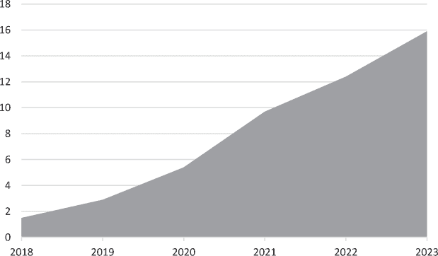

这种对区块链技术的巨大兴趣和大量投资并非没有前景。根据领先的研究机构 Gartner 的说法，“到 2025 年，区块链带来的业务价值将增长到略高于 1760 亿美元，然后在 2030 年前飙升至超过 3.1 万亿美元。”⁵ 反映相同观点，德勤在 2019 年调查的企业高管中，超过一半的人将区块链列为五项最关键的战略优先事项中，另外 27% 的人认为它很重要但非关键。⁶ 在同一调查中，超过 80% 的受访者认为区块链存在令人信服的商业案例，并且最终将被主流企业采用。

鉴于上述趋势，业务领导者和专业人士获得对区块链的非技术性理解至关重要，了解其工作原理、优势和局限性、安全和隐私问题以及财务和监管障碍（如果有的话）。本书旨在为会计和商业专业人士提供底层技术和区块链特性的非技术性解释。

区块链是一种记账系统，其中被称为交易的事件存储在 *区块* 中。这些区块被追加到之前的区块，形成 *链*。该技术的独特性在于它确保区块的添加方式形成 *链* 而不是 *树*，即没有 *分叉* 或主要的 *分支*。记录或 *账本* 维护在多个位置，没有单一实体控制记录，使其具有 *分布式* 的特征。数学学科 *密码学* 和计算机技术 *哈希函数* 被广泛用于帮助编码数据以便更易存储。区块链的关键特征是去中心化、持久性、匿名性和可审计性。区块链的关键优势之一是它促进了不信任的陌生人之间的货币交换，而无需金融中介或“可信第三方”的服务。这一特性使得加密货币交易成为可能，并在未知且互不信任的各方之间转移数字资产。

区块链的关键特征之一是其不可变性，这意味着一旦记录被写入区块链，就无法被擦除或更改。需要高度可靠性和诚实性的业务功能或流程因此是区块链采用的主要受益者。此外，对于在繁琐的记录保存中耗费大量资源且记录真实性存疑的业务流程，区块链提供了解决方案。

尽管在过去十年中获得了认可，但支撑区块链功能的某些计算机科学理论和算法早在几十年前就已提出。图 1.2 提供了支持区块链功能运行的各种计算机科学发展引入的时间线。

区块链技术的一个基本部分就是所谓的 Merkle 树。Merkle 树是一种结构，允许对大量数据中的内容进行高效且安全的验证。该树为区块链提供了可审计性和可验证性的关键属性。Merkle 树的概念由 Ralph Merkle 于 1979 年在其美国斯坦福大学的博士论文中提出。Merkle 树将在 第 3 章 中进一步讨论。独立于 Merkle 树和数据存储技术的研究，Nick Szabo（1994 年）提出了一个后来被称为“智能合约”的概念。Szabo 将智能合约定义为可机器读取的交易，该交易创建具有预定条款的合同。⁷ 智能合约在 第 5 章 中进行了详细讨论。1999 年，“工作量证明”一词在学术期刊文章中被提出。⁸ 中本聪于 2009 年 1 月 3 日推出比特币，该货币获得了巨大的流行。中本聪发布的白皮书将在下一章中讨论。加拿大少年 Vitalik Buterin⁹ 发布了一份白皮书，导致以太坊于 2015 年推出。2017 年 8 月，比特币的市值首次超过 1000 亿美元，不久之后，以太坊的市值也超过了 1000 亿美元。¹⁰

**图 1.2：区块链历史中的关键事件日期。**

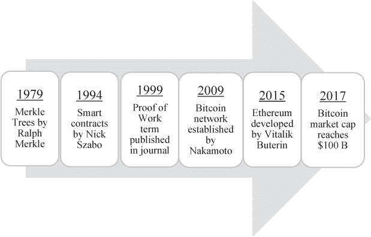

本书其余部分分为三个部分。在第一部分，第 2 章–第 6 章，我们为非技术读者介绍区块链技术的基础。我们首先讨论比特币与区块链之间的联系，以及为什么区块链的基础设施对于实现加密货币交易至关重要。在 第 3 章 中，我们介绍区块链的术语和命名法，我们提供这些词的精确定义，并将其与会计和商业术语中该词的常见用法进行对比。一些对区块链的混淆和过度宣传可以归因于区块链中术语的创造，即使用会计和商业中众所周知的术语，并在更广泛或不同的上下文中使用这些术语。在 第 4 章 中，我们解释共识机制。在 第 5 章 和 第 6 章 中，我们分别描述智能合约和代币化。

在第二部分，第 7 章–第 11 章，我们介绍加密货币之外的区块链应用用例。这些是领域专家为本书贡献的章节。第 7 章 制定了评估区块链是否适合业务应用的框架。在 第 8 章 中，介绍了 Curzio Research 基于区块链的安全发行方案的实际案例研究。它描述了流程、推出情况、发行人的经验以及相对于传统证券发行的优势。在 第 9 章 中，介绍了区块链在冲突矿产追踪中的应用。在 第 10 章 中，讨论了日本房地产的代币化和区块链交易。第 11 章 提供了一些额外的有趣区块链用例。

在第三部分，第 12 章–14，我们介绍区块链对企业和会计的技术影响。第 12 章 讨论了将区块链纳入记录业务流程后内部控制流程会受到怎样的影响。第 13 章 介绍了企业在区块链上进行交易时对财务审计的影响。第 14 章以对该技术目前面临的机会、漏洞和威胁的讨论作为结尾。

## 注释

1. 从 2016 年第三季度到 2019 年第四季度，根据 Statista，数据可在 [`www.statista.com/statistics/647374/worldwide-blockchain-wallet-users/`](https://www.statista.com/statistics/647374/worldwide-blockchain-wallet-users/) 获取。

2. [`www.idc.com/getdoc.jsp?containerId=prUS44898819`](https://www.idc.com/getdoc.jsp?containerId=prUS44898819)

3. *来源*: [`www.cnbc.com/2019/12/16/china-looks-to-become-blockchain-world-leader-with-xi-jinping-backing.html`](https://www.cnbc.com/2019/12/16/china-looks-to-become-blockchain-world-leader-with-xi-jinping-backing.html)

4. 数据来自 IDC Research。

5. *来源*: [`www.gartner.com/en/newsroom/press-releases/2019-07-03-gartner-predicts-90-of-current-enterprise-blockchain`](https://www.gartner.com/en/newsroom/press-releases/2019-07-03-gartner-predicts-90-of-current-enterprise-blockchain)

6. *来源*: [`www2.deloitte.com/content/dam/Deloitte/se/Documents/risk/DI_2019-global-blockchain-survey.pdf`](https://www2.deloitte.com/content/dam/Deloitte/se/Documents/risk/DI_2019-global-blockchain-survey.pdf)

7. “智能合约是一种计算机化交易协议，执行合同的条款” (Szabo, 1994).

8. 在题为“工作量证明与布丁协议”（Jakobsson & Juels, 1999）的论文中。形式化了工作量证明的概念，该概念要求“证明者向验证者证明她已执行了特定数量的计算工作。”

9. [`blockchainlab.com/pdf/Ethereum_white_paper-a_next_generation_smart_contract_and_decentralized_application_platform-vitalik-buterin.pdf`](https://blockchainlab.com/pdf/Ethereum_white_paper-a_next_generation_smart_contract_and_decentralized_application_platform-vitalik-buterin.pdf).

10. *来源*: [`www.forbes.com/sites/cbovaird/2017/10/20/bitcoins-market-cap-is-now-more-than-100-billion/#72cd48d22b8b`](https://www.forbes.com/sites/cbovaird/2017/10/20/bitcoins-market-cap-is-now-more-than-100-billion/#72cd48d22b8b)

# 2 支持比特币的基础设施：区块链

## 2.1. 引言

区块链技术与比特币的推出同时发展，比特币是最早的，也是可以说最知名的加密货币之一。虽然区块链是促进比特币增长和普及的重要组成部分，但其潜在应用可能存在于加密货币之外的领域。后文将讨论区块链技术在其他商业用途和应用中的采用示例。

在深入探讨区块链技术及其潜在应用的复杂性之前，了解其起源——开发该技术的动机、其目的和局限性是很重要的。区块链的概念，尽管名称并非如此，已在计算机科学研究论文中提出。¹ 本章讨论了计算机科学家所处理的引入一种新货币比特币的会计、经济和金融问题。

在 2000 年代，电子商务在全球蓬勃发展，世纪之交时年增长率约为 30%。² 尽管如此，互联网上的金融交易完全依赖“受信任的第三方”来通过处理电子支付来促进交易。这些“受信任的第三方”对每笔交易收取名义佣金，增加成本，从而在系统中造成摩擦。虽然对于大额货币交易而言佣金可以忽略不计，但对于小额交易而言则不成比例，从而抑制了这些交易。

计算机科学家和互联网爱好者开始对创建一种系统感兴趣，该系统可在无需金融机构作为中介的情况下允许两个未知方之间进行金融交易。PayPal 是该领域较早的创新之一，并成为最受欢迎的第三方支付处理商，据估计有 20% 的所有电子商务交易通过其平台进行。从这个意义上说，PayPal 的商业模式是要成为金融机构作为受信任第三方的替代品。因此，它没有兴趣开发一种消除对受信任第三方需求的系统。因此，随着加密货币的出现，仍需要开发一种促进电子商务而无需依赖金融中介或受信任第三方的机制。

本章其余部分组织如下。下一节我们从历史角度探讨贸易如何演变以及货币在该演变中的作用。接下来我们讨论信任对贸易和经济繁荣的重要性。第 2.4 节介绍加密货币及其遇到的诸多挑战。下一节介绍区块链作为解决加密货币固有挑战的解决方案。第 2.6 节说明比特币交易如何记录在区块链上。第 2.7 节总结时认为，区块链的特征具有比仅仅促进比特币交易更广泛的适用性。

## 2.2. 贸易的演变 – 从物物交换到加密货币

贸易，或个人或社会之间货物或服务的交换，可追溯到人类文明的黎明。贸易以某种形式早于货币，是现代社会形成不可或缺的一部分，并随着时代的演变而发展，如图 2.1 所示。早于货币引入的贸易是通过物物交换完成的。物物交换可以追溯到公元前 6000 年，并由美索不达米亚部落实践。基本上，物物交换是在交易中不使用货币而在两方之间进行货物和服务的交易。在古代，食物、香料和武器通常被交易，而盐是物物交换的一种有价值的媒介。事实上，罗马士兵是用盐支付的。

图 2.1：历代贸易。

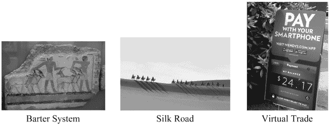

*来源*：“古埃及壁画碎片” by Gary Lee Todd, Ph.D.⁹

物物交换即使在今天在某些领域也很流行。网站的交叉广告主要通过物物交换进行。简单性是物物交换的主要优势之一。然而，物物交换交易中的各方通常花费时间和精力谈判条款，而且交易通常不是以公平价值进行，而是以买方感知的价值进行。在十七世纪，美国的定居者用玻璃珠、银饰品和铜与急需的玉米和毛皮进行物物交换。在物物交换体系中，物品的交换发生在个人之间，因此不需要“受信任的第三方”。一旦交易完成，销售通常是最终的且不可逆转。

现代货币出现得要晚得多，大约在公元前 600 年在吕底亚引入。货币的引入帮助吕底亚增加了贸易，使其在当时成为小亚细亚最富有的帝国之一。随后，由贵金属和半贵金属制成的各种形状和形式的硬币最终演变为圆形，这种圆形在随后的 1,500 年里在亚洲和欧洲普遍流行。

纸币在中国大约在公元七世纪引入，并在马可波罗约 1270 年访问时左右得到广泛使用。事实上，中国古代统治者对控制货币供应及其对经济的影响有基本的认识。有趣的是，即使在当时，政府也对假币保持谨慎。古代中国货币上有“所有伪造者将被斩首”的铭文。³ 惩罚严厉，因为假币对经济的威胁是严重的。

在西方世界，纸币在十七世纪的瑞典才被采用得晚得多。银行首先尝试发行纸币，通常以失败告终。政府大约在 1820 年代开始发行纸币，并通过引入金本位稳定货币。信用作为货币的引入同时发生，大约在十七世纪下半叶。那个时期的英国经济扩张得到了信用的扩张支持。纸币和信用的可用性都鼓励了西欧的经济增长及其向新世界的扩张。

## 2.3. 信任 – 贸易的基础

交易建立在信任的基础上。在古代，在物物交换制度下，两人会在面对面的交易中交换货物。各方会评估所交易物品的质量，因为几乎没有退货的追索途径。后来，随着货币的出现，交换通过货币得以便利，双方无需再寻找对方身上有价值的东西来完成交易。

在传统零售贸易中，货币与商品的交换几乎是同时发生的。如果以现金付款，就不需要受信任的第三方来保护买方和卖方的利益。然而，即使在这些微不足道的情况下，违约风险较高的那一方通常需要在收到之前先履行自己的承诺。例如，当我们使用快餐店的得来速时，我们点餐、付现金，随后很快取走订单。付款与取餐之间的时间差极小。然而，正如你在使用得来速时可能注意到的，顾客总是先付款再取餐。也就是说，收款任务总是先于订单履约任务完成。为什么会这样？坦率地说，因为商家不信任顾客。商家认为，如果任务顺序颠倒，即先交付商品再收现金，那么存在非零的概率某些顾客会在付款前开车拿着订单溜走。在这种情况下，商家将无计可施。如果你想知道，为什么顾客要在取餐前先付现金？那是因为顾客有追索权。餐馆有一栋建筑，根本跑不掉！我们都经历过，有时订单没有正确完成，某些物品缺失。在这些情况下，作为顾客我们确实有追索权，我们不可避免地会进入餐馆投诉并取回我们已付费的物品。同理，出于同样的原因，美国许多加油站要求顾客预付押金或在加油前提供信用卡。

前述情况在你去一家不错的堂食餐厅时会完全逆转。在那里，顾客先被上菜，然后再付款。由于顾客坐在餐厅的范围内，离开而不付账可能很困难，也有点尴尬。餐厅知道这一点，因此评估未付款的风险很低。在这些情况下，餐厅隐含地信任食客会在用餐后履行其付款义务。

在全球贸易中，尤其是通过互联网进行的贸易，买方和卖方并不面对面会面。他们远程进行交易，商品、服务或货币在买方和卖方之间没有身体接触的情况下交换。在这些情况下，任何一方都需要保护，以确保另一方履行交易义务。当两个诚实的人因为从未见过、互动过或了解彼此而无法相互信任时，双方都需要一个受信任的第三方作为中介来促进交换。受信任的第三方向交易方提供隐含保证，即交易条款将被遵守，如果任何一方对交易不满意，他们可以以最小的成本撤销交易。对于这项服务，受信任的第三方会对每笔其担保的交易收取少量费用。

受信任的第三方能够提供这种保证，因为它可以访问各方的记录，并能向卖方保证买方有足够的资源支付购买款项。由于卖方无法直接观察买方的银行账户或财富，他们需要金融中介的服务。如果买方的财富是公开信息，每个卖方都可以独立实时核实买方是否有资源完成购买，我们是否仍需要受信任的第三方作为中介？

个人财富的公开记录并不是一个新概念或现代概念。即使在古代文明中，没有太多现代舒适或贸易，人们仍然意识到他们需要某种财富衡量标准，让每个人都能同意某人有能力支付并购买商品或服务，在这种情况下，财富从买方转移到卖方。经济学家们喜爱的货币发展经典案例之一，是一个名为雅浦的偏远小岛的案例。雅浦位于太平洋，菲律宾以东，巴布亚新几内亚以北。雅浦没有可兑换成货币的贵金属，但他们在数百英里外的另一个岛屿帕劳发现了石灰石矿床。数个世纪前，雅浦人将石灰石矿床雕刻成巨轮（见图 2.2），并开始使用这些圆盘作为财富的代表，即我们所说的货币。⁴ 这些石头被称为 Rai，在雅浦岛上被认为极其珍贵。由于 Rai 难以生产和运输，只生产了少量，这在很长一段时间内稳定了 Rai 的价值。最后一块是在 1931 年生产的，此后这些石头在雅浦经济中总体上保持了其价值。

### 图 2.2：雅浦货币（Rai）。¹⁰

雅浦人开始用石头作为货币，购买生活用品甚至用于嫁妆。然而，与纸币不同，这些石头很重，有些重量超过一辆汽车——携带它们进行交换有点麻烦。因此，货币和财富的概念变得更加抽象。当雅浦发生交换时，石头并未被移动，只是岛上每个人都知道石头有了新主人。事实上，村里每个人都知道这些石头的现任所有者。石头货币的显著特点是，它可以在没有任何标记指示交换的情况下改变所有权，而石轮仍留在前任所有者的处所中未被扰动。诺贝尔奖得主米尔顿·弗里德曼将雅浦货币与金本位制进行了比较。⁵

## 2.4. 加密货币 – 基本特征与挑战

纯粹的点对点电子现金版本将允许在线付款直接从一方发送到另一方，而无需通过金融机构。与真正的现金不同，加密货币存储在用户的计算机或智能手机上，而不是钱包里。当买方通过加密货币进行购买时，他们不会实际递交现金或任何有形物品，而是通过互联网承诺资源，类似于传输文件。

在传输计算机文件与传输有形物品之间存在基本区别。一旦我把现金或其他有形物品给你，我就不再拥有它，也不能把同一物品给另一个人。然而，当我传输一个计算机文件，比如把本章的 pdf 发送给我的编辑时，我发送给她的是一个副本，我的电脑上仍保留原件。此外，没有任何限制阻止我将同一文件发送给另一个人。将此示例扩展到加密货币领域。转移加密货币就像传输计算机文件，我们发送的是副本而不是原件。因此我们可能会把同一文件发送给另一个人。这被称为*双花*。

在现实世界中，使用真实货币时，每个人都坚持要拿到实际的纸币，我所知没有人会接受复印件。试想一下，如果我们被允许使用一张 100 美元钞票的复印件来购物。我们每个人都会无限富有！！只要有一台好复印机，我们就能买想要的任何东西。然而，在虚拟世界中，使用虚拟货币时，货币转移的是一份拷贝而不是原件，因此要让比特币运作，发明者必须解决双花问题。也就是说，即使交易是通过拷贝而不是原件进行的，一旦比特币被花费，买方将不被允许再次花费它。

因此，要使加密货币成功，“双花”问题必须得到解决。在传统方法中，受信任的第三方会维护记录并防止双花。数字签名提供了部分解决方案，但如果仍需要受信任的第三方来防止双花，主要优势就会丧失。提倡一种不依赖“受信任第三方”的数字货币的计算机科学家必须找到替代方案，使所有参与者能够实时验证每一笔交易。也就是说，他们需要前面讨论过的雅浦货币的数字形式。基本上，虚拟社区中的每个人都会知道每个人拥有的财富，并了解使用比特币在网络领域发生的所有交易。

中本聪提出的解决方案依赖于一种点对点分布式方案，后来被称为区块链。点对点是一种去中心化的通信模型，其中每个参与方具有相同的能力，任何一方都可以发起会话。在计算机术语中，点对点网络允许每个节点同时充当客户端和服务器。点对点模型的早期流行应用之一是音乐分享应用 Napster。这种架构允许大规模并行计算环境。在区块链中，点对点分布式网络会对每一笔交易进行时间戳标记，从而保持交易的时间顺序。交易的验证检查被委托给多个用户和计算机。因此，系统不再依赖“受信任第三方”的诚实和完整性，而是依赖验证每笔交易的各个节点的诚实和客观性。中本聪断言，“系统是安全的，只要诚实节点集体控制的 CPU 功率超过任何合作的攻击者节点组。”我们将在后续章节详细阐述这一概念。

真正的挑战是我们希望有一个机制，使卖方能够知道买方是否有资源（或比特币）来支付商品。让我们通过一个简单的例子来理解这个问题。假设我和妻子在国外度假，有一天早上她说她完全没有当地货币，需要从银行兑换 500 美元。当天晚些时候，在我购物之前，我想知道她钱包里还剩下多少外币。与其问她或翻看她的钱包，这肯定会惹她生气，我决定回忆她当天所做的所有购买并从 500 美元中减去该金额。如果我知道她当天开始时的金额，并且有一份她所有支出的完整清单，我就可以推断出她还剩下多少钱。

中本聪的解决方案类似。对于每一个买家，如果我们知道他们过去获得的所有比特币，并且有一份买家花费比特币的所有时间的完整清单，我们就会知道还剩下多少以及买家是否有足够的比特币转移给卖家。在这种意义上，起作用的是最早的交易。一旦我们拥有最早交易无可争议的记录，未来的双花尝试就不重要了。基本上，要确定某笔交易不存在，就必须了解所有交易。在传统环境下，提供和验证这些信息是受信任第三方的角色。

在比特币模型中，在没有受信任第三方的情况下，每一笔比特币交易都必须公开宣布。此外，必须由多个参与方维护所有交易的多个完整记录，以便没有任何一方可以在其他方不知情和未批准的情况下更改记录。由于只有最早的交易才有效，因此才重要，我们只需要一种方法让所有参与者就交易接收或执行的顺序达成单一的历史共识。为了让卖方确信付款有效，系统中大多数参与者必须承认该特定交易是针对买方现有资源提出主张时收到的第一笔交易。一旦该特定卖方的交易被认定为第一笔，资源的转移就是永久的且无法更改。此特性被定义为 *不可变性*。记录是安全且永久的，因为它们是不可变的，即一旦记录就无法随后更改。

## 2.5. 区块链介绍

将上述概念扩展到数字领域，参与者被“节点”取代，表示一个计算单元。交易存储在区块中，一系列区块构成了区块链。为了确保报告交易的节点是合法的，它们必须进行 *工作量证明*。⁶这就像我们人类有时必须向计算机证明我们不是机器人，通过识别一系列图片中的交通灯！一旦交易由其中一个节点验证并记录，它就会传输到网络中的所有节点。每个节点都维护经过验证的交易的相同副本，这些副本称为 *区块*。节点开始处理下一组交易并重复该过程。简而言之，这些步骤总结如下⁷：

*   新交易被广播给所有节点。
*   每个节点将新交易收集到一个区块中。
*   每个节点致力于为其区块找到一个困难的工作量证明。
*   当一个节点找到工作量证明时，它会将区块广播给所有节点。
*   只有当区块中的所有交易都有效且尚未花费时，节点才会接受该区块。
*   节点通过致力于创建链中的下一个区块来表达对该区块的接受。

最后一个要点并非微不足道，需要进一步阐述。假设在一次会议上，正在讨论一个具有挑战性的问题。有很多讨论，但最终有人提出了一个很好的建议，人们点头并转到下一个议题。对某个主题的讨论结论和对下一个主题的继续是一种对前一主题最终陈述的共识的隐含承认。区块链中的协议遵循同样的原则。一旦节点接受了另一节点提交的 *工作量证明* 的解决方案，并验证了随工作量证明一起发送的新区块中的所有交易，它们就开始使用已接受区块的 *哈希* 作为前一个哈希来处理下一个区块。⁸

数字解决方案的运作始于时间戳服务器。时间戳服务器对一批项目的区块进行哈希处理并广泛发布该哈希值。哈希中包含的数据表明该交易必须在当时已存在。此外，由于哈希是全面的，如果某笔交易未包含在哈希中，则意味着该交易当时并未发生。按照中本聪的说法，“每个后续时间戳（或区块）都包含前一个时间戳（区块），从而形成一条链”——因此得名区块链。因此，每个后续区块都包含前一个区块的信息，从而强化了之前发生的所有交易。

当节点从其他节点收到冲突的解决方案时，默认情况下它们总是认为最长的链是正确的，并会继续努力扩展它。如果两个节点 `A` 和 `B` 同时广播下一区块的不同版本，一些节点可能先收到 `A`，而另一些节点可能先收到 `B`。在这种情况下，节点会处理它们先收到的那个分支，但会保存另一个分支，以防它在另一个分支之前变得更长。假设节点 `D` 最先收到 `A`，但后来发现 `B` 变长了，并且被 `H` 发送的新区块取代。现在 `D` 将丢弃链 `A`，并开始使用来自 `H` 的更长链。这样就能始终确保更长的链是有效的，并且不会出现太多大小相同的竞争链。当出现冲突时，这些冲突会迅速得到解决，即在下一次迭代中解决。

新区块形成后，意味着已花费大量工作来满足工作量证明。因此，如果不重新做工作，就无法更改该区块。随着区块链通过后续区块的添加而增长，更改记录的工作不仅限于重做该特定区块，还需要重做每个后续区块的工作。因此，随着新区块被添加到区块链中，修改早期区块所需的工作量呈指数级增长。区块链的这一特性有助于维护其完整性和不可变性。也就是说，一旦交易被添加到区块中并被其他节点接受，就无法更改或删除。如果出于正当理由需要删除交易，则必须提出一笔新的交易来逆转之前的交易。因此，将永久记录该交易最初发生的情况以及随后被逆转的记录，这可能与表明该交易从未发生过具有不同的含义。

总之，比特币致力于创建一个系统，允许两个互不相识的各方在无需中介或可信第三方的情况下进行虚拟交易。这需要一个基于密码学证明的电子支付系统。为实现这一目标，需要网络通过将交易哈希到一条持续的链中来进行时间戳标记。这形成了一种账本，即交易的详细历史记录，其不可变之处在于无法更改。最长的链不仅作为所见事件序列的证明，还使系统能够保持完整性。

## 2.6. 通过区块链实现的比特币交易示例

比特币是第一个广泛采用的无需中央机构或第三方记录和跟踪所有转账的资金转移机制。因此，验证交易和实现转账的过程比传统的借贷复式记账系统更困难。此外，为了使机制更复杂，比特币向参与者发行新货币，作为他们维护其记账系统的激励，包括验证交易的有效性。

**表 2.1:     比特币活动统计（截至 2019 年 12 月）。**

| 已开采比特币总量 || 约 18.1 百万 |
| --- | --- |
| 市场资本化（美元） || 约 127.6 十亿 |
| 所有区块头和交易的总大小 || 约 258,000 MB |
| 每个区块的平均交易数 || 2,200 |
| 平均区块大小 || 1.1 MB |
| 交易被接受的中位时间 || 9 分钟 20 秒 |
| 难度等级 || 14,776, 367,535,688^a |
| 每次交易成本 || $43 |

*来源*：数据来源于 [`www.blockchain.com/charts`](https://www.blockchain.com/charts)。

^a 启动时的难度等级在 2009 年全年为 1.0，2016 年 12 月为 310,153,855,703。

比特币的增长非常惊人。比特币仅在 2009 年推出，约 10 年后，其市值在 2019 年底已增长至约 1280 亿美元（参见 表 2.1）。为了说明该数额，图 2.3 显示了相对于其他指标的可比价值。

比特币软件可免费从 [`bitcoin.org/en/choose-your-wallet`](https://bitcoin.org/en/choose-your-wallet) 下载。比特币的一个基本功能是在用户计算机上创建 `wallet`，用户可在其中存储她的比特币。比特币软件还为用户创建了一个单独的节点，该节点连接到比特币的点对点网络，仅需要标准的互联网连接。它还提供对区块链数据结构的访问并验证所有过去的比特币活动。无论用户何时加入网络，它都会获取在新用户加入比特币网络时嵌入最长链中的整个比特币交易历史记录。

比特币的持有情况以交易形式记录。人们并不简单地持有比特币，而是参与公开可验证的交易，显示他们是如何获得这些币的。比如，我从出版社因撰写本书获得版税而收到五枚比特币，其中我将一枚比特币转移给我的出版代理 Jeanne。当 Jeanne 收到比特币时，她会验证我确实从出版社 Emerald Publishing 收到五枚比特币，并且在此之前没有花费全部五枚比特币的交易。在我从 Emerald 收到五枚比特币到将其中的一枚转移给 Jeanne 之间，如果没有之前的交易，则向 Jeanne 的转账是首次转账，将在下一个区块中如此记录，Jeanne 可以确信她的这一枚比特币是安全且无可争议的，永远如此。

**图 2.3:    比特币价值与其他经济指标的比较。**

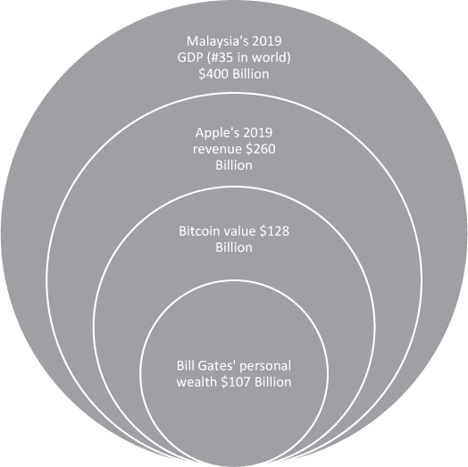

每个比特币交易都可被每个人读取，记录存储在各个节点中。任何人只需加入网络，就可以在当时的最长链上看到整个已验证交易的历史记录。图 2.4 说明了比特币的交易流程和验证方法。在图示中，假设 Chris 从 Bob 收到三枚比特币。Chris 必须验证 Bob 确实有三枚比特币可转给 Chris。为此，Chris 确定 Bob 最初何时以及如何收到三枚比特币。在此示例中，Adam 已将三枚比特币转移给 Bob，该交易在区块上进行了时间戳标记。接下来，Chris 和矿工必须确认 Bob 之前并未转移这三枚比特币。换句话说，他们必须验证 Bob 没有任何支出交易。一旦验证完成，Bob 向 Chris 转移三枚比特币的交易将被确认并记录在区块以及每个后续区块中。

**图 2.4:    区块上的交易记录。**

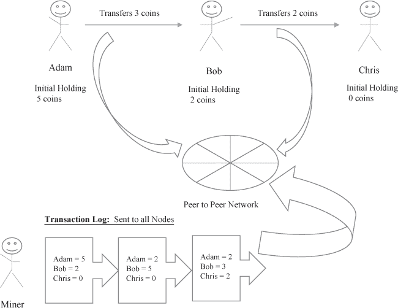

*来源*：改编自 Böhme、Christin、Edelman 和 Moore（2015）。

比特币依赖于公钥-私钥密码学，其更详细的技术解释将在后续章节中阐述。在此我们提供一个简单的说明，介绍其在上述示例中的工作原理，作为对底层过程的介绍。简而言之，有两种类型的密钥：私钥和公钥。私钥仅用户自己知道，而公钥则广泛共享。在图 2.4 中，亚当通过在比特币网络上发布消息并引用他最初获得这三枚比特币的交易，向鲍勃发送三枚比特币。该消息使用亚当的私钥加密，以表明该消息来自他。当鲍勃将三枚比特币转移给克里斯时，他同样使用自己的私钥发布一条消息，表明他正将从亚当处收到的比特币转移给克里斯。比特币交易在被添加到共识区块链之前不会清算。在表 2.1 中显示，截至 2019 年 12 月，每九分钟就会添加一个新区块。一旦交易被记录在区块中，它们就会得到验证并包含在每一个后续区块中，因此形成不可变的永久记录。

## 2.7. 超越比特币的区块链

正如本章所述，区块链是使比特币成长的关键技术，是其基础设施。区块链使比特币交易无需第三方验证即可进行。比特币或许可以通过类似 PayPal 的第三方验证机制作为加密货币运行。然而，区块链技术使比特币交易无需第三方即可进行，从而提高了比特币的普及度和功能性。

**图 2.5：    比特币：区块链：汽车：道路。**

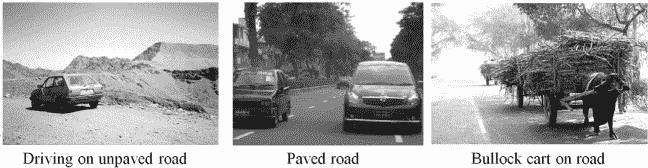

为了充分理解比特币与区块链之间的关系，请考虑汽车的发明与铺装道路之间的关系。在二十世纪之交，当汽车首次引入时，这些汽车大多只能行驶在为马车设计的鹅卵石道路上。虽然汽车可以在未铺装的道路上行驶。（图 2.5 中的面板 1，图 2.5），但功能有限。汽车在未铺装道路上行驶时无法达到其全部潜能或速度，而且乘坐也不舒适。美国在约 1920–1950 年间修建沥青道路和高速公路（图 2.5 中的面板 2，图 2.5）极大地促进了汽车的性能和功能。汽车在沥青路上的行驶速度远快于草地或鹅卵石路面，而且乘坐更舒适。然而，当铺装道路变得普遍后，现有的或古老的交通方式也被改装以在沥青铺装道路上获得更好的性能。即使是数百年历史的牛车，在装上橡胶轮胎后在这些道路上的表现也更好（图 2.5 中的面板 3，图 2.5）。

类似地，区块链的引入及其被纳入比特币，使得交易可以在无需可信第三方的情况下在两个参与方之间进行。这降低了交易成本，类似于减少摩擦，从而导致比特币的流行程度蓬勃发展，类似于汽车在铺装道路上的性能。然而，一旦区块链技术得到开发，其特性就可以被利用来改进现有的业务流程或开发以前难以解决的新应用。在本书的后续章节中，我们将讨论区块链的这些额外应用，超越比特币的应用。

### 注释

1. 关于区块链的开创性论文以白皮书的形式在互联网上自行发布，可在 [`bitcoin.org/bitcoin.pdf`](https://bitcoin.org/bitcoin.pdf) 找到（于 2020 年 1 月访问）。

2. 数据取自 [`www.marketplacepulse.com/stats/us-ecommerce/us-e-commerce-growth-rate-55`](https://www.marketplacepulse.com/stats/us-ecommerce/us-e-commerce-growth-rate-55)。

3. 请参阅 [`www.bbc.co.uk/ahistoryoftheworld/objects/F3oFoFDuTx-rzhCkCL9_BA`](http://www.bbc.co.uk/ahistoryoftheworld/objects/F3oFoFDuTx-rzhCkCL9_BA)（于 2020 年 1 月访问）。该网站上有一张古代中国纸币的图片，其上的铭文写着，“伪造者死。”

4. 国家公共广播电台对 Yap 货币进行了专题报道，可在：[`www.npr.org/sections/money/2011/02/15/131934618/the-island-of-stone-money`](https://www.npr.org/sections/money/2011/02/15/131934618/the-island-of-stone-money) 获取（于 2020 年 1 月访问）。

5. 米尔顿·弗里德曼（1994）在其著作 *Money Mischief* – *Episodes in Monetary History* 中讨论了 Yap 货币。

6. “工作量证明”的特性和重要性将在后续章节中更详细地讨论。

7. 此要点列表改编自中本聪的原始出版物。

8. 哈希是计算机科学中的常见做法，其中原始数据被另一值掩盖，例如将字母转换为数字。它在密码学中也很常见。

9. [`ccsearch.creativecommons.org/photos/b43e6343-64e5-433a-b4fb-8d68ae5dc6fc`](https://ccsearch.creativecommons.org/photos/b43e6343-64e5-433a-b4fb-8d68ae5dc6fc)；沙子和海啸；[`ccsearch.creativecommons.org/photos/a03c3b4d-4c69-4568-b097-29920736b325`](https://ccsearch.creativecommons.org/photos/a03c3b4d-4c69-4568-b097-29920736b325)；JeepersMedia；[`ccsearch.creativecommons.org/photos/ee1d50cb-286f-4893-b499-3e3522067db9`](https://ccsearch.creativecommons.org/photos/ee1d50cb-286f-4893-b499-3e3522067db9)。

10. [`ccsearch.creativecommons.org/search?license=&license_type=&categories=&extension=&aspect_ratio=&size=&source=&q=yap%20money&searchBy=&mature=/`](https://ccsearch.creativecommons.org/search?license=&license_type=&categories=&extension=&aspect_ratio=&size=&source=&q=yap%20money&searchBy=&mature=/)

# 3. 区块链术语基础入门

## 3.1. 引言

正如前一章所述，区块链是一种使能技术，因为它促进了不可变的记录保存。记录本身可以是任何对象的，从体育记录、教育认证、所有权或货币交易。 这种新型记录保存机制最著名的应用是在加密货币中，因此许多人将区块链与比特币联系起来。然而，正如前一章所述，重要的是要记住比特币仅仅是区块链技术的一种实现。

可访问性、匿名性、不可变性和信息的实时共享是使区块链技术适用于复杂业务安排中的记录保存的一些关键特性。由于这些特性，区块链能够在两个参与方之间安全、匿名且不可变地转移货币、财产、数据或任何其他资产类型。此外，这是在无需经过昂贵的中间机构的情况下实现的，而这些机构通常会收取代理或经纪费用来调解此类交易。区块链的一个被广泛接受的科学定义是¹

*一个点对点网络，通过将记录哈希成基于哈希的工作量证明的持续链来为记录添加时间戳，形成除非重新进行工作量证明否则无法更改的记录。*

在本章中，我们提供了对上述定义的非技术性理解，并消除关于区块链效用的一些流行神话。虽然区块链是一种有价值的技术，在商业和会计方面具有许多潜在应用，但它不能解决所有问题。它不会使传统的会计、法律或供应链职业过时。恰恰相反，通过提高效率和降低交易成本，它将实现许多微交易，而这些微交易实际上需要更多的传统服务。

区块链解决的原始问题是在不通过金融机构等中介的情况下，以安全、可信且不可逆的方式在陌生人之间转移资金。这一特性扩展后，使区块链能够在不一定互相信任的未知各方之间实现货币或资产转移。显然这一机制是有效的，因为比特币和以太坊的市场资本化均以十亿美元计，其中比特币的市场资本化接近 3000 亿美元，以太坊达到 2000 亿美元（参见 图 3.1）。它以一种更快速且成本远低于传统替代方案的可信方式实现。这一新技术的这些特性使其具有前景，并有能力颠覆传统的资产转移和记录保存方式。

**图 3.1：以太坊和比特币的市场资本化。²**

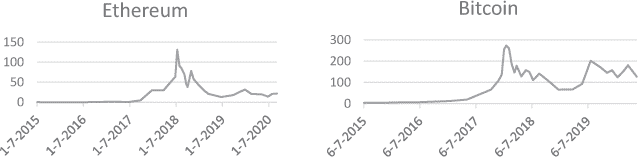

在剩余章节中，我们将提供区块链重要技术术语的非技术性描述，并驳斥一些神话和常见误解。在下一节中，我们讨论参与者是谁以及区块链中的交易构成是什么。在第 3.3 节中，我们阐明区块链术语中词语的上下文和定义与其在会计和商业中的传统含义或公认含义有何不同。我们还解释了为什么区块链不是“triple-entry record-keeping”或与通过借贷记录商业交易有任何相似之处。事实上，在区块链中录入交易并不能免除进行传统复式会计分录或维护会计账簿的需要。区块链技术的技术方面，例如 hashes 和 Merkle trees，在第 3.4 节中讨论。在第 3.5 节中，我们讨论基于成员资格标准和数据访问的多种类型的区块链。接下来，在第 3.6 节中，我们简要描述一些将在后续章节中进一步扩展的区块链功能。在第 3.7 节中，我们描述当前可用的区块链平台的一个子集。第 3.8 节讨论流行的桌游大富翁如何被改编为在区块链上游玩。第 3.9 节以简要总结结束。

## 3.2. 参与者与交易

参与区块链的个人或组织称为参与者。参与者构成网络。个人或组织决定加入一个具有共同目标而形成的群体。这一共同目标可能是任何共同利益，例如资金转移、维护特定行业的供应链完整性、矿物或农产品的来源。共享目标的更多示例将在后续章节中介绍，这些章节将更详细地讨论这些应用。

区块链网络中的所有参与者都是平等的，没有任何一个参与者拥有比其他人更多的权利或权力。由于网络没有单一的强大参与者或一个“central figure”，网络不是集中的，被称为 *去中心化* 网络。所有参与者具有相似的访问权限和权力。网络中的任何参与者都可以与其他参与者通信，利用无缝且直接的点对点通信。这种点对点通信使参与者之间能够直接转移资产、货币或记录，而无需通过一个“central”人物或中介。由于每个参与者都从网络中受益，他们有动力维护网络的完整性和正常运行。在后续章节中，我们将讨论参与者诚实并善意行事以维护和保护网络的经济激励。

网络参与者采取的行动称为“transactions。”如果参与者加入网络，这就是一次交易。当参与者请求向另一参与者转移资金或资产时，这是一次交易。当另一参与者接受资金时，这是一笔单独的交易。有趣的是，当参与者离开网络时，这也是一笔交易。一般来说，网络活动的任何记录都被标记为“transaction。”

在区块链术语中，“transaction”一词比其在传统会计和商业词汇中的含义和用法更为泛化。在商业教育中，我们将交易定义为与无关第三方有关的具有货币后果的商业事件。在会计术语中，交易被更精确、更狭义地定义为对财务报表产生影响，从而须符合会计机构（如 FASB 或 IFRS）制定的某些标准。

区块链有能力记录无限数量的交易。交易 ***仅*** 在网络参与者之间进行。区块链不会记录区块链成员与非成员之间的交易或往来，因为它不影响生态系统。每一笔交易都记录在数据 *ledger* 中。“ledger”一词仅表示一本书、一个登记簿或记录档案。在区块链的情况下，账本是传统登记簿的数字版本。

区块链中的账本是数字化的，因此可以轻松复制账本的多个相同副本并与所有区块链参与者共享。能够在不同位置维护多个相同账本副本的特性赋予了区块链相对于传统记录保存系统的关键优势。在使用实物记录的传统记录保存中，存在唯一的账本或记录簿，其保存在中央且安全的位置。该账本的副本并不那么可靠，因为它们可能无法实时更新，因此可能不完整。对唯一、安全且可靠的账本的需求需要集中化。账本的数字化消除了对这种中央人物或中介的需求。

为了充分认识这一特性的优势，请考虑银行或金融机构充当中央人物的传统系统。银行是唯一账本的保管者，该账本记录了所有交易。银行是唯一拥有、记录、控制和管理账户持有人交易记录的实体。因此，个人交易记录只有一个副本。只有一套账簿。同样，当我们通过 Facebook 与朋友和家人通信时，所有通信都经过 Facebook 的服务器，因此 Facebook 拥有通过其服务器传递的所有信息和内容的所有权。区块链技术消除了中央人物的角色，而是将这种权力平等地分配给每一位参与者。数据账本保存在每个参与者节点上，从而消除了任何一方对数据的控制。

这个数字账本按发生的顺序详细记录每一笔交易。该账本的多个实时分布式副本使得任何一个参与者都不可能*事后*篡改记录。即使任何参与者都可以更改其控制下的账本并修改过去的交易，其账本现在也会与其他参与者持有的账本不同步，因而无效。这就导致了区块链的关键优势——记录的不可变性。也就是说，一旦交易被记录并被大多数参与者接受，该交易的记录就是永久的，不能被任何一个参与者或一小群参与者更改。因此，区块链在数据账本中记录并存储所有交易，所有这些记录都可供任何参与者访问。

区块链账本是不可变的且不可修改的。换句话说，它是只写或仅追加的。参与者允许添加新的交易记录，但不允许修改或更改现有记录。当交易需要被撤销时，无论是因为录入错误还是未执行，都必须做出单独的记录。因此，原交易细节将永久保存，后续的撤销也会如此。这种追加形式确保记录显示交易最初发生，并在稍后日期被撤销。而允许修改和更改会导致原始交易被删除。重要的是要理解这种细微差别，在区块链中，所有参与者即使在以后也能区分导致随后被撤销的交易的事件，以及那些从未导致任何交易被记录的非事件。

总之，区块链中的关键术语和命名法可能与其常见用法有略微不同的含义或细微差别。***参与者***或***成员***是指与其它参与者共享相同目标或利益的任何个人或组织，他们共同组成一个***网络***。网络由成员为特定目的形成和维护，网络中的规则和协议由具有共同目标或利益的成员管理。成员的每一次行动，例如加入网络、向其他成员请求、接受另一成员的请求、交换货物或金钱以及离开网络，都被称为***交易***。每笔交易都记录在数据***账本***中。数据账本实时共享给所有参与者，因此保存了数据账本的多个相同副本。每笔新交易必须先被接受，然后记录在账本中并与所有参与者共享。含义上的差异及其影响将在下一节讨论。

## 3.3. 一个词，两种含义及其他误解

如前所述，“transaction”在区块链术语中与我们在正常会计和商业用途中定义的 transaction 并不相同。从区块链的角度来看，参与者在区块链生态系统内的每一次互动都被定义为交易，其中只有一小部分符合会计背景下的交易资格。了解两者之间的区别将是一项有用的技能，因为业务流程和交易越来越多地转向区块链领域。虽然有人暗示区块链将取代会计职业，但这似乎不太可能。相反，区块链实际上可能使某些会计技能和知识更相关。³ 虽然区块链肯定会对一些会计程序和流程产生影响，但它也需要在会计和商业背景下开发新技能组合。例如，从区块链中识别应作为会计交易记录的“交易”的技能和知识将继续相关。对“交易”的这种筛选必须既有效又全面，即只能选择那些在会计背景下有影响的交易，而不能选择其他交易。做到这一点所需的技能和能力需要掌握相关且当前的会计准则。例如，在区块链背景下向供应商订购货物是一笔“交易”，但在会计中并不作为此类记录。

数据账本是区块链中所有交易的数字记录。如前所述，该账本在网络的每个参与者之间共享。每个参与者都维护账本的最新副本。这一特性使得任何一个成员都不可能更改其存储的账本中的记录，因为他们无法更改其他参与者持有的账本中的记录。如果未经其他成员的批准，所做的更改将不会被认可为有效。这使得任何一个成员都不可能更改其数据记录的版本，从而导致区块链的不可变特性。

相比之下，会计背景下的账本是一本包含所有账户的账簿，其中会计“日记分录”的信息作为借方和贷方记入。再次使用相同的词，其含义却非常不同。数据账本中没有“借方”或“贷方”的概念，它仅仅是所有交易的汇编，无论其是否对财务报表产生影响。而会计背景下的账本则维护账户余额的累计总额。每笔会计交易至少记录在两个账本账户中，使用“借方”和“贷方”的术语。即使使用区块链，这一过程仍将持续存在。从这个意义上说，区块链的数据账本并不是会计账本的替代品或替代方案。它们不承担相同的功能，因此很可能共存。

在区块链术语中，资产是指成员愿意在网络中交换的任何有价值的东西。它可以是货币、财产、加密货币、图片、记录、公司股份等。这与会计对资产的定义不一致。会计中定义的资产必须符合 FASB 或 IFRS 规定的某些标准。在会计背景下，资产是企业拥有的资源，具有为公司产生未来现金流的潜力，且其价值可以客观货币化。例如，知识产权的专利或版权可以在区块链中被称作资产，但不能用于会计目的。这样一种区块链应用在后面的章节中有所描述，其中音乐家通过区块链创作、分享和交易原创音乐。交易的内容在区块链术语中被称为“资产”，但在会计目的上不会被称作资产，因为它不符合作为资产确认所需的必要标准，即客观估值。

一个非常常见的误解，主要是由非会计计算机科学家传播的，是区块链是一种三重记账系统。⁴ 这个术语确实有*魅力*，当然“三重”比“双重”更好更安全，它很容易传达区块链技术是对当前会计流程的改进。虽然这可能有一定道理，但使用“triple-entry”一词来描述区块链的会计含义是不正确的。人们天真地假设双方之间的会计交易是彼此的镜像，即如果一家公司有收入，另一家就必须有费用；如果一方记录应收账款，另一方就必须记录应付账款。

这可能会让非会计人员感到震惊，但全世界各地的合并资产负债表并不一定需要平衡。双方法律主体之间的镜像会计交易是会计的一种简化概念，而在权责发生制会计中绝对不是如此。以一项简单的交易为例，即存货的购买。出售存货的供应商会记录收入，而买方则将购买记录为存货，即资产，而不是费用。对买方而言，存货只有在最终将其出售给另一客户，或出售由这些存货生产的产品时，才会成为费用，即销售成本。涉及资本租赁付款和涉及外币交易的交易，情况变得更加复杂。即使对于一家公司的应收账款导致另一家公司的应付账款这样直接的交易，对称性也无法保证。会计准则要求应收账款的记录必须经过评估，以确定该金额预计能够收回。如果有疑问，则不记录应收账款，而欠款公司仍必须记录应付账款。

尽管在主流商业媒体上有相反的出版物，区块链并不等同于三重底线会计，⁵这些会计细微差别并未被计算机科学家完全理解，导致对区块链有效性和其取代传统会计职能的能力的夸大主张。此外，“三重记账”这一术语甚至是由著名会计学者、卡内基梅隆大学教授尤里·伊吉里（Yuri Ijiri，1986 年）创造的。他的设想是对财富变化必须等于收入这一概念进行量化，并增加了概念使其确定变得可感知。因此，用“三重记账”这一术语来描述区块链的功能是错误的。

### 3.4. 区块、哈希和默克尔树

交易是成员行为及其相互之间互动的详细记录，这些记录被记录在 `block` 中。每个参与者都可以访问、验证和接受记录在区块中的交易。一旦大多数参与者接受该区块，它就会链接到当时最长链的末端区块。新区块将附加到的合法区块的识别是通过 `hash function` 实现的。

区块维护着交易的不可破坏记录。因此，每当有新交易时，就会创建一个新区块。创建后，区块必须由网络参与者使用预先确定的规则（稍后讨论）批准，然后附加到现有链上。新区块附加到链上后，就无法删除或修改。这些区块相互链接，形成区块链。每个区块都包含链中前一个区块的加密哈希值，该哈希值本身通过“哈希”与前一个区块链接，依此类推。链中的第一个区块称为 `genesis block`，后续区块依次链接到创世区块。

**图 3.2：    区块与哈希的说明。**

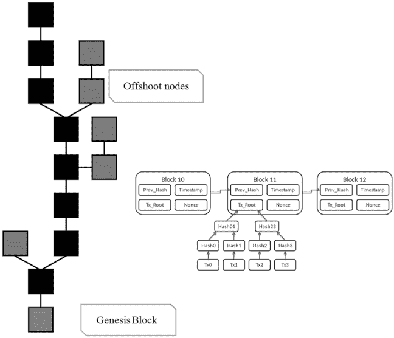

创建并附加新区块所需的时间称为 `block time`。区块时间在不同的区块链网络中有所不同。区块时间越短，新交易被记录并附加到链上的速度就越快。2019 年，以太坊平台的区块时间在 12 到 15 秒之间，最高约为 30 秒。相比之下，比特币最近（2018 年起）的区块时间在 10 到 12 分钟之间。⁶

区块的形成及其添加到现有链中的过程如图 图 3.2 所示。底部的第一个区块是创世区块。下一个区块被添加到此区块。在某些点会出现 `fork`，即处理了两个区块，然而，第一个被下一个区块添加的区块成为主要链并继续增长，而分支则不会增长。这是由于区块链的底层特性决定的，即最长的链是有效链，因此新区块被添加到当时的最长链上，从而使分支失效或被截断。

哈希函数是一种映射算法，如 图 3.2 所示，它将一个序列更改为另一个序列。换句话说，它使用数学函数从文本字符串生成一个值。哈希接受任意长度的输入并将其转换为固定长度的输出。⁷每次转换都是唯一且可逆的。也就是说，在知道哈希函数的情况下，可以逆向工程来解码原始消息。哈希过程有助于使消息传输免受篡改。

哈希函数确保每次使用相同的电子记录作为输入执行算法时都会给出相同的输出或结果。这使得在没有算法产生的哈希结果的情况下推导或重建原始电子记录在计算上不可行。由于每个哈希函数都是唯一的，因此使用该算法的两个电子记录不可能产生相同的哈希结果。这也被称为哈希函数的确定性属性。哈希函数还能够快速计算以确保系统的效率。

哈希函数的一个关键特性是，由于它是加密生成的，即使输入的微小变化也可能导致结果哈希函数出现很大差异。区块链的不可变性质量源于哈希函数的这一特性，确保记录数据的任何微小变化都可能导致哈希函数的巨大变化。哈希的另一个关键特性是，每个数据字符串都应具有唯一的哈希结果，如 图 3.2 所示。这是哈希函数的一个重要特性，以确保一旦我们拥有哈希，原始消息将被唯一检索，并且对于单个哈希检索到两个或多个原始消息的情况是极不可能的。

区块链是一个链表，包含数据和哈希指针，该指针将每个区块指向其前一个区块，如 图 3.3 所示。哈希指针不仅包含前一个区块的地址，还包含前一个区块内部数据的哈希值。哈希指针的这一微小特性导致了区块链的关键不可变性。维护前一个区块内部数据的哈希值可确保如果前一个区块中的数据即使是轻微更改，也会导致不同的哈希函数。 resulting 哈希函数将与存储在后续区块中的哈希函数不对应。因此，要成功篡改先前区块中的数据，就需要挖掘现在包含不同哈希的每个后续区块。

**图 3.3：    区块链的形成。**

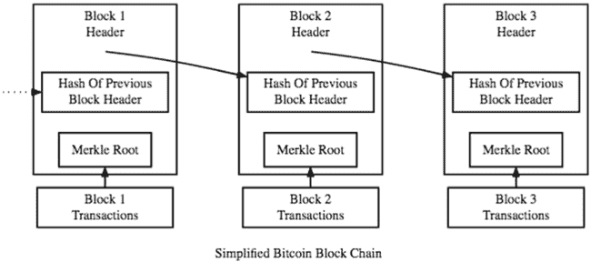

默克尔树的概念由 Ralph Merkle 开发并于 1979 年获得专利。⁸它从根本上说是一种数据结构树，是数据存储的一种独特组织方式，使检索任何特定记录变得更容易。在区块链中，每个区块包含数千笔交易，因此如果没有适当的检索机制，定位特定交易将极其耗时且繁琐。在默克尔树中组织数据可以极其高效地检索存储在区块中的任何交易的详细信息，从而更容易验证每笔历史交易的真实性和发生情况。

Merkle 树结构的一个重要特征是其能够对大量数据进行认证。它采用“分而治之”的策略，将大量数据分布为可管理的较小部分，这些部分单独验证起来更容易。遵循树的术语，Merkle 树由根、分支和许多叶子组成。根包含整个数据集的指纹。例如，比特币使用 `SHA-256` 算法。`SHA` 代表“Secure Hashing Algorithm”，256 表示输出的固定大小。

Merkle 树和哈希函数构成了区块链的计算和数学基础。Merkle 树和哈希函数的独特特性相结合赋予了区块链其有价值的属性。Merkle 树结构使得存储大量数据并在需要时轻松检索信息成为可能。此外，哈希函数提供了使过去区块中记录或加密数据的篡改变得困难的特性，从而赋予区块链不可变性。

## 3.5. 区块链的类型

区块链参与者以及区块链中存储记录的可访问性存在一些差异。这些差异导致区块链分为两类：许可型或非许可型；以及公有或私有。

许可型与非许可型网络的区别在于谁可以加入网络。任何个人或组织都可以随时加入非许可型网络。进入和退出网络不受监控，因此参与者可以自由加入和离开。相比之下，许可型网络不允许新参与者在未获得网络所有者或创建者许可的情况下加入。

在公有网络中，成员之间的交易对网络中的所有参与者可见。相比之下，私有网络仅允许交易各方访问和查看该交易。因此，私有网络通过限制对这些交易的公共访问来确保交易的保密性。

这两种差异导致了区块链的四种可能的排列组合，具体如下：

**1.** 公有且非许可型网络是最开放、最透明的形式。任何个人或组织都可以随意加入和离开网络。一旦个人成为网络参与者，他们将获得网络中所有当前和历史交易的访问权限。

**2.** 私有且非许可型网络允许广泛参与，使个人和组织可以自由加入。然而，交易的细节仅对交易各方成员可见。因此，新参与者无法查看历史交易，因为他们不可能参与过那些交易。

**3.** 公有且许可型网络限制哪些个人或组织可以加入网络。通常此类区块链仅限于创始参与者，后续参与者需受邀加入。大多数企业区块链，或供应链中组织之间的区块链都是许可型网络。一旦个人或组织被允许加入区块链，他们即可访问网络中记录的所有交易的详细信息。

**4.** 私有且许可型网络是区块链中最严格的形式。区块链不仅限制网络成员资格，还限制信息对网络参与者的访问。每个参与者只能获知其参与的交易的细节，而无法获知他人的交易。

区块链网络属性对监管机构很重要，因为某些配置使得监管机构更容易监控和控制网络。从监管角度来看，公有且非许可型网络最易于监控，因为可以无限制访问所有交易。

比特币是一个公有且非许可型网络；因此任何人都可以随时加入网络并访问所有历史记录。美国国税局（IRS），美国的税务机构，利用这一特性对挖矿和交易比特币的个人进行审计和征税。IRS 在国际机构和加密货币交易所的支持下，追踪全球数字货币的能力日益增强。⁹ IRS 直接与 Chainalysis 等区块链公司进行咨询，这使 IRS 能够领先参与者一步，帮助其识别洗钱者、逃税者以及从事非法交易的人员。

许可型与非许可型区块链特征比较的摘要见图 3.4。

**图 3.4：    许可型与非许可型网络特征比较。**

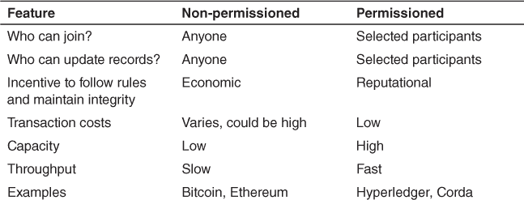

## 3.6. 区块链的核心特征

区块链有一些核心特征将在后续章节中更详细地介绍。本节对区块链的主要特征进行简要介绍：共识机制、智能合约和代币化。

共识机制类似于管理区块链网络的宪法或总体规则。它是网络参与者达成集体协议的规则和规定方法。该机制使多个参与者能够就一个版本的 *真理* 达成一致。随着每笔交易状态或真理的变化，共识机制应使参与者能够在新交易发生并追加到区块时持续就真理达成一致。该机制决定了网络何时以及如何将新交易追加到数据账本中。有不同类型的共识机制，将在下一章中更详细地讨论。

在大多数区块链应用中，执行交易需要费用。该费用由交易各方支付，并由将交易追加到区块的参与者或节点收取。这也称为 `gas`，它是执行交易所需的计算能力的度量，而 `gas cost` 是支付的费用金额。

智能合约是区块链的另一个关键特性，是编码到网络中的简单业务规则。只有在规定的业务逻辑得到满足时，交易才能发生。例如，在将资金从买方转移到卖方之前，网络会验证买方是否有足够的资金余额。一旦这类业务规则被编码到网络中，就会自动执行。当规定的条件不满足时，交易将被阻止。智能合约将在后续章节中详细讨论。

另一个常见的误用是“智能合约”一词的过度使用。虽然使用了“合约”一词，但这些合约没有任何法律效力，而仅仅是简单的业务规则。智能合约是自执行的，意思是当预条件满足时，合约会自动将货币或资产从一个参与者转移到另一个参与者。这些合约遵循简单的“`if-then-else`”规则，使交易更快且无错误，但没有法律效力。

代币化是区块链的另一个关键特性。简单来说，它是通过区块链交换的任何资产的数字化。代币化使资产可交易。底层资产可能是房地产、昂贵的绘画甚至是一首音乐作品。该概念将在后续章节中更详细地讨论。

## 3.7. 区块链平台

There are many blockchain platforms that have been implemented for different purposes. Blockchain platforms provide an ecosystem of different technologies that solves a specific problem. Bitcoin is one such platform and was implemented to facilitate exchange of currency between participants. Many more platforms have emerged since Bitcoin. Some of the common platforms are shown in 图 3.5 and a brief description of some are discussed in this section.

### 图 3.5：区块链平台。
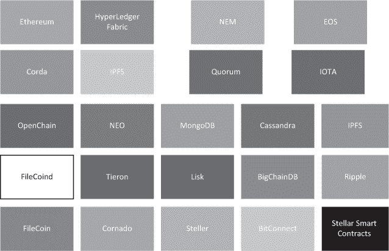

At the age of 19, a Russian-Canadian teenager Vitalik Buterin published the white paper, which went on to create Ethereum in 2015 as an open-source blockchain platform. It was the second public network and is an open and adaptable platform that allows anyone to build decentralized applications and network. The concept of smart contracts, though around for two decades, was popularized through the Ethereum platform and has become a building block for blockchain concept. Since its introduction, Ethereum has become the largest blockchain network with over 300,000 developers and over 2,000 decentralized applications (dApp).¹⁰ There are many new solutions, networks and currencies that are built on the Ethereum platform.

Hyperledger is a collaborative effort between different companies in various industries including, banking, e-commerce, Internet of Things (IoT), supply chains, manufacturing and technology. One of the successful projects is the Hyperledger-Fabric developed by IBM enabling business to business transactions. Hyperledger-Fabric provides the infrastructure that allows businesses to quickly and easily create their own private networks and data-ledger.

Other common platforms are shown in 图 3.5, and a brief description and their websites for a subset of those are as follows:
* NEM (nem.io) is a platform to develop permissioned, private blockchain and uses a novel consensus mechanism: proof of importance.
* EOS (eos.io) was launched in June 2018 as an open-source software and supports both private and public blockchain.
* Corda ([corda.net](http://corda.net)) is another open-source blockchain provider launched in November 2016 and was developed by R3 in collaboration with over 200 technology and industry partners. It enables private transactions and immediate finality.
* IPFS (ipfs.io) is a peer-to-peer hypermedia protocol designed to make the web faster, safer and more open through incorporation of blockchain technology.
* Quorum ([goquororum.com](http://goquororum.com)) is an open-source blockchain platform that is based on Ehtereum. It provides full-service support to its customers.
* IOTA ([www.iota.org](http://www.iota.org)) is an open-source distributed ledger designed to power the IoT with feeless transactions and a scalable network.
* Open Chain ([openchain.org](http://openchain.org)) is a distributed ledger system that caters to organizations wishing to manage digital assets. It uses partitioned consensus to validate transactions in its platform.
* NEO ([neo.org](http://neo.org)), according to their website, is a “non-profit community-based blockchain project that … digitize assets, to automate the management of digital assets using smart contracts, and to realize a ‘smart economy’ with a distributed network.”
* Mongo DB ([mongodb.com](http://mongodb.com)) is a document-based distributed database built for the cloud era.

### 3.8. 区块链上的大富翁
To better understand the application and power of blockchain technology, consider the following thought experiment. Imagine playing the popular Monopoly game, but without cash transactions. Imagine the game is played as usual, but each and every player keeps detailed records of their transactions throughout the game, only to be settled at the end of the game. Each player maintains their personal ledger, and only has access to their ledger and not that of any other player until the end of the game. From an accounting perspective, each player prepares journal entries, books those entries into a ledger, through the traditional method of debits and credits, and prepares an income statement and a balance sheet. Suppose six accountants are playing the game, what are the chances that all the six balance sheets will balance and that the “Universal” balance sheet of the game will balance as well. There are bound to be disputes and arguments at the end of the game on one or more previous transactions.

In a blockchain enabled Monopoly game the recording of data is digital, and the data-ledger is shared with all players. The first block, or the genesis block, records the start of the game, that of each player joining, receiving cash and some properties at the start of the game. As the game proceeds, each roll of the dice and each move of each player is recorded as data. Once other players agree to the transaction, based on a built-in consensus mechanism, the data gets transcribed to a block. After a series of transactions, say each round, the block gets appended to the previous block, forming the blockchain. Thus, in this simplification, rather than maintaining six separate ledgers only one data-ledger needs to be maintained. Each player is still expected to keep track of their own transactions and aggregate those. However, the unified data-ledger ensures that no player can change any of the previous agreed outcomes, and thereby cannot cheat. Moreover, disputes caused by manual errors or difference in interpretation could easily be resolved by referring back to the transaction recorded on the immutable blockchain.

Recently, some investors invested a combined $2 million in Uplandme to develop the digital Monopoly on the EOS blockchain.¹¹ Based on the key aspects of Monopoly, the game will enable players to buy, sell, trade imaginary properties based on real world address. However, instead of paper cards, the game uses non-fungible tokens to confer ownership of an asset. The game is currently in the Beta version, where players are able to trade properties in virtual San Francisco.

Hasbro, the corporate owners of Monopoly, are not far behind. It too is committed to build a decentralized and community autonomous game platform.¹² It is attempting to solve some existing problems with online games through its integration of blockchain and through forming a community ecosystem. They too are looking at developing “Monopoly Classic” that will be available for playing online. They are incorporating many aspects of blockchain technology, such as the consensus mechanism and digitally shared ledger.

### 3.9. 摘要
### 图 3.6：关键术语和定义。
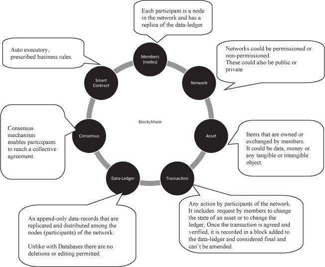

In this chapter, we presented non-technical definitions of basic blockchain terminology. Some commonly used words have been adopted in blockchain nomenclature with vastly different meaning. These differences in nuances are important in fully comprehending the scope and functionality of blockchain. Additionally some terms, with established meaning and usage, have been misused in the context of blockchain. We attempted to clarify those confusions, prior to discussing the blockchain concept in greater technical detail.

This chapter also discussed the various types of blockchain, their properties and advantages. It also presented a brief description of many current blockchain platforms. The adaptation of the popular board game Monopoly to harness the capability of blockchain technology has the potential of increasing the general public’s comfort level with this new technology. Finally, 图 3.6 provides a pictorial summary of the key concepts of blockchain and their definitions.

### 注释

1. 可获取于 [`blockchainblog.blogspot.com/2016/11/blockchain-security-controls.html`](http://blockchainblog.blogspot.com/2016/11/blockchain-security-controls.html)

2. 数据取自 [`etherscan.io/chart/blocktime`](https://etherscan.io/chart/blocktime).

3. 有关主流商业媒体的分析，参见 [`www.forbes.com/sites/andrewarnold/2018/08/28/blockchain-is-not-a-threat-to-accounting-its-an-opportunity/#774608f68d05`](https://www.forbes.com/sites/andrewarnold/2018/08/28/blockchain-is-not-a-threat-to-accounting-its-an-opportunity/#774608f68d05).

4. 例如，参见 Ellul and Borg (2018)。可获取于 [`theaccountant.org.mt/blockchain-technology-and-triple-entry/`](https://theaccountant.org.mt/blockchain-technology-and-triple-entry/).

5. 参见，例如 Taylor (2017)。可获取于 [`www.forbes.com/sites/forbesfinancecouncil/2017/11/28/triple-entry-accounting-and-blockchain-a-common-misconception/#1ebe89c3190f`](https://www.forbes.com/sites/forbesfinancecouncil/2017/11/28/triple-entry-accounting-and-blockchain-a-common-misconception/#1ebe89c3190f)

6. 当前及历史区块时间可获取于 [`bitinfocharts.com/comparison/bitcoin-confirmationtime.html#2y`](https://bitinfocharts.com/comparison/bitcoin-confirmationtime.html#2y).

7. 例如，在 SHA-256 的情况下，所有输入都会被转换为 256 位长度。因此，无论交易数据和输入有多大，系统只需存储 256 位哈希值。

8. Merkle (1979).

9. [`klasing-associates.com/irs-track-bitcoin-cryptocurrencies/`](https://klasing-associates.com/irs-track-bitcoin-cryptocurrencies/)

10. [`consensys.net/enterprise-ethereum/best-blockchain-for-business/5-reasons-why-enterprise-ethereum-is-so-much-more-than-a-distributed-ledger-technology/`](https://consensys.net/enterprise-ethereum/best-blockchain-for-business/5-reasons-why-enterprise-ethereum-is-so-much-more-than-a-distributed-ledger-technology/)

11. [`www.coindesk.com/monopoly-style-blockchain-property-trading-game-raises-2-million`](https://www.coindesk.com/monopoly-style-blockchain-property-trading-game-raises-2-million)

12. [`www.marketwatch.com/press-release/hasbros-new-block-chain-game-project-monopoly-classic-shocks-2020-01-27?mod=mw_quote_news`](https://www.marketwatch.com/press-release/hasbros-new-block-chain-game-project-monopoly-classic-shocks-2020-01-27?mod=mw_quote_news)

# 4 共识机制

## 共识机制

## 4.1. 引言

区块链是一种使未知且互不信任的各方能够相互交易的系统，这些交易的记录保存在区块中。区块按顺序连接起来，从而永久保留交易的顺序和优先权。该机制本身是自执行的，因为没有中央管理机构制定规则或做出临时决定，而是网络中*所有*参与者的集体决策。每个参与者拥有同等投票权。由于不同参与者可能根据接收消息的顺序得出不同结论，因此系统应能够迅速解决这些分歧并确保达成多数一致。

网络中的所有参与者拥有同等权利，因此可被视为*对等节点*。然而，对等节点可能任意失效，且某些对等节点可能是恶意的。为了系统有效运行，它应内置一种机制以确保输出的有效性，即使某些对等节点是恶意或出现故障。

网络本身需要最少的结构。参与者可以随时离开或重新加入网络。然而，系统即使在某些节点任意失效，或部分节点存在恶意行为的情况下仍能达成共识。这是区块链技术的一项关键特性，被称为共识机制。只要大多数 CPU 运算能力由非恶意节点控制，这些正常运行的节点将共同生成最长的链并超越攻击者或恶意节点。加入网络的额外参与者，甚至是离开后重新加入的参与者，只会接受当时最长的链作为合法链，并作为他们离开网络期间发生情况的记录。

区块链中采用了两种流行且经过验证的技术：工作量证明和权益证明。“工作量证明”技术需要计算证明并解决复杂的密码谜题。计算工作的难度限制了新区块添加的速率，以及能够添加区块的参与者，从而使恶意或非功能节点难以添加包含错误信息的新区块。“权益证明”则给予在网络中拥有更高权益的参与者更高的添加区块机会，从而再次防止次要和恶意节点破坏网络。

中本聪在其论文中提出了共识机制。该系统并不能保证始终达成一致或共识，但保证达成共识的概率接近于一。随着越来越多的非恶意参与者进入网络，该概率趋近于一。提高挖矿新区块的难度会导致插入新区块需要更多时间，并使多个解决方案获得关注的情况变得罕见。以太坊也在工作量证明机制的基础上验证新区块。然而，以太坊系统生成新区块需要 12–15 秒，相对于比特币挖矿新区块约需 10 分钟。因此，以太坊系统提高了交易记录的吞吐量，但也导致出现多个解决方案，因为不同矿工能够同时提出替代区块。为避免这种情况，协议已制定了保障措施，如 Wood (2014) 中所述。

本章其余部分组织如下。第 4.2 节讨论达成共识的重要性。第 4.3 节介绍抽象计算机科学问题，即广为人知的拜占庭将军问题。第 4.4 节讨论参与者的经济激励。第 4.5 节讨论广泛使用的区块链共识机制——工作量证明。另一共识机制——权益证明在第 4.6 节中描述。第 4.7 节讨论了对这些共识机制的一些威胁。我们在第 4.8 节以总结结束。

## 4.2. 共识的重要性

共识机制对于确保只有一个正确的区块顺序至关重要。区块链通过向现有链添加新区块而增长。因此，不仅要验证新区块，还必须验证当前链以及该链中区块的顺序。该过程的执行方式是新区块被追加到链上，并且这些新区块存在多种排序的可能性。多种排序的可能性会导致分支过程，通常称为 *分叉*。一旦发现分叉，就必须迅速解决，以确保 *链* 不会转变为 *树*。图 4.1 以图形方式说明了这一概念。当前区块 *A* 到 *E* 构成了当前链，假设还需要添加两个区块 *F* 和 *G*。现在假设某些链在 *G* 之前追加 *F*，而其他链在 *F* 之前追加 *G*，这就导致了分叉。当额外区块 *H, I* 和 *J* 被添加时，分叉会将链转变为树。因此，需要一种机制来快速解决分叉，防止链变成树。

**图 4.1：向现有链添加新区块。**

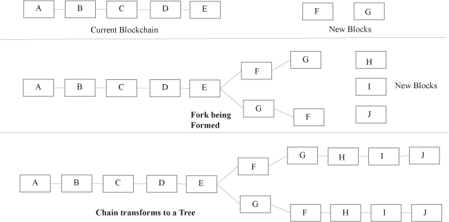

在上述示例的基础上，可以设想第二阶段的新区块 *H, I* 和 *J* 的排序方式可能存在变化。如果允许这些变化，树会形成更多分支并扩散。共识算法迅速解决分叉，从而防止分支形成，并确保链不会转变为树。

在任何系统中，分叉自然会形成，因为区块链的不同参与者可能不会以相同的顺序接收新信息。然而，一旦发现分叉，即参与者得知分支存在时，就必须有一种机制来达成一致，确定哪个分支有效并剔除其余分支。这确保只有主干被允许传播，防止形成树。通常，在比特币和以太坊平台中，最长的分支被采纳为有效分支，尽管在这两个平台中“最长”的定义略有不同（Natoli & Gramoli, 2016）。分叉不一定立即解决，但可以增长到一定的有限深度。扩展分支需要解决难题，这会导致在较长的时间段内进行额外的计算练习，在此期间会识别并传播 *最长链*。比特币建议在交易发出后开采六个区块才认为系统接受该交易，类似地，以太坊建议追加五到十一个额外区块（Wood, 2014）。

共识具有三个主要属性：一致性、有效性和终止性。一致性表示两个或多个方独立得出相同的结论，并且双方都意识到已达成相同结论。换句话说，仅得出相同结论是不够的，每个方必须意识到并确信其他方也必须得出了相同结论。因此，得出结论的程序或算法应客观、无歧义且通用。有效性表示最终解决方案是从所提出的方案中决定的。网络或系统应考虑到可能存在一些有效参与者和一些恶意参与者。因此，终止性表示最终解决方案是由有效参与者决定的，而不是由恶意参与者决定的（Natoli & Gramoli 2016）。

## 4.3. 拜占庭将军问题

在计算机网络的早期，一个长期存在的问题是计算机系统在其中一个或多个组件出现故障的情况下仍能可靠运行的能力。由故障组件发送的信息被忽略或被忽视，因为故障组件的消息可能与系统其他部分发送的消息冲突。这一抽象问题被称为拜占庭将军问题（Shostak, Pease, & Lamport, 1982）。

拜占庭将军问题是攻击包围敌方堡垒的军队团的假设问题。每个团都有自己的将军，将军只能通过信使相互通信。将军们必须决定共同的行动计划，以确保协调攻击。为了在系统中引入故障点，假设其中一些将军是叛徒。叛徒不能改变行动过程，但他们可以阻止忠诚的将军达成共识。

为了进一步简化问题，假设团只有两种行动方案：攻击或撤退。所有将军都使用相同的方法或算法来汇总从不同来源接收到的信息，以做出个人决策。攻击的成功取决于所有团是否同时攻击。如果只有部分团攻击，而其他团撤退，攻击的团将被歼灭。也就是说，达成共识至关重要。不仅每个将军应得出相同结论，而且他们应确信其他将军也会如此。图 4.2 通过图片说明了该问题。

**图 4.2：拜占庭将军问题 – 攻击或撤退。**

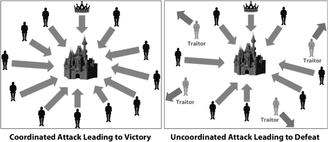

拜占庭将军问题的困难在于，除非三分之二以上的将军是忠诚的，否则无法找到解决方案。特别是，如 图 4.3 所示，在存在单个叛徒的情况下，仅有三名将军无法达成共识。由于消息完全由发送者控制，叛徒可以发送任何可能的消息。在计算机系统中，这一现象对应于计算机之间发送的消息（Shostak et al., 1982）。考虑 图 4.3，其中指挥官是忠诚的，并向两名将军发送相同的消息要求他们攻击。然而，其中一名将军是叛徒，因此向另一名将军发送相反的消息并要求他撤退。忠诚的将军收到冲突的消息，因此无法决定行动计划。

**图 4.3：有一名将军为叛徒的简化拜占庭将军问题。**

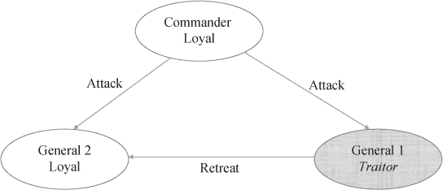

**图 4.4：指挥官为叛徒时的拜占庭将军问题。**

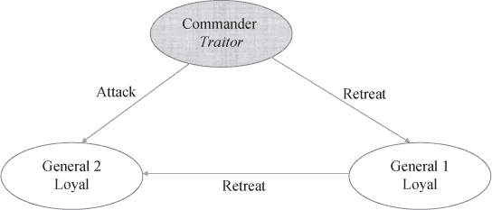

现在考虑一个稍有不同的场景，如 图 4.4 所示，其中指挥官是叛徒并向两名将军发送冲突的消息。他要求一名将军攻击，另一名将军撤退。将军们忠诚地转发各自从指挥官处收到的消息。正如人们所注意到的，对于忠诚的将军而言，图 4.3 和 4.4 中的消息是相同的，且该将军无法区分这两种情况。因此，如果忠诚的将军总是遵循他从指挥官收到的消息，他在两种情况下都必须攻击，而另一名将军在两种情况下都将撤退。由于一名将军攻击而另一名撤退，攻击在两种情况下都会失败。

通过反证法已证明，在存在 *n* 个叛徒的情况下，少于 3*n*+1 个将军的系统中不存在解决方案。在 图 4.5 中，我们说明了四名将军如何在其中容忍一名叛徒。首先，假设指挥官是忠诚的，但其中一名将军是叛徒并更改了消息。然而，只要忠诚的将军坚持多数消息，他们就会采取统一行动。

**图 4.5：有一名叛徒的扩展拜占庭将军问题。**

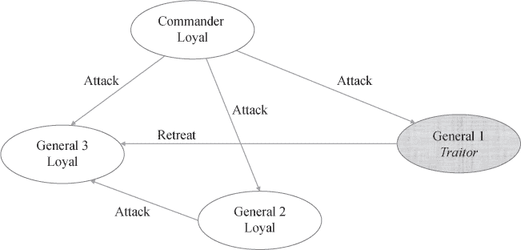

假设将军 1 是叛徒并篡改了指挥官的消息，然而将军 2 是忠诚的并传达了他从指挥官那里收到的相同消息。如果指挥官向所有将军传达了相同的消息，将军 3 将收到两条相似的消息和一条矛盾的消息。同样，将军 2 收到的三条消息中，有两条是进攻（来自指挥官和将军 3），一条是撤退（来自将军 1）。将军 1 收到的三条消息都一致指向进攻。在这种情况下，共识将是进攻，所有三位将军都将服从。注意，叛徒只能发送错误的消息以阻碍达成共识，然而一旦共识确定后必须遵循共识。

图 4.5 中的情况可以被改变，使指挥官成为叛徒，向三位将军发送不一致的消息。假设指挥官只能在两种备选消息之间选择：进攻或撤退。指挥官指示将军 1 和将军 3 进攻，并指示将军 2 撤退。每位忠诚的将军都忠实地传达他收到的消息。因此，将军 1 和将军 3 将指示另外两位将军进攻，而将军 2 将指示另外两位将军撤退。图 4.6 说明了每位将军收到的消息。如图所示，三位将军都收到了两条进攻消息和一条撤退消息。同样，如果他们遵循多数规则，三位将军都将进攻，从而挫败了叛徒指挥官的计划。

### 图 4.6：三个忠诚将军和叛徒指挥官的拜占庭将军问题。

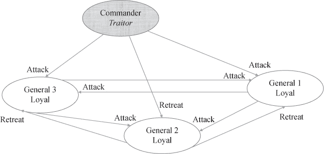

一旦消息不必是二元的而可以具有多个值，情况就会变得更加复杂。上面的例子可以通过加入第三条消息“不确定”来扩展，即指挥官或将军可以发送三条消息之一：进攻、撤退和不确定。在这种情况下，在所有将军和指挥官之间达成共识的复杂性会增加。现在想象一下，当将军有数百甚至数千名时，复杂性呈指数级增长的情况。

此外，消息也可以是连续变量。在我们的例子中，与其决定是否进攻或撤退，假设指挥官发出进攻时间。所有将军必须在 10 分钟内相互进攻，进攻才算成功。叛徒会随机更改进攻时间并向其他将军发送错误消息。为了系统能够正常工作，忠诚的将军应能够独立得出关于进攻时间的相同结论，本质上是覆盖或忽略从叛徒那里收到的消息。

这个拜占庭将军问题适用于每个分布式网络，因为网络中的某些节点可能是恶意的或仅仅未能发送消息。其他正常运行的节点应能够正常运行并达成共识，即使并非所有节点都正常运行。解决这个抽象问题需要一种每个节点必须遵循的算法。此外，系统对恶意和非功能节点的脆弱性必须预先确定。数学上已证明，如果叛徒节点少于总节点数的三分之一，系统就能正常运行，即对于具有 `n` 个恶意节点的系统，节点总数必须为 `3*n +1` 才能达成共识。

在区块链网络中，以上问题甚至更加复杂，因为系统中没有真正的指挥官。所有参与节点都是将军，具有相同的层级地位。所有参与节点必须就节点之间传输的每条消息达成一致，即使没有任何节点优于其他节点。系统应能够在节点或一组节点腐败或恶意时正常运行，即这些节点发送的消息不可靠。总之，区块链参与者应能够在某些参与者恶意或功能失调并发送不准确消息时达成共识。

## 4.4. 有效性与可验证性的经济学

区块链的有效性和传播需要许多无关参与者的努力。这些参与者必须以某种形式获得补偿，以确保他们持续参与链条。这些激励通常通过交易费用资助。希望通过区块链促成其交易的交易方将支付一笔名义上的交易费用。然后交易费用由“矿工”收取，他通过解决复杂的密码学难题或通过随机抽奖来挖掘下一个区块，具体取决于共识机制。

矿工获得补偿的另一种方式是通过通胀。随着他们最初开采的货币变得更有价值，他们的财富会增长，而无需做任何额外工作。因此，最初的矿工有动力保持其币值的价值甚至增长，这将鼓励系统增长和更多交易被记录。此外，他们对系统的安全性和可信度有既得利益，不希望这些受到损害。

区块链中通过交易费用和通胀提供的激励，鼓励参与节点保持诚实。即使恶意攻击者能够组装足够的 CPU 能力来超越诚实节点，他们也应更有动力阻止新区块而不是篡改现有区块。换句话说，具有足够 CPU 能力的恶意节点应有机会通过开采额外币来获得比回溯和逆转交易更大的利润。也就是说，遵守规则的激励应超过欺诈系统的激励。破坏系统的成本将进一步降低恶意节点所积累的币或财富的价值。

为维护系统的神圣性，欺诈的成本应相对于非法所得而言变得很大。因此，罪犯从系统中窃取的收益将小于所产生的成本，从而使窃取在经济上对罪犯而言不具吸引力。在比特币的设定中，这通过设置自然实现。首先，矿工必须购买昂贵的硬件设备来解决挖矿算法。罪犯必须投资计算能力，从而在系统中拥有高额投资。此外，如果挖矿过程被破坏，比特币的声誉和可信度将受到不利影响，降低其价值。因此，罪犯从系统中窃取的币将价值更低，并且随着罪犯窃取更多而损害流程的可信度，其价值会进一步降低。以这种方式构建流程，即货币的价值基于其声誉，会阻止罪犯窃取，从而损害声誉，进而降低他们窃取的对象的价值。

## 4.5. 工作量证明

中本聪面临“在无信任网络中建立信任”的挑战。他必须依靠一个系统来确保个人甚至一个小团体在计算上不可能超越集体网络。因此基本思路是使向区块链添加区块变得困难，并需要大量的计算能力。这是“工作量证明”算法的共同特征。

工作量证明是区块链网络上实现共识以确认交易并向链中生产新区块的共识机制之一。工作量证明解决了拜占庭将军问题，即在多数决策中确定代表性。与基于参与分配投票不同，它基于处理能力分配投票。工作量证明本质上是对每个单位 `CPU` 的一次投票。这种投票机制，而非每个参与者一票，防止了攻击者通过获取大量边缘参与者来破坏系统。

在众多共识协议中，工作量证明共识机制占据了现有数字货币总市值相当大的份额（约 90%）。¹ 工作量证明共识机制通过比特币引入，已被莱特币、狗狗币和以太坊采用。即使在数字货币领域之外，它也被广泛采用。

防止恶意参与者破坏网络非常重要。工作量证明机制通过增加从事此类行为的成本，降低了欺诈行为的相对收益。以比特币为例，其成本包括计算成本、硬件和电力消耗（也称为“`gas`”）。验证者通过向网络揭示对计算困难的密码学难题的答案来确立其真实性。

在工作量证明机制中，矿工相互竞争以验证下一组交易。成功的矿工通过交易费获得奖励以构建下一个区块。被选中构建下一个区块从而获得奖励的概率与计算能力成正比。如后所述，矿工相互竞争以解决复杂的密码学难题。拥有更大的计算能力会增加成为第一个解决难题的机会，但并不能保证。

例如，比特币采用基于哈希的工作量证明，要求找到一个“`nonce`”值。当与其它变量结合时，`hash` 的结果值必须小于 `target value`。当找到这样的 `nonce` 时，矿工创建区块并将其转发给其他参与者进行验证和采用。一旦其他参与者验证了该解决方案，他们接受新区块并着手解决下一个密码学问题以获得开采下一个区块的权利（Gervais et. al., 2016）。

通过工作量证明做出的多数决策由最长链表示，如第 4.2 节所述。最长链代表投入其中的最大“工作量证明”。当大多数处理能力由诚实节点控制时，诚实链将更快增长并超过由恶意节点传播的替代链。此外，要修改过去的区块，攻击者不仅必须重做他们感兴趣的区块，还必须重做所有后续区块。也就是说，攻击者节点必须重新生成该特定区块以及每个后续区块的工作量证明，然后赶上并超过在此期间诚实节点所完成的工作。该概念在 图 4.7 中有所说明。因此，攻击者应拥有超过诚实节点合计计算能力的计算能力。

#### 图 4.7：工作量证明使区块链中的篡改变得困难。²

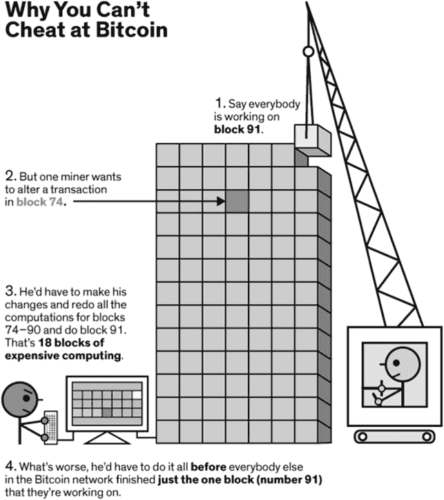

在任何给定时间，最长链被传播并存活很重要，需要注意的是可能存在“陈旧区块”。陈旧区块是指已被开采但未包含在最长链中，而是属于失效分叉的一部分的区块。它们对整个区块链的安全性和性能有害，因为它们会触发链分叉。链分叉会消耗本应用于主链的计算时间和能量，从而减缓主链的增长。此外，它们会带来安全风险，因为恶意节点可能利用陈旧区块来破坏网络。

#### 图 4.8：数独谜题。

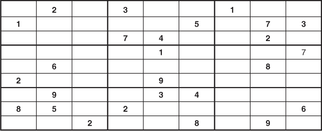

矿工需要解决的密码学复杂问题只能通过暴力破解来解决。它要求通过迭代尝试所有可能的组合来找到解决方案。因此，在概率上，计算能力最强的矿工将有更大的机会第一个解决谜题。谜题具有以下两个属性：

* 问题难以解决。
* 一旦获得，解决方案可以轻松验证。

为了更好地理解上述规则如何运作，请考虑 图 4.8 中显示的数独谜题。对于不熟悉数独游戏的人来说，目标是用数字 1–9 填满每一行、每一列和九个方框，使得行、列或方框中没有数字重复。单元格中已给出的数字不得更改。假设这是需要解决的谜题，最快得出正确答案的人可以构建下一个区块并为其努力收集硬币。

那些在逻辑上非常擅长解决数独谜题的人仍然需要大约 10 分钟来解决上述谜题。而凭借过剩的计算能力，计算机将通过暴力破解来解决它，随机为单元格分配数字，直到找到正确的解决方案。更重要的是，虽然熟练的问题解决者找到解决方案需要大约 10 分钟，但任何对数字有基本理解的人验证 图 4.9 中显示的此谜题的解决方案都不到一分钟。

#### 图 4.9：数独谜题的解法。

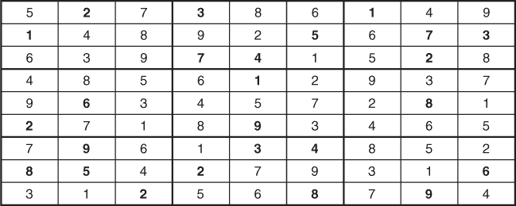

这就是为什么篡改区块链上现有区块如此困难。即使对于像数独这样简单的谜题，恶意者也必须单独解决其中许多个，而其他人则在集体解决额外的谜题。参考 图 4.7 中显示的示例，恶意者必须解决 16 个谜题，每个区块从 #75 到 #90 各一个，而其他人正在处理谜题 #91。假设恶意者的速度实际上是集体组的两倍。即使如此，在恶意者解决 16 个谜题所需的时间里，集体保守估计至少会再解决八个并进入谜题 #99。现在恶意者要解决这八个谜题，集体将再解决四个，等等。也许，在解决 32 个谜题后，或到谜题 #106 时，恶意者会追上集体。与其耗费资源从 #74 开始重建区块，恶意者本可以合法地第一个解决从 #91 到 #106 的谜题并收集奖励。如果系统为解决新谜题提供丰厚奖励，改变区块 #74 可能不符合恶意者的经济利益，而更倾向于合法地创建新区块并收集相应奖励。

工作量证明模型是一种安全措施，它结合了激励、分布式计算和市场经济。这种创新使区块链能够以安全且分布式的共识构建系统运行，该系统已证明在十多年中取得了成功。工作量证明的局限性在于其对计算能力的依赖及其高能耗设计。例如，在比特币的情况下，能源支出成本与其价值之间的平衡是一项复杂任务。

## 4.6. 权益证明

存在一种替代的共识机制，它不需要像工作量证明机制那样的能源或计算需求。与工作量证明中要求解决复杂问题不同，权益证明会随机选择一名参与者，其被选中的概率与该参与者在区块链中拥有的权益成正比。权益是指参与者愿意在一定时间内“锁定”的货币或利息金额。“锁定”类似于在指定时间内提供抵押品。作为向系统承诺资金的回报，参与者获得更高的中奖机会，以及形成下一个区块的权利。目前，权益证明已被用于现有的虚拟货币，如 Nxt 和 Blackcoin。

如上所述，下一个区块构建者的选择由抽奖决定，每个参与者的机会与其在网络中的权益成正比。这类似于 NBA³ 选秀抽签。战绩最差的球队在抽签中有 16 张彩票，战绩第二差的球队有 15 张，以此类推。由于抽签仅限于未能进入季后赛的球队，只有 16 支球队有资格参与。因此，刚刚错过季后赛的球队只有一张彩票。总体而言，抽签中有 136 张彩票，而拥有 16 张彩票的最差球队获胜的几率约为 12%。概率范围从 1% 到 12%，但彩票越多，获胜的可能性就越高。

与工作量证明机制类似，权益证明也确保了系统的完整性以及更改先前区块的不可能性。每个参与者对代币的托管使得可以选出下一个构建区块的个人。对于个人而言，要投入足够数量的代币以超过整个网络的集体力量是困难的，甚至是不可能的。此外，如果个人在网络中投入了如此多的代币，那么从经济利益角度来看，维护网络的价值符合其最佳利益，因为他们在网络的价值和声誉上投入巨大。

还有其他共识构建机制正在试验中。其中一种机制是经过时间证明，它要求节点在下一个区块添加到区块链之前在计算上等待一段时间。强制等待时间使得向区块链添加区块在计算上变得困难。

另一种是权益证明模型的变体，称为委托权益证明。在该机制中，权益持有者将其权益作为投票过程中的权重来选举代表，称为见证人。见证人随后验证并执行新交易，并负责将这些交易附加到区块中。这相当于公司治理中董事会选举。大股东对谁应担任董事会成员有更大的发言权，但同时也必须提名一位可信的人选。一旦提名，董事将自行行事。同样地，在该机制中，获得最多选票的顶级见证人有权验证和执行交易。权益持有者对见证人的投票按其在网络中的权益比例加权。

## 4.7. 结论
本章讨论的共识机制是无许可区块链的基本特征。共识机制在彼此互不信任的陌生人之间建立信任，因此在没有可信第三方的情况下，他们不会相互交易。共识机制使区块链框架能够在点对点交易中替代可信第三方，从而取代律师、银行、代理和经纪人等传统可信第三方。

另一方面，在许可区块链中，所有参与者都是已知且受信任的，共识机制的重要性就不那么关键。已知且受信任的各方之间的交易即使没有健全的共识机制也能发生，因为许可区块链中的参与者有内在激励来维护区块链网络的完整性。网络信誉的受损不仅会在经济上损害参与者，还会导致其个人信誉的丧失。因此，健全的共识机制并不是许可区块链的关键特征。

在区块链的所有特性中，共识机制是最技术性的，它基于密码学证明以及计算能力。获得对共识机制（如工作量证明）的技术理解需要数学和计算机科学方面的训练。此外，由于它还涉及独立行为者在群体环境中的激励，因此还需要熟悉博弈论⁴ 这一学科。在本章中，我们对该概念进行了非技术性的介绍。对该概念的基本熟悉对于理解区块链的各种功能及其应用至关重要。

为了让无许可区块链繁荣发展，其底层共识机制必须获得普遍信任。区块链基础设施的关键优势之一是其不可变性，即存储在区块链中的记录无法被更改并永久保存。共识机制使更改先前区块变得困难甚至不可能，从而增强了区块链固有的不可变性特征的可信度。

目前，工作量证明是区块链中广泛接受的共识机制。然而，其他共识机制，如权益证明或经过时间证明，正在开发和测试中。工作量证明机制运行需要大量的计算能力和能源（gas）。找到一种更简单、更便宜的替代方案将加速基于区块链的传统和既定记录保存流程替代品的增长和接受。

后续章节讨论了区块链的许多应用，在所有这些应用中，共识机制都依赖于提供记录的信任和不可变性。当然，共识机制也存在某些局限性和漏洞，这些将在后续章节中讨论。目前计算机科学和安全领域的研究正在探索使共识机制更稳健、更不易受恶意攻击的方法。

### 注释
1. 数据来自 CoinMarketCap。可在 [coinmarketcap.com/](http://coinmarketcap.com/) 获取

2. [`medium.com/loom-network/understanding-blockchain-fundamentals-part-2-proof-ofwork-proof-of-stake-b6ae907c7edb`](https://medium.com/loom-network/understanding-blockchain-fundamentals-part-2-proof-ofwork-proof-of-stake-b6ae907c7edb)

3. 国家篮球协会（NBA）是美国的男子职业篮球联赛。

4. 博弈论是经济学的一个分支，涉及经济冲突的数学建模。

# 5 智能合约

## 5.1. 引言

# 智能合约

智能合约可以说是区块链技术中最广为人知的组成部分。术语智能合约与自执行合约、区块链合约或数字合约同义。在此过程中，传统合约被转换为计算机代码，然后存储并在系统上复制。这些代码由计算机网络监督，并以透明的方式促进货币、财产、股份或其他资产的交换。本质上，智能合约是计算机代码，当预先指定的条件得到满足时会自动执行交易。计算机程序会自动验证预先指定的条件是否已满足，然后确定资产如何在相关交易参与者之间重新分配。去中心化账本以不可变、防篡改的形式存储条件并执行最终交易，从而提供安全性和有效性。

计算机科学家兼密码学家尼克·萨博（Nick Szabo）在 1990 年代中期提出了“智能合约”的概念，比区块链或比特币的出现早了近十年。尽管他没有将其命名为“智能合约”，但这些是无需可信第三方即可自执行的合约（Szabo, 1999）。他最初的动机是降低交易成本以实现微交易。此后，他扩展了建立合同法的概念，以促进互联网上陌生人之间的交易。萨博于 1998 年推出了一种名为“Bit Gold”的虚拟货币，但并未获得多大流行或关注。然而，比特币利用了许多相同的特性，并普及了“智能合约”的概念。

智能合约不仅仅是围绕协议的预条件和规则的汇编，它们还会自动执行这些规则和义务。因此，智能合约必须由能够确定预条件何时得到满足的技术支持。智能合约本质上是包含“如果-那么”规则的计算机代码行，并存储在区块链上。当条件“如果”满足时，代码自行执行并输出结果“那么”。这些可用于双方同意既定条款的商业交易中。

例如，假设买方同意在货物交付后支付一百万美元。买方随后将一百万美元存入区块链账户，卖方可以确信资金存在，并在买方收到货物后释放给卖方。卖方随后可以随货物一起装上追踪设备发货。一旦货物送达，追踪设备显示目的地，该信息由区块链上的数百名用户验证，随后一百万美元从托管账户释放到卖方账户。买方不再可以取消购买或拒绝付款。付款在收到货物后自动完成。这降低了未付款的风险，从而降低了交易成本。

虽然智能合约通常与加密货币相关，但目前这一概念正被应用于其他领域和用途。这些用途中的许多将在后文中详细描述，范围从矿产的道德采购到航班保险和在线体育博彩。智能合约是突出的功能，也是以太坊平台的关键特性之一。

共享经济在最近的经济增长中发挥了关键驱动作用。该市场中的一些关键参与者 Airbnb、Uber 和 Lyft 尽管是相对年轻的公司，但已成为家喻户晓的名字。这些平台遇到的一个普遍问题是需要可信第三方来执行交易并确保每个参与者根据合同获得付款。使用这些服务时还存在隐私不足的问题，以及需要在每个平台上注册的需求。已提出智能合约手机应用来解决这些问题（Bogner, Chanson, & Meeuw, 2016）。

本章其余部分组织如下。在下一节中，我们定义智能合约。在第 5.3 节中，我们讨论微交易的经济学以及消费者最小化认知成本的需求。第 5.4 节描述了智能合约的特征，第 5.5 节描述了其工作原理。一些应用在第 5.6 节中讨论。优势在第 5.7 节中讨论。第 5.8 节描述了区块链技术如何提供执行智能合约所需的基础设施。第 5.9 节讨论法律影响。我们在第 5.10 节以简要总结结束。

## 5.2. 智能合约定义

智能合约是一组简单的业务规则，一旦预定的条件得到满足即自动执行。在传统环境下，负责任的第三方中介，通常是律师或托管人，被指派确保在满足相关条款和条件后合同得到正确执行。在智能合约环境中，可信第三方中介的执行角色委托给计算机代码，而验证角色则由区块链参与者共同承担。验证过程的去中心化和执行的自动化促进了预条件的客观、无歧义的满足以及结果的执行。这使得参与者能够以透明、无冲突的方式交换有价值的物品，而无需第三方中介。

在当前应用中，智能合约是计算机编码的简单业务规则，并在执行交易前自动验证。智能合约可以简单到，“验证账户余额（`B`）超过交易金额（`T`），然后再支付 `T`。”在这种情况下，当系统收到新交易时，它会自动检查账户余额，将账户余额与交易金额进行比较，当 `B > T` 时执行交易。从这个意义上说，智能合约主要是编码在区块链上的“如果/何时—那么”语句。计算机网络在预先指定的条件得到满足时执行操作。

智能合约通常涉及多方无关参与者之间的资产交换。交易中各参与者的资产被存入并根据合同中概述的预条件在参与者之间重新分配。合约的自执行特性通过实时性能和成本节约确保效率。

为了更好地说明这一概念，请考虑货物转让付款的简单示例。假设美国的一家制造商 `M` 想从位于澳大利亚的供应商 `S` 处购买一些原材料。供应商 `S` 使用运输公司 `T` 发货，并在运输途中货物丢失时向公司 I 购买保险。`S` 同意仅在收到 `M` 的付款后才向 `T` 支付运费，这证实货物已交付。

**图 5.1：    传统环境下的供应链交易。**

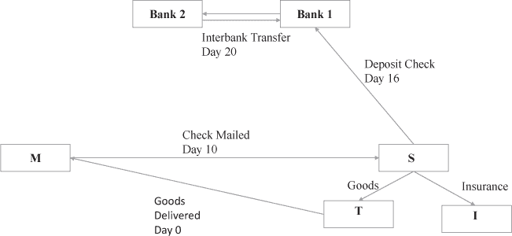

图 5.1 说明了在传统企业中该笔交易的付款将如何处理。一旦 `M` 收到货物及其附带的发票，就会将其发送给其现金支付员，后者随后会开具并邮寄支票给 `S`。`S` 收到来自 `M` 的支票后，会将其存入其在澳大利亚的银行，后者随后会联系 `M` 在美国的银行并办理资金转账。在其银行账户收到现金后，`S` 将支票发送给 `T`，后者经历类似的兑现流程。保险公司 `I` 预先收取保费，但在足够时间过去且 `S` 未提出索赔之前，不会确认收入。

图 5.2 说明了使用智能合约时该交易将如何进行。在下单时，`M` 将资金存入区块链上的托管账户。`S` 注意到 `M` 已存入资金，与 `T` 签订运输货物合同，并向 `I` 购买保险。`S` 将运费和保险费存入同一区块链上的另一个托管账户。`T` 在货物上安装地理追踪装置，该装置可通过物联网（IoT）进行监控。当货物被追踪装置记录为已交付给 `M` 时，智能合约自动执行并即时将 `M` 的托管资金释放给 `S`。向 `S` 释放资金会触发另外两个智能合约，`S` 的托管资金随后被释放给 `T` 和 `I`。保险公司 `I` 收取保费并注意到货物已按预期交付，因此不会产生索赔。一般来说，可以有尽可能多的条款，以确保买方满意任务将按其满意度和条款完成。

### 图 5.2：使用智能合约的供应链交易。

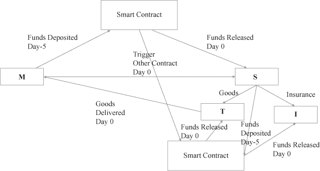

让我们考虑另一个更常见的例子，即出售房屋。任何在美国卖过房的人都知道，这是一个相当复杂、昂贵且令人望而生畏的过程，涉及大量文书工作和多方之间的沟通。在传统模式下，买卖房地产（如房屋）涉及多方参与。在美国购买房屋涉及取得法院登记的文件或产权证明，核实卖方确实在产权上被列为该物业的所有者。还需额外核实该物业上没有未清偿的留置权。组织交割往往像组织婚礼一样繁琐。这就是为什么大多数卖家会使用房地产经纪人，他们处理文书工作并作为与各方之间的联络人，直到交易“完成”。由于此类交易涉及的金额和参与方数量，托管服务有助于这些交易。买卖双方的律师以及产权代理人也参与每一次交割。综合来看，这些服务费用约为房屋价格的 6% 至 7%，由卖方支付。因此，房地产销售的智能合约解决方案对卖方可能具有很大的经济影响。最重要的是，智能合约将解决信任问题，确保卖方是房屋的合法所有者，而买方有资金支付房款。在这种情况下，“if-then”原则将确保房屋所有权仅在购买价格存入系统后才转让给买方。由于各方之间的信任不再是问题，因此无需中介，从而为交易的实际签署方——买方和卖方——节省大量资金。

类似的智能合约应用正在为房地产租赁市场开发，其中租户将资金存入区块链，资金将在钥匙移交后释放给房东，该事件由区块链的所有参与者见证。如果钥匙未在租赁协议规定的日期前到达，资金将退还给潜在租户。智能合约基于类似的“if-then”前提运作。系统在资金处于托管状态的前提下将钥匙释放给租户，并在钥匙移交给租户后将资金释放给房东。通过这种机制，即使房东和租户可能从未见过面，交易中也建立了一定程度的信任。智能合约执行了房地产经纪人的任务，而在传统模式下，房地产经纪人充当中间人。

## 5.3. 微交易经济学¹

在 1990 年代，电子商务的早期，计算机科学家致力于大幅降低电子商务的交易成本，以便创建一个促进微支付的系统。对技术人员而言，交易成本指的是计算成本或网络成本。尼克·萨博（Nick Szabo）弥合了技术人员对成本的理解与经济学家之间的差距。通常，经济学家在讨论交易成本时指的是认知成本，或消费者在心理上的处理努力。²

心理交易成本对人类行为的作用可以通过观察讨价还价这一古老的习惯来很好地理解。在整个经济史上，随着社会变得更加富裕，零售讨价还价相应减少。零售价格占个人财富的比例变小；因此个人不愿在讨价还价上花费大量精力，或承担认知成本，而在零售购买中表现出价格接受者的行为。微交易也是如此，随着价格成为客户财富的很小一部分，它们往往变得无关紧要。

例如考虑电费。虽然公用事业公司不被期望为每台电器提供详细的用电量，但可以设想，集成智能电器的个人记账程序将使消费者能够做到这一点。同样，房主如何在电热与燃气热之间更好地平衡，虽然这会带来一些节省，但会产生很大的认知成本。同样，当我们与可靠且广为人知的实体交易时，我们信任他们，并且倾向于不重新计算费用，以节省认知成本。

在研究微支付时，更大的成本是由微支付相关的心理交易成本所设定的限制所造成的。因此，萨博有动力探索自动化微支付的可能性，从而大幅减少给消费者带来认知成本的心理过程。随着微支付的认知成本下降，越来越多的消费者将参与更多涉及微支付的交易。

萨博（1997）得出结论，心理或认知成本通常超过计算成本。交易各方更倾向于选择执行所需心理能量和记忆较少的系统，并且不一定反对为计算交易成本支付稍高的费用。认知成本源于三个方面，包括现金流的不确定性、产品属性不完整且昂贵的观察以及昂贵的决策。随着社会变得更加富裕，心理成本将主导消费者的偏好。因此，智能合约是一种机制，用于自动化部分决策并将执行的后勤工作外包给公共领域，从而降低认知成本，促进更多交易和商业模式。

## 5.4. 智能合约的特征

# 智能合约

## 基本要素

本质上，智能合约充当自动化的托管账户。交易的双方将其交付物、现金或货物存入托管账户。一旦预条件得到满足，转账就会自动完成，无需任何进一步的人为干预。因此，所有条件、`if-then` 规则以及奖励和成本必须在开始时预先指定。智能合约不仅仅维护条款的文档，还执行这些条款并强制执行条件。在最简单的形式下，智能合约具有以下基本要素。

### 当事人
首先，最重要的是，交易当事人必须明确识别。与任何合同一样，签署人必须被识别。换句话说，这些是进入交易的个人或公司。签署人是两个或更多同意智能合约条款和条件并对结果具有某种潜在经济利益的当事人。

### 可观察结果
其次，协议的结果或主题必须能够客观且无歧义地观察到。协议的主题必须是智能合约环境中存在的项目或信息。由于智能合约将在条款或预条件满足时自动执行，这些预条件必须对智能合约的执行者——区块链参与者——可见。区块链中的所有节点必须能够不受阻碍地直接访问协议主题的项目或信息。例如，在体育博彩的智能合约中，比赛的获胜者和最终比分是公开且无歧义的。

### 具体条款
第三，合同的结果必须包括直接且具体的条款。条款“具体性”的要求源于需要能够使用编程语言以数学方式描述条款。条款不仅应包括预条件是什么，还应包括合同每个签署人每种可设想结果的成本和奖励。

### 技术环境
第四，这些合约必须能够在所需的技术环境中运行。在开始时，合同的每个签署人都必须具备使用公钥加密的能力。这将实现当事方的唯一识别。所使用的底层系统必须可靠且安全。一旦条款和条件被编程，就不能被黑客篡改或重写。此外，一旦资产转入系统，这些资产必须安全。

### 去中心化数据库
第五，智能合约的执行需要开放且去中心化的数据库。这确保了预条件可以由多个无利益关系的当事人客观评估，以确保正确执行。也就是说，交易的条款可以由数百人或计算机见证和验证，因此正确执行得以保证。区块链技术提供了促进智能合约的足够环境。

### 级联合约
最后，智能合约的结果可能导致触发其他智能合约。智能合约之间可能存在依赖关系。这可能是智能合约的级联，即在第一个智能合约解决后，其他合约被触发，依此类推。可以设想整个组织或系统运行在规范明确、预先确定的智能合约之上。当然，这需要广泛的规划并考虑每种偶发事件的每一种可能结果。此外，所有级联合约都必须能够在由去中心化数据库（如区块链）支持的技术环境中运行。

## 5.5. 它是如何工作的?³

Nick Szabo 最初的建议是将合同条款翻译成计算机代码，以便计算机能够自动执行并自我强制执行。这将最大程度地减少对可信第三方的需求，甚至减少交易方为执行琐碎任务而使用智力的需求。如上文所述，Nick Szabo 不仅感兴趣于降低直接交易成本甚至计算成本，而是包括认知成本在内的总成本。区块链技术通过其去中心化控制，提供了触发防篡改且无法操纵的自我执行的基础设施。

智能合约驻留在区块链上并具有唯一地址。智能合约通过向其发送交易来触发。智能合约然后独立且自动地执行合同条款，与代码一致。交易的结果被广播到区块链中的每个其他节点。交易的记录因此在每个位置或节点上维护，并在账本、区块中印记。记录是不可变的，随着更多交易被记录在区块链中，会添加更多区块。

图 5.3 说明了智能合约运行方式的概要。区块链上的参与者创建合约，允许不同当事人访问合约内的各种功能。例如，可能只有少数当事人被授予在该合约上交易的权限，而只有一方有权从合约中“提取”资产。运行机制可通过以下步骤理解：

1. 一旦合约创建，它就拥有自己的状态，可以在区块链上托管资产。⁴ 从某种意义上说，合约在区块链上拥有自己的账户。合约可以持有其被规定持有的资产。
2. 合约使业务逻辑的表达成为可能。也就是说，它可以设定价格，在收到货物时批准付款等。例如，业务逻辑可能是“在货物交付后 10 天付款”，或“如果从纽约到洛杉矶的 123 航班延误两小时或以上，则向 `B` 支付 100 美元付款。”
**图 5.3：智能合约的运作。**
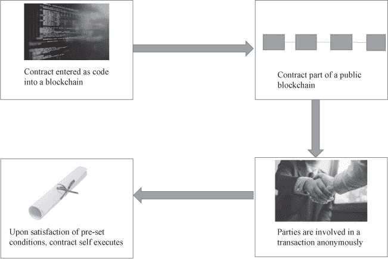
3. 合约必须全面且无歧义。也就是说，合约应为每一种可能的偶发事件指示适当的行动方案。例如，如果我们押注 2020 年 NCAA 大学生篮球锦标赛的获胜者，一个起草良好的合约应已考虑锦标赛被取消的可能性，并规定在这种情况下资产如何分配。
4. 当事人之间的关系由数据驱动。用计算机科学家的术语来说，“an accounting transaction is merely ‘a signed data structure indicating a transfer of value’”(Antonopoulos, 2014)。简单的交易会表述为，“`if you send me X units of the goods, I will pay you $Y`。”
5. 智能合约由发送到其地址的消息或交易触发。一旦预先指定的事件发生，一条消息就会自动发送到代表合约的“状态”，并要求其执行合约条款。
6. 智能合约必须使得相同的一组情况 *总是* 导致相同的结果。在这种意义上，它必须是确定性的而不是概率性的。诸如“一旦条件满足，抛硬币并仅在正面朝上时付款”之类的概率性规定将不起作用，因为不同的节点会进行实验并返回不同的结果。由于节点得出不同的结果，网络中无法达成共识，因此合约将不会被执行。
7. 由于智能合约驻留在区块链上，其内容、代码和操作对网络中的每个其他节点可见并接受审查。
8. 与合约的交互通过区块链上的消息进行，因此参与者可以获得合约每次操作的<|message|>。

# 智能合约

智能合约作为独立且客观的“受信任的第三方”运行，其唯一角色是按照参与者的规定精确执行合约。智能合约的结果是可预测且无歧义的。该结果与区块链中的所有其他节点共享。

## 5.6. 智能合约应用

虽然世界各地的政府和监管机构对加密货币持怀疑和谨慎态度，但他们已热情地拥抱智能合约的底层技术，认为其具有革命性。企业和政府一直在利用这项技术来提高效率并节省成本。在本节中，我们将在以下段落中提供一些用例示例。

大型全球银行已成功在区块链上交易奇异金融工具，例如信用违约互换。信用违约互换主要是债权人购买的保险产品，以防止借款人违约付款时遭受损失。在借款人信用付款违约的情况下，该工具使债权人能够收取部分付款。智能合约的实现是一个简单的“`if-then`”业务规则。在借款人信用付款违约的情况下，互换的卖方会向互换的购买方自动执行付款。

保险行业仍然非常陈旧，很大程度上依赖纸质文件和人工核实。这通常会导致从损失发生到理赔结案之间出现显著的时间滞后，从而导致高昂的行政成本、投保人不满以及整体效率低下。保险行业正在探索智能合约在理赔处理中的应用，特别是在自然灾害的情况下。自然灾害，如地震和飓风，是公开的，并且经常导致大量索赔被提交，单独处理需要大量时间和精力。引入智能合约。有了智能合约，由于自然灾害造成的损失可以由参与者网络批准并及时执行，保单持有人在需要时即可收到付款。有关损失程度的具体细节可以保留在区块链上并随后进行核实，并在日后进行必要的调整。

内容的创作过程，例如这本书，涉及多个方，因此他们都有权分享内容销售所得的一部分。例如，虽然这本书由 Emerald Publishing 营销和销售，但作为作者，我有权获得销售价格的一部分作为版税。我的部分报酬支付给我的出版代理。出版社向作者支付版税通常基于信任，因为作者无法独立核实书籍的销售数量。智能合约可以通过在区块链上记录收益分享安排，确保版税根据预先确定的收益分配分配给贡献者，从而帮助解决这个问题。

Ujo⁵ 是一家在线音乐分享/购买公司，利用区块链基础设施让听众直接向音乐人支付音乐费用。具体来说，它允许公众用加密货币下载音乐，然后以 Dai（一种去中心化稳定币）的形式转给内容生产者。它使用智能合约功能将收益分配给音乐的各个所有者。音乐行业以中间商收取的高额佣金而臭名昭著，包括唱片公司、音乐会场地和音乐流媒体业务。Ujo 试图利用区块链技术让内容生产者对其知识产权拥有更大的控制权，并限制中间商的作用。

物联网是智能合约和区块链技术适用的领域。物联网通过传感器将日常设备连接到互联网，以提高系统的互联性。整合区块链和智能合约将使系统更高效地运行。系统中涉及的传感器将成为区块链上的节点，在智能合约的帮助下，可以追踪每个产品的所在地和所有权，并据此进行付款。因此，交易双方之间的资产转移可以通过跟踪设备、物联网和智能合约完成，无需人工干预。

后续章节将描述其他用例。这些应用以许多有趣和创新的方式使用智能合约功能。

## 5.7. 智能合约的优势

与传统的纸质手动执行合同相比，智能合约提供了许多优势。在某些情况下，智能合约更方便、更快。它们是自验证的、自执行的且防篡改的，因此提供了安全性与便利性的良好结合，促进了原本可能因交易费用高或参与者之间缺乏信任而无法进行的交易。

合同签署方是协议的唯一当事人，不涉及律师、代理人或经纪人。这为签署方提供了更高程度的自主权，并消除了交易中与之间接相关的其他一方操纵的可能性。签署方自主权的增强使他们获得授权并掌控条款和条件，而不会受到第三方的不必要干预，从而降低交易成本。

智能合约以明确详细的编程语言形式编写，具有精确性和逻辑性。由于编码的要求，合同内部的不一致在开始时就得到解决。计算机代码比法律术语中明显的模糊性更精确。此外，编程练习确保条件是全面的，因为合同中未包含的任何条件将保持未指定，并在执行时导致错误。这些异常将在智能合约中更早被识别和解决。在传统合同中，起草合同的人可能会遗漏某些条件和或有事项。因此，智能合约往往更精确、更准确。此外，如果实施得当，它们极难被黑客攻击，因为它们受复杂密码学的保护。

交易的先决条件和条款被编码。加密消息可在共享账本上获得，并永久时间戳标记。因此，合同永远不会“丢失”或放错位置的风险为零。因此，即使签署方一方或双方弄丢或丢失了原始合同，区块链上始终有备份可用。由于它们存储在区块链生态系统中，智能合约是透明的。这消除了合同执行时发生纠纷和争议的可能性。此外，人们不必完全信任交易中的所有参与者，因为智能合约的无偏见、自动执行特性取代了信任。因此，即使没有“受信任”的第三方提供，参与者之间也具有更高程度的信任。

由于智能合约是自执行的，一旦预先指定的条件得到满足，它们就可以实时处理。智能合约仅通过软件代码通过互联网运行。因此，通过智能合约完成交易的速度几乎是即时的，可以节省数小时甚至数天的时间。与传统的手动处理不同，智能合约可以在非工作时间和周末执行，从而减少等待时间并提高效率。

用智能合约取代传统合约可以降低成本。由于参与者可以信任可见的数据和技术来确保交易的准确执行，因此无需第三方来验证和核实协议条款。由于律师、经纪人和代理人不再发挥作用，他们的佣金和费用被取消。此外，这也有助于减少后续的诉讼或法院费用。由于签署方同意并承诺遵守智能合约中设定的条件，而该合约是客观且无偏见地执行的，因此未来出现需要漫长且昂贵诉讼的争议或分歧的空间很小。

自动化合约不仅更快、更便宜，而且还能避免手动流程中不可避免的无意错误。使用加密代码还能确保文件和底层资产的安全性。合约本质上是防篡改的，因为如果没有区块链中大多数参与者的知晓或同意，就无法对其进行更改。此外，要更改单条记录就必须更改整个链条，这提供了保证：一旦交易在区块链上执行并记录，就不会被随后更改或篡改，从而使其具有抗欺诈性。

## 5.8. 区块链促进智能合约

基于区块链的系统允许网络中的所有参与者能够观察和验证交易的有效性，从而消除了对可信第三方的需求。如前所述，区块链以分布式方式存储数据。记录、交易、条件等存储的数据可实时公开获取。因此，区块链生态系统中的所有参与者都可以独立验证交易的先决条件是否已满足，并且交易是否按照预先指定的规则执行。

尽管智能合约的概念自二十世纪末就已存在，但实现它大约花了二十年时间。区块链技术提供了以可靠和安全的方式执行智能合约所需的必要基础设施。目前，我们仍然生活在一个以纸质合约为主的世界，其中可信第三方的参与是强制性的。在发达社会中，可信第三方会收取高额的交易费用，以换取其“无偏见”和“可信”。在其他社会中，虽然交易费用可能较低，但“可信”第三方可能容易受到贿赂，并在日后更改合约条款，导致昂贵且耗时的诉讼。

区块链通过实现两个或多个互不认识或互不信任的各方之间直接转移资产，促进了比特币的增长和普及。智能合约的引入拓宽了区块链所能支持的应用和交易范围。它现在允许在互不信任的各方之间进行跨越较长时间段的多方交易。交易的每个参与方在决定是否参与交易之前都可以检查代码，即阅读合约。一旦义务履行或先决条件满足，每个参与方都将确信合约会得到执行。每个参与方都可以确信对方在日后无权修改合约，也无法对合约条款或执行拥有进一步的控制权。每个参与方对该过程都有后续的可验证性。一旦交易执行完成，交易的效力和可验证性将永久保留。换句话说，它创建了永久的审计轨迹。

## 5.9. 智能合约的法律复杂性

由于“合约”一词被用来描述这一技术产物，重要的是要讨论“合约”的使用可能是一个误称，因为它与“合约”一词的法律定义关系甚微。重申一下，“智能合约”仅仅是对可自动执行的简单业务逻辑的编码，并且会保留永久且不可变的交易记录。“合约”一词与此类安排的法律有效性关系不大。事实上，使这些合约具有吸引力的特征：去中心化、匿名性和自动化，正如本节所述，造成了许多法律和监管问题。

通常，法律合约是在两个负责任且已知的、依法被允许在特定司法管辖区订立合约的当事人之间订立的。匿名或伪匿名与法律合约的概念相悖。在公开且无需许可的区块链网络中，可能难以确定行为者是谁以及他们在地理上的位置，即在哪个国家的司法管辖范围内。由于各国法律和法规存在差异，因此了解司法管辖区以确定适用何种法律非常重要。

各法律管辖区对“缔约能力”的定义不同。缔约能力是指一方订立合约的能力。在澳大利亚、英国、法国和美国，18 岁以下的人在法律上属于未成年人，因此不能订立合约。此外，合约通常可由未成年人选择而撤销。由于智能合约中的各方通常互不相识，因此无法核实签署方的年龄。因此，一方可能无意中与一个被技术提供的匿名性所掩盖的未成年人订立合约。这威胁到协议的可执行性（Giancaspro, 2017）。

在大多数司法管辖区，法律职业仍然陈旧，未能跟上技术发展的步伐。尚不确定计算机代码，尽管在数学上有效，是否能在法律环境中被视为可信的证据。即使信息和记录明显无法被篡改，是否可以在每个司法管辖区中将其作为“证据”提出，或交易是否“具有法律约束力”，仍然不明确。此外，由于区块链的设计本身就是去中心化的，因此数据存储在哪个司法管辖区尚不明确，以及它是否符合法律行动司法管辖区中的“证据规则”。每个网络节点可能受不同的法律要求约束，并且由于没有中央管理机构或中心，因此“中心”的国籍可能存疑，成为法律论证的基础。

为了让“智能合约”在大型和复杂的交易中获得国际认可，可能需要监管机构和立法者跨越国界合作，以协调法律和监管制度。2019 年，美国证券交易委员会（SEC）主席在新加坡就此发表了重要讲话。该讲话的内容将在后一章节中更详细地分析。

法律只有在能够通过对违规者的处罚或制裁来执行时才有效。要宣布制裁，首要的是必须先识别违法者。技术提供的伪匿名性显然与执法部门的预期相悖。此外，当事人的真实身份可能根据账户（假名）设立地的司法管辖区的隐私法而保持私密。一般来说，罪犯会利用“监管套利机会”，选择提供更大保护并保留匿名的国家和司法管辖区（如开曼群岛、巴拿马等）。不过应注意的是，虽然有些平台为账户持有人提供匿名性，但两个最受欢迎的平台比特币和以太坊并不支持匿名性。各国政府也试图通过实施反洗钱法来遏制匿名性的使用。

## 5.10. 结论

智能合约是一种具有巨大潜力的年轻技术。它使那些彼此没有信任理由的各方之间能够进行交易，并消除了对可信第三方的需求。在没有中介的情况下进行交易，可能会为交易各方节省资金，因为无需支付代理佣金、经纪人费用或政府附加费。

智能合约因其自动化和自我执行而降低了参与者的认知成本。一旦代码得到验证并达成一致，例行交易便由计算机程序执行，由区块链的众多参与者监督和验证，并永久且防篡改地存储在区块上。因此，智能合约创造了将例行交易和流程自动化、无差错且客观的机会。

尽管前景可期，智能合约仍容易出现“成长阵痛”和潜在问题。首先，由于智能合约完全依赖代码，其功能好坏取决于代码，代码中的任何问题或漏洞都可能产生广泛的后果。代码中的漏洞可能被黑客和诈骗者利用。2016 年发生了 DAO 攻击事件，其中存入智能账户的资金因代码错误而可能被盗。⁶ 仍有其他需要解决的问题，例如政府和税务当局将如何监管和征税此类合约。此外，如果出现不可预见的情况，例如大流行病，补救措施是什么，智能合约如何修改或调整以应对不断变化的情况。

虽然这些问题无处不在，但在智能合约的情况下，由于其新颖性，这些问题被放大了。然而，由于该技术具有如此大的前景和广泛的适用性，这些问题将随着时间的推移而得到完善。智能合约是否以及何时成为我们社会和商业交易不可或缺的一部分，还有待观察。

### NOTES

1. 本节是对 Nick Szabo 在 1990 年代中期发表或展示的学术文章的非技术性总结。

2. 例如参见 *The Economic Institutions of Capitalism*（Williamson 1985）或 Incomplete contracts（Hart 1989）。

3. 本节基于 Christidis 和 Devestsikiots（2016）的第 II 部分 D。

4. 详细讨论请参见 R. G. Brown（2015）。

5. Ujo Music 使用区块链技术创建版权和版权所有者的透明且去中心化的数据库，利用智能合约和加密货币自动化版税支付。可在 [ujomusic.com](http://ujomusic.com) 获取。

6. 有关攻击及其原因的进一步详情，请参阅 [`www.coindesk.com/understanding-dao-hack-journalists`](https://www.coindesk.com/understanding-dao-hack-journalists) 的摘要。

# 6 代币化

## 6.1. 引言

代币化作为区块链技术的一个组成部分，已成为自 2018 年以来推动区块链技术创新应用的特性，并且发展迅速。显然存在将几乎所有类型的资产类别“代币化”到区块链上的愿望，包括房地产、绘画、钻石、股票等众多资产。这些资产类别有时难以转让或细分，因此买卖双方交换代表全部或部分资产所有权的“纸质”或法律契据。与纸质记录一样，产权契据和所有权证明往往难以转让和追踪。在发达国家，商品交易所已基本取消纸质记录，改用电子记录。然而，电子记录仍然依赖可信方和安全存储，从而增加了运营的间接成本。因此，解决方案是记录的数字化和广泛分散，或将记录维护在区块链上。

资产代币化是指使用数字表示来证明对真实资产的所有权。即使在现在，当一个人购买高价值资产，如房屋、船只或汽车时，买方除了获得资产的实际占有外，还会获得一份纸质购买记录。在美国，我们称之为房屋或汽车的“所有权证明”。传统上，在核实销售条款和付款后，所有权证明由政府机构签发。他们还核实卖方是否为该财产的合法所有者，因此拥有“出售权”。在此交易中，政府机构充当“可信第三方”，收取登记费并对销售的有效性提供保证，同时保存财产合法所有者的记录。在数字化世界中，数字代币用于证明对真实资产的所有权。这些记录在线维护，可随时由任何人访问。代币可以通过消除由政府机构核实记录造成的延迟来加快并促进买卖过程。这一特性使代币化资产面向更广阔的市场和此前未开发的潜在投资者群体。

代币化最早的成功应用之一是在首次代币发行（ICO）领域。随着对实用代币和证券代币兴趣的增加，将其他资产类别代币化是自然的进展。数字代币可用于证明对实物资产的所有权。数字代币可以通过首次代币发行（ICO）或证券代币发行（STO）创建。代币代表对基础资产的份额，并由资产所有者最初出售。发行后，证券代币可在二级市场交易。代币持有人可以持有代币直至基础资产处置并达成结算，或可在二级市场交易代币，代币价格将随之调整以与资产价值相符。随着资产价值的增加，代币价格也会上涨，反之亦然。

在本章中，我们首先讨论各种资产类型代币化的潜力。接下来，我们介绍该概念的例证以及代币化是如何实际运作的。随后我们讨论代币化的一些新兴用例。这些用例仍处于发展阶段。然后我们总结代币化的流程和预期的增长潜力。我们以对当前风险的讨论以及将代币化与资产证券化进行比较作为本章的结尾。这两种方法之间存在许多相似之处，因此 2008 年全球金融危机所汲取的教训应在代币化的背景下重新审视。

## 6.2. 代币化的未开发潜力

代币化将通过消除“可信经纪人”的角色来简化交易流程，该经纪人目前在每次交易后维护和更新记录。由于代币化允许在无需实物交换的情况下进行资产的数字交换，它简化了许多复杂性，并为当前实践的巨大改进提供了机会。

通过代币化，证明部分或全部所有权将变得更容易。由于资产以数字化版本交易，并且每笔交易的记录都保存在区块链中，当前所有权可以实时、全球范围内、全年 365 天、每天 24 小时进行验证。不再需要前往政府官员处，在正常工作时间内支付费用并排长队查询产权记录以验证所有权。只要有互联网连接和智能设备，就可以在世界任何地方的任何时间完成。

通过即时验证和所有权转移的便利性，将加快交易流程。交易可以在几秒钟内完成结算并更新记录。目前，大多数证券交易需要大约一到两天才能完全执行，而房地产交易则需要大约一周或一个月才能结算，尤其是在交易各方分布在世界各地时。买卖数字资产代币的便利性将增加资金流动，并减少将有形资产转换为货币或其他流动资产固有的摩擦。

代币化将提高数字化资产持有量的流动性，因为它可以非常容易且几乎即时地在货币之间转换。数字资产代币的交易可以在世界各地任何时间进行。因此，数字化资产的市场比实物资产的市场要宽得多。数字化增加了潜在买家的数量，从而提高了代币的需求。需求的增加加上流动性的提高，很可能会增加基础资产的价值，从而创造财富。

简而言之，代币化有四个关键优势：

**1.** *覆盖范围更广* – 通过代币化，销售范围得到大幅提升。全球的投资者和投机者可以在没有经纪人或中间人的情况下购买数字化代币。这增加了代币在首次发行以及二级市场中的潜在买家数量。

**2.** *交易更容易* – 由于代币交易在互联网上进行，记录保存在全球平台上，因此几乎不需要中间人或经纪人。买方和卖方之间的交易可以随时进行，而不受经纪人便利性的限制。

**3.** *流动性更高* – 增加潜在买家数量并使交易更便捷，会提高交易资产的流动性。一般来说，如果资产具有流动性，其价格通常会更高，而流动性差的资产则往往估值更低。换句话说，如果资产市场规模小、被垄断且资产难以出售，就会存在“流动性折价”。通过技术应用提高流动性，预计基础资产的价值会上升。

**4.** *记录透明度* – 由于记录保存在区块链上，记录的透明度和可获取性得到增强。这减少了买方和卖方之间的信息不对称。买方了解代币的确切历史、每次先前交易的價格和条款。

代币化的优势更适用于目前因市场固有低效而被视为“流动性差”的可交易资产。这些市场将受益于代币化提供的更高透明度和交易频率。如果执行得当，这些市场可以吸引许多小投资者，从而增加需求和基础资产的价值。换句话说，通过消除“流动性折价”，代币化后基础资产的价值预计会上升。

## 6.3. 代币化吸引力的例证

代表基础资产很小一部分的代币在网上出售，交易记录在区块链上。个人可以投资代币，从而获得利用基础资产增值获利的权利，而无需实质上购买全部资产或承担其他所有权责任。当然，如果资产价值下降或变得一文不值，这也意味着投资损失。

考虑房地产市场的代币。假设一名刚从大学毕业、拥有高薪工作的年轻专业人士正在为在曼哈顿买一套公寓而储蓄。一套典型的 1,000 平方英尺、两居室公寓售价约为 100 万美元。该大学毕业生希望以 1 万美元对公寓进行适度投资，并每季度逐步增加约 5,000 美元的投资。1 万美元最初只能买到约 10 平方英尺，他每季度持有的面积将额外增加 4–5 平方英尺。目前没有机制使这种投资成为可能。个人必须做的，是将 1 万美元及后续资金存入银行账户或共同基金，直到攒够足够的钱作为公寓的首付。¹ 传统方法的問題在于，房地产价格通常更波动，且上涨速度快于传统投资的回报。因此，我们的年轻专业人士在进行适度投资时正追赶房地产市场，可能需要数年时间才能攒够公寓的首付。然而，通过购买房地产代币，他将与曼哈顿房地产价格挂钩，其投资价值将随房地产价格上涨而升值。这相当于持有房地产共同基金，但无需高昂的管理费，且主要局限于商业建筑的分散所有权。

情况的逆转也完全可能。假设你拥有一套当前市场价值为 50 万美元的公寓，而你急需 5,000 美元现金。目前，你没有机制可以出售公寓的 1%以换取 5,000 美元。然而，通过代币化，每个物业所有者都能够将物业代币化为小部分，即代币，并可以与其他人交易代币。在当前情况下，业主必须依靠银行提供 5,000 美元的房屋净值贷款，该贷款将产生利率并必须通过定期月供偿还。然而，使用代币则没有隐含或明确的利息费用，本金也不必偿还。出售代币的公寓业主有权但没有义务在以后以回购时的公允市场价值回购代币。

因此，房地产代币化使现任业主和潜在业主变现房地产价值变得更便宜、更方便。这是通过消除房地产交易中涉及的中间人或经纪人实现的。经纪人倾向于收取高额佣金或交易费用，仅为提供“可信第三方”服务。然而，当技术充当“可信第三方”时，这些费用和佣金得以节省，为业主和投资者带来经济利益。

## 6.4. 运营化

代币售出后，代币持有者未来必须获得补偿。代币的补偿或价值可以通过以下两种方式之一发生变化：

**1.** *股权法* – 在以股权法补偿代币持有者时，代币类似于公司股票。基础资产可能定期产生现金或利润，也可能不产生。相反，黄金、绘画或钻石等基础资产的价值会随时间增长。因此，代币买家押注基础资产的价值会随时间增长，代币的价值也会随之增长。在基础资产价值升值后，代币可以在电子媒介中出售或交换，而无需出售或转让基础资产。因此，代币持有者可以在无需出售或转让基础资产的情况下实现收益。

## 6.4.2. 现金流方法
在补偿代币持有者的现金流方法中，代币销售所得用于资助特定项目。随后，该项目产生的利润将在条款结算后与代币持有者即数字所有者共享。例如参见图 6.1，农民在耕种季节开始时需要资本购买化肥、种子并租赁农业设备。资金短缺且不愿向银行借款，农民以农场收益为抵押出售数字代币。假设他需要上述费用 10 万美元，并将 1,000 个代币数字化，每个 100 美元，占收获收益的 50%。一旦作物被收获并出售，假设售价为 25 万美元，每个代币的持有者将收到 125 美元。与此同时，原代币持有者可以在二级市场上将其代币出售给另一位投资者。类似的应用正在开发中，用于资助电影制作，如下一节所述。

### 图 6.1：种植时农民需要现金，并在收获时可以偿还。

当代币的后续结算通过股权方法进行时，代币化是将有形和实物资产转换为数字代币的过程。代币的价值取决于基础有形资产的价值。随着基础资产价值的变化，代币的价格也会随之变化。

本质上，代币化降低了小额交易的摩擦。它还允许个人或小团体在没有大型机构（如银行）参与的情况下进行这些交易。交易的便捷性降低了交易成本，使交易更多、资金流动更大。

## 6.5. 用例
代币化的概念相对较新，大约在 2018 年提出。尽管如此，该领域的开发速度很快。新的应用层出不穷。一些早期应用旨在提高现有金融产品市场效率和透明度。其他应用旨在将流动性差且目前没有成熟交易市场的资产进行代币化。后续章节将更详细地讨论其他用例。在本节中，我们提供一些示例性案例的简要总结。

### 6.5.1. 通过区块链交易的期权合约
Stocchain 是一家总部位于德国的公司，提供传统期权交易的平台。² 该公司推出了 STOC 代币，它们是传统期权合约的小单位。预计 STOC 代币将为小投资者进入期权市场提供更多机会。此外，STOC 平台将 24/7 开放，使交易者可以从世界任何地方在任何时间更轻松地进行交易。这两项措施将提高代币的流动性。对传统期权合约进行代币化使投资者能够就到期日和合约规模进一步定制。由于平台使用区块链技术，其平台不可变，一旦代币被购买，所有权信息就无法被删除。此类商业模式正在将代币化以及区块链技术的相关优势纳入其中，以简化现有市场金融产品的交易。

公司网站上推广的区块链技术的关键特性包括分数所有权和可访问性。将期权合约分割为更小的面额使小投资者能够在该波动的期权市场中建立头寸，而无需投入大量资源。此外，将期权合约分割为更小的单位会提高其流动性并提供更多交易机会。此外，平台为用户提供 24/7 的可访问性以买卖代币。

### 6.5.2. 艺术代币化
代币化正被用于开发代币，以为流动性差且现有市场有限的资产类别开辟新市场。其中一个应用是在杰作艺术品交易中。投资于美术传统上既是富人和名人的投资工具，也是他们的消遣。这些爱好或投资通常超出大多数普通人的价格范围。艺术代币化使普通人能够投资于杰作艺术品。一家总部位于新加坡的公司 Macenas 已建立一个平台以促进艺术投资。³

名画通常通过拍卖以数百万美元的价格出售。目前，大多数普通人无法参与该市场。对绘画进行代币化将使世界各地的个人能够购买并拥有这些绘画的一部分，并从绘画价值的增长中受益。例如，莫奈的睡莲画作于 2012 年在纽约拍卖价为 4300 万美元。代币化将把绘画的所有权转变为例如一百万个代币。在拍卖结束时，每个代币将售价 43 美元。购买 100 个代币花费 4,300 美元的个人将拥有绘画的 0.01%。随着时间的推移，随着绘画价值的增加，代币的价值也会增加。代币可以在个人之间交易，而无需出售绘画。显然，代币购买者不拥有绘画的任何实物部分。然而，43,000 美元归绘画所有者所有，如果所有者出售绘画，他们必须结算或回购所有未偿代币。通常，这种交易需要巨大的信任和记录保存。然而，区块链技术消除了记录保存成本并降低了欺诈风险。由于区块链是不可变的公共账本，购买 100 个代币花费 4,300 美元的记录永久保存，任何人都无法“更改”或删除它。通过区块链实现的不可变记录保存为此类交易提供了所需的信任。

上述示例是假设性的，在实施之前可能需要对所有权法律要求进行更改。由于代币化是新的，没有法律保障可以防止实物所有者未经充分补偿代币持有者或财产的部分所有者而处置财产。这种法律规定在实体环境中存在，即企业主不能在未经其商业伙伴同意的情况下实际出售企业。许多国家的法律框架必须进行调整，以以与现行法律保护商业伙伴相同的方式保护数字化资产持有者。

### 6.5.3. 电影众筹
区块链技术也已进入电影行业。2019 年 7 月，即将上映的电影 *雅达利：满把硬币* 的制作方将电影制作代币化。制作公司计划通过出售电影代币筹集高达 4000 万美元。代币投资者获得电影收益份额，并参与电影开发的互动角色。同样，“Daywalker Movie Fund”已使用区块链基础设施创建，用于投资 Wesley Snipes 制作的电影和电视节目。该基金预计筹集约 2500 万美元，并将为其投资者提供利润份额以及一些特权，例如邀请参加电影首映等。

好莱坞会计过去一直缺乏可信度。其中有一些经典的、恶劣的创造性会计案例。例如，尽管电影 *绝地归来* 收入约 4.75 亿美元，预算不到 4000 万美元，但账面上这部电影并未盈利！同样，埃迪·墨菲在 1980 年代的票房大片 *黑人当总统* 在票房收入 3.5 亿美元，但即便预算不到总收入的 10%，仍未能盈利。更近期的例子是 2002 年的电影 *蜘蛛侠* 票房收入超过 8 亿美元，但其联合创作者斯坦·李有权获得 10%的利润，却一无所获，因为据称该片并未产生任何利润。使高票房电影利润消失的会计手段被讽刺地称为“好莱坞会计”。这种创造性会计形式基于成本分配方法以及创建“空壳公司”来转移利润。

大多数电影实际上会亏损；然而，整个行业整体上极其盈利。根据 *福布斯* 的一篇报道，约有 80%的电影亏损。⁴ 这主要是由于供需失衡。电影制作供过于求，每年约生产 600-700 部电影，而影院和其他渠道每年只能放映约 200 部电影。因此，约有 400-500 部电影甚至得不到体面的发行，更不用说产生任何利润的可能性了。唯一的救星是偶尔出现的票房大片，它弥补了许多其他电影在制作和发行过程中产生的亏损。因此，电影行业成功的关键要素是制作多部电影，寄希望于其中一部成为票房大片。由于这是一场数字游戏，在任何一年都有多个项目上映的大型电影制片厂拥有最好的财务成功机会。例如，华特迪士尼影业在 2018 年的营业收入约为 30 亿美元。

根据过往经验，生产或投资单一项目，甚至少数几个项目，具有高财务成功概率的情况似乎极不可能。关键在于能够在大量项目中投入少量资金。在这种情况下，基础资产是待制作的电影以及该电影的收益。

电影众筹是代币化的一种应用，采用现金流方法。在启动时，参与者向项目投资资金。在项目结束时，项目（电影等）的收益将根据预先确定的安排分配给投资者。在此期间，投资者可能在二级市场上交易其所有权。

如果区块链技术的引入能为“好莱坞会计”带来急需的透明度，那将是一项受欢迎的发展。然而，如果成本分配和将利润转移到空壳公司的旧做法仍然盛行，太多缺乏经验的个人投资者可能会被骗走其合法利润。此外，问题被放大了，因为通过代币化，潜在投资者的名单扩展到任何拥有智能手机和互联网连接的人。因此，并不缺乏那些可能寻求投资娱乐业务并分享丰厚利润机会的、毫无防备且信任的投资者。

因此，加强基础的会计和审计流程以实现代币化的正常运作是至关重要的。只有在系统获得信任的情况下，这一应用才能保持可行并繁荣。虽然区块链技术为所有权记录提供了“信任”，但仍需要对基础资产的质量和价值进行重要验证和确定，或对该资产产生的利润进行适当的会计核算。从这个意义上说，代币化和区块链技术并没有取代会计职业，反而使其更具相关性和关键性。恰当地应用和验证会计原则是确保代币化和区块链应用获得全球接受的基石。

## 6.6. 代币化流程

当个人和企业考虑将资产代币化并在线营销时，有一个简单的清单可供遵循。后续章节中的用例在各自应用的背景下提供了这些步骤的更多细节。在本节中，我们将使用这些用例作为示例来说明代币化的流程。

代币化的前提是确定将被代币化的资产。各种类型的资产都可以被代币化。这三个用例涉及三种不同的资产类型。

*   第一个关于 *Curzio Research* 的用例涉及一种传统资产类别，即一家新成立且正在扩张、需要资本资源的公司的所有权。它选择通过代币化并在线发行其股票，而不是通过传统渠道。
*   第二个关于 *区块链矿物供应链* 的用例涉及需要遵守法规和合规要求的贵金属（3TG）的代币化。此类资产的代币化促进了合规要求并简化了记录保存。在此示例中，被代币化的资产是基础的 3TG 金属，即黄金、锡、钨和钽。
*   第三个用例是 *日本房地产市场*（J-REIT）的代币化。在此用例中，日本房地产是被代币化的资产。

代币化促进了区块链参与者之间的经济价值交换。在理解区块链的用例时，了解价值是如何产生的、哪些参与者贡献经济价值、哪些参与者获取价值以及原因，以及更重要的是价值如何转移非常重要。为了使区块链应用在长期内保持可行，所有关键参与者都必须从该安排中受益。具体来说，贡献经济价值（即向区块链付款）的参与者应将其视为比替代方案更具成本效益的选择。从区块链中获得价值的参与者应认为付款与其所需努力相称。所有参与者必须认为转移是“公平”且值得信赖的，即每个参与者都被收取或支付事先商定的金额。

另一个关键的商业决策是确定要分发的代币数量。代币过多可能会对价值产生不利影响，因为需求可能不如供应大。相反，代币过少可能会影响二级市场的流动性和交易便利性。

目前，随着用例的开发，区块链中存在不同的经济价值收集和分配机制。简而言之，三个用例中区块链参与者之间经济价值的交换如下：

*   在第一个关于发行新成立公司证券的用例中，这是传统的价值交换。在启动时，投资者通过支付法币或虚拟货币购买公司的资本股票。此后，他们有权获得公司的剩余收益。通常，这通过定期股息或证券价值的增值实现。投资者当然可以在二级市场上买卖其证券。
*   在第二个关于保存冲突矿产供应链记录的用例中，经济价值的转移更具创新性。受有关冲突矿产采购的各种法规管辖的发达国家终端用户将向系统付款，因为区块链解决方案将大幅降低其合规和记录保存成本。作为回报，提供有关矿山、冶炼厂和其他上游供应商做法信息的贡献者将获得信息报酬。

在关于日本房地产市场（J-REIT）代币化的第三种用例中，投资者最初购买 REIT 的股份，随后该股份投资于房地产市场。投资者进而从物业的商业化以及房地产市场的升值中受益。

为了实现有意义且可信的经济转移，必须有机制在设立时以及持续的基础上对基础资产进行估值。对于大宗商品和股票等广泛交易的资产，其价值由现有市场决定。然而，对于艺术品、房地产或新公司证券等新市场，初始估值必须由会计师或投资银行家进行。确定每个代币的初始价值以及后续估值具有挑战性，这正是会计师可以发挥作用的领域。

每个区块链用例也都有智能合约实现的某种变体。投资者与管理者之间的一些基本协议可以通过智能合约实现自动化。同样，监管和税收影响也可以通过智能合约实现。

需要考虑的最后一个要素是代币发行或交易所在司法管辖区施加的监管限制。例如，在美国，证券交易委员会要求遵守 Reg D。这一点在 Curzio Research 发行初创企业证券代币的用例中得到了更详细的讨论。国际区块链应用开发者应熟悉其相关司法管辖区的监管报告和注册要求。此外，税务机关（如美国的国税局）可能会施加税务报告义务。

此外，美国的区块链平台提供商必须在美国证券交易委员会（SEC）注册为“经纪商-交易商”，并获得交易证券的许可。经纪商-交易商受 1984 年《证券交易法》监管，必须建立昂贵的报告和合规程序。

随后三章详细讨论了针对三种不同应用的代币化实施。这些讨论阐明了业务问题，概述了现有解决方案，并提出区块链作为替代技术平台，相较于现有方法具有更高的信任度、更低的成本、更高的流动性或这些特性的组合，从而实现改进。

## 6.7. 代币化市场的增长

迄今为止，通过代币进行的货币化和融资主要通过传统证券代币实现。STO 是独立于物理世界存在的区块链资产。根据法律，这些代币被归类为证券，受每个发行人、投资者和后续持有者的规则和法规约束。截至 2019 年，数字证券行业的大部分价值来自用于初创企业融资的传统证券代币。韩国区块链研究和咨询公司 Chain Partners 估计，当前 1020 亿美元的总可寻址初创企业融资市场中，有 51 亿美元可通过证券代币获得。

代币化潜在市场规模的增长估计各不相同，因为它是一个新兴市场，潜力尚未充分挖掘且风险尚未缓解。在 2018 年 6 月至 2019 年 12 月的 18 个月里，仅通过 STO（证券代币发行）⁵ 就筹集了近 10 亿美元，另外还有 10 亿美元的数字化房地产资产。STO 的增长呈指数级增长，2017 年仅有 5 个 STO，增长到 2019 年的 83 个。⁶ 这种增长集中在仅有的五个司法管辖区，即美国、英国、德国、瑞士和爱沙尼亚，表明全球仍有更大的未开发市场。随着越来越多的司法管辖区允许这种形式的资本生成，增长将更加惊人。

在 2014 年至 2018 年中旬期间，通过数字资产筹集了超过 110 亿美元，证明了使用分布式账本技术（DLT）和智能合约进行融资的有效性。然而，创新者认识到以合规方式筹集资金的必要性，因此开始使用技术将全球法规“编码”进去。这些后来被称为“证券代币”的代币在效率和流动性方面与普通的 ERC20 代币具有相同的优势，但还具有嵌入式监管合规的额外好处。因此，数字证券有机会成为全球标准化的基于互联网的融资机制。

预计代币化市场规模将从 2018 年略低于 10 亿美元增长到 2023 年约 27 亿美元。这意味着未来五年复合年增长率为 22%。⁷ 这种增长归因于数字支付系统的普及。

根据另一项预测，包括加密货币和其他形式的代币化在内的存储在区块链上的资产当前规模为全球 3 万亿美元，即世界 GDP 的 0.3% 存储或在区块链上交易。前景相当积极，预计到 2020 年将达到 1 万亿美元，或占世界 GDP 的 0.6%，并在 2021 年翻倍至 2 万亿美元。2021 年之后，市场预计将加速至全球 GDP 的约 1.5%，即 2022 年约为 4 万亿美元，并增长到 2027 年的 24 万亿美元。⁸ 另一项预测估计，代币化全球市场将以每年 24% 的速度扩张，到 2023 年达到 2.3 万亿美元。⁹

**图 6.2：    各类初创企业融资方式市场规模比较。**

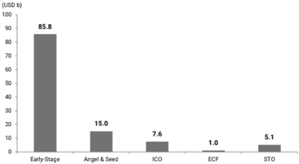

*来源*: Chain Partners,lcodata;Crunchbase News;Thomson Reuters TAB data 注：ICO 数字为 2018 年 1 月至 11 月的总和

图 6.2 显示 STO 市场与初创企业其他融资来源的关系。虽然对冲基金和风险投资家继续提供大部分早期融资，但通过 STO 的融资也并非微不足道。初创企业融资是早期企业带来的创新的生命线，曾是数字资产初期崛起的主要催化剂之一。预计通过 STO 进行的融资增长将继续增长。

## 6.8. 普遍存在的风险

虽然区块链技术解决了部分信任和市场流动性问题，但它并非万能良药。一些业务问题和风险仍然存在。尽管有技术，足智多谋的不法分子总能找到办法破坏系统并从中窃取。就像每项新技术一样，有时信任和依赖被夸大且 misplaced。在本节中，我们讨论了尽管转向区块链技术进行记录保存，但仍持续存在的问题。其中一些弱点可能被不法分子和欺诈者利用，以猎取不明真相和信任的人。我们讨论了两个最重大的风险，即基础资产或利润估值不当的风险，这可能损害代币化和区块链技术的适用性和潜力。目前，正如前文所述，新企业的种子资金通常由风险投资家和天使投资者提供。专业投资者拥有资源和专业知识来开展广泛的尽职调查程序，而这些程序在新的众筹模式中可能被省略，从而产生风险。此外，各司法管辖区的监管制度存在差异，由于代币化超越了地理边界，世界各地的监管机构必须协调其工作，并定期就系统威胁进行沟通。

#### 6.8.1. 资产或利润的错误估值

有时并未意识到的是，区块链和代币化中的透明度和“trust”关系到资产的所有权，而不一定关系到基础资产的估值。这是重要区别。区块链技术所保证的是在任何时点所有权都是无可争议的，然而代币的隐含价值可能不可靠，这取决于基础资产的性质。当基础资产拥有独立且成熟的市场时，例如黄金、白银和其他贵金属和商品，代币的价值可以精确获得。然而，当基础资产本身缺乏流动性或很少交易时，代币的价值会出现大幅波动。例如，代表无价艺术品的代币在二级市场的价格大多是投机性的，因为珍贵艺术品并不经常交易。此外，由于每件作品都是独一无二的，很难准确确定经典画作的市场价值。由于大多数名画的销售都是在拍卖会上进行的，很难预测交易价格或画作的市场价值，因此代币的衍生价值也难以确定。

基础资产的错误定价可能导致系统效率低下和投资者信任的丧失。例如，当资产在创始时被错误定价，即代币发行时，早期投资者支付的价格高于代币的真实价值，因此长期来看不太可能收回投资。同样，如果在处置时资产被低估，处置时的代币持有者获得的报酬低于其代币的真实经济价值。从这个意义上说，他们被剥夺了本应属于他们的财富。

由于理性市场参与者预期在创始时、处置时或两者之间任何时间都可能出现这种错误定价，他们有权要求估值由专业人士认证。这为会计师和审计师创造了一个新的市场。会计作为一门学科，专门从事经济价值的计量。随着这种计量需求在精确度和频率方面不断增长，它为会计职业带来了额外的责任和机会。因此，专业会计师应很好地处于区块链技术采用和代币化使用所带来的业务机会发展的有利位置。

同样，对于现金流代币化方法而言，决定代币价值的基础经济问题并非微不足道。在现金流方法下，最终结算价值的确定基于对该企业的经营利润的衡量。同样，虽然区块链技术使所有权记录无可争议且透明，但它并不会使经营利润的确定变得不那么模糊。经营利润的确定必须符合财务会计政策和程序，并且受当前会计方法与标准中盛行的估计和近似的影响。因此，会计政策和估计在代币化创始时明确列出并纳入智能合约。在基础会计政策未明确且全面指定的情况下，这为获取资金的主体——代理人——在报告利润方面提供了相当大的回旋余地。这对于电影众筹以及缺乏成熟财务会计标准的行业中的项目可能是一个重大的问题。

此外，在创始时必须做出合理的利润预测以正确设定代币的初始价格。起初购买代币的投资者必须获得项目预期价值和风险的保证。这种沟通必须由一个客观且负责任的方来验证。这是代币化创造的又一个新业务需求，会计职业非常有能力应对。

### 6.8.2. 尽职调查的减少

代币化也放弃了从风险投资家或天使投资人那里获得种子资本的传统方式。虽然这些传统融资方式使投资选择仅限于一小群富裕个人、风险投资家和天使投资人，但它们也有适当的保障。风险投资家和天使投资人通常拥有足够的资源来进行昂贵的尽职调查程序，并且具备评估新商业模式和商业计划的商业头脑。可能购买代币的普通投资者既缺乏资源，也缺乏商业头脑来执行类似的尽职调查程序。因此存在羊群心理。一旦有关键数量的投资者涌入代币，其价值就会上升，更多投资者随之跟进。

这种投资中的固有“羊群心理”可能会造成“拉高出货”骗局这一由来已久的问题。一旦代币化市场成熟，不法经纪人和交易商势必会进入该市场，他们会试图设计类似拉高出货的骗局来从天真和不知情的投资者手中骗取钱财。想象乔丹·贝尔福特的策略重现并不困难，正如他在*《华尔街之狼》*中 portray 的那样。

### 6.8.3 跨境交易相关的风险

全球贸易、关税减少和通信进步通过降低国际商务交易的成本和障碍使世界变得更小。这也与个人市场在全球金融系统内部的更深层次整合相吻合。数字资产的流行及其规避既定法律法规的固有属性引起了银行监管机构的关注。银行监管委员会于 2019 年 3 月发布了一份声明¹⁰，阐明了这一担忧：

*持续增长的加密资产交易平台和与加密资产相关的新的金融产品有可能引发金融稳定方面的担忧并增加银行面临的风险。*

银行和金融机构面临的风险很多。一些银行没有完全建立起处理数字资产交易、交易或存储风险的流程，但它们别无选择，只能参与其中。银行监管委员会将这些风险确定为：

*…为银行带来一系列风险，包括流动性风险；信用风险；市场风险；操作风险（包括欺诈和网络风险）；洗钱和恐怖融资风险；以及法律和声誉风险。*

在现代经济中，全球银行在多个司法管辖区运营，因此必须遵守每个司法管辖区的法律和法规。这是一项艰巨的任务，但当各国之间的法规没有协调一致，甚至可能相互冲突时，难度更大。

每个司法管辖区或主权国家都有权拥有与其民众相关且最合适的法律和法规。然而，法规的差异可能给合法业务带来障碍，并为“见不得光”的商业行为提供机会，以利用这些差异，从而规避其本国法律的精神。这种恶劣做法虽然不违法，被称为监管套利。也就是说，“见不得光”的企业可能利用法律和法规的差异和矛盾来牺牲大型跨国金融机构和不知情投资者的利益而获取财富。

随着金融服务的全球化，监管机构跨司法辖区之间的合作至关重要。跨境合作的需求对于金融科技总体而言，尤其是数字资产而言，更为关键。鉴于该行业的新颖性和激进增长，国际合作的前提是能力建设以及在这一快速发展领域分享知识。弥合司法辖区之间的专业知识差距将加速全球框架的发展。

最近，2019 年 7 月 30 日，美国证券交易委员会委员赫斯特·皮尔斯在新加坡社会科学大学（SUSS）融合论坛上谈到了数字资产生监管中跨境合作的挑战。她承认现代技术带来了独特的担忧，具体如下：

*跨境监管的挑战当然并非全然新颖，但随着技术促进了我们世界的融合，以及随之而来的金融市场，其在过去几年中加速了。……技术上更近期的创新——尤其是互联网——极大地促进了我们世界的融合。*¹¹

跨境监管的挑战涉及检查和执行两个方面。皮尔斯女士对此的表述为：

*……担心我们将无法审查在我们市场注册运营的外国实体，更一般地说，我们执行国内规则的能力将被我们无法在境外监管的局限所阻碍。*

上述担忧和挑战在数字资产和金融科技的背景下被放大，因为世界各地的多数司法辖区仍处于监管加密资产的初步阶段。如前所述，加密资产开发者与监管者之间的专业知识差距加剧了这一问题。此外，数字资产按其设计使全世界的人们能够进行交易。这使得难以明确确定企业实际运营的司法辖区以及适用的规则集。各种国际组织正试图解决这些担忧。最值得注意的是，经济合作与发展组织（OECD，Organization for Economic Cooperation and Development），成立于 1940 年代，正在研究与数字资产相关的跨境监管。此外，金融稳定理事会在 2008 年全球金融危机后不久成立，正试图协调对数字资产和分布式账本技术的监管。

尽管监管机构正努力减少跨境差异，证券代币的开发者仍必须提供强大的监督控制，使其成为管理多种监管司法辖区的理想工具。此外，智能合约功能使得能够将治理法律和法规嵌入协议层，提供适应性和灵活性。同样，预防性和侦测性控制的编码框架可以减轻风险影响，从而降低合规成本。会计职业可以在此努力中提供帮助，设计适当的控制措施，使其具有通用性，或可轻松适配。随着编码框架降低合规费用，它们可以帮助简化跨境交易的便利化。会计职业还可以为设计智能合约做出贡献，这些智能合约能够证明任何公司行动对所有适用法规的严格遵守。其中一些功能将在后续关于 J-REITs 的案例研究中详细讨论。

## 6.9. 回到未来 – 资产证券化

在讨论资产代币化，尤其是在房地产的背景下，不讨论资产支持证券（ABS）的兴衰——其常被归咎为 2008 年全球金融危机（GFC）的原因——将是不合适的。抵押贷款债券是最受欢迎的 ABS 形式，最早于 1970 年代推出，并在二十世纪末变得极其流行。在 ABS 推出之前，银行作为“组合贷款人”运营，即它们发放贷款、收取付款并持有贷款直至完全还清。银行通过存款，有时辅以银行承销的债务来为这些贷款提供资金。

### 6.9.1. 证券化如何运作

抵押贷款证券化是一种巧妙的机制，使银行能够发放更多抵押贷款，从而使更多人能够负担得起房屋购买。抵押贷款证券化是将抵押贷款合并并以“资产支持”证券形式出售的结构化流程。它们被称为“资产支持”，因为这些贷款以房屋或实物资产作为抵押。这就是该流程的工作方式。 prospective homeowner 访问当地银行以获得购房贷款。银行进行初步尽职调查并批准贷款。借款人购买房屋，银行支付大部分购买价格。虽然房主承诺进行未来付款，但始终存在房主可能违约的风险。贷款持有者承担这一风险，并通过利息收入获得补偿。然而，为了将风险从账簿中移除并为额外贷款提供更多资本，原始银行随后以固定费用将未来现金流入的权利出售给投资银行。投资银行收集来自各地的此类每月抵押贷款付款合同，并将其打包为抵押贷款支持证券（MBS）。本质上，证券化是将非流动资产转变为证券的过程。该方法如此流行和主流，以至于两部好莱坞电影 *Inside Job* 和 *The Big Short* 都围绕这一看似复杂的金融机制展开剧情。

抵押贷款证券化对所有相关方都有益。房主能够利用相对更便宜的国际信贷市场。发起人能够以更优惠的利率获取更广泛的资金来源，通常债务评级高于其整体公司评级。此外，通过剔除资产和相应债务，他们能够改善资产负债表。投资银行通过金融工程的魔力，从各地汇集抵押贷款并将其打包成 MBS，收取高额费用。MBS 的最终购买者受益于具有丰厚投资机会，且量身定制以满足其风险偏好，同时无需执行收取付款和服务贷款的运营任务。由此产生的市场规模极大，为一组抵押贷款提供了大量流动性，而其中每一笔单独来看都是非流动的。

**图 6.3：    房屋购买通常通过抵押贷款或计息贷款融资。**

当然，这一基本概念还有额外的变体。其中一个例子是创建“档次”，即风险调整后的回报。第一档是最安全的，在付款方面具有优先权，因此要求较低的利率。第二档仅在上层档次完全满足后才支付，因此略有风险，要求较高的利率。最低档是最具风险的，因为只有在前两档完全支付后才支付。通常，档次可以以几乎任何方式构建，并在发行人认为合适的任何规则下进行。这使投资银行能够设计可根据广泛的风险特征量身定制的产品。

### 6.9.2. 证券化的弊端

与贷款发起人发放抵押贷款的传统方法不同，MBS 方法使贷款发起人能够转嫁未来付款违约的风险。在传统方法中，贷款发起人持有抵押贷款直至还清，因此内部化了违约风险。然而，通过 MBS，贷款发起人在将贷款“出售”给投资银行时便转嫁了风险。同样，投资银行在创建并向投资者出售 MBS 时也会转嫁风险。因此，贷款发起人仅在将贷款转让给投资银行之前担心违约问题。这为贷款发起人造成了扭曲的激励。不是建立借款人长期信用 worthiness 以完全履行贷款条款，发起人更注重短期，仅关心贷款在未来六个月内、直至向投资银行完成销售前是否保持偿付能力。

相应地，投资银行对单个贷款的信用 worthiness 也较少关注，因为它并不会持有贷款直至到期。相反，它会将贷款与其他贷款合并，进行证券化后继续出售。同样，信用评级机构对单个贷款并不太关注，只关注贷款组合。因此，由于没有任何一方关心借款人长期偿还贷款的能力或意愿，信用记录不佳且收入前景不确定的个人仍获得了长期抵押贷款。

由于链条中的每个参与方都希望生产产品并卖给下一方，从而收取费用和佣金，他们都希望通过批准贷款来创造大业务。这些参与方中没有人关注长期后果。这几乎就像一场“热土豆”游戏。一旦贷款被转手，就成了其他各方的麻烦。只要借款人继续偿还贷款，系统就繁荣发展。然而，随着许多房主开始违约，系统突然停滞。情况相对迅速地恶化，并因美国部分地区房地产价值的同步下跌而加速。随着资金流动停止，贷款持有者受到不利影响，导致雷曼兄弟、华盛顿互助银行等美国主要金融机构破产。

通过 MBS 造成的扭曲财务激励在很大程度上应为 2008 年全球金融危机负责。事后来看，显然在发放贷款时不应降低标准。房产所在地与贷款所有地之间存在很大分离，导致对流程的监控不足。由于各方不再有财务利益去执行，传统的制衡体系受到了破坏。因此，监管机构必须介入以确保适当的制衡和内部控制程序得到执行。

这段历史和发展具有相关性，因为代币化也会导致产权所有者之间类似的大分离以及所有者的较短时间框架。代币化可能会加速“热土豆”游戏。链条中的每个参与方在将“定时炸弹”传给下一方时都会收取佣金或费用。因此，所有各方都想参与游戏，并在尽可能短的时间内传递尽可能多的“定时炸弹”。只要他们不是“定时炸弹”爆炸时持有者，他们就能从费用中受益。证券化与代币化之间的这些相似之处将在下一节中进一步讨论。

## 6.10. 代币化与证券化——相似之处
如上所述，本质上，证券化是将“非流动性”资产汇集并衍生出流动且易于交易的产品的过程。非流动性资产的代币化试图满足同样的需求。资产代币化，例如绘画或房地产，试图将稀少交易、高价值的资产转换为可互换的组成部分，便于交易。回到前面莫奈画作的例子。虽然画作本身不会经常交易，也许每 20–25 年一次，但基于画作价值的代币会更频繁地交易。虽然代币的价值源于画作的价值，但实现价值并不需要出售画作。同样，在房地产证券化中，虽然房产并非每日出售，但证券化的债务工具拥有活跃市场且易于交易。在这两种情况下，为了实现全部潜力并使其可交易，基础的非流动性资产通过证券化或代币化被转换为小的可交易要素。

虽然并非所有代币化应用都与非流动性资产交易有关，例如矿产供应链中的代币化，但一些不断增长的代币化应用与证券化相似。毫不奇怪，这些应用也存在于房地产市场。因此，重要的是考虑这些相似之处并建立控制和预防措施，以免重蹈 2008 年全球金融危机的覆辙。证券化与代币化之间存在许多相似之处。如下：

* 从根本上说，它们都有助于提升原本非流动性资产市场的流动性。
* 两者都通过频繁交易促进更大规模的资本流动，从而创造财富。
* 它们使投资者能够分散投资组合，从而管理风险并优化回报。
* 它们为金融机构和中介机构提供新的业务机会以筹集资金并收取费用。
* 最终投资者无法亲自评估基础资产的质量，因此必须依赖中介机构和评级机构进行客观评估。
* 中介机构和评级机构有金钱激励提供乐观展望，而几乎没有惩罚机制，因为只有在交易发生时才收取佣金，否则不收取。

区块链技术确保所有权记录不可篡改且无误。然而，MBS 所有权的验证并非导致 2008 年全球金融危机的因素。相反，导致危机的因素是基础资产的估值以及抵押贷款付款相关现金流的中断。这些问题在新技术下仍然存在。相反，问题被加剧，因为交易速度加快，潜在投资者群体进一步扩大。

要使非流动性资产代币化成功并使该市场增长，需要各种客观专业组织的参与。必须有明确的监管和保护投资者的机制。应有手段识别不诚信的供应商并有能力施加惩罚。没有这些保障措施，普通投资者可能会蒙受损失，从而影响对系统的信任。

信任对投资至关重要，它是通过制定和执行国际标准、以及声誉良好的合法中介机构（如会计师事务所和华尔街银行）的参与而随着时间建立起来的。代币化具有创造财富和促进多元化所有权的巨大潜力；然而，必须谨慎确保在基础设施中建立适当的控制和限制，以避免失败和欺诈。充分的监管和对这些法规的执行将防止欺诈者和不诚信企业利用新商业模式猎取不知情甚至可能轻信的投资者。

## 6.11. 结论

Tokenization 是区块链技术中具有巨大潜力和广泛商业应用前景的一个方面。Tokenization 本质上是一种数字所有权证明。它不仅促进了所有权的记录保存和验证，还促进了其从卖方到买方的快速转移。因此，很容易设想许多商业应用，在这些应用中，所有权转移的摩擦阻碍了交易量的增长。我们提供了三个在期权交易、高价值绘画作品所有权以及电影制作融资领域中代币化发展的简单应用。

代币化可货币化的方式主要有两种变体：股权法和现金流法。在股权法中，代币的价值会随着基础资产价值的变化而变化。在现金流法中，出售代币所得的收益用于为项目融资。项目结束后，项目所得收益或利润分配给代币持有者。在这两种情况下，都存在估值和计量方面的挑战，而会计专业可以提供帮助。

区块链和代币化的关键比较优势在于更广的覆盖范围、灵活性和透明度。此外，该技术增强了交易的便捷性。虽然便捷性和便利性对技术人员很重要，但需要注意的是，在金融应用中，其他属性可能更为重要。例如，在金融应用中，服务的可靠性和安全性比服务的便利性更为重要。例如，我们并不因为银行方便才把现金和其他贵重物品存放在银行，而是因为它安全。在评估这种新技术的潜在应用时，重要的是不要失去对每个应用真正重要的属性的视角。

在以下章节中，我们介绍了代币化应用的三个成熟用例。第一个用例是为新企业获取种子资金的传统应用。公司没有追求传统的融资方式，而是选择对其首次公开募股进行代币化。第二个用例在采矿行业，其中冲突矿产采购的合规性和记录保存相当繁琐。该用例提出了一种创新解决方案，利用区块链技术的关键特性提供一种成本效益高但有效的解决方案。第三个应用是日本房地产市场的代币化。这是代币化应用的一个新兴领域，具有巨大的潜力。然而，鉴于 2008 年全球金融危机主要由房地产资产证券化引起，该应用也充满风险。挑战仍然是如何建立适当的控制和保障措施，以在提高流动性的同时保持市场的完整性。

### NOTES

1. 示例改编自 [`medium.com/coinmonks/asset-tokenization-on-blockchain-explained-in-plain-english-f4e4b5e26a6d`](https://medium.com/coinmonks/asset-tokenization-on-blockchain-explained-in-plain-english-f4e4b5e26a6d)。

2. 本节改编自描述。可在 [`www.stocchain.de/`](https://www.stocchain.de/) 获取。

3. 补充细节可在 [`www.maecenas.co/`](https://www.maecenas.co/) 找到。

4. 文章可在 [`www.forbes.com/sites/schuylermoore/2019/01/03/most-films-lose-money/#379f8da7739f`](https://www.forbes.com/sites/schuylermoore/2019/01/03/most-films-lose-money/#379f8da7739f) 获取。

5. [`www.forbes.com/sites/forbesrealestatecouncil/2019/11/13/the-future-of-real-estate-investing-digital-assets-are-here-now/#4f2816e651f0`](https://www.forbes.com/sites/forbesrealestatecouncil/2019/11/13/the-future-of-real-estate-investing-digital-assets-are-here-now/#4f2816e651f0) （于 2020 年 1 月访问）。

6. *来源*： [`thetokenist.io/security-token-study-64-successful-stos-raised-nearly-1-billion-so-far-trends-suggest-significant-growth/`](https://thetokenist.io/security-token-study-64-successful-stos-raised-nearly-1-billion-so-far-trends-suggest-significant-growth/) （于 2020 年 1 月访问）。

7. 数据可在 [`www.prnewswire.com/news-releases/2-67-billion-tokenization-market—global-forecast-to-2023-300784939.html`](https://www.prnewswire.com/news-releases/2-67-billion-tokenization-market—global-forecast-to-2023-300784939.html) 获取 （于 2020 年 1 月访问）。

8. 数据取自 [`hackernoon.com/market-outlook-on-tokenized-assets-a-usd24trn-opportunity-9bac0c4dfefb`](https://hackernoon.com/market-outlook-on-tokenized-assets-a-usd24trn-opportunity-9bac0c4dfefb) （于 2020 年 1 月访问）。

9. [`www.marketwatch.com/press-release/tokenization-market-size-2019-global-analysis-by-size-share-growth-opportunities-emerging-trends-business-strategy-competitive-landscape-and-regional-forecast-to-2023-2019-11-29?mod=mw_quote_news`](https://www.marketwatch.com/press-release/tokenization-market-size-2019-global-analysis-by-size-share-growth-opportunities-emerging-trends-business-strategy-competitive-landscape-and-regional-forecast-to-2023-2019-11-29?mod=mw_quote_news) （于 2020 年 1 月访问）。

10. 可在以下位置获取： [`www.bis.org/publ/bcbs_nl21.htm`](https://www.bis.org/publ/bcbs_nl21.htm)

11. 完整演讲可在 [`www.sec.gov/news/speech/speech-peirce-073019`](https://www.sec.gov/news/speech/speech-peirce-073019) 获取 （最后访问时间为 2020 年 1 月）。

# 7 评估区块链用例的框架

## 评估区块链用例的框架

PHILLIP G. BRADFORD AND ROGER M. BENITES

## 7.1. 摘要

预测新技术的影响具有挑战性。很难知道技术将如何被利用以及哪些技术驱动的应用会蓬勃发展。虽然预测未来可能是不可能的；但确定当前技术对各种应用的适用性可以洞察其潜力。用例是确定当前技术适用性的最佳工具之一。给定一个商业问题，用例可以确定技术是否可能帮助解决该问题。用例通过关注技术的功能属性而非底层实现来做到这一点。

区块链是面向服务和基于软件的技术。用例对于评估区块链非常有价值，因为它们可以以多种方式为业务做出贡献。大多数新的面向服务技术增强了流程或服务。偶尔，新的面向服务技术会提供新颖的流程或服务。很少有此类新技术会创造原始的商业模式。创造原始的商业模式是技术带来的最佳商业成果之一。用例将帮助我们更好地理解区块链应用如何增强业务、理解新颖应用，甚至推动新的商业模式。

## 7.2. 引言

现代历史充满了技术对业务的巨大影响。区块链技术已经对许多组织产生影响。因此，企业必须为区块链技术带来的巨大影响做好准备。在大多数情况下，为新技术的影响做准备就等于拥抱新技术。在适当的情况下，早期采用新技术很重要。这确保了组织的管理层了解技术的应用和潜力。早期采用也确保组织能够培养出开发和维护该技术的人才。

## 区块链技术

区块链技术提供了应对当前诸多业务挑战的替代方式。拥有解决问题的替代方式可拓宽组织的 capabilities。这些替代方法可能为企业带来机遇和威胁。例如，区块链提供了使用加密货币的替代支付方式。电子支付系统已使用超过 50 年。但是，最近区块链帮助了传统银行体系之外的人群获得国际支付系统的接入。当然，随着这些替代支付系统成熟，它们可能直接与传统支付系统竞争。像往常一样，这些替代方法各有其优势和劣势。区块链支付系统要“规模化”并对传统银行系统构成威胁，还必须克服诸多重大障碍。

区块链技术还能提升某些业务流程。提升业务流程可能增加价值或降低成本。例如，验证证书和学校记录传统上都是手工完成的。这是一个缓慢且繁琐的过程。在确定证书是否被正确授予时可能会产生额外的时间和复杂性。例如，一项认证本身可能又依赖于其他独立认证。因此，验证所有这些记录既繁琐又劳动密集。区块链正被用于验证和核实证书、学校记录、课程和文凭。这种对传统手工任务的区块链增强增加了价值并降低了成本。

区块链技术有潜力取代某些业务流程。确定交易商品或艺术品的来源可能呈现新的形式。通过使用智能合约，监管合规的成本和工作可以得到优化。例如，金融机构对“了解你的客户”法规的实施可能以新的方式进行。“了解你的客户”和其他反洗钱条款对银行业至关重要，因违规而被处以的巨额制裁金额达数十亿美元。然而，目前合规流程通常是手工进行的，依赖少数个人的专业知识。成本高达 1 亿美元的自动化解决方案也很受欢迎，因为违规的处罚在全球范围内都很严重。

近年来，国际银行因未能遵守反洗钱（AML）和了解你的客户（KYC）法规而被处以巨额罚款的案例很多。2017 年，德意志银行因未能防止洗钱被罚款 6.3 亿美元。总部位于苏黎世的银行 UBS AG 于 2019 年因未能遵守 AML 法规而支付了 42 亿美元的罚款。2019 年，澳大利亚银行西太平洋银行被发现未能侦测到数百万笔涉嫌国际转账，预计罚款将达数亿澳元。区块链技术将有助于提高资金的透明度以及资金转账的可追溯性。

区块链的另一个潜在商业模式是开发用于追踪自主代理的来源或实质性交易的应用程序。来源在从艺术品买卖历史到确定基础材料来源等领域都很重要。鉴于自主代理可以执行交易，跟踪这些交易是有用的。区块链在供应链中提供更安全且可追溯的方法。企业可以创建数字护照或跟踪日志，证明商品的真实性并创建产品供应链结构的可审计记录。本主题将在后续章节中详细讨论。

区块链技术具有创造新商业模式的潜力。创造新商业模式是经济演进的最高点之一。新颖的商业模式在未开发的业务领域创造价值。这些新业务领域代表了重大的经济和社会里程碑。智能合约是新颖商业模式可能出现的一个领域。智能合约是软件执行的合约，表示自主各方之间的正式协议。区块链网络验证其条款和条件。这样一个验证区块链网络肯定由许多中立的自主各方组成。这增加了对合约解释公正性及其在适当时间执行的信心。

自 2018 年以来，区块链技术发展迅速。大约在 2008 年推出，区块链技术的早期发展由爱好者、投机者和暗网用户推动。然而，从 2017 年起，区块链的成熟应用正转向游戏、媒体和产权登记等高价值领域。2020 年及以后，区块链有潜力成为数字共享经济的重要组成部分。企业和政府在资产转移、智能合约和新市场方面有重大利益。因此，企业和政府已在区块链研究和开发上投入数百万美元。例如，2017 年，国土安全部（DHS）向区块链初创公司拨款约 250 万美元。这是其小型企业研究计划的一部分。这些公司专注于多种区块链应用、分析和去中心化密钥管理。另一个例子是中国政府投资超过 1700 亿元人民币（240 亿美元）发展专门从事区块链技术的科技园区。该国已在杭州、重庆和苏州等城市创建了多个区块链产业园，以探索该技术在未来应用中的潜力。

### 7.2.1. 区块链的关键属性

区块链的属性对其业务用例至关重要。¹用例与功能需求密切相关。在敏捷业务或系统开发的情况下，详细需求是 somewhat fluid。主要功能通常很明确，但在通向解决方案的过程中，细节和某些功能可能会被权衡。保持对主要功能关注可推动预期解决方案并使用例保持相关性。

区块链是经常更新的去中心化公共账本。这些更新预计每 10 分钟或更短时间发生一次。这些公共账本记录点对点交易。点对点交易需要独立验证和执行，因为它们并非由受信任的第三方，例如金融中介机构来促进。

这些交易的账本记录具有防篡改性。任何拥有正确工具的人都可以轻松验证其有效性。此外，账本的每次定期更新都由自主代理网络验证。执行是基于共识允许交易发生。

生成定期更新的自主代理会获得激励。这些激励来自交易补偿以及参与更新的验证和执行。并非所有网络参与者都会获得补偿。然而，网络参与者可能获得补偿的可能性激励自主代理支持网络。

一些区块链专注于智能合约。智能合约是一种计算机程序，当满足某些条款或条件时，区块链会自动且集体执行。条款和条件并非由受信任的第三方验证；而是由区块链网络的大多数参与者验证。

真实或数字资产可以被代币化。代币化是对真实或虚拟资源的独特数字表示。区块链的一个关键能力是其能够唯一地表示价值。因此，代币化在区块链上很合适。代币化有助于将智能合约有效地应用于虚拟或真实资产。

### 7.2.2. 区块链的特殊性

使用区块链的期望可能会因某些区块链属性而降低。在许多区块链中，周期性更新速度较慢。当涉及任何区块链上的大规模交易时，这一点至关重要，因为它会延迟验证过程。这些更新在给定时间内被聚合到区块中。例如，正如第 2 章所述，以比特币为例，交易区块之间的预期时间目标为 10 分钟。大多数区块链的区块之间预期时间更短。周期性更新并非精确计时，但通常在目标时间范围内。

区块链中的空间有限。每个区块都必须由区块链网络中的节点处理，因此将区块保持在合理大小是有意义的。在区块链中插入信息的成本可能有所不同。这是因为交易成本通常是区块链模型的一部分。这些交易成本以相关加密货币计价，而加密货币可能非常波动。

区块链验证自主系统的共识，但它们本身并不是数据库系统的替代品。在区块链中保存共识记录是区块链的明确目的，然而，在区块链中保存更一般的记录可能并不理想。特别是，下载整个区块链可能耗时且成本高昂。区块中的空间也有限、成本高昂且记录不可更改。

区块链对业务案例的适用性取决于区块链提供的属性。这些属性必须与任何区块链特有性进行权衡。在本章的剩余部分，我们首先从技术上讨论加密。我们的第一个用例是公钥加密系统。在第 7.4 节和第 7.5 节中，我们给出了评估区块链系统用例的框架。我们还制定了评估区块链及其用例的评分卡。该框架在制定评分卡时从自下而上和自上而下应用区块链。接下来，我们讨论区块链中的智能合约。我们深入开发了若干用例。最后，我们在以简要总结结束之前给出区块链的注意事项和风险。

## 7.3. 密码学和加密技术入门

密码学是一门高度技术性且应用性强的学科。家用、工作场所或当地商店的 WiFi 服务使用密码学。只要我们从网上订购任何东西，我们就在使用密码学。密码学也需要用于将文档放入云端或从云端检索文档。另一个应用密码学的常见用例是无线汽车钥匙。鉴于应用密码学的广度和深度，区块链使用密码学也就不足为奇了。事实上，区块链依赖于公钥加密。因此，第一个示例用例图说明了基本的公钥加密。

对称加密系统只有一个密钥。因此，单个密钥既加密也解密机密数据。由于只有一个密钥同时加密和解密数据，因此存在对称性。大多数机械房屋钥匙是对称密钥。这是因为同一房屋钥匙既能锁门也能开门。

公钥系统是非对称加密系统。这些系统是非对称的，因为一个密钥锁定数据，另一个密钥解锁数据。其中一个密钥是公钥，另一个是密钥。公钥可以对所有感兴趣的人公开。给定公钥，找到密钥是不可行的。

对于非对称加密系统，设 `E` 为加密函数，`D` 为解密函数。假设为这些加密和解密函数生成了公钥 `p` 和密钥 `s`。私有消息 `M` 可以加密为 `c` ← `E[s]`\[`M`\]，其中 `c` 是密文。密文消息可以解密为 `M` ← `D[p]`\[`c`\]。

更广泛地思考，让我们计算 `c'` ← `E[p]`\[`M`\]。也就是说，使用公钥我们可以加密私有消息 `M`。当然，如果 `c'` 可以在没有密钥 `s` 的情况下轻松解密，而是通过简单的解密机制 `F`，那么 `F`\[`c'`\] ← `F`\[`E[p]`\[`M`]\]。现在，由于 `F`\[`c'`\] = `M`，所以必须有 `c` ← `E[s]`，并且一旦我们有了 `c'`，这就很容易计算。因此，加密方案将被击败。

因此，秘密消息 `M`、公钥 `p` 和密钥 `s` 满足

`M` = `E[p]`\[`D[s]`\[`M`]\]

`M` = `D[s]`\[`E[p]`\[`M`]\]

在此用例中，Blue 希望向 Red 发送秘密消息。Red 生成公钥 `p` 和密钥 `s`。公钥 `p` 可以公开张贴。理想情况下，公钥由受信任方张贴。密钥 `s` 保持私有。

图 7.1 显示了一个示例用例图，其中 Blue 安全地向 Red 传输私有消息。首先 Blue 从受信任的密钥存储库 Green 获取 Red 的公钥 `p`。接下来 Blue 使用 Red 的公钥 `p` 加密其私有消息并将加密消息发送给 Red。Red 使用其密钥解密加密消息。就加密和解密而言，Red 的密钥充当 Red 公钥 `p` 的逆。

**图 7.1：    蓝方向红方发送安全私密消息。**

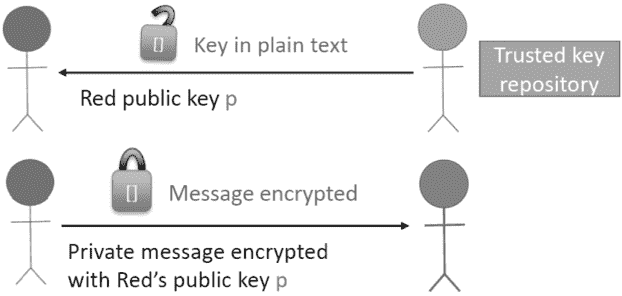

## 7.4. 评估用例的框架

区块链的有效性取决于对区块中交易有效性的信任。反过来，区块的有效性取决于密码学安全性。这种密码学依赖性确保了通过区块链中区块的进展对其有效性的信任。特别是，信任区块 10 包含有效交易，要求我们信任区块 9 的有效性，而这又要求我们信任区块 8 的有效性，等等。

如果量子计算成为现实，许多区块链密码学将会失效。这是因为根据 Shor 算法，复合整数分解可以在量子计算机上有效运行。因此，很明显加密在区块链信任中发挥着关键作用。区块链还有许多其他属性使该技术具有吸引力，这些属性在审查用例时至关重要。

表 7.1 中的定义可以用图表、注释和替代定义进行补充。这种补充使更多利益相关者能够在谈判和讨论中获得更好的立足点。

**表 7.1：     选定的用例属性定义。**

| **属性** || **定义** |
| --- | --- |
| **公共账本** || 公共账本是可公开验证的交易记录。交易的原则可能使用加密保持秘密，也可能被公开识别。尽管如此，交易本身始终是公开的。 |
| **点对点** 区块链 || 交易双方之间的交易由区块链网络验证。这些交易不是由第三方启用、经纪、批准或审查的。这意味着任何错误或不当交易必须由交易中的双方负责。这是因为没有仲裁或争议解决。 |
| **自主且激励的** || 独立且自主的机器被激励以启用和维护区块链网络。自主机器对交易内容不感兴趣。相反，它们被激励以实现交易。它们也可能被激励执行智能合约。 |
| **代币化** || 代币化是对物理或抽象事物的数字表示。本质上，一项物品可以象征性地表示为数字代币。许多相似的物品可以被代币化形成新市场。代币化的重要特征包括不可复制性、用户定义的产权转让限制以及市场创建。 |

| **智能合约** || 智能合约是一种由区块链网络执行的计算机程序。智能合约对两个或多个点对点交易进行编码。智能合约的条款和条件由区块链网络验证，并且当适当的条款和条件得到满足时，合约将被执行。 |

| **每次交易成本** || 每次交易都包含激励措施以支持网络。在某些情况下，单笔小额交易可能花费数美元。没有财务激励，自主机器将无法发挥其在实现交易和维护网络方面的作用。 |

存在许多具有各自专门属性的区块链。一旦区块链的 *配置* 得到确定，则每个区块链属性的重要性会针对每个业务案例进行评分。用例的分数总和为业务案例提供整体区块链评分。

将属性符号与图表结合起来有助于制定评分。100/100 的分数表示该属性对用例至关重要。同样，较低的分数，例如 25/100，表示该属性对用例不重要。

**表 7.2：     示例用例评分卡。**

| **区块链属性** || **用例评分 (0–100)** || **符号** |

| --- | --- | --- |

| 公共账本 ||   || 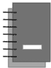 |

| 点对点区块链 ||   || 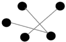 |

| 自主且激励 ||   || 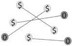 |

| 代币化 ||   ||  |

| 智能合约 ||   ||  |

| 每次交易成本 ||   || **$/Tx** |

| 总分 ||   ||   |

表 7.2 显示了区块链技术的属性。此表既包含每个属性重要性的评分，也包含符号。这些符号用于用例图。其思想是使用一组通用符号为不同的业务问题构建用例图。这些符号的语义应为所有利益相关方明确定义。由于利益相关方背景和词汇各不相同，因此最好通过多种方式完成。表 7.1 给出了用例属性定义。

## 7.5. 应用框架

有两种广泛的方法可以找到区块链技术在业务中的有效应用。*自上而下方法* 是从业务挑战开始，并确定区块链属性是否可能有助于其解决方案。*自下而上方法* 是采用关键区块链属性并寻找区块链适用的业务挑战。自上而下和自下而上方法可以作为混合方法协同工作，以开发区块链的相关应用。混合方法通常是对区块链应用的迭代自上而下和自下而上方法。

### 7.5.1. 自上而下方法

有许多流程图可用于检查区块链是否可能有助于解决业务问题。在此类流程图中，自上而下方法从业务问题开始。目标是确定区块链是否提供良好的解决方案。业务需求通常被拆分为可使用特定技术属性解决的部分。有时这些业务属性仅适用于特定区块链。其他时候，业务属性适用于大多数区块链。

关键问题是区块链属性在解决业务挑战中发挥的作用。这可能会定义感兴趣的特定区块链。最终，这一选择引出以下问题：任何属性是否会增强当前流程、为流程提供新颖的解决方案或创建新流程？

在自上而下方法中，区块链属性是固定的，业务问题则适配于它们。例如，考虑一个业务挑战。总体而言有两种情况。第一种情况是，当前问题已有解决方案。在这些情况下，现有解决方案可作为寻找基于区块链解决方案的指导。第二种情况是，问题目前尚未解决。此类问题可能有不使用区块链的良好传统解决方案。此类传统解决方案应首先进行审查，以便为区块链和非区块链解决方案提供比较基准。应仔细审查区块链，并应仔细记录需要区块链才能解决问题的原因。

对业务挑战进行区块链自上而下审查的步骤如下；

*   将此挑战分解为子挑战图：
    *   – 为此挑战及其子挑战找到合适的区块链。
    *   – 该图的结构反映了挑战中的依赖关系。
    *   – 确定所考虑区块链的依赖关系。
*   列出关键区块链属性，例如 表 7.2 中的属性：
    *   – 查看哪些属性有助于子挑战的解决方案。
    *   – 确定挑战的依赖结构是否与区块链中的依赖关系匹配。
*   为此问题对每个区块链属性进行评分。汇总分数并分析总计。

### 7.5.2. 自下而上方法

此方法从区块链属性开始。首先考虑通用区块链属性。所有区块链都有许多共同属性，例如点对点交易、智能合约、代币化等。接下来可以考虑特定区块链属性，例如具有平均区块生成时间低于指定时间的灵活智能合约。

这些技术属性解决复杂的业务挑战。此外，还可能寻求新的或意外的业务挑战，在这些挑战中，这些属性将产生以前未被利用的价值。再次强调，目标是确定这些区块链属性是否增强、改进或创建新的解决方案。在这种情况下，首先列出所有感兴趣的区块链属性。表 7.2 显示了选定的区块链属性。接下来，重点关注这些属性的特性，遍历可使用这些属性中的任何一个改进的所有业务流程。

这通常被称为“为解决方案寻找问题”。很多时候，这种视角可能不会带来快速结果。相反，这种方法可能有助于了解区块链格局以及它为潜在业务挑战提供的机会。对业务挑战进行区块链自下而上审查的步骤包括：

*   确定是使用通用区块链属性还是将特定区块链的属性作为重点。
*   生成可通过区块链属性增强的有用且相关的业务挑战：
    *   – 业务挑战应分解为依赖图。
    *   – 将区块链属性沿依赖关系对齐。
*   关注区块链属性产生差异的图组件。
*   在这些情况下对区块链属性进行评分。
*   汇总分数并分析区块链贡献。

我们提倡采用正式方法来应用区块链的自下而上和自上而下方法。优点包括创建结构化思维过程、理解和记录障碍、先验确定可行解决方案等。当然，将所学知识保存下来以备将来使用是很有价值的。因为以后可能会出现新的业务问题。对问题和应用有敏锐的理解将迅速带来更好的结果。

## 7.6. 智能合约：一个显著特征

新技术往往并不被很好地理解。它通常很复杂且处于早期开发阶段。其技术属性或优势可能并不明确。早期实现可能不稳定，并在多方面存在不足。尽管如此，新技术对于经济增长至关重要。但是，新技术可能因各种好或坏的原因而受到推崇。

一个关键问题是区块链为企业提供了哪些独特特性？区块链提案看起来多余的情况很常见。首先需要考虑的是，为什么这个问题不能使用关系型或 NoSQL 数据库系统来解决？

存在一些提案，其中区块链提供了新的价值。今天，这些技术或提案通常以公共共享账本为中心，账本的维护成本由参与交易的节点承担。

智能合约的使用也是区块链应用的关键支点。智能合约一直是区块链早期发展的重要特性。在比特币的背景下，区块链的创立就包含了智能合约。智能合约的特性在以太坊领域得到了进一步发展并变得更加核心。在以太坊的情况下，智能合约或许是最重要的特性。用于编写以太坊智能合约的语言有多种。

传统的纸质合同是结构良好的文件。合同中使用的术语会在合同开始时定义，以便在整个合同中使用。合同分为条款。每个条款都有狭窄的焦点。每个条款都不得与法律或法规相矛盾。通常后续条款会基于先前的条款甚至先前的合同。所规定的条款和条件的含义有时会受到质疑。在最坏的情况下，关于条款和条件含义的问题可能诉诸判例法，或很少诉诸诉讼。

智能合约是纯数字化的合同。它们是用编程语言编写的，以便由区块链执行。这类合同编程语言通常是面向对象的。面向对象编程范式非常适合智能合约的某些方面。例如，每个类可以代表合同条款。类的包含关系可能表示条款依赖性。也就是说，如果一个主条款必须有一个子条款才能有效执行主条款，那么这个子条款可以包含在主条款中。例如，要获得驾照，司机可能需要同时提供视力矫正表格和器官捐献表格。视力矫正以及器官捐献表格的详细信息都可能包含在合法的驾照文件中。继承扩展或捕获来自其他条款的已达成一致的细节。例如，涵盖所有销售税的法律可能从销售点税开始继承。智能合约可以被编码为在销售最终确定时自动为销售税预留资金。

关于面向对象合同语言的担忧包括多态性、动态作用域和全局指针变量的问题。在面向对象语言中，多态性有时发生在同一个运算符或操作在不同上下文中有不同含义时。这可能有用，也可能增加人类理解合同条款的混淆。同样，许多面向对象语言具有动态作用域。动态作用域可能导致同一表达式在不同上下文中执行时产生不同的值。最后，全局指针引用可能导致一个值具有两种不同的含义。

另一方面，好的编程语言具有非常明确定义的语义。确实，很多时候编程语言的语义是用形式化数学术语定义的。因此，我们可以在某些编程语言中证明关于某些程序的定理或重要事实。这些事实可能包括正确性概念。这排除了大量潜在的歧义。此外，一些编程语言内置了定理证明器。例如，声明式编程语言被赋予事实和关系，并推导出结果或解决方案。

## 7.7. 示例用例
用例有多种形式。其中一些用例将在后续章节中更详细地讨论。这里的目的是介绍一些用例，以说明区块链技术如何契合业务需求。² 我们在评估用例时涵盖视觉模型。可视化通常有助于与所有利益相关者更广泛地讨论用例。这里的两个用例——智能合约的代币化以及电子公证——提供了展示区块链技术关键特性的背景。

### 7.7.1. 智能合约的代币化
**图 7.2：    智能合约基础代币化用例。**

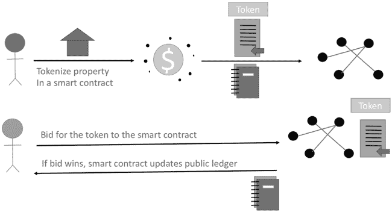

在区块链中对房产进行代币化的基本用例在 图 7.2 的用例图中。这展示了该用例中的基本功能。其他用例图可以包含更多细节。例如，从房产证获取元数据并用于代币化的过程本身可能需要另一个用例图。房产证适合区块链模型，因为它们是高价值物品。它们不会持续交易。智能合约非常适合房产证，因为需要满足复杂的条款和条件。

代币化一个简单但流行的例证是“加密猫”的新颖应用。Cryptokitties 是一个分布式应用。该应用让人们繁殖数字猫。他们还交易数字猫。利用巧妙的代币化和智能合约，每只猫都是独一无二的且无法克隆。然而，CryptoKittens 是由一对雄性和雌性数字猫繁殖的。系统中甚至有遗传的概念。每只加密猫都有自己数字编码的基因组。在这种情况下，代币代表抽象的数字猫，包括它们的外观和基因组。

加密猫的遗传决定了猫咪的颜色、条纹、笑容等。在交配期间，遗传算法（GAs）会随机组合来自加密猫父母的位串，以生成代表新特征的新遗传信息。这些新特征在新的加密猫中得以体现。

繁殖加密猫需要虚拟授精。虚拟授精使用 GAs 来组合两只繁殖加密猫的遗传信息。新创建的加密猫稍后可能会被拍卖。它们也可以作为额外的虚拟宠物保留。它们的价值基于其来源，特别是其有趣的特征。通常，高价值的加密猫会繁殖出高价值的加密小猫。

Cryptokitties 是区块链早期成功的应用之一。区块链有众多应用，但像 cryptokitties 这样的分布式游戏是由区块链实现的。由于加密猫具有真实价值，密码学在保护此类价值方面发挥着重要作用。区块链的分布式和自治特性也促进了此类分布式应用的有效性。

### 7.7.2. 电子验证平台
区块链电子身份和电子公证系统验证个人的身份及其在组织中的角色。电子身份通常是点对点的。在许多情况下，组织中的官方角色是公开知识，因此公共账本适用于此。

电子身份和电子公证系统为智能合约提供了坚实的基础。有许多基于区块链的电子身份系统来帮助难民、服务不足或贫困人口。电子身份提供了对传统纸质身份的改进。此类改进包括经过验证的交易系列，这些交易可以与身份持有人一起审核。

电子公证系统旨在增强或取代传统公证系统，以识别订立协议或签署合同的个人。电子公证系统对智能合约很重要。电子公证系统将智能合约锚定在非数字世界中。

图 7.3 显示了制作电子公证令牌的过程。个人可能会采集生物特征，例如指纹、密码以及其他信息，例如出生地、朋友姓名等。当然，这些令牌应使用密码学进行锁定。否则，身份可能会被复制。电子公证随后会将通常的传统签名和纸质记录，例如驾驶执照、护照和出生证明录制成视频。视频也可能是令牌的一部分，并且可能存储在另一个位置。³ 视频确实存在深度伪造的问题，这可能会阻碍电子公证的采用。

将凭证和文凭放在区块链上正成为现实。按需课程和凭证在今天的互联网和相关技术下已成为现实。这引发了对课程和凭证可转移性的质疑。使凭证和课程易于转移将为它们增加很大的价值。这对机构、受训者和雇主来说也将节省时间和资源。

**图 7.3：电子公证系统。**
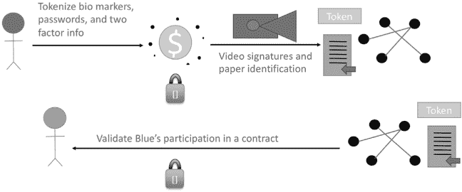

### 7.7.3. 股票交易后台办公室
今日股票交易公司的后台处理反映了股票交易以纸质为基础的时代。这些基于纸质的流程早于现代计算时代数百年。金融的后台处理具有很大的冗余性。⁴ 这种冗余很大程度上存在于对账和验证中。例如，验证是为了确定交易是否得到妥善执行。而对账则是让交易中的各方就交易达成一致并验证细节，例如执行时间、股票数量和当时的估值。

交易结算是指各方比较并验证其交易是否正确记录的过程。有许多参与者进行交易结算。主要结算团体包括经纪商、清算所和托管人。这些团体结算每笔交易的双方。卖方拥有所有这些后台结算合作伙伴。同样，买方也有这些结算合作伙伴。所有这些方都会验证彼此的记录。他们的会计也接受审计。它们对支持功能性金融市场都非常重要。因此，它们也可能被货币监理署办公室和其他联邦机构审计。

**图 7.4：公司股票交易结算相关方。**
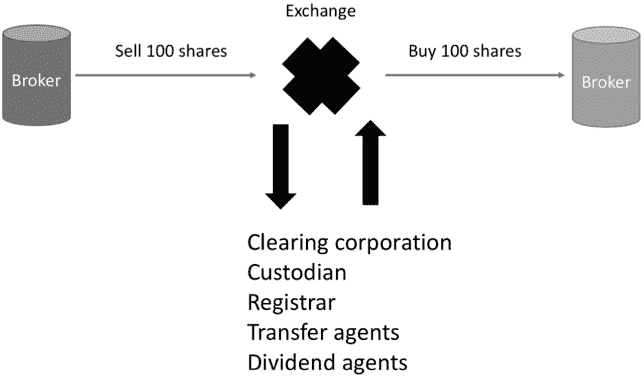

图 7.4 提供了后台功能的概览。券商通常以街道名持有大部分股票。街道名是一种匿名方式，表明券商是股份的持有者。当然，券商账户持有人通常拥有股票，尽管是以街道名持有。本质上，街道名允许券商代表其客户并保护其身份安全。所有券商都以自己的名义持有所有股份，这使得清算公司在每天交易结束后更容易轧差出总的股份所有权。托管人持有以街道名登记的股票，同时追踪实际的券商账户所有者。谁拥有哪些股份的细节对于许多原因都至关重要，包括谁获得股息、股票分割、新发行等。股息和过户代理专注于这些操作。这些数据也报告给税务机关和系统以允许股份投票。

过去，在每次交易后都会打印股票证书，上面写有个人所有者的姓名。当股票被交易时，旧的纸质证书会被销毁，并打印新的纸质证书，上面写有新所有者的姓名，以此类推。因此，拥有托管机构、托管人、过户代理对于查找、存储、移动、打印和销毁实物证书至关重要。

今天大多数股票以账面形式表示。即，计算系统代表股份并将这些股份与其所有者关联。这些表示是分离且冗余的。区块链有一个单一的点来表示共识。这些共识可以作为单一事实来源来表示交易。这些交易由自主机器验证并永久存储。这些永久交易存储也提供了交易的来源。此外，这些单一事实来源可用于审计。

可能不再需要以街道名持有股份。相反，证券持有的匿名性可以通过不公开披露识别证券所有者的公钥来实现。按券商汇总净股份已不再必要，其他许多中介功能也是如此。因此，采用区块链解决方案解决传统问题将提高效率并降低金融交易机构的运营成本。

### 7.7.4. 保险
保险基于汇集资源以覆盖罕见的不利事件。传统上，承保人联合保险单。承保人是获得报酬以承担合同中定义的不利事件风险的组织。即，如果发生承保的不利事件，则这些承保人向受害者支付款项。因此，联合承保是与一组承保人分散风险的过程。这种古老的实践可以重新构建为点对点模式。单个项目的保险单可在保险智能合约中进行代币化。

智能保险合约相比传统保险合约具有许多有趣的优势。例如，通过互联网验证条款和条件非常有吸引力。例如，作物保险可能基于降雨量。如果降雨量低于预定阈值，则会产生保险调整。一次调整是对已验证保险索赔的付款。像这样的智能合约也可能减少保险调整所需的时间。保险理赔员会验证一些保险索赔。理赔员甚至可以由智能合约部署。图像或其他信息可以加载到智能合约中并进行验证。

保险公司经常汇集其负债并使用再保险进行承保。再保险是对保险公司的保险。再保险在许多方面都高度分散。例如，它可能在地理上分散，可能按保险类型分散，按保单数量分散等。保险智能合约可能包含保险单再保险的参数。这将为保单提供清晰度和透明度，以便被保险人更清楚地了解保单的风险。此外，面向对象的智能合约语言非常适合这种类型的合约包含。

## 7.8. 注意事项与风险
测试网络不是面向客户的功能需求。然而，它们对于评估和实施系统至关重要。随着新区块链的开发和实施，对网络进行稳健测试至关重要。

区块链网络需要支持和控制结构的广泛分布。这种分布关乎控制而非地理位置。分布式控制是区块链的核心原则。这是因为区块链网络的弱点源于其共识算法。区块链共识算法通过投票来确定有效性。网络节点的大多数决定区块或交易是否有效。因此，如果许多节点处于同一实体的控制之下，则区块链就会变得脆弱。51%攻击是指区块链共识计算中超过一半的参与者被攻破。也就是说，这种妥协可能导致投票不当，从而得出错误的共识。

区块链的重要贡献之一是其巧妙地使用密码学来维护之前的交易并锁定无利害关系方的分布式共识。撇开量子计算不谈，51%攻击并不会破坏密码学。相反，51%攻击是对共识机制的直接攻击。这意味着参与者少的区块链比参与者众多的较大区块链更容易受到攻击，因为少量的参与者更容易被捕获和控制。

## 7.9. 摘要
新的区块链属性可能由用例驱动，而用例也可能通过新的区块链属性得到验证。本章中类似的图表可用于评估区块链的新用例。这些可视化表示以共同的符号学将不同的利益相关者聚集在一起。将分数与这些图表中表示的图像关联起来将有助于其评估。区块链技术可能会创造新的行业。例如，分布式应用和智能合约可能捕捉到新发现的经济力量。用例将有助于加快这些新应用的验证。

## 注释
1. 参见 Tasca 和 Tessone（2019）。

2. 有关如何的进一步信息 [`www.ivarjacobson.com/sites/default/files/field\_iji\_file/article/use-case\_2\_0\_jan11.pdf`](https://www.ivarjacobson.com/sites/default/files/field_iji_file/article/use-case_2_0_jan11.pdf)。另见 Bittner 和 Spence（2003）。

3. 有关更多细节，请参阅 Sward、Vecna 和 Stonedahl（2018）。

4. 有关交易公司当前流程的更多详细信息，请参阅 David M. Weiss（2006）。

## 贡献者联系信息
Dr. Phillip G. Bradford 是美国康涅狄格大学斯坦福分校计算机科学项目的负责人。Phil 的电子邮件地址是 phillip.bradford@uconn.edu 和 phillip.g.bradford@gmail.com。

Roger M. Benites 可以通过 Rbenites@blockhivetechnologies.com 联系。

# 8 通过代币化为企业扩张融资
*MIKE ROGERS*

## 8.1. 引言
传统融资机制，如首次公开募股（IPO），近年来承受着压力，因为蓬勃发展的互联网技术使繁琐的流程得到促进并消除了不必要的参与者。网络平台的兴起与私募配售增长相吻合，帮助企业家在企业早期关键阶段与大量潜在投资者建立联系。现在，随着区块链技术重新塑造互联网的面貌，私募融资方式正随着证券型代币发行（STO）而转变。

以下真实案例研究描述了近期成立的金融通讯提供商 Curzio Research 的 Curzio Equity Owners（CEO）代币发行。该案例突出了发行数字证券筹集资金的成本、收益、要求和时间框架。本章将概括适用于采矿业的 STO，该行业是传统、陈旧且保守的行业。

## 8.2. 公司背景 – Curzio Research
Curzio Research 成立于 2016 年，是一家金融通讯出版商，为个人投资者提供精选的投资研究和分析服务。在业务的前 18 个月内，Curzio Research 累积了约 40,000 名读者。出版商的成功在很大程度上取决于其将读者名单转化为付费订阅者的能力。Curzio Research 在这方面做得很好，在推出后的前两年内产生了 640 万美元的收入。相比之下，在同一时期，他们最大的竞争对手销售额达 20 亿美元，同时向数百万读者分发。

随着 Curzio Research 读者群的扩大，收入增长将随之而来：在通讯行业，名单规模意味着一切。在分析现有名单的数据并组建合适的管理团队后，Curzio Research 已准备好进行战略扩张。由于资本是企业扩张的燃料，该公司于 2019 年着手通过私募筹集 300 万至 1200 万美元。

## 8.3. 私募要约 – 替代方案与挑战
根据联邦证券法，公司不得要约或出售证券，除非该要约已在 SEC 注册或有注册豁免。符合豁免要求的要约通常被称为私募配售或未注册要约。私募配售可在以下豁免下进行：
* Regulation A+；
* Regulation CF；
* 或，最常见的是 Regulation D（Reg D）。

表 8.1 提供了这些豁免及其规则的简化摘要。

由于其 100 万美元的最大募资限额，Curzio Research 不符合 Regulation CF 豁免条件。该公司也不感兴趣进行 Regulation A+ 要约，因为报告要求增加且有 60 天的等待期。通过排除法，Regulation D 是合乎逻辑的豁免；在 Rule 506(c) 或 Rule 506(b) 之间做出选择时，公开招揽是主要因素。由于销售和营销是 Curzio Research 的专长，因此选择了 Reg D 506(c) 要约。

在初步规划过程中，Curzio Research 开始看到传统私募的弊端。中介机构希望仅为向潜在投资者引荐就收取高额费用。此外，经纪人寻求租金，而不保证 Curzio Research 潜在金融工具的充足流动性。很明显，Curzio Research 的传统私募配售将为中间人创造比 Curzio Research 利益相关者更多的价值。

**表 8.1：融资替代方案的关键特征比较。**

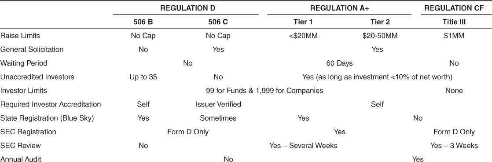

在面向未来、竞争激烈的行业中运营，Curzio Research 的领导层一直在关注数字资产市场的进展。他们知道最近有几家初创公司通过进行 STO 筹集了资金。因此，Curzio Research 开始研究数字资产证券生态系统中的证券代币发行平台，并联系了 Securitize。

## 8.4. 证券型代币发行与传统私募配售
在会议期间，Securitize 与 Curzio Research 讨论了 STO 的独特优势。STO 提供了与传统私募配售相同的全部好处，同时还提供增强功能，以在证券整个生命周期内最大化利益相关者价值：通过网络访问全球资本池、降低运营费用和复杂性、通过 24/7 证券代币交易所（STE）为投资者提供更好的流动性等。

A security token is an ideal instrument for regulated fundraising; the programable nature allows for customization per each issuer’s unique requirements throughout the token lifecycle. Starting with the issuance phase, terms and restrictions are embedded in each token’s smart contract to ensure proper regulatory adherence when gathering funds from investors. After issuance, continuing events associated with investors’ rights, such as receiving dividends, participating in token buybacks and/or voting in company decisions are facilitated through the platform. A programable and automated platform helps streamline the processes typically related to such lifecycle events. The tokens also serve as an automated investment vehicle: the underlying ledger keeps track of subsequent token exchanges, while smart contracts automatically execute the corporate actions.

By operating within a standardized internet ecosystem, such as Securitize’s DS (Digital Security) Protocol Ecosystem, security tokens can ensure complete adherence to applicable securities laws and regulations. As illustrated in 图 8.1, within the ecosystem, DS Services (Digital Securities Services) infrastructure supports third party DS Apps (Digital Securities Apps) to address all aspects of the DS Token (Digital Securities Token) lifecycle.

**图 8.1：    Securitize 的 DS 协议生态系统。**
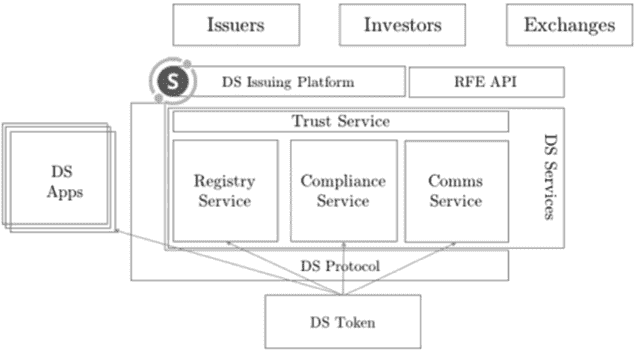

**图 8.2：    Securitize 的数字所有权架构。**
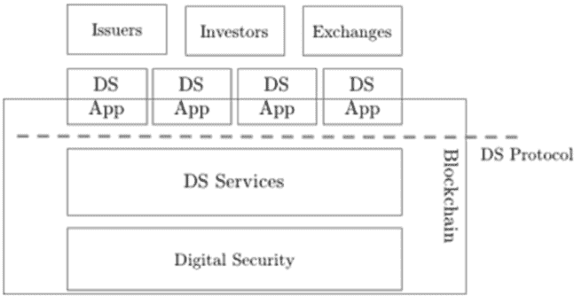

As shown in 图 8.2, interactions between the tokens and stakeholders (issuers, investors and exchanges) are managed by the layered and extensible DS Protocol (Digital Securities Protocol). This smart contract infrastructure offers an array of services and applications within the ecosystem; these components provide value to stakeholders while addressing compliance by leveraging the immutable, public, distributed ledger nature of the blockchain.

Furthermore, specific compliance rules are programed into each token as per the issuer requirements. The result is a controlled internet environment that nurtures innovation, while also protecting consumer interests: ideal for the “sandbox” based approach that many nation’s lawmakers have taken for regulating digital assets. This is illustrated in 图 8.3.

The up-front costs for a STO were calculated to be less than those of a traditional unregistered offering. Curzio Research also expected to receive savings down the line, due to the streamlining of the security lifecycle events and related compliance processes. Furthermore, Securitize guaranteed liquidity for each token after the standard 12-month lock-up period.¹ Since STEs trade 24/7, Curzio Research’s investors would realize more liquidity through a STO.

**图 8.3：    一个监管沙盒模型。**
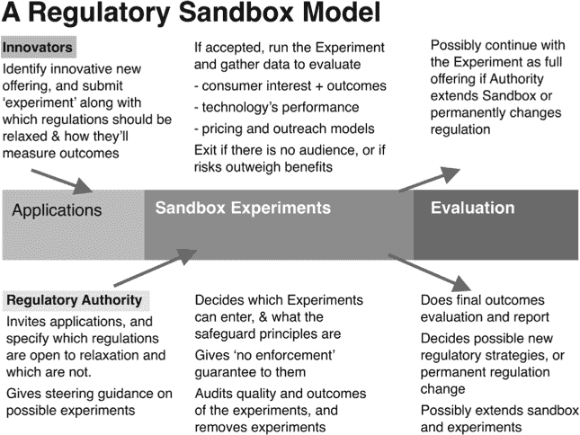

## 8.5. STO 流程

While working with Securitize, Curzio Research followed a three-step process to setup, execute and manage its token offering:
*步骤 1 – 设置阶段*
Before each security token issuance, Securitize works with its clients to create a customized STO strategy. This process entails determining how to best:
*   构建每个发行。
*   起草或修改所需文件。
*   获取适当的法律审查。
*   安排营销活动。
*步骤 2 – 发行阶段*
The security token issuance process involves minting the company’s tokens, properly overseeing the Know Your Customer (KYC)/Anti-Money Laundering (AML)/Accreditation procedures for each investor, as well as directing the capital and token exchanges between the issuer and its investors.
*步骤 3 – 生命周期阶段*
Once the tokens are issued and distributed to each wallet, the investor lifecycle stage begins. During this phase, Securitize’s platform provides an avenue for ongoing investor communication and secondary market trading compliance.

The standard STO timeline is illustrated in 表 8.2.
The following three subsections discuss in detail the three steps outlined above.

### 8.5.1. 发行前

Unregistered offerings are typically for common or preferred stock in the issuing company. However, debt instruments, such as promissory notes or bonds, as well as hybrid securities, like warrants and convertible notes, may be offered as well.

**表 8.2：     标准 STO 时间线。**
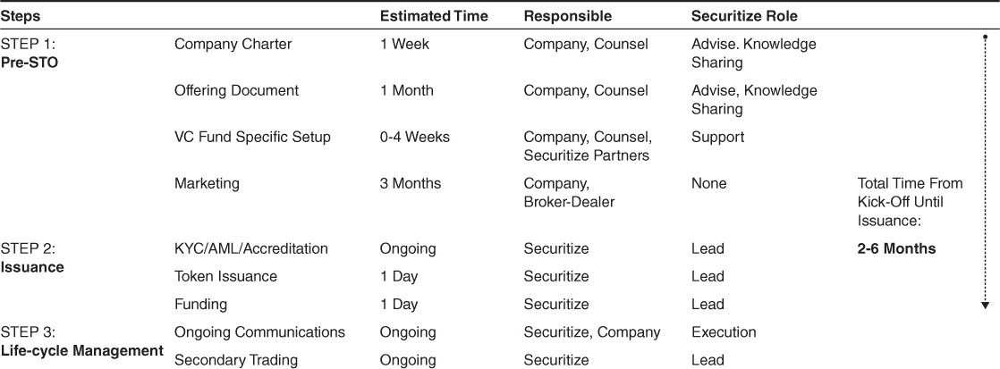

In this instance, Curzio Research issued Series A Non-Voting Preferred Stock, which entitled the investors to ownership in Curzio Research, Inc., a Delaware corporation. Per the company charter, Curzio Research, Inc. was authorized to issue five million shares of preferred stock, which was adjusted to complete the token offering.

Using a Simple Agreement for Future Equity (SAFE), investors were entitled to the right to acquire CEO tokens. SAFE is meant to be a startup friendly replacement for convertible notes; the agreement is classified as neither debt nor equity, nor does it accrue interest. An investor contributes capital to a company in exchange for the agreement. The SAFE holder has the right to purchase stock in a potential future equity round; this right is subject to the parameters initially set in the agreement. Early-stage businesses, such as Curzio Research, usually have difficulty assigning an accurate value to their company: the SAFE was created to mitigate such challenges when seeking financing.

Next, Curzio Research created a private placement memorandum (PPM), which described the corporate structure, terms of the offering and potential risks to prospective investors. Curzio Research engaged outside legal counsel to assist with the creation of the PPM, as well as other legal disclaimers related to the CEO token offering. The PPM is a standardized document used to present the nature, character and risk factors related to such offerings.

The most notable terms of the CEO token offering are listed below:
*   融资金额：
    *   – 最低发行金额为 $3,000,000，最高发行金额可达 $12,000,000。
*   最低投资规模：
    *   – $25,000 USD.
*   代币价格：
    *   – $5 per token USD.
*   代币折扣：
    *   – 代币可享受某些折扣，这些折扣由 Curzio Research 全权决定，根据发行期间每次投资的时间而定，具体如下：
        *   (1) 私人销售（第 1–2 周）– 10% 代币折扣。
        *   (2) 预售（第 2–4 周）– 5% 代币折扣。
        *   (3) 主销售（第 5 周起）– 0% 代币折扣。
    *   – 在发行时，Curzio Research 出版物的订阅者还可享受特别的 10% 代币折扣。
*   赠送新闻通讯订阅：
    *   – 根据代币的累计投资，投资者有资格免费订阅 Curzio Research 的五份现有新闻通讯，以及 Curzio Research 在指定期间制作的每份新闻通讯：
        *   (1) $25,000 USD – 2 Year Membership.
        *   (2) $50,000 USD – 5 Year Membership.
        *   (3) $100,000 USD – Lifetime Membership.
*   合资格购买者：
    *   – 美国合格投资者。
    *   – 合资格的非美国投资者（基于国际司法管辖区法规）。
*   付款方式：
    *   – 投资者可以使用 Bitcoin、Ethereum，或 US dollars (USD) 购买 CEO 代币。
*   最大代币供应量：
    *   – 3,332,000 CEO 代币。
*   代币销售期间：
    *   – February–April 2019
*   代币持有者权利：
    *   – 通过公司 Series A Non-Voting Preferred Stock 在 Curzio Research 拥有直接股权。
    *   – 有资格获得预期未来 3% 的股息。
    *   – CEO Owner’s Club 会员资格。
*   代币持有者义务：

## 代币发行条款

### 回购权
- Curzio Research 在特定情况下设立了回购 CEO 代币的权利；潜在的阻碍发生在潜在投资者未能正确完成 KYC/AML/Accreditation 流程，或未签署 SAFE 协议的情形下。

### 代币转让限制
- SAFE 和代币须遵守标准的 12 个月锁定期，在此期间 CEO 代币的二级交易将限制为现有证券法规允许的交易。

### 代币所得用途
- CEO 代币所得指定用于一般公司用途，例如资本支出、收购、基础设施和人员、产品和服务开发，以及发行、法律和会计费用。具体而言，Curzio Research 计划：
  1. 将其前端读者文件增加至 100k+。
  2. 进一步变现其现有播客。
  3. 建立世界级的投资者教育平台。
  4. 增加新的播客和读者要求的通讯。
  5. 聘请更多专家分析师和其他关键人员。
  6. 与大型外部媒体机构合作以提高品牌知名度。

### 代币格式
- CEO 代币将符合 ERC20 标准并作为智能合约嵌入以太坊区块链。

如前所述，Curzio Research 选择根据 D 规则第 506(c) 条法规进行代币发行，允许公司广泛征集并一般性宣传 CEO 代币。Curzio Research 团队制定了一套完善的营销策略，具体如下：

### 营销策略
- Curzio Research 创建了一个独特的网站，[CurzioEquityOwners.com](http://CurzioEquityOwners.com)，作为 CEO 代币发行的信息门户。着陆页优雅地展示了：
  - 一段讨论 CEO 代币发行细节的访谈视频。
  - 接收代币的过程以五个高层步骤解释，如 图 8.4 所示。该视觉图展示了投资者可以预期以其资本换取的一般性概述。

常见问题部分提供了安全代币的定义并区分了证券型代币和实用型代币。

**图 8.4：代币的工作原理。**

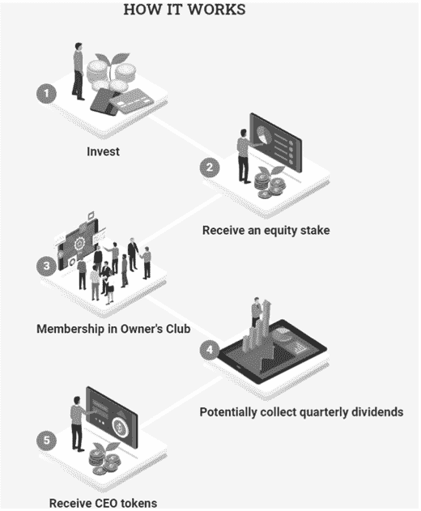

### 定义证券型代币
- 在基本层面上，代币（或“币”）是可拥有之物的数字身份。
- 证券型代币是一种可交易的资产。它可以向投资者支付股息、利息或代表对基础资产的股权。由于这些代币由有担保资产支持且可交易，它们受联邦证券法规约束，就像股票一样。
- 证券型代币为资产所有者提供了一种方式，可利用区块链的速度和安全性向投资者出售其资产（房地产/艺术品/收藏品/公司）的一部分，同时为投资者提供监管保护。

### 证券型代币与实用型代币的区别
- 第一代加密货币主要是实用型代币。它们并非为投资而创建。它们更像是应用币或用户代币，允许访问公司的产品或服务。
- 实用型币的例子是 Filecoin，其筹集了 2.57 亿美元。这些代币将使用户能够访问其分布式云存储平台。

STO 相比私募配售具有许多优势，具体如下：
- 证券型代币市场为任何公司创造了一条向投资者出售资产一部分的途径——包括房地产、艺术品、企业或全球数百万亿美元的资产——利用区块链的速度和安全性。
- 这些具有成本效益。STO 嵌入了智能合约。智能合约（或加密合约）是自执行的区块链合约，可消除中介机构（投资银行），从而降低服务交付成本。这使得 STO 比传统的私募配售方式便宜得多。
- 诸如 KYC 和 AML 等重要安全检查是自动化的，这使得向合格投资者出售资产的速度更快。这些步骤还确保 STO 完全符合监管机构的要求。
- 加密交易因其连续性而胜过传统交易。大多数 STEs 全天 24 小时开放…因此您可以随时交易。
- 证券型代币正被迅速采用，因为它们带来更大的流动性和更少的行政管理。它们已被好莱坞（个人投资者现在可以资助电影）、艺术家（安迪·沃霍尔最近将其一幅画作的 31.5% 股份代币化并拍卖）和房地产（斯泰雷季斯阿斯彭度假村最近将其酒店代币化，使投资者拥有所有权）采用。
- 在传统的私募配售中，投资者的资金可能被锁定相当长的时间。平均而言，风险投资支持的公司需要五年时间才能被收购…上市（IPO）需要八年以上的时间。但 STO 参与者可以在 12 个月锁定期后将代币转换为现金。

Curzio Research 联系了其最支持的基础——订阅者。订阅者名单是唾手可得的果实，因为公司的现有读者已表示有兴趣了解更多关于数字资产市场的信息。公司领导通知订阅者有关发行的详细信息，并引导他们前往 [CurzioEquityOwners.com](http://CurzioEquityOwners.com) 如果他们有兴趣了解更多。

Curzio Research 对 CEO 代币发行的促销策略被证明是巨大的成功，因为公司在募资的前八个交易日内实现了 300 万美元的软顶目标：更令人印象深刻的是，考虑到 Curzio Research 在营销 CEO 代币发行上花费不到 2 万美元。

## 8.5.2 发行阶段
如前所述，CEO 代币发行仅限于美国合格投资者和被指定为合格非美国投资者的投资者。在 Securitize 的协助下，随后确认每位潜在投资者：
- 符合所有适用的投资者适宜性标准，包括其居住国施加的标准。
- 完成了 KYC 验证。
- 进行了 AML 尽职调查和筛查。
- 签署并交付了 SAFE 协议以及可在网站上获取的随附问卷。

Curzio Research 然后使用 Securitize 的标准智能合约作为发行 CEO 代币的框架。律师确认所有必要的 Reg D、Rule 506(c) 限制以及相关的全球合规要求均已作为智能合约编程到以太坊区块链中。 resulting ERC20-compliant token 考虑了投资者限制、锁定期和二级交易限制等合规要求。CEO 代币智能合约还被定制以允许分配 Curzio Research 计划向其代币持有者支付的未来潜在股息。

CEO 代币的购买价格以美元计价。接受美元、比特币（BTC）或以太币（ETH）付款。BTC 和 ETH 付款交付给指定的数字资产托管人，后者在付款日期将其兑换为美元。五位投资者选择使用加密货币购买 CEO 代币（两人使用 BTC，三人使用 ETH）。根据 Curzio Research 在设置阶段定义的要求，Securitize 协助收集投资者认购并向每位投资者的指定数字钱包发行 CEO 代币。

## 8.5.3 生命周期管理

`STO`要求发行方管理其投资者和相关证券代币的整个生命周期。Curzio Research 将利用 Securitize 的在线平台来促进与投资者的持续沟通并监控 `CEO token` 的二级交易。

在 `CEO token` 的整个生命周期中，Curzio Research 必须根据 `PPM` 中定义的具体细节与 `CEO token` 持有人进行沟通。此类事件包括但不限于预期股息的未来宣告和支付、公司对 `CEO tokens` 的选择性赎回和/或回购，以及在每个财政年度结束后的未经审计财务报表交付相关的信息权。Curzio Research 还打算就所有重要业务新闻和交易向投资者进行更新。根据新闻动态，公司打算按月、按季度或按半年发布这些更新。Curzio Research 将使用 Securitize 的社区管理解决方案来简化与投资者的持续沟通。

持有牌照的 `STEs`（如 OpenFinance Network（`OFN`））是为 `STOs` 提供流动性的主要参与者。其核心功能是确保证券代币的公平有序交易，并高效地向交易所用户传播价格信息。`STEs` 在防止证券代币生态系统中受限证券的违规、未注册转售方面发挥着至关重要的作用。

根据证券法规，`CEO tokens` 被归类为受限股份。因此，二级交易须遵守 `PPM` 中规定的转让限制。在 Cuzio Research 指定用于交易的 `STE` 或另类交易系统之前，投资者不得转让 `CEO tokens`。在选定二级市场后，所有潜在的 `CEO tokens` 购买者都必须在获取代币之前验证其身份，并在交易所完成必要的 `KYC` 和 `AML` 检查。从技术角度来看，`CEO token` 的转让受 `Compliance Service` 管辖，后者是 Securitize `DS Protocol Ecosystem` 的内置组件。`DS Protocol Ecosystem` 如 图 8.5 所示。

图 8.5：Securitize 的 DS Protocol 生态系统。

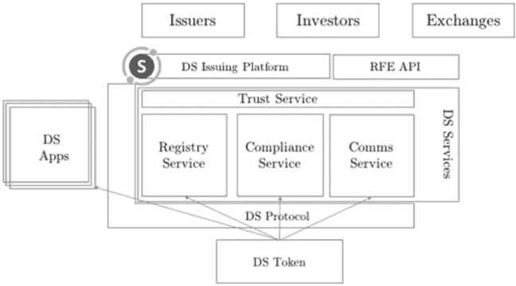

在发行前，每个 `CEO token` 的智能合约都已上传其转账功能，以便使用 `Compliance Service` 检查代币是否可以在特定钱包地址之间交换。当 `DS Token` 合约发送 `transferTo` 和 `transferFrom` 验证调用时，`Compliance Service` 会在 `Registry Service` 中检查发送方和接收方地址，其中每个投资者的个人资料和相关合规信息均以链上方式存储。获取投资者资料后，`Compliance Service` 会验证双方是否具有正确的类别，并且在适用法规规定的现有限额范围内。如果一切检查通过，则交易可以在交易所进行。如果未满足适当条件，交易将被停止，并且各方将被告知原因。

必须认识到 `Trust Service` 是 `DS Protocol` 架构中的关键组件。`Trust Service` 由其他组件使用，以确保特定参与者或 `DS App` 被允许执行某些操作。它充当其他 `DS Services` 的控制机制，所有参与这些服务的参与者在执行相关功能之前都已由 `Trust Service` 授权。例如，`Trust Service` 最终授权交易所向 `Registry Service` 中添加额外条目。根据 `DS Protocol` 模型，在 `CEO token` 锁定期到期后，交易所被委托负责收集新投资者的 `KYC` 和认可信息。

受限证券通常在直接参与计划市场（`DPP`）中交易，该市场在清算和结算流程中存在重大低效和问题。缺乏标准化和兼容性导致结算流程平均需要六到八周。区块链可以为受限证券的交易、清算和结算提供多种解决方案。利用分布式账本技术，`STEs` 可以为分散的 `DPP` 市场带来效率、清晰度和互操作性。

`OFN` 改造 `DPP` 市场流程的框架包含用于标准化资产和数据的统一协议。由此产生的互操作性创建了一种机制，使代币化交易能够连接链下“传统”另类资产和链上“数字”资产，如 `CEO token`。`OFN` 的白皮书精辟地阐述了典型的证券交易生命周期（`STL`），称其“始于由投资者（买方或卖方）发起的交易。他们的经纪人将交易发送至交易所进行处理，在交易所中与相应的对手方进行匹配。然后交易所将此匹配交易发送至中央对手方清算所（`CCP`），在那里与经纪人进行对账以降低违约和对手方风险。随后，交易被发送至结算环节，投资者的托管人（持有资产和资金）通过中央证券存管机构（`CSD`）工作，以确保资产和资金从一个来源转移到另一个来源。最后，交易数据被发送给基础发行人的登记处或过户代理，以更新其股东名册和信息。”

`OFN` 强调 `CSD`s 和 `CCP`s 在当今 `STL` 流程中维持各方之间“信任”的核心作用。当前模式提供了资产标准化、参与者之间的互操作性、降低对手方风险并确保交易验证。然而，`STL` 模式也存在显著缺点：集中式信任实体网络的可行性需要大规模、较小参与者获得网络访问的进入成本高昂，以及数据在多个中介机构中冗余存储等其他问题。这种陈旧遗留系统的复杂性和低效导致发行人和投资者在整个 `STL` 中承担不必要的高成本，而中间人则从寻租中显著受益。为抵消这些低效，`OFN` 开发了分布式证券存管系统，在重新构想的 `STL` 中取代了对 `CCP`s 和 `CSD`s 的需求。

`OFN` 提供了一个通用框架和通信协议，用于标准化另类资产，以及与这些资产相关的报告、合规、清算和结算流程。通过用 `OFN` 取代 `CCP`s 和 `CSD`s，市场参与者不再需要依赖手工对账的账簿；资产所有权和资金可用性的实时验证终于成为可能，从而在过程中有效消除对手方风险。使用 `OFN` 在二级市场交易的投资者直接受益于更低的费用，这得益于合规、所有权转让、托管和收益分配标准化且流程简化的效率和成本节约。

代币化资产，如 `CEO token`，可以由 `OFN` 及其经纪交易商、托管人和银行组成的财团以符合 `Uniform Commercial Code` 的方式进行分布式托管。如 第 10 章 中所述，该机制弥合了证书记录与账面记录之间的差距，并以一种新的分布式账本账面形式出现，使得即时结算成为可能。数字资产市场爱好者认为，这些好处最终将导致从传统的链下电子账面系统完全迁移到完全在分布式账本上记录所有权。

## 8.6. 矿业融资

矿业和矿产部门是一个臭名昭著地缓慢采用新技术的部门，正迅速转向整合区块链技术。正如下一章所述，区块链应用正在矿业中为记录保存和溯源而开发。在此，我们简要讨论矿业通过利用区块链和智能合约技术为其项目获得融资的一种创新方式。

矿业是一个资本密集型行业，需要大量前期投资，并且充满经济不确定性。自 2008 年全球金融危机以来，商品市场中原材料价格的经济波动一直普遍存在。金融危机前的采矿热潮是由发展中国家快速增长和工业化推动的。然而，自金融危机以来，终端需求和前期信贷可得性都出现了急剧下降。虽然过去十年中许多其他行业都已复苏，但采矿业的经济复苏并不明显。中国增长低于预期、欧洲持续的债务问题以及全球信贷收紧都阻碍了复苏。商品价格下跌导致回报和收入下降，造成了矿商长期投资视野与投资者短期回报视野之间的不匹配。因此，矿商最近在筹集股权资本为企业提供资金方面面临着充满挑战的环境。

在利润下降、信贷收紧和投资者要求提高的背景下，矿业正在寻找创造性融资选择来为其增长项目提供资金。他们将传统融资选择与替代融资来源相结合。^² 矿业特许权使用费和金属流融资对矿商来说特别受欢迎，因为这种融资来源可以在不稀释股权所有权的情况下获得早期阶段资本。矿业特许权使用费是指基于矿物产量或销售这些矿物产生的收入或利润的一定比例收取款项的权利。特许权使用费融资通常涉及投资者向矿业公司支付前期款项，作为矿业公司承诺在特定期间内支付未来收入的特定比例的合同承诺。

特许权使用费融资的结构非常适合通过智能合约和共识机制实施。因此，矿业公司将特许权使用费融资模式与数字包装相结合，并向投资者提供证券代币。此外，流融资模式——一种金属预付款结构——也适合代币化。因此，将前沿技术应用于一个古老的问题，产生了一种创新解决方案，对投资者和矿业公司双方都有益。

## 8.7. 结论
需要资本的企业正在寻求新的融资选择。对于私募发行，有两个选择：传统的私募配售或 STO。在进行成本效益分析后，一些企业决定 STO 为其利益相关者提供了最大价值。

STO 提供了一些融资优势，例如前期成本较低、行政程序简化、流程时间缩短，以及潜在投资者基础扩大，这些投资者可以通过互联网选择以法币和数字货币出资。简化流程可在数月内完成，其中文件准备和法律审查需要花费最多时间。以 Curzio Research 为例，他们在发行后的前两周内筹集到了 300 万美元的目标，并在超过一百名投资者中筹集了总计 410 万美元。传统的矿业也采用了这种新工具来筹集资金以资助新项目。

STO 不仅提供了一种廉价快速的筹资方式，还在代币生命周期内提供了物流优势。以 Curzio Research 为例，通过在 Securitize 的 DS 协议生态系统内运营，预计 CEO 代币将减少与金融工具生命周期事件通常相关的合规和运营费用。代币还提供效用，用户可以通过其在线平台访问 Curzio Research 的基于网络的内容。锁定期结束后，CEO 代币投资者应从指定的 STEs 获得增强的流动性。投资者还可以使用 Securitize 的平台在一个地方管理与代币相关的事件，因为这些发展在数字证券生态系统中的分布式账本上被记录。

### NOTES
1. 锁定期是投资者不允许赎回或出售其投资股份的时间窗口；这些限制有助于公司领导层保持完整，并给他们时间执行其战略。

2. 参见 [`www.whitecase.com/sites/default/files/2019-05/tokenising-mining-metals-assets-web.pdf`](https://www.whitecase.com/sites/default/files/2019-05/tokenising-mining-metals-assets-web.pdf)。于 2020 年 1 月访问。

### CONTRIBUTOR CONTACT INFORMATION
如需联系 Mike Rogers，请访问 [MillennialsInBlockchain.io](http://MillennialsInBlockchain.io) 或发送电子邮件至 Mike@MillennialsInBlockchain.com。您也可以在 Twitter 上关注他 @MillennialMike7，他在那里公开讨论他的热情。

# 9 一个透明的新世界：道德采购的矿产供应链
*NATHAN WILLIAMS AND DAVID LEE WILLIAMS*

## 9.1. 引言
全球业务活动的良好管理变得更加具有挑战性，因为社会对其活动对彼此和我们星球的影响的理解不断进步。一代人以前不受限制、未记录或不受监管的业务活动现在变得更好理解、受到审查、记录和监管，而不良活动的后果现在变得更加明显。“负责任采购”一词已被用来描述确保采购不会损害人类价值观（例如使用童工或强迫劳动）、伤害社会（例如支持非法或犯罪活动，或强迫土地重新安置）或对环境产生负面影响（例如造成森林砍伐或化学污染）的愿望。

*负责任采购，也称为供应链责任，是公司在管理与供应商的关系时自愿考虑社会和环境因素的承诺。¹*

企业需要了解其特定供应链中参与者的行为，以便能够确保负责任的采购，然而这种认知可能因需要保护商业机密、缺乏对公司交易链上超过一环的参与者的了解，以及直到最近才对公司墙外的事件缺乏关注而受阻。近期监管要求的增加、消费者兴趣的提升以及潜在的法律责任促使企业将产品采购的角色扩展到与直接供应商的简单互动之外。一家公司的采购部门过去仅限于识别可靠供应商、评估产品质量和确保及时交付等即时需求，现在需要寻求公司内部其他部门的协助，以管理新的采购议题，例如确保监管合规、理解并规避有害的商业风险，甚至是此前难以想象的挑战，如避免参与非法活动、洗钱和人身奴役——换句话说，提供尽职调查；尽职调查是指合理的人为避免对他人或其财产造成伤害而付出的谨慎。

这些采购活动的范围正从对直接供应商的评估，扩展到现在考虑整个供应链，并确保来自直接供应商前几环节的供应商的尽职调查，即对企业可能没有正式关系或联系的实体。

## 9.2. 矿物供应链的复杂性

矿物供应链由多个顺序的流程或环节组成。每个流程涉及多个参与者和多项活动。显而易见的是，在矿物供应链中执行尽职调查并非易事。黄金供应链的以下图形说明很好地体现了矿物供应链的复杂性。

黄金供应链由一系列通用流程或环节组成，涉及：矿物所在的上百个国家；数百万名手工和工业矿工；数千名当地贸易商和出口商；不同国家的数百家冶炼厂；数千名成品原材料贸易商；数千名零部件制造商；数万家成品制造商；以及出售给最终消费者的数十万种不同的成品。

黄金供应链中的第一个流程是黄金所在国家的政府。每个国家都监管采矿能力和矿山所有权，以及采矿可以发生的劳动、人权、环境、安全和政治条件。各国可能与国际法规和指导合作，也可能独立治理。各国就像个人一样，其行为可以是负责任的或腐败的、放任的或干预主义的、民族主义的或全球化的，这种差异意味着有些国家在确保黄金供应链中的负责任活动方面比其他国家有效得多。各国在手工采矿、个人土地所有权和采矿权方面的许可或禁止也各不相同。

开采金矿石需要矿工。据估计，有 1 亿人依赖手工采矿。全球约有七百万人受雇于大规模工业采矿（LSM）。手工和小规模采矿（ASM）发生在约 80 个国家。ASM 生产供应占开采黄金的 20%。典型的 ASM 采矿流程包括挖掘金矿石，将矿石（装在袋中或用手推车）运至人工破碎、清洗和过滤的地方。过滤后的沉淀物经化学处理得到汞齐，然后出售给当地贸易商。LSM 黄金开采通常涉及用机器将岩石粉碎成粉末或浆液，然后使用氰化钠进行槽浸或堆浸，以获得不纯的黄金。

将金矿石从矿址运至冶炼厂涉及多种运输方式。在 ASM 的情况下，金汞齐需要积累到足够数量才能出口到冶炼厂。这涉及多种运输方式：从自行车和摩托车到卡车和拖车，再到私人飞机。公路运输可能受到当地政府官员的任意征税或非法团体的勒索。空运甚至可能无法追踪（参见第 9.5 节）。

当地贸易商可能会从矿工处购买金汞齐，然后转售给大型贸易商，或者矿工可以作为合作社直接向大型贸易商出售。大型贸易商随后可以自行冶炼黄金，也可以将汞齐运送到冶炼厂。矿工与冶炼厂之间的流程中的其他参与者可能包括矿山监督员、当地部落当局、政府官员、警察等，他们每个人都可以合法或非法地执行工作。

冶炼厂被认为是矿物供应链的中点。冶炼厂不仅接收来自 LSM 和 ASM 的矿物矿石，还接收来自各种来源的回收材料。在冶炼厂中，黄金通过熔化和随后与化学物质反应从其天然矿物状态中释放出来。所得到的金粒是黄金和白银的半纯合金，其纯度可能各不相同，因此随后会被运送到精炼厂，在那里进一步处理可以将黄金的纯度提高到接近 100%。

零部件制造商将从金属贸易商处购买黄金，而该贸易商已从冶炼厂或精炼厂购买了加工后的黄金。零部件制造商对每个零部件可能只需要极少量黄金，但会生产数百万个零部件。黄金是一种非常好的导电体，在空气中不易腐蚀，且具有延展性。因此，黄金是制造小型电气连接器、电路走线、集成电路、晶体管和存储芯片的首选材料。

成品制造商是我们黄金供应链中的最终直接流程。我们的现代电子产品是由数十个小型零部件组成的复杂组合，每个零部件都含有黄金。事实上，几乎任何带有电路板的电子设备，从旧电视和录像机到 GPS 系统和太阳能板，都含有黄金。

黄金供应链中的最后流程是回收。35 到 40 部智能手机（不含电池）大约含有 1 克黄金，这与地下一吨低品位金矿石中出现的数量相同。回收黄金出现在链条中点处的冶炼厂，在那里它与新矿石一起再加工制成金粒。

迄今为止，法规和指南主要关注消费品供应链中最明显的参与者，即成品制造商，然而监管的同样动机（确保流程安全和防止不想要的后果）可以应用于整个供应链。鉴于其复杂性，需要工具来为矿物供应链中的所有流程提供透明度和一致性，同时保持商业机密并鼓励公平的商业竞争。

## 9.3. 矿物供应链的透明度缺失

供应链中每个流程环节的参与者都很难知道其直接供应商上游流程的多个成员。

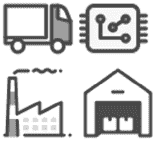

零部件制造商会知道其矿物是从数百家金属贸易商中的哪一家采购的，但由于商业保密等原因，很可能无法得知使用了数万家当地矿物运输服务提供商中的哪一家将矿物运送至哪些用于集结和运输的贸易商，再运至哪些冶炼厂进行加工。这些物流挑战确实很复杂。

根据 Squire Patton Boggs 的合伙人 Dynda A. Thomas，²

*全球约有 400 家加工冲突矿物的冶炼厂和精炼厂。由于加工商数量有限，行业能够直接要求它们遵守公认的尽职调查标准，以适用于源自刚果民主共和国及其邻国的冲突矿物。因此，大多数公司并未付出额外努力来确定其产品中加工冲突矿物的具体冶炼厂和精炼厂。相反，大多数公司选择识别其所有供应链中所有可能的冶炼厂和精炼厂。*

## 9.4. 矿物可追溯性法规的演变

矿业供应链的各个环节历来由各国政府监管。矿山受采矿法规监管，冶炼厂受行业特定的健康、安全和环境法律等监管。直到最近，矿业供应链一直不是国际法规在流程和后果方面的关注重点。当前十年正在见证直接影响矿物供应链的法规的实施。这一活动是由政府和消费者对矿物资源供应中使用的不道德做法的认识不断提高所推动的。

### 9.4.1. 冲突矿物法规

2019 年参与矿物供应链的企业需要了解其供应商。对于某些矿物，即钨、锡、钽和金（3TG 矿物），它们需要特别了解其供应商，因为它们受法规要求如此。这些矿物在一些国家使用童工和强迫劳动开采。该采矿所得经常支持非法活动和/或军事叛乱，最初的冲突矿物法规旨在影响此类非法矿物的购买并减少人权侵害。自首部法案以来，矿物供应链中企业的报告义务在七年内发生了演变。

*   *《多德-弗兰克法案（2012）》*³ 是首个将企业供应链责任概念应用于 3TG 矿物矿物供应链的法规。该法案要求提供文件，但未规定不合规的处罚。
*   *《经合组织负责任供应链尽职调查指南》*⁴ 关于来自冲突影响和高风险地区（CAHRAs）的矿物，于 2011 年发布并于 2012 年修订，建议将尽职调查整合到企业管理体系中的措施。
*   *《中国企业社会责任指南（GSRM，2014）》* 对在海外运营的中国企业在社会责任和可持续发展方面提出了指导。
*   *《中国负责任矿物供应链尽职调查指南（2015）》*⁵ 为中国企业提供了指导，以识别、防止和减轻其促成冲突、严重人权侵害以及严重不当行为风险的风险。
*   *《经合组织尽职调查指南第三版（2016）》*⁶ 阐述了供应链尽职调查的建议并描述了报告义务。
*   *《欧盟冲突矿物法规（2017）》*⁷ 通过解决企业社会责任和损害风险的概念而更进一步。公司现在被视为在其影响范围内对公司的活动所产生的社会、生态和经济后果负有社会责任。报告需要透明，以便他人能够监督和核实公司如何履行其职责并努力减轻问题。欧盟冲突矿物法规确实预见了不合规的未来后果。矿物供应链的报告标准已被提高。
*   *《莫西-奥-图尼亚宣言》*⁸ 于 2018 年 9 月 13 日在赞比亚利文斯顿举行的手工和中小型采矿与采石国际会议（ASM18）上通过。该宣言呼吁政府和国际私营部门确保生产和采购做法不助长人权侵害或冲突及其资助。
*   *《欧盟识别 CAHRAs 的非约束性指南》*⁹ 欧盟委员会建议（EU）2018/1149 于 2018 年 8 月 10 日发布。这些指南将帮助公司了解欧盟冲突矿物法规中所述的 CAHRAs 的定义。除了为公司在识别 CAHRAs 时使用提供建议的开放源资源外，指南还提供了一系列“红旗”主题。红旗是指“有合理理由怀疑矿物可能助长与其开采、运输或贸易有关的冲突或严重侵害”的情况。

这些法规的总体目标是启动建立矿物安全、透明和可验证的供应链，并确保负责任的做法，同时不助长武装冲突和相关的侵犯人权行为。

### 9.4.2. 现代奴隶制与人权法规

在过去七年里，两个国际组织、三个政府和一个美国州引入了有关评估劳动力中现代奴隶制和人权侵害的法规或指令。在其议定书中，行业需要对其直接业务以及其供应商进行风险评估，并每年报告这些评估结果。

*   *《加州供应链透明法案》*¹⁰ 于 2012 年生效。它要求全球收入超过 1 亿美元的中型和大型制造和零售企业披露其从直接供应链中消除人口贩运和奴隶制的举措。该法的目的是为消费者提供有关哪些公司负责任地管理其供应链的信息。
*   *《欧盟非财务信息披露指令（2014）》*¹¹ 是非强制性指南，旨在帮助公司在其年度报告中披露其运营的各种非财务方面的信息。公司在报告内容上有灵活性，涉及政策、风险和已实施的尽职调查以及反腐败和贿赂问题、环境、社会和员工事务等问题。
*   *《联合国工商企业与人权指导原则（UNGPs）》*¹² 于 2011 年 6 月获得联合国人权理事会认可。它们为解决与商业活动相关的人权不利影响风险提供了首个全球标准。UNGPs 确定了三个基本要素：国家保护人权的义务；企业尊重人权的责任；以及与商业相关侵害的受害者获得救济的途径
*   *《英国现代奴隶制法案（2015）》*¹³ 使公司对其整个运营链中发生的奴隶制和劳动侵害承担责任。任何在英国供应商品或服务的企业——或企业的一部分——如果全球营业额为 3600 万英镑或以上，必须制作并公布年度奴隶制和人口贩运声明。该声明必须说明组织为确保其业务的任何部分，包括其供应链中不存在奴隶制所采取的措施。

*   *澳大利亚现代奴隶制法案 (2018)*¹⁴ 澳大利亚《现代奴隶制法案》与英国的类似，要求年合并收入达到 A$1 亿以上的企业和其他组织（包括政府部门）每年报告其运营和供应链中现代奴隶制的风险，以及为评估和应对这些风险所采取的行动，以及应对措施的有效性。

*   *法国企业警惕义务法 (2017)*¹⁵ 受本法约束的公司、其子公司以及受其控制的公司，必须在其生产链的整个过程中建立防止人权侵害和环境影响的机制。这些机制必须作为“警惕计划”的一部分每年报告。警惕计划应识别和分析人权侵害或环境损害的风险，确定减轻或防止最严重侵害的行动，并讨论这些行动的有效性。

全球义务的演变，即分析、采取行动、衡量有效性并报告为应对供应链中现代奴隶制风险而采取的措施，在某种程度上与冲突矿物法规建议或要求的活动相平行。在这两种情况下，报告要求或指南都意味着企业对供应链组成部分的了解，从而意味着对供应链参与者的透明度，而这种透明度迄今为止并不存在。上述法规，即使是最新的法规，在指导方面也很强，但在后果方面却很薄弱。关于供应链透明度的《现代奴隶制法案》第 54 条的独立审查指出：

*\[…\] 企业与民间社会之间普遍存在共识，缺乏执法和处罚，以及对报告义务的困惑，是导致报告质量低下以及估计超过三分之一的合格企业不合规的核心原因。¹⁶*

### 9.4.3. 政治动态变化的后果

2017 年，美国众议院批准了一项支出法案修正案，该修正案切断了“实施、管理和执行”《多德-弗兰克冲突矿物规则》的资金。原本由国会承认的全球矿物供应中非法活动的重大问题，在不到十年的时间内几乎被撤销。

然而，行业认识到法规意图的重要性。一些大型公司自愿遵守之前的立法，并已建立相应的流程和控制措施。例如，一家大型跨国食品公司雀巢于 2018 年 7 月实施了其自己的雀巢负责任采购标准¹⁷。该标准定义了第三方供应商的预期职责、实践和报告，并为改进设定了里程碑。另一家全球科技公司英特尔在 2019 年写道，

*虽然我们不直接采购，但我们的供应商从世界各地的多个来源获取和使用矿物。英特尔致力于负责任的矿物采购——以合乎道德和可持续的方式进行采购，以保障我们全球供应链中每个人的权利……鉴于对童工以及超出《多德-弗兰克法案》范围的额外人权侵害的担忧日益增加，英特尔已发展其负责任矿物计划及相关尽职调查实践，以应对源自冲突影响和高风险地区 CAHRAs 的矿物。¹⁸*

## 9.5. 通过矿物采购进行洗钱

洗钱是指掩盖通过非法手段获得的资金来源或真实性质的行为。¹⁹ 待“洗钱”的资金可能来自任何数量的非法活动，包括非法军火销售、走私、毒品贩运、卖淫、挪用公款、内幕交易、贿赂、计算机诈骗计划，或在本讨论的背景下，非法采矿。通过这些方式获得的资金被视为“脏钱”，因为如果大量资金简单地出现在个人银行账户中会显得可疑。这些资金通过在存入之前经过几家“合法”企业，从而被“清洗”，从而掩盖其真实来源。来源被掩盖后，“清洗”后的资金看起来似乎源自合法活动，结果金融机构会毫无怀疑地处理它。

黄金非法活动有相当大的诱因：黄金具有可替代性（一块黄金样品看起来与任何其他黄金样品相同）；黄金单位质量价值高，使其相对容易走私；并且黄金在全球范围内被普遍交易和交换。黄金用于洗钱或洗金行为的程度的一个最新例子出现在 2016 年的美洲。三名前美国金属精炼公司员工连同来自几个南美国家的同伙，从秘鲁毒贩拥有的非法金矿购买粗金。黄金被熔炼成 doré 金条，然后通过厄瓜多尔、玻利维亚、哥伦比亚和其他拉丁美洲国家空运至美国一家精炼厂。精炼后的黄金当然与任何其他来源精炼的黄金具有相同的成分，只是它是在亚马逊森林中隐藏的非法贩毒集团拥有的矿井中以强迫劳动甚至可能是童工为代价开采的非法黄金。这些交易者在 2013 年至 2016 年间成功洗钱价值 36 亿美元的黄金，然后被捕。

传统采购方法难以确定精炼金条中是否存在非法黄金。需要新的方法来确保识别“负责任获得”的矿物，并将其与非法获得、强迫获得或作为非法金融活动组成部分的矿物区分开来。

## 9.6. 可追溯性要求

经合组织尽职调查指南建议公司生成多种类型的信息，其具体性取决于矿物供应链过程中来源的位置。此类数据应针对矿物原产地以及运输地收集。具体而言，该指南建议获取以下矿物的资料：

*   源自冲突影响或高风险地区或经由该地区运输的；
*   源自已知储量有限的国家；或
*   源自已知冲突影响和高风险地区矿物会经由其运输的国家。

应为在冲突影响和高风险地区原产国或过境国供应或曾供应矿物或在该国运营的公司中拥有股东或其他利益的公司收集供应商数据。

应收集交易商数据，记录所有用于出口、进口和再出口的付款，以及向政府和私人安保官员支付的所有税款和款项。这些数据不是简单供应商-客户业务往来所需的常规数据，收集这些数据需要新的创新，以在保持透明度的同时确保保密性。

当前供应链追踪方法存在重大挑战。准确了解供应链历史需要付出巨大的个人努力，并与供应商及其供应商进行沟通，同时还需要大量的计算工作来准确识别所有相关要素。供应链参与者可以理解地不愿意与他们可能不认识或不信任的实体分享敏感数据，并且参与者需要与对他们而言是未知实体进行合作，而他们可能不愿意信任这些实体。负责任的供应链可追溯性在监管事务或股东关系方面可能被视为一项必不可少的业务职能，但对于其他部门而言，可能并不被视为核心业务所必需，也不值得投入企业资源。传统的供应链审计和分析方法依赖于大量的纸质记录，而纸质认证既不能提供强大的可追溯性，也不能免受腐败影响。因此，目前的矿物供应链追踪系统需要新的解决方案。

2014 年，作为对《多德-弗兰克法案》的回应，下游制造公司承担了追踪其供应链中材料来源的巨大任务。他们花费超过 7 亿美元追踪产品上游，以期识别为其供货的冶炼厂和精炼厂。这是一个昂贵且耗时的过程。

## 9.7. 区块链解决方案

正如我们所见，矿物供应链充满了复杂的问题，其成因多方面。区块链与精心设计的系统相结合，为我们提供了解决这些问题的方法。区块链具有四个关键特征，使其适合应对日益增长的监管挑战。

前两个特征是我们行业的工具。它们使我们能够创建一个系统，可以追踪我们交易的材料的历史或来源，并确保该记录值得信赖：

**1.** 区块链可以*代币化*所有参与供应链行为者提交的受追踪矿物的关键尽职调查数据。这些代币是独特的数字资产，能够抵抗篡改和复制。

**2.** 区块链维护交易的*不可变*记录。这可以防止文件被更改，而文件更改是腐败和供应链风险最常见的途径。

另外两个特征为每个供应链参与者使用我们精心设计的工具提供了激励。它们是我们如何将系统从一个仅对彼此熟悉的公司来说有趣的工具转变为能够解决矿物供应链最深层次问题的全球基础设施的方式：

**3.** 区块链可以创建自我管理的*激励系统*，使供应链参与者参与系统变得有利。

**4.** 区块链允许互不信任的各方*在没有可信第三方的情况下进行交易*，从而消除了将供应链数据托付给单一公司的需要。

我们矿物区块链追踪系统的成功完全取决于正确设计工具和激励措施。

### 9.7.1. 记录供应链历史

区块链使我们能够创建诸如代币等数字资产，这些资产无法被复制或更改。我们利用这一特性来限制可用代币的数量，而这种独特性允许代表现实世界资产，如矿物或金属。一旦我们拥有了矿物的代币表示，我们就可以将尽职调查数据与其关联并追踪持有历史，为供应链安全提供强大的工具。

代币可以根据我们想要代币化的资产创建为可替代或不可替代。利用这种数字独特性来确保供应链责任的方法有很多，每种方法都有其优缺点，具体取决于要解决的问题。

让我们先从可替代代币开始。采用可替代代币时，我们只追踪拥有的数量；每笔购买的代币都可以合并到更大的代币堆中，使它们彼此无法区分。可替代代币是区块链世界中最常见的代币类型。它们易于处理，像货币一样，可以作为数字存储在钱包中，并像现金一样转移。金属也是可替代的，因此直观上可替代代币适用于追踪负责任的材料。

### 9.7.2. 可替代代币

考虑一家想要为投资目的生产负责任黄金的公司。他们从一家大型矿山购买所有黄金，该矿山与一家大型冶炼厂相连，他们对其生产实践进行审计并在网站或数据库上展示这些信息。他们将黄金加工成 1 公斤金条并存入保险库。对于保险库中的每块公斤金条，他们在区块链上创建可替代的数字代币，然后在公开市场上出售。黄金公斤代币将包含指向网站或数据库的链接，显示该代币中包含的负责任黄金的百分比。

这种方法有许多优点。如下所述：

*   可替代代币易于管理，因为我们不需要将代币与金属物理关联的标识符。我们知道所有金属都在保险库中，并且全部来自一个来源，因此哪块金条是哪块并不重要。
*   投资者可以用最少的交易费用灵活地进入和退出黄金头寸。
*   实施过程简单明了——几乎不需要改变流程，并且只有一家公司需要知道如何使用区块链。一家公司可以单方面决定这样做，而无需供应链中每个成员的认可。

也有一些局限性，具体如下：

*   代币之所以可替代，是因为我们控制了供应链之外所有责任方面的因素，并将这些流程中的黄金与市场其他部分分开。当我们有一个*保险库*存放所有来自已知来源和经过审计供应链的黄金时，这种方法效果很好。然而，如果多家公司各自创建自己的保险库和自己的可替代代币，这些代币在混合时将丢失有关我们黄金存放于哪些保险库的信息。这使得此类系统难以扩展。
*   我们需要确保向区块链提供良好的数据。此示例假设保险库中的黄金是负责任的，并且公司提供了相关数据。当黄金直接从具有严格、文件齐全流程的矿山购买，且供应链非常短时，这是可能的，但世界上大部分黄金供应都不符合这些标准，这使得这种方法无法扩展。
*   可替代代币可能代表负责任来源的金属，但它们仍然是非常有价值的数字资产，可以在钱包之间随意转移而无需中间人。具有讽刺意味的是，这意味着代币可以被轻易用于洗钱，我们需要在此类系统中加入 KYC 来解决这个问题。

如果我们想要对金属来源有更详细的信息，我们可以使用代表供应链中金属的不可替代代币。不可替代代币可以创建来代表特定的金属矿石或锭的运输，实际上充当数字孪生，可用于证明谁拥有它。每个代币都可以包含指向证明其关联运输负责任性的数据的链接。

### 9.7.3. 不可替代代币

部分先前的局限性可以通过使用非同质化代币来解决。这有点像接力赛中从一个人传到另一个人的接力棒。最后它会带有每个持有过它的人的指纹。为了说明，让我们从金矿开始扩展上述示例。我们的负责任金矿希望向客户销售负责任来源的黄金。他们开采黄金，将其熔炼成称重的“doré”金条，并为每根金条创建非同质化“doré”代币以代表其。doré 代币包含一个唯一 ID，该 ID 被放在标签上并附着在 doré 金条上，同时还链接到尽职调查数据库。随着 doré 金条从一个所有者传到另一个所有者，相关的非同质化代币也会一并传递给每个新所有者。当 doré 金条到达精炼厂时，它被加工成 1kg 黄金条，代币将被冻结从而无法再交易。我们为新的精炼黄金公斤条发行新代币，这些代币包含唯一 ID 并链接到旧代币。黄金公斤条像以前一样存放在金库中，购买或交易新黄金代币的人可以获得其供应链历史记录。

非同质化代币相对于可替代代币具有以下优势：

* 非同质化代币允许我们代表材料的单个单位（doré 金条和公斤条）。这种额外的数据粒度意味着我们不受单一矿物来源或金库的限制。
* 由于单独的货物被代表，我们还可以记录谁持有它们以及它们在哪里生产。这使我们能够从生产点一直追踪矿物到整个供应链。
* 代币与特定的金条或货物相关联，使其更难被用于洗钱。

然而，这些也带来了新的挑战如下：

* 为了让代币追踪金属，我们需要*将金属与非同质化代币关联*。每当材料被加工或形态改变时，标签就会带来挑战。
* 由于我们在供应链中追踪材料，*我们需要供应链上的所有公司都参与*，这使得项目实施更具挑战性。这些公司可能需要调整内部流程以追踪这些区块链追踪的货物，意味着额外的工作和成本。
* *我们仍然需要确保向区块链提供良好的数据*。我们的非同质化代币的实用性仅取决于它们所基于的数据。

非同质化代币是追踪材料货物的一种直观方式，因为在许多方面它们就像它们所代表的实物材料一样。只要公司持有代币，他们就可以证明相关金属的历史。

此外，出于合规目的，还可以做出额外改进。公司在出售产品并转让相关非同质化代币后，仍需证明他们曾经拥有它，并且其来源负责任。如果我们使用常规传统数据库，这根本不是问题。我们会保留所持有代币的记录，并可据此准备其历史和合规记录。由于我们需要此记录安全且不可变，因此需要在区块链上存储信息。

有很多方法可以处理这个问题，但一个简单的可能性是制定规则：非同质化代币只能交易一次，然后永久冻结。持有非同质化代币的人可以创建另一个只能交易一次的新代币。这有点像从一个人传到另一个人的线球，每个人在传球后仍持有线头。

### 9.7.4. 代币化操作化

主要挑战之一是将金属与代币关联起来。这是人们思考供应链解决方案时最常问的问题。如何确保您追踪的材料与区块链上的记录、证书或代币相匹配？当我们说这时，我们需要能够执行两个功能：

**1.** 如果我们有一批材料，我们应该能够找到显示所有权记录和相关尽职调查数据的区块链代币。

**2.** 如果我们有一个代币，我们希望能够识别并验证与其相关的货物。

为完成第一个任务，我们需要有一个带有唯一标识符的标签，该标识符链接到区块链。为完成第二个任务，我们需要在代币中存储有关材料的信息，包括识别标记、最后已知位置以及代币追踪的总质量和品位。

一个实施例可以考虑一锭锡。锡锭上贴有一个带有二维码的贴纸。我们扫描二维码，应用程序会调出我们的非同质化代币，显示所有之前的所有者。另一个例子是，我们在应用程序中显示了一个锡锭托盘的代币。除了代币外，应用程序还提供锡存储在哪座仓库的信息、托盘中有多少锭锡、唯一标识符以及其外观的照片。然后我们可以前往仓库定位该托盘。

我们用来将材料与代币关联的方法可以根据我们试图解决的问题而有所不同。例如，我们可能担心在矿物被加工成金属之前，非法来源的矿物被混入我们的货物中。矿物看起来像岩石堆，如果这是个问题，我们可能会在运输前后称重货物，并用识别化合物如稀有放射性同位素喷洒矿物。

我们可能担心供应链中被追踪的金属锭会丢失，并且公司用具有相同 ID 号码的假锭替换它们。如果这是我们的担忧，我们可能会拍摄锭的高分辨率照片，显示金属中细微的裂纹和线条，以证明该条是真正的。重要的是代币追踪系统足够灵活，能够适应不同的识别方法。这将确保系统能够适应供应链不同阶段不同矿物的不同挑战。

### 9.7.5. 矿物的批量加工

矿物和金属是原材料本身不是最终产品。它们需要被加工后才有用。矿石需要被冶炼成金属。金属需要被精炼和合金化才能在我们的最终产品中发挥作用。大多数冶炼厂和精炼厂使用连续工艺，将来自许多来源的矿石一起加工。这些工艺使得逐批追踪变得不可行。未来的世界可能是一个所有这些工艺都按批次处理的世界，但就目前而言，我们需要在供应链中这些加工点之外找到另一种追踪方式。

为了克服这些加工点，我们可以使用质量平衡方法。质量平衡可追溯性的概念是，在加工点我们追踪进入工艺的材料体积和流出工艺的材料体积，而不是追踪金属本身。

假设一家冶炼厂购买了五批一吨的锡。其中一吨来自 A 矿，四吨来自 B 矿。这两个矿山都已被追踪，冶炼厂从两者都收到了代币。加工后我们创建一个代表锡锭的新代币，该代币链接到所有旧代币。这样，我们认为所有锡中有 20% 来自 A 矿，80% 来自 B 矿，并链接到两个矿山的尽职调查信息。这也使我们能够声称支付给锭的资金是可追溯的，20% 归 A 矿，80% 归 B 矿。

不合理地期望每座矿山一夜之间都采用区块链可追溯系统。我们该如何处理使用区块链追踪和非区块链来源混合材料的冶炼厂？在这种情况下，我们可以在冶炼厂层面创建不可替代代币，并将其链接到冶炼厂对其矿山所执行的尽职调查数据。这些代币不会提供与矿山生成的代币相同的可见性水平，但会让客户能够选择购买的内容。

在图 9.1 中，我们可以看到一家冶炼厂购买了 10 吨材料，但其中只有 9 吨来自区块链追踪矿山。加工后，其客户希望购买 9 吨区块链追踪金属。冶炼厂随后发送了由两个来源混合而成的 9 吨金属，然而通过包含 9 吨区块链追踪证书，客户能够知道其资金流向了区块链注册的来源。

**图 9.1：矿物供应链中的物料平衡。**

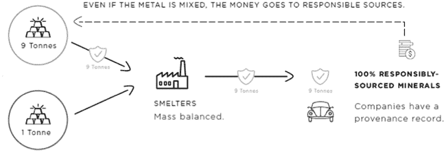

*来源*：Minespider 白皮书，[www.minespider.com](http://www.minespider.com)。

### 9.7.6. 漂绿
重要的是，无论冶炼厂的全部投入矿山是否使用区块链，它们都必须负责任。我们不希望基于区块链的矿物可追溯性成为漂绿的途径。冶炼厂从负责任的区块链注册来源采购 50%，而另外 50% 来自已知冲突来源，向关心可追溯性的下游客户出售其区块链可追溯性代币，并向其他所有人出售匿名材料，这是不够的。这可能会让下游公司产生虚假的安全感，认为他们并未参与非法活动，减少对供应链中不良行为者的压力，并最终使实地影响比不使用区块链更糟。

为避免这种情况，重要的是冶炼厂继续按照经合组织指南的要求对其投入矿山进行尽职调查，并随着时间的推移鼓励越来越多的矿山在区块链上注册。应在冶炼厂层面创建区块链代币，并附带冶炼厂已完成的尽职调查，以说明来自尚未启用区块链的来源的任何材料。

在上面的示例中，冶炼厂购买了 10 吨材料，其中 9 吨附带不可替代代币，可让我们追溯到原产矿山。对于剩余的 1 吨，应在冶炼厂层面创建代币，并链接到冶炼厂已执行的尽职调查。购买该材料的客户将意识到该代币并非来自原产矿山，但仍会对材料有一定的信任度和信息，并可借此推动矿山今后采用可追溯性。

## 9.8. 激励区块链参与
设计最完善的矿物可追溯系统只有在公司使用时才会追踪矿物，而他们只有在看到自身利益时才会使用。如果收益超过成本，公司就会加入并持续参与。否则，该系统就沦为假设性的概念验证。

区块链的核心功能之一是能够基于一套共享规则创建系统并交换价值。这些规则由运行区块链系统的计算机执行，因此没有任何单个用户有权更改它们。通过正确设置这些规则，我们可以确保可追溯系统中的每个用户都能从参与中受益。

### 9.8.1. 公司激励
系统中的参与者越多，制定激励每个人的规则就越困难。供应链系统中的规则设定可能非常复杂，但我们可以从两条简单规则开始：

**1.** 如果参与者为系统提供价值，他们将获得足够的补偿或某种形式的参与价值。

**2.** 如果参与者从系统中获得价值，他们必须为此付费，或为系统创造价值。

如果一家公司向区块链提供数据，这是有价值的。他们应该以某种方式获得奖励，例如金钱、声誉提升或更好的客户获取渠道。如果一家公司使用区块链进行合规，他们应该以某种方式为此付费，例如支付金钱，或设置计算机来帮助运行区块链系统。

我们已经看到了供应链中一系列不同的参与者。让我们回到之前黄金供应链的示例，看看每个参与者在使用区块链可追溯系统时可能获得的益处，以及我们可以纳入以支持这些益处的示例规则。

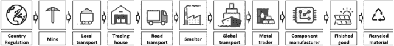

黄金所在地区的政府可能希望控制其境内黄金的开采和交易，以防止走私、资助冲突团体、逃税和侵犯人权。政府可能希望要求个人和公司通过政府认可且注册区块链追踪的渠道进行销售。为了鼓励政府采用我们的系统，我们可以要求在系统上交易黄金的国家特定许可以及自动税收征收。

矿山提供尽职调查数据以进入世界市场。大规模采矿作业（LSM）会进行昂贵的审计并收集尽职调查数据，以向市场参与者保证从他们处采购，矿山希望提供这些数据的成本降低。手工采矿者（ASM）通常无法提供这些数据，并将受益于拥有合法的销售渠道。这将为他们提供这些数据，并由地方政府强制执行。除了声誉激励之外，我们还可以为 ASM 提供诸如更好的价格、用于在社区建设基础设施的资金以及数字支付等好处，使合规比通过非法销售获得的收益更容易、更有益。

运输商通常必须出示大量文件才能合法运输材料。这些文件可能需要数天时间才能获取并整理好。通过将这些文件与我们的运输代币关联，我们提供了效率效益。

安全也是运输商的一大关注点，高价值货物面临被抢劫的风险。我们可能会包含规则，延迟在代币上记录运输数据，直到货物到达之后。

贸易商、冶炼厂和制造商都有各自的合规需求，以及客户对供应链信息的需求，还有进入世界市场的需求。每当他们交易代币或上传相关数据时，他们都会为系统提供一定的价值，并且都从系统中获得合规信息中受益。他们受益程度与贡献程度之间的平衡仍然是一个开放性问题，可能需要随着时间的推移逐案解答。

成品制造商通常是品牌名称，他们从系统提供的供应链透明度中受益最多。这些参与者将拥有详细的供应链信息，作为回报，他们应该为此支付最多的费用。

回收商是供应链的终点；然而，他们也是黄金重新开始的节点，将材料送入冶炼厂。回收商将向我们的区块链系统提供数据，显示他们对投入来源的信息，因此应从提供这些数据中受益，例如更好的声誉或降低的合规成本。

### 9.8.2. 数据自主权

谁可以看到附加在我们的代币上的数据？这是一个关键问题，很可能会让许多公司在加入区块链溯源计划前犹豫不决。一些公司的商业模式基于套利，供应链透明化可能会导致他们失去业务。其他公司可能对与更深层级的供应商沟通或与竞争对手就供应链责任进行合作存在正当的反垄断担忧。对于大多数公司而言，这些担忧的影响远大于系统的经济激励。

举例来说，想象一家年交易矿物收入 2000 万美元的公司。如果区块链系统威胁到其每年 2000 万美元的核心业务，那么它花费 5 万美元或获得 5 万美元报酬都无关紧要。他们只有在意味着能够安全进入未来的全球矿物市场，并且只有在他们的数据得到保障的情况下才会加入。

供应链数据的敏感性意味着一个指导原则：我们溯源系统中的所有数据都应由数据所有者控制，而其他人不得控制。该原则被称为数据 *自我主权*。这意味着区块链代币的所有者是唯一有权查看该代币所代表的矿物数据的个人。其他公司或政府行为者将无法访问该供应链数据。代币持有者将完全负责自行决定是否分享其责任数据。坚持数据自我主权原则，我们可以克服公司成为区块链注册的负责任供应链参与者的最强阻力。

### 9.8.3. Immutability of Data
大多数腐败都与金钱和付款有关，并通过事后更改文件来掩盖。如果矿物销售、来源和尽职调查的记录与我们的矿物溯源代币一起永久且不可撤销地存储，它将关闭腐败及其衍生的非法行为的最大途径。没有供应链参与者愿意行贿以做成生意。不可更改记录的承诺对希望负责任的公司而言是加入的强有力积极激励。从长远来看，行业对矿物供应链透明度的要求只会增加，而受益于腐败的公司将因声誉不佳以及未能参与负责任的追踪系统而被挤出市场。不可变记录对供应链中的每个参与者都有好处，但对于帮助大型矿山在制度监督较弱的国家维持其运营的社会契约尤其有用。

2017 年 7 月，Acacia Mines（巴里克黄金公司子公司）被坦桑尼亚政府因非法运营和低报黄金出口价值而开具了一张 1900 亿美元的未缴税款和罚款账单。²⁰ 该账单超过了该国 2017 年 1620 亿美元的 GDP。最终，情况得以解决，巴里克同意支付 3 亿美元，政府持有 Acacia Mines 16% 的股份。如果有不可变的记录，本可以在问题开始前就解决它。

### 9.8.4. Ensuring Credible Information
我们的代币溯源系统的有用性仅取决于输入的数据。如果为附有伪造尽职调查报告的矿物创建代币，系统的可信度将被损害。如果系统中的数据用于让公司获得其矿物的世界市场准入，那么公司就有强烈的动机保持良好声誉。如果拥有可疑做法的矿山、冶炼厂或其他供应链参与者必须在改进做法和撒谎说已改进之间做出选择，他们很可能会选择更容易的那一种。因此，为了激励区块链中的良好数据，我们需要增加伪造数据的难度。

我们能做的第一件事是要求参与公司接受第三方审计，并将报告扫描件附加到非同质化代币上。这是一个好的开始，但我们如何改进它？第三方合规审计可能由接受审计的公司支付，从而导致最终报告存在利益冲突。这导致了我们系统中的单点故障。

更稳健的解决方案是创建一套标准数据，由供应链多个环节的多方收集并签字确认。一些数据，例如装运数量和编号、品级和位置，可能从生产设施的企业管理软件或物联网设备中自动收集。自动化使伪造数据更困难，从而增加信任。

通过形成一套待收集的标准数据，我们可以根据公司采用的做法对其进行评分，例如社会声誉评分。了解其供应商、标记并追踪其货物、与公民社会保持良好关系、对工人工资透明、并通过电子方式发送和接收所有付款的公司，可能比做法较少的公司获得更高的社会声誉评分。如果客户更倾向于社会声誉评分更高的供应商，这可以激励公司改进做法并投资于数据收集和追踪。

### 9.8.5. Incentivizing Incident Reporting
一旦公司加入我们的系统，仅凭他们愿意参与透明度计划这一事实，我们就可以对其做法产生一定程度的信心。尽管如此，透明度计划和责任政策可能无法缓解所有供应链风险。即使实施了健全且由区块链支持的责任计划的矿山-运输-贸易商-冶炼厂集团也可能遇到问题事件。例如：
*   卡车可能被抢劫，并被冲突团体征收非法税款。
*   偏远矿场的工人可能带孩子进入矿山工作，并在计划检查期间将他们藏起来。
*   工人可能不当处置危险废物。

为应对和减少非法行为事件，我们首先需要这些事件得到报告，并将这些报告附加到我们的代币上。我们需要确定一个能够目击事件的群体，确定如何使报告变得容易，确定能够鼓励他们报告的激励措施，然后确定如何防止虚假报告。

童工事件难以识别。矿山可能在检查当天让孩子上学，然后在检查员离开后恢复原状。首先让我们确定一个能够目击这些事件的群体。我们知道这类事件会发生，因为检查员并不是唯一访问矿山现场的工人群体。通常采矿工程师、地质学家或其他工人会访问这些现场，并目击他们无法处理的事件。这就是我们确定的能够目击事件的群体。现在，我们如何让这个群体报告变得容易？采矿工程师和地质学家通常收入良好并能接触到技术。也许智能手机上的一个简单报告应用程序就足够了。

接下来，我们如何激励他们进行报告？工程师和地质学家有职业道德准则。知道报告会产生影响可能足以鼓励他们参与。也许我们可以拿出资金，每次报告就捐给致力于结束童工的非政府组织。另一方面，他们可能担心作为举报人的安全，因此一定程度的匿名性对于鼓励参与也很重要。也许只有非政府组织才能访问举报人的身份。

最后，如何防止虚假报告？我们可以尝试收集一些自动化的元数据，例如访问的日期和时间，或者我们可以降低单个报告的影响，使单一报告对公司造成的损害不会那么大。也许在非政府组织能够确认这些报告之前，这些报告不会自动分配给相关矿场的货物。

上述方案的实施可能按以下方式进行。我们需要从资金开始。我们确定一家向矿场派遣矿工和地质学家的公司。这些矿场都已在我们上面概述的基于代币的可追溯系统上进行追踪。该公司在智能合约中锁定 20,000 美元。一旦资金锁定，公司工程师和地质学家就能使用一个简单的报告应用程序，在他们访问生产现场时随时进行报告。将报告限制在由出资公司任命的人员范围内，是减少虚假报告发生率的一种方法。

报告应非常简单，要么说明工人看到了童工事件，要么说明没有看到。无论哪种情况，提交报告都会从智能合约中转移 10 美元给一家负责跟进这些事件以清理供应链的非营利组织。

锁定资金的公司以及工程师和地质学家将能够查看在该矿场已提交的报告数量的汇总数据，且数据为匿名。在报告一定数量的事件后，非政府组织会对矿场进行突击访问以核实报告。如果发现童工，非政府组织会在区块链上为来自该地点的所有货物添加红色标记。

在我们的上述建议中，你可能会注意到大量不确定性词汇的使用，例如“也许”和“尝试”。事件报告并非一个已解决的问题。事件的发生源于复杂的动态，涉及众多因素，包括工人的个人动机、可能因地区而异的当地文化和态度、该地区的经济稳定情况，以及处于报告位置的人因担心报复而不敢报告。实施区块链驱动的系统来解决事件报告问题可能会产生积极结果和难以预测的意外后果的混合，在此阶段我们应预期解决方案具有实验性。

## 9.9. 结论

任何行业变革都会有赢家和输家。危险在于大型成熟的国际矿业公司和制造品牌以牺牲较贫困的矿工和当地手工业为代价获胜。但情况不一定如此。

通过以公平竞争环境为出发点设计系统，我们有潜力使赢家成为所有希望参与负责任矿物供应链的人，而输家则是使用非法手段采购的武装团体。

我们正在看到公众意识和政府对矿业供应链监管的显著转变，随着这一转变，对更安全、更透明、更准确、更详细、更可靠且更具成本效益的溯源保障手段的需求也随之而来。区块链技术可以并且将提供这一解决方案。

### 注释

1. ICC 负责任采购指南。国际商会 2008 年。

2. [`www.conflictmineralslaw.com/2017/06/28/costs-of-conflict-minerals-compliance-1-of-3-why-lower-than-expected/#more-2890`](https://www.conflictmineralslaw.com/2017/06/28/costs-of-conflict-minerals-compliance-1-of-3-why-lower-than-expected/#more-2890)

3. [sec.gov/rules/final/2012/34-67716.pdf](http://sec.gov/rules/final/2012/34-67716.pdf)

4. [`www.oecd.org/daf/inv/mne/OECD-Due-Diligence-Guidance-Minerals-Edition3.pdf`](http://www.oecd.org/daf/inv/mne/OECD-Due-Diligence-Guidance-Minerals-Edition3.pdf)

5. [`www.globalwitness.org/documents/18138/201512_Chinese_Due_Diligence_Guidelines_for_Responsible_Mineral_Supply_Chains_-_En_K83fxzt.pdf`](https://www.globalwitness.org/documents/18138/201512_Chinese_Due_Diligence_Guidelines_for_Responsible_Mineral_Supply_Chains_-_En_K83fxzt.pdf)

6. [`www.oecd.org/daf/inv/mne/OECD-Due-Diligence-Guidance-Minerals-Edition3.pdf`](http://www.oecd.org/daf/inv/mne/OECD-Due-Diligence-Guidance-Minerals-Edition3.pdf)

7. [`eur-lex.europa.eu/legal-content/EN/TXT/?uri=OJ:L:2017:130:TOC`](http://eur-lex.europa.eu/legal-content/EN/TXT/?uri=OJ:L:2017:130:TOC)

8. [asmconference.org/pdf/Mosi-oa-Tunya_Declaration_EN.pdf](http://asmconference.org/pdf/Mosi-oa-Tunya_Declaration_EN.pdf)

9. [`eur-lex.europa.eu/legal-content/EN/TXT/?uri=CELEX%3A32018H1149`](https://eur-lex.europa.eu/legal-content/EN/TXT/?uri=CELEX%3A32018H1149)

10. [`leginfo.legislature.ca.gov/faces/codes_displaySection.xhtml?sectionNum=1714.43&lawCode=CIV#`](https://leginfo.legislature.ca.gov/faces/codes_displaySection.xhtml?sectionNum=1714.43&lawCode=CIV#)

11. [`eur-lex.europa.eu/legal-content/EN/TXT/?uri=CELEX:32014L0095`](https://eur-lex.europa.eu/legal-content/EN/TXT/?uri=CELEX:32014L0095)

12. [`www.ohchr.org/Documents/Publications/GuidingPrinciplesBusinessHR_EN.pdf`](http://www.ohchr.org/Documents/Publications/GuidingPrinciplesBusinessHR_EN.pdf)

13. [`www.legislation.gov.uk/ukpga/2015/30/pdfs/ukpga_20150030_en.pdf`](http://www.legislation.gov.uk/ukpga/2015/30/pdfs/ukpga_20150030_en.pdf)

14. [`www.legislation.gov.au/Details/C2018A00153/36bf7558-b51e-4f6c-8534-2837163ca660`](https://www.legislation.gov.au/Details/C2018A00153/36bf7558-b51e-4f6c-8534-2837163ca660)

15. [`www.legifrance.gouv.fr/affichTexte.do?cidTexte=JORFTEXT000034290626&categorieLien=id`](https://www.legifrance.gouv.fr/affichTexte.do?cidTexte=JORFTEXT000034290626&categorieLien=id)

16. [`www.independentmsareview.co.uk/InterimTISCreport`](https://www.independentmsareview.co.uk/InterimTISCreport)

17. [`www.nestle.com/asset-library/documents/library/documents/suppliers/nestle-responsible-sourcing-standard-english.pdf`](https://www.nestle.com/asset-library/documents/library/documents/suppliers/nestle-responsible-sourcing-standard-english.pdf)

18. Intel 负责任矿物采购政策，2019 年 3 月。

19. [`legaldictionary.net/money-laundering/`](https://legaldictionary.net/money-laundering/)

20. [`www.mining.com/acacia-mining-now-hit-190-billion-tax-bill-tanzania/`](http://www.mining.com/acacia-mining-now-hit-190-billion-tax-bill-tanzania/)

### 贡献者联系信息

父子团队 Nathan Williams 和 Dr. David Lee Williams 于 2017 年认识到区块链在可追溯性方面的潜力。他们的公司 Minespider 是该行业的领导者。联系他们：hello@minespider.com

# 10 日本房地产市场的代币化

MIKE ROGERS

## 10.1. 引言

数字资产市场目前正在经历显著增长，并在资产代币化领域引起了日益增长的兴趣。回溯到比特币“彩色币”的时代，开发者看到了在基于区块链的资产上追踪所有权的机会，从而实现了点对点的安全资产转移。此后，创新者一直在创建协议，以现代化资产创建、表示和所有权在线转移的方法，尤其是在数字资产证券行业。

随着数字证券市场持续扩张，全球各地的倡导团体也开始关注。个人、企业和政府都在探索这种功能丰富、功能强大的金融科技（fintech）方法。然而，潜在的利益相关者主要缺乏清晰可靠的研究，无法证明代币化的合法商业用途。

本章阐述了在日本房地产市场利用数字证券的价值主张。通过这一独特的金融机制，日本房地产管理者可以找到当前挑战的解决方案，例如投资基金期限过长、市场定价效率低下以及底层投资流动性不足：在分布式账本技术（`DLT`）的驱动下，证券代币生态系统有望在价值 ¥17.7 万亿（约合 US$160 billion） 的日本房地产市场中释放新能力。

## 10.2. 区块链引发的金融转型

A `blockchain` 是一种分布式数据库结构，用于在数字账本上记录交易，为用户提供安全且透明的事件历史记录。在数据不断增长的数字世界中，无数数据容易被篡改和窃取，a `blockchain`’s 构成为其用户提供了增强的安全性和保障。

如前几章所述，`blockchain` 安全建立在共识和防篡改的概念之上。当网络设备确认交易的可信度以及系统的真实状态时，即达成共识。一旦交易得到确认，`blockchain` 的记录即被视为防篡改，意味着在没有压倒性共识的情况下无法被更改。此外，密码学在 `blockchain` 数据安全中发挥关键作用。密码哈希算法通过生成加密密钥来加密和解密信息片段，从而帮助保护账本的交易数据。对称密码学，或公钥密码学（`PKC`），用于保护数字资产钱包，确保只有预期用户能够访问。

与使用相同密钥加密和解密数据的对称加密算法相比，`PKC` 算法使用一个密钥进行加密（`public key`）和另一个密钥进行解密（`private key`）。数字资产钱包地址使用 `public key`s 生成，可以安全地与他人共享。`Private key`s 用于数字签名创建和交易验证；在确认数字签名中的哈希后，交易将被验证并添加到账本中。对称密码系统在数字资产行业中被广泛使用，以增强交易安全性，因为资产转移只能使用与其对应数字钱包关联的 `private key` 授权。

将这些功能结合起来，保持了 `blockchain` 数据的完整性，提供了一种将金融产品转变为密码学保护的数字代币的媒介；这些数字资产可以在 `DLT` 网络上发行和转移。`DLT` 系统通过创建通过多方共识机制认证的电子记录共享数据结构（账本），从而使金融服务基础设施和相关流程现代化。因此，数字资产交易实时记录在权威账本上，供适当的网络用户随时查阅。如后文详细讨论，`DLT` 网络模型可以消除或促进报告和审计流程，以降低成本并提供更大保障。金融工具和相关程序在将 `smart contracts` 集成到 `DLT` 系统中时进一步得到转变。

## 10.3. 智能合约标准加速数字资产功能

如前几章所述，`smart contracts` 是协议，可数字地促进先前商定的条款和程序的执行。通过 `smart contracts` 执行的交易是有条件的，因为底层代码遵循“`if, then`”逻辑语句，意味着如果满足要求，则执行操作。`Smart contract` 活动记录在分布式账本上，使所有交易可追踪且防篡改。`smart contracts` 的独特特性确保了无需第三方即可可靠地执行交易，从而降低运营和交易成本。

`Smart contracts` 从概念上讲类似于“存储过程”，在自动化软件时传统数据库结构中使用。然而，`DLT` `smart contracts` 可以跨不同实体自动化业务流程，而网络规则提供有保证的执行，并且结果对所有系统参与者都是可验证和可审计的。同样，分布式计算平台“`Ethereum`”提供了一种图灵完备的脚本语言，使用内置标准提供 `smart contract` 实现的功能。

`Ethereum` 请求评论（`ERC`）标准描述了代币所需的一组功能，使 `smart contracts` 和相关应用程序能够以可预测的方式通信和执行功能。`ERC20` 标准为可替代代币（`ERC20` 代币）的系统化创建提供了框架，以及余额跟踪和转账功能能力。通过利用 `Ethereum`’s 强大平台，`ERC20` 代币为企业提供了一种创建自身数字资产的简单机制。这种新颖的功能引发了数字资产融资热潮，给全球金融监管带来了非常规挑战。

## 10.4. 跨司法辖区协调金融监管

技术上的重大创新，如互联网，与全球金融体系内各市场更深层次的整合相吻合。1987 年，前 `SEC` 主席 Charles Cox 在国会作证时注意到这一趋势，并表示

*由于多种因素，包括技术进步以及世界上许多证券市场取消对外国参与的限制，国际化不仅仅是一种发展中的趋势，它是当今的现实。¹*

技术的进步也带来了跨境监管的新挑战，正如 `blockchain` 和数字资产的最新创新所显示的那样。

对其他司法辖区企业的监管要求当地立法者思考其规则如何适用于希望进入其资本市场的实体。在某些情况下，这只是要求外国和国内公司遵守相同的法律。然而，监管机构意识到这种方法并不总是合适，从而对外国发行人和投资者给予某些豁免。这种灵活性使地区能够从全球企业中获得经济回报，同时保护其公民免受潜在欺诈和滥用的侵害。

在 2014 年至 2018 年中期之间，通过数字资产筹集了超过 $11 billion。这一全球现象主要由 `Ethereum`’s `ERC20` 标准推动，展示了使用 `DLT` 和 `smart contracts` 筹资的有效性。然而，在此期间创建的大多数实用代币都是通过不合规的首次代币发行（`ICOs`）发行的。据 Satis Group 称，78% 的 `ICOs` 被认定为诈骗，7% 失败或已死亡，只有 15% 继续在交易所交易。² 因此，创新者和政策制定者认识到增加数字资产监管的明显需求。

2019 年 7 月 30 日，`SEC` 委员 Hester Peirce 在新加坡社会科学大学融合论坛上谈到了数字资产监管中跨境合作的重要性。她承认数字资产带来了独特的担忧，因为

*世界各地的国家仍处于确定是否以及如何监管加密资产的早期阶段。关于任何特定国家规则的不确定性，使得确定适用哪国规则变得更加困难。³*

缺乏单一的全球监管框架——这既不太可能也不明智——创新者需要为司法管辖区之间的潜在摩擦做好规划。

数字资产监管框架需要与投资者的期望保持适当一致，因为生态系统参与者的地理位置往往不同。赫斯特·皮尔斯在新加坡承认了这一问题，并表示

*如果投资者、他们交易的平台以及他们投资的公司都运营在同一个国家，投资者就知道适用哪国的规则，但当涉及多个司法管辖区时，情况就会变得更加复杂。*

鉴于这些挑战，数字证券企业家认为他们的产品和服务可以为监管泥潭提供可行的解决方案，而随着 Web 3.0 的临近，这一泥潭可能会加速加剧。

## 10.5. 数字证券 – 迁移到 Web 3.0

更值得信赖、更公平和更开放的网络的概念早已被设想，然而，适当的实施需要在数十年的时间里在计算学科各领域取得重大进展。幸运的是，人工智能、分布式系统和云计算等计算领域的最新突破，使我们更接近 Web 3.0。价值创造、存储、转移和重新定义方式即将发生的转变的重要性不言而喻。然而，必须首先理解下一代网络的原则，才能真正把握即将到来的范式转变。

Web 3.0 的基础是“语义网”，其中互联网数据以机器可读格式相互链接。根据万维网联盟的说法，链接数据的网络将使计算机能够执行更有用的工作，并开发能够支持网络上可信交互的系统。⁴ 因此，互联网数据可在应用、企业和社区边界之间共享和重复使用。Web 3.0 的另一个基本原则是创建有状态互联网，或

*一个互联网能够以今天互联网处理消息的方式——或多或少去中心化——处理数据以及改变该数据状态的规则，并允许私有有状态网络通过标准协议相互协作以及与公共网络互操作。⁵*

区块链技术为网络参与者提供了在互联网上持有和转移状态的媒介，无需集中式服务提供商的协助。有状态互联网和语义网将催生一种新的数字经济，这种经济在网上跨多边市场运营。DLT 系统、智能合约和证券代币将实现我们当前金融系统与明天数字价值系统之间的合规互操作性。

证券代币或数字证券旨在代表资产和/或实体的所有权。数字证券在简单性、效率和流动性方面提供与传统 ERC20 代币相同的优势，但它们还具有以编程方式嵌入监管合规性的额外好处。通过确保对身份、司法管辖区和资产类别限制的适当遵守，数字证券有机会成为受监管金融在 Web 3.0 上运营的全球标准化机制。

数字证券提供强大的监督控制，使其成为管理多种监管司法管辖区的理想工具。治理法律和法规嵌入协议层，提供适应性和灵活性。预防性和侦测性控制的编码框架可以缓解风险影响，从而降低合规成本。随着编码框架降低合规支出，它们将有助于简化 DLT 系统之间跨境交易的促进。智能合约可以在执行任何公司行为时证明严格遵守所有适用法规，例如投票、分红、回购和交易。治理相关摩擦的减少可以实现无信任业务的创建。

通过网络平台、DLT 系统、智能合约和基于区块链的资产的结合，自主经济模型和企业结构终于成为可能。投资者和市场参与者可以找到对手方，发现价格，并交易代表所有权和经济权利的数字资产。组织治理和决策可以利用软件进行规范化、自动化和实施。

通过充当投资工具、协议、合同和载体的混合体，数字证券可以确保当今金融法律和法规向新数字经济的适当迁移。因此，预计未来几十年证券代币的使用将显著增长。

## 10.6. 证券代币的预计增长

在对数字证券进行分类时，我们认为最好将证券代币分为两大类，即传统证券代币和资产支持证券代币（ABSTs）。传统证券代币是在证券代币发行（STO）期间发行的数字资产，这是一种我们在 Curzio Research 章节中研究的私人融资方式。这些基于区块链的资产独立于物理世界存在，意味着它们在链上存活和交易。根据法律，传统证券代币必须遵守每个发行人、投资者和后续持有者的规则和法规。

截至 2019 年，数字证券行业的大部分经济价值来自用于初创企业融资的传统证券代币。韩国区块链研究和咨询公司 Chain Partners 估计，未来证券代币可以捕获当前 1020 亿美元可寻址初创企业融资市场中的 51 亿美元（图 10.1）。

**图 10.1：    通过证券代币（STO）融资。**

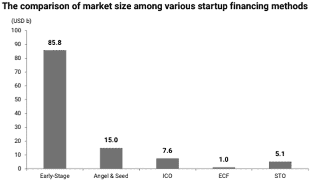

*来源*: Chain Partners, lcodata; Crunchbase News; Thomson Reuters TAB data. *注*: ICO 数字为 2018 年 1 月至 11 月的总和。

初创企业融资是通过早期企业带来的创新的生命线，曾是数字资产初期崛起的主要催化剂之一。从筹资角度来看，传统证券代币本质上已成为效用代币的合规继任者。

根据图 10.2，Chain Partners 预测到 2030 年证券代币市场将达到 2 万亿美元，以每年 59% 的复合年增长率扩张。然而，预计这一增长的大部分将由 ABST 的发行推动。

**图 10.2：    证券代币的预期增长。**

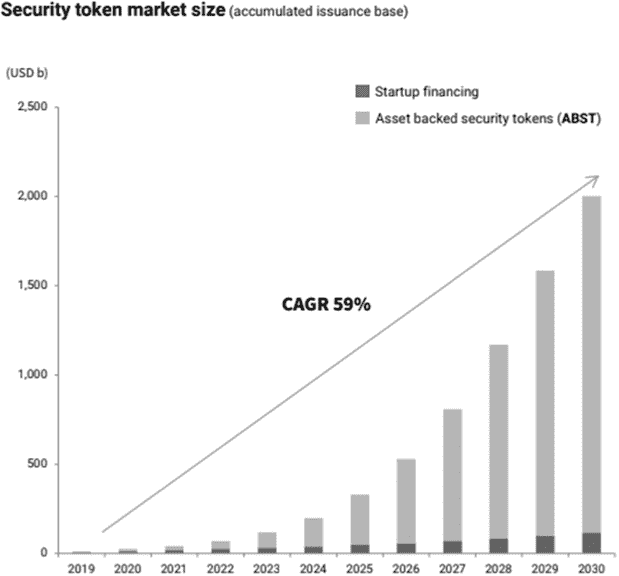

*来源*: Chain Partners. 已获许可使用。

ABST 是通过对现有金融/实物资产进行代币化而创建的数字资产；这些代币是对存在于账外资产的链上表示。ABST 由底层现实世界资产支持并从中获得价值，在概念上与传统金融中的资产支持证券（ABS）相呼应。

ABS 是通过强大而创新的证券化过程创建的。正如哥伦比亚大学教授 Dr Suresh Sundaresan 所定义，证券化是

*一个框架，其中公司或金融机构的一些非流动性资产通过精心包装、信用增级、流动性增级和结构安排，转变为由这些资产支持的证券组合。（Sundaresan, 1997）*

证券化的灵活性彻底改变了可投资世界，为发行人和投资者提供了机会。

技术长期以来一直是新型证券化方法的推动者；信息技术的出现使得有担保借贷全球化，催生了 ABS 多十年的繁荣，如 图 10.3 所示。

**图 10.3：    跨行业的资产支持证券增长。**
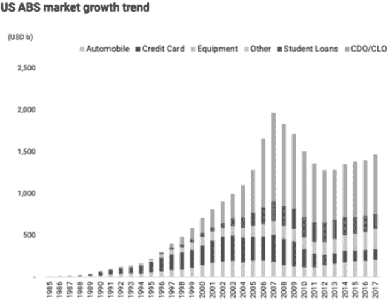
*来源*: Chain Partners. Used with permission.

同样地，区块链技术催生了代币化金融资产，这是一种特别适合全球金融结构的工具。在这种情况下，通过利用 DLT 在通信、计算和记录保存方面的进步，以及智能合约的自动执行，ABST 为数字化现实世界资产提供了理想媒介。

金融全球化与对变革性金融机制（如代币化）日益增长的需求之间存在共生关系。全球化要求各方在跨境层面保持一致，特别是金融家能够主张证券基础资产的权利；代币化是市场融资能力的演进，允许数字原生证券在互联网上具有状态存在并实现无缝转移。

鉴于截至目前 ABST 仅占数字证券市场的 20%，代币化资产在未来十年将大幅增长。根据 图 10.4，Chain Partners 预计 ABST 的市场供应量将在 2021 年左右超过传统证券代币。

**图 10.4：    ABST 的相对预计增长。**
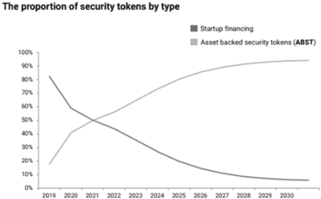
*来源*: Chain Partners. Used with permission.

要实现这些宏伟的预期，首先必须实现机构化，需要建立强有力的国际标准、最佳实践和可信的基础设施。幸运的是，数字证券行业在 2019 年全年在这些领域取得了重大进展，并在 2020 年继续推进。

## 10.7. 数字证券生态系统

证券代币生态系统持续扩张，目前由一级发行、交易和证券平台组成。战略性资源和知识共享为所有参与方增加了显著价值，因为增强数据的服务和产品正在上线。

一级市场主要包括数字证券平台，例如 Securitize。这些提供商促进数字证券所有权的完整生命周期，超越发行，以及每个利益相关者的目标：发行人、投资者和交易所。Securitize 的平台由其 DS Protocol（数字证券协议）驱动，这是一种在 Curzio Research 章节中详细阐述的灵活且适应性强的架构。DS Protocol 创建了一个符合监管的互联网生态系统，建立在支持第三方数字证券应用（DS Apps）的数字证券服务（DS Services）智能合约基础设施之上。证券代币与其他智能合约之间的所有交互均已标准化，使每个数字证券在其生命周期内能够正确遵守适用的证券法律和法规。

数字证券二级市场由多个持牌证券代币交易所（STEs）以及其他市场和流动性提供商组成。STEs 根据美国法规被归类为另类交易系统（ATS），必须获得 SEC 批准。ATS 在日本被称为专有交易系统，是匹配买方和卖方以寻找执行证券交易对手方的计算机系统。通过绕开传统经纪商和交易所的服务，ATS 为寻求替代流动性获取方式的投资者提供更低的交易成本。

我们的 Curzio Research 章节研究了 Open Finance Network，这是一个用于标准化另类资产的 ATS 协议，以及与这些资产相关的报告、合规、清算和结算流程。由此产生的互操作性为代币化交易创建了机制，使链下“传统”资产与链上“数字”资产相连接。此外，市场参与者不再需要依赖手工对账账簿，从而使资产所有权和资金可用性的实时验证成为可能。代币化资产的即时结算将改变典型的证券交易生命周期。

数字证券市场的代理已获得必要的许可和监管批准，以作为投资服务提供商运营。结合技术专业知识，数字资产行业在质量和执行方面的门槛已被提高。成熟促使传统金融服务公司与证券代币生态系统合作，如 Securitize 近期融资轮次所示，该轮次从 Santander InnoVentures、MUFG、Nomura Holdings 和 Sony Financial Ventures 筹集了超过 $14M。⁶ 与这些受信任机构的合作进一步使数字证券合法化，并应有助于加速证券代币的采用。

## 10.8. 房地产市场低效

房地产行业目前充斥着低效问题；可靠物业数据的分散分布、临时定价、不透明的所有权结构、碎片化的信息系统、模拟（纸质及其他非电子）记录、本地化市场和孤立网络等无数其他缺陷导致市场透明度问题。信息透明度较低的市场会阻碍投资者在决策时的信心，导致逆向选择和定价低效。数字证券可以为臭名昭著的缺乏实时数据的资产类别的流程和程序现代化提供框架。

在 DLT 系统上发行和转移的代币化资产将提高数据透明度并扩大市场准入，最终改善房地产流动性和资产定价效率。通过谨慎的金融结构技术，房地产资产的所有权权益及其基础现金流可以进行定制。证券代币可以打包在一起代表对多个物业现金流的索取权，或代表对单个物业的分数所有权。数字证券提供了证券化的灵活性，同时利用基于网络平台的开放访问。

代币化的灵活性为发行人和投资者提供了独特的优势。基于协议的金融工程允许从任何类型的现金流创建代币，包括在当前结构技术下经济上低效的现金流。这些代币具有明确定义的授权，充当借款人与投资者之间的金融中介。发行人拥有一种具有成本效益的利用资产负债表上资产的方法，从而获得低成本的全球融资渠道。资本提供者可以享受一系列投资部署选项，分散投资组合风险。此外，提供直接资产类别敞口的代币提供更好的风险校准，帮助投资者形成定制的风险回报特征。

上述证券代币的好处可以使机构房地产的流动性大幅增加。如 图 10.5 所示，Resource Real Estate, LLC 的“The Illiquid-Liquid Spectrum”，机构房地产是一种极度缺乏流动性的资产。

**图 10.5：    资产相对流动性。⁷**
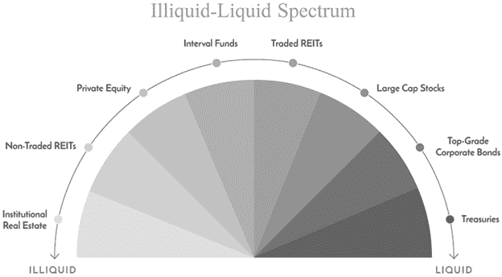

从购买者的角度来看，机构房地产投资需要大额前期成本，其中大部分由当地贷款机构融资。这限制了知名度较低的购买者获取低成本全球资本市场借款的能力。同样，从贷款机构的角度来看，它们仅限于区域市场，这限制了它们转移风险并寻求潜在表现更好的资产类别以实现多元化的能力。区域集中的贷款机构可以通过 DLT 系统调节贷款敞口，通过证券代币将这些现金流的部分提供给全球投资者池。后续的代币买家将受益于其居住地之外的房地产敞口，而原始贷款机构则可受益于另一种流动性方式。

如果执行得当，代币化有可能将某些机构房地产投资的流动性水平提高到“上市 REIT”的水平。如此规模的变动沿着 Resource Real Estate, LLC 的“非流动-流动光谱”会带来更多投资者、提高市场竞争力和降低中间人佣金，从而实现更高效的资产定价、直接参与者的更高利润以及机构摩擦的进一步降低。房地产投资信托（REIT）结构自 1960 年创建以来对全球房地产市场产生了深远影响。起源于美国，REIT 为投资者提供了接触大规模、多元化且流动性强的收益型房地产资产组合的工具。引入六十年后，世界各国仍在首次通过法律采用 REIT，展示了在全球房地产市场中利用创新结构释放价值的当前机会。

我们认为数字资产可以为创建变革性的房地产投资工具和产品提供创新框架，利用技术进步来追踪房地产市场数据。通过向市场参与者提供实时数据，投资者将获得自信交易所需的信息。这将吸引更多参与者进入房地产市场，进一步增加市场数据量。买方、卖方、行业参与者和数据点之间产生的反馈循环将导致更高效的价格发现过程。

数字资产目前最适合信息技术基础设施强劲、拥有开放数据计划以及面向未来的政府和企业房地产市场。发达国家最符合这些标准，尤其是那些已经使用 REIT 结构多年的国家，因为数字资产将提供创新的结构以释放更多价值。因此，我们提出了一项多步骤提案，利用 DLT 系统和资产代币化来提高日本房地产市场的数据透明度和投资流动性。

## 10.9. 日本房地产市场

本节我们对日本房地产市场进行了简要概述。我们首先描述该市场的经济状况和规模。然后我们讨论该市场中一些存在缺陷和低效的领域，这些领域可以得到改进。

### 10.9.1. 市场规模和投资环境

排在美国和中国之后，但在英国、印度和德国之前，日本经济目前是世界第三大经济体，根据野村综合研究所（NRI）按名义国内生产总值（GDP）预测，日本预计在 2020 年代仍将保持这一地位（图 10.6），使日本成为未来十年资本部署的理想目标。

**图 10.6：所选国家的 GDP。**

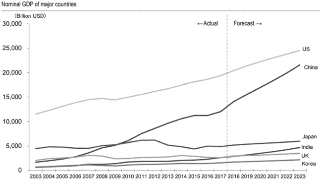

*来源*：由 NRI 根据国际货币基金组织《世界经济展望数据库（2017 年 4 月）》数据汇编

据三井住友信托研究所（SMTRI）报道，投资日本国内房地产的房地产私募基金的市值在 2019 年初总计为 17.7 万亿日元（约 1600 亿美元）。在计入日本房地产投资信托（J-REITs）——其占 17.9 万亿日元后，日本房地产市场管理的资产接近 36 万亿日元（约 3400 亿美元）。这些结果在 SMTRI 第 27 次“私募房地产基金调查”中图 10.7 中有所说明。请注意，虽然私募基金的比例多年来保持相对稳定，但资产管理规模的大部分增长是由 J-REIT 推动的。

与其他主要房地产市场相比，日本为投资者提供了相对较高的利差。根据仲量联行（JLL）的数据，东京核心办公楼在 2019 年的平均收益率差距为 2.9%，高于伦敦（2.5%）和纽约市（1.25%）的平均收益率差距。因此，寻求收益的外资基金在过去几年中向日本房地产部署了创纪录的资本：仅在 2017 年，海外企业在收购上花费了 1.1 万亿日元。事实上，根据 SMTRI 的调查，日本收益率差距的相对吸引力是外国投资者选择日本的首要原因（图 10.8）。

**图 10.7：日本房地产的资金来源。**

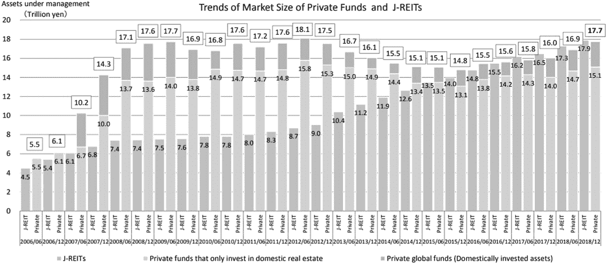

来源：数据取自 SMTRI《日本私募房地产基金调查 2019 年 1 月结果》（第 2 页）⁸。

**图 10.8：吸引外国投资者的因素。**

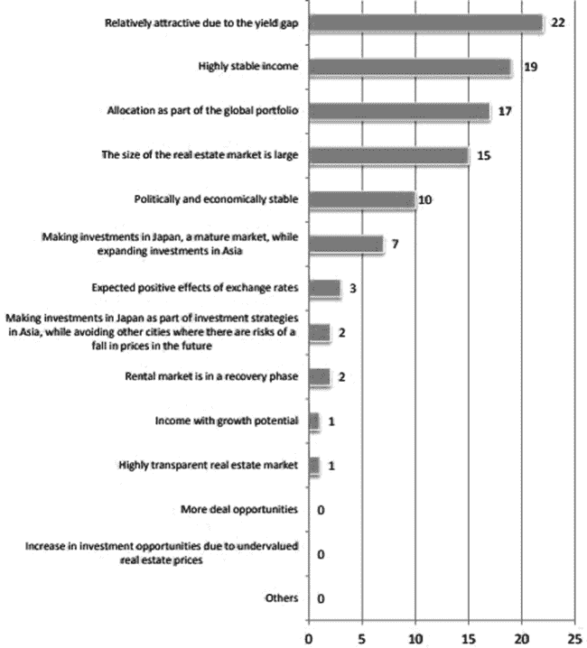

***来源***：数据取自 SMTRI《日本私募房地产基金调查 2019 年 1 月结果》（第 7 页）⁹。

诸如机构房地产巨头 KKR 和 Blackstone 等外国投资者也吸引于日本超低利率环境，该环境由日本银行设定。为促进增长，日本银行实施了促进廉价融资市场的政策，推动了房地产需求。有趣的是，一些银行甚至通过发行负利率贷款向企业支付借款费用。这些宽松的货币政策条件促使主权资本在过去十年中大量投入日本房地产，如图 10.9 所示，其中底部条形显示了 SMTRI 调查受访者中从海外管理在日本资本的百分比。

### 10.9.2. 日本房地产市场痛点¹⁰

随着日本银行进一步降息的可能性增加，物业收购的竞争格局加剧。平均投资期限为 5 年以上的基金主导了这一市场，因为 2019 年新成立的房地产基金的平均期限现已达到 9.1 年。基金期限的延长与流动性下降同时发生，因为投资者资本用于购买和维护基础房地产资产。

日本房地产证券化涉及主要参与者，如 GK-TK（GodoKaisha-TokumeiKumiai）和 TMK（TokuteiMokutekiKaisha）。证券化产品吸引了全球机构的重大投资兴趣，这些机构希望管理资产负债表风险并分散现金流。由于机构投资者要求的收益率高于个人，近期膨胀的房地产价格使得达成交易变得困难，尤其是在大都市地区。事实上，在 SMTRI 调查中，近 25% 的外国投资者选择“房地产价格上涨”作为不投资日本市场的理由（图 10.10）。

**图 10.9：拥有海外投资者的日本房地产投资基金的百分比。**

*来源*：数据取自 SMTRI《日本私募房地产基金调查 2019 年 1 月结果》（第 2 页）

**图 10.10：阻碍外国投资的日本房地产市场弊端。¹¹**

*来源*: 数据来源于 SMTRI 日本私募房地产基金调查 2019 年 1 月结果（第 7 页）¹¹。

在分析 J-REITs 的商业环境时，SMTRI 调查的第二大热门回应发现，管理者在推出开放式私募基金之前正“寻求更好地理解并收集信息”。这些管理者指出，需要“扩大可投资于基金的投资者类别”和“改善流动性”是对私募 REIT 市场进一步发展的重要因素（图 10.11）。

**图 10.11：促进日本房地产市场外国投资增长的因素。**

*来源*: 数据来源于 SMTRI 日本私募房地产基金调查 2019 年 1 月结果（第 10 页）¹²。

因此，我们认为 DLT 系统和资产代币化可以为基金经理所指出的、阻碍日本房地产最大化投资的当前挑战提供解决方案。

## 10.10. 代币化日本房地产投资

在 DLT 系统中运行的安全代币旨在提高价格发现过程的效率。系统中的低效率目前限制了日本房地产市场；具体来说，这些挑战与投资数据透明度、获取和流动性有关。

### 10.10.1. 数据透明度

房地产投资机会通常很复杂，需要由大量分析师和律师组成的团队进行深入尽职调查；需要大量的前期成本来正确评估前景并评估相关资产的技术细节。这些成本通常是固定的，从而为大规模部署资本的人提供了竞争优势。因此，存在一个门槛，大型资产管理者在资本较少的人面前具有明显的优势。

数字证券可以通过利用 DLT 生态系统和安全代币历史来提高房地产资产周围的数据透明度，从而帮助降低初始资本部署门槛。提高数据透明度将传播进入投资决策过程的信息输入，鼓励资源较为有限的投资者部署资本。因此，日本房地产的全球投资者池将扩大，创造额外的资金流动，从而推高价格。

根据 JLL 的“全球房地产透明度指数 2018”，日本在调查的 100 个国家中排名第 19 位；日本在“透明”组中排名靠前，但距离进入“高度透明”层级仍有很大差距（图 10.12）。自 2016 年上次调查以来，85% 的国家房地产透明度有所提高，其中许多国家超过了日本。最显著的增长出现在依赖技术的司法管辖区。

JLL 的调查显示，用于提高房地产数据透明度的技术呈上升趋势。一个例子出现在迪拜，那里的一项建筑分类计划利用官方政府应用程序进行房产经纪人和运营商注册。荷兰也被认可为利用房地产技术来鼓励数据共享；转向开放数据使得核实交易价格和其他注册信息变得更容易。

**图 10.12：所选国家的透明度评分。¹³**

JLL 的 2018 年报告强调了 250 多家 proptech（房地产技术）初创企业的近期崛起，自 2016 年透明度指数报告以来，这些公司共筹集了超过 $6 billion 的资金。这些技术驱动的平台正在产生大量新鲜数据并创造新指标，推动投资者和企业对房地产透明度实现重大飞跃的期望。然而，由于数据获取、质量和一致性方面存在挑战，行业未能跟上更高的预期标准。我们认为安全代币生态系统可以帮助解决这些关注领域，特别是在日本房地产市场。

JLL 研究员 Yuto Ohigashi 评论了日本需要采取行动的情况，指出：

*日本市场的透明度有所提高，但其他国家实现了更显著的改善。除非日本加快改善速度，否则将被全球趋势抛在后面。¹⁴*

如前所述，许多日本房地产基金经理在向市场分配更多资本之前寻求更好地理解并收集信息。这一说法与日本在 JLL 调查的“交易流程”中排名第 35 位相吻合，这主要归因于交易价格信息缺乏透明度和有效性。日本对区块链技术的拥抱是为了增强房地产价格的透明度。此外，其政府支持开放数据计划，使其成为代币化解决方案的理想沙盒。

一项提高房地产透明度的提案侧重于创建实时透明度指数，利用 DLT 系统和安全代币的网络在用户之间汇总和共享日本市场数据。以 JLL 全球房地产透明度指数（GRETI）作为框架，我们认为技术已经发展到可以持续汇编和展示 JLL 的 186 项单独透明度指标中的大部分的地步；这将是对当前方法的重大升级，目前该指数每两年更新一次。定量数据可以从以下组合中收集：（1）proptech 平台 APIs（应用程序编程接口）；（2）房地产区块链技术应用计划，例如土地所有权和契据记录、房产销售和所有权转让、投资者/租户身份等；以及（3）在每个安全代币生命周期内收集的基础数据。

定性因素可以从使用 DLT 网络的行业专家联盟中汇总；这些从业者将为可操作数据增加粒度，利用其各自专业领域的见解。定性输入的时间表将由参与成员通过共识决定（即：每日、每周、每季度等）。我们的提案将满足投资者和企业对更高透明度标准日益增长的需求；技术提高了对及时提供高质量信息的期望。然而，正如 JLL 2018 年 GRETI 报告中所显示的那样，期望与现实之间存在很大差距。

我们提议的网络用户将被激励贡献数据以换取实时房地产透明度信息，而不必等待两年等待 JLL 更新。JLL GRETI 目前作为房地产基金经理和其他决策者的行业基准。正如芝加哥大学布斯商学院房地产临床教授 Joseph L. Pagliari 所说：

*全球房地产透明度指数长期以来一直是国际房地产投资界许多人试图评估和定价风险的黄金标准。¹⁵*

实时透明度指数将对国际投资决策者证明是无价的，例如那些希望从国外向日本房地产市场部署资本的人。

如果数字资产证券作为交易各方之间中介的工具，我们提出的 DLT 系统网络可以进一步提高对相关日本底层物业数据的可见性。在初始发行时，物业信息，例如土地所有权、资本化率和入住率、所有权和租户历史等，可以在每个数字资产证券的整个生命周期中实时追踪。这些信息通常分散在多个组织中并以不同的格式呈现；数据现在可以标准化并通过使用 DLT 系统的基于网络的平台随时提供。

我们设想网络用户最初是全球房地产投资管理领域非顶尖层级的那些人，特别是那些难以超过初始资本部署门槛的房地产管理者。网络参与者的主要动机将是获取众包房地产市场信息，其整体价值大于每个参与者单独积累的零散信息。人们可以认为该网络是商业生态系统的下一代网络版本，哈佛大学教授 James F. Moore（1996）将其定义为：
*一个由相互作用的组织和个人组成的经济共同体——商业世界的有机体为基础所支持。经济共同体为客户生产有价值的商品和服务，而客户本身也是生态系统的成员。成员有机体还包括供应商、主导生产商、竞争对手和其他利益相关者。随着时间的推移，它们共同演化其能力和角色，并倾向于与一个或多个核心公司设定的方向保持一致。担任领导角色的公司可能会随时间变化，但生态系统领导者的功能受到社区的重视，因为它使成员能够朝着共同愿景迈进，以协调投资并找到相互支持的角色。*

我们提出的生态系统的价值将随着 Web 3.0 技术进一步融入业务流程和日常生活而呈指数级增长，从而创造出前所未有的房地产市场数据宝库。

机构房地产公司最终会在商业环境发生根本性演变后被激励加入该网络。正如 Intraspect Software 的联合创始人兼 CTO Tom Gruber 所说：“Globalization is eliminating the traditional advantages of the large corporation: access to capital, access to markets, and economies of scale.”¹⁶ 类似地，我们相信 DLT 生态系统、智能合约、证券代币和其他 Web 3.0 技术可以改变当今日本房地产市场以及明天全球房地产行业中数据透明度相关的方法和激励机制。

JLL 的 Yuto Ohigashi 认为“提高透明度的两个关键是：通过政府举措改变市场机制，以及让私营市场参与者在业务活动中注重透明度。”¹⁷ 日本的开放数据举措正在激励创建可作为房地产数据聚合和共享的标准化网络的 DLT 系统，而数字资产证券将很快追踪日本房地产市场交易，我们相信这将带来进一步的国际投资机会。

### 10.10.2. 开放获取
JLL 的 2018 年调查发现，房地产投资者倾向于开放和透明的市场。他们的研究发现，在涵盖的 158 个城市中，“高度透明”城市占直接房地产投资的 70%，并占近四分之三的跨境投资。投资者和物业开发商越来越多地要求与城市层面动态相关的更多信息。正如 图 10.13 所显示的那样，城市房地产透明度感知与其总交易量之间存在显著相关性。

东京的透明度得分为 1.98，在全球城市中排名第 50。尽管日本最大的都市圈处于第二透明度层级，但其房地产交易量仍令人印象深刻地位列全球前 3 的城市。为了实现房地产交易量所需的增长，日本房地产管理者可能需要获得更大份额的国际投资社区。根据 Savills World Research 的数据，2017 年至 2018 年第三季度之间跨境投资占比出现了大幅下降（图 10.14）。

**图 10.13：房地产透明度指数与投资规模。¹⁸**

**图 10.14：投资规模与海外投资。¹⁹**

2018 年 12 月，日本国际投资同比减少超过 2 万亿日元，这是自 2008 年金融危机以来降幅最大的一次。该数据验证了 SMTRI 调查结果，其中房地产投资管理者寻求“扩大投资基金的投资者类别”。日本房地产的代币化可以实现多样化产品的创建，从而吸引全球的另类投资者。

如前所述，由于其可编程性，证券代币是实现无缝跨境交易的理想工具。代币化的日本房地产可以提供预防性和侦测性资产控制的编码框架，有助于缓解司法管辖区监管问题。根据 JLL 2018 年指数，日本在“上市车辆治理”方面排名第 31，这也是国际投资减少的促成因素之一。如果数字资产证券成为上市的首选工具，治理可以实现标准化和自动化。国际投资者将拥有参与治理行动的更便捷机制，从而导致跨境资本部署相应增加；全球多元化的投资者群体将增强市场流动性。

### 10.10.3. 增强流动性
如前一节所述，日本房地产管理资产的近一半被锁定在私募市场，导致流动性溢价较大。流动性溢价主要由于交易成本高，而交易成本由多种市场摩擦构成：大的买卖价差、市场深度下降、较高的物业搜寻成本和经纪费用，所有这些都增加了市场复杂性。

证券代币可以通过增强底层投资特征来提高日本私募房地产市场的流动性。当前模式严重依赖中介机构，如房地产银行家和经纪人，而这些复杂资产的买家基础有限。通过提供资产标准化框架，数字资产证券可以降低分析和搜寻成本。当供需摩擦得到平滑时，交易可以更频繁地进行，从而提高价格透明度。正如 图 10.15 所示，由此产生的反馈循环最终将导致私募房地产投资的流动性更高。

房地产代币化也可以为日本房地产市场的供给方增加价值。如前一节所述，房地产价格上涨是基金经理忽视日本的头号原因之一。房地产价格快速上涨主要可归因于投资级房地产供应有限。通过代币化，房地产资产可以汇集在一起并重新包装成付息的数字资产。多元化使违约风险得以分散，从而增加了投资级房地产机会的供应。

**图 10.15：    私人市场流动性不足的原因。²⁰**

私募房地产基金的代币化将是另一项应用，可提高日本房地产市场的投资流动性。如前所述，日本私募房地产基金的平均投资期限为 5 年以上，而近期发行的基金预计存续期为 9.1 年。这些漫长的基金期限使资本在较长时间内被锁定，这会阻止一些投资者向私募房地产基金投入资本。尤其令人沮丧的是，私募房地产基金通常有机会投资高质量物业，从而带来超额回报。私募投资基金的另一个缺点是 J 曲线效应（图 10.16）的高度可能性，在基金早期由于缺乏可行的投资机会，已承诺资本未被提取，因此收取费用而回报缓慢。

**图 10.16：    投资回报的 J 曲线。**

通过提高房地产透明度、开放国际投资社区的准入并提供更大的流动性，数字证券最终可以促进日本房地产市场价格效率的最大化。因此，我们认为代币化将推动海外投资者进一步向日本配置资本。此外，在为 Web 3.0 的新数字经济做准备方面，日本房地产行业将远远领先于其国际同行。

## 10.11. 结论

金融服务领域的领导者认为，区块链技术可以改变全球金融体系，成为新数字经济金融基础设施的基础。通过提高数据效率、透明度和安全性，DLT 可以现代化甚至取代通常由中介执行的流程。结合智能合约，DLT 可以通过资产代币化带来金融产品创新的下一个重大演进。

数字证券允许在 DLT 系统上对代币化资产进行标准化发行和持续转让。与过去其他新颖的金融转型机制类似，代币化将改变曾经流动性差且不经济的资产结构，使其可供更广泛的全球投资者使用。其他独特的创新，例如内置监管控制，将消除浪费性合规成本的需要，进一步扩大可发行和交易的资产范围。

本章的开端旨在探讨代币化可能对日本房地产市场产生的潜在影响。DLT 系统的魅力之一在于将世界各地的各方团结在共同事业中，进一步激励信息共享以促进跨境交易。数字证券提供了一个实现这一目标的框架，同时也遵守当前世界秩序中经时间检验的法律和法规。本研究概述了资产代币化不仅可以为日本房地产基金经理带来的好处，而且可以广泛地为全球金融社区带来的好处，因为社会和市场为即将到来的数字化金融时代做准备。

### 注释

1. *证券市场国际化：听取众议院电信和金融小组委员会的听证会*，第 100 届国会第 4 页（1987 年）（Charles Cox，证券交易委员会代理主席的声明）。

2. *来源*：[`research.bloomberg.com/pub/res/d28giW28tf6G7T_Wr77aU0gDgFQ`](https://research.bloomberg.com/pub/res/d28giW28tf6G7T_Wr77aU0gDgFQ) （访问于 2020 年 2 月 4 日）。

3. 演讲可在 [`www.sec.gov/news/speech/speech-peirce-073019`](https://www.sec.gov/news/speech/speech-peirce-073019) 获取 （访问于 2020 年 2 月 4 日）。

4. [`www.w3.org/standards/semanticweb/`](https://www.w3.org/standards/semanticweb/) （访问于 2020 年 2 月 4 日）。

5. [`media.consensys.net/bring-on-the-stateful-internet-d589adc7bb65`](https://media.consensys.net/bring-on-the-stateful-internet-d589adc7bb65) （访问于 2020 年 2 月 4 日）。

6. [`www.securitize.io/press/securitize-lands-strategic-investment-from-sony-financial-ventures`](https://www.securitize.io/press/securitize-lands-strategic-investment-from-sony-financial-ventures) （最后访问于 2020 年 2 月 4 日）。

7. 获得自 Resource Real Estate, LLC.

8. SMTRI J-REIT 指数是由住友三井信托研究所独立开发的 J-REIT 指数（以下简称“SMTRI”）。它是 SMTRI 的知识产权，与 SMTRI J-REIT 指数计算、数据发布和使用等相关的一切权利均归 SMTRI 所有，请参阅 SMTRI 网站查询。“SMTRI J-REIT Index®”是 SMTRI 的注册商标..

9. 同上。

10. 本小节总结了关于投资者特征和偏好的调查研究，“2019 年 1 月日本私募房地产基金调查。”

11. 同上 n8

12. 同上 n8

13. 数据取自 JLL 投资管理题为《2018 年全球房地产透明度指数》的研究（第 63 页）。

14. [`www.joneslanglasalle.co.jp/en/trends-and-insights/cities/japan-improved-transparency-ranking-14th-in-greti2018`](https://www.joneslanglasalle.co.jp/en/trends-and-insights/cities/japan-improved-transparency-ranking-14th-in-greti2018) （访问于 2020 年 2 月 4 日^, 2020）。

15. [`www.us.jll.com/en/trends-and-insights/research/global-real-estate-transparency-index-2018`](https://www.us.jll.com/en/trends-and-insights/research/global-real-estate-transparency-index-2018) （第 30 页）

16. Gruber (2007)。

17. [`www.joneslanglasalle.co.jp/en/trends-and-insights/cities/japan-improved-transparency-ranking-14th-in-greti2018`](https://www.joneslanglasalle.co.jp/en/trends-and-insights/cities/japan-improved-transparency-ranking-14th-in-greti2018) （访问于 2020 年 2 月 4 日^,2020）。

18. 基于 JLL La Salle 投资管理对《2018 年全球房地产透明度指数》的研究（第 65 页）。

19. 来源：Real Capital Analytics（2018）。Savills World Research Japan ‘Spotlight 2018 review and 2019 prospects’。经许可使用。

20. 摘自 PIMCO 题为“私人市场中的流动性、复杂性和规模”的研究（第 6 页）。

### 贡献者联系信息

要联系 Mike Rogers，请访问 [MillennialsInBlockchain.io](http://MillennialsInBlockchain.io) 或发送电子邮件至 Mike@MillennialsInBlockchain.com。您也可以在 Twitter 上关注他 @MillennialMike7，他在那里公开讨论他的热情。

# 11 区块链支持的业务创新

## 11.1. 引言

前几章详细讨论了一些区块链的有趣用例。本章中，我们简要讨论了一些新兴的创新应用和商业模式。随着加密资产变得主流并有大量资本流入，税务当局开始关注。因此，出现了即将出台的税收法规，这为税务服务公司提供了教育和服务纳税人的机会。我们将在下一节讨论这些发展。

金融和会计领域出现了其他辅助服务，以支持加密货币的发展。其中一种应用在第 11.3 节中进行了讨论。出现了一种新的商业模式，即以加密货币作为抵押发放法币贷款。这项简单的交易需要支持服务来确保抵押品保持安全可靠。

汽车行业中区块链用于记录保存的应用很受欢迎。在汽车行业，特别是二手车市场，买方和卖方之间通常存在信息不对称。这导致信任丧失，从而产生高交易成本和不确定性。区块链应用可以提供不可篡改且全面的记录，在“无信任”环境中建立信任。这些以及汽车行业中的其他应用在第 11.4 节中进行了讨论。

在下一节、第 11.5 节中，讨论了点对点停车位租赁的概念案例。该模式类似于 Airbnb，但针对的是日常停车位。在当前经济中，某些个人拥有有价值的资源，却不知道如何将其货币化。这是由于系统中的摩擦造成的。区块链解决方案可能使点对点交易成为可能。

第 11.6 节讨论了区块链在保险行业中一种独特而简单的应用。在区块链的帮助下，保险承保和理赔结算可以通过智能合约自动执行。快速自动的理赔处理带来效率提升和客户满意度提高。此外，降低的运营成本为保险提供商开拓了新的边缘市场。

在第 11.7 节中，我们讨论了来源的概念以及区块链技术特性如何非常适合建立来源。来源问题在社会意识觉醒和消费者选择可持续和道德购买选项的时代变得越来越重要。来源问题在农业行业尤其相关。通过降低交易成本，从而促进微交易，区块链技术正在发挥其潜力，将流行且有用的金融产品适配给经济条件较差的人群。本章在第 11.8 节结束。

## 11.2. 加密税务商业模式

随着加密资产的流行度和全球范围内的广泛使用不断增加，世界各地的监管机构和税务机构都在制定和发布有关税收法律的监管指南。2019 年是加密征税的里程碑之年，因为世界各地的监管机构调整了税收政策并发布了关于加密资产税收处理的最新指导。这些指南的复杂性和差异性为会计师和税务专家创造了新的商业机会。虽然美国和英国在 2019 年底最近发布了更详尽的指南，但像韩国这样的国家正在制定法规，并计划在 2020 年发布。

2014 年，美国国税局（IRS）是首批发布加密货币税收处理全面指导的监管机构之一。¹ 早在初期，IRS 就认识到加密货币的双重用途——用于支付商品或作为投资持有。尽管这些类型的货币作为“真钱”运作，但在任何司法管辖区都没有法定货币地位。因此，就税收目的而言，加密货币被视为财产，通常适用于财产取得和处置的税法也适用于加密货币。美国 2019 年个人税表（Form 1040）包含关于加密资产的直接问题（见 图 11.1）。2019 年 10 月发布的新的 IRS 指导包括对“硬分叉”和“空投”的税收处理。它们通过假设示例说明了处理的复杂性。

**图 11.1：    美国个人税表的附表 1。**

2020 年初，区块链技术公司 Lukka 发布了一款“自己动手”税务工具，帮助个人和企业计算其对 IRS 的税务义务。该工具由 [CPA.com](http://CPA.com) 合作开发，在税务申报季之前发布，并在最近的 IRS 指南之后发布，以帮助纳税人更好地理解加密投资的底层税法。

同样，在 2019 年 12 月，英国也发布了其加密税务指南²，内容涉及加密交易所和加密挖矿活动等。该指南坚持认为，像比特币这样的加密货币不会被视为货币，而将被归类为商品，但随着行业的发展，仍有可能重新考虑，并指出：

*加密资产领域发展迅速且不断变化。术语、币种、代币和交易的类型可能各不相同。加密资产的税收处理由于底层技术的发展性质以及加密资产使用的领域而持续发展。因此，HMRC 将审查每起案件的事实，并根据实际发生的情况（而非参考术语）适用相关税收规定。³*

根据加密货币是被挖矿还是在交易所获得，存在许多税收细微差别。此外，虽然有时这些会被作为收入征税，但在某些情况下仅对资本利得征税。此外，加密货币的应税价值因情况而异。获取加密资产的各种活动被确定为：

*   购买和出售代币。
*   用代币交换其他资产。
*   挖矿。
*   以加密货币换取商品或服务。

此外，这些活动的税收处理取决于参与方和交易目的，可能涉及以下一种或多种税：

*   资本利得税。
*   公司税。
*   所得税。
*   国家保险缴费。
*   印花税。
*   增值税，或称增值税。

复杂性和各种可能性对纳税人具有重大的经济后果，使得加密税务的辅助服务盈利且不断增长。此外，各司法管辖区税收法规的差异将导致税务咨询服务，通过利用这些差异为高净值个人提供更好的税务管理。此外，企业可能利用这些工具创建“虚拟”避税天堂。因此，会计师和税务专家的角色可能会增长，而不是减少。

## 11.3. 加密世界的抵押贷款

# 抵押借款

## 历史渊源

贯穿历史，世界各地的人们偶尔都会遇到一个共同问题——需要快速现金。从古代中国到古代希腊，这一问题的常见解决方案出现了——抵押借款。抵押借款，或通常所知的典当，涉及将任何非货币资产临时交换为现金，预计在特定时间内会逆转。也就是说，借款人将有价值的东西交给贷款人换取现金，待贷款偿还后借款人重新获得该物品的所有权。在借款人无法偿还贷款的情况下，贷款人获得抵押品的所有权，可以出售抵押品并收回贷款金额加上名义利润。这种无需处置资产即可获得短期现金的机制，并不仅仅适用于穷人。著名的是，十四世纪英格兰国王爱德华二世曾典当皇室珠宝以帮助资助对法国的战争，而据说西班牙的伊莎贝拉女王也曾以她的珠宝作抵押借款来资助克里斯托弗·哥伦布前往新世界的远征。

## 现代消费贷款

抵押借款的概念已适应当代需求和现代技术。它现在影响着美国大多数成年人。抵押贷款和汽车贷款是最常见的抵押借款形式之一。起初，贷款人汇出用于购买房屋或汽车的现金。随后，借款人定期支付超过利息金额的款项以偿还贷款。与此同时，借款人获得使用该资产的权利。如果借款人出售资产，贷款人对销售所得享有优先权，以清偿任何未偿还的贷款余额。通常，贷款人在贷款全额偿还前持有财产的产权，从而防止在未获其知情的情况下出售抵押资产。当借款人拖欠或无法偿还贷款时，贷款人没收资产并对贷款进行止赎。贷款人随后出售资产以收回未付余额。

## 保证金投资

经纪公司通过允许保证金投资，在投资领域采用了抵押融资。保证金投资允许投资者通过以账户中的证券作为抵押获得贷款，从而投资超过其流动资产的金额。例如，如果个人有 10,000 美元可用于市场投资，她购买价值 10,000 美元的证券，并以这些证券作为抵押借款额外 8,000 美元，也用于投资。因此，凭借 10,000 美元的初始资本，个人可以购买价值 18,000 美元的证券。现在假设在贷款产生 1% 利息的期间内，她的投资获得了 5% 的收益。在她原本的 10,000 美元投资中，投资者本会获得 500 美元的适度收益（即投资的 5%），但通过保证金，她净赚 820 美元（900 美元回报减去 80 美元利息），相当于对 10,000 美元投资的 8.2%。如果她的投资增值速度超过贷款利息，她获得的回报率高于基础市场。杠杆使好交易变得更好。然而，当市场下跌且投资贬值时，她会遭受更大的损失，因为她仍需支付利息。此外，当投资贬值时，贷款人可能为确保贷款价值而采取预防措施，出售部分投资以减少未偿还贷款金额。

## 企业融资

企业在融资活动中也使用抵押品。两种传统方法是应收账款保理和存货抵押。大多数企业向客户赊销，在销售时产生收入但不产生现金。现金在收到客户款项时随后收回。与此同时，公司拥有应收账款，即未来现金流入的承诺。快速增长的企业常因应收账款回收延迟而面临现金流问题。需要即时现金的企业可以向贷款人借款，以折扣出售其应收账款以补偿贷款人的利息费用以及未付款风险。贷款人随后向发票收款，并在贷款本金余额和应计利息全额偿还后将超出部分汇给企业。保理的好处是企业无需申请或符合贷款资格即可使用现金，从而绕过传统银行渠道。同样，存货可以作为抵押品获得商业贷款。如果借款人违约，贷款人可以清算存货以履行贷款条款。贷款人还可能定期检查已抵押的存货，以确保其未过时或价值未减损。

## 益处

抵押贷款很受欢迎，因为它为贷款人和借款人双方提供益处。抵押资产或有抵押资产为贷款人提供了借款人违约时的安心保障。这降低了贷款人的风险，使其能够收取比原本更低的利率。对于借款人而言，他们可以在无需变现资产的情况下使用现金，从而保留使用资产的权利并受益于资产潜在的增值。此外，它使借款人能够避免因出售资产而产生的税务后果，例如支付资本利得税。

## 风险

如果借款人违约，贷款人承担无法收回贷款本金和利息的风险。抵押贷款通过提供底层资产价值作为未来付款的担保形式来帮助减轻这种风险。然而，仍存在一些风险，且基于抵押品的质量。如下：

*   由于抵押资产作为贷款的担保，资产价值下跌会给贷款人带来风险。例如，假设贷款人基于市场价值为 100 美元的抵押资产发放 100 美元贷款。假设作为抵押的资产价值下跌至 90 美元，借款人可能直接放弃该资产而不偿还贷款，贷款人承担 10 美元损失。为防止此类情况发生，贷款人通常要求抵押品价值高于贷款金额。这被称为“贷款价值比”，通常约为 0.8。换句话说，抵押资产为贷款金额的 125%（1/0.8）。贷款价值比越低，对贷款人的保护越大。资产价值波动性越高，预期的贷款价值比越低。
*   贷款人希望防止借款人在未获贷款人知情或同意的情况下出售或以其他方式处置抵押资产。在传统当铺中，贷款人通常实际保管资产，禁止出售资产。在抵押贷款和汽车贷款中，贷款人保留资产的产权，从而防止在未获其知情的情况下出售资产。
*   贷款人通常防止借款人将同一资产作为多笔贷款的抵押品。从技术上讲，这会导致贷款价值比超过任何贷款人可接受的水平。此外，在借款人违约的情况下，出售抵押资产可能不足以覆盖所有贷款余额，导致部分或全部贷款人遭受损失。

新兴企业已开始使用数字资产作为以美元计价贷款的抵押品。这对个人而言是有益的，因为他们的大部分个人财富投资于数字货币。这也适用于国际中小企业（SMEs），因为它们可能无法获得以美元计价的传统贷款，而大型银行主要与更大的外国公司交易。

加密借贷机构发放以美元计价的短期现金贷款，同时持有多种形式的加密货币（如比特币和莱特币）作为偿还担保。通常利率约为 8%。此外，为防范加密资产的波动性，典型的贷款价值比约为 35–50%。而且，当贷款价值比超过 70% 时，借款人需要转移额外抵押品，或偿还部分贷款以将贷款价值比维持在 70% 以下。

在贷款发起时，贷款人要求借款人将数字资产转移到与第三方维护的安全钱包中。抵押资产的托管人为每位借款人生成唯一的钱包地址。借款人通过区块链将其加密资产转移到各自的钱包中。借款人必须确信他们转移的数字资产将被安全保管，并在贷款还清后归还。数字化资产的第三方担保方会将数字化资产离线转移到称为“冷存储”的保险存储系统中。存储在“热钱包”中的数字化资产可用于交易，而存储在“冷存储”中的则不可。作为数字资产的独立托管人，此类组织必须维护复杂的内部控制系统，以确保其托管的数字资产的安全。他们主要通过授权和职责分离来实现这一点。访问“冷存储”需要多因素身份验证，而“分层访问控制”限制员工的访问。每个贷款的抵押品单独存储在不同的“冷存储”中，每个存储均由唯一的私钥保护。此外，硬件在地理上分散，以防物理威胁，遵循灾难恢复协议的最佳实践。

贷款启动并将抵押品转移到“冷存储”后，贷款人继续实时监控抵押品的价值。如果贷款价值比超过 0.7，则会向借款人发送自动警报或追加保证金通知。在收到追加保证金通知后，借款人将被要求向其冷存储钱包转移额外的数字资产以恢复贷款价值比。收到追加保证金通知后，借款人也可以选择偿还全部或部分贷款。如果借款人未对追加保证金通知作出回应，贷款人将清算抵押品以履行借款人的义务，并将剩余抵押品返还给借款人。

2018 年初，当数字货币价值迅速下跌时，贷款人的风险管理协议被触发。随着贷款价值比超过 0.7，电子邮件警告被发出。借款人被通知即将到来的追加保证金通知，并被要求转移额外抵押品或偿还贷款。据一家此类贷款公司经验，大多数客户选择增加额外抵押品以重新平衡其贷款价值比。然而，一些客户因市场动荡而焦虑，选择提前偿还贷款。

通过区块链技术促进了加密资产抵押的快速发展。数字化资产可以轻松转移给贷款人，整个贷款交易可以在借款人与贷款人之间无需面对面会面的情况下进行。这使贷款人能够高效地进入否则成本过高的市场。此外，它还使加密借款人能够灵活地找到最便宜的资金来源。抵押品的转移、存储、定期监控和最终归还均已自动化并通过算法监控。该流程周围的内部控制是对传统控制（如授权、身份验证和职责分离）在数字化环境中的改编。

加密借贷中缓解了传统抵押贷款的风险。如前所述，系统性风险之一是贷款人确保抵押资产得到保障，且借款人不能将其出售或作为另一笔贷款的抵押品。区块链在设计上不允许人们“双重花费”或重复抵押同一资产。一旦他们将抵押品发送到贷款人的“安全钱包”，他们在贷款还清之前就无法再访问这些资产。贷款人承担的另一个普遍风险是抵押品价值突然且永久性下跌。抵押品价值的实时算法监控以及保守的贷款价值比要求限制了贷款人对波动市场的敞口。此外，抵押品的地理位置和实物监控不再是问题，使世界各地的个人和企业无需经过向金融机构申请贷款的繁琐且耗时流程即可获得美元贷款。

## 11.4. 汽车行业的应用

二手车市场充斥着“柠檬车”，其信条一直是“买者自负”。一个不精通的买家往往不知道汽车的状况，是否发生过事故，是否定期进行维护，是否发生过重大故障或维修等。二手车市场充满不确定性，没有人真正信任二手车销售员。这种买卖双方之间固有的不信任，在该市场中很典型，为基于区块链的解决方案提供了机会。

对于汽车而言，其生命周期中涉及许多参与方：原始制造商、原始经销商、机械师、保险代理人、以前的车主、机动车辆管理局等。此外，存在容易操纵和伪造的机会。卖家可以轻松操纵里程表，或对定期维护撒谎，或对即将发生的重大维修撒谎。一种区块链解决方案被提出，将各个利益相关方连接成分布式账本系统，如图 11.2 所示。

名为“Car Dossier”的应用程序⁴提供了一个基于区块链的数字档案，从汽车制造开始存储有关汽车的所有相关信息。它通过将不同方连接成统一系统，包括所有权详情、事故记录、重大维修、定期维护、保险覆盖、注册文件等。

另一项有趣的区块链解决方案由安永（EY）开发，旨在将汽车所有权分配给多个所有者。随着拥有、维护和停车汽车成本的上升，生活在大城市的千禧一代通常放弃拥有汽车。通常汽车一天中只有一小部分时间被使用，造成闲置产能。EY 正在创建一个名为 Tesseract 的基于区块链的出行平台。⁵该平台促进了汽车多重所有权的记录保存，并以透明且可验证的方式分配所有权成本。在 Tesseract 平台中，车辆和行程在区块链上以数字方式记录。交易通过智能合约在所有者、运营商和第三方服务提供商之间自动结算。汽车的所有权可以在多个所有者之间灵活且按比例分配。

**图 11.2： 汽车历史的分布式记录保存区块链。**

The Tesseract enables peer-to-peer transactions between the owner of the car and the leaser. Such microtransactions are not occurring currently due to the friction caused by transaction costs and the recordkeeping costs. Once these costs are minimized and trust is built into the system through the aid of technology, such transactions become increasingly feasible. The blockchain enabled systems also harness the key advantages of the technology in terms of maintaining immutable and complete records of ownership and usage.

Similarly Deloitte has developed few blockchain-based solutions for automotive industry.⁶ It has created a customer loyalty platform, wherein all the consumer purchases can be maintained. It would facilitate instant redemption of these points avoiding delays and inconveniences. It has another application that stores and updates vehicle data on ownership, mileage and maintenance history from various sources. Similar, to the EY example above, Deloitte has also developed an application that will facilitate peer-to-peer car sharing by ensuring safe and secure payments.

## 11.5. 停车位的微租赁

Similar to car sharing application discussed above, and the Airbnb type of business model of peer-to-peer transactions, one potential untapped business opportunity is to facilitate sharing of parking spaces. At the present time, there are no developments in this area, hence the discussion is conceptual. The concept utilizes the blockchain framework of facilitating microtransaction by creating trust between unknown parties through minimal or modest transaction fees.

Consider the example of an individual living in any of the metropolitan cities. Suppose they reside in the downtown or central business district area, but work in the suburbs. In their residence, apartment or house, say they have two parking spaces. Since the homeowners work in the suburbs and conceivably drive to work, their parking spots are vacant on weekdays during regular business hours. Typically, parking is expensive in the central business districts of major metropolitan areas, and typically charge $5 or so per hour, capping out at about $25 for the day.

The homeowner in our example possesses a valuable asset, two parking spots in central business district, however they are an underutilized resource. These two parking spaces have the potential of earning about $50 a day or about $10,000 a year. What prohibits the resident from renting out the parking space and earn about $10,000 per year is the friction in the system and the transaction costs. How does the homeowner find commuters wanting to park, how does the homeowner monitors the time and collect the payment, and overcome many other such logistical issues. Unable to find feasible solution to these issues, the parking space remains empty and the homeowner deprived of easy income. If a platform was to become available that would ease many of those concerns or problems, more personal parking spaces in these congested neighborhoods would become available for commercial use, becoming a source of revenue for homeowners while simultaneously reducing the cost of parking, and thereby benefitting the commuter.

The blockchain infrastructure has the potential of facilitating this exchange between the owner of private parking and the commuter on a daily basis. Sensors and internet of things could help with setting up the monitoring system and a smart contract mechanism would facilitate transfer of funds, thereby bringing trust into the system. Many other similar microtransaction possibilities are conceivable once the transaction fees to generate trust, for these transactions, are substantially reduced.

## 11.6. 防范航班延误和取消的保险

An interesting and innovative new business model was trialed by the insurance industry. Typically, insurance industry is archaic and not known to be quick adopter of emerging technology. However, the application for insurance against flight delays won the “most innovative blockchain startup award” for its creators, Ehterisc.⁷ The flight delay DApp is described as “a parametric insurance application for consumers,” and is built on the Ehtereum blockchain.

Traditionally, insurance process is tedious, manual, time-consuming and could be frustrating for the policyholder. At the outset, insurance policy application and generation usually require applicant to fill out a detailed form physically or electronically, then submit it to an agent. The application is then evaluated by an underwriter. Once the application is approved the applicant pays the premium and gets the insurance policy. In case of an unfortunate event when the policyholder incurs the damages, she has to submit a claim form to the insurance company. The adjuster employed by the insurance company, verifies the facts of the claim, appraises the losses and eventually pays the policyholder. The entire process of filing a claim and eventually receiving payment from the insurer could take weeks or even months.

The blockchain insurance application autonomously manages the entire business process from application of coverage to payout if needed, and every process in between. The application harnesses the power of smart contracts, as well as different solutions on the blockchain. The App boasted that if a passenger’s flight is delayed by 45 minutes or more, the payout can be received immediately upon landing. The passenger needed to simply check their email and follow simple instructions to get their refund deposited in their bank account. The strategy provides both flexibility and scale that enables new types of insurance products. It has the potential to increase market for insurance products by reducing, or even eliminating, the long wait and uncertainty prevalent with the current method of claim processing.

Axa S.A., a French multinational insurance firm headquartered in Paris and the second largest financial services company in the world, had launched a similar insurance product named Fizzy. It introduced the product in September 2017 as part of a parametric insurance scheme for flight delays. The traditional process for such insurance was for travelers to phone their insurance company, file paperwork, which would then be corroborated with the airline, before the payment was made to the traveler. Conservatively, this process would take a week to a fortnight. Fizzy, instead used publicly available flight statistics and smart contracts to automatically reimburse travelers should their flight be delayed or canceled, usually before the passengers could collect their luggage.

Fizzy too was built on the Ethereum blockchain and smart contracts were formulated upon the passenger purchasing flight insurance. Fizzy was run on a trial basis for flights from Paris to the United States. Its business process was rather simple and was conducted in seven simple steps, fully automated. The steps were as follows:
* The passenger records the flight.
* The passenger selects the amount of insurance coverage.
* The program then informs passenger of the premium to be paid up-front.
* Passenger pays the premium through their credit card or through cryptocurrency.
* Smart contract is formulated, and the smart contract obtains flight data and delays from publically available databases, such as flight tracker.
* The code of the smart contract determines if there was a delay (two hours or greater).
* When a delay is detected, the smart contract self-executes a simple “if-then” rule and automatically triggers a payment to be deposited in the passenger’s bank account.

The above simple product had many advantages over the traditional insurance products and processes. There are no exclusions or uncertainty with the claim processing – in case of delay there is always a payment. The passenger doesn’t even have to file a claim form. The insurance proceeds are deposited to the passenger’s bank account directly upon landing, there are no more trips to the bank to deposit a check. There are no manual intervention from the insurance company whatsoever, reducing the cost of operations for the insurance company.

Unfortunately, two years after its launch, in November 2019 Fizzy was discontinued, as it did not reach the commercial targets. AXA asserted that there was not sufficient market appetite for a blockchain-based consumer product as of that time. However, AXA has committed to continue to test similar insurance products and has gained valuable experience with building and deploying smart contracts by launching Fizzy.

In general blockchain powered decentralized insurance has many advantages that can yet be exploited. Smart contracts enables complete automation, including quoting of the premium, determining when the claim has to be settled, and auto-payments, thus reducing operating costs. Lower costs enable insurance companies to access developing economies and low-income businesses thereby increasing their market reach. Moreover, with reduced costs, insurance companies could offer low margin insurance products such as crop insurance to farmers, etc. The entire contract is transparent, and can be subject to public audit, hence increasing confidence and trust in the industry. As with AXA’s experience with Fizzy, perhaps the society isn’t ready yet but the potential exists and the concept has been tested.

## 11.7. 建立溯源⁸

随着消费者素养的提高以及他们对企业社会责任行为要求的增加，建立零售产品的溯源正日益受到重视。例如，当消费者购买标有“Made in U.S.A.”的产品时，他们如何知道有多少百分比的原材料来自美国。同样，在购买巴西咖啡时，消费者如何知道咖啡豆确实是在巴西种植的。

区块链技术通过增强可追溯性的能力及其不可篡改的特性，使消费者能够查明产品或其成分的来源。可追溯性是通过将产品制造过程中的每个细节和流程录入区块链账本实现的。一旦编码到区块链中，产品的记录就是“永久的、按时间顺序排列且可供网络上每个参与者访问的”（Gupta, 2017）。这意味着产品的来源可以追溯到其源头并永久保存，从而接受未来的审查。

随着供应链变得更加复杂和全球化，许多组织通过产品生命周期的各个阶段做出贡献。随着消费者对透明度的期望也在增加，大型企业面临着对其供应链变得更加透明的压力。

消费者对产品寻求的保证有四种类型：关于来源的保证；关于真实性的保证；关于保管的保证；以及关于完整性的保证，如图 11.3 所示。区块链技术可以通过提供可追溯性、可认证性、可追踪性、不可篡改性和可验证性来提供这些保证（Montecchi et al., 2019）。

关于来源的保证涉及识别产品是否在合乎道德和安全的环境中制造，未使用童工，且成分由合乎道德的生产者合法采购。关键成分的原产国，如咖啡豆或可可豆，可能影响消费者的意见和购买意愿。真实性保证对于品牌产品和奢侈品很重要。例如，当消费者购买劳力士手表或普拉达手袋时，他们为品牌名称支付溢价，不希望从假冒制造商处获得类似产品。奢侈品牌制造商使用各种类型的商标来认证产品的真实性，这通常成本高昂，需要可信的第三方。区块链技术提供了安全透明且无需依赖中介的替代认证（Tucker & Catalini, 2018）。对于昂贵的产品，消费者可能要求了解运输和储存阶段的保管链信息。完整性保证意味着产品达到客户预期的性能和可靠性水平。区块链可以通过提供供应链流程的透明度来支持这一点，而这此前消费者难以获取。这通常在声称使用昂贵原材料的外来时尚产品中很重要，如蒙古羊绒、鳄鱼皮或手工丝绸。通过区块链可以为消费者提供对原材料、流程完整性以及适当保管链的保证。

### 图 11.3：溯源保证。

一家恰如其名名为 Provenance,⁹与一位伦敦时装设计师合作，提供完全可追溯的服装，其中每种原材料的来源都被记录并提供给终端消费者。关键原材料是 Suri Alpaca 羊毛，来源于国家公园。通过区块链，它允许下游消费者一路追溯到上游，并确信羊毛的来源。

另一个类似的例子是意大利葡萄园 Catina Volpone 与 EY 合作开发由区块链技术认证的葡萄酒酒箱。这确保了生产过程的完全透明。终端消费者将能够访问每一个细节，包括采收日期、装瓶日期等，以及其他生产细节。

在供应链中实施区块链解决方案需要所有合作伙伴同意协作并共享信息。如果从羊驼养殖者（如前例）到鞣革者和送货员的众多参与方中任何一方不同意参与，则无法实施该解决方案。供应链中的任何中断都会违背目的。所有合作伙伴的同意是必要的但不足够的。每个合作伙伴为构建和维护区块链所做的财务承诺是强制性的。大多数流程必须自动化以消除人为错误的可能性。终端客户应了解并有兴趣访问溯源信息，并愿意为其支付溢价以证明所有上游成本的合理性。

另一个重视产品溯源的领域是农业供应链。区块链技术可以提供一种不可篡改的记录机制，从产品采收到零售店，包括用于确定新鲜度的时间戳。这样的系统不仅能让消费者对购买的产品产生信任和信心，还能为采用良好农业实践种植产品的生产者提供奖励机会。潜在地，这可能导致可持续的农业实践和负责任的消费。意大利意面酱制造商 Barilla 已与 IBM 合作，解决其生产周期的透明度和可追溯性问题。供应链从种植、收获到储存直至零售店开始。对于完整性保证，它在其整个供应链中提供详细的质控信息。它不仅确保食品安全，还提升了品牌声誉。

除溯源之外，农业行业还可从区块链上的保险、众筹以及其他类似应用中受益。例如，通过智能合约构建的农业保险可以链接到政府卫星提供的关键天气数据，并在干旱或洪水发生时立即赔付。设计、验证、实施和执行农业保险智能合约的过程仍处于开发阶段，少数试点实施证明了其概念可行性。这些试点项目已在东南亚和印度次大陆实施。然而，尽管有这些好处，这些产品在农村和文盲社区的采用率仍然很低。

发展中国家农业用地的土地登记是区块链技术的另一个重要应用。在世界贫困地区，文盲率与低预期寿命叠加，往往导致土地被侵占。联合国开发计划署正在印度工作，以使土地登记更加可靠。尽管仍处于试点阶段，该项目成功的社会影响不容小觑。

## 11.8. 结论
本章提供了区块链技术在众多行业中应用的简要概述，从农业到保险和抵押借款。区块链的关键特征是提供一个平台，实现实时安全、已验证的数字交易。妥善利用这一特性将通过高效运营带来成本节约，同时提高用户的便利性以及他们对系统和记录的信任。

本章的目的是展示这一革命性技术广泛的适用性和采用情况。此外，其目的还在于突出该技术在会计、银行、金融和税收方面创造的机会。随着技术使微交易成为可能，交易会越来越多，从而对会计和金融专业人员的需求增加。如示例所示，每一个都展示了对高技能会计和金融专业人员需求的增加，以帮助实施和执行这些创新。

## 注释
1. 可获取于 [`www.irs.gov/irb/2014-16_IRB#NOT-2014-21`](https://www.irs.gov/irb/2014-16_IRB#NOT-2014-21).
2. 指南可获取于 [`www.gov.uk/government/publications/tax-on-cryptoassets/cryptoassets-tax-for-businesses#trading-in-exchange-tokens`](https://www.gov.uk/government/publications/tax-on-cryptoassets/cryptoassets-tax-for-businesses#trading-in-exchange-tokens).
3. 指南可获取于 [`www.gov.uk/government/publications/tax-on-cryptoassets/cryptoassets-tax-for-businesses#trading-in-exchange-tokens`](https://www.gov.uk/government/publications/tax-on-cryptoassets/cryptoassets-tax-for-businesses#trading-in-exchange-tokens).
4. 有关该应用的进一步详情可在此找到 [`cardossier.ch/`](https://cardossier.ch/).
5. 有关此应用的进一步详情可在此找到 [`www.ey.com/en_gl/automotive-transportation/tesseract-blockchain-integrated-mobility-platform`](https://www.ey.com/en_gl/automotive-transportation/tesseract-blockchain-integrated-mobility-platform).
6. [`www2.deloitte.com/content/dam/Deloitte/cn/Documents/consumer-business/deloitte-cn-consumer-blockchain-in-the-automotive-industry-en-180809.pdf`](https://www2.deloitte.com/content/dam/Deloitte/cn/Documents/consumer-business/deloitte-cn-consumer-blockchain-in-the-automotive-industry-en-180809.pdf)
7. Ethersic 的详细信息可在此找到 [`blog.etherisc.com/first-blockchain-based-app-to-insure-your-next-flight-against-delays-10f53b38ad2d`](https://blog.etherisc.com/first-blockchain-based-app-to-insure-your-next-flight-against-delays-10f53b38ad2d).
8. 本节是对 Montecchi、Plangger 和 Etter (2019) 的非技术性总结，并包含 Provenance 和 Agunity 的示例
9. [`www.provenance.org/`](https://www.provenance.org/)

# 12 内部控制
GERARD BRENNAN

## 12.1. 引言
区块链和分布式账本技术（BC/DLT）的出现带来了全新的资产类别，并可能为审计和财务报告带来新的方法和实践。如本书所述，这项技术是新颖且不同的。这项技术不仅对它影响的市场和业务流程具有颠覆性，而且对企业的内部控制和财务报告流程也具有颠覆性。在 BC/DLT 环境中，风险、断言、信息系统、业务流程和内部控制都非常不同，需要用不同的方法和工具来解决。

本章将比较和对比 BC/DLT 技术与目前大多数企业使用的传统集中式数据库型业务系统之间的一些相似性和深刻差异。区块链可能是“gateway”式颠覆，它将促使我们用更全面、自动化的方式取代陈旧的鉴证方法和实践。例如，审计中广泛使用的定期抽样必须让位于基于总体的审计和监控。区块链本质上是自动化的网络，广泛利用分析和密码学来促进报告和鉴证。传统的数据库鉴证和报告通常使用定期非统计抽样方法，仅仅因为它具有成本效益。使用我们当前的审计程序进行基于总体的审计或统计抽样所需的精力和资源是禁止性的。我们需要认识到，即使没有 BC/DLT 的出现，我们当前的审计实践也需要改变，以充分应对运营和财务报告的新风险和现有风险。

当前支撑审计的方法论和框架（即 COSO）是健全和可持续的，但当前的审计实践方法却严重不足！在诸如利用自动化分析进行总体监控等领域正在取得进展，然而采用率却极其缓慢。这种在审计和报告中自动化采用率缓慢的原因不仅仅是技术挑战的结果，而是反映了对变革的文化抵制，因为支持当前审计职业的盈利性基础设施。审计费用通常按“bodies and hours”计费，阻碍了公司使用自动化。复杂的手动抽样方法论和实务指南根深蒂固，鼓励陈旧的手工审计方法。监管机构和标准制定者没有充分鼓励自动化的审计实践，仅对审计公司采用的 predominantly 手工流程承担责任。分析和自动化技术已经存在数十年，其在重新定义运营和营销流程方面的采用速度很快。金融服务、互联网零售、社交媒体广告等迅速拥抱结构化和非结构化数据分析，而审计和财务报告在利用这些方法和工具方面却落后了。

There are many reasons why auditing procedures should become automated and rely less on manual techniques. In today’s increasingly fast paced business environment the concept of an annual (vs. continuous) audit seems increasingly inadequate. Finding a serious internal control deficiency in December which occurred back in January of the current year is often far too late to provide adequate assurance on the effectiveness of internal controls to the organization. The damage to the organization may be significant and the effort to investigate and remediate will be expensive.

There is a severe limitation in obtaining audit assurance based on a small sample rather than auditing the population. The sampling methodology is used even in situations when fraud may exist and there may be attempts to conceal. Testing entire populations is often prohibitively expensive when done manually. However, the proper use of technology could make testing the population feasible. Undoubtedly, the level of assurance and precision will always be better in a population versus a statistical or non-statistical sample.

Most current internal control processes are based on the simple long standing “4 Eyes” or “segregation of duties” principles of auditing. These are effective control methodologies providing there is no collusion within the organization. The ACFE 2018 Fraud Report to the Nations based on some 2,700 actual fraud cases around the world shows that ∼49% of all frauds are collusive (i.e., perpetrated by two or more participants).¹ This is concerning that nearly half of identified actual frauds in 2018 override the “4 Eyes” based control environment! The only way in a central database environment to prevent the perpetration or concealment of fraud is to create a “perception of monitoring” using population-based continuous analytics. Unlike the “4-Eyes” based control environment represented in most central databases, most blockchain databases have 8, 10, 100, 1,000 or more eyes reviewing every transaction. When collusion is present, which represents almost 50% of actual frauds, the predominant control standard of “4-eyes” is inadequate to detect and prevent fraud and abuse.

There are many other hard and soft reasons audit and internal control processes need to change, one of the most compelling is the skills, interests, and motivations of the next generation of auditors and accountants. It is this millennial generation which is taking the reins from the current generation in designing and performing the audit of the future. These 20- and 30-year-olds are technologically savvy, they want to constantly explore and use new technologies, they want to be empowered and not just be directed in the workplace and they will choose employers based on the technology prowess and opportunities presented by organizations they join to start careers. According to a study by CompTIA, “three-quarters of millennials say technology usage by a company affects their employment decisions.”² These employees are the future auditors, managers, directors and partners who will shape and define the auditing firms and practice in the future.

## 12.2. RISK MANAGEMENT AND INTERNAL CONTROLS FRAMEWORK

Internal controls are just one part of the larger risk management process which helps a business identify and mitigate risks which endanger the achievement of clear business objectives and identify and leverage opportunities to help achieve those same objectives. The best practice frameworks for risk management defined below apply equally to organizations using BC/DLT networks or traditional central database networks.

Risk management is the term used to describe the overarching framework for assessing and managing threats to the objectives of an organization, providing a macroview of an organization’s risk universe. All organizations have constantly changing risks and opportunities and successful companies diligently manage them to assure they remain competitive. Risks and opportunities are always related to and should be determined in light of the organization’s objectives. These objectives should be clear, specific, measurable, and communicated effectively throughout the organization and outside of the organization so all stakeholders are clear about the mission of the organization. Firms which are unable to clearly articulate their mission and objectives will not be able to effectively manage risks within their organization or stay focused on clear organizational objectives.

As outlined in Fig. 12.1, all organizations have risks, the aggregate of all risks is often referred to as “Gross Risks,” encompassing the entire universe of risks within the organization which may adversely impact the achievement of the organization’s objectives. The managements’ internal control process is the first line of defense in helping the organization mitigate some of their risks. This internal control process may include controls implemented as a result of regulation such as compliance with Sarbanes–Oxley or other industry-specific regulatory compliance controls or due to internal entity controls defined by ISO, Levels of Authority or other company defined internal control frameworks. Often the COSO model serves as a bell weather framework for developing a comprehensive internal control process.

With a careful, comprehensive and successful implementation of an internal controls framework the entity is now left with “Net Risks.” These include risks that are not covered by the internal control process, but still may represent a material risks to the achievement of the entities’ objectives. These may include more macrotype risks such as megatrends in the marketplace, competitive activities, resource constraints, major initiative/project failures, loss of key personnel, etc. Often the potential value loss to the entity from these types of risks may be much more significant than from the risks traditionally covered by the internal control process. These net risks are best addressed by a comprehensive, sustained Enterprise Risk Management (ERM) process. The ERM process constantly monitors the net risks of the organization, scores them based on their respective impact and likelihood and weighs the risks based on their potential to disrupt the achievement of key business objectives. The risk management team then develops/implements specific response measures to appropriately mitigate these risks.

**Fig. 12.1:    Risk and Internal Controls.**

In addressing net risk with enterprise risk management (ERM), organizations often find gaps in the internal control process which can be remedied through updates or changes to controls. Response strategies for enterprise risks identified by the ERM process are often mitigated by avoiding or reducing the risk through implementing additional internal controls, transferring the risk by leveraging some type of insurance or sometimes by just accepting the risk and continuing to monitor it because the cost of active mitigation is just too high.

### 12.2.1 Risks and Internal Controls

一个常见的误解是，风险、内部控制和审计仅与财务业务流程相关——确保没有人“做假账”。然而，正如下面将看到的那样，对大多数组织影响最大的风险并非源于财务报告内部控制（ICFR）的失效或财务流程失败，而是源于未能得到适当识别和缓释的战略和运营风险，这些风险可能迅速使任何实体破产。柯达等公司拥有健全的财务内部控制流程和卓越的运营管理能力。在其巅峰时期，柯达占据了美国胶片市场 90% 的份额，是全球最有价值的品牌之一——他们在 1975 年发明了第一台数码相机。然而，柯达未能准确预见到数码胶片主导地位的节奏和市场影响，导致柯达于 2012 年宣布破产。³ 还有无数其他组织未能在整个业务范围内有效且持续地管理风险和机遇，从而导致类似命运的例子。

风险管理、内部控制和 ERM 不仅限于财务风险和流程，而应包括影响业务的所有活动和流程，包括：战略、运营、财务和监管合规组成部分。类别的数量或类别名称可能有所不同，但组织内部所做的一切以及对组织的所有外部影响都应归入这些类别之一。全面的 ERM 或内部控制评估应涵盖所有这些关键业务流程，并定义缓释策略和控制措施，以有效管理这些领域的风险并利用机遇。

图 12.2 提供了可能归入一个或多个这些类别的业务流程示例。这些清单中不应缺少任何关键职能，而公司却未评估其控制和 ERM 审查的必要性。如果识别出超出这四个类别的重要业务活动/流程，应适当地将其添加并管理，以确保在所有关键业务流程中评估风险。

### 图 12.2：影响组织的 关键流程和活动。

为支持上述风险管理应涵盖组织风险全景的观点，来自企业高管委员会的研究在 图 12.3 中显示，对大多数公司而言，最大的潜在价值损失来自运营和战略风险，而非通常认为的财务或合规风险。市场变化、竞争活动、产品过时、高级管理层变动、预测不佳等，往往比财务报告错误或遗漏对大多数公司构成更大的潜在声誉、收益或增长风险。

该研究显示，实体潜在价值损失的 75% 以上通常发生在战略和运营流程/活动中。必须确保控制和 ERM 不仅限于解决财务或合规风险和机遇。经常在组织中从事内部控制和 ERM 开发与管理工作的员工来自财务部门，其主要关注点是财务风险和控制

### 图 12.3：按关键组织流程划分的价值损失。

*来源*: 改编自 Corporate Executive Board Co.

### 12.2.2. COSO 框架 – 内部控制模板
特雷德韦委员会发起组织委员会（COSO）是包括 AICPA、IMA、AAA、FEI 和 IIA 在内的五个私营部门标准制定组织的联合倡议——提供一个在风险管理流程中定义和管理内部控制的全面且被广泛采用的框架。COSO 通过制定 ERM、内部控制和舞弊遏制方面的框架和指导，提供战略和战术思想领导力的共识。

“COSO 立方体”，如其通常所称，提供了一个 COSO 框架的良好总结。立方体的顶部概述了存在风险且需要控制来缓释的关键业务流程领域，正如我们上面所讨论的。立方体的右侧概述了确保风险管理流程和控制环境覆盖从总部到最偏远实体的业务各个层级的必要性。COSO 立方体的正面代表了需要在组织内确保适当识别和缓释风险的风险管理流程和活动（图 12.4）。

### 图 12.4：COSO 立方体。

*来源*: [AICPA.org](http://AICPA.org)，经许可使用。

利用 COSO 框架应足以涵盖区块链和分布式账本环境中的新流程和风险。风险、流程和参与者可能不同，但评估分布式账本的全面、健全框架的需求应使用 COSO 立方体进行评估。

### 12.2.3 财务控制识别“自上而下”方法
用于识别财务审计风险和内部控制的“自上而下”方法源自 COSO 框架，是用于大多数财务审计以识别财务报告风险点和关键控制的传统方法。

风险是根据明确的业务目标确定的，重要账户是根据金额价值或活动阈值确定的以供审计审查。管理层断言（如完整性、准确性、截止等）被应用于形成理论基础，外部审计师据此制定一套审计程序、控制和控制活动。然后识别出支持重要账户的关键流程和系统，并提出审计问题“可能出什么问题？”以帮助识别相应流程和系统的关键风险和缓释控制。这些财务报告控制随后被设计和实施，以确保它们能有效缓释对组织财务报告的风险（图 12.5）。

### 图 12.5：内部控制开发的自上而下方法。

在年度或持续的财务审计流程中，控制措施会被审查以确保其设计适当并且运行有效以缓释对组织财务报告的风险。这种控制方法必须不断审查，因为组织内部或财务报告流程范围内的重大变化可能导致关键控制的设计或运行有效性失效——危及财务报告流程和实体的财务报表。

### 12.2.4. 管理层断言
管理层断言是管理层对组织某些方面的声明，最常与财务报告相关。⁴ 正如上面“自上而下”风险评估描述中所概述的，断言主要用于开发和审计基于风险的财务审计流程的概念。管理层断言虽然指的是财务类型控制，有时也可应用于其他控制。华尔街区块链联盟的一项研究评估了传统集中式数据库流程和 BC/DLT 上的管理层断言，发现对于大多数常见管理层断言，BC/DLT 网络在其设计中具有更强的固有断言。表 12.1 概述了应用于 ICFR 的最常见断言。请注意，当应用于区块链或分布式账本网络或流程时，一些关键断言会强得多。

## 表 12.1：区块链对审计断言的影响

在考虑前几章所述的公有或私有区块链或分布式网络的设计和运行情况时，似乎合理地认为诸如完整性、发生、准确性和截止期等断言，在由共识和密码学保护的不可变分布式网络上将具有更高水平的断言强度和精确度。其他断言，如估值，由于区块链的结构本身并不会更稳健。

## 12.3. 内部控制的类型与评估

内部控制存在于上述概述的四个关键业务流程维度中，包括战略、运营、合规和财务控制。尽管通常最强调的是 ICFR，但如上所述的其他业务控制领域往往比 ICFR 控制对组织的<|message|>目标构成更大的风险。通常，任何组织中的内部控制或管理业务流程的内部控制可分为两大类。

* 实体层面控制。
* 交易或业务流程层面控制。

实体层面或公司层面控制是反映管理层基调和指令的总体内部控制。它们有助于确保管理层按应有的方式运作。也就是说，高层管理致力于以符合法律、公司政策和商业行为准则的方式管理公司，以帮助确保明确的业务实体目标的实现。实体层面控制的示例包括：

* 对公司的风险管理及内部审计职能的控制。
* 对企业共享服务环境的集中处理和公司层面控制。
* 对运营成果进行监控的控制。
* 对财务和税务报告的控制。
* 内部审计。
* 举报热线。
* IT 环境和组织。
* 董事会及高级管理层的监督。

交易或业务流程层面控制是更细粒度的控制，可能针对业务或业务流程的某一部分。这些控制通常更具体、可自动化，并具有明确的测试或抽样方法。交易层面控制的示例可能包括确保关键业务流程如付款、计费或工资按预期运行的控制。交易层面控制确保业务流程中的具体控制有效运行，例如确保付款流程中没有重复发票（通过重复发票分析检查）或只有授权员工发放工资支票（通过将工资登记册与当前员工名单进行比较）。由于交易层面控制通常更具体，因此它们通常比实体层面控制更正式，也更容易通过分析进行自动化。

在任何控制环境中，都应利用这两种广泛的控制类型，以帮助减轻组织各层面的欺诈和挪用风险。公有和私有的分布式账本也需要确保宏观和微观层面控制到位，以减轻这种新技术所要求的截然不同的控制环境——我们将在下面对此进行更多讨论。

### 12.3.1. 内部控制的评估

控制的审查或评估方法应与控制所减轻的风险相称。对低风险流程或次要控制的控制可能涉及对流程的简单审查或观察。对具有适当风险水平的初级或关键控制的可接受评估流程是设计测试（TOD）和有效性测试（TOE）。这些测试确保控制得到适当设计并有效运行，以提供合理保证，已识别的风险得到适当缓解，未解决的风险不会造成损害或危及组织目标的实现。

TOD 通常是由专家（即外部/内部审计师、管理层中的内部控制专家等）手动执行的内部控制系统的年度审查。控制的有效性也应在任何重大流程变更后或流程引入或删除时进行审查。后者要求的审查流程经常被忽视，因为工程师和流程负责人是做出变更的人，他们并未关注变更对控制环境的影响。

另一个重要的控制设计问题是名为“流程挖掘”的新兴审计方法。在流程挖掘中，系统日志通过持续分析进行审查/监控，以确保围绕定义的正式流程设计的控制实际上正在发挥作用且未被破坏。经常情况下，员工、客户和供应商可能会因成本和便利而用非正式流程替代定义流程。如果可能，流程挖掘也应成为设计审查的一部分。

TOE 是对控制的测试，最好是持续进行，以确保经过适当设计的控制在整个考虑期间内有效运行。在当前审计实践中，TOD 通常按定期基础（即每年）并使用统计或非统计样本进行评估。这种基于样本的手工方法往往不足以确保控制在较长时间内的有效性。如果认为某项控制未得到有效设计（TOD），则审计师不应进行有效性测试（TOE），并应报告控制缺陷。TOE 为利用持续审计或监控分析提高内部控制的效率和控制精度提供了最大机会。执行持续自动化有效性测试的工具和技术已经可用，需要被所有审计师更广泛地采用。

使用 TOD 和 TOE 对控制进行评估的方法可以并且应该适当地应用于区块链和分布式账本的审计。然而，TOE 必须根据区块链的本质，成为利用基于总体数据的分析的持续自动化评估流程。区块链的自动化、密码学保护结构要求为区块链提供保证的控制/控制活动与分布式账本的独特结构保持一致，并且像区块链一样实现自动化。该概念将在以下章节中更详细地讨论。

### 12.3.2. 信息技术控制

支撑所有业务流程控制环境的是支撑业务的基础信息系统应用和流程的完整性和安全性。在现代企业中，大多数关键业务流程依赖于关键的自动化应用系统来生产/交付产品和服务，并为这些业务流程提供所需的会计、财务报告和审计保证。这些信息系统的示例包括企业资源规划系统，如 SAP，客户资源规划，如“Sales Force”，采购到付款、订单到现金等财务系统等。这些通常复杂的 information systems 需要接受审计，以确保来自这些系统的交易和输出得到适当认可，并且可以被关键利益相关者所依赖。这就是为什么建立组织业务流程所依赖的关键系统的完整性至关重要。信息技术（IT）控制为支撑关键业务流程的信息系统的完整性提供了所需的保证。这些 IT 控制可分为若干类别，如图 12.6 所述。

### 图 12.6：整体 IT 控制方法。

这些 IT 控制被划分为我们上面针对所有控制所讨论的两个大类，即“Corporate”或实体层级控制以及“Application”或交易层级控制。核心 IT 控制类别是 IT 一般控制和应用控制，它们构成了大多数 IT 应用系统审计、由注册会计师事务所执行的 SSAE-18 下的系统与组织控制（SOC）报告、ISO 27001 一项突出的 IT 安全标准以及其他受认可的 IT 控制标准的基础。《萨班斯-奥克斯利法案》第 404 条由总统 G. W. Bush 于 2002 年签署，涉及对 ICFR 的有效评估，并特别强调健全 IT 控制的重要性——如果设计不当或运行无效，可能导致被审计实体出现重大缺陷甚至重大弱点。与各层面健全 IT 控制的重要性相关的是一个基本原则：如果在任何类型的系统上处理的信息或应用不安全、准确且完整，则无法依赖该系统产生的任何信息。

IT 内部控制类别以及为 IT 流程和系统提供鉴证的通用审计方法具有普遍性，可以有效适用于区块链——尽管风险和控制措施会有所不同。必须改变的是外部审计公司和内部审计人员使用的、未能利用自动化分析和基于总体的持续监控的、通常为手工的传统审计实践/程序。区块链和分布式账本本质上是由自动化密码学保护的自动化信息系统。正如本章前面所述，在大型集中式或分布式数据库上使用定期抽样审计程序的概念，在提供适当的控制鉴证以减轻欺诈和滥用风险方面是“woefully inadequate”。

## 12.4. 审计区块链/分布式网络

上面概述的用于开发基于风险的内部控制和审计的传统方法论和思路适用于对区块链和分布式账本提供鉴证。以目标为中心、基于风险且自上而下的方法来识别和审查分布式账本上的内部控制是完全合适的，然而，对分布式账本提供鉴证的方法和实践需要利用非常不同的方法和工具集。区块链代表了与传统集中式数据库结构非常不同的架构，具有一套新的能力和风险，从而导致非常不同的内部控制环境。

审计区块链与传统集中式数据库系统的利弊如下：

*优点*:
* 控制精度和规范化水平大大提高。
* 通过分布式账本实现安全性和可持续性——没有单点故障。
* 由密码学保护的全自动且集成的生态系统。
* 共识有助于防止简单串谋——与其说“4 eyes”——不如说 8, 100 和 1,000 eyes!

*缺点*:
* BC/DLT 是新的且仍受质疑。
* 目标、风险和控制与集中式数据库流程非常不同。
* 审计和 IT 领域围绕区块链的专业技术专长/经验有限。

区块链的自动化特性促进了分析和正式化自动化控制的使用。请考虑区块链网络中的协议代码是一套自动化预防性分析，它在任何信息提交到账本之前就会审查/批准每一笔交易区块。区块链账本由于密码学、去中心化和共识机制，比集中式数据库更安全，共识机制确保了对每笔交易进行超过常见的“4-eyes”审查。例如，大多数公有或私有区块链都有 8, 100, 1,000 或更多眼睛审查每笔交易。区块链或分布式计算机通常没有数据中心、中央计算机或系统单点故障。

审计区块链和分布式账本的挑战主要围绕其作为一种新兴技术展开。审计人员在企业应用中进行规模化操作方面经验和成效有限。正如我们稍后将讨论的，与集中式数据库应用相比，区块链的目标、风险、控制和断言非常不同。此外，了解分布式账本以及需要到位以监控它们的控制鉴证流程的专业技术专家也有限。这些阻碍区块链采用和发展的限制都不是不可克服的，但需要时间来解决存在的问题并为区块链和分布式账本开发可持续的内部控制和审计流程。

### 12.4.1. 保护区块链

如上所述，BC/DLT 在设计上与传统集中式数据库非常不同。区块链由于协议分析、共识机制、密码学以及账本的分布式特性，比传统集中式数据库更安全。然而，审计区块链网络时必须应用新的风险、断言和控制措施。BC/DLT 网络通常是开源的，没有明确的所有者或中央权威（即公有区块链），或参与者/节点跨组织代表一个以上的独立组织（即私有区块链）。本节将区分公有和私有区块链的控制影响。我们将主要关注系统审计的最佳方法，其含义是如果不能信任区块链，那么也不能信任从其产生的信息。

公有或非许可区块链代表了分布式账本最普遍的应用。Bitcoin, Ethereum, Litecoin, etc., 是公有或非许可 BC/DLT 网络的例子。几乎任何人都可以加入并参与公有网络。许多公有区块链如 Bitcoin 是拥有数百万参与者进行加密货币交易的庞大国际网络，主要用于投资或其他金融服务应用。审计大型、公有、全球分布式网络对任何审计师或审计公司来说都是一项艰巨的任务——这有点像“auditing the internet”！然而，当个人或实体在公有区块链上进行重要交易时，该网络需要经过审查和认可，以便依赖该网络上的交易信息并用于该网络之外的财务报告。

私有或许可区块链是 BC/DLT 网络世界中的新进入者。这些通常代表规模较小、处于早期阶段的应用，具有用例，以及在供应链管理、保险、食品安全以及金融服务等领域正在开发的一些大型项目。私有区块链通常比大型公有链小得多。在私有区块链中，参与者必须被邀请或许可加入链上，且私有链甚至可能专门用于一家公司内部的交易。例如，私有区块链可用于大型跨国公司以合并部门报告。在私有 BC/DLT 网络上执行系统审计可能比在大型公有网络上更有效率。这是因为私有或许可区块链只有受邀且受信任的参与者。如果私有链由多个实体和司法管辖区或竞争性参与者组成，则可能存在复杂性。在这些情况下，可能存在额外问题，例如哪个方负责维护区块链，谁将承担审计网络的成本等。

### 12.4.2. 风险与局限性

下面讨论开发在 `BC/DLT` 网络上建立内部控制和审计流程、系统或交易的一些关键局限性。正如上文所述，`COSO` 建议的用于开发内部控制和审计非常规数据库的当前风险管理和内部控制框架是健全的，并且适用于区块链技术，然而，`BC/DLT` 网络的详细实施和内部控制完全不同，必须进行更改。

在为 `BC/DLT` 网络定义审计和内部控制设计方法时，一个重要的考虑因素是区块链网络通常只有执行完整流程审计或端到端交易所需的不完整或有限的数据。区块链按设计在数据库中携带有限的信息，以防止网络随着网络增长而“膨胀”（变得过大而无法有效地发送给区块链上的所有节点） 。请记住，区块链通常不会被归档，并且必须保留并分发链上从第一个或“`genesis`”块到当前块的所有信息。区块链记录可能只有几个字段，例如 `public key`、单位数量、日期戳等，缺乏任何估值、与源文档的链接以及评估内部控制和执行全面审计所需的其他关键信息。

### 12.4.3. 交易净额和控制影响

在公共区块链上进行加密货币交易的区块链网络在评估或审计交易时存在一个独特问题，因为即使获得适当访问权限，区块链通常也无法完整呈现与个人或实体相关的交易情况。这源于加密货币交易所和钱包对场内交易进行“净额结算”并且从未将其提交到区块链。例如，如果交易所“X”上的加密货币交易者“A”向同样在交易所“X”上的加密货币交易者“B”转账 5 个比特币，这笔交易可能永远不会提交到比特币区块链，因为交易所“X”只需在两个客户之间进行净额结算。这种常见做法被称为“`off-chain`”交易，使加密货币交易所能够通过不将场内交易提交到区块链来节省时间和金钱。只有在交易是跨交易所交易或加密货币的初始购买时，才会将其提交到相应的区块链网络——这些被称为“`on-chain`”交易。对内部控制和审计的影响是，加密货币的控制环境和审计方法必须解决整个区块链生态系统，而不仅仅是区块链本身，以确保全面的控制审查或审计。对系统审计或涉及加密货币的任何审计的方法必须能够识别加密货币生态系统中所有利益相关者之间的所有交易，包括交易所、钱包、场外交易商、银行和其他第三方，以确保对流程和交易的完整了解。

这种现象在 图 12.7 中有所说明。该数据来自 CoinDesk 2019 年的“Research Blast”，显示近年来这种情况变得多么明显。随着加密货币交易世界活动水平的提高，“`off-chain`”交易的比例也在增长。图表显示了随时间变化的“`On–Off Ratio`”，表示作为通常在交易所外进行的私人交易一部分而被记录为“`on-chain`”的交易量，以及那些“`off-chain`”的、仅在交易所内参与者之间进行的加密货币交易。

观察每个类别的两个关键指标：`On-Chain` 交易量和 `Off-Chain` 交易量（交易所交易量），该研究衡量了从 2013 年 12 月到 2018 年 12 月这两个数值之间的比率。这个简单的指标被称为 `On–Off Ratio`。

`Fig. 12.7: On/Off Chain Ratio.`

*来源*: CoinDesks “Research Blast”: 1/11/2019 (p. 2). `https://mail.google.com/mail/ca/u/0/#inbox/FMfcgxwBVDFGBNSTPnWSkxFGzczhPVkB`

该图表描绘了在研究期间，区块链上每移动一美元在交易所移动的美元数量。比率大于 1 表示 `On-Chain` 交易量相对于交易所更高。比率小于一表示场内交易远远超过跨交易所交易。这意味着对于个人之间的大多数交易，由于双方都属于同一交易所，公共区块链上没有记录。“`On–Off Ratio`”用于评估加密货币的交易量中有多少未反映在保护该货币的网络上——这些“`Off-Chain`”交易未被 `BC/DLT` 网络保护和记录，而该网络代表特定资产。在比特币历史的大部分时间里，我们看到比率表明“`On-Chain`”交易量一直多于交易所交易量。这种情况一直持续到 `Q1 2018` 初，趋势才发生逆转。此后，平均值为 0.94，标准差为 0.31。这种现象/趋势的含义是，评估加密货币的审计师在审计端到端交易时面临越来越困难的任务，原因在于数据不完整、区块链上缺少交易、“`Off-Chain`”交易的完整性，甚至如果交易所失败可能导致数据/价值损失。

### 12.4.4. 解决更广泛的 BC/DLT 生态系统

鉴于将区块链作为独立实体进行审计的上述局限性，很快就会显而易见，对任何区块链或分布式账本网络进行全面的财务报告或审计需要在审计范围中涵盖更广泛的生态系统，以捕捉端到端的流程和交易。一种创新的实现方法是由快速增长的金融科技公司如 `Lukka Tech` 开发的。`Lukka` 为基金、基金经理、场外交易 (`OTC`) 柜台以及其他进行加密货币交易的人提供中后台财务和税务报告。正如上文所述，区块链数据有限，并且由于大多数主要交易所的净额结算或“`off-chain`”交易，无法提供加密货币的完整交易。

`Lukka` 在下一节中详细说明的方法，使用专有的应用程序编程接口 (`API`’s) 为客户提取仅追加的加密货币交易，将数据提取到经认可（通过“`SOC`”审查）的安全“`System of Record`”中，该系统托管在安全的云数据库上。数据从整个区块链生态系统为客户摄取，包括所有主要区块链、交易所、钱包、银行、`OTC` 柜台、矿池等，确保所有客户交易都被捕获并整合到经认可的记录系统中。然后数据会被规范化并丰富了定价、估值、头寸等信息，并以适合财务或税务报告的格式提供回给客户。

`Lukka` 与大学、会计师事务所等进行研究合作，探索将有关区块链的基础设施数据提取到其当前的安全记录系统数据库中的方法。因此，客户或审计师可以使用多功能的“analytics engine”运行持续的自动化控制分析，以监控其审计框架中以下三个关键领域的基于风险的区块链系统审计控制：

* `Protocol accreditation` – 确保协议分析是安全的、完整的并且适用于此区块链用例/应用程序。
* `Consensus mechanism` – 测试公共或私有区块链是否符合其商定的共识机制。

*   *交易和智能合约* – 验证交易组合以及无处不在的智能合约控制是否到位，以减轻操纵风险和智能合约被黑客攻击的风险。

Lukka 目前在上述三个风险类别中拥有约 75 项区块链特定控制措施的清单，并已将其开源，以从客户、会计师事务所、学术研究人员以及该领域的其他思想领袖那里获取更多意见，帮助进一步发展区块链网络的自动化系统审计。

#### 12.4.5. 分布式账本的分布式审计
对区块链或分布式账本网络进行全面系统审计的一种替代方法是在公有或私有区块链上建立一个只读审计节点。审计节点可以作为侦查控制，持续监控区块链在每笔交易通过区块链执行时的特征，并通过自动化分析进行监控。这确保审计程序（或智能合约）已由网络的共识机制适当批准，并允许对网络进行交易前预防性控制审查。网络可以提供警报，以防止交易或代码（即智能合约）在区块链网络上执行。采用上面概述的“系统记录”方法对区块链进行系统审计时，控制措施始终仅提供网络上的侦查或交易后保证。通过在网络上建立一个安全、只读的审计节点，我们可以将区块链固有的安全性和不可变性扩展到由智能合约支持的审计程序——确保没有任何人能够篡改或更改智能合约中的共识机制或分析。

虽然这种分布式方法很有前景，并且最终可能是未来执行内部控制审查和审计区块链及分布式账本网络的方式，但它仍需克服以下几个挑战：
*   任何给定区块链上用于执行端到端流程或交易控制审查和审计的数据量稀少。如前所述，区块链中的数据输入不包含进行全面审计所需的许多字段——这是有意为之，以防止其变得“臃肿”，即变得太大而无法高效分发。
*   并非所有加密货币交易都在区块链上报告——这阻碍了端到端流程或交易审计——请参阅之前关于“离线”交易的讨论。
*   该技术仍在发展中，目前只有有限数量的区块链协议能够管理和处理智能合约——尤其是执行区块链网络上所有交易的基于全量人口审计所需的复杂性。
*   如上所述，智能合约本身就是区块链网络的最大单一控制风险。

从长远来看，作为内部控制节点的分布式审计方法很可能是首选解决方案，因为它最符合这种新兴技术的分布式去中心化设计。然而，目前仍存在技术限制，这意味着智能合约需要进一步成熟，分布式审计方法才能真正发挥作用。因此，迫切需要一种过渡性的审计解决方案，用于区块链和分布式账本网络，供需要可立即执行和实施的内部控制和审计审查的个人和实体使用。

## 12.5. 区块链系统审计
我们现在更详细地探讨对区块链进行的系统审计的具体内部控制和审计方法。如上所述，系统审计控制是在测试与业务流程相关的财务、战略、运营或合规控制之前的首要审计——必须首先确保底层信息系统安全且已获得认可，然后再测试这些系统上的交易控制。本节将探讨传统 IT 通用控制在系统审计中如何与审计区块链或分布式账本所需的风险和控制相契合。⁵

### 12.5.1. 应用于区块链的传统系统审计控制
图 12.8 标识了在任何中央数据库系统的系统审计中使用的 IT 通用控制的常见类别。我们将这些控制应用于区块链系统，以查看其映射程度如何。这些包括跨访问安全、变更管理、计算机操作、归档等类别的标准 IT 通用控制。有趣的是，只有少数传统 IT 通用控制类别适用于区块链或分布式账本。

**图 12.8：    应用于区块链的传统系统审计控制。**

如本书前面各章节所述，区块链的原生结构和操作在设计上比传统的中央数据库业务流程更安全。在区块链或分布式网络上，没有中央数据中心或计算机操作。区块链按定义不会归档账本的任何部分。变更管理通常在共识机制内透明/安全。此外，没有密码或其他形式的访问控制。在适用于传统系统审计的控制和控制类别中，只有少数直接适用于区块链的系统审计。

### 12.5.2. 新技术 – 新风险
几乎所有传统系统审计控制都不适用于区块链，然而，区块链结构 clearly 引入了新的风险、断言和控制，需要通过新的内部控制集进行评估和解决。这些新的风险和控制集属于以下三个主要类别（图 12.9）。

**图 12.9：    区块链审计框架。**

*来源*：图表经 Lukka Tech 许可获得，网址为 [`Lukka.tech`](https://Lukka.tech)。

需要控制的关键风险领域包括协议认可，我们需要控制措施来帮助确保区块链协议代码安全、完整且针对各自的区块链用例/应用设计得当。协议代码是定义任何区块链治理的基于规则的代码。它是一组预防性分析控制，在每笔提交到各自区块链的区块内的交易上运行。协议代码在大多数公有区块链上是开源代码，并由网络的共识机制像交易一样得到保护。在公有和私有区块链中，协议代码最初由区块链创始人在其成立之初定义，并且通常只是从其他成功的区块链复制而来，通常没有对风险进行严格审查，也没有对网络之间的流程差异或受尊重的保证标准（COSO、IIA、AICPA、NIST、COBIT 等）的应用进行必要的调整。这代表了区块链的新的关键风险，即适用于比特币或其他成功网络的协议代码可能不适用于另一种加密货币网络或完全不同的区块链应用，例如供应链或保险用例。

比特币区块链拥有非常出色的协议分析能力，其在十多年里从未被攻破。它有助于保障比特币网络的安全，但这并不意味着它对其他区块链应用同样成功。那些仅仅复制比特币或其它知名网络的协议控制，并将其应用于新的区块链应用而忽视流程或功能差异、所需的安全和控制水平的新区块链网络开发者，面临着协议保护网络出现缺陷的风险。任何区块链上的协议代码都需要为网络的具体应用而设计，并在启动时得到严格认证，并在持续监控中应对可能威胁网络完整性的拟议变更、错误、升级等。

共识机制是区块链的另一个新的风险领域。区块链或分布式账本的共识机制，简单来说就是在所有交易或变更提交到区块链账本之前进行审查和批准的商定方法。该共识机制是任何区块链的关键控制领域，可能采取多种形式并利用多种共识类型（即、`proof of work`、`proof of stake`、`zero knowledge proof` 等），但无论采用何种商定机制，只有在为账本支持的流程适当设计并且在网络上有效运行的情况下才有效。

大多数公有和私有区块链要求至少获得简单多数（即 51% 或以上）验证者的共识批准，并且通常包括某种类型的分析审查以及 `proof of work` 或权益证明，以确认哪个矿工将账本的新版本提交给网络上的所有节点或参与者。此处的关键风险在于区块链网络节点或参与者是否遵循其商定的共识机制。例如，在私有区块链上，创始人/参与者可能在其共识机制中约定，必须有 75% 的活跃且有效的参与者批准任何影响网络的交易或变更。假设八月是个炎热的日子，网络参与者中除 25% 外的人都去度假或离线，而一批交易需要提交到网络？网络将如何确保这些少数参与者不会违反共识机制就批准交易？需要控制措施来确保网络及其各自的参与者遵循他们已同意的共识机制，以确保区块链的持续完整性。

交易和智能合约代表了区块链上潜在风险最大的领域。这些包括从已批准区块提交到账本的交易或不可预见的交易组合，以及由网络上智能合约活动触发的交易。可能存在某些交易组合会造成不可预见的漏洞，或某些普遍存在的智能合约风险可能导致网络出现漏洞（即、“`Reentrancy`” 当智能合约在完成第一次触发之前被第二次触发，导致某些不可预见的异常）——示例将在下面讨论。最近对 `BC/DLT` 的大多数黑客攻击/入侵都是由于智能合约中的漏洞造成的。智能合约只是由区块链网络的共识机制验证的计算机代码。它们根据网络上的触发事件执行某些预定的操作。与任何计算机代码一样，总会存在不可预见的漏洞和风险，所有计算机代码都必须不断监控，以识别可能损害代码的触发事件、流程变更或异常。

### 图 12.10：控制清单示例 – 公有/许可区块链

*Source*: 图表经 Lukka Tech 授权获得，网址为 `https://Lukka.tech`。

图 12.10 提供了在上述三个关键框架领域中可能包含在区块链系统审计中的控制类型的示例。在协议认证的框架领域下，控制涵盖诸如符合商定参数等主题，如 `max block/transaction size`、`allowable number/type of nodes`、`allowable assets`，通过检查区块历史防止“`double spend`” 等。在共识机制控制中可能包括确保有适当数量的动态投票节点存在以批准并向网络提交交易，确保验证者/矿工仅批准合格的区块并且每个区块仅投票一次等。在最终风险领域“Transaction Assurance and Smart Contract”下，控制将确保具有多重签名要求的交易或交易组合（“`Multisig`”）具有适当数量的签名，确保带有位置戳的交易并非来自受制裁司法管辖区，并确保普遍的智能合约控制有助于减轻对智能合约的黑客攻击和入侵。

图 12.11 是 Lukka 系统审计控制清单的快照。如前所述，Lukka 目前在上述三个框架风险类别中拥有约 75 项区块链特定控制的清单，并已将其开源以进一步丰富控制。这将有助于为区块链网络的全面、可持续、自动化的系统审计建立基线。请注意下图中，每个拟议的控制都归入我们上面讨论的三个系统审计框架之一。每个控制的目标、风险和断言都附有简要说明，说明该控制如何适用于区块链/分布式账本。然后为每个控制定义伪代码分析以及闭环升级警报流程。最后，每个拟议的控制都根据适当的相关 IT 和相关标准进行对齐。

### 12.5.3. 智能合约中的风险

智能合约对区块链网络完整性构成最大的潜在风险。智能合约是由区块链的共识机制验证的计算机代码，定义了基于网络上触发事件的某些预定操作。因此，智能合约的风险源于任何计算机代码的脆弱性。考虑一下编写良好的应用程序“`APPS`”（它们只是计算机程序）需要多频繁地定期更新以修复错误和性能问题。你手机上的“`APPS`”是由知名公司的非常优秀的程序员编写的，经过了彻底测试，但几乎每周大多数应用程序都需要某种类型的更新，以防止安全或性能问题。

### 图 12.11：示例控制清单

*Source*: 图表经 Lukka Tech 授权获得，网址为 `https://Lukka.tech`。

所有软件代码都存在某种持续风险，这些风险源于设计/验收测试中遗漏的漏洞、代码所支持的基础流程的变化，或源于网络内不可预见的程序与其他程序的交互。即使来自顶级公司的受人尊敬的企业级代码（即、`Windows`、`Apple IOS` 等）也有定期的补丁更新来解决其各自软件的这些问题。不可避免的是，代码无法第一次就做对并持续下去以确保其未来的保真度。最近一些高调的 `BC/DLT` 入侵的根本问题包括以下问题：

- `Reentrancy` – 这发生在智能合约在完成第一次触发之前被第二次触发，导致某些不可预见的异常。

- *竞态条件* – 这发生在两个运行良好的智能合约在独立运行时表现正常，但在并发运行时可能出现故障。这些会造成不可预见的漏洞。

因此，需要预防性/侦测性控制措施，可能包括针对上述问题或针对网络交易由任一节点或节点组主导的情况的限制或警报。例如，区块链创始人/参与者可能希望在任何一个节点在任何给定时间使用超过 `X%` 的网络资源时收到警报。智能合约通常需要支付称为“`gas`”的费用或资源才能在网络上运行。可以对任何智能合约在特定时间段内可消耗的“`gas`”数量施加限制。这例如会警告网络参与者，某个或少数节点消耗了过多资源，可能在网络上进行恶意活动。这些是普遍存在的交易或智能合约控制/分析的一些示例，旨在确保潜在异常的早期检测。早期检测，在没有预防措施的情况下，至少可以确保这些漏洞的影响得到控制。随着时间的推移和进一步发展，这些漏洞可以通过基于总体、持续的控制/分析以及闭环升级警报在区块链上得到缓解。

## 12.6. 整个生态系统的控制
鉴于仅审计单个区块链或一组区块链的局限性，如上所述，以下章节概述了对整个区块链生态系统进行内部控制和审计的方法。这有助于确保区块链生态系统内的端到端流程存在内部控制。如前所述，区块链用于审计的数据有限，在加密货币的情况下，区块链上的交易通常不完整。需要更广泛的方法来确保系统审计涵盖区块链生态系统中的所有潜在风险。

### 12.6.1. 区块链生态系统
区块链生态系统包括提供特定区块链访问权限的入网和出网通道。除区块链外，这些可能还包括：
- 交易所，管理加密资产。
- 钱包，存储加密资产。
- 矿工或矿池，通过验证网络赚取加密资产。
- OTC 柜台，促进私人交易。
- 银行/金融机构提供资金或货币兑换。
- 预言机，为区块链提供安全的第三方信息。

除区块链外，以上生态系统的大多数成员都是传统的集中式数据库系统。这些流程也需要具备适当的且运行良好的内部控制，以及保证审查和审计。

在这一复杂的区块链生态系统上识别端到端流程控制并提供综合保证具有挑战性。区块链或分布式账本通常是更大去中心化生态系统的“共同”或“共享”资源。在公有和私有区块链上，都会出现关于分布式生态系统和账本中所有权、边界和责任的问题。公有区块链中一些普遍存在的问题包括：
- 谁拥有比特币区块链？
- 如何审计它？
- 谁为审计付费？
- 如果每个人都付费，那么如何分配审计任何公共账本的成本？

在由独立的许可参与者组成的私有区块链中，他们在商定的业务目标上合作，会出现关于谁拥有区块链、如何最有效地审计它、审计成本如何分摊以及许多其他相关问题的问题。回答这些问题并制定控制/保证流程以应对独特的区块链风险，需要超出在集中式数据库环境中可能需要的协作水平。

许多公有和私有区块链网络、会计师事务所、标准制定者、监管机构和其他机构目前正在努力应对这些挑战。当前的区块链生态系统需要集成的内部控制和保证解决方案。现有的内部控制解决方案和程序对于区块链生态系统的用处有限。正在开发新方法来应对新的挑战，其中一种方法将在下文介绍。

### 12.6.2. 记录系统
Lukka⁶ 开发了一种经认可的“记录系统”方法，以解决加密货币和区块链领域上述讨论的一些局限性。Lukka 正在改进其平台的功能，以包含分析引擎。分析引擎将使他们能够执行自动化的、持续的运营和内部控制审查。通过摄取基础设施信息以及我们在上面回顾的三个区块链风险领域（即协议、共识机制和交易/智能合约）的交易，Lukka 将能够利用自动化分析，对特定客户的整个区块链生态系统执行系统审计控制审查。

图 12.12 概述了对区块链及其各自生态系统进行内部控制监控和审计的集成的“记录系统”方法。请注意，整个生态系统都在提供与区块链相关的活动信息。从各种来源捕获的信息不仅包括来自区块链的交易数据，还包括上述讨论的基础设施数据，包括协议共识机制、交易组合和智能合约输入。这种方法通过开放和专有的 `API` 将“`append only`”（即数据只能添加，不能以任何方式更改或修改）交易与经许可的客户端元数据（即密钥、访问代码等）提取到经认可的“记录系统”安全云数据库中。⁷ 数据从整个区块链生态系统为客户摄取，包括所有主要区块链、交易所、钱包、银行、OTC 柜台、矿池等，确保所有客户交易都被捕获并整合到经认可的记录系统中。然后数据将被规范化并通过估值、定价、`LIFO`、`FIFO` 等头寸进行丰富，并提供回客户用于财务或税务报告。

**图 12.12：    将区块链生态系统作为“记录系统”进行审计。**

*来源*：图在获得 Lukka Tech 许可后取得，来自 [`Lukka.tech`](https://Lukka.tech)。

### 12.6.3. 其他框架
还有其他有前景的方法来监控内部控制并对区块链或分布式账本网络执行全面的系统审计。我们上面描述了在公有或私有区块链上建立只读审计节点，并将控制监控/审计作为区块链内的智能合约执行。对此的变体包括跨区块链节点在枢纽或从父区块链节点监控许多不同区块链的想法。这些节点概念上可以通过智能合约和预言机访问区块链生态系统的其他部分，以审计完整交易和端到端流程。然而，要使这些方法可行，区块链和分布式账本上的智能合约的采用、安全性和复杂性需要显著成熟。在此期间，区块链及其各自的生态系统现在就需要对本年度及以后的重大活动进行控制和系统审计审查。

## 12.7. 结论及其他考虑

在本章中，我们讨论了区块链技术带来的固有风险，以及内部控制框架如何调整以应对这些风险。当然，由于该技术是新的，并非所有潜在风险都已知或得到缓解。这是一个不断发展的领域，需要会计师和审计师给予大量关注，以防止、发现和解决缺陷。为了使该技术发挥最大潜力并在主流交易中使用，建立一套全面的内部控制系统至关重要。

分布式网络所需的风险和控制措施与集中式数据库系统所需的风险和控制措施大不相同。区块链网络的系统审计是首要的保证重点，因为它为区块链的交易和结构提供认证的基础——如果没有这种保证，建立在网络之上的任何业务或报告流程都存在风险。区块链按设计只携带有限的交易信息，在加密货币的情况下通常交易不完整，这就需要对更大的区块链生态系统（即交易所、钱包、其他第三方等）进行内部控制/审计审查。

在大众媒体中，有一些猜测认为区块链会使审计变得多余甚至过时。我们不同意。区块链确实需要被审计！现在需要对公共和私有区块链进行独立的审计/保证，由内部和外部保证提供者共同提供。尽管区块链具有固有的安全性，审计师仍将保持相关性。利用区块链上的自动化审计工具将使审计师和会计师能够腾出时间，专注于审计中更具战略性和取证性的方面。

区块链不会使审计师免于评估交易，但它们可以改变审计师执行系统和财务报表审计的方式。区块链带来的证据将使审计师能够进行更多分析，利用自动化、人工智能和机器学习能力。如果审计师接受这些技术，就有机会实现审计精确度和效率的指数级提升，同时大幅缩短财务报告和审计周期。

我们未来如何最好地审计区块链和分布式账本仍在形成中并正在研究中，然而，可以肯定的是它将包括控制分析以及持续审计/监控技术的使用。目前，学术界和企业界都在开发相关应用。这些方法基于 COSO、COBIT、NIST 等主流风险框架，这些框架也在不断更新以应对新兴风险和技术。当然，当前的控制/审计实践存在局限性。例如，手动、周期性、非统计抽样方法、有限的“4-eyes”审查等，在满足动态、分布式、自动化的 BC/DLT 生态系统的保证需求方面能力有限。正在开发工具、技术和方法，以重新定义审计实践以应对区块链和分布式账本。

### 注释

1. ACFE 2018《全球欺诈报告》认证欺诈审查师协会（第 42 页）。可获取于 [`mail.google.com/mail/ca/u/0/#inbox/FMfcgxwBVDFGBNSTPnWSkxFGzczhPVkB`](https://mail.google.com/mail/ca/u/0/#inbox/FMfcgxwBVDFGBNSTPnWSkxFGzczhPVkB)

2. Comp TIA 文章“新 CompTIA 研究揭示千禧一代可能如何改变职场” Steven Ostrowski Comp TIA 2015 年 11 月 4 日 链接 = [`www.comptia.org/about-us/newsroom/press-releases/2015/11/04/new-comptia-study-offers-insight-into-howmillennials-may-change-the-workplace`](https://www.comptia.org/about-us/newsroom/press-releases/2015/11/04/new-comptia-study-offers-insight-into-howmillennials-may-change-the-workplace)

3. Darn (2012)

4. 审计中的管理层断言，Accounting Tools 2017 年 11 月（第 1 页）。可获取于 [`www.accountingtools.com/articles/what-are-management-assertions-in-auditing.html`](https://www.accountingtools.com/articles/what-are-management-assertions-in-auditing.html)

5. 本工作基于罗格斯大学持续审计与报告实验室（CarLab）与 Lukka Tech 的合作研究。

6. 本节基于 Lukka 的产品开发 [`lukka.tech/`](https://lukka.tech/)。Lukka 为区块链及其各自的生态系统构建中后台财务/税务报告和审计解决方案。Lukka 成功的企业财务和税务报告解决方案正被世界各地从事加密货币交易的个人和大型实体使用。

7. 该方法由 SOC1 和 SOC2 认可。有关 SOC 的定义，请参阅 AICPA – 网站“Defines SOC”。可获取于 [`www.aicpa.org/soc`](https://www.aicpa.org/soc)

### 贡献者联系信息

Gerard (Rod) Brennan 是 Ocean View Advisors LLC 的合伙人，也是提供创新会计和审计技术解决方案的教育者/研究员。Rod 可通过 rod.brennan@verizon.net 联系。

# 13 未来机遇与挑战

## 13.1. 引言

在本书的最后一章中，我们讨论了一些正在考虑的区块链应用的有前景的机会。我们主要关注四个主要领域：医疗、能源、海运和政府。

我们还讨论了可能阻碍区块链发展增长的漏洞和威胁。就像任何技术一样，需要一定程度的信任，并期望每个参与者都能诚实参与。然而，这是一个天真的假设，因为总会有不诚实和恶意的人会为了微小的个人利益而危及整个系统。随着技术的增长和普及，非法的收益或牟利的潜力也会增加，进一步激励那些两面三刀的人从非法活动中获益，而不是通过遵守规则赚取合理的收入。为了使技术得以发展并被广泛采用，这些漏洞和弱点必须得到充分解决。计算机科学的当前研究正集中于这些和其他漏洞。

区块链结合大数据技术和其他人工智能（AI）技术可能彻底改变商业决策。决策可以变得更有依据、更基于数据。此外，随着人工智能技术的融合，智能合约可以变得“更智能”，即并非所有先决条件都需要预先指定，而是智能合约可以根据合同各方的意图调整解决方案，以应对不可预见或略有不同的结果。

本章其余部分组织如下。第 13.2 节，我们讨论区块链在医疗行业的潜在应用。第 13.3 节，我们提出在能源行业引入区块链技术的案例。第 13.4 节，我们讨论海运行业的详细记录保存，并讨论区块链如何应用于该行业。第 13.5 节，我们讨论区块链在政府活动和记录保存中的许多潜在应用。第 13.6 节，我们列出并解释区块链结构和共识机制的各种弱点和漏洞。第 13.7 节，我们讨论可能阻碍区块链增长及其广泛采用的障碍和威胁。第 13.8 节，我们讨论通过利用大数据分析和人工智能技术从区块链技术中获得进一步利益的一些机会。我们在第 13.9 节总结。

## 13.2. 医疗服务

## 医疗保健领域

在医疗保健领域，区块链具有多种应用潜力，尤其是在最近的 COVID 大流行背景下。跨地区和司法辖区快速可靠的信息共享可以促成及时的预防措施、应对措施和治疗方案，从而挽救生命。在 COVID 大流行期间，向“热点地区”的医护人员和第一响应者管理呼吸机、口罩和其他个人防护设备等医疗设备的供应链至关重要。许多低效率和延误是由官僚协调问题和陈旧的集中式系统造成的。一个分布式网络，其中每个参与者都可以请求物资并直接向有需要的人捐赠剩余物资，将会非常及时。

从工厂到包装再到零售的药品配送管道将有助于建立药品的来源证明。药品包装可以在每个中间交付点进行身份验证并加盖时间戳。这将允许追踪药品在供应链中向终端用户推进的过程，防止药品被伪造或过期日期被篡改。有些情况下药品被篡改，导致灾难性后果。其中一起臭名昭著的篡改案例是 1982 年美国泰诺片事件。在芝加哥，三名同家族成员在服用掺入氰化物的泰诺后死亡，全国各地还有另外四人死亡。这在美国引发了恐慌，并使泰诺制造商强生公司花费数百万美元将药品下架并恢复其品牌形象。¹ 即使在今天，每年仍有数十万人因服用假药而在全球范围内死亡。²

Kuo、Kim 和 Machado（2017）指出，与目前使用的系统相比，基于区块链的分布式账本技术具有五大关键优势，目前使用的系统是基于 Oracle 或 Apache 的 SQL 系统，具体如下：
*   *去中心化管理* – 虽然当前系统是“逻辑上集中管理”的，即用户在逻辑上感觉自己正在操作一个集中式数据库。区块链适用于医院、患者和付款方等各利益相关方可以在不将控制权让渡给中央管理中介的情况下进行协作的应用。
*   *不可变审计追踪* – 虽然当前数据库系统具有创建、读取、更新以及删除功能，但区块链仅支持创建和读取功能。因此，像患者健康信息和保险索赔记录等关键信息将永久保存。
*   *数据来源* – 在当前数据库系统中，数据系统管理员可以修改记录。区块链防止数据被篡改，有助于管理关键医疗信息和历史记录。
*   *健壮性和可用性* – 对于当前数据库系统而言，实现与区块链相同水平的数据冗余将成本高得令人望而却步，区块链中每个节点都保存记录最新版本的精确副本。
*   *安全性和隐私性* – 使用加密哈希函数可提高存储在区块链中的数据的安全性和隐私性。

区块链技术可以实现患者数据在医疗专业人员之间更快、更及时、更准确的转移。病情严重和年长的患者通常会就诊于多位医生进行治疗。一个固有风险是医疗专业人员之间及时沟通的失败，这可能导致开出联合使用可能致命的药物。因此，有效且及时地共享与治疗和所开药物相关的信息至关重要。许可且私有的区块链结构可以在保护数据保密性和隐私性的同时，使其易于获取并实时更新。

保险公司可以通过使用区块链记账系统简化医疗索赔的申报和支付。通常，医疗保险支付系统中存在显著的延误和欺诈行为。存在多个漏洞点，且利益相关者之间的沟通通常不透明。同样，许可且私有的区块链结构可以在确保保密性和隐私性的同时简化流程。

区块链有可能加速生物医学研究所需的临床试验进展。药物审批流程通常漫长而艰难，可能因收集科学开展的临床试验的患者数据所需的时间和难度而延缓救命治疗的批准。区块链技术可以通过为临床试验中的每个参与者提供不可变、带时间戳的患者历史记录来简化流程。

医疗行业中还有许多其他应用是可能的，然而，维护数据的隐私和保密性至关重要。COVID 大流行中显现的医疗物资供应低效率和物流问题的后果或许将加速区块链和其他高效、可靠的数据共享应用的采用。

## 13.3. 能源行业

在二十一世纪，能源行业一直在经历商业实践的根本性转变。在过去的一个世纪里，电网是集中管理的。在一个地点生产的能源被输送到另一个地点，供 largely 被动、“价格接受者”型消费者使用。在替代能源成本下降和消费者意识提高的推动下，过去的模式在世纪之交开始向更灵活、更分散的能源模式转型。随着区块链提供管理分布式处理和信息控制的基础设施，能源行业正在积极探索在包括点对点能源交易、能源期权交易、供应链追踪等众多功能中使用区块链技术。可以设想，区块链将助力能源行业实现更高效、更透明、更安全的目标。

在能源行业，能源生产的成本已下降，而存储和分销的成本却没有。能源存储和分销市场尚不成熟，但具有增长潜力。这种增长部分由消费者需求和意识推动。随着消费者对能源生产方式越来越关注和挑剔，并愿意为可再生能源生产的能源支付溢价，他们正在积极参与能源市场。

随着屋顶太阳能板的普及，能源消费者也成为能源生产者，导致电力双向流动。这导致家庭、公用事业公司和其他第三方服务之间出现复杂的金融交易。当电网变得分布式且消费者要求更高时，运营是一项艰巨的挑战。从中央控制点管理大量分散资源速度缓慢且资源密集，公用事业公司对将集中控制扩展到数十亿台设备持谨慎态度（Andoni et al., 2019）。

随着能源行业寻求将运营和记录保存去中心化，区块链提供了一种潜在解决方案。区块链技术正在被改编以实现一个去中心化、弹性且稳定的电网，在该电网中，中央运营商可以将对分布式发电和存储的权限转移给自主参与者（Basden & Cottrell, 2017）。在保护参与者身份及其机密交易信息的同时，区块链可以提高所选市场条件的透明度，例如电网的物理状态、天气详情等。去中心化、递归且透明的电网是当代技术趋势和消费者需求的合乎逻辑的延伸（Henly et al. 2018），建议的应用包括：

### 原产地证书
消费者对能源是否通过可再生能源产生变得更加关注。原产地证书是可交易的信用额度，代表一个单位的绿色电力。然而，关于消费者资金是否以及如何到达绿色能源生产者，仍存在挑战，因为资金需通过第三方和中介机构绕行。区块链可以使买方和生产者通过点对点系统直接互动，从而实现实时结算并减少支付给中介机构的费用开销。

### 公用事业账单
区块链可以促进安全、高效且透明的公用事业账单系统。智能合约的引入可以帮助降低成本并改善功能。

### 当前市场优化
区块链在“需求响应”流程和批发商品市场中的实施可以降低运营成本并提高透明度。凭借更高的可见性，它将消除复杂测量、验证和审计任务的需求。智能合约可以帮助批发市场快速达成共识价格，从而减少当前处理交易所需的时间。

### 多方结算
区块链可以简化多方结算并允许参与者之间直接竞价。通过智能合约功能，它可以自动执行复杂合约，从而降低成本并提高对系统的信任和信心。

### 抵御物理风险
电网容易受到渗透和恐怖主义的物理风险。一些主要电力配电中心位于偏远且几乎没有安全保障的地方，因此容易遭受偶发性破坏或有组织恐怖主义的风险。即使在这些情况下，区块链也能由于其不可篡改性而确保数据的完整性。

### 13.4. 海运业
全球航运业在 2018 年的总市场规模约为 70 亿美元。³ 根据联合国贸易和发展会议（UNCTAD）的估计，2017 年全球共运输了 107 亿吨货物，占全球商品贸易的 90%以上（UNCTAD，2018）。
海运服务涉及复杂的合作伙伴关系，并且经常处理大量文件以遵守多个司法辖区的法律法规。保持适当文书工作的要求常常会减缓货物从卖方到买方的交付过程。此外，尽管规模庞大，海运业仍使用过时且手动的信息共享系统，供航运公司和供应链合作伙伴之间使用。这导致合作伙伴之间缺乏协调，给整个行业的安保、信任和效率带来风险。
海运业是实施新记录保存技术的理想目标，这些技术可带来更快、更高效的运营流程。区块链技术正逐步应用于海运供应链的全球物流中。这可以提高供应链的可见性和透明度，并减少清关时间、成本和风险。涉及多个司法辖区的跨境贸易需要各种文件，包括：提单、采购订单、商业发票、装箱单、危险品申报、原产地证书等（Yang，2019）。增加复杂性的是，业务的国际性质可能涉及以多种语言保存文件。因此，存储如此大量的文书工作十分繁琐，尤其是其中一些文件如提单容易被篡改和欺诈。据一些估计，全球航运业约 15–50%的成本源于文书工作所花费的时间。⁴
马士基是一家丹麦物流集团，正与 IBM 合作开发基于区块链的解决方案，以数字化船舶货物清单。预计数字化将在港口装卸方面带来效率提升。目前的码头装卸能力可在数分钟内装载集装箱，但延误是由文书工作造成的，船舶可能在港口滞留数天，从而增加成本并造成延误。⁵ 由于船舶货物包含有价值的商品，因此必须附有信用证、保险文件和提单。然而，伪造或篡改纸质文件（如信用证或提单）很容易，导致航运公司及其保险公司遭受巨大损失。
马士基的基于区块链的解决方案使其能够追踪集装箱位置、温度和其他详细状况。联合包裹服务公司也加入了一个联盟，参与制定标准和协议。基于区块链解决方案的使用不仅有利于航运公司，还将惠及港口运营商、货运代理、航运代理和其他海运供应链运营商（Yang，2019）。
区块链系统将运输文件放在共享账本上，这使得运输过程中的相关方（如出口商、进口商、货运代理、承运商、港口和海关当局）能够查看整个货物的运输进度。此外，区块链的不可篡改特性允许实时交换文件，同时确保这些文件已加盖时间戳且防篡改。
丹麦海事局正在探索数字化其整个船舶登记流程的方法，并启动了一个项目，利用区块链技术来“帮助为航运登记册中记录的日期带来开放、安全和更高效的方法”。⁶ 确实，海关在进出一个国家的货物清关中发挥着关键作用。他们负责执行特定国家的进出口法规，并在允许货物进入该国之前详细检查所有文件。海关流程通常耗时且官僚化，缺少一份文件或怀疑被篡改都可能导致重大延误和成本。使用区块链技术数字化数据可以在这一官僚化流程中带来效率和透明度，因为区块链将防止未经授权访问数据并防止后续篡改。
区块链平台还可以使海关和政府机构改善对贸易商货物运输的可见性和状态。TradeLens 例如，提供实时文件、最新位置信息以及所运输货物内容的透明度，海关人员可利用这些信息提高工作效率并将精力集中在特定货物上。区块链可以促进海关清关流程，并通过允许信息交叉验证，实现收货人、发货人和报关行之间的无缝沟通。目前，这是一项耗时且复杂的工作，需要关于贸易国家、包裹内容、物品数量、单个成本、货币等细节进行交叉验证。故意和非故意的错误都可能减缓流程。通过区块链实现防篡改和共识记录可以加快海关清关流程。
航运业为私营公司和政府机构之间提供了独特的合作机会，在技术的帮助下提高速度和效率。凭借其固有设计，能够在各利益相关者之间共享可信信息，区块链技术有可能促进可能曾是对手的各方之间的合作。在下一节中，我们将讨论政府机构目前正在开展的额外项目。

### 13.5. 政府机构

区块链有可能为政府和社会带来益处。它可以帮助推进电子政务的发展，电子政务将许多手工和纸质的政府记录转换为数字格式，以便于轻松访问、检索和共享。这可能会降低成本和复杂性，并使政府运营和记录保存更加高效、透明且值得信赖。

在民主国家进行选举的过程相当繁琐、手工操作且昂贵。例如，世界最大民主国家印度最近的全国大选于 2019 年 4 月中旬至 5 月中旬进行，历时一个多月，耗资约$7 billion 或 Rs. 50 crores.⁷ 区块链的一个潜在应用是将其应用于电子投票系统。该框架可以确保选民只能投票一次。由于投票记录在多个服务器上维护的分布式网络以及内置的共识机制，结果操纵将变得困难。这将减少对选民舞弊的指控、发生率和认知，从而增加对选举结果的信任。

区块链的特性和优势使其在与产权登记相关的许多政府应用中具有前景，例如土地所有权、车辆登记、专利和版权。政府可以促进公共账本的创建，在该账本中，各种组织和个人可以共同创建、发展并跟踪单一的“truth,”，即交易的不可变历史（Olnes, Ubacht, & Jansen, 2017）。一些进步的政府正在使用区块链进行试点，其中一些常见应用包括⁸：
* 司法判决和记录。
* 犯罪历史和定罪。
* 公民数字身份。
* 公共项目的融资和监督，例如桥梁、学校等。
* 婚姻状况和婚姻历史。

展望未来，世界各地的监管机构可能会变得精通技术，并在区块链基础设施上形成“RegTech”，从而能够直接在网络上监管金融服务和交易。⁹ 这样的系统可以从区块链上的核心账本到参与者的个人钱包实现广泛覆盖。在区块链上具有广泛范围将极大地帮助执行“anti-money laundering”规定。此外，这将使监管机构能够持续监控企业的运作，从而建立企业失败的早期预警系统，进而减轻不利影响。

虽然政府在采用区块链技术方面进展缓慢，但它们探索可能性的意愿令人鼓舞。透明度、效率以及建立对政府的信任所带来的优势是否能够克服世界各地政府机构普遍存在的官僚主义和惰性，还有待观察。

## 13.6. 漏洞
与任何技术或流程一样，无论是新颖的还是经过检验的，区块链基础设施也存在我们需要警惕的漏洞，并采取行动以限制损害。计算机科学和密码学领域的当前研究正在解决这些漏洞并修改算法以最大程度地降低风险和/或损害。对比特币的传统攻击包括在丢弃交易出主分支之前等待外部操作，例如货物运输。这种对原始交易的撤销使买方能够在后续交易中双重花费硬币。本节列出了这些漏洞并简要描述了这些漏洞是如何被缓解的。

### 13.6.1. 双重支付
正如本书开头所述，双重支付是任何交易系统中的一个长期存在的问题。违法者希望利用系统记录和执行交易的时间滞后，用其合法资源进行多次购买。在传统环境下，这相当于“check kiting”，通过在金融机构之间转移资金来显示两倍于合法余额。

在区块链中，违法者会尝试撤销他已付款但尚未收到货物或服务的交易。由于付款交易已由网络确认，为撤销交易，违法者将发布一条新的交易以使之前交易无效。例如，违法者（`M`）从受害者（`V`）处购买一些货物并通过智能合约付款。后来，他们通过记账另一笔交易来逆转之前的付款交易，从而实质上使付款无效。

对此类攻击的一种补救措施是在系统中内置持久性。也就是说，一旦交易由诚实参与者确认，从那时起所有其他参与者都不会就该交易产生分歧。先验地识别“honest”参与者 versus “dishonest”参与者仍然是一个挑战，已建议使用参与者的记录和其他伪识别方式作为对参与者进行分类的方法。

### 13.6.2. 去同步攻击
在去同步攻击中，诚实参与者无法及时与网络其他部分同步。这可能导致参与者在预期发挥功能并帮助验证交易时处于离线状态。在此类攻击中，违法者阻止参与者访问服务器，或进行黑客攻击以防止诚实参与者参与区块链生态系统。去同步可能是由消息传递的极长延迟引起的。

如果超过三分之一的参与者受到此攻击的影响，网络可能无法正常运行。研究部分同步的通用模型被提出以在权益证明共识机制中抵御此类攻击。

### 13.6.3. Finney 攻击
Finney 攻击是双重支付攻击的一种变体。违法者为付款创建两笔交易，一笔给受害者，一笔给自己。它包括单独挖矿一个区块，其中包含一笔将硬币发送给自己的交易，但不向网络其他部分广播。接下来，它进行一笔双重花费硬币的交易。货物交付后，恶意节点广播其区块以覆盖对商家的付款。如果商家在发货前等待一段时间以便挖出更多区块，商家就可以挫败此类攻击。

### 13.6.4. 51% 攻击
51% 攻击是常见且经常讨论的攻击之一。这种攻击发生在恶意节点控制系统超过 51% 的权益，或控制系统超过 51% 的节点时。在这种情况下，任何区块序列都可能产生多个分叉。诚实但占少数利益相关者可能在较长时间内被置于不同的分叉中。通过此类攻击，持久性和活性遭到破坏。

### 13.6.5. 贿赂攻击
在贿赂攻击中，恶意节点故意向矿工付款，让他们在特定区块和分叉上工作，以生成有利于对手的替代分叉。贿赂攻击在采用工作量证明共识机制的区块链中是可能的。在工作量证明共识机制中，矿工可以在没有系统权益的情况下参与。因此矿工仅受挖矿区块的经济奖励的驱动。在这种情况下，恶意代理可以提供超过诚实生成区块奖励的贿赂。许多经济理性的矿工将有明确的动机接受贿赂并参与攻击。贿赂攻击在采用权益证明共识机制的区块链中效果较差。

### 13.6.6. 日蚀攻击

在日蚀攻击中，参与节点的消息传递被阻塞。合法节点无法访问有效交易和区块，从而限制了消息传递系统的效能。这种对消息传递系统的破坏使攻击者能够减缓区块链的运行及其增加链长的能力。

### 13.6.7. 长程攻击
长程攻击由希望在日后双花攻击的攻击者使用。这是通过在创世区块之后创建一条更长的有效链来实现的。即使攻击者只持有总权益的一小部分，它也可以在本地计算该链，仅为其被选为领导者的时隙生成区块并持续领先于他人生成区块，直到其替代链的区块数量超过主链。在攻击者希望破坏区块链的稍后时间点，它可以出示更长的替代链以使之前已确认的交易失效，从而破坏主链的完整性。

### 13.6.8. 审查攻击
在审查攻击中，恶意节点倾向于阻止某些交易被确认。它可能仅针对一两个参与者并试图使这些方进行的合法交易失效。¹⁰

### 13.6.9. 自私挖矿
在自私挖矿攻击中，攻击者会扣留其已挖出的区块并进行策略性释放。通过后续区块的协调释放，攻击者可以迫使区块链中合法创建的区块被丢弃。通过这种机制，攻击者会不利地影响链的增长并提高对手区块的相对比例。在区块链系统中，当矿工因挖出新区块而获得奖励时，攻击者可以获得比诚实释放区块策略更大的奖励。
已证明即使网络中只有一小部分算力受恶意参与者控制，网络也可能变得脆弱。类似于“long-range attacks”，不法分子会保留其挖出的区块而不向链的其余部分广播。私有分支将在战略时机向公众披露，仅当私有分支比公共分支更长时才会披露。在私有分支被隐藏期间，诚实矿工浪费时间在无用的分支上挖矿，而不法分子则在没有他人竞争的情况下创建私有分支。因此，自私矿工获得更多收入，同时浪费诚实矿工的资源。
自私挖矿的变体也存在，例如顽固挖矿。在顽固挖矿中，即使公共链更长，矿工仍继续在私有链上工作。顽固矿工随后也会参与网络层面的日蚀攻击（上文已讨论）。研究表明，拥有不到 25%计算资源的恶意节点仍可通过自私挖矿获得比诚实创建区块更多的奖励。

### 13.6.10. 研磨攻击
研磨攻击影响采用权益证明共识机制的区块链。这种攻击背后的动机是不当影响领导者选择过程。这样做提高了恶意节点被选为领导者的机会，尽管其在区块链中的权益较低。一旦被选为领导者，恶意节点即可从事非法活动。恶意节点会测试多个可能的区块头和区块内容，以找到使其在未来被选为时隙领导者的最佳机会。

### 13.6.11. 无利害关系攻击
采用“proof of stake”共识机制的区块链容易受到被称为无利害关系攻击的攻击。由于权益证明共识机制不需要计算工作，参与者可以同时创建并参与多个区块链。在这种攻击中，合法权益持有者可能被迫参与，因为他们没有阻止攻击的能力。这些权益持有者可能会通过在替代区块链中接受少量贿赂来对冲财务损失。

### 13.6.12. 过去多数攻击
过去的账户密钥可能已被泄露，这些密钥目前可能不再持有区块链的权益。这对基于权益证明共识机制的区块链构成威胁，因为过去的恶意权益持有者可以构建替代区块链。由于不需要计算能力，他们可以利用旧账户并相对轻松地创建替代区块链。过去的账户持有者已不再在当前系统中持有权益，因此在进行此类攻击时不受任何财务损失的约束。

## 13.7. 区块链发展的威胁
存在一些短期至中期挑战需要克服，且被区块链倡导者充分认识。首要的是区块链行业需要吸引合格专业人才的需求。区块链领域需要具备明确技能组合的专业人士，涵盖会计、商业和技术专长。一种新角色将出现，即会计、法律和商业专家与区块链开发者之间的中介。本书试图通过以商业专业人士熟悉的背景呈现技术概念来弥合这一差距。
另一个需要进一步开发和验证的领域是在其上进行重大业务交易之前对区块链进行测试以及对智能合约进行验证。在本节中，我们描述这些挑战。区块链的发展已经爆炸式增长，既因其前景，也因创建和传播区块链的便捷性。自然地，除了一些有用且有效的应用外，也有一些由不法分子开发的欺骗性应用。让普通投资者或专业人士能够区分二者非常重要。此外，区块链社区有责任确保其领域中的“shady”行为者能够被迅速识别并边缘化。
近年来，在 2019 年，新区块链应用的推出呈爆炸式增长。据最后统计，已有超过 700 种加密货币上市。正如预期，一些开发者伪造其表现以吸引不明真相的投资者。此外，区块链解决方案正被营销给可能满足或不满足其需求和要求的企业。为帮助解决这些问题，必须有一个验证和认证组织来测试和验证应用，以赋予其一定的可信度。
任何提出的区块链解决方案应满足两个基本标准：它应具有被归类为区块链所固有的特征；更重要的是，它应做到其声称要做的事情。区块链的特征、共识机制、智能合约和代币化原则应被披露并解释。在测试阶段，应证明其按声称的方式运行。例如，如果新开发者声称其解决方案改善了区块链的“throughput”，那么在获得验证之前应要求其加以证实。
同样，必须开发具体的测试以确保智能合约满足规范。即，它们按规定执行“if-then-else”规则，并且没有隐藏或不公平的合同条款。由于这些合约以自我执行的方式运行，编程缺陷可能导致严重后果。

某种区块链应用的普及度提高是一把双刃剑。普及度提高意味着需要存储在区块链上的交易数量增加。换句话说，区块链可能会变得“臃肿”。每个节点都必须存储所有交易并对其进行验证。交易数量的增加意味着存储需求和验证这些交易的处理需求都会增大。因此，区块链解决方案的可扩展性是一个重要特征。目前，研究正在进行如何将臃肿的区块链“轻量化”，要么通过移除旧交易，要么通过外包耗时计算。该领域需要取得进展，以确保技术能够处理增加的负载，并且其自身日益增长的普及度不会导致其失败。

区块链的另一个关键特征是其为用户提供的隐私和匿名性。虽然并非完全匿名，但区块链参与者已习惯于一定程度的伪匿名性。随着交易数量的增加，活跃参与者的隐私和匿名性可能会被确定。目前正在进行研究，以确保在参与者交易量增加的情况下仍能保持隐私。

## 13.8. 机遇 – 技术融合

正如书中所述，区块链是一种记录保存装置，本质上是一个具有非常详细、防篡改且易于访问的记录的数据库。拥有一个永久存储数据的系统确实有一些好处，然而，仅通过存储服务很难创造出多少增值主张。将详细数据的存储与分析该数据的机制相结合可能带来强大且有益的组合。因此，未来区块链与大数据分析或其他机器学习技术相结合是可想而知的。这是一个数据管理系统与数据分析技术之间自然的结合。前者没有后者用途有限，后者没有前者则是多余的。

区块链的分布式和安全性保证了数据的真实性和原创性。这与大数据技术相结合可能带来有用且有效的洞察。例如，未来消费者的消费数据和购买记录可以存储在区块链中，然后数据分析技术可以应用于该数据库，以识别购买模式或随着人们年龄增长而发生的模式变化。

另一个潜在的进步领域是将人工智能技术嵌入智能合约。目前，智能合约是预先编程到系统中的基本“if-then-else”规则。所有可能情况和前提条件都必须被预见并编程到智能合约中。换句话说，这就是“狭窄智能”。随着区块链技术的发展，可以设想未来的智能合约将基于机器学习技术自行发展出“if-then-else”规则。随着人工智能和机器学习技术的融入，智能合约可以演进并学习某些功能和规则，并能够以半自主的方式独立运行。

将区块链与人工智能技术相结合可能产生深远的商业和监管影响。例如，有了存储在区块链中的所有数据，一个编程良好的智能合约可以审查所有参与者的交易，识别洗钱的“红旗”并向相关当局、银行和监管机构发出警报。这将极大地帮助金融机构的“了解你的客户”合规工作。

目前存在许多独立的区块链，个人可能参与多个区块链。然而，由于区块链之间没有通信，每个参与者的数据仅限于其在特定区块链生态系统中进行的交易。因此，任何追踪此类个人或组织的审计轨迹的人都必须访问并审计该个人参与的每一个区块链生态系统。可以设想在不久的将来，多个区块链生态系统将被合并成一个区块矩阵。每个区块链将构成矩阵中的一列，每个参与者构成一行。沿着列，可以识别出区块链的所有参与者，而沿着行，现在可以识别出个人或组织订阅的所有区块链生态系统。这种功能将带来更大的透明度，并限制个人通过损害一个区块链生态系统来为另一个获益而从套利机会中获利的能力。

## 13.9. 结论

在整本书中，我们强调了区块链改变传统记录保存和数据存储功能的潜力。区块链的关键特征是：去中心化、持久性、不可变性、可审计性和匿名性。我们还讨论了不同司法管辖区下的不同基础设施、协议、用例和法规。在本章中，我们提出了该技术进一步发展的一些长期方向和深远愿景。

区块链在金融领域因其能够实现加密货币上的匿名交易而得到普及。因此，其发展和增长很可能由金融行业推动。在证券的发行和注销方面，基于区块链的解决方案仍有未开发的潜力。在衍生品市场中，利用智能合约开发区块链应用是可能的。当然，为了让区块链在金融行业继续繁荣，它必须得到相关监管机构的认可。监管机构可能会因其不可变性和自动执行的智能合约而鼓励采用和应用基于区块链的解决方案。这可能提高区块链生态系统中交易的合规性和可验证性。例如，智能合约可以禁止或阻止某些非法交易的发生。

区块链兴起的一个严重威胁是腐败和“不正当”商人跳上区块链的顺风车欺骗投资者的风险。因此，区块链社区的合法成员必须监控此类事件并及早通知相关当局以减轻损害。因为区块链平台上企业失败和欺诈计划的增加会侵蚀公众对该系统的信任，从而抑制其增长并限制其潜力。有效的治理是区块链应用成功繁荣推广的关键。最终，保护参与者、投资者以及所有其他利益相关者应成为区块链生态系统中所有贡献者的隐含承诺。

区块链技术仍处于起步阶段，并且每天都在发展。新应用的构思和开发速度很快。该技术通过革新数据的记录和存储方式，极具潜力改变“常规业务”。然而，与任何新技术一样，区块链也将在发展过程中经历多次迭代和波折。挑战在于在发展速度与确保生态系统的适当治理和安全之间取得正确的平衡。

## 注释

1. 该事件的详细故事可在 [`time.com/3423136/tylenol-deaths-1982/`](https://time.com/3423136/tylenol-deaths-1982/) 找到。

2. 约有四分之一百万儿童每年在贫困国家因假药死亡 [`www.theguardian.com/science/2019/mar/11/fake-drugs-kill-more-than-250000-children-a-year-doctors-warn`](https://www.theguardian.com/science/2019/mar/11/fake-drugs-kill-more-than-250000-children-a-year-doctors-warn)

## 脚注
3. *来源*: [`www.statista.com/statistics/1097059/global-shipping-containers-market-size/`](https://www.statista.com/statistics/1097059/global-shipping-containers-market-size/).

4. *来源*: Groenfeldt (2017).

5. *同上*.

6. *来源*: Chambers (2017).

7. [`economictimes.indiatimes.com/news/elections/lok-sabha/india/why-indias-election-is-among-the-worlds-most-expensive/articleshow/68367262.cms?from=mdr`](https://economictimes.indiatimes.com/news/elections/lok-sabha/india/why-indias-election-is-among-the-worlds-most-expensive/articleshow/68367262.cms?from=mdr)

8. 该列表是对荷兰所采取的举措的总结。

9. “RegTech”一词由 Mainelli 和 Smith 于 2015 年提出。

10. 有关此种攻击的更多详情，请参阅 Vitalik Buterin 的原始博客，网址为 [`blog.ethereum.org/2015/06/06/the-problem-of-censorship/`](https://blog.ethereum.org/2015/06/06/the-problem-of-censorship/)。

## 参考文献
Andoni, M., Robu, V., Flynn, D., Abram, S., Geach, D., Jenkins, D., … Peacock, A. (2019). 能源领域的区块链技术：挑战与机遇的系统综述。 *可再生与可持续能源评论*, *100*, 143–174.

Antonopoulos, A. M. (2014). *精通比特币：解锁数字加密货币* (第 1 版). Newton, MA: O’Reilly Media, Inc.

Arnold, A. (2018). 区块链不是会计的威胁，而是机遇。 *福布斯*, August. 检索自 [`www.forbes.com/sites/andrewarnold/2018/08/28/blockchain-is-not-a-threat-to-accounting-its-an-opportunity/#542d1aae68d0`](https://www.forbes.com/sites/andrewarnold/2018/08/28/blockchain-is-not-a-threat-to-accounting-its-an-opportunity/#542d1aae68d0).

Atzori, L., Iera, A., & Morabito, G. (2010). 物联网：综述。 *计算机网络*, *54*(15), 2787–2805.

Basden, J., & Cottrell, M. (2017, March). 公用事业如何利用区块链现代化电网。 *哈佛商业评论, 23,* 1–8.

Bittner, K., & Spence, I. (2003). *用例建模*. Boston, MA: Addison Wesley.

Bogner, A., Chanson, M., & Meeuw, A. (2016, November). 在以太坊区块链上运行智能合约的去中心化共享应用。 载于 *第六届物联网国际会议论文集，* ACM Press, New York, NY (pp. 177–178). [`doi.org/10.1145/2991561.2998465`](https://doi.org/10.1145/2991561.2998465).

Bohme, R., Christin, N., Edelman, B., & Moore, T. (2015). 比特币：经济学、技术与治理。 *经济展望杂志*, *29*(2), 213–238.

Brown, R. G. (2015). 智能合约的简单模型。 检索自 [`gendal.me/2015/02/10/a-simple-model-for-smart-contracts/`](https://gendal.me/2015/02/10/a-simple-model-for-smart-contracts/)

Cai, C. W. (2019). 区块链下的三重记账法：我们进展如何？ *会计与金融*. 检索自 [`doi.org/10.1111/acfi.12556`](https://doi.org/10.1111/acfi.12556).

Chambers, S. (2017). 丹麦试用区块链登记船舶。 检索自 [`splash247.com/denmark-trials-blockchain-register-ships/`](http://splash247.com/denmark-trials-blockchain-register-ships/)

Christidis, K., & Devetsikiotis, M. (2016). 物联网的区块链与智能合约。 *IEEE 访问*, *4*, 2292–2303.

Darn, A. (2012, January 24). 柯达因提出错误营销问题而失败。 检索自 [`www.forbes.com/sites/avidan/2012/01/23/kodak-failed-by-asking-the-wrong-marketing-question/#474a1e73d470`](https://www.forbes.com/sites/avidan/2012/01/23/kodak-failed-by-asking-the-wrong-marketing-question/#474a1e73d470)

Ellul, J., & Borg, N. (2018). 区块链技术与三重记账：会计领域的游戏规则改变者。 *会计师*, *Summer*. 检索自 [`theaccountant.org.mt/blockchain-technology-and-triple-entry/`](https://theaccountant.org.mt/blockchain-technology-and-triple-entry/)

Friedman, M. (1994). *货币恶作剧：货币史上的插曲*. Boston, MA: HMH.

Gervais, A., Karame, G. O., Wüst, K., Glykantzis, V., Ritzdorf, H., & Capkun, S. (2016). 关于工作量证明区块链的安全性和性能。 载于 *ACM SIGSAC 计算机与通信安全会议论文集* (pp. 3–16).

Giancaspro, M. (2017). “智能合约”真的是一个聪明的想法吗？法律视角的见解。 *计算机法与安全评论*, *33*(6), 825–835.

Groenfeldt, T. (2017). IBM 与 Maersk 将区块链应用于集装箱运输。 检索自 [`www.forbes.com/sites/tomgroenfeldt/2017/03/05/ibm-andmaersk-apply-blockchain-to-container-shipping/#4a2288eb3f05`](https://www.forbes.com/sites/tomgroenfeldt/2017/03/05/ibm-andmaersk-apply-blockchain-to-container-shipping/#4a2288eb3f05)

Gruber, T. (2007, September 29). 2021：大规模协作与真正的新经济。 检索自 [`tomgruber.org/writing/tnty2001.pdf`](https://tomgruber.org/writing/tnty2001.pdf). 访问于 January 15, 2020.

Gupta, V. (2017). 区块链的承诺是一个没有中间商的世界。 *哈佛商业评论*, *6*(3). 检索自 [`store.hbr.org/product/the-promise-of-blockchain-is-a-world-without-middlemen/h03hv9?sku=H03HV9-PDF-ENG`](https://store.hbr.org/product/the-promise-of-blockchain-is-a-world-without-middlemen/h03hv9?sku=H03HV9-PDF-ENG).

Hart, O. D. (1989). 经济学家对企业理论的视角。 *哥伦比亚法律评论, 89*(7), 1757–1774.

Henly, C., Hartnett, S., Endemann, B., Tejblum, B., & Cohen, D. S. (2018). 用区块链赋能未来。 *能源法杂志*, *39*, 197–232.

Ijiri, Y. (1986). 三重记账框架。 *会计评论*, *61*(4) 745–759.

Jakobsson, M., & Juels, A. (1999). 工作量证明与布丁协议。 *安全信息网络*, Kluwer Academic publishers (pp. 258–272).

Kagermann, H., Helbig, J., Hellinger, A., & Wahlster, W. (2013). 实施战略倡议工业 4.0 的建议：确保德国制造业的未来；工业 4.0 工作组的最终报告。 Forschungsunion.

Kuo, T., Kim, H., & Ohno-Machado, L. (2017). 生物医学和医疗保健应用的区块链分布式账本技术。 *美国医学信息学协会杂志*, *24*(6), 1211–1220.

Lee, E. A. (2008). cyber 物理系统：设计挑战。 载于 *第 11 届 IEEE 面向对象实时分布式计算研讨会* (pp. 363–369). IEEE Press. doi: 10.1109/ISORC.2008.25

Mainelli, M., & Smith, M. (2015). 为共享经济共享账本：互惠分布式账本（即区块链技术）的探索。 *金融视角杂志*, *3*(3), 38–69.

Merkle, R. C. (1979). *保密、认证与公钥系统*. Stanford, CA: Stanford University.

Montecchi, M., Plangger, K., & Etter, M. (2019). 它是真实的，相信我！利用区块链建立供应链溯源。 *商业视野*, *62*(3), 283–293.

Moore, J. F. (1996). *竞争的终结：商业生态系统时代的领导力与战略*. New York, NY: Harper Business.

Nakamoto, S. (2019). *比特币：点对点电子现金系统*. Manubot. 可在以下网址获取 [`bitcoin.org/bitcoin.pdf`](https://bitcoin.org/bitcoin.pdf).

Natoli, C., & Gramoli, V. (2016). 区块链异常。 载于 *IEEE 第 15 届网络计算与应用国际研讨会* (pp. 310–317).

Olnes, S., Ubacht, J., & Jansen, M. (2017). 政府中的区块链：分布式账本技术在信息共享中的益处与影响。 *政府信息季刊*, *34*(5), 355–364.

Pease, M., Shostak, R., & Lamport, L. (1980). 在存在故障的情况下达成一致。 *ACM 会刊*, *27*(2), 228–234.

# 参考文献

Porru, S., Pinna, A., Marchesi, M., & Tonelli, R. (2017). 区块链导向软件工程：挑战与新方向。载于 *IEEE/ACM 第 39 届软件工程国际会议论文集*（页 169–171）。

PwC. (2015). 金钱不是问题：了解不断发展的加密货币市场。取自 [`www.pwc.com/us/en/financial-services/publications/assets/pwc-cryptocurrency-evolution.pdf`](https://www.pwc.com/us/en/financial-services/publications/assets/pwc-cryptocurrency-evolution.pdf)

PwC. (2016). 2016 年区块链的下一步是什么？取自 [`www.pwc.com/us/en/financial-services/publications/viewpoints/assets/pwc-qa-whats-next-for-blockchain.pdf`](https://www.pwc.com/us/en/financial-services/publications/viewpoints/assets/pwc-qa-whats-next-for-blockchain.pdf)

Shostak, R., Pease, M., & Lamport, L. (1982). 拜占庭将军问题。*ACM 编程语言与系统汇刊，4*(3), 382–401。

Sundaresan, S. (1997). *固定收益市场及其衍生品*。Cincinnati, OH: South-Western Press.

Sward, A., Vecna, I., & Stonedahl, F. (2018). Bitcoin 区块链中的数据插入。*[LedgerJournal.org](http://LedgerJournal.org)*, *3*。取自 [`ledgerjournal.org/ojs/index.php/ledger/article/view/101`](https://ledgerjournal.org/ojs/index.php/ledger/article/view/101) [`doi.org/10.5195/ledger.2018.101`](https://doi.org/10.5195/ledger.2018.101)。

Szabo, N. (1994). 智能合约。取自 [`www.fon.hum.uva.nl/rob/Courses/InformationInSpeech/CDROM/Literature/LOTwinterschool2006/szabo.best.vwh.net/smart.contracts.html`](http://www.fon.hum.uva.nl/rob/Courses/InformationInSpeech/CDROM/Literature/LOTwinterschool2006/szabo.best.vwh.net/smart.contracts.html)

Szabo, N. (1997). 在公共网络上形式化并保护关系。*第一月刊*，2(9)。取自 [`firstmonday.org/ojs/index.php/fm/article/view/548`](https://firstmonday.org/ojs/index.php/fm/article/view/548) [`doi.org/10.5210/fm.v2i9.548`](https://doi.org/10.5210/fm.v2i9.548)。

Szabo, N. (1999). 微支付与心理交易成本。载于 *第 2 届柏林互联网经济学研讨会*，柏林，德国（页 1–14）。

Tasca, P., & Tessone, C. J. (2019). 区块链技术分类法：识别与分类原则。*[LedgerJournal.org](http://LedgerJournal.org)*, *4*。取自 [`ledger.pitt.edu/ojs/ledger/article/view/140`](http://ledger.pitt.edu/ojs/ledger/article/view/140)[`doi.org/10.5195/ledger.2019.140`](https://doi.org/10.5195/ledger.2019.140)。

Taylor, B. (2017). 三重记账与区块链：一个常见误解。*Forbes*，十一月。取自 [`www.forbes.com/sites/forbesfinancecouncil/2017/11/28/triple-entry-accounting-and-blockchain-a-common-misconception/#16b63c15190f`](https://www.forbes.com/sites/forbesfinancecouncil/2017/11/28/triple-entry-accounting-and-blockchain-a-common-misconception/#16b63c15190f)。

Tucker, C., & Catalini, C. (2018). 区块链做不到什么。*哈佛商业评论*。数字版。

United Nations Conference on Trade and Development (UNCTAD). (2018). *海运回顾 50 年，1968–2018：回顾过去，展望未来*。United Nations。取自 [`unctad.org/en/PublicationsLibrary/dtl2018d1_en.pdf`](https://unctad.org/en/PublicationsLibrary/dtl2018d1_en.pdf)

Weiss, D. M. (2006). *交易完成后：证券交易处理*（第 3 版）。Paramus, NJ: Institute of Finance.

Williamson, O. E. (1985). *资本主义的经济制度*。New York: The Free Press.

Wood, G. (2014). Ethereum：一个安全的去中心化通用交易账本。*以太坊项目黄皮书*，*151*(2014), 1–32。

Yang, C.-S. (2019). 海运数字化：基于区块链的技术应用、未来改进及使用意愿。*运输研究 E 部分：物流与运输评论*，*131*，108–117。

## 索引

*注*：页码后跟“*n*”表示注释。

会计, 28。(*另见* 财务审计)

职业, 98

协议, 46

另类交易系统 (ATS), 187

反洗钱 (AML), 109, 133

应用程序编程接口 (APIs), 199, 250

应用 (APPS), 257

人工智能 (AI), 267

手工艺和小规模采矿 (ASM), 151

手工艺矿工 (ASM), 169

资产支持证券 (ABS), 98, 184–185

资产支持证券代币 (ABSTs), 183

资产, 29

缺点, 100–102

估值不当, 94–95

证券化, 98–102

运作, 99–100

非对称密码学, 178

*Atari: Fistful of Quarters* (电影), 87

可审计性, 3

审计区块链/分布式网络, 244

处理 BC/DLT 生态系统, 250–251

分布式账本的分布式审计, 251–252

交易净额结算及控制影响, 248–249

风险与局限, 247

保护区块链, 246–247

审计费用, 230

澳大利亚现代奴隶制法案 (2018), 156

汽车行业，应用在, 218–220

自主机器, 114

可用性, 269

以物易物, 8–9

银行监管委员会, 96

Bit Gold, 61

比特币 (BTC), 1, 7, 15, 35, 37, 53, 141

活动统计, 18

区块链之外, 21–22

交易, 17–21

与其他经济指标相比的价值, 19

Blackcoin, 57

区块时间, 31

区块链, 1–3, 7, 14–17, 23–24, 43

采用, 7

汽车行业的应用, 218–220

超越比特币, 21–22

比特币交易, 17–21

加密世界中的抵押贷款, 213–218

加密货币, 13–15

加密税务商业模式, 210–213

生态系统, 260–261

促进智能合约, 74–75

由...引发的金融转型, 178–179

可互换代币, 161–163

漂绿, 167–168

为航班延误和取消提供保险，221–223
关键特征，3
关键事件日期，4
矿物的批量处理，166
停车位的微租赁，220–221
用于矿物供应链，89
非同质化代币，163–164
代币化的实施，164–165
通过...交易的期权合约，85–86
全球投资预测，2
溯源，224–227
记录供应链历史，161
解决方案，160
支持的商业创新，209
发展的威胁，281–282
从以物易物贸易体系到加密货币，8–10
信任，10–13

### 区块链和分布式账本技术 (BC/DLT)，229
### Blockmatrix，284
### Blocks，16，30–33
### 订阅奖励通讯，136
### 自下而上方法，117–118。(*see also* “自上而下” 方法)
### 贿赂攻击，278
### 业务(es)
生态系统，200
功能或流程，3
### 拜占庭将军问题，44，46–51
### 加州供应链透明度法案，155–156
### 汽车档案，218
### 现金流量法，84
### 审查攻击，279
### 中央对手方清算所 (CCP)，143
### 中央证券存管机构 (CSD)，144
### 原产地证书，271
### 链分叉，54–55
### 中国负责任矿物供应链尽职调查指南（2015），154
### 中国 GSRM（2014），154
### 认知成本，67
### 冷存储，216–217
### 加密世界中的抵押借贷，213–218
### 彩色币，177
### *Coming to America* (电影)，87
### 特雷德韦委员会赞助组织委员会 (COSO)，236–237
### COSO 立方体，236–237
### 冲突影响和高风险地区 (CAHRAs)，154
### 共识机制，36，43–44，250，255
拜占庭将军问题，46–51
有效性和可验证性的经济学，51–52
重要性，44–46
权益证明，57–58
工作量证明，52–56
### 合同，75–76。(*see also* 智能合约)
### 合同能力，76
### Corda 开源区块链提供商，38
### 每笔交易成本，114
### 信用(es)，10，28–29
违约互换，71
### 跨境合作，97
### 跨境贸易，273
### 跨境交易相关的风险，96–98
### 电影众筹，87–89
### 加密资产，212
### 加密货币，1，8
基本特征和挑战，13–15
从以物易物贸易体系到，8–10
### 密码学，3，178
哈希算法，178
技术入门，112–113
### Cryptokitties，121
### Cryptotax 商业模式，210–213
### Curzio Equity Owners (CEO)，127
代币，141–142，144
### Curzio Research，89，127–128，135
### CurzioEquityOwners. com，138
### 丹麦海事局，273–274
### 数据
数据账本，28
溯源，269
自我主权，170
透明度，197–201
### Daywalker 电影基金，87
### 借方，28–29
### 去中心化应用 (dApp)，38
### 去中心化管理，269
### 去中心化网络，25
### 委托权益证明，57
### 国土安全部 (DHS)，110
### 去同步攻击，277
### 哈希函数的确定性属性，32
### 数字资产，97，180
### 数字证券 (DS)，130–131，181–183，197
生态系统，187–188
服务，187
### 数字代币，80
### 数字化资产，217
### 直接参与计划市场 (DPP)，143
### 分布式账本的分布式审计，251–252
### 分布式控制，125
### 分布式账本技术 (DLT)，177–178
### “分而治之” 策略，33
### 多德-弗兰克法案 (2012)，154
### 双花，13，276–277
### 尽职调查的减少，95–96
### 电子商务，7
### 电子身份系统，121–122
### 电子公证系统，121–122
### 电子验证平台，121–122
### 日食攻击，278
### 经济学
微交易的经济学，66–67
有效性和可验证性的经济学，51–52
### 加密
技术入门，112–113
### 能源行业，270–272
### 企业风险管理流程 (ERM 流程)，232–234
### 实体层控制，240
### EOS 软件，38
### 权益法，84

安永 (EY)，218
以太币 (ETH)，141
以太坊平台，37–38
以太坊请求评论 (ERC)，179
ERC20 代币，179–180
欧盟冲突矿产法规 (2017)，154–155
欧盟非财务信息披露指令 (2014)，156
欧盟识别 CAHRAs 的非约束性指南，155
“四眼”控制环境，231
51% 攻击，278
Filecoin，139
## 通过代币化融资企业扩张
Curzio Research，127–128
矿业融资，145–146
私募，128–130
证券型代币发行 *与* 传统私募配售，130–132
STO 流程，133–144
Finney 攻击，277–278
Fizzy 业务流程，222–223
飞行延误和取消，保险保障，221–223
外国投资者，193
分叉，45
法国企业尽职调查法 (2017)，156
可替代代币，161–163
博弈论，59*n*2
Gas，36，53
  成本，36
创世区块，30
遗传算法 (GAs)，121
全球金融危机 (GFC)，98
全球房地产透明度指数 (GRETI)，199–200
全球贸易，96
全球化，186
GodoKaisha-TokumeiKumiai (GK-TK)，194
黄金供应链，150–152
政府机构，274–276
漂绿，167–168
Grinding 攻击，280
国内生产总值 (GDP)，191
总体风险，232
哈希函数，3，30–33
医疗服务，268–270
从众心理，96
好莱坞会计，87–88
Hyperledger，38
Hyperledger Fabric，38
区块链的特殊性，111–112
“如果-那么-否则”规则，283
“如果-那么”规则，62，67，71
非流动-流动光谱，189–190
非流动性折扣，81–82
不可变性，3，15
  数据的，171
  不可变的审计轨迹，269
受激励的机器，114
## 激励区块链参与
数据自主主权，170
确保可信信息，171–172
数据不可变性，171
企业激励，168–170
激励事件报告，172–174
信息技术控制 (IT 控制)，243–244
锭，165
首次代币发行 (ICO)，80，180
机构房地产公司，201
保险，124–125
  行业，71–72
## 内部控制
审计区块链/分布式网络，244–252
针对整个生态系统，260–263
风险管理与内部控制框架，231–240
区块链系统审计，252–259
类型与评估，240–244
财务报告内部控制 (ICFR)，234
美国国税局 (IRS)，35，210–211
物联网 (IoT)，38，64，72
IOTA（开源分布式账本），38
IPFS（点对点超媒体协议），38
IPO，127
J 曲线效应，204–205
日本房地产投资信托 (J-REITs)，191
## 日本房地产市场
数字证券，181–183
数字证券生态系统，187–188
区块链引发的金融转型，178–179
跨司法管辖区协调金融监管，180–181
房地产市场低效，188–190
市场规模与投资环境，191–194
痛点，194–197
证券代币的预期增长，183–186
智能合约标准加速数字资产功能，179
代币化，197–205
仲量联行 (JLL)，191
了解你的客户法规 (KYC 法规)，109，133
大型采矿作业 (LSM)，151，169
分类账，26–27
法律管辖区，76
持牌 STEs，142
流动性，203–205
贷款价值比，215
锁定期，57，148*n*1
长程攻击，279
Lukka 方法，250
管理层断言，239–240
海运业，272–274
市场优化，272
矿物大规模加工，166
质量平衡可追溯性，166–167
成员，27
Merkle 树，3，30–33
金属流融资，145
停车位微租赁，220–221
微交易的经济学，66–67

# 索引

## M

### 矿业融资
145–146

### 矿物供应链
149
- 区块链解决方案，160–168
- 复杂性，150–152
- 矿物可追溯性相关法规的演变，153–158
- 激励参与区块链，168–174
- 缺乏透明度，153
- 通过矿物采购进行洗钱，158–159
- 可追溯性要求，159–160

### 采矿
145
- 版税融资，145

### 现代货币
9

### 通过矿物采购进行洗钱
158–159

### Mongo DB 数据库
38

### “大富翁经典版”
40

### 区块链上的垄断
39–40

### 抵押贷款证券化
98–99

### 抵押贷款支持证券 (MBS)
99–100

### 莫西-奥-图尼亚宣言
155

### 多方结算
272

## N

### Napster（音乐共享应用程序）
14

### NEM（平台）
38

### NEO（区块链项目）
38

### 网络风险
232

### 网络
27

### 非同质化代币
163–164

### 无利害关系攻击
280

### Nxt
57

## O

### 经合组织负责任供应链尽职调查指南
154

### 链下
- 交易，248，250
- 数量，248

### 链上
- 交易，248
- 数量，248

### 链上-链下比率
248–249

### Open Chain 分布式账本系统
38

### OpenFinance Network (OFN)
142，144，187

### 运营化
83–85

### 通过区块链交易的期权合约
85–86

### 场外交易台 (OTC 台)
250

## P

### 纸币
9–10

### 参与者
25–27

### 过去多数攻击
281

### PayPal
8

### 点对点
- 区块链，114
- 模型，14
- 网络，23，25

### 监控感知
231

### 物理风险
272

### 组合贷款人
99

### 发行前
133–140

### 区块链术语入门
- 区块链平台，37–38
- 区块、哈希和 Merkle 树，30–33
- 区块链的核心特征，36–37
- 形成，33
- 误解，28–30
- 区块链上的垄断，39–40
- 参与者与交易，25–27
- 区块链类型，34–35

### 隐私
269

### 私有且非许可网络
34

### 私有且许可网络
35

### 私钥
20，178

### 私募发行
128–130

### 私募配售
128

### 私募配售备忘录 (PPM)
135

### 流程挖掘
242

### 利润的不当估值
94–95

### 编程语言
119–120

### 经过时间证明
57

### 权益证明
44，57–58

### 工作量证明 (PoW)
3，15–16，44，52–56

### 专有交易系统
187

### 协议
- 认可，250
- 代码，254
- 基于协议的金融工程，188

### 来源
224–227

### 伪代码分析
257

### 公共且非许可网络
34

### 公共且许可网络
34–35

### 公钥
20
- 系统，112–113

### 公钥密码学 (PKC)
178

### 公共知识
11

### 公共账本
114

### “拉高出货” 计划
96

## Q

### Quorum 开源区块链平台
38

## R

### 竞态条件
259

### 房地产投资信托 (REIT)
190

### 危险信号
155

### 重入
259

### “监管科技”
275

### 监管套利
97

### 监管沙盒模式
132

### 再保险
125

### “研究快报”
248

### 负责任采购
149

### 受限证券
143

### *绝地归来* (电影)
87

### 风险
- 管理，231–240
- 在智能合约中，257–259

### 健壮性
269

## S

### 安全哈希算法 (SHA)
33

### SHA-256 算法
33

### 证券交易生命周期 (STL)
143–144

### 证券化
99，102–103

### 安全
269. (*参见* Digital securities (DS))

### 证券代币交易所 (STE)
130，187

### 证券代币发行 (STOs)
80，91–93，127，130–133，183
- 发行阶段，140–141
- 生命周期管理，141–144
- 发行前，133–140

### 证券代币
139–140
- 预计增长，183–186

### “职责分离” 审计原则
231

### 自私挖矿
279–280

### 结算交易
123

### Shor 算法
114

### 简单未来股权协议 (SAFE)
135

## 智能合约
3, 36, 61–66, 110–111, 114, 118–120, 283
### 优势
73–74
### 应用
71–73
### 区块链促进
74–75
### 微交易的经济学
66–67
### 特性
67–69
### 运行
70
### 法律复杂性
75–77
### 促进数字资产功能的标准
179
### 传统环境下的供应链交易
64
### 供应链交易与
65
### 与代币化
120–121
### 运作
69–71
## 冶炼厂
152
## *蜘蛛侠* (电影)
87
## 陈旧区块
54
## 初创企业融资
93, 184
## STOC 代币
85
## Stocchain
85
## 股票交易后台
123–124
## 数独谜题
55–56
## 住友三井信托研究机构 (SMTRI)
191
## 供应链责任。 (*参见* 负责任采购)
## 对称加密
### 算法
178
### 系统
112
## 银团承销
125
## 系统与组织控制 (SOC)
243–244
## 区块链系统审计
252
### 新风险
253–257
### 智能合约中的风险
257–259
### 传统系统审计控制应用于区块链
252–253
## “记录系统” 方法
251, 261–262
## 终止
46
## 设计测试 (TOD)
241–242
## 有效性测试 (TOE)
241–242
## 经合组织尽职调查指南第三版 (2016)
154
## 代币。 (*另见* 安全代币)
### 折扣
135–136
### 格式
137
### 持有人义务
137
### 持有人权利
136
### 收益
137
### 转让限制
137
## 代币化
36–37, 79–80, 111, 114
### 艺术的
86–87
### 资产证券化
98–102
### 数据透明度
197–201
### 增强流动性
203–205
### 代币化市场增长
91–93
### 吸引力说明
82–83
### 日本房地产市场
197
### 开放获取
201–203
### 运营化
83–85, 164–165
### 普遍风险
93–98
### 流程
89–91
### 与证券化
102–103
### 与智能合约
120–121
### 未开发潜力
80–82
### 用例
85–89
## 特定目的公司 (TMK)
194
## “自上而下” 方法
116–117
### 财务控制识别
237–238
## 可追溯性
224
### 冲突矿产法规
154–155
### 不断演变的法规
153
### 矿物的
153
### 现代奴隶制和人权法规
155–157
### 政治动态变化的影响
157–158
### 要求
159–160
## 以物易物体系到加密货币
8–10
## 传统私募配售
130–132
## 传统安全代币
183
## 传统采购方法
159
## 传统系统审计控制应用于区块链
252–253
## 分层
–100
## 交易
25–27, 219–220
### 费用
51
### 或业务流程层级控制
240
### 与智能合约
250
## 三重记账系统
29–30
## 信任
10–13, 103
## 信任服务
143
## 受信任的经纪人
80
## 受信任的第三方
7, 11, 13–14, 83
## 泰诺片
268–269
## 美国证券交易委员会 (SEC)
76, 91
## Ujo (在线音乐分享/购买公司)
72
## 英国现代奴隶制法案 (2015)
156
## 联合国贸易和发展会议 (UNCTAD)
272
## 联合国工商企业与人权指导原则 (UNGPs)
156
## 联合包裹服务
273
## 未注册发行
128, 133
## 美元 (USD)
136
## 区块链用例
107–108
### 应用框架
116–118
### 注意事项和风险
125–126
### 评估框架
113–115
### 区块链的特殊性
111–112
### 区块链的关键属性
110–111, 114
### 示例用例
120–125
### 评分卡
115
### 智能合约
118–120
### 密码学和加密技术入门
112–113
## 效用
### 计费
271
### 代币
139
## 有效性
46
### 经济学
51–52
## 可验证性
3
### 经济学
51–52

漏洞, 276
贿赂攻击, 278
审查攻击, 279
失同步攻击, 277
双花, 276–277
日蚀攻击, 278
51% 攻击, 278
Finney 攻击, 277–278
研磨攻击, 280
长程攻击, 279
无利害攻击, 280
过去多数攻击, 281
自私挖矿, 279–280
Web 3.0, 181–183, 201
见证人, 58
Yap, 11–12
