# 数字战争：中国科技实力如何塑造人工智能、区块链和网络空间的未来

## 关于作者

## 前言

### 图 6.4 你是否使用过你熟悉的移动解决方案

“第四次工业革命可能会给许多较小国家带来巨大挑战，特别是那些缺乏技术资源且拥有可能被人工智能取代的大规模劳动力的国家。但如果这些国家同样热情地拥抱新技术革命，并且中国的数字丝绸之路提供了必要的支持，这可能成为它们跨越式发展的机会。马振关于数字经济的最新著作是一部前沿著作，聚焦了中国的数字化转型以及通过网络空间丝绸之路产生的全球影响。”

**—— 克劳斯·施伯教授，世界经济论坛创始人兼执行主席**

“当美国和中国走向这条设计不当的数字与技术脱钩之路时，在这些政策变得不可逆转之前，必须读读《数字战争》。马振哲（Winston Ma）对中国数字发展的内部视角，将带领读者进入一条试图理解中国的人极少涉足的路。”

**—— 史芬·A·奥林斯（Stephen A. Orlins），中美关系全国委员会主席**

“如果你不关注中国的数字化转型，你就错过了世界新新兴科技超级国的崛起，这个国家的创新将推动经济的快速增长，并改变全球经济力量的平衡。幸运的是，马振哲提供了你所需的这种全面、及时且发人深心的描述。不要错过这本至关重要的读物。”

**—— 迈克尔·J·凯西（Michael J. Casey），《真相机器：区块链与万物的未来》合著者**

“中国下心要把创新成为国家下一阶段发展的引擎，而没有哪个领域比移动经济更具创造力和活力了，移动经济在某些领域甚至超过了美国。马振哲对这个竞争异常激烈、不断演变的行业的深度解析，剖析了正在改变中国并不可避免将影响远岸贸易的公司、人物和力量。”

**—— 约翰·L·索恩顿（John L. Thornton），布鲁金斯学会联合主席**

“马振哲曾工作于华尔街和中国投资公司（中投），他似乎完全有资格为西方和中国读者提供关于中国数字经济发展的独特视角。对于寻求理解中国宏大技术雄心、中国参与者的策略以及巨大机遇所在的公司和投资者来说，这是一本必备指南。”

**—— 陈大同博士（Dr. Chen Datong），西峰资本创始合伙人**

“这本书标题起得恰当，名为《数字战争》，但我最大的希望是我们能利用技术在东西方之间建立更大的理解。”

**—— 安东尼·斯卡拉穆奇（Anthony Scaramucci），SkyBridge 创始人兼执行合伙人**

（马振哲关于中国数字革命与科技力量五部曲的开篇）

“2016 年最适合 CIO 的商业书籍之一”。

**—— [i-CIO.com](http://i-cio.com)**

“每一家公司——每一个国家——都必须在数字化方面取得成功，才能在 21 世纪竞争胜胜。马振哲提供了一本罕见的著作，它既是对快速变化且至关重要的经济格局的卓越概述，又是一本迷人的‘野外指南’，将丰富你对当地真实情况的理解”。

**—— 多米尼克·巴顿（Dominic Barton），麦肯锡公司全球执行合伙人**

“马振哲写了同类首创的对全球增长最快的移动经济进行的具有及时性、洞察力且极具可读性的分析。对于任何对中国、移动经济或更广泛的技术感兴趣的人来说，这都是必读之作。大开眼界且充满乐趣”。

**—— 瑞本·杰弗里三世（Reuben Jeffery III），Rockefeller & Co., Inc 总裁兼首席执行官**

“随着世界转向移动技术，加上中国现在是全球最大的互联网用户市场，所有利益相关者都必须从全新的视角来看中国的经济、市场和社会。对于理解中原地区及海外新兴机遇的形式和规模来说，这是一本不可或缺的书”。

**—— 罗德·贝克斯罗姆（Rod Beckstrom），《海星与蜘蛛：无领组织的不可阻挡的力量》合著者，原 ICANN 主席兼首席执行官**

“中国社会正经历着剧烈的转型，变得日益工业化和以数字为基础。中国互联网人口正式进入移动互联网时代。这本非凡的书解释了互联网如何成为商业活动从线下推向线上并趋向无处不在的引擎”。

**—— 李晓东博士（Dr. Xiaodong Lee），中国网络信息中心（CNNIC）总裁兼首席执行官**

*致安吉拉 – 我深爱你*

# 前言

## 终结战争的数字

中国移动经济的爆发为该国更具变革性的技术革命铺平了道路。因此，自然地，马振哲回来了，针对后者主题写了一部力作，而在短短四年前，他才对我们对前者主题进行了启发。马振哲凭借其令人印象目的商业和学术背景，结合跨文化生活经验，是解释全球“数字战争”现状和未来的完美信使者。

“如果数据是新石油，那么中国就是新的 OPEC”。虽然这现在已成为陈词滥调，但它提供了一个理解数字权力演变的有用框架。拥有 14 亿人口、一个移动优先的互联网用户社会以及微信、阿里巴巴和美团等主导性超级应用，中国拥有海量数据可用于训练人工智能系统——在可预见的未来，这是人工智能开发（相对于基于规则的人工智能）更有前景的途径。

然而，在技术进步方面，数据的可用性仅是等式的一半。另一半则是动态收集和处理这些数据的能力。中国不仅拥有世界上最大的数据储备，还成为开发利用这些工具的领导者。例如，它在 5G 基础设施开发方面处于领先地位。习近平主席已公开强调要建立平台并提供激励以孵化区块链初创公司。也许最重要的是，在美国（至少是暂时性）试图自我封锁之时，中国已致力于支持和培养世界上最顶尖的技术人才，特别是在深度学习等领域。

马（Ma）在书开头讨论了中国在开发先进技术方面的“史普尼时刻”。2017 年 5 月，当 Google DeepMind 实验室开发的的人工智能系统 `AlphaGo` 在热门游戏“围棋”的三局赛中轻而易击败世界冠军柯棋时，这激发了中国政府和企业界领导层全力以赴，要在人工智能的未来占据主导地位。

由于对数字化转型的高度聚焦，将中国描绘成知识产权抄袭者的观点已经过时了。虽然中国的科技社区过去运营得像基于规则的 AI，模仿美国科技公司，但现在它的运行方式更像神经网络，通过数据分析产生想法并进行学习。这一现象最明显的例子是中国科技巨头美团，它最初是基于美国的 `Groupon` 模型启动的。虽然 `Groupon` 最终失败了，但美团已蓬勃发展中国影响力最大的科技巨头之一。

中国成为数据驱动技术全球主导者的努力取得了成功，这也引导读者思考一个关于政府在社会中角色的哲学问题。政府干预是中国“iABCD”技术——物联网、人工智能、区块链、云计算和数据分析——发展的加速器，而非阻碍。虽然如今美国政治的特点是反应性的短期主义和分裂，但中国正在有效执行为期 20 年、50 年和 100 年计划。正如我相信中国领导人可以从美国某些某些中学习一样，美国必须从中国取得的快速进展中学习。

虽然马早期的著作《中国移动经济》是《数字战争》极极佳的序篇，但他他在最新的作品中出色地提供了独立的背景信息。美国读者可能仅因为唐纳德·特朗普总统试图在美国禁用该应用才了解 `WeChat`。然而，了解作为世界上最强大的应用之一的 `WeChat` 的规模，是理解中国数字实力兴起的关键。另一方面，搞怪的短视频平台 `TikTok` 是一个较晚的现象，自新冠肺炎疫情以来，它已经聚集了大量的美国用户。事实上，`TikTok` 的母公司 `Bytededance` 是除 `Apple` 之外，唯一一家在中国和西方市场都拥有超过 1 亿用户的科技公司。

马编写了一份非常出色且易于理解的实地指南，用于理解数字经济在中国是如何加速的，以及这种快速增长对中国在世界上地位意味着什么。（例如，`WeChat` 和 `TikTok` 都是美国总统唐纳德·特朗普限制其在美国运营的行政命令的对象。）这是一份诚实且平衡的描述。

# 数字战争

马编写了一份非常出色且易于理解的实地指南，用于理解数字经济在中国是如何加速的，以及这种快速增长对中国在世界上地位意味着什么。（例如，`WeChat` 和 `TikTok` 都是美国总统唐纳德·特朗普限制其在美国运营的行政命令的对象。）这是一份诚实且平衡的描述。

这本书的名为《数字战争》恰恰当，但我最大的愿望是我们可以利用技术来构建一个更好、更公平的世界。

# 作者的话与致谢

在 20 世纪 90 年代中期，即中国科技和互联网热的早期，我在上海复旦大学学习电子材料和半导体物理专业。为了去美国深造，我勤奋地为 `TOEFL` 和 `GRE` 考试学习英语。那时，中国的软件程序员非常少，中央政府组织了全国考试来鼓励年轻一代学习计算机科学。由于感觉到中国科技革命的巨大潜力，我坐在那里用 `C`、`Fortune` 和 `Pascal` 语言解决问题。

毫无疑问，在过去的二十年里，中国已经进化为全球科技领导者。因此，在 2016 年，我将重点转向中国的数字创新，并在我的中国系列书中写了《中国移动经济：最大和最快信息消费市场的机遇》。

**Anthony Scaramucci**

SkyBridge 创始人兼执行合伙人

**Winston Ma**

我衷心感谢纽约大学（NYU）法学院的 Rita 博士和 Gus Hauser，以及我在此攻读比较法 `LL.M` 学位期间担任纽约大学法学院院长的传奇人物 John Sexton。我的 `PE/VC` 投资、投资银行以及执业律师的经历，都始于 1997 年那份慷慨的 Hauser 学金金。

在 John 担任纽约大学校长的十十年里，当他开发世界上首个也是唯一的 `GNU`（全球网络大学）时，他亲切地邀请我参加首届 `President's Global Council`。我在纽约大学的经历为我未来作为一名活跃在跨境业务世界的全球化专业人士的发展奠定了基础。非常感谢 John Sexton，这位在我攻读比较法 `LL.M` 学位期间担任纽约大学法学院院长的传奇人物。

诚挚感谢刘立为先生和高希庆博士，中国投资公司（`CIC`）的首任主席和行长，他们在公司成立之初招募了我。作为 `CIC` 一员，令我感到最满足的方面之一是有接触全球金融市场的各种新动态。这一独特的平台让我结识了世界各地的领军人物，包括将全球科技创新与中国市场联系起来的硅谷项目。同样的感谢也给了近年来我在 `CIC` 向其汇报的丁雪东主席和李可平会长。同样，感谢 `Davis Polk & Wardwell` 纽约总部的高级合伙人 Linda Simpson，以及摩根通 `J. P. Morgan` 纽约总部的董事总经理 Santosh Nabar。这两位在华尔街的前任老板为我发展全球资本市场的职业生涯奠定了基础。

非常感谢景力润先生，他是亚洲基础设施投资银行（`AIIB`）行长，曾任 `CIC` 监事会主席，他在职业领域上为我提供指导的同时，还教导我莎士比亚的作品。通过对《哈姆莱特》、《麦克白》和《李尔王》的阅读，提升了我的英语写作水平，希望这系列书籍的写作风格能比我之前的金融教科书《Investing in China》更有趣、引引入胜。

对于这样一个充满活力的书籍主题，我受益于来自世界经济论坛（`WEF`）的一群独特的机构投资者、科技企业家和商业领袖提供的顶级市场情报，特别是我在全球青年领袖（`YGL`）社区和数字经济与社会委员会的同仁们。世界经济论坛创始人兼执行主席 Klaus Schwab 教授对全球可持续、共享的数字未来有着宏大的愿景，而这也是本书的一个重要主题。

我感谢许多其他杰出的朋友、同事、从业业者和学者，他们提供了专家意见、反馈、见解和改进建议。对于轶事、指引和不断的现实检验，我向他们寻求帮助，因为他们处于行业和商业实践的前线。我特别感谢 `West Summit Fund` 的朋友，这是我 2009 年在 `CIC` 设立的用于硅谷与中国之间的跨境投资。在过去的十年里，我们共同度过了非常快乐时光。

从想法和主题的汇集到一本连贯的书，手稿经历了由书籍策划编辑 Gemma Valler 领导的 `John Wiley` 团队的多次迭代，以及细致的编辑和评审过程。我们的长期合作始于我 2016 年的作品，在 2020 年，也就是这本书出版几个月前，我们再次合作发布了另一部新作品《The Hunt for Unicorns: How Sovereign Funds Are Reshaping Investment in the Digital Economy》（2020 年 10 月）。执行编辑 Purvi Patel 和文字编辑 Barbara Long 对该书的最终成型做出了巨大贡献。特别感谢 Gladys Ganaden 设计了书封和图表。

最后登场但在我心中第一，我要感谢我的妻子潘玉欣（Angela Ju-hsin Pan），给了我爱和支持。你是帮助我构思和创作这部作品的真正伙伴。感谢我在忙于这本书而毁了我们的周末和晚上时，你所付出的耐心。

# 关于作者

## 马文彦（Winston Wenyan Ma），CFA & Esq.

Winston Ma 是一位投资者、律师、作家以及全球数字经济领域的客座教授。他是少数几个在中国和美国都担任过投资人士并执业资本市场律师的中国籍人士之一。最近，在 10 年里，他担任中国主权基金中国投资公司（`CIC`）的董事总经理兼北美区负责人。

在 `CIC` 于 2007 年成立之，他是 `CIC` 首批海外招聘人员之一，是 `CIC` 私募股权部门以及后来直接投资特种投资部门的创始成员（2014–2015 年担任 `CIC` 北美办公室负责人）。他在涉及金融服务、科技（`TMT`）、能源和自然资源领域的全球投资中担任过领导职务，包括在硅谷建立了华山资本（`West Summit (Huashan) Capital`），这是 `CIC` 的第一笔海外科技投资。

在此之前，马曾任巴莱德资本（`Barclays Capital`）权益资本市场副主管、摩根通（`J.P. Morgan`）投资银行副总裁以及 `Davis Polk & Wardwell LLP` 的公司律师。马早在 1994 年就是国家认证的软件程序员，他撰写了《Investing in China: New Opportunities in a Transforming Stock Market》（Risk Books, 2006，《投资中国：转型股市中的新机遇）、《China's Mobile Economy: Opportunities in the Largest and Fastest Information Consumption Boom》（Wiley, 2016；入选“2016 年年度 CIO 最佳商业书”）、《中国移动经济：最大且最快的信息消费浪潮中的机遇）、《Digital Economy 2.0》（2017 年，中文版）、《Digital Silk Road》（2018 年，德文版）以及《China's AI Big Bang》（2019 年，日文版）。

他还是纽约大学法学院的客座教授。与其课程《主权投资与监管》，他与 Wiley 出版了《The Hunt for Unicorns: How Sovereign Funds Are Reshaping Investment in the Digital Economy》（2020）。

马曾在多家跨国上市公司私有公司的董事会任职。他是 2013 年世界经济论坛青年领袖，并一直是长期投资委员会和数字经济与社会委员会的成员。自其成立以来，一直是纽约大学（`NYU`）校长全球委员会成员，并在 2014 年获得了纽约大学优秀校友奖。

读者可以通过 LinkedIn 联系作者，就《The Digital War: How China's Tech Power Shapes the Future of AI, Blockchain and Cyberspace》提供评论和反馈。

# 前言

2017 年 5 月，中国举办了世界排名第一的围棋冠军柯棋与谷歌旗下 DeepMind 实验室设计的人工智能围棋程序 `AlphaGo` 之间的历史性对决。这场在镇镇举行的对决充满了悬念和象征意义——人类对抗机器、直觉对抗算法、传统对抗现代，随着 AI 机器 3-0 直胜人类顶级高手，标志着“数字经济”的无疑崛起。

几乎一夜之间，中国互联网界开始讨论移动时代的“下半场”，该时代在 2013-2016 年间驱动了电子商务和移动娱乐的爆发。特别是顶级人类棋手在败给 AI 时流泪的画面，激发了中国企业和公司巨大的决心感和紧迫感：要么适应人工智能、大数据分析和计算芯片快速演进的技术进行升级，要么被淘汰。自 2017 年以来，新的关键词是*数据*和*智能*。

正如我 2016 年出版的书《中国的移动经济》（*China's Mobile Economy*，由 Wiley 出版，被[i-CIO.com](http://i-cio.com）评为“2016 年首席信息官最佳商业书籍之一”）中国已经建立了全球最大的移动互联网经济，其动力源于全球最大的互联网用户群体、智能设备、移动应用程序和社交网络。中国数字化连接的新型中产阶级引发了中国消费市场的地震式变化。即使对于那些在中国经营了数十年的跨国公司来说，对对其在华的策略进行全面反思也是必要的。

今天，中国以消费者为核心的互联网正在转变为更以企业为导向的互联网，其特征是更快的 5G 移动网络和更先进的数字技术，包括物联网、人工智能（AI）、区块链、云计算和数据分析（即 iABCD）。在几乎每一个行业领域，中国公司都在竞相学习如何将 5G iABCD 数字技术整合到业务中，以从非传统的角度释放价值（见上图）。简而言之，中国正在从“移动优先”跨越到“智能优先”。

例如，作为估值最高的中国互联网公司之一，腾讯植根于游戏和在线服务，为了应对新趋势已经发生了巨大的变化。2018 年，腾讯六年来首次宣布了一项重大重组，将其从仅面向消费者的业务转向同时也兼顾行业的业务模式。此次重组包括成立一个全新的“云与智能产业集团”，专注于人工智能、云服务、大数据和安全；此外，腾讯还组建了一个新的技术委员会，以更好地协调公司内部的基础技术研究。

结果，下一阶段的发展被称为移动互联网经济的“下半场游戏”。市场预期，与早几年的“互联网+”（移动经济）相比，中国经济将从“智能+”（数据经济）中带来远为深远和更广阔的变革。2017 年至 2018 年是中国数字化转型中一个比 2014–2015 年转折点更为重要的转折点（见下图）。我们正处于中国另一场重大数字革命的边缘。

这种转变对于那些将中国视为其自身数字化转型参考案例的新兴市场具有深远影响。这意味着他们需要看到手机和数字钱包之外；相反，他们必须开始为下一阶段的 AI 和数字经济进行定位——就在现在。微信（腾讯）拥有十亿用户的即时通讯服务、双十一期间 24 小时内超过 300 亿美元的总交易额（GMV），以及创造无现金社会的“刷脸支付”功能，已经成为过去的缩影。

例如，是的，11 月 11 日（双十一节）仍然是全球最大的在线购物日，超过了黑色星期五和网络星期一的交易总和。然而，后期的亮点不再是 GMV 数字，而是涉及其中的高级数据技术。由于双十一的物流问题——在短时间内处理接近 400 亿美元的海量订单库存、分发和配送——是一项巨大的挑战，阿里巴巴的物流子公司菜鸟已利用 AI 技术和 GIS（地理信息系统）在包括农村村庄和拥挤城市区在内的各种复杂路况中确定最快且最具成本效益的配送路线。

因此，中国的跨越式发展可能让世界其他地区（新兴市场）产生紧迫感。但如果这些国家同样积极地拥抱新技术革命，这对他们来说也可能是一个弯道超车的机会。从“移动”到“数字”，真正非凡的是中国政府的坚决承诺。它计划通过拥抱 AI 和第四次工业革命的宏伟举措，成为全球首个 AI 超级大国。

此外，在 2019 年底，习近平主席在讲话中敦促中国应该加速区块链的发展以“抓住机遇”，这标志着作为首位主要世界领导人对这一备受追捧但仍未经证实的技术给出如此强力的支持。在 2020 年新冠肺炎疫情期间，中国于 5 月启动了“新基础设施”倡议，这作为一种刺激措施，帮助稳定应对受疫情冲击的经济，同时也确保中国在工业 4.0 时代保持竞争并成功的基础。

同时，中国科技实力的崛起也打破了全球竞争格局，挑战了美国硅谷长期以来的主导地位。事实上，2019–2020 年可能被视为全球数字经济的一个重要转折点，从协作共存转变为面对紧张。美国和中国达到新的平衡，以共同领导 AI 时代的创新，是至关重要的，因为数字经济的核心是贸易、资本、知识和数据的自由流动。对于世界共同的数字未来，全球对话与合作比任何时候都重要。

本书分为三个部分，如下。

## 第一部分：从“移动经济”到“数字经济”

第一部分中的两章为全书奠定了基础。中国是全球最大的单一数字市场，由相同的语言、文化和移动支付系统统一。它们概述了过去几年中国移动互联网革命的情况，以及移动经济如何为即将到来的工业革命奠定基础。

### 第一章：中国跨入 5G iABCD

开篇章节是中国数字化转型的概述。中国互联网公司已转变为科技公司，并帮助各行业公司进行数字化转型。区块链是创新组合中的最新成员，科技巨头提供的区块链 BaaS 服务使创业者能够专注于构建应用程序，引发了中国的区块链创业浪潮。

### 第二章：全球最大的移动经济

第二章解释了过去几年中国移动互联网业务的演变。除了无可比拟的人口规模外，使中国市场独特的一个事实是中国是全球最大的“移动优先”和“仅移动”市场。一个极端的例子是双十一（11 月 11 日的中国节日，现在是全球最大的购物日），它在 2019 年 24 小时内的 GMV 超过 380 亿美元，连接了全球 200 多个国家的买家和卖家——其中 90%以上的交易通过移动终端完成。

尽管如此，中国的移动互联网市场在创新方面没有放缓迹象，领先巨头与进取追随者之间的竞争日益激烈。移动基础设施、相应的数据积累以及在此过程中业务数字化的行业，共同为今天中国的 AI 创新和数字化转型提供了强大的基础。

## 第二部分：中国的数字化转型与创新

第二部分中的章节详细介绍了中国各行业的数字化转型，这种转型正在重塑零售、金融、娱乐、交通、生活服务、教育、智能硬件以及许多传统行业。中国是世界上最有趣的创新中心之一，新一代创业公司正在那里开拓 5G iABCD 创新。

### 第三章：数字中产阶级的大数据

不再存在一个单一的、一律适用的中国消费者定义。所有行业的关键在于实现产品和服务的个性化，以服务数亿中国消费者不同的需求和要求。在本章中，盒马“新零售”、拼多多 C2M 社交电商以及“大数据”电影的案例，都是消费者数据驱动的 OMO（线上线下融合）模型的成功典范。阿里巴巴和[京东](http://jd.com) 等电子商务巨头在亚马逊收购 Whole Foods 很久以前就已经收购了“实体”商店。现在，他们建立了完全“数字化”的商店，以整合线上和线下运营及数据。

### 第四章：AI 驱动的网红与粉丝经济

本章涵盖了中国的数字娱乐革命，其中普通用户（或粉丝）是粉丝经济的核心。新的社交媒体平台正在从以“精英”为中心的社区，转向来自较小城市、年龄更轻、社会地位较低且外表不够光鲜的开发的草根群体。文中研究了许多新粉丝经济的例子：Bilibili 的弹幕、网络小说的兴起、微博（中国的推特）的复兴、优酷和爱奇艺等视频流网站的困境，以及 TikTok 和快手等短视频平台的崛起。

### 第五章：区块链与金融科技的核心地带

本章讨论了中国互联网金融和金融科技创新的许多成功案例，包括移动支付、众筹、消费信誉体系、资产管理和公司金融。中国在互联网金融的普及程度上远超世界其他地区。中国金融科技的成功不仅源于前所未有的技术创新，还源于技术工具与实体经济需求的结合，这通过对比特币和区块链技术的独特方法得到了充分说明（供应链金融是后者的最佳案例）。

### 第六章：O2O 与共享经济

共享单车以及之后的“万物共享”（本质上是“移动租赁”）是一个独特的中国现象。从汽车、自行车到篮球、冰箱，再到衣物、按摩椅、奢侈品包包和手机充电器，所有“共享”创业项目的共同点是移动支付机制，而中国到目前一直是全球的领导者。与美国不同，对于中国和新兴市场而言，万物的移动租赁比将现有的低利用率汽车（Uber）和空间（Airbnb）投入更频繁的使用更具意义的故事。

更大的“共享经济”存在于美团、阿里巴巴和滴滴等主要的 O2O 平台上。通过允许初创公司共享按需运输系统和庞大的配送人员队伍，以及智能支付和基于位置的精准消费者营销等额外运营系统，而不是拥有它们，它们为创业创造了负担得起的基础设施。当新冠疫情期间每个人都在点外卖时，美团和饿了么培养了一批仅在厨房运营的“虚拟餐厅”。

### 第七章：从 C2C 到 2CC：“中国创新”

与美国同行相比，中国的移动应用在内容、社交和商业方面更加先进，并且更以交易为基础。本章的例子表明，新趋势是“向中国复制”（2CC），即西方公司正在复制从中国产生的新业务模式。新一代中国公司正在转变其重心，从“创新模式”转向“创新技术 (iABCD)”，从“在线平台建设”转向“数字技术研究”。从抄袭者到原创者，中国科技公司正通过与西方匹敌的尖端进步展示前行的道路。

### 第八章：大数据之地及其法律框架

如果数据是新石油，那么中国就是新的欧佩克。该国庞大的人口——接近 14 亿人——为研究人员和初创公司提供了 AI 训练所需的价值人类数据。同时，中国用户对数据隐私的需求日益增加。在中国互联网公司多年利用中国人对隐私意识缺乏来构建业务模式后，用户正变得更加博学，他们对公司滥用其个人信息感到愤怒。中国正在建立一个全面的法律框架，以保护个人数据免受大型互联网平台的侵害，中国作为全球数字治理体系一部分的法律发展绝不能被忽视。

## 第三部分：共享数字未来

亚洲的中国和西方的美国正在形成两个实力不同的领先创新中心。中国的数字经济正在向海外扩张，挑战美国的霸权地位。

### 第九章：科技冷战

中国的雄心和进步导致了与美国进行人工智能军备竞赛的讨论。跨境科技投资越来越多地从国家安全的角度来看待。近年来，越来越多的交易被阻止，企业受到制裁，AI 交流受到限制。因此，数字经济正处于关键的冲突和危机之中：全球科技界（以及至少世界的一部分）现在分裂成两个（考虑到欧洲和其他地区，可能更多）势力范围。全球各国公司被迫选择立场。

### 第十章：网络空间丝绸之路

“数字丝绸之路 (DSR)”是中国“一带一路”（BRI）倡议的数字分支，旨在加强中国与世界其他地区之间的基础设施、贸易和投资。虽然许多西方观察者强调 DSR 的数据安全风险，但 DSR 确实帮助了新兴市场未满足的数字连接需求，从非洲的在线教育、中东的智能健康，到东盟国家的当地企业家。数字丝绸之路——至少是背后的全球连接理念——对于日益分裂的科技世界来说是一项重要倡议。所有全球利益相关者必须合作，确保数字创新继续作为世界的增长引擎。

自新冠病毒演变为全球流行、人们于 2020 年 3 月投入远程办公以来，视频会议服务已成为这种新生活方式的重要组成部分。`Zoom` 此前是一个鲜为人知的在线平台，如今已成为虚拟会议、课堂课程，甚至是宗教活动、装扮派对、浪漫约会甚至婚礼仪式的首选服务。`Zoom` 迅速成为美国第一视频会议平台，受欢迎程度超过了 `Google`、`Microsoft` 和 `Facebook` 的类似产品。在 2019 年 12 月到 2020 年 4 月之间，`Zoom` 的每日会议人数在短短五个月内增长了 30 倍，达到 3 亿。

尽管 `Zoom` 总部位于美国并在 `Nasdaq` 交易所上市，但实际的 `Zoom` 应用似乎是由中国的公司开发的。在向证券交易委员会（SEC）提交的文件中，`Zoom` 至少有 700 名员工在其中国的关联公司从事研发工作。该公司创始人是一位中国人，曾在美国电信巨头 `Cisco` 工作过。当西方企业涌向 `Zoom` 时，这很可能是他们第一次在业务中使用中国企业的解决方案软件。过去，美国和欧洲市场主要通过 `WeChat`（中国的 WhatsApp）的十亿用户、`Alibaba` 惊人的电子商务交易量或 `TikTok` 的趣味性视频来了解中国蓬勃发展的数字经济。

然而，他们大多数人可能错过了同月内中国的一项更重大的技术突破，这进一步说明了中国数字经济的实力——这种实力是以“硬科技”创新的形式存在的，远比连接在线用户的纯移动应用要强大。在经过六年多的准备后，2020 年 4 月，中国人民银行（`PBOC`，央行）向公众推出了其全新的数字货币，即世界上首个中央银行数字货币（`CBDC`），被称为数字货币/电子支付（`DCEP`），它可以使用基于区块链的类解决方案来取代现金。

很有可能，`DCEP` 使中国成为第一个采用原生数字货币的主要经济体。`DCEP` 设计用于作为物理现金（即纸币、硬币和钞票）的数字化，或仅作为基础货币供应量（`M0`）的替代品——至少目前如此。`DCEP` 的进展被广泛视为对 `Facebook` 在 2019 年宣布的反应，当时其计划推出 `Lybra`（`Facebook` 计划基于区块链的数字货币），该货币仍在试图获得监管机构的批准。与基于“去中心化”理念建立的 `Bitcoin` 等其他加密货币不同，`DCEP` 由中心数据库运行；尽管如此，`DCEP` 使用区块链和密码学构建，并结合了区块链的核心概念，如点对点支付、可追溯性和防篡改性（参见图 1.1）。

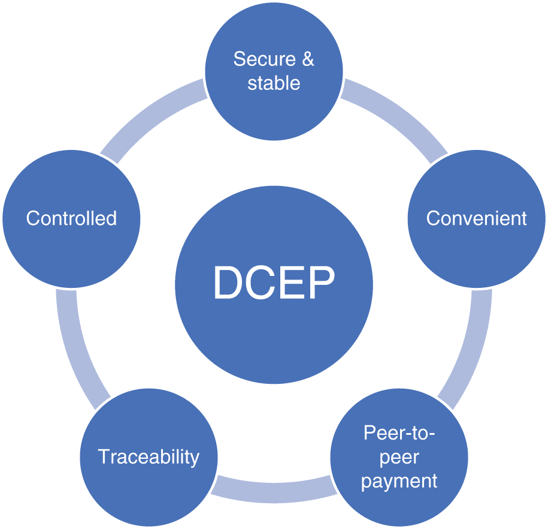

**图 1.1**](#c01.xhtml#R_c01-fig-0001) **如何设计 DCEP？** ¶ 数据来源：媒体报道，2020 年 4 月。

自 4 月推出以来，这种新型数字货币已在四个主要城市进行了试点：深圳、苏州、成都和旨在取代北京成为国家首都的`雄安新区`。（利用区块链技术在数据管理方面的优势，整个`雄安`市都具有区块链基因。**参见“区块链打造的副都”侧栏**。）

在试点区，`DCEP` 已正式纳入城市的货币体系，一些政府员工已从 2020 年 5 月开始以数字货币领取工资。人们可以在商业银行的手机 App 中创建 `DCEP` 钱包，并使用国家数字货币支付交通、教育、医疗和其他消费品和费用。例如，中国的 `Starbucks`、`McDonald's` 和 `Subway` 连锁店被列入央行测试 `DCEP` 的企业名单。7 月，中国网约车巨头`滴滴出行`与 `PBOC` 建立了战略合作伙伴关系，在其拥有超过 5 亿用户的交通平台上测试 `DCEP`。8 月，中国将 `DCEP` 试点扩大到北京和几个主要城市——离其正式发布更近了。

中国的 `DCEP` 因其未来可能挑战美元主导地位的潜力引发了全球性辩论。对某些人来说，`DCEP`——作为大国首个央行数字货币（`CBDC`）——可能为几十年来统治全球经济的美元结算系统提供一种功能性替代方案。例如，中国可以使用 `DCEP` 管理其“一带一路”（`BRI`）海外基础设施投资的资金和交易，扩展其货币影响力。

这种对国家级数字货币的推动并不意外。在 2019 年 10 月的一次演讲中，中国国家主席`习近平`宣布区块链是一项“重要突破”，将在下一轮技术创新和工业转型中发挥“重要作用”。习近平主席敦促中国应加速区块链的发展以“抓住机遇”，这一言论标志着首位主要世界领导人对这种备受炒作但尚未证实的分布式账本技术（`DLT`）发表了如此强有力的支持。（相比之下，西方大多数政府一直谨慎得多。）

习近平要求区块链成为国家创新的重点，并详细阐述了中国政府将支持区块链研究、开发和标准的方法。对于全球政策制定者来说，中国的区块链推动似乎服务于两个战略目标：结束美元霸权以及减少对美国基础技术的依赖。中国政府对区块链项目的支持使任何出现的倡议或标准处于领先地位，可能加速该技术的市场应用和使用。

需要明确的是，习近平的演讲和 `DCEP` 完全是关于区块链，而非对 `Bitcoin` 或其他加密货币的投票。区块链是分布式账本的一种，创建了一个每个参与者都可以共享和同步信息的在线数据库。数据维护在称为“区块”的链式记录中，不由任何权威拥有（因此产生了“去中心化”的概念）。这种去中心化的、基于密码学的网络机制实现了数据的不可篡改和安全传输。事实上，自从 `Bitcoin` 受到关注以来，中国企业家一直处于区块链浪潮的前沿。

该概念最早出现在 90 年代，但直到 2008 年才变为现实，当时 `Satoshi Nakamoto`（一个真实身份仍未知的代号）据报道推出了 `Bitcoin`——使用区块链实现并存储价值的数字货币。在 2015 年 `Ethereum` 平台发布之前，中国的创业生态系统已经在构建数字区块方面积累了巨大经验，这标志着体现“智能合约”的第二代区块链系统的里程碑。区块链领域通过 `Ethereum` 平台上分层智能合约的应用发生了彻底变革，创造了货币交易之外的应用。

在这一过程中，中国已成为全球一些规模最大的加密货币“矿场”的所在地——这些数据中心汇聚了高功率计算机，所谓的“矿工”（公司或热心个人）在区块链网络中与他人竞争，通过解决复杂的数学题来赚取新币。根据`CoinShare`在 2019 年 12 月的估计，全球约三分之二（65%）的比特币挖掘在中国进行：光四川省就产生了全球一半以上（54%）的算力（挖矿能力的参数）。此外，中国制造了世界上大部分的挖矿设备。如`Bitmain`、`Canaan`和`MicroBT`等中国公司是全球最大的比特币矿设备制造商之一。

此外，中国的加密货币交易所（比特币或其他代币）曾交易量曾领先世界。2017 年 9 月，中国当局中断了这波“币热”，实际上将中国境内所有的代币首次发行（`ICO`）活动定为“未经授权的非法公开集资”和“未经授权的证券销售”。中国政府还宣布境内所有加密货币交易所均为非法。因此，由于监管收紧，中国市场的加密货币交易及其他相关活动开始转向海外。

尽管中国对加密货币进行了打击，关闭了所有国内加密交易所并禁止了所有`ICOs`，但区块链技术本身被政府认为是一项革命性的发展。在喧嚣、炒作和投机冷却后，区块链技术进入了第三阶段，并自 2018 年起与实体经济融合（参见图 1.2）。真实公司进入该领域，专注于利用该技术解决真实的业务问题以创造坚实的价值。

对于企业而言，区块链有望广泛应用于商业世界，彻底改变数据管理和共享的方式。区块链可以为跨公司、行业和地理边界的数据同步（尤其是敏感信息）提供极佳解决方案。它可以构建一个信任网络，允许多方直接交换数据、信息和资产，例如制造业中的供应链金融（详见第 5 章中关于金融科技的讨论）。该技术被广泛应用于中国的多个行业：银行、金融服务、公共服务、医疗保健、物流和智能制造。如果区块链在某个地方成为主流，那一定在中国。

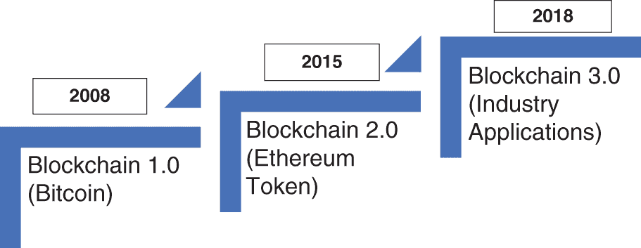

图 1.2 从 1.0 到 3.0 的区块链

毫无疑问，`DCEP`的推出和区块链应用的持续推广将进一步支持中国在全球技术领域的崛起。当区块链技术作为一项创新前沿被中国新接纳时，该国在推进`5G`网络、人工智能（`AI`）以及更多新兴技术方面也迈出了巨大步伐——这是一个从 2017 年一场棋局开始的数字热潮。

## AlphaGo，历史性的对决

2017 年 5 月，中国媒体关于一场围棋（`weiqi`）历史性对决的报道沸沸扬扬。这是一场三局制的比赛，一方是中国世界排名第一、世界冠军棋手`柯洁`，另一方是由美国互联网巨头 Google 旗下的`DeepMind Lab`设计的具备 AI 能力的电脑围棋程序`AlphaGo`。这场比赛成为中国 2017 年最受关注的新闻事件之一，在社交媒体上吸引了数亿次观看。

对许多人来说，乌镇之战充满了悬念和象征意义：人类对机器；传统对现代；直觉对算法；东方对西方。谁会胜出？（请参见“不可能的比赛”框。）

最后，流着眼泪的`柯洁`成为了这场历史性对决的标志性形象。在 0-3 负于`AlphaGo`后，`柯洁`摘下眼镜擦了擦眼睛，痛苦的声音充斥着他战斗并落败的房间。随后，`AlphaGo`在一次演示赛中击败了一个五人的中国顶尖职业棋手团队，在比赛中他们被允许在棋盘上布置变化并相互讨论，这表明即使是人类集体智慧也无法击败机器。

为了回应人类的困惑、恐惧和沮丧，比赛结束后，`DeepMind Lab`团队宣布`AlphaGo`将退出与人类选手的竞争。相反，团队将主要转向使用`AI`解决健康、能源等领域的问题。`AI`的压倒性优势不容置疑，至少在围棋这项游戏中是如此。

### 第一，AI 程序对围棋的理解比人类更深，甚至达到了完美的程度

`AlphaGo`不时会落下看似随机的棋子来布置胜局。这些惊喜在三场比赛中接连不断，`AI`程序对`柯洁`下出了“不寻常”且“有趣”的招法。在随后的采访中，`柯洁`发誓再也不让自己经历那种“可怕的经历”，因为“他已经受够了”。

“对于人类来说”，显露困惑的`柯洁`带着无奈的神情评论道，“我们对围棋的理解真的非常有限。”同时，他补充道，“对我来说`AlphaGo`是 100%的完美”，表现出无助和沮丧的情绪。即使对于世界第一，面对一个从不犯错且总是能比对手领先一步选择最优招法的敌人，也不再是一场竞争，而是折磨。

### 第二，AI 程序没有情感或感受，这似乎是相对于人类的另一个优势

在胶着的比赛中，这可能给了`AlphaGo`一种优势。在第二场比赛结束时，`柯洁`显得非常焦躁，抓头发、揉胸口，有时将头埋在桌子上。赛后他坦言，当他在比赛中认为自己可能获胜时，他由于变得过度紧张而无法保持冷静。“我很兴奋。我能感觉到心跳剧烈，”他说，“也许是因为我太兴奋了，导致下了一些愚蠢的棋。”

### 第三，AI 程序让围棋变得更有趣

前世界冠军`时一石`评论道，在人类棋手之间的比赛中，他从未见过像`AlphaGo`那样的招法，未来也不可能见到。接下来的问题是，人与人的比赛是否还有价值？如果`AI`程序之间的比赛变得越来越有趣且不可预测，职业围棋手的生存价值可能会受到质疑。

### 表 1.1 AlphaGo 的快速崛起（与退役）

| 时间 | 事件 |
| --- | --- |
| 2015 年 11 月 | DeepMind 与中国二段职业棋手、多届欧洲赛冠军范辉组织了一场秘密赛。AlphaGo 在非正式训练赛中 3-2 胜，在正式比赛中 5-0 胜。 |
| 2016 年 1 月 | DeepMind 在《自然》杂志上发表了一篇论文，描述了击败范辉的 AlphaGo 版本背后的 AI 系统。团队还宣布将与过去 10 年的顶级选手李世石进行五局制比赛。 |
| 2016 年 3 月 | 升级版的 AlphaGo 与韩国多次世界冠军、九段李世石进行了五局三制的比赛，并以 4-1 获胜。 |
| 2017 年 1 月 | 新的升级版 AlphaGo（被称为“Master”）在快棋赛中（每步棋最多 30 秒）对阵中、韩、日的大多数顶尖职业棋手 60-0 完胜。 |
| 2017 年 5 月 | AlphaGo 在三局制比赛中 3-0 击败了中国现任排名第一的九段柯柯。 |
| 2017 年 5 月 | DeepMind 团队宣布 AlphaGo 将“退役”，不再与人类选手进行竞技。 |

注：对于围棋（Go），中国、日本和韩国的职业段位都从 1 段开始一直到 9 段，顶尖选手为 9 段。

最令人震惊的是，AI 能力的飞跃发生在极短的时间内。`AlphaGo` 登上围棋世界的巅峰，这与机器下国际象棋的轨迹截然不同。由于围棋可能的场景极其巨大（数量级高达 $10$ 的 360 次方！），许多职业棋手估计，AI 至少还需要 10 年才能超越顶级人类棋手。然而，`AlphaGo` 的开发和完善花费了不到三年（参见表 1.1。“去年，我认为 `AlphaGo` 对阵韩国选手李世石的下棋方式还很像人类，但今天我觉得它下得像棋神一样，”柯洁在赛后评价道。

因此，`AlphaGo` 强大的计算能力剥夺了中国观众对 AI 最初的好奇心，让他们陷入了混乱。几乎一夜之间，中国的互联网商业界开始讨论移动互联网经济的“下半场”，这股潮流在 2013–2016 年间引发了电子商务和在线娱乐的爆发。自 2017 年以来，新的关键词变成了`数据`和`智能`，在部署 AI 方面缩小差距并快速超越硅谷的决心在全国盛行。

## AI 优先——移动互联网的“下半场”

世界顶级高手因输给 AI 而落泪的画面，激发了中国企业和公司对 AI 极大的决心感和紧迫感：要么适应快速演进的 AI、大数据分析和计算机芯片技术（为了 `AlphaGo`，Google 专门为机器学习设计了一种专用芯片）进行升级——要么被大时代淘汰。

因此，最大的互联网公司，如 `阿里巴巴`（类似于亚马逊的电商巨头）和 `腾讯`（以其十亿用户的社交消息服务 `微信` 而闻名）投身 AI 浪潮，将自己转型为“智能优先”的公司。在最近的“移动优先”时代（感觉像是很久以前了），他们的移动平台积累了海量的用户和交易数据；现在这些数据正被 AI 来解决实际的运营挑战并驱动新的业务模式。（因此，“下半场”的概念应运而生。）

`腾讯`——这家植根游戏和在线服务的中国价值最高的互联网公司——为了应对新趋势发生了巨大的变化。2018 年，`腾讯` 六年来首次宣布了一次重大重组，旨在从消费业务向同样服务于行业的业务转型。重组包括成立一个新的“云与智能产业群”，专注于 AI、云服务、大数据和安全；以及另一个新集团，将其社交媒体、移动互联网和在线媒体业务相结合，旨在加强内部协调，以与如 `今日头条`（拥有全球知名应用 `TikTok` 的短视频平台）等新兴竞争对手竞争。

此外，`腾讯`成立了一个新的技术委员会，以更好地协调公司不同部门的基础技术研究。`腾讯` 的重组标志着该公司了一次“重大的战略升级”，此时其游戏和在线服务的主营业务增长开始放缓。正如腾讯创始人兼主席马化腾公开表示的，“互联网的下一个时代是工业互联网”，`腾讯` 将对此做出，开发新的面向行业的服务，以“连接行业和消费者，构建一个更开放的生态系统”。

同时，精通技术且受过国际教育的创业者，凭借引人的技术轻松为初创公司吸引了风险投资，将小众 AI 应用带入更广泛的市场。例如，计算机视觉（CV）是计算机或机器人模仿人类感知和视觉感受周围世界方式的科学。特别是脸识别技术已广泛应用于公共安全领域，公安部门利用该技术识别嫌疑犯人，甚至是闯红灯者。

在计算机视觉领域，`旷视`、`商汤`、`之图科技`和`云舟`被统称为中国的“CV 四龙”。这四巨头的增长与中国全面拥抱脸识别技术并将其融入中国人的日常生活相契合。近年来，CV 公司也利用 AI 技术实现了从金融到娱乐、从交通到医疗等多种行业的转型。

`旷视` 专注于跨平台的人脸检测、识别和分析。其核心产品 `Face++` 是一个基于云的人脸识别技术平台，已广泛应用于各行业。通过与 `阿里巴巴`合作，`Face++` 已集成到 `支付宝`（广泛使用的移动支付平台）中，以支持刷脸登录和“微笑支付”（一种允许用户通过扫描脸部进行购买的支付方式）。`Face++` 还被集成到智慧城市应用中，用于优化交通流并“看到”需要警察或医疗关注的事件。与该 AI 产品的命名类似，`旷视`的技术也被流行的美颜照片编辑应用 `美图` 使用（`美图` 在中文里意思是“美化图片”，该应用提供了可以去除照片中皱纹、平滑毛孔和拉长腿部的功能）。

`商汤`专注于深度学习驱动的计算机视觉技术，例如可应用于支付和图像分析脸识别技术，用于银行卡验证和安全系统。`商汤`已为中国许多火车站和机场提供自动人脸扫描系统，准确率近乎完美。例如，它与中国最大的地铁运营者上海地铁交通集团签署了协议，利用 AI 监控地铁流量。估值达 75 亿美元（根据 2019 年底在包括软银行在内的投资者完成一轮融资后的媒体报道），`商汤` 是全球价值最高的 AI 初创公司。根据《南华早报》2019 年互联网报告，`商汤`和`旷视` 是东南亚、拉丁美洲和非洲政府及商业市场 AI 解决方案的主要出口。

`之图科技` 运营着基于云的视觉识别引擎，使计算机能够检测和识别脸和汽车。该系统主要用于监控和人群追踪，其客户包括中国海关和中国出入境检查总等政府部门。`云舟`也一直是中国银行业领先的 AI 技术供应商。

自然语言处理（NLP）技术是另一个例子。中国领先的语音识别软件公司 `讯飞` 改变了医生写病历的方式，从而为他们留了更多陪伴患者的时间。传统上，医生每天必须花费大量时间写病历。他们通常在手术间隙写病历，经常下班后留在办公室完成工作。`讯飞`的语音识别应用在医院进行了测试，医生可以以“相当高的准确率”语音记录诊断结果。

科讯飞飞开发了超过 10 款基于语音的移动产品，涵盖教育、通信、音乐和智能玩具。它赢得了一系列全球语音和人工智能竞赛的奖项，包括 `Blizzard Challenge`（据报道，这是语音合成领域最具权威的国际赛事）。因此，科讯飞飞被中国科学部（`MOST`）命名为国家语音识别人工智能领域的冠军，其他企业包括`阿里巴巴`集团（智慧城市倡议）、`百度`（自动驾驶）、`腾讯`（医疗诊断中的计算机视觉）和`商汤科技`（智能视觉）。

总体而言，已成立的互联网公司和科技初创企业正投入数十亿资金建立新的研究中心，聘用丰富的 AI 专家和年轻的数据科学家，甚至在美国硅谷设立实验室，致力于最先进的算法、智能机器人和自动驾驶汽车。`腾讯` 甚至创建了自己版本的围棋 AI 程序，名为 `Jueyi`（英文为 `FineArt`），但这是在 `AlphaGo` 退役之后才；因此，这两个 AI 程序没有机会在直接竞争中相遇。尽管如此，中美科技公司之间的 AI 竞赛正在进行。

## 5G iABCD 新基础设施

如果说中国企业对 AI 的拥抱是坚定且积极的，那么中国政府的决定性承诺则是非常非凡的，通过一系列政策和倡议宣布了追求 AI 和数字经济卓越的宏伟愿景（参见表 1.2）。这也许是一个时机的巧合，但在乌镇围棋赛后不久，中国中央政府于 2017 年 7 月发布了《新一代人工智能发展计划》。

### 表 1.2 与 AI 和智能网络相关的中国国家及地方政府主要战略和政策计划（2013–2020）

| 名称 | 发布机构 | 日期 | 重点 |
| --- | --- | --- | --- |
| 促进“`信息消费`”以扩大国内消费 | 国务院 | 2015 年 8 月 | 利用信息技术促进更多国内消费（如电子商务） |
| “`宽带中国`”战略 | 国务院 | 2015 年 8 月 | 显著提高国家信息基础设施水平，包括 4G 网络覆盖到所有城市 |
| “`互联网+`”行动计划 | 国务院 | 2015 年 5 月 | 为行业开发互联网接入，并利用 AI 创建新的服务和应用 |
| “`互联网+`和人工智能”三年行动计划 | 发发展部 | 2016 年 5 月 | 发展基础性 AI 生态系统，培养世界级 AI 企业 |
| 新一代`人工智能`发展计划 | 国务院 | 2017 年 7 月 | 制定了中国到 2030 年达到全球 AI 领先地位的路线图 |
| `新一代人工智能`发展三年规划（2018–2020 年） | 工信部 | 2017 年 12 月 | 根据国家 AI 战略制定了短期指南 |
| 高等教育机构`人工智能创新`行动计划 | 教育部 | 2018 年 4 月 | 到 2020 年建立至少 50 个 AI 学术和研究机构 |
| “`智能+`” | 国务院 | 2019 年 3 月 | 促进产业智能化 |
| `要素`市场化配置指导 | 国务院 | 2020 年 3 月 | 将数据定义为新型生产要素 |
| `新基础设施` | 国务院 | 2020 年 5 月 | 呼吁建设新基础设施 |

该计划要求：(a) AI 在三年内赶上西方国家，(b) 中国取得突破，(c) 到 2030 年 AI 成为世界无可争议的领导者。

为了解决 AI 人才短缺的问题，中国教育部于 2018 年 4 月发布了《高等教育机构人工智能创新行动计划》，该计划设想到 2020 年设立跨学科专业，如数学、统计学、物理学、生物学和社会学。

需要强调的是中国的数字经济起步要早得多。它始于 2013 年 8 月，当时中国国务院正式提倡“信息消费”。起初，该术语主要与`基于技术的消费`有关。不久后，概念被扩展为`基于质量的信息消费`，例如电影和在线视频，这导致了娱乐业的繁荣。

结果，中国的移动基础设施以惊人的速度发展（参见图 1.3）。根据中国互网络信息中心（`CNNIC`）2020 年 3 月的最新年度报告，中国拥有全球最大的用户群体，规模达 9.03 亿，占人口（14 亿）的率为 64.5%，比 2013 年的网民数量增加了 50%。使用手机上网的人数超过 99%（8.97 亿）。自 2013 年以来，中国一直是全球最大的电子商务市场。（关于移动经济的早期发展，请参考作者 2016 年的著作《中国移动经济——最大、最快信息消费热潮中的机遇》。）

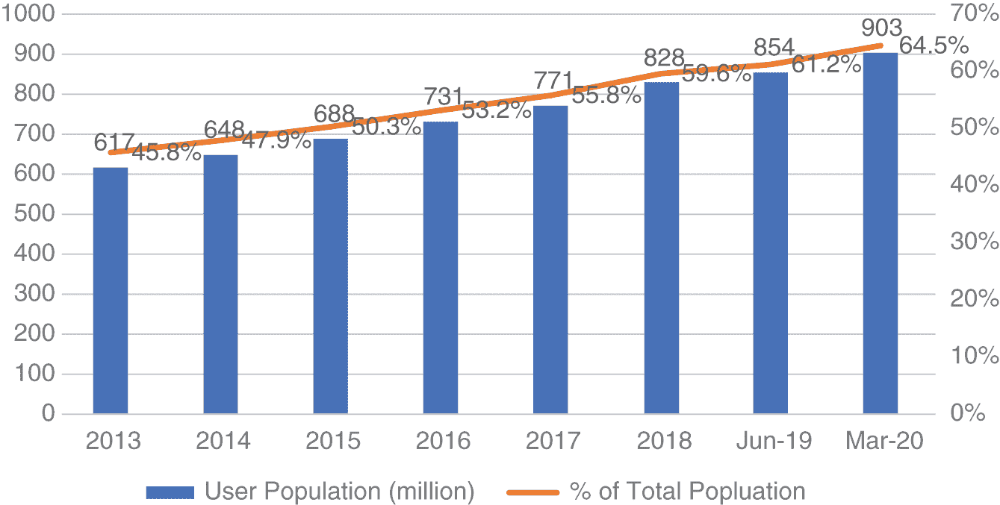

### 图 1.3 中国互联网人口随移动互联网跃增 ¶ 数据来源：CNNIC，2020 年 3 月。

近年来，新政策拥有更广泛的目标，即利用最新的数字和数据驱动技术（超越互联网连接）实现整个经济数字化（而不仅仅是互联网行业）。2017 年，`数字经济`作为中国未来的经济模式首次被写入政府工作报告（也被称为`数字中国`），并于 2019 年通过`智能+`的概念很快融入了 AI 元素。市场预计`智能+`对中国经济带来的变革将比早年的`互联网+`要深远得多，这也是为什么移动互联网经济的下一阶段被称为“下半场”的原因。

国务院 2019 年工作报告强调了“打造`工业互联网`平台，扩大‘互联网+’行动计划规模的重要性，以促进制造业的转型升级”。工业互联网概念涉及更广泛地采用由数字基础设施和数据分析驱动的先进消费和工业级应用，这符合中国提升产业价值链地位、并在新兴技术领域更具全球竞争力的宏伟雄心，这些技术被世界经济论坛（WEF）称为“第四次工业革命”。

此外，2020 年，中国中央政府发布了一项经济政策文件，将“数据”纳入“生产要素”，与土地、劳动力、资本和技术等传统要素并列，政府将采取关键措施加速`数据市场`的培养。在这一框架下，个人数据管理与保护、统一行业数据标准、公私有数据共享等数字经济的关键问题正加速发展。（数据法的相关进展将在第 8 章中讨论。）

最终，所有这些概念在李强总理于 2020 年 5 月发布的政府工作报告中被总结为“新基础设施”倡议。该计划旨在大幅增强互联网基础设施，以刺激数字消费，并鼓励在线办公、远程学习、远程医疗、车载网络和智慧城市应用的发展（参见图 1.4）。李总理表示：“我们将加强新型基础设施建设。我们将发展下一代信息网络，扩大 5G 应用。我们将建设更多充电设施，促进新能源汽车的广泛使用。我们将刺激新的消费需求，推动产业升级。”

### 图 1.4 从“信息消费”到“数字经济”

这一新基础设施的推动来自中央政府、地方省份以及工信部（工业和信息化部）等相关部门。据海通证券估计，中国预计未来五年内，新基础设施建设及相关投资将将超过 2.7 万亿人民币（接近 4 万亿美元）。与道路、铁路和桥梁等传统基础设施（这些是 2008-2009 年全球金融危机期间中国投资刺激的主要形式）相比，“新”代表的是基于先进数字技术构建的基础设施——即数据驱动的基础设施。

新基础设施的核心是用于数据传输的下一代（5G）无线网络。5G 技术最可见的优势是其数据传输速度，预计比 4G 技术强 1000 倍。高速且稳定的 5G 服务预计将涵盖远超基础互联网的无线应用，包括智能汽车和先进制造业。最终，5G 是为了“物联网”（IoT）服务的，这是一个松散的术语，用于描述通过云技术将移动互联网、智能设备、家用电器和任何物理对象连接网络。例如，5G 技术更快速的数据传输预计为自动驾驶汽车提供持续可靠的实时路数据流，使其能够有效安全地运行。

基于超快的蜂窝 5G 网络，人工智能、区块链、云计算和大数据分析的先进应用有望取得突破性进展。它们共同构成了中国数字经济的技术基础设施，可以总结为`5G iABCD`（参见图 1.5）。经济各部门的公司都将为企业目的采用这套“全套”信息技术。

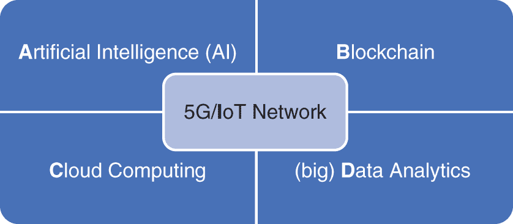

### 图 1.5 新基础设施 – 5G iABCD

与人工智能和区块链一样，中国的大数据和云计算市场也以极速增长。近年来，数据中心——容纳大容量服务器和数据存储系统的安全设施——正以惊人的速度建设，以跟上数据服务的爆发性需求。中国政府的最新举措是在全国范围内建设“工业大数据”中心，使海量的“工业大数据”（主要是制造和生产数据）能够被利用以提升传统行业的能力。

这些数据设施被企业用于远程存储大量数据、管理其业务应用并托管云计算业务。得益于阿里巴巴和腾讯等互联网公司的云业务，中国已成为全球数据密集型计算的领导者之一。例如，阿里云的成立是为了为阿里巴巴的业务网络提供云服务，并日益为外部企业客户服务。正如接下来的部分所示，数字平台不仅帮助了工业企业的数字化转型，还为科技初创企业的创新提供了重要的基础设施。简而言之，从移动互联网浪潮中兴起的中国互联网公司正在成为中国数字经济的技术基础设施。

## 云端数字化转型

关于中国的新型基础设施和企业的数字化转型，阿里巴巴集团及其阿里云是一个完美的例子。在移动革命期间，所有中国公司开始将其业务数据和内部系统数字化，并越来越多地将运营和数据迁移到云基础设施上（直到最近，大多数公司仍然依赖其自有数据中心的本地计算）。尽管阿里巴巴主要以其电子商务帝国和“双 11”闻名，但它已成为全球首个在自己的公共平台上运行所有核心业务系统的公司。此外，其快速增长的云计算业务进一步支持了中国企业的云迁移之旅。

作为背景，云技术（也称为“云计算”）意味着服务器、数据存储、数据库、网络、软件和分析托管在互联网上，并存储在大型私有数据中心中。云提供商使终端用户能够按需付费“租用”并远程访问 IT 资源，这为本地托管和运行 IT 资源提供了一种高效的替代方案。企业订阅云服务并像从电网购买电力一样支付月费或年费。费用取决于所需的数据量和用户数量——这使得公司更容易调整其业务规模。总而言，与传统 IT 基础设施相比，云计算提供了更好的系统扩展性并节省了成本。

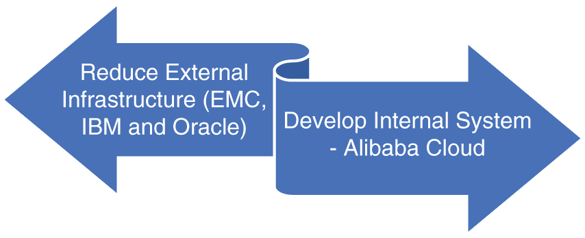

### 图 1.6 阿里巴巴的技术基础设施内部化

随着阿里巴巴的电子商务业务近年来经历了爆炸式增长，其内部系统的升级变得迫在眉睫。阿里巴巴并没有继续从 `Oracle`、`IBM` 和 `EMC` 采购昂贵的设备和服务，而是开始用内部开发的系统替换现有的 IT 基础设施并向云迁移。因此，阿里云运而生，为阿里巴巴的业务网络提供云服务。如今，阿里云也是阿里巴巴集团面向外部企业客户的云计算业务，提供全方位的服务，如数据库、存储、网络虚拟化服务、大数据分析、弹性计算、大规模计算、机器学习和物联网（IoT）服务。

阿里云在向国内市场普及云计算优势方面发挥了重要作用，并通过开发能够实现各行业企业数字化转型的解决方案，保持了其领先地位。在 2019 年第四季度，它达到了两个重要的里程碑。首先，云计算业务首次在单季度创造了超过 100 亿元人民币营收（约 15 亿美元）。其次，在 2019 年“双 11”全球购物欢节开始前（详情参阅第 2 章），阿里云实现了阿里巴巴电子商务业务核心系统向公云的迁移。这次内部迁移是一个重大的里程碑，不仅为阿里巴巴创造了更高的运营效率，还鼓励了更多公司采用其公云基础设施。

据阿里巴巴介绍，在完全迁移到公云后，核心电子商务平台的性能、可靠性和敏捷性得到了大幅提升。（一位阿里巴巴高管表示：“阿里巴巴像一架高速喷气式飞机，能够在飞行过程中升级发动机”）。公司的下一步与客户分享阿里巴巴的经验。因此，中国的云计算投资和采用正在快速增长。根据 Canalys2020 年 3 月的统计，阿里巴巴集团是中国最大的公云服务提供商，占据了近一半的市场份额。（参见图 1.7）。腾讯和百度这两家大型互联网公司也是规模巨大的云服务提供商。）根据 Gartner2020 年 4 月的报告，阿里巴巴集团是 2019 年按营收计算的世界第三大、亚洲最大的基础设施即服务（IaaS）提供商。

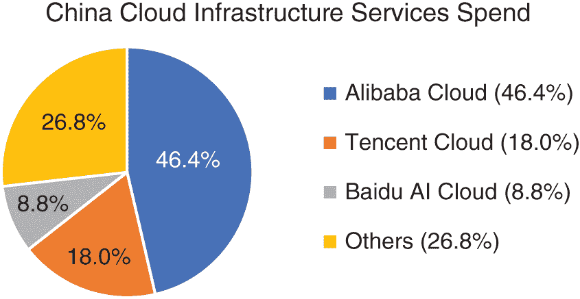

图 1.7 **阿里云领先中国市场** ¶ 数据来源：Canalys，2020 年 3 月。

正如阿里云案例所示，中国互联网公司已转型转型为科技公司，随后他们帮助经济各部门的公司进行数字化转型。在几乎每一个行业领域，中国公司都在投入大量研发最新的数字技术。共识是，数字化革命并不仅仅是通移动平台推进电子商务。更深层次的价值创造在于发现增量消费需求和新业务模式，即传统行业使用一套新的数字工具来运营业务的关键环节。

换句话说，数字化转型更多是关于“数字思维”而非“互联网叠加”。公司将变得更“聪明”。

## 传统行业的数字化转型

数字化转型更多是关于“数字思维”而非“互联网叠加”。公司将变得更“聪明”。

第一阶段涉及建立在线渠道以触达客户和保险代理人，并自动化后端流程，包括核保和理赔处理。第二阶段涉及创建数字服务以帮助客户完成相关的线下活动，例如通过移动应用程序预约挂号。通过前两个步骤，公司增加了客户互动的次数，并加强了与客户的联系。第三阶段涉及整合客户的在线和线下数据，根据对客户深入的理解提供更具个性化的解决方案。

对于成功实施数字化的发行人来说，回报是丰厚的。他们不仅可以与客户直接互动，在产品和服务上提供无缝的体验，还能获得全面的客户画像信息，从而在定制化的长期竞争中脱颖而出。根据腾讯 2018 年的统计，中国在线保险购买在过去五年中增长了 18 倍，总人数达到 2.2 亿投保人。

第四阶段也是最新阶段最令人兴奋，涉及利用智能技术和数据分析来革新核心保险业务。例如，AI 已成功应用于车险。阿里巴巴的金融分支蚂蚁集团开发了“定损宝”（Damage Assessment Tool），旨在标准化定损评估并使其更加客观，减少现场理赔员可能受相关驾驶员的影响。这一数字工具已被大型保险公司采用，包括中国太平、中国人寿、阳光保险集团和安联太平洋。

“定损宝”可以远程收集车辆外部损坏的照片，使用 AI 驱动的深度学习图像识别技术进行分析，重建事故现场并评估损坏。其优势之一是使定损评估更加客观，降低了现场理赔人员受事故驾驶员影响的风险；因此，定损的准确性更高。另一个优势是，通过机器学习，它可以在几秒钟内处理理赔，远快于人类理赔员单独的处理速度。

在 2017 年 6 月`DingSunBao`首次发布时，蚂蚁集团在“六位资深人类理赔员”与其 AI 程序之间进行了一场挑战。每个团队评估了 12 个案例，在此期间，`DingSunBao`花费 6 秒完成损坏评估并设定理赔金额，而人类理赔员则需要 6 分钟 48 秒才能得出结论。双方均判断 12 个案例中的一个需要进一步调查。2018 年 5 月，蚂蚁集团推出了`DingSunBao`App 的 2.0 版本，该版本升级为基于视频的 AI 应用。

通过升级版本，车主可以使用智能手机拍摄车辆视频片段进行提交。车辆损坏信息会自动显示，包括何处以及如何修理车辆，以及车主可以从保险公司索赔的金额，节省了提交理赔的时间，并对可能的覆盖范围提供了透明度。根据阿里巴巴，这个新版本的“秘密配方”包含了 46 项专利技术，例如同步定位与地图构建（SLAM）、移动深度学习模型、视频流损坏检测、增强现实的结果显示等。随着蚂蚁集团现在将区块链技术作为保险理赔处理的新基础设施，更多的行业转型正在到来。

2020 年，新冠肺炎的爆发为几乎每个行业都上了一堂数字转型的课。从技术角度来看，疫情推动了无人机和机器人等许多新技术的发展，因为当局寻求更好地检测和应对疾病。自动机器人已取代了隔离病房的人类清洁员。在农村地区，当地当局正在使用配备扬声器的无人机来提醒在开放区域发现未佩戴口罩的市民。特别是，它加速了中国企业向云端的转型，因为企业正在尝试云计划以促进远程办公和远程互动。对于管理互联网基础设施的公司来说，随时调整计算需求是昂贵且复杂的。云计算让这一切变得更容易。

另一方面，许多由疫情驱动的新业务模式将继续留在日常中。例如，直播现在无论是否有“居家”订单，都是一个重要的购物渠道，数字平台正在利用新的数字技术（如 5G 和 AR——增强现实驱动的功能）为直播主播提供增强服务。在强烈的紧迫感下，所有公司都在于学习如何将新的 5G iABCD 数字技术整合到其业务中，从非传统的角度释放价值。中国的数字化转型正在加速。

## BaaS 创业企业创新生态系统

在政府的支持下，一个由企业家和初创企业组成的动态生态系统正在有机地建立并迅速扩张（参见图 1.9）。既有互联网公司网络及其资深创业者、源源不断且充满渴望的人才、丰富的天使投资人和风险资本，以及复杂的制造系统，共同使中国成为世界上最有趣的创新中心之一。

这一生态系统的核心是由来自国内外成熟科技公司的“毕业中国企业家”组成的网络。围绕他们对初创企业的热情，似乎有源源尽的风险资本、年轻人才和政府支持。这种发展类似于过去几十年硅谷生态系统中看到的倍增效应，来自 Intel、Netscape、Google 和 PayPal 的几代创新者创造了一又一波初创企业浪潮。上一代中国互联网公司大多是西方网站的模仿版，而新一代初创企业正在创造一波瞩目的创新浪潮，挑战了长期以来对“中国制造”是模仿者的认知。

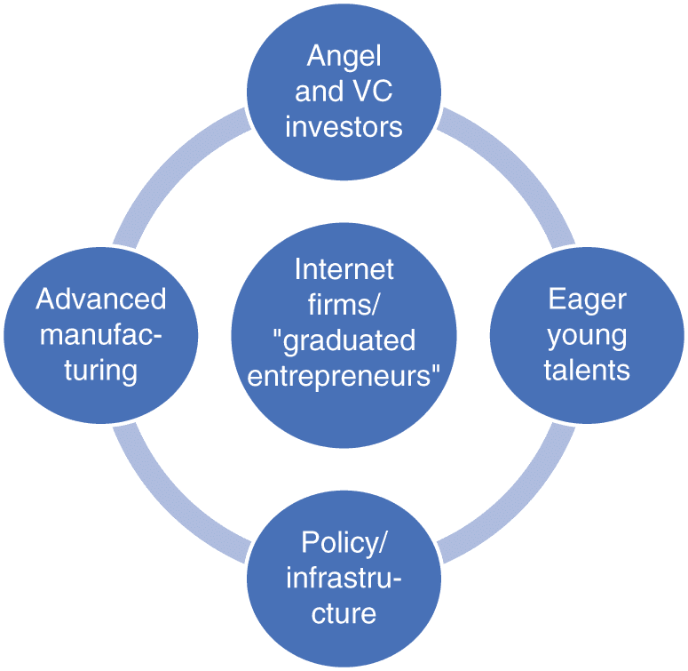

图 1.9 **中国的创新生态系统**

在 5G iABCD（参见图 1.5）中，区块链是初创场景的最新成员。得益于中国中央政府的新支持，区块链行业正在经历繁荣。根据《南华早报》（SCMP）研究发布的《2020 年中国互联网报告》，约 80%被认可的顶级科技公司运行过区块链项目或投资了区块链技术。区块链初创企业每天涌现，甚至新冠病毒也没能阻挡它们的脚步。

例如，由于食品丑闻——从生长在镉污染土壤中的大米到掺入三胺的婴儿配方——在中国屡可见，区块链被用于支持供应链的透明度和可审计性，以让对食品安全的消费者感到放心。2019 年 6 月，沃尔玛中国与咨询公司普华道（PwC）以及区块链公司`VeChain`建立合作伙伴关系，创建沃尔玛中国区块链溯源平台。

`VeChain`是一家总部位于上海的区块链提供商，专注于治理和业务生态系统。他们创建了一个名为 `VeChainThor` 的代币公链。这些公司合作提供整个供应链的实时追溯，而由于数据共享系统的碎片化（通常是基于纸质且容易出错），这在传统上是一项挑战。构建在 `VeChainThor` 区块链上的溯平台使购物者能够将商品追溯到源头、检验和出货环节。

在新冠疫情期间，`Hyperchain`等初创公司启动了一个基于区块链的平台以提高捐赠效率。2020 年 2 月，这家区块链初创公司与中国`雄安数字城建设集团`（顾名思义，它是运营雄安区块链城市的公司）合作，创建了一个名为“善踪”（`Shanzong`）的捐赠追踪平台，英文意思是“trace of good deeds”。根据 `Hyperchain`的声明，在红十字会等某些传统慈善机构因向需者分配资源不当而受到批评时，“善踪”可以追踪捐赠的物品类型（从金钱、口罩到医疗物资）、它们是如何与需求地区匹配的，以及何时交付的。

事实上，根据中国知识产权新闻网站 IPRDaily 发布的 2019 年全球区块链发明专利排名报告显示，中国占据了主导地位。看来中国在区块链技术的利用和发展方面主要驱动着世界潮流。根据报告，中国占据了前三名的全部、前十名中的七位以及前三十名的 19 位，中国公司占了全球区块链专利申请总数的约 70%（见图 1.10）。阿里巴巴及其金融分支`蚂蚁集团`以巨大优势申请了全球范围内与区块链相关的专利。

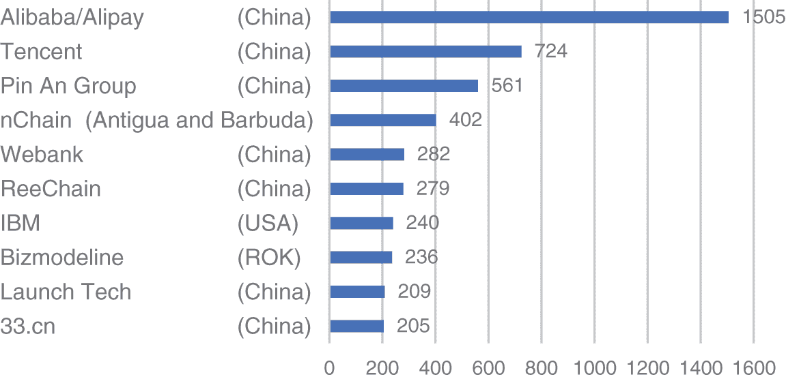

Figure 1.10 2019 年全球区块链专利申请排名

`蚂蚁集团`于 2020 年 8 月宣布首次公募股（IPO），目标估值超过 2000 亿美元，它是世界上全球估值最高的金融科技（或称 fintech）公司——也是全球最有价值的私人科技初创公司。其`支付宝`是中国最大的移动支付网络，拥有 9 亿用户，它还运营着该国最大的投资产品平台之一，向个人和小型企业提供贷款，并运行着一个基于客户数据分析的信用评分系统。（参见第 5 章中的详细案例研究。该公司在 2020 年 6 月之前被称为`蚂蚁金服`，随后其官方中文名称改为“蚂蚁科技”。一位发言人表示，公司希望在英语中被称为“Ant Group Co.”，以更好地反映其作为企业“一个创新型全球技术提供商”的角色。）

当然，大多数区块链协议都是开源的。因此，区块链专利申请的排名并不等同于区块链技术的创新能力。尽管如此，区块链专利数量的增加表明中国和阿里巴巴这样的业务组织日益增长的兴趣，阿里巴巴自 2017 年以来一直居前列。此外，阿里巴巴、`腾讯`（排名第二）和其他公司也为市场提供区块链平台基础设施（BaaS – 区块服务）。他们的`BaaS` 服务在区块链架构与企业级区块链项目之间提供了重要纽带。

这些`BaaS` 服务让区块链创业者能够专注于构建新应用，导致了中国一波年轻区块链公司的浪潮。例如，`腾讯`正与众筹健康保险公司`水滴滴`合作，开发一种利用区块链技术的医疗保险解决方案。`腾讯`计划将该解决方案整合到其`微信`社交软件中。

# 区块链与全球经济

并不意外的是，DSR 的最新增项再次是区块链。2020 年 4 月，中国启动了区块链服务网络（`BSN`），这是习近平主席在 2019 年 11 月底宣布的中国国家区块链战略的关键部分。`BSN` 是一项雄心勃勃的努力，旨在纳入尽可能多的框架，并使它们在 `BSN` 平台上通过一个统一的标准进行访问。因此，它是中国最大的区块链生态系统，在 DSR 的语境下，它正在迅速向海外扩张网络。

根据其官方公告，`BSN` 促进了联盟链应用的低成本开发、部署和维护。就像在互联网上构建一个简单的网站一样，开发者可以方便且极廉地部署和运行区块链应用。到目前为止，还没有区块链项目在全球范围内找到广泛的商业用途。通过显著降低区块链应用开发者的准入门槛，`BSN` 可能会推动各国传统业务的重大创新，这对从金融、支付到商业的跨境应用产生深远影响。

随着中国数字经济在全球范围内的影响日益增强，全球经济看到亚洲的中国和西方的美国形成了世界两个领先的创新中心。根据联合国 2019 年数字经济报告，中美两国公司占据了前 70 个数字业务平台总价值的 90%。这两个创新中心各有侧秋，但也保持着高度的联系——美国是原始技术的孵化器，而中国是商业化的最佳市场。得益于其最大的用户群体，中国在增量创新方面表现出色，但在变革性的基于科学的创新方面仍然落后于美国。

## 跨境协同

直到最近，这两个市场一直享受思想、资本和人才的流动。硅谷的运作依赖三个关键要素：代码、人脉和资金，而中国的连接（在近期中美科技贸易紧张关系之前）带来了丰富的供应。中国工程师产生了大量的第一者（代码），而中国风险投资带来了第二者和第三者的注入（参见图 1.11）。（作为一个跨境投资者，作者曾关注从商业角度看与中国市场具有强大潜在协同效应的美国投资，以及寻求在海外市场全球化的中国投资组合公司。）这种双向桥梁创造了协同效应，并加速了太平洋两岸初创企业的启动、创新和规模化。

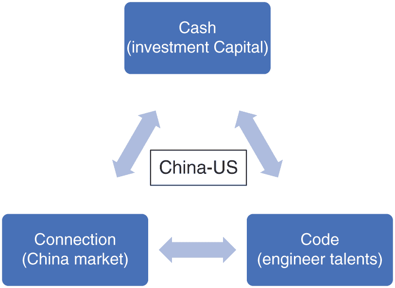

Figure 1.11 3C 跨太平洋协同（过去）

## 投资转型与竞争

然而，在特朗普政府于 2018 年 8 月加强对涉及美国关键技术国家安全问题的交易审查后，中国对美国科技公司的投资迅速缓慢。一个关键驱动因素是，由于政府的重点政策、大量投资以及无比拟的用户数据池，原始的 5G iABCD 创新正在中国取得，并在越来越多的领域与美国进行面对竞争。另一个重要因素是，对于每个国家来说，用于训练 AI 模型的数据都进行本地管理和严格保护，因为技术创新现在具有国家安全和地缘政治意义。

这种“脱钩”的典型象征，目前没有什么比一根可能连接太平洋两岸的断裂数据电缆更直观和具有戏剧性了。太平洋光电缆网络（PLCN）是一项在 2018 年前启动的高容量光纤电缆项目，由 Google、Facebook 和一家名为小米博士电信媒体集团的中国电信公司合资建立，该集团是中国第四大的电信公司（参见图 1.12）。该海电缆全长约 8000 英里（13000 公里），旨在成为美国与香港/中国之间的一条高速跨太平洋数据传输通道。2020 年，美国政府正式否决了与香港的连接，Google 和 Facebook（小米博士已退出）接受了现实，即仅运营美国公司拥有的两对光纤：Google 连接到台湾的链路和 Facebook 连接到菲律宾的链路。

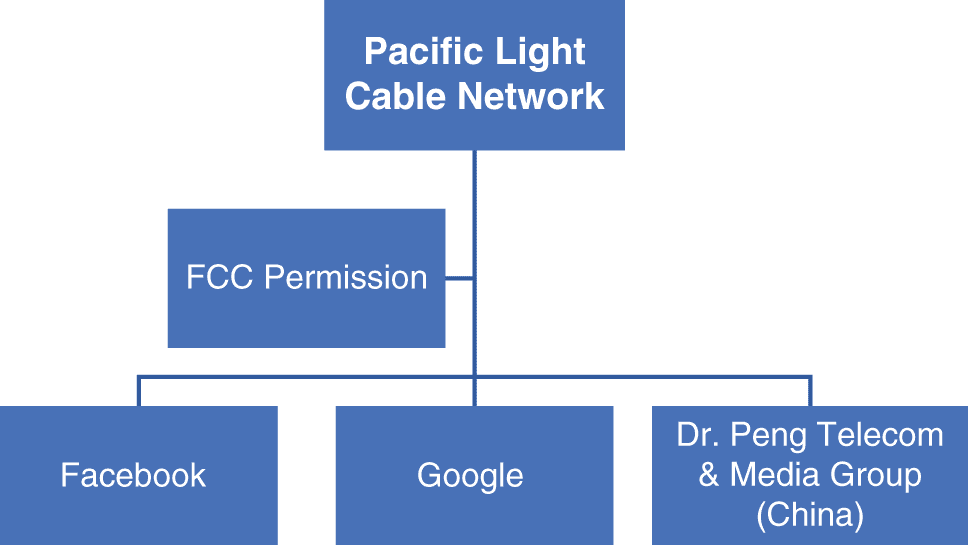

图 1.12 **太平洋光电缆网络**

这是即将且快速发生的“碎片化”（splinternet）——即东西科技世界分离的一个生动案例。在过去的十年里，Google 和 Facebook 等公司对类似的电缆投入了巨资，以处理美国与亚洲之间日益增长的网络流量。现在，国家安全因素正在改变跨太平洋互联网连接的结构。由于海底电缆构成了互联网的骨干，承载着全球 99% 的数据流量，美国、中国乃至全球之间的互联网连接规则正在被危险地重写。

总而言之，中美科技脱钩是真实的且正在加速的。因此，数字经济正处于一场至关重要的冲突和危机之中：全球科技界以及至少世界经济的一部分现在已分裂为两个（考虑到欧洲、日本和其他地区，可能更多）势力范围，而科技创业者们正在推动技术奇点、超连接社会和万物联网的愿景。这些科技公司现在才意识到，他们未来的平台将变得不再全球化。

因此，对于美国和中国这两个科技超级大国来说，达成新的平衡与世界其他地区共同领导未来的 5G iABCD 创新至关重要。否则，全球经济认为理所当然的资本、人才和数据的跨境流动将面临风险。这就是为什么“数字丝绸之路”——至少其全球连接的概念——是启动全球数字经济对话如此重要的概念。正如 G20 领导人在中国杭州举行的 2016 年 G20 峰会上共同宣布的：数字经济革命将共同构建一个创新、充满活力、互联且包容性的世界经济。

# 第 2 章：全球最大的移动经济

- 小米手机与 AIoT 的十年之路
- “移动优先”与“仅限移动”
- 娱乐化购物：数字中产阶级
- 双十一：硬科技驱动网购购物节
- BAT、TMD 与新 ATM

## 小米手机与 AIoT 的十年之路

2020 年标志着中国手机品牌小米成立 10 周年。小米的名字在中文里意为“小米”，或字面意思是“小米”，它在不到五年的时间内（2014 年）成为了中国领先的智能手机品牌。在 2014 年的融资轮后，公司估值 450 亿美元，成为当时估值最高的初创公司，甚至超过了同月早些时候美国共享车服务公司 Uber Technologies Inc. 的 410 亿美元估值。在短短十年，小米已从诞生成长为世界第四大手机制造商。

自 21 世纪初以来，大部分中国人口已停止使用座电话并转而使用手机。座电话的使用程度不如西方经济体那样普及，这意味着对于许多人来说，这种转型完全没有固定电话，而是直接到了手机。对于中国的许多人，尤其是农村地区，他们的第一次互联网体验通常是手机而非个人电脑（PC）——从他们开始使用智能手机的那一刻。

2010 年，凭借约 4000 万的初始资金，创始人雷军与前微软和谷歌工程师林斌以及其他五位工程师在北京郊区的一个小办公室里创立了小米。这家公司最初是一家精益的初创公司，旨在通过互联网廉价销售手机。公司还为手机开发了一个名为 `MIUI` 的软件平台，该平台是根据谷歌的 `Android` 系统适配而来的。2011 年 8 月，小米推出了首款智能手机 `Mi-1`，这让小米在硬件竞争中明显处于落后（作为参考，当时苹果正在发布 iPhone 4S）。

小米专注于苹果和三星等高端品牌忽视的利基市场，其低价、高性能的设备很好地迎合了普通人群拥有一部手机并接入互联网的热情。小米慷慨地提供了顶级材质、屏幕分辨率、芯片、摄像头和其他功能，使其低价格与品质品牌联系在一起，而非“廉价”产品。有时，小米被称为“中国的苹果”，因为它在中国消费者中引发了兴奋。其相似的设计几乎使其成为苹果的替代品。

审视小米手机整体设计可以发现其形状和风格与苹果有相似之处。有时，公司因借鉴苹果和其他对手（如三星）的设计受到批评。一些批评认为，小米利用了苹果在中国的高端品牌形象：许多中国崇崇苹果品牌，而小米提供了价格低得多的类似产品，可以被视为“平价 iPhone”。

表 2.1 **2019 年全球前五手机公司**

数据来源：`IDC`。

| 公司 | 2019 年市场份额 | 2018 年市场份额 | 同比增长（减少） |
| :--- | :--- | :--- | :--- |
| 三星 | 21.6% | 20.8% | 1.2% |
| 华为 | 17.6% | 14.7% | 16.8% |
| 苹果 | 13.9% | 14.9% | -8.5% |
| 小米 | 9.2% | 8.7% | 5.5% |
| OPPO | 8.3% | 8.1% | 0.9% |

追模仿苹果的痕迹也出现在小米的管理团队中，他们并不掩饰对苹果及其已故创始人史蒂夫·乔布斯的效仿。当小米发布新产品时，创始人雷军通常穿着黑色 T 恤和运动鞋上台，与乔布的标志性着装没有太大区别。在某些小米活动中，创始人雷军会在演示结束时使用“还有……”这一句，这是乔布在苹果产品发布会上用于宣布惊喜创新著名台词。

十年后，小米已成为苹果的强力竞争对手。在 IDC 编写的全球前五智能手机公司列表中（参阅 表 2.1），三星在 2019 年位居第一，苹果和小米分别位列第三和第四，苹果的全球市场份额同比下降，而小米的份额则在不断增长。（值得注意的是，另外两个中国品牌华为和 Oppo 也占据了前五的剩余席位。与小米一起，这些中国手机帮助全球最大的移动互联网用户群体——约 9 亿人——在中国迅速崛起，并在全球范围内与三星和苹果竞争。）

但小米从未将自己定位为一家智能手机制造商。相反，从一开始，这家公司就坚认为自己是一家互联网公司；或者说，如果非要把这家公司与智能手机联系起来，它也是拥有互联网 DNA 的智能手机公司。在接下来的 10 年里，小米一直关注“升级、扩张和全球化”：

### 第一，升级

在廉价智能手机市场（300 美元以下的中端市场），小米正与更多国内品牌进行激烈的竞争。由于小米的品牌身份曾与高品质和低价格相关，它面临的风险是，某些小米用户可能将小米手机作为买得起奢侈品牌智能手机之前的过渡产品。该公司既需要在低利润率下寻求高销量（如联想主导的 PC 市场），要么需要将自己转型为具有独特特征的高品牌（正如华为在其 Mate 系列上成功做的那样）。2020 年，随着小米 10 Pro 的发布，小米凭借强大的硬件和溢价进入了旗舰市场。

### 第二，扩张

2019 年初，小米首次提出了“全生态 AIoT”计划，计划在未来五年内为 AIoT 分配 100 亿人民币（约 15 亿美元）的投资。（科技行业在创造惊人注目的缩写词方面与华尔街一样出色：“AIoT”是“AI”（人工智能）和“IoT”（物联网）的结合。）本质上，小米旨在开发一系列在小米“生态系统”下无缝跨联的智能家居设备，并以小米手机作为遥控器。该公司已成为相机、充电器等消费电子产品以及空气净化器、台灯等家电产品的品牌。

因此，小米将其未来方向描述为“智能手机 + AIoT”，这是一个双引擎战略（参阅 图 2.1）。由于 5G 连接将提供更快的智能手机网络，小米在其 2019 年度报告中表示，“5G+AIoT”将是一个革命性的组合，将从根本上改变“小米的所有产品、平台和用户场景”，催化“我们在下一代互联网时代增长的下一个阶段”。从 2020 年起，小米将在五年内对“5G+AIoT”的投资增加到至少 500 亿人民币（约 70 亿美元），以确保在“新智能生活时代”的绝对主导地位。

**图 2.1** **小米的双引擎**

### 第三，全球化

小米在国内外的都是主要参与者，并且保持着增长。中国智能手机品牌正在超越饱和的国内市场，在全球舞台上竞争以维持增长；对于小米来说，海外市场是其重点。在未来几年里，小米将努力提高其已建立稳固足点的市场的份额，包括印度、欧洲、东南亚和拉丁美洲。

特别是印度是小米的关键市场。根据 IDC（国际数据公司）的数据，2019 年第四季度，小米出货量连续第十个季度成为印度最大的智能手机品牌，占据了约 28.7% 的市场份额。截至 2019 年第四季度，其智能电视出货量也连续七个季度位居印度第一。（2020 年 7 月，由于中两国在喜马拉雅山脉争议边界地区的紧张局势加剧，导致印度小企业抵制“中国制造”。小米是否能长期维持其在印度市场的领先地位仍待观察。）

总之，小米的十年是中国科技公司的完美范例，这些公司通过在智能手机和第四代（4G）技术开发过程中赶上全球竞争对手，证明了它们的实力。他们现在正在加入一场异常激烈的竞争——在他们自己和外国参与者之间——以成为向全球客户提供第五代（5G）无线网络和 iABCD 产品的领先公司。他们正积极迈向终极多设备和超连接世界的未来；因此，小米也是中国公司从早期的互联网关注扩展到更广泛的科技驱动数字经济的良好范例。

在本书的其余部分讨论 5G iABCD 数字经济之前，本章概述了过去几年中国移动互联网革命的状况，以及移动经济如何为即将到来的工业革命奠定基础。（参阅作者早期的著作《中国移动经济——最大最快信息消费潮中的机遇》（*China's Mobile Economy – Opportunities in the Largest and Fastest Information Consumption Boom*。）

## “移动优先”与“移动唯一”

无疑，过去几年中国移动设备的普及标志着中国互联网历史的一个重要转折点。廉价手机的传播遍遍了这个广阔国家的每个角落，对农村地区的影响尤为深远。一方面，数亿村民连接到了零售网站并成为在线购物者；另一方面，随着对安全农产品的需求增长，中国村民也迅速拥抱电子商务。

除了无与伦比的用户口规模外，中国市场另一个独特特征是它是全球最大的“移动优先”和“移动唯一”市场。对于中国的许多人，尤其是农村地区的人，消费者的首次互联网体验通常是手机而非 PC——从他们开始使用智能手机那一刻起。因此，在消费者应用方面，中国的演变方式与西方世界完全不同，更加积极地转向移动。换说说，中国人口跨越到了移动优先移动唯一的时代。

例如，中国缺乏健全的信用卡体系，这意味着移动支付是许多用户首次且唯一的非现金支付体验。中国客户从一开始就偏好大屏幕，这种由移动优先驱动的趋势使其成为各种交易的绝佳平台。在中国，移动支付的渗透率已经超过了美国。正如本书中的许多案例所示，移动支付系统一直是许多金融科技创新和新商业模式的基础。

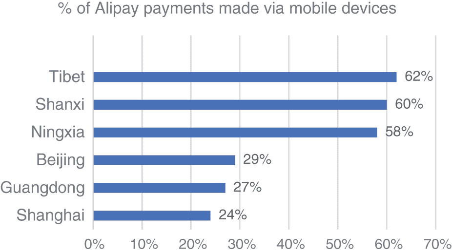

**图 2.2** **西藏和偏远省份领先移动支付** ¶ 数据来源：支付宝，2014 年。

在随后的几年里，西藏一直位居排名首位。2016 年，西藏成为第一个移动支付率达到 90%的省份。其原因非常容易理解：这些地区缺乏实体零售基础设施和银行系统，因此那里的人们在购买产品时，更频繁地转向在线购物和移动支付。

此外，移动支付基础设施创造了新的行业。例如，互联网和移动设备改变了人们阅读小说的方式。中国的网络小说是分章节发布的，通常每天更新几千字。人们只要有几分钟空闲就可以阅读——比如在排队或站在地铁里时。因此，一个全新的行业应运而生，因为许多网络小说被转化为游戏、视频和电影（作为“粉丝经济”的一部分，网络文学业务在第 4 章中详细讨论）。

网约车移动应用是另一个代表中国“纯移动化”互联网发展方向的产品：人们可以在电脑上发布其他共享资源的信息，但他们在街上叫车时无法随身携带电脑。司机无法在车内安装电脑。不出所料，网约车软件在中国迅速兴起，总部位于旧金山的全球共享出行领军者 Uber，其中国业务的扩张速度比在美国要快得多。（Uber 中国最终并入了其中国竞争对手滴滴。详见第 6 章中的详细案例研究。）

由于“移动优先”和“纯移动化”趋势正在改变经济的每一个部门，中国公司更倾向于向新领域“横向”扩张，而西方公司则倾向于“垂直”向其核心关注领域的上游或下游增长。当中国公司察觉到广阔行业中的新机会时，他们通常会激进地创建一个新的业务部门加入竞争；或者对于资金充足的互联网和科技巨头来说，他们通过并购（M&A）来“买入”新业务。在中国市场，“水平扩张”导致了许多具有“中国特色”的创新。

例如，多年前腾讯推出其第一款名为 `QQ` 的即时通讯产品时，该产品被视为 Yahoo Messenger 和 MSN Messenger 所基础系统的复制品。然而今天，微信（以及腾讯的 `QQ 应用`）已演变成比那些松散关联的外国竞争对手强大得多的移动平台。移动商务用户可以从智能手机管理资金、叫车，甚至投资货币市场基金。相比之下，在发达国家，这些活动在移动端没有那么普及，或者在单一移动应用中没有整合得如此完整。

因此，市场变成了一个巨大的实验室。面向消费者的互联网公司可以快速试点新产品和服务，以学习哪些是有效的，哪些是无效的。根据市场反馈，他们迅速扩展、精炼或终止新产品。例如，“共享经济”就受益于中国市场狂野的想象力（详见第 6 章中的详细讨论）。由于移动应用在中国日常生活中的广泛采用，在一种极端情况下，普通民众真的认为有一个提供“雇佣打手”的移动应用。（**请参见“滴滴大师[‘雇佣打手 App]’”侧边框**。）

有趣的是，“叫人服务”实际上在新冠疫情期间变成了现实。中国公司想出了一种创意方法来优化配置人力资源：“员工共享”。一方面，餐厅要么关门要么未完全复业，数百万人留在了室内。另一方面，市场对在线业务的需求激增，从外卖到杂菜无一不包，随之而来的是对更多快递员和配送人员的需求。共享单公司也成为了疫情期间意料之外的赢家，因为人们为了保持社交距离而避开公共交通。

| 10 || 快手 || 432 || 短视频平台 |

这些应用都将在后续章节中进行详细讨论。以下是简要介绍：

### 1. 首先，社交网络和即时通讯。

最值得注意的是，腾讯的两款热门移动社交应用 `WeChat` 和 `QQ` 占据了排名的名前二。与 `WeChat` ，`QQ` 是腾讯较早的人对人通信应用之一。通过结合 `Twitter`、`Facebook`、`Instagram` 以及其他社交媒体服务的特性，新版本的 `WeChat` 现在成为中国最流行的论坛。它最初是一个聊天应用，但现在已演变成一个巨大的移动商务生态系统。它的社交网络功能以重要的方式影响着消费者行为。

在中国，社交网络对客户的购买决策具有巨大影响。根据肯尼公司（A.T Kearney）在 2014 年移动经济早期开展的《连接客户研究》，中国消费者在购买决策上对社交媒体的依赖是美国人的 10 倍。这部分归因于文化差异：在中国，社交参与与购买行为紧密交织，中国客户在做出购物决定之前倾向于寻求朋友的意见。另一个文化方面可能是，中国消费者对正式沟通（如质量证书）持怀疑态度；相反，他们更看重同伴推荐。凭借近乎实时的反馈和易于使用的界面，社交媒体平台在中国电子消费者的生活中是不可或缺的。

消费者对社交媒体的积极采纳，为想要洞察巨大的中产阶级并与之互动的公司创造了独特机会。因此，中国的全球品牌，如 `Burberry`、`Coca-Cola`、`Estée Lauder`、`McDonald’s`、`Mulberry`、`Starbucks` 等（仅列举几例）已积极参与到中国的社交网络中（如 `WeChat`），以开发新的广告策略。有趣的是，基于 `WeChat` 的社交网络营销的最佳案例莫过于 `WeChat` “红包”——即 `WeChat` 自己的数字钱包的推广。（请参见第 5 章中关于金融科技主题详细案例研究。）

### 2. 其次，电子商务和移动支付。

`Alibaba` 通过两个在线市场——`淘宝`和`天猫`（后者专门针对高端商品和奢侈品牌）主导了电子商务世界。其领先地位通过被广泛使用的在线支付系统 `Alipay`（隶属于阿里巴巴集团）得到了进一步巩固。移动零售让客户能够随时随地下在线订单，这符合中国消费者对“任何时间”购物的速度和便利的追求。`拼 oduo` 是一个“团购”电子商务平台，用户被鼓励“叫你的朋友来帮忙砍价”。

### 3. 第三，视频流媒体和短视频。

有趣的是，前 10 名应用中有一半是关于视频的，这反映了视频流媒体占据移动互联网流量的大部分，是在线娱乐的核心。其中，`腾讯视频`、阿里巴巴投资的`优酷土豆`以及百度的`爱奇艺`是领先的流视频网站。它们提供免费的专业制作长视频内容（PGC）来吸引在线观众的注意力，并以广告收入作为主要收入来源。另一方面，`抖音`和`快手`专注于用户生成的短视频。他们的平台为用户提供了数字工具来创作“专业级用户生成内容”（PUGC）。这种病毒式的 PUGC 趋势正在重塑内容市场，短视频营销策略对营销人员来说变得越来越至重要。

与传统的实体店相比，互联网的覆盖为中国客户带来了前所未有的品牌曝光，而在线娱乐内容的爆发式增长——品牌形象被精心构建在背景中——为中产阶级提供了更多品牌选择。例如，在中国，起泡酒在特殊场合或仪式上的使用频率一直不如红酒常见，但近期的一部中国大片剧集《小时中国》（Tiny Times，被称为中国的《欲望与禁城》）引发了年轻一代对法国香槟的新兴趣。该剧集描绘了 20 多岁名媛女孩的生活，在吸引年轻观众的同时，也让观众一窥了众多时尚品牌。

另一个，“男士美学时代”在中国已经到来。根据阿里巴巴旗下`天猫`的数据，购买个人护理产品的中国男性总数增长快于女性（2018 年同比分别为 31% 和 29%）。男性在`天猫`上购买的个人护理用品总价值正在飙升。

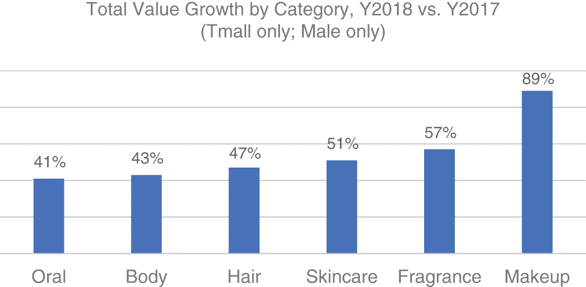

目前的趋势是“娱乐购物”（shoppertainment），这意味着技术正在将社交网络、在线娱乐和电子商务这三个领域融合在一起。与美国同类相比，中国的移动应用在内容、社交和商务方面更加先进，并且更具交易导向。品牌广告商不仅简单地在电子商务平台上开设网店，越来越多地与娱乐平台上的 `KOLs`（关键意见领袖）合作，通过直播触达潜在买家。（请参见“口红姐姐种种草”栏框。）

这种“娱乐购物”趋势的最佳案例是`京东`与`快手`于 2020 年 5 月建立的战略合作伙伴关系。正如在后续章节中介绍的，`京东` 是 `阿里巴巴` 在零售领域的长期宿敌。在 `京东` 2014 年 IPO 之前，腾讯以 2.15 亿美元购买了 `京东` 15% 的股份，两家公司建立了联盟，将 `WeChat` 的社交网络流量转化为购买流量。通过与`快手`的新伙伴关系，`京东` 可以利用`快手`视频在小镇和乡村的普及，来实现其触达数亿新兴在线消费者的目标。

无疑，中国经济的移动化转型对处理中国市场的全球利益相关者也产生了深远影响。中国电子消费者可能是世界上移动最先进的群体之一，他们仍在追求更创新的在线购物体验，而公司正竞相提供日益复杂的在线服务。在这个快速变化的市场中，即使对于在中国经营了数十年的跨国公司，也可能需要重新审视其在中国的战略。同时，移动基础设施也为那些在中国没有或不需要设立实体场所的外国商户开启了新机会。在很大程度上，对于在中国的跨国公司以及任何考虑将产品引入中国的商户来说，精通移动互联网策略和开发社交网络广告将使零售商从竞争对手中脱颖而出。

在全球范围内，中国人和其他国家最推崇的中国节日是什么？给你一个提示：它不是被称为农历新春节，而是 11 月 11 日，即“双十一”。

每年的 11 月 11 日，国内外数十亿中国人都会热烈地参与这场为期 24 小时的在线购物盛宴。这也是一个全球性的节日，来自 200 多个国家和地区的国际买家卖家也参与其中。（**参见“11·11——从单身狂欢到全球节日”信息框**）。

2019 年，凭借互联网的速度，在最初的 68 秒内就产生了价值 10 亿美元的订单，涵盖了从苹果 iPhone 到珠宝甚至汽车的各种商品。当天的交易额（`商品成交总额`，简称 `GMV`）超过了 380 亿美元（2684 亿人民币）。截至为止，11·11 节是全球最大的网购日，其规模超过了黑色五和网络星期一的总和。

无疑，一年一度的在线购物节是中国数字化连接的中产阶级崛起的生动写照。它也说明了社交、娱乐和电子商务在移动平台上的融合。然而，如果透过购物狂欢和电子商务 GMV 的表面象看过去，“双十一”的定义日益地取决于其幕后的技术发展：

### 第一，用于交易的金融科技（fintech）

如前所述，移动支付在中国的使用程度比美国或欧洲等发达市场广泛得多。2017 年，中国的移动支付交易量已是美国的 10 倍以上，通过支付宝结算的移动总 GMV 已占总 GMV 的 90%（见图 2.6）。此外，阿里巴巴及其竞争对手还向买家提供信用额度——即小额贷款——为他们的在线购物提供资金。阿里巴巴的金融分支蚂蚁集团拥有一名为`花呗`的巨型微贷业务，意思是“尽管花”。（[京东](http://jd.com)拥有一款名为`白条`的类似支付产品，意思是“空白收据”）。

许多花呗用户没有传统的信用卡，一些人不符合银行发行信用卡的条件。得益于自主的信用评分系统，花呗可以根据其还款情况及相关在线行为数据（在线好友的数量和影响力等）生成的风险指标，快速批准借款人的信用额度，这有助于保持较低的违约率。（见第 5 章）中的详细案例研究）。对于新借款人，信用额度可能仅为几美元（例如 50 元的信用额度约 7 美元），且花呗还为购买大件物品或在大购物日提供临时的信用额度提升。据报道，在 2019 年双十一期间，Kapronasia 的一位金融科技分析师估计，淘宝和天猫电商平台上至少有一半的订单是通过花呗完成的。

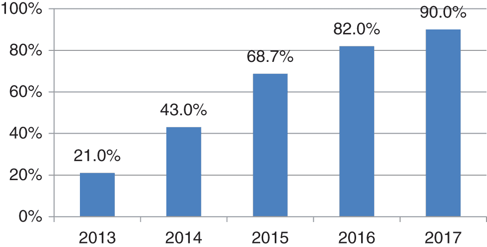

**图 2.6** **双十一期间移动 GMV 占比百分比 (%)** ¶ 数据来源：阿里巴巴。]

### 第二，用于处理的云基础设施

在 24 小时内处理 38 亿美元的交易对电子商务系统构成了巨大的压力，但这一切都是在“零停机”的情况下完成的，根据阿里巴巴集团的数据智能骨干阿里云云的一份声明，“阿里巴巴应用多项成熟创新来赋能云基础设施和其他关键 AI 赋能功能，使数百万企业触达全球数亿消费者”。在峰值时期，该公司的`赛龙操作系统`利用先进的数据处理和分析能力，支持了每秒 544,000 订单的历史记录。阿里巴巴跨境电商平台速通（AliExpress）的机器翻译服务在购物节期间使用了 166 亿次，用 21 种语言翻译了超过 2000 亿字，支持了 100 多个国家和地区。

### 第三，用于交付的智能物流

电子商务行业建立在大量快递员（被称为`kuaidi`或快递）的基础之上，他们提供快速且廉价的配送服务。在大小城市繁忙的街道上，无数快递员（估计总数超过一百万）骑着卡车、摩托车、滑板车、三轮电动车以及任何可以想象到的交通工具，每天完成数百万次配送。在每个双十一，电商巨头最头疼的问题就是物流——即在短时间内对大量订单进行库存管理、配送和交付。某电商公司高管曾将这一挑战比作“有 30 支 NBA 篮球队，但只有几个中学的体育馆”。

无疑，AI 进入了这个忙碌的场景并提供了新的解决方案。阿里巴巴的供应链管理被称为`阿里智能供应链 (ASSC)`，它应用 AI 帮助线上线下商家*预测*产品需求。该模型处理了一系列历史和实时数据，包括季节性和区域差异以及消费者的偏好和行为。这对于同日或次日送达服务的规划至关重要，此外，它使商家能够根据从交易数据中嗅出的趋势，对消费者口味的变化做出快速反应，允许商家更高效地协调货流——从而降低成本并减少销售流失。

对于实际交付，阿里巴巴的物流附属公司`菜鸟`利用 AI 技术和`GIS`（地理信息系统）来确定最快且成本效益最高的路线，涵盖了乡村和拥挤的城市地区。在 2018 年双十一期间，菜鸟配送订单总量首次突破 10 亿，但它成功加速了配送，首亿包裹耗时为 2.6 天，而前一年为 2.8 天。

最后，在购物节的各个环节，阿里巴巴及其竞争平台不断收集、获取、分析和使用用户数据，以提供定制化的产品和推荐。根据用户数据，用户被赋予不同的特征标签（例如“美妆爱好者”、“运动迷”、“热爱旅游”）。然后，根据标签的匹配向潜在客户展示特定的广告信息。（相关的个人数据隐私问题在第 8 章中有介绍）。“数据驱动业务”的副作用是产生了一个虚假互动影子生态系统，因为点击量、粉丝数、买家、卖家和交易量驱动了巨大的广告收入。

## BAT、TMD 与新的 ATM

在中国移动经济早期，主要由阿里巴巴、腾讯和百度（中国主要的搜索引擎）这三大巨头定义——即所谓的 `BAT`。但现在，新潮流的互联网公司正在崛起，挑战着现有的平台。它们在移动设备和个人电脑上不断开发互联网搜索、在线营销、通信、社交网络、娱乐、物流等服务领域的创新，以提升用户的在线体验。领先巨头与渴望成长的追随者之间的竞争异常激烈。

近年来，出现了一个足以与 `BAT` 竞争的新三强。根据这三家公司中文名称拼音的首字母组合，市场称它们为 `TMD`。（有趣的是，`TMD` 也是中文里常见的一个口话“他妈的”，字面意思是“his mother's”。）有趣的是，尽管美团点评和滴滴的起源大多可以追溯到硅谷，但它们的业务模型已经演变成了强烈的中国特色。而头条则是凭借纯粹的中国化特征和服务崛起的。以下是简要介绍：

- **头条**：中文名为“今日头条”，是一个由人工智能/机器学习驱动的内容平台。其母公司是`字节跳动`，该公司公司还拥有热门的短视频应用`抖音`（以及海外版`Tik Tok`）。头条最初是一个新闻聚合应用，为不同的受众提供定制化的内容推送。现在，它已演变成一个提供多种格式内容的平台，如文本、图片、问答帖、微博以及最主要的视频。`TikTok` 甚至成为首个在美国和欧洲主流市场取得成功的中国应用。根据 `App Annie` 的数据，它是该十年内下载量第七的应用，超过了 `YouTube` 和 `Twitter`。根据 2020 年初的媒体报道，该公司的估值已超过 1000 亿美元，成为媒体行业价值最高的私人初创公司。
- **美团点评**：这是中国领先的本地生活服务 O2O 平台和客户评价平台的合并公司（相当于美国 `Groupon` 和 `Yelp` 的结合）。它是中国最大的涵盖外卖、电影票、餐厅评论和团购折扣等功能的一站式平台。基于这些服务，它还向网约车和单车共享领域延伸。2018 年，美团点评在香港交易所上市；2020 年中，该公司的市值超过 1300 亿美元，成为价值第三大的中国互联网公司（参见图 2.7）。
- **滴滴**：正如其名（意思是出租车的“滴滴”），滴滴是中国最大的网约车服务。在与`Uber 中国`进行 350 亿美元的合并后，它在中国取得了主导市场地位。（合并后 `Uber` 是滴滴的股东。`Uber` 最新的年度报告暗示，这家中国私人公司的估值约为 530 亿美元。）从网约车，它还进入了单车共享和电动滑板共享。为了从“互联网业务模式”扩展到“数字科技”，它设立了专注于自动驾驶的专门部门。2020 年 6 月，滴滴披露了其战略目标：到 2030 年运营超过百万辆自动驾驶车辆（所谓的“机器人出租车”）。

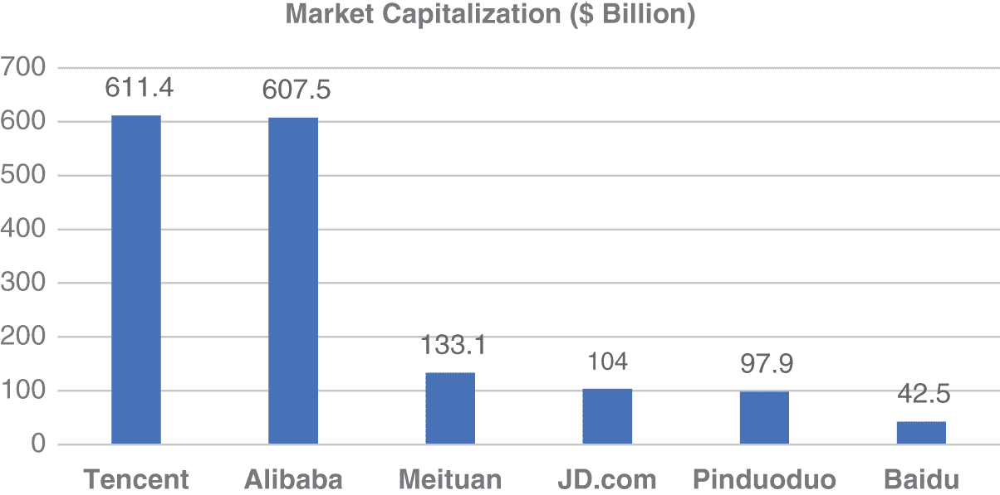

**图 2.7** **前五大中国上市互联网公司** ¶ 数据来源：公开市场，2020 年 6 月 23 日。

即使在成熟的电子商务市场，创新也没有任何放缓的迹象。一个最好的例子是近期拼多多的崛起，它是中国历史上增长最快的电商应用。凭借其将社交群体连接与电子商务相结合的新模式，触达了更偏远、更贫困的社区，被用户快速采纳，以及在成立三年内就实现了 IPO，拼多多这让阿里巴巴和[京东](http://jd.com)等电商领域的老牌企业大措措不及。（2020 年 6 月，`JD`（注：指京东）和拼多多的市值都达到了 1000 亿美元。）与淘宝和[京东](http://jd.com)相比，拼多多的独特之处在于它将社交组件整合到传统的在线购物过程中，该公司将其描述为“团购”（或“拼团”）模式。（请参阅下一章的详细案例研究。）

与此同时，被称为“中国谷歌”的中国最大的搜索引擎百度，在应对变化的互联网使用模式时正遭受着重大损失。百度曾在中国拥有类似于谷歌的主导地位（在 2010 年`Google`退出中国后，它积累了 70%的市场份额），但该公司在开发移动时代服务方面没有阿里巴巴和腾讯那样熟练。近年来，它的桌面搜索业务持续流失智能手机用户。随着在线内容变得更加碎片化，百度作为信息搜索起点的价值正面临挑战。

在移动世界，搜索更加碎片化。用户不再粘于电脑屏幕并使用像百度这样的搜索引擎，而是倾向于使用多个渠道。例如，他们使用阿里巴巴的淘宝买东西，使用腾讯的微信向朋友询问新信息，或使用美团点评寻找附近的餐厅。这三者都已演变成封闭的超级应用，导致百度在竞争激烈的数字领域失去了份额，抖音和快手等短视频平台的崛起。

目前，百度正押注新技术以寻求长期增长。在错过了过去几年的社交、移动和电子商务浪潮后，百度为了不重蹈覆辙，正投入人工智能。它投入了数十亿美元，希望 AI 战略能帮助其核心搜索+信息业务变现。但这并非成功之之路，因为沉大的 AI 投资造成了现金流压力，而且其自动驾驶项目远未产生收益。

因此，用美团点评取代百度的新缩写 `TMD` 最近备受关注。在图 2.7 的前五大中国上市互联网公司中，阿里巴巴和腾讯（2020 年 6 月的市值超过 6000 亿美元）是领先公司，远超其他公司。美团是价值第三大的中国互联网公司。市场可能更喜欢这个新缩写，因为 `ATM` 也代表自动取款机，这与这三家公司股价的快速增长相呼应。

当然，尘埃尚未落定。仔细观察前五名可以发现一个震惊的事实：阿里巴巴是腾讯帝国中唯一的。对于美团点评、京东](http://jd.com)和拼多多——这些阿里巴巴的直接竞争对手——腾讯不仅是战略合作伙伴（无处不在的微信应用为他们的电商和在线服务业务提供了约 10 亿月活跃用户流量），还是战略投资者。并不广为人知，根据 2020 年的公司公开文件，腾讯持有美团点评 18.1%、京东](http://jd.com)的 17.9%以及拼多多的 16.5%股份（参见图 2.8）。

未来，老牌互联网公司（如 BAT、TMD 或 ATM）与新兴年轻参与者之间的合作伙伴关系、竞争和交叉投资，将使移动市场变得极其活跃且充满活力。中国市场在下一代移动设备和服务务方面，正有望成为趋势的引领者，而非追随者。正如第二部分所示，中国科技公司正将眼光投向移动互联网之外，投资 iABCD 应用以下一阶段的竞争中占据优势，使中国成为全球最吸引人的创新中心之一。

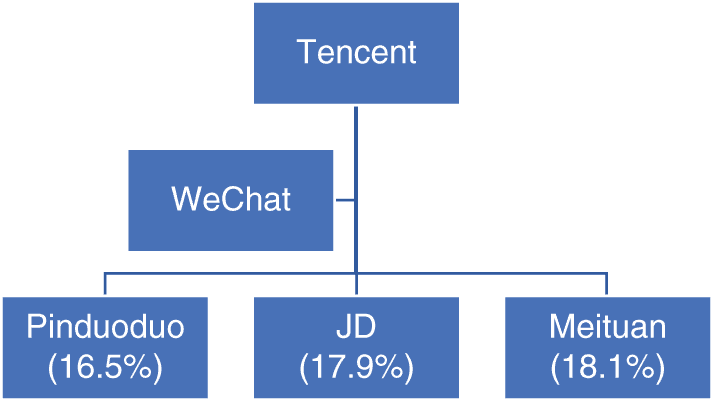

**图 2.8** **比你想象中还要大的腾讯帝国** ¶ 数据来源：2020 年公司公开财报。

# 第二部分：中国的数字化转型与创新

中国企业的数字化转型正在重塑零售、金融、娱乐、交通、生活服务、教育、智能硬件以及许多传统行业。中国作为全球最有趣的创新中心之一，正是新一代初创企业引领 5G iABCD 创新的地方。

# 第三章：数字中产阶级的大数据

- 4Cs 模型：了解你的客户
- 福州优选 OMO 模式：电子商务将死亡
- C2M——拼多多与社交电商
- 弹幕屏：好莱坞在“大数据”电影之战中失利
- 后疫情时代的消费者走向成熟

## 4Cs 模型：了解你的客户

沃尔玛、宝洁和联合利华在中国市场面临的最单一、重要且困难的问题是什么？答案非常简单：*他们不再像以前那样了解中国消费者了*。这是因为受数字技术赋能的中国消费者比几年前——更不用几十年前——要老得多。

正如上一章提到的，中国数字化连接的新中产阶级导致了中国消费市场的发生地震般的变化。这群新消费者不仅对移动电子商务非常熟悉，而且还享受了前所未有的接触和获取外国品牌的机会，社交网络对购买决策产生了巨大影响。结果是他们对质量和服务都有了极高的期望，而这些期望在中国过去并不存在。

此外，数字中产阶级的崛起及其消费能力正伴随着代际转变而发生，因为中国的年轻消费者（1990 年代和 2000 年代人）已成为中国消费者中增长最快且影响力日益增强的群体之一。在未来 10 年里，约 2 亿出生于 90 年代的人将开始组建家庭，约 1.5 亿出生于 00 年代的人将从学校或大学进入中国劳动力市场。

与他们的父母不同，这些 90 后和 00 后群体在一个以意料之外的财富、见多识广和技术为标志的中国长大的。年轻一代消费者享有奢侈品牌赋予的地位，他们经常将消费升级到这些产品的下一个级别。白领专业人士不断从视频流网站上的外国电影和剧剧中寻找最新的产品和趋势。即使是显然处于低收入水平的年轻务工，也可能花费一个月工资购买 Apple iPhone 等高端产品。

由于中国年轻消费者既是贪婪的网购者，又是活跃的社交网络用户，一种新的社交现象——*晒（shai）*出现了。

简而言之，中国消费者已不再有一个单一的、一切适用的定义。新的中国消费者比以前变得更加复杂和多样化，他们在数字时代的数据已真正成为“大数据”。在接下来的章节中，盒马（Freshippo）“新零售”、拼多多“社交电商”以及“互联网+电影的成功商业模式完全以数据为中心，无缝整合了围绕 4Cs：场景（Context）、连接（Connection）、社区（Community）和内容（Content）的消费者互动。

## 盒马 OMO：电子商务将死掉

2015 年，当中国电子商务正飞速发展时，阿里巴巴创始人马云通过预测“电子商务将死掉”震惊了市场。当然，如今阿里巴巴仍然通过两个强大的平台主导着电子商务领域：`淘宝`（C2C），一个提供海量消费品的在线集市；以及`天猫`（B2C），一个针对成熟品牌的更精细的平台（参见表 3.1）。然而，天猫不仅仅是一个纯分销平台，对于马云所说的“新零售”具有强大的价值主张：它是品牌和商家通过营销工具和消费者数据洞察来触达新客户并服务回头客户的推动者。

### 表 3.1 阿里巴巴的淘宝和天猫市场

| 项目 | 淘宝 | 天猫 |
| --- | --- | --- |
| **创立年份** | 2003 | 2008 |
| **概念** | C2C 集市（类似于 eBay） | B2C 商场 |
| **设置** | 卖家发布新货和旧货进行销售或转售 | 每个品牌都可以在商场内建立自己的虚拟店铺 |
| **用户** | 个人、小商户 | 国内外知名品牌，如苹果、宝马和特斯拉 |
| **用户成本** | 无佣金；主要收入来自为商户提供的在线营销服务 | 卖家需支付押金入驻网站，天猫通过交易赚取佣金 |

“新零售”的核心概念是为客户提供无缝的在线/线下购物体验。在当今这个高度连接的世界，消费者的购买路径跨越了线下和在线。商家必须确保通过所有可能的渠道服务消费者，因为随着智能设备渗透率的提高，消费者变得越来越聪明，并可以轻松处理所有渠道。整体趋势是，在线和线下消费活动比以往任何时候都更加整合，两者之间的界限变得日益模糊。

在线/线下无缝整合模式为消费者提供了前所未有的选择、便利和简单性，但由于高度连接，制造商和供应商也面临着爆炸性的复杂性，他们必须对大数据技术进行大量投资。通过数据分析，商家可能可以在不同渠道——实体店（线下）、公司网站（在线）和移动商务（连接在线和线下）之间创建一致且顺畅的购物体验。

意料的是，线下收集的数据越来越多，因为大多数人在线下上花费的时间仍然比在线上多，而且线下消费场景的数据具有更多维度和深度。**为此，“新零售”首先从电子商务巨头收购线下实体店开始**（比美国电商巨头亚马逊收购线下超市连锁店 Whole Foods Market 早了几年，参见图 3.3）。

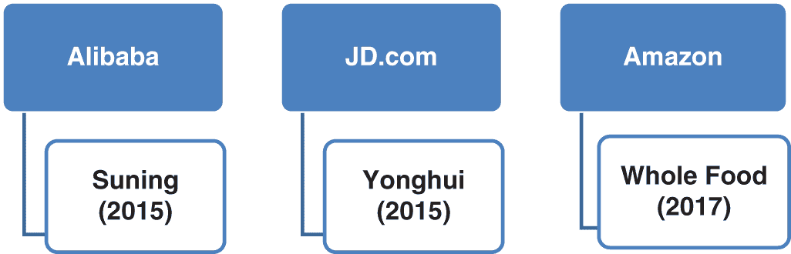

**Figure 3.3** 电子商务巨头收购线下商店

早在 2015 年 8 月，阿里巴巴就投资了 46 亿美元，成为苏零售集团（该国最大的家电零售商）的第二大股东。（阿里巴巴的电商竞争对手[京东](http://jd.com) 也通过投资 7 亿美元收购了永辉超市 10% 的股份进入了实体店零售领域，永辉超市是中国第四大超市连锁店）。对于阿里巴巴（以及京东）来说，目标是利用线下零售商现有的实体店网络来提升其供应链，并使其线下产品多样化（并随后积累更多数据）。

**此外，在移动支付和数字技术的支持下，阿里巴巴（以及其竞争对手腾讯）还设立了无人便利店，以获取更多的线下流量和用户数据**。要进入这些无人便利店，客户需要扫描`QR code`来开门。由于店里的各种商品都嵌入了射频识别（`RFID`）芯片，当顾客挑选喜爱的物品并离开商店时，门口的扫描器会读取`RFID`芯片并将账单发送到客户的移动支付应用。整个过程涉及计算机视觉、生物识别和传感技术，以追踪客户及其购买情况，从而在结账口实现消费者的自动支付。

**“新零售”最新且最有趣的进展可以描述为“数字化线下商店”**：即由数字技术支持的线下商店，它们在同一个地点同时提供移动在线环境和传统的线下购物体验。阿里巴巴的盒马（中文称为 *Hema*）商店就是完美的例子。一方面，它们配备了完善的数字化操作系统、店内技术、供应链系统、消费者洞察和移动生态系统。另一方面，它们结合了线下超市、餐厅以及蔬菜、水果和海鲜直销市场的特点。它们共同为消费者提供了一种融合了在线和线下活动的无缝购物体验（被称为“OMO”；请参见图 3.4）。

盒马商店展示区的中心是新鲜蔬菜、水果和海鲜（盒马与阿里巴巴的电商平台天猫合作，直接从产地采购具有成本效益的产品）。随着年轻中产阶级追求健康的生活方式，新鲜食品成为吸引他们的新型“负担起的奢侈品”。购物者可以选择活海鲜并将其送到厨房现做现吃。或者可以使用 App 订购杂送货。由于每家商店都作为一个仓库和自己的履约中心，盒马的自有履约系统承诺为半径三公里内的消费者在 30 分钟内送达。

盒马模式完全以数据为中心。商店通过多种互动方式提供产品信息并收集消费者数据：

**Figure 3.4** OMO 无缝整合在线和线下

### 第一，关于食物的信息在移动终端提供

近年来，由于一系列食品安全丑闻，中国消费者对本地食品的信任受到了动摇，这似乎让每个人都变成了食品安全专家。（**参见“智能筷子和区块链鸡肉”框。**）盒马提供了一个移动 App，允许消费者在逛店时搜索产品并下单。购物者可以扫描盒马内所有商品的条形码，以追踪产品的产地、配送和营养信息。此外，此类信息帮助年轻购物者成为异域美食的鉴赏家，这样他们就可以在社交媒体平台上通过发布高端美食之旅的照片，兴奋地展示他们生活方式的提升。

### 第二，线下互动补充了线上信息

与鞋服不同，新鲜食品——例如海鲜——并不是标准化的产品。消费者很难仅从在线提供的信息来判断产品质量。线下实体店让他们能够与传统渠道的代表进行互动，从而更好地了解产品。特别是中老年购物者对传统商店更有信任，他们可以在那里可以直接查看海鲜。他们倾向于先在实体店购买进口海鲜，以后然后在在线上订相同的产品。

### 第三，购物者可以小 amounts 进行“产品体验”

在购物者决定购买之前，他们可以像买衣服一样在途中“试用后付款”，将商场零售店作为展厅或试衣间。例如，如果客户收到 `Freshippo` App 上的加拿大黑莓的最新促销，她可以使用 `Freshippo` App 和 `Alipay`（阿里巴巴的移动支付）购买一小盒；在将它们堆在购物车之前，她可以在休闲区进行品尝，如果符合她的预期，再多买一打（或稍后在线订一打送货）。

### 第四，`Alipay` 是结算时唯一接受的支付方式

`阿里巴巴` 的移动支付终端（有关金融科技讨论的细节请参阅第 5 章）记录了线上和线下交易的消费者数据。总而言之，上述消费活动被完全数字化地捕捉。他们的历史数据使得 `Freshippo` App 能够生成高度个性化的推荐和针对性的促销，从而提升消费者之后在在线或线下购物时的购物体验。

### 最后，整个 `Freshippo` 门店的运营在后台是数字化的

包括店内技术、数字化库存和供应链系统（采购、销售和交付）。通过数据技术，`Freshippo` 缩短了采购流程，并增加了供应链的透明度和可见性。对于消费者来说，`Freshippo` 利用交易数据进行个性化推荐，利用地理数据帮助规划最高效的配送路线。

正如本章开头对大数据趋势的预测一样，`Freshippo` 门店在数据技术投资方面承担了巨大的前期成本。令人前景良好的是`Freshippo` 门店有望实现规模经济，它与 `Tmall` 的合作带来了采购方面的节约（通过直接采购和议价能力）。到 2019 年底，`Freshippo` 已在中国 20 多个主要城市开设了 197 家门店（参见图 3.5），其中线上销售占门店总销售的一半以上，显示“线下”门店具有强大的“线上”特性。

正如`Freshippo`案例所示，为了给客户提供无缝体验，互联网公司的数字化门店同时利用线上和线下触点来涵盖消费者的整个决策和购买旅程——在线搜索和比较产品、在实体店试用、在线或在实体网点支付、在线安排配送或从实体店提货。位于便利位置的店面——如 `Freshippo` 门店——像传统零售商一样吸引客流，但它们还有一个“在线人格”（online persona）来管理营销、物流、售后服务和客户互动（参见图 3.6）。因此，在线商务与线下商务之间的差异正在消失。

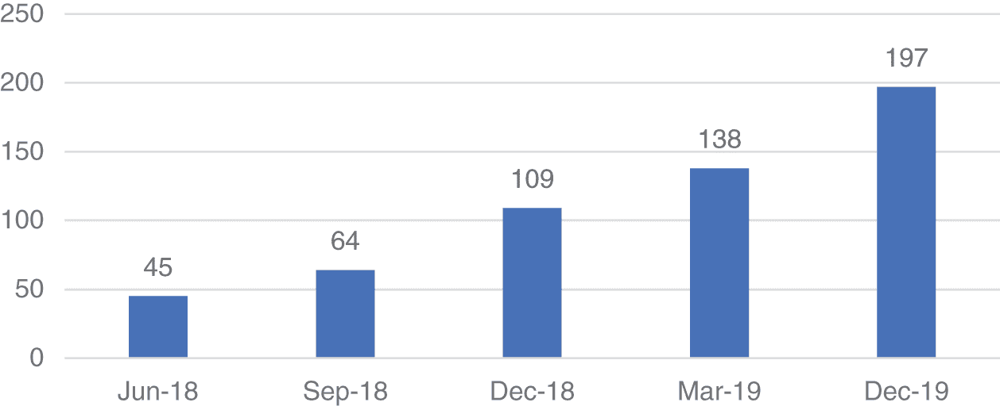

**图 3.5** **Freshippo 门店的快速扩张** ¶ 数据来源：阿里巴巴。

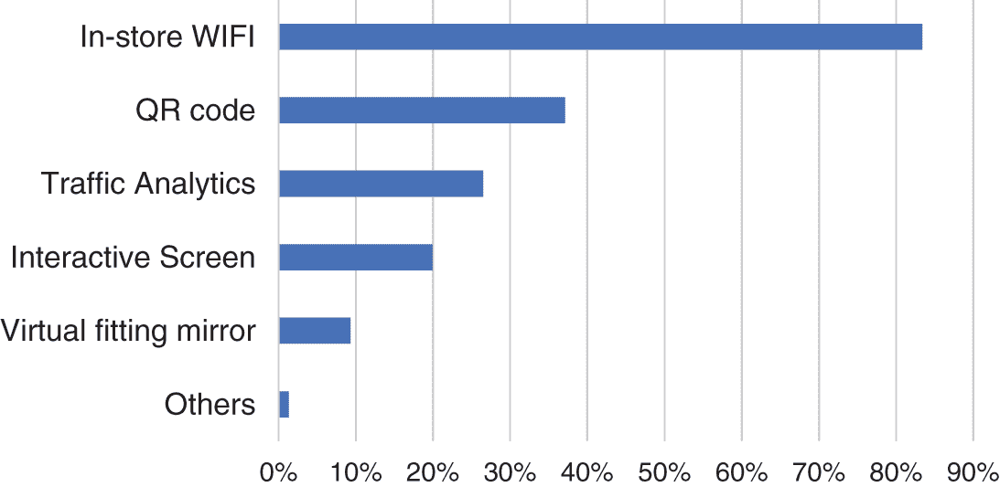

**图 3.6** **高比例的超市增加在线人格** ¶ 数据来源：商务部，2017–2018 年中国超市发展报告。

总而言之，在 `阿里巴巴` 的术语中，“新零售”本质上是 OMO（线上-融合-线下，请参见图 3.4）。要取得成功，电子商务公司与实体店建立联系，与实体零售商拥有在线形象同样重要。到目前，阿里巴巴创始人马云的这句令人惊讶的言论“电子商务将死”变得容易理解。未来的电子商务模式——如果“电子商务”这个词仍然可行的话——是一个新的零售平台，它无缝地连接跨多个数字设备屏幕的客户，提供标准化产品以及专业商品和体验服务，将在线内容与线下活动连接起来。

同时，必须强调的是`Freshippo`零售链主要位于一线和二线城市，这些城市的消费者平均消费能力是中国最高的。根据该公司的文件，这项新业务将通过增加`Freshippo`在现有城市的门店密度来扩大，以提高消费者覆盖率和配送效率。正如下一节的`拼多多`案例所示，中国是一个庞大且多样化的市场，`Freshippo`仅代表一小部分，中国消费者有许多方法寻求“消费升级”。

## C2M：拼多多与社交电商

生活水平的提高和财富增长通常驱动了对更高质量或安全标准产品的需求——即所谓的“消费升级”（*xiaofei shenji*）。在中国，这种动态已体现为高端化的趋势：`阿里巴巴的盒马鲜`是中产阶级对新鲜安全食品追求的答案，而阿里巴巴的主要竞争对手`京东.com`也有自己的产品。

从许多衡量标准来看，`京东.com`的规模远没有`阿里巴巴`那么大，特别是在交易总额（GMV）方面，即所有在线交易的总价值。然而，这种差异很大程度上与两公司的模式有关（参见表 3.2）。正如提到的，`阿里巴巴`主要是买卖双方的平台供应商（在这方面类似于`eBay`和`PayPal`的结合），而`京东.com`则购买库存并作为直接在线零售商将其出售给消费者（类似于`Amazon.com`）。近年来，他们的竞争比 GMV 规模差异所暗示的要直接和激烈得多。

自 2007 年以来，`京东`是第一个也是可能唯一巨资投资自有物流网络的中国电子商务公司。`京东`的逻辑是自己处理从在线订单到实体送达的全过程，以更好地控制配送服务和产品质量。此外，`京东`的支持者认为这种模型使`京东`从竞争对手中脱颖而出，因为假货更少，配送过程中损坏概率较低（对于医疗产品或新鲜水果等尤为重要）。

**表 3.2 阿里巴巴与京东的主要区别**

| | 阿里巴巴 | 京东 |
| --- | --- | --- |
| 业务模式 | 线上零售平台 | 在线直销 |
| 业务范围 | 电子商务市场。广泛、多样；整合在线生态系统 | 主要是直接零售和物流服务；涉及相关的电商金融 |
| 交易量 | 巨大 | 相对较小 |
| 物流 | 与第三方合作提供物流服务 | 自有全国性仓库、分拣中心和配送网络 |
| 利润来源 | 营销和服务收入；佣金 | 零售价与成本之间的差 |
| 利润率 | 高 | 低 |

例如，在最近的一次“双十一”销售季期间，[京东](http://jd.com)使用了“同样的价格，买正品”的广告口号。另一则广告描述了一位年轻的职场女性在面试期间感到非常尴尬，因为她在网上买的新款红色裙子在面试官的沙发上留下了痕迹。这些广告中没有提到任何具体名称，但似乎每个人都知道这指的是哪家在线公司。然而，阿里巴巴创始人马云在几年前曾认为，[京东](http://jd.com)的模式很难扩大规模以应对中国电子商务的爆发式增长。（参见“京东会变成一场悲剧吗？”边框。）

在某种程度上，拼多多近年来的快速崛起（它现在自称为中国第二大电商平台）为马云的预测提供了证据。拼多多（Pinduoduo）成立于 2015 年 9 月，是一个在线团购网站，其模式更接近于阿里巴巴而非[京东](http://jd.com)。拼多多还充当了市场角色，其独特之处在于将社交元素整合到传统的在线购物过程中，公司将其描述为“团购”（或“拼团”）模式。凭借这种将社交群体连接与电子商务相结合的新模式，其对更偏远、更贫困社区的覆盖、用户的快速接受，以及在成立三年内实现 IPO（其股票代码为 PDD），拼多多让阿里巴巴和[京东](http://jd.com)等老牌企业措手不及。

图 3.7 **在一起，更省钱，更有趣**

与它的两个主要竞争对手不同，拼多多告诉市场，对于大部分用户来说，消费升级仍然意味着以一种移动、有趣的方式购买廉价商品。对应公司三个字的中文，拼多多的价值主张是“在一起，更省钱，更有趣”（参见图 3.7）。拼多多用户通过在微信等社交网上分享产品信息（腾讯于 2016 年成为拼多多的投资者，并为拼多多提供了触微信网络十亿用户流量的战略渠道），可以邀请联系人组成购物小组，以获得更低的购买价格。这种社交电商机制使得购物体验更具互动性，用户也更有动力。

在拼多多的平台上，买家可以发起团购并在微信上分享产品信息，以邀请其社交联系人组成购物小组。（或者，买家可以选择加入平台上列出的活跃团购，该小组由其他买家发起，这些人可能也可能是他们的社交联系人。）潜在买家有 24 小时时间来完成购物小组，App 显示随着每增加一个买家，折扣就会增加。对于喜欢寻找便宜商品的购物者来说，这创造了紧迫感和兴奋感。对于他们的朋友来说，拒绝帮助他们省钱的机会可能很难。从心理学角度来说，这是一种不可抗拒的体验。（如果在 24 小时内未达到最低团队人数，团购订单可能会取消，并退还买家支付的所有款项。）

由于其团购格式，拼多多有时被描述为“加强版的 Groupon（团购网）”。但它的创始人黄明更了解自己公司的模式。Groupon 专注于“想要”的商品和服务，如餐厅、按摩和旅行，而拼多多则为日常“需要”的家居用品批量购买提供深度折扣。同时，它将最平凡的日常产品购物游戏化，以驱动用户参与和留存。因此，黄明将公司描述为折扣零售商 Costco 和娱乐物业迪士尼迪士尼的结合体。

到 2020 年中期，拥有 5 年历史的拼多多 1000 亿美元市值与[京东](http://jd.com)持平，其 5.36 亿的年活跃买家（2019 年）在中国仅次于阿里巴巴。当然，拼多多较大的活跃买家数量、订单量和月活跃用户（MAU）部分归因于不同的业务模式（类似于阿里巴巴与京东；参见表 3.2）。然而，尽管如此，这个最年轻的玩家已被证明在用户粘性方面表现最好——它的用户访问更频繁，在网站上花费的时间更长。根据信联证券 2020 年 2 月的一份报告，拼多多的用户增长是三者中最快的，拼多多平台的平均 DAT（日活跃时长）也是最长的（参见图 3.8）。

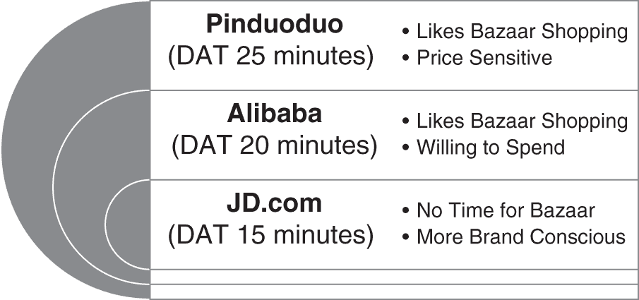

图 3.8 不同平台用户的画像和 DAT ¶ 数据来源：信联证券，2020 年。

### 用户粘性与增长策略

“用户粘性”是拼多取得成功的关键，这基于对中国用户人口统计特征的准确细分：

#### 1. 针对中下线市场

首先，拼多多的主要目标市场是三线及以下城市以及中国农村地区对价格敏感的买家（中国几乎一半的人口仍然在农村地区），这是一个未被充分服务的群体。中国的移动经济日益由“小镇青年”定义，这个术语泛指除一线城市以外其他市场的年轻网民。随着大城市市场变得日益饱和，农村地区提供了最大的增长潜力。虽然小镇青年可能偏好廉价商品，但他们购买频率更高，在电商上花费的时间更长，且集体上具有惊人的购买力。

#### 2. 社交与游戏化

其次，因为它的主要客户“时间比钱多”，它设计了“团购”模式，将在线购物转化为一种动态的社交体验，反映了消费者在线下倾向的社交互动。在微信社交网络的支持下，它意识地构建了一个类似于“虚拟集市”的平台，买家可以在那里浏览和探索全方位的产品并相互互动。此外，拼多多继续在其平台上增加趣味性和社交元素。2018 年推出的 App 内游戏“多多的果园”就是一个很好的例子。

在多多的果园中，用户可以选择一种虚拟果树（选择随季节变化），然后“浇水”让它从幼苗长为成熟的果树，这时他们将获得奖品——来自拼多多的一盒真实新鲜水果。为了给树赚取“虚拟水”，玩家需要完成各种任务，例如在拼多多平台购物、分享产品以及邀请朋友加入平台。玩家还可以查看他们朋友的树的情况——要么帮助他们浇水，要么偷走他们的水滴。2019 年，该游戏每天有超过 1100 万日活跃用户（DAU）登录游戏进行游戏和探索。

第三，随着用户在平台上的互动增多，公司能够洞察他们的购物偏好和需求，反过来利用这些信息为他们提供更相关的产品，从而推动用户满意度和参与度更高的良性循环。根据公司 2019 年的年度报告，它已经建立了大数据分析能力，能够高效处理涉及数十亿数据实例和数百万个分析维度的复杂计算任务。例如，对于某笔交易，拼多多不仅查看基础订单信息，还会查看相关的买家行为数据，例如买家浏览和查看特定产品以及同类产品花费的时间。通过根据用户的偏好聚合需求，该平台可以帮助用户节省更多资金，并以有趣且参与感的方式实现。

总而言之，拼多多将电子商务从集中搜索转向了社交互动。与传统的基于搜索的“库存索引”模式相比，这种社交电商模式试图挖掘发现和购物的乐趣与兴奋感，培养了高参与度的用户群，并延长了用户在平台上的时间。既有的电商功能被反转了：现在是“货找人”而非“人找货”（参见表 3.3）。

因此，从“拼”模式产生的大数据不仅是用户参与和扩张的高效工具，也是提高零售市场供应链效率的机会。传统上，开发新产品通常涉及漫长的市场研究、焦点小组测试、分销渠道反馈以及最后的大规模生产。相比之下，拼多多开发了`C2M`（消费者直达工厂）模式，通过“团购”活动展示的聚合用户兴趣和需求可以传递给商家，以便他们相应调整生产和销售计划。这样，工厂就可以缩短新产品开发流程并降低成本。

### 表 3.3 社交电商与传统电子商务

| | 传统电子商务 | 拼多多的社交电商 |
| --- | --- | --- |
| **模式** | 基于搜索的购物 | 费用制购物 |
| **经营理念** | “你知道你想买什么” | “你不知道你想买什么，但乐于发现” |
| **平台角色** | 像一个超级大脑，回答所有用户的问题 | 像一个个人代理，为用户提供定制化建议 |
| **平台设置** | 平台托管所有 SKU 和品牌的索引 | 平台通过互动功能和学习用户偏好的 AI 能力提供更优动态推荐 |
| **用户体验** | 孤独的购物体验 | 有趣且互动的购物体验 |
| **交易流程** | 设计 --> 制造商 --> 消费者 | 消费者 --> 设计 --> 制造商 |

以农产品为例。由于历史原因，中国的人均耕地相对较少，这与美国等国家不同，美国大农场盛行，农产品的运输可以高度工业化。得益于其动态 AI 引擎，拼多多可以建立强大的用户画像，提供农民以前无法获得的需求信息。农民还可以利用该平台为他们的产品聚合更大订单的订单。需求有助于农民减少对分销商的依赖，使他们能够直接向消费者销售。结果是，消费者可以以低的价格获得更新鲜、安全的产品，而农民得益于更低的分销成本和更大的订单赚得更多。

展望未来，拼多多和阿里巴巴面临激烈且直接的战斗。双方都在努力覆盖尽可能广泛的客户群体，从价格敏感的小镇青年到具有品牌意识的都市白领专业人士。（参见“`屌丝` [`草根’] VS `高大上` [`上流社会]`”框。）一方面，阿里巴巴也更加关注低线城市市场和农村地区。自 2019 年以来，它投入了更多资源到其闪购平台`聚划算`，该平台提供深度折扣的团购销售，与拼多多直接竞争。

另一方面，拼多多也在向更多高端产品扩张，旨在获取更多“富裕”客户。（根据国信证券 2020 年的报告，从年均支出金额来看，阿里巴巴网站客户支出是京东客户的 1.6 倍，拼多多客户的 5.6 倍。）它启动了一项“新品牌计划”活动，旨在通过`C2M`模式支持 1000 家制造商开发自己的品牌。就像阿里巴巴和[京东](http://jd.com)之间的争论一样，时间将是这场战斗完美的法官和公正的调解者。

## 弹幕：好莱坞在“大数据”电影战中失利

根据移动票务平台猫眼的数据，2019 年中国电影院总票房额创下 92 亿美元（643 亿元人民币）的历史新高。相比 2018 年 5.4%的增长，对于中国这样规模的市场（全球第二大电影市场）来说是一个相当大的增长，但被认为比 2018 年的增长放缓，2018 年同比增长了 9%。（在此之前，中国电影市场在过去十年的大部分时间里一直保持双位数增长。）

考虑到今天在线消费的爆发式增长，这一趋势似乎是违反直觉的。中国市场的快速增长与全球票房形成鲜明对比，全球大多数市场的观影人数持平或下降。在其他市场，电子设备上的低成本娱乐选择导致了观影人数减少。例如，全球最大的市场北美在 2019 年的票房下降了 4%。

但真正是互联网技术的力量不断为中国电影市场注入新动能。正如新零售等其他案例一样，电影行业正看到智能设备、消费者大数据分析、票务手机应用和在线电影流媒体日益将网友转化为线下影院观众。此外，国产电影而非好莱坞大片已是中国票房增长的关键驱动力。外片曾占 2014 年中国前十名电影的一半，从此以后比例越来越小。上一次好莱坞电影引领中国票房是 2015 年的《速度与激情 7》。

秘密？大数据。

因此，对于中国的新电影来说，其构思、制作和营销活动日益受到大数据的塑造，通过社交媒体执行，并通过移动互联网进行分发（参见图 3.9）。

## 寻找合适的故事

每天，数百万年轻的数字阅读用户刷新手机应用，只为了跟上他们喜读物的最新每日更新。对于许多没有时间阅读纸质书的人来说，手机上的小说可以让他们在任何空闲时间轻松阅读。每个连载章节通常有几千字，因此可以在日常琐事之的任何“碎片化时间”完成阅读，例如在超市排队或等公共交通工具时。

根据在读者中的流行程度，许多网络小说已被改编为传统出版物、游戏、视频和大片电影。网络文学的流行排名为电影制作者提供了关于潜在电影观众对剧情和流派不断变化的偏好的重要信息；因此，越来越多的导演活跃在互联网上搜索潜在的热门作品（关于网络小说的更详细讨论见涉及移动娱乐业务的第 4 章）。

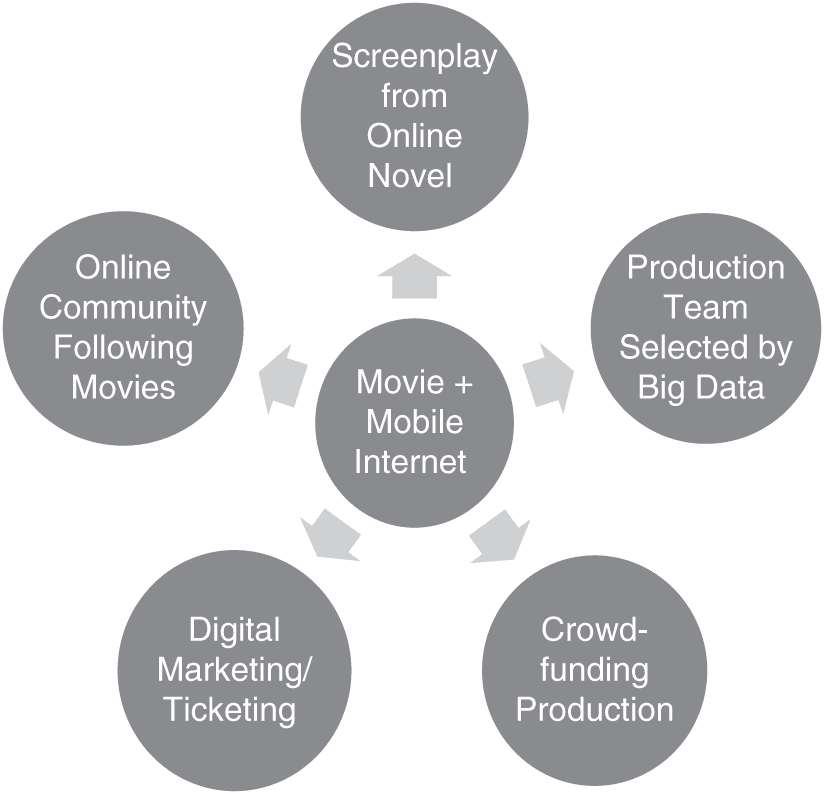

图 3.9 电影全生命周期中的数据

## 选择合适的制作团队

在像微信这样的通用平台或豆瓣这样的专业电影影评网站上，影迷会对最新电影发表评论并提出建议。例如，热门电影系列《小时相碎片》其中之一就是基于一部受欢迎的网络小说。除了电影故事的选择外，社交网络也帮助了制作团队的选择。在书作者郭敬明成为首次制片兼导演之前，他曾向粉丝群征求过建议。制作公司还利用微博（中国的 Twitter）从超过 1 亿微博粉丝那里获取关于电影导演和明星的建议。这种反馈具有很强的戏剧性，因为公众粉丝建议由郭先生本人担任导演，一个重要原因是“为了保留小说的原汁原味”。

## 在制作过程中寻求持续反馈

在像微信这样的社交通用平台或豆瓣这样的专业电影影评网站上，影迷会对最新电影发表评论并提出建议。即使在电影制作决定做出后，导演可能仍然使用社交网络与粉丝互动，因为他们的反馈和评论不仅有助于将原始网络小说打磨以适应银幕，还能在电影制作之前提供免费的营销。

## 使用数字融资渠道

电影众筹吸引了许多年轻观众的兴趣，并迅速成为电影制作公司重要的资金资金渠道。在数字时代，众筹活动被营销为普通观众参与电影制作光光时刻的机会，因为任何热爱电影或崇拜影星的人都可以成为小额投资者，参与电影的制作和推广。例如，某些投资产品涵盖了一组电影项目。为了收集有关观众味好偏好的信息，每位投资者都被要求从项目列表中最多选择两个投资计划（关于众筹的更详细讨论见涉及金融科技革命的第 5 章）。

## 利用数字技术进行营销

在移动时代，互联网和智能设备正成为电影市场与中国观众之间的主要媒介。海报和预告片等传统营销方法对于大规模的电影营销和推广来说是不够的。在 2015 年上海国际电影节上，组委会发布了首份关于中国“网络电影”趋势的报告，其数据显示互联网已成为中国电影最重要的营销渠道之一，包括 75.27% 的中国电影观众是因为读过原著小说、玩过相关的在线游戏或通过互联网看动画而决定看电影。

新媒体用户的数据使得电影的精准营销成为可能。对于针对年轻观众的电影，制作公司在全国范围内的广告牌上投入减少，而是关注电影在社交网络上的营销活动。在三线及及以下较小的城市中心，互联网可能是接触潜在观众的唯一成本效益的方法。移动渠道尤为重要，因为对于小镇青年来说，智能手机可能是他们访问的唯一途径。如果能激励年轻影迷在社交网络上分享电影信息，电影的覆盖范围可能比传统的线下广告要好得多。

## 在手机应用上售票

移动互联网技术也改变了电影观众选择附近的电影院并预订电影票的方式。由于缺乏技术投入，电影票务过去传统电影院未能提供便利服务的领域（电影院过去会在当地报纸的中版或服务页面发布排片表）。现在，移动票务服务为观众提供了最新的电影排期、电影院的位置信息、廉价票（得益于大型互联网公司的补贴）以及观影座位预订。总之，手机应用提供了一个影迷无法拒绝的方案，而票务过程收集了更多影迷的信息以供市场分析。

## 弹幕反馈——即使在电影屏幕上播放时

为了给年轻观众提供更多表达意见的渠道，中国选择性的电影院尝试了“弹幕”——一种具有争议的模式，允许观众在看电影时通过电影屏幕上的文字信息对电影进行聊天。（参见“弹幕[‘Bullet Screen’]和吐槽[‘Spit and Criticize’]”框。）关于弹幕仅仅是一个营销噱头还是电影行业的一次重大模式变革，仍然存在争议。对于某些观众来说，弹幕是观影的干扰；对于另一些人，它是社交互动的增加，丰富了整个观影体验。

很可能，弹幕这种可以被视为电影行业“数字化商店”的东西由于年轻一代观众对表达观点的强烈愿望而长期存在。对他们来说，虽然导演在电影屏幕上定义剧情，但弹幕是他们自己的并行屏幕，用于对电影提供反馈；对于制作公司来说，弹幕是另一个发现更多观众的创意方式。未来，可能每家电影院都会为弹幕观众留出专门的区域，配备尖端技术的专业弹幕影可能会像 IMAX 影院一样出现。

中国电影行业的“移动互联网+”和大数据趋势很好地解释了，为什么以高成本制作和视觉盛观为特征的好莱坞大片片，在近年来中国电影市场飞速增长的过程中失去了市场份额。本土电影在故事、特特效和类型片等许多指标上正追赶好莱坞的足迹，而好莱坞电影正深陷自我重复和缺乏原创性的困境。在过去的三年中，外语电影在票房中的占比不断萎缩（参见图 3.10），而中国电影的表现比例上更好。2019 年，中国电影占了总票房的 64.1%——高于 2018 年的 62.2%和 2017 年的 53.8%。（在过去，由于好莱坞大片进口片的主导地位，国产电影仅占有很小的市场份额。）

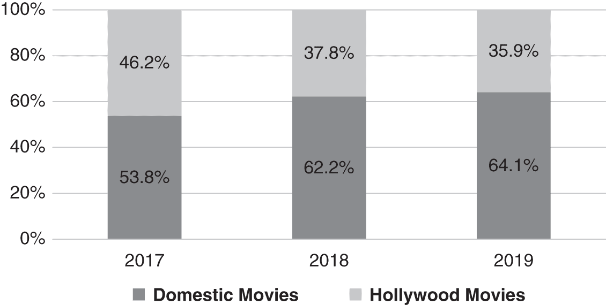

图 3.10 好莱坞电影在中国市场份额的下降 ¶ 数据来源：猫眼。

特别是正如`Pinduoduo`的案例一样，中国本土电影已经适应了电影院“小镇青年”的快速增长。这一重要群体代表了传统本土电影市场的一个空白。在可用电影的光谱一端是中国较年长的作者和导演的作品，年轻人对此无法共鸣，甚至不尝试去理解。在光谱的另一端，外国电影对于“小镇青年”来说显得太遥远、太随机。这类年轻观众的大多数成员喜欢由同龄作者创作的故事，并崇拜那些既时尚、流行又成功又是本土的英雄。

例如，在《小时大爱情》的案例中，电影中上流女孩的奢侈生活，从时尚品牌到私人俱乐部，清楚地引起了年轻观众对成功的想象共鸣。2019 年，中国票房冠军电影是《魔童降世》，这是一部 3D 奇幻动画片，已成为中国历史上最成功的动画电影（7.03 亿美元）。该片基于神话人物`哪吒`，这是一个在中国因反叛少年英雄形象而闻名的神灵。主角作为一个魔的转世，注命中预言将给世界带来毁灭，但他反抗了命运——这一主题与正在对抗社会刻板印象的广大中国人口产生了共鸣。

然而，最终的问题在于这种异常增长的可持续性。电影观众正在成熟。许多人比以前更不愿意购买那些只有视觉奇观和年轻`xiao-xian-rou`（小鲜肉）演员的电影，这需要对不断变化的影迷进行越来越多的大数据分析。（参见“`Xiao-xian-rou` [‘小鲜肉’演员]”框。）在用户数据的引导下，所有电商巨头都建立了自己的电影部门来制作电影，特别是那些讲述令年轻一代感兴趣的故事。

尽管如此，在线娱乐最终会像发达市场一样从大银幕夺走观众吗？到目前，在线娱乐还没有像发达市场那样从大银幕夺走观众。到目前为止，在线娱乐还没有像发达市场那样从大银幕夺走观众。到目前为止，在线娱乐还没有像发达市场那样从大银幕夺走观众。到目前为止，在线娱乐还没有像发达市场那样从大银幕夺走观众。到目前为止，在线娱乐还没有像发达市场那样从大银幕夺走观众。到目前为止，在线娱乐还没有像发达市场那样从大银幕夺走观众。到目前为止，在线娱乐还没有像发达市场那样从大银幕夺走观众。到目前为止，在线娱乐还没有像发达市场那样从大银幕夺走观众。到目前为止，在线娱乐还没有像发达市场那样从大银幕夺走观众。到目前为止，在线娱乐还没有像发达市场那样从大银幕夺走观众。

等等，我应该涵盖 4Cs——背景（Context）、社区（Community）、内容（Content）和连接（Connection），正如本书其余部分将阐述的那样

# 第 4 章

## AI 驱动的网红与粉丝经济

* Bilibili：弹幕、会员问卷调查和 Z 世代上传者
* 腾讯阅文：网络小说之神
* 超越 Twitter——微博的短暂复苏
* TikTok：主宰社交媒体的搞笑视频
* 快手、爱奇艺等：进入多屏竞争

### 后疫情时代的消费者走向成熟

新冠病毒对中国消费者的影响是深远的，特别是对于富裕的年轻一代。在疫情之前，中国年轻消费者的消费意愿大于储蓄意愿。当他们生命中第一次面对衰退预期时，他们被迫更认真地考虑消费。一些人计划增加储蓄（或减少贷款），一些人会在环保产品上花更多钱，许多人表示想吃得更健康。与此同时，正如预期，大家都在在线购物。因此，在新冠危机之后，更多企业可能会转向数字化和数据驱动。好消息是，更先进的技术正供企业使用，以更好地画像消费者，并无缝地涵盖 4Cs——背景、社区、内容和连接，正如本书其余部分将阐述的那样。

举办一场最酷的跨年派对需要公司花费？（提示：不要像好莱坞代理机构或华尔街那样思考。）最好的答案：公司市值增加了 10 亿美元。

在所有 2020 年跨年倒计时节目中，Bilibili 的在线跨年晚会走红了，尽管它是中国八场跨年活动中唯一一个没有在电视上播出的节目。Bilibili 成立于 2009 年，是中国最大的动漫、漫画和游戏（ACG）内容社区，也是中国最大的视频分享网站之一。虽然跨年庆祝传统上由中国的大型国家电视台垄断，但 Bilibili 的晚会凭借创新的形式、动漫歌曲和大量的梗，赢得了 Z 世代和千禧一代的心。

预录制的直播以一场 O-DOG《魔兽世界》主题舞蹈拉开序幕，向这款拥有十五年历史的经典游戏的忠实粉丝致敬。从传统晚会的角度来看，这将是一个荒诞的开场白。舞蹈之后是 2019 年《英雄联盟》世界总决赛主题曲《凤凰》（Phoenix）。节目邀请的并非主流歌手，而是来自该网站“音乐”分类的在线网红（即所谓的“流量大咖”），例如`Kris Wu`，他的表演是基于那段广受嘲笑的关于面面的即兴说唱。在跨年前的预热期间，名单中还包括《哈利·波特》、中国的`Ne Zha`（2019 年票房冠军；参见第 3 章）以及日本的热门动画《千与千寻》。

除夕之夜，Bilibili（B 站）的节目在峰值时达到了 8200 万在线观众，到次日播放量已记录了 4000 万次。在纽约纳斯达克上市的 Bilibili 股票在元旦后一路高升。2020 年 1 月 2 日，股价飙升了 12.51%，1 月 3 日又上涨了 5.39%。仅在这两个交易日，该公司的市值就增长了超过 1 亿美元。2020 年 4 月，索尼公司投资了 4 亿美元，仅获得 Bilibili 不到 5%的股权。此外，Bilibili 与索尼签署了业务合作协议，共同开拓中国市场的机遇，包括动画和移动游戏。这种增长势头持续下去，该公司在 2020 年上半年的纳斯达克市值已超过了 100 亿美元。

Bilibili 的节目及其平台代表了一种强大的趋势：中国正在成为全球最大的在线娱乐市场，而年轻一代正处于这一趋势的中心。根据 CNNIC 的数据，截至 2020 年 3 月，超过 40%的中国互联网用户年龄在 10 至 29 岁之间（参见图 4.1）。这一日益思想开放、审美精细、充满趣味且流动的群体正从中国的文化小众演变为主流。他们是娱乐消费的驱动力和趋势制定者。正如该公司所说的，“[[O]我们的使命是丰富中国年轻一代的日常生活”，该公司将其平台打造为中国年轻一代发现文化趋势和现象的聚集地。

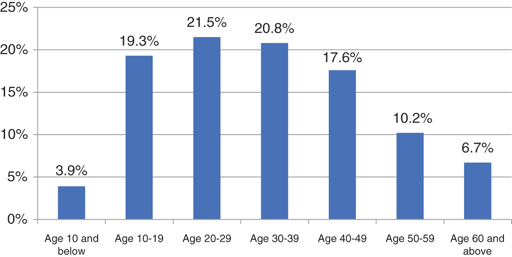

**图 4.1** **主导中国互联网的人口统计特征** ¶ 数据来源：CNNIC 报告，2020 年 3 月。

根据 QuestMobile 的报告，Bilibili 用户群的大多数（超过 80%）是 Z 世代，即在中国 1990 年至 2009 年间出生的人。他们通常接受过良好的教育并精通技术，对文化产品以及自我表达和社交互动渠道有强烈的需求。有趣的是，就像电影行业一样（参见第 3 章），用户人口增长最快的群体也来自“小镇青年”。在手机广泛普及和国家宽带基础设施之前，来自中国广阔下线城市和农村地区的年轻一代是一个未被覆盖的群体。现在，这些年轻人正经历着消费升级的趋势，在线娱乐变得日益迫切需要。

数字技术给粉丝经济带来的最显著变化是，粉丝首次处于在线娱乐的中心。在新媒体平台上，得益于互动功能以及最近的 DIY 视频制作工具，粉丝不再是娱乐内容的被动消费者。结果是，新的社交媒体平台现在正从以“精英”为中心的社区转向尚未被开发的草根群体，这些群体来自较小城市、年龄更小、社会地位较低且外表不那么光鲜亮丽的人。

尽管许多粉丝自嘲地自称为`diaosi`（屌丝），但他们仍然渴望参与病毒式娱乐内容的制作。事实上，在网上展示（或称`shai`）他们的生活方式是许多中国年轻人社交结构的一部分。（参见“`Shai`[‘秀耀’]和`Daka`[‘打卡’]”侧栏）。为了有效地吸引他们，中国的媒体平台不仅为粉丝提供了发现和消费内容的平台，还为他们配备数字技术来创作和贡献专业质量的内容，这是本章所有案例研究的共同主题。

例如，Bilibili 通过精心设计的互动功能抓住了其年轻用户的心。该平台最受盛誉的功能是“弹幕”，它允许用户针对直播视频发布“弹幕”消息。每位观众都能看到观看同一段视频的其他观众同步的评论、想法和感受，这些内容直接叠加在播放的视频上。这种标志性的特征培养了高度互动的观看体验，让用户能够从与具有相似志向和兴趣的其他用户建立的强大情感纽带中受益。

因此，年轻粉丝去 Bilibili 不仅是为了视频本身，也是为了社区，无论是动画、音乐、漫画还是游戏。在视频的关键时刻，反应信息会像密集的潮水一样涌过视频，往往会遮住屏幕上的整张脸。（对于那些年轻观众来说，他们看视频的方式最好的概括就是 2010 年中国动作喜剧片的片名：《弹飞时代》。）为了让那些先锋的用户放心，公司利用基于人工智能的筛选系统对弹幕进行语义分析，以过滤掉不当内容。

自从 Bilibili 从 2017 年开始年度弹幕排名以来，前十名的结果为中国 Z 世代的文化趋势提供了独特的视角。2017 年的首届冠军是`囍`（喜，中文里的“双喜”），2018 年是“真实”。“2019 年 B 站年度弹幕之”是术语`AWSL`，它源自中国的“啊，我死了！”——意思是“我快死了”。

`AWSL`类似于英语中的“This is killing me”，通常在社交媒体上用来描述极其可爱、令人兴奋或有趣的事物。它用于表达某人在观看 Bilibili 视频时的独特喜悦感。“简洁且自发，AWSL 反映了当代的青年文化，是在线互动的绝佳媒介，”中国科学院文学研究院博士后高汉冰在相关媒体报道中分析道。（对于年龄较小的读者，2019 年 Bilibili 弹幕十榜的完整列表请参见表 4.1。）

| Index | Chinese | English | Description |
| :--- | :--- | :--- | :--- |
| 9 | “正片开始” | “Official start” | 视频或游戏剧情开始进入故事线高潮的时刻 |
| 10 | “标准结局” | “Standard ending” | 对视频或游戏预期结局表现出的不满反应 |

这种弹幕功能类似于某些中国电影院里的“弹幕幕幕”（有关“大数据”电影的讨论，请参阅第 3 章）。然而，网站上的并非所有人都能发弹幕——你必须先通过入学考试。任何访问平台的用户都可以观看或搜索内容，但随后他们必须注册以激活平台上的基础互动功能，如点赞视频和关注内容创作者。注册用户在通过了由 100 道题组成的选择题并成为“正式会员”后，可以使用弹幕聊天和评论等额外的互动功能。

入会考试涵盖了关于上传视频和发送弹幕的社区礼仪问题，以及一系列涵盖注册用户熟悉（且应该熟悉）的各种主题问题，如动漫、音乐、游戏和技术。注册用户需要正确回答共 60 道题才能通过入会考试。截至 2019 年底，哔哩哩已有 6790 万通过入会考试的正式会员。这种成年仪式增强了达标者之间的排他性感，反过来创造了一个高粘性的社区。

此外，哔哩哩已将自己从一个 ACG（动画、漫画和游戏）资源地发展变成了一个蓬勃发展的自制视频明星社区。正如在多种内容格式的各种案例研究所示，不断增长的专业（高质量）用户生成内容，或 `PUGC`，是所有在线娱乐平台的一个共同主题。`PUGC` 结合了用户生成内容（`UGC`）提供的内容广度与专业生成内容（`PGC`）提供的质量。它的出现凸了用户本身就是内容创作者，这使得他们成为这些平台无可争议的中心（相对于提供大预算制作的娱乐公司）。

专业用户生成视频，或 `PUG` 视频，最近成为最受欢迎的内容类别。在哔哩哩平台（以及所有其他娱乐平台）上，视频现在由广泛的参与者创作，从业余爱好者到具有一定制作和编辑能力的专业用户，再到制作室或工作坊的专业人士，但区分他们两种内容的界限正变得越来越模糊。过去，`UGC` 通常被视为低质量；然而，随着廉价且易用硬件（如数码摄像机和带有高分辨率视频摄像摄像头的移动设备）的发展，以及桌面编辑软件等软件技术的进步，制作高质量视频内容的门槛正在迅速消失。

哔哩哩开发了多种上传工具，使用户能够高效上传多媒体内容，包括不同长度的视频、图片、博客和其他形式的内容。某些上传工具还包含编辑功能，可以帮助用户为内容添加各种视觉和音频效果。因此，哔哩哩拥有自己的、被称为“UP 主”的内容创作者社区。他们的 `PUG` 视频因其原创性以及分享和互动特性受到哔哩哩用户的欢迎。2019 年，`PUG` 视频的播放量占了哔哩哩总视频播放量的约 90%，这解释了为什么在 2020 年跨年晚会上，歌手和表演者主要选自“顶级 UP 主”（平台上最受欢迎的内容创作者）。

除了技术支持外，哔哩哩还通过为“UP 主”提供电子商务机会来进一步激励他们创作内容。无论品牌处于哪个领域，可能都有通过利用哔哩哩上的内容来吸引中国 Z 世代消费者的途径。2018 年 12 月，该公司与阿里巴巴的`淘宝市场`达成了内容驱动型电子商务的业务合作协议。根据协议，两家公司合作开发一个动态生态系统，以更好地连接两个平台上的内容创作者、商品和用户。

作为合作伙伴关系的一部分，在线市场会将来自哔哩哩的内容作者介绍给与淘宝合作的国际品牌。哔哩哩在时尚、美妆、旅游、健康健身、亲子、家居设计、汽车等类别领域拥有热门 UP 主，他们可以帮助国际品牌开展营销活动。例如，在 2020 年除夕，淘宝秒杀平台 `聚划算` 是哔哩哩晚会的标题赞助商。为了针对哔哩哩的用户，`聚划算` 发布了 ACG 主题的特产品。（同样在 2018 年，腾讯在 3 月纳斯达克上市后向该公司投资了 3 亿美元。）

总而言之，年轻用户、移动支付和电子商务三大力量共同点燃了中国的粉丝经济（参阅图 4.2），创造了本章将讨论的众多动态平台。今天的粉丝在内容创作中发挥着积极和直接的角色。成为网红是许多用户创作自己的具有病毒式传播价值独特内容的动力，而新的数字技术让他们比以前更容易实现这一目标。得益于普通用户即可获得的先进技术，`UGC`（用户生成内容）和 `PGC`（专业生成内容）之间的界限也在消失，因为 `PUGC` 不再是低质量和低趣味内容的同义词。

以下章节将探讨腾讯旗下的中国阅（最大的在线文学平台）、微博（中国的 Twitter 版）、百度的爱奇艺（中国的 Netflix 版）、字节跳动的 TikTok（目前媒体领域价值最高的独角兽），以及其他同样志于成为年轻一代——以及所有人——一站式娱乐平台的平台。视频流媒体，尤其是短视频，是移动平台的核心，也是本章的关注点。然而，网络文学处于行业 IP（知识产权）流动的上游，因为它是各种衍生内容（包括出版、游戏、动画、影视拍摄以及视频）的基础。因此，我们首先介绍在线文学业务。

## 腾讯中国阅：网络小说的之神

在线小说阅读在中国非常流行，部分原因是它是最廉价的原创娱乐内容形式之一。中国互联网络（CNNIC）的数据显示，早在 2014 年，大多数中国读者就已经迁移到了移动设备，约 85%的读者使用智能手机阅读文学作品，远早于纸质书或 PC 电脑等其他阅读媒介的使用。到 2020 年 3 月底，在线文学读者已超过 4.5 亿，约占互联网总人口的一半。

`Shanda Literature`曾拥有最受欢迎的网站和近 50%的市场份额。点点成立于 2008 年，是让中国作家自由地在线发布作品，并通过读者的微额支付以及权利和许可交易实现作品变现的先驱。尽管在内容上处于领先地位，但点点文学错过了移动阅读市场的发展，并在 2015 年初被腾讯文学收购，而腾讯文学的母公司腾讯其企业基因中流淌着移动娱乐基因。合并后，新实体阅文集团（意为“阅读文学”，英文名称为`China Literature Limited`）成为在线文学领域的超级巨头，占据了约 70%的市场份额。2017 年 11 月，中国阅在香港上市，股价在交易首日飙升高达 90%，被称为该城市近十年来利润最丰的 IPO。

如今，按作家、读者规模和文学内容提供的数量来看，该公司仍是中国最大的在线出版和电子书网站。公司拥有九个主要品牌产品，其中旗舰产品`QQ Reading` 是一个统一的移动内容聚合与分发平台。截至 2019 年 12 月 31 日，公司拥有 810 万名作家和 122 万部在线文学作品，涵盖了 200 多个种类。得益于腾讯生态系统的用户流量——腾讯在 2019 年底持有公司 57%的股份是最大股东——中国阅平台拥有超过 2 亿的月活跃用户。根据百度 2020 年 2 月的搜索排名，排名前 30 的在线文学作品中有 25 部是在该平台上创作的。

尽管形式简单，网络小说业务是第 3 章中 4Cs 模型的完美范例，它在数字经济中无缝地将用户围绕 4Cs 整合在一起：背景（Context）、社区（Community）、内容（Content）和连接（Connection）。首先，中国在线文学的独特特征是大多数作品是作者分章节编写和发布的连载小说（一种新的`Content`）。这种在线连载格式证明了其完美适配移动互联网时代。每天，数百万年轻数字阅读用户刷新他们的手机应用，只为了跟上喜爱的读物的每日更新。

对于许多没有时间读纸质书的人来说，手机上的小说（一种新的`Connection`）可以在他们任何空闲时间轻松阅读。每个连载章节通常有几千字，因此可以在日常琐事的任何“碎片时间”完成阅读，例如在超市排队或等公共交通时（各种`Contexts`）。在聊天室和社交网络上，数百万粉丝积极地评论故情节并相互讨论（一种新的`Community`），小说的流行程度是数字化且可量化的。

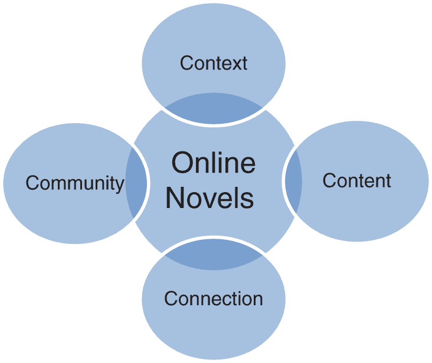

**图 4.3 代表 4Cs 模型的网络小说业务**

当作者开始积累大量读者群时，在线平台可以为他们提供合同，将其作品从公有领域移出。连载格式有助于文学网站实施按内容付费的机制，而移动支付系统的发展（另一种新的`Connection`）使读者能够对他们的连载阅读进行小额且重复的支付。网站安排作者分章节写故事（通常对每帖的总字数有上限），读者只需支付相当于 0.01 美元一小比例的微小费用来阅读每次更新，这比在书店购买纸质版要便宜得多。

有趣的是，“愿望达成”主题是网络小说在年轻人中如此受欢迎的主要原因之一。很大一部分读者来自中国的小城市，他们自称为*屌丝*（diao-si）读者，因为既没有公寓也没有女朋友。英雄们英俊、强大且成功，小说中引人入胜的情节为读者提供了一个梦想成为英雄自身的背景。为了此，网络作家为读者的享受创造了许多想象世界。（请参见 `Diao-si` [Loser] 读者和 `Pu-jie` [Drop-Dead-on-Street] 作者说明框。）

同样的动态也出现在 2020 年的 COVID-19 疫情期间。“网络小说读者可以在一个带他们远离现实的文学世界中找到慰藉。居家隔离的安排给他们提供了更多阅读的机会；阅读是一种情感疫苗，帮助他们对抗病毒，”一位与字节跳动旗下“番茄小说”签约的职业小说作家在新冠肺炎危机期间接受新闻媒体采访时说道。（在与 TikTok 及其姊妹产品相关的章节中查看更多关于番茄小说的详细信息。）

此外，当“屌丝”读者发现自己可以通过发布反馈和建议来改变作家的故事走向时，他们感到更有被赋权。大多数网络文学网站都包含一个奖励功能，读者可以酌情奖励网络作家金钱或积分。如果读者对根据其建议而改变的故事情节特别满意，他们可以向作者进行一次性大打赏（一份“礼物”）。得益于技术创新，中国阅平台最近推出了新功能，让读者能够参与他们喜爱的故事创作：

- **更多即时评论。** 2018 年推出的功能是“段落评论”（以段落为最小单位的评论功能），通过鼓励读者提供更多即时评论增强了用户与作家的互动。
- **自己的声音（字面意义）。** 2019 年底推出的新功能允许用户提交他们对小说选句的语音录音，并收听他人的评论。这一受欢迎的功能为原始文本带来了用户的声音，并创造了更多层次的互动背景，使社区更加紧密。
- **提升了推荐效率。** 在用户社区内构建社交图谱之外，平台还利用深度学习和自然语言处理技术来绘制单个用户的兴趣以及文学作品的特征，从而向用户推荐最相关的内容。

尽管读者的参与度不断提高，但他们的反馈并不总是能改变故事，因为作者在动笔之前就已经规划好了小说的情节。当粉丝读到最新章节时，作者可能已经在创作后续作品了。但这并不意味着“死忠粉”读者的梦想就会破灭：读者们可以转变为自己故事的作者。这就是网络小说与传统图书出版最大的区别。出版网络小说并不像写书那样，作者必须在出版前完成整个情节并写完所有章节。相反，用户只需要几千字就可以开启一本书，并向读者展示他们正在创作的内容。

因此，粉丝很容易成为作者，使网络小说网站变得充满活力且具有可持续性。因为互联网为有抱负的年轻作家抹平了竞争场，即使是无名作家也能凭借热门作品脱颖而出。例如，在互联网时代之前，中国的年轻编剧很难出头，因为少数制片人与少数编剧合作，控制了几乎整个电影市场；而如今，许多来自处女作家的网络小说已被改编成电影。

根据北京报《京华时》（Jinghua Times）的一项最新调查，中国的数百万网络作家根据收入和粉丝数量被读者分为五个等级。除了等级最低的“扑街”（pu-jie）作家（可以翻译为“走在街上就会死的作者”）外，较高等级的所有职业作家都被称为“神”。但他们拥有不同的头衔，就像希腊众神中的不同神灵一样（参见表 4.1；在阅文学平台上，“大神”和“至神”分别被称为“金牌作家”和“现象级作家”。然而，“中神”和“小神”才是网络小说生态系统的核心）。

与上一节提到的 Bilibili（哔哩）类似，阅文学平台日益受到年轻 Z 世代的驱动。2019 年，内容方面的创新很大程度上是由 Z 世代作家提供的，他们充满热情，并能够以与前代完全不同的方式与年轻群体互动。他们占了金牌和现象级作者的 25%，并不断推向网络文学世界的边界。例如，《诡秘之主》的作者成功地创造性地结合戏剧和游戏元素，用一种非传统的方式讲述了他的故事。

### 表 4.1 中国网络作家的五个等级

数据来源：北京报《京华时》（Jinghua Times）2015 年调查。

| 等级 | 粉丝数量 | 年收入（人民币/美元） | 作者人数 |
| --- | --- | --- | --- |
| “扑街”作家 | 粉丝极少，偶尔被推荐 | < 1000 元人民币 ($150 美元) | 众多 |
| 小神 (`Xiao-shen`) | > 100,000 | > 100,000 元人民币 ($15,000 美元) | 大量——网站基石 |
| 中神 (`Zhong-shen`) | > 500,000 | > 500,000 元人民币 ($80,000 美元) | 数百位 |
| 大神 (Da-shen) | > 100 万 | > 100 万元人民币 ($150,000 美元) | 同样是数百位 |
| 至神 (`Zhi-gao-shen`) | 数百万 | 数百万元人民币 (> 100 万美元)) | 20–30 位 |

在更广泛的背景下，由于网络小说粉丝群体规模巨大，且与其他媒体内容的粉丝重合度很高，小说读者的影响已超出了阅读市场。通常，文学作品的忠实粉丝不仅是读者；他们还倾向于成为文学作品改编的剧集和电影的忠实观众，或是游戏玩家和动画粉丝。因此，网络文学是一个比看起来大得多的粉丝经济的 IP（知识产权）基石（参见图 4.4）。因此，它是娱乐平台的关键部分，不仅为联动的娱乐产品提供上游知识产权 (IP)，还让平台能够监控用户口味的趋势。

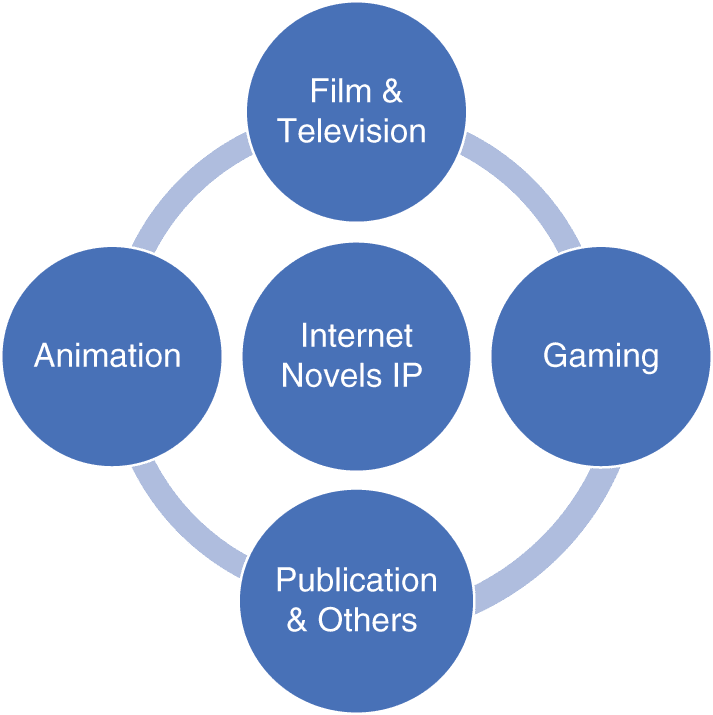

### 图 4.4 网络小说作为“上游”IP

例如，阅文学通过 2018 年 10 月收购“新经典媒体”（NCM），在通过剧集将其 IP 变为现实方面迈出了大一步。新经典媒体被认为是放大其 IP 价值的关键缺环，收购后，阅文学定位为领先的剧集和电影制片厂。基于网络文学库，新经典媒体通过发布《北京城中》、《庆余之华》和《最佳拍档》开发了顶级内容。

所有这些剧集在各自的播出时段内都名列前茅。值得注意的是，《庆余之华》改编自平台最受欢迎的小说之一，在百度和字节跳动的 2019 年搜索指数中排名第一。有趣的是，剧集的成功也让小说自 10 多年前推出以来再次登顶榜单，吸引了 350 万次推荐和 60 万次奖励。基于这一现象级的成功，《庆余之华》第二季的开发已经在进行中。

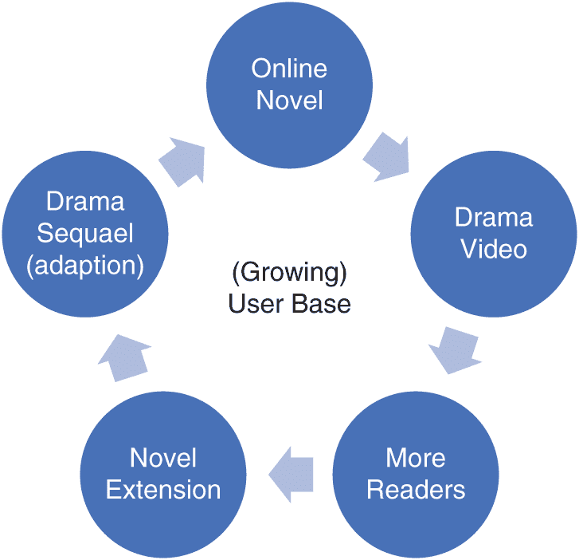

对于一个拥有最多签约剧剧作者的平台来说，看到中国文学与作者本人共同开发的剧集是理所当然的。5 月 5 日，他们组织了名为“不更新日”的罢工，获得了平台上数千名作者的支持。数十万条带有话题标签的帖子被发布，在微博（下一节将讨论的中国主要社交网络）上产生的总浏览量超过了 1 亿次。据作者们表示，如果公司移除其所有网站上内容的付费墙，他们主要来自订阅费和读者奖励的收入将大幅减少。

归根结底，这场争议在于如何分分一块更大的蛋糕。如果这种跨格式的生态系统能够从更多来源（广告、改编和许可）中获得更多收入，延长小说的生命周期，并解决作者对版权侵权的顾虑（某些读者总能找到方法免费阅读付费墙后的内容），那么对于作者来说这可能是一笔更划算的交易。正如本章所示，免费阅读模式将在所有平台发生。当利益相关者达到一个新的、且更有利润的平衡点时，作者和读者的梦想此后就可以继续进行。

## 超越 Twitter——微博 UGC 平台的（短暂）复兴

新微博于 2009 年作为微博客服务推出（其中文名称字面意思即为 `weibo`），主要被称为“中国的 Twitter”。像 Twitter 一样，微博也作为一个关注/被关注网络运行；它利用中国类似的意见领袖（如媒体明星和商业领袖）来吸引早期用户群，而且微博最初对帖子也有 140 个字符的限制（该限制在 2016 年转型业务模式时早早被取消）。

然而，自 2016 年以来，微博已转型为一个综合性媒体平台，结合了 Twitter（文字）、YouTube（视频）和 Instagram（图片）等社交媒体渠道的所有内容和功能。它将实时的公共自我表达手段与强大的社交互动、内容聚合和内容分发平台相结合。从那时起，该公司在 2016–2017 年间增长最快，其股价（在纳斯达克）上涨了五倍以上（参见图 4.6）。在同一时期，微博的市值超过了 Twitter。接下来的微博案例为本章其余部分讨论新媒体平台提供了有用的背景。

微博的增长让许多人感到意外。其一，视频流行业的趋势是，随着观众对高质量内容的需求日益增加，视频内容正从用户生成内容（UGC）转向专业生成内容（PGC）。另一方面，由于腾讯的社交即时通讯软件微信在年前获得了广泛普及，许多人从微博切换到微信，因为后者成为了公众对社交网络、移动消息和互动私密对话需求更流行的平台。结果，微博的增长在微信出现后的几年里放缓，许多人预测微博的时代结束了。

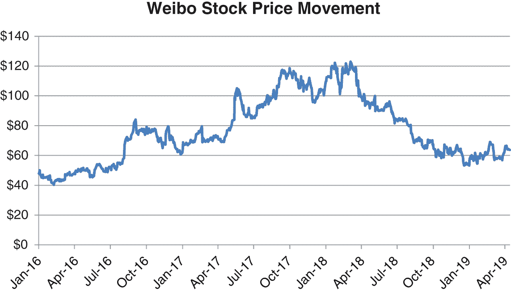

**图 4.6** **微博股价走（2016–2019）** ¶ 数据来源：Capital IQ。

那么微博的巨大复兴从何而来呢？答案非常简单：用户要求更多元化的内容消费和更积极的内容创作参与，而微博做出了正确的反应。为了满足用户日益增长的需求，公司对其定位进行了关键调整——微博将自己设定为一家社交媒体公司，而不是微博客网站。为此，微博的新方法是构建简单实用的工具，使用户能够能够发现、创建和分发内容，公开表达自我，并在平台上与他人进行实时互动（参见表 4.2）。

**表 4.2** **微博对其定位和提供的关键调整**

|  | 过去（中国的 Twitter） | 现状（多媒体平台） |
| --- | --- | --- |
| **界面** | 电脑端 | 移动优先 |
| **内容格式** | 文字 | 文字、图片和短视频（包括直播）；文字不再有 140 字的限制 |
| **大部分内容** | 文字 | 短视频 |
| **用户年龄** | 年龄较大，大多数为成年人 | 年龄较轻，大多数在 16–25 岁之间（中学生、高中生、大学生以及大学毕业几年的年轻人） |
| **用户地理分布** | 主要在一线和二线城市 | 更多在三线、四线和五线城市 |
| **用户流量的驱动力（“影响者”）** | 大多为“传统名人”（大 V），形成一个以“精英”为中心的社区 | 既有“传统名人”（大 V）也有“草根名人”（中 V），更去中心化的社区 |

通过多媒体化，微博提升了其平台上内容的数量和质量——现在，一个典型的微博分享不再是一个无聊的 140 字帖子；相反，它是文字、图片、视频、直播和互动的混合。凭借 `mobile first` 的理念，微博围绕移动设备的能力设计了平台，以简单的信息流形式展示内容。特别是通过视频和直播，微博比在 `social opinions` 背景下获取了更多的用户活动粘性。虽然微信主要是小圈子互动的地方，但微博一直是公共讨论和分享的首选平台。

结果，微博生态系统在三个方面发生了根本性变化：

**第一**，通过其社交媒体定位扩大了用户群。中国移动互联网的主题是关于乐趣和享受。对于中国的许多人来说，微博让他们能够公开发并接触到更广泛的思想、文化和体验，而不是在微博还是 Twitter 版本时仅仅阅读意见领袖的观点。有趣的是，就像电影、团购和在线文学业务案例一样，微博的用户增长更多来自小镇青年而非城市。

**第二**，它在平台上增加了更多活跃用户（参见图 4.7）。微博平台为用户提供了实时公共自我表达手段，不再局限于名人。任何用户——包括大多数一直是“被动粉丝”的人——都可以创建并发布动态，并附加多媒体和长内容。他们还可以通过关注、转发、评论和发送私信在平台上相互互动。在 2016–2017 年的黄金时期，通过为用户提供易于使用的创作和共享视频的基础设施（特别是以低成本的方式），微博显著增强了用户体验：每个人都可以创作 `UGC`（用户生成内容）视频。

第三，涌出了更多的“网红”和“电商影响者（KOL）”。直到今天，微博上最大的明星仍然是“传统明星”——即那些此前通过电视、电影或其他传统渠道取得重大突破的电影明星、体育冠军和商业领袖。许多人拥有数千万粉丝，这是因为他们是自 2009 年微博成立以来，首批加入该平台的名人之一（即所谓的“大 V”，其名字后带有“V”，因为他们的账号已通过微博的认证）。

然而，近年来出现了一批“网红”（中文中称为 `Wanghong`）的出现，他们通过互联网成为了自力成足的在线影响者。这些网红各不相同，从喜剧演员（如著名的 `Papi Jiang`，她因发布自己的幽默视频而闻）到时尚博主、化妆造型师，甚至是对冷门话题了如指掌的书呆型人物。作为自力成足的，他们也被称为“草根网红”。最著名的可能是时尚网红 `Zhang Dayi`，据传她与 `阿里巴巴` 曾最年轻的合伙人的绯闻可能改变了这家电商巨头的 CEO 继任计划。（参见“大 V——不仅仅是肉体兴趣”框）。

草根网红可能有数百万或数十万粉丝，并据此被归类“中 V”和“小 V”（相对于“大 V”）。中 V 和小 V 玩家的意义之处在于，就像网络文学业务中的“中神”和“小神”一样，他们构成了生态系统的核心和最活跃部分。凭借规模相当（但并非主导数量）的粉丝关注，他们通过广告、电商、订阅、打赏等手段在 `Weibo` 上激进地将其社交资产变现，从而导致了娱乐内容与电子商务之间不断创新的协同效应。

作为草根网红营销力量的开创性案例，2016 年 4 月，一位名为 `Papi Jiang` 的在线视频明星（她以在 `Weibo` 页面上发布讽刺性的社会评论而闻名）将自己的代言人服务拍卖给了出价最高的企业。竞得价为 340 万美元，得胜者是中国化妆品零售商 `Lily & Beauty`，该公司在 `Papi Jiang` 的一个视频中获得了一次性推广，并在她的社交媒体账号上被提及。另一个例子是，健身专家 `Chen Nuanyang` 每周在她的 `Weibo` 页面进行直播，粉丝们登录是为了学习腹部起坐和瑜伽姿式的知识，同时也为了她最新的健身服。她将拥有 75 万名 `Weibo` 粉丝的在线基数转化为一个 `Taobao` 商店，并在 2016 年实现了每月销售额超过 200 万美元的健身装备。

总而言之，`Weibo` 的成功举措是从文本博客转向多媒体，并将其传统的被动粉丝转变为活跃的内容创作者。然而，用户对娱乐的胃口需求日益增长且永无满足。自 2018 年以来，中国市场出现了对新型短视频 App 的狂热。结果（由于其他市场因素的影响），`Weibo` 的用户增长相对放缓，股价在后期经历了压力（参见 图 4.6）。截至 2020 年初，`Webio` 拥有超过 5 亿的月活跃用户。

## TikTok: 搞怪视频主导社交媒体

短视频作为一种快节奏的体裁，在中国经历了快速增长。首先，`TikTok` 提供了与长电影不同的体验。其次，它为用户创建和分享提供了易于使用的基础设施。根据 Sensor Tower 发布的 2019 年下载量前 20 位 App 报告，`抖音` 和 `快手` 已成为中国领先的两个平台。

`抖音` 的字面意思是“抖动的声音”，由总部位于北京的软件公司 `字节跳动` 于 2016 年推出，该公司还控制着 `今日条`（参见 图 4.8）。

2017 年，`TikTok` 以 10 亿美元收购了美国市场的青少年对口卡拉 OK 应用 `Musical.ly` (`musical.ly`)。2018 年，`字节跳动` 将 `Musical.ly` 并入 `TikTok`，并将其重命名为面向海外市场的单一应用程序。它在美国以及印度、东南亚等大型新兴市场一走红。根据报告，`Facebook` 拥有五个 App 中的四个：`WhatsApp`、`Messenger`、`Facebook` 和 `Instagram`，但 `TikTok` 的受欢迎程度仅次于 `WhatsApp`。

在美国，`TikTok` 吸引了来自不同社区大量用户。其中一个活跃群体是年轻的军人。他们上传自己的视频，通常是在军事设施内穿着制服进行健身运动，看起来往往像战争剧场。由于 COVID-19 疫情迫使全球青少年离开学校回到卧室，他们转向 `TikTok` 寻找搞怪视频。（根据新闻媒体报道，该 App 仅 2020 年 3 月份就被下载了 1.15 亿次。）

例如，在 2017 年的早期增长阶段，“因果报应（Karma's a bitch）”变装视频特别火，这些视频的特点是用户通过对着“Karma's a bitch”的歌曲对口型，瞬间变换形象。“因果报应”挑战完美契合了 TikTok 的特效功能。用户面对镜头，背景播放着酷炫的音乐，对着美国青少年肥剧《河谷谷》（Riverdale）中维罗妮卡·洛奇（Veronica Lodge）说“karma is a bitch”的台词，向上抛围巾或床单遮住脸，然后让它落下，露出穿着华丽服装或化着完美精致的更好（或最好）的自我。用户必须感受到 TikTok 的赋能，在敌人面前显得光光夺彩、不可信议。*不要怨恨，要变得更好，对吧？

## TikTok 的核心优势

TikTok 的“变得更好”方面是这个以数字技术为中心的平台的核心优势。首先，创作有趣的视频内容实际上非常有挑战性。再加上中国人通常被认为害羞且内敛，许多用户在没有专业支持的情况下，会对表演和创作自己的视频感到犹豫。为此，TikTok 提供了足够的视频模板、指导和示例，以确保用户对创作自己的视频产生兴趣。

此外，TikTok 让你看起来更`漂亮`。TikTok 提供了丰富的（根据青少年的需求不断更新和变化）背景音乐和特效，让视频更加丰富、更有趣，包括贴纸、变脸、慢动作、画框等。所有普通用户都可以尝试这些看似无尽的可能性，创作出看起来专业且高度精良的视频（PUG 视频）。通过该应用的数字工具，每个人——即使是最没有才华的业余爱好者——也能变成具有酷幽默感的才华演员。

另一个例子是，在 2018 年足足世界杯上，中国国家足球队（再次）在预选赛失败，未能进入在俄罗斯举行的决赛赛。然而，移动互联网仍然帮助为数亿粉丝以及首次观看的观众在中国创造了一个狂欢节。在世界杯期间，他们创作了许多视频，记录自己在赛期间的日常生活。许多女孩——她们并不一定是足球迷——也通过自己的创意视频热烈地加入了这场体育盛事。多亏了 TikTok，长相平平的女孩变成了像专业模特一样迷人的“足球偶像”。

## KOL 的兴起

TikTok 最强大之处在于其关键意见领袖（KOL，类似于 Instagram 和 YouTube 上流行的“网红”）在其平台上的迅速出现。该平台利用复杂的机器学习算法来促进观众的指数级增长，并将用户转化为 KOL。事实上，新用户在 TikTok 上能如此轻易地触达到庞大的受众，这可能会让许多人感到惊讶。原因如下：

### 推荐 AI 算法

**一方面**，TikTok 采用了一种强大的推荐 AI 算法，从用户的观看习惯中学习他们的兴趣。该算法旨在跟踪内容浏览和互动历史，以分析视频内容、用户特征和用户行为之间的相关性。当新用户首次打开应用时，向其显示的初始的一百个视频在某种程度上是随机且标准化的。所有视频默认循环播放，这通常会导致多次观看。这种短视频格式让算法训练得非常快：在观看一段 15 分钟长视频的时间内，TikTok 可以捕获 100 个 15 秒短视频的用户行为数据（包括重复播放，这在算法中占很大权重）。一旦算法评估了用户的偏好，它就会从内容池中向他们推送更具针对性的素材。

接下来的步骤极其简单且有效：TikTok 向“已知”用户轰炸不断重复的片段。它不断地推送类似的轻松幽快的视频，在机器学习算法推送它们之前，人们甚至不知道自己想要这些视频，而这些视频在不断个性化的信息流中呈现，直到用户被深深吸引。在经过几轮投喂和反馈后，AI 算法变得如此高效，以至于 TikTok 被称为中国最“成瘾”的应用，因为它已成为人们打发闲时间最喜爱的方式之一。在西方市场，TikTok 被称为“加强版的 YouTube”。

## 分发机制

**另一方面**，TikTok 有意识地将根据受欢迎程度决定的最佳视频分发给最多的观众，从而让获胜者成为更大的获胜者。当一个新视频被少数选定的观众给予积极反馈时（他们赞美、点赞或只是看完整个片段），算法就会识别出他们的认可，并将视频分发给更大的群体（同样基于系统估计的兴趣）。如果更多观众继续喜欢该内容，这个过程就会重复。随着算法力量的双向倍增，对于拥有热门内容的用户，系统允许他们迅速扩大粉丝群并成为 KOL。

## 算法之外

除了算法，TikTok 还投入了人力资本来培养新兴的 KOL。根据《华尔街日报》2020 年 4 月的一篇报道，来自田纳西州纳什维尔的 23 岁兼职歌手、全职护士霍莉·（Holly Grace）开始为 TikTok 制作视频，每周对应用上流行的任何 15 秒流行音乐片段进行对口型，她还会对其他病毒式视频加入自己的见解，通常引用与医疗专业人员相关的话题。当她拥有大约 400,000 个粉丝时（这位年轻护士完全意料），TikTok 联系了她，并在公司内部为她安排了一位“经理”，通过标记热门歌曲和讨论她过去视频的成功与失败之处来帮助她的视频更具病毒。

未来，TikTok（字节跳动集团）正顺着 TikTok 的势头扩展到电子商务、游戏和其他领域，公司正试图在全球范围内与科技巨头竞争。例如，李佳琦（Jiaqi Li）曾是江西的一个美宝兰柜台美容顾问，后来成为抖音最受欢迎的男明星之一和最好的口红销售员。佳琦通过亲自试用不同色号为女性提供如何选择口红的建议，并成为目前 30 秒内为最多模特上口红的金士世界纪录保持者。他曾在直播 15 分钟内卖出 15,000 支口红（与化妆师每天在门店能做的几百支相比，这是一个惊人的数字），击败了阿里巴巴创始人马云，马曾想在两小时的直播中与佳琦竞争销售口红。

此外，平台还扩展到了更多媒体格式。很少俏皮视频的粉丝注意到，字节跳动也在大力投资在线阅读。字节跳动宣布将今日头条 App 发布的所有小说整合到其自己的电子阅读应用“番茄小说”中，以加强其在线文学业务。在 2020 年世界书日，字节跳动让其签约作者在抖音和 TikTok 上直播以推广他们的作品。

与此同时，*全球化*是抖音/TikTok 在中国取得巨大成功后战略的一个关键词。与它的同行不同，字节跳动没有合并中国和国际内容；而是为出海专门创建了一个名为 TikTok 的独立应用，这在中美科技战中证明是一项极其精明（尽管仍然不足）的举措。

一方面，中国互联网文化并不总是能在全球语境下通吃。即使是全球用户超过十亿的超级应用 `WeChat`（微信），在以 `Facebook` 为主导的英语社交格局中，或在日语等以当地语言为中心的市场中，其影响力仍然微乎其微。相比之下，抖音和 TikTok 被定位为同一个产品，但针对不同的营销目标具有然不同的特征。TikTok 在海外市场表现良好，因此在 2020 年，字节跳动成为除苹果之外，唯一一家在中国和西方市场都拥有超过 1 亿用户的科技公司。

另一方面，这种分离开的业务架构，使得 `TikTok` 能够在海外市场进行“本地化”管理。2020 年 5 月，迪士尼流媒体负责人凯文·梅耶尔（Kevin Mayer）被聘为 `TikTok` 的新任首席执行官。此举加强了 `TikTok` 努力让自己与中国保持距离，但仍不足以平息对中国在网络空间崛起感到警惕的美国政府。

2020 年 8 月，美国总统特朗普发布了一项行政命令，要求字节跳动在 90 天内剥离其在美国的 `TikTok` 业务，梅耶尔很快辞去了他的新职位。“最近几周，随着政治环境的剧变，我对公司结构调整需要什么，以及这对我签署的全球角色意味着什么进行了深刻的反思，”梅耶尔在给员工的信中写道。许多中国科技公司曾尝试在本土市场之外寻求战略但均告失败，看来 `TikTok/字节跳动` 不太可能是首个在中国国内外都能成功的全球性数字媒体公司。（有关中美科技战的更多讨论，请参见第 9 章。）

## 快手、爱优艺及：进入多屏竞争

在本章结束之际，这些案例研究都说明了成功的粉丝经济生态系统的关键组成部分：内容创作者越多，提供的内容就越多样有趣，平台就会变得越活跃、越可持续（参见图 4.9）。虽然平台应该关注金字塔顶端的明星，但一个成功的内容生态系统的强弱取决于其中层核心，这包括热实粉丝和活跃的内容生成者本身——无论是网络小说的“中神”、微博上的“草根 V”、`抖音`上的热门 KOL，还是 `Bilibili`（B 站）上的活跃上传者。

为了培养、互动和激励“核心”，平台不仅需要为媒体内容的消费和分享积累最大的用户群，还需要提供视频制作工具和变现手段，以激励普通用户成为他们最有创造力的 PUGC 内容生成者。这并非易事。目前的领先者，字节跳动的 `TikTok` 是可持续性问题的绝佳范例。由于很少有旁白，15 秒的 `抖音/TikTok` 内容很容易流传全球。然而，由于同样的原因，用户之间并没有形成真正的网络关系。此外，一个 15 秒的短片能加入多少广告？金钱问题是：尽管 `TikTok` 应用在国际上迅速扩张，字节跳动的大部分收入仍来自中国。

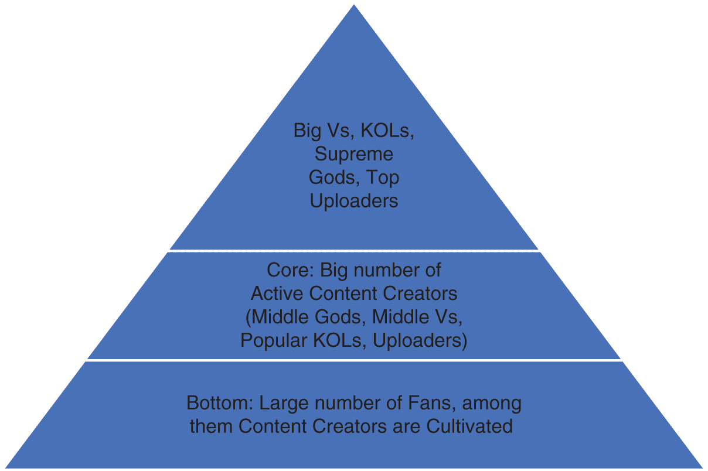

图 4.9 **粉丝经济的生态系统**

事实上，竞争正在升热，因为在线娱乐的竞争远未结束。它面临着来自同一领域的初创竞争对手，以及开始拥抱短内容的老牌科技巨头的挑战。短视频确实被 `TikTok` 普及了，但其入门槛相对较低。对于 Z 世代用户来说，注意力是珍贵的商品，他们可以很容易切换到一个新的、“更酷的”短视频平台，正如他们涌入 `TikTok` 一样。

（注：由于原始文本中存在多处重复的段落，译文已根据逻辑进行了去重处理，确保内容流畅且不重复输出。）

现在，长视频平台也押注于更多的用户参与度和 PUC（用户生成内容）视频。2019 年，`爱奇艺`、`优酷`和`腾讯视频`都推出了互动式视频产品，让观众不再是被动的观者，而是可以为角色做出选择并随着剧情改变故事。`爱奇艺`于 2019 年 5 月发布了全球首个专业的互动视频指南，以规范互动内容的创作，其他平台也迅速跟进。通过平台工具，创作者可以制作让观众决定角色行为以体验不同结局的视频。

在中国第一部互动影视剧作品《假面一笑》中，`爱奇艺`为浪漫喜剧片的观众提供了更多选择。视频讲述了一位年轻的艺人经理在入工作中负责管理一个正渴望成名的上升期男团的成员。故事从她的视角展开，随着浪漫情缘不可避免地发生，观众们（尤其是年轻女孩）对于“如何选择正确的人”显然有不同的观点。`分支剧情`功能让观众通过 21 种不同的分支故事选项和 17 种可能的结局来开启自己的冒险。当技术成熟后，长视频与短视频的融合可能成为一个有趣的新方向。

最后，但也同样重要的是 BAT 巨头们，尤其是拥有娱乐基因的`腾讯`。`阿里巴巴`、`百度`和`腾讯`都正在利用短视频来吸引年轻用户进入其平台，但`腾讯`的基因在于在线游戏和社交媒体；因此，它直接与`字节跳动`对抗。`腾讯`在其无处不在的 App `微信` 中屏蔽了大部分`抖音`视频（显然是因为对中国内容合规性的担忧），而这两个竞争对手（指两位创始人，而非其员工）在在线上互相指责对方有反竞争性的行为。（在较早的网络文学章节中提到，`腾讯`在 2020 年对其`中国文学`的高层管理团队进行了关键调整，并将其业务模式从订阅制转变为免费内容和广告驱动模式。显然，`腾讯`在效仿`字节跳动`在线文学领域的做法。）

总而言之，最终的竞争是为了中国互联网用户的时间和注意力。每个人都旨在创建一个一站式娱乐平台，为用户匹配所有可能的娱乐选择，这样他们想看书、玩游戏、制作视频或分享动漫时就无需离开平台。日益增长的挑战是，行业可能已经达到了“屏幕时间巅峰”——事实上，短视频的兴起可能反映了普通用户在线时注意力跨度的缩短。结果是用户的招募成本高昂且难以留存。

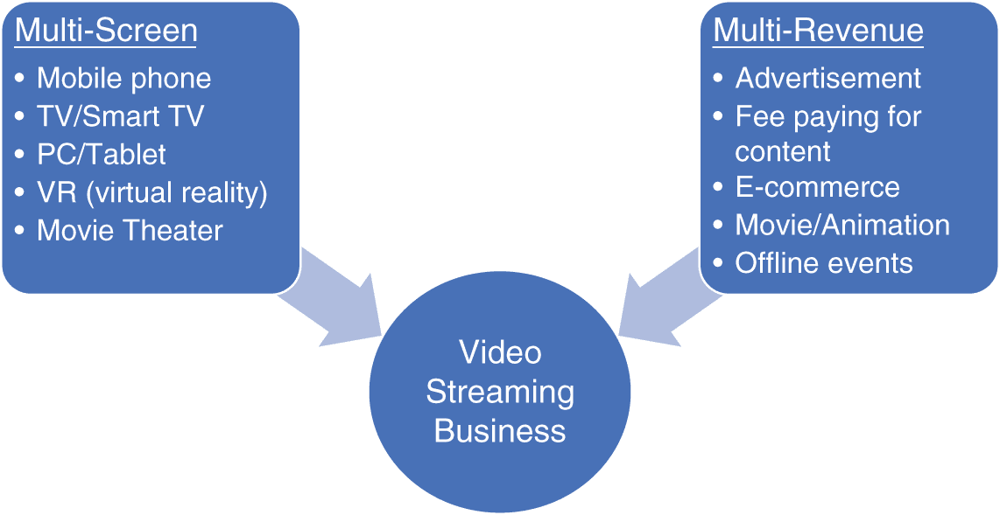

**图 4.10** **即将到来的多屏多营收时代**

因此，互联网公司必须无论用户在看哪种屏幕（在线或线下——电影院），都必须捕捉并留住他们的注意力，并说服他们付费。随着他们竞争提供最具吸引力的内容包、终端设备和集成平台，“多屏多营收”模式已成为行业内新的主流“游戏规则”（参见图 4.10）。未来的娱乐内容将基于即将到来的`多屏多营收`模式。

第三，中国在比特币交易量也占据着巨大的份额。中国的加密货币交易所（比特币或其他代币）曾曾在交易量上领先全球。2017 年，“币圈热”被中国当局中断，他们有效地将中国境内所有的代币发行（ICO）活动定性为“未经授权的非法公开募资”和“未经授权的公开发售”。中国政府还宣布境内所有加密货币交易所均为非法。结果，由于监管收紧，中国市场的加密货币交易及其他相关活动流向海外。（例如，2020 年初，据报道，比特大陆 Bitmain 正在德克萨州建造全球最大的比特币矿场，那里拥有丰富的电力资源。）

与加密货币不同（后者涉及国家的“数字货币”，请参见第 1 章中的相关讨论），中国政府将区块链视为“一项核心技术”。在最初的基于比特币以及后的以太坊（智能合约）代币之后，自 2018 年以来，区块链技术已进入第三阶段，并与实体经济融合。例如，在金融科技领域，银行利用区块链彻底改变供应链融资模式，本章将对此进行讨论。在习近平主席 2019 年年底发表呼吁加速区块链技术发展和工业创新的公开演讲后，这一趋势得到了强力推动。

正如本书开头提到的（参见图 1.1），中国企业在全球范围内区块链专利申请方面也占据主导地位，并正在为各行业开发实际应用。专利排名前茅的是阿里巴巴及其所属的金融部门蚂蚁集团。然而，蚂蚁集团的区块链实力仅是其帝国的一小部分（参见图 5.2）。例如，其电子支付部门支付宝处理的交易量超过了全球最大的移动支付市场的一半额额（相比之下，Apple Pay 的市场份额不足 1%）。根据研究机构 Analysys 的数据，支付宝在 2019 年处理的支付金额超过 1 万亿美元。

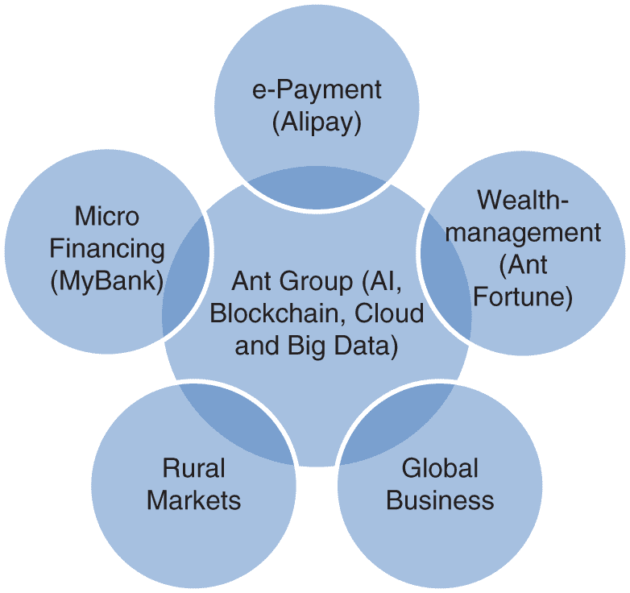

**图 5.2** **蚂蚁的金融科技帝国**

蚂蚁集团还根据大数据编制个人信用分，因此，通过向新借款人每次提供几元钱，其微贷业务已悄然膨成为中国最大的个人信贷额提供者之一。此外，它还成为财富管理的中心，不仅提供金融产品的数字化分发，还为资产经理开发新的基于 AI 的交易工具。其广泛的服务对于中国的数字中产阶级是不可或缺的，其触角正在扩展到农村和全球市场。

这就是为什么蚂蚁集团是世界上价值最高的私人金融科技公司（实际上是所有科技独角兽中最大的）。2018 年，蚂蚁集团筹了约 140 亿美元，市场观察人士称其为私营公司史上规模最大的单笔融资（根据市场数据公司 Crunchbase 的数据，140 亿美元是历史上已确认的最大的单轮融资额）。其估值高达 1500 亿美元（折合人民币超过 1 万亿），超过了著名的美国投资银行高盛银行的市值。2020 年 8 月，它申请在香港和上海两地上市，目标估值超过 2000 亿美元。

简而言之，在当今的金融科技世界中，没有与中国比拟的国家。随着互联网公司将智能手机变为金融交易平台，中国在互联网金融的普及程度上远超世界其他地区。对于大部分从未用过信用卡的中国人口来说，他们现在正在使用互联网管理支付、储蓄和投资，正如在中国许多地区，人们跳过座机电话，转而使用智能手机在人生中接入互联网一样。

除了蚂蚁集团外，它的互联网同行如腾讯以及传统银行如中国工商银行（ICBC）也都已成为金融科技巨头。它们的 AI 研究和包容性区块链基础设施正在改变银行、保险和财富管理的实践。在进入最新进展之前，本章将以移动支付（所有金融科技革命的起源）以及基于互联网的融资模式（股权众筹和 P2P 贷款）作为背景，这些模式在过去几年中曾经历过剧烈的兴起（和衰落）。

## 红包与移动支付

在春节（农历新年）期间，中国家庭有一项数百年的习俗，即向亲友发放装有新钞票的红包（称为 `hongbao`），以祈求好运。传统的红包场景通常是孩子们穿着红色的节日盛服，跪向长辈行礼以接受礼物，但在数字时代，这已变成移动设备上的一个趣味游戏。

红包由腾讯在马年除夕（2014 年初）在其受欢迎的即时通讯和社交平台微信上推出。个人向家人友发送问候，企业向员工表达谢意，都可以通过微信发送数字红包方便地完成这一操作。红包发送者只需将数字红包功能与自己的支付渠道（例如银行账户）绑定。然后，发送者就可以通过腾讯直接从银行账户将红包转给接收者。在接收端，接收者也必须绑定自己的银行账户以获取现金红包，或使用数字现金支付电子商务和服务（如移动叫车，参见图 5.3）。

除了微信用户发送的数字红包外，腾讯本身也向用户免费发放了大量红包。当然，腾讯不仅仅是在中国网友的节日庆祝中扮演“圣诞老人”的角色。动画红包是用户体验其移动支付系统的激励。因为发送者和接收者都必须安装连接微信系统的应用程序，并注册银行账户或借记卡，腾讯希望网友们在玩游戏的同时愉快地成为微信用户。

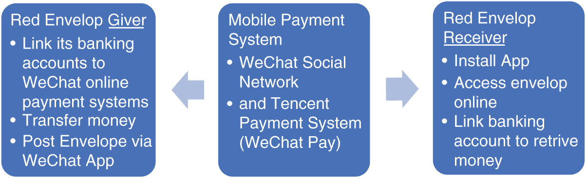

**图 5.3** **红包派对——趣味与价值**

微信红包的趣味功能为`WeChat Pay`（也称为“财付通”）创造了一次极其成功的市场营销活动。通过有限的资金投入，腾讯倍增了活跃用户数，获取了重要数据（银行信息），并让用户熟悉了其微信支付服务。在 2014 年春节期间，数以亿计的用户紧盯着手机而不是参加节日活动，试图尽可能地“抢”到由亲戚、朋友以及腾讯自身发放的虚拟红包。结果，人们打开`WeChat Pay`App 的频率超过了打开`Alipay`App 的频率，尽管`WeChat`在阿里巴巴启动`Alipay`约 10 年后才推出了该支付服务。

`Alipay`由阿里巴巴集团于 2004 年推出，在中国第三方支付市场中历史最悠久。在完成 2014 年左右的重组后，`Alipay`不再属于阿里巴巴，也不是阿里巴巴 IPO 的一部分，但它由阿里巴巴的高管控制。`Alipay`运营着一种类似于`PayPal`的互联网支付服务，并且已成为全球最大的移动支付处理器。`Alipay`不仅处理阿里巴巴旗下`Taobao`（淘宝）和`Tmall`（天猫）在线市场的支付，还处理许多其他类型的在线和线下支付，包括公用事业缴费、票务预约、餐厅用餐和出租车。

然而，在`WeChat`App 爆发式渗透的基础上，`WeChat Pay`近年来显示出强劲的增长势头。在 2014 年春节期间创新的数字红包活动后，`WeChat Pay`成功地进入了长期由`Alipay`占据的在线支付业务领域。数字红包瞬间吸引了数百万`WeChat`用户首次注册其支付服务，据此，腾讯在短短一年内将其市场份额从 5%翻倍到 10%。到 2018 年底，腾讯的移动支付系统已达到 38.87%，迅速追赶`Alipay`的 53.78%（两者合计控制了超过 90%的市场）。相比之下，根据 Analysys 的研究报告，`Apple Pay`甚至没有进入前八名（参见图 5.4）。

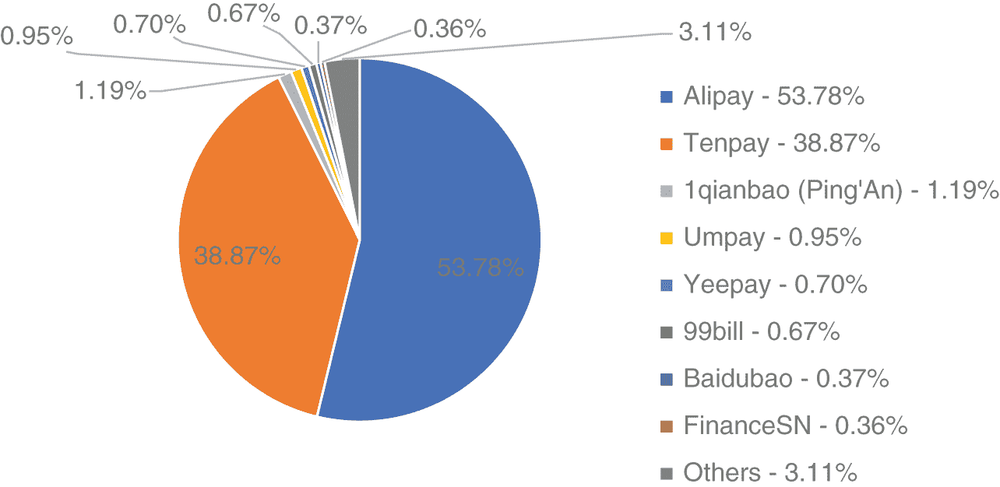

`Figure 5.4` **中国移动支付市场份额分解** ¶ 数据来源：Analysys 报告，2018 年 12 月。

撇开春节的趣味和戏剧性，红包大战是这两大互联网巨头为了移动互联网未来的一场激烈斗争。首先，移动支付服务是移动零售的关键组件，这符合中国消费者对“任何时间”购物速度和便利性的追求。这些购买许多是源于线下世界广告、社交对话或仅仅是随机想法的即时决定。因此，如果电子零售平台没有配备现成且方便的移动支付功能，很大比例的购买决策最终可能无法转化为实际的购买交易。

对于阿里巴巴而言，那是它无法失去的阵地。与腾讯的`WeChat Pay`相比，阿里巴巴的`Alipay`拥有更长的历史，凭借与`Taobao`、`Tmall`以及其他阿里巴巴电子商务网站的关联，拥有数亿活跃用户的先发优势。对于腾讯来说，中国最流行的社交平台`WeChat`是品牌（尤其是外国品牌）开发多媒体营销活动（企业账号）的重要平台；同时，个人`WeChat`用户可以建立应用商店（即所谓的“微信小店”）向他们的朋友和粉丝销售商品。通过整合移动支付功能，拥有各大品牌在`WeChat`内开店的腾讯，对阿里巴巴的`Tmall`构成了威胁，而它对小型商户的涵盖对阿里巴巴的`Taobao`成了挑战。

总而言之，移动支付在中国的使用比美国或欧洲等发达市场广泛得多。数字支付系统的突出不仅限于高端、专享服务——即使是小吃摊和水果贩（以及街头乞讨者）也深度采用了数字支付系统。除了数字零售外，移动支付系统已成为移动用户与其线下消费活动之间的重要环节，例如餐厅订位、杂货配送、上门美甲和电影票订单等。这些活动许多发生在用户的“碎片化时间”，即他们处于在线和线下世界间隙的时候。（参见图 5.5 以及关于第 6 章中与“共享经济”相关的更多 O2O 业务讨论。）

自 2019–2020 年以来，运营国家银行卡垄断的中国银联股份有限公司（`UnionPay`，`Visa`或`Mastercard`的中国对应机构）移动支付网络实现了快速增长。据媒体报道，到 2020 年 3 月它已达到 2.4 亿用户，成为最有可能打破移动支付双头格局者。（根据 Analysys 的数据，`Alipay`和`WeChat Pay`仍控制着中国 90%以上的移动支付市场。）2020 年初，《财新》杂志报道，腾讯已同意与`UnionPay`合作，整合其移动支付平台中的二维码系统。这一合作将扩大`UnionPay`的市场渗透率，并落实中国央行关于跨空间整合支付系统的计划。（自 2017 年以来，`Alipay`和`WeChat Pay`已被要求通过政府支持的清算系统进行银行间的支付转账。）

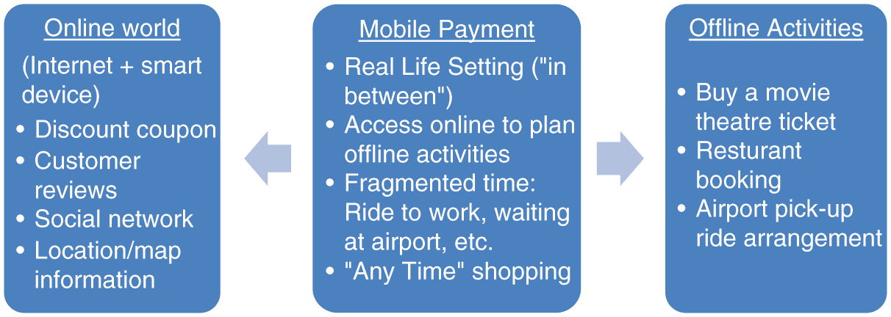

`Figure 5.5` **“碎片化时间”与 O2O 活动**

展望未来，所有主要的支付参与者正聚焦于较欠开发的“B 端”支付业务，如全球贸易和物流。与这两大科技巨头一样，`UnionPay`也增加了对区块链服务的投资，包括数字证书应用和基于区块链的跨境资本转移跟踪平台。由于`UnionPay`还领先着连接国内外国际市场的区块链标准网络（BSN）平台（详见[第 10 章](#c10.xhtml）中的详细讨论），它将在数字支付的许多领域成为`Alipay`和`WeChat Pay`的强势竞争对手。

## 众筹与 P2P 贷款

互联网与金融日益的融合——在严格监管出台之前，这种融合几乎到了失控的程度，如下例所示——这与金融体系的两个缺陷密切相关，而互联网提供了潜在的解决方案。

其中一个是个人储蓄者和投资者缺乏投资选择。与发达市场相比，中国的金融服务业尚不成熟，缺乏美国市场那样的产品或服务多样性。两个主要的投资渠道——股市和房地产市场需要巨额投资和高风险承受能力；与此同时，银行的存款利率受到严格监管，且目前处于低水平。

另一个是个人或小型初创企业难以获得信贷，因为银行业务集中于规模更大、更稳定的公司，认为后者的信用风险较低。针对此，针对服务不足的个人和中小企业，业界启动了新的贷款和股权融资模式，例如股权众筹和点对点（`P2P`）贷款。

### 众筹

众筹是一种来自大量人员的资金募集交易，每个人对整个项目仅贡献一小部分。起初，众筹被视为中小企业（SMEs）的股权融资渠道。在中国，私营公司在上市前必须获得政府监管机构的批准，且公开发行股权的资格要求极其严苛。对于中小企业和初创公司来说，获得证券公行的资格极具挑战性，而且上市过程和持续披露要求的成本对中小企业而言极其昂贵。

然而，重要的法律问题是众筹交易是否构成股权公开发行（由中国证券监督管理委员会`CSRC`监管），还是可以被结构为免于注册要求的私募发行。在经历了一段短暂的市场混乱后，`CSRC`及其他政府部门正式确定，具有“公开发行、小规模、广参与”特征的企业股权众筹应被视为股权证券公开发行并受监管（不同标准请参见图 5.6）。

图 5.6 众筹：公开发行与私募

例如，众筹改变了中国电影的融资方式。传统上，中国电影由制片厂资助，包括国有或私营，也包括互联网公司自己建立的新片厂。在数字时代，众筹活动被营销为普通观众参与电影制作光环的机会，因为任何热爱电影或崇拜明星的人都可以成为小额投资者，参与电影的制作和推广。作为“小制片人”，投资者们喜欢有机会访问拍摄地、获得独家发行的电子杂志，甚至见到明星。

包括`百度`和`阿里巴巴`在内的互联网巨头都已推出了电影融资产品，用户只需投入低至 100 元人民币（15 美元）的个人资金，就能称自己为最新大片电影的投资者。他们对能成为电影的“合拍制片人”感到兴奋，并珍惜访问拍摄地、获得明星签名照甚至见到明星的机会。为了在某种程度上收集观众口味偏好的信息，`阿里巴巴`的电影投资产品涵盖了从电影、电视剧到视频游戏的一系列项目，每位投资者被要求从项目列表中最多选择两个投资方案。对于互联网公司来说，除了让用户进一步熟悉互联网金融外，他们还建立了关于影迷口味偏好的数据。

### 在线点对点（P2P）贷款

在线点对点贷款是普通消费者通过在线平台直接向个人和小微企业贷款的行为，而不使用银行等传统的金融中介。虽然众筹吸引了许多为了好玩的“*屌丝*”投资者进行小额投资，但`P2P`贷款则吸引了一群规模较小的富裕投资者，他们更乐意承担大额资金的风险。

`P2P`贷款业务是中国影子银行市场的一部分，因为许多`P2P`贷款网站从公众募集资金，然后将资金贷给个人或小公司，而不是仅仅作为促进双方借贷的信息平台。它为无法通过传统银行系统获得贷款的消费者和小型企业提供了宝贵的信贷来源。结果，`P2P`在过去几年在中国爆发式流行（参见图 5.7），中国自 2015 年起迅速超过了美国（该模式最初的发源地），并成为全球最大的点对点贷款市场。

“点对点”贷款的本质是利用网络技术实现借款人和贷款人在四个方面的对等地位：信息披露、风险偏好、期限结构以及权利与义务。然而在中国，一些市场参与者将`P2P`理解为“人与人”。他们的`P2P`平台旨在让任何有钱的人成为贷款人，任何需要钱的人申请贷款。在缺乏适当设定的情况下，在线贷款业务极易被滥用。

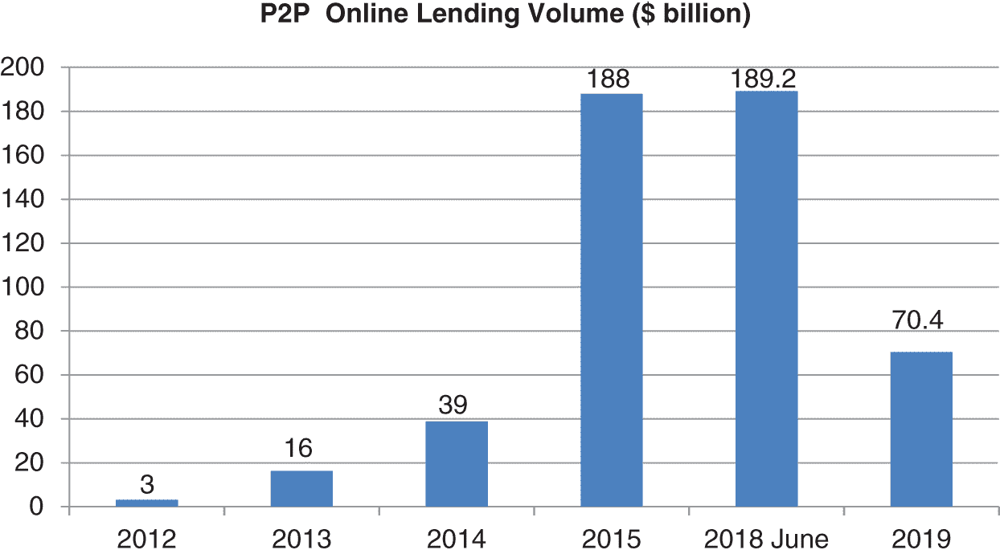

图 5.7 P2P 的快速扩张与快速崩塌（2012–2019）数据来源：网易网

发生了许多类似于庞氏骗局的丑闻，贷款人（在逃跑并失联之前）从投资者那里募集资金而不与借款人匹配。许多承诺回报比银行高三到四倍，但结果却是骗走了百万投资者的储蓄（一些痛苦的受害者甚至自杀），这引发了北京银行保险监管机构总部外的抗议。政府打击行动随之而来，自 2017 年监管加强以来，`P2P`贷款行业一直处于危机模式。

根据行业数据提供商`网易网`的数据，由于监管加强，截至 2019 年 12 月，贷款总余额已从 2018 年 6 月的 1.32 万亿人民币（189 亿美元）缩减至 4916 亿元人民币（70 亿美元）。与此同时，只有 343 家`P2P`公司仍在运营，远少于 2015 年峰值时的 6000 家。为了给这个充斥丑闻的行业画上句号，2019 年 11 月，中央政府成立了一个工作小组——中国互联网金融风险专项整治工作小组办公室，来清理在线贷款领域的风险。它发布了一份通知，要求所有现有的`P2P`平台在两年内退出行业。

### 表 5.1 在线贷款公司股票较高点跌幅达 90%

数据来源：公开市场，2020 年 4 月 17 日。

| 公司（股票代码） | 上市时间 | IPO 价格（美元） | 历史高点（美元） | 收盘价（美元） | 跌幅 (%) |
| :--- | :--- | :--- | :--- | :--- | :--- |
| 和信贷 (`HX`) | 2017 年 11 月（纳斯达克） | 10 | 17 | 0.39 | 97.7% |
| 趣店 (`QD`) | 2017 年 1 月（纽约证券交易所） | 24 | 35.45 | 1.67 | 95.3% |
| 小赢科技 (`XYF`) | 2018 年 9 月（纽约证券交易所） | 9.5 | 20.3 | 0.95 | 95.3% |
| 新信付（中国网信金融, `XRF`） | 2017 年 4 月（纽约证券交易所） | 6 | 16.5 | 1 | 93.9% |
| 宜人贷 (`YRD`) | 2015 年 12 月（纽约证券交易所） | 10 | 55 | 3.76 | 93.2% |
| 民信科技 (`PT`) | 2018 年 1 月（纳斯达克） | 11.88 | 15.1 | 1.26 | 91.7% |
| 微贷网 (`WEI`) | 2018 年 11 月（纽约证券交易所） | 10 | 13.63 | 1.41 | 89.7% |

受监管收紧的影响，该行业在 2020 年面临持续压力。许多较小的玩家已经关门，预计会有更多平台在 2020-2021 年间关闭。即使是那些在美国股票交易所上市的老牌平台也未能幸免。截至 2020 年 4 月，所有在美国上市的 P2P 互联网金融公司股价均已跌至 IPO 价格以下，某些股票较其历史高点跌幅高达 90%（见[表 5.1]）。（2020 年 7 月，中国警方正式对`微贷网`启动刑事调查）。

2019 年 11 月的监管指导建议，如果 P2P 公司满足商业银行的要求（例如注册资本达到 10 亿人民币[1.43 亿美元]并遵守严格杠杆限制），它们可以转型为合格的小额贷款机构。对于那些（曾经）资金充足的上市贷款公司来说，这是一个充满希望的生存路径，因为中国小企业和个人的贷款需求仍在增长。下一节所示，他们最大的挑战在于，配备 AI 技术和大数据的互联网公司是小额贷款市场上强大的竞争者。

## 微贷，大数据解决方案

2015 年 1 月 4 日，互联网公司腾讯启动了中国第一家互联网银行——微众银行`WeBank`（中文寓意为“小而多”的银行）。作为中国人民银行`PBOC`批准的五家私营银行之一，该网银行的所有业务均在线进行，因此借款人无需前往线下网点即可贷款。`WeBank`首次使用腾讯自研的人脸识别技术从远程终端验证借款人身份；随后，所有贷款处理均在线无纸化完成。

仪式由李克强总理主持，他点击电脑上的“回车”键，通过`WeBank`向一名卡车司机发放了第一笔 3.5 万人民币（5400 美元）的贷款。“这是网银行的一小步，将是金融改革的一大步，”李总理说道。这句话并非夸张。因为 14 亿人口中大多数人没有信用消费经验，甚至对从金融机构贷款完全不感兴趣，因此中国缺乏像美国`FICO`分或其他信用记录服务那样的信用评分体系。

传统上，中国大多数国有银行倾向于向大型机构贷款，原因有两个。一方面，大型商业银行与中国的大企业有着长期关系且相互了解。银行在信用评估时通常采用资产法；因此，如果个人或中小企业没有抵押物或资产，很难获得贷款。另一方面，历史上银行对个人消费者和中小企业的信用风险评估数据工具有限，而且在实体银行模式下，这些小额贷款的交易成本高得令人望而却步。

换句话说，商业银行想要以低成本获取：(1) 大量的 (2) 小规模 (3) 具有良好素质的借款人是极具挑战性的。结果，尽管数百家……（内容简洁起见已省略，但遵循核心逻辑）。

根据《华尔街日报》2019 年 12 月引用的数据，大多数用户的信用额度在 6000 人民币（865 美元）以下，平均未还余额约为 1000 人民币（144 美元）。这种信贷额度功能已帮助阿里巴巴推动了其电子商务交易的增长，这在早前的双十一购物节讨论中已可见。同时，该公司的大数据技术和动态信用风险管理帮助其消费贷业务的违约率低于传统银行和金融公司。

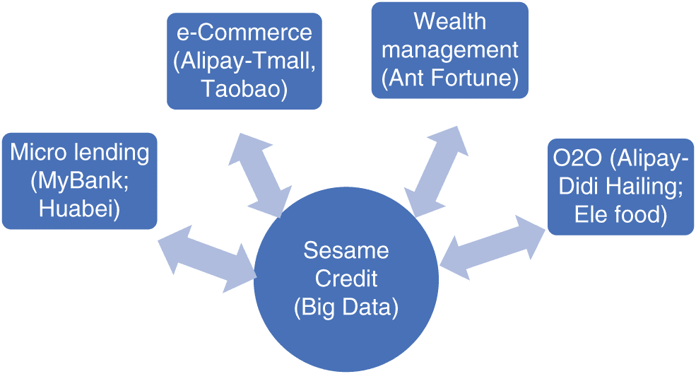

**图 5.8** **芝麻信用与数字业务之间的双向数据流**

核心在于芝麻信用（Sesame Credit），这是蚂蚁集团自有的信用评分系统，主要基于在线数据（见图 5.8）。虽然过去，中国人使用支付宝仅仅是为了在阿里巴巴的淘宝电商市场进行购物，但如今，这个支付平台在中国已经根深蒂固，其数亿用户通过该平台支付几乎所有的家庭账单，以及打车、点外卖等 O2O 活动。此外，其财富管理分支蚂蚁理财也拥有数亿用户，他们通过余额宝等金融产品在那里管理储蓄和投资。除了购物者的在线电商交易记录外，淘宝和天猫还拥有与在这两个市场销售或采购的数千万小微企业的交易往来历史。

因此，芝麻信用利用其横跨中国约三分之二人口的庞大用户群进行产品服务的交叉销售。（腾讯也推出了一个基于微信支付交易数据的类似信用评分系统。）除了提供支付便利外，蚂蚁还销售共同基金、向个人和小微企业提供短期贷款，并提供类保险产品。所有关于零售消费者的数据使得芝麻信用能够与那些在传统信用机构处几乎没有信用记录的人合作，这为阿里巴巴开启了两个方向的大门（见图 5.8）。

一方面，芝麻信用可以方便更多消费者获得新的借贷服务，如住房贷款、汽车贷款和其他类型的分期信贷。平台通过算法产生个人（或小微企业）的评分，并为分数良好的用户提供优惠（例如更快的酒店入住办理），同时向分值低的人员拒绝火车票购买等服务。另一方面，更多的信贷交易为芝麻信用数据库带来了更多数据，这可以作为阿里巴巴新业务线的基础（例如，它推出了一种与电子商务平台购买行为无关的现金贷款产品）。（个人数据的广泛收集导致了数据隐私问题，蚂蚁集团指出，芝麻信用是支付宝用户的一项自愿开启功能，这在第 8 章中有所讨论。）

当新冠肺炎疫情在 2020 年初使中国经济陷入停滞时，政府鼓励向规模最小的公司提供贷款（该领域对全国就业的贡献巨大），而这些金融科技公司是该解决方案的一部分。根据腾讯支持的微众银行（`WeBank`）（2019 年媒体报告），由于中国缺乏标准化的信用体系，中国近 900 万家小微企业中约有 80%没有银行信用额度。

此外，小微企业贷款的规模与传统银行并不匹配。根据蚂蚁集团（2019 年媒体报告），银行很少发放少于 100 万人民币的贷款，而在蚂蚁支持的网商银行（`MYbank`），小企业的平均贷款规模约为 9900 人民币（1469 美元）。遭受打击的经济需要比以前更小额的贷款更快的处理速度。数字金融机构提供了解决方案：他们的系统可以在几分钟内根据借款人的在线行为数据快速批准其信贷额度，填补了中国小微企业的资金缺口。

## 财富管理中的 AI 与替代数据

对于大多数中国人来说，他们的首次个人理财体验是在拥有智能手机之后的。他们的投资活动是从零钱开始开始的，这些零钱已经在频繁的电商交易后留在了移动支付应用中。事实上，由蚂蚁集团提供的第一款在线投资产品被称为*余额宝*（字面意思是“留下的宝藏”）。它是移动经济中金融创新的最佳案例，而其近期相关性的下降说明了市场正向更复杂、数据驱动的投资进行转型。

2013 年 6 月，首款互联网货币基金（I-MMF）产品余额宝推出，为互联网用户提供了商业银行传统短期存款的替代方案。这种简单互联网产品的爆发式增长震惊了传统金融机构。在六个月内，余额宝产品使得底层经理天弘基金成为中国市场历史上第一个管理规模（AUM）超过 1000 亿人民币的投资基金。在不到一年内，余额宝的 AUM 超过了 6000 亿人民币（超过 900 亿美元）。在 2017 年的巅峰时期，其 AUM 达到了惊人的 1.7 万亿人民币（约 2500 亿美元），是最大的货币基金（见图 5.9）。

互联网货币基金的异常受欢迎是互联网公司利用工具识别并解决了金融市场的几个结构性问题。**首先**，中国家庭的储蓄率是世界上最高的之一，因此他们在银行中拥有大量现金。他们对存款的低回报并不满意，但也不一定适应股票或房地产的风险。因此，中国投资者一直在寻找风险可控的存款替代。

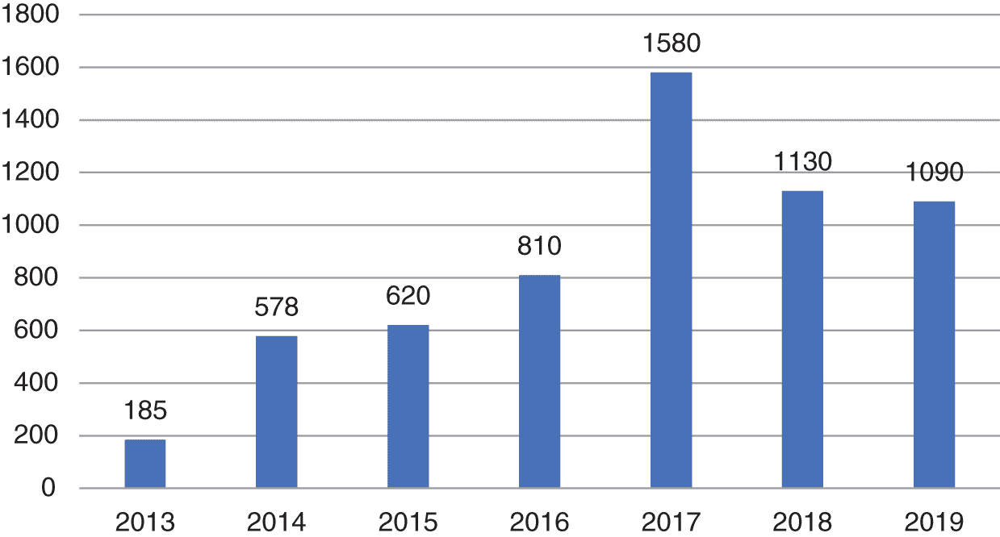

**图 5.9** **余额宝的增长与下降（人民币，2013–2018）** ¶ 数据来源：天弘基金（年末 AUM）。

**其次**，得益于移动互联网的低成本，余额宝没有投资门槛（大多数银行销售的理财产品都有），其起投资金额仅为 1 人民币（0.15 美元）。同时，它通过互联网积累了大量的“剩余资金”（正如人气网络小说通过大量的*粉丝*读者支付极小金额阅读来获得支持一样）。

**第三**，互联网货币基金因为在线流程简单而具有很高的流动性，并且可以在智能手机和其他设备上轻松处理。余额宝这样的互联网货币基金通常可以在当天赎回，在许多情况下可以在一小时内完成。相比之下，传统的货币基金（MMF）需要二到三天才能完成赎回流程。换句话说，余额宝这样的互联网货币基金既有货币基金的高收益，又保持了与银行存款相同的流动性。

从另一个角度来看，余额宝成功的本质仅仅是利用互联网作为一个更好的信息渠道和更方便的交易平台。因此，它的投资收益率大部分遵循相应的市场收益率。近年来，金融市场进入了“低收益”新时代，余额宝的收益也随之下降，导致其规模（AUM）减少（参见图 5.9）。2020 年初，余额宝的收益自 2013 年成立以来首次跌破 2%，更多用户提取资金在其他地方寻求更高的回报。

总的来说，余额宝的案例说明了日益数字化的投资市场的未来方向。首先，数字技术将改变中国投资产品的发行格局。正如以下示例所示，互联网平台、机器人投顾和语音识别技术是未来触达客户的渠道。其次，在如今的低收益环境下，人工智能和大数据技术可能是未来主动管理的关键，基金经理有望借此产生“阿尔法”（行业术语，指基金表现优于市场水平）并为投资者带来高回报。

## 数字渠道

中国新兴的中产阶级（麦肯锡估计到 2020 年将达到 4 亿人）为资产管理行业提供了巨大的机遇。随着个人投资者在财富管理方面变得日益成熟，他们正逐渐从银行储蓄（余额宝及互联网公司的同类产品）或固定收益产品转向多元化的理财产品，如股票基金和风险投资/私募类的替代投资产品。中国的传统金融机构（主要关注高净值人士）并没有足够的理财顾问来满足这一需求。

由于中国客户在投资经验方面相对不足，对个性化指导和教育导向服务的需求更高，这对理财公司来说是另一项运营挑战。因此，他们正在实施 AI 技术，使定制化产品和服务对普通用户更易获取。

例如，2017 年，支付宝的理财平台蚂蚁财富推出了`财富宝`，这是蚂蚁平台上的一个企业账户，让金融机构接入一系列 AI 能力和其他服务，包括更好的用户连接、用户画像、运营优化和智能营销。两年后，即 2019 年 6 月，蚂蚁财富宣布中国所有 124 家资产管理公司中有 80 家（或十分之六）已使用该公司的由 AI 驱动的企业级`财富宝`账户，以更低的成本通过更个性化的方案触达更多客户。

解决理财顾问缺乏的另一种技术解决方案是机器人投顾。例如，基于 AI 的理财顾问`理财建模方`自认为是中国第一家“全 AI”机器人投顾机构，基于全面的普通客户数据提供自动化理财咨询服务。到 2020 年初，该公司的 AI 驱动决策过程已为客户交易了超过 100 亿人民币（约合 15 亿美元）。对于中国的数字中产阶级来说，他们比西方市场的同类更有可能接受机器人投顾服务来开启其金融投资之旅。

## 阿尔法 (α) 生成

在当前的低收益环境下，全球基金经理正在利用人工智能和大数据技术尝试进行智能投资——做出更明智的买卖市场决策——并带来高于大盘收益的更高回报（阿尔法）。在美国和欧洲的发达市场，寻求阿尔法变得日益困难。然而，中国的市场要年轻得多（股市直到 20 世纪 90 年代初才开始；请参考作者早期的著作*投资中国：转型中股市的机遇*）且效率较低，这意味着主动管理和阿尔法产生仍然是可能的，尤其在新技术的帮助下。

中国市场的投机程度极高。市场常用的投机指标是“换手率”，其定义为：

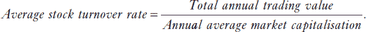

与单一的 AlphaGo 不同，浙商 AI 基金开发了 300 多台基于不同投资逻辑和方法论的机器，这些机器被称为“机器人经理”。它们分析超过 3000 只中国上市股票，并产生数百项投资决策，这些决策通过相互竞争以找到最佳解决方案。新的机器人经理会随着新的学习和新策略不断加入，而表现最差的则会被剔除。在经过一年的训练后，浙商在 2019 年底推出了国内首个根据机器建议运行的 AI 基金。根据媒体采访，AI 经理最初的投资表现平平，但随着累计训练的增加，它们的学习和改进不断加速——投资回报率也持续攀升。

据基金经理介绍，最大的挑战在于机器没有足够的时间和数据来学习，特别是对于中国的新上市公司和新行业领域。此外，为了充分利用机器人经理从市场数据中识别出的模式，该基金将机器与资深人士相结合以优化投资决策，这被称为“AI + HI（人类智能）”。值得注意的是，该基金最初也考虑过 AlphaGo Zero 的方法——为机器提供投资规则并让其进行自我训练。虽然 AlphaGo Zero 在*围棋*中可以轻松击败 AlphaGo（详情参见第 1 章），但浙商团队发现这种方法在投资中并不适用。作者推测，这可能与股市中意想不到的人为干预有关，例如中国政府的政策变化和唐纳德·特朗普的推特。中国股市中“AI + HI”的另一个良好案例是`Microsoft`与`中国资产管理有限公司(AMC)`的合作。华夏是中国最大的投资机构之一，管理资产规模达 1530 亿美元，双方致力于基于数据的量化投资。交易员利用管理工具分析大数据来做出投资决策已经有一段时间了，但困难之处在于从海量信息中收集正确的数据，因为金融数据以“噪音大”著称，这意味着有很多需要过滤掉的潜在误导信号。目前，即使是最好的量化交易员也只使用所有可用数据的一小部分，而数字技术仍在将更多非传统数据纳入其中（参见“替代数据”框）。

2019 年 9 月，华夏和微软宣布，他们的研究人员开发出了一种新的 AI 模型，可以筛选和分析海量的实时金融数据。通过机器学习（ML）——AI 的子集，他们创建了两种预测市场的复杂方法。第一种被称为“时空卷积神经网络”，它通过估计不同变量之间的发生情况并隔离出需要关注的重要因素，来识别成交量和价格数据中的模式。第二种被称为“变时注意力模型”，它将这些因素与市场在任何时刻的情况进行比较。然后以变时的方式将它们相结合，以识别动态市场趋势模式。这些分析提供给投资专业人士，以改进他们的投资决策。

在两个例子中，AI 和大数据的关键优势在于它们能够对人类无法实现的更广泛的数据进行更深入的分析。机器学习（ML）从三个方面增强了证券分析师已经完成的量化工作（参见图 5.11）。因此，数字巨头正在演变为资产管理强者，因为它们的数字专长和直接面向消费者的营销能力远超过了规模最大、资源最丰富的资产经理。（例如，阿里巴巴可以利用其多个电子商务平台捕捉的消费者情绪数据，以更高水平的洞察力预测零售行业的股票表现。）

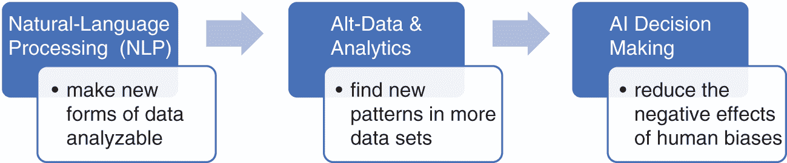

Figure 5.11 ML 增强量化投资

## 区块链与 SCF：阿里巴巴与中国银行联盟

“区块链不是泡沫，但比特币可能是。比特币只是区块链的一个极微小的应用，”阿里巴巴创始人、前主席马云在 2018 年世界人工智能大会上评论道，“至少在阿里巴巴内部，区块链必须是一个解决数字时代隐私和安全问题的解决方案。”蚂蚁集团显然遵循了这一逻辑。自启动区块链业务以来，它一直致力于构建一个开放且包容的企业级区块链生态系统，同时为各行业开发现实世界的应用。

其同的互联网公司和传统金融机构也是如此。在经历了最初的基于比特币以及随后的以太坊（智能合约）为基础的代币后，中国的区块链技术已进入第三阶段，主要参与者开始关注企业级区块链解决方案（参见图 5.12）。

2020 年 4 月，中国互联网金融行业协会（`NIFA`）发布了一份关于中国金融区块链项目的报告。根据统计，中国国家互联网办公室（`CAC`，根据其规定，提供区块链服务的企业必须向监管机构备案并必须收集区块链服务用户的真实姓名和身份），NIFA 报告发现，金融机构在该领域似乎最活跃，因为中国参与区块链技术的机构中有 40% 是“金融科技服务提供商、银行、基金公司、保险公司、小金融公司、商业承账公司等”。

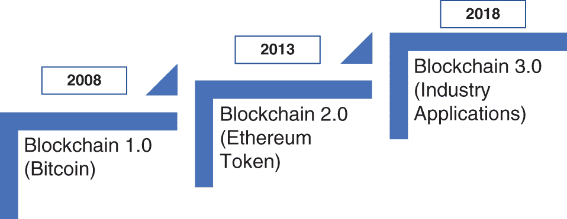

Figure 5.12 区块链从 1.0 到 3.0

NIFA 报告还发现，基于区块链的供应链金融（`SCF`）是金融机构关注的重点。根据调查，所有机构中 32.6% 表示正在从事供应链金融，这占区块链实施的大部分（参见图 5.13）。贸易金融和保险科技各占市场规模的 11.2%，而跨境支付和资产证券化分别占 7.9% 和 6.7%。

事实上，区块链已应用于中国的供应链金融（SCF）模型中，其优势已经显而易见，特别是对于中小企业（SMEs）。SCF 主要形式是“保理融资”，企业利用其应收账款（即发票）来获得满足即时资金的需求。在供应链中，所谓的“核心企业”（例如大型汽车制造商）从众多供应商处采购组件，与商业银行建立了长期、良好的关系。因此，核心企业本身在银行享有良好的信誉关系，并能以优惠的利率轻松获得银行贷款。

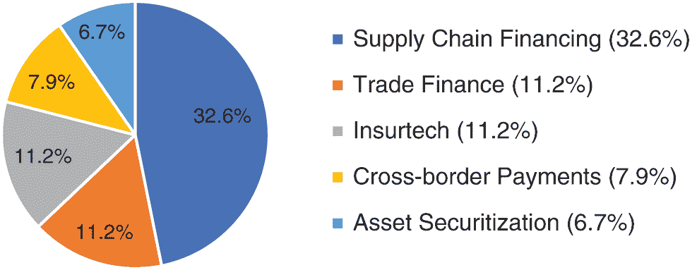

另一方面，核心企业（也称为供应链的“关键企业”）的“良好信用状况”并不容易转移给其供应商。由于多层供应商之间的交易流和现金流信息是分离且不透明的，商业银行没有有效的风险控制方法，无法根据核心企业的良好信用状况，为那些未直接与核心企业进行交易的供应商（尤其是行业链末端的小微企业）提供具有优惠条款的融资。小型企业无法获得具有吸引力的融资，而银行则不得不放弃那些由核心企业间接支持的规模巨大的小贷款业务。在实践中，银行通常只为核心企业的一级供应商提供保理融资。

因此，区块链技术被用于解决供应链金融（SCF）中的数据和信任问题，使得供应链中的二级甚至更远处的供应商可以申请保理融资。区块链是理想的技术，能够确保核心企业与所有层供应商之间的现金流和贸易流数据（其表现和相关风险因素）能够以认证的方式与银行（以及自身）共享，即使它们之间没有直接关系。得益于区块链的不可篡改性和可追溯性，数据交换在整个区块链上是实时安全、经过验证且可信的，因此供应链网络的所有成员都可以随时访问这些信息。如此，供应商应收款的数字信用凭证在区块链上形成，基于此，工商银行等银行可以向供应链的上游公司提供信贷。

### 表 5.2 中国银行/互联网公司推出的基于区块链的“实体经济”应用

数据来源：工商银行 2020 年区块链白皮书（ICBC—工商银行；ABC—农业银行；BOC—中国银行；CCB—中国建设银行；CMB—招商银行）。

| 银行/互联网公司 | 平台基础设施 | 供应链金融 | 贸易融资 | 资产支持证券 (ABS) | 数字证书 | 房屋租赁 |
| --- | --- | --- | --- | --- | --- | --- |
| 工商银行 | √ | √ | √ | √ | √ | |
| 农业银行 | | √ | | | | |
| 中国银行 | | | | √ | | |
| 建设银行 | | √ | | | | √ |
| 招商银行 | | | √ | √ | | |
| 平安银行 | √ | √ | √ | | | |
| 蚂蚁集团 | √ | √ | | | √ | |
| 微银行 | √ | √ | | | √ | |
| 京东数字 | √ | √ | | √ | √ | |

与蚂蚁集团、微银行等互联网公司一样，工商银行及其同业银行（参见表 5.2）也为市场提供了区块链平台基础设施（`BaaS`——区块链即服务）。这些巨头提供的 BaaS 服务是连接区块链架构与企业级区块链项目之间的桥梁。它们让区块链创业者能够专注于构建新的区块链应用，引发了中国区块链创业的浪潮。

展望未来，市场将看到中国科技公司与传统金融机构之间更多融合。主要的商业银行已经为其客户充分开发了互联网渠道和平台。作为推动其成为下一代“智能银行”努力的一部分，他们加强了技术投入。根据中国互联网金融协会（NIFA）2019 年 10 月的一项调查，约四分之三的商业银行计划或已经实施数字化转型战略。

自然，他们正在建立伙伴关系以寻找协同效应。2019 年 12 月，资产规模超过 4 万亿美元的世界最大银行工商银行宣布与阿里巴巴和蚂蚁集团建立合作伙伴关系，以增强其银行服务。这些公司表示，他们将探索支付和电子商务之外更广泛的新服务，包括区块链驱动的跨境汇款和云应用。最近，光大银行在蚂蚁集团的 BaaS 平台上开发了供应链金融产品，以加速与复工（受新冠影响）资金相关的融资。根据阿里巴巴的新闻，该公司已与 200 多家银行合作，包括华夏银行、上海浦东发展银行和中信银行。

总之，中国是全球最大的金融科技市场，在金融科技发展的几乎每个方面都是全球领先。科技公司与金融机构之间的联盟将进一步推动货币金融体系的创新。然而，中国金融科技的成功不仅来自前所未有的技术创新，还来自技术工具与实体经济需求的结合，其对比特币和区块链技术的独特方法最好说明了这一点。

# 第 6 章：O2O 与共享经济

*   精子捐赠、O2O 与共享经济
*   滴滴收购优优中国业务
*   摩拜克与 ofo 友：昨日的共享单车
*   伞、情趣娃娃和一切可共享物品
*   美团、滴滴和饿了么：一站式按需服务
*   从 MaS 到 OaS——一个智能饼

## 精子捐赠、O2O 与共享经济

2015 年，阿里巴巴的电子商务平台淘宝和中国最大的第三方实验室集团金源医学联合在网上推出了精子捐赠和亲子鉴定检测的特优优惠活动。在活动开展的三天内，精子捐赠者可以在线注册个人信息，避免了初次访问采集中心时的尴尬。志愿者仅需提供姓名、身份证后六位数字和电子邮件地址即可完成在线注册。捐赠精子后，每位志愿者可以获得大约 475 至 800 美元不等的补贴。

在 72 小时内，据称有超过 22000 名男性在全国七家精子银行之一报名了精子捐赠。淘宝的活动还提供了亲子鉴定服务，客户无需启动花费 100 美元以上的医院就诊，这与约 650 美元的平均成本相比是一个巨大的折扣。客户在在线下单后会收到一个检测盒。消费者只需收集并发送唾液样本到检测中心，检测中心将在 10 个工作日后提供检测结果。在此期间，淘宝吸引了 137 份亲子鉴定申请和 4060 份精子活力检测申请。

移动金融科技和基于位置的数据技术驱动了如“精子捐赠”这样的在线到线下（O2O）交易的增长。O2O 可以广义地定义为线下业务机会与互联网活动的结合。在最流行的形式中，O2O 意味着在网上吸引零售客户，然后引导他们进行线下交易、叫车、外出、看电影等（参见图 6.1）。

除了商业模式的转型（例如，中国电影业是 O2O 革命的完美范例；参见第 3 章中的相关讨论），O2O 的热潮也刺激了许多经济领域的“共享经济”应用。例如，为了满足中国人口老龄化带来的强劲需求，医疗和家用服务的 O2O 业务开始兴起。医疗提供者正在实施远程患者监测，将其服务范围扩大到医疗不足的患者群体，同时为慢性病患者大幅节省了成本。

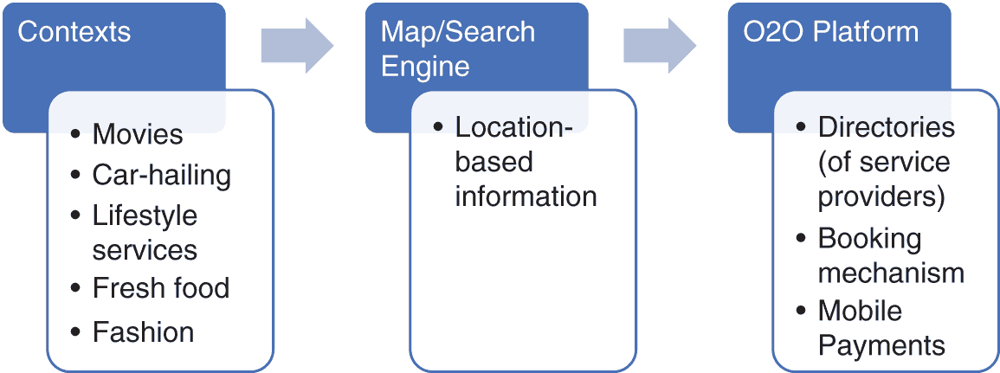

`图 6.1` **位置/地图搜索是 O2O 业务模式的关键**

随着中国经济的增长，更多的人首次接触到个人财富，共享经济产生了深远的影响和巨大的潜力。目前，中国拥有超过 3 亿中产阶级人口，等同于美国的人口，而且这一数字预计在短短几年内翻倍。然而，即使达到 6 亿人的规模，这部分中产阶级仍只是 14 亿总人口的少数。当数千万的人进入个人富裕阶段时，城市、基础设施和环境将面临更大的压力。

例如，汽车销售同比增长率在 2010 年和 2009 年分别达到了 30% 和 50%，但自 2011 年以来，由于城市对新车牌照的限制，其增长必须放缓，因为该行业已成为资源的消耗大户和污染的主要贡献者。因此，美国汽车服务和拼车公司 Uber 及其本土竞争对手滴滴提供的移动应用程序受到了中国城市居民的广泛欢迎。（滴滴在 2016 年与 Uber 中国进行 350 亿美元的合并后获得了市场主导地位。请参阅下一节的详细案例研究。）

有趣的事实是，在与滴滴合并之前，Uber 的服务在中国起步的速度比在其他地方快得多。例如，Uber 发现，即使是针对某个地区的初始客户——即一个城市的前一百万用户，其在中国增长速度也远快于其他任何地方。Uber 全球最受欢迎的前三个城市——广州、杭州和成都——都在中国。

其主要原因显然是由于中央政府推动城市化的推动，庞大的城市人口和城市居民的高度集中。中国有约 200 个人口超过百万的城市。中国城市居民对商品和服务产生了强劲的新需求，城市由于规模、密度和必要性，需要采用“共享经济”模式。另一个原因是中国客户是社交网络和移动支付技术的快速接受者。几乎所有城市居民都在智能手机上安装了电子支付应用，并相应关联了银行账户，这样他们可以在乘车后直接完成移动支付。

因此，中国可能是“共享经济”应用最好的实验室和市场。中国的许多行业就像汽车行业一样，很快将在能源供应紧张、交通问题和大范围环境恶化的影响下陷入困境。因此，强调共享而非所有权的“共享经济”应运而生。移动互联网、智能手机和支付系统创造了一种新的社会协调机制，正如本章案例研究所示，市场看到了将未充分利用的商品和劳动力投入生产用途的无限潜力。

同样有趣的是，汽车作为一种身份象征在中国正随着个人新车注册数量的下降而逐渐消失。根据贝恩公司的市场调查，2014 年，一线、二、三线城市中近 60% 的消费者认为拥有汽车可以提高人的社会地位。然而，在短短三年内，汽车所有权失去了一些光彩。2017 年，同意这一点的比例低于 50%（参见图 6.2）。

这是一个鼓舞的信号，表明中国年轻一代正在用个人富裕的新背景定义“中国梦”。他们敏锐地察觉到经济繁荣带来的资源限制和收入差距，许多人已积极接受了共享消费模式。在数字技术的助力下，他们正在创造一种更具包性和可持续性的经济增长模式，因为 IT 创新本质上强调共享而非所有权。

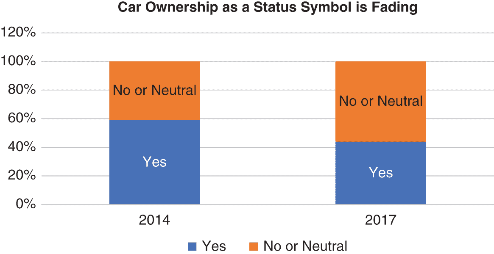

`图 6.2` **拥有汽车会提高人的社会地位吗？** ¶ 数据来源：贝恩公司。

虽然中国和世界都处于从所有权转向共享的新生活方式的起点，但由于新客户规模的巨大，这种转变在中国可能比任何地方都重要。新的“中国梦”必须不同于传统的“美国梦”——大汽车、大房子、大狗以及所有人的麦当劳。否则，中国消费者需要集思广益寻找另一个星球。（值得注意的是，如今“美国梦”中的一切都比 20 年前更大，那时本书的作者第一次来到美国学习法学学位的时候。）因此，中国的共享经济将对日益紧张的世界产生深远影响。

## 滴滴在中国接管 Uber

正如许多外国城市一样，跨城交通需求是中国现代城市生活的核心。尽管越来越多的人购买汽车，但由于近年来城市化的发展，人们对出租服务的需求一直在增长。然而，中国城市限制了出租车收费的基价。在政府规定车价保持低位甚至下降的地方，出租车司机会罢工，导致打车几乎无法实现。

打车软件在 2012 年出现，允许智能手机用户通过移动应用程序预订和支付出租车或轿车服务费用，这改变了许多人的出行方式。两家领先的约车公司在从打车业务扩展到拼车和高端用车服务之前，分别得到了中国最大的两个互联网公司阿里巴巴和腾讯的支持。在合并之前，阿里巴巴投资了快滴（意为“快速找车”），腾讯投资了滴滴（意为出租车的“滴滴”声）。

总部位于旧金山的共享汽车应用公司 Uber 在中国约车服务市场是一个相对晚入者。Uber 于 2013 年底在中国南方城市广州和深圳开始测试，提供客户可以从执照轿车公司叫车的服务。它在中国的正式大规模扩张直到 2014 年 12 月，即 Uber 中国向中国搜索引擎巨头百度卖出股份，并将其服务与百度的地图应用和支付系统整合之后。因此，这三家分别由 BAT 中的一成员支持的公司在中国市场展开了激烈竞争（参见图 6.3）。

在进入推出后，`滴滴`和`快滴` App 迅速受到了中国城市居民的青睐。拥挤的大型城市、不完善的公共交通网络以及规模较大的廉价出租车车队，使得中国市场成为移动网约车服务的完美用武之地。然而，要让中国的出租车司机使用网约车 App 并非易事。在早期阶段，两家公司都必须寻找创新的方法来吸引、培训并说服那些不精通技术的出租车司机。他们在街头展开正面竞争，推广各自的 App 以及相应的移动支付系统（阿里巴巴的`Alipay`和腾讯的`微信支付`）。

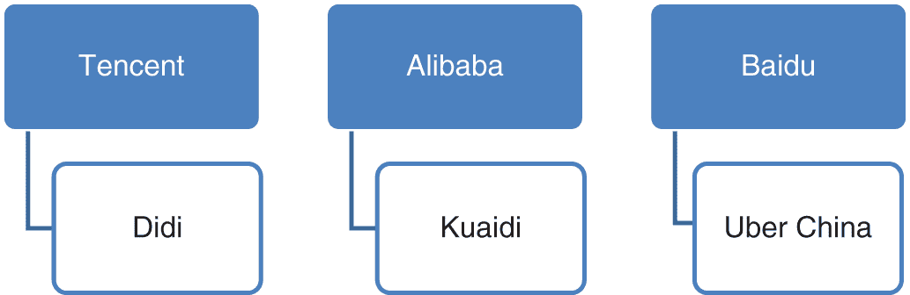

**图 6.3** **滴滴、快滴和 Uber 中国合并前的竞争格局**

据报道，在经历了一场据称涉及出租车司机和客户、总返利超过 3 亿亿美元的价格战后，这两家公司确实吸引了许多出租车司机注册`滴滴`和`快滴` App。（事实上，现在大城市几乎所有的出租车司机在车内都安装了多部智能手机和平板电脑用于运行各种 App。）然而，累计的补贴对于互联网公司来说成本太高了。2015 年 2 月，这两家公司决定进行一项价值 60 亿美元的合并以结束价格战（这次合并或许是“婚姻”和“好意”的象征，双方创始人于情人节宣布了这一消息）。

根据研究公司的估计，合并后的公司`滴滴快滴`对移动网约传统出租车近乎垄断，并且控制了中国超过 80% 的私家车网约市场。随后，它继续与剩下的`Uber 中国`进行激烈的补贴战，作为一家在中国的外资公司，`Uber` 在复杂且充满争议的租车经营环境中挣于本土问题。例如，由于 `Uber` 向中国司机提供大量现金奖励以吸引加入，一些司机利用专门软件对订单进行花招来钻取漏洞。（参见“病人、护士与安全射击”框。）

2016 年 8 月，在亏损了约 20 亿美元（可能更多）后，`Uber 中国`以 350 亿美元的交易被`滴滴`收购，（前）`Uber` 首席执行官 `Travis Kalanick` 成为合并后公司`滴滴出行`（“滴滴，出门”）的董事会观察员。价格战结束了，但所有的补贴和奖励已经让司机、乘客和大众了解了手机网约车、移动支付以及“共享经济”的概念。

根据贝恩公司（Bain & Company）的市场调查，中国消费者已将移动网约车和共享单车（见下一节的详细讨论）推向主流，2017 年分别有 62% 和 73% 的受访者使用了这两种出行解决方案。相比之下，德国（29%）和美国（23%）使用移动网约车的受访者不足三分之一，使用共享单车的人更少（参见图 6.4）。

基于其庞大的用户群和移动系统，滴滴正在扩展更多新业务以寻求增长和利润。例如，在新冠肺炎疫情期间，滴滴在中国主要城市启动了外卖服务。然而，食品和外卖服务的竞争激烈程度亚于网约车市场。目前最大的竞争者不正是美团点评，它在经历过类似的价格战后巩固了外卖市场，并进军了网约车和共享单车业务。在介绍了后续关于共享单车和几乎“万物共享”的章节后，我们将在更宏大的“共享经济”背景下，探讨滴滴与美团之间的全面战争。

## 摩拜（Mobike）与 ofo 单车：过去的共享单车

20 世纪 80 年代，中国被称为“自行车王国”，高速公路规模的自行车道在早高峰时段容纳了超过五亿通勤者。受中国 20 世纪 90 年代改革开放政策的影响，交通工具得到了相应的升级。公交线路和地铁系统经历了大规模扩张；电动滑板车变得流行起来；出租车变得负担得起；而在近年来，许多家庭开始拥有自己的汽车。车道在扩大，而自行车道在缩小。

因此，得益于数字化革命，看到质朴的自行车在中国化的城市中出意之外地复兴，令人不禁。自 2016 年以来，所有大城市的人行道上停满了五颜六色的共享单车——黄色、橙色、绿色或其他颜色组合。这些特设计的自行车配备了`GPS`和专利智能锁技术，用户可以轻松使用手机应用程序寻找附近的自行车、进行预约并解锁，然后在任何允许普通自行车停放的地方上锁即可完成旅程。

由于自行车具有实用、环保、方便和廉价的特点，已成为中国领先城市城市居民、学生和年轻专业人士的首选交通工具。虽然许多城市也有自己的共享单车设置，但中国共享单车的三个特殊特征使其尤为受欢迎。

**第一**，它是解决“最后一公里”最实用的出行方式。尽管道路、公交、地铁和出租车比以往任何多，但城市交通仍然面临挑战，特别是对于从家到公交和地铁站的短途通勤。在这些情况下，目的地太远不便步行，但又没有远到需要打出租车还要等待。根据中国国家信息中心的数据，在城市出行中，使用“共享单车+地铁”的组合比私家车效率高 17.9%。

**第二**，这些自行车是无桩的，因此用户不需要担心行程后将它们还到特定地点。它们可以随时随地使用并停放，不受停放站的限制（其他人随后通过`GPS`定位自行车），这创造了更好的用户体验以及更高的利润率。相比之下，其他自行车共享系统要求用户取车并将其还到固定的站点，例如纽约市的`Citi Bike`。

**第三**，单次行程价格低廉且支付方便。用户可以以极低的价格骑长距离自行车（通常 30 分钟`1 RMB`/约`US.15`美元，甚至更低）。只需一部智能手机即可通过`GPS`寻找最近的自行车，扫描其`QR code`，通过`微信`或`支付宝`（中国最流行的两种在线支付服务）支付微小费用，即可完成支付。

## 共享经济的演变

基于其庞大的用户群和移动系统，滴滴正在扩展更多新业务以寻求增长和利润。例如，在新冠肺炎疫情期间，滴滴在中国主要城市启动了外卖服务。然而，食品和外卖服务的竞争激烈程度亚于网约车市场。目前最大的竞争者不正是美团点评，它在经历过类似的价格战后巩固了外卖市场，并进军了网约车和共享单车业务。在介绍了后续关于共享单车和几乎“万物共享”的章节后，我们将在更宏大的“共享经济”背景下，探讨滴滴与美团之间的全面战争。

## 未来趋势与挑战

中国共享经济的未来仍有待观察。随着技术的不断演进，我们可能会看到更多创新的共享形式出现。滴滴和美团等主要玩家之间的竞争可能会继续推动创新并降低消费者的价格。

- **胶囊睡眠舱。** 这家初创公司的睡眠舱简直像是从科幻电影里走出来的，配备了`USB`接口、阅读灯和电风扇。但据报道，由于缺乏相关的安全许可证或许可，其营业网点已关闭。
- **儿童玩具。** 高质量的儿童玩具可能很贵，而且孩子们很快就会长大不再需要了。为什么不把它们用几个月，然后换成新玩具呢？
- **篮球。** 当你路过篮球场时，即使你没有自己的球，也可以停下来投投篮。要租球，用户只需扫描通常位于球场附近的篮球共享柜柜上的`QR code`。
- **行李箱。** 如果你住的是极小型的公寓，为什么要留着偶尔才用的大型行李箱呢？
- **冰箱……**
- **奢侈手提包……**
- ……

简而言之，中国的“共享”现在指的是几乎任何产品或服务的短期租赁，这种现象是由智能手机的广泛使用和成熟的移动支付系统驱动的。或许“移动租赁”是一个更贴切的术语（也许是租赁 2.0）。但为什么移动租赁在中国发展得如此强劲呢？

所有共享企业背后的共同要素——从汽车、自行车、篮球、冰箱到衣服、按摩椅、奢侈手提包和手机充电器——都是移动支付机制，而中国目前是全球的领导者。在线共享（租赁）服务涉及频繁的跨地点小额支付，用户只需扫描`QR code`即可通过简单的点击完成支付（支付系统将智能手机与银行账户无缝整合）。

另一个积极因素是中国政府对新的共享经济业务持开放态度。李强总理是坚定的支持者，他将共享经济描述为中国“一股焕发生机的力量”。经济规划部门国家发展和改革委员会（`NDRC`）已发布指南，消除新共享业务的市场准入障碍。此外，地方政府在处理争议性问题（例如网约车对司的注册要求）时也实施了平衡的监管。随着中央和地方政府都向支持方向发展，中国的共享经济已经赢得了动力。

尽管共享经济已经跨越了个人物品的各个领域，但并非所有新想法都能成功。大多数共享服务需要大量的初期资金投入来获取共享物品，无论是汽车、自行车这样的大物品，还是雨伞、移动电源这样的小物品，但单次使用的费用必须非常便宜，才能吸引最大的用户群体。因此，年轻公司总是需要募集新资金，而它们的收入和盈利能力面临着挑战。对于一些初创公司来说，存在一个根本性问题：用户是否真的需要共享这些产品，或者所提供的物品是否适合共享。（参见“我听过最糟糕的主意”框。）

共享经济的一个独特挑战性因素是，人们仍在制定与共享产品和服务相关的社会规范过程中。因为用户不是所有者，他们对公共资源的关注缺乏，共享产品在使用后往往被遗弃。正如一位评论员所观察到的，“不在乎是人性”。在这一点上，共享自行车是最显著的例子。

随处可停放的特性让共享自行车变得非常方便，但也让它们变得不方便，因为粗心的用户经常在街道和道路旁随意停放自行车，给人行道、公交站和住宅小区入口带来混乱。2017 年，超过 70 家公司在街道上投放了超过 1600 万辆自行车。它们在交通繁忙的地点堆积成百上千，市政府不得不没收数万辆以开辟道路，并将它们处理在偏远地区。官员还要应对自行车的创造性破坏行为，从将它们挂在树上到点燃整辆车。

如果说 2017 年是“大跃进”的一年，那么 2018 年是中国共享经济的整合与反思之年。`Mobike`（摩拜克）成功地扩张了，但共享经济在中国取得了进展。

在`Ofo`破产后，共享单车从媒体头条和风投圈消失了。然而，五彩斑斓的单车队（再次）出现在中国各地的街道上——当然，颜色各异，分别代表`Didi`、阿里巴巴支持的`Hellobike`以及`美团`。共享单车不再作为独立的创业企业运营，而是被整合进互联网巨头的帝国中，补充了它们依赖数据的生态系统，而`Didi`、`阿里巴巴`和`美团`正在竞争为所有人创建一个全方位的生活服务平台。它们的战争战斗领域远比单车领域多得多，相比之下，`Ofo`和`Mobike`之间短暂的初创公司竞争让风投人花费了（仅）几十亿美元，仅仅是热身。

首先，简要介绍一下`美团`，它是继`阿里巴巴`和`腾讯`之后，第三家在公开市场达到 1000 亿美元估值的中国互联网公司。`美团-点评`是中国最大的生活服务 O2O 平台，涵盖了外卖、酒店预订、电影票预订、餐厅评论、团购等领域。它是通过 2015 年两个宿敌竞争对手——`美团`（团购优惠）和`大众点评`（消费者评论网站）合并而成的；因此，它经常被描述为中国版的`Groupon`和`Yelp`结合。

在中国广阔的 O2O 市场中，餐厅和餐饮业务起步较早，其市场模式比其他领域更成熟。原因很简单。首先是人口数量庞大：供应近 14 亿人的食物本身就是一个就是一个巨大的市场。此外，吃饭可能是中国人最重要且最频繁的社交活动，他们有一句谚语叫“民以食为天”（或者说，在“食”字的汉字本身中就是“天”）。此外，随着城镇化趋势，城市中年轻专业人士和工人数量不断增加，由于生活节奏快，他们倾向于经常外出就。对于`美团`和`点评`来说，的核心业务分别从餐厅预订和餐厅评论开始。

在经历了类似于网约车初创公司的昂贵价格战后，`美团`和`点评`于 2015 年底合并。作为合并的结果，`阿里巴巴`决定出售其对`美团`的股权，让`腾讯`成为合并后公司的大股东。为了留在 O2O 餐饮服务市场，`阿里巴巴`重新专注于自己的在线美食优惠券网站`酷北`和在全国餐厅广泛使用的`支付宝`支付系统。作为回应，`百度`建立了`百度外卖`，这是一个基于`百度`搜索引擎和地图服务的食品订购和配送平台（见图 6.7）。

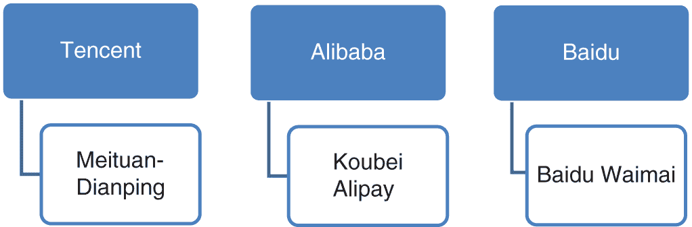

`图 6.7` **2015 年美团-点评合并后的竞争格局**

合并后，`美团-点评`继续专注于与食品相关的服务，它与`腾讯`的紧密关系通过`微信`提供了宝贵的用户流量。事实上，`微信`用户之间的很大一部分讨论都是关于……

对于美团而言，单车业务的海量用户数据库价值高于其直接的财务贡献。（事实上，根据中国证券公司的研究报告，美团单车可能会持续亏损到 2021 年，并成为公司整体业绩的拖累。）摩单克已整合进美团的一站式服务 App 中，这符合美团构建一站式“本地服务”平台的愿景，即为其客户提供更多整合的基于位置的服务（LBS）解决方案。（`本地服务`是一个广义的术语，涵盖了所有线下生活类服务，如`Yelp`和`Groupon`的案例，以及按需交付，如西方市场的`UberEats`和`Seamless`案例。）

此外，摩单克的加入不仅仅是一种交通工具；它反而为其平台品牌增添了年轻、健康和环保的色彩。美团用户需要交通服务来往返餐厅和其他当地的生活方式兴趣点（POI）。随着单车的加入，他们前往实体餐厅和商户时有了新选择。美团 App 旨在成为每个人本地需求的一站式商店：订购外卖或杂货、在电影院看完电影后预约 Spa，以及骑着美团单车出行。

但是滴滴等公司正挤入美团的领地，它们的竞争将是一场针对共享汽车、共享单车及更多领域业务的全面大战。和美团一样，滴滴在中国城市也推出了外卖服务。最近在新冠肺炎疫情期间，滴滴在各大城市启动了日购服务。不愿出门购物的家庭可以通过滴滴 App 订购杂货和咖啡，然后由司机购买物品并送达。滴滴拥有最大的司机队伍，这使其在未来能够切入许多不同的服务。

然而，美团的主要竞争对手是`Ele.me`（饿了么），它是阿里巴巴旗下阿里巴巴本地服务公司 O2O 部门的外卖分支（参见图 6.9）。如前所述，阿里巴巴拥有自己的在线外卖优惠券和餐厅评论网站——口碑。2018 年 4 月，阿里巴巴收购了`Ele.me`，这是 O2O 外卖市场的另一个领导者（百度在 2017 年将其外卖平台百度外卖卖给竞争对手`Ele.me`后实际上退出了市场）。为了更好地与美团点评竞争，阿里巴巴将`Ele.me`和口碑合并形成阿里巴巴本地服务公司，该公司从由软银领导的投资者集团获得了 30 亿美元的资金。

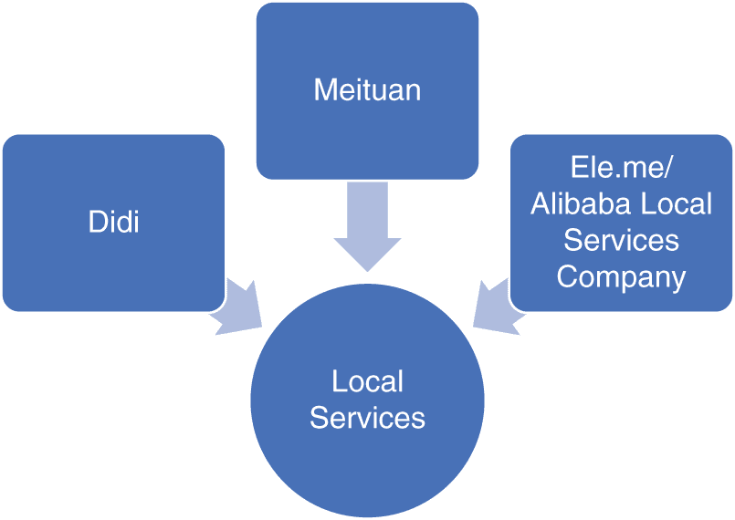

`图 6.9` **一站式按需服务平台——三方竞争者**

`Ele.me`和口碑已扩张到很大程度上尚未被开发的 3 线和 4 线城市，这可能与它们在阿里巴巴帝国内的姐妹公司`Hellobike`产生协同效应。`Hellobike`领先了小型城市和城镇的共享单车渗透率，该公司将这种策略比作共产党领导人毛泽东的“农村包围城市”战略，该战略导致了他们在 1949 年的内战中胜利。对于外卖业务，情况可能也是，因为中国的城镇化进程正让更多的小镇年轻人成为餐饮客户。

这场三方大战可能会持续很长一段时间，因为美团（及其大股东腾讯）和阿里巴巴都有巨大的资金实力来继续这场资金密集型的战斗，就像美团和点评之间早期的价格战一样（它们分别由阿里巴巴和腾讯支持）。（作为一家私人公司，滴滴可能会发现与这些财力雄厚的竞争对手竞争充满挑战；但 2020 年 7 月该公司也宣布了在香港交易所上市的计划。）区别在于，新玩家将不仅关注配送，还将致力于通过数字化手段赋能传统餐厅（以及药店、美发店、其他曾深根于线下世界的服务类门市）。

例如，许多餐厅发现他们之前的纯文本纸质菜单无法体现其招牌菜的特色。现在，消费者可以使用 App 扫描并浏览菜单。每道菜都有自己的图片，因此客户可以直看到它们的样子和分量。他们不需要员工面对面的解释即可下单。对于某些由口碑帮助数字化的餐厅，客户甚至可以玩基于增强现实的游戏来获得用餐折扣。因此，O2O 参与者正在为餐厅带来更多“数字人格”，就像`阿里巴巴`和`京东.com`转型实体零售店一样。

## 从 MaaS 到 OaaS——一块智能饼

中国的共享单车行业为中国共享经济的未来提供了最佳视角。在 2017 年和 2018 年经历了快速扩张，当时初创公司用色彩斑斓的自行车挤满了城市街道，直到 2019 年泡沫破裂导致了一波破产和单车坟。然而，这场双轮上的过山车之旅最终通向了一条新路径。

今天，来自滴滴、哈哈单和美团的两轮车以全新的面貌出现在中国城市。它们不仅有了新颜色，而且不再免费了。（实际上，近期单次价格一直呈上升趋势。）投放街道的自行车减少了，因为公司更强调运营效率而非纯数量；因此，人行道不再遍布废弃的自行车。与此同时，他们正在严格采用 AI 和大数据技术来识别需求最高的地点。因此，闲置的单车总在你需要的地方，而且比以前更容易找到。

因此，中国并没有达到某些人说的“共享顶点”。事实上，消费者需求依然强劲，而共享经济已经随着更成熟的商业模式和更先进的技术成长起来。“共享经济”在中国市场有很多有很多，如接入经济、协作经济、自由职业经济、零工经济、按需经济等。但这个领域的初创公司有着共同的精神：利用数字技术消除共享与所有权之间的便利性差距，让人们只需获取他们曾经必须购买的东西。

因此，通过消除实际所有权而保证获取权，移动租赁对于中国而言，比增加现有的低利用资产的频繁使用具有更大的意义。这可能是中国国家信息中心在统计时对“共享经济”使用极广定义的原因。根据其定义，中国拥有的共享经济独角兽数量比世界上任何国家都多，在中国每两家独角兽（根据其计算，2018 年底共 83 家）中有一家来自共享经济——占比惊人的 41%（参见图 6.10）。

例如，年轻一代渴望在社交媒体上展示他们的生活方式，以及跟上瞬息万变的潮流的压力，推动了他们对服装快速更换的需求。这些追求显摆的年轻人享受着奢侈品牌带来的地位感，他们不希望在社交媒体上被看到两次穿同一套衣服，但他们需要在自己的预算范围内找到不同服装的途径。2019 年，市场看到中国的共享经济大范围扩展到时尚和奢侈品领域，随着中国经济开始放缓，这一趋势将持续下去。

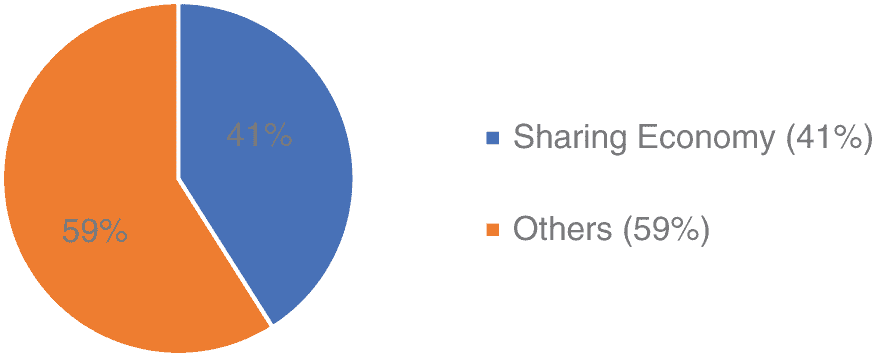

[图 6.10 中国近一半的独角兽企业属于共享经济 ¶ 数据来源：中国国家信息中心，2018 年 12 月。]

当疫情逐渐稳定、人们回到岗位工作时，哈单车等公司发现，共享单车的长距离订单（超过 3 公里）显著增加。即使是对于“最后一公里”之外的目的地，通勤者也选择使用共享单，因为这让他们可以在开放空间内骑行而无需任何人接触。因此，共享电动两轮车开启了一场新赛道，因为自行车是 1 到 3 公里路程的理想选择，而带有电机的电动车辆使使用户能够行驶更远的距离。

哈单车是共享电动自行车的丰富运营商，此前在很大程度上未被竞争对手注意到，这部分是由于其专注于下线城市。根据哈单车 2019 年收集的数据，中国每天有近 3 亿次普通自行车骑行完成，而助力电动自行车和无动力电动滑板车的订单量加是这一数字的两倍以上，每天产生 7 亿次订单。这在公共交通较不发达的下线城市尤为明显。例如，在广西南宁市，电动两轮车的出行比例超过了所有交通的 34%，超过了公共交通和私家车。

由于电动自行车和电动滑板车比自行车贵，它们的共享更具经济效益。人们可能负担得起一辆几千人民币（1 美元约合 7 人民币）的电动滑板车，但如果他们一年后可能会离开城市——回到家乡创业、为了工作机会搬到另一个城市或出国深造——他们为什么要买呢？哈单车和类似的平台提供了一种新的租赁模式，人们每月只需支付约 200 人民币（少于 30 美元）即可使用滑板车。

电动车辆比传统自行车涉及更多技术挑战。其中首要任务是在城市中建立安全便利的充电点，这本质上是一个电池问题。中国电动汽车国家标准于 2019 年发布，对集中式充电和换电提出了要求。哈单车从 2017 年提供共享电动自行车开始就开始了充电站。在这些亭子处，电动自行车用户可以更换没电或故障的电池，而无需插电等待。

通过与中国电池制造商宁德时代（CATL）合作，哈单车在中国范围内部署了超过百万辆电动滑板车。美团在 2020 年 5 月的季度会议上透露，它将在第二季度向街道投放“几十”万辆，如果表现符合预期，计划将进一步扩大。大约同一时间，据报道滴滴青桔从中国和外国投资者处获得了超过 10 亿美元的融资，并将电动自行车共享作为其 2020 年的重点事项。

他们的三方竞争可能会帮助电动车辆很快成为城市人的一种新型流行交通模式。自行车、电动自行车和电动滑板车的结合，使得电动车辆很快成为城市居民中一种新的流行出行方式。人们不再需要拥有车辆，而是通过支付出行服务来获得出行。

因此，一种新的出行概念图 6.11 MaaS（*出行即服务*）在城市中出现，它是基于各种出行模式的整合，由物联网（IOT）、大数据和智能系统驱动。MaaS 代表着一种更方便、更绿色、更顺畅的方式，取代公共交通和私家车，成为主流服务。

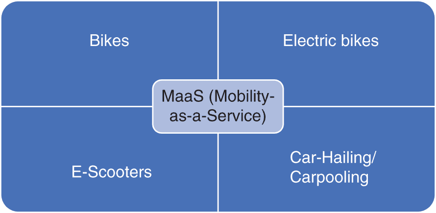

[图 6.11 共享智能城市的 MaaS]

* 2CC—星巴克咖啡模式引入美国
* 从“创新模式”到“创新技术”
* 巅峰独角兽？与美国的关键联系

## 用星巴克表达心意

星巴克的“下一代”产品会是什么？无论是什么，它都可能首先来自中国市场。2020 年 4 月，星巴克宣布与主要的风险投资机构红杉中国基金（Sequoia Capital China）建立战略合作伙伴关系，进行共同投资并与“下一代”、“技术驱动型”食品和零售初创企业建立伙伴关系。声明表示，这一联盟将使这家全球最大的咖啡连锁获得创新的“早期准入权”，并在其零售业务的所有维度中嵌入数字技术，以利用数据驱动分析、建模和决策的力量。

事实上，就在几年前，星巴克还因采用商业移动支付过晚、缺乏外卖服务以及糟糕的 App 体验而在中国饱受批评。如果说第 3 章中的 OMO 案例展示了中国新零售商如何通过技术整合线上线下市场来优化客户零售体验，那么星巴克在中国的演变则说明了外国公司对中国市场数字革命最初反应迟缓，以及后期激进追赶（见图 7.1），因为星巴克坚持公司“传统模式”和“核心竞争力”的时间太久了。

星巴克显然低估了移动支付在中国受欢迎。当公司在 2015 年首次允许 App 支付星巴克礼品卡时，微信支付和支付宝已经从大城市的商场遍到了小镇的水果摊。尽管星巴克是美国数字支付的先驱——它在 2009 年推出了北美首个允许客户使用信用卡/PayPal 为会员卡充值的 App，并在 2015 年推出了“点单与付钱”App 服务——但在中国，它直到 2017 年才引入了第三方移动支付（腾讯的微信支付和阿里巴巴的支付宝）。

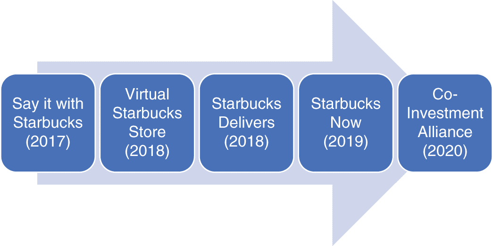

`图 7.1` **星巴克中国的数字化之路**

亡之犹犹未晚。在 2017 年情人节前夕，星巴克中国门店采用了微信支付，并与腾讯合作在微信上上线了名为“用星巴克表达心意”（Say It with Starbucks）的社交送礼功能，并立即获得了成功。用户可以赠送星巴克饮料或数字礼品卡，并在发送前添加文字、图片或视频个人信息。接收者可以在微信账户中保存礼物和回忆，并在星巴克门店兑换礼物。

在随后的声明中，星巴克声称“用星巴克表达心意”是“首个在中国带来本土社交送礼体验的零售品牌”。也许如此，但现实是，得益于移动应用程序的快速发展，数字送礼早已变得流行。如果仅仅考虑到微信在现金送礼方面的巨大规模（正如中国节日期间通过微信送出的数十亿个红包所示），这种伙伴关系应该是不言而喻的。对于中国人来说，接受微信支持的咖啡送礼新模式——或者任何其他形式的虚拟送礼——并不困难。

此外，2018 年，星巴克宣布与阿里巴巴的核心业务线（包括天猫、淘宝、饿了么、鲜生和支付宝）合作，显著提升中国客户的星巴克体验。通过超越单一 App 的传统限制，`虚拟星巴克店`联盟为客户在星巴克 App 以及阿里巴巴生态系统（包括淘宝、天猫和支付宝）的移动 App 中提供了统一的一站式星巴克数字体验。通过“用星巴克表达心意”，客户在购买数字饮料礼品卡之外，还可以增加实体星巴克礼物，例如来自星巴克天猫旗舰店的独家周边。（见[第 3 章](#c03.xhtml）中相关的 OMO 讨论。）

为了补充虚拟商店，得益于阿里巴巴帝国中的 O2O 配送平台饿了么，增加了`星巴克外送`服务。正如[第 6 章](#c06.xhtml）中对 O2O 和饿了么案例的讨论，配送服务是中国消费者的“生活方式”，因此缺乏第三方外卖服务对星巴克的销量产生了负面影响。新服务捕捉了这一机会，将星巴克质量保障的高端零售体验扩展到了实体门店之外。

一旦客户选择了他喜爱的饮品，饿了么的骑手就会 30 分钟内送到星巴克手工饮料。基于良好的客户反馈，该计划在启动后三个月内扩展到 30 个城市的 2000 家门店。根据媒体报道，这种扩张速度和覆盖范围在星巴克历史上是前所未有的。2018 年 10 月，星巴克还在上海和杭州的家家鲜生超市（阿里巴巴的“数字商店”；见[第 3 章](#c03.xhtml）中的相关讨论）试点了首个“乡村厨房”（Star Kitchens）。鲜生的乡村厨房为 30 分钟内星巴克饮料和食品的履行和配送提供了额外的规模和范围，同时在阿里巴巴的数字保护下为星巴克门店客户保留了“第三空间”体验。

2019 年，星巴克面临来自初创竞争对手瑞幸咖啡的直接挑战，后者以数字基因飞猛地扩张。像鲜生门店一样，瑞幸咖啡门店也被设计为“数字化门店”。大部分被用作自提店：座位有限，通常位于对咖啡需求巨大的区域，如办公楼、商业区和大学校园——北京和上海核心区域每 500 米（步行 5 分钟）就有一门店。这使得公司能够贴近目标客户，并以较低的租金和装修成本快速扩张。

因此，星巴克在 2019 年发布了名为`星巴克下单》（Starbucks Now）的到店下单服务，以适应中国人的通勤生活方式。移动点单和支付服务具有 GPS 功能，允许用户选择最近的门店，并可以自定义饮料、选择食品、查看订单时间，并在进入星巴克门店之前完成支付。（瑞幸自 2020 年初起一直陷入财务造假丑闻，这将在本文稍后进行讨论。）

总结来说，星巴克迟迟采用第三方移动支付只是海外公司未能在中国调整业务运营的案例之一，这源于对中国消费者的缺乏深度理解，或对市场技术水平的低估。但当这家公司认可中国市场的创业精神时，它已经迅速学习并并将最新的数字创新整合到其现有模式中。随着这家美国连锁店在中国面临来自本土数字化优先竞争者的日益激烈的竞争，它将继续创造新方式来深化与客户的互动并提供新服务。

对于外国公司而言，中国市场不仅因其巨大的市场规模和快速的技术采用速度而变得重要，更因其产生的独特创新而极具价值。虽然第一代中国科技初创公司大多围绕互联网和对西方网站的模仿展开，但新一代中国互联网和科技公司正在商业模式和产品功能上创造出一波引注目的创新浪潮，挑战了长期以来对“中国制造”仅是模仿者的认知。

## 总理的卡布奇开启了创业潮

在政府的支持背景下，一个充满活力的企业家和初创企业动态生态系统正在有机地建立并快速扩张（请参见图 7.2）。成熟互联网企业网络及其经验丰富的企业家、层出不穷的渴望的人才、充足的天使投资人和风险资本，以及完善的制造系统，共同使中国成为世界上最有趣的创新中心之一。

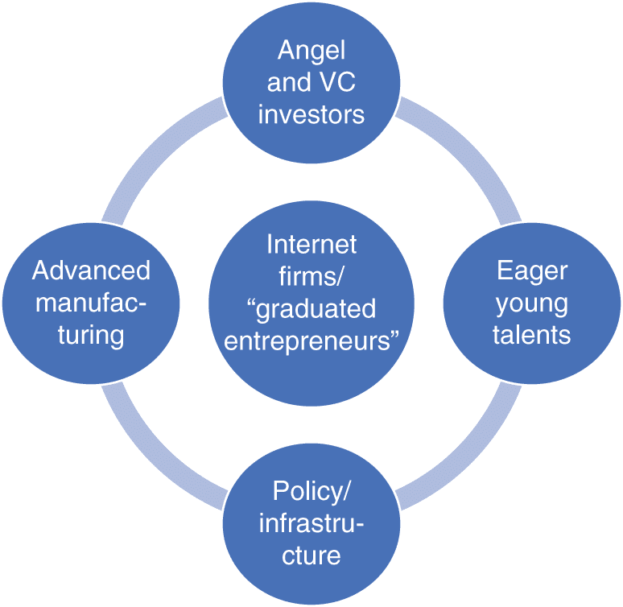

`图 7.2` **中国的创新生态系统**

政府举措包括建立创新集群，那里的行政系统对企业初创更加友好（例如更快的企业注册速度）。地方政府还在省级和市级启动了风险投资基金，其资金和补贴帮助早期创业者能够更从容地承担更多风险。在北京和上海等数十个城市，大学毕业生和年轻专业人士在他们的创业活动中可以获得减税的奖励。

例如，北京的中关村地区是中国领先的创新中心，通常被称为“中国的硅谷”。中关村科学园区同遍布全国的众多高新技术开发区共同构成了国家创新基础设施，并得到了中央政府以及地方省市的强力推动。四十年前，当中国开始改革开放时，中关村最初是从街头销售消费电子产品起家的；而今天，它已成为中国的人工智能腹地。

中关村充满了天使投资人、对冲基金和风险投资公司，这些机构推动了在线和技术型企业的飞速增长。它是中国成熟互联网巨头如 `Baidu`、[`JD.com`](http://jd.com) 和 `Didi Chuxing` 的所在地；也是全球公司如 `Microsoft`、`IBM` 和 `Google` 中国办事处；更重要的是，还有大量的初创公司。在最近的 AI 热中，中关村已成为中国最大且最具影响力的 AI 创新集群。在举办了由 `Baidu`、`Didi` 和 `Microsoft` 等运营的十几个先进 AI 实验室的同时，它还是 1000 多家专门从事 AI 相关大数据分析的早期公司的所在地。

此外，还建立了孵化设施，为企业家提供廉价甚至免费的办公设施、业务服务协助，以及连接新兴初创公司与潜在投资者的公共空间。它们还充当社区中心，创业者可以在这里交流想法，初创公司主可以向天使投资人展示项目。此外，它们也是教育中心。每天都会举办关于创业和资本市场的各种讲座，经验丰富的人士会在那里与向往者分享他们的经验。

在主干“创新街”上有 20 多家孵化设施（也称为服务中心）。

毫无疑问，全球科技行业的竞争格局本身已随着互联网和中国科技公司的出现而发生了巨大变化。尽管美国硅谷仍然处于领先地位，但中国在独角兽诞生数量上正在快速赶。当人们想到中国独角兽时，大多想到的是那些在二十年或更短时间内崛起并全球化的少数公司——最初的 `BAT`（百度、阿里巴巴和腾讯）以及新的 `TMD`（`今日条/字节跳动`、美团和滴滴）。由于这几家公司的价值已经超过 100 亿美元或 1000 亿美元，它们现在被称为“十角兽”（decacorns）和“百角兽”（hectocorns）。（参见“独角兽、十角兽和百角兽”框。）

中国创新生态系统令人兴奋的是，有更多中国独角兽正在其后崛起。它们目前仍然不为人知，因为它们还不是全球玩家；它们目前仅在中国运营，而中国市场的规模已足够它们达到独角兽地位。根据总部位于上海的研究机构胡润（Hurun）2019 年 10 月的一份报告，中国的独角兽初创企业数量超过世界上任何其他国家。中国拥有 206 家独角兽，略领先于美国，该机构称美国有 203 家此类科技初创企业。

值得注意的是，胡润报告统计的中国独角兽数量比其他研究机构多。例如，`CB Insights` 在同样的 2019 年 10 月记录了中国有 99 家独角兽。胡润列出但 `CB Insights` 未列出的独角兽中绝大多数规模较小，估值在 10 亿美元到 20 亿美元之间，这些可能是那些处于全球市场观察者视野以下的中国本土初创公司。当然，私有科技公司的估值有些模糊——特别是在 10 亿美元的边缘，但不可争议的事实是，中国正在挑战美国，成为世界最大的独角兽枢纽。（根据胡润的数据，两国共同拥有世界上 80% 以上的独角兽。）

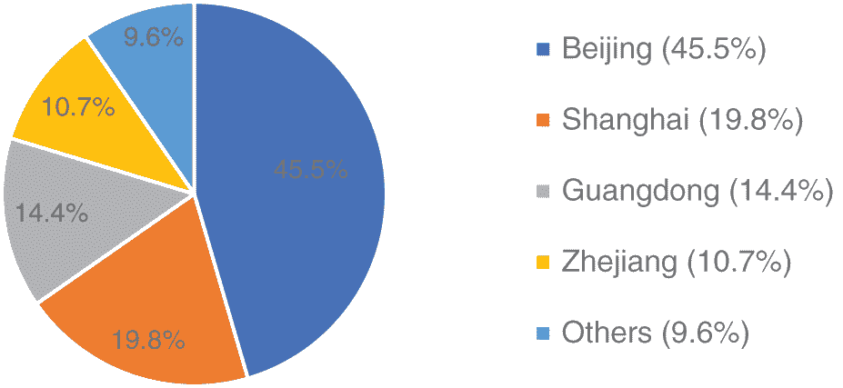

**图 7.3** **中国科技独角兽区域分布图** ¶ 数据来源：CNNIC, 2019 年 12 月。

几十年来，美国一直是提供技术新创新的核心，但中国独角兽的产生正紧随硅谷的脚步。除了北京的`中关村区`之外，国际大都市上海也是新独角兽和风投投资的顶级城市（参见图 7.3）。在南部的广东省，`深圳`市无疑是硬件初创企业的最佳所在地。深圳曾是香港旁边的一个小渔村，经过三十年的发展，现在已是`腾讯`、`华为`和中兴等国内科技巨头的家园，并已成为全球科技行业的电子制造中心。

`杭州`市（位于浙江省）近年来才加入一线创新中心城市的行列，但其势头非常强劲。它是`阿里巴巴`总部所在地，随着`阿里巴巴`帝国的发展，那里也出现了一个强大的初创企业生态系统。目前，作为`阿里巴巴`的云计算业务部门，`阿里云`是集团增长最快的部门之一，并将成为集团的主营业务。与之对应，著名的西湖（`Xihu`）地区与`阿里巴巴`一起创建了“云镇”（`Yunqi Xiaozhen`），用于培养云行业的初创企业和研究。

同时，阿里巴巴名为`城市大脑`的云产品被杭州市使用。该系统收集杭州各地的交通信息，例如路口摄像头的视频、汽车和巴士位置的`GPS`数据以及环境状况。然后它利用人工智能分析数据并协调 1000 多个关键交通灯和道路信号以引导实时流量。`城市大脑`确实缓解了杭州作为中国最堵城市之一的拥堵问题，并开始测试城市能源系统管理。

此外，中国西南地区也出现了新的枢纽，远离之前提到的领先沿海城市。中国四川省省会`成都`设立了专门的大数据部门来促进城市大数据产业的发展。与杭州一样，成都积极利用大数据管理城市交通。有趣的是，根据《财新周刊》（`CNB Weekly`）`Rising Lab` 项目的大数据研究，成都是下一个加入一线城市俱乐部（在历史悠久的北京、上海、广州和深圳之后）的城市。

贵州省首会贵州是另一个大数据城市。贵州曾是中国最贫穷、发展最落后的省份之一，以烟草、茶和茅台（中国最著名的酒）闻名。但从数据产业的角度来看，贵州地处山山环绕的高原，气候温和；水资源丰富，可以廉价且充足地发电。2016 年，该省成为中国第一个“大数据综合试验区”，使其处于国家日益增长的数据产业前沿。从那时起，许多大型数据中心项目正在开发。

中国独角兽增长迅速，部分是因为它们的领导者认为没有时间缓慢增长。像世界各地的同行一样，他们强调速度和快速持续的改进。中国市场可能是世界上竞争最激烈的市场。（参见“反 96 运动”框）。正如本书中的许多案例所示，这些年轻公司在产品完全测试之前就发布产品，在收集客户数据和市场反馈时迅速改变业务模式，并且并不隐藏想要成为市场冠军的雄心。他们惊人的速度几乎让硅谷看起来像昏昏欲睡。

## 2CC—熊猫复制到美国

在互联网早期，第一代中国科技公司是以西方网站的复制版起家的，导致了全球市场长期持有的“复制到中国”（`C2C`）认知。现在，在业务模式和功能方面，新趋势是“向中国复制”（`2CC`），即西方公司复制从中国产生的新业务模式（参见图 7.4）。例如，免费共享单车业务由中国公司`ofoofo`和`摩单车`启动，导致了硅谷出现`Spin`和`LimeBike`等模仿者。

最近，共享食品制备服务在中国蓬勃发展，2019 年，前 Uber 首席执行官`Travis Kalanick`启动了他的新初创公司`CloudKitchens`，这是一个针对餐厅和外卖订单的共享厨房概念，它遵循了中国共享厨房公司（如“优选外”）的成功扩张。（有趣的是，Kalanick 正与共享单车初创公司`ofoofo`的前首席运营官张一琦合作开发`CloudKitchens`。如上所示，`ofoofo`在经历昂贵的价格战后破产了。）

**图 7.4** **从“C2C”到“2CC”**

熊猫外卖（Panda Selected）是中国共享厨房模式的领先运营者——这种模式邀请餐厅共享空间，以专注于外卖订单。作为 O2O 食品外卖价值链的一部分，共享厨房服务于追求快节奏的年轻群体，这群人通常通过移动应用订餐，并获得快速的外卖送达。共享模式降低了商业餐厅的经营成本——不需要大型的用餐区或仅服务于单家餐厅的厨房。熊猫外卖成立于 2016 年，到 2020 年，它已在中国主要的商业枢纽拥有了超过 120 家门店。

共享单车和厨房服务快速增长的部分原因在于，中国拥有全球最大的仅限手机用户的群体。9 亿智能手机用户通过相同的语言、文化和移动支付系统连接在一起。其影响是深远的：新的移动应用程序在中国可能比在其他地方更快地获得市场反馈并实现有意义的规模效应，因为基于“人机”的新技术在中国往往传播得更快。

此外，与西方竞争对手相比，中国公司似乎更倾向于跨行业边界迁移并创建更大的生态系统。由于主导西方企业战略思维的“核心竞争力”理论，大多数外国跨国公司往往侧重于其关键业务领域，并避免跨不同领域扩张。相比之下，中国主要的互联网和科技巨头都拥有宏大的愿景，运营可以相互支持和互补能力的业务网络，进入一个“平台”，让消费者可以沉浸在满足各种可能的消费需求中。

中国超级平台的兴起是由消费者和移动支付共同驱动的。对于消费者来说，拥有一个提供多种服务或整合相关活动与服务的单一应用更加方便。例如，一个出行应用可以把叫车、拼车以及自行车或电动滑板租赁结合在一起。在电子商务领域，此前独立的娱乐、食品和普通商品等领域被整合进在线市场。对于公司而言，移动支付能够使其平台满足各种消费者的需求，如订餐、旅行预订、观看优质视频以及（自然地）小额贷款和财富管理等金融服务。

例如，许多人将阿里巴巴视为中国版 `eBay`，将社交媒体公司新微博视为中国版 `Twitter`。事实上，这些公司后来从根本上改变了它们的业务模式。正如本书的案例研究所示，阿里巴巴更像 `Amazon`（电子商务）、`eBay`（在线市场）、`PayPal`（移动支付）和 `Netflix`（视频和影视）的混合体，而新微博则像是一个结合了 `Twitter`（微博客）、`Instagram`（图片共享）和 `YouTube`（视频共享）的媒体平台。

因此，市场认为中国在将社交媒体、在线娱乐和电子商务世界融合方面领先全球——即使对于美国的“超级平台”也是如此。与美国竞争对手相比，中国的移动应用在内容、社交和商业方面更加先进，而且更具交易属性。在竞争异常激烈的中国市场，“克隆版”应用演变迅速并开创了新概念，与此同时，美国的“原创”公司往往是新功能竞争中落后的一方（参见表 7.1）。

得益于先进的数据分析，中国科技公司正在转化为业务生态系统，其中曾经看似相互脱节的领域现在通过用户数据实现了无缝整合。超级平台从经济学家所谓的“网络效应”中获得了巨大优势——提供的服务越多，使用的人就越多；它们变得越不可或缺，获取的用户数据就越多。当它们追求新市场领域时，其用户大数据是一个丰富的来源。结果是一个兼具实体和在线业务的生态系统，提供从消费想法到服务交付的端到端数据驱动消费者体验。平台日益地在客户表达需求之前就预测到了需求。

## 从中国到美国的新创意

| 美国 | 中国 |
| --- | --- |
| `Facebook` 在 2019 年计划将私信、群组和支付功能与 `Instagram` 及 `WhatsApp` 整合 | `腾讯微信` 在多年前就先创了这种模式 |
| `Google` 在 2019 年为 `YouTube` 添加了新的购物功能，以提供购物推荐、分享联盟佣金，并允许品牌包含可购买的广告 | 在 2016 年收购视频流网站 `优酷土豆` 后，`阿里巴巴` 已经在在线视频中加入了来自 `淘宝` 和 `天猫` 商家的广告，并附有移动支付链接（“边看边买”） |
| `Instagram` 在 2019 年 3 月推出了测试版购物功能，允许买家点击时尚和美容物品并直接从应用中购买 | 中国社交购物应用 `小红书(RED)` 长期以来一直将其作为内置功能提供 |
| `Amazon` 的直播购物功能 `Amazon Live` 于 2019 年 2 月推出，其特点是主播演示产品的直播视频，观众可以直接从视频下方的轮播栏中购买 | `阿里巴巴` 的市场在多年前就提供了相同的功能 |
| `Facebook` 在 2018 年 11 月推出了 `Lasso`，这是一款旨在与 `TikTok` 竞争的短视频应用；在巴西，`Instagram` 推出了类似 `TikTok` 的视频音乐混剪功能 `Reels` | 中国公司 `字节跳动` 的短视频应用 `TikTok` 早早整合了 KOL（关键意见领袖）、短视频和电子商务 |

通过学习中国的创新，特拉维·卡兰尼克（Travis Kalanick）和 `Uber` 公司实际上是一致的。当卡兰尼克复制熊猫外卖时，`Uber` 将自己设定为“生活的操作系统”，这听起来像中国数字经济中的超级平台。该公司已将其食品外卖服务 `Uber Eats` 合并到主叫车应用中。该应用还添加了公交和火车时刻以及公共交通路线，用户可以通过该应用购买公交和火车票，该公司表示其正试图成为“交通界的亚马逊”。

事实是，在新的重组后，`Uber` 的新形象更像中国的 `美团点评`（参见第 6 章中的案例研究）。美团是 `Groupon`、`Yelp`、`Seamless`、`Uber` 等的结合，是中国城市所有本地需求的一站式服务平台：外卖、团购、电影票或酒店预订——它还提供自行车、电动滑板车和叫车服务供出行。美团在 2019 年底首次盈利，而 `Uber` 仍处于深度亏损状态。对于 `Uber` 来说，添加公共交通信息预计不会带来收入，希望如果更多人频繁打开 `Uber` 应用，公司可能会以某种方式实现变现。

新一代中国初创企业既代表了技术创新，也代表了商业模式创新。然而，如今的独角兽企业领导者更关注技术创新以获得优势。无疑，新的商业模式在中国不断创新——速度快于全球任何地方——以提升用户体验。但商业模式的创新更为常见；独角兽企业日益寻求通过独特的知识产权、所谓的“深科技”和“硬科技”来彰显自己。

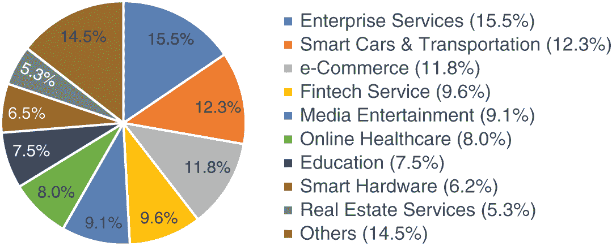

`图 7.5` **互联网和数字技术独角企业的行业分布** ¶ 数据来源：CNNIC，2019 年 12 月。

这种从“创新模式”到“创新技术”、从“在线平台构建”转向“数字技术研究”的重心转移，在独角兽企业的分布中有所体现。根据 CNNIC 2019 年底的数据，虽然面向消费者的电子商务和媒体娱乐类独角兽仍是重要组成，但约一半的独角兽处于企业服务、交通、金融科技、医疗、教育和智能硬件领域，这些领域正迅速将 5G 驱动的 iABCD 技术引入传统行业（参见图 7.5）。

例如，**自动驾驶汽车**是一个拥有多个趣味性领域。中国正努力在开发具有自动驾驶和联网功能的下一代汽车方面获得领先地位。2018 年，中国建立了自动驾驶规则的基础，这将为未来的技术部署提供巨大推动。例如，杭州市计划建设兼容自动驾驶车辆的“超级公路”，预计于 2022 年完成。`Baidu` 被中国科技部选为自动驾驶领域的“国家冠军”。名为 `Apollo` 项目的自动驾驶车辆部门已与福特、沃尔沃和宝马等汽车公司建立了合作伙伴关系。

在**智能硬件**领域，凭借“中国制造”的强大实力，中国拥有几位全球领导者。例如，作为全球民用无人机和空中成像技术的领导者，`DJI` 占据了全球无人机市场三分之二份额，拥有超过 1 万名全球员工。但 `DJI` 在中国某些专业领域仍面临竞争对手：在农业无人机（UAV）领域，总部位于广州的 `Jifei` 技术是领先制造商。

**教育**（所谓的教育科技）是一个特别蓬勃的部门，在新冠肺炎爆发后，它仍然是投资活动的一个亮点，因为疫情已成为全球教育机构寻求创新解决方案的催化剂。语言学习以及早期识字和数学，是教育工作者普遍认为 `AI` 可以带来积极学习效果的领域。中国家庭为了子女的未来投资教育有悠久的历史，据估计，现代中国的课外辅导占家庭收入的约 15%，使其成为具有巨大增长潜力的巨型市场。与传统的实体学校相比，在线教室拥有更广泛的学生群和更低的运营成本。

因此，教育领域的许多成功初创企业已将 `AI` 加入传统教育模式，并迅速发展起来。其中，作为英语学习在线教室的 `VIPKid` 可能是资金最充足、发展最完善的。`VIPKid` 通过一对一的视频课程，为中国 5 至 12 岁的学生提供与北美英语教师的服务，其水平相当于美国的顶尖学校。2018 年，`VIPKid` 与 `Microsoft` 建立合作，实施 `Microsoft` 的 `AI` 技术以进一步提升学习体验。

其竞争对手 `LAIX` Inc（根据其创始人的话，意思是“通过 `AI` 赋能生命以达到无限可能”）开发了内置 `AI` 的英语学习应用 `Liulishuo`（英语意为“流利说”）。该应用记录用户的语音，然后分析其说话内容，并根据其可以改进的领域（发音、语法和词汇）提供课程。利用海量用户数据，该应用不断进化，并为每个用户提供更定制化的学习计划。此外，它还将游戏和社交分享整合到平台中，带来更有趣、互动性更学习体验。

该领域的另一个有趣者是 `Zuoyebang`（英语意为“作业帮”），它起源于“图像搜索”，旨在为初中小学生建立问答平台。`Zuoyebang` 应用允许用户通过上传问题照片搜索作业答案并获得一对一帮助。该应用采用计算机视觉技术从图像中读取问题，然后在作业数据库中进行快速搜索。

但很快，所有这些企业以及它们的竞争对手将汇聚到开发在线课程上，`AI` 软件可以监控并改进用户的学习过程。算法跟踪学习者以确保他们专注于学习。通过对辅导课程进行记录，`AI` 算法将专门观察学生对所学材料的面部反应——特别是学生的眼睛及其移动方式。使用自适应算法进行个性化教育，甚至可以在不需要人类教师的情况下复制那种一对一的环境。例如，对于英语学习，`AI` 技术已经整合了高质量、高效教师的核心特征和功能：

- **听力。** `AI` 系统通过基于深度学习技术的语音识别和评分引擎进行听。它可以处理背景噪音引起的不确定性，以及不同的说话者口音和熟练程度。
- **评估。** 利用其自然语言处理（或 `NLP`）能力，它可以根据发音、词汇、语法、流利度和连贯性等多项标准对用户的语音进行评估。
- **反馈。** 根据上述评估，`AI` 老师通过直观界面向用户提供各种形式的实时个性化反馈。

2020 年 4 月——中国新冠肺炎疫情的高峰，在线教育初创企业 `Yuanfudao` 在其 G 轮融资中筹了 10 亿美元。根据公司声明，该交易将其估值推向 78 亿美元，使其成为中国价值最高的教育科技公司之一。在居家政策的推动下，中国的在线教育业务已成为受到新型冠状病毒爆发严重打击的经济中的增长领域之一。正如每一个部门一样，竞争正在加剧。新入场者再次是短视频平台。

如 `Douyin`、`Kuaishou` 和 `Bilibili` 等中国视频应用主要被认为是人们消遣的娱乐场所，但现在它们正采取措施拥抱教育领域，因为儿童和青少年已经是它们的用户。年轻学习者自发上传高质量的跨学科视频，丰富了平台的内容生态系统，涵盖从金融到计算机、外语言到软件技能。有趣的是，与传统的在线教育平台相比，视频平台为学习创造了更具“社区文化”的氛围。

`Bilibili` 的标志性特征是“弹幕”（一种用户对话系统，消息会直接显示在播放的视频上方），现在它正利用这一功能来营造一种“共同学习”的环境。目前尚不清楚父母是否会买账，但毕竟是在中国，任何新技术与商业模式的组合在没有经过先测试的情况下是不可能生存的。

## 巅峰独角兽？与美国的关键联系

当然，并不是每一个中国独角兽都能成功。除了少数真正拥有专利和独特技术的公司外，独角兽的设计和制造已经工业化，其核心要素是在线服务，并由移动 App 提供支持，通过社交媒体进行营销。在全球范围内——不仅在中国，而且在硅谷和印度等新兴创新枢纽——所有市场都量身定做以生产这类巨兽，使用相同的配方并加入当地特色。当“独角兽”一词在 2013 年被创造出来时，全球仅识别出 38 家独角兽；但到 2020 年年初，市场数据公司 `CB Insights` 统计到已超过 400 家，比 2013 年增长了十倍以上。

独角兽数量的激增导致许多人质疑科技初创公司的估值是否具有可持续性。在运营方面，他们面临着许多挑战，特别是随着增长，亏损不断扩大，对人才和其他资源的需求也在增加。仔细观察马厩里的这群怪兽确实令人担忧：有些似乎是为了表演而生的，而不是为了劳动；有的长得太胖而无法赢得比赛；更糟糕的是，有些因为自己的行为问题而生病了。随后，2020 年的新冠疫情席卷了这群怪兽。

因此，2019-2020 年（即 `WeWork` 失败的几年）成为了欢快气氛开始消退的转折点。（参见“嘿咻！嘿咻！我们要掉下悬崖了！”框）。`WeWork` 的全球性崩盘详见该框，它还拥有 `WeWork China`（目前由 `WeWork` 持股 59%），该其还引入了外部投资者。2018 年，在 `WeWork China` 成立仅一年后，软银（`Softbank`）、淡马锡（`Temasek`）、Turnbridge Partners 等进行了轮投资，将该业务估值定在约 50 亿美元。鉴于 `WeWork` 在 2020 年接近破产，`WeWork China` 的估值可能远低于机构投资者投资时的 50 亿美元水平。

与 `WeWork` 类似，许多中国独角兽的估值在疫情引发的低迷中开始崩溃，但曾作为星巴克对手的瑞幸咖啡（`Luckin Coffee`）可能是最剧烈的一个。正如本章开头提到的，瑞幸将互联网思维应用于其业务中。其门店不接受现金，客户只能通过 `Luckin` App 进行下单和支付，整个过程中无需与任何人交谈。在 2019 年 5 月的 IPO 招股书中，该公司将自己描述为一个“网络”，并对提供“100% 无收银员服务的环境”感到自豪。这为一个很大程度上是常规的业务注入了新的色彩，这与共享办公公司 `WeWork` 不同。

瑞幸的飞速崛起是中国按需服务提供者采取的路径——通过提供极高折扣来快速获得关键规模，然后利用客户规模进行资本融资，随后进一步扩张以挤压竞争对手——即通过烧钱换取市场。该公司从私人和公共投资者处共筹了超过 20 亿美元的资金，但消耗了大量现金（以及买一送多等折扣）。2020 年初，瑞幸表示其门店数量已超过星巴克，成为中国最大的咖啡连锁店。

随后，在 4 月 2 日，瑞幸宣布其大量销售额——高达 22 亿元人民币（3.1 亿美元）的交易额——是虚假的，且其部分成本和费用被大幅虚增。当美国股市开盘时，瑞幸股票在交易交易日内跌幅高达 81%。根据《华尔街日报》报道，一名名为 `Lynn Liang` 的虚假员工帮助公司从瑞幸主席及控股股东相关的公司入账了远高于真实的收入，这些收入远超了其咖啡店的产出（见图 7.6）。

这种欺骗的规模和胆量震惊了国际投资者，也让中美的监管机构感到大不知所措。事实上，瑞幸案也说明了中国的创新生态系统并非纯本土的；相反，它与西方（尤其是美国）的联系是使该生态系统保持活力和稳健的关键要素。风险投资领域之外的人少知的是，美国在培养中国科技行业方面发挥了巨大的作用。再加上持续的科技战，瑞幸咖啡（以及类似案例）带来的咖啡因冲击对未来中国的创新生态系统产生深远影响。

`图 7.6` **瑞幸咖啡的收入记录** 数据来源：SEC 文件（10 亿人民币=1.4 亿美元）。

### 第一，来自西方的风险投资

即使在瑞幸这样的独角兽在美国上市之前，它们就已经吸引了来自美国和其他西方国家的风险投资。瑞幸的主要股东是风险投资基金凯龙星资本（Centurium Capital），其资金主要来自机构投资者，包括华盛顿州投资委员会（Washington State Investment Board，美国）、安大略教师养老金计划（Ontario Teachers Pension Plan，加拿大）以及新加坡的主权财富基金 GIC 和淡马锡。中国许多成功的科技公司，从阿里巴巴、字节跳动，到美团和小米，都受益于美国风险资本对其增长的支持。（2020 年初，凯龙星基金正计划完成一项 20 亿美元的新基金募资，但在瑞幸事件后，华盛顿州投资委员会撤回了承诺。）

根据 Rhodium 在 2020 年初发布的的研究报告，自 2000 年以来中国公司获得的风险资金中，美国基金和投资者占了近五分之一。如果将美国被动投资者（如大学基金金、养老金和退休基金，例如作为风险投资基金 LP 投资者的华盛顿州投资委员会）的资金计算在内，比例将超过三分之一。如今，美国两党的立法者都在讨论一项新的立法，旨在让美国人及其养老金投资中国公司变得更加困难。

### 第二，IPO 市场中的外国资本

美国是中国独角兽进行 IPO 的热选上市地——甚至比中国本土还要热门。截至 2019 年底，中国有 135 家互联网和科技公司分别在中国大陆（上海和深圳，50 家）、美国（54 家）和香港（31 家）上市（见图 7.7）。令人惊讶的是，在美国上市的比例（40%）实际上超过了在上海和深圳上市的比例。

`图 7.7` **美国是中国独角兽企业上市的首选** ¶ 数据来源：CNNIC，2019 年 12 月。

瑞幸咖啡的倒下再次引发了关于美国证券交易委员会（`SEC`）无法检查中国公司财务记录以保护美国投资者的长期紧张局势。毕竟，这并非美国上市的中国公司首次深陷财务造假的指控。中美两国在 2013 年签署了一份谅解备录，允许中国公司在当地法律禁止共享的情况下保留信息。十年来，`SEC` 一直与中国政府就检查美国上市中国公司的审计报告问题陷入斗争。今年 4 月，在瑞幸咖啡丑闻之后，`SEC` 主席 Jay Clayton 警告投资者注意中国公司的披露问题。

对于一些美国立法者来说，那项财务豁免条款可能需要审查其是否仍然合适，如果不合适，则应撤销。目前已有许多法案被提出。某些法案将强制中国公司在寻求美国股市上市时遵守联邦审计规则和披露要求。另一些法案旨在强制未能遵守审计规定的外国公司下市。共识是迫使中国公司变得更加透明，否则将面临下市的风险。（2020 年夏天，瑞幸咖啡在失去超过峰值 90% 的市值后，最终从 `Nasdaq` 交易所下市。）

随后，在 2020 年 8 月，`SEC` 对`爱奇艺`发起了调查，该视频平台常被称为“中国版 Netflix”（请参见第 4 章中的相关讨论）。此前，尽职调查公司 `Wolfpack Research` 在 2020 年 4 月发布的一份报告中发现了涉嫌夸大销售额和收入的案例。与此同时，`SEC` 的中国对应机构证券监督管理委员会（`CSRC`）向美国当局提交了一份关于共同审计中国公司的新提案。`CSRC` 表示，“通过对话解决共同关注的问题是实现双赢的唯一途径”，这显然并不是在推行脱钩。

## 第三，在美国的扩张与收购

美国市场对于中国科技公司的全球化具有高度意义，这既取决于其巨大的规模，也取决于其充满活力。如果瑞幸咖啡没有因财务丑闻而陷入中断，它在`Nasdaq`上市后的下一步将是扩张到美国市场，并在对方的主场上与星巴克竞争。随着它的扩张，它很可能会收购美国公司以加速其增长。

2020 年初，特朗普政府制定的新规则生效，赋予了美国外国投资委员会（`CFIUS`）更多权力，该机构负责审查外国直接投资的国家安全风险。总统和`CFIUS`的权限被扩大，可以审查并阻止中国（以及其他外国资本）投资涉及关键技术、基础设施和数据的美国公司，这在第 9 章中有所讨论。

最终，阻碍中美这两个实力各异的创新中心之间的资金流动，将不仅损害商业回报，还将切断思想和创新的流动。无疑，在新冠肺炎引发的市场崩溃正抑制着独角兽企业的增长并严重测试着它们的一些业务模式之际，中美紧张给中国独角兽企业带来了额外挑战。对于许多较年轻的独角兽来说，2020 年可能是他们第一次直接体验周期是如何运作的，以及当地初创企业如何受到地缘政治动荡的影响。

当然，它们中的许多将幸存并繁荣。与“模仿者”一代相比，新一代中国公司在产品和技术上更具创新性以满足本地市场需求，更愿意接受外部投资者，并且从一开始就具有更全球化的视野。在中国新兴创业生态系统的支持下，中国故事正在迅速从旧的“中国制造”工厂转向年轻的“中国创新”。

“我们很高兴能利用全球两个最大、最具活力的市场的科技创业者的巨大能量，开发出可以重塑全球零售格局的创新解决方案，”星巴克首席执行官 `Kevin Johnson` 在评价 2020 年与红杉中国的合作时表示。事实上，他的公司对中国市场的深度参与，可能是更多外国公司来中国寻找新市场、特性、产品和业务模式的预兆。

# 第 8 章：大数据之地及其法律框架

- 脸书与中国的隐私意识觉醒
- 大数据之地拥有全球最大的数据劳动力池
- 从人肉搜索到大数据杀熟
- AI 时代：隐私、安全与价值
- 新游戏的新规则
- 网约车性事件：问题多于答案
- 2020 年民法典及未来展望

## 脸书与中国的隐私意识觉醒

当马克·扎克伯格在 2018 年初于国会就`Facebook`的数据实践进行作证时，他警告说监管平台对个人数据的使用将导致美国在人工智能方面落后于中国公司。他的观点反映了一种共识，由于中国监管松散，中国互联网行业积累了大量的用户数据用于人工智能研究。换句话说，如果像`Facebook`这样的美国公司受到数据保护的限制，中国公司将拥有优势。

扎克伯格的观点似乎得到了中国对应者的呼应。同样在 2018 年初，`百度`（中国领先的搜索引擎，类似于`Google`）创始人李彦宏在采访中评论道，中国人愿意为了便利而交易隐私。“如果他们愿意这样做，我们就可以利用这些数据，”他说。

然而，在中国，李彦宏的言论并没有得到公众的接受。这一评论引发了互联网用户的骚动，特别是那些对这家搜索巨头侵入性数据收集感到不满的用户。中国官方媒体报道了用户在网上表达的愤怒，并引用了诸如“谁告诉我们愿意放弃数据了？”的评论。巧的是，`百度`在同年被江苏省的一个消费者权益保护组织起诉，理由是在未征得用户同意的情况下收集用户数据（在`百度`删除了监控用户联系人和活动的功能后，该诉讼被撤回）。

事实上，2018 年可以被誉为中国公众隐私意识觉醒的一年。同一年，中国用户对包括阿里巴巴在内的另一个互联网巨头就个人数据隐私发起了挑战。正如之前的章节提到的，阿里巴巴的金融分支蚂蚁上线了“芝麻信用”，这是一种基于用户的数字活动、交易记录和社交媒体情况提供贷款的在线信用评分服务。用户发现自己在默认且未经征得同意的情况下被加入了该信用评分系统。在压力下，阿里巴巴道歉了。

越来越多，中国消费者正以前所未有的方式在互联网巨头面前公开维护自己的隐私。与此同时，中国正处于建立数据保护监管体系的早期阶段。例如，其 2018 年的《电子商务法》已经纳入了与欧盟《通用数据保护条例》（`GDPR`）相似的数据隐私保护，而 2020 年 5 月通过的《民法典》则首次将隐私权和个人信息保护原则写入了法律。与扎克伯格的描述相反，中国不再为他提供一个针对隐私规则的便利反驳论点。

# 大数据之地的全球数据动力库

在某种程度上，扎克伯格先生是正确的。对于人工智能研究来说，中国拥有的关键优势在于其数据资源，因为人口密度与数据密度成正比。随着超过 9 亿人口成为互联网用户，加上移动经济热潮期间应用程序的普及和采用，中国消费市场的数据经历了爆发式增长。在这个“移动优先”和“仅限移动”的市场中，人们大量使用手机购物消费品、点外卖、买电影票以及几乎所有的日常活动，这反过来在互联网平台上留下了海量数据。

诚然，对于人工智能竞赛来说，中国的巨大优势在于其拥有的大数据。但它的优势更为微妙。背景是，尽管人工智能取得了种种进展，但它仍然如其名称所示的那样具有很强的人工性。人工智能的认知能力必须经过“训练”或“教学”。人工智能算法必须在消化了大量标记的照片和视频后，才能意识到黑猫和白猫都是猫。同样，为了学习区分猫和狗，必须向计算机展示每种动物都经过正确标注的图片。为了这一训练过程（参见图 8.1），必须收集照片和视频等信息，并对与主体（例如猫或狗）相关的细节进行标注，以告诉机器它们看到了什么（未来，机器可能会变得足够智能自我教学）。

因此，单单的数据对开发人工智能并没有大用。它们必须先被标注。训练人工智能算法的数据需求激增催生了一个新的全球行业——“数据采集与标注”。这就是为什么数据工厂初创企业在中国兴起，通常位于规模较小、成本较低的城市，那里的劳动力和办公空间都很廉价。许多数据工厂工人是曾经在大城市流水线或建筑工地工作的人群。

`图 8.1` 喂养了标记数据的 AI

对于标注员工来说，这项工作技术性不高，可能很枯燥。工作通常是在人物照片、监控录像和街道上标记数据点。例如，标注睡觉人的图像，这些图像可以被自动驾驶项目用于识别在开车时入睡的司机。尽管如此，这种新的数据工作为他们提供了成为数字世界工人的兴奋感，新行业也将科技行业的一些就业福利带到了农村地区。

得益丰富的数据和廉价的劳动力，中国已成为全球数据采集和标注的关键枢纽。如果将新经济中的数据（不完全准确地）比作旧经济中的石油，那么数据采集和标注业务就可以被视为原油厂，将原始数据转化为人工智能行业可用的燃料。就像传统的“中国制造”牛仔裤和 T 恤工厂一样，数据工厂效率高且价格具有竞争力，并且拥有了远至美国、墨西哥、肯尼亚、印度和委内瑞拉的丰富的国内外客户群。

人脸识别的人工智能竞赛就是一个很好的例子。商汤和旷视科技等中国独角兽企业的背后是数据供应链，通过这条供应链，数据被采集、清洗和标注，然后处理成使人脸识别工作的机器学习软件。他们使用的许多算法与其他算法并没有太大不同。中国无与伦比的数据标注基础设施是人工智能初创公司脱颖而出的重要因素。未来，许多传统行业在经历数字化转型时，也将从这一机器学习供应链中受益。

因此，2020 年，中国中央政府发布了一项经济政策指南，将“数据”纳入“生产要素”，加入了土地、劳动力、资本和技术等传统要素之中（参见图 8.2）。政府表示，中国正处于创新驱动发展的关键阶段，数据对其他要素的效率可以产生倍增效应。这一倡议与 2020 年 5 月中央政府报告中发布的“新基础设施”计划相呼应，该计划重点关注数据相关的发展。在该框架下，个人数据管理与保护、统一行业数据标准、公私数据共享等数字经济的其他关键问题正看到加速发展。

同时，数据重要性的增加也导致了非法数据和假数据的出现。由于数量大、价格低，非法数据的“黑市”在中国蓬勃发展。根据媒体报道，中国发生数据泄露涉及的平均数据记录数量是其他国家的数倍，个人信用信息和电话记录甚至仅需 0.01 美元。在社交网络上只需进行“手机数据”或“个人数据”等简单搜索，就能轻松找到买卖个人信息的群组。

`图 8.2` 数据：“生产要素”的新增量

假数据行业也在蓬勃发展，特别是在媒体和娱乐领域，因为用户数据意味着人气和影响力。在中国类推特的微博上，“网红”的受欢迎程度可以通过他们的粉丝数量、帖子点赞的次数以及在不同排行榜上的排名来衡量。此外，由于大多数娱乐平台使用数据驱动的人工智能算法来决定向用户推荐什么内容，数据的价值可以被复合。随着数据驱动业务的增长，反对数据和统计造假的斗争仍在继续。（参见“水军和克里斯是谁？”的边框。）

当然，获取最多的数据本身并不是人工智能发展最重要的因素。例如，在 `AlphaGo` 击败人类最强围棋手后，谷歌进一步开发了更先进的版本 `AlphaGo Zero`，它完全没有通过人类对弈的历史数据进行训练。相反，`AlphaGo Zero` 只被教了`围棋`规则，然后就开始通过自我对弈进行自我训练。在短短几天内，`AlphaGo Zero` 就轻松击败了 `AlphaGo`。显然，除了数据数量外，新算法、计算能力和数据的类型等因素可能同样具有价值。

因此，将数据比作新石油的类比有些欠妥。数据与 AI 实力之间的关系类似于劳动力与经济的关系。中国可能拥有丰富的劳动力，但正如 `AlphaGo` 案例所示，这支劳动力的质量、结构以及治理（算法编程）对经济发展同样重要。与中国海量的数据储备相比，美国在数据质量和数据多样性方面具有优势。例如，`Facebook` 和中国的 `WeChat` 在其社交网络都拥有超过十亿用户，但 `Facebook` 用户代表的语言、种族、文化和国籍范围远大于后者（后者大部分为中国人）。

尽管如此，在 AI 程序完全变为自监督学习或无监督学习（即 AI 系统在没有人工标注的情况下进行学习）之前，中国的数据储备和庞大的数据标注工人池仍然是一个重要优势，它催生了 AI 的良性循环——更多的数据用于测试，更多的 AI 产品投入实施，以及在使用过程中再次产生更多数据。在 AI 实施时代（相对于发现时代），这种优势尤为宝贵，因为大多数工程师侧重于在“大数据”上运行和测试 AI 算法，以实现更快的速度、更准确的预测、更少的人力和更低的成本等。

此外，中国的数据标注工厂正在进行升级，因为全球范围内高质量、大规模和集成化的用户数据供不应求。随着创业公司进入更先进的 AI 深度学习领域，维持公司生存的是标注数据的更高准确性，而非低价格和廉价劳动力。例如，自动驾驶汽车和 X 光读取的数据需要专业知识，许多数据标注从业者正转向更具挑战性的任务和更高的利润空间。随着中国大数据行业的扩张，公众的数据意识也在提高。

## 从“人肉搜索”到“大数据杀熟”

在早几年，中国用户兴奋地拥抱移动互联网，尤其是随时随地在线购物和娱乐带来的乐趣，价格比以前便宜得多。`CNNIC` 的 2014 年度报告发现，中国网民对互联网的态度主要是“信任和分享”。他们与用户数据和隐私问题的接触有限，主要是那些“人肉搜索”事件，但对大多数网民来说，这仅仅是“坏人”的问题。（参见 `Renrou-Sousuo (人肉搜索)` 边框。）

但随着大型互联网平台的出现，情况很快发生了变化。如前面的章节所述，许多互联网巨头已将其业务扩展为“超级应用”。例如，`Tencent` 公开承诺要成为中国互联网的基础平台：一个等同于“生活水电供应”的平台。他们活跃在各个领域，从外卖到打车，从电商到贷款，并从大量的活动中收集并拥有海量用户数据。因此，这些大型平台能够以惊人的细节对用户进行画像描述。

正如“马赛克理论”所暗示，分散的信息项虽然对所有者单独而言用处有限或没有，但与其他信息项结合时，就会产生额外的意义。在网络空间中，有很多用户永远不会认为某些不同信息能够识别一个人。但当计算机组合这些片段时，它能以人类无法感知的方式发现联系。当一个数字平台整合不同的数据集——无论是来自同一平台的不同业务线（例如 `Meituan` 的外卖和共享单车服务），还是来自不同行业的第三方数据供应商的数据——用户数据集成的力量就会呈指数级增长。

一方面，平台利用大数据分析为用户提供更个性化、更快速的服务。另一方面，许多平台的数据力量也引发了公众对大数据可能被滥用的担忧。他们通过“大数据杀熟”迅速学会了数据和隐私的重要性——平台拥有的个人数据越多，用户就要付出的越多（参见 `Dashuju Shashu (大数据杀熟)` 边框。）

正如“大数据杀熟”所示，关于中国网民几乎不在意放弃个人数据的观点并非事实。更直接的原因是，人们对社交平台如何收集、分类和使用数据仍然缺乏普遍的了解。然而，在中国的互联网公司多年来围绕中国人隐私意识缺失而建立商业模式后，用户正变得越来越博学，他们开始对滥用其个人信息的公司感到愤怒。

## AI 时代：隐私、安全与价值

在 AI 时代，互联网用户与数据问题的接触变得更加直接。因为数据已成为 AI 和数据驱动技术的关键资源，互联网巨头经常更主动地收集用户数据。此外，他们正在收集用户数据的各个方面，无论是身份数据、网络数据和行为数据（参见图 8.3）。以精准营销为例，用户的数据经过分析，并根据赋予给他们的不同特征标签（例如“化妆品爱好者”、“运动迷”和“热衷旅行”）。然后，公司根据标签匹配向潜在客户展示特定的广告信息。

- **身份数据**：包括一个人的基本信息，如姓名、性别、手机号码和身份证号，主要用于验证用户身份。由于中国的实名制制度，当用户首次进入几乎任何 App 时，都被要求用手机注册，因为手机号可以追溯到他们的国家身份证。

- **网络数据**：包含位置数据、日志数据和设备信息。例如，`Alibaba` 的移动支付服务 `Alipay` 整合了社交功能，鼓励用户与其他分享位置数据以及个人信息和购买习惯。

**Figure 8.3** **个人数据——AI 的关键资源**

- **行为数据**：当用户浏览网站或 App 时，这些行为会被记录以提取用户行为习惯。例如，通过 `Facebook Likes` 的模式，数据分析师可以预测用户的性取向、宗教、酒精和毒品使用情况、关系状态、年龄、性别、种族、政治观点等。

2018 年 6 月，国家广播总局中央电视台（`CCTV`）和 `Tencent Research` 在 `CCTV` 中国经济生活调查的一部分，对 8,000 名受访者对 AI 的态度进行了调查。结果显示，76.3% 的受访者认为 AI 对他们的隐私构成威胁，这意味着中国每四个人就有三个人担心 AI 对其隐私构成的威胁。平均网民日益意识到严重的个人数据问题——隐私侵犯、安全风险和商业价值（参见图 8.4）。

**首先，对用户数据的过度收集。** 由于法律发展落后于大数据时代，全球网络服务提供商在移动 App 中收集和使用个人信息方面肆无忌惮。由于中国拥有无与伦比的“仅手机”用户群体，这个问题在中国最为普遍。根据 `AppAnnie` 的一份报告，2018 年中国占了全球应用下载量的近一半。

**Figure 8.4** **个人数据方面的严重问题**

2018 年，负责监测商品服务及保护消费者权益的国家级组织——中国消费者协会，对 100 个涵盖广泛服务领域的中国移动 App 进行了评估，这些领域包括社交信息传递、在线购物、移动支付、交通、新闻和照片编辑等。调查发现，许多 App 正在收集与其主要功能无关的用户数据，或者在收集和使用此类数据时未能告知用户。

例如，一个照片编辑 App 不应有权要求用户位置、身份证号或指纹。为什么一个天气预报 App 会请求访问用户的联系人列表呢？在报告中，该协会得出结论：100 个 App 中有 91 个过度收集了用户数据，如位置、联系人列表和电话号码。列表中包含了中国最常用的应用，例如即时通讯软件 `WeChat` 和微博平台 `Weibo`。此外，网约车服务 `滴滴出行`、热门的社交电商 App `拼多多`以及短视频直播 App `快手` 获得了该调查中最低的消费者隐私分评级。

### 第二，收集的数据越多，数据泄露、盗取和交易就越频繁

根据中国互联网络协会的数据，2017 年数据泄露影响了超过 80%的网友。在另一项由中国消费者协会进行的 2018 年调查中，85%的受访者表示他们的数据已被泄露，包括非法出售的电话号码或被黑的银行账户信息。

近期大量数据盗窃案件频上头条，其中中国员工盗取并出售 `iPhone` 用户数据的案例以及 `Momo` 用户数据出售案可能是最受关注的。2018 年 12 月，社交 App `Momo` 的 3000 万用户账户凭据发现被盗并在网上出售（`Momo` App 允许用户通过个人资料和共享位置寻找彼此，通常被称为“中国的 Tinder”）。根据中国暗网的一系列截图，据报道，这些用户数据——包括电话号码、用户名和密码——售价仅为 200 元人民币（约 30 美元）。

### 第三，数据的商业价值

如所述，得益于丰富的数据和廉价的劳动力，中国已成为数据采集和标注的关键枢纽。“数据采集与标注”工厂积极寻找收集新数据的方法，包括上街访谈个人和直接购买个人数据。（参见“买脸”专栏。）因此，即使是偏远地区的普通用户也受到了数据内在价值的教育。

更有经验的用户现在完全意识到数字经济中数据的价值，因为他们每天都能看到互联网巨头宣布新的数据驱动策略，或者某些公司因与其数据相关的实践而经历巨大的估值波动。例如，自拍美颜 App `美图` 在 2018 年 12 月于中国消费者协会发布批评其“过度收集”个人数据的报告后，其股价暴跌了 10%。

“数据意识”的增强通过 2019 年 9 月的`真脸（Zao）` App 案例得到了最好的说明，当时中国发生了类似于西方的`FaceApp`隐私风暴。利用人工智能和机器学习技术，`真脸` App 允许用户与电影或电视节目中的明星换脸。它作为创建深度伪造（deep fakes）的工具而走红，但人们很快产生了担忧，因为他们注意到`真脸`的用户协议赋予该 App 在全球范围内免费使用在平台上创建的任何图像或视频，并在未经用户同意的情况下将其出售给第三方。

在公众对这些有争议的用户隐私条款表示抗议并对数据安全提出质疑后，该公司澄清称该 App 不会存储任何用户的面部信息。在压力下，公司还宣布，一旦用户卸载`真脸`或删除账户，App 将根据规定删除相关信息，并“以一切可能的方式确保个人信息和数据的安全”。

## 新游戏的新规则

显然，在中国，免费收集数据的时代——即“随意的”、“无责任的”且“免费的”——已经结束。这种舆论的潮汐式转变在过去几十年中国经济发展的背景下并不突兀。例如，十年前，中国很少有人担心空气污染或相关的公共健康风险。转眼今天，空气污染是中国人首要关注的问题，地方政府正以与追求 GDP 增长同样的紧迫感致力于争取更多的“蓝天日”。随着国家继续实现经济数字化，隐私侵犯和数据泄露已成为中国的热点问题。

直到最近，中国的数据隐私框架仅由分布在各种法律、措施和特定行业条例中的碎片化规则拼凑而成。2017 年 6 月 1 日起实施的《网络安全法》首次以国家立法的形式包含了一系列数据保护条款。随后，2018 年的《电子商务法》吸收了欧盟《通用数据保护条例》（`GDPR`）的重要概念。2019 年，发布了一系列行政法规来设定个人数据保护标准。

2020 年 5 月，中国立法机关通过了国家首部《民法典》，首次将隐私权和个人信息保护原则写入法典。大约同时，全国人大常委会的工作报告提到，广备受关注的《个人信息保护法》和《数据安全法》正处于制定过程中。这些法律法规将共同形成一个个人数据权利和保护的综合框架。

《网络安全法》的基础是中国网络主权概念。在个人数据权利方面，它对网络运营商施加数据隐私义务，网络运营商被定义为由或其他信息终端以及用于收集、存储、传输、交换和处理信息的设备组成的系统。该法规定了组织如何保护数字信息，并概述了保护网络系统、产品免受网络攻击的措施。法律还要求关键信息基础设施运营者在中国境内收集的重要业务和个人数据存储在“本地”。为了合规，苹果公司与中国合作伙伴在贵州建立了一个数据中心。

## 3. 个人数据保护

电子商务企业应当明确说明查询、更正或删除用户信息的手段和程序；在收到查询、更正或删除用户信息的申请时，电子商务企业应在验证身份后，及时允许查询、更正或删除用户信息（即“被遗忘权”）。

在《个人信息保护法》仍在起草期间，中国互联网最高行政监管机构——国家网信办（CAC）于 2019 年 5 月发布了《数据安全管理办法》。这些措施规定了互联网公司在收集和使用客户数据方面的具体准则（行为与禁忌），是中国关于个人数据保护最直接、最全面且权威性最高的规定。

`CAC Measures`建立在国家信息安全标准化技术委员会（`TC260`）早期发布的《个人信息安全规范》之上。该委员会是一个独立的政府机构，负责为包括`CAC`在内的中央政府部门提供建议。2018 年，该委员会制定了《个人信息安全规范》，作为数字业务企业收集、处理和共享敏感信息的最佳实践指南。

该规范在 2019 年初进行了进一步修订，增加了更严格的条款以完善现有要求，特别是与个性化内容、用户同意和第三方控制相关的规定。公司若要处理用户数据，用户必须对所有共享和处理行为提供知情同意，并对其数据拥有完全权利，包括查看、更正和删除。此外，公司必须拥有收集个人数据的合法依据，并必须提供透明的隐私政策，说明使用这些数据的原因以及如何使用。而且，它们必须收集所需的最少数据，未经许可不得将其用于辅助用途，且只能在必要的最短时间内进行加密保留。

本质上，`CAC Measures`将《个人信息安全规范》从一项无约束力、违约无处罚措施的政策建议，转变为中国数据领域首部具有法律约束力的行政法规。在《个人信息保护法》全面颁布之前，`CAC Measures`实际上设定了中国的个人数据保护标准，并为市场未来即将出的国家法律方向提供了参考。

例如，`CAC Measures`特别关注用户如何在移动应用中获得对其数据的更多控制权。这完全可以理解，因为中国 9 亿互联网用户中有近 99%通过手机访问网络。该办法规定了以下情况属于移动应用非法或过度收集用户信息：

- 无公开的用户数据规则；
- 无关于收集用户信息的目的、方法或范围的明确说明；
- 未经同意收集信息；
- 收集与所提供服务无关的个人信息；
- 未按照法律要求删除或更正个人信息；
- 将主服务与附加功能捆绑，强迫用户为所有服务提供个人数据。

与此同时，网信办联合公安部、工业和信息化部以及国家市场监管总局启动了一项全国性的智能手机应用程序检查行动，以确定其是否非法或过度收集用户信息。结果，到 2019 年 7 月，一组被广泛使用的应用被要求纠正其数据收集行为，包括中国银行在内的 10 个应用被发现没有任何用户数据。

## 网约车性骚事件：问题多于答案

2018 年对于滴滴出行来说是一个充满希望的开始。它击败了数家国内竞争对手，收购了优滴中国业务，并成为中国网约车领域不可争议的领导者。它还加入了两个科技巨头——头条/字节跳和美团，形成了`TMD`（这三家有望成为下一代独角兽的缩写）。但很快，滴滴面临了自成立六年前以来最大的危机。转折点是其曾经受欢迎的“顺风车”（Hitch）服务的两起谋杀案，该服务允许车主接送同方向的乘客。

2018 年 5 月，一名 21 岁的女空乘员在中国中部的郑州在乘坐滴滴顺风车后失踪。随后，警方发现了她的尸体，并发现她被司机强奸并杀害，这引发了公众的愤怒并要求采取紧急行动。仅仅三个月后，另一名 20 岁的女孩在杭州以类似情况下被强奸并杀害，用户、监管机构、学术界和警察的愤怒之声达到了顶峰。

这两起悲剧性事件让滴滴付出了惨重代价。滴滴停用了“顺风车”（估计占滴滴订单量的 10%），并解雇了负责该服务的两名高管。根据市场分析，在这些杀案发生后，滴滴的品牌价值大幅下降，且从未恢复到其 2018 年 5 月的峰值。一年多后的 2020 年 1 月，滴滴在上海及其他几个城市重新启动了“顺风车”服务。尽管如此，滴滴的名字仍与性事件联系在一起。2020 年 6 月，当一名自称在滴滴工作的司机在直播平台上发布其强奸一名女乘客的视频时，滴滴陷入了片刻的震惊。参阅`毒迷强奸直播`说明框。

由于滴滴事件，公众开始讨论如何改进移动应用的数据管理以维护公共安全，很快他们意识到底层问题比他们最初想象的要复杂得多：

### 第一，司机的身份数据

在第一起谋杀案中，凶手刘某的司机注册被滴滴系统根据其背景信息拒绝了。他随后使用父亲的身份证进行注册，其父亲也帮助他通过了人脸识别测试。在那次谋杀之后，滴滴收紧了注册流程以及人脸识别要求。

在后一种情况下，第二位司机已经通过了背景审查且没有犯罪记录。根据滴滴的公告，他使用真实的身份证、驾驶执照和车辆行驶证在公司进行了注册。然而，媒体《北京晚报》（Beijing News）发现该司机深陷债务，在谋杀发生前的一个月内从 20 多个在线贷款平台了贷款。报告指出，滴滴本应该收集更多关于司机的信息并发现警告信号。但是，对于滴滴的关怀义务来说，多少司机数据才足够？加强筛选检查在多大程度上会变成对司机个人数据的“过度收集”？

### 第二，乘客的身份数据

在顺风司机接受接单请求之前，他们能够看到潜在乘客的信息，这些信息通常包括人的头像、性别以及此前行程中司机的评价。在谋杀案中，司机利用此类信息来挑选受害者。谋杀发生后，乘客的个人信息不再向司机显示，评价也仅限于与行程相关的标签，如“准时”和“礼貌”。这种方法或许可以防止那两名杀人司机挑选年轻女性乘客作为其奸杀的受害者，因为据报道，滴滴司机曾根据外貌评判女性乘客，标签包括“漂亮”、“身材好”，甚至在某些情况下还有“性感”。

另一方面，为了司机的安全，司机在与陌生人乘车之前是否应该有获取某些乘客信息？在两起司机杀害乘客事件发生两个月后，即 2018 年 12 月，一名滴滴司机在中国南方贵州省的一次深夜行程中被乘客杀死。他在被杀前被抢劫了现金（以及数字钱包），尸体被从桥上扔下（此前发生过类似案件）。无疑，滴滴也面临着司机家属的压力——向司机显示多少乘客信息？

### 第三，行程记录

在两起谋杀案后，滴滴加强了安全功能，例如在应用中增加了报警按钮。此外，滴滴行程期间的所有对话都会被记录。为了保护乘客，录音并未存储在司机的手机中，而是加密后上传到公司服务器，并保留七天。2019 年 7 月，该公司表示，自 2018 年 9 月起，甚至有 20%的行程拥有视频录像。

对于音频和视频录像，公众从乘客和司机的角度都表达了对隐私的担忧。如果乘客利用乘车时间为其所在的公司拨会议电话怎么办？在这种情况下，滴滴可能会获取专利信息和商业秘密。如果司机因长途行程感到无聊，想和女朋友亲密地聊天呢？这种个人且丰富的对话应该被记录并上传到滴滴的服务器吗？

### 第四，谁拥有记录的数据？

2018 年，在两名该应用的乘客被谋杀后，滴滴拒绝向执法部门提交数据。该公司以隐私为理由，并指出了碎片化法规中对数据所有权（data ownership）的定义模糊。

在现行法律体系下，网约车运营由交通部监管，该部门并未规定像滴滴这样的公司提交运营数据。另一方面，公安部并没有运行一个监控滴滴等移动服务数据的政府监管平台。在这些谋杀案中，滴滴就像一家发生过谋杀案的酒店，并不需要向警方提交其酒店经营数据。简而言之，即使是“谁拥有数据”这样的基础问题也没有明确的答案。

总的来说，滴滴事件说明了数据驱动经济的复杂性。围绕数据的问题可能同时涉及多个合法价值的平衡——在任何情况下，隐私、国家安全、刑事司法、公民自由、创新、表达自由、消费者保护、反垄断和国家经济利益的任何组合都可能面临。随着 5G 网络和数据技术的普及——更快的数据传输、海量的设备连接、更强大的数据处理能力——各利益相关者之间的权利与责任冲突将进一步加剧。

## 2020 年《民法典》及未来

中国将于 2021 年初生效的新《民法典》（Civil Code）标志着在规范个人数据隐私的法律框架方面迈出了关键一步。在系列大量的民事法律中，隐私第一次作为人格权被赋予法律效力。该法典专门用一章处理人格权，涵盖了人的姓名、头衔、肖像、名誉和隐私（即隐私与其他基本权利同等），同时增加了保护个人信息的新条款。尽管《民法典》并非完整的数据法，但它确立了个人信息保护的基本原则，为未来的立法（如期待中的《个人信息保护法》（Personal Information Protection Law）和《数据安全法》（Data Security Law））铺平了道路。

与 2017 年起生效的《网络安全法》（Cybersecurity Law，保护在线个人信息的首部国家立法）相比，《民法典》在更“民事权利”的语境和更详细的内容涵盖了隐私和个人信息（见表 8.1）。为了应对数字平台的权力，该法典引入了个人信息处理的概念（类似于`GDPR`中对“处理”的定义），这包括收集、存储、使用、加工、传输、提供和公开个人信息。这些变化将对使用个人行为数据和位置数据来推广用户附近餐厅和外卖等生活服务的中国移动应用产生重大影响。

**表 8.1 2020 年《民法典》的选择性改进**

| 项目 | 2020 年《民法典》对比 2017 年《网络安全法》 |
| --- | --- |
| 个人信息范围 | 扩大了个人信息（personal information）的定义，特别包括个人电子邮件地址、位置/行程信息和生物识别信息 |
| 数据管理 | 对于数据驱动型企业，引入了“处理数据”的概念，以扩展“使用数据”的概念，包括收集、存储、使用、加工、传输、提供和公开个人信息 |
| 未成年人及限制民事能力人的保护 | 强调在收集无民事能力（如未成年人）或限制民事能力人的人的个人信息时，必须获得监护人的同意 |
| 数字平台的义务 | 为信息处理者（科技公司）引入了若干义务，例如，未经本人同意不得非法向他人提供个人信息；必须采取技术和其他必要措施，确保其收集和存储的个人信息安全，防止信息泄露、篡改和丢失 |
| 用户访问自身数据的权利 | 明确了个人有权访问并获取其数据的副本，这在《网络安全法》中并未明确说明 |

当然，法典在保护隐私方面的努力也存在一些妥协。例如，尽管法典在个人权利框架下保护了个人信息，但它并未将个人信息视为每个人与生俱有的权利。这意味着个人对其个人信息仅拥有经济利益，而非人格权，这可能反映了来自电子商务行业的抵制。在某些条款中，缺乏细节支持：例如，数据收集者可以保留个人信息多久，以及在什么情况下必须删除数据。

而且，许多领域似乎被刻意地留给未来的立法。以用户的“同意”为例。既然驱动人脸识别系统的生物识别信息已被纳入个人信息的定义中，同意机制就变得更加复杂。一方面，当人脸识别被用于`confirmation`（确认）时，例如解锁 iPhone——即向你自己的设备验证身份——设计同意机制很容易的。另一方面，当它用于公共安全目的的`identification`（识别）时，在公共领域需要采集大量人员的人脸数据的情况下，向消费者发送通知并获得同意是非常困难的。

此外，持续的新冠肺炎疫情不断产生新的数据和隐私争议。为了疫情控制和防控工作，政府收集了大量的个人信息，以密切监控当地人口的健康和位置数据。在通常情况下，敏感的患者相关医疗记录可以且应该保持保密；但在异常危机期间，许多政府为了拯救生命，愿意忽视隐私影响。由于政府的工作有时由互联网巨头托管以利用其现有的用户网络，私营公司正在承担公共职能，这使他们能够比以前收集和管理更多的个人数据。

之前提到的许多复杂问题预计将在即将出的《个人信息保护法》和《数据安全法》得到更详细的解答，这将为起草者在平衡个人（个人隐私）、企业（业务发展）和政府（国家和公共安全）的考虑带来严峻挑战。由于这些法律已经在全国人大制定过程中，它们可能早在 2021 年就开始生效。这两部专门法律是将个人信息保护这一碎片化工作规范化为整合、综合框架的重要一步（参见表 8.2）。

同时，中国的科技初创公司在数字隐私解决方案的创新方面十分活跃。例如，“联邦学习”被 AI 公司用于跨多个数据所有者构建机器学习模型，同时确保没有私有数据泄露，并在多个数据所有者完全知情的情况下使用数据。区块链创业企业正在利用 DLT（分布式账本技术）来促进数据流并保护数据隐私。这些都是重要的科技初创公司，因为隐私保护问题只有通过技术专家和政策制定者的携手合作才能解决。

**表 8.2 中国的数据法律框架**

| 年份 | 监管数据隐私与安全的法律 |
| --- | --- |
| 2017 | 网络安全法 |
| 2018 | 电子商务法 |
| 2019 | 网信办数据安全管理措施 |
| 2020 | 民法典 |
| 2021（预计） | 《个人信息保护法》《数据安全法》 |

例如，`LeakZero`是一个不跟踪用户的搜索引擎。创始人曾任亚马逊中国和小米的首席安全官杨耕（音译）热衷于构建保护用户隐私的技术。`LeakZero`的用户可以使用随机名称生成器创建一个 ID，然后匿名浏览网页。然后，当他们在`WeChat`等即时应用上通信时，`LeakZero`会叠加在上方，将他们的消息加密成无意义的字母数字字符串。（接收者也必须使用`LeakZero`的应用来解密消息。）根据设计，`LeakZero`公司无法查询应用用户的姓名，甚至不知道有多少人；但根据 2019 年的媒体报道，该加密搜索和消息应用拥有超过 34,000 个别名。

作为最大的移动互联网用户市场，中国的个人数据权利框架（以及“隐私技术”创新）具有深远的全球影响。由于外国互联网巨头在中国运营，而中国公司在全球运营，中国的网络空间法律和政策与全球息息相关。尽管许多外国批评者难以理解为什么中国对消费者隐私保护的加强与其对高科技政府监控的拥抱并存，但中国作为全球数字治理体系一部分的法律发展不能被忽视。

中国的数据法律框架可能会刺激在数据保护方面尚无国家级立场的美国加速相关法律措施的制定。（2020 年 2 月，马克·扎克伯格在《金融时报》上发表了一篇名为《我们需要对大型科技公司加强监管》的评论文章。然而，文章主要关注大型科技公司的“透明度”和“开放性”，而不是数据隐私问题。因此，尚不清楚中国的数据法律法规是否影响了他的思考。）

对于欧洲来说，`GDPR`并没有明确与国家安全和社会稳定等更远大的目标挂钩。然而，欧盟在 2020 年 2 月公布了一项恢复官员所谓“技术主权”的计划，旨在提振其数字经济并避免对非欧洲公司的过度依赖。因此，可以预计欧盟将出台反映更多“数据主权”的新法律。此外，中国的框架也可以为印度、巴西和东盟国家等主要新兴经济体在寻求监管网络空间活动和新兴技术时提供参考。

总而言之，看到全球范围内更多关于个人保护的行动是好事。这些可能会引发全球对话并形成这一关键问题的全球实践，避免分裂的全球法律格局。正如第九章所示，跨境数据获取和流动是当今地缘政治的前线战场，可能会破坏全球数字经济的动力。这就是为什么“数字丝绸之路”（全球连接与共同发展，在[第十章](#c10.xhtml)中讨论）对所有利益相关者来说都是如此重要的倡议。

当美国总统特朗普在 2018 年初签署一项行政命令，禁止中国电信公司中兴因违反联合国制裁以及与朝鲜和伊朗进行业务往来而购买美国电子元件时，许多美国人第一次听过中兴的名字。一些人可能在美国市场见过中兴品牌的智能手机，但很少有人知道中兴是中国高科技部门的支柱。在太平洋彼岸，中国人难以置信地目睹了中兴业务在三周内陷入停滞，向世界揭露了中国技术雄心的软肋——对美国半导体微芯片的依赖。

尽管中兴是全球运营商电信设备的主要供应商，但它的名字在中国以外的许多人眼中仍无所知。中兴于 1985 年成立于中国南方的科技大都市深圳。传统上，其主营业务是为全球运营商提供电信设备和网络服务。近年来，包括智能手机在内的消费设备业务成为该公司的新增长领域。在中国品牌中，中兴是唯一在美国拥有相当市场份额的中国制造商，进入了安卓手机制造商前三名。

自 2014 年底以来，它已成为美国第四大智能手机品牌——仅次于苹果公司、三星电子和 LG。对于美国市场，中兴专注于年轻的体育粉丝。对于这些粉丝来说，最重要的功能是相机，用于捕捉快速移动的物体和场景。根据中兴的说法，前置摄像头具有“难以置信的快速对焦”（中兴的术语），允许用户只需微笑即可拍摄自拍。此外，中兴还与美国篮球协会（NBA）球队合作，以提高其在美国市场及全球的品牌知名度。（参见“中兴的优选”框。）

中兴智能手机在全球最大且竞争最激烈的市场之一——美国的领先地位具有高度意义。在不久前，中国的科技行业主要以低成本、廉价的仿制品和复制的互联网商业模式闻名。转眼今天，中国公司正走向全球技术创新的前沿，特别是在硬件领域。

事实上，当习近平主席在 2014 年 9 月上海合作组织（SCO）峰会访问塔吉克斯坦时，中兴智能手机在他的国礼清单上。用于国礼的中兴特定型号被认为是世界上最安全的手机之一，这归功于中兴招聘了黑莓（Blackberry）的研究团队。（参见“中兴收购黑莓”框。）

历史上，中国在外交场合大多使用丝绸、瓷器和绘画等传统艺术品作为国礼。将国产手机作为“国礼”展示了中国近年来在技术领域取得的进步，也证明了中国从低端制造的“世界工厂”转型为“智能设备”全球强国的决心。然而，中兴依赖高通（Qualcomm）和明宁（Lumentum）等美国供应商提供三分之一的元件，其几周内突然停止运营，凸显了中美之间仍然存在的科技实力差距。

特朗普政府对中兴的举措并非中国科技实力崛起的应急反应；而是为了维持美国创新霸权的战略应对的一部分。在技术出口限制下，中国已通过各种手段（包括收购外国科技公司）加大加强自身芯片产业的努力，但这些努力遭到了美国美国美国委员会（`CFIUS`）的阻碍，该机构负责审查涉及国家安全风险的外国直接投资。

为了进一步限制外国在敏感技术领域的入侵，自 2018 年以来（于 2020 年初生效），特朗普政府开发了新的 `CFIUS` 规则，以更仔细地审查中国和其他外国投资，特别是在高科技领域。新规定强调对涉及“TID”技术的交易进行国家安全审查——关键技术、关键基础设施和敏感个人数据（参见图 9.1）。

如本章所示，这些规则适用于任何外国投资，但其目的可能是防止中国获得敏感的美国技术——此前多年来，中国公司收购了硅谷（以及全球创新中心）的初创公司和尖端新兴公司。与此同时，这些美国的行动坚定了中国减少对美国技术智慧依赖并发展自身核心技术的决心。数字技术霸权的之战已经打响。

## TID – 并非所有国家安全都是一样的

“国家安全”的概念是一个难以捉定的概念，会随着公众反应的反复而变化。起初，“国家安全”通常被视为军事安全的等义词，涉及军事供应商、技术和设施。从那时，它已扩张到涵盖更多内容。美国是“国家安全”扩张到经济领域意想不到角落的风向标。

在美国，我们在下文中详细讨论的`CFIUS` 负责审查并决定大多数投资。偶尔，总统行为也可能参考`CFIUS`的建议。自成立以来，总统行为已基于`CFIUS`阻止了七笔交易，从巴拉克·奥巴马总统开始，过去五年节奏明显加快——随着全球科技革命，更多的数字经济交易遭到了审查和挑战；巧合的是，这七笔交易都涉及中国买家（在博通/高通案例中则涉及“中国因素”）。总统行动的名单让我们窥见了这种“国家安全”审查的演变。

**图 9.1** **CFIUS 的 TID 焦点**

## 七笔被美国总统行动阻止的交易

| 年份 | 美国总统 | 投资者 | 目标 |
| --- | --- | --- | --- |
| 1990 | 乔治·H·W·布什 | 中国航空航天国际进出口公司 (CATIC) | MAMCO 制造公司 |
| 2012 | 巴拉克·奥巴马 | Ralls 公司（一家由中国控制的公司） | 俄勒冈州风场项目 |
| 2016 | 巴拉克·奥巴马 | 福建大芯国际投资基金 | Aixtron，一家位于德国但拥有美国资产的半导体公司 |
| 2017 | 唐纳德·特朗普 | 峡桥资本合伙（一家中国投资公司） | 俄勒冈州波特兰的 Lattice 半导体公司 |
| 2018 | 唐纳德·特朗普 | 位于新加坡的博通 | 高通，一家美国半导体芯片制造商 |
| 2020 | 唐纳德·特朗普 | 北京世纪信息科技有限公司 | StayNTouch，一家向酒店业提供服务的美国软件供应商 |
| 2020 | 唐纳德·特朗普 | 字节跳动（北京） | Musical.ly（创建了目前形式的 TikTok） |

美国外国投资委员会（`CFIUS`）的历史可以追溯到 1975 年美国总统杰拉德·福特颁发的一项行政命令。讽刺的是，`CFIUS` 的建立是为了“阻止国会对外国直接投资颁台新的限制”。福特的前任总统理查德·尼克松在石油输出国组织（OPEC）引发的美元疲软担忧的压力下，被迫暂停了美元的黄金兑换。特别是来自富油的海湾国家日益增加的投资被认为具有政治动机而非商业动机。`CFIUS` 的成立似乎通过建立一种审查机制缓解了这些疑虑，该机制在如今（在规模扩大后）由九位内阁成员以及美国联邦政府行政部门的其他官员组成（参见图 9.2）。

Figure 9.2 CFIUS 成员机构

`CFIUS` 的形式是一个由财政部长领导的跨机构委员会，包括商务部长、国防部长、能源部长、国土安全部长和外交部长，以及司法部长、美国贸易代表和科学与技术政策办公室局长。此外，劳工部长和国家情报局长是非投票成员，五个白宫办公室拥有观察员身份。财政部工作人员负责行政管理，与 `CFIUS` 审查各方的所有沟通均通过他们进行。决策通过共识达成。审查过程不公开，几十年来，`CFIUS` 一直在相对隐秘的状态运行。

`CFIUS` 在过去几十年里不断演变，而“国家安全”审查理由的不断扩大，无疑导致了提交和审查数量的增加。尽管如此，直到 2016 年总统大选之前，接受审查的交易数量仍然有限，直接拒绝的数量（不包括因受 `CFIUS` 审查而放弃的交易）也寥寥无几。然而，随着特朗普政府在 2017 年大幅扩大对 `CFIUS` 审查的使用，这一数字急剧增加。

在特朗普政府时期，`CFIUS` 似乎出于“国家安全”原因“加强”了对外国投资的限制。随着美国的技术霸权受到中国的威胁，`CFIUS` 的职责范围被显著扩大，涵盖了数字经济中的所有交易。“数字化、数据驱动的经济创造了前所未有的国家安全漏洞，”财政部国际市场和投资政策助理部长希斯·塔伯特在向参院银行委员会提交的准备证书中表示，“如今，收购一家硅谷初创公司从国家安全角度来看，可能会引发与收购国防或航天公司同样严重的担忧”。

正如表 9.1 所示，即使在国会 2018 年夏天采取行动将新游戏规则法化之前，美国总统的行动已出现了一个明显的趋势。当白宫和两党在美国历史上政治分歧最严重的时刻之一，紧密团结并巩固了 `CFIUS` 的角色以及其对外国人在美国收购行为的审查时，对美国外国直接投资的反应力度变得显而易见。为了追赶特朗普变革性的举措，国会在 2018 年颁布了《外国投资风险审查现代化法案》（`FIRRMA`），其最终规则于 2020 年 2 月生效。

`FIRRMA` 在很大程度上法化了那些在高通（`Qualcomm`，参见“高通战斗机争夺战”框）和汇丰银行（见后文章节的案例研究）拦截中已成为既定事实的实践。虽然整个 `CFIUS` 过程仍然不透明，但 `FIRRMA` 首次阐述了 `CFIUS` 的实践。由于 `CFIUS` 的审查，针对外国收购的审查已成为常态。这些数字在 2017 年达到峰值。

同年，2016 年，还发生了一项后来触及 CFIUS（美国外国投资审查委员会）红线的交易。特朗普总统否决了由中国政府支持的私募股权公司 `Canyon Bridge` 以 13 亿美元的价格收购美国芯片制造商 `Lattice Semiconductor Corporation`。正如在第 1 章中详细讨论的，总部位于俄勒冈州的 `Lattice` 是一家上市半导体公司，负责制造可编程逻辑设备，客户可以将这些设备用于汽车、计算机和手机等特定领域。

`Lattice/Canyon Bridge` 交易中产生的主要问题之一是与中国政府的密切联系。`Lattice`于 2016 年 2 月开始寻找潜在收购者，并在 2016 年 4 月 8 日，中国改革基金管理有限公司（`CRFM`）接触了 `Lattice` 并提出了收购收购。`CRFM`拥有具有军事用途的企业，并根据中国政府的军事和经济议程投资了其他敏感行业。因此，`CRFM` 的报价自然受到美国 CFIUS 的审查。

`CRFM` 可能意识到这种与主权资本的联系存在问题，因此通过建立一家美国私募股权基金 `Canyon Bridge Capital Partners, Inc.` 设计了复杂的交易结构（参见图 9.4）。`CRFM` 的子公司中国风险投资基金（`CVCF`）是 `Canyon Bridge` 的唯一有限合伙人，两名具有 `CRFM` 背景的美国公民被任命为普通合伙人（`GP`）以管理基金。这种结构旨在表明潜在购买者 `Canyon Bridge` 是一个美国实体，由美国普通合伙人运营，而作为有限合伙人的 `CRFM` 仅作为运营权有限的被动投资者。

**图 9.4** **Canyon Bridge 的所有权和控制链**

尽管如此，特朗普总统于 2017 年 9 月发布了一项行政命令，阻止了 `Canyon Bridge`（`CRFM`）收购芯片制造商 `Lattice Semiconductor`。根据他的命令，“该交易带来的国家安全风险包括但不限于：知识产权向外国收购者的潜在转移、中国政府在支持该交易中的作用、半导体供应链完整性对美国政府的重要性，以及美国政府对 `Lattice` 产品的使用”。

`Lattice Semiconductor` 案例构成了半导体行业一年内被阻止的第二个与中国相关的收购案，这释放了一个信号，即美国将特别反对高科技领域与中国相关的投资。（几个月前，即 2016 年 12 月，奥巴马总统曾阻止了中方对德国半导体公司 `Aixtron SE` 美国业务的收购。美国的评估认为，`Aixtron` 的美国子公司不仅包括其公司实体存在（即其在加利福尼亚的研究、技术和销售设施），还包括该公司已授予和待批的美国专利。美国采取了深远影响的立场，认为美国知识产权的存在可以被视为 CFIUS 具有管辖权的独立依据，这对于数字经济的未来交易至关重要。）

此外，该案例还反映了美国现在如何运用审查流程：无论购买者如何设计交易结构，CFIUS 最终都会追溯到最终控制者及其关联机构（在本例中，`CVCF` 的资金在到达美国的 `Canyon Bridge` 之前甚至通过了一个总部位于香港的工具公司；参见图 9.4），以确定目标公司在完成后是否会由外国买家控制。

最近，在 2018 年 2 月，CFIUS 实际上阻止了中国国家支持的半导体投资基金湖北鑫岩以 5.8 亿美元收购半导体测试公司 `Xcerra`。（从技术上讲，`Xcerra` 在面对 CFIUS 永远不会批准交易的信号时撤出了了。）`Xcerra` 本身并不制造芯片，而是提供半导体生产所需的测试设备。由于 CFIUS 担心 `Xcerra` 的设备被美国政府供应链中的芯片制造商使用，该交易最终终止。

## 从硬科技到无形数据

现在处于 5G 和 `iABCD` 时代，随着 2018 年通过新的《外国投资风险审查现代化法》（`FIRRMA`）并于 2020 年 2 月 13 日起全面生效，“关键技术”的概念已大幅扩大（正如在前一节提到的，CFIUS 也经历了重大改革）。CFIUS 传统上将“关键技术”与军事和防御相关物品联系，但新规定还强调了“新兴和基础性技术”，这些技术可以在计算机存储、半导体电子和电信设备等广泛的行业中被发现和应用。

在此背景下，数据（章节开头提到的“TID”类别中的“D”）——无论是个人数据还是工业数据——已成为 CFIUS 的主流关注。背景是：AI 需要经过“训练”或“教学”才能具备认知能力。从人脸识别到自动驾驶汽车再到机器翻译，大多数 AI 应用在机器算法“学习”掌握人类技能之前，必须消化海量数据并在输入和输出之间寻找隐藏模式（即所谓的“机器学习”）（相关讨论请参见第 7 章）。

因此，在很大程度上，AI 创新竞赛是一场数据的争夺；此外，数据收集和分析引发了严重的个人隐私问题。最近，数据技术初创公司已成为 CFIUS 的新焦点。本节分析了相关的知名案例，包括三家中国公司在 2019 年和 2020 年面临罕见的追溯剥离，涉及 `Grindr`、`PatientsLikeMe` 和 `StayNTouch`。

首先，在 2019 年 3 月，CFIUS 指令中国游戏公司北京昆仑科技出售其对男性交友应用 `Grindr` 的股权。昆仑通过 2016 年（61.53%）和 2018 年（100%收购）的两次交易接管了 `Grindr`。2019 年 3 月，出于对数据隐私的考虑，CFIUS 介入了。（昆仑在完成之前的交易时未提交 CFI 审查，是因为申报要求是自愿的，可能也是因为当时没人认为男性交友应用会构成国家安全风险。）

2020 年 3 月，昆仑宣布以约 6 亿美元的价格将 `Grindr` 卖给 `San Vicente Acquisition`，早于 2020 年 6 月的剥离截止日期。（该交易随后于 2020 年 6 月完成。）此次出售较较昆仑在 2016 年收购多数股权时 1.51 亿美元的估值大幅增长，但由于强制出售，可能反映了与其真实价值的折扣。

在此之前，2017 年，阿里巴巴的金融部门蚂蚁金服宣布以 12 亿美元收购汇款公司 `MoneyGram`。蚂蚁金服的战略观点是 `MoneyGram` 可以为中国支付宝客户在海外旅行时获取商品和服务提供平台。然而，蚂蚁金服未能缓解 CFIUS 对用于识别美国公民的数据安全的担忧，交易于 2018 年 1 月破裂。

在 Grindr 案中，CFIUS（美国投资委员会）并未披露其具体的担忧，但“数据隐私”显然是核心关注。正如本章前面提到的，Grindr 收集敏感个人数据。根据某些分析，Grindr 用户（包括美国军方和政府承包商）可能会因其社交数据遭到勒索。

### 第二，在投资多年后，CFIUS 命令中国科技公司 `iCarbonX` 出售其在 `PatientsLikeMe` 的多数股权。原因显然与 `PatientsLikeMe` 对美国患者数据的收集和存档有关。`PatientsLikeMe` 是一家美国健康科技初创公司，其在线服务通过提供社交网络连接个人，让患者能够与健康状况相似的人建立联系。2017 年，总部位于中国深圳的数字医疗独角兽 `iCarbonX` 向 `PatientsLikeMe` 投资了超过 1 亿美元，成为其大股东。2019 年年中，当初创公司被美国公司 `UnitedHealth Group Inc.` 收购时，`iCarbonX` 完全剥离。

### 第三，StayNTouch/北京世际集团成为第三个涉及个人数据的中国收购案，被美国政府的命令追溯撤销（这次是通过总统命令，使其成为根据 CFIUS 建议通过总统行动阻止的六个交易之一）。北京世际集团是一家向酒店、餐厅和零售业提供软件中国供应商，于 2018 年收购了 `StayNTouch`。这是一家总部位于美国的公司，为酒店行业提供云端软件，客户包括 `MGM Resorts International`、`Yotel` 以及迈阿密海滩的福尔朗矶酒店（该酒店在早期詹姆斯·邦德电影*金手指*中闻名）。强大的“指触”在这里发挥了作用——该软件让酒店客可以使用智能手机办理入住和退房。

**图 9.5** **被国家安全审查取消的 PII 交易**

2020 年 3 月，在交易完成多年后，北京世际集团被要求在命令下达后 120 天内剥离 `StayNTouch` 及其美国资产。与 Grindr 一样，`StayNTouch` 的剥离命令并未说明是哪个元素引发了国家安全担忧。然而，命令提供了一个线索。尽管有 120 天的剥离窗口，该中国公司及其香港子公司仍被要求立即停止访问游客数据。这一元素支持了这样一个观点：无论在哪个行业，中国对美国用户个人身份信息（`PII`）的访问在特朗普政府看来现在已成为一种国家安全风险（参见图 9.5）。

列表中最新添加的项是 `ByteDance` 和 `TikTok`（参见第 1 章 和第 4 章 中的相关讨论）。据报道，CFIUS 在 2019 年对早已结束的、极受欢迎的 App [musical.ly](http://musical.ly) 的中国收购案启动了非正式调查。2017 年，中国科技巨头 `ByteDance` 以 10 亿美元收购了初创公司 [musical.ly](http://musical.ly)——即现在风靡全球的社交视频 App `TikTok` 的源头。当时并未寻求 CFIUS 的批准，导致该交易容易受到该机构随后下达剥离命令的影响。收购取得了巨大的成功，这导致了美国严重的个人数据问题——特别是涉及青少年和美国政府员工的问题。

**图 9.6** **ByteDance 为 CFIUS 隔离了数据**

`ByteDance` 有一个在不剥离的情况下满足担忧的计划。据报道，作为对 CFIUS 非正式调查的回应，`ByteDance` 对美国用户的数据进行了隔离，将其保留在美国和新加坡的服务器上，而非中国（参见图 9.6）。在另一项反击措施中，`TikTok` 聘请了首位“首席信息安全官”。`Roland Cloutier` 的职业始于美国空军，担任战斗安全专家，并在美国上市公司担任过高级安全职务，他提升了该 App 在美国的安全信誉；2016 年，他亲自为自己的新角色写了一部书：*成为全球首席安全执行官* (*Becoming a Global Chief Security Executive Officer*)。

2020 年，`TikTok` 在洛杉矶开设了一个“透明度中心”，在那里它承诺分享有关其内容审核、隐私和安全控制的信息，并表示将停止使用中国审核人员处理来自境外用户的内容。此外，2020 年 5 月，迪士尼流媒体主管 `Kevin Mayer` 被招为 `TikTok` 的新 CEO。根据 2020 年 7 月的媒体报道，`TikTok` 还同意从 `Google` 购买超过 8 亿美元的云服务。

`TikTok` 显然希望分离其中国和美国业务以及保护美国用户个人数据所采取的措施，让这个对口型视频 App 在交易完成多年后免受 CFIUS 剥离命令。尽管如此，2020 年 8 月，美国总统特朗普签署了一项行政命令，规定 `ByteDance` 必须剥离其在美国的 `TikTok` 业务。`Microsoft`、`Oracle` 以及其他私人投资者立即开始对 `TikTok` 在美国、加拿大、澳大利亚和新西兰的业务竞标，`Meyer` 很快辞去了他的新工作。为了强调所涉及个人数据的重大性，美国财政部长 `Steven Mnuchin` 表示，该命令还要求 `ByteDance` 剥离“从美国 TikTok 或 [musical.ly](http://musical.ly) 用户处获取或生成的任何数据”。

## 中国与美国——相互独立？

2019–2020 年可能被认为是全球数字经济的一个重要转折点，从协作共存转变为面对对抗，中美之间选择性被阻止的交易说明了这一点。事后看，中断的海外投资、延长的科技黑名单，加上与美国持续的贸易和科技战，可能为中国加速实现自给自足的目标提供了新的动力。

中国在许多薄弱领域仍需追赶，例如其数字经济依赖美国软件，从 `Microsoft` 的 `Windows` 操作系统到 `Google` 针对 `Android` 的移动应用。然而，最大的差距在于半导体和高端芯片的设计与制造，这是该国庞大制造业的基础，正如 `ZTE` 案所示。因此，中国正在动员国家力量在芯片技术上争夺全球领先，正如 AI 国家战略一样（参见第 1 章讨论），投入了数百亿美元的新政府投资。

新基金的目标可能会变得更加广泛——培养中国完整的半导体供应链，从芯片设计到制造，从处理器到存储芯片。自然地，这引起了美国官员的新一关注，他们抱怨这只新基金——与其 2014 年的前身一样——等同于国家资本主义的形式，使其公司在面对美国竞争对手时获得了不公平的优势。此外，美国政府对该领域供应链的安全也感兴趣，因为许多半导体最终会被美国政府和军队使用。

图 9.7 **5G 驱动的 iABCD**

美国的应对措施？是在 5G 网络技术开发领域建立其自己的主权基金，这一领域美国及其西方盟友依赖中国的产品——尤其是华为的产品。华为是中国向美国所提挑战的典范。它是“5G”电信技术的领导者，这种下一代网络技术将使物联网（IOT）、人工智能（AI）、区块链、云计算和大数据等新行业成为可能（见图 9.7）。美国的绝望感通过特朗普极不寻常的手段得以体现，即部署美国外投资审查委员会（CFIUS）来保护高通的研发预算，这可能是培养美国 5G 冠军的最佳路线。与此同时，华为已将竞争从 5G 扩展到互联网本身。

特朗普政府旨在说服西方国家（以及美国国内运营商）避开华为 5G 网络的外交活动仅取得了参差不齐的成功，因为需要开发中国产品的可行替代方案。澳大利亚已经加入，英国政府于 2020 年中旬宣布，将在 12 月后禁止购买新的华为 5G 设备，并且已安装的现有设备需要在 2027 年前从网络中移除。然而，其他国家仍将华为作为电信供应商。

图 9.8 **美国为 5G 设立的新主权基金**

在推行避免华为产品的过程中难以进展，考虑到实际的市场状况，这并不意外。像欧洲的爱立信（Ericsson）和诺基亚（Nokia）等竞争对手通常不提供华为那种全集成解决方案，而且成本更高。各国，特别是贫穷的新兴市场，不愿放慢 5G 的部署，因为他们认为快速部署 5G 对自身的经济增长至关重要。在一个替代方案有限且高昂的世界里，尽管存在安全风险，政府仍倾向于转向华为。

结果，美国倡导开发中国科技的替代方案（见图 9.8）。其中一种形式是新成立的美国**国际发展金融金融公司（DFC）**的一项计划。DFC（美国海外私人投资公司 OPIC 的继任者）拥有 600 亿美元资金，已于 2019 年 12 月宣布了一项计划，为新兴市场的移动网络开发提供资金支持，*前提是*它们不使用华为设备。尽管尚不清楚将接触哪些替代设备供应商，但彭博社当时报道称，随着该公告的发布，诺基亚和爱立信的股价均有所上涨。

2020 年 1 月，出现了设立另一个用于对抗中国行动的美国主权基金的想法。在中两国签署贸易战第一阶段“休战”协议的同一周，一组美国参议员提出了一项立法，将提供超过 10 亿美元的资金用于资助开发华为的西方替代方案。该法案建议联邦通信委员会（**FCC**）至少拨出 7.5 亿美元或多达新拍卖频谱许可年度收益的 5%，来建立一个开放架构模型（开放无线接入网络，或“O-RAN”）研发基金。该基金的资助将由国家电信和信息管理局（**NTIA**）监督，并参考其他机构的意见。潜在受者不仅限于美国公司。

最后，司法部长比尔·巴（Bill Barr）在 2020 年 2 月的发言中以一种更加直白的干预方式提出了第三个美国基金。尽管努力让高通走上 5G 主导地位的道路，但大多数观察者会认为，美国没有华为那那本土竞争对手。唯一可行的对手是两家欧洲电信公司。巴尔被引用道：“有人建议，美国可以通过直接或通过美国私人及盟友公司财团持有控股股权，与诺基亚和/或爱立信结盟来解决这些担忧。”也许这就是参议员们将投入上个月提议的 7.5 亿美元基金、或 600 亿美元的 DFC 资金、或来自美国政府其他来源资金的地方。

## 欧洲、日本及其他——分裂的技术世界

当中国和美国争夺技术创新全球主导地位时，欧洲和日本等其他创新中心采取了不同的措施。一方面，几个与美国实力相相当的欧盟先进经济体近期进行了监管调整，同样增加了对高科技和数字经济领域外国投资（尤其是中国）的关注。相关国家包括德国、英国和法国。另一方面，它们正作为全球数字经济的独立支柱，追求自己的创新战略。日本也是如此。

### 德国

在**德国**，2016 年中国企业收购巴伐利亚机器人公司库卡（Kuka）被一些德国官员描述为“警醒钟”，强调了保护经济战略部分的必要性。2019 年 11 月，德国宣布了通过正式修订外国投资规则来加强对外国投资审查的计划。该计划将把“关键行业”扩大到人工智能、机器人、半导体、生物技术和量子技术等领域，并要求对这些领域股份超过 10% 的收购进行披露。同时，对于此前已被识别并监管的“关键基础设施”其他部门（包括能源、电信、国防和水务），触发政府审查的百分比标准从 25% 降至 10%。

### 英国

在**英国**，2018 年 6 月生效的新规定降低了政府能够干预的并购控制阈值，影响了包括计算机硬件和量子技术、军事和双用领域在内的先进技术。原本预计在 2019 年发布的针对安全格局的广泛变革尚未发布。预计这些变化将在 2020 年的某个时候实施。

### 法国

**法国**也于于 2018 年 11 月采取了类似的监管措施。敏感活动列表进一步扩大，政府审查现在涵盖了涉及“拦截/检测通信/对话、捕获计算机数据、信息系统安全、太空行动以及在公共安全任务中使用电子系统”的活动。审查范围进一步扩大到涵盖“网络安全、人工智能、机器人、增材制造、半导体、某些双用货物和技术以及敏感数据存储”的研发活动。

2019 年，日本政府扩大了外国直接投资需要事先申报并接受政府审查的行业范围。人工智能（AI）是修订规则的重点关注。与硬件（如集成电路）和嵌入式软件相关的行业对于 AI 技术的应用至关重要，已被列入审查名单。此举表明，日本意在总体要求所有与 AI 发展相关的行业都必须遵守事先通知规定。总的来说，日本的新规在内容和结果方面许多方面与美国的《FIRRMA 法案》相似，这并不令人意外。

2020 年 4 月，在新冠肺炎危机期间，欧盟竞争事务专长马格丽特·维斯塔格尔（Margrethe Vestager）公开呼吁欧盟成员国加速通过法规，以防止中国国有企业（SOEs）收购因疫情导致股价下跌的欧洲公司。不仅如此，她还鼓励政府在必要时入股公司，以防止这些公司落入中国国有企业的手中。意大利并没有坐观其毙，已经采取了加强措施来防止外国收购。德国和西班牙也同样宣布了反收购倡议。爱尔兰等更多国家也开始审查更严格的外国投资控制，以保护可能因新冠疫情干扰而变得格外脆弱的战略部门（如关键技术）。

与此同时，欧洲正在采取措施发展其自身的创新能力。欧盟在 2020 年 2 月公布了一项旨在恢复官员所谓“技术主权”的计划，增加了对欧洲科技部门的公共支出。随着全球经济对数字技术的依赖日益增加，欧洲领导人担心欧洲经济过度依赖其他地区开发和控制的技术。欧盟执行机构欧洲委员会主席乌尔苏拉·冯德任（Ursula von der Leyen）在新闻发布会上说：“我们希望在数字时代找到欧洲解决方案”。

事实上，有很多领域需要欧洲解决方案。对于欧洲人来说，美国的苹果和韩国的三星是最受欢迎的手机。同样，美国公司主导着欧洲的数字平台：Facebook 运营着最常用的社交网络；谷歌统治搜索和广告；亚马逊统治电子商务。亚马逊和微软的云基础设施对欧洲公司是不可缺的。与此同时，中国的华为生产欧洲数字经济运行所需的物理设备。为了强调外国数字主权的程度，欧盟官员不得不致电加利福尼亚州的洛斯盖托，要求美国科技巨头 Netflix 降低视频流媒体质量，以防止在新冠引发的流量流量激增期间欧洲系统崩溃。

因此，一个类似于中国和美国对应的政府投资基金正在谈判中。根据 2019 年 8 月的媒体报道，欧盟员工已草拟了一项计划，建立一个规模为 1000 亿欧元（110 亿美元）的主权基金，称为“欧洲未来基金”。该拟议基金的主要目标将投资未来的“欧洲科技冠军”，这些公司未来有望与中国的 BAT（百度、阿里巴巴和腾讯）或美国的 GAFA（谷歌、苹果、Facebook 和亚马逊）处于同一水平。由于复杂的欧盟政治环境，目前尚不清楚该基金是否会实现，但与中美两国的技术主导地位竞争的决心是明确的。

据报道，日本也于 2020 年加入了中美之间的 5G“格斗对决赛”，通过拨付 2200 亿日元（约 20 亿美元）用于“6G”技术（5G 之后的下一代电信技术——此处并非拼写错误）的企业研发，进入赛场。日本的新基金将作为经济刺激计划的一部分，由国家运营的新能源和产业技术开发机构（NEDO）管理。2020 年 2 月，日本政府宣布其正在制定一份详细蓝图，重点关注 6G 无线通信网络，并设立专门小组推动技术发展、潜在利用方法和政策的讨论，以实现 2030 年的运营。

在引入 5G 方面落后于中国、韩国和美国之后，日本正在积极投入资金以重回 6G 竞赛，并旨在发挥关键作用。日本邮信大臣高井圣苗（Sanae Takaichi）在宣布 2030 年目标的新闻发布会上表示：“下一代无线通信标准的顺利引入对于提升日本的国际竞争力至关重要”。

总结来说，越来越多的国家正在加入 5G（以及 6G）、AI 和半导体领域的国际竞争力争夺战。讽刺的是，物联网（IoT）不仅促使全球政府进行技术驱动的发展，还催生了新的国家投资基金，通过资助其碎片化来将其作为瓜分数字未来的激进政策工具。

## 网络空间碎片化中无赢家

2020 年，科技战争没有放缓的迹象。2020 年 5 月，美国商务部进一步收紧了对华为的监管钳制。在前一年，美国政府阻止向华为出口美国制造的芯片；现在他们声称，即使是在世界任何地方使用美国设备制造的芯片，也不能合法地出售给华为。该规则仍在修订中，其意味着如果外国半导体制造商（所谓的晶圆代厂）使用美国技术完成华为的订单，将违反这项境外管辖令。其影响涵盖整个半导体供应链，因为美国的软件和设备是所有制造先进芯片的晶圆代厂的基础。

在进攻方，2020 年 6 月，美国立法者提议提供约 250 亿美元的资金和税收抵免，以加强国内半导体生产并应对来自中国日益增长的技术竞争。美国美国说服了总部位于台湾的全球最大的半导体制造商台电（TSMC），宣布将在亚利桑那州建立一家大型晶圆代厂。台电约六分之一的收入来自华为，但由于美国法律规定，它可能需要放弃这个重要客户。对于美国来说，台电亚利桑那州合资项目不仅将高端芯片制造移出了中国的范围，还在美国本土建立了一个领先的晶圆代厂。

在半导体行业全球整合的网络中，旨在脱钩的政策将损害所有人。禁止美国和全球公司（如`Intel` 英特尔、`AMD`、`Qualcomm` 高通、`Broadcom` 博通和`Texas Instruments` 德州仪器）与中国企业开展业务，确实会延迟中国半导体行业的发展，也会损害美国和其他公司的竞争力。半导体设备领导者是美国、日本和荷兰公司，如果没有他们的设备，中国的“国产”微芯片生产几乎是不可能的。

与此同时，这些公司以及 `TSMC` 和 `Samsung` 的代工厂，也需要来自中国的收入来投入研发并持续创新。正如本章早些章节提到的，当这些“其他”国家卷入中美冲突的火海时，可能会面临尤为艰难的选择。看到，这些国家的越来越多的公司越来越多地将更多研发工作设在美国境外，以确保能够持续接触中国——一个庞大且不断增长的消费科技市场（如智能手机和可穿戴设备），以及全球电子供应链的中心。然而，无法保证这种最佳实践能持续多久。

总而言之，中美科技脱钩是现实的并且正在加速。因此，数字经济正处于着一场至关重要的冲突和危机之中：全球科技界以及至少部分全球经济，现在已分裂为两个（考虑到欧洲、日本及其他地区，可能更多）势力范围，而科技创业者们正推动着技术奇点、超连接社会和万物互联的前景。令人希望的是，国家之间的经济关系和创新相互依赖可能会创造出一个新的平衡和共同的数字未来。这就是为什么“数字丝绸之路”是一个开启面向共同未来的全球数字经济对话如此重要的概念。

# 第 10 章：网络空间的丝绸之路

* 全球连接，数字鸿沟
* 数字丝绸之路助力一带一路倡议
* 农民零售、淘宝村与阿里巴巴大学
* 将中小企业与大型平台连接
* AI 焦虑与数字丝绸之路的共同发展
* 以色列与每个人：深陷其中
* 创新、活力、互联互通与包容

## 全球连接，数字鸿沟

互联网和社交媒体现在似乎将每个人与其他人连接起来，并让所有人都能获得信息。但即使在 2020 年，“每个人”也有点夸张。仍有超过 30 亿人（约占世界人口的一半）无法接入。这引出了我的问题：将多多久才能将下一个十亿用户带入数字领域？

答案听起来可能很悲观。但如果没有非常坚定的努力，全球网络化的过程可能比人们预期的要长得多——这种延迟是世界无法负担的。为什么？你只需要看看中国的经验，就能体会到即将到来的挑战。

在本书的最后一章中，这听起来可能违背直觉。这本书（以及它的前身，2016 年的*中国移动经济*）赞誉了世界上规模最大的互联网用户群体：现在有超过 9 亿中国用户在线，这一数字几乎相当于美国和欧盟的人口总和。拥有 3 亿数字连接用户的中国中产阶级重新定义了中国的消费业——而且在范围内范围内如此。然而，中国这种建立在数字技术之上的消费热潮也说明了共享网络空间驱动繁荣所面临的挑战。

得益于中国对城市化的鼓励和大规模的基础设施投资，在过去的十年里，9 亿用户（其中 99%通过移动设备连接）是以惊人的速度被获取的。然而，该国仍有数亿非用户需要转化。事实上，中国的互联网普及率到 2019 年仅达到 64.5%，这使得该国仅略领先于世界平均水平。此外，连接数的增长在近年来已放缓，这很大程度上是因为农村地区的普及率仍不足城市的一半（参见图 10.1）。

`图 10.1` **中国农村用户占中国互联网总人口的百分比**

数亿中国人因此缺乏从社交网络到在线购物等应用程序带来的益处。

| 11 || Europe || Estonia |
| 12 || Europe || England |
| 13 || Latin America || Cuba |
| 14 || Latin America || Peru |
| 15 || Middle East || Saudi Arabia |
| 16 || Middle East || United Arab Emirates |

这些发展在全球互联互通背景下正使“一带一路”倡议（`BRI`）数字化。即使在`DSR`进入词汇之前，中国的电信运营商（如`中国移动`和`中国电信`）和电信设备供应商（如`华为`和`中兴`）就已经为全球的运营商建设电信基础设施、铺设光缆表格并整合移动网络。在`DSR`的伞下，他们现在比以往任何时候都忙碌，因为新冠肺炎疫情导致流量激增，全球电信基础设施已经过载，而具有更大带宽和低延迟的 5G 网络被视为解决方案。因此，在未来几年里，中国的数字丝绸之路将加速和扩大。

## 数字丝绸之路让“一带一路”绿色化

提到全球互联互通，最大的项目在本章前面提到的中国“一带一路”倡议（`BRI`）。为了克服通过马六甲海峡和苏伊士运河的海路物流瓶颈，于 2013 年启动的`BRI`设想了一条新的丝绸之路，让人联想起连接唐朝与罗马、拜占庭帝国的贸易路线。“带”指的是丝绸之路经济带，这是一条穿过中亚到达欧洲的陆上通道；“路”则是 21 世纪的海上丝绸之路，这是一条穿过东南亚、非洲和欧洲的海路。

最近，数字丝绸之路被加入`BRI`，成为网络空间中的`BRI`（参见图 10.2）。与`BRI`框架下的能源、交通和物流互联类似，`DSR`通过与`BRI`国家合作，共同推进跨跨境光缆和其他电信网络的建设，促进数字互联。此外，它还提议建设跨洲海底光缆项目，改进空间（卫星）信息通道，并扩大信息交换与合作。

`图 10.2 “一带一路”的三大支柱`

例如，中国电信企业已参与了亚洲“中国—东盟信息港”的建设，以及非洲的“六纵六横”关键光缆建设。在卫星通信方面，中国已与老挝和阿尔及利亚启动合作，并促进与东盟在北斗导航卫星系统（`GPS`的竞争对手）方面的合作。在中巴经济走廊的巴基斯坦数字未来计划下，两国承诺致力于升级光纤网络以改善双边通信。

到目前为止，“一带一路”沿线的数字化支出仍落后于硬基础设施项目。因此，“一带一路”倡议（`BRI`）往往让人们联想到巨大的物理基础设施网络，如道路、铁路、能源管道和港口。因此，许多人认为`BRI`上的跨境业务大部分将与中国丰富的过剩工业产能有关，其中许多产能污染严重。正如此，`BRI`的可持续性在全球范围内引发了争议。

然而，前景良好的是，新技术正在为其带来新的数字维度，相关的资本投资也在增加。根据柏林墨卡中国研究所的统计，到 2020 年初，`DSR`市场在电缆和电信网络方面至少有 70 亿美元的贷款和投资，在电子商务、移动支付系统等方面的投资超过 100 亿美元，研究和数据中心领域的投入更多。数字维度已从最初关注光纤电，大幅扩展到许多由技术驱动的 5G iABCD（`IoT`、`AI`、区块链、云计算、`Big Data`）和“智能城市”项目。

因此，“数字丝绸之路”可能为新兴市场的基础和经济模型带来绿色转型。原因如下：

**第一**，数字丝绸之路将在长远来看对使基础设施建设变得更加可行、高效和可持续发挥建设性作用。对于缺乏关键基础设施的发展中国家来说，建设铁路和发电厂极具价值。通过增加新技术，`DSR`将帮助新基础设施成为最具竞争力和高效的资产。

例如，智能传感器和先进监控系统可以集成到基础设施中，以确保资源的优化。智能电网提供了一种更好的供需匹配方法，使发电厂消耗更少的化石燃料。例如，巴基斯坦的 Jhang 电厂，其发电能力相当于近 40 万户巴基斯坦家庭的总用电量，中国机械合作公司与`Siemens`合作引入了两台高效燃气轮机。

**第二**，随着`BRI`建设陆路和海运并促进国际贸易，`DSR`可以将它们与广泛的技术网络相结合，创建跨越大陆的智能物流系统。新的数字技术（例如通过手持智能设备访问的低成本卫星）可以为商人提供实时供应链可见性，让他们知道货物何时到达并提前规划运营。这种减少了对扩大物理基础设施关注的无摩擦经营模式，可以使更多企业和企业家参与全球贸易。

**第三**，`DSR`缩小了城市与欠发达地区之间的生活质量差距，这以一种间接但有力的方式使现有城市更具可持续性。正如前面的章节所述，中国在线用户最大的增长（无论是团购还是网文小说阅读）都来自“小镇青年”——即来自低线线城市和农村的年轻人。随着中国宽带基础设施和移动支付的发展，小镇青年像城市地区的人一样接受了互联网生活方式，互联网渗透到日常生活的方方面——从看电影、购买品牌到打车和点外卖送上门。

当“互联网生活方式”引入欠发达地区时，小镇青年在家乡找到了通品质生活的新路径。他们不需要放弃较低的住房成本、更短的通勤时间、更少的拥堵、更清新的空气、更容易获得的新鲜食品以及更容易接触自然——这些都是现代城市居民渴望的。因此，城市化并不意味着人们从农村地区迁移导致农村荒凉，而过度拥挤的特大城市又面临交通、环境和社会问题的挑战。随着通过数字技术和服务缩小了生活质量的城乡差距，全球城市化进程可能会以一种更加平衡而非冲突的方式终结。

因此，数字丝绸之路（`DSR`）通过快速建设信息通信技术（`ICT`）网络基础设施，对个人的生活质量产生了直接且积极的影响。以非洲的坦桑尼亚为例，中国电信帮助该国完成了关键光纤传输网络的建设。结果是，坦桑尼亚的信息化水平从“无互联网应用”提升到了“世界级”。得益于当地 `ICT` 的发展，当地电话费和上网费削减了一半。坦桑尼亚的互联网产业也得到了发展，该国已成为东非最重要的通信枢纽之一。

**第四**，数字丝绸之路通过利用和应用大数据直接解决环境挑战，促进可持续发展。例如，大数据的智能利用使非洲国家更好地应对水安全问题、气候变化和自然灾害。据报道，一个名为数字一带一路的机构设立了一项 3200 万美元的计划，涉及来自 19 个国家的专家和 7 个国际组织，旨在应对自然灾害风险和自然遗产保护。

在 2019 年一带一路论坛（`BRF`）上，一带一路绿色发展联盟宣告成立，该联盟由 120 多家机构组成，包括环保部门、国际组织、国际学院以及来自 25 个一带一路国家的公司。该联盟由联合国环境规划署（`UNEP`）和中国生态环境部共同发起，将中外领先机构汇聚，就关键问题（例如绿色、低碳、循环和可持续的生产生活方式）开展研究并提出政策建议，以实现联合国 2030 年可持续发展议程。

**最后**，数字丝绸之路对全球可持续经济至关重要，因为它有助于解决全球数字经济面临的最根本挑战之一：为超过 30 亿（约占世界人口的一半）尚未接入网络的人提供基本的互联网访问。尽管全球数字经济正在蓬勃发展，但未能缩小数字鸿沟可能会减缓社会经济流动，并加剧世界贫富之间的差距。正如如下节所示，曾经“未连接”的人并不仅仅是首次的在线娱乐消费者和移动支付用户，他们自己也可以成为数字经济的创业者。

## 农产品零售商、淘宝村与阿里巴巴大学

2018 年，阿里巴巴和泰国商务部在其`Tmall`天猫商城上线了首家官方“泰国大米”旗舰店。这一合作伙伴关系利用阿里巴巴及其物流子公司菜鸟的数据技术和物流流程来优化跨境货物流动。菜鸟还与泰国海关紧密合作，通过大数据和人工智能等技术以及共享全球最佳实践，推动海关流程的数字化。

随着东南亚各国政府日益重视电子商务带来的经济增长，中国公司和专业知识在促进该地区实现潜力方面发挥了更大的作用。在中国，移动互联网为农村创造了就业机会，将农民变成了在线卖家。当新的通道将农产品运输到城市时，随着城市对新鲜、安全农产品的需求迅速增长，每位农民都可以成为在线商人。

例如，水果农过去曾坐在路边等买家，但很少有司机停下来购买，因为大多数交通流都在新修的高公路上。农民往往不得不在路边丢弃腐烂的葡萄和橙子。现在，一个农村企业家只需要一个 20 平方米的空间、一台二手电脑和基础互联网连接，就能成为一名全球零售商。凭借阿里巴巴和腾讯等大型平台提供的社交媒体、信息和支付基础设施，他们可以轻松处理来自中国各个角落客户的大额交易，甚至触达全球市场。

甚至有些村庄的大多数农民都在阿里巴巴的购物网站`淘宝`上销售农产品、手工艺品和制造业，他们获得了“淘宝村”的美誉。根据阿里巴巴的数据，2013 年“淘宝村”的数量只有 20 个；到 2019 年，中国已有超过 4000 个。（**参见“淘宝村”信息框。**）淘宝村兴起的直接结果是在最贫困地区创造了就业机会。除了经济繁荣外，淘宝村还帮助父母和年轻工人留在了村子里，否则他们可能会去大城市在工厂工作。

此外，在中国农村电子商务的消费和业务端都发生着某种强大的变化。一种良性循环正在形成：电子商务正通过在线销售当地产品使更多农村居民成为创业者，而随之而来的收入增长驱动了基于电子商务的消费，因为数亿村民被连接到了电子零售网站，并成为活跃的客户，寻找他们在附近商店找不到的产品（见图 10.3）。

**图 10.3** **农村电子商务的良性循环**

在东南亚国家联盟（`ASEAN`）各国，存在泰国这样的人口密度。农村电子商务的“中国模式”同样可以赋予东盟村民通过电子商务，实现收益最大化并升级消费，在整个地区创造更具包容性的增长。如今，“淘宝村”的概念在全球流行。每行的淘宝村峰会（中国农村企业家和学者在此分享农村电子商务业务的最佳实践）来自卢旺达、墨西哥和马来西亚等国家的参与者数量增加，这些国家希望复制这一模式来推动国内经济增长。

对于这些新兴市场的农村企业家和类似的中小企业（`SMEs`）而言，全球市场可以带来指数级增长。例如，阿里巴巴在马来西亚建立了员工培训计划，教导中小企业在阿里巴巴平台上销售产品。阿里巴巴的`eWTP`（电子世界贸易平台）首个海外试点区在马来西亚建立，到 2018 年 3 月底，它已吸引了 2600 多家中小企业在该平台运营，为马来西亚企业进入广大的中国市场打开了大门。

**图 10.4** **阿里巴巴赋能东南亚市场**

这种协同效应通过每年的 11 月 11 日“双十一”购物节得到了最好的说明。正如之前提到的，来自 200 多个国家和地区的消费者和商家参与了这场为期 24 小时的在线购物盛宴。对于中小型商家通过数字网络连接全球贸易市场是一个绝佳的机会。在 2019 年 11 月 11 日的购物期间，由马来西亚彭彭州州登绒（Bentong）原住民种植的有机大米通过地区领先的电子商务市场之一的`Lazada`在`淘宝`上销售（见图 10.4）。

Lazard 成立于 2012 年，业务遍及印度尼西亚、马来西亚、新加坡、泰国、越南和菲律宾。2016 年，阿里巴巴收购了 Lazada 的控制权，从那时起一直试图通过完整的电子商务系统将这六个市场整合在一起，该系统包括尖端技术、物流和支付系统。这些升级为中国及全球的客户提供了更好的购物体验，同时也帮助 Lazada 平台上的卖家以更低的成本扩大其服务。

淘宝村和双 11 案例说明了数字丝绸之路（`DSR`）的“软连接”方面（请参见图 10.5）。数字鸿沟不仅是个人的互联网连接问题（这是数字经济的基础需求），它还需要物理数字基础设施来为用户提供“硬连接”。此外，为新兴市场的企业家带来一个比当地生态更稳健的整合数字生态系统（即“软连接”）至关重要，这样创新者就能更有效地测试和商业化他们的创意想法。在中国国内市场，将此前被忽视的小型企业家连接到数字市场已催成了许多初创企业的成功。对于数字丝绸之路沿线的新兴市场，小型和偏远地区的业务也可以通过接入中国成熟的在线平台来加速其增长。

`图 10.5` DSR 从“硬连接”向“软连接”演进

### 视频的崛起

农村电子商务的新边界再次是视频。如前所述，随着中国高速互联网基础设施的发展，通过电商渠道直播销售当地产品已在该国农村市场获得了强劲的势头。一方面，由于新媒体平台提供了丰富的易用视频工具，农民可以方便地将视频加入他们的营销中。另一方面，直播为中国消费者提供了一种即时且互动的方式，他们喜欢发现由农村村民当地种植或制造的产品的新奇感。

### 麦哲伦项目与淘宝全球

如果泰国农民或卢旺达手工艺不够幽默无法入选怎么办？别担心，麦哲伦船长正在路上帮忙。2020 年，阿里巴巴旗下帮助海外商家向中国消费者进行跨境销售的“淘宝全球”在曼谷宣布启动其最新的全球倡议“麦哲伦项目”。麦哲伦项目以领导历史上首次环球航行的葡萄牙探险家斐尔南··麦哲伦命名，淘宝全球将加大力度发掘世界范围内“小而美”的品牌，并将把吸引中国消费者的产品带回（请参见图 10.6）。

`图 10.6` 淘宝“网红”发现“小而美”的品牌

与麦哲伦船长一起启动的是所谓的“淘宝全球买家”，他们由不同领域的“网红”组成，深入研究海外生活方式，并为中国消费者策划优质的海外产品。该平台通过这些网红的视频为全球的中小企业品牌创造商机，这些网红利用社交媒体帖子和直播与中国的粉丝互动并推广商品，为各种品牌产生销售。这最符合对个性化和品质产品需求日益增长的中国年轻消费者。他们很珍惜在视频平台上与彼此、关键意见领袖（`KOL`）以及“宝藏”商家进行互动的机会。

虽然跨境电子商务的繁荣是 `DSR` 的自然产物，但网络空间的丝绸之路远不止于降低贸易壁垒。在本节开头提到的阿里巴巴与泰国商务部（`MOC`）于 2018 年的协议中，用其创始人马云的话，阿里巴巴“致力于成为泰国的长期合作伙伴，帮助其实现数字化转型”，利用其在电子商务、电子支付、物流、大数据和云服务领域的强大生态优势和技术专长。正如下一节所述，一带一路国家的数字化转型可能是 `DSR` 最深远的影响的一个方面。

## AI 焦虑与 DSR 共同发展

虽然跨境电子商务的繁荣是 `DSR` 的自然产物，但网络空间的丝绸之路远不止于降低贸易壁垒。虽然大规模传统项目一直是一带一路的重点，但 `DSR` 正在传播互联网技术和在线生态系统，这些将成为非洲、东南亚及其他地区新经济的基础。通过资助欠发达地区的数字连接，`DSR` 刺激了经济发展。

然而，最深远的影响是，`DSR` 可能帮助一带一路国家培养自己的创新生态系统，以应对数字颠覆所带来的巨大挑战。随着 `AI` 和新技术的出现，全球范围内的焦虑近年来日益增长。人们担心在未来 `AI` 和数字技术驱动的公司将在全球价值链的价值创造中占据不成比例的份额，许多工作将被 `AI` 代替。无疑，中国比任何其他国家都更专注、更全面地拥抱 `AI` 和新数字经济，其快速转型也可能给新兴市场带来紧迫感。

中国在过去四十年中的发展路径经历了四个重要阶段（请参见图 10.7）。然而，由于 `AI` 和数字革命以新发现的效率和生产力颠覆了世界经济，“旧”的中国增长故事已经结束——即一个贫穷国家可以通过较低的劳动力成本和廉价资源，通过更低成本的制造和出口来实现出口驱动型业务（这在目前的新兴市场无法复制）。这意味着新兴经济体需要完成三次跨越一步，直接进入 `AI` 数字经济时代。

`图 10.7` 中国四十年的跨越

为了在数字经济中保持竞争力，所有国家必须以同样的热情拥抱 `AI` 和技术革命。是的，存在风险。是的，技术确实存在恐惧和意外的后果。但最大的风险是完全错过机会。像中国一样，决策者可以通过三个重要方式促进本地区的数字化转型：

- 明确将数字化转型定义为国家优先事项。在中国，政府通过一系列政策和计划宣布了 `AI` 和数字经济卓越的宏愿景。
- 投资数字技术和基础设施。政府可以将政府运营数字化以刺激对数字技术的消费，并继续投资扩大信息通信技术（`ICT`）基础设施，以缩小国家间数字贫富差距。
- 促进动态、健康的竞争以驱动创新。

为了促进创新，政府应该专注于构建一个“创新生态系统”，而不是仅仅依赖政府实体和大型公司。通过立法，政府应确保准入门槛较低，以便新的草根参与者能够与现有竞争者竞争。

例如，中东产油国家的政府专注于发展科技产业部门，因为他们渴望实现经济的去石油多元化。这一趋势的前沿是**阿拉伯酋联合国（`UAE`）**，它可以说是是阿拉伯世界科技领域的先驱。阿联酋对人工智能时代充满决心，投入了大量资金来建设基础性的硬性基础设施，并在 2018 年，甚至任命了仅 27 岁的奥马尔·本·苏尔坦·AI·奥拉马为该国的“任人工智能部长”。

为了在人工智能、大数据、智能城市及相关领域培养本土人才，阿联酋改革了其教育大纲，将 `STEM`（科学、技术、工程、数学）整合其中，以鼓励年轻人追求这些行业的职业。2019 年，阿布扎比的主权财富基金`Mubadala`与日本的`软银行集团`共同启动了一项价值 10 亿迪拉姆（约 3 亿美元）的“全球科技生态系统”项目，名为“Hub 71”。凭借极具吸引力的激励方案，`Hub71`旨在将初创生态系统的七个不同部分汇：初创公司、风险投资人、加速器、科技公司、企业、大学及研发机构以及政府——正如第 7 章中提到的中国创新园区一样。

然而，这一过程可能给许多较小的国家带来巨大挑战，特别是那些缺乏技术资源且拥有可能被人工智能取代的大规模劳动力群的国家。他们最大的挑战在于 `AI` 专业知识的缺乏，因为 `AI` 专业知识集中在少数国家，特别是美国和中国。

根据`Element AI`2019 年 5 月的研究，美国、中国、英国、澳大利亚和加拿大在 21 个顶尖学术会议上发表高引用论文的 `AI` 专家人数方面处于高影响力研究领先。在 2015 年至 2017 年间，这些国家的顶尖研究人员总数分别为：美国（1095 人）、中国（255 人）、英国（140 人）、澳大利亚（80 人）和加拿大（45 人），美国和中国远超其他国家（见图 10.8）。

**图 10.8** **高影响力 AI 专家人数（2015–2017）** ¶ 数据来源：`Element AI`，《全球人工智能人才报告》，2019 年。

此外，欠发达国家和新兴市场作为人工智能游戏的后让他们，面临着艰苦的战斗。人工智能运行在数据之上，这种相关性导致了行业中一种自我维持的整合循环：*拥有的数据越多，产品就越好。产品越好，获得的用户越多。用户越多，拥有的数据就越多*。作为人工智能研究的世界领导者，美国和中国必须采取行动扭转这一趋势，使人工智能革命的红利能够在全球范围内。“数字丝绸之路”概念是欠发达国家的一个重要起点，为其提供了教育、培训、数据和人才的机会，这些资源可能比资金支持更有价值。

例如，2018 年 2 月，**新加坡南洋理工大学**（`NTU Singapore`）与阿里巴巴共同成立了阿里巴巴-南洋理工大学人工智能技术联合研究院。这项每年耗资数美元的合作为期五年，由两个机构的 50 名研究人员组成团队。

联合研究院将寻求将`NTU`的人性本 AI 技术（该技术已应用于健康、老龄、家庭和社区等领域）与`阿里巴巴`的领先技术（包括自然语言处理（`NLP`）、计算机视觉、机器学习和云计算）相结合，以探索进一步的技术突破和现实生活中的人工智能解决方案。

联合研究院将寻求将`NTU`的人性本 AI 技术（该技术已应用于健康、老龄、家庭和社区等领域）与`阿里巴巴`的领先技术（包括自然语言处理（`NLP`）、计算机视觉、机器学习和云计算）相结合，以探索进一步的技术突破和现实生活中的人工智能解决方案。

联合研究院将寻求将`NTU`的人性本 AI 技术（该技术已应用于健康、老龄、家庭和社区等领域）与`阿里巴巴`的领先技术（包括自然语言处理（`NLP`）、计算机视觉、机器学习和云计算）相结合，以探索进一步的技术突破和现实生活中的人工智能解决方案。

联合研究院将寻求将`NTU`的人性本 AI 技术（该技术已应用于健康、老龄、家庭和社区等领域）与`阿里巴巴`的领先技术（包括自然语言处理（`NLP`）、计算机视觉、机器学习和云计算）相结合，以探索进一步的技术突破和现实生活中的人工智能解决方案。

联合研究院将寻求将`NTU`的人性本 AI 技术（该技术已应用于健康、老龄、家庭和社区等领域）与`阿里巴巴`的领先技术（包括自然语言处理（`NLP`）、计算机视觉、机器学习和云计算）相结合，以探索进一步的技术突破和现实生活中的人工智能解决方案。

联合研究院将寻求将`NTU`的人性本 AI 技术（该技术已应用于健康、老龄、家庭和社区等领域）与`阿里巴巴`的领先技术（包括自然语言处理（`NLP`）、计算机视觉、机器学习和云计算）相结合，以探索进一步的技术突破和现实生活中的人工智能解决方案。

联合研究院将寻求将`NTU`的人性本 AI 技术（该技术已应用于健康、老龄、家庭和社区等领域）与`阿里巴巴`的领先技术（包括自然语言处理（`NLP`）、计算机视觉、机器学习和云计算）相结合，以探索进一步的技术突破和现实生活中的人工智能解决方案。

技术组合中的最新成员是区块链。中国于 2020 年 4 月启动了区块链服务网络（BSN），这是习近平主席在 2019 年 11 月底宣布的国家区块链战略的关键组成部分。BSN 是一项雄心勃勃的举措，旨在容纳尽可能多的区块链框架，并使它们在 BSN 平台上通过一个统一的标准进行访问。因此，它是中国最大的区块链生态系统，在数字丝绸之路（DSR）的背景下，其网络正在向海外扩张。

图 10.9 基于区块链的开放服务网络，BSN

开放的 BSN 由中央政府、国有企业和私营科技公司共同开发（参见图 10.9），包括中国政府政策智库国家信息中心（`SIC`，隶属于`NDRC`——国家发展和改革委员会——该委员会还制定了在第 1 章中讨论的国家人工智能发展政策）、中国国家电信巨头中国移动，以及中国政府支持的银行卡网络中国银联（参见第 5 章中关于金融科技讨论的更多背景），以及私营科技公司红期科技。

根据其官方白皮书，BSN 是一个跨云、跨端口、跨框架的全球基础设施网络，用于部署和运行所有类型的区块链应用。以前，传统联盟链应用中的每个参与者都必须构建并运行自己的专属节点以及相应的共识机制。每个节点都需要使用物理服务器或云服务通过互联网或内部网络相互连接，从而形成类似于局域网的隔离区块链应用。

在这种隔离的区块链结构中，应用设计者需要为每个联盟链建立新的区块链运行环境，成本极高。例如，在主要的云提供商（如阿里巴巴、华为）平台上部署区块链应用可能每年需要用户花费数万美元。糟糕的是，服务器资源往往无法得到充分利用。根据 BSN 背后的科技公司红期科技的数据，只有 2–3%的企业用户需要每秒超过 1000 次交易（`TPS`），这使得用户能够充分利用云服务。

因此，部署和维护带来的高成本是区块链创业者的主要障碍。**第一**，BSN 的推出将允许公司接入极低成本的区块链云服务，因为它允许客户以更小的单位获取服务。用户可以按需支付精确的费用。目标定价为每年低于 400 美元，这将允许任何中小企业或个人获得参与数字经济的关键工具，并推动其采纳和创造金融包惠的机会。

**第二**，BSN 旨在简化区块链应用的开发。它为开发者提供了一个具有互联网概念的公共区块链资源环境。就像在互联网上构建一个简单的网站一样，开发者可以方便且低成本地部署和运行区块链及分布式账本应用（分布式账本技术，或“DLT”，是区块链背后的技术）。根据红期科技的数据，为 80%的 BSN 用户构建应用就像在线填写表单一样简单。（他们甚至不需要编写自己的智能合约；他们只需要从我们的系统中选择其中一个即可。”）

**第三**，BSN 计划增强不同区块链应用之间的连接性（参见图 10.10）。在传统的隔离区块链背景下，不同技术标准的各种应用无法统一，导致业务数据无法交互，从而限制了区块链技术的广泛采用。BSN 白皮书指出，开发者可以使用单个私钥在多个框架上部署和管理应用，同时实现互联互通和相互通信。（在此过程中，每个框架保留了其自身智能合约和共识机制的独特特性。）

图 10.10 BSN 框架的五个主要部分

总结来说，BSN 旨在包含尽可能多的区块链框架，并使它们在一个统一的标准下可访问，以便在国内和范围内以低成本部署。在中国，所有市政府、国有企业和 IT 框架运营商正准备采用并与该协议协作。其多云架构已经包含了国内的中国联通、中国电信、中国移动和百度云，以及西方的 Amazon AWS、Microsoft Azure 和 Google Cloud。

在 2020 年 4 月的启动时，区块链服务网络发展联盟表示该网络有 128 个公有节点。当时中国已有 76 个节点进入网络，44 个正在建设中，其余 8 个为海外城市节点（包括已在试点阶段测试过 BSN 的新加坡），涵盖了六大洲洲。到 2020 年底，BSN 计划在网络中至少拥有 200 个节点。因此，在诞生之初，仅在中国，BSN 生态系统就瞬间成为全球最大的区块链生态系统。沿着 DSR，可能会更多 BSN 节点加入网络，因为一带一路国家的机构和政府可能会在这个便捷、低成本的平台上部署和采用区块链。

## 以色列与每个人：深陷其中

正如前几节所示，中国向东盟、非洲和中东扩张的“数字丝绸之路”对于他们日益增长的数字化和物理基础设施及连接需求具有巨大的积极影响。撇开关于民主、隐私、行政透明度和利益相关者利益对齐等常规辩论（这些都是值得专门分析的关注点），这些市场可以从与中国合作实现自身的数字化转型中大获，例如“泰国 4.0”政策倡议、新加坡的“智慧国”计划以及“非洲数字化转型战略”。

然而，DSR 现在正卷入更广泛的中美科技对抗。例如，5G 网络就是前线战场之一。美国及其一些伙伴国家一直在推动将中国 5G 设备制造商排除在网络之外。他们认为，中国公司在多边技术标准制定中的更多参与可能会从根本上改变全球规范的走向，而美国和其他民主国家无法支持。与此同时，中国提供的基础设施融资和贸易关系对于渴望升级其数字经济生态系统的一带一路国家来说确实非常有吸引力。

事实是，由于规模巨大，中国是大多数亚洲国家（包括该地区的每一个美国盟友以及全球更多国家）的最大贸易伙伴。因此，许多国家希望与中国保持良好关系，并参与其经济增长——特别是其数字革命。有趣的是，日益增长的中美科技紧张为第三国带来了意想不到的机会——但可能不会太久。

以以色列繁荣的半导体行业为例。以色列是一个科技强国，特别是在网络安全和武器技术方面表现出色。在`NASDAQ` 上市的外国公司中，以色列公司仅次于中国公司。当硅谷开始对中国资金关闭大门时，其创新科技部门曾赢得了“初创国家”美誉的以色列，成为了一个极具吸引力的目的地：中国获得了宝贵的技术来源，而以色列则找到了资金雄厚的支持者。

自 20 世纪 80 年代以来，以色列一直在中美科技紧张局势的钢丝绳上谨慎行进，试图在与这两个大国之间平衡其商业利益和安全利益。以色列努力形成一个与中国、美国的技术三角关系，这得益于对两用物技术转移保持着周密的控制（参见图 10.11）。作为应对中美贸易关税的变通方法，一家美国半导体巨头增加了其以色列工厂向中国买家的直接销售，从而在 2018 年使以色列与中国之间的半导体贸易增长了 80%。与此同时，中国增加了对以色列半导体公司的投资，推高了对以色列设计芯片的需求。

图 10.11 **以色列平衡中美关系**

然而，芯片对于技术进步和军事用途的重要性，意味着以色列在这个技术三角中的位置必将吸引华盛顿的关注。技术日益增长的双用性质（意味着它们既有军事应用也有商业应用，如无人机和人工智能）威胁着以色列在扩大与北京贸易方面所出的出的努力，同时又要避免销售那些会增加中国军事能力并令华盛顿不满的安全技术。以色列企业家也担心，接受中国投资可能会对在美国的业务产生负面影响。

在担心以色列与中国保持暧关系的特朗普政府的压力下，以色列正致力于建立一个跨部门政府机构——类似于美国的`CFIUS`——以审查其经济敏感领域的外国投资。据报道，该监管机构一旦建立，将关注具有军事和商业应用的双用产品，例如半导体、无人机和人工智能。如果紧张局势进一步升级，以色列可能会面临其美国和中国贸易伙伴对其微妙平衡不再那么宽容的风险。

尽管如此，以色列仍在努力维持平衡。例如，在 5G 网络方面，以色列政府出于商业利益，抵制了美国完全禁止华为的立场，同时出于安全考虑，它也避免在关键基础设施中使用华为的设备。许多国家也和以色列一样，不希望被迫在美国和中国之间做出选择。他们也希望美国理解，如果其他国家与中国建立联系，并不一定意味着他们正在反对美国。（当然，如果这些国家加强与美国的关系，他们也希望从中国得到同样的理解。）

然而，越来越多的国家将发现，随着中美政治和安全紧张局势的持续升级，这种艰难的平衡行动注将变得更加困难。这是所有国家的共同担忧，因为他们担心被强迫在两个超级大国之间做出违背人心的选择。因此，`DSR`和数字经济的底层逻辑——即全球互联互通和共同发展（比`DSR`基础设施项目本身更为重要）——正面临风险。

## 创新、活力、互联与包容

在本书即将结语之际，毫无疑问，中国是一个科技强国；其数字化全球化才刚刚开始，它在人工智能和数字技术领域的崛起将产生全球经济、社会和地缘政治影响，这些影响将持续数。今天，美国的互联网巨头`GAFA`（谷歌、苹果、脸、亚马逊）是全球创新技术的领导者；然而，新兴市场的下一代初创企业可能会向阿里巴巴和腾讯等公司寻求灵感。

中国在世界数字舞台上的日益凸显也意味着该国可以参与并甚至领导全球治理问题的更广泛的辩论，例如数字主权、跨境数据流动和网络安全。全球范围内如何应对和治理数字世界存在激烈的辩论。虽然在`WTO`框架下，传统商品的全球贸易有明确的规则（这同时也受到近期去全球化趋势的挑战），但数字经济仍然缺乏定义良好的治理框架或对底层数据广泛接受的监管。

当中国推进“数字丝绸之路”倡议并呼吁其他国家构建“网络空间命运命运共同体”时，为了所有公司、国家和其他全球利益相关者的利益，必须确保他们在全球数字治理的四个关键领域与中国及其数字经济接轨：

*   **制定数字（数据）法规**。数字革命已经领先于现有法律，所有国家仅拥有初级的数据保护和互联网管理政策。欧洲的《通用数据保护条例》（`GDPR`）为欧洲市场提供了一个“框架”，但在数据权利、隐私和管理方面还没有通用标准。

*   **重构知识产权（IP）体系**。数字革命挑战了现有的专利和版权法，整个`IP`体系在数字时代需要实质性改革。

*   **应对网络安全挑战**。网络安全是所有国家面临的复杂跨国问题，需要全球合作以确保网络安全。在提高网络防御和抗黑客韧性方面存在巨大的共同寻求潜力。

*   **构建开放的数字经济**。地缘政治紧张局势和技术竞争凸显了世界进入全球化后分化时期的风险。各国应坚持致力于全球化，以便数字经济继续繁荣。

然而，2019 年至 2020 年可能被记为全球数字经济的一个重要转折点，从合作共存转向面对面紧张，正如世界两个数字超级大国之间的科技战所所示的那样。科技战可能会阻误下一代创新，并分裂日益全球化的数字社区。对于一方面，如果全球供应链受到中断，技术开发将变得更加昂贵；对于另一方面，地方法规可能会迫使公司开发两套不同的技术，中国使用中国产品，美国使用美国产品，而消费者将面临兼容性问题。

因此，尽管不同的全球利益相关者可能使用的术语与“数字丝绸之路”不同（例如，世界经济论坛使用“共享数字未来”），但所有参与者都认为，关于开放和互惠的全球对话应该在一个新的语境下进行（例如全球贸易的 `WTO` 框架）。新的全球“规范”对于贸易、资本、数据和人才的自由跨境流动至关重要，使数字经济创新能够继续作为世界的增长引擎。

因此，由日本在 2019 年 6 月大阪 G20 峰会上发起的“有信赖的数据自由流动”（`DFFT`），在全球范围内对数据和隐私的观点各不一，且跨境数据流障碍（将数据限制在国家边境内的`数据本地化`）日益增加的背景下，成为全球潜在协调一致中一个难得的亮点。**（请参见“大阪轨道上的 DFFT”方框。）**日本政府寻求全球数据治理共识的倡议似乎过于野心勃勃，但只要开启全球对话就是在这个破碎科技世界中复兴多边合作的关键一步。

当然，`DSR`、`DFFT`以及许多类似的跨国和多利益相关者计划必须合作以实现共同目标。这绝非易事。跨境网络空间治理的辩论——关于谁控制数据，从而利用其价值并增加国家创新能力的规则——不仅仅是一个技术问题；相反，它是塑造 21 世纪的地缘政治竞争的核心。增加复杂性的是在该议题上的深层分歧，不仅存在于中国和美国之间，还存在于欧盟各国、日本、印度以及新兴市场之间，这些国家在处理数据经济问题上存在哲学差异。

因此，美国和中国这两个科技超级大国达成新的平衡，与世界其他国家共同领导未来的`5G iABCD`创新至关重要；因为，数字经济的核心是贸易、资本、知识和数据的自由流动。我们的全球经济是互联互通的，没有回头路。正如`G20`领导人在 2016 年中国杭州举行的`G20`峰会上共同宣布的那样：共同地，数字经济革命将建立一个创新、充满活力、互联互通且包容的世界经济。

# 参考文献

## 第一章

1. Berthiaume, Dan. “阿里巴巴揭秘其双十一大促成功的秘密”，《Chain Store Age》，2019 年 11 月 20 日。[`chainstoreage.com/alibaba-reveals-secret-its-singles-day-mega-sale-success`](https://chainstoreage.com/alibaba-reveals-secret-its-singles-day-mega-sale-success)

2. Byers, Dylan. “TikTok 因特朗普一项可能在美国禁该应用程序的行政命令而起诉”，《NBC 新闻》，2020 年 8 月 24 日。[`www.nbcnews.com/tech/tech-news/tiktok-sues-over-trump-executive-order-would-ban-app-u-n1237859`](https://www.nbcnews.com/tech/tech-news/tiktok-sues-over-trump-executive-order-would-ban-app-u-n1237859)

3. Carman, Ashley. “为什么 Zoom 变得如此受欢迎”，《The Verge》，2020 年 4 月 3 日。[`www.theverge.com/2020/4/3/21207053/zoom-video-conferencing-security-privacy-risk-popularity`](https://www.theverge.com/2020/4/3/21207053/zoom-video-conferencing-security-privacy-risk-popularity)

4. CBN Editor. “蚂蚁金更名为‘蚂蚁科技’”，《中国银行报》，2020 年 6 月 26 日。[`www.chinabankingnews.com/2020/06/26/ant-financial-rebrands-itself-as-ant-technology/`](http://www.chinabankingnews.com/2020/06/26/ant-financial-rebrands-itself-as-ant-technology/)

5. Chen, Lulu Yilun, and Vinicy Chan, Katie Roof, and Zheping Huang. “TikTok 所有者的私募市场价值超过 1000 亿美元，《彭博社》，2020 年 5 月 20 日。[`www.bloombergquint.com/business/tiktok-owner-s-value-surpasses-100-billion`](https://www.bloombergquint.com/business/tiktok-owner-s-value-surpasses-100-billion)

6. cnTechPost. “IDC 发布中国云市场前 10 预测”，2020 年 2 月 19 日。[`cntechpost.com/2020/02/19/idc-releases-top-10`](https://cntechpost.com/2020/02/19/idc-releases-top-10)

7. Davidson, Helen. “中国开始开展国家数字化的大规模试点，《卫卫报》，2020 年 4 月 28 日。[`www.theguardian.com/world/2020/apr/28/china-starts-major-trial`](https://www.theguardian.com/world/2020/apr/28/china-starts-major-trial)

8. Economist. “一带一路的数字侧”，2020 年 2 月 6 日。[`www.economist.com/special-report/2020/02/06/the-digital-side`](https://www.economist.com/special-report/2020/02/06/the-digital-side)

9. Feng, Coco, and Ming Hu. “十年来手机应用如何改变人们的生活、工作和娱乐方式，《南方早报》，2019 年 12 月 30 日。[`www.scmp.com/tech/article/304368/how-decade-smartphone-apps-changed-way-live-work-play`](https://www.scmp.com/tech/article/304368/how-decade-smartphone-apps-changed-way-live-work-play)

10. Finnegan, Conor. “美国将中国社交媒体应用视为威胁，《ABC 新闻》，2020 年 7 月 7 日。[`abcnews.go.com/Politics/us-banning-chinese-social-media-app`](https://abcnews.go.com/Politics/us-banning-chinese-social-media-app)

11. Galvan, Bryan, and Kelly Le. “DCEP 如何让中国进入无现金社会，《Forkast》，2020 年 6 月 11 日。[`forkast.news/china-dcep-fast-forward-the-nation`](https://forkast.news/china-dcep-fast-forward-the-nation)

12. Gu, Shengzu. “数字经济新增长引擎，《中国日报》，2020 年 6 月 5 日。[`global.chinadaily.com/article/2020-06-05/WS5ed971a310a241599`](https://global.chinadaily.com/article/2020-06-05/WS5ed971a310a241599)

13. Hellard, Bobby. “谁禁止了 Zoom？CloudPro”，2020 年 4 月 9 日。[`www.cloudpro.co.uk/collaboration/8518/who-has-zoom`](https://www.cloudpro.co.uk/collaboration/8518/who-has-zoom)

14. Harris, Mark. “谷歌和脸书放弃海底电缆，《TechCrunch》，2020 年 2 月 6 日。[`techcrunch.com/2020/02/06/google-and-facebook-turn-their-backs-on-undersea-cable-to-china`](https://techcrunch.com/2020/02/06/google-and-facebook-turn-their-backs-on-undersea-cable-to-china)

15. Huang, Zheping. “雄安邀请 ConsSys 将区块链技术引入习近平的梦想城市，《南方早报》，2018 年 7 月 23 日。[`www.scmp.com/tech/article/2156396/xiongan-calls-us-company-consenys-bring-blockchain-technology-xi-jinpings`](https://www.scmp.com/tech/article/2156396/xiongan-calls-us-company-consenys-bring-blockchain-technology-xi-jinpings)

16. Jakobson, Leo. “沃尔玛中国转向区块链以让担忧食品安全的消费者，《Modern Consensus》，2019 年 6 月 26 日。[`modernconsensus.com/technology/walmart-china-turns-to-blockchain-to-assure-consumers-wary-of-food-safety`](https://modernconsensus.com/technology/walmart-china-turns-to-blockchain-to-assure-consumers-wary-of-food-safety/)

17. Kelly, Samantha. “Zoom 巨大的‘一夜成功’实际上花费了九年，《CNN 商业》，2020 年 3 月 27 日。[`www.cnn.com/2020/03/27/tech/zoom-app-coronavirus/index.html`](https://www.cnn.com/2020/03/27/tech/zoom-app-coronavirus/index.html)

# 参考文献与来源

18. Kharpal, Arjun. “在习近平的支持下，由于美国政策缺位，中国正寻求成为区块链世界领导者”，CNBC，2019 年 12 月 15 日。[[`www.cnbc.com/2019/12/16/china-looks-to-become-blockchain-world-leader-with-xi-jinping-backing.html`](https://www.cnbc.com/2019/12/16/china-looks-to-become-blockchain-world-leader-with-xi-jinping-backing.html)

19. Kitson, Andrew, and Kenny Liew. “中国加倍投入其数字丝绸之路”，CSIS，2019 年 11 月 14 日。[[`reconnectingasia.csis.org/analysis/entries/china-doubles-down-its-digital-silk-road/`](https://reconnectingasia.csis.org/analysis/entries/china-doubles-down-its-digital-silk-road/)

20. Lin, Liza, Jing Yang, and Eva Xiao. “微软收购 TikTok 美国业务的会谈引发中国不满”，华尔街日报，2020 年 8 月 3 日。[[`www.wsj.com/articles/microsofts-talks-to-buy-tiktoks-u-s-operations-raise-concerns-in-china-11596465664?mod=hp_lead_pos2`](https://www.wsj.com/articles/microsofts-talks-to-buy-tiktoks-u-s-operations-raise-concerns-in-china-11596465664?mod=hp_lead_pos2)

21. Ma, Winston. “为什么互联网在中国数字化跨越中已成为过时的新闻”，世界经济论坛，2019 年 9 月。[[`www.weforum.org/agenda/2019/09/why-the-internet-is-yesterdays-news-in-chinas-digital-leap-forward`](https://www.weforum.org/agenda/2019/09/why-the-internet-is-yesterdays-news-in-chinas-digital-leap-forward)

22. McKinnon, John, and Lingling Wei. “美国企业担心禁用微信可能对业务不利”，华尔街日报，2020 年 8 月 13 日。[[`www.wsj.com/articles/corporate-america-worries-wechat-ban-could-be-bad-for-business-11597311003?mod=hp_lead_pos1`](https://www.wsj.com/articles/corporate-america-worries-wechat-ban-could-be-bad-for-business-11597311003?mod=hp_lead_pos1)

23. McMorrow, Ryan, and Nian Liu. “习近平对区块链的背书引发中国股狂热”，金融时报，2019 年 10 月 28 日。[[`www.ft.com/content/2789d21a-f955-11e9-98fd-4d6c20050229`](https://www.ft.com/content/2789d21a-f955-11e9-98fd-4d6c20050229)

24. Musil, Steven. “微信用户起诉特朗普政府禁用应用一事”，CNET，2020 年 8 月 23 日。[[`www.cnet.com/news/wechat-users-sue-trump-administration-over-app-ban/`](https://www.cnet.com/news/wechat-users-sue-trump-administration-over-app-ban/)

25. Ouyang, Shijia, and Chen Jia. “中国拥抱区块链技术作为创新的新前沿”，中国日报，2019 年 11 月 1 日。[[`www.chinadaily.com.cn/a/201911/01/WS5dbb96efa310cf3e35574e50.html`](https://www.chinadaily.com.cn/a/201911/01/WS5dbb96efa310cf3e35574e50.html)

26. Pan, Che. “滴滴与中国人民银行就数字货币研发合作”，南华早报，2020 年 7 月 8 日。[[`www.scmp.com/tech/apps-social/article/3092379/didi-partners-chinas-central-bank-digital-currency-research-and`](https://www.scmp.com/tech/apps-social/article/3092379/didi-partners-chinas-central-bank-digital-currency-research-and)

27. Rapoza, Kenneth. “中国的数字货币将由美国公司进行测试”，福布斯，2020 年 4 月 23 日。[[`www.forbes.com/sites/kenrapoza/2020/04/23/chinas-digital-currency-to-be-given-a-test-drive-by-us-companies/#22`](https://www.forbes.com/sites/kenrapoza/2020/04/23/chinas-digital-currency-to-be-given-a-test-drive-by-us-companies/#22)

28. Satariano, Adam, and Stephen Castle. “中国禁用微信可能引发紧张局势”，纽约时报，2020 年 7 月 14 日。[[`www.wsj.com/articles/corporate-america-worries-wechat-ban-could-be-bad-for-business-11597311003?mod=hp_lead_pos1`](https://www.wsj.com/articles/corporate-america-worries-wechat-ban-could-be-bad-for-business-11597311003?mod=hp_lead_pos1)

29. Shepardson, David and Eric Beech. “特朗普要求 TikTok 剥离”，路透社，2020 年。[[`www.reuters.com/article/us-trump-tiktok-divest-id-USK20110A11/`](https://www.reuters.com/article/us-trump-tiktok-divest-id-USK20110A11/)]

30. Shieber, Jonathan. “特朗普剥离 TikTok”，路透社，2020 年。[[`www.reuters.com/article/us-trump-tiktok-divest-id-USK20110A11/`](https://www.reuters.com/article/us-trump-tiktok-divest-id-USK20110A11/)]

## 参考文献 1

5. Huy, Quy. “对于阿里巴巴而言，双十一不仅仅是巨大的销售额”，《哈佛商业评论》，2019 年 12 月 11 日。[[`hbr.org/2019/12/for-alibaba-singles-day-is-about-more-than-huge-sales`](https://hbr.org/2019/12/for-alibaba-singles-day-is-about-more-than-huge-sales)

6. Liang, Meng, and Han Su. “‘种草’与小红书：中国电子商务如何与社交媒体交织”，《全球媒体》，2019 年 12 月 1 日。[[`globalmedia.mit.edu/2019/12/01/2058/`](http://globalmedia.mit.edu/2019/12/01/2058/)

7. McCourt, David. “小米生日快乐！其飞速崛起道路上的里程碑”，NextPit，2020 年 4 月。[[`www.nextpit.com/happy-birthday-xiaomi-10-years`](https://www.nextpit.com/happy-birthday-xiaomi-10-years)

8. Ni, Vincent, and Yitsing Wang. “新冠肺炎：直播能拯救中国经济吗？”BBC 环球服务部，2020 年 5 月 6 日。[[`www.bbc.com/news/business-52449498`](https://www.bbc.com/news/business-52449498)

9. Ouyang, Iris. “新冠肺炎：在疫情冲击商业模式和消费者行为之际，直播销售证明是中国小零售商的生命线”，《南方早报》，2020 年 4 月 25 日。[[`www.scmp.com/business/article/3081454/live-streaming-sales-prove-lifeline-chinas-small-retailers-coronavirus`](https://www.scmp.com/business/article/3081454/live-streaming-sales-prove-lifeline-chinas-small-retailers-coronavirus)

10. Qu, Tracy. “一款火热的中国购物评测应用展示了你在线购物体验的未来”，Quartz，2019 年 6 月 28 日。[[`qz.com/1634577/chinas-xiaohongshu-shows-the-future-of-your-social-shopping-experience/`](https://qz.com/1634577/chinas-xiaohongshu-shows-the-future-of-your-social-shopping-experience/)

11. Qu, Tracy. “得于中英语差异，百度在教人工智能理解人类语言方面超过了微软和谷歌”，《南方早报》，2019 年 12 月 30 日。[[`scmp.com/tech/big-tech/article/3043895/baidu-tops-microsoft-and-google-teaching-ai-understand-human-language`](https://scmp.com/tech/big-tech/article/3043895/baidu-tops-microsoft-and-google-teaching-ai-understand-human-language)

## 第三章

1. Brzeski, Patrick. “中国票房：增长成为‘新常态’”，《好莱坞报道》，2020 年 1 月 8 日。[`www.hollywoodreporter.com/news/china-box-office-slow-growth-marks-new-normal`](https://www.hollywoodreporter.com/news/china-box-office-slow-growth-marks-new-normal)

2. China Banking News. “广州将推出首个大数据区块链平台”，《中国银行新闻》，2020 年 3 月 25 日。[`www.chinabankingnews.com/2020/03/25/guangzhou-to-launch-chinas-first-blockchain-data-driven-platform/`](https://www.chinabankingnews.com/2020/03/25/guangzhou-to-launch-chinas-first-blockchain-data-driven-platform/)

3. Davis, Rebecca. “2019 年中国票房达到新高，而好莱坞的份额有所萎缩”，《Variety》，2020 年。[`variety.com/2020/film/news/china-box-office-2019-review-ne-zha-wandering-avengers-1203538/`](https://variety.com/2020/film/news/china-box-office-2019-review-ne-zha-wandering-avengers-1203538/)

4. Global Times. “饮固态饮料后导致‘大头病’”，《全球时报》，2020 年 5 月 13 日。[`www.globaltimes.cn/content/118234.shtml`](https://www.globaltimes.cn/content/118234.shtml)

5. Huang, Echo. “区块链将追踪肉类从澳洲农场到餐桌的过程”，Quartz，2018 年 3 月 7 日。[`qz.com/122328/jd-is-using-blockchain-to-track-how-meat-gets-from-australian-farms-to-chinese-tables/`](https://qz.com/122328/jd-is-using-blockchain-to-track-how-meat-gets-from-australian-farms-to-chinese-tables/)

6. 京东新闻稿. “沃尔玛、`JD.com`、IBM 与清华大学成立食品安全联盟”，2017 年 12 月 14 日。[`jdcorporateblog.com/walmart-jd-com-ibm-tsinghua-university-launch-a-blockchain-food-safety-in-china/`](https://jdcorporateblog.com/walmart-jd-com-ibm-tsinghua-university-launch-a-blockchain-food-safety-in-china/)

7. Lang, Brent. “低迷中国票房拉低了 2016 年的全球总额”，《Variety》，2017 年。[`variety.com/2017/film/box-office/2016-global-box-office-12019877/`](https://variety.com/2017/film/box-office/2016-global-box-office-12019877/)

8. Levin, Dan, and Crystal Tse. “在中国，商人兜卖 40 年老肉的消息令人作呕”，《纽约时报》，2015 年 6 月 24 日。[`www.nytimes.com/2015/06/25/world/in-china-stomachs-turn-at-news-of-traders-peddling-40-year-old-meat.html?referringSource=articleShare`](https://www.nytimes.com/2015/06/25/world/in-china-stomachs-turn-at-news-of-traders-peddling-40-year-old-meat.html?referringSource=articleShare)

9. Liao, Rita. “中国顶级短视频应用与电商巨头联手”，TechCrunch，2020 年 5 月 27 日。[`techcrunch.com/2020/05/27/chinas-top-short-video-apps-and-e-commerce-giants-pally-up/`](https://techcrunch.com/2020/05/27/chinas-top-short-video-apps-and-e-commerce-giants-pally-up/)

10. 拼多多新闻稿. “拼多多认购了 2 亿美元的`GOME`可转债券，建立直连工厂（`C2M`）战略合作伙伴关系”，2020 年 4 月 19 日。[`investor.pinduoduo.com/news-releases/news-release-details/pinduoduo-subscribes-us200-million-gome-convertible-bonds`](http://investor.pinduoduo.com/news-releases/news-release-details/pinduoduo-subscribes-us200-million-gome-convertible-bonds)

11. Wang, Jing. “新马鲜生门店模式满足不同的消费者需求”，Alizila，2020 年 3 月 3 日。[`www.alizila.com/freshippo-store-formats-cater-to-different-consumer-needs/`](https://www.alizila.com/freshippo-store-formats-cater-to-different-consumer-needs/)

## 第四章

1. Bursztynsky, Jessica. “TikTok 挖下迪士尼流媒体负责人担任其新 CEO”，CNBC，2020 年 5 月 18 日。[`www.cnbc.com/2020/05/18/tiktok-nabs-disneys-streaming-boss-to-be-its-new-ceo.html`](https://www.cnbc.com/2020/05/18/tiktok-nabs-disneys-streaming-boss-to-be-its-new-ceo.html)

2. Chan, Connie. “超越广告：作为产品策略的多模态业务模式”，A16Z，2018 年 12 月 7 日。[`a16z.com/2018/12/07/when-advertising-isnt-enough-multimodal-business-models-product-strategy/`](https://a16z.com/2018/12/07/when-advertising-isnt-enough-multimodal-business-models-product-strategy/)

3. Davis, Rebecca. “爱奇异在互动视频领域取得进展”，Variety，2019 年。[`variety.com/2019/film/news/iqiyi-interactive-video-his-smile-1203249952/`](https://variety.com/2019/film/news/iqiyi-interactive-video-his-smile-1203249952/)

4. Feng, Coco. “对于中国在线广告商，短视频现在比新闻网站更具吸引力”，SCMP，2020 年 1 月 15 日。[`scmp.com/tech/e-commerce/article/3046156/short-video-now-more-attractive-news-sites-online-advertisers-china`](https://scmp.com/tech/e-commerce/article/3046156/short-video-now-more-attractive-news-sites-online-advertisers-china)

5. Feng, Coco, 和 Minghe Hu, 以及 Tracy Qu. “在竞争对手挑战其短视频主导地位之际，TikTok 超越 Facebook 成为全球下载量第二的 App”，SCMP，2020 年 1 月 15 日。[`scmp.com/tech/apps-social/article/3046039/tiktok-overtakes-facebook-become-worlds-second-most-downloaded-app`](https://scmp.com/tech/apps-social/article/3046039/tiktok-overtakes-facebook-become-worlds-second-most-downloaded-app)

6. Frater, Patrick. “索尼支付 4 亿美元收购中国在线平台哔哩哔哩股份”，Variety，2020 年。[`variety.com/2020/biz/asia/sony-buys-stake-in-china-bilibili-12345763/`](https://variety.com/2020/biz/asia/sony-buys-stake-in-china-bilibili-12345763/)

7. He, Laura, 和 Karen Yeung. “在价值飙升 100% 后，腾讯创十年年来中国盈利最高的 IPO”，SCMP，2017 年 11 月 8 日。[`www.scmp.com/business/article/211854/china-shares-soar-63-cent-hong-debut`](https://www.scmp.com/business/article/211854/china-shares-soar-63-cent-hong-debut)

8. 爱奇异新闻稿. “爱奇异在 Premiere 中推出互动视频插件，一种更简单、更易的视频制作方式”，2019 年 7 月 23 日。[`www.iqiyi.com/common/20190724/beae33f76e.html`](https://www.iqiyi.com/common/20190724/beae33f76e.html)

9. Kingdom, Magpie. “哔哩哔哩最初是一个动漫平台：它现在是中国社交视频热潮的中心”，Slice Media，2018 年 1 月 11 日。[`www.splicemedia.com/china-bilibili-platform-social-boom/`](https://www.splicemedia.com/china-bilibili-platform-social-boom/)

10. Klein, Jodi. “美国参议院小组一致通过在设备上禁用 TikTok 的提案”，SCMP，2020 年 7 月 23 日。[`www.scmp.com/tech/article/309418/us-senate-panel-unanimously-approves-ban-tiktok-devices`](https://www.scmp.com/tech/article/309418/us-senate-panel-unanimously-approves-ban-tiktok-devices)

11. Lee, Emma. “阿里巴巴在出轨指控曝光后撤换最年轻的伙伴江泛”，Technode，2020 年 4 月 27 日。[`technode.com/2020/04/27/alibaba-removes-youngest-partner-jiang-fan-after-affair-goes-public/`](https://technode.com/2020/04/27/alibaba-removes-youngest-partner-jiang-fan-after-affair-goes-public/)

12. Linder, Alex. “阿里巴巴高管因涉嫌与网红网红传闻被降职”，Shanghaiist，2020 年 4 月 29 日。[`shanghaiist.com/2020/04/29/alibaba-senior-exec-demoted-over-alleged-affair-with-online-celeb/`](https://shanghaiist.com/2020/04/29/alibaba-senior-exec-demoted-over-alleged-affair-with-online-celeb/)

13. Qu, Tracy. “我上过一门如何在抖音上赚钱的课，我学到了原创性被高估了”，SCMP，2020 年 1 月 14 日。[`scmp.com/tech/apps-social/article/304584/i-took-get-tiktok-tiktok-`](https://sc..com/tech/apps-social/article/304584/i-took---tiktok-chinese-tiktok)

14. Qu, Tracy, 和 Iris Deng. “流视频运营商哔哩哔哩正处于十字路口，关注用户增长”，SCMP，2019 年 11 月 12 日。[`scmp.com/tech/apps-social/article/303719/streaming-video-operator-crossroads`](https://scmp.com/tech/apps-social/article/303719/streaming-video-operator-crossroads)

## 第 6 章

1. Bork, Henrik。“中国共享单车的兴起与衰落，《Think:Act 杂志》，2019 年 8 月。[`www.rolandberger.com/en/Point-of-View/The-rise-and-fall-of-chinese-bike-startups.html`](https://www.rolandberger.com/en/Point-of-View/The-rise-and-fall-of-chinese-bike-startups.html)

2. Cadell, Cate。“当中国滴滴进军海外时，国内挑战凸显，《路透社》，2018 年 1 月 24 日。[`www.reuters.com/article/us-china-didichuxing-analysis/as-chinas-didi-looks-abroad-challenges-spring-up-at-home-idUSKBN1FD117`](https://www.reuters.com/article/us-china-didichuxing-analysis/as-chinas-didi-looks-abroad-challenges-spring-up-at-home-idUSKBN1FD117)

3. Cheng, Si。“共享经济引发产业工人短缺，《中国日报》，2019 年 5 月 1 日。[`www.chinadaily.com.cn/a/201905/01/WS5cc8d362a3104842260b96eb.html`](http://www.chinadaily.com.cn/a/201905/01/WS5cc8d362a3104842260b96eb.html)

4. Deng, Iris. “在中国即需市场与美团发生价格战之际，阿里巴巴合并了外卖业务饿了么和口碑”，《南华早报》(SCMP)，2018 年 10 月 2 日。[`www.scmp.com/tech/big-tech/article/2168265/alibaba-merges-food-delivery-units-eleme-and-koubei-amid-price-war`](https://www.scmp.com/tech/big-tech/article/2168265/alibaba-merges-food-delivery-units-eleme-and-koubei-amid-price-war)

5. Knotts, Joey. “美团单车小调价格，滴滴的替代品保持稳定”，“北京报》(The Beijinger)，2019 年 10 月 11 日。[`www.thebeijinger.com/blog/2019/10/11/meituan-bike-inches-prices-didis-alternative-stays-steady`](https://www.thebeijinger.com/blog/2019/10/11/meituan-bike-inches-prices-didis-alternative-stays-steady)

6. Liao, Rita. “中国的送门外卖不再那么便宜了”，“科技酷讯”(TechCrunch)，2019 年 3 月 6 日。[`techcrunch.com/2019/03/06/no-more-cheap-food-delivery-in-china/amp/`](https://techcrunch.com/2019/03/06/no-more-cheap-food-delivery-in-china/amp/)

7. Liao, Rita. “中国共享单车潮的幸存者哈啰单转向电动化”，“科技酷讯”(TechCrunch)，2019 年 7 月 15 日。[`techcrunch.com/2019/07/14/china-micromobility-hellobike/`](https://techcrunch.com/2019/07/14/china-micromobility-hellobike/)

8. Luo, Weiteng. “共享两轮车将迎来‘第二个春天’吗？”《中国日报》，2020 年 3 月 20 日。[`www.chinadailyhk.com/article/124959`](https://www.chinadailyhk.com/article/124959)

9. Ma, Winston. “封锁后，中国的 4 个主要的共享单车大趋势”，“世界经济论坛”，2020 年 7 月 22 日。[`www.weforum.org/agenda/2020/07/4-big-bike-sharing-trends-from-china-that-could-outlast-covid-19`](https://www.weforum.org/agenda/2020/07/4-big-bike-sharing-trends-from-china-that-could-outlast-covid-19)

10. Ouyang, Shaoxia. “滴滴青桔单获得超过 10 亿美元融资，共享单车大战尚未结束”，“科技信息网”(Technology Info Net)，2020 年 4 月 17 日。[`technology-info.net/index.php/2020/04/17/didi-qingju-bicycles-received-over-us-1-billion-in-financing-bike-sharing-war-is-not-ended/`](https://technology-info.net/index.php/2020/04/17/didi-qingju-bicycles-received-over-us-1-billion-in-financing-bike-sharing-war-is-not-ended/)

5. 《中国银行新闻》。“中国银行成为领先的区块链采用者”，2019 年 3 月 30 日。[`www.chinabankingnews.com/2019/03/30/chinese-banks-emerge-as-leading-blockchain-adopters/`](http://www.chinabankingnews.com/2019/03/30/chinese-banks-emerge-as-leading-blockchain-adopters/)

6. 《中国银行新闻》。“中国银行与在线供应链金融平台合作开展金融科技创新”，2019 年 5 月 9 日。[`www.chinabakingnews.com/2019/05/09/agricultural-bank-of-china-teams-up-with-state-owned-supply-chain-finance-platform-on-fintech-innovations/`](http://www.chinabakingnews.com/2019/05/09/agricultural-bank-of-china-teams-up-with-state-owned-supply-chain-finance-platform-on-fintech-innovations/)

7. 《中国银行新闻》。“光大银行利用蚂蚁区块链平台推出供应链金融产品”，2020 年 3 月 18 日。[`www.chinabankingnews.com/2020/03/18/china-everbright-bank-launches-supply-chain-finance-product-using-ant-financials-blockchain-platform/`](http://www.chinabankingnews.com/2020/03/18/china-everbright-bank-launches-supply-chain-finance-product-using-ant-financials-blockchain-platform/)

8. Fadilpašić, Sead。“中国的比特币矿场正向北美迁移吗？为什么？”《加密货币新闻》，2020 年 2 月 12 日。[`cryptonews.com/news/are-chinese-bitcoin-mining-farms-moving-to-north-america-and-5766.htm`](https://cryptonews.com/news/are-chinese-bitcoin-mining-farms-moving-to-north-america-and-5766.htm)

9. Faridi, Omar。“区块链采用：中国几乎所有的大型金融机构都在使用分布式账本技术”，《Crowdfundinsider》，2020 年 4 月 23 日。[`www.crowdfundinsider.com/2020/04/160515-blockchain-adoption-nearly-all-of-chinas-largest-financial-institutions-are-using-distributed-ledger-technology/`](https://www.crowdfundinsider.com/2020/04/160515-blockchain-adoption-nearly-all-of-chinas-largest-financial-institutions-are-using-distributed-ledger-technology/)

10. 《财务规划》。“资产经理在 2020 年最关注的是 ESG、AI 和 ETF”，《财务规划》，2019 年 12 月 10 日。[`www.financial-planning.com/news/asset-managers-have-esg-ai-and-etfs-top-of-mind-for-2020`](https://www.financial-planning.com/news/asset-managers-have-esg-ai-and-etfs-top-of-mind-for-2020)

11. 黄哲平。“中国作为全球最大的加密货币矿场所在地，现在想要完全禁止它们”，《南华早报》，2019 年 4 月 9 日。[`www.scmp.com/tech/policy/article/3005334/china-home-worlds-biggest-cryptocurrency-mining-farms-now-wants-ban`](https://www.scmp.com/tech/policy/article/3005334/china-home-worlds-biggest-cryptocurrency-mining-farms-now-wants-ban)

12. IMA Asia。“区块链如何助力中国供应链”，IMA Asia，2019 年 3 月。[`www.imaasia.com/blockchain-boosts-china-supply-chain/`](https://www.imaasia.com/blockchain-boosts-china-supply-chain/)

13. 孔瑶。“中国即将面临的比特币灾难”，《Decrypt》，2020 年 3 月 8 日。[`decrypt.co/21710/chinas-pending-catastrophe`](https://decrypt.co/21710/chinas-pending-catastrophe)

14. Lee, Amanda。“监管收紧，中国饱受丑闻的 P2P 行业在 2020 年面临压力”，“南华早报》，2020 年 1 月 7 日。[`finance.yahoo.com/news/chinas-scandal-plagued-p2p-sector-09300297.html`](https://finance.yahoo.com/news/chinas-scandal-plagued-p2p-sector-09300297.html)

15. Li, Jane “‘裸照贷款”事件揭露了中国猖獗的地下银行，《南华早报》，2016 年 12 月 7 日。[`www.scmp.com/news/china/policies-politics/article/205298/dozens-more-cases-revealed-chinese-students-forced-give`](https://www.scmp.com/news/china/policies-politics/article/205298/dozens-more-cases-revealed-chinese-students-forced-give)

16. Microsoft Asia Writer。“人工智能 + 金融 = 智能投资”，2019 年 9 月 24 日。[`news.microsoft.com/apac/features/artificial-intelligence-finance-intelligent-investment/`](https://news.microsoft.com/apac/features/artificial-intelligence-finance-intelligent-investment/)

17. Musharraf, Mohammad。“中国互联网金融协会区块链正在成熟”，“Cointelegraph》，2020 年 4 月 15 日。[`cointelegraph.com/news/chinas-internet-finance-says-blockchain-is-maturing`](https://cointelegraph.com/news/chinas-internet-finance-says-blockchain-is-maturing)

18. Pan, David。“从银行巨头到科技宠儿，中国展示了 500 多个区块链项目，《CoinDesk》，2019 年 10 月 28 日。[`www.coindesk.com/from-banking-giants-to-tech-darlings-china-reveals-over-500-enterprise-blockchain`](https://www.coindesk.com/from-banking-giants-to-tech-darlings-china-reveals-over-500-enterprise-blockchain)

19. Partz, Helen。“中国光大银行利用蚂蚁金的分布式账本技术进行供应链金融”，“Cointelegraph”，2020 年 3 月 18 日。[`cointelegraph.com/news/china-everbright-bank-uses-ant-financials-dlt-for-supply-chain-finance`](https://cointelegraph.com/news/china-everbright-bank-uses-ant-financials-dlt-for-supply-chain-finance)

20. Platonov, Ivan。“中国区块链五年”，EqualOcean，2020 年 3 月。[`equalocean.com/five-years-of-blockchain-in-china/`](https://-content)

21. Tatlow, D.“为了获得贷款，中国学生被迫拍摄裸照，《纽约时报》，2016 年 6 月 16 日。[`www.nytimes.com/2016/06/16/world/chinese-students-nude-photos.html`](https://www.nytimes.com/2016/06/16/world/chinese-students-nude-photos.html)

22. Tong, Isabelle Li。“央行推行移动支付，腾讯向中国联大师让步，《财财经》，2020 年 1 月 7 日。[`www.caixin.com/2020-01-07/exclusive-tencent-gives-ground-to-unionpay-as-central-bank-pushes-for-mobile-payment.html`](https://www.caixin.com/2020-01-07/exclusive-tencent-gives-ground-to-unionpay-as-central-bank-pushes-for-mobile-payment.html)

23. White, Maddy。“渣丰银行投资区块链供应链，关注深层机会，《全球贸易评论》，2020 年 1 月 20 日。[`www.globaltradereview.com/fintech/standard-chartered-invests-in-blockchain-supply-chain-eyes-deep-tier-opportunities/`](https://www.globaltradereview.com/fintech/standard-chartered-invests-in-blockchain-supply-chain-eyes-deep-tier-opportunities/)

24. Wood, Miranda。“中国建设银行推出更新后的贸易金融，《Ledger Insights》，2019 年 10 月。[`www.ledgerinsights.com/china-construction-bank-updated-trade-finance/`](https://-content)

# 第 7 章

## 11. Ricker, Thomas, and Andrew J. Hawkins. “随着电动自行车销量飙升，城市正在发生变革”，“The Verge”，2020 年 5 月 14 日。[`www.theverge.com/platform/amp/2020/5/14/21258412/city-bike-lanes-open-streets-ebike-sales-bicyclist-pedestrian`](https://www.theverge.com/platform/amp/2020/5/14/21258412/city-bike-lanes-open-streets-ebike-sales-bicyclist-pedestrian)

## 12. Russell, Jon. “淡马锡通过投资摩客加入中国单车租赁初创公司大战”，“科技酷讯”(TechCrunch)，2017 年 2 月 20 日。[`techcrunch.com/2017/02/temasek-jumps-into-chinas-bike-rental-startup-war-with-investment-mobike/`](https://techcrunch.com/2017/02/temasek-jumps-into-chinas-bike-rental-startup-war-with-investment-mobike/)

## 13. Sen, Anirban, and Jane Lanhee Lee, “中国的‘大豪赌’：共享单车泡沫破灭的教训可能会笼罩其上市”，“财富杂志”(Fortune)，2019 年 12 月 7 日。[`fortune.com/2019/12/06/china-bike-sharing/`](https://fortune.com/2019/12/06/)

## 14. Sun, Yilei, and Brenda Goh. “滴滴在新冠疫情网约车业务后推出外卖服务”，“CNBC”，2020 年 3 月 16 日。[`www.cnbc.com/2020/03/16/reuters-america-didi-launches-delivery-service-after-coronavirus-ride-hailing.`](https://www.cnbc.com/2020/03/16/reuters-america-didi-launches-delivery-service-after-coronavirus-ride-hailing.)

## 15. Wang, Jing. “中国蓬勃的服务”，“Alizila”，2019 年 3 月 24 日。[`www.alizila.com/a-look-at-china-booming-services/`](https://www.alizila.com/a-look-at-china-booming-services/)

### 1. Bernstein, Drew. “尽管存在风险，中国公司仍涌向美国”，“Marc BP”，2020 年 7 月 6 日。[`www.marcumbp.com/china-insights/despite-risks-chinese-companies-continue-to-flock-to-us.-exchanges`](https://www.marcumbp.com/china-insights/despite-risks-chinese-companies-continue-to-flock-to-us.-exchanges)

### 2. Brown, Eliot. “亚当·纽曼如何打造 WeWork：这不是办法”，“华尔街日报”，2019 年 9 月 19 日。[`www.wsj.com/articles/this-is-not-the-way-everybody-how-adam-neumann-over-the-top-built-wework-156837`](https://www.wsj.com/articles/this-is-not-the-way-everybody-how-adam-neumann-over-the-top-built-wework-156837)

### 3. CCTV. “中国监管机构强调与美国对话实现共赢”，2020 年 8 月 8 日。[`english.cctv.com/2020/08/09/ARTIXipw91S4d0qCE20089.shtml`](https://english.cctv.com/2020/08/09/ARTIXipw91S4d0qCE20089.shtml)

### 4. Curran, Kevin. “星巴克在阿里巴巴的帮助下在中国规划数字化未来”，“TheStreet, Inc.”，2018 年 8 月 23 日。[`realmoney.thestreet.com/articles/08/23/2018/starbucks-plans-big-digital-future-china-alibaba`](https://realmoney.thestreet.com/articles/08/23/2018/starbucks-plans-big-digital-future-china-alibaba)

### 5. Economist. “独角兽 IPO 浪潮揭露了硅谷的群体思维”，“经济学人”，2019 年 4 月 17 日。[`www.economist.com/briefing/2019/04/17/the-wave-of-unicorn-ipos-reveals-silicon-valleys-groupthink`](https://www.economist.com/briefing/2019/04/17/the-wave-of-unicorn-ipos-reveals-silicon-valleys-groupthink)

### 6. Economist. “外国风投资者在中国变得越来越艰难”，“2020 年 1 月 9 日。[`www.economist.com/business/2020/01/09/life-is-getting-harder-for-foreign-vcs-in-china`](https://www.economist.com/business/2020/01/09/life-is-getting-harder-for-foreign-vcs-in-china)

### 7. Ellis, Jack. “星巴克与红杉资本进入中国农业投资领域”，“AFN”，2020 年 4 月 29 日。[`agfundernews.com/starbucks-enters-chinas-agrifood-investment-scene-with-sequoia-capital-partnership.html`](https://agfundernews.com/starbucks-enters-chinas-agrifood-investment-scene-with-sequoia-capital-partnership.html)

### 8. Feng, Coco. “中国 AI 初创公司达成的融资交易更多，但吸引的资金仍少于美国”，“南华早报”，2020 年 1 月 22 日。[`www.scmp.com/print/tech/venture-capital/article/3047161/chinas-ai-start-ups-are-closing-more-funding-deals-yet-theyre`](https://www.scmp.com/print/tech/venture-capital/article/3047161/chinas-ai-start-ups-are-closing-more-funding-deals-yet-theyre)

### 9. Fitzgerald, Drew, and Sarah Krouse. “白宫考虑广泛的联邦干预以确保 5G 安全”，“华尔街日报”，2020 年 6 月 26 日。[`www.wsj.com/articles/white-house-federal-intervention-5g-huawei-nokia-trump-cisco-115930954`](https://www.wsj.com/articles/white-house-federal-intervention-5g-huawei-nokia-trump-cisco-115930954)

### 10. Jing, Meng. “腾讯与星巴克合作推出微信‘社交送礼’功能”，“南华早报”，2017 年 2 月 10 日。[`www.scmp.com/tech/china-tech/article/2069850/tencent-partners-starbucks-launch-wechat-social-gifting`](https://www.scmp.com/tech/china-tech/article/2069850/tencent-partners-starbucks-launch-wechat-social-gifting)

### 11. Johnson, Khari. “CB Insights：AI 初创公司融资在 2019 年创下 266 亿美元新高”，“VentureBeat”，2020 年 1 月 22 日。[`venturebeat.com/2020/01/22/cb-insights-ai-startup-funding-hit-new-high-of-26-6-billion-in-2019/`](https://venturebeat.com/2020/01/22/cb-insights-ai-startup-funding-hit-new-high-of-26-6-billion-in-2019/)

12. Long, Danielle. “星巴克与微信合作推出客户社交送礼功能”，The Drum，2017 年 2 月 14 日。[`www.thedrum.com/news/2017/02/14/starbucks-partners-with-wechat-launch-social-gifting-feature-customers`](https://www.thedrum.com/news/2017/02/14/starbucks-partners-with-wechat-launch-social-gifting-feature-customers)

13. Marvin, Rob. “2019：对独兽科技公司来说是一个糟糕且非常糟糕的一年”，PCMag，2019 年 11 月 18 日，[`www.pcmag.com/news/2019-a-no-good-very-bad-year-for-unicorn-tech-companies`](https://www.pcmag.com/news/2019-a-no-good-very-bad-year-for-unicorn-tech-companies)

14. Mohamed, Theron. “软银 WeWork 估值暴跌 50 亿美元”，Business Insider，2019 年 11 月 8 日。[`markets.businessinsider.com/news/stocks/softbank-wework-valuation-5-billion-staggering-drop-2019-11-1028673855`](https://markets.businessinsider.com/news/stocks/softbank-wework-valuation-5-billion-staggering-drop-2019-11-1028673855)

15. Pamuk, Humeyra. “佩洛西称纳斯达克的严格规则是防范中国欺诈公司的模型”，路透社，2020 年 6 月 4 日。[`www.reuters.com/article/us-usa-china-pompeo-stocks-exclusive-idUSKBN23B2UC`](https://www.reuters.com/article/us-usa-china-pompeo-stocks-exclusive-idUSKBN23B2UC)

16. Powell, Jamie, “蔚的新元惊喜”，Financial Times，2020 年 1 月 7 日。[`ftalphaville.ft.com/2020/01/06/1578327570000/Nio-s-New-Years-Day-surprise/`](https://ftalphaville.ft.com/2020/01/06/1578327570000/Nio-s-New-Years-Day-surprise/)

17. 路透社。“WeWork 的困局让独兽企业投资者寻求避港”，2020 年 1 月 13 日。[`www.reuters.com/article/us-funding-unicorns-analysis/wework-debacle-has-unicorn-investors-seeking-cover-idUSKBN1ZC0ZK`](https://www.reuters.com/article/us-funding-unicorns-analysis/wework-debacle-has-unicorn-investors-seeking-cover-idUSKBN1ZC0ZK)

18. Rundell, Sarah. “淡马锡寻求明日冠军”，[Top100Funds.com](http://Top100Funds.com)，2017 年 10 月 12 日。[`www.top1000funds.com/2017/10/temasek-seeks-tomorrows-champions/`](https://www.top1000funds.com/2017/10/temasek-seeks-tomorrows-champions/)

19. Soo, Zen. “与 Khazanah Nasional 总经理的问答摘要”，华华早报，2017 年 6 月 8 日。[`www.scmp.com/tech/leaders-founders/article/2097400/excerpts-qa-khazanah-nasional-director`](https://www.scmp.com/tech/leaders-founders/article/2097400/excerpts-qa-khazanah-nasional-director)

20. 星巴克发布。“首创虚拟商店，旨在提升中国客户体验”，2018 年 12 月 13 日。[`stories.starbucks.com/press/2018/starbucks-virtual-store-to-advance-customer-experiences-in-china/`](https://stories.starbucks.com/press/2018/starbucks-virtual-store-to-advance-customer-experiences-in-china/)

21. Steinberg, Julie, 和 Jing Yang。“香港商汤科技考虑融资 10 亿美元”，华尔街日报，2020 年 5 月 15 日。[`www.wsj.com/articles/hong-kongs-sensetime-considers-1-billion-raise-115951280`](https://www.wsj.com/articles/hong-kongs-sensetime-considers-1-billion-raise-115951280)

22. Swan, Jonathan, 和 Bethany Allen-Ebrahim。“白宫警告铁路基金注意中国投资”，Axios，2020 年 7 月 8 日。[`www.axios.com/white-house-railroad-fund-china-6378920-6a8b-4d6c-b0a2-db7c5`](https://www.axios.com/white-house-railroad-fund-china-6378920-6a8b-4d6c-b0a2-db7c5)

23. Thorne, James。“中国风投行业在经历寒冬后回升”，Pitchbook，2020 年 4 月 4 日。[`pitchbook.com/news/articles/chinas-vc-industry-bounces-back-after-coronavirus-winter`](https://pitchbook.com/news/articles/chinas-vc-industry-bounces-back-after-coronavirus-winter)

24. Toh, Michelle。“中国的 Netflix 正接受 SEC 调查”，CNN Business，2020 年 8 月 14 日。[`www.cnn.com/2020/08/14/tech/netflix-china/`](https://www.cnn.com/2020/08/14/tech/netflix-china/)

25. Winck, Ben。“IPO 市场正在反抗 2019 年的许多独兽企业”，Business Insider，2019 年 10 月 2 日。[`markets.businessinsider.com/news/stocks/ipo-market-trends-why-investors-rebelling-against-unicorns-implications-2019-9-1028576`](https://markets.businessinsider.com/news/stocks/ipo-market-trends-why-investors-rebelling-against-unicorns-implications-2019-9-1028576)

## 第 8 章

1. Borak, Masha. “假装直到成功：粉丝粉丝造了中国明星”，Abacus News，2019 年 6 月 14 日。[`www.abacusnews.com/digital-life/fake-it-till-you-make-it-fake-followers-boost-chinese-celebs/article/3014536`](https://www.abacusnews.com/digital-life/fake-it-till-you-make-it-fake-followers-boost-chinese-celebs/article/3014536)

2. Boyd, Clark. “数据标注是中国联网汽车战的秘密武器”，Towards Data Science，2020 年 1 月 12 日。[`towardsdatascience.com/data-labeling-is-chinas-secret-weapon-in-the-connected-car-battle-e83956380`](https://towardsdatascience.com/data-labeling-is-chinas-secret-weapon-in-the-connected-car-battle-e83956380)

3. CGTN Global Business. “数据和隐私监管将保障中国数字经济的健康发展”，中国全球电视网，2020 年 5 月 14 日。[`news.cgtn.com/news/2020-05-14/Regulation-on-data-and-privacy-benefits-China-s-digital-economy-QuetWXC42Q/index.html`](https://news.cgtn.com/news/2020-05-14/Regulation-on-data-and-privacy-benefits-China-s-digital-economy-QuetWXC42Q/index.html)

4. Chen, Celia, 和 Tracy Qu. “随着脸识别技术领先于监管，中国居民对数据隐私日益紧张”，华华早报，2019 年 11 月 27 日。[`scmp.com/tech/policy/article/3039383/facial-recognition-tech-races-ahead-regulation-chinese-residents-grow`](https://scmp.com/tech/policy/article/3039383/facial-recognition-tech-races-ahead-regulation-chinese-residents-grow)

5. Deng, Iris. “滴滴总裁刘强表示拼车争议对她而言比抗癌斗争是更大的‘打击’”，华华早报，2019 年 11 月 28 日。[`scmp.com/tech/start-ups/article/3039571/didi-chuxing-boss-jean-liu-says-car-pooling-controversy-was-bigger`](https://scmp.com/tech/start-ups/article/3039571/didi-chuxing-boss-jean-liu-says-car-pooling-controversy-was-bigger)

## 参考文献

6. Gan, Nectar, and David Culver. “中国正通过数字二维码对抗冠状病毒。这是其工作原理”，CNN, 2020 年 4 月 16 日。[`www.cnn.com/2020/04/15/asia/china-coronavirus-qr-code-intl-hnk/index.html`](https://www.cnn.com/2020/04/15/asia/china-coronavirus-qr-code-intl-hnk/index.html)

7. Hart, Robert. “中国数据保护：迈向全面立法”，Global Data Review, 2020 年 7 月 14 日。[`globaldatareview.com/data-privacy/chinese-data-protection-the-move-towards-comprehensive-law`](https://globaldatareview.com/data-privacy/chinese-data-protection-the-move-towards-comprehensive-law)

8. Japan Times. “绿灯或红灯：中国新冠病毒应用是通往各处的通行证”，2020 年 5 月 13 日。[`www.japantimes.co.jp/news/2020/05/13/asia-pacific/china-coronavirus-app/#.Xt72JTpKhPY`](https://www.japantimes.co.jp/news/2020/05/13/asia-pacific/china-coronavirus-app/#.Xt72JTpKhPY)

9. Jing, Yu. “人脸识别、深度伪造：中国民法典典对隐私保护意味着什么”，中国环球电视台, 2020 年 5 月 26 日。[`news.cgtn.com/news/2020-05-26/What-China-s-Civil-Code-means-for-privacy-protection-QNOwx9K5Og/index.html`](https://news.cgtn.com/news/2020-05-26/What-China-s-Civil-Code-means-for-privacy-protection-QNOwx9K5Og/index.html)

10. Ma, Winston. “中国正觉醒数据保护和隐私意识”，世界经济论坛, 2019 年 11 月。[`www.weforum.org/agenda/2019/11/china-data-privacy-laws-guideline/`](https://www.weforum.org/agenda/2019/11/china-data-privacy-laws-guideline/)

11. Ma, Winston. “15 年后的，Facebook 今天面临哪些挑战”，中国环球电视台, 2019 年 2 月 4 日。[`news.cgtn.com/news/3d3d514f3163444e32457a6333566d54/index.html`](https://news.cgtn.com/news/3d3d514f3163444e32457a6333566d54/index.html)

12. Ouyang, Shaoxia. “司机性侵犯直播，滴滴一度陷入震惊”，信息网, 2020 年 6 月 12 日。[`technology-info.net/index.php/2020/04/17/didi-qingju-bicycles-received-over-us-1-billion-in-financing-bike-sharing-war-is-not-ended/`](https://technology-info.net/index.php/2020/04/17/didi-qingju-bicycles-received-over-us-1-billion-in-financing-bike-sharing-war-is-not-ended/)

13. Ouyang, Shijia, and Chen Jia. “更好地分配生产要素的新指南”，日华日报, 2020 年 4 月 10 日。[`www.chinadaily.com.cn/a/202004/10/WS5e903fd7a3105d50a3d15620.html`](https://www.chinadaily.com.cn/a/202004/10/WS5e903fd7a3105d50a3d15620.html)

14. Pan, Che. “中国推动全国范围内建设新的‘大数据’中心以加速行业数字化转型”，华早日报, 2020 年 5 月 15 日。[`www.scmp.com/tech/policy/article/3084630/china-pushes-nationwide-buildout-new-big-data-centres-speed-digital`](https://www.scmp.com/tech/policy/article/3084630/china-pushes-nationwide-buildout-new-big-data-centres-speed-digital)

15. SCMP. “认为中国的数据是不可战胜的优势？新报告并非如此”，2019 年 7 月 18 日。[`scmp.com/news/society/article/3019067/think-chinas-data-unbeatable-advantage-new-report-thinks`](https://scmp.com/news/society/article/3019067/think-chinas-data-unbeatable-advantage-new-report-thinks)

16. Singer, Natasha, and Choe Sang-Hun. “随着冠状病毒监控升级，隐私水平下降”，纽约时报, 2020 年 3 月 23 日。[`www.nytimes.com/2020/03/23/technology/coronavirus-surveillance.html?referring=articleShare`](https://www.nytimes.com/2020/03/23/technology/coronavirus-surveillance.html?referring=articleShare)

17. Wakabayashi, Daisuke, Jack Nicas, Steve Lohr, and Mike Isaac. “科技巨头可能会比以往任何时候都强大地出来”，纽约时报, 2020 年 3 月 23 日。[`www.nytimes.com/2020/03/23/technology/facebook-youtube`](https://www.nytimes.com/2020/03/23/technology/facebook-youtube)

18. 新华新闻. “中国焦点：数据标注”，2019 年 1 月 17 日。[`www.xinhuanet.com/english/2019/01/17/c_137254.htm`](https://www.xinhuanet.com/english/2019/01/17/c_137254.htm)

19. Xu, Tony. “抖音因造假封禁数百万账号”，2020 年 1 月 9 日。[`technode.com/2020/01/09/douyin-campaign-bans-2-million-accounts-for-faking`](https://technode.com/2020/01/09/douyin-campaign-bans-2-million-accounts-for-faking)

20. Zhao, Yusha. “北京打击点流量的某 App”，全球时报, 2019 年 6 月 11 日。[`www.globaltimes.cn/content/153860.shtml`](https://www.globaltimes.cn/content/153860.shtml)

## 第 9 章

1. Bloomberg. “中国 AI 巨头商汤科技正努力逃脱特朗普的名单”，SCMP, 2019 年 10 月 29 日。[`scmp.com/tech/start-ups/article/3035279/china-ai-champions-sensetime-are-scrambling-survive-trumps-blacklist`](https://scmp.com/tech/start-ups/article/3035279/china-ai-champions-sensetime-are-scrambling-survive-trumps-blacklist)

2. Clark, Harry, and Betty Louie. “美国：Grindr 和 PatientsMe 在涉及个人信息时，未通过的交易面临 CFIUS 审查”，Mondaq, 2019 年 5 月 8 日。[`www.mondaq.com/unitedstates/Government-Public-Sector/804096/Grindr-And-PatientsMe-Outcomes-Show-Non-Cleared-Transactions39-Exposure-To-CFIUS-Scrutiny-Especially-When-PII-Is-Involved`](https://www.mondaq.com/unitedstates/Government-Public-Sector/804096/Grindr-And-PatientsMe-Outcomes-Show-Non-Cleared-Transactions39-Exposure-To-CFIUS-Scrutiny-Especially-When-PII-Is-Involved)

3. CSIS. “已解决：日本可以领导数据治理工作”，2019 年 6 月 27 日。[`www.csis.org/analysis/resolved-japan-could-lead-global-efforts-data-governance`](https://www.csis.org/analysis/resolved-japan-could-lead-global-efforts-data-governance)

4. Disis, Jill. “CNN：一场技术世界大战”，CNN 商业, 2020 年 7 月 10 日。[`www.cnn.com/2020/07/10/tech/us-china-global-tech-war-intl-hnk/index.html`](https://www.cnn.com/2020/07/10/tech/us-china-global-tech-war-intl-hnk/index.html)

5. Economist. “字节跳动日益蒸蒸日上——美国一点也不”，2020 年 4 月 18 日。[`www.economist.com/business/2020/04/18/bytedance-is-going-from-strength-to-strength`](https://www.economist.com/business/2020/04/18/bytedance-is-going-from-strength-to-strength)

6. Ferek, Katy Stech. “国家安全监管机构将密切关注外国在美国交易中的隐私风险”，华尔街日报, 2020 年 2 月 13 日。[`www.wsj.com/articles/national-security-regulator-to-take-closer-look-at-privacy-risks-in-foreign-investors-u-s-deals-1158160`](https://www.wsj.com/articles/national-security-regulator-to-take-closer-look-at-privacy-risks-in-foreign-investors-u-s-deals-1158160)

26. Yang, Jing. “安永表示对瑞幸咖啡的财务违规不负责”，华尔街日报，2020 年 7 月 16 日。[`www.wsj.com/articles/ernst-young-says-it-isnt-responsible-for-luckin-coffees-accounting-misconduct-159049084`](https://www.wsj.com/articles/ernst-young-says-it-isnt-responsible-for-luckin-coffees-accounting-misconduct-159049084)

27. Yang, Jing. “‘金标准’：为什么中国初创企业仍赶在美国 IPO”，华尔街日报，2020 年 8 月 13 日。[`www.wsj.com/articles/the-gold-standard-why-chinese-startups-still-flock-to-u-s-for-ipos-159233278`](https://www.wsj.com/articles/the-gold-standard-why-chinese-startups-still-flock-to-u-s-for-ipos-159233278)

28. Yang, Jing, 和 Juliet Chung. “结局者的咖啡：做空者的警告如何击垮了瑞幸咖啡”，华尔街日报，2020 年 6 月 29 日。[`www.wsj.com/articles/coffees-for-closers-how-a-short-sellers-warning-helped-take-down-luckin-coffee-159342302`](https://www.wsj.com/articles/coffees-for-closers-how-a-short-sellers-warning-helped-take-down-luckin-coffee-159342302)

7. Jing, Meng. “这里不需要你的钱：中国主导的高分辨率地图股权收购被美国拒绝”, 南早日报, 2017 年 9 月 27 日. [`scmp.com/business/companies/article/2113119/your-moneys-not-wanted-here-chinese-led-bid-stake-high-res-map`](https://scmp.com/business/companies/article/2113119/your-moneys-not-wanted-here-chinese-led-bid-stake-high-res-map)

10. 李涛（Li, Tao）。“中国‘大基金’如何帮助国家在全球半导体竞赛中追赶赶，”，《南华早报》，2018 年 5 月 10 日。[[`scmp.com/tech/enterprises/article/2145422/how-chinas-big-fund-helping-country-catch-global-semiconductor-race`](https://scmp.com/tech/enterprises/article/2145422/how-chinas-big-fund-helping-country-catch-global-semiconductor-race)

11. 李翔（Li, Xiang）。“私募股权公司高谷桥重心转向欧洲，《中国日报》，2018 年 2 月 9 日。[[`www.chinadaily.com.cn/a/201802/09/WS5a7d0205a3106e7dcc13bbf1.html`](https://www.chinadaily.com.cn/a/201802/09/WS5a7d0205a3106e7dcc13bbf1.html)

12. 马温斯顿（Ma, Winston）。“GDD 是否能在网络空间中建立链接，”中国环球电视网，2019 年 9 月 10 日。[[`news.cgtn.com/news/2019-09-10/Can-GDD-create-a-link-in-cyberspace--JSwaelOhXO/index.html?from=singlemessage&isappinstalled=0`](https://news.cgtn.com/news/2019-09-10/Can-GDD-create-a-link-in-cyberspace--JSwaelOhXO/index.html?from=singlemessage&isappinstalled=0)

13. 《水星新闻报》（Mercury News）。“费森尔德拒绝了中方的提议，”2016 年 2 月 17 日。[[`www.mercurynews.com/2016/02/17/fairchild-turns-down-chinese-offer/`](https://www.mercurynews.com/2016/02/17/fairchild-turns-down-chinese-offer/)

14. 保罗·马斯奎雷（Musgrave, Paul）。“揭露真实特朗普学说的失误，《外交政策》，2019 年 5 月 2 日。[[`foreignpolicy.com/2019/05/02/the-slip-that-revealed-the-real-trump-doctrine/`](https://foreignpolicy.com/2019/05/02/the-slip-that-revealed-the-real-trump-doctrine/)

15. 凯西·牛顿（Newton, Casey）。“Grindr 如何成为国家安全问题，《The Verge》，2019 年 3 月 28 日。[[`www.theverge.com/interface/2019/3/28/18285274/grindr-national-security-cfius-china-kunlun-military`](https://www.theverge.com/interface/2019/3/28/18285274/grindr-national-security-cfius-china-kunlun-military)

16. 大卫·桑格（Sanger, David）。“在美国干预后日本对芯片制造商的收购被取消，《纽约时报》，1987 年 3 月 17 日。[[`www.nytimes.com/1987/03/17/business/japanese-purchase-of-chip-maker-canceled-after-us`](https://www.nytimes.com/1987/03/17/business/japanese-purchase-of-chip-maker-canceled-after-us)

17. 苏·禅（Soo, Zen）、莎拉（Sarah）和孟静（Meng Jing）。“在半导体领域落后，中国看到 5G 开启新时代后通过 AI 芯片反超美国的机会，《南华早报》，2019 年 9 月 18 日。[[`scmp.com/tech/enterprises/article/302775/lagging-semiconductors-china-sees-chance-overtake-us-ai-chips`](https://scmp.com/tech/enterprises/article/302775/lagging-semiconductors-china-sees-chance-overtake-us-ai-chips)

18. 李翔（Xiang, Li）。“私募股权公司高谷桥重心转向欧洲，《中国日报》，2018 年 2 月 9 日。[[`www.chinadaily.com.cn/a/201802/09/WS5a7d0205a3106e7dcc13bbf1.html`](https://www.chinadaily.com.cn/a/201802/09/WS5a7d0205a3106e7dcc13bbf1.html)

19. 宇亦涵（Yu, Yihan）。“字节跳动任命迪士尼前高为首席运营官及 TikTok 负责人，《日本经济亚洲评论》，2020 年 5 月 19 日。[[`asia.nikkei.com/Business/Technology/ByteDance-names-ex-Disney-as-COO-and-TikTok`](https://asia.nikkei.com/Business/Technology/ByteDance-names-ex-Disney-as-COO-and-TikTok)

20. 雷蒙德·钟（Zhong, Raymond）。“局局势紧张之际，美国阻止了一项中方交易，《纽约时报》，2018 年 2 月 23 日。[[`www.nytimes.com/2018/02/23/technology/china-microchips-cfius-cerra`](https://www.nytimes.com/2018/02/23/technology/china-microchips-cfius-cerra)

## 第 10 章

1. 非洲联盟（African Union）。“非洲数字化转型战略（2020–2030 年）”，tralac。[[`www.tralac.org/resources/african-union/3013-the-digital-transformation-strategy-for-africa-2020-2030/file.html`](https://www.tralac.org/resources/african-union/3013-the-digital-transformation-strategy-for-africa-2020-2030/file.html)

2. 法新社（Agence France-Press）。“德国旨在保护科技公司免受收购威胁，《南华早报》，2019 年 11 月 28 日。[[`scmp.com/tech/policy/article/303914/germany-aims-shield-tech-firms`](https://scmp.com/tech/policy/article/303914/germany-aims-shield-tech-firms)

3. 杰克·布莱特（Bright, Jake）。深入深入蓬勃的市场，《TechCrunch》，2019 年 5 月 31 日。[[`techcrunch.com/2019/05/31/diving-deep-into-africas-scene`](https://techcrunch.com/2019/05/31/diving-deep-into-africas-scene)

4. 戴维·戴斯（Davis, River）。“日本计划挑战华为，《华尔街日报》，2020 年 6 月 25 日。[[`www.wsj.com/articles/japan-plans-challenge-hua`](https://www.wsj.com/articles/japan-plans-challenge-hua)

5. 史蒂夫·迪克曼（Dickman, Steve）。“对生物技术的打击让美国变得贫穷而非更安全，《福布斯》，2019 年 5 月 24 日。[[`www.forbes.com/sites/stevedickman/2019/05/24/us-crackdown-on-biotech-investment-makes-us-not-safer`](https://www.forbes.com/sites/stevedickman/2019/05/24/us-crackdown-on-biotech-investment-makes-us-not-safer)

6. Disruptive Tech ASEAN。“马来西亚获得首个数据中心，感谢阿里巴巴云”，2017 年 10 月 31 日。[[`disruptivetechasean.com/big_news/malaysia-gets-first-data-center-thanks-to-alibaba/`](https://disruptivetechasean.com/big_news/malaysia-gets-first-data-center-thanks-to-alibaba/)

7. 《经济学人》（The Economist）。“全球娱乐经济：电影而非粮价正让贫困地区在线，”2019 年 6 月 8 日。[[`www.economist.com/briefing/2019/06/08/how-the-pursuit-of-leisure-are-bringing-the-poor-online`](https://www.economist.com/briefing/2019/06/08/how-the-pursuit-of-leisure-are-bringing-the-poor-online)

8. 丹尼·加（Gal, Danit）。“美中以色列技术，《外交关系协会》，2019 年 7 月 30 日。[[`www.cfr.org/blog/us-china-triangle`](https://www.cfr.org/blog/us-china-triangle)

9. 彼得·哈特彻（Hartcher, Peter）。“揭秘：为什么对 Ausgrid 的收购被否决，《悉尼早报》，2018 年 5 月 28 日。[[`www.smh.com.au/opinion/revealed-the-sale-of-ausgrid-to-chinese-buyers-was-vetoed-20180528-p4zhxh`](https://www.smh.com.au/opinion/revealed-the-sale-of-ausgrid-to-chinese-buyers-was-vetoed-20180528-p4zhxh)

10. 理查德·亨德森（Henderson, Richard）。“澳大利亚对外国投资增加国家安全测试，《金融报》，2020 年 6 月 5 日。[[`www.ft.com/content/f3a1833a-493a-43a8-babb-f2ffdbc41`](https://www.ft.com/content/f3a1833a-493a-43a8-babb-f2ffdbc41)

15. 《国家报》(The Nation).“阿里巴巴淘宝全球在泰国启动全球倡议”，2020 年 1 月 8 日。[`www.nationthailand.com/business/30380293`](https://www.nationthailand.com/business/30380293)

16. Pan, David. “认识红期（Red Date）：中国大区块链愿景背后鲜为人知的科技公司，《Coin 使命》(CoinDesk)，2020 年 4 月 24 日。[`www.coindesk.com/meet-red-date-the-little-known-tech-firm-behind-chinas-big-blockchain-vision`](https://www.coindesk.com/meet-red-date-the-little-known-tech-firm-behind-chinas-big-blockchain-vision)

17. Pop, Valentina. “欧盟致力于缩小中国和美国对其经济的影响”，《华尔街日报》(Wall Street Journal)，2020 年 6 月 17 日。[`www.wsj.com/articles/eu-moves-to-shrink-chinese-u-s-influence-in-its-economy-11592393124?mod=searchresults&page=1&pos=7`](https://www.wsj.com/articles/eu-moves-to-shrink-chinese-u-s-influence-in-its-economy-11592393124?mod=searchresults&page=1&pos=7)

18. Pop, Valentina. “保护主义随新冠病毒全球蔓延，《华尔街日报》(Wall Street Journal)，2020 年 5 月 30 日。[`www.wsj.com/articles/protectionism-spreads-globally-with-the-new-coronavirus-11590779442?mod=searchresults&page=1&pos=3`](https://www.wsj.com/articles/protectionism-spreads-globally-with-the-new-coronavirus-11590779442?mod=searchresults&page=1&pos=3)

19. Satariano, Adam, and Monika Pronczuk. “被外国科技巨头占领的欧洲想要发展自己的产业，《纽约时报》(New York Times)，2020 年 2 月 19 日。[`www.nytimes.com/2020/02/19/business/europe-digital-economy.html`](https://www.nytimes.com/2020/02/19/business/europe-digital-economy.html)

20. Scott, Jason. “在中中冲突期间，澳大利亚将加强外资法，《彭博社》(Bloomberg)，2020 年 6 月 4 日。[`www.bloomberg.com/news/articles/2020-06-04/australia-to-boost-foreign-investment-rules-for-sensitive-assets`](https://www.bloomberg.com/news/articles/2020-06-04/australia-to-boost-foreign-investment-rules-for-sensitive-assets)

21. Scheck, Justin, Rory Jones, and Summer Said. “一位王子的 5000 亿美元沙漠梦：飞行汽车、机器人恐龙和巨大的人造月亮，《华尔街日报》(Wall Street Journal)，2019 年 7 月 25 日。[`www.wsj.com/articles/a-princes-500-billion-desert-dream-flying-cars-robot-dinosaurs-and-a-giant-artificial-moon-11564097568`](https://www.wsj.com/articles/a-princes-500-billion-desert-dream-flying-cars-robot-dinosaurs-and-a-giant-artificial-moon-11564097568)

22. Singh, Karamjit. “阿里巴巴云加耕东盟地区，《数字亚洲》(Digital News Asia)，2019 年 10 月 1 日。[`www.digitalnewsasia.com/business/alibaba-cloud-doubles-down-asean-region`](https://www.digitalnewsasia.com/business/alibaba-cloud-doubles-down-asean-region)

23. Sung, Michael. “中国的国家区块链将改变世界，《Coin 使命》(CoinDesk)，2020 年 4 月 24 日。[`www.coindesk.com/chinas-national-blockchain-will-change-world`](https://www.coindesk.com/chinas-national-blockchain-will-change-world)

24. Tomás, Juan Pedro. “美国立法者提议设立 10 亿美元基金替代中国设备”，《RCR Wireless News》，2019 年 9 月 26 日。[`www.rcrwireless.com/20190926/5g/us-lawmakers-propose-1-billion-fund-replace-huawei-gear`](https://www.rcrwireless.com/20190926/5g/us-lawmakers-propose-1-billion-fund-replace-huawei-gear)

25. 联合国贸易和发展会议. “UNCTAD2019 数字经济报告”，《联合国贸易和发展会议》，2019 年 9 月 4 日。[`unctad.org/en/PublicationsLibrary/der2019_pdf`](https://unctad.org/en/PublicationsLibrary/der2019_pdf)

26. Wang, Jing. “淘宝村的‘包容性增长’”，《Alizila》，2019 年 11 月 25 日。[`www.alizila.com/taobao-villages-inclusive-growth/`](https://www.alizila.com/taobao-villages-inclusive-growth/)

27. 新华社. “聚焦：东南亚的助力”，2019 年。[`www.xinhua.com/en/2019-11-02/edition/world/152.html`](http://www.xinhua.com/en/2019-11-02/edition/world/152.html)

# 参考文献

15. 《国家报》(The Nation).“阿里巴巴淘宝全球在泰国启动全球倡议”，2020 年 1 月 8 日。[`www.nationthailand.com/business/30380293`](https://www.nationthailand.com/business/30380293)

16. Pan, David. “认识红期（Red Date）：中国大区块链愿景背后鲜为人知的科技公司”，《Coin 使命》(CoinDesk)，2020 年 4 月 24 日。[`www.coindesk.com/meet-red-date-the-little-known-tech-firm-behind-chinas-big-blockchain-vision`](https://www.coindesk.com/meet-red-date-the-little-known-tech-firm-behind-chinas-big-blockchain-vision)

17. Pop, Valentina. “欧盟致力于缩小中国和美国对其经济的影响”，《华尔街日报》(Wall Street Journal)，2020 年 6 月 17 日。[`www.wsj.com/articles/eu-moves-to-shrink-chinese-u-s-influence-in-its-economy-11592393124?mod=searchresults&page=1&pos=7`](https://www.wsj.com/articles/eu-moves-to-shrink-chinese-u-s-influence-in-its-economy-11592393124?mod=searchresults&page=1&pos=7)

18. Pop, Valentina. “保护主义随新冠病毒全球蔓延”，《华尔街日报》(Wall Street Journal)，2020 年 5 月 30 日。[`www.wsj.com/articles/protectionism-spreads-globally-with-the-new-coronavirus-11590779442?mod=searchresults&page=1&pos=3`](https://www.wsj.com/articles/protectionism-spreads-globally-with-the-new-coronavirus-11590779442?mod=searchresults&page=1&pos=3)

19. Satariano, Adam, and Monika Pronczuk. “被外国科技巨头占领的欧洲想要发展自己的产业”，《纽约时报》(New York Times)，2020 年 2 月 19 日。[`www.nytimes.com/2020/02/19/business/europe-digital-economy.html`](https://www.nytimes.com/2020/02/19/business/europe-digital-economy.html)

20. Scott, Jason. “在中中冲突期间，澳大利亚将加强外资法”，《彭博社》(Bloomberg)，2020 年 6 月 4 日。[`www.bloomberg.com/news/articles/2020-06-04/australia-to-boost-foreign-investment-rules-for-sensitive-assets`](https://www.bloomberg.com/news/articles/2020-06-04/australia-to-boost-foreign-investment-rules-for-sensitive-assets)

21. Scheck, Justin, Rory Jones, and Summer Said. “一位王子的 5000 亿美元沙漠梦：飞行汽车、机器人恐龙和巨大的人造月亮”，《华尔街日报》(Wall Street Journal)，2019 年 7 月 25 日。[`www.wsj.com/articles/a-princes-500-billion-desert-dream-flying-cars-robot-dinosaurs-and-a-giant-artificial-moon-11564097568`](https://www.wsj.com/articles/a-princes-500-billion-desert-dream-flying-cars-robot-dinosaurs-and-a-giant-artificial-moon-11564097568)

22. Singh, Karamjit. “阿里巴巴云加耕东盟地区”，《数字亚洲》(Digital News Asia)，2019 年 10 月 1 日。[`www.digitalnewsasia.com/business/alibaba-cloud-doubles-down-asean-region`](https://www.digitalnewsasia.com/business/alibaba-cloud-doubles-down-asean-region)

23. Sung, Michael. “中国的国家区块链将改变世界”，《Coin 使命》(CoinDesk)，2020 年 4 月 24 日。[`www.coindesk.com/chinas-national-blockchain-will-change-world`](https://www.coindesk.com/chinas-national-blockchain-will-change-world)

24. Tomás, Juan Pedro. “美国立法者提议设立 10 亿美元基金替代中国设备”，《RCR Wireless News》，2019 年 9 月 26 日。[`www.rcrwireless.com/20190926/5g/us-lawmakers-propose-1-billion-fund-replace-huawei-gear`](https://www.rcrwireless.com/20190926/5g/us-lawmakers-propose-1-billion-fund-replace-huawei-gear)

25. 联合国贸易和发展会议. “UNCTAD2019 数字经济报告”，《联合国贸易和发展会议》，2019 年 9 月 4 日。[`unctad.org/en/PublicationsLibrary/der2019_pdf`](https://unctad.org/en/PublicationsLibrary/der2019_pdf)

26. Wang, Jing. “淘宝村的‘包容性增长’”，《Alizila》，2019 年 11 月 25 日。[`www.alizila.com/taobao-villages-inclusive-growth/`](https://www.alizila.com/taobao-villages-inclusive-growth/)

27. 新华社. “聚焦：东南亚的助力”，2019 年。[`www.xinhua.com/en/2019-11-02/edition/world/152.html`](http://www.xinhua.com/en/2019-11-02/edition/world/152.html)

# 证言

> 《国家报》(The Nation).“阿里巴巴淘宝全球在泰国启动全球倡议”，2020 年 1 月 8 日。

> Pan, David. “认识红期（Red Date）：中国大区块链愿景背后鲜为人知的科技公司”，《Coin 使命》(CoinDesk)，2020 年 4 月 24 日。

> Pop, Valentina. “欧盟致力于缩小中国和美国对其经济的影响”，《华尔街日报》(Wall Street Journal)，2020 年 6 月 17 日。

> Pop, Valentina. “保护主义随新冠病毒全球蔓延”，《华尔街日报》(Wall Street Journal)，2020 年 5 月 30 日。

> Satariano, Adam, and Monika Pronczuk. “被外国科技巨头占领的欧洲想要发展自己的产业”，《纽约时报》(New York Times)，2020 年 2 月 19 日。

> Scott, Jason. “在中中冲突期间，澳大利亚将加强外资法”，《彭博社》(Bloomberg)，2020 年 6 月 4 日。

> Scheck, Justin, Rory Jones, and Summer Said. “一位王子的 5000 亿美元沙漠梦：飞行汽车、机器人恐龙和巨大的人造月亮”，《华尔街日报》(Wall Street Journal)，2019 年 7 月 25 日。

> Singh, Karamjit. “阿里巴巴云加耕东盟地区”，《数字亚洲》(Digital News Asia)，2019 年 10 月 1 日。

> Sung, Michael. “中国的国家区块链将改变世界”，《Coin 使命》(CoinDesk)，2020 年 4 月 24 日。

> Tomás, Juan Pedro. “美国立法者提议设立 10 亿美元基金替代中国设备”，《RCR Wireless News》，2019 年 9 月 26 日。

> 联合国贸易和发展会议. “UNCTAD2019 数字经济报告”，《联合国贸易和发展会议》，2019 年 9 月 4 日。

> Wang, Jing. “淘宝村的‘包容性增长’”，《Alizila》，2019 年 11 月 25 日。

> 新华社. “聚焦：东南亚的助力”，2019 年。

# 关于作者

马云信（Winston Ma）是一位投资者、律师、作家以及全球数字经济领域的兼职教授。最近在过去的 10 年里，他担任中国投资公司（CIC，中国的主权财富基金）的董事总经理兼北美事务负责人。在此之前，马先生曾担任巴克莱德资本（Barclays Capital）股票资本市场副负责人、摩根大通（J.P. Morgan）投资银行副总裁，以及 Davis Polk & Wardwell LLP 律师事务所的公司律师。他是多本畅销书的作者，包括：*投资中国：转型中股市的新机会*、《中国的移动经济：最大、最快信息消费热潮中的机遇》以及*寻找独角兽：主权基金如何重塑数字经济投资*》。马先生曾入选世界经济论坛 2013 年“全球青年领袖”，并在 2014 年获得纽约大学杰出校友奖。

# 索引

*   2CC. *见* 复制拷贝 复制拷贝

*   3W Café, 216, 217

*   4Cs 模型. *见* 连接、社区、内容与背景

*   5G. *见* 第五代无线网络

* 7Fresh ([`京东.com`](http://JD.com)), 53, 54f

* 9-9-6 工作制, 223

* **A**

* 阿布扎比，主权财富基金, 318

* Acfun，收购快手, 139

* 负担得起的奢侈品, 80

* 啊，我死了 (AWSL), 110

* AI First, 3, 14–17

* 艾讯电子公司，收购尝试, 286

* 阿里云, 63, 221

    * 每日活跃活跃时长 (DAT), 90f

    * 数据中心建设, 36

    * 马来西亚业务，启动, 321

    * 市场表现, 26f

* 阿里云，影响, 25

* 阿里巴巴集团。*参见* 阿里巴巴、腾讯与美团点评

    * 菜鸟（物流 way）, 64

    * 城市大脑, 222

    * 云平台使用, 24

    * 联合制作身份, 155–156

    * eBay，对比, 226

    * 电子商务

        * 访问, 61

        * 业务，增长, 25

    * 电子商务平台，性能/可靠性/敏捷性（提升）, 25–26

    * 中国银行，联盟, 143, 173–177

    * 影响, 4, 17, 23

    * IPO ，风险因素（描述）, 66

    * IT 基础设施，变化, 24f

    * 京东，对比, 86t

    * 市场, 78

    * 移动支付 App，流行, 49

    * MOC，协议, 315–316

    * 电影融资产品, 155–156

    * 专利排名, 146

    * 平台用户数据, 90f

    * 研究, 311

    * 培训计划, 36

    * 无人便利店，使用, 79

    * 风险投资，影响, 236

    * 网站，监控, 65

* 阿里巴巴本地服务公司, 202–203

* 阿里巴巴-新加坡理工大学人工智能技术联合研究中心，启动, 319–320

* 阿里巴巴、腾讯与美团点评 (ATM), 43

* 阿里巴巴大学, 301, 310–316

* 支付宝, 212

    * App, 56, 149–150

    * Face++,集成, 15–16

    * 启动, 150

    * 移动支付量, 146

    * 支付，移动设备, 49f

    * 用户/运营, 34

    * 微信支付，对比, 151

* 支付宝集团, 56

* 阿里智链 (ASSC), 64

* Alphabet Inc., 220

* Alpha (α) 世代, 167, 168

* AlphaGo, 3, 10–14, 169, 247

    * 崛起/退休, 13

    * DeepMind Lab, 10, 11

    * 开发/完美, 13

* AlphaGo Zero, 11, 171, 247

* 备用数据 (alt-data),使用, 143, 165–173

* 备用投资产品，VC/私募, 167–168

* 亚马逊, 226

* 亚马逊 AWS, 324

* Android 系统, 44

* 天使投资人，影响, 216

* 动漫、漫画与游戏 (ACG)

    * 哔哩哩来源, 111

    * 内容, 105–106

* 蚂蚁金, 197, 288

* 蚂蚁财富，AI 能力（金融机构）, 168

* 蚂蚁集团, 173

    * 晨宝宝/启动, 29

    * 金融科技帝国, 146

    * 花呗（微额贷）, 62–63, 162

    * 中国银行，联盟, 177

    * 首次募 (IPO), 34

    * 专利排名, 146

    * 个人信用分，大数据, 147

* 反 996 运动, 223

* 蚂蚁科技, 34

* Apple

    * 中国仿制, 44–45

    * 市值, 220

    * 小米竞争, 45

* Apple Pay，移动支付市场份额, 146

* 人工智能 (AI)

    * AI First, 3, 14–17

    * 算法

        * 运行/测试, 248

        * 训练, 243–244

    * 安焦虑, 301, 316–325

    * 爆发, 216

    * 中国国家/地方政府策略/政策倡议

    * 动态算法，富多多使用, 93

    * 高级 AI 专家，国家排名, 319

    * 人类脑，竞赛, 11

    * 竞赛, 287

    * 标签数据，影响, 244

    * 权力/退休, 13

    * DeepMind Lab, 10, 11

    * 开发/完美, 13

    * AlphaGo Zero, 11, 171, 247

* 人工智能物联网 (AIoT), 43–48

    * 小米提案, 46

* “人工智能行动计划”（中国）, 19

* 人工智能加人类智能 (AI + HI), 171, 172

* 东南亚市场（赋能），阿里巴巴（影响）, 313f

* 亚洲国家，中国（伙伴）, 325–326

* 龙操作系统，订单支持, 63

* ATM。*参见* 阿里巴巴、腾讯与美团点评

* 作者，排名/分类, 118, 120

* 自动捆绑销售，预防, 258

* 自主车辆, 229

* 汽车销售，同比增长率, 180

* 平均股票周转率，定义, 169

* 《觉醒之时》（发布）, 1221

* 亚讯天平, 29

* **B**

* Baas。*参见* 区块链即服务

# 索引

## 光棍节

- 光棍节，61
- 光棍节（Guanggun Jie），61

## 百度

- 百度，216
  - 联合制作身份，155–156
  - 影响，17
- 百度、阿里巴巴和腾讯（BAT），43, 66–70, 131, 298
  - 信誉力，217
  - 短视频，141
- 百度百科（在线全书），59
- 百度云，324
- 百度快手，82
- 百度外卖，出售，203

## 爱奇艺

- 爱奇艺，Netflix（对比），114

## 语言处理实验室

- 语言处理实验室，开业，36

## 文学作品

- 文学作品搜索排名，115–116

## 损失

- 损失，68–69

## 电影融资产品

- 电影融资产品，155–156

## 全国冠军

- 全国冠军，科技部选拔，229

## Uber

- Uber 中国股权，出售，183

## 白条

- 白条（空白收据），[京东.com](http://JD.com)使用，62

## 鲍尔里奇

- 鲍尔里奇，马尔科，283

## 中国银行

- 中国银行，260

## 场子大新闻

- 场子大新闻（喜剧秀），影响，51

## 巴尔

- 巴尔，威廉，295

## 篮球类

- 篮球类，共享，193

## BAT

- BAT。参见百度、阿里巴巴和腾讯

## 成为全球首席安全官

- 成为全球首席安全官（Cloutier），290

## 行为数据

- 行为数据，253

## 北斗导航卫星系统

- 北斗导航卫星系统，306

## 一带一路

- 一带一路论坛（BRF），304
- 一带一路倡议（BRI），36
  - 组成部分，306f
  - DCEP 使用，7
  - 数字化，305
  - 国际绿色发展联盟，启动，309
  - 陆路/海上运输，建设，307–308

## 最佳伙伴

- 《最佳伙伴》（The Best Partner）（发布），122

## 自行车

- 自行车，优势，189–190

## 大数据

- 大数据，14, 207
  - AI 算法，运行/测试，248
  - 分析，影响，76
  - 分析学，25, 171, 216
  - 数据工作池，241, 243–248
  - 部门（成都），222
  - 增长（中国），23
  - 影响，73
  - 电影大战，好莱坞的损失，73, 95
  - 解决方案，143, 159
  - 技术，163
    - 投资，76
  - 使用，65
- 大数据综合区，222
- 大数据杀手（Dash Shashu），241, 248

## 大 V

- 大 V，129

## 单车共享

- 单车共享，178
  - 消失，197
  - 初创公司，197
- 单车用户活跃（增加），COVID-19（影响），201

## 哔哩哔哩

- 哔哩哔哩（Bilib），105–114, 232
  - ACG 源源，111
  - 弹幕聊天，109–110
  - 发现/中国国际中心，114
  - 粉丝，109
  - 粉丝经济
    - 组成部分，113f
    - 生态系统，138
    - 增长，113
  - 会员考试，111
  - 股票上涨，105–106
  - 淘宝市场，协议，112–113
  - 下载者，106
  - 上传者，112–13, 137
  - 上传工具，112
  - 用户群（QuestMobile 报告），107

## 比特币

- 比特币
  - 中国交易所，8–9
  - 缺失，7–8
  - 水力使用，144
  - 启动，8
  - 矿工，竞争，143–144
  - 挖矿
    - 算力，中国主导，145f
    - 发生，CoinShare 估计，144
  - 网络，143–148
    - 集体算力，矿池控制，144–145

## 比矿机器

- 比矿机器（Bitmain），144

## 黑莓设备

- 黑莓设备，276

## 贝莱德

- 贝莱德（Blackrock），投资，237

## 暴雪挑战

- 暴雪挑战，17

## 区块链

- 区块链
  - 基于区块链的实体经济应用，启动，176t
  - 基于区块链的服务，在中国推出，6
  - 变化/进展，9f
  - 包含，中国特色，3–10
  - 中国主导（全球区块链发明专利排名报告），33
  - 中国主导，173
  - 关注，专利使用，7–8
  - 关注，排名，34
  - 专利申请，34
  - 网络，143–148
  - 运营环境，222
  - 专利主导，146
  - 提供，176
  - 进展，174
  - 项目，173
  - 初创公司，3–35
  - 技术，175
  - 使用，32
- 区块链应用，9
- 区块链即服务（BaaS），176
  - 连接，BSN，324
  - 发展，BSN，323
  - SCF，174
- 区块链土地补偿平台，财政补贴，6
- 区块链服务网络（BSN）发展联盟，324
- 区块链服务网络（BSN）
  - 组成部分，323f
  - 启动，37, 321–322, 322f

## 弹幕

- 弹幕评论，232
- 弹幕屏（dan-mu），73, 95–104
  - 弹幕聊天功能，比较，111
  - 反馈能力，99–100
  - 观模式，100–101
  - 吐槽（tu-cao），100–101

## 字节跳动

- 字节跳动，39。另参见 TikTok
  - 美国外资投资委员会（CFIUS）调查，289–290
  - 诉讼，39–40
  - 收入，产生，138
  - TikTok 美国业务，剥离（特朗普行政命令），137
  - 风险投资，影响，236

## C

- C2C。参见复制到中国
- C2M。参见消费者直达工厂

## 财富宝

- 财富宝（蚂蚁集团推出），168

## 菜鸟

- 菜鸟（阿里巴巴物流 way），64, 310

## 纳纳

- 纳纳，144

## 大鳄桥

- 大鳄桥收购尝试，284–286
  - 所有权/控制，285f

## 曹操

- 曹操，187

## 资本集团

- 资本集团，投资，237

## 拿铁咖啡

- 拿铁咖啡开启创业，210, 214–219

## 胶囊床

- 胶囊床，使用，192–193

## 汽车拥有

- 汽车拥有，状态
  - 下降，181
  - 改善，疑问，182f

## 宁德时代

- 宁德时代，哈哈出行（合作伙伴关系），207

## CeChainThor

- CeChainThor，创建，33

## 央行数字货币

- 央行数字货币 (CBDC)，4, 7

## 世纪资本

- 世纪资本，236

## 成都

- 成都，大数据部门，222

## 孩子

- 孩子，玩具（交换），193

## 中国

- 中国
  - AI 国家/地方政府战略/政策倡议，18t
  - 人工智能 (AI)，使用，316
  - 作者，排名/分类，118, 120
  - 银行/互联网公司，基于区块链的实体经济应用启动，176t
  - 自行车王国（昵称），188–189
  - 自行道，减少，189
  - 大数据
    - 增长，23
    - 杀手，251
  - 共享单，全球增长，191f
  - 区块链主地位（全球区块链发明专利排名报告），33–34
  - 块服务网络 (BSN)，启动，37
  - 汽车拥有，状态（下降），181
  - 中国特色，包含，3
  - 云计算市场，增长，23
  - 云基础设施服务，完善，26
  - 消费主义，增加，59–60
  - 消费者
    - ai（显示），74
    - 熟练度，增长，74–75
  - 加密货币矿，8
  - 网络安全法，257
  - 数据法框架，267
  - 数据隐私框架，256
  - 数据资源，优势，243
  - 数字经济（经济模型），20
  - 数字经济，全球影响（增加），38
  - DSR 特别备忘录，签署，304
  - 电子商务法，242–243, 251, 257
  - 金融科技市场份额，177
  - 全球合并与收购，37
  - 政府报告，新基础设施倡议，21–22
  - 毕业创业者，网络，31–32
  - 飞跃，196
  - 理念，影响，227
  - 基础设施投资，302
  - 创新生态系统，215
  - 创新系统，32
  - 保险公司，数字演变（阶段），28–29
  - 智能+政策，20–21
  - 互联网公司，排名，68f
  - 互联网文化，全球翻译（问题），136
  - 互联网人口，增加，20f
  - 互联网用户
    - 峰值屏幕时间，142
    - 农村地区比例，302f
    - 时间/注意力，竞争，141–142
  - 文学
    - 作者，类型，118
    - 阅读，智能手机使用率（读者比例），115
  - 男性美容时代，57–58, 58f
  - 市场，阿里云（性能），26f
  - 男士，个人护理产品购买（增加），57–58
  - 中产阶级，崛起，167–168
  - 矿场，8, 143–144
  - 矿池，控制，144–145
  - 工业和信息化部（MIIT），基础设施推动，22
  - 科技部（MOST），科飞时代 冠军，17
  - 移动应用，使用（排名），55t
  - 移动基础设施，发展，19
  - 移动支付
    - 支付宝/微信主导地位，152
    - 市场份额，151f
  - 手机，使用（增加），43–44
  - 电影
    - 反馈能力，99–100
    - 联合制片人，参与，155
  - 数字融资渠道，98
  - 市场（中断），新冠（影响），103–104
  - 营销，数字技术（使用），98–99
  - 微制片人，影响，155
  - 制作反馈，98
  - 制作团队，选择，97–98
  - 吐槽（tu-cao）反馈机制，100–101
  - 研究，控制，96
  - 门票销售，移动应用（使用），99
  - 相互自给自足，273, 291

## 半导体供应链

- 半导体供应链，培育，292

## 洗发水品牌

- 洗发水品牌，调查，75–77, 75f

## 共享单车/地铁组合

- 共享单车/地铁组合，效率（国家信息中心调查），189

## 智慧城市

- 智慧城市，MaaS（使用情况），208

## 智能互联网

- 智能互联网，国家/地方政府战略/政策倡议，18t

## 股市

- 股市
  - 投机机，1690
  - 波动性，170f

## 出租车

- 出租车，竞争格局，183f

## 技术

- 技术脱钩，300
- 技术突破，4
- 技术公司，美国扩张/收购，239

## 科技独角兽

- 科技独角兽，区域分布，221f

## 独角兽

- 独角兽
  - 胡润报告，220
  - 占比，205f
  - 美国上市，237f

## 美国

- 美国现金流，239
- 城市化，加速，180–182, 203, 302
- 对美脱钩，41–42
- 美国美备忘录，238

## 网文作家

- 网文作家，排名，121t

## 中国-东盟信息港

- 中国-东盟信息港，建设，306

## 中国资产管理公司

- 中国资产管理公司（AMC），微软（合作伙伴关系），172

## 中国中信

- 中国中信，177

## 中国消费者协会

- 中国消费者协会，移动 App 评估，254

## 中国大陆保险

- 中国大陆保险，29

## 中国梦

- 中国梦，209
  - 定义，181–182

## 中国经济生活

- 中国经济生活，253

## 中国国际通信

- 中国国际通信，Bilibili/Discovery（合作伙伴关系），114

## 中国互联网络信息中心

- 中国互网络网络中心（CNNIC）
  - 年度报告，19–20
  - 互联网用户，106–107

## 中国文学

- 中国文学。参见`腾讯`
  - 平台
    - Z 世代，120
    - 平台特征，119
    - 用户特征，118
- 中国文学有限，15

## 中国移动

- 中国移动，324

## 中国集成电路产业

- 中国集成电路产业，设立，292

## 中巴经济走廊

- 中巴经济走廊，306

## 中国改革基金

- 中国改革基金（CRFM），收购，284

## 中国资源电子

- 中国资源电子，收购，283

## 中国证券监督委员会

- 中国证券监督委员会（CSRC）
  - 审计，238
  - 股权监管，154

## 中国移动经济

- 中国移动经济，20, 48, 140, 302

## 中国国务院

- 中国国务院
  - 工业互联网平台，21
  - 信息消费，19

## 中国太平

- 中国太平，29

## 中国电信

- 中国电信，324

## 中国烟草

- 中国烟草，292

## 中国联通

- 中国联通，324

## 中国银联

- 中国银联，移动支付，152

## 中国风险投资基金

- 中国风险投资基金（CVCF），收购，284–286

## 摩单车

- 摩单车，189

## 中信

- 中信，197

## 城市大脑

- 城市大脑（阿里巴巴），222

## 民法典

- 民法典 2020，241, 257, 264–269
  - 改进，265
  - 隐私权，242–243

## 克隆应用

- 克隆应用，演变，226

## 云

- 云
  - 云端应用，使用，177
  - 数字化转型，3, 24–31
  - 基础设施，使用，63, 298
  - 服务，14
    - 业务订阅，24
- 云与智能产业集团（腾讯），14–15
- 云计算，24, 320
  - 市场（中国），增长，23
  - 技术，含义，24
- 云厨房（CloudKitchens），224
- 云小镇（Cloud Town），创建，221–222
- 云之行（CloudWalk），15, 16

## Cloutier

- Cloutier, Roland，290

## 第一财经周刊

- 第一财经周刊，Rising Lab 项目，222

## 代码-连接-现金

- 代码-连接-现金（3C）跨太平洋协同，38–39, 38f

## CoinShare

- CoinShare，8, 144

## 冷战

- 冷战。参见`技术`

## 美国外资投资委员会

- 美国外外投资委员会（CFIUS）
  - 字节跳动，289
  - 部署，293
  - 赋能，239
  - 设立，279
  - 演变，280
  - 代理，280
  - 投资，280
  - 成员，279
  - 阻力，277
  - 规则，277
  - 技术，276

## 计算机

- 计算机（CV），15, 320

## 连接

- 连接（4Cs），55

## 消费者直达工厂

- 消费者直制造（C2M），75–77, 75f

## 消费者导向型电子商务

- 消费者导向型电子商务（CNNIC），229

## 消费者数据

- 消费者数据，258

## 消费者生态系统

- 消费者生态系统，137

## 消费升级

- 消费升级，86

## 共同生产者

- 共同生产者，影响，155–156

## 克隆到中国

- 克隆到中国（C2C），224
  - 转型，224f

## 新冠肺炎

- 新冠肺炎
  - 共享单车用户，201
  - 数字化影响，3, 24–31
  - 扰动，297
  - “打车族”，物质化，52–53
  - 影响，132
  - 疫情后消费者，73
  - 稳定，206
- 《新冠肺炎：抗击疫情》（纪录片），114

## 关键基础设施

- 关键基础设施，关注，282

## 关键技术

- 关键技术，273, 282–286
  - 概念，扩张，286–287

## C（续）

- 跨境数据获取/流动、影响、269
- 跨境汇款、使用、177
- 跨格式内容开发、123
- 跨格式生态系统，收入（增长）、124
- 跨格式 IP、123
- 众筹、143, 153–159
  - 韭菜投资者吸引、156
  - 股权众筹、148
  - 公开发募、私募发行（对比）、155f
- 加密货币
  - 中国交易所、交易量、8–9
  - 信心、缺失、7–8
  - 矿场（中国）、8, 143–144
- 加密网络、算力（比特币矿工控制）、144
- 客户
  - 信息渠道、增加、76
  - 知识、73–77
- 网络安全
  - 挑战、管理、329
  - 问题、258
- 《网络安全法》、257
- 《网络安全法（中国）》、《257
- 网络主权、概念、257
- 网络空间
  - 碎片化、273, 299–300
  - 丝绸之路、关系、301
- 国家互联网信息办公室（CAC）、173–174
  - 《数据安全管理办法》发布、258–259

## D

- 每日活跃时长 (DAT)、90, 90f
- 日活跃用户 (DAUs),92
  - 增长（快手）、139
  - 增长（微博）、128f
- 打卡 (punching the card)、108–109
- 打卡族 (daka zu tribes)、109
- 损害评估工具（呆宝）、蚂蚁集团开发/发布、29–30
- 幕。*参见屏幕*
- 大数据杀手 (Dashuju Shashu)、241, 248–251
- 数据
  - 替代数据 (alt-data)、使用、143, 165–173
  - 分析、使用、78
  - 意识、增加、256
  - 行为数据、253
  - 收集、172
    - 变化、256–260
  - 商业价值、255–256
  - 数据驱动经济、转型、28f
  - 设施、使用、23
  - 身份数据、252
  - 重要性、增加、245–246
  - 无形数据、273, 286–291
  - 法律、框架（中国）、267
  - 泄露/盗窃/交易、增加、254–255
  - 管理/共享、9
  - 市场、培养、21
  - 网络数据、252–253
  - 线下收集、78–79
  - 所有权（模糊性）、264
  - 个人数据、AI 资源、252f
  - 隐私框架（中国）、256–257
  - 隐私问题、164
  - 隐私义务、强制、257
  - 隐私保护 (GDPR)、242–243
  - 记录数据、所有权判定、264
  - 集合、组合、250
  - 主权、269
  - 供应链、244–245
  - 技术投资、前期成本、84
  - 传输、5G 无线使用、22
  - 用户数据
    - 收集/使用、65
    - 杠杆、231
    - 工人池、241, 243–248
- 信任数据自由流动 (DFF)、330, 331

# 索引

## 数字与符号

* 《数据安全法》，265
  * 制定，257
* 数据/信任问题（解决方案）、区块链技术（使用），175–176
* 张大义，129
* 大众点评，198
* 十角兽（Decacorns），219, 220
* 去中心化，影响，4–5
* 深度学习技术，231
* 纵深科技，229
* 外卖配送员，业务扩张，208
* 中国的发展，303
* 大众点评、美团（价格战），203
* 韭菜（diao-si），94
  * 韭菜投资者，156
* 屌丝族（Diaosi/diao-si），108, 117
  * 作者，118
  * 读者，166
    * 赋能，119
    * 参与度，增加，119–120
* 滴达，187
* 滴滴
  * 司机，身份数据（刑事案件），262
  * 乘客，身份数据，263
  * 记录数据，所有权判定，264
  * 网约车性事件，241, 260–264
  * 行程，记录，263–264
* 滴滴（滴滴声），67–68。参见今日头条、大众点评，以及滴滴
  * 股份，200
  * 危机，187
  * 平台，198
* 滴滴出行（共享出行），37, 185, 216, 260
  * 消费者隐私，254
* 滴滴打（网约车 App），51–52
* 滴滴打（手机），51–52
* 数字支付系统，突出性，151–152
* 数字平台，数据集（组合），250
* 数字监管，发展，329
* 数字丝绸之路（DSR），3, 35–42
  * 区块链新增，37
  * 共同发展，301, 316–325
  * 概念，269
  * 建设性，307
  * 演变，314f
  * 影响，301
  * 重要性，309–310
  * 中国倡议（中国推动），328–329
  * 互联网技术/在线生态系统，传播，316
  * 谅解备录（MOU），304
  * 软连接，313–314
* 数字技术
  * 变革，108
  * 扩张，67–68
  * 投资，317
  * 独角兽，行业分布，229f
  * 使用，98–99
* 数字转型，3, 24–31
  * 定义，国家优先事项，317
  * NIFA 调查，177
  * 视角，26
* 非洲数字转型战略，325
* 定损包（损害评估工具），蚂蚁集团开发/发布，29–30
* 分布式账本技术（DLT），7, 267, 324
* 大疆（无人机制造商），230
* 豆瓣（电影评论网站），97
* 双 11 狂欢夜，161
* 抖音（视频流媒体应用），57, 69, 108, 232
  * 内容全球化运动（便利），138
  * 全球化战略，136
  * 关键意见领袖（KOLs），137
  * 人气，131
* 剧作家，124
* 驱动因素，身份数据（刑事案件），262
* 街头掉物。参见`普码`（#b03.xhtml#ind326）
* 鹏腾电信媒体集团，41–42
* DSR。参见`数字丝绸之路`（#b03.xhtml#ind63）
* 多多园，91–92

## E

* eBay，阿里巴巴（对比），226
* 电动自行车，共享（经济意义），206
* 电子商务
  * 死亡，73, 77–85
  * 网红者，崛起，128
  * 线下商店，79
  * 支付，应用，56
  * 平台，91
  * 革命，28
  * 农村电子商务，良性循环，312
  * 行业，重要性，310
  * 术语，可行性，85
* 电子商务法（中国），242–243, 251, 257–258
* 生态系统
  * 内容生态系统，成功，137
  * 核心，217
  * 跨生态系统收入（增长），124
  * 数据依赖生态系统，198
  * 枢纽，318
  * 创新生态系统，215
  * 在线生命周期，123
  * 实体生态系统，包含，226–227
  * 微博生态系统，变化，127
* 教育
  * 反馈，232
  * 个性化，231
  * 教育技术，230
* 弹性计算，25
* 电动汽车，共享，207
* 电子平台（世界），312
* 元素，178, 197–204
  * 影响，202
  * 组合（日本），203
  * 研究，318–319
* 员工
  * 标签，244
  * 共享，53
* 股权融资，148
* 埃讯森，竞争，294
* 购物节（双 11），206, 43–66
* 以太坊
  * 以太坊代币，145
  * 发布，8
* 欧洲世界，194–195, 273, 295
* 快递，使用，63

## F

* Face++，15
  * 支付宝集成，15–16
* FaceApp 隐私问题，256
* Facebook 隐私问题，241–243
* Face ID（iPhone），255
* 人脸识别
  * AI 竞赛，244–245
  * 面部收购，255
  * 技术影响，15
* 贴保融资，175
* 芯光半导体
  * 中国资源微电子收购，283–284
  * 富士电收购，283
  * 日中两国竞标，283f
* 虚假数据，出现，245
* 范江，129
* 粉丝。参见`哔哩哩`（#b03.xhtml#ind186）
* 农零售商，301, 310–316
* 联邦学习，267
* 第五代（5G）无线网络，22
  * 组合。参见`小米`（#b03.xhtml#ind777）
  * 主导地位之战，281
  * iABCD。参见`iABCD`（#b03.xhtml#ind743）
  * 协同效应，35
  * 美国发展，41
  * 美国主权基金，294f
* 盒森优（阿里巴巴），53, 54f, 212
  * App，用法，83
  * 以数据为中心的模型，80
  * 数据技术投资，前期成本，84
  * 线线融合（OMO），73, 77–85
  * 零售连锁，一、二线城市布局，85
  * 门店
    * 扩张，84f
    * 运营，数字化，83–84
  * 天猫合作伙伴关系，80
* 富士通，购买尝试，283

## G

* 高大上（上社会），94
* 车咖啡（Garage Café），216
* 通用数据保护条例（GDPR），269
  * 数据隐私保护，242–243, 257
  * 处理，术语（定义），266
* Z 世代，影响，120–121
* Z 世代上传者，105–114
* 耿，杨磊，268
* 地理信息系统（GIS），用法，64
* 德国，科技世界分工，273, 295–296
* 新加坡投资公司（GIC），236
* 女朋友性娃娃服务，192
* 全球区块链专利申请，排名，34f
* 全球连接性，301–305
* 全球数字经济，动力（问题），269
* 全球并购（M&A）交易，37
* 围棋（Go）
  * AI 理解，12
  * 接，对战，10
  * 起源，11
* GoGo 鸡（家禽类监控技术），82
* GoJek（共享共享 App），37
* 良好的信用状况，175
* 商品，点对点交换，192
* 谷歌（Google），217, 247
* 谷歌、苹果、脸和亚马逊（GAFA），298, 328
* 谷歌云（Google Cloud），324
* 政府投资基金基金，讨论，298
* 政府工作报告，新基础设施计划，21–22
* Grab（共享出行 App），37
* 格蕾丝，霍莉（Holly Grace），135
* 留学生中国创业者，网络，31–32
* 留学生创业者，218
* 基层（屌丝），94
* 基层网红，128
* 灰色地带，153
* 磨砺（Grind），287
  * 昆仑出售，288
  * 圣维森特购买，288
* 商品总额（GMV），62
  * 2019 年水平，61
  * 数据，影响，65
  * 差距，86
  * 移动端 GMV，占比，62
* 团购（Groupon），67, 196, 198, 201, 228
* 光棍节（Guanggun Jie），61
* 贵州，大数据城市，222

## H

* 杭州，创新中心，221–222
* 宁波，甘宁，110
* 强连接性，变化，314
* 硬科技，229
  * 创新，4
  * 转型，273, 286
* 硬件创业公司，221
* 算力（中国主导地位），145
* 算力，143–145
  * 算力池控制，144–145
* 哈根，219, 220
* 哈啰滴，53, 54f
  * 中国时代合作伙伴关系，207
  * 扩张，200
  * 长途订单，改进，206
  * 成功，203
* 新零售。参见大数据（Big Data#166）
* 惠普（Hewlett-Packard），217
* 高端（高档），94
* 高影响 AI 专家，国家排名，319
* 高社会（高大上），94
* 他的微笑（电影/电视节目），141
* 哈啰（拼车服务），滴滴停运，261–262
* 好莱坞电影
  * 中国市场份额，下降，101f
* 红包，143, 148–153
* 横向扩张，影响，51
* 花呗（小额贷款业务），62–63, 162
* 华杉资本管理，284
* 黄，科林，90
* 华为，305
  * 扩张，293
  * 手机市场，46
  * 排名，45
  * 投资，45
  * 中国，40
* 华夏银行，177
* 湖北，318
* 人类基础设施，225
* 酷跑俱乐部，241, 248–251
* 非法数据，出现，245–246
* 印度手机市场，小米，47
* 印度尼西亚，阿里巴巴云（影响），321
* 中国银行（ICBC）
  * 阿里巴巴，合作伙伴关系，143, 173–177
  * 蚂蚁集团，联盟，177
  * 金融科技运营，147
* 工业大数据，23
* 工业互联网平台，创建（中国国务院），21
* 信息与通信技术（ICT）
  * 扩张，317
  * 网络基础设施，建设，308–309
* 信息渠道，增加，76
* 信息消费（中国国务院蓝图），19
  * 转型，21f
* 信息技术（IT）资源，访问/运营，24

## I

* 首次代币发行（ICO）活动，中国禁令，9, 145
* 创新生态系统，215f
  * 建设，317
* 创新，动力，317–318
* 创新模式，210, 228–232
* 创新技术，210, 228–232
* Instagram，226
* 英特尔，217
* 知识产权（IP）
  * 跨格式 IP，123
  * 权利，121
  * 体系，重建，329
  * 上游 IP，122f
* 智能优先型公司，影响，14
* 智能+（中国政策），20–21
* 互动视频指南，爱奇艺上线，140–141
* 关联娱乐产品，上游知识产权（提供），121
* 国际发展金融公司（DFC），成立，294
* 国际绿色发展联盟（BRI），启动，309
* 互联网银行，运营，160
* 线网红（Wanghong），出现/人气，128, 246
* 互联网连接，229
  * 变化，42
* 互联网金融风险专项整治领导小组办公室，157–158
* 互联网生活方式，增加，308
* 互联网货币市场基金（I-MMF）
  * 上线，165
  * 产品
    * 流动性，166–167
    * 人气，165–166
  * 现回流程，167
* 互联网小说，105, 114–124
  * 上游 IP，122
* 物联网（IoT），6, 22, 207, 293
  * 服务，25
* 互联网+（+）
  * 转型，28
  * 策略，19
* 互联网独角兽，行业分布，229
* 在中国投资（马），169
* 不可见数据，273, 286–291
* iPhone，解锁，266
* 爱奇艺（iQIY），105, 137–142
  * 互动视频指南，上线，140–141
  * Netflix，对比，114
  * SEC 调查，238
* 以色列
  * 半导体行业，325–328
  * 美美关系平衡，326

## J

* 日本
  * 科技世界，273, 295, 296
* 京东.com，216
  * 阿里巴巴，对比，86
  * 菜条，使用，62
  * 区块应用，82
  * 日活跃时间（DAT），90
  * 融资服务，162
  * IPO，58
  * 快手，战略伙伴关系，58
  * 物流网络，86
  * 马，批评，87
  * 市值，68
  * 拼多多，对比，68
  * 平台数据，90
  * 单人日广告，87
  * 规模，对比，86
* 江江，Papi，128, 130
* 加强，李。见鸡蛋比哥
* 借爱宝，裸贷大战，161
* 杰，凯，10, 12, 13
* 季飞，230
* 景明，郭，97
* 习近平，146, 275, 304, 321
* 今日头条，66
* 乔布斯，史夫，45
* 庆余年（发布），122
* 决疑（斗狗程序），17
* 军，磊，44, 45
* 朱一，白，59

## K

* 卡兰尼克，特拉维，185, 224, 227
* 柯刚，李，21, 159, 193
  * 卡布奇式创业，210, 214
* 关键公司，175
* 关键意见领袖（KOLs），128, 129, 139
  * 广告主互动，58
* 君诚医学，178
* 口播，203
  * 饿了么，结合，203
* 快运（快递），183
  * 滴快运，出租，185
  * 使用，63
* 快手（视频流媒体应用），57, 69, 105, 137–142, 232
  * 粉丝量，254
  * 日活跃用户（DAUs），139
  * 京东，战略伙伴关系，58
  * 长视频平台，140
  * Snapchat，139
  * 使用，108
  * 用户群体，发展，140
  * 快手，见鸡蛋比哥
* 酷库，收购，295–296
* 昆仑科技，出售（CFIUS 指令），287–288
* 标签数据，影响，244
* 劳动资源，使用，54

## L

* LAIX（教育），230
* 大规模计算，25
* 深夜滴滴（直播），261–262
* Lattice 半导体
  * Canyon Bridge 购买，284
  * 中国风险投资基金（CVCF）购买，284–285
  * CRFM 购买，284
  * 特朗普限制，285–286
* 拉萨达，阿里巴巴股份，313
* 口红姐姐（李佳琦）种草，59–60
* `Li, Robin`，82, 242
* 文学（阅读），智能手机使用（读者比例），115
* 小鲜肉演员（xiao-xian-rou actors），吸引力，102–103
* 微信小店，151
* 留博客（博客写作），发展，231
* 直播，影响，261–262
* 本地服务，术语（用法），201
* 基于位置的数据技术，发展，179
* 基于位置的服务（LBS）解决方案，201
* 位置搜索，重要性，179f
* 真高松资本，投资，237
* 《诡秘之主》，121
* 路易威登，直播卖货，27
* 瑞幸咖啡
  * 影响，213
  * IPO，外资（影响），237–238
  * 收入确认，236f
  * 兴起/衰，234–236
  * 风险投资，236–237
* 光聚科技（Lumentum），276
* 罗贷（裸贷），161

## M

* 机器学习（ML），11, 25, 172, 287, 320
  * 算法，影响，134–135
  * 影响，173f
  * 用法，76
* `Ma, Jack`，77, 85, 87–88, 136, 173
  * 9-9-6 工作制认可，223
* 大神，120, 121t
* 马来西亚，AI（采用），320
* 男颜时代，57–58, 58f
* 地图搜索，重要性，179f
* 海上丝绸之路，305
* 市场
  * 需求，响应性，28
  * 反馈，52, 225
* 营销，数字技术（用法），98–99

* `Mayer, Kevin`，137, 291
* 《数据信息管理办法》（网信办），258–259
* 媒体娱乐（中国互网信息中心），229
* 旷旷视深度（`Megvii`），15–16, 40, 244
* 美团，54, 178, 197
  * 价格战，203
  * 饿了么，影响，202
  * 历史，198
  * 风险投资，影响，236
* 美团单车，201–204
* 美团点评，67, 187。*另见* 阿里巴巴, 腾讯, 美团点评, 以及 滴滴
  * 用户评论 App，69
  * IPO (2018)，67, 199
  * 合并，竞争格局，199f
  * 超级 App，196
* 美图，旷视深度技术用法，16
* 美图，个人数据（过度收集），255–256
* 会员问卷，105–114
* 《北京记忆》（发布），122
* 墨卡托中国研究院，DSR 统计，307
* 合并与收购（M&As），用法，51
* 即时通讯 App，55–56
* 金沙度假酒店（`MGM Resorts International`），289
* 小米（小米手机），44
* 微步（`MicroBT`），144
* 微贷，大数据解决方案，143, 159–160
* 微软，216, 217
  * 中国资产管理有限公司，合作伙伴关系，172
* 微软 Azure，324
* 中产阶级。*见* 数字中产阶级
* 中神，120, 130, 137
* 中信对美，130, 137
* 矿场场（中国），8, 143–144
* 微型生产者，影响，155
* 工业和信息化部（MIIT），基础设施推动，22
* 科学部（MOST），科飞时代，17
* 摩拜单（`Mobike`），178, 188–191
  * 收购，199–200
  * 资本支出，196
  * 地球十星（联合国环境规划），190
  * 基于位置的服务（LBS）解决方案，201
  * 原因，196
  * 成本，196
  * 品牌，202
  * 扩张，201–204
  * 收入，196
* 移动端，197
* 移动互联网，101
* 移动时代，14
* 移动服务（MaaS），178, 204, 207–209
  * 用法，208f
* 移动端消费者，254
* 社交网络，55
* 合法性，259
* 移动支付，43
* 移动经济，43
* 趋势，48–53
  * 影响，50
* 移动互联网，14
* 移动+，101
* 移动仅，48–53
  * 影响，50
* 移动应用，51
  * IPO (2018)，67, 199
  * 合并，竞争格局，199f
  * 超级 App，196
* `控制`（中国），96
* `众筹`，98
* `数字融资渠道，使用`，98
* `生命周期，数据（关系）`，97f
* `市场（终止），COVID-19（影响）`，103–104
* `营销，数字技术（使用）`，98–99
* `生产反馈`，98
* `生产团队，选择`，97–98
* `吐槽反馈机制`，100–101
* `门票销售，手机应用（使用）`，99
* `MSN Messenger`，51
* `多屏竞争`，105, 137–142
* `多屏，多营收模式`，142f
* `musical.ly，字节跳动收购`，289–290
* `Musical.ly，TikTok 收购`，132

### N

* `中本聪 (Nakamoto, Satoshi)`，8
* `裸贷 (luodai)`，160–161
* `新加坡南洋大学 (NTU Singapore) AI 技术发布`，319–320
* `国家发展和改革委员会 (NDRC)`，322
  * `共享经济指南`，193–194
* `国家信息安全标准化技术委员会`，258
* `中国互联网金融协会 (NIFA)`
  * `区块链报告`，173–174
  * `数字化转型调查`，177
* `全国人民大会常委员会（隐私制定）`，257
* `国家安全，概念`，278
* `国家安全审查，影响`，289f
* `美国电信信息管理局 (NTIA)，资助（监督）`，295
* `自然语言处理 (NLP)`，320
  * `技术`，16–17
  * `使用`，171, 232
* `Netflix`，226
  * `爱奇艺对比`，114
* `Netscape`，217
* `网络`
  * `数据`，252–253
  * `影响`，226
  * `运营者，数据隐私义务`，257
* `Neumann, Adam`，234
* `新媒体 (NCM)`
  * `业务整合`，124
  * `中国文学收购`，122
* `新能工业技术组织 (NEDO)`，298
* `新基础设施（政府报告）`，21–22
* `新基础设施计划`，245
* `新零售 (he 马)`，77–80, 104
  * `OMO 特性`，85
  * `线上/线下边界，消失`，27
* `下一代人工智能计划（中国）`，19
* `Ne Zha（动画成功）`，102, 106
* `宁波，支付宝支付`，49f
* `Nixon, Richard`，279
* `诺基亚竞争`，294
* `南阳, Chen`，130

### O

* `O-DOG 世界`，106
* `线下门店，收购`，79
* `Ofo`，178, 188–200
  * `破产`，224
  * `兴起/衰落`，197
* `按需服务平台`，178, 197
  * `竞争者`，202
* `线上网红`，315
* `线上保险购买（中国）`，29
* `线上贷款公司，股票（下跌）`，158
* `线上融合线下 (OMO)`，73, 80, 212. 另见 `Fresppo`
  * `案例`，95
  * `整合`，80
* `线上小说`
  * `业务，4C 表现`，116f
  * `粉丝`，121
  * `生命周期，延长`，123f
  * `出版流程`，120
  * `愿望主题，流行`，117
* `线上/线下业务，整合`，28
* `线上/线下购物，无缝整合`，78
* `线上 P2P 贷款`，156
* `线上人格，增加（占比）`，85
* `线上转线下 (O2O)`，178–182
  * `活动`，163
  * `碎片化时间，关系`，152
  * `模式`，152
  * `位置，地图`，179
  * `运营者，SaaS（影响）`，208
  * `市场`，198
  * `平台`，67, 198
  * `变革/爆发`，179–180
  * `交易，增长`，179
* `线上 OTA 代理`，251
* `线上作者`，120
* `线下计划`，236
* `开放区块链`，322
* `开放数字经济`，329
* `开放广播（接入）`，295
* `点点服务`，178
* `太平洋电缆 (PLCN)`，41–42, 41f
* `点点菜`，210, 224
* `点点店`，224, 225
* `点点身份，数据`，263
* `点赞 LikeMe`，287, 288
* `微信`，217, 226
* `点滴共享`，204
* `独角兽`，210, 233
* `点对点贷款 (P2P lending)`，143, 148, 153–159
  * `扩张/崩溃`，157f
  * `公司，运营`，157
  * `互联网金融公司，股价下跌`，158
  * `线上 P2P 贷款`，156
* `中国人民银行 (PBOC)`
  * `银行审批`，159
  * `数字货币，发布`，4
* `个人信用分，大数据基础（蚂蚁集团汇总）`，147
* `个人数据`
  * `AI 资源`，252f
  * `问题`，253f
  * `过度收集`，255–256
  * `保护`，258
  * `敏感性`，282
  * `社交网络搜索`，246
* 个人数据保护法，起草阶段，258
* 个人信息保护法，265
  * 实施，259
  * 制定，257
* 个人身份识别信息 (PII)
  * 中国访问，国家安全风险，289
  * 交易，国家安全审查（影响），289f
* 现象级作者，118, 120
* 拼多多（电商应用），56, 218
  * 活跃买家，数量，90
  * C2M 模型，发展，92–93
  * 消费者隐私评分，254
  * 日活跃时长 (DAT)，90, 90f
  * 日活跃用户 (DAUs)，92
  * 动态 AI 引擎，使用，93
  * 电商，转型，92
  * 流程图，89f
  * 团购模式，90
  * 影响，68
  * 市值，68, 90
  * 月活跃用户 (MAUs)，90
  * 平台用户数据，90f
  * 产品信息共享，89
  * 上升，88–89
  * 社交电商，关系，73
  * 目标市场，91
  * 团队购（拼）
    * 活动，93
    * 买家发起，89
  * 团队购（拼）模型，88–89
    * 大数据生成，92–93
    * 设计，91–92
  * 用户粘性，影响，91
  * 虚拟集市，外观，91
* 平台
  * 强调，28
  * 按需需服务平台，178
    * 竞争者，202f
  * 超平台，优势，226–227
  * 用户，画像，90f
* 铂金作者，118, 120
* Point72 资产管理，投资，237
* 庞佩，迈克，39
* 类似庞氏骗的丑闻，157
* 后疫情时代消费者，变化，73, 104
* 价格歧视（预防），用户数据（使用），258
* 隐私
  * AI 隐私，241, 252–256
  * 问题，241–243
  * 技术创新，268
* 私人人众筹，标准，154, 155
* 处理，GDPR 定义，266
* 产品
  * 需求，预测，64
  * 开发，敏捷（持续），28
  * 改进，数据（影响），319
  * 短租，193
* 生产，数据（包含），245, 245f
* 专业生成内容 (PGC)，125
  * UGC，重叠，113
  * 视频，人气，111
* 专业质量生成内容 (PUGC)，创作，57
* Magellan 项目，影响，314–315
* 公众众筹，标准，154, 155
* 泡脚（线下街）作者，118, 121
* 击卡。参见 `Daka`
* 青桔（绿橙子），200
  * 投资者融资，207
  * QQ（腾讯），发布，51
  * 人气，55–56
* QQ 阅读，115–116
* 高通公司，276
  * 广通收购，281
  * 中国，关系，279
  * 研发预算，保护，293
* 量化投资，ML（影响），173
* QuestMobile，Bilibili 用户基础报告，107
* Quhu（劳动共享平台），53, 54
* R 射频识别 (RFID) 芯片，使用，79
* 读者。参见 `Diaosi`
* 记录数据，所有权，264
* Date 技术，322, 323
* 蜻雀，在线运营，27
* 红包，56, 143, 148–153
  * 参与方，149
* 人脸索肉（人脸搜索），241, 248–251
* Research In Motion (RIM)，276
* 零售。参见 New retail
* 零售革命，28
* 打车
  * 性质，73, 104
  * 共享，54
  * 共享共享应用，50
* 网车，数据（影响）
* Robo，使用，68
* 肉驰（肉），161
* 农村接入，129
* 农村中国，渗透，303
* 农村电商
  * 中国，312
  * 虚拟圈，312f

### S

* 销售额，246–247
* 三星，收入（留存），300
* 圣，收购，288
* Say It with（送礼功能），212
* 科学园区。参见 Zhongancun
* 科学、技术、数学 (STEM)，318
* 无缝的，228
* 无缝集成，78–80, 80f
* 下半场，3, 14–17
* 安全，AI 安全，241, 252–256
* 半导体芯片，273, 282–286
* 半导体供应链，培养，292
* 商汤科技，15, 16, 40, 244
  * 影响，17
* 情感分析，171
* 红杉资本中国，210
* 服务
  * 本地服务（术语），201
  * 按需服务平台，竞争者，202f
* 支付宝（送礼功能），212
* 数字化业务，双向流，163f
* 启动，242
* 用户基础，杠杆，163–164
* 充气娃娃，178, 191–197
* 秀 de（Shai），74, 108–109
* 尚达文学，启动，115
* 上档次（高等级），94
* 上海合作组织（SCO）峰会，275
* 上海浦东发展银行，177
* 上海申通地铁，商汤时代协议，16
* 山西，支付宝移动支付（百分比），49f
* 山寨族平台，33
* 共享单车
  * 竞争格局，201f
  * 增长，原因，225
  * 长距离订单，改进，206
  * 随停随还的特性，195
* 共享单车/地铁组合，效率（国家信息中心调查），189
* 共享经济
  * 应用，181
  * 概念，185
* 共享充电宝，流行，191
* 共享伞，178, 191–197
  * 创意，194–195
* 共享型业务，发改委指南，193–194
* 共享经济，178–182, 191–197
  * 定义，205
  * 因素，195
  * 初创企业，行业分布，192
  * 独角兽，百分比，205
* 共享经济（国家信息中心），190
* 深圳，硬件初创企业，221
* 世纪集团，289
* 娱乐购物（Shoppertainment），43, 54–60
  * 趋势，58
* 短视频，App，57
* 寿汽 limousine 与私人司机，187
* 销量（Shuaxiaoliang），64–65, 246
* 硅谷，210, 219–224
  * 跨境流，38
  * 模式，228
* 丝绸之路经济带，305
* 新微博，226
* 光光节，43, 60–66, 163, 313
  * 菜鸟配送，64
  * 配送，智能物流（使用），63
  * 全球节日，61
  * 京东广告，87
  * 移动 GMV，百分比，62
  * 交易处理，云基础设施（使用），63
  * 用户数据收集/分析，65
* 信联报告（2020），94–95
* 新浪微博，226
* 六代（6G）无线网络，发展，298
* 睡眠胶囊（使用），192–193
* 小神们，120, 121, 130
* 中小企业（SMEs），153, 208
  * 阿里巴巴云服务，36
  * 收益，SCF，174–175
  * 品牌创建，315
  * 贷款获取，难度，159–160
  * 巨型平台连接，301
* 小镇青年（增加），中国本土电影（改编），102
* 小 V（对比），130
* 智能银行，影响，177
* 智能筷子，使用，81–82
* 智能城市，MaaS（使用），208f
* 智能合约，使用，8
* 智能梦，承诺，209
* 智能硬件，230
* 智能互联网，中国国家/地方政府政策，187
* 智能物流，使用，63–64
* 智慧国家倡议（新加坡），325
* 手机
  * App，260
  * 公司，全球排名，45
* 微信支付（Smile to Pay），16
* Snapchat，快手（对比），139
* 社交电商，73, 86–96
  * 关系。*参见* 多多
  * 传统电子商务，对比，93
* 社交媒体
  * 采用，56
  * 渠道，微博特性，125
  * TikTok 视频，主导地位，105, 131
* 社交网络 App，55–56
* 软银集团，16, 318
  * 投资，186, 233
* 软连接，变化，314
* 孙，，政义，234
* 时空卷积神经网络，172
* 捐精子，178–182
* 《千与千寻》（动画热门），106
* 吐槽反馈机制，100–101
* 喷子（吐槽）反馈机制，100–101
* 喷嚏，8–35](#c03.xhtml#Page_35)
  * 8
  * 星巴咖啡，210–214
  * 菜鸟配送，智能物流（使用），63
  * 配送，智能物流（使用），63
  * 全球节日，61
  * 京东广告，87
  * 移动 GMV，百分比，62
  * 交易处理，云基础设施（使用），63
  * 用户数据收集/分析，65

# 数字化业务，双向流，163f

# 启动，242

# 用户基础，杠杆，163–164

# 充气娃娃，178, 191–197

# 秀 de（Shai），74, 108–109

# 尚达文学，启动，115

# 上档次（高等级），94

# 上海合作组织（SCO）峰会，275

# 上海浦东发展银行，177

# 上海申通地铁，商汤时代协议，16

# 山西，支付宝移动支付（百分比），49f

# 山寨族平台，33

# 共享单车

- 竞争格局，201f
- 增长，原因，225
- 长距离订单，改进，206
- 随停随还的特性，195

# 共享单车/地铁组合，效率（国家信息中心调查），189

# 共享经济

- 应用，181
- 概念，185

# 共享充电宝，流行，191

# 共享伞，178, 191–197

- 创意，194–195

# 共享型业务，发改委指南，193–194

# 共享经济，178–182, 191–197

- 定义，205
- 因素，195
- 初创企业，行业分布，192
- 独角兽，百分比，205

# 共享经济（国家信息中心），190

# 深圳，硬件初创企业，221

# 世纪集团，289

# 娱乐购物（Shoppertainment），43, 54–60

- 趋势，58

# 短视频，App，57

# 寿汽 limousine 与私人司机，187

# 销量（Shuaxiaoliang），64–65, 246

# 硅谷，210, 219–224

- 跨境流，38
- 模式，228

# 丝绸之路经济带，305

# 新微博，226

# 光光节，43, 60–66, 163, 313

- 菜鸟配送，64
- 配送，智能物流（使用），63
- 全球节日，61
- 京东广告，87
- 移动 GMV，百分比，62
- 交易处理，云基础设施（使用），63
- 用户数据收集/分析，65

# 信联报告（2020），94–95

# 新浪微博，226

# 六代（6G）无线网络，发展，298

# 睡眠胶囊（使用），192–193

# 小神们，120, 121, 130

# 中小企业（SMEs），153, 208

- 阿里巴巴云服务，36
- 收益，SCF，174–175
- 品牌创建，315
- 贷款获取，难度，159–160
- 巨型平台连接，301

# 小镇青年（增加），中国本土电影（改编），102

# 小 V（对比），130

# 智能银行，影响，177

# 智能筷子，使用，81–82

# 智能城市，MaaS（使用），208f

# 智能合约，使用，8

# 智能梦，承诺，209

# 智能硬件，230

# 智能互联网，中国国家/地方政府政策，187

# 智能物流，使用，63–64

# 智慧国家倡议（新加坡），325

# 手机

- App，260
- 公司，全球排名，45

# 微信支付（Smile to Pay），16

# Snapchat，快手（对比），139

# 社交电商，73, 86–96

- 关系。*参见* 多多
- 传统电子商务，对比，93

# 社交媒体

- 采用，56
- 渠道，微博特性，125
- TikTok 视频，主导地位，105, 131

# 社交网络 App，55–56

# 软银集团，16, 318

- 投资，186, 233

# 软连接，变化，314

# 孙，，政义，234

# 时空卷积神经网络，172

# 捐精子，178–182

# 《千与千寻》（动画热门），106

# 吐槽反馈机制，100–101

# 超平台，优势，226–227

## 供应链

- 关键公司，关系，175
- 透明度/可审计性，区块链（用法），33

## 供应链金融 (SCF)，143, 173–177

- 数据/信任问题（解决方案），区块链技术（用法），175–176
- 应保理融资，175
- 影响，174f

## 至高之神（中国作者），118, 120, 121t

## 可持续发展（促进），DSR（影响），309

## T

## 井井圣苗 (Takaichi, Sanae)，299

## 大妈 (TMD)，66

## 坦桑尼亚，中国电信援助，308–309

## 淘宝（电子商务应用）（阿里巴巴），56, 77, 212

- 电子交易市场，影响，163
- 全球买家，315
- 影响者，品牌发现，315f
- 市场，与哔哩的业务合作协议，112–113
- 各种市场，78t
- 拼多多，对比，68
- 用法，69
- 乡村庄，301, 310–316
  - 定义，311

## 淘宝全球，影响，314–315

## 淘宝村，312

## 塔伯特，希斯 (Tarbert, Heath)，280

## 出租车，竞争格局，183f

## 技术主权，297

## 技术

- 冷战，273
- 关键技术，273, 282
- 技术型企业，影响，216
- 交易，美国封锁，278t
- 世界，划分，273, 295–299

## 青少年，新冠肺炎（影响），132

## 新达集团 (Temasek)，投资，233, 236

## 腾讯，见阿里巴巴、腾讯、美团-点评

- 共享出行投资，37
- 中国文学，105, 114
- 金融科技运营，147
- 影响，17, 23
- 信息，收集，39
- 市场份额，增长，150
- 起源，14–15
- 平台，信息（可用性），162
- QQ 上线，51
- 规模，70
- 社交网络平台，161–162
- 战略升级，15
- 技术，协调，15
- 无人便利店，用法，79
- 滴滴合作，35

## 腾讯文学，115

## 腾讯音乐，123

## 腾讯视频（应用），57, 139

## 支付，149

## 泰国 4。政策倡议，325

## 天虹资产管理，165

## 西藏

- 支付宝移动支付，比例，49f
- 移动支付率，50

## TID，273

- 焦点，277f
- 国家安全问题，278–282
  - 技术，282
  - 参与，277

## TikTok（字节动），15, 67, 105, 218

- 字节跳剥离，特朗普命令，291
- 中国根源，疏远，39
- 内容，全球运动（易化），138
- 抖音，对比，108
- 下载，39
- 扩张，135–136
- 家族，131
- 更好的方面，实力，133
- 全球化策略，136
- 影响，4
- KOL（关键意见领袖），139
- 诉讼，39–40
- 机器学习算法，影响，135
- 微软/甲骨文竞价，40
- 起源，290
- 人气原因，132–133
- 权力，134
- 推荐 AI，用法，138–139
- 自循环视频片段，用法，134–135
- 特效，133
- 透明度中心，开放，290–291
- 价值，114
- 视频，主导地位，131–137

## 时变注意力模型，172

## 时时刻（小说/电影），118

- 观众共鸣，102

## 天猫（电子商务应用），56, 77, 212

- 鲜生合作伙伴关系，80
- 各种市场，78
- 微信威胁，151

## 进入中国拷贝 4，210, 224–228

- 转型，224

## 令牌，中国市场，8

## 番茄（字节跳动），117

## 头条，15

- 搜索索引，122

## 头条/字节跳动与美团，260

## 头条/字节跳动、美团与滴滴，219

## 头条、美团与滴滴，66, 131, 187

- 可信誉，217

## 传统电子商务，社交电子商务（对比），93t

## 交易处理，云基础设施（用法），63

## 卡车俱乐部（车帮），物流平台，161–162

## 台积电代工公告，299–300

## 转桥伙伴，投资，233

## Twitter，105, 124–131

- 月活跃用户数 (MAUs)，130–131
- 微博，对比，114

## U

## Uber，228

- 品牌意识/市场份额，建立，184–185
- IPO，187

## Uber 中国

- 滴滴，合并，50, 67, 178, 180, 182–185
- 股权股份，出售，183

## Uber Eats，227

## UGC 平台，复兴，105

## 伞的。见共享雨伞

## 独角兽，219, 220

- 挑战，233
- 以消费者为导向的电商独角兽（信信数据），229
- 数字技术独角兽，行业分布，229f
- 互联网独角兽，行业分布，229f
- 媒体娱乐独角兽（信信数据），229
- 数字，增长，233
- 独角兽巅峰，210, 233–240
- 百比，205f
- 技术独角兽，区域分布，221f

### 阿联酋 (UAE)

- 阿联酋 (UAE)，经济多元化，318

### 联合健康集团 (UnitedHealth Group Inc.)

- 联合健康集团，288

### 英国

- 英国，科技世界分工，273, 296

### 联合国

- 联合国，2030 年可持续发展议程，309
- 联合国环境规划署 (UNEP)，190, 309

### 美国

- 5G 主权基金，294f
- 中国现金流，239
- 中国脱钩，41–42
- 中国合作备忘录，238
- 中国科技
  - 公司，扩张/收购，239
  - 脱钩，300
- 中国独角兽上市偏好，237f
- 创新，霸权（维持），277
- 国际发展金融公司 (DFC)，成立，294
- 相互自给自足，273, 291–295
- 总统行动，278t
- 主权基金，设立，41
- 技术
  - 公司，中国投资（减速），39
  - 霸权，攻击，280
- 中美第一阶段协议，39
- 联合国，106
- 无人机 (UAV)，制造，230
- 无人商店，使用，79
- 上传者，112, 137
- 用户数据
  - 收集/使用，65
  - 杠杆，231
  - Momo 数据出售，254–255
  - 过度收集，253–254
  - 主动收集，252
- 用户生成内容 (UGC)
  - 供给，111
  - PGC，重叠，113
  - 平台，复兴，105, 124–131
  - 转变，125–126
- 用户位置，需求（缺失），254

### V

- 唯链 (VeChain),33
- 风险投资 (VC)
  - 公司，影响，216
  - 流量，218
  - 投资，236–237
  - Vestager，297
- 风险资本，区块链（影响），6
- 视频流媒体应用，57
- VIPKid（在线课堂），230
- 虚拟助手，影响，76
- 虚拟集市，出现，91
- 虚拟现实 (VR) 技术，采用，76
- 虚拟餐厅，209
- 虚拟星巴克联盟，212
- 虚拟水，收益，91–92
- 愿景基金 (Vision Fund)，234

### W

- 沃尔玛区块链溯源平台，创建，33
- 沃尔玛中国，普华永道/唯链合作，33
- 网红（网红），出现，128
- 华盛顿州投资委员会，投资，236–237
- 水军，246–247
- 滴滴 (Waterdrop)，腾讯合作，35
- 财富管理，AI/数据，143, 165–173
- WeBank，159
  - 数据源/处理，162
  - 互联网贷款，161
- Web 作家，排名，121
- 微信
  - 活跃流量，70
  - 消费者隐私评分，254
  - 增长，动量，150
  - 影响，6
  - 信息汇集，39
  - 小微信（微信商店），151
  - 微信，区块链集成，35
  - 移动平台，加强，51
  - 拼多多信息共享，89
  - 流行度，55–56
  - 红包，56
  - 功能，149–150
  - 使用，69
  - 用户流量，199
- 微信支付（腾讯），148, 184
  - 支付宝，对比，151
  - 应用，开启，149–150
  - 星巴克采用，212
  - 系统，链接，149
- 种草（张草），59
- 种草（中草），59
- 拔草（拔草），59
- 微博，246
  - 消费者隐私评分，254
  - DAUs/MAUs，增长，128
  - 生态系统，变化，127–128
  - 多媒体，变化，127
  - 信息，收集（影响），127
  - 供给，调整，126
  - 复兴，起源，126
  - 新浪微博，226
  - 中国微博，226
  - 股价，125
  - 转型，125
  - 推特，对比，114
  - UGC 平台，复兴，105, 124–131
  - 用户增长，减速，130–131
- 互联网定位，45–46
- Mi-1（手机），44
- 排名（国际数据公司报告），47
- 设置，44
- 智能手机+AIoT 双引擎策略，46
- 智能手机，43–48
  - 设计，44–45
- 风险投资，影响，236
- 小鲜流量，吸引力，102–103
- 星链，261
- 星，王，199
- 雄安数字城公司，33
- 雄安新区，5
  - 启动，重要性，6
  - 透明雄安模式，6

# Y

- Yahoo，218
- Yahoo Messenger，51
- Yelp，67, 196, 198, 201, 228
- 地图科技，15, 16
- 永辉超市，京东投资，79
- 优旅，289
- 优酷，阿里巴巴收购，139
- 优酷土豆（视频流媒体应用），57
- YouTube，226
- 学而行，G 轮融资，232
- 余额宝（余额），165
  - UM，166, 167
  - 减少，166
  - 上涨/下跌，166
- 余额宝，启动，165
- 岳，诗，12
- 悦文集团（阅读），115
- 云起镇，221

# Z

- 早起 App，隐私案例，256
- 泽东，毛东，203
- 张，彦勤，224
- 浙商基金管理。
  - AI 基金，机器开发，170
  - 股票管理，169–170
- 哲腾，217
- 芝玛 credit，启动，242
- 中安科技，82
- 中关村
  - 创新中心，215–216
  - 科学园区，216, 217
- Zoom
  - 发展，地点，4
  - 下载，39
  - 流行度，增长，3–4
- 中兴，292, 305
  - 品牌知名度，增长，274
  - 创立，274
  - 营销活动，启动，274–275
  - 美国芯片禁令，40, 273–277
- 扎克伯格，马克（证词/辩护），241–243, 268
- 作业帮（作业帮助），231
