# 货币的终结：比特币、加密货币和区块链革命的故事

由互联网档案馆于 2023 年数字化，由 Kahle/Austin 基金会提供资助

本书应在以下盖印的最后日期或之前归还

332.4 STR
1 2 NOV 2021

已注销

| 地点 | 电话 | 地点 | 电话 | 地点 | 电话 |
|---|---|---|---|---|---|
| Balfron | 01360 440407 | Bannockburn | 01786 812286 | Bridge of Allan | 01786 833680 |
| Callander | 01877 331544 | Cambusbarron | 01786 473873 | Central | 01786 237780 |
| Cowie | 01786 816269 | Doune | 01786 841732 | Drymen | 01360 660751 |
| Dunblane | 01786 823125 | Fallin | 01786 812492 | Killin | 01567 820571 |
| Plean | 01786 816319 | St Ninians | 01786 472069 | Strathblane | 01360 770737 |
| 图书馆总部 | 01786 237535 | Raploch Xpress | 01786 432107 | | |

## 系列导论

《新科学家》的即时专家系列书籍揭示了我们都希望了解更多的主题：这些主题具有挑战性，能吸引好奇心强的头脑，并让我们更深入地了解周围的世界。即时专家系列书籍是权威且易懂的入门读物，适合想了解事物运作方式及原因的好奇读者。请留意本系列的其他书籍：

- 大脑如何运作
- 量子世界
- 宇宙从何而来
- 进化如何解释生命的方方面面
- 能思考的机器
- 宇宙为何存在
- 你的意识

## 关于作者

亚当·罗思斯坦是一位关注技术战术和战略应用的作家与理论家，研究重点在于技术的历史部署及其社会影响。他是未来技术的编年史家，尝试使用无线电波、媒体波，并探索机构性和叛乱性技术方法之间的裂痕。他为多种出版物撰稿，其著作《无人机》于 2015 年由 Bloomsbury Publishing 出版。他在 Twitter 上的账号是 @interdome。

## 引言

拿出一张钞票。它由纸张和可能的一些塑料制成，因为被塞进口袋或钱包而起皱。你可以用它交换商品或服务，也可以把它存入银行以备不时之需。你知道它值多少钱。如果你把它给别人，他们也知道。难道还能比这更简单吗，对吧？

从 2008 年开始，货币变得更加复杂。一种名为“加密货币”的东西被发明出来，并在短时间内席卷全球意识。这种加密货币的名字叫比特币，视你问谁而定——它要么是货币的勇敢新未来，要么是世界经济的威胁。

对未入门的人来说，比特币可能令人困惑甚至恐惧。它是什么？谁控制它？谁在使用它，为什么？关于网络犯罪、贪污、贩毒、洗钱、腐败、谋杀甚至推翻政府的耸人听闻的头条新闻污损了它的声誉。这种阴暗的名声确实有一定的真实性。

但故事还有另一面。加密货币可能真的是货币的未来，而且有很多充分的理由认为这将是对我们现在所拥有的货币的改进。

加密货币的核心创新是一项名为区块链的技术。你将在这本书中读到大量关于它的内容。区块链承诺将成为一种极具颠覆性的技术，不仅能改变货币的运作方式，还能改变从法律到民主等许多其他事物。

加密货币问世后，我们开始将货币视为一种技术。而这种技术正广泛地向未来延伸，在其尖锐前沿捕捉着数百万人。在通往这些可能未来的途中，我们将遇到一些近未来的创新，例如具备网络感知的家电、去中心化银行，甚至自治公司。

这本即时专家指南将介绍货币作为数字技术的这一新概念。它将勾勒加密货币是什么、它是如何诞生的，以及区块链可能走向何处的大致轮廓。在此过程中，我们将从互联网的阴暗小巷一路走向全球金融的顶层公寓。我们将深入探讨密码学数学的细节，并探索常常令人奇怪的比特币亚文化。我们将讨论口袋里的钱是什么，国家经济是什么，以及什么可能永久改变这些观念。

预测货币的未来就像试图通过赛马赌博发财致富。但读完这本书后，你将和任何人一样有能力去想象即将到来的未来。

## Bitcoin：基础知识

比特币究竟是什么？如何获得比特币？又可以用它购买什么？

### 比特币究竟是什么？

比特币是一种称为加密货币的新型数字货币。它不受银行控制，也不由国家政府背书，而是由去中心化的计算机网络使用软件解决数学问题来生成。它依赖一种称为区块链的加密技术。它是第一个也是最大的加密货币，尽管现在存在许多加密货币。

### 如何使用比特币？

比特币不是实体。它们不像美元或欧元那样铸造成纸币和硬币。相反，比特币存储在一个称为钱包的数字文件中。这个钱包用于向他人发送比特币，使用智能手机或计算机上的软件。

### 如何获得比特币？

有多种方式。第一种是“挖矿”。你可以设置计算机来执行维持加密货币所需的加密计算。这样有机会赢得少量比特币。这就是加密货币最初的分发方式。然而，今天，挖矿竞争如此激烈，如果没有大额投资，通过这种方式获得任何比特币都非常困难。或者，你可以支付“云挖矿”服务的费用，由他人为你进行挖矿。

获得比特币的另一种方式是面对面地从已经拥有比特币的人那里获得。例如 localbitcoins.com 这样的服务可以连接那些想要将比特币兑换成美元或欧元等传统货币的个人。

获得比特币的另一种方式是通过交易所，它们允许你将一种货币——美元、英镑、欧元、元或比特币——转换为另一种货币，就像任何其他外汇兑换一样。Mt. Gox（参见第 7 章）曾经是全球最大的交易所，直到 2014 年倒闭。2016 年底，按交易量计算的最大交易所是 BitMEX。

最近，一些服务开始允许客户将其银行服务与加密货币托管服务关联，使他们能够存入比特币并以美元或英镑等本地传统货币消费，反之亦然。这样的服务示例包括 Coinbase 和 Bitpay。

最后，一种直接获得比特币的方法是接受比特币作为商品和服务销售的交换。Stripe 和 Paymium 等公司提供服务，帮助商家在其业务中接受加密货币。

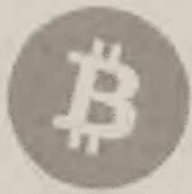

图 1.1 比特币符号由中本聪在发明加密货币后不久创建

2013 年 12 月 中国人民银行禁止比特币交易。随着中国资金流出，价格下跌。

2013 年 4 月 塞浦路斯银行危机导致比特币激增，压垮了主要交易所并导致突然抛售。

2014 年 6 月 - 7 月 Expedia 和 Dell 等企业开始接受比特币，价格反弹至 600 美元。

2016 年 7 月 比特币价值自 2014 年初以来首次达到 750 美元，但再次暴跌，部分原因是 Bitfinex 交易所发生安全漏洞，导致价值 7200 万美元的比特币被盗。

2016 年 11 月 在美国总统选举的不确定性中，比特币价格再次上涨至 700 美元以上。

2015 年 12 月 在经历了一个稳定的年份后，比特币在 2015 年底走高，受到中国交易所交易激增的推动。

2015 年 1 月 比特币价值跌至 214 美元的低点，导致人们宣布加密货币死亡。

2016 年 6 月 比特币价值激增，受多种因素推动，包括对英国可能脱欧的担忧、对区块链的乐观情绪以及对比特币需求的增加，尤其是来自中国的需求。

2013 年 11 月 中国资金开始涌入。美国参议院一次会议将虚拟货币称为“合法金融服务”，最终导致当月末价格达到 1,242 美元的峰值。

图 1.2 高点与低点：比特币持有者必须做好承受价格波动的准备

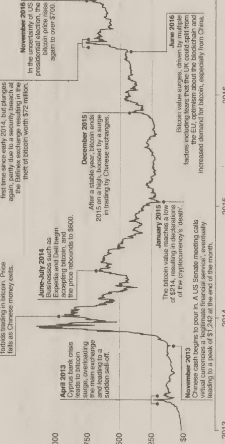

### 用比特币可以买什么？

在比特币的早期，人们能用它购买的东西不多。第一个主要接受比特币支付的市场交易的是毒品和其他非法服务。今天，许多大型企业直接接受比特币，对于忠实的比特币用户，像 Coinbase 或 Bitpay 这样的卡片整合服务允许客户在任何信用卡交易中使用比特币。

## 2 比特币的诞生

2008 年，一个并不存在的人有了一个想法。到 2011 年，这个想法价值超过 5400 万美元。这是一种极其新型货币发明的故事。

颠覆世界的金融创意通常不会凭空出现在电子邮件收件箱中。因此，密码学家 Adam Back 在 2008 年 8 月收到来自“中本聪”的一封电子邮件，提议一种虚拟货币的新想法时，并没有太在意。在 1992 年创建以来，Back 一直关注的 cypherpunk 邮件列表上的许多人，都提出过只存在于计算机中的货币的想法。Back 没有花太多时间考虑这个特定概念，尤其是来自一个不知名的人。

这是任何人第一次听说 Nakamoto，这个名字据信是由不知名的个人或集团编造的。这个想法——当时尚未经过测试和验证——被称为比特币。不到三年后，当中本聪从互联网消失时，所有比特币的总价值超过 5450 万美元。但加密货币的发明者从未被确切识别。

比特币发明者“中本聪”的身份是一个谜。

当中本聪消失时，他用于这种新型货币的开源软件代码已被重写了太多次，以至于很难说中本聪是比特币的作者。估计，目前使用的比特币计算机代码中，不到三分之一是由中本聪编写的。就像互联网组成的许多其他事物一样，现实是比特币现在属于所有人，也不属于任何人。

### 92.9 亿美元 所有比特币的总价值（2016 年 8 月）

像比特币这样的奇怪想法在 cypherpunk 世界的计算机科学家、程序员、数学家和活动家中很常见，他们设计了许多复杂的方案来确保技术隐私。基于经验，他们对被赞誉为“下一个大事”的想法持怀疑态度。因此，有一段时间，比特币似乎可能只是另一个将湮没无闻的想法。比特币不是第一个虚拟货币的想法，之前的任何方案都没有取得成功。

### 真正的中本聪请站出来？

已有许多尝试揭露比特币创始人化名背后的真人。但都失败了。

- 2011 年 10 月，《纽约客》记者约书亚·戴维斯（Joshua Davis）指出，计算机科学家迈克尔·克利尔（Michael Clear）可能是中本聪，依据是其密码学背景、使用地道的英国英语，以及在首次被问及时不过分否认（后来他完全否认了）。

- 次日，*Fast Company* 杂志的亚当·L·佩嫩伯格（Adam L. Penenberg）表示不同意。他认为，中本聪必定是三位密码学家之一——尼尔·金（Neal King）、弗拉基米尔·奥克斯曼（Vladimir Oksman）或查尔斯·布赖（Charles Bry）——他们的名字出现在一份密码学专利申请中，该专利是在中本聪注册第一个 bitcoin.org 网站前三天提交的。但这些关联最终被证明是巧合。

- 2012 年，比特币论坛上的用户暗示，**Jed McCaleb**（比特币交易所 Mt. Gox 的创始人）可能是中本聪。

- 在这个时期，其他论坛上的帖子暗示了一个阴谋论，即比特币可能是由美国中央情报局或国家安全局创立的，目的是引诱毫无戒心的罪犯。

- 2013 年，在非法暗网购物网站丝绸之路（Silk Road）的创始人罗斯·乌尔布雷希特（Ross Ulbricht）被捕后，两位以色列研究人员得出结论，乌尔布雷希特必定是中本聪。

- 2014 年 3 月，*Newsweek* 记者利亚·麦格拉夫·古德曼（Leah McGrath Goodman）抛出了一个重磅说法，即比特币创始人的真名 *就是* 中本聪，尽管他使用名字多里安（Dorian）。她的说法基于多里安·中本聪（Dorian Nakamoto）的编程经验，以及他在硅谷长期居住。

- 在对多里安·中本聪说法的广泛驳斥中，*Forbes* 记者安迪·格林伯格（Andy Greenberg）调查了比特币代码贡献者哈尔·芬尼（Hal Finney）是真正中本聪的可能性，但很快就否定了这一想法。

- 纳撒尼尔·波珀（Nathaniel Popper）2015 年的书 *数字黄金*（Digital Gold）暗示，尼克·萨博（Nick Szabo）——密码朋克、比特币投资者，以及早期虚拟货币 BitGold 的发明者——是中本聪。萨博公开否认了这一说法。

2015年底，_Wired_ 杂志和在线网站 _Gizmodo_ 收到一条线索和大量泄露文件，这些文件指向澳大利亚程序员克雷格·赖特。他起初予以否认，但到了2016年春天，赖特声称自己就是中本聪，并且是与他已故的同伴戴夫·克莱曼共同创造了比特币。尽管他能够出示大量证据，但仍不足以让许多怀疑者信服，因此这个谜团依然存在。（更多相关内容，请参见第10章。）

### 第一个比特币

中本聪没有在一封邮件后就放弃。联系Back之后，中本聪将他的想法发布到一个关于密码学的公共邮件列表。接着，他在一个名为P2P基金会的网站上发布了它，该网站接受各种点对点技术项目的提交。一个认为这个想法有些价值的人是哈尔·芬尼，一位曾参与开发Pretty Good Privacy（一种免费加密软件）的程序员。对比特币的分布式和加密特性感到好奇，芬尼与中本聪一起编写代码。他还收到了有史以来第一笔比特币转账，来自中本聪，时间是2009年初。那时它价值微不足道。

慢慢地，比特币开始流行起来。两位初涉编程的程序员，加文·安德森和马蒂·马尔米，喜欢这个想法，并帮助中本聪建立了一个网站并改进比特币代码。他们创造了“加密货币”一词来描述一种围绕密码学构建的虚拟货币。他们在2009年秋天建立了一个论坛，面向新兴的密码学极客、自由意志主义者和程序员社区，这些人对分散货币的设想可能真的能奏效这一奇特可能性感兴趣。

开发者们对代码越是修修补补、进行实验并反复测试，它看起来就越不只是一个想法。代码运行正常，而且非常健壮。随着下载该软件并让计算机执行生成货币所需任务的人越来越多，它显得越来越可靠。

如果比特币的技术层面看起来不错，其他方面仍有欠缺。到2010年初，仍然没有好的购买比特币的方式，也没有什么可以用比特币购买——只有几家小网站出售一些比特币商品，比如贴纸和T恤衫。2010年4月有一个著名事件：一位名叫拉斯洛·哈尼埃茨的爱好者让论坛上的人用10,000比特币向他家送了两份披萨，但这几乎不能算是一种可靠的披萨订购方式。

### 病毒式传播

2010年7月，受欢迎的科技新闻聚合网站Slashdot将一篇关于比特币的文章置于其首页。该程序的下载量几乎增长了七倍。比特币正在病毒式传播，但所有这些感兴趣的人仍然无法获得任何比特币。

比特币网络作为执行棘手的“工作量证明”计算的回报而分发新比特币（参见第4章）。在那个早期阶段，当运行该软件的计算机解决了其中一个“区块”时，它会因这一努力获得奖励；会创建50个新比特币并添加到用户的虚拟钱包中（参见“货币挖矿的世界”，第5章）。这也解决了资金“从何而来”的问题，因为没有中央银行来分发它。

当网络上只有几台计算机时，领取这个奖励并不困难。由于在加密货币头一年里的大部分时间里，中本聪的计算机往往是网络上唯一的一台，他的钱包通过区块奖励累积了大约一百万个比特币。但随着越来越多的人开始运行该软件，解决区块的**难度**增加了（参见“数字军备竞赛”，第5章）。从事工作量证明计算的人如此之多，以至于插入网络的单个计算机赢得一个区块变得罕见。这几乎就像中了彩票。

此时，比特币仍然非常便宜。当个人用它们交换现金时，每个只值几美分。这些交易是在论坛和通过电子邮件中临时进行的。如果没有系统可以轻松获得甚至只值几美元的比特币，又怎么有人能将其作为货币使用呢？人们需要能够以市场价格大量购买它们，并且它们必须能用来交换商品。

### Satoshi是谁重要吗？

*比特币创始人的身份是互联网上最大的谜团之一。但是，他或她究竟是谁，这重要吗？*

中本聪不仅是一个历史人物，负责创建了一个巨大的价值数字仓库，他很可能还控制着这部分价值中的很大一部分。专家估计，他持有的比特币价值超过6亿美元。而且，无论交换价值如何，一旦比特币系统达到满载，这种货币将占比特币系统中总加密货币的近5%。无论是谁控制了这部分加密货币，都无疑对其拥有巨大的影响力。

但是，许多加密货币的拥护者很高兴他从未被确切地识别出来。没有创始人，就没有亨利·福特或史蒂夫·乔布斯，没有主要人物来宣告发展方向应该走向何处。相反，任何能想出主意的人都同样有能力去追求它，并将其推销给广大公众。

这并不能阻止人们对中本聪身份的强烈好奇。拥有一个如此笼罩在神秘之中、并且无踪影地消失的公众人物是罕见的。他对加密货币的发展有何看法？这个想法从何而来？他现在在做什么？也许我们永远不会知道。

### 交易所

在众多发现比特币的人中，有杰德·麦克凯布，他是点对点文件共享程序eDonkey的联合创建者。他使用一个与《万智牌》卡牌游戏相关的废弃项目中的旧域名，创办了一个名为Mt. Gox的比特币交易所。在那里，任何人都可以用真实的美元买卖比特币，价格根据市场需求波动。得益于Slashdot的额外曝光，Mt. Gox作为第一家真正的加密货币交易所而迅速崛起。

现在可以用美元购买比特币了。但仍然没有什么可以用比特币购买。这一切在2011年初因两个事件而改变。

2010年12月，在揭发网站WikiLeaks泄露美国政府机密信息后

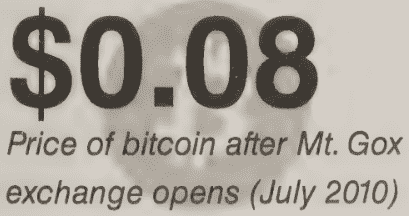

上传到互联网之后，PayPal和其他支付处理器拒绝处理对WikiLeaks的捐款。自由意志主义者、密码朋克和互联网活动人士将此谴责为审查，并将比特币讨论为解决这一问题的潜在方案。由于没有公司控制比特币，用户可以进行他们想要的所有捐款，政府也无人可强迫实施对WikiLeaks的禁运。那个月，由于炒作，Mt. Gox上一个比特币的价格上涨到30美分。

### 市场

两个月后，另一位理想主义者决定测试比特币绕过政府影响的能力。一位自称“可怕的海盗罗伯茨”的人创办了一个名为丝绸之路的网站，其目标是为违禁和非法产品创建一个类似亚马逊的市场，其总体意识形态是挫败政府控制。该网站秉持只出售“无受害者产品”（毒品和伪造的政府文件是可以的，而武器、非法色情制品和被盗身份则不被允许）的理念，该网站仅对使用名为TOR的地址匿名化软件连接的用户可见。这一事实掩盖了丝绸之路上接受的唯一货币是比特币。

与信用卡交易相比，比特币提供的更高匿名性意味着精通互联网的毒贩

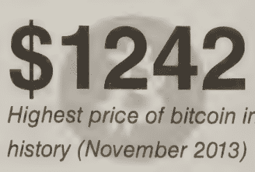

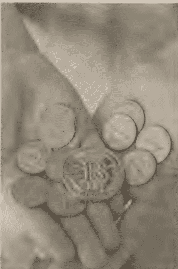

使用比特币不需要实体硬币，但已经创建了一些实体代币。

冒险尝试了丝绸之路，尽管存在漏洞。该网站非常受欢迎，以至于在2011年上半年多次关闭，无法应对流量。那年6月，现已倒闭的网站Gawker上关于丝绸之路的一篇文章发表。立即，丝绸之路的业务蓬勃发展。现在，有了可以用比特币购买的东西（虽然是非法的），Mt. Gox上一个比特币的价格从2011年2月左右的70美分上涨到5月的近10美元，以及6月中旬的32美元。

丝绸之路的繁荣为比特币带来了其他不受欢迎的公众关注。2011年6月5日，美国参议员查克·舒默举行新闻发布会，谴责比特币和丝绸之路，并敦促联邦当局打击。美国缉毒局和司法部发布新闻稿表达担忧。6月，可怕的海盗罗伯茨自愿让丝绸之路暂停运营，希望事态能平息下来。

$450 million Value of bitcoin stolen in Mt. Gox collapse (February 2014)

随着比特币声名狼藉，其他人试图与其保持距离。Mt. Gox的创始人杰德·麦克卡莱布正被防范黑客攻击的压力弄得喘不过气来。其中一次攻击闯入该网站，在2011年1月窃走了价值45,000美元的比特币。3月，麦克卡莱布将该网站卖给了另一位开发者。

就在此时，2011年4月，比特币软件开发者收到了中本聪的最后一则消息。在一些简短的电子邮件交流中，中本聪表达了对这些反政府事件带来的负面报道的担忧，以及担心他的化名在比特币拥护者中成为臭名昭著的传说，这位第一种加密货币的创始人便告别了。论坛用户名消失了，电子邮件也不再发送。比特币这位匿名创始人就这样不复存在。

但比特币涉及的资金太多，不可能消失。中本聪消失之时，所有比特币的总价值约为5450万美元。仅两个月后，这一数字已增至超过2.07亿美元。在2011年6月8日交易高峰期，280万枚比特币被交易，Mt. Gox在24小时内赚取了约90万美元的佣金。7月，可怕的海盗罗伯茨重新开启网站后，丝绸之路每月产生3万美元的佣金，且该数字迅速攀升。加密货币不再只是一个想法。其模糊的、互联网式的梦想特质随其所谓的创始人一起蒸发，留下的就是真金白银，具有真实价值——以及随之而来的所有问题。

## 3 以加密方式创建货币

黑客与间谍这一不太可能的组合开发出了让比特币得以存在的技术。他们在原本易于追踪的互联网上创建了秘密通信渠道和暗影网络。

作为第一种加密货币的比特币，并非凭空出现。它所依赖的许多技术至少与互联网本身一样古老。加密货币底层区块链技术的根源，深深植根于一个由黑客、活动家和技术人员组成的社区，该社区至今仍在影响加密货币乃至整个互联网的发展方向。

数字密码学是比特币中必不可少的工具。这一互联网的关键组件无处不在，从WiFi到电子邮件，从数字购物车到信用卡。如果没有密码学来保护在线信息的私密性，就不会有如今的互联网。而没有密码学，加密货币也无法运作。

数字密码学工具长期以来一直是社会边缘人物的领域：黑客和间谍。乍一看，这两类人似乎没有太多共同点，但两者都有绝对隐私的需求。

在黑客与间谍两极之间，是暗网——互联网中通过加密隐藏于窥探之外的部分。暗网不断拓展可能性的边界，也挑战合法性的边界。正是在这里，加密货币的诞生应运而生。确实，它不可能诞生于其他任何地方。

### 朋克密码学派的诞生

20世纪70年代，一个名为“愤青党”（Yippies）的美国反文化团体，由活动家阿比·霍夫曼领导，开始出版一份通讯，其中传授了包括如何从电话服务提供商处“盗窃”服务在内的各种诀窍。起初作为一种反权威姿态的事情，逐渐演变成了更多。自称“黑客”的人开始实验，看自己在不被抓住的情况下能多深入地闯入技术系统。

但随着技术的发展和电话线路变成数据线路，这种探索变得更加严肃。曾经被视为恶作剧或无受害者盗窃的行为，很快就变成了真正的破坏行为。1988年，一种后来被称为莫里斯蠕虫的计算机蠕虫开始通过互联网在计算机之间自我复制。这种自我复制的恶意软件并非旨在破坏任何东西，而仅仅是为了尽可能广泛地传播。但在这样做的过程中，它导致许多系统崩溃。美国当局对此并不觉得好笑。罗伯特·莫里斯是一名研究生，也是莫里斯蠕虫的创建者，他成为第一个因未经授权故意访问联邦计算机（他的蠕虫最终出现在那里）并造成重大损害而根据《计算机欺诈和滥用法》被定罪的人。

随着互联网的发展和计算机日益联网，黑客面临着更多法律障碍。20世纪90年代，世界各国政府开始采取行动，试图管制无法无天的互联网。作为回应，计算机社区的一些部分采取了反制行动。一些人受自由主义和无政府主义哲学的驱动，因普遍不信任政府而团结在一起。另一些人则看到执法机构如何迫害那些并无真正恶意的人，开始组织起来，既保护激进黑客，也保护普通计算机用户。1990年，电子前哨基金会应运而生，以回应正在进行的计算机犯罪打击行动。这个非营利组织至今仍然存在，为广泛的支持隐私问题提供法律咨询和行动。但计算机用户不仅仅需要律师来抵御政府进入互联网的行动。他们需要新技术。

20世纪90年代初期诞生了“朋克密码学派”——一种以数字密码学为生计的黑客类型。

朋克密码学派并不专注于闯入计算机系统。相反，他们开发了在互联网上创建电子隐私屏障的工具。

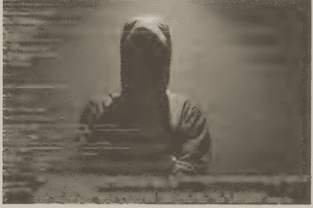

由“朋克密码学派”创建的数字隐私工具促进了加密货币的诞生。

最重要的工具源于科学家惠特菲尔德·迪菲和马丁·赫尔曼在1976年的一项发现。他们想出了一种非对称加密方法（参见“公钥加密”，第4章），允许两人秘密通信，而无需交换代码本。1991年，将这项技术应用于互联网时代，软件工程师兼反核活动家菲尔·齐默尔曼开发了一款名为PGP（Pretty Good Privacy，极好隐私）的程序，并将源代码上传到互联网上，任何人都可以下载并免费发送加密消息。朋克密码学派欣喜若狂。该软件在保持通信秘密方面效果如此之好，以至于美国政府试图以“出口军火”为由起诉齐默尔曼：违反了旨在防止高军事价值技术离境的法律。

一年后，1992年9月，一个名为Cypherpunk的在线邮件列表成立了。这次对话吸引了各种有兴趣使用技术来维护隐私的人，包括PGP、隐藏电子邮件发件人真实地址的重邮服务，以及诸如“无法追踪”的数字货币等假设性想法。

那时，政府正在追捕齐默尔曼，加密学从长远来看是否合法还不清楚。因此，Cypherpunk列表吸引的不仅是关注隐私的人，还包括那些为了保护隐私而愿意触碰法律灰色地带的人。朋克密码学派认为，如果他们不推动技术边界，新的互联网将完全用于监控，个人隐私可能会永远丧失。他们开始将自己的行为（如齐默尔曼的行为）视为不服从——为了公共利益向公众发布信息，无论政府说什么是合法的。

从一开始，虚拟货币的支持者就出现在Cypherpunk列表上。与菲尔·齐默尔曼合作开发PGP的哈尔·芬尼在列表上，后来成为最早帮助中本聪改进比特币源代码的人之一。列表上另一个人是亚当·巴克，他使用密码学开发了一款名为“hashcash”的垃圾邮件减少工具，并于1997年与Cypherpunk电子邮件列表分享了该工具。列表上还有密码学家尼克·萨博，他尝试过自己的一款名为Bit Gold的虚拟货币，以及澳大利亚人克雷格·赖特，他参与了包括保障金融交易在内的各种安全技术。所有这些名字在比特币和加密货币的未来中都将至关重要。

2008年，中本聪在原Cypherpunk邮件列表的继任者邮件列表上公开宣布了他称之为'比特币'的加密货币构想。尽管许多人最初对比特币的效用持怀疑态度，但中本聪找到了理想的受众来欣赏他的概念。

但赛博朋克只是暗网历史的一半。另一半来自美国当局为保护其间谍而开发的一种工具。

### 在暗网登录的间谍

1995年，'洋葱路由'概念由在美国海军研究局工作的Paul Syverson、Michael Reed和David Goldschlag发明。他们获得了国防高级研究计划署（DARPA）的资助，该机构为军方开发新技术。他们的目标不是躲避政府监控——恰恰相反，他们试图使其成为可能。

互联网通过一组称为'路由器'的专用计算机连接而成工作。当计算机A想要与计算机B通信时，它会从一个互联网协议（IP）地址向另一个地址发送一个数据包。所有路由器都处理此地址，并确保数据包穿过这张线路网络到达其预定目的地。

问题在于，沿途的任何计算机都可以通过查看数据包来看到计算机A和计算机B的地址。这就像查看某人信箱里的信一样。你可能无法阅读信封里的信息（尤其是如果该信息已加密），但你仍然可以读取信封上的目的地址和回寄地址，这些地址必须以明文形式书写，以便邮递员投递。

在这种情况下，如果一名美国特工进行卧底，他们无法在不暴露自己的情况下与海军情报总部的一台计算机通信。同样的难题也适用于坐在海军情报总部办公桌前、试图调查恐怖分子留言板的警官。如果对手知道如何查找数据包地址，在互联网上进行'卧底'几乎是不可能的。所有数据包最终都能追溯到其源头。

'洋葱路由'概念以一种称为'Tor'的软件形式解决了这个问题。Tor通过一系列像洋葱皮一样的加密'层'来遮盖数据包的地址，从而创建一个匿名网络。在计算机A和B之间，互联网流量被路由过一系列加密连接，每个连接形成另一层。在数据包进入Tor网络之前，无法确定其最终目的地。当它从另一端出来时，无法知道它来自哪里。洋葱路由并不加密流量本身，但掩盖了其源和目的地，从各方面来说使其无法追踪。

### 加密术只适用于有秘密要隐瞒的人吗？

加密不再仅仅是赛博朋克和间谍的专利。我们使用的每一项数字服务都采用加密来打乱信息，以便我们在网上获得一些隐私。它保护我们的医疗记录、银行数据以及我们通过互联网发送的消息。

考虑到我们许多对话和信息渠道都使用数字系统，有人试图窃听我们的可能性在增加。这就是为什么每项数字服务都使用加密来帮助保护我们，赋予我们期望的隐私。但并非所有标准加密都同等有效。有些很容易被破解。有些存在漏洞。这就是为什么许多人现在开始亲自掌握这项技术，学习使用Tor和公钥加密等密码技术。

这对间谍很有效，但对于不希望被政府监视的活动人士来说也非常棒。具有讽刺意味的是，政府于2004年停止了该项目的开发并将其开源。它很快得到了电子前哨基金会的支持，该基金会帮助独立的非营利性Tor项目（至今仍在开发该软件）起步。如今，许多人使用Tor软件来隐藏自己的互联网流量，避免各种窥视。

间谍和黑客使用同一工具可能显得奇怪。因此，许多阴谋论者认为Tor可能是美国政府散布的一个把戏。但他们未能理解的是，间谍和黑客有着相同的目标——在暗网中掩盖其在线活动。

Tor还允许所谓的'隐藏服务'。当网站服务器连接到Tor时，只有连接到Tor的计算机才被允许加载该网站。与其使用Tor连接到常规互联网，不如说这是一个独立的'微型互联网'，仅在洋葱路由网络内可见。这意味着，当该隐藏服务站点配置正确时，上面发生的一切都是匿名的。没有人能知道服务器或站点浏览者所在的位置。这样的网站被称为属于'暗网'。

在暗网中，一个人很容易既是警察，也是赛博朋克无政府主义者。这就是匿名性的问题所在，也是其好处所在——你无法分辨任何人究竟是谁。而加密货币正是在这种源自赛博朋克的匿名性中诞生和成长的。

### 随机购物机器人在暗网上买了什么？

Carmen Weisskopf是!Mediengruppe Bitnik的一部分，这是一群与互联网合作并在互联网上工作的艺术家。她给了一个软件机器人一些比特币，并派它去互联网的暗面购物——在那里它买下了任何机器人之前都未曾购买过的东西。

#### 请告诉我你使用机器人在暗网随机购物的艺术项目。

随机暗网购物者是一个被编程为每周在深网或暗网购物一次的机器人，预算上限为100美元的比特币。

#### 深网和暗网究竟是什么？

深网是互联网的一部分，包含所有未被搜索引擎索引的网页，例如内部网。它实际上比大多数人习惯的'表层网'更大。深网的一部分是加密的，并通过TOR浏览器访问以隐藏你的来源。这被称为暗网。

#### 你的机器人从暗网购买了什么？

那里的大多数物品法律地位存疑。2014年我们尝试时，买到了一套消防员使用的主钥匙、香烟、假牛仔裤和运动鞋、一些电子书、一张信用卡、一份护照扫描件和一些摇头丸。这是机器人第一次购买毒品。这引发了机器人行为由谁负责的问题。

#### 当你再次启动购物机器人时，它买了什么？

一些鞭炮、一件假Lacoste衬衫和两个用于挖比特币的USB设备。它是随机选择这些物品的，但似乎机器人在说：'好吧，你没给我足够的钱花'。

#### 当你打开从暗网寄来的未知包裹时，你有什么感受？

这总是令人兴奋，但运行机器人并看到它会买什么也很吓人。我们希望得到一系列多样化的物品，以便很好地了解暗网景象。

#### 什么都行吗？如果你的机器人买了一个炸弹制作工具包怎么办？

100美元的比特币买不了太多东西。这确保了物品仍然可控。此外，这些深网市场上没有太多让我们感到恐惧的物品。

#### 你为什么想在暗网随机购物？那里不是非法物品的天堂吗？

表层网也是！这个项目始于斯诺登事件。它让我们重新评估表层网上的大规模监控，在那里，每个使用它的人都可以被追踪。所以我们开始研究暗网，那里内置了加密。在某些情况下，人们保持匿名是一种必需。我们开始思考在匿名网络中信任是如何建立的。而且，我们想知道那里实际上销售和购买了什么。

#### 那信任呢？机器人有没有被骗过，并为尚未送达的商品付款？

没有。这显示了那里存在的信任程度。在这些市场上出售的人习惯于在线上信任他人，并希望获得好评。甚至扣押我们机器人购买的摇头丸的瑞士警察也对其质量与街头上可获得的相比感到惊讶。

采访由Alison George为《新科学家》杂志进行。

## 4 区块链

如果货币数字化，你如何防止它被复制？就像数字文件一样容易复制的货币将完全一文不值。解决方案是一种名为区块链的精巧加密账本。

区块链是中本聪的创新，是加密货币的核心和灵魂。它使加密货币与其他数字或虚拟货币有所不同。它通过多种方式保障加密货币安全，其中之一是让任何人都无法伪造比特币——这并非易事。可以说，正是这项创新让比特币在其他虚拟货币失败的地方取得了成功。传统货币依赖于由官方来源（如银行或国库）认证和追踪的钞票。他们制造伪造钞票的难度尽可能大，因此人们信任货币的价值。在数字世界里，事情却没那么简单。

任何尝试创建数字货币的做法都会立即面临一个问题。任何数字文件都可以轻易复制。如果任何人都能复制代表数字货币的文件，那么它就很容易被伪造，进而变得一文不值。但这不仅仅是数字货币的问题——21 世纪的唱片公司、图书出版商、电影制片厂，甚至时尚品牌都面临着类似的问题。

这些行业深知，如果任何人都能复制自己的一份电影、图书或面料图案，那么就没几个人真正愿意花钱购买了。因此，为了抵制这一趋势，许多公司开始使用数字版权管理（DRM）软件。该软件通过与中央服务器核对，查看使用文件的人是否已付费，从而帮助防止人们共享数字文件的副本。例如，如果你在电脑上观看电影，DRM 软件会查询中央服务器，看你是否从注册渠道购买了它。如果购买了，文件就会被解锁，你便可开始观看；否则，你将无法观看。

但这个解决方案并不完美。服务器可能会故障或关闭，导致付费购买媒体的人比盗版用户处境更糟糕。电子银行技术也是类似。登录银行账户（一种数字货币）时，我们使用互联网访问存储和认证我们记录的银行计算机——但如果银行系统宕机，就无法访问资金。比特币之前，其他尝试利用数字货币和虚拟货币的做法也是如此：它们依赖于中央公司来存储和认证所有记录。当这些公司倒闭时，货币也随之消失。

区块链改变了一切。简单来说，区块链只是一份账本，列出了加密货币的所有单位及其所有者。随着资金转手，账本会被重写以反映交易。这样一来，只要所有存在的单位及其拥有量有一个单一清单，资金在物理上位于何处就无关紧要。如果你试图复制数字币，那么在花费它们时很快就会被发现，因为它们在区块链中没有登记在案。

区块链意味着比特币实际上从不需要“存在”。没有人真正将币“发送”到任何地方。他们只是更新区块链以反映谁拥有什么。货币基本上只是一张巨大的欠条清单。任何篡改货币的企图都可以通过检查区块链轻易察觉。这是一个巧妙优雅的解决方案，解决了许多人曾认为永远无法解决的问题。

### 公钥加密

区块链基于加密技术运行——因此得名“加密货币”。当代加密使用一种称为非对称或“公钥”的加密方式，就像 PGP（参见第 3 章“The birth of Cypherpunk”）一样。与其他加密方法的一个关键区别在于，从数学角度来看，解密过程并非仅仅是加密过程的逆过程：因此称为非对称。

公钥加密基于这样一个原理：有些数学问题正向求解比反向求解容易得多。例如，将两个六位质数（如 323,123 和 596,977）相乘是一项相对简单的任务。花一分钟和一支铅笔，你就能算出 192,896,999,171。但如果你得到 192,896,999,171 这个数字，并被要求找出能整除它的两个质数，你需要花更多时间来测试所有不同的可能性。在公钥加密中，数字要大得多，但计算机必须执行非常相似的任务。

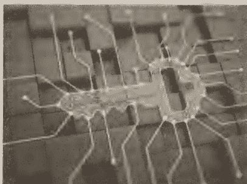

公钥加密让在线信息免受窥视。

用户拥有两个密钥：用于加密消息的公钥，以及用于解密的私钥。私钥可能由非常大的质数组成（长达数百或数千位），而公钥则是将它们相乘的结果。

私钥用于生成公钥，且该生成过程可被验证，这意味着两个密钥永远关联在一起。用户可以放心地将公钥与任何人共享，而不用担心任何人发现他们的私钥，因为反转该生成过程非常困难。

使用公钥，任何人都可以加密消息，但解密需要私钥。假设你想给朋友发送一条加密消息。步骤如下：

- 1. 你的朋友使用他们的私钥生成一个公钥，他们可以与任何人共享。他们会向你发送一份副本。
- 2. 你使用他们的公钥加密一条消息，然后将消息发送给他们。任何拦截消息的人都无法阅读，因为他们没有私钥。这也包括你——加密过程只能单向进行。
- 3. 你的朋友收到消息，并使用他们的私钥进行解密。

只要除了你的朋友之外没有人拥有私钥，使用他们的公钥加密的消息就永远不会被除他们以外的任何人阅读。

公钥加密非常强大，以至于大多数用户尝试破解加密的唯一方法被称为‘暴力破解’法。这意味着尝试每一种可能的密钥，直到找到正确的那个。说白了，就是以计算机速度进行猜测。研究人员目前正在使用一种更快的方法，称为‘因式分解’，来简化数学运算，但它仍然非常缓慢。

目前最常用的一种公钥加密是以发明者——Rivest、Shamir 和 Adleman——的名字命名的 RSA。2009 年，研究人员利用一系列超级计算机运行因式分解方法，破解了一个 768 位密钥，但花了他们两年时间。目前使用的下一个更强的密钥长度是 1024 位，相同的研究人员估计破解它需要花费 1000 倍的时间。据我所知，至今还没有人做到这一点。目前 RSA 中使用的最强密钥长度是 4096 位。研究人员估计，使用当今最高水平的技术，破解该长度密钥所需的时间将是‘实际上无限’的。

### 加密签名

重要的是要知道自己没有被欺骗，尤其是在互联网上。如果微软向你发送更新，你怎么知道新软件确实来自他们，而不是被替换成了计算机病毒？或者，如果你收到朋友的一封电子邮件，你怎么知道它没有在到达你手中之前被拦截和修改过？答案是数字签名。

数字签名使用与公钥密码学类似的概念。它们使用称为哈希的唯一字符短字符串。使用私钥，消息被缩减为这个哈希。哈希过程可以用公钥进行验证。但是，更改原始消息（哪怕只有一个字符）也会以不可预测的方式彻底改变哈希。你可以使用此方法对消息进行签名，以便收件人知道它是由你发送的，原封不动，没有任何更改或删除。

- 1. 获取你要签名的消息，使用你的私钥对消息进行签名并创建唯一哈希。
- 2. 使用朋友的公钥加密消息，并将加密后的消息发送给朋友。他们使用自己的私钥解密消息。

3 你的朋友使用你的公钥来检查哈希值。他们会看到，确实，这条消息只能用你的私钥签名，并且该消息与你用来生成哈希值的消息完全相同。

数字签名可用于验证消息是否与原始消息匹配。但它们的用途比这更为广泛。它们还可以验证下载的文件是否与源匹配，为与服务器的安全连接提供数字‘握手’，并维护数字文档的保管链。

### 区块链如何存储交易？

区块链就像一本数字账本，一份长长的欠条清单，跟踪每个比特币所有权的变化。区块链使用类似于公钥加密和签名的方法（参见上文“‘公钥加密’”和“‘在虚线上进行加密签名’”）来验证添加到其中的所有交易。但是，因为它是为金融交易而设计的，术语略有不同。

你的‘钱包’像一个私钥一样运作。它是保密的，只有你自己知道，并且是你拥有的所有比特币之间的链接。你的‘地址’像一个公钥一样运作。它由你的钱包生成，可以自由地提供给任何人，这样任何人现在都可以给你发送比特币。你的钱包还可以对发送到区块链的交易进行数字签名。

以下是比特币交易的逐步分解。它与使用加密发送消息非常相似。

- 1 你获得你想要发送比特币的朋友的数字地址。

- 2 你向区块链发送一笔交易。该交易包含你的地址、你想发送的币数、你朋友的数字地址以及你的数字签名。

- 3 收到消息后，区块链验证与你的地址关联的比特币是否有足够的余额来发送这些币，并且你的数字签名是否有效。如果一切正常，区块链将被更新，现在显示你和你朋友之间的转账。该交易由区块链本身签名，这将其登记为官方且有效的交易。

钱包可以创建的公钥数量没有限制。因此，与一个钱包关联的币数可能记录在区块链中的任意数量的公钥上。这有点像一个人拥有几个不同的银行账户，或者一栋楼里有许多不同的邮箱。钱包始终保持私密，但任何人都可以看到区块链中的公钥。区块链中记录了每个币曾去过哪里的完整记录——它从一个地址跳到另一个地址，被拆分成碎片、转移、合并，然后再次拆分。尽管这是一长串复杂的转账，但它可以被分析，资金可以在账本中被追踪。

钱包，即私钥，是从一个地址向另一个地址发起交易所需的唯一身份。只要钱包安全且仅受你控制，你就是唯一能够移动你的比特币的人。由于区块链中记录的每笔交易旁边都有与地址关联的数字签名，因此任何人都可以检查交易的有效性。所有曾经发生过的交易都包含在区块链中，每台计算机都可以检查回溯记录历史的所有签名，以证明连续性。

区块链是所有交易被认证的地方，但它本身也需要被验证为真实且一致。令人担忧的不太是攻击者发送虚假交易来转移他人的比特币——钱包的签名可以防止这种情况。问题更多在于交易被删除或撤销。如果有人拥有单方面编辑账本、倒流时间并撤销先前交易的权力，那么他们也会拥有凭空创造比特币的权力，方法是将比特币恢复给那些已经交换过它们的先前所有者。解决方案是确保没有个人对区块链拥有这种控制权，方法是确保每个人都拥有这种控制权。

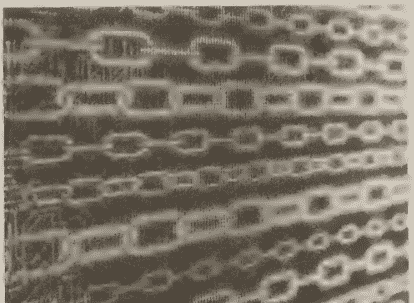

区块链是支撑加密货币的工具

### 保存账本的地方

区块链无处不在。运行加密货币的每台计算机都从网络中的其他计算机下载其自身的相同账本副本。当每台计算机向区块链添加交易时，它会通过将信息广播到其他计算机，同时更新网络。其理念是，如果任何人试图篡改区块链的交易历史，它将不再与所有其他副本匹配。

但是，新的交易会带来一个问题。如果有人创建两笔新的、相互矛盾的交易，区块链将如何知道该信任哪一笔？篡改整个区块链历史会很明显，但提交到区块链的微小错误添加和减法可能会迅速累积。如果我对网络中的一台计算机说我会把一枚币给一个朋友，又对网络中的另一台计算机说我会把同一枚币给另一个朋友，哪笔交易是正确的？所有数字资产都存在这个问题——交易实际上可能被复制。在加密货币中，这个问题被称为双重花费。

在遍及全球的网络中，可能存在不同版本的账本，包含矛盾，或试图欺骗网络使其认为币同时被分配到两个不同的地方。这些差异将如何解决？如果顾客带着产品离开，但30分钟后商人发现他们以为收到的币实际上已经被发送到其他地方，或者可能退回给了顾客自己，那么如何能将此系统作为货币使用？区块链采用了一种巧妙的解决方案。

### 工作量证明

比特币以及所有直接基于其模型开发的加密货币，通过使用一种称为‘工作量证明’的技术，确保只存在一个规范账本，且没有矛盾。这使得区块链可以同时存储在网络中的每台计算机上，同时也确保每份区块链副本都是相同的。

只要确保区块链在所有版本中保持一致且相同，尽管比特币完全是虚拟的，也可以将其作为可信的货币。所有重复和错误的交易都会被筛除，每枚比特币在同一时间只能由一个所有者持有——从而消除了双重花费问题。

工作量证明任务基于公钥加密中使用的相同数学——尽管其过程与交易中使用的加密是分开的。这个想法由程序员Adam Back于1997年为一个名为hashcash的系统提出。Back的想法是：计算机在发送电子邮件之前，必须先完成一项困难任务，例如耗时十分钟的任务。对于每天发送50封电子邮件的人来说，这个先决条件微不足道，将他们限制在每十分钟一封电子邮件。但对于想要每天发送成千上万封电子邮件的垃圾邮件发送者来说，这将使大规模发送垃圾邮件变得不可能。

计时器或许可以被规避，但对于计算机来说，任务是一个更严格的限制。计算机设计用于快速解决长串任务。然而，一个可扩展的任务系列，例如涉及加密的任务，可以轻松地扩展到在更强大的机器上花费指数级更长的时间。可变难度的任务可以实时调整，以确保无论正在处理它的计算机是什么（从手机到超级计算机），任务都将花费大约相同的时间。这就像移动赛车的终点线，使汽车无论开得多快或多慢，都能在特定时间正好到达终点。

### 没有捷径

如果任务涉及加密，那么就没有捷径。工作量证明任务只能通过‘蛮力’来完成。

在这种情况下，任务是尝试生成正确的哈希，仿佛是为了签名，但不使用私钥——而是通过尝试许多不同的可能哈希，简单地通过猜测，直到找到正确的哈希。

实际上，工作量证明问题就像是对低级别加密签名进行暴力破解，而这种签名从来不存在秘密密钥。加密技术相比于常用加密技术大幅缩减，以便计算机网络能够在十分钟内实际解决该问题。一台计算机每秒可以进行成千上万次猜测。网络每秒可以进行千万亿次猜测。随着更多计算机连接到网络，它们各自开始处理相同的工作量证明问题，这通常会缩短到达解的时间。但是，工作量证明的“难度”会自动调整，因此每个解决方案始终需要十分钟，无论有多少台计算机在生成哈希猜测。

一旦一台计算机认为它已经为加密数学问题找到了正确的哈希，网络中的另一台计算机就可以快速验证这一点。与一遍又一遍地猜测相比，验证轻而易举。但是，因为不存在秘密密钥，猜测和验证是得出这个正确哈希的唯一方法。这就是它被称为“工作量证明”的原因。除了证明你完成了暴力破解工作之外，没有其他解决方案。

依赖工作量证明的加密货币使用这种时间限制来确定区块“开放”进行交易的时间长度，然后再将其写入区块链。当工作量证明完成时，区块就关闭。比特币的设计使得每个区块大约需要十分钟来解决，但时间会随其他加密货币而有所不同。

工作量证明听起来像是一种非常迂回的方法，用来让区块每十分钟关闭一次，但这样做有重要原因。在比特币区块持续的十分钟内，网络将所有要添加到区块链的交易在其所有计算机之间共享。网络有机会比较所有新交易，并删除重复或矛盾的交易。这是防止任何形式双重支付交易的第一道屏障。

找到工作量证明问题解决方案的计算机，实际上会因工作量证明的暴力破解方法而被随机选择。这台计算机被认为已经“解决”了区块。只有解决区块的计算机接收到的交易才会被包含。任何未能在截止时间前到达的交易都必须等待下一个区块。这种随机化也有助于防止双重支付交易。如果无法预测区块将在哪里被解决，那么试图操纵系统就会更加困难。

区块的实际数据不仅包含那些交易和工作量证明解决方案，还包括其前一个区块的哈希。新区块通过使用前一个区块以这种方式被“签名”，如此下去，一直回到起点。这额外的好处是，每当形成一个新区块时，就会重新认证历史交易。如果任何先前区块中的信息即使只更改了一个字符，它也会改变签名，进而改变下一个区块，再下一个，以此类推。因此，除非更改后续的每个区块，否则无法更改历史区块链。区块不可更改地链接在一起，这意味着当前区块始终是所有先前区块的独特产物，中间无法插入任何内容。

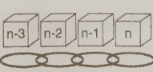

图 4.1 区块链是一系列区块。

### 没有虚假信息

要添加虚假信息或从先前区块中删除交易，就必须重新创建从所需更改点开始的所有区块，包括目前正在解决的新区块，以便重新进行链上的所有签名。这就像一名跑步者在比赛中途停止，返回起跑线，然后以足够快的速度追赶那些从未停止的跑步者。一台计算机要赢得这场比赛的唯一方法，是它产生哈希猜测的速度快于所有其他计算机的总和。这也能防止双重支付，因为仅仅从区块链中删除交易就无法逆转先前的交易。

除了这种复杂的签名和哈希用于将链中每个区块锁定到下一个区块之外，工作量证明的累积效应帮助网络维护一个相同的区块链。比特币软件始终选择最长的区块链作为规范链。包含更多区块、最多交易，并且来自更困难工作量证明任务的更长哈希的链，将创建最长的区块链。因此，网络将始终选择大多数计算机正在处理的区块链，并忽略少数攻击机器准备插入虚假区块链的任何尝试。只有一个唯一的区块链，而且它始终是网络中绝大多数计算机所使用的区块链。

一旦商家在他们交易所在的已确认区块（位于这个最长的规范区块链中）看到该交易，他们就知道硬币确实已被转移。该交易不会被矛盾交易取消，区块链始终是该交易的唯一记录。现在，双重支付几乎不可能发生。

### 信任

信任工作量证明似乎很大程度上取决于运气。如果网络各部分之间出现通信中断怎么办？信任工作量证明在理论上似乎可行，但如果没有任何机构来声明哪个区块链肯定是正确的，难道不会出现问题吗？

有时会出现一种罕见情况，即网络两端的两台不同计算机分别解决了一个区块，导致每台计算机都认为自己是第一个，因为两者尚未收到对方区块的通知。这些被网络分隔的计算机各自将其不同的交易记录到自己的区块中。在这种罕见事件中，网络会在一瞬间出现两个不同的账本，这种情况被称为“分叉”。

网络在接收到两个不同的更新区块链时，会出现一段混乱时期。一旦不同的区块被解决，网络中的每台计算机将接收其中一个新区块或另一个。网络将分裂为两个不同的账本。然而，在某种程度上，下一个区块将由拥有更多计算机的网络一半解决，因此投入更多努力进行工作量证明解决。当这个第二个区块被添加到两个冲突账本中的一个时，其中一个会突然变得更长。由于网络始终选择最长的区块链，竞争账本将被丢弃，而支持已被多数选定的那个账本。基本上，基于此，网络投票决定使用哪个区块链，然后否决所有其他区块链。不久之后，整个网络现在都在最长的区块链上，只有一个规范账本。

无论解决方案在时间上有多接近，以及交易记录可能有多大差异，当第二个区块被添加时，网络将开始选择一个区块链版本并坚持使用它。所有计算机将再次达成一致。这种情况很少见，但谨慎的加密货币用户通常会等待两个或更多周期的已确认区块，因为这样他们才能确保任何潜在分叉已经解决，并且他们看到的区块链及其包含的交易，是每个币和货币范围内每个地址的唯一真实记录。

### 区块链真名副作吗？

区块链，而不是加密货币，一直被誉为真正值得注意的发明。但是，其中许多想法早在加密货币出现之前很久就已经被发明了。

区块链中使用的签名链被称为“默克尔树”，以其发明者 Ralph Merkle 的名字命名，他于 1979 年提出了这个概念。它用于各种需要共享数据的网络应用程序，以确保数据不会在共享链条中损坏。这些应用程序中的许多对我们的网络系统的运行至关重要。

区块链更具体地用于多用户、去中心化的交易信息账本，最终可能与启发它的默克尔树同样重要。但这完全取决于区块链被用于什么。许多人对区块链有宏大的构想（见第 11 章），但其中任何一个还没有真正留下印记。在此之前，它只是众多巧妙发明中的另一个。

### 数字方式淘金

如何生成自己的加密货币？哪种设备效果最好？单独挖矿者真的能发大财吗？

### 货币挖矿的世界

生成加密货币的过程被称为“挖矿”。但如果你想象这涉及锄头、贵金属或地下隧道，那就大错特错了。这种挖矿所需的唯一工具是一台强大的计算机、一些专业软件和快速的互联网连接。

如前一章所述，所有工作量证明加密货币的核心是一个名为区块链的数字账本。加密货币网络上的计算机不断竞相更新这个区块链。这涉及一种蛮力试错过程，计算机只是猜测加密签名，即“哈希”，它结合了最近货币交易的记录以及工作量证明解决方案和前一个区块的签名。找到正确的哈希后，新区块被添加到区块链中，寻找下一个哈希的竞赛再次开始。

装备合适，任何人都可以加入这场竞赛。但你为什么要使用宝贵的处理能力来参与呢？挖矿类比由此产生：第一个解出区块的人将获得新币奖励——一笔意外之财！

此奖励的数额在不同加密货币之间有所不同，解出每个区块的预估时间也是如此（参见下方方框“什么是奖励？”）。这是否是最佳模式仍然是争论的话题。其他加密货币已经尝试过不同的方法，各种方案都试过了。例如，2011年创建的莱特币（litecoin）通过将币总数增加到8400万，并将区块时间减少到2.5分钟进行了实验。狗狗币将其区块时间设置为仅一分钟，并增加了一个变数：它最初为每个新区块奖励随机数量的币，数量在零到一百万之间变化。此后，它已稳定了这一奖励。

另一种名为42coin的加密货币基于这样一个理念：流通中的币永远不会超过42个，这意味着超通缩被设计在了算法中。然而，42coin和许多其他货币一样，现已失效。

### 奖励是什么？

在比特币早期，每个区块奖励50个币，目标区块计算时间为10分钟。完成210,000个区块后，奖励自动减半至25个币，之后每新解出210,000个区块，奖励再次减半。最终，在解出6,930,000个区块并分发2100万个比特币后，将不再有区块奖励。很难预测这将发生的时间，因为解出每个区块的时间存在微小差异。但是，2016年7月9日，第三次“减半”发生，使比特币奖励降至每个区块12.5个比特币。这发生在第420,000个区块——仅达到最终终点的6.06%。随着奖励的减少呈指数级递减，奖励将减缓到微弱，然后停止。到那时，希望小额转账费（例如，从每笔交易中扣除百万分之一比特币）将成为区块奖励。换句话说，这个系统建立了计划通缩。随着比特币供应量接近最终的固定数量，每个比特币理论上将变得越来越有价值，因此小额交易费的价值将上升。

鉴于奖励，挖矿类比似乎很贴切——你投资设备并耗费能量，利用任何可能给你带来优势的技术进步，所有这一切都是为了“发现”或“铸造”一件价值物品，这件物品常被比作数字黄金。但这忽略了关键点：如果所有加密货币挖矿停止，流通中的每一枚币都将不复存在。这种挖矿不是发现或生产任何实际物体，而是使用密码学通过工作量证明持续保护区块链。新币仅仅是编程好的奖励。它不是构建贵重商品库存的供应链活动。事实上，它是转移货币的行为，也是货币被认为有任何用途的唯一手段。加密货币挖矿或许更适合比作作为银行家工作，结算账目和处理交易，以支持整个虚拟金融系统的结构。

### 人多力量大

不断计算新哈希的竞赛是任何加密货币的生命线。网络上的哈希越多越好。量化这一点的一种方法是简单地根据产生的潜在哈希解决方案的速率，表示为每秒哈希数（h/s）。如果网络中的一台计算机产生的 h/s 是另一台的两倍，那么它做的解出区块的工作量就是两倍。因此，那台计算机解出区块并获得奖励的可能性是两倍。同样，如果大量更强大的计算机加入网络，使其产生两倍的 h/s，那么该网络预计将在一半的时间内找到区块的解决方案。

然而，比特币的设计是在每完成2016个区块后调整寻找解决方案的难度，试图建立近乎恒定的每个区块十分钟的区块时间。这样，如果整个网络的哈希率翻倍，难度也将随之翻倍，以便区块解出所需时间仍然相同。这意味着交易将继续以相同的速率记录到区块链中，相应地，新币将以可控的方式流入系统。

保持挑战困难还有另一个充分的理由。待解决问题的难度越大，任何人试图创建虚假区块链并将其冒充真实区块链就越困难。理论上，一台失控的计算机可以在向区块链插入虚假交易，然后重新计算所有工作量证明以赶上网络其余部分，赢得当前区块，并将其修改后的区块链呈现为实际记录的情况下篡改区块。为了帮助防止这种情况，网络始终选择最长的区块链，即最难解出的区块链，以确保任何篡位区块链都难以重新哈希回到末尾，并确保它们必须像网络其余部分一样努力或更努力地进行哈希。

现在想象网络中只有两台计算机。攻击者只需要更快的机器就能简单地超越另一台计算机，使其虚假区块链成为最长且最难解出的区块链。但是，如果网络上有几百或几千台计算机，攻击计算机需要极其强大——不仅是最快的，而且要比所有其他计算机合起来还要快。这种理论情况被称为“51%攻击”，因为攻击计算机必须比网络上所有其他计算机合起来还要快，从而创建哈希的多数。因此，网络上独立控制的计算机数量越多，51%攻击就越具挑战性，加密货币也就越安全。

### 数字军备竞赛

即使在加密货币在现实世界中是否有价值尚不清楚之前，很明显，拥有更强大计算机的人更有可能解出区块并因此赢得更多币。2010年4月，一名叫拉斯齐洛·哈内奇（Laszlo Hanyecz）的程序员想出了如何让他的计算机的图形处理单元（GPU）——负责渲染三维数字图像的专用处理器板——为比特币进行哈希计算，而不是使用计算机的中央处理单元（CPU）。哈希计算需要时间，因为它是一项非常重复的任务，每秒需要进行数百万次计算。像GPU这样的专用硬件设计用于非常快速地完成大量小任务，因此在哈希计算方面表现出色：通常，单个GPU产生的哈希率至少是单个CPU的十倍。

随着比特币变得更有价值，更多计算机连接到网络，赢得奖励变得更加困难。用户随后开始互相竞争，构建强大的“挖矿机”——由多个GPU连接在一起的计算机塔。这不仅增加了他们个人的新比特币奖励，还增加了网络中的总体计算能力，称为“全局哈希率”。一场军备竞赛已经开始，胜利者将争夺价值数百万美元的比特币。

### 专用挖矿设备

随着竞争加剧，矿工们开始寻找比GPU更强大的处理器。接下来受到审查的设备是所谓的现场可编程逻辑门阵列（FPGA）——用户可以编程以完成非常特定任务的逻辑电路。与此同时，其他称为专用集成电路（ASIC）的设备也

专门为比特币挖矿而开发。由那些唯一目的是为新淘金热服务的公司出售，它们本质上就是比特币挖矿机器，无法执行其他任务。这些设备接入互联网，使全球哈希率飙升，并迅速使没有此类专用硬件的人挖矿不再具有成本效益。

确实，许多比特币矿工很快就沮丧起来，因为他们的常规计算机硬件变得过时了。例如，与台式计算机生成的哈希量相比，ASIC 的工作速度快超过一百万倍，通常每秒生成吉哈希（Gh/s）甚至太哈希（Th/s）。显然，常规计算机赚取比特币的可能性远小得多。与此同时，拥有最昂贵 ASIC 的人正在大赚特赚，有时仅需几周就能收回数万美元的设备投资。

为了应对这一不断升级的军备竞赛，人们创建了采用不同哈希算法的新型加密货币。比特币的哈希算法称为 SHA-256。它运行缓慢，被认为通常更安全、更准确。大多数工作量证明加密货币都使用此算法，而专为挖掘比特币而设计的 ASIC 仅与其兼容。引入的第一种替代算法称为 scrypt——它是 litecoin 加密货币使用的算法。它旨在在 CPU 上运行，工作更快，耗电更少。它可以调整为在短短 30 秒内处理区块。有一段时间，这一新算法使竞争环境趋于公平。但最终技术赶了上来，现在也有运行 scrypt 的 ASIC 了。此外还有其他一些新算法，例如 X11 以及一种专用算法 Momentum，该算法仅用于名为 BitShares 的区块链服务。似乎很可能，与 SHA-256 和 scrypt 发生的同样的硬件军备竞赛也将在这些算法中重演。

### 新行业的诞生

随着通过加密货币挖矿赚钱变得越来越困难，一些人开始遵循这句老话：在淘金热中致富的方法是卖铲子。生产基于 ASIC 的挖矿设备——这种技术除了挖掘加密货币别无他用——很快就成为一个独立的行业。不幸的是，起步坎坷。

2012 年 6 月，一家名为 Butterfly Labs 的美国公司宣布将成为第一家销售专门用于比特币挖矿的 ASIC 的公司，并迅速收集了 500 万美元的预订单。然而，在 2013 年 1 月，在 Butterfly Labs 能够发货之前，一家名为 Avalon 的中国公司抢了先机，将其专用 ASIC 交付给了客户。在大量关于 Butterfly Labs 的投诉之后，美国联邦贸易委员会关闭了该公司，尽管该公司后来重新开业并开始提供退款。

这预示着未来的发展。也许受到快速获利机会的鼓舞，且销售往往通过互联网进行，常使用不可逆的加密货币，挖矿设备行业成为代名词，指代那些——最好情况下管理糟糕，最坏情况下彻头彻尾骗局——的企业。2014 年 3 月，一家位于佛罗里达的美国公司 Fibonacci 开始接受用于挖掘基于 scrypt 的加密货币的 ASIC 预订单。五个月内，其网站消失，公司再也无法联系。新闻报道估计，投资者损失超过 100 万美元。该行业甚至出现了彻头彻尾的庞氏骗局，利用后来投资者的资金支付早期投资者，以早期的正面评价为诱饵。例如，2014 年 12 月，一家总部设在罗马尼亚的基于 scrypt 的运营公司 Litecoin GEAR，据报道在新投资来源枯竭时停止向现有投资者支付款项。几个月前，挖矿公司 Bitcoin Trader 也据称发生了类似情况。

尽管如此，可以公平地说，现在合法公司多于欺诈公司，市场上有许多强大的 ASIC 机器。Avalon、BitFury 和 Bitmain 的 AntMiner 品牌是三款备受推崇的产品，其挖矿速度根据配置和功耗不同，从 2 Gh/s 到近 5 Th/s 不等。毫无疑问，这些公司利润丰厚，相互竞争以提供最佳技术并赢得品牌认可。

### 矿池的出现

但即使使用顶级 ASIC 挖掘比特币等流行货币，任何单个矿工仍是沧海一粟。到 2016 年初夏，解决一个区块将获得 25 枚比特币的奖励，市场价值超过 16,000 美元，这笔款项足以收回 ASIC 的成本。然而，比特币的全球哈希率已超过 150 万 Th/s，即使是最快的 ASIC 机器成功机会也小于 30 万分之一。投入数千美元购买尖端技术，却只能获得不高于彩票的比特币中奖机会，这似乎是一个不明智的决定。作为一门小产业，比特币挖矿看起来已经死了。

一家中国比特币矿场。中国是世界上大多数矿池的所在地。

相反，矿工们开始联合起来组建‘矿池’。与其为赢得整个区块奖励的渺茫机会而竞争，他们更愿意汇集计算机算力，将自己的哈希与他人合并。当矿池赢得一个区块时，奖励会根据成员贡献的哈希率在成员之间分配。这有效地平均了奖励，将利润转化为微小但稳定的收入。而且矿池越大，付款越规律，即使每天只分得一枚硬币的一小部分。

### 矿池有缺点吗？

事实证明，矿池的兴起带来了一种新风险。更大的矿池增加了某一天其中一个矿池可能获得 51% 哈希率的可能性，从而使区块链容易受到攻击。已经，少数几家重量级比特币矿池控制了全球绝大部分哈希率。2016 年 11 月，最大的矿池是 AntPool，即中国 ASIC 生产商 Bitmain 的官方矿池，拥有 19% 的哈希率。紧随其后的是同样位于中国的 F2Pool，拥有 12.4% 的哈希率。BTCC Pool 拥有 11.9%，BW 拥有 9.2%，BitFury 的官方矿池拥有 8.1%。这五大矿池合计控制了超过 60% 的比特币挖矿（参见图 5.1）。然而，有一个明确的动力来防止任何单一矿池拥有控制权。如果发生这种情况，人们很可能会对加密货币失去信心，因为该矿池在技术上有可能篡改区块链。由于这些矿池依赖比特币获利，货币任何信心危机很可能会摧毁它们的业务。因此，矿工们经常在不同矿池之间切换，共同努力防止任何单一矿池占据主导地位。

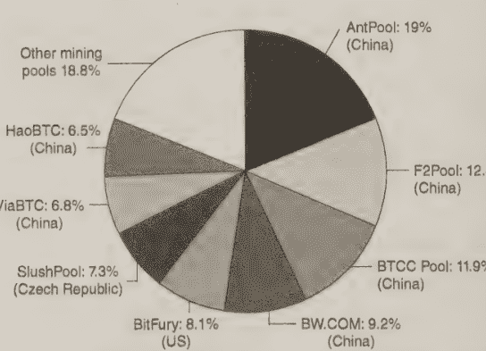

图 5.1 挖矿巨头。2016 年 11 月最大矿池的市场份额（按哈希率分布衡量）快照。分布高度可变。

### 云端外包

虽然这些大矿池现在占据主导地位，但另一种模式已经出现，也可以为个人提供获取加密货币奖励的方式。云挖矿或多或少像任何其他云服务一样运作：一家公司运营一个大型集中式设施，在其自身设备上为付费客户托管服务。在比特币挖矿的情况下，客户通常按每哈希/秒的费率向公司付费，并可以自由购买任何数量。然后他们获得挖得比特币的一定比例。

有一些明显的好处。你不是投资自己的挖矿设备，而是向云矿工的运营投资资金，以便他们可以构建或购买 ASIC 设备并按工业规模运营。云挖矿公司拥有硬件和设施，他们只是向使运营成为可能的投资者支付利润的一定比例。公司照管挖矿硬件，同时抽取少量利润来覆盖运营成本，并从规模经济中受益。即使客户离开，云矿工仍然拥有硬件，并可以自行运行以获取奖励。对客户的好处是，他们只需提供购买哈希率的现金——不需要购买、安置或维护昂贵、发热、耗电量大的电路。

所有硬件本身都安置在巨大的仓库内。尽管大多数挖矿公司对其运营保密（考虑到涉及的资金量，这并不奇怪），但网上发布的据称展示 BW.com 和 AntPool 等一些大型云挖矿公司的图片显示，一排排处理器，堆满广阔仓库的天花板，配有大型冷却风扇、粗电源线，且几乎看不到人影。为了最大限度地利润，云挖矿服务通常位于电费低廉的地方——在

例如，靠近大型水力发电机或地热能源的地方，或者靠近北极的地区，在那里给辛苦工作的处理器散热可以简单到打开一扇窗户。例如，云挖矿公司 Genesis Mining 最初在波黑和中国设有站点，但现在总部设在冰岛，归功于其廉价的电力、寒冷的气候和快速的互联网连接。

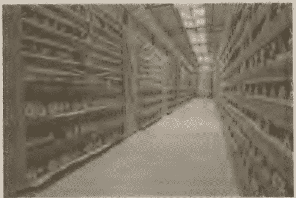

不需要镐和铲子：这些耗电量大的处理器正在挖掘比特币。

### 一种带有集中控制的分布式货币

虽然加密货币的设计初衷是在互联网上分布，但挖矿过程的现实意味着它已演变为越来越集中化。少数几个矿池现在控制了比特币全球哈希率的绝大部分，这些矿池分配了大部分新产生的资金。看来，集中化行业和大规模生产的经济优势足以将大多数小型挖矿公司和矿池挤出市场。

云挖矿现在甚至开始争取主流投资者。Genesis Mining 推出了第一个在美国证券交易委员会注册的比特币挖矿基金，向投资者提供名为 Logos 基金的挖矿类基金证券。尽管加密货币可能风险高且复杂，但越来越多的人愿意投入大笔资金来承担这种风险。

集中化在另一个意义上也是一件好事。随着任何领域技术的发展，新进展可以迅速提高效率。基于每生成一个哈希所耗瓦特的比率，ASIC 的能耗效率可以比单个 CPU 高出超过 1800 万倍。在大规模挖矿时，这种效率意味着更低的电费，这对最终利润可能产生巨大影响，并使比特币网络总体上不那么浪费。

### 矿工使用多少电力？

像比特币这样的加密货币挖矿能耗并不小。根据 2013 年发布的第一台 ASIC 挖矿机的测得能耗率进行外推，当时比特币的全球哈希率年耗电量将超过 482,969 兆瓦时。这相当于超过 44,000 户普通美国家庭的用电量。

使用 2016 年中期发布的 ASIC 挖矿机的数据，比特币的耗电量似乎已大幅增加到每年 336 万兆瓦时，或相当于超过 307,000 户普通美国家庭的用电量。但是请注意，尽管全球哈希率比 2013 年高出约 184 倍，但电力增加仅 7 倍。利用 ASIC 的矿池可能会让小规模矿工倒闭，但这无疑在过程中帮助节省了大量电力。

### 规模确实很重要

但规模确实会带来自身的问题。矿池越大，越容易招致黑客攻击。一项研究表明，63% 的大型比特币矿池曾遭到黑客攻击，而只有 17% 的小型矿池被攻击。通过低调运作，小型矿池可能避免了一些大型矿池遇到的麻烦。

挖矿社区也担心，将挖矿集中在大型矿池中会对加密货币的未来造成多大问题。致力于更新比特币代码的个人群体正试图解决关于货币如何良好扩展到更多用户的某些问题（参见《中本聪的继任者致力于改造比特币》，第 11 章）。但要使软件更新被接受，网络中的每个人都必须同意该更新。这充当了一种投票形式：当网络的大多数更新到新版本时，即被视为接受，旧版本将被淘汰。但是，如果新版本未被接受，开发人员必须重新打草稿。

目前，控制比特币网络大部分算力的矿池对最近提出的软件更改持怀疑态度，并已将其拒绝。不同矿池之间的文化差异也可能在此发挥作用——例如，许多矿池位于中国，而大多数软件开发人员位于美国。还担心，如果保守观念占据主导地位且更新遭到抵制，从长远来看，该货币可能会停滞不前。

当然，比特币只是众多加密货币中的一种，尽管它在价值和网络规模上都是最大的。矿工通常会每天甚至每小时更换挖掘的货币。而且，虽然比特币不太可能跌出领先地位，但新的区块链不断被引入。例如，2016 年，以太坊和瑞波两种新型区块链出现，超越了大量其他加密货币，仅次于比特币成为按市值计算的第二大和第三大加密货币。随着管理挖矿过程的经济和技术条件不断演变，现状也将随之改变。

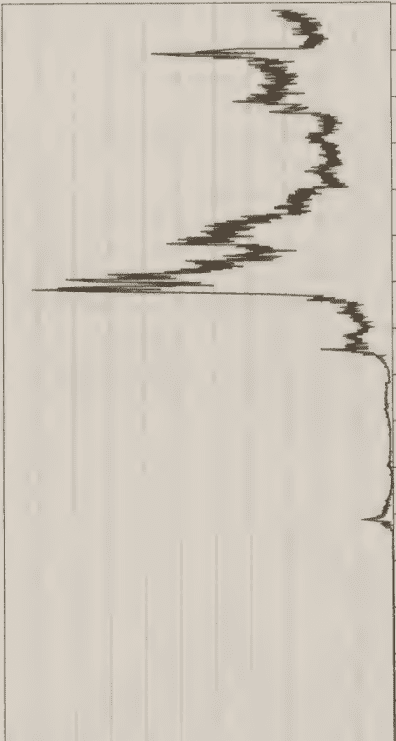

图 5.2 挖掘加密货币的收益差异很大。

支付给矿工的区块奖励和交易费总价值，美元

## 6 刺客与毒品：比特币早期的花费方式

从创立之初，加密货币就与互联网的犯罪地下世界联系在一起。丝绸之路（Silk Road，第一个加密货币市场）及其创始人戴德海盗（Dread Pirate Roberts）的覆灭，便是这一现象的典型代表。

新闻报道听起来像是阴谋惊悚片的情节要点。雇凶杀人。贩毒。挪用公款。欺诈。洗钱。腐败。市场操纵。环境面临风险。政府面临被推翻的命运。“比特币是邪恶的，”一位诺贝尔奖经济学家在《纽约时报》上说道。“恶意软件将被入侵的计算机变成‘挖矿’新数字货币的奴隶，”科技出版物《石英》报道。CNN 关于比特币的众多标题之一写道，“被比特币骗：SEC 捣毁涉嫌比特币庞氏骗局”。《福布斯》杂志报道，“FBI 表示已查获 2850 万美元的比特币”。

### 丝绸之路

比特币与犯罪之间最大规模的勾连莫过于丝绸之路。在这个故事中，我们看到匿名、非政府货币的理想被推向了极致。我们看到一个看似普通的二手书籍销售人员是如何被判处联邦监禁终身的。他成为了庞大 FBI 围捕网的核心；成为一场横跨众多美国联邦执法机构的大规模行动的目标。如果没有比特币，这一切都永远不会发生。

### 时间表：丝绸之路的路径

- 2011 年 1 月 Ross Ulbricht 开发了丝绸之路，这是一个非法物质交易市场，并开始在比特币和毒品论坛上悄悄宣传。比特币当时交易价格约为 30 美分。
- 2011 年 6 月 Gawker 发布关于丝绸之路的报道。比特币价格创下 30 美元的新高。
- 2011 年 8 月 丝绸之路一个月产生了 3 万美元的佣金。
- 2011 年 12 月 FBI 和其他执法机构从该网站购买了超过 100 批毒品，收集信息并进行逮捕。
- 2012 年 3 月 丝绸之路一个月产生了 9 万美元的佣金。
- 2012 年 11 月 丝绸之路开始向威胁要通过分布式拒绝服务 (DDoS) 攻击关闭该网站的黑客支付保护费。
- 2013 年 1 月 网站管理员 Curtis Green 在一场诱捕行动中被捕后，Ross Ulbricht 涉嫌试图让人杀死他，他不知道自己雇佣的是一名卧底缉毒局特工。
- 2013 年 7 月 Ulbricht 自己的个人账户每天从丝绸之路获得近 2 万美元的佣金。执法部门在冰岛逼近丝绸之路服务器时了解到这一情况。
- 2013 年 10 月 在将属于 Ulbricht 的电子邮件账户与涉及丝绸之路的互联网帖子关联后，特工在旧金山公共图书馆逮捕了他。他们查获了他的电脑，该电脑已登录丝绸之路管理员账户。
- 2015 年 5 月 在一场他声称自己被陷害的审判后，Ulbricht 被判有罪并判处终身监禁。

### 数字贩毒的开端

2011年1月，一个名为 shroomery.org 的“迷幻蘑菇”网站上出现了一篇帖子。该帖子由用户“altoid”撰写，其中发布了一个名为 Silk Road 的网站链接，并询问是否有人使用过该网站。几天后，同一名用户在 bitcointalk.org 上发布了类似的帖子。

两年后，即 2013 年，FBI 特工将发现这两篇帖子是互联网上最早提及 Silk Road 的帖子——这意味着它们很可能是网站创建者所写。当时，FBI 尚不知晓 Silk Road 创始人的姓名，但这些帖子最终成为调查人员找到 Ross Ulbricht 所遵循的第一批线索之一。

尽管 Ulbricht 采取了许多措施来隐藏身份，但政府仍投入了非同寻常的资源来揭露他。他想成为一名匿名的、网上的自由意志主义英雄，并经常使用化名“恐怖海盗罗伯茨”（Dread Pirate Roberts，DPR），以此向《公主新娘》中的角色致敬，并让自己的名字与 Silk Road 保持距离。但最终，一系列简单的疏忽导致他的身份被揭露并被捕。

DPR 武器库中一种强大的工具是网络流量匿名化软件 Tor，黑客和间谍都使用它来隐藏在线流量。通过将 Silk Road 作为暗网上的“隐藏服务”运行，调查人员无法找到托管该网站的服务器并将其关闭。通过使用 Tor 连接进行电子邮件、聊天以及所有与 Silk Road 管理任务相关的连接，DPR 及其管理人员将无面孔、无姓名、无位置——正如他们相信互联网本应如此。而比特币是为他们的努力提供动力的加密货币。

比特币并非完全匿名，但政府无法将其关闭，用户账户也无法被冻结，这与信用卡或像 Paypal 这样的在线商户服务不同。Tor 使 Silk Road 能够建立其市场，而比特币则允许支付货款。整个企业看似风险为零。

### Silk Road 真正匿名过吗？

Silk Road 市场本应是完全匿名的。但尽管 Tor 能很好地伪装互联网流量的源和目的地，比特币交易可以通过区块链追踪，这意味着它们从未完全保密。

该网站的技术也并非完美。在志愿者的帮助下，Ulbricht 发现了网站中的一些早期安全漏洞。人们在发现漏洞后主动站出来的事实，加强了 Ulbricht 的信念，即该网站可以通过自我监管生存。在其理想主义的观点中，他认为该网站的用户和技术比针对他们的势力更强大，并且他们会相互保护。但正是其中一个安全漏洞——由编码错误引入的漏洞——让警方在 2013 年发现了服务器的位置，并收集了导致 Ulbricht 被定罪的证据。

当然，除了药物是实物且必须亲自交付的问题。这意味着 Silk Road 的卖家不得不使用邮件，并最终给了当局第一个真正的线索，表明城里有了新玩家。在注意到检测到的毒品运输增加后，只是时间问题，总有人会被抓到。

在众多用于拦截邮件运输的诱捕行动中，DEA 在 2013 年抓获了 Silk Road 的一名辅助管理员，该用户名为 chronicpain。DEA 特工使用他的管理账户查获了价值 35 万美元的比特币。

当 DPR 看到资金被盗，并在新闻中读到 chronicpain（真名 Curtis Green）已被捕后，他向成为真正的毒枭迈出了巨大一步——他据称决定杀掉 Green。他的刺客将是一个通过 Silk Road 结识的熟人。“Nob”声称与贩毒集团合作，经常吹嘘自己的暴力事迹，因此他似乎是绝佳人选。然而，Nob 实际上是一名叫 Carl Force IV 的 DEA 特工——正是刚刚逮捕 Green 的那位特工。Force 策划了一场 Green 被处决的骗局，让 DPR 以为事情已经结束。

### Silk Road 背后是否有意识形态？

Ross Ulbricht 创立 Silk Road 不仅是为了钱，更是为了一个理念。他的梦想是一个由加密隐藏的数字市场，任何人都可以在其中进行任何他们喜欢的商业交易，无需受政府窥探。

这是许多早期加密货币拥护者共享的理想，包括聚焦于货币无需银行机构即可运行的能力，因此作为美元和欧元等传统“法定货币”替代品的中本聪。

在中本聪的互联网论坛帖子中，他引用正在发生的银行危机作为加密货币的部分理由。没有任何中央银行，没有任何公司实体，比特币要求人们信任的唯一东西就是构成它的代码，即开源且可供审查的代码。其他密码朋克对隐私概念感兴趣。无需任何身份证或许可证即可持有或交易加密货币，他们觉得可以在不受他人窥探的情况下进行交易。当然，他们担心的不仅仅是邻居，还有政府和税务机关。

### CAPTCHA 导致被捕

2013 年 6 月，一个独立的 FBI 调查团队从 Silk Road 网站上发现了本应被隐藏的一段信息。一种用于防止机器人向 Silk Road 发送错误登录的工具，名为 CAPTCHA，泄露了 Silk Road 服务器所在位置的 IP 地址：冰岛。DPR 及其同伙身处远方。用户、管理员和服务器仅通过 Tor 的加密层连接，在互联网上彼此隔离。但在 CAPTCHA 泄露之后，FBI 找到了服务器的位置。他们携带外交函前往冰岛，获取了服务器的副本。这为他们提供了寻找并最终定罪 DPR 的关键证据来源。

在调查服务器后，FBI 发现一系列连接是在未使用 Tor 的情况下建立的，而是使用了 VPN 服务。这些虚拟私人网络（VPN）也允许人们掩盖互联网流量，但只是通过将其中继到另一台计算机来实现。通过追踪登录记录，调查人员可以看到许多连接来自旧金山地区的地点。

与此同时，与团队合作的一名 IRS 特工在一个编程网站上发现了一篇帖子，请求帮助设置 Tor 隐藏服务，使用的用户名与 2011 年 shroomery.org 和 bitcointalk.org 上的帖子中使用的相同用户名“altoid”相同。一个电子邮件地址“rossulbricht@gmail.com”与该用户名相关联。对于 FBI 来说，拼图开始就位，一幅图景开始浮现。

在发现许多其他巧合之后，包括国土安全部关于假身份证被运送到 Ulbricht 家的报告，FBI 开始了监视。他们看着 Ulbricht 登录他的电脑，而 DPR 突然出现在 Silk Road 上。这一幕一再发生。很快，他们掌握了足够签发逮捕令的证据，并在一次突袭行动中，在旧金山公共图书馆将 Ulbricht 逮捕，成功在他登录 Silk Road 管理账户时完整扣押了他的电脑。

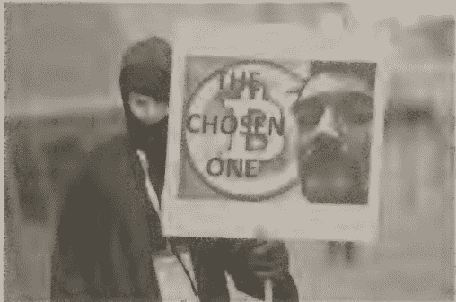

并非所有人都乐于看到 Silk Road 创建者 Ross Ulbricht 受审。

2015 年 5 月，Ulbricht 被判终身监禁，不得假释。陪审团似乎被 FBI 查获的压倒性证据说服，这些证据包括聊天记录，记录了他策划这一庞大计划的逐日记录。然而，雇凶杀人罪从起诉书中被撤销。看来所谓的 Curtis Green 谋杀案，以及 Ulbricht 以为自己付钱谋杀的几起谋杀案，从未发生过。其中一些是警方策划的阴谋；另一些是旨在夺走 DPR 比特币的骗局。令人震惊的是，策划诱捕行动并伪造 Curtis Green 谋杀案的 DEA 特工 Carl Force IV 本人也因私吞从 Silk Road 查获的比特币，以及以其他几种方式滥用法律权力以掩盖他盗窃资金的行为而被捕。一名特勤局特工也与他一起被起诉，两人现在都在服刑。Ross Ulbricht 的律师正计划基于这一事件提出上诉。（美国马里兰州地方法院还有一起仍在审理中的起诉书，其中包括雇凶杀人指控。）看来 Silk Road 中包含的巨额财富腐蚀了当局，就像腐蚀了犯罪者一样。

### Silk Road 之后的生活

Silk Road 已终结，但悬而未决的问题和松散的线索依然存在。2015 年底，另一名名为 Variety Jones 的原始 Silk Road 管理员在泰国被捕。此事发生在他三个月后，他在网上论坛发布了一个离奇故事，声称自己正被一名腐败的 FBI 特工追捕和威胁，该特工想让他协助获取当局尚未查获的 7000 万美元比特币，或许是通过折磨 Ross Ulbricht 的家人来实现。这个故事听起来可能很荒谬，除了一个事实：两名联邦特工

已因从丝绸之路窃取非法加密货币而被起诉。关于琼斯的说法，目前尚未获得外部证实。

与此同时，尽管针对乌布雷希特的刑事诉状中列出了从 CAPTCHA 泄露和 'altoids' 在线帖子中获取的信息，并将其作为 FBI 识别 DPR 的证据，但后来显然，Tor 网络至少曾被攻破过一次。2014 年，卡内基梅隆大学的研究人员与国防部合作，攻破了足够多的 Tor 节点，暴露了一名名叫布赖恩·法雷尔的 IP 地址。随后，FBI 利用这些信息起诉了法雷尔，指控他参与运营丝绸之路的一个继承网站。尽管 Tor 项目现在声称已修复了这个特定漏洞，但一直有猜测认为，也许这个漏洞利用也被用于对原丝绸之路的调查。

丝绸之路及其众多仿效网站已被美国当局关闭。

使用比特币在线贩卖毒品，虽然并非万无一失，但似乎仍是一个足以诱使他人铤而走险的赚钱大生意。在丝绸之路之后，几个仿效网站应运而生。有些已被当局关闭，另一些显然是诈骗，而仍有其他网站延续至今，在网上贩卖毒品和其他非法服务，迄今为止一直躲避着在互联网暗网中追捕他们的警察。

### 接下来？

在加密货币和区块链技术的简短历史中，媒体一直为这些工具是在互联网黑客领域发明的事实而着迷。但是，加密货币本身并不违法。事实上，通过加密货币进行的犯罪数量与在常规法定货币市场中发生的犯罪数量相比，微不足道。

标题背后才是真实的故事。将货币和商业交易演进为确保技术保障的个人隐私新水平的理想主义梦想已经实现，但很快就遇到了贪婪与治理的严酷现实，因为加密货币的价值增长到了数十亿美元，并继承了传统货币的一些问题。程序员和政府监管者至今仍在试图理清围绕加密货币的技术和法律复杂性。但在所有这些复杂性中，蕴藏着一个新想法的核心。而这个新想法，无论多么复杂、政治化、危险或有缺陷，都不会消失。经过这场烈火考验，加密货币应运而生，或许比以往任何时候都更强大，新投资者已准备好遵守规则（参见“通过邮寄的比特币”和“比特币会计师”，第 8 章）。

### 恐怖海盗罗伯茨的传说

罗斯·乌布雷希特（又名“恐怖海盗罗伯茨”）对抗法律的行动如此嚣张，以至于他看起来像个最具传奇色彩的人物。有些人将他视为现代罗宾汉。在丝绸之路上的众多书面文告中，DPR 肯定在他的粉丝和支持者中推广了这一传奇。这使他与比特币的匿名创造者形成对比，后者消失了，而不是成为一个可能损害其创造物的神秘怪人。

丝绸之路的用户深信不疑。用户将 DPR 与切·格瓦拉相提并论，赞扬他创造了就业，甚至加入了丝绸之路读书会，讨论政治、经济、法律等主题的书籍。当然，所有这些都带有自由主义倾向。

丝绸之路就像一艘在互联网公海上漂浮的海盗船。丝绸之路的管理员是允许出售什么的唯一仲裁者。丝绸之路政策很明确——只有“无受害者”的物品可以交易。这意味着该网站主要集中在毒品和伪造身份证上。非法色情、武器或赃物被禁止。为了确保每个人都能得到他们期望的产品质量，用户自己在“信任”系统中对交易进行评分，这与 eBay 或其他商业网站类似。该系统旨在识别骗子，并防止卧底警察冒充卖家或买家。

但对客户和卖家的审查流程并不如人们所期望的有效。到 2011 年 11 月，警方已从丝绸之路上进行了超过 100 次卧底购买，导致多名被捕。这至少让警方得到了两名丝绸之路管理员，他们将自己的账户交给了警方，警员随后利用这些账户完全渗透了该网站。

事后看来，罗斯·乌布雷希特似乎并不像他自以为的那样浪漫冒险，而是理想主义且天真。乌布雷希特并非十足的老罪犯，至少起初不是。他的最初犯罪是种植一小批迷幻蘑菇，并想出一种在网上出售它们的方法。但这最终导致了他的垮台。

## 艰难的 Gox 学校

*每月有数百万美元佣金收入的加密货币交易所 Mt. Gox 肯定是太大而不能倒闭。或者说，真是这样吗？*

### 比特币交易所

在加密货币世界的早期，技术缺陷普遍存在。虽然比特币本身的代码证明具有弹性，但买卖比特币所需的交易所基础设施却没有那么安全，使其易受黑客攻击。

Mt. Gox 是 2011 年丝绸之路推出时主要的比特币网页交易所，最初是在其创始人杰德·麦卡莱布仍掌控时遭到黑客攻击。盗窃额微不足道，但这次攻击让麦卡莱布意识到该网站有多脆弱。这一事件是他决定将 Mt. Gox 出售给帮助管理该网站的程序员朋友马克·卡佩莱斯的主要影响。交易于 2011 年 3 月完成，但黑客问题并未就此结束。2011 年 6 月，又发生了一次入侵。

不知何故，一名黑客设法伪造了登录杰德·麦卡莱布仍处于活跃状态的账户所需的凭据，拥有完整的管理员权限。这使入侵者能够人为增加其账户持有量，在原本不存在的情况下创造出 100,000 个比特币。他们无法欺骗比特币区块链，但也不需要。这些假比特币仅存在于 Mt. Gox 网站的内部账簿中。当用户在 Mt. Gox 上交易货币时，他们将比特币转移到 Mt. Gox 的公共地址，该地址在内部跟踪他们在买卖过程中的余额。当用户希望提取资金时，交易所会将比特币从 Mt. Gox 钱包发送回用户。由于一笔仅存在于 Mt. Gox 系统内的新财富出现，黑客开始快速出售，导致该交易所比特币价格暴跌。仅 30 分钟，价格就从 17.50 美元暴跌至 0.01 美元。

Mt. Gox 有一项安全措施：每次通过区块链从网站钱包转出的比特币价值不得超过 1,000 美元。但由于价格被人为压低，这比以前多出了许多币。攻击者提取了资金，从 Mt. Gox 转出了 2,000 个比特币——这些是 Mt. Gox 金库中的真实比特币，而不仅仅是 Mt. Gox 账户软件的虚构数字。随着抛售后价格反弹，这些比特币的价值远超 1,000 美元。一个月后，这笔钱可能价值 13,000 美元。

攻击的结果是一片混乱。价格暴跌又反弹，数百名 Mt. Gox 用户以为自己捡了便宜，用真实美元换取了假比特币。Mt. Gox 不得不关闭以审计其交易所账户并删除假比特币。这让用户陷入恐慌，不确定自己的账户是否仍然活跃、资金是否被耗尽，或是遭受了其他形式的破坏。此外，黑客将入侵期间窃取的数据发布到互联网上，增加了混乱程度。

最终，Mt. Gox 理清了一切，删除了人为崩溃后发生的交易记录，并用自有资金偿还了丢失的比特币。但这对交易所和整个加密货币来说都是一次打击。尽管比特币一直完全按照其预期方式运行，但如果最大的比特币交易所容易受到价格操纵和盗窃，这对其未来意味着什么呢？

### 交易所的倒闭

尽管遭受黑客攻击并几乎不断面临技术问题，马克·卡佩莱斯仍试图让 Mt. Gox 运转下去。到 2013 年 3 月，他已有 18 名员工，包括负责领导业务的人员，而他本人则处理网站的功能。卡佩莱斯是唯一能够批准代码更改（包括重大安全修复）的人。

Mt. Gox 每月赚取超过一百万美元的交易佣金，但失误仍在持续。与初创公司 CoinLab 处理美国银行交易的协议于 2013 年 5 月以诉讼告终，原因是 Mt. Gox 未能履行其承诺——该合同本应赋予 CoinLab 对 Mt. Gox 北美账户的独家访问权，但该公司仍在使用其他存款处理商。同月稍晚，美国国土安全部扣押了由支付处理商 Dwolla 管理的 Mt. Gox 账户，因为该交易所未注册为汇款公司，尽管其他比特币企业轻易完成了注册。

2014 年 2 月，Mt. Gox 终于遭受致命打击。与 Mt. Gox 的许多问题一样，这一切始于一名黑客。但这一次，这并非一次“击即逃”的盗窃。这名黑客已在该网站内部潜伏数月，甚至数年。利用比特币区块链中名为“交易可延展性问题”的已知漏洞，黑客从 Mt. Gox 钱包转出了币，并让 Mt. Gox 误以为交易已被取消（见下文方框“交易可延展性问题”）。

其他交易所轻松应对了这一漏洞，让软件等待多个区块确认以查明比特币是否已被移动，而非仅依赖交易 ID。Mt. Gox 却没有这样做。

> **交易可延展性问题**
>
> 当比特币交易发送到区块链时，它会包含一个交易 ID 号，该号由发送者地址和其他交易信息的加密哈希生成——基本上是从地址和其他交易信息派生的唯一字符串。这是与加密货币挖矿生成的哈希不同的‘哈希’，也不同于链接区块链的前序区块哈希，但属于类似的加密过程。交易 ID 哈希是签名和验证交易过程中的关键部分。
>
> 将交易发送到区块链后，特定计算机上的比特币软件会查找交易 ID 号，以确保其交易已被接受并包含在区块链中。然而，比特币协议中的一个微小缺陷允许交易在地址格式不正确的情况下仍然通过。地址信息的这种微小变化会改变加密哈希，从而改变交易 ID 号。计算机会查找它认为的交易 ID，但找不到它。然而，交易仍然已经完成。
>
> 因此，当黑客从 Mt. Gox 创建转账请求时，他们同时导致 Mt. Gox 向网络发送请求相同比特币转账的额外交易，但地址格式不正确，因此交易 ID 号不同。持续这样做，一些变异交易在格式正确的交易之前被区块链接收并验证。然后，当 Mt. Gox 格式正确的交易到达网络时，它们会被当作重复项而被忽略。
>
> 当 Mt. Gox 软件在区块链上查找其交易时，它找不到正在寻找的交易 ID，因为它只查找格式正确的交易。但比特币已使用变异交易转移到了黑客的地址。因此，Mt. Gox 软件会发送更多交易。通过反复循环这一过程，黑客让 Mt. Gox 转移的比特币数量是其原意的两倍。这与双重支付问题并不完全相同，但揭示了中本聪和其他早期比特币编码者最初未曾预见的一个奇怪漏洞。它被称为“交易可延展性问题”。
>
> 大多数服务已学会如何防范这一问题。与其专门查找交易 ID，不如检查比特币交易本身是否在区块链中，从而绕过变异 ID 的问题。但交易可延展性问题至今仍在某些比特币相关软件中出现，完整修复尚未实现（参见第 11 章“可能的修复方案：隔离见证”）。

长期以来，黑客悄悄从 Mt. Gox 的活跃（即“热”）钱包中进行隐藏转账，而网站表现得仿佛没有发生任何异常。当钱包空了时，Karpeles 无意中用其他备份钱包中的比特币重新填充了它。就像缓慢泄漏一样，资金从 Mt. Gox 的供应中少量流出，而该网站自身的内部账目却显示数量本应有多少就有多少。直到 Mt. Gox 各个钱包中的几乎所有比特币都消失后，问题才被发现：其中有 100,000 枚是其自己的，750,000 枚是客户的。按 2014 年 2 月每枚比特币约 539 美元的价格计算，损失相当于超过 4.5 亿美元。2014 年 2 月 7 日，Mt. Gox 冻结了所有账户取款。2 月 24 日，所有交易被暂停。该交易所永久关闭了。

随着 Mt. Gox 的倒闭，许多人蒙受了损失。

### 骗子与恶意软件

除了比特币面临的涉及联邦调查局及其他联邦调查人员的高调麻烦之外，还出现了大量小型诈骗和黑客攻击。也许第一个加密货币庞氏骗局发生在 2011 年，名为 Bitcoin Savings & Trust。与许多此类骗局一样，它承诺的投资回报率美好到令人难以置信。在吸收了 500,000 枚比特币后，该网站于 2012 年消失。同年晚些时候，一群黑客和比特币社区的其他人发现了运营商的真实姓名和地址。那个人 Trendon Shavers 于 2013 年被捕，并于 2015 年认罪，罪名是证券欺诈。

2011 年，专门针对比特币的恶意软件报告也首次出现。2011 年 6 月，发现了一种名为“特洛伊木马”（取自神话中的特洛伊木马）的程序，它会搜索用户计算机中的秘密比特币 wallet.dat 文件。在复制并将该文件发送给恶意软件作者后，他们将能够窃取该用户持有的所有比特币。同年，据报道，一个僵尸网络（黑客控制下的大量被攻破计算机网络）被用来挖掘比特币。尽管被攻破计算机的 CPU 单独效率不高，但如果数量达到数千台并像矿池一样连接，则可能非常有利可图。如今，挖矿难度的增加和用于挖矿的 ASIC 的兴起，使得这种潜在漏洞利用可能性大大降低。

然而，2014 年 3 月，Mt. Gox 宣布在一个旧钱包中“发现”了 200,000 枚比特币。这是一次令人尴尬却又受欢迎的承认，但也让许多人产生怀疑。同月稍晚，两位瑞士研究人员 Christian Decker 和 Roger Wattenhofer（他们在 Mt. Gox 丑闻宣布之前一直在研究交易可延展性问题）站出来表示，他们拥有数据表明，Mt. Gox 无法通过该漏洞损失其声称的那么多比特币。他们声称，在 Mt. Gox 于 2 月初冻结所有账户取款之前，仅有 386 枚比特币是通过可延展性攻击被盗的。

关于 Mt. Gox 到底发生了什么，争论至今仍在继续，但无论损失的真实原因是什么，Mt. Gox 都无法退还客户的资金。2014 年 2 月 28 日，Mt. Gox 在日本申请破产，3 月 10 日该公司在美国申请破产。2014 年 4 月，美国财政部向 Karpeles 发出传票，要求他就破产案接受质询，但他拒绝出庭。2015 年 9 月 11 日，日本政府在日本逮捕了他，指控他在破产案后涉嫌挪用公款。

这个故事的一个有趣尾声是，2016 年 5 月，一家名为 Kraken 的不同交易所（正在协助 Mt. Gox 的破产分析）报告称，将根据对超过 24,000 份提交索赔的处理结果，向该已关闭交易所的前客户释放大约 200,000 枚“发现”的比特币。关于他们的调查，未发布进一步信息。Mt. Gox 不光彩的系列事件似乎仍在继续。

其他加密货币交易所也遭到黑客攻击，黑客入侵计算机系统窃取备份文件，或者冒充所有者致电交易所的托管公司，要求重置管理员密码。其他在线钱包公司直接消失，带走了客户的比特币。将困扰 Mt. Gox 的问题置于互联网本身的更广泛背景中也很重要。互联网安全是一项艰巨的业务。目前每年在网络安全上的支出估计为 800 亿美元。尽管如此，根据 2016 年 RAND 公司的一份报告，仅在过去一年，就有大约 6400 万美国人的个人数据被泄露。

### 加密绑架者

另一个困扰加密货币的问题是勒索软件——一种恶意软件，在支付一笔款项之前会阻止访问计算机系统。虽然勒索软件攻击最早出现于 1989 年，但 2013 年一种新一代勒索软件开始普遍，利用公钥加密和比特币。第一个此类程序名为 CryptoLocker，它会加密受感染计算机的全部数据，然后呈现一个带有...的弹出窗口。

一条赎金信息。计算机用户会被告知在截止日期前，向特定地址发送特定数量的比特币。比特币数额相对较低，通常约为 400 美元价值。如果支付了赎金，用户会得到一个密钥来解密其数据；否则，数据将永远保持加密状态。2014 年 6 月，当局关闭了 CryptoLocker 控制的僵尸网络，但估计该勒索软件获利高达 2700 万美元。随后出现了一波仿造勒索软件。攻击变得如此普遍，以至于某些版本拥有在线帮助网站，为不了解情况的人提供如何购买比特币支付赎金，以及如何在支付后解密文件的信息。根据 FBI 报告，2016 年对勒索软件而言是丰收年，仅头三个月就获利超过 2.09 亿美元。

增长的一个关键原因或许是，勒索软件设计师正在寻找预算更高的特定目标。CryptoLocker 是随机传播的，低额赎金明显是针对普通家庭和办公电脑设计的。然而，2016 年出现多起医院直接遭受定制勒索软件攻击的案例，这类软件旨在将医疗记录和关键处方信息作为人质扣押。2016 年 2 月，加州好莱坞医院（Hollywood Hospital）遭到勒索软件攻击，据报道医院官员支付了 17,000 美元以解密关键记录。

Mt. Gox 的事件让加密货币名声扫地，本可能成为它们的终结。然而，Mt. Gox 关闭后，其他交易所接过了业务。与 2013 年底和 2014 年市场动荡相比——当时比特币价格在 150 美元低点和 1200 美元高点之间波动——2015 年是交易平静的一年，交易量稳定，价格在 200 美元至 300 美元之间。2016 年价格再次上涨，到 7 月已超过 600 美元（参见第 1 章的图 1.2）。

或许，对加密货币寿命最有力的证明是，它们成功度过了这场风暴，并来到了另一边，企业、消费者和政府仍对加密货币的未来持有兴趣。

## 8 比特币渐入成熟

从地下起步开始，世界上最著名的加密货币正在走向主流。比特币银行业务已经到来，加密货币技术正被纳入金融机构和政府的长期战略。那么，它在日常生活中的使用为何仍然有限？

加密货币技术正成为全球金融机构（包括银行、投资机构乃至各国政府的经济计划）中期战略的一部分。投资者正直接向加密货币投入资金，同时也试图利用传统公司和银行提供的新型加密货币关联服务。尽管丝绸之路（Silk Road）和 Mt. Gox 这样的失败开端令人担忧，但许多人相信这些技术能从根本上改变我们使用金钱的方式——并且合法地做到这一点。

但加密货币本身只是数字金融技术这个崭新世界的开端。区块链正从单纯作为货币的技术支撑转变为支持银行自身机制，包括房地产交易、各种电子转账服务，或许有一天，连整个公司都在其中。

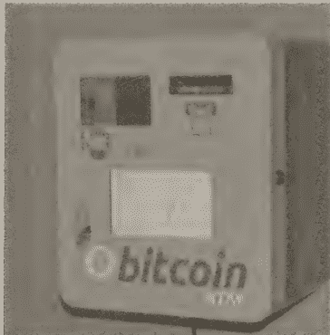

比特币 ATM 机仍属罕见。

### 你可以买什么？

对加密货币最常见的批评之一是，它们永远无法取代传统货币，因为作为日常支付手段毫无用处（参见下方方框“比特币一日”）。在加密货币最常见的市场还是暗网非法毒品网站的日子里，这当然是事实。但今天呢？加密货币的使用已扩展到合法商业领域，但这足以让它取代英镑、美元、欧元和人民币的日常使用吗？

### 比特币一日

2014 年 2 月，《新科学家》杂志记者哈尔·霍德森（Hal Hodson）试图只使用比特币而不使用其他货币。他发现了什么？

我的一个三度 Facebook 好友迈克尔·焦维诺（Michael Giouvino）同意卖给我价值 150 美元的比特币，用于前往纽约的旅程。我告诉他，我打算开车过去，途中在新泽西一家浴场停留，然后进入城市购买一些杂货，囤积在我女友的公寓里。自 2012 年以来一直持有约 600 个比特币的焦维诺轻笑一声。“你打算怎么做？”

花费加密货币的一种方式。

啊，我明白了。燃料是比特币自驾游中最大的障碍。美国只有两家加油站接受它——一家在科罗拉多州，另一家在新罕布什尔州——都不在我的路线上。相反，我尝试了一种涉及电子礼品卡和沃尔玛的复杂变通方法，但失败了。算了。旅程过半，我至少为自己找到了燃料。我在 TGI Friday's 吃了一份大汉堡和薯条，用通过第三方网站用比特币购买的礼品卡支付。

在新泽西郊区，一家税务办公室附近，有一家俄罗斯浴场——一家 banya。Bear and Birch 浴场由前高盛股票交易员彼得·基赞科（Peter Kizenko）经营。里面，你穿上泳衣，和几位脾气暴躁的俄罗斯人一起忍受炙烤般的高温。有一束用胶带缠住柄的白桦小枝，你可以将其浸泡在冰水中，然后抽打自己。这一切只需 0.03 个比特币。

“开始接受它再简单不过了，”基赞科躺在浴场门廊上说道。两年前，他离开莫斯科的高盛工作，创办了这家浴场，因为他怀念祖国的 banya。税务局办公室可能就在附近，但比特币应如何纳税仍不清楚。基赞科不担心，部分原因是这部分收入占比太小，他还说，记录每笔交易的公开区块链将使合规变得轻而易举。

但基赞科表示，虽然接受这种货币很容易，但用它做其他事情，比如兑换成美元，就没那么简单了。最近，当局关闭了多家交易所，以此为基础开展业务风险太大。

浴场之后，我前往布鲁克林的 Greene Ave Market。这是一家 24 小时营业的有机杂货店，使用比特币支付可享 9 折优惠，是纽约为数不多接受该货币购买实物商品的地方之一。店员 Ali 掏出手机，给我发来一串作为商店比特币地址的数字和字母。我转账 6.017 个比特币后，他打电话给老板确认款项已到账。其他顾客瞟向我，对这笔奇特的交易感到不安。在 Bear and Birch 更简单，我只需扫描一个条形码。

目前，考虑到过去一年它所受到的关注，纽约市接受比特币的商户出人意料地少。布鲁克林的一家名为 Puppy Paws 的遛狗生意接受比特币，靠近河边的一家名为 Lean Crust 的披萨店也接受，一家名为 EVR 的酒吧也是如此。少数法律事务所、牙科诊所和房地产中介也接受它。不过，在整个旅途中，“你接受比特币吗？”这个问题通常会得到困惑的眼神。

后来，我前往华尔街中心的新比特币中心，它夹在传统金融的大楼之间。爱好者们经营着他们自己的比特币交易大厅，名为 Satoshi Square，以这种货币神秘的创始人命名。我造访的那个晚上，讨论话题是以太坊（Ethereum），一个面向虚拟货币的新平台。

站在前沿的人无需被说服——对他们来说，革命已经来临。但当你在纽约市几乎只能买比特币披萨时，你知道比特币还有很长的路要走。

### 经日本从美元到比特币

在比特币早期，加密货币所能实现的最明显的商业模式之一是交易所。在 Mt. Gox 出现之前，除了挖矿，获取比特币的唯一方式就是临时从另一个用户那里购买。Mt. Gox 创建了第一家货币交易所。

allowing users to buy bitcoins in a market for yen or dollars. From the small commission that Mt. Gox charged, the service was at times earning as much as $900,000 in a single day.

However, Mt. Gox had its weaknesses. In order to get dollars into the Mt. Gox system, it was necessary to wire money to the exchange’s Japanese bank – no small feat for the average consumer.

Other exchanges and startups attempted to make this easier. BitInstant, founded in 2011 by US entrepreneurs Gareth Nelson and Charlie Shrem, was one of the first services to allow customers to buy bitcoins on a much more ‘retail’ basis. The company would handle all of the wire transfers with Mt. Gox, and the customers were simply charged the money and sent the bitcoins. However, first the popular service became so slow that a class action lawsuit was filed in 2013. Then, to seal the company’s fate, Shrem was arrested in 2014 and charged with money laundering, for his part in a scheme to sell bitcoins to users of Silk Road. BitInstant shut down.

### How stable are cryptocurrencies?

There are a number of criticisms of cryptocurrencies. Although there are cryptocurrency exchanges, without any of the traditional hedges of conventional asset or exchange markets, the prices of the currencies on these exchanges are vulnerable to manipulation and wild swings. Typically, conventional asset markets have ways to ‘bet against’ a price increase or insure against a price drop. This also helps equalize market forces that would otherwise create investment bubbles. Although these sorts of derivative assets do exist for cryptocurrency markets, they are nowhere near as widely used as in traditional markets, and thus their ability to help support market stability is unknown.

In the world of finance, size seems to matter. While the markets for cryptocurrencies are large, they are nowhere near as big as conventional markets. Bitcoin’s market capacity of over $9 billion pales by comparison to the New York Stock Exchange’s $19 trillion or so. A larger market has more trading, which also helps promote stability.

Still, bitcoin has significant value. Could it offer a significant form of commodity trading much like gold? For now, bitcoin’s value simply fluctuates too much. Its volatility may stem from bad press, or exchange problems in the past (see ‘The fall of the exchange’, Chapter 7), yet even in the most stable periods, cryptocurrencies tend to take sharp dives and jumps in value. As valuable as cryptocurrencies are, they remain more risky than many stocks, and that makes it difficult to convince mainstream investors to ditch conventional markets and put their cash in cryptocurrencies.

Coinlab was another company with a similar business model to BitInstant founded in 2013. The biggest headlines it generated came in 2013 when it formed a partnership with Mt. Gox to process money transfers exclusively in North America, gaining a huge amount of business for Coinlab and potentially opening up the exchange to more customers in the US and Canada. However, only months later Coinlab sued Mt. Gox for breach of contract, claiming the exchange had violated the exclusive right of Coinlab to service Mt. Gox customers in North America when it refused to deliver the customers to Coinlab. It was later revealed that the lawsuit was an attempt to get Mt. Gox to deliver necessary information that Coinlab needed in order to process payments. This issue eventually severed the deal in late 2013, not long before Mt. Gox was forced to shut down permanently.

### Bitcoin by post

In an effort to find more customers and create a business model beyond simply buying bitcoins, some companies have begun targeting international remittances as a business model, rather than exchange services – a potentially huge market for cryptocurrencies.

Circle is one company that sees its primary business as money transfers. The company obtained the first BitLicense for cryptocurrency-related businesses from New York State, and also an e-money licence from the Financial Conduct Authority in the UK. This allowed Circle to partner with Barclays bank. By utilizing the services of this bank and others in the US, money can be transferred to and from bank accounts in either country via a Circle account. And additionally, one can exchange cryptocurrency into dollars and pounds via a Circle account, which in turn enables direct transfers of the exchange value of cryptocurrency directly into US and UK bank accounts. Circle acts as the intermediary, processing transactions between legitimate bank accounts, as well as the new burgeoning field of cryptocurrency. Circle also recently received a significant amount of funding from Chinese investors, and opened a branch there to potentially allow similar transfers from that country. Abra is a similar app currently only in the Philippines that allows customers to buy and transfer bitcoins to anyone with a phone number.

However, not all bitcoin remittance companies have been successful. For example, a remittance company called Buttercoin had to be shut down in April 2015 due to lack of investment.

Will signs like this ever be commonplace?

It has also yet to be proved if using bitcoin for remittances is actually any cheaper. In a 2016 report by Citibank reviewed ten common remittance pathways between various countries and found that bitcoin was only cheaper than standard remittance options in one of them – between the US and New Zealand.

### Where can you spend cryptocurrency?

The Holy Grail for cryptocurrency enthusiasts has always been the ability to use it in day-to-day transactions as easily as using credit cards or cash. Adoption of cryptocurrency transaction processing by merchants has been slow and sporadic, normally limited to niche industries or online services, or the occasional company owned and run by cryptocurrency enthusiasts. However, this area has perhaps seen the most recent growth, and the companies working on cryptocurrency transaction services are some of the most successful in the cryptocurrency field. They claim that they offer tens of thousands of merchants the ability to accept cryptocurrency for purchases.

BitPay was one of the first companies to offer transaction services for merchants, working with online companies as early as 2011. They helped many of the early adopting companies to accept bitcoin, like Wordpress, Microsoft, and Newegg. After receiving significant investments from Paypal, they expanded their services, working with a company called Gyft to allow users to purchase gift cards with bitcoins that could then be used at retailers. BitPay also began working with Paypal itself, allowing bitcoins to be used to purchase products from Paypal's digital retail platform. In 2016, BitPay launched a VISA debit card that customers could reload using bitcoins, and then use for transactions in normal currency anywhere VISA is accepted.

Coinbase started as an exchange service, but expanded to retail-oriented payment processing. It's also been partnering with Paypal, allowing users to transfer funds exchanged from cryptocurrencies in Coinbase out to a Paypal account.

It's no surprise that Paypal's name keeps coming up. The company handles over $228 billion a year in online transactions, and is considered the primary company for most online money handling in the US. They clearly want to maintain this position, and can afford to take the risks in experimenting with cryptocurrencies, in order to ensure they are not left behind if some method pans out. Although they have primarily invested in other companies and partnered with them for particular service trials, it was recently reported that Paypal itself has applied for patents on integrating cryptocurrency payments into smartphone transactions.

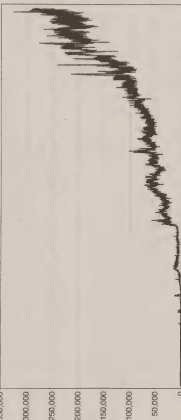

FIGURE 8.1 The growth of bitcoin. The number of bitcoin transactions carried out is rising. By the end of 2016 around 300,000 were made each day.

虽然现在商家接受比特币相当简单，但他们往往并不这样做。鸡生蛋蛋生鸡的问题正在起作用——商家在客户要求之前不会被迫接受加密货币，而如果没有商店愿意接受，客户也不会被迫使用加密货币。与此同时，信用卡和现金继续是阻力最小的方式。而且，在选择采用加密货币而非当前电子支付时没有任何特别好处，因此广泛演变为新方法似乎不太可能。

### 学生免费比特币：他们是如何花掉的？

2014年10月，麻省理工学院（MIT）的所有4494名本科生均获得了价值100美元的比特币，这是一项旨在促进原本可能不想尝试加密货币的人群接受度的实验。学生们可以随意处理这些比特币——只要合法即可。波士顿地区拥有许多接受比特币的商店，且也是美国最早设立比特币ATM的地区之一。此外，MIT校园商店接受该货币，可用于兑换教科书和大学运动衫等物品。MIT比特币项目从用户那里收集数据，以了解他们如何使用这笔钱以及对该货币的态度是否发生了变化。

结果如何？只有大约70%的学生领取了这笔免费现金，其中40%的人在第一个月内将比特币兑换成了现金。两年后，只有14%的学生仍在使用比特币。

### 比特币会计师

加密货币企业在会计领域的新领域正在兴起。无论是接受付款、交易加密货币，还是单纯将比特币作为投资购买，追踪这类交易都是必要的。由于区块链及其看似随机的字符串和哈希值可能令人困惑，许多公司正在提供帮助客户利用区块链追踪加密货币交易的服务。Libra.tech就是其中之一，将区块链分析集成到标准会计流程中。另一家公司Contelligence声称正在通过区块链分析研发“检测欺诈交易”技术，尽管他们未透露具体方法。

这些服务是否会成为广泛需求的答案，将取决于加密货币的使用有多普遍。然而，即使加密货币只有一小部分核心用户群，这类专业公司也往往能提供急需的利基服务。具有讽刺意味的是，虚拟货币的动机之一是匿名化交易，防止当局监视货币用户的金融活动。加密货币区块链的现实是，作为账本，它提供了所有交易的高度详细记录。伴随着这种新型详细财务记录的，是一种新型专业会计师，他们接受了如何解开这些记录并使其可读的技术细节培训。

### 比特币在商业中的应用

| 日期 | 事件 |
|------|-------|
| 2009年2月 | 中本聪首次发布比特币软件。 |
| 2010年4月 | 早期比特币爱好者Laszlo Hanyecz据称是第一个用加密货币购买任何东西的人，他用10,000个比特币换取了几个披萨送到他家。 |
| 2013年4月 | 约会网站OKCupid接受比特币支付。 |
| 2012年11月 | 网站数据库软件提供商Wordpress开始接受比特币支付。 |
| 2013年10月 | 中国互联网搜索巨头百度接受比特币。此外，Ross Ulbricht被捕，丝路网站关闭。它很快将被一大批模仿网站取代。 |
| 2014年1月 | 互联网零售商Overstock.com和TigerDirect接受比特币。 |
| 2015年11月 | Coinbase推出比特币VISA借记卡，可使用加密货币充值，并在任何接受VISA的地方使用。 |
| 2015年10月 | BitPay与Ingenico合作，在美国提供类似的比特币POS支付。 |
| 2016年2月 | Stripe为商家推出比特币支付集成服务，可直接连接到任何美国银行账户。 |
| 2016年4月 | BitPay还推出了自己的VISA借记卡，每天允许超过10,000美元的比特币转账，且零手续费。 |
| 2010年12月 | 当PayPal停止接受有争议的举报人网站WikiLeaks的捐款时，有建议称WikiLeaks可以改为通过比特币接受捐款。 |
| 2011年1月 | 隐私和反监督倡导团体电子前哨基金会开始接受比特币捐款。他们将于2011年6月停止，理由是关于其合法性的问题以及似乎“背书”加密货币的影响。他们将于2013年5月重新开始接受比特币捐款。 |
| 2011年11月 | 仅接受比特币的慈善机构bitcoin100开始运营。 |
| 2011年2月 | 著名的暗网毒品市场丝路开业。 |
| 2014年6月 | 旅游预订网站Expedia接受比特币。 |
| 2014年7月 | Dell Computers和在线电子产品零售商Newegg接受比特币。 |
| 2015年1月 | Paymium与POS终端制造商Ingenico合作，使零售商能够通过现有POS终端在欧洲接受比特币支付。 |
| 2014年9月 | PayPal与BitPay签约，允许通过其数字销售平台进行比特币交易。 |

### 比特币匿名吗？

不完全是。创建比特币钱包不需要身份证，甚至不需要姓名。但所有交易都可以在区块链上读取。加密货币在公开的环境下交易，即使那些手上没有附带姓名。

区块链就像普通毒贩试图通过洗钱来避免的不可避免的“纸质痕迹”。毒贩可能会赚取大量现金，但如果不显而易见地表明钱来自非法来源，就很难用来买房子或买车。

如果怀疑某个比特币曾在暗网上用于购买毒品，只需观察该比特币下一步流向，通过区块链的交易记录进行追踪即可。任何人都可以追踪其用途。如果比特币是通过非法毒品销售获得的，所有者无法确定警方没有在数字上追踪它。毒品钱如果无法真正使用，就毫无用处。

执法部门想要发现比特币交易背后的身份，比向银行发送传票（如处理常规货币交易时所做的那样）更加困难，但这绝非不可能。那些试图利用非法暗网市场的人经常使用“比特币洗钱”网站，这些网站将他们的比特币与许多其他用户的比特币混合，然后在另一端吐出来。这给当局带来了麻烦，但他们正在快速开发工具，以追踪比特币在经过任何数量的交易所、洗钱者和钱包时的流动。所有信息都在账本中，只需提取和追踪即可。

### 比特币真的是货币吗？

比特币和其他加密货币的名称中确实包含“货币”一词，但它们真的是货币吗？不同国家对此问题持有不同立场，赋予了它各种法律地位。但这引出了一个更大的问题：钱到底是什么？

## 货币简史

如果你问别人货币的起源，他们可能会讲述这样一个故事：人类曾通过物物交换生存——比如说，用一只鸡换一蒲式耳小麦——直到最终他们开始使用黄金和其他贵金属作为通用的交换商品。黄金普遍受欢迎且不易腐坏，因此成为理想的通用交换筹码。它可以换取任何东西，也可以为雨天储藏，从而满足了货币的第一和第二个定义功能——它充当交换媒介和价值储存手段。

基于我们对货币运作方式的当前看法，物物交换似乎是货币的合理前身。然而，这个故事是一个神话，其起源可以追溯到古希腊。正如人类学家David Graeber在其著作《债务：最初的5000年》（Melville House Publishing，2011年）所示，没有证据表明古代文化曾独家使用物物交换。事实上，证据表明，只要贸易存在，货币就在使用。原因在于，物物交换只有在你与认识并信任的人进行交易时才真正有效。对于与陌生人交易，需要一个抽象的价值量——而这正是货币。

这并非硬币和钞票意义上的货币，而是一个信贷与债务的抽象账本。人们记录谁欠他们什么以及反之亦然，使用精确且商定好的单位。因此，货币诞生并非作为交换媒介或价值储存手段，而是作为记账单位——货币的第三个功能，我们在日常理解中常常忘记这一点。

Graeber指出，混淆的一部分在于，我们在考古遗址中发现了多达2700年历史的硬币，并假设货币始于这种文物。但实际上，货币独立于任何货币实体而存在。货币是

一个抽象的概念，其历史可以追溯到美索不达米亚等古文明，书写也是在那里最早出现的。

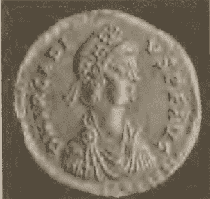

这枚罗马硬币铸造于公元400年左右，但最早的硬币是在300年前制造的。

随着贸易网络的扩张，记录欠条变得越来越繁琐。此时引入实物货币就显得合情合理了。最早的有组织的铸币体系之一是由查理曼大帝在8世纪欧洲创建的，并以银为基础。

但实际上，当时流通的实际硬币并不多。重要的是单位——里弗尔、苏和第尼尔（livres, sous and deniers），这些单位成为后来许多货币（如英镑、先令和便士）的模型——这些单位被标准化，用于记录商品交换，在账簿中反复记录，但很少以实际硬币形式交换。

账簿形式的货币做法延续至今，有时采用高科技，有时采用低科技。英格兰银行直到19世纪中叶仍在使用被称为‘tallies’的劈开的柳木棍来记录借贷。如今，账簿有时以密码学哈希链的形式保存。

在中世纪的欧洲，人们使用这样的契约木刍来记录债务和交换。

### 硬币的问题

查理曼大帝的货币被称为‘商品货币’（commodity money），其硬币价值体现在构成硬币的金属中（令人困惑的是，用贵金属铸造的硬币被称为‘实币’（specie））。

通过为其领地铸造货币，查理曼大帝在行使一项自公元前3世纪以来就被认可的权利，当时中国楚国宣王的顾问建议他掌控所有货币生产以便更好管理。从那时起，人们普遍认为一个地区的君主是其货币的主要来源。即使铸币权外包给私人机构，他们也只是在君主权力的授权下进行铸造。

这种权力对君主来说可能很有利可图，君主会以铸造硬币所用贵金属的一定比例收取‘铸币税’（seigniorage）费用。然而，这给更广泛的经济带来了严重问题。

用贵金属制造硬币听起来可能是一项简单的活动，但实际上它如此复杂，以至于与之相比，区块链技术听起来几乎都很简单。

用贵金属制成的硬币的一个周知问题是它们具有‘损耗性’（lossy）。仅仅是被人手触摸，硬币就会损失一部分重量。不法行为会加速这种损失。削币、削边以窃取部分贵金属，甚至在布袋中摇晃硬币以收集磨损的粉末，一直是一个持续存在的问题。硬币质量可能损失多达10%，尤其是当贵金属价值上涨时。这些轻币随后需要以高昂成本重新铸造。

更糟糕的是，如果硬币中金属的市场价格高于其面值，人们就有动力将货币熔化并作为金属出售。这也导致了货币短缺，并要求铸币厂生产更多硬币。

君主随时可以调整硬币价值，使其更符合金属价格，这被称为‘抬高货币价值’（crying up）或‘压低货币价值’（crying down）。但这会导致市场不稳定。

如果货币同时使用金币和银币（称为‘双本位制’（bimetallic standard）），这些问题会更加复杂。此时，在尝试稳定系统中货币数量时，必须考虑两种金属价格，而用户会根据每种金属价格与硬币价值的对比状况，试图将所有资金转换为其中一种金属。

### 金本位时代

由于实币（specie currency，直接由贵金属制成的硬币）存在难以解决的问题，货币发展的下一步是金银条本位制，更常被称为金本位制。当代对金本位制的理解是‘由黄金支持的货币’，但情况从未如此简单。

在金银条本位制下，君主不一定使用贵金属制造硬币，而是使用价值较低的金属甚至纸币。这些‘代币’（token）硬币和纸币本身没有内在价值，但有承诺‘应要求’（upon demand）将其兑换为等值金银。换言之，持有银行券或硬币的人原则上可以去君主家门口，要求兑换等值的黄金。

这避免了困扰实币的削币和熔化问题。这也意味着，只要君主能用黄金储备作为支撑，他们就可以随意发行任意数量的银行券或硬币。

英格兰通过1821年铸币法正式使1819年金本位制得以实施，该法引入了由低价值合金制成的代币硬币。美国于1879年采用金本位制。

与普遍认为的不同，金本位制并不意味着流通中的每一单位货币都有金库中的黄金作为支撑。君主可以而且经常发行超过其所能支撑的货币。然而，他们不能随意印钞和铸币。货币供应量必须受到控制，否则人们对货币失去信心可能导致全国黄金储备出现挤兑，因为人们会争相将无价值的代币兑换成黄金。为避免此类金融恐慌，英格兰银行在19世纪中叶多次暂停货币兑换黄金。

虽然金本位制似乎解决了实币的问题，创造了货币稳定性，从长期来看降低了通货膨胀，并在实行金本位的国家之间建立了固定汇率，但它在短期内导致了价格剧烈波动。由一国黄金储备担保的货币具有非弹性，这意味着在经济衰退时期，家庭商品价格有时会大幅下跌，在繁荣时期又会以类似幅度上涨。

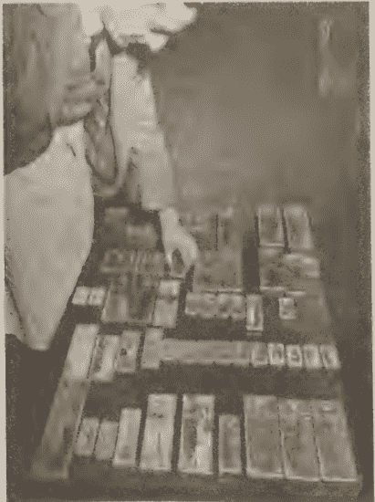

黄金时代：英格兰银行的一名黄金交易员。

此外，政府增加开支的能力受其金银储备限制。出于这个原因，美国在内战期间暂停了兑换承诺，转而发行基于债务的货币。

同样的问题最终迫使世界大部分地区永久放弃金本位制。第一次世界大战导致欧洲大部分地区暂停金本位制，以便各国政府发行基于债务的货币来资助战争。随后20世纪20年代的经济大萧条导致那些试图继续或恢复金本位的国家再次放弃。美国于1933年停止向公众兑换黄金，并于1971年停止向其他国家央行兑换，正式终止了金本位制。

许多人仍然怀念金本位制所谓的确定性，甚至有人建议加密货币可能成为新金本位的基础。这将如何运作尚不清楚，因为加密货币不是由金库中的贵金属支撑的，而这正是金本位制的定义性特征。目前，金本位时代已经结束，一种称为‘法定货币’（fiat currency）的体系占据主导地位。

### 法定货币

理解法定货币很重要，因为加密货币常被描述为‘后法定货币’（post-fiat）货币。

乍一看，法定货币违背常识。简单来说，它们仅仅因为发行政府这么说而具有价值。你钱包或口袋里的钞票和硬币就是法定货币，其价值依赖于集体信任，而非任何内在价值。如果你拿着它们去中央银行要求兑换黄金，只会被赶走。

法定货币时代或许是由战争开启的，但它们并非凭空而来。它们随着不断发展的经济体及其金融机构一同演进。

任何经济体面临的主要挑战之一，是要有足够的货币来进行商业活动，但又不能太多导致价格发生通胀，也不能太少导致通缩。可用货币的供给必须与需求相匹配，否则货币本身的价值就会波动，这与其他产品并无二致。长期以来，调控货币供应量以维持经济稳定一直被视为主权者的责任。

但游戏中还有其他参与者。随着私人银行在15世纪和16世纪的欧洲日益显赫，人们承认分散部分货币供应控制权是有益的。通过向客户发放信贷，银行实际上是在凭空创造货币。通过贷款发行的货币并非来自任何地方。它仅存在于银行对客户偿还贷款能力的评估中。通过在资产负债表上管理这种风险，并将业务做得足够好，以便能够继续发放贷款而不被坏账淹没，他们正在扩大经济。银行产生的这种信贷通常以易于使用的形式流通，例如‘承兑汇票’——换句话说，银行发行了他们自己的货币。

但让随意流通的货币在市面上流通，对政府来说监管起来实在太困难了。尽管银行在繁荣时期擅长管理风险，但恐慌和经济衰退最终导致许多银行倒闭。1844年，英格兰银行特许法案开始将钞票发行权集中到英格兰银行。美国的“自由银行时代”——在此期间任何银行都可以发行自己的纸币——在多次经济崩溃中的一次之后，于1864年结束。

### 比特币真的是货币吗？

但尽管主权者慢慢垄断了铸币权，银行仍通过发放贷款凭空创造货币。通过信贷创造货币对政府来说过于有用，不得禁止。事实上，他们想分一杯羹，于是便创办了自己的银行。英格兰银行成立于1694年，用于管理国家货币的兑换并处理政府债务。在多次未能创建国家银行或国家银行体系的尝试之后，美国于1913年创建了美联储。

中央银行发行债务以稳定其法定货币。债券作为这种债务的可交换票据，使主权者能够在不增加流通货币量的情况下扩大政府支出。债券出售给客户时带来货币，政府随后可以将其支出。在经济衰退期间，银行也可以从公众手中购回债券，从而向经济注入更多货币。中央银行影响流通货币量的能力成为确保货币价值的最重要工具。

与普遍认为的相反，当今中央银行的运作方式不是印钞，而是所谓的‘公开市场业务’。该国所有其他银行都被要求在中央银行持有一个账户，其中存有一定比例的资产，以确保其偿付能力。通过改变这些账户的利率，或通过向这些账户进行债券与现金的短期交易，中央银行能够控制银行可用的货币量——即它们可以贷给客户的资金量——而这实际上就是流通中的货币总量。在当今的货币时代，决定货币供应量的不是实物钞票的数量，而是银行在中央银行账簿上可用的金额。包括这些中央银行余额在内的货币总量，是货币量的多倍（在美国，截至2016年6月，为3.35倍）。

传统银行的日子可能屈指可数了。

### 私人货币

当今我们生活在法定货币时代，主权者在国家范围内拥有发行货币的专属权力。然而，这并未阻止人们——包括加密货币设计者——试图藐视该权威。

此类尝试通常会根据伪造货币法律被取缔。美国联邦伪造和制假法规定，任何人制造自己的货币均属违法。最高刑罚是五年监禁。但法律并未阻止人们尝试。

2007年，一个名为安赫尔·克鲁斯的人试图推出“美国私人美元”，并开始用这种货币开支票支付员工工资。银行因支票上未印有正确的银行代码而立即拒绝受理。他声称该货币由其“成员”超过3000亿美元的资产支持，但并未详细说明这些资产是谁或是什么。在一起离奇事件中，克鲁斯及其支持者试图“驱逐”佛罗里达州一家美国银行分行的员工，声称虚构的“美国城市私人法庭”已授权他这么做，随后他被联邦政府以共谋诈骗美国以及银行欺诈罪名起诉。然而，他未被指控任何伪造罪或与货币本身相关的罪行。克鲁斯在审判前逃跑，至今仍在逃。

另一个臭名昭著的案例或许更接近于真正发行一种货币。2006年，一个自称“废除联邦储备法案和国内税收法案全国组织”(NORFED)的团体开始发行用白银和黄金铸造的“自由美元”，以及纸币。这种货币与美国货币颇为相似，迅速引起联邦官员的愤怒。美国铸币局发表新闻稿警告人们不要使用这种货币，原因是其与真实美国货币存在他们描述为“令人混淆”和“具有误导性”的相似之处。

虽出售贵金属奖章并非犯罪，但NORFED的目标是让其硬币被商家广泛接受为事实上的法定货币。美国货币与自由美元之间的实物相似性，以及设计误导的意图，导致该计划失败。秘密勤务局和FBI查获了自由美元的库存，NORFED的创建者伯纳德·冯·诺特豪斯因违反禁止铸币的法律以及其他反伪造法规而被定罪。

这场法庭案件从2009年持续到2011年，早期比特币爱好者密切关注其进展。比特币拥有自己的一群自由意志主义支持者，他们同情NORFED的政治目标，但比特币具备一些自由美元所不具备的优势。

### 虚拟货币

另一种私人货币是虚拟货币，它仅由计算机系统上的数据组成。因此，虚拟货币与加密货币颇为相似，值得探索——尽管两者存在重要差异。

虚拟货币的一个例子是林登美元，这是在线虚拟游戏《第二人生》中的交易单位。《第二人生》的创建者林登实验室是该货币的唯一创建者，并对其使用直接负责。《第二人生》的服务条款规定，林登美元在游戏之外没有价值。该货币始终归公司所有，对其及其价值不作任何保证。通过这种方式，林登实验室保持控制权和责任，包括防止林登美元被用于任何非法用途。

大型多人在线游戏《魔兽世界》中使用的“金币”也是类似的。运行该游戏的公司暴雪娱乐坚称该货币没有实际价值，任何被发现用游戏内物品交换现实货币的玩家都将被永久封禁。另一款在线多人游戏《EVE Online》允许玩家购买

用真实货币购买游戏内货币，但禁止将其反向转换。

有些虚拟货币系统建立在视频游戏环境之外，但无一例外最终都触犯了法律。E-gold 是一个 1996 年推出的网站，允许用户相互转移一种名为 E-gold 的数字货币，计价单位为克黄金或其他贵金属。虽然美国国税局（IRS）认定 E-gold 不属于货币定义，但该服务被描述为专为罪犯量身定制，并于 2008 年被美国政府关闭。Liberty Reserve（切勿与 Liberty Dollars 混淆）运营着类似的服务；该服务于 2013 年被关闭。

尽管两者仅存在于计算机系统内部并使用加密技术保障交易安全，但虚拟货币与加密货币之间存在一些关键差异。

主要区别在于，虚拟货币不使用区块链账本或任何形式的工作量证明。没有区块链，虚拟货币必须由单一企业或机构生产和管理。没有机构负责监管加密货币的使用，也没有人执行加密货币编程中规定之外的规则。除了软件的开源许可证外，没有服务条款。它们也更难被禁止：主要得益于电子前哨基金会等活动人士，软件发布受第一修正案保护，视为言论自由。禁止加密货币的唯一方法是从网络中移除该软件的每一个实例。

### 那么，从法律角度看，什么是加密货币？

从对货币本质和历史的探索来看，加密货币似乎并不完全符合过去或当前对货币的任何定义。然而，它究竟是什么，仍然悬而未决，正如政府机构的判决所显示的那样。

世界各国政府的各种监管机构正在不断演变其对加密货币的处理方式，并且继续这样做。这种演变显示出一种缓慢增长的接受度；然而，人们对确保加密货币具有适当的地位——无论是作为货币、商品还是财产——感到紧张。

在美国，演变始于法院。2013 年 8 月，一名美国联邦法官写道：“比特币可以作为货币使用”，以决定美国证券交易委员会（SEC）针对比特币储蓄与信托（Bitcoin Savings & Trust，一个基于比特币的庞氏骗局）的诉讼可以继续进行。SEC 并未声称比特币是货币，但指控称，无论比特币是什么，比特币储蓄与信托一直在销售欺诈性证券，因此违法。

一周后不久，纽约州金融服务部向 22 家涉及比特币业务的公司发出了传票，试图了解这些公司的具体运营方式。当局的主要关切是如何防止加密货币被用于洗钱，无论是用于暗网市场丝绸之路等非法购买，还是用于与恐怖主义相关的资金转移。其中一些调查导致了罚款，或这些公司管理客户的方式发生了变化。

但尽管加密货币在 2013 年和 2014 年因丝绸之路、BitInstant 和 Mt. Gox 的法庭案件而名声狼藉，美国政府官员似乎并不反对加密货币这一理念。尽管 FBI 在 2012 年制作了一份名为“比特币虚拟货币：独特特征为阻止非法活动带来独特挑战”的情报评估，但当 FBI 在 2013 年 10 月逮捕丝绸之路创始人罗斯·乌尔布雷希特时，刑事诉状明确将加密货币的性质与犯罪本身分开，并指出它们有合法用途。一个月后，参议院举行了关于加密货币的听证会。调查结果为正面，称加密货币对金融的未来可能具有“深远而令人兴奋的影响”。

2014 年，国税局通过发布关于加密货币法律地位的正式通知，增加了一些清晰度。该税务机构得出结论：加密货币实际上不是货币，而是“财产”。加密货币的出售将像其他任何财产（例如公司股票）的出售一样征税。这巧妙地回避了决定去中心化加密货币如何纳入政府货币政策的尴尬问题，而是将其归类为一种奇怪的数字金融工具。

目前，这解决了美国的问题。加密货币是合法的；不仅如此，它们还可以征税。它们不是法定货币，但可以“作为货币使用”。

然而，其他国家得出了不同的结论。2014 年 9 月，英国皇家税务与海关总署（HMRC）规定，对于企业税，比特币应被视为货币。因此，他们主张，不需要特殊规则，基于货币兑换的任何盈亏都按常规征税。这适用于标准所得税，也适用于资本利得税。HMRC 推迟了比特币购买增值税（销售税）征收的问题，遵从欧盟的决定，但确实指出，使用比特币购买商品时，应按正常方式以英镑等值征收增值税。

2015 年 10 月，欧洲法院维持了这一推理，并宣布在交易所购买比特币免税，因为其性质类似于“作为法定货币使用的货币、银行券和硬币”。这种理念与美国当局的观点截然不同。

在其他国家，情况又各不相同。阿根廷、孟加拉国、玻利维亚、厄瓜多尔、印度尼西亚、泰国和越南都已将加密货币的某些方面定为非法。在中国，比特币非常流行，但当局禁止金融机构向涉及比特币的业务汇款。这并未禁止加密货币本身，但确实使其使用更加困难。

不难预见，随着技术的发展，关于加密货币的法律和官方指导将继续演变。目前尚未有关于以太坊等公司提议和开发的“智能合约”或其他新型区块链技术合法性的法律（参见“智能合约”和“以太坊时代”，第 12 章）。区块链将孕育出什么样的新的未来分支，没有人——尤其是立法者——能够预测。

### 好吧，那么加密货币是不是货币呢？

就加密货币是任何拥有计算机的人都可以用作交换媒介的抽象单位而言，根据大多数定义，它们是货币。

然而，它们不符合货币功能的现代全球经济定义。它们不受任何主权政府的授权。没有任何实体可以使用货币政策来控制它们。大多数加密货币的总供应量有硬性上限，因此在设计上是通缩的。虽然如果有人持有大量通缩货币作为投资，这很好，但从经济角度来看，这并不理想，因为它往往会抑制消费和对新商业项目的投资。货币的主要功能之一是作为交换媒介，而不仅仅是放在银行金库里。

作为对古老的贵金属（或黄金）本位制的回归，加密货币作为货币仍然失败。它们不是由贵金属储备支持的，也不是可以作为发行货币基础的贵重商品。它们也不是硬币，因为它们不是由主权机构铸造并收取费用来管理货币供应量生产的。

即使在最基本的银行功能中，它们也无法充当货币。没有任何办法在银行账簿上发行加密货币贷款，而不实际转移加密货币。通过信用创造货币——自文艺复兴时期以来金融技术的基石——是不可能的。

从积极的一面来看，加密货币将货币存在的一个方面——账本中记录的抽象单位的概念——变成了具体的现实。然而，从某种意义上说，区块链是一个过于严格的账本。存在的加密货币单位的精确数量是唯一可用的加密货币。货币从来不是这样运作的。在抽象货币和具体货币之间，是一个可以创造信贷、扩大市场以及货币政策弹性可以支撑全球经济的滑坡地区。

将加密货币视为一种新型金融工具要好得多。其会计严谨，通过加密技术在数字上具体化，它可以作为数字价值存储进行转移和交易，在某些情况下替代货币使用，但不太可能取代货币作为广泛多样经济的基础度量。

### 货币简史

- **公元前4000年** 美索不达米亚使用通信计数器来统计特定商品的等价数量和价值。
- **公元前6世纪** 古希腊体育竞技奖项以货币单位计量。
- **公元16世纪** 私人债务和信贷市场在欧洲市场成为标准。
- **公元14世纪** 支票在南欧广泛使用。
- **1694** 英格兰银行获得特许状，以管理政府债务。
- **1717** 艾萨克·牛顿通过强制所有银币退出流通，建立了英国的事实上的金本位制。
- **1921** 福克斯、福勒公司，英格兰最后一家仍被允许发行自身银行券的私人银行，停止铸造货币。
- **1914** 第一次世界大战爆发导致英国和许多其他欧洲国家退出金本位制。
- **1925–31** 英国短暂采用金汇兑本位制，但随着大量黄金流出该国而停止。
- **1933** 总统富兰克林·罗斯福在美国国有化黄金，并停止以黄金付款，实际上退出了金本位制。

### 比特币真的是货币吗？

#### 公元前6世纪
最早的已知铸币在铁器时代地中海王国吕底亚和伊奥尼亚铸造。

#### 公元前318年
中国稷下学宫理论化了主权货币政策。

#### 公元12世纪
欧洲低地国家开始以货币计价租金和劳务。

#### 公元755年
查理曼大帝的加罗林改革为欧洲大部分地区标准化了英镑、先令和便士的等值关系。

#### 1718
苏格兰经济学家约翰·劳在法国引入了世界上第一种法定货币。

#### 1819
英国正式采用金本位制。

#### 1913
《联邦储备法案》创建了美国目前的中央银行。

#### 1879
美国实行金本位制。

#### 1946–71
在布雷顿森林体系期间，许多国家以美元结算债务，而美国政府只向其他中央银行兑换黄金。

#### 1971
美国停止兑换货币与黄金，世界进入纯粹的法定货币时代。

#### 2008
比特币，第一个去中心化的“后法币”加密货币，被创造出来。

## 中本聪的归来与离去

比特币的创造者长期以来一直是个谜。最近出现了一些头号嫌疑人。一个不太可能的嫌疑人试图声称这个称号而登上新闻头条。但谜团只进一步加深了。

### 不愿成为中本聪的人

2014年3月6日的《新闻周刊》似乎包含了一个重大独家新闻。记者莱娅·麦格拉·古德曼完成了不可能的任务：她发现了中本聪的真实身份。不仅如此，还有一个令人难以置信的反转：此人的名字竟然真的是中本聪！

至少从官方上说，他的名字是中本聪。这位64岁的物理学家名为多里安·中本聪。他在南加州内陆帝国大都市生活的职业生涯或许并不算不寻常——曾为多家航空航天及其他高科技公司工作，包括曾短期为一家政府承包商从事机密电子系统工作，并为美国联邦航空管理局工作。

或许正是这个技术背景促使古德曼前往加州会见这位特定的中本聪。就在那里，当她敲开他家门时，有两名中本聪叫来的警察在场，他吐出了那些引发媒体围攻的话语：

> ‘我不再参与那件事，也无法讨论它，’他说，用左手一挥便驳回了所有进一步的询问。‘已经移交给其他人了。他们现在负责。我与它已毫无关联。’

古德曼带着这段引语去采访中本聪的几位亲戚，他们既未证实也未否认这一说法，但提供了更多引语来支持他聪明、守密且政治倾向于自由主义的理论。

第二天，一大群记者来到中本聪的家。在告诉他们他会先和第一个请他吃午饭的记者交谈后，他跳上了一辆美联社记者的车。其他几名记者开始追赶，将他们尾随到附近的一家餐厅。与此同时，当地警长试图在中本聪家外维持秩序，而一大群记者在外面守夜。

但一切都白费了。多里安·中本聪否认自己是中本聪。他声称，他那被认为是自己与比特币有关的最好证据的陈述是一个误会。他以为古德曼在谈论他为政府做的机密工作。这也是她敲门时他感到不安的原因——他知道自己无法谈论那项工作，也不想被记者骚扰。一周后，中本聪开始募捐，准备起诉《新闻周刊》。该杂志在其原始文章末尾发表了他写的一份声明，在其中他否认与比特币有任何关系。而或许最沉重的一击发生在文章发布后的第二天——真正的中本聪所用的P2P基金会用户账户，也是最初比特币白皮书的来源之一，在多年沉默后重新活跃起来。‘我不是多里安·中本聪，’该账户简单地发布道。

多里安·中本聪强烈否认自己与比特币有任何关系。

最终，这场闹剧平息了，直到下一个关于中本聪真实身份的候选人被提出。这或许只是一个诚实的错误。鉴于对这个神秘化名的好奇心，一个完全无关的人最终被错误地卷入媒体的火力线也许只是时间问题。就这样，谜团只会更加深重。

### 真正的中本聪？

2015年12月，《连线》和Gizmodo宣布了一则重大新闻——他们收到了关于中本聪真实身份的线索。那些一直关注这场永无止境的传奇大多只是耸耸肩。在围绕许多其他所谓揭露比特币创建者身份的争议之后，包括臭名昭著的记者追逐无关人士多里安·中本聪穿过洛杉矶郊区的汽车追逐战，公众或许已经有些疲倦。

与先前对中本聪身份的大多只是有根据的猜测并无真凭实据的“揭露”不同，《连线》和Gizmodo掌握了一些证据——某种证据。一名线人提交了一些据称由名叫克雷格·赖特的澳大利亚人撰写的电子邮件。这些电子邮件详细讨论了与一位名叫大卫·克莱曼的同事共同创建加密货币的事宜，克莱曼此前已去世两年。赖特在加密货币圈相对不为人知，尽管他最近曾与澳大利亚税务局发生麻烦。赖特并未公开回应他是中本聪的说法，只是简短地予以否认。

六个月后的2016年5月，线索再次变热。赖特现在公开声称自己是中本聪，并说他能证明这一点。此前从未有人既被指控是中本聪，又声称这是真的。下个月，记者安德鲁·奥哈根在《伦敦书评》上撰写了一篇长篇文章，讲述了内幕故事，澄清了一些模糊的细节。当然并非全部细节。

根据奥哈根的说法，2015年底，他接到一位娱乐律师的电话，询问他是否想撰写比特币创建者的生平故事。似乎赖特计划在以名为nTrust的公司申请一系列区块链相关专利的同时公开亮相。赖特将被揭露为加密货币的创建者，专利将获批，nTrust将获得专利许可，赖特和nTrust将变得富有——帮助赖特摆脱财务和业务困境。奥哈根同意记录这些事件，但仅作为记者，而非受雇作家。

在接下来的六个月里，奥哈根与赖特进行了多次交谈。通过他在《伦敦书评》上的文章，奥哈根描绘了一幅画像：此人的生活确实与比特币紧密交织。赖特精通加密货币的细节。他描述了与朋友大卫·克莱曼的合作，这与比特币的历史完全吻合。他有些偏执的个性以及对离岸金融世界中可能不正当商业交易的描述，为他极力维护匿名性的做法增添了可信度。

但有些部分缺失。赖特的故事往往似乎是循环论证，充满激情与不确定性。他声称拥有的对其故事版本至关重要的电子邮件从未被出示。

奥哈根感到困惑。赖特在坚持匿名这么多年后，自己是否也感到困惑？抑或许，整件事只是某种极其巧妙的骗局？

故事在 2016 年 5 月达到高潮，当时赖特召集记者和专家检查他撰写的一篇博客文章，该文章声称提供了他是中本聪的证明。多年来，人们确切知道这种证明应该是什么样子。只有比特币的真正创建者才会拥有签署所谓“创世块”（即链中第一个区块）的密钥。

但同样，有几处缺失。在博客文章中，赖特使用了他声称是中本聪的密钥来签署一条消息。经进一步检查，很明显赖特实际上只是使用了中本聪的一个公开哈希，任何人都可以在互联网上找到。尽管他声称这是个错误，但赖特从未修复。

许多密码学专家和比特币爱好者开始怀疑赖特的说法。作为回应，赖特提出要做一件同样令人印象深刻的事——他将转移加密货币早期挖出的一些比特币。这些比特币从未被转移过，普遍认为它们属于中本聪本人。据赖特称，这些比特币被托管在一个信托中直到 2020 年，但他可以获得特别许可，为演示目的转移它们。他也从未这样做过。

媒体闹剧离场了，再次在本期待见到中本聪的地方一无所获，只感失望。但奥哈根心中充满疑问：为什么？赖特为什么要布置这样一个精巧的骗局——伪造电子邮件，捏造从未发生过的关系和工作经历——却让自己陷入一个他知道无法兑现的境地？赖特对奥哈根声称，他失去了勇气。他说，他担心如果证明自己是中本聪，会因为某人在他发明这种加密货币之后用它所做的事情，而因贩毒或恐怖主义指控被捕。奥哈根将这种恐惧描述为当然是一个真实的风险，但这仍然只是一个迷宫中又一个谜团。

据大多数加密货币追随者称，中本聪之谜至今仍未解开。

## 重塑比特币——以及替代币的崛起

> 比特币可能陷入麻烦。它无法跟上交易数量的步伐。所提议的解决方案中会有任何成功的，还是会有越来越多的替代加密货币之一接管？

### 比特币日益严重的问题

比特币有一个问题。它无法变得足够大。这种加密货币面临着中本聪未曾预见的规模问题，因为用户数量增加，区块链变得越来越长。

随着新交易被报告到区块链，它们被编译成一个新区块并大约每十分钟写入区块链一次。然而，区块大小是有限的。每十分钟只能写入 1 MB 的交易。这使得比特币平均每秒只能处理七笔交易。这听起来很多，但 Visa 的支付网络每秒可以处理 24,000 笔交易。比特币代码中内置了一种限制，这意味着无论它多么流行，都永远无法与主要信用卡系统竞争。

许多比特币开发者，例如比特币核心开发团队的首脑加文·安德烈森，希望通过增大区块大小来修复这个问题。安德烈森创建了一个名为比特币 XT 的更新，它将把区块大小增加到 8 MB，并周期性地再次将其翻倍。

但比特币还有一个第二个问题。它是去中心化的，因此即使是核心开发者也无法控制正在使用的软件。如果网络上的某台计算机使用比特币 XT，它将创建 8 MB 的区块。但运行旧版软件的计算机将无法理解那么大的区块。它只能理解旧版本创建的区块，并且将继续自行创建 1 MB 的区块。这将导致一种称为“分叉”的情况。

分叉通常是一个术语，用来描述编程代码的开发分裂成两个不再相同或兼容的独立版本，在此情况下，它指的是区块链本身。将会有两个版本的区块链——一个由比特币 XT 计算机创建并被视为有效，另一个由原始软件版本使用。这些区块链将不再保持一致。当然，这种状态将是混乱的。比特币网络仅凭其唯一的标准区块链维系在一起，将不复存在。比特币将有效地分裂成两种不同的加密货币。

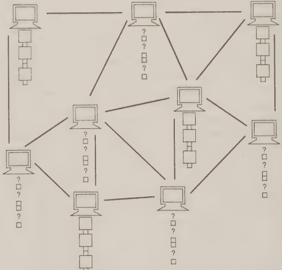

图 11.1 同一网络的两个不同半部分。一半生成的区块链同时包含小区块和大区块。另一侧看到相同的区块链，只是看不到大区块，只能看到小区块。因此，它会创建第二个区块链，完全没有大区块。

为了防止灾难性的分叉，软件更新的设计是等待到某个日期，然后询问网络。如果在该时间点，网络中有 75% 或更多使用比特币 XT，则会将其视为“接受”并切换到更大的区块。75% 被认为是足够大的多数，将迫使落后者也进行更新，以便继续使用交易所和其他服务提供的比特币服务。网络进行投票。

当软件在 2016 年 1 月“投票”时，只有网络的 10% 使用了该更新。原因各不相同。一些比特币用户从技术角度不喜欢该更新，认为有更好的方法来解决区块大小问题。另一些人不喜欢该更新被“强加”给比特币的方式，并从原则上反对它。这场辩论吸引了众多有影响力的人物和公司加入双方阵营。然后，似乎一名受雇黑客开始攻击运行比特币 XT 的计算机，使它们脱机。许多公司和个人回滚到旧版本，只是为了避免被攻击。

### 一种可能的修复：隔离见证

区块大小仍然是一个问题，但有一种新颖的解决方案正在开发中，以帮助修复它。这种修复的根本巧妙之处在于不存在分叉的可能性，因此不需要像比特币 XT 那样的投票。

比特币 XT 与比特币之间的分歧被称为“硬分叉”，但“软分叉”也是可能的。硬分叉在新旧版本之间引入不兼容的差异，基本上将加密货币分成两半，而软分叉会更改加密货币，但仍允许旧版本和新版本软件之间进行通信。软件更新是向后兼容的——不升级的计算机不会被踢出网络，它们只是无法从升级中获益。

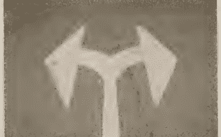

比特币前方是否存在分叉路口？

原本认为要增大区块大小，就需要硬分叉。但这种名为“隔离见证”的新更新策略绕过了这个问题。它不是增大区块大小以容纳更多交易，而是通过减少报告到区块链的信息量来缩小交易的大小。所有对交易进行签名的密码学信息——确保加密货币只能由持有特定钱包密钥的人移动——都保存在一棵独立的信息树中。一旦其凭证获批，一条非常简短的消息连同交易一起被发送到区块链。正因如此，“隔离见证”或“SegWit”得名：见证签名合法性的密码学信息与区块链分开保存。见证者只是给区块链一个密码学“点赞”，然后交易便可进行。通过大幅缩短报告的信息量

到区块链上，预计 SegWit 可以使每个区块支持的交易数量达到目前可能数量的近四倍。

真正的好处在于，运行旧版本比特币软件的计算机不会看到来自 SegWit 的“点赞”，但它们将继续看到区块链中的交易。这些交易看起来会很奇怪——比特币仿佛凭空出现，没有任何签名。但由于这些奇怪、神奇的比特币只有在网络的 SegWit 部分允许时才能被添加，它们将继续保持同样安全。因此，即使只有部分网络运行 SegWit，整体网络仍将从改进的效率中受益。更大的区块大小可能仍然必要，但这种改进的效率将为比特币提供急需的喘息空间。2016 年底，比特币交易率接近每个区块 2,000 笔，平均每秒约 3.3 笔——换句话说，运行在大约一半的容量。那些看好比特币未来的人希望这种容量能尽快扩展。

但致力于 SegWit 更新的开发人员认为，软件中的其他改进将使网络中的计算机有动力进行更新。交易总体上将更快。最重要的是，SegWit 有助于解决“交易可塑性”问题，该问题曾被指责导致 2014 年 Mt. Gox 崩溃（参见“交易可塑性问题”，第 7 章）。当签名的轻微更改导致区块链上的交易 ID 与预期不同时，就会发生该错误。由于签名被移入 SegWit，交易 ID 现在完全不同，这种可塑性不再可能。支持者认为，仅摆脱这一众所周知的漏洞，就足以激励用户更新他们的软件。

但这仍有待观察。2016 年 7 月，SegWit 代码正处于审查期。之后，它将提供给网络。届时，网络才会决定采取哪条路径。

## 闪电网络

并非所有人都相信区块大小问题真的是个问题。一个名为闪电网络的新想法可能使整个问题变得无关紧要。

闪电网络可能拯救比特币。

一位用户授权一定数量的加密货币用于与另一特定用户的交易——类似于支付定金开立订阅账户。该交易保持开启状态，仅在这两个用户之间共享。随着时间的推移，许多增量交易被记录，向一方或另一方发送比特币，直到最终耗尽授权的定金金额。然后，交易关闭，并发送到区块链。它只在区块链上记录一次，作为一笔交易，尽管有任意数量的较小交易被汇总为这一笔交易。

例如，想象一个月每天买一杯咖啡。与其在每次交易后都通知区块链，闪电网络允许买家和咖啡店只在月底报告总交易，同时仍保持安全。

它保持安全的方式是，每笔增量交易都必须得到每个用户的批准。如果在任何时候他们未能达成一致，流程将停止，分歧发生前的总额将返回给每个用户，并且信息会记录到区块链。由于交易仅在这两个用户之间进行，他们同时的一致或不同意可以立即记录。风险水平较低，因为一次只能将少量加密货币放入此开放交易中，并且每一步都必须得到双方的同意。

截至 2016 年中，闪电网络仅是一个实验，许多细节尚未制定。同样，它需要 SegWit 或类似的更新来修复交易可塑性问题。它还需要一些目前仅为理论的额外技术手段。

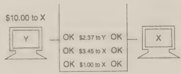
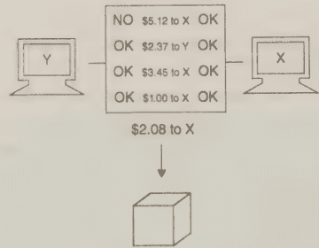
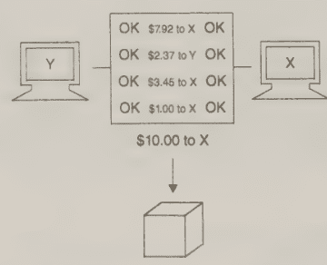

图 11.2. 网络中的两台计算机打开一笔交易，就像一个小盒子。交易在其中逐步累加，直到耗尽交易的全部价值，然后关闭并发送到网络。每笔小额交易都表现为一项小协议，需要两台计算机的同意。

闪电网络和其他创新想法表明，尽管比特币已有几年历史，但其演变仍在继续。这种加密货币可能会变得面目全非，这取决于分布式网络决定接受什么样的更改。

## 世界上最大的加密经济体

2013 年中，当美国公司努力简化将资金转入 Mt. Gox 的流程以便客户购买比特币时，一家名为 BTC China 的中国交易所与移动服务提供商腾讯达成协议。中国公民首次可以将资金直接转入比特币交易所。几个月后，2013 年 11 月，比特币达到有史以来的最高价格，交易价高达 1,242 美元。中国对比特币的兴趣激增。

中国比特币泡沫最终破裂，当时政府发出警告，称银行将人民币直接转移到加密货币企业是非法的。这意味着仅几个月后，腾讯就不得不停止与 BTC China 的服务，冷却了公众的兴趣。但中国人对加密货币的胃口已经被打开，最终中国将增长到代表绝大多数交易所交易量和挖矿，并且可能也拥有相当大比例的比特币所有权。

2016 年，两家中国交易所——火币和 OKCoin——负责了 92% 的比特币交易。前四大挖矿池（拥有 76% 的全球算力）位于中国并由中国拥有。有些人试图将中国人对比特币的热情解释为规避中国货币管制的一种方式。中国法律规定，个人每年不能汇出超过 5 万美元价值的人民币。但中国比特币投资者否认这一点——他们说货币管制已经有很多漏洞，并且他们认为中国人购买比特币纯粹是出于投资角度。中国有很强的赌博文化，比特币巨大的牛熊周期对寻求大回报的人有吸引力。

此外，必须指出，中国在非传统支付方式方面拥有更多经验。欧洲人和美国人可能对使用手机作为支付方式的明显不安全性感到不安，但在中国，临时支付安排已经司空见惯。早在 2012 年，中国的在线支付就已超过 660 亿美元，到 2015 年增长至 1.3 万亿美元。今天，支付宝声称拥有 4 亿活跃用户，腾讯的微信支付基于智能手机的支付系统拥有超过 3 亿用户。而在世界其他地方，加密货币的陌生方面可能会让用户犹豫不决，但在中国情况不同。

随着比特币似乎将在中国长期存在，中国政府正在考虑修订，以便更广泛地使用加密货币。像美国政府一样，他们似乎准备将比特币视为商品而非货币。

在中国之外，加密货币支持者担心中国的兴趣会对加密货币本身产生什么影响。挖矿控制实际上就是网络控制，就“投票”支持新软件更新而言。拥有网络 76% 处理能力的这些挖矿池控制着 76% 的投票权。但尽管比特币实际的“去中心化”控制相当失衡，目前看来，它团结在确保加密货币保持有价值和相关性的想法周围。

## 山寨币爆发

比特币在 2011 年刚开始兴起时，就有人对这种加密货币新近获得的受欢迎程度感到不满。挖矿变得更加困难，价格开始上涨，弱点开始显现。但如果一种加密货币可行，为什么不能有两种？或者十种？很快就出现了数百种“山寨币”，形成了一个复杂的加密货币市场系统。

## 玩笑加密货币

当一种基于名为“doge”的流行迷因的加密货币出现时，肯定没人能说他们预料到了。这个迷因是一只表情古怪的柴犬，周围环绕着五彩的文字标题，与加密货币看起来毫无关系。

2013 年底，Adobe Systems 员工 Jackson Palmer 正在观看围绕山寨币的热闹景象。他决定做一个名为“狗狗币”的网站作为一个玩笑。软件开发者 Billy Markus 发现了这个网站，喜欢这个想法并与 Palmer 联系。他们稍微修改了一下 莱特币 的源代码，主要是改变软件的外观以模仿 doge 迷因。他们还让区块奖励是随机的——每次挖出一个区块时，奖励的 狗狗币 数量从零到一百万不等，不过这一点后来被改变了——并且让币种总数无上限。毕竟，这只是个玩笑。为什么不让它变得有趣呢？

但 狗狗币 实际上却火了起来。也许是因为随机区块奖励的新奇之处，也许是因为这种数量庞大的代币让人可以实际拥有整数，而大多数人买得起的只是比特币的极小部分。又或者，仅仅是因为可爱的动物在互联网上总是一种强大的“货币”。

狗狗币 可能不是最强大的替代加密货币。由于这种货币太多，2016 年 7 月一个 狗狗币 的交易价格仅相当于 0.02 个美分。但总的来说，这种加密货币今天总价值约为 2480 万美元。用户继续挖掘它们，它们经常在网上作为微小认可的代币使用，例如作为网站上优秀帖子的“小费”赠送。狗狗币 轻松有趣，与比特币的严肃和暗网神秘感形成鲜明对比。

第一个成功的山寨币是 莱特币。它不是第一个被尝试的比特币修改版，但出于某种原因，它是最成功的一个。其机制几乎与比特币相同，只是区块时间只有 2.5 分钟，而不是比特币的十分钟区块，以加快交易速度。

2011 年 10 月 莱特币 推出时，图形处理单元（GPU）正在接管比特币挖矿，使得在自有电脑中央处理单元（CPU）上运行比特币软件的用户难以挖出任何比特币。莱特币 的哈希算法称为 scrypt，最初无法使用 GPU 进行哈希运算，这放缓了挖矿军备竞赛。从那时起，基于 scrypt 的 GPU 软件和 ASIC 已经被开发出来，但这一因素最初通过让 莱特币 看起来更民主（不同于比特币高风险的挖矿）而提升了它的受欢迎程度。一旦 莱特币 变得流行，它就成为了比特币的一个很好的替代品，让投资者可以对冲其加密货币投资，以规避由比特币持续的法律纠纷引起的剧烈价格波动。

在 莱特币 取得成功之后，许多新代币应运而生，希望成为下一个比特币之后的第二名。如果投资者和矿工能早早进入一个大火的山寨币，那就像是在比特币早期就入场一样。创建者经常推出只有细微差别的新代币，希望自己的版本变得足够有价值，这样早期挖矿就能在山寨币拥有更广泛的用户群时套现。通过获取任何先前发布的加密货币的源代码并做一些修改，几分钟内就可以创建一个全新的山寨币。

借助加密货币中一夜暴富的众多可能性，山寨币市场很快就变成了小盘股市场。2013 年，随着交易加密货币的交易所数量迅速增加，许多交易所试图通过引入新的、未经测试的加密货币来吸引客户。新推出的山寨币一登上交易所，就迅速膨胀成泡沫，而且常常迅速破裂。在这些价格快速上涨中，一个人可以迅速在投资中获利 100% 或更多。同样，也很容易损失这笔投资。就像“小盘股”——价值只有几美分的高风险投资，让投资者轻松翻倍或翻三倍——山寨币市场变成了一个充满谣言、炒作和一夜致富计划的快节奏世界。

一种常见的骗局是，山寨币创建者在向公众宣布之前秘密挖几周自己的币。等到其他人开始挖矿、炒作兴起时，创建者已经囤积了一批货币，他们可以在想要套现时将其倾销到市场上。这种骗局称为“预挖”。另一种策略是，一个被称为“鲸鱼”的投资者购买大量新上线的山寨币以推高价格。然后，当价格上涨、其他人开始买入试图利用价格上涨时，鲸鱼会清算其持仓，赚取尽可能多的利润，同时推低价格。就像在股票市场中一样，这被称为“拉高出货”。

2013 年底，随着 丝绸之路 被关闭，大众共识开始相信加密货币可以用于合法目的，比特币价格达到了历史新高。与此同时，投资者也在山寨币上冒更大的风险，这些山寨币会迅速走红，然后立即暴跌。随着新交易所上市或下架山寨币，或者兴趣仅仅减退，挖矿情况迅速波动。有些山寨币只存在几个月，有些仅仅几个星期。

然而，山寨币市场整体上起到了支撑比特币的作用。当山寨币被添加到交易所时，它首先可以交易的东西是比特币——而不是美元、人民币、英镑或欧元。山寨币帮助移除了投资比特币的一些重大障碍，让拥有小规模硬件的人可以挖矿山寨币并交易为比特币。通过不断增多的交易所，山寨币热潮加强了比特币的价格，因为比特币成为了加密货币经济中的“锚定货币”。

## 加密货币有未来吗？

关于这个问题的很多争论都与原始加密货币——比特币的命运相关联。即使是开发比特币软件的开发者也感受到这种焦虑。一些人在与其他比特币支持者发生个人分歧后公开退出。每个人都同意比特币面临严重挑战。似乎没有人能就如何应对达成一致。

许多人已经将数百万美元投资于比特币，要么是直接投资于该货币，要么是作为开发基于比特币产品的公司。虽然公司可能会破产，个人投资者和开发者可能会厌倦并退出，但不太可能每个人都会抛弃比特币，放弃他们的资金，转而去做别的事情。比特币是第一种加密货币，仅凭这一点就赢得了大量的忠诚度。这是中本聪建造的加密货币。比特币未来几十年很可能还会存在——但它是否会像今天的比特币那样，则无人能料。新的技术演进，或增长停滞，可能导致比特币要么在新用户数量上激增，要么退居互联网的边缘地带。

## 这与金钱无关

比特币等加密货币的真正价值可能不在于代币本身。源于区块链本身的技术创新可能会更加令人兴奋。那么，它们将引导我们走向何方？

在2013年鼎盛时期，比特币的价值曾飙升至每枚约1200美元。毫不奇怪，这种加密货币被誉为“未来的货币”。今天，随着比特币价值腰斩，媒体兴趣也日渐冷却。然而，各类企业，以及城市投资者和未来学家，都对这项技术的其他方面感到兴奋——特别是区块链本身的潜力。

区块链当然是使加密货币得以运作的核心创新（参见“区块链”，第4章）。但这种关注点的转变发生在技术从业者意识到，区块链除了加密货币之外，或许还能用于许多其他事情。

事实证明，数字化、去中心化的账本对于处理各种信息都很有用，从商业合同或私人财务记录到敏感的医疗数据。人们正急于确定什么最适合存储在区块链中，以及该区块链是应该附属于比特币、另一种加密货币，还是完全不同的东西。最令人惊讶的是，这项研究不仅来自小型初创公司或自由意志主义黑客。一些最雄心勃勃的项目正由主流金融机构（如大银行）运营。他们决心理解这项强大技术的真正潜力，不愿落后于任何金融革命。

## 区块链作为研究工具

对比特币的一种批评是，仅为通过工作量证明来支持一种加密货币而维护一个庞大的哈希生成网络，是对时间和电力的巨大浪费。对于比特币，工作量证明算法称为SHA-256，这是一个相当标准的加密算法。的确，许多研究任务要求计算机执行类似于哈希的工作——通过暴力穷举大量极小的问题来解决任务。也许因此并不奇怪，在比特币出现几年后，就开始了将SHA-256替换为另一种专门设计以利用所有这些计算能力用于其他目的的算法的实验。

2013年，一名化名Sunny King的程序员宣布了一种名为Primecoin的加密货币。它与比特币的不同之处在于，它利用工作量证明来发现一种名为Cunningham链的素数类的新成员。这些并非需要大型超级计算机来发现和证明的最大素数，而是一组素数，其中取一个素数，将其翻倍并减一，就会得到另一个素数，以此类推。虽然Primecoin作为一种货币从未特别流行，但其工作量证明已揭示了一些创纪录的Cunningham链。

另一种加密货币Riecoin，则着手解决另一组涉及素数的问题。在此情况下，工作量证明是寻找被称为“星座”的连续素数簇。这些素数星座可能有助于黎曼假设的研究。黎曼假设是一个复杂的数学问题，至今尚未被证明，仍然是该领域的一个重大谜团。它非常著名，已被克莱数学研究所指定为七个千禧年大奖难题之一。2000年被命名，迄今为止只有一个被解决，尽管有100万美元的奖励给予成功证明。素数星座不会证明黎曼假设，但它们可能会发现一个能反驳该假设的素数星座——这本身就是一项具有重大理论重要性的发现。大多数数学家预期黎曼假设最终会被证明为正确，但与此同时，Riecoin正在致力于对其进行测试。

## 互联网的新地址簿

虽然区块链可能有助于发现新的素数组合，但它也被尝试作为一种实际方法，以帮助保护互联网记录的安全。互联网上每个网站的代码都存储在特定的计算机服务器上，网站名称通过域名系统（DNS）与该服务器的唯一地址（即“IP地址”）关联。也许令人惊讶的是，对于一个全球系统，全世界的DNS记录都存储在仅13台服务器上的数据库中。

2011年，有人建议将DNS记录放入与一种名为Namecoin（比特币的“近亲”）的新货币相关联的区块链区块中，以实现去中心化。就像其他加密货币的交易记录存储在区块链中一样，Namecoin区块链能够存储使用.bit顶级域名标识符的网站的DNS记录。

然而，尽管Namecoin运行良好，它从未流行起来。一个问题是，你需要一个带有特殊插件程序的浏览器才能通过Namecoin DNS信息访问.bit网站。此外，大多数网站继续使用标准DNS注册表。很少有合法网站曾在Namecoin区块链上注册。事实上，在Namecoin注册表中的196,000个网站中，估计绝大多数甚至没有附加网站到该名称上。2016年5月，最后一家主要交易Namecoin的交易所停止交易该加密货币，实验结束。

## BOINC

其他人已经为区块链追求了更雄心勃勃的用途。早在2002年，加州大学伯克利分校空间科学实验室的一个团队开发了一种名为伯克利开放网络计算基础设施（Berkeley Open Infrastructure for Network Computing，即BOINC）的软件。他们的想法是利用世界各地计算机的算力，帮助搜寻外星智能（SETI）研究所的一组研究人员筛选来自太空的无线电信号，以寻找外星生命的迹象。

BOINC让他们能够通过将信号切割成小批量并发送到单个计算机来分散这项搜索任务的工作量，这些计算机在闲置时会寻找外星通信的迹象。一旦计算机完成了一批，结果就会返回到SETI并接收新批次。诀窍在于搜索程序表现得像屏幕保护程序，仅在夜间或计算机空闲时运行。该项目名为SETI@HOME，迅速成为世界上最大的分布式计算项目之一。如今，BOINC不仅寻找外星人——该软件现在也用于寻找疾病的新疗法、绘制银河系地图，甚至破解密码。

## 用权益证明取代工作量证明

2015年，一位名叫Rob Halford的研究人员想知道他是否能将BOINC连接到一种加密货币。BOINC已经设置为将计算机任务分配给许多计算机。此外，它可以动员大量愿意运行其软件的人。如果这些个人因其努力而获得加密货币奖励，且现有的货币矿工也能被吸引到使用BOINC，那么每个人都能受益。但是，要做到这一点，研究人员将不得不使用一种全新类型的区块链，这种区块链可以让计算机摆脱创建工作量证明哈希的必要性。虽然工作量证明对于比特币等加密货币区块链的运行是必要的，但它严重限制了加密货币挖矿可以完成的其他有用任务类型。为了恰当地调整难度（参见“工作量证明”，第4章），工作量证明任务必须非常具体。从中央服务器下载新文件进行处理时，BOINC通常会让计算机处理不同类型的任务，反复执行同一任务并不一定有成效，除了寻找素数等非常特定的任务。但是，如果不需要工作量证明来保障区块链交易记录的安全，那么这些处理能力就可以用来执行更有用的任务，例如BOINC计算。

第一个证明可以摆脱工作量证明的加密货币名为Peercoin。它用一种称为“权益证明”的方法取代了工作量证明。这种权益证明为加密货币中的每个币创建一个价值，称为“币龄”。一个币未被花费的时间越长，它就“越老”。每次花费时，它都会“重生”，年龄重置为零。

当到创建下一个区块的时候，Peercoin网络会决定该区块由网络中币龄最高的钱包所在的计算机创建——即持有最多数量币且最长时间未花费的人。可以预测哪个钱包的币龄最高，因此这个过程并非随机。但尽管如此，它是安全的：区块创建后，该计算机的币龄将重置为零。因此，一台计算机永远无法连续生成两个区块。为了通过双重花费来破坏区块链，需要两台计算机

必须在加密货币中积累巨量财富，才能保证其有机会创建区块，而不是一次，而是连续两次，以创建相互矛盾的交易。由于币龄会被重置，没有人能够复用该币龄来推广带有虚假交易的篡改链。理论上，拥有如此巨额财富的任何人都不会冒损害区块链的风险，因为成功攻击后引发的价格崩盘中他们将损失的投资，将与他们通过错误交易可能获得的收益相比微不足道。

最重要的是，权益证明消除了区块链中工作量证明的角色，使其对计算机处理器的要求降低。币龄是触发新区块所需的唯一条件，不需要进行计算密集型哈希运算。通过将权益证明与BOINC进行的有价值计算工作相结合，Rob Halford的新加密货币Gridcoin为为BOINC网络中任何项目做出贡献的BOINC用户奖励代币。

## 等等，工作量证明怎么了？

在加密货币（虽然历史尚短）的整个历史中，工作量证明一直是保障区块链安全的基本活动。成千上万台挖矿电脑消耗大量电力，创建随机加密哈希，没有它比特币将无法运作。那么发生了什么，使这一局面颠倒过来？工作量证明怎么突然变得不再必要？

比特币和工作量证明加密货币背后的思想是：网络上的所有计算机都是平等的，且所有计算机都同样可能试图通过发布错误交易或更改已存在的交易来接管区块链。从系统中的价值量来看，人们可能会得出结论：试图叛逃网络的可能性很高。工作量证明使得任何计算机都极难接管网络，这种假设的大规模叛逃几乎成为不可能。哈希是一种影响每台计算机的硬性限制，参与的计算机越多，其效果越显著。它就像围在羊群周围的篱笆，加入羊群的羊越多，篱笆就越大越高。

但从权益证明开始，一种新范式开始兴起。在这种思维下，最重要的节点是那些在系统中持有大量权益的节点。每个这样的节点都在网络中投入了大量资金，多个节点被同一攻击者控制的情况非常不可能。在这种情况下，节点达成一致而非叛逃符合其利益。因此，假定共识很可能达成，主要任务是捕捉偏离节点并将其拉回正轨。再次借用羊群的比喻，羊群的倾向是保持在一起，只需要一只牧羊犬找到迷路的羊并把它们赶回羊群。

那么如果工作量证明不是必须的，为什么它还在使用？也许是因为比特币用户更保守，且对重大变更持怀疑态度。但即使是像以太坊这样的新区块链，仍在使用工作量证明（参见《以太坊时代》，第13章）。原因各不相同。一些加密货币设计师仍希望挖矿存在，作为用户加入网络并支持加密货币的动力。其他人希望节点更民主，与那些赋予更大权益特定节点特权的区块链不同。此外，有些人还不信任权益证明概念，并认为工作量证明经过了更多检验——毕竟，如果它对比特币有效，那它必定是好的。目前，两种方法都有支持者。但在未来，我们可能会看到在众多正在开发的区块链应用中，对其中一种方法的强烈偏好。

## 银行与区块链

随着加密货币变得更有价值，以及区块链收集和存储会计信息的用途变得明显，区块链开始不再像是一项边缘实验。经济学家、银行家以及区块链支持者都开始研究区块链如何在现有金融市场中运作，而不是作为它们的替代品。

例如，像桑坦德银行、巴克莱银行和花旗银行这样的大银行正争相研究和投资区块链技术，不仅是将其用作数字货币的机制，而是作为账本，简单纯粹的账本。

使用去中心化、安全的账本可能允许投资者保障小公司的所有权记录，这些公司易手频繁，并且对投票权和股东协议有非常具体的规则。

纳斯达克，世界第二大股票交易所，正在与区块链初创公司Chain合作，构建区块链，为其私人市场平台保障记录安全，以允许注册和交易非公开交易的公司。

还有一家美国公司Overstock.com，最近获得了美国证券交易委员会的批准，使用名为TØ的基于区块链的债券系统发行股票。

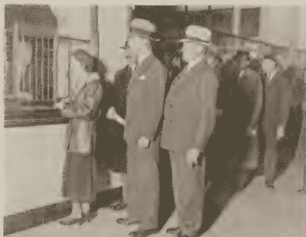

区块链可能会让我们所熟知的银行成为过去式。

另一家公司Factom，正在致力于创建一种任何公司都可使用的带时间戳的区块链账本。该区块链不会公开访问，而仅供公司内部员工和分支机构使用，并用于在整个业务中共享记录。新加坡中央银行也对这种区块链感兴趣，并从2015年开始资助开发他们自己的基于区块链的记录保存系统。

西班牙银行桑坦德于2015年发布报告，赞扬区块链处理供应链不同方之间合同的能力。与其在批发商和航运公司的不同会计系统之间进行接口对接，一个区块链可以追踪任意数量公司之间的材料和产品运输。

但至今，关于哪种区块链技术应用最有用仍没有共识。至少有两个由银行和企业组成的大型联盟已经组织起来，以最通用的形式推广区块链技术，希望具体应用能在以后制定。

交易后分布式账本（PTDL）小组的成员包括汇丰银行、伦敦交易所集团和法国兴业银行。另一个名为R3的联盟包括高盛、摩根大通、德意志银行、加拿大皇家银行以及全球更多银行。两个联盟都未宣布其正在开发的技术细节，且仅处于最基本的组织阶段。

与此同时，软件开发人员和技术人员也没有被排除在外。W3C，互联网的主要国际标准组织，一直在主导关于区块链在互联网底层技术中可能发挥什么作用的讨论。而Linux基金会正在运行超级账本项目，目标是开发一种可适应各种用途的开源区块链账本，相当于Linux，其开源操作系统。

## 如何在全世界转账

每个在特定国家开展业务的银行都必须在该国中央银行开设账户。使用由中央银行附属机构运行的名为“即时全额结算”（RTGS）系统，银行可以相互来回汇款，然后记入或借记其在中央银行的账户。实质上，所有银行都成为一家更大银行的客户，并通过在他们自己作为“客户”的银行请求转账来为客户处理交易。

有一些跨越国界的RTGS系统，但最终会出现这样一种情况：银行的客户想要将资金转账给RTGS系统之外的银行。

为完成这些转账，银行依赖一个更为临时性的“代理账户”系统。一家银行实际上在另一家银行开立自己的账户，反之亦然。当客户想要在两家银行之间转账资金时，两家银行必须沟通金额，就汇率达成一致，然后对其各自的代理账户做出相应更改。两家银行必须相互信任才能进行这些交易——在每天需要转移数十亿资金的银行业世界里，这并非难事——但仍需要在每两个希望以这种方式开展业务的银行之间建立合同体系。

偶尔，银行不得不组成网络，使用一两家银行作为中介，如果发送银行和接收银行尚未建立代理账户。还有一个始终存在的时间因素。尽管有国际SWIFT消息系统允许银行沟通这些交易，但由于时区不同，银行通常不同时间开放，悬而未决的交易可能与汇率变化发生冲突。在某个时候，银行必须清算其代理账户，如果它们在机构之间无法自行平衡。很多时候，这需要采取一些尴尬或危险的措施，

国际运输黄金、现金或其他金融工具。

大多数国际小额汇款的客户，例如向家乡家人汇款的外籍劳工，会使用像Western Union或MoneyGram这样的汇款服务，该服务在全球各办事处之间转账，然后在后台使用国际银行转账平衡账目。但这些服务通常会向客户收取高达10%或更多的费用。

像Ripple这样的新区块链技术有可能改变全球汇款方式——不仅服务于大型银行，也服务于普通客户，利用基于一种称为区块链的激进新金融技术支柱运行的新服务。

## 用于任何事物的区块链

在迪拜，有一座名为“未来博物馆”的创新新建筑。其目的是展示可能从根本上改变全球生活方式的新技术。然而，实验也是其最重要的角色之一。为此，该博物馆创建了全球区块链委员会（GBC），这是一个致力于区块链技术的公司联盟，正在开展试点项目，将其引入未被探索的领域。

金融交易仅仅是个开始。GBC还在测试区块链来保护医疗记录，为钻石提供保管链信息以防止“血钻”获利，用于转让房产记录和数字遗嘱，甚至作为向游客提供优惠券和激励的一种方式。

未来博物馆并非孤例。世界各地的公司和政府都在宣布自己的技术项目。例如，英国政府正在进行为期六个月的试验，利用区块链管理福利支付。这些支付以英镑进行，但交易记录在数字账本中。

爱沙尼亚政府正与一家名为Guardtime的公司合作，构建公民健康记录的区块链，并与另一家名为Bitnation的公司合作，提供基于区块链的数字公证服务。

格鲁吉亚共和国的当局正与比特币挖矿公司BitFury合作，构建类似系统来管理土地产权。

在瑞典，政府也正与一家名为ChromaWay的公司合作，测试基于区块链的土地登记的可能性。

其他有趣的合作可能会结出意想不到的果实。总部位于德国的工程公司博世（Bosch）正与ASIC芯片制造商21 Inc.合作，探索ASIC芯片在博世分布式传感器阵列中的应用前景。

设想是将通过互联网连接的微机电系统传感器与信用卡大小的小型计算机相结合，这些计算机可以挖掘比特币并处理加密货币交易。

通过将这些技术连接起来，有可能创建一个通过区块链组织的全球传感器网络，可以向任何需要数据的人提供数据，并以加密货币为此服务付费。

一个概念验证是21 Inc.的Ping21服务。网络托管商必须测量流经网络的互联网流量速度以检查其是否正常工作。为此，他们会发送测试消息，即“ping”。但Ping21不使用世界各地的专用计算机来完成这项任务，而是允许任何参与的21 Inc.计算机完成工作并获得报酬。

其他公司也在尝试看是否可以利用区块链来帮助现实世界的服务。

在线房屋中介Airbnb最近开始试验使用区块链作为管理用户声誉的一种方式。

该公司依赖房客和房东留下的评论，以便客户可以判断潜在房东或客人有多么值得信赖。

将此信息存储在去中心化的区块链中不仅可以释放Airbnb的服务器，而且这些数据还有可能出租给采用类似商业模式的其他公司。

区块链甚至可以帮助解决音乐艺术家和发行商面临的问题。

一家名为Ujo的初创公司正试图使用以太坊区块链来改变音乐行业的支付系统。

其目标是允许音乐人和发行商在线共享音乐曲目的权利和版税详细信息，所有这些都在智能合约中完成，这些合约会自动为录音授权，并在每次播放时收取付款。

区块链技术还可以帮助使数字内容更广泛地可用，而不仅仅是更容易控制。

ZeroNet是一项尝试，旨在创建不仅仅是去中心化的DNS系统，而是一个完全去中心化的互联网。

它旨在绕过在服务器上托管网站的需求，通过将网站信息以小块形式分散在整个互联网上，然后使用类似区块链的登记簿将它们链接在一起。

这消除了网络托管成本，并且由于它集成了比特币支付系统，用户可以直接向网站发送付款，因为网站地址同时也充当比特币地址。

星际文件系统（IPFS）是创建分布式互联网的另一项尝试。

使用类似区块链的系统，IPFS为系统上的每一片内容创建一个地址——包括图片、媒体文件和文本等一切内容。

这些地址可以由将其添加到系统的人进行更新，并根据需要使用加密密钥更新内容。

内容本身随后存储在多台计算机上，而不是单个服务器上。

虽然IPFS并不试图像ZeroNet那样与加密货币实现相同的集成，但它通过使用类似区块链的结构仅存储内容的链接而不是内容本身，从而更高效地管理内容。

这节省了空间和时间。

当然，这些想法中的绝大多数都处于概念验证阶段。

随着加密货币和区块链中故障和缺陷的不断出现，其中许多想法都将消失不见。

但只要其中一个方案成功，我们每天都可能会使用区块链技术。

## 区块链电网让邻居交易太阳能

布鲁克林总统街发生了一件奇怪的事。当排屋屋顶上的太阳能板吸收阳光时，连接到太阳能板的一对计算机正在安静地处理数字。

首先，它们统计产生了多少个电子。然后，它们将该数字写入区块链。欢迎来到能源交换的未来。

这个由名为Transactive Grid的初创公司运营的项目，是一种新型能源市场的首个版本，由消费者运营，将改变我们发电和用电的方式。

Transactive Grid旨在使人们能够向邻居买卖可再生能源。

目前，要进行能源交易，您必须通过美国的Duke Energy或英国的National Grid等中央公司，或其一家转售商。

Transactive可以跳过这个中央权威，因为它的能源市场建立在区块链技术之上，可以创建一个加密安全的交易列表，随着每笔交易的完成而不断更新。

总统街的列表涉及购买和出售太阳能板产生的电子。

没有中央权威控制：计算机相互监控以防止欺诈。

比特币背后的技术正在促成一个新的太阳能网络。

第一批设备于2016年2月安装在总统街。

其他公司紧随Transactive之后。总部位于奥地利维也纳的Grid Singularity希望将同样的去中心化能源市场引入发展中国家，以帮助分发太阳能。

MIT初创公司SolarCoin使用一种替代数字货币向产生太阳能的人支付报酬，每产生1兆瓦时的太阳能电力发放一枚代币。

2016年8月，西澳大利亚州巴塞尔顿的一群邻居开始测试一个系统，使用区块链记录交易，在彼此之间交易太阳能板的多余能源。

文章由Aviva Rutkin为《新科学家》杂志撰写。

## 从比特币到自治公司

*区块链的替代形式正在涌现，并可能彻底改变公司的运作方式。*

比特币和其他第一代加密货币使用的工作量证明区块链可能很慢，并且需要大量的计算能力。以权益证明作为潜在替代方案的起点，一些区块链开发人员重新回到了绘图板上，寻找在尽可能短的时间内达成共识的最简便方法，即网络中大多数计算机同意区块链的真实状态。

一种方法是向加密货币网络引入不同的层级。这种方法不是使用单一的计算机网络，而是使用“中间节点”来创建两个独立但相关的网络——一个面向普通用户，一个由构成网络骨干的可信计算机组成。

最早使用这一想法的货币之一是 Dash（最初推出时名为 XCoin）。它通过将网络分为两类来运作——工作量证明挖矿网络，任何人都可以加入，以及“主节点”网络。要成为主节点，计算机必须投资或锁定 1000 个单位的加密货币。此时，该计算机唯一要做的事情就是充当货币验证服务的一部分。矿工们如同比特币一样通过工作量证明创建区块，但主节点负责使用共识程序彼此批准每个区块。区块奖励在两个网络之间分配。

通过使用第二个在区块创建者网络之外运行的验证网络，可以避免标准工作量证明加密货币的许多漏洞。例如，51% 攻击——即生成工作量证明加密货币 51% 哈希值的矿工可以修改区块链（参见“众志成城”，第 5 章）——不可能发生，因为主节点不会批准一个新的、伪造的区块链。控制 51% 的算力不会让攻击者篡夺主节点的权威，而控制 51% 的主节点则需要囤积近乎无法克服的加密货币量才能实施攻击。中间节点系统还能实现更快的交易确认，因为主节点共识发生在区块被挖矿的过程中，而不是在区块被解出之后。到区块被解出的时候，所有主节点都已经毫无疑问地确认了交易。

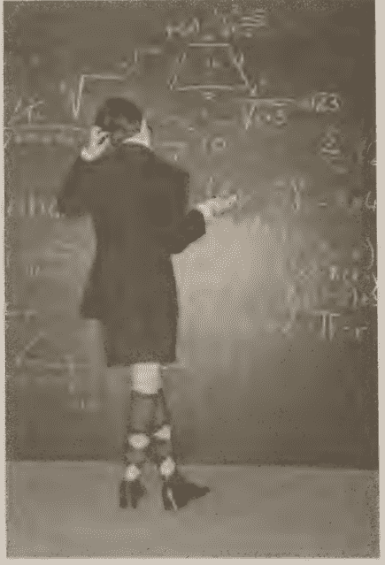

未来的区块链可能不需要工作量证明计算。

## 按共识工作

Dash 基于共识的方法在开发下一代区块链系统的人群中引起了巨大兴趣。随之而来的认识是，区块链的根本作用是就某事达成一致，并尽快达成此一致（参见“工作量证明”，第 4 章）。一旦有人解锁他们的钱包并创建一笔交易，区块链的主要任务就是记录该交易，并尽快完成，以便该交易无法被撤销，并且可以添加新的交易。

一家名为 Ripple 的公司开发了也许目前最大、最先进的共识区块链形式。其软件同样名为 Ripple，基于一种新型区块链，旨在处理跨越国界甚至跨越不同国家货币的银行间转账。

通过使用一种被称为“拜占庭将军问题”的数学和计算机科学实验，Ripple 的工程师认为他们已经证明工作量证明和权益证明都是不必要的（请参见下方的方框“Ripple 是如何工作的？”）。Ripple 的区块链账本不仅旨在促进区块链自身的原生货币（称为 XRP）的转账，还旨在处理任何货币的交易。从某种意义上说，Ripple 区块链构建了其自己的安全对应账户系统（请参见第 12 章方框“如何在全世界转移资金”），允许任何银行与任何其他银行之间创建交易。

在 Ripple 设置好硬件后，银行成为 Ripple 网络中的一个节点。银行之间不再使用常规货币兑换系统进行借记或贷记，而是可以使用他们偏好的任何货币在账本中交换交易信息。更改会实时显示在账本上。如果需要货币兑换，网络将自动使用持有多种货币储备的中介“做市商”为交易找到最佳价格，然后更新所有账户。XRP 甚至可以用于促成交易，而两端的节点甚至不知道涉及加密货币。这些交易大约在一分钟内结算，无论它们发生在何处。

通过依赖可信节点之间的共识系统，Ripple 网络允许参与银行之间进行几乎没有除货币兑换价格之外额外开销的全球交易。该公司希望这将削减与国际货币兑换相关的费用。然而，只有银行和公司可以成为 Ripple 网络中的节点。普通客户必须在这些银行之一开设账户，然后该公司使用 Ripple 为他们将资金发送到另一家银行。这使银行能够继续为交易设定价格。这样一来，Ripple 希望通过向那些已经控制系统的人推广，而不是颠覆资金转移行业，将区块链账本技术带入主流。截至 2017 年 2 月，Ripple 的 XRP 加密货币在总价值上仅次于比特币和以太坊，是第三大加密货币。

## Ripple 是如何工作的？

“拜占庭将军问题”设想了一群将军，各自率领一支军队，包围一座敌方城市。每个将军都被山丘与其他人隔开，使他们无法直接相互传递信号。敌方城市的实力强大到如果所有将军同时进攻，他们就能击败它；但如果除了一个将军之外的所有人都进攻，他们将被击退。将军们必须通过交换信息来计划进攻时间。然而，无法保证收到的信息的真实性——有一个或多个将军秘密站在城市一边，并发送信息来欺骗其余的人。那么，将军们该怎么办呢？

结果表明，如果少于 66% 的将军是忠诚的，就无法协调一次成功的攻击。然而，如果超过 66% 的将军是忠诚的，那么他们可以信任所收到的大部分信息，从而成功协调他们的攻击。这一结果由微软的研究人员于 1982 年证明。而 Ripple 依靠的正是这一事实来保障其区块链的安全。

Ripple 区块链网络由有限数量的中间节点组成。这些节点验证区块链的所有添加内容，并与更广泛的用户群体通信，这与 Dash 的主节点并不不同。所有中间节点相互通信以共享普通用户提交的交易信息。但是，当需要将新区块写入链中时，它们会参考一个它们信任的特定节点的“可信节点列表”。每个中间节点从他们特别信任、并认为不会试图欺诈区块链的其他中间节点中创建他们自己的列表。然后，节点将他们的交易与他们的列表进行比较。如果列表中 80% 的节点同意该交易，则该交易被视为包含在区块共识中，并加入区块链。如果未达到该 80% 的阈值，则该交易将转移到下一个区块。

Ripple 仅允许特定用户加入中间节点群体，具体取决于网络认为用户是否可信。只要超过

百分之六十六的节点诚实，拜占庭将军问题表明区块链的安全性得到了保障。但 Ripple 更进一步，要求节点只轮询它们信任的节点。而且为了更加谨慎，Ripple 要求百分之八十的协议水平。如果任何交易无法以这种方式达成共识，它将被搁置。以这种方式，区块链允许具有明显共识的交易尽可能快地进行，同时标记混乱的交易并让它们等待协议。

## 智能合约

许多涉及区块链的最新创新都专注于在分类账中加入额外信息的概念，这些信息与加密货币交易一起存在或代替加密货币交易存在。Ripple 允许记录其他货币交易，Nxt 允许添加额外文本，以便对不同组或类别的加密货币（称为“颜色”）进行排序，这样就可以将房地产或商品等不同类型的资产在区块链上表示出来。Chain 和 Factom 等公司正在想办法在区块链上记录所有权和股东信息。甚至有人提出对比特币区块链进行软件更新，以增加区块大小，从而允许更多交易。这些可能会为区块链带来额外文本或加密设施，从而提供全新的功能。

区块链开发领域中最令人兴奋的事情之一，是不仅将交易或数据放入区块链，而且放入代码本身。这将使区块链能够充当一个去中心化程序，实际上运行可以根据市场变化条件自行更新和改变的软件。这种代码可以实现所谓的“智能合约”，这些合约能够自主运行。然而，研究人员发现，代码与法律术语结合的这个新领域正在孕育严重的复杂性。

智能合约最早由虚拟货币开发者尼克·萨博（Nick Szabo）于 1997 年提出。这个想法相当简单：例如，购买房屋时，资金和产权文件通常会交给可信第三方，如律师或银行。当第三方确信交易双方都已履行合同要求时，他们便会相应地交付资金和产权文件。智能合约可以自动完成此操作，无需第三方。产权文件和资金以数字形式交给程序，同时附上协议条款。当智能合约观察到条款已得到履行时，它会直接交付数字支付和产品。区块链在分类账的去中心化机制中保障合同代码的安全，就像它保障加密货币交易的安全一样。同一个区块链可能持有产权文件、付款和合同，只需更新其分类账以反映新的、交换的所有权。

这样的合同不必庞大或复杂。例如，像停车计费器这样简单的东西可以在区块链上运行代码——当收到停车费时，它会将车辆注册为合法停放。智能合约可以仅仅是一个投票机制。代码不接收任何资金，而是可以接受注册股东的投票并报告最终计票结果。还有一些合同，区块链代码根本不需要做任何决定，而是可以像数字存储柜一样运作。资金放入柜中，直到双方同意使用其公钥打开柜子才能取出。其中一些简单的合同理念可能会在未来的比特币版本中部署，例如提议的闪电网络（“闪电网络”，第 11 章）。

## 以太坊时代

既然智能合约已经吸引了区块链开发者的注意，其他可能性也开始涌现。例如，区块链能否管理股东投票机制？它们甚至能否控制整个公司？

从法律角度来看，公司只不过是一系列定义领导、所有权和利润分配结构的规则。也许这样的东西真的可以写成代码，然后在区块链中加以保障。这可以被描述为“自治公司”。

2015 年，一位名叫维塔利克·布特林（Vitalik Buterin）的俄罗斯程序员推出了以太坊，这是一种允许将智能合约嵌入其中的区块链。使用一种名为 Solidity 的定制编程语言，程序员可以将他们的代码上传到以太坊区块链，支付少量以太币（以太坊的加密货币）作为费用。一旦代码被植入一个区块，它就会获得一个地址。然后任何人都可以使用自己的计算机定位该地址，并运行其中包含的代码。代码能做什么取决于程序员。它可能是一个用通用文本响应的小程序，或者是一个仅响应具有授权的特定人员的简单合约。从理论上讲，它也可以是一家自治公司，被编程为购买有用的东西、出租并收取付款——所有这些都在分布式以太坊区块链中完成。

以太坊的潜力催生了孕育比特币的理想主义的复兴，自治公司已成为密码学自由意志主义者的新梦想。如果一整个企业可以被保存在超出任何国家管辖权的分布式去中心化区块链中，它就提供了一种全新的“自由”概念。谁会向自治公司征税？基于区块链的企业需要向哪些政客低头？政府的缺陷可以被绕过，取而代之的是代码——简单、开源，任何具备编程技能的人都可以访问，但最终安全且免受人类弱点的影响。被这种理想主义感染的投资者抓住机会支持以太坊，以太币成为比特币之后第二大的加密货币。

以太坊推出后，各种提案开始涌现。例如，一家名为 Slock.it 的瑞士公司提出了一项计划，要构建一种锁——物理上的、安装在门上的锁——它可以连接互联网和以太坊区块链。这将允许人们使用区块链租赁房产，时间可以很短，例如度假期间，只有在客户支付费用时锁才会打开门，并在租赁期结束后自动再次上锁。

## Ripple 与以太坊

看待区块链未来的一种方式，是将其视为 Ripple 与以太坊之间的竞争。以太坊体现了加密货币早期大量理想主义精神。正是这种精神促成了 DAO（见下文），也导致了它的崩溃。在急于创造新事物的过程中，错误经常发生。另一方面，Ripple 似乎采用了一种更传统的方法。Ripple 没有试图开辟新领域，而是吸引那些已经掌控金融网络的人。它提供的不是一场革命，而是一个产品。的确，Ripple 降低了一些早期的抱负，以便更好地瞄准银行可能购买的服务。

哪种做法是正确的？两者都在尝试针对完全新市场的新想法，迄今尚未出现明确的赢家。

然而，这可以提供一个有用的视角，帮助我们对新的金融技术进行分类。一种技术是“与体制同在”还是“反对它”，是理想主义的还是现实的，是革命性的还是渐进式的？它旨在证明新概念，还是仅仅为了赚钱？这些问题可能有助于理解技术开发者和支持者的动机。然而，评判技术本身需要不同的标准，最终的成功更难预测。

## 自治公司

去中心化自治组织（DAO）诞生于 Christoph Jentzch（Slock.it 首席执行官 Simon Jentzch 的兄弟）有一个雄心勃勃的计划。他决定尝试创建以太坊创始人维塔利克·布特林最初讨论过的那种自治公司。于是他开始编写代码，并在 Slock.it 的支持下，于 2016 年初将其发布到以太坊区块链。

DAO 背后的想法似乎相对简单。DAO 将是一个众筹工具。潜在的资助者将使用以太坊的原生加密货币以太币购买 DAO 的股份，称为 DAO 代币。这些代币赋予与购买数量成比例的投票权。通过这些销售，DAO 积累了加密货币资本，然后可以将其投资。

接下来，人们会向 DAO 提交服务建议，试图从 DAO 的资金储备中获得资助。他们可能会建议完成一项任务，例如为 DAO 编辑代码，或者构建并销售某种基于以太坊的产品，甚至做慈善工作。提供服务的人，称为“承包商”，也会建议为他们的工作索取多少报酬，或者是否会将其计划中的部分利润交给 DAO。DAO 中的代币持有者随后会对提案进行投票。如果获得批准，承包商将执行工作，当合同条款履行完毕后，DAO 将支付报酬。如果有任何利润回到 DAO，将在代币持有者之间分享。

DAO 理念变得非常流行，筹集了超过 1.5 亿美元的以太币——这是历史上最成功的众筹项目。但很快，DAO 编程中开始出现复杂问题。

未来的董事会？

结果表明，DAO 容易受到其自身类型的 51% 攻击（参见‘工作量证明，第 4 章’）。如果有人设法获得 51% 的 DAO 代币，他们就可以自动控制任何进行中的投票。攻击者可以提交一份提案，实质上是说“把 DAO 的所有钱都给我”，然后利用多数票批准该计划。

为防止这种情况，创建了多个防御协议。首先，添加了‘管理人’角色。由真人担任，工作是亲自批准每一笔向外付款。其次，决定重要投票（任何超过非正式投票的事项）将分两部分进行。第一部分是对手头问题的投票，要么批准提案，要么否决提案。然后，投票会再次回到代币持有者手中，让他们选择接受第一次投票的结果，或者选择分叉。如果他们接受结果（无论投赞成还是反对），他们将留在 DAO 中。如果他们选择分叉，他们的代币及附带的投票权将被转移到‘子 DAO’，在各方面都与原始 DAO 完全相同，但是独立的。换言之，分叉功能让股东有机会在不同意某次投票时退出 DAO。

几乎立即，问题就出现了。首先，在 DAO 存在最初几周内提交给代币持有者的多个不同提案中，没有一项能够达到法定人数。法定人数是通过算法确定的，但至少需要代币持有者的 20%。然而，大多数提案最多只获得了 10% 的投票。有人将此归咎于投票的技术困难。另一些人认为，许多代币持有者是作为投资购买的，对 DAO 的原则或参与其管理不感兴趣。确实，随着代币的销售，代币价格暴涨，但很少有人参与关于 DAO 未来的日常讨论。

但第二个更严重的问题出现了。一些程序员认为他们在 DAO 代码中发现了一个漏洞，该漏洞允许代币持有者提取自己的资金并退出 DAO。这意味着用户可以通过多次请求提款来欺骗 DAO，在此期间 DAO 只会检查一次用户的账户余额。这种攻击与交易延展性问题（参见“什么是交易延展性问题？”，第 4 章）不无相似之处，因为通过利用该漏洞，攻击者可以提取其账户中实际金额两倍的钱。（尽管从代码角度来看，这两个问题完全不同。）通过多次连续执行这种递归分叉攻击，犯罪分子可以轻易掏空 DAO 的加密货币。

漏洞公布一周后，攻击者发动了袭击。近 8000 万美元价值的以太币，约占 DAO 总持有量的三分之一，被提取出来。持有 DAO 代币的人以及更广泛的以太坊社区陷入恐慌，代币和以太币的价值在加密货币交易所暴跌。

## 拯救 DAO

一个直接而明显的解决方案是对以太坊区块链进行硬分叉。因为 DAO 的代码在区块链内，不能简单地回滚来逆转盗窃。保存 DAO 的同一个区块链也使得 DAO 难以修改或更新。但是，如果回滚整个区块链，所有资金都可以退还给原始投资者，就好像盗窃从未发生过一样。

这个方案在伦理上令许多人感到困扰。以太坊的一个创始理念是代码定义了区块链中的存在。如果区块链在出现错误时随时可以分叉，那代码所谓的‘不可变性’又意味着什么？即使在盗窃中损失了钱的人也不喜欢这种影响。然后，争议进一步升级，一名自称攻击者的人发布了一篇博客文章，批评 DAO 的创始人反悔。攻击者声称，DAO 的创建就是要用代码取代法律，包括其所有缺陷。攻击者在自己看来并没有偷任何东西。他们只是发现了一个法律漏洞。他们只是遵循了 DAO 创始人所推崇的‘不可更改、不可阻止、不可反驳的计算机代码’固有的有缺陷规则，因此他们要求获得奖励。如果其他人遭受损失，那只能怪他们自己没有仔细审查代码。

姑且不论挑衅，结果发现攻击者并没有平安带着钱离开。递归分叉攻击的性质意味着攻击者不能直接带着被盗资金离开，而是必须使用子 DAO 功能进行‘分拆’。并且在使用分叉功能时，根据原始代码触发了 27 天的等待期（旨在为拆分到子 DAO 的人提供宽限期以考虑其选项）。

追踪盗窃的程序员发现了攻击者提取被盗资金的子 DAO；那只是一个被遗忘的、一直保持开放的分拆提案。这些程序员自称‘罗宾汉’，然后对被盗资金执行了同样的递归分叉攻击，将其提取到另一个子 DAO 中，再下一步。但是，他们同样会被锁定在 27 天的等待期内，在此期间原始攻击者可能会再次发动攻击。

但这种无休止的僵局确实暗示了另一种选择：软分叉。在这种情况下，可以修复漏洞，如果时机把握得当，最终罗宾汉和其他仁慈攻击者手中的所有资金很可能可以归还给原始所有者，尽管该过程复杂且不一定成功。这种方案的好处是以太坊区块链不需要永久更改。

但最终，所有开发人员都开始同意软分叉是一场赌博。该过程中可能还有其他尚未发现的漏洞。硬分叉确实是最佳选择。它还将永久关闭 DAO，并将所有以太币返还给最初购买 DAO 代币的人。

2016 年 7 月 20 日，硬分叉被推出。以太坊区块链用户可以选择运行新的分叉版本软件，或继续使用旧版本。绝大多数用户，超过 85%，选择了新分叉。来自 DAO 的所有资金，现在都汇入了该分叉，正在返还给其原始所有者。

但是，大量以太坊用户没有采用该分叉，实质上分裂了以太坊区块链。截至 2016 年 8 月，现在有两个以太坊区块链和两种以太币加密货币。采用该分叉的被称为以太坊 1 号，而拒绝该分叉的区块链称为以太坊经典。两个独立的以太坊区块链对 DAO 的影响尚不清楚。

## 经验教训

自 DAO 资金被盗以来，关于应吸取的教训已有众多评论文章。有人说，事件证明现实世界的法律和法院对于裁决这些

各种纠纷。另一些人说，这一事件实际上证明了代码有效——毕竟，硬分叉确实将以太币返还给了所有 DAO 投资者。还有人预测，瑞士（以太坊、Slock.it 和其他创始公司所在地）的法律机构仍可能介入。与此同时，其他人将这一切归咎于以太坊代码本身的失败，并建议需要对其进行更改。

区块链技术并不简单，尽管它常被解释得像是很简单一样。关于加密货币存储因密钥的绝对保密性而丢失的故事有很多——一旦密钥丢失，钱包将永远被锁定。交易所、公司和区块链自身一次又一次的失败表明，仍有许多错误可犯，也有人能犯下这些错误。

但是，DAO 的一个关键失败在于假设它真的会那么简单。即使不考虑递归拆分漏洞，也难以相信有人会认为一个允许在意见不合时随意退出的组织能够运作。人类倾向于意见不合，试图互相占便宜，并试图利用权力结构谋求私利。看来，递归拆分漏洞可能在 DAO 启动之前就将其阻止，从而在它分裂成一千个无法彼此达成任何协议的不同子 DAO 之前，就为大家节省了很多麻烦。

要了解 DAO 对人性估计有多糟糕，只需研究所谓的“跟踪者攻击”即可。跟踪者攻击仅仅是假设性的，因为 DAO 存在的时间不够长，这种滥用行为从未真正发生过。

跟踪者攻击被假设为一种情况：一个人试图拆分到一个子 DAO，或许是为了提取他们的资金。然后，一个“跟踪者”连同他们一起进入子 DAO，带入足够的代币，对最初试图拆分的人拥有压倒性多数。在这个只有两个人的新子 DAO 中，跟踪者可以控制任何投票。他们可以任命自己为策展人，并确保只有他们能接收从子 DAO 转出的任何资金。受害者唯一能做的就是再次拆分，进入另一个子 DAO。然后，跟踪者再次跟随他们，做完全相同的事情。受害者被永远困住，因为这个霸凌者继续控制投票，并在每次受害者试图拆分时跟随他们。

根据 DAO 开发者的说法，跟踪者攻击是一个“无关紧要的问题”，因为攻击者没有动机这样做。只要跟踪者继续对受害者表现出敌意，跟踪者的资金就会和受害者的资金一样被永久锁定。任何人可能有什么逻辑动机去浪费自己的钱骚扰别人呢？

对此，几乎任何人都可能会回答——看看政治世界！看看无稽之诉！看看现实生活中的跟踪者，他们花所有时间无理由地骚扰他人，毫无物质利益可图！可以想到数百种情况：有钱有人闲的人会给那些钱和时间较少的人制造无穷麻烦，要么等他们出错，要么让他们屈服于各种要求，以便跟踪者允许他们提取资金。

但是，DAO 的开发者或许在区块链机制方面教育颇丰（姑且给他们致命的编程错误一点宽容），却似乎在人性机制方面教育严重不足。因此，无论是由于漏洞，还是由于过度程序化民主的风险，DAO 的失败似乎都是不可避免的。

虽然有人可能会认为，正是通过这种失败，技术才得以进步，但这里真正奇怪的地方在于，这并非使用风险对冲的风险投资资金进行的实验。真正的投资者预期这种赌注，并且有能力坦然承受失败。然而，像 DAO 这样的实验，却是使用从互联网上筹集的个人支持者的资金来进行这些失败的实验。试图逃离公司资本的规则和权力结构，像 DAO 这样的替代性公司实验冒着普通人辛苦赚来的钱的风险，要求他们相信一个未经证实的未来，而对涉及的风险几乎没有缓解措施。众筹实验被宣传为民主化的，让所有人平等参与。但说到区块链，经济金字塔底部的人们被用来承受错误、失误和纯粹糟糕判断的风暴，以便最终，一旁观望的大银行能从这些错误中吸取教训。基于这种实验的未来看起来并不那么民主，更像是利用人群来缓冲有权势者的跌落。

## 结论

当 _新科学家_ 杂志于 2014 年发表关于数字货币的特别报道时，似乎在封面上以比特币列出杂志价格是个好主意。唉，此愿未能实现。

首先，存在以一种随时可能暴跌（或暴涨）的货币标定固定价格的问题。支付又该如何处理呢？当时，没有零售商接受比特币，此后情况也没有太大变化。

这大体上总结了比特币的现状，距离这种激进的新货币形式之初由其神秘发明者“中本聪”提出，还不到十年。兴趣正在快速增长，但其价值依然波动，使用依然边缘化，基础设施也尚在萌芽阶段。而且，在没有变通方法或与特殊服务提供商签订合同的情况下，你还不能在“现实”世界中用它购买太多东西——这远非你期望的无缝支付系统，当然也无法与无处不在的现金或卡片相媲美。

比特币本身可能永远无法应对这一挑战。其基础与传统货币大胆地不同，可能过于薄弱，无法支撑社会巨大的金融活动中哪怕一小部分。它可能最终局限于互联网黑暗面的非正式存在，或像以往的金融创新一样，被硅谷和华尔街所利用。更离奇的情景是，它会被一个货币崩溃的绝望国家采用。

但比特币并非唯一的游戏。真正的创新或许在于人们正在用核心技术所做的事情。比特币实验的真正价值或许在于作为数字信任基础：即区块链，它允许交易在无需大量文书工作的情况下被记录。但摒弃官僚主义后，你也可以取代那些靠处理官僚主义赚钱的人。

通过向全世界开放比特币协议，中本聪可能并未使金融民主化，而更多是为金融提供了一种像互联网协议一样革命性的技术。如同互联网，原本看起来极具民主性的东西将发展出其自身的、全新的权力结构。如果真是如此，那么所面临的风险不只是数十亿美元投资于比特币，而是金钱本身的本质。

## 五十个想法

本部分为你提供更深入探索该主题的方式。它不仅仅是通常的阅读清单。

## 六个加密货币事实

- 1 Digicash。这是第一个可用的虚拟货币，成立于 1990 年。仅仅八年后，创建它的公司倒闭，它就不复存在了。

- 2 从垃圾邮件到货币。1997 年，密码学家 Adam Back 提出了一种名为‘hashcash’的减少垃圾邮件的想法，这是一种在设定时间段内对可发送邮件数量设置硬性限制的计算系统。他将这个想法作为白皮书发送给 Cypherpunks 邮件列表，但从未在大规模上实施。比特币使用了 Back 的 hashcash 概念的一些方面。

- 3 第一个比特币所有者。美国计算机科学家 Hal Finney 是第一个比特币转账的接收者。他于 2009 年初从 Nakamoto 那里收到了十枚币，那时它们基本毫无价值。也有怀疑认为 Finney 可能就是神秘的比特币创始人本人。

- 4 耗电巨大。自 2011 年以来，比特币网络利用了如此大量的处理能力，以至于据信其算力超过世界前 500 强超级计算机的总和。这意味着，从理论上讲，即使同时使用世界前 500 强超级计算机试图篡改比特币区块链网络，也做不到。

- 5 Dunning-Krugerrands。赛博朋克小说 Neuromancer 的作者 William Gibson 曾开玩笑地将比特币称为‘Dunning-Krugerrands’。他将这个词源自 Krugerrands，一种南非金币，以及 the

邓宁-克鲁格效应，一种认知偏差，业余爱好者会高估自身能力。

- 6 比特币税收。瑞士的楚格市已成为全球首个接受加密货币比特币用于政府服务的城市。这项从2016年7月1日开始的试点计划将允许公民使用比特币缴纳税款、罚款和费用，前提是金额低于200瑞士法郎（205美元）。

## 与加密货币相关的七个现实世界地点

- 1 日本东京。已倒闭的比特币交易所Mt. Gox的所在地。
- 2 冰岛凯夫拉维克。在线暗网市场丝绸之路（Silk Road）服务器的所在地。
- 3 中国北京。OKCoin的所在地，按交易量计算是全球最大的比特币交易所之一。
- 4 香港。Bitfinex的所在地，按交易量计算是全球最大的美元/比特币交易所之一。
- 5 瑞士巴尔。以太坊（Ethereum）的所在地，这是一个基于公共区块链的计算平台。
- 6 美国纽约州。BitLicense的所在地，这是专门针对加密货币公司的首张金融牌照。
- 7 荷兰阿纳姆。最“比特币友好”的城市之一，2016年该市宣称拥有超过100家直接接受比特币支付商品和服务的商家。

## 用加密货币购买的六件奇怪物品

- 1 **价值数百万美元的披萨。**2010年4月，比特币爱好者拉兹洛·汉耶奇兹（Laszlo Hanyecz）说服某人向其家中送几张披萨，作为交换支付了10,000个比特币。当时比特币尚未公开交易，但几个月后，当Mt. Gox开始营业时，一个比特币的价格定格为6美分，使得汉耶奇兹的披萨每片成本为300美元（作为早期矿工，汉耶奇兹的比特币储备应相当可观）。2016年底，当比特币交易价格超过每枚700美元时，同样的披萨每片价值将达到350万美元。
- 2 **比特币上太空！**维珍银河（Virgin Galactic）尚未载客前往太空——但他们正在出售机票。排队入座需花费25万美元。但你可以用比特币支付（按当前汇率）。
- 3 **冰上的加密货币。**由于单价极低，狗狗币（dogecoin）被誉为筹集慈善善款的理想代币。每枚仅几分之一美分，易于获取，也易于一次性捐赠数千枚给有价值的事业。2014年，狗狗币支持者将这一说法付诸实践，筹集了超过3万美元，帮助牙买加雪车队前往索契冬奥会。
- 4 **比特币巨无霸。**虽然市面上新出的比特币借记卡和信用卡可能让日常比特币购物看起来不那么令人兴奋，但2016年，荷兰阿纳姆的汉堡王开始直接接受比特币时，比特币用户可谓是捡了便宜。任何使用比特币购买招牌巨无霸三明治的人都会获得另一份免费。
- 5 线下学位，线上付款。塞浦路斯尼科西亚大学接受比特币支付学费。但考虑到他们提供数字货币理学硕士学位，这也许也说得通。
- 6 自担风险。虽然在线市场丝绸之路以非法商品（特别是毒品）市场著称，但其无所不包的态度导致网站上出售了一些奇特产品。电脑零件、扑克课程、设计师时装和稀有硬币都曾在该网站以比特币出售。但或许没有什么比直接来自芬兰的干驯鹿肉更奇怪的了。

## 五句名言

- 1 ‘几个世纪以来，人们一直通过低语、黑暗、信封、关闭的房门、秘密握手和信差来捍卫自身隐私。过去的技术并不允许强大的隐私，但电子技术可以。’ 埃里克·休斯，《密码朋克宣言》
- 2 ‘需要的是一种基于加密证明而非信任的电子支付系统。’ 中本聪
- 3 ‘中本聪并非真正的一个人；他是公众赞誉的体现，是技术造就的实体，也是一个神话。’ 安德鲁·奥哈根，《中本聪事件》
- 4 ‘我相当有信心……区块链将极大地改变金融实践和交易。’ 拉里·萨默斯，前美国财政部长
- 5 ‘将纸币带入尚未知晓使用纸张的国家，每个人都会嘲笑你的主观想象。’ 卡尔·马克思

## 五个文学典故

也许科幻小说成为关于数字货币的丰富故事来源，这也不足为奇。

- 1 *神经漫游者* (Ace Books, 1984年)。威廉·吉布森的1984年成名作描述了一个虚拟世界，在这个世界里，权力掌握在能够控制技术的人手中，财富以数字形式流转。
- 2 *密码学之书* (Avon Books, 1999年)。尼尔·斯蒂芬森的1999年小说讲述了两个交织的故事——一个发生在密码学黄金时代，即二战期间，另一个发生在1990年代末，涉及数字货币和数据避风港的阴谋。
- 3 *Reamde* (William Morrow, 2011年)。斯蒂芬森的另一部小说包含一个涉及虚拟世界中数字货币的复杂骗局，但这更像是《魔兽世界》等大型在线角色扮演游戏中的虚拟货币。
- 4 *海王星的遗孀* (Ace Books, 2013年)。查尔斯·斯特罗斯的2014年一书描绘了一个虚构宇宙，其中存在被称为“快速、中速和慢速”的不同类型的货币。它们涉及加密签名来验证交易，较慢的货币需要通过激光从遥远的恒星发送数字签名光束（额外的时间限制使货币更加安全）。斯特罗斯是比特币的著名批评者。
- 5 *王国里的潦倒者* (Tor Books, 2003年)。科里·多克托罗对虚拟货币进行了最独特的虚构探索之一。在这部2003年小说中，他创造了一种名为“whuffle”的货币，一种基于社会声誉的货币。

## 了解更多信息的二十一个地方

- 1 布鲁斯·斯特林的 *黑客大清剿* (Bantam Books, 1992年)
- 2 史蒂文·列维的《加密叛徒》。*连线*。1993年5/6月。
- 3 埃里克·休斯的《密码朋克宣言》。
- 4 约书亚·贝尔曼的《丝绸之路的兴衰》。*连线*。2015年4月。
- 5 亚当·L·彭嫩伯格为 *快公司* 及其他出版物撰写的报道。
- 6 安迪·格林伯格为 *连线* 及其他出版物撰写的报道。
- 7 纳撒尼尔·波珀的 *数字黄金*，以及他为 *纽约时报* 撰写的报道。
- 8 费利克斯·马丁的 *金钱：未经授权的传记* (Vintage Books, 2013年)。
- 9 大卫·格雷伯的 *债务：最初的5000年* (Melville House Publishing, 2011年)。
- 10 安德鲁·奥哈根的《中本聪事件》。《伦敦图书评论》。2016年6月30日。
- 11 中本聪的 *比特币：一种点对点电子现金系统*。
- 12 桑尼·金和斯科特·纳达尔的 *PPCoin：一种基于权益证明的点对点加密货币*。
- 13 约瑟夫·普恩和塔德斯·德赖雅的 *比特币闪电网络*。
- 14 大卫·施瓦茨、诺亚·扬斯和阿瑟·布里托的瑞波协议共识算法。
- 15 以太坊《白皮书》。
- 16 历史价格数据的最佳来源：
  www.Bitcoincharts.com
- 17 最古老的比特币论坛：
  www.Bitcointalk.org
- 18 关于挖矿和区块的统计数据和信息：
  www.Blockchain.info
- 19 加密货币新闻中心：
  www.coindesk.com
- 20 另一个加密货币新闻中心
  www.cryptocoinsnews.com
- 21 获取更多加密货币新闻：
  www.Bitcoinmagazine.com

## 术语表

| 术语 | 定义 |
|------|------------|
| 51% 攻击 | 在诸如比特币这样的工作量证明加密货币中，如果攻击者能够控制网络中51%的哈希算力，他们从技术上能够用错误信息重写区块链。工作量证明的难度本应使实现这一51%几乎不可能。 |
| ASIC | 应用专用集成电路是专门用于执行单一特定计算任务的设备，用于比特币挖矿。 |
| 比特币 | 第一种加密货币，由中本聪于2008年推出，目前是世界上按价值计算最大的加密货币。 |
| BitLicense | 纽约州针对加密货币相关企业的特定牌照。 |
| 区块 | 区块链的每个间隔被称为一个区块。它们通过挖矿解决，并将新交易写入区块链。 |
| 区块链 | 所有当前加密货币的基础，区块链是一种经过加密保护的账本，会不断更新以跟踪新交易。区块链还可以存储其他与加密货币无关的交易数据。 |
| BOINC | Berkeley Open Infrastructure for Network Computing 是一个允许通过将资源密集型计算任务分解为小块并分发给互联网上的志愿者来共享这些任务的程序。 |

**暴力破解** 对大多数用户来说，是尝试攻破公钥加密的唯一方法。它涉及猜测几乎无法克服的数学方程的答案，直到找到正确答案。暴力破解方法是工作量证明加密货币挖矿的基本活动。

**拜占庭将军** 用于解决计算机系统中容错问题的数学问题，在加密货币中，用于为非工作量证明加密货币创建共识协议。

**CAPTCHA** 全自动公共图灵测试，用于区分计算机和人类，是一种谜题，通常涉及图像和文本，嵌入网站中以防止机器人用垃圾流量淹没网站。

**子 DAO** 当用户决定退出 DAO 时，他们会被放入一个名为子 DAO 的小型分离 DAO 中。

**通联账户** 银行之间相互设立的账户，用于来回转账。

**CPU** 中央处理器，计算机的核心处理器。

**加密货币** 加密货币是一种使用密码学来保障自身安全的虚拟货币，通常在分布式区块链中运行。

**密码学** 一种使用算法在不同方之间加密消息的方法。它也是互联网和计算机安全的基础。

**DAO** 分布式自治组织，2016年通过以太坊建立的自治公司，旨在作为一种投资结构。同年因递归分裂攻击导致其灾难性失败，攻击者利用该漏洞耗尽了其资金。

**暗网** 互联网的一个小型孤立版本，构建在 Tor 系统内。在那里，所有服务器和访问者对这些服务器的请求都被加密掩盖，几乎无法识别。

**难度** 为了使区块长度保持大致相同，加密货币会根据同时生成猜测哈希的计算机数量来调整工作量证明任务的规模。这种调整指标称为难度。

**数字货币** 数字货币是一种可以以数字格式表示的货币。

**狗狗币** 「笑话加密货币」，基于2013年的网络模因。非常容易挖矿，价值较低，常用于游戏、慈善或在线反馈系统。

**以太坊** 一个允许通过区块链执行编程的加密货币网络，可能实现智能合约和自治公司。

**分叉** 源自两名不同开发者通过修改程序源代码将其带向两个不可调和方向的情形，也指同一网络上出现两条不同区块链，而该网络的计算机必须在两者之间做出选择的奇特情况。

**FPGA** 现场可编程逻辑门阵列是多用途芯片，可针对特定的计算密集型任务进行定制编程。

**GPU** 图形处理器，旨在完成许多小型并行任务（如图形渲染）的处理器。

**哈希** 密码学过程的一部分，将一串文本转换为较短、复杂的值。如果原始文本中的哪怕一个字符发生变化，哈希值也会随之改变。它们用于以密码学方式对消息进行签名，也是加密货币挖矿过程的基本组成部分。

**哈希率** 对工作量证明加密货币网络上挖矿活动规模的表述，通常以每秒哈希数来衡量。

**中间节点** 为网络中不同计算机分配层级的加密货币。在基础用户之上是中间节点，它们拥有更大的授权交易权限，并构建网络拓扑。

**IP 地址** 用于识别特定计算机、服务器、路由器或其他可上网设备的唯一数字。它们作为地址系统用于在互联网上路由数据。

**Jed McCaleb** 软件开发者，2010年启动了Mt. Gox，之后将网站出售给了Mark Karpeles。

**闪电网络** 一种建议的加速比特币区块链的方法，允许在受信任的合作伙伴之间在链下进行小额、重复的交易。

**莱特币** 「替代币」，常作为比特币的替代品。它于2011年发布，使用一种名为「scrypt」的不同哈希算法。

**恶意软件** 专门设计用于为他人牟利而损害系统的软件，例如病毒、漏洞利用工具等。

**Mark Karpeles** Mt. Gox 的所有者，2013年从 Jed McCaleb 处购买该网站后成为所有者。他于2015年被捕，并面临与该网站倒闭相关的指控。

**主节点** 在某些中间节点加密货币（如 Dash）中，主节点是网络中具有已验证质押等级的计算机。其功能是批准交易和构建区块，而其他节点则通过工作量证明挖矿来解决区块。

**挖矿** 完成工作量证明的行为，计算机通过生成哈希猜测来解决新区块并将新交易添加到区块链中。通常，解决区块的计算机会获得一定数量的加密货币作为奖励。

**Mt. Gox** 第一个允许使用法定货币直接购买比特币和其他加密货币的加密货币交易所。由 Jed McCaleb 于 2010 年创立，该网站最终于 2013 年出售给 Mark Karpeles。在2014年倒闭之前，它是最大的交易所，该网站经常成为黑客的攻击目标。一次最大的盗窃事件导致该交易所倒闭，并使 Karpeles 因挪用公款罪在日本法院受审。

**销售点终端** 商家通常用来代替收银机的计算机，用于结算购买并刷卡收款。

**非常好的隐私（PGP）** 又称 PGP，最早的公钥加密软件方法之一，由 Phil Zimmerman 于 1991 年创建并上传到互联网，用户可以免费下载。

**权益证明** 工作量证明的替代方案，该方法通过将这一特权分配给网络中控制大量加密货币的计算机，将其视为更可信的对象（因为他们在系统中拥有更多权益），从而向区块链添加新区块。

**工作量证明** 产生比特币等加密货币新区块所必需的挖矿活动。它涉及对哈希进行暴力猜测，随后可通过算法快速验证。

**公钥加密** 也称为非对称加密，这种密码学方法使用公钥和私钥，使双方能够交换加密信息，而无需共享代码本。

**勒索软件** 加密目标计算机的恶意软件，然后要求支付款项（通常用比特币支付）以再次解密文件。

**实时全额结算账户** 又称 RTGS，银行通过中央银行相互转移资金的一种方式。

**递归分裂攻击** DAO 中的一个漏洞，允许攻击者同时请求多次提现，提取的货币总额是其账户余额的许多倍。

**瑞波币** 一个设计用于允许银行、服务提供商和外汇市场做市商之间进行法定货币国际转移的加密货币网络。

**路由器** 一台小型计算机，运行专用操作系统，旨在管理和引导家庭、邻里或区域范围内的互联网流量。

**中本聪** 比特币的化名发明者。2008年发布描述其加密货币理念的白皮书时首次为世人所知，于2011年从互联网上消失。许多人试图查明他的真实身份。

**隔离见证** 对比特币软件的建议修复方案，旨在减少存储在区块链中的交易信息量，加快交易确认速度，并可能修复交易可塑性问题。

**服务器** 存储网站文件的计算机。通过响应用户计算机的请求，服务器将这些文件通过互联网发送出去，使用户能够在自己的计算机上查看网站。

**签名** 使用私钥对消息生成密码学哈希时，该哈希被称为签名，因为只有私钥能生成该哈希，并且可以使用公钥独立验证签名。

**丝绸之路** 一个基于暗网的市场，专门销售违禁品，主要是非法药物。由化名“可怕海盗罗伯茨”运营，该网站于2013年被关闭，当时 Ross Ulbricht 被捕并被指控为创始管理员。

**智能合约** 用编程代码编写的合同，在满足特定条件时能够自行执行。

**SWIFT** 环球银行金融电信协会，银行用于通信通联账户转账的系统。

**Tor（洋葱路由）** 一款允许用户使用互联网同时隐藏其访问的网站以及向这些网站暴露的源点的软件。它也用于创建暗网，暗网是一种较小的互联网，其中服务器位置和网站访问者无法被识别。

### 交易
比特币转账被写记为区块链上的交易，并提交以包含在新解出的区块中。

### 交易可延性问题
比特币软件中的一个缺陷，它允许格式不正确的交易被区块链接受，然后返回一个意外的交易 ID。如果软件不知道这个意外的交易 ID，它通常会尝试再次处理该交易，从而导致重复交易。

### 钱包
加密货币账户的私钥。钱包会对提交到区块链的所有交易进行签名，并将所有公共地址关联起来。

### 虚拟货币
虚拟货币是一种完全以数字形式存在的货币。

### 维塔利克·布特林
以太坊的创建者。

## 插图
### 图片致谢
图 5.1、5.2 和 8.1：www.blockchain.info

### 照片致谢

## Chapter 2
‘比特币发明者“中本聪”的身份是个谜’：Cultura/REX/Shutterstock

## Chapter 3
‘由“密码朋克”创建的数字隐私工具有助于加密货币的兴起’：xijian/Getty

## Chapter 4
‘公钥加密让在线信息远离窥视之眼’：D3Damon/Getty

‘区块链是支撑加密货币的工具’：alengo/Getty

## Chapter 5
‘一家中国比特币矿场。中国是世界上大多数矿池的所在地’：Paul Ratje/For The Washington Post via Getty

‘没有镐和铲子：这些耗电处理器正在挖矿比特币’：Paul Ratje/For The Washington Post via Getty

## Chapter 6
‘并非每个人都高兴看到丝绸之路创建者罗斯·乌布里希出庭受审’：Spencer Platt/Getty

‘丝绸之路和许多模仿网站已被美国当局关闭’：David Colbran/Alamy Live News

## Chapter 7
'许多人因 Mt.Gox 倒闭而损失金钱'：Tomohiro Ohsumi/Bloomberg via Getty

## Chapter 8
'比特币 ATM 机依然罕见'：Jonathan Raa/NurPhoto/REX/Shutterstock

'花费加密货币的一种方式'：Mario Tama/Getty

'这样的标志将来会普及吗？'：Sean Gallup/Getty

## Chapter 9
'这枚罗马硬币来自公元400年左右，但最早的硬币是在300年前制造的'：REX/Shutterstock

'在中世纪的欧洲，人们使用这样的计算木契来记录债务和交易'：由 Winchester City Council Museums (Flickr) [CC BY-SA 2.0 (http://creativecommons.org/licenses/by-sa/2.0)]，通过 Wikimedia Commons 提供

'黄金时代：英格兰银行的一名黄金交易员'：REX/Shutterstock

'传统银行的日子可能屈指可数'：Associated Newspapers/REX/Shutterstock

## Chapter 10
'多里安·中本聪强烈否认与比特币有任何关系'：Jonathan Alcorn/Bloomberg via Getty

## Chapter 11
'比特币前方是否存在分叉？'：Source/REX/Shutterstock

'闪电网络可能拯救比特币'：Design Pics Inc/REX/Shutterstock

## Chapter 12
'区块链可能让我们所熟知的银行成为过去式'：Courtesy Everett Collection/REX/Shutterstock

'比特币背后的技术正在使一种新的太阳能网络成为可能'：Lester Lefkowitz/Getty

## Chapter 13
'未来的区块链可能不需要工作量证明计算'：WestEnd61/REX/Shutterstock

'未来的董事会？'：WestEnd61/REX/Shutterstock

### A
- 山寨币 155–8, 217
- 匿名性 29–30
- ASICs（专用集成电路）57–60, 63, 65–6, 91, 175, 214
- 非对称加密 见 公钥加密

### B
- 亚当·巴克 9
- 银行转账系统 172–4
- 银行与区块链 170–4
- 比特币 xi, 201–2, 220, 221
  - 获取 3–4, 13, 15, 101–2
  - 作为锚定货币 158
  - 匿名性 112
  - 区块链 见 区块链
  - 商业应用 110–11
  - 邮寄购买 104–5
  - 与中国 153–4
  - 定义 3, 214
  - 未来 159
  - 发明 7–19
  - 投资 159
  - 作为货币的法律地位 113–33
  - 闪电网络 150–3, 217
  - MIT 比特币项目 108
  - 实体代币 17
  - 价格波动 5
  - 使用的处理能力 205
  - 隔离见证 147–50, 220
  - 大小 145
  - 使用 3, 6, 98–101
  - 价值/价格 10, 14, 15–18, 54, 57, 68, 103, 163
  - 另见 加密货币
- 比特币 ATM 机 97
- 比特币公司 59–60, 145
- 比特币开发者 145
- 比特币交易所 4, 85–94
- 比特币交易市场 16–19
- 比特币挖矿 3, 218
- 比特币问题 145–7
- 比特币汇款公司 104
- 比特币税务 206
- 比特币时间表 110–11
- 比特币交易 40–1, 107, 112, 145, 150–2
- 比特币 XT 145–7
- BitInstant 102, 128
- BitLicense 104, 214
- BitMEX 4
- BitPay 6, 106
- BitShares 58
- 区块链分叉 见 分叉
- 区块链电网与太阳能 177–9
- 区块链 xi–xii, 3, 33–49, 55–6, 67, 97, 109, 112, 127, 145, 146, 149, 150, 161–79, 214
  - 替代形式 181–200
  - 自治公司 192–5
  - 与银行 170–4
  - 未来项目 174–9
  - 作为研究工具 163–70
  - 智能合约 188–90
  - 技术创新 161–79
  - 通过共识运作 185–8
- 区块 13–14, 46–7, 145, 155, 214
- BOINC（伯克利开放网络计算基础设施）166–8, 214
- 暴力破解方法 38, 44–5, 215
- BTC China 153–4
- 维塔利克·布特林 190, 221
- 蝴蝶实验室 59
- 拜占庭将军问题 185–8, 215

### C
- CAPTCHA（全自动公共图灵测试以区分计算机和人类）76, 79, 215
- 中央银行 121–3
- 子 DAO 194, 196, 198–9, 215
- 中国与比特币 153–4
- Circle 104
- 云挖矿 63–5
- Coinbase 6, 106
- CoinLab 87, 103
- 商品货币 117
- 计算机犯罪 24
- 往来账户 215
- CPU（中央处理器）57, 91, 156, 215

- 抬高/压低货币 118
- 加密货币 xi–xii, 3, 12, 15, 19, 21–32, 36, 49, 75, 215, 216, 217, 218, 219, 221
  - 与会计 109
  - 商户采用 105, 108
  - 比特币作为锚定货币 158
  - 欺诈交易 109
  - 未来 159
  - 法律地位 128–31
  - 六个事实 205
  - 用其购买的奇怪物品 208–10
  - 技术创新 161–79
  - 在哪里花费 105–8
  - 另见 比特币
- 加密货币颜色 188
- 加密货币集成 98
- 加密货币账本 42–3
- 加密货币挖矿 见 挖矿
- 加密货币稳定性 102–3
- 加密签名 见 哈希
- CryptoLocker 92–3
- 康宁汉姆链 164
- 策展人角色 194, 199
- 网络恶棍 71
- 密码朋克 23–7, 36, 76, 205

### D
- DAO（去中心化/分布式自治组织）192–200, 215, 219
  - 子 DAO 194, 196, 198–9, 215
  - DAO 代币 192, 194–5, 197
- 暗网 16, 30–2, 216

### E
- Dash 183, 218
- 约书亚·戴维斯 10
- DDoS（分布式拒绝服务）72
- 深网 30
- 区块解谜难度 14, 216
- DigiCash 205
- 数字密码学 23, 28-9, 215
- 数字货币 3, 35, 36, 216
- 数字签名 39-40, 53, 220
- DNS（域名系统）165
- 狗狗币 53, 155-6, 216
- 双重花费 43, 47
- DPR（可怕的罗伯茨海盗）16, 18, 69, 71-82, 220
- DRM 软件 35
- Dunning-Krugerands 205
- 电子银行 36
- 电子前哨基金会 24, 29, 127
- 以太坊 67, 169, 176, 190-2, 195-6, 197, 198, 215, 216

### F
- 虚假信息 47
- 法定货币 121-3
- 五十个创意 203-13
- 51% 攻击 56, 183-4, 194, 214
- 分叉 48, 145-8, 195, 216
- 42coin 54
- FPGA（现场可编程逻辑门阵列）57, 216

### G
- GBC（全球区块链委员会）174
- 全网哈希率 57, 60
- 金本位制 119-21
- 利亚·麦格拉斯·古德曼 137-8
- GPU（图形处理器）57, 156, 217
- 大卫·格雷伯 115

### H
- 罗布·哈尔福德 166-8
- 哈希 53, 55, 87-8, 169, 217, 220
  - 交易 ID 哈希 88
- 每秒哈希数 55, 58
- Hashcash 44, 205
- 哈希率 55-6, 57, 58, 60, 183, 217
- 隐藏服务 29

### I
- 中间节点 183, 217
- IP 地址 76, 165, 217
- IP（互联网协议）27
- IPFS（行星间文件系统）176-7

### K
- 马克·卡普莱斯 85, 86, 91, 218

### L
- 闪电网络 150-3, 190, 217
- 莱特币 53, 59, 156-7, 217
- 文学引用 211
- Logos 基金 65

### M
- 杰德·麦凯勒布 11, 15, 18, 85, 217, 218
- 魔法蘑菇网站 73
- 恶意软件 24, 71, 90-1, 217, 219

- 主节点 183, 218
- 默克尔树 49
- 挖矿 3, 53–62, 157, 218
  - 云挖矿 63–5
  - 耗电量 65–6
  - 预挖矿 158
  - 挖矿池 60–7
  - 挖矿设备 57
- MIT 比特币项目 108
- 动量算法 58
- 货币 113–33
  - 双金属本位制 118
  - 硬币 116–18
  - 商品货币 117
  - 货币升值/贬值 118
  - 法定货币 121–3
  - 金本位制 119–21
  - 货币史 115–27, 132–3
  - 借据 116
  - 私人货币 124–6
  - 计算筹 117
  - 时间线 132–3
  - 虚拟货币 9, 126–7, 221
- 莫里斯蠕虫 24
- Mt. Gox 4, 15–16, 17, 18, 83–94, 97, 102, 103–4, 128, 149, 217, 218
- 未来博物馆 174–5

### N
- 中本聪 4, 9–12, 13–15, 18–19, 27, 35, 75–6, 89, 135–42, 159, 201, 205, 214, 219
- 涅姆币 165

### O
- 安德鲁·奥哈根 140–2
- 洋葱路由 27–8, 220

### P
- P2P 基金会 12, 138
- Paymium 4
- 贝宝 106
- 点对点币 167
- PGP (完美隐私) 12, 25–6, 36, 218
- Ping21 服务 175
- 销售点终端 218
- 预挖矿 158
- 质数 164–5
- 质数币 164
- 私人货币 124–7
- 私钥解密 37–8
- 概念验证 175
- 权益证明 167–8, 183, 218
- 工作量证明 13, 43–9, 53, 55, 127, 163–4, 167, 168–70, 184–5, 219
- 公钥加密 25, 28–9, 36–41, 215, 219

### Q
- 引用 210

### R
- 勒索软件 92–3, 219
- 递归拆分攻击 195, 196, 219
- 里曼币 164–5
- 黎曼假设 164
- 瑞波币 67, 185–8, 191–2, 219
- 瑞波 XRP 185–6
- 罗宾汉程序员 196–7
- 路由器 27–8, 219
- RSA 加密 38–9
- 实时全额结算系统 172–4, 219

### S
- 隔离见证 (SegWit) 147–51, 220
- 服务器 29, 35, 220
- SETI@HOME 项目 166
- SHA-256 算法 163–4
- 丝绸之路 16–18, 69, 71–82, 85, 97, 128, 220
- 智能合约 188–90, 220
- 太阳能与区块链电网 177–9
- 太阳币 179
- 跟踪者攻击 198–9
- Stripe 4
- SWIFT 报文 173

### T
- 测试 100
- TO 系统 171
- Tor 16, 28, 29, 30, 74, 77, 79, 220
- 交易 ID 哈希 88, 149
- 交易可延展性问题 87–9, 149, 221
- 交易，区块链 40–1, 221
- 交互式电网 177
- 信任 48–9

### U
- 罗斯·乌尔布雷希特 11, 72–5, 77–9, 81–2, 220
- 唯一节点列表 187

### V
- 虚拟货币 9, 126–7, 221
- 虚拟钱包 13, 41–2, 148, 221
- VPN (虚拟专用网络) 76

### W
- W3C 172
- 大户投资者 158
- 克雷格·赖特 139–42

### X
- XCoin 183
- XRP 185–6

### Y
- 青年国际党 23

### Z
- ZeroNet 176, 177
- 菲尔·齐默尔曼 25–6, 218

## 想了解更多？

立即下载《新科学家》即时专家有声书和电子书，了解世界及影响我们的重大问题。

该系列所有《新科学家》即时专家有声书和电子书均可在即时专家应用和 instantexpert.johnmurraylearning.com 上购买。

在 instantexpert.johnmurraylearning.com 使用 NSIE40，任何购买可享 40% 折扣。

| | | | |
|---|---|---|---|
| | | | 斯特林图书馆 |
| | | | 3804802 174256 9 |
| | A & H | | |
| | | 2021 年 10 月 12 日 | |
| £10.99 | | | |

《货币的终结》
4224

保护套
www.bookprotectors.co.uk
020 8520 0012

## 受雇谋杀。贩毒。洗钱。

这些听起来可能像惊悚小说的情节，但它们是加密货币短暂历史中的真实故事。

最著名——或臭名昭著——的加密货币是比特币。但看清其蒙受污名的声誉之下，会出现更加闪耀的东西。比特币和其他加密货币所依赖的技术——区块链——被誉为自互联网发明以来最伟大的进步。

《货币的终结》是您了解这项颠覆性新技术的必读入门，这项技术让来自各行各业的政府、企业家和前瞻性人士都开始重视。

