# AI深度学习与神经网络精要：每天几分钟，初学者理解机器学习与构建高级AI技能指南

## 简介

在一个智能手机能识别你的面容、推荐你下一首喜爱的歌曲、甚至协助诊断疾病的世界里，显而易见：**人工智能**，也称为 **AI**，并非科幻小说。它已来到身边，正在改变我们的生活、工作和娱乐方式。**深度学习**是这些突破背后的引擎。想象一下，释放它的力量去创造、创新和解决问题。这正是本书的主旨。

本书的目的简单而深远：让深度学习对你触手可及。无论你是学生、开发者，还是渴望转型进入 AI 领域的人士，本书旨在简化复杂的神经网络概念。我们将从理论进阶到真实案例，赋予你可日常应用的宝贵技能。

### 你是谁？

你很可能是一位技术爱好者——也许是一名刚起步的学生，或者是一位希望转型进入 AI 领域的专业人士。你可能已经拥有计算机科学或工程背景，又或者渴望获取更扎实的技术背景，以便在这个快速发展的领域中保持领先。你深知 AI 的重要性，并渴望成为这场革命的一部分。本书正是为你量身打造。

当你翻开本书，浏览各章节时，期待一场结构化的旅程。每一章将介绍基础概念，随后配有动手练习和真实的编码示例。我们包含了由 ChatGPT 驱动的提示词，指导你构建、训练和部署自己的神经网络。我们超越了理论，鼓励你亲自动手，在实践中学习。

本书的与众不同之处在于，它专注于利用 AI 来巩固学习和知识。我们提供循序渐进的指导和清晰的解释，并辅以行业案例研究和伦理考量。我们在必要时提供解释以阐明关键术语，并设置互动元素以强化你的学习。请将本书视为一个工具箱，而非单纯的指南，它旨在让你保持投入和知情。

#### 让我介绍一下自己

我是 Jordan Blake，NextGen AI Publications 的创始人。我热衷于帮助他人学习 AI 与教育的交叉领域。我坚信 AI 应该让每个人都能接触，而不仅仅是专家。本书正是这一信念的产物——一本面向初学者和青年的指南，带领大家探索 AI 惊人的潜力。我在这个领域耕耘多年，致力于揭开 AI 的神秘面纱，赋能像你这样的学习者。

读完本书时，你将牢固掌握深度学习技术和神经网络。你将准备好应用这些技能进行创新，解决现实世界的问题。无论你是构建更智能的应用，还是探索 AI 在医疗、金融或机器人领域的潜力，本书旨在给你所需的信心和知识。

我邀请你深度参与本书的内容。实验、探索、拓展你的理解。将本书作为跳板，跃入 AI 技术的广阔可能性中。旅程由你塑造，我很荣幸能与你共同踏上这条通往理解与创新的道路。让我们一起出发吧。

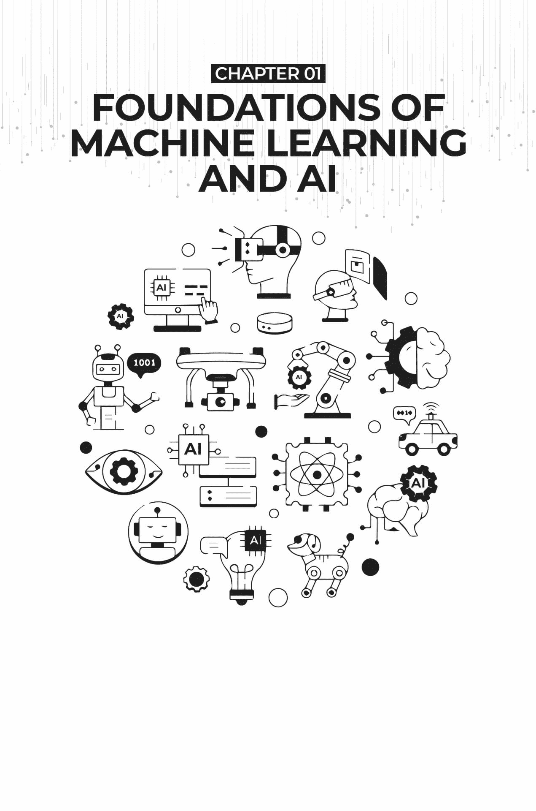

## 第 1 章：机器学习与 AI 的基础

几年前，谷歌的一组研究人员向一个神经网络输入了数千个 YouTube 视频，随后发生了一件非同寻常的事——它开始识别猫。没有人显式地编程让它这么做；它是自学成才的，揭示了机器学习的力量。这个轶事听起来可能微不足道，但它标志着 AI 从理论走向跨行业变革力量的关键时刻。从自动驾驶汽车到虚拟助手，AI 正在重塑我们与技术互动的方式。在这些创新的表象之下，看似魔法的东西实际上是数据、算法以及机器学习和适应的能力。

## 1.1 机器学习导论：概念与背景

机器学习已显著发展，从早期的统计方法和简单算法演变为今天复杂的神经网络。从历史上看，Frank Rosenblatt 于 1957 年发明感知机，以及 20 世纪 80 年代反向传播算法的复兴等里程碑事件，为我们今天见证的深度学习革命铺平了道路。20 世纪 90 年代见证了支持向量机和循环神经网络的流行；然而直到 2010 年代，深度学习才登上舞台中央，这得益于计算能力的提升和数据的可用性。当前的格局是，生成式 AI（如 ChatGPT 和图像生成器）捕获了人们的想象力，并正在改变商业行业。

理解机器学习需要掌握一些关键概念。其核心在于，人工智能是机器表现出类人智能的广泛领域。在 AI 内部，机器学习是一个子集，专注于训练算法从数据中学习以进行预测或决策。深度学习作为机器学习的一个进一步子集，涉及多层神经网络，使机器能够建模复杂模式。这些层模仿人脑的结构，从而实现图像识别和自然语言处理等任务。监督学习、无监督学习和强化学习之间的区别至关重要。监督学习使用标记数据来教导模型，无监督学习在未标记数据中寻找模式，而强化学习则通过试错来学习，很像训练宠物。

机器学习带来巨大益处，但也伴随挑战。它分析海量数据集并挖掘洞察的能力，可推动医疗、金融和娱乐等领域的创新。然而，可扩展性和数据需求构成重大障碍。算法需要大量高质量数据才能有效运行，而这并非总是随手可得。此外，伦理考量不容忽视。数据偏见可能导致歧视性结果，随着机器越来越多地处理敏感信息，隐私担忧也随之而来。应对这些挑战需要在技术进步与伦理责任之间取得平衡。

当你探索机器学习世界时，请预期一个陡峭但回报丰厚的学习曲线。该领域要求投入时间和精力，但你获得的技能——从理解神经网络到部署 AI 解决方案——将弥足珍贵。你需要熟悉 Python 等工具，它以简洁和强大的库著称，是构建和评估机器学习模型的关键。这段旅程将涉及编码、数据分析，以及深入探究驱动 AI 的机制。

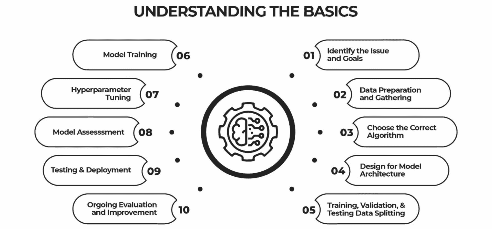

本章为深入探索机器学习奠定了基础，为你将要开发的技能和知识打下地基。从基础概念到实际应用，你将全面了解 AI 重塑行业的潜力以及你在其中的角色。随着学习深入，请记住，机器学习不局限于算法和数据——它是一股利用技术解决问题、改善我们周围世界的力量。

## 1.2 理解算法及其应用

想象一下，你是一名招聘经理，正在翻阅一堆简历，以寻找职位的最佳候选人。每份简历都是一捆数据，而你希望在不逐一阅读的情况下做出最佳选择。机器学习算法成为你的秘密武器，帮助你高效地筛选这堆简历。在这些算法中，**决策树** 以其简洁性和有效性脱颖而出。想象一棵树将数据分割成分支，直到得出一个决策——是或否，录用或不录用。它们直观且易于解释，这使得它们非常适合需要清晰、合乎逻辑决策的场景。**随机森林** 通过创建多棵决策树在此基础上构建，每棵树在不同的数据子集上训练，并让每棵树对最流行的结果进行投票。通过结合多棵树的预测，随机森林比单棵决策树做出更准确的预测。它们还降低了过拟合的风险，后者发生在单棵决策树过度学习训练数据、难以理解新数据时。相比之下，**支持向量机（SVM）** 通过寻找分离不同类别数据的最佳边界采取了不同的方法。这就像在沙地上画一条线，并决定新点属于哪一侧。SVM 在决策边界复杂的分类任务中非常强大。然后是 **K-近邻（KNN）**，一种简单而有效的算法，其中项目最近邻居的多数投票决定其类别。这类似于询问朋友们的意见并采纳大多数人的建议。这些算法各有优势，根据具体问题选择使用。

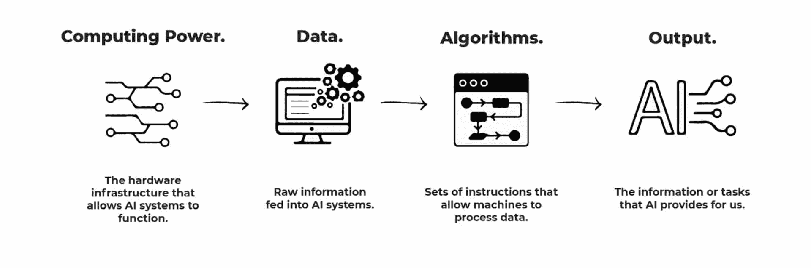

这些算法不仅仅是学术练习——它们拥有影响各个领域的现实应用。在金融领域，决策树和随机森林用于欺诈检测。它们分析交易模式以突出可能表明欺诈活动的异常。这有点像为你的金融交易配备了一只警惕的看门狗。在制造业，**预测性维护** 受益于 SVM，后者有助于在设备故障发生前预测故障，节省时间和金钱。想象一下在汽车抛锚前就知道它何时会坏下。营销领域使用 KNN 进行个性化推荐，根据过去的行为量身定制推荐以迎合个人偏好。它的作用就像一位比你更懂你品味的私人购物顾问。这些算法是我们日常交互的许多系统的骨干，默默地优化流程并提高效率。

选择合适的算法可能让人望而生畏，但归根结底是了解你的数据和你想要解决的问题。算法各有特性；有些需要更多数据；有些更擅长处理噪声。决策树非常适合可解释性，而 SVM 擅长处理高维数据。KNN 简单直接，但对于大型数据集计算成本可能很高。把它想象成为工作挑选合适的工具——各有利弊。要考虑权衡。复杂模型可能提供更高的准确性，但需要更多计算资源；简单模型可能更快，但精度较低。关键在于根据你的具体需求平衡这些因素。

评估算法性能至关重要，以确保其按预期运行。**交叉验证** 是一种用于评估统计分析结果将如何推广到独立数据集的技术。它涉及将数据划分为子集，在一些子集上训练，在其他子集上测试。这有助于避免过拟合，即模型在训练数据上表现良好，但在未见数据上表现不佳。另一个工具是**混淆矩阵**，它提供了模型性能的全面细分——真阳性、假阳性、真阴性和假阴性。它有助于了解模型正确的频率以及出错的位置。**分类报告** 总结了这些指标，提供了准确率、精确率和召回率的快照。这些评估指导改进，确保算法在现实任务中既准确又高效。

## 1.3 数据预处理：成功模型的关键

如果你是一位有抱负的厨师，负责准备一顿美味大餐，你不会直接把食材未洗、未量就扔进锅里，对吧？同样，在机器学习中，**数据预处理** 就是清洗和准备食材——在本例中是数据——的关键步骤。它专注于向模型提供干净、结构化且已准备好转化为洞察的数据。数据通常很混乱，充满了缺失值或不一致性。解决这些问题至关重要。缺失值会扭曲结果，因此**插补** 等方法（用估计值填补空白）必不可少。同时，**归一化** 调整特征的尺度，确保没有单一属性对模型产生不成比例的影响，就像确保食谱中每种食材的比例平衡以调和风味一样。

接下来是**数据转换** 的艺术，类似于烹饪中的腌制或调味，为模型的成功奠定基础。这涉及将分类变量（非数值型）编码为算法能理解的格式。**独热编码** 等方法将类别转换为二进制向量。这种转换至关重要，因为它保留了分类本质，而不暗示任何序数关系。**特征工程** 则是从数据中提取最相关的方面，就像挑选最新鲜的食材。它需要敏锐的洞察力，识别哪些特征对模型的预测能力贡献最大。选择过程有助于优化这些特征，确保模型保持高效且相关。

要有效地进行数据预处理，Python 数据库如 `pandas` 和 `NumPy` 非常宝贵。`pandas` 擅长数据操作，让你能轻松地切片、切块和清洗数据。无论是合并数据集还是填补缺失值，`pandas` 都为数据管理提供了强大的框架。`NumPy` 凭借其强大的数组处理能力，通过高效处理数值转换来补充这一点。它们共同构成了数据准备的骨干。可视化工具，如 `Matplotlib`，提供了对数据分布和潜在异常的洞察，作为可视化检查，确保数据在进入建模阶段前的完整性。

然而，预处理并非没有挑战。处理**不平衡数据集**（某些结果占主导地位）可能导致模型产生偏差。**重采样** 或**合成数据生成** 等技术有助于解决这些不平衡，确保模型公平地从所有结果中学习。**数据泄露**（测试集的信息无意中影响训练阶段）是另一个陷阱。保持数据集分离并采用稳健的验证技术至关重要，以避免这一陷阱。这些挑战需要深思熟虑的方法，就像厨师在厨房里小心避免交叉污染一样。

### 1.4 为 AI 开发导航 Python

#### 用于 AI 和机器学习的 Python

Python 已成为人工智能和机器学习的首选语言，这是有充分理由的。其简洁性和可读性使其成为初学者和资深开发者的理想选择。我们大多数人都欣赏行文流畅自然的书籍，因为它能让你专注于故事本身，而不会陷入复杂的语法泥沼。Python 也是如此：它让你能够编写整洁、高效的代码，而无需忍受冗长语法带来的烦恼。除了简洁性，Python 还拥有一个庞大的库和框架生态系统，这才是 AI 开发中真正的“游戏规则改变者”。这些工具提供了预构建的功能，节省了时间和精力，让你能专注于真正重要的事情：解决问题和创造创新解决方案。

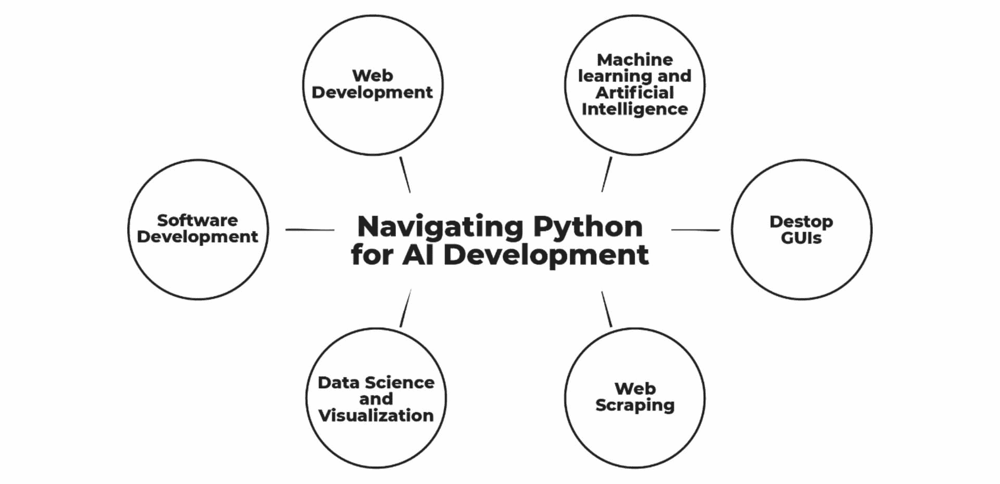

##### 机器学习必备 Python 库

当我们谈论 Python 库时，有几个在机器学习领域中脱颖而出，不可或缺。

*   **`NumPy`** 是数值运算的基石。它能高效处理数组和矩阵，使复杂的数学操作变得简单快捷。这就像拥有一个功能强大的计算器，能轻松管理大型数据集。
*   **`Pandas`**，数据处理的“瑞士军刀”，提供了直观的数据结构和操作，用于处理数值表和时间序列，这对于清洗和准备数据至关重要。把它想象成你的数据清洁工，在数据输入模型前将杂乱的数据集整理干净。
*   **`Scikit-learn`** 以一套全面的机器学习算法工具完成了这“三剑客”组合。从回归到聚类，它提供了实现和评估模型所需的一切，让你无需重复造轮子。

这些库构成了 Python 在机器学习中强大能力的基础，每一个在开发过程中都扮演着关键角色。

##### 实践操作

要真正领略 Python 的能力，你需要通过一些编码实践来“弄脏双手”。

1.  从一个简单的练习开始：编写一个脚本，使用 `Pandas` 加载数据。你将看到其函数如何让数据处理变得轻而易举，只需极少的代码即可读取、清洗和分析数据。
2.  一旦你熟悉了基础，尝试使用 `Scikit-learn` 实现一个简单的线性回归。这个练习将带你了解模型训练和评估的基础知识，让你一窥机器学习的运作机制。

这些练习不仅提供了实践机会，更是理解 Python 库如何协同工作以简化 AI 开发的入门之道。

##### 常见挑战与解决方案

当然，没有任何编程语言是没有挑战的，Python 也不例外。

*   **语法错误**：初学者常被语法错误绊倒，这些讨厌的错误能让你的进度戛然而止。关键在于耐心和练习。仔细阅读错误信息——它们通常会指引你找到正确的方向。
*   **依赖与环境管理**：另一个常见障碍是管理依赖和环境。随着项目的增长，你所使用的库和工具的复杂性也会增加。虚拟环境在此大有裨益，它们为项目创建隔离空间，以确保兼容性并减少冲突。这就像为每个项目提供了一个专用工作区，免受其他项目的干扰和混乱。

理解这些挑战并学会如何应对，将增强你对 Python 的信心和熟练度，使你成为一名更坚韧、更熟练的开发者。

# 1.5 构建你的第一个机器学习模型

想象一下：你即将创建你的第一个机器学习模型，就像一位面对空白画布的艺术家。

## 定义问题

第一步是定义问题。这可能是根据位置、大小和配套设施等特征预测房价。又或许你想构建一个垃圾邮件过滤器，区分垃圾邮件和正常邮件。清晰地定义问题为后续的一切奠定了基础。

## 收集和准备数据

接着，收集并准备你的数据；确保数据干净、有序且与任务相关，就像你为杰作收集合适的颜料和画笔一样。数据质量直接影响模型性能，因此必须严肃对待这一步骤。

## 选择合适的算法

接下来，选择合适的算法。这个决定取决于你要解决的问题。

*   如果你在构建垃圾邮件过滤器，可能会选择像逻辑回归这样的分类算法。
*   对于预测房价，像线性回归这样的回归算法可能更合适。

你的选择将决定模型如何从数据中学习。

## 训练模型

选定算法后，便是训练模型的时候了。训练涉及向算法输入数据，让它学习其中的模式和关系。这一步需要耐心和精准，通过调整参数来提高准确性和性能，就像反复打磨你的艺术技法。

## 评估模型

评估模型至关重要——将其视为退后一步审视你的艺术品。使用训练集和测试集来评估其性能。训练集用于教导模型，而测试集用于评估模型对未见数据的泛化能力。

**准确率** 和 **精确率** 等关键指标有助于你理解模型的有效性。

*   **准确率** 衡量模型正确预测结果的频率。
*   **精确率** 表示预测为正例的样本中有多少真正是正例。

这些指标将指导你优化模型，确保其性能最优，并找出改进空间。请记住，模型的真正考验在于其泛化能力，而非记忆能力。

## 部署模型

部署模型是让它面向世界的时刻，犹如在画廊展出你的艺术品。部署涉及将模型集成到实际应用中，如 Web 服务，使其能处理实时数据并提供预测。

*   考虑 **可扩展性**，确保模型能在不损失性能的情况下应对需求增长。
*   **维护** 同样重要，因为模型需要更新以适应不断变化的数据模式，保持准确性。毕竟，你也会定期更新艺术展览以保持其相关性和吸引力。

这一阶段将你的模型从概念转化为具有实际影响力的工具。

## 项目示例

让我们探索一个你可以动手实践的项目：

### 项目 1：构建基础垃圾邮件过滤器

1.  首先收集一个标记为垃圾邮件或非垃圾邮件的邮件数据集。
2.  清洗和预处理数据。
3.  选择一个简单的算法，如用于分类的朴素贝叶斯。
4.  训练模型，使用准确率和精确率评估其性能，并做必要的调整。

### 项目 2：预测房价

1.  收集房屋销售数据，包括位置、大小和价格等特征。
2.  清洗数据，选择回归算法，并训练模型。
3.  使用均方误差等指标评估其性能，并根据需要进行优化。
4.  将完成的模型部署到应用程序或工具中供实际使用。

## 总结

开展第一个机器学习项目是一次有益的经历，它将创造力与技术技能融为一体。过程包括定义问题、选择和训练模型、评估其性能，以及部署模型以解决现实世界的挑战。无论你是构建垃圾邮件过滤器还是预测房价，这个过程都将为你提供应对日益复杂任务的技能。随着每个项目的完成，你将获得信心和洞见，加深对机器学习潜力的理解。本章为你继续阅读更高级的主题和项目奠定了基础。

### 1.6 用于探索神经网络和机器学习的 AI 提示词

###### 高效练习指南

*   **访问 ChatGPT**：访问 <https://chatgpt.com>，如有需要请创建免费账户。
*   **参与提示词练习**：输入提示词，对其进行修改并实验，以查看不同的响应。
*   **评估响应**：根据你所学知识，检查响应的清晰度和相关性。

#### 实验与反思

调整提示词以加深理解并探索 AI 的能力。

##### 本章强化学习的提示词

- **提示词 1：** “用教孩子用闪卡认动物的类比来解释监督学习。”
- **提示词 2：** “监督学习、无监督学习和强化学习有什么区别？请为每种提供现实生活中的例子。”
- **提示词 3：** “决策树是如何工作的？用在杂货店做决定的类比来解释。”
- **提示词 4：** “什么是支持向量机（SVM），它是如何对数据进行分类的？用在地图上划定边界的隐喻来解释。”
- **提示词 5：** “为什么数据清洗在机器学习中很重要？用为食谱准备食材的例子来解释。”
- **提示词 6：** “描述如何使用归一化和标准化来预处理数据。为什么这些步骤至关重要？”
- **提示词 7：** “指导我构建一个简单的线性回归模型，根据房屋大小和位置预测房价。”
- **提示词 8：** “什么是机器学习中的过拟合，如何防止它？用为考试死记硬背课本的类比来解释。”
- **提示词 9：** “解释准确率、精确率和召回率等指标在评估机器学习模型中的意义。”
- **提示词 10：** “设计一个使用决策树对水果图像进行分类的项目。你会采取哪些步骤？”

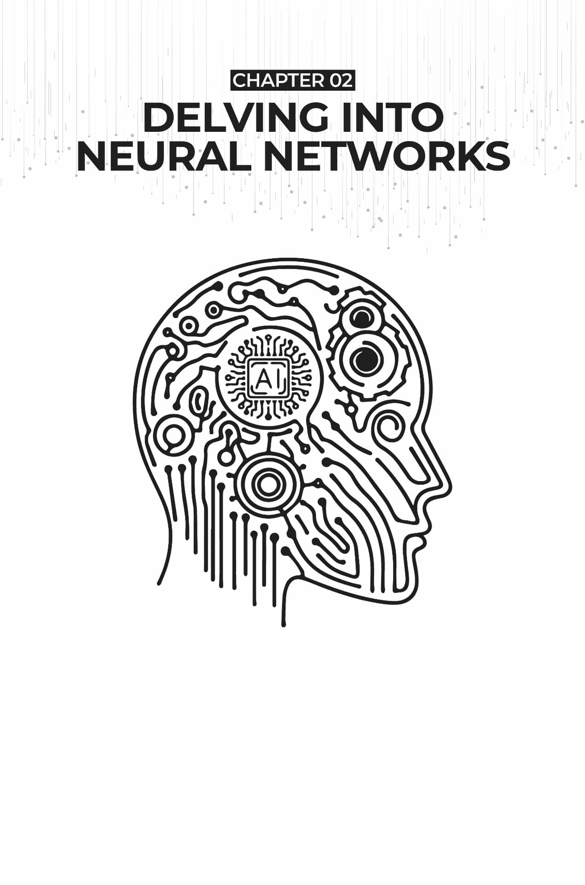

## 第 2 章：深入神经网络

20 世纪 50 年代末，计算机世界见证了一场静默的革命。心理学家兼计算机科学家弗兰克·罗森布拉特引入了感知机——一个看似简单的概念，却标志着人工智能的一个转折点。在那个时代，很少见到机器能像人脑一样学习识别模式并做出决策。感知机是单个神经元的模型，能够进行二元分类，即区分两个类别，例如在图像中区分猫和狗。它通过根据输入数据调整权重来实现这一点，这一过程类似于从经验中学习。这种单层结构为我们现在所谓的神经网络奠定了基础。尽管结构简单，感知机却激发了人们的想象力并推动了进一步的研究，尽管它在处理非线性问题上的局限性导致了兴趣的暂时低迷，通常被称为“AI 寒冬”。

## 2.1 感知机简介：AI 的转折点

想象一下，从单个感知机跨越到一个由相互连接的感知机组成的网络，每一个都是多层网络中的一个节点。这种演变不仅涉及增加更多层，还改变了我们对机器如何学习复杂模式的理解。在**多层感知机（MLP）**中，多层节点协同工作，每一层都对数据进行转换，使网络能够学习超越简单线性分离的复杂模式。隐藏层的加入——即夹在输入层和输出层之间的层——使网络能够从输入数据中提取更抽象的特征，从而解决更复杂的问题。可以将这个过程想象为给机器添加更多齿轮，每一个都在不断优化输出，直到达到所需的精度。这种架构构成了现代神经网络的骨干，使它们能够处理语言翻译和图像识别等多样化任务。

向深度学习的过渡代表了一次范式转移，这得益于计算能力的进步和海量数据集的可用性。深度神经网络以其众多的隐藏层为特征，推动了机器所能实现的边界。这些网络现在能够执行曾被认为不可能的任务，例如以类人的准确度识别语音，或以空前的精度识别图像中的物体。“深度”一词指的是数据通过的多层结构，每一层提取更复杂的特征。例如在医疗保健领域，深度学习模型分析复杂的生物医学数据，辅助疾病预测和个性化治疗方案。这些模型在图像和语音识别方面表现出色，支撑着虚拟助手和人脸识别系统等技术。从简单的感知机到深度网络的飞跃，使 AI 成为我们日常生活中不可或缺的工具，以曾只存在于科幻小说中的方式改变行业并增强人类能力。

然而，能力越大，误解也越深。关于神经网络的一个常见误解是认为它们需要无限的训练时间和资源。虽然训练深度网络可能消耗大量资源，但硬件（如 **GPU**）的进步和优化技术已显著减少了所需的时间和成本。另一个常见的误解涉及过拟合，即模型在训练数据上表现极佳，但在未见数据上表现不佳。当网络过度贴合训练数据，捕捉到的是噪声而非潜在模式时，就会出现这个问题。然而，Dropout 和正则化等技术有助于缓解这一问题，确保模型能很好地泛化到新数据。在模型复杂度和泛化能力之间取得平衡至关重要，就像确保量身定制的西装既合身又不至于过紧。神经网络持续演进，未来将带来更强大的能力和效率。

### 练习：使用 Python 探索感知机

要真正掌握感知机的概念，请尝试使用 **Python** 自己构建一个。首先定义一个包含两个类别的简单数据集，例如二维空间中的点。实现一个包含训练和预测方法的感知机类。使用该感知机对数据集进行分类，根据预测中的误差调整权重。观察感知机如何在迭代中学习，逐步提高其准确率。这个动手练习将阐明神经网络的基本原理，并为探索更复杂的架构奠定基础。

## 2.2 激活函数：赋予网络生命

在神经网络的世界里，激活函数就像是赋予神经网络生命的火花。这些关键组件决定神经元是否应该“激发”还是保持非激活状态，引入了复杂模式识别所需的非线性。想象一个场景，其中每一个决策边界都是一条直线。世界并非如此简单，大多数数据集也并非如此。激活函数通过创建弯曲的决策边界，使网络能够捕捉这些复杂性，就像熟练的艺术家在平面画布上增加深度和维度一样。没有非线性，神经网络将不比线性回归模型强大，仅限于解决简单的线性可分问题。

在这些函数中，有几个已成为神经网络设计中的主流。**Sigmoid** 函数是最早使用的之一，输出值在 0 和 1 之间，使其成为二元分类任务的理想选择。然而，由于梯度消失问题——梯度在反向传播时变得太小而无法有效学习——它在深层网络中已不再受青睐。**ReLU（线性修正单元）** 的出现改变了深度学习的游戏规则。**ReLU** 在输入为正时直接输出输入，否则返回零。这种简单性允许更快的训练并缓解了梯度消失问题，使其成为现代深层网络的首选。**Tanh** 则输出 -1 到 1 之间的值，提供了一个以零为中心的替代方案，在隐藏层中效果良好，在 Sigmoid 的平滑性和 ReLU 的效率之间取得了平衡。

激活函数的选择会显著影响网络的性能。选择合适的函数就像为工作挑选合适的工具，因为它影响模型学习的速度和效果。尽管 `Sigmoid` 和 `Tanh` 具有历史意义，但它们可能会遭遇梯度消失问题，阻碍深层网络中的学习过程。另一方面，`ReLU` 能加速训练并改善收敛，但可能导致“ReLU 失活”综合征，即如果输入持续为负，神经元会变得不活跃并停止学习。理解这些细微差别有助于构建一个运行良好的神经网络，从而优化速度和准确性。

在决定激活函数时，请考虑数据的性质、网络的深度以及手头的具体任务等因素。例如，由于计算效率高且能处理大型数据集，`ReLU` 常被用于深层网络。然而，在负值具有重要意义的情况下，Leaky `ReLU`——一种允许负输入产生微小非零输出的变体——可能更为合适。相反，在构建用于二分类的网络时，`sigmoid` 函数能提供必要的概率输出。为了说明这一点，请看一个涉及图像识别的案例研究。一个最初使用 `sigmoid` 的网络在收敛方面遇到困难。切换到 `ReLU` 后，训练加速且准确率提高，这凸显了正确的选择如何能同时提升速度和性能。

## 2.3 理解层：隐藏层、输入层和输出层

神经网络由一系列层组成，每一层在处理数据中都扮演着关键角色。最前端是输入层，它们作为数据进入的网关。这些层将数据原封不动地传递给网络，确保所有必要信息都可用于分析。像漏斗一样，它们从各种来源（无论是图像、文本还是数值）收集原始数据，并将其引导至网络进行进一步处理。接下来是隐藏层，网络的主力军。这些层通过转换和提炼数据来提取特征。它们识别模式和关系，就像侦探拼凑线索破案一样。隐藏层捕捉复杂模式的能力正是神经网络与众不同之处，使它们能够处理图像识别和语言翻译等复杂任务。最后，输出层给出网络的预测或分类。它们将处理后的信息浓缩为最终的决策或结果，将网络复杂的内部运作转化为有意义的输出。例如，它们可以判断一封邮件是否为垃圾邮件，或识别照片中的物体，每次都以清晰可执行的形式提供网络的结论。

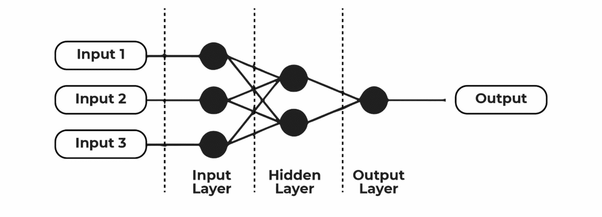

这些层的配置显著影响网络的能力。隐藏层的数量和大小尤为关键因素。层数越多通常意味着捕捉复杂模式的能力越强，但也需要更多的数据和计算资源。这就像给机器添加更多齿轮——每一个都能提升功能，但也增加了复杂性。设计有效的神经网络架构涉及在深度和广度之间取得平衡以优化性能。层太少可能导致欠拟合，即模型过于简单，无法捕捉数据的复杂性；层太多则有过拟合风险，即模型过于贴合训练数据，难以泛化到新数据。找到适合特定任务的正确配置需要仔细的设计和测试。

层连接性进一步影响网络的设计。全连接层——即一层中的每个节点都连接到下一层中的每个节点——在许多网络中很常见。这种稠密连接允许进行全面的模式识别，因为每个节点都能影响网络的输出。然而，这种方法计算成本高昂，且可能导致过拟合。另一方面，稀疏连接涉及的连接较少，降低了复杂性和计算量。在特定情境下稀疏网络很有益，例如处理全连接不切实际的大型数据集时。它们通过降低模型记忆训练数据的能力，也有助于防止过拟合。在全连接层和稀疏层之间做选择，取决于手头任务的具体要求和约束。

探索知名神经网络模型揭示了各种层结构方法。以 `ResNet` 为例，它引入了残差连接的概念来解决梯度消失问题。通过允许梯度绕过某些层，`ResNet` 使得在不失去有效性的情况下训练非常深的网络成为可能。其架构由多个残差块组成，每个块都有自己的层配置，从而能高效地学习复杂模式。另一个著名模型是 `VGG`，以其简洁和统一的架构而闻名。它使用一系列小型的、堆叠的卷积层来捕捉特征，随后通过全连接层进行预测。尽管设计相对简单，这种方法仍使 `VGG` 在图像识别任务中达到高准确率。还有长短期记忆（`LSTM`）网络，专为序列学习设计。`LSTM` 在涉及时间序列数据的任务中特别有效，如语言建模或语音识别。其独特的架构包含记忆单元和门控机制，使其能捕捉序列数据中的长期依赖关系。这些模型各自展示了层配置的多样性及其对网络学习和执行复杂任务能力的影响。

## 2.4 反向传播：学习过程

神经网络的运作如同一个庞大的网，其中每个连接都为系统提供关键支持。反向传播是微调这些连接的过程，使网络能从错误中学习并随时间改进。当你将数据输入网络时，它会输出预测结果。这些预测与实际结果进行比较，计算出差异，即误差。反向传播通过将这些误差向后传送至网络，调整连接的权重以最小化未来的误差。想象这是一个反馈回路，不断优化网络的准确性。该过程的数学基础是梯度下降，一种计算误差减少斜率的技术，指导每个权重应调整多少。目标是找到导致最低可能误差的最优权重集，这类似于寻找完美的配方平衡。

现在，想象你在开车。学习率就是你的油门。踩得太重，可能会冲过终点；踩得太轻，则永远到不了终点。同样，反向传播中的学习率控制网络学习的快慢。过高的学习率可能导致不稳定，网络跳来跳去而错过最优解。过低的学习率可能使过程难以忍受地缓慢，导致网络陷入局部极小值——看似最优实非最佳解的点。找到正确的平衡是关键，自适应学习率会有所帮助。这些技术在训练期间调整学习率，情况稳定时加速，需要谨慎时减速。

为了提高反向传播的效率，高级优化技术应运而生。其中一种方法是动量，它帮助网络跨越微小的误差，就像骑车人在下坡时加速并平稳地滚过颠簸一样。动量会考虑过去的梯度来平滑更新，防止网络陷入局部极小值。`Adam` 优化器是另一个强大的工具，它结合了动量和自适应学习率的优点。它会随时间推移为每个参数调整学习率，从而实现更快的收敛和更好的性能。这些优化器充当专家领航员，高效地引导网络走向最优解。

尽管功能强大，反向传播仍面临一些障碍。臭名昭著的梯度消失问题发生在梯度变得太小而无法进行有意义的更新时；这会停滞学习，尤其是在非常深的网络中。在另一端，梯度爆炸会导致不稳定，更新变得过大。解决方案包括使用像 `ReLU` 这样的激活函数，它能缓解梯度消失；或应用梯度裁剪，通过限制梯度值来防止梯度爆炸。过拟合，即网络过度专用于训练数据，是另一个挑战。正则化技术，如 dropout（训练期间随机忽略神经元），以及 `L1`/`L2` 正则化（惩罚过于复杂的模型），有助于防止过拟合。这些策略确保反向传播仍然是一个稳健可靠的神经网络训练方法，使它们能够适应并在广泛的任务中表现出色。

## 2.5 实操：创建一个简单的神经网络

从零开始构建你的第一个神经网络就像拼图，每一块都完美契合，共同呈现出一幅更大的图景。让我们从设置环境开始。如果你还没有，请下载并安装 `Python`，由于其简洁性和全面的库，它是 AI 世界的主食。准备就绪后，你需要安装 `NumPy`，一个用于数值运算的强大 `Python` 库。打开你最喜欢的代码编辑器，无论是 `PyCharm`、`VS Code` 还是 `Jupyter Notebook`，让我们准备开始编码。

环境就绪后，是时候开始编写神经网络代码了。首先定义架构，包括设置层。为简单起见，让我们考虑一个包含输入层、单个隐藏层和输出层的网络。使用 `NumPy` 为这些层初始化权重和偏置，因为它们对学习至关重要。可以将权重视为神经元间连接的强度，将偏置视为有助于激活的阈值。你还需要定义激活函数。对于这个练习，`ReLU` 是隐藏层的一个好选择，因为它效率高；而如果你在做分类任务，`softmax` 函数适合用于输出层。这些组件是你网络的基石，正确地将它们组装在一起是实现功能的关键。

网络组件就位后，下一步是训练你的模型。首先加载数据集；`MNIST` 数据集是初学者的经典选择。它包含数千张手写数字图像，为测试你的网络提供了一个稳健的平台。通过归一化预处理数据，将像素值缩放到网络易于处理的范围内。通过向网络输入批次数据并使用反向传播等技术调整权重以最小化误差，启动训练过程。这一阶段是迭代的，需要多次遍历数据集来微调模型的预测。

评估网络性能是一个持续的过程。训练后，使用测试集评估模型，测试集由网络未见过的数据组成。测量准确率，特别是正确预测与总预测的比率，以衡量网络泛化能力的好坏。如果准确率不达标，请考虑调整超参数，如学习率或层架构。微调涉及一些试错，但对于优化性能至关重要。监控这些指标可以指导改进，确保你的模型既有效又高效。

要看到网络的实际运行，将其应用于现实任务，例如使用 `MNIST` 进行图像分类。这里的目标是从图像中准确识别手写数字，这一任务反映了实际应用，如数字化手写表格或识别路标中的数字。训练后，测试网络对未见过的图像进行分类的能力。这一步骤凸显了网络的优势和待改进之处。你可能会发现某些数字比其他数字更难分类，这会促使进一步的改进或额外的数据预处理。这个练习的魅力在于其扩展潜力。考虑添加更多层以进行更深度的学习，或尝试不同的激活函数，看看它们如何影响性能。

### 2.6 用于深化神经网络知识的 AI 提示词

#### 高效练习说明

- 访问 `ChatGPT`：访问 `https://chatgpt.com`，如有需要请创建免费账户。
- 使用提示词：输入提示词，修改它们，并进行实验以查看不同的回复。
- 评估回复：根据你所学知识检查清晰度和相关性。
- 实验与反思：调整提示词以加深理解并探索 AI 的能力。

#### 本节强化学习的提示词：

**提示词 1：** “用解拼图的隐喻解释神经网络中隐藏层是如何工作的。”

**提示词 2：** “用学生从考试纠错中学习的类比描述反向传播是如何工作的。”

**提示词 3：** “用门在不同条件下开启的场景对比 `ReLU`、`sigmoid` 和 `tanh` 激活函数。”

**提示词 4：** “设计一个用于猫狗图像分类的神经网络架构。解释你选择层和激活函数的理由。”

**提示词 5：** “建议三种减少神经网络模型过拟合的策略。解释每种策略的工作原理。”

**提示词 6：** “如何利用早停法和学习率调整来增强模型训练？”

**提示词 7：** “指导我创建一个简单的神经网络，以对 `MNIST` 数据集中的手写数字进行分类。”

**提示词 8：** “解释神经网络如何用于文本数据的情感分析。”

**提示词 9：** “使用神经网络进行预测分析时有哪些潜在的伦理顾虑？如何解决这些问题？”

**提示词 10：** “设计一个用于预测股票价格的循环神经网络（`RNN`）。需要哪些关键考量？”

### 第 3 章：深度学习架构

眺望大海常唤起无限可能的感觉。每一拍打海岸的浪花都提醒着我们尚未探索的深度，我们可以用同样的方式思考技术。大海是深度学习架构的领域，卷积神经网络（`CNNs`）是其中最强大的洋流之一。`CNNs` 是图像识别的骨干，将像素转化为模式，将模式转化为预测。与传统算法不同，`CNNs` 不只是将图像作为一个整体来看待；它们将其剖析为碎片，就像侦探在犯罪现场检查每一个细节一样。`CNNs` 的魔力在于它们通过层来学习和提取特征的能力，每一层都在细化图像，直到网络能够理解它。

### 3.1 卷积神经网络（CNNs）

#### CNN：卷积神经网络

CNN 的核心是卷积层，它们是负责特征提取的主力军。这些层就像一系列扫描图像的过滤器，随着层级加深，识别出边缘、纹理以及更复杂的特征。可以把它们想象成筛子，将有用的信息从噪音中分离出来，让网络专注于重要的内容。紧随其后的是池化层，它们降低数据的维度，就像将一本书浓缩成几个关键点。这一过程使网络更高效，并有助于其更好地泛化，过滤掉无关信息，凸显数据的本质。

##### CNN 架构的演进

CNN 及其衍生架构的故事始于 **LeNet**，这是最早为图像识别设计的模型之一。1998 年诞生的 **LeNet-5** 是先驱，它包含两个卷积层，后接池化层，均使用 Sigmoid 或 Tanh 等激活函数。它效率高、适合手写数字识别等任务，且所需计算资源少，非常适合算力受限的环境（来源 1）。快进到 2014 年，**VGGNet** 的推出标志着复杂度和深度的重大飞跃。**VGGNet** 在多层中使用小型 3x3 卷积滤波器，采用 **ReLU** 激活函数和最大池化进行降维，在 **LeNet** 的基础上进行了扩展。这种设计使 **VGGNet** 能够处理更大、更复杂的数据集，在图像分类和迁移学习方面表现出色（来源 1）。在 **LeNet-5** 和 **VGG** 之间如何选择取决于您的需求：**LeNet-5** 适用于较小的数据集，而 **VGG** 适用于详细的特征提取和高性能任务。

##### CNN 的应用

得益于以卓越精度检测和分类物体的能力，CNN 在各种图像相关任务中已变得不可或缺。在目标检测中，CNN 能识别并分类图像中的物体，这一能力支撑着从人脸识别到汽车安全系统的各种应用。CNN 分析面部特征，实现了凭一眼解锁手机或筛选社交媒体照片的技术。它们是无声的哨兵，保障着我们数字生活的安全并增强便利性。

###### 案例研究：CNN 在医学影像中的应用

请看 CNN 在医学影像领域的影响，它们以精准和快速辅助医生诊断疾病。通过分析 X 光片和 MRI，CNN 可以高亮人眼可能忽略的异常，在诊断过程中提供“第二双眼睛”。这在提高诊断准确性的同时，减少了解读复杂图像所需的时间，最终带来更好的患者预后。在自动驾驶汽车中，CNN 在视觉系统中扮演关键角色，使汽车能识别行人、标志和其他车辆，做出瞬间决策，保障道路行驶的安全与效率。

这些例子展示了 CNN 跨行业的变革力量，从医疗保健到交通运输。它们学习、适应和解读视觉数据的能力持续推动着可能性的边界，以前所未有的方式驱动创新并增强我们与技术的互动。

# 3.2 循环神经网络：时间序列与序列

**循环神经网络（RNN）** 就像神经网络家族中的“记忆守护者”，专为处理序列数据而设计。阅读一本书时，每句话的含义都取决于前文，这与 **RNN** 处理序列数据的方式相似。**RNN** 之所以擅长此道，是因为它们能跨时间维度保持上下文，使其成为序列和顺序至关重要的任务的理想选择。与信息单向流动的前馈网络不同，**RNN** 引入了循环，允许信息持久保留。这些反馈回路使网络能保留一种对先前输入的“记忆”，从而基于当前和过去的信息进行预测。这种循环本质正是 **RNN** 的独特之处，赋予了它们以卓越效率处理数据序列的动态能力。

虽然 **RNN** 功能强大，但也有局限性，特别是在管理长期依赖方面。然而，**长短期记忆（LSTM）** 网络提供了解决方案。**LSTM** 是一种特殊的 **RNN**，旨在克服梯度消失问题——该问题会导致标准 **RNN** 在处理序列时遗忘早期信息。**LSTM** 引入了可长期存储信息的记忆单元，并利用门控机制控制信息进出这些单元。这种架构使 **LSTM** 能在漫长序列中记住重要细节，使其在语音识别和语言翻译等任务中极具价值。另一方面，**门控循环单元（GRU）** 提供了 **LSTM** 的简化替代方案。**GRU** 合并了 **LSTM** 中的一些门控机制，在有效管理依赖关系的同时降低了复杂性。这使得 **GRU** 在计算资源有限或较简单模型足矣时成为热门选择。

**RNN** 拥有广泛的应用，特别是在数据序列至关重要的领域。在金融界，**RNN** 被用于时间序列预测，如预测股票价格。这里，**RNN** 分析过往趋势并将其投射到未来的能力为交易者提供了宝贵见解。同样，在 **自然语言处理（NLP）** 中，**RNN** 在文本生成等任务中大放异彩，因为理解词语的上下文和序列至关重要。它们可以根据前文预测句子中的下一个词，从而生成类人文本。这种生成连贯且上下文相关文本的能力，为聊天机器人和自动内容创作等领域开辟了新可能。

利用 **RNN** 构建情感分析模型是亲身体验其能力的实用途径。通过向网络输入词语或短语序列，它可以学会预测给定文本的情感——积极、消极或中性。这涉及预处理文本数据、将其编码为适合 **RNN** 的形式，并在标注样本上训练网络。训练完成后，模型可分析新文本，为洞察舆情或客户反馈提供有价值的参考。另一个极具价值的项目是实现天气预报预测模型。在这里，**RNN** 可分析历史天气数据以预测未来状况，如温度和降水。通过捕捉时间序列数据中的模式，**RNN** 能提供有助于农业、物流等各行业规划和决策的预测。

### 3.3 探索 Transformer：AI 的未来

随着 AI 的持续演进，Transformer 作为一股革命性力量崛起，重塑了我们处理语言和数据的方式。这些模型打破传统模式，采用一种称为 **自注意力** 的机制。想象一下：你身处喧闹的派对，尽管嘈杂，你仍能专注于单个对话。这就是 **自注意力** 的实战体现。在 Transformer 中，该机制允许模型衡量不同词语或数据片段的相关性，从而捕捉输入内部复杂的关系和依赖。与顺序处理数据的先前模型不同，Transformer 可同时处理整个序列，极大地提升了效率和性能。

#### 位置编码与 Transformer 应用

位置编码是 Transformer 的另一个关键组件，解决了并行处理数据的挑战。虽然 Transformer 本身不理解输入的顺序，但位置编码为序列中的每个位置分配唯一的值。这使得模型能够保持单词或数据点的上下文和顺序，就像给书的页面编号以理解叙事的流程一样。凭借这些创新，Transformer 将自然语言处理（NLP）推向了新的高度，使 `BERT` 和 `GPT` 等模型能够以前所未有的准确性理解和生成人类语言。

##### BERT 和 GPT

`BERT`，即来自 Transformer 的双向编码器表示，已成为语言理解的基石。其双向方法意味着 `BERT` 会从两个方向考虑上下文，增强了其掌握文本细微差别和复杂性的能力。这种能力使其成为各种任务的强力工具，包括情感分析和问答系统。同时，`GPT`，即生成式预训练 Transformer，擅长生成连贯且符合上下文的文本。无论是撰写文章、回答问题，甚至编写代码片段，`GPT` 都彻底改变了文本生成，展示了 AI 的创造潜力。

##### 超越 NLP：视觉与科学

Transformer 不局限于 NLP；其通用性远不止于此。例如在图像处理中，视觉 Transformer（`ViTs`）将相同的自注意力机制应用于视觉分析，为传统上由卷积网络主导的任务提供了新视角。这种新方法使 Transformer 在图像分类、目标检测甚至艺术风格迁移方面表现出色，推动了计算机视觉可能性的边界。在蛋白质折叠领域，Transformer 根据氨基酸序列预测蛋白质的复杂 3D 结构，这一突破对药物发现和我们对生物过程的理解具有重大意义。

##### 设置 Transformer 模型

为机器翻译等任务设置 Transformer 模型涉及多个步骤。从预训练模型开始，并在您的特定数据集上对其进行微调。这种迁移学习方法利用了这些模型已获得的海量知识，使它们能够以最少的数据快速适应新任务。微调涉及调整模型参数以适应数据的细微差别，就像裁缝调整西装以求完美贴合一样。像 Hugging Face 的 `Transformers` 这样的库提供了强大的工具和预训练模型来简化这一过程，使开发人员和研究人员都能轻松上手。

##### 结论

Transformer 的实现重新定义了 AI 的能力，让我们得以窥见一个机器能以类人熟练度理解和解读数据的未来。随着这些模型的不断演进，它们有望解锁新的应用和洞见，改变我们与技术及彼此互动的方式。潜力巨大，旅程才刚刚开始。

# 3.4 自编码器及其应用

自编码器是一种无监督学习模型，在神经网络中表现卓越，主要归功于其学习高效数据表示的独特能力。可以将它们想象为一个两部分的系统。首先，编码器接收输入数据并将其压缩为潜在空间表示，本质上以浓缩形式捕捉数据的精髓。可将其想象为将复杂图像还原为其核心特征。接着是解码器，它尝试从这种紧凑表示中重建原始数据。这一两步过程使自编码器在降维中发挥关键作用，类似于压缩文件在不丢失关键信息的情况下压缩数据。处理大型数据集时，这种能力特别有用，通过去除不必要的细节同时保留重要信息，实现更高效的存储和更快的处理。

## 自编码器的变体

不同变体的自编码器应运而生，每种都具有针对特定任务的专门功能。变分自编码器（`VAEs`）作为数据生成中的创造性力量脱颖而出。与传统自编码器不同，`VAEs` 引入了概率机制，使其能够生成与输入数据相似的全新数据样本。这使得 `VAEs` 在创建用于训练的合成数据或从现有数据集生成新图像等应用中极具价值。另一方面，去噪自编码器专注于清理数据。它们被训练从损坏版本中重建原始输入，有效地去除噪声并增强数据清晰度。这使它们在数据质量受损的场景中特别有用，例如修复旧照片或清理音频录音。

## 应用

在网络安全领域，自编码器在异常检测中找到了用武之地。通过学习数据的正常模式，它们可以标记可能表明恶意活动的偏差，就像安全系统提醒您异常行为一样。这种检测异常的能力使自编码器成为抵御网络威胁的宝贵工具。在图像处理中，它们协助特征提取，通过突出图像最显著的属性实现更有效的分析。这种能力在医学成像等领域至关重要，因为识别细微特征可能意味着准确诊断与漏诊的区别。

## 实战实现

要上手自编码器，可以考虑实现一个用于图像压缩的自编码器。从图像数据集（如 MNIST 手写数字）开始，使用 `TensorFlow` 或 `PyTorch` 等 Python 库设计一个简单的自编码器。编码器将图像压缩为更小、更易管理的尺寸，而解码器尝试重建它们。随着模型训练，您将见证自编码器在压缩与重建质量之间取得平衡的能力。另一个实际用例是数据重建。假设您有一组损坏的图像，可能缺少像素或添加了噪声。自编码器可以帮助重建这些图像，将其恢复为更清晰、更完整的版本。这一练习通过展示自编码器在提高数据质量和效率方面的实际应用，加深您对自编码器的理解。

### 3.5 使用 Keras 和 TensorFlow 构建复杂模型

在不断演进的深度学习领域，`Keras` 和 `TensorFlow` 作为构建复杂模型的关键工具脱颖而出。它们的协同作用提供了简洁与强大的独特组合，使其成为涉足 AI 开发者不可或缺的工具。`Keras` 是一个开源库，提供用户友好的 Python 接口，非常适合快速原型设计。它让您专注于模型架构，而不被底层算法的复杂性所困扰，就像一份清晰精确地引导您完成每一步的食谱。另一方面，`TensorFlow` 作为机器学习软件库，提供了幕后的强大动力。它提供了处理最高要求任务所需的灵活性和可扩展性。其强大的框架还支持从简单实验到大规模部署的一切，满足初学者和专家的需求。

#### 第 3 章：使用 Keras 和 TensorFlow 进行深度学习

在使用这些工具构建模型时，首先在 `Keras` 中定义架构。这涉及指定层及其连接方式，类似于为建筑绘制蓝图。`Keras` 凭借其直观的 API 简化了这一过程，只需极少的代码即可堆叠层、配置神经元并选择激活函数。架构就绪后，`TensorFlow` 登场，支持实现超出标准功能的自定义操作。您可能需要实现专用算法或优化特定计算，`TensorFlow` 的灵活性可无缝支持这些高级操作。`Keras` 的简洁性与 `TensorFlow` 的深度相结合，使您能够创建既创新又高效的复杂模型。

为增强模型能力，可考虑采用 `dropout` 等正则化技术。`Dropout` 在训练过程中随机“丢弃”（即忽略）神经元，防止模型过度拟合训练数据，从而防止过拟合。该技术引入了一定的随机性，确保模型保持通用性和鲁棒性。此外，使用 `callbacks` 可在训练期间动态调优模型。`Callbacks` 允许您监控训练过程并即时调整，例如在模型不再改进时提前停止，或保存检查点以便后续重新训练。这些功能提供了可显著提升模型性能和可靠性的控制力和适应性。

实战项目是发挥 `Keras` 和 `TensorFlow` 能力的绝佳途径。经典示例是构建卷积神经网络进行图像分类。借助 `Keras`，您可以快速组装一个能识别图像模式的模型，无论是识别照片中的动物还是分析卫星图像。`TensorFlow` 的强大功能确保该模型能扩展以处理大型数据集，并以准确性和速度提供预测。另一个令人兴奋的项目是开发基于 Transformer 的语言翻译模型。通过利用预训练模型并使用 `TensorFlow` 进行微调，您可以创建一个能在语言之间流畅且具有上下文理解地翻译文本的系统。这些项目不仅展示了工具的潜力，还提供了解决现实挑战的实践经验。

在本章结束时，您已探索了 `Keras` 和 `TensorFlow` 这一强大组合，它们弥合了深度学习中简易性与复杂性之间的鸿沟。这些工具让您能够快速原型设计、高效扩展、精细微调，使复杂模型的创建变得人人可及。掌握这些技能后，您已做好充分准备，步入一个 AI 重塑未来的世界，准备好创新并解决曾被认为不可能的问题。接下来，我们将探索实际应用与行业影响——理论与现实的交汇点。

##### 3.6 AI 实战：探索深度学习架构

###### 高效练习指南

- 访问 `ChatGPT`：访问 [`chatgpt.com`](https://chatgpt.com)，如有需要请创建免费账户。
- 使用提示词：输入提示词，对其进行修改并实验，以查看不同的响应。
- 评估响应：根据您所学知识检查其清晰度和相关性。
- 实验与反思：调整提示词以加深理解并探索 AI 的能力。

###### 本节强化学习的提示词

- **提示词 1：** “用扫描照片寻找模式的隐喻，解释 CNN 中的卷积层如何从图像中提取特征。”
- **提示词 2：** “RNN、LSTM 和 GRU 有什么区别？用短期记忆和长期记忆的隐喻来解释。”
- **提示词 3：** “Transformer 中的自注意力机制是如何工作的？用在派对上专注于关键对话的类比来解释。”
- **提示词 4：** “什么是 Transformer 中的位置编码，为什么它很重要？用句子中排列单词的隐喻来解释。”
- **提示词 5：** “如何应用自编码器检测信用卡交易中的异常？解释步骤和预期结果。”
- **提示词 6：** “Vision Transformers (ViTs) 在处理图像数据方面与 CNN 有何不同？用理解一幅画的例子来解释。”
- **提示词 7：** “变分自编码器 (VAE) 如何生成新数据？用创作歌曲变奏的类比来描述该过程。”
- **提示词 8：** “在人脸识别中使用深度学习有哪些伦理顾虑？如何解决这些顾虑？”
- **提示词 9：** “讨论 Transformer 在实际应用中的局限性。如何缓解这些局限？”
- **提示词 10：** “设计一个使用自编码器创建新艺术风格的生成模型。你会采取哪些步骤，可能会遇到什么挑战？”

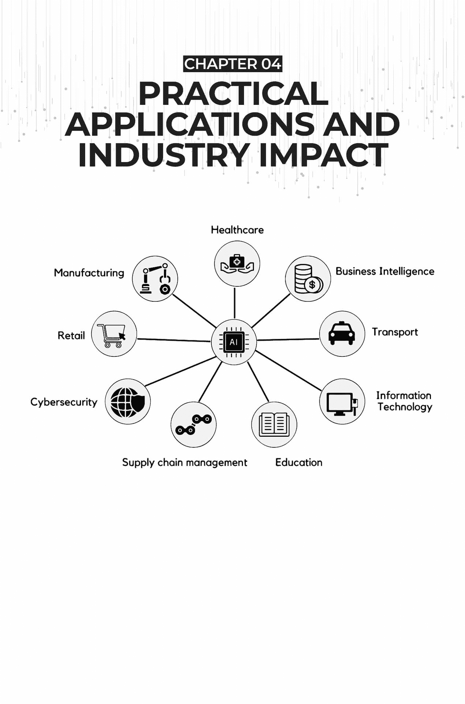

## 第 4 章：实际应用与行业影响

想象一下走进医生的办公室，分析您医学扫描的是机器而非人类。多年前，这可能只是科幻电影中的场景，但现在它已成为现实，由 AI 在医疗保健领域的变革力量塑造而成。借助 AI，诊断流程已从手动且耗时演变为快速且精准。在放射学领域，AI 系统现在以超越人类能力的准确性和速度审视图像，比以往更快地识别 X 光片和 MRI 中的异常。这项技术不仅通过提供第二意见协助放射科医生，还降低了疏漏风险，特别是在涉及可能被人眼忽略的细微异常的病例中。AI 不止步于图像；它延伸至预测分析，通过评估患者数据中的风险因素，在潜在健康问题显现前预见它们，从而实现挽救生命并降低医疗成本的预防性干预。

### 4.1 行业影响示例

除了诊断，AI 正在彻底改变治疗方案，使其针对个体需求量身定制，而非依赖“一刀切”的方法。算法现协助药物发现，比传统方法更快地识别潜在化合物。这加速了从实验室到药房的进程，有望在创纪录的时间内将救命药物推向市场。此外，AI 驱动的平台分析患者数据以定制治疗方案，考量从基因到生活方式的一切因素。这种精准方法提高了治疗有效性，并将副作用降至最低以优化患者预后。想象一个世界，您的治疗方案如指纹般独一无二——AI 正让这一现实日益临近。

智能技术的出现也通过远程监测和远程医疗改变了患者护理，打破壁垒，将医疗服务送到家门口。智能可穿戴设备实时追踪生命体征，向用户和医疗服务提供者发出任何异常的警报。这些小工具从健身追踪器到先进医疗监测仪，赋予患者掌控自身健康的能力，培养积极主动的健康观念。同时，远程医疗平台整合 AI 洞察以提供虚拟咨询，无论地理位置如何，都将患者与医疗专业人员连接起来。这种便利确保了偏远地区人群获得持续护理，弥合了医疗获取的鸿沟，提供及时干预。

#### 案例研究：AI 在医疗保健领域的成功

#### AI 在医疗、金融与机器人领域的应用

##### 医疗领域的 AI 应用

以 IBM Watson 在肿瘤学中的应用为例，AI 通过分析海量的医学文献数据库和患者记录，协助肿瘤科医生制定治疗方案。Watson 以闪电般的速度处理信息，能够提出人类从业者可能不会立即想到的治疗方案，提供潜在策略的全面视角。AI 在糖尿病视网膜病变的早期检测中也证明了其价值，这是一种往往在为时已晚时才被发现的疾病。AI 系统能以惊人的准确性筛查视网膜图像，标记潜在病例以供进一步检查。这些例子凸显了 AI 不仅提高了诊断精度，还拓宽了关键医疗服务的获取渠道，重塑了医疗保健格局。

这些进步凸显了 AI 对医疗保健的巨大影响，将曾经的推测变为现实。随着 AI 的不断发展，它有望提升医疗护理的方方面面——从诊断和治疗到患者参与和服务获取，确保所有人拥有更健康的未来。

## 4.2 金融创新：预测模型与欺诈检测

在当今快节奏的金融领域，预测分析已成为游戏规则的改变者，赋能机构预见市场趋势并做出明智决策。虽然人类可能缺乏精准预测股票波动或预判经济衰退的能力，但 AI 驱动的算法交易策略可以做到这一点。它们分析海量数据以识别模式并做出毫秒级交易决策，处理信息的速度远超人类交易员，从而优化投资组合并最大化收益。同样，信用评分也经历了变革。AI 通过分析更复杂的数据集增强了这些模型，提供了对客户信用状况的更深入洞察。这加快了审批流程并降低了违约风险，为更安全的借贷实践铺平了道路。

欺诈检测是 AI 证明其不可或缺性的另一领域。金融欺诈后果严重，但 AI 正帮助将其遏制。通过模式识别，AI 系统能检测可能表明欺诈活动的异常。这些系统实时持续监控交易，标记任何异常以供进一步调查。例如，如果一张信用卡在短时间内突然在不同国家进行大额消费，AI 能将其识别为可疑行为，并提醒持卡人或阻断交易。这种主动方法具有双重效益：保护消费者，并为金融机构挽回巨额损失。

金融领域的客户服务也因 AI 而彻底变革。配备 AI 能力的聊天机器人现处理咨询，对常见问题提供即时响应，释放人工客服处理更复杂的问题。这些 AI 驱动的助手能访问海量数据库，提供针对每位客户独特需求的个性化财务建议。例如，在回答您关于账户余额的问题后，它们可以分析您的消费习惯，建议省钱或明智投资的方式。这种个性化程度提升了客户体验，建立了信任和忠诚度。

以保险公司风险管理中 AI 的角色为例。AI 模型分析历史数据以预测潜在风险，使公司能相应调整保费和保障范围。这种前瞻性帮助保险公司减轻损失并提供有竞争力的费率。在贷款领域，机器学习模型通过评估申请人的财务历史和当前信用行为，简化了贷款审批流程。这不仅加快了决策过程，还降低了向高风险借款人放贷的可能性。显而易见，AI 对金融的影响是深远的；它以曾经难以想象的方式推动着效率、安全性和客户满意度。

## 4.3 机器人领域的 AI：增强自动化与效率

就在此刻，机器人正在熙熙攘攘的城市街道上导航、投递包裹，甚至执行复杂手术。虽然这曾是遥远的未来，但得益于 AI 与机器人技术的深度融合，这正在发生。AI 充当这些机器的“大脑”，将它们从简单的机械工具转变为能够学习和适应的复杂系统。在自主导航领域，AI 使无人机和车辆能够穿越充满障碍和不可预测性的环境。这些机器人利用传感器和 AI 驱动的算法解读周围环境，即时做出决策，确保从 A 点到 B 点的安全高效行程。无论是在拥挤城市投递杂货，还是为环境研究勘测地貌，这些自主系统正在重新定义我们对交通和物流的认知。

在制造业中，AI 驱动的机械臂彻底改变了物体识别和操作的方式。想象一个机器人不仅能组装零件，还能检测其质量，并实时调整以提高效率。这些机械臂利用 AI 理解并与环境交互，精准识别物体，执行曾经需要人类灵巧度的任务。这种能力延伸至农业等领域，配备 AI 的机械臂能以惊人的准确性和速度采摘作物，减少浪费并最大化产量。此类系统的多功能性标志着自动化新时代的到来，机器以曾被认为无法达到的精度和适应性执行任务。

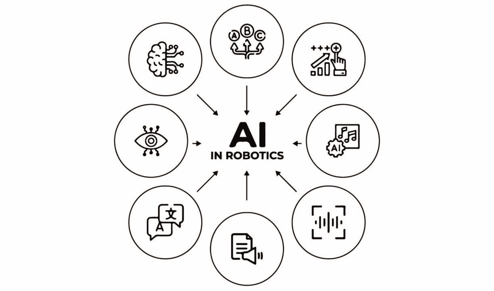

AI 的影响不限于单个任务；它增强整个流程，推动各行业效率提升。在物流领域，由 AI 传感器驱动的预测性维护使设备平稳运行，从而防止昂贵的故障和停机。这些传感器监控机械健康状况，在故障发生前预测故障，就像体检能预见健康问题一样。在仓储中，AI 驱动的自动化分拣系统简化了库存管理，分拣和分类物品的速度超越人类极限。它们优化空间和时间，确保产品以最小的努力被追踪和检索。这些改进提高了效率，降低了运营成本，并最终使企业在全球市场中更具竞争力。

协作机器人（Cobots）的兴起以促进人机协作的方式将 AI 带入工作场所。协作机器人设计用于与人并肩工作，配备安全功能以允许无风险的近距离交互。AI 使这些机器人能适应人类动作，从环境中学习并相应调整行为。在装配线上，协作机器人承担重复性或繁重的任务，让人类工人专注于更复杂的职责。在服务业，它们协助从客户服务到食品准备的各项工作，提升生产力和服务质量。这种人机协作正在重塑劳动力动态，创造机器补充人类技能的环境。

人工智能在机器人技术中的实际应用凸显了该技术的变革潜力。以机器人手术系统为例，人工智能协助外科医生实施精准、微创的手术。这些系统增强了外科医生的能力，提供洞察和指导，从而改善患者预后。在城市地区，自主配送机器人穿梭街道，将包裹直接送达消费者家门口，展现了物流业的未来图景。随着这些技术的持续演进，它们有望重塑行业，创造更智能、更高效的系统，以我们刚刚开始想象的方式提升我们的日常生活。

## 4.4 现实项目：构建人工智能驱动的聊天机器人

创建人工智能驱动的聊天机器人始于对其用途的清晰构想，例如，一个能够无缝处理客户咨询并提供信息的虚拟助手。第一步是定义用例，这涉及理解聊天机器人将做什么以及服务于谁。它是协助客户浏览网站，还是在零售环境中提供支持？一旦明确了用途，重点就转移到设计用户交互上：规划对话流程，预判用户提问，并编写机器人的回复脚本。可以把它想象成与朋友交谈，每一次回复都感觉自然且引人入胜。对话脚本越详细，聊天机器人就能更好地模仿人类互动，为用户提供更令人满意的体验。

要让聊天机器人理解并回应人类语言，自然语言处理（NLP）至关重要。NLP 使机器能够以有价值的方式理解、解释和生成人类语言。通过集成 `spaCy` 或 `NLTK` 等 NLP 库，您的聊天机器人将获得解析和处理文本、识别用户消息背后意图的能力。这些库提供了分词、命名实体识别等工具。引入情感分析则增加了另一层复杂度，使聊天机器人能够检测消息的情感基调。这在客户服务场景中特别有用，理解客户情绪可以指导聊天机器人调整其回复，无论是在投诉时提供共情，还是在积极互动时表现出热情。

聊天机器人训练就绪后，跨平台部署成为下一个挑战。与 `WhatsApp` 等即时通讯应用或 `Slack` 等平台无缝集成，确保聊天机器人触达用户已有的沟通场景。这种易用性增强了用户参与度和满意度。还可考虑利用云服务实现可扩展性。`AWS` 或 `Google Cloud` 等平台提供强大的服务，能够应对不断增长的流量和数据处理需求，确保即使用户数量激增，聊天机器人仍能保持响应迅速、运行高效。这些服务提供了扩展所需的基础设施，无需大量内部资源，让您能专注于优化聊天机器人的能力，而无需担心技术限制。

聊天机器人在众多现实场景中证明了其价值。在电商领域，它们实现客户支持自动化，即时回答关于产品或订单状态的查询，从而释放人工客服处理更复杂的问题。这不仅提高了企业效率，还通过减少等待时间提升了客户体验。教育平台在使用聊天机器人作为信息检索系统协助学生查找资源或理解复杂主题时，同样受益于人工智能。想象一名学生需要帮助解决数学问题；聊天机器人可以引导他们找到相关学习资料，或提供分步讲解。这些例子展示了聊天机器人的多功能应用，改变了互动方式，使跨行业、跨场景的用户能更便捷地获取信息。

## 4.5 人工智能在娱乐领域的应用：个性化与内容创作

在人工智能出现之前，居家观影之夜往往伴随着无休止的滑动寻找影片。如今，当你准备观影时，流媒体服务会呈现一份完美契合你品味的影片清单。这种由人工智能驱动的个性化推荐，改变了我们消费媒体的方式。算法分析你的观看习惯、题材偏好，甚至你最常观看的时间段。随后，它们策划符合你兴趣的内容，让无休止的滑动成为过去式。`Netflix` 和 `Spotify` 等流媒体巨头利用这些推荐系统维持用户粘性，确保你所见所闻正是你所想。这就像拥有一位比你更懂你的私人策展人。

人工智能还彻底改变了内容创作，开启了创意的新纪元。自动化视频编辑工具现可在极少人工干预下拼接素材、应用特效，甚至挑选音乐曲目。这些工具加快了制作时间表，降低了成本，让创作者能专注于讲故事而非技术细节。在音乐领域，人工智能生成的作品能模仿著名艺术家的风格，或创造全新流派，为乐迷带来新鲜声响。视觉艺术同样受益于人工智能，算法能生成复杂设计，或将照片转化为艺术杰作。技术与创意的融合，为我们从未想象过的艺术形式敞开了大门。

得益于人工智能驱动的互动性，娱乐领域的用户参与度达到了新高度。虚拟现实体验如今能将用户带入沉浸式世界，人工智能根据用户偏好定制每一次互动。无论你是探索古代遗迹，还是潜入生机勃勃的海洋，人工智能都能确保你的体验独一无二且引人入胜。互动式叙事更进一步，允许用户通过沿途的选择影响故事情节。人工智能根据这些决定调整故事线，创造动态且个性化的冒险。这种参与度将被动观众转变为主动参与者，模糊了现实与想象的界限。

作为娱乐业的重要参与者，游戏行业利用人工智能进行程序化内容生成。开发者无需独自打磨每一个细节，人工智能便能创造广阔、复杂的游戏世界，且每次游玩都会发生变化。这通过保持游戏体验的新鲜感和不可预测性，增强了可重玩性。同时，虚拟环境受益于人工智能驱动的聊天机器人，提供与角色的实时互动，这些角色能智能响应玩家行为。这些伙伴丰富了游戏体验，在玩家穿越虚拟景观时提供指引、幽默或陪伴。

在本章尾声，我们不难体会人工智能如何重塑了我们发现、创作和互动内容的方式。从个性化媒体体验到开创新的艺术表达，人工智能正打造一个未来，在那里娱乐如同我们的想象力一般动态且引人入胜。这段对人工智能实际应用的探索，为我们接下来对数据分析与可视化的探究奠定了基础，我们将揭示人工智能如何帮助我们理解周围的世界。

## 4.6 人工智能实战：探索实际应用与行业影响

### 高效实践指南

- 访问 ChatGPT：访问 `https://chatgpt.com`，如有需要请创建免费账户。
- 参与提示词练习：输入提示词，对其进行修改并实验，观察不同的响应。
- 评估响应：根据所学知识检查响应的清晰度和相关性。
- 实验与反思：调整提示词以加深理解，探索人工智能的能力。

### 巩固本章学习的提示词：

# 提示词 1：“解释预测模型如何用于欺诈检测，并用在人群中发现异常行为的比喻进行说明。”

# 提示词 2：“电商推荐系统如何提升客户参与度？用个性化购物体验的例子来说明。”

# 提示词 3：“卷积神经网络（CNN）如何应用于医学影像以辅助疾病诊断？用大海捞针的比喻进行说明。”

# 提示词 4：“强化学习如何提高自主机器人的效率？用学习走迷宫的比喻进行解释。”

# 提示词 5：“描述 AI 如何用于机器人流程自动化以优化制造工作流。”

# 提示词 6：“生成对抗网络（GAN）如何用于创建逼真的视频游戏角色？用雕塑家反复打磨作品的比喻进行解释。”

# 提示词 7：“在流媒体平台上使用 AI 进行内容推荐有哪些好处？描述算法如何根据用户偏好定制推荐。”

# 提示词 8：“解释 AI 聊天机器人如何部署在客户服务中。什么特性使它们行之有效？”

# 提示词 9：“想象你正在构建一个 AI 驱动的虚拟旅行向导。它需要哪些功能，以及如何利用计算机视觉和自然语言处理？”

# 提示词 10：“设计一个 AI 系统以增强在线教育中的个性化学习。它会使用什么数据，以及如何与学生互动？”

# 让您的评论创造改变

## 释放慷慨的力量

> 我们靠所得谋生，靠所予营造人生。 ——温斯顿·丘吉尔

分享知识、见解，甚至仅仅是一句善意之言的人，让世界更加明亮。一点微小的努力就能激励他人迈出第一步。让我们一起创造改变！

您愿意帮助像您一样、对 AI 充满好奇却不知如何开启旅程的人吗？

本书旨在让 AI、深度学习和神经网络变得简单、易懂且充满乐趣，让每个人都能受益。但要触达更多可能受益的人，我需要您的帮助。

大多数读者通过阅读评论来决定下一本读什么书。您的反馈能指引某人踏上学习之路，帮助他们发现 AI 多么令人兴奋且平易近人。

这不花一分钱，只需片刻时间，但您的评论可能会：

- 激励一名学生投身 AI 项目。
- 助力一位小企业主精简流程。
- 赋能一位企业家打造梦想产品。
- 帮助一位专业人士迈向精通科技的未来。
- 为一位感到迷茫的人点燃探索之旅。

## 准备好创造改变了吗？

扫描下方二维码或访问此链接留下您的评论：[`www.amazon.com/review/review-your-purchases/?asin=B0D9RX3KRS`](https://www.amazon.com/review/review-your-purchases/?asin=B0D9RX3KRS)

每一条评论，无论长短，对我都至关重要。衷心感谢您参与这项让 AI 平易近人、赋能大众的使命。

此致，

Jordan Blake

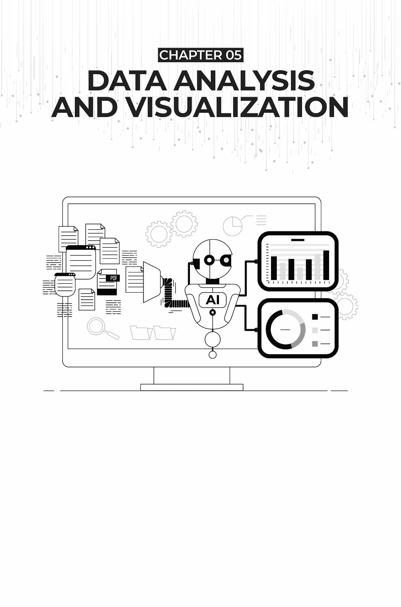

## 第 5 章：数据分析与可视化

想象一下，您正在整理一座杂乱的图书馆，每一本书代表一个新的数据点，而您最终工作的质量取决于您对这些数据分类、清洗和准备得有多好。在机器学习的世界里，数据是您最宝贵的资产，但它极少以完美状态到来。不干净的数据就像一层迷雾，遮蔽了通往准确分析和可靠结果的道路。如果您试图用浑浊的颜料绘制杰作，最终的画面将会模糊不清。同样，不干净的数据会严重影响模型性能，导致预测偏差和资源浪费。缺失值和异常值等常见问题如同道路上的坑洼，颠簸您的旅程，并可能导致错误的结论。缺失数据会误导算法，而异常值会扭曲结果，扭曲您所寻求的洞察。

## 5.1 数据清洗与转换

数据清洗的过程既是一门艺术，也是一门科学，需要一丝不苟的关注和策略性的技术。一种基本方法是通过插补来处理缺失数据。该技术用估计值填补空白，确保数据的缺失不成为障碍。这就像给渔网补洞，让您能捕获每一条鱼，而不让任何一条从缝隙中溜走。检测并移除异常值是另一个关键步骤。异常值具有误导性，就像安静房间里一个刺耳的大嗓门。移除或调整这些异常有助于提高数据质量，为分析提供更清晰的图景。这些方法共同确保您的数据完整且能代表您正在研究的现实。

转换是下一步，将原始数据转化为既有意义又易于管理的格式。这涉及归一化和缩放，它们将数据标准化，以便没有单一特征主导模型的学习过程。想象一下调节音响系统的音量，让所有扬声器和谐播放，没有一个淹没另一个。同样，归一化确保每个数据特征对分析做出同等贡献。编码分类变量是另一个关键方面，将它们转换为模型可解释的形式。例如，将“是”和“否”转换为二进制值，使模型能逻辑地处理这些响应。这些转换是混乱与清晰之间的桥梁，实现了有效的模型训练和分析。

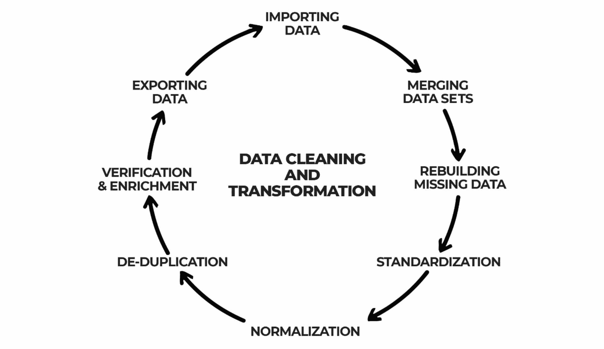

谈到数据清洗工具，`Python` 凭借其强大的库（如 `pandas` 和 `NumPy`）脱颖而出。`Pandas` 是您进行数据操作的首选，提供处理缺失值、移除重复项、修正数据格式以及精准高效地解决任何其他数据问题的函数。`SQL` 查询也很有价值，尤其是在处理数据库时，因为它们允许您直接在源头清洗数据。这种双重方法确保您的数据准备充分，减少错误并增强分析的可靠性。

要真正领会数据清洗的影响，请看一家零售公司的案例研究：该公司因数据不一致而导致销售预测不准。通过实施全面的数据清洗策略，他们通过插补解决了缺失值，并移除了扭曲预测的异常值。结果是一个更准确、更可靠的预测模型，从而实现了更好的库存管理和收入增长。这个例子凸显了数据清洗在实现稳健可信洞察中的关键作用。

### 反思练习：评估您的数据

花点时间回顾一下您正在处理的数据集。识别其中的缺失值或异常值。考虑如何使用此处讨论的技术来解决这些问题。反思这些步骤如何能提高分析的质量和可靠性。这项练习将帮助您巩固数据清洗的重要性，并为数据之旅的下一步做好准备。

### 5.2 探索性数据分析：工具与技术

#### 将探索性数据分析 (EDA) 视为数据分析过程中的初始侦察任务

这一阶段让你能深入了解你的数据。目标是从一开始就理解数据分布，识别可能带来突破的模式，或发现可能需要进一步调查的异常值。想象一下，你有一个巨大的拼图，但盒子上没有参考图片。EDA 会首先识别出角块和边块，以便你继续拼凑其余部分。它通过揭示数据的形状和分布，为所有后续分析奠定基础。通过 EDA，你可以发现可能扭曲结果的异常数据点，从而在它们给模型带来问题之前加以处理。

##### 高效 EDA 的工具与库

要进行高效的 EDA，你需要一套得心应手的工具和库。`Pandas` 在数据操作和汇总统计方面不可或缺，它赋予你轻松重塑和筛选数据的灵活性。`NumPy` 通过提供强大的数值分析能力来补充这一点，使你能轻松执行复杂计算。`Jupyter notebooks` 作为一个交互式环境，你可以在其中将代码执行与富文本和可视化相结合，创建一个鼓励实验和探索的动态工作空间。这些工具共同构成了你的 EDA 工具箱的骨干，装备你正面应对数据挑战。

##### EDA 中的可视化

可视化在 EDA 中起着至关重要的作用，它将原始数字转化为富有洞察力的视觉图表，使复杂数据更易于消化。直方图和箱线图是探索数据分布时的最佳拍档。直方图让你直观地感知数据在不同区间内的频率分布，而箱线图则突出显示数据的离散程度并识别潜在的异常值。这些视觉图表提供了数据底层结构的快照，帮助你决定后续步骤。当你想探索变量之间的关系时，散点图便登场了。通过将一个变量绘制在另一个变量对面，你可以发现乍看之下不明显的相关性或趋势。无论是正相关、负相关还是无相关，这些关系都能提供宝贵的见解，揭示数据不同要素如何相互作用。

##### 实用 EDA 技术

随着你对 EDA 的熟悉，实用技术变得至关重要。相关矩阵是同时识别多个变量之间关系的强大工具。它提供类似热力图的表示，其中每个单元格指示相关性的强度和方向。该矩阵能快速定位哪些变量协同变化，指导你进行特征选择和模型设计。分组操作是另一项实用技术，允许你按类别细分数据并计算每组的汇总统计量。当比较不同细分时，例如客户人口统计特征或产品类别，这种方法特别有用，因为它使你能根据特定需求定制分析。

##### 交互式练习：用 EDA 发掘趋势

选取一个你正在处理的数据集，进行一次简单的 EDA。首先使用 `pandas` 计算基本统计量，然后用直方图和散点图可视化数据。创建一个相关矩阵来识别关系。反思你获得的洞察，并考虑它们如何指导你分析的下一步。这种实践方法有助于巩固你对 EDA 力量和潜力的理解。

# 5.3 使用 Matplotlib 和 Seaborn 可视化数据

现在，你应该已准备好绘制讲述数据故事的画面。面对一张空白画布，`Matplotlib` 就像你的画笔，提供创建自定义图表的灵活性，让你的数据栩栩如生。这个绘图库是数据可视化世界中的强大工具，以其创建详细且精确的可视化图表的能力而闻名。数据科学家欣赏 `Matplotlib` 的多功能性、可靠性，以及从简单的线图到复杂的多层图表的制作能力。`Matplotlib` 的另一大优势在于其灵活性。你可以控制图表的方方面面，从线条的颜色到轴上刻度的位置，从而定制可视化以精确满足分析需求。在为报告或演示创建可视化图表时，这种细节控制尤为有益，因为清晰度和精确度至关重要。

## Matplotlib 中的基本图表类型

要开始使用 `Matplotlib`，让我们探索一些构成数据可视化基础的基本图表类型。线图非常适合分析随时间变化的趋势。无论你是在追踪股票价格还是温度变化，线图都能揭示可能被忽视的模式和波动。创建线图涉及在 x 轴和 y 轴上定义数据点并绘制线条连接它们，从而突出数据的轨迹。另一方面，柱状图非常适合比较分类数据。它们提供了一种直观的方式来直观展示各组之间的差异，例如不同产品类别的销售数字或不同人口统计群体的调查回复。通过调整柱子的宽度和颜色，你可以强调数据的特定方面，使你的洞察更具吸引力和易懂性。

## 使用 Seaborn 增强可视化

`Matplotlib` 提供结构，`Seaborn` 则增添光彩，以美观的设计增强你的可视化效果。`Seaborn` 构建于 `Matplotlib` 之上，只需几行代码即可简化复杂图表的创建过程。其突出功能之一是配对图，非常适合多变量数据探索。配对图为数据集中每一对变量创建一个散点图网格，并在对角线上绘制直方图。这种全面的视图让你能一次性识别跨多个维度的相关性和模式，提供对数据的整体理解。热力图是 `Seaborn` 提供的另一种强大可视化工具，用于可视化数据相关性。通过将矩阵中的值表示为颜色，热力图能快速传达变量间关系的强度，使发现趋势和异常变得更加容易。

## 实用可视化示例

考虑一个需要可视化数据集分布的实际例子。直方图是完成此任务的绝佳选择，因为它显示指定范围内数据点的频率，清晰地描绘数据如何分布在不同区间。通过调整箱子的数量，你可以细化可视化的粒度，根据需要关注细节或更广泛的趋势。此外，箱线图可用于可视化数据分布和异常值，提供关于数据集中趋势、变异性和潜在异常的见解。箱体代表四分位距，须线延伸至最小值和最大值，而异常值则作为单独的点绘制。这种方法对于识别可能扭曲分析的异常值以及比较不同类别间的分布特别有用。

### 5.4 高级数据可视化：用数据讲故事

#### 数据叙事与高级可视化

如果你必须阅读一本仅充满数字和统计数据的书，那会有点枯燥，对吧？另一方面，如果作者利用这些数字和数据讲述一个引人入胜的故事，阅读起来就会有趣得多。这就是**数据叙事**的精髓：将原始数据转化为引人入胜的叙事，以吸引并告知受众。叙事通过提供背景和清晰度来增强数据可视化，使复杂的数据集变得可理解且易于接受。这就像将一篇晦涩的学术论文变成一部扣人心弦的小说。一个精心设计的叙事能引导受众的解读，凸显关键洞察和趋势，而这些可能原本会被忽视。例如，与其将销售数据作为数字呈现，不如围绕产品的市场表现构建一个故事，将枯燥的统计数据转化为一个关于增长与战略的有意义的故事。

##### 高级可视化技术

高级可视化技术是你打造这些故事的工具。**交互式仪表板**允许你实时探索数据，提供一种动态的方式来分析和解读信息。将仪表板想象成一份“活文档”，用户可以在其中与数据互动，发掘针对其特定问题的洞察。这些仪表板使你能够深入细节或缩放以获取更宏观的视角，为分析提供灵活性和深度。**地理空间可视化**增加了另一层维度，将数据模式映射到地图上，以揭示地理趋势和洞察。想象一张显示城市客户密度的热力图，精准定位出适合业务扩展的区域。这些可视化将抽象数据转化为切实的洞察，清晰地展示数据如何与物理世界互动。

##### 高级可视化工具

要创建这些高级可视化，你需要合适的工具。`Tableau` 是开发交互式和可共享仪表板的热门选择。它提供用户友好的界面，允许你连接各种数据源，并只需点击几下即可创建可视化。借助 `Tableau`，你可以构建讲述故事的仪表板，并包含吸引受众的交互元素。另一方面，`Plotly` 擅长创建交互式图表和图形。它为可视化复杂数据提供了一个多功能平台，从时间序列到 3D 图表。这些工具赋能你将数据叙事提升到新高度，创建信息丰富、引人入胜且令人难忘的可视化。

##### 高效数据叙事的影响

思考一下高效的数据叙事如何让洞察“活”起来。可视化跨越数十年的经济数据趋势，可以揭示市场的兴衰、政策的影响以及经济演变的故事。一张精心制作的信息图表可以总结研究发现，将汪洋大海般的数据转化为简洁、美观的叙事，让关键点一目了然。这些故事拥有告知、说服和驱动行动的力量。将数据编织成引人入胜叙事的能力，是一项将普通数据分析师与卓越讲故事者区分开来的技能。

# 5.5 实战练习：真实世界数据分析项目

参与真实世界的数据分析项目，提供了一个以切实方式应用技能的机会。一个极佳的切入点是分析社交媒体数据以洞察情感趋势。社交媒体平台是用户观点和情绪的宝库，这些通过帖子、点赞和评论表达出来。通过收集这些数据，你可以探索情感如何随时间变化，或针对特定事件做出反应。首先选择一个平台，并使用 `APIs` 收集与特定主题相关的数据。收集完成后，预处理数据以聚焦相关特征，如文本内容和时间戳。这种准备为深度分析奠定了基础，使你能够发掘公众舆论中新兴的模式和趋势。

利用销售数据进行市场分析是另一个能产出宝贵洞察的实战项目。销售数据掌握着理解消费者行为、产品表现和市场动态的钥匙。首先从公司或开放数据集获取销售记录。将数据按时间段、产品类型和地理区域等类别进行组织。这种组织有助于你可视化趋势并识别增长机会。利用可视化手段突出关键指标，如收入增长或产品受欢迎程度。通过这些可视化，你可以描绘市场状况和潜在变化的图景，指导商业战略和决策。

执行这些项目需要有条理的方法。从数据收集和准备开始，以建立一个干净且全面的数据集。对于社交媒体数据，这涉及过滤掉噪音和无关信息。在市场分析中，重点关注准确的分类和归一化。数据准备就绪后，选择合适的可视化技术来揭示洞察。对于情感分析，词云和折线图可以展示公众情绪的变化。在市场分析中，使用柱状图和热力图来比较不同细分市场的销售表现。这些可视化作为识别趋势和模式的基础，为你的结论提供依据。

关键点。
*   **评估回复**：根据你所学知识，检查清晰度和相关性。
*   **实验与反思**：调整提示词以加深理解并探索 AI 的能力。

## 本节学习强化提示词

**提示词 1：** “清理大型数据集的常见挑战有哪些？用整理杂乱房间的类比来解释。”

**提示词 2：** “解释如何使用插补或删除等技术处理缺失数据。提供真实案例。”

**提示词 3：** “你将如何对包含客户评论的数据集执行 EDA（探索性数据分析）？列出发掘模式和洞察的步骤。”

# 提示词 4：“使用简单的例子描述单变量、双变量和多变量分析之间的主要区别。”

# 提示词 5：“你将如何创建一个用于可视化销售数据的交互式仪表板？你会包含哪些工具和图表？”

# 提示词 6：“如何使用 3D 图表可视化复杂数据集？描述一个科学数据分析中的用例。”

# 提示词 7：“假设你正在分析社交媒体数据以追踪公众情绪。你会使用哪些可视化方式来展示你的发现？”

# 提示词 8：“讨论在可视化敏感数据（如健康或财务记录）时的伦理考量。如何保护隐私？”

# 提示词 9：“设计一个对比过去十年全球互联网使用情况的数据可视化项目。你会使用哪些数据源和可视化方式？”

# 提示词 10：“假设你正在为一个智慧城市项目创建可视化。你会包含哪些类型的数据，以及如何展示它们？”

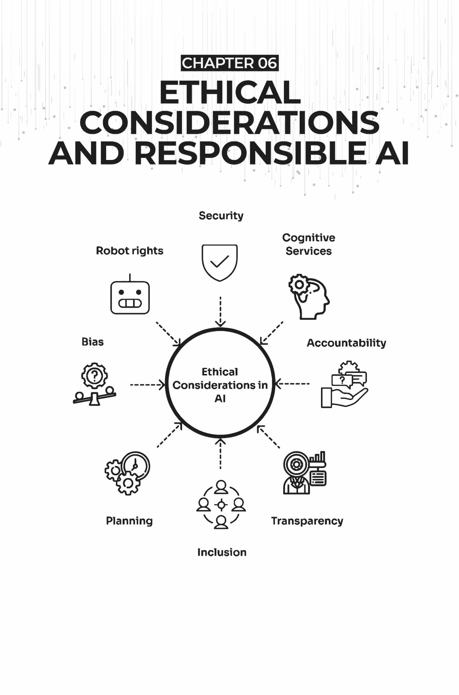

## 第 6 章：伦理考量与负责任的 AI

想象一下：你即将面试梦寐以求的工作，而一个 AI 系统将参与决策过程。听起来很有未来感，对吧？但如果我告诉你，这个系统可能存在偏见，不仅基于你的技能，还基于它不该考虑的因素，比如你的性别或种族，你会怎么想？这就是我们今天面对的 AI 现实，偏见可能渗透进算法，导致不公平甚至有害的结果。

## 6.1 人工智能中的偏见

在 AI 中，偏见源于我们输入这些系统的数据。训练数据往往反映了社会偏见，如性别刻板印象或种族偏见，这些会无意中教会 AI 复制这些模式。例如，如果一个 AI 系统是基于历史招聘数据训练的，而这些数据中某些职位主要由某一性别担任，那么它在提出招聘建议时可能会偏向该性别的候选人。训练数据中这种微妙的偏见可能导致结果倾斜，从而延续不平等，而非解决不平等。

算法偏见不仅仅是一个抽象概念；它在招聘和执法等敏感领域具有现实影响。考虑一下公司用于筛选候选人的招聘算法。如果这些算法有偏见，它们可能会基于非能力因素不成比例地排除合格人员，进而限制多样性并延续系统性歧视。同样，执法机构部署的人脸识别系统因误认个体（尤其是少数族裔群体）而受到审查。这些错误削弱了人们对技术及使用技术机构的信任；更糟糕的是，它们可能导致错误的指控或逮捕。

检测 AI 系统中的偏见对于确保公平和公正至关重要。统计测试可以通过比较 AI 模型在不同人口群体中的表现来帮助识别偏见。一个在某一群体中表现良好但在另一群体中表现不佳的 AI 系统可能暗示存在潜在偏见。对 AI 系统进行公平性审计涉及对训练数据、算法和结果的彻底检查，以识别和纠正偏见。像 `IBM's AI Fairness 360` 这样的工具为此类审计提供了框架，赋能开发者主动解决其系统中潜在的偏见（来源 1）。

检测之后，减轻 AI 中的偏见需要共同努力，以确保训练数据集多样化且具有代表性。通过纳入能准确反映人口多样性的数据，我们可以教会 AI 系统做出更公平的决策。模型训练中的偏见修正技术，如数据重新加权或重采样，有助于平衡代表性并减少偏见。这些策略不仅提高了 AI 系统的公平性；还增强了其可靠性和可信度，使其能公平地服务于所有用户。

### 反思练习：评估 AI 中的偏见

花点时间反思一下你日常生活或工作中交互的 AI 系统。考虑偏见可能如何影响它们的结果。是否存在偏向某些群体而非其他群体的模式？这些偏见可能如何影响人们的体验或机会？利用这次反思，思考如何在你自己的项目或工作场所中倡导更公平的 AI 实践。

## 6.2 确保 AI 的公平性与问责制

AI 技术拥有彻底改变医疗、金融等各个领域的力量。但如果没有公平性，这些进步可能会扩大拥有获取权的人与没有获取权的人之间的差距。AI 中的公平性至关重要，因为它确保这些技术惠及所有人，而非仅限于少数特权阶层。在我们日益数字化的世界中，只有为所有人创造机会（无论背景或地点），才能实现对 AI 的公平获取。这涉及设计在自动化决策中不歧视的系统，确保 AI 的力量被负责任且包容地行使。

为实现公平，我们必须采用指导 AI 开发的框架。这些框架侧重于意识与干预，认识到偏见可能产生并必须主动应对。公平性指标和度量提供了一种衡量和确保 AI 系统公平运行的方法。它们帮助开发者评估其模型是否公平对待所有用户，为持续改进提供基准。通过将这些框架集成到开发流程中，我们可以设计出尊重人类多样性并促进社会公益的 AI。

问责制是伦理 AI 开发的另一支柱。它涉及让 AI 系统及其创建者对其技术产生的结果负责。法律和监管方法在此发挥着关键作用，为 AI 驱动的决策制定明确的标准和后果。透明度是促进问责制的关键。当 AI 系统透明时，其决策过程变得可见且可理解，从而接受审查和问责。这种透明度建立了信任，因为用户可以看到决策是如何以及为何做出的，并确保系统在必要时可以被审计和纠正。

现实案例凸显了公平性和问责制如何在 AI 应用中被优先考虑。考虑为包容性招聘实践设计的 AI 系统。这些系统的开发重点在于消除偏见，确保候选人基于能力而非人口统计特征接受评估。通过使用多样化数据集和公平性指标，这些系统力求为所有申请人提供平等机会。另一个例子是促进负责任 AI 的社区主导倡议。这些倡议涉及开发者、用户和利益相关者之间的协作，以创建反映社区价值观并满足当地需求的 AI。它们强调在开发过程中纳入多元声音的重要性，以保证 AI 服务于更广泛的社会。

### 案例研究：包容性招聘实践

让我们考察一个案例，某科技公司实施了一个专注于包容性的 AI 驱动招聘系统。该系统以公平性指标为核心构建：它基于技能和经验评估候选人，同时过滤掉性别或种族等潜在的偏见数据点。公司定期进行审计，利用透明度工具确保 AI 的决策与其多元化目标一致。最终，这种方法提高了员工队伍的多样性，并提升了整体招聘质量，因为系统基于才干和潜力而非传统偏见来识别人才。这个案例凸显了公平性和问责制如何不仅改变招聘流程，还能改变组织文化。

### 6.3 可解释性：使 AI 决策透明化

#### AI 中的可解释性

想象一下，你正在使用一个 AI 系统，它做出的决策会影响你的日常生活——也许是推荐医疗方案或批准抵押贷款。你难道不想了解这些决策是如何做出的吗？**可解释性**是指让 AI 的决策过程变得透明且易懂的实践。当你能理解 AI 决策背后的推理时，你就会对信任这些系统感到自信。缺乏这种透明度，AI 就仍是一个黑箱，在用户中滋生怀疑和抵触情绪。信任对于 AI 技术的广泛采用至关重要，特别是在决策具有重大后果的领域。

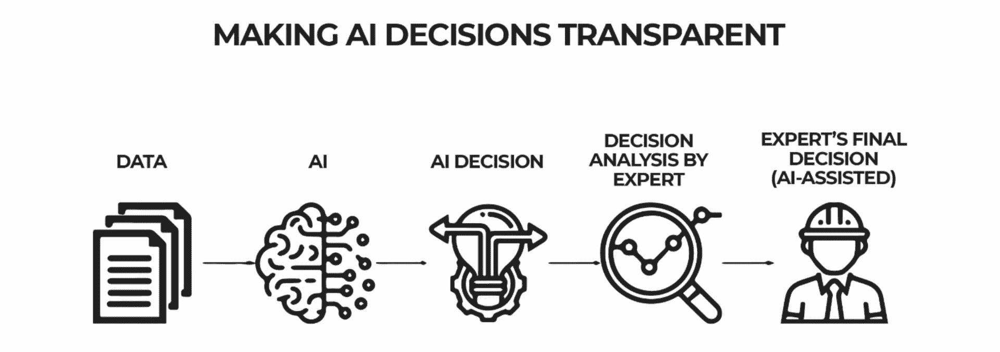

##### 实现可解释性的方法

在 AI 中实现可解释性并非易事，但有几种方法可以帮助揭开这些系统的神秘面纱。一种流行的技术是使用与模型无关的方法，如 `LIME`，它代表局部可解释模型无关解释。`LIME` 通过用更简单、可解释的模型来近似复杂模型，从而解释单个预测。就像将一篇科学论文翻译成通俗易懂的语言一样，这个过程让没有技术背景的人也能获取信息。可视化工具在使 AI 易于理解方面也发挥着至关重要的作用。通过使用热力图或决策树等可视化手段，用户可以看到哪些因素影响了模型的预测，从而深入了解决策过程。这些工具有助于弥合复杂算法与人类理解之间的鸿沟。

##### 创建可解释 AI 的挑战

创建可解释的 AI 模型伴随着自身的挑战。在保持模型复杂性和确保可解释性之间存在着微妙的平衡。复杂模型通常能提供更准确的预测，但更难解释。简化这些模型可能会使其更易理解，但可能会损害其准确性。此外，还存在关于知识产权保护的问题。公司通常担心透露太多关于其 AI 系统的信息，担心这会暴露商业机密。这种透明度与保护之间的张力是实现可解释性的重大障碍。开发者必须驾驭这些挑战，以创建既有效又易懂的系统。

##### 可解释 AI 的优势

可解释 AI 在各个领域已被证明是有益的，增强了这些技术的部署和接受度。例如，在医疗诊断中，可解释性至关重要。医生需要了解 AI 为何推荐特定的诊断或治疗方案。通过提供清晰的解释，AI 系统可以支持临床决策，从而改善患者预后。在金融服务领域，可解释 AI 有助于阐明信贷决策。当银行使用 AI 确定信用资质时，客户和监管机构需要了解接受或拒绝背后的推理。这种透明度确保了公平性和遵守监管标准，促进了机构与客户之间的信任。

##### 结论

在 AI 的背景下，可解释性已不仅仅是一项技术要求；它是一项道德义务。随着 AI 持续演进并融入我们生活的各个方面，理解其运作方式变得越来越关键。可解释性赋能用户，为影响他们的决策提供清晰度和信心。目标是使 AI 系统更智能、更友好，以便它们能以既有效又合乎道德的方式为我们服务。

# 6.4 实践中的伦理 AI：案例研究与经验教训

让我们仔细看看如何通过现实场景来应对 AI 中的伦理挑战。以预测性警务为例，AI 系统被用于预判犯罪活动并分配警力资源。表面上看，这似乎是利用技术增强公共安全的合乎逻辑的应用。然而，在某些情况下，这些系统被发现会强化警务中现有的偏见。例如，如果一个系统是在反映有偏见执法实践的历史犯罪数据上训练的，它可能会不成比例地针对少数族裔社区。这导致了更严格的审查，并呼吁采用更透明、更公平的算法。这里的教训很明确：如果不加仔细考量，AI 可能会延续甚至放大社会不平等。显然，在开发过程中让不同的利益相关者参与至关重要，以确保这些系统公平地服务于所有社区。

另一个伦理困境出现在 AI 驱动的社交媒体内容审核中。平台越来越依赖 AI 来过滤有害内容，但这引发了关于言论自由和审查的问题。AI 系统可能难以理解语境，导致删除并未违反准则的内容，或者相反，未能捕捉到有害材料。这种情况凸显了对 AI 系统进行持续监控和评估的必要性。开发者必须与用户和专家携手合作，改进这些系统，确保它们既有效又公平。这涉及技术调整和伦理监督的结合，以在安全与言论自由之间取得平衡。

但除了这些挑战和陷阱之外，许多成功的伦理 AI 实施案例能提供宝贵的见解。例如，AI 正被用于改善残障用户的无障碍访问。语音识别和自然语言处理技术使数字内容和服务更易获取，赋能残障人士充分参与数字世界。这些应用展示了如何以包容性为出发点设计 AI，提升生活质量和社会参与度。同样，为社会公益而开展的社区驱动 AI 项目也正在获得关注。这些倡议让当地社区参与 AI 系统的开发，以解决特定需求，如改善医疗或教育的获取。通过优先考虑将使用该技术人群的声音和需求，这些项目体现了伦理 AI 的实践。

为了开发和维护伦理 AI 系统，组织应建立伦理审查委员会。这些委员会可以指导开发过程，确保从一开始就整合伦理考量。定期的伦理审计和合规检查也必不可少。它们作为一种保障，在潜在伦理问题演变成重大问题之前识别它们。组织可以使用 `AI FactSheets` 等工具，它们提供 AI 系统的结构化文档，详述其开发、部署和伦理考量。通过实施这些准则，开发者可以创建创新、对社会负责的 AI 系统，并为真正造福所有人的技术铺平道路。

在 AI 开发中融入伦理实践不仅是一项技术挑战，更是一项社会挑战。它需要跨部门、跨学科的合作，并承诺透明度和问责制。只有这样，我们才能确保 AI 作为赋能而非分裂的工具，促进一个技术以公平且有意义的方式增强人类潜能的未来。

# 6.5 构建值得信赖的 AI 系统

# AI 中的可信度：可靠性、安全性与伦理

您会将个人数据、财务决策甚至人身安全托付给 AI 系统吗？什么样的系统才配得上这种信任？从根本上说，AI 的可信度取决于三个关键组成部分：可靠性、安全性和伦理。可靠性确保 AI 系统能够持续且准确地执行任务，提供用户可依赖的可靠结果。另一方面，安全性保护 AI 应用中的数据和流程免遭泄露和滥用，在数据隐私至关重要的时代提供了一座坚固的保护堡垒。伦理将反映社会规范和价值观的原则注入 AI 系统，确保技术符合道德期望。这三个组成部分共同构成了信任的基石，影响着用户对 AI 的采用和接受程度。当人们信任 AI 时，他们更有可能将其融入生活，从而实现更无缝、更具影响力的技术进步。

## 构建可信赖的 AI 系统

但我们该如何构建体现这些理想的 AI 系统呢？一种策略是确保数据隐私和安全，这在当今互联互通的世界中是不可妥协的。开发者必须实施强有力的数据保护措施，如加密和匿名化，以保护敏感信息。这不仅保护了个人，也增强了系统的公信力。构建具有弹性的 AI 模型是另一项关键策略。这些模型应设计为能够抵御错误和攻击，即使在逆境条件下也能保持功能正常。对抗训练等技术（让模型做好处理意外输入的准备）是实现这种弹性的关键。实现可信度需要采取主动方法，在潜在漏洞演变为威胁之前加以解决。

## 人工监督与伦理培训

人工监督在维护对 AI 系统的信任中发挥着关键作用。仅让 AI 独立运行是不够的；人工操作员必须保持参与，验证决策并确保合乎伦理的使用。人在回路方法涉及人类积极参与 AI 决策过程，提供仅靠自动化系统可能缺乏的制衡机制。这种监督对于后果重大的决策至关重要，例如医疗或刑事司法领域的决策。对 AI 操作员进行伦理使用和解读方面的培训同样重要。这些人员应具备理解 AI 输出并做出明智判断的能力，确保技术服务于人类利益并遵守伦理标准。

## 可信赖 AI 的现实案例

可信赖 AI 系统的例子比比皆是，展示了可靠性、安全性和伦理如何在实践中结合。以自动驾驶汽车为例，它们必须赢得公众信任才能成为主流。这些车辆依靠 AI 安全导航，需要严格的测试和验证，以确保它们在道路上始终做出正确决策。其成败取决于公众对其安全可靠运行能力的信心。医疗领域的安全 AI 平台是另一个例子，它们以极高的谨慎处理敏感的患者数据。这些系统采用先进的安全措施来保护数据的完整性和机密性，在依赖它们获取关键健康信息的用户中建立起信任。

## 更广泛的背景：透明度与问责制

在更广泛的背景下，对 AI 系统的信任超越了技术规范。它涉及培育一种透明和问责的文化，让用户对日常交互的技术充满信心。随着我们继续开发和部署 AI，维护信任将至关重要，确保这些系统在不损害我们的价值观或安全的前提下改善我们的生活。通过拥抱这些原则，我们可以为既推动技术进步又丰富我们共同人类体验的 AI 铺平道路。

## 结论与后续步骤

在本章结束之际，很明显，伦理考量不仅仅是指导方针，更是 AI 未来的必要条件。可信赖的 AI 系统触手可及，随着我们不断前进，这些原则将指引我们构建一个更公平、更安全的数字世界。在下一章中，我们将探讨 AI 如何持续重塑行业，推动创新并重新定义可能性。

## 6.6 AI 实操：探究 AI 中的伦理考量

###### 高效练习指南

- 访问 ChatGPT：访问 `https://chatgpt.com`，如有需要请创建免费账户。
- 使用提示词：输入提示词，对其进行修改并实验，以查看不同的回复。
- 评估回复：根据您所学知识检查回复的清晰度和相关性。
- 实验与反思：调整提示词以加深理解并探索 AI 的能力。

### 巩固本节学习的提示词

1. "用一个用有缺陷的蓝图建房子的比喻，解释偏见是如何被引入 AI 模型的。"
2. "可以采取哪些策略来减少 AI 模型中的偏见？请提供招聘或贷款场景中的例子。"
3. "组织可以采取哪些措施来保护 AI 系统中使用的敏感数据？请提供医疗或金融领域的例子。"
4. "AI 开发者如何提高模型对非技术用户的透明度？以自动贷款审批为例。"
5. "为什么可解释性在 AI 系统中至关重要，尤其是在医疗等高风险领域？请提供现实场景。"
6. "当 AI 系统做出有害决策时，谁应该承担责任？以自动驾驶汽车或预测性警务为例进行讨论。"
7. "假设您正在设计一个用于招聘的 AI 系统。您会采取哪些步骤来确保其避免歧视性结果？"
8. "公司如何在广告个性化需求与尊重用户隐私之间取得平衡？请提供可操作的策略。"
9. "设想一个未来场景，AI 被用于个人决策。应建立哪些保障措施来保护个人自主权？"
10. "分析一个 AI 系统用于预测性警务的场景。潜在风险是什么，如何缓解？"

## 第 7 章：利用 AI 工具包提升技能

人工智能世界瞬息万变，创新以惊人的速度涌现。为在该环境中保持竞争力，开发者和研究人员常寻求 `TensorFlow` 的可靠性、强大功能及支持。想象您是一位面对空白画布的艺术家，而 `TensorFlow` 就是您的调色板，充满了将 AI 愿景变为现实的生动工具。`TensorFlow` 由 Google 开发，已成为机器学习的基石，为构建和部署模型提供了灵活且全面的生态系统。其架构建立在稳健的计算图之上，能高效处理复杂的数学运算，犹如一台在压力下平稳运行的润滑良好的机器。该框架让您能轻松构建复杂模型，将抽象想法转化为切实成果。

### 7.1 TensorFlow：理解基础

`TensorFlow` 多功能性的核心在于 `TensorFlow Hub`，这是一个预训练模型库，可加速您的工作流。将其想象为一个装满即用型资源的图书馆，可针对您的特定需求进行微调和调整。无论您是深入研究图像分类还是自然语言处理，`TensorFlow Hub` 都提供了一个起点，为您节省时间和精力，同时确保您能接触到前沿技术。与之相辅相成的是 `TensorFlow Extended (TFX)`，一个面向生产环境的流水线，可简化模型在现实应用中的部署。`TFX` 就像工厂里的传送带，高效地生产模型，将其无缝集成到生产系统中，准备好应对现实世界的挑战。

#### 理解 TensorFlow 操作

理解 TensorFlow 操作的基础对于充分发挥其潜力至关重要。TensorFlow 的核心是张量，即作为主要数据结构的多维数组。可以将它们视为任何 TensorFlow 操作的构建基块，就像可以堆叠和组织以创建复杂结构的乐高积木一样。创建和管理张量涉及定义其形状和类型，然后通过加法、乘法和重塑等操作对其进行操控。计算图进一步增强了这一点，它描绘了数据的流向，使 TensorFlow 能够高效地优化和执行操作。该图充当蓝图，可视化不同操作之间的关系，并确保数据在网络中顺畅流动。

##### 高级特性

随着你对 TensorFlow 的深入使用，你将发现能为优化和部署开启新可能性的高级特性。**TensorFlow Lite** 专为移动和嵌入式设备设计，是 TensorFlow 的精简版，支持设备端机器学习。想象一下将 AI 模型直接部署到智能手机上，使其变得更智能、响应更快，且无需依赖服务端计算。这一能力为实时翻译和图像识别等应用打开了大门，将 AI 的力量置于你的指尖。此外，**TensorFlow 模型优化工具包** 提供了用于微调模型以提高效率的工具，在不牺牲性能的前提下减小模型体积和计算需求——这就像给赛车减去多余重量，以在赛道上获得更高的速度和效率。

##### 实战项目

要真正领会 TensorFlow 的能力，不妨深入实战项目以展示其优势。构建一个用于图像分类的神经网络是一项结合理论与实践的有益尝试。首先选择一个数据集，例如 **CIFAR-10**，它包含跨多个类别的带标签图像。使用 TensorFlow，构建一个包含卷积层的模型，能够精准分析和分类这些图像。当你调整超参数并评估性能时，你将更深入地理解模型如何学习和改进。或者，通过实现一个能够生成文本或理解情感的模型来探索自然语言处理。通过在多样化的语言数据集上训练模型，你将见证其掌握上下文和含义的能力，从而洞察人类交流的复杂性。

###### 互动练习：TensorFlow 实战

要上手 TensorFlow，请尝试此练习。选择一个简单的数据集，如 **Iris 数据集**，并使用 TensorFlow 构建一个分类器。定义张量，构建计算图，并训练模型。尝试不同的架构和优化技术，观察它们如何影响准确率。此练习将巩固你对 TensorFlow 工作流的理解，并让你体验真实世界的 AI 应用。

# 7.2 PyTorch：AI 开发中的灵活性与控制力

想象一下走进一个车间，里面摆满了能随你心意调整的工具，让你能实时构建和修改作品。这就是 **PyTorch** 的精髓，一个旨在赋予开发者无与伦比的灵活性和控制力的动态直观框架。与其他依赖静态计算图的框架不同，PyTorch 采用动态计算图运行，这意味着你可以随时调整模型，就像塑造粘土而非雕刻石头。这一特性使 PyTorch 对研究人员和从事实验性项目的人特别有吸引力，因为在这些场景中通往解决方案的路径并不总是线性的。该框架直观的接口进一步增强了其吸引力，提供了一种自然熟悉的 Pythonic 方法。PyTorch 的调试能力令人耳目一新，让你能轻松自信地排查故障。它就像一台放大镜，揭示模型内部运作的复杂细节，让你能够打磨和完善每个组件。

## 核心组件：张量与 Autograd

PyTorch 的核心是张量，它们与其他框架中的张量类似，但有一个不同之处：它们专为动态计算而设计。这些多维数组是每项操作的骨干，从简单的算术到复杂的数据变换。在 PyTorch 中创建和操控张户非常简单，函数允许你以无数种方式重塑、切片和组合它们。将这些张量视为工具箱中的原材料，随时准备被打造成复杂的模型。与张量相伴的是 **Autograd**，PyTorch 的自动微分引擎。Autograd 通过自动计算梯度消除了反向传播的麻烦，让你能专注于项目的高层设计、策略和其他创造性方面。

## 构建与训练模型

得益于其模块化设计，在 PyTorch 中构建和训练模型是一个引人入胜的过程。**nn.Module** 是 PyTorch 构建神经网络的基础模块，为定义复杂架构提供了结构化且灵活的框架。无论你是构建简单的前馈网络还是更复杂的结构，`nn.Module` 都允许你逻辑直观地组织模型组件。结合 **torch.optim**（PyTorch 的优化算法套件），你拥有了将模型微调至最佳性能所需的一切。这些工具协同工作，在你迭代和改进设计时提供无缝体验，就像工匠打磨杰作直到其闪耀着精准与目的的光芒。

##### 实战项目

要见证 PyTorch 的实战能力，不妨挑战一个能突破你当前技能边界的项目。开发一个用于目标检测的卷积神经网络是亲身体验 PyTorch 强大功能和灵活性的绝佳方式。首先收集一个包含丰富多样图像的数据集，例如 **COCO 数据集**，它用真实世界场景挑战你的模型。在构建网络时，探索使目标检测成为可能的各种层和组件，从提取特征的卷积层到精准分类物体的全连接层。或者，用于翻译任务的序列到序列模型提供了另一种挑战，深入语言和上下文的复杂性。通过在平行语料库上训练模型，你可以创建一个将文本从一种语言翻译成另一种语言的系统，捕捉两者的细微差别和微妙之处。每个项目不仅磨练你的技术技能，还拓展你对 AI 可能性的理解，为更宏大的事业奠定基础。

### 7.3 利用 Keras 进行快速原型设计

懂烹饪的人都知道储备齐全的厨房和充足的食材的价值。在这个场景中，将 **Keras** 视为简化整个过程的副主厨。Keras 凭借其高级 API 和直观设计能够快速制作模型，让你无需繁琐的复杂编码即可快速组装复杂的神经网络。它像一个模块化系统运行，你可以轻松堆叠神经元层，就像搭积木一样，形成你设想的架构。它与 **TensorFlow** 的集成也意味着你可以无缝扩展项目，利用 TensorFlow 强大的生产级部署能力。这种集成让你能从原型起步，并根据需要扩展到更苛刻的应用。

#### 使用 Keras 构建模型

得益于双 API 设计，使用 Keras 构建模型非常简单直接。`Sequential` API 是构建简单、线性堆叠模型的首选。你只需依次定义一层又一层，就像叠煎饼一样，每一层都为模型性能贡献独特的“风味”。它非常适合希望以最少的设置快速上手并运行模型的初学者。对于那些想要探索更复杂设计的人来说，`Functional` API 提供了创建具有多输入多输出复杂架构的灵活性。这种方法就像烹制一道定制菜肴，每一种食材都经过精确衡量和混合。你将层定义为独立的对象并将它们连接起来，从而创建一个神经通路网络，能够处理多样化且复杂的任务。

Keras 在快速实验方面大放异彩，提供了简化测试和调优过程的功能。其中一项功能是使用 `callbacks`（回调函数），它允许你即时调整训练动态。想象一个恒温器，它不断调整以确保最佳舒适度——`callbacks` 监控训练过程并进行实时调整，在改进停滞时停止训练或保存模型检查点。此外，`Keras Tuner` 简化了超参数调优，让你能够轻松探索不同配置，找到最适合你需求的设置。该工具就像一位经验丰富的大厨品尝菜肴并调整配料以求完美，确保你的模型发挥出最佳性能。

在实践中，Keras 对于跨各个领域的原型设计极具价值。考虑使用循环层构建情感分析模型。这涉及处理文本数据序列并确定其潜在情感，无论是积极、消极还是中性。通过利用 Keras 的循环层，你可以高效地建模时间依赖性，捕捉人类语言的细微差别。另一个令人兴奋的应用是使用嵌入开发推荐系统。在这里，你创建一个模型，根据过去的交互学习预测用户偏好，从而提供个性化建议。借助 Keras，你可以快速迭代这些原型，不断改进直到达到预期效果。

## 7.4 Scikit-Learn：简化机器学习

`Scikit-Learn` 就像机器学习领域的瑞士军刀，提供了一个强大且通用的库，适用于广泛的经典机器学习任务。对于正在应对 AI 复杂性的你们来说，`Scikit-Learn` 在其众多算法中提供了一致的 API，使其易于上手且直观。其详尽的文档提供了宝贵的信息，指导你从基础到高级技术。活跃的社区支持是救命稻草，随时准备在你遇到困难时提供帮助。无论你是构建简单的回归模型还是深入聚类分析，`Scikit-Learn` 都以其可靠性脱颖而出。

数据预处理往往感觉像烹饪前的备菜。有了 `Scikit-Learn`，这一阶段通过其 `pipelines`（管道）得以简化。`Pipelines` 允许你自动化数据转换和建模步骤的序列，从而实现整洁高效的工作流。想象一下建立一条传送带，每个工位都为下一步优化你的数据。特征缩放和归一化是此处的关键过程，因为它们有助于标准化数据，确保没有单一特征主导学习过程。像 `MinMaxScaler` 或 `StandardScaler` 这样的技术确保你的特征处于可比较的尺度上，就像为公平竞赛铺平赛场。

评估模型性能是 `Scikit-Learn` 真正大放异彩的地方。该库提供了一套模型评估工具，帮助你找出最适合你数据的算法。`Cross-validation`（交叉验证）是此处的关键技术，它将数据分成子集以测试模型的泛化能力。就像赛前多次练习能提高表现一样，`cross-validation` 确保你的模型在不同条件下都能良好运行。`Grid search`（网格搜索）是另一个强大功能，允许你系统地优化超参数。它遍历一组预定义的选项，找出产生最佳结果的组合，就像大厨尝试各种香料来完美一道菜。

`Scikit-Learn` 的通用性在其现实应用中显而易见。考虑使用决策树分类器进行客户细分。该模型帮助企业根据行为和偏好对客户进行分类，促进有针对性的营销策略和更个性化、高效的服务。另一方面，聚类算法可用于市场分析。通过将相似的数据点分组，这些算法揭示隐藏的模式和洞察，使公司能够了解市场趋势和消费者偏好。这种分析对于战略规划极具价值，帮助企业保持竞争优势，更有效地满足客户需求。

## 7.5 实际应用：使用 AI 库进行构建

结合 AI 生态系统中的不同库是增强整体性能的有力方式，就像组建一支拥有多元优势的团队能强化整个团队一样。例如，将 `TensorFlow` 与 `Keras` 结合使用可以简化工作流，使原型设计和模型扩展变得更容易，而不会陷入复杂性中。这种集成让你能够利用 `TensorFlow` 强大的基础设施，同时享受 `Keras` 的简洁性。另一方面，将 `PyTorch` 模型与 `Scikit-Learn` 管道集成可以增强数据处理和模型评估，让你两全其美。`PyTorch` 的灵活性与 `Scikit-Learn` 的预处理和算法能力完美契合，在深度学习和传统机器学习技术之间架起了一座无缝桥梁。通过结合这些库，你不仅仅是在构建模型；你是在构建能够适应并适应各种应用场景的多功能系统。

一个展示集成 AI 库威力的现实应用是使用集成方法开发欺诈检测 AI 系统。想象一个系统能够筛选海量交易数据以识别可疑活动。通过结合 `TensorFlow` 在深度学习方面的优势和 `Scikit-Learn` 在集成技术方面的优势，你可以创建一个混合模型，同时捕捉复杂模式和传统规则。这种方法提供了分层防御：深度学习模型检测细微模式，集成方法整合其预测以实现稳健决策。另一个引人注目的项目是为电商平台创建实时推荐引擎。在这里，你可以使用 `Keras` 快速原型设计神经网络，并使用 `Scikit-Learn` 实现协同过滤技术。这种混合系统利用用户交互和偏好提供个性化推荐，提升用户体验并促进销售。这些项目展示了结合库的威力；从更宏观的角度来看，它们凸显了 AI 在深思熟虑应用时的现实影响。

部署和可扩展性是将 AI 模型从开发阶段推向生产环境时的关键考量因素。使用 `Docker` 进行容器化是一项关键策略，它允许你将应用程序打包进轻量级、可移植的容器中。这意味着你可以在不同环境中一致地运行模型，无论是在本地机器还是云端。`Docker` 确保你的应用程序拥有运行所需的一切，最大限度地减少兼容性问题并简化部署流程。此外，利用云平台构建分布式 AI 解决方案提供了显著的可扩展性优势。`AWS`、`Google Cloud` 或 `Azure` 等服务提供了处理大规模数据处理和模型训练所需的基础设施，使你的 AI 系统能够随需求增长而扩展。这些平台提供灵活的资源和强大的安全措施，使其成为部署需要高可用性和高性能模型的理想选择。

持续学习和更新在日新月异的 AI 领域至关重要。定期更新你的库可确保你获得最新的功能、优化和安全补丁。这一做法使你的系统保持最新且具备竞争力，让你能够利用 AI 技术的最新进展。此外，参与社区论坛和讨论是保持信息灵通和分享知识的绝佳途径。这些社区是充满活力的生态系统，在这里观点得以交换、问题得以解决、创新得以诞生。与同行互动能增强你的学习、促进协作，并最终带来更好的解决方案和突破。总而言之，在一个唯一不变就是变化的领域里，保持技能和系统的更新已成为一种必要。

在本章接近尾声之际，请记住：集成 AI 库、考量部署策略以及拥抱持续学习，是构建高效 AI 解决方案的关键要素。这些要素确保你的系统健壮、可扩展，并做好准备迎接明天的挑战。展望未来，请牢记 AI 开发的旅程，既关乎适应性与协作，也关乎创新。

## 7.6 动手实践 AI：AI 工具包的高级应用

###### 高效练习指南

- 访问 `ChatGPT`：访问 [`chatgpt.com`](https://chatgpt.com)，如有需要请创建免费账户。
- 使用提示词互动：输入提示词，对其进行修改并实验，以观察不同的响应。
- 评估响应：根据你所学知识，检查响应的清晰度和相关性。
- 实验与反思：调整提示词以加深理解，探索 AI 的能力。

### 巩固本节学习的提示词

- **提示词 1：** “`TensorFlow Lite` 在移动设备上部署 AI 模型有哪些优势？请以实时目标检测为例进行解释。”
- **提示词 2：** “创建一个基于 `PyTorch` 的神经网络来预测房价。描述所涉及的步骤和使用的关键函数。”
- **提示词 3：** “使用 `Keras` 构建卷积神经网络的主要优势是什么？请以图像识别为例进行说明。”
- **提示词 4：** “解释 `Scikit-Learn` 的 `Pipeline` 如何简化预处理和模型训练的工作流。”
- **提示词 5：** “结合 `TensorFlow` 和 `PyTorch` 进行模型训练和高效部署。这种混合方法涉及哪些步骤？”
- **提示词 6：** “如何使用 `Keras` 的函数式 API 构建多输入、多输出模型？请提供一个场景，如预测电影评分和类型。”
- **提示词 7：** “将 AI 工具包集成到生产环境中面临哪些挑战？请提供缓解这些挑战的策略。”
- **提示词 8：** “如何决定项目使用哪个工具包？针对时间序列预测任务，对比 `TensorFlow`、`PyTorch` 和 `Scikit-Learn`。”
- **提示词 9：** “设想使用 `TensorFlow` 和 `Keras` 设计一个实时交通监控系统。你会使用什么模型和数据？”
- **提示词 10：** “如何将 `PyTorch` 和 `Scikit-Learn` 结合，以实现自定义特征提取和分类流水线？”

# 第 8 章：基于项目的学习与现实应用

想象一下，你站在一条未知小径的起点，每一步都让你更接近掌握人工智能概念的彼岸。这就是 AI 结构化学习路径的精髓。它充当你的地图，引导你穿越机器学习和神经网络的广阔版图。在这段旅程中，设定切合实际且可达成的目标至关重要。可将它们视为地图上的地标，每一个都代表一项已掌握的技能或概念。这些目标必须清晰、可执行且有时限，为你提供方向感和成就感。确定学习旅程中的关键里程碑，能进一步将路径分解为易于管理的片段，让你一次专注于一个部分，而不会因领域的浩瀚而感到不知所措。这种结构化方法确保你迈出的每一步都有明确目的，建立在上一步的基础之上，引领你抵达终极目的地：精通 AI。

## 8.1 让项目契合你的热情

个性化你的学习体验，能将这条结构化路径转化为一条与你的个人兴趣和职业目标产生共鸣的道路。首先选择与你的热情相符的项目。如果你对医疗保健充满热忱，就创建一个辅助医疗诊断的模型。如果金融令你兴奋，就深入研究预测市场趋势的算法。量身定制项目不仅能让你保持投入，还能通过将概念应用于你关心的领域来增强学习效果。平衡基础技能与进阶主题同样重要。夯实基础提供坚实地基，而探索前沿领域则挑战自我并让你保持在技术前沿。这种平衡确保了理解的全面性，防止知识盲区阻碍你的进步。

跟踪进度对于保持正确方向和认可成就至关重要。学习管理系统 (`LMS`) 通过组织学习材料、作业和进度报告来简化你的体验。它们提供了一个中心化平台，供你规划学习、设定截止日期并监控进展。`GitHub` 等在线平台将项目管理推向新高度，提供了一个记录工作、与同行协作并向潜在雇主展示进度的空间。虽然这些工具提供了便捷的组织方式，但它们也建立了一个以共享学习、协作和反馈为中心的社区。

### 互动环节：创建你的个性化 AI 学习路径

为了将这些概念付诸实践，请设计你的个性化学习路径。首先列出你的 AI 职业目标。你是志在成为数据科学家、AI 研究员，还是机器学习工程师？接下来，确定有助于实现这些目标的技能和项目。对于有志成为数据科学家的人，重点掌握数据处理、探索性数据分析和模型构建。纳入涉及真实数据集的项目，在实际情境中应用你的技能。如果 AI 研究是你的目标，则强调基础理论、高级算法和实验设计。参与挑战现有知识边界的项目，鼓励创新与发现。利用这个框架，打造一条专属于你的、量身定制的学习路径，契合你的兴趣与抱负。

通过遵循这种结构化、个性化的方法，你将学习体验转变为一段量身定制的旅程，充满目标感与方向感。你迈出的每一步都建立在上一步的基础之上，形成一条连贯的道路，引领你通往 AI 精通的彼岸。拥抱可用的工具与资源，善用你的兴趣点，并对自己的学习负责。有了清晰的计划和正确的心态，你将装备完善，从容应对人工智能世界中未来的挑战与机遇。

## 8.2 构建情感分析模型

想象一下，如果你仅通过倾听交谈就能瞬间判断出房间里的气氛，那将会怎样？这就是情感分析在数字世界中的承诺。情感分析是自然语言处理（NLP）的一个分支，专注于解读和分类文本数据中的情绪。它让机器能够理解人类的情感和观点，这在当今数据驱动的世界至关重要。这项技术在社交媒体监控中特别有用，品牌可以借此衡量公众对其产品或服务的情感倾向。通过分析推文、Facebook 动态或 Instagram 评论，公司能深入了解消费者如何看待其品牌，从而有效地响应反馈和趋势。除了社交媒体，情感分析在客户反馈分析中也扮演着重要角色，帮助企业了解客户满意度和需要改进的领域。通过将评论或调查回复分类为积极、消极或中性情感，公司可以确定优先处理的问题，优化产品，并改善客户体验。

要开始情感分析，第一步是收集合适的数据，这通常涉及通过 API 接入社交媒体平台。像 Twitter 这样的平台提供 API，允许开发者收集实时推文，随后对其进行情感分析。数据收集完成后，需要进行预处理以确保分析的准确性。预处理包括分词——将文本拆分为单个单词或标记，以及文本规范化——通过转换为小写、移除标点符号、过滤停用词（如 "and" 或 "the"）来标准化文本。这些步骤至关重要，因为它们为原始文本的分析做好了准备，确保后续的情感分类基于准确且相关的数据。

构建情感分析模型涉及选择合适的工具和库。NLP 库如 `NLTK` 或 `spaCy` 是常用的选择，它们提供了强大的文本处理和分析功能。借助这些库，你可以使用已标注的数据集训练分类器——即情感已知的文本集合——来指导模型。例如，使用一组标注为积极或消极的电影评论数据集，你可以训练模型识别与每种情感相关的模式。这个训练过程向模型提供示例，使其学习单词与情感之间的关联。随着模型处理更多数据，它预测新的、未标注文本情感的能力不断提高，这很像孩子通过观察周围人学会区分快乐和悲伤的表情。

构建模型后，评估其性能是确保其有效性的关键。一种常用方法是使用混淆矩阵，它提供了模型预测结果与实际结果的全面对比。它将模型性能分解为真阳性、假阳性、真阴性和假阴性，从而提供关于其准确性和改进领域的洞见。如果模型预测未达预期，可以采用超参数调优来优化性能。此过程涉及调整控制模型学习的参数，如学习率或训练迭代次数。通过微调这些设置，你可以提高模型的准确性，并确保其能很好地泛化到新数据。

为了充分领会情感分析的威力，可以考虑在项目中使用清单等交互元素。此清单可包括定义问题、收集数据、预处理、训练模型和评估等步骤。拥有清单能确保你覆盖所有必要步骤，为项目提供结构，并帮助你追踪进度。当你逐项完成清单时，你将获得构建情感分析模型的实战经验，加深对这一强大 AI 应用在技术和实践层面的理解。

## 8.3 开发图像分类系统

图像分类系统是关键应用，它们改变了机器解读视觉数据和与之交互的方式。其核心在于将图像归类到预定义的类别中。这种能力在各行各业至关重要；例如在医疗领域，图像分析通过分析医学扫描来识别肿瘤或骨折等异常，辅助疾病检测。这加快了诊断速度并提高了准确性，赋能医疗专业人员做出更明智的决策。同时，在汽车领域，图像分类支撑了自动驾驶汽车的功能。它使车辆能够识别物体和障碍物——从行人到交通标志——保障安全高效的导航。通过将视觉输入转化为可执行的数据，图像分类系统正在重塑众多领域。

要开发一个有效的图像分类模型，你必须首先精心准备数据集。这涉及图像数据的获取和标注，是一项需要勤奋和精确的任务。目标是收集一组多样且具代表性的图像，涵盖你感兴趣的所有类别。准确的标注至关重要；每张图像都必须被正确标记，以教会模型区分类别。不充分或错误的标注会导致模型性能不佳，因为模型正是从这些示例中学习。数据集准备就绪后，数据增强技术便登场了。这些技术通过创建现有图像的修改版本（如旋转、翻转或调整亮度）来扩充数据集。数据增强增加了训练数据量，并让模型接触各种场景，从而增强鲁棒性，减少过拟合，并提高对新图像的泛化能力。

构建图像分类模型涉及利用卷积神经网络（CNN），后者特别适合处理视觉数据。CNN 擅长特征提取，通过卷积滤波器层识别图像中的模式和结构。这些滤波器如同模型的眼睛，扫描图像以检测边缘、纹理和形状。使用 `Keras` 或 `TensorFlow` 等库实现 CNN 可简化流程。这些库提供预建函数和架构选项，简化模型创建和训练。你首先定义网络架构，指定卷积层的数量及其参数。然后，将准备好的数据集输入网络，使其学习并调整滤波器以最大化分类准确性。在此过程中，你需要微调超参数（如学习率和批次大小），以优化性能和效率。

# 部署与推荐系统构建

## 图像分类模型的部署规划

随着图像分类模型逐渐成型，规划其部署变得至关重要。实际部署涉及多项考量，以确保模型有效且可靠地运行。关键因素之一是**边缘部署**，即在本地设备而非仅依赖云基础设施上运行模型。边缘部署对于需要低延迟的应用（如自动驾驶汽车中的实时目标检测）至关重要。通过在本地处理数据，可最大限度地减少延迟并提高响应速度，这对即时决策至关重要。然而，云端在可扩展性方面仍具价值，能提供处理大型数据集和复杂模型所需的计算资源。在基于云的部署中，您可利用 `AWS` 或 `Google Cloud` 等平台无缝扩展应用，以适应不断变化的工作负载和需求。平衡边缘与云部署策略，可确保图像分类系统在多样化环境中实现最佳性能。

## 8.4 从零构建推荐系统

推荐系统是定制您在线体验的幕后魔法，根据您的偏好塑造您所见与所买。想象一下登录您最喜欢的流媒体服务或在线商店。您遇到的推荐并非随机；它们是复杂算法分析您过往行为以预测您下一步可能喜欢内容的结果。在电商领域，这些系统从海量数据中筛选出您更可能购买的商品，提升客户满意度并促进销售。流媒体服务利用类似技术推荐影片或节目，保持用户粘性。推荐系统个性化体验的能力改变了我们与数字平台的互动方式，使其成为现代技术不可或缺的一部分。

### 收集用户交互数据

构建推荐系统始于收集详细的用户交互数据，包括用户点击、购买或评分的内容。本质上，您是在为每位用户创建偏好档案。该信息至关重要，因为它构成了推荐构建的基础。

### 特征工程

数据收集完成后，将进行**特征工程**，提取有意义的模式和属性以提升推荐质量。例如，您可能分析购买频率或消费内容类型，识别可指导推荐过程的趋势。此步骤对系统准确性至关重要，确保其深入理解用户行为。

### 实现推荐算法

实现推荐系统涉及使用**协同过滤**或**基于内容**的方法。

- **协同过滤**依赖用户行为数据，寻找偏好相似用户间的模式。其工作原理类似于了解您品味的朋友推荐电影。**矩阵分解**等技术在此发挥关键作用，将大型用户-物品交互矩阵分解为更简单的低维表示。这种降维使识别相关性和预测未来偏好变得更容易。`PyTorch` 或 `Scikit-Learn` 等库可促进这一过程，提供工具以高效构建和训练模型。
- **基于内容的方法**则关注物品属性以进行推荐。通过分析用户过往喜好物品的特征，系统推荐相似物品。此方法要求深入理解物品特性，确保推荐紧贴用户兴趣。

### 评估与优化

评估推荐系统有效性需使用**精确率**和**召回率**等指标进行彻底分析。精确率衡量推荐物品中相关项的比例，召回率评估实际被推荐的相关项比例。这些指标共同提供系统性能的全面视角，凸显改进领域。引入用户反馈是优化模型的另一关键步骤。通过利用用户输入，可调整推荐以更好地契合其不断变化的偏好。这种反馈循环提升系统准确性，并通过提供真正满足需求的推荐建立用户信任。

## 8.5 在真实场景中部署 AI 模型

AI 模型的真正威力在于其超越开发局限、进入现实世界，助力企业和个人解决问题。部署是将模型从理论构建转化为实用解决方案的桥梁。其主要目的是确保 AI 解决方案触达其设计服务的最终用户，在最关键的地方产生影响。将模型引入生产环境，需要确认其高效、可靠且安全地运行；这反过来又使其能适应真实世界的数据和用户交互。模型应始终创造价值，无论是通过增强客户服务的聊天机器人，还是预测设备故障的机器学习模型。

### 部署流程与工具

部署过程涉及一系列步骤和工具，将静态模型转化为业务运营中鲜活、有机的组件。关键工具之一是 `Docker`，该平台利用容器将应用及其所有依赖项打包，使其能在不同环境中平稳运行。`Docker` 容器提供一致的运行时环境，消除“在我机器上能跑”的问题，促进从开发到生产的无缝过渡。容器化后，可使用 `AWS` 或 `Azure` 等云平台部署 AI 模型，这些平台提供可扩展的基础设施和服务以满足不同需求。它们使模型能处理增加的负载、跨多台服务器分发任务、并与其他云服务集成，确保在压力下保持响应和高效。

### 部署挑战

然而，部署 AI 模型面临特定挑战。**数据隐私和安全**至关重要。模型的设计和部署必须保护敏感信息，遵守 `GDPR` 或 `CCPA` 等法规。这涉及实施加密、访问控制和定期审计以确保合规。此外，**可扩展性**是关键因素。随着用户需求增长，模型必须在不牺牲性能的前提下扩展。负载均衡、缓存和微服务架构等策略有助于有效管理可扩展性。**可靠性**同样必不可少——用户期望 AI 系统始终可用且准确，这要求具备强大的错误处理和故障转移机制以维持服务连续性。

### 实际案例

- **AI 驱动的客服聊天机器人**：该聊天机器人需与用户无缝交互、理解查询并提供准确响应。幕后依赖自然语言处理模型和实时数据处理。部署时需处理数千并发交互且无延迟、维护数据安全、并与现有客户关系管理系统集成。
- **制造业的预测性维护模型**：部署在工厂车间，该模型分析 `IoT` 传感器数据以预测机械故障，实现及时维护并减少停机时间。它必须实时工作，处理海量数据并向工程师和技术人员提供可执行的见解。

部署 AI 模型需要周密的计划、合适的工具，并重点关注安全性和可扩展性。它将 AI 的力量带入现实世界，从而推动效率、提升用户体验，并在各个领域提供切实的效益。展望未来，下一章将探讨使用 AI 所带来的伦理考量与责任，确保我们在部署这些强大工具时，能够坚守诚信与远见。

## 8.6 实战 AI：高级项目式学习

###### 高效练习指南

● 访问 ChatGPT：访问 `https://chatgpt.com`，如有需要请创建免费账户。
● 参与提示词练习：输入提示词，对其进行修改并实验，以查看不同的响应。
● 评估响应：根据所学知识检查其清晰度和相关性。
● 实验与反思：调整提示词以加深理解，探索 AI 的能力。

### 本章节学习强化提示词

**提示词 1**：“如何设计一个符合我对医疗保健热情的 AI 项目？提供项目创意及实施步骤。”

**提示词 2**：“对于对可持续性和可再生能源感兴趣的人，有哪些富有创意的 AI 项目？”

**提示词 3**：“请演示如何使用预训练 Transformer 构建并部署情感分析模型。如何针对特定数据集对其进行微调？”

**提示词 4**：“为电商平台设计一个 AI 驱动的推荐系统。会使用什么数据和算法？”

**提示词 5**：“如何利用计算机视觉分析交通模式并减少城市拥堵？描述项目步骤和挑战。”

**提示词 6**：“如何有效利用 GitHub 管理 AI 项目？建议协作和版本控制的策略。”

**提示词 7**：“记录 AI 项目的最佳实践是什么，以使其对协作者和利益相关者易于理解？”

**提示词 8**：“假设创建一个生成个性化健身计划的 AI 模型。需要什么数据，模型如何工作？”

**提示词 9**：“AWS 或 Azure 等云服务如何帮助高效部署和扩展 AI 模型？”

**提示词 10**：“哪些技术可以提高多模态 AI 系统的准确性和效率？提供结合文本和图像数据的示例。”

# 第 9 章：职业发展与社区参与

想象一下，你站在数字革命的边缘，世界是你的牡蛎，而 AI 是开启其潜力的工具。你正处于这个变革时代的中心，人工智能领域机遇无限。无论你是刚涉足数据科学的学生，还是正在向 AI 角色转型的资深工程师，可能性都既广阔又令人兴奋。AI 版图是一个动态且快速发展的领域，提供从数据科学到机器学习工程等多样化的职业路径。在本章中，我们将探索这些机遇，并讨论如何规划你在这一激动人心领域的职业生涯。

当你踏入 AI 世界，你会发现自己被与技能和兴趣相匹配的角色所吸引。考虑数据科学家的角色，你将从事数据分析和预测建模，将原始数据转化为可执行的洞察。这需要扎实的统计学和编程理解，并擅长通过数据讲故事。你在混乱中洞察模式的能力将成为你的超能力。或者，你可能倾向于成为机器学习工程师，专注于构建和部署从数据中学习的算法。这条路径要求扎实的编程基础和对算法及模型优化的深刻理解。这是一个结合创造力与技术实力的角色，让你创造出能随时间适应和改进的解决方案。如果你对研究感兴趣，AI 研究员可能是你的使命。你将在学术或企业环境中推动知识边界，探索前沿方法论，驱动创新，并发掘 AI 技术的新应用。

## 9.1 驾驭 AI 职业路径与机遇

每个行业都为 AI 专业人士提供独特的机遇，了解这些有助于你在职业生涯中开辟利基市场。在医疗保健领域，AI 潜力巨大。你可以专注于医学影像，开发辅助医生从 X 光片或 MRI 中诊断疾病的算法。想象一下，创建一个能检测癌症早期迹象的模型，挽救无数生命。或者，考虑诊断领域的角色，AI 分析患者数据以预测健康结果并推荐个性化治疗方案。在金融行业，AI 应用同样具有变革性。算法交易为那些擅长分析市场趋势并开发策略以利用股价微小波动的人提供了舞台。你构建从历史数据中学习算法的能力，可能使你成为投资公司的关键人物。欺诈检测是另一个关键领域，AI 系统扫描海量交易数据集以标记可疑活动。在这里，你将是数字侦探，保护金融系统免受威胁。

设定职业目标和里程碑对于规划 AI 领域的发展路径至关重要。首先制定一个清晰的计划，概述你在未来 5 年、10 年甚至 20 年想达到的位置。确定与当前技能相符的短期目标，例如掌握一门新编程语言或完成机器学习认证。这些里程碑是垫脚石，指引你的旅程，并在你达成每一个目标时提供成就感。长期目标可能包括领导数据科学家团队或开发一款改变行业的突破性 AI 应用。这些愿望能保持你的动力和专注，驱使你持续学习和成长。

转型进入 AI 职业伴随着自身的挑战，但通过正确的策略，你可以克服它们并脱颖而出。弥补技能差距通常是第一道障碍。确定需要改进的领域，并寻找有针对性的学习机会来填补这些空白。在线课程、研讨会和训练营提供适合你时间安排的灵活学习选项。打牢 AI 基础同样重要。确保你对神经网络、深度学习和自然语言处理等关键概念有扎实掌握。这些知识构成你专业知识的骨干，使你能够解决复杂问题并适应新兴技术。

### 资源列表：AI 职业工具与平台

探索 AI 职业路径需要获取合适的工具和平台。请将这些资源纳入你的工具箱：

● **Coursera 和 edX**：提供结构化的 AI、机器学习和数据科学课程，帮助你获得顶尖大学的认证。
● **Kaggle**：提供数据集和竞赛，供你练习技能并向全球社区展示作品。
● **GitHub**：允许用户托管项目并与他人协作，构建展示能力的作品集。
● **LinkedIn Learning**：提供从入门到高级的各类 AI 视频教程，非常适合持续学习。
● **Meetup**：鼓励参加本地 AI 聚会，与专业人士建立联系，并通过讲座和研讨会向行业领袖学习。

拥抱这些资源，在你的 AI 职业道路上不断前行，每一个都提供提升技能、拓展人脉和实现职业目标的机会。

## 9.2 构建作品集：展示你的技能

你的 AI 作品集是展示你职业历程、技术实力和创意才华的绝佳方式。在科技界，一份精心打造的作品集是你通往机会的通行证。它比简历或求职信更能充分说明你的能力。通过实际项目，你展示了解决现实问题的能力，不仅展示了你的技术技能，还展示了你的解决问题能力和创新精神。雇主希望看到你工作的切实成果，那些你将理论知识应用于创造有影响力事物的项目。你的作品集让他们能够直观地看到你的贡献，并理解你专业知识的深度。它不是罗列技能，而是通过真实案例来阐释技能，提供一个讲述你成长与潜力的叙事。

创建一份有影响力的 AI 作品集涉及对项目的精心挑选与组织。首先，找出能突显你在 AI 不同领域（如机器学习、数据可视化或自然语处理）技能的关键项目。这些项目应反映一系列技能和胜任力，展示你的多面性和深度。选定项目后，以一种讲述故事的方式组织它们——讲述你的故事。考虑使用 `GitHub` 等在线平台托管和分享你的作品。`GitHub` 不仅是代码仓库，还能让潜在雇主看到你的编码风格、解决问题的方法以及版本控制能力。在线分享项目能招致反馈与协作，丰富你的学习和职业人脉。

要让你的作品集脱颖而出，请专注于增强其吸引力和清晰度。包含每个项目的详细描述，清晰地说明你解决的问题、实施的解决方案和取得的成果。使用图表可视化结果，让你的数据驱动洞察一目了然。这些视觉元素不仅美观，还展示了你有效传达复杂想法的能力。考虑增加一个“思考过程”板块，解释你的方法和克服的挑战。这种透明度展示了你的分析能力和适应性。记住，招聘人员和招聘经理通常会快速浏览大量作品集，所以要确保你的作品集引人入胜且信息丰富，以迅速抓住他们的注意力和兴趣。

成功的 AI 作品集范例通常包含多样化的项目，以传达专业知识和创造力。以一位机器学习工程师的作品集为例，其中涵盖从预测建模到强化学习的项目。每个项目都记录了明确的目标、方法论和结果，展示了对各种 AI 技术的深刻理解。另一个例子是数据科学作品集，富含交互式数据可视化，专业人士将原始数据转化为引人入胜的叙事。交互元素的运用展示了技术技能并吸引观众，邀请他们探索和理解数据故事。此类作品集体现了技术敏锐度与创造性表达的融合，提供了个人能力的全面视图。

## 9.3 技术社区中的社交与协作

在 AI 社区的核心地带，建立关系成为成长和学习的门户。对于 AI 爱好者而言，社交不仅是锦上添花，更是职业晋升和智力充实的关键组成部分。与 AI 社区中的同行和导师建立联系，为你打开了通往宝贵指导的大门，帮助你驾驭 AI 开发的复杂性。想象一下，拥有一位导师分享多年经验的见解，就克服挑战或做出关键职业决策提供建议。这些关系营造了一个知识自由流动、思想交换碰撞、创新蓬勃发展的环境。通过这些联系，合作开展突破性项目的机会应运而生，让你能为推动 AI 可能性边界的倡议贡献力量。

在技术社区中有效参与需要一种策略性方法，将真诚的好奇心与主动参与相结合。从参加 AI 会议和聚会开始，无论是线下还是线上。这些活动提供了一个平台，让你结识行业领袖、了解前沿进展并展示你的专长。想象一下，你身处一个充满志同道合之人的房间，大家都渴望讨论 AI 的未来。除了活动，还要沉浸在在线论坛和讨论组中，在那里你可以提问、提供见解，并就 AI 趋势和挑战进行热烈交流。`Stack Overflow` 和 `Reddit` 的 `r/MachineLearning` 等平台提供了丰富的信息，也是建立你影响力的绝佳机会。关键在于积极参与，而非旁观，分享你的想法和经验，同时乐于向他人学习。

在数字时代，得益于一系列旨在促进团队合作的在线平台和工具，协作已超越物理界限。`Slack` 频道已成为虚拟会议室，实现了无缝的实时沟通与协作。无论你是在做项目还是头脑风暴，`Slack` 都让你能即时与团队成员联系、共享文件并协调工作，无论身在何处。同时，`Kaggle` 等平台为协作数据挑战提供了独特环境。在这里，你可以与其他 AI 爱好者组队，攻克复杂问题、交换知识，甚至参加考验你技能和创造力的全球竞赛。这些平台增强了你的协作能力；它们还提供了一个舞台，让你向更广泛的受众展示才华，有助于拓展你的人脉。

为开源 AI 项目做贡献是在技术社区中巩固声誉的有力途径。通过参与这些项目，你获得了超越理论知识的实践经验，在真实场景中磨练技能，同时为有影响力的解决方案做出贡献。开源项目是许多 AI 创新的命脉，你的贡献能产生切实的影响。此外，参与这些倡议能树立你作为一名敬业且技艺精湛专业人士的声誉，展现你推动领域发展的决心。你会发现，有意义的贡献往往伴随认可，这会打开新机会之门并强化你的职业网络。在这个协作生态系统中，你的努力既造就了你的职业生涯，也推动了 AI 技术的集体进步。

## 9.4 利用在线资源持续学习

要在 AI 领域保持竞争力，维持前沿技能组合至关重要。幸运的是，在线学习平台提供了宝库般的资源，让你保持更新和投入。`Coursera` 和 `edX` 等平台提供来自顶尖大学的结构化课程，让你足不出户即可汲取专家知识。无论你是想掌握基础还是探索高级主题，这些平台都提供按自己节奏学习的灵活性。它们提供的证书能为简历增色，并验证你新获得的技能。另一方面，`Udacity` 和 `DataCamp` 面向寻求专业 AI 方向的人群。通过实操项目和真实应用，它们为你应对未来职业挑战做好准备。这些平台设计灵活，可融入你繁忙的日程，让你更轻松地平衡学习与其他事务。

面对琳琅满目的课程选择，挑选合适的课程可能会让人感到无从下手。为了确保你的时间物超所值，首先要从评估课程内容和讲师专业背景入手。寻找提供实践、动手操作体验的课程，因为这将帮助你应用所学知识。考察讲师的背景，确认他们在 AI 领域拥有真实的实战经验。将课程与你的个人学习目标对齐。如果你旨在专攻机器学习，就要寻找深入涵盖算法和模型训练的课程。对于对 AI 伦理感兴趣的人，则要寻找探讨 AI 系统中偏见与公平性的课程。选择与你的职业目标相匹配的课程，将使你保持动力，并专注于你渴望达成的成果。

在线社区在丰富你的学习旅程中发挥着关键作用。参与讨论论坛能提供同伴支持，让你能够提问、分享见解，并从他人的经验中学习。参加虚拟学习小组和研讨会可以模拟课堂环境，为适应这种学习方式的人提供结构和监督机制。这些互动不仅有助于巩固你的理解，还能拓展你的专业人脉。同样，Reddit 和 Discord 等平台上也汇聚了活跃的社区，志同道合的人们在那里讨论 AI 领域的趋势、挑战与创新。积极参与这些社区能增强归属感，并让你及时了解最新动态。

紧跟 AI 趋势在一个快速演变的领域中至关重要。订阅 AI 时事通讯和博客是直接在收件箱接收精选内容的绝佳途径。它们提供对新兴技术、突破性进展和行业新闻的洞察，让你在不占用过多日程的情况下保持信息灵通。在 Twitter 和 LinkedIn 等社交媒体平台上关注有影响力的 AI 研究人员和从业者，也能为你打开一扇窗，窥见 AI 社区正在进行的对话。这些专业人士经常分享他们对新研究、工具和实践的看法，让你拥有“前排座位”般的视角参与最新讨论。参与他们的内容能激发新思路，并激励你探索 AI 的不同侧面。

## 9.5 在快速演变的领域中保持竞争力

在节奏飞快的 AI 行业中，原地踏步不是一种选择。持续学习对你的成功至关重要，因为版图随着新工具和新技术几乎每天涌现而迅速变化。首先且最重要的，保持同步需要一种终身学习的心态。你需要具备适应性，随时准备拥抱变革与创新。仅了解当前技术是不够的；你必须时刻为“下一步”做好准备。随着 AI 的演进，驱动它的实践和方法论也在演变，因此保持领先意味着要主动提升技能和知识，以在任何团队或组织中保持核心资产的地位。

识别新兴趋势和技术是保持相关性的关键。AI 不是一个整体；它是一系列子领域的集合，每个子领域都以自己的节奏在推进。以强化学习为例。这项技术因其通过试错学习最优动作的能力而日益受到重视。通过探索此类进展，你能深入了解可能成为 AI 领域“下一个大事件”的前沿方法论。同样，AI 的应用正扩展到新行业。从农业到教育，每个行业都在寻找利用 AI 提高效率和成果的方法。了解这些趋势能让你站在创新的最前沿，随时准备抓住机遇。

为了有效提升技能，不妨考虑攻读高级认证和资质。这些认证不仅验证你的专业知识，还能让你接触到最新的行业标准和实践。机器学习、深度学习或特定 AI 工具方面的认证能赋予你竞争优势。参与动手实践项目是技能发展的另一强力策略。实战经验无价；它巩固你的理论知识，并磨练你解决现实问题的能力。无论是个人项目还是与同伴合作，以切实的方式应用新知识都能增强你的学习效果，并向潜在雇主展示你的能力。

在整个 AI 领域，你会发现许多专业人士成功适应行业变革的案例。设想一位从传统编程岗位转型到 AI 专职岗位的人；除了学习新技能，他们还必须培养一种不同的心态。在拥抱挑战并投资自我教育后，他们能成功转变职业轨迹，打开通往新机遇的大门。同样，许多人也因应市场需求利用 AI 进行创新。他们利用对 AI 的理解创造产品或服务以满足新兴需求，展现了适应力和远见。这些案例研究凸显了灵活和乐于变革的重要性，这些特质在快速演变的领域中至关重要。

在本章接近尾声之际，请记住，在 AI 领域保持竞争力是一个持续的过程。拥抱终身学习，探寻新兴技术，并通过动手项目应用你的技能。虽然你最初的目标可能只是跟上步伐，但终极目标是在这一充满活力的行业中引领潮流。接下来，我们将探讨 AI 的高级主题和未来趋势，深入挖掘这一激动人心领域的未来图景。

## 9.6 AI 实战：推进职业生涯与构建 AI 专业技能

###### 高效练习指南

- 访问 `ChatGPT`：访问 `https://chatgpt.com`，如有需要请创建免费账号。
- 参与提示词练习：输入提示词，对其进行修改并实验，以观察不同的回复。
- 评估回复：根据你所学知识，检查回复的清晰度和相关性。
- 实验与反思：调整提示词以加深理解，探索 AI 的能力边界。

### 本章节巩固学习的提示词

- 提示词 1：“2024 年 AI 领域有哪些新兴岗位，它们需要什么技能？请分别提供医疗、金融和机器人领域的例子。”
- 提示词 2：“我如何从非技术背景转行进入 AI 领域？请建议一份分步骤的路线图。”
- 提示词 3：“2024 年初学者和专业人士必知的 AI 工具有哪些？请为每个工具提供学习资源。”
- 提示词 4：“如何打造一个强有力的 LinkedIn 个人档案以吸引 AI 招聘人员？请提供展示技能和成就的技巧。”
- 提示词 5：“过去一年中有哪些顶尖的 AI 研究论文或突破性进展？请总结它们的贡献。”
- 提示词 6：“我如何才能紧跟 AI 趋势？请推荐值得关注的时事通讯、博客或播客。”
- 提示词 7：“领导 AI 团队需要哪些核心技能？请提供在技术岗位上培养领导力的例子。”
- 提示词 8：“我在继续提升自身专业技能的同时，如何指导有志于从事 AI 的从业者？”
- 提示词 9：“创办一家基于 AI 的企业，第一步该怎么走？请提供识别机遇和组建团队的路线图。”
- 提示词 10：“如何向投资人推介 AI 初创企业的想法？请包含向非技术受众阐述技术概念的技巧。”

## 第 10 章：高级主题与未来趋势

# 高级机器学习评估与优化

一个熙熙攘攘的市场，摊贩吆喝叫卖，买家讨价还价，这是更大、更充满活力的经济体系的一个缩影。每一次独特的互动都为集体系统增添了价值。在机器学习模型评估与优化中，多样化的指标和技术以大致相同的方式帮助完善和提升模型性能。随着 AI 的持续演进并渗透至各个行业，理解这些高级评估方法对于任何希望在该领域脱颖而出的人来说都变得至关重要。无论你是渴望深入学习的学生，还是旨在优化项目的资深专业人士，掌握这些技术都能赋予你竞争优势，并确保你的模型不仅实用，而且卓越非凡。

## 10.1 超参数调优

在评估机器学习模型时，仅靠准确率是远远不够的，尤其是在处理不平衡数据集或复杂分类任务时。幸运的是，我们拥有可以评估模型性能的高级评估指标。`F1 分数` 能够平衡精确率（模型避免假阳性的能力）和召回率（模型捕获所有相关案例的能力），当假阳性和假阴性的代价都很高时，它特别有用，因为它能提供对模型性能更细致的视角。同样，`ROC-AUC`（受试者工作特征曲线下面积）提供了模型区分类别能力的图形化表示，其中 `AUC` 代表可分离程度。`AUC` 接近 1 的模型能有效区分类别，使其成为二分类问题的关键指标。对于多类分类场景，`混淆矩阵` 变得不可或缺。它概述了每个类别的真阳性、假阳性、假阴性和真阴性，全面展示了模型的分类能力。通过剖析这些指标，你可以深入了解模型的优势和劣势，从而进行有针对性的改进。

评估完模型性能后，下一步就是优化。`超参数调优` 是为机器学习模型选择最优超参数集以提升其性能的过程。这非常类似于调校乐器——对设置的微小调整就能显著优化其性能。常用技术包括 `网格搜索` 和 `随机搜索`。`网格搜索` 涉及定义一组超参数并穷举搜索所有可能的组合。虽然全面，但对于大型参数空间来说，计算成本可能很高。另一方面，`随机搜索` 随机采样超参数组合，通常能在较少的迭代次数下获得良好结果。对于寻求更高效方法的人来说，`贝叶斯优化` 通过构建将超参数映射到目标函数的概率模型，提供了一种复杂的替代方案。它能智能地探索超参数空间，专注于有前景的区域，从而更快地找到最优设置。这些技术对于提升模型性能，特别是算法的准确性和效率至关重要。

`模型验证` 是稳健机器学习实践的另一基石。`K 折交叉验证` 是一种流行技术，它将数据集划分为 `k` 个子集，使用 `k-1` 个子集进行训练，剩余一个用于测试。此过程重复 `k` 次，确保每个子集都作为测试集使用一次。该方法提供可靠的性能估计，降低过拟合风险。`自助法` 是另一种验证技术，它通过从数据集中有放回地随机抽样来创建多个训练集。这种方法有助于评估模型预测的变异性，提供关于模型在不同样本上可能表现如何的见解。这些验证策略增强了模型的鲁棒性，确保其能很好地泛化到新的、未见过的数据中。

在追求更高准确率的过程中，`集成方法` 显得尤为宝贵。这些技术结合多个模型以提高预测准确性，类似于利用多元化团队的力量来解决问题。`Bagging`（Bootstrap Aggregating，自助聚合）涉及使用数据的随机子集独立训练多个模型并对其预测进行平均。`随机森林` 是一种流行的 Bagging 方法，使用决策树作为基模型，提高准确性并减少过拟合。`Boosting` 是另一种集成技术，它按顺序训练模型，每个模型纠正其前驱模型的错误。`梯度提升机 (GBM)` 及其变体 `XGBoost` 以其通过关注难分类示例来提高模型准确性的能力而闻名。这些集成方法提供了一种增强模型性能的强大方式，确保预测既准确又可靠。

### 交互环节：超参数调优练习

尝试使用 `网格搜索` 和 `随机搜索` 为机器学习模型调优超参数。选择一个你感兴趣的数据集，评估不同超参数设置对模型性能的影响。考虑的参数包括 `学习率`、树的数量（针对集成方法）和 `最大深度`。记录你的过程和结果，反思不同设置如何影响准确性和泛化能力。该练习将加深你对超参数调优的理解，提供基本优化技术的实操经验。

通过探索这些高级评估和优化技术，你将掌握开发稳健、高性能机器学习模型所需的工具，这些模型能够处理真实世界的数据并提供准确可靠的预测。随着 AI 持续进步并影响各个行业，紧跟这些发展将是你在该动态领域取得成功的关键。

### 10.2 探索生成对抗网络 (GAN)

想象一个机器能够创作艺术、合成新图像，甚至生成逼真人脸的世界。得益于生成对抗网络，即 `GAN`，这已成为迷人的现实。`GAN` 的核心在于一种创新的双组件架构，由两个神经网络组成：`生成器` 和 `判别器`。可以将 `生成器` 视为一位艺术家，其任务是从零开始创建新的数据样本，如图像或声音。其目标是生成与真实数据难以区分的输出。另一方，`判别器` 扮演评论家的角色。它将生成的样本与真实数据进行对比评估，判断其真实性。这种设置构建了一个对抗博弈：`生成器` 致力于欺骗 `判别器`，而 `判别器` 旨在提高识别假货的能力。这种来回博弈的过程称为 `对抗训练`，两个网络通过竞争共同进步。随着时间的推移，`生成器` 学会生成越来越逼真的样本，不断拓展机器创造的边界。

#### GAN 的应用与未来及 AI 的未来

##### GAN 的应用

GAN 的应用多样且具有变革性，涉及各个领域和行业。在图像合成方面，GAN 彻底改变了从零开始生成高质量、逼真图像的能力。这种能力在广告和娱乐等视觉内容为王的行业中极其宝贵。GAN 在数据增强方面也表现出色，这是一种通过生成新的合成样本来扩充训练数据集的技术。这对于训练深度学习模型特别有用，因为大型数据集对模型性能至关重要。此外，GAN 在风格迁移中找到了创意出口，这是一种艺术应用，将一幅图像（如绘画）的风格应用到另一幅图像（如照片）上。这为数字艺术开辟了新可能，为设计师和艺术家提供了探索新创意方向的工具。这些应用展示了 GAN 在实际和想象领域的强大威力。

##### 使用 GAN 的挑战

然而，使用 GAN 可能会面临挑战。一个常见问题是**模式崩溃**，即生成器产生的输出多样性有限，无法捕捉数据分布的全部多样性。这会导致生成重复或过于相似的样本，降低 GAN 的有效性。为应对这一问题，可以采用**小批量判别**和**特征匹配**等技术，以鼓励生成输出的多样性并产生更广泛的数据样本。此外，稳定 GAN 训练可能是一项艰巨的任务。GAN 的对抗性质可能导致震荡或无法收敛，从而阻碍训练过程。实施**瓦瑟斯坦损失**（提供更稳定的训练目标）或使用**谱归一化**以维持平衡的网络权重等技术，有助于实现稳定的输出。这些策略对于克服 GAN 固有的不稳定性并确保可靠性能至关重要。

##### GAN 的实际实现

GAN 的实际实现展示了其惊人的潜力。一个显著的例子是生成逼真的人脸，这一任务激发了公众的想象力并展示了 GAN 的能力。通过在大量人脸数据集上训练，GAN 可以生成与真实照片难以区分的栩栩如生的图像。该应用在游戏到虚拟现实等行业具有深远影响，这些领域对逼真的数字角色有着必要需求。GAN 大放异彩的另一个领域是超分辨率图像开发。在这里，GAN 通过添加精细细节和提高清晰度来增强低分辨率图像。该应用惠及医学成像和卫星摄影等领域，这些领域需要高质量图像进行分析和决策。这些例子突显了 GAN 在创建和增强视觉数据方面的多功能性和影响力。

##### GAN 总结

深入理解 GAN 的创新设计和实际应用是发挥其最大潜力的关键。生成器-判别器动态不仅驱动逼真数据的创建，还在艺术和商业领域开辟了新途径。模式崩溃和训练不稳定等挑战为创新和改进提供了机会，推动了 GAN 所能实现的边界。通过创建人脸或增强图像分辨率等实际案例，GAN 持续重新定义人工智能的可能性，以开创性的方式融合创造力与技术。

## 10.3 AI 的未来：趋势与创新

人工智能领域在不断变化，由重新定义可能性的新兴技术和方法论所驱动。其中一项开创性的发展是**量子计算**，它有望通过解决目前经典计算机无法企及的问题来彻底改变 AI。想象一个世界，复杂的模拟（如气候建模或药物发现）能在几秒钟而非几年内完成。量子计算机利用量子比特（或称**量子位**）的独特属性，以传统计算机无法做到的方式处理信息。这种能力有潜力提升 AI 算法，提高其在解决高度复杂问题时的效率和有效性。

随着量子计算的发展，**类脑计算**的进步正引导 AI 走向更像大脑的处理方式。类脑系统模仿人脑的结构和功能，利用专用硬件以卓越的能效执行复杂任务。这些系统旨在实时识别模式和处理感官数据，使其成为需要快速决策的应用（如自动驾驶汽车或机器人手术）的理想选择。通过模拟大脑的神经通路，类脑计算为 AI 提供了一种范式转变，使机器能够以接近人类认知的方式学习和适应。

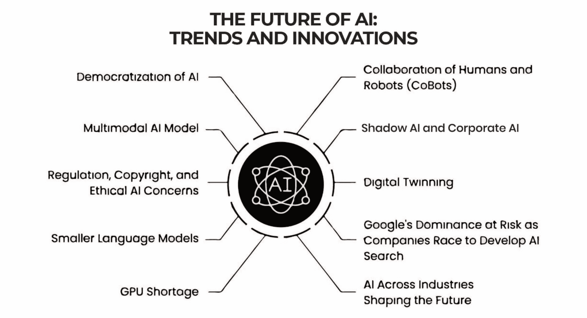

随着 AI 的持续演进，其影响力正扩展到新兴行业，为世界上一些最紧迫的挑战提供创新解决方案。在可持续能源领域，AI 算法优化能源消耗并提高可再生能源系统的效率。通过分析来自风力涡轮机或太阳能电池板的海量数据集，AI 可以预测能源产量、管理电网并减少浪费，为更可持续的未来做出贡献。同样，在太空探索领域，AI 在开发能够导航外太空极限的自主系统中发挥着关键作用。从探索遥远行星的机器人漫游车到监测地球气候的 AI 驱动卫星，这些技术增强了我们对宇宙的理解并支持关键的科学事业。

### 伦理与社会影响

然而，随着 AI 能力的增长，其广泛采用带来的伦理和社会影响也日益凸显。最重大的担忧之一是**工作岗位流失**，因为 AI 驱动的自动化正在改变行业并改变工作的性质。虽然 AI 可以提高生产力并创造新机会，但它也给易受自动化影响的岗位工人带来挑战，特别是涉及重复性任务或数据处理的角色。为减轻这些影响，至关重要的是优先考虑教育和再培训计划，使个人掌握在 AI 驱动经济中脱颖而出所需的技能。此外，随着 AI 系统变得更加自主，确保其合乎伦理的开发和部署至关重要。这包括建立促进公平、透明和问责的准则，特别是在医疗保健和自动驾驶汽车等关键领域，AI 的决策可能产生深远后果。

### 前沿研究：XAI 与 AGI

在 AI 研究的前沿，**可解释 AI (XAI)** 的努力旨在解决“黑箱”问题，即 AI 系统做出的决策难以被人类理解。XAI 旨在创建能够为其预测提供清晰、可解释说明的模型，促进人机之间的信任与协作。通过使用户理解 AI 决策背后的基本原理，XAI 增强了透明度并支持各领域合乎伦理的 AI 部署。此外，**通用人工智能 (AGI)** 的追求代表了 AI 研究的一个前沿，目标是开发具备人类认知能力和适应性的机器。虽然 AGI 仍是遥远的前景，但持续的研究正在探索实现这一级别机器智能所需的基本原理和架构。

在我们探索 AI 未来版图的过程中，这些趋势与创新将持续提醒我们：这项技术蕴藏着变革性的潜力，其发展也伴随着相应的责任。通过拥抱这些发展并应对它们带来的挑战，我们可以利用 AI 的力量推动社会各界的积极变革，为一个更智能、更公平、更可持续的世界铺平道路。

## 10.4 实战 AI：探索 AI 高级主题与未来趋势

### 高效实践指南

- 访问 ChatGPT：访问 `https://chatgpt.com`，如有需要请创建免费账号。
- 使用提示词：输入提示词，对其进行修改并实验，以观察不同的响应。
- 评估响应：结合你所学知识，检查响应的清晰度与相关性。
- 实验与反思：调整提示词以加深理解，探索 AI 的能力边界。

### 巩固本章学习的提示词

**提示词 1：** “训练深度学习模型时最关键的超参数有哪些？它们如何影响性能？”

**提示词 2：** “用一位艺术家和一位评论家的类比来解释 GAN 的工作原理。讨论其迭代学习过程。”

**提示词 3：** “如何针对智能手机和物联网传感器等边缘设备优化 AI？讨论性能与效率之间的权衡。”

**提示词 4：** “在边缘设备上部署 AI 模型相较于云平台有哪些优势？请提供现实应用中的案例。”

**提示词 5：** “什么是多模态 AI 系统？它们如何整合来自文本、图像和音频的数据？请提供用例。”

**提示词 6：** “实现 AI 模型可解释性的关键方法有哪些？请包含 SHAP 和 LIME 等示例。”

**提示词 7：** “为什么在金融或医疗等高风险领域，可解释性至关重要？请讨论其伦理与实际影响。”

**提示词 8：** “量子计算如何增强机器学习算法？请提供潜在突破的示例。”

**提示词 9：** “量子 AI 目前面临哪些局限？在未来十年内这些局限可能如何被解决？”

**提示词 10：** “设计一个利用多模态数据预测供应链中断的 AI 系统。你将面临哪些挑战，又该如何解决？”

# 结语

随着我们共同旅程的终章，让我们花一点时间回顾所经历的路径。我们探索了人工智能与机器学习这片迷人的领域，起步于构成 AI 脊梁的基础概念。我们深入了解了机器如何学习与适应，聚焦于神经网络与深度学习错综复杂的架构。这些工具驱动着当今最先进的 AI 系统，如今，它们也已成为你技能组合的一部分。

贯穿全书，我们强调了 AI 不仅仅是理论的集合，更是跨行业的变革力量。从医疗、金融到机器人技术与娱乐，AI 技术正在重塑我们的生活与工作方式。你已见证了展示 AI 影响力的真实案例与案例研究，并参与了映射专业场景的项目式学习。这些经历使你具备了有效应用神经网络技术的实战技能。

但 AI 功能强大的同时，也伴随着责任。我们讨论了开发公平、可问责 AI 系统至关重要的伦理考量。偏见、透明度与问责制不仅仅是流行词；它们是确保 AI 惠及所有人的关键要素。你对这些议题的认知与理解必不可少。

我们还涉及了职业发展策略与社区参与的重要性。无论你是初学者还是转行进入 AI 领域的专业人士，懂得如何构建强有力的作品集、在技术社区中建立人脉，都极其宝贵。与同行、导师及行业领袖互动，将为你敞开大门，提供持续学习的机会。

那么，核心收获是什么？你现在应已牢固掌握 AI 基础，并有信心实施神经网络解决方案。你了解伦理版图，已准备好负责任地开展 AI 开发。最重要的是，你拥有工具与洞见，可以启动自己的 AI 项目并推动职业发展。

本书只是开始。我鼓励你将所学付诸实践。从小项目做起，尝试不同模型，不要害怕失败。每一步都是学习的机会。深入 AI 社区，分享经验，向他人学习。保持好奇，紧跟最新进展。AI 领域日新月异，身处此社区意味着你从不孤军奋战。

展望未来，AI 推动创新、应对全球挑战的潜力巨大。从应对气候变化到推进医疗保健，AI 蕴藏着变革性解决方案的希望。我希望你受到启发，通过开发合乎伦理、创新的 AI 系统为这一未来贡献力量，创造积极影响。

感谢你加入我这场 AI 世界之旅。你的好奇心与投入令人钦佩，我很荣幸能担任你的向导。作为 NextGen AI Publications 的创始人，我的使命是赋能像你这样的人，赋予知识与技能，助你在这个激动人心的领域脱颖而出。我鼓励你继续探索、学习，并突破 AI 可能性的边界。世界正等待你的贡献，我迫不及待想看看你将取得何种成就。

## 术语表

## 第 1 章：机器学习与 AI 基础

- **人工智能 (AI)：** 在机器中模拟人类智能，使其能够执行学习、推理和解决问题等任务。
- **机器学习：** 一种人工智能，让计算机能够在未被显式编程的情况下从数据中学习。
- **深度学习：** 一种模仿人脑结构和功能的 AI 方法。这些人工神经网络可执行图像识别、自然语言处理和语音识别。
- **神经网络：** 受人脑启发的 AI 模型，由协同工作以识别模式并做出决策的神经元层组成。
- **决策树：** 一种模型，根据特定特征将数据分割为分支来做决策，每个分支代表一种可能的结果或决策。
- **随机森林：** 机器学习中的一种集成方法，利用多棵决策树通过组合多棵树的结果来做出更准确、更稳定的预测。
- **过拟合：** 当模型从训练数据中学习过度，导致其在泛化到新的、未见过的数据时效果变差的问题。

## 第 2 章：深入神经网络

- **感知机：** 一种用于二分类器监督学习的算法。它模拟单个神经元，构成了更复杂神经网络的基础。
- **多层感知机 (MLP)：** 一种包含多层节点的神经网络类型，能够实现超越简单线性分离的复杂模式识别。
- **反向传播：** 神经网络中的一种学习过程，将误差反向传送通过网络以调整权重并优化神经网络性能。
- **激活函数：** 神经网络中用于引入非线性的函数，使网络能够捕捉复杂模式（例如 ReLU、Sigmoid、Tanh）。

### 第 3 章：深度学习架构

- **卷积神经网络 (CNNs)：** 一种主要用于图像识别和分类的深度学习架构，其中卷积层通过扫描模式从图像中提取特征。

### 第 3 章：神经网络架构

- **循环神经网络 (RNN)**：一种旨在处理序列数据的神经网络类型，其中每个输入都会影响下一个输入，使其非常适合时间序列预测或语言处理等任务。
- **Transformer（变换器）**：使用自注意力机制来处理数据并捕捉序列内复杂关系的先进深度学习模型。
- **自编码器**：一种无监督学习模型，可将输入数据压缩，然后将其解码回原始表示形式。

## 第 4 章：实际应用与行业影响

- **AI 驱动的诊断**：利用人工智能分析医学影像，比人类更快、更准确地检测问题。
- **预测性分析**：利用 AI 分析数据并预测未来事件，例如在健康风险或金融趋势发生之前对其进行预测。
- **AI 驱动的自动化**：在机器人和机器中使用 AI 来执行任务，例如配送或手术，而无需人工干预。

## 第 5 章：数据分析与可视化

- **插补**：用估计值填补缺失数据的过程，通常基于统计方法或来自其他数据点的可用信息。
- **归一化**：一种数据转换技术，用于调整特征的尺度，以便没有单个变量主导模型的学习过程，通常通过将数据重新缩放到一个通用范围来实现。
- **探索性数据分析 (EDA)**：使用统计图表、绘图和信息表分析和总结数据集特征的过程，旨在发现数据中的模式、异常和关系。
- **相关矩阵**：一个显示多个变量之间关系的表格或热力图，展示相关性的强度和方向，以辅助特征选择和模型设计。

## 第 6 章：伦理考量与负责任的 AI

- **算法偏见**：由于数据偏差而嵌入 AI 算法中的系统性且重复的错误，导致不公平的结果，使某些人口群体处于不利地位。
- **可解释性**：使 AI 系统的决策过程透明、可理解且值得人类信任的实践。这涉及为决策的制定方式和原因提供清晰的解释。

## 第 7 章：利用 AI 工具包提升技能

- **TensorFlow**：一个全面的机器学习框架，具备用于预训练模型的 `TensorFlow Hub` 和用于部署的 `TensorFlow Extended (TFX)`。
- **PyTorch**：一个基于 `Torch` 库的机器学习库。它通过动态计算图提供灵活性，使其适合研究和实验。
- **Keras**：一个用于实现神经网络的开源库。它通过回调提供实验、超参数调整和实时模型调整功能。

# 第 8 章：基于项目的学习与现实应用

- **情感分析**：自然语言处理 (NLP) 的一个分支，专注于对文本数据中的情绪和观点进行分类，有助于了解公众情绪和客户反馈。
- **图像分类系统**：一种根据视觉特征将图像归类到预定义类别的机器学习模型。
- **推荐系统**：一种根据用户的过往行为或偏好向其推荐产品、内容或服务的系统。

# 第 9 章：职业发展与社区参与

- **GitHub**：一个协作软件平台，允许开发者创建、存储和共享代码。

## 第 10 章：高级主题与未来趋势

- **评估指标**：用于评估机器学习模型或算法性能和准确性的定量衡量标准，有助于确定其在多大程度上满足特定目标。
- **超参数调优**：调整机器学习模型超参数（控制学习过程的设置）以优化其性能的过程。
- **生成对抗网络 (GAN)**：一种由两个神经网络——生成器和判别器——组成的 AI 模型，它们相互对抗以创建逼真的输出。

# 参考文献

- Abdi, H. (2024). Sky temperature forecasting in Djibouti: An integrated approach using measured climate data and artificial neural networks. *Energies*, 17(22), 5791.
- AI and project-based learning. (n.d.). Retrieved December 30, 2024, from <https://projectpals.com/ai-and-project-based-learning/>
- AI ethics \| AI accountability in practice. (n.d.). Retrieved December 30, 2024, from <https://aiethics.turing.ac.uk/module-pages/part-one-introduction-to-accountability/>
- AI in media & entertainment industry - use case and examples. (n.d.). Retrieved December 30, 2024, from <https://www.linkedin.com/pulse/ai-media-entertainment-industry-use-case-examples-manthan-bhavsar-0reof>
- AI/ML performance metrics: A comprehensive overview. (n.d.). Retrieved December 30, 2024, from <https://svitla.com/blog/ai-ml-performance-metrics/>
- AI robots: Transforming industries with smart robotic solutions. (2024, August). Retrieved December 30, 2024, from <https://www.roboticstomorrow.com/story/2024/08/ai-robots-transforming-industries-with-smart-robotic-solutions/23005/>
- Activation functions in neural networks. (n.d.). Retrieved December 30, 2024, from <https://www.geeksforgeeks.org/activation-functions-neural-networks/#:~:text=Activation%20functions%20enable%20backpropagation%20by,only%20simple%2C%20linearly%20separable%20problems>
- A step-by-step guide to containerizing and deploying machine learning models with Docker. (n.d.). Retrieved December 30, 2024, from <https://dev.to/pavanbelagatti/a-step-by-step-guide-to-containerizing-and-deploying-machine-learning-models-with-docker-21al>
- Artificial intelligence in healthcare: Transforming the field. (n.d.). Retrieved December 30, 2024, from <https://pmc.ncbi.nlm.nih.gov/articles/PMC8285156/>
- Comparing VGG & LeNet-5 architectures in deep learning. (n.d.). Retrieved December 30, 2024, from <https://blog.arunangshudas.com/comparing-vgg-and-lenet-5-architectures/>
- Convolutional neural network (CNN). (n.d.). Retrieved December 30, 2024, from <https://www.tensorflow.org/tutorials/images/cnn>
- Deep learning for healthcare: Review, opportunities, and challenges. (n.d.). Retrieved December 30, 2024, from <https://pmc.ncbi.nlm.nih.gov/articles/PMC6455466/>
- EDA \| Exploratory data analysis in Python. (n.d.). Retrieved December 30, 2024, from <https://www.geeksforgeeks.org/exploratory-data-analysis-in-python/>
- Engaging stakeholders with data storytelling techniques in Tableau. (n.d.). Retrieved December 30, 2024, from <https://www.nobledesktop.com/learn/tableau/engaging-stakeholders-with-data-storytelling-techniques-in-tableau>

# 参考文献

随着 AI 承担更大的决策角色，伦理担忧日益加剧。 (2020 年 10 月)。检索日期：2024 年 12 月 30 日，来源：<https://news.harvard.edu/gazette/story/2020/10/ethical-concerns-mount-as-ai-takes-bigger-decision-making-role/>

探索人工智能职业路径：机遇与挑战。 (n.d.)。检索日期：2024 年 12 月 30 日，来源：<https://www.eweek.com/artificial-intelligence/ai-careers/>

Frank Rosenblatt 的感知机，神经网络的诞生。 (n.d.)。检索日期：2024 年 12 月 30 日，来源：<https://medium.com/@robdelacruz/frank-rosenblatts-perceptron-19fcce9d627f>

生成对抗网络及其部分应用。 (n.d.)。检索日期：2024 年 12 月 30 日，来源：<https://neptune.ai/blog/generative-adversarial-networks-gan-applications>

让 IT 员工为 AI 做好准备：AI 就绪需要什么。 (n.d.)。检索日期：2024 年 12 月 30 日，来源：<https://www.tsg-training.co.uk/blog/getting-it-staff-ready-for-ai-whats-required-for-ai-readiness/>

超参数调优：示例与 5 大主流技术。 (n.d.)。检索日期：2024 年 12 月 30 日，来源：<https://www.run.ai/guides/hyperparameter-tuning>

IBM Policy Lab：减轻人工智能中的偏见。 (n.d.)。检索日期：2024 年 12 月 30 日，来源：<https://www.ibm.com/policy/mitigating-ai-bias/>

自编码器简介。 (n.d.)。检索日期：2024 年 12 月 30 日，来源：<https://www.tensorflow.org/tutorials/generative/autoencoder>

推出 TorchRec，一个面向现代生产环境的库。 (n.d.)。检索日期：2024 年 12 月 30 日，来源：<https://pytorch.org/blog/introducing-torchrec/>

Python 中的标签编码：实用指南。 (2023 年 9 月 4 日)。检索日期：2024 年 12 月 30 日，来源：<https://spotintelligence.com/2023/09/04/label-encoding/>

AI 初创公司的社交策略。 (n.d.)。检索日期：2024 年 12 月 30 日，来源：<https://www.restack.io/p/networking-strategies-answer-ai-startups>

金融领域的预测分析：用例与指南。 (n.d.)。检索日期：2024 年 12 月 30 日，来源：<https://www.itransition.com/predictive-analytics/finance>

Python 标签编码实用指南。 (n.d.)。检索日期：2024 年 12 月 30 日，来源：<https://spotintelligence.com/2023/09/04/label-encoding/>

