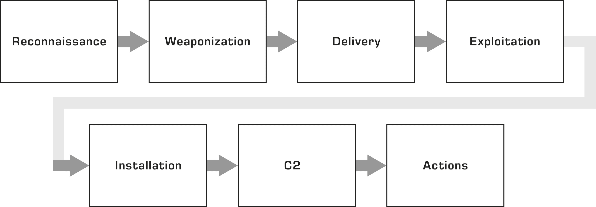
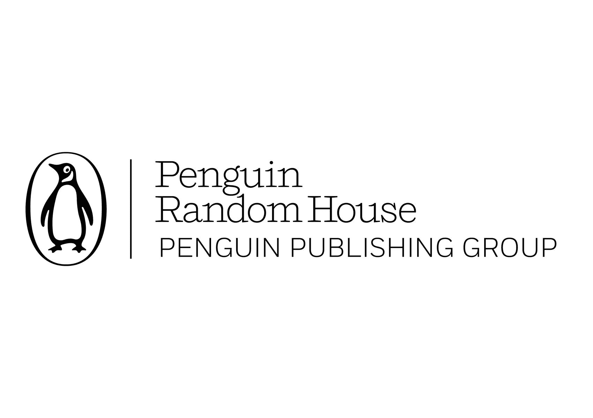

# 第五战域：在网络威胁时代捍卫国家、企业与个人

> 献给已故的迈克尔·A·希恩：
>
> 军人、外交官、爱国者、反传统者、朋友
>
> —理查德·A·克拉克
>
> 献给我的儿子威廉，他对战争成因的浓厚兴趣源于他对和平更深层的渴望。
>
> —罗伯特·K·克内克

# 第一部分 二十年战争

## 第一章 野兽的背部

> 未来已经来临，只是分布不均。
>
> —威廉·吉布森

坐在“野兽”车厢后部——这辆为美国总统定制的装甲车里，比尔·克林顿想聊聊他来自阿肯色州霍普的表亲。他不想聊即将在国家科学院发表的重要演讲。时值 1999 年 1 月，克林顿刚提出预算计划以应对新兴威胁，包括网络领域的威胁。当时鲜有人将网络威胁视为大问题。但他看到了。迪克·克拉克坐在他身边，手里拿着一套 `PowerPoint` 幻灯片和一份附带批注的演讲稿，但总统正发挥他的“巴巴”人设，讲着阿肯色州的故事，根本停不下来。

当“野兽”驶入科学院的地下停车场时，克林顿终于转向正事。“我读了演讲稿，还行。”意思是不行。

“但我们真正想说的，不该是这样吗：纵观历史，进攻技术与防御技术之间一直存在竞争，且二者发展之间存在差距。山洞里的家伙凿块石头绑在棍子上造出矛，然后有人需要防御，便弄来兽皮做成盾牌。后来人们用城墙守卫城镇，又有人发明了撞城锤和投石机。但进攻性武器诞生到防御对策出现之间，是有时间差的。”一名站在车旁的特勤局特工拉开了“野兽”厚重的车门。这门从里面是打不开的。

总统继续说下去，越说越起劲。“而眼下的问题是，新的进攻技术已投入实战，它们相对于我们用于防御的手段占据了优势。因此，我们必须投资新技术，让防御重夺优势，至少也要拉平竞技场。我理解得对吗？”

克拉克看着总统，若有所思，再次被提醒：他拥有将复杂问题讲得通俗易懂的天赋。克拉克收起草稿和幻灯片，叹了口气，说：“是的，总统先生，您今天就该这么说。” 他照做了。

十九年零三个月后，克林顿在华盛顿华纳剧院的舞台上回答关于其网络题材小说的提问时，逐字逐句地说了同样的话。这依然是真理。在这二十年间，公共和私人部门在网络安全研发与部署上投入了数千亿美元，却从根本上未能改变这种优势。这依然是军事理论家所谓的进攻优势或进攻偏好。

### 网络空间的进攻偏好

# 第五领域：网络空间的攻防平衡与和平之路

## 攻防平衡决定冲突与稳定

敌对双方之间的任何场景都是攻击与防御之间的平衡。军事理论家指出，当进攻方因技术优势或成本优势而占据上风时，冲突就会发生。反之，当防御更有利、攻击成本更高，或攻击突破防御的几率较低时，更大的稳定性将占主导地位。我们认为，这些普遍规律现在适用于黑客与企业之间的持续对抗、民族国家间当前的隐蔽间谍活动，以及未来可能爆发的国家间网络战争。

过去二十五年来，计算机科学、信息技术和网络领域的传统观点认为，进攻方拥有巨大优势。这原本可能不是大多数人关心的大事，只是在过去二十五年里，我们几乎让所有事物都依赖于计算机网络。事实上，正因为现在认为进攻方占优，在可能发生常规战争的危机局势下，很可能会倾向于率先发动网络攻击。

## 改变平衡，走向稳定

本书探讨攻防平衡如何变化，以及如何加快变化速度，使我们走上稳定之路。我们认为，可以降低进攻性网络技术和行为体带来的风险，提升企业的和平时期稳定性和国家的危机时期稳定性。

## 当前网络冲突态势与转机

写作本书时（2019 年），我们看到网络空间恶意活动的模式表明，我们已与俄罗斯、中国和伊朗陷入低烈度、持续发酵的网络冲突。同时，我们也开始在这一问题上迎来转机。据估计，2018 年全球网络安全支出达 1140 亿美元。2018 年风险投资在网络安全技术上的投入激增，超过 50 亿美元。有三千多家新技术公司在充足风投支持下涌现，致力于开发新解决方案。网络保险长期是边缘产品，如今市场（终于）增长繁荣，2017 年保费收入近 20 亿美元。

政府造成的长期问题（如信息共享障碍）已获解决，企业开始组建社区，不仅共享信息，还在危机时提供互助。一位大型银行的首席信息安全官（`CISO`）认为，五年内该行将基本免疫网络攻击，因为它将从固有不安全的遗留系统升级为安全设计的系统。硅谷许多领袖（那里从不缺乏乐观主义）倾向于同意这一观点。

## 技术趋势的双刃剑效应

今天，小企业主可在云服务商支持下在线开展大部分业务，这些服务商投入数千人、数十亿美元保护数据。自动化和人工智能有潜力抹平攻击者的大量优势。但同时，攻击者也在研究如何利用这些工具。量子计算既能为数据提供无法破解的保护，也能破解所有现有加密形式。区块链被许多技术专家认为能从根本上更安全地保护数据，但目前其最大用途是加密货币，这项技术允许犯罪分子匿名转移赃款，明显给攻击者带来优势。这些技术趋势可能向任一方向倾斜天平，取决于我们如何抉择。

## 第五领域的独特属性

五角大楼长期将冲突领域分为陆、海、空、天四大领域。近年来，网络空间被称为“第五领域”。与其他领域不同，网络空间是人造的，因此可以被人改变。网络空间的一个积极属性是：一旦武器被使用并被发现，就可以被拦截。这相当于改变大气层，使炸弹无法再落下。

## 作者背景与动机

我们合作研究网络问题已十五年。我们均为大型企业、网络安全公司、风投和私募股权公司提供咨询；均曾担任兼职教授教授研究生网络安全课程；也均在政府机构任职——迪克·克拉克在国防部和国务院，罗布·克内克在国土安保部。但我们最宝贵的政府经验是在白宫国家安全委员会工作。迪克曾服务于老布什（第 41 任）、克林顿（第 42 任）、小布什（第 43 任）政府；罗布曾服务于奥巴马政府（第 44 任）。

在白宫期间，我们都曾起草网络安全决策文件（行政命令、总统指令）。迪克还起草了历史上任何国家发布的第一份国家网络安全战略。所以，你们可以部分怪罪我们造成了某些混乱，但我们认为也拥有独特视角。我们合计花费四十多年密切跟踪网络威胁演变及政府和企业的应对。

十年前合著《网络战争：国家安全的下一个威胁及应对之道》时，目标是敲响警钟。我们知道华盛顿对网络威胁的重视程度，但未看到私营部门有同等关切。遗憾的是，我们关于网络威胁的许多预言成真，但形势也发生巨大变化，包括我们的应对建议。

## 从警醒到求解

写《网络战争》时，硅谷仍处于“不作恶”阶段，不愿承认其发明可能造成实质危害。我们意在吓唬政府和企业领袖，在网络战争前景变成现实前应对威胁。过去十年，应对威胁的实质行动太少，而我们关于网络空间战争出现的许多预测遗憾地成真。然而，网络安全仍是可解决的问题，远比气候变化等当今面临的许多其他问题容易应对。

我们坚信，经过丑陋且破坏性的试错过程，终将找到解决当今网络空间困境的可行方案。最终，企业将认识到全球互联带来的价值，并开始适当投资保护该价值。最终，政府将弄清自身角色，开始帮助私营部门自助。

## 危机驱动变革的代价

但除非我们明智且主动，否则只会在多次危机后解决网络空间面临的挑战。网络攻击导致美国大面积停电后，我们将做出必要投资防范；恶意行为者在网络空间操作导致列车脱轨、船只相撞或飞机坠毁造成人员伤亡后，我们将构建对黑客导致的故障具有近零容忍度的系统。

危险在于，此类事件发生后，我们不会仅做增强系统网络韧性的艰苦工作。流血将以流血回应。我们有理由断言，美国卷入的下一场大战将由网络攻击引发。挑衅可能是意外的，也可能是蓄意的。但美国没有忍气吞声的良好记录。因此，在思考改善网络安全需做何事时，我们的根本目标是实现网络和平，以免陷入现实世界中更具毁灭性和代价更高的战争。

# 网络空间的和平与战争：从威胁到解决方案

## 核心认知的演变

近年来，作为从业者社区，我们对这些问题的集体理解有了巨大增长。我们现在清楚地认识到，是什么让网络空间成为战争实施者青睐的领域，以及我们如何能让它失去吸引力。在构思本书概念的过程中，我们始终回到一个认识：**网络战的幽灵并未遮蔽互联网所带来的一切美好**。支撑网络战的速度与连通性，同样支撑着电子邮件、社交媒体、亚马逊 Prime 会员服务和大型多人在线游戏。虽然有人质疑这些应用是否代表了社会的积极成果，但这个全球网络实现了几十年前无法想象的协作与沟通，并成为生产力和财富创造大幅增长的驱动力。

据估算，数字经济独立于传统经济之外，其增长速度是其他经济领域的三倍。但正如全球咨询公司麦肯锡指出的，将数字经济与其他经济分离变得越来越困难，因为如今每家公司都已“联网”。麦肯锡估计，**98% 的经济正受到数字化的影响**。因此，当今蓬勃发展的公司，无一例外都高度重视网络安全，这绝非巧合。2018 年，我们首次看到网络攻击对公司利润造成实质性打击。`NotPetya` 恶意软件从在乌克兰、欧洲和美国运营的公司手中夺走数十亿美元，迫使许多公司在向证券交易委员会提交的季度和年度报告中披露损失。然而，在乌克兰运营的某些（如果不是大多数）跨国公司要么未受影响，要么影响极小，要么拥有非常出色的律师团队，成功辩称无需报告损失（稍后详述）。

微软、苹果和谷歌等公司，曾一度认为对网络威胁的担忧被过度炒作，如今却“信仰皈依”，以转变者的狂热投资网络安全。它们将网络安全视为一种竞争优势，在消费者对在线交易日益警惕的市场中脱颖而出。花旗、美国银行和摩根大通等大型银行也将网络安全视为面向消费者和商业客户的竞争差异化因素。

近乎每日的事件报道，加上个人信息被盗通知的持续轰炸，造成了一种印象：**网络空间毫无安全可言**。然而，显而易见的事实是，许多背负巨大攻击目标的公司，年复一年地持续击败甚至最顶尖的国家级进攻团队。虽然这些公司拥有庞大的安全团队和数亿美元的预算，但它们的创新（许多源自军事领域）正逐渐渗透到更广阔的市场。

网络空间的进攻优势正在缓慢转移，因为防御方通过利用新技术、改进组织架构、并开始理解利益所在，正在缩小差距。加速这一转变，是实现网络空间“更像和平、少些战争”状态的核心要求之一。

## 必须达成的战略目标

- **提高攻击成本**：网络战必须变得更难实施、代价更高昂。
- **遏制犯罪代理**：作为国家代理并通过敛财计划造成严重危害的网络犯罪分子，其数量必须被削减。
- **提高准入门槛**：从事网络恶意活动的准入门槛逐年稳步降低，必须将其抬高。

许多审视网络战幽灵的人呼吁采取激进行动。“重塑互联网”以使其更安全是常见口号，但无人能拿出计划，说明如何在不造成比恶意行为者最疯狂之日更大的经济和社会危害的前提下实现这一目标。更荒谬的是“网络曼哈顿计划”或“网络登月计划”的呼声。这些要求大规模国家努力的呼吁，总是缺乏同一个东西：**明确的目标**。

20 世纪 40 年代的曼哈顿计划，基于阿尔伯特·爱因斯坦致富兰克林·罗斯福总统的一封简明信件中阐述的物理理论，设定了将理论转化为原子武器的工程挑战。肯尼迪的“登月计划”目标更清晰：登上月球。**网络战没有这种整齐的解决方案**，因为实现网络空间和平不是解决一个工程问题或到达特定地点的问题。

阻碍网络和平的挑战中，部分是技术性的，但大多数**本质上是经济问题**。有了正确的经济激励组合，技术问题便可迎刃而解。因此，虽然本书将深入 `1s` 和 `0s` 解释挑战，但大多数解决方案将关注如何让市场和政府运作，以促进安全利益。**首要原则是避免那些造成破坏大于其旨在解决的问题的方案**。在网络空间，这似乎是一个易陷的陷阱。

最恶劣的例子发生在奥巴马政府末期，司法部官员提议公司应削弱加密，使数字信息随时可被执法部门获取——从而也可被罪犯获取。该提议失败了，但类似想法仍不断被摆上桌面。一旦网络空间出现问题，此类想法极可能被反复提出，并最终付诸实施——除非我们作为一个社区，开发出令人信服的替代方案。

最重要的是，在寻求解决方案时，我们追求的是**快速演进，而非革命**。我们认为，已有足够多公司弄清了如何管理威胁，当前的挑战是创造合适的激励组合，推广这些模式，并以快于攻击者的速度创新。正如赛博朋克作家威廉·吉布森所言：“**未来已来，只是分布不均**。”因此，从某种意义上说，手头的任务是弄清如何更均匀地分布一个安全的网络未来。

## 不同的威胁，不同的模型

在寻找长期困扰网络空间的问题的解决方案时，**我们的基本前提未变**：网络安全是政府与私营部门的共同责任，保护计算机系统的责任落在系统所有者和运营者身上。迪克于 1998 年通过总统决策指令 63（`PDD 63`，内行人称）首次将“公私合作伙伴关系”用于网络安全的概念确立为美国官方政策。该指令还奠定了许多至今仍依赖的基石，如信息共享与分析中心（`ISACs`）。此后，跨越布什、奥巴马和特朗普政府，具体政策虽被废止和重写，但美国网络政策的总体推力在很大程度上保持不变。这种跨越二十年和四届政府的连续性，在任何其他公共政策领域都将非同寻常。在共和党和民主党在气候变化、移民政策和税收政策（仅举几例）上尖锐分歧的当下，这更显珍贵。

自克林顿政府以来，尽管多次试图制定不同的战略，我们的网络战略几乎没有改变。因此，当我们考虑如何保护私有和私营网络时，我们回到了一个基本理念：拥有和运营互联网及连接在其上的事物的公司——无论是跨国媒体公司、基本服务提供商，还是最微小的物联网设备制造商——将负责保护自己。它们将通过网络防御而非进攻来实现这一点。

政府的角色将受到限制，仅通过执法、情报共享、外交手段，以及在极少数既可行又符合国家安全利益的情况下使用军事力量，来支持遭受网络攻击的私营受害者。政府还将通过鼓励网络安全投资与合作的“助推”、研究、培训、召集协调，以及最终通过监管，发挥帮助私营部门自助的作用。

尽管这一政策延续了二十年，但这种责任划分在美国企业界常遭诟病。许多 CEO 难以置信，他们竟要负责抵御美国外国对手对其公司的攻击。“我纳税就是为了这个，”这种声音在每个董事会中回荡。国家安全领域的领导人往往持有相同观点，认为在网络空间保卫国家是美军的责任。他们试图将网络攻击等同于核导弹，并主张阻止这些攻击必须是政府的职责。

政府应想出某种神奇办法让这个问题烟消云散、让我们照常在网上开展业务，这种想法对许多人极具吸引力。但它也有着深刻的缺陷。网络领域从根本上不同于空中领域，潜伏其中的威胁也是如此。将网络安全作为军方职责，将需要重新构架互联网，赋予国防机构必要的“咽喉要道”以尝试过滤掉敌对威胁。这样做还将要求授予它们对流量内容的无限访问权——这是间谍的梦想，却是隐私倡导者的噩梦。这种做法极可能仍会失败，且在造成巨大社会动荡的同时付出巨大代价。

一旦发生网络攻击，每位 CEO 都希望将其视为国家安全危机，将责任推给政府，让军方“发射导弹”。这种想要反击的心情可以理解，但却是鲁莽愚蠢的。迄今为止，美国政府表现出了惊人的克制，避免了进行会扩大冲突的鲁莽反击。这种克制能否维持我们不得而知，但我们相当确定，此类打击的效用将很低。

归因（确定攻击背后的主体）是在应对此类攻击时反复出现的挑战。高级威胁行为体已学会如何隐藏其计算机系统，并能迅速用其他资源（很可能是窃取的计算资源）替换任何丢失的资源，或者伪装成完全是另一个团体实施了攻击。因此，反击充其量像向空帐篷发射巡航导弹，最坏的情况则像向平民公寓楼发射巡航导弹。当然，除了更多依赖军方，我们也必须对网络空间的自卫行为持悲观态度，并希望很快能看到司法部因所谓的“反向黑客”行为起诉某人。

在奥巴马政府末期，政府终于退出了运营最后一个由政府管理的互联网基础设施部分——域名系统（`DNS`）的业务。随着该功能现已牢固植根于私营非营利组织互联网名称与数字地址分配机构（`ICANN`），联邦政府终于完成了互联网为期三十年的转型：从国防部高级研究计划局（`DARPA`）的一个科学实验，变为一个完全商业化的事业。我们花了三十年把政府赶出互联网运营；我们不希望安全成为让政府重新介入的理由。

这留给我们的，就是我们一贯主张的方法：构建系统，使大多数攻击不造成危害，并让我们能够对成功的攻击进行响应和恢复，且将干扰降至最低或零。我们采用了一个不同的术语来阐述这一概念：**网络韧性**。我们也有关于如何实施它的想法与分享。

## 网络韧性

最好的战略可以用一个词来概括。在冷战时期，我们有两个这样的战略：遏制和威慑。乔治·凯南著名的“长电报”用几千个单词阐述了遏制战略，即将苏联的势力范围限制在一定范围内。关于核时代威慑的论文和书籍最终达数千部（并为网络时代重写），但这些单词战略让所有人都领会到了基本理念。一旦在 1940 年代确立，它们在近五十年间几乎没有变化，历经时代更迭和总统更替依然稳固。

全书中，我们将多次回到一个主题：努力将优势从攻击者转移给防御者。这应成为我们国家政策的总体目标，也是志同道合的国家和公司的目标。这是正确的思路，但攻防理论的语言太容易让人联想到网络安全只是另一个问题——如恐怖主义或核威胁——由军方来处理。

我们所熟知并热爱的互联网的现实，并不完全适用传统的国家安全方法。写作本书时，我们牢记的一条指导原则是：寻找非源自战争世界的类比解决方案。这听起来可能讽刺，来自上一本书名为《网络战争》的作者之口，但我们认为，如果我们要实现的目标是网络和平，那么我们就应该在第五领域或其他四个领域之外寻找问题的解决方案。如果我们试图在巴巴里海盗、法卢杰战役或 9·11 事件应对中寻找寓言，无疑会找到，但它们会把我们引向一类解决方案。相反，全书中我们参考了其他研究领域，如生态学、公共卫生、应急管理，甚至心理学。随着这项工作的深入，一个核心主题持续浮现：**韧性**。在企业层面，许多领导者认识到，其企业网络安全战略需要围绕韧性构建。他们必须尽力预防每一起事件，但在预防失败时，能迅速响应和恢复。在《数字韧性》一书中，RedSeal CEO 雷·罗斯洛克将韧性概念称为“输掉的战争中的制胜策略”，认为来自网络行为体的威胁使得韧性成为“任何有生存意愿的企业的入场赌注”。然而，虽然企业界开始拥抱韧性，华盛顿的许多人对这一概念仅停留在口头服务。计划和预算表明，网络政策陷入了战争思维的泥沼。

# 网络韧性与 NotPetya 的教训

## 核心目标：韧性重于威慑

如果您对过去几届政府的网络安全战略进行关键词搜索，毫无疑问会在文档的某个角落里发现“韧性”一词。但这一理念从未被真正接纳为我们战略的核心目标。它始终是一个定义不清、模糊不清的概念。归根结底，我们想要的是能够无视网络攻击，能够将其甩在身后并继续开展业务，而不是被迫升级事态。因为我们执着于寻找冷战时期的类比，网络安全界常用“拒止威慑”来谈论这一概念，即我们要让防御如此强大，以至于对手甚至不敢尝试攻击，即便攻击也不会造成后果。我们建议稍作转变。我们要让防御如此强大，架构如此稳固，以至于我们大多数时候根本不在乎是否遭受攻击，因为攻击不会产生严重后果。

## 建立在基础之上的韧性

# 网络韧性必须建立在扎实的安全基础之上

网络韧性必须建立在扎实的安全基础之上，而不应被视为其替代品。当机密性、完整性和可用性受到损害时，韧性关乎快速响应、恢复至良好状态、处理不良后果、并从事件中吸取教训，使未来事件不太可能发生。重要的是要注意，将“韧性”仅理解为恢复到先前状态或反弹回去的能力是过于局限的。要使韧性成为网络安全领域的一个有用概念，它要求该概念充分体现“恢复得比以前更强或更好”这一理念。

## 韧性的心理学基础

在心理学领域，韧性概念的发展比使用该术语的任何其他领域都更为充分，其中内含一个承认：韧性不是指个体在经历创伤后回到先前的状态，而是适应该创伤。在经历配偶、父母或子女离世、肢体缺失或战争创伤后，克服这些经历并不意味着忘记它们或恢复到经历前的样子。没有人能做到。

将这一心理学现实应用于物理世界，受过心理学训练、曾任洛克菲勒基金会负责人的朱迪斯·罗丁给出了一个定义，它既适用于应对网络威胁，也适用于建设韧性城市。罗丁将韧性定义为任何“实体……为应对中断做准备、从冲击和压力中恢复、并从破坏性经历中适应和成长的能力”。我们认为该定义非常贴切地适用于网络世界。

## 路线图

在下一章中，我们将回顾威胁及其可能造成的破坏。随后我们将审视企业及其在保护网络方面取得的部分进展。我们将探讨改进公私伙伴关系的潜力以及监管的作用。我们将询问政府和军队应当做什么，并审视国际社会的角色。因为网络空间瞬息万变，我们接着将讨论新技术及其对攻防博弈的意义。最后，我们将提出一些建议，说明您在家中应如何保护自己的网络空间角落。

全书中，我们将试图表明，我们面临着关于网络空间未来的抉择。在后续章节中，我们将勾勒出为何对网络威胁敲响警钟是合理的，并制定一个避免最坏结果的计划。我们有两种未来可供选择。由我们决定希望网络空间变成哪一种。

# 第 2 章：ETERNALBLUE，永恒之战

> 俄罗斯军方发动了历史上破坏性最大、代价最高昂的网络攻击……这也是一次鲁莽且不加选择的网络攻击，将面临国际后果。
>
> ——白宫新闻秘书声明，2018 年 2 月

洛丽娜·纳什匆忙将母亲送往英国斯蒂文尼奇利斯特医院的急诊室。医生说需要做检查来确诊。他们给纳什的母亲做了验血，但随后电脑瘫痪，无法完成分析。医生把样本交给一名快递员，让他进行为期三小时的行程，送往一家电脑仍能正常工作的诊所。洛丽娜和母亲在急诊室等待，那里变得空荡荡，因为大多数病人被转走了。

奔赴埃塞克斯医院的救护车被改道至他处，因为那里的急诊科也停止接收病人。在北汉普郡医院，CT 和 X 光机死机了。科尔切斯特医院取消了二十五台手术。在切斯特菲尔德皇家医院，情况恰恰相反：没有正常运转的电脑，病人无法出院，不得不在医院多住一晚。那是 2017 年 5 月 12 日，英国国民医疗服务系统（NHS）遭遇了一场勒索软件网络攻击，该攻击关闭了整个欧洲和北美的企业，锁定电脑并要求以比特币支付赎金以解锁。

所用的攻击工具被称为 WannaCry，七个月后，澳大利亚、英国和美国政府将罪魁祸首认定为朝鲜政府的黑客组织之一，西方分析师有时称其为“拉撒路组织”。虽然 WannaCry 在美国和许多其他国家引起了媒体关注，但 5 月的事件只是一个月后另一国家行为体发动的更具毁灭性攻击的前奏。事实上，即将到来的是历史上破坏性最大的单次网络攻击，迄今已造成企业损失超过 200 亿美元，更重要的是，它瘫痪了关键基础设施。

虽然 WannaCry 吸引了公众注意，但企业和政府 IT 安全专业人员早已意识到勒索软件日益增长的风险。一年前，一种名为 Petya 的病毒（以詹姆斯·邦德电影中的苏联武器命名）在攻击基于 Windows 的系统、随后将加密传播至整个受感染网络方面表现出了显著成效。美国网络安全公司对 Petya 的后续分析显示，它采用了一种基于美国国家安全局（NSA）“永恒之蓝”武器的攻击技术。

随后在 2017 年 6 月下旬，一种类似 Petya 的恶意软件以前所未有的速度在全球蔓延，攻击微软服务器，然后跳转至受影响企业网络上所有连接的设备。在看似随机选定的大型跨国公司及其遍布数十个国家的设施中，电脑屏幕冻结并闪烁着勒索付款的信息。它看起来又像是勒索软件。其实不是。

分析师一旦意识到这不是 Petya 攻击的重演，便富有创意地将这波新攻击命名为 NotPetya。网络安全专家迅速推断，勒索赎金的要求是假的，是个烟雾弹。攻击软件实际上是一种被称为“擦除器”的工具，它会擦除受感染设备上的所有软件。受感染网络上连接的任何设备都会被擦除：台式机、笔记本电脑、数据存储服务器、路由器、IP 电话、手机、平板电脑、打印机。

主要跨国公司的运营突然陷入停滞。在 2017 年营收超过 400 亿美元、员工超过六万名的制药巨头默克公司，生产线冻结。疫苗、肿瘤药物及数百种其他药品的分销停止。随后，该公司声称损失成本接近 9 亿美元。

## 马士基作为集装箱船运和港口巨头，突然无法操作其遍布全球超级港口（包括纽约、新泽西、洛杉矶和鹿特丹）中搬运数百万个集装箱的起重机。此外，它完全不知道任何一个集装箱在哪里、里面装着什么，或者应该运往何处。后来，该公司公开承认损失达 3 亿美元，但一位公司内部人士透露，若计入机会成本，真实损失是该数字的三倍。

数百家企业，几乎涵盖所有行业，陷入瘫痪，其中包括物流公司 TNT Express（联邦快递子公司）、零食巨头亿滋国际（Mondelēz）和德律风律师事务所（DLA Piper）。如果此前还有人怀疑网络攻击能瞬间波及全球、能瘫痪物理系统、或能冲击维持全球经济运转的机器设备，那么这些疑虑在 2017 年 6 月 27 日彻底烟消云散。这是网络战争吗？

### 换个名字的网络战争

NotPetya（不勒索病毒）是否属于网络战争行为，当然取决于你的定义。经审视，NotPetya 是由一个军事单位实施的行动，具体来说是俄罗斯联邦武装部队总参谋部情报总局（GRU），常被称为俄罗斯军事情报局。（在网络专家爱给事物起怪名字的圈子里，GRU 的黑客团队也被称为“花哨熊”Fancy Bear。）

我们推测，俄罗斯军方并非蓄意无差别攻击全球企业。其意图是在乌克兰国庆日——宪法日前夕，对乌克兰发动毁灭性打击。GRU 发现了一个极具创意的攻击向量，即一个可用于传播攻击的渠道。

GRU 发现，乌克兰几乎每家公司和政府部门都使用同一款会计软件。想想 QuickBooks 在美国的普及程度，你就能明白个中景况。只不过在乌克兰，这款同类软件名为 M.E.Doc，出自乌克兰软件公司 Linkos Group 之手。与其他同类应用一样，M.E.Doc 会定期更新。更新从 Linkos 的服务器推送给授权用户。更新带有 Linkos 的数字签名，被用户的防火墙识别，从而允许 M.E.Doc 更新自由进入企业网络。

于是，GRU 黑进 Linkos，在下一个 M.E.Doc 更新中植入了一个“小惊喜”：一个攻击包，它利用微软服务器软件的一个已知漏洞，结合密码破解工具和传播指令，扩散至网络上任何连接的设备，并清除其所有软件。

GRU 的攻击近乎完美，摧毁了乌克兰约 10% 的设备，包括每个政府部门、二十多家金融机构和至少四家医院的设备。*近乎*完美。GRU 显然没有意识到（或者也许他们意识到了），在乌克兰运营的全球性公司也会遭殃，攻击会从它们的乌克兰办事处通过虚拟专用网络（VPN）和租用的企业光纤连接，蔓延回英国、丹麦、美国及其他地区的企业总部。

这种误伤并非 NotPetya 或 GRU 独有。据称由美国于 2010 年实施、针对伊朗纳坦兹核浓缩工厂的“震网”病毒攻击所用软件，不知怎么泄露到了外界，尽管该工厂未连接互联网或任何其他网络。震网迅速在全球传播，被多国网络安全团队捕获并反编译，其部分代码后来被重用于新的攻击工具中。

然而，震网并未破坏纳坦兹以外的任何设施，因为其编写方式决定了它只能损害伊朗核浓缩处理器。尽管如此，该软件远超目标范围传播的事实，据称是奥巴马总统随后发布《总统政策指令 20》的动机之一，该指令据称限制了在未经他亲自批准的情况下进一步进攻性使用网络工具。（据报道，特朗普总统于 2018 年取消了这些限制。）

震网向世界——或者说向所有足够在意、愿意弄到一份副本的人——展示了有史以来最复杂的攻击工具之一，包含五万多行计算机代码，其中包含从未使用过的众多技巧（所谓的零日漏洞利用）。NotPetya 则未泄露俄罗斯 GRU 攻击工具的任何信息。它未暴露他们的任何东西，因为它不是他们的工具。它是美国的。

### 用我们的武器攻击我们

网络安全专家之间存在一场鲜为人知、重要且争议不休的辩论：当 NSA 黑客发现软件开发商（如微软）代码中的错误，允许他人实施新型恶意行为（如入侵窃取客户数据、窃取资金或清除网络上所有软件）时，美国政府是否有责任告知该开发商？在美国政府网络政策制定者的行话中，这场辩论被称为“利益权衡问题”，因为它涉及平衡情报机构实施攻击的利益与财政部、国土安全部等政府部门维护企业网络更安全的利益。

如果政府告知软件开发商，公司就会发布“补丁”修复问题。如果政府不告知，就可以利用该漏洞入侵感兴趣的外国网络，窃取情报以保卫国家。（政府会创建一个“漏洞利用工具”，即利用编写拙劣的计算机代码进行黑客攻击的工具。）

爱德华·斯诺登窃取 NSA 敏感信息并提供给维基解密（及俄罗斯人）后，奥巴马任命了一个五人小组进行调查并提出建议。迪克·克拉克是该小组成员之一，因华盛顿汉堡连锁店“五人帮”而得名。

“五人帮”的建议全部公开，奥巴马白宫公布了每一个字。其中一条建议是：当 NSA 发现广泛使用的软件存在漏洞时，应告知制造商，仅有极少数例外。这些例外需经政府高层批准，且仅在有限期限内有效。奥巴马政府接受了该建议。

微软指责 NSA 知晓其服务器软件存在重大问题长达五年却未告知。相反，NSA 开发了一个攻击工具（即零日漏洞利用），并将其命名为“永恒之蓝”。推测 NSA 曾利用“永恒之蓝”入侵外国网络。直到 2017 年 3 月，微软在刚被美国政府告知其软件缺陷后，才发布了修补该问题的补丁。

软件公司发布补丁时，总有用户收不到消息，或不相信这是必须立即安装的关键补丁警告。因此，尽管已有补丁，朝鲜编写的“想哭”勒索软件仍于两个月后的 2017 年 5 月成功利用该漏洞，俄罗斯 GRU 又于 2017 年 6 月结合其他技巧再次利用它，制造了 NotPetya 灾难。

如果美国政府早几年告知微软，这些毁灭性攻击几乎肯定能避免。至少，微软在弄清真相后曾公开如此声称。

政府为何最终告知微软？我们猜测——仅是猜测——是因为到 2016 年 3 月，政府已发现俄罗斯窃取了美国攻击工具包，知晓该零日漏洞，并正在使用或即将使用它。

### 俄罗斯可能窃取美国网络武器

俄罗斯军事情报总局（GRU）可能在 2016 年，甚至早在 2013 年就从美国窃取了零日攻击工具。另一名受聘于 NSA 的承包商哈罗德·马丁（Harold Martin）据称经常将高度机密的文件和软件带出 NSA 设施，这一指控源于他在 2016 年被 FBI 逮捕后司法部提出的指控。

马丁使用杀毒软件保护其个人家用电脑，具体为卡巴斯基杀毒软件（Kaspersky Anti-Virus）。卡巴斯基在全球广泛使用，总部位于俄罗斯。据媒体报道，俄罗斯 GRU 进入了卡巴斯基位于莫斯科的总部，随后利用全球数百万台安装了卡巴斯基杀毒软件的电脑搜索包含特定关键词的文档（卡巴斯基否认发生过此事）。

也许 GRU 从爱德华·斯诺登（Edward Snowden）泄露的大量文件中获知了这些关键词，这些关键词可能是“绝密特别管控信息”的代号。无论如何，一种可能是：通过哈罗德·马丁家用电脑上卡巴斯基杀毒软件的后门，俄罗斯 GRU 发现了大量 NSA 攻击工具，其中可能包括“永恒之蓝”（EternalBlue）漏洞利用代码。

那么，怎么会有人知道俄罗斯 GRU 做了这件事呢？很有可能是以色列军事情报部门 8200 部队潜伏在卡巴斯基的网络中，全程监控了这一过程。如果真发生了此事，以色列人会很快通知 NSA。也有可能是俄罗斯 GRU 在 2013 年秋季入侵了 NSA 以外的一台用于存储攻击工具的秘密服务器（即所谓的“暂存服务器”），从而窃取了 NSA 的“皇冠上的明珠”。

无论通过何种手段，他们确实得手了。我们知道这一点是因为他们在 2016 年夏天将这些工具公开发布在网上供全世界查看和使用。俄罗斯 GRU 假扮成名为“影子经纪人”（Shadow Brokers）的虚构黑客组织，开始公开分发 NSA 的攻击工具。确实，他们并未称这些为 NSA 的工具，而是称其为“方程组”（Equation Group）的财产，但 NSA 的 PowerPoint 幻灯片泄露了方程组的真实身份。影子经纪人随后提出出售方程组的一些更高级的技巧。这些技巧似乎都源自 2013 年，这可能佐证了暂存服务器攻击是 NSA 攻击工具的来源。

NSA 并非唯一从事网络攻击的美国政府机构。五角大楼的网络司令部和 CIA 也在从事此类活动。由于 CIA 也像 NSA 一样遭遇了重大机密窃取和公开曝光事件，我们现在对 CIA 的行动了解得更多。然而，在 CIA 这一案例中，关于机密是如何被窃取以及由谁窃取，几乎没有疑问。

CIA 员员约书亚·舒尔特（Joshua Schulte）于 2017 年 8 月被 FBI 逮捕，被指控将超过八千页高度机密信息传递给朱利安·阿桑奇（Julian Assange），后者随后在维基解密（WikiLeaks）网站上公开发布了这些信息。阿桑奇是澳大利亚人，曾避难于厄瓜多尔驻伦敦大使馆，多位美国官方人士指控他与俄罗斯情报机构合作。

维基解密将这批 CIA 文件称为“Vault 7”，文件同样披露了大量广泛使用软件的零日漏洞利用代码，涉及苹果、微软和三星等厂商的产品（例如，据称有一种工具可以监听安装了三星电视的房间，即使电视看似处于关闭状态）。文件公开后，微软总裁布拉德·史密斯（Brad Smith）抱怨称，美国政府无人告知微软这些漏洞的存在。

然而，至少还有一家美国公司注意到了其中一些所谓的 Vault 7 漏洞利用代码。网络安全公司赛门铁克（Symantec）至少六年来一直在报告一个名为“长角”（Longhorn）的组织发动的攻击。据报道，长角在十六个多国家使用的攻击技术，在技术细节上与 Vault 7 文件中披露的内容几乎完全吻合。如果属实，则 CIA 可能多年来一直在利用美国制造软件的缺陷，却未通知相关公司。

并非最可信的中立信息来源维基解密声称，Vault 7 文件显示了一个代号为 UMBRAGE 的 CIA 项目。该项目据称涉及 CIA 使用从其他政府窃取的攻击工具，以留下误导性线索，让调查人员误以为 CIA 实施的攻击是由他人所为。

到 2018 年，相互曝光对方网络工具和人员的行动愈发频繁。一个自称“入侵真相”（Intrusion Truth）的匿名组织开始定期披露中国黑客组织 APT 3 和 APT 10 的黑客行动、工具和人员信息。网络专家群体尚未就“入侵真相”的身份达成共识，但显然他们在揭露中国政府的秘密活动。

这一切说明了什么？首先，窃取彼此的攻击工具可能比之前认为的更为普遍，且至少有几个国家在这样做。

第二个显而易见的观察是，尽管一位沮丧的总统多年前发布了行政命令（EO 13587）及其他指示要求整改，但美国网络攻击部队的安全状况依然极其糟糕。大多数美国攻击工具的窃取本可通过简单的物理安全程序加以防范。

第三，我们不应得出结论认为俄罗斯 GRU *不得不* 窃取美国攻击工具。他们自己开发了大量优秀的工具。他们窃取并公开发布美国网络武器库的动机是为了让美国难堪，使其看起来像是世界上最麻烦的黑客，并让各国（包括盟友）回溯识别美国针对他们的情报行动（从而在盟友间制造不信任）。

最后，显然各国军队在网络空间进行着大量敌对活动。根据传统定义，这或许不算战争，但现在已经相当清楚：美国及其盟友一直在遭受俄罗斯军队使用网络武器的定期攻击。俄罗斯军队不仅利用网络武器收集情报，还部署网络武器破坏、干扰和摧毁现实世界中的物理对象，其影响已超越 0 和 1 的数字领域。俄罗斯并非唯一行动者。引用英国外交部的话，俄罗斯只是最“鲁莽和不加选择”的一方。

俄罗斯 GRU 成功渗透了五角大楼的机密内部网，以及国务院和白宫的系统。根据英国国家网络安全中心（NCSC） 2018 年 10 月的报告，GRU 以虚假旗号“沙虫”（Sandworm）行事，持续开展了数年的低强度网络战，至少可追溯至 2007 年对爱沙尼亚的攻击和 2008 年对格鲁吉亚的攻击。

据英国方面称，GRU 以“赛伯哈里发”（Cyber Caliphate，听起来像阿拉伯恐怖组织，对吧？）的虚假旗号，于 2015 年和 2016 年攻击了乌克兰电网；关闭了法国电视网 TV5Monde；并试图通过网络攻击干预对英国布里斯托尔俄罗斯暗杀未遂案、俄罗斯奥运运动员兴奋剂丑闻以及俄罗斯击落马来西亚航空 MH17 航班的调查。

## 网络空间的军事行动与升级风险

众所周知，俄罗斯格鲁乌（GRU）渗透了民主党全国委员会（DNC）（尽管这几乎不需要什么技术含量），这是一场旨在影响美国总统大选结果的多方面行动的一部分。当然，还有迄今为止破坏性最大的网络攻击——NotPetya，白宫就此罕见地发表了公开声明，将其归因于一次网络攻击。

在荷兰的一次行动中，格鲁乌黑客在调查化学武器使用的国际组织停车场被捕，当时他们正试图入侵 Wi-Fi 网络。据荷兰警方称，这些俄罗斯军事人员身上带着从格鲁乌总部到莫斯科机场的出租车发票，这证明报销单据是所有组织的噩梦，即使包括网络作战部队。

无论你是否将上述所有活动称为“网络战争”，客观上这是一个军事组织造成的大量破坏。其中许多符合我们在 2010 年《网络战争》一书中提出的定义（由国家发起的网络攻击造成的物理对象的损害、中断和毁灭）。当时有评论家和批评家认为这种预测言过其实。然而到现在，这种战争形式可能发生似乎已成共识。事实上，美国国家情报总监丹·科茨公开表示，俄罗斯政府已渗透部分美国电力公司的控制系统，我们正处于类似 9/11 事件前几个月的时期，“警示灯正闪烁着红光”。

俄罗斯格鲁乌的第 26165 部队和第 74455 部队等团队并非唯一在网络空间四处破坏的军事组织。中国人民解放军（PLA）的第 61398 部队和第 61486 部队等团队已渗透美国数千个网络和全球数万个网络。尽管奥巴马总统和习近平主席签署了限制为商业目的相互实施网络攻击的协议（稍后详述），但中国对美国组织的渗透仍在继续。

同样，朝鲜的第 121 局和第 180 部队通过其在全球范围内的犯罪窃取活动（包括针对 SWIFT 国际金融转账系统的攻击），为导弹和核武器的发展提供了资金。朝鲜还攻击了韩国的基础设施和企业，包括银行和电视网络。全球性的 WannaCry 攻击展示了朝鲜人能造成多大的破坏。

伊朗军队通过其伊斯兰革命卫队（IRGC）和情报部，也在网络空间实施破坏和干扰。2012 年，美国八大银行的在线银行系统因伊朗攻击而关闭数周，司法部后来指控该攻击由革命卫队指挥。伊朗渗透了美国海军陆战队内部网，并抵抗美国的驱逐努力长达两年多。伊朗部队控制了运行着各种系统的网络，从纽约州的一座水坝大坝到拉斯维加斯的 Sands 赌场。

伊朗的破坏性行动还包括 2012 年对沙特石油公司阿美（Aramco）的攻击，该攻击擦除了数千台机器上的软件；以及 2017 年对沙特一家石化厂 Triconex 安全仪表系统的渗透，该攻击显然旨在阻止未来计划中的致命化学泄漏期间警报触发。

还有美国，2018 年 9 月，总统下放授权国防部实施网络攻击，并指示军队“前沿防御”以破坏他国的网络活动。我们将在第 12 章进一步讨论这一点。

### 命名网络战士

美国政府决定应对外国军队网络攻击的一种方式是“点名道姓、声名狼藉”。冒着暴露所谓“来源和方法”风险，美国情报机构允许司法部律师点名、公布照片，并对参与针对美国境内攻击的外国军事网络部队个人发布逮捕令。这一美国战术旨在展示问题的严重性，显示正在采取行动的姿态，并在极少数情况下使逮捕和审讯相关军事人员成为可能。我们未发现任何美国政府现任或前任官员认为这能起到威慑进一步攻击的作用。

在美国法院被起诉的军事人员中，包括朝鲜侦察总局的朴振赫。来自解放军的黄振宇被公开指控并发布了逮捕令，此外还有其他人。格鲁乌军官德米特里·谢尔盖耶维奇·巴丁是众多现被国际执法机构通缉的俄罗斯军事官员之一，依据是美国发出的逮捕令。埃赫桑·穆罕默迪是美国司法部点名的伊朗人之一，指控其代表伊朗政府黑入美国组织。

尽管历史上因外国黑客能在本国领土上实施网络行动而难以抓捕，但一些被点名的军事黑客确实被捕了。解放军的徐延军在比利时旅行时被捕。格鲁乌的阿列克谢·莫涅茨在荷兰那个停车场被荷兰反情报警察抓获。

我们将留给您想象：美国如何知晓这些及其他许多外国网络军事军官的真实姓名，如何获取他们的照片，以及如何确认他们参与了特定攻击。在您思考这些时，请记住，重要的是这些是被指控攻击美国目标的外国军事军官。

### 网络空间的不稳定性引发升级风险

俄罗斯、中国、朝鲜、伊朗，以及美国的所有这些活动，都暗示了一种危险的危机不稳定模式。过去，最重要的黑客活动多由非国家行为体、个人或团体实施。现在，重大攻击通常是某国军队的杰作。

各国定期动用军队不仅窃取机密，还破坏、中断和摧毁潜在敌对国内的敏感系统。此类行动极易导致事态升级为更广泛的战争，无论是有意还是无意。例如，美国军方已表示保留使用其武库中任何武器回应网络攻击的权利。

明确地说，近期及当前几国军事单位在网络空间的破坏性活动的水平、节奏和范围是前所未有、危险且在“和平时期”不可持续的。这种状况不能继续下去。要么我们管控并降级紧张局势，要么局势将不再有任何和平时期的样子。

如果我们不采取协同措施降低网络战争风险，不参与多方面的计划以推进网络和平，我们就面临高度破坏性网络攻击的威胁，这可能瘫痪现代社会，并升级为 75 多年来未见的大国冲突。因此，我们需要将寻找击败国家级黑客的方法作为一项重大国家优先事项。一些公司可能已经知道如何做到这一点。

## 我们可以从针对乌克兰的 NotPetya 攻击中汲取两个教训

第一个教训是，民族国家的军事和情报组织已经利用网络攻击瘫痪了马士基和默克等主要全球公司。然而，第二个教训是那只“没叫的狗”。在 NotPetya 攻击期间，乌克兰还有其他美国和全球公司，如凯悦酒店、雅培实验室、波音、陶氏杜邦、礼来、强生、嘉吉、辉瑞、达美航空和约翰迪尔。它们似乎没有遭受 NotPetya 的重大破坏。我们将在下一节探讨是什么让某些公司在相对意义上更安全。

## 第二部分：企业前线

### 第 3 章：两类公司？

> 如果我们有数据，就看数据。如果我们只有观点，就采纳我的。
>
> ——吉姆·巴克斯代尔，网景前首席执行官

“世界上有两类公司：那些已被黑客入侵且知情的；和那些已被黑客入侵却不知情的。”这已成为安全会议主题演讲的常客，是 CISO（首席信息安全官）版的“贵族笑话”。每个人都有自己的变体，但其创造者是德米特里·阿尔佩罗维奇。现为 CrowdStrike 首席技术官兼联合创始人的阿尔佩罗维奇，在麦咖啡（全球最大的杀毒公司之一）任职时，就曾就民族国家威胁敲响警钟。阿尔佩罗维奇撰写了一些关于中俄入侵组织的最早报告，揭露了外国团体对美国公司的大规模渗透。如今，阿尔佩罗维奇不再那么确信高级持续性威胁（APT）行为体是不可阻挡的。

当奥巴马政府在 2015 年结束了与中国国家主席习近平关于经济间谍活动的漫长谈判时，中国总理承诺停止其政府间谍机构针对美国公司的活动。很快，CrowdStrike 观察到中国的网络间谍并未改变其行事方式。但 CrowdStrike 没有报告中国人窃取了数据，而是明确表示他们检测到了攻击并予以挫败。“这七家公司属于科技或制药行业，入侵的主要受益显然是为了窃取知识产权和商业秘密，而非进行网络协议不禁止的传统国家安全相关情报收集，”阿尔佩罗维奇在公司博客上写道。

这对当时关于协议有效性的辩论是一项重要贡献。这也带点“谦虚的自夸”。阿尔佩罗维奇和他的联合创始人乔治·库尔茨并不回避这样一个事实：他们应对了来自中国最先进进攻团体的猛烈攻势。当我们问阿尔佩罗维奇是否坚持他的“两类公司”论断时，他给出了一个简短的回答：不。

当然，阿尔佩罗维奇在推销产品。2018 年 6 月，CrowdStrike 宣布以 30 亿美元估值再融资 2 亿美元。该公司极有可能在 2019 年底前上市。所以阿尔佩罗维奇推销的东西，公司都在买单。他推销的是一个用于快速检测和遏制的平台，以及后续的事件响应服务。人们很容易开玩笑说，阿尔佩罗维奇现在是说有三类公司：那些已被黑客入侵且知情的；那些已被黑客入侵却不知情的；以及那些购买 CrowdStrike 的公司。这对阿尔佩罗维奇不公平，他认为他的公司只是大得多的解决方案中的一块拼图，该领域还有许多高尚的竞争对手，包括 Dragos、Cylance、FireEye 等。

阿尔佩罗维奇应该感到高兴。CrowdStrike 业务蒸蒸日上。然而他很沮丧。让他沮丧的不是他的技术找不到市场——显然找到了。他沮丧是因为他认为，本可以做到安全的公司却没有做到。他有有力证据表明，遵循快速检测和遏制模式的公司能够遏制对手，使其无法达成目标。这些目标可能是窃取知识产权、实施欺诈或勒索公司电脑，但他指出，这些目标绝不仅仅是获取网络访问权限。那只是对手为达成目标所需串联的漫长事件链中的一步（我们将在第 4 章更充分地探讨这一点）。而对一家有准备且坚定的公司做到这一点，比许多人想象的要难得多。

#### 进攻真的那么容易吗？

“我就是不信进攻占优势，”戴夫·艾特尔说。艾特尔应该最清楚。他的整个职业生涯，从 18 岁在国家安全局（NSA）开始，一直都在从事进攻工作。在 NSA 工作六年后，他加入了传奇网络安全公司 `@stake`，随后创立了 Immunity，这是一家为渗透测试人员和政府客户构建黑客工具的公司。2018 年，他将其出售给网络安全和数据中心公司 Cyxtera，金额未披露。

在 NSA 工作时，艾特尔属于最后一代全谱系黑客，意味着他开发漏洞利用代码、部署它们，并针对民族国家最复杂的目标运行它们。他习惯在怪异的时间工作，在所有人离开后到岗，一直工作到第二天早上。有一次，艾特尔沉迷于手头的工作，忘记在其他员工上班前离开。时任 NSA 局长、心情不愉快的迈克尔·海登将军到达时，发现艾特尔的车停在了他的专用车位上。

艾特尔拥有许多优秀品质，但谦逊不是其中之一。所以他不表现出典型的黑客虚张声势，这应该让人停下来思考一下。“对于民族国家的进攻方，”他说，“你如此看重不被发现，以至于你实际上并没有巨大的优势。”他职业生涯所做的工作是艰苦且审慎的。虽然信号在计算机间以光速传播，但对攻击者而言，从侦察到达成目标可能需要数月。而且今天，攻击者的工作变得更难了。

当他开始职业生涯时，安全工具能检测到的唯一威胁是它们以前见过且知道是坏东西的威胁。这些“黑名单”技术，如传统杀毒程序，会根据已知恶意文件的特征扫描文件并将其拦截。避开这些技术可能只需对文件做一次微小更改，使其不再匹配恶意文件。

现在，艾特尔担心他这行当的“超级武器”正越来越多地被发现。正如我们所见，零日漏洞是指防御者不知情、因此尚未修补的漏洞。从进攻角度看，艾特尔担心安全公司实际上正以越来越高的频率发现零日攻击，以至于零日检测正变得大众化。“微软的高级威胁检测、CrowdStrike、卡巴斯基、新的 FireEye 产品，所有这些东西真的管用，这是一个巨大的变化，”艾特尔说。从攻击者的角度思考，他对此并不高兴。

在新系统中发现漏洞变得更难，利用它们则更难。现代可信系统确实可信。你的 iPhone，一种无处不在的商业设备，其防御能力远超艾特尔早期从事进攻工作时的最先进系统。即使是长期备受诟病的微软 Windows 操作系统的最新版本，也相当安全。

### 防守优势的崛起

更好的检测手段和更难攻击的目标意味着，在艾特尔看来，防守方现在默认拥有优势。当然，许多公司因最初在 IT 上投入不足，且未能持续投资以保持其安全性，而放弃了这一优势。艾特尔表示：“进攻方超负荷工作，他们有使命、有指标，且清楚何时胜负分晓”，而许多防守方公司根本不像进攻方重视窃取（或破坏）资产那样重视保护自己的资产。

现任职于一家以防御系统盈利的公司，艾特尔不禁怀疑他的老东家将如何在安全性不断提高的情况下，继续满足情报任务需求。他说：“在进攻层面，我们没有为未来做规划。”他一直是奥巴马时代要求情报界通过漏洞公平程序（Vulnerabilities Equities Process，简称 VEP）披露漏洞的规则的坚定反对者。“VEP 的理论是你不需要庞大的漏洞库存。但想象一下，如果你使用的每个零日漏洞只能奏效两次。这就是我们正在迈入的世界。”对艾特尔和他的前雇主来说，这是一个难以生存的世界。对我们其他人而言，这可能意味着进攻优势已经开始被削弱。

2009 年我们撰写《网络战》时，曾引用一位资深情报官员的话，他直截了当地告诉我们，他在 NSA 的团队每月执行数量不详的任务，且从未被抓获。那是过去式。《网络战》出版仅几个月后，网络安全界，随后是公众，开始了解震网病毒——针对伊朗核离心机的高度复杂的恶意软件攻击。与震网病毒一样，其他战役和恶意软件组织也被确凿地指向 NSA。就 Longhorn 组织而言，该组织不仅被当场抓获，赛门铁克还追踪了其在 15 个国家 40 个目标上的行动。许多人的猜测似乎在 WikiLeaks 发布的被窃取的美国政府文件中得到了证实。因此，如果在十年间，梅德堡和中情局的顶尖高手从在网络空间肆无忌惮地行动，变成了被近乎铁证般地归因追踪，这向我们表明，进攻优势已被削弱并将继续削弱。

正如我们所指出的，NotPetya 对联邦快递、DLA Piper、Mondelez、马士基和默克等公司造成了毁灭性打击，但许多在乌克兰活跃的国际企业要么未被波及，要么在攻击中维持了运营，并未被迫披露任何损失。乌克兰是全球外包 IT 运营中心。三星、甲骨文、波音、爱立信和西门子等公司在乌克兰设有研发中心。微软（其 Exchange 服务器是攻击载体）也在那里设有办事处。然而，这些公司尽管身处瘫痪其他同类企业的攻击之中，却继续平稳运行。一家美国全球性公司的 CISO 告诉我们，他的团队不仅阻止了 NotPetya 蔓延至基辅设施之外，还迅速识别了其源头并与其他公司共享了该信息。他们是如何做到的？“简单。我们在被告知时打了补丁，并对网络进行了分段。”

这并非意味着网络防御容易或低成本。事实上，防御成本仍是进攻成本的数倍。持不同意见者会看看美国用于攻击伊朗纳坦兹设施的震网武器的设计成本。我们承认，在不了解该机密项目细节的情况下，执行那次攻击的成本可能高得惊人。然而，大多数黑客的目标更为有限，且更容易、更廉价地实现。

如果黑客的目标是窃取信息、勒索公司数据以获取赎金（勒索软件）、永久删除网络上设备的所有软件（擦除软件），或向网络发送海量流量使其无法运行（分布式拒绝服务攻击，即 DDoS），那么针对防御薄弱网络的此类攻击成本低得惊人。确实，在所谓的暗网上，有网站出售这些攻击工具。远程访问工具（RATs）售价低至 500 美元。一套勒索软件工具包可能只需 1000 美元。这些工具可能无法让你进入美国银行或花旗银行的网络，但大多数网络的防御程度不如它们。当软件公司或网络防御专家公开宣布需要采取特定措施阻挡新发现的攻击技术时，大多数公司不会冲出去修补漏洞。成本太高，要求太苛刻。因此，基于多年前已知漏洞的攻击工具包在许多目标上依然有效。

设想你正试图寻找进入网络的途径以窃取信息或钱财。你可以花几千美元尝试所有现有的黑客工具。对于已修复所有已知漏洞的精明公司，这大概率无效。作为攻击者，你或许会转而使用花费几十万美元开发或购买的零日黑客工具。假设是 50 万美元。现在，你可能潜入成功。

在防守一方，一家银行花费的成本是那 50 万美元攻击工具的 1000 倍。美国每家大型银行每年在网络防御上的支出超过 5 亿美元。面对网络犯罪团伙的黑客工具开发团队，有数百名银行和承包商员工在保卫网络。攻击者使用一款软件，或许嵌入多个工具包以帮助查找和提取目标数据。银行则使用多达五六十种不同的、分层的软件工具，由近乎同样数量的不同网络安全供应商开发，用于检测和防范攻击。

将这场较量想象为古代战场。那时，战场两侧可能有规模装备相当的军队，各十万兵力，有骑兵、投石车、长矛和盾牌。交战时，双方都会死亡数千人。而在今天的网络空间，战场一侧是拥有一两个攻击工具的小型专业团队，另一侧是数倍于前者的防守方，手持数十种变体的盾牌和网。防守方通常不会反击，因为他们做不到。如果他们是企业，法律禁止他们这样做。

如果攻击者失败，他们不会死，只是转向下一个受害者，持续攻击直到某处得手，窃取数据、窃取资金或瘫痪公司运营。就像冰球守门员，网络防守方只要漏进一个“冰球”就输掉比赛。不同于两小时冰球赛中 30 次射门，大型企业或政府网络每天面临数十万次尝试射门。

即使防守方比喻性地扯下攻击者的头盔看清面容、甚至确认攻击者身份，往往也无事发生。如今，复杂的攻击者伪装得很好，但即便被识别，他们也往往无所畏惧，因为他们从一个不配合美国或西欧执法请求的国家远程操作。这助长了我们迫切需要对抗的“网络安全无望论”前景。

### 归根结底，银行花费五亿美元并非为了阻挡某个单独的攻击者

而是为了保护数万亿美元的资产，使其免受两百多个高级持续性威胁（APT）组织的侵害。据一项估计，仅中国的 APT 组织就有七十七个。更重要的是，入侵网络并非最终目的。窃取信息、转移资金或破坏计算机资源才是目的，而在网络防御方面表现出色的公司，正积累着令人印象深刻的战绩，即拒绝即使是最优秀的网络对手实现这些目标。

### 数据说明了什么

在一个建立在 0 和 1 基础上的领域里，数据往往难以获取，这多少有点讽刺。大多数被黑客攻击的公司无需披露此事。正如阿尔佩罗维奇所指出的，许多公司甚至不知道自己被攻击了。此外，有充分理由相信自己成功挫败对手的公司，也不想站出来大肆宣扬。没有首席信息安全官（CISO）愿意招致黑客组织的愤怒，这些组织可能仅因对方表现出傲慢（某些组织做某些事只是为了“lulz”，即黑客俚语中的“取乐”，其行为令人难以置信）而追击他们。但经济的某些部门被迫披露敏感信息泄露事件。当这些敏感信息出现在暗网上时，执法部门往往会上门调查。这意味着，当危险临近时采取鸵鸟政策——把头埋在沙子里，不寻找数据窃贼，并希望没人知道自己遭到了攻击——并不总是奏效的。

如果你在过去五年里稍微关注过网络安全新闻，你可能会得出结论：每一家主要医疗服务提供商都遭受了中国攻击，并丢失了其用户数据库。当医疗服务提供商丢失其健康计划参保人数据时，他们必须通知客户并向卫生与公众服务部（HHS）报告。反过来，HHS 会贴心地在其网站上公布这些信息。

托德·因斯基普（Todd Inskeep）是网络安全社区的资深人士，他决定深入研究这些报告，看看它们显示了什么。现在是博思艾伦汉密尔顿公司的顾问，因斯基普常在公司被黑并解雇了全职 CISO 后，受邀担任临时 CISO。因斯基普坚信大多数数据泄露是可以预防的。公司让攻击者得逞的错误，往往显而易见，至少事后看来是这样。但业内许多人会争辩说，如果攻击者在一条攻击路径上受挫，他们只会寻找另一条，并最终获胜。因斯基普认为数据讲述了一个不同的故事。

当因斯基普和博思艾伦的其他研究人员查看这些数据时，发现的情况表明，许多最大的健康保险公司在保护客户数据方面做得相当不错。虽然排名全国第二的健康保险公司 Anthem 在 2015 年丢失了其所有用户数据，共 7800 万条记录，但过去五年里，市场排名第一和第三的公司没有。这两家公司分别是 United Health 和 Aetna，它们因网络事件丢失的记录总计 1.2 万条。事实上，United Health 丢失了零条记录（尽管该公司确实报告了少量文件丢失）。其余排名前十的医疗公司中，有四家也报告了零网络窃取损失。前十名中的另外三家公司，在其持有的 2800 万条记录中，总共报告丢失了 3.7 万条记录。

这些公司是否发生了重大损失，但既未被它们自己、执法部门，也未被网络安全生态系统发现？有可能。它们只是单纯未被盯上？可能性不大。医疗记录在暗网上能卖出相当高的价格，因为它能让犯罪分子实施保险欺诈，这是一项利润极高的勾当。因此，更可能的答案是：这些公司受到财务激励驱动，不愿让存储的信息被用于针对它们的欺诈，实际上已经能够管控这一威胁。考虑到医疗行业受到的审查，以及为发现中国入侵而投入的情报资产，这些公司被国家行为体攻击且窃密未被发现的可能性也不大。

我们联系了其中几家公司，以了解他们对该问题的看法。Aetna 的长期首席安全官吉姆·劳斯（Jim Routh，现为 CVS Health 首席安全官，职位不变）同意接受采访。像该领域的大多数人一样，劳斯理所当然地不想因宣称自家公司未被黑而招致“网络众神”的愤怒，但他确实同意，基于现有数据，得出这一结论是合理的。

网络安全界有句老话：身处这个领域就像被熊追赶。你不需要跑过熊，只需要跑过同行（这样熊会吃掉他们）。Aetna 跑过那只熊（无论是 proverbial 还是 Russian）的方法，是专注于创新。劳斯拥有 CISO 中最好的战绩之一，并持续创新以保持这一优势。Aetna 的做法远超政府机构或客户下达的要求，快速创建不属于监管要求甚至自愿框架的控制措施。他们追踪威胁行为体，研究其战术、技术和程序（TTP），并致力于了解支持他们的犯罪生态系统。

虽然 Aetna 战绩不错，但如果 APT 行为体突破防线，劳斯绝不会就此罢休回家。劳斯的目标是实现韧性，即防止安全事件摧毁公司、停止生产或毁坏声誉。“韧性不是避免入侵，而是防止恶劣后果，”劳斯说。然而到目前为止，他似乎确实避免了入侵。

为此，劳斯和他的团队不断改变攻击面并修改环境，使得即使攻击者进入网络，也永远无法确定立足点，也无法安心维持访问权限，因为他们知道环境随时会变。Aetna 部署了六百多种不同的控制措施，并每天更换部署哪些控制。他们在九个平台上运行三百个机器学习模型来管控安全。他们每季度进行一次红队演练（攻击自己的网络以测试安全问题）。Aetna 网络上的授权决策由一个集中的机器学习程序做出，该程序在授予访问权限前会考量六十个不同属性。如果这听起来很复杂，那它确实复杂。“我给审计员上课，教他们如何测试我们控制措施的数学有效性，”劳斯说。“当我谈论持续的、基于行为的认证时，监管机构认为这是巫术（voodoo）。”

当然，这不是巫术。也不是运气。当然，Aetna 也不是唯一在这样做的公司。除了医疗行业，还能找到许多其他公司，没有公开信息表明它们遭到过入侵。这可能意味着它们拥有相当可靠的安全计划，但也可能意味着它们拥有更厉害的律师。根据美国联邦法律，目前只有医疗记录有强制要求，必须向个人记录持有者披露损失并公开。其他类型个人数据的披露由全美五十个州的法律要求，但这些法律仅限于信用卡、社会安全号码和其他个人身份信息。

大片恶意活动从未被披露或统计，范围从简单的账户泄露到支撑我们经济的知识产权被盗。这是因为只有当上市公司判断（由公司自行判断）根据证券交换委员会发布的模糊指南构成“重大风险”时，才需要披露此类信息。在我们对网络安全事件公开信息的分析中，我们发现，构成《财富》500 强的公司中，不到半数在过去十年中报告过任何重大网络安全事件。这意味着，背负最大靶子的大多数公司，要么成功地将对手拒之门外，要么说服了他们的律师，认为被盗取的任何东西都不值得披露。

对于名单上极少数公司，我们完全相信它们已投入足够且明智的资源来管理风险并保护其最有价值的资产。对于其他公司，我们确切知道它们已经失去了“皇冠上的明珠”。不幸的是，这一知识受分类规则保护，使我们无法公开点名美国情报界认定为中国多年窃取我国最宝贵机密行动受害者的公司。

很难将这样一个事实调和：2013 年（最后发布数字的那一年），FBI 和其他联邦机构向美国公司发出了三千多次通知，告知它们已遭入侵；而公开承认这一点的公司数量却相对很少。前 NSA 局长、首任网络司令部司令基思·亚历山大称中国的知识产权盗窃为“历史上最大的财富转移”。虽然我们同意这一评估，但查看实际披露被黑情况的公司数据，并不能拼凑出我们所遭受损失的真实图景。

鉴于这一现实，任何被黑公司名单都将是不完美的，而识别未被黑的公司则更加困难。然而，我们认为有确凿证据表明，一些公司正在有效管理由最先进、最持久的行为体发起的持续攻击活动。对抗这些行为体需要防御方具备先进技能和同等的坚持。这需要利用威胁情报并在网络内部追踪行为体。这需要建立一个合作社区，以创建一个针对对手行为的全球检测网格。但大多数公司并非遭受 APT 行为体的攻击。对于经济的大部分领域，“足够好”的网络安全是一个相对直接的命题。

#### 打好基础

詹姆斯·米肯斯是从事网络安全工作的人中最幽默的一位。作为一名受过计算机科学训练的科学家，米肯斯曾一度发表离经叛道的网络安全评论，随后离开微软前往哈佛任教。他自称“像个琐碎、讽刺版的尼尔·德格拉斯·泰森”，向读者解释计算机科学的宇宙。在一篇已成为网络安全界传说的文章《This World of Ours》中，米肯斯解释了如何思考网络威胁。“基本上，你要么在对付摩萨德，要么在对付非摩萨德，”米肯斯写道，指的是以色列备受推崇的情报机构。“如果你的对手是非摩萨德，那么只要你选个好密码，不回复来自`ChEaPestPAiNPi11s@virus-basket.biz.ru`的邮件，你大概率没事。”另一方面，如果是摩萨德，米肯斯希望你明白，“你会死的，而且你对此无能为力”，因为如果摩萨德或另一个 APT 行为体盯上你，他们不会停止，直到得到他们想要的东西。

在两端，米肯斯都为了效果而夸大其词，但正如大多数讽刺作品一样，其中包含一粒真理的种子。在第 18 章，我们将讨论个人需要做什么来保护自己在线安全：这比仅仅使用好密码要复杂一些，但却是可行的。在另一端，我们将在第 4 章讨论那些持续击败甚至最先进对手的公司在做什么。我们坚持认为这是可能的。当然，在中间地带——介于实践良好的个人网络卫生和在网络内部狩猎威胁之间——是大多数公司需要所处的位置。

2011 年，奥巴马政府发布了一项广泛的立法提案，旨在监管关键领域的网络安全。在国会因美国商会的顽固游说而拒绝通过后，白宫网络团队开始思考如何在不强制要求的情况下，推动公司投入更多、更明智的资源用于网络安全。想法很简单。如果无法监管，次优的选择就是政府发布自愿标准并敦促公司遵守。于是，美国国家标准与技术研究院（`NIST`，发音似“mist”）网络安全框架应运而生。

该框架将保护企业这一极其复杂的任务分解为可管理的模块。公司为保护自身所需的一切工作都归入五大核心“功能”之一：识别、保护、检测、响应和恢复。这些功能提供了一套基本词汇，让公司从董事会到编码团队的每个人都能听懂。每个功能进一步细分为涵盖高层活动的类别，例如识别功能中的资产管理；保护功能中的数据安全；检测功能中的持续安全监控；响应功能中的违规规划；以及恢复功能中的沟通。

每个类别进一步细分为指定期望结果的子类别。例如，在识别功能下，资产管理的第一个子类别是“组织内的物理设备和系统已清点”。子类别随后参照现有标准文档，如互联网安全中心的关键安全控制，或`NIST`自身的技术指南——即 800 系列特别出版物。

批评者在某种程度上有理由指出，其包含的五个功能、二十二个类别和九十一项子类别，进而关联到数百个详细的技术控制措施，并未为不知从何入手的公司提供现成的起点。在`NIST`开发该框架的团队看来，公司需要了解自身的风险和风险偏好，然后通过选择适合其期望风险水平的安全控制措施，制定自己的安全概况。`NIST`已明确指出，该框架从未意图作为一份清单。但对于那些寻找简单清单的公司，有很好的数据可以指明方向。

每年，`Verizon`的网络安全部门都会发布其数据泄露调查报告，即`VDBIR`。`VDBIR`为这个充满观点、人人都是专家的世界带来了急需的数据剂量。当`Inskeep`查看去年的报告时，一些基本事实跳入眼帘。他清楚地看到，大多数攻击涉及弱密码或被盗密码——根据`VDBIR`数据占 81%。因此，他将强密码，或更好的是多因素认证，列为大多数公司应做的五件事之首。如果猜测密码或找到被盗密码无法让对手入侵，数据向`Inskeep`表明，攻击者接下来会转向鱼叉式网络钓鱼。

### 赛门铁克互联网安全威胁报告

赛门铁克的《互联网安全威胁报告》得出结论：71% 的有组织团体——那些真正先进的民族国家级团体和雇佣黑客团体——依赖电子邮件发起攻击。`VDBIR`（Verizon 数据泄露调查报告）中的数据也印证了这一点，显示 66% 的恶意软件通过电子邮件附件投递。因此，`Inskeep` 着手研究如何应对这一问题。他提出了两套控制措施：一套技术控制，如电子邮件过滤；另一套侧重于员工培训。

`Inskeep` 明白，即便他封堵了凭证窃取和鱼叉式网络钓鱼，对手也不会放弃并将黑客技能用在别处，因此他接下来着眼于保护可能被远程利用的系统。与其试图保护所有东西，他认为公司需要关注对手在最常见的两条路径受阻后，会转向何处以获取访问权限。锁定、监控并修补面向互联网系统中的漏洞，将带来实实在在的回报。

最后，如果无法阻止对手进入系统，就要阻止他们在网络中横向移动。`Inskeep` 从 `CrowdStrike` 那里发现了令人信服的数据，显示大多数对手利用已知漏洞在网络内横向移动。因此，发现并修补这些漏洞应成为优先事项。所以他将其列为清单上的第五项。

做这些事情能阻止摩萨德，或者更重要的，俄罗斯人和中国人吗？不能。APT 这个缩写之所以流行起来，是有原因的。高级持续性威胁（APT）如果有什么特点的话，那就是“持续”。但这肯定会增加他们的作业难度。如果对手能用 `Metasploit`——一款开源渗透测试工具——进入你的网络，没有任何团体会浪费一个零日漏洞利用代码。迫使他们“烧掉”一个零日漏洞，既符合个别公司的利益，也符合整个防御社区的利益，因为这增加了攻击成本。

拒绝简单的攻击意味着总体攻击数量会减少。如果初出茅庐的犯罪黑客无法通过成功实施简单攻击来立足，他们可能永远无法发展出高级技能。这种基本的网络卫生习惯未必容易或低廉，也不意味着公司不需要投资于检测和响应，但它会减少能够进入公司网络的对手数量，并增加那些成功入侵者的工作量。但从根本上将天平倾向防御者，需要寻找能给防御者带来决定性优势的技术和其他创新。

在下一章中，我们将探讨行业内最优秀的公司是如何应对那些良好的网络卫生永远无法阻止的威胁的。

### 第 4 章：杀伤链

> 如果有些动物擅长狩猎，而另一些适合被狩猎，那么众神显然是眷顾狩猎的。
>
> ——亚里士多德

过去十年里，网络安全领域可能最伟大的创新不是一项技术，而是一份白皮书。洛克希德·马丁公司（一家大型国防工业基础企业）的研究人员 Eric Hutchins、Michael Cloppert 和 Rohan Amin 共同撰写了《基于对手战役与入侵杀伤链分析的情报驱动计算机网络防御》。该文件于 2011 年在一个名不见经传的会议——国际信息战会议上悄然发布。“这不是 Black Hat 或 RSA 大会，”现任摩根大通 CISO 的 Amin 说，“我们完全没想到它会以这种方式广为流传。”但它确实火了，催生了无数模仿者和数十家公司，这些公司构建技术帮助客户在其网络内发现、修复并终结对手。

我们在摩根大通总部的高楼办公室里与 Amin 面谈，那里高耸于公园大道之上。该大楼于 2011 年翻新，赋予了其西海岸风格、科技友好的氛围，配备咖啡吧（两个）、联合办公桌（许多）、会议室和电话亭，并获得了负责任环境建设的 LEED 认证。如果你脑海中摩根大通员工的形象是穿着 Brooks Brothers 西装、系着 Hermès 领带，那你会失望地发现牛仔裤比西裤多出两倍。摩根大通的现实，就像总部设在中城或金融区的其他全球性老牌银行一样，这家历史悠久的银行现在是一家放贷和投资的科技公司。这意味着他们需要一个能吸引 Amin 这类银行所需技术人才的办公环境，并不得不相应放宽着装要求。

Amin 在摩根大通任职五年，已超越该领域大多数 CISO 的任期。当然，Amin 比大多数同龄人年轻得多，属于新一代 CISO，他们不像老一辈那样通过 IT、法律、军队或执法部门进入网络安全领域，而是将整个职业生涯都耕耘在该领域。

Amin 于 2002 年从宾夕法尼亚大学毕业后加入洛克希德·马丁，拥有计算机与电信工程学士学位和电信与网络硕士学位。在洛克希德·马丁工作——这家公司持续面临来自最熟练民族国家行为体的威胁——让他早早接触到了我们现在所谓的高级持续性威胁。“在 2000 年代初，人们仍处于‘蠕虫和病毒’的思维模式中，面对的是无差别的自动化威胁，”Amin 说，“但我们看到了有针对性的对手在亲自操作键盘，他们的工作就是窃取我们的信息。”

几年后，Amin 和洛克希德·马丁计算机事件响应团队（`CIRT`）的其他人开始开发杀伤链流程。“我们看到大量针对国防工业基础的中国入侵活动，厌倦了这种受害者心态、自怨自艾、束手无策、失败主义的态度。”这种受害者心态内嵌着攻击者占优势的观念。Amin 和他的团队在寻找扭转这一局面的方法。

Amin 和同事们从空军汲取灵感，空军创造了“杀伤链”一词，将从定位目标到投弹的过程分解为：寻找、锁定、跟踪、瞄准、攻击、评估。在将该概念应用于网络安全时，洛克希德 `CIRT` 旨在破坏对手在网络空间中的有效性和效率。“我们也接触到了 `JIEDDO` 的思维方式，”Amin 说，指的是联合简易爆炸装置战胜组织，这是 2000 年代中期为应对伊拉克和阿富汗路边炸弹威胁而设立的机构。

在构建杀伤链时，洛克希德团队沿用了 `JIEDDO` 用于分解恐怖分子制造、放置和引爆路边炸弹阶段的相同阶段：侦察、武器化和投递，即“爆炸左侧”的一切。他们用“利用”替换了“引爆”（即爆炸点），该阶段指攻击者击败边界安全防护后获得初始访问权限。

许多网络安全从业者会将未能阻止利用视为攻击者的胜利，但洛克希德团队将其视为攻击者进入其“主场地形”的节点。在利用阶段的右侧，他们捕捉了三个后续阶段：安装、命令与控制（上图中的 `C2`）以及目标行动，即对手为真正达到目的（无论是窃取知识产权还是破坏网络）所需采取的行动。

洛克希德团队撰写的这份白皮书颠覆了“进攻优于防御”的观念。作者提出，攻击者需要将一系列复杂的事件串联起来才能达到目的。而防御者只需在几个可能的阶段中的任意一个检测并阻止他们即可。这种思维方式被证明具有革命性。

### 打破攻击链条

如今，在网络安全领域很难避开“杀伤链”这一概念。“我经常参加技术推介会，至少有一半的推介会会引用杀伤链模型，”阿明说。“通常，他们没有做好功课，根本不知道我是他们引用的那篇论文的合著者。”

像攻击者一样思考是网络安全领域最古老的建议。然而，从事网络防御的优秀人才中，似乎很少有人能做到这一点。如果你像对手一样思考，很快就会明白，攻击一个防守严密的目标所涉及的工作量远比想象中要大。虽然现在有许多不同名称的杀伤链模型，例如“攻击者生命周期”，以避免侵犯洛克希德·马丁公司的版权，但基本模型在很大程度上是相同的。而且它总是从侦察开始。

如果你要入侵洛克希德·马丁公司或任何其他公司，最好先做一些调查。这种初步侦察可能涉及使用网络扫描器寻找漏洞，但它很可能始于阅读本书的每个人今天都已经用过的几个工具：Google 和 LinkedIn。攻击者会想方设法了解关于该公司的一切。办公室在哪里？员工是谁？组织架构如何？使用什么软件？运行什么系统？

如果防御者通过限制员工身份和所操作系统的信息，使得对公司进行侦察变得困难，对手可能会放弃并转向其他目标。如果公司植入虚假信息，例如在 LinkedIn 上创建不存在的员工，其个人资料指向他们并未使用的技术，并设置虚假邮箱地址供联系，那么当有人试图访问那些系统或联系那些不存在的员工时，公司就能在早期阶段发现侦察活动。

侦察之后，对手需要将所获信息武器化，获取关于目标公司的情报并制定计划以获取访问权限。这可能涉及寻找公司硬件或软件系统中的已知漏洞，然后购买或构建恶意软件来利用该漏洞。武器化难以直接对抗，但下一阶段——投递——则不然。

当今大多数复杂的攻击都依赖鱼叉式网络钓鱼，即向公司内特定的、毫无防备的员工发送电子邮件，并在 PDF 或其他文档中夹带恶意软件。有时邮件会提供一个网站链接，恶意软件会自动下载。如果攻击手段不复杂，且重复使用杀毒软件公司已知的恶意软件，只需将载荷与已知恶意软件的指纹进行简单匹配即可将其拦截。

如果攻击工具是新的或以任何方式被修改过，`FireEye` 等公司可以通过隔离可疑邮件，并自动点击其中的每个 PDF 或链接来观察会发生什么，从而“引爆”企图实施的鱼叉式网络钓鱼。如果附件被证明有害，系统将予以拦截。其他公司会对网页链接做同样的事情，通过连接链接查看下载了什么，并判断是否为恶意软件。还有一些公司会对链接中的网站进行可信度评级，并阻止员工连接到不可信的网站。

当然，这些系统并不完美，复杂的对手会在针对高价值目标使用之前，先在防御工具上测试其载荷。这就是为什么采用杀伤链模型的公司没有放弃将员工培训作为一道防线。

多年来，IT 安全社区流传着一幅漫画。画面是一个拳击台。比赛的司仪指向拳击台一角那堆强大的计算设备，宣称：“在这一角，我们有防火墙、加密和杀毒软件等。而在这一角，我们有戴夫！”在对面的角落里，是一个超重、邋遢、中年男子，傻笑着，穿着一件印着“人为错误”字样的 T 恤。可怜的戴夫代表了每个组织中那个就是无法抗拒网络钓鱼邮件中巧妙（或不那么巧妙）诱饵的家伙。戴夫觉得免费度假的优惠，或是从未听说过的华盛顿智库的政策报告，实在太诱人，无法抗拒。

自 2014 年这幅漫画首次出现以来，右上角的技术栈已经有了相当大的演变。如今，它会命中的流行词将包括“机器学习”、“高级 AI”和“虚拟引爆室”，但戴夫基本没变。戴夫是培训不了的。无论你让他们点击多少幻灯片，看多少安全意识视频，世界上的戴夫们永远会点击。但对于大多数其他员工，是有效的培训的。

将员工打造成强有力防线的公司，是通过针对自己的员工发起模拟攻击来实现的。他们发送邮件，试图诱骗员工点击链接或打开看起来像攻击者可能使用的来源的文档。如果他们上当了，得到的不是他们想读的文档或想访问的网站，而是一条“您被钓鱼了！”的消息。他们公司的安全团队，通常还有他们的经理，也会收到通知。如果他们屡犯不改，可能会面临诸如一天无薪假之类的后果。一朝被蛇咬，十年怕井绳。

当然，戴夫的问题依然存在。如果一千名员工都抵制住了点击钓鱼邮件的冲动，但戴夫还是点击了，攻击者就找到了入口。为了解决这个问题，公司意识到他们不仅需要培训员工识别鱼叉式网络钓鱼，还需要利用员工作为检测系统。假设戴夫点击了一封同时也发给他同事的邮件，而其他人识别出这是鱼叉式网络钓鱼。`Cofense` 等公司提供一个可以嵌入客户邮件系统的按钮，让员工收件人点击即可举报钓鱼邮件。

一些鱼叉式钓鱼邮件的收件人可能在邮件到达收件箱时正在开会。其他人可能看到了邮件但觉得无趣。但少数警惕的员工可能看到了它，判断出这是钓鱼尝试，并将其发送给 IT 部门，或点击了那个 `Cofense` 按钮。如果公司运气好，戴夫还没点击，他们可能会在他看到之前删除发给他的邮件，或将其隔离以供稍后检查。

有时鱼叉式钓鱼邮件制作得太精良，即使世界上受过最好培训的员工也会点击。攻击者可能真的做足了功课，发现了公司使用的供应商。他们可能攻破了那个防守较弱的供应商网络，并潜入了他们的邮件系统。那么这封鱼叉式钓鱼邮件可能就不是来自未知或伪造的邮箱地址。它可能来自戴夫平时一直在通信的某个人。它甚至可能包裹在戴夫预期供应商会发送的文档里，比如月度账单。任何程度的用户培训都无法阻止这种情况。但攻破戴夫的电脑并不意味着进攻方赢了。在传统的杀伤链模型中，他们甚至还没走到一半。

一旦毫无防备的倒霉蛋 Dave 点开了那个 PDF，隐藏在后台的恶意软件就会试图接管他的电脑。它会尝试将自己深深植入操作系统。但防御者既可以阻止其安装，若阻止失败，也能对其进行检测。沙箱技术（如隔离可疑邮件的软件）可用于将恶意软件隔离，使其无法控制系统。来自 Cylance 等公司的端点保护应用程序会阻止其模型判定为可疑的任何活动。安装在 Dave 系统上的来自 CrowdStrike 等公司的端点检测与响应（EDR）解决方案，会监控可能表明系统已被攻陷的异常行为。

这些公司的产品旨在阻止攻击者利用漏洞，试图在 Dave 的系统上执行代码、植入恶意软件、与其控制器通信，并在网络中横向移动——这是攻击链的后续步骤。在最先进的公司里，由高技能人员组成的团队正在他们的机器中寻找这些潜伏幽灵的蛛丝马迹。

### 猎手

威胁狩猎的概念是攻击链模型的基石。虽然攻击链的每一步都提供了一个独立的机会来检测攻击者活动，但那些深入系统内部寻找入侵证据的公司，不仅具备检测能力，还具备阻止攻击的能力。这就是为什么公司正致力于将攻击链的步骤细分为更多环节的原因。

与其他国防承包商相比，MITRE 公司（麻省理工学院附属的非营利研发机构）规模不大，但地位重要。MITRE 是一家非营利组织，管理着政府资助的研发中心。因此，它可能正致力于为疾控中心（CDC）利用人工智能检测疾病爆发的早期迹象，也可能在研究如何将无人机机翼变成太阳能收集器，使其能无限期飞行。全球舞台上的竞争对手——无论是外国企业还是外国政府——都觊觎 MITRE 严加守护的知识产权和国家机密。

2009 年，MITRE 公司遭遇了首次重大失陷事件。Gary Gagnon 时任首席信息安全官（CISO）。许多 CISO 会选择聘请应急响应公司并开始更新简历，但 Gagnon 并非典型的 CISO。违背最初的直觉，他批准了应急响应团队的一个大胆想法：团队主张不应试图迅速将攻击者赶出网络，而应将攻击者留在网络内，以试图了解其意图和兴趣。他们提议通过防火墙隔离入侵者以限制其可访问的信息，然后实施自己的中间人攻击，破坏其命令与控制（C2）通道，从而了解其战术和技术。

“我上任才三个月，心想：‘见鬼，你们在开玩笑吧。’”但 Gagnon 看到了可收集情报的价值。“所以我说，我只干这一次，绝不再干第二次。”但他真的又干了。事实上，他干了两千多次。

第一次事件让 Gagnon 意识到，他公司遭受的攻击并非机会主义作案，而是精心策划。“大多数防御者的心态认为这是随机的，而非可被理解的有计划目标。大多数公司认为攻击者并未以他们为目标。”但事实并非如此，Gagnon 现在有了数据，可以对此充满信心。

Gagnon 从不确定性的角度思考网络对手。闯入他网络的攻击者知道他们想要的信息在 MITRE，但不知道在网络的何处。攻击者的任务是通过在网络中获得立足点、绘制网络拓扑并横向移动，逐步降低这种不确定性，直到找到并窃取想要的数据。Gagnon 的做法是重新引入不确定性。为此，他发起了一场持续多年的欺骗战役，诱使攻击者浪费时间并暴露其工具和技术，而 Gagnon 的威胁狩猎团队则在一旁观察。

“在欺骗的世界里，所有的欺骗都是好的，”Gagnon 说。这就是为什么他不避讳公开讨论 MITRE 的欺骗战役。“我们公开宣称使用欺骗作为工具这一事实，本身就开始重新引入不确定性。如果攻击者进入我们的网络，他们怎么知道是攻破了我们的防御，还是我们故意放他们进来？如果他们窃取数据，怎么知道数据是真实的，还是我们故意植入的？”

Gagnon 和 MITRE 在欺骗技术上全力以赴，构建了他们所谓的“游乐场”：一个“镜子迷宫，我们可以让攻击者在里面玩耍”。到 2010 年，他们已拥有 MITRE 所有基础设施的完整复制模型。他们采集攻击者活动数据并将其转化为指标以供传感器使用，还开发了协作威胁研究（CRIT）数据库，记录各类攻击者活动。2014 年左右，梅德堡（美国网络司令部/国家安全局所在地）的人建议 MITRE 研究其经验教训，看看如何用于指导防御。

Gagnon 的团队制作了一张图表，打破了传统的攻击链概念。不同于标准的七个步骤（利用漏洞左侧三步，右侧三步），团队展示给 Gagnon 的图表描绘了一个扩展版本：将利用漏洞右侧的三步拆解为九个截然不同的步骤，并匹配了可用于在每个阶段检测攻击者的行为特征。这对 Gagnon 而言是一次顿悟。

“我早就知道我不想在利用漏洞阶段玩网络安全游戏。那是‘每日漏洞’，”Gagnon 解释道。“我不担心失陷本身。我担心的是失陷*之后*会发生什么。”

基于五年观察攻击者实际行为，将利用漏洞后阶段细分为九个步骤，这向 Gagnon 揭示了一个惊人的事实：攻击者一旦进入网络内部（利用漏洞后），就不会更换他们使用的工具或战术。在许多情况下，攻击组织使用的是他们已沿用多年的通用工具。这意味着防御者让攻击者在目标网络内活动变得太容易了，而这恰恰是防御者真正能够控制的网络空间领域。如果防御者能弄清如何在主场检测并破坏攻击者，就能极大地扭转局势。

Gagnon 立即公开发布了该图表。“我想围绕利用漏洞后的对抗行为建立一个社区。这对我来说现在成了一个可处理的问题。局面从‘我不知道发生了什么’变成了‘攻击者现在试图达成九个目标’。”Gagnon 的团队还确定了攻击者针对他们使用的工具，以及他们检测能力中的空白。“这成了我们的投资框架。”Gagnon 着手采购能填补这些空白的新端点产品。他将该图表命名为 ATT&CK 矩阵，代表对抗战术、技术与通用知识。

自 2014 年以来，ATT&CK 矩阵持续演进。如今，ATT&CK 将攻击者在网络内需采取的步骤细分为十一个独立阶段，以便威胁猎手寻找可能表明权限提升（攻击者试图获取管理员权限）或横向移动（攻击者试图从初始访问点跨网络移动）的信号。MITRE 进一步将链条中的每一步细分为两百多种战术供排查。以这种方式构建在攻击链模型之上，充分展示了如果威胁猎手在找他们，攻击者的工作会有多难。

### 集体防御

#### ATT&CK 框架与集体防御

ATT&CK 框架最终旨在为受高级对手威胁的公司创建集体防御。因此，它是网络安全领域最令人畏惧的短语——“信息共享”的一个进化版范例。信息共享在网络安全领域往往感觉像是一匹被反复鞭打的死马，早已过了任何人能从这一概念中获得进一步利用的地步。但现实是，信息共享二十年来一直是网络安全政策的重点，因为它既极其重要，又极难做到位。

#### 信息共享的价值

我们讨论了单个公司通过汇总员工对可能存在的鱼叉式网络钓鱼邮件的见解所获得的价值。现在，想象一下，如果该公司与同行公司共享这些见解，并作为回报获得这些公司员工的见解，它能获得多大的价值？这可能会真正重创这些公司的共同对手。为什么？因为如果公司不共享这些信息，对手就可以自由地在多家不同公司中，使用相同的电子邮件、同一个账户、相同的载荷、通过相同的 URL 传递、利用相同的漏洞，并通信回相同的命令与控制基础设施。

如果一家公司发现了它，没什么大不了；其他一千家就不会发现。但如果这些公司之间共享信息，一家公司发现攻击就意味着每家公司都会知情，攻击者就需要更加小心和挑剔。攻击集团可能需要为每个目标开发单独的攻击模式。那将是大量的工作。

通过共享鱼叉式网络钓鱼邮件、恶意软件或任何其他入侵指标，防御者极大地增加了攻击者的工作量。当杀伤链方法论与贯穿各阶段的信息共享相结合时，攻击者的优势几乎可以被完全抹除。当然，共享这类信息很困难，而且在企业网络安全组织的众多优先事项中，很难证明其合理性。毕竟，与你所在行业的其他公司共享一段恶意代码并不能直接使你受益。只有当你共享的公司也反过来与你共享时，你才能受益。有人将此描述为“网络公地的悲剧”。通过激励信息共享来解决这一问题，一直是十多年来政府政策以及数十篇学术和智库论文的关注焦点。

#### 行业信息共享组织的演进

当 PDD 63 要求私营部门创建首批信息共享与分析中心时，迪克·克拉克希望私营部门能调集资源建立一个中心。从那时起，已有十多个行业级组织应运而生。其中最成功的是金融服务信息共享与分析中心（FS-ISAC）。该中心涵盖了北美几乎所有的金融服务行业（因此也覆盖了世界大部分），通过创建会员等级解决了共享问题。在每个更高等级，更新、更好、质量更高的信息会在该级别的成员间共享。诀窍在于，你只有在能提供同等价值信息时才能获得这些信息。金融服务行业中规模最大、最成熟的成员组建了金融系统性分析与韧性中心（FSARC），这是一个单独建立的组织，直接与联邦政府合作共享情报。

就 MITRE 而言，它帮助建立了一系列区域性信息共享与分析组织，这些非营利团体将同一地理区域内的公司聚集在一起，鼓励它们建立信息共享流程。这些努力取得了一定成功，但也让许多规模较小、技术不够成熟的公司得出结论：它们无法独自承担共享信息的时间和精力成本。

#### 安全厂商的介入与自动化共享

这就是 CrowdStrike 等厂商再次介入的地方。与其需要建立流程来共享 CrowdStrike 在你的一台电脑上发现的恶意软件，为什么不让 CrowdStrike 替你做呢？更进一步，为什么不让 CrowdStrike 将发现拉回其云端，并与所有客户共享，以便它们在被感染前就进行阻断？这就是 CrowdStrike 情报共享产品及其竞争对手同类产品背后的理念。

#### 网络威胁联盟 (CTA) 的建立与群体免疫

许多竞争对手想更进一步。网络安全领域常吸引有公民责任感的人。该领域很大一部分专业人士起步于军队、政府或执法部门。对他们而言，“使命”永远不会改变，无论他们为谁工作。使命始终是阻止坏人。因此，即使经济学家可能会认为，安全工具厂商与其他工具厂商共享信息不符合理性利益，它们依然这么做。

里克·霍华德是 1982 年西点军校毕业生，他在陆军的最后一个职位是领导计算机应急响应团队。作为帕洛阿尔托网络的首席安全官，霍华德为一家可能主张“全套产品即可满足所有需求”的公司工作。帕洛阿尔托提供全系列网络和设备安全工具，属于业内顶尖水平。但霍华德没有主张“只需帕洛阿尔托的产品套件”，而是推动自家公司及竞争对手不仅在客户间共享信息，还要彼此共享。

霍华德说服了时任 CEO 马克·麦克劳林——同样是一位有公民责任感的西点军校毕业生——创立网络威胁联盟（CTA）。连同赛门铁克、麦咖啡和飞塔，帕洛阿尔托同意在 CTA 旗下，各公司每天共享彼此发现的新威胁。更重要的是，这不是软性协议。成员资格要求每天共享一千个独特的恶意软件样本。门槛高到只有认真的玩家才能加入。这产生了霍华德预期的效果。这些公司不再每天挑选性地共享，而是选择自动共享它们发现的一切。霍华德的目标很简单。他想让对手的某个恶意软件或攻击基础设施元素，在被全球发现并共享之前，只能使用一次。简而言之，他想实现群体免疫。

如今，CTA 成员每月共享约四百万个指标。“其中 70% 的指标附带某种上下文，”CTA 首席分析官尼尔·詹金斯说。“不仅仅是文件哈希和 IP 地址，而是关于目标行业、观测国家、使用的攻击框架或 TTP（战术、技术与流程）的上下文。”所有这些信息都会共享给每个成员厂商。“如果这些信息被共享并植入我们的产品，我们就能保护数千家公司和数百万个人。”

### 技术栈

> 软件不是为被使用而构建的，而是为被高层的某人买单而构建的。
>
> ——STEPHEN O’GRADY，REDMONK 创始人

在电影《莫扎特传》中，年轻的沃尔夫冈·莫扎特问皇帝对自己刚演奏的一首新曲子有何感想。“音符太多了，”皇帝答道。然而在莫扎特的案例中，那些众多的音符全都串联在乐章之中，共同构成了一部由一人构思、在近百件乐器上演奏的连贯交响乐，每件乐器都在恰当的时机加入，以达成整体预期的效果。我们距离在网络安全领域实现这种级别的编排还很远。整个网络安全技术版图的总和，不及其各部分之和。

硅谷鲜少被指责缺乏雄心，但在安全领域，鲜有承诺彻底变革网络安全的提案能获得与投资人的实地会面机会。取而代之的是，风险投资公司追逐通过边际改进现有网络安全产品来获得相对快速的回报。谷歌在风险投资中寻找的“10 倍”改进，即便谷歌自己也未能实现，其新的网络安全平台 `Chronicle` 看起来完全缺乏差异化。相反，硅谷和全国各地的风险投资公司为数千家网络安全公司提供了资金，这些公司在针对金融领域一小群买家的能力上存在大量重叠。

大型金融机构在数十种此类产品上投入巨资，既是为了安抚监管机构，也是为了保护资产免受网络犯罪分子侵害。然而，所有这些工具对大多数大型企业来说都是集成和管理的噩梦，对小公司而言更是无法尝试。每出现一项新的监管要求或新兴威胁，就会有一个新工具有人想卖给他们。

你永远不知道自己有多受欢迎、有多少朋友，直到你成为一家大市值金融机构的 `CISO`。那时，你二十年未联系的高中挚友会拿着新名片出现在你办公室。他在为一款新网络安全工具做业务拓展，非得给你看不可。很多时候，该工具确实能应对某个威胁或满足某项合规要求。于是你决定买下它，把它加入技术栈中所有其他的安全技术里。问题在于，你随后还得管理和运行它。

我们合作过的一家咨询公司，正忙着帮客户制定策略以精减工具。他们常能向客户证明，现有其他产品中的某些功能可以替换一款或多款独立产品。不过，他们主要还是帮客户梳理真正需要且真正能用上的工具，其理论依据是：少量受管工具胜过大量无人监控、只会发出*叮！*一声响的机器。他们的纪录是将八十多款工具精减到八款。这对某些公司可能是正确做法，但对于那些持续与高级威胁行为体交锋的公司而言，新工具层出不穷，以应对新威胁、防护新资产类别，并总体保持领先一步。

我们认识的一家公用事业公司正在进行大规模技术重建。他们从能想到的最大规模安全需求集入手，这些需求源自 `NIST 800` 系列技术指南（以及他们自己定义的、尚未被技术文档收录的许多需求），共计 614 项控制措施。随后他们开始寻找能实现多项控制措施的工具。最终，他们得到了 114 款不同的工具。其中六十七款是一次性的。其余 47 款被指定为主要工具，意味着它们覆盖多项控制措施。六个项目将一切串联起来，利用行为分析跨多个工具分析数据。鲜有公司拥有资源或耐心进行这种跨年、耗资数百万美元的集成工作。

通过审视保护一台简单的台式机或笔记本电脑需要什么——安全社区称之为端点或主机——或许能最好地说明这个问题。IT 咨询公司 `Gartner` 追踪了二十二类不同的端点技术，从传统杀毒软件到虚拟专用网络软件，应有尽有。2018 年，`Dick Clarke` 与多位企业 `CISO` 共进晚餐时，询问他们仅在端点上部署了多少不同工具。最少六款，最多三十二款，中位数在十几款高位。如此众多的工具拖慢系统并导致兼容性问题。许多安全项目现在获得预算的依据不再是能花多少钱，而是被允许占用多少内存和处理能力的百分比。

你可能会认为，显而易见的答案是：需要集成所有这些工具的客户，应该开始要求供应商在其需求清单上勾选多个选项。你是对的。这正是 `Sounil Yu` 一直在努力推动业界做的事。

### 网络防御矩阵

`Sounil Yu` 就职于一家大型金融机构，其身份是网络安全圈最公开的秘密之一。他每天的工作是寻找能帮助该银行更好、更快、更廉价地做网络安全的新技术。该银行每年约有 4 亿美元的安全预算。Yu 的工作是弄清楚这笔钱怎么花。

每家想向其雇主推销网络安全产品的初创公司都要经过他：成千上万的解决方案，发明者无不宣称独一无二。满嘴行话，鲜有差异。为了帮自己从这堆烂摊子里理出头绪，Yu 开始将推销给他的技术组织成他称为“网络防御矩阵”的框架。该矩阵试图在高层面捕捉网络安全计划所需的一切。Yu 以 `NIST 网络安全框架` 的五大职能为轴：识别、保护、检测、响应和恢复（他称之为“我做的事”），横向铺开在矩阵顶部。纵向则列出五大常见资产类别：设备、应用、网络、数据和用户（他称之为“我关心的事”）。然后他开始用技术填充矩阵。

当他完成分析时，结果显示在设备防护等领域技术高度集中，但矩阵上与恢复相关的任何内容却是一片空白。极少有产品覆盖网格上的多个空间，更细致的分析会显示，没有任何产品能在单个方格内完成所有必要的功能（尽管其市场部门声称可以）。当他将分析范围扩展到传统企业 IT 网络之外，考察用于监控员工设备或供应商网络安全性的工具时，矩阵上大部分都是空白。这一切都讲不通。据一些估计，安全产品公司有三千多家。如果有三千家公司在构建安全产品，为什么它们却紧密地挤在一起，而没有填满他的矩阵？此外，除了最大的五六家银行，其他公司如何才能集齐资源和耐心来整合和管理这团乱麻？

俞很快得出结论：市场需要的是平台。所有这些工具都做四件事之一：感知、理解、决策和行动。许多工具在一个整齐的包中完成（或试图完成）所有这些事情。这种方法造成了两个主要问题。首先，这意味着每个需要感知的工具都需要自己的传感器，每个将采取行动的工具都需要自己的执行器。其次，这意味着在进行理解时，它只能理解从自己传感器收集的数据。传感器和执行器需要部署到网络、设备和应用程序中，因此需要被管理。它们很难部署，也难以维护，但这些产品的真正价值在于数据分析和人工智能，它们能理解数据并决定该怎么做。因此，俞提出了解耦安全栈的主张。

他的顿悟在于：一个感知和执行平台可以服务于多个分析和编排工具。在 2016 年由端点厂商 Tanium 赞助的一次会议上，他论证了像 Tanium 这样的厂商可以为任意数量的分析或编排工具提供感知和执行平台。McAfee、Cylance 和 CrowdStrike 等公司可以从 Tanium 传感器获取所需数据，然后根据其分析向 Tanium 执行器发送操作。Tanium 可以提供“由 McAfee 或 Trend Micro 提供技术支持”的防病毒软件，或“由 Exabeam 提供技术支持”的内部威胁检测。Tanium 没有接受。

像该领域几乎所有其他公司一样，Tanium 想成为“那个平台”，一个包揽一切的单一厂商产品，而不是供其他厂商使用的“一个平台”。Tanium 去年秋天又融资 2 亿美元，估值 65 亿美元，总融资额达到 8 亿美元。麻烦在于，即使有 8 亿美元的风险投资，也不足以构建出 Sounil 矩阵上的所有能力。

#### 风险旅游与薄薄一层花生酱

如果要为这种局面找人负责，那就是硅谷。如果我们在网络安全地狱里为助纣为虐者留个特殊位置，那么沙山路（Sand Hill Road）应该被烧毁。科技初创公司的战斗口号“快速行事，打破陈规”，最初由 Facebook CEO 马克·扎克伯格提出，被硅谷的风险投资家大力推行，旨在以牺牲消费者、法规、道德和网络安全为代价，建立大型、垄断性的垂直整合巨头。他们确实快速行事、打破陈规了，从如今过时的稳定就业概念，到自由新闻，再到美国大选。

与此同时，急于推出产品、事后再修复安全的做法，导致了我们目前的困境。构建内生安全的理念，即从一开始就让产品安全，而不是在产品构建完成后再拼凑安全，长期以来一直受到安全社区的推崇。这在硅谷的“远见者”眼中从未讲得通，但当科技狂热的主导风向随着漏洞堆积而开始减弱时，风险投资界开始感兴趣了。这就像一个既放火又收灭火费的消防部门。数十亿美元流向了网络安全公司，数十亿美元将继续流入。然而，我们距离高水平的网络安全仍然很远。问题的一个重要部分在于我们国家用于资助网络安全研发的风险投资模式。

为了了解我们如何走到这一步，我们找到了 Bob Ackerman。在某些方面，Ackerman 并没有走多远。他曾在旧金山大学学习计算机科学，现在坐在海堤大道（Embarcadero）海湾大桥（Bay Bridge）下方几英里外的办公室里。但在其他方面，他走遍了网络安全的历史，并正在帮助塑造它的未来。

从早期使用 `UNIX` 和开创性的 `BSD` 操作系统，到在科技公司 InfoGear 设计移动电话/电脑的样子（比 iPhone 问世早了很多年），Ackerman 后来建立了自己的网络安全风险投发生态系统。如今，该系统包括 DataTribe、AllegisCyber 和 Founders Equity。这三家公司加上他在该领域的许多成功投资，让 Bob 在硅谷风险投资界赢得了“网络安全先生”的绰号。

DataTribe 总部设在巴尔的摩（靠近 NSA）和旧金山，是 Ackerman 用来识别网络安全产品市场未满足需求，然后组建团队、做研究、创办公司来满足这些需求的工具。“我不是投资人，”Bob 解释道，“我是造公司的。”在进行这种种子轮和 A 轮投资时，他大量依赖刚退休的 NSA 员工。

Allegis 是他用于网络安全公司后期投资的工具，提供 B 轮和 C 轮资金。Founders Equity 是“给溜掉的那些公司准备的”，一个基金，用于从寻求在公司上市前套现的早期员工手中购买私营网络安全公司的股票。

网络安全连同一般的其他 IT 和生物技术一样，像蜂蜜引熊一样吸引风险投资（VC）资金。确实，大多数应用网络安全研究都由 VC 投资者资助，他们希望支持下一家独角兽从初创公司一路狂奔到股市上市、估值十亿美元。尽管 Ackerman 是典型的网络安全 VC 大佬，但他也看到投资资金涌入该领域带来的真实弊端。

“有远见的羊”是 Ackerman 对那些认为必须投资网络安全初创公司的许多风险投资公司的称呼。“问题是他们大多数对网络安全一无所知，只是想在投资组合里放‘一个网络安全’，”他告诉我们。“他们在网络安全世界里搞‘风险旅游’。”“真正懂这个领域、懂技术的风险投资公司只有半打左右。”

Ackerman 认为，这种金融旅游的结果是过度投资，太多 VC 公司盲目跟随竞争对手的活动。“这完全扰乱了创新的经济学。”

用有限的网络安全专家和软件工程师为这些公司配备人员，用 Ackerman 的话说，就是“把花生酱抹得太薄”，涂在太多片面包上。这也让企业买方难以在一片外观相似、听起来也相似的公司中筛选，这些公司都在争夺首席信息安全官的关注和预算。

## 内建安全

三千家网络安全公司中的许多“只是一个功能，而非一家公司”。它们只解决一个狭窄的问题，实际上应该成为平台公司的一部分，提供一套相互支撑的集成安全产品网。在一个理性的世界里，许多初创公司会被并入大公司，但风投投资者希望迫使其投资的公司有一天成为估值十亿美元的独角兽，这种愿望阻碍了这种必要的整合。因此，虽然风投资金曾是让私营部门资金支持网络安全研发的一种方式，但现在它已成为高效市场力量的障碍。幸运的是，如果网络安全产品行业无法解决这个问题，IT 产品行业在一些温和的鼓励下，或许就能做到。

## OODA 循环与网络韧性

Sounil Yu 在 2017 年 RSA 大会（在旧金山 Moscone 中心举行的年度企业网络安全会议）上的演讲题目是“在未来五年内解决网络安全问题”。他在开始时进行了一项投票，询问有多少人认为这有可能。一百多位与会者中只有寥寥几人举手。Yu 毫不气馁，继续阐述他的观点。他所说的“解决”并非意味着网络安全问题会消失，而是变得可控，形势会好转，企业将在网络领域实现韧性。

有一个源自军事的概念叫作 **OODA 循环**，代表观察、调整、决策、行动。它旨在帮助一线军事领导者在枪林弹雨、宏大战略已抛诸脑后时弄清该做什么。在攻击链的每个阶段，攻击者都在经历 OODA 循环，弄清自己在哪里、需要去哪里以及如何到达。Yu 认为，为了击败对手，防御者需要“切入”攻击者的 OODA 循环内部，以更快、更灵活地做出反应。

然而目前，安全防御处于攻击者 OODA 循环的外部。攻击者可能只需一天就能渗透系统，而安全团队却需要两百天才能发现。安全防御很慢。它引入了延迟和审批流程。安全的真实成本不仅仅是，甚至主要不是它吞噬了 IT 预算的相当大一部分，而是它拖慢了企业赚钱的速度。什么比攻击者的 OODA 循环更快？业务周期，即企业在不受安全拖累时希望保持的前进节奏。

## 网络安全发展的几十年史

同样，以 **NIST 网络安全框架** 为支点，Yu 提供了一堂网络安全历史课。

### 1980 年代：识别的十年

在 1980 年代，随着信息技术变得企业负担得起，企业开始将其融入业务的方方面面。随着 IT 在公司内部扩散，企业很难知道自己拥有什么资产以及如何管理它们。安全主要以资产管理计划的形式存在。因此 Yu 将 80 年代称为“识别”的十年。

### 1990 年代：防护的十年

接着是 1990 年代，病毒和蠕虫开始出现，我们引入措施来“防护”IT 资产。那时我们有了杀毒软件和防火墙、安全配置和漏洞管理。（Yu 指出，当顾问说客户的安全计划实际上还停留在 1990 年代时，指的就是：依赖杀毒软件和防火墙，并寄希望于好运。）

### 2000 年代：检测的十年

在 2000 年代，我们发现攻击者能够绕过杀毒软件、防火墙和其他防护控制，我们需要一种方法来检测这种情况的发生。于是诞生了 **入侵检测系统 (IDS)** 和 **安全信息与事件管理 (SIEM)** 等技术，它们帮助组织锁定日志中检测到的异常活动。安全组织转型为包含威胁管理计划，并开始建立安全运营中心，配备人员持续监控并处理这些检测系统产生的警报。

### 2010 年代：响应的十年

最后，将我们带入今天，我们处于响应的时代。我们意识到检测系统远非完美；分析师被误报警报淹没。我们被指导要“假设已失陷”，搜寻威胁，并试图遏制它们。在当前这个时代，我们看到了应急响应能力的出现，这主要表现为由人员交付、辅以一些技术协助的能力。我们也看到了猎杀团队的出现，专门搜寻入侵行为。安全组织更多地融入整体风险管理计划，以便在人员和资源的竞争性需求中，对广泛的安全问题进行适当的优先级排序。

### 2020 年代：恢复的十年

到现在，你应该看清趋势了。如果 1980 年代是识别的十年，1990 年代是防护的十年，2000 年代是检测的十年，2010 年代是响应的十年，那么 2020 年代将是（请鼓掌……）**恢复的十年**！但与其说是在 Facebook，正如所说，“更大范围的风险正在较新的公司、更早的阶段被迅速消除。通常不是因为安全是目标。”这些技术通过频繁重建基础设施来消除攻击者在基础设施上的持久性，将一定程度的优势从进攻方转移到了防守方。它们提供了可见性，并通过提供丰富的安全状态数据使异常更容易被检测。简而言之，这些技术在设计之初就**内建了安全**。

Yu 指出，自 1980 年代以来，安全与 IT 一直在分道扬镳，**CISO（首席信息安全官）** 和 **CIO（首席信息官）** 越来越多地向不同的领导汇报（并互相对立），但他看到 **DevOps**、**自带设备 (BYOD)** 以及无处不在的 **影子 IT** 幽灵正将它们重新拉回在一起。**DevOps**，即“开发与运维”的缩写，通过让开发团队和运维团队更紧密地协同，缩短了软件开发生命周期，从而能快速推出新版本软件。员工倾向于只随身携带一台设备而非两台，这一事实迫使大多数公司允许在个人设备上办公。**影子 IT**，即员工为完成工作而使用的、非公司 IT 部门提供或批准的信息技术系统，长期以来在传统安全组织中被视为一个问题。但一些公司尽管安全团队有所顾虑，仍开始拥抱这些趋势。他们发现，如果在考虑安全的前提下实施，这样做反而有安全收益。

Yu 认为，与其对抗技术趋势，不如拥抱它们，这样安全团队就能利用现代企业的速度作为武器，用以对抗恶意网络行为者。

借助 DevOps，公司每天可能会发布数十次软件更新版本。这意味着一旦发现漏洞，可以立即修复。这也意味着漏洞可能在攻击者识别并利用它们之前，就已在重写代码的过程中被消除。Netflix 率先开创的混沌工程理念，让企业通过持续不断的实验来测试系统的韧性。自带设备（BYOD）政策能让公司将员工的个人手机和电脑纳入保护范围，而不是允许设备用于某些工作用途，却完全处于雇主控制之外。影子 IT 通常表明现有的批准技术太慢，跟不上业务节奏。

通过拥抱业务速度，Yu 认为安全团队实际上能够切入攻击者的 OODA 循环（观察-判断-决策-行动循环）。简单来说，业务移动的速度比攻击者更快。那些使企业能够如此快速运行的新型弹性设计，很大程度上构建在云端。

## 云端有望带来安全

在 Black Hat 和 DEF CON 等黑客大会上，笔记本电脑背面随处可见一种车贴。它带着一丝调侃意味，写道：我的另一台电脑……是你的。窃取大学、企业和个人的计算资源曾是常见做法，即使是在更多关注研究而非犯罪获利的“灰帽”黑客圈子里也是如此。虽然网络犯罪分子仍利用被盗计算资源挖掘加密货币和发动 DDoS 攻击，但当他们需要真正的算力或掩盖踪迹时，他们会转向你买袜子和厨房用品的同一家公司：亚马逊。

凭借一张被盗信用卡或一个被攻破的账户，犯罪分子可以像你买电子书一样轻松地在亚马逊上启动一台虚拟服务器。根据追踪在线垃圾邮件传播的非营利组织 Spamhaus 的数据，亚马逊是各类恶意网络活动的主要来源之一。从其数据中心涌出大量廉价药丸广告和庞氏骗局广告，堵塞你的垃圾邮件文件夹。网络犯罪分子试图诱使你点击的许多域名，都托管在亚马逊的服务器上。

当然，杰夫·贝佐斯并不依靠垃圾邮件或僵尸网络来赚取数十亿财富。正如互联网本身一样，云已被证明是一种中立媒介，一面镜子，映照出使用者善恶的意图。因此，像电子邮件或万维网一样，云迅速成为合法企业和网络犯罪地下世界双方的命脉。像硅谷的每家初创公司一样，犯罪分子也在充分利用廉价或免费的算力。虽然云让网络犯罪分子的行动变得更容易、更廉价，但它也让那些没有数千名员工和数亿安全预算的公司，能够以难以估量的便利在线实施顶级防护。

当然，这其中存在权衡。蒙特利尔银行（BMO）高级安全主管、前白宫和国土安全部（DHS）高级官员拉里·泽尔文担心，云可能会成为二战中德国战争机器的滚珠轴承——那个一旦被成功攻击就会摧毁整个经济的单点故障。当时担任美国国家安全局（NSA）定制访问行动（TAO）负责人罗布·乔伊斯在 2016 年 USENIX 安全研讨会上发表演讲，谈论如何击败 APT 攻击者时，他警告不要把所有东西都扔到云里然后听天由命。“你得记住，‘云’只是别人电脑的花哨叫法。”

对某些公司或政府机构而言，这意味着他们永远不会信任虚拟化管理程序（hypervisor）之下发生的事情——该程序创建了其应用程序赖以生存的虚拟计算环境——因此他们会选择自建设施。但对大多数公司来说，拥有自己的服务器并不能降低风险，反而会增加风险。

AT&T 老牌首席安全官埃德·阿莫罗索，现为独立顾问，他警告不要试图复制那极少数拥有此类能力公司的安全实践。“《财富》50 强——那些拥有 500 到 700 名安全团队成员的公司——当它们说不迁移上云或要自建设施时，忽略了外面 99% 的企业和组织在任何方面都与这些大银行毫无相似之处。”他说，公司在决定是否迁移上云时，显而易见的问题是：“我们比亚马逊强吗？” 99 次中有 99 次，答案都是否定的。

对我们其他人来说，云有潜力将我们在第 4 章讨论的同类安全计划带给小企业甚至个人用户。如果你负担不起数亿网络安全预算，或雇佣一千人守护你的 IT 系统，次优的选择是将计算基础设施的安全外包给那些负担得起的公司。

像银行一样，亚马逊、谷歌和微软都拥有远超帕劳 GDP 的安全预算。它们拥有全球安全运营中心，全年无休、每天 24 小时运作，采用跟随太阳轮转的三班倒（每班 8 小时）。分阶段地，每家公司都已“皈依”安全教，认识到其商业模式的前提是：能够提供一个安全环境，其水平至少不亚于传统 IT 运维部门，甚至更胜一筹。

云服务的早期采用者曾抱怨，使用云服务让他们变得“盲目”。他们不再了解运行其最关键业务的那些计算机的安全状况。因此，亚马逊、谷歌、微软等开始提供这些数据。现在，企业可以即时获取其安全状态的实时快照，并利用云算力分析所提供的数据。云服务商也在明确划定其安全责任的终止边界与客户责任的起始边界。

所有主流云服务都将为客户提供原始算力。“弹性”计算——可根据需求收缩或扩展——是许多人视亚马逊为该领域领导者的原因。公司无需自建数据中心或将服务器塞进储藏室，亚马逊构建并维护计算环境，按计量费率租赁给公司。这已被证明是初创公司构建自有应用所需基础设施的完美解决方案。

这种云计算类型称为基础设施即服务（IaaS）。亚马逊及其他领导者也开始销售平台即服务（PaaS）产品，提供用于构建应用的编码环境。快速提升安全性的最佳途径，莫过于从本地计算迁移到软件即服务（SaaS）。

Salesforce 作为早期成功的 SaaS 提供商之一，从未将其客户关系管理平台作为可安装在自己电脑上的软件包出售。事实上，早期马克·贝尼奥夫和他的团队制作了公司 T 恤，上面印着一个大大的禁烟式圆圈斜杠符号（想想《捉鬼敢死队》的标志），划掉“software（软件）”一词。使用 Salesforce 的唯一途径（过去是，现在也是）是通过网页浏览器访问。软件安全地置于 Salesforce 的服务器上。网络犯罪分子无法下载它来寻找漏洞。当 Salesforce 发现问题时，补丁准备就绪与补丁安装完成之间没有任何延迟。恶意行为者没有任何窗口期可乘虚而入攻击脆弱的软件。

纽约网络特遣队多次指出，云计算是防御者获得相对于攻击者优势的最佳方式之一。特遣队成员阿莫罗索列举了一系列云技术相对于传统 IT 环境的优势。首先，它们提供更高程度的自动化：诸如安全配置设备等任务在云端会自动为你完成。其次，云技术具有“自我定制”特性，意味着一旦选定服务，它们便会自动协同工作，无需手动连接线缆或安装软件。第三，它们具备“自我修复特性”，意味着当出现故障时，云技术会自动切换至备用基础设施。

各云服务提供商提供不同层级和不同方法的安全防护。谷歌在很大程度上将安全性内嵌于其产品之中。其安全功能虽可调整，但随 Google Cloud 产品一同提供。微软提供基础功能，但为其 SaaS 产品（如 Office 365，一套流行的电子邮件和文字处理应用套件）按用户提供额外的安全监控。亚马逊通过监控自身基础设施并向用户提供该基础设施的状态数据，提供了可靠的基线防护，但允许第三方在其市场上将安全作为附加组件销售给其核心产品。谷歌对其安全能力极具信心，它不辩解说不应指望其阻止政府情报机构，而是积极致力于保护客户免受其侵害，并会在个别 Google 账户持有者遭 APT 行动者攻击时通知他们。

云计算的危险在于，它将风险集中在少数如今已近乎垄断市场的参与者手中。几乎所有 SaaS 提供商起初都是在亚马逊网络服务或微软 Azure 之上构建服务，且许多一直沿用至今。奈飞，这家正与亚马逊 Prime 在流媒体大战中争夺眼球的劲敌，使用的也是亚马逊，互联网时代的其他巨头如 Airbnb 亦是如此。在线文件存储公司 Dropbox 直到几年前也是亚马逊的客户。

这种风险集中意味着，亚马逊（或微软、谷歌）出现的问题可能会波及所有人。研究人员发现了过去二十年间大多数计算机所依赖芯片中的缺陷。这些被命名为“幽灵”（Spectre）和“熔断”（Meltdown）的漏洞，将允许对手访问易受攻击的计算机芯片正在处理的数据，即使运行的软件从根本上是安全的。由于云是“多租户”的，意味着多家公司或用户在同一硬件上运行，因此对手一旦利用此类漏洞，就有可能一次性访问多组数据。

尽管已发布补丁并采取变通措施以保障云资产安全，但深层担忧依然存在。攻击者发现了漏洞，使他们在取得云提供商处一台虚拟机的访问权后，能逃逸出该虚拟机，即所谓的“虚拟机逃逸攻击”。CrowdStrike 的研究人员曝光了备受关注的 VENOM 漏洞（虚拟化环境被忽视的操作操纵）。该漏洞存在于一个几乎所有云提供商都在使用的流行开源虚拟化软件包中。幸运的是，该漏洞是在安全审查中被发现，而非通过对手活动暴露，受影响软件包的用户迅速部署了补丁。

自 VENOM 漏洞被发现以来，大多数运行在云端的应用程序新增了一层防护：容器。顾名思义，容器运行在虚拟机之上，防止云中运行的应用程序与同一虚拟机中运行的其他应用程序交互。因此，运行在容器内的一款软件存在漏洞，不会让攻击者访问另一个容器中的数据。容器（如 `Docker` 或 `Kubernetes`）不再将大量软件安装在计算机各处的系统库中，而是将软件执行所需的所有文件保留在容器内。

对于高级威胁行动者而言，攻破云提供商的安全防线以获取你的数据，可能是他们极其乐意且有能力做到的。因此，云可能并非适用于所有应用的解决方案。美国政府虽在奥巴马政府时期采取“云优先”方针，但向云迁移的步伐明显放缓，转而整合自身的数据中心。在其大力推行云战略的领域（即情报界内部），它雇佣亚马逊构建并运行仅供其自身使用的云基础设施。现实是，对于大多数用途而言，迁移上云所获得的安全性价比，完全值得接受残留风险。毕竟，亲自走进自己的数据中心，看到成千上万指示灯闪烁、服务器未被偷走，并不能保证没有 APT 行动者团队正在无声地翻阅其中的数据。

### 编码即谬误

十年前，我们在采访埃德·阿莫罗索为《网络战》一书收集素材时，问他如果当一天“网络沙皇”会专注什么。他给出了一个单词答案：软件。编写粗劣的软件当时是，现在仍是困扰网络空间的许多顽疾的根本原因。阿莫罗索表示，如果他担任该职位，他会指导政府研发工作，专注于降低软件错误率并开发工具使其更安全。在《网络战》中，我们感叹 DARPA（其前身机构资助了早期互联网的发展）似乎对保护其发明不太感兴趣。出版《网络战》后不久，这种情况开始改变，部分归功于马奇·扎特科。

90 年代末，迪克受命制定国家网络安全战略时，曾询问 FBI 同事有哪些白帽黑客值得交谈，以便向他解释网络空间中发生的种种恶行。这促成了一次在剑桥约翰·哈佛啤酒屋的会面，与会者包括黑客智库 L0pht 的成员。马奇·扎特科是 L0pht 事实上的领导者。

在迪克的推动下，扎特科和 L0pht 其他成员受邀在参议院作证，他们平实地陈述：他们能在三十分钟内瘫痪整个互联网，引用的边界网关协议（BGP）滥用漏洞，该协议用于在通信运营商间路由互联网流量，至今仍在使用、仍存漏洞、仍被利用。

当时留着棕色长发的扎特科坐在长桌中间，两侧是同伴黑客，酷似《最后的晚餐》中的耶稣。十年后，他飘逸的长发换成了严肃的华盛顿职业发型。这位著名黑客在官方肖像中系着紧绷的方结领带，挺直腰杆站在美国国旗前，看起来与许多其他政府官员别无二致。

扎特科入职 DARPA 后，将部分经费拨给了代码安全相关工作。扎特科拥有破解和利用软件及系统的背景。在思考网络安全问题时，他意识到许多提供的防御性软件解决方案实际上是在增加问题，而非减少问题。他抽取了从 80 年代末到 2008 年收集的近 10,000 个恶意软件样本，展示了恶意软件的平均代码行数始终稳定在一个相对紧凑的 125 行左右。

与此同时，诸如统一威胁管理平台之类的安全软件现在包含了超过 1000 万行代码。正如“鞋匠的儿子光脚跑”那样，安全工具中的代码似乎以远高于其他类别软件的速度引入新漏洞。换句话说，安全软件比非安全软件更容易被利用。

查看添加到 DoD 监控列表（该列表跟踪武装部队部署的计算机系统中的现有漏洞）的漏洞，在 2010 年夏季为期一个月的时间里，Zatko 发现当月跟踪的 17 个漏洞中有 6 个存在于 DoD 部署的安全软件中。他表明，在较长周期内，安全产品中的漏洞百分比会从低至 18% 变化到高达 44%。仿佛攻击者一开始没有不对称优势似的，DoD（和商业行业）通过部署现代防御性安全软件引入的风险和漏洞比消除的还要多。

尽管近年来编码水平有所提高，但过去经验法则认为每千行代码至少会有 1 到 10 个错误。Zatko 发现，在某些特定情况下，例如 NASA 任务关键型航天系统的代码卫生，这一比率已降低到 1 到 5 个之间。但考虑到 Windows 10 大约有 5000 万行代码，很容易理解会有多少行代码可能孕育漏洞。

在反复收到关于黑客和研究人员（如 L0pht）轻易发现 Windows 错误的投诉后，微软的 Steve Lipner 开发了一套称为安全开发生命周期（`SDLC`）的系统，用于在发布前检查代码。它成为了一种非正式的行业标准，并确实稍微改善了情况。一些公司也应运而生，专门审查代码。我们曾与一家名为 Veracode 的公司合作，该公司位于马萨诸塞州的 Bedford。波音和富国银行等大型企业的部分部门告诉他们的软件供应商，除非软件经过 Veracode 检查，否则他们不会购买。IBM、WhiteHat、Black Duck 和其他公司提供类似及相关的服务。

开发人员——那些为想要“昨天就完成”的老板实际编写代码的人——发现 `SDLC` 和第三方审查是一个繁琐的过程，拖慢了他们的速度。他们要花时间等待编码结果，再花时间修复错误。在新的、快节奏的 `DevOps` 世界中，经理一天请求新代码，代码可能在 24 到 72 小时内就在网络上线运行了。根本没有时间进行安全审查。Veracode 在 2017 年的答案是名为 Greenlight 的软件包，它形象地“看着代码编写者的肩膀”在他们编写时进行检查。当他们未能正确完成某项操作时，它会立即发出警告。无需等待数天。其他公司也纷纷效仿，推出了类似的实时代码审查工具。

尽管如此，错误依然存在。并非所有人都对代码进行了安全审查，而且代码审查并不总能发现所有问题。即使发现了安全漏洞，开发公司仍须决定是否实际修改代码，以及彻底测试和审查变更以确保不破坏客户现有功能的成本是多少。有些经过审查代码的公司后来为了添加功能而修改代码，却放弃了对修改后代码的安全检查。人非圣贤，孰能无过。

那么，也许解决方案是将人从代码开发循环中移除。Google 通过其 `AutoML` 计划，在 2018 年利用人工智能为神经网络编写代码，即 AI 编写 AI。MIT 的开发人员 Fan Long 和 Martin Rinard 在 2015 年尝试用机器学习不仅发现代码中的错误，还通过让 AI 编写补丁来即时修复它们。同时，休斯顿莱斯大学的 Swarat Chaudhuri 和同事们在 2018 年进行“草图”研究。实际上，他们使用一种称为“草图学习”的 AI 类型，它利用神经网络识别模式并判断问题背后的意图。他们的目标是让 AI 能根据你的简短描述猜测你想要或需要什么样的代码。然后 AI 会组装 Java 代码来响应你的请求，其依据是通过查看 GitHub 大型代码存储库中先前编写的 Java 代码所学到的知识。该莱斯大学项目名为 Bayou，由国防部和 Google 资助。微软也在 2018 年资助了剑桥大学的研究，其中 AI 试图确定人类意图，然后查找或生成相应的代码。该项目名为 DeepCoder，旨在从为程序的次要组件开发几行代码片段起步，逐步应对更大的任务。

所有这些工作仍处于我们认为的安全编码的未来——实际上是所有代码编写的未来——的早期阶段。机器学习，特别是如果将来由量子计算机提供动力，最终可以检查大量现有代码，并从该过程中学到足够的知识，从而自行编写大型编程。这比当今 AI 编写 `API` 或程序片段迈出了巨大的一步，但我们能看到通往这一结果的路径。

虽然这听起来令人兴奋且充满希望，但仍有重大问题需要克服。例如，计算机会写代码并不意味着它会写安全代码。基于其模型，AI/ML 因“不知不觉”地引入偏见而臭名昭著。想想那些仅在白人面孔上训练的人脸识别扫描仪，它们变得非常擅长识别不同的白人男性，却认为其他所有种族都长得一样（这实际上会发生）。为此，最大的承诺是“可证明”的代码。即通过数学证明其执行受到约束的代码。

形式化证明在数学界众所周知，但才刚刚开始大规模应用于软件。`Coq`、`OCaml` 和其他证明语言正逐渐受到关注。根据 Trail of Bits 的 Dan Guido 所述，正式证明的“安全”系统的最新水平约为 5 万行代码。这足以容纳微内核（常见于嵌入式系统），但距离现代操作系统甚至单个应用程序的数百万行代码还有很长的路要走。然而，这是一个开始。通过正式定义和验证代码的模块化组件，这些代码片段可作为受信任的构建块，为运行在其之上的不太安全的软件提供坚实的基础。

与此同时，在我们等待 AI 统治者开始编写更好代码的同时，Zatko 和他的妻子、数据科学家 Sarah Zatko 已开始根据软件的构建质量对当今软件进行评级。应白宫 2015 年的要求，他们建立了网络独立测试实验室，以自动化软件质量评级流程，用他的话说是“量化软件抵御未来利用的韧性”。他们希望赋予消费者比较产品的能力，区分那些在设计时就考虑了安全性的产品和那些安全性充其量只是事后诸葛亮的产品，并施压开发人员强化其产品。通过这样做，他们将从攻击者手中夺走“触手可及的果实”，提高发现脆弱产品所需的技能和时间。

### 碎片已就位

### 埋没在三千家网络安全供应商之中

在三千家网络安全供应商之中，埋藏着许多阻止大多数恶意行为者造成重大损害所需的解决方案。利用云和安全即服务可以帮助简化某些事情。那些仍然缺失的拼图似乎即将到来，或者可以在未来三年左右开发出来。这些缺失的部分包括编写软件的软件（无错误）以及编排方面的进步，这些进步能真正将所有安全设备整合在一起，以编排所有防御软件。我们需要一个解决方案来化解这个看似悖论的现象：市场上既有太少又有太多的安全产品。于氏网络防御矩阵上仍有大量空白，但也存在过多针对特定网络风险的窄功能集解决方案，由如此数量庞大的供应商提供，以至于即使是巨型企业也难以筛选技术、甄选优中选优并将其集成。

大型企业、联邦政府（仍是网络安全产品的最大单一买家）和风投机构可以做四件事，让那些试图保卫网络的人更容易最大化现有解决方案的效益。

#### 第一：风投机构应要求明确的价值定位

风投机构应要求新公司明确其在现有网络安全格局中何处增值。每个演示文稿都应包含一张幻灯片，在每份寻求融资的推介幻灯片中将新技术定位在网络防御矩阵中。技术买家不应与无法解释自身定位的公司会面。更进一步说，产品公司应严格追踪其满足或协助满足哪些控制措施和监管标准，并在针对其功能尚无定义的控制集时，自行定义它们。

#### 第二：买家应要求开放、即插即用的兼容性

买家应拒绝购买未设计为开放且即插即用兼容的技术。虽然有一些开源工作可能实现于氏关于通用传感器和执行器的愿景，但行业需要采用此模式作为技术部署的模型。我们还认为，对于中端市场买家，投资者应关注那些能够提供针对特定市场量身定制的全套能力的整合型公司（可视为面向医疗保健的“迷你赛门铁克”）。

#### 第三：买家应施压要求安全编码

买家应向安全产品制造商施压，要求其在安全编码方面提升水平。如果独立测试实验室评定某安全产品未达到基本的代码卫生标准，该产品就不应拥有市场。买家应坚持将安全内建于新 IT 赋能产品的设计之中，而不是任由产品匆忙上市、遭受黑客攻击后再修补安全性。

#### 第四：转向协作式数据共享

我们需要摆脱实验室进行的产品评估和软性功能对比，转向协作式地共享产品成功与失败的数据。Cylance 的 Malcolm Harkins 建议，我们需要一个公开共享数据的流程，当安全产品未能检测到事件时，就像我们得知故障传感器导致航空事故一样。如果 Cylance、CrowdStrike 或其他端点检测平台在某次事件中未能检测到入侵，该失职归因应被公之于众。

因此，我们相信，修正攻防失衡所缺乏的不是技术本身。而是领导力。

---

针对几年前曾扰乱伊朗核浓缩计划的“震网”恶意软件。白宫西翼的电话响个不停。从 CEO 到 CISO 的各个层级，银行都希望政府采取行动制止攻击。

奥巴马政府选择了有限回应。政府没有通过在网络空间反击或派遣航母战斗群穿越霍尔木兹海峡来升级与伊朗的紧张关系，而是选择将这些攻击视为任何其他轻微扰动性互联网活动同等对待。国土安全部协调补救工作，将攻击 IP 地址信息发送给 ISP 和托管服务提供商，以便它们通知受感染账户的所有者删除恶意软件并减缓攻击。国务院向外国政府发照会，请求协助关停攻击。网络空间中未发射一枚 proverbial missiles（隐喻性导弹/实质性反击手段）。银行对此不满。

对得到的回应不满，银行将诉求带到了《华尔街日报》。“我们希望他们采取行动，”一位不愿透露姓名的银行官员宣称。但如何行动？这位及其他不愿透露姓名的银行官员希望政府要么“拦截攻击”，要么“摧毁发动攻击的计算机网络”。尽管这两个选项听起来很简单，但出于技术和法律原因，美国政府两者皆未采取。

虽然针对银行的 DDoS 攻击据称由伊朗发动，但恶意流量并非从位于大不里士、伊斯法罕和德黑兰的服务器流出，那样既便于归因又可在国家边界处拦截。相反，攻击者劫持了全球各地的计算机，其中大部分位于美国。利用针对流行博客平台漏洞的恶意软件，攻击者获得了托管服务提供商（如 GoDaddy 或 HostGator）服务器上大量账户的访问权限，随后利用其强大的处理器和高带宽生成并投递攻击流量给银行。

### 不同的领域，不同的策略

为了“阻断”这种流量，美国政府必须处于攻击计算机和目标计算机之间。虽然阻断攻击听起来很诱人，但现实是美国在网络空间拥有开放的边界。联邦政府的任何机构都不设在互联网交换点——海底电缆登陆之处——以检查每一个互联网流量包。没有这种能力，美国政府根本无法通过阻断恶意流量来保护银行或其他任何公司。我们也不应希望建立这样的系统。虽然中国有“防火长城”，这是一个部署在中国互联网边境及全国各地的庞大流量检查和拦截系统，但称其为“防火墙”错误地暗示它对网络安全有价值，而实际上它是审查和监控的工具。同样，美国的“防火长城”将是网络安全的无效工具，却是国内间谍活动和审查的非常有用的工具，作为美国人，我们应该担心将这种权力交给政府。

通过更激进的手段摧毁僵尸网络也不切实际。指示美军将攻击计算机踢出网络，意味着对第三方国家（如德国、加拿大和法国）以及美国境内的目标发动军事行动。很难想象美国政府采取此类行动的后果（艾森豪威尔行政办公大楼深处可能仍有律师在梳理此事）。外国政府有理由将这种活动视为战争行为。美国公司和个人理应将其视为在未经正当法律程序的情况下对其隐私的不合理侵犯。

攻击持续到 2013 年 5 月。最终，银行通过投资其信息技术基础设施，使其具备服务客户合法请求并过滤或响应恶意请求的能力，从而维持了网站运行。Akamai 和 Cloudflare 等 DDoS 缓解公司签署了大量合同。虽然首席执行官们继续要求政府解决这个问题，但许多首席信息安全官却在暗中感谢他们在政府的朋友们什么也没做。这些攻击为他们争取到了急需的资金，用于进行早已拖延太久的安全投资。在当年向证券交易委员会提交的文件中，没有一家银行将这些攻击列为对其业务有重大影响，尽管它们此前曾呼吁美国将其视为战争行为。

如果美国政府选择了更激进的回应，后果可能影响深远。与伊朗的以牙还牙式升级，很可能会阻碍两年后达成的核协议。在网络安全问题上，更强硬的回应将解决“谁负责保护网络空间中的私营部门”这一问题，倾向于将其定为政府责任。这一决定将对互联网的未来产生深远影响。

在过去三十年里，美国政府一直致力于退出互联网运营业务，于 1995 年将骨干网运营移交给商业提供商。将互联网运营过渡到私营部门的最后一步发生在 2015 年秋季，当时商务部终止了互联网根服务器运营合同——这些系统允许将 `goodharbor.net` 等域名转换为计算机可理解的 0 和 1。作为一个国家，我们应该对邀请政府重返网络持犹豫态度。

几乎在计算机发明的同时，发明者们就看到了其被滥用的危险。不久之后，所有相关人员都认识到，保护计算机免受恶意行为者侵害，将与其他国家安全任务截然不同。在其他领域，国家安全主要（如果不是完全）是政府的责任。私营公司可能制造武器，美国人曾被要求种植胜利菜园、建造防空洞、看到可疑情况就举报，但除此之外，公民在应对国家安全威胁方面的作用有限。9/11 事件后，布什总统最希望普通美国人做的就是“继续购物和旅行”。网络安全完全不同。网络空间是一个主要由私人拥有的领域，其根本在于信息交换，其中大部分意在保密。因此，政府的角色和私营部门的角色注定与其他领域截然不同。

当美国刚开始认识到后冷战时代的一系列新威胁时，克林顿总统要求退役空军将军罗伯特·马什领导一项研究，探讨如何保护关键基础设施（包括网络威胁）。该研究于 1997 年发布，呼吁建立公私伙伴关系。“因为基础设施主要由私营部门拥有和运营，”马什写道，“我们得出结论，关键基础设施保障是公共部门和私营部门的共同责任。”国家安全委员会的迪克·克拉克及其团队审查了该报告，并于 1998 年春季起草了总统决策指令 63（PDD 63）。该文件确立了美国未来二十年应对网络安全的基本原则。

与此后发布的每一份总统网络安全政策文件一样，PDD 63 概述了产业界与政府为管理网络及其他关键基础设施威胁而建立的伙伴关系将如何运作。它要求建立第一个信息共享与分析中心，并在政府内设立相应机构。每一届政府都对该政策进行了修改或补充。布什总统废除了 PDD 63，以国土安全总统指令 7（HSPD 7）取而代之，随后又通过一系列其他指令和战略扩展了网络安全政策。在 2008 年大选前夕，由吉姆·刘易斯主持的战略与国际研究中心（CSIS）两党小组为下一任总统提出网络安全建议时，他们的基本建议很简单：“不要重新开始。”奥巴马总统上任后，下令进行为期六十天的网络安全政策审查，审查结论在很大程度上是：新政府应在布什的基础上建设，而非推倒重来。公私伙伴关系需要“加强”和“演进”，但将继续作为国家网络安全工作的基石。令该领域许多人惊讶的是，特朗普总统也延续了前任的工作，甚至在其行政命令和战略中正面引用了奥巴马时代的政策和项目。

二十多年后，“公私合作伙伴关系”和“共同责任”这些概念在业内人士听来往往只会引发集体的叹息。这些措辞柔和且陈词滥调，在每一位政客于网络安全大会上的主旨演讲中反复吟诵，塞进每一份随新政策发布而出的新闻稿里。随着网络事件范围和规模的扩大，如果我们学到了什么，那就是政府在保护私营公司免受最恶劣的民族国家行为体侵害方面的作用是有限的，且将保持有限。然而，这种方法的部分困境在于不愿完全接受其含义。合作伙伴关系和共同责任的概念依然模糊不清。政府战略往往避免明确说明责任将如何分担，因为政府官员很难告诉美国公民：在网络安全方面，责任并不真正止于华盛顿。

然而，随着国家级事件的发生，这些责任划分变得更加清晰。无论政策文件如何表述（或不表述），保护国家网络化系统的根本责任落在私营部门这些系统的所有者和运营商身上，政府扮演支持角色。简而言之，私营公司必须自我保护。政府可能提供协助，但其职责是做只有政府能做的事，例如调查犯罪、收集情报和发动战争。公司负责抵御拒绝服务攻击并过滤恶意流量。政府将逮捕罪犯并实施制裁。

政治右派的许多人批评这种做法，认为网络安全是国家安全的一部分，是政府最基本的责任。他们辩称，不应将其交由市场力量或私人利益摆布。此外，他们表示，以盈利为目的的私营公司没有适当的激励去承担这份责任。它们缴纳税款以资助国防，不应被迫独自抵御意图危害美国的外国罪犯和民族国家行为体。这些论点看似都有道理，但它们并不能为国家网络安全带来可行的解决方案。因为所有这些想法都是“治标不治本，甚至弊大于利”。它们摧毁的价值将多于保护的价值。

在关于网络威胁的诸多讨论中，人们容易忘记互联网连接带来的收益远大于其伴随的风险。在制定网络安全方法时，重要的是要专注于维护和拓展互联网作为一个提高效率、进行经济交易和交换思想的平台。任何可行的方法都必须以增加从网络中获得的价值的方式来解决问题。让政府介入、将网络安全从董事会和资产负债表中移除，表面上看虽有吸引力，但扩大政府角色的成本和后果将糟糕得多。

#### 私营部门能承担成本吗？

2014 年夏天，摩根大通遭遇黑客入侵。这家华尔街银行的首席执行官杰米·戴蒙在媒体上发起攻势，为公司在网络安全上的投资辩护，并承诺追加投入。戴蒙以罕见的坦诚公开透露，公司每年在网络安全上的支出超过 2.5 亿美元。按任何衡量标准，这都是一笔巨款，但分母很重要。摩根大通是美国最大的银行，其资产总额超过 2.5 万亿美元。2017 年，其收入超过 240 亿美元，营收近 1000 亿美元。保护这些资产，花多少钱才算过多？

在判断一家公司在网络安全上的支出是否足够时，一个常用的指标是信息技术支出占比，即与保护企业所花费用的比率。毕竟，现代银行内部看起来像 IT 公司。没有其他行业像金融业那样以如此迅猛的速度拥抱数字化革命。摩根大通每年在技术上投入 100 亿美元，雇佣五万名技术人员，占其员工总数的五分之一。相比之下，Facebook 的员工总数为三万五千人，谷歌为六万一千人。

为了保护投资，摩根大通每年花费 6 亿美元。按资金对等原则，摩根大通在 IT 安全上的支出约占其 IT 预算的 6%。在 IT 安全领域，这处于平均水平。正在建设能力的公司在任何一年都可能轻松花费超过该比例，那些拥有关键资产并成为高级行为体攻击目标的公司（摩根大通显然属于此类）也是如此。

这算太多吗？许多评论家和政客开始询问：考虑到安全风险，互联网究竟在何种程度上造成的问题多于解决的问题。简单的数学逻辑表明，当保护网络的成本超过从该网络获得的价值时，上网在商业上就不再合算。我们离这一点还很远。

鉴于公司面临的网络威胁，戴蒙表示可能会将摩根大通在网络安全上的支出翻倍。虽然这种支出水平会让公司在支出排名中稳居中游，但明智的投资可以让像摩根大通这样规模的公司花费更少。糟糕的决策则可能需要更多资金。即使花费 5 亿美元，这笔投资也是值得的，因为联网技术释放了难以置信的价值。因此，我们回到了一个看似不公平的观点：私营部门负担得起自我保护的成本，而政府应不像在其他任何领域那样，扮演支持角色。

### 家得宝模式

虽然政府许多人可能希望将主要网络安全责任分配给私营部门，但实际的国家战略在哪一方做什么的细节上却含糊不清。网络安全界的许多人（包括我们两人）都对特朗普政府在 2018 年发布的《国家网络战略》中延续前几届政府的工作给予了一定肯定。正如预期的那样，该战略完全回避了政府角色在哪里结束、私营部门角色从哪里开始的问题。该战略没有澄清角色和责任，而是规定“政府将在稍后日期澄清联邦机构的角色和责任，以及私营部门在网络安全风险管理和事件响应方面的期望”。

虽然奥巴马政府从未发布过正式阐述总统网络安全方针的战略，但它最终确实更精确地说明了私营公司可以从政府期待什么，反之亦然。最清晰的阐述是在 2013 年由时任总统网络安全协调员迈克尔·丹尼尔在 RSA 网络安全大会上发表的演讲中，他明确指出私营公司负责自己的网络防御。政府将提供支持并做只有政府能做的事。正如丹尼尔所解释的，联邦政府针对重大网络事件可能采取的一系列活动包括：

#### 政府应对网络事件的潜在行动

*   国土安全部（DHS）在联邦调查局（FBI）、国家安全局（NSA）及其他机构的支持下，可能会加强信息共享工作，并向遭受攻击的公司提供技术援助；
*   国务院可能利用外交渠道敦促有关国家停止此类活动；
*   利用其他工具，联邦执法部门可能调查、定性、逮捕并起诉肇事者；
*   联邦调查局（FBI）或特勤局可能通过法院和公司合作，阻止美国基础设施被用于攻击；
*   国土安全部可能会与外国政府协调，关闭参与攻击的基础设施；
*   行政部门可能会对参与破坏我国网络和关键基础设施的外国黑客实施金融制裁或签证限制；
*   如果网络事件的影响足以证明其合理性，总统可能会要求美军采取行动。

Daniel 的场景可以归纳为政府可能采取的潜在行动简表，包括共享威胁信息、提供技术援助、运用外交手段、调查犯罪、采取法律行动制止攻击、实施经济制裁，以及在极端情况下，在网络空间内外使用军事力量。这些应对选项都不像 Daniel 所描述的那样，表现为政府在事件发生时“骑着白马冲来救援”。政府的策略基本上是向家得宝取经：**“你能做到，我们可以帮忙。”** 私营公司仍从根本上负责保护自己的资产和系统。

### 国家保护体系的危险诱惑

Keith Alexander 对这一推理并不买账。他坚定地认为，私营公司自行防御国家层面的威胁行不通。如今，他是风险投资支持的网络安全初创公司 IronNet 的 CEO，在梅德堡附近的一个郊区办公园区办公。公司的座右铭是“使命继续”。Alexander 将军并非公司里唯一从美国情报界出来的人，显然他仍从美国国家安全的角度，而非股东价值的角度来思考网络安全问题（这很可能让他的风投支持者很恼火）。“你来之前我翻阅了一下，”他告诉我们，把一本口袋版的《宪法》拍在桌子上。“宪法依然规定，联邦的目的在于提供共同防御。没有括号注明‘网络空间除外’。”

Alexander 一直主张，我们不应指望美国公司自行防御俄罗斯的网络攻击，就像不应指望它们自行防御俄罗斯的核轰炸机一样。他与 Jamil Jaffer 在《金融时报》撰文指出：“在任何其他情况下，我们都不依赖私营部门行为体来防御国家级别的威胁。毕竟，”他继续说道，“我们不指望沃尔玛或乐购在仓库顶上安装地对空导弹来防御俄罗斯轰炸机。然而在网络攻击方面，我们却恰恰要求摩根大通和巴克莱银行这样做。”

这是一个引人入胜但略显牵强的论点。网络攻击虽具破坏性，但并非携带核弹头的俄罗斯轰炸机。网络空间也是一个完全不同的领域，区别于核弹坠落和导弹飞越的空域。如果我们能改变空气的结构以防止炸弹坠落，或者在一颗炸弹坠落后阻挡所有同类炸弹，这些都将优于在沃尔玛屋顶部署导弹，或制定一个潜在的毁灭世界的核威慑策略（之所以叫 MAD［Mutually Assured Destruction，相互保证毁灭］是有原因的）。此外，区分犯罪攻击者和外国国家支持的团体变得越来越困难，因为一些犯罪集团如今已和最优秀的国家支持团体一样复杂，且常受雇于外国政府。

到目前为止，任何人都应该清楚：国防部并未在网络威胁面前获得神奇的保护。如果五角大楼拥有不愿与私营部门共享的机密能力，没人应该太失望，因为它们似乎效果不佳。此外，国防部像大银行一样，正受益于私营部门大量新技术的注入。`SharkWatch`（鲨鱼观察者），五角大楼尖端的新入侵检测项目，实际上是数十种不同商业可用产品的混合体。明确说，Alexander 并非呼吁政府接管防御。归根结底，Alexander 似乎呼吁的是工业界与政府更紧密的耦合，以便共享情报并采取集体行动。我们完全同意并支持这种做法。

虽然 Alexander 并未真正主张责任的根本转移，但其他人却这么主张。前隐私与公民自由监督委员会副主席 Alan Charles Raul 在《华尔街日报》上论证称：“网络防御是政府的责任。”Raul 将其类比为 1794 年为应对巴巴里海盗威胁而建立美国海军，认为政府今天同样负有责任，因为商业受到“数字巴巴里海盗”的威胁。Raul 认为：“国会和总统必须立即命令国土安全部、联邦调查局、特勤局——以及国务院——保护美国商业免受攻击，就像 200 年前海军和陆战队在的黎波里海岸保护美国海上贸易一样。”

Raul 对政府与私营部门合作、共享信息的方法不屑一顾，也反对监管方法。他退回到让政府检查互联网流量的想法上。他建议联邦政府应让 `Einstein`（爱因斯坦项目）更广泛地可用，该项目由国土安全部运行，用于保护联邦机构。

从人事管理局到国务院等联邦机构接连发生的入侵事件表明，`Einstein` 并非灵丹妙药。虽然“爱因斯坦”这个名字可能暗示它比其他网络防御工具更聪明，但一系列公开的隐私影响评估披露的项目功能和操作细节清楚地表明，该项目只是商业可用工具的组合，用于监控互联网流量的来源和去向、检测入侵，并利用已知的恶意活动特征码进行阻断。该项目的优势在于它可以使用机密特征码，从而可能利用从情报收集中获得的对手能力和意图知识。

政府应建立一个国家体系来保护私营部门，并利用国家安全局的能力，这并非新想法。事实上，DHS 内容纳爱因斯坦系统的项目暗示了比单纯保护联邦机构更宏大的规模。它被称为国家网络安全保护系统。在布什政府时期，2008 年全面国家网络安全倡议的大部分重点在于利用情报为网络防御者提供优势。这种方法收效有限。如果公司想要这些特征码，今天就能获得。2013 年，奥巴马总统签署行政令，创建了一个名为增强网络安全服务的项目，将这些机密信息提供给商业服务提供商以保护其客户。五年后，采用率依然很低。

其他国家或许还会尝试让这种方法奏效。在不重视隐私和言论自由的国家，对政府随意读取通信能力的担忧不是障碍。在私营公司影响力较小的国家，较慢、不可靠的互联网通信不那么令人担忧（尽管无疑会影响经济竞争力和外国投资）。但还有一个最终原因，依赖这种方法很可能是个错误：它行不通。

### 最透明的房子

随着网络流量速度和体量的增加，在互联网的关键节点对其进行有意义的检查的能力正在下降。加密技术日益普及，使得这项任务几乎不可能完成，因为流量内容无法直接用于扫描。这一技术现实使英国政府陷入了一个讽刺的境地：呼吁流量以未加密形式传输，而从网络安全角度来看，此举将适得其反。

当政府谈论在网络空间建立国家边界以保卫国家时，正如我们所指出的，工业界却在朝相反方向发展。早在很久以前，公司网络层面（更不用说国家层面）的边界防御方法就已被宣判“死刑”。正如我们之前讨论的，当今网络安全领域的前沿企业正在做三件事：检查公司网络*内部*流动的流量以寻找恶意活动迹象；检测单个计算机上的恶意活动（端点检测）；以及做出有利于防御方的产品采购和架构决策。关于数据包是否包含恶意内容的初步判断，必须结合被攻击的公司或组织的背景来做出，而世界上没有任何政府机构具备这种能力。如果实现网络安全需要监控公司内部流量、在每台个人电脑上部署软件以及做出明智的架构决策，那么政府在这项业务中扮演什么角色呢？

### 最透明的房子

即使在成为国家安全顾问之前，约翰·博尔顿就想在网络空间“搞破坏”。作为一贯的鹰派人物，博尔顿本应在晚年安享清福，却加大了其强硬言辞的力度。在意外入主白宫的前一个月，博尔顿强烈主张美国需要对俄罗斯、中国和伊朗的网络部队采取进攻行动。直到博尔顿获任命后，没人太在意此事。《Politico` 网站一位有进取心的记者科里·贝内特挖出了博尔顿的演讲和评论文章，并征求网络安全圈内人士的意见。上任后，博尔顿迅速废除了伊朗核协议，并试图以“谈判前无条件投降”这一可预见的呼吁，破坏与朝鲜的谈判。博尔顿热衷冲突。在呼吁美国在网络空间展示肌肉后，他着手系统性地拆解国家安全委员会的网络办公室。他让备受尊敬的网络协调员罗布·乔伊斯回到了国家安全局（NSA）。

不过归根结底，白宫薄弱的协调（或完全没有协调）可能会给网络司令部更大的行动自由。五角大楼不必再聚集在态势室或通过电视会议来组织全政府应对网络空间展开的危机的方法，现在只需任由 proverbial missiles fly（隐喻：随意发动网络攻击）。当然，事实证明，五角大楼里没多少人对这种“解除束缚”感到兴奋。因为凡是了解网络进攻如何实施的人，都不认为“反制网络行动”或“前沿防御”效果很好。该社区也担心非常现实的“反噬”潜力。

理论上，反制网络活动可能是这样运作的。一支伊朗黑客小组在德黑兰郊外一个不起眼的办公楼里喝着红牛，试图访问新泽西州的一家电力公用事业公司。也许他们在进行侦察，以便在未来的冲突中瘫痪美国东北部电网。也许他们想窃取一座新立交桥的蓝图，并分享给大德黑兰地区的公用事业规划师。又也许只是周二，他们感到无聊，扫描发现了一个不安全的系统。无论出于何种原因，他们开始疯狂攻击该公用事业公司一台 Web 服务器的登录界面。也许美国国家安全局（NSA）在例行收集中捕捉到了这一活动。也许该公用事业公司注意到了登录失败的尝试。无论哪种方式，伊朗人已经对美国发动了攻击，是时候以牙还牙了。

当然，伊朗黑客不会直接从他们的电脑连接到新泽西州的公用事业公司。相反，他们通过一系列跳板隐藏踪迹。这些跳板可能是家庭和小企业被入侵的电脑。他们可能使用了商业级或消费级虚拟专用网络，或众多旨在让身处国家防火墙后的人们自由浏览网络的审查规避工具。或者，如果他们紧跟网络犯罪地下世界的最新潮流，他们可能用五十美分在暗网买到的被盗信用卡号注册了一个亚马逊云服务（AWS）账户，购买了所需的所有算力。很有可能，他们结合使用了上述多种技术来创建一串跳板。

这对梅德堡（或在某些更黑暗的设想中，对该公用事业公司）的反击小组意味着什么？意味着反击伊朗人变得相当复杂。至少，用于访问该公用事业公司服务器的最后一个跳板位于美国境内。极有可能有好几个都在。这制造了一个法理噩梦，需要法院来理顺。将需要签发搜查令。联邦调查局（FBI）将不得不介入。当然，这排除了摧毁那台电脑的想法。在线索指向德黑兰之前，它很可能会绕道经过至少另一个国家的服务器（毕竟伊朗与美国鲜有商业往来）。也许线索指向我们曾经的、也是未来的盟友德国和法国的电脑。也许指向我们时而对立的对手中国的服务器。无论哪种方式，顺藤摸瓜都伴随着一大堆地缘政治风险。在这些服务器上投放“网络炸弹”并非一种可行的回应，至少在短期内不是。

如果法律和外交问题能够解决，也许——只是也许——反制网络小组能一路追踪到伊朗黑客膝上放着的那台笔记本电脑。然后呢？时间紧迫。他马上就要关闭正在工作的虚拟机并重启。反制网络小组应该把他的设备变砖吗？那能给他个教训！哦，等等，他有十几台不同的工作电脑。嗯，你说，也许我们需要升级手段。让我们看看能不能切断德黑兰全城的电力。那将建立威慑！

当反制网络小组准备瘫痪德黑兰电网时，梅德堡围墙另一侧的同事们一直很忙碌。他们认为正确的做法是保持对伊朗黑客设备的持久访问并收集情报。毕竟，毁掉一台六百美元的笔记本电脑不会给伊朗人造成太大伤害，而仅因一次试图访问新泽西州服务器的行为就切断德黑兰电网，实际上并不符合“相称性”原则。与其几乎无法阻止他们却因此变得“盲目”，不如了解伊朗人在做什么。当然，新泽西州的公用事业公司可能会做出不同决定。如果不受禁止“反向黑客”法律的约束，它很可能会决定需要采取某种惩罚性行动。私营公司在网络领域升级事态，极可能引发一场最终需要美国军方来收拾残局的战争。

### 既承认现行法律禁止公司在自有网络上进行任何形式的私营部门活动，又承认公司有正当理由抱怨，国会试图制定一部法律。

一项拟议的法律——《主动网络防御确定法案》，事实上相当明智，甚至到了让此类行动完全不可行的地步。根据该拟议法案，公司不得进行任何破坏性或报复性行为，但可以“反向入侵”以确定攻击归属并查明被窃取的内容。在公司离开自有网络之前，需要通知联邦调查局（FBI）国家网络调查联合特别行动组。公司必须共享发生的入侵类型、将通过主动防御措施对抗的对象、如何为进一步调查保存证据，以及采取了哪些措施将对第三方的损害降至最低。所有这些将为其提供针对违反《计算机欺诈和滥用法》指控的“抗辩理由”，但并非豁免权。在需要情报收集、战术或报复性行动的情况下，公司最好迅速将事件信息移交给政府，由政府在涉及国家安全利益时采取这些行动。进攻的价值是有限的，过度依赖进攻存在危险。

迈克尔·苏尔迈耶曾在奥巴马时代担任五角大楼高级网络安全政策官员，他有一个精妙的方式来总结将进攻视为网络安全困境解决方案的问题所在。在哈佛大学贝尔弗中心任职期间，他在演讲巡回中会以直截了当的方式拆解这一问题。“我们都知道那句老话‘住在玻璃房子里的人不该扔石头’。好吧，”他会接着说，“让我们假设在网络空间，美国政府拥有最好的石头、最锋利的石头、最闪亮的石头，真的是很棒的石头。但也请承认，我们住在最脆弱的玻璃房子里。所以是最锋利的石头，最脆弱的玻璃房子。当别人能往我们的玻璃房子里扔水泥块时，我们真的会在乎我们能把超锋利、超棒的石头扔进别人的窗户吗？”通常，这会终结现场任何人主张在网络空间反击应成为解决方案主要部分的欲望。

### 获得杠杆作用

许多历史学家试图提出理论来预测战争为何爆发，但解释力或许最强的是攻防理论。在其经典著作《*战争的起因*》中，麻省理工学院的斯蒂芬·范·埃弗拉提供了令人信服的证据：进攻是否实际上比防御占优势，不如侵略者是否*相信*他们占有优势重要。在第一次世界大战前夕，交战方普遍认为利用铁路快速调动部队使进攻占据优势，却未曾预见到即将到来的堑壕战现实，在那里防御方的机枪阵地将把推进的部队成百万地收割。艾伦·弗里德曼和彼得·辛格认为，如今在网络空间对先发制人优势的信仰，正如一战前夕一样是误入歧途的。

正如他们指出的，重大攻击需要高水平的专业知识，并可能需要数月甚至数年的规划。结果可能难以实现、难以预测，甚至可能不可知。当然，也存在被抓获入狱的微小风险，或者至少被禁止离开给予庇护的威权国家。顺着这条思路，要将优势决定性地转向防御者，将需要增加攻击者的工作量；提高所需技能水平，使其在网络犯罪世界中更难获得立足点；增加成功的不确定性；并降低从事网络攻击的回报、增加其风险。当一群华尔街安全高管思考如何实现这些结果时，他们意识到需要从交易大厅的赚钱高手那里借用一个概念：杠杆。

一代多以来，网络安全政策的中心一直是华盛顿特区。对于大多数政策问题来说这很合理，因为华盛顿毕竟是政府所在地。因此，当撰写各类专题工作组报告的人聚集时，通常会在华盛顿特区的智库，如布鲁金斯学会或战略与国际研究中心进行。然而，正如我们正在了解的，网络安全有所不同。如果网络安全的主要责任落在私营部门身上，那么寻找前进的道路或许最好在商业中心而非政府中心进行。于是，纽约网络工作组应运而生。

菲尔·韦纳布尔斯和格雷格·拉特雷都是网络安全政策圈的长期核心人物。韦纳布尔斯受过计算机科学训练，职业生涯一直在银行从事安全工作，在高盛工作近二十年。拉特雷受过政治学训练，是空军退役上校，曾参与五角大楼和白宫大多数早期应对网络威胁的工作。拉特雷现为摩根大通高管。在网络安全问题上，韦纳布尔斯带来了对在网络空间保护企业所需条件的深刻理解；拉特雷曾为 ICANN 提供安全建议等，从互联网作为作战领域和全球生态系统的角度思考安全。他们与哥伦比亚大学国际与公共事务学院院长梅里特·贾诺一起构想了该工作组。为了运营它，他们只能想到一个人。

我们在曼哈顿晨边高地哥伦比亚大学的办公室里会见了杰森·希利。办公室在 13 层，门牌号是 1337。被问及是否随机分配到该办公室和号码时，希利有些讳莫如深。如果把“1337”倒过来看，有点像单词“LEET”，这是黑客俚语，指“精英”。希利迅速声明自己不是黑客，但在网络政策领域无疑是精英。他的办公室摆满了关于网络战争的每一本书的旧版本。办公室门背面挂着一件黑帽大会的演讲者连帽衫，还有约五十条来自 DEF CON、RSA 和其他顶级网络安全会议的演讲者挂绳和胸牌。

希利的整个职业生涯都在网络领域度过。他进入空军学院本想当战斗机飞行员，但很快意识到自己没有在战斗中飞行所需的视力或反应。他放弃了飞行员训练名额，转入情报领域，在那里得到了他最后志愿的训练方向：信号情报。这反而成了好事，因为美国空军信号情报在 1990 年代处于网络安全的前沿。他早期接触过莫里斯蠕虫、《布谷鸟的蛋》和“旭日东升”事件。（希利精通这段历史，并撰写了关于这些事件的权威著作《*激烈的领域*》。）2001 年，韦纳布尔斯在高盛聘请他担任首位计算机应急响应小组（CERT）协调员，希利由此沉浸于企业界的防御工作中。当时担任国家安全委员会国防局网络威胁主任的拉特雷，招募希利作为其在国土安全委员会的对应人员。两年任期结束后，希利重返私营部门，再次为韦纳布尔斯在高盛工作，后来又在一家咨询公司与拉特雷共事。在大西洋委员会短暂任职期间他与两人均未共事，但一旦来到哥伦比亚大学，他又回到了对其职业生涯塑造最大的两个人身边。

### Healey、Venables 和 Rattray：网络防御视角

Healey 在大西洋理事会的学术研究重点在于如何使防御优于进攻。Venables 在企业界也在审视同一个问题。他的执念正如他所言，是如何通过“降低企业内部控制成本”来提升安全性。如何实现自动化、将用户从安全事务中剥离、创造效率，并将资源保留给最重要的事情？Rattray 从国家安全视角出发，对整个生态系统有着更宏观的认知。Healey 回忆，早在 1990 年代，Rattray 就提出了军方无人问津的问题，例如“互联网的失效模式是什么？”

在查看《经济学人》一张关于应对气候变化最有效方法的图表时，Healey 认为网络安全领域也需要一份类似的清单。他发邮件询问同事们，什么案例在帮助防御者重夺网络空间优势方面起到了最大作用。任务组启动工作后，他继续深入挖掘这份清单，最终梳理出约 115 项技术、政策、法律和运营方面的创新，这些创新本可削减攻击者的一部分优势。政策变革入选了清单，例如尽管存在反垄断顾虑，仍为竞争对手间共享网络威胁数据提供安全港条款；技术创新也榜上有名，例如加密技术和强化操作系统的日益普及。

Healey 退后一步，眺望办公室墙上贴着的折叠图表，依然对本应有其他解决方案填补的大片空白区域感到震惊。“在这个领域，我们都知道防御处于劣势。令人惊讶的是，”他继续说道，“我们知道这一点居然已经这么久了。”Healey 凭记忆引用了 Roger Schell 中校的话。Schell 在 NSA 任职期间，制定了指导早期网络防御行动的“彩虹手册”。“极少甚至没有现代安全控制能阻止一个专门的团队获取其寻求的信息。”Schell 于 1979 年写道。“一九七九年！”Healey 高声喊道。“我们知道这事儿四十年了，却一直无力回天……我过去常说网络防守是互联网界的芝加哥小熊队（注：指长期不胜的球队），但现在没人比我们的连败纪录更长了。”

然而，正如我们所指出的，迹象表明攻击者的优势正在被侵蚀。我们现在需要做的是共同进行投资，进一步削弱这一优势。纽约网络任务组成员得出结论，杠杆效应应成为我国战略的基石，公私部门合作伙伴的集体努力需要聚焦于那些能最显著地将优势从攻击者转移给防御者的因素。虽然我们视杠杆效应概念为网络战略的关键组成部分，但它是手段而非目的（目的在于韧性）。尽管如此，任务组提出的建议为构建韧性提供了路线图。在企业层面，他们建议（我们也建议）完善治理、拥抱云技术、投资安全软件，并尽可能实现网络卫生自动化。对于政府，他们希望机构专注于协调市场力量以促进安全，通过协调法规、促进透明度、创造网络安全激励措施（如联邦担保保险、为市场不愿资助的研究与合作提供资金）来实现。当然，说起来容易做起来难。

## 只有坏选项

在电影《逃离德黑兰》中，Ben Affleck 饰演的 CIA 特工 Tony Mendez 领导了一项任务，在 1979 年大使馆沦陷后，将六名国务院雇员从伊朗偷运出境。Mendez 想出了一个计划，将这些雇员伪装成一个加拿大电影摄制组，拍摄一部虚假的《星球大战》山寨片。电影根据真实故事改编，我们看到 Affleck 向 Philip Baker Hall 饰演的 CIA 局长 Stansfield Turner 和 Bob Gunton 饰演的国务卿 Cyrus Vance 推销这个想法。两位政府官员都表现出怀疑态度。在过一遍机构考虑并拒绝的其他逃生方案后，Affleck 对上级摊牌：“只有坏选项。关键是找出最好的那个。”Hall 饰演的 Turner 面无表情地回应：“你没有比这更烂的主意了？”Bryan Cranston 饰演 Tony Mendez 虚构的上司，做了最后的陈词：“长官，这是我们拥有的最好的坏主意——远超其他。”随即，任务获批。

虽为虚构情节，但电影中描绘的审批流程令许多在华盛顿从事政策工作的人感到真实可信。从来没有好选项。如果有，我们就不需要建立这套管理美国国家安全的机制了。相反，永远都是在寻找“最好的坏主意”。所有国家安全决策都关乎权衡取舍，网络安全领域尤甚，因为每一个政策选择都可能影响我们的经济繁荣，以及我们最珍视的言论自由、表达自由、免受无理搜查和扣押的权利。

网络韧性、优先考虑网络防御并让私营部门承担吸收这些攻击的成本，乍一看对大多数 CEO 来说是个不吸引人的前景。毕竟，正如 Alexander 将军指出的，联邦政府的首要责任是提供共同防御。然而，每当政策制定者拆解政府如何承担这一责任时，私营部门的热情就会因政府介入的意外后果而迅速消退。在网络安全问题上，只有坏选项。在政府支持下由私营企业负责网络防御，是危害最小的一个。要让私营公司构建自身韧性（从而构建国家和网络空间的韧性），一系列机制是必要的。有时企业需要一点推动，有时则需要大力推一把。

## 第三部分：政府的支持角色

### 第七章：推动与强制

### 政府在企业网络空间中的角色

> 当它们投身于这项活动时，联邦政府能够并将会在真正的公私合作伙伴关系精神下提供帮助。政府不会强制规定解决方案，也将避免监管。
>
> ——国家信息系统保护计划，白宫，2000 年

到奥巴马政府上台初期，政府内部和国会山许多人已清楚认识到，仅靠市场力量无法驱动私营部门保护国家关键系统，使其免受复杂犯罪集团和外国的侵害。因此，在参议院民主党人的支持下，2011 年 5 月，白宫向国会提交了一份全面的立法提案，旨在授权国土安全部（`DHS`）对关键基础设施的网络安全进行监管，涵盖从石油天然气公司到体育场馆的各类实体。

业界不买账。美国商会迅速将扼杀该法案作为其使命并成功了，理由是经济在几年前金融危机后仍脆弱不堪，监管网络安全会损害为数不多的蓬勃发展的经济部门之一：信息技术。他们宣扬一种错误观点，即网络安全监管会扼杀创新并消灭就业。以防信息传达不够清楚，商会在其总部柱子间悬挂了巨大的横幅，面对拉法耶特广场对面的白宫，上书 `J-O-B-S`（就业）。这一举措疏远了许多曾捐款捐力助选总统的科技高管。随着立法提案在国会山未获支持，到 2012 年夏天，政府悄然开始谋划另一种路径。

### 网络安全监管的演变：从“助推”到“强推”

#### 奥巴马政府时期的监管尝试

当时，网络安全名义上由约翰·布伦南（`John Brennan`）负责，他是反恐和国土安全副国家安全顾问（后来成为中情局局长）。布伦南自己承认，主要精力集中在头衔的前半部分，即政府在针对恐怖分子定点清除问题上的“天主教良知”。他将国土安全使命的日常工作委托给了副手海迪·艾弗里（`Heidi Avery`）。

艾弗里绝非家喻户晓的人物。作为一名职业情报官员，她协调了奥巴马政府对“深水地平线”漏油事件和一系列重大自然灾害的应对，却未曾让自己的知名度超越一篇博客文章。因此，为了不破坏当时通过国会推动立法包裹这一已渺茫的努力，艾弗里悄悄组建了一个小团队，研究总统可通过行政行动实现立法提案中的哪些要素。

行政命令允许总统指示机构采取符合现有法律的行动。CSIS 委员会报告《为第 44 任总统保障网络空间安全》建议总统利用现有监管权力——如 `EPA` 对供水系统的监管权或 `DHS` 对化工厂的监管权——来监管网络安全。艾弗里要求 `NSC` 网络办公室的工作人员推行这一策略。他们没想到，利用监管手段解决网络安全问题的想法会在政府内部遭遇阻力。

联邦机构发布的任何法规都要经过规模虽小但权力巨大的信息与监管事务办公室（`OIRA`）审查。`OIRA` 设在管理和预算办公室（`OMB`）内部，办公地点是那座丑陋的 1960 年代建筑——新行政办公大楼，位于艾森豪威尔行政办公大楼（`NSC` 员工办公地）正北。宾夕法尼亚大道仿佛成了一条分界线：一边是主张监管的国家安全团队，另一边是坚决反对的商会和 `OMB`。

当 `NSC` 团队去见 `OIRA`，试图让他们支持发布行政命令以扩大网络安全监管时，得到的回应是冷淡的。

贾斯米特·西拉（`Jasmeet Seehra`）是一位资深职业官员和经验丰富的华盛顿老手。她感到惊讶：在法案因被贴上“就业杀手”标签而未能通过后，总统竟会签署行政命令单方面扩大监管。当时失业率仍徘徊在 8% 左右。“我知道这不关我的事，”这位职业官员说，“但你们记得现在是大选年，对吧？”她建议不如考虑一下“助推”？屋里没人知道她在说什么。她拿出一本名为《助推：关于健康、财富与幸福的更好决策》的书，建议他们阅读一下。这本书的合著者正是她的上司卡斯·桑斯坦（`Cass Sunstein`）。

桑斯坦是民主党人，不一定赞成监管。作为奥巴马总统在芝加哥大学法学院的前同事，桑斯坦主张一些简单但不一定受欢迎的观点，如让监管接受成本效益分析。他与经济学家理查德·塞勒（`Richard Thaler`）合著了《助推》，认为政府通过塑造自愿行动而非设定强制要求可能更有效。在与未来妻子、前联合国大使萨曼莎·鲍尔（`Samantha Power`）的第一次约会中，他就告诉对方，他的梦想工作是掌管 `OIRA` 并落实这些理念。

`NSC` 团队想出的“助推”方案是 `NIST` 网络安全框架（第 3 章讨论）。其旨在刺激私营企业自愿保护自身基础设施，普遍认为这在很大程度上奏效了。我们将在第 8 章讨论的《网络空间可信身份国家战略》，是推动行业解决长期阻碍健康记录上线、使某些金融交易繁琐的问题的“助推”。敦促行业建立自己的互助信息共享与分析组织，也是一种“助推”。

所有这些“助推”都促使一些企业改善了网络安全，政府还应考虑更多“助推”，但要让企业以当前可能的防御水平履行经济中的关键角色，可能需要更用力的推动。我们称之为“强推”。我们认为是时候重启监管辩论，重新思考政府应如何与私营部门互动，以进一步削弱攻击方剩余的优势。

#### 经济模型与集体防御的缺失

埃文·沃尔夫（`Evan Wolff`）是华盛顿领先的网络安全律师之一。这意味着白天他帮助客户应对网络安全事件，包括指导调查并根据州、联邦和国际要求就通知事宜提供建议；夜晚，作为前 `MITRE` 数据科学家和威尔逊中心全球研究员，他思考并撰写如何让客户在第一时间减轻网络安全事件威胁，包括如何建立有效的集体防御。

凭借经验，沃尔夫认识到，极少有实施安全事件的团队会不惜一切代价达到目标。事实上，取证通常显示，基本的网络安全“阻挡与擒抱”工作未做到位，让攻击者轻易得逞。根本上，沃尔夫认为缺失的不是某一项或一组安全控制，而是一种经济模型——它能迫使企业承担网络安全薄弱的全部社会成本，并加强与联邦及行业合作伙伴的协调。用经济学语言说，我们需要让企业“内化”保护数据、保护网络和建立安全通信的“外部性”，沃尔夫说。“在我们内化这些外部性之前，”他相信，“我们无法开始解决集体防御中的行业部分问题。”

#### 监管与创新的关系

与当前的政治教条相反，监管不会扼杀创新，反而能创造创新。当市场不重视我们作为社会希望其重视的东西时，监管能创造全新的市场。业界的常见反驳是，监管不可能跟上创新的步伐。我们能找到许多例子，证明 20 年前的安全标准至今仍适用，却仍未广泛实施。我们也看到，由于安全风险，消费者和企业对使用数字产品和服务的意愿日益降低。

#### 监管辩论的转折

在这个问题上，风向似乎正在转变。20 年前，克林顿总统发布首个国家网络安全战略时，“回避”了监管。三年后，布什政府战略基本持相同立场。奥巴马政府因商会发动“圣战”阻止，撤回了监管提案。然而，随着网络空间损失不断增加，特朗普政府的网络战略对监管话题守口如瓶。令人惊讶的是，国土安全部 2018 年网络安全战略明确表示将使用其监管权力：“因此，`DHS` 必须以量身定制的方式明智地利用其监管权力，并与其他机构合作，确保其政策和行动由网络安全风险驱动，并与解决关键网络安全缺口的国家目标保持一致。”

### 智能利用现有监管权力

智能地以定制方式利用现有监管权力，正是政府应当做的事情。奥巴马政府的立法提案之所以注定失败，是因为它试图将所有网络安全监管权集中到国土安全部（`DHS`），而不是采取 CSIS 委员会背后的两党小组所倡导的逐部门监管方法。在该方法中，`DHS` 仅监管其已负责的部门（如化工、管道和海事行业），而将其他行业留给了解这些行业的部门专门机构进行监管。

尽管克林顿、布什和奥巴马都避免、拒绝或拒绝建立联邦网络安全监管制度，但联邦机构却创造了大量的网络安全法规。银行、核电厂、自动驾驶汽车、医院、保险公司、国防承包商、客机、化工厂以及数十个其他私营部门实体，都受到包括 `FTC`、`FAA`、`DHS`、`DoD`、`FERC`、`DOE`、`HHS`、`DOT`、`OCC` 等在内的一系列近乎难以理清的机构的网络安全监管。联邦法规的差异应源于有意识的政策选择，而非在缺乏中央指导的情况下、不同时间编写的规则的渐进式堆积。现在是时候退后一步，评估这些机构和法规中哪些是有效的。

我们希望看到的是，要么由国会通过一项综合法律，要么由总统发布一项行政命令。法规为解决特定行业问题而有目的地制定差异，这是明智、细致的做法；而法规因监管机构未相互协商而产生差异，则是管理不善。让不断增长的安全支出比例被重复的合规工作消耗，不符合任何人的利益。对于拥有多个监管机构的公司，需要一个简化的流程来验证合规性，而不仅仅是消除重复要求。金融行业一直在通过联邦金融机构检查委员会（`FFIEC`）开发协调监管的良好模式。

该法律或命令将确立联邦监管机构应遵循的基本网络安全监管原则和最佳实践，并列举现有法规。最佳实践中可包括关于问责制、审计、事件报告、政府信息共享、漏洞赏金、身份与访问管理、第三方代码安全审查、持续监控、公开通知、供应链安全和人员认证等政策问题的指导方针。但最重要的是，必须遵循的关键原则是：法规应基于结果，即告知被监管实体需要达到什么目标，而非规定如何做。

在其他领域，我们以前做过类似的事。9/11 事件后，当专家担心恐怖分子可能像基地组织利用飞机那样，用其他方式利用我们的基础设施作为武器攻击我们时，许多人将关注点放在了化工行业。全国各地储存了大量剧毒化学品，往往靠近人口密集区。通过《化工设施反恐标准》（`CFATS`），国土安全部与业界合作，制定了一个从根本上降低美国人民风险的计划。该计划并未强制要求设施搬迁或改用更安全的生产方法，但产生了促使公司做出这些决定的效果。如果必要性要求你必须在波士顿市中心储存剧毒化学品，那么该计划强制要求你实施足以挫败受过训练的恐怖分子对设施攻击的安全级别。大多数公司明智地选择了（搬迁或改变工艺），而不是雇佣准军事部队和加固其设施。

在核反应堆领域，基于结果的安全是通过设计基础威胁（`DBT`）来实现的。虽然核管理委员会（`NRC`）使用的 `DBT` 细节属于机密，但基本思想是：核设施需要能够探测并延缓由一定数量、具备特定技能、携带特定武器和工具的对手组成的攻击。复制这一模型用于网络安全将非常直接，因为红队演练是一项成熟的做法。一种有效的监管方法可能是政府机构认证红队的能力，然后由这些红队对公司进行测试。

如何进行基于结果的监管，最好的例子之一已被明智地应用于打击网络威胁。《电子资金转账法》的 `Regulation E` 要求银行赔偿消费者的欺诈损失。与普遍看法相反，使你免于为欺诈性收费承担责任的，并非你的支票账户由联邦存款保险公司（`FDIC`）承保。相反，银行必须承担这些成本。该规则最初确立于支票欺诈是犯罪分子从金融系统窃取资金的主要方式时期，现在威胁主要演变为在线账户入侵，该规则依然同样有效。

我们认为，作为基础，强制性违规披露是一个开始。在某种真相与和解委员会流程中，公司应被要求披露过去十年所有的知识产权损失。展望未来，证券交易委员会（`SEC`）应建立一个流程，以便及时裁决公开披露事项，使投资者在其依赖的知识产权可能被外国竞争对手使用时知情。

单纯的违规披露并未达到预期的防止个人身份信息（`PII`）被盗的效果。Equifax 在 2017 年披露了美国历史上最大的数据泄露事件，其股价在不到一年内就恢复了。我们认为，丢失 `PII` 的罚款必须足够重大，以迫使公司三思而后行，不再轻易存储该数据。

网络安全智库 Ponemon Institute 估算，每丢失一条记录的数据泄露成本为 141 美元。这些通过披露、集体诉讼、州级罚款和安全改进产生的成本，尚不足以促使公司在运营和投资上做出必要的改变以防止此类损失。如果公司确定知道每丢失一条记录将赔付 1000 美元，那将开始调整激励机制。

高额罚款的前景可能仍意味着许多公司只会选择冒险，接受一旦被攻破就会损失一切的事实。让网络安全差的公司倒闭不应是目标。尽管如此，我们认为公司应被要求证明其有能力支付这些罚款。

国会应借鉴环境政策的一个理念，要求存储 `PII` 的公司购买债券，以覆盖数据丢失的全部社会成本。在美国水域运营的油轮必须持有美国海岸警卫队国家污染基金中心颁发的财务责任证明书，证明船东有足够的财力承担清理溢油的费用。

如此巨额的保单意味着承保人将希望近乎确定永远不需要赔付。因此，我们现在有了双层船体等改进，使得“埃克森·瓦尔迪兹”号（`Exxon Valdez`）式的溢油事故成为过去。如果我们像对待溢油事故一样对待数据，要求公司承担数据丢失的全部社会成本，市场将完成其余工作，确保数据泄露变得极其罕见。

这些不同的监管模式可根据行业以及政府试图预防的危害类型进行差异化应用。但我们确信，认为监管是创新之大敌这一一概而论的结论是错误的；自愿合作可以通过监管基线得到加强；而缺乏安全性正阻碍我们充分享受数字革命带来的红利。

#### 华盛顿不监管，州政府来监管

尽管历届联邦政府都回避连贯协调的网络法规，尽管各联邦机构和部门都制定了涵盖特定行业网络安全的自有法规，尽管国会在网络法规问题上基本陷入僵局，州政府却采取了行动。

加利福尼亚州自 2012 年起要求企业建立网络安全计划，2016 年其总检察长卡马拉·哈里斯断定，未能实施互联网安全中心（`CIS`）的关键安全控制措施“构成缺乏合理的安全性”。（`CIS` 推荐了二十个具体的控制领域。）2018 年 9 月，州长杰里·布朗签署了 `SB-327` 法案，要求到 2020 年 1 月 1 日，在加州销售设备的制造商必须实施“合理的”安全功能。鉴于加州经济规模位居世界第五，这将迫使大多数设备制造商遵守新法律。

其他州也不甘示弱，纷纷推行网络法规。俄亥俄州于 2018 年颁布立法，规定如果企业拥有基于 `CIS` 关键安全控制措施和 `NIST` 网络安全框架的网络安全计划，则在发生成功窃取个人身份信息的网络攻击后，可获得针对侵权诉讼的保护（即所谓的安全港）。纽约州金融服务部（`DFS`）500 号条例自 2017 年起适用于外资银行、州特许银行、保险公司及其他金融实体，要求建立网络安全计划、配备合格的首席信息安全官、实施多因素认证、加密、应用安全、供应链供应商审查、资产清单，以及持续监控或年度渗透测试。该条例还推荐采用 `NIST` 网络安全框架，并要求高管为公司网络安全计划的有效性背书。

其中一些州法规是引导顽固企业采取保护自身、客户及我们赖以生存的整体网络空间健康所必需的最低限度步骤的值得称道的方式。遗憾的是，许多法律在重要问题上存在显著差异，例如何时有法律要求通知客户或政府可能发生的黑客攻击。多种多样的州法规与大量联邦规则相叠加，确实给企业及其游说团体提供了抱怨的理由，称这一切跟踪、理解和实施起来实在太难、太贵。

如果说有什么是州际贸易的典型例子，那便是现代企业的信息技术网络。除小企业外，企业网络活动几乎总是跨州的，涉及分布式办公室、数据中心、IT 供应商和客户。因此，建立取代州法且统一的联邦法规有充分理由。但只有两个问题：国会党派斗争激烈，且关注两院内各委员会的管辖权地盘；以及游说团体如美国商会，盲目且条件反射地以扼杀创新这一错误口号反对任何新的网络法规。

在国会和游说团体开始为国家利益行事之前，他们通过的任何新的统一联邦法规实际上都可能削弱某些州法律，效果反而不如州法。因此，目前我们或许更好由加利福尼亚州和纽约州等进步州份制定规则，因大多数大公司都属于其管辖范围，这些规则最终会成为事实上的国家标准。

#### 筑牢脊梁

我们在本书中论证，如果企业投入足够资金、部署最先进的 IT 和网络解决方案、并采取正确的政策和程序，现在就能达到相当高的网络安全水平。甚至电网、政府机构和军队也能实现安全防护的增强。然而，即使所有这些都发生了（这不太可能），我们仍将面临一个问题。

外国民族国家仍可能通过攻击互联网骨干网本身，导致其瘫痪或至少仅能间歇性可用，从而造成高度混乱。没有互联网，经济的其他几乎所有环节都将停摆。剩下的三个问题自然由三个首字母缩写词来描述：`DDoS`、`DNS` 和 `BGP`。

在针对银行的攻击中，伊朗人使用了分布式拒绝服务攻击。在最近的攻击中，`Mirai` 僵尸网络的变种利用数千个监控摄像头作为平台，向域名系统（`DNS`）发起洪水攻击，导致互联网大面积中断。更严重的 `DDoS` 攻击完全可以想象并实施，通过淹没互联网连接有效地使关键基础设施下线。当洪水攻击达到一定水平时，专门阻止 `DDoS` 攻击的公司（如 `Akamai` 和 `Cloudflare`）也将不堪重负。

如果像 `Mirai` 僵尸网络那样，洪水攻击针对特定的 `DNS` 相关 IP 地址和专门提供域名系统查找外包服务的特定公司，那么互联网骨干网的这一关键部分将无法工作，导致部分用户无法找到通往网页的路径、部分邮件无法送达预期收件人、或我们家庭和办公室中无数联网设备无法运行。与可能发生的情况相比，`Mirai` 只是一次相对较小的攻击。

`DNS` 负责告诉你的电子邮件或支持浏览器的服务器，在互联网（或企业内部网）上去哪里寻找你要找的地址；而拥有和运营构成互联网骨干的大型光纤管道的互联网服务提供商，则使用一个完全不同的系统。该系统告诉 `Verizon` 或 `AT&T` 如何路由消息以到达不在其自有网络上的服务器，称为 `BGP`（意即边界网关协议，但像其他人一样直接说 `BGP` 即可）。即使在 `Mudge Zatko` 作证称他和 `L0pht` 的其他成员能在三十分钟内攻陷它的二十年后，`BGP` 仍然是互联网最大的安全缺陷。

可将 `BGP` 想象为 `Waze` 应用。它告诉互联网流量从当前位置到达目的地的路线。如果你通过连接美国的 `Verizon` 接入互联网，想要阅读托管在澳大利亚服务器、通过当地 ISP `Telstra` 接入互联网的澳式橄榄球联盟网页，`Verizon` 将查阅 `BGP` 表。在那里，它们会找到通往该俱乐部的路由。路径可能是从 `Verizon` 到 `AT&T` 再到 `Telstra`。

问题在于，世界上基本上任何互联网服务提供商都可以向 `BGP` 提交路由信息。那么，如果 `中国电信` 在 `BGP` 表中声称澳式橄榄球服务器实际上在其网络上会怎样？你的电脑在寻找澳大利亚时就会连接到 `中国电信`。而这正是正在发生的事情。

根据美国海军战争学院的 `Chris Demchak` 和特拉维夫大学的 `Yuval Shavitt` 的说法，`中国电信` 一直在摆弄 `BGP` 表。例如，2016 年 2 月以及之后的六个月里，从加拿大到韩国的所有流量都被错误地路由到了中国。2016 年 10 月，部分从美国到意大利的流量经过了中国。2017 年 4 月，从挪威到日本的路径被改为经过中国。2017 年 7 月，则是从意大利到泰国的连接。你明白了吧。

当流量经过中国时，这些流量（例如电子邮件）可能会被复制或送入黑洞。中国并非孤例。俄罗斯和其他国家也一直在定期重定向本不该经过它们的互联网流量。伊朗一直在劫持 `Signal` 等安全通讯应用的流量。虽然这些消息是加密的，但“收件人”和“发件人”等元数据可能会引起伊朗秘密警察的兴趣。

`中国电信` 在美国境内运营着八个互联网接入点，并拥有自己的西海岸光缆，从俄勒冈州 `Hillsboro` 延伸至加利福尼亚州 `Morro Bay`，这极大地助长了其试图将流量重定向至中国的行为。毋庸置疑，`AT&T` 在中国没有接入点，也没有从上海通往大连的光缆。中国绝不会同意这一点，因为在危机时刻，美国完全可以通过摆弄 `BGP` 表和劫持他们的流量，把中国的互联网搞得一团糟。

无论你如何看待网络安全法规对美国公司可能产生的有益或有害影响，互联网的骨干网——由长途光纤电缆和路由系统组成——都应得到保障，以便让企图摆弄 `DNS` 和 `BGP` 路由系统的坏蛋们更难得逞。实现这一目标的方法是让联邦通信委员会（`FCC`）监管这条互联网骨干网、`DNS` 和 `BGP` 系统，要求其具备一些基本的安全功能。他们再次拒绝这样做，表面上以担心法规会阻碍创新为由，实则是出于意识形态上对监管的反感。

#### 网络保险——印钞机

你嚼 `Trident` 还是 `Dentyne` 口香糖？你喜欢 `Philadelphia` 奶油奶酪，有时把它涂在 `Ritz` 饼干上吗？没人看的时候，你会把一卷 `Oreo` 饼干吃光吗？或者咳嗽时，你会含一颗 `Hall's` 润喉糖？那你已经知道了一家你可能从未听说过的大型跨国食品公司——`Mondelez International`——的部分产品。正如第 2 章所讨论的，`NotPetya` 攻击导致所有这些生活必需品的生产戛然而止。然而，`Mondelez International` 购买了保险，因此认为其已转移了风险，且其覆盖约 1 亿美元损失的索赔会得到满足。别急。

瑞士大型保险公司 `Zurich` 拒绝赔付。瑞士方面称 `NotPetya` 属于战争行为，是俄罗斯军队发动的攻击，因此不在保险承保范围内。因此，关于什么是网络战争、什么不是网络战争的争论已进入法庭，而网络保险未来的角色可能取决于奥利奥停产那一天由谁来买单。

此案的判决结果至关重要，因为许多企业将保险作为其整体风险战略的一部分。此外，正如我们稍后将讨论的，如果网络保险能以某种创造性方式与监管相结合，其作用可能会更大。过去十年见证了网络风险保险市场的蓬勃发展。企业甚至城市政府都试图通过购买新的网络保险单将风险转移给保险公司。网络安全专家们曾寄希望于这一趋势能成为推动企业改善安全的一种方式，即将保险承保与有意义的安全措施挂钩。然而，这并未发生。相反，许多保险公司获得了新的利润来源，而这笔收入实际上阻碍了有意义的安全改进。

起初，守旧的老牌保险公司对承保网络风险心存恐惧。它们在现有的意外和损失保单中加入了免除条款，豁免网络攻击造成的损害。它们这样做是因为没有精算数据：没有关于攻击发生频率、攻击造成的典型损失金额，或攻击者实际如何实施入侵的可靠记录。对于习惯了能以 90% 以上的准确度预测你何时会发生车祸及其赔偿成本的保险公司来说，网络领域是个可怕的地方，一片未知领域。

然而渐渐地，一些公司试探性地涉足此域——只是试探性地，而非全身心投入。它们只承保几类费用，且仅限于相当低的金额。它们愿支付网络事件响应团队的费用，也许还包括事后为客户提供某种相对无用的信用监控服务的成本。也许它们会赔付部分法律费用，承担部分业务连续性损失。但保险单不承保网络泄露的两大最昂贵后果：声誉损害和知识产权盗窃。如果中国窃取了你的研发机密，你只能自认倒霉。

大多数承保公司开始要求客户提供保证，证明被保险方已采取了一些最低限度的网络安全措施。然而，它们几乎从不费心去核实企业是否真在做它们声称在做的事。一位保险公司官员告诉我们：“我们可以在它们提出索赔后再核查，如果它们没有遵守承诺的最低实践，我们就可以直接拒赔。”

保险公司当然可以要求安装持续监控软件，实时报告公司的安全和合规状态。这相当于网络保险版的“`Progressive` 汽车保险”，后者涉及在车内安装驾驶行为监测仪。保险公司为何不想要那种信息？钱。

经过多年销售有限的网络承保服务，大多数保险公司发现这很赚钱。虽然它们销售的网络保险远不及寿险、意外险、家庭险或车险多，但销售网络保险时，它们保留的保费比例要高得多。赔付给被保险人的金额占收入的比例比大多数其他保险形式都小。既然在赚钱，何必自找麻烦？

大多数保险（略显奇怪的是）不在联邦层面受监管。医疗保险当然是，或者说在特朗普政府把《平价医疗法案》搞得一团糟之前是。几乎所有其他类型的保险都由五十个州的保险专员监管。一些州选举产生保险专员，如加利福尼亚州。在其他州，由州长任命。在纽约州，金融服务部同时兼任保险监管机构。

我们交谈过的一些州保险专员担心的是常被讨论的“网络珍珠港事件”或“网络 9·11 事件”的前景。他们的意思是，可能会发生大规模、灾难性的网络事件，而这不会被保险公司在保单中设置的众多免责条款和除外责任所覆盖。专员们担心，一场重大网络事件可能导致公司赔付巨额资金，以致资不抵债，无法继续赔付其他损失。因此，专员们开始考虑制定一部类似《恐怖主义风险保险法》（`TRIA`）的新法律。

9/11 事件后颁布的《恐怖主义风险保险法》（`TRIA`）为保险业提供了部分联邦政府财务担保，以应对超出保险业赔付能力的重大恐怖袭击。《网络战争风险保险法》（`CWRIA`）是一个可能有用的新法规范例。它可在发生国家级网络事件时为行业提供部分联邦财务担保，同时也是为被保险实体制定有意义的合规标准的契机。

我们建议，只有安装了经批准的持续监控系统（用于资产发现、关键补丁状态评估和漏洞评估）的企业，才有资格获得 `CWRIA` 担保的保险。连续三十天以上不合规的公司将失去保障，直至整改完毕。这虽非联邦强制令，但绝对是一记重拳，甚至可以说是强力推手。

#### 科米对决库克

员工们期待着假日派对，但其中一人在妻子协助下突然开枪射击。事件发生于 2015 年 12 月 2 日，加利福尼亚州圣贝纳迪诺。`Syed Farook` 及其妻子 `Tashfeen Malik` 造成 14 人死亡、 22 人受伤，后被警方追捕击毙。`FBI` 立即介入主导调查。

至 2 月，`FBI` 公开表示无法解锁恐怖分子使用的一部 `iPhone`。该设备设置为在几次 `PIN` 码尝试失败后擦除所有数据。`FBI` 局长 `James Comey` 要求 `Apple` 开发软件以绕过 `PIN` 码解锁设备。`Apple` CEO `Tim Cook` 拒绝了（我们认为这是正确的），理由是 `Apple` 不应被迫削弱自家产品的安全性。`Comey` 将 `Cook` 告上法庭。

背景是：`Comey` 在奥巴马政府内部游说推动新立法，要求加密软件厂商预留政府解密后门。该想法在 20 年前曾因国会否决“`Clipper Chip`”提案（允许政府申请法院解密）而搁浅。经过数月游说，`Comey` 在政府内部失利，奥巴马政府拒绝削弱加密。圣贝纳迪诺案发后，`Comey` 寻求法院强制获得白宫拒给的权力。

面对如此恶劣的恐袭调查，谁能拒绝 `FBI` 的协助请求？`Comey` 及司法部支持者声称不寻求法律先例，仅关注此案。但 `FBI` 或警方在其他案件中还有数百部无法解锁的 `iPhone`。后续发展充分说明加密对网络安全的价值。前高级国家安全官员（包括前 `CIA` 和 `NSA` 局长）纷纷站出来支持 `Apple`，我们也在其中。核心观点是：加密是保障私营部门网络和数据库安全的必要条件。若 `Apple` 创建破解自家设备加密的方法，恶意行为者必会利用。

2016 年 `RSA` 安全大会的激烈辩论中，`Dick Clarke` 断言政府意在制造不良先例，且已掌握开启手机的机密手段——`FBI` 只需“沿巴尔的摩-华盛顿公园大道驱车前往 `Fort Meade`”（`NSA` 总部）。时任国家安全助理司法部长 `John Carlin` 强力否认涉及先例，坚称政府无现成解锁手段。`Comey` 在国会听证会上重复相同说法。

诉讼进行中，`FBI` 突然宣布在以色列安全公司协助下解锁了 `iPhone`，庭审随之终止。很久之后，司法部监察长调查发现：`Comey` 和 `Carlin` 否认政府有解锁能力时，`FBI` 实际上早已具备该能力。监察长未追究 `Comey` 是否故意误导国会，或 `FBI` 无人告知其错误导致其在国会山数周声称“无能力存在”。后一种可能性极低。

这场国会茶壶里的风波表明：国家安全官员（或许正是他们最清楚）认为加密是企业网络安全的不可或缺条件，但政府不应介入。许多官员甚至愿与 `FBI` 决裂以强调此点。当然，如今谈论全面加密的益处，不得不提许多企业网络正被非自愿加密——且加密者并非政府。

#### 为勒索好友求助

“好友公司遭袭，所有数据被加密。您觉得该付赎金吗？”

此类来电不少。我们通常建议：除非拥有多个可靠的备份数据库，否则大概率应支付。来电者常反问：“好吧，那您知道哪能买比特币吗？”

2017-2018 年，北美和欧洲爆发近乎大流行级的勒索软件疫情。加拿大皇家骑警称 2015 年加拿大日均发生 1600 起勒索攻击，至 2016 年秋季攻击量近乎翻倍。正如所说，是场大流行。

黑客易购攻击工具包，利用漏洞从公开网页或邮件服务器渗透进企业内网，再部署暗网易购的软件加密网络上所有数据（邮件、`Word`/`Excel` 文档、`Salesforce`、`Oracle`、`SAP` 文件等），继而勒索。

“想要解密密钥？支付 10 万美元比特币。”比特币本因公开区块链记录被视为安全交易方式，实则易被用于隐匿资金流向，成为勒索软件领域难以追踪的“硬通货”。

`Faramarz Shahi Savandi` 和 `Mohammad Mehdi Shah Mansouri` 精通此道。两名伊朗人自编勒索软件“`SamSam`”工具包，两年内袭击美国约 200 个网络，勒索比特币超 600 万美元，造成估计 3000 万美元损失。受害者包括众多医院医疗机构（`MedStar Georgetown`、`Kansas Heart Hospital`、`Hollywood Presbyterian`、`LabCorps`）及市政府机构（`Atlanta`、`Newark`、`Port of San Diego`）。

在 `Atlanta`，市长 `Keisha Lance Bottoms` 拒绝支付五万美元的赎金要求。该市的大多数服务，包括部分警务职能，瘫痪了一周。据估计，恢复上线的成本高达 1700 万美元。这两名伊朗人还活跃于攻击加拿大和英国的网络。他们仍在逃，据信正在德黑兰过着优渥的生活。许多国家还有许多其他人从事这一利润丰厚的勾当，据估计，过去几年里，数十个攻击组织在全球实施了数千起勒索，产生了超过 10 亿美元的收入。

那么，回到我们的来电者。为什么我们经常建议他们支付赎金？盗亦有道，如果你付了钱，通常能很快恢复业务。如果勒索软件窃贼在你付款后不释放你的网络，消息就会传开，没人再会付款。毕竟，他们得维护自己的名声。不过，你有时可以绕过他们。

关键在于你的备份有多好，以及你能承受网络瘫痪多久。如果你每天备份数据，很可能已经把后来感染你网络的恶意软件也备份进去了。黑客在潜入你的网络后，会等待一周左右才激活他们的加密软件。这样做，他们就进入了你的备份系统。如果在数据被强制加密后你只是简单地挂载备份，加密就会再次发生，只不过这一次你将连备份也一起丢失了。

解决方案是保留不同年代的多份备份，将备份隔离成离散的模块，使所有数据不在一个主文件中，并保留所谓的“黄金磁盘”，即关键应用程序、网页等的纯净原始副本。然后，假设你的公司能承受离线四十八或七十二小时，你就可以尝试逐步恢复网络。如果不能承受，你可能不得不支付赎金。正如我们多年来一直所说的，网络犯罪有利可图，至少如果你愿意住在德黑兰或类似的地方，且永远不把赃款用于去那些与美国有引渡条约的好地方度假的话。

前白宫和国土安全部官员 `Andy Ozment` 大胆提出，勒索软件可能是我们拥有的更有用的监管机制之一，本质上是对那些未投资基本网络安全的公司进行罚款。这是一个令人信服的论点，但我们认为，是时候通过政府法律或法规禁止支付赎金，或在支付赎金之外另行处以罚款，来消除网络犯罪分子使用勒索软件的动机了。

勒索软件正将数十亿美元输送到地下经济。正如 `DEF CON` 联合创始人 `Jeff Moss` 所指出的，即使那些数十亿美元中的大部分流向了莫斯科郊区的玛莎拉蒂和皮夹克，剩下的数百万也在用于购买更多更好的能力、扩充团队，并吸引更多犯罪集团入行。我们需要停止为对手的发展提供资金。

在接下来的三章中，我们将探讨明智的政府市场干预如何解决身份盗窃问题和劳动力危机，并保障电网安全。我们还将探讨政府如何能更好地监管自身的安全。

### 第 8 章

### 真的是你吗？

"告诉我你是谁？（你是谁？谁，谁，谁，谁？）

因为我真的想知道（你是谁？谁，谁，谁，谁？）"

——`Pete Townshend`

"毫无疑问，随着时间的推移，人们对密码的依赖将越来越少，"微软首席执行官告诉 `RSA` 大会现场的观众。

随即，微软宣布正与网络安全公司 `RSA` 合作，在 `Windows` 平台上推出其 `SecurID` 技术。在内部，微软正转向"智能卡系统"，并测试一种"生物识别身份证"，该证件将允许通过面部、虹膜和视网膜识别来授予计算资源访问权限。

当然，这一切都发生在 2004 年。`Bill Gates` 仍是微软的 CEO。值得肯定的是，与传言相反，他从未建议密码会像渡渡鸟一样灭绝，而只是说我们对它们的依赖会减少。`Gates` 当时提出的是双因素认证，甚至多因素认证：你的密码加上一张带有某种生物识别数据的卡。你输入密码，插入卡片，计算机读取生物识别数据并将其与你呈现的生物特征（指纹、虹膜等）进行匹配。

障碍重重。许多人不愿提供自己的生物识别信息。读卡设备不可靠。用户经常丢卡。实施成本高昂。最终，用户仍得记住密码。

于是密码没有消亡，反而繁衍开来。如今全球约有九百亿个密码在使用中，且这个数字还在增长。在企业政策和科技媒体的不断推动下，人们创建的密码越来越多，而非减少。密码管理应用程序，如 `Dashlane`、`1Password` 和 `LastPass`，使创建和记忆独特且难以破解的密码变得相对容易。许多应用程序在后台自动生成特定于应用程序的密码，而不断增长的智能设备的主要认证形式仍然是密码。

当 `Gates` 在 2004 年发表演讲时，可用的密码替代方案都很笨拙。它们给用户体验带来了摩擦，且并不总是奏效。要求使用同一张卡进入大楼和使用电脑，会导致问题：人们离开办公室去洗手间或食堂时，忘记从电脑上拔走卡片，这事儿怎么骂都解决不了。

大致同一时期，联邦政府也采取了类似举措。布什总统于 2004 年 8 月签署了《国土安全总统令第 12 号》，要求联邦政府机构发放智能卡，既用于物理访问（开门、通过安检），也用于逻辑访问（访问计算机）。该指令给予机构宽裕的十四个月实施期限。十年后，向国会报告的数据显示，只有 62% 的联邦雇员领取并使用了智能卡技术。在人事管理局遭遇泄露事件后加倍努力，联邦机构终于在 2016 年 10 月开始的财政年度达到了 85% 的覆盖率目标。

政府在实施上的失误并未激励私营部门转向智能卡以替代或增强密码。简单说，这些技术太难实施、太难使用。然而，在 `Gates` 2004 年演讲几年后，一种新技术出现了，人们几乎从不离身，因为他们几乎从不把它放下：智能手机。

#### 我（即我的）手机

# 第一代 iPhone 与多因素认证的演进

第一代 iPhone 于 2007 年 6 月 29 日上市。一年多后，首批 Android 手机问世。这些设备迅速解决了人们在使用其他工具进行多因素认证时遇到的许多问题。它们可用于接收包含辅助安全码的短信。当指纹读取器在 2013 年左右开始被智能手机制造商广泛采用时，智能手机便能满足多因素认证的“三重奏”：

1. 你拥有的东西（注册在你名下的智能手机本身）；
2. 你知道的东西（依然是传统的密码或发送到你手机上的一次性号码）；
3. 你本身的特征（指纹，或随着面部识别软件的集成，现在的你的面部）。

Okta 和 Duo 等公司，因其成功的 IPO 而成为华尔街的宠儿，它们使得在智能手机上实施和使用多因素认证以实现多站点单点登录变得相对简单。

## 采用率的停滞

然而，尽管有这些技术进步，采用率依然缓慢，甚至可能已陷入停滞。尽管微软免费向客户提供双因素认证，但一项独立调查最近报告称，只有 20% 的 Microsoft Office 365 生产力应用套件订阅者正在使用任何形式的多因素认证。对其他平台的调查也发现了类似的结果。正如我们所指出的，高达 80% 以上的数据泄露仍涉及弱密码或被盗密码。

虽然最复杂的对手遇到第二认证因素不会就此放弃回家，但许多低级别的犯罪分子显然会被迫转向其他更容易得手的目标。虽然多因素认证的实施成本可能较高，并会增加用户体验的摩擦，但它对对手来说更加恼人。可能没有其他技术解决方案能像它这样有效地挫败攻击者，提高实施攻击所需的技术门槛，或延缓攻击者的步伐。然而，无论怎么敦促，似乎都无法推动多因素认证的普及。

## 走向无密码与持续认证

密码问题不会消失，除非发生以下两种情况的某种组合：无需密码的多因素认证被强制推行给企业及其客户，或者多因素认证变成在后台无缝进行的事情。在第一条战线上，我们开始看到更多公司推动此事。银行若因网络犯罪分子掏空你的银行账户而需承担财务责任，拥有了现在所需的所有动力来强制要求使用双因素认证。许多银行正在采用“推送”模式，该模式不要求用户做任何设置来启用双因素认证。银行在后台验证你的电话号码，然后发送一条包含一次性验证码的短信，你必须输入该码才能登录账户。

当然，罪犯有多种方式捕获短信并用其登录账户，从攻破底层的 SS7 电话网络，到攻破接收短信的手机或电脑。因此，Google、Duo、ThreatMetrix 和国防部各自正在单独致力于将多因素认证推向远超三个因素的领域。

利用高级分析，这些工作可以利用数十甚至数百个因素来决定是否授予个人访问计算资源的权限。随着这些技术成熟，访问你的账户可能只需点击一下应用或点击登录按钮，而数据分析会在后台工作，检查你使用的设备是否与上次相同、你的位置是否合理、你在大小写切换时的打字速度是否符合长期建立的模式，以及其他众多因素。

此外，认证正变成一种滑动量表，而非简单的非黑即白、二元决策。一旦你被允许进入网络并使用账户，不符合模式的行为会被标记，随后你会被要求进行额外验证。例如，如果你没有向波兰汇款的习惯，你可能会收到提示要求输入密码，甚至可能会接到一个真人操作员打来的电话，询问你关于你账户过往使用情况的问题。

所有这些措施都可能使密码像比尔·盖茨预测的那样，在认证过程中变得不再那么核心。甚至可能对无密码的未来抱有一丝希望。Aetna 的 Jim Routh 正在利用 Trusona（一款无密码认证应用）为其两千万以上的订阅者消除密码。这只留下了一个巨大的问题：验证账户所有者的真实身份。

# 证明你的身份

从事身份管理工作的人喜欢在“认证”、“授权”和“识别”之间划清界限。比尔·盖茨 2004 年谈到的解决方案——智能卡和令牌——是授权解决方案，它们授予或拒绝对受限账户和计算机资源的访问。Okta、Duo 和其他多因素解决方案也是授权解决方案。它们在询问：请求访问该系统的个人（或设备）是否提供了所需信息并执行了所需操作？如果是，则授予访问权限；如果不是，则拒绝。它们**不**做的是确认你确实是你。

验证你的电子邮箱地址分配给你，不是 Okta 的职责。那是人力资源部门的责任，为此他们要求你出示护照和驾照。你的银行在你开户时可能要求你做同样的事，或根据征信机构收集的关于你的信息在线回答挑战问题。这些被称为“身份证明”事件，你在其中证明你就是你，建立一个唯一身份。

问题在于，这些事件针对单个账户只是一次性的。截至目前，还没有一种方法能让你在互联网上断言你的身份（并阻止任何其他人冒充你的身份）。这导致了诸多弊端，从社会保障和保险欺诈，到操纵选举的虚假社交媒体账户。如果多因素认证能挫败对手实施攻击，使窃取身份并从中从事网络犯罪获利变得更难，它就能从源头上消除作案动机。

我们已经拥有在多个互联网平台上使用单一身份的手段，这就是所谓的联合身份。Facebook、Google 和其他公司利用几乎每个人都在其中一方或双方都有账户这一事实，将自己插入到众多网站的授权流程中（“使用 Google 登录”按钮似乎无处不在）。但 Google 和 Facebook 实际上都不知道你是谁，所以它们将你认证为*你*的能力，仅取决于你注册账户时提供给他们的信息有多可靠。虽然两家公司都在尝试通过核对提供的电话号码姓名并向该号码发送短信来验证新账户，但犯罪分子已证明擅长攻破这些系统。一次性手机（Burner phones）让犯罪分子隐藏身份变得太容易了。

缺乏在互联网上证明你是谁的能力，是一个早被认识到但似乎棘手难解的问题。当需要在线进行身份证明时，几乎所有网站都依赖那种屡试屡败的验证你历史信息的方法。凭借你的地址、电话号码、出生日期和社会安全号码，你可以报税。任何其他掌握这些信息的人也可以，仅 2017 年就导致了近六十万起欺诈案件。

同样地，保险欺诈、新账户欺诈以及许多其他网络犯罪也会剥夺政府税收、推高保险价格，并给经济造成数十亿美元的损失。尽管损失惨重，但市场似乎无法解决这一问题。通常情况下，政府应当介入。

# 让身份认证走出困境

奥巴马政府为解决网络不安全问题启动的首批举措之一，是《网络空间可信身份国家战略》（NSTIC）。作为政府首位网络安全高级主任，Sameer Bhalotra 主导了这项工作。Jeremy Grant 也加入了团队，自 2011 年 NSTIC 项目办公室成立起担任负责人，直到 2015 年离职。

政府官僚常被指责缺乏想象力和雄心，但这些指责不适用于制定 NSTIC 战略的团队。该文件极具前瞻性，甚至包含一些小场景来引导你“设想一下！”——例如 Mary 或其他虚构人物使用新的在线凭证完成我们目前难以在线完成的交易，如结清抵押贷款。奥巴马团队始终警惕政府越权，特别是在个人隐私问题上，因此没有提议显而易见的答案：带有数字芯片的政府签发身份证。还记得 REAL ID 法案引发的争论吗？那是布什政府推动各州签发安全驾照的努力。美国人对联邦身份识别要求有着根深蒂固的不信任。没有什么比限制行动自由更不“美国”了，就像苏联随处可见的“请出示证件”要求。

NSTIC 团队没有选择全国统一身份证，而是采取了基于市场的方法，让消费者可以选择向谁申请用于在线的可信数字身份。该战略设想了众多潜在提供商，范围涵盖银行、ISP 到独立身份提供商。尽管战略可靠，但 NSTIC 团队无法解决两个问题：通过面对面验证事件进行用户初始验证，以及让公司付费使用新身份。

NSTIC 团队曾试图说服邮政服务承担身份验证工作。全国有 4,800 个邮局已处理护照申请，包括必要的面对面验证。Bhalotra 与邮政总长会面推销该想法。他认为这是显而易见的选择，因为邮局已为护照提供此服务，且迫切需要寻找新收入来源以应对数字经济导致的传统邮件下降。他原以为这很容易推销，但并非如此。前景太遥远，使命也偏离了邮政服务“投递邮件”的核心任务。

第二个挑战是让任何人采用新的安全身份，并强制要求其员工或客户使用。Bhalotra 认为银行是天然盟友，因为它们在开户时已需验证客户身份，且在打击欺诈上投入巨资。但这同样难以推销。他试图通过让联邦机构成为早期采用者来刺激需求。遗憾的是，IRS、国务院、DHS、HHS 等需验证公民身份的主要机构均未响应。直接面向消费者也行不通，因为风投界没人认为大众愿为此付费。

当然，这并不意味着方法错误。特别是在政府领域，没有比“时机成熟的想法”更强大的力量。2011 年技术不够成熟，解决方案的必要性也不明显。2019 年，几乎每个美国人都成为身份盗窃受害者，早已过了实施 NSTIC 开发和试点解决方案的时机。

Jeremy Grant 并未放弃。现为律师事务所技术咨询团队成员，他从私营部门职位出发，积极推动许多他在政府协助开发的概念。Grant 协助汇集了 JPMorgan、Bank of America、Wells Fargo、Citibank 等，组建了 Better Identity Coalition。他们的想法是建立公共-公共-私人合作伙伴关系，基于各州机动车管理局（DMV）驾照数据库和社会安全管理局（SSA）档案。

银行认可 DMV 在面对面面谈和要求多种身份证明方面做得不错。确实存在伪造驾照，但查询 DMV 数据库通常能判断驾照是否由 DMV 签发。尽管社会安全号码和卡系统有缺陷，但 SSA 和退伍军人事务部（VA）在登记死亡方面做得很好。由于犯罪分子常冒用死者身份，访问死亡记录有助于识别欺诈身份活动。

然而，大多数州 DMV 机构的自身网络安全级别并非最高。若犯罪分子和情报人员能入侵 DMV 数据库并篡改，用 DMV 作为验证来源可能不明智。因此，银行寻求联邦拨款帮助各州提升网络安全。在此之前，DMV 可能不是解决方案。充其量，它们是全国身份证制度的替代品，而该制度在数十年间因左右两派反对而在美国政治上不可行。然而，我们已找到可行方案，通过一个简单概念——让人们选择加入——在改善身份认证的同时解决隐私和公民自由担忧。

没人强迫坐飞机，但它确实让工作和个人出行更便捷。9/11 后，情况变难了。美国人想确保同机乘客可信、非恐怖分子。因此政府派联邦雇员进驻机场查验身份时，鲜有抱怨。不是任何证件都行，必须是难以伪造的政府签发文件。州政府被告知驾照须纳入的安全标准，虽有抱怨但几乎全数遵守。

但这套系统造成长队。于是出现两项创新，一公一为公私合作。TSA 创建 TSA PreCheck，面向愿填表、背景调查、登记生物特征、拍照并录入联邦数据库的人。TSA 还授权私营公司 CLEAR 管理平行系统，结合登机牌、虹膜扫描或指纹、照片验证旅客。

使用 CLEAR 时，你进行多因素认证。你用所知之物（知识因素）获取登机牌，登机牌成持有之物（持有因素），生物特征和照片是固有之物（生物因素）。没人强迫你用 CLEAR，事实上你还得付费。汽车 E-ZPass 自动收费设备也存在类似激励系统。

美国人已经接受了这些系统，它们可以作为激励其他行业实施更强身份认证系统的宝贵模型。我们可以利用类似的原则来创建安全的在线身份。我们可以利用一定程度的政府强制力。我们可以与私营部门公司合作。选择不参与可选的额外背景调查和身份识别的人仍然会得到服务，但他们将接受更多审查并获得较慢的服务。

# 一项新的认证提案：ReallyU

基于从 NSTIC（国家可信网络身份战略）吸取的教训以及其他行业处理身份的方式，我们提出了一种新的认证系统，以确保更高程度的身份保护，并取代社会安全号等过时的标识符。因为这需要“助推”与“强推”相结合，ReallyU 必须由国会授权。是的，共和党人和民主党人至少得在这一项立法上友好合作。

该法律将授权符合特定标准的私营公司签发 ReallyU 身份，用于与政府和企业的在线互动。以自愿选择的方式，你可以从任意数量的获批公司中挑选一家作为你的身份服务提供商。随后，你将经历一个身份验证过程，包括现场面谈、出示有效政府证件、提供生物特征数据和拍照。如果你愿意，还可以提供电子邮箱地址、手机号码、信用卡或其他银行信息。

然后，ReallyU 提供商将进行背景调查，以核实你就是你所声称的那个人。在此过程中，他们将有权访问某些政府数据库。你的提供商可能是谷歌（反正他们什么都知道）；可能是苹果（如果他们制造你的手机）；可能是威瑞森（或你那昂贵的手机运营商）；可能是通过你银行发卡的万事达或维萨（你懂的）。每当这些提供商向第三方验证你的身份——比如开设银行账户或访问你的美国国税局记录时，他们就会获得报酬。

每个 ReallyU 提供商都可以创建自己的联邦身份网络，这很像万事达和维萨创建了各自并行的支付网络，并包含大量的身份核查环节。法律应规定政府机构必须接受任一获批的联邦身份网络用于在线交易。从事电子商务的公司可以自行选择认可哪些 ReallyU 提供商。

这样的体系将给我们带来一种在线识别系统，它不会等同于国家身份证，因为它不由联邦政府管理，且是自愿的而非强制的。除了轻度监管外，政府的主要角色将是帮助创建市场：要求需要身份证明的联邦机构接受该系统，并为 ReallyU 会员提供各类优先服务。

一旦你拥有了 ReallyU 身份，就可以用它向联邦网络中的任何公司或政府机构证明你的身份。涉及的政府机构将包括美国国税局 (IRS)、社会保障局、联邦医疗保险 (Medicare)、退伍军人事务部和联邦雇员退休系统。它们也可以继续接受原有的系统。

如果你使用 ReallyU 系统，每个公司和政府机构在你登录使用时，都可以查询联邦数据库以了解你的情况。随后，他们可以要求你通过多种方式证明身份，基于各种双因素或多因素认证系统，包括人脸识别（通过智能手机或笔记本电脑摄像头）、指纹、虹膜扫描，或发送至手机或邮箱的一次性验证码。在后台，系统会像 ThreatMetrix 目前为许多银行和金融机构所做的那样，检查你的位置、所用设备及其他可观测指标。

作为消费者，你可以随时更换身份提供商。你可能基于安全性、声誉或原有关系进行选择。你可以选择付费服务以获得更多控制权，或选择免费服务（可能有广告支持），尽管我们认为更好的答案是向请求身份验证或认证事件的公司收取少量的每笔交易费。更换提供商的流程可能需要一定程度的政府监管，就像创建我们今天使用的电话号码携号转网系统所必需的那样。由商务部（而非国家安全机构）牵头的轻度监管方式将奠定正确的基调。

社会安全号怎么办？我们可以保留它，但仅作为一个标识符，像你的名字一样，而不作为任何事项的证明。正如前国土安全部网络官员 Phil Reitinger 在推特上所说：“SSN 是个很好的标识符，但却是个糟糕的认证器。”假设只有你自己知道你的社会安全号这一前提已不再站得住脚。每个 SSN 很可能都已经泄露了。

那么，为了让这一切生效，我们需要国会就哪些事项达成一致？我们有一份简短的清单。

第一，国会需要指示美国邮政署 (USPS) 和运输安全管理局 (TSA) 提供现场身份验证服务，无论现任邮政总局局长多么不情愿。正如 USPS 有联邦快递和联合包裹作为竞争对手一样，这一举措不会赋予政府垄断地位，反而应刺激竞争。法律应要求邮政署与私营公司合作签发和管理 ID，即解决方案的 IT/技术部分。这正是私营部门——尤其是硅谷科技公司及其风投合作伙伴——的强项。而他们不擅长管理实体网点、由真人进行身份验证，这正是 USPS 已在做的事情。

第二，国会需要指示商务部标准办公室 NIST（美国国家标准与技术研究院），制定他们认为必要的标准，以实现身份验证数据和凭证的无缝传输与交换，如有必要，超越现有标准。

第三，国会需要强制要求关键机构（包括美国国税局）接受 ReallyU 系统。（不再允许通过回答关于上一份纳税申报表的挑战问题来电子报税。）

正如我们所阐明的，我们提出的并非新概念。它建立在其他人开发的想法和项目之上。我们认为，技术已充分成熟，益处也已清晰明了。身份伪装既是网络犯罪分子实施金融盗窃的必要条件，也是外国情报和军事黑客在政府和企业网络内实施各类恶意活动的必要条件。个人身份信息 (PII) 窃取是最常见的网络犯罪之一，企业每年花费数十亿美元用于防范。通过采用自愿的联邦化、多因素在线身份识别系统，我们可以大幅减少所有这些问题。大多数利用 PII 的犯罪行为将不再能用于获取信用卡或进行其他金融活动，从而大大降低窃取它的动机。

虽然这需要一部新法律、一些联邦标准和支持，但它不会是一个政府身份证系统。它将是一个供希望在受益于数字经济的同时保护身份的公司和个人使用的身份系统。它更类似于我们目前的信用卡系统。利用现有技术，拼凑那些已被证明行之有效的碎片，所有这些今天就可以实现。我们只需要领导力、意愿、以及抱有善意的人们友好合作——包括国会抽出一两分钟的时间。

# 第九章：解决“人”的问题

一名窃贼、一名间谍、一名逃犯、一名少年犯、一名黑客，还有一名钢琴教师……而这些还是好人。

*—* 电影《偷天换日》（1992）的宣传语

弗兰克·迪乔瓦尼并非网络战士。他是一名真正的战士。作为空军的前战斗机飞行员，他现在在海军担任文职人员。他五角大楼办公室的墙壁上装饰着一生捍卫国家所收集的纪念品：军事勋章、他曾服役过的团队的照片、战术刀，以及无数军事单位为感谢他的服务而颁发的挑战币。迪乔瓦尼曾任国防部备战副部长办公室的部队训练主任，以及海军作战副部长助理（人力、人员、训练和教育），现任远征作战副主任。在所有这些职位上，迪乔瓦尼的职责都是思考美军如何训练在网络空间作战。他对一个许多人公认已然破碎的领域得出了一些残酷的结论。

## 打破炒作

网络安全界对该领域的人力危机忧心忡忡。每有一个关于网络专家缺口的故事，就有一个关于应对该危机的新项目的故事。“网络安全劳动力是一场工业危机！”一家备受尊敬的托管安全服务提供商的首席执行官布赖恩·内史密斯宣称。确实，我们需要解决一系列问题，以获得国家所需的劳动力。不过，首要任务是终结炒作。耸人听闻的标题宣称劳动力短缺达一百万或更多。内史密斯引用了一个常被使用的数字：到 2021 年将有 350 万个空缺职位，但分母很重要。该数字是全球性的，针对 195 个国家、76 亿人口的整个星球。

有三股不洁的力量有利于炒作危机。第一是不喜欢网络安全专业人员索要的高薪的公司。吸引更多人进入该领域、造成需求过剩并压低成本将符合它们的利益。每当国会提出移民改革问题，科技公司为了扩大针对技术工人的 H-1B 签证计划，都会将网络安全劳动力危机列为主要驱动因素之一。

这三位一体中的第二个角色是网络安全行业本身，它不一定希望该领域有更多从业者。它们希望客户购买更多的产品和服务，包括将工作外包的托管安全服务、工作流自动化，以及将取代工人的 AI。这一信息很有效：你们招不到需要的人。花钱解决吧。

最后一股推波助澜的力量是各大高校和社区学院如雨后春笋般涌现的安全培训项目，它们与私人培训项目展开竞争。所有这些项目都既得利益地希望问题显得失控，但数字真相究竟如何？

## 网络人口普查

当美国国家标准与技术研究院（NIST）的好心人们受命协助解决网络安全劳动力危机时，他们做的第一件事就是准确统计现有劳动力和空缺职位，精确到实用的详细程度。随后，NIST 创建了一个名为 Cyberseek 的在线网络安全劳动力和职位空缺普查，为劳动力问题带来了真实数字。数字显示的故事比科技公司、工具制造商和培训项目可能让你相信的要细致得多。

NIST 核算美国网络劳动力总数为 768,096 人，并在一年内确定了 301,873 个职位空缺。NIST 还贴心地计算出，每 2.5 名受雇网络安全从业者对应 1 个额外空缺。而在全国范围内，跨所有职业领域，每 1 个空缺对应 6.5 人，因此网络安全人才市场无疑是紧张的。有趣的是认证方面的数据。NIST 提取了招聘广告中要求的认证，并将其与拥有这些认证的从业者人数进行了对比。这些数字表明，致力于让人们进入该领域的培训项目正在解决错误的问题。

我们两人经常收到想要入行的人发来的邮件，或在会议上被他们拦住。很多时候，这些人完全不知道从何入手，且对网络安全的政策方面更感兴趣。我们通常给出相同的建议。首先，打好技术基础。学会在 `Linux` 命令行下工作，学习 `Python` 编程语言，然后参加渗透测试课程。越来越多的我们交谈过的人已经修读了多门课程并获得了一系列入门级认证。他们申请了几十份工作，却从未收到回复。

原因似乎在于需求不在入门级。市场想要的是中年资深、经验丰富的专业人士。数据支持这一观点，与招聘经理的交谈也是如此。在任何一家公司，安全负责人首先要争取经费。拿到经费后，还要争取编制。公司通常愿在网络安全上投入巨资，但会竭力将团队规模保持在最小，甚至小于最小。如果安全总监能扩充人手，他们最不想做的就是雇佣一个新人，还得培训一两年才能产出价值。

Cyberseek 的数据印证了这一点：167,776 人持有 `CompTIA Security+` 认证（一种入门级认证），而要求该认证的职位空缺仅有 33,529 个，持有者与空缺之比为 5:1。如果整体经济中每个空缺对应 6.5 名工人，那么入门级网络安全岗位的需求并不比零售工人高多少。

向上看技能栈，比例开始剧烈反向倾斜。全球信息保障认证（GIAC）项目倾向于更高阶的技能，与美国国家安全局（NSA）有历史渊源。GIAC 持证者有 45,527 人，而要求 GIAC 认证的空缺有 33,239 个。可以安全地假设，几乎所有 GIAC 持证者都已就业。对于注册信息系统安全专家（CISSP）、注册信息系统审计师（CISA）和注册信息安全经理（CISM）而言，职位空缺多于持有这些认证的人数。有趣的是，对于那些认为技能短缺仅存在于技术层面的人来说，审计师（CISA）和经理（CISM）是需求最大的两类。

如果网络安全劳动力的真实短缺不在入门级，而在经验丰富的专业人士层面，那这是一个难得多的问题。在没有创造新职业路径的情况下，吸引成千上万的新人入行——在许多情况下还要支付高昂学费——很可能导致许多人在基础培训上花钱，却无法找到工作。

## 网络劳动力市场失灵

## 网络安全人才培养：从军事训练到中世纪行会的启示

人们很容易得出结论，认为网络安全人才短缺的问题会随着时间的推移自行解决。毕竟，从持有 `CompTIA Security+` 认证的初级信息安全分析师成长为首席信息安全官（CISO）需要数年时间。随着越来越多的核心社会职能上线，以及企业要么倒闭、要么向“数字优先”组织转型，那些令人担忧的标题或许确实反映了现实：人才缺口仍在扩大，单靠市场力量无法解决。在几乎所有情况下，我们认为当市场失灵时，政府需要介入。虽然有时政府干预意味着传统的监管，但在这种情况下，可能无法通过监管走出危机。虽然网络安全是二十一世纪的问题，但我们可以从两个意想不到的历史事件中汲取教训：二十世纪的军事挑战和中世纪的行会制度。

### 军事网络战士培训的困境与突围

当 DiGiovanni 接到任务，探索军队如何培养更多（且更有效）的网络战士时，他首先考察了该领域现行的军事训练计划。

他得出了一个严峻的结论：国防部不知道在找什么样的人，也不知道如何培训网络战士。DiGiovanni 说：“我们只是从通信社区和情报社区调拨人员，而不是选拔那些天生属于网络社区的人。军队走捷径，从相似领域调拨部队，而不是问自己：这份工作需要什么？能胜任的人具备什么特质？我需要如何培训他们？”

关于如何识别具备成为“有成效的网络战士”潜力的人选，DiGiovanni 很快发现基本的军事职业倾向测试完全偏离了目标。“我们让人员参加的那些仅衡量智力的测试，忽略了成功所需的很大一部分素质。”

基于对领域内成功人士（即硬核黑客）的访谈，DiGiovanni 确定了一系列核心特质。他与数十位黑客交谈过。他现在清楚自己在寻找：具有自学能力、独自学习效果优于课堂学习的人；容易着迷并能深钻新主题的人（“可以是任何东西——咖啡、酿啤酒、汽车——他们只需要充满热情的好奇心”）；有韧性永不放弃、直到解决问题为止的人。

他们还必须“追求声望”。他们可以是“破坏者”（黑客一词的一种含义），也可以是“构建者”（同一词的另一种含义），但他们必须渴望做别人做不到的事。他们还必须注重流程、在约束中发挥创造力。最后，他们必须表现出最像黑客的特质：持续挑战现状的意愿，而这正是军队文化不鼓励的。

DiGiovanni 在军队和五角大楼文职队伍中寻找符合这些特质的候选人。找到后，他没有把他们塞进标准教室。他不认为大多数实战技能最适合通过坐在椅子上读书、听讲座、考试来习得。对于网络安全，他认为这些老派学习模式毫无用处，但美国军队仍用这种方式培训大多数执行网络安全任务的新兵。大多数大学也采用这种方法。相反，DiGiovanni 主张体验式和指导式的“自学式”学习。这意味着他认为网络安全最适合在实践中学习，主要靠自主钻研并辅以适度指导。

或许学习网络安全的最佳方式是在父母地下室对着电脑显示器钻研十年，但国家等不了那么久。因此，识别具备正确天赋的学生，再通过实操培训项目让他们快速成长，可能是更好的途径。基于这一洞见，DiGiovanni 创建了网络行动学院课程。他的第一步是雇佣一群前 NSA TAO 成员。

TAO（Tailored Access Operations，定制访问行动）是 NSA 传奇的精英黑客团队。他们对全球最坚硬的目标（他国）实施聚焦行动。他们是高级持续性威胁的典型代表，大量从高中、马里兰大学、MIT 和斯坦福大学招募计算机天才，口号极具吸引力：合法入侵活体计算机系统，为国效力。

DiGiovanni 发现了一家名为 Point3 Security 的小公司，由前 TAO 操作员 Evan Dornbush 和其他前政府同事创立，正因难以将新的端点系统推向市场而苦恼。他提出了一个简单的要求：为我设计一门课程，并在实验室担任学生的资源人员。学生卡住时给提示，其余时间随意编写你们的安全应用。他们照做了，开发了一系列难度递增的挑战供学生攻克。没有选择题测试，没有讲座。

学生卡住时可以找讲师，讲师通常只给一条建议：“Google it（去谷歌搜）。”实验室里也放着编码手册和行业出版物供参考，但最宝贵的资源通常是同班的其他学生。第一年很艰难。许多来自国防部、军队和文职队伍的学生退课，回到原岗位。一些人对网络安全产生了浓厚兴趣，获得足够知识，现在在军队、联邦政府甚至私营部门拥有成功的职业生涯。真正让项目成功的是：五角大楼为成功者提供了工作机会。

Point3 团队也完成了他们的端点检测技术 Odile 并推向市场。他们将其白标给几家供应商，对成果很满意。现在他们大部分时间都在商业化为五角大楼开发的课程。他们创建了 Escalate，一系列难度递增的在线挑战。前三个免费。之后，学生或其雇主每年支付三千美元获取访问权限。与线下课程一样，学生卡住时有导师提供帮助。

作为培训师和招聘经理，Dornbush 深刻体会到 DiGiovanni 提出的方法的价值。Point3 正在快速扩张，有大量职位空缺。Dornbush 说：“人们带着各种证书而来，比如 CISSP。我在 Escalate 上给他们一个挑战，他们面对丢给他们的恶意软件样本毫无头绪。他们知道什么是恶意软件分析，CISSP 相关题目可能全对，但他们不会做。‘你想让我雇你当恶意软件分析师，我给你一段恶意代码你却分析不出来？’”

Point3 当然不是唯一一家提供此类在线服务的公司。英国公司 Immersive Labs 采取了类似的方法，并在大型金融机构拥有多个客户。与面授课程相比，这是一种更好且更便宜的方法，可用于评估现有员工的胜任力，并为他们提供额外培训。这种方法短期内恐怕无法培养出市场所需的所有高技能专业人士。为此，利用业余时间（晚上和周末）参加此类课程的学生，白天也需要有机会处理实际问题。

二十世纪军队应对新技术领域的做法在此颇具启示意义。当海曼·里科弗上将创建核动力海军时，他意识到除非能保证不会发生核事故，否则该计划永远不会成功。作为一个控制狂，里科弗亲自挑选了加入其计划的每一位军官，并决定由海军自行培养所有核工程师。

至今，拥有核工程本科学位甚至博士学位，也无助于你进入海军的核培训计划。军官的唯一先决条件是修过微积分。士兵则根据他们在《武装服务职业能力倾向测验》（ASVAB）中的表现来挑选，该测验衡量的是能力而非专业知识。同样，接受私人飞行课程既不是成为军事飞行员的必要条件，也不是优势条件。

无论是航空还是核动力海军，军队都迅速培养出了一支庞大且高素质的队伍。这支队伍在服役期满后，又将这些受过训练的人员输送给了民用劳动力市场。走进任何核电站或与任何民航飞行员交谈，你都很有可能发现有人最早是在军队接受培训并积累经验的。正如 DiGiovanni 指出的那样，1939 年二战在欧洲爆发时，陆军航空队仅能调动 1,500 架飞机。到 1944 年，其继任者陆军航空队已拥有 80,000 架飞机和 250 万服役人员。战争结束时，许多飞行员退役，蓬勃发展的民用航空市场迅速吸纳了他们。

如今，美国网络司令部约有八千名人员。如果有超过三十万个职位空缺，退役军人远非填补这一缺口的主要人才来源。网络司令部无疑需要扩编，但如果我们继续沿着由私营部门自负其责保障安全的道路走下去，民用劳动力市场永远不会有足够的熟练退伍军人。相反，“招募、培训、部署、再培训”的方法需要由文职政府和私营部门共同采纳。

五角大楼和文职机构的许多人会感叹：一旦他们把人培养好，私营部门就会尽快挖角。国土安全部网络安全与通信办公室前负责人 Bobbie Stempfley 常半开玩笑地说：如果政府在网络安全方面这么差，为什么他们总挖我的墙脚？然而，与其感叹这种人员流动，我们应当鼓励它。政府支持私营部门的方式，恐怕没有比招募和培训一支私营公司争相雇佣的网络安全队伍更好、更直接的了。在国土安全部（DHS）等文职政府机构设立此类计划，可能会吸引一批不同的、甚至更大的候选人群体——这些人不倾向于服兵役。完成培训后，参与者将有多年的服务义务以偿还培训成本，但应允许私营雇主买断这些义务。

### 网络安全行会

在私营部门复制类似计划可能更难。从零开始培训新人通常不符合股东利益。为了说明这一点，让我们根据现实中认识的人勾勒一个综合人物画像。她是一家中型公司的 CISO（首席信息安全官）。该公司年营收 30 亿美元，拥有八千名员工。她向 CIO 汇报工作，后者负责管理一个一百人的 IT 部门。三年前她是 IT 安总监，无人向她汇报。现在作为 CISO，她有两名直接下属。董事会和 CEO 都高度重视网络安全，连续三年增加她的预算。她几乎可以购买任何想要的工具。但她做不到的是招聘任何人。

她的 CFO 严格控制编制。员工成本高，且带来法律责任。招聘几个初级员工并培训他们根本行不通。如果她获批增加一个编制，她想要的是“忍者”或“巫师”——职业生涯中段、拥有网络运营各领域经验的人。初级员工在解决该公司面临的问题时会积累宝贵经验，并能将白天（或夜晚，因为他们大概率会被安排在夜班）在 Escalate 等在线项目中学到的知识应用到实践中。这正是旧时行会制度的用武之地。

“在做中学”当然不是新概念。以实践学徒制形式出现的培训计划在中世纪就已制度化，但在美国早已不再流行，仅在少数专业行业（水管工、木匠和电工通常仍雇佣和培训学徒）中保留。奥巴马政府末期，一个总统任命的委员会在审视劳动力问题后得出结论：下一任总统应建立国家网络安全学徒计划，目标是到 2020 年培养五万名新网络安全从业者。特朗普政府未推进这一倡议。

幸运的是，奥巴马任命的特别工作组中的一些私营部门领袖意识到，该计划不必由政府主导。万事达卡 CEO Ajay Banga 推动微软和 Workday 的领导层加入他，共同建立了“网络安全人才计划”。根据该计划，攻读网络安全相关本科或高级学位的学生，将在国防部、联邦调查局、中央情报局、国土安全部、财政部和小企业管理局等联邦机构从事全职网络安全工作，进行为期两年的服役。随后，他们将转岗至参与企业的职位。计划结束时，企业赞助商将偿还高达 75,000 美元的未偿学生贷款。已有四十五所以上大学承诺参与，从哈佛、麻省理工到一系列历史上黑人大学。创始合作伙伴承诺每年至少接纳五名计划参与者。

当然，如果只有创始公司加入且仅履行最初每年招聘五人的承诺，该倡议对缩小劳动力缺口的作用微乎其微。万事达卡高级副总裁 Alex Niejelow（曾是 Rob Knake 的白宫同事）协助 Banga 制定了该倡议，他希望计划能迅速扩大。“我们有三家大型科技驱动公司引领这一倡议。我们预计市场其他公司会跟进，”Niejelow 说。“每家公司都面临这场危机。”

我们赞赏私营部门的此类努力，但最终认为政府可能需要做两件事。首先，它需要引导市场摆脱要求本科学位才能进入该领域的做法，转而为职业生涯后期的专业人士创造入职途径。如今，我们认识的在网络安全甚至最技术性领域工作的最优秀人才中，许多人（如果不是大多数的话）并没有计算机科学本科学位。如果美国的国家安全要求大学新生对其职业前景做出正确决策，那我们大概率是完了。因此，我们认为像 DiGiovanni 所开创的那种高强度训练营项目，比强调正规教育更可能成为进入该领域的更好途径。其次，政府可能需要补贴私营公司提供学徒岗位，因为联邦政府单独行动不太可能提供足够多的有意义的初始职位。

当然，我们所概述的方法固有风险。我们可能培训成百上千的人从事网络安全，结果他们却被机器人取代。人工智能在自动化一级分析师所做的某些入门级任务方面取得了进展，比如在安全运营中心（`SOC`）担任“盯着屏幕的人”。确实，十年或二十年后，网络安全从业人员可能实际上会减少。考虑到苹果、谷歌和亚马逊在数字家庭助手上投入了数十亿美元，但它们仍无法编写购物清单，我们认为受过训练的网络安全专业人员需要找工作的时间点还很遥远。

## 第 10 章

## 电网与权力博弈

> 这是美国历史上最大的停电事件。如果这还不是一个信号，表明我们有个问题需要解决，那我就不知道什么是了。
>
> ——珍妮弗·格兰霍姆，时任密歇根州州长，《美国早间》，CNN，2003 年 8 月 18 日

“纽约瘫痪了。”那是 2003 年，距离 9/11 袭击不到两年，许多人仍心有余悸。8 月 14 日下午 5 点前不久，一位惊慌失措的新闻制片人在走廊里找到 ABC 新闻的特德·科佩尔，告诉他 ABC 电视网已与曼哈顿的总控中心失去联系。“我们现在从华盛顿这边运行整个全国网络。”ABC 自动启动了灾难恢复计划，将控制权下放给华盛顿特区。“你得上镜，”制片人对特德说，“现在。直播。”

虽然大多数华盛顿人在每年 8 月的惯常撤离中逃离城市去海滩度假，但特德·科佩尔还留在那里。二十多年来，科佩尔主持过一档网络电视新闻杂志节目《连线》。工作日晚间节目在东海岸时间 23:30 播出，但他大多在下午于 ABC 新闻华盛顿分局录制。他刚完成当晚节目的录制，那期节目永远不会播出。

制片人告诉科佩尔发生了大规模停电。纽约陷入黑暗，克利夫兰、匹兹堡和东北部大片地区也是如此。除了这些，没人知道更多信息。科佩尔坐在摄像机前的凳子上，试图向全国其他地区解释正在发生的事。问题在于，他自己也不知道。没人知道。科佩尔在即兴发挥，但作为现场直播电视的老手，他向焦虑的观众传递出镇定。

当时担任 ABC 新闻“特约评论员”的迪克·克拉克也在华盛顿分局，当时全国网络的控制权转移到了市中心一条偏街上的小楼里。前台保安拦住不让他离开大楼，把他引导到演播室。几分钟后，他坐在科佩尔旁边，向观众解释美国有三个孤立的电力网（称为互联互通）：东部、西部，还有德克萨斯州，在这些网内还有子区域，比如大西洋中部地区，称为 `PJM`（宾夕法尼亚-新泽西-马里兰地区）。“看起来 `PJM` 的人及时采取行动把我们切开了，否则华盛顿也会瘫痪，”迪克推测道。

“但这不可能是恐怖袭击，对吧，迪克？”科佩尔问道，试图进一步安抚民众。

迪克停顿了一下。他比公开场合能说的更了解电网在面对网络攻击时的脆弱性。作为国家首位网络沙皇，他曾推动对发电和配电公司实施有意义的网络安全监管。电力游说团体强烈反击，并在很大程度上获胜。尽管如此，迪克在 2003 年停电前六个月发布的乔治·W·布什总统《国家保障网络空间安全战略》强调了加强保护电网网络控制的必要性。

在停电第一小时内回答科佩尔时，迪克表示当时无法确定电网是否遭到攻击，但他坚持认为恶意活动有可能导致电网瘫痪。科佩尔淡化了这一观点。

### 如果一棵树倒在森林里

一年后完成的美加联合调查将责任归咎于一棵树。公平地说，那是一棵非常大的树，在俄亥俄州，它倒在了一条下垂、过载的输电线上。研究报告深处埋藏着一个观察：那天肆虐的一个互联网蠕虫可能拖慢了控制网络，或许导致了级联故障，跳闸切断了为 5000 万人供电的电路。尽管如此，没人想承认电网可能被恶意互联网活动瘫痪。回顾来看，2003 年的灾难不是网络事件，但迪克等人当时就知道，这种灾难可能由网络攻击引起。

十多年后，特德·科佩尔也信服了。他写了一本名为《熄灯》的书，讲述网络攻击将国家推入黑暗的威胁，持续时间不是几小时，而是几个月。科佩尔写道，网络攻击可能导致大型变压器和发电机损坏到无法修复的程度，他指出几乎没有备用设备。制造新设备需要几个月，还需要电力。

然而即使在 2015 年，一些评论家仍认为《熄灯》言过其实、夸大其词或危言耸听。到那时，本应减少怀疑。2007 年，爱达荷国家实验室的一项受控实验中，一台发电机通过互联网被攻击并摧毁。2015 年，俄罗斯黑客通过远程控制电网控制室，使控制显示正常活动，随后在整个子网络中打开断路器，让乌克兰大部分地区陷入黑暗。一年后，他们又在乌克兰的另一部分地区重演了一遍。

到那时，电影、电视和惊悚小说作家已完全接受黑客瘫痪电网这一设定。这是布鲁斯·威利斯主演的《虎胆龙威 4.0》的前提，电视剧《国务卿女士》展现了一位美国总统通过让莫斯科在冬天陷入黑暗来报复俄罗斯。（到 2017 年，总统敢于对抗俄罗斯这一想法似乎比任何针对电网的网络攻击都更虚构。）

### 自我监管够用吗？

然而，电力行业继续否认存在太大问题。行业的自我监管机构——北美电力可靠性委员会（`NERC`）——认为其关键基础设施保护规则（业内人士皆称“`nerk sip`”）足以保护电网免受黑客攻击。政府监管机构——联邦能源监管委员会（`FERC`）——倾向于听从行业意见。（然而到 2019 年，`FERC` 态度更强硬，因网络安全疏忽对杜克能源处以 1000 万美元罚款。）

### 监管缺失与行业游说

确实，行业游说团体的影响力如此之大，以至于电网的只有部分受到联邦层面的任何监管。`FERC`（联邦能源监管委员会）的监管权限仅限于“主干”电力系统。即便如此，行业团体仍设法通过将 90% 的电网宣布为“低影响”或非关键基础设施，使其豁免于监管之外。

“最后几英里”配电系统超出了联邦政府监管机构的触角。州政府对其拥有法律管辖权，但鲜有兴趣或能力监管电网的网络安全。电力公司指出，负责监管电价的州政府极不愿意批准上调电价。因此，正如他们所言，即使公司想投入更多资金用于网络安全，也无法筹集到资金。

然而，`FERC` 确实要求电网公司报告其管辖范围内电网部分的网络安全事件。在 2015 年和 2016 年，无人上报。这甚至让 `FERC` 和 `NERC`（北美电力可靠性公司）都难以置信，双方于 2018 年启动了降低事件上报门槛的流程。`FERC` 甚至提出了一个激进的概念（一位评论员称之为“根本性变革”）：连接电网的便携设备（如笔记本电脑和平板电脑）应满足网络安全标准。然而，`FERC` 这新 found 的勇气，可能为时已晚、力度不足。

到 2017 年秋，`DHS`（国土安全部）悄悄告知电网公司，有充分理由相信潜在敌对国家正试图渗透美国电网的控制系统。对一些接收该情报的公司来说，这并非新闻。一些公司已监控针对其网络的渗透企图多年。然而，另一些公司似乎宁愿不知情。他们继续重复“符合 NERC CIP 标准”、其控制系统未连接互联网、无力做更多防护、且抵御外国军队攻击是政府职责等陈词滥调。

#### 红灯闪烁

到了 2018 年夏天，全国大部分民众已接受俄罗斯干预 2016 年大选并入侵美国一切可入侵目标的事实。美国情报界负责人公开警告：俄罗斯已成功渗透电网。`DHS` 工业控制系统分析主管 `Jonathan Homer` 具体指出：“他们（俄罗斯 `Dragonfly` 组织）已掌握‘按钮’的访问权，只是尚未按下。”国家情报总监 `Dan Coats`（前共和党参议员）形容俄罗斯对美国电网的攻击极其严重，以至于“预警灯正在闪烁红光”（引喻义）。

在 `Coats` 发声后的背景简报中，政府官员解释称俄罗斯人已“跨越气隙”，而电网公司坚称他们在联网系统与实际电网控制系统之间建立了这种隔离。事实上，极少公司真正实现了控制系统的物理隔离。几乎总存在一条从互联网通往公司内网的路径，再从内网通往电网控制系统的路径。公司内部网络间的连接通常由防火墙分段，但防火墙很难阻挡复杂的黑客攻击。

到 2019 年，`Coats` 及所有 17 个美国情报机构负责人表述更加明确。在向国会提交的年度威胁评估中，机构负责人写道：俄罗斯有能力破坏美国电网，中国有能力破坏美国天然气管道系统（电网高度依赖该系统）。情报机构明确指出：这些并非理论能力，而是悬在美国头顶的达摩克利斯之剑，随时可能落下。

据称，俄罗斯黑客曾攻击向气隙控制侧供应零件或提供维护的公司。通过攻陷这些系统，攻击者可获取有权访问控制网络的人员的登录凭证。此类访问往往是远程的，基于运行在互联网之上的虚拟专用网络（`VPN`）。随后，俄罗斯人可接入电网控制系统，进而进入控制室大屏幕上显示电网状态的系统，并向现场数千台设备发送指令。

如果这听起来耳熟，或许你读过关于美国如何攻击伊朗 `Natanz` 核离心机控制系统的推测。伊朗人曾自信地认为其控制网络同样与互联网“气隙”隔离。为防范美以网络攻击，伊朗在工厂任何地方都未接入互联网。据专家推测，美国通过承包商带入设备（可能是笔记本电脑或打印机）植入 `Stuxnet` 恶意软件实施了攻击。

因此，美国现在面临这样的幽灵：美国电网控制室的人员或许某天会抬头看向“大屏幕”——墙上的巨型显示器，看到所有指标均闪烁绿灯（表示正常），而现实却是系统已失控。

即使多年来你已知晓此类攻击可能发生，但美国情报总监亲口证实其已成事实，仍足以让官方华盛顿陷入震惊与高度担忧。然而，`Trump` 总统未公开谈论俄罗斯潜入美国电网控制系统一事。他甚至勉强承认俄罗斯试图干预其大选，且态度反复无常。因此，没有总统指令、没有十点行动计划、没有对莫斯科的任何公开威胁。

在无人指导下自行制定应对方案时，华盛顿政策评论界提出了多种应对思路，以解决潜在对手掌握将国家大部分地区推回 19 世纪前电气化时代（且更糟，因缺乏手动设备）能力的问题。`Keith Alexander` 建议由军方负责保卫电网，但未说明具体实施方式。一些评论员建议政府加强情报共享，助力企业在网络中发现俄罗斯踪迹。

另一些人借鉴特别检察官 `Robert Mueller` 的策略，提议美国起诉实施黑客攻击的俄罗斯军方和情报人员。此外，或许可查封其在美资产，并请求 `Interpol`（国际刑警组织）发布国际通缉令。

主张威慑者的回应更为强硬。他们称：若我们已潜入俄罗斯电网控制系统，便可威慑俄罗斯不行动。正如剧集《国务卿女士》中美国总统所为，若俄罗斯试图切断华盛顿供电或破坏“东部互联网络”（密西西比河以东地区，含安大略省），我们可让莫斯科陷入寒冬黑暗。

所有这些反应在我们看来都显得可悲，要不是这关乎生死、甚至可能引发战争的严肃大事，简直令人发指。俄罗斯根本不在乎我们制裁他们的情报官员，反正他们在美国也没有任何资产。他们不使用真实姓名出国旅行，也绝不会因为一份国际刑警组织的红色通报而被抓获。美国切断他们电力的威胁无法吓退俄罗斯。如果他们要攻击我们，早就已经核算过这会带来某些风险和代价。此外，当你在漆黑的夜晚冻得发抖，吃着罐头里的冷金枪鱼，琢磨着怎么砸开取款机时，光知道你的俄罗斯对手也在黑暗中，你真的会感觉好受些吗？至少*他们*有大量的伏特加。

俄罗斯人之所以能控制美国电网，是因为这很容易做到，且极具利用价值。他们是否真的能在不开一枪一弹的情况下让国家瘫痪，没人知道。而这正是关键所在。

我们必须承认，这是个棘手的难题。电网是由数百家规模和能力参差不齐的电力公司拼凑而成的“疯狂拼布”。每家公司连接着数万甚至数十万台设备，其中许多裸露在室外，无人看管。

我们之所以陷入今日困境，是因为无视了政府专家近二十五年来发出的警告：电网正变得易受网络攻击。这些警告被忽视，是因为此类攻击此前从未发生过，这正如迪克在 2017 年著作《警告》中所称的“初次发生综合征”偏见。

认真对待这些警告会给电网所有者和运营商带来不便。这也意味着要花钱，后果必然是推高电价和/或降低公司利润。

此外，由于自我监管通常导致最低限度的监管，真正解决问题本应意味着实施严肃、强制性的政府法规和强制合规执法。商业领袖往往抵制任何政府监管。他们像白细胞攻击病菌一样抵制任何形式的新监管。“政府怎么知道该做什么？他们连自己的网络都保护不了。”

我们将国家安全中为大部分电网建立网络安全的任务，交到了五十个州级电价监管机构手中，其中一些可能正受大型公用事业公司及其游说者的甜言蜜语诱惑。

#### 五个不那么容易的步骤

你现在正在自问的更重要的问题是：我们如何摆脱这个烂摊子？首先，我们要承认我们有个问题，而且是个大问题。这里无需再描绘后果图景。到现在，你已能想象得出来。如果问题巨大，可能就需要有勇气采取大胆的解决方案。半吊子措施不可取。我们已经试过了，失败了。所以……

**第一**，指定专人负责，并赋予其真正的权力。我们建议此人为国土安全部的高级官员。如果你觉得能源部的人更让你放心，也行。如果你认为军方该干这事，请阅读第 12 章关于军方的内容，意识到他们忙着自卫已焦头烂额。

真正的权力意味着联邦层面的强制性、义务性监管指令能力，不受漫长法律审查程序的拖累。它意味着对电网网络安全各个方面的管辖权：大型电力公司、小型合作社、批发电力、发电、配电和最后一公里接入。它意味着有权提高电价和指导支出。谁跟你说安全很便宜了？你宁愿给每人买台应急发电机和几个月的燃料？

**第二**，启动一项重大计划，利用最优秀的私营威胁狩猎公司，查找并清除电网工业控制系统（ICS）和数据采集与监视控制系统（SCADA）中的外国植入程序、后门和远程访问权限。这不会容易。问问美国海军把伊朗人从他们的网络里清除有多容易（顺便说一句，俄罗斯人更厉害）。

**第三**，实施那套在美国最安全企业中取得成功的最先进网络安全最佳实践组合。私营专家小组可设计核心控制集，但它们可能包括永久性威胁狩猎软件和团队、持续监控应用、特权访问管理控制、微隔离、端点检测、补救系统、有限远程访问以及供应商/供应链控制。然后，必须近乎持续地使用受激励去发现漏洞的私营第三方团队来监控合规情况。屡次不合规将导致巨额罚款，或资产没收。

**第四**，为最坏情况做更充分准备。我们还需要讨论电网长时间瘫痪后如何维持社会运转。必须有一项应急计划，以减轻此类最坏情况最严重的影响。

或许无法阻止本质上只是“跳闸”的攻击导致停电，但我们应能对变压器和发电机实施更好的控制，防止黑客覆盖其极限并造成物理破坏。万一那也失败了，应有备用系统储备，或备用发电机数量远超日常使用量。然而，这些备件不应在用电高峰日使用。它们将专门用于应对敌对攻击，以在孤立的子电网中恢复供电。

**第五**，你想黑进俄罗斯电网控制系统并公开威胁报复？行，好吧，但我们可能已经试过了，如果真试了，也没吓退他们。也许我们能说“这回我们是认真的”。也许威慑会奏效，也许我们能靠改造保住现有电网，但万一威慑失败、我们又无法让所有电力公司保障网络安全，有个“B 计划”总是好的。

我们目前真没有 B 计划，这加剧了危机的不稳定性。关于对方能对我们造成何种破坏，我们这边的不确定性，恐怕比对方那边还大。正如怪杰博士可能会说的：“我们需要消除不确定性差距。”我们可以通过加强电网网络防御来做到这一点，让俄罗斯人等对手不敢确定若发动重大攻击会有何后果。

B 计划会是什么样？它将是一个安全、分段、多源的微电网（SSDM）计划，部分微电网完全由联邦资助，部分在联邦激励下建设。为组建两党联盟支持该计划，其理由将同时基于国家安全和气候变化考量。我们建议的 B 计划是：

*   成千上万个异构的发电和储能来源，不与三大国家级互联网络，甚至区域子网络中的任何一个相连
*   拥有燃料保障准入的发电设施，具备现场或近场储存，或使用替代燃料
*   替代燃料来源包括氢燃料电池、风能、太阳能、水热能和新型紧凑型核反应堆
*   每栋建筑储能的新创新方法，如新型大容量电池组或抽水蓄能

### SSDM 提案：微型配电网络与关键设施供电

*   微型配电网络将通过新线路（理想情况下为地下线路）输送电力，至必须拥有持续供电的关键设施，包括军事基地、医院和国家级基础设施。
*   尽最大可能将发电机安置在关键设施（如军事基地）的场地内。

我们的 SSDM 提案兼具演进性与革命性。演进性方面包括建设大型替代能源电厂。私营部门已建成大型太阳能和风能电厂。氢燃料电池电厂正在建设中，包括一个我们曾被简报过的 20 兆瓦发电机，它将利用康涅狄格州新不列颠的一座废弃工厂。

DoD 已在其基地建设了大规模太阳能和地热电厂，例如：图森外戴维斯-蒙森空军基地的 16 兆瓦太阳能电厂、拉斯维加斯外内利斯空军基地的 14 兆瓦太阳能电厂，以及加利福尼亚州中国湖海军航空武器站的 170 兆瓦地热电厂。

SSDM 提案的革命性部分有三个方面。首先，它将作为一项主要政府倡议，在私营部门大量参与下，以应急方式建设一个新的、第二国家电网。其次，新电网将不互联，而是由数千个仅为特定设施服务的能源岛组成。由于不互联，也不以任何方式连接互联网，它无法被单次甚至少数几次网络攻击瘫痪。第三，或许也是最重要的，它将在设计之初就考虑网络安全，而非作为勉强添加的补救措施和事后诸葛亮。

是的，这将花费巨资，但请将其视为一种武器系统。没有像 SSDM 这样的系统，国家将对民族国家行为体（如俄罗斯 GRU）发动的网络攻击毫无防备，此类攻击将在技术上将我们推回十九世纪，却又没有十九世纪人们应对无电社会生活所拥有的所有设备。

1985 年至 2017 年间，我们花费 2010 亿美元资助 DoD 导弹防御局。仅 2018 年，国会就批准了 115 亿美元用于导弹防御。然而，我们交谈过的任何防御专家都不认为美国能阻止俄罗斯对美国的导弹攻击。通过多枚导弹同时发射饱和防御系统并散布诱饵，俄罗斯或中国可以轻松击败导弹防御系统。尽管如此，我们仍在花费，因为我们不喜欢俄罗斯或其他国家能够攻击我领土、瘫痪我社会和经济的想法。还记得本章前面引用的国家情报总监的话吗？他说俄罗斯正在入侵我们电网的控制系统。

我们在总统行政办公室待过足够长的时间，知道这套游戏怎么玩，所以我们有资金来源。如果你不喜欢我们的方案，自己找一个。我们的方案是空军替换“民兵”洲际弹道导弹（ICBM）的计划。他们计划花费 1400 亿美元以上，而且你清楚成本超支在所难免。我们不需要在怀俄明州农场的地洞里放置约 400 枚核弹头的陆基核导弹。它们是那个我们认真考虑发动热核战争（将消灭所有人口）时代的遗物。为此目的，我们在潜艇上的导弹上拥有 5 倍数量的核弹头。还有轰炸机和巡航导弹。

哪种俄罗斯攻击更可能发生：一种是瘫痪我们的电网（他们已渗透的电网），导致我们社会数月内实际上停止运转；另一种是使用核武器，冒着我们核反击和全人类灭绝的风险？别纠结答案了。这是个反问句。

我们不是说放弃保障现有电网的一切努力。我们是说那可能效果不佳，我们需要一个 B 计划，而且要快。一个 B 计划，能给我们另一张电网，让俄罗斯只能低置信度地判断能否对其造成重大破坏；一张第二电网，即使俄罗斯瘫痪了我们的互联电网，也能让我们最关键的系统保持运转。

你们中的一些人可能认为政府不应监管网络安全，因为它甚至无法保护自己。你们说对了一半，接下来我们将看到原因。

## 第 11 章

## 保障联邦政府安全

> 联邦机构不了解当前的威胁环境，也没有资源来应对。
>
> ——白宫管理和预算办公室，《联邦网络安全风险确定报告和行动计划》，2018 年 5 月

“该死，下雪了，”那个瘦高的金发小伙大声说道，从商学院大厅向外望去。旁边一位友好的白发教授听到了，问道：“这对你是个问题吗？”这位教授 Corey Schou 是美国网络安全教育的奠基人之一。“这里雪下得多。毕竟，”他说，“这是爱达荷州。”

“我知道，但在雪地里很难练习撑杆跳，”学生 Connor Pate 解释道。Pate 是爱达荷州立大学的大四学生，因是全国顶尖撑杆跳运动员之一，从内华达州雷诺的高中被招募而来。那天无法训练，他接受了 Schou 教授参观网络实验室的邀请。教授回忆说，他喜欢这个因为无法训练而生气的学生。在实验室参观期间，他还对这名本科生的博弈论知识印象深刻。

一周后，Connor Pate 正在填写申请，加入 CyberCorps（网络军团），这是一个鲜为人知的联邦奖学金项目，近二十年来一直为美国政府提供网络防御人员。第二年，Pate 作为 CyberCorps 成员进入爱达荷州立大学 MBA 项目，专攻网络安全，免学费。

不过，他必须上强制性的周六课程，并作为团队一员创建网络靶场以练习攻防、值守安全运营中心、参加多校网络竞赛、并进行书面论文的口头答辩。这些都在 MBA 核心课程之外。“在爱达荷州立大学，”Pate 告诉我们，“CyberCorps 是精英且艰苦的。”Schou 教授承认：“我们每次只录取约十几名学生，合并该两年制项目的两个年级。”

CyberCorps 是由国家科学基金会资助的“服务奖学金”项目，由臭名昭著的人事管理办公室（OPM）管理，并由 NSA 和 DHS 提供咨询。该项目由克林顿总统于 1999 年创建，最初仅在少数几所学校存在，包括从一开始就参与的 Cory Schou 和爱达荷州立大学。现在它在七十多所本科院校、研究生院，以及最近的社区学院提供全额奖学金。

CyberCorps 创建时，其发起人（主要是 Janet Reno 和 Dick Clarke）并不太指望它能成为联邦网络安全办公室人力资源需求的长期解决方案。但至少，它能让政府每次获得几年高素质人才，将最新技术引入其他联邦网络员工队伍，并增加国家整体网络技术劳动力。结果好于预期，部分归功于许多参与的教职员工（如 Corey Schou）在学生心中灌输了公共服务意识。

### 网络安全教育与人才培养的先驱

Schou 在 CyberCorps 成立前已教授网络安全近十五年，并协助政府制定国家安全相关网络的安全标准。他在制定网络安全专业人员认证要求的国家级工作中发挥了领导作用。因此，他理所当然地参与制定了高校申请成为 CyberCorps 国家网络安全教育卓越中心的首批标准。他还是首批确定哪些学校真正入选的学术专家小组成员之一（在涉及爱达荷州立大学时他回避了表决，但他的学校最终成为该计划首批获批的七所院校之一）。

#### 早期领军院校的意外之选

1999 年，美国网络安全教育领域的领军者并非人们预想的 MIT 或斯坦福等名校。爱达荷州立大学和塔尔萨大学等院校是早期的领跑者，也是在本科和研究生层面培养网络安全从业者的最佳高校。与此同时，MIT 仍在授予计算机科学 SM 学位，却不要求获得者修读哪怕一学期的网络安全课程。

#### 独特的课程设置与选拔理念

每个国家网络安全教育卓越中心均可组织独特的课程体系，但课程设置和师资必须符合国家标准。Cory Schou 的项目不隶属于计算机科学系，而是设在商学院，因为 Schou 认为网络安全专家需要理解风险管理，以及网络决策如何融入整体业务决策。在录取精英项目学生时，Schou 看重多元化背景，而非单纯的“计算机高手”。他将两年制项目的招生规模控制在极少数人，旨在“打造宾利，而非凯迪拉克”。

#### 奖学金服务计划的权责对等

CyberCorps 学生不仅享受两年免费学费，还每年获得 35,000 美元用于食宿、书籍和设备。作为回报，他们承诺每接受一年奖学金，就在政府机构的网络安全办公室服务一年（联邦、州、地方或部落政府机构均符合资格），最长服务期为两年。

政府还资助 CyberCorps 学生往返华盛顿特区，通常为两次。第一次参加招聘会以争取暑期实习岗位。Connor Pate 在俄亥俄州的 NASA 格伦研究中心找到了暑期实习。第二年他们再次参加招聘会寻找入职工作。职位空缺从不短缺。不过，起薪通常略低于 60,000 美元。在美国许多城市，具备同等技能的人在企业的起薪至少高出 25,000 美元。

> “但我没有任何学生贷款债务，”Connor Pate 告诉我们。“而且我学到的东西比在某公司做初级工作多得多。”Pate 于 2018 年获得美国陆军文职网络安全专家职位，正在进行为期两年的轮岗任务，涵盖作战、研究、采购等领域。

他会在两年服务期满后继续留任，保卫联邦网络吗？目前他的回答是：“绝对会。起初在堡垒工作很不适应，比如 Belvoir 军堡，或在 Aberdeen（阿伯丁试验场，陆军研究中心）听到炮火声震动大楼，”Pate 回忆道。“但你能与优秀的人才共事，解决真正前沿的问题。陆军时刻面临网络攻击，并投入大量资源进行防御。”他期望快速晋升，以免政府薪资与私营部门潜在收入的差距进一步拉大。

#### 公共服务动力与人才留存

公共服务的使命感、巨大的挑战，以及某些机构提供的资源，足以让许多 CyberCorps 毕业生在两年服务期满后继续留在联邦部门服务。一些人迅速晋升为领导层。如爱达荷州立大学校友 Steve Hernandez，于 2017 年从卫生与公众服务部调任美国教育部首席信息安全官。另一位校友 Alma Cole 于 2018 年担任海关与边境保卫局（CBP）首席信息安全官。

#### 外包模式的弊端与成本

即使有 CyberCorps 奖学金服务计划，政府和其他组织仍难以在薪酬竞争中战胜提供高薪、签约奖金和福利的企业。被私营公司招募的人最终往往仍为联邦政府工作，但这种模式成本更高，且产生的机构记忆和忠诚度更低。因为政府雇佣 Booz Allen Hamilton、ManTech 和 General Dynamics 等承包商公司提供“座位填补者”——坐在政府大楼里、做着本应由政府雇员完成工作的企业员工。

承包商缺乏构建安全网络的激励。如果网络做得太安全，他们可能会让自己失业。他们也几乎没有因未能保障网络安全而受到真正惩罚的机制。极少有联邦承包商因未能保护机构网络而支付罚金或被取消合同。

合同制员工对派驻机构缺乏忠诚，且常在不同机构间调动。“座位填补者”很少有机会理解机构的文化或使命。以营利为目的的企业员工在处理敏感机密信息时，也被证明存在安全风险。虽然“座位填补者”的实际成本可能与联邦雇员的全包成本处于同一区间，但联邦承包商高管的薪酬往往是雇佣他们的联邦高级行政服务（SES）人员的 3 到 6 倍。

#### 文官体制僵化与改革呼声

阻碍联邦政府建立庞大、强大的网络安全专业队伍的根源，在于过于僵化的文官体制。该体制使政府雇主难以在对员工表现不满或岗位需求结束时解聘人员。这些规则自 19 世纪末沿用至今，旨在防止政党解雇专业人员并安插党派支持者。在 21 世纪这仍是一个顾虑，特别是考虑到特朗普对职业官员的对待。然而，规则确实需要修改，以适应新的工作性质和政府需求。

#### 两党共识催生 CISA

随着 2018 年接近尾声，国会达成了一项共识。这令认为党派僵局使两党合作成为不可能的愤世嫉俗者感到震惊。两党两院达成一致的议题是网络安全，或至少是成立一个新机构来应对它。网络安全和基础设施安全局（CISA）获授权在国土安全部内成立，地位与特勤局、海岸警卫队和联邦应急管理局（FEMA）等部属机构平级。

### 重组联邦网络安全：建立专业 CyberCorps 与集中化 IT 运营

实际上，CISA（网络安全和基础设施安全局）主要是对国土安全部（DHS）现有职能的重组，而非资源的增加，但其新授权旨在帮助其他联邦文职部门和机构保护其网络空间。CISA 还将与私营部门合作，鼓励和协助企业及其他组织。虽然这不是万能的“银弹”，但 CISA 的成立是一个良好的开端。为了保障联邦部门和关键机构（如国家气象局、疾病控制与预防中心、食品药品监督管理局等维护国家安全与健康的文职组织）的安全，还需要采取更多措施。

关于如何改善联邦部门和机构网络安全的想法不胜枚举，众多特别工作组和审查委员会均提出了建议。考虑到在国会高度党派化的政治环境下推进立法的困难，我们认为从少数非党派建议入手，比试图一次性解决政府所有 IT 安全问题更切实际。因此，我们提出以下两项额外措施供考虑：建立联邦网络安全军官专业编制，以及集中化部分联邦 IT 运营。

#### 专业编制：从入门计划到全政府部署

目前，`CyberCorps`（网络军团）是一个资助大学学业、招募初级员工并协助其安置首份部门工作的项目。我们希望它能超越单纯的入门级体系，成为一个全政府范围的高技能员工编制，可根据需要部署到各联邦机构和部门。在我们的设想中，他们均隶属于一个中央组织，如 DHS 的新机构 CISA。

`CyberCorps` 可集中招聘各技能层级的网络专家，提供超越校园或在职学习的专业培训，创建持续教育项目，设立需要高级认证和经验的等级或军衔，实施区别于联邦文职体系其他部分的薪酬制度，给予大额激励奖金，并能更便捷地解聘人员。随后，`CyberCorps` 可将人员分配至各部门和机构执行短期或长期任务，同时保留中央人事管理权。

`CyberCorps` 军官还可在州和地方政府以及部分关键基础设施企业，以有限的项目制方式工作。随着时间的推移，各部门和机构的首席信息安全官（CISO）将由 `CyberCorps` 选拔产生。

这支联邦 IT 安全专家专业编制将设立从入门级到 `Senior Cyber Service`（高级网络服务队）的军衔体系，参考模式包括 `Senior Foreign Service`（高级外交服务队，国务院）、`Senior Intelligence Service`（高级情报服务队，中情局）以及政府其他部门的 `Senior Executive Service`（高级行政服务队）。这些现有的高级服务队军衔相当于军队中的将官军衔。要在 `Senior Cyber Service` 中晋升，专业人员需凭借工作经验、考核测试和持续教育项目（类似于 `National War College`（国防大学），这是晋升为陆军将领或海军将领的前提条件）持续达标。在我们的规划中，国土安全部将为 `Senior Cyber Service` 成员运营一所 `National Cyber College`（国家网络学院）。

《文职服务法》须作出修改，以允许建立这种扩展版的 `CyberCorps`。此外，现有的 `Scholarship for Service`（服务奖学金）计划可能也需调整，以招募、培训并安置更多网络专家进入新的联邦编制。具体而言，现有奖学金计划可能需要：扩大资金规模以提供更多奖学名额、开展教师培训、采购网络靶场等逼真训练设备、提供带薪实习、发放签约奖金及报销搬迁费用。

`CyberCorps` 也可能是解决联邦政府招聘相关安全许可问题的一个切入点。两位作者均曾在多所大学教授研究生课程，注意到学生毕业后往往需等待数月才能入职联邦政府。他们在无薪状态下等待安全许可审批完成。以爱达荷州立大学网络奖学金获得者 `Connor Pate` 为例，从他获得 MBA 学位并收到联邦工作录用通知，到正式入职领薪，耗时长达九个月。`Connor` 选择了等待，但其他人未必会如此，他们会转而接受极具吸引力的私营部门职位。`CyberCorps` 可在学生入校时即启动许可审批流程，并在其等待完全审批期间，安排不需要绝密许可的入门岗位。

军方设有 `Cyber Command`（网络司令部）保卫军事网络，这是好事。但联邦政府的另一半——文职部门——同样需要自己的网络守护者。我们需要一个新的 `CyberCorps`。

#### 借鉴州政府经验：并非人人擅长 IT

我们还主张集中化联邦文职机构的 IT 服务。人们常用“州政府是创新的实验室”来论证美国保留五十个州政府的合理性。这种五十个封建领地的体制也让你有过半概率生活在教育和医疗体系薄弱的州，但这不在本文讨论范围。有几个州成功实施的一项举措可为联邦政府树立榜样：设立信息技术部门。我们有幸以无偿顾问身份，协助过 `New York`（纽约州）和 `Virginia`（弗吉尼亚州）的 IT 部门。

思路很简单。没有任何州级机构（在 `Virginia` 称为“联邦”机构，听起来更高端）或部门，能自行招募足够数量的优质 IT 专业人员，以高效且安全地运营本机构网络。此外，以 `Fish and Game Department`（渔猎部门）为例，其领导层不太可能成为管理运营机构网络的一帮“电脑极客”的优秀主管。这并非贬低渔猎部门人员。

解决方案是将**所有** IT 职能转化为服务，由各州级机构向那个专精于计算机科学、网络管理、数据存储，以及网络安全的唯一州级 IT 机构采购。IT 部门不再仅颁布网络安全指南和规则、寄希望于其他机构认为规则重要而投入资金落实，而是直接负责保障一切安全。

全州级 IT 部门常将业务外包给一家或多家 IT 服务公司，由其负责日常网络运营。IT 部门规定合同交付物、标准及安全特性。IT 部门的州政府雇员负责合同监控、监督和质量控制。指望四五十个独立的州级机构和部门都能胜任此类合同管理是不切实际的。许多州已看清这一点并实现了 IT 集中化。

为何不将这些“实验室”——州政府——成功的实验成果，在联邦层面复制推广？如今，数十个独立的联邦部门和机构各自拥有决定权：是自行运营 IT 网络，还是委托其他部门运营。若自行运营（绝大多数如此），则须遵守白宫 `Office of Management and Budget`（管理和预算办公室）联同国土安全部颁布的安全标准。然而，大多数部门和机构却能轻易无视这些安全标准。

你不能真怪内阁部长想把钱花在，比如说，伦敦一个崭新的大使馆综合体上，而不是最先进的端点检测与响应（EDR）软件应用上。毕竟，你可以在一个崭新的大使馆剪彩、大办庆典。再说了，哪个外交官知道 `EDR` 到底是个啥？

政府问责局（GAO）给联邦部门和机构打分，但部门负责人拿到差评也没任何实质代价。例如，国务卿不会因此被阻碍晋升。所以，当然，大多数部门和机构在网络安全评分中表现不佳，并持续对安全投入不足。如果机构领导不想做、不懂做的事情，表现差也没有代价，那么表现差就会一直持续下去。虽然联邦网络安全领域通常失败或平庸没有代价，但也有例外。

GAO 通常不给 F（不及格），但从实际效果来看，凯瑟琳·阿丘莱塔拿了个 F 并被迫离职。然而，从某种意义上说，这不完全是她的错。尽管如此，我们对此事仍颇感愤慨。你们两位作者都曾持有绝密和“代号”级安全许可。在政府认定我们合格之前，花了数十万美元对我们进行审查。安全调查员跑遍全国，找我们的高中老师、大学室友、酒友、同事、房东和脾气古怪的邻居谈话，让他们讲讲我们的糗事、提供对我们不利的信息。不知怎么的，我们俩最后都拿到了许可。

所有那些访谈记录，连同银行和税务记录、医疗档案、大学成绩单、信用评分及其他文件，都进入了人事管理局（OPM）的数据库。随后，中国人民解放军将其全部下载并传回北京。OPM 发现这事儿将近一年后（因为有人告诉他们），才给我们寄通知说出了点小问题。OPM 建议我们点击一个链接以获得免费的信用评分监控服务。我们俩都不太想点那个链接，尤其是 OPM 推荐的链接。这简直是隐私泄露的讽刺剧。我们听起来还怨气冲天吗？

好吧，凯瑟琳·阿丘莱塔当时是 OPM 局长，在许多其他愤怒的人要求下，她被迫辞职。这是政府问责制罕见的一次体现。但从她的角度来看，她真该赢得过与中国军队的较量吗？她是一名来自丹佛的教师，后来成了学校行政人员，继而成为政治活动家。我们确信，当奥巴马白宫的人给她提供 OPM 局长职位时，没人提过可能会与外国军队发生网络战。她以为只是去管联邦政府最高级别的人力资源（HR）办公室。那对任何人来说挑战都已足够大了。

延续政府“一贯传统”——等中国人牵走所有马后再修补马厩门——尘埃落定后，处理所有那些敏感安全背景调查材料的工作被交给了五角大楼。在华盛顿，让军方干难事是常见的推诿之举。当然，正如我们所知并将在后文讨论的，军方也不是安全网络运营的典范。

我们认为，与其要求 OPM 这类小机构去抵御中国军队，不如创建一个联邦 IT 服务局（姑且叫它 `ITSA`），拥有并运营所有文职机构的计算机网络。国防部和情报界可以保留对其网络的控制权，不是因为他们网络安全做得完美，而是因为他们会动用所有影响力扼杀任何削弱其“地盘”的提议。

当然，也可以给极少数文职机构豁免权，就像弗吉尼亚州给州警察的豁免权一样。也许能给能源部管理核武器的项目豁免，行，但几乎所有其他文职机构都应该使用我们提议的 `ITSA` 运营的一系列联邦网络和云服务。

这方面已有蹒跚起步。部门和机构现在可以请求某个大部门帮他们运营网络，但很少这么做。也许这是个面子问题，大家都想自己运营网络，这跟那种似乎强迫每位内阁部长都要有自己的安保人员和闪烁蓝灯的黑色雪佛兰 Suburban 行政车一样，都是地位的象征。（真有那么多人想刺杀环保局局长或教育部长吗？大概没有，但有那安保随行能缩短高峰期通勤时间，还能在华盛顿餐厅订到极好的位子，带你绕过安检排队。）

奥巴马政府确实在白宫设立了首席信息官、首席技术官等新职位。七年后，奥巴马总统才任命联邦首席信息安全官，距他卸任不足四个月。我们构想的要更有雄心。

文职联邦部门和机构将明确其 IT 需求，然后从联邦 IT 服务局采购。该局只交付由国土安全部新设的 CISA 内部的网络军团专家设计并内置高等级安全的服务。就像州政府现在做的那样，IT 局可以外包给私营 IT 服务公司提供支持，但 IT 局和 CISA 会规定要求和标准，并确保其得到满足。

通过强制大多数文职联邦机构和部门从一个联邦机构采购 IT 即服务，可以实现成本效益、更高标准、更好管理和持续现代化。有人可能反对说多样性能带来更好安全。其实不然，当多样性导致大量不安全网络时更是如此。此外，IT 服务局可以设计多样性、冗余性和异构系统，增加攻击者复杂度，使恢复更容易。

`ITSA` 经费从哪来？它不需要比我们现在花的更多。事实上，通过规模经济和其他效率，它无疑会花得更少。每个部门和机构从现有预算支付 IT 服务费。`ITSA` 将分几年逐步推行，但最终它将拥有文职联邦机构使用的所有硬件、软件、云、网络和安全系统。我们会更安全。

##### 延续两党合作：两个简单建议

基于 2018 年 CISA 的成立，如果国会能在 2019 年或 2020 年继续推进，将所有文职联邦机构和部门的网络安全人员纳入一个新的、扩大的网络军团，从而使其成为 CISA 员工，我们将不胜欣喜。网络军团将由联邦首席信息安全官领导，该官员也将是 CISA 局长。它将是一个专业编制，有军衔、跨部门轮岗、持续教育和考核。军团高层成员将组成高级网络服务队。

`ITSA` 将向联邦机构提供软件和网络即服务，而 CISA 通过其新版网络军团，将为文职联邦机构做出安全决策并运营网络安全行动。并非人人都能管理 IT 或实现足够的网络安全。我们该停止假装每个联邦机构都能做到。

## 第四部分：战士、外交官与候选人

### 第十二章：军队、领域与统治

继陆、海、空、天之后，战争已进入第五个领域：网络空间。

——马特·墨菲，《经济学人》，2010 年 7 月 1 日

帕特里克·沙纳汉是管理这个名为五角大楼的庞大机构的人。在这座大楼内，以及世界各地的美军部队中，这位波音公司前高管——在飞机公司被称为“修补匠先生”——于 2018 年被称为 DEPSECDEF（国防部副部长），直到他在 2018 年底成为代理部长。2018 年 5 月，他宣布了特朗普政府对第五个领域的意图：“国防部将确保我军做好准备，能够对抗任何对手并取得胜利，主宰网络领域。”

主宰领域，这就是五角大楼对待网络空间的思维方式。在沙纳汉提出这一简单指导原则四个月后，国防部在《2018 年国防部网络战略》中进行了详细阐述：

> 国防部必须在日常竞争中在网络空间采取行动，以维持美国军事优势并捍卫美国利益。我们的重点将放在那些能对美国繁荣和安全构成战略威胁的国家上，特别是中国和俄罗斯……我们将前沿防御，在恶意网络活动的源头予以破坏或制止，包括那些低于武装冲突水平的活动。

该声明紧随几天前发布的白宫《国家网络战略》（自 2003 年那份相当不错的战略发布以来的首份），以及《国家安全总统备忘录》（NSPM）第 13 号——一项将网络行动决策权下放给五角大楼的机密指令。（奥巴马总统在“震网”病毒事件后发布了《总统政策指令》第 20 号（PPD-20）收紧了网络行动，据报道该指令要求总统批准重大的网络进攻行动。）

新五角大楼“主宰领域”计划的批评者预测，这会使网络空间冲突更有可能发生，因为这暗示美军将在没有武装冲突作为理由的情况下，采取日常行动破坏网络活动。五角大楼官员反驳称，该战略仅仅承认了一个现实：即使在没有宣战的情况下，美国与俄罗斯、中国及其他国家在网络空间已存在日常竞争。五角大楼认为，通过更积极地对抗俄罗斯和中国的网络部队，最终可以在网络空间创造稳定。

#### 防御还是统治？

一个为战争而设计的组织，能否有助于降低紧张局势、减少冲突可能性？这是本章要探讨的问题。更具体地说，我们要问：美军如何有助于限制或预防网络战争？军队如何降低危机不稳定性和战斗迅速升级的可能性？它需要做的某些事情可能看似违反直觉。它需要在网络战（包括防御和进攻）方面变得更强。

美国和苏联（后来的俄罗斯）的核力量帮助这两个国家避免了直接军事冲突长达七十多年。仅仅拥有这些核武器并没有阻止第三次世界大战。阻止战争的是这些武器与外交、战略和军控相结合的方式。

尽管领导人几十年来一直呼吁消除核武器，但成千上万枚核武器依然存在。然而，一种形式的全球和平也同样存在。这是一种充满紧张、竞争和低烈度冲突的和平，看起来可能并不令人向往。然而，与二十世纪的世界大战相比，将军控、战略和外交相结合以防止全球冲突的做法是成功的。现在，超级大国之间长期不存在全球战争的局面，正受到一种新型武器在新领域——网络空间——出现的威胁。

如果处理不当，网络武器可能引发我们一直努力避免的大规模冲突。事实上，美国目前的网络防御和进攻能力与潜在对手的能力相结合，正在制造一种高风险、不稳定的局势。美国薄弱的网络防御可能招致潜在对手发动网络攻击，而美国对此的反应可能导致紧张局势失控，演变成更广泛的战争。

迄今为止，军事战略家和外交官未能开发出应对网络武器对全球稳定构成威胁的武器、政策和军控措施的组合。在本章和下一章中，我们将提出他们可能的做法。本章探讨军队应如何为网络稳定或网络和平做出贡献。

五角大楼官员传统上用四个领域或潜在战斗圈来表述：陆地、海洋、空中和外太空。十多年前，随着美国网络司令部的成立，国防官员在其名单中增加了第五个潜在战斗领域：网络空间。美国网络司令部是一个联合组织，意味着它由陆军、海军、空军和海军陆战队的成员组成。用五角大楼的术语来说，他们的任务是实现对该领域的主导地位。

根据五角大楼的说法，网络空间的主导地位不仅仅发生在战争中。如果美国的网络能力（包括进攻和防御）显然充足，且确实优于任何威胁，那么主导地位也可以在和平时期实现。至少，这是美国军方为自己设定的理论和目标。到目前为止，美国尚未在第五个领域实现主导地位。事实上，离这一目标还很远，可以说这增加了不稳定性。不稳定性可能导致战争。

具体而言，美军如何降低紧张局势、避免危机不稳定、威慑或预防重大网络战争？用最基本的术语来说，我们认为美军应具备在网络空间极好地防御自身的能力，使其能够在没有遭受网络攻击显著削弱的情况下执行常规（或极端情况下的核）军事行动，从而威慑敌方活动。它应将这种防御性网络能力与迅速控制敌人的能力相结合，部分通过在冲突早期使用网络武器来限制战斗并迅速结束战斗。

#### 五角大楼的“待办事项清单”

虽然作为目标听起来不错，但已被证明难以实现。五角大楼 2018 年战略有五个既定目标（见本页尾注此处）。我们将其稍作重述为五项截然不同的任务：
1. 保卫军队自身的网络；
2. 保护制造我们武器并构成国防工业基础（`DIB`）的企业；
3. 确保美国武器部署后的完整性；
4. 守卫军队履行职责所需的私营部门基础设施；
5. 做好进攻准备，部分通过网络行动削弱潜在敌人的军力。

美军在这五项任务上的表现如何？我们在教学和咨询中发现，往往最能深入人心的方式是让人们设想并“体验”一个考验他们及其系统的近未来情景。这种技巧类似于新上任的老板问他的组织：“如果这事儿现在发生，我们实际能干得有多好？”为了我们的目的，“这事儿”是指一场导致地区战争的政治军事危机。思考国防部和网络司令部在网络安全方面表现如何的最好方式，是问如果“屎盆子砸头上了”（事态紧急），他们会表现如何。

## 借用军事术语，我们将这些设想的情景推演称为桌面推演（`TTX`）。

我们曾为研究生、企业首席执行官以及美国国家安全内阁成员组织过此类学习模拟。让我们通过设想一场近期的政治军事危机，来回答美国军队在其五大核心网络任务上表现如何的问题。

### 展望近未来

今年或明年可能爆发的最可能的国际危机，莫过于伊朗与以色列之间的冲突。以下是此类危机可能演变的情景，以及我们对美军当前网络能力可能表现的评估。

> **特拉维夫，2019 年 11 月 10 日**
>
> 防空警报于 0200 拉响。以色列民众惊醒，奔向全国各地的防空洞。数百枚火箭弹和导弹袭击全国，发射自黎巴嫩和叙利亚的隐蔽阵地。打击目标涵盖空军基地、本-古里安机场、特拉维夫国防部综合大楼、发电站，以及海法港和阿什杜德港。尽管以色列的反导防御系统拦截了数十枚来袭弹头，但由于同时来袭的数量极大，仍有许多火箭弹和导弹突防命中目标。损失惨重。
>
> 伊朗及其在黎巴嫩和叙利亚的盟军民兵发动此次袭击，本身是对三天前以色列大规模空袭叙利亚亲伊朗武力的报复。第二波火箭弹和导弹于 0400 袭击以色列。以色列空军向国防部长报告称，因难以起飞战机猎杀移动导弹发射车而举步维艰。部分空军基地损毁严重，多个 F-16 中队丧失战斗力。从黎巴嫩和叙利亚发射的无人机俯冲撞击以色列导弹防御雷达，致使部分“箭”、铁穹和“爱国者”反导电池失明。
>
> 随着晨曦升起于耶路撒冷上空，以色列总理致电美国总统。他不情愿地请求美国立即提供援助。具体而言，他请求空运关键武器和关键组件以补充被毁库存。他还请求部署美国海军反导驱逐舰至以色列近海以增强不堪重负的防御体系，并部署美军 F-35 战斗轰炸机实施联合打击，针对移动火箭弹和导弹发射器。总统立即同意，并指示五角大楼提供协助。他还下令对导弹发射器及其指挥控制系统实施网络攻击，包括尚未用于攻击以色列的伊朗境内移动导弹发射器。
>
> 总理通话一小时内，驻扎西班牙附近的两艘美国海军“宙斯盾”驱逐舰掉头，以侧翼全速向东穿越地中海。在美国东海岸各地的国防后勤局（`DLA`）供应仓库，火车车厢装满托盘，准备将货物运往美国空军基地。C-17 运输机正在整装待发，准备实施大规模空运，宛如 1973 年阿以战争期间美国支援以色列的行动重演。美国的长臂保护伞再次伸出，庇护这个令人惊讶地陷入不堪重负境地的以色列。
>
> **华盛顿，2019 年 11 月 12 日**
>
> 总统勃然大怒。他的愤怒如能量波般，顺着视频会议线路从白宫态势室传递至五角大楼国家军事指挥中心。火箭弹和导弹持续猛击以色列。参谋长联席会议主席刚通过视频链路告知总统：两艘“宙斯盾”驱逐舰仍处于瘫痪状态，推进系统离线且受损。拖船正在赶往意大利港口将其拖回。弗吉尼亚和南卡罗来纳州的诺福克南方铁路脱轨事故，仍在阻止装载关键物资的列车抵达空军基地。大西洋中部各州停电，导致新泽西州的麦奎尔空军基地和特拉华州的多佛空军基地陷入黑暗。基地备用发电机无法工作。国防后勤局报告称，其尝试启用备份数据库均告失败，此前其库存供应系统遭受了擦除攻击。
>
> 几架美军 F-35 已降落以色列，但从拉马特·大卫空军基地执行首批战斗任务时，所有四架美军飞机均遭遇雷达系统故障并被迫返航，在来袭导弹的弹雨中降落。在阿拉巴马州亨茨维尔，雷神公司正在评估其“爱国者”导弹生产线遭遇爆炸和大火吞噬后的损失，无法发运备件。在进攻方面，美国网络司令部报告称，预计需一周至十天才能渗透并瘫痪伊朗境内的导弹部队。此前从未研究过如何渗透伊朗控制的叙利亚和黎巴嫩发射器，那将耗时更长。
>
> 自总统下令五角大楼支援以色列以来，已过去五十五个关键小时，几乎没有任何援助抵达。总统面色涨红，对着显示五角大楼领导层的大屏幕结结巴巴地追问原因。
>
> 坐在总统身旁的国家安全顾问嘟囔道：“废话，福尔摩斯。”
>
> “好吧，”总统转向顾问，“那*你*建议我们现在怎么办？”
>
> “非常清楚，总统先生。伊朗利用网络攻击阻挠了我们对以色列的援助。我们现在必须升级。开始对伊朗实施常规打击。B-2 轰炸机和航母必须今晚发动袭击。”
>
> 总统毫不犹豫，转向国防部长。“执行。开始轰炸伊朗。”

难以置信的虚构？我们不这么认为。我们相信，若今日发生一场“动能”或常规战争，美军面对伊朗、俄罗斯、中国，甚至在一定程度上朝鲜，国防部将在执行行动时受到阻碍，且基本无法对敌方军事目标实施重大进攻性网络行动。

在该情景中，美国与伊朗对峙，并在第一回合失利。在现实世界中，伊朗确实拥有显著的进攻性网络能力。拥有有意义的网络战进攻力量的准入门槛很低。那些在纯常规军事战斗中永远无法击败美国的国家，却能在网络空间对我们构成重大的非对称风险。要了解我们为何如此断言，让我们审视我们认为五角大楼应承担的五大网络任务，看看像伊朗这样的中等强国能对我们做什么。

在我们的情景中，国防部在其首要网络任务——保护自有网络——上失败了。黑客渗透了国防后勤局的非密网络，利用擦除黑客手段清除了所有软件，包括备份文件内容，该手段通过清除计算机上所有数据将其变成无用的废铁。在现实世界中，伊朗于 2013 年渗透了美国海军的非密计算机网络，并能在其中潜伏多年，即使其存在被发现后，尽管付出了巨大努力驱逐伊朗的踪迹，伊朗仍能留存。伊朗还成功实施过擦除攻击，包括针对世界最大石油公司沙特阿美的攻击。

### 网络安全威胁与国防部面临的挑战

#### 勒索软件与备份系统风险

网络安全专家一直在警告企业，黑客正在将勒索软件植入数据库备份中。因此，当网络运营商试图激活其业务连续性系统时，会发现备份系统同样无法运行。这些相同的技术也可用于擦除程序，一旦备份数据库系统被启用，擦除程序就会激活，破坏网络上的所有文件、操作系统和应用程序。

#### 机密网络渗透案例

不仅是国防部的非密网络面临风险。俄罗斯曾在 2008 年成功访问五角大楼的秘密级 `SIPRNet` 系统。朝鲜在 2016 年成功从一个机密网络窃取了美韩联合作战计划，该计划涉及攻击朝鲜并消灭其领导层。

美军官员目前的工作假设是：他们的非密和秘密级系统已被攻破，在危机时刻可能无法使用或不可靠。他们希望最高机密级的 `联合全球情报通信系统 (JWICS)` 网络是安全的，但也知道它是许多国家黑客的高优先级目标。

#### 国家安全局 (NSA) 自身防护失效

正如第 2 章所述，即使是隶属于国防部的国家安全局 (`NSA`)，也未能保护好自己的网络。其最高机密文件曾被 `NSA` 承包商（如 `Booz Allen Hamilton`）的雇员窃取。如果作为美国政府网络安全专业知识中心的 `NSA` 其信息系统都被攻破，那么国防部其他地方极有可能发生同等或更严重的情况。

#### 武器系统网络任务失败

在我们的设定场景中，国防部也无法执行保护自身武器系统的网络任务。两艘美国海军反导驱逐舰的引擎瘫痪，系于针对舰船推进系统控制的网络攻击。

现实可能比场景更糟。2018 年 10 月，政府问责局 (`GAO`) 发布了一份严厉的报告，批评美国武器系统的网络安全，声称敌人可以轻松入侵并禁用（或控制）该国许多最新武器。尽管杰出的国防科学委员会 (`DSB`) 评审小组已在 2013 年就这一确切问题发出过强烈警报，但五年后 `GAO` 得出结论：“国防部正处于试图理解如何将网络安全应用于武器系统的早期阶段。”请注意，结论不是国防部处于修复问题的早期阶段，而是处于“试图理解如何……的早期阶段”。

#### 海军舰艇漏洞实况

在场景中，美国海军舰艇遭到黑客攻击。在现实世界中，美国海军舰艇也是完全联网的。`宙斯盾` 驱逐舰上的 `通用电气` 燃气轮机系统广为人知，且与民用系统使用的发动机相似。民族国家能否潜入舰船系统并向关键系统发送禁用指令？海军认为可以。海军报告称，其新型 `USS Freedom` 级战斗舰易受黑客攻击。

2018 年，关于高度敏感海军项目的机密数据从为 `罗德岛海军水下作战中心` 工作的承包商处被窃取。此外，还发现一名海军技术人员是犯罪黑客。五角大楼普遍认为，2017 年太平洋上美国海军驱逐舰的反复相撞是网络攻击的结果，尽管国防部官方予以否认。海军全军仍在使用过时且不安全的 `Windows XP` 操作系统。

#### 国防工业基础 (DIB) 防护问题

在我们的场景中，国防工业基础 (`DIB`) 的防护也是一个问题。一家生产反导系统零部件的关键企业设施——`雷神` 工厂——发生火灾并爆炸，阻止了组件向以色列的发货。我们没有理由认为这家特定设施或公司比 `DIB` 的其他部分更不安全或更安全，但我们知道国防承包商经常被外国对手入侵。

在被攻破的武器系统中，包括：

- `扩展区域防护与生存系统 (EAPS)`，一种设计用于拦截飞行中的火箭、炮弹和迫击炮弹的系统
- `爱国者`、`萨德 (THAAD)` 和 `宙斯盾 (Aegis)` 反导系统
- 包含 `F-35` 战斗轰炸机数据的数据库

这些仅仅是国防科学委员会（一组向五角大楼提供建议的外部顾问）一份报告中列出的系统。

#### 供应链攻击的三重风险

当外国对手能够入侵为国防部制造装备的私营企业计算机网络时，风险是三重的：

1. 它们可以窃取武器设计，从而有可能复制类似武器。迄今为止，针对 `DIB` 公司的大多数黑客攻击都用于此目的。
2. 然而，一旦进入企业网络，它们可以隐蔽地在武器操作系统中植入代码，从而在战斗中遇到这些武器时予以控制。
3. 最后，黑客可以对工厂、生产线或支持系统的控制系统进行操作，以破坏设施运营。

#### 关键基础设施保护职责之争

一些人认为国防部应承担的第四项网络任务是保护其他公司——不是制造武器的公司，而是为国防部提供电力或铁路运输等基本服务的公司。上一句说“一些人”，是因为五角大楼在保卫关键基础设施公司方面应扮演的确切角色颇具争议。

在我们的场景中，新泽西州和特拉华州发生停电，迫使多佛和麦圭尔等关键空运基地依赖经常不可靠的备用发电机。在虚构场景中，运送备件和武器前往空军基地和海港的火车脱轨，阻止了对以色列的大部分急需补给。

在现实世界中，今天国防部将无法保护这些电网和铁路控制系统，因为它没有法律授权这样做，因此也没有针对基地所依赖的基地外民用系统进行安全防护的计划。协助提供“关键基础设施”（如电力和铁路）的公司的责任在于国土安全部 (`DHS`)。虽然 `DHS` 确实与一些关键基础设施公司共享信息，但它不采取行动监控或防御其信息网络。正如第 10 章所讨论的，俄罗斯据报道已能够渗透美国电网控制系统。

伊朗是我们场景中的潜在敌人，已在 2011 年和 2012 年成功攻击美国金融部门基础设施，使用简单但强大的 `DDoS` 攻击（一种洪水技术）淹没最大美国银行的公开面向网络。

#### 职责分工带来的挫败感

国防部和 `DHS` 之间的分工让一些国防部人员感到沮丧，他们认为 `DHS` 和相关企业永远无法做足够的工作来保护五角大楼和整个国家所依赖的关键基础设施。然而，让国防部负责保卫关键基础设施的众多问题之一，是决定在哪里划清界限。`DHS` 将十七个行业定义为“关键基础设施”的一部分，甚至包括零售业（如 `Walmart`、`Costco`、`Home Depot`）。

不仅国防部没有权限保卫这些网络，而且许多相关企业是否希望军方探查其网络也并不完全清楚。最常成为攻击目标的关键基础设施公司之一是巨型银行 `摩根大通 (JPMorgan Chase)`。据我们的消息来源透露，当其部分网络安全人员开始讨论涉及国防部保护其网络的试点项目可能性时，CEO `Jamie Dimon` 和其他银行高层迅速否决了这一想法。

最后，我们假设美军在网络空间的第五项任务应当是：具备利用网络技术攻击敌方军事系统的能力。大多数观察家理所当然地认为，网络司令部至少能把这项任务完成得很好。然而事实并非如此。官僚主义和法律障碍阻碍了美国的网络战士成为真正的进攻威胁，这种状况贯穿了网络司令部成立后近十年的大部分时间。

在我们的推演场景中，应以色列总理的请求，总统下令对支撑伊朗导弹发射器的指挥控制系统、伊朗支持的真主党民兵的类似系统，以及导弹本身实施网络攻击。网络司令部回应称，可能需要两周时间才能具备实施此类行动的初步能力。当然，到那时，伊朗及其民兵盟友可能早已将其导弹库存倾泻到以色列头上。我们在推演中对网络司令部的进攻能力评价不公吗？我们认为并非如此。

##### 意外：网络司令部的进攻能力不足

十年前，我们在《网络战》一书中指出，美军似乎过于执着于发展进攻性网络能力，而对防御关注不足。正如在华盛顿常见的那样，钟摆随后摆向了另一个极端。在本世纪第二个十年的大部分时间里，网络司令部做了我们建议的事（毫无疑问这纯属巧合，并非因为他们真的知晓并认同我们的观点）。他们专注于防御，但程度过头了，以至于放弃了许多在总统下令时发动大规模进攻行动所需的准备。尽管美国情报机构在网络空间开展秘密行动，但令我们惊讶的是，美军在网络战备战方面的进攻性准备严重不足。尽管备战本身可能具有破坏稳定性，但如果潜在敌人知道你几乎没有进攻能力，威慑力就会减弱。

渗透潜在对手的军事指挥控制系统或武器系统，并非总统一下令就能在几天内完成的事。要建立渗透此类系统的秘密项目，可能需要数月甚至数年。一旦获得访问权限，维持一个能在指令下远程激活的、不被发现的潜伏状态，本身就是一项艰难的行动。对手哪怕一次简单的软件更新，就能彻底摧毁一个耗时多年开发的后门。

尽管恐怖组织“伊斯兰国”（`ISIS`）是奥巴马政府时期美军交战的主要对手，但针对他们的网络攻击寥寥无几，甚至根本没有。在政府任期末期，国防部长阿什·卡特指示网络司令部实施“辉煌交响乐”行动，对“伊斯兰国”进行“虚拟轰炸”。后来，卡特部长在国会作证时表示，他对该行动削弱恐怖组织的能力“很大程度上感到失望”。

卡特部长并非奥巴马政府中唯一对网络攻击感到失望的人。奥巴马本人也感到失望，他的许多高级顾问也是如此。他们对美国首次重大网络战攻击——如今臭名昭著的“震网”项目——感到失望。该行动在情报界代号为“奥林匹克运动会”，起初似乎是秘密行动和网络入侵的杰作。（这次攻击现在已成为许多书籍甚至一部电影《零日》的主题，由亚历克斯·吉布尼执导。）然而，进一步审视后发现，它在几个重要标准上均告失败。

攻击本应保持隐蔽。“震网”攻击软件被伊朗人发现了。其工作原理本应保密。欧洲和美国的网络专家对其进行了反编译，并公开讨论了其设计。攻击本应局限于工厂内部。攻击软件却从纳坦兹泄露出去，自行“活”在了网络世界中，并在其传播过程中被网络犯罪分子和其他民族国家捕获、复制。秘密网络袭击本应对浓缩计划造成重大破坏。虽然它确实导致八百台离心机需要维修或更换，但伊朗随后又建造了两万台离心机。最后，美国是第一个（或最早）利用网络攻击摧毁基础设施的国家这一事实，本永远不该为人所知。

正如我们所见，在“震网”经历（有人称之为“惨败”）之后，奥巴马发布命令，禁止在未经他亲自批准的情况下进行任何进一步的重大秘密行动。这产生了一定的寒蝉效应。在一个由律师主导的白宫里，关于美国哪些政府机构可以在进攻性网络攻击领域做什么，展开了一场部门间辩论。五角大楼、中情院和司法部的律师们陷入了某些决策者眼中的“塔木德式诡辩”。让我们撇开神秘感和术语，试着理解这场辩论。

军方的网络司令部并未实施“震网”攻击。是中情院和国家安全局（`NSA`）干的。他们依据美国法典 `Title 50` 的授权行事，该法典管辖美国情报界。根据这些法律，美国情报机构可以在国外秘密收集情报。当总统发布特定“认定”，认为采取行动损毁国外目标符合美国国家安全利益时，即便在和平时期，情报机构也可以实施此类行动。发布“认定”是一个高度机密、仪式繁复、晦涩难懂且通常耗时极长的过程，耗费政府律师数千小时工时，包括与国会选定的两党小组磋商的时间。即使“认定”发布后，每当依据授权即将采取重大行动时，都要重复该流程，发布一份关于新行动的“通知备忘录”（`MoN`）。

尽管对“震网”结果的体验令人扫兴，奥巴马政府似乎并未放弃对伊朗使用网络武器的想法。随着所谓“P5+1”伊核谈判拖延，据报道奥巴马政府批准了一项代号为“氮宙斯”的应急计划，若谈判失败，便摧毁或破坏伊朗关键基础设施的关键部分。据称，该网络攻击本将作为常规攻击的伴随行动，且至少部分由军事授权实施。但总体而言，网络司令部并未获授权追击敌方武器系统。

网络司令部及军方总体受美国法典另一章节管辖，而非授权“震网”的那一章。军方依据美国法典 `Title 10` 获得授权。奥巴马政府的律师们主张，军方在和平时期不得未经总统（或国防部长）特定命令，擅自穿越国际边界渗透他国计算机网络以造成损毁或破坏。军事情报单位可收集他国系统情报，但这属于情报授权范畴，不得以破坏为目的。军方一些人想通过在潜在未来敌人的武器系统中植入“逻辑炸弹”来“战场预置”，以便在冲突中触发摧毁敌方网络或武器。直到 2018 年，他们才获得该授权。

因此，网络司令部及其下属军事单位自成立以来，几乎将所有时间都花在抵御其他国家试图渗透美国军事网络和武器系统的企图上。考虑到此类攻击的数量和成功率，将重点主要放在防御上很可能是正确的做法，但缺乏针对敌方军队的进攻性网络能力造成了一个弱点。

在 2018 年《国防部网络战略》中，国防部长詹姆斯·马蒂斯命令网络司令部“前沿防御”，即与情报界联手识别潜在敌方网络系统、渗透这些系统，并在某些情况下阻止即将到来的攻击。然而，一些美国作战人员想要更多。例如，如果下令轰炸俄罗斯或中国，他们希望有能力让“敌方”防空雷达显示没有即将到来的美军攻击。他们希望对手的防空导弹在针对美军飞机发射时，还在发射架上就炸毁。（媒体报道表明，美国情报机构可能已渗透了伊朗和朝鲜的弹道导弹试验，导致数枚导弹在发射架上炸毁。然而显然，朝鲜后来开发出了没有该特定漏洞的导弹。）美军作战人员希望在其他国家的军事通信系统上发送错误指令。他们辩称，俄罗斯和中国显然正试图对美国做同样的事，就我们所知，它们可能已做好随时实施的准备。由于部分晦涩难懂的法律纠纷，美国并未处于类似的有利地位——至少不像大多数观察家设想的那样有利。

2019 财年《国防授权法案》（NDAA），即《约翰·麦凯恩法案》，增加了条款，明确规定军方——特别是网络司令部及其区域和军种下属部队（如陆军网络司令部）——可在和平时期针对潜在对手的系统采取行动，以便在战斗发生时迅速削弱其军事行动，并将此类行动定义为“传统军事活动”。

尽管国会在 9/11 事件后通过的开放式《使用武力授权案》（AUMF）备受争议，但《麦凯恩法案》也预先授权了武力使用。尽管公众鲜少关注，但该法律赋予了国防部长和网络司令部具体权力，如果发现四个国家（俄罗斯、中国、伊朗和朝鲜）中的任何一个“正在网络空间对美国政府或人民发动积极、系统且持续的攻击活动，包括试图影响美国大选和民主政治进程”，即可对其发动网络攻击。网络司令部还被特别授权与私营部门公司（包括社交媒体公司）共享信息。

随后，特朗普总统签署了《国家安全总统备忘录 13 号》（NSPM-13），这项指令被许多人视为解开了束缚美军“战场准备”的枷锁。该授权在《国防授权法案》中被描述为属于“传统军事活动”范畴，但其授权的内容绝非传统。在国会采取行动后，白宫将日常网络攻击决策权下放给国防部。

一些观察家认为，美军单位在和平时期渗透潜在敌方武器系统具有破坏稳定性的风险。理由是，此类美方行动可能导致双方——或各方——在和平时期发动“攻击”，从而意外引发高度破坏性事件，并导致升级过程，最终引发世界主要军队之间的公开战斗。这种担忧有其道理，即使白宫已将权力下放给五角大楼，仍有切实需要进行跨机构审查（包括白宫工作人员）计划中的国防部网络行动，以防止误判。降低全面战争可能性的一种途径可能是增加不确定性。

传统上，军事战略家主张在政治军事事务中寻求更大的确定性，认为确定性等于稳定性。对于大规模核战争的前景而言，过去是——现在也是——这种情况；相互保证毁灭的确定性产生了威慑力。过去五十年我们一直在接受这一教导。然而，在网络战中，不确定性可能威慑重大军事行动。

要使不确定性在网络战语境下促进威慑，潜在敌人需要对两件事感到不确定。第一，潜在敌人必须对其自身常规武器的实际效能感到不确定。第二，潜在敌人必须对美国网络防御的实际效能感到不确定。制造这两种不确定性将增强美国的安全和威慑力。

如果潜在敌方领导人认为其常规武器因遭美方黑客攻击而失灵、且美军将迅速压倒他们的可能性真实存在，他们可能会被威慑而不敢发动敌对行动。同样，潜在敌方领导人必须被迫不信任其军事和情报指挥官关于能通过网络攻击击败美军并严重破坏美国基础设施的说法。网络司令本可以在制造这两种不确定性方面发挥巨大作用。但它没有做到。

过错不在网络司令部。美国政府作为一个整体，缺乏明确的战略、充足的资金、必要的法律法规，以及——最重要的是——创建防御与进攻能力组合所需的组织架构和领导力，而这种组合是增强网络稳定性和威慑网络战所必需的。

正如本章前文所述，关键美国政府网络已被渗透。制造美国武器的公司网络已被攻陷。一些美国武器可能已被潜在敌人植入“杀伤开关”或后门。美军赖以开战的民用基础设施目前可能被网络武器成功攻击。美军缺乏显著削弱潜在敌人军事行动的能力。

如果美军在已发生有限战斗的不断升级的危机中，无法利用网络武器削弱敌人；如果无法保卫自己或盟友免受瘫痪性网络攻击，它将迅速升级为更大规模的常规战争。我们刚刚在虚构场景中看到了这一过程。这就是危机不稳定性——无法控制升级。如果今天与俄罗斯、中国、伊朗甚至朝鲜发生危机，美国很可能就会处于这种境地。

### 稳定的七个步骤

我们如何扭转这一悲惨且不稳定的局面？我们建议采取以下七项措施：

#### 统一指挥

军事行动的一大原则是，必须有一个单一的、明确界定的指挥官负责一项军事行动。战斗成功所需的所有人员必须置于这一指挥官的控制之下。对亚历山大大帝而言，这意味着重装步兵和骑兵在战场上都听从他的命令。对已故的诺曼·施瓦茨科普夫大将而言，这意味着在第一次海湾战争中，诺曼控制了空袭、装甲部队和航空母舰。在美国核动力海军的建设中，这意味着几十年来，反应堆动力舰艇的设计、建造和运营都受海曼·里科弗上将的指导。

今天在五角大楼，关于某些网络事务的政策、指导和监督职责落在政策链条上的国防部副助理部长（DASD）身上，该职位对研究、开发或采购几乎没有或完全没有责任。正如曾担任过该 DASD 职位的我们的朋友埃里克·罗森巴赫所言：“对于一位四星上将（如网络司令部司令）而言，他们接受来自一名 DASD 的指导，这并不总是显而易见的。”

国防部必须设立一位极高级别的文职官员，其唯一职责就是对不仅包括美国网络司令部，还包括由国防信息系统局（DISA）运营的五角大楼内联网，以及其内部的网络攻击反情报机构——国防网络犯罪中心（DC3），拥有明确的政策和行动权威。该官员必须对现有的美国武器和支撑系统、从国防工业公司采购新系统、以及从民用供应商承包关键基础设施支撑拥有权威和网络安全责任。

#### 任务的清晰性

2018 年国防部战略设想五角大楼在保卫电网及其他对国防部任务支撑至关重要的关键基础设施方面发挥作用。此类网络的许多所有者和运营商对军方涉足其系统的前景并不满意。此外，五角大楼是否有计划或法律授权这样做也尚不清楚。由于电网、天然气管道和电话网络的互联性质，很难界定或防卫仅支持国防部的那部分设施。此外，先前的法律和行政命令已赋予国土安全部保卫关键基础设施的角色。

我们认为，关于国防部网络角色的辩论必须尽快通过一部新法律画上句号。国防部在与国土安全部合作下，必须能够要求并强制执行其供应商供应链的高标准，包括其依赖的特定电力和交通系统。他们可以通过监管权力和合同条款的结合来实现这一点。此类授权应凌驾于任何其他联邦或州法规之上，并应允许国防部持续监控相关企业的网络安全状况。

国防部和情报界应监测针对电网及其他少数几个关键基础设施领域的来袭攻击。他们应拥有与基础设施公司合作阻止此类攻击的程序和权威。相关行业在与国土安全部和国防部合作下，应开发并运行持续监控系统，以发现基础设施控制平面和供应链中的漏洞和恶意行为者。最后，工业界、州级应急管理机构和国民警卫队、国土安全部及国防部，应制定详细计划并具备能力，以便在关键基础设施遭受成功网络攻击时迅速恢复运行。

任务的清晰性还要求五角大楼和情报界有效地协调去冲突其行动。他们不应都试图渗透莫斯科电网的控制系统，但在我们与俄罗斯及其他国家就网络战法则达成外交谅解之前，其中一方肯定应该这么做。必须有人确保此类任务不至于落入监管真空地带。

#### 保障美国武库安全的速成计划

我们不能等到真正的热战爆发时，才发现武器因潜在对手已能控制我们的导航、通信、制导或其他系统而无法运作。

在《网络战》一书中，我们描绘了这样一幅图景：美国在不远的将来拿出昂贵的新武器与某近似对手国家开战，结果对手仅需形象地“拨动一下开关”就关闭了美国武器，继而攻击沦为“待宰鸭子”的美军。五年后，五角大楼国防科学委员会撰写了一份令人震惊的报告，得出了相同的结论。2018 年，政府问责局（GAO）得出结论，为保护美国武器免受敌方黑客攻击，几乎没有采取任何行动。如果属实，这将是一场比例非凡的危机，因为这意味着在国防上花费了数万亿美元后，我们可能却毫无防备。

国防部长不应有比确定美国武器系统网络漏洞程度、并以最大可能速度修复它们及其支撑基础设施更高的优先事项。这至少可能需要在五角大楼每年 7000 亿美元的预算中，以前所未有的力度调配资源，用于测试和修复现有武器。

在完成初步的审查与修复项目后，五角大楼必须持续大规模测试并持续监控国防部和承包商网络上的网络及武器的网络漏洞。发现错误时，应惩处国防部或企业员工，并对承包商处以罚款。涉嫌与民用船只相撞的美国海军第七舰队军舰指挥官受到了惩处，他们的上级也受到了惩处。然而，当民用承包商的员工泄露国家安全局（NSA）最宝贵的机密时，涉事公司仍继续获得宝贵合同，其领导层依然拿着巨额薪酬。正如里科弗上将在建立海军核反应堆系统安全文化时所深知的，对不履职必须有严厉后果。在网络空间亦然，只有建立零容错制度，才能创造安全文化。

#### 资源的充足性

国防部预算过于庞大。即使不计入针对伊拉克、塔利班、基地组织和“伊斯兰国”的长期战争成本，该预算也持续增长。在国防部预算内，网络任务资源的增长与其他任务相比极不成比例。尽管如此，要在国防部自身网络、企业网络和武器系统上实施我们认为必要的大规模安全保障行动，将需要更大的努力。这意味着需要更多资金。

在 2019 财年，国防部将支出超过 7000 亿美元。在这巨额资金中，国防部为进攻性和防御性网络项目拨款略低于 1%。我们承认，如何界定该类别范围是任意的，某些定义会导致比例更高，但无论怎么定义，资金都不足以在可预见的未来用一套高度可防御且具弹性的能力取代现有的国防部系统。

信息系统技术并不总能降低业务成本，这与一些人在 1990 年代的看法相反。对 IT 系统的依赖及保障这些系统安全的需求，实际上会增加所购系统的成本、资本支出（CapEx）和运营它们的财务负担、运营支出（OpEx）。因为国防部比世界上大多数大型组织都更依赖 IT，它需要在 IT 系统及其网络安全上花费其 CapEx 和 OpEx 的巨大比例。这些资源只能来自一处：国防部预算的其他地方，即使这意味着缩减常规部队规模。例如，如果十艘航母因网络漏洞而都不具备战斗力，那拥有它们毫无益处。拥有六艘即便在网络攻击下也能作战的航母会更好。

#### 系统故障应对能力

美国的每一家公司都知道，需要在灾难恢复和业务连续性上投入资金。这还是在没有敌对民族国家主动攻击和破坏其系统的前提下（尽管对某些公司来说，这可能迟早会成为问题）。即使国防部领导层完全接受了我们在本章提出的所有建议，并启动了加速实施计划，未来多年内，美军仍将拥有存在网络漏洞的武器和支撑基础设施。

因此，五角大楼当前的任务之一，是开发并部署在`退化环境`中作战的能力。部队需要能够在没有互联网（或 `NIPRNet`、`SIPRNet`、`JWICS`）的情况下进行通信，并能在频率被敌方干扰时进行协调。即使全球定位系统失效，武器也必须能正常工作。美国高级军事指挥官知晓这一点，但这尚未转化为在网络攻击将我军推回“前互联网时代”的世界中，真正执行国防部任务的能力。要达到这一目标，正如上文所述，意味着需要更多资金，但这笔钱不是用于光鲜的新装备，而是用于枯燥的老技术。

#### 升级优势

控制升级发生的时机和方式的一种方法，是迅速在升级阶梯上向上跨越几个台阶，并将这种实力展示与停火提议以及“若提议被无视将造成更大破坏”的威胁相结合。为此，美国必须具备对基础设施和军事目标实施毁灭性网络攻击的能力，同时自身对类似攻击相对免疫。我们距离拥有这些能力还有很长的路要走，但我们可以而且应该制定一份实现这些能力的路线图。

#### 支撑外交安排

判断军事指挥官优劣的一种方式，是考察他们对“POLADs”（国务院提供给他们的外交官和文职专家）的重视程度。一旦爆发冲突，体系就已失效。和平与稳定的实现与维持，依靠将强大的进攻和防御军事能力与明智且积极的外交相结合。如今，在网络空间和网络战方面，并无实质性的持续外交努力。

在奥巴马政府时期，一个高层咨询小组曾向总统建议，通过设立网络空间助理国务卿来提升网络战外交地位。针对恐怖主义和非法毒品等类似的全球性威胁，国务院多年来一直设有由助理国务卿领导的局，以聚焦重点并确保这些议题被列入部门的首要外交倡议清单。奥巴马拒绝了设立网络安全政策助理国务卿的建议。特朗普更进一步，取消了国务院的网络空间办公室和高级顾问职位。随后，特朗普政府又取消了国家安全委员会负责协调网络外交工作的职位。

缓解网络空间紧张局势、增强稳定性、避免战争（无论意外还是蓄意），都需要将强大的军事能力（进攻和防御）与外交架构相结合。外交有助于界定和平时期和冲突时期何为可接受与不可接受的活动。外交架构建立国际体制，以避免误解、在不诉诸战斗的情况下处理不当行为，并设计稳定的体系与机构。下一章我们将探讨如何实现这一外交体系。

### 第 13 章

### 互联网的“申根协定”

> 网络空间并非无国界；相反，人人都生活在边境之上。
>
> ——迈克尔·丹尼尔，前白宫网络安全协调员

埃里克·施密特认为互联网将一分为二。2018 年秋，在旧金山的一次私人晚宴上，谷歌董事长兼资深科技名人告诉听众，十年后将出现两个互联网：一个由美国及其科技巨头主导，另一个由中国及其科技巨头主导。世界其他国家将不得不选边站队。在悲观预测方面不甘示弱，《纽约时报》编辑委员会进一步预测，互联网不会分裂成两个，而是三个，并加入了一个由欧洲主导的独立互联网未来。这只是网络安全界长期担忧的近期例证：互联网会“分裂”或“巴尔干化”成一个个国家级互联网，从而终结奥巴马政府在其 2011 年《国际网络空间战略》中所描述的“开放、互操作、安全、可靠”互联网愿景。

关于互联网即将解体的传言很可能被夸大了。虽然俄罗斯宣布计划在 2018 年 8 月前建立一个“独立互联网”，但截至 2019 年春季，它尚未进行计划中的网络断连测试。随着互联网从其卑微的起步不断演进，它将继续因新技术、新市场和新政府需求而演变。十年前，互联网刚开始连接移动设备。云技术被视为不可信且未经验证的技术。十年后，我们可能会看到类似的演变性变化。可以预见，其中一些变化将包括中国式互联网管控和审查模式向其他国家的扩散。争夺互联网未来的战场很可能在非洲，中国在那里大力投资，按自己的模式塑造正在协助建设的网络。不幸的是，似乎世界上大部分地区的互联网自由度将会下降。无论发生什么，我们仍将深受当今国际舞台上许多问题的困扰，如网络犯罪避风港、国际调查合作不力，以及涉及第三方国家的跨境网络行动规则不明确。当然，除非美国及其志同道合的盟友设法采取一种新的全球网络领导力方法。

与其坐等互联网在我们周围解体，另一种策略是将那些不尊重言论自由或隐私权、从事破坏性活动、为罪犯提供避风港、且不响应执法协助请求的国家排除在外。反过来，那些认同开放、互操作、安全、可靠互联网愿景的国家，将保持并拓展互联互通的益处。那会是什么样子？一个现实世界的类比是欧洲联盟在申根区的开放边境模式。

《申根协定》在欧洲建立了一个国家集团，人员和货物可在其中自由通行，无需经过海关和移民管制。这就是为什么你可以从德国开车到西班牙，途中无需盖护照章。一旦通过某个成员国的边境安检系统进入申根区，你就可以自由进入任何其他成员国。谈判《申根协定》是一项宏大的工程，因为边境控制在过去三百年里定义了国家主权。互联网版的“申根协定”将允许数据跨境自由流动，协调国家法律，使得在一个成员国合法获取的数据，在其他成员国也能合法获取。为实现这一点，必须建立更强有力的机制，以应对网络空间开放边境带来的“弊端”，同时享受其“利好”。

## 几年前，这种想法本就难以实施。

如今，随着欧盟面临分裂边缘、美欧合作跌至新低，这简直是不可能的任务。然而，它所解决的商业与刑事应对问题依然存在。互联网版“申根协定”的想法，或许疯狂得恰到好处，反而行得通。

### 巴洛错了

互联网并非其创始人自以为正在构建的样子，也非早期技术采用者所设想的模样。始于连接研究型大学大型机的项目，演变为 1990 年代自由奔放的全球网络，如今却正被拆分为更小的国家级和企业级网络。然而在最高层面上，互联网的运作方式与三十年前大同小异，仍沿用相同（略显陈旧）的协议。至少目前仍存在单一的全球域名系统，数据仍可在国家间流动，虽不完全自由。随着互联网从访问冷门话题电子公告牌的去处，变为支撑现代生存方方面面的基石，将网络空间设想为超越国家触角领域的早期愿景，如今显得绝望地天真。

互联网先驱约翰·佩里·巴洛常被视为这种“技术乌托邦”互联网愿景的化身。电子前哨基金会（EFF）创始人巴洛是个迷人人物。史蒂文·列维形容他是“牛仔、诗人、浪漫主义者、家庭男人、哲学家，终成数字革命的吟游诗人”。2018 年初他去世时，《滚石》杂志以“约翰·佩里·巴洛，感激而死的作词人，享年 70 岁”为题发布讣告。巴洛与乐队成员鲍勃·韦尔合作创作了《墨西加利布鲁斯》等经典。韦尔在他去世时说，巴洛将活在他们共同创作的歌曲中。巴洛在 EFF 的工作可能留下更持久的遗产。在保护网络言论自由和隐私权方面，EFF 的贡献恐超越任何其他组织。它助力赢得判例，确立拦截电子通信违反《窃听法》。

威廉·吉布森虽创造了“赛博空间”一词，但正是巴洛推广了其用法，以描绘一个独立于物理世界的领域——人们可在其中摆脱肉体与体制（他称之为“肉空间”）施加的限制。世上鲜有人同时拥有“感激而死”乐队所有后台通行证和世界经济论坛公开邀请函，巴洛却两者兼得，并于 1996 年在达沃斯敲出其著名《网络空间独立宣言》。文中劝告政府别管网络空间居民，宣称：“你们在我们聚集之地毫无主权。”

当然，那并非事实。正如蒂姆·吴和杰克·戈德史密斯在其 2006 年佳作《谁控制互联网？》中所记，政府并未花太久便将主权强加于互联网。巴洛宣称：“你们关于财产、表达、身份、移动和语境的法律概念不适用于我们。它们皆基于物质，而此处无物质。”现实是，计算机代码的 0 和 1 及互联网流量包皆依赖物理系统，并为主权辖区内的人们所用。这意味着国家操控网络空间，如同操控其物理领域内的物质与事务一般。

十多年前吴戈二人考察的政府管控互联网趋势，此后只加速未止。中国、俄罗斯、伊朗、叙利亚、缅甸等国建立国家级网络，境内通信留在境内，且至少具备检查、过滤或切断对外通信的潜力。与此同时，企业巨头忙于将互联网瓜分为商业飞地，用户登入为其定制的封闭世界——多由 Facebook 或 Google 运营。实名制日益强制。甚至商务沟通，曾为电子邮件及其开放标准天下，现正转入 Slack 和 Skype 等专有渠道。

曾几何时，企业界曾与政府交锋。企业输了。早期互联网公司试图说服官僚：互联网是开放扁平网络，故为“要么全盘接受，要么全盘拒绝”命题。法德等国被告知：要么加入全球互联网，要么退出，别想改造它。这招管用了一阵，但政府官僚很少像技术乐观派假想的那般愚蠢。当雅虎告诉法国无法过滤《我的奋斗》搜索结果时，法国回应：雅虎高管下次降落戴高乐机场即入狱。雅虎等公司迅速学会对用户定位，不向禁区用户提供违法内容。

如同所有边境管控，早期强迫内容提供商遵守各国法律的推动仅部分有效。专注且技术娴熟者易绕过管控。经虚拟专用网离开德国，获取美国 IP，Google 便会尽情向你推送新纳粹网站。硅谷迅速意识到：顺应宽广世界、调整愿景，比强迫世界接受“言论自由至上”的互联网愿景，赚得多得多。巴洛关于网络空间不受国家羁绊的愿景，自此缓慢消亡。

### 巴洛对了

巴洛或许天真，却非绝望地天真，而是怀抱希望的天真。“发明未来的好途径是预言它，”巴洛说，“所以我预言乌托邦，盼望自由在摩尔定律和梅特卡夫定律将埃德·斯诺登如今准确称为‘交钥匙极权主义’的东西交付之前，赢得先机。”

巴洛洞察并以优雅措辞捕捉到：算力增长（摩尔定律）与连接网络价值增长（梅特卡夫定律）相伴，必然导致互联网沦为监控工具，而非人们真正更自由的空间。然而巴洛认清的，军方许多人也认清了：网络空间是唯一可变的、人造领域。物理定律虽适用于网络空间，却仅为路标。只要不越界，该领域可被改造——一方面建成监控国家，另一方面促进言论自由。

奥巴马政府投入大量精力维护并延伸美国式全球开放互联网愿景。大卫·埃德尔曼起草《网络空间国际战略》，确立该理念。国务院的克里斯·佩因特飞行百万里程在全球推广该愿景。另一国务院官员米歇尔·马科夫过去十年致力说服俄罗斯及联合国政府专家组其他同行认同该愿景。该愿景不再站得住脚，因其不再真实。互联网向来是“网络的网络”，即*互*联*网*（懂了吗？），但早期那些网络皆开放、数据包按最优路由流动，如今许多网络已在自身周围筑起壁垒。

维系这一切的依然是美国。大多数全球互联网流量仍通过美国传输。一封从布达佩斯发往河内的电子邮件，会经由海底光缆穿越大西洋，横跨美国本土 48 州，再潜入太平洋，抵达日本后分流至越南方向。美国在各类维护全球互联网的论坛中，依然是声音最大的一方。管理全球域名系统的`ICANN`（互联网名称与数字地址分配机构），本质上仍是一个美国实体（尽管不再受美国政府控制），并推行美国最初的互联网愿景。

问题在于，这种互联网愿景与俄罗斯、中国及其他威权政权欲推行的方向从根本上不兼容。当它们割据互联网版图、持续强化对本国公民及在其境内经营企业的管控时，也在推动按其模式重塑全球互联网。该模式将把国家置于主导地位，终结多利益相关方模式——该模式原本允许企业和用户在互联网运行机制中拥有发言权。与此同时，威权国家通过控制本国互联网及可访问的系统与信息，利用我们的相对开放性反制我们，窃取知识产品、操纵选举，并总体上利用互联网对我们发动低烈度战争。这些国家为网络犯罪分子提供避风港，朝鲜甚至主动利用网络犯罪维持政权。

事情不必如此。与其致力于维护一个开放、互操作、安全、可靠的全球互联网（这始终更多是虚构而非现实），我们可以选择构建这种“巴尔干化”。除非我们能说服中俄接受尊重个人权利的开放包容民主社会愿景，否则永远无法说服它们接受我们的互联网愿景。互联网塑造社会的能力始终被高估了，至少与社会塑造互联网的能力相比是如此。因此，我们不应乞求恳请威权国家按我们的规则行事，而应设定条款，规定它们在何种条件下才能获得对自由互联网的无阻访问，并在同时，限制它们的访问。

### 为何“申根模式”或许行之有效

以如今一些人所谓的“欧洲实验”为基础，尤其是其移民和边境政策，着实是个怪异的时机。英国因脱欧而阵痛不已，三分之一的“脱欧”选民称，离开欧盟“为英国夺回移民控制权和边境主权提供了最佳机会”。更引人注目的是，近半数“脱欧”选民表示投票关乎主权，认为欧盟成员国身份意味着英国已向布鲁塞尔的官僚让渡了过多权力。当英国人对脱欧产生退缩情绪时，脱欧后的边境和移民安排看起来可能基本维持原状。因为尽管与欧洲联系看似（在许多人眼中）给英国带来种种弊端，但收益远大于损失（这是公共政策所能期望的最好结果）。

最初，欧洲经济共同体十个成员国中仅有五国同意签署《申根协定》，该协定最初仅是一项协调签证政策、减少边境检查站的有限协议。目标是让边境社区居民自由跨境工作和购物。五年后，协定延伸至彻底取消所有内部边境，并建立统一签证政策。四亿人生活在申根区内，可在其 430 万平方公里范围内自由通行。1999 年，该协定成为欧盟法律一部分，仅英国和爱尔兰应其要求被排除在外，保加利亚、克罗地亚和塞浦路斯因外部管控被认定不足而被排除。北部的非欧盟国家冰岛、挪威、瑞士和列支敦士登选择加入申根区。

加入申根区需满足三项要求。第一，成员国必须签发统一申根签证，并证明其外部边境安全有力。第二，必须证明具备与其他申根国家执法机关协调的能力。最后，必须接入并使用申根信息系统——该系统用于追踪申根区人员出入境及执法协调。规则涵盖跨境监管如何实施、允许“热追捕”跨越边境的条件，并允许成员国间更快引渡罪犯。

与单独打击网络犯罪的努力不同，《申根协定》具有明确的交换条件，内置“给什么、得什么”模式。想让本国公民拥有在欧盟任何地方生活、工作、旅行的权利？那就强化边管、签发共同签证、配合跨国犯罪调查。迄今为止，所有旨在团结国际社会应对网络犯罪、经济间谍活动及互联网时代其他弊端的努力，均缺乏此类激励结构。

其中最成功的《欧洲委员会网络犯罪公约》（即《布达佩斯公约》），列出了国家打击网络犯罪应采取的所有合理行动。它提供示范法、要求引渡，并规定一些名义上的协调要求。六十一国批准了该条约。然而很难找到《布达佩斯公约》的捍卫者，简单原因是它无效。该公约在跨境网络犯罪问题上未取得任何实质性进展。

由于范围狭隘至极，《布达佩斯公约》亟需由一项协定取代，该协定提供加入的实质利益，并对履行义务失败设定真实后果。互联网版《申根协定》将摒弃传统认知——即美国、其盟友及志同道合国家需继续推动单一、全球、开放的互联网。取而代之，这些国家将致力于协调不仅涉及网络犯罪的法律，还包括界定互联网合法活动、促进数字贸易的法律。将国家拉入协定的最有效途径，是拒绝其部分或全部享受接入亚马逊、谷歌、脸书、微软等互联网生态的红利，更不用说欧洲和美国 7 亿消费者的钱包了。事实上，美国在打击数据本地化趋势时，将其与贸易挂钩最为成功。试图废除`NAFTA`（北美自由贸易协定）而达成的《美墨加协定》（`USMCA`）包含数字贸易章节，除其他外，禁止三国要求数据本地化，并要求三国制定规则应对垃圾邮件和在线消费者保护等问题。但其未能提供必要的具体性，也未建立足够的跨境网络犯罪合作机制。正如渥太华大学的 Michael Geist 所言，若无具体要求和确保问责的机制，维护反垃圾邮件法等规定毫无用处。

### 数字申根协定：跨境数据治理框架

#### 协调数据访问与执法规则

一项假设的协定应为数据存储方式以及执法部门如何访问数据提供通用规则，涵盖数据存储所在国、数据所有权所在国以及第三方国家。通过协调这些规则，成员国将使企业更容易跨越国界开展竞争。企业将需要建立机制以在执法方面进行协调。

2018 年美国国会通过的 `CLOUD Act`（云法案）奠定了大部分基础，授权总统签署协议，便利外国执法部门跨境获取电子信息。一项多边协定能为应对网络空间开放边界的弊端提供强得多、好得多的机制。

此类协定需要包含允许互联网流量跨国自由流动的承诺。这一承诺并不意味着国家放弃主权，而只是像《申根协定》那样，它们不会在边境行使该主权。例如，德国仍可将在德国境内传播《我的奋斗》文本定为犯罪，但不会试图在文件进入德国时过滤掉与其哈希值匹配的文件。

#### 反对网络空间中的硬边界

正如我们所指出的，我们不赞成网络空间中的边界。用当今的技术，在国家层面有意义地过滤恶意流量是不可能的。此外，这样做将要求政府具备解密流量的能力，这对安全的损害大于益处（更不用说隐私和公民自由了）。

因此，我们至少最初不会建议 `数字申根协定` 涉及“强化”外部边界。相反，我们将专注于宣传加入协定的益处，并开发应对弊端（如执法协调）的机制。不过，我们会要求 `ISP` 实施一些人已称为“申根路由”的机制，即将成员国内部的所有流量保留在成员国内，或在无法做到时创建大规模加密隧道。

#### 利用成员资格推动行为改变

最终，随着加入这一新 `数字申根协定` 的吸引力增强，成员国将其排除在外或限制其连接的能力，可被用来塑造问题国家的行为。结合传统制裁，切断或限制来自核扩散国家或屡教不改的网络犯罪避风港的流量，可能成为改造恶意行为体的有力工具。但在此之前，协定内的国家需要先整顿自身。

#### 直击源头：美国基础设施被滥用

美国通常与中国并列，成为发生恶意网络活动最多的国家，这并非秘密。很大程度上是因为美国拥有比世界上任何其他地方更多、更强大、带宽连接率更高的计算机。

网络犯罪分子不再浪费时间入侵家庭机器网络以构建僵尸网络，而是像初创公司一样，从亚马逊云购买算力（唯一的区别是他们使用被盗信用卡付款）。美国缺乏限制其基础设施被滥用的强有力机制。美国互联网服务提供商不具备德国和斯堪的纳维亚 `ISP` 那种通知和隔离受感染系统所有者的系统。因此，大多数 `DDoS` 攻击和各类其他网络犯罪源自美国。

#### 跨越大西洋数据鸿沟

大西洋彼岸，欧洲国家一直在就保护其公民数据（当数据由美国公司存储时）以及犯罪发生时对数据的访问权进行长期博弈。为刑事案件获取外国数据的流程仍由双边协定管辖，即相互法律协助条约（`MLATs`），这些条约通常已有数十年历史，无法提供快速响应。`CLOUD Act` 部分解决了这一问题，但仍需更广泛的解决方案。那会是什么样子？

#### 数字申根协定的三大支柱

##### 1. 法律协调与言论自由

首先，`数字申根协定` 需要要求更广泛的法律协调，并建立处理分歧的明确流程。尊重西方价值观，它应将互联网言论自由设为共同基准，并以个案方式增加例外。

例如，美国不会被迫接受欧洲对言论自由的限制，而是像今天一样，接受美国公司需合理努力不在欧洲国家销售或展示违禁内容。虽然这种做法在许多方面将维持现状，但它是抵御中国及其他国家当前对整个互联网提出的愿景的必要保护：即外国必须符合其所谓“信息安全”标准——这词在其奥威尔式的完整含义中。

##### 2. 相互评估机制（FATF 模式）

其次，我们需要建立监督 `数字申根协定` 遵守情况的机制。需评估各国法律是否满足协定要求，以及其执法机构是否落实这些法律。

此类相互评估的模式可参见金融行动特别工作组（`FATF`），其已有效制定措施打击洗钱。

`FATF` 由七国集团于 1989 年连同欧盟委员会共同创立。其首项工作仅是制定一套 40 项政策供各国采纳以打击洗钱。其 37 个成员国占全球金融交易的很大份额。`FATF` 监督标准遵守情况并协助各国落实。监督并非沉重的中央集权行动，而是以相互为基础，由国家组成的团队相互审查努力并提出建议。

`FATF` 还支持建立该组织所谓的 `FATF` 风格区域性机构（`FSRBs`）。这些 `FSRBs` 采纳 `FATF` 标准并在区域层面推动落实。一个位于跨境数据流动新条约中心的类 `FATF` 组织，将提供《布达佩斯公约》从未能提供的东西：一套协助并评估商定政策遵守情况的机制。

##### 3. 恶意活动监测与响应（WHO/CDC 模式）

第三，`数字申根协定` 随后需要监测和响应恶意活动的机制。此处，公共卫生领域提供了宝贵模型：顶层为世界卫生组织（`WHO`），国家层面对应疾病控制与预防中心（`CDC`），并设有提供国际援助的团队。

类 `WHO` 组织将负责：

*   组织减少脆弱系统的工作（相当于疫苗接种）
*   识别和应对新兴恶意软件家族和僵尸网络，在其造成广泛危害前遏制它们（相当于疫情监测）
*   预防失败时协调清除和补救行动（危机响应）

国家 `CERTs`（计算机应急响应小组）将负责向中央组织贡献力量，并在本国主导上述领域的工作。根据欧洲新通过的一项法律，国家 `CSIRTs`（计算机安全事件响应小组）旨在履行这一国家角色。

最后，数字申根协定将需要比现有机制强得多的执法协调机制。近十年前，美国司法部在志同道合的国家之间建立了一个全天候的传呼机网络。至今仍有司法部员工轮流值守，全天候传递一台传呼机。简而言之，到了 2019 年，网络问题要求具备全天候的执法协调能力。国际刑警组织也在这一方向上做出了努力，但人员严重不足，且缺乏足够的授权。所需的是一个中央机构，负责接收和协调执法协助请求。

该组织需要具备在所有成员国之间协调请求的能力，并在必要时协调非成员国。它还需要获得授权，在提出非法请求时进行裁决。维护并公开各国响应情况的实时指标，可以发挥强大的“点名羞辱”作用。有了这种制度，美国和其他属于这个互联网申根区的国家，将处于更有利的位置，推动非成员国在网络空间成为负责任的行为体。目前，美国施压中国遏制网络犯罪，往往遭到一种颇具公平性的“你先请”式回应。

在一个拥有更强滥用举报、简化删除请求和快速执法合作的类申根体系下，成员国将对这种虚伪指控有现成的答复。此外，何时可以针对第三国采取进攻性网络行动这一棘手问题也将得到解答。此类进攻性行动将不被允许，因为协议将建立实现预期结果（关闭命令与控制服务器或清除僵尸网络中的僵尸节点）的可靠手段，并由其建立的机制迅速执行。当然，那些位于区外、没有类似合作机制或未能使用这些机制的国家，将成为进攻性网络行动的合法目标。

全书始终我们都在论证：应对网络威胁的很大一部分责任落在系统的所有者和运营者身上。我们主张，当前“进攻占优”的观点被夸大了，我们可以采取措施进一步削弱这一优势。我们也清醒地认识到，存在一些威胁是公司无法独自应对的，政府必须发挥作用。这一角色在国际舞台上最为明确，因为国家权力在那里最为相关。我们作为政府在外交、执法、制裁和规范制定方面采取的临时权宜之计，并未产生该领域许多人认为必要的成果。

申根协定最初仅由五个成员国就有限的签证政策协调达成一致。随后在十五年间不断扩展，直到形成我们今天拥有的申根区。为了复制这一模式以建立新的互联网协定，美国及其志同道合的盟友应继续通过贸易协定中的数字贸易章节协调相关法律，并开始建立或加强必要机制，以应对恶意跨境网络活动。随着这些数字贸易章节的发展，将它们协调成一项多边条约，在所有成员国建立通用规则，将变得顺理成章。最终，这种方法可能产生一个单一的共享网络，拥有反映西方价值观的协调一致法律，并具备应对自由开放互联网必然允许的危害的机制。虽然我们完全支持开放、互操作、安全、可靠的互联网愿景，但我们不再相信那个版本的互联网也将是全球性的。可能是时候采取新方法了。也许这种新的国际方法还应应对网络攻击和影响力行动对我们民主进程的利用。那是下一章的内容。

### 第 14 章

### 民主的盾牌

### 保护选举系统免受网络风险

刷牙。吃菠菜。审计你的选举。

——普尔维·沃拉，乔治·华盛顿大学计算机科学教授

阿德里安·陈揭开了帷幕，既是比喻也是字面意义上。他坐在俄罗斯圣彼得堡普里莫尔斯基区萨武什金纳街的一家餐厅里，透过窗帘缝隙窥视街对面一栋不起眼的办公楼，那里的人们正忙着编造谎言。

陈在 2015 年 6 月《纽约时报杂志》一篇极具先见之明的文章中披露了他的发现。我们周日读了它，周一又重读了一遍。它很重要这一点显而易见，但为什么重要我们当时无法猜测。事后诸葛亮地看，当然显而易见。

#### 萨武什金纳的线索

萨武什金纳街的那栋楼是“互联网研究机构”的所在地，这是一个据称属于俄罗斯的私人组织，正忙着制作看起来非常专业的视频和社交媒体帖子，内容看似纯粹随机且完全虚构的故事。最引人注目的是一项高度发达的多媒体行动，试图说服读者路易斯安那州的一家特定化工厂发生了爆炸。并没有。说它爆炸了有什么目的？

我们在 2015 年曾向记者和前情报官员提出过这个问题。大多数人耸耸肩。当我们追问时，得到的回答是“试运行”和“彩排”之类。但为何而试？为何而排？没人能猜到。

好吧，现在我们知道了。俄罗斯人在实验，测试美国社交媒体是否会阻止他们制造虚构内容并将其作为真实内容推广。他们也在摸底美国社交媒体用户有多轻信。他们在磨练生活在圣彼得堡的俄罗斯人冒充生活在路易斯安那州等地的美国人的技能。他们光天化日之下做这一切，而在很大程度上，无人察觉。

即使美国当局认为俄罗斯人在网上冒充美国人是个问题，也不清楚是否触犯了任何法律。即使美国当局关注“水军工厂”，也不会知道互联网研究机构的活动只是对我们民主发动的多层面攻击中的一小部分。活动的原因也不会显而易见。

到 2018 年，互联网研究机构的所作所为显而易见，据报道美国网络司令部攻击了该组织的计算机网络，时间或许非巧合地选在了选举日。这是美国军队攻击俄罗斯组织的罕见甚至前所未有的事件，让曾在一系列电视节目中呼吁发动此类攻击的迪克·克拉克深感欣慰。

弗拉基米尔·普京领导的俄罗斯政府多年来一直与美国及西方总体处于一种未宣而战的“混合战争”状态。网络工具是他最常用的武器。由于无法显著提升本国军事或经济实力，他想拉低其他国家，缩小它们与俄罗斯的差距。他想削弱美国及西方联盟相对于俄罗斯的力量。他的策略很简单：分裂。

他试图分裂美国人内部，分裂英国与欧盟，分裂土耳其与北约，分裂加泰罗尼亚与西班牙其他地区，分裂乌克兰部分地区与该国其他部分等。混合战争包括各种形式的网络战。还包括购买影响力的传统情报行动、准军事活动和外交。它是全面武装冲突以下的一切手段。然而，我们将重点关注网络战组成部分。

## 当网络战争的潜力在 1990 年代开始显现时

当网络战争的潜力在 1990 年代开始显现时，美军称之为“信息战”。问题在于，他们早已将冷战时期的大规模宣传行动也称为“信息战”。这造成了混淆，五角大楼用同一个词汇给两件截然不同的事情贴标签。最终，计算机网络行动被贴上了“网络”标签，部分归功于克林顿政府，这让语言纯粹主义者永远感到沮丧。

然而，俄罗斯人从未将网络战和宣传视为两码事。早在俄国革命之前，他们就是间谍活动、欺骗和虚假信息的大师。他们有专门的俄语词汇来形容这些工具，例如 `maskirovka`（伪装/掩蔽）、`disinformatia`（虚假信息）和 `kompromat`（不利材料/勒索材料）。这实际上是其军队清单上的固定项目。计算机网络的出现只是在民政当局允许的情况下，给了他们另一个练习间谍活动、欺骗和虚假信息的场所。普京不仅允许，而且下令实施。

用 Facebook 前首席安全官亚历克斯·斯塔莫斯的话说：“他们（美国对手）的梦想是，当大多数美国人对选举说‘我对此别无选择’时。”普京下令发动攻击，通过加剧美国内部矛盾、动摇公民对民主制度的信心来削弱美国。他针对前苏联和欧洲十几个甚至更多国家发动了混合战争，但针对美国的行动是专门量身定制的，旨在利用我们自身的弱点。本章将重点关注他针对美国民主发动的网络赋能攻击。

## 民主的捍卫者

劳拉·罗森伯格和埃里克·罗森巴赫不仅姓氏相似，而且都曾担任奥巴马政府官员，一个在国务院，一个在国防部，如今他们各自致力于遏制俄罗斯颠覆美国民主的努力。

像她那一代的许多美国人一样，劳拉·罗森伯格的人生在 2001 年的“9·11”事件中发生了转折。

作为一名大学毕业班学生，她……面对瞬息万变的全球局势。在“特区”（华盛顿特区内部人士的称呼）任职期间，罗森伯格目睹了一切，包括普京的混合战争和对乌克兰的军事入侵。然而，美国的回应远非最佳，很大程度上是因为美国当时并未充分认识到何为混合战争。

“考虑到俄罗斯人使用的工具种类，我们没有看到全貌，”她告诉我们。“我们没能将黑客攻击与‘小绿人’（伪装成当地民兵或平民志愿者的俄罗斯军队）、`disinformatia`（虚假信息）以及金融操纵联系起来。”作为职业情报官员出身的普京，协调动用了俄罗斯国家所有可用工具，入侵并占领了邻国一大块宝贵领土，但手段并不像传统战争，因此从未真正触发美国和北约的全面强硬回应。这奏效了。

“所以我有过乌克兰的经历，然后快进到[2016 年]大选，我从竞选团队内部观察，看到同样的事情再次发生。”罗森伯格于 2016 年离开白宫，担任希拉里·克林顿竞选团队的国家安全顾问。“我们拼命敲响警钟，但人们觉得我们疯了、危言耸听，或者是出于政治目的。”

像许多在克林顿竞选团队工作的人一样，罗森伯格当时认为，现在更坚信，奥巴马政府本应在美国民众投票前，更多地公开美国政府掌握的关于俄罗斯干涉的情报。克林顿本人试图理解为何鲜有警报拉响，并撰文提及“初次发生综合征”，引用了迪克·克拉克 2017 年的著作《预警》。一种现象首次发生时，人们存在认知偏见，不愿相信它是真的，或不愿相信数据所显示的那样严重。

对罗森伯格而言，像我们一样，大选第二天让她短暂地体会到了临床抑郁可能的感觉。“我甚至不知道如何形容恢复的过程。我一度只想从地球上消失。”随后，当痛苦稍减，她回顾发生的一切，意识到在投票前，无论是克林顿竞选团队，甚至连美国情报界，都未完全意识到正在被使用的某些混合战争工具。

“有很多事我们不知道正在发生，”她告诉我们。“社交媒体上的那些事，全都是大选后才意识到的。”然后，就像在“9·12”那天一样，她自问个人能做些什么。结果便是“捍卫民主联盟”（ASD）的成立，这是一个新的、两党共同参与的、跨大西洋的非政府组织，致力于揭露俄罗斯持续的颠覆活动，并阐释其对西方民主的腐蚀。

坐在市中心的德国马歇尔基金会大楼里，罗森伯格与杰米·弗莱共同领导 ASD 在美国和欧洲的工作，后者曾任共和党人马可·鲁比奥的国家安全顾问。“我从一开始就知道它必须真正做到两党合作。普京的战略是分裂我们，所以如果你从分裂的角度回应，正好中了他的下怀。”他们连同大西洋两岸的团队，共同制定了《应对威权干涉民主的政策蓝图》，这是一份防御混合战争的行动计划。

ASD 之所以是跨大西洋的，是因为俄罗斯的网络和虚假信息行动不仅针对美国。事实上，它们在将这些手段带到美国前，已在欧洲进行了大规模测试。“我们的欧洲朋友敲响警钟很久了，也许，我们以为，我们该开始以从未有过的方式倾听他们。”

《政策蓝图》中的两项关键建议是：封堵已知的网络和信息漏洞，以及曝光正在进行的活动。让罗森伯格沮丧的是，许多漏洞依然存在。“我们家被偷了，至少该把门锁上，”她向我们发泄道。问题在于美国有太多扇门。有三千多个县政府，每个都对如何管理和保障（或不保障）选举流程拥有一定程度的主权。

### 揭露正在进行的活动

揭露正在进行的活动是必要的，因为根据罗森伯格的说法，“俄罗斯人变得更加厚颜无耻。他们过去隐藏的东西，现在公开进行。”2016 年为特朗普摇旗呐喊的那些虚假俄罗斯推特人设，现在假装支持美国的极左候选人和进步事业，目的是在民主党内部以及更广泛的美国煽动分裂。ASD 在其“汉密尔顿 68”网站上实时追踪推文、Facebook 帖子和其他社交媒体内容。它看起来就像企业安全运营中心内的大屏幕，为全世界识别并点名俄罗斯的活动。

虽然“捍卫民主联盟”做了很好的工作，但罗森伯格认为政府需要加大力度。“我们必须打破网络行动和信息行动、洗钱……以及颠覆公民社会……的孤岛，并将它们理解为工具箱的一部分”，即普京使用的工具箱。为此，她呼吁采取多方面、协调一致的美国政府行动，由国家安全委员会员工统筹指挥。对于复杂的新兴问题，在白宫拥有一位“乐团指挥”向来似乎是有效政府应对的*不可或缺条件*。

### 埃里克·罗森巴赫上尉的背景

埃里克·罗森巴赫上尉在波黑和科索沃战争期间是一名驻欧洲的美国陆军年轻军官，利用网络行动和信号拦截为巴尔干半岛的美军和北约部队提供实时情报。那是 20 世纪 90 年代，发动网络战的技术才刚刚被概念化。退伍后，埃里克留在欧洲并娶了一位德国律师。当她执业时，他在一家欧洲互联网服务商从事网络安全工作，了解到企业和私人用户在网上通常有多么不安全。

2004 年从哈佛肯尼迪政府学院毕业后，罗森巴赫去了华盛顿，获得了一个备受青睐的参议院情报特别委员会职员职位，为共和党参议员查克·黑格尔工作。后来，他调往五角大楼，填补了一个新职位——网络副助理国防部长。不久后他晋升为助理部长，随后在 2015 年，当他以前的肯尼迪学院教授阿什·卡特成为国防部长时，罗森巴赫成了他的幕僚长。在这个职位上，他几乎看到了庞大的国防部官僚机构内发生的一切。随着奥巴马政府任期结束，罗森巴赫和卡特部长返回肯尼迪学院，共同领导享有盛誉的贝尔弗科学与国际事务中心。

### 建立“捍卫数字民主项目”

2017 年 2 月，回到查尔斯河畔，罗森巴赫不必费心思考如何让贝尔弗中心保持相关性。“我在五角大楼时，近实时地看到了俄罗斯人搞乱我们选举的所作所为。我们做得不够，”他承认道。“政府犯了一个巨大的错误。这在我心头燃烧。”罗森巴赫决定建立一个项目，帮助州和地方政府抵御另一波攻击。由此产生的“捍卫数字民主项目”是埃里克——仍痴迷于五角大楼式首字母缩略词——称之为`D3P`的东西。

一年后，他就会让来自 42 个州的州和县选举官员聚集在肯尼迪学院的庭院里，通过让他们进行五角大楼战争推演者所谓的桌面推演（`TTX`），让问题对他们变得真实可感。

在`TTX`中，罗森巴赫和他的团队通过演示俄罗斯或其他攻击者可能试图干预选举生态系统的多种方式，让选举官员经受考验。`D3P`主任凯特琳·康利是一名现役美国陆军少校和肯尼迪学院毕业生，知道如何开展有效的`TTX`。她将官员们分成四个虚构的州，然后将针对各州选举基础设施的数月网络攻击和混合战争行动压缩成一个三小时的游戏。没有人离开时会认为我们面临的问题不严重。

`D3P`不仅仅玩战争游戏或将活动局限于哈佛广场。该项目邀请来自卡内基梅隆大学、塔夫茨大学、佐治亚理工学院、乔治城大学和其他顶尖大学的学生开发工具，以帮助捍卫民主。在 2018 年的黑客马拉松中，这些学校的团队为最有价值的防御贡献竞争现金奖励。

罗森巴赫的团队随后编写了一本剧本，用于保护候选人、竞选团队以及州和地方选举行动。除其他建议外，剧本列出了五项主要措施，例如使用双因素认证，罗森巴赫认为这能让你实现 90%的安全目标。

虽然罗森巴赫比我们更乐观地看待数千名县级选举官员的技能和意图，但他同意“任何选举官员都不应被要求抵御俄罗斯军事网络攻击的尖端矛头”。从根本上说，罗森巴赫通过系统分析的视角来思考这个问题。他告诉我们，“重要的是将选举基础设施视为一个系统的系统，所有部分相互关联，其中任何一个都可能存在俄罗斯人可利用的漏洞。”

#### 选举生态系统

在美国，选举生态系统有七大主要组成部分：

1.  候选人、他们的个人设备和电子邮件
2.  竞选团队、寿命短暂的临时组织，几乎从没有足够的资金进行传统的拉选民活动
3.  两大主要政党，及其全国、州和地方办公室
4.  州政府和县政府，它们运行选民登记册，即记录谁有资格投票以及必须去哪里投票的数据库
5.  投票机，用于投票和记录
6.  将机器汇总发送给全州选举官员进行计票的设备和网络
7.  人们、媒体、政党和候选人用来讨论选举和政治议题的社交媒体平台

所有七个部分都可能且已经成为俄罗斯军队的攻击目标。

我们不打算在这里重述 2016 年俄罗斯攻击的故事，或它们在 2018 年选举中持续扮演的角色，因为选战战场正在为 2020 年塑造。关于发生了什么和正在发生什么，有大量很好的记录。我们想专注于解决方案。在此之前，让我们审视一些州级选举官员用来主张没有必要或法律依据采取联邦行动来保卫选举系统的“通过多样性实现安全”论点和宪法论点。

“通过多样性实现安全”理论认为，美国选举生态系统的巨大优势在于每个州（在一定程度上每个县）都能设计自己的选举基础设施，因此理论上每个州的系统都需要独特的攻击方法。该理论的支持者假设，如此多截然不同的系统意味着俄罗斯人永远无法弄清楚如何攻破其中任何大量系统。请三思。基础设施多样性实际上所做的是创造一个底层爬行者梯队，他们的安全糟糕到招致攻击。

此外，俄罗斯人不必攻击每台机器或每个选区。他们只需影响足够多的“关键”选区以扭转选局。美国大选往往势均力敌，且通常很容易提前弄清哪些选区将大力支持某位候选人，哪些将是摇摆选区。有了这些知识，你可以构建一系列有限的攻击来改变结果。

攻击者可以使少数投票机崩溃，从而在预期其想要击败的候选人表现良好的投票站制造长队。或者，他们可以从登记数据库中删除选民，完全阻止特定群体的公民投票，或更改其指定的投票选区，导致在签到台前发生漫长的对话和争执。面对一天结束时的长队，许多选民会放弃回家而不投票，这种情况我们在 2004 年的俄亥俄州见过。许多 John Kerry 的支持者认为，亲 Kerry 选区的长队是由共和党选举官员故意制造的，这可能让他失去了该州。如果 Kerry 赢得了俄亥俄州，他就会在竞选连任中击败 George W. Bush。

俄罗斯人能做到这一点吗？几乎可以肯定。我们知道是因为美国政府承认俄罗斯人试图闯入超过一半州的选民登记系统。他们成功了吗？州选举官员说没有，但我们究竟如何才能真正知道？没有一个州拥有主要美国银行所具备的复杂威胁狩猎能力。正如 Alex Stamos 所言：“州 IT 官员并没有报名去对抗中国或俄罗斯的上校。”我们不能指望州级官僚抵御军事级攻击。

我们知道，国家资助的黑客定期渗透政府和企业系统。四分之三成功遭受攻击的企业并非自行发现这一事实，而是事后被他人告知，通常是执法部门。

如果国家定期在不被察觉的情况下渗透网络，我们为什么要相信州选举机构——拥有微薄的网络安全预算和有限的网络安全专业知识——能够检测到篡改选民登记数据的攻击？此外，很少有州进行复杂的审计来寻找渗透或篡改。那句老话怎么说来着？“没有证据并不等于证据没有。”

至于宪法规定各州应决定国会选举的“时间、地点和方式”这一论点，确实如此。但同一句话随后有个“但是”，并附带另一条款，规定国会可以通过法律来规范国会选举的时间和方式。国会可以利用宪法赋予的权力，为投票设备、数据库和网络制定最低网络安全标准。令人难以置信的是，即使在 2016 年的惨败之后，国会仍未采取行动。

国会不作为部分原因在于它长期由共和党控制，后者找出各种理由来证明不采取更多措施保护州系统的合理性。共和党阻挠了为各州加强选举安全提供额外资金。也许一些共和党人认为，如果俄罗斯干预确实发生了，那可能有助于该党在 2016 年取得选举胜利。不作为的一个更有力的原因是州和地方选举官员的反对，他们将华盛顿的帮助视为一种不便、一种居高临下的指责（指责他们未能保障投票安全）以及对地方政府权力的侵占。许多地方选举官员处于一种否认状态，其对国家的破坏性影响仅次于气候变化否认者。

#### 选举安全解决方案集

由于选举生态系统包含众多组件，因此不存在单一的、包罗万象的解决方案。我们看到有四个离散的解决方案集。

第一个解决方案集概述了由法律制定的联邦选举最低基本网络安全标准，并结合联邦资金以达到这些标准。我们并不建议特定的网络架构或特定产品清单，但我们认为至少有一些程序应该（或不应该）被使用，并且某些类型的产品应该被强制要求。

如今，只有少数供应商生产投票机。他们一次又一次地拒绝允许政府官员检查其软件中可能导致漏洞利用的漏洞。这简直是不可接受的，必须停止。虽然我们不会规定具体应选择哪种投票机，但我们会坚持要求所有用于进行选举的硬件或软件，必须经过少数几家获批的、公正的专家实验室的安全认证。可以将其类比为烤面包机等家用电器的“Underwriters Lab”认证，但对象是选举基础设施。

我们设想为选民登记数据库、投票机、上报结果的设备和网络，以及设备、数据库和结果的选前和选后审计，制定最低基本安全标准。这些要求将包括持续监控软件、漏洞检测软件、端点防护、代码分析、入侵防御软件、数据防泄漏软件、用户多因素认证，以及托管安全服务提供商（`MSSP`）的支持，所有这些均由认证公司执行，使用的软件和设备均已通过国防部要求其网络供应商遵循的相同认证流程。这不会产生完美的结果，但肯定比我们今天拥有的目标丰富且不安全的环境要好得多。

然后是显而易见的做与不做。要使用可审计的纸质选票备份。没有纸质记录，就无法知道结果（主要由不安全的投票机报告）是否准确。不要使用互联网投票，即使是针对海外军人选民。互联网投票的风险远远超过不必处理纸质选票或制表机所节省的少量时间的好处。

2013 年，Terry McAuliffe 竞选弗吉尼亚联邦州长时，走进投票亭，准备给自己投票。他点击屏幕上的名字，但没有任何反应。然后他又试了一次。再一次。“我想是第三次才成功的，”他告诉我们。无论有没有他自己的那一票，他都赢了，但他从未忘记那次经历，并一直想知道有多少选民从未发现机器的故障。2014 年担任州长时，他在美国参议院竞选中试图投票给 Mark Warner，结果其共和党对手 Ed Gillespie 的名字却在 `WINVote` 机器上亮了起来。

他忍无可忍。McAuliffe 在预算中拨款 160 万美元，由州政府而非地方政府支付费用，更换全州部分县仍在使用的三种不同类型的直接记录电子（`DRE`）投票机，这些机器没有可供审计的纸质备份。由于该问题的奇怪政治化和投票机制造商的影响，该法案未能通过立法机构。“有些人认为州政府不该插手属于地方的事务，”他回忆道。还有大量来自投票机公司的游说。“付费的暑假旅行，一次旅行，也许是这个，也许是那个。”

2016 年俄罗斯干预后，McAuliffe 对立法程序的耐心耗尽。他下令检查全州所有 `DRE` 机器。“县里不想交出来。他们怕我们轻易黑进去，他们会难堪。”结果证明他们的担心并非毫无根据。“我们成功黑进了所有机器。”

“那时，”麦考利夫说，“我任命的选举委员会投票决定，在 2017 年大选前两个月取消所有 DRE（直接记录电子投票机）的认证。”这一次，各郡必须立即自掏腰包更换设备。没有州政府拨款。各郡错失了良机。“现在投入使用的每一台机器都有纸质审计追踪。这正是全美所需要的。”但正如在弗吉尼亚州那样，有些地方选举管理员对外界介入其职权范围心怀不满，有些投票机公司游说者视其客户业务受到威胁，有些政客甘愿接受礼物和竞选捐款而睁一只眼闭一只眼，尽管地方官员如何向你保证，仍有极易被黑客攻破的投票机存在。

第二套解决方案是将联邦选举竞选广告规则延伸至社交媒体，并增加其他管控措施。我们赞同劳拉·罗森伯格的观点：“如果我们的工作旨在保护民主，就不应以此为名破坏《第一修正案》。”知晓发言者是谁，是真人还是机器人，身在莫斯科还是辛辛那提，这是另一码事。同样，披露政治广告的出资者是美国政治的既定规范，完全可以也应当从电视和广播延伸至互联网。

经过 2017-2018 年的国会听证会后，Facebook、Twitter 及其他社交媒体公司面临巨大的公众压力，被迫投入时间和金钱，试图识别其平台上的机器人账号和虚假身份“水军”。结果证明，识别这类用户是可行的，而且他们本可以一直这么做，但清除账号会导致用户数量下降，进而适度减少其广告收入。西蒙·罗森伯格及其在民主党众议院竞选委员会（“D-trip”，支持民主党众议员候选人的组织）的同事们，在 2018 年大选中成功推动 Facebook 和 Twitter 采取了这一行动。

利用印第安纳大学开发的开源软件，D-trip 团队发现了俄罗斯的机器人账号和水军。首次运行时，他们就发现了 110 个虚假的俄罗斯 Twitter 账号。他们立即私下通知了 Twitter。这些账号迅速被撤下。随着竞选推进，罗森伯格和团队与 Twitter 和 Facebook 保持定期联系，告知这些公司其企业程序未能捕捉到的情况。由于年初在国会听证会上“烧过手”，这两家公司选择了配合。罗森伯格告诉我们：“通力合作下，我们甚至在半小时内就撤下了一个账号。”并非所有人都如此合作。谷歌 Alphabet 旗下的 YouTube 未回应罗森伯格和 D-trip 团队的请求。鉴于人手和资金有限，罗森伯格告诉我们，D-trip 团队未对所有社交媒体进行重点扫描。Reddit 和其他平台未被扫描。然而，根据参议院情报特别委员会的报告，我们现在知道，2016 年 Reddit、Tumblr、Instagram、Snapchat 以及许多鲜为人知的社交媒体平台均被俄罗斯操纵行动所利用。要让所有平台都做正确的事，尤其是在公众监督减弱后，可能需要法律和法规强制规定。

为确保最低限度的审查，国会应立法要求社交媒体排查并删除冒充美国人的机器人账号和外国实体。联邦贸易委员会（FTC）在保护在线消费者方面有不错的记录，应勇担重任，发布法规管治互联网上的虚假信息运动。顺便而言，国会应采取最低限度措施，立法要求在线政治广告披露出资者，并禁止外国资金用于支持候选人或议题的广告。

西蒙·罗森伯格还主张，政党和候选人应签署一项自愿且公开的承诺书，承诺不在社交媒体上使用虚假人设，也不从事俄国人开创的那种机器人和水军操作。该承诺书还可包含一项义务：当候选人或其团队察觉到此类操作时，应公开并向社交媒体平台报告。

第三套解决方案是情报和执法部门近实时地通报外国网络和信息行动。现在得知，那些声称来自“黑人的命也是命”团体、呼吁不要投票给克林顿的 Facebook 和 Twitter 帖子，实际上是由身在俄罗斯的白人而非芝加哥的黑人发布的。如果在大选前知晓这一点本将大有裨益。那些告诉美国人投票给绿党的吉尔·斯坦、理由是“反正希拉里会赢”的帖子也是如此。无论你是否支持克林顿，你或许都想知道这些社交媒体帖子背后是俄罗斯人。除了要求社交媒体公司披露其发现外，政府也应被要求披露其掌握的信息。

有时联邦执法官员称无法透露已知情况，因为事实已被提交或未来可能被提交大陪审团，作为起诉某人违法的一部分。有时情报官员称无法公开已知信息，因为那个神秘且故意模糊的短语——“情报来源和方法”。埃里克·罗森巴赫告诉我们，就他参与的决策而言，情报界担心失去宝贵的“情报来源或方法”，这种担忧往往被夸大，甚至完全是“捏造”的。

2016 年，奥巴马政府曾公开表示大选存在外国干预，但方式未能引起选民足够关注，也未充分反映问题的严重性。虽然政府掌握了大量关于俄罗斯介入的信息，但俄罗斯社交媒体操纵的规模直到大选后才为人所知。

2018 年，国家安全局（`NSA`）和美国网络司令部成立了“俄罗斯小组”，开展行动以应对当年国会选举中的俄罗斯网络相关干预。保罗·中曾根将军（同时领导这两个机构）在闭门会议上向参议员通报了这两个单位观察到的俄罗斯行动以及美国采取的反制措施。虽然参议员们似乎很满意，但其中一位，康涅狄格州参议员理查德·布卢门撒尔指出，虽然俄罗斯人知道美国采取了什么反制措施，但美国民众却不知情。

为明确情报机构和执法部门的职责，国会应立法要求持续、定期发布非密级报告，向公众通报外国实体冒充美国人试图影响选举的事件和活动。具体而言，每次联邦大选前两周应发布一份详细报告，汇总美国政府任何机构掌握的所有信息。

第四套解决方案是与其他遭受俄罗斯攻击、或遭受其他外国网络和信息行动攻击、旨在破坏其民主进程的民主国家合作并提供援助。我们并非俄罗斯试图在民主国家内部挑拨分裂、离心离德和怀疑的唯一目标。我们也不是第一个目标。前苏联加盟共和国、前华约国家以及欧洲的北约盟友均遭受过类似攻击。

为了根据民主国家相互防御民主的原则采取行动，美国应将收集此类活动的信息作为高层级的情报收集要求。正如劳拉·罗森伯格所建议的，美国情报界内部应设立一个中心，融合情报与分析，大量利用所谓的开源（非机密）来源。随后，我们应将所知情报与外国目标及公众共享。

除了共享情报，我们还应参与一个民主国家论坛，共享最佳实践、其他资源和培训，以相互帮助识别、预防和应对外国破坏我民主进程和制度的企图。这种相互援助与学习应同时在政府层面和政党层面开展。

该民主同盟还应承诺，对从事颠覆民主活动的个人、组织（**说的就是你，格鲁乌**）和政府实施集体制裁。如果制裁是集体的、同步实施的，并由多国强制执行，其产生影响的可能性要大得多。

网络政策讨论中的一个老生常谈是：是否需要发生“网络珍珠港事件”美国才会在网络安全上做正确的事，或者“网络珍珠港事件”根本不可能发生。事实上，我们已经经历过一次。它发生在 2016 年，当时俄罗斯军队实施网络攻击、虚假信息和其他技术，攻击我们作为一个国家最宝贵的东西——我们的民主。

埃里克·罗森巴赫认为，类似的事情，甚至更糟的情况，可能再次发生。“它不会像珍珠港事件或 9/11 事件那样。重大网络攻击将以一种动摇我们民主根基的方式发生，导致美国人质疑我们制度的生存能力，”他告诉我们。“这将是一种比爆炸安静得多的事情，但它真的会造成伤害。”

1941 年珍珠港事件造成了巨大伤害，但 1942 年美国以强大力量反击了威胁。是时候认识到，2016 年外国军队攻击我们的民主同样具有重大意义，需要同样的国家团结和坚定决心来应对。这种团结尚未形成，但它应该形成，而且仍然可以形成。

# 第五部分：网络空间的（近）未来

# 第 15 章：真实与人工智能

> 谁在人工智能领域成为领导者，谁就会成为世界的统治者。
>
> ——弗拉基米尔·普京

我们前往埃菲尔铁塔，去窥探网络空间的未来。那是 2016 年一个炎热的八月天，我们不在巴黎，而在拉斯维加斯的巴黎酒店赌场，那里有一座埃菲尔铁塔复制品。在一个旨在让人联想到 18 世纪凡尔赛宫的小型白金相间舞厅里简短汇报后，我们被引入隔壁的一个大厅，一个充满了计算机机架和紫光的二十一世纪广阔空间。我们心中只有一个问题：人工智能是否是那种最终能让网络防御占据优势的革命性工具？

我们稍后将回到拉斯维加斯，但首先让我们从网络战的角度来审视人工智能的引入。世界各地正在进行的低烈度网络战并非一成不变。进攻和防御都在永远开发工具，或者如人工智能的情况那样，开发全新类别的武器。在冲突时期有新技术投入战场并不罕见。

在第二次世界大战期间，交战国家耗时六年进行了人类历史上最具破坏性的战役，造成数百万人死亡，数百座城市被夷为平地。他们使用坦克和轰炸机等技术作战，这些技术自投入使用以来已有显著演变，而投入使用时距离交战国家在欧洲进行同类大规模愚蠢战争仅二十年。

这些演变后的武器在第二次世界大战中破坏力大得多，但它们仅仅是一战中出现的同类技术的更先进版本。然而，在二战进行期间，一些参战国在后方实验室里进行着疯狂的研究。德国人在火箭技术上取得进展并将其武器化，制造出了弹道导弹（`V-2`），它能穿透防空系统，摧毁整个街区。美国人在欧洲移民学者的大力帮助下，发明了核武器。美国人一直使用大规模 `B-29`“超级堡垒”轰炸机编队向日本城市投掷数千枚常规炸弹。随后，他们仅用一架 `B-29`，投掷一颗炸弹，就夷平了一整座城市。几天后，他们又重演了一遍。

核武器是一种技术，其结果在质量和数量上都与以往任何武器截然不同，专家们一致认为它们开创了一个全新的战争时代。它们也创造了一种和平形式。首次使用核武器近七十五年来，未再发生核战斗爆炸。然而，这些武器每天都被用来威慑和防止某些类型的战争。为防止其他国家获得核武器，投入了大量外交和情报机构的努力，但仍有八个国家在美国之后成功获得核武器，且付出了巨大的财力成本。

正如核武器是在战争期间开发的，人工智能和量子网络武器正在当前的网络敌对时期被开发。然而，这里更重要的历史相似性在于，这两类新武器给网络战带来的质变和量变，其意义可能不亚于一架 `B-29` 投下的一颗常规炸弹与同一架飞机投下的一颗核武器所能造成的后果之间的差异。

考虑到人工智能迄今在网络安全领域的应用，这可能显得夸张，但人工智能在网络战中的应用才刚刚开始，量子能力在网络安全领域尚未被采用。此外，鲜有分析师开始研究这两种新技术的结合能为保障网络空间安全带来什么。

人工智能和量子技术都曾是大肆宣传、风险投资以及关于与中国进行某种“军备竞赛”的恐吓的主题。因此，在本章和下一章中，我们将探讨这两种新的计算机科学技术，特别是它们对网络战的意义。

## 人工的现实

2017 年 9 月，弗拉基米尔·普京对俄罗斯学生听众说：“谁在人工智能领域成为领导者，谁就会成为世界的统治者。”他听起来有点像一位伪技术专家的麦肯锡顾问。中国国家主席习近平似乎赞同普京的观点，因为中国设定了到 2030 年成为人工智能主导国家的国家目标。这些及其他言论引发了一轮关于新“AI 军备竞赛”的评论热潮，以及美国必须如何赢得这场竞赛。

在非军事、非安全领域，美国在部署 `AI` 方面似乎做得相当不错。它已广泛应用于银行金融、物流、广告甚至医疗等多个领域。为了了解 `AI` 对网络安全的意义，我们将稍作岔开，概括讨论 `AI` 领域，首先定义我们所说的术语。在信息技术领域总体上，特别是网络安全这个 `IT` 子领域，术语常被随意使用，通用的定义很难找到。

### 网络安全领域的“流行语宾果”游戏

“流行语宾果”是网络安全领域常见的一种消遣游戏。至少从 2012 年开始，在网络安全会议（如大型的 `RSA` 大会）上，“`AI`” 一词就被随意且不严谨地频繁使用。`AI` 似乎就像培根：能让一切变得更美味。因此，现在许多网络安全产品都声称融入了 `AI` 技术。“`AI`” 一词的频繁使用和滥用，尤其是其子集概念的混淆使用，极易让人困惑，政策制定者尤其如此。

### AI 的起源与演变

历史学家将 1956 年的达特茅斯暑期人工智能研究项目视为 `AI` 的诞生地。在那次会议上，计算机科学家们一致认为，未来有可能让计算机机器完成此前只有人类才能完成的任务。因此，`AI` 最初旨在通过机器模拟人类的某些大脑认知活动。许多当前的 `AI` 应用实际上仍在尝试让机器完成人类所做的事情。但对我们重要的是，`AI` 已经发展到能完成单个无法完成、甚至连训练有素的人类团队也无法在合理时间内可靠完成的任务。

### AI 的能力

#### 计算机视觉

借助 `AI`，机器现在拥有了有意义的视觉能力，即所谓的计算机视觉。它们通过将图像转化为代码，并对图像或视频中的内容进行分类或识别来“看”东西。汽车现在能看见其他车辆，识别并理解特定交通标志，并利用视觉能力获得的知识做出并执行决策，如为避免事故而刹车。`AI` 能在数字视频流中“看见”某人正在做某事，并识别出该动作需要触发警报：火车站台上遗留无人看管的包裹，通知警卫。`AI` 能“看见”一张脸，并可能识别出身份、关联姓名，甚至可能将其与警方的“通缉令”（`BOLO`）通告关联起来。这类面部识别系统已在中国大规模与闭路电视（`CCTV`）系统联合部署，以无与伦比的速度抓捕通缉人员。

当然，许多生物都有视觉能力，所以 `AI` 在看东西和做出反应时，并没有做什么人类独有的事，但人类在与其他人类进行语言交流和对话方面曾是独一无二的，直到 `AI` 出现。

#### 语音与对话

现在机器会说话了，不仅仅是播放录音信息，而是……（如果你想到 `Siri` 及其局限性，请放心，目前研究实验室里有功能强大得多的程序在运行。）

#### 运动与灵巧性

`AI` 还被用于让机器行走并执行其他动作，识别障碍物并确定如何绕过它。波士顿动力公司制造的机器人利用 `AI` 程序指导决策，在实验室外的真实环境中穿越障碍，展示了惊人的灵巧性。

### 数据挖掘与机器学习

当 `AI` 开始处理其他信息技术产生的海量数据时，它在企业界获得了最大程度的认可。作为 `AI` 子集的数据挖掘证明了软件能力远超人类。它能在几秒钟内筛选海量数据，找出一大群人类需要数周才能完成的内容。此外，它还能读取并关联来自多个数据库的数据，而这些数据库各自的格式各不相同。高级形式的数据挖掘能够查看并提取结构化数据（如组织良好的数据库或 `Microsoft Excel` 电子表格）和非结构化数据（如照片、音频记录或文本文档）中的信息。

数据挖掘更聪明的“表亲”，也是最强大的 `AI` 类型，是机器学习（`ML`）。`ML` 应用始于分类。计算机科学家输入带有标签的数据，将输入分配到不同类别：这是狗，这是猫。软件“学习”数据中导致这些标签的区别特征，随后便能在没有标签的情况下自行完成分类。这种需要训练应用程序的 `ML` 形式称为监督学习。其他 `ML` 应用能在不被告知寻找什么的情况下，筛选海量数据并检测共性和模式。这种无监督学习实际上在一定程度上模拟了人类的学习和思维，后者很大程度上归结为注意差异和模式。

#### 机器学习的子集

在 `ML` 内部还有两个子集，字面意义上是更深层次的机器学习。

第一种称为人工神经网络（`ANN`）。`ANN` 在软件设计上某种程度上模拟了人类大脑神经连线的结构方式，即神经元如何与其他神经元相互作用，发送不同强度的电荷信息，从而在人脑中产生思维或导致身体部位采取行动。`ANN` 可以根据数据中的模式调整自身的“连线”和权重，以改进自身及其预测能力。例如，一个对猫狗图片进行分类的 `ANN`，随着时间的推移，会学会两种动物的区别特征，并调整其“连线”，使其对猫或狗的预测更加准确。

你还会听到的第二种 `ML` 类型是深度学习，它反过来是一种使用多层“神经元”来分析数据的 `ANN`，从而能够执行极其复杂的分析。

定义就讲到这里。`AI` 在安全和战争中能为防御或进攻做什么？

## 对安全“智能”地人工智能？用于防御的 AI/ML

在当今的大型企业网络中，有三到六打个独立的网络安全软件应用在使用，每个都以特定方式为整体网络安全做贡献。可怜首席信息安全官（`CISO`），既要为这几十种工具做最佳选择，又要将它们集成。她很可能会从二十多家不同的供应商公司挑选产品。过去三年里，许多供应商声称已将 `AI` 编织进其产品中，事实上许多也或多或少地做到了。这种朝着 `AI` 赋能的单一功能或“单招”安全应用发展的趋势，是天平从进攻倾向防御的原因之一。

### 端点防护系统

目前最广泛部署的融合 `AI` 的网络安全产品是端点防护系统。事实上，这类软件已开始取代传统的杀毒软件包，后者是三十年前最早广泛使用的网络安全产品。与传统杀毒软件或入侵检测系统（它们根据“已知恶意”特征库检查网络数据包，属于黑名单方法）不同，使用 `AI` 的端点防护系统会询问：用户是否在尝试做从未做过的事？该活动对用户角色而言是否非必要甚至未授权？尝试的活动会损害网络或网络上的安全防护措施吗？这些产品学习的是模式，而非应用黑名单，并随学习调整行为。该软件不仅从其端点所见、网络上其他端点发生的事件中学习，而且在梅特卡夫定律的经典例证中，它们从部署了该软件的每个网络上的每个端点学习。

### AI 在网络安全中的应用现状与挑战

#### 漏洞管理中的 AI 应用

当今 `AI` 的第二个广泛应用领域是被称为漏洞管理器的应用程序。`AI` 可以接收关于新威胁的机器可读情报报告，并根据其已知信息或能快速发现的网络情况，自动对这些威胁进行优先级排序。例如，`AI` 驱动的漏洞管理器可以检查您是否已经修补了新攻击所利用的弱点。您是否安装了软件制造商的补丁？还是新报告的漏洞利用了您网络中尚未修复的问题？

#### 身份与访问管理中的 AI/ML 应用

`AI/ML` 的第三个用途是网络安全软件产品，称为身份和访问管理（`IAM`）和特权访问管理（`PAM`）。该软件通过同时检查多个数据库来确定用户是否为其声称的身份。`AI` 会询问：

- 用户在现实世界中的物理位置在哪里？
- 用户是否已经刷卡离开大楼？
- 差旅数据是否显示用户不在大楼内，而是今天在伦敦？
- 用户是否从适当的计算机发起访问？
- 用户是否正在访问他们通常使用的应用程序和数据库？
- 用户是否试图对数据进行异常操作，例如加密、压缩、下载或将其传输到不适当的目的地？
- 参与者的鼠标移动和键盘使用风格是否与其以往模式一致？还是说用户的行为过于快速流畅，像机器人一样？

这些问题的答案不是二元的；相反，每个问题都可能产生一个分数，该分数相对于 `AI` 基于可用数据及其过往准确性对每个答案的置信度。对所提几个问题的加权分数进行组合将得出一个决定，用户将被允许进入、拒之门外、仅获准执行有限功能、被要求提供进一步的身份证明，或被置于持续观察之下。

#### 安全运营中心（SOC）中的 AI 辅助

当传统安全软件检测到可能的恶意活动时，它会向由人工监控的安全监控控制台发送消息。不幸的是，在当今大多数企业或政府网络中，告警消息以极高的速率涌入安全监控系统，必须由安全运营中心（`SOC`）的人员进行分流。

人类可能会像我们在工作中一样分心，吃东西、打瞌睡、上厕所或与伴侣发短信。然而，`AI` 始终在线，持续保持同等水平的警觉性。`AI` 可以为自己或 `SOC` 中的人员确定威胁优先级。如果获得网络所有者的信任和授权，`AI` 可以采取行动阻止恶意活动，或延迟执行可疑命令，直到负责任的人员对其进行审查。

#### AI 网络安全初创公司的兴起与局限

因此，人们对涌入市场并声称利用 `AI` 阻止网络攻击的新公司寄予厚望。当 `NSA` 局长 `Keith Alexander` 从军队退役后，他迅速创办了 `AI` 网络安全公司 `IronNet`，并获得了超过 1 亿美元的支持。英国公司 `Darktrace` 声称其 `ML` 软件能在攻击进行时学习攻击情况并提醒网络运营商。`Darktrace` 很快成为了一家“独角兽”企业，估值超过 10 亿美元。`IronNet` 和 `Darktrace` 的批评者声称，这些 `AI` 实际上仍然需要大量的人工协助。

确实，目前没有任何网络安全公司部署了我们设想的 `AI/ML` 的全部潜力，即我们所谓的“网络主控 `AI`”，那个统御一切的唯一 `AI`。一个网络主控 `AI/ML` 程序能够关联数以万计机器上数周活动中的数十亿个动作，汲取几十个安全软件程序和网络管理系统的所有数据日志。在基于关联数十个不同数据源的评分得出结论的几毫秒内，网络主控可以隔离可疑活动、创建蜜罐、修改防火墙规则、增加认证要求、隔离子网，甚至在极端紧急情况下将企业网络与互联网断开。这种能力目前尚不存在。

#### 现实差距：防御者尚未占据上风

如果以上描述听起来像是 `AI` 能让防御者在应对网络攻击中占据决定性优势，现实是我们尚未达到那个阶段。是的，一些先前存在的单一技能安全应用（如上述那些）增加了 `AI/ML` 技术，现在在某些特定任务上表现更好。然而，能够运行网络、发现并拦截人类无法检测到的攻击的 `ML`，由于各种技术和程序原因，尚未成为现实。

#### 数据挑战：数据湖的缺失与治理

例如，`AI/ML` 在拥有大量数据进行分析时效果最佳，特别是当这些数据分布在各种数据库和格式中时。此时 `AI/ML` 可以做人类明显无法做到的事：快速交叉关联数十亿个看似无关的信息片段以推断结论。为了让大多数 `AI/ML` 程序良好运行，所有数据都需要汇聚在同一位置，即大公司所谓的“数据湖”。但实际情况很少如此。数据是分散的。有时甚至未被收集或存储，或存储时间不够长，或格式不正确。随后，必须通过数据科学家礼貌地称为“修剪”（背地里称为“数据搅拌”）的过程，将其转换为 `AI/ML` 引擎可用的格式。

捕获所有数据并存储六周或更长时间以捕捉“低速隐蔽”攻击（攻击每一步间隔数天或数周以避免被发现），对任何公司来说都是一项极其昂贵的举措。只有既富有又高度规避风险的公司才会这样做。在我们与大型企业的网络运营商讨论中，我们发现极少有公司拥有随时可用的如此庞大且完整的数据湖。

#### 信任与部署障碍

大多数网络运营商尚不信任 `AI/ML` 程序在其生产数据库中游走。也许他们的恐惧是非理性的，但恐惧是真实的。他们如何知道那个半智能的 `ML` 程序不会改变其软件，然后做一些它以前从未做过的事，比如擦除服务器上的软件或将关键路由器从网络断开？虽然这种噩梦从未发生过，但总有第一次，哪个多疑的网络安全官员会冒这个险？

然而，如果不允许访问实时数据库，而是仅允许数据库在近实时基础上进行搜寻，这可能意味着您必须以巨大的成本复制庞大的数据湖，增加许多物理或云服务器。如果您这样做，`AI/ML` 无法真正告知您实时安全事件，只能告知数据库镜像之前发生的事情。即便如此，在 `ML` 程序学习期间，它们往往会返回如此多的误报警报，以至于实际上加剧了 `SOC` 中盯着玻璃面板的人类的监控问题。

#### 实现“网络主控”的两大前提条件

要创建真正的网络主控，除了巨大的软件挑战外，还需要两个条件。首先，必须有个人或团体愿意资助开发。大多数风险投资或私募股权公司通常不愿押注此类开发。这可能需要一家资金雄厚的科技公司愿意为“登月计划”提供资金，或者可能需要政府机构愿意赞助和资助。其次，在 `AI/ML` 在模拟网络上得到验证后，它需要一个大型网络，其所有者/运营商愿意成为首个在实时网络上部署它的人。很难想象会是谁。

## 攻防博弈的未来

如果（正如您所见，这是一个巨大的“如果”）这些问题能够克服，AI/ML 将使当今的攻击者很难得逞。然而，与此同时，当今的坏人并没有停下脚步。他们也在摆弄 AI/ML。当然他们会。

### 将非人类智能武器化？进攻端的 AI/ML

当大多数人想到 AI 时，他们想到的不是网络安全。他们想到的是杀人机器人。考虑到 AI 现有的应用已在幕后广泛用于日常生活并造福人类（例如即时判断在线信用卡购买是否为欺诈），数据科学家们感到失望的是，当（以及是否）普通公民想到人工智能时，脑海中浮现的却是“终结者”。许多人已经内化了武器化 AI 的概念，尽管他们所恐惧的那种东西，除了在一些俄罗斯实验项目中，并不真正存在。

在动能战领域，俄罗斯、中国和五角大楼似乎都对半智能的“发射后不管”无人机蜂群情有独钟，这些无人机能够飞行、互相通信、判断什么看起来像目标、分配哪架无人机追击哪个目标，等等。想象一群聪明、愤怒的大黄蜂，然后给它们装上炸药。一项国防部指令禁止使用 AI 自主判断是否应攻击某物或某人的自主武器。攻击授权环节中仍必须有人在回路中。虽然这多少让人欣慰，但只需敲击几下键盘，平时不用的自主杀戮 AI 软件就可能在战时被激活到无人机或导弹上。在与势均力敌对手的实战中，很难抵制使用这种工具的诱惑，尤其是当对手率先使用自主 AI 武器来发现、蜂拥并杀戮时。

所有这些担忧都涉及未来物理世界中的无人机和动能杀伤，但对于网络安全专家来说，现实更为迫在眉睫。我们上面讨论的同类防御性 AI/ML 软件，稍加修改就可用于对网络发动网络攻击。

网络罪犯和恶意行为者不再是（如果他们曾经是的话）那种独自躲在父母地下室里、满脸青春痘、靠着红牛和披萨通宵达旦为了乐趣和利益进行黑客攻击的原型书呆子。当今网络空间中的恶意行为者可以是军方或情报官员，也可以是资金雄厚的罪犯。这两类人员都配备并得到拥有高级学位和 AI/ML 技能的计算机科学毕业生的支持。罪犯之所以负担得起这些高素质人才，是因为网络犯罪利润丰厚，而且利润极高。

在进攻端使用 AI/ML 不仅仅是理论上的。2016 年 8 月，国防部高级研究计划局（DARPA）委托六支大学队伍开发攻击型 AI 程序，尝试在攻击发起后无人在回路的情况下，闯入并窃取高度防御网络的信息。各队伍汇聚在拉斯维加斯的巴黎酒店赌场。所以，回到我们的拉斯维加斯之行。

在 DARPA 局长 Regina Dugan 向一组特邀观察员和我们解释了比赛规则后，我们都走进了一个巨大的活动空间，舞台上摆放着六堆服务器。发令一出，参赛队伍启动他们的攻击机器便离开了。数小时内，没有人参与或监督它们的活动。AI/ML 软件程序扫描受防御网络的漏洞和防线，学习并尝试工具和技术以实现突破，成功后自主穿越层层防护软件，直到夺取旗帜（它们寻求的数据），并将其泄露回自己的计算机。

如果你当时在场期待看到什么戏剧性的场面，DARPA 这场活动多少有点令人扫兴。服务器就在那里闪烁着指示灯。风扇轻轻嗡嗡作响。持续了数小时。最后，DARPA 评委宣布，卡内基梅隆大学团队创建的攻击型 AI 软件突破了所有防线并提取了目标数据。我们在赌场的酒吧庆祝他们的胜利，并得出结论：没有多少网络能成功抵御那款 CMU 攻击机器人。我们当时彼此说，我们刚刚看到了未来。好吧，那个未来现在就在这里。

康奈尔大学的计算机科学家在 2017 年的一篇论文中表明，可以使用“生成对抗网络”来欺骗防御攻击的其他软件（换句话说，创造出完美适配并击败其面对的防御软件的攻击型 AI）。在 2018 年同样于拉斯维加斯举行的 Black Hat 网络安全大会上，IBM 团队演示了一个名为 `DeepLocker` 的 AI 攻击程序。据他们描述，`DeepLocker` 是一种由 AI 驱动的高度针对性和规避性恶意软件，它经过训练能够推理其环境，仅在识别到目标时才释放其恶意行为。`DeepLocker` 学会识别特定目标，将其攻击载荷隐藏在良性的载体应用程序中，直到识别出预定目标。

换句话说，就像那些会四处飞行直到看到看起来该炸毁的目标类型的“发射后不管”杀人无人机一样，`DeepLocker` 会扫描互联网，寻找它应该攻击的那类网络。`DeepLocker` 会以伪装的方式进行，也许看起来像互联网服务提供商使用的合法服务。然后，`DeepLocker` 会自适应地使用多种攻击工具和技术，了解正在使用的防御措施，直到成功潜入。

我们意识到，IBM 在拉斯维加斯公开展示的东西，很可能是美国和其他一些政府早已自行研发出来、并且可能已经在使用的东西。封闭大门后可能发生的事情的迹象，往往来自于未参与机密项目的网络安全专家公开讨论的内容。

例如，网络安全公司 Endgame 的一位专家公开演示了如何利用进攻型 AI 通过在 ML 学习阶段欺骗防御技术，来“投毒”防御型 AI 软件。可以这样理解：通过制造大量虚假阳性警报来愚弄 ML，这可能导致检测系统忽略某类攻击。然后，外观与虚假阳性足够相似的真实攻击就能成功发起。

或者，防御系统可能遭受反复攻击，每次攻击被挫败后，AI 都会稍微改变攻击方式并再次尝试。这样，攻击者就能持续改变其特征，刚好足以不再匹配防御方要拦截的特征，但攻击包仍保留足够的功能保持有效。黑客一直在手动这样做，在杀毒软件上测试他们的攻击工具，但 AI/ML 能做得快得多、有效得多。

黑客也面临大数据问题：从数百家公司窃取来的大量个人身份信息。McAfee 的一位专家公开讨论了如何利用 AI 筛选黑客已从众多数据库窃取的数据宝库。单一数据库中的数据可能不足以让黑客成功冒充你，但通过使用 AI，他们可以扫描已攻破的多个数据库，汇编出足够的信息来成功冒充你的在线身份。也许他们在一个网站上发现了你的密码，然后因为你犯了在多个应用程序上使用相同密码的错误，他们用同一个密码成功进入了一个安全网络，冒充你。你不会那样做吧？

#### 被忽视的防御潜力

### 给安全领域的一丝慰藉

> 初次接触量子理论而不感到震惊的人，绝不可能理解它。
>
> ——尼尔斯·玻尔

### AI/ML 在网络安全领域的近期未来

在未来三到五年内，我们很可能会看到 AI/ML 作为应用程序一部分的使用持续增长，这些应用程序将比现在更好地执行特定的防御任务。AI/ML 的使用将在单一功能的安全应用中变得更加复杂，这些应用涉及身份与访问管理、特权访问管理、端点防护和漏洞扫描。一些供应商将比其他供应商更成功地将该技术融入其防御应用中。像 Illumio 这样的公司已经开始应用 AI/ML 来协助网络管理编排。一些网络运营商将购买更好的产品，另一些则会被有缺陷的防御应用所迷惑，还有一些将完全忽视购买融合了 AI/ML 技术的网络安全产品。许多网络安全供应商将声称他们拥有能做一切事情的 AI/ML 应用，但客气地说，他们是在夸大其词。

由于我们讨论过的原因，用于网络安全的“网络主控制器” AI/ML 不太可能很快出现。三到六年的时间框架更有可能。另一方面，用于进攻的 AI/ML，类似于 2016 年 DARPA 大奖赛的武器化，很可能已经在一定程度上投入使用，并可能由少数民族国家行为体稳步扩大其应用范围。如果近期历史能作为参考，这类技术最终将流入二流国家和非国家行为体手中。这第二梯队的参与者可能不会像美国和中国政府那样以同样复杂的方式使用 AI/ML 攻击工具，但 AI/ML 仍将使他们比现在更有能力发动成功的攻击。

总体而言，从近期来看，防御软件中 AI/ML 使用的增长可能会增强防御者的能力，除非他们遭到使用 AI/ML 进行进攻的复杂且坚定的国家行为体的攻击。

### 第 16 章

他只想继续摔跤。查德·里盖蒂在萨斯喀彻温省广袤开阔的农场长大，原以为高中毕业后会成为家族农场的第五代传人。那是里盖蒂家族的传统。甚至他父亲农场相邻的农场也由其他里盖蒂家族成员拥有和经营。然而，随着高中即将结束，查德以为自己不再会加入摔跤队。他甚至从未想过上大学，直到里贾纳大学的摔跤教练招募了他。他同意上大学，因为这意味着他可以继续摔跤四年。他不知道上大学也意味着他将最终与量子比特“摔跤”。

在量子霸权的国际竞赛中，至少有四家主要的美国参赛者。其中三家是广为人知的科技巨头 `Google`、`IBM` 和 `Microsoft`。第四家公司是 `Rigetti`，一家位于加利福尼亚州伯克利一个破旧仓库区的初创公司。

虽然大多数美国人，甚至本书的更多读者，很少或从未思考过量子物理和计算，但它们与网络安全的相关性意味着我们最好更好地了解它们。简单来说，量子计算机很快就能解决任何传统计算机从未能解决的复杂问题。如果不了解量子计算出现后，计算和 IT 总体上以及网络安全具体上即将发生的重大变化，就无法思考网络战的未来。

在我们去伯克利之前，我们复习了量子物理，在讨论量子计算可能对网络安全产生的影响之前，我们首先需要深入探究以了解量子的总体情况。这是一次深入到存在最底层、最微小层面——量子层面的探索。这是我们认为粒子无法再被细分为更小事物的层面。

#### 理解不可理解之物，及其为何关乎网络安全

白宫举行的第一次关于量子计算及其网络安全影响的讨论，可能是迪克·克拉克于 1999 年召集的会议。当时，他要求来自 `NSA` 和马里兰大学的专家首先解释量子计算机将如何工作。不幸的是，他们像许多量子物理学家那样，从薛定谔的猫（同时处于死和活的叠加态）讲起。如果你是量子领域的新手，我们建议你避免使用这个类比，因为我们发现它通常比帮助解释量子现象更让人困惑。

我们发现，更有用的方法是首先警告量子新手：你所知道的、或通过观察隐性掌握的物理定律，不适用于物质最微小元素的层面。一旦我们了解或被告知事物在极微小的量子层面是如何运作的，我们大多数人会本能地排斥它。它就是讲不通。

为了克服你对我们即将讨论内容的认知偏见，请想一想迪克的祖父母或罗布的曾祖父母，那些出生于十九世纪的人。如果他们带着少年时的知识复活，并被展示一架空客 A380，一个重达六百吨的金属物体，他们绝不会相信它能飞上天。如果他们随后看到它飞行了，他们会认为这是魔法。对于他们来说，一个六百吨的金属物体以每小时五百英里的速度在七英里高空飞行，没有任何道理可讲。

说实话，我们大多数人并不真正理解让 A380 飞行的物理原理。也许我们中的一些人听说过一个叫伯努利的人，但我们接受飞机能飞。我们知道它是真实的，它会发生，这不是魔法。好吧，用同样的方式对待量子计算。一个世纪后，它将像今天的飞行一样，被广泛接受为一种真实现象。

量子物理有什么如此令人费解的地方？好吧，让我们关注原子层面那些极微小物体的两个特性。首先是观测：原子层面的物质（电子、光子）可能是粒子，也可能是波，但在著名的双缝实验（见尾注并观看视频）等实验中，它们呈现何种形式（波还是粒子），取决于它们是否被测量系统（如相机或粒子探测器）观测运动。

量子物质以某种方式“知道”自己正被观测吗？大概率不是。有各种理论解释，但实验确实让人感觉物质知道自己正被注视，而在经典物理学中，没有令人满意的解释能说明这种行为。

量子比特，即 qubit，实际上并不处于某一种确定状态，如正或负。在被观测作用之前，它处于所有可能的位置或数值中。这种“即将处于”某一位置或另一位置的状态称为叠加态。

发生在量子比特层面的第二个异常现象是纠缠。当一个粒子（例如激光射过晶体产生的光子）被分裂成两个，或以其他方式使两个量子比特产生关联时，这两个量子粒子被称为纠缠在一起。此后当它们被修饰时，对其中一个所做的任何操作，都会导致另一个以相同方式瞬间改变。当你意识到这种“改变一个，另一个瞬间改变”的现象，甚至发生在两个粒子在距离上显著分离时，诡异感就产生了。没人真正知道这是如何发生的，但多年来反复的实验室实验已证明它确实会发生。分离距离可以非常遥远，正如 2017 年的一个实验所证明的那样。

### 量子纠缠与计算的新纪元

在实验中，中国科学家在太空卫星上制造了两个纠缠光子，然后通过激光将它们发射出去，一个光子发往相距 748 英里的两个地面站中的一个。一旦到达地面，当其中一个光子的极性被改变时，另一个光子会同时发生变化。中国科学家用一种可以说是轻描淡写的方式评价他们的测试：“结果再次确认了纠缠的非定域特性，并排除了建立在定域性和实在论概念上的现实模型。” 是啊，建立在实在论上的现实模型就这样完蛋了，我们反正也不喜欢它。

爱因斯坦曾著名地称纠缠为“幽灵般的超距作用”。科学家们仍在争论它为什么以及如何发生，但不再争论它是否发生。一些物理学家认为这为新的通信方法打开了大门。更有远见，或者更具想象力的人，认为它可能成为未来传送系统的基础，但别指望这能赶上缓解你的通勤压力。它在 2019 年所做的是开辟了新的计算可能性。

#### 经典计算与量子计算的区别

在标准计算机中，电信号开启或关闭门控，使电子成为“1”或“0”的信号或“比特”。这就是为什么它被称为二进制系统。它必须处于两种状态之一。计算机中的一切都基于这一原理，即计算机芯片中发生的大量微小的 1 或 0 信号。因为在传统计算机中电子只有这两种可能的状态，所以需要大量的比特来编码一段数据。例如，字母 `m` 表示为 `01101101`，单词 “Hello” 则是 `01001000 01100101 01101100 01101100 01101111`。光是打个招呼就需要那么多数字。

每个量子比特（如由电子、离子或光子制成的量子比特）基于其自旋或极性等特性，同时具有多个潜在值（不仅仅是 1 或 0）。革命性的优势就在这里。用少量的量子比特就能编码更多信息。每增加一个量子比特，编码信息的容量就会翻倍。如果一个量子比特编码两个值，两个编码四个，三个编码八个，四个编码十六个。当你拥有六十四个量子比特时，可以编码相当于一百万太字节以上的经典计算机数据。向外行解释巨大数据量的传统方式是说，整个美国国会图书馆约为十五太字节，世界上所有书籍的副本约为六十太字节。因此，六十四个量子比特相当于，嗯，比实际存在的书多得多。

查德·里盖蒂（Chad Rigetti）的目标是让他的机器在 2019 年达到 128 个量子比特，等你读到这本书时可能已经做到了。那将是一个能够编码全球一年内互联网上流动的所有数据，并能以某种期望方式处理这些数据的设备。

由于每个量子比特可以同时具有多个值，利用这一奇特现象的量子计算机可以几乎同时使用其每个量子比特的所有可能值来处理数据。相反，经典计算机是顺序的；它们以串行方式进行。量子计算机一秒钟能做的事，经典计算机可能需要四个世纪。如果你在 1946 年第一台运作的计算机 ENIAC 在宾夕法尼亚校园启动时开始计算一个难题，并且 ENIAC 始终拥有现代科学计算机的能力，它仍然还需要大约 330 年才能完成 128 量子比特设备一秒钟能做的事。拥有 128 个量子比特的量子计算机很快就能解决任何传统计算机从未能解决的数学问题。这将使它们能够破译密码、设计新材料、开发新药物，并可能模拟人脑。

明白了吗？当量子计算机使用三百个量子比特工作时，它将拥有超越当今任何已知问题计算需求的能力。“那种计算最令人兴奋的应用将是我们甚至还没梦到的事情，”里盖蒂兴奋地对我们说。系好安全带。

#### 让量子计算运行起来的挣扎

上一段的关键词是“当量子计算机**运行**时”。关于在实际意义上是否真有人让量子计算机跑起来，还没有达成共识。专家们一致认为的是：一些人在模拟量子计算机会做什么，一些人在专用设备中使用量子原理，还有一些人有实验系统在运行。然而，实验系统仍有许多问题。

经典计算的 1 和 0 很容易通过硅中移动的电脉冲生成。量子比特要难创建得多。这通常需要大量设备将量子计算机冷却到接近绝对零度。尽管大量工作正在致力于室温下工作的量子芯片组，但大多数量子计算机（如谷歌和 IBM 的）看起来仍像某种鲁布·戈德堡式的科学展览项目，或 1950 年代科幻电影中邪恶天才实验室的布景，有着超低温气体罐和完整的管道与电线迷宫。

主要障碍是量子比特即使在绝对零度下创建和维持，也持续不了太久。它们会退相干；即在极短的几分之一秒内失去叠加态。环境中的干扰和噪声很容易改变量子比特的预期状态。此外，迄今为止，大多数实验性量子计算机产生的结果经常是错的，必须用经典或传统计算机进行修正。今天制造实用量子计算机的竞赛全在于这两个问题：退相干和纠错。

Bra-Ket 公司的吉姆·盖布尔（Jim Gable）和威尔·奥克斯福德（Wil Oxford）——量子计算领域众多小型初创公司之一——认为他们正在用所谓的纯光子学（即光，而非其他公司方法中的电子和离子）解决这两个问题的道路上。他们的目标是创造在硅上操纵单个光粒子的量子计算机芯片，他们认为这能降低错误率，并将相干时间维持一整秒。

使用光子学制造量子计算芯片并在室温下运行，也是加拿大初创公司 Xanadu 的克里斯蒂安·维德布鲁克（Christian Weedbrook）的方法。为了看这种芯片，我们去了多伦多，Xanadu 正试图在一座旧纺织大楼里创造这种魔法。走廊对面的房间还留着纺锤，但在量子实验室里，维德布鲁克正将光子挤压进芯片上的路径。我们不得不凑近仔细看才能看到 Xanadu 的量子芯片，只有孩子指甲盖大小，但它在室温下正常工作。

Xanadu 和 Bra-Ket 只是众多量子初创公司中的两家。很少有像 Rigetti 那样资金雄厚的，后者已筹集 1.2 亿美元投资。事实上，Rigetti 创建了一个它所谓的关联初创公司生态系统，以便最终提供“全栈”能力，从量子芯片到云计算，再到提供解决特定类型问题的量子软件的应用商店。然而目前，Rigetti 专注于让量子比特存活足够长的时间以变得有用，并创建能产生低错误率结果的软硬件。

### 量子霸权的证明

证明某人已实现这一点（至少在实验层面）的时刻，将是他们能够证明自己做到了任何经典计算机从未做过的事情之时，例如求解一个此前无解的数学方程。你大概能找到一位拉斯维加斯的博彩庄家，接受你对**量子霸权**这一事件何时实现的押注。2017 年，谷歌表示将在 2018 年实现量子霸权。2018 年，该公司称将很快实现，但不再给出具体日期。查德·里盖蒂告诉我们：“量子计算将让人们大吃一惊。我们将非常快地达到那个目标。”

### 量子霸权竞赛

量子霸权竞赛主要在美国和中国之间展开。据报道，中国政府在量子计算领域投资了十亿美元，其中包括规划建设“量子研究城”。2018 年，美国国会*授权*了一项十亿美元的研究计划，尽管尚未实际*拨付*那么多资金。新量子产业背后的政府、科学家和风险投资家显然认为，他们正在攻克一项将改变游戏规则的技术。

# 谁赢得量子计算竞赛，谁就有可能围绕自己的标准构建专用芯片和应用生态系统

然而，量子计算领域的领导地位极有可能像一级方程式赛车的领跑车辆一样频繁易主。尽管某些有限能力可能在秘密状态下开发并维持一段时间，但真正的成果必须经过同行评审，以最大化量子计算突破的潜力。尽管如此，我们交谈过的许多量子产业专家和国家安全官员都假设，中国、美国和俄罗斯的政府实验室都存在秘密的量子计算项目。

## 量子与神奇解码环

激发政府对量子计算兴趣的，是对破解秘密代码的恐惧，或是希望。随着了解的深入，其他可能性也吸引了他们的目光。如果能轻松破解加密，网络安全的形势将比今天糟糕得多。加密不仅仅是政府用来向间谍和士兵传递秘密信息的工具。加密无处不在，在我们的网页浏览器、电子邮件、数据库、自动取款机以及更多场景中幕后运行。没有加密，几乎不可能成功防御黑客攻击。那么，我们是否应该担心量子计算研究会危及网络安全？

### 加密的数学原理

如果你觉得量子物理学很复杂，现代加密背后的数学原理也能迅速让你望尘莫及。同样，我们将进行简化。大多数加密代码基于一种称为**因式分解**的数学过程：一个较大的数可以被哪些整数整除？以数字 12 为例，其因数有 1、2、3、4、6 和 12。你可以在脑海中完成这种因式分解，但如果被分解的数字不是两位数（如 12），而是数百位数，难度就会大得多。

大多数加密算法利用极大数的因数（准确说是质因数）作为基础。其假设是，即使使用现代超级计算机尝试所有排列组合，若不花费数千年运行时间，也无法正确猜出作为特定加密代码基础的那些因数。如果量子计算机能够投入运行，常规计算机需要数千年完成的计算量，量子计算机几秒钟就能搞定，现代加密体系将面临被破解的风险。

### 存储加密消息

怀着这种希望，据传多年来各国政府一直在收集并存储其他国家目前无法破解的加密消息。也许在未来几年，量子计算将使中国、俄罗斯、英国或美国能够读取多年前截获的消息，这就像阅读别人的旧信或昨天的新闻。这在反情报领域、追踪间谍及其线索方面可能颇具趣味甚至实用。如果那一天到来，别指望会有人公开宣布。这是量子计算竞赛中无人会宣称率先冲过终点线的一个方面。

### 量子计算机的可用性

至于破解当前正在使用的加密代码，请记住，功能完备的量子计算机一旦问世，其普及程度不会比今天的超级计算机更高。但没人会争辩超级计算机不重要。事实上，它们对于许多重要用途（包括核武器设计）都是必需的。量子计算机将仅由政府和少数大公司拥有和运营。拥有量子计算机的政府将能利用它们彻底变革科学技术的许多方面，包括网络安全。如果你不在拥有功能完备量子计算机的那些政府或少数公司工作，却想使用量子计算机，你将不得不通过 `IBM`、`Google`、`Microsoft`，以及可能的 `Rigetti` 运营的云端访问量子设备。抱歉，他们不会让你租用他们的量子云算力来破解花旗银行的代码。

### 抗量子加密

此外，密码学家——生活在代码抽象世界里的数学家——多年来已预见到量子计算带来的威胁。他们创造了**抗量子**编码算法，即更复杂的加密体系，其中一些采用了完全不同于大数因式分解的方法。可以稳妥地假设，主要政府已在一段时间内使用抗量子加密方法。

事实上，美国政府的国家标准与技术研究院（`NIST`）一直公开地与领先的学术界密码学家合作，致力于制定一项新的抗量子加密标准，供银行及其他商业和私营部门组织使用。`NIST` 希望在 2024 年前准备好该标准。有人认为那将为时已晚。

### 量子密钥分发（QKD）

正在探索的新加密方法之一，实际上利用一种形式的量子计算来传输安全消息，以量子对抗量子。请记住，在量子层面，事物在被观测时会发生变化？这一特性可能使得以某种方式传输代码甚至消息本身成为可能，让接收方确信内容未被破解、观测或复制（这被称为**不可克隆定律**）。

包括 `HP` 在内的公司正试图商业化**量子密钥分发（`QKD`）**，这是一种发送“一次性密码本”或一次性代码的方式，通信双方可用其进行加密和解密。此类对称代码过去风险很大，因为有人可能截获并复制代码本。有了 `QKD`，以量子光子消息形式发送密码本消除了这种风险，因为根据定义，你会知道是否有人窥视了一段量子代码。不幸的是，迄今为止，由光子组成的 `QKD` 消息传输距离受限于光子能量随时间和距离衰减这一事实。

### QKD 传输面临的挑战

在经典计算中，由光子组成的消息通过光纤电缆跨越全国传输，但光子在高速传输途中会被反复“增强”或转发。当今互联网骨干网用于增强光子信号的方法会观测并复制光子，从而破坏 `QKD` 的安全性。解决这一问题、实现量子消息的远距离传输，是当前的重点研究课题，但专家们不愿为其设定时间表。若有人攻克此难题，量子计算非但不会终结加密，反而可能提供一种高度安全的通信方式。

与此同时，银行和其他商业及私营部门组织将不得不从目前使用的加密系统转向抗量子系统。无论这需要两年还是十年，这仍是一个有争议和推测的问题，但政府有责任通过法规和新的加密标准，强制要求在某个日期前完成这一转变。

可以将其视为加密领域的“Y2K 问题”：一个所有人都被迫更新软件以确保拥有量子计算机的黑客不会在未来成为问题的时刻。这还不是一个严峻或迫在眉睫的威胁，但它到来的速度将比大多数人意识到的要快。

### 量子计算的真正承诺

因此，假设 `Chad Rigetti`、他的大型企业竞争对手或中国人能让真正的量子计算机不仅仅作为科学实验运行，我们将用它做什么？`BT` 的 `Konstantinos Karagiannis` 通过观察人们编写的软件和开发的量子算法，一直在追踪人们如何准备使用量子计算机。“据我所知，六十种量子算法中只有两种与加密有关，”他告诉我们。正如我们所见，许多非加密算法用于机器学习，这对网络安全有重大影响。

`Karagiannis` 认为，“要让 AI 迈向下一步，可能需要量子计算来整合计算机网络上执行单一任务的那些小型 AI 程序。”`Chad Rigetti` 对这种可能性感到兴奋。“机器学习和量子计算之间有着非常深刻的联系。它们可以以一种美丽而优雅的方式协同工作。”

我们发现，为了预期量子计算与机器学习的结合，正在进行大量的学术研究。`NASA`、`Stanford` 和 `Google` 联合在帕洛阿尔托创建了 `QuAIL`（量子与 AI 实验室）。即使在真正可操作的量子计算机出现之前，`MIT` 和多伦多大学等地的团队也正忙于用为量子计算开发的新计算机语言编写机器学习应用程序。

现在，回想一下上一章，我们说过 `AI/ML` 为网络防御增加了一些不错的单一功能，但还没有人真正在没有人工介入的情况下，使用网络主控 `AI/ML` 程序实现实时的网络编排和防御。相反，我们推测 `ML` 可能已经被用作网络攻击的工具。

然而，如果你将真正可操作的量子计算机与一些用于运行和防御经典计算机网络的专用 `ML` 和编排应用程序相结合，也许就有可能处理网络及其边缘同时发生的数百万个动作，考虑到存储中关于网络的所有数据，纳入网络空间其他地方近实时发生的信息，并即时修复或编写代码。简而言之，你可能能够在网络上创建“统御一切的唯一 AI”。你实际上可能能够成功防御网络。或者攻击网络。

这就是所谓的量子军备竞赛可能成为现实的地方。如果攻击算法是用新的量子代码编写的，利用可操作量子计算机的计算能力，也许可以开发一种工具，收集关于网络的所有已知信息，对其进行模拟，并找到最佳攻击方式。确实，可能可以为一系列网络设计一系列优化攻击，然后或多或少同时发动它们，在几秒或几分钟内将目标国家或一组国家带回前工业时代状态。

这样的毁灭性攻击对于人类团队来说，今天可能太难执行了，但具有定制的、优化的 `ML/量子` 编程的可操作量子计算机可能能够做到。前南加州大学校长 `C. L. Max Nikias` 预测：“谁先获得这项技术，谁就能瘫痪传统防御和电网，并操纵全球经济。”

这可能言过其实，但考虑到我们所了解的俄罗斯、中国和美国军方及情报机构的倾向，一旦他们意识到可操作的量子计算机能做什么，他们可能不会花太长时间就开始这样思考。他们会先创建量子驱动的网络防御吗？不太可能。军方首先考虑的是进攻性武器。这刻在他们的 DNA 里。

假设为了论证方便，正如 `Chad Rigetti` 预测的那样，一台功能齐全、可操作的 128 量子比特量子计算机将于 2020 年投入运行，并且到 2022 年将有数十个 `ML` 和编排应用程序为其设计并成功运行。到那时，应该可以尝试用网络主控 `AI/ML` 系统来防御一个大型、复杂的网络。如果资金到位，该工作可能会在 2024 年显示出进展，也就是从现在起短短五年。

与此同时，人们正以惊人的速度将处理器放入万物并将万物连接到网络。正如我们将在下一章看到的，很少有人考虑安全性。

# 第 17 章

# 5G 和 IoT

# 机器太“笨”而不安全

> 5G 将产生类似于电力或汽车引入时的影响，影响整个经济并造福整个社会。
>
> ——`Steve Mollenkopf`，高通公司 CEO，2017 年 1 月 6 日 `CES` 主题演讲

你住在美国的城市吗？如果是，在 2019 年或更可能在 2020 年的某个时候，你可能会注意到你街道上出现了一些新事物。或者更准确地说，可能会出现几样新东西。在你附近的路灯上可能会安装一个浅灰色的盒子。街对面的路灯柱上会有另一个这样的盒子。在人行道上，可能会有一个看起来像邮政中转箱的东西，信差在那里取走要在她路线上投递的邮件。然而，这个盒子不属于邮政服务。它将属于一家“电话公司”。当这种情况发生时，5G 就已到达你身边。随之而来的还有一组新的网络风险。第五代移动电话技术（`5G`）将为物联网（`IoT`）注入强心剂，但两者都不安全。

如果 `Verizon`、`AT&T`、`Sprint` 和其他运营商按计划推进，他们最初将花费 2500 亿美元，在美洲城市的电线杆上安装这些新的 `5G` 发射器，并在看起来像邮箱的配套电力变压器中安装它们。全球安装 `5G` 基础设施的成本可能高达 5 万亿美元。这不会像他们将你的手机从 `3G` 升级到 `4G` 那样。你可能甚至不记得那次升级是什么时候发生的，因为你手机功能的变化可能微不足道。但你会注意到 `5G`。

在 `5G` 出现在你家门口之前，你实际上就会知道它。“电话公司”将花费数百万做广告，告诉你关于 `5G`“革命”的事。虽然大多数关于技术革命的广告客气地说是夸大其词，但说到 `5G`，这个词可能是名副其实的。第五代移动电话技术 `5G` 不会只是比现在的 `4G` 快一倍。它可能快十倍。

虽然 `5G` 在许多方面比现有技术强大得多，但在一个重要标准上它实际上较差。`5G` 信号传播距离不远。这就是为什么这些盒子会更低、更靠近你，因此你会看到比现在高耸的 `4G` 塔多得多的盒子。

这些新近无处不在的基站还将能够同时处理数量大得多的设备。国际 `5G` 标准要求能够在每平方公里范围内支持一百万台设备。您家中或公寓里的设备，如电视、笔记本电脑或保姆摄像头，可能会直接无线连接到 `5G` 基站，从而接入互联网。您的办公楼里也可能发生同样的情况，电梯、自动售货机、监控摄像头、打印机和复印机可能都会直接连接。只需插上电，它们就会上网。您或许能彻底摆脱 `Wi-Fi`，尽管专家们对此仍有争议。

电信专家们一致同意的一点是：`5G` 将使更多设备能够直接或间接地连接到互联网，并赋予所有这些设备以更快的速度工作的能力。将不再有延迟，不再有缓冲，这将使更多类型的设备成为可能，包括那些需要可靠且即时的物联网连接的设备，例如自动驾驶汽车。

为了让自动驾驶汽车（也称为无人驾驶汽车）发挥其全部潜力，每辆车上的多个传感器和设备必须能够与附近的车辆、道路传感器、路标和交通灯进行即时通信。为了实现所有这些功能，车辆将需要 `5G` 通信——快速、无缓冲，且能在狭小空间内处理众多设备。因此，`5G` 正在高速到来，数十亿设备互相通信的世界也随之而来。

## 5G 安全辩论

如果您已经在媒体上听说过 `5G`，那很可能是在关于安全性的辩论背景下。美国政府有点迟钝地注意到，大量新的 `5G` 设备即将在美国和世界各地安装，而最有可能制造这些设备的公司名为 `Huawei`。五角大楼和国家安全局从未信任过这家中国互联网电子公司，认为其产品可能植入了中国政府的后门和漏洞。`Huawei` 及其律师和游说者已强烈否认这些指控。

`Huawei` 已从一家生产美国技术低质量山寨货的厂商（最初生产的网络路由器外观与美国巨头 `Cisco` 的产品一模一样）演变为拥有自主设计、生产高质量产品，并以美国和欧洲竞争对手价格的一小部分出售。在世界上大部分地区，早期的美国产网络路由器已被 `Huawei` 的产品取代。在美国通常并非如此，政府施压使大型电信公司继续从更昂贵的美国或欧洲供应商处采购。

在美国政府高层似乎察觉之前，`Huawei` 已基本敲定了在全球安装 `5G` 技术的合同。感到震惊的特朗普白宫一名幕僚、美国空军将军公开建议美国政府应运营美国即将到来的 `5G` 网络。电信运营商和国会的批评即刻而猛烈。这位将军迅速离开了白宫幕僚岗位，但对 `Huawei` 掌控全球 `5G` 基础设施的担忧却与日俱增。到 2019 年，该问题已变得如此重要，以至于国务卿 `Pompeo` 飞遍全球向潜在 `Huawei` 买家施压，结果好坏参半。一些美国亲密盟友宣布将禁止 `Huawei` 参与 `5G` 建设竞标，但世界大部分地区仍在向中国人订货。

然而，所有这些争议可能是一场错误的 `5G` 安全辩论，或者至少存在第二个同样重要但鲜少被讨论的 `5G` 安全问题。该问题关于是否应为 `5G` 网络设定安全要求、要求应是什么以及由谁来制定。这一担忧不仅仅是除 `Huawei` 外的其他公司可能植入后门和漏洞。真正的担忧是黑客可能会这样做。

联邦通信委员会（`FCC`）的专业工作人员非常担心 `5G` 可能容易遭受黑客攻击，因此公开向通信行业发布了 132 个关于 `5G` 安全的问题。他们询问了关于 `5G` 安全和认证、加密、物理安全、`DDoS` 攻击、补丁管理和风险分割的所有内容。随后他们谈到了 `5G` 和物联网。

`FCC` 专业人员首先指出了显而易见的事实：“人们普遍预期 `5G` 网络将用于连接构成物联网的无数设备、传感器和其他元素。这些网络预期的多样性和复杂性、它们如何互联，以及它们将包含的离散元素的庞大数量，都引发了对有效管理网络威胁的担忧。”

他们继续指出，“一些物联网设备将具有有限的安全功能。” 别开玩笑了？“这会对整体 `5G` 网络安全产生负面影响吗？” 废话。“有没有从 2016 年 10 月的 `DDoS` 攻击中吸取教训？” 当然有，而且这些教训很可怕，我们稍后会讨论。

为什么 `FCC` 的专业专家必须公开提问？因为 `FCC` 委员们——那些决定监管政策的人——拒绝监管互联网。共和党委任的委员们在互联网公司的鼓动下，辩称他们就是无法监管互联网，即使互联网可能需要监管，也无法监管 `5G` 安全，因为法律未赋予他们该权限。胡说八道。

此外，如果现行法律确实未授予 `FCC` 监管互联网的权力，`FCC` 委员们可以向国会申请该权力。他们没有。事实上，他们辩称，如果有人曾监管过与互联网相关的任何事物，都会扼杀创新并造成各种可怕的后果。所以，没有任何安全法规的 `5G` 和物联网就要来了。做好准备。系好安全带。

## 物联网：下到农场

甚至在自动驾驶汽车开始在您的街道上行驶之前，它们已经在一些农场上跑起来了。我们最喜欢的一个关于物联网的故事，它展示了物联网如何渗透到生活的方方面面，同时向全球黑客敞开了漏洞，就发生在农场上。如果您最近打开内燃机汽车的引擎盖试图自行维护发动机，您会面对一个密封的盒子，它相对而言不受车主任何操作尝试的影响。事实证明，较新的拖拉机（如美国主力品牌 `John Deere` 的产品）也是如此。

较新的拖拉机还配备了卫星或 `Wi-Fi` 链路，为驾驶员提供精确的位置数据，并允许自动驾驶、施肥和耕作。该链路还允许数据回传给 `John Deere`，这样母舰就会知道其某台绿色机器即将以某种方式故障。这听起来像个好主意。

然而，显然发生的情况是，拖拉机的许多小问题都必须由 `John Deere` 经销商的移动维修团队来解决。车主只能眼睁睁看着他们昂贵的高科技拖拉机无助地停在田野里，等待拿着数字钥匙（能打开发动机）和数字诊断设备（能插入车辆）的维修人员上门。当然，光让移动维修车出场就要花钱，如果问题需要认真维修则更贵。这就是故事中爱荷华农民遇到说俄语的网络罪犯、本地问题演变为全球问题的部分。

不知何故，没人确切知道是怎么回事，愤怒的农民们得知乌克兰的黑客能帮他们给拖拉机“越狱”，也就是说绕过出厂安装的系统——这些系统阻止车主接触核心部件、诊断故障并自行维修。农民们只需向一个乌克兰网站支付少量费用，就能下载一款软件工具来破解自己的拖拉机。怀亚特，见见伊万，欢迎来到地球村，这里到处都有物联网设备涌现，而黑客紧随其后。

## 你叫它 IT，我叫它 OT、SCADA，各说各话……

理解物联网问题——它是什么、如何解决——的部分障碍在于术语。正如技术领域常见的那样，有大量术语被随意抛用，却缺乏精确性或公认且广为人知的定义。在物联网领域，有几个相关技术和术语经常与它混淆。它们包括：

### IT 与 OT

信息技术（`IT`）和运营技术（`OT`）。前者基本上是互联网、计算机网络以及设计用于其上运行的设备。后者是先于互联网出现的工业机器控制领域，通常使用完全不同类型的软件。

### ICS 与 SCADA

这两类软件通常属于 `OT` 世界。前者是工业控制系统（`ICS`），来自 `Siemens`、`Johnson Controls`、`GE` 等公司的软件。`ICS` 软件运行工厂及其中的机器。`SCADA` 软件可被视为一类从事监控和数据采集的程序子集。`SCADA` 软件常运行在小型传感器上，上报温度、电压或压力等数据。基于这些数据，某些控制装置会自动反应以避免过载，呃，以及爆炸。

首字母缩写词 `SCADA` 常用来描述运行电网的软件。也用来描述铁路线、管道和石化设施等其他网络上的控制软件。

针对伊朗核离心机的震网软件攻击，是针对 `Siemens` 开发的 `OT` 或 `ICS` 软件的攻击。攻击目的是让控制软件导致设备造成不可修复的自我损害。它奏效了一段时间，据报道摧毁了八百台离心机。在那个案例中，这些设备从技术上讲可能不算物联网，因为作为一种防御策略，伊朗人确保工厂没有以任何方式连接互联网。该事件留下的教训是：即使你认为设备未连接互联网，它也可能遭受网络攻击。

## 给我那份 OT 信仰

可能是震网让 `OT` 和 `ICS` 世界有了“信仰”。多年来，开发和编写 `OT` 软件的专家和操作员想与互联网及其固有的网络威胁毫无瓜葛。他们坚称网络空间的威胁和恶意行为者无法触及他们，即使触及也无法造成伤害。这一切都已改变。`John Livingston` 亲眼目睹了这一变化。

`Livingston` 曾是咨询公司 `McKinsey` 的合伙人。在负责新加坡和南非办事处后，他接管芝加哥办事处并主导无线和电信业务。`John` 注意到物联网的开端，经深入调查后，他发现工业系统在部署传感器和分析方面存在抵触情绪。“我不能装传感器，”他引述客户的话说，“因为网络安全。”工业客户想在网络上部署传感器，但知道在无法保障安全的情况下建立连接就是灾难的配方。于是 `Livingston` 四处寻找，在肯塔基州找到了一家名为 `RK Neal` 的公司。他们是一家小型工业控制公司，在向电力公司销售安全软件方面取得了进展。

为了将公司业务拓展到电力公司之外，约翰辞去麦肯锡职务，担任更名后公司的首席执行官，公司现名为 Verve。电力行业的自律机构 NERC 为电网部分环节制定了网络安全标准，Verve 拥有满足 NERC 合规要求的软件包。他们深知电网及其漏洞。“但如果你真想切断电力，攻击的不是他们，”利文斯顿告诉我们，“你攻击燃气管道。它们的防护比电网弱得多。”如此多的电厂已从煤改天然气，如果你切断天然气供应，灯就灭了。天然气系统“分布更广，包含压缩站、气化装置、卫星通讯到无线调制解调器再到 PLC。”我们问这些设备保护得如何？“安全几乎不存在。它们可能有个密码，仅此而已。”会出什么事？回顾第 10 章，美国情报界 2019 年 1 月的威胁评估称，中国政府有能力破坏美国天然气管道系统。

在该公开评估前十个月，即 2018 年 3 月，燃气行业迎来了警钟。警钟敲向了 Energy Services Group（能源服务集团，简称 ESG），这名字不太为大众熟知。然而，正如我们考察的许多行业一样，ESG 是那家你从未听说过、却是该行业大多数知名大公司关键供应商的公司。ESG 被黑后，杜克能源、Boardwalk Pipelines 和 Energy Transfer Partners 等大型燃气管道公司开始出事。ESG 提供了它们都在用的网络，用于燃气买卖、客户结算和其他核心业务。管道公司与 ESG 断开连接以防黑客蔓延至其控制系统，这承认了基于互联网的攻击可能迁移至国家管道的控制系统。

几个月后，马萨诸塞州劳伦斯市及附近的北安多弗和安多弗镇（位于波士顿西北约一小时车程）陷入火海。几乎同时，数百个电话点亮了 911 急救中心。房屋自发燃烧，到处都是。几分钟内，三个消防部门面临的着火房屋比消防车还多。他们向马萨诸塞州东部各地市镇求援。消防车在州警察护送下，成车队冲上 495 号州际公路。

现场宛如遭遇燃烧弹轰炸。七十多座建筑、同样数量的地点被大火吞噬，屋顶被掀飞，墙壁倒塌。不只是着火，先发生了爆炸。嫌疑迅速锁定家庭天然气系统和当地供应商 Columbia Gas。警消人员担心再次爆炸，下令所有连接 Columbia Gas 的住户撤离。数千人不得不另寻住处过夜，而第一响应者检查并清理了数百户人家。直到深秋新英格兰寒风乍起，大多数家庭才恢复供暖。

2018 年 9 月那个夜晚，赶赴劳伦斯的数百名应急响应人员中，有国家运输安全委员会（NTSB）工作组成员。NTSB 因调查全球空难和美国频发的列车脱轨而闻名，也拥有管道管辖权。他们的结论是：Columbia 的一名承包商造成了超压状况，向系统注入了过量天然气。没人认为那是黑客攻击，只是个愚蠢的错误。然而在 OT 和 SCADA 圈子里，却有低语声。这回不是黑客攻击，但什么能阻止坏人故意这么做、造成相同后果？几乎没什么。

约翰·利文斯顿在向我们描述天然气行业的态度时更为谨慎。“领导层是知情的，”他小心翼翼地说，“但你必须说服 CEO 和 CFO，或者董事会，否则什么也不会发生。”

一旦发生行动，“从‘信了教’到部署解决方案，需要十八到二十四个月。”这是指单纯部署安全控制的情况。“如果工业控制系统连接到了企业网络，”他指的是公司连接互联网的行政计算机系统，“要修复它将是一项浩大的工程。”

当利文斯顿的 Verve 团队部署到一家公司时，首先被要求做的任务是资产管理。“大多数人根本不知道”他们的 OT 网络上有什么。如果你不知道自己有这些设备，就很难保护它们。

我们并非有意针对天然气行业（好吧，其实是有意的），但它是那些老牌行业的一个很好的例子：它们多年来一直在老旧金属设备上运行 OT 软件，现在却将 OT 和 IT 网络连接在了一起。事实证明，让 OT 和 IT 接触就像把物质和反物质放在一起。这让黑客能够做诸如约翰·利文斯顿所描述的那样的事情——在沙特的一家石化设施，“试图杀人”。

## 有什么新变化？无处不在的传感器——而且它们都联网了

如果老式 OT 传感器和开关的世界还不够让人头疼，新出现的是专门设计为连接互联网的传感器的引入和快速增长。你的下一台冰箱可能就是这一趋势的一部分。如果是这样，欢迎来到物联网世界。

关于这些物联网设备，我们已知的一个事实是，它们似乎在急剧增加。以提出往往被普遍接受为事实的“知情猜测”而闻名的 IT 咨询公司 Gartner 估计，2017 年有 84 亿物联网设备。比他们上一年的估计增长了 31%。而他们对 2020 年的预测是 204 亿台设备。换句话说，几年前地球上每人平均拥有约一台此类设备，几年后将达到每人三台。如果人类以这种速度繁殖，地球生态系统将迅速崩溃。人们担心，如果被恶意操控，物联网设备可能会对网络产生类似的效应。

什么样的设备算作物联网的一部分？任何拥有某种计算机芯片或计算能力，并连接到一个进而连接到互联网的网络的电子设备，都是物联网的一部分。它们的用途极其广泛，包括心脏起搏器、自动驾驶汽车、炼油厂和化工厂的安全监测器、监控摄像头、地铁车厢和机场摆渡车、无人机、电力变电站上的开关、装配线上的机器人焊工、可口可乐自动售货机中的传感器、办公楼 HVAC 传感器和控制器、自诊断电梯，等等。

物联网设备通常基本上只是带有诊断功能的传感器，它们触发软件来执行诸如给汽车或列车刹车、下单叫人给可乐机补货、叫人给喷气发动机或电梯做预防性维护、或给人心脏电击等任务。这些设备通常只有极少的软件、存储空间或计算能力。尽管如此，这些物联网设备为工厂、办公楼和各类网格的所有者和运营商节省了巨额资金。有什么不喜欢的？我们可以从这里说起：其中大多数不安全，而且许多永远无法变得安全。

## 一个小小的物联网部件能造成什么危害？

那又怎样？让我们回到约翰·利文斯顿提到的沙特工厂。2018 年某个时候，一名恶意行为者黑入了沙特阿拉伯一家石化厂的安全监测系统，关闭了那些用于检测管道和容器因超压或其他错误即将爆炸的物联网系统。“事后专家总结，唯一阻止爆炸发生的是攻击者代码中的一个错误。”如果有物联网设备被设计用来检测即将发生的爆炸并关闭设备，那么如果你想制造爆炸，黑入这些设备就是必要的。结果发现，黑入沙特设施中的那些物联网设备很容易，因为，听好了，据称它们根本没有设计任何安全防护。

这就是许多物联网设备的问题。你可以通过互联网访问它们，并将其关闭，或者在某些情况下，即使未经授权也能将其开启。前副总统迪克·切尼曾著名地要求修改他的起搏器或植入式除颤器，使其无法通过互联网远程激活。在这种情况下，切尼的“偏执”是有道理的。曾有研究表明此类设备存在潜在问题。2017 年，监管医疗相关产品的食品药品监督管理局（FDA）命令雅培实验室-圣犹达医疗公司修复其起搏器和植入式除颤器，原因是存在“第三方控制风险”，可能引发电击或耗尽电池。

事实上，FDA 正在考虑法规，要求所有医疗设备必须可“打补丁”，即在必要时可以更新和修复其软件。他们还在考虑要求每个设备提供一份“物料清单”，列出所涉及的软件和硬件及其来源。（那台输液泵设备里是否包含一些开源软件，可能意味着它可被黑入？）对 FDA 来说，这种积极的态度是一个巨大的转变，因为多年来他们不允许医疗设备在未经漫长、复杂且昂贵的测试的情况下接受安全补丁。结果，许多医疗设备运行着已知漏洞满满的微软 Windows 远古版本。许多至今仍在运行。

## 利用物联网的其他坏办法

因为物联网设备上的软件极少，且通常使用定制计算机芯片，上面很少有足够空间添加身份与访问管理或端点防护等安全软件。因此，如果你能设法在网络上接触到该设备（或者你只是在现实世界中走到它跟前），你通常可以给它下达命令，它就会服从。该设备通常无法辨别该命令是真实的、来自公司的网络运营中心，还是恶意的、来自斯维尔德洛夫斯克的某个 GRU（俄罗斯军事情报局）人员。

无辜、无防御能力、不太聪明的物联网设备可以被黑客以有趣的方式利用。首先，物联网设备可以被用作进入企业网络的入口。走到设备跟前，连上你的笔记本电脑或插上你的 U 盘，你可能就能对公司发起黑客攻击。

其次，你可以利用物联网设备发起洪水攻击，即 DDoS，频繁地 ping 某个网站，以致没有其他流量能通过。目标可以在任何地方，也可以就在设备所在的同一网络上。到目前为止，最著名的此类攻击发生在 2016 年 10 月，涉及婴儿监护器、伦敦的一家拉丁美洲大使馆、数百家美国大公司（包括亚马逊、PayPal 和 Twitter），以及新罕布什尔州一个办公园区里一家鲜为人知的公司。

位于新罕布什尔州的 Dyn 公司为许多大公司提供互联网查找和路由信息（DNS）。它是另一家像 ESG 之于天然气那样的公司，存在于每个领域，无人听闻却至关重要（可能成为阿喀琉斯之踵），支撑着众所周知的巨头。2016 年 10 月 21 日上午 7 点开始，Dyn 的服务器被数百万次 ping 淹没，导致其客户难以访问关键的 Dyn DNS 服务器。其效果是扰乱了北美地区的互联网连接。

这些 Ping 包来自数十万台物联网设备，包括保姆摄像头、更复杂的监控和安防摄像头，以及其他各类设备。所有这些设备都受到了一种恶意僵尸程序的感染，这是一段能够自我引导、在全球范围内搜寻无防护物联网设备并对其进行感染和接管的软件。网络安全界给这个僵尸程序起了个名字，叫作“Mirai”（米莱）。

关于谁发动了 Mirai 的嫌疑落在了北美地区黑客朱利安·阿桑奇的支持者身上，阿桑奇与俄罗斯情报机构及 2016 年美国大选黑客事件有关联。当时传言美国正施压厄瓜多尔驱逐阿桑奇离开其在伦敦的大使馆，阿桑奇因逮捕令发出后曾避难于此。阿桑奇的组织最终公开呼吁其支持者“停止瘫痪美国互联网。你们已经证明了观点。”显然，黑客们认为如果他们扰乱美国互联网，美国政府就会放弃逮捕他们英雄的努力。（十四个月后，三名男子因利用 Mirai 僵尸网络实施网络犯罪在美国被起诉。）

Stuxnet（震网）攻击、沙特石化设施遭黑客入侵以及许多其他事件表明，传感器“认为”正在发生的事情可能并不准确，控制板显示的状况也可能并不反映现实。当简单的人工智能应用被赋予过多的自主权去行动，却对其所依赖的读数缺乏足够的验证时，物联网上就会发生坏事。这可能不涉及恶意活动，如波音 737 Max 客机坠毁事件（错误的传感器读数可能导致 AI 程序在未告知飞行员的情况下接管飞机），也可能是黑客攻击的结果，如乌克兰两次电网大停电事件（控制板被黑客篡改显示一切正常，即使格鲁乌黑客已合上全地区变压器的断路器）。

你可以：

1.  接管无防护的物联网设备并利用它们造成破坏（让燃气压力升高）；
2.  利用该设备攻击其所在的网络；
3.  利用该设备发起针对其他目标的攻击；
4.  在设备上存储非法数据（儿童色情制品、窃取的机密、攻击工具）；或
5.  利用设备上多余的算力用于比特币挖矿等目的。

## 给行驶中的列车刷漆

如果曾有“给行驶中的列车刷漆”这种情况，保护物联网安全便是其中之一。数十亿设备的部署已全面展开且可能正在加速。让所有这些设备都变得安全是不可能的。正如列宁曾问：“怎么办？”我们建议采取一些措施，但这些措施只有作为一项旨在教育企业领导者、设备设计师和政府监管机构的高层政府行动的一部分时，才可能奏效。

首先，企业或其他网络所有者应禁止连接任何新的物联网设备，除非该设备已被切实证明是安全的。

其次，企业领导者应启动盘点工作，清查已接入其网络的物联网设备，并切断其互联网连接。这包括“向家里报平安”（向制造商或维护提供商回传数据）的打印机、复印机和其他办公设备。正是塔吉特百货的食品冷冻柜连接暖通空调服务公司导致了 2013 年的黑客攻击，最终致使 CEO 和 CIO 双双下台。

第三，政府监管机构本应阻止不安全的联网设备部署，但他们没做到。现在，他们必须坚持要求：在第三方安全评估认定设备不构成威胁之前，不得允许任何新的物联网设备在受监管环境中运行。然后，他们需要动用监管权力，要求对所有现有设备进行安全改造，或用从零开始就将安全纳入设计的新设备予以替换。例如：

*   美国交通部曾表示将出台法规，要求无人驾驶汽车提供此类安全保证。然而与此同时，该部门在未充分考虑安全性的情况下，要求列车运营商安装新的物联网传感器，这些传感器可能会让列车原地停下（即所谓的正向列车控制系统）。
*   美国食品药品监督管理局（FDA）表示新设备应具备可打补丁的能力，但那些已经在用的旧设备怎么办？他们应出台法规，要求所有物联网医疗设备在某个截止日期前实现安全防护或被替换。
*   美国联邦航空管理局（FAA）法规对飞机部件的物理安全性和可靠性保持高标准，但对每架飞机和每台发动机每次飞行后下载的海量数据要求较低。FAA 应设定最低标准，规定下载哪些飞行数据、如何分析、在数据湖中存储多久，以及进行何种持续的 AI 审查以搜寻妥协迹象。
*   美国联邦能源监管委员会（FERC）应要求电网或管道上任何现有的诊断或报告设备在物理和虚拟上都与电网的“控制平面”隔离，并置于单独的网络上。可以在物联网设备和控制系统之间放置物理和软件防火墙。可以强制要求使用物理二极管（将数据流限制为单向的设备）。未来设备若未经认证证明能抵御恶意攻击，不得允许其连接网络。

最后，政府、学术界和行业专家应共同努力，制定针对物联网设备的新的、更严格的安全标准，并开发这些设备持续测试的基线程序。我们建议标准应包括设备具备处理多因素认证的能力，以便只有授权用户才能指挥它。我们还建议在设备上部署端点代理，以监测和防止可疑活动。

在此之前，只需意识到：基辅的一个小伙子或许能让你的拖拉机报废，北京的一个姑娘可能通过你的摄像头看着你、通过你的个人设备听着你，而莫斯科的人大概能炸毁你的燃气管道或烧毁你的房子。正如勇敢的有线电视新闻记者总爱问灾难受害者的那样：“这让你有什么感受？”

目前我们不得不接受，网络安全人员所谓的“攻击面”（可被黑客攻击的目标甲板）正在巨大扩张。进攻方的机会再次增加。由于不安全的 5G 和不安全的物联网相结合，防守方的问题变得更加棘手。尽管我们在保护企业和政府网络方面取得了诸多进展，尽管 AI 和量子技术充满希望，但问题持续扩大，因为无论是政府还是 IT 行业，都不会等待新技术变得安全后再部署它。

# 第六部分：你与前路

## 第 18 章：为我们自己降低风险

### 个人网络安全

> 密码就像内衣。别让人看见，要经常换，别跟任何人共用。
>
> ——佚名

“感谢你们关于在网络战中保卫五角大楼的见解，但我怎么办？”观众席上一位年轻女性问道。“我该如何保护我自己？”在每次演讲、每次签售会、每次大家庭聚餐上，总有人会问这个实际问题。既然我们已经探讨了企业、政府和军队该做什么，现在让我们谈谈你该做什么来保护自己。

#### 你重视什么？

### 个人网络安全指南

正如我们为大型企业提供咨询时所做的那样，我们首先要问您一个我们问 CEO 的问题：什么对您来说很重要？答案并不总是显而易见的。您可能认为您所谓的个人身份信息（PII）很重要。您不想让陌生人知道您的社会安全号码、出生日期或电话号码。事实上，他们已经知道了。每个人的社会安全号码都已经泄露。这就是为什么我们认为任何组织都不应该使用该号码作为验证您身份的手段。即使是 Medicare（联邦医疗保险）也同意这一点。他们最近刚从使用社会安全号码识别患者转型而来。

PII 被盗的次数太多了，以至于在数据泄露后提供的免费信用评分监控服务的接受率约为 15%。这意味着约 85% 被告知其 PII 泄露的人什么都不做。这可能是恰当的反应。尽管如此，如果您担心有人会利用您的 PII 以您的名义贷款或办信用卡，那么您可以在线访问各大信用评级机构（包括臭名昭著的 Equifax，该机构在 2017 年遭遇了规模巨大的 PII 数据泄露）并“锁定”您的信用报告。这样，没有人可以在不提供额外证明证明他们确实是您的情况下访问您的评分以办理贷款。

那么，如果不是您的 PII 您应该担心，那是什么？也许应该是您的密码。

大多数人现在都有几十个在线账户：航空公司、银行、电子邮件、保险、社交媒体、车管所（DMV）等。请保留这些账户的清单。每次您必须使用密码时，将其添加到该清单中。一个月后，我们打赌您会对拥有的账户数量感到震惊，我们也打赌您的大多数账户凭证将是相同的，或者是基于您生日或亲人生日等主题的微小变体。在这种情况下，您就有麻烦了。如果您使用的某个网站或应用程序被黑客攻击（迟早会发生），黑客将知道该网站的用户名（或电子邮件地址）和密码。然后，他们将在各大银行网站（如美国银行、富国银行或花旗银行）上尝试该用户名和密码组合。他们会不断尝试各家银行，直到找到您的账户。**请勿在多个网站上使用相同的密码。**

如果您的密码是“password”、“123456”或其他脑残想法，您不如站在街角直接把钱分给流浪汉。至少在这个过程中您还做了一件好事。

如果您的密码由六个或更少的字母和/或数字组成，黑客也很容易使用“暴力破解”软件破解它。顾名思义，暴力破解方法只是以每秒数百万次猜测的速度尝试字母、数字和符号的每一种组合，直到猜中正确的组合。为了挫败此类暴力破解工具，密码越长越好。您需要至少八位字符长度的密码，但越长越好。我们喜欢十位字符的密码，使用大小写字母、数字和键盘上的那些小符号（如 `#`、`^`、`*` 和 `+`）的组合。对于一个使用所有这些不同字符类型的八位字符密码，共有 645,753,531,245,761 种可能的组合。这对黑客来说是大量的密码需要猜测。

您可能会想，您无法记住所有那些不同的长而复杂的密码。当然不行，除非您拥有某种变态的照相记忆。您可能会想把它们写在黄色便利贴上，贴在电脑鼠标垫下。当我们在新客户现场时，总是在那里寻找它们。通常，我们只需访问十几个工位，就能在鼠标垫下或抽屉里找到密码。即使在家里，把它们写在纸上也不是个好主意。您永远不知道谁会翻看您的抽屉。

相反，我们建议您使用密码管理器。Apple 在 Mac 和 iPhone 中内置了一个。或者您可以支付少量费用订阅诸如 LastPass、Dashlane 或 Zoho 之类的服务。然后您只需记住用于该服务的密码。它将记住您使用的其他二十或三十个密码。更好的是，它将为您拥有的每个不同账户创建长、复杂且唯一的密码。当您使用手机或笔记本电脑登录网站时，密码管理器将自动填入您的密码。这些服务可在您的所有设备上同步，无论您使用多少台笔记本电脑、台式机或手机。

为了双重保险，请使用密码**和**其他东西，即额外因素。现在许多服务允许您使用双因素认证来访问您的账户。这适用于 Facebook、iTunes、Office 365 和大多数金融机构。通常，第二因素是网站以短信形式发送到您手机上的一个号码。您也可以购买 USB 闪存盘或其他此类设备，除了密码外还需要使用它来验证您的身份。此类设备的问题是，如果您像 Rob Knake 一样，会立即弄丢它，然后您真的麻烦大了，因为您将永久被锁定在外。虽然这些解决方案不是绝对万无一失的，但它们可能比您现在拥有的保护要好。

#### 银行、股票和信用卡

每个人的信用卡账户信息都会被盗。这不是您的错。您没有做错任何事。**是他们**做错了，那些经营实体店、网店、餐厅或酒店的人。加油站和餐厅曾爆发过一场瘟疫，黑客在信用卡读卡器内部植入了物理扫描仪，因此当读卡器读取您的卡片时，他们也在读取（带芯片的新卡使这种攻击更难实施）。许多机构，即使是高端机构，也可能提供糟糕的网络安全。

是的，当您不得不去找所有每月自动从您的信用卡扣款的服务提供商并告诉他们新的信用卡号码时，这很不方便。但保留所有这些服务的清单是值得的，所以当这种情况发生在您身上时（而且一定会发生），您只需坐下来花一个小时左右就能更新所有账户。

您背后的发卡银行几乎总会承担损失。他们不会向您收取别人在戴通纳海滩的沃尔玛用您的信用卡买新电视的费用。对于未经授权的信用卡消费，您仅需承担高达五十美元的损失。信用卡欺诈现在被您的银行视为经营成本，但别担心，他们已经将预期损失计入定价，并且仍然从您身上赚了很多钱。

几年前，当信用卡欺诈开始失控时，所有银行都购买了人工智能软件，该软件在后台快速做出决定，以确定在佛罗里达州的那家沃尔玛买电视的到底是不是您本人。欺诈性借记卡消费则是另一码事。如果您在两个（工作）日内报告欺诈，您需承担高达五十美元的损失；如果您在盗刷发生两天后报告，需承担高达五百美元；如果您花费超过六十天才报告，则需承担高达欺诈消费全额的损失。

银行的保护机制在 AI 判断失误时会让人很头疼。如果你真的出现在佛罗里达的沃尔玛，却在结账时被拒付怎么办？幸运的是，大多数银行允许你在前往异常地点（真的要去乍得？）或购买大额商品（第一次加勒比海邮轮旅行就要花一万美元？）之前，提前与人工客服沟通。你通常可以让银行同意，在你未提前致电授权、使用 PIN 码或其他验证方式的情况下，不处理境外交易或超出特定金额的交易。

如果你担心信用卡信息被盗，最好的两种做法是：1) 只使用信用卡，不使用借记卡；2) 给信用卡设置较低的消费额度，比如每月一千美元（或根据你想挥霍的程度酌情增加）。

对于所有网上银行和股票交易，务必确保你的金融机构支持双因素认证（如前所述）。对于超过特定金额的交易，要求他们安排人工致电并询问多个安全问题。记住，设置安全问题时，正确的答案可以是你想要的任何内容。如果问题是“你出生在哪个城市？”，不要使用你母亲分娩的实际城市，那通常是公开记录。你出生在哪里？《星球大战》里的莫斯·埃斯利。你最喜欢的运动队是哪个？如果大家都知道你来自波士顿，别回答“红袜队”。试个不存在的球队，比如蒙特利尔独行侠。只要记住答案，或把答案存进密码管理器的备注栏。

在安全领域，欺骗往往很有帮助。你可能想故意散布关于自己的虚假信息。给社交媒体账号设个假生日。你没义务告诉社交媒体公司你的真实生日，但可以随便填一个，让全世界都看见。确保它是虚构的。唯一的缺点是所有 Facebook 好友会在错误的月份给你发生日祝福，但那时请尽情享受你的欺骗吧——它在起作用。

#### 安全设置

你大概率能让笔记本或其他设备比现在更安全。操作系统几乎总是需要安全更新。如果你运行的是旧版本，如 `Windows 98`、`Windows XP` 或 `Windows Vista`，这一点尤为重要。立刻弃用它们。它们无法修复。购买 `Windows 10`。如果你用 Mac，点击左上角的苹果图标，选择“关于本机”，再点“软件更新”获取最新系统。这是免费的。

开启自动软件更新，免得每次都要手动决定。网页浏览器同理。`Chrome` 是最佳浏览器选择。同样，卸载安全声誉不佳的软件，如 `Adobe Flash`。

要用杀毒软件吗？要。下载 `Sophos`、`McAfee` 或 `Symantec`。无论用哪个，开启自动更新。即使这些杀毒公司也可能在新病毒爆发时来不及保护你，那么如何从源头避免感染？电子邮件是电脑感染最常见的途径之一。你可能会收到网络钓鱼，或更有针对性的鱼叉式网络钓鱼邮件，试图诱骗你认为它们来自合法来源。欺诈者会向成千上万（甚至数百万）用户群发钓鱼邮件，但我们越来越多地看到针对特定个人精心制作的钓鱼邮件。钓鱼尝试可能是冒充 `Microsoft`、`Google`、`Apple` 或 `Facebook` 发来的假密码重置邮件，称你需要登录以接收消息，或需要打开附件。其中一些邮件制作得极其精良，几乎无法与真邮件区分。

无论邮件看起来多么无辜或真实，**切勿**在未先核实发件人邮箱地址、或未将鼠标悬停在链接上确认其真实指向网站的情况下，点击其中的任何链接或打开任何附件。如果邮件不合法，直接删除。一次疏忽就可能让你失去设备上的一切。（还记得第 4 章提到的轻信员工 Dave 吗？别学 Dave。）

设备一旦被攻破，攻击者可利用你的算力对其他网络发起洪水攻击，或秘密窃取算力挖掘 `Bitcoin` 等加密货币。所以，虽然他们没偷你的数据、文件或钱，但他们确实在用你的电脑伤害别人。你毫不知情，你的机器正被用来做坏事。

#### 你的举手投足，尽在掌握

这可能算不上安全风险，但想到有人在监视你，多少有点毛骨悚然。谁愿意让寒冷图拉的 GRU 军官，在枯燥的轮班间隙往 Facebook 发绿党宣传时，顺便看看你家里发生了什么？

你的移动设备有摄像头。笔记本、台式机大概率也有。数百万美国人在家里装了监控摄像头监管雇佣帮工或宠物。许多摄像头现在自带麦克风和扬声器，让你能对着院外的熊孩子大喊大叫，或听听宝宝哭不哭。网络摄像头和监控摄像头以不安全著称，黑客轻而易举就能接管摄像头和麦克风监视、窃听你。甚至摄像头看似“关闭”实则仍在运行。

此类设备被攻破的案例不胜枚举。部分原因在于摄像头厂商工程设计或软件开发薄弱，这本质上是物联网世界网络安全标准低下的副产物。

我们不知道有什么好办法能高度确信监控摄像头是安全的，但如果你能在不输入任何用户名或密码的情况下通过浏览器访问它们，大概可以假设：如果有人真有理由想看你的摄像头捕捉到的内容，他们几乎不费吹灰之力就能做到。如果摄像头使用认证，请遵循前述密码选择最佳实践。

那能怎么办？首先，在想用 FaceTime 或 Skype 之前，用胶带（或便利贴）遮住笔记本或台式机的摄像头，或用滑动式摄像头盖，网上很容易买到（在网络安全圈已普及）。同样，有人整天盯着你家里动静的概率很低，但如果你无论如何都担心，回家就关掉室内摄像头。不用电脑时关机。如果你**真的**极度偏执，且设备电池可拆卸，暂时不用时取出电池。

在移动设备上，进入控制中心或设置，找到决定哪些应用可使用蜂窝连接的部分。在那里你也能看到哪些应用自作主张获取了摄像头或麦克风权限。全部关掉。`Instagram` 不需要全天候访问你的麦克风。没有任何应用需要。当然，有些应用确实需要这些权限，但你可以在应用下次提示时再恢复访问。

#### 设备安全与隐私防护

事实上，请注意您在进行私人对话或活动时将移动设备放在何处。如果您担心有人窃听，最好将其放在另一个房间，这一点在您进行国际旅行时尤为真实。世界上一些政府拥有广泛的监控权力，绝不会犹豫在您踏入该国的那一刻就通过您的智能手机开始监视您。这就是为什么网络安全社区的许多人都有廉价的旅行笔记本电脑，他们仅在出国时专门使用这些设备。

那 `Alexa`、`Siri` 等智能助手呢？虽然它们的制造商反复保证不会录制您的所有对话或将您的数据发回总部，但有人黑入这些设备实施上述行为似乎完全在可能性范围内。如果您极度担忧，这些家庭助手设备根本不是问题——没有任何一个极度担忧的人会使用它们。

##### 备份数据

作为一位曾在全国电视上被公开其白宫邮件的人，`Dick Clarke` 比大多数人更谨慎地对待书面内容，但任何人都可能失误。此外，存有您邮件往来的他人电脑被黑客入侵的可能性也存在。是的，我们也经历过这种情况。

作为一条通用规则，如果您不希望您的评论出现在报纸上、法庭案件中，或在与伴侣激烈的睡前谈话中被翻旧账，就不要把它们写下来。如果您必须写下来，请使用 `Signal`、`Wickr` 或其他加密通讯应用。如果您确实选择使用这些安全通讯应用之一，请将其设置为在一段短时间后擦除消息。否则，任何解锁您手机或收件人手机的人都可以读取这些消息。

您为什么要在 `iPhone` 和笔记本电脑上保留五年份的电子邮件？删除它们，一次只保留几个月份的邮件即可。哦，您是数字囤积狂，认为将来可能需要参考它们，或者您的传记作者会非常乐意用它们来写那本关于您的伟大著作？好吧，如果您坚持要为后世保留那些*妙语*，请将它们转移到单独的硬盘或 `U` 盘上，并从您的设备中擦除它们。

事实上，当您拿到那个外部硬盘时，请备份电脑上的所有内容：电子邮件、文档，最重要的是照片。现在没人有实体照片了，所以当您丢失数字照片时，它们可能永远丢失了。至少每月备份一次所有内容，就像您支付月度账单一样，但请确保在不使用外部硬盘时将其断开连接。如果您的备份始终处于连接状态，它被黑客攻击的难度与您的电脑一样低。如果您遭遇勒索软件或擦除软件攻击，您的备份也可能受害。因此，请在每日、每周或每月的全量备份会话期间保持其断开连接，直到备份完成。

是的，您可以将所有内容备份到云端，越来越多的人正在这样做。然而，请记住，您随后将处于云服务提供商的安全和认证实践以及您密码强度的掌控之下。如果您设置得当并使用安全记录良好的云服务提供商，您可能没事，但存在固有风险。

总体而言，我们认为最好的策略是尽可能少地在设备上保留文件。将所有内容放在外部硬盘和安全的云盘中，或者对于特别担忧的人，放在一台从未用于连接互联网的笔记本电脑上。

##### 设备丢失应对

我们对移动设备的依赖程度之高，从丢失设备时我们感到的无助和束手无策便可见一斑。有一些简单的步骤可以减轻丢失的痛苦，但您必须提前采取这些步骤，也就是现在就采取。

首先，使用全盘加密，这样没有冗长的密码或生物识别认证，任何人都无法打开您的设备。

其次，正如我们之前所说，备份所有内容，以便在您购买新设备时能快速在替代设备上恢复所有数据。

第三，大多数设备现在允许您提前开启 `GPS` 追踪器，以便您知道设备的位置。

第四，配置您的设置，以便您可以远程擦除设备上的所有数据。对于 `iPhone` 用户，您可以将其设置为需要手动执行擦除（尽管它必须连接互联网才能接收命令），或在多次解锁尝试失败后自动擦除设备。

有时，授予一位非常亲密的朋友访问您某些账户的权限是明智之举。您可以配置云备份，以便在您丧失行为能力时朋友可以访问它们。您可以在 `Facebook` 上选择“受信任联系人”，他们将接收安全代码以帮助您在忘记密码时恢复账户访问权限。有些人现在将其各个账户的密码附在遗嘱后，特别是投资或银行账户。我们知道这听起来很阴森，但您可能希望为那些必须处理这种情况（无论是突然发生还是预料之中）的人减轻负担。如果您不想考虑自己“离世”时的事，那就考虑一下您在父母或伴侣去世后需要访问他们的账户时会发生什么。现在就进行那次谈话。数字资产有时与您的实体资产一样重要，甚至更重要。

我们知道，这一切可能已经让一些人跑去找电脑想把它们扔出屋外（顺便说一句，请先取出硬盘并物理销毁它们），但这其实没必要。对大多数人来说，被黑客攻击后最糟糕的事情就是不得不补办新信用卡，并告知所有服务提供商新的卡号。底线是：不要过度担心个人网络风险，以至于因为阴影中潜伏着威胁，就不去享受互联网为现代社会提供的所有美好事物。

### 第 19 章

### 万事俱备，只欠代码

> 十年前种树最好，其次是现在。
>
> ——伪中国谚语

2011 年，`Obama` 政府发布了其《网络空间国际战略》。这是一份可靠的文件，建立在学术界和智库社区的工作成果以及一组来自志同道合国家的专家多年会晤、商讨如何处理网络空间冲突的基础之上。当该领域的四位长期专家（`Matt Devost`、`Jeff Moss`、`Neal Pollard` 和 `Robert Stratton`）审视它时，他们得出了一个简单的结论：一切都已就绪，只欠“编码”。他们在《万事俱备，只欠编码：实施网络空间国际战略》一文中阐述了他们的论点。实质上，该战略是正确的。接下来是实施它的艰难部分。他们指出，该文件“正确地指出了为私营部门提供创新激励以实现国家安全目标的必要性”，但“挑战当然在于如何实现这一点”。

当时的挑战，当然也就是我们今天面临的挑战。我们知道战略是什么。我们现在需要做的是努力实施它。剩下的只是编码。不幸的是，这是最难的部分。二十年来，我们拥有正确的战略，质疑过它，又回归到它。然而二十年来，我们未能实施它，却徒劳地寻找一种替代方案，让我们免于做这项艰苦的工作。这就像冷战时期制定了核威慑战略后，我们却从未着手建设核三位一体。我们现在需要调动资源和政治意愿，克服这一失败。

### 网络空间韧性：策略、工具与意志

当我们教学时，经常告诫学生：制定政策是容易的部分，实施才是困难的部分。我们希望能说自己已经完成了艰苦的工作，但思考比行动容易。我们希望政府和企业在威胁萌芽时就更重视它，这样我们就能拥有更坚实的基础来构建一个有韧性的网络未来。然而，我们依然乐观地认为，这个国家以及世界各地志同道合的国家能够解决这些问题。

我们在本书开头回顾了恶意网络活动已造成的巨大破坏、网络攻击日益军事化的趋势，以及可能发生的更严重活动。我们无意危言耸听，但形势可能恶化，第五疆域（网络空间）的不稳定可能蔓延到其他四个传统作战领域。由于我们的社会和经济高度依赖网络，严重的网络破坏活动仍可能在漫长的攻后恢复期内从根本上改变我们的生活方式。但这并非不可避免。

我们可以解决问题。利用现有技术，甚至沿用几届美国政府倡导但未落实的基本韧性战略即可做到。在本书中，我们重申并详细阐述了这一基本战略，并增加了一些新的具体措施，这些措施并非革命性的方法。相反，我们寻找激励、抑制、助推和强推手段，使基本的韧性战略发挥作用。这并不意味着实施这些想法会简单、直接或零成本。

韧性战略寻求一个持续的过程来降低风险和漏洞，同时创建能够限制潜在损害的系统。我们可以将网络战的威胁从威胁我们生活方式的级别，降低为类似于一场大型飓风——一种只会在短时间内造成局部混乱的风暴。

贯穿全书，我们多次回到一个主题：努力将优势从攻击者转移给防御者。这应成为我们国家政策的总体目标，也是志同道合的国家和公司的目标。最终，我们希望能够无视网络攻击。我们不想让事态升级，而是希望能甩掉攻击，继续开展业务。

无论我们的系统变得多么安全，驱使人们发动攻击的力量永远不会停止。一个系统更难被攻破、攻击失败概率更高、被抓获后果更严重的未来，可能会让许多潜在攻击者退出这个领域。我们可以设想这样一个未来：发现一个零日漏洞需要数百万美元的成本，却只能带来数千美元的回报。可能会有这样一天，即使资金最雄厚的犯罪集团日夜不停地攻击公司持续数年，也无法获得一美元回报。即使我们实现了这些结果，即使大多数网络犯罪分子放弃并决定用他们的技术技能做些有用的事，仍会有人试图在网络空间伤害我们。

因此，我们必须认识到该领域所有人的直觉：没有终极状态，没有安息之地，没有可以在“静海”插旗的着陆点。我们必须持续适应并改进个别公司和整个生态系统的能力。目标是达到一种持续改进的状态，即系统不断变得更安全，攻击这些系统的工作变得更难、耗时更长，且面临更大的失败和惩罚风险。

最重要的是，我们认为需要的是思维模式的转变。我们需要接受这样一个事实：实现网络韧性不是一个模糊的“共同责任”。相反，它要求政府将责任归属于网络和系统的所有者和运营商，由他们使这些资产具有韧性。政府有其角色，但主要责任在于私营部门。我们需要停止假装进攻方拥有不可逾越的优势，并认识到像“杀伤链”这样的思维转变，以及端点检测和云计算等技术进步，已经开始让竞争环境趋于公平。

在网络空间保卫我们的国家、企业和我们自己远非无望。我们有战略，我们有工具。现在我们只需要做艰苦的工作。缺失的是国家共识、意愿和优先级设定。作为一个国家，在如何生活于网络空间时代这个问题上，我们有选择：现在大幅降低风险、混日子、或稍后以巨大代价处理这一系列问题。逃避决定本身就是一个决定，而且是一个危险的决定。

## 术语表

**高级持续性威胁 (APT)**：用于描述最有能力的进攻性网络行为体（通常是民族国家）的术语，他们能够对即使是最坚固的目标维持长期攻击活动。

**认证**：验证用户是其声称身份的程序。

**后门**：一条维持对计算机系统或网络访问的路径，其存在仅为少数人所知。后门可能被开发人员为了调试目的有意植入软件，或在政府强迫下植入，也可能由成功利用系统或软件漏洞的威胁行为体创建。

**边界网关协议 (BGP)**：一种互联网协议，用于在主要 ISP（也称为一级信息服务提供商，如 Verizon、AT&T、中国电信、英国电信、德国电信和日本电信）之间做出信息路由决策。这些提供商发布的 BGP 表列出了它们连接哪些公司和机构，以及流量应为谁路由至它们。BGP 是一个不安全的系统，易受操纵。

**僵尸网络**：被恶意行为体强行控制的设备网络，可用于以协调方式执行大规模操作，如分布式拒绝服务 (DDoS) 攻击。属于僵尸网络的设备通常每天多次“回连”命令与控制服务器以接收指令。

**首席信息官 (CIO)**：组织中最高级的信息技术高管，自 1980 年代以来该职位变得越来越普遍。CIO 通常向 CEO 汇报，但也可能向 COO 汇报。

**首席信息安全官 (CISO)**：组织中最高级的网络安全高管。CISO 应向首席风险官或 CEO 汇报，通常负责管理安全技术并确保遵守适用的网络监管制度。

**云**：通常由第三方管理和维护的计算基础设施。使用云允许组织仅在任何给定时间购买所需的数据存储和计算能力。云服务提供商利用规模经济将服务成本降至最低，使用云还允许其客户避免在自己的计算基础设施上投入资本。

**网络司令部**：美国国防部内的一个统一军事指挥机构，负责管理和协调美军的进攻性和防御性网络行动。美国网络司令部成立于 2009 年，由美国武装部队的陆军、海军、空军和海军陆战队人员组成。

### 网络安全与基础设施安全局 (CISA)

美国国土安全部下属机构，成立于 2018 年底，由国家保护与项目局 (NPPD) 改组而成，旨在协助私营部门和美国联邦民用政府机构开展网络安全工作。CISA 还承担部分与信息技术无关的关键基础设施物理安全职责。

### 网络战争风险保险法案 (CWRIA)

本书提出的建议，旨在仿照现有政府项目（在发生重大恐怖袭击时为商业保险提供兜底担保）的模式，设立网络战争风险保险法案。

### 数据湖

一种虚拟存储库，用于存储当前及历史数据。数据湖中的信息可供查询，常用于商业智能或分析目的。

### 国防高级研究计划局 (DARPA)

美国国防部下属机构，资助高校和实验室对新概念进行调查研究和实验，因资助了催生互联网的研究而闻名。

### 国防工业基础 (DIB)

指那些制造武装部队使用的武器及配套系统的私营企业。

### 直接记录电子 (DRE) 设备

用于描述一类不产生纸质记录以供投票审计的电子投票机。

### 分布式拒绝服务 (DDoS) 攻击

一种进攻性网络行动，通过大量设备发送海量请求淹没网络，导致其瘫痪。DDoS 攻击通常由由数万台机器组成的僵尸网络执行，威胁行为者利用此手段压垮网站或网络，使其不可用。

### 域名系统 (DNS)

互联网基础系统，将域名转换为路由所需的数字 IP 地址。DNS 以分布式目录形式存在：底层 DNS 服务器仅包含小型组织的路由信息，而顶层 DNS 服务器包含主要网站、服务及顶级域（如 `.com`、`.net`、`.org`）的路由信息。

### D-Trip

民主党国会竞选委员会 (DCCC) 的昵称，该组织致力于推动民主党成员当选美国众议院议员。

### 加密

将信息打乱使其不可读，仅持有解密密钥者才能还原。加密流量可防止拦截者读取内容。现代加密多采用公钥加密，其安全性基于：需分解极大数的质因数才能破解。即便调动地球上所有计算资源，现代加密在人类有意义的时间尺度内也无法被破解。

### 端点

连接到网络的设备，通常指台式机或笔记本电脑。端点安全软件监控设备活动以发现异常或违规行为。EDR 软件（端点检测与响应）通常作为代理安装在设备上。

### 漏洞利用

行为者利用软件、硬件或计算系统中漏洞的方法。漏洞利用形式包括简短脚本、复杂开发的软件或命令序列。通常用于在网络上获取未授权的持久访问权限，或提升威胁行为者的管理权限，以实施间谍活动或其他网络犯罪。

### 金融行动特别工作组 (FATF)

由各国政府组成的国际组织，旨在通过制定银行和法律标准打击国际洗钱活动。

### 格鲁乌 (GRU)

俄罗斯联邦武装力量总参谋部情报总局。格鲁乌是俄罗斯军事情报和特种作战机构，其负责人向国防部汇报。格鲁乌实施过多起高调网络活动，最著名的是与 2016 年美国总统大选相关的黑客攻击和虚假信息运动。

### 蜜罐

网络上旨在吸引黑客的文件，以便观察其活动和技术。此类文件通常填充看似真实实为虚假的数据。

### 身份与访问管理 (IAM)

用于认证网络用户以防止未授权访问数据或服务的一类软件。现代 IAM 产品常与用户目录数据库集成以管理权限，并采用多因素认证 (MFA) 增加安全层级。

### 工业控制系统 (ICS)

统称，描述可编程逻辑控制器 (PLC)、数据采集与监视控制系统 (SCADA) 及其他用于管理工业过程的控制设备的集合。ICS 解析带有命令功能的传感器数据，并将这些输入转化为操作阀门、调节器、执行器、继电器或开关等设备的动作。

### 信息共享与分析中心 (ISAC)

特定行业公司组成的联盟，旨在共享计算机安全威胁数据和安全最佳实践。

### 信息技术 (IT)

创建、存储、检索、传输和处理数据的硬件和软件。

### 洲际弹道导弹 (ICBM)

陆基制导导弹，射程超 5000 公里，可向敌方目标部署并引爆一枚或多枚核武器。

### 物联网 (IoT)

联网设备不断扩展的网络，包括但不限于“智能”家电、联网医疗设备、基础设施监测电子设备等。在网络安全领域，IoT 设备以不安全著称，若在企业或其他敏感环境中使用，会给组织带来重大安全风险。

### 伊拉克和叙利亚伊斯兰国 (ISIS)

广泛用于指代自称“伊斯兰国”的恐怖组织（阿拉伯国家称其为“达伊沙”）。2013–2017 年间，该组织曾占领并控制利比亚、叙利亚、伊拉克的主要城市，在也门、阿富汗等地设有分支。截至 2019 年，该组织仍以地下组织和偏远地区势力形式存在于中东。

### 机器学习 (ML)

利用算法逐步训练软件模型，使其更有效地完成特定任务。机器学习常用于识别垃圾邮件、图像分类，或在网络安全领域检测恶意网络流量。

### 恶意软件

导致计算机或网络表现出非预期行为的软件。恶意软件示例包括勒索软件、木马、病毒、键盘记录器和蠕虫。

### 托管安全服务提供商 (MSSP)

其他公司将部分网络安全外包给的服务商。

### 多因素认证 (MFA)

采用多个认证因素授予用户访问设备、应用、网络或数据库权限的认证过程。MFA 通常要求用户提供：所知（如密码）、所持（如发送至手机的一次性登录码）、所具（如指纹）。现代 IAM 软件使用 MFA 防止威胁行为者恶意获取网络认证访问权限。

## 术语表

### N

**National Institute of Standards and Technology (NIST)**：美国商务部下属机构，以制定普遍接受的规范和程序（标准）而闻名，前身为度量衡局。

**North American Electric Reliability Council (NERC)**：由发电和配电公司组成的协会，为美国和加拿大的电力行业发布标准和自律性指南。NERC 旨在抢先防止重大政府监管，在美国，此类监管将由联邦能源监管委员会（FERC）发布。

### O

**Operations Technology (OT)**：旨在促进制造流程和基础设施运营的硬件和软件。

### P

**P5+1**：联合国安理会五个常任理事国（中国、法国、俄罗斯、英国和美国）加上德国，这些国家与伊朗谈判达成了核发展限制协议。

**Patch**：软件开发商通过互联网推送的软件更新，通常用于修正代码中的错误，包括可能导致软件被滥用的错误。

**People’s Liberation Army (PLA)**：中华人民共和国的武装力量。

**Personally Identifiable Information (PII)**：可单独使用或结合其他来源信息来识别特定个人的信息。PII 示例包括社会安全号码、地址、出生日期、护照号码等。

**Presidential Decision Directive (PDD)**：由美国总统签署的正式政策声明，阐述关于一系列国家安全问题的决定。传统上，民主党总统使用以 P 开头的首字母缩写，共和党总统使用以 N 开头的类似缩写（如 NSPM 13 即 National Security Policy Memorandum 13）。布什时代的文件为国家安全总统指令和国土安全总统指令。奥巴马时代的文件为总统政策指令（PPDs）。

**Privileged Access Management (PAM)**：参见“Identity and Access Management”。PAM 软件保护极其敏感的数据，访问该数据需要更广泛的身份证明。

### Q

**Quantum Computing**：利用量子力学现象（如叠加态）对称为量子比特（qubits）的粒子进行的计算。经典计算使用处于开或关状态（1 或 0）的比特进行数字运算。量子比特可同时处于多种状态，从而实现更强的计算能力。

### R

**Ransomware**：一种加密关键系统文件或用户数据并勒索赎金的恶意软件，通常指示用户向恶意软件作者支付加密货币，以换取解密密钥。

**ReallyU**：本书提出的一种系统，利用私营公司和政府机构联盟创建的联邦多因子系统，在线或当面验证身份。

**RSA**：RSA 公司，现为戴尔的一个部门，是一家网络安全和加密供应商，创建了最早的公钥加密系统之一。也用于描述一系列关于网络安全的年度会议和展览。该首字母缩写源自联合创始人的名字：Rivest、Shamir 和 Adleman。

### S

**Schengen Accord**：1985 年由当时欧洲经济共同体十个成员国中的五个签署的条约，废除了内部边境检查，是欧盟公民在欧盟内自由流动的基础。原协议于 1990 年被《申根公约》取代，后者采用了共同签证政策。申根规则于 1999 年纳入欧盟法律。

**Secure Development Life Cycle (SDLC)**：微软首创的一套程序，旨在确保软件以安全的方式进行开发和维护。

**Secure Segmented Diverse-Source Microgrid (SSDM)**：本书提出的一种提议，旨在创建一个本地发电系统，包括使用替代能源。SSDM 不会连接到区域或国家电网。

**Security Operations Center (SOC)**：企业内部的一个物理场所，计算机安全专家在此监控公司网络，以发现入侵迹象或其他威胁。

**Software as a Service (SaaS)**：一种客户购买订阅以在有限期限内使用软件的模式，与客户购买并拥有软件副本的许可证模式形成对比。在 SaaS 模式下，软件可能驻留在线上，而非客户自己的机器上。

**Stuxnet**：据称由美国设计并用于破坏特定物理设施（特别是伊朗纳坦兹的核浓缩离心机）的软件的通俗名称。

**Supervisory Control and Data Acquisition (SCADA)**：用于控制阀门、泵、发电机、变压器等机器系统的设备网络的软件。SCADA 软件收集系统状况和活动信息，并可利用这些数据执行命令。

### T

**Tabletop Exercise (TTX)**：通常围绕大型会议桌进行的会议，利用假设场景模拟真实事件或一系列事件（通常称为危机管理事件）发生时的会议。TTX 用于培训人员的危机角色和职责，并识别组织在准备或安全方面的差距。

**Tailored Access Operations (TAO)**：美国国家安全局内部的一个办公室，负责渗透具有特殊重要性或难度的外国信息技术网络和目标。TAO 于 2017 年重组并合并到 Computer Network Operations 中。

**Threat Actor**：定期从事未经授权的计算机网络渗透，以访问和窃取信息或在网络上进行破坏活动的实体。

**Two-Factor Authentication (2FA)**：一种证明用户身份以获取设备、应用程序、网络或数据库访问权限的方法。双因子认证通常要求用户提供其知道的信息，并证明其拥有某物。示例包括密码（满足知识要求）和发送到用户手机的一次性登录码（满足拥有要求）。多因子认证（MFA）有时更进一步，可能包括生物识别程序，如指纹、虹膜扫描或面部识别。

### V

**Virtual Private Network (VPN)**：通常从远程站点（如家庭）到组织主网络的互联网加密通道或“隧道”。VPN 被认为是从站外安全访问企业数据库和应用程序的一种方式，可能涉及企业网关，在授予访问权限前检查远程计算机的安全状态。

### W

**Wiper**：有时写作“wipr”，是一种擦除设备或网络上所有数据的软件攻击工具，且被擦除的数据无法恢复。Wiperware 可能在网络中潜伏数天，等待被纳入网络备份，以便在攻击后挂载备份时激活并擦除备份数据。

### Y

**Year Two Thousand (Y2K)**：指 2000 年 1 月 1 日之前的一项国际努力，旨在修改计算机软件以避免该日期预期发生的故障。当时认为，未能及时修改此类软件将导致软件控制设备和机器在 2000 年 1 月 1 日 00:01 发生大规模故障。

**零日漏洞**：一种从未被使用过的软件攻击工具，因此目前不存在针对它的防御手段。零日攻击工具是一种利用软件或硬件中先前未被发现的漏洞的漏洞利用代码。*Zero Days* 也是一部 2016 年关于“震网”病毒的纪录片的片名，由亚历克斯·吉布尼执导。

## 致谢与披露

正如我们在正文中所述，网络安全人才极其短缺。我们在尝试安排时间采访书中出现的或以其他方式影响我们写作的许多人时，亲身经历了这一点。会议经常因突发安全事件或新闻头条事件而取消。因此，我们感谢那些抽出时间与我们分享见解和经验的人。

从某种意义上说，这本书从 Penguin Press 的首位编辑 Warren Bass 批准该项目到我们与极其称职的 Emily Cunningham 共同定稿，历时约一年（我们感谢他们二位）。从另一种意义上说，这本书酝酿了约十年。

自从我们撰写《网络战》以来的十年里，我们一直在与该领域的无数专业人士继续学习和辩论这一话题。塑造我们思想的人太多，无法在此一一列举，但我们感谢那些深切关注此问题的两党政策制定者社区，以及耐心（有时也不那么耐心）向我们解释网络空间运作技术细节的大量从业者和技术专家。

在建议、研究或接受我们采访方面给予我们帮助的众多朋友中，有 Ed Amoroso、Konstantinos Karagiannis、Wil Oxford、Bob Brennan、Jim Gable、Seth Lloyd、Bob Ackerman、Peiter Zatko、Terry McAuliffe、Eric Rosenbach、Chad Rigetti、Chris Weedbrook、Ray Rothrock、Chris Coleman、Simon Rosenberg、John Livingston、Laura Rosenberger、Corey Schou、Phil Dunkelberger、Joe Weiss、Connor Pate、Erin Michelle Perri、Aaron Ach、Aaron Rinehart、Casey Rosenthal、Dan Guido、Adam Shostack、Michael Sechrist、Todd Inskeep、Bill Rose、Bill Phelps、Evan Wolff、John Woods、Phil Venables、Rohan Amin、Jason Healey、Chris Day、Norm Laudermilch、Malcolm Harkins、Dmitri Alperovitch、Dustin Hillard、Fred Wilmot、Bryan Hurd、Jim Routh、Keith Alexander、Gary Gagnon、Jeremy Grant、Ori Eisen、Dave Aitel、Andy Ozment、Neal Jenkins、Sameer Bhalotra、Sounil Yu、Frank DiGiovanni、Evan Dornbush、Larry Zelvin 和 Alex Niejelow。

Rob Knake 充分承认，他对国家为保障安全所需采取行动的许多看法，是在奥巴马时代国家安全委员会网络办公室的熔炉中形成的。因此，这些观点借鉴了以下人士的见解（排名不分先后）：Howard Schmidt、Miriam Perlberg、Sameer Bhalotra、David Edelman、Peter Lord、Andrew Scott、Robert Novy、Jennifer Silk、Andy Ozment、Tom Donahue、Ryan Gillis、Chris Finan、Eric Greenwald、Ari Schwartz、Aaron Cooper、Naomi Lefkovitz、Zach Nunn、Megan Stifel、Alex Niejelow、Samara Moore、Nathaniel Gleicher、Michael Daniel、Dan Prieto 和 Earl Crane。

Good Harbor Security Risk Management 的团队一直是创意、意见、研究和鼓励的稳定来源。如果没有 Tyler Pedigo 和 Chris Kotyk 在研究和编辑方面的辛勤工作，这本书就不可能完成。还要感谢 Good Harbor 总裁 Emilian Papadopoulos，以及 Evan Sills、Jake Gilden、Paul Kumst 和 Reda Baig。

Rob Knake 感谢外交关系委员会的 Jim Lindsay 和 Adam Segal，以及东北大学全球韧性研究院的 Stephen Flynn 和 Phil Anderson 对他撰写本书工作的支持。外交关系委员会的 Matt Cohen 和 Lorand Lasaki，以及东北大学的 Akash Patel、Nate Toll、Justin Haner、Rebecca Leeper、Duo Hong 和 Emmanuel Ortega 提供了宝贵的研究支持。

我们还要感谢那些提供了帮助和建议但不愿具名的人士。他们知道他们是谁，也知道我们心存感激。

因为我们二人均活跃于网络安全顾问和网络安全投资顾问的工作中，我们也从日常工作中汲取了灵感。为免外界认为我们因过往或当前的从属关系而存在利益冲突，本着充分披露的精神，我们列明以下关系：Dick Clarke 是 Paladin Capital Group 的顾问，该集团是美国领先的网络安全风险投资公司之一。他曾是或现为以下网络相关公司的董事会成员或顾问委员会成员：Akamai、Bit9 + Carbon Black、MultiPlan、PGP、TruSTAR、Red 5、Veracode、Nok Nok Labs、Wickr、HawkEye 360、BlueCat Networks 和 Versive。他还为大量公司提供过咨询，其中包括以下网络安全产品公司：Symantec、Microsoft、RSA、McAfee 和 SRA。他在多家上市网络相关公司拥有少量个人投资，包括 Apple。

关于本书提到的公司，Rob Knake 为 Oracle Corporation 提供咨询，Dyn Corporation 是其子公司，Immensive, Inc. 也是。他曾担任 Cylance 的顾问，并为 Microsoft、Northrop Grumman 和 Booz Allen Hamilton 提供过咨询服务。他还曾在国土安全部提供咨询，并曾在那里任职。

根据法律规定以及两位作者作为前政府白宫雇员签署的安全协议要求，本书文本已由国家安全委员会工作人员审查，以防止任何未经授权的机密信息泄露。

## 注释

### 第 1 章：野兽的后背

网络安全领域的风险投资：Gertrude Chavez-Dreyfuss，“2018 年网络安全公司风险投资创历史新高：报告”，路透社，2019 年 1 月 17 日，[www.reuters.com/article/us-usa-cyber-investment/venture-capital-funding-of-cybersecurity-firms-hit-record-high-in-2018-report-idUSKCN1PB163](http://www.reuters.com/article/us-usa-cyber-investment/venture-capital-funding-of-cybersecurity-firms-hit-record-high-in-2018-report-idUSKCN1PB163)。

网络保险由来已久：“Aon：美国网络保险保费上涨 37%，达 18.4 亿美元”，《Claims Journal》，2018 年 7 月 11 日，[www.claimsjournal.com/news/national/2018/07/11/285644.htm](http://www.claimsjournal.com/news/national/2018/07/11/285644.htm)。

这是网络空间的一个积极属性：关于网络空间作为人造领域的可塑性讨论，请参阅 Dorothy Denning，“重新思考网络领域与威慑”，《联合部队季刊》77 期（2015 年 4 月），[ndupress.ndu.edu/portals/68/documents/jfq/jfq-77/jfq-77\_8-15\_denning.pdf](http://ndupress.ndu.edu/portals/68/documents/jfq/jfq-77/jfq-77_8-15_denning.pdf)，以及 Joseph S. Nye Jr.，“网络权力”，哈佛大学肯尼迪学院贝尔弗中心，2010 年 5 月，[www.belfercenter.org/sites/default/files/files/publication/cyber-power.pdf](http://www.belfercenter.org/sites/default/files/files/publication/cyber-power.pdf)。

据一些估计，数字经济：“数字经济有多大？”，美国商务部经济分析局，[www.bea.gov/sites/default/files/2018-04/infographic-how-big-is-the-digital-economy.pdf](http://www.bea.gov/sites/default/files/2018-04/infographic-how-big-is-the-digital-economy.pdf)。

麦肯锡估计：James Manyika，“数字经济：趋势、机遇与挑战”，麦肯锡全球研究院研究，2016 年 5 月，[www.ntia.doc.gov/files/ntia/publications/james\_manyika\_digital\_economy\_deba\_may\_16\_v4.pdf](http://www.ntia.doc.gov/files/ntia/publications/james_manyika_digital_economy_deba_may_16_v4.pdf)。

## 章节注释与参考文献

### 第一章：背景

#### 总统决策指令 63

总统决策指令/NSC-63，关键基础设施保护，1998 年 5 月 22 日，[fas.org/irp/offdocs/pdd/pdd-63.htm](http://fas.org/irp/offdocs/pdd/pdd-63.htm)。

#### 奥巴马政府末期

“IANA 职能管理权移交全球互联网社区，美国政府合同到期终止”，ICANN，2016 年 10 月 1 日，[www.icann.org/news/announcement-2016-10-01-en](http://www.icann.org/news/announcement-2016-10-01-en)。

#### 最佳战略可概括为

我们借用了哥伦比亚大学 Jason Healey 的这一观点，他将其归因于前国家安全顾问 Brent Scowcroft。

#### 这是个正确的想法

Jason Healey 在 2017 年大西洋理事会的一份报告中呼吁采取“以防御为主导”的战略。同样，我们认可这种方法，但认为该标签不当。参见 Jason Healey，“拯救网络空间的非国家战略”，大西洋理事会战略文件，2017 年 1 月，[www.atlanticcouncil.org/images/publications/AC_StrategyPapers_No8_Saving_Cyberspace_WEB.pdf](http://www.atlanticcouncil.org/images/publications/AC_StrategyPapers_No8_Saving_Cyberspace_WEB.pdf)。

#### “韧性”一词

参见例如奥巴马政府的行政命令 13636，其中指出：“美国的政策是加强国家关键基础设施的安全性和韧性……”。“行政命令——改善关键基础设施网络安全”，白宫，2013 年 2 月 12 日，[obamawhitehouse.archives.gov/the-press-office/2013/02/12/executive-order-improving-critical-infrastructure-cybersecurity](http://obamawhitehouse.archives.gov/the-press-office/2013/02/12/executive-order-improving-critical-infrastructure-cybersecurity)。另见特朗普政府的国家网络战略，该战略将“促进充满活力且具韧性的数字经济”作为其支柱之一；白宫，2018 年 9 月，[www.whitehouse.gov/wp-content/uploads/2018/09/National-Cyber-Strategy.pdf](http://www.whitehouse.gov/wp-content/uploads/2018/09/National-Cyber-Strategy.pdf)。

#### 一个定义不清且模糊的概念

对于像网络韧性这样模糊且开放式的概念存在危险。如果该概念仅意味着接受损失将会发生并迅速从中恢复，那么它就成了该领域失败主义态度的一部分。使用狭义定义，Equifax 丢失了其超过一亿条个人信用报告记录中的每一条，却是完全具备“韧性”的。该事件从未阻止该公司收集更多数据或出售数据。泄露事件发生一年后，该公司股价已收复所有损失。虽然那些在股价下跌时买入、在第三季度财报公布前卖出 Equifax 股票的人有理由庆祝，但受数据泄露影响的其他所有人，都会对公司任何声称自己具备“韧性”的高管进行唾弃。

#### 要使韧性成为一个有用的概念

在其著作《反脆弱》中，Nassim Taleb 指出“反脆弱性”是超越韧性的下一阶段进化，我们希望形成如 Max Cleland 所言“在断裂处变得强大”的企业和社会。反脆弱性是正确的概念。但它的品牌推广失败了。Taleb 的前作《黑天鹅》的概念在商学院和董事会中被广泛使用，而反脆弱性却从未如此。这很遗憾，因为它才是正确的概念。

#### Rodin 对韧性的定义为

Judith Rodin，《韧性红利：在一个充满意外的世界中保持强大》（纽约：PublicAffairs，2014），第 3 页。

### 第二章：EternalBlue，永恒的战争

#### 患者被拒之门外

Damien Gayle, Alexandra Topping, Ian Sample, Sarah Marsh, and Vikram Dodd, “NHS seeks to recover from global cyber-attack as security concerns resurface,” *Guardian,* May 13, 2017, [www.theguardian.com/society/2017/may/12/hospitals-across-england-hit-by-large-scale-cyber-attack](http://www.theguardian.com/society/2017/may/12/hospitals-across-england-hit-by-large-scale-cyber-attack)。

#### 美国国家安全局的“永恒之蓝”武器

安全响应团队，“Petya 勒索软件爆发：你需要知道的一切”，Symantec Blogs/Threat Intelligence，2017 年 10 月 24 日，[www.symantec.com/blogs/threat-intelligence/petya-ransomware-wiper](http://www.symantec.com/blogs/threat-intelligence/petya-ransomware-wiper)。

#### 损失成本近 9 亿美元

Andy Greenberg，“NotPetya 未被讲述的故事：历史上最具破坏性的网络攻击”，《Wired》，2018 年 8 月 22 日，[www.wired.com/story/notpetya-cyberattack-ukraine-russia-code-crashed-the-world](http://www.wired.com/story/notpetya-cyberattack-ukraine-russia-code-crashed-the-world)。

#### NotPetya 是一次行动

Ellen Nakashima，“CIA 认定俄罗斯军方是乌克兰‘NotPetya’网络攻击的幕后黑手”，《Washington Post》，2018 年 1 月 12 日，[wapo.st/2AV5FxW](http://wapo.st/2AV5FxW)。

#### 无需总统亲自批准即可使用网络工具

David E. Sanger，“Trump Loosens Secretive Restraints on Ordering Cyberattacks”，《New York Times》，2018 年 9 月 20 日，[www.nytimes.com/2018/09/20/us/politics/trump-cyberattacks-orders.html](http://www.nytimes.com/2018/09/20/us/politics/trump-cyberattacks-orders.html)。

#### 于 2018 年取消了这些限制

Dustin Volz，“White House Confirms It Has Relaxed Rules on U.S. Use of Cyberweapons”，《Wall Street Journal》，2018 年 9 月 20 日，[www.wsj.com/articles/white-house-confirms-it-has-relaxed-rules-on-u-s-use-of-cyber-weapons-1537476729](http://www.wsj.com/articles/white-house-confirms-it-has-relaxed-rules-on-u-s-use-of-cyber-weapons-1537476729)。

#### 其中一项建议

NSA 审查小组的第 30 条建议写道：“我们建议国家安全委员会工作人员应管理一个跨机构流程，定期审查美国政府关于利用计算机应用程序或系统中先前未知漏洞进行攻击的活动。这些通常被称为‘零日’攻击，因为开发人员有零天时间来处理和修补漏洞。美国政策通常应确保零日漏洞被迅速封堵，以便在美政府和其他网络上修补底层漏洞。在极少数情况下，美国政策可在涉及所有相关部门的高级跨机构审查后，短暂授权利用零日漏洞进行高优先级情报收集。”参见“变化世界中的自由与安全”，总统情报与通信技术审查小组报告及建议，2013 年 12 月 12 日。

## 章节注释

### 第 2 章：永恒之蓝

**issue a patch for the problem**：Ellen Nakashima and Craig Timberg, “NSA officials worried about the day its potent hacking tool would get loose. Then it did.,” *Washington Post*, May 16, 2017, [www.washingtonpost.com/business/technology/nsa-officials-worried-about-the-day-its-potent-hacking-tool-would-get-loose-then-it-did/2017/05/16/50670b16-3978-11e7-a058-ddbb23c75d82_story.html](http://www.washingtonpost.com/business/technology/nsa-officials-worried-about-the-day-its-potent-hacking-tool-would-get-loose-then-it-did/2017/05/16/50670b16-3978-11e7-a058-ddbb23c75d82_story.html).

**walking out of NSA facilities**：Josh Gerstein, “Judge Won’t Release Ex-NSA Contractor Accused of Hoarding Classified Data,” *Politico,* October 21, 2016, [www.politico.com/story/2016/10/hal-harold-martin-nsa-classified-data-230168](http://www.politico.com/story/2016/10/hal-harold-martin-nsa-classified-data-230168).

**Kaspersky denies that this is what happened**：Shane Harris and Gordon Lubold, “Russian Hackers Stole NSA Data on U.S. Cyber Defense,” *Wall Street Journal*, October 5, 2017, [www.wsj.com/articles/russian-hackers-stole-nsa-data-on-u-s-cyber-defense-1507222108](http://www.wsj.com/articles/russian-hackers-stole-nsa-data-on-u-s-cyber-defense-1507222108).

**Israel’s military intelligence Unit 8200**：Alex Hern and Peter Beaumont, “Israel hack uncovered Russian spies’ use of Kaspersky in 2015, report says,” *Guardian*, October 11, 2017, [www.theguardian.com/technology/2017/oct/11/israel-hack-uncovered-russian-spies-use-kaspersky-lab-2015-report-us-software-federal-government](http://www.theguardian.com/technology/2017/oct/11/israel-hack-uncovered-russian-spies-use-kaspersky-lab-2015-report-us-software-federal-government).

**no one in the U.S. government**：Brad Smith, “The Need for Urgent Collective Action to Keep People Safe Online: Lessons from Last Week’s Cyberattack,” *Microsoft Blog,* May 14, 2017, [blogs.microsoft.com/on-the-issues/2017/05/14/need-urgent-collective-action-keep-people-safe-online-lessons-last-weeks-cyberattack](http://blogs.microsoft.com/on-the-issues/2017/05/14/need-urgent-collective-action-keep-people-safe-online-lessons-last-weeks-cyberattack).

**in the Vault 7 documents**：Semantic Security Response, “Longhorn: Tools used by cyberespionage group linked to Vault 7,” Symantec Official Blog, April 10, 2017, [www.symantec.com/connect/blogs/longhorn-tools-used-cyberespionage-group-linked-vault-7](http://www.symantec.com/connect/blogs/longhorn-tools-used-cyberespionage-group-linked-vault-7).

# 章节注释与参考资料

## Chapter 3: Two Kinds of...

### there are seventy-seven Chinese APT groups alone

**APT Groups and Operations** 是一个公开可用的 Google Sheet，由 Nextron Systems 的 CTO Florian Roth 维护，Nextron Systems 是一家德国网络安全公司。该数据库可在 `docs.google.com/spreadsheets/d/1H9_xaxQHpWaa4O_Son4Gx0YOIzlcBWMsdvePFX68EKU/edit#gid=361554658` 访问。

### the Department of Health and Human Services

**Department of Health and Human Services Breach Portal** 可在 `ocrportal.hhs.gov/ocr/breach/breach_report.jsf` 访问。

### When Inskeep and other researchers

Inskeep 在 2018 年 RSA 大会上的演示可在 `www.rsaconference.com/events/us18/agenda/sessions/10891-evidence-based-security-the-new-top-five-controls` 访问。Knake 曾就此项目向 Booz Allen Hamilton 提供建议。

### analysis of public information on cybersecurity incidents

该分析由 Northeastern University’s Global Resilience Institute 的 Akash Patel 执行，基于来自 `www.privacyrights.org`、`www.databreaches.net`、`www.idtheftcenter.org`、`ocrportal.hhs.gov`、`www.krebsonsecurity.com`、`www.law360.com` 以及加利福尼亚州、蒙大拿州、新泽西州和新罕布什尔州检察长网站的数据。

### It is difficult to square the fact that in 2013

Ellen Nakashima, “U.S. Notified 3,000 Companies in 2013 About Cyberattacks,” *Washington Post*, March 24, 2014, `www.washingtonpost.com/world/national-security/2014/03/24/74aff686-aed9-11e3-96dc-d6ea14c099f9_story.html`

### Keith Alexander, the former director of the NSA

请参阅 Alexander 在 American Enterprise Institute（华盛顿特区）于 2012 年 7 月 9 日的演讲，`www.youtube.com/watch?v=JOFk44yy6IQ`。

### “Basically, you are either dealing with Mossad”

James Mickens, “This World of Ours,” Usenix.org, January 2014, `www.usenix.org/system/files/1401_08-12_mickens.pdf`。

### National Institute of Standards and Technology (NIST, pronounced like “mist”)

**NIST Cybersecurity Framework** 可在 `www.nist.gov/cyberframework` 免费向公众提供。

### known as the 800 series

NIST Special Publication 800-series General Information, May 21, 2018, `www.nist.gov/itl/nist-special-publication-800-series-general-information`。

### When Inskeep looked at last year’s report

“2017 Data Breach Investigations Report,” 10th ed., Verizon, `www.ictsecuritymagazine.com/wp-content/uploads/2017-Data-Breach-Investigations-Report.pdf`。

## Chapter 4: The Kill Chain

### “Intelligence-Driven Computer Network Defense”

Eric Hutchins, Michael Cloppert, and Rohan Amin, “Intelligence-Driven Computer Network Defense Informed by Analysis of Adversary Campaigns and Intrusion Kill Chains,” Lockheed Martin Corporation, 2011, `www.lockheedmartin.com/content/dam/lockheed-martin/rms/documents/cyber/LM-White-Paper-Intel-Driven-Defense.pdf`。

### He dubbed the chart

**ATT&CK Matrix** 位于 `attack.mitre.org`（网址中不包含 and 符号）。

# Chapter 5: The Tech Stack

## “not built to be used”

Pete Johnson, “#gluecon 2013 Day 2 Recap,” June 7, 2013, *Nerd Guru* (blog), [`nerdguru.wordpress.com`](https://nerdguru.wordpress.com)。

## The matrix tries to capture everything

Yu 在 2016 年 RSA 大会上关于 Cyber Defense Matrix 的演示可在 [`www.rsaconference.com/writable/presentations/file_upload/pdil-w02f_understanding_the_security_vendor_landscape...-final.pdf`](http://www.rsaconference.com/writable/presentations/file_upload/pdil-w02f_understanding_the_security_vendor_landscape...-final.pdf) 找到。

## “Solving Cybersecurity in the Next Five Years”

Yu 在 2017 年 RSA 大会上的演示可在 [`www.youtube.com/watch?v=NckLpAEwkJE`](http://www.youtube.com/watch?v=NckLpAEwkJE) 找到。

## a concept borrowed from the military

关于 OODA loop 的详细讨论，请参阅 Daniel Ford, *Vision So Noble: John Boyd, the OODA Loop, and America’s War on Terror* (n.p.: CreateSpace Independent Publishing Platform, 2010)。

## DevOps, short for “development and operations”

关于 DevOps 的通俗易懂解释（小说形式），请参阅 Gene Kim, Kevin Behr, and George Spafford, *The Phoenix Project: A Novel About IT, DevOps, and Helping Your Business Win* (Glenside, Penn.: IT Revolution Press, 2013)。

## According to data from Spamhaus

“Spamhaus Botnet Threat Report 2017” 将 Amazon 列在第二位，仅次于法国托管服务商 OVH。详见 [`www.spamhaus.org/news/article/772/spamhaus-botnet-threat-report-2017`](http://www.spamhaus.org/news/article/772/spamhaus-botnet-threat-report-2017)；Spamhaus 在 [`www.spamhaus.org/statistics/networks`](http://www.spamhaus.org/statistics/networks) [inactive] 提供的滚动数据显示，Amazon 在 2019 年 1 月 15 日排名第四大垃圾邮件发送者。

## how to defeat an APT actor

Rob Joyce 在 USENIX Enigma 2016 大会（2016 年 1 月 17 日）上关于 “Disrupting NationState Hackers” 的演示可在 [`www.youtube.com/watch?v=bDJb8WOJYdA`](http://www.youtube.com/watch?v=bDJb8WOJYdA) 访问。

## Amoroso, a member of the task force

“Building a Defensible Cyberspace,” Report of the New York Cyber Taskforce, Columbia School of International and Public Affairs, November 2, 2017, [`sipa.columbia.edu/sites/default/files/3668_SIPA%20Defensible%20Cyberspace-WEB.PDF`](http://sipa.columbia.edu/sites/default/files/3668_SIPA%20Defensible%20Cyberspace-WEB.PDF)。

## dubbed Spectre and Meltdown

关于 Meltdown 和 Spectre 的更全面讨论，请参阅 Josh Fruhlinger, “Spectre and Meltdown Explained: What They Are, How They Work, What’s at Risk,” CSO Online, January 15, 2018, [`www.csoonline.com/article/3247868/vulnerabilities/spectre-and-meltdown-explained-what-they-are-how-they-work-whats-at-risk.html`](http://www.csoonline.com/article/3247868/vulnerabilities/spectre-and-meltdown-explained-what-they-are-how-they-work-whats-at-risk.html)。

# 研究注释与参考文献

## 第 5 章相关注释

### CrowdStrike 的研究人员发现

参见：Jason Geffner, “VENOM: Virtualized Environment Neglected Operations Manipulation,” CrowdStrike, May 21, 2015, [`venom.crowdstrike.com`](http://venom.crowdstrike.com)。

### Mudge Zatko 实际上是领导者

更详细的内容请见：Dennis Fisher, “‘We Got to Be Cool About This’: An Oral History of the LØpht,” Duo.com, March 6, 2018, [`duo.com/decipher/an-oral-history-of-the-l0pht`](http://duo.com/decipher/an-oral-history-of-the-l0pht)。

### 抽取样本

Mudge Zatko 在 CanSecWest 2013 上的 PowerPoint 演示文稿可在以下地址找到：[`cansecwest.com/slides/2013/CanSecWest-Final-Mudge_v1-no-notes.pptx`](http://cansecwest.com/slides/2013/CanSecWest-Final-Mudge_v1-no-notes.pptx)。

### 通过正式定义和验证

非形式化方法中仍有许多问题有待解决。详细讨论请见：Kathleen Fisher, “Using Formal Methods to Eliminate Exploitable Bugs,” 24th USENIX Security Symposium, August 13, 2015, [`www.usenix.org/conference/usenixsecurity15/technical-sessions/presentation/fisher`](http://www.usenix.org/conference/usenixsecurity15/technical-sessions/presentation/fisher)。

## 第 6 章：网络韧性：我们拥有的最佳坏主意

### 摩根大通等美国银行的网站

*United States of America v. Ahmad Fathi*, United States District Court, Southern District of New York, March 24, 2016, [`www.justice.gov/opa/file/834996/download`](http://www.justice.gov/opa/file/834996/download)；Rob Knake 也在 “Obama’s Cyberdoctrine,” *Foreign Affairs,* May 6, 2016, [`www.foreignaffairs.com/articles/united-states/2016-05-06/obamas-cyberdoctrine`](http://www.foreignaffairs.com/articles/united-states/2016-05-06/obamas-cyberdoctrine) 中撰文论述了这些攻击。

### “我们希望他们采取行动”

Siobhan Gorman and Danny Yadron, “Banks Seek U.S. Help on Iran Cyberattacks,” *Wall Street Journal*, January 16, 2013, [`www.wsj.com/articles/SB10001424127887324734904578244302923178548`](http://www.wsj.com/articles/SB10001424127887324734904578244302923178548)。

### 该研究于 1997 年发布

“Critical Foundations: Protecting America’s Infrastructures,” Report of the President’s Commission on Critical Infrastructure Protection, October 1997, [`fas.org/sgp/library/pccip.pdf`](http://fas.org/sgp/library/pccip.pdf)。

### 布什总统废除了 PDD 63

国土安全总统指令 HSPD 7, December 17, 2003, [`www.energy.gov/oe/downloads/homeland-security-presidential-directive-hspd-7-december-17-2003`](http://www.energy.gov/oe/downloads/homeland-security-presidential-directive-hspd-7-december-17-2003)。

### 当由 Jim Lewis 主持的两党小组

“Securing Cyberspace for the 44th Presidency,” report of the CSIS Commission on Cybersecurity for the 44th Presidency, Center for Strategic and International Studies, December 2008, [`csis-prod.s3.amazonaws.com/s3fs-public/legacy_files/files/media/csis/pubs/081208_securingcyberspace_44.pdf`](http://csis-prod.s3.amazonaws.com/s3fs-public/legacy_files/files/media/csis/pubs/081208_securingcyberspace_44.pdf)。

### 奥巴马总统上台后

“Cyberspace Policy Review: Assuring a Trusted and Resilient Information and Communications Infrastructure,” White House, May 29, 2009, [`fas.org/irp/eprint/cyber-review.pdf`](http://fas.org/irp/eprint/cyber-review.pdf)。

### 以不同寻常的坦诚

财务数据及技术员工信息源自 JPMorgan 2017 年年报，[`www.jpmorganchase.com/corporate/investor-relations/document/annualreport-2017.pdf`](http://www.jpmorganchase.com/corporate/investor-relations/document/annualreport-2017.pdf)；JPMorgan 网络安全支出数据源自 “JPMorgan Chase Competitive Strategy Teardown: How The Bank Stacks Up On Fintech & Innovation,” *CBInsights*, January 11, 2018, [`www.cbinsights.com/research/jpmorgan-chase-competitive-strategy-teardown-expert-intelligence`](http://www.cbinsights.com/research/jpmorgan-chase-competitive-strategy-teardown-expert-intelligence)。

### 正如 Daniel 所解释的

Michael J. Daniel 在 2013 年 RSA Conference 上的演讲 “007 or DDOS: What Is Real-World Cyber Policy?,” [`obamawhitehouse.archives.gov/sites/default/files/docs/2013-02-28_final_rsa_speech.pdf`](https://obamawhitehouse.archives.gov/sites/default/files/docs/2013-02-28_final_rsa_speech.pdf)。

### 在《金融时报》撰文

Keith Alexander, “A Transatlantic Alliance Is Crucial in an Era of Cyberwarfare,” *Financial Times,* September 4, 2018, [`www.ft.com/content/c01a7f94-af81-11e8-87e0-d84e0d934341`](http://www.ft.com/content/c01a7f94-af81-11e8-87e0-d84e0d934341)。

### 前副主席 Alan Charles Raul

Alan Charles Raul, “Cyberdefense Is a Government Responsibility,” *Wall Street Journal*, January 5, 2015, [`www.wsj.com/articles/alan-charles-raul-cyberdefense-is-a-government-responsibility-1420502942`](http://www.wsj.com/articles/alan-charles-raul-cyberdefense-is-a-government-responsibility-1420502942)。

### 隐私影响评估

“Privacy Impact Assessments,” August 24, 2015, [`www.dhs.gov/privacy-documents-national-protection-and-programs-directorate-nppd`](http://www.dhs.gov/privacy-documents-national-protection-and-programs-directorate-nppd)。

### 全面国家网络安全计划

“The Comprehensive National Cybersecurity Initiative,” [`obamawhitehouse.archives.gov/issues/foreign-policy/cybersecurity/national-initiative`](https://obamawhitehouse.archives.gov/issues/foreign-policy/cybersecurity/national-initiative)。

### 增强型网络安全服务

更多信息请访问 [`www.dhs.gov/enhanced-cybersecurity-services`](http://www.dhs.gov/enhanced-cybersecurity-services)。

### 这一技术现实

# 参考文献与注释

Joel Hruska, “UK Introduces Law to Ban Civilian Encryption, But Government Policies Recommend Its Use,” *ExtremeTech.com*, November 4, 2015, [www.extremetech.com/extreme/217478-uk-introduces-law-to-ban-civilian-encryption-but-government-policies-recommend-its-use](http://www.extremetech.com/extreme/217478-uk-introduces-law-to-ban-civilian-encryption-but-government-policies-recommend-its-use).

**无人关注，直到**

Corey Bennett, “John Bolton, Cyber Warrior,” *Politico*, April 1, 2018, [www.politico.com/story/2018/04/01/john-bolton-cyber-hawk-russia-451937](http://www.politico.com/story/2018/04/01/john-bolton-cyber-hawk-russia-451937).

**主动网络防御确定法案**

[www.congress.gov/bill/115th-congress/house-bill/4036/text](http://www.congress.gov/bill/115th-congress/house-bill/4036/text).

**在其经典著作《战争的起因》中**

Stephen Van Evera, *The Causes of War: Power and the Roots of Conflict* (Ithaca, N.Y.: Cornell University Press, 1999).

## 第 6 章：网络韧性

Allan Friedman and Peter Singer argue：Allan Friedman and Peter Singer, “Cult of the Cyber Offensive,” *Foreign Policy*, January 15, 2014, [www.foreignpolicy.com/2014/01/15/cult-of-the-cyber-offensive](http://www.foreignpolicy.com/2014/01/15/cult-of-the-cyber-offensive).

When a group of Wall Street security executives：“Building a Defensible Cyberspace,” New York Cyber Task Force, Columbia School of International and Public Affairs, November 2, 2017, [`sipa.columbia.edu/sites/default/files/3668_SIPA%20Defensible%20Cyberspace-WEB.PDF`](http://sipa.columbia.edu/sites/default/files/3668_SIPA%20Defensible%20Cyberspace-WEB.PDF).

## 第 7 章：助推与强推

the White House delivered to Congress：“Fact Sheet: Cybersecurity Legislative Proposal,” White House, May 12, 2011, [obamawhitehouse.archives.gov/the-press-office/2011/05/12/fact-sheet-cybersecurity-legislative-proposal](http://obamawhitehouse.archives.gov/the-press-office/2011/05/12/fact-sheet-cybersecurity-legislative-proposal).

The CSIS commission report：“Securing Cyberspace for the 44th Presidency,” Report of the CSIS Commission on Cybersecurity for the 44th Presidency, Center for Strategic and International Studies, December 2008, [`csis-prod.s3.amazonaws.com/s3fs-public/legacy_files/files/media/csis/pubs/081208_securingcyberspace_44.pdf`](https://csis-prod.s3.amazonaws.com/s3fs-public/legacy_files/files/media/csis/pubs/081208_securingcyberspace_44.pdf).

She pulled out a copy of a book：Richard Thaler and Cass Sunstein, *Nudge: Improving Decisions About Health, Wealth, and Happiness* (New York: Penguin, 2009)。

Twenty years ago, when President Clinton：“Defending America’s Cyberspace: National Plan for Information Systems Protection,” White House, 2000, [`fas.org/irp/offdocs/pdd/CIP-plan.pdf`](https://fas.org/irp/offdocs/pdd/CIP-plan.pdf)。

Surprisingly, the Department：U.S. Department of Homeland Security Cybersecurity Strategy, May 15, 2018, [www.dhs.gov/sites/default/files/publications/DHS-Cybersecurity-Strategy_1.pdf](http://www.dhs.gov/sites/default/files/publications/DHS-Cybersecurity-Strategy_1.pdf)。

Regulation E of the Electronic Funds Transfer Act：Robert K. Knake, “No, the FDIC Doesn’t Insure Your Bank Account Against Cybercrime (and Why That Is OK),” Council on Foreign Relations, December 2, 2015, [www.cfr.org/blog/no-fdic-doesnt-insure-your-bank-account-against-cybercrime-and-why-ok](http://www.cfr.org/blog/no-fdic-doesnt-insure-your-bank-account-against-cybercrime-and-why-ok)。

The Ponemon Institute：“2017 Cost of Data Breach Study,” Ponemon Institute, June 2017, info.resilientsystems.com/hubfs/IBM_Resilient_Branded_Content/White_Papers/2017_Global_CODB_Report_Final.pdf \[inactive\]。

Oil tankers operating in U.S. waters：Robert K. Knake, “To Prevent Another Equifax Breach, Treat Data Leaks Like Oil Spills,” Council on Foreign Relations, September 8, 2017, [www.cfr.org/blog/prevent-another-equifax-breach-treat-data-leaks-oil-spills](http://www.cfr.org/blog/prevent-another-equifax-breach-treat-data-leaks-oil-spills)。

California has required since 2012：“California Attorney General Concludes That Failing to Implement the Center for Internet Security’s (CIS) Critical Security Controls ‘Constitutes a Lack of Reasonable Security,’” Center for Internet Security, February 22, 2016, [www.prnewswire.com/news-releases/california-attorney-general-concludes-that-failing-to-implement-the-center-for-internet-securitys-cis-critical-security-controls-constitutes-a-lack-of-reasonable-security-300223659.html](http://www.prnewswire.com/news-releases/california-attorney-general-concludes-that-failing-to-implement-the-center-for-internet-securitys-cis-critical-security-controls-constitutes-a-lack-of-reasonable-security-300223659.html)。

In September 2018, Governor Jerry Brown：Adi Robertson, “California Just Became the First State with an Internet of Things Cybersecurity Law,” *The Verge*, September 28, 2018, [www.theverge.com/2018/9/28/17874768/california-iot-smart-device-cybersecurity-bill-sb-327-signed-law](http://www.theverge.com/2018/9/28/17874768/california-iot-smart-device-cybersecurity-bill-sb-327-signed-law)。

Ohio enacted legislation in 2018：Michael Kassner, “Ohio Law Creates Cybersecurity ‘Safe Harbor’ for Businesses,” *TechRepublic*, January 3, 2019, [www.techrepublic.com/article/ohio-law-creates-cybersecurity-safe-harbor-for-businesses](http://www.techrepublic.com/article/ohio-law-creates-cybersecurity-safe-harbor-for-businesses)。

New York’s Department of Financial Services：Nate Lord, “What Is the NYDFS Cybersecurity Regulation? A Cybersecurity Compliance Requirement for Financial Institutions,” *Digital Guardian*, January 3, 2019, [digitalguardian.com/blog/what-nydfs-cybersecurity-regulation-new-cybersecurity-compliance-requirement-financial](http://digitalguardian.com/blog/what-nydfs-cybersecurity-regulation-new-cybersecurity-compliance-requirement-financial)。

According to Chris Demchak：Chris C. Demchak and Yuval Shavitt, “China’s Maxim—Leave No Access Point Unexploited: The Hidden Story of China Telecom’s BGP Hijacking,” *Military Cyber Affairs* 3, no. 1, article 7 (2018), [doi.org/10.5038/2378-0789.3.1.1050](http://doi.org/10.5038/2378-0789.3.1.1050)。

regularly redirecting internet traffic：Justin Sherman, “Hijacking the Internet Is Far Too Easy,” *Slate*, November 16, 2018, [slate.com/technology/2018/11/bgp-hijacking-russia-china-protocols-redirect-internet-traffic.html](http://slate.com/technology/2018/11/bgp-hijacking-russia-china-protocols-redirect-internet-traffic.html)。

Zurich, the big Swiss insurance company：Steve Evans, “Mondelez’s NotPetya Cyber Attack Claim Disputed by Zurich,” *Reinsurance News*, December 17, 2018, [www.reinsurancene.ws/mondelezs-notpetya-cyber-attack-claim-disputed-by-zurich-report](http://www.reinsurancene.ws/mondelezs-notpetya-cyber-attack-claim-disputed-by-zurich-report)。

According to the Royal Canadian Mounted Police：“Ransomware: Recognize, Reject, and Report It!,” Royal Canadian Mounted Police, Scams and Frauds, accessed on January 15, 2019, [www.rcmp-grc.gc.ca/scams-fraudes/ransomware-rancongiciels-eng.htm#fn1](http://www.rcmp-grc.gc.ca/scams-fraudes/ransomware-rancongiciels-eng.htm#fn1)。

The two Iranians wrote：“SamSam Subjects,” wanted poster, Federal Bureau of Investigation, accessed on January 15, 2019, [www.fbi.gov/wanted/cyber/samsam-subjects](http://www.fbi.gov/wanted/cyber/samsam-subjects)。

declined to pay the fifty-thousand-dollar demand：Chris Teale, “Atlanta Mayor Says Cyberattack Came as ‘Surprise’ to City, Residents,” *Smart Cities Dive*, May 11, 2018, [www.smartcitiesdive.com/news/atlanta-cyberattack-surprise-Keisha-Lance-Bottoms/523323](http://www.smartcitiesdive.com/news/atlanta-cyberattack-surprise-Keisha-Lance-Bottoms/523323)。

## 第 8 章：真的是你吗？ / 密码真的终结了吗？

### 尾注

“rely less and less on passwords”：Munir Kotadia, “Gates Predicts Death of the Password,” *CNET*, February 25, 2004, [www.cnet.com/news/gates-predicts-death-of-the-password](http://www.cnet.com/news/gates-predicts-death-of-the-password)。

President Bush signed：《国土安全总统指令 12：联邦雇员和承包商通用身份识别标准政策》，白宫，2004 年 8 月 27 日，[www.dhs.gov/homeland-security-presidential-directive-12](http://www.dhs.gov/homeland-security-presidential-directive-12)。

So can anyone else with that information：“Key IRS Identity Theft Indicators Continue Dramatic Decline in 2017; Security Summit Marks 2017 Progress Against Identity Theft”，美国国税局，2018 年 2 月 8 日，[www.irs.gov/newsroom/key-irs-identity-theft-indicators-continue-dramatic-decline-in-2017-security-summit-marks-2017-progress-against-identity-theft](http://www.irs.gov/newsroom/key-irs-identity-theft-indicators-continue-dramatic-decline-in-2017-security-summit-marks-2017-progress-against-identity-theft)。

One of the first initiatives：“National Strategy for Trusted Identities in Cyberspace”，白宫，2011 年 4 月，[www.hsdl.org/?view&did=7010](http://www.hsdl.org/?view&did=7010)。

Grant has helped bring together：参见 Better Identity Coalition，About Us，[www.betteridentity.org](http://www.betteridentity.org)。

### 第 9 章：解决人的问题

#### 尾注

fifty thousand new cybersecurity practitioners：“Report on Securing and Growing the Digital Economy”，增强国家网络安全委员会，2016 年 12 月 1 日，[obamawhitehouse.archives.gov/sites/default/files/docs/cybersecurity_report.pdf](http://obamawhitehouse.archives.gov/sites/default/files/docs/cybersecurity_report.pdf)。

### 第 10 章：电网与博弈

#### 尾注

Bush’s 2003 National Strategy to Secure Cyberspace：“The National Strategy to Secure Cyberspace”，白宫，2003 年 2 月，[www.us-cert.gov/sites/default/files/publications/cyberspace_strategy.pdf](http://www.us-cert.gov/sites/default/files/publications/cyberspace_strategy.pdf)。

an internet worm：“Final Report on the August 14, 2003 Blackout in the United States and Canada: Causes and Recommendations”，美加电力系统停电工作组，美国能源部，2004 年 4 月，[www.energy.gov/sites/prod/files/oeprod/DocumentsandMedia/BlackoutFinal-Web.pdf](http://www.energy.gov/sites/prod/files/oeprod/DocumentsandMedia/BlackoutFinal-Web.pdf)。

a generator was attacked：Emanuel Bernabeu 和 Farid Katiraei，“Aurora Vulnerability: Issues and Solutions”，Quanta Technology 和 Dominion，2011 年 7 月 24 日，[www.smartgrid.gov/files/Aurora_Vulnerability_Issues_Solution_Hardware_Mitigation_De_201102.pdf](http://www.smartgrid.gov/files/Aurora_Vulnerability_Issues_Solution_Hardware_Mitigation_De_201102.pdf)。

Russian hackers plunged much of Ukraine：Jim Finkle，“US Firm Blames Russian ‘Sandworm’ Hackers for Ukraine Outage”，路透社，2016 年 1 月 7 日，[reut.rs/1OebtCB](http://reut.rs/1OebtCB)。

Bruce Willis’s *Live Free or Die Hard*：在电影中，布鲁斯·威利斯对抗一名邪恶的前政府网络安全专家，Manohla Dargis 认为该角色原型为 Clarke。Manohla Dargis，“Pick Your Poison: Fists or Fireballs”，《纽约时报》，2007 年 6 月 27 日，[www.nytimes.com/2007/06/27/movies/27hard.html](http://www.nytimes.com/2007/06/27/movies/27hard.html)。

lower the threshold of incident reporting：“FERC Requires Expanded Cybersecurity Incident Reporting”，联邦能源监管委员会，2018 年 7 月 19 日，[www.ferc.gov/media/news-releases/2018/2018-3/07-19-18-E-1.asp](http://www.ferc.gov/media/news-releases/2018/2018-3/07-19-18-E-1.asp)。

DoD Missile Defense Agency：“Historical Funding for MDA FY85-17”，美国国防部导弹防御局，访问于 2019 年 1 月 8 日，mda.mil/global/documents/pdf/FY17_histfunds.pdf [失效]。

Congress approved $11.5 billion：Mike Stone，“U.S. Missile Defense Agency Budget Boosted to $11.5 Billion”，路透社，2018 年 3 月 22 日，[reut.rs/2GdhC8R](http://reut.rs/2GdhC8R)。

upwards of $140 billion：Jeff Daniels，“Competition to Replace US Nuclear Missiles Is Down to 2 Companies, but Uncertainties Remain”，CNBC，2017 年 8 月 22 日，[cnb.cx/2xaP8oY](http://cnb.cx/2xaP8oY)。

### 第 12 章：军队、领域与统治

#### 尾注

cyber operations to the Pentagon：Ellen Nakashima，“White House authorizes ‘offensive cyber operations’ to deter foreign adversaries”，《华盛顿邮报》，2018 年 9 月 20 日，[www.washingtonpost.com/world/national-security/trump-authorizes-offensive-cyber-operations-to-deter-foreign-adversaries-bolton-says/2018/09/20/b5880578-bd0b-11e8-b7d2-0773aa1e33da_story.html](http://www.washingtonpost.com/world/national-security/trump-authorizes-offensive-cyber-operations-to-deter-foreign-adversaries-bolton-says/2018/09/20/b5880578-bd0b-11e8-b7d2-0773aa1e33da_story.html)。

President Obama had reined in cyber operations：David E. Sanger，“Pentagon Puts Cyberwarriors on the Offensive, Increasing Risk of Conflict”，《纽约时报》，2018 年 6 月 17 日，[www.nytimes.com/2018/06/17/us/politics/cyber-command-trump.html](http://www.nytimes.com/2018/06/17/us/politics/cyber-command-trump.html)。

five stated objectives：“1. 确保联合部队能在争夺的网络空间环境中完成任务；2. 通过开展增强美国军事优势的网络空间行动来强化联合部队；3. 保护美国关键基础设施免受恶意网络活动侵害，此类活动单独或作为行动的一部分，可能导致重大网络事件；4. 保护国防部信息和系统免受恶意网络活动侵害，包括非国防部自有网络上的国防部信息；5. 扩大国防部与机构间、行业及国际合作伙伴的网络合作。”参见“Summary: Department of Defense Cyber Strategy 2018”，美国国防部，2018 年 9 月，[media.defense.gov/2018/Sep/18/2002041658/-1/-1/1/CYBER_STRATEGY_SUMMARY_FINAL.PDF](http://media.defense.gov/2018/Sep/18/2002041658/-1/-1/1/CYBER_STRATEGY_SUMMARY_FINAL.PDF)。

Iran did penetrate：Julian E. Barnes 和 Siobhan Gorman，“U.S. Says Iran Hacked Navy Computers”，《华尔街日报》，2013 年 9 月 27 日，[www.wsj.com/articles/us-says-iran-hacked-navy-computers-1380314771](http://www.wsj.com/articles/us-says-iran-hacked-navy-computers-1380314771)。

successfully used wiper hacks：Lily Hay Newman，“The Iran Hacks Cybersecurity Experts Feared May Be Here”，《Wired》，2018 年 12 月 18 日，[www.wired.com/story/iran-hacks-nuclear-deal-shamoon-charming-kitten](http://www.wired.com/story/iran-hacks-nuclear-deal-shamoon-charming-kitten)。

### 第 12 章：军事（尾注）

发布了一份严厉的报告：“武器系统网络安全”，致美国参议院武装部队委员会的报告，GAO-19-128，政府问责局，2018 年 10 月，[www.gao.gov/assets/700/694913.pdf](http://www.gao.gov/assets/700/694913.pdf)。

“自由”号级战斗舰易受黑客攻击：Andrea Shalal-Esa，“海军最新军舰发现网络漏洞：官员”，路透社，2013 年 4 月 23 日，[www.reuters.com/article/us-usa-cybersecurity-ship/cyber-vulnerabilities-found-in-navys-newest-warship-official-idUSBRE93N02X20130424](http://www.reuters.com/article/us-usa-cybersecurity-ship/cyber-vulnerabilities-found-in-navys-newest-warship-official-idUSBRE93N02X20130424)。

罗德岛海军水下作战中心：Gordon Lubold 和 Dustin Volz，“海军、行业合作伙伴‘遭受网络围攻’，系中国黑客所为，评估断言”，《华尔街日报》，2019 年 3 月 12 日，[www.wsj.com/articles/navy-industry-partners-are-under-cyber-siege-review-asserts-11552415553](http://www.wsj.com/articles/navy-industry-partners-are-under-cyber-siege-review-asserts-11552415553)。

Windows XP 操作系统：Jeremy Hsu，“军队为何无法弃用 Windows XP”，《Slate》，2018 年 6 月 4 日，[slate.com/technology/2018/06/why-the-military-cant-quit-windows-xp.html](http://slate.com/technology/2018/06/why-the-military-cant-quit-windows-xp.html)。

在被攻陷的武器系统中：Caitlin Dewey，“专家称遭中国黑客攻击的美国武器系统”，《华盛顿邮报》，2013 年 5 月 28 日，[wapo.st/18qIQBk](http://wapo.st/18qIQBk)。

他“很大程度上感到失望”：Ash Carter，“持久的失败：摧毁 ISIS 的战役”，贝尔弗中心，哈佛肯尼迪学院，哈佛大学，2017 年 10 月，[www.belfercenter.org/publication/lasting-defeat-campaign-destroy-isis](http://www.belfercenter.org/publication/lasting-defeat-campaign-destroy-isis)。

未经他亲自批准的行动：David E. Sanger，“特朗普放宽了下令实施网络攻击的秘密限制”，《纽约时报》，2018 年 9 月 20 日，[www.nytimes.com/2018/09/20/us/politics/trump-cyberattacks-orders.html](http://www.nytimes.com/2018/09/20/us/politics/trump-cyberattacks-orders.html)。

中央情报局和国家安全局确实如此：James Bamford，“NSA 窃听只是开始。认识引领我们走向网络战的间谍首脑”，《Wired》，2013 年 6 月 12 日，[www.wired.com/2013/06/general-keith-alexander-cyberwar](http://www.wired.com/2013/06/general-keith-alexander-cyberwar)。

授权了一项应急计划：David E. Sanger 和 Mark Mazzetti，“美曾制定网络攻击计划，以防伊朗核争端引发冲突”，《纽约时报》，2016 年 2 月 16 日，[www.nytimes.com/2016/02/17/world/middleeast/us-had-cyberattack-planned-if-iran-nuclear-negotiations-failed.html](http://www.nytimes.com/2016/02/17/world/middleeast/us-had-cyberattack-planned-if-iran-nuclear-negotiations-failed.html)。

直到 2018 年才被授予该权限：Robert Chesney，“2018 年国防部网络战略：在 NDAA 和 PPD-20 变更背景下理解‘前沿防御’”，Lawfare，2018 年 9 月 25 日，[www.lawfareblog.com/2018-dod-cyber-strategy-understanding-defense-forward-light-ndaa-and-ppd-20-changes](http://www.lawfareblog.com/2018-dod-cyber-strategy-understanding-defense-forward-light-ndaa-and-ppd-20-changes)。

### 第 13 章：互联网的《申根协定》

在 2018 年国防部网络战略中：“国防部网络战略摘要”，国防部，2018 年，[`media.defense.gov/2018/Sep/18/2002041658/-1/-1/1/CYBER_STRATEGY_SUMMARY_FINAL.PDF`](https://media.defense.gov/2018/Sep/18/2002041658/-1/-1/1/CYBER_STRATEGY_SUMMARY_FINAL.PDF)。

朝鲜弹道导弹试验：David E. Sanger 和 William J. Broad，“特朗普继承了一场针对朝鲜导弹的秘密网络战”，《纽约时报》，2017 年 3 月 4 日，[www.nytimes.com/2017/03/04/world/asia/north-korea-missile-program-sabotage.html](http://www.nytimes.com/2017/03/04/world/asia/north-korea-missile-program-sabotage.html)。

授权给国防部：Dakota S. Rudesill，“特朗普关于扣动网络扳机的秘密命令”，《Lawfare》，2018 年 8 月 29 日，[www.lawfareblog.com/trumps-secret-order-pulling-cyber-trigger](http://www.lawfareblog.com/trumps-secret-order-pulling-cyber-trigger)。

“网络空间并非无国界”：作者对 Michael Daniel 的采访，2019 年。

Eric Schmidt 认为互联网：Lora Kolodny，“前谷歌 CEO 预测互联网将一分为二——其中一部分将由中国主导”，CNBC，2018 年 9 月 20 日，[www.cnbc.com/2018/09/20/eric-schmidt-ex-google-ceo-predicts-internet-split-china.html](http://www.cnbc.com/2018/09/20/eric-schmidt-ex-google-ceo-predicts-internet-split-china.html)。

**《纽约时报》** *编辑委员会*：编辑委员会，“可能很快会有三个互联网。美国的未必是最好的”，《纽约时报》，2018 年 10 月 15 日，[www.nytimes.com/2018/10/15/opinion/internet-google-china-balkanization.html](http://www.nytimes.com/2018/10/15/opinion/internet-google-china-balkanization.html)。

“开放、互操作、安全、可靠”：“网络空间国际战略：网络世界的繁荣、安全与开放”，白宫，2011 年 5 月，[`obamawhitehouse.archives.gov/sites/default/files/rss_viewer/international_strategy_for_cyberspace.pdf`](https://obamawhitehouse.archives.gov/sites/default/files/rss_viewer/international_strategy_for_cyberspace.pdf)。

当俄罗斯宣布计划：Tracy Staedter，“俄罗斯为何要建设自己的互联网”，IEEE Spectrum，2018 年 1 月 17 日，[spectrum.ieee.org/tech-talk/telecom/internet/could-russia-really-build-its-own-alternate-internet](http://spectrum.ieee.org/tech-talk/telecom/internet/could-russia-really-build-its-own-alternate-internet)。

截至 2019 年春季：Catalin Cimpanu，“俄罗斯将作为计划测试的一部分与互联网断开连接”，ZDNet，2019 年 2 月 11 日，[www.zdnet.com/article/russia-to-disconnect-from-the-internet-as-part-of-a-planned-test](http://www.zdnet.com/article/russia-to-disconnect-from-the-internet-as-part-of-a-planned-test)。

当雅虎告知法国：关于此主题的精彩讨论，请参见 Tim Wu 和 Jack Goldsmith 著《谁控制互联网？无国界世界的幻象》（纽约：牛津大学出版社，2006 年）。

联合国政府专家组：Elaine Korzak，“联合国网络安全政府专家组：一个时代的终结？”，《The Diplomat》，2017 年 7 月 31 日，[`thediplomat.com/2017/07/un-gge-on-cybersecurity-have-china-and-russia-just-made-cyberspace-less-safe`](https://thediplomat.com/2017/07/un-gge-on-cybersecurity-have-china-and-russia-just-made-cyberspace-less-safe)。

### 第 13 章：一个申根区

**"为英国提供了最好的机会"**：Asa Bennett, "Did Britain really vote Brexit to cut immigration?," *Telegraph*, 2016 年 6 月 29 日, [www.telegraph.co.uk/news/2016/06/29/did-britain-really-vote-brexit-to-cut-immigration](http://www.telegraph.co.uk/news/2016/06/29/did-britain-really-vote-brexit-to-cut-immigration).

**[试图抛弃北美自由贸易协定]**：关于这些条款的概述，请参见 Anupam Chander, "The Coming North American Digital Trade Zone," Council on Foreign Relations, 2018 年 10 月 9 日, [www.cfr.org/blog/coming-north-american-digital-trade-zone](http://www.cfr.org/blog/coming-north-american-digital-trade-zone).

**[正如 Michael Geist 所述]**：Michael Geist, "How the USMCA falls short on digital trade, data protection and privacy," *Washington Post*, 2018 年 10 月 3 日, [www.washingtonpost.com/news/global-opinions/wp/2018/10/03/how-the-usmca-falls-short-on-digital-trade-data-protection-and-privacy](http://www.washingtonpost.com/news/global-opinions/wp/2018/10/03/how-the-usmca-falls-short-on-digital-trade-data-protection-and-privacy).

**[*云法案* 通过]**：关于《云法案》的可靠概述，请参见 Jennifer Daskal and Peter Swire, "Why the Cloud Act Is Good for Privacy and Human Rights," *Lawfare*, 2018 年 3 月 14 日, [www.lawfareblog.com/why-cloud-act-good-privacy-and-human-rights](http://www.lawfareblog.com/why-cloud-act-good-privacy-and-human-rights).

### 第 14 章：民主的盾牌

**["刷牙"]**：Andy Greenberg, "Hacked or Not, Audit This Election (And All Future Ones)," *Wired,* 2016 年 11 月 23 日, [www.wired.com/2016/11/hacked-not-audit-election-rest](http://www.wired.com/2016/11/hacked-not-audit-election-rest).

**[Chen 揭露了他的发现]**：Adrian Chen, "The Agency," *New York Times,* 2015 年 6 月 2 日, [www.nytimes.com/2015/06/07/magazine/the-agency.html](http://www.nytimes.com/2015/06/07/magazine/the-agency.html).

**[互联网研究机构在做什么]**：Ellen Nakashima, "US Cyber Command Operation Disrupted Internet Access of Russian Troll Factory on Day of 2018 Midterms," *Washington Post*, 2019 年 2 月 27 日, [www.washingtonpost.com/world/national-security/us-cyber-command-operation-disrupted-internet-access-of-russian-troll-factory-on-day-of-2018-midterms/2019/02/26/1827fc9e-36d6-11e9-af5b-b51b7ff322e9\_story.html](http://www.washingtonpost.com/world/national-security/us-cyber-command-operation-disrupted-internet-access-of-russian-troll-factory-on-day-of-2018-midterms/2019/02/26/1827fc9e-36d6-11e9-af5b-b51b7ff322e9_story.html).

**["这是 \[美国对手的\] 梦想"]**：Alex Stamos, "The Battle for the Soul of the Internet," National Security and Technology Congressional Briefing Series, Washington, D.C., 2018 年 11 月 15 日.

**[一份防御混合战争的行动计划]**：Jamie Fly, Laura Rosenberger, and David Salvo, "The ASD Policy Blueprint for Countering Authoritarian Interference in Democracies," German Marshall Fund of the United States, 2018 年 6 月 26 日, [www.gmfus.org/publications/asd-policy-blueprint-countering-authoritarian-interference-democracies](http://www.gmfus.org/publications/asd-policy-blueprint-countering-authoritarian-interference-democracies).

**[随后编写了一本剧本手册]**："Cybersecurity Campaign Playbook," Belfer Center, Harvard Kennedy School, Harvard University, 2017 年 11 月, [www.belfercenter.org/publication/cybersecurity-campaign-playbook](http://www.belfercenter.org/publication/cybersecurity-campaign-playbook).

**[就会放弃回家]**：Michael Powell and Peter Slevin, "Several Factors Contributed to 'Lost' Voters in Ohio," *Washington Post,* 2004 年 12 月 15 日, [www.washingtonpost.com/wp-dyn/articles/A64737-2004Dec14.html](http://www.washingtonpost.com/wp-dyn/articles/A64737-2004Dec14.html).

**[俄罗斯人试图闯入]**：Cynthia McFadden, William M. Arkin, and Kevin Monahan, "Russians Penetrated U.S. Voter Systems, Top U.S. Official Says," NBC News, 2018 年 2 月 7 日, [www.nbcnews.com/politics/elections/russians-penetrated-u-s-voter-systems-says-top-u-s-n845721](http://www.nbcnews.com/politics/elections/russians-penetrated-u-s-voter-systems-says-top-u-s-n845721).

**["州 IT 官员"]**：Stamos, "The Battle for the Soul of the Internet."

**[美国人民并不]**：Ellen Nakashima, "U.S. cyber force credited with helping stop Russia from undermining midterms," *Washington Post,* 2019 年 2 月 14 日, [www.washingtonpost.com/world/national-security/us-cyber-force-credited-with-helping-stop-russia-from-undermining-midterms/2019/02/14/ceef46ae-3086-11e9-813a-0ab2f17e305b\_story.html](http://www.washingtonpost.com/world/national-security/us-cyber-force-credited-with-helping-stop-russia-from-undermining-midterms/2019/02/14/ceef46ae-3086-11e9-813a-0ab2f17e305b_story.html).

### 第 15 章：真实与人工智能

**["谁成为领导者"]**：Vladimir Putin 于 2017 年 9 月在俄罗斯联邦雅罗斯拉夫尔州向学生发表讲话时，在“全国知识日”上做出了这些评论, [`ruptly.tv/#/videos/20170901-032`](https://ruptly.tv/#/videos/20170901-032).

## AI 的诞生地

James Moor, "The Dartmouth College Artificial Intelligence Conference: The Next Fifty Years," *AI Magazine* 27, no. 4 (December 2006): 87–89.

## 禁止自主武器

"Autonomy in Weapon Systems," Department of Defense Directive Number 3000.09, U.S. Department of Defense, 2017 年 5 月 8 日, [www.esd.whs.mil/Portals/54/Documents/DD/issuances/dodd/300009p.pdf](http://www.esd.whs.mil/Portals/54/Documents/DD/issuances/dodd/300009p.pdf).

## "生成对抗网络" 欺骗其他软件

Omid Poursaeed et al., "Generative Adversarial Perturbations," *CVPR* (2018), [vision.cornell.edu/se3/wp-content/uploads/2018/03/2387.pdf](http://vision.cornell.edu/se3/wp-content/uploads/2018/03/2387.pdf).

## 名为 DeepLocker 的 AI 攻击程序

Marc Ph. Stoecklin, with Jiyong Jang and Dhilung Kirat, "DeepLocker: How AI Can Power a Stealthy New Breed of Malware," IBM.com, 2018 年 8 月 8 日, [securityintelligence.com/deeplocker-how-ai-can-power-a-stealthy-new-breed-of-malware](http://securityintelligence.com/deeplocker-how-ai-can-power-a-stealthy-new-breed-of-malware).

## 第 16 章：安全的量子慰藉

### 著名的双缝实验

"The Quantum Experiment That Broke Reality," *Space Time*, PBS Digital Studios, 2016 年 7 月 27 日, [youtu.be/p-MNSLsjjdo](http://youtu.be/p-MNSLsjjdo).

### 中国科学家创造了两个纠缠光子

Juan Yin et al., "Satellite-Based Entanglement Distribution over 1200 Kilometers," *Science* 356, no. 6343 (June 2017): 1140–44.

## 章节注释与索引

### 第 16 章：量子计算

#### 中国政府拥有什么

Stephen Chen, “China Building World’s Biggest Quantum Research Facility,” *South China Morning Post,* September 11, 2017, [www.scmp.com/news/china/society/article/2110563/china-building-worlds-biggest-quantum-research-facility](http://www.scmp.com/news/china/society/article/2110563/china-building-worlds-biggest-quantum-research-facility).

#### 抗量子加密标准

“Post-Quantum Cryptography,” National Institute of Standards and Technology, CSRM.NIST.com, accessed January 4, 2019, [csrc.nist.gov/projects/post-quantum-cryptography](http://csrc.nist.gov/projects/post-quantum-cryptography).

### 第 17 章：5G 与物联网

#### 四分之一万亿美元

Hillol Roy, “Tackling the Cost of a 5G Build,” Accenture, August 3, 2018, [www.accenture.com/us-en/insights/strategy/5G-network-build](http://www.accenture.com/us-en/insights/strategy/5G-network-build).

#### 公开发布的 132 个问题

“Promoting Unlicensed Use of the 6 Ghz Band,” Notice of Proposed Rulemaking, Federal Communications Commission, October 2, 2018, [`docs.fcc.gov/public/attachments/DOC-354364A1.pdf`](https://docs.fcc.gov/public/attachments/DOC-354364A1.pdf).

#### “人们普遍预期 5G 网络”

Federal Communications Commission, “Fifth Generation Wireless Network and Device Security,” *Federal Register* 82, no.13 (January 23, 2017): 7825–30, [www.govinfo.gov/content/pkg/FR-2017-01-23/pdf/2017-01325.pdf](http://www.govinfo.gov/content/pkg/FR-2017-01-23/pdf/2017-01325.pdf).

#### 农民了解到黑客

Jason Koebler, “Why American Farmers Are Hacking Their Tractors with Ukrainian Firmware,” *Motherboard*, March 21, 2017, [motherboard.vice.com/en_us/article/xykkkd/why-american-farmers-are-hacking-their-tractors-with-ukrainian-firmware](http://motherboard.vice.com/en_us/article/xykkkd/why-american-farmers-are-hacking-their-tractors-with-ukrainian-firmware).

#### 在沙特阿拉伯的一家石化厂

David E. Sanger, “Hack of Saudi Petrochemical Plant Was Coordinated from Russian Institute,” *New York Times*, October 23, 2018, [www.nytimes.com/2018/10/23/us/politics/russian-hackers-saudi-chemical-plant.html](http://www.nytimes.com/2018/10/23/us/politics/russian-hackers-saudi-chemical-plant.html).

#### “第三方控制风险”

Warning letter to Abbott Laboratories from the Food and Drug Administration, April 12, 2017, [www.fda.gov/iceci/enforcementactions/warningletters/2017/ucm552687.htm](http://www.fda.gov/iceci/enforcementactions/warningletters/2017/ucm552687.htm).

#### 发布要求此类保证的法规

Colin Dwyer, “Department of Transportation Rolls Out New Guidelines for Self-Driving Cars,” National Public Radio, September 12, 2017, [www.npr.org/sections/the-two-way/2017/09/12/550533833/department-of-transportation-rolls-out-new-guidelines-for-self-driving-cars](http://www.npr.org/sections/the-two-way/2017/09/12/550533833/department-of-transportation-rolls-out-new-guidelines-for-self-driving-cars).

### 第 18 章：自我去风险化

#### 我们倾向于十字符密码

“How to Choose a Password,” Office of Information Security, University of Cincinnati, accessed January 6, 2019, [www.uc.edu/infosec/password/choosepassword.html](http://www.uc.edu/infosec/password/choosepassword.html).

#### 欺诈性借记卡收费

“Lost or Stolen Credit, ATM, and Debit Cards,” Consumer Information, Federal Trade Commission, August 2012, [www.consumer.ftc.gov/articles/0213-lost-or-stolen-credit-atm-and-debit-cards](http://www.consumer.ftc.gov/articles/0213-lost-or-stolen-credit-atm-and-debit-cards).

### 第 19 章：万事俱备，只欠代码

#### 发布了其《网络空间国际战略》

“International Strategy for Cyberspace,” White House, May 2011, [obamawhitehouse.archives.gov/sites/default/files/rss_viewer/international_strategy_for_cyberspace.pdf](http://obamawhitehouse.archives.gov/sites/default/files/rss_viewer/international_strategy_for_cyberspace.pdf).

#### 一个简单的结论

Matthew G. Devost, Jeff Moss, Neal A. Pollard, and Robert J. Stratton III, “All Done Except the Coding: Implementing the International Strategy for Cyberspace,” *Georgetown Journal of International Affairs* (2011), 197–208, [www.jstor.org/stable/43133830?seq=1#page_scan_tab_contents](http://www.jstor.org/stable/43133830?seq=1#page_scan_tab_contents).

## 索引导航

A B C D E F G H I J K L M N O P Q R S T U V W X Y Z

## 索引

> 本索引中的页码指的是本书的印刷版。提供的链接将带您前往该印刷页的开头。您可能需要从该位置向前滚动，以便在电子阅读器上找到相应的参考内容。

**Ackerman, Bob**, 68–69

**主动网络防御确定法案**, 99

**执行器**, 66–67, 83

**高级持续性威胁 (APT)**, 33, 39, 42–44, 46, 74, 76, 77, 148, 299

**Aetna**, 40–42, 133

**美国空军**, 50, 102, 166, 183

**Aitel, Dave**, 35–36

**Akamai**, 71, 87, 119

**Alexander, Keith**, 43, 93–95, 105, 161, 246

**保卫民主联盟 (ASD)**, 223, 224

**Alperovitch, Dmitri**, 33–35, 40

**Amazon**, 73–77, 98, 153, 213, 215, 276

## 索引

*American Morning*（美国早安），155

Amin, Rohan（罗汉·阿明），49–52

Amoroso, Ed（埃德·阿莫罗索），74, 75, 78

杀毒软件，22–23, 35–36, 53, 65, 70, 244, 251, 288

Apple（苹果公司），8, 24, 124, 138, 153

学徒制项目，152–53

Archuleta, Katherine（凯瑟琳·阿丘莱塔），175, 176

*Argo*（《逃离德黑兰》），85, 104

美国陆军，150, 170, 183, 195

人工智能（AI），53, 80–82, 144, 153, 239–52, 280

网络战中的应用，239–41

数据与，247–48, 251

防御性用途，244–48, 252, 263

机器学习，42, 53, 80, 81, 243–52, 263–64, 304

进攻性用途，248–52

量子计算与，263–64

Assange, Julian（朱利安·阿桑奇），23–24, 277

AT&T，74, 119, 120, 265–66

认证，42, 129–41, 299

多因素认证，46, 129, 131–34, 137, 304

ReallyU，138–40, 306

双因素认证，129, 131, 132, 285, 287, 308

*另见* 身份

授权，133

使用武力授权（AUMF），196

Avery, Heidi（海迪·艾弗里），110

后门，23, 197, 299

数据备份，127, 291–92

Badin, Dmitriy Sergeyevich（德米特里·谢尔盖耶维奇·巴金），28

Banga, Ajay（阿贾伊·班加），152, 153

美国银行，9, 38, 85, 136, 284

银行、银行账户，8–9, 27, 38, 39, 85–87, 91, 94, 115, 119, 132, 133, 136, 137, 284, 286–87, 292–93

Barksdale, Jim（吉姆·巴克斯代尔），33

Barlow, John Perry（约翰·佩里·巴洛），207–10

Benioff, Marc（马克·贝尼奥夫），75

Bennett, Corey（科里·贝内特），97

Better Identity Coalition（更好的身份联盟），136

Bezos, Jeff（杰夫·贝佐斯），73

Bhalotra, Sameer（萨米尔·巴洛特拉），134–36

生物识别技术，129–30, 137, 138

比特币，18, 125, 126, 277, 289

Black Hat Briefings（黑帽大会），49, 73, 102

黑名单，35–36, 244, 245

2003 年大停电，155–57

区块链，6, 126

Blumenthal, Richard（理查德·布卢门撒尔），233

波音公司，37, 79–80

Bohr, Niels（尼尔斯·玻尔），253

Bolton, John（约翰·博尔顿），97

Booz Allen Hamilton（博思艾伦·汉密尔顿公司），40, 170, 189

边界网关协议（BGP），78, 118–20, 299

僵尸网络，73, 300

Bottoms, Keisha（凯莎·兰斯·博特姆斯），126

Bra-Ket（布拉-凯特符号/狄拉克符号），258, 259

漏洞披露，115–16

Brennan, John（约翰·布伦南），110

## 索引

### A

### B

**英国**，17–18, 25, 96, 211–12, 220–21

**布朗，杰里**，117

**布达佩斯公约**，212–13, 216

**布什，乔治·H·W·**，6

**布什，乔治·W·**，6, 11, 88, 89, 96, 113, 130, 135, 156, 222, 228

### C

**加利福尼亚州**，117, 123

**摄像头**，289–90

**卡林，约翰**，125

**汽车，无人驾驶**，266–67, 269–70

**卡特，阿什**，193, 225

***战争的起因***（范埃弗拉著），100

**互联网安全中心**，117

**战略与国际研究中心 (CSIS)**，89, 101, 110, 113

**注册信息安全经理**，146

**注册信息系统审计师**，146

**注册信息系统安全专家**，146, 149

**商会**，44, 109–11, 113, 118

**乔杜里，斯瓦拉特**，80

**化工设施反恐标准**，114–15

**陈，阿德里安**，219

**切尼，迪克**，275

**首席信息官 (CIOs)**，72, 300

**首席信息安全官 (CISOs)**，5, 33, 40, 49, 56, 64, 65, 69, 72, 87, 151, 170, 177, 178, 244, 300

**中国**，5, 24, 28, 33–34, 39–41, 43, 46, 50, 97, 159–60, 166, 182, 187, 195, 196, 198, 214, 217, 241, 242, 248, 252, 272

- 5G 与，267–68
- 互联网与防火长城，87, 205, 206, 208, 210, 211, 215
- 人民解放军，26, 28, 176, 305
- 量子计算与，256, 259, 260, 262, 264

**中国电信**，119–20

**中央情报局 (CIA)**，23–24, 37, 110, 124, 152, 173, 194

**花旗银行**，8, 38, 136, 284

**公务员制度**，171, 173

**克拉克，理查德·A·**，3–4, 6, 10–11, 21, 59, 65, 89, 124–25, 156, 168, 220, 254, 291

***网络战***，6–7, 13, 26, 37, 78, 192, 200

***预警***，162, 223

**CLEAR**，137

**克林顿，比尔**，3–4, 6, 11, 88, 113, 168, 221

## 索引

### C

**克林顿，希拉里**，223, 232–33

**Clipper 芯片**，124

**云**，5–6, 71–77, 104, 206, 215, 291–92, 298, 300

**CLOUD 法案**，214, 215

**Cloudflare**，87, 119

**科茨，丹**，26, 159

**科尔，阿尔玛**，170

**哥伦比亚大学**，102

**科米，詹姆斯**，124, 125

**商务部**，88, 140

*另见* 国家标准与技术研究院

**全面国家网络倡议**，96

**CompTIA Security+认证**，146

**计算机欺诈和滥用法案**，100

**美国国会**，99, 109, 114, 116–18, 124, 130, 144, 159, 165–66, 171, 172, 178, 196, 214, 228, 231–33, 259, 268–69

- **ReallyU 与**，138, 140, 141
- **参议院**，78, 232

**康利，凯特琳**，225–26

**美国宪法**，94, 228

**容器**，71, 77

**承包商**，170–71, 174

**库克，蒂姆**，124, 125

**康奈尔大学**，250

**欧洲委员会网络犯罪公约**，212–13, 216

**信用卡**，286–87, 293

**信用报告**，284

**CrowdStrike**，33, 34, 36, 46, 55, 60, 61, 67, 77, 83

**加密货币**，6, 73, 289

**网络司令部**，23, 43, 97, 150–51, 173, 183, 184, 191–98, 220, 233, 300

**CyberCorps**，168–70, 172–73, 177, 178

**网络防御矩阵**，65–67, 82

**网络独立测试实验室**，82

**网络保险**，5, 121–23

**网络行动学院课程**，148

**网络韧性**，13–15, 42, 70–72, 82, 104, 105, 296–97

**网络安全**：

- **人工智能在**，244–48, 252
- **学徒计划**，152–53
- **内嵌构建**，67, 72
- **政策中心**，101
- **数据**，39–43, 72
- **信息共享**，58–61, 95, 112
- **作为国家安全一部分**，90, 94
- **个人**，283–93
- **量子计算与**，254
- **作为政府与私营部门共同责任**，10–13, 88–96, 105
- **支出**，5, 91
- **风险投资**，*见* 风险投资
- **劳动力**，144–53, 167–78

**网络安全和基础设施安全局 (CISA)**，171–72, 177, 178, 300

**网络安全人才计划**，152–53

**Cyberseek**，145, 146

**网络空间**，6, 88, 208, 210

## 索引

### C

**网络威胁联盟**，61

**网络战**，7–10, 19, 182–84, 197–98, 221, 239, 296–97

- **AI 在**，239–41
- **外交与**，202–3
- **动荡升级为**，28–29, 198
- **命名网络战士**，27–28
- **量子计算与**，254, 263–64

**《网络战》（克拉克和纳克著）**，6–7, 13, 26, 37, 78, 192, 200

**网络战风险保险法案 (CWRIA)**，123, 301

**Cylance**，34, 55, 67, 83

### D

**丹尼尔，迈克尔**，61, 92–93, 205

**Darktrace**，246

**暗网**，38, 40, 41, 126

**数据**，257

- **AI 与**，247–48, 251
- **备份**，127, 291–92
- **关于安全**，39–43, 72

**数据湖**，247, 301

**数据挖掘**，243

**DEF CON**，73, 102, 127

**捍卫数字民主**，225–26

**防御**，*参见* 进攻与防御

**国防高级研究计划局 (DARPA)**，12, 78, 249–50, 252, 301

**国防网络犯罪中心**，198

**国防部 (DoD)**，6, 27, 79, 81, 94–95, 132, 147, 149, 152, 165, 176, 181–203, 221–22, 225, 229–30, 249

- **预算**，201
- **任务清晰度**，199–200
- **网络司令部**，*参见* 网络司令部
- **网络战略**，181–82, 195
- **外交与**，202–3
- **升级优势与**，202
- **五大任务**，184–92
- **国家安全局**，*参见* 国家安全局
- **保障武库安全**，200–201
- **系统故障能力与**，202
- **桌面推演与**，185–92, 198, 225–26
- **指挥统一**，198–99

**国防工业基础 (DIB)**，49, 50, 184, 190, 301

**国防信息系统局**，198

**国防科学委员会**，190

**德姆查克，克里斯**，120

**民主党国会竞选委员会**，231–32, 302

**民主党全国委员会**，26

**民主党**，11, 224

**副部长委员会**，222

**国防部副助理部长 (DASD)**，198, 225

**设计基准威胁**，115

**“检测”功能**，45, 66, 70–71

**DevOps**，72, 80

**德沃斯特，马特**，295

**迪乔瓦尼，弗兰克**，143, 147–50, 153

**《数字韧性》（罗斯洛克著）**，14

**戴蒙，杰米**，91, 92, 191

**外交**，202–3, 218, 221

**直接记录电子 (DRE) 机器**，230–31, 301

**分布式拒绝服务 (DDoS) 攻击**，38, 73, 85–87, 118–19, 191, 215, 268, 276, 301

**德勤律师事务所**，19, 37

**Docker**，71, 77

**域名**，88

## 索引

### D

**域名系统 (DNS)**，12, 118–20, 207, 210, 276, 301

**多恩布什，埃文**，148, 149

**驾驶执照**，135–37

**无人机**，248–50

**D-Trip**，231–32, 302

**杜根，雷吉娜**，249

**Duo**，131–33

### E

**食品药品监督管理局 (FDA)**，275–76, 278–79

**法国**，25, 209

**Friedman, Allan**，101

### G

**Gable, Jim**，258

**Gagnon, Gary**，56–58

**Gartner 公司**，65, 274

**天然气行业**，272–73

**Gates, Bill**，129–31, 133

**Geist, Michael**，213

**德国**，209, 214, 215

**Gibson, William**，3, 10, 208

**Gillespie, Ed**，230

**全球信息安全认证**，146

**词汇表**，299–308

**Goldsmith, Jack**，208

**Google**，8, 52, 63–64, 74–76, 80, 81, 91, 132, 134, 138, 149, 153, 205, 209, 213, 232, 253, 258, 259, 261, 263

**政府**，24, 85–88, 109–28, 297

- **云计算与**，77
- **网络安全作为私营部门与政府的共同责任**，10–13, 88–96, 105
- **网络安全职位与**，153, 167–78
- **权益问题与**，21
- **身份识别与**，134, 135, 139–41
- **互联网与**，12–13, 86, 88
- **命名网络战士与**，27–28
- **国家安全与**，88, 90, 153
- **总统决策指令 63 与**，10–11, 59, 89
- **政府监管**，109–20, 122–23, 139–40, 268–69, 278
- **智能卡与**，130
- **州政府**，117–18, 174–75, 177

**政府问责局 (GAO)**，175, 189, 200

**Granholm, Jennifer**，155

**Grant, Jeremy**，135, 136

**英国**，17–18, 25, 96, 211–12, 220–21

**七国集团**，216

**格鲁 (GRU)**，19–23, 25–26, 28, 165, 234, 277, 302

**Guido, Dan**，81

### H

**黑客**，73, 78, 79, 127, 147–48, 251

**Hagel, Chuck**，225

**Harkins, Malcolm**，83

**Harris, Kamala**，117

**哈佛大学**，44, 152

- **贝尔弗中心**，100, 225

**Hayden, Michael**，35

**Healey, Jason**，102–3

**卫生与公众服务部 (HHS)**，40, 136

**医疗保健**，40–42, 83, 123

**Hernandez, Steve**，170

**国土安全部 (DHS)**，6, 21, 86, 93, 95, 96, 109, 110, 113, 114, 136, 152, 168, 175, 191, 199

- **网络安全和基础设施安全局**，171–72, 177, 178
- **网络安全与通信办公室**，151
- **电网与**，158–59, 162

**国土安全委员会**，102

## 索引

### H

**国土安全政策指令 7 (HSPD 7)**，89

**国土安全总统指令 12**，130

**Homer, Jonathan**，159

**蜜罐**，246, 303

**Howard, Rick**，60–61

**黄振宇**，28

**华为**，267–68

### I

**IBM**，80, 251, 253, 258, 261

**爱达荷国家实验室**，157

**爱达荷州立大学**，167–70

**“识别”功能**，45, 66, 70

**身份**，133–34, 138

- **联邦制的**，134
- **政府与**，134, 135, 139–41
- **身份证**，135, 137, 139, 140
- **身份与访问管理 (IAM)**，245, 303
- **个人身份信息 (PII)**，115–16, 141, 283–84, 305
- **验证**，133–36, 138, 140

*另见* 认证

**Immersive Labs**，149–50

**工业控制系统 (ICS)**，163, 270, 271, 303

**信息共享**，58–61, 95, 112

**信息共享与分析中心 (ISACs)**，11, 303

**信息技术 (IT)**，18, 36, 37, 50, 53, 54, 65, 66, 68, 70–72, 74, 75, 83, 87, 110, 173, 174, 243, 270, 303

- **成本**，201
- **IT 服务机构提案**，176–78
- **OT 与**，273–74
- **影子**，72
- **支出**，91
- **全州部门**，174–75

**基础设施即服务**，75

**初次发生综合征**，162, 223

**Inskeep, Todd**，40, 45–46

**知识产权**，34, 42–43

**“基于对抗者行动和入侵杀伤链分析的情报驱动计算机网络防御”（Hutchins、Cloppert 和 Amin 著）**，49, 51, 52

**洲际弹道导弹 (ICBM)**，166, 303

**国际信息战会议**，49

**网络空间国际战略**，205, 210, 295

**互联网**，8, 9, 11–13, 78, 86, 90, 91, 96, 120, 157, 205–11, 215, 293

- **政府与**，12–13, 86, 88
- **俄罗斯与**，206, 208, 210, 211, 219–20

## 索引

### 互联网申根协议
205–18

### 互联网名称与数字地址分配机构 (ICANN)
12，102，210

### 物联网 (IoT)
265，266，268–70，274–80，289，303

#### 车辆
266–67，269–70

### 互联网研究局
219–20

### 国际刑警组织
161，217

### 入侵防御系统 (IPS)
70–71，94–95，244

### iPhone
36，68，124–25，292

---

### 伊朗
5, 27, 28, 85–87, 98–99, 119, 120, 126, 163, 185–88, 191–96, 198, 208

#### 核计划
20, 37–38, 85, 87, 97, 160, 193, 194, 270–71

### IronNet
93–94, 246

### 美国国税局 (IRS)
136, 138–40

### 伊拉克和叙利亚伊斯兰国 (ISIS)
193, 201, 303–4

### 以色列
23, 160, 185–86, 190, 192

#### 摩萨德
44, 46

### IT 服务局 (ITSA)
176–78

### 贾法尔, 贾米尔
94

### 珍诺, 梅里特
102

### 詹金斯, 尼尔
61

### 联合简易爆炸装置反制组织
51

### 联合全球情报通信系统
189

### 乔伊斯, 罗布
73–74, 97

### 摩根大通
9, 49–50, 85, 91–92, 94, 101, 136, 191

### 司法部 (DOJ)
10, 12, 22, 27–28, 124, 125, 194, 217

### 卡拉吉安尼斯, 康斯坦蒂诺斯
263

### 卡巴斯基杀毒软件
22–23, 36

### 凯南, 乔治
13

### 肯尼迪, 约翰·F.
9

### 克里, 约翰
227–28

### 杀伤链
49–61, 70, 298

### 纳克, 罗伯特·K.
6, 61, 153, 286

#### 《网络战》
6–7, 13, 26, 37, 78, 192, 200

### 科普尔, 特德
155–57

### 库尔茨, 乔治
34

### 列维, 史蒂文
207

### 刘易斯, 吉姆
89

#### 《灯火熄灭》 (科普尔著)
157

### 利文斯顿, 约翰
271–75

### 洛克希德·马丁公司
49–52

### 龙, 凡
80

### Longhorn
24, 37

### L0pht
78, 79, 119

### 机器学习 (ML)
42, 53, 80, 81, 243–52, 263–64, 304

*另见* 人工智能

### 《国务卿女士》
157, 161

### 马士基
19, 29, 37

### 马利克, 塔什芬
123–25

### 恶意软件
46, 53–55, 59–61, 79, 85, 86, 149, 304

### 托管安全服务提供商 (MSSP)
144, 229, 304

### 曼哈顿计划
9

### 曼苏里, 穆罕默德
126

### 马科夫, 米歇尔
210

### 马什, 罗伯特
88–89

### 马丁, 哈罗德
22–23

### 万事达卡
152, 153

### 马蒂斯, 詹姆斯
195

### 麦咖啡
33, 61, 67, 251, 288

### 麦考利夫, 特里
230–31

### 麦吉汉, 瑞安
71

### 麦肯锡公司
8, 271

### 麦克劳林, 马克
60–61

### 医疗设备
275–76, 278–79

### 默克
19, 29, 37

### 梅特卡夫定律
209–10, 245

### 米肯斯, 詹姆斯
44

### 麦克风
290

---

### M

**微软**
8, 18, 20–22, 24, 36, 37, 44, 74–76, 81, 129, 131, 152, 213, 253, 261, 285

**Windows**
18, 36, 79, 129, 190, 276, 288

**军方**
11–12, 13, 87, 95, 150, 161, 163, 181–203

**空军**
50, 102, 166, 183

**陆军**
150, 170, 183, 195

**网络安全培训和**
143, 147–48

**海军**
95, 150, 163, 183, 189–90, 198, 200, 201

*另见* 国防部

**Mirai**
119, 277

**导弹**
165–66, 303

**麻省理工学院**
80, 152, 169, 263

**MITRE 公司**
55–58, 60, 112

**移动设备**
289–90, 292

**5G 和**
265–69, 280

**Mohammadi, Ehsan**
28

**Mollenkopf, Steve**
265

**亿滋国际**
19, 37, 121

**摩尔定律**
209–10

**Morenets, Alexei**
28

**Moss, Jeff**
127, 295

**摩萨德**
44, 46

**Mueller, Robert**
161

**多因素认证 (MFA)**
46, 129, 131–34, 137, 304

**Murphy, Matt**
181

**相互法律协助条约**
215

---

### N

**北美自由贸易协定**
213

**Nakasone, Paul**
233

**美国国家航空航天局**
79, 169, 263

**Nash, Lorina**
17

**美国国家科学院**
3

**国家网络安全保护系统**
96

**国家网络战略**
92, 182

**国防授权法案**
195–96

**美国国家标准与技术研究院 (NIST)**
64–65, 140, 261, 304

**网络安全框架**
44–45, 66, 70, 111, 117

**网络安全人才危机和**
144–45

**信息系统保护国家计划**
109

**美国国家科学基金会**
168

**国家安全**
88, 90, 94, 104–5, 153

**美国国家安全局 (NSA)**
18, 21–23, 35–37, 43, 68, 73, 93, 96, 103, 124, 125, 168, 189, 194, 200, 233, 254, 267

**定制访问行动**
73, 148, 307

**国家安全委员会 (NSC)**
6, 89, 97, 102, 110, 111, 203, 222, 224

**国家安全总统备忘录 13 号**
182, 196

---

### N (续)

**国家网络空间可信身份战略 (NSTIC)**
111–12, 134–36, 138

**国家网络空间安全战略**
156

**国家运输安全委员会**
273

**北约**
221, 222, 225, 234

**天然气**
272–73

**美国海军**
95, 150, 163, 183, 189–90, 198, 200, 201

**海军陆战队内联网**
27

**NeSmith, Brian**
144

**Netflix**
72, 76

**Network Master**
246, 248, 252, 263, 264

**神经网络**
80, 243–44

**纽约**
117, 123, 155–56, 174

**纽约网络特遣队**
75, 101–4

*New York Times*
205

*New York Times Magazine*
219

**Niejelow, Alex**
153

**Nikias, C. L., Max**
264

**9/11 袭击事件**
26, 88, 114, 123, 137, 155, 196, 222, 234

**北美电力可靠性委员会 (NERC)**
158–59, 271, 304–5

**朝鲜**
18, 22, 26–28, 97, 187, 188, 195, 196, 198, 211

**NotPetya**
8, 18–22, 26, 29, 37, 121

**核管理委员会**
115

**核武器**
9, 11, 13, 27, 94, 115, 166, 182–83, 197, 240–41

#### 伊朗与
20, 37–38, 85, 87, 97, 160, 193, 194, 270–71

#### 导弹
166, 303

#### 海军与
150, 198, 201

*Nudge* (Thaler 和 Sunstein 著)
111

---

### O

**奥巴马, 巴拉克**
6, 10, 11, 12, 21, 22, 25, 26, 33, 36, 44, 61, 77, 85–87, 89, 92, 96, 100, 109–11, 113, 124, 134–35, 152, 176, 177, 182, 193–94, 203, 205, 210, 221–23, 225, 233, 295

**Odile**
149

**进攻与防御**
4, 5, 13, 35–39, 51, 83, 100, 102–4

#### 集体防御
58–61

#### 成本与
37

#### 进攻优势或偏好
4–10, 35, 37, 100–101, 297–98

**信息与监管事务办公室**
110–11

**管理与预算办公室 (OMB)**
111, 167, 175

---

### O (续)

**人事管理办公室 (OPM)**
130, 168, 176

**O’Grady, Stephen**
63

**俄亥俄州**
117

**油轮**
116

**Okta**
131, 133

**OODA 循环**
70, 72

**“发光交响曲”行动**
193

**运营技术 (OT)**
270–74, 305

**Oxford, Wil**
258

**Ozment, Andy**
127

---

### P

**P5+1（伊核问题六国）**
194, 305

**Painter, Chris**
210

**派拓网络**
60–61

**Park Jin Hyok**
28

**护照**
135

**密码**
45–46, 129–33, 251, 283–86, 292

**补丁**
275–76, 278–79, 305

**Pate, Connor**
167–70, 173

**珍珠港**
123, 234, 235

**中国人民解放军 (PLA)**
26, 28, 176, 305

**个人身份信息 (PII)**
115–16, 141, 283–84, 305

**Petya**
18

**网络钓鱼**
53–55, 59, 288

**Point3 Security**
148–49

**《应对威权干预民主的政策蓝图》**
223–24

**《Politico》（政客网）**
97

**Pollard, Neal**
295

**蓬佩奥**
267–68

**Ponemon 研究所**
116

**邮政署**
135, 140

**Power, Samantha**
111

**电网**
155–66, 190–91, 199, 270–72, 277

**俄罗斯与**
26, 159–61, 164–66, 200

**安全分段多源微电网**
164–65

**总统决策指令**
182, 305

**总统决策指令 63**
10–11, 59, 89

**特权访问管理**
245, 305

**“保护”功能**
45, 66, 70

**普京**
220–23, 239, 241

---

### Q

**QuAIL**
263

**量子计算**
6, 81, 241, 253–64, 280, 305–6

**AI 与**
263–64

**加密与**
260–62

**量子密钥分发**
262

**量子比特**
253, 255–59

---

### R

**勒索软件**
18, 38, 125–28, 188, 306

**Rattray, Greg**
101–3

**Raul, Alan Charles**
95

**ReallyU**
138–40, 306

**侦察**
51, 52

**“恢复”功能**
45, 66, 71

**监管**
109–20, 122–23, 139–40, 268–69, 278

**Reitinger, Phil**
140

**远程访问工具**
38

**Reno, Janet**
168

**共和党**
11, 228, 268

**韧性**
14–15, 42, 70–72, 82, 104, 105, 296–97

**“响应”功能**
45, 66, 71

**莱斯大学**
80–81

**Rickover, Hyman**
150, 198, 201

**Rigetti, Chad**
253–54, 257, 259, 262–64

**Rigetti Computing**
253–54, 259, 261

**Rinard, Martin**
80

**Rodin, Judith**
15

**《Rolling Stone》（滚石杂志）**
207–8

**罗斯福**
9

**Rosenbach, Eric**
198, 221–22, 224–26, 233, 234

**Rosenberg, Simon**
231–32

**Rosenberger, Laura**
221–24, 231, 234

**Rothrock, Ray**
14

**Routh, Jim**
41–42, 133

**RSA**
49, 69, 92, 102, 124–25, 129, 241, 306

**Rubio, Marco**
223

**俄罗斯**
5, 17, 21, 28, 33, 46, 94, 97, 120, 121, 157, 163, 166, 182, 187, 188, 195, 196, 198, 200, 210, 219–34, 241, 248, 277

#### 大选与
26, 159, 160, 222–23, 227, 228, 230–35

#### 格鲁乌
19–23, 25–26, 28, 165, 234, 277, 302

#### 互联网与
206, 208, 210, 211, 219–20

#### 电网与
26, 159–61, 164–66, 200

#### 量子计算与
259, 260, 264

#### 乌克兰与
19–20, 25, 29, 157, 222

**Salesforce**
75

**三星**
24, 37

**沙特阿拉伯**
27, 274, 275, 277

**沙特阿美**
27, 188

**Savandi, Faramarz**
126

**Schell, Roger**
103

**申根协定**
206–7, 212, 218, 306

**面向互联网**
205–18

**Schmidt, Eric**
205

**Schou, Corey**
167–69

**Schulte, Joshua**
23–24

**Schwarzkopf, Norman, Jr.**
198

**安全开发生命周期 (SDLC)**
79, 80, 306

**安全分段多源微电网 (SSDM)**
164–65, 306

**证券交易委员会**
8, 43, 87, 115

**安全信息与事件管理**
71

**安全运营中心 (SOCs)**
71, 74, 153, 246, 248, 307

**Seehra, Jasmeet**
111

**美国参议院**
78, 232

**高级网络服务**
173, 178

**传感器**
66–67, 83

**Shanahan, Patrick**
181

**Sharkseer**
95

**Shavitt, Yuval**
120

**西门子**
37, 270

**硅谷**
5, 7, 63–64, 67, 73, 140

**Singer, Peter**
101

**智能卡**
129, 130, 133

**智能手机**
131, 289–91

**iPhone**
36, 68, 124–25, 292

**Smith, Brad**
24

**斯诺登, Edward**
21, 23, 209

---

### S

**社会保障**
133, 134, 136, 138–40, 283

**软件**
21, 22

* **编码**
78–82

* **安全与**
288

**软件即服务**
75, 76, 307

**Sophos**
61, 288

**韩国**
27, 120, 188

**苏联**
13, 135, 182, 221, 234

**Spamhaus**
73

**鱼叉式网络钓鱼**
53–55, 59, 288

**Stamos, Alex**
221, 228

**国务院**
6, 25, 86, 93, 95, 136, 173, 202, 203, 210, 221–22

**州政府**
117–18, 174–75, 177

**Stein, Jill**
232

**Stempfley, Bobbie**
151

**股票交易**
287

**Stratton, Robert**
295

**震网病毒**
20–21, 37–38, 85, 160, 182, 193–94, 270–71, 277, 307

**Sulmeyer, Michael**
100

**Sunstein, Cass**
111

**数据采集与监视控制系统**
163, 270, 273, 307

## 索引

### S

**赛门铁克**，24，37，46，61，83，288

**桌面推演**，185–92，198，225–26，307

**定制访问行动**，73，148，307

**恐怖主义**，13，110，114–15，123–25，137，156

* **9/11 袭击**，26，88，114，123，137，155，196，222，234

* **恐怖主义风险保险法**，123

**Thaler, Richard**，111

**威胁行为体**，12，41，64，77，307

**拖拉机**，269–70

**交通部**，278

**财政部**，21，152

**特朗普，唐纳德**，11，21，27，89，92，113，123，152，160，171，181，196，203，224，267

**TSA（运输安全管理局）**，137，140，177

**Twitter**，224，231，232，276

**双因素认证**，129，131，132，285，287，308

### U

**乌克兰**，8，19–20，25，29，37，157，222，269–70，277

**United Health**，40–41

**英国**，17–18，25，96，211–12，220–21

**联合国**，210

**美国-墨西哥-加拿大协定**，213

**美国法典**，194

### V

**Van Evera, Stephen**，100

**车辆**，266–67，269–70

### V

**Venables, Phil**，101–3

**VENOM 漏洞**，77

**风险投资 (VC)**，5、63–64、67–69、82–83、94、136、140、248

**Veracode**，79–80

**Verizon**，45–46、119、138、265–66

**Verve**，271、273

**弗吉尼亚州**，174、176、230、231

**虚拟专用网络 (VPNs)**，20、65、160、308

**虚拟机逃逸攻击**，77

**Vora, Poorvi**，219

**漏洞公平程序**，36

**漏洞管理人员**，245

### W

**《华尔街日报》**，86、95

**WannaCry**，18、22、27

**战争**，7–8、87、100、182–83、198

核战争，*参见* 核武器

*另见* 网络战

**Warner, Mark**，230

**《预警》 (Clarke and Eddy)**，162、223

**武器化**，51–53

**Weedbrook, Christian**，258–59

**富国银行**，79–80、136、284

**《谁控制互联网？》 (Wu and Goldsmith)**，208

**WikiLeaks**，21、24、37

**擦除器**，18–19、38、188、308

**Wolff, Evan**，112

**Workday**，152

**第一次世界大战**，100–101、183、240

**第二次世界大战**，73、150、183、240

**Wu, Tim**，208

### X

**Xanadu**，258–59

**习近平**，26、33–34、241

**Xu, Yanjun**，28

### Y

**Yahoo**，209

**千年虫问题 (Y2K)**，262、208

**YouTube**，232

**Yu, Sounil**，65–67、69–72、82、83

### Z

**Zatko, Mudge**，78–79、82、119

**Zatko, Sarah**，82

**Zelvin, Larry**，73

**零日漏洞**，21–24、36、38、46、297、308

**Zuckerberg, Mark**，67

**苏黎世保险集团**，121

A B C D E F G H I J K L M N O P Q R S T U V W X Y Z

## 作者简介

**Richard A. Clarke** 是世界上在安全、网络空间和恐怖主义领域的顶尖专家之一。他在美国政府任职三十年，曾在比尔·克林顿和乔治·W·布什总统任内担任白宫反恐协调员，并成为首位负责美国网络安全政策的白宫官员。他撰写了八本书（四部非虚构作品和四部小说），包括排名第一的全国畅销书 *Against All Enemies: Inside America's War on Terror*（《对抗所有敌人：美国反恐战争内幕》）。

**Robert K. Knake** 是外交关系委员会高级研究员、东北大学高级研究科学家，也是初创企业、投资公司和财富 500 强企业的顾问。Knake 于 2011-15 年在奥巴马白宫任职，担任国家安全委员会网络安全政策主任。他与 Clarke 合著了《纽约时报》畅销书 *Cyber War*（《网络战》)。

## 接下来读什么？

[发现你的下一本好书！](http://links.penguinrandomhouse.com/type/prhebooklanding/isbn/9780525561972/display/1)

获取个性化图书推荐和关于该作者的最新资讯。

[立即注册。](http://links.penguinrandomhouse.com/type/prhebooklanding/isbn/9780525561972/display/2)
