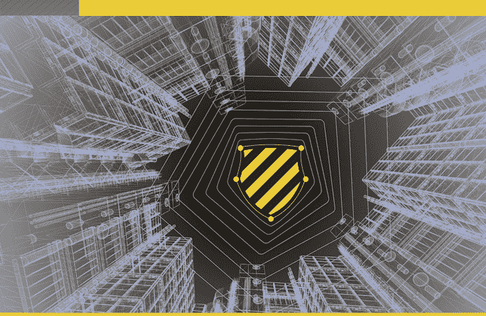

# 颠覆安全的五大技术力量：云、社交、移动、大数据和物联网如何变革数字时代的物理安全

给那些仍在尝试构建 SmartBox 的孩子们——祝你们好运。

## 第 8 章 为什么物联网对安全至关重要 ................................................................83
安全：已成为物联网业务.......................................................................84
零点....................................................................................................................85
究竟什么是物联网？...............................................................................................86
一个预测 .................................................................................................................87
更廉价、更小、更隐蔽.....................................................................90
大浪还是最大的浪？...............................................................................91
IoT 将成为万物的一部分.......................................................92
工业物联网...............................................................................94

## 第 9 章 所有的安全现在都是网络安全...............................................................97
生活模仿艺术................................................................................................................98
全球性的、住宅的、商业的甚至是...........................................................99
通用风险................................................................................................................100
云安全重塑……我认识你吗？...............................................................101
缺乏治理的孤儿......................................................................................102
更新的跑步机......................................................................................................103
前行之路.................................................................................................................105

## 第 10 章 IoT 技术与标准..................................................................107
标准的必要性..................................................................................109
架构至关重要...............................................................................................111
构建模块................................................................................................................112
通往未来的网关...............................................................................114
无线旋风...........................................................................................................115
标准的战场...........................................................................................117
现状.........................................................................................................119
标准组织与联盟..................................................................120
私有框架...............................................................................................123

## 第 11 章 全新的竞技场.........................................................................127
旧即是新——至少对于初创公司而言......................................................................128
大型科技与电信公司再次关注物理安全...............................................................130
消费化与 IoT...............................................................................................132
IoT 会具有颠覆性吗？...............................................................................134
采用............................................................................... 134
策略.................................................................... 135
结语：IoT 真的是一个类别吗？.......................................................... 135

# 关于作者

Steve Van Till 是 Brivo Systems 的联合创始人、总裁兼首席执行官。该公司是领先的云服务提供商，提供访问控制、视频监控、移动和身份解决方案（以 SaaS 交付）。自2011年以来，他还担任安全行业协会（Security Industry Association）标准委员会主席。他是众多安全出版物和论坛的活跃作者和演讲，也是物理安全领域众多专利的发明者。2009年，Steve 被《安全》杂志誉为“安全行业最具影响力的前25位人物”之一。

Van Till 先生曾任 Sapient 公司的互联网咨询总监，在那里他领导了互联网时代第一波客户的战略合作。在医疗信息公司 HCIA，Steve 负责数据分析服务的互联网战略。Steve 还曾在 GeoStar 担任软件开发副总裁，以及在通信卫星公司（Comsat）担任系统工程总监，拥有10多年的无线通信经验。

Steve 与妻子 Robin 住在马里兰州的富尔顿。

# 前言

我们很幸运，正处于现代技术历史上最令人激心的时代之一。数十种技术潮流汇聚、放大并相互重组，创新速度超过了人类见过的任何时期。我们同时生活在这样一个时代：在这个时代里，物理安全——或者更确切地说，物理安全漏洞——已成为日常新闻中常有的且不幸的一部分。但物理安全不再仅仅局限于物理领域。现代安全系统现在是彻底的网络物理系统，这意味着它们既继承了数字世界的动力，陷陷阱。

过去的30年见证了许多重大技术爆炸，它们改变了我们与彼此以及世界互动的方式。数百万人通过 PC 获得了首次计算体验。互联网——在朋友们的帮助下——将这些个人的计算体验汇聚成社交网络的集体体验，具有连接地球上每个人的潜力。智能手机确保了我们出门时不必带上它。而在我们眼前，我们正见证物联网的兴起，以及为了理解我们创造的前所未有的数据量所需的大数据和分析系统。

物理安全正处于这些动荡之中。它由五种成为我们时代标志性变革力量的技术力量形成：云、移动、物联网、大数据和社交网络。这些力量如何以及何地发生，以及它们对安全实践和业务将产生的影响，是本书的主题。

技术采纳生命周期是一个广泛用于理解新技术接受程度的框架，它符合我们在安全市场看到的变化。该生命周期由五个阶段组成。所谓的“创新者”、“早期采纳者”和“早期大多数”处于前端，而“晚期大多数”和“落后者”则处于最后。

当我大胆观察到业内人士，认为物理安全行业通常处于中游水平——处于早期和晚期大多数之间的某处——他们大多数人评论说我可能有点慷慨了。互联网协议（IP）技术缓慢的采纳率就是一个例子，与我们 IT 领域的同仁相比，这些产品进入赛场晚了整整10年。需要证明吗？对比目前百分之五以下的云采纳率与其他市场的超过百分之八十。

这种局限并非全是坏事：客户知道买什么，生产者知道造什么，投资者知道把钱投向哪里。

但竞争格局正在改变。变革的五种力量——云、移动、物联网、大数据和社交网络——已经强大到无法忽视，即使在谨慎采纳的背景下也是如此。结合在一起，它们产生的产品远于先辈。结合在一起，它们降低了创新者的准入门槛。结合在一起，历史障碍将不复存在。

虽然这五种力量之间的相互作用和相互依赖性无法忽视，但本书的组织结构旨在考察每种力量的本质。当然，每个主题内部存在一些交叉，但在大多数情况下，你可以根据主要章节的线索遵循你的兴趣。

在第一节中，我们查看了物理安全行业云计算的现状，以及它如何颠覆本地计算范式。虽然该行业一直意识到集中计算对报警监控的力量，但在通用云计算方面，其反应反常地缓慢。同样，软件即服务（SaaS）的订阅模式对于一个很大程度上围绕经常性业务模式构建的行业来说本应该是轻而易举的。相反，对云安全和可靠性的长期担忧的惯性，阻碍了其他市场中常见的加速。我们将观察当恐惧消退、分销模式适应以及新进入者颠覆现状时正在发生什么。

在第二节中，我们查看了移动技术如何改变安全管理、建筑与住户之间的互动，以及身份和访问管理。在几乎所有其他软件领域，“移动优先”的概念正在改变安全系统开发者的产品优先级，并改变从业人员的工作描述，从保镖转变为首席安全官（CSO）。此前受限于桌面，与现代电子安全系统的专业人士从了办公桌的束缚，但保留了同样丰富的内容。

数据、命令与控制。正如每一次重大安全事件提醒我们的那样，移动网络的无处不在和连接是应急响应中不可或缺的工具。在不那么戏剧的情况下，移动技术正在改变员工、租户和访客互动的客户体验，从一种不便转变为安全机构积极的“客户互动”机会。

在第 3 节中，我们看到物联网（IoT）现象在物理安全领域找到了其最广泛的应用领域。这并不意外，因为电子安全行业在当前的炒热出现很久以前就开始使用物联网了。物联网给安全带来的最大挑战是传感器的泛增，这增加了决策所需的数据量。即使是那些并非正式安全系统的设备，也会产生具有安全价值的“数据副产品”，我们可以称之为所有数据。随着这些数据的可用，黑客可以利用的可用攻击面也将大幅增加。从业人员面临的挑战将是在利用这些技术的同时，利用数据并保护物理和网络基础设施。

在第 4 节中，我们探讨了大规模数据分析作为未来安全领域的一种新兴工具。但尽管大数据已经从医学、物理学到零售行为和股市分析留了巨大足迹，它却奇奇地缺席了物理安全领域。云计算的延迟采用是这方面的一个主要障碍，因为我们在整个电子安全领域发现它并没有蓬勃发展。我们发现的是由小系统组成的群岛，它们将自己的数据与其他隔离，从而阻碍了大规模分析。

在第 5 节中，社交网络技术被视为身份和访问管理（IAM）向新平台迁移的示例。利用“社交空间”组织原则，我们识别了社交技术将如何影响物理安全领域。由于登录功能（此前已证实用于访问网页等虚拟空间），它正成为我们在真实物理空间中验证自己身份的手段。这之所以有效，是因为社交身份是一个独特的标识符，可以取代我们今天与交互的每个个人空间所携带的许多令牌。目前，全球数十亿人使用的社交网络也可能提供一个宝贵的通信渠道，以增强安全实践。随着网络的建立，众包可能成为一种利用群众力量进行参与式安全的方式。

在最后，我们展望了每项技术的采纳率，以及这些变化对物理安全未来可能意味着什么。商业安全的消费化是一个贯穿于许多预期变化中的线索，反映了自新世纪以来一直在重塑该行业的 IT 消费化。

我采取了文学特权，用一个带有个人色彩的叙述来开启这本书，描述了 Briv Systems 的起源故事。这家初创公司是我进入安全行业的工具，它遵循了一条穿插了这五种力量的道路。我希望通过分享这段旅程，能够传达我对我们行业和未来的深切热情和乐观态度。

# 致谢

一本书永远不只有一个作者，因为经验是万物的作者，而这是一场拥有许多参与者的大大舞台。

首先，我感谢我的妻子 Robin，她静静地支持我度过了许多放弃社交计划的周末、每天凌晨 4:00 的写作计划，以及过去 2 年里对“这本书”近乎偏执的痴迷。

我向 Bob Fealy 表出特殊感谢——他是一位投资者、一位导师，最重要的是一位朋友。在 Bob 担任 Duchossois Technology Partners 总裁期间，他是首批理解通过联网设备改善数百万人民生活愿景的人之一。他持续的支持和建议对我带我开启这段旅程的公司成长至关重要，我相信这对他建议过的许多其他人来说也是如此。

我还要感谢 Brivo 的联合创始人们——Carter、Mark 和 Tim——他们说服我离开全职工作去创建一个成功的点公司，并活下来讲述这一切。

我感谢 Brivo 的所有员工——现在和过去的——感谢你们为这个故事的成功贡献了自己，感谢你们在改变行业方面提供的帮助。

本页特意留空

# 从包裹到人

我如何了解变革安全的五大力量的故事始于一个意想不到的地方。1999 年夏的纽约市是记录以来一个世纪以来最炎热的夏天之一。我和我的创业伙伴们整天参加了接连不断的投资者会议，以为我们新的点点公司筹集资金。

当我们穿着西装，在曼哈顿放射状的人行道上步履蹒跚地前行时，我幻想着跳到那些在这样的日子里连接在消防栓门上的巨型喷淋器前。空调房的大厅提供了 10 或 15 分钟的喘息，让我们在向下一小时的对象介绍自己之前尝试重新变回人类。当天的最后一个会议再好不过。

我们推销了当时新颖的业务模式：一种自动更换纸尿和清洁用品等消耗品的电子商务服务，这些商品是每周或每月都需要的。与普通消费者需求的起伏不同，这项业务将一个月又一月地提供可预测的收入流，交付投资者青爱的猫药——每月经常性收入（RMR）。

早前的会议告诉我们，每位投资者都想知道我们将如何从物理上保护这股消耗品流免受犯罪和破坏行为的双重侵害。正如一位投资者所说：“把东西送到人们门口没问题，但前提是它们得留在那里。没人会送货变成被盗窃。”

为了回答这个问题，我们已经草勒了一张粗糙的信封画，一个洗碗机大小的联网设备，我们命名为“SmartBox”。该设计是保险箱和超大邮箱的混合体，通过电子访问控制将其与中央数据库连接。在动态上，分配的键盘代码（安全领域中的凭据）提供了访问权限。

# 第一章：从包裹到人

我如何了解变革安全的五大力量的故事始于一个意想不到的地方。1999 年夏的纽约市是记录以来一个世纪以来最炎热的夏天之一。我和我的创业伙伴们整天参加了接连不断的投资者会议，以为我们新的点点公司筹集资金。

当我们穿着西装，在曼哈顿放射状的人行道上步履蹒跚地前行时，我幻想着跳到那些在这样的日子里连接在消防栓门上的巨型喷淋器前。空调房的大厅提供了 10 或 15 分钟的喘息，让我们在向下一小时的对象介绍自己之前尝试重新变回人类。当天的最后一个会议再好不过。

我们推销了当时新颖的业务模式：一种自动更换纸尿和清洁用品等消耗品的电子商务服务，这些商品是每周或每月都需要的。与普通消费者需求的起伏不同，这项业务将一个月又一月地提供可预测的收入流，交付投资者青爱的猫药——每月经常性收入（RMR）。

早前的会议告诉我们，每位投资者都想知道我们将如何从物理上保护这股消耗品流免受犯罪和破坏行为的双重侵害。正如一位投资者所说：“把东西送到人们门口没问题，但前提是它们得留在那里。没人会送货变成被盗窃。”

为了回答这个问题，我们已经草勒了一张粗糙的信封画，一个洗碗机大小的联网设备，我们命名为“SmartBox”。该设计是保险箱和超大邮箱的混合体，通过电子访问控制将其与中央数据库连接。在动态上，分配的键盘代码（安全领域中的凭据）提供了访问权限。

在华丽的会议室等了很久之后，一位匆忙的银行家冲了进来，看起来他已经听了一整天的推销。这种职业怀疑态度显而易见。我们正处于点热潮中，在线业务的点子多如牛。

我们向他演示了我们的计划书，速度比通常快得多。大多数投资者都担心安全、包裹盗窃、谁有访问权限以及如何管理。

“所以这是一项信息服务，”他解释道，“我们认为这会增加粘性，因为人们喜欢知道发生了了什么。”

说完，他就结束了。他抓了抓一把银发，显得有些不耐烦，向前倾身再次看了一眼我们的草图。他的接下来的话改变了我们的职业生涯，并低声提到物理安全。“你们的电子商务点太蠢了。没人会想要那个——我都能从这里听到亚马逊在笑——但你们的盒子……那才是我感兴趣的。”那一刻标志着第一种联网设备的诞生，该设备通过多租户软件即服务（SaaS）平台保护访问控制。设备本身并不比洗碗机或小洗衣机大，它有一扇门和一个互联网连接。听起来熟悉吗？商业办公楼也是这样配置的。点点崩溃对我们最初的消费者物流想法造成了打击，但在投资者的良好建议下，我们能够将技术和业务模式转变为商业访问控制。毕竟，一栋建筑其实就是一个盒子，而每一个盒子都可以变成智能盒子。

产品设计。它解释了为什么安全技术现在看起来比以往任何时候都要像消费技术。它展示了我们如何期望行业发生演变。

我们的初衷是保护包裹；结果却是在保护人。

## 安全性的消费化

SmartBox 向访问控制系统的演变，为整个安全行业提供了一个既充满希望又具有警示意义的故事。具有帮助性是因为创新总是受欢迎的；具有警示意义，是因为你永远不知道颠覆会在何时何地出现。商业安全是一个相对较小的行业，服务于高度专业化的市场。直到最近，消费产品渗透这些市场的想法并不特别令人担心。新的安全产品通常不会凭空出现，并像智能手机之于相机，或云服务进入企业计算那样颠覆市场。我预计我们将看到更多这种情况。作为一个亲身参与了这一过程的人，我是说，尽管这仅仅是纯粹的巧合。

住宅自动化和安全领域新兴的 IoT 产品表明，它们以更低的成本比许多多年前设计的遗留系统做得更好。这并不意外，新技术正在稳步前进并取代旧技术。尽管如此，几乎每个行业都有一种“这不会发生在我们身上”的部落式自满。然而，对于其中的每一个行业，我们都能找到大量的例子来证明任何事物和一切都可以被颠覆：医疗保健、汽车、能源、保险、投资和日志。即使是出租车和运输这样极具物理属性的企业也无法幸免，Uber、Lyft 等已经充分证明了这一点。

IT 的消费化描述了新技术在消费市场出现并进入工作场所的影响。对于那些更倾向于使用更先进的个人电子产品而非公司发放的老旧遗迹的员工来说，这些产品就是这一趋势的载体。所有这些产品，如智能手机、平板电脑和移动应用程序，为专业环境中使用的工具设定了标杆，而循环再次开始。在网络成为生活方式以来的短时间内，我们一次又一次看到这种情况。消费技术的体验提升了人们对工作场所技术的预期，而能够跨越新标杆的创新者就是赢家。例如，产品上的用户界面追踪了最初出现在消费级应用中的设计洞察和干预。工作和娱乐的平板电脑是同一种产品。消费者的普及驱动了专业领域的采纳。

对消费技术的依赖已远超我们眼睛能看到、拇指能点击的范围：它直达可能性的核心。我们

# 第一章：从包裹到人

除非我们先在杂物店实现了移动支付，否则安全领域就不会有移动凭证。除非我们先有了移动游戏，否则我们不会有移动视频。我们甚至不会为它提供宽带管道，因为远程监控所需的带宽最初是由 YouTube、Netflix 和 Hulu 等消费服务驱动的。

没有人预料到这一点——也没有预料到许多其他正在改变物理安全实践的科技力量的结果。我们将观察其中五种力量，书中将有一个章节专门介绍每一种：云、移动设备、物联网、大数据和社交。

## 早期云端，晴朗天空

SmartBox 从门廊的便利设施变成电子安全装置几乎在夜夜之间完成——如果你把 6 个月不间断的加班计算进去的话。Web 产生了一种专为物理访问控制工作流设计的新用户界面；在底层，它保留了原始的云架构。云后端设计用于服务数万正在在线购物和检查收货的消费者，同时在后台处理智能储物箱的交易。这项任务需要一个健壮的平台，能够服务于每一位重视交付的发货人和每一位重视客户满意度的发货人。

这是一个挑战。

当时，没有任何这种规模的系统既作为客户的 Web 服务，又作为跨越美国大小区域的数百万个智能设备的分布式交易平台。当时有像 Amazon 这样的大型电子商务网站，它那时的年营业已经是十亿美元。还有一些先驱，例如非常成熟的信用卡网络，它们在自己的私有网络上与数百万个销售终端进行交互。但没有人知道网站与机器机器 (M2M) 分布式访问网络的结合交互。SmartBox 服务需要对任何拥有浏览器的人都可用，每小时处理数百万次交易，最重要的是——确保安全。毕竟，安全的承诺是该业务的核心价值。

在我以前的工作生涯中处理过消费规模的系统，我深信 Web 技术可以支持这一愿景。我同样深信，企业架构的方法没有机会。我担任顾问的日子里已经见过足够的财富 500 强公司深陷那种泥潭，花费多年时间理清复杂的企业资源计划 (ERP) 系统，才能支持面向客户的 Web 业务。关键的区别在于软件的多租户架构，这种系统架构允许你的所有客户与软件的单个实例进行交互。Salesforce.com 是这一基本设计原则的早期且清晰的传道者，而我们也与他们同行。

在商业模式方面，很清楚，安全的交付服务必须像今天的大多数云服务那样销售——作为一种按月订阅，人们在获得价值时付费。即使在当时，这不是一个激进的概念，但它远没有现在这样流行。要理解投资者对这种模型所做出的信仰跃迁，请记住，当时的宽带比拨号上网还少；Amazon 只卖纸质书，Netflix 仍在通过邮寄发送 DVD，而在 6 年后 Spotify 才会作为服务销售音乐。世界上大部分地区仍然根于一次性销售模式，而周期性服务正在尝试许多领域。

SmartBox 通过消费物流将云引入了物理安全。一旦重构完成，我们认为战斗胜利了一半。云最终涵盖了我们刚刚发现的这个访问控制的新世界。在接后的 10 年里，大多数事情都转型了：银行、技术、娱乐、邮件、聊天、摄影、书籍、运输、宠物护理甚至披萨。总而言之，除了安全之外，几乎一切都固执地选择了更长的路线。云正在突破，行业中更有远见的公司已经开始追赶。人们，如果你没收到备忘录，我们都要去云端。

## 一个 IoT 故事

在世纪交替之际，只有 3% 的美国人家里有宽带。在那种碎片化的连接环境中，很难确定房主是否理解智能家用——即现在被称为物联网 (IoT) 设备——的力量。它需要始终在线的互联网连接和始终运行的云服务，而这两者都是大多数消费者的体验。很难想象那时新奇的连接设备是什么样的，但它们非常稀少，以还没有公认的类别来描述它们。IoT 这个术语在 1999 年刚刚被创造，但没有人听说过，它也没有现在所拥有的热词地位。人们对早期的 IoT 技术感到惊叹，这些技术似乎正带我们走向《杰森一家》那样的未来。它们是神奇且令人赞叹的。

- 电子传感器监控环境。
- 传感器数据的数字传输。
- 对电机械系统的远程控制。
- 整合整个传感器网络的中央计算系统。
- 针对预设标准的算法响应。
- 访问人类的用户界面。

许多技术细节与今天的 IoT 不同，要说，但基础概念和关系非常相似。

# 从“前移动”到移动优先 7

15 年前，除了身份和访问管理，公钥加密（PKI）和数字签名对于解决仍困扰物联网（IoT）的信任问题至关重要。对于 SmartBox 来说，使用数字签名作为人类的替代品解决了包裹从寄运、运输到交付的整个过程中的监管链问题¹。当由消费者驱动的 SmartBox 演变为访问控制面板时，它带来了 X.509 数字证书，并成为第一个做到此点的商业系统。这些证书的使用在网络化安全设备上已非常广泛。

销量显然如此。对于物联网产品，良好的工业设计也是如此。总部位于帕洛托的著名设计公司 IDEO 早期创建了 SmartBox 的设计。他们作品的美学优雅让这套访问控制系统登上了《连线》（Wired）、彭博社、《芝加哥论坛人报》ABC 新闻杂志，并在《美国早晨新闻》中进行了屏幕演示。这种对设计的同样关注是几乎每一个成功物联网产品的标志。

SmartBox 起初是一个消费级物流产品。市场和机遇的奇异力量驱动它直接进入了消费安全领域。这个故事与现状相似，而这也是今天改变产品格局的创新浪潮的核心。它们比以前任何时候都更具有跨类别的能力。它们从一个应用演变成另一个应用。这一切发生得比传统产品设计的速度快得多。如果你正在制造产品，那令人担心；但如果你正在购买设计，生活从未如此美好。

对于跟不上节奏的公司或产品，被淘汰可能是永久性的。SmartBox 通过保持智能但放弃“盒子”逃脱了这种命运。投资银行家对纸上草图的洞察推了它走向正确的方向。后来，灵光一现的时刻是：人就像包裹，建筑就像巨大的盒子。幸运的讽刺（对我来说最不幸运），电子商务刚刚让包裹无处留在门口和阳台上，但安全永远不会离线。

## 从“前移动”到移动优先

假设你永远忘记你的第一次。

手机，那是我的。我的手机几乎只有语音通话和短短信。到 2000 年，短信已经走红，早期的黑莓（Blackberry）已成为一种拇指打字的痴迷。安全团队很早就发现，短信作为模拟寻呼机加密回拨号码的替代品是多么有用且解放。同时，产品设计师抓住了这个机会，通过这种方式来触达并接触某人。

> ¹美国专利号：6,404,337。

作为一个连接设备，SmartBox 并不例外。它需要交流。它有话要说。这直接引导我们关注过去十年中移动平台在安全中所占的核心角色：物理世界变化的数字通知。我们很早就发现人们会关注信息，即使信息是来自机器而非人类。如果连接设备为他们提供及时相关的信息，他们就会改变行为。当然，如果设备告诉他们包裹已经送达，他们可能会改变路线，在当天其他活动之前取包裹。如果系统告诉他们有人进入过他们的盒子，他们可能会打电话询问原因。我们现在认为这一切是理所当然，因为我们有连接设备一直告诉我们这些，但在当时，这些功能让每一个看到它们的人都惊叹。

我们发现，在商业环境中通信更受重视，因为及时信息就是金钱。现场维修物流就是一个典型的例子：在正确的时间将正确的零件交付给正确的人——并记录它的发生。我们需要零件部门和现场技术人员配备面对面的交接人员。在过程中加入一个受访问控制的柜台使其变为异步，从而解耦了双方的时间表。系统还提供了服务水平承诺的验证，短信和电子邮件提供了审计追踪。每个人都保存了它们。

今天，这几乎已成为过去式，但在当时，它是开创性的。文本和图像现在是传感器网络的命脉，向安全团队通报整个设施及其居民的异常。移动技术将我们从办公桌和视频监视器中解放出来，丰富了建筑与其住户之间的互动，并为身份和访问管理提供了平台。

## 处于幼年阶段的大数据

“大数据”一词于 1998 年首次亮相，就在故事开始之前不久，但人们并没有真正频繁使用这个词。即使在加入安全行业之前（我曾工作于一家专门负责分析和销售海量数据的公司），没有人说过“大数据”。相反，公司谈论的是分析、报告以及为客户建立专用仓库。换句话之，公司与客户的对话是关于数据增加的价值以及客户可以用数据做些什么——而不仅仅是它的规模。

这段经历教会了我，当数据通过正确的算法运行并以正确的方式呈现时，它是有多有价值。这就像从一山的土中淘金。这就是为什么变现通常是任何处理大量数据的公司的次要业务计划。价值隐藏在意想不到的地方，寻找它总是有回报的。这对于物流和安全领域似乎尤为如此。鉴于这两个市场的财务利益，从他们数据系统中产生的信息尾矿很可能是高质量的矿石。

十五年后，随着大数据重新定义了从大量物理安全事件中可以提取的智能，该行业开始引起关注。安全事件数据具有真实价值。遗憾的是，这些数据中的大部分无法被挖掘，因为它们散落在各地的遗留计算系统的小堆数据中。只有当所有数据都处于一个（逻辑）地方时，大数据才能发挥作用。这关乎汇集数据的前提。

（注：原文后续存在大量重复段落，译文已根据要求去重，仅保留核心内容）

## 物理安全领域的互联网泡沫重演

IT 和整个美国经济向云端的转型发生在泡沫时代，过程之快速且混乱，以至于人们难以观察。即使对于我们这些处于其中的人来说，发生的事情也超出了任何人能完全跟上的范围。我记得《行业标准》（The Industry Standard）那种令人屏息的报道，那是一份自称为互联网新闻的周刊。新公司层涌而出，却在还没过第一个周生日前就倒闭了。“新经济”拥有巨额现金，“改变了所有规则”，而且“眼球（流量）”比金钱更有价值。高昂的费率曾是荣誉的象征。突然之间，它们不再如此，派对结束了。

我预计在未来 5 年中，物理安全行业将看到那个时代某些动态的重演——只不过没有最后糟糕的崩盘部分。它可能不会那么全方位，但对于安全消费者来说，它具有同样的变革性和益处。“新经济”将看到云服务公司市场的稳定增长，而是以那些落后太多的公司为代价的。它将强调客户获取，就像新经济每个子领域最初对市场份额的抢夺一样。它将强调创新、新的市场路径和在线购买，正如我们在从“实体店”到“实体加点击”的首次转型中看到的那样。

安全公司越来越多地在营销信息中穿插云端语言，担心自己落后。与此同时，在巨型遗留代码库上投入了数亿美元的产品团队，正挣扎于如何在不牺牲公司现金摇牛的情况下，提供类云的体验。新入者和非传统供应商以比传统提供商更快的速度进入云空间，导致了参与者远超任何人预料的领土争夺。

由于这些动态，安全行业代表了新经济第一波浪的回声。它给了我们另一个机会去观察培养皿，目睹一种新生命体的出现。然而，这一次，我们知道实验的结果将如何，以及应该把注放在哪里。

## 物理安全中的技术采用

技术采用生命周期是一个广知的社会学框架，用于描述新技术或创新在越或多个市场中的接受程度。它最初由埃弗特·罗杰斯（Everett Rogers）的里程碑著作《创新的扩散》³，以及杰弗里·摩尔（Geoffrey Moore）的《跨越鸿沟》⁴构成了理论背景。

> ³Rogers, E. M. (2003). Diffusion of innovations. New York: Free Press.

# 12 第1章：从包到人

这已成为我们观察技术演进的一个部分，以至于许多人会识别这些语言——早期采用者、早期大多数、晚期多数和落后者——而甚至不知道这些术语源于何处。

按照惯例，物理安全行业在这个框架中大约处于“晚期多数”的位置。作为一个说明，我引用了 2000 年初的行业状况，当时我正开始接触这个市场。当时正进行着激烈的辩论，互联网技术是否足够安全可靠，以用于安全应用。人们实际上在印刷媒体上采取了这场辩论的“反方”观点，并预测粗大的串口电缆将永远被使用，因为互联网协议（IP）是不可信的.³ 十年后，随着全世界都在使用互联网处理一切，我们可以安全地说，该行业收到了信号，并转向了如今仅有30 年历史的技术。

该行业如何负担得这些快速变化的创新的落后采用者的奢侈负担？首先，市场动态在终端用户消费这些产品的方式上某种程度上受到了保护。中小企业——最大的单一市场板块——购买频率低，对品牌和功能了解甚少，因此从未对渠道改变一直以来的做法施加压力。成千上万个交叉管辖区的无数需求，使得引入实质上超出以往范围的新产品具有挑战性。最后，还有一种自然的保守主义，它理所章地避开了前沿（bleeding edge）的危险。

我们在这一框架中看到的反复出现的主题是：虽然物理行业通常是新技术的晚期采用者，但它最终总是追赶上来。

这些力量的总和在未来 5 年内将如何影响物理行业的未来？许多力量相互放大，各部分的总和使得当前的转型变得引人注目。我们将看到向整合了其他四种力量的云服务发生最大转变。特别是，这将市场从那些无法跨越障碍的公司转移，并转向那些更灵活的公司。这些技术的总和也可以被描述为不仅表现出商业安全的消费者化。

> ³Moore, G. A. (1991). Crossing the chasm: Marketing new products to mainstream customers. New York: HarperBusiness.

> ⁴[注：原文未提供详细引用信息]

做一个后进者并不是全坏事。我们可以受益于新技术已经趋于成熟，并解决了其中的各种问题。云技术在 20 世纪 90 年代末的婴儿时期曾面临许多软件开发和部署方面的挑战。

- **高昂成本**。每家公司基本上都要从头到尾自己编写自己的应用程序；他们必须“自造轮子”，并通过艰难的方式找到可行的方案。
- **工具匮乏**。软件工具和框架尚未跟上云系统的独特需求。开发者经常需要自己创建工具，这增加了推向新产品的整体工作量。
- **开发者短缺**。理解如何构建这些系统的软件开发者非常稀缺、昂贵且需求量大（我猜有些情况确实不会改变）。顾问们向所有想要“在互联网这事儿上做点什么”的公司收取高昂的日薪费用。
- **基础设施**。像 AWS 和 Azure 这样的托管基础设施服务在当时远未达到目前的熟练水平。这迫使应用程序提供商承担承担数据中心的负担。每个人都需要自己的计算机和网络专家，以及大量的资金来购买设备。
- **宽带可用性**。同样重要的是，现在被视为理所当然的宽带网络连接在当时不稳定；每次销售都要经过一个发现过程，以确定潜在客户是否有足够的带宽接入。
- **网络安全担忧**。对云提供商遭受网络攻击的恐惧不能被低估，它是该领域早期销售的抑制因素。人们本能地觉得电脑放在自己的建筑内比放在建筑外更安全。

当十年后物理安全领域才意识到云计算的相关性时，其中许多问题已经得到了解决。一方面，这对于一直处于试水阶段的物理安全公司来说是好事；他们比十年前就投入其中的公司以更低的实施成本和风险向前迈。然而，这也意味着他们又投入了十年的系统开发（和资金）在单租户的客户端-服务器架构上。

## 向冰球曾经所在的地方滑冰

韦恩·格雷茨基（Wayne Gretzky）关于时间的冰球比喻已成为熟悉的商业术语。它通常意味着一家公司或产品具有前瞻性，并预见到客户需求的发展方向。许多人会用它来描述自己公司对云计算的态度。然而，事实可能是：该行业并不是在向冰球将要去的方向滑冰，而是向冰球 5 年或更多以前到达的地方移动——至少在企业软件世界的其他领域是如此。

作为 2001 年安全行业的新手，我想要赶上进度。我贪婪地读了我能拿到的许多行业杂志。那些公司名称对我来说都是全新的，产品类别、渠道模式以及几乎所有关于物理安全的内容也是如此。我带去了近 15 年的 IP 技术经验，起初作为程序员，后后作为系统工程师和顾问。我知道它是快速、可靠、安全的，并日益成为美国商业的支柱。

当我遇到一本著名的杂志，看到上面发表了一篇“针锋相对”风格的文章，将支持 IP 的观点与反对 IP 的观点对立起来时，我感到非常惊讶。支持者认为：在物理空间中使用 IP 技术既不可避免也是积极意义的。反对者的观点是反动且怪异的：IP 技术永远无法满足安全行业“传中之宝”的需求，我们使用它是在冒险。

那是 15 年前的事了。现在没有人会提出反对泛指 IP 或认为互联网不适用于任何数字通信的论点。这甚至不是一个可以讨论的话题。仿佛为了证明这一点，电信公司多年来一直用光纤取代铜线，使得主张坚持使用普通电话服务（POTS）的反对立场变得毫无意义。

争论结束。终于结束了。

## 换个名字的 SaaS

我相信安全行业一直相信 SaaS，只是我们以前不知道而已。考虑以下证据：

- 几十年来，我们使用池化的计算资源来提供集中监控。
- 几十年来，我们提供了按需自助服务，以便随时创建新账户。
- 几十年来，我们为共享计算服务提供了广泛的（电话）网络访问。
- 几十年来，我们要求客户将私有数据存储在离线位置。
- 几十年来，我们提供了按需计费的的服务，每月费用与消耗量正比。

# 第 2 章：云的前奏

也许比以上任何一点都更显著的是，整个行业的住宅侧是围绕一种财务模型构建的，该模型通过减少预付成本来换取固定的月付，在此过程中将资本支出变成了运营支出。

显然，云计算的核心原则和其财务收益对安全行业来说并不新鲜。远非如此。每月经常性收入（RMR）——在 IT 领域更通用的说法是订阅收入——其财务引擎的起源通常可以追溯到 15 世纪印刷术的发明。这项关键发明降低了生产成本——以及同样重要的生产时间——使其达到了更高的出版频率可以支持预测性收入流的水平。虽然历史学家仅将印刷术列为人类历史上最有影响力的发明之一，但能够实现订阅收入在商业模式历史上是一项具有同等地位的成就。

在 20 世纪，报警监控服务的发明对安全行业所起的作用，正如印刷术在五个世纪前对出版业所起的作用一样。它们让服务变得集中化和自动化，而不是分散和手动。技术的转变引发了相应的经济转变，支持了“按需随付”的收入模式。从这个角度来看，安全行业可以声称在当前的形态出现很久以前就已经发明了订阅计算模型。

## 营销人员顺势而为

当营销部门齐声发力并开始唱同一首歌词时，他们拿起门禁控制，简单地在公司名称后面加上了“云”这个词。在微软主导行业的时代，几乎所有的安全应用程序都需要用户安装客户端。这些系统通常只能通过公司网络或拨号上网访问。

21 世纪初基于 IP 的产品改进了安全系统的布线，但并未改变拓扑结构或架构。你仍然需要一台运行客户端-服务器软件的本地电脑来控制面板、摄像头和其他外围设备。

谁能怪他们呢，在充满误解的情况下？这种炒作混乱在新技术的初期是典型的。快进到现在，只需看一眼会议主题或产品营销，行业内几乎每个人都变成了云的传教士。事实上，云已经从一个差异化特征变成了必不可少的东西。那些守卫者和怀疑者是如何转变的？

## 互联网协议开辟道路

互联网协议（IP）定义了互联网，而互联网正是云的基础。这些协议出现于创建 ARPANET 期间，它是公共互联网的前身，将美国各地研究机构的计算机连接到同一个网络，以共享数据和计算任务。自 1974 年发布广泛分发的协议以来，互联网的技术规范集合大约有 10,000 份（仍在增加）。

## 第二章：云的兴起前奏

## 在我们称其为“云”之前

在互联网经济的第一阶段，我们并不使用“云”这个术语。软件和网络工程师多年来通过查看网络图来认识云的符号，但同一个符号可能仅仅指代网络技术（例如，几乎被遗忘的遗迹，如 X.25 和 SNA）。与如今流行的云描绘不同，它缺乏那种“隐形的云层隐藏其中并执行魔法般服务”的含义。它仅仅是作为抽象和简化错乱麻般的连接表示的一种方式。它意味着任何触及它的东西都能与其他所有东西交换信息。

第一批云公司是为你运行应用程序的远程数据中心。它们最早的名称是应用服务提供商（ASP）。以 ASP 模式运营的公司在自己的服务器上运行应用程序，并负责维护、许可、存储和备份，从而让你的 IT 人员无需为你使用的每种应用程序开发专业知识。这种突破性模型具有当今 SaaS 公司的一些特征，但尚未创建出针对新兴云使用场景优化的新型多租户应用程序。

有些公司使用“托管”（host）一词，例如“托管访问控制”或“托管视频监控”。充其量，这个词是模糊、不精确且具有误导性的。它对底层计算模型未说明任何内容。多租户？客户端-服务器？Web？它没有提到计算资源部署在哪里或如何部署。一个数据中心？在互联网上？在衣柜里？最后，它将许多部署模型归入同一个桶，仿佛在说所有的离线计算都是同质的。

事实远非如此。

## 五大核心特性及其重要性

在过去的 10 年里，我参加的几乎每一次公开演讲中，观众中总有人要求对“云”给出定义。他们要么是从未遇到过清晰的解释，要么是听了太多矛盾的答案。欺骗性的营销说法只会增加困惑。幸运的是，得益于美国国家标准技术研究院（NIST），我们对精确定义有着非常好的共识。

NIST 已成为定义云技术和推动就描述其的核心框架达成共识的全球领导者。NIST 框架最有用的元素之一是 2011 年发布的云计算五大核心特性列表。这些特性区分了优劣产品，并说明了云计算与电子安全之间的相关性。

- 1. **按需自服务**：在不需要人工干预的情况下配置计算能力。换句话说，你可以创建账户、设置新应用程序并完成财务交易，而无需致电支持中心或等待 IT 人员执行某些操作。
    - 对集成商为何重要：按需自服务的价值在于，你可以立即开启应用程序服务，并继续安装控制器、摄像头、传感器等，而无需等待服务器就绪或软件许可的安装。按需自服务还意味着技术人员需要的培训较少，并且在被聘用后可以迅速提高生产力。结合在现场部署中很少出错的机会，你可以看到性能的巨大提升。
    - 对安全组织为何重要：你的新安全系统可以比传统模型更快地安装。由于没有本地服务器，你的集成商在现场的时间会更短，对你 IT 人员资源的消耗也更少。你还应该看到更低的前期安装成本（假设集成商转嫁了这些节省）。

- 2. **广域网络访问**：云服务必须通过网络可用，并通过浏览器、手机手机、平板电脑和工作站等标准机制访问。安全行业在互联网兴起之前就必须变得移动化和 24/7 全天候，这与旧式的只能在守卫室或后台办公室访问系统的模式相比，其优势是不言而喻的。
    - 对集成商为何重要：广域网络访问允许集成商无论客户位于何处都能部署相同的解决方案。
    - 对安全组织为何重要：安全解决方案的广域网络访问意味着你可以计划在所有设施中部署单一解决方案。安全应用和人员的统一化和集中化为每个组织带来了巨大的成本节省和运营效益。

- 3. **资源池**：这是云计算真正的“秘诀”，它是提供所有其他核心特性的基础，以及让云计算对买家来说非常划算的规模效应。资源池——与多租户概念密切相关——简单是指与多个消费者共享一组计算机、存储、网络和其他资源。物理和虚拟资源可以根据需求进行动态分配和重新分配，并具有某种物理或表面上的控制。
    - 对集成商为何重要：资源池允许提供商使用多租户模型服务多个客户。
    - 对安全组织为何重要：资源池允许提供商实现可以转嫁给客户的规模效应。

- 4. **快速弹性**：资源可以弹性地配置和释放，以随需求快速扩展。对于消费者而言，可用资源似乎近乎无限，并且可以以任何数量获取，产生了一种提供者拥有无限容量的幻象。
    - 对集成商为何重要：快速弹性允许集成商根据客户需求扩大或缩小安全解决方案，而无需等待新硬件安装。
    - 对安全组织为何重要：快速弹性允许安全组织快速响应不断变化的威胁或扩展的需求，而无需过量配置本地硬件。

- 5. **可计量服务**：云资源必然是可用的，并在某些水平上监控和控制使用（例如存储、处理、带宽、性能和用户数量）。资源使用情况可以透明地对每个消费者进行控制和报告。
    - 对集成商为何重要：可计量服务允许集成商仅对客户实际使用的部分收费，这可以是一个非常有吸引力的卖点。
    - 对安全组织为何重要：可计量服务允许安全组织仅按需付费，将资本支出转换为运营支出。

## 服务模型：应用程序与基础设施

服务模型的概念区分了安全买家最重要的两个类别，无论是为客户提供解决方案的创新者，还是评估下一代架构的安全组织。这些目的的两种主要服务模型是软件即服务（SaaS）和基础设施即服务（IaaS）。

除非你开发自己的应用程序并以此经营业务，否则大多数人提到 SaaS 时想的是“云”。在 SaaS 中，消费者共享运行在云基础设施上的应用程序。用户永远直接与云基础设施交互，这是该模型的主要吸引力。

对于系统集成商来说，成为 SaaS 消费者意味着使用第三方云端视频或访问控制解决方案等，并向客户提供 SaaS 服务，同时提供现场设备安装（如锁和摄像头）、定期的维护、咨询、帮助支持以及安全集成商和开发者提供的所有其他服务。在这些情况下，集成商都未代表客户编写了软件、创建了硬件或运营了 SaaS 服务。他们指定了认为对客户最好的解决方案，并将其嵌入到整体服务包中。

对于安全组织来说，SaaS 服务被呈现为即用的完整应用程序，无需 IT 协助、配置或设置。它们可以运行，就像电子商务网站、在线银行、网络社交或任何其他在线服务一样：无论什么名字，都是 SaaS。

IaaS 是一种完全不同的产品。它是原始的计算和存储能力，开发者和 IT 管理员将其转换为用的应用程序服务。把它想象成一个穿好衣服但无处可去的数据中心。除非添加应用程序，否则它什么也做不了。在这方面，IaaS 是 SaaS 之下的基础层。由于其提供的效率，SaaS

公司越来越多地转向 IaaS 提供商来托管其产品服务的应用程序。

例如，Netflix 是一个运行在亚马逊云服务（AWS）上的 SaaS 应用程序。IaaS 让公司免于处理硬件、网络和数据中心的烦恼。云服务的这些物理和网络层已变得高度专业化，最大的基础设施提供商（如 AWS）利用规模效应，以大多数应用程序公司无法比拟的成本交付这些服务。

回到物理安全行业：如果你是一个集成商或安全组织，你可能不想在你的电子安防基础设施中与 IaaS 有任何直接的接触。你可能只是想要一个能够执行视频管理、访问控制或报警监控的成品产品。

## 部署模型：公有云 vs. 私有云

NIST 云计算模型中与物理安全解决方案相关的最后一个维度是部署模型。这些模型描述了哪些个人或群体可以在什么条件下使用特定的软件或基础设施。

正如其名称所示，公有云是向广大公众提供的服务。想象一下电话系统、无线移动服务或有线电视。客户创建账户，同意合同或服务条款，云服务便开始流动。客户不需要成为任何特殊小组的成员，也不需要获得任何人的预先授权。服务提供者设计该服务的目标是尽可能吸引更多用户，并让任何连接互联网的人都能使用。

另一方面，私有云正如其名称所意：仅供获得预先授权的人员或机构使用。通常，私有云是由企业创建的，用于托管在传统数据中心使用的应用程序或数据。他们迁移到私有云是为了利用云的经济效益和灵活性，但又不会暴露给公众。通常，提供商访问私有云使用的技术与访问公有云相同：Web 浏览器、移动 App 等。然而，这些服务隐藏在企业防火墙、VPN 访问或其他安全技术之后，将其限制在授权个人范围内。

你可能会问：私有云不是物理安全应用的理想选择吗？一些用户发现自己更倾向于这种想法：

## 部署模型：公有云 vs. 私有云

只有他们组织才能访问托管其公司安全的计算机系统。你经常在具有规模和技术能力来部署和管理自己私有云的大型企业中看到这种态度。然而，这种模型对于大多数 IT 人员寥寥的业务来说是不实用的。糟糕糟糕，它抛弃了公有云的成本和管理优势。

作为转型物理安全行业的业务现象，公有云将是本书中的假设模型。私有云有其用处，但它们没有从根本上改变业务或计算模式，因此它们与本文讨论的相关性较低。

首先，几乎从定义上说，公有云是可用服务最频繁使用的部署模型。大型系统集成商需要这种部署模型来高效运营业务，特别是对于大型企业客户。较小的安装公司需要这种模型来与更大的竞争者竞争。

其次，对云服务的移动访问需求倾向于公有云解决方案。通过公有云服务，部署到客户手机上的每个移动应用程序在下载后都可以连接到相同的服务点（URL）。相比之下，使用私有云服务会给每一个移动实例带来配置负担。

最后，也许也可能是最重要的一点是，只有公有云部署才能扩展到享受规模效应所需的规模，从而带来云计算的成本优势。

## 转折点

2015 年是安全行业首次看到专门针对物理安全应用云计算主题的会议的一年。《安全系统新闻》（*Security Systems News*）组织并举办了 Cloud+ 会议，该会议具有象征意义地在硅谷中心地召开。通过这次会议，他们重演了历史，迎接新一代技术。这一首创会议的大规模和热情参与标志着物理安全领域云计算的转折点已经到来。

考虑到该行业多年来的不愿、公众怀疑甚至对云计算的公开批评，行业是如何达到这一地点的？到 2015 年发生了什么变化导致大多数人接受了这一点？

# 驱动因素

首先，几乎从定义上说，公有云是可用服务最频繁使用的部署模型。大型系统集成商需要这种部署模型来高效运营业务，特别是对于大型企业客户。较小的安装公司需要这种模型来与更大的竞争者竞争。

其次，对云服务的移动访问需求倾向于公有云解决方案。通过公有云服务，部署到客户手机上的每个移动应用程序在下载后都可以连接到相同的服务点（URL）。相比之下，使用私有云服务会给每一个移动实例带来配置负担。

最后，也许也最重要的一点是，只有公有云部署才能扩展到享受规模效应所需的规模，从而带来云计算的成本优势。

# 第三章：转折点

2015 年是安全行业首次看到专门针对物理安全应用云计算主题的会议的一年。《安全系统新闻》（*Security Systems News*）组织并举办了 Cloud+ 会议，该会议具有象征意义地在硅谷中心地召开。通过这次会议，他们重演了历史，迎接新一代技术。这一首创会议的大规模和热情参与标志着物理安全领域云计算的转折点已经到来。

考虑到该行业多年来的不愿、公众怀疑甚至对云计算的公开批评，行业是如何达到这一地点的？到 2015 年发生了什么变化导致大多数人接受了这一点？

# 驱动因素

首先，几乎从定义上说，公有云是可用服务最频繁使用的部署模型。大型系统集成商需要这种部署模型来高效运营业务，特别是对于大型企业客户。较小的安装公司需要这种模型来与更大的竞争者竞争。

其次，对云服务的移动访问需求倾向于公有云解决方案。通过公有云服务，部署到客户手机上的每个移动应用程序在下载后都可以连接到相同的服务点（URL）。相比之下，使用私有云服务会给每一个移动实例带来配置负担。

最后，也许也最重要的一点是，只有公有云部署才能扩展到享受规模效应所需的规模，从而带来云计算的成本优势。

# 第三章：转折点

2015 年是安全行业首次看到专门针对物理安全应用云计算主题的会议的一年。《安全系统新闻》（*Security Systems News*）组织并举办了 Cloud+ 会议，该会议具有象征意义地在硅谷中心地召开。通过这次会议，他们重演了历史，迎接新一代技术。这一首创会议的大规模和热情参与标志着物理安全领域云计算的转折点已经到来。

在这些年里，随着移动计算的出现，每个人可以将办公软件带走。

但仍有需要克服的挑战。

## 对风险的平衡观点

云计算最大的障碍一直是对网络安全的普遍担忧。这一挑战并非安全行业所有。事实上，网络安全一直是企业不愿转向云的主要原因。如果物理安全专业人士与他们的 IT 同仁分享这种担忧，他们很难颖而出。很少有人成为同类群体中的早期采用者，无论其他细分市场在做什么。

## 超堆叠

在云采用的早期阶段，许多公司低估了组云服务所需的条件。不熟悉云的高管们

技术部门难以理解为什么他们的遗留产品不能简单地在异地数据中心运行并被命名为云解决方案。毕竟，他们在几十年的时间里投入了数千万美元，只为完善一套本地客户端-服务器解决方案的功能集而费尽心力。难道，这些东西现在就过时了，不是吗？

很少有高管理解以下两种模式之间并不微妙的区别：一种是运行大量的虚拟机实例——每个实例对于单个客户来说都是一个完整的环境；另一种则是在单一平台上同时支持所有客户的真正的多租户软件架构。

尽管如此，他们还是尝试了。

这些早期的尝试通过大量的独立虚拟机来模拟云计算的外部表象，忽略了幕后真正的投入工作。因此，这些系统被称为“堆叠箱式”（stack-a-box）系统，因为它们的经济效益和运营要求与堆放服务器（或“箱子”）并无区别。它们在硬件层面没有实现规模效应，在 IT 管理层没有实现规模效应，在开发和部署层也没有实现规模效应。虽然客户不再拥有居住在自己数据中心里的解决方案，但他们支付的价格仍然是同样的（或更多）。

这种模仿云的模型由于几个原因而崩溃。首先，软件提供商未能面向合作伙伴和终端用户隐藏底层的复杂性。买家所渴望的快速供应和弹性根本无法在数千台独立服务器的基础上实现交付。云的成本优势无法实现。客户要么必须支付更多，要么服务提供商必须忍受低利润率，这两者都是不可持续的。它尝试并失败了规避云的基本经济学：它需要规模效应来驱动单位成本降低到效率收益被抵消的程度。

最后，用于移动端和 API 服务的云杠杆作用是无法复制的。“堆叠箱式”的方法需要大量的终端和网络管理来提供这些服务，创造了无以承受的沉重负担。

## 我们比客户更保守吗？

集成商渠道本身构成了第三个大障碍。虽然几家领先的全国集成商早在 2003 年就开始使用云解决方案，但其他公司将其视为安全主营业务的配角。大多数人认为，他们的客户不会认可或为早已通过一次性费用购买并安装在自己大楼内的异地经常性收入版本的系统买单。

与预期相反，事实证明他们的客户已经将云用于许多其他业务应用。到 21 世纪初中期，像 Salesforce.com 这样主要的云公司已经赢得了许多喜欢云的简单性和定价模式的客户。得益于良好的记录，客户已经接受这样一个事实——也许仅仅——云公司在管理和保护数据方面比他们自己更出色。到2010 年，分析师们认为绝大多数组织预计增加对 SaaS 的使用。然而，行业内的许多人仍然认为这些客户不会购买云解决方案。即服务产品的采用率徘徊在低个位数。

许多观察者指出，这种滞后的采用动态中存在一种代际效应。由于带着云对客户是不可接受的假设进行运营，许多行业灰色头军人物不会提供这一选项，从而验证了“没有人会买它”的自我实现预言。与此同时，集成商在从大学招募新销售人员时出现了一种新的成功模式。他们销售队伍中最年轻的成员——即在云时代长大的千禧一代——在接受云的价值主张并向客户信服地展示它时毫无困难。讽刺的是，这导致销售办公室的一个角落坐着一个老牌云反对者，而另一个角落是一个年轻的同事在计算云佣金。

## 云的立足点

在这一切过程中，少数制造商和集成商一直在推动球进展——虽然没有整个软件行业那么快，但确实在向前发展。许多早期用户将云视为在标准解决方案失败时从工具箱中提取的利基市场。例如，对于访问控制和视频有限的小型或远程站点，是一些首批配备云安全系统的场所。在许多情况下，这些地点无法支持这些开支。

这种模仿云的模型由于几个原因而崩溃。首先，软件提供商未能面向合作伙伴和终端用户隐藏底层的复杂性。买家所渴望的快速供应和弹性根本无法在数千台独立服务器的基础上实现交付。云的成本优势无法实现。客户要么必须支付更多，要么服务提供商必须忍受低利润率，这两者都是不可持续的。它尝试并失败规避云的基本经济学：它需要规模效应来驱动单位成本降低到效率收益被抵消的程度。

最后，用于移动端和 API 服务的云杠杆作用是无法复制的。“堆叠箱式”的方法需要大量的终端和网络管理来提供这些服务，创造了无以承受的沉重负担。

## 我们比客户更保守吗？

集成商渠道本身构成了第三个大障碍。虽然几家领先的全国集成商早在 2003 年就开始使用云解决方案，但其他公司将其视为安全主营业务的配角。大多数人认为，他们的客户不会认可或为早已通过一次性费用购买并安装在自己大楼内的异地经常性收入版本的系统买单。

与预期相反，事实证明他们的客户已经将云用于许多其他业务应用。到21 世纪初中期，像 Salesforce.com 这样主要的云公司已经赢得了许多喜欢云的简单性和定价模式的客户。得益于良好的记录，客户已经接受这样一个事实——也许仅仅——云公司在管理和保护数据方面比他们自己更出色。到2010 年，分析师们认为绝大多数组织预计增加对 SaaS 的使用。然而，行业内的许多人仍然认为这些客户不会购买云解决方案。即服务产品的采用率徘徊在低个位数。

许多观察者指出，这种滞后的采用动态中存在一种代际效应。由于带着云对客户是不可接受的假设进行运营，许多行业灰色头军人物不会提供这一选项，从而验证了“没有人会买它”的自我实现预言。与此同时，集成商在从大学招募新销售人员时出现了一种新的成功模式。他们销售队伍中最年轻的成员——即在云时代长大的千禧一代——在接受云的价值主张并向客户信服地展示它时毫无困难。讽刺的是，这导致销售办公室的一个角落坐着一个老牌云反对者，而另一个角落是一个年轻的同事在计算云佣金。

## 云的立足点

在这一切过程中，少数制造商和集成商一直在推动球进展——虽然没有整个软件行业那么快，但确实在向前发展。许多早期用户将云视为在标准解决方案失败时从工具箱中提取的利基市场。例如，对于访问控制和视频有限的小型或远程站点，是一些首批配备云安全系统的场所。在许多情况下，这些地点无法支持这些开支。

## 初创型公司纷纷入场

云技术为建筑及其所有者之间提供了一条路径，正如 Uber 之于连接乘客与司机，Facebook 之于连接朋友一样。这在居住空间表现得尤为明显，那里有许多智能锁、智能门铃，以及近期推出的各种初创公司。自然而易然，所有这些面向消费者的安全服务从头到尾都是云公司。讽刺的是，他们不需要向任何人解释这一点。这甚至没有出现在他们的广告文案中。没人不在乎。人们认为，我们看到的每一家新公司都是云公司，而我们也对此表示认可。

在商业安全领域，也有越来越多的安全初创公司带着云解决方案进入市场，涵盖视频监控，以及日益增长的访问控制领域。虽然技术和质量在不同公司之间存在显著差异，但在写作时，商业领域已有 30-40 家公司提供视频监控即服务 (VSaaS) 或托管视频监控服务 (MVaaS) 方案。

视频领域的增长速度超过了访问控制领域，原因有几点。首先，几乎没有公司会开发自己的摄像头产品，这意味着他们可以利用市场上已经存在的现有产品。其次，该行业的这一部分受益于通用标准的采用，最著名的是 ONVIF，它允许许多摄像头和存储服务之间实现互操作性。最后，视频监控所受的管辖区监管比报警或访问控制服务要少。这意味着产品可以在许多地方使用，而无需为每个地方创建特定版本，也不需要让产品通过漫长且昂贵的监管审批流程。

## 创新者困境

很多人都在好奇，为什么很少有（如果有的话）老牌安全软件供应商跳入云领域。换句话说，如果你在行业内拥有良好的声誉，对客户需求有深入理解，并拥有一经市场验证的进入策略，为什么不利用你的地位提供基于云的服务呢？

在我从事咨询业务期间，我曾与其他行业面临同样问题的公司合作。管理层的困境通常归结为相互交织的挑战。第一个是对现有产品线的“自我蚕食”。公司内部的老派会积极反对破坏性的产品开发，如果这些会威胁到奶牛业务。例如，客运铁路公司避开了航空业务，认为这种举动会抢夺他们既有业务模式的份额。

这是一种好策略吗？好吧，当你想要保护自己的奶牛时，问问自己：你是如何进行跨国旅行的？

虽然这种新旧交替的动态可以发生在任何两个竞争相同客户的产品之间，但云产品支持者与早期技术对抗的这种戏码已经上演过多次。当然，当其他公司忙于开发新的（云端）产品以满足客户需求时，持久的自我蚕食是不可避免的。你应该在别人替你蚕食之前，先自己蚕食。

在老牌产品周围运作的第二个动态是哈佛教授克莱顿·克里斯滕森（Clayton Christensen）著名的“创新者困境”。他解释说，老牌公司过于关注其现有产品线内部的客户需求，未能采用新的且具有潜在破坏性的技术，而这些技术最终将更好地满足客户需求。再加上老牌产品之间长达十年的开发和投资时间，很难消除“渐进式改进”的心态。要取得成功，你需要说服董事会，公司应该放弃多年来的盈利之源，转而尝试新且高风险的事物。

祝你向老板推销这个想法好运。

## 颠覆

云计算是自 20 世纪 70 年代引入数字拨号器以来对该行业最具颠覆性的力量。十年后，我们将回首发现，云技术将行业分化为“拥有者”和“没有者”。“拥有者”是那些从作为现代初创公司成立之初就采用云的人，或者是那些有眼光预见未来、并重塑自身及产品的行业参与者。“没有者”则是那些受困于旧解决方案惯性、落入创新者困境的人，他们从未放手对遗留技术的控制，也从未开启过产品的转型。由于其他公司正忙于开发新的（云）产品给客户他们想要的东西，永恒的自我蚕食是不可避免的。你应该在别人替你蚕食之前，先自己蚕食。

这种影响最大的将体现在制造商和软件供应商身上，由于旧解决方案的惯性，他们落入创新者困境的风险。

# 第 2 

## 移动

## 移动化

最近的调查显示，我们大多数人每天查看智能手机约 85 次，触摸次数高达惊人的 2,617 次。这些强制性习惯使得移动设备的使用成为我们在线时间的主导部分，现在智能手机驱动了超过一半的互联网流量。我们的大部分消费活动是个人性的，但越来越多的比例是用于业务和商业交易。随着个人与职业界限的模糊，我们每当点亮屏幕时都会兼顾这两项任务。

就在五年前，这些用例中还很少涉及物理安全。大多数安全机构仍受限于桌面电脑。最早的移动应用程序刚刚出现，提供的功能仅是功能完备的桌面对应版本的一小部分。视频监控应用是早期的宠儿，显然远比静态显示所能实现的。接下来是用于访问控制和楼宇系统的管理应用程序，随后是独立的仪表板。最后是移动凭证，它让租户、员工和物业的其他居住者在历史上第一次通过智能手机打开大门。

在过去的几年里，这些移动应用程序经历了几个演变周期，它们已开始围绕三个不同的用户群体聚集：

- 专为安全团队成员设计的管理应用程序。
- 居住者应用程序，其定义非常宽泛，包含了租户、员工、客户以及组织范围内的任何其他人。
- 在后台提供双向信息和服务的存在性应用程序。

第四，智能手机将在物理安全中扮演被动监控的角色。与前三者不同，这不需要使用应用程序。它可以被安装在任何地方的接收器被动地追踪。例如，零售店和体育馆环境中的室内定位应用已经在使用这种技术来创建热力图，显示兴趣点、瓶颈和干扰点周围的人群流量和集中度。随着这些接收器的成本降低——变得更具便性——它们将成为我们基础设施的重要部分，并为分析提供丰富的数据流。

## 口袋里的台电脑

我们每天使用的许多应用程序之前并没有作为桌面应用程序存在过。它们是作为移动应用程序诞生的，提供了独特的移动体验。想一下实时地图或社交即时应用。它们作为桌面应用程序时并不有趣，因为其核心在于随时、随地、随刻地使用它们。它们具有极强的移动性，这正是它们的魅力所在。

另一方面，安全领域的许多第一代移动应用程序是旧版桌面应用程序在新（且更便携）的容器中的转世。这并没有什么错。桌面端需要被推到路边，即使在滚动过它时仍然具有指导意义。成熟的应用程序体现了十年来用户需求和宝贵领域知识的提炼。凭借这种造化，移动版本可以领先很多，并随时为大多数人提供他们想要的东西。移动性在需要的时间和地点传递信息。随着“移动优先”设计理念继续渗透安全行业，这些应用程序将演变为更具移动性的形态。

越来越多的新安全应用是原生移动的，并且比其先驱提供了更多功能。移动凭证是充分利用平台力量的新波应用程序的典型例子。它们不仅仅是渐进式的改进，还为安全生态系统引入了质的新的用户体验和便利性。它们使访问控制认证现代化，并为参与式安全铺平了道路，让所有利益相关者在情报和响应中都发挥作用。许多技术分析师表示，一项创新要真正具有颠覆性，它需要比它所取代的任何东西好十倍。

个人安全是另一个原生移动用例的例子，它延伸了安全机构的眼睛、耳朵和手臂。例如，校园安全应用在学生穿过图书馆、宿舍和停车场的路径时，会伴随他们提供虚拟的安全护送。消费者领域的迷人例子包括提供按需个人保护的服务——一个随你去往任何地方的数字保镖。在公司规模上，托管型应用程序为世界各地旅行的高管和员工提供全球保护。

## 移动优先

所有这些示例表明，“移动优先”设计策略正在改变几乎每个垂直市场安全产品的开发优先级。移动优先的方法削弱了旧的软件开发优先级——在过去，应用程序的桌面版本是主要的设计考虑，而随后对移动平台的适配往往是事后顾及。相反，移动优先意味着新功能应该源于小屏幕，然后迁移到更大的设备。住宅安全应用已经移动优先多年，商业应用也紧随其后。

要明白为什么移动优先如此重要，请考虑传统开发和发布新功能的方式。主要的的设计思维关注桌面浏览器体验。移动应用的生命始于缩小用户体验的尝试，尽可能使用响应式设计技术。这一过程导致了不同程度的妥协和功能的删除。随着移动应用程序的成熟，功能集不断增长，直到达到完整版的某种近似，但感觉始终并不合适。这种策略最终在较小的屏幕上重建了桌面端，但它没有捕捉移动平台的独特优势。

移动平台拥有许多桌面电脑不具备的能力，它们极大地改变了可以交付的用户体验和实用性。因此，移动设计的视角与桌面参考框架完全不同。地理定位——使用 GPS 和其他定位技术——是移动与固定参考系之间最大的区别。位置对于安全应用来说显然是一个相关信息，通常结合地理围栏或检测智能手机是否在特定地理边界内的能力。例如，大多数住宅应用提供地理围栏选项，以自动布防或解除报警系统。在商业安全中，移动凭证可以感知位置感知，这样当它们靠近其有效的物业时，就会激活额外的安全层级。

鉴于我们将超过一半的时间花在移动设备上，过去几年里，桌面电脑的使用量每年下降了约 10%。我应该指出，移动优先的很大动力取决于云计算的先验经验。如果没有无处不在的云服务的可用性，就不会有我们所知的移动现象。

## 交互范式

在网页的第一代，我们只有一种类型的内容：静态网页——无非是数字告示牌，每次你路过时它们都显示相同的信息。通常，这些网站会描述他们的产品、解决方案和公司概况，即使电子商务在本质上是一种单向交换。（正如亨利·福特所说，“任何客户都可以拥有他任何颜色的汽车，只要它是黑色的。”）尽管我们现在将其视为石器时代，但当演化的第二阶段起飞时，互联网变得有趣得多。2004 年出现了“Web 2.0”术语，用来描述向用户生成内容和交互社交网络的演进。想想 YouTube、SoundCloud 和数百万个充满创作内容的博客站点。想想 Yelp 和 TripAdvisor 这样的评论网站，或者像 Match.com 和 Instagram 这样的人对人的交易网站，它们的存在仅仅是因为人们愿意上传他们生活的每一个细节。想想所有关于医疗保健产品以及人类感兴趣的每个话题的论坛。所有都是用户生成的。所有都是社交的。

网页不再是一个带有收银台的告示牌。它变成了一个面向所有人的交互媒介。

## 牙刷测试

直到最近，我们行业的应用程序目标一直是针对我们生态系统中数量较少的安全经理，而不是针对所有其他利益相关者。他们在无意中排除了所有员工、租户、访客、来访者、承包商、客户、居民、成员，以及穿过我们安全防线的数十种不同类别的人。换句话说，我们的大部分技术并没有为了我们所保护的人而将其纳入其中。但我们所做的只是将应用程序交到他们手中；一旦我们做到了，商业安全应用就能从产生 Web 2.0 的同一种交互革命中获益。我们可以将其 true为安全 2.0，尽管我犹豫于使用这个术语，因为它已经被几十种其他产品和概念所占用。

相反，让我们称其为“交互式安全”。

## 牙刷测试

交互式安全围绕移动应用展开。随着用户生成内容的兴起，移动应用占据了我们连接时间的大部分。这就是为什么交互式安全将首次在移动端而非桌面端亮相。它将使安全像网络的其他部分一样变得动态且交互交互。要看到这一点，你只需要看看过去 5 年中承担移动安全和认证的任何一家创业公司。他们的广告总是显示一个移动应用，且处于中心位置。如果媒介就是信息，那么移动就是信使。

然而，商业安全产品仍然落后。所缺失的是实现这一点的载体：一种人们每天都想使用的安全应用程序。

移动凭证登场。

人们喜爱它们。它们通过了拉里·佩奇（Larry Page）所谓的“牙刷测试”：人们每天至少使用一次应用程序，否则它就不会足够粘性，无法变成习惯。未能通过牙刷测试的应用加入了 84% 在下载后几周内被放弃的应用。对于经常性收入的公司来说，这意味着流失。对于他们的客户来说，这预示着未来这些应用程序将得不到进一步的开发资金，也不会变得更好。

移动凭证对于人们进入他们熟悉的建筑是不可或缺的，因此通过了牙刷测试。它们之所以成功是因为用户更喜欢它们，而不是钥匙和感应钥匙扣，后者总是在最糟糕的时间丢失——比如当你把车停在办公大楼地下停车场，在欢乐时光（happy hour）结束后无法返回时。你可以将移动凭证视为无害的特洛马；让我们称它们为

“木马小狗”。一旦人们捡起它们并开始玩耍，就再也不会放手。直到后来他们才发现这些应用程序还可以做更多。

## 留存至关

关于桌面应用与移动应用的用户留存率存在着激烈的辩论。正如我们已经注意到的，桌面端正以两位数的速度下降。对所有移动应用的调查显示，移动应用在下载后第一周内就会失去超过 80% 的日活跃用户（DAUs）。请记住，这些数字包含了充塞和干扰移动环境的免费和琐碎应用。尽管如此，对于需要 90 天才能流失相同比例用户的移动业务应用来说，其留存率几乎惨不忍睹。如果我们的任何业务依赖于这样的留存率，我们就要去救济站排队了。

然而，设计良好的且能交付成果的移动应用以桌面应用程序永远无法实现的方式融入了我们的生活。你无法每天检查2617次桌面。智能手机是我们永恒的伴侣，我们的第二个大脑，是比现代生活中任何其他物品都包含我们身份更多元素的数字档案。它们已成为我们生活方式的一部分，这对我们很重要，因为安全在某种程度上也是生活方式的问题。

在便利与预防的永恒拉锯战中，如果加强期望的安全行为与人们通常的行动方式相似，效果最好。你想让你的员工总是随身携带身份证吗？把它放在手机里。你想让你的员工在看到某些情况时说话吗？把它放在手机里。你想让你的员工参与你的安全计划吗？把它放在手机里。

在这种背景下，创建能通过牙刷测试的安全应用程序比简单地解决采纳/放弃障碍要关键得多。它还关系到该行业中每项订阅服务的唯一业务指标：客户流失，或其反面，客户留存。对于那些处于这个等式买方的人来说，他们倾向于认为这些指标只对供应商重要。相反，应将留存统计数据视为产品服务于你需求优劣程度的衡量。它们是你作为客户满意度的替代指标。当你的供应商拥有高留存率时，说明他们正在以合适的价格为你提供良好的服务。

留存回到了我们的主要主题之一：商业安全的消费化，及其在我们在安全投资选择中中所起的作用。目前，超过 80% 的企业已经为自己的员工投资了移动技术。近一半的企业投资移动技术是为了增加客户满意度和留存。这告诉我们什么？对移动端的偏好将推动商业安全向消费化产品发展，尽管是追随着住宅领域的尾巴。比我们书中研究的任何其他技术，移动技术将成为安全组织向其成员展示的脸。

此外，应用程序许可证——曾经在桌面时代是按席计费的——现在在移动平台上倾向于免费（或至少是“免费增值”模式）。版本更新周期已从每年一次缩短到每季度、每月甚至每周。多个操作系统的跨平台兼容性破坏了 PC 世界秩序的霸权。虽然这对安全组织来说是有利的，但也为更广泛地参与安全议程铺了道路。

## 采纳

移动技术在安全行业中的采纳曲线进展得比书中定义的其他五种技术都更快。尽管移动生态系统正在增长，但安全功能的采纳仍然滞后。移动技术在安全行业中的采纳曲线进展得比书中定义的其他五种技术都更快。尽管移动生态系统正在增长，但安全功能的采纳仍然滞后。移动技术在安全行业中的采纳曲线进展得比书中定义的其他五种技术都更快。尽管移动生态系统正在增长，但安全功能的采纳仍然滞后。（注：此处 OCR 文本似乎重复）。

## 安全生态系统

在生物学中，生态系统包括相互与其环境相互作用的有机体。几十年来电视上精彩的自然节目（以及优秀的生物老师）教我们从整体的角度看待青蛙、植物和水道。技术生态系统的运作方式也类似：一个带有软件的物理设备集合、连接它们的通信通道，以及直到为止提供它们之间大部分交互的人类。

我们的安全应用程序移动生态系统包含了所有这些元素。这个微观世界中的物理“物种”包括智能手机、平板电脑和可以与我们的手机交互的自主 IoT 设备。软件“有机体”是主机操作系统以及居住在其中的所有应用程序。最初，“神经系统”仅运行在手机基站和电话网络的语音通道上。现在，它包含了蜂窝信道和附近的 Wi-Fi。很快，我们将通过低功耗广域网（LPWANs）增加多样性，这种网络可以在长距离内以低功耗。

任何对移动安全应用的讨论都是对这个生态系统的讨论。我们的安全应用程序与手机主在世界中下载的未记录应用共存。无线电环境充满了任何设备与任何其他设备（或同时数十个设备）连接的机会，产生未知的影响。在任何复杂的系统中，这种排列几乎是无限的。

好的一面是，像 Google Authenticator 这样的应用程序可以在几乎不增加我们或开发者成本的情况下提供安全的双重身份验证。社交网络应用提供了通信和通知通道，安全组织很难复制这些通道（即使永远复制），即使对于一个小利益者社区。而蓝牙直接连接物理安全的能力提供了即时性和韧性，这是通过媒介连接无法复制的。

# 第 5 章：安全生态系统

另一方面，移动平台上的许多应用也带来了自身的安全挑战。某些应用会泄露并暴露手机所有者以及该手机接触过的任何人或任何物的个人信息。某些应用包含安全漏洞，允许恶意软件访问财务系统数据、访问控制结构或视频流。例如，极其火靡的《宝可梦》（Pokémon Go）应用程序拥有对用户 Google 账户的完全访问权限，而那里正是人们和公司存储电子邮件和文件存储的地方。

宝可梦可能会在你的安全上钻出各种漏洞。

## 桌面端的重生

你还记得移动时代之前的黑暗时代吗？为了查看我们的股票投资组合、在线购物，或仅仅是检查电子邮件，我们必须坐在桌子前，使用 Internet Explorer 浏览器盯着全尺寸显示器。我甚至无法想象回到那个时代。许多安全系统的管理应用程序仍然以这种方式运行。幸运的是，它们正在一个一个地迁移到移动端。这种转变为安全团队、企业所有者和系统集成商——整个安全生态系统的参与者——提供了更大的自由度，让他们能够随时随地执行自己的工作。随着这种现象的发生，我们大多看到桌面端在移动设备上的重生。

虽然管理应用程序已变得日益集成，但它们通常与电子安全的三大学科一致：访问控制、视频监控和入侵检测。通常情况下，这些应用程序提供了一个观察安全数据的窗口，以及控制安全生态系统不同部分的手段。例如，访问控制应用程序让你拥有远程解锁门的能力。视频监控应用程序会向你展示实时视频，或者允许对摄像头进行平移、倾斜和缩放，以重定向它们的焦点。

首先在移动平台上被重建的功能，说明了人们认为最重要的数据类型和控制方式。我个人认为，这是一个令人目一新的转折点，因为它剔除了冗余，带我们回到了安全的基础。

以经典的活动日志为例——用户权限范围内发生的每个事件的列表——它在许多安全移动应用中仍然处于中心位置。长期以来，它一直是任何登录安全管理系统的人的锚点，即使在移动迭代版本中也是是如此。活动日志看起来就像一堆未经过消化的原始数据倾倒。它们从未为了良好的用户体验而设计，即使拥有桌面端那么大的屏幕空间。在移动平台上，它们将小屏幕的能力推向了极限。它渴望一种更高层次的总结，这种总结可能由运行大数据工具的云后端提供，从而发现并仅提取有意义的活动。

管理用户群体——即授予和撤销访问权限——仍然大多数移动应用的核心功能。我的公司收集以提高应用程序性能的数据显示，用户管理是安全技术最频繁的使用之一，占了所有登录的近 40%。

然后，当然，我们还有通过移动设备查看视频监控。几乎任何警报的严重程度——无论是源自系统还是来自同事或员工的电话——都可以通过查看视频中正在发生的情况进行调查。你真的遇到入室窃了吗？还是有人加班，在离开之前忘记解除系统报警？这种对远程视频的使用在过去的 5 年里有了巨大的改进，因为蜂窝网络增加了更多带宽，而且压缩标准在移动平台上得到了更广泛的实施。

次要管理任务，如配置通知、设置计划和管理假期；视频存储时长；事件留存策略；数千个低频任务，尚未跨越从桌面到智能手机的鸿沟。

但它们将跨越的。

## 应用大显身手

物理安全没有经过培训的现场技术人员就无法运行。他们负责“现场出勤”（truck rolls）来安装摄像头、门控制器、交换机、锁、传感器、布线和无数组件。安装程序遵循了系统在日常运行中的易用性和有效性。这是具有挑战性的，正如 DIY 安全系统的缓慢接受过程所证明的那样。

安装业务的经济学在很大程度上取决于尽可能减少每项工作所需的人力。技术人员是落实设备并使其运行所需劳动力的一部分。这一事实使得他们的效率对于他们所属的公司和客户来说都同样重要。效率低下表现为系统集成商利润率的降低或安全组织成本的增加。你无法以其他方式进行计算。

第一代移动应用通过业务流程改进解决了一些这些经济挑战。工作流应用简化了许多乏味的的日常操作，并减少了整个过程中的错误，从客户订单和任务完成到调度、考勤和零件管理。这些应用与远程业务系统（如数据库和会计分类账）交互，但并不与技术人员实际安装和配置的设备交互。这些应用欢迎成本节约，但它们让技术人员的大部分工作量保持不变。本地配置任务仍然在笔记本电脑上执行，或在现场的客户端-服务器系统上执行。

这就是新的移动生态系统发挥作用的地方。面向现场技术人员的第二代移动应用利用了智能手机与连接到同一 IP 网络的安全设备交互的能力。他们可以直接从移动设备配置设备，结束了笔记本电脑危危险地架在梯子或工具箱顶上的日子。安装应用为技术人员节省了许多往返梯子的次数，也减少了那些经常从同一架梯子上发生的意外单程之行。

这些应用的经济学造了安全价值链中的每一个人。为集成商提供更好的工具意味着供应商的技术支持电话和相关费用的减少。更快、更准确的安装意味着集成商成本的节约以及其客户业务受扰的减少。它们还减少了可怕的回访电话——即由于安装时的疏忽，需要远程访问来修复本可以预先防止的问题。通过清晰的界面，移动应用让这一刻度朝着正确的方向移动。

## 移动凭证

移动凭证是基于手机的、与熟悉的门禁卡和钥匙圈等同的物。

移动凭证处于生命周期的非常早期，但它们对于健身俱乐部、共享办公空间、公共区域已经非常广泛地使用。销售人员喜欢它们，因为它们可以远程打开门。安全团队喜欢它们，因为它们简化了无需丢失钥匙的担心。物业经理喜欢它们，因为它们为现代建筑提供了便利。移动凭证有三种变体，每种都有优缺点。

最早出现在市场的类型是基于近场通信能力（NFC），这种功能在 2010 年被添加到智能手机。由于 NFC 与智能卡使用相同的协议，它们非常适合访问控制应用程序。用户也习惯使用它们，因为短激活范围（约 1 英寸）模仿了接触式智能卡的姿势。遗憾的是，这仅适用于 Android 用户，因为 Apple 尚未提供 NFC API 的访问。因此，这种解决方案没有覆盖市场的很大一部分。

蓝牙是市场上第二种移动凭证，由于其通用性，它正在取代手机制造商的许多可穿戴设备（如智能手表）。与 NFC 类似，蓝牙移动设备将数字凭证传输到壁挂式读取器，背后的访问控制系统做出授权决策。蓝牙的不同之处在于其通信范围是几百英尺而非几英寸。这种更大的范围为技术的使用方式带来了优缺点。优点是，更大的范围意味着用户并不需要将手机靠近读取器。他们可以一直把它放在口袋里，就像你使用新的无钥匙系统一样。另一方面，这种更大的范围在门离得很近时带来了挑战，因为系统很难理解你想打开哪一个。无论如何，蓝牙让移动安全凭证向前迈了一大步，它现在可能是主要的解决方案类型。

最后，是基于 API 的移动凭证解决方案。在这种模型中，智能手机直接与云端访问控制系统通信，云系统反过来打开门。这种方法利用了云系统通过与管理控制面板的持久连接远程解锁门的能力，这种能力对于基于浏览器的系统已经存在至少十年。这种架构的关键优势之一是消除了对本地壁挂式读取器的需求。它也是现有安装的理想候选者，因为不需要新硬件，可以通过 App 和向现有用户分发凭证来远程完成。

# 第 5 章：安全生态系统

参与安全进程每天都在发生，普通公民经常会偶然记录下他们目睹的犯罪视频。这种现象证明了人们参与并贡献公共安全的天然意愿。我们可以通过将定向的交互式应用作为移动安全应用的一项功能，将这种志愿者精神引导起来。工具已经齐备了。

直到最近，一直缺乏一个让建筑住户、员工和居民在他们的智能手机上下载安全相关 App 的迫切理由。即使是第一代安全应用也仅仅动了行政任务，建筑用户仍被排除在之外。在当时，没有明显的理由让安全团队或建筑管理人员之外的任何人手一个 App。移动凭证取代了传统的门卡和钥匙扣，交互式安全有了一个机会，成为移动安全生态系统的重要组成。

面向建筑用户的交互式安全应用有潜力缩小安全组织与其服务的人群之间的距离。安全在设计上通常是不可见的，但它也有某些运作方式是可见的。在典型的商业环境中，安全团队必须建立整体安全计划、发放员工胸牌、管理访问卡、安排安保人员并监督访客管理。在零售业，防损人员关注各种损耗问题，而员工威胁位列首位。在大型公共场所，则涉及观众、闲逛者、听众以及介于两者之间的人员。

面向建筑住户的移动 App 还可以提高商业环境中安全性的“客户体验”。例如，健身俱乐部和其他基于会员制的组织发现，将访问控制功能嵌入其管理系统和会员 App 中，可以减少同步两个独立系统的复杂性和不便。物业管理公司发现，将安全功能嵌入租户应用程序中，使其变成了一项便利而非负担。

根据我的经验，这类应用受到了移动凭证及相关 App 的高评价，它们作为人们已经学会如何使用的早期技术的直接替代品。这些新 App 无可争议的卓越性能，成本更低，投资回报率（ROI）以月而非年来衡量。

## 现实世界的中间件

云端安全系统出现了一个新角色，可以被看作“现实世界的中间件”。在通用软件术语中，中间件是指充当其他软件系统之间桥梁的软件，它们需要额外的服务来协同工作。由于它可以将系统绑定在一起，你经常会听到它被称为“软件胶水”。连接系统与物理世界的兴趣日益浓，推动了对这种系统间桥梁需求的增长。对于基于 API 的中间件到目前为止所提供的价值，移动端将其提升了一个台阶。

正如之前讨论过的，安全服务云 API 的出现正迅速使其对行业之外的企业合作伙伴更具相关性。事实证明，许多企业应用程序拥有跨越虚拟和物理的工作流，但没有简单的方法将两者连接。某些业务需要一个物理安全层将他们与现实世界连接，但他们可能没有技术来自己构建。他们缺乏的是一种从纯数字的比特和字节位世界到混乱的玻璃和钢结构物理世界的连接。

带有 Web API 的云端安全服务被证明是正确的解决方案。这种异构系统之间的新数据交换模式解决了前云时代无法解决的长期需求。例如，新一代 API 为物业管理软件提供了一种直接与访问控制系统交换身份信息的方法。这种简单的连接将安全入职流程整合到租户入职流程中，消除了整整一个冗余工作流和错误来源。这种动态链接简化了众多场景，从公司人力资源和停车系统，到校园宿舍、访客管理、健身俱乐部会员制和共享办公空间。

在过去的世界，受益于深度集成到安全系统中的安全业务功能是有限的。移动应用程序为这些可能从未相互关联的系统之间的连接，倍增了有趣的、省力的、增值的用例数量。

例如，租赁物业中的租户流失。事实证明，如果人们与同一物业的其他人即使只有几个强力的社交联系，他们搬出公寓的可能性就会大大降低。这一事实促成了租户应用程序的产生，它们提供了租赁支付基础设施、物业新闻以及即将举社交活动（如欢乐时光）的公告。所有这些都可以在不连接物理基础设施的情况下运行，但一旦物业经理为租户部署了这些 App，他们就会开始寻找增加使用率和便利性的方法。（记得牙刷测试吗？）在社区 App 中添加基于 API 的移动凭证是一种简单的方法，不仅可以增加使用率，还能一举到位解决访问卡分发的问题。

## 一钥统万物

过去的 5 年见证了许多移动 App 的成功，它们让住宅和商业用户能够使用智能手机打开门——更准确地说是打开智能锁。在消费者领域，事实上，直到智能 App 让它们变得足够便利，足以抵消额外费用和学习曲线之前，智能锁并没有立足脚跟。智能手机之前的电子产品让我们重温了 VCR 那种疯狂的编程折磨，需要用户掌握带有手指式按键且难以捉摸的键盘——只有《雨人》才能

智能手机改变了这一切——至于当我谨慎地安装家里的第一个智能锁（配备了阴森的玻璃外立和合成语音）时，我担心妻子会说她不想在正门上要任何东西。令我惊喜惊喜的是，她很快变成了它最大的粉丝，向任何面临共享钥匙挑战的人（包括家政保洁员、遛狗员、过夜客以及我们在城外时帮我们浇植物的街角小孩子）推广其益处。

这种锁的 App 通过一组神秘的协议进行通信，这些协议在电波中隐形传输，通常对所有者来说并不重要。至少在智能锁出现之前如此。她的新锁来自同一制造商并连接到同一个后端管理系统，她新熟悉的移动 App 无法工作。于是她下载了第二个开锁 App，专门用于那把锁。当她工作的办公室为我们的正门增加这种技术奇迹时，她会添加第三个 App，以此类推，直到她的手机上 App 爆炸，有几十个执行完全相同功能、识别她并为她解锁的 App

没有人想在手机上拥有几十个 App 或“钥匙”。这证明了数字形式的巨大钥匙环存在的问题。很快，你会忘记哪个 App 对应哪个建筑，它们会变得比不用的更麻烦。

## 统治一切的一把钥匙

但信用卡的工作方式与电子访问世界之间存在几处重要的差异。首先，信用卡行业很久以前就达成了技术标准，使得每一台信用卡读卡器都能与任何信用卡配合。这种互操作性意味着银行家、商户、制造商和支付处理程序之间存在许多层协议：相同的标准化数据编码、互联的网络，以及可能最重要的一点——关于你是谁的共识.¹

住宅和商用电子访问控制世界缺乏这种程度的标准化。用户需要不同的应用程序，拥有不同的用户体验，并且对于他们遇到的每种品牌的设备都需要掌握不同的编程程序。想象一下，如果你的福特汽车需要去一个和雪佛兰汽车不同的加油站——更不用说特斯拉了——而且你必须记住哪辆车在哪个加油站加油。这简直让人疯狂。事实上，我们正在电动汽车上看到这种摩擦，它表现为制造商、消费者和基础设施提供者之间痛苦的“鸡生蛋蛋蛋”博弈。在智能锁技术标准方面，我们也处于同样的节点，只不过那里几乎看不见鸡或蛋了。

竞争性公司之间技术标准的制定一直有点像是一场泥摔大赛。每个人都进入赛场，希望技术能获胜，而他们离开时都变得满身狼藉且不满。但技术标准实际上是这个问题中最简单的部分。更大的问题是身份。

身份已成为行业分析师们所说的“新边界”。这个比喻非常恰当，因为你的身份现在为你资产（无论是物理的还是数字的）形成了一道边界。你的身份让你进入——例如进入你的银行账户——并将所有人隔在外，除非有人偷取了你的身份。在这种情况下，他们突破了你的边界，并进入了你的世界。

在带有访问控制或智能锁的建筑中，你的身份让你进入，并告诉建筑主你来过。想象一下，如果有人偷走了你的电子身份并随随所欲地进出你的公寓会造成多大的破坏和混乱。这就是为什么每家机构都会向使用他们设施的每个人发放一个令牌（token），使我们的钥匙链因为感应器而变重，钱包因为塑料片变厚，而且很快——我们的手机因为应用程序而变得杂乱。

> ¹你是是谁以及你如何证明这一点是当前身份盗窃日益上升的核心，这将在另一个章节中讨论。

## 空间的 APPLEPAY

如果存在某种类似于空间的 PayPay——一个单一的应用程序，让你可以在任何地方的任何访问控制系统中展示你的凭证，就像 PayPay 或 AndroidPay 可以在任何信用卡终端上使用一样。你的移动凭证 App 可以在任何管理的访问点使用。

如果有这样的应用程序，无论你去到哪里，用户体验将几乎是完全相同的。这意义重大，因为今天每个应用程序都有一套不同的手势，以便在任何特定的门或设施处运行。对于某些人来说，是在读卡器上滑动；对于另一些人来说，是手机的旋转；对于另一些人来说，则是一种（几乎）无摩擦的体验，只需门神奇地出现在你面前，就像《星际迷航》中那样。手势虽然多样，但目标是使用单一的验证身份（或至少是几个），并将信用卡录入你的数字钱包。你可以在任何参与点展示自己的身份，并拥有随之而来的独特特权。

这一愿景最大的障碍是，物理安全行业缺乏这类技术标准，而信用卡和支付行业为了让整个信用卡系统能够运行，必须采用这些标准。PayPay 和 AndroidPay 有幸可以利用信用卡行业的整个预存基础设施。最显而易见的是，他们可以访问全球零售商处安装的所有信用卡终端。但并不止于此。可能比物理终端本身更有意义的是，他们还利用了 Visa 和 Mastercard 等巨型金融支付网络的后端处理。

我天生之敌，物理安全并没有享这种幸运。

## 难道从中得不到任何标准吗？

作为安全工业协会（SIA，一个安全制造商和系统集成商的贸易协会）标准委员会的主席，我和同事们正拼命地在列车彻底离开车站之前赶上这班车。SIA 标准委员会的云、移动和物联网（IoT）小组正在进行一项项目，旨在将物理访问控制的蓝牙和其他移动凭证交换标准化。在该小组成立之前，许多个人成员公司已经开发了移动设备与读卡器之间凭证交换的特设标准。遗憾的是，一旦私营公司投资了自己的专有解决方案，他们就不愿意再投入更多资金来遵守某项标准，特别是当这种新水平的合规不会直接带来更高的销售额时。

标准一直一直是“你尽管去做，他们就会来”的问题。它们需要人们相信大家都会看到利益，并为行业、客户以及整个世界做正确的事。今天，有了移动凭证，仍然是各顾自为。然而，我看到供应商在事情完全失控之前对创建标准产生了兴趣的早期迹象。希望他们能继续沿着这条路线，减少对几十个功能相同的 App 的需求，并让我们更接近那把**统治一切的一把钥匙**。

## 改变的存在

在 1979 年电影《真事》（*Being There*）中（该片根据杰齐·科辛斯（Jerzy Kosinski）的同名小说改编），一个头脑简单的园丁被误认为是一个对如国际金融和世界政治等复杂主题拥有神启般洞察力的天才。他周围的富家精英们对他字字倾倾如听，而且矛盾的是，他们从他愚蠢的言语中获得了巨大且意料之外的价值。对于钱西·加德纳（Chauncey Gardiner）来说，仅仅是待在那里就能启发他周围的人。

对于每个携带智能手机的人来说，仅仅是*在那里*——在建筑内、公共空间或在开阔的路上漫游——现在就足以提供宝贵的安全数据和服务了。这也是广泛关注隐私、附带监控以及我们与世界其他部分每一次数字交互的全面货币化的基础。当我们的移动设备仅仅在口袋里时，它们就在收集并创建源自安全技术的信息。正如钱西·加德纳可能会说的，“这就像电视，只不过你可以看得远得多”。

但并非全是一片黑暗。

## 存在（PRESENCE）

我们生态系统的第一个元素之一是我称之为“存在”（presence）的东西，即我们由于拥有智能手机或可穿戴设备而产生的所有交互的总和。今天，这几乎是每个人，移动设备的数量已经超过了人类的数量。然然，我们通过拥有多个设备（例如手机和智能手表）扭曲了这一数字，但数量仍在增长。

如果赫伯特·胡佛（Herbert Hoover）活着，他不会谈论每个锅都有鸡、每个车库都有车；他会推销每个口袋都有手机的想法。但说回来，他不需要推销，因为我们几乎已经实现了。截至2017年，移动订阅数量与全球人口持平；其中一半是手机。

# 第六章：改变的存在

存在的概念始于我们的手机感知我们所在地。这不仅仅是一个便利的问题。存在程序提供了与环境的自动或后台交互。它们需要用户下载应用程序，并在身份下注册，并根据相关服务通过一个或多个级别的验证。例如，在访问控制中，存在可能意味着手机在口袋里即可激活并解锁门、电梯和其他服务点。存在服务与其他安全移动凭证不同，不需要用户采取任何行动。它们在手机后台运行，始终激活状态。最重要的是，由于在所有这些情况下身份都已注册，移动和交互创建了你在特定环境中存在的可识别个人历史。存在仅仅是一个在那的问题。我们通过出现产生价值并创造交互。

## 被动监控（PASSIVE SURVEILLANCE）

存在的另一面是被动监控，它通常被视为手机手机成为移动无线信标后所有积极服务的暗面。那些为公共空间提供便利的无线传感器网络也可以跟踪我们所做的一切。在现实世界中，就像在线一样，监控是以牺牲良好的用户体验为代价的。你想在浏览网页时保持相关性？让跟踪 Cookie 进入你的浏览器。你需要一个对你个人做出反应的物理生态系统？让我安装一个告诉我是谁的移动标识符。你想知道谁在你的建筑里以及他们在哪里？说服他们使用你神奇 App 的好处。

被动监控正如其名，不需要用户的知情或参与。它不需要下载应用程序或用户注册。

# 已知的、已知的未知以及未知的未知 63

相反，它通过收集智能手机在我们处理日常事务时留下的数字足迹来运行。日常性任务，如浏览网页、阅读电子邮件或简单地开启蓝牙，都会发出可以被 Wi-Fi 访问点捕获的自然信号。蓝牙接收器以及类似的监听设备，都可以不经意地被安装在任何物理空间内。这些技术为安全机构提供了更清晰的视角，让他们了解智能手机用户是谁、他们停留了多久，以及他们之前是否来过。与定义上需要用户同意的应用程序不同，被动监控系统……嗯，不需要。

被动监控旨在造福受访者安全机构——也许一个不那么阴森且更准确的术语是“被动感知”——为观察者和被观察者提供了互惠：取证分析和实时信息让我们所有人变得更安全。许多被动电子监控涉及匿名数据收集，尽管由于计算的无不在和普及，这一方程式正在发生变化。如果你没听过这些术语，它们指的是计算现在可以放置在任何设备、任何形式或任何位置。

天网就在你的咖啡机或刷牙刷里。

在普及计算赋予摄像头及相关安全系统运行良好分析的能力之前，视频监控捕捉的图像除了时间戳外，几乎没有标识性元数据；你必须依靠肉眼来弄清其他一切。面部和其他细节（如果你愿意忘记这个时代错误的话）可能会出现在录像带上，但只有在之后通过数不尽小时的人工劳动才能被痛苦地识别出来。2005年伦敦地铁爆炸弹案犯子的身份，或2013年波士顿马拉松爆炸弹客的身份，都需要分析师逐帧查看视频。想象一下，如果攻击发生几分钟后，警察就有一份嫌疑人名单。然而，花了3天时间确定了两个波士顿爆炸弹客，又花了2天密集的搜捕，并最终发生了交火。被动监控本可以被减轻或完全避免。

## 已知的、已知的未知以及未知的未知

正如国防部长唐纳德·鲁姆斯菲尔德（Donald Rumsfeld）所说，我们有已知、已知的未知和未知的未知。事实证明，这些类别完美匹配移动技术为被动监控所提供的不同程度的知识。

已知的已知是无线监控中触手可及的果实——合作受访者（无论是自愿的还是强制的），他们携带安全或身份应用程序，该程序会向移动生态系统的其他部分识别自己。他们是……

# 64 第6章：改变的存在

想想员工、租客、承包商和游客等群体，他们都使用某个应用程序来访问建筑、计算机网络或其他公司资产。当他们带着我们的身份程序穿梭于我们的物理空间时，我们可以按姓名追踪他们。用于打开门、电梯和会议室的相同应用程序也会传输身份信标。我们有如 Wi-Fi 或蓝牙访问点之类的环境传感器在监听这些信号并捕获它们的空中名称标签，将其报告到中央数据库。这些是我们已知的未知。

已知的未知就像街上的新邻居。我们可以看到并听到他们的声音，但我们还不知道他们的名字。有很多原因导致已知的未知不使用与我们直接交流的身份应用程序。想想购物者、体育迷，以及在电影院排队或等待披萨的人。他们不是像员工或租客那样的“被俘获”群体。

他们匿名地在我们的物理空间中漫游。我们可以检测到他们的智能手机，但他们的身份尚未映射到我们的移动安全生态系统中。然而，在这一数据相对受限的的情况下，他们的移动设备传输无线信号，通过这些信号我们可以识别他们，可能不是通过名字，而是通过他们移动平台的身份。即使没有身份链接，这些信号仍然提供了宝贵的安全和占用信息，用于紧急情况或理解建筑的使用模式。通常，这些信号会被处理成热力图，显示流量如何流过走廊和庭院，以及全天范围内哪些入口点最繁忙。

未知的未知是我们监控宇宙中的暗物质。在许多方面是不可见的，我们通过它们对其他部分的影响来认识它们。

# 第6 章：变化的踪迹

例如，在受控设施的大堂里进行登记。如果没有进行登记，这些数据就揭露了需要纠正的流程问题。

追踪访客的能力可能为许多类型的事件解决提供宝贵的取证支持。例如，通过在零售环境中收集的踪迹数据，很容易将损失与在多次盗窃事件中反复出现的身份进行关联。关于这两个方面，可用的数据越多，关联性计算的结果就越准确。这种信息的预防性措施源于对其进行挖掘，并在这些相同的身份下次进入门口时发出警报（这是新千禧版本的“坏账单耻辱墙”，以前许多餐厅和加油站会挂在收银台后面挂过这种墙）。

停留时间（Dwell time）是网络分析延伸到物理领域的另一个核心。在在线世界中，它指的是某人在网页或整个网站上花费的时间。在物理世界中，它的含义相同，即访客在建筑或园区内停留的时间。在这里，安全数据可以为组织的其他部门提供运营支持。人们在你的建筑、机场或商店呆了多久？为什么有些人在这里待了超过 12 小时？为什么有些人出现 10 分钟后就离开？今天，我们甚至没有信息来提出这些问题，更不用回答并理解它们对风险和安全的影响了。

路径分析——用户在点击网站时所采取的路线——对网页设计人员和营销团队具有至关重要的意义。他们希望在提供满意用户体验的同时，为公司获取最大的利益。在这里，我们再次发现了接近物理世界的踪迹数据，穿过物理空间的路径是穿过虚拟空间（如网站）路径的直接映射。

安全机构对穿过我们空间的人员并没有很好的掌握，除非他们受到了高度的限制。然而，在商业物业和公共空间，我们有机会同时增加安全性和运营知识。

## 珠宝店的典型案例

我最早介绍踪迹和网络分析概念的之一，是针对一组来自财富 500 强企业的首席安全官（CSO）和安全总监的。不用说，这群人对风险和犯罪非常熟悉。他们一直在寻找新技术，用以减少安全事件的发生率，或者在无能降低发生的情况下协助起诉。

在我演讲结束后，一家奢侈手表公司的安全负责人找到了我，该公司目前正在追踪其品牌零售店发生的一系列盗窃案。这些盗窃的基本作手法（MO）是：盗匪小组进入商店，砸窗抢劫手表，然后离开。这部分特征使该犯罪具有独特的签名；他们没有偷任何其他珠宝——仅仅是手表。这成了我新朋友的问题。

通过与执法部门合作，他们的假设是：同一组盗匪，在城市与城市之间穿梭，并在任何销售该手表的地方执行相同的基本模式。安全总监想知道是否有一种方法可以将犯罪犯者的身份识别为每次都是同一种人。

看到踪迹的力量，并且知道许多盗匪并不够理智到不会在实施抢劫前关闭手机，他们想知道这些数据是否可以在多个地点进行收集并进行对比，以看看相同的“已知未知”是否出现在每个地方。

为什么不呢！

我上次与他们交谈时，他们正在研究如何跨多个设施使用这项技术——这是电子安全领域可行性的极佳案例。虽然这听起来可能又是另一层昂贵的安全防护，但它将成为下一代门禁和建筑管理系统的加分。这些系统将使用蓝牙技术移动凭证，而不是过时的 RFID  proximity 卡，甚至是短程智能卡协议。

## 呼吸数据废气

踪迹检测将成为转向蓝牙的安全和传感器网络的免费数据产品。我们甚至不需要主动要求它。它将成为我们为了其他目的安装的系统中的内置部分——一种可能媲美并超过原始意图的次生影响。深度分析将作为机器学习算法运行在多个云端上，以区分正常和异常，然后告诉我们结果。结果的图形化表示将出现在下一代仪表板上，或者在人机界面继续从视觉和手势向语音演进的过程中被大声读出。

这种免费的数据副被称为“数据废气”（data exhaust）——即在进行其他事情的过程中无意产生的信息流。数据废气的概念源于对在线活动副产品产生的电子瞬逝物的观察：Cookie、日志、时间戳、临时文件、下载片段，以及我们留下的所有其他数字泡沫。自此以后，该概念被泛化，以包括我们在世界中移动时留下的任何数据副产品。据估计，例如联网汽车每小时向云端发送 25 Gb 的数据。飞机每次飞行将产生半 TB 的数据。更贴生活的是，全球智能建筑的产量已经以泽字节（21 个 0）来衡量。

入口处蓝牙读取器产生的废气是一个例子，安全设备产生的数据流可以被挖掘，用于授权门禁这一原始意图之外的次要目的。对我们来说幸运的是，这些数据流是在智能手机进入蓝牙读取器范围（或任何其他蓝牙读取器范围）时免费产生的。

这些来自智能手机废气的次要用途，将使支持移动凭证交换的蓝牙读取器的价值增加一倍以上。考虑一下经济性：蓝牙读取器的价格并不比传统的感应读卡器贵，而且它们正朝着降低一个数量级的方向发展。蓝牙芯片组被添加到门控制器等电子设备中，价格约为 5 美元，完全取代了独立的读卡器。这使得它们几乎是免费的。

人数统计是挖掘数据次要价值的一个主要例子。几乎每个零售业务都对进入店门的人数感兴趣。过去，这是通过简单的光束传感器或昂贵的视频分析处理的。这两者的准确性都有限，且都需要额外的组件、安装和软件来收集和分析数据。相比之下，在每个入口使用蓝牙读取器的成本已经包含在门禁系统中，并且免费产生唯一的访客数据（准确性大致相当）。

另一个挖掘数据废气的例子是从简单的视频移动检测产生的元数据中提取价值。每个现代监控摄像头都会产生这种信息，但由于数据流巨大，更不用说模糊性，通常会被忽略。相反，它在全球的数据库中以每分钟数十亿行的速度被处理。但这种低级信息在聚合后对于生成建筑利用热图和异常模式检测具有巨大的价值。机器学习可以迅速识别什么是“正常”的以及偏离正常的情况。这整个过程是视频内容分析（VCA）的一个例子，随着机器学习完成人类目前一直从原理开始艰苦编码的工作，它将变得有用几个数量级。

分析服务。Steve 在 GeoStar 担任软件开发副总裁，并在通信卫星公司 (Commsat) 担任系统工程总监，拥有超过 10 年无线通信经验。

## 移动技术能为我做什么？

手机每年在全球范围内拯救了无数生命。它们在危机时刻、医疗紧急情况、自然灾害甚至恐怖主义期间提供关键的通信支持。然而，我们尚未在物理安全应用中充分利用这种力量。手机始终可以作为执法部门或企业通信中心的侧信道，随时询问“发生了什么”，但我们还没有一种整体性方法来充分挖掘移动应用程序的能力。

移动安全应用仍处于第一代阶段，缺乏成熟度，也未能充分发挥其所拥有的力量。这绝不是某种意义上的指责，而是对未来的承诺。

## 对我来说有什么好处？

我们已经看了移动技术对整个安全生态系统做了什么，但你可能仍然在问“对我来说有什么用？”答案，显然取决于你以及你公司在安全价值链中的角色。供应商关注客户满意度和产品实用性。集成商关注的是部署、易用性和支持成本。安全团队和业务所有者关注的是整体效能等实际问题，以及他们的员工是否会真正使用他们提供的工具。尽管如此，我们都在共同努力，因此我们希望在整个频谱上找到相似的答案。

我们应该始终从用户开始。这是“见真章的时候”（或者说是拇指触碰玻璃的地方）。我们的首要目标应该是充分吸引这些用户，并提供他们恰切需要的东西。这是决定某是否会第二次或第三次使用该应用程序的关键时刻。此前，我们引入了“牙刷测试”。用户每次使用某个应用，都决定了它在成为他们生活的一部分之前，能否达到每天使用两次的标准。

移动安全应用的许多好处是显而易见的：在任何地方、任何时候都能访问信息；在危机中立即做出反应的能力；对关键系统的远程控制；具有参与功能的移动凭证；以及最后但同样重要的一点，跨空协调团队的能力。

这些功能如何转化为安全团队和业务所有者的具体收益？它们又是如何改变集成商和服务提供商的游戏规则的？随着这些应用程序不断演进，我们还能期待什么？随着移动应用在商业安全行业的兴起，其中许多问题已经开始找到答案。

在本章的剩余部分中，我们将回顾之前讨论过的移动技术趋势，看看它们在应用端交付了什么：这不是一个理论性的视角，而是一个对投资移动安全应用的实用价值和收益的实地测试。

## 实时态势感知

许多人将态势感知视为移动安全应用的主要优势之一。这并不令人感到意外。态势感知是我们核心使命的一部分，它也是移动应用非常擅长的领域。也许，你从未从这种角度完全考虑过应用。例如，我们不会认为购物类应用能提供关于打卖信息的实时态势感知。现在，我们再也不会这样用即时通讯应用的优势来描述它们了。但这正是它们所做的。安全应用也是如此。它们为用户无论身处何地，提供关于其周围世界的实时信息。

这种提供信息——提供态势感知的能力，就是为什么安全相关应用向普通用户扩散是如此重要的原因。它将他们带入了安全方程式。似乎，像移动凭证这样的单一用途应用为额外的交互模式提供了一种拉动策略，即使它们最初是出于方便而被采纳的。

第一代商业物理安全应用在日常使用量的快速增长方面，比垂直业务市场要慢。它们面临着艰难的爬坡，因为后端信息系统向云端的迁移较缓慢。其家庭领域的对应产品没有遇到这个问题。相反，它们迅速成为家庭自动化领域早期采用者的日常习惯，这些用户每天使用他们的应用程序几十次。

由于文化和制度原因，它们的渗透率也受到了限制。在移动凭证为安全组织提供广泛部署移动应用的理由之前，他们处理的用户群体仅有少数几个授权员工。它们原本就是这样构建的。现在，随着云在商业系统中获得普及，我们看到它可以改变我们与安全系统以及我们所保护的人进行互动的方式。

实时态势感知和用户参与的这种结合为安全组织实现了什么？答案在某种程度上取决于规模，所以让我们来看看几类组织。

## 小微企业

让我们从规模的底端开始，考虑这种能力为个人业务所有者做了什么。这最好与住宅安全市场的类似变化进行比较。作为一名房主，我以前对家里的基础设施系统在做什么几乎一无不知，也没有远程控制它们的能力。移动应用程序的改进以及家庭 IoT 设备的同步开发产生了自然的协同效应，让我的家庭现在有了可见性和控制力。几乎在夜之间，我们就能看到并控制家庭安全和环境管理的数十个方面。我们的态势感知包括谁进出了房屋，门是否锁好，以及恒温器如何设置。此外，我们还可以查看我们关心的狗。

小微企业所有者也经历了同样剧烈的转型，因为住宅应用已跨入中微企业（SMB）类别，那里的需求与房主的需求并不远。虽然家庭自动化工具和商业安全应用之间有很大重叠，但后者提供了家庭不需要的其他类型的控制和功能。这些总和为业务所有者提供了一幅他们离开时业务状态的图景。

虽然安全考量通常是安装这些系统的原因，但大多数所有者也发现了运营方面的收益。例如，零售用户报告说，视频监控允许他们看到员工在店里接待客户的情况如何。这告诉他们他们的培训计划效果如何，以及他们应该对谁多加辅导。它还能获得关于人员配置需求的实时反馈。

## 多门店业务

任何经营门店业务的人都知道，你无法同时出现在每个地方。连锁店主、物业管理、州和政府以及许多其他分布式运营让安全经理处于必须同时监控多个一个地方的境地。移动应用程序有助于缓解或消除这一大部分挑战。

我们公司云服务的最早客户之一是一个麦当劳连锁店主，他有五个门店。他想确保他的经理在凌晨 4:30 前开门。每天早晨，他拿着咖啡坐在浏览器前，看着活动日志在面前滚动。如果某家店没有准时营业，他就通过电话查找原因并解决问题。快进到现在。所有者可以对运营拥有这种洞察力，但他们不再受限于桌面浏览器。这位连锁店主现在可以在睡觉或度假时通过他的智能手机享受这种洞察力。

多门店业务面临的一个相关挑战是多个安全系统之间的数据同步。在云系统之前，许多企业在每个物理位置都安装了独立的安全系统。这些系统互不共享信息。

在实践中，这意味着一个人在某个设施有权限，在其他设施可能没有权限（除非在每个站点辛苦地重复输入他们的数据）。工作量巨大，数据重复容易出错，特别是当人们离开组织而其数据没有从所有系统中删除时。这就是移动设备及其背后的云系统解决挑战的地方。最常见的事件之一是安全管理员或人力资源部门冲去处理员工离职，特别是情绪不满的员工。谁想要想要从所有站点移除权限的噩梦呢，特别是当这些站点相隔数百英里时？有了云安全系统支持的移动应用程序，你只需滑动即可搞定。

跨多个物理属性实现员工身份的统一或联邦式管理是一项至关重要的网络信息安全实践。

## 住宅市场又是怎样的？

住宅市场一直以来在安全和自动化系统的创新应用创造方面处于行业领先。该市场的领导者至少从 2000 年代后期（紧随 iPhone 发布及后续的所有智能手机平台之后）就开始拥有了强大的移动端产品。这些住宅系统开创了那个时代，并且仍然是许多商业产品的典范。在当时，它们取代了旧式的、笨重的壁挂式报警面板。它们拥有许多新功能，如远程视频和儿童警报，可以告诉父母孩子何时从学校回到家中。这些创新中，部分是迫切需要的的。作为一种消费级产品，住宅安全对便利性和参与性的期望高于商业用户的需求。

尽管如此，住宅应用不可避免地与商业应用不同。商业应用面临的是一套与住宅完全不同的需求和设计挑战，而且其中许多差异是隐藏在表面之下。例如，每个住宅账户的可以登录的用户数量要少得多。这种规模的缩小对用户界面的设计以及基于角色的权限和验证等复杂主题产生了广泛影响。与企业级系统相比，住宅账户自然限制了位置、摄像头、门和传感器的数量。为居住在数百个屋顶下的安全资产设计方案，与为居住在一个屋顶下的几十甚至数百个资产的设计是不同的。

商业系统必须支持比住宅系统多样得多的第三方产品，在某些方面，我们拥有“围墙花园”模式的奢侈。这一点在支持高质量视频摄像头方面表现得最为明显：商业系统需要支持数以千计的模型，而大多数房主只需要少量的网络摄像头就足够了。由于合规原因，商业用户还要求长达 1 年的视频留存，而房主通常对几周感到满意。视频质量方面也有类似的情况，商业用途需要高分辨率、高帧率和严苛的低光性能，而住宅系统则放宽了大部分要求以适应市场定价和房主的预算。

我们在访问控制功能中看到了同样的差异。例如，商业物业的移动 App 需要支持复杂的规则和用户层级，而住宅系统只需要管理少数可能拥有解锁门权限或在家里权限的人员。这些差异已经超出了应用表层，深入到其骨子里。例如，商业锁具硬件需要与数十种门集成，从带有硬线磁锁系统的建筑门到符合 UIL 标准的带推杆的应急出口。住宅系统则具有支持电池供电无线门锁的便利性，这些锁可以改装到标准的框架中。

# 第 7 章：移动设备能为我做什么？

移动平台解决了一个困扰行业多年的问题：如何让用户采用生物识别提供的更高质量的身份验证。在我进入这个行业的时间里，专家们一直预测生物识别“即将大爆发”。这种承诺听起来就像是被困在停机道上的飞机在机舱里的广播：每隔 15 分钟说一次飞机即将起飞，而我们却要等几个小时。

有时我们必须起飞之前换换，这对于目前生物识别正在发生的情况来说并不是一个糟糕的比喻。自从指纹和视网膜扫描等技术在小型电子设备中变得有效且实用以来，它们吸引了客户的兴趣。从表面上看，它们看起来高科技、便利且值得信赖。它们消除了丢失访问卡的问题。我数不清客户有多少次询问他们在电视上看到的生物识别技术，并希望将其应用于他们的银行、公寓协会、办公楼，甚至是休息室里的冰箱，直到他们听到价格。在那一刻，他们脸上的笑容消失了，决定接受传统的刷卡访问。

生物识别采用率的大增发生在 2010 年代初基于手机的指纹识别引入之时。这些平台为生物识别的广泛使用提供了一条清晰的路径——只是不在行业专用的指纹扫描仪上。

# 第 7 章：移动端能为我做什么？

其次，这一人群可以获取与安全任务相关的事件或情况信息。警告、提醒、不利情况，甚至是例行维护带来的不便都可以在业务或社交中共享，以提高社区的整体运行效率。我想起了自己大楼里关于火警报警测试的例行程序，如今这些信息由物业经理通过电子邮件发送给员工，效率非常低——如果起初有人愿意转达这些信息的话。在交互式安全的情况下，每个使用特定商业物业的人都将拥有其建筑的移动凭证，并且此类通知和消息将内置其中。

不再有意外的演习了。

管理应用和租户应用已在云端和本地系统中均出现。然而，云端解决方案日益拉开了与非云端方法的距离，因为它们更充分利用了云本身的力量。这些应用程序引入了 API 生态系统中其他云服务可以提供的功能。需要新地图？通过社交网络就能获得。需要社交数据？直接通过 Google Maps 即可。需要应急响应信息？从多个 RSS 馈中就可以获取。支持所有这些服务之间无缝用户体验的云端身份联邦和单点登录 (SSO) 将永远让老旧的受本地限制的单租户应用程序模型望而不可及。

早些时候我提到为整个用户群提供单一云端移动服务（与为每个客户或安装建立本地移动服务相比）具有相对较高的效率。这显然有利于基于云的移动解决方案，它可以同步发布移动端和服务的更新。一个拥有混合版本移动 App 和服务器软件的客户群体无法保持统一更新，并且永远无法获得新功能发布的所有优势。

## 我的移动策略是什么？

在移动策略方面，这意味着在你的安全基础设施后要有一套云端架构。你需要从集成服务提供商处寻找云端集成和支持能力，并确保他们的供应商已经在云端工作，或者有明确的转型云端路线图。

租户应用程序的破坏性影响极大地有利于支持云的方案。我们都曾被困在某些 IT 平台上，这些平台日益过时，意味着不断减少的支持和缩减的人员资源将倾向于对一头老迈的恐龙。安全软件平台也是如此。

这种变化正在发生，因为这一代软件开发者希望在云、IoT、移动以及类似的相关技术上工作。他们避开那些系统架构无法为自己的简历或未来职业前景增加任何价值的产品。如果你的公司使用这些遗留平台之一，那么时候已到。

创新者和早期采用者已经关注“移动优先”的理念，并将移动应用程序成为每个员工携带的标准工具包的一部分。安全领导者有机会影响在移动设备上显示的默认 App 集合。从自己的团队开始，坚持选择那些提供强大移动产品并致力于扩展其移动产品的安全提供商。这不应该是你产品管理中一个过于“勾选式”的；它需要是一个核心策略。

那么，你的安全应用策略是什么？

## 移动端始于云端

移动策略的基础实际上不是移动策略：它是云策略。从长远来看，移动 App 只能作为云服务来交付。

尝试从本地服务器提供广泛的移动服务从一开始就会遇到问题。第一个妥协是，你必须在防火墙上开一个洞。这让移动应用程序——以及讨厌的黑客——钻过你公司的 IT 边界，到达提供数据和执行命令的后端服务器。这种架构上的妥协和随而来的漏洞是因为你的移动 App 无法指向单一的 URL，而这通常是广泛使用的移动服务的做法。你的服务源自于与其他使用该 App 的公司不同的地址。实际上，每个终端用户组织都需要有自己的 Web 服务。

你还依赖于安装人员能够正确处理所有的网络安全措施，并且每次都做对。鉴于不同客户之间网络基础设施的巨大差异，以及任何个人安装人员的网络知识有限，一次性做对的概率小于 100%。在公司网络内部为自己的移动群体提供服务，也将你的移动应用程序与你的 IT 基础设施紧密绑定在一起。如果基础设施发生了变化（它总是会变的），你的移动解决方案可能会停止工作或需要重新配置，每一每一个应用程序都是如此。

谁想要那种头疼呢？

其次，如果你尝试使用一个从本地计算机提供移动服务的安全系统，你将会遇到移动应用程序配置问题。对于每一个通过云服务交付的广泛使用的移动 App，每个独立用户都可以启动 App，它知道该使用哪个 URL 来开始访问服务。当你购买一个使用你办公室或网络机柜内单机服务器的 App 时，这些信息需要配置到每一个应用程序中。这是一个可以避免的设置步骤，否则它会让你的用户群体从一开始就处于糟糕的状态。对于像员工这样的封闭群体来说，这已经够糟糕了，但我们不能要求让大批租户群体经历这种繁琐过程只为了开始使用——等好了——一个号称能“让你的安全更好”的应用程序。

一个主要的考虑因素是网络安全。有了这个从未暴露在互联网上的本地服务器，你的网络内部就有了一个 24 小时、每周 7 天的热点，在试图为你的员工、客户、租户和访客提供安全服务的同时吸引网络攻击。这在你来说听起来像理想的情况吗？防御任何可见 IP 地址的数百万攻击最好交给那些以 Web 服务为主业的专业人士，而不是作为事后补救。

相比之下，云服务在你听过的每一个知名移动 App 之后。与本地应用程序不同，它们都从一个已知的移动 API URL 交付。这意味着单个应用程序不需要配置唯一的 Web 地址，这比你的 Facebook 或银行 App 需要你输入长 Web 地址和端口号来运行要简单得多。这就像点击一样，是应有的方式。由于第三方服务提供商交付了这些移动云服务，你不需要要求 IT 部门做任何事；不需要防火墙漏洞，不需要特殊的 SSL 或 TLS 证书，不需要分配可路由的 IP 地址或端口，什么都不用。这不仅极大地简化了建立过程，还将你的移动解决方案与公司网络的内部变化解耦。相反，你的应用程序提供商负责服务的连续性以及网络防御，这带我们进入了移动云解决方案的最后一个优势。

防御攻击是你应用程序伙伴的生存之本。这是他们的工作，而且他们通过专门的全职员工在这一点上可能比你的公司做得好得多。你可能没有全职的网络安全专家，更不用说整个团队了。

## 移动管理作为劳动力倍增器

你的移动策略应该包括充当劳动力倍增器的应用程序。在大公司中，我们不得不付钱让守卫坐在桌前监控只能在固定计算机或视频显示器上获得的信息。移动 App 解放员工能够同时做更多事情。他们可以离开岗位，但保持与中枢的连接。

……你安全系统的中心。在没有专门安保人员的小型企业环境中，你的安全解决方案始终在你的口袋里，在此过程中你实际上获得了一名虚拟员工。

劳动力倍增的第二个维度是应用程序是廉价的（至少应该是这样的），而且你可以将其赋予组织中比你在客户端-服务器时代可能给的人多得的人。由于这个原因，你的策略应该包括对供应商提供的移动应用程序的许可或使用模型进行审查。理想情况下，你将根据心意使用尽可能多的用户，这意味着你拥有更多的“眼睛”可以潜在地关注安全问题或协助管理。由于他们可以在这种多任务处理成为常态的移动平台上执行这些功能，这意味着他们可以在表面上在做其他事情的同时处理安全任务。这种做法之所以有效，是因为许多安全任务只需要在这里花几分钟，那里花几分钟，或者进行快速检查，而不是长时间的专注投入。

## 移动凭证作为参与进的加速器

你的移动策略绝对应该包含移动凭证。正如前面讨论的那样，移动凭证提供了一种让你的员工参与安全流程的机制。从表面上看，移动凭证只是比整个组织内任何凭据访问方式更好的手段。但在底层，它们提供了一个交互平台，可以引导用户参与到安全以及其他设施相关信息的分发和事件报告中。

## 利用工作与生活的整合

最后，你的移动策略应该利用移动应用程序为安全组织带来工作与生活的整合这一事实。工作与生活的整合承认工作时间与个人时间之间的边界已经侵蚀，因为互联网连接使得我们所有人从任何地方工作都成为可能，无论是在工作两办公环境下工作更长的时间，还是在利用自己的时间查看邮件的“微爆发式”工作。

这在许多其他企业应用中是常有的，最著名的人力资源管理、财务和协作平台。没有哪个称职的销售员不是整天都盯着 Salesforce.com 或其同类软件，查看是否有新订单到达，他们的任何客户是否出现了支持升级，或者他们是否已经达到了销售配额。像 Slack 这样的协作平台也 24 小时地与用户互动。我以我们自己的 Slack 频道为例，信息交换在每天 24 小时内进行，特别是对于需要保持始终在线的云运营和网络安全团队。

通过正确的移动应用程序，这种同样的工作生活参与也可以成为安全管理体验的一部分。安全一直是一项 24/7 的职业，在移动时代，我们许多人利用这种工作生活的整合来处理此类安全相关的事件，并看看它是否需要进一步的关注。我们的员工在吃早餐、慢跑步或参加会议期间跟进的每一个视频运动检测或门开警报，都是在正确的时间为正确的任务交付了恰当的关注。

这还有比这更好的吗？

## 物联网 (IoT)

## 为什么 IoT 在安全领域至关重要

当一头牛健康且行为正常时，它的表现就很正常。它以某种方式在农场里漫游，在特定时间回来觅食，并在大部分时间内与其他牛待在一起。但如果一头牛生病了或跛了，它就会卡在某处，行为就会发生变化。它可能不再漫游，可能不会按计划回来吃东西，可能自己死去而不是和它的同类在一起。问题是，你如何知道呢？

英国埃塞克斯的一个农场给每头牛都上了 GPS 设备和 RFID 设备，以便他们能够识别并跟踪它们的移动历史。如果它们的正常常规发生变化，他们就能发现并查看。农民们计算，及早发现和治疗任何疾病每次事故可以节省约 300 英英，这远超过了设备的费用。

这与安全有什么关系？

与其说是农场和牛群，不如说是一栋现代办公楼和人群。人的伟大之处在于，大多数人已经通过使用标签自我标记了。没有哪个称职的销售员不是整天都盯着 Salesforce.com 或其同类软件，查看是否有新订单到达，他们的任何客户是否出现了支持升级，或者他们是否已经达到了销售配额。像 Slack 这样的协作平台也 24 小时地与用户互动。我以我们自己的 Slack 频道为例，信息交换在每天 24 小时内进行，特别是对于需要保持始终在线的云运营和网络安全团队。

随着智能嵌入到每一个物体和生态系统中，物联网 为我们引入了前所未有的便利和挑战。它们增强了我们分析、预测和反应的能力。它们让我们的环境更安全，也更暴露。

83

颠覆安全的五大技术力量。http://dx.doi.org/10.1016/B978-0-12-8050958.00008-9©2018 Elsevier Inc. 保留所有权利。

84 第8 章 为什么 IoT 在安全领域至关重要

正如之前的互联网革命一样，IoT 将在未来几十年内重塑安全市场。从现在到 2025 年，GE²、Cisco²、McKinsey³ 和 Gartner³ 等不同机构预计其经济影响将达到万亿美元。这些数字远超过去 50 年的技术变革，如个人电脑、互联网和智能手机——这些创新不可逆转地改变了安全以及日常生活。

连接设备的数量同样惊人：根据最新发现，这一数字在 2015 年已经超过了 30 亿，并在 2020 年飙增至 200 亿以上。与这些连接设备交互的还有 80 亿个人平台，如智能手机、平板电脑、手表和电脑。

安全：已经是业务

我不是第一个认为我们的行业自 20 世纪 70 年代早期就有 IoT 前身的人。当然，那在术语诞生之前，在 IoT 飞升至科技行业增长预测顶端之前。循环了一圈，安全被公认为 IoT 技术的应用之一，特别是在住宅环境中。分析师得出结论，如果没有安全功能，家庭自动化不会像现在这样快速发展。

安全系统供应商可以声称拥有一系列智能连接设备，如果该术语和我们现在所知的互联网在几十年前存在，它们会被称为 IoT。联网数字摄像头是一个典型的范例。它们一直具有 IoT 产品的特征（现在被誉为计算的下波浪潮）。媒体和分析报道将消费者带入了 IoT 的范畴，就像家庭自动化一样。

连接无线锁是第二个 IoT 前身。自 IoT 早期时代以来，它们已经在商业领域使用了至少 10 年。由于该类别现在是 IoT 的宠儿——仿佛才被发现——随着几家酷的初创公司推出新一代智能锁。

我们的 IoT 遗产很大一部分与……

各类设备。第一类安全设备旨在产生安全数据。当然，这并不新鲜，但工具将变得更好。第二类将由其他设备组成——我们称之为“异构传感器”——这些设备的首要任务并非安全，但其产生的副产品为分析提供了宝贵的输入。安全组织之外的企业部门将成为这些非空部署的赞助者，就像在 SaaS 早期，非 IT 部门是违规云服务的赞助者一样。安全经理面临的挑战是确保这些异构的 IoT 设备不会引入新风险。

要真正确信哪些是旧的哪些是新的，看看家庭自动化的广告即可。主要的推销点仍然是“安心”，这是一个行业现在一直在使用的短语。家庭自动化增加了许多 IoT 子系统，并使它们的的安装和使用变得更简单，但安全仍然是首要考虑因素。这就是为什么报警和安全公司从家庭保险公司的名单中进行挑选。

对于工业物联网（IoT），我们在系统集成方面的传统经验为我们提供了帮助。然而，它也带来了新的挑战，并将我们带入了一个竞争更激烈的领域。特别是 IT 和布线公司将 IoT 视为一个巨大的机会，从中小企业（SMB）到大型企业，并正抓住扩大其产品范围的机会。如果目标是让这些设备无缝地交互，这在某种程度上发挥了他们在 IT 领域的传统优势。

# 零之地

安全行业处于这场动荡的中心。为了在不同的齿轮和元宇宙之间切换，我们在 IoT 采用方面处于领先位置，考虑到我们过去在住宅和商业环境中创造、销售和安装了许多其前身的历史。这就是为什么我说这是一场注定会输的比赛。

并不是说我们正在输，每个人都处于第一圈，还有很长的路要走。作为我们实力的证明，到目前为止部署最大的消费级 IoT 设备用于家庭自动化和住宅安全。市场研究证实，对于买家来说，安全比家庭 IoT 的任何其他功能都重要。

IoT 跨越了住宅和商业安全安装，并利用了这两个领域的行业领先地位。预计它在消费、商业和工业环境以及住宅和消费领域将更大数量地增长。根据商业智能研究，在数以十亿的 IoT 设备

> http://www.businessintelligence.com, “物联网正在兴起。”

# 第 8 章：为什么物联网对安全至关重要

在现在到 2019 年之间连接到互联网的 IoT 设备中，比例惊之小的 25% 将安装在家庭中。大多数将安装在企业环境中（39%）以及政府或基础设施（36%）。其中许多设备将为物理安全服务，包括建筑自动化、能源管理、存在监控，以及传统的访问控制、监控和报警应用。

物联网入侵（正如我有时这样想的）将从三个根本方面改变安全行业：

- 1. 来自新参与者的新产品
- 2. 每个人提供的更便宜、更好的产品
- 3. 巨大的设备和网络安全管理挑战

## 到底什么是 IoT？

对“IoT”这个术语感到困惑吗？

你有理由。在某些语境下，该术语被非常狭地指代一组消费产品，如个人健身追踪器、智能恒温器或智能手表。在其他语境下，它泛指描述几乎任何小型计算设备。工业物联网是另一组不同的事物，将实现智能工厂、城市和能源系统。在安全领域，它通常指的是与其他建筑操作相结合的传感器和执行器。

没有人会感到困惑。这让我想起早期解释云的时候。至少在 IoT 中，你拥有一些可以触摸到的东西。如果你正在读这本书，你可能处于领先地位；美国超过一半的人甚至没有听过这个术语。要理解它的影响，我们必须首先理解它是什么——同样重要的是，它不是什么。

IoT 不是某一种东西或一种类型；其意义远超云计算这一个应用或一类应用。IoT 术语是一个方便的标签——在大多数时候——用于对跨越众多消费和商业市场涌出的产品进行分类。可以确定，它们有许多共同的基本特征——微小的、连接的、数据富集的、可控的以及集成到事物中——但相似性并不仅于此。

根据定义，IoT 指的是嵌入了电子设备、软件、传感器并连接到互联网的物理对象的网络。IoT 生态系统包含了所有使我们能够利用这些设备的系统，包括网关、云计算、分析、仪表板和移动应用程序。有了 IoT 设备和生态系统，我们可以收集海量数据并遥地控制世界。IoT 使得

## 一项预测

许多大规模社会项目成为，如智能家居、电网、汽车、城市和安全。最重要的是，IoT 设备将物理世界连接到数字世界。

分析师指出，这一切已经持续了一段时间。不同的是这些设备制造和部署的成本和规模。成本现在已经低到可以将计算能力嵌入到廉价的产品中，包括一次性和单次使用的物品。低成本对 IoT 设备预期的巨大规模有直接影响。对于安全系统来说，这意味着比以前任何时候都可以在地方放置更多传感器。

不必过于学术化，但说电子安全长期以来一直是一个“智能系统”业务可能更准确，尽管我将在本书的剩余部分中继续使用 IoT 一词。与 IoT 中较小、性能较弱的设备相比，智能系统“配备了高性能微处理器、连接性和高级操作系统”。这与部署在商业安全系统中的许多组件要匹配得多。例如，访问控制面板和网络摄像头使用高性能微处理器和如 Linux 等高级操作系统。它们通常也具有互联网连接功能，不同于它们的祖先通常局限于 PC 基础的。

# 预测

Gartner 预计到 2022 年，一个典型的家庭可能包含 500 多个智能设备，价格低到每美元。这对于我们所处的世界是一个巨大的变化，目前只有少数家电被称为“智能”并维持着高价。撇开对数据数字化的担忧，住宅和商业物业中这些新数据源的存在对传统技术产生了深远影响。这种对廉价且广泛的 IoT 组件的使用正是近年来进入该领域的许多初创公司正在做的。尽管供应商有担忧，但对安全组织的益处是显而易见的。创建和传输情态智能变得更加廉价（以更低的成本获得更多安全）。

树莓。更昂贵的解决方案将被挤出市场。然而，IoT 加云范式的价格竞争可能需要一些时间，因为我们仍然处于早期采用阶段。你需要至少有早期大多数的大群体来开始筛选市场并找到平衡点。

但这不会一次性发生。

作为我们眼睛和手的延伸，物联网（IoT）设备可以执行许多以前我们必须通过亲临现场才能完成的任务。在许多情况下，它们比我们做得更快、更好，而且没有相关的风险。一个联网的温控器在温度警报方面比我们做得好得多。一个记得自己关闭的联网车库门比依靠人类记忆要好得多。蓝牙监听器总能知道个人电子设备何时在使用。而一个带有物体检测功能的摄像头在观察和警报可疑情况方面比一个人类安保团队做得好得多。

但我们希望物联网为我们做什么？我们如何决定从何处获得最大的价值？我们最大的问题是什么？在风险管理科学中，我们拥的相关信息越多，就能降低越风险——前提是这些信息是及时、准确且可操作的。这显然是物联网设备所填补的需求。传感器技术的成本降低使我们能够以几年前的一小部分成本部署网络。这种更低的成本结构不仅引入了传感器部署的量变，还引入了质的飞跃。现在可以以低成本部署传感器，建筑或公共空间的每个平方英尺都可以随时作为一种或多种形式的监控。谁知道“老大哥”会变得如此廉价？

## 一切为了数据

安全已经稳步地从事后研究（即“亡羊补牢”）进步到前瞻性预测（即“防胜于治疗”）。物联网提供了帮助，但远不是我们为了获取更好数据而利用的首个工具。从人类生活中，一个人只能检测到他眼睛和耳朵能告诉他的事情。由于需要更好的工具，人们作为数据倍增器加入其中。很久以后，现代电子安全产生了这些能力，并为安全组织提供了眼睛和耳朵。所有这些增强，无论是生物性的还是电子性的，都在推动我们朝着通过更好的数据进步。所有物联网设备的共同点——以及它们具有变革意义的原因——在于它们产生了海量的数据流。最近的一个预测估计，数字宇宙的大小每两年就会翻倍。

# 第 8 章：为什么物联网对安全至关重要

传感器的普及将增加决策的可用数据并提高结果质量。物联网技术使这些传感器比以往任何时候都更好、更便宜、更容易使用。这种诱惑是将它们放置于处处。物联网设备、摄像头、检测系统以及网络或蓝牙提供了各种与分析高度相关的数据。我们可以使用基于 API 的软件平台与所有这些新源通信。每当 Wi-Fi 设备连接到这些网络之一时，其唯一的 MAC 地址² 就可以被记录。在集中监控环境中，所有这些 MAC 地址都可以被收集和分析。分析可能关注于消费者行为问题，例如“这个人以前来过我们的咖啡店吗？他们去过其他任何地方吗？”这些数据还可以用于回答风险管理问题，或作为事故后的取证证据：“谋杀发生时谁在那里？”那无疑会终结整个“谁是凶”电视剧类型。

运动检测电子设备是物联网产品的绝佳示例，它们现在可以以低于 10 美元的价格制造。它们不仅廉价，而且易于改装，与之前的复杂工业控制不同。一旦安装，它们就可以向我们的风险管理方程驱动额外数据——如果我们有可以利用它们的系统的话。看到这些系统出现的好机会是在云端，因为增量分析能力的供应非常廉。。

物联网的兴进一步推动了跟踪运动和存在的能力，使蓝牙和 Wi-Fi 成为大多数手机用户的“始终开启”选择，这与我们之前讨论的移动性和存在性处于另一面。两种无线协议都要求手机定期发送小量数据以宣布身份并与区域内的其他无线电协调。这些来自手机（或其他连接设备）的无线传输允许设备（尽管不一定是用户）在基站范围内被识别并存在。在具有多个访问点的网络中，数据可以组合以三角定位手机在平面图上的位置。这些数据随后可以被输入空间显示系统，或通过分析来理解移动路径、停留时间以及特定设备之前是否在该区域出现过。

据预测到 2018 年，90% 的智能手机将配备蓝牙功能，北美已有 45% 的手机在使用该功能¹。智能手表、汽车音频系统、免费耳机、手机热点以及许多支持蓝牙的家居设备驱动更多手机用户开启蓝牙并置之脑后。像苹果这样的手机制造商通过每次 iOS 更新自动开启蓝牙，不断超越这一选择。

即使对于关闭蓝牙的用户来说，Wi-Fi 已成为避免昂贵蜂窝流量套餐（用于流视频和带宽密集型移动应用）的重要工具。例如，最近的一项调查发现，76% 的消费者经常连接家外的 Wi-Fi¹。

## 大浪潮还是最大的浪潮？

商业和技术分析师广泛认为，在未来 5 年内，物联网设备的数量将爆炸到数百亿。这个新计算设备系将产生关于我们社会、物理环境以及我们自身的巨大数据。

¹⁰ http://blog.roverlabs.com/post/11719525589/the-straight-goods-on-蓝牙-how-many.
¹¹ http://www.zdnet.com/article/how-much-do-we-love-our-wi-fi-a-lot/
²媒体访问控制地址，分配给网络接口的用于在物理网段通信的唯一标识符。

当世界上第一个智能发刷在 2017 年 CES 上发布时，我的第一个想法是，那是我见过的最愚蠢的东西。它的使命是告诉你你刷头发的方式是否正确。有些人将这一发布描述为我们已经达到了“物联网之巅”¹³ 的证据——这是对所有试图颠覆某些不需要颠覆的事物的初创物联网公司的贬义称呼。

在我冷静下来，我更多地思考了这个新款美容配件能向其位于欧莱雅（L’Oréal）的母公司主人提供的数据。他们知道每次

¹³ http://www.wired.co.uk/article/smart-hair-brush-loreal-wattings.

你拿起它，握住多久，抚摸它那光滑毛发的速度快慢，以及你是在早晨还是还是晚上梳理它。它们甚至能判断出它是否被无意中震动过，或者是否经历了一场地震。

这一切使其成为了一个运动检测器。

运动检测器多年来一直被用作专用安全设备。它们从故障率高的笨重设备，演变成了你可以用双面胶直接贴在墙上的小型电池供电装置。它们使用了多种不同的技术，并已变得足够复杂，能够区分人类和宠物。

现在，即使是廉价的 IoT 设备也几乎无成本地配备了加速度计。如果我们能够聚合未来家中所有设备的运动检测数据，我们就能拥有一个虚拟的运动检测网络，而无需安装单个物理安全设备。

这就是未来家庭和企业的面貌吗？

如果我们审视被归类为 IoT 的实际产品，我们会遇到一堆由消费级和工业设备组成的“大杂烩”。它们涵盖了基础产品，如恒温器、照明控制和联网汽车、运动传感器、健身追踪器、智能手表、智能牙刷，以及——我最喜爱的——PetChatz Gree & Treat 视频电话。

这些杂物的意义在于，IoT 设备和应用跨了几乎每一个消费和工业类别，从农业到防御再到在线游戏。这些垂直市场中 IoT 系统的对象、协议、数据流和控制操作差异巨大：用于胶囊内窥的气体摄像头与用于监控食品加工合规性的温度传感器截然不同。它们都在利用现在提供给紧凑、低功耗且耗电极少的设备的扩展连接选项。

尽管这些应用如此不同，但在驱动它们的连接设备之间存在着底层的连续性。这解释了我们倾向于将 IoT 设备归为一类的原因：它们连接到互联网，并且比第一代功能的“物”要智能得多。它们通常也运行在电池上而不是插在墙上电源，但这一界限正在迅速模糊。

事实是，通用计算在许多不同语境下发展得如此迅速，以至于这种景观的巨大规模足以让我们赋予它一个专门的名称。否则，就如同在 1980 年说个人电脑并不是新鲜事——仅仅是计算机一样，而事实上，低廉的价格、易用性、丰富的消费者应用以及 PC 人群的绝对规模，使其成为工业革命以来最大的社会和经济事件之一。

巨大的区别在于，设备连接曾是一项特殊功能——一项你必须选择的功能，或者最初引导你的产品选择。IoT 时代的新之处在于，每一台电子设备都是连接设备。每台新电视都是联网电视。每辆新汽车都是联网汽车。所有的新咖啡机都是联网咖啡机。每一个安全设备都是联网安全设备。这不再是一个选择。它是我们产品结构的一部分。即使是不主动选择的人也会拥有它。连接将成为任何用电设备以及许多以前从未用电设备嵌入的、不可逃避的部分。

## 工业物联网

工业物联网（IIoT）是 IoT 技术非消费类应用的合称——医疗保健、交通、能源、智能城市、智能公路、工厂车间、供应链、基础设施、矿业、数十种重工业，以及请击节奏——建筑自动化与安全。它有自己的协会、财团、会议、参考架构、网络清单、咨询实践、软件平台以及自己的游说者。

该术出现于 2011 年，已成为许多企业 IoT 应用的汇点。据报道，它将是巨大的。在未来 5 年内，IoT 设备总数的 39% 将位于企业或工业环境中。预计它本身将成为一个价值数十亿美元的市场。

我们在这里关注它，是因为 IoT 在商业安全中的应用与 IoT 社区有许多共同的关注点和目标。我们都关注系统架构和标准。我们都关注设备认证和网络加固。我们都关注可用性和网络恢复。这并不是说消费品公司忽视了这些问题；而是 IIoT 产品运行在更复杂的生态系统中，面临着家庭环境中根本不存在的额外挑战。

工业物联网联盟（IIC）是一个贸易团体，旨在通过汇聚公司和技术，通过标准、最佳实践和教育来加速 IIoT 的增长。他们将 IIoT 描述为一种收敛，*通过智能、互联的对象转型行业，从而极大地提高性能、降低运营成本并增加可靠性。*114 IIC 的成员目前包括来自信息技术、制造业、智能设备、汽车、信息安全、矿业、石油，以及，是的，甚至包括物理安全在内的 200 多家公司。

IoT 技术的商业安全应用完全契合这种对基础 IoT 假设的工业化精炼：

- **智能**：电子安全领域的设备智能正在稳步增长。复杂的加密和公密钥基础设施（PKI）功能现在已在用于高保证应用的读卡器等小型智能设备中常规执行。
- **互联**：电子安全对 IP 的采用驱动了更高的连接性。虽然这些接口最初在局域网（LAN）上使用，但它们为互联网铺平了道路。后来，供应商利用所需的固件通过 IP 连接到云服务。
- **性能**：性能的提升使智能设备具备了新的行为，特别是在视频分析领域，复杂的算法和高带宽数据流在实际发挥作用之前需要一定程度的智能水平。
- **运营成本**：云连接智能设备是降低运营成本的显著范例。它们对于管理企业安全的 SaaS 服务至关重要。

简而言之，是的，IoT 非常重要。

14http://www.iiconsortium.org/about-industrial-internet.htm.

# 所有安全现在都是网络安全

2015 年在阿纳海姆举行的 ASIS 年度会议以南加州惯常的阳光和附近迪士尼乐园的光芒增色添彩。漫步在会场时，知道米奇和高高就在街街对面，我很难感受到当天世界安全问题的沉重。

然而，在会议厅内，弥漫着相当阴暗的气氛。主导几乎每一次对话的话题是电子设备的网络安全，实际上是整个 IoT 领域。2015 年 7 月公布的吉普切罗基被黑客攻击事件——而且是在行驶过程中——令大家仍记忆犹新。这次黑客攻击是在受控的情况下进行的，更像是一场表演，但其相关性不容忽视。这是一个网络攻击导致物理损坏的典型案例。车内人员面临风险，其路径上的任何物体和任何人也是如此。远程操控自杀式车辆的能力令人不骨悚然。这一事件清楚地表明，除非我们想出防御网络攻击的方法否则物理安全将变得不可能。

针对连接设备的网络攻击可能会有更大的物理目标。在吉普新闻出现的大致同时，一名德国人报告一家钢厂遭受了网络攻击的巨大破坏，该攻击使高炉的控制系统失效，并导致铀浓富集离心机故障。这种工业威胁是我们每天打开邮件时都会遇到的路径。攻击者通过对员工进行电子邮件网络钓鱼攻击渗透了钢厂的企业网络，诱使他们采取行动，最终让攻击者获得了受损系统的访问权限。更令人担忧的是，攻击者成功从企业网络跳转到工厂生产网络。这是安全网络设计最基本的原则之一：分离

## 第 9 章：一切安全现在都是网络安全

将相关的业务与安全功能分离，以免其中一个受到损害时导致另一个受损。

从那时起，我们看到了一场更大、更可怕的现实世界黑客攻击，对整个物理安全行业的影响要深远得多。你可以说那是“震零之地”。

所说的事件是 2016 年 10 月 21 日发生的分布式拒绝服务（DDoS）攻击，该攻击创建了一个由部署在全美各处企业中的 14 万台监控摄像头组成的僵尸网络军队。在名为 Mirai 的恶意软件的控制下，这支摄像头军队被命令对互联网的大部分区域发动大规模攻击。这些受感染摄像头产生的流量洪流瘫痪了每一天，从普通用户到 Twitter、Tumblr 甚至 Amazon 和 Netflix 等大名互联网公司无一幸免。延迟不断增加，网站无法访问，业务活动在几个小时内变得无法进行。仅仅一种恶意软件变体和大量保护不当的 IP 摄像头，就让互联网的一个大部分陷入了瘫痪。安全设备演变成安全隐患，没有比这更清晰的例子了。

在未来几年内，数以十亿的 IoT 设备（无论是安全相关的或其他）将被加入我们的环境。其中许多设备将部署在与我们设施、基础设施以及——字面上——我们的生活方式共享的网络中。虽然它们无疑会对我们的生活做出许多积极贡献，但也将为网络犯罪、身份盗窃、隐私侵入和日益增长的恐怖主义开启无数攻击面。

这些源于物理世界与数字世界交汇点的威胁被称为“安全拒绝攻击”（denial of safety attacks）。随着设施配备用于安全和建筑自动化的 IoT 设备，这些威胁预计将变得常见。技术社区的许多人公开质疑，这个网络问题的“潘多拉盒”是否可以被关闭。至少，我们需要标准来遏制如今这些负担沉重且脆弱的特殊案例和一次性设备配置构成的泥潭。

如果不进行妥善管理，这种新一代连接设备带来的网络风险可能会决定安全机构的核心使命。这些情况产生了一种观点：现在所有的安全现在都是网络安全。

## 艺术模仿生活

这三场网络攻击都生动地说明，我们有能力保护连接设备，以利用物联网带来的益处。

## 全球性、住宅、商业乃至通用的风险

更进一步地说，由于我们已经实际上作为一个 IoT 行业在运营，我们已经处于威胁之中。以这种方式或那种方式，我们所有人都在制造、安装或购买连接互联网的电子系统。我们的物理安全基础设施正面临着毁灭性的攻击。

我们的处境需要一个对视频游戏世界极其细致的刻画。在这些网络事件造成破坏不久，视频游戏发行商育碧（Ubisoft）发布了一部不祥的新作《观察者之》（Watch Dogs）。游戏描绘了一个反乌托邦世界，在这个世界里，IoT 设备管理着现代城市景观，使得黑客不仅成为网络威胁的主要工具，也成为现实世界盗窃、破坏和主宰地位的工具。这部第一人称黑客冒险游戏的领导者是一个“可以入侵物理基础设施以获取和控制信息，或摧毁此类设备的反英雄。”这个令人不安的愿景的核心是一个矛盾的世界：我们部署的电子设备越多，我们对于那些会黑客的人来说就越不安全。黑入车辆、交通信号、桥梁、安全系统、门、手机以及任何带有电子脉冲的设备；对于这个忙碌的反英雄来说，这都是日常便饭的工作。

没有人是法外之徒。

## 全球性、住宅、商业乃至通用的风险

所有这些故事及其可能的反乌托邦结论的共同点是，物理世界和网络世界现在已经密不可分地统一在一起。我们继续制造和安装的数以十亿的微型可能是给黑客社区的最伟大礼物。它们也可能创造历史上最大的单一或恐怖主义漏洞——尽管这种想法在一年内还没有出现在任何人的脑海中，俄罗斯黑客活动被认为在最近的总统选举中发挥了重要作用。

在特德·科贝尔（Ted Koppel）关于针对我们电网的网络攻击的佳作《Lights Out》中，他仔细地追踪了针对这一关键基础设施重大黑客攻击的漏洞和影响。换句话说，我们的社会还没有做好没有电力运行的准备，政府也没有准备为此做很多事情。应对超过几天或几周中断的纯后勤工作是无法想象的，而且以我们目前的准备水平是无法完成的。即使是像桑迪飓那引起的小规模停电，也需要从全国进口资源和熟练工人来仅仅修复曼哈顿和新泽西的一个电力系统。整个国家将迅速退化为前电力社会，那里的人们不知道在没有电力的情况下生活。混乱。

通过这一个例子——大规模电网故障——很容易看到，如果不能解决这个安全问题，物联网的承诺将仅仅是一个承诺。但作为人类物种，我们并不擅长为从未见过的情景制定计划。我们不相信这些情况真的会发生。极有可能的是，我们只会向前发展，而不去考虑它。这种不作为将是灾难性的。

## 云安全再次重现……但值得

IoT 设备物理安全部署面临的网络挑战让我想起了云计算的早期以及云计算在第一个十年中面临的真实和想象中的安全障碍（据此计算为 1999 年至 2009 年），其首要挑战是说服买家，云至少与他们自己的数据中心或本地服务器一样安全。

* 来自制造商提供的游戏描述，请参阅 https://www.ubisoft.com/watch-dogs

# 第9 章：所有的安全现在都是网络安全

并简单地隐藏。或者伪装成其他东西。或者让某个受信任的组件从外部受到破坏。

我们已经在服务器、笔记本电脑以及类似规模和复杂的计算机设备中使用过设备认证解决方案。数字证书就是其中一个。使用公密钥加密，它们可以成为信任和设备身份的基础。然而，大多数公司并没有在较小的 IoT 设备（以及常见的安全设备，如网络摄像头）上使用这些技术，因为它们需要大量的管理和协调。

## 无治理的孤儿

在联网安全设备面临的网络挑战核心，我们存在着一个治理缺口，这导致它们从安装的第一天起就是“孤儿”。客户通常不知道他们的设备需要固件更新。许多安全集成商在安装后就再也不管不了。除非这些设备被标准的补丁管理软件覆盖（但它们并没有），否则你的 IT 服务器是不会去碰它们的。IoT 领域充斥着落后者，这根结底是一个分布式治理问题：如果每个人都负责，那么就没有人负责。

让我们来分析一下。

从客户开始。无论是在公司还是在家里，我们都是众多电子公司的客户。在两个地方，我们都有来自许多制造商的许多设备。快速，列出你拥有的每一件电子产品，并确保它们的固件都是最新的。除了你的智能手机和笔记本电脑，你可能做不到。我也做不到。如果不是因为我手机和电脑上有那些催促软件（nagware），我可能在这两项上都会失败。我们需要假设我们购买的物品在购买的那天就是它们应有的状态，不再需要进一步关注。任何东西都不可能来自未来。威胁环境总是在变化的，防御策略必须随之改变。

现在来看看 IT 部门。他们没有用于 IoT 设备的工具，因为这些设备不符合管理设备的模式。它们不遵循任何标准模型，如 Windows 或 Linux 服务器。他们更倾向于标准设备，即补丁管理是作为一种可以（某种程度上）独立运行的箱箱解决方案提供的。当他们看到来自不同制造商的网络摄像头、不同代和设计的门禁控制器，以及通过私有网关连接回的无线传感器时，他们就束手无策了。这些设备都没有得到现成补丁管理系统的支持，而且每个制造商都有一套不同的更新策略和程序——如果他们提供的话话。

## 更新跑步机

接下来是安全集成商。不幸的是，许多集成商并不具备管理联网设备网络更新的能力。首先，这通常没有写在维护协议中，而且显然无法免费完成。其次，即使可以，许多集成商的员工中也没有足够的网络安全专业知识。他们的技术人员接受的是安装培训，而不是跟踪来自几十或数百个制造商的设备的最新威胁。第三，对他们来说，在数百个独立的客户站点应用软件和配置补丁是不符合效益的。这需要某种中心化系统来实现。

制造商呢？许多人模糊地认为制造商确实应该提供这些更新。理想状态在理论上很有吸引力，但在逻辑上站不住脚，因为制造商通常不知道他们的设备安装在哪里，而且他们无法进入网络对其进行更改——除非它们本身就是连接到云的设备。制造商可以提供自动更新，但许多客户并不想要，因为他们见过更新失败。我们能做的最好的办法就是提供工具和选择，并希望客户和集成商使用它们。

## 更新跑步机

所以，让我们想象一下在某个完美的未来，我们克服了阻碍联网设备保持最新状态的知识和治理缺口。你也可以想象自己中中了彩票。这概率可能不大。

物理安全应用中的 IoT 设备可能与许多其他用于不同目的的 IoT 设备共享同一个网络。这在家庭和小型企业中一直是如此，因为为物理安全设备设置次级网络的成本是高昂的。这意味着安全设备的新常态将是与未知数量来自神秘制造商的随机设备进行网络共存。

在 a16z 博客中撰文时，Benedict Evans 对 IoT 的这种泛化现象与早期电机的兴起进行了深刻的比较。我们的祖祖知道拥有多少台电动机，因为它们是新奇的玩具，而且数量很少。我们在家中的联网设备方面曾处于这种位置，但它正迅速脱离我们的掌控，并将是我们的后代无法触及的。那时，我们将忘记它们以及它们可能需要的任何东西。

> http://a16z.com/2015/12/18/mobile-the

# 第9 章：所有的安全现在都是网络安全

IoT 的画中之点在于，需要软件更新的设备数量将变得无法管理——至少用目前的软件更新方式来说。我们中的许多人会说我们已经处于那个节点了。现实是，如果没有来自一个或多个手机、笔记本电脑、平板电脑、电视、手表、冰箱、恒温器或其他家用家电的更新请求，想要度过整周甚至一天都是困难的。更不用说控制它们的移动应用了，所有这些似乎都是按月发布周期，而我们正在跑步机上使用。

这还是在我们完全没有离开家的情况下。对这种跑步机状态的一种常见反应是完全忽略更新。为什么不这样做呢？如果你买的东西在买的那天就是你想要的，难道不能让它保持原样吗？在预连接时代，答案可能是肯定的。但现在不再如此：大量的软件补丁修复了严重的安全漏洞。单个 IoT 设备中的安全漏洞都可能是黑客进入你家庭或业务网络的裂缝。从那里，他们就可以入侵其他设备。

唯一的结论是，一切都需要自动（或至少是协调的）更新计划。问题在于，成千上万的 IoT 设备无处不在且隐形，安全集成商可能不知道它们在任何网络设置中的位置或方式。幸运的是，某些领域出现了一些产品和标准，旨在使这些更新在设备层面高效的，在制造或企业层面是可管理的。

然而，对于任何特定的安全组织或集成商来说，在他们可能用于安全隔离的一系列产品中看到采用或统一，还需要很长一段时间。除了管理软件更新的物流问题外，安全提供商还有一个非常成熟的需求，即在部署之前检查新固件发布版本的行为变化和安全漏洞。对于在金融机构和其他高风险/高价值计算环境中安装的每一个设备来说，这已经是常见做法。在任何工业控制系统的入侵可能对生命造成危害或巨大的经济损失的工业环境中，这也应该是常见做法。

在目标网络内部的 IoT 设备上更新软件，实际上对于想要入侵位置或整个企业的恶意攻击者来说，是一个完美的攻击向量。想想看。如果可以在设备上放置新软件，

对于已经位于企业网络内部的可信计算设备，攻击者已经突破了第一道边界防线——防火墙。从这里开始，带有（现已）恶意软件的可信设备处于一个更有优势的位置，可以探索网络并入侵某些设备和信息系统。

虽然在网络安全风险中并不受关注，但从纯功能角度来看，新软件发布带来的技术和行为变化同样存在问题。安全集成商已经习惯了，当其中一个供应商发布新软件时，系统之间的集成就会中断。例如，当视频管理系统和访问控制平台其中一个进行更新时，它们之间的信息交换可能会停止工作。供应商更改使这些集成成为可能的 API 或 SDK 有其正当理由，但制造商之间缺乏协调，为已部署系统的用户造成了诸多混乱。随着连接设备和集成数量的增加，这些问题变得愈发频繁。

物联网（IoT）在物理安全领域的成功在很大程度上取决于为这些系统建立有效的软件更新机制。对于创建这些系统的软件公司和制造商，在编码规范、加密、渗透测试、零日漏洞以及我无法列尽的所有主题方面存在着更深层次的问题。

## 前行之路

我可以列出我们当前生态系统中脆弱的各个点，并到处大喊“天塌了”。这种报警主义是行业会议上大多数小组讨论的常态。要困难得多的是提出一种能够推动讨论进展的行动方案，并为安全组织提供一些他们可以使用的实用指南。最后，我有三项建议，希望它们能推动对话的发展。

首先，我们需要对设备安全达成某些最低标准。有许多模型和现有的参考著作可以选择，所以我们不需要从零开始。这种方法如何运作的一个绝佳例子是支付行业在 PCI 合规方面所做的。标准可以针对摄像头、控制器、读卡器和其他常见安全设备带来的独特风险进行定制。

其次，自愿测试是公司脱颖而出的方式，并向客户证明他们足够关注网络安全，使其产品通过认证。强制性测试将面临巨大的阻力，但自愿合规能够利用同伴压力和市场力量，以更不痛苦的方式实现相同的目标。

最后，安全组织需要能够发现其范围内的安全产品是否符合标准。这是我在一次 ASIS 听众会上从一位安全从业人员那里直接听到的问题之一。他说，他们往往缺乏与特定设备制造商的联系，因为他们的集成商介导了这种关系，而且他们并不总是转发有关产品漏洞的信息。为此，我们需要针对软件相关的网络漏洞建立像 NIST CVSS这样的公共注册库。

## 物联网技术与标准

物联网和工业自动化设备使用了数百种通信协议、安全和互操作性标准。这些技术的多样性提供了丰富的选择，也带来了错综复杂的互操作性问题。我们都希望看到“即插即用”的简单性，但上一次发生是什么时候了？

标准是一个非常枯燥的话题。你可能会好奇哪些标准是重要的，以及你为什么要关注它们。我是第一个说你不需要跟踪所有标准的人。就像技术本身一样，标准是层层堆叠的。对于电脉冲或无线电波等事物有低层标准，对于数据格式和计算机系统之间的握手有高层标准。高层标准通常使得理解低层变得不再必要，或者它们可以与多个版本的低层工作（这实际上等同于此）。

你在安全领域中的角色将决定哪种类型的标准对你重要。如果你是安全产品公司的工程师，那么低层标准对于让你的产品正常工作至关重要。如果你是产品经理，你会对正在采用哪些类型的标准感兴趣——在行业的哪个位置采用，以及这对你的产品路线图意味着什么。如果你是集成商，你将希望确保公司选择的产品能够相互协作。而如果你是安全组织中的终端用户，你将希望了解足够的标准，以便让你的集成和制造商拥有一套标准策略，让你有合理的概率对今天所做的选择具有前瞻性。

我们的目标是为安全组织筛选出在最高层面上某些标准，并至少对下一层进行窥探。我们本可以在这本书的任何部分讨论标准话题，但它们似乎在物联网的背景下汇聚并显得最为相关。云标准很重要，但云系统随着周围术语的变化而很容易重新编程，且大多数情况下可以在对客户影响很小的情况下完成。移动标准也很重要，但它们已经由运营商和手机制造商收减到了少数选择。在物联网中，

## 第 10 章：物联网技术与标准

然而，我们发现自己处于一个熟悉的领域：地理位置分散的大众化硬件设备，如果我们在游戏早期做出了糟糕的标准选择，这些设备将很难更换。物联网标准还依赖于云、移动和网络安全标准，因此它们将许多线索汇聚在一起。在这个新市场经历其老化期期间，允许我重点强调对决策者重要的新兴标准方面。

“即插即用”的简单性需要关于标准的协议，而标准只有在对系统如何组合有共同愿景（简而言之，即架构）的情况下才能存在。标准一直是构建现代世界的组成部分，从桥梁、摩天大楼到电信和电网。它们需要对部件如何组合达成共识。

首要任务是理解这些部件是什么——哪些技术驱动或促成了物联网的兴起。对于任何熟悉电子领域或消费类电子业务的人来说，大部分内容将证明是熟悉的。改变的是这些熟悉的组件被重新组织为更新的架构范式的方式。系统部分之间新的角色和关系产生了对它们如何通信和交互的新标准的需求。旧鞋并不总是能合合新脚。

对于消费者来说，物联网缺乏透明度。大多数流行文献并没有花费大量时间解释互操作性，安全协议也随之其后（如果有的话）。这让买家处于盲目状态。在许多情况下，评估新协议和身份验证机制的互操作性和安全性是挑战性的。许多协议太年轻，尚未在现实条件中经过充分测试。在实践中，不能指任何安全组织或系统集成商能够了解所有这些设备将如何运行，以及哪些配置和组合是安全的。你需要选择一个子集并熟悉它们。

许多物联网设备存在危险的不安全。你可以说它们在设计上是不安全的，或者是因为缺乏设计。原因之一是，许多小型计算环境没有资源来运行标准操作系统和网络栈所提供的良好安全防护。另一个原因是支持对网络安全或验证测试进行足够的投资。未测试的在证明安全之前是不安全的。

我们早期谈到了软件更新的跑步机，但那还最糟糕。许多简单的物联网设备没有升级其

¹向对视频监控感兴趣的人表示歉意，我们将仅带过这些标准。在 ONVIF 和 MPEG 之间，它们被广泛接受，并得到了两个组织的良好覆盖。

固件，即使你想要也无法更改。你购买那个闪闪发的新 IoT 玩具时存在的所有漏洞，将伴随它的整个生命。

在物理安全领域，许多连接设备的构建时都包含一个含蓄的假设，即它们将在相对安全的局域网范围内运行。这种本地客户端-服务器范式在当时使这种假设变得合理，但现在不再如此。围墙花园不再有围墙，除非我们付费，否则没人会去建造。

一旦本地系统连接到互联网，它们就很容易受到每天轰击无数 URL 的数十亿个黑客、机器人和自动化攻击脚本的威胁。尽管我们的网站、应用程序和 API 的防御变得越来越完善，嵌入式设备却落后了。这就是为什么我们最终导致 140,000 台摄像头被用于 DDoS 攻击。

## 标准的必要性

在当今，似乎几乎没有必要为标准辩护了。但正如任何对物理安全有一定技术了解的人告诉你的，许多领域仍然违背了标准化。我们不再用那些枯燥的技术术语来烦扰你，让我们聊聊每个人童年痴迷的东西——小火车。

> “轨距”是铁轨两条轨道之间的宽度。今天，我们理所当然地认为这在范围内都是相同的，但事实并非如此。在 19 世纪铁路发展的早期，公司在世界范围内使用不同的轨距。在一种轨距上运行的火车无法在不同轨距的轨道上行驶，因为轮子不匹配。这种不兼容性意味着人类旅行者和货物必须从一列火车换到另一列火车，才能继续旅程。对于这两种轨距交汇处的货物处理员、餐厅经营者和酒店老板来说，这是一个好消息，但对于乘客和发货员来说是个坏消息。

从上看，这是一个相对简单的问题：只需让所有火车轨道的大小相同就好，不是吗？问题在于，各利益集团已经围绕每种类型的轨道和与之匹配的铁轨成长起来，没有人愿意承担改变带来的费用或不便。相反，使用与邻近铁路不兼容的轨距实际上是维护市场份额的刻意策略。它迫使人们如果想到达你控制的区域就必须使用你的轨道。这种局面是 1853 年宾夕法尼亚州伊里著名的“轨距战争”的基础，该镇阻止了轨距标准化，以迫使旅客留宿从而产生当地消费。

# 第 10 章：IoT 技术与标准

许多国家和地区的轨距是根据标准化的共同效率得出的。最终，1863 年的《太平洋铁路法案》为跨大陆铁路设定了标准，其他地区也纷纷效仿。现在，火车可以无障碍地从一个海岸行驶到另一个海岸。

今天，IoT 设备的世界大致处于标准轨距出现之前的铁路状态。它们用于通信的协议不是相同的轨距。这阻止了它们之间的直接互操作。这直接导致了网关、枢纽和基站的泛滥，以及为了让它们协同工作所需的所有验证程序。简而言之，现代 IoT 实现中无线设备的丛林，完全可以比拟 PC 时代对于串行、并行、SCSI、USB、以太网和其他外围设备专用电缆的挣扎，这些电缆只能与特定类型的电线通信。

真正的问题在于这里的互操作性。理想情况下，我们希望所有 IoT 设备都能相互对话以完成某些更大的任务，例如向住户报警危险。但无法保证任何两个 IoT 设备在不经过大量自定义集成的情况下共同工作。那种方法无法扩展。

对于安全行业来说，这种标准的缺乏为 IoT 的采用带来了巨大问题。暂时忘掉这些混乱，更严重的问题是处于单一协议族意味着什么，结果在几年后发现它在标准战争中失利，并且不再生产。如果你是一个买家，你现在被困于一个难以扩展的系统。如果你是一个系统集成商，你将不得不面对这种困境。

# 112 112 第10章：IoT技术与标准

各种竞争的设计正在争夺市场主导地位。通信协议和身份标准提供了许多选择，但它们在未来五年内无疑会随着潮流的变化而胜出。在这个阶段做一个观察者，有点就像在观察火山岛的形成：到处都是炽热、流动的岩浆，我们不知道它最终将呈现什么形状。这不仅仅是技术标准的问题：更是一场多种底层技术共同争夺霸权的恶斗战。

IoT系统架构的许多方面源于对小型化和电池供电的需求。使它们变得最有用且令人兴奋的特性，也使得它们难以直接连接到互联网。安全行业以前见过并解决过这个问题。家用监控中的大多数传感器现在都是采用长寿命电池的低功耗无线设备。诀窍是什么？这些设备都运行在低功耗通信的专用无线网络上。代价是，这些网络仅提供通本地控制面板或网纽的路径，而不是通往世界。

## 模块

连接设备正以微妙的方式进入我们的生活，就像过去几代固态电子设备（即晶体管）一样。例如，在汽车历史上曾有一段时间，汽车制造时完全没有晶体管；而现在，你在每辆普通汽车中找到数百个微处理器和数亿个晶体管，更不用说被称为“轮上超级计算机”的新兴自动驾驶车辆了。

或者考虑一个简单的例子：家用洗衣机或烘干机。曾几何段时间，所有的控制和传感器都是机电式的，没有晶体管和微处理器。20世纪60年代后期，用晶体管管理温度、时间、湿度和水位变得更加经济。洗衣机和烘干机加入了“晶体管化”电器列表，助听器、晶体管收音机和第一台便携式电视。没有人仅仅因为产品包含晶体管而购买它们（嗯，也许有几个极客）。大多数买家可能并不知道。谁知道新的Kenmore洗衣机是用晶体管来清洗衣服的？它们只是产品。它们凭借卓越的功能和改进的用户体验自销自畅。

在过去的十年左右，连接设备也发生了同样的情况。它们在让我们不知不觉的情况下潜入我们的生活。我们购买IoT产品并不是为了那个特定的原因。当汽车制造商开始在车中嵌入互联网和蜂窝技术，以便他们可以告诉经销商需要维修时，没有人认为“嘿，我的车是一个IoT设备！”这项技术是作为你想要的服务的无形部分出现的：关于你的汽车是否会故障的预先知识。

改变了什么？我们现在将IoT视为一种可以改进任何产品或服务的能力集。在某种程度上，那是因为它变得足够小且廉价，可以安装到你可以想象的实际上任何产品中。微型化和摩尔定律确保了这一点。这还因为连接互联网的能力已扩展到我们世界的每一个角落，这主要归功于各种具有不同距离、数据速率和能耗特性的无线通信方案。

然而，这些技术的新表现形式中，某些特质让人想起了阿瑟·C·克拉克著名的第三定律：任何达到足够先进的技术与魔法是无法区分的。

魔法始于熟悉。微处理器是日常生活中不可或缺的一部分，也是每个IoT设备的一部分。在某个时刻，小型化和低功耗的双重胜利跨越了一道线，将量上的差异（更小的尺寸和功率）变成了质的差异：现在这些东西可以去任何地方！

魔法随着连接设备中无形的无线电波继续。无线通信网络都是日常生活的一部分，也是每个IoT设备的一部分。再次，信号处理和更低的传输能量等多个工程成就驱动连接设备跨越了一个蜕变的相变，就像水蒸气和冰那样不同。

现在不同的是这些技术是如何相互连接的以及它们是如何被使用的。首先，如果不包含云服务组件，为IoT产品计划是不可能的。由于缩写词里就有“Internet”，这并不意外。然而，由于安全行业仍有许多部分在苦于连接云服务，这是一个现实的考虑因素。在考虑IoT时，无法不将云纳入方程式。将你的安全程序迁移到云端是一个现实的考虑。

其次，你正在进入通信协议的新时代。其中许多协议根据尺寸衡量是为局域网设计的。许多是为类似于蜂窝技术的广域网设计的，但针对机器对机器（M2M）应用进行了优化。这些5G网络通过建立我们额外的通信基础设施，为IoT提供了巨大的推动。

114 114 第10章：IoT技术与标准

要理解IoT如何融入你的安全策略、作为集成商的服务提供，或作为制造商的产品管理规划，你需要几个基本概念。对那些技术背景不强的读者深表歉意，接下来的内容在性质上是详细的。不过，我希望无论你的角色如何，我都让它变得易于理解。

## 通往未来的网关

“网关”简单是将一个网络连接到另一个网络的设备。名称源于它们与物理大门的相似性，因为它们都充当不同领域之间的连接器。让它们变得有趣且实用的是它们可以连接使用不同规则或说不同语言的网络。

想象连接两条道路网络。如果两边的交通规则相同，连接它们是轻而易举的。只需铺设路面，让人们从一边开到另一边即可。但如果左边的规则不同，而另一边是在右侧行驶呢？如果我们只是铺设它们之间的空间，从一侧移动到另一侧的汽车将发生碰撞。因此，我们需要一个过渡区（或网关），在那里左右车道切换，并为驾驶员提供关于导航另一侧的新规则（或协议）。

但这并不是它们所做的全部。

如果两个网络表达的数据不同，网关会在将数据从一个网络传递到另一个时对其进行修改。在这种背景下，网关可以被视为连接说不同语言的人群的翻译员。反过来看，翻译员是连接那些本无法相互通信的小体的网关。当然，翻译员不会只是听他们使用的词汇并将其重复给对方。那样毫无意义。一个优秀的翻译员会通过新的词汇、句法和语法规则来准确地表达深层信息。

在 IoT 系统中，通常有一个专门为 IoT 设备设计的本地无线网络（尽管某些设备直接使用 Wi-Fi）。这些网络有自己的协议，旨在最大限度地提高设备本身的通信效率。然而，这些网络仍然需要连接到互联网。否则，IoT 就没有所谓的“互联网”。这就是网关发挥用场的地方。它在本地无线协议和互联网之间进行翻译转换。

让我们深入了解为什么并不是所有的无线网络都能直接连接到互联网。

- 首先，Wi-Fi 是一种我们熟悉的局域网，它使用的协议与互联网相同。然而，许多为 IoT 设计的无线网络并不使用互联网。它们有自己的协议，需要在多个层次进行翻译。
- 其次，当互联网不可用时，由网关负责运行。传感器与控制面板通信；例如，它们可能不会向建筑外发送警报，但可以提醒建筑内部的人。
- 最后，网关负责处理各种任务，如设备注册、电源管理以及网络上设备之间的点对点通信。关键在于能够构建出一个系统，让所有 IoT 设备都使用单一标准和网关功能。

## IoT 无线协议

IoT 技术中最令人头疼的领域之一是无线通信。近年来，这种创新是巨大的，现在的选择比以往任何时候都多。在安全行业，我们依赖于几种无线协议来连接摄像头、入侵传感器和读卡器等设备。新的协议族比其前身提供了更多的功能和安全性。

# 第 10 章：IoT 技术与标准

为了实现安全 IoT 部署的全部承诺，我们需要为连接设备提供更好的身份验证和识别技术。我在讨论中的目标不是列出 IoT 领域可能出现的每种协议，也不是为了比较它们并对哪种最适合应用给出建议。这些将随着时间而改变，胜者将很大程度上取决于市场力量，也取决于技术实力。

让我们从两个对家居自动化成功至关重要的无线协议开始：Zigbee 和 Z-Wave。它们都是成熟的低功耗网状系统，适用于传感器、门锁和其他可以使用电池运行且仅需要频繁（而非持续）数据交换的设备。它们都部署在家庭和商业环境中，尽管 Z-Wave 往往被视为一种家庭自动化技术，而 Zigbee 则是一个更具扩展性的工业选择。

Zigbee 是一项开放技术，从一开始就拥有强大的商业和工业基础，主要因为它由来自高度自动化行业的 IEEE 标准成员设计。Zigbee 联盟有 400 个成员，为竞争对手提供了许多选择。尽管它使用了强加密，但某些加密在制造商之间有所不同，某些比其他更容易被破解。Zigbee 出货的芯片比 Z-Wave 多，在物理安全领域拥有良好的地位，并且可能在未来许多年内也是如此。它支持像工厂和仓库那样的大型设备网络。预计在可预见的未来它将显示出强劲增长并保持大量的市场份额。

Z-Wave 曾是一个专有（现已公开）协议，在家庭自动化中占据 60%-70% 的市场份额（请说明，此处未考虑其他市场领域）。十个智能家庭中有九个提供 Z-Wave 产品，每个类别都有许多产品选择。Z-Wave 的芯片组仅由单一制造商（Sigma Designs）提供，其优势是所有产品都能与相同的网关互操作。缺点是，这在芯片层面使其成为一种单一供应商的解决方案（尽管这种行业动态并不一定是致命的，正如高通许可芯片组多年来所示的那样）。然而，每个网络 232 台设备的限制是大型商业安装的障碍。

LoWPAN 是较新的低功耗网络之一，出于几个原因，它对物理安全非常重要。首先，它与 Zigbee 使用相同的底层无线技术（IEEE 802.15.4），这使得它的距离、干扰和穿墙等无线传输特性非常熟悉。与目前涵盖的其他协议不同，它是一个 IP 标准，并为网络上的每个设备提供 IPv6 地址，以便在开放互联网上进行寻址。相反，需要网关的协议可以为其网络内部的设备分配 IP 地址。

蓝牙对我们大多数人来说都很熟悉，因为它从汽车、耳机到电动牙刷的消费产品中无处不在。自从2010年引入蓝牙智能（低能量）以来，该标准对于需要长电池寿命的 IoT 设备变得极具吸引力。蓝牙正成为移动凭证交换的主导技术，使用智能手机代替传统的门禁卡或钥匙扣。蓝牙在其他商业安全应用（如传感器网络、门锁和读卡器）中的应用日益增长。它在手机中90%的渗透率保证了它在个人和商业系统中长长的生命周期。

Wi-Fi 是如此常见且为人知，以至于我犹豫是否要解释。然而，它是物理安全系统一个重要且持久的标准，在未来很长一段时间内也将是这样。Wi-Fi 快速且安全，但它不像我们提到的许多其他网络是低功耗网络。Wi-Fi 为系统集成商提供了不需要拉电缆的 IP 连接选项。市售产品如门控制器、读卡器、无线锁和网络摄像头都利用了这一优势。安全机构和设施经理从干扰性较小的安装中获益，并由于减少了人工而具有降低成本的潜力。

它们致力于满足非常特定的垂直市场需求，而另一些则试图追求通用性。其中一些标准的议程通过标准组织以完全公开的方式进行，而另一些则在充满竞争的联盟内部成长，在那里，“付费即参与”是当地的铁律。尽管如此，还有一些标准由行业巨头提出，或通过开源项目预先分发，以鼓励强大社区的采用。

对于安全行业来说，这些标准正确地警告人们不要采用任何看起来“半生不熟”的新产品类别。我们无法负担那些仍在调试中或在短短几年内就会过时的安全解决方案。从技术采纳周期来看，这种谨慎的态度是典型的“早期多数派”姿态。大多数行业无法担任创新者或早期采用者（除非在特殊情况下，即供应商可以审核完整的解决方案并向其自身的生态系统保证某种程度的稳定性）。

我们该如何进行？

首先，我们需要接受这样一个前提：在缺乏标准的情况下，任何东西都无法集成或加密，除非一次处理一个设备。这既不可扩展，也会让每个网络处于一种既无法管理又毫无防备的最糟糕状态。标准的收益远超基本的互操作性。其中最重要的之一是让设备符合某些技术和行为模式，以便它们可以被视为一类，而不是单个实例。这是确保它们在任何大规模部署中都可用且安全的核心。

其次，我们需要意识到，大多数物联网（IoT）设备标准将在安全行业之外开发。大部分行动来自大型科技公司和消费电子制造商。这听起来很熟悉，因为这是一个历史重演的案例。例如，安全行业向 IP 技术的全面转向代表了向源自互联网工程任务组（IETF）的主流标准的迁移。同样，每个现代监控系统中的标准都源于运动图像专家小组（MPEG），这是一个主要由娱乐行业专家组成的跨行业联盟。我们可以预计，采用更广泛的标准将成为安全领域讨论的主要议题。

最后，我们需要理解的是，物联网设备存在于协议栈的多个层级，并跨越组件之间许多类型的功能性交互。我们并不指望所有物联网设备都使用单一标准，即即使在最基础的层面上也是如此。物联网设备的能力和目的差异巨大，因此需要为不同的行业和应用制定多种标准。一个灯泡、一个连接牙刷和一个安全摄像头之间的共同点非常少，而且可能不需要相互作用，至少不需要直接相互作用。你当然不会指望所有它们都遵循相同的标准。

## 现状

数十个组织和联盟在物联网标准领域工作。它们各自都有其独特的使命，并在不同程度上关注标准化的不同方面。有些处于竞争状态，而另一些则互为补充。例如，某些关注本地网络互操作性，而另一些则精炼广域网的通信标准。某些关注设备身份识别和身份验证，而另一些则致力于采用标准化的元数据以创建“平台之的平台”。某些关注无线电协议，而另一些则致力于采用通用语义，以确保每次得到的结果是一致的。

简而言之，物联网世界增长得很快。要在其中导航很困难，甚至知道哪些与你自己的利益相关都很困难。无论你了解什么，在几年后可能都过时了。然而，在具有持久影响的领域已经取得了一些进展。

安全组织不需要关注所有标准。许多你从不直接交互的低级标准。许多被整合到产品中，并不总是体现在用户体验层面。然而，当你的组织开始利用物联网时，其中某些标准将非常重要。

许多主要的物联网标准组织和联盟已经联手，并开始制定通用规范，共同认识到统一和协调的短期痛苦比持续的碎片化混乱要好。这些小组的成员是电子、芯片制造、网络和电信领域一些最有影响力的持有者，因此他们有分量让这些标准成功。

在类似的统一精神下，一些大型科技公司已经发布或开源了自己的私有框架。这本质上是旧的 IBM 或微软的策略：我们规模足够大，可以创建我们自己的生态系统，并提供足够的利益，让人们乐意玩我们的游戏。

在建立共识方面，此类私有框架并非全是坏事。与竞争性公司小组从零开发技术标准需要的一年时间相比，由单一组织提供一个完全实现的愿景供其实施，可能是一种幸事。

## 第 10 章：物联网技术与标准

它们通常伴随着开发工具，使其他开发者能够在它们的框架之上构建解决方案。开源版本通过对透明度和自决权的某种保证，鼓励了更广泛的采用（以防核心开发方向走向另一个方向）。这种“开放但私有”的模式以前成功过并为某些类型的组织提供了优势。

## 标准组织与联盟

开放标准组织的定义是其包容性（任何人都可以加入）以及对一套发布的程序规则的遵守，这些规则规定了标准的提议、创建和随后的修改。它们在大型标准组织的支持下运行，如美国国家标准协会（ANSI）、国际电工委员会（IEC）、国际标准化组织（ISO）和国际电信联盟（ITU）。它们通常对任何希望加入、参加议程或提交意见的组织或个人开放。它们没有成员费，也不存在“付费即参与”。

标准联盟虽然经常被误认为是开放标准组织，但它们是闭源成员小组，通常收取费用并自由决定自己的程序规范。从外部看它们看起来非常相似，因为它们的成员名单和活动范围如此。尽管如此，它们仍然是标准格局的重要组成部分，而且通常比正式标准组织移动得更快。

以下是若干开放标准组织和联盟的简要概述，它们正在致力于物理安全的物联网标准。

### 行业协会标准委员会

最接近安全组织利益的开放标准组织是行业协会标准委员会（SIA Committee）（公开披露，我在过去的 6 年担任该委员会的主席）。该委员会是一个 ANSI 标准开发组织（SDO），因此其规范可以在国家和国际组织获得批准。该小组的目的是开发、发现、影响并提供与安全应用相关的教育。它主要由行业协会成员组成，尽管成员对任何希望参与的人开放。

SIA 委员会最近建立了云、移动和物联网小组，以审查物理安全中物联网的互操作性问题。开发该小组的理由基于以下观察：

- 物联网设备将成为安全系统日益增长的数据源。
- 只有建立安全物联网部署规范，安全系统才能收获这些价值。
- 物联网设备将引入需要集成到安全系统中的新通信协议。
- 只有在适当缓解网络风险的情况下，物联网才能增强物理安全。

该委员会还在研究移动凭证标准化，特别是通过蓝牙低功耗（BLE）使用数字凭证进行访问控制。泛而言，这些标准将起到过去几十年行业存在的读卡标准类似的作用。在缺乏移动凭证标准的情况下，行业面临多种私有协议的风险，这阻碍了采用，增加了成本，并最终不符合终端用户的利益。该项目创建的标准可能成为未来 20-30 年移动读器交互的基础。

### 工业互联网联盟 (IIC)

工业互联网联盟成立于 2014 年，是一个非营利伙伴关系，致力于推动商业和工业应用物联网的增长。他们的目标是利用特定行业用例推动创新，开发用于互操作的参考架构，影响全球标准进程，并促进物联网安全的创新方法。IIC 发布了若干物联网参考框架，这些框架与制造商和系统集成商（因此也与安全组织）相关。

IIC 将活动围绕五个垂直行业小组组织：医疗保健、能源、交通、智慧城市和制造业。所有这些垂直领域都与安全相交，特别是在框架层面，IIC 在那里创建了两份出版物，以对所有这些市场的终端用户产生影响。

工业互联网参考架构²是一种基于标准的方法，引导系统架构师在通用框架内构建物联网系统。

> ²http://www.iiconsortium.org/IIRA.htm.

# 第10章：物联网技术与标准

通用工具的优势在于可以跨越这些类似的框架，而技术标准确保了类似的协议、身份、认证和网络防御机制能够到位。

《工业物联网连接框架》（Industrial Internet of Things Connectivity Framework）是一份更深入的文档，专注于构建物联网系统所需的通信栈。通用通信机制的目标是促进不同物联网系统之间的数据共享——对于电子系统来说这是一个明显的优势，因为它们可以通过将自身数据与来自其他工业系统的额外输入相结合获益。

## 开放连接基金会 (OCF)

OCF 与安全行业密切相关，很大程度上是因为其规模和突出的企业成员，这使其有更大的机会塑造一大类家用和商业设备。它是由2016年由先的开放互联网联盟（OIC）和 AllSeen 联盟合并而成的。团体成员包括 HP、IBM、思科、英特尔、微软、三星、高通、GE Digital 以及许多其他熟悉的电子巨头。在制造端，该团体可能是物联网组件和产品制造商的关键性力量。同样引起人关注的是加入 OCF 的知名服务商和电信提供商。

英特尔组成了最初的 OIC，目标是连接它所谓的未来 250 亿物联网设备。其技术目标是跨多个操作系统和平台提供安全、可靠的设备发现和连接。OIC 旨在通过提供一个全面的通信框架来支持所有关键垂直市场的新兴应用，从而实现这一目标。他们的物联网开源项目是一个框架，为开发者提供了工具以实现这一愿景。

## 电气电子工程师学会 (IEEE)

久负盛名的 IEEE 正在全力证明其与物联网世界的关联性，以免输给较新的标准组织，后这些组织可能会掩盖其在过去 50 年电子行业中发生的大多数标准倡议中的核心地位。为此，IEEE 启动了一项名为“物联网体系框架标准”的项目。如果这听起来像是在与研究过的其他几个组织的活动竞争，事实确实如此。我们仍然处于多个组织试图解决同一set问题的时期。凭借数十万拥有学位的工程师作为个人成员，

- http://www.iiconsortium.org/IICF.htm

IEEE 在每个技术领域都具有很高的可见度，并能够影响大量的新项目。

IEEE 还回顾了其现有的标准体系，并重新分类了其中许多标准（例如以太网），将其归为“物联网相关标准”——这在螺丝钉层面是有帮助的，但并没有开辟天地。在处理该领域较新组织所使用的开源方法时，它显得不那么现代。规范性规范将永远是需要的，但要产生影响力，开源代码能让标准转化为更多真实的项目。

## 相关组织

在无意中冷落该领域活跃的其他任何组织的情况下，联盟和行业团体太多了，即使是一本完整的书也无法涵盖。更复杂的是，新组织每个月都会产生，而且遗憾的是，它们消失的速度几乎一样快。

某些组织专注于特定问题，例如数据传输。例如，结构化信息标准促进组织（OASIS）内部物联网小组一直在致力于遥测传输协议，如高级消息队列协议 (AMQP) 和消息队列遥测传输协议 (MQTT)。虽然这些协议并未尝试或假装解决整体网络安全问题，但它们可能会进入安全设备应用，并在系统集成或网络的更大背景下进行安全保护。

IETF 与物联网标准的持续发展也密切相关，例如“低功耗 WPAN 上的 IPv6”标准，该标准旨在将 IP 网络扩展到低功耗设备。使用此协议保护网络面临着与目前使用的 IP 网络许多相同的挑战，且该标准并未触及问题的底层。

## 专有框架

在实践中，开发框架和标准起着类似的作用。它们提供了一致的方法，以便独立开发者和制造商可以使用相互操作的设备，工作更快、更智能。它们的分歧点在于标准是根据严格规则创建、批准和开发的产物。

## Google Weave

Google Weave 是单一供应商提供的示例。它是一个涵盖设备注册、身份、通信、安全更新和用户交互的平台。该框架的目标是提供所有设备都可以使用的语言。例如在访问控制的情况下，门锁可以定义状态。

在物联网竞争中，Weave 凭借验证启动、数据加密和自动化安全补丁等内置安全功能脱颖而出。Weave 还拥有一管理大量设备的套件——这是企业至关重要的方面。

像 Weave 这样的统一供应商提供的承诺在于，它们还将绑定到公司提供的其他云服务。对于谷歌来说，他们对机器学习和人工智能的巨大投资对于试图从物联网数据流中提取可操作智能的人可能具有吸引力。

经常与 Nest 混淆的 Google Weave 旨在广泛支持物联网领域的连接设备，而不仅仅是家庭自动化。从这个意义上说，它似乎是一个更适合安全应用程序的框架。

## Thread Group

Thread Group 受受欢迎的物联网设备 Nest 支持，其形成是为了创建连接和控制家居产品的通用性。因此，它可能对住宅安全应用比商业应用更有意义。尽管如此，住宅领域往往会渗透到小型业务，因此我们也可能发现自己在安全和自动化领域跨越了界限。

与其他标准组织一样，设备与云之间的无线通信是该倡议的重点。Thread 的网状通信技术使其成为家庭自动化应用的自然选择，但取决于距离和施工技术，它也可以同样适用于较大的设施。

## Apple HomeKit

在讨论了 Weave 和 Thread 时，如果不提到 Apple 的 HomeKit 将是不负责任的。尽管如此，它与商业安全的关联性似乎有限。正如其名，它旨在住宅应用，确保所有物联网设备都能无缝集成到 iOS 平台。

然而，对于商业和工业应用，它并不合适。其设备交互的授权模型对于企业或建筑自动化项目的复杂性来说太简单了。大型商业系统需要基于角色的权限系统，允许管理员进行粒度的授权。为家里设计的系统不需要这种复杂性，因为用户数量较少，且几乎在定义上都是值得信任的个人。

# 新的竞技场

全球价值 2000 亿美元的安全制造和服务行业正以冰川缓慢的速度变化。在许多领域，老牌玩家已经习惯了独占这片竞技场，或者至少只与少数几个熟悉的竞争对手共享。其准入门槛比许多其他行业都要高，新进入者别无选择现有的经销商和分销模式——这两种都是老旧的“丝绸之路”，需要与一位深谙陷阱的“夏尔巴”（向导）进行谈判。

物联网（IoT）的兴起硬件创新的复兴让局势变得激烈起来——称之为全球变暖的滋味，让冰川融化得快了一些。以前从未出现在行业雷达上的公司现在出现在各大贸易展会中。客户想知道他们老牌的安全平台是否能与这些新者的产品集成。曾经搜索结果显示的只有熟悉的名字，现在标题中出现了新面孔。

物联网确实掀起了自己的波澜，但它也放大了云带来的波动幅度。在波学物理中，我们可以实现这种相长干涉。一个波形叠加在另一个波形上，如果它们共享共振频率，就会相互放大。电子安全是云和物联网产生协同效应的主要领域之一。

物联网在广义上也与云产生共鸣，因为如果没有人倾听，连接设备就毫无用处——就像森林里倒下的树，无人听见——而云提供了一个应用和用户的观众。它们共同为前代技术投射光亮，使其看起来显得非常过时。

对技术老旧的歉意在最近的一个会议上表现得淋漓尽致，在那会上，我听到有人正极力辩护“本地服务器在安全领域将永远有一席之地”的观点：“云不会取代它们！”他将对本地计算的偏好，比作酒店客客觉得房间里装有机械插锁更有安全感，尽管他们知道电子锁是安全的。

# 第 11 章：新的竞技场

无论这个比喻包含什么样的心理学真理，它对技术的表述（即机械锁）使得客户端-服务器架构在字面上与其意图点完全相反。酒店门上的智能锁是可编程控制设备，它们在多年前就使酒店业现代化。随着最近手机钥匙（又名移动凭证）的引入，它们变得更智能、更方便且数据更丰富。相比之下，金属插锁依然像以前一样愚笨。

正如俗话所说，你无法拯救愚蠢。

## 旧即是新——至少对初创公司而言

硬件公司——我指的是同时生产硬件和运行硬件的软件网络服务的连接设备公司——再次变得酷起来。它们重新回了潮流，并在成为市场可行的现实后，享受了投资的复苏。许多新投资位于自动化领域，其中许多与物理安全有关。这种程度的新外部关注是与众不同的，我不确定该行业是否已经适应（尽管尚未）。

连接硬件宇宙的扩张正在同步推高安全市场的边界。更高的采纳率源于更新、更好——而且坦率地说，更有趣的类型连接硬件的出现，它们以更具吸引力的包装提供了便利和安心。安装的便利性驱动了住宅市场 DIY 领域的高速增长，而且这种趋势正在蔓延到中小企业（SMB）市场的低端。

这一点大约在 2009 年左右向我解释过，从那时以后愈发刺心。我的公司刚刚推出了一项云端视频监控服务，我们正向其中一个安全集成商客户推销它的优势。我当时强调由于消除了服务器和设置劳动，我们的前期安装成本具有优势。“客户会喜欢它的，”我说。

听我讲了一会儿后，一位执行官说：“这太好了，史夫，但我们的竞争对手不是传统的视频录像机。我们的竞争对手是 Costco。”

他的意思是很多买家愿意购买廉价的现成 DIY 系统并安装在自己家里。从那之后的近八年里，去 Costco 之行被上网之旅所取代，杂乱的电线和廉价摄像头被像 Dropcam 这样精致的新产品所取代。

连接硬件创新和云计算在许多领域都产生了这种相长干涉，在住宅领域最为显著。这些新公司的感觉完全不像老公司。

我不会忘记 2014 年一家安全初创公司的廉价广告，他们嘲讽了穿着蓝色制服、拿着六角形牌子的所谓“骑兵提供者”。这家初创公司吹嘘有一套极具吸引力的消费者友好型安全模块——物联网设备——房主可以在几分钟内自行安装。他们声称设置过程“荒谬地简单”，不需要工具，不需要为了预约而请假在家，不需要在墙上钻孔。这种易用性是物联网设备的力量，使用低功耗芯片、低功耗无线和长寿命电池，并包裹在吸引千禧一代感性的当代工业设计中。

所有这一切都是对传统家庭安全推销的彻底背离。传统的安全提供者并不以试图吸引文青青年（hipster）或 DIY 感性而闻名。经过时间考验的信息恰恰相反：“亲爱的房主，别担心你漂亮的小家。这对于你来说独立完成操作太难了。”在物理安全的整个历史中，这都是事实。

直到现在。

这种创新不仅限于住宅客户。根据人口普查局的数据，许多物联网和云端服务面向中小企业市场，该市场占了美国约 80% 的商业地址。虽然大型企业在安全媒体上往往获得了与其份额不相符的关注，但按位置数量计算的小企业是规模最大的群体。这就是为什么它引起了投资者的关注。许多小企业主正在关注这一点。这种程度的新外部关注是与众不同的，我不确定该行业是否已经适应（尽管尚未）。

与客户保持持续的关系。然而，达到这一步的难度对于那些不习惯于物理世界复杂现实的企业来说，是一个准入门槛。安全行业并非胆小者的乐园。随着其中一些障碍的降低，新的外部关注开始出现。

硅谷立刻被人们联想到。大型科技公司正在为住宅和中小型企业（SMB）市场创建或投资安全、访问管理和视频监控产品。Google 通过 Nest 收购 Dropcam 就是一个著名的例子。苹果正在推动其 Home-Kit 架构，该架构承诺将多样化的自动化产品连接在一起，并统一用户体验。这些计划在早期的营销大部分是面向消费者的；看到他们进入中小型企业领域并不令人意外。毕竟，小企业主在工作时也是消费者，就像在家里时的一一样。他们在办公室选择的技术解决方案深受他们在家里所用技术的影响。

多年来，安全行业与大型电信公司及电缆公司之间存在着断断续续的关系，至少在住宅市场是如此。其逻辑相当简单：当入侵系统通过普通电话线路（POTS）连接时，电信公司认为扩展到警报服务是有意义的，因为他们已经提供了通信链路，并且已经拥有了客户关系。电缆公司在成为互联网服务提供商（ISP）后也遵循了同样的逻辑。他们为家庭提供宽带，并将警报服务视为自然的扩张领域，因为他们已经拥有了通信链路和至关重要的客户关系。

安全行业通过警惕和蔑视相结合的方式，缓解了这些侵入。

谨慎是必要的，因为许多科技公司的规模之大、影响力之强不容忽视。苹果——一家电脑公司——能够制造手机，并与罗特摩托和诺基亚等设备制造商竞争。我想我们已经知道结果如何。同理，认为行业之外的人可以制造出这样的家庭自动化和安全系统，并夺走许多现有供应商的饭碗，这并不疯狂。温控器行业的人可能在 Nest 出现之前，并没有想过自己会被颠覆。

电缆公司推出家庭安全解决方案至少已有十年时间，最近还与小型企业包交叉。随着云服务变得越来越廉价和流行，电缆公司处于一个优势地位，至少对于自己的客户群而言，因为他们拥有宽带电路，并且比任何人都具有天然的成本优势。

# 第 11 章：新的竞技场

提供类似的服务。随着网络中立保护的侵蚀，他们甚至可以优先考虑自己的流量并使其他处于不利。

另一方面，尽管要求保持某种程度的警惕，但不清楚这些公司是否既缺乏安装商业安全设备所需的劳动力和物流复杂性的精力，也没有提供认证监控服务的胃口。安装工作监控摄像头看起来与其它网络安装服务相似，客户可以自行安装（DIY）或使用 IT 外包商。访问控制则完全是另一回事。锁匠及相关的门锁工作所需的机械挑战和专业技能，违背了这项业务的任何大众化、千篇一律的方法。新一代无线锁改善了这种情况，但远未达到普及。

无论如何，物联网（IoT）的动力是将安全产品推向更接近于适用于智能手机、电缆模式和其他消费电子产品的消费者模式。

## 消费化与物联网

这些趋势汇聚成了安全领域日益严重的消费化，遵循了过去十年（或更久）发生的 IT 消费化。正如第一章所讨论的，消费化是一个过程，技术最初作为消费产品引入，随后转为专业用途。当员工在个人生活中获得新技术并将其带入工作场所时，往往会驱动这一过程。个人智能手机、平板电脑和员工拥有的笔记本电脑是几个最常见的例子，经常被统称为“自备设备”（BYOD）运动。

消费化已经对企业 IT 产生了深远影响，导致超过 80% 的组织做出改变以适应新范式。个人设备上的非计划数据保留和对移动设备管理（MDM）服务的需求是两个显眼的副作用。单一设备上同时存在个人和专业数据构成了“奇妙的盟友”，但成本和便利性因素对于大多数企业来说太具有吸引力而无法忽视。这些因素对于物理安全市场的买家来说也同样具有吸引力。

对于消费者和商业背景，消费化的驱动不仅取决于移动平台的可用性，更有力地源于云、移动性和物联网的汇合。第一个结果将加速淘汰那些无法提供消费产品那种便利性和易用性的旧技术。正如同一项 ID 研究报告所示，早在2014 年 3 月，46% 的企业就已经预计使用物联网设备进行业务决策。¹ 这些解决方案将完全基于云端和移动化，使得任何更早的技术解决方案看起来都陈旧、疲态且需要更换。

消费化的第二个主要影响是提高了对用户体验（UX）预期的标准。我们大多数人现在认为浏览器的 UX 改进是理所当然的，它们取代了笨重且独特的桌面客户端，以及更老的挂在大型主机上的“绿屏”终端。然而，在物联网出现之前，这种改进在很大程度上并没有改变我们与物理实体交互的方式。有少数产品在配置过程中比其他产品做得更好。但在旧范式下，大多数嵌入式电子设备具有糟糕的手动界面、物理开关和跳线，需要用针和镊配置才能正常运行。考虑一下在现代温控器的自带界面上编程，与通过 Web 应用为连接型温控器执行相同任务之间的区别。

直到 2010 年初，例如音视频和家庭自动化系统仍然复杂，只能通过专业渠道获得，需要经过培训的安装人员才能使其工作。一个消费化的家庭影院系统的零件和人工费用可能高达 10,000 美，不包括音视频设备本身。今天，在消费化市场中，只需 300 多美元和 15 分钟时间通过云应用程序配置系统，即可获得同等的控制力。

同样，在住宅领域，一个设备齐全的、预消费化的家庭安全系统在考虑到零件和人工后，其成本通常增加了 3000 美元（不包括专业监控费）。今天，在消费化市场中，许多产品提供近乎等或足够好的替代品，并由消费者或企业主自行安装。

住宅和商业空间消费化中一个未能解决的问题是 24/7 专业监控问题。中央警报站提供了电子安全系统、警察调度和其他形式的警报升级之间的关键链接。在你不在家时收到房子正在被闯入的消息是一回事，你可以打电话给警察让他们派人去你家里。收到短信则是完全另一回事了。

¹http://www.idgententerprise.com/resource/research/idg-enterprise-consumerization-of-it-in-the-enterprise-study-2014.

以应对即时威胁。这是专业系统与 DIY/IoT 系统分歧最明显的地方。

## IoT 是否会产生颠覆性？

IoT 可能会通过两种方式证明其颠覆性：数据分析和 DIY 产品的广泛成功。

采集 IoT 传感器和设备数据流并对其增加价值存在着巨大的机会。连接设备的制造和部署已经在以相当快的速度推进，但尚未看到后端数据分析将如何发展。由于向云端迁移缓慢、缺乏适用于广泛市场的共性分析工具的开发，以及不符合安全预算的定价模型，传感器数据流的大规模分析在安全软件平台中的出现将缓慢。显示精美的图表是一回事，提供能够改变决策的洞察力则是另一回事。

如果 IoT 能让 DIY 产品变得与专业安装系统一样好，那么它也具有具有颠覆性。我并不是说这完全可行，而是存在一个连续体，许多人将感受到向 DIY IoT 替代品转变的影响。

供应商格局的变化将遵循我们在本书所有主要章节中开发的“消费化”主题。这种颠覆的本质在于：曾经只能通过高度专业化的产品完成的任务，现在可以通过廉价的消费级 IoT 平台完成。

例如，不久前，像水传感器这样简单的设备还是一种特殊设备，消费者通常无法获得，而且通常布线到中央控制面板，导致相应的高昂安装成本。今天，它是一个廉价的无线设备，你可以将其放置在任何需要的地方，并在不到 5 分钟内开始使用。更重要的是，今天的水传感器可能还是一个温度、振动和空气质量传感器——而价格比 5 年前的专用用硬接线水传感器还要低。

## 采用

与云服务的采用率类似，安安全领域的 IoT 采用率在商业和住宅市场之间存在差异。在住宅市场，IoT 的采用几乎已成定局。每项家庭安全方案现在都是智能家居方案，换句话说就是它包含了 IoT 设备。分析师和市场研究一致认为，这在可预见的未来是一个增长的趋势。这意味着，随着更多类型的设备实现量产以及更多竞争者进入市场，我们将继续看到成本和能力不断提升。

商业安全系统移动得较慢，部分原因是它们规模更大、更复杂，并且需要更多时间以连贯的方式整合新功能。它们还受到不同的监管要求，特别是对于任何涉及生命安全或火灾报警系统的设备。尽管如此，它们构成了所谓的工业 IoT（IIoT），预计大多数措施的规模将比住宅市场更大。

## 策略

安全组织如何应对 IoT？从观察住宅领域开始，看看哪些功能与你的商业环境相关。住宅系统是商业系统未来可用功能的预测器，而 IoT 的采用无疑是这些证明点之一。

基于需求的方法可以从提问开始：你今天的信息集中缺少哪些额外的传感器可以感应到的信息？你希望拥有哪些目前尚未拥有的可见性，而正确的 IoT 设备是否可以提供它？

为了帮助你思考，请从家庭开始。IoT 设备通常不提供定性数据或情境感知。通常，它们只是让更多地点的相同数据变得更加廉价。或者，得益于无线连接、低耗耗和电池寿命的提高，它们可能让你在以前无法实现的地点收集信息。

## 结语：IoT 真的是一个类别吗？

作为结语，我欠你一个对 IoT 整体类别略微反常的观点。

从历史角度来看，IoT 作为一个产品类别的意义大致等同于上世纪初“电器”的意义。第一台电烤面包机和第一台商用电动吸尘器都是在 1905 年引入的。然后，是第一台专利电动挤奶机（1910 年）以及最早的商用电动洗衣机（1930 年）。在当时，这些机器之间没有产品一致性，今天的 IoT 也是如此。有数百种用于数百种用途的 IoT 产品，但它们之间的相似性并不超过烤面包机和挤奶机。许多世纪末的科技奇迹之所以在回顾时被归类为“电器”，仅仅是因为它们有一个共同点：它们都是通过电动机引导的电驱动的。

此外，它们由不同的公司制造，在不同的市场销售，并由不同的买家购买。在制造方面，我们有：制造吸尘器的霍华公司；制造工业输送系统的福特汽车公司；以及巴布森兄弟公司制造备受推崇的“冲击挤奶机”，这是该领域首批克服对效率、卫生和奶牛安全顾虑的产品之一。这些产品的市场分别是邮购目录、B2B 工业销售以及农业博览会和证明有效的农场间巡回推销员。简而言之，在之后之前，没有理由将它们视为一个类别，直到后来兼并整合了电器制造商，多渠道零售商整合了终端用户市场。通用电气在这方面是一个早期的整合者，它生产灯泡、电动机和制家电器——更不用说他们最大的畅销产品“按电服务”，即墙壁插座输出的电力。

在电器设备发展的早期，如果询问……会觉得很奇怪。

# 大数据能拯救你的生命吗？

这是大卫·阿格斯（David Agus）博士在2016年1月版的《财富》杂志上提出的问题。如果你的医生实践的是数据驱动医学，那么答案是肯定的。因为他们的医疗决策是基于针对许多患者的海量数据集，而不仅仅是基于你自己。在数据驱动型企业中，分析为医生提供了无法从单个案例中得出的诊断和预后。机器学习为这一方程增加了了更多变量，训练的算法现在比受过一生教育和经验的专家更能识别疾病状况。并不是在贬低医生，问题在于数据实在太大了，以至于任何人都无法以他们所需的速度做出决策。大数据来营救——它是救命稻草。

将这种临床实践模式与双眼血血盯着视频显示器的模式进行对比。这是我们建筑和公共空间中传统监控模式不幸的产物。人们希望大数据能够发现异常并采取行动，防止对人员或财产造成伤害。但这种场景实际上是实时捕捉任何信息的糟糕方式。正如丘吉尔所说：“民主是是最糟糕的政府形式，其他所有形式除外。”人类事件监控也是如此：它们是最糟糕的警惕形式，其他所有形式除外。

人类注意力的局限使得这些模型失效。多项研究表明，注意力在约20分钟内会从100%下降到接近零。这意味着在超过90%的时间里，我们本期望保持警惕；他们实际上表现非常糟糕。并不是在指责安保人员；只是传统的逐行显示事件和报警由于现代安全系统中的海量数据变得失效了。海量数据掠过人眼，但大脑无法开始处理或识别潜在故障的迹象。只有在事后，仪表板和数字才成为驯服所有这些数据并使其适应我们认知优势的常态。然而，随着底层数据量的增长，小部件（widgets）的数量也变得如此巨大，以至于屏幕都没有空间显示所有的它们。这就是问题所在。

## 大数据的定义：四个V（THE FOUR VS）

数据多到无法处理，这非常接近大数据的运行定义：数据集如此巨大且复杂，以至于传统的数据处理应用程序无法胜任。在这个世界里，我们从小熟悉的关系型数据库在超出处理能力的信息量压力面前崩溃了。查询返回所需数据需要很长时间，如果它们能返回的话。曾经认为充足的磁盘阵列现在太小了。分布式文件系统可以水平扩展到几乎无限的维度。让我们能够理解信息的软件在组织底层数据的新方法面前变得毫无用处。甚至我们曾经认为处于数学化巅峰的统计概念，现在也过时了。

大数据不仅仅是简单的“大”。所谓的“四个V”提供了一个记忆框架，扩展了我们的定义：

-   数据量（Volume）
-   速度（Velocity）
- 多样性（Variety）
- 真实性（Veracity）

数据量是大数据的定义特征。这直接体现在名字里。但大到什么程度算大？这取决于情况。阈值不是某个特定的字节数，而是需要新技术的规模。当然，这是一个不断移动的目标。例如，传统的关系型数据库和商业智能工具可以管理数十亿行的数据集。但如果数据集变化迅速或没有结构化，它们并不一定能做得足够有用。

速度是数据流入信息系统的速率。想想涌入金融交易所的交易速率，或流经全球安全运营中心的数据速率。稳定或缓慢变化的数据集通常适用于传统的数据库和分析技术。这是因为标准的索引和分段技术可以在要求答案的时间范围内进行分析。高信息率会让批处理型分析崩溃，因为每个问题的答案都在纳秒到纳秒之间发生变化。这就是数据不会静止的地方。

多样性指的是现在我们分析宇宙中数据类型的激增。在计算之初，数字代表万物，没有数字就无法计算。从那时起，数据物种发生了爆炸式增长。现在，我们拥有一个数据类型的花园，包括字符串、视频、非结构化文本、枚举、链接、对象、指针、函数、集合、图、数组以及老掉牙的数字——实数和整数。这种庞大的数据类型改变了为了理解任何信息而“可能”且“必须”的分析类型。

真实性（第四个V）可能被称为“偶尔的V”，因为并不是所有人都接受它，甚至对其含义达成共同。对于安全来说，这很重要，它可以被视为我们专业的基石原则之一：信任。无论你的数据是大是小，你信任它们吗？调查显示，大约三分之一的商业领不信任他们从数据系统中接收的信息。数据源的真实性和分析输出的可信度对于我们安全领域的未来至关重要。我们承担不起三分之一的错误。

## 通往规模化之路

电子传感器在许多行业已经存在很长时间了。最初，它们通过简单的技术就能完成许多工作。想象一个用于检测门是否开启的简单开关，或者一个检测房间内移动的 5 美元运动传感器。每一项技术的出现都为远程监控引入了翻天覆地的变化。视频监控系统正受益于与使自动驾驶汽车计算机视觉类似的类型分析能力。这些系统现在能够在单个场景中同时跟踪数十个物体。但所有这些技术，无论是单独还是整体来看，仍然只是我们在短短几年内可以拥有的深度智能的一小部分。

不要误会我的意思。我并不是说今天的技术是无效的。它们是基础的数据收集系统。没有它们，我们将如于盲人。缺失的是另一层正在改变其他行业的额外数据分析。举个简单的例子，我可以提到我对当地电力和公用事业公司每封邮件提供的对比能源报告的期待。它不仅告诉了我与之前的能源使用情况相比，还告诉我的能源消耗与几位高效和低效邻居相比的情况。它还（痛苦地）提醒了我在哪些方面可以做得更好。

如果数据能告诉我们能源效率有多高，难道它们不能告诉我们安全性有多高吗？

原因之一是电力和安全服务交付给各自客户的方式存在结构性差异。电力分配是集中的；而大多数商业安全并非如此，报警服务除外，报警服务只是安全三脚架中的一条腿。能源消耗数据的集中化不仅提供了大型区域数据集，还提供了一种生成和分发关于使用模式的高级智能的经济方法。在商业安全领域，高级分析的经济性使得这些能力超出了安全预算。即使是一个安全组织机构也可以获得参考数据集（这本身就是一个大问题），传统的本地计算模型对于运行分析软件来说也是令人望而却步的。昂贵的企业级软件许可让大多数人无法触及前沿智能。

在访问控制、视频监控和相关的安全信息管理系统中，主流的部署方案是在受保护物业内部的一台或多个中级服务器。考虑到这些服务器的成本加上操作系统、数据库和应用程序的软件许可，总共是一笔巨款，更何况它们仅供一个组织使用，即便如此，通常也只有少数用户。

要求大多数公司承担增加更多企业级软件许可的全部费用是一个很难推销的，特别是对于预算受限的安全部门。中小型组织如果看到每个席位每月超过 100 美元的价格，会对这项支出望而却步。

如果有一种方法能将这些分析服务的成本分摊到更大的买家群体中，那么这些功能就可以供所有人使用。

哦，等等；我们已经有了。它被称为“云”。

随着将更多的安全系统计算负载转移到云端，物理安全数据集的大小和用处正在不断增长。以前孤立的个人数据集现在被聚合在多租 SaaS 系统中，允许对它们进行集体分析而非逐个分析。而且由于这些数据集包含了足够的潜藏信息值得提取，软件开发者将开始在他们的安全管理平台中包含此类功能。这种智能在云端正变得商品化。

称之为“服务型人工智能”吧。

## 如何不思考大数据

当我在关于安全大数据的会议上演讲时，观众无一不问哪些大数据产品是用于安全的。并非无意，但这是一个错误的问题。这与产品无关。买家无法脱离分析、业务和安全目标来评估软件工具。这就像是在汽车销售员在描述你打算如何用车之前问他哪辆车最好（答案是——停车场里有的那辆）。

从这个意义上说，直接寻找大数据集某种程度上是“把马放在化油器前面”。你不会走进一家新的汽车展厅一上来就要求比较每个型号的变速箱。你开始的是看整体方案：SUV、跑车、豪华轿车或皮卡。这些成品中哪一件能提供你想要的体验？哪一件是专为执行你脑海中的任务而设计的？你不会购买汽车所有的零件然后把它们组装起来。那永远行不通。你信任汽车制造商制造一个能够完成你所要求的的成品。

软件解决方案也是如此。想要利用大数据的安全买家应该从寻找完整的解决方案开始，而不是关注底层工具。与大数据相关的软件工具在数量、种类和复杂性上发生了爆炸式增长，但单靠工具并不能解决问题。它们只是解决方案的组件，而不是解决方案本身。安全组织需要一个在投入之日就能做有用事情的成品。原始工具无法开箱即用并做到这一点。当你真正想要的是房子时，一叠木板和一桶钉子有多用呢？

## 更智能

如果大数据是烘焙蛋糕的原料，那么数据科学就是配方。如果你不知道如何处理它们，一袋面粉和一打鸡蛋也是毫无用处的。

最后，“数据科学”这个术语受到的关注几乎与大数据本身一样，这很有道理。数据是从原始数据中提取信息的方法论——即数学和算法。数据洞察不像其他科学突破那样凭空产生。它们通过应用于科学方法的特定产生。正如马特·戴蒙在《火星救援》中的永朽名言：“你必须通过科学手段来搞定一切。”

## 我们想知道什么？

存在一种流行的误解，认为大数据系统提供自动洞察；它们可以摄大量数据并简单地告诉我们发生了什么。这有一点事实，但仅是其微。在数据科学领域，任何自动洞察统被称为无监督学习。它适用于某些类型的问题，但并非所有问题，即便如此，它仍然需要判断、微调以及对调查总目标的感知。可能更合理的赌注是，物理安全大数据系统只会为我们提出的问题提供答案。我们需要教它们什么是重要的，以及我们知道什么。毕竟，这并不是读心术。

这把责任交给了我们去决定什么，并将其表达为可以通过算法解决的问题。在网络安全领域，这项任务的部分属于安全生态系统中的所有利益相关者。软件或 SaaS 供应商将进行市场研究以了解安全组织想知道什么。或者他们可能认为自己有极好的主意并推进，希望它们有用。安全组织需要大声说出认为大数据可以帮助的重大未解决问题，可能需要改变对云平台以及数据存储的看法。

寻找客户需求与提供者能力之间的良好匹配。听起来熟悉吗？确实如此。这是正常的产品开发周期。唯一的区别在于它是关于大数据的。

思考这个问题的另一种方式是，列出你由于缺乏数据或分析而今天无法做出的决策。决策支持系统的重点在于实现行动。想一下大数据在其他业务背景下是如何使用的。在零售和电子商务中，收集数据不是因为它们有趣（尽管确实有趣），而是为了让广告投放更有针对性。在农业，获取数据是为了让规划和施肥更具成本效益。在医疗保健领域，数据使医疗提供者能够以低成本提供更好的服务。在这些示例中，大数据的收集和分析都是为了一个非常具体的成果、决策或目标进行的。它是目标驱动的。

回答“我们想知道什么”这个问题并不是一项技术练习。它大部分是常识，因此我们可以从几年来一直是安全实践核心的简单观测和目标开始。

我们想知道以下内容：

- 是否会有坏事发生（或再次发生）
- 附近是否发生了坏事并可能影响到我们
- 如何识别潜在的坏人
- 是否第一次观察到异常情况
- 活动是否比平时更多或少得多
- 我们的边界（物理或虚拟）是否被攻破
- 我们的人员是否在他们预期的位置
- 我们的人员是否处于危险之中

对于分布式企业，这个问题列表变得更大了：

- 此位置的活动与我们其他地点相似吗？
- 其他地方正在发生可能发生在这里的事情吗？
- 我们所有地点 X 的平均值是多少？
- 我们的安全状况与相似组织相比如何？
- 我们最好和最差的地点在哪里？为什么？
- 什么因素决定了我们表现良好或糟糕的？

这一切都归结为一个问题：什么是常态，以及我们在看到它时如何知道。

## 并非通用方案

在讨论物理安全的大数据时，挑战之一是并不是所有人对相同的问题感兴趣。小微企业主、商场运营者和跨国公司安全总监对他们的数据和分析资源会有完全不同的数据集和目标。这使得供应商很难开发出能够满足其广泛客户群并使其具有价值的产品选择。思考大数据的分析的一个有用模型是我们目前用于视频分析的模型，即对于每种类型的物理安全问题都有特定的分析算法：车牌识别、人脸识别、人流分析和遗弃物体识别（仅列举几个），它们都是为了回答非常特定的问题设计的。大数据分析也是如此。

数据目标差异的一个绝佳说明是我看到的客户关于他们想如何以及何时使用信息的请求。其中一些人每天每分钟都盯着屏幕，对实时数据馈具有极高价值。另一些人每周登录一次或更少，创建活动报告，并将其存档以供合规或人力资源之用。还有人更倾向于将安全数据作为员工管理工具。我最喜欢的奇怪信息科学案例是那个监控庭院内指定吸烟区门口吸烟者的家伙。这是真实故事，其他人对数据的下游用途有非常独特的需求，并且他们选择通过 API 消费数据。

教训是，每个客户的信息需求可能非常不同。中小型企业的需求可能与多站点公司企业安全总监的需求完全不同。小微企业主可能关心知道她的商店是否都按时开门，并且只想在某个地点未开放时接收异常报告。上市公司的企业安全总监会对合规性以及对其组织任何潜在风险的实时视图感兴趣。

软件设计人员和工程师几代以来一直在处理这种分化的需求。这是创建一个对多种类型用户具有广泛吸引力的软件系统或服务时的主要挑战之一。数据需求上的这些差异将成为市场上出现的任何大数据解决方案的一部分，这并不意外。它们将是“一成不变的”……

然而，每个人共享的某些类别共同点。罕见或异常事件几乎每个人都感兴趣。它们脱颖而出，但前提是你要能在每天面对的数据海洋中找到它们。在事后发生后面对这些异常情况时，通常的问题是“你是如何漏掉的？”确实，你是如何漏掉事实的：连续三个周二，约翰·多（John Doe）在午夜后进入办公室，并在 15 分钟后才离开？你是如何漏掉去年被解雇的员工在假期派对当天突然出现在办公室的？你是如何漏掉我们这周的虚假报警数量几乎是去年同期两倍的？

这些当然是极罕见情况的例子，没有任何人的心理监控列表会包含这些情况，更不用说程序化到除顶尖的高安全设施或受顶级机密权限要求的政府地点之外的任何类型安全系统中了。然而，这些往往是导致安全漏洞的情况类型。

思考这个问题的另一种方式是，除非出现问题，否则人们不想听到他们的安全系统的声音。他们希望自己足够聪明，在一切正常时放过他们，但在出现需要他们关注的事情时告诉他们。这听起来很矛盾，但请把信息系统想象成“信息水”，最好的服务员是低调且隐形的，但却不知何种方式知道你想要什么以及何时想要。信息过载驱动了对所有人的需求。

# 第 13 章：更智能

## 从多样化到回归

当安全行业遵循其自己的路线图时，技术的其他部分正在追求另一条路径。上传到 YouTube、Facebook、Vine 等平台的海量视频迫切需要分析，以便它们可搜索且具有商业价值。随着智能手机，以及现在的汽车、无人机、家居自动化系统和其他物联网设备摄像头数量的爆炸，人类视频储备正以不可想象的速度增长。由于所有这些视频都存储在云端，新一代的分析准确性和实用性正在提高，同时成本在降低。

Google 等公司现在通过其 Video Intelligence API 提供新的分析解决方案，它们完全独立于任何安全系统或摄像头供应商。如果你有一些视频数据，可以通过 API 提交，它将根据你要求它执行返回一系列特征的分析结果。想数一下有多少人经过了一个场景吗？让它这样做即可。你也可以这样做。它还提供了许多其他分析，如逗留、跌倒、移动和跟踪，这些在不断改进的能力列表中日益增多。

此类发展有两个重要的方面。第一，你可以根据任何给定的分析任务选择想要使用的公共 API。你不需要将自己限制在单一供应商提供的解决方案中，你可以为不同类型的分析更改你使用的 API 或服务提供商。其效果是创建了一个按需分析市场，让最好的算法胜出。分析类的第二个重要方面是，它们的数据量是单个监控系统——即使是传统的监控供应商无法独立捕捉的。这样想：当你有数百万小时的猫时，你会非常擅长识别猫。在这种云端消费模型中发生的情况也是，API 后面的算法每天都在变得更好，因为它不断地针对越来越多的数据进行训练。

这种模式并不是视频所有的。同样的动态适用于你所说的任何类型的数据。正如我们在本节后面将讨论的那样，机器学习算法随着更多、更好的数据集继续改进。为什么这

# 152 第 13 章：更智能

数据多样性的重要性在于，相似类型的算法可以用于对许多不同类型的数据进行学习。这意味着未来的分析将不需要为每种独特类型的数据编写特定的算法。例如，神经网络可以从量子化学和机器人学等多样化的数据集中学习，并对其进行建模。它们可以被用于许多安全需求，如分类、异常检测、序列识别和人脸识别。它们并不真正在乎底层数据类型是什么，或者多样性有多大，只要它们能从中进行学习即可。

## 大规模安全数据与投资回报率 (ROI)

每一个大数据项目 face都面临着两个基本标准，对于任何尝试过为 IT 项目或任何企业支出倡议提供理由依据的人来说，这些标准看起来都很熟悉。第一个是你的数据源是否能够支持你的项目目标。你需要正确类型的数据、足够的数据，并且能够信任它。如果数据不是如此，你就是在浪费时间，因为计算机科学中最古老的格言依然适用——垃圾进，垃圾出（garbage in out）。在拥有正确的数据和正确的分析的情况下，你预期的 ROI 是多少？为了让这项投资变得值得，你需要什么样的结果？在安全领域，这个问题可以用两种非常不同的方式回答。

在第一种情况下——纯粹的财务 ROI 分析——我们可以使用一个零售案例。场景可能是这样的：如果 Bob 和 Alice 的 Key Store 在大数据项目上投入了 100 万美元，他们将通过损耗的减少来实现回报（他们何时能实现这些节省呢？）。为了讨论起见，假设他们的大数据项目每年可以减少 2% 的损耗，而他们每年损失价值 500 万美元的产品。这意味着他们每年可以节省 10 万美元，需要 10 年才能收回投资。目前还不清楚这对他们来说是否是一项极佳的投资，或者他们可能会发现更经济的手段来实现他们的目标。然而，如果他们的数据科学项目每年为他们节省 10%，那么只需要 2 年就能收回投资，而且从那以后他们每年都能获利。显然是值得的。

在第二种情况下——生命安全 ROI 分析——我们立即面临着如何给人类生命定价的问题。如果一个百万美元的数据项目每年能拯救一个生命，这项投资值得吗？如果每 3 年才能拯救一个生命呢？每 10 年呢？其他的支出优先级又是怎样的？安全组织每天都在资源和结果上做出这些艰难的选择。大数据不会消除这些艰难选择，但它可能为我们提供关于概率和风险因素的更佳洞察，以便我们优化地分配资源。

风险管理是判断这些方法中任何一种是否值得的方法论。风险分析是许多类型业务智能的一部分：保险、企业投资、金融组合管理以及物理科学。其基本原理非常简单：如果坏事发生的概率乘以它将造成的成本大于防止它所出的成本，那么它就是值得做的。这意味着极低概率的事件，即使具有灾难性的后果，也可能无法获得资金支持。在尺码的另一端，高概率事件将获得更多投资，即使它们单次发生时的成本较低。

从这个角度来看，数据科学可以被看作一种替代的决策框架，作为一种支持性科学，汇聚并整合到风险管理的实践中。风险管理很大程度上依赖于数据，以及我们试图防止的负面事件的成本。在不做出断言的情况下，在没有可用大数据的情况下，风险评估是一项凭直觉和猜测的活动。大数据在多大程度上可以提高我们对具有概率性的评估的置信区间，它在改进物理安全方面拥有未来。

证明这一观点需要对这项工作做出重大的企业承诺。如果你是一家为行业提供产品的软件公司，这意味着在多年内要有重大的产品开发承诺（即数百万美元）。如果你是一个系统集成商，这意味着要进行深入的研究。

## 穿透疯狂的方法

大数据看起来是是的的，但当你从外部接触它时，它包含许多类型。在方面，，数据被方便，方便，，有许多可用的软件工具可以满足你的需求。最大的推动因素之一是大数据即服务 (BDataaS) 平台现在可以外包这些繁重的任务。这意味着你的组织可以专注于你想要知道的内容，而不是如何搭建管道。如果这显而易见，BDataaS 平台的出现只是云故事中的一个章节，提供者不断向应用栈向上移动，提供按需使用的服务。无论底层技术或工具，，数据是。

# 第 13 章：更智能

我的希望是你会能够识别出你自己的需求并找到合适的解决方案。

从数据科学的角度来看，一旦你积累了大量数据或高速度数据流，乐趣才刚刚开始。分析大数据有许多方法，从分类到回归到预测分析。方便的是，我们这里也有许多可用的软件工具，可以帮助数据探索者映射洞察。最大的推动因素之一是大数据即服务 (BDataaS) 平台现在可以外包这些繁重的任务。这意味着你的组织可以专注于你想要知道的内容，而不是如何搭建管道。如果这显而易见，BDataaS 平台的出现只是云故事中的一个章节，提供者不断向应用栈向上移动，提供按需使用的服务。

# 

无论底层技术或工具如何，分析的目标是发现隐藏在数据中的模式。我们中的许多人至少在科学课程、统计课程或商业环境中接触过模式发现。你在这里看到的某些方法应该是熟悉的，因为它们是你可能用计算器或电子表格执行过的计算。其他的将是完全全新的（除非你是数据科学家），因为它们只能通过高级软件执行。此外，我们每天在网络和新闻媒体上接触到这些分析的结果，形式如股市分析、民意数据以及许多其他复杂数据的总结。所有这些接触产生了积极影响，提高了人们的数据素养，并增加了各领域分析的使用。

模式各种形式——许多模式。有些是数值的，有些是因果的，有些是相关的，其他的是模糊的，但很明确。为了展示大数据在安全方面如何有所帮助，我们将检查几类模式：

- 统计量：值、趋势和偏差
- 聚类和关联
- 时间和频率

## 异常检测

异常检测是安全的核心——或者，用芝麻街歌那句难忘的词来说——这其中有一个是不一样的。

在安全领域，我们总是寻找不寻常或不同的。它的目的是检查数据集或大型数据流，并检测与大多数情况不同的实例。

## 破除疯狂的方法

……其他的。异常检测是信用卡和银行欺诈预防的核心（尽管遗憾的是，这远非完美，但得益于大数据和分析，这些领域近年来得到了改进）。异常检测现在也正成为物理安全系统的可能性，这些系统可以共同利用大数据和云计算的力量。

异常检测是一个分类问题。例如，在三只鞋和一根香蕉的情况下，不同的是水果。在这种情况下，显而易见的是你可以通过检查来判断数据集中某个元素与其他元素不同以及以及原因。我们之所以知道这一点，是因为我们对数据集中的所有事物存有预先的分类：鞋类和水果类。在现实世界的数据集中，可能没有明显的分类方案。“正常”和“异常”是相对术语，今天的异常在明天可能变成常态。这就是为什么固定分类可能对某些问题有效，但对另一些问题无效。大数据集更具挑战性，因为分类方案即使稍有偏差，最终也会导致无法接受的误报或漏报数量。微调至关重要。

分析技术正通过我们在本节其他地方讨论过的类似学习技术，追赶大数据中的异常检测。对于如此庞大的数据集，微调超出了人类观察者的能力范围，因此我们需要依靠机器学习来完成。回到我们的物联网示例，即通过蓝牙和 Wi-Fi 信号捕捉智能手机特征，并想象在大型公共场所使用这种技术，很清楚的是，数据量和模式将超过任何人对寻找目标的猜测。算法可以快速发现异常行为，例如在所有人都在移动时徘留，或在所有人都在站立时移动。这些行为本身可能并不令人担心，但它们可以帮助我们将注意力集中在进一步的调查上。

随着廉价的物联网传感器、无处不在的视频和移动标记不断增加，这种高容量、高速度分析对物理安全的相关性日益增强。

## 统计学

我们大多数人至少对基本概念有浅显的了解。它们是我们每天听到的关于股市、健康、政治和房贷价格的信息，甚至是管理几项事务的一部分。它们提供了关于大小数值数据集中异常的许多主要条款。

平均值和中位数——作为最基础的统计概念，数据集的这两个属性是最直观的。我们每天在安全工作中都会使用它们，甚至不需要思考。我们大楼的平均访客人数是多少？某一天内看到的报警中位数是多少？这些值非常容易计算，并且是我们工具箱中每个电子表格、报告工具和商业智能系统的基础组成部分。它们帮助我们理解当前的状况是否偏离了常态，如果是，偏离了多少。它们适用于图形化表示，使得人们在眨眼之间就能直观地理解。它们在任何显示媒介上都同样适用，并且很好地适用于安全交互每天变化的小屏幕移动应用中。对于许多类问题，基础计算提供了一个极佳的起点：一种定位的方法。然而，它们并没有告诉我们太多关于因果关系。它们是一种粗器工具，就像报警钟。然而，有时，报警就是你需要的全部。

这些基本概念在安全领域的应用包括：

- 今天的报警数量是在平均值之上还是之下？
- 与平均水平相比，我们的流量有多大？
- 我们大楼中提供的无效凭据平均数量是多少？
- 我的属性之间是否有可比性？

回归和趋势分析——像平均值或中位数这样的单一数字不足以说明整个情况。有时，需要评估一组数据以查看它们如何随时间变化。线性回归是一种用于模拟因变量 (Y) 与一个或多个自变量 (X)之间关系的统计技术。在这个数学模型中，目标是找到一条拟合 X-Y 图上散点数据点的直线（或曲线）。直线的方程告诉你是你感兴趣的值随时间的变化。有了这些信息，你现在可以预测 3 个月后它的值可能是什么。虽然这种方法可能需要对数据进行简化假设，但它可以作为趋势的良好近似，有时，这就是我们所需要的。谚语中加热水锅里的青蛙可以使用这种方法来发现，如果他现在不跳出来，麻烦就会临头。

回归在安全领域的应用包括：

- 损失随时间推移是在增加还是减少？速率是多少？
- 报警是在增加还是减少？
- 误报的百分比是在增长还是减少？
- 在我们投资新设备后，错误率下降了吗？
- 我们的新政策是否减少了尾随（尾随进入）的发生率？

## 分割、聚类和关联

捕捉大众对大数据和机器学习想象力的想法是：机器可以自己发现数据中的模式。这是一项几乎是魔幻且字面意义超人类的壮举，而由于电影和电视中发生如此随意，只让这种魔力稍微减少了一点。但艺术往往为现实生活中即将到来的事情指明方向，而这是一个完全切题的例子。

这些机器驱动见解背后的三种特定技术是分割、聚类和关联。它们都是数据科学家所谓的“无监督学习”的示例，这是机器在没有关于数据中存在什么关系的直接指令的情况下寻找模式的方法¹。我们将观察这些每个如何与安全应用中的大数据相关。

分割（Segmentation）是将大组数据划分为具有共同特征的子组的过程。一个熟悉的例子是消费者营销，其目标是将客户分成具有共同购买模式或偏好的子组。例如，千禧一代比所有其他年龄组更可能使用流媒体，因此那里是通过广告触达他们的好地方。另一方面，如果你针对的是婴儿潮，Facebook 和其他社交媒体是更好的选择。分割不仅用于营销。它可以应用于许多类型的数据集和行为。画像（Profiling）是一种熟悉的（可能非法的）分割类型，根据年龄、种族、性别或其他特征对人进行分组。虽然这种做法充满了民事法律问题，但其统计基础与市场和反恐主义专家每天使用的并无区别。

发现分割所需的组是聚类算法的任务。它们检查数据集中成员的所有属性，并寻找产生无监督学习结果的组。如果已经已知哪些分组会产生对组员行为的预测，那么另一方面，只是根据现有知识对数据进行细分。另一方面，如果没有知识甚至没有假设，聚类可以帮助我们发现关系。结果可能是一种或多种对数据进行分类的方法，可用于进一步的建模和研究。

分类算法的特征之一是它们可以应用于数据属性不是连续的（即不是数值的）的问题。例如，感兴趣的属性可能是二进制的，例如某人是否是公民。它们也可能是多值离散变量，例如求职者获得的最高教育程度。

¹除了无监督学习外，还有其他方法可以实现这些功能，或将无监督学习与其他技术结合使用。

# 第13 章：更智能

一旦完成分割（或聚类），这项练习的用处在于它现在可以形成具有预测能力的模型的基础。预测是决定如何以及在何处应用安全资源的重要部分，因此这些方法的效用不言自明。分割实验中的数据可以是人员、位置、时间、行为或其他任何感兴趣的特征。通过这些信息，我们可以推断出哪些细分需要或受益于安全资源的应用。

分割在安全应用包括以下：

- 哪一类员工最可能参与盗窃行为？
- 我们应该允许哪些访客进入建筑？
- 是否存在可以预测职场暴力的特征？
- 我们安全数据中的哪些属性是真正重要的？

回到机器可以自己思考问题的主题，请注意无监督学习过程具有局限性。例如，没有单一的方法可以划分数据集，也没有唯一的细分方式代表理解信息的最佳方式。取决于你的目标，某些方法可能比其他更有用，但根据定义，它们并不是这些算法的一部分。机器可能会让你感到惊讶并教你新知识，或者它们可能会发现某些事实，但对推进你的计划没有帮助。至少目前，这由我们给它们一些提示。

## 时间与频率分析

时间与频率是互为相反的孪生胎，每一个都有自己的故事。谁能讲述更好的故事取决于数据的类型以及我们需要知道什么。它们对于在大规模数据集中发现异常都相关重要。

在时间域中，事件被视为线性序列或系列。这种观点强调了某些关系，特别是当因果顺序受到关注且事件顺序对于理解它们至关重要时。它还可能突出数据中的趋势，并寻找指向潜在情况的数学关系。趋势可能是由导致观测变量变化的确定性过程或统计过程引起的。基于时间的分析可能还会寻找特定的事件序列，并根据先验搜索令人担忧或警觉的特征或相关性。正如网络安全领域学到的深刻教训那样，数据流越大、速度越快，寻找这些事件序列就越具挑战性。

现在，让我们考虑在特定时间间隔重复的频率或事件。频率模式很难沿着时间线进行观察。在任何大型数据集中，它们都与许多其他事件混合，识别周期性模式具有挑战性。但如果将时间序列反转并视为频率，循环事件就会脱颖而出。这就像是时间的 X 射线视觉。

当你遵循这种观察频率而非时间的方法时，一套完全不同的模式就会显现出来。例如，某事每小时发生四次可能是完全正常的，但发生 20 次就不是。现在，想象你必须梳理顺序数据以判断是否遵守了这一频率限制。这等同于在拉斯维加斯当一名数牌师。如果你想象分析提供了一个事件频率的显示，你只需要看那个数字并判断它是否超过了限额。这就是在频率域中观察事物。

频率域中发生的另一种类型的分析是针对循环事件或周期性常数的。事件的每日循环就是一个例子。从电信到互联网使用再到道路交通，在许多领域都存在日复一日重复的周期性模式。一旦了解了这些模式，我们就可以将当前的实时值与历史周期进行比较，并知道事情是否正常。

## 更快

更快的数据处理是自动驾驶汽车与需要驾驶员汽车之间的区别。更快的数据处理是击败国际象棋大师与成为初学者的玩具之间的区别。更快的数据处理是人类与机器之间的区别——也许并非全方位，但一旦机器学会了如何做某事，它们总是会赢。去问问约翰·亨利（John Henry）就行了。

快速、智能地处理数据的能力决定了仅仅是趣味奇特的技术与真正技术之间的所有区别。原始处理器速度与并行处理的结合已让特定类型的人工智能从理论新奇变为现实世界的颠覆。随着知识和工具变得更广泛可用并应用到新领域，变化将来到安全领域。这些影响将影响我们提供安全的优劣。它们还将影响未来由谁或什么来填充安全路线。

之前，我们引用了人脑——驻守的安保人员——作为我们要求他们执行的许多任务中，过时且负担过载的技术的例子。人们并不擅长监视，因为我们很容易受到无聊、疲劳和分心的影响，而这些都不是分析的理想特质。视频和其他环境传感器已经消除了许多需要现场人员的场所在该工作中的监控方面。物体、脸部和情感识别的进步将继续推推这一边界。

如果你不相信我们会到达那里，请想一下未来 20 年内卡车行业将发生什么。预测显示，自动驾驶拖拉车将从人类卡车司机手中接管大部分的开放道路。现在问问自己，巡逻安保路线比开车更复杂吗？让卡车运输（以及所有驾驶）产生区别的是，我们现在可以处理足够的数据来做出实时决策。多年来，我们一直在等待人工智能和机器人产生回报，我们只是在等一件事：更多的速度。

现在，如果我们看安保方程式的后半部分呢？物理存在。在许多情况下，安保人员在紧急情况和犯罪期间提供物理强制执行、拦截、约束和身体拘留，以及许多其他生命和安全服务。他们还携带枪、电击器和警棍，这些工具完成了大量说服某人按意愿行事的工作。机器人现在能够携带和使用所有这些威慑手段，并为我们持续的情境情报提供移动眼睛和耳朵——我的意思是，数据。不，派遣一个调校枪的机器人到深夜里是不合法的，至少在任何民用背景下不是。对于那些比安保人员记录的大多数小时复杂得多的任务，这些任务正在从人类转向机器。没有理由认为自动化的优越经济效益不会像它进入许多其他领域那样进入这一工作描述。

什么将使这种转变成为可能？更速度。

速度和数据是交织的。它们彼此需要。没有大量数据的快速处理器在计算上相当于盛装打扮却无处可去。没有快速处理的数据只是多余的负担。两者现在正在物理安全系统中相结合，同时位于计算模型的边缘和中心。通过“边缘”，我们指的是本地发生的处理，发生在传感器、摄像头、智能锁或任何其他计算设备内部。该术语源于将网络视为具有某种中心枢纽（计算机、云和交换机）加上边缘的许多连接设备。中心在经典是指大型计算设备，如大型主机或大服务器，它现在已与云中的一切一起虚拟化。边缘已变得更快、更智能，为了独立完成更多工作，它还可以产生比以前任何时候都更多的数据并传回中心。在大数据汇聚的云计算中心，数据速度正在增加。

## 数据速度

由实时事件驱动的高速度数据集对传统数据管理技术构成了挑战。这就是为什么速度是四个 V 之一。对于较慢移动数据集或批处理的旧技术对于高速度流数据的效果并不好。如果你经历过 20 世纪 90 年代的数据仓库时代，你会记得在线分析
分析型（OLAP）数据库曾是一个新事物。它们非常擅长告诉您过去发生，因为它们在这些日期之前就已经对数据进行了汇总。通过对数据集中所有相关维度的值进行预计算，它们可以快速响应对已处理过的数字的查询。它们大多基于传统的数据库技术构建，并且目前对于许多商业智能问题仍然有用，例如预算分析、采购趋势、预测和报告。它们在设计初衷的任务上表现出色。

然而，这些以及类似的系统并非为高速度数据集而设计，也不为了大数据系统安全所需的实时态势感知而设计。首先，它们的速度不够快，但更严重的问题是，它们的设计是为了提供关于大致定义的数据集的答案。安全行业在处理开放式或持续演变的数据流方面表现并不佳。在高速度数据的情况下，目标是为实时决策提供可操作的信息。这正是流式分析的精髓。

许多物理数据源从本质上提供极高速度的信息流。物理安全数据流是传感器在现实世界中每秒测量数百万次活动的结果。其中许多是日常活动的结果，但也有一些并非如此。在这些传感器数据流中隐藏着关于威胁的线索，如果能够足够快地检测和识别，这些威胁就可以被缓解。时间就是关键，从字面上来说它决定了生与死。

视频监控产生了业务中速度最高、量最大的数据流之一。每台摄像头产生的数据量远超安全领域的任何其他源。例如，高分辨率摄像头可能会以每秒 15 帧或更高的帧率提供百万像素的图像。在一个拥有数百或数千台摄像头的设施或大都市区，这种数据量可以轻易导致局域网（LAN）达到崩溃边缘，更不用说别的。这解释了为什么视频分析一直是一个热门的话题。分析可以在边缘（摄像头或其他本地计算设备）进行，以检测视频段是否包含相关信息，然后丢弃不包含的部分。这种获胜的减轻了本地网络、互联网连接和存储的压力（以及成本）。

如今的电子系统还利用离散传感器为安全管理员提供数据。大多数专业工程系统都包括运动检测、存在性监控、玻璃破碎、被动式红外探测、烟雾、热量、声音和位置传感器，用于检测门、窗和其他开口处的状态。这些传感器中的任何都不会产生特别大的数据量。它们跟踪的每个事件的数据通常只有几个字节；仅足够交付一个。然而，总而言之，传感器数据是一个高速度数据源。这是一种持续的、实时的信息流，必须快速索引以便拥有任何预防性设备。当前代的传感器 IP 协议直接或通过网关将每个传感器连接到互联网。这种连接为基于云的安全分析平台提供了路径，这些平台可以从这海数据中提取意义。

传感器连接和云计算的这种双重发展，使得比以往任何时候都更大规模的数据安全成为可能。例如，来自大型链中所有远程地点的集中数据流可以为每个单独位置的事件的深入分析提供基础。在更广泛的市政安全环境中，来自私营企业和公共空间的事件数据可以聚合，形成一个具有更深连接和参数的大型数据集。产生的分析可能会产生比其各个部分之和价值得多的价值的情报。云端安全系统现在消耗这些丰富的、多源的数据流，使其能够向客户交付更高价值的情报。

由于智能手机和可穿戴 IoT 技术的普及，物理安全出现了更多额外的高速度源。其中最有趣的是捕获智能手机用于发现附近其他设备的蓝牙和 Wi-Fi 信号。这些信号可以被聚合用于各种安全目的。对“存在性”的监控位列首位，因为手机是房间或公共空间人数的诱饵。室内定位系统可以使用这些信号对智能手机的位置进行三角定点，并填充显示流量模式和占用情况的地图。

随着 IoT 设备数量的增加，更多的高速度源对物理安全而言变得可用。

# 来自网络安全的教训

网络安全的本质是为物理安全应用提供了路径。从网络安全大数据分析中得出的第一个教训是如何加速整合和关联威胁信息。为了做到这一点，我们必须放弃传统数据库，学习如何处理非结构化数据，并迁移到提供更高吞吐量的集群环境。巧合的是，新一代工具标志着对传统安全信息事件管理（SIEM）工具的背离，这引发了谁将提供下一代工具的问题。

第二个教训是，更多数据并不等同于更好的信息或明智的行动。在其他条件相同的情况下，原始数据增加 100 倍将导致误报增加 100 倍。除非算法得到相应的改进，否则任何安全组织都无法负担额外的负载。在不使用机器学习以及包含企业特定训练数据（以学习其自身数据采集技术的独特特征）的方法的情况下，这不太可能发生。这意味着组织将不得不适应基于数据科学的新一代解决方案，因为旧的过滤和告警管理框架无法跟上。

第三个教训是，所有的安全设备都需要像它们所属的网络一样被对待。恶意软件对攻击目标是有选择的，许多安全设备运行着在 IT 背景下已被成功攻击的相同操作系统。这一观察迫使人们要么严格隔离安全网络（这是一种回避问题的方法），要么与 IT 进行更深层次的合作（这可能不是个坏主意）。除了其他预防措施，这意味着持续监控安全设备是否存在感染、过时的固件和异常行为。

最后的教训可能是，共同的网络敌人将使人们意识到融合已无可选择。这种讨论已经持续了，但大多数组织在物理安全和逻辑安全之间的完全集成方面尚未取得什么成就。身份是两者之间的初始集成点，因为这两个领域都需要验证用户，无论是访问建筑还是访问网络。对于整个企业拥有一个单一的身份库、公共令牌和一个单一的身份管理点是有意义的。

# 第166 页 第14 章：加速

比看起来更困难，或者从投资回报率（ROI）的角度来看可能缺乏说服力，因为大多数企业允许这两者保持分离。访问卡就是访问卡，登录就是登录，两者永不相交。

分析可能被证明是物理安全和逻辑安全更好的交汇点，但再次强调，这只有在存在回报率的情况下如此。合并的数据集和实时数据流可能会为任何算法方法提供更好的态势智能。实现这一目标需要付出努力，但与过去相比，现在并不那么困难了。在几乎你能想象的每一个行业中，软件开发者都收敛于使用表征状态传输（REST）模型的 API 来在系统之间交换信息。这种广为人知的编程接口使得来自不同行业或部门的应用程序栈更容易实现功能性集成。我经常看到用户将其应用于各种领域，涵盖了从房地产管理、健身俱乐部会员到安全分析的方方面面。同一个 API 适用于所有这些不同类型的系统集成，这一事实表明我们正越来越接近 IT 与安全之间至少是部分的、定制化的融合。

我们的大数据分析将感谢我们。

## 人工智能

无论他们必须坚持任务多久。

人工智能在近年来取得了令人瞩目的进展：医学、金融、机器人技术、科学、摄影，以及几乎任何可以将问题表示为数据的领域（几乎是所有领域）。AI 这个术语有许多用法，有些比其他的更精确。AI 的经典概念是它等同于有意识的机器，如《2001太空漫游》中的 HAL——即会思考、感受、创造并在某种意义上行使自由意志的计算机。回到 20 世纪 70 年代，它的意思是构建一个世界或特定领域的软件模型，用于对该领域的事物进行推理。如果我们快进到现在，构建全知 AI 系统的概念已被这种想法所取代：即创建许多微智能更好，每种微智能都擅长某一项特定的任务。驱动它们的软件包括成了数百种方法，如机器学习、神经网络、自然语言处理、图像识别、数据挖掘、深度学习以及（仍然）认知计算。但那些是另一本书的主题了。

目前，让我们将 AI 视为一种处理输入数据并代表我们理解这些数据的方式，而无需深究背后的具体细节。无论细节如何，显而易见，需要新一代的分析能力或智能来处理涌入我们安全系统的日益增长的数据。如果没有这些能力，黑客攻击的增长速度将继续快于我们寻找针的速度。坦率地说，许多迹象表明，这在未来十年内对于几乎任何软件系统都是触手可及的。

让我们退一步进行对比。早期，公司需要自己的 AI 研究人员团队才能在自己的领域内取得任何进展。由于知识表示的复杂性，模拟人类大脑的通用智能概念被证明是困难的。随着科学的进步，方法转变为解决非常特定的问题或教计算机执行特定任务。对于这类研究，每个问题的定义都如此狭窄，以至于除非其他人正在研究你想要了解的的确切事情，否则你必须自己从头来。对于大多数公司来说，在内部拥有这种水平的专业知识是完全无法实现的。这种专业知识只能在学术界以及拥有大型研发预算和长期眼光的组织中找到。

回到现在，AI 和相关算法现在几乎所有人可用，而只需使用它们所需的专业知识比以前任何时候都少。对于软件开发者和产品公司来说，现在有了“算法应用商店”，将所有复杂的数据科学和编程压缩成一个易于消费的基础。你不再需要在地下室里供养马文·明斯基了¹同样的能力也可以通过 Amazon、Google 和 IBM 等主要云提供商提供的更易于吸收的 AI 即服务（AIaaS）形式获得。这是非常不起的，考虑到在点时代，AI 仍然被认为是大多数产品和许多专业领域无法企及的。我们正在看到的是 AI 的消费化，正如我们在序言中所见证的 IT 和安全的消费化，使得上升的物联网数据、云端安全应用以及 AI 即服务共同构成了完美风暴的影响。

“人工智能”这个术语有许多不同的用法，有些比其他的更精确。在最通用的意义上，它包含了机器学习、神经网络、决策树、主成分分析、k-means 聚类、支持向量机以及许多此处不在此提及的深奥技术。但它也有非常具体的含义。这些术语的原始含义回到 20 世纪 70 年代，是指构建一个（软件）世界或特定领域的模型，然后可以用它来对该领域的事物进行推理。

简单来说，经典 AI 擅长经典的三段论，例如“所有人皆有死；鲍布是人；因此，鲍布有死。”虽然这种类型的 AI 确实能从任何数据集中区分出凡人，但它与机器学习非常不同，在机器学习中，算法在一个每个人都面临终结的训练集中推断出所有人。多年来，经典 AI 并没有像预期的那样快速发展。事实证明，构建具有足够复杂性的概念模型以在实时环境中提供任何实用价值是极其困难的。并不是说 AI 社区放弃了这种方法，而是其他方法更具成效。

> ¹ 数学家家和计算机科学家，马萨诸塞理工学院（MIT）AI实验室的联合创始人，通常被称为“人工智能之父”。

## 机器学习

我们遇到的大多数问题或我们感兴趣的大多数数据集比经典 AI 更适用于机器学习。这里存在某种选择偏差。机器学习被证明擅长解决具有价值价值，从医学到自动驾驶到网络安全。这些领域的早期成功吸引了额外的投资和研究，结果与反馈的良性循环持续推动着增长。

我们在本书的早期章节中曾提到过机器学习，但没有关注其定义。机器学习通常被定义为计算机在没有显式编程的情况下获取新知识的方法，听起来像是人工智能的圣杯：能够自己思考的机器。那是最激发大众想象的部分，但除此之外还有更多内容。机器需要接触数据以进行学习，而有多种方法实现这一目标。

机器学习并不是单一类型。有许多类型的机器学习算法，它们擅长解决不同的问题。它不是一种一刀切的智能（顺便说一下，这是我们大脑非常奇妙之处）。算法通常被归为三大通用类型：监督学习、无监督学习和强化学习。它们对物理安全分析都有相关性，但方式不同。

在无监督学习中，算法遍历大型数据集并在没有被给定特定目标的情况下得出推论。我们之前在分类和分割中讨论过这一点。例如，无监督算法可能被用于回答访问我的

属性会自然地分为不同的组吗？在这种情况下，并没有预先提供特定的结果或分组。算法的任务是筛选数据中表达的可用属性，寻找具有相似特征的个体的自然分组或聚类。

无监督学习的初始结果可能有用也可能无用，从意义上说，这些分组可能提供任何允许你管理风险实用知识。例如，如果将无监督算法应用于大型建筑的访问控制记录，它可能会发现两个大类：每天进出10次的人（吸烟者）和每天进两次两次（非吸烟者）。这些观察很有趣，尽管并非显而易见，但与安全管理高度相关。另一方面，我们可能会发现其他分类，在更仔细的审查下，对人群、地点或一天中的某些时间提供全新的见解。这就是无监督学习的趣味之处：感觉计算机就像个天才，能够自己想出办法。

监督学习描述了数据分析方法，其中研究人员正在追求某个特定的假设，并想知道不同的数据分组对于预测感兴趣的结果或目标值是否有用。监督学习通过在某些数据集上训练算法来工作，我们对这些数据的关系已经解释为对于未来数据集具有规范性或预测性。神经网络通常是这样编程的，例如在输入和输出之间建立关联，并指定它们之间精确的数学或函数关系。算法将属性与已知的结果或行为进行比较，并推断哪些属性是这些结果或目标值的相关预测因子。一旦算法训练完成，就可以将其应用于新的数据集，并预测该集合中的哪些元素行为将类似于训练集中的数据。例如，视频对象识别可以使用这种通用方法来学习物体的外观。安全应用通常是寻找坏人，但在许多工业设置中，它同样可以用于识别设备故障。

强化学习是一个迭代过程，算法寻求根据正确的奖励来最大化某些值。想象一只实验室里的老鼠，为了得到食物而按按钮。区别在于，这些算法在处理更大规模的数据集和选择时比人类快得多。在商业背景下，这种技术最经典的用途之一是电电调度调度，其目标是用最少的能量尽可能快地移动最多的人。可以将其扩展到管理允许通过电梯大厅闸机的人员速率，这样不仅不会过度拥挤，而且不会让人们无谓地等待。

## 第 14 章：更快

所有这些算法真正有趣且有些令人不安的是，我们真的并不确切知道它们是如何得出结论的——而这正是其意义所在。如果我们知道如何进行计算，我们就会直接去做，而不是让机器来为我们弄清楚。例如，神经网络的输出值可能涉及数十亿个学习到的关联，每个关联都附带有数十亿个决策权重。如果将它们全部打印出来，或以某种方式在多维模型中可视化，我们可能仍然无法从根本上理解其真实含义。但这并不意味着我们不能信任它们的决策。我们可以精确地知道它们的决策与数据集的匹配程度如何。

## 实时分析

实时分析对安全的相关性，我希望到现在已经是显而易见的。在物理安全方面，可以说，我们想知道的任何事情，我们都希望尽早知道。总来说，实时分析的承诺是提高业务流程的速度和准确性。能够快速分析数据是实现物联网承诺的一部分。毕竟，如果你无法对传感器数据采取行动，所有的传感器数据又有什么用呢？

“实时”一词经常被使用，但它对不同的人意味着不同的事情。在计算机工程领域，它意味着一种保证在指定时间内返回结果的算法过程。在网络领域，它可能意味着“布线速率”，即能够跟上数据包到达的速率，例如防火墙。对于机器人，要求是足够快以跟上物理定律，以防机器人进入未定义状态。总的来说，它意味着在数据进入系统时立即使用，而不是为了报告或其他取证目的进行事后分析。

对于安全来说，我们将实时理解为关注事件发生之间的间隔仍在进行。这个定义比其他定义要慷慨得多，但它强调及时获得分析结果以采取某种预防性或纠性措施。安全系统中的大多数主要组件实时交付其原始数据：入侵、火灾、访问和视频都是即时的。不即时的是关于新出现模式或现有模式变化的分析。我们在安全领域中需要的许多实时决策是如何部署资源或将注意力集中在哪里。实时分析可能指示某处需要额外的人力，例如，它可以防止伤害或财产损失。

与我们在这些页面中检查的许多其他技术一样，实时分析传统上超出了大多数安全组织的负担能力。费用将超过大多数人的承受，这反过来又抑制了供应商从一开始创建此类产品。

## 实时分析

在如今无疑已成为熟悉论调的内容中，云正在改变该市场的动态，从而改变了所有安全系统终端用户可以获得的内容。正如我们在AI即服务和大数据即服务等产品中看到那样，作为云服务的实时分析服务越来越多。这让它们都变得更加负担得起。更重要的是，它减少（尽管没有完全消除）对具有深度培训如何组装所有这些工具的人员的需求。

这很重要，因为尽管这些技术充满前景，但采用它们的限制因素仍然寻找合格人员来处理他们的问题。

## 数据驱动的安全

AngelList 是网络上初创公司寻找投资者及反之的最活跃目的地之一。它于2010推出，旨在民主化投资过程并帮助新想法与资本联系。它在将早期投资开放给更广泛的众方面发挥了重要作用，是 Uber 等巨大成功故事的诞生地。

如果你搜索大数据初创公司，你会发现这一类别有4000多家公司。它们的应用涵盖了体育、医学、网络分析、电子商务、数据中心、新闻、销售、能源、招聘、旅行、气候、欺诈保护——列表还在继续列下去。但其中没有一家是物理安全大数据的初创公司。也许创业者还没有找到我们。或者也许我们正在做的太难了。

尽管缺乏初创公司，但大数据驱动安全领域的新业务模式是不可避免的。也许未来一段时间内不会，但它太重要了，以至于不会发生这些新业务将聚合并分析数据，将其转化为信息产品，正如已经在许多行业发生的那样。过去的十年里，数据的产生改进了我们经济中的几乎每一个行业。事实上，我们的整个经济已经开始依赖数据分析来寻找新客户并更有效地运营公司。IBM 声称，使用大数据的企业比其竞争对手表现好出23倍。¹

# 第 15 章：数据驱动的安全

- 麦肯锡估计，医疗保健行业涉及的数据相关价值每年超过 3000 亿美元.³
- 世界经济论坛估计，利用大数据和先进分析技术，可以为全球供应链物流节省 15% 到 20% 的运输成本.³
- 农业效率的提高范围包括：种子和化肥成本减少 15%，用水量减少 50%，以及每亩产量增加 16%⁴

在这些许多行业中，数据分析已成为一种全新的市场垂直领域，其各自信息细分市场的规模证明了这一点：

- 医疗分析——规模最大的领域之一——预计将从 2015 年的 58 亿美元增长到 2020 年的 187 亿美元，复合年增长率为 26.5%⁵
- 能源管理分析，由于低廉价传感器技术的广泛应用正成为一个新兴的垂直领域，预计到 2020 年将增长至 16 亿美元⁶

## 数据分析在安全领域的兴起

随着分析成本的下降以及对更好信息需求的不断增长，物理安全将遵循这些领先行业的道路。这一新市场的提供商将为安全机构、供应商、系统集成商以及执法部门和保险等外部利益相关提供各种数据产品和服务。

这些新数据服务聚合的主要手段将通过基于云的安全应用程序。本地系统不太可能发挥作用，因为它们无法从单用户安装中获取足够数量或种类的数据。分析产品的分发将通过 Web 自动化，或针对特殊需求通过专业服务约来实现。

这些新的数据产品将关注各种分析：

- 个人家庭的规范和基准
- 行业和客户趋势分析
- 针对客户的咨询服务
- 社区、区域和国家统计数据

> 参见《大数据：创新、竞争和生产力的下一个前沿》，第 43 页，麦肯锡全球研究院（2011年5月），访问 mckinsey.com。
https://www.weforum.org/agenda/2015/05/03/3-ways-big-data-can-improve-your-supply-chain/
https://www.techrepublic.com/article/how-big-data-is-going-to-help-feed-9-billion-people-by-2050/
https://www.marketsandanalytics.com/PressReleases/healthcare-data-analytics.org
https://www.wsj.com/articles/big-data-cuts-buildings-energy-use-1411937794.

## 解决方案在哪里？

那么问题变成了：我可以在哪里找到用于物理安全的完整大数据解决方案？哪些软件供应商将创建真正即插即用的解决方案？

遗憾的是，截至写本文时，我的研究没有发现任何针对商业安全市场的大数据产品。然而，存在一些通过数据分析解决特定问题的“点点解决方案”。销售点（POS）交易结合监控视频可以生成用于检测收银机交易欺诈和盗窃的数据集。某些视频分析技术在大规模应用时看起来像大数据问题。它们与企业内部其他安全数据流脱离，并且仅作用于单一组织的安全数据，限制了它们从更大型数据集中学习的能力。

很难想象商业安全的大数据解决方案将以传统的本地许可软件的形式出现。相反，它们更有可能以云服务的形式发布。为了说明背景，这并不是对安全行业的预测。在任何行业中，几乎没有新的软件类别在企业许可模式下出现。在金融领域、CRM（客户关系管理）、ERP（企业资源计划）、零售、医疗保健，甚至所谓的桌面软件中都是如此。它们都在被创建或转换为基于云的 SaaS 产品。

对于驱动物理安全大数据解决方案的分析也是如此。该领域的领导者 IBM 将其 Watson 分析引擎作为 SaaS 服务。AWS 提供了数十种大数据组件和解决方案，均可按月订阅获取。即使是那些在传统许可分析软件领域一直是领导者的公司也正在转向 SaaS 交付模式。这种转变为物理安全的大数据解决方案指明了方向。

这些云平台展示了产品出现的地方，但它们仅仅是工具。它们需要被塑造成安全市场有用的仪器。新的应用将来自许多不同的提供商，例如：

- 增加了分析选项的现有安全解决方案，
- 将通用分析应用于特定垂直领域的初创公司，
- 针对极大型终端用户或行业的定制化开发，
- 针对关键基础设施等特定细分市场的解决方案，
- 已经聚合大数据的住宅交叉领域。

## 大数据，正进入云端

直到最近，大多数安全系统都是为单一家庭或单一业务服务的孤立计算平台。视频监控也是如此。这些系统都产生了孤立的数据水洼。这意味着在这些数据集上进行的任何分析都无法从跨越数千或数百万个庞大数据集所发现的模式或规范中受益。

降低分析成本是容易的。数据集中将是一个更大的挑战。这一问题对于安全领域大数据能力的开发是基础性的。为了让今天的数据洼聚集成湖泊或海洋，SaaS 系统比其传统的本地前辈更有可能成为该行业的首位。这意味着我们可以拥有大型数据集来训练机器学习算法，并且成本可以分摊到更大的用户群。更重要的是，行业可以开始转向大规模模式识别和机器学习。

## 数据优先级

在安全领域，我们拥有许多数据源，但它们可能不是大数据项目的正确数据。你可能需要的数据类型以及你能负担起收集的数据类型取决于安全任务的整体政策观点，这反过来将决定物理安全的优先级。

- 将使用哪些数据源？这些数据是如何创建的？
- 数据的质量和统计有效性如何？
- 数据将如何分类？
- 这是一个机器学习问题，还是 AI 问题？
- 生成的模型将如何验证？
- 如果我的模型错了，会有什么后果？
- 模型将在实时数据上运行吗？

## 安全事件缺乏标准

在物理安全领域，任何大数据实施面临的最大挑战之一是缺乏数据标准。今天，几乎每个安全制造商和软件开发者都以自己的专有格式存储数据。对于你的安全团队来说，除非你的安全任务与你合作或提供文件系统、SDK 或 API 的文档和访问权限，否则你实际上处于孤立状态。有些提供，有些没有。许多人将数据模型视为专有信息，不公开，甚至不与客户共享。

与网络安全和计算机系统形成对比，在这些领域标准占据主导地位，数据共享和交换被认为是重要的产品能力。网络安全拥有数十亿威胁模型，但其中一个大

## 第15 章：数据驱动的安全

防御者在物理安全方面的优势在于，他们可以相互共享信息。软件和网络设备领域在交换周边产品的安全威胁和漏洞数据方面有着悠久的历史。

在公共领域，例如 NIST（美国国家标准与技术研究院）通过国家漏洞数据库（NVD）收集并发布此类数据，为安全研究人员和从业人员提供了一个集中资源。与 Mitre 组织密切相关且受联邦政府资助的常见漏洞与披露（CVE）是一部“公开已知信息安全漏洞和披露的字典”。联邦政府还维护着美国计算机应急准备小组（US-CERT），响应全球范围内的重大网络事件，目标是让互联网对每个人都安全。

此外，还有许多私有资源，例如 IBM 的 X-Force Exchange，它是一个共享的安全情报数据库，为研究人员提供了 700 TTB 的原始聚合安全信息。该服务包括实时数据，对于防止或限制当前或正在进行的攻击所造成的损害非常有帮助。以每天 150 亿次安全事件的摄取率，X-Force 提供了一个基于云的平台，允许组织就安全事件和响应进行协作。

## 采用、转型与策略

在商用安全系统中，大数据的应用几乎为零，除了智能家居产品中的少数先驱功能。我希望情况并非如此，但在未来 3-5 年内，大数据将不会改变商业安全市场的任何东西。它进入市场的大规模至少还需要那么长时间。

随着时间的推移，大数据最终将遵循许多其他技术的演路径。曾经的差异化特征将变成每个供应商都应包含的通用化功能。在某一点，会出现那些跟上节奏并将大数据策略纳入产品设计的人，以及那些没有跟上的人。这种变化将类似于早以前那些没有向云转型的供应商的没落。

对于所有者和企业安全组织来说，这种不可避免的变化现在应该已经熟悉了。俗可以说，这是关于挑选一匹具有持久力的“赛马”。在购买必须依赖许多年的核心 IT 系统时，供应商和产品的过时是买家最担心的问题之一——我们反复提到，在这方面，电子安全系统与任何其他 IT 系统无异。

这一切是如何引导你制定从大数据中获益的策略的呢？

你的大数据策略基于你的云策略，因为你不太可能在本地系统上以合理的价格看到大数据功能的出现。即使价格不是因素，单凭你的业务在你还生活在“数据水洼”中时，也不可能产生足够让你利用大数据的量。如果你想游泳，就得跳进湖里。

你能做什么？询问供应商他们的产品路线图。弄清楚他们的眼光投到了多远。看看他们是否正在朝着方向移动。根据他们频繁提供具有重大功能增强的软件更新的记录来做出决定。

当人们询问如何为大数据做好定位时，我告诉他们，如果你想在 3-5 年后用上大数据，现在就让自己置于云端。那里是它发生的地方。

## 第5 节
### 社会 + 身份

## 你是谁？

你对这个问题的回答很大程度上取决于谁在问以及为什么要问。当彼特·汤斯申德（Pete Townshend）在 20 世纪 70 年代初的一个黑夜向索霍的一名警察问出这个问题时，这是一个试图寻找方向的语无伦的人提出的问题。这也是那个时代最伟大摇滚歌曲之一的诞生。

当我们在安全领域问这个问题时，我们期望答案能连接到一个受信任的身份源，例如护照、员工证，或者可能只是我们认识的另一个人的推荐。至少过去是这样运作的。

对文档的信任赋予了持有该文档的人信任。我们需要这些信息来决定是否允许某人进入我们的物业、允许其成为员工，或允许其控制影响我们管理的他人安全的数据或物理资源。从这个意义上说，身份是安全的基石，人们识别自己的方式决定了我们未来将如何与他们互动。

我们这些数字世界的公民缺乏一种公认的方法来唯一确认我们的身份，但并不是因为我们没有尝试。实际上我们想出了非常多的方法。问题是，每种方法都包含在我们偶然创建它们的地方的身份字段中：在办公室、电子商务网站内部、观看媒体节目、追求在线约会，以及成千上万的其他互联网目标站点。其中每一个都是一个典型的信息孤岛。当我们去健身房时，我们使用雇主的身份。当我们使用自动管理的车库时，我们有另一个基于分配给汽车的感应器的身份。在在这些情况下，我们不是每次都识别自己为同一个人，而是呈现数字版本，而且任何一个与彼此都没有关系。

你可能认为你的名字是唯一的，但事实并非。在上述描述的每个日常场景中，识别你的东西（或令牌）实际上是不同的。

## 第16 章：你是谁？

访问卡和 PIN 码被委托用于我们安全系统边界的身份验证，在那里我们管理租户和员工、建筑访问权限以及其他宝贵的企业资产。在这个世界里，访问控制系统是事实上的身份系统，而且是一个封闭的系统。持有塑料卡在实践中被视为一种充分的验证方法，用于

## 令牌（TOKEN）中有什么？

物理文档在数字时代面临着挑战。你如何使用它们来可靠地验证某人的身份？这就是为什么盗窃是一个如此严重的问题。在物理世界中，物理文档在大多数时候为我们很好服务。我们可以检查它们，并很好地判断它们是真实的还是伪造的。我们还可以相当确定每种凭证只有一份副本，因为发行者很好地遵循了“一人一证”的协议。在数字世界中，这些开始崩溃。每个人都需要你身份证明中的数据，而不是文档本身，来在线上假设你的身份。

我们常用的数字凭证——登录名和密码也是如此。众周知，密码从根本上已经失效了。如果你不及时发现，它们可能会危及你的在线账户；如果你不注意，它们可能会危及你的资金、声誉和工作场所。随着安全系统不可逆转地转向云端并处于持续连接状态，行业已加入在线世界的行列，并开始认真对待在线身份和身份验证问题。但这是一场万里长征，而我们刚刚迈出了第一步。

在物理安全领域，身份和身份验证问题从未像现在这样紧密织在一起。多年来，我们的内部软件系统位于孤立的企业网络上，与其他网络没有连接。登录能力受限于网络访问，而且更有可能的是需要在你的计算机上安装专有客户端。当然，我们都担心过内部员工的可能性以及拨号调制调器为盔甲带来的微小裂缝，但与我们现在面临的验证挑战相比，这些威胁是微不足道的。

这实际上是开启了价值数万亿美元企业资产的大门。这一切正在发生变化，特别是员工需要在许多场景下进行身份验证，包括建筑、网络、内部软件系统，甚至是公云资源。

这些变化正驱使我们远离塑料卡，进入数字凭证的灵动世界。行业已经领略过这种体验，例如嵌入芯片和加密技术的智能卡提供了比简单距离接触大得多的保障。然而，由于在金融服务和医疗保健等专业垂直领域之外采用率不足，它们正被手机和可穿戴设备上的移动凭证所超越。

## 社交是新的身份

社交身份已成为我们在互联网上识别身份的方式日益增长的一部分。这几乎是不可避免的。例如，当我在 Google Docs 上编写文档时，我使用的是 Google+ 身份登录，这个身份也用于其他与 Google 无关的网站和服务。这些其他在线服务仅仅为了便利、安全和改进用户体验，选择将 Google 作为身份提供商。在这些许多应用程序中，我完全可以使用 Facebook 身份、LinkedIn 身份，或者基于我最喜欢的电子邮件账户进行一次性登录。

这些示例通常被称为社交登录（social sign-on）——即使用来自社交网络提供者的身份或你在无关网站上的身份。社交网络负责在你首次登录时进行身份验证，然后让次级站点知道你确实是你，并且你已授权访问该次级站点的资源。

它们之所以获得用户接受的原因之一，是因为我们的社交网络身份与我们在现实生活中的身份至少有着微弱的联系。我们开始建立一个连接网络，通过真实的 Facebook 页面、真实的 Apple ID、YouTube 上真实的 Google+ 播放列表以及真实的电子邮件地址，将我们的在线生活交织在一起。所有这些回到现实世界的连接在不同程度上都是可验证的。这就是为什么通常很容易识别出虚假的 Facebook 页面、虚假的评论者或任何无法连接到我们所感知的事物——至少在大多数时候，它实际上是一个真正的血肉之躯。

对于那些对使用社交网络进行严肃业务仍感到有些不安的人，还有纯粹的身份提供者，它们不带热门社交平台那些赤裸的负担。例如，OpenID 是一个独立的身份提供者，它使用了许多与社交网络类似的幕后身份联邦技术。像“OAuth”、“SAML” 和“LDAP”等晦涩的协议让我们能够通过与第三方身份管理平台建立联系，获得便利和安全。

数以十亿的互联网用户已经默许任命了这少数公司成为我们数字身份很大一部分的守护者。任何在网站上创建过新账户的人都会熟悉使用自己的电子邮件地址，或选择利用上述列表提供商之一的现有身份的选项。使用（例如）你的 Facebook ID 的吸引力在于你避免了创建另一个很快就会丢失和/或忘记的登录和密码组合。通过重用社交网络中的现有身份，你现在可以在许多网站提供的许多服务中编织一个单一身份，并实现它们之间的数据共享和交易。

在这方面，公众已经通过他们的键盘和拇指投票出了谁是他们最喜爱的身份提供商。Facebook 最近拥有最大的用户群体采用他们的凭证来注册和登录第三方网站。Google 一直为了相同目的推送其 Google+ 凭证。我们甚至看到像 Salesforce.com 这样的 B2B 公司担任企业客户的身份提供者。

## 通用身份的圣杯

让我们回到中心化或国家身份计划的问题。基本问题是，这些计划通常由人们不信任的机构提出和运营——至少人们不会把整个身份交给它们。诚然，这种程度的信任是一个巨大的请求，但信任是身份管理和安全数字交易的核心原则。

官僚、社会规划者、计算机程序员和独裁者都在想象一个更完美的未来，在这个未来里，每个人类都由一个中央颁发和管理的单一唯一“句柄”来标识。民权自由主义者也担心同样的情况可能发生，将其描述为“野兽的标记”，而不是一种冷酷高效的管理技术。在这种背景下，单一通用标识符的历史是组织意愿与维护隐私意愿之间的拉锯战。

在美国，社会安全卡因印有“不用于身份识别”字样而闻名。这些卡片最初于 1935 年《社会安全法案》出台后颁发，初衷是作为根据新法案跟踪缴费贡献额和应得福利的账户号码。有些卡片似乎用于许多其他用途，多年来，它们已成为建立银行账户、信用卡、医疗保险以及许多与社会安全无关的用途的事实通用 ID。这种广泛的使用是出了代价的，为身份窃取者提供了一把钥匙，可以解锁你的财务个人信息和健康记录等。

Oracle 首席执行官拉里·埃里森（Larry Ellison）在 21 世纪初因提倡国家身份卡计划而受到广泛嘲讽，该计划本要求所有美国人携带一种包含照片和生物识别标识的新型通用身份。由于该倡议被视为试图将 Oracle 产品插入到几乎每一个金融、商业和法律交易中心的透明尝试，该倡议失败了，因为反对者认为条带会侵蚀基本自由，并为广泛监控无辜公民铺平道路。请注意，这是在爱德华·斯诺登（Edward Snowden）揭露《爱国者法》的后果以及国家安全局（NSA）PRISM 系统的广泛使用之前，后者证明了我们的身份很容易从许多数字足迹中被重建。2011 年，美国标准与技术研究院（NIST）启动了一项名为 NSTIC（网络空间信任身份国家战略）的计划，以提高在线交易的隐私、安全便利便利。NIST 最终授予了 900 万美元资助展示这些原则的试点计划。2013 年斯诺登泄密的时机本没有提供任何帮助。与大多数计划一样，该计划面临来自隐私监督机构的批评。事实上，成立于 2009 年的印度唯一身份管理局（UIDAI）在其 Aadhaar 数据库中注册了超过十亿人口。尽管此类计划取得了成功，但数字隐私监督组织电子前线基金会对任何形式的国家身份卡的影响和真实目的进行评估表现得非常直率：“国家身份卡及其后的数据库是政府监控系统的基石，对隐私和匿名性构成了风险。”这些绝不是各国建立此类中心化身份平台的首次或唯一尝试。单是名单就包括奥斯曼帝国、英国、德国和香港。世界上最大的身份计划是成立于 2009 年的印度唯一身份管理局（UIDAI），在其 Aadhaar 数据库中注册了超过十亿人口。尽管与其他身份计划存在许多相同的隐私顾虑，Aadhaar 对于向农村贫民提供服务以及作为创新的生态系统仍然是一项福祉。我相信这种不安感将一直存在并最终阻碍通用身份计划的建立，除非它们是自愿且受用户控制的，而我在智能应用中对更大通用性的追求让我走向了“社交”的概念。

## 身份是新的边界

这在网络安全和物理安全世界中都成了一个口号。这意味着我们财产和网络的边界不再有清晰的划分。它们是多孔的；什么穿过它们取决于它是谁或什么。我们过去关注坚实的屏障——门、墙和边界，或者它们的数字等价物 VPN、防火墙和网关——我们现在关注的是从不受保护状态到（理论上的）受保护状态所需的规则、凭证和程序。

这整个模型表明，“外部”和“内部”的概念仍然有意义。如果你有一个分布在城市、国家或星球各地的企业，你的边界在哪里？内部是什么？如果你有一个公司网络，由数十个通过公共互联网相互连接的局域办公室网络组成，你的边界在哪里？如果你在公司网络上有任务安全电子设备，你的员工每天在上面防御钓鱼攻击，你的边界在哪里？如果你的员工使用手机和网络 API 打开你设施的门禁，你的边界在哪里？

这些问题与询问“宇宙的边缘在哪里？”并不遥。悖论的答案是它在不断扩张；没有真正的边缘。所以，它

这与我们的物理和网络前沿息相关。每一位新员工、访客、新智能手机和平板电脑，都因为它们与其他地方和其他事物的连接而改变了我们的边界。

现实与虚拟边界的流动性为安全价值链中的每个人都带来了挑战。软件和设备制造商不能假设他们的软件将部署在安全且受限的区域内，并免受开放互联网持续威胁的影响。集成商不能假设他们的工作结束于客户资产的边界，且已与邻近的网络和漏洞隔离开来。首席信息安全官（CISO）不能假设当人员离开设施后他们的担忧就结束了——这些人员虽然被物理大门锁在外面，但仍能通过网络路径回到其运营核心。

这些事实强调了变革的必要性。将“身份”视为新的边界，使整个“内部与外部”的问题完全反转了过来。我们不再寻找一个确定的边界，而是转向限制个人移动或访问的因素。对于我们每个人来说，问题变成了：“我的身份允许我进入哪些地方（现实或虚拟的）？”我可以与哪些对象交互？我的个人边界是什么？这就是我们每个人经历的个人边界，有时它并不比哑默剧演员在空中勾勒的墙更隐形——但它是真实存在的。

如果我们都只有一个身份，那么将身份作为边界将会很简单。但事实并非如此，而且许多人担心任何这种身份的中心化维护者都会行使过度的权力。我们已经处于所有可能世界上最好的一个了吗？

## 社交拯救生命

“Facebook 能救你的命吗？”

这出现在 2016 年 12 月份的《连线》杂志封面上¹。相关文章详细介绍了“安全检查”（safety check）功能，这是这家社交媒体巨头最新的功能之一，它为“重大危机”附近的用户提供了一种向朋友告知平安的方法。该功能通过检测危机的出现，并建立与情境感知和管理相关的专用资源（页面、话题标签和通知）来运作。

这种能力在我们跨灾难场景进行实时通信的能力方面是一个里程碑式的改进。任何想要接入信息流的人都可以通过手机上已有的且已经知道如何使用的 App 来——这是让人们使用任何网络服务的两个主要要素之一。它还为急救人员和其他最需要通信的人士释放了电话线路。

在社会学层面，它将大规模通知和危机响应的动态模式从自上而下的政府公告转变为一种众包的信息共享活动。这并不是说政府的角色不再存在。有些危机源于远方，身处某地的人无法轻易得知。考虑到天气事件和许多人的集体行为，这些因素在某种程度上可能会被遗忘。

我们大多数人处理的危机规模比飓风或大规模起义要小得多。“集结点检查”（Muster）是确定整组人员安全状态需求的一个经典例子。如果每个人都使用 Facebook，这将会变得简单得多。使用几乎每个人都会使用的熟悉应用程序，将减少培训负担，将 IT 基础设施和维护费用降为零，并且在一个更有效的平台上实现这一点，该平台还允许实时视频流、照片发布以及许多在笨重的遗留解决方案中无法找到的功能。

> ¹https://www.wired.com/2016/11/facebook-disaster-response/.

## 虚拟社交媒体工作组

Facebook 并不是第一个发现社交网络生命安全潜力的机构。对于那些从事应急响应、灾难救援，以及不幸的是日益增加的涉及无武装公众的蓄意大规模杀伤安全问题工作的人物来说，这种潜力可能从一开始就是显而易见的。

2010 年，美国国土安全部（DHS）科学与技术局向数字时代迈出了一大步，并加强了虚拟社交媒体工作组（VSMWG）。根据他们的网页，其使命是在紧急情况发生前、期间和之后就使用社交媒体技术提供建议，DHS 确实管理了属于自己的部分。

该工作组的一项主要成就是 DHS 于 2014 年 6 月出版的题为《利用社交媒体增强情境感知和决策支持》的白皮书。该白皮书识别了社交媒体在紧急情况下可以提供的三个主要增强能力：

- 1. 通信
- 2. 
-  分析

如果这个列表看起来像风险管理的基础，那绝非巧合。作者——来自全州、地方和联邦层面的应急响应组织——都受过该学科的训练。有趣的是，为完全不同目的创建的社交媒体工具，在危机期间完美契合了这些组织的需求。

## 联合国

在与 DHS 报告同同年，联合国人道主义事务厅（OCHA）发布了一份题为《紧急情况的话标签标准》的白皮书。起初，这听起来像是对重大灾难发生后推文和帖子转瞬即逝世界的陈旧辩护。该论文令人信服地证明了，一种能够与很多人进行如此快速通信的媒介将是安全和应急协调的自然工具。

报告开头引用了这样一个事实：公众已经在普遍使用社交媒体（特别是 Twitter）来就灾难和紧急情况进行通信。

> *https://www.dhs.gov/publication/using-social-media-enhanced-situational-awareness-decision-support.
*https://docs.unocha.org/sites/dms/Documents/TB%20012_Hashtag%20Standards.pdf.

换句话说，这已经是他们的数字邻里，也是分享信息的首选手段。这项研究旨在实现的目的是利用群众的力量，通过教人们标准化话题标签（hashtags）来更好地引导它。这样做将极大地简化将所有相关帖子收集到单一流中的大数据问题。可以将其想象为一个数字 911 服务，这实际上是其中一个明显推荐标签 #911 的基础。

## 194 第 17 章：社交拯救生命

当它被证明是人类发明以来最优秀的商业平台时，许多原始用户对它堕落为商业主义深感遗憾。然而，正是这种商业化及其背后的广告收入，让所有人都能使用免费的社交网络。

有时情况会向相反的方向发展。一种在哈佛大学识别女生的技术演变为支持全球范围内的许多任务。尽管这些新用例从未是其设计初衷，但它们甚至比现有方法更令他们感到兴奋。正如马克·扎克伯格所说，有时，“我们并没意识到这些东西会有多大用。”^4 

我们知道社交媒体网络创造了全新的通信模态，但它们在处理许多旧类型的通信方面，也被证明优于之前的任何手段。正是在这些交叉点上，我们看到像 Facebook 这样的公司提供了个人签到功能，这些功能轻松胜过安全软件中发明的笨重前辈。鉴于社交网络控制着这些新系统的运行方式，它们能够准确找到最佳安全特性是什么，以及由谁以及如何进行改进。他们能够以前所未有的规模进行研究，一次性接收数百万用户的实时输入。但这不仅仅是关于坐在产品管理的主驾驶位。它关乎谁控制信息以及信息如何被使用。

新技术一直改变着现有供应商之间的权力动态。这就是颠覆的本质。对于倾向于在相当封闭的基础上运作的行业来说，这将是冲击性的，但这种状态不会永远持续。正如新一代 IoT 设备正在创建连接设备和网络，并取代各类的安全设备和服务一样，社交网络也将改变大规模通知、监控和应急响应的动态。

在更高级层次上，社交网络现在通过与特定馈源的所有订阅者即时共享信息，提供了韧性的多路路由。与之对比的是，大多数应急升级场景中作为标准操作程序的冷酷过程。在这种过程中，呼叫中心操作员通过语音线路一个接一个地拨打电话，直到找到可以负责的人。如果我们按照这种旧的冷酷流程和社交网络举办一场环球赛，那么在呼叫中心操作员拨出第三位数字之前，新闻已经在社交媒体上传遍半个世界。

> ^https://www.wired.com/2016/11/facebook-disaster-response/

## 不是你孩子的社交媒体

Facebook 社交网络的使用让安全变得关乎人，而不是他们恰好占据的建筑。我们在 ADT 等传统供应商的创新中看到了同样的见解；Canopy 服务将安全重新定向到个人移动设备。所有这些创新都共享一个事后看来来显而易见的原则：安全是关乎人的，而不是地方。

区别在于已经有十亿在使用 Facebook，这远远超过了每家监控公司的订阅基数。这并不是说这些服务具有可比性。但它们确实存在重叠，而这种重叠往往是颠覆的第一个征兆。如果我们预测并想象一个 Facebook 成为分享安全信息首选媒介的世界，这对行业的其他部分会产生什么？

鉴于利用这种力量的有力理由，为什么我们行业内部还没有看到更多对社交网络的使用呢？社交网络已成为人类活动许多其他领域的重要部分，但安全领域不是。作为一个行业，我们不将社交网络视为营销以外的任何严肃工具。许多人对隐私、公开暴露以及现在的假新闻表示担忧，认为它们无法被信用于安全管理这项重大业务。事实是，社交网络是人们越来越多地过数字生活的地方。如果我们想与大众交流——这是有效安全策略的基本原则——那么我们需要到达他们生活的地方：在他们自己的社区里。

Slack 是一种协作工具，具有许多类似于团队封闭或半封闭社交网络的特征。它最因促进软件开发人员以及任何共事项目的人之间的协作而闻名。它迅速取代了许多其他企业内部通信工具（如电子邮件和即时消息），因为它提供了社区属性，并对你想要参与的话题具有选择性。对于使用 Slack 的团队来说，它已成为通往他们世界的 24/7 窗口。

当 Slack 开始使用我们公司的云端访问控制应用程序时，他们立即连接到了我们的网络 API。他们希望在不离开主要工作环境（即他们自己的数字社区）的情况下与他们新的安全系统交互。通过将两个系统连接，他们可以将想要的功能带入他们喜欢的用户体验中，而无需切换到不同的用户界面。现在，他们可以直接从 Slack 应用程序为访客开门，而无需离开座位。

你可以把孩子带离社区，但带不走孩子的社区。

## 在互联网上，没人知道你是一只狗

正如著名的《纽约客人》漫画中的说明文字所说，那幅画描绘了互联网早期两只坐在电脑屏幕前的狗。当然，这是荒谬的，但用一句话，它捕捉了网络空间身份验证的核心问题。人或兽，你都不过是一个登录名。

在物理安全领域，我们从一开始就一直在身份和认证作斗争。在面对面，区分狗和人很容易，区分人与人之间证明更具挑战性。胸牌、访问卡、PIN 、指纹、视网膜扫描和脸识别都是我们认证工具库中的工具。从历史上看，我们基于物理，与网络隔绝，并且认为对黑客攻击免疫，这让许多人认为网络担忧可以留给“IT 人员”。

这已不再可能。安全的每个方面现在都由网络空间调介，这让许多人认为网络担忧可以留给“IT 人员”。

对于任何数字 ID 来说，这也是信任的障碍，因为你无法信任你不理解的东西。最后，复杂性也会因为管理挑战而引入脆弱性。这就是为什么我们大多数人仍然坚持使用密码的原因之一；任何更复杂的对我们来说都难以逾越。

## 什么是身份标准？

互联网上几乎所有的东西都有标准，身份也不例外。这是一件好事，因为没有标准，网页就无法演变成今天的样子。每个使用浏览器的人都已熟悉至少几个标准，如 HTTP、SSL，可能还有 HTML。这些是表层标准，已经渗透到了网络术语的日常交流中。但在表面之下，还有更多标准——成千上万个——它们将整个互联网紧密地结合在一起。

身份属于那些肉眼看不见、但每当你登录任何东西时都在各司其职的类别。有些标准处理身份验证的技术机制，但许多标准则更为抽象。像所有标准一样，它们的目的是让原本无法协同工作的事物能够运作。这一切都追溯到以他人能够理解的方式来回答“你是谁？”这个问题，无论对方是一个人、一台计算机还是一个建筑。

两只狗都可以戴着写有“Spike”字样的项圈，但这并不意味着它们是同一只狗。这种情况之所以可能，是因为对于狗的命名方式或项圈的刻字没有标准，也没有规定禁止两只狗有相同的名字。这就是标准的缺失。对于任何处理任何事情的人来说，这确实非常不便，至少在其中一只 Spike 丢失并需要与主人重聚之前是如此。

幸运的是对于 Spike 来说，植入大多数体内的 RFID 芯片为犬类身份提供了标准化。通过芯片制造商、育种者、兽医和所有者的约定，犬类芯片是唯一且经过集中注册的，因此任何人都可以查询某只狗是否不幸地丢失或被盗。这就是标准的应用。

RFID 芯片是一个简单的例子，因为它们只做一件事：在请求时发射一个数字。大多数身份标准要复杂得多。

## 身份验证 VS 授权

谈论身份及其角色，如果不深入探讨身份管理的两个核心原则：身份验证（Authentication）和授权（Authorization），是无法做到的的。在本节以及书的其他地方，我一直在使用这两者，而没有大惊小怪地解释我们确切知道什么。我猜你可能直接略过了它们，除非你是该领域的专家，否则你会认为它们基本上是同一种东西。遗憾的是，它们听起来如此相似，导致了不准确的用法，混淆了许多讨论。

身份验证（Authentication）是确认你就是你所说的身份的过程。在现实世界中，如果你因为交通违章被拦下，警察会要求查看你的执照，将执照上的照片与你的真实脸部对比，并判断那是否真的是你。这就是身份验证。

在在线环境中，提供登录名和密码是验证声称是 bob@aol.com 的人的最老且最简单的方法。在物理访问中，向阅读器出示访问卡是身份验证的形式——不是一种非常好的形式，因为任何找到你卡片的人都可以假装成你。

授权（Authorization）另一方面回答了这样一个问题：既然我们已经知道你是你所称的身份，那么你允许做什么？在执照的例子中，你可能被授权驾驶私家车、用车或摩托车。这是三种不同类型的授权。登录计算机系统后，你可能被授权查看自己的文件，但不能查看其他人的文件。进入建筑后，你可能被授权进入大堂和电梯，但不能进入任何私人办公室。

身份管理、登录和身份标准涉及身份验证和授权。有些标准涵盖了这两个主题，而另一些则旨在解决谜中的某一部分。

## 身份验证标准

从上看，身份验证听起来像是一个在线或网络问题，而不是物理安全问题。但它也是我们的问题，因为这不再是我们在越来越多的交易中识别人们的方式。

数字身份验证标准旨在让在线账户的登录变得更简单。简单性带来了更大的清晰度；带来了不言而喻安全性需求。大多数身份验证标准刻意设计为狭窄的用例集，以便于实施和用户理解。复杂性是用户采纳的一个大障碍。与我们将看到的其他类型标准不同，它们并不试图确保你就是你所说的身份。

## 身份验证标准

向计算机系统验证身份有很多方法，从最老、最简单的登录和密码开始。由于大多数人现在必须管理的登录和密码数量巨大，这种模型已经到了极限。最近的调查显示这个数字大约在 20 到 30 个之间（我希望如此），对许多人来说，这个数字远得多。来自 FIDO Alliance 和 Kant Initiative 等组织的新型身份验证方案旨在用既可扩展又可靠的方法来取代这种模型。

哪些模型没有解决那些需要接入网络但没有自己用户界面的设备身份验证问题？这通常被称为设备身份验证。当某个设备插到本地网络或连接到 Wi-Fi 热点时，网络上的其他设备如何知道是否信任它？我们之前涵盖的几乎 IoT 标准都试图解决这个问题。

遗憾的是，今天购买大多数控制系统仍然使用感应卡作为验证身份的主要形式。这被称为基于你持有物品的“单因素认证”。事实是，这根本不是身份验证。它们不仅不安全，而且还像物理钥匙一样被未经授权的人丢失或偷窃。系统管理员必须意识到丢失情况，并从系统中删除该卡片以维护安全。

到这里，我必须承认我是问题的一部分。我的公司销售的旧式感应卡数量比那些已上市多年的更智能的卡要多得多。你问我们为什么要这样做？因为我们的客户出于习惯和熟悉继续订购它们，尽管他们知道它们的安全性较低。这可能是塑料卡和钥匙扣领域一个永远无法解决的问题。照常经营证明了这是一种太强大而无法打破的习惯。一切并非都是暗淡的。我相信移动

手机上的凭证将完成智能卡无法做到的工作，最终让我们摆脱已经使用了 40 年的技术。但这并不是因为它们更安全，尽管它们确实更安全。

而是因为它们更方便。

# 第 19 章

## 社交空间

有一类新兴的物理对象被称为社交物联网（Social Internet of Things, SIoT）。这一新类别代表了物联网（IoT）与社交网络的融合。特别是，SIoT 指的是那些在没有人类干预的情况下，与其他物理对象形成社会关系的物理对象。

我再说一遍——在没有人类干预的情况下。

社交对象还连接到我们熟悉的社交网络，这意味着我们可以像在这些网络上与人互动一样，与它们也进行互动。

SIoT 设备处于物理与社交的交汇点，正处于物理安全的领域领域。无论我们是否选择将它们用于我们的电子安全系统，它们都将成为我们负责的环境的一部分。我们真的无法再忽视它们，就像我们无法选择忽视那些可能从字面上“走进”我们建筑的其他技术一样。

在最简单的水平，社交事物将能够通过短信、群组更新、签到、发布照片、电子邮件以及人类能做的任何其他方式，模仿看起来像人类活动的社交互动。要窥见这种未来是如何成形的，你只需要 IFTTT 即可，这项网络服务通过一种他们称为 applet（小程序）的简单视觉编程机制，在数百种其他网络和服务社交网络之间建立了纽带。例如，一个应用程序可能会将一个连接的温度计与 Facebook 关联，每当温度超过 90 华氏度时，它就会说“对你来说热了吗？”或者它可能会做更有用的事情，比如当你的车进入车道时打开车库。

社交事物将逐渐表现出越来越多我们目前标记为人类或智能的特征。这种措辞只会引发一个自问自的问题：什么是人类特有的，什么是可以被机器模拟或仿真的。对这种可能性的探索——即机器可以具有社交性和智能性——作为许多科幻文学作品和电影的核心主题，拥有着悠久而辉煌的历史（想想 HAL 9000 和天网系统）。

该类型中最近的作品之一是英美剧集《人类》（Humans），该剧于 2015 年在 AMC 频道首播，说明了与社交机器互动产生的深刻困境。但它也说明了能够思考并尊重（大多数）人类习俗的机器具有惊人的实用性。

在小说中，社交机器看起来很像人类，但它们不必如此。这只是让它们看起来更毛骨悚然。它们可以仅仅是社交互动技能有限的离体躯。或者它们可以是巨大的物体，比如建筑。

如果我们管理的物理空间通过社交设备连接并其本身变成社交性的，会怎样？如果我们的公众知道我们是谁以及我们为什么在那里，会怎样？如果公共场所能够谈论它们的安全忧虑会怎样？借用句话，“社交空间”将如何改变公共场所周围的安全状况？

尽管安全行业在采用技术方面通常落后于人，但社交应用最终进入该行业似乎是不可避免的。当它们进入时，它们有潜力引入自引入 IP 技术以来我们所看到的最彻底的变化之一。

以下是几种可能的产物：

-   实现参与式安全流程
-   将安全体验融入业务流程
-   提高情境感知
-   更直观且更少阻碍的互动

## 成为社交空间意味着什么？

三组汇聚的创新使得社交空间成为可能：具备机器学习能力的微型嵌入式设备、物理空间与云端之间日益增长的连接网络，以及对社交身份作为一种合法身份凭据形式的接受。

在关于社交网络、社交媒体和社交应用的讨论中，你很少找到关于什么是社交”的定义。我们知道人是社交的。动物显然也是社交的。但一栋建筑或一个物理空间可以是社交的吗？

## 成为社交空间意味着什么？

归根结底，社交主要关于某物与世界其余部分的相互作用。在本书的范围内，有四种定义社交空间的关键行为。

首先，它们知道你是谁。社交空间将能够识别其住户、访客、客人、维护人员、管理员以及所有与它们互动的人。这种知识是一个基础基石，因为社交关系是建立在随时间推移而稳定的个人身份概念之上的。我们发现社交空间需要一种能够唯一识别身份且这种识别不会随机改变的方法，最好是引用外部身份提供者。社交空间还需要理解在与我们互动的背景下具有意义的属性和角色。例如，我们被迎接的方式、被允许去的地方以及我们可能获得的任何帮助，都将取决于我们是谁以及我们为什么在那里。

其次，它们可以和你交谈。社交一切于乎沟通。没有沟通，就没有社交关系。社交空间将通过社交应用程序与我们通信，就像我们现在的朋友和同事一样。这种沟通越自然越好。我们不需要为我们去的每个地方都学习一个新应用程序，而是像对待人一样，通过文本或语音交流与社交空间进行通信，这几乎是可能的。你可以要求一栋社交建筑让你进入、锁门，或者可能允许某位客人在特定日期访问，而这一切都不需要学习新的应用程序，也无需要从你正在使用的应用程序中切换出来。

第三，它们可以成为信任关系的一部分。社交关系完全基于信任，并基于熟悉。这就是为什么你的狗对陌生人叫，而不对你的朋友叫。社交建筑也不会对你的朋友叫。对于社交空间来说，信任也会随着时间的推移而建立，就像人与动物之间一样。支持这种习得信任的信任框架是身份研究中的热门话题。将其自动化是一个棘手问题。随着安全忧虑数量的不断增加，我们需要为公共空间建立自动化框架。通过显式规则管理所有忧虑是不可能的。在某个时刻，事物、建筑和空间将具备像我们一样运行的能力，而学习信任是其中很大的一部分。

第四，它们可以根据与其互动的人以及他们过去的选择采取行动。最终，创建社交空间的全部要点在于赋予它们认知、交谈和建立信任的能力。例如，社交空间可以记住它过去与我的互动，可能允许其他人进入，而一个完全陌生的人则不能。

## 这一切关乎身份

为了让社交空间成为现实，它们需要识别身份，并作为回报分享它们自己的身份。今天，我们并没有任何公认的、能以唯一性来断言身份的方法。事实是，方法太多了，它们都束缚在发行令牌的组织的小世界里。当我们上班时，我们使用雇主提供的门卡。当我们去健身房时，我们使用健康俱乐部的卡。当我们使用自动车库时，我们的钥匙上还有另一个身份。这意味着当我们去不同的地方时，总是自己标识为不同的人。这些身份中没有一个与彼此有关系。我们难怪我们的建筑不知道我们是谁。

人们曾尝试寻找一个每个人都能同意的身份提供者，但到为止还没有一个是成功的。例如，安全行业有许多识别人的方法，但它们缺乏唯一性和范围。行业之外的人听到感应卡并不一定是唯一的，会感到震惊。智能卡，但市场已经转向了新技术。

联邦政府在这方面也做过几次尝试，但最接近国家身份倡议是由 NIST 运行的 NSTIC 项目。然而，作为一项政府倡议，由于 NSA 间谍丑闻，它面临许多采用障碍。

在这种背景下，社交空间仍然需要自己的独特身份来与社交网络上的社交应用程序互动。它们可能会和我们其他人走向同一个方向：使用已成为事实商业身份提供者。

## 通信与众包

拥有与用户社区处于同一网络社交身份的社交空间，其主要益处之一是每个人都可以使用生活中已有的身份和应用程序相互进行通信。这些通信可以是一对的，例如，向社交空间发出请求或命令。它们也可以是群组消息，正如我们在社交媒体中常见的体验的那样，一个兴趣社区可以共享有关特定空间或建筑的流信息。或者它们可能是关于特殊活动的消息，如客人的到达或地点的变更。

# 作为客户体验的安全 207

在拥有这些通信能力后，社交空间可能会产生一种我称之为“社交安全”的可能性（如果这个术语还没有被使用的话）。相反，让我们称之为“众包安全”吧。其理念是：社交空间可以从在线社区的大量成员中获得服务和监控，而不是依靠仅负责职能的传统员工。

在2013年的小说《圆圈》（*The Circle*）¹中，全球最大的互联网公司的三位男士之一描绘了一幅蓝景：通用的视频监控将使犯罪变得极不可能，甚至是完全不可能。这一愿景始于个人为了自己的利益部署了几台摄像头，例如检查海滩的浪况。随着越来越多的人出于各种原因在更多地点放置摄像头，直到全球范围内有数以十亿的摄像头。在这个世界里，摄像头可以通过社交网络与朋友、朋友的朋友等进行共享。最终，整个星球都是全候可见的，观众总是足够多，以至于没人会考虑任何违法行为，因为他们知道自己会被抓到。我们几乎已经处于那个节点，这一事实本身比小说更离奇，但实质上是众包模式的出现才是真正的启示。

将此与通常的情报收集和建筑保护进行对比。通常是由一个或多名专门的守卫盯着电脑屏幕和摄像头。这是一个昂贵的过程，一小群永远无法像大群体那样敏锐。许多公司，特别是小企业，负担不起专门的安全部门。但每家公司都有自己的员工基础，他们可以接入社交网络群组，接收可能问题的警报或图像。防患于未然，意识越越强越好。

# 作为客户体验的安全

作为安全专业人员，我们面临的挑战之一是将安全变成一种积极的客户体验。我会再说一遍，因为这不是我们经常听到的语言：将安全变成一种积极的客户体验。我最近的经历之一是在一个电梯大厅长时间等待，当时有一位守卫必须关注任何人都能合理预期的活动和入口。那是一个算还体面的城市位置，他需要检查身份，并询问每个人他们是谁，然后他才能追踪到我正要见面的人。

> ¹Eggers, D. (2016) *The Circle.* New York, New York: Alfred A. Knopf.

# 第19章：社交空间

即使在压力较小的情况下，要完成繁琐的签名程序并让客人感到欢迎也不容易。

要点在于，当这是你自己的建筑时，这种用户体验的方方面面可能让访客、客人、客户和同事反感。客户应该期待什么？是客户体验，没错。最近一季《广告狂人》（Mad Men）中有一句精彩的话，罗杰·斯特林格（Roger Sterling）提醒同事：“客户在你面前时永远不应该体验到负面情绪。”对于访客管理作为安全流程不可或缺一部分的空间，这是客人应该感受到的绝佳目标。

一个真正的社交空间可以被设定为预知谁访问。有了信息，客人在到达时就能受到欢迎，而不是被对待像入侵者。通过使用提前发送的移动凭证或通行证，注册和胸牌可以像扫描邀请函一样简单。社交空间将使用首选的社交网络告诉你的东主你来了。与今天的基准体验相比，这种场景展示了安全体验向客户体验的转变。

是的，安全实际上可以成为客户的加分项。

## 变革

社交网络具有颠覆性。它们取代了旧的通信方式，增加了我们与他人及群体的互动频率。它们改变了我们表达自己的方式，并加速了从语音到数字的转变。它们让我们以比以前任何事物更轻松、更简单的方式进行通信。社交渠道将我们拉入基于共同兴趣的紧密群体，并让我们与已经认识的人更加亲近。对许多人来说，它们成了主要的手段，远远超过了语音通话等早期技术。

它们不仅重定向了我们通信的方式，还改变了与谁以及服务的通信。社交登录简化了我们与新网站和服务的互动方式，为数百万人提供了了在线识别身份的新方法。它们减轻了我们的密码负担，并增加了我们跨渠道收集和共享信息的能力，这些渠道的唯一共同点就是我的兴趣、我的在线身份和我本人。它们催生了成千上万衍生的Web业务，如果没有社交网络，这些是不可想象的。

然而，到为止，除了营销、推广和大众传播（主要通过政府机构进行）之外，它们在物理安全方面的进展几乎为零。这意味着，它们尚未对我们实践安全的方式或为该市场开发产品的方式产生过任何重大的颠覆性影响。

社交领域的变革机遇在于社交身份在核心安全应用中的广泛使用。回想关于空间Apple Pay的讨论。要在物理安全的变革竞赛中胜，社交身份需要获得或至少在与其他形式的身份和认证中占据阵地。

## 策略

安全组织可以开始利用社交网络的力量，即使在它们出现在商业安全软件平台之前也是如此。

社交网络的通信效率可以应用于许多商业和住宅安全需求。它们是安全组织与其成员通信的现有方式的低成本、随手可用的补充。与电子邮件列表和短信批量通知等其他数字技术相比，规模越大、多样化越高，它们就越有用。

然而，你可能会发现，比任何开放的公共网络更适合任务的，是许多内部协作平台之一，这些平台最初是软件开发工具（例如 Slack），但正在快速变为企业级消息平台。安全通信和主题可以轻松适应这些平台。这种方法的杠杆作用在于使用同一个平台。你的策略在很大程度上取决于你保护的是哪种类型的群体。如果你与主要是员工这样的群体一起工作，可以使用电子邮件地址或其他仅在你的组织内有效的内部标识符。另一方面，如果你的群体更加开放且成员能够自我注册，社交登录将变得更有用。例如，电影院或体育赛事的入场权限等应用。

# 第6 节：未来

# 宇宙的秘密

当我第一次在互联网泡沫时期进入安全行业时，我觉得与我刚刚离开的业务咨询和Web设计世界相比，它具有一种蒸汽朋克的特质。

模拟CCTV摄像头使用的是“傻贝”（Leave It Beaver）时代的电视信号格式，并通过同轴电缆传输。电子安全系统通过笨重的电缆交换数据，那些电缆看起来像电报字机。入侵系统的最后一次颠覆性进步是数字报警通信器，这是一种通过铜线线唤醒中心站操作员的发明。

IP在行业中才刚刚露面，远未成为板上钉钉，当时行业范围内正激烈争论它对于物理安全这一重要业务来说是否足够可靠或在远程是否足够安全。（提示：它是足够的。）

在这种背景下，我天真地认为打破所有规则可能会被视为解放者。对许多人来说，我们的信息听起来更像是“我们来自互联网泡沫，我们来这里帮助的”。对局外人的怀疑根深蒂固，特别是当他们带着许多初创公司特有的那种比你聪明的傲慢到来时。在我在这个市场的第一个十年里，我看到许多云公司尝试进入该行业，但在他们获得足够的引力来维持生存之前就耗尽了燃料。

并不是行业不欣赏新技术。我从未见过哪群人比安全专业人士聚会更喜欢良好的讨论。但它需要通过头脑的整合商的测试。它需要让首席安全官（CSO）认为合理，因为他们每一次选择新技术实际上都在做出职业决策。它对于需要保护自己业务的小企业主来说在财务上也是说得通的。

一方面，安全组织比任何人都热衷于使用更智能、更好、更快速的新数字工具。另一方面，

# 第 20 章：宇宙的秘密

你要明白，无人设备必须真正、真正地工作。很多时候，尖端技术并非如此。这正是物理安全行业技术采用的张力所在。

“重启，明天再联系”并不是一个选项。

## 采用评分表

我以前开玩笑说，行业里的每个人都一定来自密苏里州，因为那里就像生活在一个巨大的“给我看看”州。早期采用者很难找到，没有人想当第一个。这使得——引用杰弗里·摩尔（Geoffrey Moore）的比喻——跨越鸿沟的问题变得尤为尖锐。

摩尔的基本原则之一是，在技术采用的早期，人们不会遵循自己所属垂直行业之外领导者的榜。医疗行业的人想要医疗案例，零售行业的人想要零售案例，安全行业的人想要安全案例。这就是为什么对于大多数安全从业人员来说，到 20 世纪 90 年代后期硅谷全面转向 Web 技术并不重要。他们需要从别人那里听到。从他们已经认识的人那里。

早期采用者的刻板印象是他们在一个小型的、叛逆社区中工作，在许多维度上打破传统，包括获取和使用技术的方式。如今的初创公司在计算需求上甚至不再考虑旧的企业级应用方法。他们走向云端，直接走向开源，直接走向社交，直接走向订阅收入模式。

然而，有时是行业巨头率先冲出。ADT 就是一个恰例。他们在 2003 年采用了我们公司的云技术，在我们将其推向市场不到 2 年。产品管理副总裁杰·哈恩（Jay Haunn）负责将这个安全领域最大的品牌推向云端。他仍然讲述那个故事：ADT 的母公司 Tycho International 的前 CEO 在第一天就拍拍他的肩膀，让他去查看一家提供访问控制云订阅模型的初创公司。作为一家根深蒂固的经常性收入公司，将这种新模式作为另一条业务线符合 ADT 的世界观。早期采用者有时出现在你意想不到的地方。

轶事让故事引人难忘，但我们真正感兴趣的是，书中追踪的五种力量中每一种是如何转变为整个行业的。每种力量到底产生了多大的影响？它们在改进或颠覆行业方面还有多少潜力？

# 采用评分表 215

我越想这些，就越发现我需要开发一个计分板，并将每种技术视为在运行自己的比赛。肯塔基德比的马并非同时越过终点，这些技术也是如此。同样显而易见的是，商业系统和住宅系统使用单一评分将无法体现这两个类别之间的巨大差异。而且，虽然我们在这书中没有重点关注住宅系统，但将它们视为商业系统发展方向的领先指标是有很有意义的。

表 1 使用技术采用生命周期的族群，对商业（C）和住宅（R）系统在这一连续体上的进展进行评分。在几乎每一个案例中，住宅系统都更领先。原因与这些技术在每个市场中的适用性无关；而完全取决于买家是谁，即渠道和终端用户层面。

云。商业安全系统表现为云技术的早期采用者，因为云系统的市场份额仍处于个位数，被传统的本地部署所掩盖。截至本文编写时，电子门禁的云版本——访问即服务（ACaaS）的市场份额低于 5%，尽管研究机构 IHS 预测其将保持约 20% 的健康复合增长率。视频监控的云版本——视频监控即服务（VSaaS）目前也低于 5%，并以近 20% 的复合年增长率增长。

在住宅系统中，情况完全不同。云的采用已进入晚期多数阶段。所有住宅市场领导者都使用云平台提供交互式安全和自动化功能，这些功能在系统架构上几乎无法区分。住宅安全提供商别无选择使用云（尽管他们并不想这样做）。由于客户数以百万计，没有其他方法在这种规模上交付交互体验。这正是云的设计初衷。

| 表 1 技术采用评分表 | 创新者 | 早期采用者 | 早期多数 | 晚期多数 | 落后者 |
| :--- | :--- | :--- | :--- | :--- | :--- |
| 云 | | C | | R | |
| 移动 | | | C | | R |
| IoT | | C | | R | |
| 大数据 | C | R | | | |
| 社交 | C | R | | | |

# 第 20 章：宇宙的秘密

移动。移动在技术采用曲线上的进展比我们检查过的任何其他技术都走得更远。这并不意外，因为通常来说，它是最消费化、最易获取且全球渗透最高的。为了发挥最大的效用，移动应用程序需要云端后端。充分参与云服务的意愿再次是商业和住宅采用差异的底层因素。

在住宅系统中，移动应用程序几乎是无处不在，因为云几乎无处不在；它们交付交互体验的最佳方式。每一个具规模的交互式消费安全平台都有移动 App——无例外。支持移动功能的产品的广泛可用几乎消除了那些没有这些功能的系统规模。这是落后者采用技术的教科书级定义；当旧的替代方案在市场上已经无法无法提供时，他们才购买。没有移动 App 的安全系统变成了住宅安全市场的拨号电话。

商业安全领域并非如此，尽管它正在追赶。客户现场系统一直在增加一些移动能力。（我加过），你可能会希望自己没加过。哪里有云，哪里就有移动，而在没有的地方，坦率地说，这有点像是个临时补丁（hack）。其结果是摩擦和对快速采用的阻力。

由于这些原因，商业安全系统的移动没有住宅系统那么快，到目前只达到了早期采用者阶段。

IoT。取决于你如何定义 IoT 以及相关的市场细分，相同的安全系统处于早期采用者和晚期多数之间。

回想早些我曾主张安全行业是原始的 IoT 先驱。在这方面，现代安全系统中的几乎每个设备都是 IoT 设备，通过网关（又称为控制面板或报警面板）连接到互联网。如果今天销售的每一个交互式住宅系统都是基于云的，那么每一个系统在家里都部署了 IoT 设备。在这方面，使用任何系统的买家中，IoT 的渗透率几乎是 100%。你根本无法成为落后者。

商业领域的故事则有些滞后。大部分商业系统仍然孤立在公司网络上。

# 采用评分表 217

然而，时代正在改变。首先，连接互联网的传感器网络正在成为一种具有吸引力的价值主张。更距离的无线技术和电池寿命的改进使得这些技术比任何时候都实用。越来越多的访问控制点现在配备了无线锁——即 IoT 设备——连接到基于云的管理系统。视频监控也在采用 IoT 框架。由于边缘计算、视频分析以及即使是微型企业也能获取的廉价数据连接的大量增加，过去带宽和存储的障碍正在消失。

由于这些原因，商业安全获得了早期多数的评价。可以说，它正在向普及化移动。

大数据。每个看到安全技术未来的人都看到了大数据的希望。问题是何时。利用大数据平台构建的模式识别和预测性分析是安全领域的两个圣杯。调查人员和执法部门期待跨大数据存储进行取证，提供比我们现在快得多的答案。

然而，我们首先需要数据。住宅安全和家庭自动化再次领先。它们是数百万家庭输出数据的天然聚合器。一些较大的住宅服务已宣布使用大数据和机器学习来利用这些信息并改进为客户的服务。这很有前景，并获得了早期采用者的评分。

大数据在商业安全系统中几乎没有存在，主要原因如前所述；尚未迁移到云端以建立数据仓库。可以说，大数据和分析将成为未来更大、更智能、更快系统的一部分，以及数据驱动安全作为新模式的出现。

社交。目前，社交在电子安全方面的前景大于记录。我认为这是一个可用性问题而非有用性问题。其中还埋着一个信任问题，但让我们分别讨论它们。

# 第 20 章：宇宙的秘密

除了安全领域之外，社交登录在某种程度上已经被广泛采用，被用作一种可以跨越多个场景的单一身份。我们中约有 80% 的人曾使用社交登录在互联网上创建新账户，并随后通过相同的机制登录。然而，目前尚不清楚，面对越来越多的应用程序使用生物识别（如指纹）作为凭据的移动端登录，这种机制是否仍能保持其影响力。

总结所有这些因素，社交在住宅和商业用途方面都被评为“创新者”或“早期采用者”（又称愿景家）。事实是，社交登录尚未跨越“鸿沟”实现大规模普及——至少在安全应用领域是如此。我猜它它将继续被困一段时间。

但对于安全领域的社交登录来说，并非全都是坏消息。记住，社交在公共安全和大众通知中的存在感日益增强，还包括与电子安全无关的个人安全签到。在这些情况下，社交网络那些使其在定向通信中显得有些混乱的特性，恰恰使其在模糊通知中变得非常有用，或许可以触达比预期更多的人。信息从“朋友”扩散到“朋友的朋友”，这正是当你拥挤的剧院里大喊“火灾！”时你想要的。你希望大厅里的人能听到并逃出去。

# 我的这一代

说这话很难避免产生年龄歧视的风险，但采用的某些方面纯粹是代际问题。年轻人懂，而老年人不懂。在今天，意味着“千禧一代”是驱动五大力量继续进入市场下半半程的主要力量。在我关于他们如何以及在何处塑造行业的经验中，这一真理起到了重大的因素作用。

一个最清晰的例子来自我自己的销售团队，他们大部分时间都与集成商社区打交道。他们向一群商业销售代表推销：云和物联网是安全服务和设备的未来趋势。其中一个办公桌前坐着一位资深集成商，他充满自信且浮夸地宣称：“我的客户永远不会使用那种技术。他们绝不会把数据存储在云端，也不会付一分钱费用。”隔壁桌子坐着一位面带生气的大学毕业生，他在听到这个说法后说：“是的，我明白。那现在一切都是如此。”

你可以取决于你所相信的，这就是为什么那些对新技术没有负面偏见的较年轻的代表在代表这些新技术时通常更成功。在个人层面真实的真理在公司层面同样适用，较新的系统集成商正将他们的业务押注在 100% 云化上。

# 安全的新使命

我发现，安全行业的人深致力于为他们的员工、客户以及整个大众带来更安全、更好的生活。与我合作的每一位专业人士都知道，如果他们没有做好工作，公司可能会损失宝贵财产，企业家可能会失去她的小企业，或者有人可能会失去生命和健康。他们知道，做对和做错之间的差别是一个教室的孩子。这使得我们的职业成为对整个社会一份非常个人化且有意义的贡献。

这个行业完全取决于产品和职业，这些职业在字面上为从事基本工作和家庭生活的真实人的日常生活中带来了生死差异。在恐怖主义和暴力日益增加的时代，它们不再是可选的。它们对于在没有过度恐惧的情况下生活至关重要。它们对于确保暴力减少到最低至关重要。

尽管如此，当人们开始评估风险与保护成本时，会发生一件奇怪的事情。他们开始怀疑，把钱花在旨在预防低概率事件的系统上是否真的值得。我们经常能看到这种情况。人们听到社区里发生入室盗，就会打电话要求安全系统的估价。几周过去没有更多坏消息，然后他们就决定完全不需要了。一个仍留有办公室钥匙的前员工偷了一两台电脑，店主于是决定是时候用上电子安全了。一个月过去了，忧虑消失了，而由于没有安全措施，全体员工仍然容易受到下一个不满的前员工的威胁——这个人所做的可能比带走一台笔记本电脑要糟糕得多。

当嘎吱作响的轮子停止作响时，我们就忘记了它。
要突破现状，安全产品和服务提供商最好能保持更宽广的眼光，使即使在没有发生任何问题时，其益处也显而易见。随着转型安全的五项技术实现它们的承诺，我们所有人都将能够更好地实现这一目标。

# 善有善报

一个有趣的巧合刚刚发生，恰好就在我写这本书的最后一个章节时。我收到了一封来自年轻创业者的自来邮件，他创立了一家提供安全的、云端的、连接邮箱的公司。他们不称之为智能箱（SmartBox），但完全可以这么叫。它的目的是保持包裹交付安全，直到主人使用访问凭据打开箱子并取出它们。这显然是一个物联网设备，而且，它是移动且社交的。他们可能对大数据有巨大的计划。

我不知道他们是否会成功，但我希望他们成功。也许时候到了。
但如果他们没有——谁知道呢，他们可能会发明某种能改变未来的东西。

# 索引

注：页码后紧跟 t 表示表格。

# A

+ 服务型访问控制 (ACaaS), 215
- 采用
- ADT, 214
- 轶事, 214
- 大数据, 217
- 云, 215
- 一般问题, 218
- 物联网 (IoT), 217
- 任务, 219
- 移动, 216
- 领域, 133–135
- 社交, 217
- 刻板印象, 214
- 技术, 215, 215t
- ADT, 214
- 老旧技术, 127
- AllSeen 联盟 (AllSeen Alliance), 122
- 亚马逊云服务 (AWS), 26, 175
- 美国标准协会 (ANSI), 120
- 安卓支付 (AndroidPay), 58
- 人体测量, 66
- 基于 API 的媒体凭据解决方案, 53
- Apple HomeKit, 12
- Apple 支付 (ApplePay), 58
- 应用服务提供商 (ASP), 22
- 人工智能 (AI), 166–168

+ 异常, 155–154
- 自动洞察, 147
- BaaS 平台, 154
- 临床实践, 140
- 合规, 149
- 数据洞察, 148
- 决策支持, 141–142
- 分布式企业, 148
- 电子安全系统, 143
- 一般位置, 150
- 巨型大锤, 153–154
- 高安全性安装, 145
- 人类注意力跨度, 140
- 信息方式, 150
- 机器学习, 140
- 预测安全计算模型, 144
- 模式, 154
- 实时数据, 149
- ROI 分析, 152–153
- SaaS 系统, 145
- 安全架构师, 147
- 安全实践, 148
- 分割、聚类和关联分析, 156–158
- 软件设计人员和工程师, 149
- 视频分析, 150–152
- 视频监控系统, 144
- 兵棋游戏 (War Games), 140

+ 大数据即服务 (BDaaS)
- 平台, 154
- 生物识别, 74–75
- 蓝牙, 53, 68, 117
- 自带设备 (Bring-your-own device)

# B

+ 婴儿潮一代 (Baby Boomers), 157
- 大数据, 175–176
- 访问控制, 144–145

# C

+ 常见的安全, 129
- 集中式身份, 186–188
- 云端安全, 163–164
- 云计算采用, 215
- 障碍, 34
- 云接入, 23
- 云演化者, 21
- 云安全, 20
- 数据溢出, 67–68
- 数据科学, 147–152
- 网络攻击, 99
- 数据分析, 89–90
- 数字化签名, 7
- 位效应, 87
- 电子电器, 135–136
- 能源管理, 90
- 设备软件, 88
- 关关, 114–115
- 零点, 85–86
- 物联网 (IoT), 6
- 物联网范式, 88
- 移动计算, 82
- 网络摄像头, 84
- 网络管理工具, 88
- 功率消耗, 88
- 住宅环境, 84
- 风险管理, 89, 91
- 传感器, 84–85

# D

+ 拒绝服务 (DoS)
- 攻击, 98
- 参与, 79
- 企业资源计划 (ERP), 4–5
- 拒绝散, 85–94
- 数字化, 132–134
- 桌面计算, 5
- 拒绝服务攻击, 98
- 设备身份认证, 101
- 设备安全, 101
- 电子安全公司, 102
- 治理, 102
- 缺口, 108
- 运行时间, 103
- 自愿性测试, 105
- 漏洞, 106
- 网络安全, 78–164
- 常见漏洞与披露 (CVE), 177
- 常见安全, 127

# G

+ Google Weave, 124

# I

+ 身份与访问管理 (IAM), 6
- 访问凭据, 185, 199–202
- 授权, 200
- 集中式/国家计划, 186
- 企业级, 185, 188
- 数字凭据, 185
- 在线身份, 184
- 物理, 184
- 服务, 198–199
- 标准, 199
- 工业互联网联盟 (IIC), 94–95, 121–122
- 工业物联网 (IIoT), 85–86
- 工业互联网参考框架
- 电电气电子工程师学会 (IEEE), 122–123
- 交互式安全, 44–53, 53–54
- 国际电工委员会 (IEC), 120
- 国际标准组织 (ISO), 120
- 国际电信联盟 (ITU), 120
- 互联网安全任务组 (IETF), 118, 123

# 索引

OCF, 122
开源版本, 119–120
物理安全设置, 111
平台平台, 119
协议, 110–111
安全行业协会标准委员会, 120–121
技术与行为模式, 118
技术标准, 6
轨距, 109–110
跑步机, 110
用户体验, 119
视频管理软件, 6
无线通信, 88, 115–117
互联网协议 (IP), 12–13
互联网服务提供商 (ISPs), 131

移动设备管理 (MDM), 132
移动生态系统
AndroidPay, 58
ApplePay, 58
应用演进, 51–52
桌面端重构, 50–51
交互式安全, 53–54
中间件, 45–55
移动端凭证, 52–53
移动安全应用, 49
物理物种, 49
智能锁, 56–57
软件组织, 49
标准, 56–59
移动应用
生物识别, 74–75
移动端策略, 76–80
多因子身份认证器, 74–75
多点定位, 71–72
物业管理, 72–73
实时模拟演员, 70–71
住宅应用, 73–74
小微企业, 71
牙刷测试, 69
转型, 75–76
移动策略，安全
云端策略, 77–78
利用工作整合, 79–80
移动端凭证, 79
劳动力多倍数效应, 77–79
运动影像专家小组 (MPEG), 118
多因子身份认证器, 74–75
本地化系统, 174
开放连接基金会 (OCF), 122
开放互连联盟 (Open), 122
结构化信息标准促进协会 OASIS, 123

P
被动监控, 41–42–63
路径分析, 66
按需付费营收模式, 20
物理安全，SmartBox, 1–2, 11–13
普通电话服务 (POTS), 131
竞技场
采纳, 134–135
消费化, 132–134
数据分析, 134
DIY 产品, 134
洞穴安全, 129
云端视频监控, 128

K
已知领域, 63–64
已知的未知, 64

L
利用工作整合, 79–80
线性回归, 156
线性序列/系列, 158
6LowPan-MIC, 116

M
机器驱动引擎, 157
机器对机 (M2M) 应用, 4, 113–114
云服务的托管视频 (MVaaS, 35)
移动应用
采纳, 47
校园安全, 42–43
凭证, 42
强化安全, 44–45
移动优先策略, 43–44
住户应用, 41
被动监控, 41–42
个人安全, 42–43
处方应用, 45
牙刷测试, 45–46
用户留存, 46–47
移动端凭证, 41–43, 45–46, 52–53

N
国家身份计划, 186–188
美国国家标准与技术研究院 (NIST), 22–24
国家可信身份统计国家战略 (NIST) 计划, 187
国家漏洞数据库 (NVD), 178
近场通信 (NFC), 53
神经网络, 169

O
在线分析处理 (OLAP) 数据库, 162–163

R
实时分析, 170–171
每月经常性性收入 (RMR), 1, 20
经常性收入, 130–131
强化学习, 169
表述状态转移 (REST) 方法, 169
风险管理, 152–153, 166

S
安全行业协会标准委员会, 120–121
安全信息和事件管理 (SIEM) 工具, 165
硅谷, 131
天网, 63
SmartBox
大数据, 8–9
云架构, 4–5
安全消费化, 3–4
点com, 11
信息安全, 1–2
IoT, 5–7
手机, 7–8
物理安全, 1–2, 11–13
智能锁, 56–57
社会身份, 185–186
社交物联网 (IoT). 社交空间
应急社交媒体 (#SMEM), 193
社交网络
采纳, 217–218
Facebook, 195
集结, 191
权力转移, 193–194
Slack, 195
#SMEM, 193
联合国, 192–193
VSMWG, 192
社交空间
属性与角色, 205
通信, 205–207
众包, 206–207
用户体验, 207–208
颠覆, 208–209
机器学习, 204
安全行业, 204
信任功能, 205
软件即服务 (SaaS) 平台, 19–20, 147–148, 175
堆叠箱系统, 30–31
行业协会标准委员会, 58
订阅收入, 20
监督学习, 169
系统集成商, 30, 37

T
Thread 组, 125
临界点，云计算障碍, 33–34
网络安全, 30
颠覆, 36–37
足迹, 32–33
指标, 33
创新者困境, 35–36
互操作性, 35
新进入者, 34
专业安全系统, 29
SaaS, 32
堆叠箱系统, 30–31
策略, 37–38
视频监控, 35
牙刷测试, 45–46

U
印度唯一身份认证 (UAI), 187–188
联合国人道协调厅 (OCHA), 92
未知的未知, 64
无监督学习, 147, 157–158, 168–169
美国国土安全部 (DHS), 92
用户体验 (UX), 133
美国身份, 177–188

V
视频监控, 163
视频监控服务 (VaaS), 35, 215
虚拟社交媒体工作组 (VSMWG), 192

W
劳动力多倍数效应, 78–79

Z
ZigBee, 116
Z-Wave, 116

