# 移动计算的未来

## 前言

《移动计算的未来》一书包含15章，共同阐明了移动技术不断演变的格局。第1章深入探讨了边缘计算的系统性文献综述，为理解塑造未来的前沿概念奠定了基础。第2章介绍了边缘计算的分类法，为读者提供了一种结构化的框架，以驾驭这一变革性领域。第3章论述了边缘计算对企业和个人技术应用的影响。第4章探讨了智慧农业，即为可持续农业实践提供移动解决方案，并助力实现更绿色的未来。第5章将焦点转向硬件和设计趋势，着重介绍了将塑造未来设备的新兴趋势。第6章将人工智能与移动计算之间的共生关系置于前沿，强调了人工智能如何显著改变并增强移动应用的能力。第7章和第8章分别深入探讨了智能移动助手和边缘计算技术，探索了机器学习的力量，并审视了边缘计算中的机遇、问题和未来趋势。第9章聚焦于可持续移动技术，揭示了旨在实现更具环保意识的移动未来的生态友好型创新。第10章探讨了移动计算在智慧城市中的应用，其中技术与城市规划相互融合。第11章讨论了隐私和安全问题，提供了在移动计算领域保护用户数据的策略。第12章探索了增强现实与虚拟现实，塑造了现代移动计算环境中的视角。第13章和第14章深入探讨了技术与福祉交叉领域的创新方法，探索了用于智能学生监控的AI嵌入区块链安全，以及在移动计算和心理健康背景下的焦虑与悲伤增强计算分析。最后，第15章探索了创新前沿，全面研究了变革性技术及其与移动计算的融合。作为编辑和

## 第1章

## 边缘计算系统文献综述

K. G. Suma¹  
Gurram Sunitha²,*  
Sam Goundar³  
J. Avanija²  
和 K. Reddy Madhavi²

¹印度安得拉邦阿马拉瓦蒂，VIT-AP，CSE学院  
²印度安得拉邦蒂鲁帕蒂，莫汉巴布大学计算学院，人工智能与机器学习系  
³越南河内，RMIT大学

### 摘要

边缘计算是一种分布式计算范式，它将计算能力和数据存储更接近数据生成源，从而在网络边缘实现实时数据处理和分析。本章概述了边缘计算的各个方面，包括其在相关背景中的重要性、演进过程、挑战与机遇、性能评估与指标、应用以及未来方向。每个部分都深入探讨了相关概念，讨论了重要的研究成果，并强调了该领域的新兴趋势。通过理解边缘计算的这些不同侧面，研究人员和实践者可以获得对该领域当前状态的宝贵见解，并识别进一步探索和创新的潜在途径。通过拥抱未来方向，研究人员和实践者可以为边缘计算的持续发展做出贡献，克服现有挑战，并释放其全部潜力。随着研究和创新的持续推进，边缘计算将彻底改变各行各业，并赋能变革性技术的发展，为互联互通的智能化世界奠定基础。

* 通讯作者邮箱：gurramsunitha@gmail.com。

**关键词：** 边缘计算、文献综述、挑战与机遇、研究趋势、应用、未来方向

### 引言：边缘计算的背景

边缘计算是一种分布式计算模型，它将云计算的 capabilities 扩展到网络边缘，使云计算能力更接近边缘。边缘设备是指位于网络边缘附近的计算设备，包括智能手机、传感器、物联网设备、小工具、路由器、网关以及其他收集、处理和传输数据的硬件。这些设备通常在将数据发送到集中式系统进行进一步分析和存储之前，承担数据收集和管理的作用。边缘计算将数据收集、存储、处理和决策等任务分布到更接近数据产生和使用的设备位置（Shi 和 Dustdar, 2016）。它利用由边缘节点组成的去中心化基础设施，这些节点可以是设备、网关或微型数据中心，位于数据源附近。这些边缘节点负责数据处理和存储任务，从而减少将数据传输到集中位置的需求。

在此过程中，边缘设备在本地处理和分析数据方面发挥着至关重要的作用。它们具备计算能力、存储能力和网络能力，以执行数据过滤、预处理、分析、实时决策等任务。

边缘计算利用这些设备与数据源的邻近性，实现低延迟处理、减少网络流量并提升整体系统性能。它使数据能够在产生的位置进行处理。本地化处理不仅提高了性能，还减少了网络拥塞和带宽消耗。此外，它支持离线或断连操作，即使在连接可能受限或不稳定的场景中也能确保服务的持续可用性。

为应对这些挑战，研究人员和行业实践者开始探索在更接近数据源的位置处理数据的概念，从而催生了边缘计算这一变革性领域。其核心思想是将计算资源分布到网络边缘。在数据产生和消费的位置处理数据，能够实现更快的数据处理、更低的延迟和更好的应用性能。

### 挑战与机遇

边缘计算将计算资源分布到多个边缘设备上，允许在网络边缘进行本地处理和决策。它强调尽可能在靠近数据源的位置执行计算任务，从而减少延迟（Cao 等, 2018）。其优势显著，但也带来了若干挑战。对于边缘计算解决方案的可靠部署和采用，解决多方面的挑战至关重要。示例问题包括网络连接、可扩展性、安全性、数据管理、标准化、边缘智能等。克服这些挑战将释放边缘计算的全部潜力，在各行各业实现高效、智能的应用（Olaniyan 等, 2018）。

### 网络连接与带宽

确保稳健可靠的网络连接是边缘计算的主要挑战之一。边缘设备、边缘服务器和云基础设施需要无缝、高效地通信。然而，低带宽、网络拥塞和间歇性连接等网络限制会影响边缘计算系统的性能和可靠性。5G 和 Wi-Fi 6 等网络技术的创新有望解决其中部分挑战，为边缘计算环境提供更高的带宽、更低的延迟和更可靠的网络。

### 可扩展性与资源约束

边缘计算涉及一个包含众多边缘设备和服务器的分布式架构。扩展这些资源以处理不同工作负载并容纳不断增长的连接设备数量可能具有挑战性（Shi 等, 2016）。计算能力、存储容量、网络连接和能源效率等方面的资源约束需要被有效管理。动态资源分配、负载均衡和资源高效利用等技术可以解决边缘计算中的可扩展性和资源约束问题。

### 安全与隐私

分布式数据处理和存储的特性在边缘计算中引入了新的安全问题。该领域涉及分布式和异构设备，因此，保护边缘网络并缓解潜在漏洞对于构建可信赖且有弹性的边缘计算系统至关重要（Mukherjee 等, 2020）。边缘设备、边缘服务器和云基础设施之间的数据传输需要安全，以保护敏感信息。安全通信对于缓解边缘计算中的安全和隐私风险至关重要。研究人员正在探索稳健的安全机制、隐私保护技术和信任管理框架，以应对这一挑战。

### 数据管理与分析

边缘设备产生海量数据，这些数据需要被高效地管理和分析。在边缘侧，数据存储、数据质量、数据集成和数据分析等方面存在诸多挑战（Nayak 等, 2022）。由于资源约束和有限的处理能力，传统的数据管理技术可能不适用于边缘计算。开发专门针对边缘计算环境的高效数据管理和分析框架，对于获取有意义的洞察和支持实时决策至关重要。

### 标准化与互操作性

随着边缘计算的发展，标准化和互操作性对于不同边缘设备、服务器和云基础设施的无缝集成变得至关重要。缺乏标准化协议、接口和框架会阻碍互操作性，并妨碍统一边缘计算生态系统的发展（Douch 等, 2022）。应建立通用标准，并确保跨边缘计算部署的兼容性和互操作性。

### 资源管理与优化

边缘资源管理和优化是指在边缘计算环境中高效分配、利用和优化计算资源所采用的技术和策略。为了应对边缘的动态特性，需要开发用于任务卸载、动态分配、资源供应与适配、网络感知管理等资源管理任务的高效算法。

### 性能评估与指标

随着边缘计算在各领域的日益普及，开发可靠的指标和评估方法来衡量边缘架构、算法和应用的性能变得至关重要。本文深入探讨了边缘计算中的性能评估与指标，讨论了该领域的关键方面、挑战和新兴趋势。

#### 边缘计算的性能指标

需要一套复杂的指标来衡量和评估边缘计算系统行为的不同方面。这些指标应能提供对系统响应性、可扩展性、资源利用率、能源效率和服务质量的洞察（Aslanpour 等, 2020）。下面讨论一些边缘计算中常用的性能指标。

- **延迟：** 延迟是一个关键指标，用于衡量边缘计算系统中请求与其对应响应之间的延迟。低延迟对于远程手术、远程医疗和远程医疗保健、金融交易、智能电网和能源管理、应急响应和公共安全等时间敏感型应用至关重要。
- **吞吐量：** 吞吐量是指边缘计算系统中数据能够被处理或传输的速率。它量化了系统高效处理大量数据的能力。更高的吞吐量可确保更快的数据处理和更好的系统性能。
- **可靠性：** 可靠性评估系统在没有中断或故障的情况下持续提供服务的能力。它考虑了诸如容错、冗余和故障转移机制等因素（Jain and Smaranika, 2019）。高可靠性对于确保关键任务型应用不间断运行至关重要。
- **可扩展性：** 可扩展性衡量系统在不减速的情况下管理更多设备、用户和数据的能力。它评估边缘基础设施适应变化的工作负载和资源需求的能力。
- **资源利用率：** 在边缘计算系统中，高效有效地利用可用资源至关重要，因为它支持时间敏感型应用。它涉及最大化计算资源、存储容量、网络带宽和其他系统资源的使用，以实现最佳性能、最小化浪费并确保成本效益。最佳的资源利用确保高效使用可用资源，最小化浪费并最大化系统性能。

#### 边缘计算中的基准测试

基准测试是性能评估中的一项基本实践，为比较和评估边缘计算系统的性能提供了标准化的程序和数据集。边缘环境分布式且异构的特性为边缘计算基准的设计带来了独特挑战。研究人员正在开发涵盖各种边缘计算组件的基准套件，包括边缘设备、边缘服务器和网络连接，以全面捕捉性能特征（Hao et al., 2018）。

基准测试还涉及定义模拟真实场景和应用需求的现实工作负载。这些工作负载有助于在不同条件下评估系统的性能，例如不同的数据量、到达率和处理需求。诸如基于追踪的方法或合成工作负载生成器等现实工作负载生成技术被采用以确保准确的性能评估。

此外，基准测试框架考虑了边缘计算应用的多样性及其特定需求。例如，基准测试可能侧重于视频流等延迟敏感型应用、批处理等延迟不敏感型应用，或两者兼而有之。这种方法能够基于应用领域及其相关指标进行有针对性的性能评估。

#### 性能评估中的仿真与建模

仿真和建模技术在边缘计算系统的性能评估中被广泛使用。仿真使研究人员能够模拟复杂的边缘架构并在不同条件下分析其性能。它们为测试各种配置、算法和工作负载场景提供了经济高效且可控的环境。CloudSim、iFogSim 和 EdgeCloudSim 等仿真框架专门为边缘计算研究而开发（Sonmez et al., 2018; Gupta et al., 2017）。

另一方面，建模涉及创建能够捕捉边缘计算系统行为和性能特征的数学或分析模型。模型可用于预测系统性能、优化资源分配和评估不同的设计选择。分析模型、排队模型和随机模型常用于分析和优化边缘计算性能的各个方面。

#### 性能评估中的挑战

边缘环境本质上是分布式和动态的。它在性能评估方面提出了若干挑战。下面讨论了一些关键挑战。

- **异构性：** 边缘计算涵盖了多样化的设备、网络和软件平台，导致性能特征存在异构性。开发考虑这种异构性并提供准确性能洞察的评估方法是一个挑战。
- **可扩展性：** 评估边缘计算系统的可扩展性受到边缘网络动态特性的挑战。将评估方法扩展以捕捉大规模边缘部署是一个重大挑战。
- **现实工作负载生成：** 生成能够捕捉边缘计算应用多样性、数据量和处理需求的现实工作负载是一项复杂任务。工作负载生成技术应准确反映真实场景，以确保有意义的性能评估。
- **动态资源分配：** 边缘计算涉及动态资源分配以优化性能和能源效率。开发能够捕捉动态资源分配策略及其对系统性能影响的评估方法是一个研究挑战。

### 摘要

性能评估和指标是边缘计算研究的重要组成部分，使系统性能的评估和优化成为可能。本文讨论了边缘计算中性能评估相关的关键性能指标、基准测试方法、仿真和建模技术以及挑战（Aslanpour et al., 2020）。通过解决这些挑战并采用全面的评估方法，研究人员和从业者可以推动边缘计算领域的发展，优化系统性能，并在各种应用领域推动创新。

### 边缘计算研究趋势

由于其能够满足数据密集型和时间敏感型应用日益增长的需求，边缘计算已引起了广泛关注。因此，世界各地的研究人员正在积极研究边缘计算的各个方面，包括架构设计、资源管理、安全、数据分析和应用开发。这些研究旨在推动边缘计算的边界，并利用其在性能、可扩展性和效率方面的优势。

#### 边缘与人工智能的融合

边缘计算的一个突出研究趋势是在网络边缘集成人工智能。研究人员正在探索在边缘直接实现智能决策、预测分析和实时分析的方法（Zhou et al., 2019; Harth et al., 2018）。这可以通过在边缘设备上部署轻量级人工智能模型和算法来实现。

#### 边缘计算在物联网中的应用

物联网是边缘计算发挥重要作用的关键领域。许多定制的边缘计算解决方案已利用物联网开发，实现在边缘进行本地分析（Chakraborty et al., 2023）。边缘使能的物联网架构、基于边缘的数据管理和边缘分析技术已成为支持物联网系统大规模部署和高效运行的关键研究领域。

边缘计算将计算能力带到更接近物联网设备。在智能家居中，它可以通过本地处理传感器数据来实现智能自动化、能源管理和增强安全性（Kong et al., 2022）。边缘计算还能够在交通系统中实现实时数据分析，从而实现智能交通管理和自动驾驶汽车。

#### 边缘-云协作与集成

云计算和边缘计算是计算世界中互补的范式。两者各有特定用途并解决不同的需求。边缘-云协作允许高效利用资源（Duan et al., 2020）。这种协作使计算密集型任务能够迁移到云端，同时在边缘保持实时、低延迟处理。开发有效的框架和

### Summary

边缘计算的研究正在迅速推进，这得益于在网络边缘实现实时、分布式计算能力的需求。本引言提供了对边缘计算当前研究趋势的概览，突出了 AI/ML 的集成、与其他技术的协同、安全和隐私问题、资源管理以及能源效率。通过紧跟这些研究趋势的前沿，研究人员和从业者可以塑造边缘计算的未来，释放其全部潜力。

### Applications of Edge Computing

本节探讨了边缘计算在各个领域中的实际应用，并展示了其潜在优势。

#### Video Analytics and Surveillance

边缘计算在视频分析和监控应用中具有显著优势。边缘计算通过在视频源附近处理视频数据来降低延迟和带宽需求（Chen et al., 2019）。这使得实时视频分析、目标检测、人脸识别和事件检测成为可能。边缘计算在视频监控中可实现对安全威胁的即时响应、主动监控以及网络资源的有效利用。

#### Smart Cities

边缘计算是智慧城市计划的关键推动者。传感器、摄像头和物联网设备可安装在城市的各个角落以收集实时数据。通过在全市部署边缘设备和服务器，边缘计算促进了网络边缘的实时数据分析和决策。边缘计算支持各种智慧城市应用，如生活质量、可持续能源生成、智能水管理、环境监测、公共安全（Zhou et al., 2022）。本地化边缘

#### Edge Gaming

边缘计算为游戏行业提供了令人兴奋的机会。通过利用边缘服务器，游戏开发者可以卸载计算任务、降低延迟并提升多人游戏体验（Spinelli et al., 2022）。边缘计算实现了实时渲染、快速内容交付以及跨设备的无缝游戏体验。边缘游戏还支持云游戏服务，其中游戏在边缘进行流式传输和处理，减少了用户端对强大游戏硬件的需求。

#### Autonomous Vehicles

边缘计算在使自动驾驶汽车做出实时决策方面发挥着重要作用。通过本地处理传感器数据，边缘计算减少了响应时间并确保了自动驾驶系统的安全性和效率（McEnroe et al., 2022, Qiu et al., 2022）。

#### Telecommunications

边缘计算正被电信行业采用，以支持低延迟应用，如在线游戏、远程手术、高频交易以及视频会议和远程呈现（Song et al., 2022）。边缘计算与 5G/6G 是紧密交织且互补的技术，有潜力革新数字时代数据处理、传输和利用的方式。

#### Precision Agriculture

边缘设备可以收集大量农业数据，涉及土壤状况、天气模式、作物生长和牲畜健康。这些数据在边缘本地处理，允许实时分析和可操作的洞察。通过应用高级分析和机器学习算法，农民可以就灌溉、施肥、农药施用和疾病管理做出明智决策，优化资源使用、减少浪费并最大化作物产量（O’Grady et al., 2019）。

边缘计算在牲畜管理中也提供了显著益处。通过部署配备传感器和可穿戴设备的边缘设备，农民可以持续监控单个动物的健康状况、行为和位置。这使得疾病的早期检测、潜在繁殖问题的识别以及紧急情况下的及时干预成为可能。借助边缘计算，牲畜养殖者可以改善动物福利、优化饲喂方案并提高整体生产率。

### Summary

数据密集型和时敏型应用带来的挑战是边缘计算演进的原因。其基础概念包括邻近性、去中心化、异构性和边缘分析，使低延迟处理、优化带宽使用以及增强的隐私和安全成为可能。通过遵循延迟降低、带宽优化、弹性以及数据隐私等关键原则，边缘计算提供了一种可扩展且灵活的计算模型，在各个领域具有多样化的应用。

### Implications of Edge Computing on Society

本节探讨了边缘计算对社会的各种影响，涵盖连接性、隐私、可持续性、医疗保健和智慧城市等领域。通过了解边缘计算广泛采用带来的影响，我们可以更好地为社会变革做好准备。

边缘计算对社会的主要影响之一是提供增强的连接性和无处不在的服务。这提升了用户体验，使数字服务的无缝交互成为可能，并促进了新兴技术的发展。改善的连接性使个人、企业和社区能够访问和利用先进的应用和服务，弥合数字鸿沟并促进数字包容性（Shanthakumar et al., 2023）。

随着边缘设备的普及和在边缘收集大量个人和敏感数据，隐私和数据保护成为关键问题。边缘计算将计算能力移近数据源，引发了关于数据所有权、同意和安全性的关键问题。在边缘计算环境中保护隐私需要强大的隐私保护机制、安全的数据传输协议以及透明的数据治理框架，以保护个人权利并确保遵守隐私法规（Mogilevskaia et al., 2022）。

边缘计算有潜力促进环境可持续性（Arroba et al., 2023）。边缘的本地化处理还实现了节能运行，因为边缘设备可以优化为在较低功率水平下运行，延长电池寿命并降低整体能耗。这些可持续实践与全球减少碳足迹和推广环保技术的努力相一致（Li et al., 2018）。

边缘计算对社会的影响深远，涵盖增强的连接性、隐私挑战、环境可持续性、医疗保健转型以及智慧城市的发展。这些影响凸显了边缘计算在各个领域的变革力量，影响着个人、企业和社区。理解并应对这些影响对于充分发挥边缘计算的潜力，同时确保隐私、安全、可持续性和社会福祉至关重要。

### Conclusion and Future Directions

边缘计算在近年取得了显著进展，塑造了网络边缘数据处理、分析和利用的方式。通过对边缘计算相关各种主题的系统探索，本文提供了该领域的全面概述。我们讨论了边缘计算的演进和概念，强调了其关键组件和架构，审视了其带来的挑战和机遇，探索了应用，识别了新兴研究趋势，探讨了性能评估和指标，并概述了未来方向。

从边缘计算与人工智能的融合到边缘与云资源的集成，众多令人兴奋的研究方向正在出现。确保安全和隐私、增强性能评估方法以及利用边缘智能是进一步研究的关键领域。此外，边缘的联邦学习和

边缘与云基础设施之间的协作为未来探索提供了广阔的机会。

边缘计算在各个领域都有多样化的应用，彻底改变了数据处理、分析和利用的方式。从物联网和视频监控到智慧城市、医疗保健和游戏，边缘计算能够实现实时、低延迟的应用，提高效率并增强用户体验。采用边缘计算技术为众多行业开辟了创新和变革性解决方案的新途径。

通过拥抱这些未来方向，研究人员和从业者可以为边缘计算的持续发展做出贡献，克服现有挑战，并释放其全部潜力。边缘计算在实现实时应用、提高效率以及促进边缘智能决策方面具有巨大潜力。随着研究的持续和创新，边缘计算将革新各行各业，并推动面向互联智能世界的变革性技术的发展。

### 免责声明

无。

### 参考文献

Abdellatif, Alaa Awad, Amr Mohamed, Carla Fabiana Chiasserini, Mounira Tlili, and Aiman Erbad. “智能健康边缘计算：基于上下文的方法、机遇与挑战。” IEEE Network 33, no. 3 (2019): 196-203.

Alawadhi, Abdulwadood, Abdullah Almogahed, and Etidal Azrag. “迈向 6G 万物互联的边缘计算：挑战与机遇。” In 2023 1st International Conference on Advanced Innovations in Smart Cities (ICAISC), pp. 1-6. IEEE, 2023.

Arroba, Patricia, Rajkumar Buyya, Román Cárdenas, José L. Risco-Martín, and José M. Moya. “可持续边缘计算：挑战与未来方向。” arXiv preprint arXiv:2304.04450 (2023).

Aslanpour, Mohammad S., Sukhpal Singh Gill, and Adel N. Toosi. “云、雾和边缘计算的性能评估指标：综述、分类法、基准和未来研究的标准。” Internet of Things 12 (2020): 100273.

Aswathy, S. U., Amit Kumar Tyagi, and Shabnam Kumari. “区块链技术下边缘计算的未来：威胁、机遇与挑战的可能性。” *信息系统安全与隐私的区块链最新趋势* (2021): 261-292.

Bhat, Showkat Ahmad, Ishfaq Bashir Sofi, and Chong-Yung Chi. “5G及以后边缘计算与区块链的融合：安全、挑战与机遇。” *IEEE Access* 8 (2020): 205340-205373.

Cao, Jie, Quan Zhang, Weisong Shi. “边缘计算中的挑战与机遇。” *边缘计算：概论* (2018): 59-70.

Chakraborty, Sanjay, and Lopamudra Dey. “物联网（IoT）与数据分析的边缘计算。” In *数据分析计算：理论与实践*, pp. 51-73. Singapore: Springer Nature Singapore, 2023.

Chen, Jianguo, Kenli Li, Qingying Deng, Keqin Li, and S. Yu Philip. “基于边缘计算的智能视频监控系统的分布式深度学习模型。” *IEEE Transactions on Industrial Informatics* (2019).

Douch, Salmane, Mohamed Riduan Abid, Khalid Zine-Dine, Driss Bouzidi, and Driss Benhaddou. “边缘计算技术使能因素：系统文献研究。” *IEEE Access* 10 (2022): 69264-69302.

Duan, Qiang, Shangguang Wang, and Nirwan Ansari. “网络与云/边缘计算的融合：现状、挑战与机遇。” *IEEE Network* 34, no. 6 (2020): 148-155.

Gupta, Harshit, Amir Vahid Dastjerdi, Soumya K. Ghosh, and Rajkumar Buyya. “iFogSim：物联网、边缘和雾计算环境中资源管理技术建模与仿真的工具包。” *Software: Practice and Experience* 47, no. 9 (2017): 1275-1296.

Hao, Tianshu, Yuhou Huang, Xu Wen, Wanling Gao, Fan Zhang, Chen Zheng, Lei Wang et al. “Edge AIBench：迈向全面的端到端边缘计算基准测试。” In *基准测试、度量与优化：首届 Bench Council 国际研讨会*, Bench 2018, Seattle, WA, USA, December 10-13, 2018, Revised Selected Papers 1, pp. 23-30. Springer International Publishing, 2019.

Harth, Natascha, Christos Anagnostopoulos, and Dimitrios Pezaros. “预测智能到边缘：对边缘分析的影响。” *Evolving Systems* 9 (2018): 95-118.

Jain, Kusumlata, and Smaranika Mohapatra. “边缘计算分类法：挑战、机遇与数据缩减方法。” *边缘计算：从炒作到现实* (2019): 51-69.

Jiang, Congfeng, Tiantian Fan, Honghao Gao, Weisong Shi, Liang kai Liu, Christophe Cérin, and Jian Wan. “面向能耗的边缘计算：综述。” *Computer Communications* 151 (2020): 556-580.

Kong, Linghe, Jinlin Tan, Junqin Huang, Guihai Chen, Shuaiztian Wang, Xi Jin, Peng Zeng, Muhammad Khan, and Sajal K. Das. “边缘计算驱动的物联网：综述。” *ACM Computing Surveys* 55, no. 8 (2022): 1-41.

Lehman, Sarah M., and Chiu C. Tan. “利用边缘计算实现移动增强现实。” *安全、隐私与应用的雾/边缘计算* (2021): 327-353.

Li, Wei, Ting Yang, Flavia C. Delicato, Paulo F. Pires, Zahir Tari, Samee U. Khan, and Albert Y. Zomaya. “利用可再生能源资源实现可持续边缘计算。” IEEE Communications Magazine 56, no. 5 (2018): 94-101.

Liu, Yi, Chao Yang, Li Jiang, Shengli Xie, and Yan Zhang. “智慧城市中基于物联网的能源管理的智能边缘计算。” IEEE Network 33, no. 2 (2019): 111-117.

McEnroe, Patrick, Shen Wang, and Madhusanka Liyanage. “边缘计算与无人机人工智能融合综述：机遇与挑战。” IEEE Internet of Things Journal 9, no. 17 (2022): 15435-15459.

Mehrabi, Abbas, Matti Siekkinen, Teemu Kämäräinen, and Antti Yl-Järski. “多层 cloudvr：远程渲染虚拟现实中的边缘计算应用。” ACM Transactions on Multimedia Computing, Communications, and Applications (TOMM) 17, no. 2 (2021): 1-24.

Mogilevskaia, Iliana. “边缘计算中的安全与隐私挑战。” Master’s thesis, University of South-Eastern Norway, 2022.

Mukherjee, Mithun, Rakesh Matam, Constantinos X. Mavromoustakis, Hao Jiang, George Mastorakis, and Mian Guo. “智能边缘计算：安全与隐私挑战。” IEEE Communications Magazine 58, no. 9 (2020): 26-31.

Nayak, Sabuzima, Ripon Patgiri, Lilapati Waikhom, and Arif Ahmed. “边缘分析综述：问题、挑战、机遇、前景、未来方向及应用。” Digital Communications and Networks (2022).

Nguyen, Dinh C., Ming Ding, Quoc-Viet Pham, Pubudu N. Pathirana, Long Bao Le, Aruna Seneviratne, Jun Li, Dusit Niyato, and H. Vincent Poor. “联邦学习在边缘计算中遇见区块链：机遇与挑战。” IEEE Internet of Things Journal 8, no. 16 (2021): 12806-12825.

O’Grady, M. J., David Langton, and G. M. P. O’Hare. “边缘计算：智慧农业的可行模型？” Artificial Intelligence in Agriculture 3 (2019): 42-51.

Olaniyan, Richard, Olamilekan Fadahunsi, Muthucumaru Maheswaran, and Mohamed Faten Zhani. “机会式边缘计算：概念、机遇与研究挑战。” Future Generation Computer Systems 89 (2018): 633-645.

Panetta, Kasey. “Gartner 2021 及以后十大战略预测。” 2020 Oct.

Qiu, Tie, Jiancheng Chi, Xiaobo Zhou, Zhaolong Ning, Mohammed Atiquzzaman, and Dapeng Oliver Wu. “工业物联网中的边缘计算：架构、进展与挑战。” IEEE Communications Surveys & Tutorials 22, no. 4 (2020): 2462-2488.

Satyanarayanan, Mahadev. “边缘计算的兴起。” Computer 50, no. 1 (2017): 30-39.

Shanthakumar, Chandana Sai Thondebhavi, Neha Harish, and Anandi Giridharan. “物联网与边缘计算在实时应用中的应用。” In 2023 International Conference on Intelligent and Innovative Technologies in Computing, Electrical and Electronics (IITCEE), pp. 1137-1141. IEEE, 2023.

Shi, Weisong, Dustdar, Schahram. “边缘计算的承诺。” Computer 49, no. 13 (2016): 78-81.

Shi, Weisong, Jie Cao, Quan Zhang, Youhuizi Li, and Lanyu Xu. “边缘计算：愿景与挑战。” IEEE Internet of Things Journal 3, no. 5 (2016): 637-646.

宋正宇，秦心桐，郝媛媛，侯天伟，王军，孙欣。 “空中移动边缘计算综述：挑战、最新进展和未来方向.” Computer Communications 191 (2022): 233-256.

Sonmez, Cagatay, Atay Ozgovde, 和 Cem Ersoy. “Edgecloudsim：边缘计算系统性能评估环境.” Transactions on Emerging Telecommunications Technologies 29, no. 11 (2018): e3493.

Spinelli, Francesco, Antonio Bazco-Nogueras, 和 Vincenzo Mancuso. “边缘游戏：绿色化视角.” Computer Communications 192 (2022): 89-105.

Zhou, MengChu, Mohammad Mehedi Hassan, 和 Andrzej Goscinski. “面向智慧城市的新兴边缘物联计算：最新进展与未来趋势.” Information Sciences 600 (2022): 442-445.

Zhou, Zhi, Xu Chen, En Li, Liekang Zeng, Ke Luo, 和 Junshan Zhang. “边缘智能：用边缘计算为人工智能铺平最后一公里.” Proceedings of the IEEE 107, no. 8 (2019): 1738-1762.

## 第 2 章
## 边缘计算分类法

J. Avanija¹,*
Sam Goundar²
Gurram Sunitha¹
K. Reddy Madhavi¹
Viswaksena Balaji³
和 Palagiri Tharun Sai Reddy⁴

¹印度安得拉邦蒂鲁帕蒂 Mohan Babu 大学计算机学院人工智能与机器学习系
²越南河内 RMIT 大学
³爱尔兰利默里克大学
⁴印度安得拉邦蒂鲁帕蒂 Sree Vidyanikethan 工程学院计算机科学与工程系

### 摘要

边缘计算被视为一种重要范式，用于解决与延迟、带宽和隐私相关的问题。有必要建立一个分类法，使人们全面理解边缘计算的各个方面和组成部分。本章重点关注边缘计算的分类法，涵盖其多个方面，包括部署模型、应用领域、基础设施和服务。本章还讨论了边缘服务器、边缘网络、边缘分析和边缘设备等组件。本章讨论的边缘计算应用范围包括物联网、自动驾驶、增强现实、视频监控等。通过提供边缘计算概念的系统化组织，该分类法帮助研究人员和决策者有效把握边缘计算的全貌（Varghese 等人，2016）。它有助于更好地理解边缘计算的不同要素及其关系。它有助于更好地理解边缘计算各要素之间的相互关系和依赖关系，促进知识共享、协作与创新。本章围绕边缘计算的分类法展开讨论，为理解这一不断发展技术的各个维度和要素提供结构化框架。

* 通讯作者邮箱：avans75@yahoo.co.in.

**关键词**：实时数据处理、低延迟通信、本地数据分析、更快决策、降低延迟、物联网部署、工业自动化、远程患者监护

### 引言

边缘计算代表了分布式计算的一次转变，它将数据存储和计算能力从云端战略性迁移到更靠近数据源的位置。这一创新将通过去中心化的计算能力重新定义传统云模型，有助于将计算能力带到更靠近网络边缘的地方，即数据生成的确切位置（Vora 等人，2017）。

这一演进背离了传统的集中式云架构，旨在最大程度减少数据传输距离，并在数据创建点提高数据处理和存储的效率。这也将提高系统性能，并减少带宽使用（Cao 等人，2020）。

此外，边缘计算可作为优化云计算系统的方法。边缘可以是任何用于计算的设备形态，也可以用作网络资源。而且，边缘计算范式易于从个人应用扩展到企业级应用。边缘计算通过本地处理数据，可以规避传统云计算模型的局限。

诸如互联网连接、交通监控和监控等使用实时性的应用需要即时响应，而延迟和移动相关问题会妨碍这种响应。边缘计算将处理迁移到网络边缘，有效满足了这些应用的要求。云计算导致的问题可以通过移动边缘计算、雾计算和边缘服务器模型来解决。边缘计算涵盖多种技术、组件和实体。本章将围绕边缘设备、基础设施、边缘服务和应用来介绍边缘计算的分类法。

### 边缘计算的背景

边缘计算靠近数据源可带来显著的商业效益，例如更快的洞察、更快的响应时间和更好的带宽可用性（Jain 等人，2019）。Gartner 预测，到 2025 年，75% 的数据处理将发生在传统数据中心或云之外。物联网设备的快速扩张和计算能力的不断提升，已产生大量数据。此外，随着连接到 5G 网络的移动设备数量增长，数据量也将增加。

将所有设备生成的数据传输到集中式数据中心会导致延迟和带宽问题。边缘计算在更靠近数据创建点的位置处理和分析数据，是一种更高效的替代方案。过去，通过产生有价值的数据洞察来实现自动化和加速创新，是云计算和人工智能（AI）的潜力所在。然而，网络和基础设施的能力尚未跟上互联设备以前所未有的规模和复杂度产生数据的步伐。边缘计算使得更快、更深入地分析数据成为可能，从而带来更深刻的洞察、更快速的响应以及更好的客户体验。

### 边缘计算的特征与范式

边缘计算的核心在于将计算资源向边缘的数据生成点移动，从而改变传统的集中式计算范式。其本质在于缩短数据必须传输的距离，最大程度降低延迟，并优化带宽使用。这种近端性使得数据处理方式发生根本性转变，形成一种分布在各种边缘设备、服务器和网络基础设施上的去中心化架构。这种分布式特性增强了可扩展性、容错性和资源利用率，为众多应用提供了坚实的基础。

边缘计算的主要特征之一是能够显著减少延迟。通过在边缘更接近数据源处处理数据，它最大程度缩短了数据从边缘设备到集中式数据中心往返传输的时间。这一特性对于需要实时或近实时响应的应用至关重要，如物联网设备、自主车辆和工业自动化系统。它能够在关键情况下提供及时响应，增强用户体验，并在各个领域实现快速决策。借助移动服务，网络管理员无需遍历整个广域网即可轻松完成任务。实时分析和大数据分析可以以更高的准确性和可扩展性执行。通过边缘计算的这一特征，对基于物联网的应用和机器学习流水线的监控变得更加容易。图 1 展示了边缘计算的特征。

边缘计算的下一个重要特征是通过对移动性的支持来实现的。这一特征通过 LISP（定位符 ID 分离）协议实现，该协议通过实现分布式目录系统来与移动设备直接通信。LISP 通过解耦主机身份与位置身份的过程来扩展移动性支持。这一特征被称为边缘计算的关键原则。位置感知属性用于从用户位置附近的边缘服务器访问服务。用户可以通过 GPS 或无线接入点等技术对设备进行跟踪。这一特性对于依赖边缘解决方案的车辆安全和灾难管理等应用非常有益。

边缘计算的近端性特性通过在用户附近的层面提供计算资源，改善了用户体验。此外，由于计算所需资源就在本地附近，用户可以轻松地做出服务决策。而且，这可以帮助服务提供商通过提取设备信息来分析移动用户行为，从而改进向用户分配资源和服务的流程。边缘计算最重要的特性是通过将服务带到用户附近而实现的低延迟。同时，用户可以轻松地在边缘端执行数据密集型任务。

诸如接入点、路由器和服务器之类的设备。上下文感知使边缘能够在不同时空可扩展性级别下处理移动流量模式。上下文感知服务可以通过提供网络信息（如用户位置和网络负载）呈现给边缘用户。边缘计算使用多种平台，如架构、网络、基础设施、通信方法和计算资源。边缘计算中的异构性通过动态 API 支持、网络、平台和技术实现。主要的可能挑战是由于异构性导致的边缘计算中的互操作性问题。

云计算和边缘 AI 在图 2 中有所体现。使用一种称为雾计算的去中心化基础设施，数据源如应用用户和传感器位于云的边缘，存储和处理组件也位于此处（Pan et al., 2018）。雾计算是在将数据发送到云之前先在本地存储数据的过程。雾计算通过具有最小处理能力的设备分担云的负载。此外，目标是利用云进行数据密集型分析。通过雾计算架构，系统的整体效率得以提高，且通过其中的数据传输量减少。雾计算充当云与边缘之间的计算层（Vora et al., 2017）。

移动边缘计算（MEC）代表了一种前沿的技术方法，专注于对边缘设备和应用程序产生的海量数据进行即时处理，并且应用程序将托管在其源附近。该范式有助于优先在网络边缘、即数据被捕获或创建的位置对数据进行快速分析和处理。通过将计算任务执行得更接近数据生成点，MEC 显著降低了延迟，使各种行业中广泛应用能够实现近实时响应。网络运营商现在在移动边缘计算中拥有一个新的选择，以经济的方式满足对更好覆盖日益增长的需求，并为消费者提供更多带宽。移动边缘计算的情境化服务是基于个人需求和网络资源利用情况量身定制的。移动边缘计算具有多种特征，如邻近性、位置感知、高吞吐量、低延迟、高可靠性、节能以及更少的回传网络拥塞。

云子网被视为一种增强的小型数据中心，用于快速向附近的移动设备（包括智能手机、可穿戴设备和平板电脑）提供云计算服务。云子网的主要目的是通过托管虚拟机来降低延迟并提供高带宽。基础设施、物联网设备和神经网络。图 2 描绘了边缘 AI 技术的工作原理。使用边缘 AI 的主要优势是成本降低、私密性、智能、高精度和可用性。

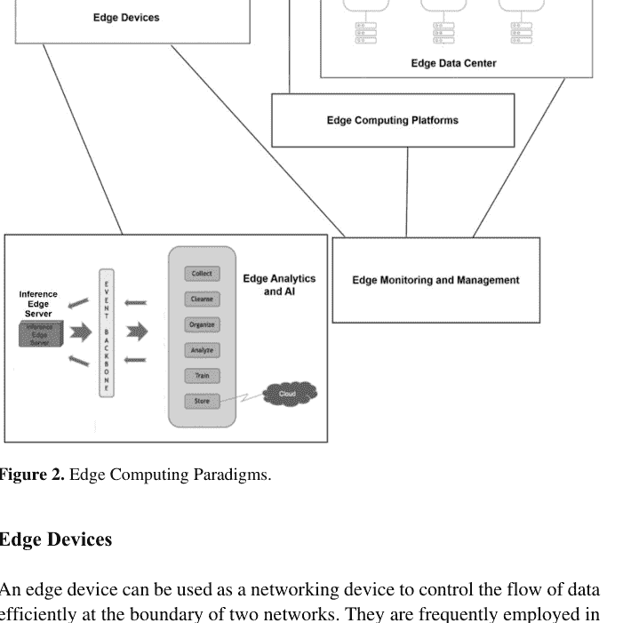

图 2. 边缘计算范式。

#### 边缘设备

边缘设备可用作网络设备，以在两个网络边界高效控制数据流。它们经常用于需要实时或接近实时处理的情况，以及带宽、延迟或连接性受限的情况。具有不同协议的网络变得高度不兼容，可以借助边缘设备进行管理。此外，边缘设备提供两个不同网络之间的互联性，以执行诸如网络之间的数据传输、监控和过滤等操作。此外，边缘设备用于从各种数据源收集数据，在本地处理数据并将数据发送到网络层以做出相关决策。网络层将边缘设备与云连接起来并指定网络基础设施。此外，企业可以通过在本地处理数据从而将敏感数据本地存储来更快地做出决策、降低数据传输成本并解决隐私问题。对实时分析、低延迟、增强安全性和减少网络带宽使用日益增长的需求导致边缘设备迅速增加。

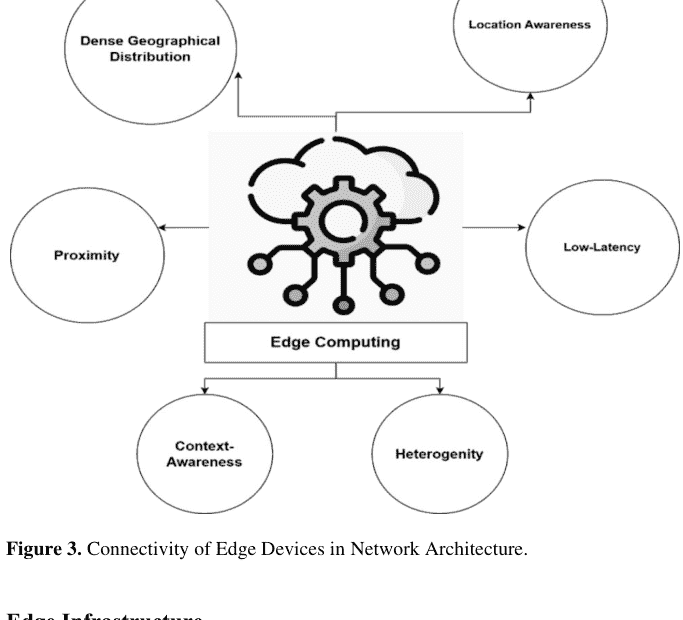

图 3. 网络架构中边缘设备的连接性。

#### 边缘基础设施

为了支持边缘计算和其他边缘相关技术，使用边缘基础设施。它指的是部署在网络边缘的物理和虚拟组件。一种称为边缘基础设施的分布式计算模型将计算能力和数据存储带到通常位于网络边缘的位置。传统云计算中，数据处理和存储通常集中在位于特定地理位置的数据中心。然而，由于物联网（IoT）设备、自动驾驶汽车和其他延迟敏感应用的出现，对更快的数据处理和实时决策的需求不断增长。这主要通过边缘基础设施得到满足，它使用去中心化计算并将其重新定位到数据生成和消费设备附近。使用边缘服务器、小型数据中心，甚至像路由器或网关这样具有计算能力的专用硬件可以实现边缘设备。这些边缘节点也将被仔细放置在各个位置，包括蜂窝塔、网络枢纽或靠近终端用户或物联网设备。边缘基础设施的优势包括降低延迟、带宽优化、可扩展性、增强的隐私和安全性以及离线能力。智能城市、自动驾驶汽车、工业自动化、增强现实/虚拟现实（AR/VR）和医疗保健是边缘基础设施的几个应用。边缘计算为企业创造了实时数据处理、更快决策和增强用户体验的新机会（Stankovski et al., 2020）。

边缘基础设施由硬件、软件和网络元素组成，使数据处理和存储更接近数据源，并支持边缘计算过程（Liu et al., 2019）。为了降低延迟、提高响应速度和改善系统性能，边缘基础设施旨在更接近数据源处理和分析数据。图 4 中指定的边缘基础设施的重要元素包括边缘数据中心、边缘设备、边缘网络、边缘计算平台、边缘分析和 AI、私有和安全以及监控和管理工具。边缘数据中心是部署在边缘的小型数据中心。为了促进本地数据处理和存储，边缘数据中心托管计算资源、存储和网络硬件。边缘数据中心的特征包括紧凑、节能且能够在复杂环境中运行。边缘设备是实际的硬件组件，例如位于网络边缘的边缘服务器、网关、路由器或交换机。通过在本地处理和管理数据，这些设备将工作负载从集中式数据中心卸载（Jain et al., 2019）。它们可能配备专用硬件，如 GPU 或 FPGA，以支持特定计算需求。

边缘计算平台包括支持边缘计算功能的、操作系统、中间件和软件框架。它使边缘的编排、管理和服务部署成为可能。边缘计算软件使资源利用得到优化，处理数据分发、边缘设备之间的有效处理和通信成为可能。为了连接边缘设备、边缘数据中心和集中式云或数据中心，边缘基础设施依赖于强大的网络能力。这可能包括有线和无线技术，包括蜂窝网络、以太网、Wi-Fi 以及 LoRaWAN 或 Zigbee 等专用协议。安全措施被纳入边缘基础设施以保护其数据和设备。这包括入侵检测系统、访问控制、身份验证方法和加密（Varghese, 2016）。此外，将使用管理系统来监控和控制边缘设备，收集遥测数据，执行更新，并确保边缘基础设施的整体健康和性能（Khan et al., 2017）。边缘管理被指定为用于管理边缘计算基础设施的做法、技术、工具。在网络边缘，边缘设备和应用程序必须进行配置、监控、配置和更新（Satyanarayanan, 2017）。有效的边缘管理使分布式计算环境的性能、安全性和效率成为可能。为了使边缘基础设施保持可靠、安全和高效，有效的边缘管理对于边缘至关重要。它使企业能够利用边缘计算部署，有效管理分布式计算环境，并确保平稳运行。因此，边缘计算建立在边缘基础设施之上，使企业能够在更接近生成点的地方实时处理和分析数据。它提供降低延迟、增强性能以及改善数据隐私和安全，支持边缘相关技术和应用的发展。边缘分析和 AI（人工智能）是互补技术，使网络边缘的数据分析和智能决策成为可能。与将数据发送到集中式云或数据中心进行处理相比，边缘分析是指在靠近源头的地方分析数据的实践。当数据在边缘设备或边缘数据中心本地处理时，边缘分析能够实现实时洞察、快速行动和降低延迟。这种策略在物联网部署、自动驾驶汽车、工业自动化和智能城市等应用中特别有帮助，在这些应用中低延迟、带宽优化和实时决策至关重要。

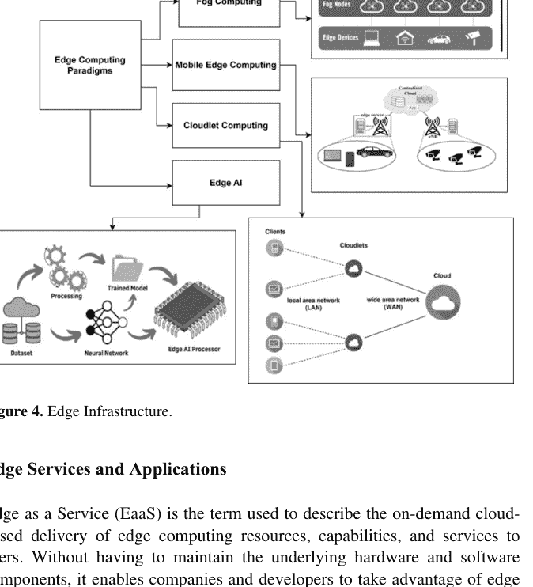

图4. 边缘基础设施。

#### 边缘服务与应用

边缘即服务（EaaS）是一个术语，用于描述按需、基于云的方式向用户交付边缘计算资源、能力和服务。它使企业和开发人员无需维护底层硬件和软件组件即可利用边缘计算基础设施。用户可以像使用云服务一样远程访问边缘计算资源。为了将计算推向更靠近数据源或最终用户的位置，边缘基础设施通常部署在由边缘位置或设备组成的分布式网络上。边缘即服务的好处包括按需资源供给、降低延迟、简化开发和部署、成本效益、可扩展性和敏捷性、边缘分析和人工智能，以及增强的安全性和隐私性。边缘服务提供商包括云服务提供商、电信公司或专业边缘计算平台的提供商。用户可以专注于创建和部署其应用程序，而这些提供商则负责管理底层基础设施，包括边缘设备、网络和软件平台。此外，通过引入边缘即服务，现代工程团队可以更轻松地采用一种新的计算范式，这种范式能够产生更好的数字体验，并最终增强整个互联网。总体而言，边缘即服务使开发人员和企业能够获得边缘计算的好处，为他们提供灵活、可扩展且经济高效地访问边缘资源和能力的方式。它使企业能够利用边缘计算的潜力，而无需进行昂贵的前期投资和管理自己的基础设施。

边缘计算具有多层架构，用于在边缘设备、边缘服务器和企业服务器之间分配工作负载，这些构成了如图5所示的边缘即服务的组件。随着边缘计算的快速发展，需要一个能够提供完整边缘即服务解决方案管理能力的单一智能平台。这些工具支持提供服务，如运营管理、数据分析、自动化、编排、管理和安全。用于提供边缘即服务的流行工具包括Kubernetes、Apache OpenWhisk、TensorFlow Lite、AWS Greengrass、Azure IoT Edge、Google Cloud IoT Edge、EdgeX Foundry和Eclipse ioFog。工具的选择取决于不同因素，包括特定用例的需求、支持它们的底层基础设施、编程语言以及与云服务的期望集成程度。

边缘应用程序是专门为在边缘服务器或设备上运行而创建的，作为边缘计算基础设施的一部分。这些应用程序利用计算资源和边缘计算能力来处理数据、运行分析，并在更靠近数据源或数据消费者的位置提供服务。在边缘部署边缘应用程序有几个优势，包括降低延迟、提高性能和增强数据隐私。边缘应用程序可以跨越许多领域和行业。边缘应用程序的一些示例包括物联网应用、自动驾驶汽车、增强现实和虚拟现实、视频监控、边缘分析、内容分发、边缘缓存和边缘游戏。物联网应用经常使用边缘计算来处理传感器数据并执行实时分析。例如，边缘应用程序可以监控智慧城市的交通流量、优化能源使用并识别环境变化。边缘应用程序可以改进生产流程、监控机器健康状况，并在工业环境中实现预测性维护。对于及时决策至关重要的自动驾驶汽车来说，边缘应用程序至关重要。借助边缘计算，传感器数据可以在车载端处理，从而使车辆无需依赖云连接即可做出重要决策。计算机视觉算法、基于人工智能的目标检测以及用于增强感知的传感器融合是自动驾驶汽车边缘应用程序的示例（Goundar等人，2021年）。

为了获得沉浸式体验，AR和VR应用通常需要低延迟和高带宽。渲染、对象跟踪和手势识别是计算密集型任务的示例，边缘应用可以将这些任务卸载到边缘服务器，从而减少延迟并改善用户体验。这使得AR/VR应用能够实现响应性和实时交互。视频监控系统使用边缘应用进行视频处理和实时分析。通过使用边缘服务器运行对象检测、人脸识别和异常检测算法，可以最大限度地减少将大量视频数据发送到集中式服务器的需求。这使得能够有效利用网络带宽、更快地响应并提高安全性。边缘应用可以在本地分析数据并产生见解（Mao等人，2017年）。在需要实时分析的情况下，例如工业自动化、医疗保健监控和零售分析，这尤其有用。为了节省带宽并促进更快的决策，边缘分析应用可以在本地处理数据，并仅将相关信息传输到中央/云基础设施。

内容分发网络（CDN）使用边缘应用将内容缓存并分发到更靠近最终用户的位置。为了减少延迟并提高内容分发性能，边缘缓存应用可以将热门网页内容、视频和软件更新存储在边缘服务器上。这使得加载时间更快、流媒体质量更好，并改善用户体验。在云游戏服务中，游戏渲染和处理被委托给边缘服务器，边缘应用正在被使用。这减少了客户端设备的处理负载，并使计算能力有限的设备能够提供高质量的游戏体验。低延迟游戏、多人通信和游戏内容的实时流式传输都可以通过边缘游戏应用实现。需要实时处理、低延迟和资源效率的应用可以使用边缘计算进行部署。随着边缘计算生态系统的发展，可能会出现更多创新性和特定于行业的应用。

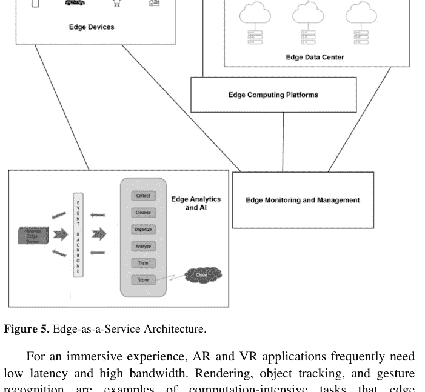

图5. 边缘即服务架构。

### 结论

分类法提供了一个结构化框架，通过分析和分类各种与边缘计算相关的元素（包括边缘设备、边缘架构和边缘服务），来组织和理解边缘计算系统的复杂性。此外，分类法通过根据边缘设备的能力、特征和功能对其进行分类，提高了对网络边缘设备异构性的理解和管理。通过这种分类，在边缘计算环境中做出关于设备选择、资源分配和任务分发的明智决策变得更加容易。

边缘计算中使用的架构方法，如云中心、雾计算和移动边缘计算，也可以使用边缘架构分类法进行识别和区分。为了根据特定的用例和需求做出最佳的架构决策和优化，了解每种架构相关的权衡、优势和局限性是有帮助的。数据分析、实时处理、AI推理和物联网服务只是可以在边缘部署的众多服务和应用程序中的一小部分。边缘服务的分类法也有助于对这些服务和应用程序进行分类。通过分类并提供关于其独特特征、资源需求和性能考虑的信息，分类法可以有效地在边缘计算系统中放置和管理这些服务。

因此，一个全面的边缘计算分类法提供了一个结构化框架，提高了我们对这一发展领域中各种元素和方面的认识。它支持在边缘计算环境中进行更好的资源管理、优化和决策，增强系统响应性、可扩展性和用户体验。随着边缘计算不断发展和普及，一个最新且灵活的分类法对于成功驾驭边缘计算技术和应用的复杂格局将是必要的。

### 参考文献

- Cao K, Liu Y, Meng G, Sun Q. “边缘计算研究综述.” *IEEE Access.* (2020) 5月1日；8:85714-28.
- Goundar, Sam, J. Avanija, Gurram Sunitha, K. Reddy Madhavi, and S. Bharath Bhushan, 编. *工业物联网（IIoT）和智能工厂的创新.* IGI Global, 2021.
- Jain, Kusumlata, and Smaranika Mohapatra. “边缘计算分类法：挑战、机遇和数据缩减方法.” *边缘计算：从炒作到现实* (2019): 51-69.
- Khan, Wazir Zada, Ejaz Ahmed, Saqib Hakak, Ibrar Yaqoob, and Arif Ahmed. “边缘计算：综述.” *未来一代计算机系统* 97 (2019): 219-235.
- Liu, Fang, Guoming Tang, Youhuizi Li, Zhiping Cai, Xingzhou Zhang, and Tongqing Zhou. “边缘计算系统和工具综述.” *IEEE 会议录* 107, no. 8 (2019): 1537-1562.
- Mao, Yuyi, Changsheng You, Jun Zhang, Kaibin Huang, and Khaled B. Letaief. “移动边缘计算综述：通信视角.” *IEEE 通信调查与教程* 19, no. 4 (2017): 2322-2358.
- Pan, Yi, Parimala Thulasiraman, and Yingwei Wang. “微云、雾计算、边缘计算和露计算概述.” 见 *第三届国际露计算研讨会论文集*, pp. 20-23. 2018.

Panchali, B. “边缘计算——背景与概述。”载于《2018年智能系统与发明技术国际会议（ICSSIT）》，第580-582页。IEEE，2018年。

Satyanarayanan M. 边缘计算的出现。《计算机》，2017年1月5日；50(1)：30-9。

Singh, Raghubir. “边缘AI：综述”，《物联网与信息物理系统》（2023）。

Stankovski, Stevan, Gordana Ostojić, Igor Baranovski, Mladen Babić, 和 Miloš Stanojević. “边缘计算对工业自动化的影响。”载于《2020年第19届Infoteh-Jahorina国际研讨会（Infoteh）》，第1-4页。IEEE，2020年。

Varghese, Blesson, Nan Wang, Sakil Barbhuiya, Peter Kilpatrick, 和 Dimitrios S. Nikolopoulos. “边缘计算中的挑战与机遇。”载于《2016年IEEE智能云国际会议（SmartCloud）》，第20-26页。IEEE，2016年。

Vora, Jayneel, Sudeep Tanwar, Sudhanshu Tyagi, Neeraj Kumar, 和 Joel JPC Rodrigues. “FAAL：基于雾计算的适用于环境辅助生活的患者监护系统。”载于《2017年IEEE第19届电子健康网络、应用与服务国际会议（Healthcom）》，第1-6页。IEEE，2017年。

Wang, Tian, Yuzhu Liang, Xuewei Shen, Xi Zheng, Adnan Mahmood, 和 Quan Z. Sheng. “边缘计算与传感器云：概述、解决方案与方向。”《ACM计算调查》（2023）。

农业中的边缘计算。实时数据处理、自动驾驶和汽车工业等领域均受益于边缘计算。此外，边缘计算在智慧城市、零售、物流等多种行业中也至关重要。总体而言，边缘计算通过支持本地化数据处理、降低对云连接的依赖以及实现实时决策，提高了生产力、效率和用户体验，从而变革了各行各业。

**关键词：** 实时数据处理、低延迟通信、本地数据分析、更快决策、降低延迟、物联网部署、工业自动化、远程患者监护

### 引言

边缘计算是一种范式转移技术，它的出现是为了应对现代世界中联网设备所产生的数据量日益增长所引发的问题。物联网（IoT）和智能设备的激增给传统的基于云的计算基础设施带来了实时数据处理、带宽和延迟方面的难题。边缘计算通过将计算和数据处理迁移到更靠近数据源的网络边缘，力求克服这些限制。

在最基本的形式上，边缘计算是一种去中心化计算架构，将计算和数据存储分布在靠近数据源的边缘设备网络中，如传感器、网关和路由器。这些边缘设备充当迷你数据中心，可以在靠近数据源的位置实时分析数据（Cao K 等，2020）。边缘计算这样做的同时，最大程度减少了数据长距离传输到集中式云服务器的需求，从而降低了延迟、加快了响应时间，并从整体上提高了系统性能。

将智能推向更靠近网络边缘（数据产生和使用的地方）是边缘计算背后的核心理念。得益于这一计算范式的转变，许多以前使用传统云计算技术不可能或不可实现的应用和用例如今成为可能。

边缘计算的主要优势之一是它能够处理关键任务和实时应用。通过在边缘本地处理数据，边缘计算能更快做出决策并对事件或异常做出及时响应。实时能力可帮助制造业、能源、医疗、交通和智慧城市等行业提高效率、优化运营、加强监控和分析，并快速做出决策。它使实时监控、自主控制系统、预测性维护和智能资源分配成为可能。

边缘计算解决网络连接和带宽限制相关问题的能力，是该技术另一个重要优势（Varghese B 等，2016）。通过在边缘处理和分析数据，只有相关且有用的数据才会传输到云或数据中心，从而减少了必须通过网络传输的数据量。边缘计算非常适合网络连接不稳定或信号较弱的场景，因为它不仅优化了带宽利用率，还降低了对持续高速连接的依赖。

此外，边缘计算还能增强数据保护和隐私安全。通过在边缘本地处理和存储数据，企业可以更好地控制其数据，并降低敏感数据在传输过程中被泄露或暴露的风险。在医疗和金融等领域，数据隐私和合规性至关重要，这一点尤其重要。

### 边缘计算的重要性

边缘计算是一项重要的技术发展，在许多领域产生广泛影响。其重要性在于它能够处理数据、延迟、带宽、隐私和实时决策等重要问题（Khan WZ 等，2019）。以下突出特点强调了边缘计算的重要性：

#### 降低延迟

通过将计算带到更靠近数据源的位置，边缘计算减少了数据往返中心云服务器所需的时间。这种延迟降低使得实时评估数据并更快做出决策成为可能，这对于自动驾驶汽车、工业自动化和远程监控等需要快速响应的应用至关重要（Stankovski S 等，2020）。

#### 实时数据处理

边缘计算使得能够在数据源处或附近直接处理和分析数据。预测性维护、异常检测和实时分析应用都极大受益于这一能力。通过在边缘处理数据，组织可以提高整体效率、优化流程并做出更快的决策。

#### 带宽优化

随着联网设备激增和数据生成量呈指数级增长，将所有数据发送到单一云服务器可能会给网络容量带来压力。边缘计算通过在边缘进行本地数据处理、过滤和汇总，最大程度减少网络传输的数据量，从而解决了这一问题。这种优化带来了显著的成本节约和网络性能提升，并减少了对高带宽连接的依赖。这些升级有助于构建高效且经济实惠的网络架构。

#### 增强的隐私与安全性

边缘计算通过保持敏感数据的本地化并最小化传输过程中的数据暴露来应对隐私和安全问题。通过在本地处理数据，企业可以保持对其数据的控制，并在边缘设备上直接实施安全防护措施。这种本地化策略降低了数据泄露的风险，并确保遵守数据隐私法规。

#### 去中心化架构

边缘计算通过将处理能力和智能分散到网络中，实现了去中心化设计。通过减少对单一中心云服务器的依赖，这种架构提高了容错性、可扩展性和灵活性。在网络中断或云访问出现问题的情况下，边缘设备的独立性使得系统更加耐用和弹性。

### 工业自动化

工业自动化高度依赖边缘计算，边缘计算已彻底改变了工厂和生产线的运行方式。如图1所示，边缘计算通过将计算和数据处理迁移到更靠近数据源的位置，实现了实时分析、更快的决策、更低的延迟和更高的运营效率。以下是边缘计算在工业自动化中应用的详细说明：

工业自动化系统从传感器、设备和生产线产生海量数据。借助边缘计算，PLC或工业网关等设备可以直接在边缘实时处理数据（Stankovski S 等，2020）。通过本地评估数据，边缘设备可以对事件做出反应、发现异常并迅速采取行动。低延迟对于工业自动化中的实时控制和决策至关重要。边缘计算消除了将数据发送到远端云服务器进行处理的需要，从而降低了通过网络传输数据所带来的延迟。这使得更快的响应时间成为可能，能够对过程波动或关键事件迅速采取行动。

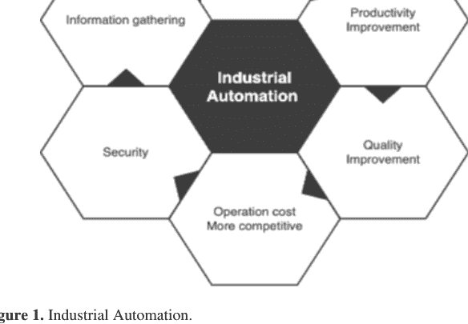

图1. 工业自动化。

在工业自动化中，边缘设备充当能够做出独立选择的本地化控制单元。基于实时传感器数据，它们可以运行控制算法、部署逻辑并执行指令。这种本地化控制通过降低对集中式控制系统的依赖，提高了系统的响应性和整体鲁棒性。在工业自动化中，边缘计算优化了网络带宽的使用。当数据处理和分析在边缘设备上完成时，只有相关数据才需要传输到中央系统或云端。由于需要传输的数据更少，网络拥塞减少，通信费用也降低。

得益于边缘计算，工业自动化中的边缘设备现在可以实现机器学习算法。通过将机器学习模型直接部署在边缘设备上，实时数据可以被评估并用于指导本地决策。因此，预测性维护、异常检测和生产过程优化变得更加容易，从而提高生产率并降低停机时间（Shakarami A 等，2020；Kozik R 等，2021）。边缘计算使边缘设备具备执行高级分析的能力。通过在本地运行分析算法，可以实时分析数据以获得深入见解、发现趋势、预测设备问题并改进生产流程（Wang F 等，2020）。得益于边缘分析，工业自动化系统可以在边缘做出智能决策，从而消除了将数据不断传输到远程服务器的需求。

边缘计算改善了工业自动化中的机器人应用。通过将边缘设备放置在附近或直接搭载在机器人上，实时数据处理和决策可以在机载完成。这减少了与中央系统持续通信的需求，提高了机器人自主性，并实现更快的响应时间，从而实现更复杂、更高效的机器人自动化。工业自动化中并非所有传感器和机器产生的数据都至关重要。边缘计算使边缘设备能够进行数据优先级排序和过滤。仅有相关且必要的数据才会被传输到中央系统或云端进行进一步分析和存储。这减少了带宽需求，改善了数据传输，并确保最相关的数据被用于提供有价值的结论。

边缘计算提高了工业自动化系统的容错性和可靠性。通过将计算能力分散到多个边缘设备中，系统不易出现单点故障。在网络或云连接出现问题时，边缘设备能够继续自主运行，确保生产和过程控制持续进行。边缘计算侧重于本地数据处理和控制，但也可以与基于云的系统交互，以实现更全面的分析、历史数据存储和集中管理。为长期分析、主动维护和性能改进，来自多个边缘设备汇总的数据可以发送到云端。这种边缘与云计算的整合为工业自动化打造了一个强大而完整的生态系统。

在工业自动化中，边缘计算实现了可扩展和灵活的部署。为了适应生产线、机械或工业布局的变化，边缘设备可以快速添加或撤除。其可扩展性和灵活性可在不造成重大中断或基础设施变更的情况下实现自动化系统的无缝扩展或重新配置。边缘计算通过限制敏感数据暴露于外部网络，提高了工业自动化系统的安全性。当边缘设备在本地处理数据时，敏感数据可以保留在工厂网络内，降低未经授权访问或数据泄露的可能性。边缘计算还支持本地化安全机制，例如防火墙、访问控制和加密，这些机制专门设计用于保护工业环境和相关的边缘设备。

在工业自动化中，边缘计算有助于成本优化。边缘计算通过降低对持续高带宽网络连接的需求并最小化向云端传输的数据量，降低了数据传输成本。此外，它减少了对云基础设施的需求，可能带来云处理和存储成本的节约。

### 边缘网络安全

边缘网络安全是指在网络边缘实施的安全措施和策略，用于保护边缘设备、数据和应用程序免受网络威胁。边缘计算通过将计算和数据处理推向更靠近边缘设备的位置，带来了新的安全问题和需求。边缘设备（如传感器、执行器、网关和物联网设备）的处理能力、内存和安全能力通常受可用资源限制。这些设备特别容易受到攻击，因为它们可能没有内置安全机制，也可能没有足够的处理能力来运行复杂的安全软件（Cao K 等，2020）。

因此，保护边缘设备对于确保边缘计算基础设施的整体安全至关重要。

在边缘网络安全中需要考虑的几个关键方面有：

- 设备加固：为减少漏洞，边缘设备应进行加固。为避免未经授权的访问，这包括关闭未使用的服务、安装安全补丁和更新、设置强密码并实施访问控制。
- 安全通信：边缘设备必须首先建立安全通信通道来传输数据并与其他设备或云服务通信。这需要实施诸如传输层安全（TLS）之类的加密方法，并使用具有适当身份验证和授权流程的安全通信协议，如 HTTPS 或 MQTT。
- 访问控制：应实施访问控制机制，以确保只有授权人员和设备才能访问和与边缘设备通信。这包括访问控制列表、基于角色的访问控制（RBAC）策略以及用户名和密码、生物识别认证和双因素认证等身份验证技术。
- 数据加密：为防止敏感信息被未经授权访问，数据在静态和传输过程中都应加密。高级加密标准（AES）和其他加密方法可用于保护存储在边缘设备上的数据或通过网络传输的数据。
- 入侵检测与预防：入侵检测与预防系统（IDPS）可以部署在边缘，以监控和分析网络流量、检测恶意活动，并在实时中阻止或缓解潜在威胁。
- 边缘防火墙：边缘防火墙可用于在边缘设备与外部网络之间过滤和管理网络流量。这些防火墙支持执行安全策略、阻止有害流量并防止未经授权的访问。
- 威胁情报：边缘网络安全方法应跟踪并整合有关新威胁和漏洞的最新信息。通过了解最新的攻击向量和趋势，组织可以主动降低潜在风险和漏洞。
- 安全分析：在边缘实施安全分析工具和技术有助于发现异常行为、识别安全事件并发出可能的网络攻击的早期警告。这些分析解决方案采用机器学习和人工智能算法来评估数据模式并发现可疑活动。
- 增强效率：边缘计算使边缘设备能够进行实时数据分析和决策，减少数据前往中央服务器或云端的需求。这种本地化处理提高了系统响应时间并实现更快的自动化控制，从而提高运营效率和生产率。
- 预测性维护：得益于边缘计算，工业自动化可以采用预测性维护技术。通过在边缘进行本地数据分析，可以持续检查机器和装置是否出现可能故障或异常的迹象。这种主动策略有助于避免非计划停机、优化维护计划并降低维护成本。
- 改进的质量控制：借助边缘计算，企业可以部署实时质量控制系统。对边缘传感器和设备数据的即时分析能够快速检测错误或偏离预期参数的情况。这使得可以迅速采取纠正措施、减少浪费并确保产品质量的一致性。
- 离线操作：边缘计算在网络连接不可靠的情况下支持离线操作。边缘设备可以本地存储和分析数据，确保即使在短暂的网络中断期间自动化流程仍能继续。连接恢复后，同步数据可以发送到中央系统进行分析和同步。
- 减少网络流量：边缘计算通过在边缘设备处过滤和处理数据，减少了通过网络传输的数据量。边缘计算仅传输对中央服务器或云端相关且有用的信息，从而优化网络带宽利用率、降低延迟并减轻网络基础设施的压力。
- 物理安全：应实施物理安全措施以防止物理篡改或未经授权的访问。为防止盗窃、损坏或未经授权的操纵，这

包括物理锁、门禁限制、视频监控和环境控制。

### 远程患者监护

远程患者监护（RPM）是一种医疗程序，使医疗专业人员能够在传统医疗机构之外持续关注患者的健康状况。该程序通过使用联网设备、传感器和移动应用程序来收集患者数据，并将其发送给医疗专业人员进行分析和决策。通过将计算能力和数据处理移至更靠近患者的位置，边缘计算对于提高远程患者监护的有效性和效率至关重要（Vora J 等，2017）。以下详细说明边缘计算如何有益于远程患者监护。

边缘计算支持在边缘设备（如可穿戴技术或家庭监护系统）上处理和分析患者数据。由此，医疗专业人员可以快速获取患者健康状况的洞察，并利用这些信息发现潜在问题、监测趋势并及时采取行动。实时数据分析在紧急情况下至关重要，例如识别生命体征异常或应对紧急事件。借助边缘计算，患者数据可以在本地处理，而无需发送到中央云服务器。为减少延迟并实现更快的响应时间，数据改为在边缘设备本地处理（Goundar 等，2021）。因此，医疗服务提供者可以及时收到通知，并在时间紧迫的情况下采取适当行动。

边缘计算使得持续监测患者健康状况成为可能。联网设备和传感器实时收集数据，提供患者健康状况随时间的完整图景。通过持续监测，医务人员可以发现患者健康状况的细微变化，并及早干预以避免并发症或住院。即使在网络连接不稳定的情况下，边缘计算也能确保护理数据得到持续分析和检查。边缘计算处理了远程患者监护中的隐私和安全问题。通过在本地处理患者数据，敏感数据可以保留在边缘设备和患者家庭网络的边界内，从而降低数据泄露的风险。通过这一策略，既遵守了隐私法规，又保护了患者健康信息。此外，边缘计算减少了对开放网络传输敏感数据的需求，降低了入侵风险。

将大量患者数据发送到中央云服务器进行处理可能会使网络带宽紧张。边缘计算通过在本地处理数据、仅将有价值或汇总后的数据发送到云端或医疗服务提供者来解决这一问题。这种数据传输优化通过减少网络拥塞、降低成本来提升系统性能。在网络连接受限或不稳定的情况下，边缘计算使远程患者监护具备离线能力。即使连接暂时中断，边缘设备也可以在本地存储和分析数据。连接恢复后，收集的数据可以与主系统同步。凭借这些离线能力，重要的患者数据不会丢失，并能轻松纳入整个监护流程。

随着越来越多的患者使用远程患者监护，边缘计算使可扩展的部署成为可能。边缘设备可以处理众多患者产生的日益增长的数据量，确保有效的数据处理和分析，同时不会给集中式系统带来过重负担。这种可扩展性使得远程患者监护能够扩展到更广泛的人群，而不会牺牲护理质量或系统性能。得益于边缘计算，患者可以参与远程患者监护并获得个性化护理。边缘设备通过本地处理数据，实时评估患者特定数据，并提供个性化的洞察和建议。这有助于改善患者参与度、主动干预和针对每位患者的治疗方案。患者能够积极管理自己的治疗、获得即时反馈并监测自身进展。

边缘计算使得医疗领域能够实时识别异常或偏差。通过检查边缘设备上的患者数据，并在出现异常时收到警报或消息，医疗专业人员可以迅速发现异常。这有助于早期干预和及时的医疗支持。这种预防性方法可以阻止疾病或并发症的发展。边缘计算赋予患者积极管理自身医疗的能力。如果患者能够通过可穿戴技术或移动应用程序访问实时健康数据，他们就可以跟踪自己的进展、检查自身健康问题并做出明智的决定。这种更高的参与度和自我管理能力可能会带来更好的健康结果和更高的患者满意度。

产量提升。借助边缘计算，灌溉决策可以在边缘设备本地执行，无需与中央系统或云端持续连接。这提供了更快的响应时间，并确保能够根据当前环境条件或植物需求实时调整灌溉方案。

边缘控制的灌溉系统通过精细控制灌溉来减少水资源浪费，有助于节约用水。水资源短缺是一个影响全球的问题，高效的灌溉技术有助于保护这一可持续农业的关键资源。

#### 能源效率

边缘本地数据处理减少了对云端数据传输的需求，从而降低能耗。得益于能源效率，灌溉系统的环境影响得以减小。基于实时传感器数据，边缘控制系统持续监测和调整灌溉参数。这种灵活性使得灌溉决策能够根据土壤湿度变化、天气模式或作物状况迅速调整。与云平台的集成支持额外的分析、监测和长期数据存储，而数据处理和决策则在边缘完成。通过云集成，可以制定长期水资源管理策略并获得完整的数据洞察。边缘控制的灌溉系统易于扩展和定制，以适应不同的田块大小、作物品种和耕作方式。边缘设备的模块化设计使其能够灵活部署，满足不断变化的农业需求。

通过自动化和优化灌溉流程，边缘控制系统减少了所需的人工劳动以及与用水相关的运营成本。农民从这种成本效益中获益，同时也促进了明智的资源利用。边缘控制的灌溉促进了高效的水资源管理策略，这与可持续农业的目标一致。这些技术通过最大化用水效率、减少浪费和提高作物产量，助力农业的长期盈利能力。为了产生数据驱动的洞察，边缘计算赋能边缘控制的灌溉系统。这些系统可以在边缘分析数据，以发现有助于优化灌溉策略的趋势、模式和相关性。长期规划、预测性分析和不断改进的水资源管理实践方法都可以从这些发现中受益。

即使在网络接入有限的情况下，边缘控制的灌溉系统也能提供鲁棒性和运营连续性。在网络中断或干扰的情况下，这些系统的本地处理能力使其能够继续运行并自主做出灌溉决策。

同步的数据在连接恢复后可以发送到中央系统进行额外分析或历史记录。

### 结论

总而言之，边缘计算是一项改变游戏规则的技术，在众多行业中具有巨大的优势。它通过实现实时数据处理、本地化控制和提高运营效率来革新工业自动化。关于网络安全，边缘计算提供了一种分布式和主动的策略来保护关键数据并减少在线威胁。远程患者监测使得实时分析和个性化护理成为可能，从而改善患者治疗效果并降低成本。边缘计算还增强了灌溉用水管理，支持资源节约和可持续实践。总的来说，边缘计算在各种行业中提高了效率、安全性和响应时间，推动创新并满足我们互联世界中不断变化的需求。边缘计算还提供可扩展性和灵活性，允许无缝的系统扩展和重新配置。通过减少基础设施和数据传输依赖，它也有助于成本优化。随着边缘计算被纳入各个行业，它正在为尖端技术、明智决策以及更互联和更有效的未来铺平道路。

### 参考文献

- Cao, Keyan, Yefan Liu, Gongjie Meng, and Qimeng Sun. “关于边缘计算研究的概述。” IEEE Access 8 (2020): 85714-85728.
- Goundar, Sam, J. Avanija, Gurram Sunitha, K. Reddy Madhavi, and S. Bharath Bhushan, eds. 工业物联网(IIoT)和智能工厂的创新. IGI Global, 2021.
- Jain, Kusumlata, and Smaranika Mohapatra. “边缘计算的分类：挑战、机遇和数据缩减方法。” Edge Computing: From Hype to Reality (2019): 51-69.
- Khan, Wazir Zada, Ejaz Ahmed, Saqib Hakak, Ibrar Yaqoob, and Arif Ahmed. “边缘计算：综述。” Future Generation Computer Systems 97 (2019): 219-235.
- Kozik, Rafał, Michał Choraś, Massimo Ficco, and Francesco Palmieri. “一种用于边缘计算环境中攻击检测的可扩展分布式机器学习方法。” Journal of Parallel and Distributed Computing 119 (2018): 18-26.
- Munir, M. Safdar, Imran Sarwar Bajwa, Amna Ashraf, Waheed Anwar, and Rubina Rashid. “使用边缘计算和物联网的智能灌溉系统。” *Complexity* 2021 (2021): 1-16.
- Pan, Yi, Parimala Thulasiraman, and Yingwei Wang. “云雾、雾计算、边缘计算和露计算概述。” In Proceedings of *The 3rd International Workshop on Dew Computing*, pp. 20-23. 2018.
- Satyanarayanan, Mahadev. “边缘计算的兴起。” *Computer* 50, no. 1 (2017): 30-39.
- Shakarami, Ali, Mostafa Ghobaei-Arani, and Ali Shahidinejad. “移动边缘计算中计算卸载方法的综述：基于机器学习的视角。” *Computer Networks* 182 (2020): 107496.
- Stankovski, Stevan, Gordana Ostojić, Igor Baranovski, Mladen Babić, and Miloš Stanojević. “边缘计算对工业自动化的影响。” In 2020 *19th International Symposium Infoteh-Jahorina (Infoteh)*, pp. 1-4. IEEE, 2020.
- Varghese, Blesson, Nan Wang, Sakil Barbhuiya, Peter Kilpatrick, and Dimitrios S. Nikolopoulos. “边缘计算的挑战与机遇。” In 2016 *IEEE international conference on smart cloud (SmartCloud)*, pp. 20-26. IEEE, 2016.
- Vora, Jayneel, Sudeep Tanwar, Sudhanshu Tyagi, Neeraj Kumar, and Joel JPC Rodrigues. “FAAL：基于雾计算的面向环境辅助生活的患者监测系统。” In 2017 *IEEE 19th International conference on e-health networking, applications and services (Healthcom)*, pp. 1-6. IEEE, 2017.
- Wang, Fangxin, Miao Zhang, Xiangxiang Wang, Xiaoqiang Ma, and Jiangchuan Liu. “边缘计算应用的深度学习：最新综述。” *IEEE Access* 8 (2020): 58322-58336.

该业务。技术驱动的农业企业已经改变了耕作方式并为农民提供创新支持。他们还采用了气候智能型农业来应对一个主要挑战，即气候变化（Sharma et al., 2022, Rahman et al., 2022, Qazi et al., 2022）。

**关键词：** 智能农业，移动计算，物联网，移动传感器，人工神经网络

### 引言

为了实现农业现代化并提高效率，移动解决方案至关重要。它们还大大提高了农业产量和可持续性。通过让农民获得实时数据、决策工具和连接，这些解决方案利用了移动设备的日益普及并改变了传统的农业方法。此外，集成了 GPS 和传感器等技术的移动解决方案使精准农业变得更容易。农民可以通过使用移动设备远程监控和管理设备来确保化肥和农药的准确施用。在智能手机上，可以免费下载大量前沿应用，例如 Kisan Suvidha、Krishi Mitra、Aqua Mini、Krishi、Life Tools、Sanchar Shakti、Pusa Krishi 和 Shetkari。此外，这些应用鼓励并使农民能够使用 ICT 来促进农业改进。

农民只需使用该应用拍摄照片、上传或发送短信即可报告作物中断或获取农业相关信息。

以移动为重点的智能农业是农业中的变革者，利用移动技术的力量提高可持续性和有效性。农业移动应用为农民提供即时访问关键数据，让他们能够基于事实做出实时决策。这些应用通常提供有关天气趋势、土壤状况和作物状况的详细信息，让农民调整灌溉计划、监测害虫风险并应用精准耕作方法。

智能农业中的移动解决方案也有助于可持续农业实践。通过集成移动应用，农民可以采用更精确的农业实践，以减少农业活动对环境的影响。

### 农业面临的当前挑战

农民需要适应环境以及监管机构、消费者、食品加工商和零售商不断变化的需求。土壤侵蚀、生物多样性丧失和气候变化的影响变得越来越沉重，正如图 1 所示，消费者对食品的偏好及其生产方面的担忧也在增加。此外，农业所互动的自然世界——植物、害虫和疾病——继续带来困难。农民面临多种挑战，例如应对土壤侵蚀、生物多样性丧失和气候变化：

- 满足客户不断变化的口味和期望
- 满足对更高档食品日益增长的需求。
- 在外部经济冲击面前保持韧性。

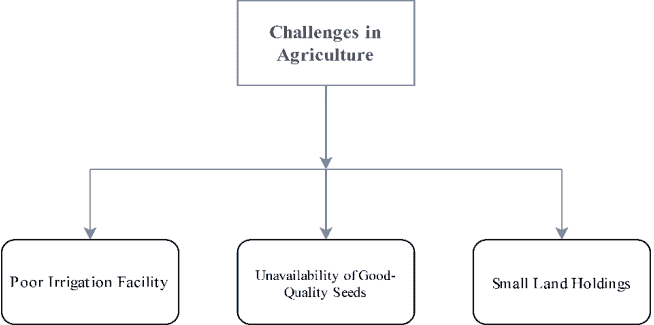

**图 1.** 农业面临的当前挑战。

### 资源限制

农民的利益包括其产品有保障的市场、降低生产风险、关于尖端农业技术的知识转移，以及经常以信贷形式获得必要的农业投入。此外，他们对生产系统进行控制，以确保其符合市场准入的相关标准。尽管优势明显，但在所审查的案例中，注意到农场与农业企业之间存在若干限制。有两种类型的限制：内部和外部。

#### 内部限制

**缺乏业务管理技能**

生产计划和营销专业知识不足，尤其是在小型加工商中，导致无法考虑按计划加工原材料数量所需的投入。在收获季节，农业企业需要特别擅长财务规划。

**原材料采购**

在收获季节，未加工的农产品经常出现盈余，由于缺乏预加工和储存设施，难以建立持续的加工活动。农业企业和农民的社会经济背景不同，这使得建立持久的商业伙伴关系变得困难。对于许多加工商来说，农民只是原材料来源；他们没有任何财务或其他激励来帮助或发展他们。

**质量限制**

农民经常不知道加工商对作物品种、质量标准、生产量和交货及时性有精确要求。缺乏知识和专业知识的农民也可能过早收获作物、收获后处理不当，并且未能将作物按不同质量等级分开。

#### 外部限制

**不利的宏观经济条件**

不一致且不透明的商业规则和法规通常会阻碍业务发展。在税率高、税收管理效率低下、腐败程度高的国家，任何经济发展都会受到扼制。贬值提高了进口投入的价格。在大多数以农业为主的国家，政府对农业的支出下降比增加更为常见。

### 市场制约

加工品需求低迷，是因为发展中国家的消费者购买力有限。因此，农业企业的盈利能力受到制约。缺乏足够规模的加工企业来维持当地生产者或原料、包装和加工设备的供应商，进一步阻碍了农业企业的发展。

### 投入品供应有限

由于农业和加工领域的原材料成本高昂，农业和商业部门盈利不高。由于当地中间商品供应商在价格和质量上都无法与进口产品竞争，因此为初级产品增值所需的投入品往往依赖进口。

### 环境影响

农业对环境产生了巨大影响，因此我们需要评估这种影响并努力使其在我们的后代面前尽可能可持续。农业包括动物饲养、植物种植以及任何辅助活动。由于人类在农场生活了几个世纪，许多动物自然进化到农场生活。世界各地，农业实践因可用物种和环境条件而异。

根据环境的不同，我们对农业有积极和消极的影响。

积极影响：
- 通过将碳（C）储存在土壤中，降低大气中的二氧化碳（CO2）水平。
- 改善空气质量

消极影响：
农业的负面影响包括水污染和土壤侵蚀。通过向大气释放温室气体，它还会加剧气候变化。
- 改变水文循环。
- 土壤质量下降。

在世界各地，战争、环境的“反复无常”以及其他自然或人为因素都会干扰农业。空气污染、森林砍伐以及化肥和农药的使用只是农业影响环境的几种方式。此外，农业可以通过降低空气污染并为某些野生物种提供资源丰富的栖息地来有益于环境。不可持续农业后果的一个极端例证是咸海。这些后果导致整个内陆海蒸发。

### 传统农业中的技术差距

传统农业方法中常常存在显著的技术差距，阻碍了其生产力、可持续性和效率。一个明显的差距是先进机械和智慧农业（Abbasi et al., 2022）技术的应用有限。这不仅增加了工作量，还导致资源利用效率低下。传统农业的另一个技术缺陷是缺乏获取实时数据和信息的途径。使用传感器、卫星图像和天气预报，数据驱动的决策对于现代农业至关重要。

### 移动计算在农业中的作用

#### 移动计算在农业中的使用

据《今日美国》报道，94%的农民目前拥有智能手机或其他移动设备。这一高比例表明移动计算在农业行业中的使用日益增长。它扩展得非常快。农民现在意识到移动计算对其个人和农场生产力可能产生的特定影响。农民必须能够下载集成的跟踪应用，以便能够跟踪农场中的这些特定项目。Google Play和Apple App Store上农业类别的超过一百万个应用程序可以被分类，以说明其用途和好处。

### 农业中的移动传感器和物联网

传感器是一种检测物理量并将其转换为可由其他设备读取和使用的信号的装置。如今，可以使用大量传感器，许多知名智能手机已经安装了许多传感器，包括陀螺仪、气压计、加速度计、光传感器、温度传感器和GPS。

智能手机配备三种不同类型的传感器：环境传感器、运动传感器和位置传感器。环境传感器构成第一类，包括用温度计测量的环境空气温度、用气压计测量的压力和用光度计测量的光照水平。运动传感器构成第二类，监测旋转和加速度力。第三类传感器称为位置传感器，测量设备的实际位置，包括方向传感器、GPS和磁力计。

#### 农业物联网

智慧农业是用于表示物联网解决方案在农业中应用的常见术语。农民可以使用物联网（IoT）传感器收集机器和环境测量数据，如图2所示，这将使他们能够改善从牲畜到作物的几乎所有运营方面，并做出更明智的决策。技术（Padhy et al., 2022）和物联网可能改变农业的许多部分。具体而言，物联网（Farooq et al., 2022）可以通过四种方式增强农业：
- 智能农业传感器收集的多个数据点。
- 减少制造危害并改进内部过程控制。
- 提高产品的数量和质量。
- 较小的环境影响。

下图展示了物联网在农业中的一些用例。

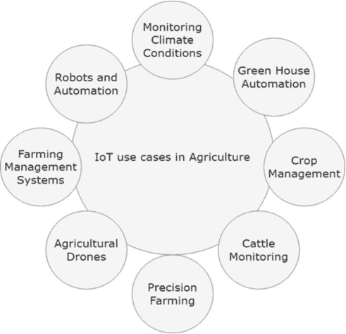

**图 2.** 农业中的物联网用例。

### 精准农业的数据分析

收集、转换、清理和建模数据以获取必要知识的过程称为数据分析。数据分析是使用各种数据类型检查海量数据集的过程，以揭示隐藏的相关性、市场趋势、消费者偏好和其他重要商业信息。图3列出了利用天气数据分析来预测农业病虫害的最常用且密切相关的机器学习方法，包括逻辑回归、人工神经网络（ANN）、模糊识别技术和支持向量机（SVM）。

精准农业涉及精确施用农业投入品，以产生比传统耕作方法更高的平均产量。在机器学习中，基于回归的分析用于精确控制农业产出，通过阐明在其他自变量保持不变的情况下，因变量的值如何随自变量的变化而变化。

在其输出和监测传感器中，这将有助于减少其工作环境中的危险（Goundar et al., 2021）。对于预测作物产量和分析作物生长，反馈式作物模拟系统非常有用。由于实时监测功能，该系统的监测功能增强了数据收集，并允许准确显示作物生长阶段。

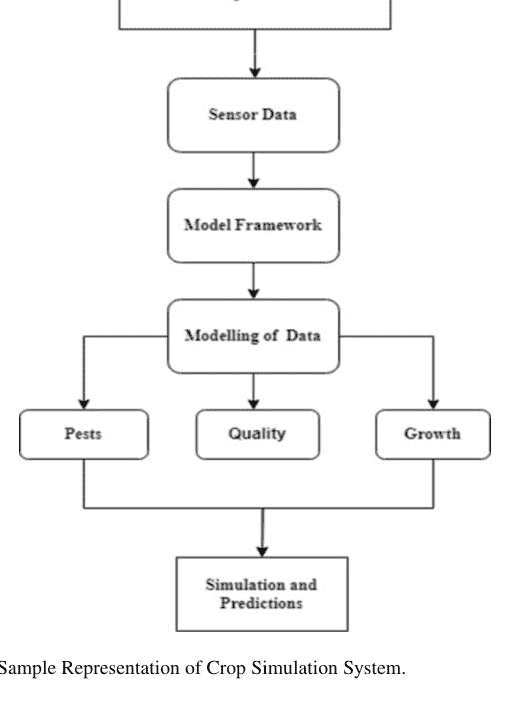

图 4. 作物模拟系统的示例表示。

### 面向农民的移动应用

随着3G和4G移动网络的全球普及，移动和基于云的应用程序已经触达、告知并赋权农民。

除了解决当前的可持续性问题外，农业中智能手机应用的使用还为小农户和大型农业企业带来了收入。一款农业软件可能成为农民在田间的最佳盟友，无需任何资金投入即可提高生产力。你可以轻松地从Google Play商店免费下载。

一些最适合农民的农业移动应用如表1所示。

#### 表1. 农业移动应用

| 应用名称 | 功能 |
|---|---|
| IFFCO KISAN | 用户可以访问包括天气、市场价格在内的各种模块。用户可以用所选语言访问音频和视频。 |
| KRISHI JAGRAN | 它提供关于农业机械化、作物补贴、病虫害防治和作物保护的全面详细信息。对于拖拉机爱好者来说，Krishi Jagran 应用的型号信息区域是浏览的理想场所。它拥有目前市场上每个型号的详细信息。 |
| CROP INSURANCE | 它可用于确定所有可用的保障信息，并且在农民是借款人的情况下，根据面积、保障金额和贷款金额计算通知作物的保险费。 |

#### 作物监测与管理应用

用于作物管理和监测的应用（Michels et al., 2020）对当代农业至关重要，因为它们利用技术来提高农业实践的可持续性、效率和生产力。这些应用旨在帮助农民监测作物的不同部分、做出数据驱动的决策并最大化利用资源。一些作物监测与管理应用包括：
- EOSDA CROP MONITORING
- CROP IN
- MAP MY CROP.

##### EOSDA Crop Monitoring

被称为 EOSDA Crop Monitoring 的是一款面向食品生产商、保险提供商、投入品供应商和其他农业利益相关者的尖端精准农业平台。它由卫星技术驱动。轻松获取作物健康、天气、作物轮作、田间作业、海拔、土壤湿度等数据。所有这些数据都无缝集成到直观的界面中。

##### CROPIN

作为全球农业科技领域的先驱，CROPIN 创建了 CROPIN Cloud，这是历史上首个专门为农业设计的行业云。有了 CROPIN Cloud 的帮助，不同的农业生态系统利益相关者可以有效利用数字化技术和预测性智能做出决策，以改善可持续性、管理风险和环境变化、提高农业效率并扩大生产力。

##### Map My Crop

Map My Crop 是一家尖端的农业科技初创公司，通过使用卫星图像、人工智能和机器学习为农民提供先进的作物监测解决方案。有了该软件的帮助，农民将能够更好地了解其作物并对运营做出更明智的决策。

#### 天气预报和咨询应用

天气预报和咨询应用在为用户提供实时和未来天气信息方面发挥着至关重要的作用，帮助他们规划和准备应对各种大气条件。这些应用 (Singh et al., 2023) 利用先进的气象技术、卫星数据和计算模型来分析和预测天气模式。一些天气预报应用是：

最新关于农业的故事和新闻，下载应用 (Misaki et al., 2021)。此外，将商品价格添加到您的关注列表中以个性化您的主屏幕。

### 精准农业技术

精准农业利用各种尖端的仪器和技术来跟踪许多因素并收集作物发育数据（如 pH 值、土壤湿度等）。它被称为“精准”，因为其主要目标是在适当的时间和地点提供适当的干预措施（如灌溉作物），同时以最高程度的精确度满足每种作物和每块土地的独特需求 (Blasch et al., 2021)。

#### 农业中的 GPS 技术

GPS 技术彻底改变了农业格局，革新了传统耕作方式。其关键应用之一为农民的拖拉机、播种机和其他机械提供精确的定位信息。这使得可以通过针对特定需要区域来优化水、肥料和农药等资源的分配。此外，将 GPS 技术集成到变量施肥技术 (VRT) 中进一步提高了农业效率。

- 自动驾驶系统：得益于使用 GPS 技术的自动驾驶系统，拖拉机和其他农用设备可以精确地沿预定义路线行驶。
- 土壤健康管理：GPS 设备通过更好地监测土壤健康的差异并在适当的角度和位置旋转机械，减少作物损坏和土壤侵蚀。
- 产量监测：在收获期间，使用 GPS 跟踪和观察田间作物产量。未来，这些数据将有助于做出明智的决策并评估实施活动的有效性。
- 设备跟踪：GPS 通过帮助农民跟踪农用设备的地点和移动情况来增强车队管理。

就像为明天的健康田地播种一样。智能灌溉系统可以通过更高效地用水帮助农民节省资金。这就像寻找降低月度开支的方法。具体而言，智能灌溉通过移动解决方案将权力交到农民手中，为农业带来未来和高效的方法。它关乎明智用水、保护以及农业可持续而富有成效的未来。

### 挑战与未来展望

- **有限的网络使用：** 许多农村地区缺乏强大的移动网络，使得农民难以访问智能农业解决方案 (Yigezu Wendimu et al., 2021, Kheya et al., 2023) 有限的连接性阻碍了作物、天气和智能技术的实时使用。
- **低带宽：** 即使有覆盖，农村地区也可能遭受低带宽的影响，影响数据速度和可靠性。缓慢的数据传输会阻碍智能农业系统，延迟决策和响应时间。
- **材料差异：** 农村地区通常缺乏稳健稳定的连接所需的基础设施，包括 4G/5G 基站和可靠的互联网服务。不充分的基础设施可能会限制先进移动解决方案在精准农业和数据驱动决策中的应用。政府和电信公司可以投资网络扩展以覆盖偏远农村地区。改进的网络和可靠性可以为智能农业应用提供便捷的连接和数据传输。

#### 数据安全和隐私问题

与智能农业系统访问或数据泄露相关的风险 (Yadav et al., 2020, Chakraborty et al., 2021)。敏感农场数据遭到泄露，可能导致财务损失和隐私问题。数据所有权和管理中的模糊性引发了人们对农民使用信息方式的担忧，如图 5 所示，该图解释了数据所有权和管理 (Han et al., 2021)。农民对自己的数据没有足够的控制权，他们可能会犹豫是否实施智能农业技术。集成区块链以提供透明度和数据安全。区块链可以通过提供去中心化、防篡改的账本来解决数据完整性方面的担忧。

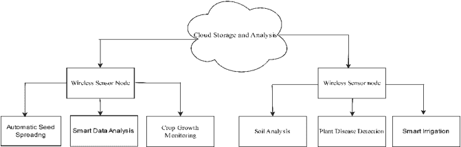

**图 5。** 云存储和分析。

#### 智能农业的未来创新与趋势

人工智能和机器学习的集成已增加用于农业的先进数据分析和决策 (Han et al., 2021)。人工智能驱动的解决方案有助于最大化资源配置并提供作物健康见解。总之，随着技术为农业推进以优化这些数据驱动、可持续的解决方案，解决连接问题、确保数据安全和隐私以及采用专注于可持续农业移动解决方案的新技术将至关重要。此外，职业转变似乎越来越可能成功 (Sott et al., 2020)。

#### 政策影响与监管框架

政府可以通过提供财政激励和补贴来鼓励农民使用智能农业技术。影响：财政激励促进农民对移动解决方案的投资并推广更具生产力和可持续性的耕作方法。政府可以在农村地区的移动网络使用和更好的通信上花费资金。改善的基础设施使在偏远地区使用移动解决方案变得更容易，这支持智能耕作技术。资助专注于移动应用和环保耕作方法的研发计划。它促进创造力，从而为农民创造实用且价格合理的移动解决方案。

为智能农业的数据安全和隐私建立严格的指导方针和法规。制定明确的政策可确保农场数据安全、问题得到解决，并使移动解决方案的使用值得信赖。为农民提供使用移动支持的可持续耕作技术的激励。理由：鼓励使用技术以减轻对环境的影响并支持农业的长期可行性。制定行动计划以提高农民的数字素养。它通过为农民提供部署移动解决方案所需的工具来促进他们采用和有效使用智能农业技术。

提供跟踪和评估智能耕作技术影响的机制。持续评估可确保系统按预期运行并可根据新需求和技术进步进行修改。为了有效整合智能农业的移动解决方案，政府必须在营造有利环境方面发挥主要作用。上述政策建议旨在加强可持续耕作方法、增强技术利用，并确保智能农业的优势在不同环境中的农民都能实现。

### 结论

在智能农业领域，移动解决方案的整合通过解决传统农业中的长期问题而彻底改变了该领域。移动计算在农业部门的重要性因其消除耕作过程中的技术差距、降低环境影响和缓解资源限制的潜力而得到凸显。鉴于当前资源有限、环境退化和技术不足等挑战，农业必须采用创新方法以保持可持续性和生产力。随着我们展望该领域的新趋势和进步，技术的持续进步预示着进一步的发现将把农业环境转变为更互联、可持续和富有成效的环境。总之，移动解决方案和精准农业技术正在推动农业迈向更具韧性和生产力的未来。

### 参考文献

- Abbasi, Rabiya, Pablo Martinez, and Rafiq Ahmad. “农业行业的数字化——关于农业 4.0 的系统文献综述。” Smart Agricultural Technology 2 (2022): 100042.
- Blasch, Julia, Bianca van der Kroon, Pieter van Beukering, Rens Munster, Sergio Fabiani, Pasquale Nino, and Silvia Vanino. “农民对采用精准农业技术的偏好：以意大利为例的研究。” European Review of Agricultural Economics 49, no. 1 (2022): 33-81.
- Farooq, Muhammad Shoaib, Shamyla Riaz, Adnan Abid, Tariq Umer, and Yousaf Bin Zikria. “物联网技术在农业中的作用：系统文献综述。” Electronics 9, no. 2 (2020): 319.
- Goundar, Sam, J. Avanija, Gurram Sunitha, K. Reddy Madhavi, and S. Bharath Bhushan, eds. 工业物联网（IIoT）和智能工厂的创新. IGI Global, 2021.
- Kalyani, Yogeswaranathan, and Rem Collier. “云、雾和边缘计算组合在智慧农业中作用的系统调查。” Sensors 21, no. 17 (2021): 5922.
- Kirkaya, Aylin. “智能农业——精准农业技术与实践。” Journal of Scientific Perspectives 4, no. 2 (2020): 123-136.
- Michels, Marius, Vanessa Bonke, and Oliver Musshoff. “理解作物保护中智能手机应用的采用。” Precision Agriculture 21 (2020): 1209-1226.
- Misaki, Ezra. “米奥诺小规模农民使用的移动应用程序评估及当前和未来移动应用的用户需求。” In 2021 IEEE AFRICON, pp. 1-6. IEEE, 2021.
- Oteyo, Isaac Nyabisa, Matteo Marra, Stephen Kimani, Wolfgang De Meuter, and Elisa Gonzalez Boix. “智慧农业移动应用调查：在现代农业中使用移动软件。” SN Computer Science 2, no. 4 (2021): 293.
- Padhy, Chitrasena, M. D. Reddy, R. K. Raj, and K. P. Pattanayak. “数字技术在农业中的作用。” Indian Journal of Natural Sciences 13, no. 71 (2022): 40287-40290.
- Qazi, Sameer, Bilal A. Khawaja, and Qazi Umar Farooq. “物联网装备和人工智能赋能的下一代智慧农业：关键综述、当前挑战与未来趋势。” IEEE Access 10 (2022): 21219-21235.
- Rahman, Md Momtazur, Imran Khan, David Luke Field, Kuaanan Techato, and Kamal Alameh. “为农业供电：可再生能源应用的现状、未来潜力与挑战。” Renewable Energy 188 (2022): 731-749.
- Singh, Dharmender, P. S. Shehrawat, Joginder Singh Malik, Dangi Pooja Arun, and Dinesh Kumar. “农民在农业生产中对移动应用的使用模式。” Indian Journal of Extension Education 59, no. 1 (2023): 150-153.
- Sharma, Vivek, Ashish Kumar Tripathi, and Himanshu Mittal. “智慧农业中的技术革命：当前趋势、挑战与未来方向。” Computers and Electronics in Agriculture (2022): 107217.
- Thar, So Pyay, Thiagarajah Ramilan, Robert J. Farquharson, Alexis Pang, and Deli Chen. “缅甸小农户使用农业移动应用的实证分析。” *发展中国家信息系统电子期刊* 87, no. 2 (2021): e12159.

## 第 5 章

## 移动硬件与设计的 emerging 趋势

P. Dhanalakshmi¹,*
U. Janardhan Reddy²
G. Ravikanth³
Chevuru Nandini⁴
Gurram Sunitha¹
and J. Avanija¹

¹人工智能与机器学习系，计算学院，莫汉巴布大学，蒂鲁帕蒂，安得拉邦，印度
²吉塔姆大学，班加罗尔，印度
³BVC工程学院，蒂鲁帕蒂，安得拉邦，印度
⁴计算机科学系，斯里维迪亚尼凯坦工程学院，蒂鲁帕蒂，安得拉邦，印度

### 摘要

本书章节深入探讨了塑造移动硬件和设计格局的最新趋势。以当前和未来的发展为中心，本章考察了 5G 和先进处理器等前沿进步对移动硬件组件的影响，提升了设备的性能和能力。同时，它深入探讨了移动设计的演进原则，强调以用户为中心的方法以及增强现实（AR）、虚拟现实（VR）和混合现实（MR）的集成，以实现沉浸式用户体验。本章还讨论了移动硬件中可持续性日益增长的重视，

### 可折叠显示屏

一种名为“可折叠显示屏”的显示技术可以在不损坏显示屏或对其性能产生负面影响的情况下弯曲或折叠。通常，这些屏幕用于笔记本电脑、平板电脑和智能手机等电子设备中，为用户提供更灵活多样的体验（Kingslin et al., 2023）。OLED（有机发光二极管）技术是实现可折叠显示屏的关键技术，它具有柔韧性，并且不像 LCD（液晶显示器）屏幕那样需要背光。OLED 由在施加电流时会发光的有机化合物组成（Back et al., 2023）。

以下是与可折叠显示屏相关的一些产品：

- Samsung Galaxy Fold and Z Fold Series
- Huawei Mate X
- Motorola Razr
- Microsoft Surface Duo
- Developments in Foldable Technology

可折叠显示屏的优势在于其展开后的屏幕面积大于折叠后的轮廓（Huang et al., 2021）。仍然存在一些需要解决的问题，例如确保可折叠组件坚固耐用。未来，可折叠显示技术可能会进一步发展和扩展。

### 5G 连接与移动网络的未来

与前几代相比，5G（第五代）连接提供更快的速度、更低的延迟和更大的容量。这是移动网络技术的一大进步。5G 的主要特性对移动网络的未来影响如下：

**速度和吞吐量：**

- 改进的数据速率
- 低延迟

### 多摄像头系统与移动摄影的演进

智能手机中多摄像头系统的集成是移动摄影演进的一个基本组成部分，这在很大程度上受到了相机技术进步的影响（Parulski et al., 2000）。以下是关于多摄像头系统及其对移动摄影影响的一些重要信息，如图 1 所示。

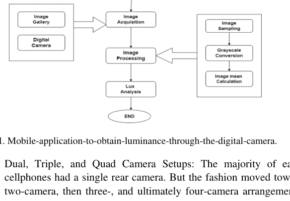

图 1. 通过数码相机获取亮度的移动应用程序。

- **双摄、三摄和四摄配置：** 大多数早期手机只有一个后置摄像头。但时尚转向了双摄，然后是三摄，最终是四摄配置。不同镜头具有不同的功能；例如长焦、景深感应、广角和超广角镜头。
- **增强的摄影能力：** 由于广角镜头能在单帧中捕捉更多内容，因此非常适合拍摄团体照和风景照。这些镜头通过实现光学变焦，使用户能够在不牺牲照片质量的情况下近距离拍摄远处的主体（Delbracio et al., 2021）。
- **景深感应和人像模式：** 在人像模式下，多摄像头与景深感应技术的结合创造出逼真的散景效果。
- **弱光性能：** 配备多镜头的智能手机有时配备先进的弱光拍摄选项，如夜景模式。这些设置利用计算摄影技术捕捉并增强弱光下的细节。
- **计算摄影：** 多摄像头系统结合了先进的图像处理技术和人工智能。
- **专业和手动模式：** 拥有多摄像头智能手机的用户可以选择专业或手动模式，这使他们能够更好地控制 ISO、快门速度和白平衡等设置。这对于更热衷于摄影的人来说尤其有利。
- **视频功能：** 使用多摄像头不仅仅是关于静态照片。通过提供改进的稳定、流畅的镜头切换和多镜头同时录制等功能，它进一步增强了视频能力。

**未来创新：**

- 可折叠设备
- 先进传感器。

### 屏幕内指纹扫描仪和改进的设备安全性

通常称为屏幕内指纹扫描仪的屏下或内置显示屏指纹扫描仪是一种生物识别认证技术，内置于设备的显示屏中，如笔记本电脑或智能手机（Yeh et al., 2023）。引入该技术旨在以更无缝和实用的方式提高设备安全性，如图 2 所示。

- **生物识别认证：指纹识别。** 屏幕内指纹扫描仪使用每个用户的独特指纹模式来验证和解锁设备。这种生物识别认证解决方案比输入密码或 PIN 更方便，通常也更快（Ni et al., 2023）。
- **无缝集成：集成到显示屏中。** 与通常位于设备正面或背面的传统指纹扫描仪不同，屏幕内指纹扫描仪嵌入在智能手机屏幕下方。这种设计实现了更高效和美观的设计。

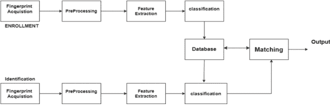

**图 2.** A-流程图指纹识别系统的基本组件。

- **用户便利性：快速简单解锁**，要解锁智能手机，用户只需用已注册的手指触摸屏幕的指定区域即可。这种方法在使用设备时通常比输入密码更快、更方便。
- **增强安全协议：尖端传感器技术**，屏下指纹扫描仪使用复杂的传感器技术，例如光学或超声波传感器，来捕捉用户指纹的详细图像。这增强了身份验证过程的准确性和安全性。
- **对抗伪造：区分特性**，制造商实施防伪造措施，以防止通过使用假指纹或其他生物识别伪造方法进行未经授权的访问。这些安全措施之一是使用先进算法来区分真实指纹和欺诈性指纹。
- **生物识别数据保护：安全飞地**，指纹数据通常保存在设备内的安全飞地中，以增加额外的保护层。这确保了生物识别数据不会被恶意行为者轻易获取。
- **双重身份验证技术：与其他安全功能一起使用**，屏下指纹扫描仪通常与其他安全功能（如面部识别或传统的 PIN/密码验证）结合使用，以便用户选择最方便的方法。
- **集成到不同设备：超越智能手机：** 屏下指纹扫描仪在智能手机以外的产品中变得越来越常见，例如笔记本电脑和平板电脑。在各种

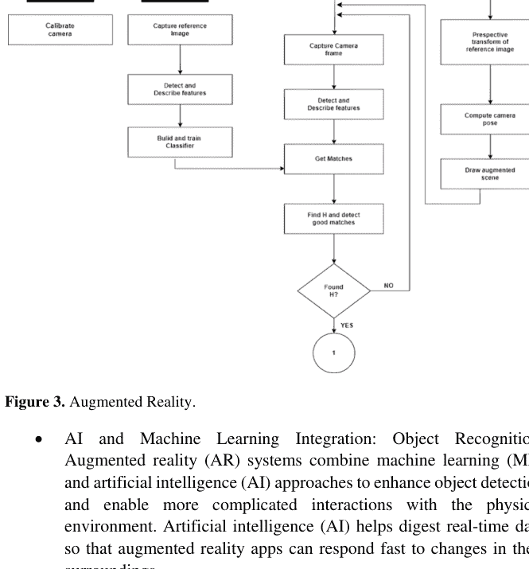

图 3. 增强现实。

- **人工智能与机器学习集成：物体识别**，增强现实（AR）系统结合机器学习（ML）和人工智能（AI）方法来增强物体检测并实现与物理环境的更复杂交互。人工智能（AI）有助于处理实时数据，以便增强现实应用能够快速响应周围环境的变化。
- **基于云的 AR：处理卸载**，基于云的增强现实通过将繁重的处理任务卸载到云端，减少了对设备能力的依赖。这使得在更多设备上使用增强现实（AR）成为可能，包括智能手机和轻型眼镜。
- **AR 软件开发工具包（SDK）：可访问的开发工具**，由于像 Google 的 ARCore 和 Apple 的 ARKit 等主要科技公司提供的 AR SDK 的可用性，开发人员现在可以更轻松地创建 AR 应用程序。因此，现在出现了不断增长的 AR 内容生态系统，并鼓励创造力。

### 增强现实的潜在用途

- **游戏与娱乐：沉浸式游戏**，增强现实（AR）通过将虚拟元素叠加到现实世界来增强游戏体验。Pokémon GO 等游戏展示了增强现实在游戏行业的广泛吸引力和潜力。
- **教育与培训：** 学生可以通过增强现实（AR）与三维（3D）模型互动，探索历史遗址，并了解复杂概念，增强现实 literally 让课堂栩栩如生。培训模拟，企业使用增强现实（AR）为消费者提供在逼真但虚拟环境中练习的机会。
- **零售与电子商务：** 通过允许用户在购买前数字试穿商品，增强现实支持的虚拟试穿增强了在线购物体验。店内导航，客户可以利用增强现实（AR）穿行商店空间以找到产品并获取相关信息。
- **医疗保健：** 手术规划，外科医生可以通过将医学图像叠加到患者身体上来使用增强现实（AR）可视化和规划手术。医学教育，程序指导、解剖可视化和模拟都得到了 AR 在医学教育中的支持。
- **制造与维护：** 装配辅助，通过为维护和装配任务提供实时指导，AR 降低了错误并提高了生产力。远程协助，技术人员可以通过使用增强现实实时获得专业指导，从而促进远程故障排除和维修。
- **建筑与设计：** 可视化，通过采用增强现实（AR），设计师和建筑师可以在物理空间中查看和展示他们的作品。交互式设计评估，增强现实（AR）通过将数字模型叠加在现实世界地点上实现协作设计评估。
- **社交媒体与通信：** 增强现实（AR）滤镜和特效被整合到社交媒体网络中以促进创造力和参与度。虚拟会议，通过在参与者的真实环境上叠加信息、图片或头像，增强现实（AR）可以增强虚拟会议。
- **旅游与导航：** AR 导航应用的用户可以获得最新的路线指引和附近兴趣点的详细信息。历史增强，增强现实（AR）通过将历史或文化资料叠加到地点上来增强游客体验。
- **营销与广告：** 互动广告，增强现实（AR）通过实现沉浸式和互动式广告，为消费者连接产品开辟了新方法。虚拟试用-购买前试用，企业使用增强现实（AR）让客户在购买前在其工作空间或家中查看产品。
- **远程协作：** 虚拟协作环境：通过利用增强现实，用户可以在共享虚拟环境中举行虚拟会议并与三维物品互动。因此，用户能够更轻松地远程协作。

随着增强现实（AR）技术的进步，其潜在应用应会增加，从而改变人们与数字世界和物理世界互动的方式。

### 用于增强用户隐私和安全性的生物识别认证

确认一个人的身份的方法，使用其独特的身体特征或行为模式，被称为生物识别认证。虽然生物识别认证具有许多安全和隐私优势，但重要的是要考虑任何可能的危害，例如生物识别伪造或误报。强大的安全协议、持续的生物识别技术开发以及遵守行业标准可以共同努力减少这些危险，并在身份验证方面提供一个安全且尊重用户隐私的环境，如图 4 所示（Rui et al., 2018）。

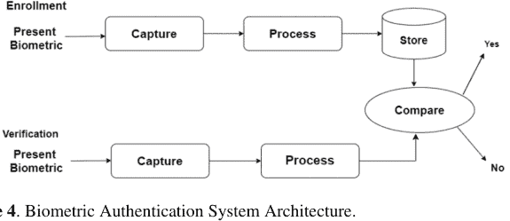

独特且与生俱来的特征：面部、虹膜、指纹等。生物识别标识符对每个个体都是独一无二的且难以伪造。它们包括指纹、虹膜模式和面部特征。这种独特性为身份验证过程增加了额外的安全层。

对密码的依赖减少：无需密码登录。通过使用生物识别认证，容易丢失或被未经授权访问的普通密码变得不再必要（Ratha et al., 2001）。由于不再需要记忆复杂的密码，用户现在可以更快、更安全地进行身份验证。

改善用户体验：速度与便利。使用指纹或面部识别等生物识别认证方法，用户可以轻松快速地访问其设备或账户。这在不影响安全性的情况下提升了整体用户体验。

双因素认证（2FA）：多重安全层。多个身份验证因素，包括密码或 PIN，可以与生物识别技术结合以提供多层安全策略。这种双因素认证（2FA）增加了额外的保护层。

生物识别数据保护：安全存储。生物识别数据通常存储在设备的 secure enclaves 中，使黑客难以访问或复制。为了进一步保护存储的数据，一些生物识别系统还会对其进行加密。

动态认证：为了实现持续认证，一些生物识别系统在会话期间持续验证用户的生物识别特征，如图 5 所示。如果出现显著差异导致系统要求重新认证，这可以提供额外的保护层。

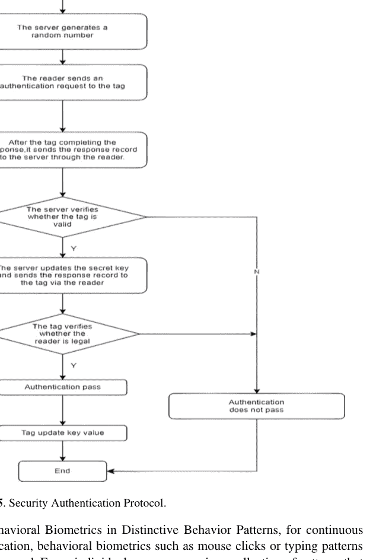

图5. 安全认证协议。

差异化行为模式中的行为生物特征识别：为了持续识别，可以使用鼠标点击或打字模式等行为生物特征。每个人都拥有独特的行为模式集合，通过寻找与常态的偏差，可以识别未经授权的访问。生物特征模板：原始生物特征数据不会由生物特征

-   能源效率：应纳入移动设备设计的高能效硬件示例包括低功耗处理器和显示器。这样，设备总体能耗降低，电池续航更长。
-   耐用性与适应性：延长设备使用寿命。在设计设备时考虑耐用性，通过减少更换频率来尽量减少技术浪费。制造商可以通过提供软件更新和确保长期硬件兼容性来支持这一点。
-   负责任的制造方法：道德采购。在生产过程中采用公平劳动实践和道德采购原材料，有助于生产更具社会意识的产品。减少环境影响：制造商应采用环保的生产方法，减少排放、水和能源消耗以及排放。
-   报废事项：回收与处理。当设备设计为易于回收时，在其使用寿命结束时更容易拆卸和重复使用其材料。此外，制造商可以实施回收和适当处置的回收计划。
-   包装可持续性：环保和极简包装。减少不必要的包装并使用环保包装材料有助于减少浪费。制造商可以使用可回收或再生包装材料。
-   循环经济原则：回收和再利用计划。实施循环经济原则包括制定促进电子设备回收、翻新和再利用的政策。制造商可以设立项目来收集过时设备、翻新它们或回收其组件。
-   降低碳足迹：碳中和运营。制造商可以通过投资可再生能源或参与碳补偿计划来尝试减少碳足迹。这降低了生产过程的能源消耗及其对环境的不利影响。
-   透明度与认证：环境认证。当产品获得能源之星（ENERGY STAR）或EPEAT（电子产品环境影响评估工具）等环境绩效认证时，客户可以更放心地知道产品符合环保标准。
-   **可持续领域的技术创新：环境与绿色技术认证：** 当设备获得能源之星或EPEAT（电子产品环境影响评估工具）等环境绩效认证时，客户可以更放心地知道它符合环保法规。

### 更快的处理器和更大的内存：提升移动性能与多任务处理

RAM（随机存取存储器）和处理器速度的提升是增强移动性能并促进智能手机及其他设备多任务处理的两个重要组成部分。

#### *更快的处理器*

更快的速度和响应性：以千兆赫（GHz）或其他相关指标衡量的更快处理器，能够加快程序启动、界面导航和任务执行。它还能增强计算能力：CPU速度更快的设备更能处理日益复杂的计算任务。这对于游戏、视频编辑和增强现实等资源密集型应用尤其重要。流畅的多媒体体验：更快的CPU有助于高清视频播放、图形渲染和其他多媒体内容的处理，从而增强移动设备上的多媒体体验。优化的应用性能：应用程序可以拥有更多可用的计算能力；应用开发者能够创建响应更快、功能更丰富的应用程序。因此，用户在该设备上使用各种应用的能力得到增强。高效的多任务处理：由于更快的CPU允许用户在不同应用之间切换而无任何卡顿或延迟，用户可以更流畅地进行多任务处理。在需要生产力和多任务处理的场景中，这非常有益。先进的机器学习与人工智能：现代CPU有时拥有专门用于机器学习和人工智能（ML）功能的组件。这使得语音识别、预测文本输入和相机增强等AI驱动功能可以在设备上进行处理。因此，能源效率：处理技术的进步往往与……的增加相关

“...用于高分辨率移动显示器的图案。” *微系统与纳米工程* 6, 第1期 (2020): 98.

Kingslin, M. Theodore. “柔性可折叠显示器综述。” *电子工程杂志* 13, 第3期 (2023).

Ni, Tao, Xiaokuan Zhang, 和 Qingchuan Zhao. “通过电磁侧信道从屏下指纹传感器恢复指纹。” 见 *2023年ACM SIGSAC计算机与通信安全会议论文集*, 第253-267页. 2023.

Parulski, K., 和 Majid Rabbani. “数码相机和数码摄影系统的持续演进。” 见 *2000年IEEE国际电路与系统研讨会（ISCAS）*, 第5卷, 第101-104页. IEEE, 2000.

Ratha, Nalini K., Jonathan H. Connell, 和 Ruud M. Bolle. “增强基于生物特征的身份验证系统的安全性与隐私性。” *IBM系统杂志* 40, 第3期 (2001): 614-634.

Rui, Zhang, 和 Zheng Yan. “生物特征认证综述：迈向安全且保护隐私的身份识别。” *IEEE访问* 7 (2018): 5994-6009.

Wiencek, Richard, Sagnika Ghosh, Maria C. Laurent-Rice, Eden Black, Tahereah Mujahid, Sameer Kalyan, Monika Priya, Ayush Goyal, Cesar Luna, 和 Kanwalinderjit Kaur. “太阳能微型逆变器与SCADA系统之间5G通信链路的仿真。” 见 *2023年第五届全球电力、能源与通信会议（GPECOM）*, 第311-316页. IEEE, 2023.

Yeh, Chih-Chieh, Teng-Wei Huang, You-Ren Lin, 和 Guo-Dung Su. “具有优化孔径和微透镜结构的大面积屏下指纹传感器的设计与制造。” *传感器* 23, 第21期 (2023): 8731.

## 第六章

## 人工智能在移动计算中的作用

P. Dhanalakshmi¹,*
Chevuru Nandini²
U. Janardhan Reddy³
K. Reddy Madhavi¹
Viswaksena Balaji⁴
和 J. Avanija¹

¹印度安得拉邦蒂鲁帕蒂莫汉巴布大学计算学院人工智能与机器学习系
²印度安得拉邦蒂鲁帕蒂斯里维迪亚尼克森工程学院计算机科学与工程系
³印度班加罗尔吉达姆大学
⁴爱尔兰利默里克大学

### 摘要

将人工智能（AI）融入移动计算已经彻底改变了我们与设备互动和获取信息的方式。本摘要探讨了AI在增强移动计算方面的关键作用，重点阐述了其对用户体验、效率和功能的影响。移动计算中由AI驱动的功能通过使设备能够识别用户偏好并相应调整功能，彻底重新思考了定制化。人工智能（AI）使移动设备能够预测用户需求、提供个性化建议，并利用机器学习算法自动执行重复性操作，从而极大地提高了用户舒适度。为了最大化移动设备上的资源利用，人工智能至关重要。人工智能算法有效管理设备资源，从处理器性能到电源管理，提供峰值性能，同时消耗最少的能量以延长电池寿命。人工智能使移动应用具备先进功能，如图像识别、预测分析和自然语言处理。这使得在各种行业（包括医疗保健、银行和娱乐）中，改变人们与移动技术互动方式的尖端应用成为可能。由AI驱动的安全解决方案在保护移动设备上的敏感数据方面变得越来越重要。通过发现异常、识别潜在威胁并实施强大的身份验证机制，AI算法支持安全程序，使移动计算环境更加安全。未来的发展归功于AI与移动计算的结合，带来了大量机遇。随着这些技术的进步，AI技术与移动设备的融合预计将对移动计算环境产生重大影响，使应用更加先进、用户体验更流畅、设备能力更强。

关键词：人工智能、移动计算、用户体验、个性化、自动化、安全性、隐私、增强现实、边缘计算、物联网

### 引言

移动计算是指使用智能手机、平板电脑和可穿戴设备等计算设备，这些设备设计为易于携带并在移动中使用。它涉及使用各种无线技术和网络来创建、传输和访问信息。移动计算在现代社会中变得越来越普遍，使用户几乎可以在任何地方访问数据和应用程序。便携性、无线连接、位置感知、有限的资源限制、触摸界面、多样化应用、多任务处理是移动计算的一些特点。移动计算正在改变人们工作、沟通和获取信息的方式。它还为满足各种需求和兴趣的广泛移动应用生态系统的发展提供了便利。随着硬件、软件和网络技术的进步，企业也在不断发展，使移动设备成为许多人和企业日常生活中不可或缺的一部分（Singh等人，2022）。

### 人工智能基础

#### 人工智能与机器学习基础

计算机科学领域对人工智能（AI）的研究本质上关注于构建能够完成通常需要人类智能的任务的机器。自然地，机器学习（Bhargava et al., 2021）是人工智能的一个子领域，它开发统计模型和算法，使计算机能够从数据中发现模式、从中学习并做出判断。通过在数据集上训练，学习机器可以在不断提高性能的同时，随着时间的推移获得知识。机器学习的主要三种方法分别是强化学习（基于环境输入通过试错来训练算法）、监督学习（对记录数据的模型进行训练）和无监督学习（在未标记数据中寻找模式）。人工智能（AI）与机器学习的结合产生了能够执行自然语言处理、图像识别和预测分析等任务的 AI，如图 1 所示。这些系统彻底改变了许多行业并推动了技术发展。

#### 人工智能类型：狭义 AI 与通用 AI

人工智能（AI）的主要两个类别是通用智能（强智能）和狭义智能（弱智能）。以严格定义的方式表达智能并专门针对一个或多个任务进行教授和适应的系统称为狭义人工智能（AI）系统。图像识别、虚拟助手和翻译软件就是一些例子。尽管狭义 AI 在特定任务上表现良好，但其认知复杂性不如人类智能广泛。另一方面，通用智能寻求在各种任务中应用类人智能，并能够以多种方式理解、检索和使用信息。人类能够完成的任何智力任务都将通过通用智能完成。尽管目前已有众多狭义 AI 应用，但通用 AI 仍然是一个具有挑战性且不断发展的领域。科学家和工程师正在努力创建灵活且可适应的人工智能（AI），使其能够展现广泛的知识（Kuusi et al., 2022）。

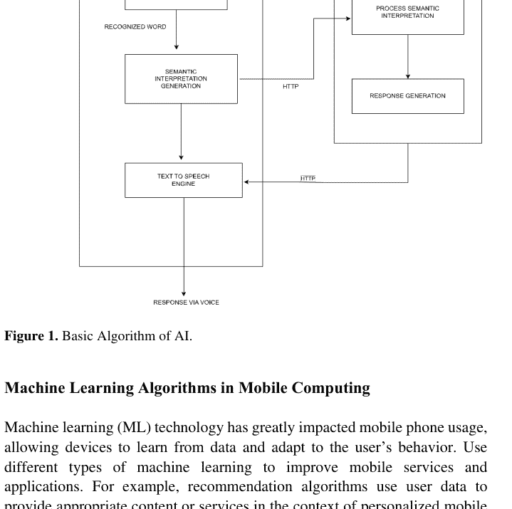

图 1. AI 的基本算法。

### 移动计算中的机器学习算法

机器学习（ML）技术极大地影响了手机的使用，使设备能够从数据中学习并适应用户的行为。不同类型的机器学习被用于改进移动服务和应用程序。例如，推荐算法使用用户数据在个性化移动应用程序的背景下提供适当的内容或服务，从而使用户体验更高效。用户现在能够以全新的方式与设备互动，这都要归功于图像和语音识别算法所实现的直观界面开发。由于预测算法能够预见用户行为并相应地修改设备，因此它们也有助于延长电池寿命和资源分配。由于移动技术的进步，众多机器学习算法已被用于移动设备，以提高其智能性、效率和可用性。

支持向量机（SVM）和循环神经网络（RNN）是流行的机器学习方法，它们对移动计算很重要。支持向量技术用于在移动应用程序中输入文本和图像以及其他类型的可视化。SVM 通过识别表明存在入侵的风险或模式来帮助识别移动安全中的漏洞。循环神经网络对于移动设备上的语言处理和语音识别至关重要。由于 RNN 在理解连接方面非常出色，因此它们适用于文本预测和命令理解等应用。这些算法改善了用户体验，提高了移动应用程序的效率，并使移动设备更智能。

### AI 在移动设备中的集成

#### AI 启用硬件组件

AI 能力硬件对于未来 AI 应用的成功至关重要。包含强大的 AI 加速器（如 GPU 和 TPU）的系统可以更快、更有效地部署 AI 努力。在使用机器学习技术时，复杂的数学算法必须由高素质专家管理。AI 工作负载采用高带宽内存（HBM）和异构系统架构（HSA）等内存设计，以加强数据访问和传输。凭借边缘摄影和语音识别等功能，AI 启用传感器简化了设备操作，减少了对基于云的 AI 服务的需求。这些硬件元素构成了一个框架，促进了 AI 算法在各种平台上的集成和优化。

#### 移动处理器中的嵌入式 AI

将专用人工智能技术直接集成到移动设备芯片组中的过程称为移动处理器中的嵌入式人工智能。这些嵌入式 AI 组件提高了机器学习应用的设备端处理能力。它们通常包括专用神经处理单元（NPU）或 AI 加速器。移动处理器上的嵌入式 AI 通过在本地执行 AI 算法，使 AI 驱动的应用（如图像识别和自然语言处理）能够更快、更有效地处理，而无需依赖云计算（Chen et al., 2020）。

#### 传感器与 AI 集成

为了加强数据处理和解释，移动设备正配备硬件传感器和人工智能算法。通过智能集成，可以从传感器数据中获得清晰的图景。诸如加速度计、陀螺仪和摄像头等传感器会产生大量数据。这可以使移动设备变得更智能、更敏感，从而实现基于传感器的交互、手势识别和情境感知应用等功能。

#### AI 在电源管理中的作用：

人工智能有助于移动电源管理，提高设备能源效率和电池寿命。人工智能系统根据对用户行为、应用程序使用情况和设备性能的分析来调整电源设置和资源分配。AI 通过智能管理功耗并协助移动功耗的持续优化，提高了便携式设备的整体性能和可用性（Elahi et al., 2021）。

### AI 驱动的移动应用

#### 移动中 AI 应用概述

人工智能（AI）显著改变了我们与设备及其提供的服务互动的方式。如今，移动应用程序已集成 AI。由于 AI 技术，移动应用程序现在可以更复杂、更用户友好，并能够提供个性化体验。随着技术的进步，预计 AI 在移动应用程序中的使用将增加，为用户提供更大的洞察力和个性化。为了创建在各种环境中多用户、有效且高效的移动设备，开发人员正在寻找创造性的方法来利用 AI 的能力（Zhang et al., 2019）。

- 语音助手
- 图像和人脸识别
- 个性化推荐
- 聊天机器人和虚拟助手
- 预测文本和自动更正
- 健康和健身追踪
- 增强现实（AR）
- 语言翻译
- 移动游戏
- 安全和欺诈预防
- 预测性维护
- 情感识别。

### 个人助手和虚拟代理

#### 个人助手

帮助进行任务管理、信息交换和自然语言对话的软件称为个人助手。个人助手使用人工智能（AI）和自然语言处理（NLP）来理解和响应人类请求和查询。这些应用程序通过简化流程和提供有用信息使用户生活更轻松。手机和智能音箱是个人助手经常使用的两个平台示例。一些个人助手包括

- Siri (Apple)
- Google Assistant (Google)
- Alexa (Amazon)
- Cortana (Microsoft).

#### 虚拟代理

虚拟代理是一种人工智能程序，旨在与用户交互并协助他们完成特定任务或为客户提供信息（Alsanousi et al., 2023）。虚拟代理和个人助理使用数字技术来理解用户输入、提供相关答案并采取行动。个人助理与设备的整体运行相关联，而虚拟代理则更专业化，可以集成到不同的应用程序和工作空间中以提供特定服务（Erolkantarci et al., 2018）。

- 聊天机器人
- 自动化客户服务代表
- 交互式语音应答（IVR）系统
- 虚拟销售助理
- 医疗保健虚拟助理

### AI驱动的健康与健身应用

健康和健身应用使用人工智能（AI）技术来提升众多用户的福祉。这些应用通过利用机器学习算法、数据分析和个性化建议，超越了评级系统，为用户提供更好、更量身定制的体验。以下是由人工智能支持的健身和健康应用中的一些应用（Baldauf et al., 2020）。

- 个性化锻炼计划
- 智能教练与指导
- 健康监测与洞察
- 营养指导
- 预测分析
- 自适应锻炼
- 行为分析与习惯养成
- 情绪健康支持
- 与可穿戴设备集成
- 社交与社区功能
- 远程健康监测
- 持续学习与改进

AI驱动的健康与健身应用包括 Nike Training Club、MyFitnessPal 和 Fitbit。随着技术的发展，这些应用可能会融入更多人工智能，为用户提供更有帮助和个性化的健康与健身体验。

### 移动安全与人工智能

#### 移动安全威胁检测中的人工智能

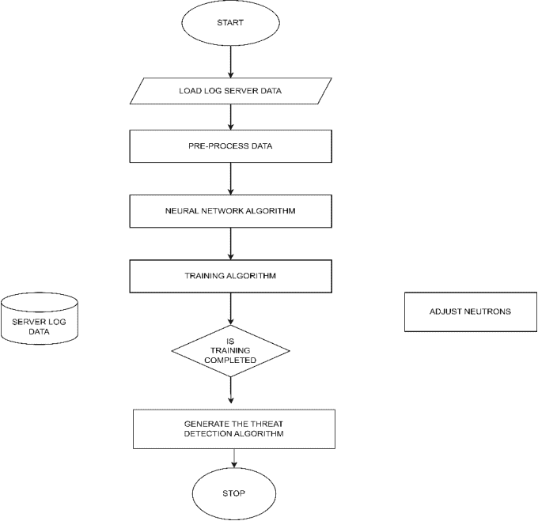

**图 2.** 威胁检测算法。

利用前沿技术、机器学习算法和智能机器的硬件输出来检测、评估和应对移动设备中的安全威胁的过程，被称为移动安全研究中的人工智能（AI）。移动安全的目标是保护智能手机、平板电脑和其他移动设备免受恶意软件、诈骗（如网络钓鱼）、黑客攻击和其他网络安全风险的侵害。为了应对移动设备网络安全威胁的动态和不断演变特性，如图 2 所示，人工智能（AI）在移动安全研究中至关重要。通过使用智能算法和实时分析，该技术加强了移动平台的整体安全性，并保护用户免受各种危险的侵害（Hu et al., 2021）。

#### 生物识别认证与人工智能

生物识别认证与人工智能（AI）相关联；AI 增强了生物识别系统的精确性、安全性和实用性。生物识别认证是通过个人身体或行为确认其身份的过程。人工智能如何应用于图 3 中指定的生物识别技术：

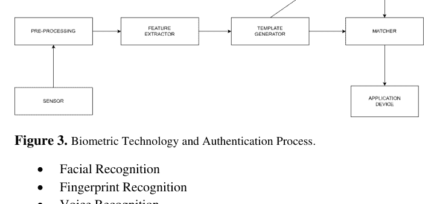

图 3. 生物识别技术与认证流程。

- 人脸识别
- 指纹识别
- 语音识别
- 虹膜识别
- 行为生物识别
- 持续认证
- 安全与防伪
- 用户体验与适应性

人工智能（AI）可以提高生物识别系统的安全性和精确性，而且还能实现经济高效的技术应用，例如金融交易、行政控制和手机。

#### 移动计算中隐私问题与人工智能

在移动计算和人工智能（AI）领域，主要的隐私问题是由于在启用 AI 功能的移动设备和应用程序上收集、处理和存储个人数据而可能产生的风险和问题。使用手机和人工智能引发了关于数据收集、处理和分析的隐私问题；理解安全问题；给予明确和知情的同意；在图 4 中，遵守法律要求；以及监控不同产品。随着移动计算和人工智能的进一步融合，隐私问题将需要考虑多个技术、法律和伦理问题。必须采取安全预防措施，优先考虑用户隐私，开发人员必须对其如何处理用户数据保持透明，以赢得客户的信任。在 AI 驱动的移动应用中防止隐私问题，需要采用最佳的隐私和合规标准。

#### 移动设备管理中的人工智能

在移动设备管理（MDM）行业利用人工智能（AI）高效管理和保护移动设备。移动设备管理是 IT 管理的重要组成部分，尤其是在员工使用智能手机、平板电脑和其他移动设备的环境中。人工智能（AI）在移动设备管理中的理论应用包括统计分析、异常检测、动态策略执行、上下文感知管理、用于认证的行为生物识别、自动化威胁响应、用户行为分析和能源与资源优化，这些是移动设备管理的问题。这些应用使用机器学习和分析来提高生产力、增强安全性，并提供一种更易于使用、上下文感知的公司内部移动设备管理方法。

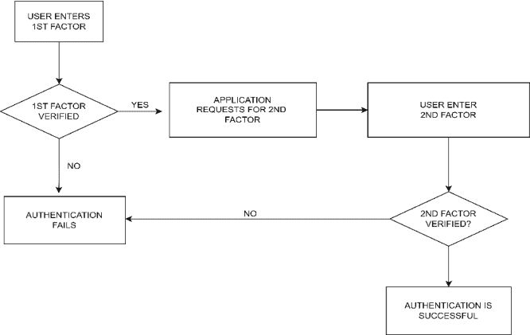

**图 4.** 双因素认证（2FA）。

### 移动用户体验中的人工智能

#### 个性化与人工智能

个性化是将商品、服务或体验调整为每个用户或客户独特需求、偏好和能力的过程。个性化的目标是通过为每个独特用户提供相关且有用的建议或数据来提升用户满意度和参与度。它可以应用于广泛的职责，包括材料分发、营销、电子商务、个性化和用户界面。因为人工智能（AI）算法和计算模型能够分析海量数据并预测或决策用户的独特特征，因此它们的应用对于适应性至关重要。AI 可以从用户交互中学习并随着时间的推移变得更好，以提供更精确的服务或建议。个性化系统经常采用机器学习——人工智能的一个子领域——来识别趋势并预测用户偏好。在分析和解释用户数据时，人工智能（AI），尤其是机器学习，是效率和个性化的强大工具。

#### AI驱动的内容推荐

为了提供或推荐定制内容，人工智能（AI）算法和技术会评估用户行为、偏好和其他相关数据。人工智能驱动的内容建议是指此过程。内容包含观众可能认为相关或有趣的任何事物，例如服装、音乐、电影、产品和其他信息。许多在线平台，包括新闻门户、论坛、电子商务网站和流媒体服务，经常提供由智能驱动的内容建议。通过定制信息提升客户满意度、参与度和整体体验，旨在让人们保持兴趣和参与。

#### 移动界面的自然语言处理

自然语言处理（NLP）是一种技术应用，使移动设备能够在移动设备的上下文中理解、解释和响应人类语音。自然语言处理（NLP）使用户能够与计算机和移动设备进行更具交互性和直观性的操作。它针对以下 NLP 移动界面：

- 文本理解
- 语音识别
- 意图识别
- 对话界面
- 上下文感知
- 文本生成

消息应用、虚拟助手（如 Siri 和 Google Assistant）、翻译服务和移动界面等应用更多地使用自然语言处理（NLP）。其目的是通过促进人与移动设备之间更自然、更用户友好的关系，使技术更易于接近并对人类语言更具响应性。

远程服务器或数据中心进行处理和分析（Goundar et al., 2021）。边缘计算是云计算的一个示例，它能够在多个应用和企业之间实现更大程度的数据处理分布和效率，如图5所示。

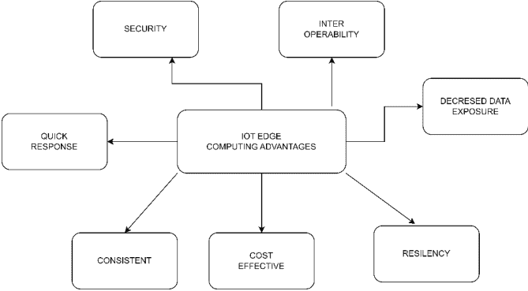

**图5.** 物联网边缘计算优势。

### 边缘AI：优势与挑战

边缘AI不是在中间的云服务器上简单地处理数据，而是在创建数据的设备边缘直接使用AI能力。这一策略有其自身的优缺点。

边缘AI的优势：

- 低延迟
- 带宽效率
- 隐私与安全：
- 离线操作
- 实时决策
- 可扩展性。

#### 边缘AI的挑战

资源受限：边缘设备的计算资源（如内存、存储和处理器性能）通常有限。这可能限制能够用于这些设备的AI模型的复杂性。在计算和存储能力受限的边缘设备上部署体量大且结构复杂的AI模型可能很困难。通常需要优化方法。

功耗受限。某些边缘设备（尤其是电池供电的设备）可使用的功率有限。资源密集型的AI算法会迅速耗尽电池，可能影响设备的可用性。

控制与维护：在大量分散的边缘设备上，管理和升级AI模型可能很困难。必须对边缘基础设施进行细心维护，以确保更新、安全性和一致性。

云集成：尽管边缘计算将处理过程移近数据源，但通常仍需要与云服务集成，以完成长期存储、集中分析或模型训练等任务。

数据隐私问题：即使在边缘处理数据可以提高隐私性，但边缘设备上的数据安全仍然是一个问题。在本地存储敏感数据至关重要。

边缘计算的生态系统涵盖各种平台和设备，需要标准化和互操作性。由于标准化和兼容性问题，创建通用解决方案可能很困难。

最后，边缘AI在改善隐私、带宽效率和降低延迟方面有很多优势。然而，它也带来一些挑战，如能耗、模型复杂性、使用限制，以及良好管理和云集成的需求。要让AI触及众多行业和应用的前沿，这些问题必须得到解决。

### 移动应用中的边缘AI

边缘人工智能（AI）是指将人工智能（AI）能力直接用于移动应用程序。这样一来，移动设备可以在本地运行，而无需依赖云计算。这一理念带来了诸多好处，并为开发最高效、最实用的移动应用开辟了新的可能性（Avanija et al., 2022）。以下是移动应用中一些边缘AI的应用：

- 图像和视频处理
- 语音和自然语言处理
- 推荐系统
- 健康与健身追踪
- 离线导航
- 安全与身份验证
- 游戏和增强现实

虽然在移动应用中使用边缘AI具有诸多优势，但开发人员在开发和实现设备端使用的AI模型时，必须考虑移动设备的限制，如内存和处理能力限制。某些功能和可扩展性可能需要在基于云的服务与设备端处理之间进行结合。

### 基于边缘的机器学习模型

边缘模型是直接加载并在边缘设备上执行的机器学习模型，这些设备包括传感器、摄像头、智能手机和其他物联网（IoT）设备。通过将机器学习处理能力移近数据中心，它将减少在云服务器上进行集中处理的必要性。以下是几种基于边缘的机器学习模型（Wang et al., 2019）。

- 基于边缘的机器学习模型在设备端直接执行推理（即生成预测或判断的过程），且推理发生在获取数据的设备上。
- 通过使用模型压缩方法，机器学习模型可以在资源有限的边缘设备上部署，因为压缩后模型体积更小。
- 量化是指降低模型数值的精度，通常从32位浮点数转换为较低位数的表示。
- 利用预训练模型在一个任务上的先验信息来提升相关任务表现的方法称为迁移学习。
- 联邦学习无需交换原始数据，即可在分散的边缘设备上进行模型训练。传输的只是模型更新。
- 边缘到云协作：在某些情况下，基于云和基于边缘的机器学习模型会与云服务器协同工作。推理在边缘端管理，而模型更新或训练可以在云端执行。
- 能源效率：在基于边缘的系统中创建学习模型的目标是降低计算中的能耗。
- 即时决策：基于边缘的模型无需中心服务器或持续的网络连接即可实现快速决策。
- 自适应学习：它适应不断变化的环境或用户活动。基于边缘的机器学习模型将包含自适应学习策略。

对最低延迟、隐私保护和资源效率的需求是在边缘部署机器学习模型背后的驱动力。随着技术的发展，机器学习在多个学科领域的智能应用中仍然至关重要。

### 挑战与未来趋势

#### AI驱动的移动计算面临的当前挑战

如今，由人工智能驱动的移动计算面临许多挑战。由于依赖移动设备有限的资源，人工智能算法在计算能力和能耗需求不断增长的背景下构成了重大问题。AI应用大规模收集和处理用户数据，引发了关于数据泄露和未授权访问的隐私与安全担忧。集成与兼容性不足将使得AI解决方案更难在各式移动设备上有效集成。由于对公正算法和透明决策程序的伦理关切，确保AI驱动的移动应用中的公正性和可问责性也很困难。为了在保障用户安全、隐私和伦理规范的同时优化移动智能的优势，这些问题必须得到解决（Elahi et al., 2021）。

#### 伦理考量与AI

随着技术的进步并融入社会的更多方面，围绕人工智能的伦理问题日益重要。令人担忧的因素包括在社交媒体管理和监控等领域可能滥用智能，以及算法和决策过程中的偏见。一个重大的伦理挑战是确保人工智能系统没有偏见且负起责任，因为有偏见的数据可能被用来做出歧视性的判断。AI程序经常收集和管理大量个人数据，这也引发了隐私问题。为了在社会中合乎道德地应用AI，必须在AI创新的益处与保护人权和清洁繁荣之间找到平衡。

#### 移动AI的未来趋势与创新

AI领域正在迅速发展，并不断出现新进展。以下是移动AI的一些未来趋势和创新：

- 边缘AI
- AI驱动的个性化
- 自然语言处理（NLP）
- AI驱动的相机功能
- 移动游戏中的AI
- 医疗保健应用
- 5G集成
- 安全与隐私
- AI增强的用户界面（UI）
- 与其他技术的协作

这些趋势的广泛采用和实际应用取决于许多因素，如用户接受度、监管考量和技术进步。未来移动AI的发展应优先考虑边缘AI、更深入的个性化和增强的用户体验。由人工智能驱动的个人助理和服务将能够更好地理解客户需求、提供建议，并将其融入客户的日常安排。通过减少

行为和偏好用于提供个性化内容推荐。在移动行业，这一点体现在个性化应用建议、内容推荐和定向广告中。用户界面增强，人工智能被用来通过适应个人使用模式来优化用户界面。这带来了更直观、更友好的移动体验。语音助手，由AI驱动的语音助手，如Siri、Google Assistant和Alexa，已经成为移动设备不可或缺的一部分。它们使用户能够通过自然语言（NL）交互来执行任务、获取信息和控制设备。预测分析帮助移动公司预测用户需求和行为。聊天机器人提供即时客户支持，回答查询，并协助用户完成各种任务。强化安全，人工智能也被用于通过面部识别、指纹扫描和行为生物识别等功能来改善移动安全。AI算法可以检测异常行为模式，帮助识别和防止安全威胁。移动应用开发，自动化测试、代码生成和错误检测是人工智能可以提高效率并加快开发周期的一些领域。所以最后，人工智能给移动行业带来了变革性的变化，影响着从用户体验到安全、开发流程和商业策略的方方面面。人工智能技术的整合持续塑造移动技术的未来，为创新提供新的可能性和机遇。

### 结论

移动技术的未来深受人工智能（Roy et al., 2020）的影响，人工智能有能力改变设备的功能、用户体验和整体技术状况。内置AI的移动设备将能够即时适应用户的行为、偏好和环境，带来前所未有的改进。增强现实和更好的语音质量将改变人们的移动设备使用方式，促进对话并使信息检索更加便捷。此外，通过加强能源管理、安全性和设备性能，人工智能将提升手机的性能和安全性。可以预见，移动技术和人工智能（AI）将携手合作，促进社交参与，使移动设备更加亲密和互联。

### 参考文献

Alsanousi, Bassam, Abdul Mohsen S. Albesher, Hyunsook Do, and Stephanie Ludi. “Investigating the user experience and evaluating usability issues in ai-enabled learning mobile apps: An analysis of user reviews.” International Journal of Advanced Computer Science and Applications 14, no. 6 (2023).

Ardiny, Hadi, and Esmaeel Khanmirza. “The role of AR and VR technologies in education developments: opportunities and challenges.” In 2018 6th RSI international conference on robotics and mechatronics (ICROM), pp. 482-487. IEEE, 2018.

Avanija, J., Gurram Sunitha, K. Reddy Madhavi, S. Sreenivasa Chakravarthi, and R. Hitesh Sai Vittal. “Prediction and Analysis of Cervical Cancer: An Ensemble Approach.” In 2022 4th International Conference on Inventive Research in Computing Applications (ICIRCA), pp. 1734-1739. IEEE, 2022.

Avanija, J., Suneetha Konduru, Vijetha Kura, Grande NagaJyothi, and Bhanu Prakash Dudi. “Designing a Fuzzy Q-Learning Power Energy System Using Reinforcement Learning.” International Journal of Fuzzy System Applications (IJFSA) 11, no. 3 (2022): 1-12.

Baldauf, Matthias, Peter Fröehlich, and Rainer Endl. “Trust me, I’m a doctor–user perceptions of AI-driven apps for mobile health diagnosis.” In Proceedings of the 19th International Conference on Mobile and Ubiquitous Multimedia, pp. 167-178. 2020.

Bhargava, Cherry, and Pradeep Kumar Sharma, eds. Artificial intelligence: fundamentals and applications. CRC Press, 2021.

Chen, Yanjiao, Baolin Zheng, Zihan Zhang, Qian Wang, Chao Shen, and Qian Zhang. “Deep learning on mobile and embedded devices: State-of-the-art, challenges, and future directions.” ACM Computing Surveys (CSUR) 53, no. 4 (2020): 1-37 (Chen et al., 2020).

Elahi, Haroon, Guojun Wang, Yang Xu, Aniello Castiglione, Qiben Yan, and Muhammad Naeem Shehzad. “On the Characterization and Risk Assessment of AI-Powered Mobile Cloud Applications.” Computer Standards & Interfaces 78 (2021): 103538.

Erol-Kantarci, Melike, and Sukhmani Sukhmani. “Caching and computing at the edge for mobile augmented reality and virtual reality (AR/VR) in 5G.” In Ad Hoc Networks: 9th International Conference, AdHocNets 2017, Niagara Falls, ON, Canada, September 28–29, 2017, Proceedings, pp. 169-177. Springer International Publishing, 2018.

Fasanella, Marco. “Dimensions of AI-enabled mobile and embedded devices: an integration design guide.” (2022) (Fasanella, 2022).

Gill, Sukhpal Singh, Minxian Xu, Carlo Ottaviani, Panos Patros, Rami Bahsoon, Arash Shaghaghi, Muhammed Golec et al. “AI for next generation computing: Emerging trends and future directions.” Internet of Things 19 (2022): 100514.

Goundar, Sam, J. Avanija, Gurram Sunitha, K. Reddy Madhavi, and S. Bharath Bhushan, eds. Innovations in the industrial Internet of Things (IIoT) and smart factory. IGI Global, 2021.

Hu, Yupeng, Wenxin Kuang, Zheng Qin, Kenli Li, Jiliang Zhang, Yansong Gao, Wenjia Li, and Keqin Li. “Artificial intelligence security: Threats and countermeasures.” ACM Computing Surveys (CSUR) 55, no. 1 (2021): 1-36.

## 第7章

## 智能移动助手：机器学习的力量

J. Avanija¹  
Kakarla Kavitha²,*  
Katika Manasa²  
Mogipalli Madhumitha²  
Vanam Padma Teja²  
and Viswaksena Balaji³  

¹Department of AI and ML, School of Computing, Mohan Babu University, Tirupati, A.P., India  
²Department of CSE, Sree Vidyanikethan Engineering College, Tirupati, A.P., India  
³University of Limerick, Limerick, Ireland

### 摘要

“为了重塑移动计算，智能移动助手正利用机器学习创造一种新的通信形式。”本章探讨了两者的协同作用，强调机器学习（ML）所扮演的关键角色。研究考察了移动系统中机器学习的基础，包括算法集成和智能移动助手（IMA）的演进路径。它重点介绍了自然语言处理、语音识别和计算机视觉的基本组成部分，以证明它们的重要性。个性化推荐、自适应界面等移动ML应用展示了IMA的多方面用途。此外，物联网（包括家用电器和可穿戴设备）的集成进一步凸显了IMA不断扩展的领域。我们讨论了伦理考量、安全影响、挑战和未来前景，以打造更强大的IMA，而这些IMA将预见一个由机器学习在移动环境中的演进所塑造的动态未来。

*通讯作者邮箱：kkavithakakarla477@gmail.com。*

**关键词：** 自然语言处理（NLP）、语音识别、移动机器学习、个性化算法、物联网集成、自适应用户界面、移动计算中的数据隐私、移动环境中的伦理人工智能、移动设备中的计算机视觉

### 引言

智能移动助手（IMA）是能够以自然语言理解和响应用户查询与命令的软件应用程序。它们通常由人工智能（AI）技术的组合驱动，包括机器学习（ML）、自然语言处理（NLP）和语音识别。IMA已经存在多年，然而近年来随着智能手机和其他移动设备的兴起，它们变得越来越流行。如今，有许多不同的IMA可供使用，例如Siri、Google Assistant和Alexa。

IMA可以执行广泛的任务，包括：
- 回答问题
- 设置提醒
- 播放音乐
- 拨打电话
- 发送短信
- 导航到位置
- 控制智能家居设备

### 机器学习在移动辅助中的重要性

机器学习在智能移动助手中扮演着关键角色。ML算法被用来训练IMA，使其能够以自然的方式理解和响应用户的查询和指令。例如，ML算法被用于

教导 IMAs 理解特殊形式的语音，即使在嘈杂环境中。ML 算法还用于教育 IMAs 识别消费者查询的含义，即使它们模棱两可或不完整。ML 算法还用于多年来提升 IMAs 的整体性能。例如，ML 算法可用于意识到 IMAs 常见的错误，然后训练 IMAs 在未来避免这些错误。

### 智能移动助手的益处

IMAs 提供一些益处，包括：

- 便利性：IMAs 可以使客户更简单、更快地完成任务。例如，客户可以使用 IMA 设置提醒或播放音乐，而无需在设备上输入或点击。
- 生产力：IMAs 可以通过自动化重复性任务并按需提供数据来帮助用户更有效。例如，用户可以使用 IMA 查看日历或获取会议路线，而无需停止正在做的事情。
- 可访问性：IMAs 可以使移动设备对残疾人士更易访问。例如，视力受损的人可以使用 IMA 控制其设备并获取信息。

### 智能移动助手的未来

IMAs 仍在开发中，然而它们正迅速变得更加复杂和强大。未来，IMAs 预计将变得更加个性化和主动。例如，IMAs 可能能够预测用户愿望并在用户甚至提出请求之前提供帮助。IMAs 也预计将与不同设备和服务更紧密地集成。例如，IMAs 可能能够控制智能家居设备、管理个人财务，甚至提供临床援助。总体而言，IMAs 有能力彻底改变我们与移动设备交互的方式。随着 IMAs 变得更加复杂和成功，它们可能最终成为我们生活中的必备部分（Sarker et al., 2021）。

### 移动计算中机器学习的基础

#### 机器学习算法概述

机器学习算法可分为三类：监督学习、无监督学习和强化学习（Carbonell et al., 1983）。监督学习算法使用标记数据进行训练，可以基于输入-输出映射预测结果。示例包括线性回归、逻辑回归、决策树和支持向量机。另一方面，无监督学习算法在原始数据上训练，无标记输出，如图 1 所示。它们在没有先验知识的情况下发现数据中的模式。示例包括聚类、降维和关联规则学习，如表 1 所示。强化学习算法通过与环境交互学习。它们采取行动以最大化奖励并最小化惩罚。示例包括 Q-learning 和策略梯度。选择特定问题的最合适算法取决于数据和期望结果。这只是众多机器学习算法的一瞥。

**表 1.** 学习类型和机器学习算法

| 类型 | 描述 | 示例 |
|---|---|---|
| 监督学习 | 算法在带标签的数据集上训练，其中每个数据点都有输入和输出。 | 线性回归、逻辑回归、决策树、支持向量机 |
| 无监督学习 | 算法在未标记的数据集上训练，其中每个数据点只有输入。 | 聚类、降维、关联规则学习 |
| 强化学习 | 算法通过与环境交互进行训练，学习采取最大化奖励并最小化惩罚的行动。 | Q-learning、策略梯度 |

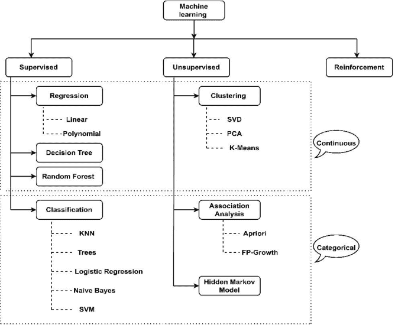

**图 1.** 机器学习算法概述。

#### 机器学习在移动系统中的集成

移动系统正在集成机器学习（ML），它提供诸多益处。通过降低延迟、提高资源效率、自动化活动和增强用户体验，机器学习算法可以提升性能。跟踪健身数据并监测健康的穿戴技术、采用 ML 优化电池寿命和相机质量的手机，以及学习用户偏好并控制设备的智能家居小工具，是 ML 集成的几个例子。机器学习（ML）模型可用于增强功能、个性化用户体验或提供上下文支持，如图 2 所示。它们使用来自各种来源的数据进行训练（Będkowski, 2013）。ML 在移动系统中的集成流程包括问题选择、数据收集与维护、ML 算法选择、基于云服务的训练以及模型的移动实现（Avanija et al., 2022）。然而，存在诸如移动设备使用能力有限、隐私问题以及安全风险等缺点。然而，移动平台基于新应用、增强功能和提高生产力，为机器学习提供了新的可能性。通过解决这些问题并利用机遇，我们可以创建更智能、更高效的移动生态系统（M Chen et al., 2019）。

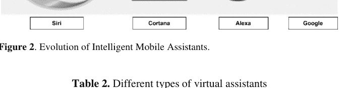

**图 2.** 智能移动助手的演进。

**表 2.** 不同类型的虚拟助手

| 制造商 | Apple | Microsoft | Amazon | Google |
|---|---|---|---|---|
| 唤醒词 | “Hey Siri” | “Hey Cortana” | “Alexa” | “OK Google” |
| 哪些手机使用它？ | iPhone 4S + iPad 3+ | Windows 10 | Android, iOS, Fire OS, & PC | Android 4.1 或更高 |
| 地理围栏 | 有限 | 是 | 否 | 是 |
| 网页搜索 | 是 | 是 | 是 | 是 |
| 使用哪个搜索引擎？ | Google Search Engine (Now) | Bing Search engine | Bing Search engine | Google Search engine |
| 第三方应用支持 | 是 | 是 | 是 | 是 |
| 使用的搜索引擎 | Google | Hard drive & Bing | Bing | Google |

随着时间的推移，智能移动助手（IMAs）的开发得到了极大改进。尽管聊天机器人自 1960 年以来就已存在，但由于互联网发展和更强大的计算机，其流行度在 1990 年代增长。尽管原始聊天机器人的功能有限，但它们为开发更复杂的支持代理奠定了基础。在第二阶段，语音助手允许消费者通过自然语言与设备通信。苹果公司于 2007 年推出了其原始语音助手 Siri。随后出现了亚马逊的 Alexa、谷歌的 Assistant 和微软的 Cortana，如表 2 所示。语音助手可在多种设备上访问，能够处理智能家居设备管理、拨打电话、触发警报和回答问题。当前智能移动助手的浪潮由人工智能算法驱动，使其能够以更自然的语言交流并执行复杂任务。由 Google 人工智能开发的 LaMDA 是下一代 IMA 的一个例子，它可以根据人类质量生成文本。未来，智能移动助手可以提供陪伴、个性化服务、旅行安排协助、时间管理以及健康建议。无论如何，随着 IMAs 变得更简单、更高效并改善我们的生活质量，它们拥有光明的前景（Capponi et al., 2019）。

### 智能移动助手的關鍵組成部分

智能移动助手是使用自然语言处理和 AI 为手机用户提供广泛服务和支持的互联网助手（Felt et al., 2011）。

自然语言处理（NLP）：NLP 是人工智能的一个子领域，研究人类通过使用自然语言与计算机之间的交互。人与机器之间的交互如下：在正常的自然语言处理中，人类与机器交谈。

- 机器捕获音频。
- 进行音频到文本转换。
- 处理文本数据。
- 进行数据到音频转换。

### 什么是自然语言处理

自然语言处理，或 NLP，是使用算法来确定和提取自然语言的规则，例如将难以理解的语言数据转换为计算机可理解的形式。当提供文本时，计算机将利用算法提取每句话相关的含义并收集其中的关键信息。

## 自然语言处理中应用的技术

完成自然语言处理任务所采用的主要技术是句法分析和语义分析。下面将描述它们各自的应用方式。

### 句法

句法是指句子中单词的排列方式，使其听起来符合语法规范。句法分析用于判断自然语言是否符合 NLP 中的语法规则。以下是一系列可以使用的句法策略（Chowdhary K. R., 2020）。

- 词形还原
- 形态切分
- 分词
- 词性标注
- 句法分析
- 句子切分。

### 语义

语义是指通过措辞所传达的含义。语言分析是自然语言处理中较为复杂的因素之一，仍有待进一步解决。在语义分析中，你会找到一些技术：

- 命名实体识别（NER）
- 词义消歧
- 自然语言生成。

### 语音识别技术

语音识别技术在智能移动计算中发挥着越来越重要的作用。在智能移动技术中使用语音识别具有若干主要优势（Chen & Deng, 2021）。语音识别允许用户无需动手即可与设备进行交互，这在用户双手不便、无法在途中或锻炼时使用设备的情况下尤为有用。可访问性的提高：由于

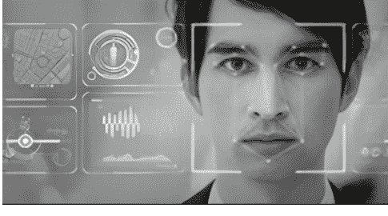

图 4. 人脸识别。

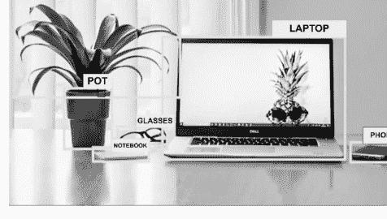

图 5. 目标检测。

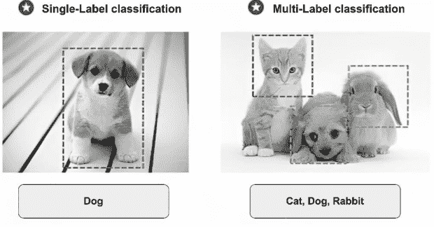

图 6. 图像分类。

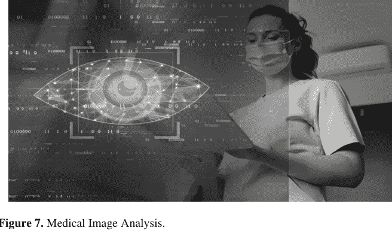

图 7. 医学图像分析。

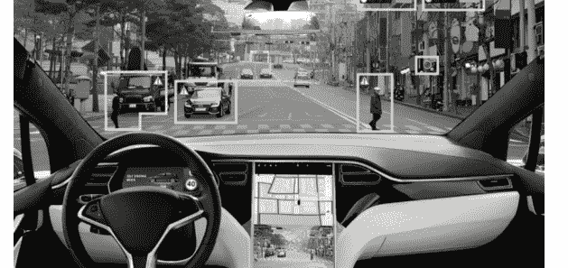

图 8. 自动驾驶。

使自动驾驶汽车能够感知环境并做出判断被称为自动驾驶，如图 8 所示（Zheng et al., 2007）。

- 案例研究：利用计算机视觉改进自动驾驶汽车的驾驶性能。

- **问题：** 自动驾驶汽车使用多种传感器（如激光雷达、雷达和摄像头）来感知环境。然而，在恶劣天气条件或低能见度的情况下，这些传感器有时可能无法正常工作。
- **解决方案：** 计算机视觉能够通过为自动驾驶汽车提供更广泛、更准确的环境感知来增强其感知能力。计算机视觉算法可用于实时跟踪和识别物体，例如行人、交通标志或其他车辆。
- **发现：** 计算机视觉可以开发出更安全、更可靠的自动驾驶汽车。我们可以在图 9 中看到相关步骤。借助计算机视觉，可以为自动驾驶汽车提供更精确的环境图像，帮助它们避免碰撞并在各种环境中安全导航。

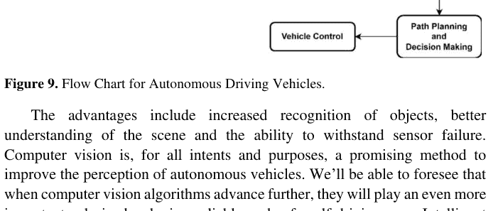

图 9. 自动驾驶汽车流程图。

其优势包括更强的物体识别能力、更好的场景理解能力以及承受传感器故障的能力。计算机视觉实际上是一种提升自动驾驶汽车感知能力的有前景的方法。我们可以预见，随着计算机视觉算法的进一步发展，它们将在开发可靠、安全的自动驾驶汽车方面发挥更加重要的作用。智能移动助手利用人工智能、语音识别和自然语言处理来提供动态、上下文感知的交互。为了确保在快速发展的智能移动计算领域从易用性到高效性的无缝过渡，数据安全已优先于安全性（Mao et al., 2017）。

### 移动设备的机器学习应用

- 句子识别：利用机器学习可以实现语音识别。该技术允许通过语音命令来操作设备和查找信息，如图 10 所示。

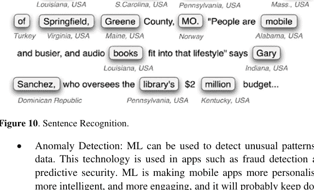

图 10. 句子识别。

- 异常检测：机器学习可用于检测数据中的异常模式。该技术应用于欺诈检测和预测性安全等应用程序中。机器学习正使移动应用变得更加个性化、更加智能、更具吸引力，并且在不久的将来可能继续如此。个性化推荐是提供以用户为导向体验的关键因素。基于机器驱动的定向推荐已经重新定义了用户与移动应用连接的方式，无论是娱乐、购物还是内容消费。

### 案例研究：亚马逊的个性化推荐

亚马逊是全球最大的在线零售商之一。个性化推荐在亚马逊的成功中扮演着关键角色，帮助客户找到合适的产品，并使他们的购物体验更加高效和愉快（Gaber et al., 2015）。亚马逊使用了一个复杂的推荐引擎。该引擎会分析海量数据，例如客户过去的购买记录、浏览模式和产品属性，以发现模式和组合。通过利用这些信息，引擎会生成针对每个用户兴趣和个人需求的推荐，如图 11 所示。

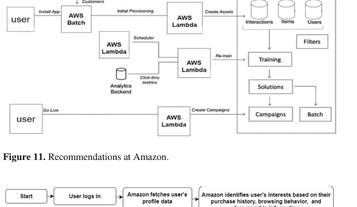

图 11. 亚马逊上的推荐。

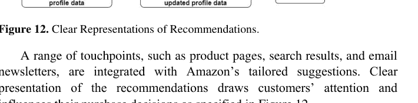

图 12. 推荐的清晰展示。

亚马逊的个性化建议被整合到多个接触点中，例如产品页面、搜索结果和电子邮件通讯。推荐的清晰展示吸引了客户的注意力，并影响了他们的购买决策，如图 12 所示。

亚马逊的个性化推荐显著提升了客户参与度、满意度和收入。研究表明，这些个性化推荐可以将平均订单价值提高 10%，点击率提高 30%，转化率提高 20%。亚马逊定制化推荐的成功证明了机器学习的潜力。这彰显了数据收集与分析、专业规划以及有效实施推荐以最大化影响的重要性。人们倾向于识别与其偏好相符的内容或产品，从而提高参与度和满意度（Ray et al., 2017）。

### 预测文本与自动更正

移动设备现在必须包含预测和自动更正功能，以提高转录准确性和速度。本节将讨论自动更正和预测文本所面临的挑战及可用技术，如图 13 所示。

**图 13.** 自动更正功能。

- 提高输入速度：预测文本通过减少输入单词所需的击键次数，显著提升了打字速度。
- 更高的准确性：自动更正通过减少拼写错误和笔误，提高了用户输入和通信的准确性。
- 个性化特征：机器学习使这些系统能够适应用户的语言、风格，当然还有每个用户的个人习惯。

### 挑战与解决方案

- **歧义性：** 判断意图表达的单词可能具有难度。先进的模型和上下文嵌入通过考虑句子的更广泛上下文来帮助解决这一挑战。
- **对用户偏好的敏感性：** 在自动更正干预之间找到适当的平衡至关重要。对算法进行微调，使其对个体用户的偏好敏感，以提供定制化服务。

### 自适应用户界面

自适应用户界面是一种新的数字体验设计方法，尤其在移动设备上。这些界面会根据用户的特征、偏好和情境而变化，如图 14 所示。

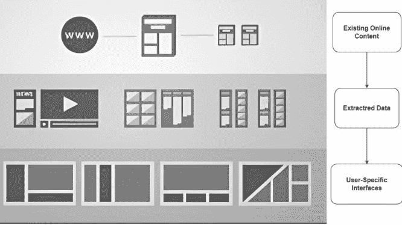

**图 14.** 用户特定界面。

### 平衡定制化与一致性

在提供个性化体验和保持一致的品牌或应用形象之间，精心的设计和用户参与策略有助于实现这一平衡。

## 数据隐私与伦理考量

用户数据引发隐私担忧。实施透明的数据处理政策、获得用户同意以及保留保密程序对于解决伦理考量至关重要。

## 实际案例

- Facebook 等社交媒体平台会根据用户参与模式和兴趣主动调整内容展示。
- 亚马逊使用自适应界面，根据产品推荐、促销，甚至用户浏览和购买历史创建应用程序。

移动设备考虑事项。自适应界面在移动设备上必须应对有限屏幕空间、不同设备能力等挑战。机器学习模型必须针对设备使用进行优化，以确保实时效率，同时不过度依赖网络连接。

## 移动助手与物联网的集成

移动应用正在革新，以满足商业世界中对话式商务和服务日益增长的需求。制造商正在利用物联网（IoT）创造更好的体验服务。这增加了对物联网的需求，进一步增加了对移动应用作为交互界面的需求（Al-Fuqaha et al., 2015）。

## 智能家居与物联网集成

智能家居系统在过去几十年中变得越来越受欢迎，因为它们提高了舒适度和生活质量。无线通信渠道使用智能手机应用程序来监控和管理家庭任务（Al Ameen et al., 2017）。

为了实现上述所有描述的活动和数据管理，系统由以下组件组成：

- 传感器用于收集内部和外部家庭数据并测量家庭状况。这些传感器连接到房屋本身以及附着于房屋的设备。
- 处理器用于执行本地和集成操作。它也可以连接到云端，以满足需要扩展资源的应用程序。
- 一组封装为 API 的软件组件，允许外部应用程序在遵循预定义参数格式的情况下执行它。此类 API 可以处理传感器数据或管理必要操作。
- 执行器用于在服务器或其他控制设备中提供和执行命令。它将所需活动转换为命令语法；设备可以执行。
- 数据库用于存储从传感器收集的处理后的数据。它还将用于数据分析、数据展示和可视化，如图 15 所示。

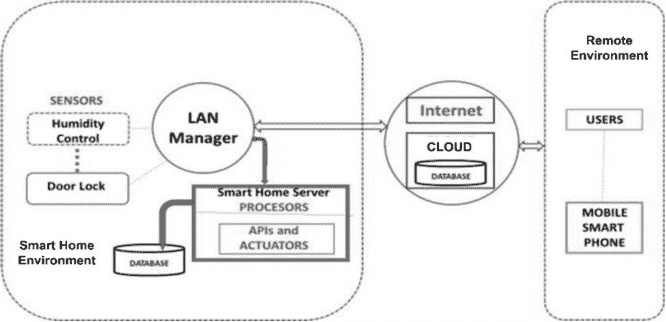

**图 15.** 数据库可视化。

以下是关于智能家居中物联网集成的案例研究（Rahmani et al., 2018）。

## 革新家居生活：智能家居中的物联网集成

- 背景：物联网（IoT）技术在智能住宅中的集成重塑了传统居住空间，实现了更大的自动化、连接性和舒适性。本案例研究探讨了物联网集成在智能家居环境中的后果和优势。
- 概述：智能住宅中的物联网集成涉及将智能嵌入普通小工具，促进通信，并利用信息驱动的洞察力在住宅区域内创建互联生态系统。
- 个性化体验：物联网集成能够创建量身定制个人偏好的个性化体验。通过分析用户模式和传感器积累的记录，智能家居可以适应居住者的行为，自动调整设置以获得舒适、节能和便利。能源效率和成本。物联网集成在智能家居中的好处之一是提高能源效率。例如，智能恒温器能够分析居住者的行为并相应地改变温度，从而通过使用更少的电力从长远来看节省资金（Baker et al., 2017）。

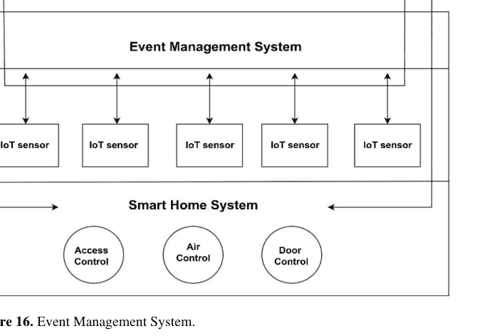

图 16. 事件管理系统。

强有力的安全措施保护用户数据免受网络犯罪分子和身份盗窃的侵害

保护用户数据建立信任、鼓励参与并提升声誉

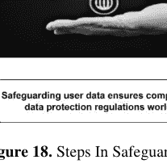

保护用户数据确保全球范围内遵守数据保护法规

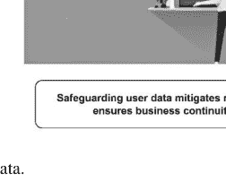

保护用户数据降低风险并确保业务连续性

图 18. 保护用户数据的步骤。

## 机器学习在移动环境中的伦理影响

是否可以基于机器学习的应用程序在未经明确许可的情况下收集和使用用户数据，已引发疑问。除隐私外，问责制、开放性、偏见和正义都是这些问题的一部分。

- 隐私问题：个人信息，例如语音记录、位置、行为模式和生物识别信息，可能由 ML 算法从用户数据中提取。在使用这些数据识别特征、偏好和习惯时，可以创建用户画像。然而，由于用户不知道其信息如何被收集或收集的程度，在未经其同意或没有明确隐私政策的情况下收集信息可能被视为侵犯隐私（Char et al., 2020）。
- **公平性与偏见：** 特别是在人工智能中使用的机器学习算法中存在可能导致不公平和歧视性结果的偏见。这些偏见可能是算法本身或其训练数据造成的。当机器学习算法应用于应用程序时，它可能因申请人的年龄、性别或社会经济地位而不成比例地偏爱某些申请人。在移动应用程序中使用有偏见的机器学习算法时，它们可能对社交网络、金融服务和刑事司法产生重大影响。不公平的结果可能导致当前社会差距加剧并削弱公众对这些框架的信心。
- **透明度与问责制：** 人工智能在解决透明度和问责制问题方面发挥着重要作用。复杂的机器学习算法通常使理解决策如何做出以及处理了哪些信息变得困难，这会造成不信任和被操纵的感觉。移动计算的去中心化结构使得难以识别并追究 ML 应用程序输出的责任，这也在阻碍解决伦理问题的努力。
- **解决伦理问题：** 可以采取以下措施解决移动环境中机器学习（ML）的伦理问题：仅收集所需的记录；对数据使用和决策做出明确解释；获得用户同意并赋予他们对其数据的控制权；实施偏见检测和缓解策略；建立问责机制并保证可审计性；并向公众普及 ML 在移动环境中的道德影响。通过考虑这些标准，开发者、立法者和消费者可以合作确保机器学习在移动环境中得到合乎道德和负责任的使用（La Polla et al., 2013）。

### 挑战与未来展望

人工智能和移动计算是动态领域，智能移动代理（IMAs）也不例外（Suna & El Fallah-Seghrouchni, 2005）。它们面临许多机遇和许多问题。我们将分别讨论这两方面：

- 资源限制：移动设备在电池寿命和计算能力方面往往有限。创建能够很好应对这些限制的智能代理是主要挑战之一。
- 安全和隐私问题：当 IMAs 与服务器之间的通信涉及敏感信息时，会存在安全和隐私问题。必须确保严格加密和用户数据保护。
- 与移动生态系统的结合：一个主要挑战是能够与各种移动平台、操作系统和应用程序无缝集成。基础设施管理人员需要能够适应多种设置，以便提供适当和有效的支持。
- 上下文感知：移动用户的动态上下文需要对 IMAs 进行有效解释和适应。理解用户行为、偏好和环境取决于改进的上下文感知能力。
- 未来展望：得益于技术突破以及移动计算带来的对改善用户体验的关注日益增加，智能移动代理系统的未来前景光明。随着 5G 技术的持续普及，网络将变得更快、更可靠。

## 克服障碍和限制

为了克服智能移动代理的障碍和限制，需要一个计划性和迭代性的策略。一些最重要的策略如下（Wang et al., 2017）。

- 优化方法：为了确保 IMAs 的高效运行，优化策略以充分利用设备有限资源。为此，可以控制能源消耗、改进算法并减少内存使用。

- 网络依赖：离线功能：为了使智能移动助手在网络可用性受限的情况下仍能运行并提供最低限度支持，请创建具备离线能力的智能移动助手。
- 强加密：为保护智能移动助手与服务器之间的数据传输，使用强加密技术。创建并实施移动设备的安全存储实践，符合建议的用户识别和授权标准。
- 理解上下文：机器学习框架：投资能够适应用户偏好、变化情况和行为的尖端机器学习模型。
- 人机交互的发展：通过研究人机交互（HCI）方面的进展，例如增强现实（AR）和虚拟现实（VR），探索用户与智能移动助手交互的新颖且引人入胜的方式。

## 智能移动助手的未来创新与趋势

预计在未来几年，智能移动助手，特别是对话式人工智能领域的革命性进步将会出现。更好的自然语言处理（NLP）技能将是其中一项发展，允许进行更复杂且感知上下文的交互（J Kang et al., 2018）。

### 结论

机器学习是改进移动代理对自然语言和模型的理解的重要因素。将机器学习纳入移动平台使得智能移动助手（IMAs）的开发成为可能，其包括计算机视觉和语音识别等功能。旨在改善用户体验的IMAs在可穿戴设备和智能家居中变得越来越普遍。它们通过使用自适应界面、预测文本和个性化推荐来实现这一点。然而，这些进步也存在缺点，例如伦理、安全和隐私方面的担忧。尽管存在这些挑战，只要IMAs继续创新并利用机器学习提供简单、道德上可靠且智能的移动

## 第8章

## 边缘计算技术：
机遇、问题与未来趋势

Ch. Prathima¹,*
J. Avanija²
Sam Goundar³
K. Reddy Madhavi²
Gurram Sunitha²
and Viswaksena Balaji⁴

¹计算学院，莫汉·巴布大学，提鲁帕蒂，安得拉邦，印度
²计算学院，莫汉·巴布大学，提鲁帕蒂，安得拉邦，印度
³皇家墨尔本理工大学，河内，越南
⁴利默里克大学，利默里克，爱尔兰

### 摘要

一种被称为“边缘计算”的分布式计算范式将数据存储和处理移得更接近数据生成或消费的位置。在传统的云计算中，设备或终端用户与集中式数据中心相距甚远，而数据处理和存储则在那里进行。在边缘计算中，数据生成设备或传感器位于网络边缘或其附近，而处理和存储资源也位于那里。减少将数据发送到远端数据中心进行处理所需的延迟和带宽是边缘计算的主要目标。边缘计算通过更接近源头处理数据并更好地利用网络资源，使得响应时间更快、效率更高。

边缘计算技术涵盖了各种工具、框架和协议，可实现在网络边缘部署、管理和执行计算资源。

**关键词：** 分布式计算，云计算，存储，网络，分析

### 引言

连接设备的指数级增长导致了边缘计算的日益普及。物联网（IoT）以及对实时数据分发日益增长的需求都促进了边缘计算的普及。边缘计算通过在边缘或接近边缘分发数据而提供各种益处。这些优势包括延迟降低 通过边缘计算减少数据从源到处理点所需的时间，从而实现更低的延迟。这对于需要实时或接近实时响应的应用至关重要，例如自动驾驶汽车、工业自动化和增强现实。带宽优化：通过减少必须传输到集中式云数据中心的数据量，边缘计算有助于节约带宽。边缘设备可以通过处理和分析统计数据，在发送到云之前对数据进行本地过滤和优化，从而优化带宽使用并减轻网络拥塞。图1说明了边缘计算的架构。增强可靠性：边缘计算使得在多个边缘设备或节点之间进行分布式处理和存储成为可能。这种分布式架构增强了可靠性和容错性，因为即使一个边缘节点失败，其他节点仍可独立运行。它还通过确保在与云的网络连接中断的情况下关键服务仍可运行来提高弹性。边缘计算使得敏感数据能够在本地管理和存储，降低了数据泄露的可能性并确保符合数据保护法规。这种本地化的数据管理方法提供了额外的隐私和安全层，因为敏感信息不必穿越网络或驻留在集中式数据中心。 可扩展性：边缘计算通过将计算资源分布在各种边缘设备或节点上，实现了计算资源的扩展部署。这种可扩展性在数据生成量庞大或处理需求快速波动的场景中尤其有利。

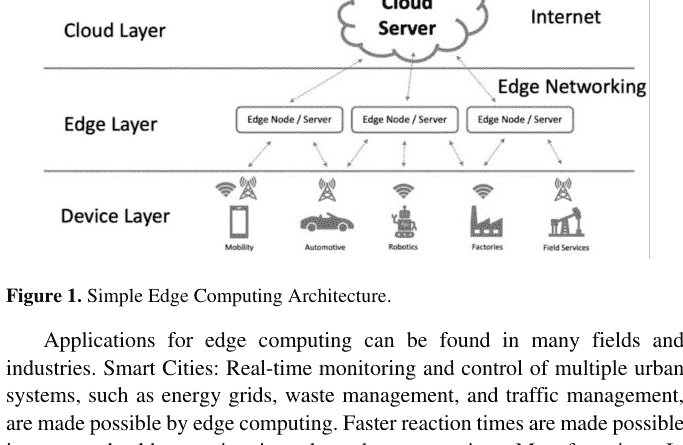

图1. 简单的边缘计算架构。

边缘计算的应用可以在许多领域和行业中找到。智慧城市：边缘计算使得对多个城市系统（如电网、废物管理和交通管理）的实时监控和控制成为可能。边缘计算在紧急医疗保健情况下使得更快的反应时间成为可能。制造业：在制造设施中，边缘计算促进了流程优化、实时质量控制和预测性维护。零售：边缘计算使得客户行为分析、库存管理和个性化购物体验的实时分析成为可能。随着技术的发展和连接设备的数量不断增长，边缘计算有望在实现更快、更高效、更分散的数据处理方面发挥关键作用，引领智能和响应式应用的新时代。

云计算和边缘计算是计算领域中两种不同的范式，服务于不同的目的并解决不同的需求。就基础设施位置而言，云计算基础设施是集中的，位于通常由第三方服务提供商运营的数据中心中。用户可以通过互联网访问资源和服务，而计算基础设施则分散且位于更接近用户或数据源的位置。它将计算和存储能力移得更接近用户设备或数据源，位于网络边缘。关于数据网络，数据处理在服务器或边缘设备上或附近进行。通过本地处理信息，边缘网络降低了将大量数据发送到集中式数据中心的需求，提高了生产效率并减少了带宽需求。通过在边缘处理数据和运行应用程序，它使得实时数据成为可能。这对于时间敏感的应用尤其有帮助，例如物联网设备、无人驾驶汽车或工业自动化等需要快速决策的应用。通过向集中式数据中心或云发送更少的数据，它还可以优化带宽使用。通过在边缘处理和过滤数据，只传输相关数据，从而降低运营成本和带宽需求。它通常与边缘计算协同工作。边缘计算侧重于本地化数据处理和存储，而边缘网络则确保边缘设备、服务器和云服务之间的高效可靠的网络连接。

## 方法

边缘技术是指在边缘计算（Cao et al., 2020）环境中使用的各种工具、框架、协议和设备。这些技术实现了在网络边缘部署、管理和执行计算资源。以下是一些关键的边缘技术：

- 边缘设备：位于网络边缘的物理设备被称为边缘设备。这些设备的示例包括边缘服务器、网关、路由器、交换机和物联网设备（Magesh, S., et al., 2020）。为了收集、处理和传输数据，这些设备具有传感器、处理器和存储能力。
- 边缘计算平台：边缘计算平台提供了管理编排边缘计算资源的软件基础设施。这些平台实现了边缘设备的部署、配置和监控，并实现了云与边缘环境之间的通信、分析和数据处理。
- 边缘分析：边缘分析涉及在边缘设备上实时或接近实时地处理和分析数据。它涵盖

使边缘能够在不依赖云端处理的情况下实现智能洞察和决策的算法、机器学习模型和数据处理技术。

- 边缘操作系统：边缘操作系统专为边缘设备设计，提供轻量级、资源高效且安全的运行环境。这些操作系统优化功耗，提供强大的安全功能，并通常支持容器化和虚拟化技术，以便高效执行边缘应用。
- 边缘人工智能：“边缘人工智能”一词指的是将人工智能（AI）技术融入边缘设备，包括机器学习（Chilukuri, Prathima et al., 2023）和深度学习。边缘人工智能赋予边缘设备在本地处理智能数据、进行预测性分析并做出决策的能力，而无需持续依赖云连接。
- 边缘安全：边缘安全的主要目标是保护边缘设备、通信和数据免受网络攻击、非法访问和数据泄露。它包括安全协议、加密、访问控制方法和安全启动程序，以保证边缘处理数据的机密性和完整性。
- 雾计算：雾计算通过引入位于边缘与云之间的雾节点，扩展了边缘计算的挑战。雾节点提供额外的计算和存储资源，使得在边缘执行复杂且资源密集型应用成为可能。
- 边云集成：边缘计算通常与云计算协同工作，因此需要协议、API和数据同步机制，以实现边缘设备与云基础设施之间的无缝通信、数据共享和负载卸载。

图2中指定的边缘计算技术共同支持边缘计算架构的高效运行，使得网络边缘能够实现更快的数据处理、更低的延迟、增强的隐私与安全性以及实时决策。

大量数据，或网络连接有限或成本高昂的情况。

- **增强的隐私与安全：** 数据在本地进行处理和分析，边缘计算消除了将敏感数据发送到集中式云环境的需要。通过减少可能面临数据传输和云存储相关风险的敏感数据量，这种本地化方法增强了安全性和隐私性。通过限制数据的地理范围，它还使遵守数据保护法律成为可能。
- **边缘智能与实时分析：** 得益于边缘计算，边缘设备现在能够智能地处理和分析数据。边缘设备能够利用先进的分析算法、机器学习和人工智能，实时从数据中提取有价值的见解。异常检测、个性化用户体验、预测性维护以及基于本地数据的上下文决策等应用都因边缘智能（EI）而成为可能。
- **离线运行与韧性：** 边缘计算可以在离线或部分连接的环境中运行。这在无法保证持续云连接的情况下尤为有用，例如偏远地区或网络覆盖断断续续的区域。边缘设备可以独立运行，执行关键任务并存储数据，直到连接恢复，从而确保不间断运行并提高韧性。
- **可扩展性与分布式架构：** 边缘计算允许在多个边缘设备或节点之间实现分布式处理和存储能力。这种分布式架构提供了可扩展性和灵活性，因为可以轻松地在网络中增加或移除设备。它还提高了容错性，因为一个边缘设备或节点的故障不会中断整个系统。
- **边云协作与混合架构：** 边缘计算通过实现边缘设备与云基础设施之间的高效协作，对云计算形成补充。可以利用边缘和云资源的混合架构（Chilukuri, Prathima et al., 2023）来平衡计算需求、存储需求和网络约束。这实现了工作负载卸载、数据同步以及边缘与云之间的无缝集成，从而实现最佳资源利用。

边缘网络带来了一些挑战，例如管理分布式网络基础设施、维护跨多个位置的安全性，以及协调边缘设备与集中式系统之间的数据同步和一致性。边缘计算提供的这些机遇（Xue H et al., 2020）有可能彻底改变多个行业，包括制造业、医疗保健、交通运输、能源、零售和智慧城市。通过利用边缘计算的力量，组织可以在其运营和服务中释放新的效率、响应能力和创新水平。

边缘计算技术提供了许多机遇，但同时也带来了一系列困难和一系列令人关注的潜在未来发展。它能够在更靠近数据源的位置处理和分析数据，通过降低延迟、促进实时决策和改善整体系统性能来开辟机遇。它使得人工智能和机器学习更容易在边缘集成，从而实现自动驾驶汽车、智慧城市和个性化体验等应用。

然而，有几个问题需要关注。可扩展性、连接性、安全性和数据管理构成了需要解决的挑战。管理大量分布式边缘设备、确保稳健的连接、保护敏感数据以及优化资源利用是关键方面。标准化、互操作性以及高效的编排和管理系统对于边缘生态系统内的无缝集成和协作是必要的。展望未来，边缘计算的未来趋势包括5G网络的集成，实现超低延迟和高带宽连接。边缘人工智能和机器学习将蓬勃发展，支持边缘设备上的实时处理和决策。边云连续体将能够实现动态工作负载分配，同时边缘安全措施将加强以抵御网络威胁并保护数据隐私。“边缘即服务”的概念将应运而生，提供对边缘计算资源和能力的按需访问。联邦边缘计算和联邦学习模型将在保护数据隐私的同时实现协作和知识共享。行业特定的边缘解决方案将继续演进，以满足不同行业的独特需求。

## 边缘计算的当前问题

解决边缘计算中的问题需要行业利益相关方的共同努力，包括标准化机构、设备制造商、网络提供商和软件开发人员（Akula CS et al., 2020）。其中一些问题包括可扩展性、连接性、安全性、数据管理、标准化与互操作性、编排与管理以及能效。

边缘计算涉及在分布式网络中部署大量计算设备，这可能在可扩展性方面带来挑战。管理大量边缘设备并确保其无缝集成到整个系统中可能非常复杂。连接性：边缘计算依赖于边缘设备与集中式系统之间稳健可靠的网络连接。在网络基础设施有限的偏远或农村地区，保持持续连接成为一个重大挑战。

边缘设备通常处理和存储敏感数据，使其成为网络攻击的潜在目标。保护边缘设备免受未经授权的访问、数据泄露和恶意软件攻击至关重要。此外，在大量分布式设备中管理安全更新和补丁可能具有挑战性（Salman et al., 2020）。边缘计算产生大量数据，而有效管理这些数据带来了挑战。确定哪些数据应在本地处理和存储，哪些应发送到云端进行分析和存储，需要仔细考虑。数据治理、数据隐私和法规遵从性增加了边缘计算中数据管理的额外复杂性。资源限制：边缘设备通常具有有限的处理能力、内存和存储容量。在边缘设备的受限资源内优化资源利用并执行计算密集型任务可能是一个重大挑战。

边缘计算领域目前较为分散，不同供应商提供不同的边缘解决方案。边缘设备、平台和云系统之间缺乏标准化接口、协议和互操作性，阻碍了无缝集成，并限制了协作和创新的潜力。管理分布式边缘基础设施、监控设备健康状况以及确保边缘设备之间的顺畅协调和同步，需要高效的编排和管理系统。开发能够处理边缘部署规模和复杂性的强大的管理框架是一个持续的挑战。

许多边缘设备资源受限，并由电池或可再生能源供电。优化边缘设备的能源消耗并延长电池寿命对于确保其持续运行和减少环境影响至关重要。边缘 AI 与机器学习：部署人工智能（AI）和机器学习（ML）（Moustafa, 2021）模型于边缘可以增强实时决策能力并降低对云资源的依赖。然而，在资源受限的边缘设备上运行复杂的 AI/ML 算法（Hamdan S et al., 2020）会带来计算挑战，需要高效的模型优化和部署技术。

持续不断的研究和创新将在克服这些问题并释放边缘计算的全部潜力方面发挥关键作用（Pan J and McElhannon 2020）。

## 未来趋势

边缘计算拥有光明前景（Sonone et al., 2020），预计有若干趋势将影响其发展。以下是对边缘计算的一些主要未来趋势：5G 集成：5G 网络的引入提供了极低延迟和高带宽连接，将彻底改变边缘计算。借助 5G 集成，边缘的实时数据处理和分析将成为可能，支持增强现实、智慧城市和无人驾驶汽车等应用。未来场景和机遇在表 1 中有所说明。

- 边缘 AI 与机器学习：边缘计算将见证 AI 和机器学习能力的进一步集成。通过将 AI 模型（Chen CM et al., 2022）直接部署在边缘设备上，可以在不严重依赖云资源的情况下实现数据处理的实时决策。这一趋势将实现广泛的应用，包括实时视频分析、预测性维护和个性化用户体验。
- 边缘到云连续体：未来将看到更集中的云系统和边缘设备协同工作并无缝集成（Deshpande S and Kulkarni N, 2021）。边缘到云连续体将允许智能工作负载分配，其中数据处理和存储可以根据延迟、带宽和资源可用性等因素在边缘和云之间动态分配。
- 边缘安全：随着连接的边缘设备数量增加，安全仍将是一个关键问题。未来的边缘计算解决方案将侧重于加强安全措施，包括设备身份验证、加密、安全引导和实时威胁检测。此外，隐私增强技术，如联邦学习，将被采用以保护用户数据，同时实现数据驱动的洞察。
- 边缘即服务（EaaS）：边缘即服务概念将变得突出，组织可以按需访问和利用边缘计算资源和能力，类似于云计算（Perez J et al., 2022）模式。这将使企业能够利用边缘基础设施而无需大量前期投资，促进快速部署和可扩展性。
- 联邦边缘计算：联邦学习和计算模型将获得发展，使多个边缘设备之间能够在保持数据隐私的同时进行协作和知识共享。联邦边缘计算允许在多个边缘节点之间进行分布式学习，从而提高模型准确性和效率。
- 行业特定边缘解决方案：边缘计算将在医疗保健、制造、交通和零售等各个行业继续得到采用。行业特定解决方案将出现，旨在解决每个行业的独特需求和挑战。这些解决方案通过在边缘提供优化的处理、分析和决策能力，将提高运营效率并开辟新的商业机会。
- 边缘管理与编排：随着边缘部署规模和复杂性的增长，高效的管理和编排系统（Cui W, 2020）将变得至关重要。未来的趋势将侧重于开发全面的管理框架，实现边缘资源的集中控制、监控和自动化，确保无缝集成并优化资源分配。

这些趋势凸显了边缘计算的持续演进和成熟，由连接性、AI、安全性和行业特定需求的进步所驱动。随着技术的不断进步，边缘计算将在实现创新应用和改变各个行业方面发挥关键作用。

## 表 1. 未来机遇可能如何展开的三种场景

| 场景特征 | 场景 1 超大规模云服务商-电信运营商结盟 | 场景 2 电信运营商结盟 | 场景 3 中立主机 |
|---|---|---|---|
| 场景基于... | 近期公告 | 通过(5G)合资企业和批发进行网络共享 | Vapor 的愿景 Equinix 但更深入 |
| 设施由...提供 | 主要为电信运营商（部分中立主机） | 主要为电信运营商（部分中立主机） | 主要为中立主机（部分电信运营商） |
| IaaS 由...提供 | 主要为超大规模云服务商 | 主要为电信运营商 | 主要为超大规模云服务商和独立厂商 |
| PaaS 由....提供 | 主要为超大规模云服务商 | MobileedgeX 和其他聚合商 | 主要为超大规模云服务商 |

### 结论

边缘计算技术为变革性应用和系统性能提升提供了巨大机遇。尽管存在挑战，但持续的进步和协作努力将克服它们。边缘计算的未来光明，由 5G 集成、AI 进步、增强的安全措施和行业特定解决方案驱动。边缘计算的持续演进将赋能企业、行业和整个社会，彻底改变我们处理、分析和利用数据的方式。

### 参考文献

Akula, Chandra Sekhar, Venkateswarlu Sunkari, and Ch Prathima. “智能农业高性能计算中心框架。” In Proceedings of the International Conference on Computer Vision, High Performance Computing, Smart Devices and Networks: CHSN-2020, pp. 157-162. Singapore: Springer Nature Singapore, 2022.

Cao, Keyan, Yefan Liu, Gongjie Meng, and Qimeng Sun. “边缘计算研究概述。” IEEE access 8 (2020): 85714-85728.

Zhang, Yongqiang, Hongchang Yu, Wanzhen Zhou, and Menghua Man. “端-网-云边缘计算物联网架构的应用与研究。” *Electronics* 12, no. 1 (2022): 1.

Zhao, Yongli, Wei Wang, Yajie Li, Carlos Colman Meixner, Massimo Tornatore, and Jie Zhang. “边缘计算与网络：基础设施与应用综述。” *IEEE Access* 7 (2019): 101213-101230.

面向环保移动技术的整体方法。通过审视当前趋势和未来前景，本研究有助于实现更可持续和负责任的技术未来，与全球应对气候变化和在移动技术领域推广循环经济的努力保持一致。

**关键词：** 可持续移动技术，环保创新，再生材料，能效，循环经济，可再生能源

### 引言

现代移动技术彻底改变了我们日常生活的方方面面，给通信、娱乐和信息获取带来了革命性变化。毫无疑问，智能手机、平板电脑和其他移动设备的使用改善了连接性和便利性，并带来了其他益处。尽管对全球连接做出了重大贡献，移动行业正因其环境影响而受到越来越多的批评。移动技术在促进可持续实践和最大限度减少可能的环境损害方面很重要。

- 制造与原材料开采
- 电子废弃物（电子垃圾）
- 能源消耗
- 资源枯竭
- 网络基础设施
- 生物多样性与栖息地破坏
- 消费者行为

移动设备的环境影响在其生命周期的各个阶段都在增加。能源的生产、原材料的开采、电子废弃物的处置以及设备的使用都对环境产生严重影响，具体取决于移动技术如何影响环境。生产用于手机制造的锂和钽等稀有矿物的采矿区造成了冲突和环境退化。此外，能源密集型工业流程及其碳足迹影响温室气体排放（Almalki, Faris A, Saeed H. Alsamhi, Radhya Sahal, et al., 2020）。在这种情况下，显然广泛的使用

移动设备对环境产生负面影响如图 1 所示。电子废弃物高效处置和回收的主要问题是支持云服务的能源消耗数据中心、制造电子元件以及丢弃过时设备。随着技术的不断发展，电子废弃物状况变得更糟，因为产品的生命周期更短，人们更频繁地升级设备。

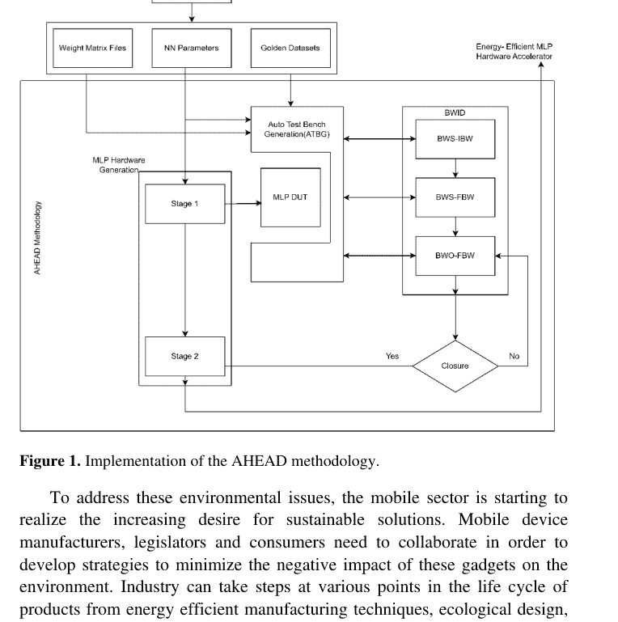

图 1. AHEAD 方法的实施。

为应对这些环境问题，移动行业开始意识到对可持续解决方案日益增长的需求。移动设备制造商、立法者和消费者需要合作，以制定策略，最大限度地减少这些设备对环境的负面影响。行业可以在产品生命周期的各个阶段采取措施，从节能制造技术、生态设计以及原材料道德采购，以减少其对自然的影响。本文探讨了移动技术对环境的影响，并强调移动行业需要采用可持续的商业方法。随着我们进入这个数字时代，如果我们希望地球持久存在，就必须在技术进步和环境责任之间取得平衡。在以下章节中，将讨论可能的解决方案以及具体涉及移动技术如何影响环境的领域。

## 节能硬件设计

## 移动设备低功耗处理器的进展

低压电子设备的开发对于更强大和节能的电子设备、智能手机、平板电脑和其他设备的电力生成很重要（Lee et al., 2021）。移动设备对更大功率、更好性能和更长电池寿命的持续需求正推动这些进步。

工艺技术进步：缩小工艺节点和 FinFET 技术。

- 高级电源管理：动态电压和频率调节（DVFS）和自适应电压调节（AVS）
- 低功耗存储技术：LPDDR（低功耗双倍速率数据）内存，包括 LPDDR 在内的低功耗存储技术的进步可以通过降低设备内存子系统使用的功率来节省能源。
- 基于 AI 的电源管理：AI 驱动的电源优化，AI 算法用于预测和动态控制功耗。这些算法可以根据用户活动和消费模式修改设备的功耗配置。
- 节能显示技术：OLED 和 AMOLED 显示屏：移动设备可以通过使用 OLED 和 AMOLED 等节能设备整体使用更少的能源。
- 传感器集线器集成：专用传感器处理：一些移动 CPU 配备了专用传感器集线器，可高效处理传感器数据并释放主处理器。

## 节能显示屏和电池

节能电池和显示屏内置了传感器和自动化功能（Piguet and Christian, 2018），使家庭能够最大化能源使用并大幅降低碳足迹，同时延长设备使用寿命、改善用户体验并解决环境问题。

节能显示屏包括 OLED 技术、节能背光、低功耗显示技术、自适应亮度和刷新率。锂离子电池、固态电池、先进电池管理系统（BMS）、优化功耗、快速充电技术可作为节能电池使用。最终，信息科学、工程和设计都参与了创建节能电池和显示屏这一复杂过程。

## 移动制造中的可持续材料

随着企业对产品环境影响的认识不断提高，他们开始在生产过程中纳入可持续材料（Zhang et al., 2020），如图 2 所示。IT 行业在移动设备的创建中集中于固定设备的用途。

以下是可以很好利用或用于制造便携式电子产品的一些环保材料。

- 回收金属
- 生物塑料
- 回收塑料
- 可持续木材
- 生物基材料
- 回收纸包装
- 模块化设计
- 公平贸易材料

## 移动设备中的可再生能源集成

- 太阳能移动设备：太阳能（Page and Tom, 2015）设备采用太阳能板将阳光转化为电能，使用户能够用清洁能源为电子设备充电，如图 3 所示。这种技术可能对希望减少环境影响并减少对传统能源依赖的人们具有吸引力。以下是使用太阳能移动设备时需要考虑的一些关键事项。

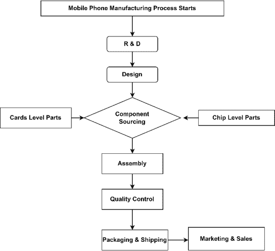

**图 2.** 手机制造。

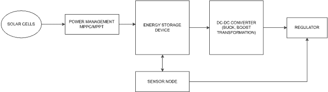

**图 3.** 太阳能收集系统。

- **太阳能板：类型和效率**，需要考虑的一个关键因素是太阳能板的效率。通过更高效的面板可以在更少的位置产生更多电力。
- **设备类型：** 手机，一些具有太阳能充电功能的手机可以用太阳能为移动设备充电。充电宝，一个太阳能充电宝是一种紧凑型设备，可用于存储太阳能以备后用。这成为一种在旅途中轻松为它们充电的方式。
- 充电速度和存储：充电速度，一般来说，太阳能充电比传统设备花费更长时间。太阳能强度和面板效率等因素会影响充电速度。电池存储，一些设备配备了电池，可以在阳光照射时利用太阳能。这提供了更可靠的电力。
- 耐用性和耐候性：信息，由于太阳能产品可能暴露于多种环境中，它们必须坚固且防风雨。
- 用户行为和适应：阳光可用性，阳光的可用性会影响太阳能板的性能。用户将能够更新他们的充电选项。例如，为了获得最佳输出，请将设备置于直射阳光下。
- 环境影响：可持续性，太阳能技术通过减少对不可再生能源的依赖为可持续发展做出贡献。

## 动力和压电充电技术

将机械能转化为电能的两种先进方法是动能充电和压电充电（Jiju et al., 2014）。现在让我们逐一查看它们。将机械能或动能转化为电能的过程称为动能收集。这些系统通常由能够记录运动（例如人体或其他系统的运动）的设备使用并将其转化为电能。此外，为了将动能转化为电能，动能收集器（Malla et al., 2016）通常使用电磁感应、压电材料或其他手段。健身监测器、技术和一些消费电子产品经常使用动能为产品充电。动能充电的主要优点是它可以从外部来源产生电力，而局限性是与其它充电技术相比，动能充电经常产生非常少的能量

压电充电的基础是压电效应（Elmannai et al., 2023），即某些材料在施加机械应力时产生电荷的能力。石英、罗谢尔盐和锆钛酸铅（PZT）是常见压电材料的例子。这些物质被选中是因为它们在机械应力下可以产生电压。应用：压电充电在许多

在各行业中，例如压力传感器、物联网设备中的自供电传感器，以及工业环境中振动的能量采集。通过压电充电将机械能转换为电能具有非常有效的潜力。

使用该技术的缺点将是难以为高能设备产生足够的电力，就像动能充电一样。

## 无线充电在可持续性中的作用

因为无线充电解决了使用传统充电技术带来的许多财务和环境问题，因此它对可持续性做出了重大贡献。以下是无线充电支持可持续性的几种方式：

- 能效：无线充电系统（Zhou et al., 2019）可以设计得极其高效，减少充电过程中的能量损失。为了促进可持续行为并降低整体能源使用，这种效率至关重要。
- 减少电子垃圾：通过消除对一次性电线和连接器的需求，无线充电减少了产生的电子垃圾（电子废弃物）数量。
- 延长产品使用寿命：设备故障通常可归因于物理连接器的磨损，例如 USB 端口中常见的磨损。通过取消对物理连接的必要性，无线充电可以延长电子产品的寿命并降低更换频率。
- 清洁能源整合：由清洁、可再生能源驱动的无线充电基础设施促进了更可持续的充电生态系统。
- 灵活性和便利性：使用无线充电时，设备充电的位置和方式具有更大的自由度。

## 绿色移动网络与连接

### 节能蜂窝基础设施

在电信行业，节能蜂窝基础设施至关重要，因为它在满足日益增长的移动连接需求的同时，可最大限度地降低运营成本和对环境的影响（Ismail et al., 2014; Antonopoulos et al., 2015）。

- 网络优化：负载均衡和动态资源分配
- 绿色基站：可再生能源和储能
- 小型蜂窝和异构网络（Heterogeneous Networks）：在人口密集地区部署微蜂窝，以减轻大型宏蜂窝的压力并提高能源效率
- 节能天线：智能天线和大规模 MIMO
- 节能协议：LTE-A 和 5G 标准以及网络功能虚拟化（NFV）和软件定义网络（SDN）。
- 节能硬件：低功耗组件和能量收集
- 公众意识和教育：教育消费者手机对环境的影响并促进负责任的使用。

结合这些技术可以帮助创建更安全、更节能的蜂窝基础设施。

### 面向移动服务的环保数据中心

以下是许多环保的出行和交通应用（Pathak et al., 2022），它们帮助用户选择环保选项、减少碳足迹并促进绿色倡议，如表 1 所指定。

在使用任何程序之前，最好检查评价和更新，以确保其满足您的可持续性目标并提供可靠的信息和更新。

## 表 1. 环保出行和交通应用

| 应用名称 | 用途 | 优势 |
|---|---|---|
| Blablacar | 一个将有空座位的司机与同路乘客匹配以拼车的应用程序。 | 通过减少道路上的单独汽车数量来促进资源效率。 |
| Uber and Lyft (Shared Rides) | 拼车应用，促进共享出行，以减少单独行程次数并鼓励汽车的经济使用 | 通过减少道路上的车辆数量，降低每位乘客的排放量。 |
| Citymapper | 目标是为消费者提供公共交通的最新信息，以便他们选择最安全且最环保的路线。 | 鼓励使用公共交通，减少对私人汽车的依赖 |
| Bikemap | 为骑行者寻找和规划骑行或通勤路线。 | 骑自行车鼓励一种环保且可持续的交通方式。 |
| Plug and Play | 帮助电动车（EV）车主安排长途旅行并找到充电设施。 | 减少续航焦虑并鼓励使用电动汽车。 |

## 为可持续性优化网络协议

减少数字基础设施对环境影响的最重要方法之一是通过网络协议优化实现可持续性（Zhang et al., 2014）。以下是创建更可持续网络协议时需要考虑的一些策略和事项。

- 能效：低功耗模式和动态扩展
- 数据压缩：高效压缩算法
- 最小化往返次数：HTTP/2 和 HTTP/3
- 内容分发网络（CDNs）：边缘计算
- 缓存：客户端和服务器端缓存
- 服务质量（QoS）：自适应码率流媒体
- 协议优化：TCP 优化
- 高效路由：路由算法
- 网络虚拟化：网络功能虚拟化（NFV）
- 监控和分析：能源监控工具。

包装材料的回收和再利用。创新可以探索可持续包装的新技术和材料。

## 产品生命周期

产品生命周期代表产品从诞生到处置所经历的阶段。在原材料开采中，采购对环境影响最小的材料并考虑道德采购实践。制造中采用节能生产工艺并最大限度地减少制造过程中的浪费。分销和运输将减少与运输相关的排放并实现高效的供应链管理。产品使用中注重使用过程中的能源效率并推广正确的使用和维护以延长产品寿命。通过将可持续包装与对整个产品生命周期的深思熟虑相结合，企业可以为环境保护做出重大贡献并满足对环保产品的不断增长的需求。

## 通过可升级性延长产品使用寿命

通过可升级性延长产品使用寿命（Jensen et al., 2021）是一种与可持续性目标和客户偏好相一致的战略方法。以下是旨在通过可升级性增强产品使用寿命时需要考虑的一些关键点：

利用模块化设计实现组件分离和标准化接口。在软件更新方面，固件和软件兼容性开发能够接收软件更新的产品。定期更新可以改善功能、安全性和性能，有助于延长产品的使用寿命。用户友好的升级流程可提供清晰说明和免工具设计。然后在环境影响方面使用可持续材料并减少电子垃圾。客户激励措施可提供升级计划

## 互联网+乡村振兴

互联网+乡村振兴背景下的数字生态模式

- 数字化基础设施体系
- 数字化产业体系
- 数字化消费体系

数字新生态

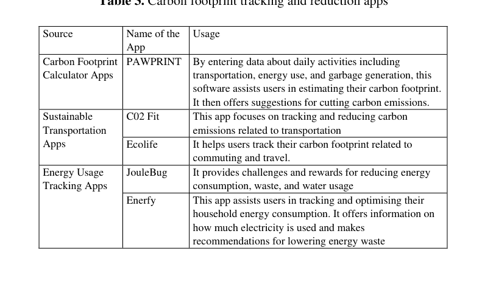

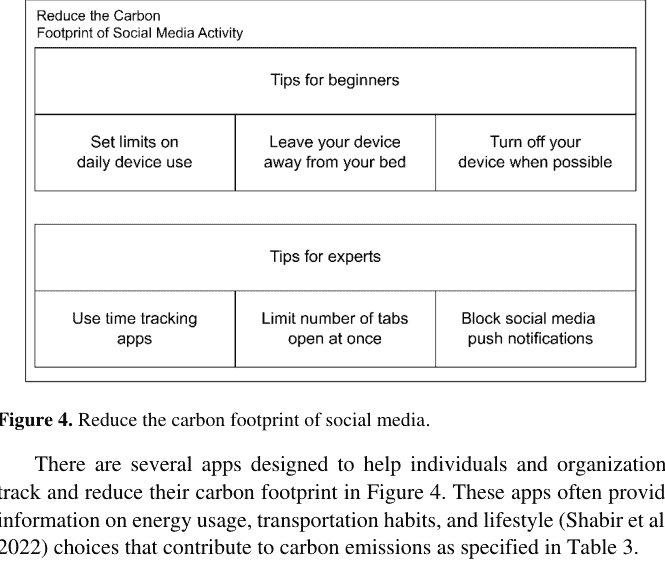

图 4. 减少社交媒体的碳足迹。

图 4 中有几款应用旨在帮助个人和组织跟踪和减少其碳足迹。这些应用通常提供有关能源使用、交通习惯和生活方式（Shabir et al., 2022）选择的信息，这些选择会产生碳排放，如表 3 所指定。

## 表 4. 环保交通和出行应用

| 应用名称 | 用途 | 优势 |
|---|---|---|
| Blablacar | 一个将有空座位的司机与同路乘客匹配以拼车的应用程序。 | 通过减少道路上的单独汽车数量来促进资源效率。 |
| Uber and Lyft (Shared Rides) | 拼车应用，促进共享出行，以减少单独行程次数并鼓励汽车的经济使用 | 通过减少道路上的车辆数量，降低每位乘客的排放量。 |
| Citymapper | 目标是为消费者提供公共交通的最新信息，以便他们选择最安全且最环保的路线。 | 鼓励使用公共交通，减少对私人汽车的依赖 |
| Bikemap | 为骑行者寻找和规划骑行或通勤路线。 | 鼓励骑自行车，这是一种环保且可持续的交通方式。 |

## 生态友好型交通与出行应用

众多环保型旅行和交通应用可供使用，帮助用户选择生态友好型出行方式，降低碳足迹，并支持表4中所述的绿色倡议。（Namoun et al., 2021）

## 案例研究：成功实施

### 拥抱可持续发展的移动制造商示例

许多移动设备制造商目前正在努力将可持续发展融入其业务运营的各个方面。以下是那个时代的几个实例。

- Apple：就可持续发展工作而言，Apple一直是先驱。（Ghoreishi et al., 2020）该公司在设备中使用更多可回收材料方面取得了进展，并承诺将其全球企业运营完全使用可再生能源。
- Samsung：Samsung已承诺在其产品中使用环保材料。
- Google：Google一直在投资环境倡议，例如在其硬件产品中使用回收材料。如Sony、Nokia、OnePlus、...等。

## 碳足迹减少影响评估

评估特定行动或努力带来的温室气体排放变化是确定减少碳足迹影响所必需的。（Luo et al., 2022）。在进行全面影响评估时，以下是必不可少的行动和需要考虑的问题。

界定范围和边界：明确说明评估的参数，如图5所示。
识别基线排放：确定当前的温室气体排放基线。
设定减排目标：设定可量化、有时限且精确的减排目标。
实施碳减排措施：确定并付诸实施削减碳排放的策略。
监测和收集数据：建立可靠的监测系统，在减排努力期间收集排放数据（Goundar et al., 2021）。
量化减排：评估已实施行动带来的温室气体排放的直接和间接减少量。
评估协同效益和权衡：碳减排倡议的额外效益，例如财务节省、资源效率提高以及公司品牌认知度提升。确定行动可能带来的任何权衡或未预见的后果。
报告和传达结果：撰写一份关于影响评估的详细报告，包括方法、数据来源和研究结果。
外部验证：为确保可靠性和透明度，可考虑由第三方进行外部验证或认证，具体取决于减缓工作的范围和重要性。

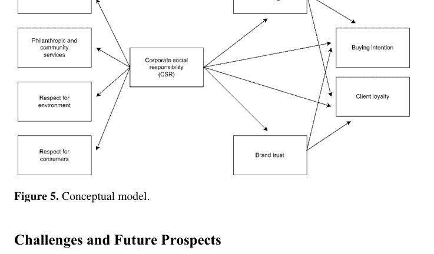

图5. 概念模型。

### 挑战与未来展望

### 克服可持续移动技术的障碍

克服可持续移动技术障碍需要采取多方面的方法，考虑到社会、经济和环境问题。（Greve et al., 2022）以下是一些关键挑战和解决方案：

- 能源消耗：
- 障碍：移动设备和网络巨大的能源需求增加了碳排放。
- 解决方案：设计并使用节能设备，如电池供电设备和低能耗设备。
- 障碍：技术发展非常迅速，使产品效率非常高，因此电子产品产生的废物也在减少。
- 解决方案：创建允许定制（Wang et al., 2012）和重新配置的耐用移动设备。
- 社会影响与公平：
- 障碍：获取可持续移动技术的机会分配不均，导致数字鸿沟和社会不平等。
- 解决方案：实施政策，确保所有社会经济群体都能以负担得起的价格获取可持续技术。

### 监管挑战：
- 障碍：不一致或不充分的法规可能会阻碍移动技术领域可持续实践的采用。
- 解决方案：倡导并支持制定促进移动行业可持续发展的全面法规。

### 行为改变：
- 障碍：消费者行为，如频繁更换设备，会加剧环境问题。
- 解决方案：提高消费者对其选择的环境影响的认识。

### 绿色移动技术的新兴创新与趋势

如今，绿色移动技术领域出现了几种趋势和创新，重点在于使移动设备及其相关基础设施更环保。以下是绿色移动技术中的一些关键趋势和创新：

- 节能硬件：低功耗处理器和先进电池技术。
- 可再生能源：太阳能充电和无线充电。
- 节能通信协议：5G及以后。
- 节能软件和应用：优化软件和云计算。
- 智慧城市倡议：综合交通系统和环境监测。
- 用户意识和参与：绿色认证和节能功能。电子废物管理回收计划和循环经济。
- 环保材料：可持续材料和模块化设计。

## 移动行业企业社会责任

### 移动公司为环境可持续性采取的举措

移动公司越来越认识到环境可持续性的重要性（Alinikula and Petteri, 2013），并采取了各种举措来减少碳足迹、促进回收并采用更环保的做法。

设备能效：这包括优化硬件和软件以消耗更少电力，从而延长电池寿命。
可持续材料：使用回收塑料、生物基材料，并减少有害物质的使用。
环保包装：使用回收材料、减小包装尺寸并实施更环保的包装技术（Mohamed et al., 2007），企业正试图减少包装带来的垃圾量。

电子废物回收计划：移动服务提供商定期开展活动，鼓励客户回收旧设备。
采用可再生能源：许多蜂窝公司已承诺仅使用可再生能源运营其业务。
削减碳排放：公司希望最大限度地减少其整体碳足迹。
延长产品生命周期：移动公司在设计产品时考虑到耐用性，希望说服客户更长时间保留其设备。

推广可持续实践：众多移动公司积极推广可持续实践和环境意识。
与环境组织合作：一些企业通过与非政府组织和环境组织合作，支持保护工作、植树活动以及旨在保护自然资源的其他项目。
认证和标准：为了确保其产品符合严格的环境要求；移动公司越来越多地追求EPEAT（Electronic Product Environmental Assessment Tool）等认证并遵守RoHS（Restriction of Hazardous Substances）标准。

## 监管在促进绿色实践中的作用

通过建立一个指导并激励公司和个人采用生态可持续行为的框架，监管在促进绿色实践中发挥着关键作用。

设定标准和要求：法规要求企业遵守最低环境标准和准则。
激励和补贴：政府经常使用规则为实施环保实践的公司设立财政奖励和补贴。
罚款和处罚：另一方面，法规有权对忽视环境的行为处以罚款和处罚。
市场准入和认证：法律可能要求公司遵守特定环境标准才能获得认证或进入特定市场。
信息披露：企业可能被法规要求提供环境信息。
研究和支持：政府可以通过法规鼓励绿色技术的发展。
公众教育和意识：监管程序将纳入要求，促使企业遵守安全措施，同时开展公众教育和宣传活动。

### 结论

总之，我们需要关注移动技术对环境的影响。资源消耗增加、能源浪费产生和碳排放是移动行业增长的结果。我们

需要讨论移动设备制造、使用和处置对环境的影响，因为我们依赖它们进行通信、娱乐和生产。为了减轻移动业务中的不利后果，可持续解决方案至关重要。为了实施良好的环境实践、减少电子垃圾并促进可持续材料的发展和应用，企业、监管机构和消费者必须在此领域共同努力。通过纳入循环经济理念，如回收和维护，可延长移动设备的使用寿命。此外，通过在数据中心和生产过程中使用绿色能源，可以减少该技术的碳足迹。鼓励变革的第一步是承认与移动设备相关的环境问题（Peng et al., 2021）。移动行业必须主动寻求可持续解决方案，以确保技术进步不会阻碍环境保护。为了在数字时代实现更可持续、更负责任的未来，必须将环境因素纳入移动设备的设计、制造和处置中。

## References

- Alinikula, Petteri. “可持续性作为移动电话创新的催化剂。” 载于 ISPIM 会议论文集，第 1 页。 *国际专业创新管理学会 (ISPIM)*，2013 年。
- Almalki, Faris A., Saeed H. Alsamhi, Radhya Sahal, Jahan Hassan, Ammar Hawbani, N. S. Rajput, Abdu Saif, Jeff Morgan, and John Breslin. “面向环保和可持续智慧城市的绿色物联网：未来方向与机遇。” *移动网络与应用* 28, no. 1 (2023): 178-202.
- Amend, Clara, Ferdinand Revellio, Isabell Tenner, and Stefan Schaltegger. “模块化产品设计对维修行为和用户体验的潜力——来自智能手机行业的证据。” *清洁生产杂志* 367 (2022): 132770.
- Antonopoulos, Angelos, Elli Kartsakli, Alexandra Bousia, Luis Alonso, and Christos Verikoukis. “多运营商移动网络中的节能基础设施共享。” *IEEE 通信杂志* 53, no. 5 (2015): 242-249.
- Brauer, Benjamin, Carolin Ebermann, Björn Hardebrandt, Gerrit Remané, and Lutz M. Kolbe. “绿色应用：移动应用对环境可持续性的贡献。” (2016).
- Elmanaai, Wafa, Khaled Elleithy, Andrew Anthony Benz, Alberto Carmine DeAngelis, and Nick Weaver. “用于 Qi 无线充电的增强压电发电技术。” *清洁技术* 5, no. 1 (2023): 94-115.
- Ghoreishi, Malahat, and Ari Happonen. “部署人工智能以实现循环经济的关键推动因素：兼顾可持续产品设计：三个案例研究。” 载于 *AIP 会议论文集*，vol. 2333, no. 1. AIP Publishing, 2020.
- Goundar, Sam, J. Avanija, Gurram Sunitha, K. Reddy Madhavi, and S. Bharath Bhushan, eds. 工业物联网 (IIoT) 与智能工厂的创新. IGI Global, 2021.
- Greve, Maike, Alfred Benedikt Brendel, Nils van Osten, and Lutz M. Kolbe. “克服阻碍低资源环境中可持续性的移动健康障碍。” 公共卫生杂志 30, no. 1 (2022): 49-62.
- Hoffmann, Stefan, Wassili Lasarov, and Hanna Reimers. “碳足迹追踪应用。是什么驱动消费者的采用意愿？” 社会中的技术 69 (2022): 101956.
- Ismail, Muhammad, Weihua Zhuang, Erchin Serpedin, and Khalid Qaraqe. “绿色移动网络综述：来自网络运营商和移动用户的视角。” IEEE 通信调查与教程 17, no. 3 (2014): 1535-1556.
- Jensen, Peter Byrial, Linda Nhu Laursen, and Louise Møller Haase. “产品寿命的障碍：商业、产品开发和用户视角的综述。” 清洁生产杂志 313 (2021): 127951.
- Jiju, K., P. Ramesh, P. Brijesh, and B. Sreekumari. “基于 Android 的可再生能源在线监测与控制系统开发。” 载于 2014 年计算机、通信与控制技术国际会议 (I4CT)，第 372-375 页。IEEE, 2014.
- Lee, Jinsu, and Hoi-Jun Yoo. “用于设备端深度神经网络训练的节能硬件加速器概述。” IEEE 固态电路学会开放期刊 1 (2021): 115-128.
- Luo, Xiaoyu, Mengyu Ren, Jiahong Zhao, Zitiao Wang, Jian Ge, and Weijun Gao. “旧住宅区改造碳排放影响分析的生命周期评价。” 清洁生产杂志 367 (2022): 132930.
- Malla, Siva Ganesh, D. Jaya Deepu, D. Pavan Kumar, and Jagan Mohana Rao Malla. “太阳能手机：一个创新实验。” 载于 2016 年信号处理、通信、电力与嵌入式系统国际会议 (SCOPES)，第 1015-1020 页。IEEE, 2016.
- Maskeliūnas, Rytis, Audrius Kulikajevas, Tomas Blažauskas, Robertas Damaševičius, and Jakub Swacha. “一种交互式严肃移动游戏，用于在环保城市管理背景下支持 JavaScript 编程学习。” 计算机 9, no. 4 (2020): 102.
- Mohamed, Mudzamir Bin, and Norfaiezah Binti Sawandi. “移动电信行业企业社会责任 (CSR) 活动：马来西亚案例研究。” 载于欧洲批判会计会议，第 1-26 页。2007.
- Namoun, Abdallah, Ali Tufail, Nikolay Mehandjiev, Ahmed Alrehaili, Javad Akhlaghinia, and Evtim Peytchev. “利用多智能体技术为城市地区提供环保多模态路线引导系统。” 应用科学 11, no. 5 (2021): 2057.
- Page, Tom. “移动电话设计与制造中可持续问题的管理方法。” 管理杂志 10, no. 2 (2015).
- Pathak, Prakash Kumar, Sachin Kumar, Hirdesh Sharma, and Devanshu Dube. “绿色计算与环保计算系统。” 代数统计杂志 13, no. 3 (2022): 5526-5530.

## 第 10 章

## 移动计算在智慧城市中的应用

N. Ashokkumar¹,*, M. Bharathi¹, P. Nagarajan², Kavitha Thandapani³, S. Deepa Nivethika⁴, and N. Swetha⁵

¹Mohan Babu University, Tirupati, 安得拉邦, 印度
²SRM Institute of Science and Technology, Vadapalani Campus, Chennai, 泰米尔纳德邦, 印度
³Vel Tech Rangarajan Dr. Sagunthala R&D Institute of Science and Technology, Chennai, 泰米尔纳德邦, 印度
⁴Vellore Institute of Technology, Chennai, 泰米尔纳德邦, 印度
⁵Sethu Institute of Technology, Virudhunagar, Madurai, 泰米尔纳德邦, 印度

### 摘要

当我们谈论移动计算时，我们指的是使终端用户能够访问计算、信息的一系列信息技术系统、产品、服务以及运营策略和流程。“移动”一词也可用于指通过用户可按需移动但在执行功能时保持静止的设备，在固定位置进行访问。通常将这种操作方法称为游牧计算。目前，移动计算机技术几乎无处不在。各种专业垂直市场以及商业和消费市场、工业和娱乐行业等，都可从其应用中受益。台式计算机提供更多硬件配置选项和更高的处理能力。尽管如此，绝大多数终端消费者仍倾向于将移动设备作为首选。移动计算最主要的优势之一是其便利性，因为它使用户能够随时随地访问信息和计算资源。

### 引言

移动计算系统通常由移动设备（可能是笔记本电脑、平板电脑或智能手机）以及基于 Wi-Fi 或蜂窝无线技术（如 5G）的无线网络连接组成。大多数情况下，移动计算系统由这两个组件组成。每个组件对于系统正常运行都是必不可少的。

由于这些设备具有本地存储数据的能力，因此无需连接到网络即可访问移动设备上本地存储的数据。

在大多数情况下，移动计算机能够提供无线和有线技术的访问。

由于当前工作的协作性质，访问共享网络资源非常重要。这些资源可能包括基于移动的云服务。

集成可充电电池为移动设备供电。这些电池嵌入到设备本身中。

当在固定位置使用时，大多数这些电池能够在交流电 (AC) 电源上运行。

除了笔记本电脑、平板电脑和智能手机外，还有各种各样的移动计算设备可用于垂直和专业应用。

此类别包括医疗、监控、安全、遥测和控制等各种应用。

设备的选择取决于应用。

例如，笔记本电脑特别适合制作材料，而平板电脑通常用于信息消费。

智能手机的屏幕相当小，并且使用基于屏幕的键盘。

智能手机能够执行口袋大小的计算机和通信设备的功能。

## 移动计算的使用原因是什么？

移动计算有可能在生活的方方面面得到应用，包括商业领域和消费领域。

用户能够摆脱长时间连接电源的需求。希望在外出时仍能保持与工作联系的出行专业人士会发现这种情况很有吸引力。在家工作的用户，由于可能无法获得办公室环境中所有的连接和电源选择，也可能从中受益。

消费者以多种方式使用移动计算，其中包括但不限于以下内容：

- 1. 访问互联网
- 2. 移动中进行通信
- 3. 网上导航
- 4. 移动设备程序
- 5. 为娱乐目的流媒体播放

为移动使用而设计的应用和设备能够在各种不同的环境和条件下收集用户数据。能够在新颖环境中收集用户数据的可穿戴技术示例包括健身和健康行业使用的技术。作为这种技术如何运作的例证，两个例子是智能手表和 Fitbits。

此外，移动计算使物联网（IoT）成为现实。物联网（IoT）由非传统计算机、传感器和其他能够相互连接并在没有人类干预的情况下进行通信的设备组成。

## 有多少种不同的移动计算？

移动计算的范畴下包含若干不同的组成部分。这些组成部分包括基础设施、硬件和软件技术。为方便起见，以下是对构成移动计算的多个组成部分的总结：

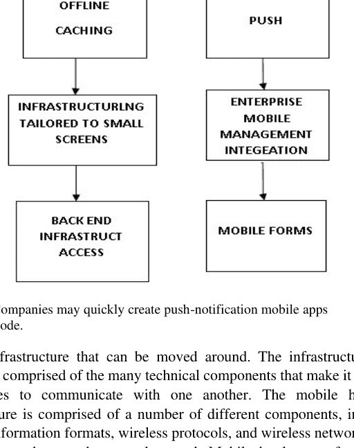

图 1. 企业可使用低代码快速创建推送通知移动应用。

可移动的基础设施。网络的基础设施由使设备能够相互通信的众多技术组件组成。移动硬件基础设施由多种不同的组件组成，包括无线信息格式、无线协议和无线网络。

可移动的硬件。移动硬件是指用户除了移动设备本身之外所使用的任何配套设备。移动设备的设备包括移动设备本身及其任何配套设备。手机、笔记本电脑、平板电脑和可穿戴计算机，以及随附的充电器和外设，可能属于此类。

面向移动设备的软件。移动应用是为在移动设备上运行而构建的软件程序。“移动应用程序”一词指的是这些程序。移动操作系统（OSes）和面向用户的应用，例如移动浏览器和数字商务应用，都包含在此类应用中。使用移动应用创建推送通知在图 1 中有说明。

移动计算有许多不同的种类，其中一些示例包括以下内容：

- 买家使用。消费者可以使用计算机、智能手机、可穿戴设备和平板电脑等移动设备执行各种活动，例如通信、娱乐、银行、账单支付以及监测健康和健身。
- 远程执行任务。笔记本电脑和平板电脑是员工协作和沟通的首选方式。负责交付的工作人员利用移动设备获取物流和行政信息，并检查物品是否送达正确地点。现场服务团队成员使用移动设备进行现场服务管理、跟踪以及支持技能和能力。
- 商业和消费领域的应用程序。物联网的一部分设备能够在无需人工干预的情况下与其他技术相连。例如，自动驾驶汽车使用传感器、车载计算机和其他连接设备，以便与地理信息系统（GIS）、天气和其他系统建立联系，从而安全地在道路上行驶。此外，供应链管理系统使用先进的传感器来监控产品在运输过程中的移动情况。这使得对这些物品进行有效跟踪成为可能。

## 智能城市背景下计算的重要性

热岛、交通拥堵、能源消耗和工业废物是由于全球城市化不断加剧而出现的一些问题（Rao 2012；Zhong 2017；Rizwan 2008）。这些问题是由世界城市化以惊人的速度扩张而带来的。这些困难对大都市地区居民的生活产生了重大影响，而且非常有害。所有这些实验都是为了促进可持续发展和缓解城市问题而进行的。哥本哈根市政府（State of Green Denmark 2018）在多个不同的垃圾桶和信息系统中安装了监测传感器。这是为了实现废物运营管理最高效率而进行的。根据 Hwang 和 Choe（2013）的说法，电表能够测量能源消耗。这些电表能够提供有关所使用电力、用水量和天然气用量的实时报告。在智能城市的创建方面，有许多信息和通信技术（ICT）是绝对必要的。

根据 Cisco（2017）的说法，到 2020 年，连接到互联网的设备数量将接近或可能超过 500 亿。智能城市的传输系统被定义为通信网络，其负责将传感器数据传输到计算机平台。可靠、可扩展且具有高速的网络，包括有线和无线网络，为传输此类数据提供了必要的[content]
## 移动计算的使用原因是什么？

移动计算有可能在生活的方方面面得到应用，包括商业领域和消费领域。

用户能够摆脱长时间连接电源的需求。希望在外出时仍能保持与工作联系的出行专业人士会发现这种情况很有吸引力。在家工作的用户，由于可能无法获得办公室环境中所有的连接和电源选择，也可能从中受益。

消费者以多种方式使用移动计算，其中包括但不限于以下内容：

- 1. 访问互联网
- 2. 移动中进行通信
- 3. 网上导航
- 4. 移动设备程序
- 5. 为娱乐目的流媒体播放

为移动使用而设计的应用和设备能够在各种不同的环境和条件下收集用户数据。能够在新颖环境中收集用户数据的可穿戴技术示例包括健身和健康行业使用的技术。作为这种技术如何运作的例证，两个例子是智能手表和 Fitbits。

此外，移动计算使物联网（IoT）成为现实。物联网（IoT）由非传统计算机、传感器和其他能够相互连接并在没有人类干预的情况下进行通信的设备组成。

## 有多少种不同的移动计算？

移动计算的范畴下包含若干不同的组成部分。这些组成部分包括基础设施、硬件和软件技术。为方便起见，以下是对构成移动计算的多个组成部分的总结：

图 1. 企业可使用低代码快速创建推送通知移动应用。

可移动的基础设施。网络的基础设施由使设备能够相互通信的众多技术组件组成。移动硬件基础设施由多种不同的组件组成，包括无线信息格式、无线协议和无线网络。

可移动的硬件。移动硬件是指用户除了移动设备本身之外所使用的任何配套设备。移动设备的设备包括移动设备本身及其任何配套设备。手机、笔记本电脑、平板电脑和可穿戴计算机，以及随附的充电器和外设，可能属于此类。

面向移动设备的软件。移动应用是为在移动设备上运行而构建的软件程序。“移动应用程序”一词指的是这些程序。移动操作系统（OSes）和面向用户的应用，例如移动浏览器和数字商务应用，都包含在此类应用中。使用移动应用创建推送通知在图 1 中有说明。

移动计算有许多不同的种类，其中一些示例包括以下内容：

- 买家使用。消费者可以使用计算机、智能手机、可穿戴设备和平板电脑等移动设备执行各种活动，例如通信、娱乐、银行、账单支付以及监测健康和健身。
- 远程执行任务。笔记本电脑和平板电脑是员工协作和沟通的首选方式。负责交付的工作人员利用移动设备获取物流和行政信息，并检查物品是否送达正确地点。现场服务团队成员使用移动设备进行现场服务管理、跟踪以及支持技能和能力。
- 商业和消费领域的应用程序。物联网的一部分设备能够在无需人工干预的情况下与其他技术相连。例如，自动驾驶汽车使用传感器、车载计算机和其他连接设备，以便与地理信息系统（GIS）、天气和其他系统建立联系，从而安全地在道路上行驶。此外，供应链管理系统使用先进的传感器来监控产品在运输过程中的移动情况。这使得对这些物品进行有效跟踪成为可能。

## 智能城市背景下计算的重要性

热岛、交通拥堵、能源消耗和工业废物是由于全球城市化不断加剧而出现的一些问题（Rao 2012；Zhong 2017；Rizwan 2008）。这些问题是由世界城市化以惊人的速度扩张而带来的。这些困难对大都市地区居民的生活产生了重大影响，而且非常有害。所有这些实验都是为了促进可持续发展和缓解城市问题而进行的。哥本哈根市政府（State of Green Denmark 2018）在多个不同的垃圾桶和信息系统中安装了监测传感器。这是为了实现废物运营管理最高效率而进行的。根据 Hwang 和 Choe（2013）的说法，电表能够测量能源消耗。这些电表能够提供有关所使用电力、用水量和天然气用量的实时报告。在智能城市的创建方面，有许多信息和通信技术（ICT）是绝对必要的。

根据 Cisco（2017）的说法，到 2020 年，连接到互联网的设备数量将接近或可能超过 50 亿。智能城市的传输系统被定义为通信网络，其负责将传感器数据传输到计算机平台。可靠、可扩展且具有高速的网络，包括有线和无线网络，为传输此类数据提供了必要的[content]
## 移动计算的使用原因是什么？

移动计算有可能在生活的方方面面得到应用，包括商业领域和消费领域。

用户能够摆脱长时间连接电源的需求。希望在外出时仍能保持与工作联系的出行专业人士会发现这种情况很有吸引力。在家工作的用户，由于可能无法获得办公室环境中所有的连接和电源选择，也可能从中受益。

消费者以多种方式使用移动计算，其中包括但不限于以下内容：

- 1. 访问互联网
- 2. 移动中进行通信
- 3. 网上导航
- 4. 移动设备程序
- 5. 为娱乐目的流媒体播放

为移动使用而设计的应用和设备能够在各种不同的环境和条件下收集用户数据。能够在新颖环境中收集用户数据的可穿戴技术示例包括健身和健康行业使用的技术。作为这种技术如何运作的例证，两个例子是智能手表和 Fitbits。

此外，移动计算使物联网（IoT）成为现实。物联网（IoT）由非传统计算机、传感器和其他能够相互连接并在没有人类干预的情况下进行通信的设备组成。

## 有多少种不同的移动计算？

移动计算的范畴下包含若干不同的组成部分。这些组成部分包括基础设施、硬件和软件技术。为方便起见，以下是对构成移动计算的多个组成部分的总结：

图 1. 企业可使用低代码快速创建推送通知移动应用。

可移动的基础设施。网络的基础设施由使设备能够相互通信的众多技术组件组成。移动硬件基础设施由多种不同的组件组成，包括无线信息格式、无线协议和无线网络。

可移动的硬件。移动硬件是指用户除了移动设备本身之外所使用的任何配套设备。移动设备的设备包括移动设备本身及其任何配套设备。手机、笔记本电脑、平板电脑和可穿戴计算机，以及随附的充电器和外设，可能属于此类。

面向移动设备的软件。移动应用是为在移动设备上运行而构建的软件程序。“移动应用程序”一词指的是这些程序。移动操作系统（OSes）和面向用户的应用，例如移动浏览器和数字商务应用，都包含在此类应用中。使用移动应用创建推送通知在图 1 中有说明。

移动计算有许多不同的种类，其中一些示例包括以下内容：

- 买家使用。消费者可以使用计算机、智能手机、可穿戴设备和平板电脑等移动设备执行各种活动，例如通信、娱乐、银行、账单支付以及监测健康和健身。
- 远程执行任务。笔记本电脑和平板电脑是员工协作和沟通的首选方式。负责交付的工作人员利用移动设备获取物流和行政信息，并检查物品是否送达正确地点。现场服务团队成员使用移动设备进行现场服务管理、跟踪以及支持技能和能力。
- 商业和消费领域的应用程序。物联网的一部分设备能够在无需人工干预的情况下与其他技术相连。例如，自动驾驶汽车使用传感器、车载计算机和其他连接设备，以便与地理信息系统（GIS）、天气和其他系统建立联系，从而安全地在道路上行驶。此外，供应链管理系统使用先进的传感器来监控产品在运输过程中的移动情况。这使得对这些物品进行有效跟踪成为可能。

## 智能城市背景下计算的重要性

热岛、交通拥堵、能源消耗和工业废物是由于全球城市化不断加剧而出现的一些问题（Rao 2012；Zhong 2017；Rizwan 2008）。这些问题是由世界城市化以惊人的速度扩张而带来的。这些困难对大都市地区居民的生活产生了重大影响，而且非常有害。所有这些实验都是为了促进可持续发展和缓解城市问题而进行的。哥本哈根市政府（State of Green Denmark 2018）在多个不同的垃圾桶和信息系统中安装了监测传感器。这是为了实现废物运营管理最高效率而进行的。根据 Hwang 和 Choe（2013）的说法，电表能够测量能源消耗。这些电表能够提供有关所使用电力、用水量和天然气用量的实时报告。在智能城市的创建方面，有许多信息和通信技术（ICT）是绝对必要的。

根据 Cisco（2017）的说法，到 2020 年，连接到互联网的设备数量将接近或可能超过 50 亿。智能城市的传输系统被定义为通信网络，其负责将传感器数据传输到计算机平台。可靠、可扩展且具有高速的网络，包括有线和无线网络，为传输此类数据提供了必要的[content]
## 移动计算的使用原因是什么？

移动计算有可能在生活的方方面面得到应用，包括商业领域和消费领域。

用户能够摆脱长时间连接电源的需求。希望在外出时仍能保持与工作联系的出行专业人士会发现这种情况很有吸引力。在家工作的用户，由于可能无法获得办公室环境中所有的连接和电源选择，也可能从中受益。

消费者以多种方式使用移动计算，其中包括但不限于以下内容：

- 1. 访问互联网
- 2. 移动中进行通信
- 3. 网上导航
- 4. 移动设备程序
- 5. 为娱乐目的流媒体播放

为移动使用而设计的应用和设备能够在各种不同的环境和条件下收集用户数据。能够在新颖环境中收集用户数据的可穿戴技术示例包括健身和健康行业使用的技术。作为这种技术如何运作的例证，两个例子是智能手表和 Fitbits。

此外，移动计算使物联网（IoT）成为现实。物联网（IoT）由非传统计算机、传感器和其他能够相互连接并在没有人类干预的情况下进行通信的设备组成。

## 有多少种不同的移动计算？

移动计算的范畴下包含若干不同的组成部分。这些组成部分包括基础设施、硬件和软件技术。为方便起见，以下是对构成移动计算的多个组成部分的总结：

图 1. 企业可使用低代码快速创建推送通知移动应用。

可移动的基础设施。网络的基础设施由使设备能够相互通信的众多技术组件组成。移动硬件基础设施由多种不同的组件组成，包括无线信息格式、无线协议和无线网络。

可移动的硬件。移动硬件是指用户除了移动设备本身之外所使用的任何配套设备。移动设备的设备包括移动设备本身及其任何配套设备。手机、笔记本电脑、平板电脑和可穿戴计算机，以及随附的充电器和外设，可能属于此类。

面向移动设备的软件。移动应用是为在移动设备上运行而构建的软件程序。“移动应用程序”一词指的是这些程序。移动操作系统（OSes）和面向用户的应用，例如移动浏览器和数字商务应用，都包含在此类应用中。使用移动应用创建推送通知在图 1 中有说明。

移动计算有许多不同的种类，其中一些示例包括以下内容：

- 买家使用。消费者可以使用计算机、智能手机、可穿戴设备和平板电脑等移动设备执行各种活动，例如通信、娱乐、银行、账单支付以及监测健康和健身。
- 远程执行任务。笔记本电脑和平板电脑是员工协作和沟通的首选方式。负责交付的工作人员利用移动设备获取物流和行政信息，并检查物品是否送达正确地点。现场服务团队成员使用移动设备进行现场服务管理、跟踪以及支持技能和能力。
- 商业和消费领域的应用程序。物联网的一部分设备能够在无需人工干预的情况下与其他技术相连。例如，自动驾驶汽车使用传感器、车载计算机和其他连接设备，以便与地理信息系统（GIS）、天气和其他系统建立联系，从而安全地在道路上行驶。此外，供应链管理系统使用先进的传感器来监控产品在运输过程中的移动情况。这使得对这些物品进行有效跟踪成为可能。

## 智能城市背景下计算的重要性

热岛、交通拥堵、能源消耗和工业废物是由于全球城市化不断加剧而出现的一些问题（Rao 2012；Zhong 2017；Rizwan 2008）。这些问题是由世界城市化以惊人的速度扩张而带来的。这些困难对大都市地区居民的生活产生了重大影响，而且非常有害。所有这些实验都是为了促进可持续发展和缓解城市问题而进行的。哥本哈根市政府（State of Green Denmark 2018）在多个不同的垃圾桶和信息系统中安装了监测传感器。这是为了实现废物运营管理最高效率而进行的。根据 Hwang 和 Choe（2013）的说法，电表能够测量能源消耗。这些电表能够提供有关所使用电力、用水量和天然气用量的实时报告。在智能城市的创建方面，有许多信息和通信技术（ICT）是绝对必要的。

根据 Cisco（2017）的说法，到 2020 年，连接到互联网的设备数量将接近或可能超过 50 亿。智能城市的传输系统被定义为通信网络，其负责将传感器数据传输到计算机平台。可靠、可扩展且具有高速的网络，包括有线和无线网络，为传输此类数据提供了必要的[content]
## 移动计算的使用原因是什么？

移动计算有可能在生活的方方面面得到应用，包括商业领域和消费领域。

用户能够摆脱长时间连接电源的需求。希望在外出时仍能保持与工作联系的出行专业人士会发现这种情况很有吸引力。在家工作的用户，由于可能无法获得办公室环境中所有的连接和电源选择，也可能从中受益。

消费者以多种方式使用移动计算，其中包括但不限于以下内容：

- 1. 访问互联网
- 2. 移动中进行通信
- 3. 网上导航
- 4. 移动设备程序
- 5. 为娱乐目的流媒体播放

为移动使用而设计的应用和设备能够在各种不同的环境和条件下收集用户数据。能够在新颖环境中收集用户数据的可穿戴技术示例包括健身和健康行业使用的技术。作为这种技术如何运作的例证，两个例子是智能手表和 Fitbits。

此外，移动计算使物联网（IoT）成为现实。物联网（IoT）由非传统计算机、传感器和其他能够相互连接并在没有人类干预的情况下进行通信的设备组成。

## 有多少种不同的移动计算？

移动计算的范畴下包含若干不同的组成部分。这些组成部分包括基础设施、硬件和软件技术。为方便起见，以下是对构成移动计算的多个组成部分的总结：

图 1. 企业可使用低代码快速创建推送通知移动应用。

可移动的基础设施。网络的基础设施由使设备能够相互通信的众多技术组件组成。移动硬件基础设施由多种不同的组件组成，包括无线信息格式、无线协议和无线网络。

可移动的硬件。移动硬件是指用户除了移动设备本身之外所使用的任何配套设备。移动设备的设备包括移动设备本身及其任何配套设备。手机、笔记本电脑、平板电脑和可穿戴计算机，以及随附的充电器和外设，可能属于此类。

面向移动设备的软件。移动应用是为在移动设备上运行而构建的软件程序。“移动应用程序”一词指的是这些程序。移动操作系统（OSes）和面向用户的应用，例如移动浏览器和数字商务应用，都包含在此类应用中。使用移动应用创建推送通知在图 1 中有说明。

移动计算有许多不同的种类，其中一些示例包括以下内容：

- 买家使用。消费者可以使用计算机、智能手机、可穿戴设备和平板电脑等移动设备执行各种活动，例如通信、娱乐、银行、账单支付以及监测健康和健身。
- 远程执行任务。笔记本电脑和平板电脑是员工协作和沟通的首选方式。负责交付的工作人员利用移动设备获取物流和行政信息，并检查物品是否送达正确地点。现场服务团队成员使用移动设备进行现场服务管理、跟踪以及支持技能和能力。
- 商业和消费领域的应用程序。物联网的一部分设备能够在无需人工干预的情况下与其他技术相连。例如，自动驾驶汽车使用传感器、车载计算机和其他连接设备，以便与地理信息系统（GIS）、天气和其他系统建立联系，从而安全地在道路上行驶。此外，供应链管理系统使用先进的传感器来监控产品在运输过程中的移动情况。这使得对这些物品进行有效跟踪成为可能。

## 智能城市背景下计算的重要性

热岛、交通拥堵、能源消耗和工业废物是由于全球城市化不断加剧而出现的一些问题（Rao 2012；Zhong 2017；Rizwan 2008）。这些问题是由世界城市化以惊人的速度扩张而带来的。这些困难对大都市地区居民的生活产生了重大影响，而且非常有害。所有这些实验都是为了促进可持续发展和缓解城市问题而进行的。哥本哈根市政府（State of Green Denmark 2018）在多个不同的垃圾桶和信息系统中安装了监测传感器。这是为了实现废物运营管理最高效率而进行的。根据 Hwang 和 Choe（2013）的说法，电表能够测量能源消耗。这些电表能够提供有关所使用电力、用水量和天然气用量的实时报告。在智能城市的创建方面，有许多信息和通信技术（ICT）是绝对必要的。

根据 Cisco（2017）的说法，到 2020 年，连接到互联网的设备数量将接近或可能超过 50 亿。智能城市的传输系统被定义为通信网络，其负责将传感器数据传输到计算机平台。可靠、可扩展且具有高速的网络，包括有线和无线网络，为传输此类数据提供了必要的[content]
## 移动计算的使用原因是什么？

移动计算有可能在生活的方方面面得到应用，包括商业领域和消费领域。

用户能够摆脱长时间连接电源的需求。希望在外出时仍能保持与工作联系的出行专业人士会发现这种情况很有吸引力。在家工作的用户，由于可能无法获得办公室环境中所有的连接和电源选择，也可能从中受益。

消费者以多种方式使用移动计算，其中包括但不限于以下内容：

- 1. 访问互联网
- 2. 移动中进行通信
- 3. 网上导航
- 4. 移动设备程序
- 5. 为娱乐目的流媒体播放

为移动使用而设计的应用和设备能够在各种不同的环境和条件下收集用户数据。能够在新颖环境中收集用户数据的可穿戴技术示例包括健身和健康行业使用的技术。作为这种技术如何运作的例证，两个例子是智能手表和 Fitbits。

此外，移动计算使物联网（IoT）成为现实。物联网（IoT）由非传统计算机、传感器和其他能够相互连接并在没有人类干预的情况下进行通信的设备组成。

## 有多少种不同的移动计算？

移动计算的范畴下包含若干不同的组成部分。这些组成部分包括基础设施、硬件和软件技术。为方便起见，以下是对构成移动计算的多个组成部分的总结：

图 1. 企业可使用低代码快速创建推送通知移动应用。

可移动的基础设施。网络的基础设施由使设备能够相互通信的众多技术组件组成。移动硬件基础设施由多种不同的组件组成，包括无线信息格式、无线协议和无线网络。

可移动的硬件。移动硬件是指用户除了移动设备本身之外所使用的任何配套设备。移动设备的设备包括移动设备本身及其任何配套设备。手机、笔记本电脑、平板电脑和可穿戴计算机，以及随附的充电器和外设，可能属于此类。

面向移动设备的软件。移动应用是为在移动设备上运行而构建的软件程序。“移动应用程序”一词指的是这些程序。移动操作系统（OSes）和面向用户的应用，例如移动浏览器和数字商务应用，都包含在此类应用中。使用移动应用创建推送通知在图 1 中有说明。

移动计算有许多不同的种类，其中一些示例包括以下内容：

- 买家使用。消费者可以使用计算机、智能手机、可穿戴设备和平板电脑等移动设备执行各种活动，例如通信、娱乐、银行、账单支付以及监测健康和健身。
- 远程执行任务。笔记本电脑和平板电脑是员工协作和沟通的首选方式。负责交付的工作人员利用移动设备获取物流和行政信息，并检查物品是否送达正确地点。现场服务团队成员使用移动设备进行现场服务管理、跟踪以及支持技能和能力。
- 商业和消费领域的应用程序。物联网的一部分设备能够在无需人工干预的情况下与其他技术相连。例如，自动驾驶汽车使用传感器、车载计算机和其他连接设备，以便与地理信息系统（GIS）、天气和其他系统建立联系，从而安全地在道路上行驶。此外，供应链管理系统使用先进的传感器来监控产品在运输过程中的移动情况。这使得对这些物品进行有效跟踪成为可能。

## 智能城市背景下计算的重要性

热岛、交通拥堵、能源消耗和工业废物是由于全球城市化不断加剧而出现的一些问题（Rao 2012；Zhong 2017；Rizwan 2008）。这些问题是由世界城市化以惊人的速度扩张而带来的。这些困难对大都市地区居民的生活产生了重大影响，而且非常有害。所有这些实验都是为了促进可持续发展和缓解城市问题而进行的。哥本哈根市政府（State of Green Denmark 2018）在多个不同的垃圾桶和信息系统中安装了监测传感器。这是为了实现废物运营管理最高效率而进行的。根据 Hwang 和 Choe（2013）的说法，电表能够测量能源消耗。这些电表能够提供有关所使用电力、用水量和天然气用量的实时报告。在智能城市的创建方面，有许多信息和通信技术（ICT）是绝对必要的。

根据 Cisco（2017）的说法，到 2020 年，连接到互联网的设备数量将接近或可能超过 50 亿。智能城市的传输系统被定义为通信网络，其负责将传感器数据传输到计算机平台。可靠、可扩展且具有高速的网络，包括有线和无线网络，为传输此类数据提供了必要的[content]
## 移动计算的使用原因是什么？

移动计算有可能在生活的方方面面得到应用，包括商业和消费领域。

用户可摆脱长时间连接电源的需求。希望外出时仍能保持与工作联系的出行专业人士会觉得很有吸引力。在家工作、无法获得办公室同等连接和电源选择的用户也可能受益。

消费者以多种方式使用移动计算，包括但不限于：

- 1. 访问互联网
- 2. 移动中进行通信
- 3. 网上导航
- 4. 移动设备程序
- 5. 为娱乐目的流媒体播放

为移动使用设计的应用程序和设备可在多种环境和条件下收集用户数据。可在新颖环境中收集数据的可穿戴技术示例包括健身和健康行业使用的技术。智能手表和 Fitbits 可作为该类技术运作的例证。

此外，移动计算使物联网 IoT 成为现实。物联网由非传统计算机、传感器和其他可在无人类干预下相互连接通信的设备组成。

## 有多少种不同的移动计算？

移动计算涵盖若干组成部分，包括基础设施、硬件和软件技术。以下是对其组成部分的总结：

图 1. 企业可使用低代码快速创建推送通知移动应用。

可移动的基础设施。网络基础设施由使设备相互通信的众多技术组件组成。移动硬件基础设施包括无线信息格式、无线协议和无线网络等。

可移动的硬件。移动硬件指用户除移动设备本身外所使用的配套设备。包括移动设备本身及其配套设备。手机、笔记本电脑、平板电脑、可穿戴计算机及其充电器和外设均属此类。

面向移动设备的软件。移动应用是为在移动设备上运行而构建的软件程序。移动操作系统 OSes 和面向用户的应用，如移动浏览器和数字商务应用，均属此类。图 1 规定了使用移动应用创建推送通知。

移动计算种类繁多，示例包括：

- 买家使用。消费者可使用计算机、智能手机、可穿戴设备和平板电脑进行通信、娱乐、银行、账单支付及健康健身监测等活动。
- 远程执行任务。笔记本电脑和平板电脑是员工协作沟通的首选。负责交付的工作人员利用移动设备获取物流和行政信息并核查送达情况。现场服务人员使用移动设备进行现场服务管理、跟踪和支持。
- 商业和消费领域应用。物联网设备可在无人工干预下与其他技术连接。例如，自动驾驶汽车使用传感器、车载计算机等连接设备与地理信息系统 GIS、天气等系统联动以安全行驶。供应链管理系统也使用先进传感器监控在途产品，实现有效追踪。

## 智能城市背景下计算的重要性

热岛、交通拥堵、能源消耗和工业废物是全球城市化加剧带来的问题 Rao 2012；Zhong 2017；Rizwan 2008。城市化快速扩张带来了这些困难，对大都市居民生活影响重大且有害。相关研究旨在促进可持续发展并缓解城市问题。哥本哈根市政府 State of Green Denmark 2018 在多个垃圾桶和信息系统中安装监测传感器，以提高废物运营效率。根据 Hwang 和 Choe 2013，电表可测量能源消耗并实时报告电力、用水和天然气用量。建设智能城市需要多种信息和通信技术 ICT。

根据 Cisco 2017，到 2020 年联网设备数量将接近或超过 50 亿。智能城市的传输系统即通信网络，负责将传感器数据传输到计算平台。可靠、可扩展、高速的有线和无线网络为数据传输提供必要基础设施。计算平台在更大背景下协助管理和分析相关城市数据，以发现需处理和行动的城市事件。众多智能城市传感器持续产生大量数据，其中之一不断更新以反映交通模式和拥堵变化。近年来出现了多种利用信息通信技术监测和预测城市热岛 UHI 的方法和技术。例如法国建立的热健康监测预警系统 Casanueva et al., 2019，旨在监测可能导致死亡率大幅上升的热浪。智能城市的关键技术在图 2 中说明。

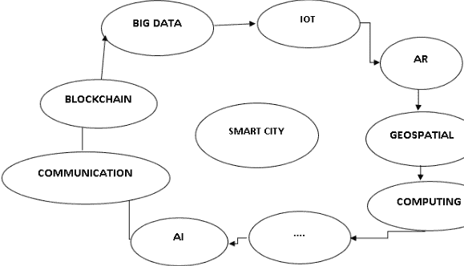

**Figure 2.** 关键智能城市技术。

## 智能城市的移动设备计算 II

### 方法

移动计算由三要素组成：1 通信、2 硬件、3 软件。通信特指无线网络、数据流和协议。硬件指多种移动设备。软件指安装在移动设备硬件中的程序，包括行业专用软件、数据采集应用和网络浏览器 Laurila et al., 2012。与专用物联网设备不同，移动设备配备可多用途使用的传感器，如麦克风、加速度计、陀螺仪和全球定位系统接收器。

用户数量激增和智能手机相关技术普及是其后果。随着移动计算发展，其也成为传统计算机任务卸载的贡献者。移动计算应用层因其特性面临诸多挑战。这也是移动技术日益普及的结果。

### 挑战、动机和机遇

无线网络条件下，可预期通信不一致和运行状态变化。这要求移动设备切换模式以适应特定情况。网络中已有的安全漏洞进一步恶化，降低了移动计算的可靠性。

智能城市应用的快速增长得益于移动计算和智能手机应用的快速发展。移动计算有助于解决智能城市计算相关的以下困难：

- 1. 在各个场所满足用户需求。移动计算将智慧城市计算与移动性和灵活性相连。这种支持可能帮助终端用户和政策制定者满足多样化的计算需求。基于位置和高等教育服务是应用案例（Gikas and Grant 2013）。这些服务利用智能设备的移动性来收集和消费数据（Raja et al., 2018）。根据 Zheng and Ni (2010) 的说法，移动计算还可以将智能设备集成到智能环境中。这一智慧城市理念覆盖了大面积区域，为移动计算基础设施和执行灵活性提供了充足空间。
- 2. 移动云计算和动态卸载是智能环境中交互式智能设备（Huang et al., 2012）。当前研究涵盖了这些主题。云计算与移动计算的结合自 2009 年起就已被设想。它将移动计算的移动性与云计算的弹性处理相结合。

## Study of the Case

### Heat Island in Cities (UHI)

通常，用来衡量 UHI 的有三种尺度：边界 UHI、冠层 UHI 和地表 UHI。为了确定边界 UHI，会测量屋顶高度相对于大气的情况。一般而言，它用于研究中尺度上的 UHI 影响。微尺度研究是评估冠层 UHI 最合适的环境，气象站的数据常被用于生成评估。UHI 计算机架构在图 3 中有所说明。地表 UHI 是在地球表面水平检测到的。研究人员使用遥感数据来研究城市热岛（UHI）在长期或短期内的变化和后果（Earl et al., 2016）。

### Challenges and Opportunities at UHI

本文前面讨论的科学问题直接导致了这些问题的出现。多年来，云计算已被用于分配计算资源，以协助多个不同研究学科中的自动扩展建模和检测。根据 Yang et al., 2017a 的说法，该策略已被证明是一种既有效又经济高效的替代方案。有一个名为 Google Earth Engine 的云计算平台，提供自然并行的处理资源。通过利用从地球观测中获得的相当庞大的数据集合，它也使得在全球范围内监测和评估地球环境变化成为可能，正如 Moore and Hansen (2011) 所指出的那样。这是通过使用从地球观测中收集的数据来实现的。

传统架构的能力无法满足物联网的需求。Santamouris (2015) 对一百个不同城市和地区热岛的范围及其特征进行了分析。根据此次调查的结果，发现 43% 的站点测量中，仅有一个基于城市站点，另一个基于农村站点（Meulen 2017）。Gartner 预测，到 2020 年，将会有多达 20.4 亿台物联网设备通过机器对机器通信技术相互连接。

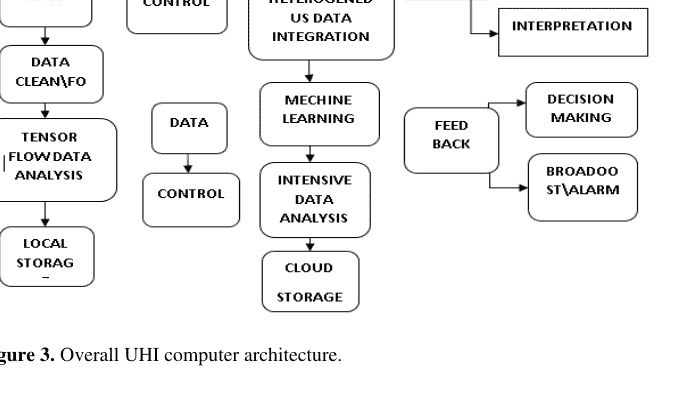

Figure 3. Overall UHI computer architecture.

## Data and Model in Smart Cities

在产生可辅助决策的信息方面，智慧城市需要多种可靠的数据来源和模型。当涉及大量智能设备和传感器时，情况的复杂性会显著增加。在本部分，介绍了五个智慧城市的示例应用，以及所涉及的数据、相应的模型和所需的计算需求。

### Transport and Traffic Management

就与城市生活相关的活动而言，交通是其中最重要因素之一。安装在交通车辆中的传感器或沿道路放置的监测器负责生成和收集交通数据。记录人们在城市中日常出行的数据被称为通勤数据。从带地理标签的社交网络收集的数据包括带有地理信息并从社交网络收集的帖子（如博客和推文）。道路网络数据表示的两种数据类型是道路路段和交叉路口。智能交通系统使用多种模型，包括基于代理的交通管理模型、基于认知理性的执行模型和混合排序 Logit 模型。

## Smart City Technology

用于智慧城市开发的组件包括软件解决方案、用户界面、通信网络以及连接到物联网（IoT）的设备。另一方面，物联网可以被视为其主要依赖来源。物联网（IoT）是一个由相互连接的设备组成的网络，例如汽车、传感器或家用电器，它们能够相互通信并交换信息。这类设备的例子包括连接设备。物联网连接的传感器和设备负责收集和传输数据，随后数据保存在云端或其他服务器上。这些设备的连接性和数据分析的使用使得城市的物理和数字方面融合成为可能。这导致公共和商业部门效率的提高，进而实现经济收益并改善公民生活。

一些物联网设备具有被称为边缘计算的处理能力。通过使用边缘计算，可以确保通信网络仅暴露最重要和相关的信息。

在一个计算机系统中，网络流量的保护、监控和控制都是需要实施防火墙安全系统的基本功能。为了保证在智慧城市网络中持续传输的数据的安全，防火墙被安装以防止任何人在未经许可的情况下进入物联网网络或城市数据。

Other smart city technologies include:

- APIs, 即应用程序编程接口
- AI 即人工智能。
- cloud computing
- control panels
- machine learning (ML)
- M2M 即机器对机器。
- mesh network

### Devices and Sensors

数据通过工业物联网（IIoT）网络中的各种设备和传感器从物理资产、机械和设备中收集。此类别可能包括各种传感器和设备，例如温度传感器、压力传感器、运动传感器、执行器等。

### Edge Computing

在网络边缘（更靠近用户或源头）处理和分析数据方面，边缘计算是工业物联网（IIoT）系统的关键组成部分。通过降低延迟、改善实时决策并最小化向云端的数据传输，边缘计算有助于提升整体体验。

## Future Urban Computing for Smart Cities

此时，随着与云的连接性增强，网络的边缘越来越多地充当移动计算系统。这得益于 5G 网络的快速发展以及与云计算的集成增强。在移动计算领域，“移动云计算”这一短语已被多次使用。整个计算机网络将被推向新的去中心化计算阶段，并且智慧城市的发展进程将因移动计算和云计算如何交互以按需处理数据而加快。这两种发展将同时发生。

随着移动设备数量的持续增长，与邻近边缘应用进行交互的需求将变得更加明显。当与增强的调配、计算和电力能力以及移动计算的去中心化特性相结合时，预计边缘计算将提供显著增强的吞吐量、增强的性能和实时响应。这是通过将计算和数据更靠近用户实现的，同时根据每个用户的调配需求进行定制。边缘计算和移动设备计算都能够管理本地化数据，以便为特定范围的区域大小提供快速响应。然而，集中式云计算也因大都市地区产生的数据量不断增长以及跨城市的数据地理分析而得到推动。

为了检测、记录、共享和分析各种与人类相关的活动，多种不同的设备将在智慧城市内部连接到基于云的互联网。云计算与人工智能驱动算法的帮助相结合，将为企业、政府和个人公民提供更智能的解决方案。

## 智能城市的物联网

智能城市的概念是普遍数字化的产物，而这种数字化之所以成为可能，是由于支撑技术的存在，使得这一切得以实现。建设智能城市的努力集中于物联网（IoT），物联网是该概念的基础。据预测，到2025年，互联网将拥有超过750亿台连接设备。这将导致正在创建的应用程序数量增加。在智能城市方面，物联网使得传感器能够收集并将城市状态数据发送到中央云端。这些信息包含有关城市当前状况的信息。然后可以对这些信息进行挖掘或分析，以期获得模式并根据这些模式做出决策。

## 内置工作流

### 移动计算实现近距离快速响应

移动计算是数据在流程开始时进入工作流的初始入口。仅可在移动计算阶段执行轻量级的准备任务，例如数据清洗和重新组织。这是因为移动计算机通常容量有限，并且由于电池寿命等限制，无法正常运行。另一方面，原位监测结合对数据的初步理解，有可能减少那些不需要大量计算而仅需做出简单判断的任务的时间延迟。例如，当检测到异常热量时，设置在移动设备上的、具有有限温度阈值的警报可能会以响应方式被激活。

### 边缘计算准备数据并控制微控制器

除了在边缘收集数据并将原始数据传输到云端——与移动计算的情况相同——边缘计算还提供了更多进行更深入数据准备的可能性。这些能力是在数据在边缘收集的基础上提供的。

由于数据量不断增长，将所有内容以原始形式上传到云端可能需要相当长的时间，并且施加在中央集群上的巨大负载可能导致其超过可用计算能力的限制。这些观测提供了以秒为分辨率的观测。这些观测由数据提供。通过从由数百个传感器组成的网络收集数据，本研究跟踪了局部温度以及其他环境特征。另一方面，网络内部进行的高速度数据传输由于可用带宽受限，有可能产生网络拥塞。

### 云计算用于处理和分析海量数据

从传感器传输的数据通过边缘发送到中心以实现更好的管理。这得益于虚拟存储系统能够自动扩展。移动设备和边缘设备都无法处理云能够管理的数据，而且云还能够将处理速度提升到单台服务器无法实现的程度（Goundar et al., 2021）。这是因为云具有庞大的计算能力。

最重要的问题之一是数据的异构性，而清理数据所需的大量工作需要大量的处理能力。根据 Botta et al. (2014) 的说法，云作为一个集中式计算资源池，为此类任何工作提供了足够的容量。正如之前所述，UHI 研究受多种因素的影响。对构成进行修改将需要对模型参数进行更改。构建模型所花费的时间以及在转移实验环境过程中出现的人为错误是缺点。

### 结论

城市中传感和通信工具尺寸的巨大缩小使得构想为智能城市应用创建创新技术网络成为可能。因此，智能城市的发展因此变得可行。城市计算的目标是增强智能城市服务的运营智能，同时改变城市居民的生活及其所处的环境。这就是城市计算的目标。

为了分析、突出并报告城市计算领域针对智能城市范式所做出的最新举措，本文的目的是研究、突出并报告此类努力。我们强调了城市计算系统的四个主要用例；这些用例在智能城市架构中给出。此外，还确定了在未来研究过程中可能出现的一些潜在挑战。总之，我们认识到，尽管城市计算在智能城市中具有提供各种益处的潜力，但这些范式的汇聚导致了特定近期研究问题的形成，这些问题需要在未来得到解决。

### 参考文献

- Casnueva Vicente, Ana, Annakatrin Burgstall, Sven Kotlarski, Alessandro Messeri, Marco Morabito, Andreas D. Flouris, Lars Nybo, Christoph Sprig, and Cornelia Schwierz. “*欧洲现有热健康预警系统的概述.*” (2019).
- González-Gil, Arturo, Roberto Palacin, P. Batty, and J. P. Powell. “减少城市轨道交通能耗的系统方法。” *能源转换与管理* 80 (2014): 509-524.
- Graham, Steve, and Simon Marvin. *电信与城市：电子空间，城市场所.* Routledge, 2002.
- Giannaros, T. M., D. Melas, I. A. Daglis, and I. Keramitsoglou. “城市热岛运行建模系统的开发：希腊雅典的应用。” *自然灾害与地球系统科学* 14, no. 2 (2014): 347-358.
- Goundar, Sam, J. Avanija, Gurram Sunitha, K. Reddy Madhavi, and S. Bharath Bhushan, eds. *工业物联网(IIoT)和智能工厂的创新.* IGI Global, 2021.
- Hwang, Jong-Sung, and Young Han Choe. “首尔智慧城市：案例研究。” *ITU-T技术观察报告* (2013): 1-20.
- Hoffman, J. “我们需要遮荫的地方在哪里？弗吉尼亚州里士满城市热岛的测绘。” *Retrieved May 1* (2018): 2019.
- Ashokkumar, N., V. Arun, S. Prabhu, V. Kalaimagal, Dhamodharan Srinivasan, and B. Shanthi. “面向家庭应用的基于物联网的节能智能计量系统的设计与实现。” In 2023 *第9届先进计算与通信系统国际会议(ICACCS), vol. 1, pp. 1208-1212. IEEE, 2023.*
- Li, Yangfan, Yi Li, Yan Zhou, Yalou Shi, and Xiaodong Zhu. “城市化与环境协调耦合模型的研究。” Journal of environmental management 98 (2012): 127-133.
- Morán, Alberto Jáñez, Paolo Profaizer, María Herrando Zapater, María Andrés Valdavid a, and Ignacio Zabala Bribián. “建筑节能的信息与通信技术(ICTs)：欧盟试点项目结果的回顾与分析。” Energy and buildings 127 (2016): 128-137.
- Mitchell, Shane, Nicola Villa, Martin Stewart-Weeks, and Anne Lange. “城市万物互联。” Connecting People, Process, Data, and Things to Improve the ‘Livability’ of Cities and Communities, Cisco (2013): 1-21.
- Petkova, Elisaveta P., Jan K. Vink, Radley M. Horton, Antonio Gasparrini, Daniel A. Bader, Joe D. Francis, and Patrick L. Kinney. “迈向更全面的城市热相关死亡率预测：纽约市在多种人口、适应和气候情景下的估计。” Environmental health perspectives 125, no. 1 (2017): 47-55.
- Rao, Amudapuram Mohan, and Kalaga Ramachandra Rao. “城市交通拥堵的衡量——综述。” International Journal for Traffic & Transport Engineering 2, no. 4 (2012).
- Rizwan, Ahmed Memon, Leung YC Dennis, and L. I. U. Chunho. “城市热岛的产生、确定与缓解综述。” Journal of environmental sciences 20, no. 1 (2008): 120-128.
- Pappa, C. Kanmani, N. Ashokkumar, P. Nagarajan, and Kavitha Thandapani. “基于蓝牙的车库门开启系统。” In 2023 5th International Conference on Smart Systems and Inventive Technology (ICSSIT), pp. 131-134. IEEE, 2023.
- Zhong, Shi, Yun Qian, Chun Zhao, Ruby Leung, Hailong Wang, Ben Yang, Jiwen Fan, Huiping Yan, Xiu-Qun Yang, and Dongqing Liu. “城市化引起的长江三角洲地区城市热岛和气溶胶对气候极端事件的影响。” Atmospheric Chemistry and Physics 17, no. 8 (2017): 5439-5457.

## 第11章

## 移动计算中的隐私与安全：保护用户数据的策略

Tangudu Naresh1,*
Dasari Reventh Raj2
Baratam Pravallika2
Yajjala Vineela2
Bommali Santhoshkumar2
and Giri Deekshith2

1信息技术系，Aditya科技与管理学院，Tekkali，A.P，印度
2Aditya科技与管理学院，Tekkali，A.P，印度

### 摘要

在日常生活的当代结构中，移动计算已无缝融入各种场景，每种场景都提出了独特的 安全挑战，需要创造性的解决方案。本摘要探讨了各种移动应用中错综复杂的 安全威胁格局， pinpoint 了重大挑战，并提出了保护用户数据免受潜在泄露的强有力策略。我们的安全涵盖了从个人通信到移动银行和企业移动性的广泛用例，每种用例都引入了其自身的一系列安全复杂性。随着我们逐步揭示复杂性，我们阐明了移动用户所遇到的动态威胁——从恶意应用的泛滥到无线通信渠道的漏洞。所讨论的挑战范围涵盖了传统问题，如数据泄露和网络钓鱼攻击，扩展到新兴问题，如

* 通讯作者邮箱：itsajs@gmail.com.

个人、组织和政府主动实施全面策略以加强数据保密性（Mollah M. B. and Azad M. A. K, 2017; Imielinski T et al., 1996; Hammouri Q et al., 2016）。

## 移动计算中隐私与数据可靠性的后果

隐私在移动计算领域具有重要意义，因为它赋予个人对其个人信息控制感。通过使用户能够管理其数据的披露，隐私使用户能够就分享哪些细节以及与谁分享做出明智的决定。这种自主性在个人信息经常被收集和处理的数字环境中变得尤为重要。此外，维护隐私为用户与技术提供商之间建立了信任的基础。当个人确信其数据得到负责任的处理时，它会促进积极的关系，鼓励更开放地参与数字平台。敏感数据保护将高度优先放在安全评估上，例如隐私、数据空缺和正确性等安全措施，通过充当未经授权访问的屏障。 由于移动设备经常保存大量个人信息，因此强大的安全措施对于避免数据泄露和未经授权的使用至关重要。除了防止恶意软件、网络钓鱼诈骗和其他可能危及移动设备安全和功能的恶意活动外，安全在消除其他网络威胁方面也至关重要。它还涵盖了更广泛的维度，例如维护用户信心并遵守技术提供商的伦理责任。

隐私和安全的保证使用户产生信心，促使他们接受和整合新技术。此外，优先考虑隐私和安全符合技术提供商优先考虑个人福祉和权利的伦理义务，培养建立在信任和负责任实践之上的数字环境。当客户正常使用网站时，网站包含机密数据和可靠数据，当攻击者参与时，他滥用敏感数据，然后导致数据泄露，然后泄露数据被攻击者按图1（Haris M et al., … 2014）所述收集到系统中。

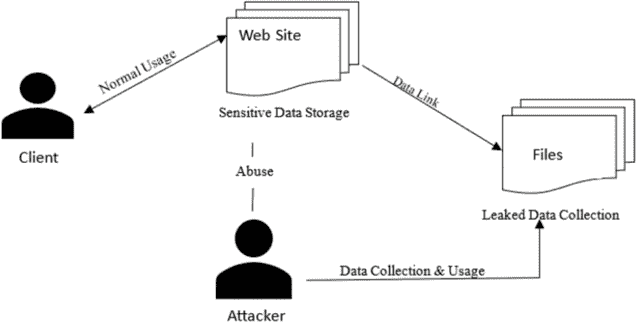

**图1。** 数据泄露流程图。

## 无线移动性概述

游牧计算的格局改变了我们与信息和技术互动的方式，提供了前所未有的灵活性和连接性。从本质上讲，移动计算围绕着使用智能手机、平板电脑和可穿戴设备等便携式设备，允许用户在移动中访问数据、应用程序和服务。这一根本性变化重新定义了人们工作、交流和消费内容的方式。移动设备的广泛使用得益于先进的硬件、多样化的操作系统和大量的移动应用程序。移动计算的关键要素包括4G和5G等无线通信技术，促进无缝连接。移动应用程序从生产力工具到娱乐，在改善用户体验方面发挥着至关重要的作用。云计算的集成进一步增强了移动设备的功能，使其能够在云中进行存储、处理和协作。尽管移动计算在便利性和可访问性方面具有明显优势，但持续的挑战包括安全、隐私问题以及有效电力管理的必要性。移动技术的持续进步，加上持续的创新，确保移动计算格局保持动态和影响力，在全球范围内塑造个人和企业的数字体验。

移动设备的普及得益于先进的硬件、多样化的操作系统和庞大的移动应用程序生态系统。这些应用程序从生产力工具到娱乐，在提升用户体验和满足多样化需求方面发挥着重要作用。无线通信技术的出现，以从4G到如今无处不在的5G的演进为例，进一步促进了无缝连接，确保个人可以随时随地保持连接。此外，云计算的集成显著扩展了移动设备的功能。这一进步使存储、处理和协作能够在云中进行，减少了对本地设备资源的依赖并提高了整体效率。随着个人越来越多地利用云执行各种任务，移动设备上可实现的事情的边界不断扩大（Ghadi B et al., ... 2021; Bilogrevic I et al., ... 2011）。

## 定义和范围

移动计算是使用智能手机、平板电脑和可穿戴技术等便携式计算设备，使用户能够在移动中无缝访问和交互信息和应用程序。这一范式远远超出了传统固定计算环境的局限性，赋予用户从几乎任何位置连接、通信和执行各种任务的自由。移动计算的广泛范围涵盖了多样化的活动，从无线通信和移动应用程序的使用到云服务的无缝集成（Mollah M et al., ... 2017; Ghadi S et al., 2021）。

这种计算的变革性转变彻底改变了个人处理工作、社交和参与数字内容的方式。重点在于灵活性、便利性和实时即时获取信息。无论是专业任务、与亲友保持联系还是消费数字媒体，今天每个人都严重依赖便携式计算。游牧计算的兴起改变了无线基础设施的移动性和范围，在全球范围内对个人和专业生活的各个方面产生了重大影响。它是一种超越传统计算设置限制的范式，使用户能够在任何地方利用计算的强大功能。随着技术的进一步发展，预计移动计算的影响将增长，重新塑造我们驾驭数字环境的方式并增强连接的可能性，

生产力与便利性。移动计算是一股动态力量，持续塑造并重新定义着全球用户的数字体验。

从本质上讲，移动计算的核心在于使用兼具计算能力和无线通信功能的紧凑便携设备。这些设备包括智能手机、平板电脑和可穿戴设备，已无缝融入我们的日常生活，提供满足各种需求的广泛应用和服务。

移动计算的广泛范围涵盖各种活动和功能，其中4G和5G等无线通信技术构成了支撑流畅连接和即时数据访问的骨干。

面向从生产力工具到娱乐等各种任务的移动应用，极大地促进了移动计算的适应性和多功能性。

云服务的整合进一步增强了这些设备的能力，实现了跨平台的协作工作、数据存储和同步。

移动计算的变革性影响在生活的各个方面显而易见。在商业领域，它促进了远程工作，改善了沟通，提供了高效获取关键信息的途径。在社会层面，它促进了全球连接和实时互动，而教育领域则受益于在线学习平台和教育类应用。此外，随着虚拟现实（VR）和增强现实（AR）等流行技术的引入，移动计算的范围持续拓宽，为消费者的体验带来了新的维度。

尽管移动计算有诸多优势，但安全、隐私以及高效电源管理需求等挑战仍是其持续演进过程中的关键焦点。随着技术的进步，移动计算的发展轨迹呈现上升态势，影响并重塑个人、企业和整个社会与数字世界的互动方式。移动计算动态且不断演进的景象，反映了在我们日益以移动为中心的世界中，连接与互动方式正在被持续重新定义（Mollah M et al., 2017; Ghadi S et al., 2021; Imielinski T and Korth H, 1996）。

## 移动设备的演进

移动设备的演进走过了一段变革之旅，其间伴随着技术飞跃和消费者驱动的创新，彻底改变了我们沟通、工作和获取信息的方式。

这一切始于1983年第一款商用手机摩托罗拉DynaTAC 8000X的问世。这些设备虽然笨重且仅限于语音通话，却标志着移动通信的开端。随着数字蜂窝网络的引入，它们迅速发展，为更好的通话质量和基础的短信功能铺平了道路。20世纪90年代末和21世纪初的诺基亚Communicator和黑莓设备预示着一个新时代的到来，提供了电子邮件访问和初级的网页浏览功能，尽管是在较小的屏幕和实体键盘上。

然而，2007年iPhone的首次亮相让移动领域发生了巨变。苹果创新的触摸屏界面，加上App Store，彻底改变了移动设备的概念。它普及了智能手机作为多功能工具的理念——不仅用于通信，还用于娱乐、生产力和众多其他应用。

与此同时，谷歌在2008年推出Android操作系统，为各种智能手机打开了闸门，推动了整个行业的竞争与创新。

技术进步将智能手机推向了更高境界。高分辨率摄像头、更快的处理器、更清晰的显示屏和更长续航的电池等集成成为标准配置，提升了用户体验。此外，网络连接由4G向5G的演进，带来了飞速的互联网速度、更低的时延，以及物联网应用、增强现实和更沉浸式体验的更多可能。

手机变得更纤薄，大屏幕占据主流。折叠屏手机的出现带来了新的可能，让用户无需牺牲便携性即可享受更大显示屏的优势。这一设计转变激发了兴趣，为多任务处理和多样化的用户交互开辟了道路。如今，移动设备已不仅仅是通信工具，它们已成为不可或缺的伙伴，融合了用于语音助手、个性化推荐和安全功能的人工智能。这些设备处于我们互联生活的最前沿，移动技术的演进持续突破极限，预示着一个这些设备与我们的日常生活和技术创新无缝融合的未来。

外形设计也随之改变。手机变得更纤薄，大屏幕占据主流。折叠屏手机的出现带来了新的可能，让用户无需牺牲便携性即可享受更大显示屏的优势。这一设计转变激发了兴趣，为多任务处理和多样化的用户交互开辟了道路。如今，移动设备已不仅仅是通信工具，它们已成为不可或缺的伙伴，融合了用于语音助手、个性化推荐和安全功能的人工智能。

移动设备的外形多年来发生了重大变化，智能手机在配备更大屏幕的同时变得更加纤薄和便携。折叠屏手机的出现带来了新的可能，让用户无需牺牲便携性即可享受更大显示屏的优势。这一设计转变引发了好奇，并为多任务处理和多样化的用户交互开辟了道路。如今，移动设备已成为不可或缺的伙伴，融合了用于语音助手、个性化推荐和安全功能的人工智能。作为移动技术，这些设备预计将激发创新，为多任务处理和多样化的用户交互开辟途径。如今，移动设备已

成为不可或缺的伴侣，集成人工智能用于语音助手、个性化推荐和安全功能。随着移动技术的持续发展，这些设备有望与我们的日常生活和技术创新无缝交织（Edmondson J 等，2014）。

## 便携计算的普及

移动计算在我们日常生活中的广泛采用及其深远影响，在智能手机、平板电脑及相关设备爆炸式增长的推动下，带来了重大的数据隐私问题。在此环境中，收集和使用位置数据是一个主要挑战。在普及的移动计算背景下，由于设备和数据量庞大，现有技术面临着实际的安全局限。挑战包括准确收集关键数据和有效分析安全风险。移动设备配备有能够追踪用户 GPS 位置的传感器，用于位置服务、天气应用和本地搜索功能等目的。然而，同一数据可能被第三方应用或服务提供商在未经明确同意的情况下利用，以监控用户的行踪。个人数据在移动设备上的传输和存储构成了另一个重大障碍。如图 2 所述，如果移动设备经常丢失或被盗，敏感信息可能会落入坏人之手。此外，移动网络的漏洞容易遭受截获和黑客攻击，这又增加了一层忧虑。

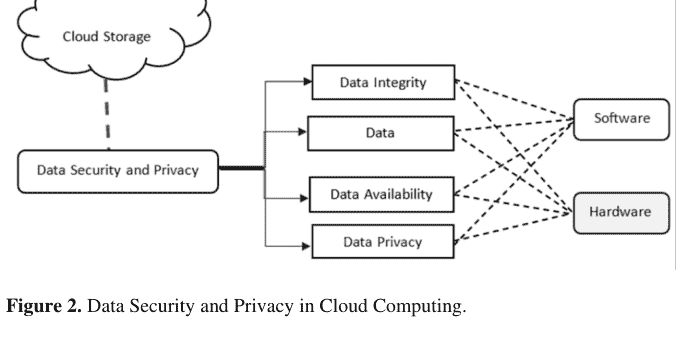

图 2. 云计算中的数据安全与隐私。

## 移动领域不断演变的威胁与漏洞

移动领域的快速增长使其成为网络犯罪分子的首要目标，因为它是获取敏感信息的便捷途径。移动领域是一个动态生态系统，随着新技术、新功能，以及不幸的是新威胁而不断发展。以下是移动领域一些不断演变的威胁和漏洞：

- 恶意软件攻击：
- 钓鱼攻击：

恶意链接、虚假广告或恶意软件都可以与其他应用同时下载。这类恶意软件可能窃取密码和敏感数据。专门针对智能手机和平板电脑等移动设备的恶意软件被称为移动恶意软件。钓鱼电子邮件、非官方应用商店，甚至广告网络都可能被用来分发恶意软件。

网络犯罪分子利用钓鱼攻击，通过伪造电子邮件、短信和弹窗广告来诱骗用户泄露个人信息。

- 设备丢失或被盗：

移动设备经常丢失或被盗，如果其中包含未受保护的敏感数据，就可能导致数据泄露。
- 不安全的 Wi-Fi 网络：

由于公共 Wi-Fi 网络普遍缺乏安全性，黑客很容易拦截正在传输的未加密数据，包括登录密码和个人电子邮件等敏感信息。
- 过时的软件：

使用较旧的软件会增加网络犯罪分子利用漏洞并获取敏感数据的机会。要解决这些不断演变的威胁，用户应保持移动设备、应用程序和软件更新，并避免访问有风险的网站和下载。他们还应该启用加密以及设备登录密码或生物识别，以保护设备上的数据。此外，建议用户在接入本地无线网络和虚拟专用网络（VPN）时保持谨慎，以记录其所有移动通信。他们还应在打开来源不明的电子邮件、链接和附件时保持谨慎。最后，他们应启用双因素认证（Weichbroth P 和 Lysik L，2020；Khan J 等，2015）。

## 数据聚合与跟踪

数据收集和跟踪在移动计算中起着至关重要的作用。以下是数据收集和跟踪在移动计算中的一些应用方式：

- 位置跟踪：提供基于位置服务的应用可以使用 GPS 数据跟踪用户的位置。
- 定制建议：通过监控用户的浏览器历史记录和应用使用情况，可以根据用户的兴趣和活动生成个性化推荐。
- 使用分析：

应用可以跟踪使用分析，以了解用户行为、识别瓶颈并改善用户体验。

- 社交网络集成：应用可以利用社交网络集成来收集用户的人口统计信息、偏好和行为数据，以提供更加个性化的服务。
- 实时数据收集：移动设备可以从传感器收集实时数据并将其发送到服务器进行分析。

移动计算中的数据收集和跟踪在交通管理、天气预报和健康监测等各种应用中提供了显著优势。这一过程不仅促进了创新服务并增强了用户体验，还为企业和组织提供了宝贵的见解。然而，数据收集面临的一个关键挑战在于确保用户同意和透明度。虽然用户通常通过应用权限和服务条款协议对数据收集给予默示同意，但关于所收集信息的范围和性质往往缺乏明确性。这种不透明性引发了对个人数据可能被滥用或未经授权访问的合理担忧，凸显了建立更透明、更具信息量的同意机制的必要性（Bilogr evic I 等，2011）。

## 个人身份信息暴露

这里的主要问题是用户私人信息（PII）的意外或非法披露，包括姓名、地址和银行账户信息。这种暴露可以通过多种渠道显现，包括数据泄露、第三方访问、社会工程学、位置跟踪以及用户对隐私法规的无知。数据泄露构成了重大威胁，可能使未经授权者进入大量个人数据存储库。不充分的安全措施、应用漏洞或蓄意的网络攻击都可能危及数据库或系统，导致身份盗窃、金融欺诈或其他利用泄露信息的恶意活动，大规模影响个人。此外，移动应用经常获得超出其功能所必需的权限。这可能会无意中导致第三方访问，使应用有可能暴露敏感信息。不充分的安全措施或粗心的数据共享做法增加了个人信息暴露的风险，凸显了更严格控制和道德数据处理的重要性。社会工程学和钓鱼策略通过利用人性弱点并诱使个人泄露敏感数据或登录凭据，带来了额外风险，从而危及个人信息安全。即使征得用户同意，持续跟踪位置数据也会带来潜在的暴露风险。对此类数据的未经授权访问或滥用可能侵犯隐私、危及安全，或导致侵入性跟踪和用户画像分析。在用户隐私与功能之间找到平衡至关重要。面对这些障碍，加强网络安全措施、实施可靠的加密协议、进行频繁的安全审计以及遵守严格的数据保护法律至关重要。向用户提供有关数据实践的详细信息、保证全面且明确的隐私政策、授予对权限的细粒度控制，以及提升数字素养以识别和应对潜在风险，这些同样重要。要实现安全的移动计算环境，需要一种既重视技术加固又重视用户教育的综合方法，以有效保护个人信息，如图 1 所示（Bilogrevic I 等，2011）。

## 移动计算中的隐私与安全挑战

它包含各种各样的问题，使移动设备上的信息面临可用性、机密性和完整性受损的风险。以下是移动计算面临的一些重大安全问题：

### 未经授权的访问：

- 挑战：未经授权的个人通过物理盗窃或利用身份验证机制中的漏洞获得移动设备访问权限的风险。
- 影响：未经授权的访问可能导致数据泄露、身份盗窃和敏感信息的滥用。

### 信息破坏：

-   挑战：存储、传输或处理过程中数据保护不足，导致敏感信息无意暴露或泄露。
-   影响：个人或机密数据的暴露可能导致隐私违规并危及个人和组织的 安全。

## 恶意应用：
-   挑战：存在可能被下载或安装的恶意应用程序，带来数据窃取、未经授权访问或利用设备漏洞等威胁。
-   影响：恶意应用会损害移动设备的 安全性和功能，导致各种形式的网络攻击。

## 网络安全：
-   挑战：与中间人攻击、移动通信窃听以及未受保护的 Wi-Fi 网络相关的危害。
-   影响：传输过程中未经授权的数据拦截可能导致数据泄露、财务损失或敏感信息暴露。

## 设备丢失和被盗：
-   挑战：移动设备可能丢失或被盗，从而带来敏感数据暴露和未经授权访问的风险。
-   影响：丢失或被盗可能导致数据泄露、身份盗窃以及个人或企业信息被潜在滥用。

## 加密不足：
-   挑战：对设备上存储的数据使用加密不足，使其容易受到未经授权的访问。
-   影响：没有加密，敏感数据容易被窃取或未经授权查看。

## 不安全认证：
-   挑战：薄弱或容易被绕过的认证方法，例如简单密码或缺乏多因素认证。
-   影响：当认证程序薄弱时，未经授权的用户更容易访问移动设备及其连接的账户。

## 钓鱼攻击：
-   挑战：通过欺骗性电子邮件、消息或假网站诱骗用户提供敏感信息的企图。
-   影响：财务损失、身份盗窃和非法访问都是成功钓鱼企图的可能后果。

## 过时程序和更新：
-   挑战：由于软件更新和安全补丁不完整或延迟，设备容易受到已知漏洞的攻击。
-   影响：未修补的设备更容易出现安全漏洞，可能成为网络攻击的目标。

## 生物识别安全问题：
-   挑战：使用面部识别或指纹等生物识别认证技术会带来多种风险，包括可能的安全漏洞和隐私后果。
-   影响：生物识别数据被盗或伪造会削弱生物识别安全措施的有效性。

解决这些安全挑战需要采取全面方法，包括安全编码实践、定期软件更新、用户教育以及先进安全技术的实施。

移动技术对信息验证带来的压倒性障碍约为13%，来自恶意软件攻击的安全数据约为9%，过时程序和更新的威胁约为9%，钓鱼攻击的隐私约为13%，由于设计导致的信息破坏即约为4%，各种攻击如加密不足、认证不安全。未经授权访问和数据安全造成的能源消耗约为9%，如图3所示。随着移动计算环境的不断发展，保持警惕并积极缓解安全风险对于确保用户及其数据的安全和隐私至关重要（Kohlenberg T et al., 2010; Khera G. B, 2015）。

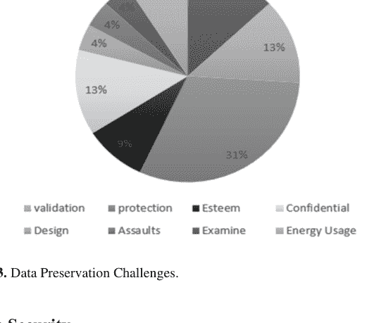

图 3. 数据保护挑战。

## 设备安全
在移动计算领域保护设备是一项至关重要的方面，涉及一系列旨在保护存储数据完整性、机密性和可访问性的措施。它是建立强大的设备安全至关重要，以保护敏感信息并抵御各种潜在威胁。关键做法包括实施强大的认证方法，如屏幕锁、PIN码、密码和生物识别，以防止未经授权的访问。安全策略执行和集中控制在很大程度上由移动设备管理（MDM）系统实现。全面的安全态势还极大受益于在公共 Wi-Fi 上使用虚拟专用网络（VPN），强调安全的网络连接并采用安全浏览实践。操作系统和应用程序的一致更新对于维护设备安全至关重要。这些更新通常会带来补丁以解决已识别的漏洞，关闭网络威胁的潜在入口。定期应用这些更新可确保设备在不断变化的安全风险面前保持稳固，降低攻击者试图突破系统防御而被利用的可能性。有效的设备安全还涉及对应用权限的仔细管理。用户应审查并限制授予应用的权限，仅允许访问必要的数据和功能。应用商店实施的审核流程，加上用户在可靠来源下载应用时的谨慎，发挥着减少与应用相关安全风险的关键作用。总之，在移动计算背景下保护设备需要采取全面策略，结合多层保护以应对潜在威胁的动态环境（Fife E et al., 2019）。

## 网络安全
在移动计算领域，网络安全是一个关键重点，旨在确保移动设备与其他网络之间通信渠道和数据传输的保护。这种强调至关重要，因为不安全的连接会使数据暴露于窃听、篡改或劫持等风险。鉴于移动设备通常使用蜂窝网络，保护这些连接变得至关重要。建议使用加密协议，如 HTTPS，以在传输过程中保护敏感数据。加强认证机制，例如双因素认证。只有授权用户才能访问网络资源，得益于实施双因素认证提供的改进验证流程。虚拟专用网络（VPN）在利用公共 Wi-Fi 网络时发挥着关键作用。VPN 创建数据流量的加密隧道，提供防止潜在拦截的保护并隐藏用户的 IP 地址。通过筛选进出数据，防火墙充当屏障，阻止黑客和其他潜在威胁侵入系统或网络。IDSs 监控网络流量，提醒用户或管理员有关可能表明潜在安全漏洞的任何可疑活动。这使得能够积极应对以减轻风险。本质上，移动计算中网络安全的整体方法涉及加密、安全认证、警惕监控和主动措施的结合，以领先于新兴威胁（Kohlenberg T et al., 2010; Khera G. B, 2015）。

## 应用安全
保护应用程序是移动计算领域的基础要素，涉及一套旨在加强应用程序和用户数据完整性和隐私性的实践。在我们与移动应用的交互中，通常涉及银行详细信息、个人通信和位置数据等敏感信息，安全漏洞可能带来严重后果，包括身份盗窃、财务损失和隐私违规。因此，了解和实施应用安全的最佳实践对于确保安全移动使用至关重要。嵌入在应用中的认证和授权机制在应用安全中发挥关键作用。强大的认证协议，包括多因素认证和有效的密码管理，在安全验证用户身份方面发挥关键作用。高效的授权通过确保用户只能访问其明确被授予权限的功能来最大限度地减少未经授权访问的可能性。使用数据加密对于保护应用程序中保存的私人信息至关重要。通过对传输中和静态数据使用加密技术，确保即使在发生泄露的情况下，暴露的数据对未经授权方也是不可理解的。在应用与服务器之间数据传输期间采用 HTTPS 等安全通信协议，进一步降低了数据被拦截或篡改的风险。审慎管理应用权限和用户隐私至关重要。应用开发者应仅向用户请求必要的权限，并附上透明的解释说明这些权限为何必要。通过限制对敏感设备功能和数据的访问来尊重用户隐私，有助于最大限度地减少与过度权限相关的潜在风险，培养用户与应用之间值得信赖的关系。

定期更新和有效的补丁管理是应用安全的重要方面。及时发布更新并纳入安全补丁以解决新发现的漏洞，对于防止潜在利用至关重要。鼓励用户安装更新可确保他们受益于最新的安全增强功能，抵御新兴威胁并加强应用的整体安全态势，如图 4 所示。依赖信誉良好的应用商店进行应用审核和审查流程，加上用户在应用选择和下载时的谨慎，共同促进了更安全的移动应用环境（Xi k et al., 2011）。

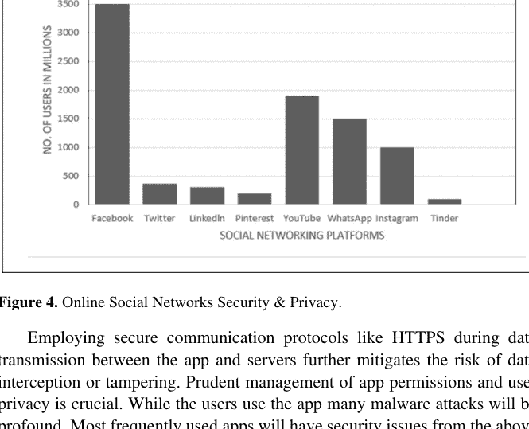

Figure 4. 在线社交网络安全与隐私。

在应用与服务器之间的数据传输过程中采用 HTTPS 等安全通信协议，可进一步降低数据被拦截或篡改的风险。审慎管理应用权限和用户隐私至关重要。在用户使用应用时，许多恶意软件攻击将会盛行。从上图可看出最频繁使用的应用将存在安全问题，人们使用 Facebook 即 3500 名用户，其次 YouTube 在应用安全中发挥着重要作用 即在 1500 至 2500 之间。对于 Instagram，用户约为 1000 人。之后图表结果可能会发生变化，因为在未来新兴的日子里应用功能会更新。一切都取决于用户参与社交网络的程度 (Koyuncu M and Pusatli T, 2019)。

## 身份验证安全

确保移动设备、应用和敏感数据访问的安全在很大程度上依赖于身份验证安全，它构成了仅允许授权个人进入的基础。该安全方面的前沿强调实施稳健且多样的验证技术必要性。身份验证的四个主要组成部分是密码、密码短语、PIN 和生物识别。通过利用独特的生物特征，诸如指纹或面部识别等生物识别技术提供了额外的安全程度。多因素身份验证 MFA 在提升身份验证安全方面发挥着关键作用，通过结合各种身份验证因素。通过要求用户提供两种或更多形式的身份验证，例如他们知道的东西（如密码）和他们拥有的东西（如令牌或指纹），这种方法大大改善了验证过程并降低了仅依赖密码相关的风险。基于令牌的身份验证，利用加密令牌或密钥，提供了额外的安全层。这些令牌通常通过身份验证器应用生成或存储在设备上，提供时效性或一次性使用验证，特别是在多方面或远程身份验证场景中加强身份验证流程。现代安全框架强调持续监控和自适应身份验证机制。这些系统在登录尝试期间观察用户行为和上下文因素，根据检测到的异常或潜在威胁调整安全措施。这种自适应方法根据不断变化的风险加强身份验证流程。生物识别数据的保护是身份验证安全中的关键考虑因素。生物识别数据必须加密并安全存储，以防止滥用和未经授权的访问，维护用户隐私，并阻止涉及极其个人标识符的任何泄露。通过整合这些多方面的身份验证方法和保护措施，移动计算环境增强了其抵御未经授权访问尝试和不断变化的安全威胁的防御能力 (Xi K et al., 2011)。

## 案例研究

### 案例研究 1：对企业设备的未经授权访问

- Challenge:
员工正在经历对公司发放移动设备的未经授权访问，危及敏感的企业数据。

- Existing Solution:
已实施基本的 PIN 或密码保护，但它对复杂的攻击证明不足。

- Proposed Solution:
通过生物识别身份验证（指纹或面部识别）增强安全性并强制执行强且唯一的密码。引入移动设备管理 MDM 解决方案以实现集中控制和监控，允许在丢失或被盗时进行远程设备管理和数据擦除。

### 案例研究 2：通过不安全 Wi-Fi 导致的数据泄露

- Challenge:
员工连接不安全的公共 Wi-Fi 网络时，敏感数据正在泄露。

- Existing Solution:
鼓励使用 VPN 有助于在传输中保护数据，但仍有改进空间。

- Proposed Solution:
制定促进安全 Wi-Fi 实践的全面政策，实施自动 VPN 连接，并利用安全加密通信协议（如 HTTPS）。定期对员工进行安全意识培训，介绍与不安全 Wi-Fi 网络相关的风险。

### 案例研究 3：恶意应用利用设备漏洞

- Challenge:
恶意应用正在利用移动操作系统中的漏洞，对设备安全构成风险。

- Existing Solution:
应用商店审核和安全补丁已到位，但威胁形势正在演变。

- Proposed Solution:
通过实施先进的威胁检测算法增强应用商店安全措施。定期对应用权限和行为进行安全审计。通过宣传活动和教程推广用户教育，识别和避免潜在有害应用。

### 案例研究 4：企业邮件的钓鱼攻击

- Challenge:
员工通过企业电子邮件账户成为钓鱼攻击的受害者，对敏感信息构成风险。

- Existing Solution:
已实施电子邮件过滤器和员工培训，但需要更积极的措施。

- Proposed Solution:
实施先进的电子邮件安全协议，如 DMARC、DKIM 和 SPF。定期进行钓鱼模拟以识别易受攻击的个人并提供有针对性的培训。通过定期传达最新的钓鱼趋势和策略来增强用户意识。

### 案例研究 5：设备丢失和未经授权访问

- Challenge:
设备丢失或被盗，导致潜在的未经授权访问和数据泄露。

敏感数据存储在移动设备上缺乏加密。

- Existing Solution:
已实施基本设备加密，但可能无法涵盖所有敏感数据。

- Proposed Solution:
在敏感数据传输或静态时使用端到端加密。鼓励人们使用安全存储选项，如安全云存储或带硬件加密的外部驱动器。通过定期审计验证是否遵守加密政策 (Haris M et al., 2014)。

### 案例研究 7：弱身份验证方法

- Challenge:
正在使用弱身份验证方法，使得未经授权的访问更容易，如图 6 所示。

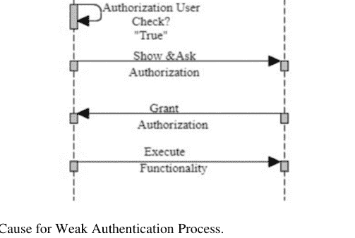

Figure 6. 弱身份验证流程原因。

- Existing Solution:
已实施密码策略，但其有效性可能有限。

- Proposed Solution:
由于弱身份验证目的，提出双重检查授权以克服问题，通过显示并要求系统许可，并在执行功能时向系统授予许可 (Xi K et al., 2011)。

### 案例研究 8：过时的软件和修补

- Challenge:
设备运行过时的软件，存在未修补的漏洞。

- Existing Solution:
已实施自动更新，但需要更积极主动的方法。

- Proposed Solution:
建立积极主动的软件更新政策，确保及时部署安全补丁。定期进行安全审计以识别运行过时软件的设备，并为用户实施自动提醒以更新其设备 (Khan J et al., 2015)。

### 案例研究 9：生物识别数据漏洞

- Challenge:
人们对生物识别身份验证数据的安全性产生担忧。

- Existing Solution:

## 值得注意的隐私和安全泄露

- 剑桥分析/Facebook 丑闻（2018 年）：缺乏授权或知情，Facebook 上 8700 万用户的私人数据已被收集用于政治广告目的。
- Equifax 数据泄露（2017 年）：财务报告机构信用局遭受数据泄露，暴露了 1.47 亿人的个人信息，包括姓名、社会安全号码、出生日期和其他信息。
- Yahoo 2013 年和 2014 年的数据泄露：雅虎两次重大数据泄露暴露了数十亿用户的账户，允许加密密码、电话号码、电子邮件地址和身份被窃取。
- Capital One 数据泄露（2019 年）：未经授权的黑客访问了超过 1 亿名 Capital One 消费者的个人数据，包括地址信息、信用评分和社会安全号码。
- SolarWinds 供应链攻击（2020 年）：一次复杂的网络攻击入侵了软件供应链，影响了众多组织，包括政府机构。攻击者通过 SolarWinds Orion 软件更新添加了恶意代码。
- 网络安全事件攻击（2021 年）：一次勒索软件攻击针对关键基础设施，特别是燃料供应，展示了关键系统对此类情况的脆弱性。
- JBS 肉类加工网络攻击（2021 年）：一次勒索软件攻击导致全球知名肉类加工公司 JBS 在北美和澳大利亚的运营中断 (Noor T. H et al., 2018; Xi K et al., 2011)。

Equifax（2017 年）的敏感和非敏感数据的隐私泄露，非敏感数据为 0.8。Yahoo 的数据泄露是因为密码的加密，它是敏感和非敏感的组合，敏感性释放低于 0.2，非敏感数据约为 0.8。Colonial Pipeline 勒索软件和 JBS 肉类加工的攻击已被泄露。值得注意的数据释放如下，其中是非敏感的，其最高值在图 7 中指定。

**图 7.** 隐私泄露比较。

## 安全措施的成功实施

在现代数字环境中，必须实施有效的安全措施来保护重要资产并维护数据的隐私性、可用性和完整性。为了识别潜在威胁和漏洞，并使组织能够根据潜在影响对风险进行优先级排序，第一步是进行全面的风险评估。制定和实施完善的安全政策和程序，以及持续的员工意识和培训计划以确保理解和合规，是加强安全的重要步骤。访问控制发挥着至关重要的作用，要求采用强有力的程序，根据最小权限原则将系统和数据访问限制在授权个人。加密是安全的一个基本组成部分；企业通过使用强大的算法和密钥管理实践实施的稳健加密，对传输中和静止状态的敏感数据进行加密。防火墙和入侵防御系统的部署有助于监控和控制网络流量，而定期的软件更新和补丁管理则确保所有系统都配备了最新的安全补丁。持续的安全意识培训对于教育和利用强大的算法以及重要的管理技术仍然至关重要。网络流量监控和控制得益于防火墙和入侵防御系统的安装，并且所有系统通过补丁管理和常规软件更新保持最新的安全补丁。为了向员工传授有关新安全威胁和最佳实践的知识，持续的安全意识培训仍然至关重要。为了对安全事件做出及时有效的响应，定期创建和测试事件响应计划也至关重要。网络分段被实施以隔离各个网络段，从而减少安全漏洞的可能影响。常规安全审计和监控使得评估安全控制的有效性并快速识别事件成为可能。一个强大的备份和恢复计划至关重要，其中包括频繁备份以减少数据丢失时的停机时间、恢复计划和数据备份。为了确保符合安全标准和指南，组织应评估和监控第三方供应商的安全实践，如图 7 所描述。物理安全措施也用于通过限制访问和防止未经授权进入来保护关键基础设施，例如数据中心。通过将这些措施纳入全面的安全战略，组织可以加强其抵御网络攻击的防御能力，并创建一个保护敏感数据和整体运营完整性的安全计算环境（Barth et al., 2019）。

## 用户意识和教育

对用户进行移动计算中隐私和安全方面的教育对于培养主动和知情的保护智能手机和平板电脑上敏感信息的方法至关重要。随着人们对移动设备在各种活动中的依赖程度不断增加，确保用户熟悉潜在风险和减轻这些风险的最佳实践变得至关重要。

以下是该重要教育项目的主要组成部分：...

- 定向广告：创建针对不同人口统计和用户群体的定向活动，解决他们与移动隐私和安全相关的独特需求和关注点。
- 引人入胜的教育体验：通过融入游戏、角色扮演和研讨会等互动技巧，使移动安全学习过程更具吸引力和趣味性。
- 通俗语言：通过避免技术术语并以清晰简洁的术语呈现，确保更广泛的受众能够轻松理解复杂概念。
- 采用多种渠道：可以通过社交媒体、公共服务广告以及与教育机构和社区协会的合作等各种平台来传播意识。
- 基本卫生程序：为用户提供有关安全密码创建、双因素身份验证、控制应用权限以及确保应用和设备定期更新的基本知识。
- 识别风险：帮助用户识别常见的移动安全威胁，例如恶意软件、网络钓鱼诈骗和不安全的公共 Wi-Fi 网络。
- 数据隐私意识：描述诸如数据跟踪、数据共享政策和在线数据用户权利等概念。
- 促进明智决策：教育用户使其能够就想要使用的在线服务、下载的应用以及授予的权限做出明智选择。

## 最佳实践和策略

为了领先于不断变化的网络安全威胁格局，组织需要采取主动的方法。定期风险评估提供了对潜在威胁和漏洞的基本理解，有助于部署有针对性的安全措施和资源的战略分配。这一持续过程确保组织能够很好地准备应对网络威胁动态环境中的新兴挑战。

安全政策和程序构成了组织防御战略的支柱。这些全面的指南涵盖了数据处理、访问控制和事件响应协议等关键方面。定期更新和有效传达这些政策至关重要，培养安全文化并让员工充分了解其在维护安全环境中的角色。人为错误仍然是网络安全中持续存在的挑战，使得持续的员工培训和意识计划必不可少。公司通过为员工提供有关最新威胁和社会工程技术的培训，使其能够成为抵御可能网络攻击的警惕守护者。通过这种方法，知识渊博的员工队伍成为该组织挫败网络钓鱼诈骗和其他在线攻击努力中的宝贵资产。实施访问控制至关重要，通过将最小权限原则付诸实践，因为只有授权人员才能访问个人身份信息，非法入侵和可能的数据泄露风险就会降低。根据这一原则，个人必须获得完成任务所需的最低访问权限。

使用数据加密可以大大增强机密数据的保护。组织通过在传输中和静止状态下加密数据来增加一层保护。这使未经授权的各方访问和滥用关键数据变得困难得多，即使在不太可能的情况下。定期更新软件是对在线攻击的预防措施。黑客经常利用过时软件中的安全漏洞，因此公司可以通过尽快安装安全补丁来降低被利用的风险并提高系统的整体稳健性。防火墙和入侵防御系统至关重要，因为它们是防止未经授权访问和潜在网络威胁的第一道防线。持续的测试和更新对于有效减轻安全事件的影响是必要的。纳入所获经验的事件响应计划保证了战略的准备性和适用性。为了最大限度地减少安全漏洞的可能后果，网络分段对于限制攻击者在网络内的横向移动至关重要。组织可以通过使用持续监控实时识别和解决安全问题，从而为其网络安全态势增加一层主动保护。

定期数据备份可在数据丢失时维持公司的连续性。通过备份系统测试和数据恢复计划的定义减少停机时间和潜在损失，企业可以变得更具抵御意外事件的能力。评估并密切关注外部供应商和服务提供商的安全政策变得至关重要，尤其是在外包特定任务时。这确保整个供应链遵守稳健的安全标准，防止潜在漏洞通过外部合作伙伴进入组织。物理安全措施，包括对数据中心和其他关键基础设施的受控访问，是整体安全战略不可或缺的组成部分。通过防止未经授权的物理访问，组织为敏感信息和设备增加了额外的保护层。了解相关法律法规对于法律合规至关重要。遵守行业标准和法规有助于组织保持强大的安全态势并避免潜在的法律后果。

**图 8.** 数据隐私保护策略。

频繁的安全审计提供了有关安全控制实施情况的重要信息。通过评估和纠正可能需要改进的领域，组织能够积极应对新兴威胁并保持强大的网络安全态势。应鼓励各层级员工优先考虑并积极参与维护安全环境，以培养安全意识文化。关于安全问题的开放沟通能够打造更具韧性的组织，使每个个体都了解自己在维护网络安全集体努力中的角色。实施多因素认证为用户账户增加了保护，使恶意行为者获得未经授权的访问变得困难得多。

端点安全至关重要，因为网络攻击经常针对端点，包括计算机和移动设备。组织的数字基础设施整体安全受到定期监控和确保安全软件保持最新状态的影响。对于使用云服务的企业来说，遵守保护其数据和在线应用的标准做法至关重要。得益于适当的配置、严格的访问规则和强大的加密，云计算的好处可以在不牺牲安全性的情况下实现。与更广泛的网络安全社区合作是一种积极主动的方式，以了解最新的趋势和潜在危险。参与知识共享计划并与专家互动可以提高组织适应和应对不断变化的网络风险环境的能力（Weichbroth P and Lysik L, 2020）。

数据隐私和保护个人数据是一个范围广泛的主题，具有图 8 中所指定的众多方面。通过实施强大的安全措施防止敏感数据丢失、受损或被篡改，可以降低攻击风险。保护私人信息的隐私是处理保密性领域的首要目标，例如账号号码、地址、医疗、电子邮件、网站、社会保障、地理信息、照片等。

## 隐私设计

隐私设计代表了一种前瞻性策略，强调从设计和开发过程的初始阶段就整合隐私考量，而不是将隐私问题作为事后处理。这种主动方法涉及在早期阶段识别和缓解潜在的隐私风险，使组织能够构建更具韧性且注重隐私的系统。在这一框架中，隐私不是可选择的选项，而是默认内置的，免除了个人采取额外步骤保护隐私的需求。核心概念围绕在每个阶段纳入隐私考量，包括系统和服务的构想、设计、开发和部署。将隐私整合到设计过程中能够在潜在隐私问题升级为重大问题之前实现早期检测和解决。该原则坚持隐私措施不应损害技术的预期目的或功能。总体目标是实现强大的隐私保护和完整功能，在两者之间取得平衡而不牺牲一方。为了在整个生命周期中保护数据，会实施强大的安全措施，防止未经授权的访问和潜在的数据泄露。提供对隐私实践的透明可见性建立信任，并使个人能够就其个人信息做出明智决策。赋予个人对其数据的控制权至关重要，组织应尊重用户对其数据处理的偏好，提供用户选择加入或退出特定数据处理活动的机制。

与将一方成功视为另一方损失的零和思维不同，隐私设计努力寻求互利解决方案，满足个人和公司的需求。这种合作策略创造了双赢局面并促进双方受益。在这种策略中，对不断变化的隐私风险和法规进行持续观察、评估和调整至关重要。当组织在整个生命周期中保持关注时，更能适应不断发展的隐私挑战。这种以用户为中心的方法优先考虑隐私，同时也有助于设计既用户友好又注重隐私的技术。隐私设计最终旨在通过平衡强大的隐私保护与技术改进，在个人和企业之间取得互利的平衡（Gupta B et al., 2018）。

## 持续监控与更新

持续监控和定期更新是移动计算领域的重要支柱，形成了维护设备安全、功能和整体健康的双重基础。持续监控的做法涉及对设备功能各个方面的持续审查，包括网络流量分析、设备健康指标、行为模式以及安全事件的全面记录。这种实时观察有助于快速识别异常或安全威胁，实现快速响应和有效缓解。网络流量分析在检测可能指示未经授权访问或潜在数据泄露的异常模式方面发挥关键作用，而设备健康监控则确保最佳性能和无缝用户体验。行为分析有助于识别不规则活动，为诸如恶意软件之类的潜在安全风险提供有价值的见解。同时，持续监控包括漏洞扫描，以主动解决已知弱点（Barth S et al., 2019）。

然而，定期升级对于保持移动设备最新和有韧性至关重要。这些更新包括用于提高稳定性的错误修复、用于改善通用使用的功能改进，以及用于加强抵御新威胁防御的安全升级。定期更新还解决兼容性问题，确保与最新应用程序和服务无缝集成。此外，它们有助于遵守有关隐私和安全的行业标准和法规。特别重要的是固件和操作系统更新，其中包含关键的安全改进，可使设备抵御不断发展的网络威胁。

在移动计算中，持续监控是指实时观察设备的几个安全态势、网络活动和性能方面。具有预防性可以快速发现不规则情况或对安全的危险，定期监控包括...

- **网络流量分析：** 观察进出网络数据的流动是否存在不规则或可疑活动的迹象，是一种旨在检测潜在安全漏洞或未经授权访问的主动措施。此监控过程涉及审查网络内的数据交换，以识别任何偏离常态的模式或行为。通过这样做，组织可以迅速确定异常情况，从而及时响应以减轻潜在安全威胁并确保其网络环境的完整性。
- **系统健康监控：** 持续评估设备的健康状况，包括电池状态、存储利用率和整体性能等方面，对于保持最佳功能至关重要。
- **行为分析：** 分析用户行为和应用程序使用模式对于检测可能预示潜在安全威胁的异常活动至关重要，例如恶意软件的存在或未经授权的访问。
- **安全事件目录：** 维护安全事件的全面日志对于事后分析很有价值，并且可以用于识别可能预示潜在安全问题的模式或趋势。
- **漏洞扫描：** 持续扫描设备以确定已知漏洞和弱点，对于在潜在安全风险被利用之前采取主动措施加以解决至关重要。
- **安全补丁：** 频繁的更新通常包含旨在修复最近发现漏洞的补丁，从而保护设备免受潜在安全威胁。

- 错误修复：更新解决了软件错误和故障，增强了系统的整体稳定性和性能 (Babat A et al., 2015; Barth S et al., 2019).

## 即将到来的模式与新技术

新趋势和正在发展的技术旨在解决当前问题并提供新的机遇，影响着移动计算中隐私和安全的发展方向。整体格局预计将受到若干重要趋势和技术的影响……例如：

### Zero-Trust 结构

可以设想更多人会使用零信任安全模型。这种方法基于这样一个理念：公司内部或外部的任何一方都不应立即被视为可信。强大的访问控制结合持续的用户身份和设备完整性验证可提高移动计算安全性。

### 实体级加密

利用同态加密这种复杂的加密方法，加密数据可以在不先解密的情况下进行计算。由于它允许在不泄露敏感信息的情况下进行安全的云数据处理，因此该技术有可能极大地提高移动计算中的隐私性。

### 利用边缘计算

边缘计算利用邻近的计算资源，而不是将信息传输到远离其源的地方。由于需要通过网络传输的敏感数据减少，这一趋势提高了隐私性。当边缘计算集成到移动设备中时，用户可能对自己的数据有更大的控制权 (Hou Y et al., 2020)。

### 分布式账本技术 (DLT) 管理身份

借助区块链等分布式账本技术，可以实现安全、去中心化的身份管理。通过使用 DLT，移动设备可以减少对集中式身份提供商的依赖，并提供更安全、更私密的用户身份验证 (Josang A, 2014)。

### 5G 安全升级

随着 5G 网络的普及，针对 5G 网络量身定制的安全改进将至关重要。网络切片和增强加密技术等功能的目标是建立更强大、更安全的移动通信基础设施。

### 生物识别进展

随着不断发展的生物识别技术的使用，身份验证中对传统密码的依赖可以减少。这些技术包括静脉图案识别、步态分析和行为生物识别等 (Yang W et al., 2018)。

### 利用机器学习保护隐私

差分隐私和联邦学习等隐私保护机器学习方法使协作模型训练成为可能，这些方法通过不披露特定用户的信息来保护用户隐私。这对于使用机器学习提供个性化用户体验的移动应用尤其重要。

### 抗量子密码学

随着量子计算机的出现，对抗量子密码学的需求日益增加。为了克服量子计算机可能带来的风险，移动设备和通信协议需要实施抗量子攻击的加密方法 (Noor T et al., 2018)。

### 监管变化

这些即将到来的趋势和正在发展的技术表明，移动计算环境正朝着更私密、更安全、更稳健的方向发展。为了领先于不断出现风险并保持消费者对数字生态系统的信任，移动安全策略必须积极地在技术突破出现时将其纳入其中。

像 GDPR 这样不断发展的安全和隐私法规可能会塑造未来。对制定和实施严格数据保护立法的持续努力可能会影响优先考虑移动计算中用户隐私的解决方案的进步和实施 (Hou Y et al., 2020; Edmondson J et al., 2014)。

## 演变的威胁态势

移动计算中隐私和安全风险的不断升级是一个重大问题，因为移动设备的广泛使用扩大了网络威胁的可能性。关键安全挑战包括网络钓鱼攻击、恶意应用、勒索软件、移动恶意软件以及各种网络层威胁。移动设备在现代工作场所中的整合需要制定强大的安全策略来减轻这些风险。随着用户期望的变化和移动威胁态势呈指数级增长，组织必须重新评估其安全策略。这涉及应对动态挑战并采取与不断变化的安全要求相一致的措施。由于它们能够有效地检测和应对各种威胁，企业移动安全和移动威胁防御解决方案变得越来越受欢迎。组织必须采用安全程序和指南，以确保公司数据的保护来正面应对这些问题。这涉及保护保密性、维护数据完整性、保护用户身份并确保不可否认性。移动恶意软件，包括间谍软件、勒索软件和特洛伊木马，构成了特别突出的威胁。这些恶意实体利用操作系统和应用程序中的漏洞，强调了主动和全面的安全措施的必要性。通过采用强大的安全策略、利用先进的安全解决方案并警惕新危险，公司可以保护机密信息并在移动计算的背景下维护身份识别、保密性、完整性和不可否认性的原则。利用社会工程手段诱骗人们泄露个人信息，使得网络钓鱼攻击变得更加先进。由于移动设备屏幕较小且消费者倾向于在不仔细思考的情况下点击链接，因此它们特别容易受到这些攻击的侵害。随着移动支付系统的使用增加，金融网络危险也随之增加。攻击者寻求利用支付应用和银行平台中的弱点，对用户的财务数据和交易构成直接风险。此外，移动设备在企业环境中的使用日益增加，导致通过移动终端对企业网络进行有针对性的攻击，旨在破坏敏感的业务信息 (Kohlenberg T et al., 2010)。

公共 Wi-Fi 网络固有的安全漏洞带来了持续的风险，尤其由于中间人攻击的可能性。通过数据拦截，这些攻击可以破坏登录密码、私人消息以及在这些网络上传输的敏感数据。物联网 (IoT) 设备的开发增加了新的威胁，进一步使这一本已复杂的情况变得更加复杂。由于这些网络设备通常由移动应用控制，网络犯罪分子现在有更多方式利用弱点并获得对私人敏感数据的非授权访问。此外，移动计算生态系统向增强现实、5G 和 AI 等尖端技术整合的发展带来了进一步的隐私和安全问题。由于这些技术的广泛使用，在这些环境中产生了和共享了大量数据，从而增加了滥用和非法访问的可能性。本质上，公共 Wi-Fi 网络的不安全性质带来了隐私和安全的多方面挑战。它需要主动和全面的方法来应对这些不断演变的威胁，并在日益互联和技术先进的环境中保护用户数据 (Anisetti M et al., 2020; Babat A et al., 2015)。

## 数据保护创新

在不断变化的移动计算领域，优先考虑隐私和安全创新已成为有效应对保护用户数据和维护移动设备完整性日益增长挑战的必要条件。一个值得注意的进步是生物识别认证的广泛采用，以指纹识别和面部扫描为例。这种方法已被证明既安全又用户友好，

超越传统的基于密码的方法。先进的加密技术（如端到端加密和文件级加密）集成到移动应用程序和通信平台中，显著增强了数据保护措施，确保了更高水平机密性和安全性。用户现在可以通过详细的应用程序权限和隐私仪表板等隐私功能，对其数据拥有更大的控制权。与此同时，区块链技术在去中心化身份管理方面取得了重大进展，为用户身份验证提供了一个安全透明的框架。这确保了稳健且值得信赖的身份验证流程。

移动设备现正集成安全飞地和基于硬件的安全元件，建立用于存储敏感信息的、能够抵御外部威胁的安全区域。这一发展增强了移动设备的整体安全性。此外，移动威胁防御（MTD）解决方案，例如安全应用程序，在打击针对移动平台的各种网络安全威胁方面发挥着积极作用。这些解决方案致力于检测和缓解诸如恶意软件和网络钓鱼攻击等问题，为移动用户提供额外的保护层。以 Android 定制 ROM 为例的注重隐私的操作系统优先考虑用户隐私，并提供对数据的更高控制。此外，遵守 GDPR 和 CCPA 等隐私法规已成为推动力量，迫使组织采取严格措施以确保合规并保护用户数据。

采用零信任安全模型标志着与传统基于边界的安全方法脱离。这一现代模型强调持续身份验证，要求对用户身份和设备完整性进行持续验证。在不断发展的移动计算领域中，这些创新共同为更安全、更注重隐私的生态系统铺平了道路（Edmondson J 等，2014）。

### 结论

总之，移动计算中隐私和安全的情况已见证了变革性变化，以应对我们互联社会中日益增长的挑战。这些包括生物识别身份验证和高级加密的广泛采用、隐私为中心的操作系统的出现，以及加强用户数据保护的承诺。持续监控和及时更新变得至关重要，提供实时威胁检测以确保设备在不断发展的网络威胁面前保持弹性。区块链上的去中心化身份管理以及安全飞地和基于硬件安全性的集成，反映了保护敏感信息的全面方法。包括详细的应用程序权限和隐私仪表板在内的隐私控制措施，使用户对数据拥有更大的控制权。

### 参考文献

- Ahmad, A., Malik, A. W., Alreshidi, A., Khan, W. and Sajjad, M., 2019. 移动计算设备的自保护自适应安全. *Mobile Networks and Applications*, pp. 1-20.
- Anisetti, M., Ardagna, C., Cremonini, M., Damiani, E., Sessa, J. and Costa, L., 2020. 安全威胁态势. *White Paper Security Threats*.
- Babate, A., Musa, M., Kida, A. and Saidu, M., 2015. 网络安全现状：新兴威胁态势. *International Journal of Advanced Research in Computer Science & Technology*, 3(1), pp. 113-119.
- Barth, S., de Jong, M. D., Junger, M., Hartel, P. H. and Roppelt, J. C., 2019. 对隐私悖论的检验：技术知识、隐私意识和经济资源用户的在线隐私和安全行为. *Telematics and informatics*, 41, pp. 55-69.
- Bilogrevic, I., Jadliwala, M., Kalkan, K., Hubaux, J. P. and Aad, I., 2011. 基于位置共享服务的移动计算中的隐私. In *Privacy Enhancing Technologies: 11th International Symposium, PETS 2011, Waterloo, ON, Canada, July 27-29, 2011. Proceedings 11* (pp. 77-96). Springer Berlin Heidelberg.
- Edmondson, J., Anderson, W., Gray, J., Loyall, J. P., Schmid, K. and White, J., 2014. 下一代移动计算. *IEEE Software*, 31(2), pp. 44-47.
- Fife, E. and Orjuela, J., 2012. 隐私计算：移动应用及用户对隐私和安全的认知. *International Journal of Engineering Business Management*, 4, p. 11.
- Fahrmair, M., Sitou, W. and Spanfelner, B., 2005, September. 移动和泛在计算的安全与隐私权利管理. In *Workshop on UbiComp Privacy* (Vol. 40).
- Ghadi, S. A., 2021, April. 移动计算安全方案概述与挑战. In *Multi-Disciplinary Inter-Collegiate Online Student Research Convention 2021 Cha Ongoing Dynamics of Covid Era A: New Normal In Society and Industry* (P. 473).
- Goundar, Sam, J. Avanija, Gurram Sunitha, K. Reddy Madhavi, and S. Bharath Bhushan, eds. 工业物联网（IIoT）和智能工厂的创新. IGI Global, 2021.

Gupta, B. B., Yamaguchi, S. and Agrawal, D. P., 2018. 移动和云计算中多媒体大数据的安全与隐私进展. *Multimedia Tools and Applications, 77*, pp. 9203-9208.

Hammour, Q., Abu-Shanab, E. and Manasrah, A., 2016. 检验隐私、安全和法律对移动计算信任的影响. *Saba Journal of Information Technology and Networking (SJITN)-ISSN: 2312-4989, 4*(1).

Haris, M., Haddadi, H. and Hui, P., 2014. 移动计算中的隐私泄露：工具、方法与特征. *arXiv preprint arXiv:1410.4978*.

Hou, Y., Garg, S., Hui, L., Jayakody, D. N. K., Jin, R. and Hossain, M. S., 2020. 移动边缘计算中增强数据安全性的访问控制机制. *IEEE Access, 8*, pp. 136119-136130.

Imielinski, T. and Korth, H. F., 1996. 移动计算导论. In *Mobile computing* (pp. 1-43). Boston, MA: Springer US.

Josang, A., 2014. 互联网和移动计算中的身份管理与可信交互. *IET Information Security, 8*(2), pp. 67-79.

Khan, J., Abbas, H. and Al-Mudhahki, J., 2015. 移动用户数据隐私威胁与防御机制综述. *Procedia Computer Science, 56*, pp. 376-383.

Khera, G. B., 移动计算：挑战与可靠性. *Recent Trends in Decision Sciences and Their Implications for Business*, p. 70.

Koyuncu, M. and Pusatti, T., 2019. 智能手机用户的安全意识水平：探索性案例研究. *Mobile Information Systems, 2019*.

Kohlenberg, T., Ben-Shalom, O., Principal Engineer, I. I. and Dunlop, J., 2010. 在不断变化的威胁态势下评估瘦客户端安全. *IT@ Intel White Paper*, p. 8.

Mavridis, I. and Pangalos, G., 1997. 移动计算范式中的安全问题. *Communications and Multimedia Security: Volume 3*, pp. 61-76.

Mollah, M. B., Azad, M. A. K. and Vasilakos, A., 2017. 移动云计算中的安全与隐私挑战：综述与展望. *Journal of Network and Computer Applications, 84*, pp. 38-54.

Noor, T. H., Zeadally, S., Alfazi, A. and Sheng, Q. Z., 2018. 移动云计算：挑战与未来研究方向. *Journal of Network and Computer Applications, 115*, pp. 70-85.

Weichbroth, P. and Łysik, Ł., 2020. 移动安全：威胁与最佳实践. *Mobile Information Systems, 2020*, pp. 1-15.

Xi, K., Ahmad, T., Han, F. and Hu, J., 2011. 一种基于指纹的生物密码安全协议，用于移动计算环境中的客户端/服务器身份验证. *Security and Communication Networks, 4*(5), pp. 487-499.

Yang, W., Hu, J., Wang, S. and Wu, Q., 2018. 基于生物识别的隐私保护身份验证与移动模板保护. *Wireless communications and mobile computing, 2018*.

## 第12章

### 塑造视角：在现代移动计算环境中驾驭增强现实与虚拟现实

M. Bharathi^1^
N. Ashok Kumar^1^
K. Praveena^1,*
V. Kalpana^1
V. Vijaya Kishore^1
and J. Avanija^2

^1^电子与通信工程系，工程学院，Mohan Babu University，Tirupati，A.P，印度
^2^人工智能与机器学习系，计算学院，Mohan Babu University，Tirupati，A.P，印度

### 摘要

在增强现实（AR）和虚拟现实（VR）的动态领域中，随着现代技术的不断演进，我们对宇宙的理解发生了巨大转变。本章拆解了与 AR 和 VR 相关的技术术语，突出了它们对我们数字生活转型的独特贡献。由于它们在各种技术应用中日益普及，了解这些术语之间的精确差异至关重要。本章主要关注增强现实可能产生的影响。

* 通讯作者邮箱: kakarlapravennasvec@gmail.com.

本讨论不仅深入探讨了增强现实和虚拟现实的技术复杂性，还定义了这些技术所带来的多样化沉浸体验，阐明了混合现实的分类与复杂性。本章重点介绍了移动计算与增强现实技术之间的接口。本章将引导读者探索现代移动计算环境中各种增强技术。同时，它为理解如何使用智能手机（无论是Android还是iOS）作为通往迷人增强现实世界的大门提供了宝贵的见解。所有技能水平的用户都可以参与到重建世界的沉浸式体验中。本章探讨了AR和VR在各行业中的潜在应用（F. Spinelli等，2021），包括医疗保健、娱乐、教育等。实证证据突显了这些技术的重大影响及其对专业实践、用户参与度及学习环境的潜在作用。

总而言之，本章涵盖了虚拟现实和增强现实技术在现代移动计算环境中的集成，并提供了对其复杂性的全面理解。此外，借助这些专业词汇，它赋予学生必要的技能和知识，使他们能够轻松地在智能手机上使用增强现实（AR），从而进入一个感知被改变、现实被增强的领域。

**关键词：**增强现实（AR）、虚拟现实（VR）、移动计算、混合现实、智能手机探索、技术感知、数字体验、行业应用

### 引言

当今世界，虚拟现实（VR）与增强现实（AR）之间存在复杂的交互，它们可与移动计算机相连接，以实现实时应用（Tao Zhan等，2020）。主要焦点在于这些沉浸式技术如何通过观察和交互来改变当今的移动世界。该讨论深入探讨了VR和AR技术与移动计算技术无缝集成所涉及的复杂问题。它为广泛的客户、开发人员和利益相关者提供了综合性的建议分析，并讨论了这种集成可能带来的优点和缺点。该研究还考察了AR和VR对移动应用（C. Xu等，2022）、用户界面以及整个计算环境的更广泛影响。

### 技术术语

通过技术语言障碍的挑战，可以深入掌握与虚拟现实（VR）和增强现实（AR）相关的技术术语（Y. Chen等，2020）。本小节首先对每个概念进行简要概述，然后深入解释诸如触觉反馈、手势检测（S. Jiang等，2018）、空间计算和沉浸式环境等术语。通过结合现实世界的示例和场景，内容变得更加易懂，以展示这些思想如何在现代移动计算的框架中显现。通过评估和对应，描述在正式术语与日常英语之间建立了有意义的联系，从而增强理解。图表和信息图表等视觉辅助材料被特意使用，作为视觉参考并解释复杂概念。为确保对复杂功能的全面研究，先进方法附有详细说明。作者在整个叙述中措辞直白，避免使用多余的技术行话。书中融入了增强现实演示和二维码等互动功能，使读者能够第一手接触主题内容，从而提升阅读体验。对于技术水平不同的读者，文末的补充材料或常见问题解答部分是实用的资源。“技术语言”的主要目标是让读者达到较高的理解水平，以便他们能在时尚的移动计算环境中自信地探索快速扩展的AR和VR世界。

### AR与VR的差异

增强现实（AR）和虚拟现实（VR）等前沿技术正在改变社交互动以及人们观察环境的方式。尽管它们都提供沉浸式体验，但它们的方法和所提供的交互却大不相同。

**图1.** AR与VR的区别。

下面，我们列出了如图1所示的AR与VR之间的精确区别：

- **定义：**增强现实（AR）是将数字数据叠加到真实环境上，通过无缝集成虚拟和物理元素来改善用户体验。相反，虚拟现实（VR）则会遮蔽用户的物理环境，将其沉浸在计算机生成的世界中，从而完全取代真实世界。
- **用户环境：**借助增强现实（AR），用户可以在保持强烈真实感的同时受益于数字增强。在这里，数字内容被叠加到现有环境上，从而可以同时操作虚拟和现实元素。另一方面，虚拟现实将用户完全沉浸在一个虚拟环境中，用计算机生成的场景完全取代现实世界，以营造一种封闭而沉浸式的体验。
- **硬件与设备：**为了获得AR体验，用户通常使用平板电脑、智能手机、AR眼镜和抬头显示等设备。相反，虚拟现实通常需要专用的设备，如虚拟现实头显，它提供广阔的视野，并将用户与外部世界隔离开来。
- **交互方式：**增强现实用户可以通过语音指令、设备上的触摸手势和现实世界中的移动，轻松地与虚拟和物理对象进行交互。用户主要使用运动控制器或场景内手势与虚拟现实进行交互，以确保完全沉浸在其中。
- **关联性：**与完全隔离现实世界的虚拟现实不同，增强现实（AR）与现实世界保持着共生关系，因此带来了相对较弱的沉浸体验。由于虚拟现实（VR）使用户完全沉浸，它给用户带来在虚拟环境中的强烈临场感。
- **应用场景：**实时数据构想、游戏优势以及导航应用都是增强现实常用于增强面对面体验的领域。另一方面，虚拟现实广泛用于培训场景、游戏、模拟和虚拟导览，因为这些环境得益于完全沉浸且技巧要求较高的环境。
- **沉浸度：**增强现实（AR）提供的沉浸感较弱，因为它与现实世界保持着相互依存的关系，而虚拟现实（VR）则与物理世界完全分离（H. Adams等，2022）。虚拟现实（VR）能够完全沉浸用户，因而在虚拟世界中提供强烈的临场感。

总之，AR与VR的区别在于沉浸程度以及每种技术与外部世界结合的方式。虚拟现实（VR）让观众沉浸在精心设计的虚拟环境中，提供完全沉浸式体验；而增强现实（AR）则巧妙地将虚拟元素融入现实世界。特定用例、预期沉浸度以及用户交互量将决定哪种技术组合最为有效。

## 增强现实的结果

关于增强现实作为一种革命性力量，正在改变数字技术在各行各业中的应用方式的观点。AR对用户参与度以及虚拟与物理元素的巧妙整合具有显著影响。因此，这种整合是通过

以互动促销、游戏联动和沉浸式叙事等新颖方式吸引受众。

通过带来动态和交互式的学习体验，增强现实（AR）正在学术界开启一场范式变革。这得益于 3D 模型、模拟和更多机遇的整合，这与文献中采用的方法形成了显著差异。增强现实（AR）通过实现虚拟试穿、互动展示和店内导购导航，弥合了线上与线下购物之间的鸿沟，从而革新了商业领域（A. K. Chaudhary 等，2022）。凭借改进的诊断、手术模拟和医学培训，医疗保健领域正在见证降低风险、提高准确性的创新。AR 还延伸到改善生产和维护流程，通过向导式指引提高效率。增强现实（AR）通过协作式社交媒体项目、游戏体验和动态滤镜将共享的增强现实带入社交领域，从而把人们联系在一起。增强现实（AR）是一种超越边界、渗透日常生活的技术力量。随着技术的发展，预计它将拓展沉浸式体验的边界，激发创造力，并改变人们在不同场景和行业中与技术互动的方式。

## 混合现实：揭示差异与探究复杂性

混合现实（MR）是最尖端的沉浸式技术，提供了真实世界与虚拟世界的独特融合。通过对 MR 众多类别和细微差别的探索，这一考察揭示了它所带来的不同感受。

-   **增强现实（AR）与虚拟现实（VR）连续体：** 混合现实是介于虚拟现实和增强现实之间的连续体的一部分。与增强现实一样，它将数字元素与真实世界相结合，但又像虚拟现实一样，让用户完全沉浸于虚拟环境中。这个连续体允许用户以不同方式与数字世界和真实世界互动，并提供多种多样的体验。
-   **增强现实体验：** 在混合现实领域中，数字叠加层增强了真实世界（增强现实）。这一类别包括交互式全息影像、虚拟信息显示和实时数据可视化等应用（X. Xia 等，2019）。用户完全沉浸于一种经过增强的现实之中，虚拟物品与周围环境和谐地融为一体。
-   **虚拟现实沉浸：** “混合现实”一词与虚拟现实同属一个大类。在某些情况下，用户会发现自己暂时与外界隔绝，完全沉浸于计算机生成的虚拟环境中（R. S. Kothari 等，2021）。这一类别包括交互式环境、模拟和虚拟现实游览，它们都有助于增强临场感和团队协作。
-   **即时协作与通信：** 促进实时通信与协作的能力是混合现实面临的挑战之一。无需亲身在场，用户便能在同一空间内协作，与共享虚拟物品互动，并创造混合现实体验。总而言之，探究混合现实的不同要素和发展，可以带来一系列将虚拟世界与真实世界无缝结合的体验。作为一个相对新兴且不断发展的领域，混合现实有能力彻底改变我们观察环境、与环境互动的方式。它将完全沉浸式的虚拟环境与增强真实世界的增强界面整合在一起。
-   **空间计算与交互：** 混合现实的目标是实现空间计算的理念，即系统接收输入并对外部环境即时作出反应。对环境的精确映射变得至关重要，这样才能让数字物体对物理世界的变化做出动态响应。用于与真实物体交互的相同技术，也可用于与虚拟物体交互和操控。
-   **可穿戴技术与头戴式设备：** 混合现实应用通常使用配备传感器和摄像头的可穿戴设备与头戴式设备。使用这些设备，用户可以在真实世界与虚拟世界之间流畅切换，从而使混合现实交互更具沉浸感（Goundar 等，2021）。Microsoft HoloLens 和 Magic Leap 是该领域的两个绝佳例子。
-   **全息计算：** 全息计算的融入是混合现实的一大显著特征。在真实世界中，可以创建、修改和获取全息影像——即三维虚拟物体。全息计算的真实感和前景极大地增强了混合现实体验。

## 揭示增强现实在当代移动计算中的潜力：综合考察

增强现实的出现为现代移动计算带来了一个革命性的时代（C. Wang 等，2023），从根本上改变了我们通过手机与他人以及外部世界沟通的方式。本章进一步详细考察了增强现实（AR）在移动计算中的应用，强调了其对于实时应用的重要性，并为智能手机用户提供了富有洞察力的信息。

-   **移动计算与增强现实的整合：** 考察增强现实与移动计算如何和平共处，强调不断发展的 AR 能力和现代智能手机动态特性的优势。探讨将 AR 与其他技术相结合如何改善用户体验并开辟新的应用机遇。
-   **实用的智能手机增强现实应用：** 举例说明增强现实在人们生活中产生显著影响的几种实际用途。这些应用可包括由增强现实驱动的导航、实时语言翻译、交互式游戏，以及在智能手机相机拍摄的感兴趣区域上叠加数据的应用。
-   **在日常任务中使用增强现实：** 展示增强现实如何融入人们的日常生活。讨论支持虚拟试穿、购物和室内设计的应用，展示增强现实（AR）如何通过智能手机界面巧妙地将数字数据与物理数据相结合。
-   **增强社交媒体互动：** 强调增强现实（AR）对社交媒体平台的影响，因为交互元素、滤镜和特效提升了视觉内容的创作。讨论增强现实（AR）如何演变为一种创意工具，使人们能够与自己的社交网络沟通并表达自我。
-   **AR 游戏革命：** 考察增强现实如何改变游戏行业，重点关注智能手机体验的沉浸感。讨论著名的增强现实游戏，以及它们如何利用智能手机的特性来创造有趣且引人入胜的游戏体验。
-   **增强现实开发的工具与接口：** 简要介绍开发者可用于创建移动增强现实应用的平台和技术。讨论 AR 开发工具包、框架和语言如何演进，以允许更广泛的生态系统参与。
-   **挑战与未来趋势：** 解决阻碍智能手机广泛用于增强现实的问题，例如隐私问题和技术限制。讨论潜在的解决方案，并列举即将到来的创新，如改进的用户界面、新型增强现实设备，以及 AR 融入日常活动。
-   **说明与用户手册：** 为智能手机用户提供最大限度利用增强现实应用的技巧和指导。本节可包括推荐的增强现实相关应用、如何为 AR 内容布置智能手机环境的指导，以及常见问题的解决方案。
-   **行业整合与商业应用：** 考察增强现实在各行业移动战略中的多种应用。讨论增强现实（AR）的商业应用，如提升购物体验、虚拟产品演示，以及企业利用增强现实在移动平台上与客户联系。

总之，要强调增强现实与当代移动计算之间的联系。用户将拥有诸多前沿可能性，这将鼓励他们探索并将增强现实（AR）融入智能手机体验，并在此过程中改变他们对真实世界和虚拟世界的认知与互动方式。

## 关于在智能手机上生成增强现实入口的实用手册

在技术快速变化的世界中，手机已不仅仅是完成日常任务的工具；它们正日益成为进入迷人增强现实（AR）领域的强大入口（S. Castelo 等，2024）。本整章书籍提供了有助于最大化手机作为进入迷人增强现实领域入口的实用建议，面向 Android 和 iOS 设备用户。课程首先概述增强现实的基本概念，然后讨论使智能手机上 AR 体验成为可能的底层技术，并介绍一些重要术语。因此，你将被引导了解软件和硬件的基本规格。这确保了与增强现实（AR）获得最佳体验的兼容性。本研究的用户可以访问众多行业中的各种增强现实平台和应用，如游戏、生产力、教育和导航。客户可通过针对特定智能手机型号的全面设置说明，快速调整设置并开启增强现实（AR）元素，以便沉浸式概览这些互动世界。随着用户踏上冒险之旅，本次导览向他们介绍增强现实（AR）的基础知识，并演示如何与虚拟物品互动以及玩基础 AR 游戏。超越基础知识后，用户将接触到更先进的增强现实功能和功能，如无标记跟踪、空间锻炼和 ARKit/ARCore 功能。预见到某些障碍，该指南还提供了故障排除技巧和方法，通过利用专家建议和策略（如隐藏快捷功能）来增强智能手机上的 AR 体验。本章很重要，因为它解释了权限如何管理以及个人信息如何保持最新，以确保安全的 AR 体验。它强调了在与 AR 和 VR 应用互动时，用户隐私和安全至关重要。

一个渐进的观点在最后一节描述了智能手机增强现实可能的未来发展。客户被鼓励跟上新发展和新功能。最终，本章强调手机除了作为通信工具外，还是进入沉浸式增强现实世界的有效入口。通过使人们能够掌握、探索和玩转增强现实的无限潜力，本研究将日常智能手机互动转变为非凡且增强的体验。

## AR 与 VR 技术：对工作、教育和用户体验的深远影响

本文探讨增强现实（AR）和虚拟现实（VR）技术（F. Weidner 等，2023）如何以显著且明显的方式影响用户体验、工作场所和学术界。VR 和 AR 的沉浸式特性彻底改变了人们使用技术的方式。

- 重新定义用户互动：随着技术的进步，AR 和 VR 技术正在改变用户与消费者的参与方式，使用户能够通过在线购物、协作游戏软件和沉浸式叙事等不寻常的方式与数字环境互动。为了展示这些技术如何改变用户互动，将研究几个案例。
- 教育中的教学适应：虚拟现实和增强现实正成为教育中无处不在的工具，改变着课堂动态。本研究将探讨增强现实（AR）如何增强和影响虚拟实地考察，并在学术环境中将数字内容融入教科书以建立动态学习环境。同样，虚拟现实让学生沉浸于技能学习，如知识增强、模拟和获取革命化。
- 对工作程序的影响：本文将提供实际实例，说明 AR 和 VR 如何在不同企业和行业中改变工作政策。像促进远程协作的团体虚拟现实系统和为危险领域学术专家提供的虚拟培训模拟等技术，有可能彻底改变工作方式和技能学习。
- 更好的教育和人才获取：AR 和 VR 是专业培训和技能发展的有用工具，使其能够在现实环境中练习。本研究将探讨这些技术如何在制造业、医疗保健和航空等领域支持技能和信心的培养。
- 包容性和可及性：通过消除地理障碍并允许适应不同的学习风格或身体限制，AR 和 VR 有助于更好的包容性和可及性。研究将介绍这些技术创新如何促进更具包容性的工作场所和教育环境。
- 对思维和记忆的影响：将对 AR 和 VR 的心理和认知影响进行彻底调查。通过研究这些技术对不同虚拟环境中参与度水平、认知过程和情感反应的影响，本研究旨在提高这些技术的潜在益处和弊端。
- 行业案例研究：为了展示企业如何成功整合 AR 和 VR 以提高产量，将展示来自多个行业的真实案例研究。实际优势——从提高制造到更高效的医疗保健——将被突出。
- 伦理问题和挑战：数据滥用、隐私和数字鸿沟只是需要解决的众多伦理问题和障碍中的几个，以便 AR 和 VR 得到广泛接受。本文的目的是对这些尖端技术如何影响社会进行客观评估。总之，本章深入探讨了关于 AR 和 VR 技术的革命性主张，强调了它们如何影响用户体验、专业实践和教育技术。由于 AR 和 VR 正在改变人们与数字内容互动以及在学习和工作环境中导航的方式，仔细考虑这些技术的伦理影响以及将其整合到现实世界中相关问题非常重要。

## 结论：弥合虚拟现实与增强现实技术与当前移动计算环境之间的差距

本章的第一部分提供了精确的定义并讨论了 AR 与 VR 之间的差异。它展示了 AR 如何通过在物理世界之上叠加虚拟特征来改变物理世界，而 VR 则将人们完全沉浸在计算机生成的虚拟现实中。这为对这两种技术之间的关键区别进行彻底审查奠定了基础。它引导用户了解一系列 AR 和 VR 塑造的场景。通过虚拟元素与现实世界元素的无缝融合，增强现实用户能够与其环境和平共处。另一方面，虚拟现实（VR）则将用户完全沉浸在虚拟环境中。为了展示用户体验的范围，本章详细介绍了各种硬件要求，其中包括 AR 眼镜和智能手机。讨论现在包括 AR 和 VR 如何鼓励互动。用户可以利用语音、触摸和手势命令与增强现实（AR）中的虚拟和物理对象互动。另一方面，虚拟现实（VR）用户主要使用动作控制器与完全沉浸式体验互动。每种技术提供的沉浸程度是 AR 与 VR 之间的关键区别。虽然增强现实（AR）在保持与现实联系的同时提供较不强烈的体验，但虚拟现实（VR）提供完全沉浸的虚拟环境。本章研究了多个用例，以展示这些技术可用于的各种应用。这些包括虚拟现实游戏、虚拟游览和模拟，以及 AR 游戏叠加和导航应用。本章以对 AR 与 VR 之间特定区别的概述作结，强调了它们方法上的差异以及它们与现实世界的关系。它强调了做出明智决策以整合这一突破性技术的重要性。

## References

Adams, Haley, Jeanine Stefanucci, Sarah Creem-Regehr, Grant Pointon, William Thompson, and Bobby Bodenheimer. “为投射阴影带来光亮：AR 和 VR 中感知地面接触的研究。” *IEEE transactions on visualization and computer graphics* 28, no. 12 (2021): 4624–4639.

Castelo, Sonia, Joao Rulff, Erin McGowan, Bea Steers, Guande Wu, Shaoyu Chen, Iran Roman 等。“ARGUS：增强现实中AI辅助任务引导的可视化。”《IEEE Transactions on Visualization and Computer Graphics》（2023）。

Chen, Yuanfeng, Hyunho Kim, Jiseob Lee, Suhui Lee, Youngbin Do, Munsu Choi 和 Jin Jang。“采用a-IGZO TFT的18.6μm间距栅极驱动器，用于超高清AR/VR显示器。”《IEEE Transactions on Electron Devices》67, 第11期 (2020): 4929-4933。

Chaudhary, Aayush K., Nitinraj Nair, Reynold J. Bailey, Jeff B. Pelz, Sachin S. Talathi 和 Gabriel J. Diaz。“时间RIT-Eyes：从真实红外眼睛图像到合成注视行为序列。”《IEEE Transactions on Visualization and Computer Graphics》28, 第11期 (2022): 3948-3958。

Goundar, Sam J. Avanija, Gurram Sunitha, K. Reddy Madhavi 和 S. Bharath Bhushan 编。《工业物联网（IIoT）与智能工厂的创新》。《IGI Global》，2021。

Jiang, Shuo, Bo Lv, Weichao Guo, Chao Zhang, Haitao Wang, Xinjun Sheng 和 Peter B. Shull。“基于sEMG和IMU传感的腕戴式实时手部及表面手势识别可行性。”《IEEE Transactions on Industrial Informatics》14, 第8期 (2017): 3376-3385。

Kothari, Rakshit S., Aayush K. Chaudhary, Reynold J. Bailey, Jeff B. Pelz 和 Gabriel J. Diaz。“Ellipse：用于稳健视线追踪的椭圆分割框架。”《IEEE Transactions on Visualization and Computer Graphics》27, 第5期 (2021): 2757-2767。

Spinelli, Francesco 和 Vincenzo Mancuso。“迈向5G中使能的工业垂直领域：基于MEC的供给与灵活性方法综述。”《IEEE Communications Surveys & Tutorials》23, 第1期 (2020): 596-630。

Wang, Chaowei, Xiaofei Yu, Lexi Xu 和 Weidong Wang。“异构移动边缘计算中基于流量映射的节能任务调度：绿色物联网视角。”《IEEE Transactions on Green Communications and Networking》（2022）。

Weidner, Florian, Gerd Boettcher, Stephanie Arevalo Arboleda, Chenyao Diao, Luljeta Sinani, Christian Kunert, Christoph Gerhardt, Wolfgang Broll 和 Alexander Raake。“使用头戴式显示器在AR与VR中显示虚拟化身与智能体的系统综述。”《IEEE Transactions on Visualization and Computer Graphics》（2023）。

Xia, Xinxing, Yunqing Guan, Andrei State, Praneeth Chakravarthula, Kishore Rathinavel, Tat-Jen Cham 和 Henry Fuchs。“迈向具有调节-辐辏和眼镜处方支持的可切换AR/VR近眼显示器。”《IEEE Transactions on Visualization and Computer Graphics》25, 第11期 (2019): 3114-3124。

Xu, Changqiao, Jiuren Qin, Ping Zhang, Kai Gao 和 Luigi Alfredo Grieco。“基于强化学习的移动AR/VR多路径传输与流功率谱密度分析。”《IEEE Transactions on Mobile Computing》21, 第12期 (2021): 4529-4540。

Zhan, Tao, Kun Yin, Jianghao Xiong, Ziqian He 和 Shin-Tson Wu。“增强现实与虚拟现实显示器：前景与挑战。”《iScience》23, 第8期 (2020)。

空间，从而营造更有利的学习环境。通过这样做，它不仅提高了在线学习的质量，还增强了教育的自由度，使其更易于获取、更具包容性。它提供了一种平衡、注重隐私且有效的方法来监控学生参与度和学习质量，从而提升整体教育体验。本研究提出了高效应用监控系统以改善在线学习活动，并增强教育自由与学术诚信。

关键词：数据安全、学习管理系统（LMS）、生物特征认证、IP追踪、考勤监控、评估与评分、实时仪表板、自动监考、现场监考

### 引言

在线教育因技术发展和互联网的日益普及而越来越受欢迎。由于其为各类学习者提供的灵活性和便利性，虚拟课堂的使用显著增加（Barbara B. Lockee 等，2016）。但伴随这种增长而来的，还有关于学生参与度和学术诚信的难题。为了解决这些问题，多模型学生在线监控系统应运而生。这些系统通过整合人脸识别、击键分析和眼动追踪等功能，支持安全可靠的在线学习，营造有利于学业成功的环境。这种个性化的学习方法可以显著提升整体教育体验（Shivangi Dhawan 等，2019）。

## 背景与动机

在过去二十年中，在线教育经历了显著增长，这得益于技术的进步和互联网的广泛普及。然而，向虚拟学习环境的转变也引发了对学术诚信、学生参与度和表现监控的担忧。随着在线学习者数量持续增加，迫切需要有效的监控系统，以确保安全高效的学习体验、跟踪学生进度，并检测

## 数据收集方法

数据收集方法将包括从各种来源收集数据，例如在线学习平台、学生交互、成绩指标和系统日志。

## 分析技术

本研究将采用各种分析技术，包括用于异常检测的机器学习算法、用于学生表现评估的预测分析，以及用于评估学生的情感分析。

## 文献综述

在线教育的发展是一段变革性的历程，彻底改变了学生获取和参与教育内容的方式。多年来，技术进步在塑造在线学习格局方面发挥了关键作用，推动了多模型学生在线监控系统的发展。本节探讨在线教育发展的关键里程碑，强调了全面监控系统的必要性和范围（Andrea L Schaffer 等，2018）。研究人员探索了文本分析、视频追踪和生物识别数据等多种模态的整合，以创建全面的监控系统。这些系统不仅提供关于学生参与度的实时反馈，还通过自适应内容传递实现个性化学习体验。然而，包括隐私问题和算法偏差在内的伦理问题，需要在此类系统的设计和实施中加以仔细考虑。此外，多模态数据流的整合在数据整理方面带来了技术挑战，如表1所示。

## 在线学习的挑战

多模型学生在线监控系统为在线学习环境带来了诸多优势。然而，它也带来了不少挑战。实施此类系统的一些关键挑战包括：

### 隐私问题

监控学生的在线活动会引发隐私问题。在监控需求与保护学生隐私和数据安全之间取得平衡至关重要。机构必须确保数据得到合乎道德且透明的处理。

### 伦理考量

关于监控的程度及其对学生心理健康和学业成绩的潜在影响，存在伦理问题。在监控与尊重学生自主权之间取得平衡是一项重大挑战。

### 数据管理与存储

该系统会产生大量需要实时处理、存储和分析的数据。管理和保护这些数据可能很复杂，需要强大的基础设施和数据管理实践。

### 技术挑战

实施多模型监控系统涉及集成不同的技术和平台。确保无缝互操作性并克服技术故障可能是一个重大障碍。

## 表 1. 在线监考软件的功能

| 功能 | Proctor track | Mercer Mettl | Talview Prove | Proctor exam | Proctor Edu | Top Hat | Prometric | Maple LMS | Paper shala |
|---|---|---|---|---|---|---|---|---|---|
| 身份验证 | 是 | 是 | 否 | 否 | 否 | 是 | 否 | 是 | 是 |
| 实时监控 | 是 | 否 | 否 | 是 | 是 | 是 | 是 | 否 | 是 |
| 绩效分析 | 是 | 是 | 是 | 否 | 是 | 是 | 是 | 是 | 是 |
| 录制 | 是 | 是 | 否 | 是 | 否 | 是 | 是 | 否 | 是 |
| 浏览器锁定 | 是 | 否 | 是 | 是 | 是 | 是 | 是 | 否 | 否 |
| AI 分析 | 是 | 否 | 否 | 否 | 是 | 否 | 是 | 否 | 是 |
| 屏幕捕获 | 否 | 是 | 否 | 是 | 否 | 是 | 否 | 否 | 否 |
| 警报与标记 | 是 | 否 | 是 | 否 | 否 | 否 | 是 | 否 | 否 |
| 环境检查 | 否 | 是 | 否 | 是 | 否 | 是 | 是 | 是 | 否 |
| 数据安全 | 否 | 是 | 是 | 是 | 是 | 是 | 是 | 否 | 是 |
| 出勤跟踪 | 是 | 是 | 是 | 是 | 是 | 是 | 否 | 否 | 是 |
| 时间跟踪 | 是 | 是 | 是 | 是 | 是 | 否 | 否 | 是 | 否 |
| 屏幕共享 | 是 | 是 | 是 | 否 | 是 | 是 | 是 | 是 | 是 |
| 无障碍功能 | 是 | 是 | 是 | 是 | 否 | 是 | 是 | 是 | 是 |
| 抄袭检测 | 是 | 是 | 是 | 是 | 是 | 否 | 否 | 是 | 否 |
| 移动设备检测 | 是 | 是 | 是 | 是 | 是 | 是 | 否 | 否 | 否 |
| 健壮性 | 是 | 是 | 是 | 是 | 否 | 是 | 是 | 是 | 是 |
| 投票 | 否 | 否 | 是 | 否 | 否 | 是 | 是 | 是 | 是 |
| 聊天/聊天机器人 | 是 | 是 | 是 | 是 | 否 | 是 | 否 | 是 | 否 |
| 真实性与有效性 | 是 | 是 | 是 | 是 | 否 | 是 | 是 | 是 | 是 |
| 小测验 | 是 | 是 | 否 | 否 | 是 | 是 | 是 | 否 | 是 |
| LMS 集成 | 是 | 否 | 否 | 是 | 是 | 是 | 否 | 是 | 是 |
| 作业跟踪 | 是 | 是 | 否 | 是 | 是 | 是 | 是 | 是 | 是 |
| 位置跟踪 | 是 | 否 | 否 | 否 | 是 | 是 | 否 | 是 | 否 |
| 缺点 | 反馈有限 | 无监考，成本 | 缺乏客户支持 | 成本高且访问受限 | 技术问题，数据泄露 | 成本高，管理不善 | 软件缓慢 | 需要 IT 且更复杂 | 缺乏存储，成本高 |
| 部署 | 网页 | 网页，Windows | 网页，Android | 网页，Android | 网页 | 网页 | 网页 | 网页，Windows | Windows，网页 |

## 表 2. 基于系统的在线考试监考功能

| 功能 | Proctor track | Mercer Mettl | Talview Prove | Proctor exam | Proctor Edu | Top Hat | Prometric | Maple LMS | Paper shala |
|---|---|---|---|---|---|---|---|---|---|
| 访问控制 |  |  |  |  |  |  |  |  |  |
| 安全功能 | 强 | 强 | 强 | 强 | 强 | 弱 | 弱 | 弱 | 弱 |
| 访问控制 | 否 | 否 | 是 | 是 | 否 | 否 | 是 | 是 | 否 |
| 用户名和密码流程 | 是 | 是 | 是 | 是 | 是 | 是 | 是 | 是 | 否 |
| 多设备登录禁用 | 否 | 否 | 否 | 是 | 是 | 是 | 否 | 否 | 否 |
| 多平台登录禁用 | 是 | 是 | 否 | 是 | 否 | 是 | 是 | 否 | 是 |
| IP 家庭访问 | 否 | 是 | 是 | 是 | 是 | 是 | 否 | 是 | 是 |
| MAC 访问 | 是 | 是 | 是 | 是 | 是 | 否 | 是 | 是 | 否 |
| 内容安全功能 | 强 | 弱 | 弱 | 弱 | 弱 | 弱 | 强 | 弱 | 弱 |
| 内容安全功能 |  |  |  |  |  |  |  |  |  |
| 屏幕捕获禁用 | 是 | 是 | 否 | 否 | 是 | 是 | 是 | 否 | 否 |
| 截图禁用 | 是 | 否 | 否 | 是 | 是 | 是 | 是 | 是 | 是 |
| 屏幕上闪烁用户 ID | 是 | 是 | 否 | 是 | 否 | 否 | 是 | 否 | 否 |
| 演示练习访问受限 | 是 | 是 | 否 | 是 | 是 | 是 | 否 | 否 | 是 |
| 安全连接已启用 | 是 | 是 | 是 | 是 | 是 | 是 | 是 | 否 | 是 |
| 打印禁用 | 是 | 是 | 是 | 是 | 是 | 否 | 是 | 否 | 否 |
| 考试监考功能 | 强 | 强 | 强 | 强 | 强 | 弱 | 强 | 弱 | 强 |
| 考试监考功能 |  |  |  |  |  |  |  |  |  |
| 飞行模式已启用 | 否 | 否 | 否 | 否 | 否 | 否 | 是 | 否 | 否 |
| Wi-Fi 已禁用 | 是 | 是 | 否 | 是 | 是 | 是 | 是 | 否 | 是 |
| 加密试卷 | 是 | 是 | 是 | 是 | 否 | 是 | 是 | 否 | 是 |
| 题目随机 | 否 | 是 | 是 | 是 | 否 | 是 | 是 | 否 | 是 |
| 测试期间更换设备禁用 | 是 | 是 | 是 | 是 | 否 | 是 | 是 | 是 | 是 |
| 右键禁用 | 是 | 是 | 否 | 是 | 是 | 是 | 否 | 否 | 否 |
| 复制粘贴禁用 | 是 | 是 | 是 | 是 | 否 | 是 | 否 | 否 | 是 |
| 外部按键禁用 | 是 | 是 | 是 | 是 | 是 | 否 | 是 | 是 | 是 |
| 最小化窗口禁用 | 是 | 是 | 是 | 是 | 是 | 是 | 是 | 否 | 是 |
| 打开计算器、Word、Excel 禁用 | 是 | 否 | 否 | 是 | 是 | 是 | 是 | 是 | 是 |
| 照片捕获已启用 | 否 | 否 | 否 | 否 | 否 | 否 | 否 | 否 | 否 |

## 异构性

结合来自不同框架和语言的模型会在数据交换、格式转换以及确保整个管道兼容性方面造成挑战。

## 资源优化

为计算需求各异的多个模型高效分配资源需要在性能和成本之间取得平衡。

## 缺乏即时对话

在面对面环境中，沟通迅速进行，使学生更容易获得答案并澄清令人困惑的概念。在电子学习环境中，沟通通常是异步的，这意味着教师和学生之间存在差距。在这些空间中，很容易产生误解；有时问题会在我们解决之前被搁置。

## 响应未及时收到

提供反馈是教师与学生互动的最重要和最有价值的方式之一。当由于在线格式导致反馈延迟或延迟数周时，学生可能会对你的期望、他们的进步以及他们在课堂上的表现感到困惑或不确定。

## 上下文理解

系统需要考虑在线学习的背景和细微差别。某些行为或互动可能看起来可疑，但在在线教育环境中可能是合法的。克服这些挑战需要深思熟虑的方法，涉及教育工作者、学生、技术人员和政策制定者之间的合作。开放的沟通和透明度对于赢得利益相关者的信任并确保系统成功集成到在线学习环境中至关重要。清楚地传达系统的能力、局限性和伦理考虑至关重要。开放性建立信任，缓解担忧，并允许对基于 AI 的检测工具进行持续评估和改进。清楚地传达系统的能力、局限性和伦理考虑至关重要。开放性建立信任，缓解担忧，并允许对基于 AI 的检测工具进行持续评估和改进。其中一些挑战后面跟着几款软件的列表，其中所有功能集列在表 2 中。

系统通常结合了各种功能和技术来跟踪学生的在线活动、互动和表现（M. Atherton 等，2020）。以下是表 3 中指定的一些示例。

## 表 3. 系统组件及重要性

| 系统 | 重要性 |
|---|---|
| LMS 监控平台 | LMS 平台，如 Moodle、Canvas 和 Blackboard，是用于课程管理、内容交付和学生评估的工具。它们通常提供跟踪和报告功能，使教育工作者能够监控学生的参与度和进展。 |
| 在线评估监考 | 监考解决方案，如 ProctorU、Examity 和 Proctor，在在线评估期间用于防止学术不端。它们通常采用各种监控方法，如视频录制、屏幕共享和基于 AI 的行为分析。 |
| 学习分析系统 | 这些系统，如 Brightspace Analytics，提供关于学生表现和参与度的以数据驱动的洞察。它们使用分析和数据可视化技术来识别学生行为中的模式和趋势（E. R. Kahu 等，2019）。 |
| 混合管理学习工具 | Go Guardian 和 LanSchool 等工具专注于管理学生在在线课程期间的设备。教育工作者可以监控学生的屏幕，限制访问某些网站，并控制设备使用（J. B. Lorenz 等，2021）。 |
| 出勤监控系统 | 一些 LMS 平台和学校管理系统包含出勤跟踪功能，以监控学生在课堂上的参与度。这是一个非常智能的人群监控系统。 |
| 视频会议平台 | Zoom 和 Microsoft Teams 等平台允许教育工作者进行在线课程。虽然它们可能没有专用功能，但它们提供参与度指标和出勤跟踪。 |

需要注意的是，虽然这些系统专注于学生监控的特定方面，但全面的“多模型学生在线

监控系统”可能会整合来自各种现有系统的元素，以提供学生在线活动、表现和福祉的整体视图。在此，我们将提供一个示例来演示监考服务在实时使用软件时的工作方式。如下所示：

## 案例研究 1

在在线教育领域，维护考试诚信仍然是一个关键挑战。本文件深入探讨了技术与信任之间引人入胜的交集，其中人工智能驱动的监考软件旨在保护学术诚信。它展示了在线考试期间用户行为的宝贵数据宝库，为考生如何与监控系统互动提供了宝贵的见解。通过分析头部移动、唇部动作和屏幕偏离的频率，我们开始了一项数据驱动的旅程，如图 1 所述。

图 1. 实时监控系统软件。

### 工作流程

**图 2.** 实时监控快照。

参加考试前，个人必须拍摄自己的照片并出示身份证照片。如果用户偏离屏幕或表现出可疑行为，例如抬头或移动嘴唇，软件

## 案例研究 2

| 证据类型 | 发生时间 | 捕获 |
|---|---|---|
| 检测到噪音 | 19/09/23 9:10 AM | [音频图标] |
| 检测到噪音 | 19/09/23 9:13 AM | [音频图标] |
| 检测到随机人脸 | 19/09/23 9:17 AM | [照片] |
| 检测到多个人脸 | 19/09/23 9:25 AM | [照片] |
| 检测到噪音 | 19/09/23 9:27 AM | [音频图标] |
| 检测到多个人脸 | 19/09/23 9:33 AM | [照片] |
| 检测到噪音 | 19/09/23 9:40 AM | [音频图标] |
| 切换到不同网站 7 秒 | 19/09/23 9:47 AM | -------- |
| 检测到多个人脸 | 19/09/23 9:55 AM | [照片] |
| 退出全屏 | 19/09/23 9:58 AM | -------- |
| 人脸远离屏幕 | 19/09/23 10:03 AM | [照片] |

图 5. 测试汇总的证据报告。

在一个教育日益超越物理边界的世界里，确保考试诚信带来了独特的挑战。引入虚拟监考员——一种人工智能驱动的哨兵，旨在维护在线测试环境中的学术诚信。本案例研究探讨了虚拟监考的能力和影响，深入研究其改变远程评估格局的潜力，可在下图 5 中观察到。

### 工作流程

此活动检查测试环境是否安全可靠。它就像一个人在监视你参加考试一样，比如老师或监考员。该服务在考试期间监控摄像头和麦克风。当测试加载时，它会授予自动监考访问权限，否则个人无法参加考试。如果在测试开始时无法检测到人脸，则测试将不会加载，一旦检测到个人的人脸，它将在整个测试过程中捕获第一张照片并确保摄像头可以看到人脸。这将拍摄照片并将其存储以供以后使用，将这些事件称为违规行为，让我们看看它如何避免其他违规行为。其中一些是：

- 不要在黑暗的房间里参加考试。
- 背景不应有太多物体或明亮的光线。
- 如果检测到任何噪音，它将在测试期间被记录。
- 不要切换到不同的标签页或应用程序，你必须始终在屏幕上。

## 案例研究 3

- 管理员视图：管理员已进入已加入并正在参加考试的用户考试数据，并怀疑可疑活动。
- 可疑活动：在其中一个问题中，考生表现出被认为可疑的行为。他们在测试期间的行为需要进一步调查。
- 抄袭检测：在评估期间，考官因潜在抄袭而标记了一名考生。考生的回答引起了对其作品真实性的怀疑。
- **高匹配百分比：** 仔细检查后发现，考生的答案与另一名考生的答案惊人相似，匹配内容的百分比显著。基于调查，判断该匹配是否构成作弊的明确证据或需要进一步澄清。如果确认作弊，请根据机构政策概述处罚或纪律处分。
- **低分：** 尽管答案相似，考生的表现仅获得了 25% 的确定性分数。这一低分表明可能缺乏原创性和对主题的理解。

## 教育中的多模型方法

在教育领域，数字技术的出现为教学和学习创新方法铺平了道路。多模式方法建立在学习者拥有不同的学习风格、偏好和优势的原则之上。监控系统通过结合各种监控技术来捕捉学生在线学习行为的全面视图，从而体现了多模式方法的精髓。每种监控技术对应于虚拟学习环境中学生参与度的一个独特方面（Ngoc Anh, B et al., 2019）。

## 案例研究 4

通过使用区块链技术，教育机构可以解决人工智能嵌入平台独特的网络安全挑战。这可以为学生和教育工作者创造一个更安全、透明和值得信赖的学习环境。一些对在线监控系统有用的用例包括：

- **文凭和成绩单验证：** 区块链的不可变账本可以安全地存储学生文凭和成绩单，防止欺诈并便于雇主或其他机构轻松验证，如图 6 所示。

图 6. 区块链交易验证。

图 7. 隐私增强技术。

- 安全数据共享：敏感的学生数据（如出勤记录和成绩）可以被加密并在区块链平台上安全地在授权方（例如教师、管理员）之间共享，防止未经授权的访问或篡改，其余所有隐私问题均在下图中明确提及，即图 7。
- 抄袭检测：人工智能驱动的抄袭检测工具可以与区块链结合，创建独特的学生作品的去中心化数据库，提高准确性并使学生更难复制现有内容。
- 安全凭证发放：区块链可用于发放防篡改的数字凭证，如徽章或证书，用于已完成课程或获得的技能。这可以提高透明度并促进学习者流动性，如下图 8 所示。
- 安全通信平台：将区块链集成到在线学习平台中可以为学生和教师创建安全的通信渠道，确保消息完整性并防止未经授权的访问。

图 8. 关键身份管理。

## 方法论

### 系统架构和组件

- 采集层：这是核心层，负责收集反映学生在在线学习期间交互和行为的多样化数据流。该层结合了多种监控技术，包括实时视频分析、击键动态、鼠标移动分析和情感分析（Sun. B et al., 2021）。
- 数据处理层：数据处理层接收并预处理从各种来源收集的原始数据。该层涉及数据清洗、规范化和转换，以确保一致性和准确性。此外，数据融合技术可用于将不同的数据流合并为连贯的学生档案。
- 分析和建模层：在分析和建模层，机器学习算法发挥作用。这些算法分析预处理后的数据，以提取有关学生行为、参与模式和学习的 有意义见解。
- 仪表板和可视化层：分析层生成的见解通过基于用户-管理员互联的仪表板呈现给教育工作者。该仪表板提供可视化、指标和实时报告，有助于教育工作者了解学生的进度、参与度、课程进度、沟通支持和潜在挑战。

图 9. 管理员与用户之间的关系。

- 集成层：集成层确保监控系统与现有学习管理系统（LMS）之间顺畅通信。它实现数据交换、同步和监控能力的集成

无缝集成到在线学习环境中，如图 9 所示。

- **安全与隐私层：** 注重保护学生数据和隐私，安全与隐私层实施加密、访问控制和数据匿名化技术。

## 监控系统的拟议解决方案

在多模型学生在线监控系统（监控系统）中，我们设想整合各种监控技术：

- **录制系统：** 利用被动视频和音频录制来捕捉整个在线学习会话以供后续审查，促进透明度和问责制。
- **AI 监考系统：** 实施 AI 驱动的工具来监控可疑行为、抄袭和参与度，提供实时警报和数据驱动的洞察。
- **人工监考系统：** 将 AI 与人工监考员结合起来，采用平衡的方法，允许在 AI 单独可能缺乏上下文或判断力的情况下进行即时干预。

## 数据收集技术

- **实时视频分析：** 该组件在在线课程期间捕捉学生的面部表情、注视方向和姿势。计算机视觉算法分析这些视觉线索以推断注意力水平、情绪和参与度。
- **击键动态组件：** 监控学生的打字模式，该组件检测打字速度、击键间隔和错误率的变化。它提供了有关学生认知负荷和潜在干扰的见解。
- **鼠标移动分析组件：** 跟踪鼠标移动和点击模式，该组件衡量学生与课程材料和平台的交互。移动异常可能表明脱离或困惑。
- **情感分析组件：** 利用自然语言处理，该组件分析书面交流（聊天信息、论坛帖子）的情感和情绪基调。它有助于识别学生的情绪状态和整体满意度（Kosheleva et al., 2018）。

## 数据预处理与集成

在分析和集成之前，从不同监控技术收集的原始数据会经过预处理，以确保在各种数据源之间的一致性、准确性和兼容性。一些关键步骤包括数据清洗、数据转换、归一化、特征提取、数据融合等。数据集成涉及将监控系统的数据与现有的学习管理系统（LMS）和教育数据库合并。这种集成确保监控系统补充更广泛的教育生态系统。数据集成的关键方面包括 API 集成、数据映射、数据同步、仪表板集成等。（Hooshyar, D, et al., 2020）。

## 学生行为分析的机器学习算法

- **聚类算法：** 诸如 K-means 和层次聚类之类的聚类算法用于根据学生的行为模式对学生进行分组。例如，识别出高度参与的学生群可能导致对其努力的认可，而显示出脱离迹象的群则可能促使主动支持（Jommanop, T et al., 2019）。
- **分类算法：** 包括决策树、随机森林和支持向量机在内的分类算法用于根据行为数据预测学生结果。例如，通过分析击键动态和鼠标移动，系统可以预测学生按时完成作业的可能性。
- **时间序列分析：** 时间序列分析利用 ARIMA（自回归积分滑动平均）或 LSTM（长短期记忆）网络等技术，使系统能够

使用 Django、Ruby on Rails 或 Node.js 等服务器框架。数据存储和管理通过 MySQL、PostgreSQL 或 MongoDB 等数据库系统实现。

## 与学习管理系统（LMS）集成

将我们的多模型在线学生监控系统无缝集成到您的学习管理系统（LMS）中，以提供有关学生参与度、表现和行为的实时洞察。此集成将为教育者提供全面的数据，包括视频分析、文本情感和活动跟踪，从而实现及时干预和个性化支持。通过将监控系统的强大功能与您的 LMS 结合，提升在线学习体验，以增强学生的成功（Hwang, W. Y., et al., 2020）。

## 远程学习的益处

远程学习，得益于技术的进步，为教育带来了诸多益处和影响，包括：

### 提高学业表现

远程学习允许学生访问各种在线资源，包括视频讲座、交互式模拟和数字教科书。这种灵活性使学生能够按自己的节奏复习材料，可满足不同的学习风格。

### 增强师生互动

虽然远程学习似乎脱节，但它可以促进师生之间更有意义的互动。数字平台提供了各种沟通渠道，例如讨论板、视频会议和电子邮件。

### 个性化学习与自适应教学

远程学习中的技术使得个性化学习路径的实现成为可能。学习平台可以分析学生数据并根据其进度调整内容和节奏。自适应学习技术可以

## 与学业表现的相关性

本节将重点探讨多模态监控系统收集的数据与学生学业表现之间潜在相关性的探索。您可以分析系统测量的参与度水平与学生的成绩或其他学业成就之间是否存在关系。

## 道德考虑与隐私问题

在此，您将深入探讨使用类似监控系统的监控系统的伦理影响。讨论收集和分析学生数据可能引发的潜在隐私问题。说明系统如何保护敏感信息并保持对相关数据保护法规的合规性。

## 教师和学生对监控系统的看法

本节将涉及展示教师和学生对在线学生多模态监控系统的意见和反馈。您可以包括调查结果、访谈或任何定性数据，以提供有关用户如何看待该系统的见解。突出任何积极或消极的观点并讨论潜在的改进领域。

## 影响与未来方向

### 增强个性化学习路径

远程学习的未来涉及更复杂的算法和分析，能够深入理解个别学生的学习模式和偏好。这可能导致高度个性化的学习路径。

### 早期干预与学生支持

远程学习平台可以纳入早期干预机制，实时识别 struggling 或落后的学生。通过数据分析，教育者可以识别困难迹象并提供及时干预，无论是通过额外资源还是有针对性的练习。

### 混合学习环境的潜力

未来可能会看到传统课堂环境与远程学习合并，以创建混合学习环境。这允许一种灵活的方法，学生可以亲自参加一些课程，并在其他课程中远程参与。

### 纳入实时反馈机制

随着技术的进步，向学生提供即时、详细反馈的能力将变得更加完善（Pereira, A. et al., 2020）。

### 结论

通过严格的研究和测试，发现学生多模态在线监控系统有效地跟踪和分析学生在线学习体验的各个方面。系统对多个数据源（如视频 feed、屏幕活动和参与度指标）的集成提供了对学生参与度和表现的全面视图。这种整体方法使教育者能够识别模式、评估教学策略的有效性并提供及时干预以提高学生学习成果。

## 对教育与技术的贡献

学生多模态在线监控系统的实施带来了若干显著贡献：

- 增强教学洞察力：该系统为教育工作者提供关于学生学习行为的实时洞察，使他们能够调整教学方法和内容，以更好地满足个体需求。
- 个性化学习：通过分析学生与学习材料的互动，该系统推荐个性化的资源和活动，促进更具针对性的学习体验。
- 数据驱动决策：教育工作者和管理人员可以基于系统收集的综合数据，就课程设计、教学策略和资源配置做出明智的决策。

## 呼吁进一步研究与发展

尽管学生多模态在线监控系统显示出巨大的潜力，但仍有一些领域值得进一步研究和发展。

- 伦理考量：与任何涉及数据收集和分析的技术一样，必须解决伦理问题。研究应探讨收集敏感学生数据的隐私影响，并制定保护学生隐私的保障措施。
- 验证研究：在不同教育环境中进行更大规模的研究，将验证该系统在各种情境和年龄组中的有效性。
- 用户体验：持续开发应侧重于改进用户界面，确保教育工作者觉得系统用户友好且易于融入教学实践。
- 人工智能与预测分析：探索人工智能和预测分析的潜力，以预见学生面临的挑战并提供主动干预，可进一步增强该系统的能力。
- 长期影响：研究应调查使用此类系统对学生积极性的长期影响，

Muthu prasad, T., Aiswarya, S., Aditya, K. S., & Jha, G. K. (2021). 新冠疫情期间印度学生对在线教育的看法与偏好. *社会科学与人文学科开放，3*(1), 100101.

Ngoc Anh, B., Tung Son, N., Truong Lam, P., Phuong Chi, L., Huu Tuan, N., Cong Dat, N., ... & Van Dinh, T. (2019). 基于计算机视觉的课堂学生行为监控应用. *应用科学，9*(22), 4729.

Philippe, S., Souchet, A. D., Lameras, P., Petridis, P., Caporal, J., Coldeboeuf, G., & Duzan, H. (2020). 虚拟现实中的多模态教学、学习与培训：综述与案例研究. *虚拟现实与智能硬件，2*(5), 421-442.

Reynaldo, V., Wicaksana, A., & Hansun, S. (2019). 基于 Moodle 的电子学习服务器上的 Brotli 数据压缩. *ICIC 快报 B 部分：应用，10*, 963-970.

Ribeiro, D., & Pereira, A. (2020). 教育技术中的数据隐私：*从学生视角进行的调查*. *计算机与安全，90*, 101714.

Romero, C., & Ventura, S. (2013). *教育数据挖掘：1995年至2005年的综述*. *专家系统与应用，40*(1), 135-146.

Sáiz-Manzanares, M. C., Rodríguez-Díez, J. J., Díez-Pastor, J. F., Rodríguez-Arribas, S., Marticorena-Sánchez, R., & Ji, Y. P. (2021). 学习管理系统中学生学习的监控：教育数据挖掘技术的应用. *应用科学，11*(6), 2677.

Schaffer, A. L., Dobbins, T. A., & Pearson, S. A. (2021). 使用自回归积分滑动平均（ARIMA）模型的中断时间序列分析：评估大规模健康干预措施的指南. *BMC 医学研究方法学，21*(1), 1-12.

Sun, B., Wu, Y., Zhao, K., He, J., Yu, L., Yan, H., & Luo, A. (2021). 学生课堂行为数据集：用于识别、检测和描述课堂场景中学生行为的视频数据集. *神经计算与应用，33*, 8335-8354.

## 第14章

### 基于 EmoLex 的焦虑与悲伤计算分析：心理健康交叉领域的移动计算方法

M. Bharathi¹,*
N. Ashok Kumar¹
G. Sandhya Kumari²
V. Madhurima³
Saleha Tabassum⁴
和 G Srihari⁵

¹印度安得拉邦蒂鲁帕蒂莫汉巴布大学工程学院电子与通信工程系
²印度安得拉邦普图尔释迦牟尼科学技术学院电子与通信工程系
³印度安得拉邦蒂鲁帕蒂 S V 工程学院电子与通信工程系
⁴印度安得拉邦卡达帕 KSRMCE 电气与电子工程系
⁵印度安得拉邦奇特托尔阿波罗大学技术学院电子与通信工程系

### 摘要

数字通信的重要性使得理解和处理心理与健康问题变得至关重要。本研究探讨了计算语义学与心理健康，以提供一种创新方法来分析文本数据，从而诊断抑郁和焦虑情绪。这项工作强调了利用基于 Flask 的 Web 应用和 EmoLex 情绪词汇表识别表达性指征的重要性，以便及早识别和治疗心理健康障碍。EmoLex 词汇表不仅专门针对焦虑，也针对悲伤而设计，因此对于理解这些疾病之间的各种情绪变化至关重要。本节强调了计算诊断方法学的必要性，即在从数据中提取情绪之前，使用文本归一化和分词对数据进行仔细的预处理。EmoLex 词汇表提供了文本情感成分的丰富信息，并提高了情感分类的程度。通过使用基于 EmoLex 的、Flask 风格的 Web 应用，该应用能够对情绪情感提供即时反馈，该解决方案有助于更好的情绪管理并增强自我意识。一项全面检验证明，该方法能够识别各种文本中的抑郁和焦虑症状。带有强烈情感的内容得到谨慎处理，并考虑到了用户隐私和数据安全的伦理问题。这项研究首次实现了计算语言学与心理健康分析的融合，而这正是通过 EmoLex 词汇表实现的。基于 Flask 的 Web 应用以动态的生态方式陪伴用户的情感旅程。新方法为情绪健康提供了可理解的、以用户为中心的视角，与移动计算的未来保持一致，并为心理健康和人类情绪的创新方法奠定了基础。

关键词：焦虑分析、计算分析、移动计算、EmoLex、抑郁分析、情绪表达、心理健康、早期检测、情绪词汇表

### 引言

### 自然语言处理与心理健康概述

一个人的心理健康影响着其生活的方方面面，对其整体幸福感和生活质量至关重要。然而，这是一个复杂且多方面的问题，影响着全球数百万人，包括抑郁症和焦虑症等疾病（L. Minkowski et al., 2021）。部分得益于技术的进步，自然语言处理（NLP）领域在识别和理解心理健康问题方面取得了巨大进展。本节通过强调治疗心理健康问题的重要性以及自然语言处理如何演变为一种有效的分析和辅助工具，为本章其余部分建立了框架。

### 自然语言处理（NLP）在心理健康分析中的作用

作为人工智能的子领域，自然语言处理（NLP）已成为心理健康分析领域的颠覆性力量。NLP 主要关注计算机与人类语言之间的交互。在心理健康背景下，NLP 提供了一种特殊的才能：检查和理解人类在文本中所表达微妙情感的能力。人们经常用言语交流他们的情绪状态，尤其是与焦虑和抑郁相关的情绪——无论是在私人聊天、在线论坛还是社交媒体帖子中（S. C. Yeh et al., 2018）。

这些文本信号可以通过 NLP 技术和工具进行解读，从而揭示情绪健康方面的信息。本章探讨了如何利用 NLP 识别和帮助抑郁或焦虑人群，强调早期干预的可能性，以及建设一个更具同理心和关怀心的社会。

必须理解的是，当我们踏上这段处于情绪分析、心理健康和计算语言学交汇处的探索之旅时，我们的方法既深刻以人为本，又具有技术新颖性。本章后续部分将深入探讨支持这种前瞻性心理健康分析方法的方法和策略，最终目标是提升那些遇到这些困难的人的福祉。

## 基于文本的情感表达

文本情感表达是一个复杂且多维的过程。它充当着人们表达内心深处情感的有力渠道，尤其是那些与焦虑（D. Hawes 等人，2023）和悲伤相关的情感。在本节中，我们将探讨人们如何通过语言传达这些感受，并讨论识别文本数据中常常微妙且细腻的情感差异所面临的困难。

## 人们如何在文本中传达关于抑郁和焦虑的感受

理解这些文本线索对于及时为患有悲伤和焦虑的人提供支持和干预至关重要。通过识别潜在的心理健康问题，它使支持网络和专家能够在需要时取得联系并提供帮助。然而，由于基于文本的情感表达具有复杂性，计算分析面临着巨大的挑战。

## 解读文本数据以捕捉微妙情感差异的困难

在自然语言处理（NLP）领域，识别并有效解读文本数据中微妙的情感差异是一项极具挑战性的任务。以下几个主要障碍如下：

- **歧义性：** 根据情境的不同，词语可能具有多种情感含义。例如，“down”一词既可以表示物理方位，也可以表示忧郁或情绪低落。
- **一词多义：** 许多词语可以拥有不止一种含义，其中一些可能带有强烈的情感色彩，而另一些则可能情感上中立。这种不确定性可能会给情感分析模型带来问题。
- **反讽与讽刺：** 反讽和讽刺常常隐藏在文本中，这可能会导致情感分析算法对其产生错误感知并产生虚假的结果。
- **文化与语境差异：** 不同的文化以不同的方式表达情感，而在同一文化内部，亚群体表达情感的方式也可能不同。此外，不同的情境可能会引发同一词语产生不同的情感。
- **混合情感：** 人们常常经历一系列复杂的情感，这使得精确分析变得困难。当一个人在同一个表述中既表达希望又表达担忧时，情感分析变得更加困难。

## 用于焦虑、压力和抑郁分析的NLP库

为了进行情感分析和情绪分析——这对于理解文本数据中的紧张、焦虑和悲伤等情绪至关重要——可以使用多种通用型NLP库和工具。请参考以下库和资源：

Text Blob 是一个灵活的自然语言处理（NLP）包，为典型的NLP任务（如情感分析）提供了易于使用的工具。它可能并非专门为焦虑、压力或悲伤的研究而设计，但对于包括情绪状态在内的通用情感分析任务仍然很有帮助。

VADER（即“效价感知词典与情感推理器”）是一种基于规则的情感分析工具和词典，旨在捕捉正面和负面情绪以及情感强度。它可能有助于定位与压力、绝望和焦虑相关的情感内容。

BERT（来自 Transformers 的双向编码器表示）是一种强大的基于 Transformer 的方法，可以针对各种自然语言处理应用（包括情感分析）进行微调。它理解文本语境和细微差别的能力对于识别与心理健康相关的复杂情感表达非常有用。

EmoLex 是一个带有各种情感标注词语的情感词典。尽管它不是一个功能完备的库，但您可以将其用于您的分析流程中，为文本赋予情感标签，包括压力、担忧和绝望等情绪。

LIWC（语言查询与词频统计）：该软件通过应用预先建立的语言类别来寻找文本中的心理和情感元素。它有助于识别特定语言

## EmoLex如何将词语分类到情感维度

EmoLex 使用词汇分析和人工标注，将单词和短语分类到情感维度中。词典中的每个单词或短语都有一个情感标签，由词典编纂者和语言专家根据该词与特定情感的联系和内涵仔细分配。经常与特定情感联系在一起的词语，如表示快乐的“joy”或表示不耐烦的“anger”，都会被适当地标注。

这些情感描述符通常适合归纳为几个类别，例如：

- 快乐、爱和幸福属于积极情感。
- 恐惧、悲伤和愤怒属于消极情感。
- 不强烈表达任何感受的词语被认为是中性的。

EmoLex 利用这种系统性的分类，提供了一种对书面交流中词汇情感意义的结构化描述，便于对情感表现进行数值评估。

## 情感分析中情感词典的功能与NLP的关联

在 NLP 领域，诸如 EmoLex 这样的情感词典至关重要，尤其是在情感和情绪分析方面。这些词典通过作为情感分析模型和算法的实用参考，使得文本能够被分类到不同的情感维度中。

以下几点简要描述了情感词典在 NLP 中的功能：

情感词典使得带有标注情感特征的情感分析模型得以实现。情感分析算法通过将文本中的词语与词典中的情感标签进行匹配并分配情感分数，从而将文本归类为积极、消极或中立。

- **情绪检测：** 超越简单情感分类，情感词典能够识别文本中表达的特定情绪，例如识别有关心理健康的对话中的抑郁或恐惧情绪。
- **上下文理解：** EmoLex 等词典有助于掌握文本的情感语境，从而提高情绪分析的准确性，并增强 NLP 模型捕捉人类情感细微差别的能力。

EmoLex 根据情感特征对词语进行分类的能力，使其在心理健康研究领域非常有用。它有助于更深入地理解文本内容的情感基础，帮助识别与焦虑和抑郁相关的情绪迹象（F. Hao，2019），并允许及时干预和支持。在本章中，我们探讨了 EmoLex 作为情感词典在心理健康领域文本数据中的焦虑（Z. Li 等人，2022）和抑郁分析中的作用，为计算情感分析提供了基础。

## 情感分析与计算语言学

### 计算语言学中情感分析的理论基础：

计算语言学中情感分析的基础是这样一种假设：我们的情绪状态会反映在我们使用的语言中。本节探讨了计算语言学中情感研究的理论基础。

- **作为语言线索的情感：** 根据语言学理论，情感通常通过语言线索来表达。某些词语、短语、句型甚至标点符号都可以作为这些线索。为了解读这些线索，研究人员已经开发出将词语与情感类别联系起来的词典和语料库。
- 情感可以分为两个维度：效价（即积极或消极）和唤起度（即强烈或平静）。在评估文本的情感内容时，计算模型会考虑这些特征。
- **语境与共现：** 情感很少被单独表达。它们通常与其他情感同时出现，并在语境中被感知。准确的情感分析需要理解词语组合和语言模式与情感内容之间的关系。

情感与情绪分析：本学科的一个关键思想是区分情感分析（sentiment analysis）与情绪分析（emotion analysis）。前者侧重于积极、消极或中性的情感倾向，后者则探讨诸如喜悦、愤怒或悲伤等特定的情绪类别。因此，有必要建立能够区分这两者的计算模型。

## 情绪内容与语言模式之间的联系

本节探讨语言模式与情绪内容之间复杂的联系，重点说明特定的词汇、语法结构以及语言使用的语境是如何揭示细微的情绪潜台词的。

- 情绪特定词汇：某些词汇与特定情绪相关联。例如，“anxious”（焦虑的）、“terrified”（恐惧的）和“panic”（恐慌）等词语传达恐惧，而“joy”（快乐）、“delight”（喜悦）和“euphoria”（兴奋）等词语则传达幸福。
- 语境线索：情绪常常受到语境的影响。计算模型要有效判断情绪，必须考虑文本的整体语境。例如，根据具体情况，“我太累了”这句话既可以表达疲惫，也可以表达绝望。
- 隐喻与比喻性语言：隐喻和比喻性语言也是传达情绪的工具。例如，“肩上的重担如同整个世界”是一个与压力和负担相关的隐喻。
- 句法与语义结构：句子的组织方式以及词语之间的语义联系会影响情绪表达。与被动语态的句子相比，主动语态的句子可能具有更强的情绪色彩。

## 为情绪分析准备数据

转换为小写：为了保持词语表示的一致性，所有文本都应转换为小写。这样模型就无法区分大写和小写的单词。

像“the”、“and”和“is”这类没有情绪共鸣的词语应当被移除，这称为停用词去除。消除这些词语可以降低分析噪声。还应从文本中删除标点符号，以防止其干扰情感分析系统。一般来说，标点符号对情绪意义的贡献很小。

## 分词在将文本划分为有用单元中的作用

分词是将文本划分为离散的单词或记号的过程。这一步骤对于评估情绪内容至关重要，因为它使算法能够在单个单词或句子的层面上进行操作。

N-gram：除单个单词外，分词还可以生成 n-gram，即 n 个记号的集合。例如，二元组（bigram）可以将“feel good”视为一个整体，从而保留其中的语境关系。

词形还原与词干提取：为了帮助算法识别同一单词的不同变体，分词有时还会通过词形还原或词干提取将单词归约到其词根形式（例如，将“running”和“ran”归约为“run”）。

这些数据预处理方法确保文本格式恰当、去除多余成分，并适合高效的情感分析算法，从而为计算语言学中的成功情绪分析铺平道路（A. Kushki 等，2015）。

## 情感分析与 EmoLex 的整合方式

要从文本数据中提取情绪洞察，将 EmoLex 纳入情感分析流程至关重要。本节探讨 EmoLex 与情感分析之间的无缝整合：

## 将基于 Flask 的 Web 应用创建为移动计算应用

用户界面、输入管理（N. B. Oğur 等，2022）和输出显示都必须进行调整，才能使上述基于 Flask 的 Web 应用适用于移动设备。以下是开发移动应用时每个阶段的处理方式：

- **移动用户界面设计：** 创建一个能够适应不同屏幕尺寸和方向的响应式用户界面。在基于触摸的交互中，优先考虑易用性和简洁性。使用适合移动端的导航和用户界面元素。遵循可访问性指南，并确保内容在较小的屏幕上清晰可读。
- **移动数据输入：** 使输入表单尽可能适合触摸和移动端操作。为用户提供通过移动端友好界面输入文本的选项。考虑到移动端的可访问性，加入音频输入和照片上传等功能。

在实时分析情绪内容方面，创建基于 Flask 的 WebApp 是一个关键要素。本节描述了开发该 WebApp 的主要阶段：

- **EmoLex 移动端集成：** 调整 EmoLex 的集成方式，使其能够在移动环境中无缝运行。为移动设备优化实时情感分析。确保数据处理迅速完成，不阻碍用户交互。
- **在移动设备上显示输出：** 为移动屏幕设计清晰醒目的显示界面（X. Zhang 等，2022）。使用针对移动设备优化的图形、图表或其他可视化辅助工具来呈现情绪分析结果。使文字评论在移动设备上更易阅读。确保材料和建议以兼容移动设备的方式呈现。
- **移动端特别注意事项：** 利用设备本身的推送通知等功能来提供建议或反馈。对于网络信号不稳定的用户，考虑离线运行功能。针对 iOS 和 Android 两个平台，优化时要考虑各平台特定的设计规范。

在各类移动设备和屏幕尺寸上进行广泛测试。

检查应用性能，尤其是其在移动设备上处理实时分析的能力。确保应用符合移动设备的隐私与安全法规。

开发工具：选择合适的移动开发框架，例如 iOS 和 Android 的原生开发、Flutter 或 React Native。为 EmoLex 库或 API 提供移动端友好的集成方案。

- **实施：** 将移动应用发布到相应的应用商店（Apple 的 App Store、Google 的 Play Store）。

定期更新应用，纳入安全补丁、功能增强和新特性。

按照这些指南，你就能将基于 Flask 的 Web 应用改造为可在移动计算环境中运行的应用，并为用户提供流畅且易用的移动体验。

- WebApp 的用户界面与体验：用户体验是基于 Flask 的 WebApp 设计中的一个重要考量因素：

- **直观性：** WebApp 的界面设计为用户友好型，让人们能够轻松与之交互。它应非常易于使用，几乎无需指导。

- **反馈机制：** WebApp 会对用户的输入进行情绪分析，并快速、明确地向用户提供反馈。这种反馈可以设计为帮助用户识别并应对自身情绪状态的方式。

### 用于验证情绪分析准确性的评估与验证技术及度量

确保方法论可靠性的一个关键环节，是对情绪分析准确性进行高水平的验证。本节涵盖用于验证的技术和度量：

- **基准真实数据：** 使用包含带注释情绪标签或分数的数据集作为基准真实数据，以评估情绪分析方法的效果。这些基准真实数据使定量评估成为可能。
- **度量指标：** 使用准确率、召回率、F1 分数和精确率等指标来评估情绪分析模型的有效性。这些指标评估模型在文本内容中识别情绪信息的能力。

## 该方法实际应用的案例研究与示例

通过展示案例研究和真实场景，可以体现情绪分析方法论的实际应用价值。

- 使用案例：案例研究展示了该方法的应用场合，例如评估在线互助论坛中的情绪内容，或从社交媒体中挖掘与心理健康相关的洞察。
- 发现与启示：情绪分析的发现被考察，看它们如何有助于理解与焦虑和抑郁相关的情绪状态（V. Borba de Souza 等，2022）。案例研究有助于说明方法论的实际应用。通过将 EmoLex 与基于 Flask 的 WebApp 相结合，这些案例研究和示例用于评估情绪分析过程的有效性，并为其在心理健康分析中的实用性提供具体证据。

## 讨论与未来方向：从研究中得出的结论

本章讨论的研究，特别是在心理健康、焦虑和抑郁方面，为计算情绪分析领域提供了重要的洞见：

- 更深入的情绪认知：通过将 EmoLex 与情感分析方法相结合，现在可以更深入地了解人们在文本数据中如何表达和处理自己的情绪。研究揭示了悲伤和焦虑的情感维度。
- 实时分析：基于 Flask 的 WebApp 的开发证明了实时情绪分析的可能性。通过用户交互，用户可以实时获得关于自身情绪状态的反馈，这有助于早期干预。
- 隐私与伦理问题：在处理数字环境中的情绪内容时，研究强调了隐私和伦理问题。为确保技术在心理健康分析中的恰当使用，这些因素至关重要。

## 未来展望与计算情感分析的进展

计算情感分析仍处于发展的早期阶段。本研究收集的知识为未来的新机遇和发展打开了大门。

- 多模态分析：未来计算机化的情感分析可能超越文本，纳入音频和视觉数据等其他模态。多模态分析提供了对情感更全面的理解。
- 跨文化分析：研究不同语言和文化如何以不同方式传达情感是一个前景广阔的领域。创建对文化特有现象敏感的模型对于国际使用至关重要。
- 个性化心理健康护理：根据研究，实时情感分析可用于提供个性化心理健康护理。未来的系统可能会提供专门为需要者设计的建议和资源。
- 更复杂的机器学习模型：通过引入更复杂的机器学习模型（E. W. McGinnis et al., 2019），例如深度学习和神经网络，可能提高情感分析的精确度，并提供对情感状态更全面的理解。

## 结论与意义

最后，本章标志着情感理解、心理健康护理和计算语言学分析领域的一项重大进展。本研究的意义深远：

- 提高情感意识：EmoLex 与基于 Flask 的 WebApp 的集成使人们能够更意识到自己的情感，尤其是与焦虑和抑郁相关的情感。
- 早期干预：WebApp 的实时功能提供了一个早期干预的平台，使人们能够迅速寻求资源和支持。
- 心理健康的科技方法：本研究强调了技术如何帮助推进心理健康问题的分析和治疗。它展示了情感分析 and 自然语言处理如何以新颖的方式用于改善情感福祉的例子。本研究具有超出本章范围的更广泛影响。它设想了一个技术充当善良伴侣的时代，帮助人们穿越情感健康复杂地形的时代。未来，心理健康援助与计算情感分析的结合可能在心理健康领域带来更具包容性、主动性和同情心的解决方案。本研究揭示的可能性为仍在探索的道路提供了光明。

### 参考文献

Al-Ezzi, Abdulhakim, Amal A. Al-Shargabi, Fares Al-Shargie, and Ammar T. Zahary. “使用模糊熵和机器学习技术对社交焦虑障碍患者脑电图复杂性分析。” *IEEE Access* 10 (2022): 39926-39938.

Chen, Zheyuan. “关于焦虑水平对大学生拖延者和非拖延者学业成绩影响的信息统计分析。” In *2021 2nd International Conference on Information Science and Education (ICISE-IE)*, pp. 574-577. IEEE, 2021.

de Souza, Vanessa Borba, Jeferson Campos Nobre, and Karin Becker. “Dac stacking：一种深度学习集成方法，用于从 Reddit 文本中分类焦虑、抑郁及其共病。” *IEEE Journal of Biomedical and Health Informatics* 26, no. 7 (2022): 3303-3311.

Hewas, Dan, and Ali Arya. “减少学生焦虑并提高认知可用的技术解决方案。” *IEEE Transactions on Learning Technologies* 16, no. 2 (2023): 278-291.

Hao, Fei, Guangyao Pang, Yulei Wu, Zhongling Pi, Lirong Xia, and Geyong Min. “为高度焦虑者提供适当的社会支持以预防抑郁。” *IEEE Transactions on Computational Social Systems* 6, no. 5 (2019): 879-887.

Kushki, Azadeh, Ajmal Khan, Jessica Brian, and Evdokija Anagnostou. “一种用于自闭症谱系障碍儿童焦虑相关唤醒生理检测的卡尔曼滤波框架。” *IEEE Transactions on Biomedical Engineering* 62, no. 3 (2014): 990-1000.

Li, Ziyu, Xia Wu, Xueyuan Xu, Hailing Wang, Zhenghao Guo, Zhichao Zhan, and Li Yao. “基于脑电图的多种焦虑水平识别。” *IEEE Transactions on Affective Computing* 13, no. 1 (2019): 519-529.

McGinnis, Ellen W., Steven P. Anderau, Jessica Hruschak, Reed D. Gurchiek, Nestor L. Lopez-Duran, Kate Fitzgerald, Katherine L. Rosenblum, Maria Muzik, and Ryan S. McGinnis. “为脆弱儿童发声：机器学习分析语音检测幼儿期焦虑和抑郁。” *IEEE journal of biomedical and health informatics* 23, no. 6 (2019): 2294-2301.

Minkowski, Laura, Kristiina Valter Mai, and Dharmendra Gurve. “基于脑电图的抑郁和焦虑识别特征提取。” In *2021 43rd Annual International Conference of the IEEE Engineering in Medicine & Biology Society* (EMBC), pp. 6322-6325. IEEE, 2021.

Oduntan, Adrenele, Oladapo Oyebode, Amelia Hernandez Beltran, Jonathon Fowles, Darren Steeves, and Rita Orji. ““我让抑郁和焦虑淹没了我……”：基于机器学习和主题分析的日记记录识别与韧性相关的因素。” *IEEE journal of biomedical and health informatics* 26, no. 7 (2022): 3397-3408.

Ögür, Nur Banu, Celal Çeken, Yavuz Selim Öğür, Hilal Uslu Yuvaci, Ahmet Bülent Yazici, and Esra Yazici. “围产期抑郁和焦虑症状监测的人工智能支持混合数据管理平台开发：试点规模研究。” *IEEE Access* 11 (2023): 31456-31466.

Puli, Akshay, and Azadeh Kushki. “迈向自闭症自动焦虑检测：在运动存在下检测生理唤醒的实时算法。” *IEEE Transactions on Biomedical Engineering* 67, no. 3 (2019): 646-657.

Tripathy, Rajesh Kumar, Dinesh Kumar Dash, Samit Kumar Ghosh, and Ram Bilas Pachori. “使用傅里叶-贝塞尔域自适应小波变换从单通道可穿戴心电传感器信号检测不同焦虑阶段。” *IEEE Sensors Letters* (2023).

Yeh, Shih-Ching, Yuan-Yuan Li, Chu Zhou, Pin-Hua Chiu, and Jun-Wei Chen. “虚拟现实和增强现实对诱发焦虑的影响。” *IEEE Transactions on Neural Systems and Rehabilitation Engineering* 26, no. 7 (2018): 1345-1352.

Zhang, Xiaowei, Jing Pan, Jian Shen, Zia Ud Din, Junlei Li, Dawei Lu, Manxi Wu, and Bin Hu. “融合脑电图和眼动进行焦虑检测的组稀疏典型相关分析。” *IEEE Transactions on Affective Computing* 13, no. 2 (2020): 958-971.

## 第15章

## 驾驭创新前沿：变革性技术及其与移动计算集成的全面探索

M. Bharathi¹,*
N. Ashok Kumar¹
G. Sandhya Kumari²
V. Madhurima³
J. Avanija⁴
and K. Reddy Madhavi⁴

¹电子与通信工程系，工程学院，Mohan Babu University,
Tirupati, Andhra Pradesh, India
²电子与通信工程系 Siddartha Institute of Science and Technology, Puttur,
Andhra Pradesh, India
³电子与通信工程系，S V College of Engineering, Tirupati, Andhra Pradesh, India
⁴计算学院，Mohan Babu University, Tirupati, Andhra Pradesh, India

### 摘要

我们书中的章节《驾驭创新前沿》深入探讨了创新的基本要素，为读者提供全面的概述和关于利用尖端技术的实用指导。
本章探讨了创新动态的复杂性，以及连接性、机器人技术、数据分析、增强现实（AR）、虚拟现实（VR）、混合现实（MR）、物联网（IoT）和人工智能（AI）等变革性技术所发挥的关键作用。创新所发挥的关键作用以及新技术如何作为催化剂推动和增强创新过程将对读者变得显而易见。对与质量、问题解决和机会识别相关困难的深入审视开启了调查。故事强调了效能和效率的价值，并将发明呈现为持续发展背后的主要力量。接下来，章节拆解了关键技术推动因素，使读者完全沉浸在未来制造的世界中。对连接性、AR/VR/MR、IoT、机器人技术和其他革命性技术进行了全面分析。通过探索增材制造（3D printing）、云计算、数据网格、区块链、先进分析和大数据等前沿理念，提供了一个影响未来的技术环境的全面图景。本研究与移动计算的联系是一个关键组成部分。读者将探索这些革命性技术如何与移动计算融合以创造创新界面的方式。本章帮助读者理解这些技术与移动计算如何协同工作，鼓励一种可在各种组织环境中使用的全面创新方法。总之，《驾驭创新前沿》为读者提供了成功应对变革性技术快速变化地形所需的信息和资源。通过本章，人们可以通过将这些进步与移动计算联系起来，在其组织中有效地应用创新。这将开启一个未来，在那里数据驱动的决策、沉浸式体验和连接性汇聚在一起，在各个行业创造前所未有的进步。

**关键词：** 创新前沿，变革性技术，连接性，移动计算集成，未来制造，新兴技术，数据驱动决策，全面创新方法

### 引言

创新的基础：在当今快节奏的世界中，创新不仅仅是一个口号；它是进步和发展必不可少的。创新从根本上说是引入新颖、创造性的概念、程序或技术，从而在世界中产生显著改善的行为。我们

探究使创新成为推动演进的强大力量的基本要素，这是在我们研究创新动态的过程中。

创新可以采取多种不同的形式，从小规模的改进到改变游戏规则的发现。它不仅涉及提出原创解决方案，还包括成功地将其付诸实践，以解决现有问题或满足已有需求。本章探讨了发明的复杂性，不仅考虑最终结果，还考虑支持和鼓励创造性思维的程序、心态和环境。我们探讨创新如何涵盖服务、程序和组织结构的改进，而不仅仅是产品开发。通过理解其众多要素，读者将对创新的变革潜力获得深刻的认识。

## 强调创新在持续发展中的关键作用

创新是可持续发展的关键——它不是一种奢侈品。本节强调创新在指导各行各业持续发展方向方面发挥的关键作用。无论是在技术、商业、医疗保健还是其他任何领域，创新（Wang et al., 2022）都是推动事物向前发展、使其保持领先并适应不断变化环境的原因。本章强调了增长、竞争力和创新之间的密切关系。拥抱创新的企业更能够克服障碍、把握机遇，并在全球市场中树立独特的品牌。我们通过案例研究和现实世界的例子展示创新如何成为成功的驱动力。我们还强调了创新对社会进步、经济增长和个人赋权的影响。通过对创新关键作用的全面分析，读者将了解为什么组织和社区培养创新文化如此重要。这为我们随后对创新动态的调查做好了准备，在其中我们将研究重塑创新前沿的复杂性、困难和革命性技术。

## 调查前沿技术

我们将在本部分对正在改变创新面貌的颠覆性技术进行全面审视。这些创新技术各自以不同且重要的方式贡献于拓展可能性的范围，并开启一个新时代的选择和可能性（Huang et al., 2021）。

### 交互
- **定义和重要性：** 系统、设备和人员能够轻松共享和传输信息的能力被称为连通性。它通过为互联社会奠定基础，提供实时交互、数据交换和协作。
- **应用：** 探讨连通性如何推动智能城市、医疗保健和制造业等行业的发展。讨论 5G 技术如何改善连通性并开辟新的机遇。

### 自动化
- 机器人技术是对能够独立或与人协作执行任务的智能机器的设计、开发和应用。机器人技术通过增强人类技能和自动化流程而革新了行业。
- **应用：** 考察具体的应用案例，例如机器人与物流和服务领域的整合、工业机器人和医疗机器人。讨论机器人对生产力、准确性和安全性产生的影响。

### 数据分析
- 数据分析是对大型数据集进行分析以识别重要趋势、模式和见解的过程。它是战略规划和明智决策的重要组成部分。
- **应用：** 考察数据分析在营销、金融、商业智能和医疗保健等各个领域的应用。强调机器学习和预测分析如何帮助从数据中提取有价值的信息。

## AR，或增强现实
- 增强现实（AR）是一种将数字数据叠加到物理世界的技术，以改善用户对其的感知和交互。通过将现实世界和虚拟世界融合，产生了沉浸式体验。
- 应用：讨论增强现实在游戏、教育、医疗保健和维护等行业中的实际应用。考察增强现实如何改善用户参与度和培训计划。

## 虚拟现实 (VR)
- 虚拟现实（VR）通过专用设备生成用户可以互动的沉浸式模拟环境。人们可以通过它进入虚拟世界，从而获得不受物理世界限制的体验。
- 应用：了解 VR 在教育、游戏、职业培训和医疗保健（虚拟手术和治疗）中的使用情况。讨论 VR 如何改善学习成果并产生逼真的模拟。

## 混合现实 (MR)
- 混合现实（MR）是一种概念，通过结合 AR 和 VR 的要素，如图 1 所示，平稳地融合虚拟世界和现实世界。它使用户能够同时与现实世界和数字物品进行交互。
- 应用：考察 MR 的多种用途，包括沉浸式讲故事、远程协作和交互式设计。讨论混合现实如何打破虚拟世界与现实世界之间的传统界限。

## IoT，或物联网
- 物联网（IoT）是一个由配备传感器和执行器的互联对象组成的网络，使其能够交换和收集数据。它构成了智能互联生态系统的基础。
- 应用：考察物联网如何改变工业、医疗保健、智能家居和农业等行业。讨论物联网设备增长带来的潜力和问题。

图 1. AR 与 VR。

## 智能人工系统 (AI)
- 人工智能（AI）是创建模拟人类智能的系统和算法的过程，使机器人能够执行认知活动。它是智能决策、预测分析和自动化的推动力。
- 应用：考察人工智能在计算机视觉、无人驾驶汽车、自然语言处理和医疗保健等各个方面的应用。讨论人工智能提出的伦理问题及其对社会的可能影响。
- 对每项颠覆性技术的全面审视为读者提供了对其重要性、对创新动态的潜在影响以及应用的深刻理解。它为我们更深入地研究这些技术如何相互作用和协作，推动各行各业前所未有的突破做好了准备。

## 分析创新动态的复杂性

创新过程复杂而动态，包含多个相互关联的阶段，每个阶段都提供独特的机会和问题。理解创新动态的复杂性对于旨在培养持续改进环境并在快速变化的市场中保持竞争优势的企业至关重要（Bauer et al., 2020）。

### 发现机会
- **挑战：** 识别创新机会需要敏锐的观察力和对消费者需求和行业趋势的透彻理解。理解不断增长的需求和潜在机会是组织经常遇到的问题。
- **策略：** 调查有助于识别机会的方法，例如市场研究、设计思维和客户反馈系统。强调创造一个鼓励员工发现和提出新颖想法的环境的重要性。

### 创意生成与概念化
- **挑战：** 提出原创、可行的概念是创新过程中最常见的障碍之一。克服变革阻力并确保在创意开发过程中纳入多种观点可能很困难。
- **技巧：** 讨论创意管理平台、头脑风暴会议和跨职能协作作为培养创造力的方法。强调拥有一个鼓励实验和承担风险的欢迎氛围是多么重要。

### 可行性分析
- **挑战：** 必须评估技术、财务和运营要素，以确定所建议的概念是否

可行的。创新与现实限制之间的平衡问题十分重大。

- 方法：强调原型开发、研发与业务团队协作以及可行性研究的重要性。讨论公司可用于支持创新活动的有效资源分配策略。

## 原型制作与开发：

- 挑战：将想法转化为实体原型需要解决资源短缺问题、与组织目标保持一致，并克服技术障碍。
- 方法：将快速原型制作、跨职能团队和敏捷开发方法视为优化开发过程的途径。强调持续反馈循环对于迭代改进原型的重要性。

## 互联互通对未来制造业的影响

### 有线网络：
有线连接示例包括以太网和工业以太网。在制造环境中，可靠的数据流、稳定性和可靠性带来的好处（Long et al., 2018）。

使用有线连接更受青睐的场景（如关键控制系统）。

### 无线通信：
无线连接的定义和示例，如蓝牙、Wi-Fi 和 Zigbee。无线连接为工厂车间互联设备带来的灵活性和移动性优势。无线连接在移动设备和传感器网络中的应用。

### 网络与互联网在制造业中的作用概述：制造业互联网：
- 将更广泛的互联网与生产运营集成。
- 利用云计算处理、存储和检索数据。
- 工业物联网概念（IIoT）概述。

### 工业网络：
工业环境中局域网（LAN）的解释。

全球广域网（WAN）连接多个生产基地。网络基础设施对于促进实时通信和团队协作至关重要。

### 智能工厂的互联互通：
智能制造的定义和特征。

连接性是创建智能工厂的基本组成部分。它促进轻松的数据交换以及系统和设备的兼容性。

- 工业物联网的作用：部署执行器和传感器以收集数据。通过使用工业物联网平台进行制造数据分析和可视化。利用互联设备实现预测性维护和优化。
- 5G 制造与技术：第五代（5G）无线技术的描述。

重要特征包括海量设备连接、低延迟和高数据速率。5G 在改变生产流程方面的优势。支持实时监控和控制机械。

## 制造业中的增强现实（AR）、虚拟现实（VR）和混合现实（MR）

增强现实（AR）、虚拟现实（VR）和混合现实（MR）——所有这些都属于扩展现实（XR）的总体范畴——的整合，在快速变化的制造业格局中作为一股革命性力量脱颖而出。通过将视觉指令叠加到实际机械上，增强现实（AR）凭借其免提应用重新定义了装配流程和技术人员培训，在复杂操作中提高了生产力并减少了错误。此外，AR 开发成为维护和故障排除的有力工具，使专业人员能够访问特定情境下的实时信息，帮助他们识别和解决问题。

相反，虚拟现实（VR）正在彻底改变产品设计和原型制作。通过让利益相关者沉浸于虚拟世界中，它模拟了产品的功能和性能，实现了迭代开发和协作式设计体验。向混合现实（MR）的转变显著增强了工业环境，它允许虚拟和物理组件进行实时、无缝的集成。这不仅改善了与物理实体和数字实体的实时通信，也改变了协作工作空间。

它也承认了包括用户采用、技术限制在内的挑战，并强调需要持续改进和高效的培训方法。展望未来，AR、VR 和 MR 与物联网和大数据等技术的融合，预计将建立一个全面的数字生态系统，从而开启一个沉浸式和交互式体验不仅优化而且彻底改变制造流程的未来。成功案例和实用案例研究所强调的实际效益，为制造业的广泛采用和持续创新打开了大门。最后，AR、VR 和 MR（Xiao et al., 2023）对制造业产生的重大影响代表了一种范式转变，将塑造一个数字与物理领域无缝融合、实现前所未有的效率和协作的未来。这些影响超越了单纯的技术突破。

## 物联网（IoT）革新制造业：

物联网（IoT）在动态的制造业格局中已成为一股革命性力量，从根本上改变了行业的运作方式和流程优化方式。在制造工厂中构建强大的物联网基础设施是这场革命的基石。为了创建一个设备间流畅通信的泛在网络，必须将传感器和执行器战略性地嵌入机械中。这种互联使得众多应用成为可能，其中最重要的应用之一是预测性维护。制造商可以利用物联网实时监控设备状态，并从被动维护转向主动维护实践。通过预测和预防潜在设备故障，基于状态的监控有助于减少停机时间并最大限度地提高运营效率。物联网对于供应链优化也至关重要，因为它改变了原材料和成品两者的跟踪和管理方式。借助支持物联网的跟踪设备，制造商可以实时查看原材料流动，这提高了供应链效率并支持更好的决策。这使得实时库存管理成为可能，从而降低缺货或库存过剩的可能性。此外，物联网通过分析来自多个供应链位置的数据来简化需求预测，使企业能够迅速应对不断变化的市场条件。

物联网对制造运营产生持久影响的另一个领域是质量控制。在整个生产周期中，持续监控众多因素，以确保维持最高的产品质量标准。物联网提供对生产环境的实时洞察，并且可以轻松集成到质量保证流程中。这除了有助于早期发现缺陷外，还促进了更灵活、更敏捷的生产系统。

本质上，物联网通过提供一个包罗万象的互联结构——涵盖从设备到供应链和质量保证程序的方方面面——来变革工业产业。物联网提供的预测能力、实时监控和优化机会，推动了制造商处理生产和资源管理方式的范式转变，为制造商带来了效率和竞争力的新时代。随着各行业仍在拥抱物联网的革命性力量，制造业即将迎来一场技术复兴，这可能带来前所未有的生产力和卓越运营水平的提升。

## 机器人在制造业中的作用

机器人技术是不断变化的工业产业中的关键组成部分，它改变了生产环境，并带来了前所未有的精度和效率。工业机器人概述展示了多种类型的机器人，例如机械手和移动机器人，每种机器人都是为了在生产环境中执行特定任务而设计的。从第一台机械臂到如今以高度发达的移动性、适应性和控制系统为特征的今天，追溯工业机器人随时间的发展，揭示了一段技术创新的历程。最具革命性的用途之一是自动化装配线，机器人在简化流程方面至关重要。这些机械装置以勤勉和精确性执行重复性活动，减少了错误和成本，同时提高了效率。

协作机器人（Cobots）的引入标志着人机协作的范式转变，是这一领域中一个值得注意的进步。这些机器人被设计成在与人类操作员合作时，能够执行需要与人类相当的灵巧性的工作。由于协作机器人具有协作性，人和机器可以和谐地协同工作，最大化各自优势，并在行业中实现更高的灵活性和效率（Huang et al., 2020）。

将机器人技术整合到数据驱动的生产生态系统中，标志着一次重大的技术融合。在此背景下，机器人技术完美融合，既充当物理对象，又作为供分析和判断的数据源。机器人在执行任务过程中产生有用的数据点，加深了我们对整个工业流程的理解。借助这种数据集成，制造商能够获得切实可行的见解、简化流程并做出明智的决策，从而推动制造生态系统进入一个兼具效率与灵活性的新阶段。从本质上讲，机器人在制造业中扮演着超越简单自动化的复杂角色；它是一股变革力量，不仅改造流程，还将在未来的数据驱动制造业中发挥关键作用。

## 塑造未来的前沿理念

### 增材制造（3D打印）创新

### 增材制造概览

3D打印，也称为增材制造，已成为制造技术领域的一项突破性进展。通过逐层堆叠材料来制造三维物体，它能够实现复杂几何形状和非凡的设计灵活性，而这些可能难以通过传统生产方法达成。

- **应用与优势：** 增材制造在广泛行业中均有应用，包括航空航天（轻量化部件）和医疗保健（定制假肢）。该技术不仅能够实现快速原型制作，还能支持按需生产，从而减少与传统制造相关的浪费和成本。
- **材料进展：** 适用于3D打印的材料（如金属、聚合物和复合材料）不断改进，拓展了应用范围。该技术能够使用多种材料进行打印，增强了其通用性以及彻底改变制造环境的潜力。
- **问题与未来前景：** 尽管增材制造备受关注，但可扩展性、材料限制和后期处理要求等问题仍然存在。然而，旨在克服这些障碍的持续研发预示着3D打印融入标准生产流程的时代终将到来。

## 云计算在未来技术中的作用

### 云计算基础

云计算彻底改变了数据处理、存储和访问的方式。它涉及在线提供计算机服务，如软件、处理能力和存储。由于云计算提供可扩展且灵活的资源，它促进了制造业的创新（Mishra 等，2022）。

- **协同制造平台：** 基于云计算的平台支持分散团队之间的实时数据交换与协作，从而营造协同工作环境。制造商可以利用这些平台进行项目管理、仿真和协同设计，通过顺畅的团队合作促进创新。
- **可扩展性与经济效率：** 云计算的可扩展性使企业能够根据需求调整其计算资源。这种适应性不仅能优化成本，还能确保制造商获得数据密集型活动、仿真和分析所需的计算能力。
- **集成与数据安全：** 云计算公司采取强有力的安全防范措施，以缓解对数据保护的担忧。此外，云计算简化了来自多个来源的数据集成，从而提升决策和数据分析能力。

## 区块链、数据网格及其对创新的影响

### 数据网格概念

数据网格代表着企业在处理数据架构方式上的根本转变。它提倡将数据视为产品，并呼吁采用去中心化、面向领域的数据所有权方法。这种去中心化方法旨在解决传统集中式数据结构存在的问题（Wang 等，2019）。

区块链是一种去中心化且安全的分布式账本技术，可确保数据的可追溯性、不可篡改性和透明性。区块链可以改善可追溯性、精简供应链并启用智能合约，从而彻底改变制造业，所有这些都可能颠覆既有的企业流程。

- 区块链与数据网格的集成：将数据网格概念与区块链技术相结合，可产生强大且可扩展的数据基础设施。通过促进去中心化所有权的实现并利用区块链的安全特性，各实体可以确保数据在其整个生态系统中的完整性、透明性和可访问性。
- 对协作与创新的影响：数据网格与区块链共同作用，培育更具创造力和协作性的数据生态系统。它们通过促进安全、透明的数据共享，使组织能够在可靠、去中心化的环境中获得重要洞见、做出数据驱动决策，并鼓励创新。

## 利用大数据和高级分析辅助决策

### 大数据在制造业中的地位

制造业中的大数据，是指从供应链管理系统、工业机械和传感器等多种来源大规模收集和处理数据（Goundar 等，2021）。这些数据的多样性和规模，为供应链动态、产品质量和运营效率提供了重要洞见。

- **高级分析技术：** 预测建模和机器学习是高级分析的典型例子，可从大数据中提取有用信息。高级分析可以在质量控制、需求预测和预测性维护等领域提高整体效率、减少停机时间并优化制造流程。实时决策：制造商可以利用大数据和复杂的分析技术实时快速而果断地采取行动。这种能力能够对不断变化的市场条件、生产瓶颈和质量问题做出快速反应，在动态环境中尤为重要。
- **持续改进与优化：** 大数据与高级分析的集成支持了持续改进的文化。制造商可以通过识别模式、趋势和优化领域来获得市场竞争优势、提高生产率并节约成本。

总之，影响制造业未来的技术前沿由这些创新概念构成：大数据高级分析、云计算、数据网格与区块链集成，以及增材制造。它们的综合效应不仅在于简化现有流程，还包括鼓励创造力、团队协作和灵活性。

## 移动计算作为整合要素

移动计算（Gao 等，2021）在快速演进的技术格局中成为关键的整合要素，将多项突破性技术融合在一起，拓展创新的边界。当移动计算与虚拟现实（VR）、增强现实（AR）和物联网（IoT）等颠覆性技术相互作用时，会产生动态协同效应。移动设备不仅是终端，还发展成为强大的网关，增强这些技术的能力和覆盖面。移动计算的进步促进了突破传统壁垒的新颖界面的开发。

移动计算中AR和VR的结合创造了沉浸式体验，使现实世界与虚拟世界难以区分。移动设备促进了这些体验，为用户提供了前所未有的参与度和投入感。同样地，当移动计算与物联网相结合时，这些设备成为实时数据收集、监控和控制的主要中心。通过对创新采取整体性方法，移动计算充当连接元素，将不同的技术脉络统一为和谐整体，为原创性解决问题和创造性思维提供单一平台。

移动计算在大数据、区块链、数据网格、云计算、增材制造和高级分析中的应用，只是其在创新中多面性的几个例子（Gao, Mingjin 等，2020）。它是协同设计流程、即时决策和实时数据可用性的渠道。各行业的专业人士发现，移动设备是跟上最新技术进步的重要工具，因为其为他们提供了获取大量信息和资源的途径。移动计算促成的这种全方位创新方法，不仅简化了流程，还培养了对不断演进的技术环境保持灵活和响应的态度。

总而言之，移动计算是一股变革力量，它结合并放大了前沿技术的影响。通过引入新颖界面并鼓励全方位创新方法，移动计算成为个人和组织穿越数字前沿复杂性的工具。在这个移动优先范式中，创新被设想为一个动态、互联的生态系统，而不仅仅是过程；它呈现为无缝交互、沉浸式体验和数据驱动洞见的织锦。

## 认识移动计算与技术之间的互动

### 创新的有用移动计算应用

移动计算与技术之间的关系提供了自然的协同效应，扩展了两个领域的能力并促进了其他学科的创新。理解这种协同效应需要承认移动计算是粘合和放大许多技术创新影响的胶水，而不仅仅是作为独立设备存在。随着移动设备的普及程度和效能不断提高，它们充当了增强现实（AR）、数据分析、物联网（IoT）和人工智能（AI）等新兴技术之间的传导媒介（Xia et al., 2021）。

这些发展得益于移动计算而顺利融合，创造了一个互联设备生态系统，其中数据在不间断的情况下进行交换。例如，在物联网的背景下，移动智能手机承担中央指挥中心的作用，提供对联网对象的实时控制和监控。无论是在智能家居、医疗保健还是工业环境中，这种互联性都提高了物联网应用的有效性和响应能力。

移动计算在创新中的现实用途众多且意义重大。在医疗领域，移动设备有助于远程患者监测。这使医护人员能够访问实时健康数据并做出及时干预。商业部门的协作工作空间由移动计算驱动，使团队能够无论实际位置如何都能进行沟通和协作。移动增强现实应用改变了人们与实际环境互动的方式，无论是在培训情况、游戏还是导航中。

此外，语音识别、预测分析和智能个人助理都由移动计算与人工智能的结合实现。通过改善用户体验，这种整合使技术更易于使用且更灵活，以满足不同的需求。例如，在生产中，移动计算被用作机器人系统控制界面，使工人在外出时能够监控和修改流程。

当移动计算促进创新的现实世界实施时，创新就会蓬勃发展。移动设备提供的多功能性和易用性使人们能够充分利用新兴技术的承诺，无论是在教育、娱乐还是商业领域。因此，创新与移动计算的持续融合开辟了新的途径并简化了日常事务。这创造了一个创新环境，其中创新不仅限于单一技术，而是由一系列互联且功能强大的工具组成。移动计算与技术之间的这种共生关系可能会继续影响我们未来工作、生活和发展的方式。

## 未来影响与行业进步

变革性技术迅速整合带来的未来影响和行业发展描绘了一个场景，其中增强的连接性、沉浸式体验和数据驱动决策相结合，彻底重塑了多个业务。展望未来，很明显数据驱动决策将成为组织成功的关键。物联网（IoT）和其他联网设备、传感器和系统正在产生大量数据，为企业提供了前所未有的获得洞察的机会。决策者能够根据对大数据集的实时分析做出明智决策、优化流程和预测趋势，从而培养敏捷性和适应性文化。

同时，沉浸式体验的出现有望改变其他行业。虚拟现实（VR）、混合现实（MR）和增强现实（AR）不再局限于专业应用；相反，它们正在演变为多种行业的必不可少工具。从改善制造培训计划和产品设计到彻底改变零售客户体验，沉浸式技术正在开辟新的连接和参与渠道。随着各行业越来越多地采用这些沉浸式体验，改善学习、创新解决问题和客户连接的承诺成为创新和竞争差异化的驱动力。

作为行业创新的支柱，连接性对于确定未来格局至关重要。促进技术无缝集成的强大网络基础设施促进了合作、信息共享和运营效率（Yao et al., 2015）。由智能联网系统和设备定义的工业 4.0 是连接变革潜力的证明。随着企业采用智能制造、供应链数字化以及网络化生态系统，实时监控、预测性维护和对市场动态的敏捷反应成为可能，而不仅仅是一个理论概念。

总之，数据驱动决策、沉浸式体验和连接性三者与未来影响和工业突破不可分割地联系在一起。在这个破坏性环境中航行时，利用这些创新潜力的组织可以获得竞争优势。未来不仅仅是技术进步的概念，而是一个真实而现实的公司演变，通过数据洞察驱动、参与互动体验以及通过牢固的连接实现连接来重新定义创新和运营卓越。未来的道路需要这些组件的动态互动，形成一个行业超越当前限制并抓住快速推进的技术前沿所提供的全部机遇范围的未来。

### 结论

总之，对“Navigating the Innovation Frontier”的探索揭示了关于发展中技术革命性地形及其对创新重大影响的重要见解。当我们总结这些观察时，很明显必要的组成部分包括连接、沉浸式体验、数据驱动决策以及最先进技术的合作整合。这种包容性的创新方法强调了不同技术使能者的相互关联，同时也承认了创新过程的复杂性。

一个显而易见的重要方面是组织实施创新时需要切实支持。这是因为成功采用变革性技术需要战略性和灵活的方法。建议组织培养一种重视持续学习、鼓励实验并接受变化的文化。为了使创新成为组织文化的基本组成部分，应优先创建能够利用各种技术之间协同效应的跨学科团队。

当想象一个由数据、沉浸和连接驱动的未来时，一个充满活力和互联的世界变得生动。在这个未来中，组织将利用实时洞察获得敏捷性和竞争力，数据驱动决策将成为战略选择的基石。沉浸式体验通过重新定义人们与技术连接的方式来改善学习、协作和参与。这种愿景的无处不在的连接促进了顺畅的合作，并创造了智能生态系统，在其中人们、系统和设备可以轻松地相互交互。

随着我们驾驭创新的未来，理解技术前沿是动态且不断变化的是至关重要的。这需要对灵活性的奉献以及欢迎对尖端技术持续探索的态度。沉浸式体验、数据驱动决策和网络的结合预示着一个创新跨越边界并编织互联可能性网络的未来。

从本质上讲，“Navigating the Innovation Frontier”为读者提供了驾驭快速变化技术环境复杂性的理论知识和现实智慧。未来等待着我们前所未有的改进，而那些成功驾驭它的人将是那些利用数据、连接和沉浸来朝着创新卓越努力的人。随着我们踏上这段旅程，我们的目标是让组织以整体创新方法为驱动，帮助塑造一个不仅在技术上处于前沿，而且可持续且社会上有意义的未来。

### 参考文献

- Bauer, Wilhelm, and Sven Schimpf. “回到未来：工业创新的范围动态。” *IEEE 工程管理评论* 48, no. 2 (2020): 72-82.
- Gao, Bin, Zhi Zhou, Fangming Liu, Fei Xu, and Bo Li. “移动边缘计算中联合网络选择和服务放置的在线框架。” *IEEE 移动计算汇刊* 21, no. 11 (2021): 3836-3851.
- Gao, Mingjin, Rujing Shen, Jun Li, Shihao Yan, Yonghui Li, Jinglin Shi, Zhu Han, and Li Zhuo. “用于移动边缘计算的瞬时负载计费计算卸载。” *IEEE 服务计算汇刊* 15, no. 3 (2020): 1473-1485.
- Goundar, Sam, J. Avanija, Gurram Sunitha, K. Reddy Madhavi, and S. Bharath Bhushan, eds. *工业物联网（IIoT）和智能工厂的创新*. IGI Global, 2021.
- Huang, Zhenhua, Elias Kougianos, Xun Ge, Shuping Wang, P. Daniel Chen, and Liping Cai. “用于 STEM 教育的利用尖端技术的系统性跨学科工程和技术模型。” *IEEE 教育汇刊* 64, no. 4 (2021): 390-397.
- Huang, Bo, MengChu Zhou, Abdullah Abousrrah, and Khaled Sedraoui. “使用时序 Petri 网、A* 搜索和可接受

启发式函数。” *IEEE 自动化科学与工程学报* 19, no. 1 (2020): 243-250.

Long, Yang, Yanan Gao, and Tao Yang. “关于智能工厂中有限块长的超可靠低时延无线通信研究。” In *2018 IEEE/ICC 中国通信国际会议 (ICCC 研讨会)*, pp. 158-162. IEEE, 2018.

Mishra, Shilpi, Manish Kumar, Niharika Singh, and Stuti Dwivedi. “AWS 云计算安全挑战与解决方案综述。” In *2022 第六届智能计算与控制系统国际会议 (ICICCS)*, pp. 614-617. IEEE, 2022.

Wang, Shuai, Liwei Ouyang, Yong Yuan, Xiaochun Ni, Xuan Han, and Fei-Yue Wang. “区块链支持的智能合约：架构、应用与未来趋势。” *IEEE 系统、人与控制论学报：系统* 49, no. 11 (2019): 2266-2277.

Wang, Guilian, and Liyan Zhang. “先进制造技术 (AMT) 与产品创新绩效之间动态反馈相关性的仿真分析。” *IEEE 工程管理评论* 50, no. 1 (2022): 113-131.

Xiao, Jiakai, Yang Qian, Wei Du, Yuyang Wang, Yuanchun Jiang, and Yezheng Liu. “电力行业中的 VR/AR/MR：概念、技术与应用。” In *2023 IEEE 虚拟现实与三维用户界面摘要及研讨会 (VRW)*, pp. 82-88. IEEE, 2023.

Xia, Xiaoyu, Feifei Chen, Qiang He, Guangming Cui, John Grundy, Mohamed Abdelrazek, Athman Bouguettaya, and Hai Jin. “OL-MEDC：移动边缘计算系统中一种用于经济高效数据缓存的在线方法。” *IEEE 移动计算学报* (2021).

Yao, Dezhong, Chen Yu, Laurence T. Yang, and Hai Jin. “利用众包为移动云计算提供 QoS。” *IEEE 云计算学报* 7, no. 2 (2015): 344-356.

## 索引
### A
- 自适应用户界面，122，136
- 农业，3，14，19，40，51，52，56，57，58，59，60，61，62，63，65，66，68，69，71，72，73，74，312
- 分析，2，5，10，12，13，14，15，18，19，21，24，25，28，29，30，31，32，33，35，36，39，42，43，45，46，48，52，62，63，100，105，108，113，118，140，150，151，153，154，156，159，174，160，197，213，214，259，262，269，284，286，287，308，310，319，320，321，322，323
- 焦虑，vii，289，290，291，292，293，294，296，302，303，304，305
- 焦虑分析，290
- 人工神经网络，56，62
- 评估与评分，260
- 出勤监控，260
- 增强现实 (AR)，13，18，21，30，33，34，77，78，84，85，86，87，92，94，98，99，104，111，114，118，119，145，150，155，159，208，210，241，245，246，247，248，249，250，251，252，253，254，255，256，257，258，305，308，311，312，315，316，321，322，323，324，327
- 身份验证，31，47，82，83，84，87，88，89，90，95，98，107，108，109，114，160，204，211，213，215，217，218，219，220，221，225，226，227，232，234，239，242，244
- 身份验证机制，98，204，215，219，222
- 自动化监考，260
- 自动化，10，23，26，28，33，44，45，46，48，98，139，146，150，157，160，169，310，312，318，327

### B
- 生物识别，47，78，82，83，84，87，88，89，95，107，108，217，218，221，223，227，228，239，241，242，260，262
- 生物识别身份验证，47，78，82，84，87，88，90，95，107，223，227，241，242，260
- 区块链，vii，11，17，18，19，72，147，239，242，243，259，275，276，277，308，320，321，322，327

### C
- 挑战与机遇，1，2，16，18，37，54
- 循环经济，91，166，182，184
- 云计算，2，10，22，23，25，30，40，43，46，103，111，113，149，150，151，154，156，160，182，194，198，206，207，235，244，314，319，322，327
- 计算分析，vii，290，292
- 移动设备中的计算机视觉，122
- 连接，2，vii，28，42，46，50，51，52，56，57，79，80，102，115，172，173，188，189，208，218，219，223，249，253，257，266，297，308，314，324，325
- 连接性移动计算集成，308

### D
- 数据泄露，42，46，49，71，141，150，154，158，203，204，205，213，214，215，216，229，233，235，236，265
- 数据隐私，3，11，15，31，33，41，42，122，157，158，160，204，211，228，235，244，288
- 移动计算中的数据隐私，122
- 数据安全，72，73，113，218，244，260，263，264，283，290
- 数据驱动决策，60，308，324，325，326
- 抑郁分析，290
- 设计趋势，vii，78
- 数字体验，33，136，206，208，246
- 分布式计算，1，2，3，12，22，29，31，111，149，150

### E
- 早期检测，15，235，290，291，317
- 环保，vii，16，78，91，165，166，169，173，174，175，176，177，178，179，182，184，185
- 环保创新，vii，166
- 边缘计算，vii，1，2，3，4，5，6，7，8，9，10，11，12，13，14，15，16，17，18，19，20，21，22，23，24，25，26，27，28，29，30，31，32，33，35，36，37，39，40，41，42，43，44，45，46，47，48，49，50，51，52，53，54，74，80，98，99，111，112，113，120，147，149，150，151，153，154，155，156，157，158，159，160，161，162，163，174，197，198，199，238，244，258，326，327
- 新兴技术，15，308，323，324
- 情感词典，290，293，294，295，296
- 情感，105，280，281，290，291，292，293，294，295，296，297，298，299，300，301，302，303，304
- 情感表达，290，292，293，294，297
- 加密协议，204，215
- 能效，5，6，9，12，25，52，93，103，139，158，166，173，176，202
- 移动环境中的伦理 AI，122
- 演变，1，3，15，16，22，81，95，99，122，126，160，161，207，208，209，210，245，262，287，309，325
- 演进，vii，18，22，57，100，107，111，116，132，165，175，204，208，212，213，219，222，224，236，237，239，240，241，242，243，252，321，322，324
- 探索，vii，1，6，16，17，246，250，307，308
- 暴露，42，46，214，216，224

### F
- 农业，vii，39，52，55，56，57，59，60，61，62，63，65，66，69，72，73，74，161
- 更快的决策，22，40
- 未来方向，1，2，16，17，19，20，74，119，184
- 未来制造，308

### H
- 硬件，vii，2，14，30，32，77，78，84，90，91，93，98，99，102，103，107，168，173，179，182，185，188，189，190，193，206，207，226，242，243，248，254，257，283，288
- 整体创新方法，308

### I
- 工业，3，18，19，22，24，28，30，31，33，35，36，37，39，40，41，44，45，46，48，53，54，74，80，119，146，153，155，166，172，185，186，188，191，197，201，243，258，310，314，315，317，318，320，323，325，326
- 工业自动化，3，22，24，28，30，31，35，37，39，40，41，44，45，46，48，53，54，153，155
- 行业应用，246
- 创新前沿，308
- 智能，vii，2，4，10，17，18，19，28，33，41，45，54，61，70，72，73，103，107，115，121，122，123，126，127，128，132，133，140，141，143，144，145，146，147，151，154，159，162，196，198，201，288，310，312，315，323，324，327
- 物联网 (IoT)，2，3，10，12，17，18，19，21，22，23，24，27，28，30，31，33，36，37，40，43，46，53，54，56，61，62，74，80，98，99，112，114，119，120，122，137，138，139，140，141，146，147，150，153，162，163，172，184，185，189，191，193，195，196，197，199，201，210，241，243，258，308，311，312，314，316，317，321，322，323，324，326
- IoT 部署，22，31，40
- IoT 集成，122，139
- IP 追踪，260

### K
- 动力学，171，172

### L
- 学习管理系统 (LMS)，259，260，264，269，278，280，282，288
- 文献综述，2，74，261
- 现场监考，260
- 本地数据分析，22，40
- 低时延通信，22，40

### M
- 机器学习，vii，11，14，24，45，48，53，54，62，66，85，92，97，100，101，102，105，107，109，114，115，117，121，122，124，125，133，135，137，142，143，145，146，154，156，157，159，162，204，239，278，280，294，303，304，305，310，321
- 制造，41，44，61，86，91，151，157，160，166，167，169，170，176，185，256，308，310，314，315，316，317，318，319，320，321，322，324，325，326，327
- 心理健康，vii，289，290，291，292，293，294，295，296，302，303，304
- 微控制器，199
- 混合现实，246，250，251，252，308，311，315，324
- 移动计算，vii，56，60，73，97，98，99，101，102，108，115，121，124，128，132，143，187，188，189，190，193，194，198，199，203，204，205，206，207，211，213，214，215，218，219，220，222，228，231，236，237，238，240，241，242，243，244，245，246，247，252，253，257，258，289，290，300，301，307，308，321，322，323，326，327
- 移动硬件，78，90，190
- 移动机器学习，122
- 移动传感器，56
- 多模态，185，259，262，281，283，284，285，286，287，288，303

### N
- 自然语言处理 (NLP)，98，100，102，104，110，114，116，117，121，122，127，128，132，145，146，259，280，281，290，291，292，293，294，295，296，304，312
- 导航，vii，36，122，189，245，307，325，326

### P
- 个性化，98，99，103，109，116，122
- 个性化算法，122
- 压电，171，184
- 便携式，77，93，103，169，206，207，210，211

### R
- 实时仪表板，260
- 实时数据处理，1，22，30，39，40，45，53，159
- 回收材料，166，179，182
- 降低时延，4，13，22，30，31，32，40，113，154
- 远程患者监测，22，39，40，49，50，53，117，323

可再生能源, 13, 19, 74, 91, 159, 165, 166, 169, 171, 172, 173, 179, 182, 185
研究趋势, 2, 12, 16

技术应用, vii, 39
技术感知, 246
标记化, 290, 298
变革性技术, vii, 2, 17, 307, 308, 325
转变, 39, 62, 117, 161, 246, 247, 316, 317

## S
保护, vii, 16, 115, 142, 203, 204, 211, 220, 233, 237, 239, 240, 241, 243, 279
扫描仪(s), 82, 83, 84
智慧农业, vii, 19, 55, 56, 60, 61, 71, 72, 73, 74
智能农耕, 56, 74
智能手机, 60, 65, 67, 68, 74, 82, 83, 84, 93, 111, 137, 184, 188, 244, 246, 252, 253, 254
智能手机探索, 246
语音识别, 92, 101, 102, 121, 122, 129, 132, 133, 145
存储(s), 1, 2, 5, 7, 22, 25, 28, 29, 30, 40, 43, 45, 46, 52, 58, 72, 88, 93, 111, 113, 141, 145, 149, 150, 151, 153, 154, 156, 158, 159, 171, 173, 200, 206, 207, 208, 211, 216, 226, 237, 263, 265, 282, 319
可持续, vii, 12, 16, 17, 19, 52, 53, 55, 56, 59, 63, 70, 72, 73, 78, 90, 92, 162, 165, 166, 167, 169, 172, 174, 175, 176, 177, 178, 180, 181, 182, 183, 184, 185, 186, 191, 309, 326
可持续移动技术, 166, 181
可持续实践, 16, 78, 166, 181, 183

## T
分类法, vii, 17, 18, 21, 23, 35, 36, 53

## U
用户体验, 13, 15, 17, 30, 34, 35, 36, 40, 43, 84, 88, 93, 97, 98, 101, 102, 116, 118, 119, 125, 129, 144, 145, 152, 156, 159, 169, 184, 207, 208, 210, 214, 236, 239, 248, 252, 255, 256, 257, 301, 323
以用户为中心的方法, 77, 94, 204, 236
以用户为中心的设计, 78

## V
虚拟现实 (VR), vii, 13, 19, 26, 30, 33, 34, 77, 78, 99, 111, 119, 145, 208, 245, 246, 247, 248, 249, 250, 251, 254, 255, 256, 257, 258, 288, 305, 308, 311, 312, 315, 316, 321, 322, 324, 327

## W
天气预报, 66, 214
无线, 24, 28, 31, 94, 98, 137, 146, 172, 182, 184, 186, 188, 190, 192, 193, 203, 206, 207, 213, 244, 314, 315, 327

Sam Goundar • J. Avanija
K. Reddy Madhavi
编辑

## 移动计算的未来

