# Go 语言程序设计

# 前言

> “Go 是一门开源编程语言，它能让构建简单、可靠且高效的软件变得容易。”（源自 Go 官网 `golang.org`）


# Go

Go 语言于 2007 年 9 月由 Robert Griesemer、Rob Pike 和 Ken Thompson 在 Google 构思，并于 2009 年 11 月正式发布。该语言及其配套工具的目标是：表达能力强、编译和执行效率高、且能有效编写可靠健壮的程序。

Go 在表面上类似 C 语言，和 C 一样，它是专业程序员的工具，以最小的代价达到最大的效果。但它远不止是 C 语言的更新版。它借鉴并改良了许多其他语言的优秀思想，同时避免了导致复杂性和不可靠代码的特性。其并发机制新颖高效，其数据抽象和面向对象编程的方法异常灵活。它拥有自动内存管理，即 `garbage collection`（垃圾回收）。

Go 特别适合构建网络服务器等基础设施，以及程序员使用的工具和系统，但它确实是一门通用语言，应用领域广泛，涵盖图形学、移动应用和机器学习等。它作为无类型脚本语言的替代品而流行，因为它在表达力与安全性之间取得了平衡：Go 程序通常比动态语言编写的程序运行得更快，且因意外类型错误导致的崩溃少得多。

Go 是一个开源项目，因此其编译器、库和工具的源代码可免费供任何人使用。项目贡献来自活跃的全球社区。Go 可在类 Unix 系统（Linux、FreeBSD、OpenBSD、Mac OS X）以及 Plan 9 和 Microsoft Windows 上运行。在其中一个环境中编写的程序通常无需修改即可在其他环境中工作。

本书旨在帮助你立即开始高效地使用 Go，并用好它，充分利用 Go 的语言特性和标准库编写清晰、地道且高效的程序。

## Go 的起源

正如生物物种一样，成功的语言会衍生出融合祖先优势的后代；杂交有时会带来意想不到的优势；极少数情况下，会出现没有先例的激进新特性。通过审视这些影响，我们可以深入了解一语言为何呈现当前形态，以及它适应怎样的环境。

下图展示了早期编程语言对 Go 设计最重要的影响。

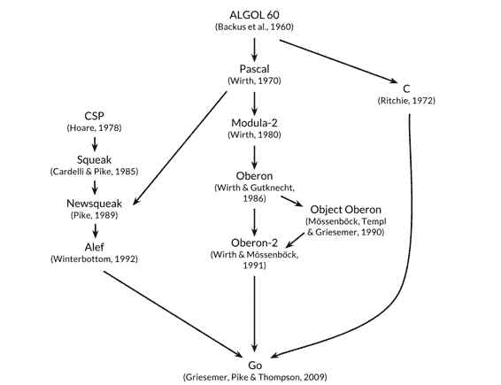

Go 有时被描述为“类 C 语言”，或“21 世纪的 C 语言”。从 C 语言，Go 继承了表达式语法、控制流语句、基本数据类型、按值调用参数传递、指针，最重要的是，C 语言对编译生成高效机器代码以及与当前操作系统抽象自然协作的程序的重视。

但在 Go 的家族树中还有其他祖先。一个主要影响来源是 Niklaus Wirth 设计的语言系列，始于 Pascal。Modula-2 启发了包的概念。Oberon 消除了模块接口文件和模块实现文件的区别。Oberon-2 影响了包、导入和声明的语法，Object Oberon 提供了方法声明的语法。

Go 祖先的另一个谱系，也是 Go 在近期编程语言中独具特色的地方，是一系列在贝尔实验室开发的鲜为人知的研究语言，它们都受到 Tony Hoare 1978 年关于并发基础的开创性论文中 *communicating sequential processes*（CSP，通信顺序进程）概念的启发。在 CSP 中，程序是由没有共享状态的进程并行组合而成的；进程通过通道进行通信和同步。但 Hoare 的 CSP 是一种用于描述并发基本概念的形式化语言，而非用于编写可执行程序的编程语言。

Rob Pike 等人开始尝试将 CSP 实现为实际语言。第一个称为 Squeak（“一种与鼠标通信的语言”），它提供了一种处理鼠标和键盘事件的语言，具有静态创建的通道。随后是 Newsqueak，它提供了类 C 的语句和表达式语法以及类 Pascal 的类型表示法。它是一门带有垃圾回收的纯函数式语言，同样旨在管理键盘、鼠标和窗口事件。通道成为了第一类值，可动态创建并存储在变量中。

Plan 9 操作系统在一种名为 Alef 的语言中延续了这些思想。Alef 试图使 Newsqueak 成为一门可行的系统编程语言，但其缺少垃圾回收使得并发编程过于痛苦。

Go 中的其他构造也在各处显示出非祖先基因的影响；例如 `iota` 大致源自 APL，带嵌套函数的词法作用域源自 Scheme（以及此后的大多数语言）。这里也能发现新颖的变异。Go 创新的切片提供了具有高效随机访问的动态数组，同时也允许类似链表的复杂共享安排。而 `defer` 语句是 Go 独有的新特性。

## Go 项目

所有编程语言都反映了其创造者的编程理念，这通常包含对早期语言感知缺陷的显著反应。Go 项目源于对 Google 内部多个软件系统复杂性爆炸的挫败感。（这一问题绝非 Google 独有。）

正如 Rob Pike 所言，“复杂性是乘法的”：通过让系统的某一部分变得更复杂来修复问题，缓慢但必然地会给其他部分增加复杂性。在不断增加功能、选项、配置以及快速交付代码的持续压力下，很容易忽视简洁性，尽管从长远来看，简洁性是优秀软件的关键。

简洁性要求在项目开始时投入更多工作将想法提炼到本质，并在项目生命周期中保持更多纪律以区分良性变更与恶性或有害变更。付出足够努力，良性变更可以在不妨碍 Fred Brooks 所谓的设计“概念完整性”的前提下被接纳，但恶性变更不能，而有害变更则以浅薄的便利性换取简洁性。只有通过设计的简洁性，系统才能在增长过程中保持稳定、安全和连贯。

Go 项目包括语言本身、其工具和标准库，最后但同样重要的是，一种激进简洁的文化议程。作为一门较新的高级语言，Go 具有后见之明的优势，基础做得很好：它拥有垃圾回收、包系统、一等函数、词法作用域、系统调用接口，以及通常以 UTF-8 编码文本的不可变字符串。但它的特性相对较少，也不太可能增加更多。例如，它没有隐式数值转换、没有构造函数或析构函数、没有运算符重载、没有默认参数值、没有继承、没有泛型、没有异常、没有宏、没有函数注解，也没有线程局部存储。语言成熟稳定，并保证向后兼容性：旧的 Go 程序可以用新版本的编译器和标准库编译运行。

Go 拥有足够的类型系统来避免困扰动态语言程序员的大多数粗心错误，但其类型系统比可比较的静态类型语言更简单。这种方法有时会在更广泛的类型框架内导致孤立的“无类型”编程区域，Go 程序员不像 C++ 或 Haskell 程序员那样竭尽全力将安全属性表达为基于类型的证明。但在实践中，Go 在不承担复杂类型系统负担的情况下，为程序员提供了相对强类型系统的大部分安全性和运行时性能优势。


# Go 语言设计理念

Go 鼓励开发者关注现代计算机系统设计，特别是局部性的重要性。其内置数据类型和大多数库数据结构的设计旨在自然工作，无需显式初始化或隐式构造函数，因此代码中隐藏的内存分配和内存写入相对较少。Go 的聚合类型（`struct` 和数组）直接持有其元素，相比使用间接字段的语言，需要更少的存储空间、更少的分配和更少的指针间接访问。既然现代计算机是并行机器，Go 基于 CSP（通信顺序进程）提供了并发特性。Go 的轻量级线程（`goroutine`）具有可变大小的栈，初始大小足够小，使得创建一个 `goroutine` 代价低廉，创建百万个也切实可行。

Go 标准库常被描述为“电池内置”，为 I/O、文本处理、图形、加密、网络和分布式应用提供了整洁的构建块和 API，并支持许多标准文件格式和协议。库和工具广泛使用约定来减少配置和解释的需要，从而简化程序逻辑，使不同的 Go 程序更加相似，也更易于学习。使用 `go` 工具构建的项目仅使用文件名和标识符名，以及偶尔的特殊注释，来确定项目的所有库、可执行文件、测试、基准测试、示例、平台特定变体和文档；Go 源代码本身包含构建规范。

# 书籍结构

我们假设您已使用一种或多种其他语言编程，无论是编译型（如 C、C++、Java）还是解释型（如 Python、Ruby、JavaScript），因此我们不会像对待完全初学者那样事无巨细地解释。表面语法、变量和常量、表达式、控制流和函数对您来说都会很熟悉。

# 第 1 章：教程

介绍 Go 的基本构造，通过十几个日常任务程序演示，如读写文件、格式化文本、创建图像、与互联网客户端和服务器通信。

# 第 2 章：程序结构

描述 Go 程序的结构元素——声明、变量、新类型、包和文件、作用域。

# 第 3 章：基本数据类型

讨论数字、布尔值、字符串和常量，并解释如何处理 Unicode。

# 第 4 章：复合类型

描述复合类型，即使用数组、`map`、`struct` 和 `slice`（Go 的动态列表方法）从简单类型构建的类型。

# 第 5 章：函数

涵盖函数，并讨论错误处理、`panic` 和 `recover`，以及 `defer` 语句。

第 1 至 5 章是基础，属于任何主流命令式语言的一部分。Go 的语法和风格有时与其他语言不同，但大多数程序员能快速上手。剩余章节关注 Go 方法较不传统的主题：方法、接口、并发、包、测试和反射。

# 面向对象编程

Go 有独特的面向对象编程方法。没有类层次结构，甚至没有类；复杂对象行为通过组合而非继承从简单行为创建。方法可关联任何用户定义类型，不仅限于结构体，具体类型与抽象类型（`interface`）的关系是隐式的，因此具体类型可能满足其设计者未知的接口。方法见第 6 章，接口见第 7 章。

# 并发

第 8 章介绍 Go 的并发方法，基于通信顺序进程（CSP）思想，由 `goroutine` 和 `channel` 体现。第 9 章解释基于共享变量的传统并发方面。

# 包与工具

第 10 章描述包（组织库的机制），并展示如何有效使用 `go` 工具，它在单一命令下提供编译、测试、基准测试、程序格式化、文档生成等任务。

# 测试

第 11 章讨论测试，Go 采用轻量级方法，避免充满抽象的框架，偏向简单的库和工具。测试库提供基础，必要时可构建更复杂的抽象。

# 反射与底层编程

第 12 章讨论反射（程序在执行期间检查自身表示的能力）。反射是强大工具，但需谨慎使用；本章通过展示其如何实现重要 Go 库来解释如何找到平衡。第 13 章解释使用 `unsafe` 包绕过 Go 类型系统的底层编程细节，及其适用场景。

每章都有练习供您测试对 Go 的理解，并探索书中示例的扩展和替代方案。

书中除最简单的代码示例外，均可从 `gopl.io` 的公共 Git 仓库下载。每个示例由其包导入路径标识，可使用 `go get` 方便地获取、构建和安装。您需选择一个目录作为 Go 工作区，并设置 `GOPATH` 环境变量指向它。`go` 工具会在必要时创建目录。例如：

```
$ export GOPATH=$HOME/gobook            # 选择工作区目录
$ go get gopl.io/ch1/helloworld         # 获取、构建、安装
$ $GOPATH/bin/helloworld                # 运行
Hello,
```

运行示例需要至少 Go 1.5 版本。

```
$ go version
go version go1.5 linux/amd64
```

若您计算机上的 `go` 工具较旧或缺失，请遵循 `https://golang.org/doc/install` 的说明。

# 获取更多信息

关于 Go 的最佳信息来源是官方网站 `https://golang.org`，提供文档访问，包括 *Go 编程语言规范*、标准包等。还有编写 Go 和编写好 Go 的教程，以及各种在线文本和视频资源，是本书的宝贵补充。Go 博客 `blog.golang.org` 发布一些最好的 Go 文章，涵盖语言现状、未来计划、会议报告、各种 Go 相关主题的深度解释。

在线访问 Go 最有用的方面之一（也是纸质书的遗憾局限）是能从描述它们的网页运行 Go 程序。此功能由 Go Playground `play.golang.org` 提供，可嵌入其他页面，如 `golang.org` 主页或 `godoc` 工具提供的文档页面。

Playground 便于进行简单实验，用短程序检查对语法、语义或库包的理解，在许多方面替代了其他语言的 *REPL*（读取-求值-打印循环）。其持久 URL 非常适合与他人分享 Go 代码片段、报告错误或提出建议。

基于 Playground 构建的 Go Tour `tour.golang.org` 是一系列关于 Go 基本思想和构造的简短互动课程，有序地引导学习语言。


Playground 和 Tour 的主要缺点是它们只允许导入标准库，并且出于实际或安全原因，许多库功能（例如网络）受到限制。它们还需要访问互联网来编译和运行每个程序。因此，对于更复杂的实验，你必须在自己的计算机上运行 Go 程序。幸运的是，下载过程很简单，从 `golang.org` 获取 Go 发行版并开始编写和运行自己的 Go 程序不应超过几分钟。

由于 Go 是一个开源项目，你可以在 `https://golang.org/pkg` 在线阅读标准库中任何类型或函数的代码；相同的代码也是下载发行版的一部分。利用这一点来弄清楚某事如何工作，或回答关于细节的问题，或者只是看看专家如何编写真正好的 Go 代码。

## 致谢

Rob Pike 和 Russ Cox 是 Go 核心团队成员，他们仔细阅读了手稿多次；他们对从用词选择到整体结构和组织的所有方面的评论都极其宝贵。在准备日文翻译时，Yoshiki Shibata 尽职尽责；他敏锐的目光发现了英文文本中的许多不一致之处和代码中的错误。我们非常感谢 Brian Goetz、Corey Kosak、Arnold Robbins、Josh Bleecher Snyder 和 Peter Weinberger 对整个手稿的彻底审查和关键意见。

我们感激 Sameer Ajmani、Ittai Balaban、David Crawshaw、Billy Donohue、Jonathan Feinberg、Andrew Gerrand、Robert Griesemer、John Linderman、Minux Ma、Bryan Mills、Bala Natarajan、Cosmos Nicolaou、Paul Staniforth、Nigel Tao 和 Howard Trickey 的许多有益建议。我们还要感谢 David Brailsford 和 Raph Levien 的排版建议，以及 Chris Loper 对电子书制作许多奥秘的解释。

Addison-Wesley 的编辑 Greg Doench 最初推动了这项工作，并一直持续提供帮助。AW 制作团队——John Fuller、Dayna Isley、Julie Nahil、Chuti Prasertsith 和 Barbara Wood——表现出色；作者无法希望获得更好的支持。

Alan Donovan 感谢：Sameer Ajmani、Chris Demetriou、Walt Drummond 和 Reid Tatge 在 Google 允许他抽出时间写作；Stephen Donovan 的建议和及时鼓励；最重要的是，他的妻子 Leila Kazemi，尽管该项目需要长时间的分心和脱离家庭生活，她仍毫不犹豫地热情支持并坚定不移地支持这个项目。

Brian Kernighan 深深感激朋友和同事的耐心和宽容，因为他缓慢地走在理解的道路上，尤其是他的妻子 Meg，她始终坚定地支持写书和其他许多事情。

New York  

October 2015

# 1. 教程

本章将带你领略 Go 的基本组件。我们希望提供足够的信息和示例，让你快速上手并做有用的事情。这里的示例，实际上全书的示例，都针对你在现实世界中可能要做的任务。在本章中，我们将尝试让你尝到用 Go 编写的程序的多样性，范围从简单的文件处理和一点图形到并发的互联网客户端和服务器。我们当然不会在第一章解释所有内容，但在一种新语言中研究此类程序可以是一个有效的入门方式。

当你学习一门新语言时，自然倾向于用你已知的语言的方式编写代码。学习 Go 时要意识到这种偏见并尝试避免它。我们试图说明和解释如何编写好的 Go 代码，所以在编写自己的代码时，请以此处的代码为指南。

## 1.1 Hello, World

我们将从现在传统的“hello, world”示例开始，它出现在 1978 年出版的 *The C Programming Language* 开头。C 是 Go 最直接的影响之一，“hello, world” 说明了许多核心思想。

Click here to view code image

`gopl.io/ch1/helloworld`

```
package main

import "fmt"

func main() {
    fmt.Println("Hello, 世界")
}
```

Go 是一种编译型语言。`go` 工具链将源程序及其依赖转换为计算机原生机器语言的指令。这些工具通过一个名为 `go` 的单一命令访问，该命令有许多子命令。其中最简单的是 `run`，它从一个或多个以 `.go` 结尾的源文件编译源代码，将其与库链接，然后运行生成的可执行文件。（我们将在全书中使用 `$` 作为命令提示符。）

```
$ go run helloworld.go
```

不出所料，这会打印

```
Hello, 世界
```

Go 原生支持 Unicode，因此它可以处理世界上所有语言的文本。

如果程序不仅仅是一次性实验，你可能希望编译一次并保存编译结果以供后续使用。这通过 `go build` 完成：

```
$ go build helloworld.go
```

这将创建一个名为 `helloworld` 的可执行二进制文件，可以随时运行而无需进一步处理：

```
$ ./helloworld
Hello, 世界
```

我们为每个重要示例都加上了标签，提醒你可以从书的源代码仓库 `gopl.io` 获取代码：

`gopl.io/ch1/helloworld`

如果你运行 `go get gopl.io/ch1/helloworld`，它将获取源代码并将其放在相应目录中。更多相关内容请参见 第 2.6 节 和 第 10.7 节。

现在让我们谈谈程序本身。Go 代码组织成包，这类似于其他语言中的库或模块。一个包由单个目录中的一个或多个 `.go` 源文件组成，定义了包的功能。每个源文件以 `package` 声明开始，这里是 `package main`，说明该文件属于哪个包，随后是它导入的其他包列表，然后是存储在该文件中的程序声明。

Go 标准库拥有 100 多个包用于常见任务，如输入输出、排序和文本操作。例如，`fmt` 包包含用于打印格式化输出和扫描输入的函数。`Println` 是 `fmt` 中基本的输出函数之一；它打印一个或多个值，值之间用空格分隔，并在末尾添加换行符，使值作为单行输出显示。

`main` 包很特殊。它定义了一个独立的可执行程序，而不是库。在 `main` 包中，`main` *函数* 也很特殊——它是程序执行开始的地方。`main` 做什么，程序就做什么。当然，`main` 通常会调用其他包中的函数来完成大部分工作，例如 `fmt.Println` 函数。

我们必须告诉编译器该源文件需要哪些包；这是紧跟在 `package` 声明之后的 `import` 声明的作用。“hello, world” 程序只使用了另一个包中的一个函数，但大多数程序将导入更多包。

你必须准确导入所需的包。如果缺少导入或有不必要的导入，程序将无法编译。这种严格要求防止了随着程序演变而累积对未使用包的引用。


### Go 程序结构

`import` 声明必须跟在 `package` 声明之后。随后，程序由函数、变量、常量和类型的声明组成（分别由关键字 `func`、`var`、`const` 和 `type` 引入）；在大多数情况下，声明的顺序无关紧要。这个程序非常简短，因为它只声明了一个函数，而该函数又只调用了另一个函数。为了节省篇幅，我们在示例中有时会省略 `package` 和 `import` 声明，但它们存在于源文件中，且编译代码时必须包含它们。

函数声明由关键字 `func`、函数名、参数列表（`main` 的为空）、结果列表（此处也为空）以及函数体（即定义其功能的语句，包裹在大括号中）组成。我们将在第 5 章详细探讨函数。

Go 不要求在语句或声明末尾加分号，除非同一行出现两个或更多语句。实际上，某些词法单元后的换行会被转换为分号，因此换行的位置对 Go 代码的正确解析至关重要。例如，函数的左大括号 `{` 必须与 `func` 声明的末尾在同一行，不能独占一行；在表达式 `x + y` 中，`+` 运算符后允许换行，但前面不允许。

### 代码格式化

Go 对代码格式有着强制性的规范。`gofmt` 工具将代码重写为标准格式，`go` 工具的 `fmt` 子命令会对指定包（或默认当前目录）下的所有文件应用 `gofmt`。本书所有 Go 源文件均已通过 `gofmt` 处理，你也应养成对自己的代码这样做的习惯。强制规定标准格式消除了大量关于琐碎细节的无谓争论，更重要的是，它使各种自动化源代码转换成为可能——若允许任意格式，这些转换将难以实现。

许多文本编辑器可配置为在每次保存文件时运行 `gofmt`，从而保证源代码始终符合规范。相关工具 `goimports` 还能根据需要自动增删 `import` 声明。它不在标准发行版中，但可通过以下命令获取：

```
$ go get golang.org/x/tools/cmd/goimports
```

对大多数用户而言，下载构建包、运行测试、查看文档等常规操作均通过 `go` 工具完成，我们将在第 10.7 节介绍它。

## 1.2 命令行参数

大多数程序处理输入以产生输出；这几乎是计算的定义。但程序如何获取用于操作的输入数据？有些程序自行生成数据，但更多情况下，输入来自外部源：文件、网络连接、另一程序的输出、键盘输入的用户、命令行参数等。接下来的几个示例将讨论其中一些替代方案，首先从命令行参数开始。

`os` 包提供了以平台无关方式与操作系统交互的函数和值。命令行参数以名为 `Args` 的变量形式提供给程序，该变量属于 `os` 包；因此在 `os` 包外部引用时，其名称为 `os.Args`。

变量 `os.Args` 是一个字符串**切片**。切片是 Go 的核心概念，我们稍后将深入讨论。目前可将切片视为一个动态大小的数组元素序列 `s`，可通过 `s[i]` 访问单个元素，通过 `s[m:n]` 获取连续子序列。元素数量由 `len(s)` 给出。与大多数编程语言一样，Go 的所有索引均采用**半开区间**，即包含第一个索引但不包含最后一个，因为这简化了逻辑。例如，切片 `s[m:n]`（其中 0 ≤ `m` ≤ `n` ≤ `len(s)`）包含 `n-m` 个元素。

`os.Args` 的第一个元素 `os.Args[0]` 是命令本身的名称；其余元素是程序启动时传入的参数。形式为 `s[m:n]` 的切片表达式生成的切片引用元素 `m` 到 `n-1`，因此我们下一个示例所需的元素位于切片 `os.Args[1:len(os.Args)]` 中。若省略 `m` 或 `n`，分别默认为 0 或 `len(s)`，故可将所需切片简写为 `os.Args[1:]`。

下面是 Unix `echo` 命令的一个实现，它在单行打印命令行参数。它导入了两个包，以括号列表形式而非单独的 `import` 声明给出。两种形式均合法，但惯例使用列表形式。导入顺序无关紧要；`gofmt` 会按字母顺序排序包名。（当示例有多个版本时，我们常对其编号，以便你确认讨论的是哪一个。）

```
gopl.io/ch1/echo1
```

```
// Echo1 prints its command-line arguments.
package main

import (
    "fmt"
    "os"
)

func main() {
    var s, sep string
    for i := 1; i < len(os.Args); i++ {
        s += sep + os.Args[i]
        sep = " "
    }
    fmt.Println(s)
}
```

注释以 `//` 开头。从 `//` 到行尾的所有文本均为程序员的注释，编译器会忽略。惯例上，我们在 `package` 声明前紧跟一个注释描述每个包；对于 `main` 包，此注释为一个或多个完整句子，描述整个程序。

`var` 声明了两个 `string` 类型的变量 `s` 和 `sep`。变量可在声明时初始化。若未显式初始化，则隐式初始化为其类型的**零值**：数值类型为 `0`，字符串为空字符串 `""`。因此本例中 `s` 和 `sep` 隐式初始化为空字符串。我们将在第 2 章详述变量与声明。

对于数值，Go 提供了常见的算术和逻辑运算符。但作用于字符串时，`+` 运算符会**拼接**值，因此表达式

```
sep + os.Args[i]
```

表示字符串 `sep` 与 `os.Args[i]` 的拼接。程序中使用的语句

```
s += sep + os.Args[i]
```

是一个**赋值语句**，它将 `s` 的旧值与 `sep` 和 `os.Args[i]` 拼接后赋回 `s`；等价于

```
s = s + sep + os.Args[i]
```

运算符 `+=` 是**赋值运算符**。每个算术和逻辑运算符（如 `+` 或 `*`）都有对应的赋值运算符。

`echo` 程序本可在循环中逐块打印输出，但此版本通过反复向字符串末尾追加文本来构建字符串。字符串 `s` 初始为空（即值 `""`），每次循环添加一些文本；首次迭代后还会插入一个空格，因此循环结束时，每个参数之间有一个空格。这是一个二次过程，若参数数量大可能代价高昂，但对 `echo` 而言不太可能。本章和下一章将展示多个改进版 `echo` 以解决实际低效问题。

循环索引变量 `i` 在 `for` 循环的第一部分声明。`:=` 符号是**短变量声明**的一部分，该语句声明一个或多个变量并根据初始化值推断其类型；下一章将详细介绍。


### 增量与减量语句

增量语句 `i++` 给 `i` 加 1；它等价于 `i += 1`，而后者又等价于 `i = i + 1`。对应地有减量语句 `i--` 减去 1。这些是语句，而非 C 系语言中的表达式，因此 `j = i++` 是非法的，且它们只能作为后缀，所以 `--i` 也不合法。

### `for` 循环

`for` 循环是 Go 中唯一的循环语句。它有多种形式，其中一种如下所示：

```
for initialization; condition; post {
    // zero or more statements
}
```

`for` 循环的三个组件外从不使用圆括号。但大括号是强制的，且左大括号必须与 `post` 语句在同一行。

可选的 `initialization` 语句在循环开始前执行。如果存在，它必须是一条*简单语句*，即短变量声明、增量或赋值语句、或函数调用。`condition` 是一个布尔表达式，在每次迭代开始时求值；若为 `true`，则执行循环体语句。`post` 语句在循环体执行后运行，随后再次求值 `condition`。当条件变为假时循环结束。

这些部分均可省略。若无 `initialization` 且无 `post`，分号也可省略：

```
// a traditional "while" loop
for condition {
    // ...
}
```

若在任意形式中完全省略 `condition`，例如：

```
// a traditional infinite loop
for {
    // ...
}
```

则为无限循环，尽管可通过 `break` 或 `return` 语句终止。

### `range` 循环

`for` 循环的另一种形式遍历字符串、切片等类型的*范围*值。举例说明，这是 `echo` 的第二个版本：

gopl.io/ch1/echo2

```
// Echo2 prints its command-line arguments.
package main

import (
    "fmt"
    "os"
)

func main() {
    s, sep := "", ""
    for _, arg := range os.Args[1:] {
        s += sep + arg
        sep = " "
    }
    fmt.Println(s)
}
```

每次迭代中，`range` 产生一对值：索引及该索引处的元素值。本例不需要索引，但 `range` 循环语法要求若处理元素，必须同时处理索引。一种想法是将索引赋给临时变量 `temp` 并忽略其值，但 Go 不允许未使用的局部变量，这会导致编译错误。

解决方法是使用*空标识符*，其名为 `_`（下划线）。当语法要求变量名但程序逻辑不需要时，可用空标识符，例如丢弃不需要的循环索引仅保留元素值。大多数 Go 程序员会像上例那样用 `range` 和 `_` 编写 `echo`，因为对 `os.Args` 的索引是隐式而非显式的，更不易出错。

该版本用短变量声明声明并初始化 `s` 和 `sep`，也可分开声明。声明字符串变量有多种方式，以下均等价：

```
s := ""
var s string
var s = ""
var s string = ""
```

为何偏好某一种形式？第一种形式（短变量声明）最简洁，但只能用于函数内，不能用于包级变量。第二种依赖字符串的零值默认初始化，即 `""`。第三种罕用，除非声明多个变量。第四种显式指明变量类型，当类型与初始值相同时显得冗余，但在类型不同时则必要。实践中，通常使用前两种形式：显式初始化表示初始值重要，隐式初始化表示初始值不重要。

如前所述，每次循环 `s` 都获得全新内容。`+=` 语句通过拼接旧字符串、空格字符和下一个参数创建新字符串，再赋值给 `s`。旧内容不再使用，稍后会被垃圾回收。

若涉及数据量大，这可能代价高昂。更简单高效的方案是使用 `strings` 包的 `Join` 函数：

gopl.io/ch1/echo3

```
func main() {
    fmt.Println(strings.Join(os.Args[1:], " "))
}
```

最后，若不关心格式只想查看值（如调试），可让 `Println` 格式化输出：

```
fmt.Println(os.Args[1:])
```

该语句输出类似 `strings.Join`，但带方括号。任何切片均可如此打印。

**练习 1.1：** 修改 `echo` 程序，使其也打印 `os.Args[0]`（调用它的命令名）。

**练习 1.2：** 修改 `echo` 程序，使其打印每个参数的索引和值，每行一个。

**练习 1.3：** 实验测量低效版本与使用 `strings.Join` 版本的运行时间差异。（1.6 节 展示了 `time` 包部分用法，11.4 节 介绍如何编写基准测试以进行系统性性能评估。）

## 1.3 查找重复行

文件复制、打印、搜索、排序、计数等程序结构相似：遍历输入、对每个元素计算、即时或最后生成输出。我们展示三个名为 `dup` 的程序变体；其灵感部分来自 Unix `uniq` 命令，用于查找相邻重复行。所用结构和包是可轻松改编的模型。

`dup` 的第一个版本打印标准输入中出现次数超过 1 的每行，前面带计数。该程序引入了 `if` 语句、`map` 数据类型和 `bufio` 包。

gopl.io/ch1/dup1

```
// Dup1 prints the text of each line that appears more than
// once in the standard input, preceded by its count.
package main

import (
    "bufio"
    "fmt"
    "os"
)

func main() {
    counts := make(map[string]int)
    input := bufio.NewScanner(os.Stdin)
    for input.Scan() {
        counts[input.Text()]++
    }
    // NOTE: ignoring potential errors from input.Err()
    for line, n := range counts {
        if n > 1 {
            fmt.Printf("%d\t%s\n", n, line)
        }
    }
}
```

同 `for` 一样，`if` 语句的条件外不使用圆括号，但主体需要大括号。可有可选的 `else` 部分，在条件为假时执行。

*映射* 存储一组键值对，提供常数时间存储、检索或测试项是否存在。键可以是任何可用 `==` 比较的类型，字符串是最常见示例；值可以是任意类型。本例中键为字符串，值为 `int`。内置函数 `make` 创建新的空映射，另有他用。映射详见 4.3 节。


### dup 程序：查找重复行

### dup1 中的映射行为

每次 `dup` 读取一行输入时，该行被用作映射的键，对应的值会递增。语句 `counts[input.Text()]++` 等价于以下两条语句：

```
line := input.Text()
counts[line] = counts[line] + 1
```

如果映射尚不包含该键，这并不是问题。首次遇到新行时，右侧表达式 `counts[line]` 的值为其类型的零值，对于 `int` 类型即为 `0`。

为打印结果，我们使用另一个基于 `range` 的 `for` 循环，这次遍历 `counts` 映射。与之前一样，每次迭代产生两个结果：一个键和该键对应的映射元素的值。映射迭代的顺序未指定，但在实践中是随机的，每次运行都可能不同。这种设计是有意为之，因为它防止了程序依赖任何并不保证存在的特定顺序。

### 使用 `bufio.Scanner` 和 `fmt.Printf`

接下来是 `bufio` 包，它有助于使输入和输出高效且方便。其最有用的特性之一是名为 `Scanner` 的类型，它读取输入并将其分割为行或单词；这通常是处理天然按行组织的输入的最简单方法。

程序使用短变量声明创建一个引用 `bufio.Scanner` 的新变量 `input`：

```
input := bufio.NewScanner(os.Stdin)
```

扫描器从程序的标准输入读取。每次调用 `input.Scan()` 读取下一行并移除末尾的换行符；结果可通过调用 `input.Text()` 获取。若有行则 `Scan` 函数返回 `true`，无更多输入时返回 `false`。

函数 `fmt.Printf` 类似于 C 及其他语言中的 `printf`，根据表达式列表生成格式化输出。其第一个参数是格式字符串，指定后续参数应如何格式化。每个参数的格式由转换字符决定，即百分号后的字母。例如，`%d` 以十进制格式化整数操作数，`%s` 展开为字符串操作数的值。

`Printf` 有十多种此类转换，Go 程序员称之为 `verbs`。此表远非完整规范，但展示了许多可用特性：

| 动词 | 说明 |
|------|------|
| `%d` | 十进制整数 |
| `%x, %o, %b` | 十六进制、八进制、二进制整数 |
| `%f, %g, %e` | 浮点数：`3.141593 3.141592653589793 3.141593e+00` |
| `%t` | 布尔值：`true` 或 `false` |
| `%c` | 字符（Unicode 码点） |
| `%s` | 字符串 |
| `%q` | 带引号的字符串 `"abc"` 或字符 `'c'` |
| `%v` | 任意值的自然格式 |
| `%T` | 任意值的类型 |
| `%%` | 字面百分号（无操作数） |

`dup1` 中的格式字符串还包含制表符 `\t` 和换行符 `\n`。字符串字面量可包含此类 `escape sequences`（转义序列）以表示原本不可见的字符。`Printf` 默认不写入换行符。按照惯例，名称以 `f` 结尾的格式化函数（如 `log.Printf` 和 `fmt.Errorf`）使用 `fmt.Printf` 的格式化规则，而名称以 `ln` 结尾的函数遵循 `Println`，按 `%v` 格式化参数并追加换行符。

### 从文件读取：dup2

许多程序要么从标准输入读取（如上所示），要么从一系列命名文件读取。`dup` 的下一个版本可以从标准输入读取，或处理文件名列表，使用 `os.Open` 打开每个文件：

gopl.io/ch1/dup2

```go
// Dup2 prints the count and text of lines that appear more than once
// in the input.  It reads from stdin or from a list of named files.
package main

import (
    "bufio"
    "fmt"
    "os"
)

func main() {
    counts := make(map[string]int)
    files := os.Args[1:]
    if len(files) == 0 {
        countLines(os.Stdin, counts)
    } else {
        for _, arg := range files {
            f, err := os.Open(arg)
            if err != nil {
                fmt.Fprintf(os.Stderr, "dup2: %v\n", err)
                continue
            }
            countLines(f, counts)
            f.Close()
        }
    }
    for line, n := range counts {
        if n > 1 {
            fmt.Printf("%d\t%s\n", n, line)
        }
    }
}

func countLines(f *os.File, counts map[string]int) {
    input := bufio.NewScanner(f)
    for input.Scan() {
        counts[input.Text()]++
    }
    // NOTE: ignoring potential errors from input.Err()
}
```

函数 `os.Open` 返回两个值。第一个是打开的文件 (`*os.File`)，供 `Scanner` 后续读取使用。

`os.Open` 的第二个结果是内置 `error` 类型的值。若 `err` 等于特殊内置值 `nil`，则文件打开成功。文件被读取，到达输入末尾时，`Close` 关闭文件并释放资源。反之，若 `err` 不为 `nil`，则出错了。此时错误值描述了问题。我们简单的错误处理使用 `Fprintf` 和动词 `%v` 向标准错误流打印消息，`%v` 以默认格式显示任意类型的值，随后 `dup` 继续处理下一个文件；`continue` 语句跳转到外层 `for` 循环的下一次迭代。

为保持代码示例规模合理，早期示例有意在错误处理上有些随意。显然我们必须检查 `os.Open` 的错误；然而，我们忽略了使用 `input.Scan` 读取文件时发生错误的可能性（较小）。我们会标注跳过错误检查的地方，并在 第 5.4 节 详细讨论错误处理。

注意 `countLines` 的调用先于其声明。函数和其他包级实体可以按任意顺序声明。

### 映射引用语义

映射是对 `make` 创建的数据结构的 `reference`（引用）。当映射传递给函数时，函数接收引用的副本，因此被调用函数对底层数据结构的任何修改都将通过调用者的映射引用可见。在示例中，`countLines` 插入 `counts` 映射的值在 `main` 中可见。

### 读取整个文件：dup3

上述 `dup` 版本以“流式”模式运行，按需读取输入并分割成行，因此原则上这些程序可处理任意量的输入。另一种方法是一次性将全部输入读入内存，一次性分割成行，再处理这些行。以下版本 `dup3` 即采用此方式运行。它引入了函数 `ReadFile`（来自 `io/ioutil` 包），用于读取指定文件的全部内容，以及 `strings.Split`，用于将字符串分割为子字符串切片。(`Split` 与我们之前见过的 `strings.Join` 作用相反。)

我们对 `dup3` 做了些简化。首先，它仅读取命名文件，不读取标准输入，因为 `ReadFile` 需要文件名参数。其次，我们将行计数逻辑移回 `main`，因为现在只在一处需要。

gopl.io/ch1/dup3

```go
package main

import (
    "fmt"
    "io/ioutil"
    "os"
    "strings"
)

func main() {
    counts := make(map[string]int)
    for _, filename := range os.Args[1:] {
        data, err := ioutil.ReadFile(filename)
        if err != nil {
            fmt.Fprintf(os.Stderr, "dup3: %v\n", err)
            continue
        }
        for _, line := range strings.Split(string(data), "\n") {
            counts[line]++
        }
    }
    for line, n := range counts {
        if n > 1 {
            fmt.Printf("%d\t%s\n", n, line)
        }
    }
}
```


`ReadFile` 返回一个字节切片，必须将其转换为 `string`，以便能用 `strings.Split` 进行分割。我们将在 3.5.4 节 详细讨论字符串和字节切片。

在底层，`bufio.Scanner`、`ioutil.ReadFile` 和 `ioutil.WriteFile` 使用 `*os.File` 的 `Read` 和 `Write` 方法，但大多数程序员很少需要直接访问这些底层例程。来自 `bufio` 和 `io/ioutil` 的高级函数更易于使用。

**练习 1.4:** 修改 `dup2`，使其打印出每个重复行所在的文件名。

## 1.4 GIF 动画

下一个程序演示了 Go 标准图像包的基本用法，我们将用它创建一系列位图图像，然后将该序列编码为 GIF 动画。这些图像被称为 *利萨如曲线*，是 1960 年代科幻电影中的常见视觉效果。它们是由二维谐振产生的参数曲线，例如将两个正弦波分别输入示波器的 *x* 和 *y* 输入端。图 1.1 展示了一些示例。


**图 1.1.** 四个利萨如曲线。

这段代码包含几个新结构，包括 `const` 声明、结构体类型和复合字面量。与大多数示例不同，本示例还涉及浮点数计算。我们将仅简要讨论这些主题，大部分细节留待后续章节，因为目前的主要目标是让你了解 Go 的外观，以及使用该语言及其库可以轻松完成哪些事情。

点击此处查看代码图像

gopl.io/ch1/lissajous

```
// Lissajous generates GIF animations of random Lissajous figures.
package main

import (
    "image"
    "image/color"
    "image/gif"
    "io"
    "math"
    "math/rand"
    "os"
)

var palette = []color.Color{color.White, color.Black}

const (
    whiteIndex = 0 // first color in palette
    blackIndex = 1 // next color in palette
)

func main() {
    lissajous(os.Stdout)
}

func lissajous(out io.Writer) {
    const (
        cycles  = 5     // number of complete x oscillator revolutions
        res     = 0.001 // angular resolution
        size    = 100   // image canvas covers [-size..+size]
        nframes = 64    // number of animation frames
        delay   = 8     // delay between frames in 10ms units
    )
    freq := rand.Float64() * 3.0 // relative frequency of y oscillator
    anim := gif.GIF{LoopCount: nframes}
    phase := 0.0 // phase difference
    for i := 0; i < nframes; i++ {
        rect := image.Rect(0, 0, 2*size+1, 2*size+1)
        img := image.NewPaletted(rect, palette)
        for t := 0.0; t < cycles*2*math.Pi; t += res {
            x := math.Sin(t)
            y := math.Sin(t*freq + phase)
            img.SetColorIndex(size+int(x*size+0.5), size+int(y*size+0.5),
                blackIndex)
        }
        phase += 0.1
        anim.Delay = append(anim.Delay, delay)
        anim.Image = append(anim.Image, img)
    }
    gif.EncodeAll(out, &anim) // NOTE: ignoring encoding errors
}
```

导入路径包含多个组件的包（如 `image/color`）后，我们用最后一个组件的名称来引用该包。因此变量 `color.White` 属于 `image/color` 包，而 `gif.GIF` 属于 `image/gif`。

`const` 声明（§3.6）给常量命名，即编译时固定的值，例如 cycles、frames 和 delay 的数值参数。与 `var` 声明一样，`const` 声明可出现在包级别（名称在整个包可见）或函数内部（名称仅在该函数内可见）。常量的值必须是数字、字符串或布尔值。

表达式 `[]color.Color{...}` 和 `gif.GIF{...}` 是*复合字面量*（§4.2，§4.4.1），一种通过元素值序列实例化 Go 任意复合类型的简洁表示法。这里第一个是切片，第二个是*结构体*。

类型 `gif.GIF` 是一个结构体类型（§4.4）。结构体是一组称为*字段*的值的集合，通常类型不同，被收集在一个可作为单元处理的对象中。变量 `anim` 是 `gif.GIF` 类型的结构体。结构体字面量创建一个结构体值，其 `LoopCount` 字段设为 `nframes`；所有其他字段具有其类型的零值。结构体的各个字段可通过点号表示法访问，如最后两个赋值显式更新了 `anim` 的 `Delay` 和 `Image` 字段。

`lissajous` 函数有两层嵌套循环。外层循环运行 64 次迭代，每次生成动画的一帧。它创建一个新的 201×201 图像，调色板有白、黑两色。所有像素初始设为调色板的零值（调色板中的第零种颜色），我们将其设为白色。内层循环每次通过将某些像素设为黑色来生成新图像。结果连同 80ms 的指定延迟，使用内置 `append` 函数（§4.2.1）追加到 `anim` 的帧列表中。最后将帧序列和延迟编码为 GIF 格式并写入输出流 `out`。`out` 的类型是 `io.Writer`，这让我们能写入多种可能的目标，稍后将展示。

内层循环运行两个振荡器。*x* 振荡器只是正弦函数。*y* 振荡器也是正弦波，但其相对于 *x* 振荡器的频率是 0 到 3 之间的随机数，其相对于 *x* 振荡器的相位初始为零，但随动画每帧增加。循环运行直到 *x* 振荡器完成五个完整周期。每一步调用 `SetColorIndex` 将对应 (*x*, *y*) 的像素着色为黑色，即调色板中位置 1 的颜色。

`main` 函数调用 `lissajous` 函数，指示其写入标准输出，因此此命令生成的动画 GIF 帧如 图 1.1 所示：

点击此处查看代码图像

```
$ go build gopl.io/ch1/lissajous
$ ./lissajous >out.gif
```

**练习 1.5:** 将 Lissajous 程序的调色板改为绿底黑字，以增加真实感。要创建 Web 颜色 `#RRGGBB`，使用 `color.RGBA{0xRR, 0xGG, 0xBB, 0xff}`，其中每对十六进制数字代表像素红、绿、蓝分量的强度。

**练习 1.6:** 修改 Lissajous 程序，通过向 `palette` 添加更多值，并以有趣的方式改变 `SetColorIndex` 的第三个参数，来生成多彩图像。

## 1.5 获取 URL

对于许多应用，从互联网获取信息与访问本地文件系统同样重要。Go 提供了一组包，归类在 `net` 下，使通过互联网发送和接收信息、建立低级网络连接和搭建服务器变得容易，Go 的并发特性（第 8 章介绍）对此特别有用。

为了演示通过 HTTP 检索信息所需的最小代码，这里有一个名为 `fetch` 的简单程序，它获取每个指定 URL 的内容并将其作为未解释的文本打印；它受宝贵工具 `curl` 启发。显然通常会对这些数据做更多处理，但这展示了基本思路。我们将在本书中频繁使用该程序。


## 1.6 并发获取多个 URL

Go 语言最有趣、最新颖的特性之一是其对并发编程的支持。这是一个大话题，第 8 章和第 9 章专门讲解此内容，因此这里我们仅让您略窥 Go 语言主要并发机制——goroutine（协程）和 channel（通道）的门径。

接下来的程序 `fetchall` 与前一个示例一样，都是获取 URL 的内容，但它会并发获取多个 URL，因此该过程所花费的时间不会超过最耗时的那一次获取，而非所有获取时间之和。此版本的 `fetchall` 会丢弃响应内容，但会报告每个 URL 的大小和耗时：

**gopl.io/ch1/fetchall**

```go
// Fetchall 并行获取 URL 并报告其耗时和大小。
package main

import (
    "fmt"
    "io"
    "io/ioutil"
    "net/http"
    "os"
    "time"
)

func main() {
    start := time.Now()
    ch := make(chan string)
    for _, url := range os.Args[1:] {
        go fetch(url, ch) // 启动一个 goroutine
    }
    for range os.Args[1:] {
        fmt.Println(<-ch) // 从通道 ch 接收
    }
    fmt.Printf("%.2fs elapsed\n", time.Since(start).Seconds())
}

func fetch(url string, ch chan<- string) {
    start := time.Now()
    resp, err := http.Get(url)
    if err != nil {
        ch <- fmt.Sprint(err) // 向通道 ch 发送
        return
    }

    nbytes, err := io.Copy(ioutil.Discard, resp.Body)
    resp.Body.Close() // 避免资源泄漏
    if err != nil {
        ch <- fmt.Sprintf("while reading %s: %v", url, err)
        return
    }
    secs := time.Since(start).Seconds()
    ch <- fmt.Sprintf("%.2fs  %7d  %s", secs, nbytes, url)
}
```

以下是一个示例：

```bash
$ go build gopl.io/ch1/fetchall
$ ./fetchall https://golang.org http://gopl.io https://godoc.org
0.14s     6852  https://godoc.org
0.16s     7261  https://golang.org
0.48s     2475  http://gopl.io
0.48s elapsed
```

*goroutine* 是一种并发的函数执行。*channel* 是一种通信机制，允许一个 goroutine 将特定类型的值传递给另一个 goroutine。`main` 函数运行在一个 goroutine 中，而 `go` 语句则创建额外的 goroutine。

`main` 函数使用 `make` 创建了一个字符串通道。对于每个命令行参数，第一个 range 循环中的 `go` 语句会启动一个新的 goroutine，异步调用 `fetch` 以使用 `http.Get` 获取 URL。`io.Copy` 函数读取响应主体，并通过写入 `ioutil.Discard` 输出流将其丢弃。`Copy` 返回字节计数及发生的任何错误。随着每个结果的到达，`fetch` 会在通道 `ch` 上发送一行汇总信息。`main` 中的第二个 range 循环接收并打印这些行。

当一个 goroutine 尝试在通道上发送或接收时，它会阻塞，直到另一个 goroutine 尝试执行相应的接收或发送操作，此时值被传递，两个 goroutine 继续执行。在本例中，每个 `fetch` 都在通道 `ch` 上发送一个值（`ch <- 表达式`），而 `main` 接收所有这些值（`<-ch`）。让 `main` 完成所有打印工作，可确保每个 goroutine 的输出作为一个整体被处理，如果两个 goroutine 同时完成，不会出现交错输出的危险。

**练习 1.10：** 找一个产生大量数据的网站。通过连续运行两次 `fetchall` 来研究缓存机制，观察报告的时间是否有很大变化。每次获取的内容都相同吗？修改 `fetchall` 将其输出打印到文件中，以便进行检查。

**练习 1.11：** 尝试使用更长的参数列表运行 `fetchall`，例如 `alexa.com` 上提供的前一百万个网站样本。如果某个网站不响应，程序会如何表现？（第 8.9 节介绍了应对此类情况的机制。）

## 1.7 Web 服务器

Go 的库使得编写 Web 服务器变得轻而易举，它能响应像 `fetch` 发出的那些客户端请求。在本节中，我们将展示一个最小化的服务器，它返回用于访问服务器的 URL 的路径组件。也就是说，如果请求是 `http://localhost:8000/hello`，响应将是 `URL.Path = "/hello"`。

**gopl.io/ch1/server1**

```go
// Server1 是一个最小的“回显”服务器。
package main

import (
    "fmt"
    "log"
    "net/http"
)

func main() {
    http.HandleFunc("/", handler) // 每个请求调用 handler
    log.Fatal(http.ListenAndServe("localhost:8000", nil))
}

// handler 回显请求 URL 的 Path 组件。
func handler(w http.ResponseWriter, r *http.Request) {
    fmt.Fprintf(w, "URL.Path = %q\n", r.URL.Path)
}
```

该程序只有短短几行，因为库函数完成了大部分工作。`main` 函数将处理函数与路径以 `/` 开头的传入 URL 关联起来（这涵盖了所有 URL），并启动一个服务器在端口 8000 上监听传入请求。请求被表示为 `http.Request` 类型的结构体，其中包含许多相关字段，其中之一是传入请求的 URL。当请求到达时，它被交给处理函数，该函数从请求 URL 中提取路径组件（`/hello`），并使用 `fmt.Fprintf` 将其作为响应发送回去。Web 服务器将在第 7.7 节中详细解释。


### 启动服务器与示例

让我们在后台启动服务器。在 Mac OS X 或 Linux 上，在命令后添加 `&`；在 Microsoft Windows 上，需要在单独的命令窗口中运行不带 `&` 的命令。

点击此处查看代码图像

```
$ go run src/gopl.io/ch1/server1/main.go &
```

然后我们可以从命令行发起客户端请求：

点击此处查看代码图像

```
$ go build gopl.io/ch1/fetch
$ ./fetch http://localhost:8000
URL.Path = "/"
$ ./fetch http://localhost:8000/help
URL.Path = "/help"
```

或者，我们可以通过 Web 浏览器访问服务器，如图 1.2 所示。


**图 1.2.** Echo 服务器的响应。

向服务器添加功能很容易。一个有用的添加是特定的 URL 返回某种状态。例如，这个版本执行相同的 echo 但也计算请求数量；对 URL `/count` 的请求返回迄今为止的计数，不包括 `/count` 请求本身：

点击此处查看代码图像

`gopl.io/ch1/server2`

```
// Server2 is a minimal "echo" and counter server.
package main

import (
    "fmt"
    "log"
    "net/http"
    "sync"
)

var mu sync.Mutex
var count int

func main() {
    http.HandleFunc("/", handler)
    http.HandleFunc("/count", counter)
    log.Fatal(http.ListenAndServe("localhost:8000", nil))
}

// handler echoes the Path component of the requested URL.
func handler(w http.ResponseWriter, r *http.Request) {
    mu.Lock()
    count++
    mu.Unlock()
    fmt.Fprintf(w, "URL.Path = %q\n", r.URL.Path)
}

// counter echoes the number of calls so far.
func counter(w http.ResponseWriter, r *http.Request) {
    mu.Lock()
    fmt.Fprintf(w, "Count %d\n", count)
    mu.Unlock()
}
```

服务器有两个处理器，请求的 URL 决定调用哪一个：对 `/count` 的请求调用 `counter`，其他所有请求调用 `handler`。以斜杠结尾的处理器模式匹配任何以该模式为前缀的 URL。在后台，服务器为每个传入请求在单独的 `goroutine` 中运行处理器，以便同时服务多个请求。然而，如果两个并发请求尝试同时更新 `count`，可能无法一致地递增；程序将有一个称为 *race condition*（竞态条件）的严重 Bug（§9.1）。为避免此问题，我们必须确保一次最多只有一个 `goroutine` 访问该变量，这就是 `mu.Lock()` 和 `mu.Unlock()` 调用括住每次 `count` 访问的目的。我们将在第 9 章更仔细地研究带共享变量的并发。

作为一个更丰富的示例，处理器函数可以报告它接收到的头部和表单数据，使服务器可用于检查和调试请求：

点击此处查看代码图像

`gopl.io/ch1/server3`

```
// handler echoes the HTTP request.
func handler(w http.ResponseWriter, r *http.Request) {
    fmt.Fprintf(w, "%s %s %s\n", r.Method, r.URL, r.Proto)
    for k, v := range r.Header {
        fmt.Fprintf(w, "Header[%q] = %q\n", k, v)
    }
    fmt.Fprintf(w, "Host = %q\n", r.Host)
    fmt.Fprintf(w, "RemoteAddr = %q\n", r.RemoteAddr)
    if err := r.ParseForm(); err != nil {
        log.Print(err)
    }
    for k, v := range r.Form {
        fmt.Fprintf(w, "Form[%q] = %q\n", k, v)
    }
}
```

这使用 `http.Request` 结构体的字段产生如下输出：

点击此处查看代码图像

```
GET /?q=query HTTP/1.1
Header["Accept-Encoding"] = ["gzip, deflate, sdch"]
Header["Accept-Language"] = ["en-US,en;q=0.8"]
Header["Connection"] = ["keep-alive"]
Header["Accept"] = ["text/html,application/xhtml+xml,application/xml;..."]
Header["User-Agent"] = ["Mozilla/5.0 (Macintosh; Intel Mac OS X 10_7_5)..."]
Host = "localhost:8000"
RemoteAddr = "127.0.0.1:59911"
Form["q"] = ["query"]
```

注意 `ParseForm` 的调用嵌套在 `if` 语句中。Go 允许简单语句（如局部变量声明）位于 `if` 条件之前，这对于错误处理特别有用，如此例所示。我们也可以写成：

```
err := r.ParseForm()
if err != nil {
    log.Print(err)
}
```

但合并语句更简短并减少变量 `err` 的作用域，这是良好的实践。我们将在第 2.7 节定义作用域。

在这些程序中，我们见到三种截然不同的类型用作输出流。`fetch` 程序将 HTTP 响应数据复制到 `os.Stdout`（一个文件），`lissajous` 程序也是如此。`fetchall` 程序通过复制到微不足道的接收器 `ioutil.Discard` 丢弃响应（同时计算其长度）。上面的 Web 服务器使用 `fmt.Fprintf` 写入 `http.ResponseWriter`（代表 Web 浏览器）。

虽然这三种类型在做什么的细节上不同，但它们都满足一个通用的 *interface*（接口），允许在需要输出流的任何地方使用它们。该接口称为 `io.Writer`，在第 7.1 节讨论。

Go 的接口机制是第 7 章的主题，但为了展示其能力，让我们看看将 Web 服务器与 `lissajous` 函数结合有多容易，使动画 GIF 写入 HTTP 客户端而非标准输出。只需向 Web 服务器添加这些行：

点击此处查看代码图像

```
handler := func(w http.ResponseWriter, r *http.Request) {
    lissajous(w)
}
http.HandleFunc("/", handler)
```

或等价地：

点击此处查看代码图像

```
http.HandleFunc("/", func(w http.ResponseWriter, r *http.Request) {
    lissajous(w)
})
```

紧接在上方 `HandleFunc` 函数调用的第二个参数是一个 *function literal*（函数字面量），即在使用点定义的匿名函数。我们将在第 5.6 节进一步解释。

做完此更改后，在浏览器访问 `http://localhost:8000`。每次加载页面，你都会看到如图 1.3 所示的新动画。

**练习 1.12：** 修改 Lissajous 服务器以从 URL 读取参数值。例如，安排使 `http://localhost:8000/?cycles=20` 将周期数设为 20 而非默认值 5。使用 `strconv.Atoi` 函数将字符串参数转换为整数。可用 `go doc strconv.Atoi` 查看其文档。


**图 1.3.** 浏览器中的动画 Lissajous 图形。

## 1.8 遗留问题

Go 远不止我们在此快速介绍中涵盖的内容。以下是我们仅略微涉及或完全省略的主题，附带足够的讨论使它们在完整处理前出现时显得熟悉。

### 控制流

我们介绍了两个基本控制流语句 `if` 和 `for`，但未涉及 `switch` 语句，它是多路分支。这是一个小例子：

点击此处查看代码图像

```
switch coinflip() {
case "heads":
    heads++
case "tails":
    tails++
default:
    fmt.Println("landed on edge!")
}
```


### switch 语句

调用 `coinflip` 的结果将与每个 case 的值进行比较。case 从上到下依次求值，因此第一个匹配的 case 会被执行。如果没有其他 case 匹配，则可选的 default case 会匹配；它可以放在任何位置。case 不会像 C 类语言那样从一个自动落入下一个（尽管有一个很少使用的 `fallthrough` 语句可以覆盖此行为）。

`switch` 不需要操作数；它可以只列出 case，每个 case 都是一个布尔表达式：

```
func Signum(x int) int {
    switch {
    case x > 0:
        return +1
    default:
        return 0
    case x < 0:
        return -1
    }
}
```

这种形式称为 *tagless switch*（无标签 switch）；它等价于 `switch true`。

与 `for` 和 `if` 语句一样，`switch` 可以包含一个可选的简单语句——短变量声明、增量或赋值语句，或函数调用——可用于在测试前设置值。

`break` 和 `continue` 语句修改控制流。`break` 会使控制流恢复到最内层的 `for`、`switch` 或 `select` 语句（稍后将介绍）之后的下一条语句，正如我们在第 1.3 节中所见，`continue` 会使最内层的 `for` 循环开始下一次迭代。语句可以加标签，以便 `break` 和 `continue` 引用它们，例如一次跳出多层嵌套循环，或开始最外层循环的下一次迭代。甚至还有一个 `goto` 语句，尽管它是为机器生成的代码准备的，而非程序员常规使用。

### 命名类型

`type` 声明使得给现有类型命名成为可能。由于结构体类型通常较长，因此几乎总是被命名。一个熟悉的例子是为二维图形系统定义 `Point` 类型：

```
type Point struct {
    X, Y int
}
var p Point
```

类型声明和命名类型将在第 2 章中介绍。

### 指针

Go 提供了指针，即包含变量地址的值。在某些语言中，尤其是 C 语言，指针相对不受约束。在其他语言中，指针被伪装成“引用”，除了传递它们之外几乎无法对它们做任何操作。Go 采取了一种折中的立场。指针是显式可见的。`&` 运算符生成变量的地址，`*` 运算符获取指针指向的变量，但不支持指针运算。我们将在第 2.3.2 节中解释指针。

### 方法和接口

方法是与命名类型关联的函数；Go 的特别之处在于方法可以附加到几乎任何命名类型上。方法将在第 6 章中介绍。接口是抽象类型，它让我们能够根据具体类型拥有的方法，以统一的方式处理不同的具体类型，而不关心它们如何表示或实现。接口是第 7 章的主题。

### 包

Go 自带一个庞大的标准库，包含许多有用的包，Go 社区也创建并分享了更多。编程往往更多的是关于使用现有的包，而不是编写自己的原创代码。全书中我们将指出几十个最重要的标准包，但还有许多我们无法一一提及，也无法为任何包提供接近完整的参考。

在着手编写任何新程序之前，最好先看看是否已有包能帮你更轻松地完成工作。你可以在 `https://golang.org/pkg` 找到标准库包的索引，在 `https://godoc.org` 找到社区贡献的包。`go doc` 工具使这些文档可从命令行轻松访问：

```
$ go doc http.ListenAndServe
package http // import "net/http"

func ListenAndServe(addr string, handler Handler) error

    ListenAndServe listens on the TCP network address addr and then
    calls Serve with handler to handle requests on incoming connections.
...
```

### 注释

我们已经提到过程序或包开头的文档注释。在每个函数声明前编写注释以说明其行为也是良好的风格。这些约定很重要，因为 `go doc` 和 `godoc` 等工具利用它们来定位和显示文档（§10.7.4）。

对于跨多行或出现在表达式或语句内的注释，还有其他语言中熟悉的 `/* ... */` 表示法。这种注释有时用于文件开头的大段解释性文本，以避免每行都加 `//`。在注释内部，`//` 和 `/*` 没有特殊含义，因此注释不能嵌套。

# 2. 程序结构

在 Go 中，与其他编程语言一样，人们从一小组基本构造构建大型程序。变量存储值。简单表达式通过加法、减法等运算组合成更大的表达式。基本类型被聚合成数组和结构体等聚合类型。表达式用于语句中，其执行顺序由 `if` 和 `for` 等控制流语句决定。语句被分组为函数以实现隔离和复用。函数被收集到源文件和包中。

我们在上一章中看到了其中大多数的示例。在本章中，我们将更详细地介绍 Go 程序的基本结构元素。示例程序故意保持简单，以便我们专注于语言本身，而不被复杂的算法或数据结构分散注意力。

## 2.1 名称

Go 函数、变量、常量、类型、语句标签和包的名称遵循一个简单规则：名称以字母（即 Unicode 认为的字母）或下划线开头，后面可以跟任意数量的字母、数字和下划线。大小写敏感：`heapSort` 和 `Heapsort` 是不同的名称。

Go 有 25 个*关键字*，如 `if` 和 `switch`，它们只能在语法允许的地方使用；不能用作名称。

```
break        default      func         interface    select
case         defer        go           map          struct
chan         else         goto         package      switch
const        fallthrough  if           range        type
continue     for          import       return       var
```

此外，还有约三十个*预声明*名称，如 `int` 和 `true`，用于内置常量、类型和函数：

| 常量 | `true false iota nil` |
| 类型 | `int int8 int16 int32 int64` |
| | `uint uint8 uint16 uint32 uint64 uintptr` |
| | `float32 float64 complex128 complex64` |
| | `bool byte rune string error` |
| 函数 | `make len cap new append copy close delete` |
| | `complex real imag` |
| | `panic recover` |

这些名称不是保留字，因此你可以在声明中使用它们。我们将看到少数重新声明它们合理的地方，但要当心潜在的混淆。


如果一个实体是在函数内部声明的，那么它对该函数而言是*局部*的。然而，如果是在函数外部声明的，那么它在所属包的所有文件中都是可见的。名称首字母的大小写决定了它在包边界之外的可见性。如果名称以大写字母开头，它就是*导出*的，这意味着它在自己的包之外是可见且可访问的，可以被程序的其他部分引用，就像 `fmt` 包中的 `Printf` 一样。包名本身总是小写的。

对名称长度没有限制，但 Go 程序的惯例和风格倾向于使用短名称，特别是对于作用域较小的局部变量；你更有可能看到名为 `i` 的变量，而不是 `theLoopIndex`。通常来说，名称的作用域越大，其名称应该越长且越有意义。

在风格上，Go 程序员在通过组合单词来形成名称时使用“驼峰命名法”；也就是说，首选内部大写字母，而不是内部下划线。因此标准库中有名为 `QuoteRuneToASCII` 和 `parseRequestLine` 的函数，但绝不会有 `quote_rune_to_ASCII` 或 `parse_request_line`。像 ASCII 和 HTML 这样的首字母缩略词的字母总是采用相同的大小写形式，所以函数可能叫 `htmlEscape`、`HTMLEscape` 或 `escapeHTML`，但不会叫 `escapeHtml`。

## 2.2 声明

*声明*为程序实体命名，并指定其部分或全部属性。主要有四种声明：`var`、`const`、`type` 和 `func`。本章讨论变量和类型，常量在第 3 章讨论，函数在第 5 章讨论。

Go 程序存储在一个或多个以 `.go` 结尾的文件中。每个文件以 `package` 声明开头，说明该文件属于哪个包。`package` 声明后面跟着任意数量的 `import` 声明，随后是一系列类型、变量、常量和函数的*包级*声明，顺序任意。例如，下面的程序声明了一个常量、一个函数和几个变量：

`gopl.io/ch2/boiling`

```go
// Boiling prints the boiling point of water.
package main

import "fmt"

const boilingF = 212.0

func main() {
    var f = boilingF
    var c = (f - 32) * 5 / 9
    fmt.Printf("boiling point = %g°F or %g°C\n", f, c)
    // Output:
    // boiling point = 212°F or 100°C
}
```

常量 `boilingF` 是包级声明（`main` 也是），而变量 `f` 和 `c` 局限于函数 `main` 内部。每个包级实体的名称不仅在包含其声明的源文件中可见，而且在该包的所有文件中都可见。相比之下，局部声明仅在声明它们的函数内部可见，甚至可能仅在函数的一小部分中可见。

函数声明包含一个名称、一个参数列表（由调用者提供值的变量）、一个可选的结果列表，以及函数体（包含定义函数功能的语句）。如果函数不返回任何内容，则省略结果列表。函数执行从第一条语句开始，继续直到遇到 return 语句或到达一个没有结果的函数的末尾。控制权和任何结果随后返回给调用者。

我们已经见过不少函数了，后面还会有更多，包括在第 5 章中的详尽讨论，所以这只是个概述。下面的函数 `fToC` 封装了温度转换逻辑，使其仅定义一次但可在多处使用。这里 `main` 调用了它两次，使用了两个不同局部常量的值：

`gopl.io/ch2/ftoc`

```go
// Ftoc prints two Fahrenheit-to-Celsius conversions.
package main

import "fmt"

func main() {
    const freezingF, boilingF = 32.0, 212.0
    fmt.Printf("%g°F = %g°C\n", freezingF, fToC(freezingF)) // "32°F = 0°C"
    fmt.Printf("%g°F = %g°C\n", boilingF, fToC(boilingF))   // "212°F = 100°C"
}

func fToC(f float64) float64 {
    return (f - 32) * 5 / 9
}
```

## 2.3 变量

`var` 声明创建一个特定类型的变量，给它绑定一个名称，并设置其初始值。每个声明的一般形式为

```
var name type = expression
```

类型或 `=` `expression` 部分可以省略，但不能同时省略。如果省略类型，则由初始化表达式决定。如果省略表达式，则初始值为该类型的*零值*，数字为 `0`，布尔值为 `false`，字符串为 `""`，接口和引用类型（切片、指针、映射、通道、函数）为 `nil`。数组或结构体等聚合类型的零值是其所有元素或字段的零值。

零值机制确保变量总是持有其类型的良好定义值；在 Go 中不存在未初始化的变量。这简化了代码，且通常在无需额外工作的情况下确保边界条件的合理行为。例如，

```
var s string
fmt.Println(s) // ""
```

会打印一个空字符串，而不是导致某种错误或不可预测的行为。Go 程序员经常费心使更复杂类型的零值具有意义，以便变量一诞生就处于有用的状态。

可以在单个声明中声明并可选地初始化一组变量，配合匹配的表达式列表。省略类型允许声明不同类型的多个变量：

```
var i, j, k int                 // int, int, int
var b, f, s = true, 2.3, "four" // bool, float64, string
```

初始化表达式可以是字面值或任意表达式。包级变量在 `main` 开始前初始化（§2.6.2），局部变量在函数执行遇到其声明时初始化。

一组变量也可以通过调用一个返回多个值的函数来初始化：

```
var f, err = os.Open(name) // os.Open 返回一个文件和一个错误
```

### 2.3.1 短变量声明

在函数内部，可以使用一种称为*短变量声明*的替代形式来声明和初始化局部变量。其形式为 `name` `:=` `expression`，`name` 的类型由 `expression` 的类型决定。以下是 `lissajous` 函数（§1.4）中的三个短变量声明示例：

```
anim := gif.GIF{LoopCount: nframes}
freq := rand.Float64() * 3.0
t := 0.0
```

由于其简洁和灵活，短变量声明被用于声明和初始化大多数局部变量。`var` 声明倾向于保留用于需要显式类型（不同于初始化表达式类型）的局部变量，或稍后会赋值且初始值无关紧要的变量。

```
i := 100                  // 一个 int
var boiling float64 = 100 // 一个 float64

var names []string
var err error
var p Point
```

与 `var` 声明一样，多个变量可以在同一个短变量声明中声明并初始化，

```
i, j := 0, 1
```


但带有多个初始化表达式的声明只有在有助于可读性时才应使用，例如简短且自然的分组，如 `for` 循环的初始化部分。

请记住，`:=` 是声明，而 `=` 是赋值。多变量声明不应与 `tuple assignment`（§2.4.1）混淆，后者将右侧对应的值赋给左侧的每个变量：

点击此处查看代码图片

```
i, j = j, i // swap values of i and j
```

与普通的 `var` 声明一样，短变量声明可用于调用返回两个或更多值的函数，如 `os.Open`：

```
f, err := os.Open(name)
if err != nil {
    return err
}
// ...use f...
f.Close()
```

一个微妙但重要的点：短变量声明不一定会声明其左侧的所有变量。如果其中一些变量已在同一词法块（§2.7）中声明，则短变量声明对这些变量的作用类似于赋值。

在下面的代码中，第一条语句声明了 `in` 和 `err`。第二条声明了 `out`，但仅给已存在的 `err` 变量赋值。

```
in, err := os.Open(infile)
// ...
out, err := os.Create(outfile)
```

然而，短变量声明必须至少声明一个新变量，因此以下代码无法编译：

点击此处查看代码图片

```
f, err := os.Open(infile)
// ...
f, err := os.Create(outfile) // compile error: no new variables
```

修复方法是对第二条语句使用普通赋值。

短变量声明仅对已在同一词法块中声明的变量表现为赋值；外层块中的声明会被忽略。本章末尾将展示相关示例。

### 2.3.2 指针

`variable` 是一个包含值的存储单元。通过声明创建的变量由名称标识（如 `x`），但许多变量仅由表达式标识（如 `x[i]` 或 `x.f`）。所有这些表达式都读取变量的值，除非它们出现在赋值的左侧，此时会给变量赋予新值。

`pointer` 值是 `variable` 的 `address`。指针因此是存储值的位置。并非每个值都有地址，但每个变量都有。通过指针，我们可以在不使用甚至不知道变量名称的情况下间接读取或更新变量的值（如果它确实有名称）。

如果变量声明为 `var x int`，表达式 `&x`（“`x` 的地址”）生成一个指向整数变量的指针，即类型为 `*int` 的值，读作“pointer to int”。若该值称为 `p`，我们说“`p` 指向 `x`”，或等价地“`p` 包含 `x` 的地址”。`p` 指向的变量写作 `*p`。表达式 `*p` 生成该变量的值（一个 `int`），但因为 `*p` 表示一个变量，它也可出现在赋值的左侧，此时赋值会更新该变量。

点击此处查看代码图片

```
x := 1
p := &x         // p, of type *int, points to x
fmt.Println(*p) // "1"
*p = 2          // equivalent to x = 2
fmt.Println(x)  // "2"
```

聚合类型变量的每个组成部分——结构体的字段或数组的元素——也是一个变量，因此也有地址。

变量有时被称为 `addressable` 值。表示变量的表达式是唯一可应用 `address-of` 操作符 `&` 的表达式。

任何类型指针的零值是 `nil`。若 `p` 指向一个变量，测试 `p != nil` 为真。指针可比较；两个指针当且仅当指向同一变量或均为 `nil` 时相等。

点击此处查看代码图片

```
var x, y int
fmt.Println(&x == &x, &x == &y, &x == nil) // "true false false"
```

函数返回局部变量的地址是完全安全的。例如，下面的代码中，`f` 的这次特定调用创建的局部变量 `v` 在调用返回后仍会存在，指针 `p` 仍会引用它：

```
var p = f()

func f() *int {
    v := 1
    return &v
}
```

每次调用 `f` 都返回不同的值：

点击此处查看代码图片

```
fmt.Println(f() == f()) // "false"
```

因为指针包含变量的地址，将指针参数传给函数使该函数能更新被间接传递的变量。例如，此函数增加其参数指向的变量并返回该变量的新值，以便在表达式中使用：

点击此处查看代码图片

```
func incr(p *int) int {
    *p++ // increments what p points to; does not change p
    return *p
}

v := 1
incr(&v)              // side effect: v is now 2
fmt.Println(incr(&v)) // "3" (and v is 3)
```

每次获取变量地址或复制指针，都会创建新的 `aliases`（别名）或标识同一变量的新方式。例如，`*p` 是 `v` 的别名。指针别名很有用，因为它允许我们在不使用变量名的情况下访问变量，但这是一把双刃剑：要找到所有访问某变量的语句，我们必须知道它的所有别名。不仅指针会创建别名；复制切片、映射、通道等引用类型的值，以及包含这些类型的结构体、数组和接口时，也会发生别名现象。

指针是 `flag` 包的关键，该包利用程序的命令行参数设置分布在程序各处的某些变量的值。为说明这一点，这是前面 `echo` 命令的一个变体，接受两个可选标志：`-n` 使 `echo` 省略通常会打印的尾随换行符，`-s sep` 使其用字符串 `sep` 的内容分隔输出参数，而不是默认的单个空格。因为这是第四个版本，包名为 `gopl.io/ch2/echo4`。

点击此处查看代码图片

`gopl.io/ch2/echo4`

```
// Echo4 prints its command-line arguments.
package main

import (
    "flag"
    "fmt"
    "strings"
)

var n = flag.Bool("n", false, "omit trailing newline")
var sep = flag.String("s", " ", "separator")

func main() {
    flag.Parse()
    fmt.Print(strings.Join(flag.Args(), *sep))
    if !*n {
        fmt.Println()
    }
}
```

函数 `flag.Bool` 创建一个类型为 `bool` 的新标志变量。它接受三个参数：标志名称（`"n"`）、变量的默认值（`false`）、以及用户提供无效参数、无效标志或 `-h` 或 `-help` 时打印的消息。类似地，`flag.String` 接受名称、默认值和消息，创建一个 `string` 变量。变量 `sep` 和 `n` 是指向标志变量的指针，必须间接访问为 `*sep` 和 `*n`。

程序运行时，必须在使用标志前调用 `flag.Parse`，以从默认值更新标志变量。非标志参数可从 `flag.Args()` 获取，作为字符串切片。若 `flag.Parse` 遇到错误，会打印用法消息并调用 `os.Exit(2)` 终止程序。

让我们对 `echo` 运行一些测试用例：

点击此处查看代码图片


```bash
$ go build gopl.io/ch2/echo4
$ ./echo4 a bc def
a bc def
$ ./echo4 -s / a bc def
a/bc/def
$ ./echo4 -n a bc def
a bc def$
$ ./echo4 -help
Usage of ./echo4:
  -n    omit trailing newline
  -s string
        separator (default " ")
```

### 2.3.3 `new` 函数

创建变量的另一种方法是使用内置函数 `new`。表达式 `new(T)` 创建一个类型为 `T` 的*未命名变量*，将其初始化为 `T` 的零值，并返回它的地址，该地址属于类型 `*T`。

点击此处查看代码图像

```go
p := new(int)   // p，类型为 *int，指向一个未命名的 int 变量
fmt.Println(*p) // "0"
*p = 2          // 将未命名的 int 设置为 2
fmt.Println(*p) // "2"
```

用 `new` 创建的变量与一个普通的局部变量取地址没有任何区别，除了不需要发明（并声明）一个虚拟名称，并且我们可以在表达式中使用 `new(T)`。因此 `new` 只是一个语法糖，而不是一个基本概念：下面两个 `newInt` 函数具有相同的行为。

点击此处查看代码图像

```go
func newInt() *int {            func newInt() *int {
    return new(int)                 var dummy int
}                                   return &dummy
                                }
```

每次调用 `new` 都会返回一个具有唯一地址的不同变量：

```go
p := new(int)
q := new(int)
fmt.Println(p == q) // "false"
```

这条规则有一个例外：两个类型不携带任何信息且因此大小为零的变量，例如 `struct{}` 或 `[0]int`，根据实现的不同，可能拥有相同的地址。

`new` 函数使用相对较少，因为最常见的未命名变量是结构体类型，对于结构体类型，结构体字面量语法（§4.4.1）更加灵活。

由于 `new` 是一个预声明函数，而非关键字，因此可以在函数内部将其重新定义为其他用途，例如：

点击此处查看代码图像

```go
func delta(old, new int) int { return new - old }
```

当然，在 `delta` 函数内部，内置的 `new` 函数不可用。

### 2.3.4 变量的生命周期

变量的*生命周期*是指程序执行过程中变量存在的时间段。包级变量的生命周期是整个程序的执行过程。相比之下，局部变量具有动态生命周期：每次执行声明语句时都会创建一个新的实例，变量一直存活直到变得*不可达*，此时其存储空间可能被回收。函数参数和返回值也是局部变量；每次调用其封闭函数时都会创建它们。

例如，在 1.4 节 Lissajous 程序的这段摘录中，

点击此处查看代码图像

```go
for t := 0.0; t < cycles*2*math.Pi; t += res {
    x := math.Sin(t)
    y := math.Sin(t*freq + phase)
    img.SetColorIndex(size+int(x*size+0.5), size+int(y*size+0.5),
        blackIndex)
}
```

变量 `t` 在 `for` 循环开始时创建，而新变量 `x` 和 `y` 在循环的每次迭代中创建。

垃圾收集器如何知道变量的存储空间可以被回收？完整的故事比我们这里需要的要详细得多，但基本思想是：每个包级变量，以及每个当前活跃函数的每个局部变量，都可能是通向相关变量路径的起点或根，通过跟踪指针和其他类型的引用最终到达该变量。如果不存在这样的路径，该变量就变得不可达，因此不再能影响后续的计算。

因为变量的生命周期仅由其是否可达决定，所以局部变量可能比封闭循环的单次迭代存活得更久。即使在其封闭函数返回后，它可能仍然存在。

编译器可以选择在堆上或栈上分配局部变量，但令人惊讶的是，这个选择并不是由使用 `var` 还是 `new` 声明变量决定的。

点击此处查看代码图像

```go
var global *int

func f() {                      func g() {
    var x int                       y := new(int)
    x = 1                           *y = 1
    global = &x                 }
}
```

这里，`x` 必须在堆上分配，因为即使 `f` 已经返回，它仍可从变量 `global` 访问，尽管它被声明为局部变量；我们说 `x` *从* `f` *逃逸*。相反，当 `g` 返回时，变量 `*y` 变得不可达并可被回收。由于 `*y` 不从 `g` 逃逸，编译器将 `*y` 分配在栈上是安全的，尽管它是用 `new` 分配的。无论如何，逃逸的概念并不是你为了编写正确代码而需要担心的事情，但在性能优化期间最好牢记这一点，因为每个逃逸的变量都需要额外的内存分配。

垃圾收集对编写正确程序有极大帮助，但它并不能免除你思考内存的负担。你不需要显式地分配和释放内存，但要编写高效程序，你仍然需要了解变量的生命周期。例如，在长寿命对象（特别是全局变量）中保留指向短寿命对象的不必要指针，将阻止垃圾收集器回收这些短寿命对象。

## 2.4 赋值

变量持有的值通过赋值语句来更新，其最简单的形式是在 `=` 号左侧放一个变量，右侧放一个表达式。

点击此处查看代码图像

```go
x = 1                       // 命名变量
*p = true                   // 间接变量
person.name = "bob"         // 结构体字段
count[x] = count[x] * scale // 数组、切片或映射元素
```

每个算术和位运算的二元运算符都有一个对应的*赋值运算符*，允许将最后一条语句重写为

```go
count[x] *= scale
```

这避免了重复（并重新求值）变量的表达式。

数值变量也可以通过 `++` 和 `--` 语句进行增减：

点击此处查看代码图像

```go
v := 1
v++    // 等同于 v = v + 1；v 变为 2
v--    // 等同于 v = v - 1；v 再次变为 1
```

### 2.4.1 元组赋值

另一种赋值形式称为*元组赋值*，允许同时对多个变量进行赋值。所有右侧表达式会在更新任何变量之前求值，这使得这种形式在某些变量同时出现在赋值符号两侧时最为有用，例如交换两个变量的值：

```go
x, y = y, x

a[i], a[j] = a[j], a[i]
```

或者计算两个整数的最大公约数（GCD）：

```go
func gcd(x, y int) int {
    for y != 0 {
        x, y = y, x%y
    }
    return x
}
```

或者迭代计算第 *n* 个斐波那契数：

```go
func fib(n int) int {
    x, y := 0, 1
    for i := 0; i < n; i++ {
        x, y = y, x+y
    }
    return x
}
```

元组赋值也可以使一系列简单的赋值更加紧凑，

```go
i, j, k = 2, 3, 5
```

尽管就风格而言，如果表达式复杂，应避免使用元组形式；一系列单独的语句更易读。

某些表达式，例如调用一个有多个返回值的函数，会产生多个值。当这种调用用在赋值语句中时，左侧必须有与函数返回值数量相同的变量。


### 2.4.2 可赋值性

```
f, err = os.Open("foo.txt")  // function call returns two values
```

通常，函数会利用这些额外的返回值来表示某种错误，要么像调用 `os.Open` 那样返回一个 `error`，要么返回一个通常称为 `ok` 的 `bool`。正如我们在后面章节将看到的，有三个操作符有时也会表现出这种行为。如果映射查找（第 4.3 节）、类型断言（第 7.10 节）或通道接收（第 8.4.2 节）出现在期望两个结果的赋值中，每个操作都会产生一个额外的布尔结果：

```
v, ok = m[key]             // map lookup
v, ok = x.(T)              // type assertion
v, ok = <-ch               // channel receive
```

与变量声明一样，我们可以将不需要的值赋给空标识符：

```
_, err = io.Copy(dst, src) // discard byte count
_, ok = x.(T)              // check type but discard result
```

赋值语句是显式赋值的一种形式，但在程序中有许多地方会发生*隐式*赋值：函数调用会隐式地将实参值赋给对应的形参变量；`return` 语句会隐式地将返回操作数赋给对应的结果变量；以及复合类型的字面量表达式（第 4.2 节），例如这个切片：

```
medals := []string{"gold", "silver", "bronze"}
```

会隐式地赋值每个元素，就如同按如下方式编写一样：

```
medals[0] = "gold"
medals[1] = "silver"
medals[2] = "bronze"
```

映射和通道的元素虽然不是普通变量，但也受类似的隐式赋值规则约束。

无论显式还是隐式，如果左侧（变量）和右侧（值）具有相同的类型，则赋值总是合法的。更一般地说，只有当值*可赋值*给变量的类型时，赋值才是合法的。

*可赋值性*规则针对各种类型有不同情况，因此我们将在介绍每种新类型时解释相关情况。对于我们目前讨论的类型，规则很简单：类型必须完全匹配，且 `nil` 可以赋给任何接口类型或引用类型的变量。常量（第 3.6 节）拥有更灵活的可赋值性规则，这避免了大多数显式转换的需要。

两个值是否可以用 `==` 和 `!=` 进行比较与可赋值性有关：在任何比较中，第一个操作数必须可赋值给第二个操作数的类型，反之亦然。与可赋值性一样，我们将在介绍每种新类型时解释*可比较性*的相关情况。

## 2.5 类型声明

变量或表达式的类型定义了它可能取值的特征，例如其大小（可能是位数或元素数量）、内部表示方式、可对其执行的内在操作，以及与其关联的方法。

在任何程序中，都存在共享相同表示但表示完全不同概念的变量。例如，`int` 可用于表示循环索引、时间戳、文件描述符或月份；`float64` 可用于表示米/秒的速度或几种温标之一的温度；`string` 可用于表示密码或颜色名称。

`type` 声明定义了一个新的*命名类型*，它与现有类型具有相同的*底层类型*。命名类型提供了一种方式，将底层类型的不同且可能不兼容的用法分隔开，使它们不会被无意中混合使用。

```
type name underlying-type
```

类型声明通常出现在包级别，此时命名类型在整个包内可见，如果名称是导出的（以大写字母开头），则也可以从其他包访问。

为了演示类型声明，让我们将不同的温标转换为不同的类型：

gopl.io/ch2/tempconv0

```
// Package tempconv performs Celsius and Fahrenheit temperature computations.
package tempconv

import "fmt"

type Celsius float64
type Fahrenheit float64

const (
    AbsoluteZeroC Celsius = -273.15
    FreezingC     Celsius = 0
    BoilingC      Celsius = 100
)

func CToF(c Celsius) Fahrenheit { return Fahrenheit(c*9/5 + 32) }

func FToC(f Fahrenheit) Celsius { return Celsius((f - 32) * 5 / 9) }
```

这个包为两个温度单位定义了两个类型：`Celsius` 和 `Fahrenheit`。尽管两者具有相同的底层类型 `float64`，但它们不是同一类型，因此不能在算术表达式中进行比较或组合。区分类型使得避免无意中混合使用两种不同温标的温度等错误成为可能；需要显式的类型*转换*，如 `Celsius(t)` 或 `Fahrenheit(t)`，才能从 `float64` 转换。`Celsius(t)` 和 `Fahrenheit(t)` 是转换，而非函数调用。它们不会以任何方式改变值或表示，但会使含义的变化变得显式。另一方面，函数 `CToF` 和 `FToC` 在两个温标之间转换；它们*确实*返回不同的值。

对于每种类型 `T`，都有一个对应的转换操作 `T(x)`，它将值 `x` 转换为类型 `T`。如果两种类型具有相同的底层类型，或者都是指向相同底层类型变量的未命名指针类型，则允许从一种类型转换到另一种类型；这些转换改变类型但不改变值的表示。如果 `x` 可赋值给 `T`，则允许转换但通常是多余的。

如下一章所示，数值类型之间、字符串和某些切片类型之间也允许转换。这些转换可能会改变值的表示。例如，将浮点数转换为整数会丢弃小数部分，将字符串转换为 `[]byte` 切片会分配字符串数据的副本。无论如何，转换在运行时永远不会失败。

命名类型的底层类型决定了其结构和表示，以及它支持的内在操作集，这与直接使用底层类型时相同。这意味着算术运算符对 `Celsius` 和 `Fahrenheit` 的作用与对 `float64` 的作用相同，正如你所期望的那样。

```
fmt.Printf("%g\n", BoilingC-FreezingC) // "100" °C
boilingF := CToF(BoilingC)
fmt.Printf("%g\n", boilingF-CToF(FreezingC)) // "180" °F
fmt.Printf("%g\n", boilingF-FreezingC)       // compile error: type mismatch
```

比较运算符如 `==` 和 `<` 也可用于比较命名类型的值与同类型的另一个值，或与底层类型的值。但两个不同命名类型的值不能直接比较：

```
var c Celsius
var f Fahrenheit
fmt.Println(c == 0)          // "true"
fmt.Println(f >= 0)          // "true"
fmt.Println(c == f)          // compile error: type mismatch
fmt.Println(c == Celsius(f)) // "true"!
```

请仔细注意最后一种情况。尽管名为转换，类型转换 `Celsius(f)` 并不会改变其参数的值，只会改变其类型。该测试为真，因为 `c` 和 `f` 都是零。


### 命名类型与方法

如果命名类型有助于避免反复编写复杂类型，它可能会提供符号上的便利。当底层类型简单如 `float64` 时，这种优势很小，但对于复杂类型则很大，正如我们在讨论结构体时将看到的那样。

命名类型还使得为该类型的值定义新行为成为可能。这些行为表现为一组与该类型关联的函数，称为该类型的*方法*。我们将在第 6 章详细探讨方法，但此处将略窥其机制。

下面的声明中，`Celsius` 参数 `c` 出现在函数名之前，它将一个名为 `String` 的方法与 `Celsius` 类型关联起来，该方法返回 `c` 的数值后跟 `°C`：

```
func (c Celsius) String() string { return fmt.Sprintf("%g°C", c) }
```

许多类型声明这种形式的 `String` 方法，因为它控制着该类型的值在被 `fmt` 包作为字符串打印时的显示方式，正如我们将在第 7.1 节中看到的那样。

```
c := FToC(212.0)
fmt.Println(c.String()) // "100°C"
fmt.Printf("%v\n", c)   // "100°C"; 无需显式调用 String
fmt.Printf("%s\n", c)   // "100°C"
fmt.Println(c)          // "100°C"
fmt.Printf("%g\n", c)   // "100"; 不调用 String
fmt.Println(float64(c)) // "100"; 不调用 String
```

## 2.6 包与文件

Go 语言中的包与其他语言中的库或模块服务于相同的目的，支持模块化、封装、单独编译和复用。包的源代码位于一个或多个 `.go` 文件中，通常存放在一个目录里，该目录的名称以导入路径结尾；例如，`gopl.io/ch1/helloworld` 包的文件存储在目录 `$GOPATH/src/gopl.io/ch1/helloworld` 中。

每个包都为其声明提供了一个独立的*名字空间*。例如，在 `image` 包中，标识符 `Decode` 指代的函数与 `unicode/utf16` 包中的同名标识符不同。要从包外部引用某个函数，我们必须*限定*该标识符，以明确我们指的是 `image.Decode` 还是 `utf16.Decode`。

包还通过控制哪些名字在包外可见（即*导出*），让我们能够隐藏信息。在 Go 中，一条简单的规则决定了哪些标识符被导出，哪些不被导出：导出的标识符以大写字母开头。

为了阐述基础知识，假设我们的温度转换软件变得流行起来，我们想将其作为一个新包提供给 Go 社区。该怎么做呢？

让我们创建一个名为 `gopl.io/ch2/tempconv` 的包，这是前一个示例的一个变体。（此处我们破例，不再按顺序对示例编号，以便包路径更加真实。）该包本身存储在两个文件中，以展示包中不同文件的声明是如何被访问的；在现实生活中，像这样微小的包只需一个文件即可。

我们将类型、常量及其方法的声明放在 `tempconv.go` 中：

**gopl.io/ch2/tempconv**

```
// Package tempconv performs Celsius and Fahrenheit conversions.
package tempconv

import "fmt"

type Celsius float64
type Fahrenheit float64

const (
    AbsoluteZeroC Celsius = -273.15
    FreezingC     Celsius = 0
    BoilingC      Celsius = 100
)

func (c Celsius) String() string    { return fmt.Sprintf("%g°C", c) }
func (f Fahrenheit) String() string { return fmt.Sprintf("%g°F", f) }
```

将转换函数放在 `conv.go` 中：

```
package tempconv

// CToF converts a Celsius temperature to Fahrenheit.
func CToF(c Celsius) Fahrenheit { return Fahrenheit(c*9/5 + 32) }

// FToC converts a Fahrenheit temperature to Celsius.
func FToC(f Fahrenheit) Celsius { return Celsius((f - 32) * 5 / 9) }
```

每个文件都以 `package` 声明开头，定义包名。当包被导入时，其成员通过 `tempconv.CToF` 等方式引用。包级别的名字（如某个包文件中声明的类型和常量）对该包的所有其他文件可见，就好像源代码都在一个文件中一样。注意 `tempconv.go` 导入了 `fmt`，但 `conv.go` 没有，因为它未使用 `fmt` 中的任何内容。

因为包级别的 `const` 名字以大写字母开头，它们也可以通过限定名如 `tempconv.AbsoluteZeroC` 访问：

```
fmt.Printf("Brrrr! %v\n", tempconv.AbsoluteZeroC) // "Brrrr! -273.15°C"
```

要在导入 `gopl.io/ch2/tempconv` 的包中将摄氏温度转换为华氏温度，可以编写如下代码：

```
fmt.Println(tempconv.CToF(tempconv.BoilingC)) // "212°F"
```

紧邻 `package` 声明之前的*文档注释* (§10.7.4) 对整个包进行文档说明。按照惯例，它应以摘要句开头，风格如示例所示。每个包中只应有一个文件包含包文档注释。大量的文档注释通常放在一个单独的文件中，按照惯例命名为 `doc.go`。

**练习 2.1：** 向 `tempconv` 添加类型、常量和函数，用于处理开尔文温标下的温度，其中零开尔文为 −273.15°C，且 1K 的差值与 1°C 的幅度相同。

### 2.6.1 导入

在 Go 程序中，每个包由一个称为*导入路径*的唯一字符串标识。这些字符串出现在 `import` 声明中，如 `"gopl.io/ch2/tempconv"`。语言规范未定义这些字符串的来源或含义；这由工具来解释。使用 `go` 工具 (第 10 章) 时，导入路径表示一个目录，其中包含一个或多个共同构成该包的 Go 源文件。

除了导入路径，每个包还有一个*包名*，即出现在其 `package` 声明中的简短（且不一定唯一）名称。按照惯例，包名与其导入路径的最后一段匹配，这使得预测 `gopl.io/ch2/tempconv` 的包名为 `tempconv` 变得容易。

要使用 `gopl.io/ch2/tempconv`，我们必须导入它：

**gopl.io/ch2/cf**

```
// Cf converts its numeric argument to Celsius and Fahrenheit.
package main

import (
    "fmt"
    "os"
    "strconv"

    "gopl.io/ch2/tempconv"
)

func main() {
    for _, arg := range os.Args[1:] {
        t, err := strconv.ParseFloat(arg, 64)
        if err != nil {
            fmt.Fprintf(os.Stderr, "cf: %v\n", err)
            os.Exit(1)
        }
        f := tempconv.Fahrenheit(t)
        c := tempconv.Celsius(t)
        fmt.Printf("%s = %s, %s = %s\n",
            f, tempconv.FToC(f), c, tempconv.CToF(c))
    }
}
```

`import` 声明将一个简短名称绑定到被导入的包，该名称可用于在整个文件中引用其内容。上面的 `import` 让我们能通过*限定标识符*如 `tempconv.CToF` 来引用 `gopl.io/ch2/tempconv` 中的名字。默认情况下，简短名称即包名——本例中为 `tempconv`——但 `import` 声明可指定替代名称以避免冲突 (§10.3)。

`cf` 程序将单个数字命令行参数转换为其在摄氏度和华氏度下的值：


```
$ go build gopl.io/ch2/cf
$ ./cf 32
32°F = 0°C, 32°C = 89.6°F
$ ./cf 212
212°F = 100°C, 212°C = 413.6°F
$ ./cf -40
-40°F = -40°C, -40°C = -40°F
```

导入了包却不引用它是错误的。这种检查有助于消除代码演变过程中变得不必要的依赖，尽管在调试时可能会很烦人，因为注释掉一行代码（如 `log.Print("got here!")`）可能会移除对包名 `log` 的唯一引用，导致编译器报错。在这种情况下，你需要注释掉或删除不必要的 `import`。

更好的做法是使用 `golang.org/x/tools/cmd/goimports` 工具，它会根据需要自动在 import 声明中插入和移除包；大多数编辑器都可以配置为在每次保存文件时运行 `goimports`。与 `gofmt` 工具一样，它也会以规范格式美化 Go 源文件。

**练习 2.2：** 编写一个通用的单位转换程序，类似于 `cf`，从命令行参数读取数字，如果没有参数则从标准输入读取，并将每个数字转换为摄氏度和华氏度、英尺和米、磅和千克等单位。

### 2.6.2 包初始化

包初始化首先按声明顺序初始化包级变量，只不过依赖会优先解析：

```
var a = b + c     // a 第三个初始化，值为 3
var b = f()       // b 第二个初始化，值为 2，通过调用 f
var c = 1         // c 第一个初始化，值为 1

func f() int { return c + 1 }
```

如果包有多个 `.go` 文件，它们将按照传递给编译器的顺序进行初始化；`go` 工具会在调用编译器前按文件名对 `.go` 文件排序。

每个在包级声明的变量都以其初始化表达式的值（如果有）开始其生命周期，但对于某些变量（如数据表），初始化表达式可能不是设置其初始值的最简单方式。在这种情况下，`init` 函数机制可能更简单。任何文件都可以包含任意数量的如下声明的函数：

```
func init() { /* ... */ }
```

这种 `init` 函数不能被调用或引用，但除此之外它们是普通函数。在每个文件中，`init` 函数会在程序启动时自动执行，按声明顺序依次执行。

包的初始化是一次一个包地进行的，按照程序中导入的顺序，依赖优先，因此导入包 `q` 的包 `p` 可以确信在 `p` 的初始化开始前 `q` 已完全初始化。初始化自底向上进行；`main` 包是最后初始化的。以这种方式，所有包在应用程序的 `main` 函数开始前都已完全初始化。

下面的包定义了一个函数 `PopCount`，它返回 `uint64` 值中设置的位的数量，即值为 1 的位的数量，这称为其*人口计数*。它使用 `init` 函数为每个可能的 8 位值预计算结果表 `pc`，这样 `PopCount` 函数就不需要 64 步，只需返回八次表查找的总和即可。（这绝*不是*计算位数的最快算法，但它便于说明 `init` 函数，并展示如何预计算值表，这通常是一种有用的编程技巧。）

`gopl.io/ch2/popcount`

```
package popcount

// pc[i] 是 i 的人口计数。
var pc [256]byte

func init() {
    for i := range pc {
        pc[i] = pc[i/2] + byte(i&1)
    }
}

// PopCount 返回 x 的人口计数（设置位的数量）。
func PopCount(x uint64) int {
    return int(pc[byte(x>>(0*8))] +
        pc[byte(x>>(1*8))] +
        pc[byte(x>>(2*8))] +
        pc[byte(x>>(3*8))] +
        pc[byte(x>>(4*8))] +
        pc[byte(x>>(5*8))] +
        pc[byte(x>>(6*8))] +
        pc[byte(x>>(7*8))])
}
```

注意 `init` 中的 `range` 循环只使用了索引；值是不必要的，因此无需包含。该循环也可以写成：

```
for i, _ := range pc {
```

我们将在下一节和 第 10.5 节 中看到 `init` 函数的其他用法。

**练习 2.3：** 重写 `PopCount` 以使用循环代替单个表达式。比较两个版本的性能。(第 11.4 节 展示了如何系统地比较不同实现的性能。)

**练习 2.4：** 编写一个版本的 `PopCount`，通过将参数移位 64 个位位置，每次测试最右边的位来计数。比较其性能与表查找版本的性能。

**练习 2.5：** 表达式 `x&(x-1)` 会清除 `x` 最右边的非零位。编写一个版本的 `PopCount`，利用这一事实计数，并评估其性能。

## 2.7 作用域

声明将名称与程序实体（如函数或变量）关联起来。声明的*作用域*是源代码中使用该声明名称指向该声明的部分。

不要将作用域与生命周期混淆。声明的作用域是程序文本的一个区域；它是编译时属性。变量的生命周期是程序执行期间变量可以被程序其他部分引用的时间范围；它是运行时属性。

语法*块*是由大括号括起来的语句序列，如包围函数体或循环体的大括号。在语法块内声明的名称在该块外不可见。该块包含其声明并决定其作用域。我们可以将块的概念推广到包括源代码中未显式用大括号包围的其他声明分组；我们将它们统称为*词法块*。整个源代码有一个词法块，称为*宇宙块*；每个包有一个；每个文件有一个；每个 `for`、`if` 和 `switch` 语句有一个；`switch` 或 `select` 语句中的每个 case 有一个；当然，每个显式语法块也有一个。

声明的词法块决定其作用域，作用域可能大也可能小。内置类型、函数和常量（如 `int`、`len` 和 `true`）的声明在宇宙块中，可在整个程序中引用。函数外部的声明，即*包级*声明，可在同一个包的任何文件中引用。导入的包（如 `tempconv` 示例中的 `fmt`）在*文件级*声明，因此只能在同一文件中引用，若在同一个包的另一个文件中引用则需要另一个 `import`。许多声明（如 `tempconv.CToF` 函数中的变量 `c`）是*局部*的，因此只能在同一个函数内，甚至可能只是其中一部分引用。

控制流标签的作用域（由 `break`、`continue` 和 `goto` 语句使用）是整个包含函数。

程序可能包含同名的多个声明，只要每个声明在不同的词法块中即可。例如，你可以声明一个与包级变量同名的局部变量。或者，如 第 2.3.3 节 所示，你可以声明一个名为 `new` 的函数参数，尽管同名函数已在宇宙块中预声明。不过不要过度使用；重新声明的作用域越大，越有可能让读者感到意外。


### 词法作用域

当编译器遇到一个名称引用时，它会查找该名称的声明，从最内层的包围词法块开始，逐层向外查找直到全局块。如果编译器找不到声明，它会报告一个“未声明的名称”错误。如果一个名称在外部块和内部块中都声明了，内部声明会被优先找到。在这种情况下，称内部声明*遮蔽*或*隐藏*了外部声明，使其无法访问：

点击此处查看代码图片

```
func f() {}

var g = "g"

func main() {
    f := "f"
    fmt.Println(f) // "f"; 局部变量 f 遮蔽了包级函数 f
    fmt.Println(g) // "g"; 包级变量
    fmt.Println(h) // 编译错误：未定义: h
}
```

在函数内部，词法块可以嵌套到任意深度，因此一个局部声明可以遮蔽另一个。大多数块是由控制流结构创建的，如 `if` 语句和 `for` 循环。下面的程序有三个名为 `x` 的不同变量，因为每个声明出现在不同的词法块中。（此例说明作用域规则，并非良好风格！）

点击此处查看代码图片

```
func main() {
    x := "hello!"
    for i := 0; i < len(x); i++ {
        x := x[i]
        if x != '!' {
            x := x + 'A' - 'a'
            fmt.Printf("%c", x) // "HELLO" （每次迭代一个字母）
        }
    }
}
```

表达式 `x[i]` 和 `x + 'A' - 'a'` 分别引用了外部块中 `x` 的声明；我们稍后会解释这一点。（注意后一个表达式*不*等同于 `unicode.ToUpper`。）

如前所述，并非所有词法块都对应显式的大括号分隔语句序列；有些只是隐含的。上面的 `for` 循环创建了两个词法块：循环体的显式块，以及一个隐式块，它额外包围了初始化子句中声明的变量，如 `i`。在隐式块中声明的变量的作用域是 `for` 语句的条件、后置语句（`i++`）和循环体。

下面的例子也有三个名为 `x` 的变量，每个声明在不同的块中——一个在函数体，一个在 `for` 语句的块中，一个在循环体中——但只有两个块是显式的：

点击此处查看代码图片

```
func main() {
    x := "hello"
    for _, x := range x {
        x := x + 'A' - 'a'
        fmt.Printf("%c", x) // "HELLO" （每次迭代一个字母）
    }
}
```

与 `for` 循环类似，`if` 语句和 `switch` 语句也会在其主体块之外创建隐式块。下面 `if`-`else` 链中的代码展示了 `x` 和 `y` 的作用域：

点击此处查看代码图片

```
if x := f(); x == 0 {
    fmt.Println(x)
} else if y := g(x); x == y {
    fmt.Println(x, y)
} else {
    fmt.Println(x, y)
}
fmt.Println(x, y) // 编译错误：x 和 y 此处不可见
```

第二个 `if` 语句嵌套在第一个内部，因此在第一个语句的初始化子句中声明的变量在第二个语句中可见。`switch` 语句的每个 case 也适用类似规则：条件有一个块，每个 case 主体也有一个块。

在包级别，声明出现的顺序不影响其作用域，因此一个声明可以引用它自身或跟在它后面的另一个声明，这让我们能够声明递归或相互递归的类型和函数。然而，如果常量或变量声明引用它自身，编译器会报错。

在以下程序中：

点击此处查看代码图片

```
if f, err := os.Open(fname); err != nil { // 编译错误：未使用: f
    return err
}
f.ReadByte() // 编译错误：未定义 f
f.Close()    // 编译错误：未定义 f
```

`f` 的作用域仅限于 `if` 语句，因此 `f` 对后续语句不可访问，导致编译错误。取决于编译器，你可能会得到一个额外的错误，报告局部变量 `f` 从未被使用。

因此，通常有必要在条件之前声明 `f`，以便在之后访问它：

```
f, err := os.Open(fname)
if err != nil {
    return err
}
f.ReadByte()
f.Close()
```

你可能想通过将 `ReadByte` 和 `Close` 的调用移到 `else` 块中，来避免在外部块声明 `f` 和 `err`：

点击此处查看代码图片

```
if f, err := os.Open(fname); err != nil {
    return err
} else {
    // f 和 err 此处也可见
    f.ReadByte()
    f.Close()
}
```

但 Go 的常规做法是在 `if` 块中处理错误并返回，这样成功的执行路径就不会缩进。

短变量声明要求对作用域有清醒的认识。请看下面的程序，它首先获取当前工作目录并将其保存在一个包级变量中。这可以通过在 `main` 函数中调用 `os.Getwd` 来完成，但最好将这一关注点与主要逻辑分离，特别是当获取目录失败是致命错误时。函数 `log.Fatalf` 打印一条消息并调用 `os.Exit(1)`。

点击此处查看代码图片

```
var cwd string

func init() {
    cwd, err := os.Getwd() // 编译错误：未使用: cwd
    if err != nil {
        log.Fatalf("os.Getwd failed: %v", err)
    }
}
```

由于 `init` 函数块中既未声明 `cwd` 也未声明 `err`，`:=` 语句将它们都声明为局部变量。`cwd` 的内部声明使外部声明不可访问，因此该语句并未按预期更新包级 `cwd` 变量。

当前的 Go 编译器会检测到局部 `cwd` 变量从未被使用并将其报告为错误，但它们并不严格要求执行此检查。此外，一个微小的更改，例如添加一条引用局部 `cwd` 的日志语句，就会使该检查失效。

点击此处查看代码图片

```
var cwd string

func init() {
    cwd, err := os.Getwd() // 注意：错误！
    if err != nil {
        log.Fatalf("os.Getwd failed: %v", err)
    }
    log.Printf("Working directory = %s", cwd)
}
```

全局 `cwd` 变量保持未初始化状态，而看似正常的日志输出掩盖了该 bug。

有多种方法可以解决这个潜在问题。最直接的方法是通过单独的 `var` 声明来声明 `err`，从而避免使用 `:=`：

点击此处查看代码图片

```
var cwd string

func init() {
    var err error
    cwd, err = os.Getwd()
    if err != nil {
        log.Fatalf("os.Getwd failed: %v", err)
    }
}
```

我们已经了解了包、文件、声明和语句如何表达程序的结构。在接下来的两章中，我们将探讨数据的结构。

# 3. 基本数据类型

归根结底一切都是比特位，但计算机从根本上操作的是称为*字*的固定大小数字，它们被解释为整数、浮点数、位集或内存地址，然后组合成更大的聚合体来表示数据包、像素、投资组合、诗歌以及其他一切。Go 提供了多种组织数据的方式，拥有一系列数据类型，一端匹配硬件特性，另一端提供程序员方便表示复杂数据结构所需的功能。


Go 的类型分为四类：`basic types`、`aggregate types`、`reference types` 和 `interface types`。基本类型是本章的主题，包括数字、字符串和布尔值。聚合类型——数组（§4.1）和结构体（§4.4）——通过组合多个较简单类型的值来形成更复杂的数据类型。引用类型是一组多样的类型，包括指针（§2.3.2）、切片（§4.2）、映射（§4.3）、函数（第 5 章）和通道（第 8 章），但它们的共同点是都*间接*地引用程序变量或状态，因此对某个引用进行的任何操作都会被该引用的所有副本观察到。最后，我们将在第 7 章中讨论接口类型。

## 3.1 整数

Go 的数值数据类型包括多种大小的整数、浮点数和复数。每种数值类型决定了其值的大小和符号性。让我们从整数开始。

Go 同时提供有符号和无符号整数运算。有符号整数有四种不同的大小——8、16、32 和 64 位——分别由类型 `int8`、`int16`、`int32` 和 `int64` 表示，对应的无符号版本为 `uint8`、`uint16`、`uint32` 和 `uint64`。

还有两种类型称为 `int` 和 `uint`，它们是在特定平台上有符号和无符号整数的自然大小或最高效大小；`int` 是迄今为止使用最广泛的数值类型。这两种类型具有相同的大小，要么是 32 位，要么是 64 位，但不能假设是哪一种；即使在相同的硬件上，不同的编译器也可能做出不同的选择。

类型 `rune` 是 `int32` 的同义词，通常表示一个值是 Unicode 码点。这两个名称可以互换使用。类似地，类型 `byte` 是 `uint8` 的同义词，强调该值是一段原始数据，而不是一个小的数值。

最后，还有一种无符号整数类型 `uintptr`，其宽度未指定，但足以容纳指针值的所有位。`uintptr` 类型仅用于底层编程，例如 Go 程序与 C 库或操作系统的边界处。当我们在第 13 章中处理 `unsafe` 包时将会看到这方面的示例。

无论它们的大小如何，`int`、`uint` 和 `uintptr` 都与它们显式指定大小的同类类型不同。因此 `int` 与 `int32` 不是同一类型，即使整数的自然大小是 32 位，将 `int` 值用于需要 `int32` 的地方（反之亦然）也需要显式转换。

有符号数采用二补码形式表示，其中高位保留用于表示数字的符号，n 位数的取值范围是从 −2^(*n*−1) 到 2^(*n*−1)−1。无符号整数使用所有位表示非负值，因此范围是 0 到 2^(*n*)−1。例如，`int8` 的范围是 −128 到 127，而 `uint8` 的范围是 0 到 255。

Go 的算术、逻辑和比较二元运算符按优先级递减顺序列在下面：

```
*    /    %    <<    >>    &    &^
+    -    |    ^
==   !=   <    <=    >     >=
&&
||
```

二元运算符只有五级优先级。同一级别的运算符从左向右结合，因此可能需要括号来提高清晰度，或者使运算符在表达式（如 `mask & (1 << 28)`）中按预期顺序求值。

上表前两行中的每个运算符（例如 `+`）都有一个对应的*赋值运算符*（如 `+=`），可用于缩短赋值语句。

整数算术运算符 `+`、`-`、`*` 和 `/` 可用于整数、浮点数和复数，但取余运算符 `%` 仅适用于整数。不同编程语言中 `%` 对负数的行为各不相同。在 Go 中，余数的符号总是与被除数的符号相同，因此 `-5%3` 和 `-5%-3` 都是 `-2`。`/` 的行为取决于其操作数是否为整数，所以 `5.0/4.0` 是 `1.25`，但 `5/4` 是 `1`，因为整数除法会将结果向零截断。

如果算术运算的结果（无论有符号还是无符号）所需的位数超过了结果类型所能表示的范围，就称为*溢出*。超出的高位会被静默丢弃。如果原始数字是有符号类型，当最高位为 1 时结果可能为负，如下面的 `int8` 示例所示：

```
var u uint8 = 255
fmt.Println(u, u+1, u*u) // "255 0 1"

var i int8 = 127
fmt.Println(i, i+1, i*i) // "127 -128 1"
```

同类型的两个整数可以使用下面的二元比较运算符进行比较；比较表达式的类型是布尔值。

| 运算符 | 说明 |
| --- | --- |
| `==` | 等于 |
| `!=` | 不等于 |
| `<` | 小于 |
| `<=` | 小于或等于 |
| `>` | 大于 |
| `>=` | 大于或等于 |

事实上，所有基本类型的值——布尔值、数字和字符串——都是*可比较的*，这意味着同类型的两个值可以使用 `==` 和 `!=` 运算符进行比较。此外，整数、浮点数和字符串是*有序的*，可以用比较运算符排序。许多其他类型的值是不可比较的，也没有其他类型是有序的。随着我们遇到每种类型，我们将介绍控制其值*可比较性*的规则。

还有一元加法和减法运算符：

| 运算符 | 说明 |
| --- | --- |
| `+` | 一元正号（无效果） |
| `-` | 一元负号 |

对于整数，`+x` 是 `0+x` 的简写，`-x` 是 `0-x` 的简写；对于浮点数和复数，`+x` 就是 `x`，`-x` 是 `x` 的相反数。

Go 还提供以下位运算二元运算符，前四个将操作数视为位模式，不涉及算术进位或符号的概念：

| 运算符 | 说明 |
| --- | --- |
| `&` | 按位与 |
| `|` | 按位或 |
| `^` | 按位异或 |
| `&^` | 位清除（AND NOT） |
| `<<` | 左移 |
| `>>` | 右移 |

运算符 `^` 作为二元运算符时是按位异或（XOR），但作为一元前缀运算符时是按位取反或补码；即返回一个值，其操作数的每一位都被翻转。`&^` 运算符是位清除（AND NOT）：在表达式 `z = x &^ y` 中，如果 `y` 的对应位为 1，则 `z` 的该位为 0；否则等于 `x` 的对应位。

下面的代码展示了如何使用位运算将 `uint8` 值解释为一组紧凑高效的 8 个独立位。它使用 `Printf` 的 `%b` 动词打印数字的二进制位；`08` 修饰 `%b`（一个副词！），用零填充结果使其恰好为 8 位。

```
var x uint8 = 1<<1 | 1<<5
var y uint8 = 1<<1 | 1<<2

fmt.Printf("%08b\n", x)    // "00100010", the set {1, 5}
fmt.Printf("%08b\n", y)    // "00000110", the set {1, 2}

fmt.Printf("%08b\n", x&y)  // "00000010", the intersection {1}
fmt.Printf("%08b\n", x|y)  // "00100110", the union {1, 2, 5}
fmt.Printf("%08b\n", x^y)  // "00100100", the symmetric difference {2, 5}
fmt.Printf("%08b\n", x&^y) // "00100000", the difference {5}

for i := uint(0); i < 8; i++ {
    if x&(1<<i) != 0 { // membership test
        fmt.Println(i) // "1", "5"
    }
}

fmt.Printf("%08b\n", x<<1) // "01000100", the set {2, 6}
fmt.Printf("%08b\n", x>>1) // "00010001", the set {0, 4}
```


### 整数类型及运算

（第 6.5 节 展示了一个整数集合的实现，它可以比一个字节大得多。）

### 移位运算

在移位运算 `x<<n` 和 `x>>n` 中，操作数 `n` 决定移位的位数，且必须是无符号数；操作数 `x` 可以是无符号或有符号数。从算术角度来看，左移 `x<<n` 等价于乘以 `2^n`，右移 `x>>n` 等价于除以 `2^n` 并向下取整。

左移用零填充空出的位，无符号数的右移也是如此，但有符号数的右移用符号位的副本填充空出的位。因此，当你把整数视为位模式处理时，使用无符号运算非常重要。

### 有符号与无符号整数

虽然 Go 提供了无符号数和运算，但我们倾向于使用有符号的 `int` 形式，即使对于不可能为负的量，比如数组长度，尽管 `uint` 看起来是更明显的选择。实际上，内置函数 `len()` 返回有符号的 `int`，如这个按逆序宣布奖牌的循环所示：

```
medals := []string{"gold", "silver", "bronze"}
for i := len(medals) - 1; i >= 0; i-- {
    fmt.Println(medals[i]) // "bronze", "silver", "gold"
}
```

另一种做法将是灾难性的。如果 `len()` 返回无符号数，那么 `i` 也将是 `uint`，且根据定义条件 `i >= 0` 永远为真。第三次迭代后，此时 `i == 0`，语句 `i--` 会导致 `i` 变成不是 −1，而是最大的 `uint` 值（例如 `2⁶⁴−1`），对 `medals[i]` 的求值将在运行时失败，或 *恐慌* (§5.9)，因为它试图访问切片边界之外的元素。

因此，无符号数通常只在需要其位运算或特殊算术运算时使用，例如实现位集合、解析二进制文件格式、哈希和加密。它们通常不用于仅仅是非负的量。

### 类型转换

通常，将值从一种类型转换为另一种类型需要显式转换，且算术和逻辑的二元运算符（移位除外）必须拥有相同类型的操作数。虽然这偶尔会导致表达式变长，但它也消除了一整类问题，并使程序更易理解。

作为一个从其他上下文中熟知的例子，考虑以下序列：

```
var apples int32 = 1
var oranges int16 = 2
var compote int = apples + oranges // compile error
```

尝试编译这三个声明会产生一条错误消息：

```
invalid operation: apples + oranges (mismatched types int32 and int16)
```

这种类型不匹配可以通过几种方式修复，最直接的方法是将所有内容转换为通用类型：

```
var compote = int(apples) + int(oranges)
```

正如 第 2.5 节 所述，对于每种类型 `T`，转换操作 `T(x)` 会在允许转换的情况下将值 `x` 转换为类型 `T`。许多整数到整数的转换不涉及值的任何变化；它们只是告诉编译器如何解释该值。但将大整数收窄为较小整数的转换，或整数与浮点数之间的相互转换，可能会改变值或丢失精度：

```
f := 3.141 // a float64
i := int(f)
fmt.Println(f, i)   // "3.141 3"
f = 1.99
fmt.Println(int(f)) // "1"
```

浮点数到整数的转换会丢弃任何小数部分，向零截断。你应该避免操作数超出目标类型范围的转换，因为其行为取决于实现：

```
f := 1e100  // a float64
i := int(f) // result is implementation-dependent
```

### 整数字面量

任何大小和类型的整数字面量都可以写成普通十进制数，或以 `0` 开头的八进制数（如 `0666`），或以 `0x` 或 `0X` 开头的十六进制数（如 `0xdeadbeef`）。十六进制数字可以是大写或小写。如今八进制数似乎只用于一个目的——POSIX 系统上的文件权限——但十六进制数被广泛用于强调数字的位模式而非其数值。

### 打印数字

使用 `fmt` 包打印数字时，我们可以用 `%d`、`%o` 和 `%x` 动词控制基数和格式，如以下示例所示：

```
o := 0666
fmt.Printf("%d %[1]o %#[1]o\n", o) // "438 666 0666"
x := int64(0xdeadbeef)
fmt.Printf("%d %[1]x %#[1]x %#[1]X\n", x)
// Output:
// 3735928559 deadbeef 0xdeadbeef 0XDEADBEEF
```

注意这里用了两个 `fmt` 小技巧。通常包含多个 `%` 动词的 `Printf` 格式字符串需要相同数量的额外操作数，但 `%` 后的 `[1]` “副词”告诉 `Printf` 反复使用第一个操作数。其次，`%o`、`%x` 或 `%X` 的 `#` 副词分别告诉 `Printf` 输出 `0`、`0x` 或 `0X` 前缀。

### 字符字面量

字符字面量写作单引号内的字符。最简单的例子是像 `'a'` 这样的 ASCII 字符，但也可以直接或通过数字转义写入任意 Unicode 码点，稍后我们将看到。

字符用 `%c` 打印，如果需要带引号则用 `%q`：

```
ascii := 'a'
unicode := '国'
newline := '\n'
fmt.Printf("%d %[1]c %[1]q\n", ascii)   // "97 a 'a'"
fmt.Printf("%d %[1]c %[1]q\n", unicode) // "22269 国 '国'"
fmt.Printf("%d %[1]q\n", newline)       // "10 '\n'"
```

## 3.2 浮点数

Go 提供两种大小的浮点数：`float32` 和 `float64`。它们的算术特性由所有现代 CPU 实现的 IEEE 754 标准管辖。

### 浮点数类型及限制

这些数值类型的值范围从极小到极大。浮点数值的限制可以在 `math` 包中找到。常量 `math.MaxFloat32`（最大的 `float32`）约为 `3.4e38`，`math.MaxFloat64` 约为 `1.8e308`。最小正值分别接近 `1.4e-45` 和 `4.9e-324`。

`float32` 提供约 6 位十进制数字的精度，而 `float64` 提供约 15 位；大多数情况下应优先使用 `float64`，因为除非非常小心，`float32` 计算会迅速累积误差，且无法精确表示为 `float32` 的最小正整数并不大：

```
var f float32 = 16777216 // 1 << 24
fmt.Println(f == f+1)    // "true"!
```

### 浮点数字面量

浮点数可以用十进制字面量书写，如下所示：

```
const e = 2.71828 // (approximately)
```

小数点前（`.707`）或后（`1.`）的数字可以省略。极小或极大的数字最好用科学计数法书写，字母 `e` 或 `E` 位于十进制指数之前：

```
const Avogadro = 6.02214129e23
const Planck   = 6.62606957e-34
```

### 打印浮点数

浮点值可以方便地用 `Printf` 的 `%g` 动词打印，它会选择精度足够的最紧凑表示，但对于数据表格，`%e`（指数形式）或 `%f`（非指数形式）可能更合适。这三个动词都允许控制字段宽度和数值精度。


## 3.2 浮点数 (duplicate)

```go
for x := 0; x < 8; x++ {
    fmt.Printf("x = %d ex = %8.3f\n", x, math.Exp(float64(x)))
}
```

上述代码打印 `e` 的幂，保留三位小数，在八字符宽度的字段中对齐：

```
x = 0   ex =    1.000
x = 1   ex =    2.718
x = 2   ex =    7.389
x = 3   ex =   20.086
x = 4   ex =   54.598
x = 5   ex =  148.413
x = 6   ex =  403.429
x = 7   ex = 1096.633
```

除了大量常用数学函数，`math` 包还提供了创建和检测 IEEE 754 定义的特殊值的函数：正负无穷大（表示数值过大和除零的结果）以及 NaN（“非数字”，表示 `0/0` 或 `Sqrt(-1)` 等数学上可疑操作的结果）。

点击此处查看代码图片

```go
var z float64
fmt.Println(z, -z, 1/z, -1/z, z/z) //  "0 -0 +Inf -Inf NaN"
```

函数 `math.IsNaN` 用于测试其参数是否为非数字值，`math.NaN` 返回此类值。虽然想用 NaN 作为数值计算中的哨兵值，但测试某个计算结果是否等于 NaN 充满陷阱，因为与 NaN 的任何比较**总是**返回 `false`：

点击此处查看代码图片

```go
nan := math.NaN()
fmt.Println(nan == nan, nan < nan, nan > nan) // "false false false"
```

如果返回浮点结果的函数可能失败，最好单独报告失败，如下所示：

点击此处查看代码图片

```go
func compute() (value float64, ok bool) {
    // ...
    if failed {
        return 0, false
    }
    return result, true
}
```

### 3.2 浮点数图形计算

下一个程序演示浮点数图形计算。它将二元函数 `z = f(x, y)` 绘制为线框 3D 曲面，使用可缩放矢量图形（SVG），一种用于线条绘图的标准 XML 表示法。图 3.1 显示了函数 `sin(r)/r` 的输出示例，其中 `r` 为 `sqrt(x*x+y*y)`。

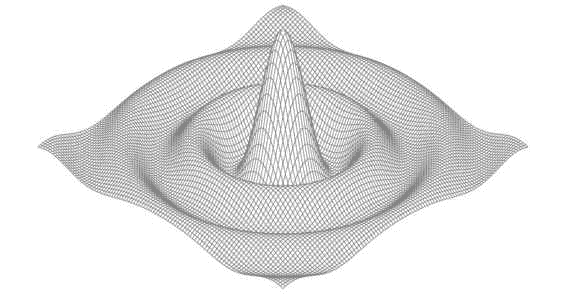

**图 3.1.** 函数 `sin(r)/r` 的曲面图。

点击此处查看代码图片

gopl.io/ch3/surface

```go
// Surface computes an SVG rendering of a 3-D surface function.
package main

import (
    "fmt"
    "math"
)

const (
    width, height = 600, 320            // canvas size in pixels
    cells         = 100                 // number of grid cells
    xyrange       = 30.0                // axis ranges (-xyrange..+xyrange)
    xyscale       = width / 2 / xyrange // pixels per x or y unit
    zscale        = height * 0.4        // pixels per z unit
    angle         = math.Pi / 6         // angle of x, y axes (=30°)
)

var sin30, cos30 = math.Sin(angle), math.Cos(angle) // sin(30°), cos(30°)

func main() {
    fmt.Printf("<svg xmlns='http://www.w3.org/2000/svg' "+
        "style='stroke: grey; fill: white; stroke-width: 0.7' "+
        "width='%d' height='%d'>", width, height)
    for i := 0; i < cells; i++ {
        for j := 0; j < cells; j++ {
            ax, ay := corner(i+1, j)
            bx, by := corner(i, j)
            cx, cy := corner(i, j+1)
            dx, dy := corner(i+1, j+1)
            fmt.Printf("<polygon points='%g,%g %g,%g %g,%g %g,%g'/>\n",
                ax, ay, bx, by, cx, cy, dx, dy)
        }
    }
    fmt.Println("</svg>")
}

func corner(i, j int) (float64, float64) {
    // Find point (x,y) at corner of cell (i,j).
    x := xyrange * (float64(i)/cells - 0.5)
    y := xyrange * (float64(j)/cells - 0.5)

    // Compute surface height z.
    z := f(x, y)

    // Project (x,y,z) isometrically onto 2-D SVG canvas (sx,sy).
    sx := width/2 + (x-y)*cos30*xyscale
    sy := height/2 + (x+y)*sin30*xyscale - z*zscale
    return sx, sy
}

func f(x, y float64) float64 {
    r := math.Hypot(x, y) // distance from (0,0)
    return math.Sin(r) / r
}
```

注意函数 `corner` 返回两个值，即单元格角点的坐标。

程序工作原理的解释只需要基本几何知识，但跳过也没关系，因为重点是演示浮点数计算。程序的核心是在三个不同坐标系之间映射，如图 3.2 所示。第一个是 100×100 单元格的二维网格，由整数坐标 `(i, j)` 标识，从远后角的 (0, 0) 开始。我们从后向前绘制，以便背景多边形可能被前景多边形遮挡。

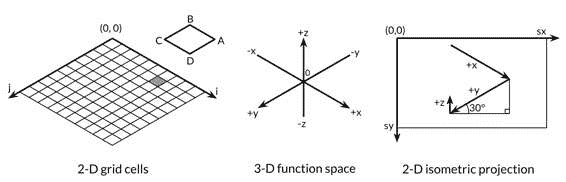

**图 3.2.** 三个不同的坐标系。

第二个坐标系是三维浮点坐标 `(x, y, z)` 的网格，其中 `x` 和 `y` 是 `i` 和 `j` 的线性函数，平移使原点居中，并按常量 `xyrange` 缩放。高度 `z` 是曲面函数 `f(x, y)` 的值。

第三个坐标系是二维图像画布，左上角为 (0, 0)。该平面上的点记为 `(sx, sy)`。我们使用等轴测投影将每个三维点 `(x, y, z)` 映射到二维画布。`x` 值越大或 `y` 值越小，点在画布上显得越靠右。`x` 值或 `y` 值越大，且 `z` 值越小，点显得越靠下。`x` 和 `y` 的垂直和水平缩放因子源自 30° 角的正弦和余弦。`z` 的缩放因子 0.4 是任意参数。

对于二维网格中的每个单元格，`main` 函数计算多边形 `ABCD` 四个角在图像画布上的坐标，其中 `B` 对应 `(i, j)`，`A`、`C`、`D` 为其邻居，然后打印绘制它的 SVG 指令。

### 练习

**练习 3.1：** 如果函数 `f` 返回非有限 `float64` 值，SVG 文件将包含无效的 `<polygon>` 元素（尽管许多 SVG 渲染器能优雅处理）。修改程序以跳过无效多边形。

**练习 3.2：** 尝试可视化 `math` 包中的其他函数。你能生成蛋盒、雪包或鞍面吗？

**练习 3.3：** 根据高度为每个多边形着色，使峰值呈红色 (`#ff0000`)，谷值呈蓝色 (`#0000ff`)。

**练习 3.4：** 参考第 1.7 节中利萨如示例的方法，构建一个 Web 服务器，计算曲面并将 SVG 数据写入客户端。服务器必须设置 `Content-Type` 头，如下所示：

点击此处查看代码图片

```go
w.Header().Set("Content-Type", "image/svg+xml")
```

（利萨如示例中不需要此步骤，因为服务器使用标准启发式方法从响应的前 512 字节识别 PNG 等常见格式，并生成适当的头部。）允许客户端通过 HTTP 请求参数指定高度、宽度和颜色等值。

## 3.3 复数

Go 提供两种大小的复数：`complex64` 和 `complex128`，其分量分别为 `float32` 和 `float64`。内置函数 `complex` 从实部和虚部创建复数，内置函数 `real` 和 `imag` 提取这些分量：

点击此处查看代码图片

```go
var x complex128 = complex(1, 2) // 1+2i
var y complex128 = complex(3, 4) // 3+4i
fmt.Println(x*y)                 // "(-5+10i)"
fmt.Println(real(x*y))           // "-5"
fmt.Println(imag(x*y))           // "10"
```


## 3.3 复数 (duplicate)

如果浮点字面量或十进制整数字面量后面紧跟着 `i`，例如 `3.141592i` 或 `2i`，它就变成了一个 `虚数字面量`，表示一个实部为零的复数：

点击此处查看代码图像

```
fmt.Println(1i * 1i) // "(-1+0i)", i² = -1
```

根据常量运算规则，复数常量可以与其他数值常量（整数或浮点数，实数或虚数）相加，这让我们可以自然地书写复数，如 `1+2i` 或等价的 `2i+1`。上面 `x` 和 `y` 的声明可以简化为：

```
x := 1 + 2i
y := 3 + 4i
```

复数可以使用 `==` 和 `!=` 进行相等比较。如果两个复数的实部相等且虚部相等，则它们相等。

`math/cmplx` 包提供了用于复数操作的库函数，例如复数平方根和指数函数。

点击此处查看代码图像

```
fmt.Println(cmplx.Sqrt(-1)) // "(0+1i)"
```

下面的程序使用 `complex128` 算术来生成曼德勃罗集合。

点击此处查看代码图像

`gopl.io/ch3/mandelbrot`

```
// Mandelbrot emits a PNG image of the Mandelbrot fractal.
package main

import (
    "image"
    "image/color"
    "image/png"
    "math/cmplx"
    "os"
)

func main() {
    const (
        xmin, ymin, xmax, ymax = -2, -2, +2, +2
        width, height          = 1024, 1024
    )

    img := image.NewRGBA(image.Rect(0, 0, width, height))
    for py := 0; py < height; py++ {
        y := float64(py)/height*(ymax-ymin) + ymin
        for px := 0; px < width; px++ {
            x := float64(px)/width*(xmax-xmin) + xmin
            z := complex(x, y)
            // Image point (px, py) represents complex value z.
            img.Set(px, py, mandelbrot(z))
        }
    }
    png.Encode(os.Stdout, img) // NOTE: ignoring errors
}

func mandelbrot(z complex128) color.Color {
    const iterations = 200
    const contrast = 15

    var v complex128
    for n := uint8(0); n < iterations; n++ {
        v = v*v + z
        if cmplx.Abs(v) > 2 {
            return color.Gray{255 - contrast*n}
        }
    }
    return color.Black
}
```

两个嵌套循环遍历一个 1024×1024 灰度光栅图像中的每个点，该图像代表复平面上 -2 到 +2 的区域。程序测试该点代表的数反复平方并加上自身后，最终是否会“逃逸”出半径为 2 的圆。如果会逃逸，则根据逃逸所需的迭代次数对该点进行着色。如果不会逃逸，该值属于曼德勃罗集合，该点保持黑色。最后，程序将标志性分形的 PNG 编码图像写入标准输出，如 图 3.3 所示。

**练习 3.5：** 使用 `image.NewRGBA` 函数和 `color.RGBA` 或 `color.YCbCr` 类型实现一个全彩色的曼德勃罗集合。

**练习 3.6：** 超采样是一种通过计算每个像素内多个点的颜色值并取平均来减少像素化效应的技术。最简单的方法是将每个像素分成四个“子像素”。请实现它。

**练习 3.7：** 另一个简单的分形使用牛顿法寻找函数（如 *z*⁴−1 = 0）的复数解。根据逼近四个根之一所需的迭代次数为每个起始点着色。根据点逼近的根为其着色。


**图 3.3。** 曼德勃罗集合。

**练习 3.8：** 在高缩放级别渲染分形需要极高的算术精度。使用四种不同的数字表示实现相同的分形：`complex64`、`complex128`、`big.Float` 和 `big.Rat`。（后两种类型位于 `math/big` 包中。`Float` 使用任意但有界精度的浮点数；`Rat` 使用无界精度的有理数。）它们在性能和内存使用方面如何比较？在什么缩放级别下渲染伪影会变得可见？

**练习 3.9：** 编写一个 Web 服务器来渲染分形并将图像数据写入客户端。允许客户端将 *x*、*y* 和缩放值作为 HTTP 请求的参数指定。

## 3.4 布尔值

`bool` 类型的值，或称*布尔值*，只有两个可能的值：`true` 和 `false`。

`if` 和 `for` 语句中的条件是布尔值，比较运算符如 `==` 和 `<` 会产生布尔结果。

一元运算符 `!` 是逻辑非，所以 `!true` 是 `false`，或者可以说 `(!true==false)==true`，尽管出于风格考虑，我们总是将冗余的布尔表达式如 `x==true` 简化为 `x`。

布尔值可以与 `&&`（逻辑与）和 `||`（逻辑或）运算符结合使用，它们具有*短路*行为：如果答案已经由左操作数的值决定，则不会对右操作数求值，这使得编写如下表达式成为安全的：

```
s != "" && s[0] == 'x'
```

如果对空字符串应用 `s[0]` 会导致 panic。

由于 `&&` 的优先级高于 `||`（记忆法：`&&` 是布尔乘法，`||` 是布尔加法），这种形式的条件不需要括号：

点击此处查看代码图像

```
if 'a' <= c && c <= 'z' ||
    'A' <= c && c <= 'Z' ||
    '0' <= c && c <= '9' {
    // ...ASCII letter or digit...
}
```

没有从布尔值到数值（如 0 或 1）的隐式转换，反之亦然。

必须使用显式的 `if`，如下所示：

```
i := 0
if b {
    i = 1
}
```

如果经常需要此操作，编写一个转换函数可能是值得的：

点击此处查看代码图像

// btoi returns 1 if b is true and 0 if false.
func btoi(b bool) int {
    if b {
        return 1
    }
    return 0
}

逆操作太简单了，不值得写成函数，但为了对称，这里给出：

点击此处查看代码图像

// itob reports whether i is non-zero.
func itob(i int) bool { return i != 0 }

## 3.5 字符串

字符串是一个不可变的字节序列。

字符串可以包含任意数据，包括值为 0 的字节，但通常它们包含人类可读的文本。

文本字符串通常被解释为 UTF-8 编码的 Unicode 码点（rune）序列，我们很快将详细探讨这一点。

内置函数 `len` 返回字符串中的字节数（而非 rune 数），索引操作 `s[i]` 获取字符串 `s` 的第 *i* 个字节，其中 0 ≤ `i` < `len(s)`。

点击此处查看代码图像

```
s := "hello, world"
fmt.Println(len(s))     // "12"
fmt.Println(s[0], s[7]) // "104 119"  ('h' and 'w')
```

尝试访问此范围之外的字节会导致 panic：

点击此处查看代码图像

```
c := s[len(s)] // panic: index out of range
```

字符串的第 *i* 个字节不一定是字符串的第 *i* 个字符，因为非 ASCII 码点的 UTF-8 编码需要两个或更多字节。

字符处理将在稍后讨论。

子串操作 `s[i:j]` 生成一个新字符串，包含原字符串从索引 `i` 开始到索引 `j` 之前（不包括 `j`）的字节。结果包含 `j-i` 个字节。

```
fmt.Println(s[0:5]) // "hello"
```

同样，如果任一索引越界或 `j` 小于 `i`，会导致 panic。

`i` 和 `j` 操作数可以省略其中一个或两个，在这种情况下分别默认为 `0`（字符串开头）和 `len(s)`（字符串结尾）。

点击此处查看代码图像


```
fmt.Println(s[:5]) // "hello"
fmt.Println(s[7:]) // "world"
fmt.Println(s[:])  // "hello, world"
```

The `+` 运算符通过连接两个字符串来创建一个新字符串：

点击此处查看代码图像

```
fmt.Println("goodbye" + s[5:]) // "goodbye, world"
```

字符串可以使用像 `==` 和 `<` 这样的比较运算符进行比较；比较是逐字节进行的，因此结果是自然的字典序。

字符串值是不可变的：字符串值包含的字节序列永远不能被改变，当然我们可以给字符串 `variable` 赋一个新值。例如，要将一个字符串追加到另一个字符串，我们可以写成

```
s := "left foot"
t := s
s += ", right foot"
```

这不会修改 `s` 原来持有的字符串，而是让 `s` 持有由 `+=` 语句形成的新字符串；同时，`t` 仍然包含旧字符串。

点击此处查看代码图像

```
fmt.Println(s) // "left foot, right foot"
fmt.Println(t) // "left foot"
```

由于字符串是不可变的，试图就地修改字符串数据的操作是不允许的：

点击此处查看代码图像

```
s[0] = 'L' // compile error: cannot assign to s[0]
```

不可变性意味着两个副本共享同一底层内存是安全的，这使得复制任意长度的字符串开销很小。同样，字符串 `s` 和像 `s[7:]` 这样的子字符串可以安全地共享相同的数据，因此子字符串操作也很廉价。这两种情况都不会分配新内存。图 3.4 展示了一个字符串及其两个子字符串共享同一底层字节数组的布局。

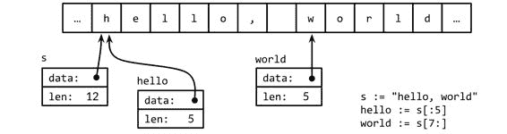

**图 3.4.** 字符串 `"hello, world"` 和两个子字符串。

### 3.5.1 字符串字面量

字符串值可以写成 `string literal`（字符串字面量）的形式，即用双引号括起来的字节序列：

```
"Hello, "
```

因为 Go 源文件总是采用 `UTF-8` 编码，且 Go 文本字符串按惯例被解释为 `UTF-8`，所以我们可以在字符串字面量中包含 Unicode 码点。

在双引号字符串字面量中，以反斜杠 `\` 开头的 `escape sequences`（转义序列）可用于将任意字节值插入字符串。一组转义序列处理 ASCII 控制码，如换行符、回车符和制表符：

| 转义序列 | 含义 |
| --- | --- |
| `\a` | “alert” 或响铃 |
| `\b` | 退格 |
| `\f` | 换页 |
| `\n` | 换行 |
| `\r` | 回车 |
| `\t` | 制表符 |
| `\v` | 垂直制表符 |
| `\'` | 单引号（仅在符文字面量 `'\''` 中） |
| `\"` | 双引号（仅在 `"..."` 字面量中） |
| `\\` | 反斜杠 |

任意字节也可以通过十六进制或八进制转义序列包含在字面量字符串中。`hexadecimal escape`（十六进制转义）写作 `\xhh`，包含恰好两个十六进制数字 `h`（大小写均可）。`octal escape`（八进制转义）写作 `\ooo`，包含恰好三个八进制数字 `o`（0 到 7），不超过 `\377`。两者都表示一个具有指定值的单字节。稍后我们将看到如何在字符串字面量中用数值编码 Unicode 码点。

`raw string literal`（原始字符串字面量）写作 `` `...` ``，使用反引号代替双引号。在原始字符串字面量中，不会处理转义序列；内容按字面意思取值，包括反斜杠和换行符，因此原始字符串字面量可以在程序源代码中跨多行。唯一的处理是删除回车符，以便字符串的值在所有平台上都相同，包括那些习惯在文本文件中放置回车符的平台。

原始字符串字面量是编写正则表达式的便捷方式，正则表达式往往包含大量反斜杠。它们对于 HTML 模板、JSON 字面量、命令用法消息等也很有用，这些内容通常跨越多行。

点击此处查看代码图像

```
const GoUsage = `Go is a tool for managing Go source code.

Usage:
    go command [arguments]
...`
```

### 3.5.2 Unicode

很久以前，生活很简单，至少从狭隘的角度来看，只有一个字符集需要处理：ASCII，即美国信息交换标准代码。ASCII，或更准确地说是 US-ASCII，使用 7 位来表示 128 个“字符”：英文大小写字母、数字，以及各种标点和设备控制字符。在计算机发展的早期，这已经足够，但它让世界上很大一部分人口无法在计算机中使用自己的书写系统。随着互联网的发展，多语言数据变得更加普遍。如何处理这种丰富的多样性，如果可能的话，如何高效地处理？

答案是 Unicode（`unicode.org`），它收集了世界上所有书写系统中的所有字符，以及重音符号和其他变音符号、像制表符和回车符这样的控制码，还有大量生僻字符，并为每一个分配一个标准编号，称为 `Unicode code point`（Unicode 码点），或者在 Go 术语中称为 `rune`（符文）。

Unicode 8.0 版为 100 多种语言和文字中的 120,000 多个字符定义了码点。这些在计算机程序和数据中如何表示？存放单个 rune 的自然数据类型是 `int32`，这正是 Go 所使用的；它为此目的专门提供了同义词 `rune`。

我们可以用一系列 `int32` 值来表示一系列 rune。这种表示称为 `UTF-32` 或 `UCS-4`，每个 Unicode 码点的编码大小相同，都是 32 位。这简单且统一，但比必要的空间大得多，因为大多数计算机可读文本是 ASCII，每个字符只需要 8 位或 1 字节。广泛使用的所有字符加起来仍不足 65,536 个，可以放入 16 位中。我们能做得更好吗？

### 3.5.3 UTF-8

UTF-8 是 Unicode 码点作为字节的变长编码。UTF-8 由 Ken Thompson 和 Rob Pike 发明，他们是 Go 的两位创建者，现在它是一个 Unicode 标准。它使用 1 到 4 个字节来表示每个 rune，但 ASCII 字符只用 1 字节，常用的大多数 rune 只用 2 或 3 字节。rune 编码的第一个字节的高位指示后面跟随多少字节。高位 `0` 表示 7 位 ASCII，每个 rune 只占 1 字节，因此它与传统 ASCII 相同。高位 `110` 表示该 rune 占 2 字节；第二个字节以 `10` 开头。较大的 rune 具有类似的编码。

查看表格图像

| 位模式 | 码点范围 | 备注 |
| --- | --- | --- |
| `0xxxxxx` | runes 0–127 | (ASCII) |
| `110xxxxx 10xxxxxx` | 128–2047 | (值 <128 未使用) |
| `1110xxxx 10xxxxxx 10xxxxxx` | 2048–65535 | (值 <2048 未使用) |
| `11110xxx 10xxxxxx 10xxxxxx 10xxxxxx` | 65536–0x10ffff | (其他值未使用) |

变长编码使得无法直接通过索引访问字符串的第 *n* 个字符，但 UTF-8 具有许多理想的特性来弥补这一点。这种编码紧凑、兼容 ASCII 且自同步：通过回退不超过三个字节就能找到字符的开始。它也是前缀码，因此可以从左向右解码，无需任何歧义或前瞻。没有任何 rune 的编码是其他 rune 编码的子串，甚至不是其他 rune 编码序列的子串，因此你可以通过搜索其字节来查找 rune，而无需担心前面的上下文。字典字节序等于 Unicode 码点序，因此对 UTF-8 排序自然有效。没有嵌入的 `NUL`（零）字节，这对于使用 `NUL` 终止字符串的编程语言很方便。


## 3.5 字符串与 UTF-8 (duplicate)

Go 源文件始终采用 UTF-8 编码，且 UTF-8 是 Go 程序处理文本字符串的首选编码。`unicode` 包提供了处理单个 rune 的函数（例如区分字母和数字，或将大写字母转换为小写字母），而 `unicode/utf8` 包则提供了使用 UTF-8 将 rune 编码和解码为字节的函数。

### 3.5.1 Unicode 转义序列

许多 Unicode 字符难以在键盘上输入，或难以在视觉上与外观相似的字符区分；有些甚至是不可见的。Go 字符串字面量中的 Unicode 转义序列允许我们通过其数值码点来指定这些字符。共有两种形式：用于 16 位值的 `\u`*hhhh* 和用于 32 位值的 `\U`*hhhhhhhh*，其中每个 *h* 代表一个十六进制数字；32 位形式极少用到。每种形式均表示指定码点的 UTF-8 编码。因此，例如，以下字符串字面量均表示同一个由六个字节组成的字符串：

```
""
"\xe4\xb8\x96\xe7\x95\x8c"
"\u4e16\u754c"
"\U00004e16\U0000754c"
```

上述三个转义序列为第一个字符串提供了替代表示法，但它们表示的值完全相同。

Unicode 转义序列也可用于 rune 字面量。以下三个字面量等价：

```
''  '\u4e16'  '\U00004e16'
```

值小于 256 的 rune 可用单个十六进制转义序列书写，例如 `'\x41'` 代表 `'A'`，但对于更大的值，必须使用 `\u` 或 `\U` 转义序列。因此，`'\xe4\xb8\x96'` 不是合法的 rune 字面量，尽管这三个字节是单个码点的有效 UTF-8 编码。

### 3.5.2 字符串操作

得益于 UTF-8 的优良特性，许多字符串操作无需解码即可进行。我们可以测试一个字符串是否包含另一个字符串作为前缀：

单击此处查看代码图像

```
func HasPrefix(s, prefix string) bool {
    return len(s) >= len(prefix) && s[:len(prefix)] == prefix
}
```

或作为后缀：

单击此处查看代码图像

```
func HasSuffix(s, suffix string) bool {
    return len(s) >= len(suffix) && s[len(s)-len(suffix):] == suffix
}
```

或作为子字符串：

单击此处查看代码图像

```
func Contains(s, substr string) bool {
    for i := 0; i < len(s); i++ {
        if HasPrefix(s[i:], substr) {
            return true
        }
    }
    return false
}
```

对 UTF-8 编码文本使用的逻辑与对原始字节完全相同。其他编码则不具备此特性。（上述函数源自 `strings` 包，尽管其 `Contains` 的实现使用了哈希技术以实现更高效的搜索。）

### 3.5.3 处理 Unicode 字符

另一方面，如果我们确实关心单个 Unicode 字符，则必须使用其他机制。考虑我们最早示例中的字符串，它包含两个东亚字符。**图 3.5** 展示了它在内存中的表示形式。该字符串包含 13 个字节，但若按 UTF-8 解读，则仅编码了九个码点或 rune：


**图 3.5.** `range` 循环解码 UTF-8 编码的字符串。

单击此处查看代码图像

```
import "unicode/utf8"

s := "Hello, "
fmt.Println(len(s))                    // "13"
fmt.Println(utf8.RuneCountInString(s)) // "9"
```

要处理这些字符，我们需要一个 UTF-8 解码器。`unicode/utf8` 包提供了一个，用法如下：

单击此处查看代码图像

```
for i := 0; i < len(s); {
    r, size := utf8.DecodeRuneInString(s[i:])
    fmt.Printf("%d\t%c\n", i, r)
    i += size
}
```

每次调用 `DecodeRuneInString` 都会返回 `r`（rune 本身）和 `size`（`r` 的 UTF-8 编码所占的字节数）。该大小用于更新字符串中下一个 rune 的字节索引 `i`。但这种写法笨拙，且我们经常需要此类循环。幸运的是，Go 的 `range` 循环作用于字符串时会隐式执行 UTF-8 解码。下面循环的输出也显示在**图 3.5** 中；请注意，对于每个非 ASCII rune，索引的跳跃幅度都大于 1。

单击此处查看代码图像

```
for i, r := range "Hello, " {
    fmt.Printf("%d\t%q\t%d\n", i, r, r)
}
```

我们可以使用简单的 `range` 循环来统计字符串中的 rune 数量，如下所示：

```
n := 0
for _, _ = range s {
    n++
}
```

与其他形式的 `range` 循环一样，我们可以省略不需要的变量：

```
n := 0
for range s {
    n++
}
```

或者直接调用 `utf8.RuneCountInString(s)`。

我们之前提到过，在 Go 中将文本字符串解释为 UTF-8 编码的 Unicode 码点序列主要是一种约定，但对于在字符串上正确使用 `range` 循环而言，这不仅是约定，更是必要条件。如果我们对包含任意二进制数据的字符串，或者包含错误的 UTF-8 数据进行 range 迭代，会发生什么？

每当 UTF-8 解码器（无论是显式调用 `utf8.DecodeRuneInString`，还是在 `range` 循环中隐式调用）遇到意外的输入字节时，都会生成一个特殊的 Unicode *替换字符*，即 `'\uFFFD'`，通常显示为黑色六边形或菱形内的白色问号 。当程序遇到此 rune 值时，往往表明生成该字符串数据的上游系统某部分在处理文本编码时有所疏忽。

UTF-8 作为交换格式极为方便，但在程序运行期间，rune 可能更方便，因为它们大小统一，因此易于在数组和切片中索引。

将 `[]rune` 转换应用于 UTF-8 编码的字符串，将返回该字符串编码的 Unicode 码点序列：

单击此处查看代码图像

```
// 日语片假名中的 "program"
s := ""
fmt.Printf("% x\n", s) // "e3 83 97 e3 83 ad e3 82 b0 e3 83 a9 e3 83 a0"
r := []rune(s)
fmt.Printf("%x\n", r)  // "[30d7 30ed 30b0 30e9 30e0]"
```

（第一个 `Printf` 中的动词 `% x` 会在每对十六进制数字之间插入一个空格。）

如果将 rune 切片转换为字符串，会生成每个 rune 的 UTF-8 编码的拼接：

单击此处查看代码图像

```
fmt.Println(string(r)) // ""
```

将整数值转换为字符串会将该整数解释为 rune 值，并生成该 rune 的 UTF-8 表示形式：

单击此处查看代码图像

```
fmt.Println(string(65))     // "A", 而非 "65"
fmt.Println(string(0x4eac)) // ""
```

如果 rune 无效，则会替换为替换字符：

单击此处查看代码图像

```
fmt.Println(string(1234567)) // ""
```

### 3.5.4 字符串与字节切片

有四个标准包对于操作字符串尤为重要：`bytes`、`strings`、`strconv` 和 `unicode`。`strings` 包提供了许多用于搜索、替换、比较、修剪、分割和连接字符串的函数。

`bytes` 包提供了针对字节切片（类型 `[]byte`）的类似函数，字节切片与字符串具有某些共同特性。因为字符串是**不可变**的，逐步构建字符串可能涉及大量的内存分配和复制。在这种情况下，使用 `bytes.Buffer` 类型会更高效，我们稍后将演示。

`strconv` 包提供了布尔值、整数和浮点数与其字符串表示之间相互转换的函数，以及字符串加引号和去引号的函数。


### `unicode` 包

`unicode` 包提供了诸如 `IsDigit`、`IsLetter`、`IsUpper` 和 `IsLower` 等函数，用于对 rune 进行分类。每个函数接受单个 rune 参数并返回一个布尔值。转换函数如 `ToUpper` 和 `ToLower` 可在 rune 为字母时将其转换为指定的大小写。所有这些函数均使用 Unicode 标准类别来处理字母、数字等。

### `strings` 包

`strings` 包也有类似的函数，同样称为 `ToUpper` 和 `ToLower`，它们会返回一个新字符串，其中原字符串的每个字符都经过了指定的转换。

### `basename` 函数

下面的 `basename` 函数灵感来源于同名的 Unix shell 实用工具。在我们的版本中，`basename(s)` 会移除 `s` 中看起来像文件系统路径的前缀（路径组件由斜杠分隔），并移除看起来像文件类型的后缀：

```
fmt.Println(basename("a/b/c.go")) // "c"
fmt.Println(basename("c.d.go"))   // "c.d"
fmt.Println(basename("abc"))      // "abc"
```

### 第一版（不使用库）

`basename` 的第一版在没有库帮助的情况下完成所有工作：

```
gopl.io/ch3/basename1
```

```
// basename removes directory components and a .suffix.
// e.g., a => a, a.go => a, a/b/c.go => c, a/b.c.go => b.c
func basename(s string) string {
    // Discard last '/' and everything before.
    for i := len(s) - 1; i >= 0; i-- {
        if s[i] == '/' {
            s = s[i+1:]
            break
        }
    }
    // Preserve everything before last '.'.
    for i := len(s) - 1; i >= 0; i-- {
        if s[i] == '.' {
            s = s[:i]
            break
        }
    }
    return s
}
```

### 第二版（使用 `strings.LastIndex`）

一个更简单的版本使用了 `strings.LastIndex` 库函数：

```
gopl.io/ch3/basename2
```

```
func basename(s string) string {
    slash := strings.LastIndex(s, "/") // -1 if "/" not found
    s = s[slash+1:]
    if dot := strings.LastIndex(s, "."); dot >= 0 {
        s = s[:dot]
    }
    return s
}
```

### `path` 和 `path/filepath` 包

`path` 和 `path/filepath` 包提供了一组更通用的函数，用于操作分层名称。`path` 包可在任何平台上处理以斜杠为分隔符的路径。它不应用于文件名，但适用于其他领域，例如 URL 的路径组件。相比之下，`path/filepath` 使用宿主平台的规则操作文件名，例如 POSIX 系统上的 `/foo/bar` 或 Microsoft Windows 上的 `c:\foo\bar`。

### `comma` 函数

让我们继续看另一个子字符串示例。任务是获取一个整数的字符串表示形式，例如 `"12345"`，并每三位插入一个逗号，如 `"12,345"`。此版本仅适用于整数；浮点数的处理留作练习。

```
gopl.io/ch3/comma
```

```
// comma inserts commas in a non-negative decimal integer string.
func comma(s string) string {
    n := len(s)
    if n <= 3 {
        return s
    }
    return comma(s[:n-3]) + "," + s[n-3:]
}
```

`comma` 的参数是一个字符串。如果其长度小于或等于 3，则无需逗号。否则，`comma` 会使用由除最后三个字符外的所有字符组成的子字符串递归调用自身，并将一个逗号和最后三个字符追加到递归调用的结果中。

### 字符串与字节切片之间的转换

字符串包含一个字节数组，一旦创建即不可变。相比之下，字节切片的元素可以自由修改。

字符串可以转换为字节切片，也可以再转换回来：

```
s := "abc"
b := []byte(s)
s2 := string(b)
```

概念上，`[]byte(s)` 转换会分配一个新的字节数组来保存 `s` 的字节副本，并生成一个引用该数组全部内容的切片。优化编译器在某些情况下可能会避免分配和复制，但通常需要复制以确保 `s` 的字节保持不变，即使 `b` 的字节随后被修改。使用 `string(b)` 将字节切片转换回字符串也会进行复制，以确保生成的字符串 `s2` 的不可变性。

### `bytes` 包和 `Buffer` 类型

为避免转换和不必要的内存分配，`bytes` 包中的许多实用函数直接对应 `strings` 包中的同类函数。例如，以下是来自 `strings` 的六个函数：

```
func Contains(s, substr string) bool
func Count(s, sep string) int
func Fields(s string) []string
func HasPrefix(s, prefix string) bool
func Index(s, sep string) int
func Join(a []string, sep string) string
```

以及来自 `bytes` 的对应函数：

```
func Contains(b, subslice []byte) bool
func Count(s, sep []byte) int
func Fields(s []byte) [][]byte
func HasPrefix(s, prefix []byte) bool
func Index(s, sep []byte) int
func Join(s [][]byte, sep []byte) []byte
```

唯一的区别在于字符串被字节切片取代了。

`bytes` 包提供了 `Buffer` 类型，用于高效操作字节切片。`Buffer` 最初为空，但随着 `string`、`byte` 和 `[]byte` 等类型的数据被写入而增长。如下例所示，`bytes.Buffer` 变量无需初始化，因为其零值可用：

```
gopl.io/ch3/printints
```

```
// intsToString is like fmt.Sprint(values) but adds commas.
func intsToString(values []int) string {
    var buf bytes.Buffer
    buf.WriteByte('[')
    for i, v := range values {
        if i > 0 {
            buf.WriteString(", ")
        }
        fmt.Fprintf(&buf, "%d", v)
    }
    buf.WriteByte(']')
    return buf.String()
}

func main() {
    fmt.Println(intsToString([]int{1, 2, 3})) // "[1, 2, 3]"
}
```

当将任意 rune 的 UTF-8 编码追加到 `bytes.Buffer` 时，最好使用 `bytes.Buffer` 的 `WriteRune` 方法，但对于 `'['` 和 `']'` 等 ASCII 字符，使用 `WriteByte` 也可以。

`bytes.Buffer` 类型极其通用，当我们在第 7 章讨论接口时，将会看到它如何在 I/O 函数需要字节接收器 (`io.Writer`)（如上文的 `Fprintf`）或字节来源 (`io.Reader`) 时，作为文件的替代品使用。

### 练习

**练习 3.10：** 编写 `comma` 的非递归版本，使用 `bytes.Buffer` 代替字符串拼接。

**练习 3.11：** 改进 `comma`，使其能正确处理浮点数和可选的符号。

**练习 3.12：** 编写一个函数，判断两个字符串是否为变位词（anagrams），即它们包含相同的字母但顺序不同。

### 3.5.5 字符串与数字之间的转换

除了字符串、rune 和字节之间的转换外，经常还需要在数值及其字符串表示之间进行转换。这通过 `strconv` 包中的函数完成。

要将整数转换为字符串，一种方法是使用 `fmt.Sprintf`；另一种是使用 `strconv.Itoa`（"integer to ASCII"）函数：

```
x := 123
y := fmt.Sprintf("%d", x)
fmt.Println(y, strconv.Itoa(x)) // "123 123"
```

`FormatInt` 和 `FormatUint` 可用于以不同基数格式化数字：

```
fmt.Println(strconv.FormatInt(int64(x), 2)) // "1111011"
```

`fmt.Printf` 的动词 `%b`、`%d`、`%u` 和 `%x` 通常比 `Format` 函数更方便，特别是当我们想包含除数字以外的额外信息时：

```
s := fmt.Sprintf("x=%b", x) // "x=1111011"
```


### 解析整数

要解析表示整数的字符串，请使用 `strconv` 函数 `Atoi` 或 `ParseInt`，对于无符号整数则使用 `ParseUint`：

点击此处查看代码图像

```go
x, err := strconv.Atoi("123")             // x is an int
y, err := strconv.ParseInt("123", 10, 64) // base 10, up to 64 bits
```

`ParseInt` 的第三个参数指定了结果必须能容纳的整数类型的大小；例如，16 表示 `int16`，特殊值 0 表示 `int`。无论哪种情况，结果 `y` 的类型始终是 `int64`，随后你可以将其转换为较小的类型。

有时 `fmt.Scanf` 可用于解析由字符串和数字有序混合且全部位于单行上的输入，但它可能不够灵活，特别是在处理不完整或不规则输入时。

## 3.6 常量

常量是其值在编译时已知且求值保证发生在编译时而非运行时的表达式。每个常量的底层类型都是基本类型：布尔型、字符串或数字。

`const` 声明定义了语法上看起来像变量但值恒定的命名值，这可以防止在程序执行期间发生意外（或恶意）更改。例如，对于像 `pi` 这样的数学常量，常量比变量更合适，因为它的值不会改变：

点击此处查看代码图像

```go
const pi = 3.14159 // approximately; math.Pi is a better approximation
```

与变量一样，一组常量可以出现在一个声明中；这适用于一组相关的值：

点击此处查看代码图像

```go
const (
    e  = 2.71828182845904523536028747135266249775724709369995957496696763
    pi = 3.14159265358979323846264338327950288419716939937510582097494459
)
```

对常量的许多计算可以在编译时完全求值，减少运行时所需的工作并启用其他编译器优化。当操作数为常量时，通常在运行时检测到的错误可以在编译时报告，例如整数除以零、字符串索引越界，以及任何会导致非有限值的浮点运算。

应用于常量操作数的所有算术、逻辑和比较运算的结果本身也是常量，类型转换和对某些内置函数（如 `len`、`cap`、`real`、`imag`、`complex` 和 `unsafe.Sizeof`）的调用结果也是常量（§13.1）。

由于它们的值在编译时已知，常量表达式可以出现在类型中，具体来说是作为数组类型的长度：

点击此处查看代码图像

```go
const IPv4Len = 4

// parseIPv4 parses an IPv4 address (d.d.d.d).
func parseIPv4(s string) IP {
    var p [IPv4Len]byte
    // ...
}
```

常量声明可以同时指定类型和值，但在没有显式类型的情况下，类型将从右侧的表达式推断得出。在下面的代码中，`time.Duration` 是一个底层类型为 `int64` 的命名类型，而 `time.Minute` 是该类型的常量。因此，下面声明的两个常量也都具有 `time.Duration` 类型，这由 `%T` 揭示：

点击此处查看代码图像

```go
const noDelay time.Duration = 0
const timeout = 5 * time.Minute
fmt.Printf("%T %[1]v\n", noDelay)     // "time.Duration 0"
fmt.Printf("%T %[1]v\n", timeout)     // "time.Duration 5m0s"
fmt.Printf("%T %[1]v\n", time.Minute) // "time.Duration 1m0s"
```

当一组常量作为一个群组声明时，除了第一个之外，其余的右侧表达式可以省略，这意味着应再次使用前一个表达式及其类型。例如：

点击此处查看代码图像

```go
const (
    a = 1
    b
    c = 2
    d
)

fmt.Println(a, b, c, d) // "1 1 2 2"
```

如果隐式复制的右侧表达式总是求值为相同的东西，这不是很有用。但如果它可以变化呢？这引出了 `iota`。

### 3.6.1 常量生成器 `iota`

`const` 声明可以使用*常量生成器* `iota`，它用于创建一系列相关的值，而无需显式地拼写每一个。在 `const` 声明中，`iota` 的值从零开始，并为序列中的每一项加一。

这里有一个来自 `time` 包的示例，它为一周中的每一天定义了类型为 `Weekday` 的命名常量，从 `Sunday` 的零开始。这类类型通常被称为*枚举*，简称 *enums*。

```go
type Weekday int

const (
    Sunday Weekday = iota
    Monday
    Tuesday
    Wednesday
    Thursday
    Friday
    Saturday
)
```

这声明 `Sunday` 为 0，`Monday` 为 1，依此类推。

我们也可以在更复杂的表达式中使用 `iota`，如这个来自 `net` 包的示例，其中无符号整数的最低 5 位各自被赋予一个不同的名称和布尔含义：

点击此处查看代码图像

```go
type Flags uint

const (
    FlagUp Flags = 1 << iota // is up
    FlagBroadcast            // supports broadcast access capability
    FlagLoopback             // is a loopback interface
    FlagPointToPoint         // belongs to a point-to-point link
    FlagMulticast            // supports multicast access capability
)
```

随着 `iota` 递增，每个常量被赋值为 `1 << iota`，其求值结果为连续的 2 的幂，每个对应单个位。我们可以在测试、设置或清除一个或多个这些位的函数中使用这些常量：

点击此处查看代码图像

`gopl.io/ch3/netflag`

```go
func IsUp(v Flags) bool     { return v&FlagUp == FlagUp }
func TurnDown(v *Flags)     { *v &^= FlagUp }
func SetBroadcast(v *Flags) { *v |= FlagBroadcast }
func IsCast(v Flags) bool   { return v&(FlagBroadcast|FlagMulticast) != 0 }

func main() {
    var v Flags = FlagMulticast | FlagUp
    fmt.Printf("%b %t\n", v, IsUp(v)) // "10001 true"
    TurnDown(&v)
    fmt.Printf("%b %t\n", v, IsUp(v)) // "10000 false"
    SetBroadcast(&v)
    fmt.Printf("%b %t\n", v, IsUp(v))   // "10010 false"
    fmt.Printf("%b %t\n", v, IsCast(v)) // "10010 true"
}
```

作为 `iota` 的一个更复杂的例子，此声明为 1024 的幂命名：

点击此处查看代码图像

```go
const (
    _ = 1 << (10 * iota)
    KiB // 1024
    MiB // 1048576
    GiB // 1073741824
    TiB // 1099511627776              (exceeds 1 << 32)
    PiB // 1125899906842624
    EiB // 1152921504606846976
    ZiB // 1180591620717411303424     (exceeds 1 << 64)
    YiB // 1208925819614629174706176
)
```

`iota` 机制有其局限性。例如，无法生成更熟悉的 1000 的幂（KB、MB 等），因为没有幂运算符。

**练习 3.13：** 为 `KB`、`MB` 一直到 `YB` 编写 `const` 声明，尽可能紧凑。

### 3.6.2 无类型常量

Go 中的常量有点特殊。虽然常量可以拥有任何基本数据类型，如 `int` 或 `float64`，包括像 `time.Duration` 这样的命名基本类型，但许多常量并不绑定特定类型。编译器以比基本类型值高得多的数值精度来表示这些未绑定常量，对它们的算术运算比机器算术更精确；你可以假设至少有 256 位的精度。这些未绑定常量有六种类型，称为无类型布尔值、无类型整数、无类型符文、无类型浮点数、无类型复数和无类型字符串。


通过推迟这种确定，无类型常量不仅能保持其更高的精度直到后期，还能在不需要转换的情况下参与比已确定类型的常量更多的表达式。例如，上面示例中的值 `ZiB` 和 `YiB` 太大，无法存储在任何整数变量中，但它们是合法的常量，可用于如下表达式：

```
fmt.Println(YiB/ZiB) // "1024"
```

作为另一个例子，浮点常量 `math.Pi` 可用于任何需要浮点或复数值的地方：

```
var x float32 = math.Pi
var y float64 = math.Pi
var z complex128 = math.Pi
```

如果 `math.Pi` 已被确定为特定类型（如 `float64`），结果精度会降低，且在需要 `float32` 或 `complex128` 值时，必须进行类型转换：

点击此处查看代码图像

```
const Pi64 float64 = math.Pi

var x float32 = float32(Pi64)
var y float64 = Pi64
var z complex128 = complex128(Pi64)
```

对于字面量，语法决定其种类。字面量 `0`、`0.0`、`0i` 和 `'\u0000'` 都表示相同值但种类不同的常量：分别为无类型整数、无类型浮点数、无类型复数和无类型字符。类似地，`true` 和 `false` 是无类型布尔值，字符串字面量是无类型字符串。

回顾一下，`/` 可能表示整数或浮点数除法，取决于其操作数。因此，字面量的选择可能影响常量除法表达式的结果：

点击此处查看代码图像

```
var f float64 = 212
fmt.Println((f - 32) * 5 / 9)     // "100"; (f - 32) * 5 是 float64
fmt.Println(5 / 9 * (f - 32))     // "0";   5/9 是无类型整数，结果为 0
fmt.Println(5.0 / 9.0 * (f - 32)) // "100"; 5.0/9.0 是无类型浮点数
```

只有常量可以是无类型的。当无类型常量被赋值给变量时（如下面的第一条语句），或出现在带有显式类型的变量声明右侧时（如其他三条语句），如果可能，常量会隐式转换为该变量的类型。

点击此处查看代码图像

```
var f float64 = 3 + 0i // 无类型复数 -> float64
f = 2                  // 无类型整数 -> float64
f = 1e123              // 无类型浮点数 -> float64
f = 'a'                // 无类型字符 -> float64
```

上述语句等价于：

```
var f float64 = float64(3 + 0i)
f = float64(2)
f = float64(1e123)
f = float64('a')
```

无论隐式还是显式，将常量从一种类型转换为另一种类型，都要求目标类型能表示原始值。允许对实数和复数浮点数进行舍入：

点击此处查看代码图像

```
const (
    deadbeef = 0xdeadbeef // 无类型 int，值为 3735928559
    a = uint32(deadbeef)  // uint32，值为 3735928559
    b = float32(deadbeef) // float32，值为 3735928576（向上舍入）
    c = float64(deadbeef) // float64，值为 3735928559（精确）
    d = int32(deadbeef)   // 编译错误：常量溢出 int32
    e = float64(1e309)    // 编译错误：常量溢出 float64
    f = uint(-1)          // 编译错误：常量下溢 uint
)
```

在不带显式类型的变量声明中（包括短变量声明），无类型常量的种类隐式决定了变量的默认类型，如下例所示：

点击此处查看代码图像

```
i := 0      // 无类型整数；        隐式 int(0)
r := '\000' // 无类型字符；           隐式 rune('\000')
f := 0.0    // 无类型浮点数；隐式 float64(0.0)
c := 0i     // 无类型复数；        隐式 complex128(0i)
```

注意这种不对称性：无类型整数转换为 `int`，其大小不固定；但无类型浮点数和复数转换为显式大小的类型 `float64` 和 `complex128`。语言没有类似无类型 `int` 的无类型 `float` 和 `complex` 类型，因为在不知道浮点数据类型大小的情况下，很难编写正确的数值算法。

要使变量具有不同类型，必须显式将无类型常量转换为所需类型，或在变量声明中指明所需类型，如下例所示：

```
var i = int8(0)
var i int8 = 0
```

这些默认规则在将无类型常量转换为接口值时（见第 7 章）尤为重要，因为它们决定了接口值的动态类型。

点击此处查看代码图像

```
fmt.Printf("%T\n", 0)      // "int"
fmt.Printf("%T\n", 0.0)    // "float64"
fmt.Printf("%T\n", 0i)     // "complex128"
fmt.Printf("%T\n", '\000') // "int32" (rune)
```

我们已介绍 Go 的基本数据类型。下一步是展示如何将它们组合成更大的聚合，如数组和结构体，进而构建解决实际编程问题的数据结构；这是第 4 章的主题。

# 4. 组合类型

在第 3 章中，我们讨论了作为 Go 程序数据结构构建块的基本类型；它们是我们世界的原子。本章将介绍*组合*类型，即通过以各种方式组合基本类型而创建的分子。我们将讨论四种此类类型——数组、切片、映射和结构体——并在章末展示如何使用这些类型的结构化数据编码为 JSON、从 JSON 解析，以及用于从模板生成 HTML。

数组和结构体是*聚合*类型；它们的值是内存中其他值的连接。数组是同质的——其元素都具有相同类型——而结构体是异质的。数组和结构体都是固定大小的。相比之下，切片和映射是动态数据结构，随值的添加而增长。

## 4.1 数组

数组是特定类型的零个或多个元素的固定长度序列。由于长度固定，数组在 Go 中很少直接使用。切片可以增长和收缩，功能更强大，但要理解切片，必须先理解数组。

单个数组元素通过传统的下标表示法访问，下标从 0 到数组长度减 1。内置函数 `len` 返回数组中的元素数量。

点击此处查看代码图像

```
var a [3]int             // 3 个整数的数组
fmt.Println(a[0])        // 打印第一个元素
fmt.Println(a[len(a)-1]) // 打印最后一个元素，a[2]

// 打印索引和元素。
for i, v := range a {
    fmt.Printf("%d %d\n", i, v)
}

// 仅打印元素。
for _, v := range a {
    fmt.Printf("%d\n", v)
}
```

默认情况下，新数组变量的元素初始为元素类型的零值，数字类型为 `0`。我们可以使用*数组字面量*用一组值初始化数组：

点击此处查看代码图像

```
var q [3]int = [3]int{1, 2, 3}
var r [3]int = [3]int{1, 2}
fmt.Println(r[2]) // "0"
```

在数组字面量中，如果省略号 `...` 出现在长度位置，数组长度由初始化表达式的数量决定。`q` 的定义可简化为：

```
q := [...]int{1, 2, 3}
fmt.Printf("%T\n", q) // "[3]int"
```

数组的大小是其类型的一部分，因此 `[3]int` 和 `[4]int` 是不同类型。大小必须是常量表达式，即其值可在编译时计算的表达式。


## 4.1 数组 (duplicate)

点击此处查看代码图像

```
q := [3]int{1, 2, 3}
q = [4]int{1, 2, 3, 4} // compile error: cannot assign [4]int to [3]int
```

正如我们将看到的，数组、切片、映射和结构体的字面量语法是相似的。上面的具体形式是一个按顺序排列的值列表，但也可以指定一个索引和值对的列表，如下所示：

点击此处查看代码图像

```
type Currency int

const (
    USD Currency = iota
    EUR
    GBP
    RMB
)

symbol := [...]string{USD: "$", EUR: "€", GBP: "£", RMB: "¥"}

fmt.Println(RMB, symbol[RMB]) // "3 ¥"
```

在这种形式中，索引可以以任何顺序出现，并且可以省略一些；如前所述，未指定的值将取该元素类型的零值。例如，

```
r := [...]int{99: -1}
```

定义了一个包含 100 个元素的数组 `r`，所有元素均为零，除了最后一个，其值为 −1。

如果数组的元素类型是*可比较的*，那么该数组类型也是可比较的，因此我们可以直接使用 `==` 运算符比较该类型的两个数组，它会报告所有对应元素是否相等。`!=` 运算符是其否定形式。

点击此处查看代码图像

```
a := [2]int{1, 2}
b := [...]int{1, 2}
c := [2]int{1, 3}
fmt.Println(a == b, a == c, b == c) // "true false false"
d := [3]int{1, 2}
fmt.Println(a == d) // compile error: cannot compare [2]int == [3]int
```

作为一个更实际的例子，`crypto/sha256` 包中的 `Sum256` 函数生成存储在任意字节切片中的消息的 SHA256 加密哈希或*摘要*。摘要有 256 位，因此其类型是 `[32]byte`。如果两个摘要相同，那么这两个消息极有可能相同；如果摘要不同，则这两个消息不同。该程序打印并比较 `"x"` 和 `"X"` 的 SHA256 摘要：

点击此处查看代码图像

`gopl.io/ch4/sha256`

```
import "crypto/sha256"

func main() {
    c1 := sha256.Sum256([]byte("x"))
    c2 := sha256.Sum256([]byte("X"))
    fmt.Printf("%x\n%x\n%t\n%T\n", c1, c2, c1 == c2, c1)
    // Output:
    // 2d711642b726b04401627ca9fbac32f5c8530fb1903cc4db02258717921a4881
    // 4b68ab3847feda7d6c62c1fbcbeebfa35eab7351ed5e78f4ddadea5df64b8015
    // false
    // [32]uint8
}
```

这两个输入仅相差一位，但摘要中大约有一半的位都不同。请注意 `Printf` 的动词：`%x` 用于以十六进制打印字节数组或切片的所有元素，`%t` 用于显示布尔值，`%T` 用于显示值的类型。

当调用函数时，每个参数值的副本被赋给对应的参数变量，因此函数接收的是副本，而不是原始值。以这种方式传递大型数组可能会效率低下，并且函数对数组元素所做的任何更改仅影响副本，而不影响原始数组。在这方面，Go 将数组视为与其他类型一样，但这种行为不同于隐式地*按引用*传递数组的语言。

当然，我们可以显式地传递一个指向数组的指针，以便函数对数组元素所做的任何修改对调用者可见。此函数将 `[32]byte` 数组的内容置零：

```
func zero(ptr *[32]byte) {
    for i := range ptr {
        ptr[i] = 0
    }
}
```

数组字面量 `[32]byte{}` 生成一个包含 32 个字节的数组。数组的每个元素都具有 `byte` 的零值，即零。我们可以利用这一事实编写 `zero` 的另一个版本：

```
func zero(ptr *[32]byte) {
    *ptr = [32]byte{}
}
```

使用指向数组的指针既高效又允许被调用函数修改调用者的变量，但由于数组大小固定，它们本质上仍然缺乏灵活性。例如，`zero` 函数不会接受指向 `[16]byte` 变量的指针，也没有任何方法添加或删除数组元素。由于这些原因，除了 SHA256 的固定大小哈希等特殊情况外，数组很少用作函数参数；相反，我们使用切片。

**练习 4.1：** 编写一个函数，统计两个 SHA256 哈希值中不同位的数量。（参见第 2.6.2 节中的 `PopCount`。）

**练习 4.2：** 编写一个程序，默认打印其标准输入的 SHA256 哈希值，但支持通过命令行标志打印 SHA384 或 SHA512 哈希值。

## 4.2 切片

切片表示元素类型相同的可变长度序列。切片类型写作 `[]T`，其中元素类型为 `T`；它看起来就像一个没有大小的数组类型。

数组和切片有着密切的联系。切片是一种轻量级数据结构，它提供了对数组元素子序列（或者可能是全部）的访问，该数组被称为切片的*底层数组*。切片有三个组成部分：一个指针、一个长度和一个容量。指针指向通过切片可访问的数组的第一个元素，这不一定是数组的第一个元素。长度是切片元素的数量；它不能超过容量，容量通常是从切片开始到底层数组末尾之间的元素数量。内置函数 `len` 和 `cap` 返回这些值。

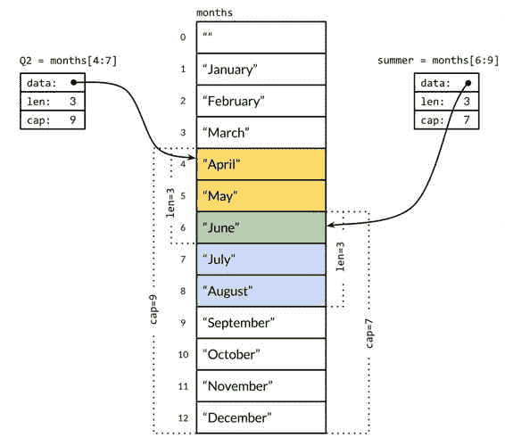

**图 4.1.** 数组月份的两个重叠切片。

多个切片可以共享同一个底层数组，并可能引用该数组的重叠部分。图 4.1 展示了一个表示一年中月份的字符串数组，以及它的两个重叠切片。该数组声明如下：

点击此处查看代码图像

```
months := [...]string{1: "January", /* ... */, 12: "December"}
```

因此 January 是 `months[1]`，December 是 `months[12]`。通常，索引为 0 的数组元素将包含第一个值，但因为月份总是从 1 开始编号，我们可以在声明中省略它，它将被初始化为空字符串。

*切片操作符* `s[i:j]`，其中 0 ≤ `i` ≤ `j` ≤ `cap(s)`，创建一个新切片，它引用序列 `s` 中从 `i` 到 `j-1` 的元素，`s` 可以是数组变量、数组指针或另一个切片。结果切片有 `j-i` 个元素。如果省略 `i`，则为 0；如果省略 `j`，则为 `len(s)`。因此切片 `months[1:13]` 引用了所有有效月份的范围，切片 `months[1:]` 也是如此；切片 `months[:]` 引用整个数组。让我们为第二季度和北半球的夏天定义重叠的切片：

点击此处查看代码图像

```
Q2 := months[4:7]
summer := months[6:9]
fmt.Println(Q2)     // ["April" "May" "June"]
fmt.Println(summer) // ["June" "July" "August"]
```

June 包含在两者中，并且是这个（低效的）公共元素测试的唯一输出：

点击此处查看代码图像

```
for _, s := range summer {
    for _, q := range Q2 {
        if s == q {
            fmt.Printf("%s appears in both\n", s)
        }
    }
}
```

切片超出 `cap(s)` 会导致 panic，但切片超出 `len(s)` 会扩展切片，因此结果可能比原切片更长：

点击此处查看代码图像

```
fmt.Println(summer[:20]) // panic: out of range

endlessSummer := summer[:5] // extend a slice (within capacity)
fmt.Println(endlessSummer)  // "[June July August September October]"
```


## 4.2 切片 (duplicate)

顺便说一下，请注意字符串上的子串操作与 `[]byte` 切片上的切片操作之间的相似性。两者都写作 `x[m:n]`，并且都返回原始字节的子序列，共享底层表示，因此这两种操作都只需常数时间。如果 `x` 是字符串，表达式 `x[m:n]` 产生一个字符串；如果 `x` 是 `[]byte`，则产生一个 `[]byte`。

由于切片包含指向数组元素的指针，将切片传递给函数允许该函数修改底层数组元素。换句话说，复制切片会为底层数组创建一个 `alias`（别名）。函数 `reverse` 就地反转 `[]int` 切片的元素，它可应用于任意长度的切片。

```go
// reverse reverses a slice of ints in place.
func reverse(s []int) {
    for i, j := 0, len(s)-1; i < j; i, j = i+1, j-1 {
        s[i], s[j] = s[j], s[i]
    }
}
```

这里我们反转整个数组 `a`：

```go
a := [...]int{0, 1, 2, 3, 4, 5}
reverse(a[:])
fmt.Println(a) // "[5 4 3 2 1 0]"
```

将切片向左旋转 `n` 个元素的简单方法是调用三次 `reverse` 函数：第一次作用于前 `n` 个元素，第二次作用于剩余元素，第三次作用于整个切片。（要向右旋转，先进行第三次调用。）

```go
s := []int{0, 1, 2, 3, 4, 5}
// Rotate s left by two positions.
reverse(s[:2])
reverse(s[2:])
reverse(s)
fmt.Println(s) // "[2 3 4 5 0 1]"
```

请注意初始化切片 `s` 的表达式与数组 `a` 的表达式有何不同。`切片字面量` 看起来像数组字面量，是一个由逗号分隔、被大括号包围的值序列，但不指定大小。这会隐式地创建一个大小合适的数组变量，并产生一个指向它的切片。与数组字面量一样，切片字面量可以按顺序指定值，或显式指定索引，或混合使用这两种风格。

与数组不同，切片是不可比较的，因此我们不能用 `==` 来测试两个切片是否包含相同的元素。标准库提供了高度优化的 `bytes.Equal` 函数用于比较两个字节切片（`[]byte`），但对于其他类型的切片，我们必须自己进行比较：

```go
func equal(x, y []string) bool {
    if len(x) != len(y) {
        return false
    }
    for i := range x {
        if x[i] != y[i] {
            return false
        }
    }
    return true
}
```

鉴于这种“深度”相等性测试是多么自然，且其运行时开销并不比字符串数组的 `==` 运算符大，切片比较不以这种方式工作可能会令人费解。有两个原因导致深度等价性有问题。首先，与数组元素不同，切片元素是间接的，这使得切片可以包含它自己。虽然有办法处理这种情况，但没有一种是简单、高效，且最重要的是显而易见的。

其次，因为切片元素是间接的，随着底层数组内容被修改，一个固定的切片值在不同时间可能包含不同的元素。因为像 Go 的 `map` 类型这样的哈希表只对其键进行浅拷贝，它要求每个键的相等性在哈希表的整个生命周期内保持不变。因此深度等价会使切片不适合用作 map 键。对于指针和通道等引用类型，`==` 运算符测试*引用标识*，即两个实体是否引用同一事物。切片的类似“浅”相等性测试可能会有用，并能解决 map 问题，但 `==` 运算符对切片和数组的不一致处理会令人困惑。最稳妥的选择是完全禁止切片比较。

唯一合法的切片比较是与 `nil` 比较，如下所示：

```go
if summer == nil { /* ... */ }
```

切片类型的零值是 `nil`。nil 切片没有底层数组。nil 切片的长度和容量为零，但也存在长度和容量为零的非 nil 切片，例如 `[]int{}` 或 `make([]int, 3)[3:]`。与任何可以有 nil 值的类型一样，特定切片类型的 nil 值可以用转换表达式来书写，例如 `[]int(nil)`。

```go
var s []int    // len(s) == 0, s == nil
s = nil        // len(s) == 0, s == nil
s = []int(nil) // len(s) == 0, s == nil
s = []int{}    // len(s) == 0, s != nil
```

因此，如果你需要测试切片是否为空，请使用 `len(s) == 0`，而不是 `s == nil`。除了与 `nil` 比较相等之外，nil 切片的行为像任何其他零长度切片；例如 `reverse(nil)` 完全安全。除非文档明确说明相反情况，否则 Go 函数应以相同方式对待所有零长度切片，无论是 nil 还是非 nil。

内置函数 `make` 创建一个指定元素类型、长度和容量的切片。容量参数可以省略，在这种情况下容量等于长度。

```go
make([]T, len)
make([]T, len, cap) // same as make([]T, cap)[:len]
```

在底层，`make` 创建一个未命名的数组变量并返回它的切片；该数组只能通过返回的切片来访问。在第一种形式中，切片是整个数组的视图。在第二种形式中，切片只是数组前 `len` 个元素的视图，但其容量包含整个数组。额外的元素被预留用于未来的增长。

### 4.2.1 `append` 函数

内置 `append` 函数向切片追加元素：

```go
var runes []rune
for _, r := range "Hello, " {
    runes = append(runes, r)
}
fmt.Printf("%q\n", runes) // "['H' 'e' 'l' 'l' 'o' ',' ' ' '' '']"
```

循环使用 `append` 来构建由字符串字面量编码的九个 rune 的切片，尽管这个特定问题用内置转换 `[]rune("Hello, ")` 解决更方便。

`append` 函数对于理解切片如何工作至关重要，所以让我们看看发生了什么。这里有一个名为 `appendInt` 的版本，专门用于 `[]int` 切片：

```go
func appendInt(x []int, y int) []int {
    var z []int
    zlen := len(x) + 1
    if zlen <= cap(x) {
        // There is room to grow.  Extend the slice.
        z = x[:zlen]
    } else {
        // There is insufficient space.  Allocate a new array.
        // Grow by doubling, for amortized linear complexity.
        zcap := zlen
        if zcap < 2*len(x) {
            zcap = 2 * len(x)
        }
        z = make([]int, zlen, zcap)
        copy(z, x) // a built-in function; see text
    }
    z[len(x)] = y
    return z
}
```

每次调用 `appendInt` 都必须检查切片是否有足够的容量在现有数组中容纳新元素。如果有，它通过定义一个更大的切片（仍在原始数组内）来扩展切片，将元素 `y` 复制到新空间，并返回该切片。输入 `x` 和结果 `z` 共享同一个底层数组。

如果没有足够的空间增长，`appendInt` 必须分配一个足够大的新数组来容纳结果，将 `x` 的值复制进去，然后追加新元素 `y`。结果 `z` 现在引用的底层数组与 `x` 引用的数组不同。


显式循环复制元素很简单，但使用内置函数 `copy` 更方便，它将元素从一个切片复制到另一个相同类型的切片。它的第一个参数是目标切片，第二个是源切片，这类似于赋值 `dst = src` 中操作数的顺序。这两个切片可能引用同一个底层数组；它们甚至可能重叠。虽然这里没用到，但 `copy` 返回实际复制的元素数量，即两个切片长度中的较小值，因此不存在越界或覆盖超出范围数据的危险。

为了效率，新数组的大小通常比容纳 `x` 和 `y` 所需的最小大稍大一些。每次扩容时将数组大小加倍，可以避免过多的内存分配，并确保追加单个元素在平均情况下耗时恒定。以下程序演示了这一效果：

点击此处查看代码图片

```
func main() {
    var x, y []int
    for i := 0; i < 10; i++ {
        y = appendInt(x, i)
        fmt.Printf("%d  cap=%d\t%v\n", i, cap(y), y)
        x = y
    }
}
```

每次容量变化都表示发生了一次内存分配和复制：

```
0  cap=1   [0]
1  cap=2   [0 1]
2  cap=4   [0 1 2]
3  cap=4   [0 1 2 3]
4  cap=8   [0 1 2 3 4]
5  cap=8   [0 1 2 3 4 5]
6  cap=8   [0 1 2 3 4 5 6]
7  cap=8   [0 1 2 3 4 5 6 7]
8  cap=16  [0 1 2 3 4 5 6 7 8]
9  cap=16  [0 1 2 3 4 5 6 7 8 9]
```

让我们仔细看看 `i=3` 这一轮迭代。切片 `x` 包含三个元素 `[0 1 2]`，但容量为 `4`，所以末尾有一个空闲元素位置，追加元素 `3` 可以在不重新分配内存的情况下进行。生成的切片 `y` 长度和容量均为 `4`，并且与原切片 `x` 共享同一个底层数组，如 图 4.2 所示。

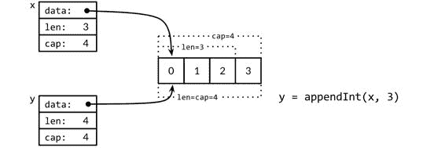

**图 4.2.** 预留增长空间的追加操作。

下一轮迭代 `i=4` 时，已无空闲空间，因此 `appendInt` 分配一个大小为 8 的新数组，复制 `x` 的四个元素 `[0 1 2 3]`，并追加 `i` 的值 `4`。生成的切片 `y` 长度为 5，但容量为 8；这 3 个空闲位置将使接下来三轮迭代免于重新分配。切片 `y` 和 `x` 现在是不同数组的视图。此操作如 图 4.3 所示。

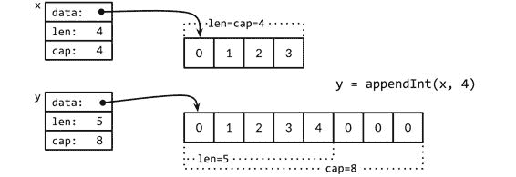

**图 4.3.** 无预留增长空间的追加操作。

内置 `append` 函数可能使用比 `appendInt` 更复杂的增长策略。通常我们无法知道一次 `append` 调用是否会导致重新分配，因此不能假设原切片和结果切片引用同一个数组，也不能假设它们引用不同数组。同样，我们也不能假设对旧切片元素的赋值会（或不会）反映在新切片中。因此，通常将 `append` 的调用结果赋值给传入 `append` 的那个切片变量：

```
runes = append(runes, r)
```

不仅调用 `append` 时需要更新切片变量，对于任何可能改变切片长度或容量，或使其引用不同底层数组的函数，都需要这样做。要正确使用切片，必须牢记：虽然底层数组的元素是间接访问的，但切片的指针、长度和容量不是。更新它们需要像上面那样的赋值操作。在这方面，切片不是“纯”引用类型，而类似于这种聚合类型的结构体：

```
type IntSlice struct {
    ptr      *int
    len, cap int
}
```

我们的 `appendInt` 函数向切片添加单个元素，但内置 `append` 允许我们添加多个新元素，甚至一个完整的切片。

点击此处查看代码图片

```
var x []int
x = append(x, 1)
x = append(x, 2, 3)
x = append(x, 4, 5, 6)
x = append(x, x...) // 追加切片 x
fmt.Println(x)      // "[1 2 3 4 5 6 1 2 3 4 5 6]"
```

通过下面的小修改，我们可以使其行为与内置 `append` 一致。`appendInt` 声明中的省略号 “`...`” 使该函数成为*可变参数*函数：它接受任意数量的尾部参数。上面调用 `append` 时的省略号展示了如何从切片提供参数列表。我们将在 5.7 节 详细解释此机制。

点击此处查看代码图片

```
func appendInt(x []int, y ...int) []int {
    var z []int
    zlen := len(x) + len(y)
    // ...将 z 扩展至至少 zlen...
    copy(z[len(x):], y)
    return z
}
```

扩展 `z` 底层数组的逻辑保持不变，此处省略。

### 4.2.2 就地切片技巧

让我们看看更多像 `rotate` 和 `reverse` 那样**就地**修改切片元素的函数示例。给定一个字符串列表，`nonempty` 函数返回非空字符串：

点击此处查看代码图片

`gopl.io/ch4/nonempty`

```
// Nonempty 是就地切片算法的一个示例。
package main

import "fmt"

// nonempty 返回仅包含非空字符串的切片。
// 底层数组在调用期间会被修改。
func nonempty(strings []string) []string {
    i := 0
    for _, s := range strings {
        if s != "" {
            strings[i] = s
            i++
        }
    }
    return strings[:i]
}
```

微妙之处在于输入切片和输出切片共享同一个底层数组。这避免了分配另一个数组，当然 `data` 的内容会被部分覆盖，第二个打印语句证明了这一点：

点击此处查看代码图片

```
data := []string{"one", "", "three"}
fmt.Printf("%q\n", nonempty(data)) // `["one" "three"]`
fmt.Printf("%q\n", data)           // `["one" "three" "three"]`
```

因此我们通常会写：`data = nonempty(data)`。

`nonempty` 函数也可以用 `append` 编写：

点击此处查看代码图片

```
func nonempty2(strings []string) []string {
    out := strings[:0] // 原切片的零长度切片
    for _, s := range strings {
        if s != "" {
            out = append(out, s)
        }
    }
    return out
}
```

无论使用哪种变体，以这种方式复用数组要求每个输入值最多产生一个输出值，这对于许多过滤序列元素或合并相邻元素的算法成立。这种复杂的切片用法是例外而非常规，但偶尔会很清晰、高效且有用。

切片可用于实现栈。给定一个初始为空的切片 `stack`，我们可以用 `append` 将新值压入切片末尾：

点击此处查看代码图片

```
stack = append(stack, v) // 压入 v
```

栈顶是最后一个元素：

点击此处查看代码图片

```
top := stack[len(stack)-1] // 栈顶
```

弹出该元素以缩小栈的操作是：

点击此处查看代码图片

```
stack = stack[:len(stack)-1] // 弹出
```

要从切片中间删除一个元素并保留其余元素顺序，可用 `copy` 将高索引位置的元素向前移动一位来填补空缺：

点击此处查看代码图片

```
func remove(slice []int, i int) []int {
    copy(slice[i:], slice[i+1:])
    return slice[:len(slice)-1]
}

func main() {
    s := []int{5, 6, 7, 8, 9}
    fmt.Println(remove(s, 2)) // "[5 6 8 9]"
}
```


### 切片操作

如果不需要保持顺序，我们只需将最后一个元素移到空缺处：

点击此处查看代码图像

```go
func remove(slice []int, i int) []int {
    slice[i] = slice[len(slice)-1]
    return slice[:len(slice)-1]
}

func main() {
    s := []int{5, 6, 7, 8, 9}
    fmt.Println(remove(s, 2)) // "[5 6 9 8]"
}
```

### 练习 4.3

重写 `reverse` 使其使用数组指针代替切片。

### 练习 4.4

编写一个单遍历版本的 `rotate`。

### 练习 4.5

编写一个原地函数来消除 `[]string` 切片中的相邻重复元素。

### 练习 4.6

编写一个原地函数，将 UTF-8 编码的 `[]byte` 切片中每一段相邻的 Unicode 空白字符（参见 `unicode.IsSpace`）压缩为单个 ASCII 空格。

### 练习 4.7

修改 `reverse` 以原地反转表示 UTF-8 编码字符串的 `[]byte` 切片中的字符。你能不分配新内存来做到这一点吗？

## 4.3 映射

哈希表是所有数据结构中最精巧、用途最广泛的之一。它是一个无序的键/值对集合，其中所有键都是唯一的，并且无论哈希表多大，给定键关联的值都可以通过平均常数次键比较来检索、更新或删除。

在 Go 语言中，`map` 是对哈希表的引用，映射类型写作 `map[K]V`，其中 `K` 和 `V` 分别是其键和值的类型。给定映射中的所有键具有相同类型，所有值也具有相同类型，但键的类型不必与值的类型相同。键类型 `K` 必须支持使用 `==` 进行比较，以便映射能测试给定键是否等于其中已有的键。虽然浮点数可比较，但用 `==` 比较浮点数是个坏主意，正如我们在第 3 章提到的，如果 `NaN` 是可能的值，那就更糟了。值类型 `V` 没有限制。

内置函数 `make` 可用于创建映射：

点击此处查看代码图像

```go
ages := make(map[string]int) // mapping from strings to ints
```

我们也可以使用*映射字面量*来创建一个包含初始键/值对的新映射：

```go
ages := map[string]int{
    "alice":   31,
    "charlie": 34,
}
```

这等价于

```go
ages := make(map[string]int)
ages["alice"] = 31
ages["charlie"] = 34
```

因此，新空映射的另一种表达式是 `map[string]int{}`。

映射元素通过常规的下标符号访问：

点击此处查看代码图像

```go
ages["alice"] = 32
fmt.Println(ages["alice"]) // "32"
```

并通过内置函数 `delete` 删除：

点击此处查看代码图像

```go
delete(ages, "alice") // remove element ages["alice"]
```

即使元素不在映射中，所有这些操作也是安全的；使用不存在的键查找映射会返回其类型的零值，因此，例如，即使 `"bob"` 还不是映射中的键，以下代码也能正常工作，因为 `ages["bob"]` 的值将是 `0`。

点击此处查看代码图像

```go
ages["bob"] = ages["bob"] + 1 // happy birthday!
```

简短赋值形式 `x += y` 和 `x++` 也适用于映射元素，所以我们可以将上述语句重写为

```go
ages["bob"] += 1
```

甚至可以更简洁地写为

```go
ages["bob"]++
```

但映射元素不是变量，我们不能取其地址：

点击此处查看代码图像

```go
_ = &ages["bob"] // compile error: cannot take address of map element
```

我们无法取映射元素地址的一个原因是，映射扩容可能导致现有元素被重新哈希到新的存储位置，从而可能使地址失效。

要枚举映射中的所有键/值对，我们使用基于 `range` 的 `for` 循环，这类似于我们之前见过的用于切片的循环。循环的每次迭代都会将 `name` 和 `age` 变量设置为下一个键/值对：

点击此处查看代码图像

```go
for name, age := range ages {
    fmt.Printf("%s\t%d\n", name, age)
}
```

映射的迭代顺序是未指定的，不同的实现可能使用不同的哈希函数，导致不同的顺序。实际上，顺序是随机的，每次执行都可能不同。这是有意为之；让序列变化有助于强制程序在不同实现中保持健壮。要按顺序枚举键/值对，我们必须显式地对键进行排序，例如，如果键是字符串，可使用 `sort` 包的 `Strings` 函数。这是一种常见模式：

点击此处查看代码图像

```go
import "sort"

var names []string
for name := range ages {
    names = append(names, name)
}
sort.Strings(names)
for _, name := range names {
    fmt.Printf("%s\t%d\n", name, ages[name])
}
```

既然我们从一开始就知道 `names` 的最终大小，预先分配所需大小的数组会更高效。下面的语句创建了一个初始为空但有足够容量容纳 `ages` 映射所有键的切片：

点击此处查看代码图像

```go
names := make([]string, 0, len(ages))
```

在上面的第一个 `range` 循环中，我们只需要 `ages` 映射的键，所以省略了第二个循环变量。在第二个循环中，我们只需要 `names` 切片的元素，所以使用空标识符 `_` 来忽略第一个变量（索引）。

映射类型的零值是 `nil`，即不引用任何哈希表。

点击此处查看代码图像

```go
var ages map[string]int
fmt.Println(ages == nil)    // "true"
fmt.Println(len(ages) == 0) // "true"
```

大多数映射操作，包括查找、`delete`、`len` 和 `range` 循环，在 `nil` 映射引用上执行都是安全的，因为它的行为类似空映射。但向 `nil` 映射存入元素会导致 panic：

点击此处查看代码图像

```go
ages["carol"] = 21 // panic: assignment to entry in nil map
```

必须先分配映射，才能向其中存入元素。

通过下标访问映射元素总会产生一个值。如果键存在于映射中，你会得到对应的值；如果不存在，你会得到元素类型的零值，正如我们在 `ages["bob"]` 中看到的那样。对许多用途来说这没问题，但有时你需要知道元素是否真正存在。例如，如果元素类型是数值类型，你可能需要区分不存在的元素和碰巧值为零的元素，可以使用如下测试：

点击此处查看代码图像

```go
age, ok := ages["bob"]
if !ok { /* "bob" is not a key in this map; age == 0. */ }
```

你经常会看到这两条语句合并，如下所示：

```go
if age, ok := ages["bob"]; !ok { /* ... */ }
```

在这种上下文中对映射进行下标操作会产生两个值；第二个值是一个布尔值，报告元素是否存在。这个布尔变量通常叫作 `ok`，特别是当它立即用于 `if` 条件中时。

与切片一样，映射之间不能相互比较；唯一合法的比较是与 `nil` 比较。要测试两个映射是否包含相同的键和相同的关联值，我们必须编写一个循环：

点击此处查看代码图像

```go
func equal(x, y map[string]int) bool {
    if len(x) != len(y) {
        return false
    }
    for k, xv := range x {
        if yv, ok := y[k]; !ok || yv != xv {
            return false
        }
    }
    return true
}
```


### 映射查找和 `!ok` 惯用法

观察我们如何使用 `!ok` 来区分“键不存在”和“键存在但值为零”这两种情况。如果我们天真地写成 `xv != y[k]`，下面的调用会错误地报告其参数相等：

点击此处查看代码图像

```go
// True if equal is written incorrectly.
equal(map[string]int{"A": 0}, map[string]int{"B": 42})
```

### 将映射用作集合

Go 没有提供 `set` 类型，但由于映射的键是唯一的，映射可以起到这个作用。为了演示，程序 `dedup` 读取一系列行，并仅打印每个不同行的第一次出现。（它是我们在第 1.3 节中展示的 `dup` 程序的一个变体。）`dedup` 程序使用一个映射，其键代表已经出现过的行的集合，以确保后续出现的行不被打印。

点击此处查看代码图像

gopl.io/ch4/dedup

```go
func main() {
    seen := make(map[string]bool) // a set of strings
    input := bufio.NewScanner(os.Stdin)
    for input.Scan() {
        line := input.Text()
        if !seen[line] {
            seen[line] = true
            fmt.Println(line)
        }
    }

    if err := input.Err(); err != nil {
        fmt.Fprintf(os.Stderr, "dedup: %v\n", err)
        os.Exit(1)
    }
}
```

Go 程序员通常不加多言地将这样使用的映射描述为“字符串集合”，但要当心：并非所有 `map[string]bool` 值都是简单的集合；有些可能同时包含 `true` 和 `false` 值。

### 以切片为映射键

有时我们需要一个键为切片的映射或集合，但因为映射的键必须是可比较的，所以无法直接表示。然而，这可以分两步完成。首先我们定义一个辅助函数 `k`，将每个键映射为一个字符串，其性质是当且仅当我们认为 `x` 和 `y` 等价时，`k(x) == k(y)`。然后我们创建一个键为字符串的映射，在访问映射前对每个键应用该辅助函数。

下面的示例使用一个映射来记录 `Add` 被调用时带有特定字符串列表的次数。它使用 `fmt.Sprintf` 将字符串切片转换为适合作为映射键的单个字符串，用 `%q` 引用每个切片元素以忠实记录字符串边界：

点击此处查看代码图像

```go
var m = make(map[string]int)

func k(list []string) string { return fmt.Sprintf("%q", list) }

func Add(list []string)       { m[k(list)]++ }
func Count(list []string) int { return m[k(list)] }
```

同样的方法可用于任何不可比较的键类型，而不仅仅是切片。即使对于可比较的键类型，当你想要一个不同于 `==` 的相等定义时（例如字符串的大小写不敏感比较），这也很有用。而且 `k(x)` 的类型不必是字符串；任何具有所需等价性质的可比较类型都可以，例如整数、数组或结构体。

### 统计 Unicode 字符

这是映射实际应用的另一个例子：一个统计输入中每个不同 Unicode 码点出现次数的程序。由于可能的字符数量很大，而在任何特定文档中只会出现其中一小部分，映射是记录已出现字符及其对应计数的自然方式。

点击此处查看代码图像

gopl.io/ch4/charcount

```go
// Charcount computes counts of Unicode characters.
package main

import (
    "bufio"
    "fmt"
    "io"
    "os"
    "unicode"
    "unicode/utf8"
)

func main() {
    counts := make(map[rune]int)    // counts of Unicode characters
    var utflen [utf8.UTFMax + 1]int // count of lengths of UTF-8 encodings
    invalid := 0                    // count of invalid UTF-8 characters

    in := bufio.NewReader(os.Stdin)
    for {
        r, n, err := in.ReadRune() // returns rune, nbytes, error
        if err == io.EOF {
            break
        }
        if err != nil {
            fmt.Fprintf(os.Stderr, "charcount: %v\n", err)
            os.Exit(1)
        }
        if r == unicode.ReplacementChar && n == 1 {
            invalid++
            continue
        }
        counts[r]++
        utflen[n]++
    }
    fmt.Printf("rune\tcount\n")
    for c, n := range counts {
        fmt.Printf("%q\t%d\n", c, n)
    }
    fmt.Print("\nlen\tcount\n")
    for i, n := range utflen {
        if i > 0 {
            fmt.Printf("%d\t%d\n", i, n)
        }
    }
    if invalid > 0 {
        fmt.Printf("\n%d invalid UTF-8 characters\n", invalid)
    }
}
```

`ReadRune` 方法执行 UTF-8 解码并返回三个值：解码后的 rune、其 UTF-8 编码的字节长度和一个错误值。我们预期的唯一错误是文件结束。如果输入不是 rune 的合法 UTF-8 编码，返回的 rune 将是 `unicode.ReplacementChar`，长度为 1。

`charcount` 程序还会打印输入中出现的 rune 的 UTF-8 编码长度的计数。映射不是为此最好的数据结构；因为编码长度只在 1 到 `utf8.UTFMax`（值为 4）之间，数组更紧凑。

作为一个实验，我们曾在本书本身上运行过 `charcount`。当然，它主要是英文，但确实包含相当数量的非 ASCII 字符。以下是前十名：

点击此处查看代码图像

```
°  27    15    14  é  13  x  10  ≤  5  ×  5    4    4    3
```

以下是所有 UTF-8 编码长度的分布：

```
len count
1   765391
2   60
3   70
4   0
```

### 具有复合值的映射

映射的值类型本身可以是复合类型，例如映射或切片。在下面的代码中，`graph` 的键类型是 `string`，值类型是 `map[string]bool`，代表一个字符串集合。概念上，`graph` 将一个字符串映射到一组相关字符串，即有向图中的后继节点。

点击此处查看代码图像

gopl.io/ch4/graph

```go
var graph = make(map[string]map[string]bool)

func addEdge(from, to string) {
    edges := graph[from]
    if edges == nil {
        edges = make(map[string]bool)
        graph[from] = edges
    }
    edges[to] = true
}

func hasEdge(from, to string) bool {
    return graph[from][to]
}
```

`addEdge` 函数展示了惯用的延迟填充映射的方式，即在键首次出现时初始化其值。`hasEdge` 函数展示了缺失映射条目的零值如何派上用场：即使 `from` 和 `to` 都不存在，`graph[from][to]` 也总能给出有意义的结果。

### 练习

**练习 4.8：** 修改 `charcount`，使用 `unicode.IsLetter` 等函数按 Unicode 类别统计字母、数字等。

**练习 4.9：** 编写一个程序 `wordfreq` 来报告输入文本文件中每个单词的频率。在第一次调用 `Scan` 之前调用 `input.Split(bufio.ScanWords)` 以将输入拆分为单词而不是行。

## 4.4 结构体

`struct`（结构体）是一种聚合数据类型，它将零个或多个任意类型的命名值组合在一起作为一个单一实体。每个值称为一个 `field`（字段）。数据处理中结构体的经典例子是员工记录，其字段包括唯一 ID、员工姓名、地址、出生日期、职位、薪水、管理者等。所有这些字段被收集到一个单一实体中，可以作为一个整体进行复制、传递给函数、从函数返回、存储在数组中，等等。

这两条语句声明了一个名为 `Employee` 的结构体类型和一个名为 `dilbert` 的变量，它是 `Employee` 的一个实例：

```go
type Employee struct {
    ID        int
    Name      string
    Address   string
    DoB       time.Time
    Position  string
    Salary    int
    ManagerID int
}

var dilbert Employee
```


### Go 语言中的结构体

### 访问结构体字段

`dilbert` 的各个字段通过点号表示法访问，如 `dilbert.Name` 和 `dilbert.DoB`。因为 `dilbert` 是一个变量，它的字段也是变量，所以我们可以给字段赋值：

```
dilbert.Salary -= 5000 // 降职了，因为写的代码行数太少
```

或者取其地址并通过指针访问：

```
position := &dilbert.Position
*position = "Senior " + *position // 晋升了，因为外包给了 Elbonia
```

点号表示法也适用于结构体指针：

```
var employeeOfTheMonth *Employee = &dilbert
employeeOfTheMonth.Position += " (proactive team player)"
```

最后一条语句等价于：

```
(*employeeOfTheMonth).Position += " (proactive team player)"
```

### 结构体指针

给定员工的唯一 ID，函数 `EmployeeByID` 返回一个指向 `Employee` 结构体的指针。我们可以使用点号表示法来访问其字段：

```
func EmployeeByID(id int) *Employee { /* ... */ }

fmt.Println(EmployeeByID(dilbert.ManagerID).Position) // "Pointy-haired boss"

id := dilbert.ID
EmployeeByID(id).Salary = 0 // 开除了……没有真正的理由
```

最后一条语句更新了由 `EmployeeByID` 调用结果指向的 `Employee` 结构体。如果 `EmployeeByID` 的结果类型被改为 `Employee` 而不是 `*Employee`，该赋值语句将无法编译，因为其左侧不再标识一个变量。

### 结构体字段声明

字段通常每行写一个，字段名在其类型之前，但类型相同的连续字段可以合并，如这里的 `Name` 和 `Address`：

```
type Employee struct {
    ID            int
    Name, Address string
    DoB           time.Time
    Position      string
    Salary        int
    ManagerID     int
}
```

### 字段顺序与类型标识

字段顺序对类型标识至关重要。如果我们也合并了 `Position` 字段的声明（也是字符串），或者交换了 `Name` 和 `Address` 的顺序，我们将定义一个不同的结构体类型。通常我们只合并相关字段的声明。

### 导出与未导出字段

如果结构体字段名以大写字母开头，则该字段被导出；这是 Go 语言主要的访问控制机制。一个结构体类型可以同时包含导出和未导出字段。

### 命名结构体类型

结构体类型往往很冗长，因为它们通常每个字段占一行。虽然我们每次需要时都可以写出完整的类型，但重复编写会让人厌烦。相反，结构体类型通常出现在像 `Employee` 这样的命名类型声明中。

命名结构体类型 `S` 不能声明类型为 `S` 的字段：聚合值不能包含它自身。(类似的限制也适用于数组。)但 `S` 可以声明类型为 `*S` 的指针字段，这让我们能创建链表和树等递归数据结构。下面的代码演示了这一点，它使用二叉树实现插入排序：

```
type tree struct {
    value       int
    left, right *tree
}

// Sort 对值进行原地排序。
func Sort(values []int) {
    var root *tree
    for _, v := range values {
        root = add(root, v)
    }
    appendValues(values[:0], root)
}

// appendValues 按顺序将 t 的元素追加到 values 并返回结果切片。
func appendValues(values []int, t *tree) []int {
    if t != nil {
        values = appendValues(values, t.left)
        values = append(values, t.value)
        values = appendValues(values, t.right)
    }
    return values
}

func add(t *tree, value int) *tree {
    if t == nil {
        // 等价于 return &tree{value: value}。
        t = new(tree)
        t.value = value
        return t
    }
    if value < t.value {
        t.left = add(t.left, value)
    } else {
        t.right = add(t.right, value)
    }
    return t
}
```

### 零值

结构体的零值由其每个字段的零值组成。通常希望零值是一个自然或合理的默认值。例如，在 `bytes.Buffer` 中，结构体的初始值是一个可直接使用的空缓冲区，而 `sync.Mutex`（我们将在第 9 章看到）的零值是一个可直接使用的未锁定互斥锁。有时这种合理的初始行为是自然而然的，但有时类型设计者必须为此费心。

### 空结构体

没有字段的结构体类型称为 *空结构体*，写作 `struct{}`。它的大小为零，不携带任何信息，但仍然可能有用。一些 Go 程序员用它代替 `bool` 作为表示集合的映射的值类型，以强调只有键才重要，但节省的空间微乎其微且语法更繁琐，所以我们通常避免这样做。

```
seen := make(map[string]struct{}) // 字符串集合
// ...
if _, ok := seen[s]; !ok {
    seen[s] = struct{}{}
    // ...第一次见到 s...
}
```

### 4.4.1 结构体字面量

结构体类型的值可以用 *结构体字面量* 来书写，它为字段指定值。

```
type Point struct{ X, Y int }

p := Point{1, 2}
```

结构体字面量有两种形式。第一种形式如上所示，要求为*每个*字段按正确顺序指定值。这给编写者（和阅读者）带来了记住字段确切定义的负担，而且如果字段集合后来增加或重新排序，会使代码变得脆弱。因此，这种形式倾向于仅在定义该结构体类型的包内使用，或者用于有明显字段排序约定的较小结构体类型，如 `image.Point{x, y}` 或 `color.RGBA{red, green, blue, alpha}`。

更常用的是第二种形式，即通过列出部分或全部字段名及其对应的值来初始化结构体值，如第 1.4 节 Lissajous 程序中的这条语句：

```
anim := gif.GIF{LoopCount: nframes}
```

如果在这种字面量中省略了字段，它将被设置为其类型的零值。因为提供了名字，字段的顺序无关紧要。

这两种形式不能在同一个字面量中混用。也不能使用（基于顺序的）第一种字面量形式来绕过不能从另一个包引用未导出标识符的规则。

```
package p
type T struct{ a, b int } // a 和 b 未导出

package q
import "p"
var _ = p.T{a: 1, b: 2} // 编译错误：不能引用 a, b
var _ = p.T{1, 2}       // 编译错误：不能引用 a, b
```

虽然上面的最后一行没有提及未导出的字段标识符，但它实际上隐式地使用了它们，所以这是不允许的。

### 向函数传递结构体

结构体值可以作为参数传递给函数，也可以从函数返回。例如，这个函数按指定因子缩放 `Point`：

```
func Scale(p Point, factor int) Point {
    return Point{p.X * factor, p.Y * factor}
}

fmt.Println(Scale(Point{1, 2}, 5)) // "{5 10}"
```

为了效率，较大的结构体类型通常通过指针间接地传递给函数或从函数返回：

```
func Bonus(e *Employee, percent int) int {
    return e.Salary * percent / 100
}
```


而且如果函数必须修改其参数，则这是必需的，因为在像 Go 这样的按值调用语言中，被调用函数仅接收参数的一个副本，而不是对原始参数的引用。

点击此处查看代码图像

```
func AwardAnnualRaise(e *Employee) {
    e.Salary = e.Salary * 105 / 100
}
```

由于结构体通常通过指针来处理，因此可以使用这种简写符号来创建并初始化一个 `struct` 变量并获取其地址：

```
pp := &Point{1, 2}
```

它完全等同于

```
pp := new(Point)
*pp = Point{1, 2}
```

但 `&Point{1, 2}` 可以直接用在表达式中，例如函数调用。

### 4.4.2 比较结构体

如果结构体的所有字段都是可比较的，则该结构体本身就是可比较的，因此该类型的两个表达式可以使用 `==` 或 `!=` 进行比较。`==` 操作按顺序比较两个结构体的对应字段，因此下面打印的两个表达式是等价的：

点击此处查看代码图像

```
type Point struct{ X, Y int }

p := Point{1, 2}
q := Point{2, 1}
fmt.Println(p.X == q.X && p.Y == q.Y) // "false"
fmt.Println(p == q)                   // "false"
```

可比较的结构体类型，像其他可比较类型一样，可用作 map 的键类型。

点击此处查看代码图像

```
type address struct {
    hostname string
    port     int
}

hits := make(map[address]int)
hits[address{"golang.org", 443}]++
```

### 4.4.3 结构体嵌入和匿名字段

在本节中，我们将看到 Go 独特的 `struct embedding`（结构体嵌入）机制如何让我们将一个命名的结构体类型作为另一个结构体类型的 `anonymous field`（匿名字段），提供了一种方便的语法糖，使得像 `x.f` 这样的简单点表达式可以代表像 `x.d.e.f` 这样的字段链。

考虑一个 2D 绘图程序，它提供了一个形状库，如矩形、椭圆、星星和轮子。以下是它可能定义的两种类型：

```
type Circle struct {
    X, Y, Radius int
}

type Wheel struct {
    X, Y, Radius, Spokes int
}
```

`Circle` 拥有其圆心 `X` 和 `Y` 坐标的字段，以及一个 `Radius`。`Wheel` 拥有 `Circle` 的所有特性，外加 `Spokes`，即内切辐条的数量。让我们创建一个轮子：

```
var w Wheel
w.X = 8
w.Y = 8
w.Radius = 5
w.Spokes = 20
```

随着形状集合的增长，我们必然会注意到它们之间的相似性和重复性，因此提取它们的公共部分可能会很方便：

```
type Point struct {
    X, Y int
}

type Circle struct {
    Center Point
    Radius int
}

type Wheel struct {
    Circle Circle
    Spokes int
}
```

这样应用程序可能会更清晰，但这项更改使得访问 `Wheel` 的字段变得更加冗长：

```
var w Wheel
w.Circle.Center.X = 8
w.Circle.Center.Y = 8
w.Circle.Radius = 5
w.Spokes = 20
```

Go 允许我们声明一个只有类型没有名字的字段；这样的字段称为 `anonymous fields`（匿名字段）。该字段的类型必须是一个命名类型或指向命名类型的指针。下面，`Circle` 和 `Wheel` 各有一个匿名字段。我们说 `Point` 被 `嵌入` 到了 `Circle` 中，而 `Circle` 被嵌入到了 `Wheel` 中。

```
type Circle struct {
    Point
    Radius int
}

type Wheel struct {
    Circle
    Spokes int
}
```

得益于嵌入，我们可以在不给出中间名字的情况下引用隐式树叶子节点的名字：

点击此处查看代码图像

```
var w Wheel
w.X = 8        // 等同于 w.Circle.Point.X = 8
w.Y = 8        // 等同于 w.Circle.Point.Y = 8
w.Radius = 5   // 等同于 w.Circle.Radius = 5
w.Spokes = 20
```

注释中显式的形式仍然有效，这表明“匿名字段”某种程度上是个误称。字段 `Circle` 和 `Point` 确实有名字——即命名类型的名字——但这些名字在点表达式中是可选的。在选择其子字段时，我们可以省略任意或所有的匿名字段。

遗憾的是，结构体字面量语法没有相应的简写，所以下面两个都无法编译：

点击此处查看代码图像

```
w = Wheel{8, 8, 5, 20}                       // 编译错误：未知字段
w = Wheel{X: 8, Y: 8, Radius: 5, Spokes: 20} // 编译错误：未知字段
```

结构体字面量必须遵循类型声明的结构，所以我们必须使用下面两种形式之一，它们彼此等价：

点击此处查看代码图像

`gopl.io/ch4/embed`

```
w = Wheel{Circle{Point{8, 8}, 5}, 20}

w = Wheel{
    Circle: Circle{
        Point:  Point{X: 8, Y: 8},
        Radius: 5,
    },
    Spokes: 20, // 注意：此处尾随逗号是必需的（Radius 处也是）
}

fmt.Printf("%#v\n", w)
// Output:
// Wheel{Circle:Circle{Point:Point{X:8, Y:8}, Radius:5}, Spokes:20}

w.X = 42

fmt.Printf("%#v\n", w)
// Output:
// Wheel{Circle:Circle{Point:Point{X:42, Y:8}, Radius:5}, Spokes:20}
```

注意 `#` 修饰符如何导致 `Printf` 的 `%v` 动词以类似 Go 语法的形式显示值。对于结构体值，这种形式包含每个字段的名字。

因为“匿名”字段确实有隐式名字，所以你不能有两个相同类型的匿名字段，因为它们的名字会冲突。而且因为字段的名字由其类型隐式决定，所以字段的可见性也是如此。在上面的例子中，`Point` 和 `Circle` 匿名字段是导出的。如果它们是未导出的（`point` 和 `circle`），我们仍然可以使用简写形式

点击此处查看代码图像

```
w.X = 8 // 等同于 w.circle.point.X = 8
```

但注释中显式的长形式将在声明包之外被禁止，因为 `circle` 和 `point` 将不可访问。

到目前为止我们看到的结构体嵌入，只是用于选择结构体字段的点表示法上的一点语法糖。稍后我们将看到，匿名字段不必是结构体类型；任何命名类型或指向命名类型的指针都可以。但为什么你想嵌入一个没有子字段的类型呢？

答案与方法有关。用于选择嵌入类型字段的简写表示法，同样适用于选择其方法。实际上，外部结构体类型不仅获得了嵌入类型的字段，还获得了它的方法。这种机制是将复杂对象行为从简单行为中组合起来的主要方式。`Composition`（组合）是 Go 面向对象编程的核心，我们将在 6.3 节 中进一步探讨它。

## 4.5 JSON

JavaScript Object Notation（JSON）是一种用于发送和接收结构化信息的标准表示法。JSON 不是唯一的此类表示法。XML（§7.14）、ASN.1 和 Google 的 Protocol Buffers 服务于类似的目的，各有其适用场景，但由于其简单性、可读性和通用支持，JSON 是应用最广泛的。

Go 通过标准库包 `encoding/json`、`encoding/xml`、`encoding/asn1` 等为这些格式的编码和解码提供了出色的支持，这些包都拥有相似的 API。本节简要概述 `encoding/json` 包最重要的部分。

JSON 是 JavaScript 值——字符串、数字、布尔值、数组和对象——作为 Unicode 文本的编码。它是第 3 章基本数据类型和本章复合类型——数组、切片、结构体和 map——的一种高效且可读的表示形式。


### 基本 JSON 类型

基本 JSON 类型包括数字（十进制或科学计数法）、布尔值（`true` 或 `false`）和字符串，字符串是用双引号括起来的 Unicode 码点序列，使用反斜杠转义，其表示法与 Go 语言类似，不过 JSON 的 `\Uhhhh` 数字转义表示 UTF-16 码值，而非符文。

### JSON 数组和对象

这些基本类型可以通过 JSON 数组和对象进行递归组合。JSON 数组是值的有序序列，写作用方括号括起来的逗号分隔列表；JSON 数组用于编码 Go 数组和切片。JSON 对象是从字符串到值的映射，写作用花括号括起来的、逗号分隔的 `name:value` 对序列；JSON 对象用于编码 Go 映射（字符串键）和结构体。例如：

```
boolean            true
number             -273.15
string             "She said \"Hello, \""
array              ["gold", "silver", "bronze"]
object             {"year": 1980,
                    "event": "archery",
                    "medals": ["gold", "silver", "bronze"]}
```

### 示例：电影数据类型

考虑一个收集电影评论并提供推荐的应用程序。其 `Movie` 数据类型和一个典型的值列表声明如下。（`Year` 和 `Color` 字段声明后面的字符串字面量是*字段标签*；我们稍后会解释它们。）

`gopl.io/ch4/movie`

```
type Movie struct {
    Title  string
    Year   int  `json:"released"`
    Color  bool `json:"color,omitempty"`
    Actors []string
}

var movies = []Movie{
    {Title: "Casablanca", Year: 1942, Color: false,
        Actors: []string{"Humphrey Bogart", "Ingrid Bergman"}},
    {Title: "Cool Hand Luke", Year: 1967, Color: true,
        Actors: []string{"Paul Newman"}},
    {Title: "Bullitt", Year: 1968, Color: true,
        Actors: []string{"Steve McQueen", "Jacqueline Bisset"}},
    // ...
}
```

### 使用 json.Marshal 进行编组

此类数据结构非常适合 JSON，且双向转换都很容易。将像 `movies` 这样的 Go 数据结构转换为 JSON 称为*编组*。编组由 `json.Marshal` 完成：

```
data, err := json.Marshal(movies)
if err != nil {
    log.Fatalf("JSON marshaling failed: %s", err)
}
fmt.Printf("%s\n", data)
```

`Marshal` 生成一个字节切片，其中包含一个没有多余空白的很长字符串；我们折叠了行以便适应版面：

```
[{"Title":"Casablanca","released":1942,"Actors":["Humphrey Bogart","Ingr
id Bergman"]},{"Title":"Cool Hand Luke","released":1967,"color":true,"Ac
tors":["Paul Newman"]},{"Title":"Bullitt","released":1968,"color":true,"
Actors":["Steve McQueen","Jacqueline Bisset"]}]
```

### 使用 json.MarshalIndent 进行美化打印

这种紧凑表示包含所有信息，但难以阅读。为了人类阅读，一种名为 `json.MarshalIndent` 的变体会生成整齐缩进的输出。两个额外参数分别定义每行输出的前缀和每级缩进的字符串：

```
data, err := json.MarshalIndent(movies, "", "    ")
if err != nil {
    log.Fatalf("JSON marshaling failed: %s", err)
}
fmt.Printf("%s\n", data)
```

上面的代码打印：

```
[
    {
        "Title": "Casablanca",
        "released": 1942,
        "Actors": [
            "Humphrey Bogart",
            "Ingrid Bergman"
        ]
    },
    {
        "Title": "Cool Hand Luke",
        "released": 1967,
        "color": true,
        "Actors": [
            "Paul Newman"
        ]
    },
    {
        "Title": "Bullitt",
        "released": 1968,
        "color": true,
        "Actors": [
            "Steve McQueen",
            "Jacqueline Bisset"
        ]
    }
]
```

### 字段标签

编组使用 Go 结构体字段名称作为 JSON 对象的字段名称（通过*反射*，正如我们将在第 12.6 节中看到的）。只有导出的字段会被编组，这就是为什么我们为所有 Go 字段名选择了大写字母开头的名称。

您可能已经注意到，输出中 `Year` 字段的名称变成了 `released`，而 `Color` 变成了 `color`。这是因为*字段标签*。字段标签是一个在编译时与结构体字段关联的元数据字符串：

```
Year  int  `json:"released"`
Color bool `json:"color,omitempty"`
```

字段标签可以是任何字面量字符串，但按照惯例，它被解释为以空格分隔的 `key:"value"` 对列表；因为它们包含双引号，字段标签通常使用原始字符串字面量书写。`json` 键控制 `encoding/json` 包的行为，其他 `encoding/...` 包遵循此惯例。`json` 字段标签的第一部分为 Go 字段指定一个替代的 JSON 名称。字段标签常用于为名为 `TotalCount` 的 Go 字段指定符合惯例的 JSON 名称，如 `total_count`。`Color` 的标签有一个额外选项 `omitempty`，它表示如果字段具有其类型的零值（此处为 `false`）或为空，则不应生成 JSON 输出。果然，黑白电影 *Casablanca* 的 JSON 输出没有 `color` 字段。

### 使用 json.Unmarshal 进行解组

编组的逆操作，即解码 JSON 并填充 Go 数据结构，称为*解组*，由 `json.Unmarshal` 完成。下面的代码将 JSON 电影数据解组到一个结构体切片中，该结构体唯一的字段是 `Title`。通过以这种方式定义合适的 Go 数据结构，我们可以选择解码 JSON 输入的哪些部分，丢弃哪些部分。当 `Unmarshal` 返回时，它已经用 `Title` 信息填充了切片；JSON 中的其他名称被忽略。

```
var titles []struct{ Title string }
if err := json.Unmarshal(data, &titles); err != nil {
    log.Fatalf("JSON unmarshaling failed: %s", err)
}
fmt.Println(titles) // "[{Casablanca} {Cool Hand Luke} {Bullitt}]"
```

### Web 服务：GitHub 问题跟踪器示例

许多 Web 服务提供 JSON 接口——发起一个 HTTP 请求，返回的就是 JSON 格式的所需信息。为了演示，让我们使用其 Web 服务接口查询 GitHub 问题跟踪器。首先我们将定义必要的类型和常量：

`gopl.io/ch4/github`

```
// Package github provides a Go API for the GitHub issue tracker.
// See https://developer.github.com/v3/search/#search-issues.
package github

import "time"

const IssuesURL = "https://api.github.com/search/issues"

type IssuesSearchResult struct {
    TotalCount int `json:"total_count"`
    Items      []*Issue
}

type Issue struct {
    Number    int
    HTMLURL   string `json:"html_url"`
    Title     string
    State     string
    User      *User
    CreatedAt time.Time `json:"created_at"`
    Body      string    // in Markdown format
}

type User struct {
    Login   string
    HTMLURL string `json:"html_url"`
}
```

与之前一样，所有结构体字段的名称必须大写，即使它们的 JSON 名称不是大写。然而，在解组期间将 JSON 名称与 Go 结构体名称关联的匹配过程是大小写不敏感的，因此只有当 JSON 名称中有下划线而 Go 名称中没有时，才需要使用字段标签。同样，我们选择性地解码字段；GitHub 搜索响应包含的信息比我们在这里展示的要多得多。


### 搜索 GitHub Issues

### SearchIssues 函数

`SearchIssues` 函数发起一个 HTTP 请求并将结果解码为 JSON。由于用户提供的查询词可能包含 `?` 和 `&` 等在 URL 中具有特殊含义的字符，我们使用 `url.QueryEscape` 来确保它们被按字面意思处理。

点击此处查看代码图像

`gopl.io/ch4/github`

```
package github

import (
    "encoding/json"
    "fmt"
    "net/http"
    "net/url"
    "strings"
)

// SearchIssues 查询 GitHub issue 跟踪器。
func SearchIssues(terms []string) (*IssuesSearchResult, error) {
    q := url.QueryEscape(strings.Join(terms, " "))
    resp, err := http.Get(IssuesURL + "?q=" + q)
    if err != nil {
        return nil, err
    }

    // 我们必须在所有执行路径上关闭 resp.Body。
    // （第 5 章将介绍 'defer'，这会使这更简单。）
    if resp.StatusCode != http.StatusOK {
        resp.Body.Close()
        return nil, fmt.Errorf("search query failed: %s", resp.Status)
    }

    var result IssuesSearchResult
    if err := json.NewDecoder(resp.Body).Decode(&result); err != nil {
        resp.Body.Close()
        return nil, err
    }
    resp.Body.Close()
    return &result, nil
}
```

前面的示例使用 `json.Unmarshal` 将字节切片的全部内容解码为单个 JSON 实体。为了多样化，本示例使用流式解码器 `json.Decoder`，它允许从同一个流中按顺序解码多个 JSON 实体，尽管我们这里不需要该特性。正如你所料，有一个对应的流式编码器叫 `json.Encoder`。

对 `Decode` 的调用填充变量 `result`。我们有多种方式可以漂亮地格式化其值。最简单的方式由下面的 `issues` 命令演示，即作为一个固定列宽的文本表格，但在下一节我们将看到一种基于模板的更复杂的方法。

### Issues 命令

点击此处查看代码图像

`gopl.io/ch4/issues`

```
// Issues 打印匹配搜索词的 GitHub issues 表格。
package main

import (
    "fmt"
    "log"
    "os"

    "gopl.io/ch4/github"
)

func main() {
    result, err := github.SearchIssues(os.Args[1:])
    if err != nil {
        log.Fatal(err)
    }
    fmt.Printf("%d issues:\n", result.TotalCount)
    for _, item := range result.Items {
        fmt.Printf("#%-5d %9.9s %.55s\n",
            item.Number, item.User.Login, item.Title)
    }
}
```

命令行参数指定搜索词。下面的命令查询 Go 项目的 issue 跟踪器，获取与 JSON 解码相关的开放 bug 列表：

点击此处查看代码图像

```
$ go build gopl.io/ch4/issues
$ ./issues repo:golang/go is:open json decoder
13 issues:
#5680    eaigner encoding/json: set key converter on en/decoder
#6050  gopherbot encoding/json: provide tokenizer
#8658  gopherbot encoding/json: use bufio
#8462  kortschak encoding/json: UnmarshalText confuses json.Unmarshal
#5901        rsc encoding/json: allow override type marshaling
#9812  klauspost encoding/json: string tag not symmetric
#7872  extempora encoding/json: Encoder internally buffers full output
#9650    cespare encoding/json: Decoding gives errPhase when unmarshalin
#6716  gopherbot encoding/json: include field name in unmarshal error me
#6901  lukescott encoding/json, encoding/xml: option to treat unknown fi
#6384    joeshaw encoding/json: encode precise floating point integers u
#6647    btracey x/tools/cmd/godoc: display type kind of each named type
#4237  gjemiller encoding/base64: URLEncoding padding is optional
```

GitHub Web 服务接口 `https://developer.github.com/v3/` 拥有比我们这里介绍的更多功能。

### 练习

#### 练习 4.10
修改 `issues`，按时间分类报告结果，例如不到一个月、不到一年、超过一年。

#### 练习 4.11
构建一个工具，让用户从命令行创建、读取、更新和删除 GitHub issues，在需要大量文本输入时调用他们首选的文本编辑器。

#### 练习 4.12
流行的网络漫画 *xkcd* 拥有 JSON 接口。例如，请求 `https://xkcd.com/571/info.0.json` 会生成第 571 期漫画的详细描述，这是许多人的最爱之一。下载每个 URL（仅一次！）并构建一个离线索引。编写一个工具 `xkcd`，利用该索引，打印出与命令行提供的搜索词匹配的每部漫画的 URL 和剧本。

#### 练习 4.13
开放电影数据库基于 JSON 的 Web 服务允许你在 `https://omdbapi.com/` 按名称搜索电影并下载其海报图片。编写一个工具 `poster`，下载命令行指定电影名称的海报图片。

## 4.6 文本和 HTML 模板

前面的示例仅做了最简单的格式化，对此 `Printf` 完全足够。但有时格式化必须更复杂，并且最好将格式与代码更彻底地分离。这可以通过 `text/template` 和 `html/template` 包来实现，它们提供了一种将变量值替换到文本或 HTML 模板中的机制。

模板是一个字符串或文件，包含一个或多个用双大括号 `{{...}}` 括起来的部分，称为 *actions*（动作）。字符串的大部分按字面意思打印，但 actions 会触发其他行为。每个 action 包含一个模板语言表达式，这是一种简单但强大的表示法，用于打印值、选择结构体字段、调用函数和方法、表达控制流（如 `if`-`else` 语句和 `range` 循环）以及实例化其他模板。下面展示了一个简单的模板字符串：

点击此处查看代码图像

`gopl.io/ch4/issuesreport`

```
const templ = `{{.TotalCount}} issues:
{{range .Items}}----------------------------------------
Number: {{.Number}}
User:   {{.User.Login}}
Title:  {{.Title | printf "%.64s"}}
Age:    {{.CreatedAt | daysAgo}} days
{{end}}`
```

### 模板示例

此模板首先打印匹配的 issues 数量，然后打印每个 issue 的编号、用户、标题和天数年龄。在 action 内部，有一个当前值的概念，称为“dot”，写作 "."，一个句点。dot 最初指向模板的参数，在本例中将是 `github.IssuesSearchResult`。`{{.TotalCount}}` action 展开为 `TotalCount` 字段的值，以常规方式打印。`{{range .Items}}` 和 `{{end}}` actions 创建一个循环，因此它们之间的文本会被多次展开，dot 绑定到 `Items` 的连续元素上。

在 action 内部，`|` 符号使一个操作的结果成为另一个操作的参数，类似于 Unix shell 管道。在 `Title` 的情况下，第二个操作是 `printf` 函数，它是所有模板中 `fmt.Sprintf` 的内置同义词。对于 `Age`，第二个操作是下面的函数 `daysAgo`，它使用 `time.Since` 将 `CreatedAt` 字段转换为经过的时间：

点击此处查看代码图像

```
func daysAgo(t time.Time) int {
    return int(time.Since(t).Hours() / 24)
}
```

请注意 `CreatedAt` 的类型是 `time.Time`，而非 `string`。正如类型可以通过定义特定方法来控制其字符串格式化（§2.5）一样，类型也可以定义方法来控制其 JSON 编解码行为。`time.Time` 的 JSON 编码值是一个标准格式的字符串。


### 使用模板生成输出

使用模板生成输出是一个两步过程。首先，我们必须将模板解析为合适的内部表示形式，然后在特定输入上执行它。解析只需进行一次。下面的代码创建并解析了上面定义的模板 `templ`。注意方法调用的链式调用：`template.New` 创建并返回一个模板；`Funcs` 将 `daysAgo` 添加到此模板可访问的函数集合中，然后返回该模板；最后，在结果上调用 `Parse`。

点击此处查看代码图像

```go
report, err := template.New("report").
    Funcs(template.FuncMap{"daysAgo": daysAgo}).
    Parse(templ)
if err != nil {
    log.Fatal(err)
}
```

因为模板通常在编译时固定，解析模板失败表明程序中存在致命错误。`template.Must` 辅助函数使错误处理更方便：它接受一个模板和一个错误，检查错误是否为 nil（否则 panic），然后返回该模板。我们将在 5.9 节 回到这个想法。

一旦模板被创建、用 `daysAgo` 增强、解析并检查，我们就可以使用 `github.IssuesSearchResult` 作为数据源、`os.Stdout` 作为目标来执行它：

点击此处查看代码图像

```go
var report = template.Must(template.New("issuelist").
    Funcs(template.FuncMap{"daysAgo": daysAgo}).
    Parse(templ))

func main() {
    result, err := github.SearchIssues(os.Args[1:])
    if err != nil {
        log.Fatal(err)
    }
    if err := report.Execute(os.Stdout, result); err != nil {
        log.Fatal(err)
    }
}
```

程序打印如下的纯文本报告：

点击此处查看代码图像

```
$ go build gopl.io/ch4/issuesreport
$ ./issuesreport repo:golang/go is:open json decoder
13 issues:
----------------------------------------
Number: 5680
User:   eaigner
Title:  encoding/json: set key converter on en/decoder
Age:    750 days
----------------------------------------
Number: 6050
User:   gopherbot
Title:  encoding/json: provide tokenizer
Age:    695 days
----------------------------------------
...
```

现在让我们转向 `html/template` 包。它使用与 `text/template` 相同的 API 和表达语言，但增加了在 HTML、JavaScript、CSS 或 URL 中出现的字符串的自动且上下文适当的转义功能。这些功能有助于避免 HTML 生成中一个长期存在的安全问题——*注入攻击*，即攻击者构造一个字符串值（如 issue 的标题）来包含恶意代码，当模板未正确转义时，这会让他们控制该页面。

下面的模板将 issue 列表打印为 HTML 表格。注意不同的导入：

点击此处查看代码图像

```go
import "html/template"

var issueList = template.Must(template.New("issuelist").Parse(`
<h1>{{.TotalCount}} issues</h1>
<table>
<tr style='text-align: left'>
  <th>#</th>
  <th>State</th>
  <th>User</th>
  <th>Title</th>
</tr>
{{range .Items}}
<tr>
  <td><a href='{{.HTMLURL}}'>{{.Number}}</td>
  <td>{{.State}}</td>
  <td><a href='{{.User.HTMLURL}}'>{{.User.Login}}</a></td>
  <td><a href='{{.HTMLURL}}'>{{.Title}}</a></td>
</tr>
{{end}}
</table>
`))
```

下面的命令在稍微不同的查询结果上执行新模板：

点击此处查看代码图像

```
$ go build gopl.io/ch4/issueshtml
$ ./issueshtml repo:golang/go commenter:gopherbot json encoder >issues.html
```

图 4.4 显示了 Web 浏览器中表格的外观。链接连接到 GitHub 上的相应网页。

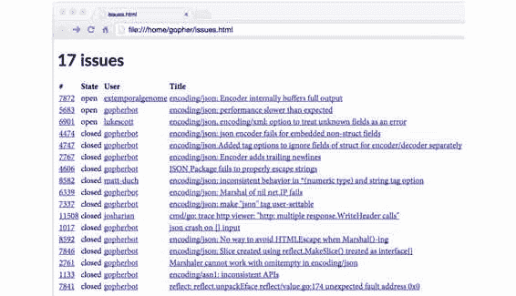

**图 4.4.** Go 项目中与 JSON 编码相关的 issue HTML 表格。

图 4.4 中的 issue 对 HTML 都不构成挑战，但我们可以通过标题包含 `&` 和 `<` 等 HTML 元字符的 issue 更清晰地看到效果。我们为这个例子选择了两个这样的 issue：

点击此处查看代码图像

```
$ ./issueshtml repo:golang/go 3133 10535 >issues2.html
```

图 4.5 显示了此查询的结果。注意 `html/template` 包自动对标题进行了 HTML 转义，使它们按字面意思显示。如果我们错误地使用了 `text/template` 包，四字符字符串 `"&lt;"` 将被渲染为小于字符 `'<'`，字符串 `"<link>"` 将变成 `link` 元素，改变 HTML 文档的结构并可能危及其安全性。

我们可以通过对包含受信 HTML 数据的字段使用命名字符串类型 `template.HTML` 而不是 `string` 来抑制这种自动转义行为。对于受信的 JavaScript、CSS 和 URL 也存在类似的命名类型。下面的程序通过使用两个具有相同值但不同类型的字段来演示这一原理：`A` 是 `string`，`B` 是 `template.HTML`。


**图 4.5.** Issue 标题中的 HTML 元字符正确显示。

点击此处查看代码图像

```go
func main() {
    const templ = `<p>A: {{.A}}</p><p>B: {{.B}}</p>`
    t := template.Must(template.New("escape").Parse(templ))
    var data struct {
        A string        // untrusted plain text
        B template.HTML // trusted HTML
    }
    data.A = "<b>Hello!</b>"
    data.B = "<b>Hello!</b>"
    if err := t.Execute(os.Stdout, data); err != nil {
        log.Fatal(err)
    }
}
```

图 4.6 显示了模板输出在浏览器中的外观。我们可以看到 `A` 被转义了，但 `B` 没有。


**图 4.6.** 字符串值被 HTML 转义，但 `template.HTML` 值没有。

我们这里只能展示模板系统最基本的功能。一如既往，欲了解更多信息，请参阅包文档：

```
$ go doc text/template
$ go doc html/template
```

**练习 4.14：** 创建一个 Web 服务器，查询 GitHub 一次，然后允许导航 bug 报告、里程碑和用户的列表。

# 5. 函数

函数让我们将一系列语句包装为一个单元，可以在程序的其他地方调用，可能多次。函数使得将大任务分解为更小的部分成为可能，这些部分可能由不同时间、不同空间的不同人编写。函数向其用户隐藏了实现细节。由于所有这些原因，函数是任何编程语言的关键部分。

我们已经见过许多函数。现在让我们花时间进行更彻底的讨论。本章的运行示例是一个 Web 爬虫，即 Web 搜索引擎中负责获取网页、发现其中的链接、获取这些链接标识的页面等的组件。Web 爬虫给了我们充分的机会探索递归、匿名函数、错误处理以及 Go 独有的函数方面。

## 5.1 函数声明

函数声明有一个名称、一个参数列表、一个可选的结果列表和一个函数体：

点击此处查看代码图像

```go
func name(parameter-list) (result-list) {
    body
}
```


### 函数参数与返回值

参数列表指定了函数**参数**的名称和类型，这些参数是局部变量，其值或**实参**由调用者提供。返回值列表指定了函数返回值的类型。如果函数返回一个未命名的返回值或没有返回值，括号是可选的，通常省略。完全省略返回值列表声明了一个不返回任何值、仅因其副作用被调用的函数。在 `hypot` 函数中，

点击此处查看代码图像

```go
func hypot(x, y float64) float64 {
    return math.Sqrt(x*x + y*y)
}

fmt.Println(hypot(3, 4)) // "5"
```

`x` 和 `y` 是声明中的参数，`3` 和 `4` 是调用时的实参，函数返回一个 `float64` 值。

与参数类似，返回值也可以命名。在这种情况下，每个名称声明一个局部变量，并初始化为其类型的零值。

拥有返回值列表的函数必须以 `return` 语句结束，除非执行流明显无法到达函数末尾，例如函数以调用 `panic` 或无限 `for` 循环（无 `break`）结束。

正如 `hypot` 所示，同类型的参数或返回值序列可以合并，使类型本身只写一次。以下两个声明等价：

点击此处查看代码图像

```go
func f(i, j, k int, s, t string)                { /* ... */ }
func f(i int, j int, k int, s string, t string) { /* ... */ }
```

下面是声明一个具有两个参数和一个返回值（均为 `int` 类型）的函数的四种方式。空标识符可用于强调某个参数未被使用。

点击此处查看代码图像

```go
func add(x int, y int) int   { return x + y }
func sub(x, y int) (z int)   { z = x - y; return }
func first(x int, _ int) int { return x }
func zero(int, int) int      { return 0 }

fmt.Printf("%T\n", add)   // "func(int, int) int"
fmt.Printf("%T\n", sub)   // "func(int, int) int"
fmt.Printf("%T\n", first) // "func(int, int) int"
fmt.Printf("%T\n", zero)  // "func(int, int) int"
```

函数的类型有时称为其**签名**。如果两个函数具有相同的参数类型序列和相同的返回值类型序列，则它们具有相同的类型或签名。参数和返回值的名称不影响类型，是否使用合并形式声明也不影响。

每次函数调用必须按参数声明顺序为每个参数提供实参。Go 没有默认参数值的概念，也没有按名称指定实参的方式，因此参数和返回值的名称对调用者而言仅作为文档有意义。

参数是函数体内的局部变量，其初始值设为调用者提供的实参。函数参数和命名返回值是与函数最外层局部变量处于同一词法块中的变量。

实参通过**值传递**，因此函数接收每个实参的副本；对副本的修改不影响调用者。然而，如果实参包含某种引用，如指针、切片、映射、函数或通道，则调用者可能会受到函数对实参**间接**引用的变量所做修改的影响。

你可能偶尔会遇到没有函数体的函数声明，这表明该函数用除 Go 以外的语言实现。这样的声明定义了函数签名。

点击此处查看代码图像

```go
package math

func Sin(x float64) float64 // implemented in assembly language
```

## 5.2 递归

函数可以是**递归**的，即它们可以直接或间接地调用自身。递归是解决许多问题的有力技术，当然对于处理递归数据结构也是必不可少的。在 第 4.4 节 中，我们使用了对树的递归来实现简单的插入排序。在本节中，我们将再次用它来处理 HTML 文档。

下面的示例程序使用了一个非标准包 `golang.org/x/net/html`，它提供了一个 HTML 解析器。`golang.org/x/...` 仓库存放由 Go 团队设计和维护的包，用于网络、国际化文本处理、移动平台、图像处理、密码学和开发工具等应用。这些包不在标准库中，因为它们仍在开发中，或者因为大多数 Go 程序员很少需要它们。

我们将用到的 `golang.org/x/net/html` API 部分如下。函数 `html.Parse` 读取一字节序列，解析它们，并返回 HTML 文档树的根节点，即一个 `html.Node`。HTML 有多种节点——文本、注释等——但这里我们只关注形式为 `<name key='value'>` 的**元素**节点。

点击此处查看代码图像

```go
package html

type Node struct {
    Type                    NodeType
    Data                    string
    Attr                    []Attribute
    FirstChild, NextSibling *Node
}

type NodeType int32

const (
    ErrorNode NodeType = iota
    TextNode
    DocumentNode
    ElementNode
    CommentNode
    DoctypeNode
)

type Attribute struct {
    Key, Val string
}

func Parse(r io.Reader) (*Node, error)
```

`main` 函数将标准输入解析为 HTML，使用递归函数 `visit` 提取链接，并打印每个发现的链接：

点击此处查看代码图像

```go
// Findlinks1 prints the links in an HTML document read from standard input.
package main

import (
    "fmt"
    "os"

    "golang.org/x/net/html"
)

func main() {
    doc, err := html.Parse(os.Stdin)
    if err != nil {
        fmt.Fprintf(os.Stderr, "findlinks1: %v\n", err)
        os.Exit(1)
    }
    for _, link := range visit(nil, doc) {
        fmt.Println(link)
    }
}
```

`visit` 函数遍历 HTML 节点树，从每个**锚点**元素 `<a href='...'>` 的 `href` 属性提取链接，将链接追加到字符串切片，并返回结果切片：

点击此处查看代码图像

```go
// visit appends to links each link found in n and returns the result.
func visit(links []string, n *html.Node) []string {
    if n.Type == html.ElementNode && n.Data == "a" {
        for _, a := range n.Attr {
            if a.Key == "href" {
                links = append(links, a.Val)
            }
        }
    }
    for c := n.FirstChild; c != nil; c = c.NextSibling {
        links = visit(links, c)
    }
    return links
}
```

要遍历节点 `n` 的子树，`visit` 为 `n` 的每个子节点递归调用自身，这些子节点保存在 `FirstChild` 链表中。

让我们在 Go 主页上运行 `findlinks`，将 `fetch`（§1.5）的输出通过管道传给 `findlinks` 的输入。我们为简洁起见略微编辑了输出。

点击此处查看代码图像

```bash
$ go build gopl.io/ch1/fetch
$ go build gopl.io/ch5/findlinks1
$ ./fetch https://golang.org | ./findlinks1
#
/doc/
/pkg/
/help/
/blog/
http://play.golang.org/
//tour.golang.org/
https://golang.org/dl/
//blog.golang.org/
/LICENSE
/doc/tos.html
http://www.google.com/intl/en/policies/privacy/
```

注意页面中出现的链接形式多种多样。稍后我们将看到如何相对于基础 URL `https://golang.org` 解析它们，以生成绝对 URL。


### 递归遍历 HTML 节点树

下一个程序使用递归遍历 HTML 节点树，以大纲形式打印树的结构。每当遇到一个元素，它会将该元素的标签压入栈，然后打印栈内容。

点击查看代码图像

`gopl.io/ch5/outline`

```
func main() {
    doc, err := html.Parse(os.Stdin)
    if err != nil {
        fmt.Fprintf(os.Stderr, "outline: %v\n", err)
        os.Exit(1)
    }
    outline(nil, doc)
}

func outline(stack []string, n *html.Node) {
    if n.Type == html.ElementNode {
        stack = append(stack, n.Data) // push tag
        fmt.Println(stack)
    }
    for c := n.FirstChild; c != nil; c = c.NextSibling {
        outline(stack, c)
    }
}
```

注意一个细节：虽然 `outline` 将元素“压入” `stack`，但没有相应的弹出操作。当 `outline` 递归调用自身时，被调用者接收 `stack` 的副本。虽然被调用者可能向该切片追加元素，修改其底层数组甚至分配新数组，但它不会修改调用者可见的初始元素，因此函数返回时，调用者的 `stack` 与调用前保持一致。

以下是 `https://golang.org` 的大纲输出（为简洁起见已编辑）：

点击查看代码图像

```
$ go build gopl.io/ch5/outline
$ ./fetch https://golang.org | ./outline
[html]
[html head]
[html head meta]
[html head title]
[html head link]
[html body]
[html body div]
[html body div]
[html body div div]
[html body div div form]
[html body div div form div]
[html body div div form div a]
...
```

通过尝试 `outline` 可以发现，大多数 HTML 文档只需几层递归即可处理，但构造需要极深递归的病态网页并不难。

许多编程语言实现使用固定大小的函数调用栈；典型大小从 64KB 到 2MB 不等。固定大小的栈限制了递归深度，因此在递归遍历大型数据结构时必须小心避免*栈溢出*；固定大小的栈甚至可能构成安全风险。相比之下，典型的 Go 实现使用可变大小的栈，起始很小，按需增长，上限约为 1GB。这使我们能安全地使用递归，无需担心溢出。

### 练习

**练习 5.1：** 修改 `findlinks` 程序，使用对 `visit` 的递归调用遍历 `n.FirstChild` 链表，而不是循环。

**练习 5.2：** 编写函数，统计 HTML 文档树中各元素名称（`p`、`div`、`span` 等）的出现次数，返回映射关系。

**练习 5.3：** 编写函数，打印 HTML 文档树中所有文本节点的内容。不要深入 `<script>` 或 `<style>` 元素，因为它们的内容在浏览器中不可见。

**练习 5.4：** 扩展 `visit` 函数，使其从文档中提取其他类型的链接，如图片、脚本和样式表。

## 5.3 多返回值

函数可以返回多个结果。我们已见过许多标准库函数返回两个值：期望的计算结果，以及指示计算是否成功的错误值或布尔值。下面的示例展示如何编写自己的多返回值函数。

下面的程序是 `findlinks` 的变体，它自行发起 HTTP 请求，因此不再需要运行 `fetch`。由于 HTTP 和解析操作可能失败，`findLinks` 声明两个返回值：发现的链接列表和一个错误。顺便提一下，HTML 解析器通常能从错误输入中恢复并构建包含错误节点的文档，因此 `Parse` 很少失败；失败时通常是由于底层 I/O 错误。

点击查看代码图像

`gopl.io/ch5/findlinks2`

```
func main() {
    for _, url := range os.Args[1:] {
        links, err := findLinks(url)
        if err != nil {
            fmt.Fprintf(os.Stderr, "findlinks2: %v\n", err)
            continue
        }
        for _, link := range links {
            fmt.Println(link)
        }
    }
}

// findLinks 对 url 发起 HTTP GET 请求，将响应解析为 HTML，提取并返回链接。
func findLinks(url string) ([]string, error) {
    resp, err := http.Get(url)
    if err != nil {
        return nil, err
    }
    if resp.StatusCode != http.StatusOK {
        resp.Body.Close()
        return nil, fmt.Errorf("getting %s: %s", url, resp.Status)
    }
    doc, err := html.Parse(resp.Body)
    resp.Body.Close()
    if err != nil {
        return nil, fmt.Errorf("parsing %s as HTML: %v", url, err)
    }
    return visit(nil, doc), nil
}
```

`findLinks` 中有四条 `return` 语句，每条都返回一对值。前三条 `return` 将 `http` 和 `html` 包的底层错误传递给调用者。第一种情况直接返回错误；第二、三种情况通过 `fmt.Errorf`（§7.8）添加上下文信息。如果 `findLinks` 成功，最后一条 `return` 返回链接切片，错误为 `nil`。

必须确保关闭 `resp.Body`，以便在错误情况下也能正确释放网络资源。Go 的垃圾回收器会回收未使用的内存，但不要假设它会释放未使用的操作系统资源，如打开的文件和网络连接。这些资源应显式关闭。

调用多返回值函数的结果是一个值元组。调用者若要使用这些值，必须显式赋值给变量：

```
links, err := findLinks(url)
```

要忽略某个值，可赋值给空标识符：

点击查看代码图像

```
links, _ := findLinks(url) // 忽略错误
```

多返回值调用的结果可直接从（多返回值的）调用函数返回，如这个记录参数的函数，其行为类似 `findLinks`：

点击查看代码图像

```
func findLinksLog(url string) ([]string, error) {
    log.Printf("findLinks %s", url)
    return findLinks(url)
}
```

多返回值调用可作为多参数函数的唯一实参出现。虽然生产代码中很少用，但调试时很方便，可用单条语句打印调用的所有结果。下面两条打印语句效果相同。

```
log.Println(findLinks(url))

links, err := findLinks(url)
log.Println(links, err)
```

精心选择的名称能说明函数结果的含义。当函数返回多个同类型结果时，名称尤为重要，例如：

点击查看代码图像

```
func Size(rect image.Rectangle) (width, height int)
func Split(path string) (dir, file string)
func HourMinSec(t time.Time) (hour, minute, second int)
```

但并非总需为多返回值命名仅为文档目的。例如，惯例规定最后的 `bool` 结果表示成功；`error` 结果通常无需解释。

在具有命名结果的函数中，`return` 语句的操作数可省略。这称为*裸返回*。

点击查看代码图像


### 裸返回

```go
// CountWordsAndImages 对 HTML 文档 url 发起 HTTP GET 请求，
// 并返回其中单词和图片的数量。
func CountWordsAndImages(url string) (words, images int, err error) {
    resp, err := http.Get(url)
    if err != nil {
        return
    }

    doc, err := html.Parse(resp.Body)
    resp.Body.Close()
    if err != nil {
        err = fmt.Errorf("parsing HTML: %s", err)
        return
    }
    words, images = countWordsAndImages(doc)
    return
}

func countWordsAndImages(n *html.Node) (words, images int) { /* ... */ }
```

裸 `return` 是一种简写方式，用于按顺序返回每个命名的结果变量，因此在上面的函数中，每条 `return` 语句等同于

```go
return words, images, err
```

在像这样的函数中，拥有许多 `return` 语句和多个结果值时，裸返回可以减少代码重复，但它们很少能让代码更容易理解。例如，乍一看并不明显那两个提前的 `return` 等同于 `return 0, 0, err`（因为结果变量 `words` 和 `images` 被初始化为其零值），以及最后的 `return` 等同于 `return words, images, nil`。因此，最好少用裸返回。

**练习 5.5：** 实现 `countWordsAndImages`。（参见练习 4.9 了解单词分割。）

**练习 5.6：** 修改 `gopl.io/ch3/surface`（§3.2）中的 `corner` 函数，使其使用命名结果和裸 `return` 语句。

## 5.4 错误

有些函数总能成功完成其任务。例如，`strings.Contains` 和 `strconv.FormatBool` 对所有可能的参数值都有定义良好的结果，并且不会失败——除非发生灾难性且不可预测的情况，如内存耗尽，此时症状远离原因，且几乎无望恢复。

其他函数只要满足其前置条件就总能成功。例如，`time.Date` 函数总是根据其组成部分——年、月等——构造一个 `time.Time`，除非最后一个参数（时区）为 `nil`，这种情况下它会 panic。这种 panic 是调用代码中存在 bug 的铁证，在编写良好的程序中永远不应发生。

对于许多其他函数，即使在编写良好的程序中，成功也无法保证，因为这取决于程序员无法控制的因素。例如，任何执行 I/O 的函数都必须面对错误的可能性，只有天真的程序员才会相信简单的读写不会失败。事实上，正是当最可靠的操作意外失败时，我们最需要知道原因。

因此，错误是包 API 或应用程序用户界面的重要组成部分，失败只是几种预期行为之一。这是 Go 处理错误的方法。

对于失败属于预期行为的函数，会返回一个额外的结果，通常是最后一个。如果失败只有一种可能的原因，该结果是一个布尔值，通常称为 `ok`，如这个缓存查找示例所示，除非该键不存在条目，否则总会成功：

点击此处查看代码图像

```go
value, ok := cache.Lookup(key)
if !ok {
    // ...cache[key] 不存在...
}
```

更常见的是，特别是对于 I/O，失败可能有多种原因，调用者需要解释。在这种情况下，额外结果的类型是 `error`。

内置类型 `error` 是一个接口类型。我们将在第 7 章看到这意味着什么及其对错误处理的影响。目前只需知道 `error` 可能为 `nil` 或非 `nil`，`nil` 表示成功，非 `nil` 表示失败，并且非 `nil` 的 `error` 有一个错误消息字符串，我们可以通过调用其 `Error()` 方法获取，或通过 `fmt.Println(err)` 或 `fmt.Printf("%v", err)` 打印。

通常当函数返回非 `nil` 错误时，其其他结果是未定义的，应被忽略。然而，少数函数在错误情况下可能返回部分结果。例如，如果读取文件时发生错误，`Read` 调用会返回它能读取的字节数*以及*一个描述问题的 `error` 值。为了正确行为，某些调用者可能需要在处理错误前处理不完整的数据，因此此类函数清晰地记录其结果非常重要。

Go 的方法使其区别于许多使用*异常*而非普通值来报告失败的语言。虽然 Go 确实有某种异常机制，正如我们将在第 5.9 节中看到的，但它仅用于报告表示 bug 的真正意外错误，而非健壮程序应预期处理的常规错误。

这种设计的原因是，异常倾向于将错误的描述与处理它所需的控制流纠缠在一起，往往导致不良后果：常规错误以难以理解的堆栈跟踪形式报告给最终用户，其中充满了关于程序结构的信息，却缺乏关于出了什么错的可理解上下文。

相比之下，Go 程序使用普通的控制流机制，如 `if` 和 `return` 来响应错误。这种风格不可否认地要求对错误处理逻辑给予更多关注，但这正是重点所在。

### 5.4.1 错误处理策略

当函数调用返回错误时，调用者有责任检查它并采取适当行动。根据情况，可能有多种可能性。让我们看看其中五种。

第一种，也是最常见的，是*传播*错误，以便子程序中的失败变成调用程序的失败。我们在第 5.3 节的 `findLinks` 函数中看到了这种例子。如果 `http.Get` 调用失败，`findLinks` 会将 HTTP 错误直接返回给调用者，不再做其他处理：

```go
resp, err := http.Get(url)
if err != nil {
    return nil, err
}
```

相反，如果 `html.Parse` 调用失败，`findLinks` 不会直接返回 HTML 解析器的错误，因为它缺少两个关键信息：错误发生在解析器中，以及正在解析的文档的 URL。在这种情况下，`findLinks` 会构造一个新的错误消息，包含这两条信息以及底层的解析错误：

点击此处查看代码图像

```go
doc, err := html.Parse(resp.Body)
resp.Body.Close()
if err != nil {
    return nil, fmt.Errorf("parsing %s as HTML: %v", url, err)
}
```

`fmt.Errorf` 函数使用 `fmt.Sprintf` 格式化错误消息并返回一个新的 `error` 值。我们用它通过连续添加前缀上下文信息来构建描述性错误。当错误最终由程序的 `main` 函数处理时，它应提供从根本问题到整体失败的清晰因果链，让人联想到 NASA 的事故调查：

点击此处查看代码图像

```
genesis: crashed: no parachute: G-switch failed: bad relay orientation
```

因为错误消息经常被串联在一起，消息字符串不应大写，也应避免换行。生成的错误可能很长，但当被 `grep` 等工具发现时，它们将是自包含的。

设计错误消息时，要深思熟虑，使每一个都是对问题的有意义描述，包含充分且相关的细节；并要保持一致，使同一函数或同一包中一组函数返回的错误在形式上相似，并能以相同方式处理。


例如，`os` 包保证文件操作（如 `os.Open` 或打开文件的 `Read`、`Write`、`Close` 方法）返回的每个错误，不仅描述了失败的性质（权限被拒、目录不存在等），还包含了文件名，因此调用者在构造错误消息时无需包含该信息。

通常，调用 `f(x)` 负责报告尝试的操作 `f` 和参数值 `x`，以及它们与错误上下文的关系。调用者负责添加它拥有但调用 `f(x)` 所没有的进一步信息，例如上面调用 `html.Parse` 时的 URL。

让我们继续讨论处理错误的第二种策略。对于代表暂时性或不可预测问题的错误，重试失败的操作可能是合理的，尝试之间可能带有延迟，并且可能限制尝试次数或尝试花费的时间，超过则彻底放弃。

`gopl.io/ch5/wait`

```go
// WaitForServer attempts to contact the server of a URL.
// It tries for one minute using exponential back-off.
// It reports an error if all attempts fail.
func WaitForServer(url string) error {
    const timeout = 1 * time.Minute
    deadline := time.Now().Add(timeout)
    for tries := 0; time.Now().Before(deadline); tries++ {
        _, err := http.Head(url)
        if err == nil {
            return nil // success
        }
        log.Printf("server not responding (%s); retrying...", err)
        time.Sleep(time.Second << uint(tries)) // exponential back-off
    }
    return fmt.Errorf("server %s failed to respond after %s", url, timeout)
}
```

第三，如果无法继续执行，调用者可以打印错误并优雅地停止程序，但这种做法通常应保留给程序的 `main` 包。库函数通常应将错误传播给调用者，除非该错误标志着内部不一致——即 bug。

```go
// (In function main.)
if err := WaitForServer(url); err != nil {
    fmt.Fprintf(os.Stderr, "Site is down: %v\n", err)
    os.Exit(1)
}
```

达到相同效果的更便捷方式是调用 `log.Fatalf`。与所有 `log` 函数一样，默认情况下它会在构造的错误消息前加上时间和日期前缀。

```go
if err := WaitForServer(url); err != nil {
    log.Fatalf("Site is down: %v\n", err)
}
```

默认格式对长期运行的服务器很有帮助，但对交互式工具则不那么适用：

```
2006/01/02 15:04:05 Site is down: no such domain: bad.gopl.io
```

为了获得更美观的输出，我们可以将 `log` 包使用的前缀设置为命令名称，并禁止显示日期和时间：

```go
log.SetPrefix("wait: ")
log.SetFlags(0)
```

第四，在某些情况下，仅记录错误然后继续执行就足够了，尽管功能可能会降低。同样可以选择使用添加常规前缀的 `log` 包：

```go
if err := Ping(); err != nil {
    log.Printf("ping failed: %v; networking disabled", err)
}
```

或者直接打印到标准错误流：

```go
if err := Ping(); err != nil {
    fmt.Fprintf(os.Stderr, "ping failed: %v; networking disabled\n", err)
}
```

（如果 `log` 函数的输出末尾没有换行符，它们会追加一个换行符。）

第五，也是最后，在极少数情况下，我们可以完全安全地忽略错误：

```go
dir, err := ioutil.TempDir("", "scratch")
if err != nil {
    return fmt.Errorf("failed to create temp dir: %v", err)
}

// ...use temp dir...

os.RemoveAll(dir) // ignore errors; $TMPDIR is cleaned periodically
```

对 `os.RemoveAll` 的调用可能会失败，但程序忽略它，因为操作系统会定期清理临时目录。在这种情况下，丢弃错误是有意为之，但如果我们忘记处理它，程序逻辑将是一样的。养成在每次函数调用后考虑错误的习惯，当你故意忽略错误时，请清楚地记录你的意图。

Go 语言的错误处理有一种特定的节奏。检查错误后，通常先处理失败，再处理成功。如果失败导致函数返回，成功的逻辑不会缩进在 `else` 块中，而是在外层继续执行。函数倾向于表现出一种通用结构：一系列初始检查以排除错误，随后是函数的实质内容，缩进最小。

### 5.4.2 文件结束 (EOF)

通常，函数可能返回的错误种类对最终用户有意义，但对中间的程序逻辑则不然。然而有时，程序必须根据发生的错误类型采取不同的行动。考虑从文件读取 `n` 字节数据的尝试。如果 `n` 被选为文件长度，任何错误都代表失败。另一方面，如果调用者反复尝试读取固定大小的块直到文件耗尽，调用者对文件结束条件的响应必须与其他所有错误不同。因此，`io` 包保证由文件结束条件引起的任何读取失败都由一个独特的错误 `io.EOF` 报告，其定义如下：

```go
package io

import "errors"

// EOF is the error returned by Read when no more input is available.
var EOF = errors.New("EOF")
```

调用者可以使用简单的比较来检测此条件，如下面的循环所示，它从标准输入读取 rune。（第 4.3 节 中的 `charcount` 程序提供了一个更完整的示例。）

```go
in := bufio.NewReader(os.Stdin)
for {
    r, _, err := in.ReadRune()
    if err == io.EOF {
        break // finished reading
    }
    if err != nil {
        return fmt.Errorf("read failed: %v", err)
    }
    // ...use r...
}
```

由于文件结束条件除了这一事实外没有其他信息可报告，`io.EOF` 有一个固定的错误消息 `"EOF"`。对于其他错误，我们可能需要报告错误的性质和数量（可以说），因此固定的错误值将不起作用。在 第 7.11 节 中，我们将介绍一种更系统的方法来区分某些错误值与其他错误值。

## 5.5 函数值

函数在 Go 中是一等值：像其他值一样，函数值有类型，它们可以被赋值给变量，或作为参数传递给函数，或从函数返回。函数值可以像其他函数一样被调用。例如：

```go
func square(n int) int     { return n * n }
func negative(n int) int   { return -n }
func product(m, n int) int { return m * n }

f := square
fmt.Println(f(3)) // "9"

f = negative
fmt.Println(f(3))     // "-3"
fmt.Printf("%T\n", f) // "func(int) int"

f = product // compile error: can't assign f(int, int) int to f(int) int
```

函数类型的零值是 `nil`。调用 nil 函数值会导致 panic：

```go
var f func(int) int
f(3) // panic: call of nil function
```

函数值可以与 `nil` 比较：

```go
var f func(int) int
if f != nil {
    f(3)
}
```


但它们不可比较，因此不能相互比较，也不能用作映射的键。

函数值让我们能够不仅对数据，而且对行为进行参数化。标准库中包含许多示例。例如，`strings.Map` 将一个函数应用于字符串的每个字符，将结果连接起来形成另一个字符串。

点击此处查看代码图像

```
func add1(r rune) rune { return r + 1 }

fmt.Println(strings.Map(add1, "HAL-9000")) // "IBM.:111"
fmt.Println(strings.Map(add1, "VMS"))      // "WNT"

fmt.Println(strings.Map(add1, "Admix"))    // "Benjy"
```

第 5.2 节中的 `findLinks` 函数使用辅助函数 `visit` 来访问 HTML 文档中的所有节点并对每个节点应用一个操作。使用函数值，我们可以将树遍历的逻辑与要应用于每个节点的操作逻辑分离开来，从而让我们能够用不同的操作复用遍历逻辑。

点击此处查看代码图像

`gopl.io/ch5/outline2`

```
// forEachNode 对以 n 为根的树中的每个节点 x 调用 pre(x) 和 post(x) 函数。
// 两个函数都是可选的。
// pre 在访问子节点之前被调用（前序），post 在之后被调用（后序）。
func forEachNode(n *html.Node, pre, post func(n *html.Node)) {
    if pre != nil {
        pre(n)
    }

    for c := n.FirstChild; c != nil; c = c.NextSibling {
        forEachNode(c, pre, post)
    }

    if post != nil {
        post(n)
    }
}
```

`forEachNode` 函数接受两个函数参数，一个在访问节点的子节点之前调用，一个在之后调用。这种安排给调用者提供了极大的灵活性。例如，`startElement` 和 `endElement` 函数打印 HTML 元素的开始和结束标签，如 `<b>...</b>`：

点击此处查看代码图像

```
var depth int

func startElement(n *html.Node) {
    if n.Type == html.ElementNode {
        fmt.Printf("%*s<%s>\n", depth*2, "", n.Data)
        depth++
    }
}

func endElement(n *html.Node) {
    if n.Type == html.ElementNode {
        depth--
        fmt.Printf("%*s</%s>\n", depth*2, "", n.Data)
    }
}
```

这些函数还使用另一个 `fmt.Printf` 技巧来缩进输出。`%*s` 中的 `*` 修饰符打印一个用可变数量空格填充的字符串。宽度和字符串由参数 `depth*2` 和 `""` 提供。

如果我们在 HTML 文档上调用 `forEachNode`，如下所示：

点击此处查看代码图像

```
forEachNode(doc, startElement, endElement)
```

我们会得到一个比之前的 `outline` 程序输出更详尽的变体：

点击此处查看代码图像

```
$ go build gopl.io/ch5/outline2
$ ./outline2 http://gopl.io
<html>
  <head>
    <meta>
    </meta>
    <title>
    </title>
    <style>
    </style>
  </head>
  <body>
    <table>
      <tbody>
        <tr>
          <td>
            <a>
              
              </img>
...
```

### 练习 5.7

将 `startElement` 和 `endElement` 开发成一个通用的 HTML 美化打印器。打印注释节点、文本节点以及每个元素的属性（`<a href='...'>`）。当元素没有子节点时，使用简短形式如 `` 代替 `</img>`。编写测试以确保输出可以被成功解析。（参见第 11 章。）

### 练习 5.8

修改 `forEachNode`，使 `pre` 和 `post` 函数返回一个布尔结果，指示是否继续遍历。用它来编写一个函数 `ElementByID`，具有以下签名，用于查找具有指定 `id` 属性的第一个 HTML 元素。一旦找到匹配项，函数应停止遍历。

点击此处查看代码图像

```
func ElementByID(doc *html.Node, id string) *html.Node
```

### 练习 5.9

编写一个函数 `expand(s string, f func(string) string) string`，将 `s` 中的每个子串 “`$foo`” 替换为 `f("foo")` 返回的文本。

## 5.6 匿名函数

命名函数只能在包级别声明，但我们可以使用*函数字面量*在任何表达式中表示一个函数值。函数字面量的写法类似于函数声明，但在 `func` 关键字后没有名称。它是一个表达式，其值被称为*匿名函数*。

函数字面量让我们能在使用点定义函数。例如，前面对 `strings.Map` 的调用可以重写为：

点击此处查看代码图像

```
strings.Map(func(r rune) rune { return r + 1 }, "HAL-9000")
```

更重要的是，以这种方式定义的函数可以访问整个词法环境，因此内部函数可以引用外部函数的变量，如下例所示：

点击此处查看代码图像

`gopl.io/ch5/squares`

```
// squares 返回一个函数，每次调用时返回下一个平方数。
func squares() func() int {
    var x int
    return func() int {
        x++
        return x * x
    }
}

func main() {
    f := squares()
    fmt.Println(f()) // "1"
    fmt.Println(f()) // "4"
    fmt.Println(f()) // "9"
    fmt.Println(f()) // "16"
}
```

函数 `squares` 返回另一个类型为 `func() int` 的函数。调用 `squares` 会创建一个局部变量 `x` 并返回一个匿名函数，每次调用时该匿名函数会递增 `x` 并返回其平方。第二次调用 `squares` 会创建第二个变量 `x` 并返回一个新的匿名函数，该函数递增那个变量。

`squares` 示例演示了函数值不仅仅是代码，还可以拥有状态。匿名内部函数可以访问并更新外部函数 `squares` 的局部变量。这些隐藏的变量引用就是我们将函数归类为引用类型、函数值不可比较的原因。像这样的函数值是使用一种称为*闭包*的技术实现的，Go 程序员经常用这个术语来指代函数值。

这里我们再次看到一个变量的生命周期不由其作用域决定的例子：变量 `x` 在 `squares` 返回后仍然存在于 `main` 中，即使 `x` 隐藏在 `f` 内部。

作为一个略显学术的匿名函数示例，考虑计算一系列计算机科学课程的序列，使其满足每门课程的先修要求。先修要求在下面的 `prereqs` 表中给出，它是从每门课程到必须在其之前完成的课程列表的映射。

点击此处查看代码图像

`gopl.io/ch5/toposort`

```
// prereqs 将计算机科学课程映射到它们的先修课程。
var prereqs = map[string][]string{
    "algorithms": {"data structures"},
    "calculus":   {"linear algebra"},

    "compilers": {
        "data structures",
        "formal languages",
        "computer organization",
    },

    "data structures":       {"discrete math"},
    "databases":             {"data structures"},
    "discrete math":         {"intro to programming"},
    "formal languages":      {"discrete math"},
    "networks":              {"operating systems"},
    "operating systems":     {"data structures", "computer organization"},
    "programming languages": {"data structures", "computer organization"},
}
```


### 拓扑排序

这类问题被称为**拓扑排序**。从概念上讲，先决条件信息形成了一个有向图，每个课程对应一个节点，从每个课程指向其依赖课程的边。该图是无环的：不存在从某课程出发又回到自身的路径。我们可以使用深度优先搜索遍历该图来计算一个有效序列，代码如下：

点击查看代码图像

```go
func main() {
    for i, course := range topoSort(prereqs) {
        fmt.Printf("%d:\t%s\n", i+1, course)
    }
}

func topoSort(m map[string][]string) []string {
    var order []string
    seen := make(map[string]bool)
    var visitAll func(items []string)

    visitAll = func(items []string) {
        for _, item := range items {
            if !seen[item] {
                seen[item] = true
                visitAll(m[item])
                order = append(order, item)
            }
        }
    }

    var keys []string
    for key := range m {
        keys = append(keys, key)
    }

    sort.Strings(keys)
    visitAll(keys)
    return order
}
```

当匿名函数需要递归时（如此例所示），我们必须先声明一个变量，然后将匿名函数赋值给该变量。若在声明时合并这两步，函数字面量将不在变量 `visitAll` 的作用域内，因此无法递归调用自身：

点击查看代码图像

```go
visitAll := func(items []string) {
    // ...
    visitAll(m[item]) // 编译错误：undefined: visitAll
    // ...
}
```

`toposort` 程序的输出如下。其具有确定性，这是一种常为人所期望但并非总能免费获得的特性。此处 `prereqs` 映射的值是切片而非映射，因此其迭代顺序是确定的；我们在首次调用 `visitAll` 前对 `prereqs` 的键进行了排序。

```
1:      intro to programming
2:      discrete math
3:      data structures
4:      algorithms
5:      linear algebra
6:      calculus
7:      formal languages
8:      computer organization
9:      compilers
10:     databases
11:     operating systems
12:     networks
13:     programming languages
```

### 链接提取示例

让我们回到 `findLinks` 示例。我们将链接提取函数 `links.Extract` 移至独立包中，因为第 8 章还会用到它。我们用一个直接向 `links` 切片追加元素的匿名函数替换了 `visit` 函数，并使用 `forEachNode` 处理遍历。由于 `Extract` 仅需 `pre` 函数，故向 `post` 参数传入 `nil`。

点击查看代码图像

`gopl.io/ch5/links`

```go
// Package links provides a link-extraction function.
package links

import (
    "fmt"
    "net/http"

    "golang.org/x/net/html"
)

// Extract makes an HTTP GET request to the specified URL, parses
// the response as HTML, and returns the links in the HTML document.
func Extract(url string) ([]string, error) {
    resp, err := http.Get(url)
    if err != nil {
        return nil, err
    }
    if resp.StatusCode != http.StatusOK {
        resp.Body.Close()
        return nil, fmt.Errorf("getting %s: %s", url, resp.Status)
    }

    doc, err := html.Parse(resp.Body)
    resp.Body.Close()
    if err != nil {
        return nil, fmt.Errorf("parsing %s as HTML: %v", url, err)
    }

    var links []string
    visitNode := func(n *html.Node) {
        if n.Type == html.ElementNode && n.Data == "a" {
            for _, a := range n.Attr {
                if a.Key != "href" {
                    continue
                }
                link, err := resp.Request.URL.Parse(a.Val)
                if err != nil {
                    continue // ignore bad URLs
                }
                links = append(links, link.String())
            }
        }
    }
    forEachNode(doc, visitNode, nil)
    return links, nil
}
```

此版本不再将原始 `href` 属性值直接追加到 `links` 切片，而是相对于文档的基础 URL `resp.Request.URL` 将其解析为 URL。生成的 `link` 为绝对形式，适合用于 `http.Get` 调用。

### 广度优先爬虫

网络爬虫的核心是图遍历问题。`topoSort` 示例展示了深度优先遍历；对于我们的网络爬虫，我们将至少初期使用广度优先遍历。第 8 章将探讨并发遍历。

下面的函数封装了广度优先遍历的精髓。调用者提供初始待访问项列表 `worklist` 和一个对每个项调用的函数值 `f`。每个项由字符串标识。函数 `f` 返回一个新项列表以追加到工作列表。`breadthFirst` 函数在所有项被访问后返回。它维护一个字符串集合以确保没有项被访问两次。

点击查看代码图像

`gopl.io/ch5/findlinks3`

```go
// breadthFirst calls f for each item in the worklist.
// Any items returned by f are added to the worklist.
// f is called at most once for each item.
func breadthFirst(f func(item string) []string, worklist []string) {
    seen := make(map[string]bool)
    for len(worklist) > 0 {
        items := worklist
        worklist = nil
        for _, item := range items {
            if !seen[item] {
                seen[item] = true
                worklist = append(worklist, f(item)...)
            }
        }
    }
}
```

正如第 3 章所述，参数 `f(item)...` 会将 `f` 返回列表中的所有项追加到工作列表。

在我们的爬虫中，项是 URL。我们将提供给 `breadthFirst` 的 `crawl` 函数会打印 URL、提取其链接并返回它们，以便它们也被访问。

点击查看代码图像

```go
func crawl(url string) []string {
    fmt.Println(url)
    list, err := links.Extract(url)
    if err != nil {
        log.Print(err)
    }
    return list
}
```

启动爬虫时，我们将命令行参数作为初始 URL。

点击查看代码图像

```go
func main() {
    // Crawl the web breadth-first,
    // starting from the command-line arguments.
    breadthFirst(crawl, os.Args[1:])
}
```

让我们从 `https://golang.org` 开始爬取网页。以下是部分结果链接：

点击查看代码图像

```
$ go build gopl.io/ch5/findlinks3
$ ./findlinks3 https://golang.org
https://golang.org/
https://golang.org/doc/
https://golang.org/pkg/
https://golang.org/project/
https://code.google.com/p/go-tour/
https://golang.org/doc/code.html
https://www.youtube.com/watch?v=XCsL89YtqCs
http://research.swtch.com/gotour
https://vimeo.com/53221560
...
```

进程在所有可达网页被爬取完毕或计算机内存耗尽时结束。

### 练习

**练习 5.10：** 重写 `topoSort` 以使用映射代替切片并消除初始排序。验证结果虽非确定性，但仍为有效的拓扑排序。

**练习 5.11：** 线性代数课程的讲师决定微积分现在是先修课。扩展 `topoSort` 函数以报告环。

**练习 5.12：** `gopl.io/ch5/outline2`（§5.5）中的 `startElement` 和 `endElement` 函数共享全局变量 `depth`。将它们改为共享 `outline` 函数局部变量的匿名函数。


### 练习 5.13

修改 `crawl`，使其创建所发现页面的本地副本，必要时创建目录。不要复制来自不同域名的页面。例如，如果原始页面来自 `golang.org`，则保存该域名下的所有文件，但排除来自 `vimeo.com` 的文件。

### 练习 5.14

使用 `breadthFirst` 函数来探索一种不同的结构。例如，你可以使用 `topoSort` 示例中的课程依赖关系（有向图）、计算机上的文件系统层次结构（树），或从市政府网站下载的公交或地铁路线列表（无向图）。

### 5.6.1 警告：捕获迭代变量

在本节中，我们将探讨 Go 语言词法作用域规则的一个陷阱，它可能导致令人惊讶的结果。我们强烈建议你在继续之前理解这个问题，因为即使是经验丰富的程序员也可能掉进这个陷阱。

考虑一个必须创建一组目录稍后再删除它们的程序。我们可以使用一个函数值切片来保存清理操作。（为简洁起见，本示例省略了所有错误处理。）

```go
var rmdirs []func()
for _, d := range tempDirs() {
    dir := d               // 注意：必要！
    os.MkdirAll(dir, 0755) // 同时创建父目录
    rmdirs = append(rmdirs, func() {
        os.RemoveAll(dir)
    })
}

// ...做一些工作...

for _, rmdir := range rmdirs {
    rmdir() // 清理
}
```

你可能会想，为什么我们将循环变量 `d` 赋值给循环体内的一个新局部变量 `dir`，而不是像下面这个微妙的错误变体那样直接将循环变量命名为 `dir`：

```go
var rmdirs []func()
for _, dir := range tempDirs() {
    os.MkdirAll(dir, 0755)
    rmdirs = append(rmdirs, func() {
        os.RemoveAll(dir) // 注意：错误！
    })
}
```

原因是循环变量作用域规则的后果。在上面的程序中，`for` 循环引入了一个新的词法块，其中声明了变量 `dir`。该循环创建的所有函数值都“捕获”并共享*同一个*变量——一个可寻址的存储位置，而不是该特定时刻的值。`dir` 的值在连续的迭代中被更新，因此当清理函数被调用时，`dir` 变量已被现已完成的 `for` 循环多次更新。因此 `dir` 保存的是最终迭代的值，结果所有对 `os.RemoveAll` 的调用都将尝试删除同一个目录。

为了解决这个问题而引入的内部变量——示例中的 `dir`——通常被赋予与其复制的外部变量完全相同的名称，从而导致看起来奇怪但至关重要的变量声明，如下所示：

```go
for _, dir := range tempDirs() {
    dir := dir // 声明内部 dir，初始化为外部 dir
    // ...
}
```

这种风险并非 `range` 形式的 `for` 循环所独有。下面示例中的循环因无意捕获索引变量 `i` 而遭受相同的问题。

```go
var rmdirs []func()
dirs := tempDirs()
for i := 0; i < len(dirs); i++ {
    os.MkdirAll(dirs[i], 0755) // 正确
    rmdirs = append(rmdirs, func() {
        os.RemoveAll(dirs[i]) // 注意：错误！
    })
}
```

迭代变量捕获问题最常在使用 `go` 语句（第 8 章）或 `defer`（我们马上就会看到）时遇到，因为两者都可能将函数值的执行推迟到循环结束之后。但这个问题并非 `go` 或 `defer` 固有的。

## 5.7 可变参数函数

*可变参数函数* 是指可以接受不同数量参数调用的函数。最熟悉的例子是 `fmt.Printf` 及其变体。`Printf` 在开头需要一个固定参数，之后接受任意数量的后续参数。

要声明一个可变参数函数，最后一个参数的类型前加上省略号 "`...`"，这表示该函数可以接受任意数量的该类型参数。

```go
// gopl.io/ch5/sum
func sum(vals ...int) int {
    total := 0
    for _, val := range vals {
        total += val
    }
    return total
}
```

上面的 `sum` 函数返回零个或多个 `int` 参数的和。在函数体内，`vals` 的类型是 `[]int` 切片。调用 `sum` 时，可以为其 `vals` 参数提供任意数量的值。

```go
fmt.Println(sum())           //  "0"
fmt.Println(sum(3))          //  "3"
fmt.Println(sum(1, 2, 3, 4)) //  "10"
```

隐式地，调用者分配一个数组，将参数复制到其中，并将整个数组的切片传递给函数。因此，上面的最后一次调用与下面的调用行为相同，后者展示了当参数已经在切片中时如何调用可变参数函数：在最后一个参数后加上省略号。

```go
values := []int{1, 2, 3, 4}
fmt.Println(sum(values...)) // "10"
```

虽然 `...int` 参数在函数体内表现得像一个切片，但可变参数函数的类型与带有普通切片参数的函数类型是不同的。

```go
func f(...int) {}
func g([]int)  {}

fmt.Printf("%T\n", f) // "func(...int)"
fmt.Printf("%T\n", g) // "func([]int)"
```

可变参数函数常用于字符串格式化。下面的 `errorf` 函数构造一个带有行号前缀的格式化错误消息。后缀 `f` 是一个广泛遵循的命名约定，用于接受 `Printf` 风格格式字符串的可变参数函数。

```go
func errorf(linenum int, format string, args ...interface{}) {
    fmt.Fprintf(os.Stderr, "Line %d: ", linenum)
    fmt.Fprintf(os.Stderr, format, args...)
    fmt.Fprintln(os.Stderr)
}

linenum, name := 12, "count"
errorf(linenum, "undefined: %s", name) // "Line 12: undefined: count"
```

`interface{}` 类型意味着该函数可以接受任意类型的值作为其最后的参数，我们将在第 7 章解释这一点。

### 练习 5.15

编写可变参数函数 `max` 和 `min`，类似于 `sum`。当这些函数在没有参数的情况下被调用时应该做什么？编写要求至少有一个参数的变体。

### 练习 5.16

编写 `strings.Join` 的可变参数版本。

### 练习 5.17

编写一个可变参数函数 `ElementsByTagName`，给定一个 HTML 节点树和零个或多个名称，返回所有匹配这些名称之一的元素。以下是两个示例调用：

```go
func ElementsByTagName(doc *html.Node, name ...string) []*html.Node

images := ElementsByTagName(doc, "img")
headings := ElementsByTagName(doc, "h1", "h2", "h3", "h4")
```

## 5.8 延迟函数调用

我们的 `findLinks` 示例将 `http.Get` 的输出作为 `html.Parse` 的输入。如果请求的 URL 内容确实是 HTML，这工作得很好，但许多页面包含图像、纯文本和其他文件格式。将此类文件送入 HTML 解析器可能会产生不良影响。

下面的程序获取一个 HTML 文档并打印其标题。`title` 函数检查服务器响应的 `Content-Type` 头部，如果文档不是 HTML 则返回错误。

```go
// gopl.io/ch5/title1
```


### The `defer` Statement

### Example: Title Extraction

```go
func title(url string) error {
    resp, err := http.Get(url)
    if err != nil {
        return err
    }

    // Check Content-Type is HTML (e.g., "text/html; charset=utf-8").
    ct := resp.Header.Get("Content-Type")
    if ct != "text/html" && !strings.HasPrefix(ct, "text/html;") {
        resp.Body.Close()
        return fmt.Errorf("%s has type %s, not text/html", url, ct)
    }

    doc, err := html.Parse(resp.Body)
    resp.Body.Close()
    if err != nil {
        return fmt.Errorf("parsing %s as HTML: %v", url, err)
    }

    visitNode := func(n *html.Node) {
        if n.Type == html.ElementNode && n.Data == "title" &&
            n.FirstChild != nil {
            fmt.Println(n.FirstChild.Data)
        }
    }
    forEachNode(doc, visitNode, nil)
    return nil
}
```

Click here to view code image

### Typical Session

```
$ go build gopl.io/ch5/title1
$ ./title1 http://gopl.io
The Go Programming Language
$ ./title1 https://golang.org/doc/effective_go.html
Effective Go - The Go Programming Language
$ ./title1 https://golang.org/doc/gopher/frontpage.png
title: https://golang.org/doc/gopher/frontpage.png
    has type image/png, not text/html
```

观察重复的 `resp.Body.Close()` 调用，它确保 `title` 在所有执行路径上（包括失败时）都关闭网络连接。随着函数变得更复杂并需要处理更多错误，这种清理逻辑的重复可能会成为维护问题。让我们看看 Go 独特的 `defer` 机制是如何简化事情的。

### How `defer` Works

从语法上讲，`defer` 语句是一个由关键字 `defer` 修饰的普通函数或方法调用。函数和参数表达式在语句执行时求值，但实际调用被*推迟*到包含 `defer` 语句的函数结束时，无论是正常结束（通过执行 return 语句或运行到函数末尾），还是异常结束（通过 panic）。可以推迟任意数量的调用；它们按与推迟顺序相反的顺序执行。

`defer` 语句常用于成对的操作，如打开和关闭、连接和断开、或加锁和解锁，以确保在所有情况下都释放资源，无论控制流多么复杂。释放资源的 `defer` 语句的正确位置是在成功获取资源之后立即放置。在下面的 `title` 函数中，单个推迟调用替换了之前对 `resp.Body.Close()` 的两次调用：

Click here to view code image

`gopl.io/ch5/title2`

```go
func title(url string) error {
    resp, err := http.Get(url)
    if err != nil {
        return err
    }
    defer resp.Body.Close()

    ct := resp.Header.Get("Content-Type")
    if ct != "text/html" && !strings.HasPrefix(ct, "text/html;") {
        return fmt.Errorf("%s has type %s, not text/html", url, ct)
    }

    doc, err := html.Parse(resp.Body)
    if err != nil {
        return fmt.Errorf("parsing %s as HTML: %v", url, err)
    }

    // ...print doc's title element...

    return nil
}
```

### Other Resource Examples

### File Operations

同样的模式可用于网络连接以外的其他资源，例如关闭打开的文件：

Click here to view code image

`io/ioutil`

```go
package ioutil

func ReadFile(filename string) ([]byte, error) {
    f, err := os.Open(filename)
    if err != nil {
        return nil, err
    }
    defer f.Close()
    return ReadAll(f)
}
```

### Mutex Locking

或用于解锁互斥锁（§9.2）：

```go
var mu sync.Mutex
var m = make(map[string]int)

func lookup(key string) int {
    mu.Lock()
    defer mu.Unlock()
    return m[key]
}
```

### Debugging with `defer`

`defer` 语句还可用于在调试复杂函数时配对“进入时”和“退出时”的动作。下面的 `bigSlowOperation` 函数立即调用 `trace`，它执行“进入时”动作，然后返回一个函数值，该函数被调用时执行相应的“退出时”动作。通过这种方式推迟对返回函数的调用，我们可以在一条语句中检测函数的入口和所有出口，甚至可以在两个动作之间传递值，如 `start` 时间。但别忘了 `defer` 语句中的最后一对括号，否则“进入时”动作会在退出时发生，而“退出时”动作根本不会发生！

Click here to view code image

`gopl.io/ch5/trace`

```go
func bigSlowOperation() {
    defer trace("bigSlowOperation")() // don't forget the extra parentheses
    // ...lots of work...
    time.Sleep(10 * time.Second) // simulate slow operation by sleeping
}

func trace(msg string) func() {
    start := time.Now()
    log.Printf("enter %s", msg)
    return func() { log.Printf("exit %s (%s)", msg, time.Since(start)) }
}
```

每次调用 `bigSlowOperation` 时，它都会记录其进入和退出以及两者之间的 elapsed 时间。（我们用 `time.Sleep` 来模拟慢速操作。）

Click here to view code image

```
$ go build gopl.io/ch5/trace
$ ./trace
2015/11/18 09:53:26 enter bigSlowOperation
2015/11/18 09:53:36 exit bigSlowOperation (10.000589217s)
```

### Deferred Functions and Return Values

推迟函数在 return 语句更新了函数的结果变量*之后*运行。因为匿名函数可以访问其外层函数的变量，包括命名结果，所以推迟的匿名函数可以观察函数的结果。

### Observing Results

考虑函数 `double`：

Click here to view code image

```go
func double(x int) int {
    return x + x
}
```

通过命名其结果变量并添加 `defer` 语句，我们可以让函数在每次被调用时打印其参数和结果。

Click here to view code image

```go
func double(x int) (result int) {
    defer func() { fmt.Printf("double(%d) = %d\n", x, result) }()
    return x + x
}

_ = double(4)
// Output:
// "double(4) = 8"
```

对于像 `double` 这样简单的函数，这招有点大材小用，但在有许多 return 语句的函数中可能很有用。

### Modifying Results

推迟的匿名函数甚至可以更改外层函数返回给调用者的值：

```go
func triple(x int) (result int) {
    defer func() { result += x }()
    return double(x)
}

fmt.Println(triple(4)) // "12"
```

### Deferred Calls in Loops

因为推迟函数直到函数执行的最末尾才执行，循环中的 `defer` 语句值得额外审视。下面的代码可能会耗尽文件描述符，因为直到所有文件都被处理完才会关闭文件：

Click here to view code image

```go
for _, filename := range filenames {
    f, err := os.Open(filename)
    if err != nil {
        return err
    }
    defer f.Close() // NOTE: risky; could run out of file descriptors
    // ...process f...
}
```

### Solution: Helper Function

一个解决方案是将循环体（包括 `defer` 语句）移到另一个函数中，在每次迭代时调用该函数。

Click here to view code image

```go
for _, filename := range filenames {
    if err := doFile(filename); err != nil {
        return err
    }
}

func doFile(filename string) error {
    f, err := os.Open(filename)
    if err != nil {
        return err
    }
    defer f.Close()
    // ...process f...
}
```

### Example: Improved Fetch Program

下面的示例是一个改进的 `fetch` 程序（§1.5），它将 HTTP 响应写入本地文件而不是标准输出。它使用 `path.Base` 函数从 URL 路径的最后一个组件派生文件名。

Click here to view code image

`gopl.io/ch5/fetch`


## 5.8 Defer (duplicate)

```go
// Fetch downloads the URL and returns the
// name and length of the local file.
func fetch(url string) (filename string, n int64, err error) {
    resp, err := http.Get(url)
    if err != nil {
        return "", 0, err
    }
    defer resp.Body.Close()

    local := path.Base(resp.Request.URL.Path)
    if local == "/" {
        local = "index.html"
    }
    f, err := os.Create(local)
    if err != nil {
        return "", 0, err
    }
    n, err = io.Copy(f, resp.Body)
    // Close file, but prefer error from Copy, if any.
    if closeErr := f.Close(); err == nil {
        err = closeErr
    }
    return local, n, err
}
```

现在对 `resp.Body.Close` 的延迟调用应该已经很熟悉了。我们可能会想用第二个延迟调用 `f.Close` 来关闭本地文件，但这会隐蔽地导致错误，因为 `os.Create` 会为写入而打开文件，必要时会创建它。在许多文件系统中，尤其是 NFS，写入错误不会立即报告，而是可能被推迟到文件关闭时才报告。未能检查关闭操作的结果可能导致严重的数据丢失而不被察觉。然而，如果 `io.Copy` 和 `f.Close` 都失败了，我们应该优先报告 `io.Copy` 的错误，因为它发生在先，更有可能告诉我们根本原因。

### 练习 5.18

在不改变其行为的前提下，重写 `fetch` 函数，使用 `defer` 来关闭可写文件。

## 5.9 Panic

Go 的类型系统能在编译时捕获许多错误，但其他一些错误，如数组越界访问或空指针解引用，需要在运行时检查。当 Go 运行时检测到这些错误时，它会引发 panic。

在一次典型的 panic 过程中，正常执行会停止，该 goroutine 中所有的延迟函数调用都会被执行，然后程序会带着一条日志消息崩溃。这条日志消息包含 panic 值，通常是某种错误消息，以及每个 goroutine 的堆栈跟踪，显示了 panic 发生时活跃的函数调用栈。这条日志消息通常包含足够的信息来诊断问题的根本原因，而无需再次运行程序，因此它应始终包含在关于 panic 程序的错误报告中。

并非所有 panic 都来自运行时。内置的 `panic` 函数可以被直接调用；它接受任意值作为参数。当发生某些“不可能”的情况时，panic 往往是最好的处理方式，例如，执行到达了逻辑上不可能发生的 case 分支：

点击此处查看代码图像

```go
switch s := suit(drawCard()); s {
case "Spades":   // ...
case "Hearts":   // ...
case "Diamonds": // ...
case "Clubs":    // ...
default:
    panic(fmt.Sprintf("invalid suit %q", s)) // Joker?
}
```

断言函数的前置条件成立是个好习惯，但这很容易过犹不及。除非你能提供更有信息量的错误消息或更早地检测到错误，否则断言运行时会为你检查的条件是没有意义的。

点击此处查看代码图像

```go
func Reset(x *Buffer) {
    if x == nil {
        panic("x is nil") // unnecessary!
    }
    x.elements = nil
}
```

虽然 Go 的 panic 机制类似于其他语言中的异常，但 panic 的使用场景却截然不同。由于 panic 会导致程序崩溃，它通常用于严重错误，例如程序中的逻辑不一致；勤勉的程序员认为任何崩溃都是其代码中存在 Bug 的铁证。在健壮的程序中，“预期”错误，即那些源于不正确输入、配置错误或 I/O 失败的错误，应当被妥善处理；它们最好通过 `error` 值来处理。

考虑 `regexp.Compile` 函数，它将正则表达式编译成用于匹配的高效形式。如果调用时传入格式错误的模式，它会返回一个 `error`，但如果调用者知道某次特定调用不可能失败，检查这个错误就是不必要且繁琐的。在这种情况下，调用者通过 panic 来处理错误是合理的，因为它被认为不可能发生。

由于大多数正则表达式都是程序源代码中的字面量，`regexp` 包提供了一个包装函数 `regexp.MustCompile` 来进行这种检查：

点击此处查看代码图像

```go
package regexp

func Compile(expr string) (*Regexp, error) { /* ... */ }

func MustCompile(expr string) *Regexp {
    re, err := Compile(expr)
    if err != nil {
        panic(err)
    }
    return re
}
```

这个包装函数使得客户端可以方便地用编译好的正则表达式初始化包级变量，如下所示：

点击此处查看代码图像

```go
var httpSchemeRE = regexp.MustCompile(`^https?:`) // "http:" or "https:"
```

当然，`MustCompile` 不应用于不可信的输入值。`Must` 前缀是此类函数的常见命名惯例，例如第 4.6 节中的 `template.Must`。

当 panic 发生时，所有延迟函数会按逆序运行，从栈顶函数的开始，一直执行到 `main`，如下面的程序所示：

点击此处查看代码图像

gopl.io/ch5/defer1

```go
func main() {
    f(3)
}

func f(x int) {
    fmt.Printf("f(%d)\n", x+0/x) // panics if x == 0
    defer fmt.Printf("defer %d\n", x)
    f(x - 1)
}
```

运行时，程序向标准输出打印以下内容：

```
f(3)
f(2)
f(1)
defer 1
defer 2
defer 3
```

在调用 `f(0)` 期间发生 panic，导致三个对 `fmt.Printf` 的延迟调用运行。然后运行时终止程序，向标准错误流打印 panic 消息和堆栈转储（为清晰起见已简化）：

点击此处查看代码图像

```
panic: runtime error: integer divide by zero
main.f(0)
        src/gopl.io/ch5/defer1/defer.go:14
main.f(1)
        src/gopl.io/ch5/defer1/defer.go:16
main.f(2)
        src/gopl.io/ch5/defer1/defer.go:16
main.f(3)
        src/gopl.io/ch5/defer1/defer.go:16
main.main()
        src/gopl.io/ch5/defer1/defer.go:10
```

正如我们稍后将看到的，函数有可能从 panic 中恢复，从而避免程序终止。

为了诊断目的，`runtime` 包允许程序员使用相同的机制转储堆栈。通过在 `main` 中延迟调用 `printStack`，

点击此处查看代码图像

gopl.io/ch5/defer2

```go
func main() {
    defer printStack()
    f(3)
}

func printStack() {
    var buf [4096]byte
    n := runtime.Stack(buf[:], false)
    os.Stdout.Write(buf[:n])
}
```

以下额外文本（同样为清晰起见已简化）会被打印到标准输出：

点击此处查看代码图像

```
goroutine 1 [running]:
main.printStack()
    src/gopl.io/ch5/defer2/defer.go:20
main.f(0)
    src/gopl.io/ch5/defer2/defer.go:27
main.f(1)
    src/gopl.io/ch5/defer2/defer.go:29
main.f(2)
    src/gopl.io/ch5/defer2/defer.go:29
main.f(3)
    src/gopl.io/ch5/defer2/defer.go:29
main.main()
    src/gopl.io/ch5/defer2/defer.go:15
```

熟悉其他语言异常的读者可能会惊讶地发现，`runtime.Stack` 可以打印那些似乎已经被“展开”的函数的信息。Go 的 panic 机制在展开栈之前运行延迟函数。

## 5.10 Recover

放弃（让程序崩溃）通常是对 panic 的正确响应，但并非总是如此。可能有某种方式恢复，或者至少在退出前清理一下烂摊子。例如，遇到意外问题的 Web 服务器可以关闭连接，而不是让客户端一直挂起，在开发期间，它甚至可以将错误报告给客户端。


如果在延迟函数中调用内置的 `recover` 函数，且包含 `defer` 语句的函数正在发生恐慌，`recover` 会结束当前的恐慌状态并返回恐慌值。发生恐慌的函数不会从中断处继续执行，而是正常返回。如果在其他任何时候调用 `recover`，它没有任何效果并返回 `nil`。

为了说明这一点，考虑一个语言解析器的开发。即使它看起来工作良好，考虑到其工作的复杂性，晦涩的边缘情况中仍可能潜伏着 Bug。我们可能更希望解析器将这些恐慌转化为普通的解析错误，而不是崩溃，或许还会附带一条额外的消息，敦促用户提交 Bug 报告。

点击此处查看代码图像

```
func Parse(input string) (s *Syntax, err error) {
    defer func() {
        if p := recover(); p != nil {
            err = fmt.Errorf("internal error: %v", p)
        }
    }()
    // ...parser...
}
```

`Parse` 中的延迟函数从恐慌中恢复，利用恐慌值构造错误消息；更复杂的版本可能会使用 `runtime.Stack` 包含完整的调用栈。然后延迟函数将错误赋值给 `err` 结果，并将其返回给调用者。

盲目地从恐慌中恢复是一种可疑的做法，因为恐慌后包变量的状态很少有明确的定义或文档说明。也许关键的数据结构更新未完成，文件或网络连接已打开但未关闭，或者锁已获取但未释放。此外，通过将崩溃替换为（例如）日志文件中的一行，盲目恢复可能导致 Bug 被忽视。

在同一个包内从恐慌中恢复有助于简化复杂或意外错误的处理，但作为一般规则，你不应尝试从另一个包的恐慌中恢复。公共 API 应将失败报告为 `error`。同样，你也不应从可能穿过你不维护的函数（如调用者提供的回调）的恐慌中恢复，因为你无法推断其安全性。

例如，`net/http` 包提供了一个 Web 服务器，将传入的请求分派给用户提供的处理器函数。服务器不会让这些处理器中的恐慌杀死进程，而是调用 `recover`，打印堆栈跟踪，并继续服务。这在实践中很方便，但确实存在泄漏资源或使失败的处理器处于未指定状态的风险，这可能导致其他问题。

基于上述所有原因，最安全的做法是有选择地恢复，如果有的话。换句话说，只从预期要恢复的恐慌中恢复，这应该很少见。这种意图可以通过为恐慌值使用一个独特的、未导出的类型来编码，并测试 `recover` 返回的值是否具有该类型。（我们将在下一个示例中看到一种方法。）如果是，我们将恐慌作为普通的 `error` 报告；如果不是，我们用相同的值调用 `panic` 以恢复恐慌状态。

下面的示例是 `title` 程序的一个变体，如果 HTML 文档包含多个 `<title>` 元素则报告错误。如果是这样，它通过使用特殊类型 `bailout` 的值调用 `panic` 来中止递归。

点击此处查看代码图像

gopl.io/ch5/title3

```
// soleTitle 返回 doc 中第一个非空 title 元素的文本，
// 如果没有恰好一个则返回错误。
func soleTitle(doc *html.Node) (title string, err error) {
    type bailout struct{}

    defer func() {
        switch p := recover(); p {
        case nil:
            // 无恐慌
        case bailout{}:
            // "预期" 的恐慌
            err = fmt.Errorf("multiple title elements")
        default:
            panic(p) // 意外恐慌；继续恐慌
        }
    }()

    // 如果找到多个非空标题，则中止递归。
    forEachNode(doc, func(n *html.Node) {
        if n.Type == html.ElementNode && n.Data == "title" &&
            n.FirstChild != nil {
            if title != "" {
                panic(bailout{}) // 多个标题元素
            }
            title = n.FirstChild.Data
        }
    }, nil)
    if title == "" {
        return "", fmt.Errorf("no title element")
    }
    return title, nil
}
```

延迟处理函数调用 `recover`，检查恐慌值，如果值为 `bailout{}` 则报告普通错误。所有其他非 nil 值表示意外恐慌，在这种情况下处理函数用该值调用 `panic`，撤销 `recover` 的效果并恢复原始的恐慌状态。（此示例在一定程度上违反了我们关于不将恐慌用于“预期”错误的建议，但它紧凑地说明了机制。）

某些情况下无法恢复。例如，内存耗尽会导致 Go 运行时以致命错误终止程序。

**练习 5.19：** 使用 `panic` 和 `recover` 编写一个不包含 `return` 语句却返回非零值的函数。

# 6. 方法

自 1990 年代初以来，面向对象编程（OOP）一直是工业界和教育界的主导编程范式，此后开发的几乎所有广泛使用的语言都包含对它的支持。Go 也不例外。

虽然没有普遍接受的面向对象编程定义，但就我们的目的而言，*对象* 就是一个拥有方法的值或变量，*方法* 是与特定类型关联的函数。面向对象程序是使用方法来表达每个数据结构的属性和操作的程序，这样客户端就不需要直接访问对象的表示。

在前几章中，我们经常使用标准库中的方法，比如 `time.Duration` 类型的 `Seconds` 方法：

点击此处查看代码图像

```
const day = 24 * time.Hour
fmt.Println(day.Seconds()) // "86400"
```

我们在 2.5 节 中定义了自己的一个方法，即 `Celsius` 类型的 `String` 方法：

点击此处查看代码图像

```
func (c Celsius) String() string { return fmt.Sprintf("%g°C", c) }
```

在本章中，作为面向对象编程两章中的第一章，我们将展示如何有效地定义和使用方法。我们还将介绍面向对象编程的两个关键原则：*封装* 和 *组合*。

## 6.1 方法声明

方法的声明是在普通函数声明的变体中，在函数名前出现一个额外的参数。该参数将函数附加到该参数的类型上。

让我们在一个简单的平面几何包中编写第一个方法：

点击此处查看代码图像

gopl.io/ch6/geometry

```
package geometry

import "math"

type Point struct{ X, Y float64 }

// 传统函数
func Distance(p, q Point) float64 {
    return math.Hypot(q.X-p.X, q.Y-p.Y)
}

// 同样的功能，但作为 Point 类型的方法
func (p Point) Distance(q Point) float64 {
    return math.Hypot(q.X-p.X, q.Y-p.Y)
}
```

额外的参数 `p` 称为方法的 *接收器*，这是早期面向对象语言的遗产，它们将调用方法描述为“向对象发送消息”。

在 Go 中，我们不使用像 `this` 或 `self` 这样的特殊名称作为接收器；我们选择接收器名称就像选择其他参数一样。由于接收器名称将被频繁使用，最好选择简短且在各方法间保持一致的名称。常见的选择是类型名称的首字母，如 `Point` 的 `p`。


## 6.1 方法 (duplicate)

### 方法调用与接收者

在方法调用中，接收者参数出现在方法名称之前。这与声明时的情况一致，在声明中接收者参数也出现在方法名称之前。

点击此处查看代码图像

```go
p := Point{1, 2}
q := Point{4, 6}
fmt.Println(Distance(p, q)) // "5", 函数调用
fmt.Println(p.Distance(q))  // "5", 方法调用
```

上述两个名为 `Distance` 的函数声明之间没有冲突。第一个声明了一个包级函数 `geometry.Distance`。第二个声明了 `Point` 类型的一个方法，因此其名称为 `Point.Distance`。

### 选择器

表达式 `p.Distance` 被称为 *选择器*，因为它为类型为 `Point` 的接收者 `p` 选择了合适的 `Distance` 方法。选择器也用于选择结构体类型的字段，如 `p.X`。由于方法和字段处于同一命名空间，在结构体类型 `Point` 上声明一个名为 `X` 的方法会产生歧义，编译器会报错拒绝。

### 命名类型的方法

由于每个类型都有其自己的方法命名空间，我们可以为其他类型的方法使用 `Distance` 这个名字，只要它们属于不同的类型即可。让我们定义一个表示线段序列的 `Path` 类型，并为它也定义一个 `Distance` 方法。

点击此处查看代码图像

```go
// Path 表示由直线连接各点形成的路径。
type Path []Point

// Distance 返回沿路径行进的距离。
func (path Path) Distance() float64 {
    sum := 0.0
    for i := range path {
        if i > 0 {
            sum += path[i-1].Distance(path[i])
        }
    }
    return sum
}
```

`Path` 是一个命名的切片类型，而非像 `Point` 那样的结构体类型，但我们仍然可以为它定义方法。在允许将方法关联到任意类型这一点上，Go 语言与许多其他面向对象语言不同。为数字、字符串、切片、映射，有时甚至是函数等简单类型定义额外的行为通常很方便。只要底层类型既不是指针也不是接口，就可以在同一个包中为任何命名类型声明方法。

这两个 `Distance` 方法拥有不同的类型。它们彼此毫无关联，尽管 `Path.Distance` 在内部使用 `Point.Distance` 来计算连接相邻点的每个线段的长度。

### 方法名解析

让我们调用这个新方法来计算一个直角三角形的周长：

点击此处查看代码图像

```go
perim := Path{
    {1, 1},
    {5, 1},
    {5, 4},
    {1, 1},
}
fmt.Println(perim.Distance()) // "12"
```

在上面两个对名为 `Distance` 的方法的调用中，编译器根据方法名和接收者的类型来决定调用哪个函数。在第一个调用中，`path[i-1]` 的类型是 `Point`，因此调用 `Point.Distance`；在第二个调用中，`perim` 的类型是 `Path`，因此调用 `Path.Distance`。

### 方法的优势

给定类型的所有方法必须拥有唯一的名称，但不同类型可以为方法使用相同的名称，就像 `Point` 和 `Path` 的 `Distance` 方法那样；无需通过限定函数名（例如 `PathDistance`）来消除歧义。在这里我们看到了使用方法而非普通函数的第一个好处：方法名可以更短。对于包外部发起的调用，这一优势更加明显，因为它们可以使用更短的名称*并*省略包名：

点击此处查看代码图像

```go
import "gopl.io/ch6/geometry"

perim := geometry.Path{{1, 1}, {5, 1}, {5, 4}, {1, 1}}
fmt.Println(geometry.PathDistance(perim)) // "12", 独立函数
fmt.Println(perim.Distance())             // "12", geometry.Path 的方法
```

## 6.2 指针接收者的方法

### 指针接收者声明

因为调用函数会对每个参数值进行复制，如果函数需要更新一个变量，或者参数太大我们希望避免复制，就必须传递该变量的地址（即指针）。对于需要更新接收者变量的方法也是如此：我们将它们绑定到指针类型，例如 `*Point`。

点击此处查看代码图像

```go
func (p *Point) ScaleBy(factor float64) {
    p.X *= factor
    p.Y *= factor
}
```

该方法的名称为 `(*Point).ScaleBy`。括号是必需的；没有括号，该表达式会被解析为 `*(Point.ScaleBy)`。

在实际程序中，惯例规定：如果 `Point` 的任意方法使用了指针接收者，那么 `Point` 的*所有*方法都应该使用指针接收者，即使有些方法并不严格要求这样做。我们在 `Point` 上打破了这条规则，以便展示两种方法。

命名类型（`Point`）及其指针（`*Point`）是唯一可以出现在接收者声明中的类型。此外，为了避免歧义，不允许在本身就是指针类型的命名类型上声明方法：

点击此处查看代码图像

```go
type P *int
func (P) f() { /* ... */ } // 编译错误：无效的接收者类型
```

### 调用指针接收者的方法

`(*Point).ScaleBy` 方法可以通过提供一个 `*Point` 接收者来调用，如下所示：

```go
r := &Point{1, 2}
r.ScaleBy(2)
fmt.Println(*r) // "{2, 4}"
```

或者这样：

```go
p := Point{1, 2}
pptr := &p
pptr.ScaleBy(2)
fmt.Println(p) // "{2, 4}"
```

或者这样：

```go
p := Point{1, 2}
(&p).ScaleBy(2)
fmt.Println(p) // "{2, 4}"
```

但后两种情况比较笨拙。幸运的是，语言在这方面帮了我们。如果接收者 `p` 是类型为 `Point` 的*变量*，但方法需要 `*Point` 接收者，我们可以使用这种简写：

```go
p.ScaleBy(2)
```

编译器会对变量隐式执行 `&p` 操作。这仅适用于变量，包括结构体字段如 `p.X` 和数组或切片元素如 `perim[0]`。我们不能在不可寻址的 `Point` 接收者上调用 `*Point` 方法，因为无法获取临时值的地址。

点击此处查看代码图像

```go
Point{1, 2}.ScaleBy(2) // 编译错误：无法获取 Point 字面量的地址
```

### 隐式取地址与解引用

但我们*可以*用 `*Point` 接收者调用像 `Point.Distance` 这样的 `Point` 方法，因为有一种方法可以从地址获取值：只需加载接收者指向的值。编译器会为我们插入一个隐式的 `*` 操作。这两个函数调用是等价的：

```go
pptr.Distance(q)
(*pptr).Distance(q)
```

### 接收者参数规则总结

让我们再次总结这三种情况，因为它们是常见的困惑点。在每一个合法的方法调用表达式中，以下三个陈述恰好有一个为真。

要么接收者参数与接收者形参具有相同的类型，例如两者都是类型 `T` 或都是类型 `*T`：

点击此处查看代码图像

```go
Point{1, 2}.Distance(q) //  Point
pptr.ScaleBy(2)         // *Point
```

要么接收者参数是类型 `T` 的*变量*，而接收者形参类型为 `*T`。编译器隐式地取变量的地址：

```go
p.ScaleBy(2) // 隐式 (&p)
```

要么接收者参数类型为 `*T`，而接收者形参类型为 `T`。编译器隐式地解引用接收者，即加载该值：

点击此处查看代码图像

```go
pptr.Distance(q) // 隐式 (*pptr)
```


## 6.2 方法接收者与复制 (duplicate)

如果一个命名类型 `T` 的所有方法接收者类型均为 `T` 本身（而非 `*T`），则该类型的实例可以安全复制；调用其任何方法必然会产生副本。例如，`time.Duration` 值会被大量复制，包括作为函数参数传递。但如果有任何方法使用指针接收者，则应避免复制 `T` 的实例，因为这可能破坏内部不变量。例如，复制 `bytes.Buffer` 的实例会导致原值与副本别名（§2.3.2）同一个底层字节数组，后续方法调用将产生不可预期的效果。

### 6.2.1 Nil 是合法的接收者值

正如某些函数允许 `nil` 指针作为参数，某些方法也允许 `nil` 作为接收者，特别是当 `nil` 是该类型有意义的零值时（如映射和切片）。在下面这个整数链表中，`nil` 代表空列表：

```go
// An IntList is a linked list of integers.
// A nil *IntList represents the empty list.
type IntList struct {
    Value int
    Tail  *IntList
}

// Sum returns the sum of the list elements.
func (list *IntList) Sum() int {
    if list == nil {
        return 0
    }
    return list.Value + list.Tail.Sum()
}
```

当你定义的类型允许 `nil` 作为接收者值时，最好在文档注释中显式说明，如上例所示。

以下是 `net/url` 包中 `Values` 类型定义的部分内容：

```go
package url

// Values maps a string key to a list of values.
type Values map[string][]string

// Get returns the first value associated with the given key,
// or "" if there are none.
func (v Values) Get(key string) string {
    if vs := v[key]; len(vs) > 0 {
        return vs[0]
    }
    return ""
}

// Add adds the value to key.
// It appends to any existing values associated with key.
func (v Values) Add(key, value string) {
    v[key] = append(v[key], value)
}
```

它将底层表示暴露为映射，同时提供方法简化对映射的访问，其值为字符串切片——这是一个*多重映射*。调用者可以使用其内置操作符（`make`、切片字面量、`m[key]` 等）、其方法，或两者结合：

```go
m := url.Values{"lang": {"en"}} // direct construction
m.Add("item", "1")
m.Add("item", "2")

fmt.Println(m.Get("lang")) // "en"
fmt.Println(m.Get("q"))    // ""
fmt.Println(m.Get("item")) // "1"      (first value)
fmt.Println(m["item"])     // "[1 2]"  (direct map access)

m = nil
fmt.Println(m.Get("item")) // ""
m.Add("item", "3")         // panic: assignment to entry in nil map
```

在最后一次调用 `Get` 时，`nil` 接收者的行为类似空映射。我们也可以写作 `Values(nil).Get("item")`，但 `nil.Get("item")` 无法编译，因为 `nil` 的类型未确定。相比之下，最后一次调用 `Add` 会因尝试更新 `nil` 映射而 panic。

因为 `url.Values` 是映射类型，映射间接引用其键值对，`url.Values.Add` 对映射元素的任何更新和删除对调用者可见。然而，像普通函数一样，方法对引用本身的任何修改（如设为 `nil` 或指向不同的映射数据结构）不会反映给调用者。

## 6.3 通过结构体嵌入组合类型

考虑类型 `ColoredPoint`：

```go
import "image/color"

type Point struct{ X, Y float64 }

type ColoredPoint struct {
    Point
    Color color.RGBA
}
```

我们本可以将 `ColoredPoint` 定义为三个字段的结构体，但通过*嵌入* `Point` 来提供 `X` 和 `Y` 字段。正如 4.4.3 节 所示，嵌入让我们能以语法简写定义包含 `Point` 所有字段加上额外字段的 `ColoredPoint`。如果需要，我们可以在不提及 `Point` 的情况下选择由嵌入 `Point` 贡献的字段：

```go
var cp ColoredPoint
cp.X = 1
fmt.Println(cp.Point.X) // "1"
cp.Point.Y = 2
fmt.Println(cp.Y) // "2"
```

类似机制适用于 `Point` 的*方法*。我们可以使用 `ColoredPoint` 类型的接收者调用嵌入 `Point` 字段的方法，即使 `ColoredPoint` 未声明任何方法：

```go
red := color.RGBA{255, 0, 0, 255}
blue := color.RGBA{0, 0, 255, 255}
var p = ColoredPoint{Point{1, 1}, red}
var q = ColoredPoint{Point{5, 4}, blue}
fmt.Println(p.Distance(q.Point)) // "5"
p.ScaleBy(2)
q.ScaleBy(2)
fmt.Println(p.Distance(q.Point)) // "10"
```

`Point` 的方法已被*提升*到 `ColoredPoint`。通过这种方式，嵌入允许通过多个字段的*组合*构建拥有许多方法的复杂类型，每个字段提供少量方法。

熟悉基于类的面向对象语言的读者可能倾向于将 `Point` 视为基类，`ColoredPoint` 视为子类或派生类，或认为 `ColoredPoint` “是一个” `Point`。但这会是错误的。注意上面对 `Distance` 的调用。`Distance` 参数类型为 `Point`，而 `q` 不是 `Point`，所以尽管 `q` 有该类型的嵌入字段，我们必须显式选择它。尝试传递 `q` 会报错：

```go
p.Distance(q) // compile error: cannot use q (ColoredPoint) as Point
```

`ColoredPoint` 不是 `Point`，但它“有一个” `Point`，并从 `Point` 提升了 `Distance` 和 `ScaleBy` 两个方法。如果你倾向于从实现角度思考，嵌入字段指示编译器生成额外的包装方法委托给声明的方法，等价于：

```go
func (p ColoredPoint) Distance(q Point) float64 {
    return p.Point.Distance(q)
}

func (p *ColoredPoint) ScaleBy(factor float64) {
    p.Point.ScaleBy(factor)
}
```

当第一个包装方法调用 `Point.Distance` 时，其接收者值是 `p.Point` 而非 `p`，方法无法访问嵌入该 `Point` 的 `ColoredPoint`。

匿名字段的类型也可以是命名类型的*指针**，此时字段和方法从指向的对象间接提升。增加一层间接引用允许共享通用结构并动态改变对象间关系。下面的 `ColoredPoint` 声明嵌入了 `*Point`：

```go
type ColoredPoint struct {
    *Point
    Color color.RGBA
}

p := ColoredPoint{&Point{1, 1}, red}
q := ColoredPoint{&Point{5, 4}, blue}
fmt.Println(p.Distance(*q.Point)) // "5"
q.Point = p.Point                 // p and q now share the same Point
p.ScaleBy(2)
fmt.Println(*p.Point, *q.Point) // "{2 2} {2 2}"
```

一个结构体类型可以有多个匿名字段。如果我们将 `ColoredPoint` 声明为：

```go
type ColoredPoint struct {
    Point
    color.RGBA
}
```


### 方法提升与嵌入

那么这种类型的值将拥有 `Point` 的所有方法、`RGBA` 的所有方法，以及直接在 `ColoredPoint` 上声明的任何额外方法。当编译器将选择器（如 `p.ScaleBy`）解析为方法时，它首先查找名为 `ScaleBy` 的直接声明方法，然后查找从 `ColoredPoint` 的嵌入字段提升一次的方法，接着查找从 `Point` 和 `RGBA` 内部嵌入字段提升两次的方法，依此类推。如果选择器有歧义，因为有两个方法从同一级别提升，编译器会报错。

方法只能在命名类型（如 `Point`）及其指针（`*Point`）上声明，但得益于嵌入，`unnamed` 结构体类型也可以拥有方法，这有时很有用。

这里有一个很好的技巧来说明这一点。这个例子展示了一个简单缓存的部分实现，它使用了两个包级变量：一个互斥锁（§9.2）和受其保护的映射：

点击此处查看代码图像

```
var (
    mu sync.Mutex // guards mapping
    mapping = make(map[string]string)
)

func Lookup(key string) string {
    mu.Lock()
    v := mapping[key]
    mu.Unlock()
    return v
}
```

下面的版本功能等价，但将两个相关变量组合在一个包级变量 `cache` 中：

点击此处查看代码图像

```
var cache = struct {
    sync.Mutex
    mapping map[string]string
} {
    mapping: make(map[string]string),
}

func Lookup(key string) string {
    cache.Lock()
    v := cache.mapping[key]
    cache.Unlock()
    return v
}
```

新变量为与缓存相关的变量提供了更具表达力的名称，并且因为 `sync.Mutex` 字段被嵌入其中，其 `Lock` 和 `Unlock` 方法被提升到未命名结构体类型，使我们能够用自解释的语法锁定 `cache`。

## 6.4 方法值与方法表达式

通常我们在同一个表达式中选择并调用方法，如 `p.Distance()`，但也可以将这两个操作分开。选择器 `p.Distance` 产生一个 `method value`（方法值），它是一个将方法（`Point.Distance`）绑定到特定接收者值 `p` 的函数。随后可以在没有接收者值的情况下调用该函数；它只需要非接收者参数。

点击此处查看代码图像

```
p := Point{1, 2}
q := Point{4, 6}

distanceFromP := p.Distance        // method value
fmt.Println(distanceFromP(q))      // "5"
var origin Point                   // {0, 0}
fmt.Println(distanceFromP(origin)) // "2.23606797749979", √5

scaleP := p.ScaleBy // method value
scaleP(2)           // p becomes (2, 4)
scaleP(3)           //      then (6, 12)
scaleP(10)          //      then (60, 120)
```

当包的 API 需要一个函数值，而客户期望的行为是调用特定接收者上的方法时，方法值很有用。例如，`time.AfterFunc` 函数在指定延迟后调用一个函数值。这个程序用它在 10 秒后发射火箭 `r`：

点击此处查看代码图像

```
type Rocket struct { /* ... */ }
func (r *Rocket) Launch() { /* ... */ }

r := new(Rocket)
time.AfterFunc(10 * time.Second, func() { r.Launch() })
```

方法值语法更简短：

点击此处查看代码图像

```
time.AfterFunc(10 * time.Second, r.Launch)
```

与方法值相关的是 `method expression`（方法表达式）。调用方法时，与普通函数不同，我们必须使用选择器语法以特殊方式提供接收者。方法表达式写作 `T.f` 或 `(*T).f`（其中 `T` 是类型），它产生一个函数值，该函数有一个常规的第一个参数代替接收者，因此可以按常规方式调用。

点击此处查看代码图像

```
p := Point{1, 2}
q := Point{4, 6}

distance := Point.Distance   // method expression
fmt.Println(distance(p, q))  // "5"
fmt.Printf("%T\n", distance) // "func(Point, Point) float64"

scale := (*Point).ScaleBy
scale(&p, 2)
fmt.Println(p)            // "{2 4}"
fmt.Printf("%T\n", scale) // "func(*Point, float64)"
```

当你需要一个值来表示同一类型的多个方法中的选择，以便用许多不同的接收者调用选定的方法时，方法表达式很有帮助。在下面的例子中，变量 `op` 代表 `Point` 类型的加法或减法方法，`Path.TranslateBy` 对 `Path` 中的每个点调用它：

点击此处查看代码图像

```
type Point struct{ X, Y float64 }

func (p Point) Add(q Point) Point { return Point{p.X + q.X, p.Y + q.Y} }
func (p Point) Sub(q Point) Point { return Point{p.X - q.X, p.Y - q.Y} }

type Path []Point

func (path Path) TranslateBy(offset Point, add bool) {
    var op func(p, q Point) Point
    if add {
        op = Point.Add
    } else {
        op = Point.Sub
    }
    for i := range path {
        // Call either path[i].Add(offset) or path[i].Sub(offset).
        path[i] = op(path[i], offset)
    }
}
```

## 6.5 示例：位向量类型

Go 中的集合通常实现为 `map[T]bool`，其中 `T` 是元素类型。用映射表示的集合非常灵活，但对于某些问题，专门的表示可能性能更好。例如，在数据流分析等领域，集合元素是小的非负整数，集合有许多元素，并集和交集等集合操作很常见，`bit vector`（位向量）是理想选择。

位向量使用无符号整数值的切片或“字”，每一位代表集合的一个可能元素。如果第 `i` 位被设置，则集合包含 `i`。下面的程序演示了一个具有三个方法的简单位向量类型：

点击此处查看代码图像

`gopl.io/ch6/intset`

```
// An IntSet is a set of small non-negative integers.
// Its zero value represents the empty set.
type IntSet struct {
    words []uint64
}

// Has reports whether the set contains the non-negative value x.
func (s *IntSet) Has(x int) bool {
    word, bit := x/64, uint(x%64)
    return word < len(s.words) && s.words[word]&(1<<bit) != 0
}

// Add adds the non-negative value x to the set.
func (s *IntSet) Add(x int) {
    word, bit := x/64, uint(x%64)
    for word >= len(s.words) {
        s.words = append(s.words, 0)
    }
    s.words[word] |= 1 << bit
}

// UnionWith sets s to the union of s and t.
func (s *IntSet) UnionWith(t *IntSet) {
    for i, tword := range t.words {
        if i < len(s.words) {
            s.words[i] |= tword
        } else {
            s.words = append(s.words, tword)
        }
    }
}
```

因为每个字有 64 位，为了定位 `x` 的位，我们用商 `x/64` 作为字索引，用余数 `x%64` 作为该字内的位索引。`UnionWith` 操作使用按位或运算符 `|` 一次计算 64 个元素的并集。（我们将在练习 6.5 中重新审视 64 位字的选择。）

这个实现缺少许多理想特性，其中一些作为下面的练习提出，但有一个是不可或缺的：将 `IntSet` 打印为字符串的方法。让我们给它一个 `String` 方法，就像我们在第 2.5 节中为 `Celsius` 做的那样：

点击此处查看代码图像


## 6.5 String 方法 (duplicate)

### 实现

```go
// String 返回集合的字符串形式，格式为 "{1 2 3}"。
func (s *IntSet) String() string {
    var buf bytes.Buffer
    buf.WriteByte('{')
    for i, word := range s.words {
        if word == 0 {
            continue
        }
        for j := 0; j < 64; j++ {
            if word&(1<<uint(j)) != 0 {
                if buf.Len() > len("{") {
                    buf.WriteByte(' ')
                }
                fmt.Fprintf(&buf, "%d", 64*i+j)
            }
        }
    }
    buf.WriteByte('}')
    return buf.String()
}
```

### 解释

请注意上述 `String` 方法与 3.5.4 节 中 `intsToString` 的相似之处；`bytes.Buffer` 常在 `String` 方法中以这种方式使用。`fmt` 包会特殊对待拥有 `String` 方法的类型，以便复杂类型的值能以用户友好的方式显示自身。`fmt` 不会打印值的原始表示（本例中为结构体），而是调用 `String` 方法。该机制依赖于接口和类型断言，我们将在 第 7 章 中解释。

### 演示

现在我们可以演示 `IntSet` 的实际运行：

点击此处查看代码图像

```go
var x, y IntSet
x.Add(1)
x.Add(144)
x.Add(9)
fmt.Println(x.String()) // "{1 9 144}"

y.Add(9)
y.Add(42)
fmt.Println(y.String()) // "{9 42}"

x.UnionWith(&y)
fmt.Println(x.String()) // "{1 9 42 144}"

fmt.Println(x.Has(9), x.Has(123)) // "true false"
```

### 指针接收者与值接收者

有必要提醒一下：我们将 `String` 和 `Has` 声明为指针类型 `*IntSet` 的方法，并非出于必要性，而是为了与另外两个方法保持一致，那两个方法因为需要给 `s.words` 赋值，所以需要指针接收者。因此，`IntSet` 值没有 `String` 方法，这偶尔会导致类似下面这样的意外情况：

点击此处查看代码图像

```go
fmt.Println(&x)         // "{1 9 42 144}"
fmt.Println(x.String()) // "{1 9 42 144}"
fmt.Println(x)          // "{[4398046511618 0 65536]}"
```

在第一种情况下，我们打印一个 `*IntSet` 指针，它拥有 `String` 方法。在第二种情况下，我们在 `IntSet` 变量上调用 `String()`；编译器插入隐式的 `&` 操作，给我们一个拥有 `String` 方法的指针。但在第三种情况下，因为 `IntSet` 值没有 `String` 方法，`fmt.Println` 打印的是结构体的表示形式。切记不要忘记 `&` 操作符。让 `String` 成为 `IntSet` 而非 `*IntSet` 的方法可能是个好主意，但这需要视具体情况判断。

### 练习

**练习 6.1：** 实现以下附加方法：

点击此处查看代码图像

```go
func (*IntSet) Len() int      // 返回元素数量
func (*IntSet) Remove(x int)  // 从集合中移除 x
func (*IntSet) Clear()        // 从集合中移除所有元素
func (*IntSet) Copy() *IntSet // 返回集合的副本
```

**练习 6.2：** 定义一个可变参数方法 `(*IntSet).AddAll(...int)`，允许添加一组值，例如 `s.AddAll(1, 2, 3)`。

**练习 6.3：** `(*IntSet).UnionWith` 使用 `|`（按字并行的按位或运算符）计算两个集合的并集。为对应的集合运算实现 `IntersectWith`、`DifferenceWith` 和 `SymmetricDifference` 方法。（两个集合的对称差集包含仅存在于其中一个集合而不同时存在于两个集合中的元素。）

**练习 6.4：** 添加一个 `Elems` 方法，返回包含集合元素的切片，适合用 `range` 循环迭代。

**练习 6.5：** `IntSet` 使用的每个字的类型是 `uint64`，但在 32 位平台上 64 位运算可能效率低下。修改程序以使用 `uint` 类型，这是平台上最高效的无符号整数类型。不用除以 64，而是定义一个常量来保存 `uint` 的有效位大小（32 或 64）。你可以使用这个或许过于聪明的表达式 `32 << (^uint(0) >> 63)` 来达到此目的。

## 6.6 封装

### 定义

如果一个对象的变量或方法对该对象的客户端代码不可见，则称该变量或方法被**封装**。封装有时称为**信息隐藏**，是面向对象编程的关键方面。

### 包级封装

Go 语言只有一种机制来控制名称的可见性：大写字母开头的标识符会从定义它们的包中导出，小写字母开头的则不会。限制包成员访问的同一机制也限制了对结构体字段或类型方法的访问。因此，要封装一个对象，我们必须将其定义为结构体类型。

这就是上一节中 `IntSet` 类型被声明为结构体类型的原因，即使它只有一个字段：

```go
type IntSet struct {
    words []uint64
}
```

我们本可以将 `IntSet` 定义为切片类型，如下所示，当然我们必须在其方法中将每处 `s.words` 替换为 `*s`：

```go
type IntSet []uint64
```

虽然这种版本的 `IntSet` 本质上是等价的，但它会允许其他包的客户端代码直接读取和修改切片。换句话说，表达式 `*s` 可在任何包中使用，但 `s.words` 只能出现在定义 `IntSet` 的包中。

这种基于名称的机制的另一个后果是，封装的单元是包，而不是像许多其他语言那样的类型。结构体类型的字段对同一个包内的所有代码可见。代码出现在函数中还是方法中并无区别。

### 优势

封装提供了三个优势。首先，因为客户端代码无法直接修改对象的变量，所以只需检查更少的语句就能了解这些变量的可能值。

其次，隐藏实现细节可以防止客户端代码依赖可能发生变化的事物，这使设计者拥有更大的自由来改进实现，而无需破坏 API 兼容性。

例如，考虑 `bytes.Buffer` 类型。它常用于累加非常短的字符串，因此在对象中预留一点额外空间以避免这种常见情况下的内存分配是一项有利的优化。由于 `Buffer` 是结构体类型，这部分空间表现为一个名为 `initial`、类型为 `[64]byte` 且首字母小写的额外字段。当这个字段被添加时，因为它未被导出，`bytes` 包外的 `Buffer` 客户端代码除了性能提升外，毫无变化可察觉。下面展示了简化后的 `Buffer` 及其 `Grow` 方法：

点击此处查看代码图像

```go
type Buffer struct {
    buf     []byte
    initial [64]byte
    /* ... */
}

// Grow 扩展缓冲区容量（如有必要），
// 以保证有空间容纳另外 n 个字节。[...]
func (b *Buffer) Grow(n int) {
    if b.buf == nil {
        b.buf = b.initial[:0] // 最初使用预分配空间
    }
    if len(b.buf)+n > cap(b.buf) {
        buf := make([]byte, b.Len(), 2*cap(b.buf) + n)
        copy(buf, b.buf)
        b.buf = buf
    }
}
```

封装的第三个优势，在许多情况下也是最重要的，是它防止客户端代码随意设置对象的变量。因为对象的变量只能由同一个包内的函数设置，该包的作者可以确保所有这些函数都维护对象的内部不变量。例如，下面的 `Counter` 类型允许客户端代码增加计数器或将其重置为零，但不允许将其设置为任意值：

点击此处查看代码图像

```go
type Counter struct { n int }

func (c *Counter) N() int     { return c.n }
func (c *Counter) Increment() { c.n++ }
func (c *Counter) Reset()     { c.n = 0 }
```


### Getter、Setter 与封装

仅用于访问或修改类型内部值的函数，例如下面 `log` 包中 `Logger` 类型的方法，被称为 `getter`（获取器）和 `setter`（设置器）。然而，在为 getter 方法命名时，我们通常省略 `Get` 前缀。这种对简洁性的偏好适用于所有方法，而不仅仅是字段访问器，也适用于其他冗余前缀，如 `Fetch`、`Find` 和 `Lookup`。

点击此处查看代码图片

```go
package log

type Logger struct {
    flags  int
    prefix string
    // ...
}

func (l *Logger) Flags() int
func (l *Logger) SetFlags(flag int)
func (l *Logger) Prefix() string
func (l *Logger) SetPrefix(prefix string)
```

Go 风格并不禁止导出字段。当然，一旦导出，字段就无法在不进行不兼容 API 变更的情况下取消导出，因此初始选择应当深思熟虑，并应考虑必须维护的不变量的复杂性、未来变更的可能性，以及变更会影响的客户端代码量。

封装并非总是可取的。通过将其表示形式暴露为纳秒数 `int64`，`time.Duration` 让我们能将所有常规的算术和比较操作用于时长，甚至可以定义该类型的常量：

点击此处查看代码图片

```go
const day = 24 * time.Hour
fmt.Println(day.Seconds()) // "86400"
```

作为另一个例子，将 `IntSet` 与本章开头的 `geometry.Path` 类型进行对比。`Path` 被定义为切片类型，允许其客户端使用切片字面量语法构建实例，使用 range 循环遍历其点等，而这些操作对 `IntSet` 的客户端则是被禁止的。

这里的关键区别在于：`geometry.Path` 本质上就是一个点的序列，仅此而已，我们预见不到会给它添加新字段，因此 `geometry` 包暴露 `Path` 是切片是合理的。相反，`IntSet` 只是碰巧用 `[]uint64` 切片表示。它本可以用 `[]uint` 表示，或者对于稀疏或极小的集合用完全不同的表示，并且它或许能从额外功能中受益，比如一个用于记录集合元素数量的额外字段。基于这些理由，让 `IntSet` 保持不透明（opaque）是合理的。

在本章中，我们学习了如何将方法与命名类型关联，以及如何调用这些方法。虽然方法对面向对象编程至关重要，但它们只占了一半的篇幅。要完整了解全貌，我们需要 `interface`（接口），这是下一章的主题。

# 接口

接口类型表达了对其他类型行为的泛化或抽象。通过泛化，接口让我们能编写更灵活、更适应性强的函数，因为它们不依赖于某个特定实现的细节。

许多面向对象语言都有接口的概念，但 Go 接口的独特之处在于它们是*隐式满足*的。换句话说，无需声明具体类型满足了哪些接口；仅拥有必要的方法就足够了。这种设计让你能创建新接口，使其为现有的具体类型所满足，而无需更改现有类型，这对于你不控制的包中定义的类型特别有用。

在本章中，我们将首先了解接口类型及其值的基本机制。在此过程中，我们将研究标准库中的几个重要接口。许多 Go 程序对标准接口的使用程度不亚于自定义接口。最后，我们将探讨*类型断言* (§7.10) 和*类型开关* (§7.13)，看看它们如何实现另一种形式的泛化。

## 7.1 接口即契约

迄今为止我们看到的所有类型都是*具体类型*。具体类型指定了其值的确切表示形式，并暴露了该表示形式的内在操作，例如数字的算术运算，或切片的索引、`append` 和 `range`。具体类型还可以通过其方法提供额外的行为。当你拥有一个具体类型的值时，你确切地知道它*是什么*以及你能用它*做什么*。

Go 中还有另一种类型，称为*接口类型*。接口是一种*抽象类型*。它不暴露其值的表示形式或内部结构，也不暴露它们支持的基本操作集合；它只暴露它们的某些方法。当你拥有一个接口类型的值时，你不知道它*是什么*；你只知道它能*做什么*，更准确地说，是其方法提供了哪些行为。

贯穿全书，我们一直在使用两个用于字符串格式化的相似函数：`fmt.Printf`，它将结果写入标准输出（一个文件）；以及 `fmt.Sprintf`，它将结果作为 `string` 返回。如果格式化结果这一困难部分必须因为结果用法上的这些表面差异而重复实现，那将是不幸的。得益于接口，并非如此。这两个函数实际上都是第三个函数 `fmt.Fprintf` 的包装器，后者对如何处理计算出的结果持不可知态度：

点击此处查看代码图片

```go
package fmt

func Fprintf(w io.Writer, format string, args ...interface{}) (int, error)

func Printf(format string, args ...interface{}) (int, error) {
    return Fprintf(os.Stdout, format, args...)
}

func Sprintf(format string, args ...interface{}) string {
    var buf bytes.Buffer
    Fprintf(&buf, format, args...)
    return buf.String()
}
```

`Fprintf` 的 `F` 前缀代表 *file*（文件），表明格式化输出应写入作为第一个参数提供的文件。在 `Printf` 的情况下，参数 `os.Stdout` 是一个 `*os.File`。然而在 `Sprintf` 的情况下，参数不是文件，尽管它表面上类似于文件：`&buf` 是一个指向内存缓冲区的指针，字节可被写入其中。

`Fprintf` 的第一个参数也不是文件。它是一个 `io.Writer`，这是一个具有以下声明的接口类型：

点击此处查看代码图片

```go
package io

// Writer 是包装基本 Write 方法的接口。
type Writer interface {
    // Write 将 p 中的 len(p) 个字节写入底层数据流。
    // 它返回从 p 写入的字节数 (0 <= n <= len(p))
    // 以及导致写入提前停止的任何错误。
    // 如果返回 n < len(p)，Write 必须返回非 nil 错误。
    // Write 不得修改切片数据，即使是临时的。
    //
    // 实现不得保留 p。
    Write(p []byte) (n int, err error)
}
```

`io.Writer` 接口定义了 `Fprintf` 与其调用者之间的契约。一方面，契约要求调用者提供一个具体类型的值，如 `*os.File` 或 `*bytes.Buffer`，该值拥有名为 `Write`、具有适当签名和行为的方法。另一方面，契约保证 `Fprintf` 在给定任何满足 `io.Writer` 接口的值时都能完成其工作。`Fprintf` 不能假设它在写入文件或内存，只能假设它可以调用 `Write`。

因为 `fmt.Fprintf` 对值的表示形式不做任何假设，仅依赖 `io.Writer` 契约保证的行为，我们可以安全地将任何满足 `io.Writer` 的具体类型的值作为第一个参数传递给 `fmt.Fprintf`。这种用满足相同接口的另一种类型替换一种类型的自由被称为*可替换性*，是面向对象编程的标志。


### 7.1 ByteCounter 示例 (duplicate)

让我们使用一个新类型来测试一下。下面 `*ByteCounter` 类型的 `Write` 方法仅统计写入的字节数，然后丢弃它们。（转换是为了使 `+=` 赋值语句中 `len(p)` 和 `*c` 的类型匹配。）

点击此处查看代码图像

gopl.io/ch7/bytecounter

```
type ByteCounter int

func (c *ByteCounter) Write(p []byte) (int, error) {
    *c += ByteCounter(len(p)) // convert int to ByteCounter
    return len(p), nil
}
```

既然 `*ByteCounter` 满足 `io.Writer` 接口，我们就可以把它传给 `Fprintf`；`Fprintf` 执行字符串格式化时对此一无所知；`ByteCounter` 会正确累积结果的长度。

点击此处查看代码图像

```
var c ByteCounter
c.Write([]byte("hello"))
fmt.Println(c) // "5", = len("hello")

c = 0 // reset the counter
var name = "Dolly"
fmt.Fprintf(&c, "hello, %s", name)
fmt.Println(c) // "12", = len("hello, Dolly")
```

除了 `io.Writer`，还有一个接口对 `fmt` 包至关重要。`Fprintf` 和 `Fprintln` 为类型提供了一种控制其值如何打印的方式。在 2.5 节 中，我们为 `Celsius` 类型定义了一个 `String` 方法，以便温度能以 `"100°C"` 的形式打印；在 6.5 节 中，我们为 `*IntSet` 配备了一个 `String` 方法，以便集合能使用传统的集合表示法（如 `"{1 2 3}"`）进行渲染。声明一个 `String` 方法使该类型满足最广泛使用的接口之一——`fmt.Stringer`：

点击此处查看代码图像

```
package fmt

// The String method is used to print values passed
// as an operand to any format that accepts a string
// or to an unformatted printer such as Print.
type Stringer interface {
    String() string
}
```

我们将在 7.10 节 中解释 `fmt` 包如何发现哪些值满足此接口。

**练习 7.1：** 利用 `ByteCounter` 的思路，实现单词和行的计数器。你会发现 `bufio.ScanWords` 很有用。

**练习 7.2：** 编写一个签名如下的 `CountingWriter` 函数，给定一个 `io.Writer`，返回一个包装原始 Writer 的新 `Writer`，以及一个指向 `int64` 变量的指针，该变量在任何时刻包含写入新 `Writer` 的字节数。

点击此处查看代码图像

```
func CountingWriter(w io.Writer) (io.Writer, *int64)
```

**练习 7.3：** 为 `gopl.io/ch4/treesort` (§4.4) 中的 `*tree` 类型编写一个 `String` 方法，以揭示树中值的序列。

## 7.2 接口类型

接口类型指定了一个具体类型必须拥有的方法集合，才能被视为该接口的一个实例。

`io.Writer` 类型是使用最广泛的接口之一，因为它为所有可以写入字节的类型提供了抽象，包括文件、内存缓冲区、网络连接、HTTP 客户端、归档器、哈希器等。`io` 包定义了许多其他有用的接口。`Reader` 代表任何可以从中读取字节的类型，`Closer` 代表任何可以关闭的值，例如文件或网络连接。（到目前为止，你可能已经注意到了 Go 语言许多单方法接口的命名约定。）

点击此处查看代码图像

```
package io

type Reader interface {
    Read(p []byte) (n int, err error)
}

type Closer interface {
    Close() error
}
```

进一步查看，我们会发现新接口类型的声明是作为现有接口的组合。这里有两个例子：

点击此处查看代码图像

```
type ReadWriter interface {
    Reader
    Writer
}

type ReadWriteCloser interface {
    Reader
    Writer
    Closer
}
```

上面使用的语法类似于结构体嵌入，允许我们将另一个接口命名为其所有方法的简写。这称为*嵌入*一个接口。我们本可以不使用嵌入来编写 `io.ReadWriter`，尽管不那么简洁，如下所示：

点击此处查看代码图像

```
type ReadWriter interface {
    Read(p []byte) (n int, err error)
    Write(p []byte) (n int, err error)
}
```

甚至可以混合使用这两种风格：

点击此处查看代码图像

```
type ReadWriter interface {
    Read(p []byte) (n int, err error)
    Writer
}
```

所有三种声明效果相同。方法出现的顺序无关紧要。唯一重要的是方法的集合。

**练习 7.4：** `strings.NewReader` 函数通过从其参数（一个字符串）读取，返回一个满足 `io.Reader` 接口（及其他接口）的值。自己实现一个简单版本的 `NewReader`，并用它使 HTML 解析器 (§5.2) 从字符串获取输入。

**练习 7.5：** `io` 包中的 `LimitReader` 函数接受一个 `io.Reader` `r` 和一个字节数 `n`，并返回另一个 `Reader`，它从 `r` 读取但在读取 `n` 字节后报告文件结束条件。实现它。

点击此处查看代码图像

```
func LimitReader(r io.Reader, n int64) io.Reader
```

## 7.3 接口满足

如果一个类型拥有接口所需的所有方法，则该类型*满足*该接口。例如，`*os.File` 满足 `io.Reader`、`Writer`、`Closer` 和 `ReadWriter`。`*bytes.Buffer` 满足 `Reader`、`Writer` 和 `ReadWriter`，但不满足 `Closer`，因为它没有 `Close` 方法。作为一种简写，Go 程序员常说具体类型“是”某个特定接口类型，意思是它满足该接口。例如，`*bytes.Buffer` 是一个 `io.Writer`；`*os.File` 是一个 `io.ReadWriter`。

接口的可赋值规则 (§2.4.2) 非常简单：只有当表达式的类型满足接口时，才能将其赋值给接口。因此：

点击此处查看代码图像

```
var w io.Writer
w = os.Stdout           // OK: *os.File 有 Write 方法
w = new(bytes.Buffer)   // OK: *bytes.Buffer 有 Write 方法
w = time.Second         // 编译错误: time.Duration 缺少 Write 方法

var rwc io.ReadWriteCloser
rwc = os.Stdout         // OK: *os.File 有 Read, Write, Close 方法
rwc = new(bytes.Buffer) // 编译错误: *bytes.Buffer 缺少 Close 方法
```

即使右边本身是一个接口，此规则也适用：

点击此处查看代码图像

```
w = rwc                 // OK: io.ReadWriteCloser 有 Write 方法
rwc = w                 // 编译错误: io.Writer 缺少 Close 方法
```

因为 `ReadWriter` 和 `ReadWriteCloser` 包含 `Writer` 的所有方法，任何满足 `ReadWriter` 或 `ReadWriteCloser` 的类型必然满足 `Writer`。

在继续之前，我们应该解释一个关于类型拥有方法含义的细微差别。回顾 6.2 节，对于每个命名的具体类型 `T`，其某些方法的接收者类型是 `T` 本身，而另一些则需要 `*T` 指针。还记得，只要参数是*变量*，就可以在类型为 `T` 的参数上调用 `*T` 方法；编译器会隐式地取其地址。但这只是语法糖：类型 `T` 的值并不拥有 `*T` 指针拥有的所有方法，因此它可能满足更少的接口。


### 接口与空接口

示例将使这一点变得清晰。来自第 6.5 节的 `IntSet` 类型的 `String` 方法需要指针接收者，因此我们不能在不可寻址的 `IntSet` 值上调用该方法：

点击此处查看代码图像

```
type IntSet struct { /* ... */ }
func (*IntSet) String() string

var _ = IntSet{}.String() // 编译错误：String 需要 *IntSet 接收者
```

但我们可以在 `IntSet` 变量上调用它：

点击此处查看代码图像

```
var s IntSet
var _ = s.String() // OK：s 是变量且 &s 拥有 String 方法
```

然而，由于只有 `*IntSet` 拥有 `String` 方法，因此只有 `*IntSet` 满足 `fmt.Stringer` 接口：

点击此处查看代码图像

```
var _ fmt.Stringer = &s // OK
var _ fmt.Stringer = s  // 编译错误：IntSet 缺少 String 方法
```

第 12.8 节包含一个打印任意值方法的程序，`godoc -analysis=type` 工具（§10.7.4）显示每种类型的方法以及接口与具体类型之间的关系。

正如信封包裹并隐藏其内部的信件，接口包裹并隐藏其持有的具体类型和值。只能调用接口类型揭示的方法，即使具体类型还有其他方法：

点击此处查看代码图像

```
os.Stdout.Write([]byte("hello")) // OK：*os.File 拥有 Write 方法
os.Stdout.Close()                // OK：*os.File 拥有 Close 方法

var w io.Writer
w = os.Stdout
w.Write([]byte("hello")) // OK：io.Writer 拥有 Write 方法
w.Close()                // 编译错误：io.Writer 缺少 Close 方法
```

拥有更多方法的接口（如 `io.ReadWriter`）比方法较少的接口（如 `io.Reader`）能告诉我们更多关于其包含值的信息，并对实现它的类型提出更高要求。那么，没有任何方法的 `interface{}` 类型能告诉我们关于满足它的具体类型的什么信息呢？

答案是：什么也不知道。这看似无用，但事实上，被称为*空接口*类型的 `interface{}` 是不可或缺的。因为空接口类型对满足它的类型没有任何要求，我们可以将*任意*值赋给空接口。

```
var any interface{}
any = true
any = 12.34
any = "hello"
any = map[string]int{"one": 1}
any = new(bytes.Buffer)
```

虽然不明显，但我们从本书第一个示例起就一直在使用空接口类型，因为它使得 `fmt.Println` 或 第 5.7 节中的 `errorf` 等函数能够接受任意类型的参数。

当然，创建了包含布尔值、浮点数、字符串、映射、指针或任何其他类型的 `interface{}` 值后，我们无法直接操作其持有的值，因为接口没有方法。我们需要一种方法将值取出。我们将在第 7.10 节中看到如何使用*类型断言*来实现这一点。

由于接口满足仅依赖于涉及的两种类型的方法，因此无需声明具体类型与其满足的接口之间的关系。话虽如此，当这种关系是预期的但未被程序强制执行时，记录和断言该关系偶尔很有用。下面的声明在编译时断言 `*bytes.Buffer` 类型的值满足 `io.Writer`：

点击此处查看代码图像

```
// *bytes.Buffer 必须满足 io.Writer
var w io.Writer = new(bytes.Buffer)
```

我们无需分配新变量，因为任何 `*bytes.Buffer` 类型的值都可以，甚至是 `nil`，我们将其写为 `(*bytes.Buffer)(nil)` 并使用显式转换。而且既然我们永远不打算引用 `w`，可以用空标识符替换它。这些修改给出了更节约的变体：

点击此处查看代码图像

```
// *bytes.Buffer 必须满足 io.Writer
var _ io.Writer = (*bytes.Buffer)(nil)
```

非空接口类型（如 `io.Writer`）最常由指针类型满足，特别是当接口方法中的一个或多个暗示对接收者进行某种变更时，就像 `Write` 方法那样。指向结构体的指针是一种特别常见的拥有方法的类型。

但指针类型绝不是满足接口的唯一类型，即使带有修改方法的接口也可能由 Go 的其他引用类型满足。我们已经见过带有方法的切片类型（`geometry.Path`，§6.1）和带有方法的映射类型（`url.Values`，§6.2.1），稍后我们将看到带有方法的函数类型（`http.HandlerFunc`，§7.7）。甚至基本类型也可能满足接口；正如我们在第 7.4 节中看到的，`time.Duration` 满足 `fmt.Stringer`。

一个具体类型可能满足许多不相关的接口。考虑一个组织或销售数字化文化产品（如音乐、电影和书籍）的程序。它可能定义以下具体类型集合：

```
Album
Book
Movie
Magazine
Podcast
TVEpisode
Track
```

我们可以将每个感兴趣的抽象表示为接口。某些属性对所有产品通用，如标题、创建日期和创作者列表（作者或艺术家）。

```
type Artifact interface {
    Title() string
    Creators() []string
    Created() time.Time
}
```

其他属性仅限于特定类型的产品。印刷文字的属性仅与书籍和杂志相关，而只有电影和电视剧集具有屏幕分辨率。

点击此处查看代码图像

```
type Text interface {
    Pages() int
    Words() int
    PageSize() int
}

type Audio interface {
    Stream() (io.ReadCloser, error)
    RunningTime() time.Duration
    Format() string // 例如 "MP3"、"WAV"
}

type Video interface {
    Stream() (io.ReadCloser, error)
    RunningTime() time.Duration
    Format() string // 例如 "MP4"、"WMV"
    Resolution() (x, y int)
}
```

这些接口只是基于共享行为对具体类型进行分组并表达它们共有侧面的一种有用方式。我们稍后可能会发现其他分组。例如，如果我们发现需要以相同方式处理 `Audio` 和 `Video` 项目，可以定义 `Streamer` 接口来表示它们的共同方面，而无需更改任何现有类型声明。

```
type Streamer interface {
    Stream() (io.ReadCloser, error)
    RunningTime() time.Duration
    Format() string
}
```

基于共享行为对具体类型的每种分组都可以表示为接口类型。与基于类的语言不同，在后者中类满足的接口集合是显式的，在 Go 中我们可以在需要时定义新的抽象或感兴趣的分组，而无需修改具体类型的声明。当具体类型来自不同作者编写的包时，这特别有用。当然，具体类型之间确实需要有底层的共性。

## 7.4 使用 `flag.Value` 解析标志

在本节中，我们将看到另一个标准接口 `flag.Value` 如何帮助我们为命令行标志定义新的表示法。考虑下面的程序，它休眠指定的时间段。

点击此处查看代码图像

gopl.io/ch7/sleep

```
var period = flag.Duration("period", 1*time.Second, "sleep period")

func main() {
    flag.Parse()
    fmt.Printf("Sleeping for %v...", *period)
    time.Sleep(*period)
    fmt.Println()
}
```


### 时长标志与自定义标志类型

在休眠之前，它会打印时间段。`fmt` 包调用 `time.Duration` 的 `String` 方法来打印该时长，不是以纳秒数的形式，而是以用户友好的表示法：

```
$ go build gopl.io/ch7/sleep
$ ./sleep
Sleeping for 1s...
```

默认情况下，休眠时长为一秒，但可以通过 `-period` 命令行标志进行控制。`flag.Duration` 函数创建一个类型为 `time.Duration` 的标志变量，并允许用户以多种用户友好的格式指定时长，包括 `String` 方法打印的相同表示法。这种设计的对称性带来了良好的用户界面。

```
$ ./sleep -period 50ms
Sleeping for 50ms...
$ ./sleep -period 2m30s
Sleeping for 2m30s...
$ ./sleep -period 1.5h
Sleeping for 1h30m0s...
$ ./sleep -period "1 day"
invalid value "1 day" for flag -period: time: invalid duration 1 day
```

由于时长值标志非常有用，此功能内置于 `flag` 包中，但为我们自己的数据类型定义新的标志表示法也很容易。我们只需定义一个满足 `flag.Value` 接口的类型，其声明如下：

```go
package flag

// Value 是存储在标志中的值的接口。
type Value interface {
    String() string
    Set(string) error
}
```

`String` 方法格式化标志的值，以便在命令行帮助信息中使用；因此每个 `flag.Value` 也是一个 `fmt.Stringer`。`Set` 方法解析其字符串参数并更新标志值。实际上，`Set` 方法是 `String` 方法的逆操作，它们使用相同的表示法是一种良好的实践。

### 定义 Celsius 标志

让我们定义一个 `celsiusFlag` 类型，允许以摄氏度指定温度，或以华氏度指定并进行适当的转换。注意 `celsiusFlag` 嵌入了 `Celsius`（参见 §2.5），从而免费获得了一个 `String` 方法。为了满足 `flag.Value`，我们只需声明 `Set` 方法：

```go
// *celsiusFlag 满足 flag.Value 接口。
type celsiusFlag struct{ Celsius }

func (f *celsiusFlag) Set(s string) error {
    var unit string
    var value float64
    fmt.Sscanf(s, "%f%s", &value, &unit) // 无需错误检查
    switch unit {
    case "C", "°C":
        f.Celsius = Celsius(value)
        return nil
    case "F", "°F":
        f.Celsius = FToC(Fahrenheit(value))
        return nil
    }
    return fmt.Errorf("invalid temperature %q", s)
}
```

对 `fmt.Sscanf` 的调用从输入 `s` 中解析一个浮点数（`value`）和一个字符串（`unit`）。虽然通常必须检查 `Sscanf` 的错误结果，但在这种情况下不需要，因为如果出现问题，没有任何 switch case 会匹配。

### CelsiusFlag 函数

下面的 `CelsiusFlag` 函数将一切封装起来。对调用者而言，它返回指向嵌入在 `celsiusFlag` 变量 `f` 中的 `Celsius` 字段的指针。`Celsius` 字段是在标志处理期间将被 `Set` 方法更新的变量。对 `Var` 的调用将该标志添加到应用程序的命令行标志集合中，即全局变量 `flag.CommandLine`。具有异常复杂命令行界面的程序可能有多个此类变量。对 `Var` 的调用将 `*celsiusFlag` 参数赋给 `flag.Value` 参数，导致编译器检查 `*celsiusFlag` 是否具有必要的方法。

```go
// CelsiusFlag 使用指定的名称、默认值和用法定义一个 Celsius 标志，
// 并返回标志变量的地址。
// 标志参数必须包含数量和单位，例如 "100C"。
func CelsiusFlag(name string, value Celsius, usage string) *Celsius {
    f := celsiusFlag{value}
    flag.CommandLine.Var(&f, name, usage)
    return &f.Celsius
}
```

### 使用新标志

现在我们可以在程序中开始使用新标志了：

```go
var temp = tempconv.CelsiusFlag("temp", 20.0, "the temperature")

func main() {
    flag.Parse()
    fmt.Println(*temp)
}
```

以下是一个典型的会话：

```
$ go build gopl.io/ch7/tempflag
$ ./tempflag
20°C
$ ./tempflag -temp -18C
-18°C
$ ./tempflag -temp 212°F
100°C
$ ./tempflag -temp 273.15K
invalid value "273.15K" for flag -temp: invalid temperature "273.15K"
Usage of ./tempflag:
  -temp value
        the temperature (default 20°C)
$ ./tempflag -help
Usage of ./tempflag:
  -temp value
        the temperature (default 20°C)
```

**练习 7.6：** 为 `tempflag` 添加对开尔文温度的支持。

**练习 7.7：** 解释为什么帮助信息包含 `°C`，而默认值 `20.0` 却不包含。

## 7.5 接口值

从概念上讲，接口类型的值，或称*接口值*，包含两个组成部分：一个具体类型和该类型的一个值。它们被称为接口的*动态类型*和*动态值*。

对于像 Go 这样的静态类型语言，类型是一个编译时概念，因此类型不是一个值。在我们的概念模型中，一组称为*类型描述符*的值提供了关于每种类型的信息，例如其名称和方法。在接口值中，类型组成部分由相应的类型描述符表示。

在下面的四条语句中，变量 `w` 取了三个不同的值。（初始值和最终值相同。）

```go
var w io.Writer
w = os.Stdout
w = new(bytes.Buffer)
w = nil
```

让我们仔细看看每条语句后 `w` 的值和动态行为。第一条语句声明 `w`：

```go
var w io.Writer
```

在 Go 中，变量总是被初始化为一个明确定义的值，接口也不例外。接口的零值将其类型和值组成部分都设为 `nil`（见图 7.1）。


**图 7.1。** 一个 nil 接口值。

根据其动态类型，接口值被描述为 nil 或非 nil，所以这是一个 nil 接口值。你可以使用 `w == nil` 或 `w != nil` 来测试接口值是否为 nil。调用 nil 接口值的任何方法都会导致 panic：

```go
w.Write([]byte("hello")) // panic: nil pointer dereference
```

第二条语句将一个 `*os.File` 类型的值赋给 `w`：

```go
w = os.Stdout
```

此赋值涉及从具体类型到接口类型的隐式转换，等同于显式转换 `io.Writer(os.Stdout)`。这种转换无论显式还是隐式，都会捕获其操作数的类型和值。接口值的动态类型被设为指针类型 `*os.File` 的类型描述符，其动态值持有 `os.Stdout` 的副本，后者是一个指针，指向代表进程标准输出的 `os.File` 变量（见图 7.2）。


**图 7.2。** 一个包含 `*os.File` 指针的接口值。

在一个包含 `*os.File` 指针的接口值上调用 `Write` 方法会导致调用 `(*os.File).Write` 方法。该调用打印 `"hello"`。

```go
w.Write([]byte("hello")) // "hello"
```


## 7.5 接口值 (duplicate)

通常情况下，我们无法在编译时知道接口值的动态类型是什么，因此通过接口的调用必须使用*动态分发*。编译器不生成直接调用的代码，而是生成从类型描述符中获取名为 `Write` 的方法地址，然后对该地址进行间接调用的代码。调用的接收者参数是接口动态值的副本，即 `os.Stdout`。其效果等同于我们直接进行了如下调用：

点击此处查看代码图像

```
os.Stdout.Write([]byte("hello")) // "hello"
```

第三条语句将一个 `*bytes.Buffer` 类型的值赋给接口值：

```
w = new(bytes.Buffer)
```

现在动态类型是 `*bytes.Buffer`，动态值是指向新分配缓冲区的指针（图 7.3）。


**图 7.3。** 包含 `*bytes.Buffer` 指针的接口值。

对 `Write` 方法的调用使用与之前相同的机制：

点击此处查看代码图像

```
w.Write([]byte("hello")) // 将 "hello" 写入 bytes.Buffer
```

这一次，类型描述符是 `*bytes.Buffer`，因此调用了 `(*bytes.Buffer).Write` 方法，接收者参数的值是缓冲区的地址。该调用将 `"hello"` 追加到缓冲区中。

最后，第四条语句将 `nil` 赋给接口值：

```
w = nil
```

这将其两个组成部分都重置为 `nil`，使 `w` 恢复到声明时的状态，如图 7.1 所示。

接口值可以容纳任意大的动态值。例如，表示时间点的 `time.Time` 类型，是一个包含若干非导出字段的结构体类型。如果我们从它创建一个接口值，

```
var x interface{} = time.Now()
```

结果可能如图 7.4 所示。从概念上讲，动态值总是能放入接口值中，无论其类型多大。（这只是一个概念模型；实际的实现截然不同。）


**图 7.4。** 包含 `time.Time` 结构体的接口值。

接口值可以使用 `==` 和 `!=` 进行比较。如果两个接口值都为 nil，或者它们的动态类型相同且动态值根据该类型 `==` 的常规行为相等，则这两个接口值相等。因为接口值是可比较的，所以它们可以用作 map 的键或 switch 语句的操作数。

然而，如果比较的两个接口值具有相同的动态类型，但该类型不可比较（例如切片），则比较会失败并引发 panic：

点击此处查看代码图像

```
var x interface{} = []int{1, 2, 3}
fmt.Println(x == x) // panic: comparing uncomparable type []int
```

在这方面，接口类型比较特殊。其他类型要么是安全可比较的（如基本类型和指针），要么完全不可比较（如切片、map 和函数），但在比较接口值或包含接口值的聚合类型时，我们必须意识到可能发生 panic 的风险。将接口用作 map 键或 switch 操作数时存在类似风险。只有当你确定接口值包含可比较类型的动态值时，才比较它们。

在处理错误或调试时，报告接口值的动态类型通常很有帮助。为此，我们使用 `fmt` 包的 `%T` 动词：

点击此处查看代码图像

```
var w io.Writer
fmt.Printf("%T\n", w) // "<nil>"

w = os.Stdout
fmt.Printf("%T\n", w) // "*os.File"

w = new(bytes.Buffer)
fmt.Printf("%T\n", w) // "*bytes.Buffer"
```

内部实现上，`fmt` 使用反射来获取接口动态类型的名称。我们将在第 12 章中探讨反射。

### 7.5.1 警示：包含空指针的接口非空

空接口值（不包含任何值）不同于包含恰好为 nil 的指针的接口值。这个微妙的区别制造了一个陷阱，每个 Go 程序员都曾踩中过。

请看下面的程序。当 `debug` 设为 `true` 时，main 函数在 `bytes.Buffer` 中收集函数 `f` 的输出。

点击此处查看代码图像

```
const debug = true

func main() {
    var buf *bytes.Buffer
    if debug {
        buf = new(bytes.Buffer) // 启用输出收集
    }
    f(buf) // 注意：微妙的错误！
    if debug {
        // ...使用 buf...
    }
}

// 如果 out 非空，将向其写入输出。
func f(out io.Writer) {
    // ...做些事情...
    if out != nil {
        out.Write([]byte("done!\n"))
    }
}
```

我们可能期望将 `debug` 改为 `false` 会禁用输出收集，但实际上这会导致程序在 `out.Write` 调用时 panic：

点击此处查看代码图像

```
if out != nil {
    out.Write([]byte("done!\n")) // panic: nil pointer dereference
}
```

当 `main` 调用 `f` 时，它将一个 `*bytes.Buffer` 类型的空指针赋给 `out` 参数，因此 `out` 的动态值是 `nil`。然而，其动态类型是 `*bytes.Buffer`，这意味着 `out` 是一个包含空指针值的非空接口（图 7.5），所以防御性检查 `out != nil` 依然为真。


**图 7.5。** 包含空指针的非空接口。

和以前一样，动态分发机制确定必须调用 `(*bytes.Buffer).Write`，但这次接收者的值是 nil。对于某些类型（如 `*os.File`），`nil` 是合法的接收者（§6.2.1），但 `*bytes.Buffer` 不在其中。方法被调用了，但当它试图访问缓冲区时发生了 panic。

问题在于，虽然空的 `*bytes.Buffer` 指针拥有满足接口所需的方法，但它不满足接口的*行为*要求。具体来说，该调用违反了 `(*bytes.Buffer).Write` 的隐式前置条件——其接收者不能为 nil，因此将空指针赋给接口是一个错误。解决方法是将 `main` 中 `buf` 的类型改为 `io.Writer`，从而避免一开始就将这个有缺陷的值赋给接口：

点击此处查看代码图像

```
var buf io.Writer
if debug {
    buf = new(bytes.Buffer) // 启用输出收集
}
f(buf) // 正确
```

现在我们已经介绍了接口值的机制，让我们看看 Go 标准库中一些更重要的接口。在接下来的三节中，我们将看到接口如何用于排序、Web 服务和错误处理。

## 7.6 使用 `sort.Interface` 进行排序

就像字符串格式化一样，排序是许多程序中常用的操作。虽然最小化的快速排序只需约 15 行代码即可编写，但一个健壮的实现要长得多，这不是我们每次需要时都想重新编写或复制的代码。


### Go 语言排序包深度解析

### `sort` 包与 `sort.Interface` 接口

庆幸的是，`sort` 包支持对任意序列进行原地排序，且可依据任意排序函数执行。其设计理念颇具特色。在众多编程语言中，排序算法往往与序列数据类型绑定，而排序函数则与元素类型关联。与此不同，Go 的 `sort.Sort` 函数不对序列或其元素的具体表示形式做任何预设。取而代之的是，它通过接口 `sort.Interface` 来界定通用排序算法与各可排序序列类型之间的契约。该接口的具体实现决定了序列的实际表现形式（通常为切片）及其元素期望的排序次序。

原地排序算法需要三要素：序列长度、两两元素比较的方式、两两元素交换的方式——这正对应 `sort.Interface` 的三个方法：

点击此处查看代码图片

```go
package sort

type Interface interface {
    Len() int
    Less(i, j int) bool // i, j 为序列元素的索引
    Swap(i, j int)
}
```

### 实现 `sort.Interface` 以进行排序

欲对任意序列排序，需定义一个实现上述三方法的类型，继而对该类型实例调用 `sort.Sort`。以字符串切片排序为最简例证，下文展示了新类型 `StringSlice` 及其 `Len`、`Less` 与 `Swap` 方法。

点击此处查看代码图片

```go
type StringSlice []string

func (p StringSlice) Len() int           { return len(p) }
func (p StringSlice) Less(i, j int) bool { return p[i] < p[j] }
func (p StringSlice) Swap(i, j int)      { p[i], p[j] = p[j], p[i] }
```

如今我们可通过将切片转型为 `StringSlice` 来对字符串切片 `names` 实施排序：

```go
sort.Sort(StringSlice(names))
```

转换生成的切片值与 `names` 拥有相同的长度、容量及底层数组，但其类型具备了排序所需的三个方法。

鉴于字符串切片排序极为常见，`sort` 包内置了 `StringSlice` 类型及名为 `Strings` 的函数，使上述调用可简化为 `sort.Strings(names)`。

此技术易于扩展至其他排序规则，如忽略大小写或特殊字符。（本书用于索引词与页码排序的 Go 程序即采用此法，并额外处理了罗马数字。）面对更复杂的排序需求，我们沿用相同思路，但会引入更复杂的数据结构或更精细的 `sort.Interface` 方法实现。

### 示例：音乐播放列表排序

本排序示例以音乐播放列表为背景，以表格形式呈现。每条曲目占一行，各列代表该曲目的一项属性，如艺术家、标题与播放时长。假设图形界面渲染此表，点击列头将按该属性对列表排序；再次点击同一列头则反转顺序。让我们剖析每次点击背后的逻辑。

下方变量 `tracks` 存储了一份播放列表。（作者之一为另一作者的音乐品味致歉。）每个元素均为间接引用，即指向 `Track` 的指针。虽直接存储 `Track` 值也能使下述代码运行，但排序过程会频繁交换元素对，若元素为指针（单机器字）而非完整 `Track` 结构（可能占八机器字或更多），执行效率将显著提升。

点击此处查看代码图片

gopl.io/ch7/sorting

```go
type Track struct {
    Title  string
    Artist string
    Album  string
    Year   int
    Length time.Duration
}

var tracks = []*Track{
    {"Go", "Delilah", "From the Roots Up", 2012, length("3m38s")},
    {"Go", "Moby", "Moby", 1992, length("3m37s")},
    {"Go Ahead", "Alicia Keys", "As I Am", 2007, length("4m36s")},
    {"Ready 2 Go", "Martin Solveig", "Smash", 2011, length("4m24s")},
}

func length(s string) time.Duration {
    d, err := time.ParseDuration(s)
    if err != nil {
        panic(s)
    }
    return d
}
```

`printTracks` 函数以表格形式打印播放列表。图形化展示虽更美观，但此小程序利用 `text/tabwriter` 包生成列对齐、填充整齐的表格，效果如下。注意 `*tabwriter.Writer` 满足 `io.Writer` 接口。它汇聚写入的各片段数据；其 `Flush` 方法格式化整张表并写入 `os.Stdout`。

点击此处查看代码图片

```go
func printTracks(tracks []*Track) {
    const format = "%v\t%v\t%v\t%v\t%v\t\n"
    tw := new(tabwriter.Writer).Init(os.Stdout, 0, 8, 2, ' ', 0)
    fmt.Fprintf(tw, format, "Title", "Artist", "Album", "Year", "Length")
    fmt.Fprintf(tw, format, "-----", "------", "-----", "----", "------")
    for _, t := range tracks {
        fmt.Fprintf(tw, format, t.Title, t.Artist, t.Album, t.Year, t.Length)
    }
    tw.Flush() // 计算列宽并打印表格
}
```

### 按 `Artist` 字段排序

为按 `Artist` 字段对播放列表排序，我们定义一个具备所需 `Len`、`Less` 与 `Swap` 方法的新切片类型，仿照 `StringSlice` 的模式。

点击此处查看代码图片

```go
type byArtist []*Track

func (x byArtist) Len() int           { return len(x) }
func (x byArtist) Less(i, j int) bool { return x[i].Artist < x[j].Artist }
func (x byArtist) Swap(i, j int)      { x[i], x[j] = x[j], x[i] }
```

调用通用排序例程前，必须先将 `tracks` 转换为定义排序次序的新类型 `byArtist`：

```go
sort.Sort(byArtist(tracks))
```

按艺术家排序后，`printTracks` 输出如下：

点击此处查看代码图片

```
Title       Artist          Album              Year  Length
-----       ------          -----              ----  ------
Go Ahead    Alicia Keys     As I Am            2007  4m36s
Go          Delilah         From the Roots Up  2012  3m38s
Ready 2 Go  Martin Solveig  Smash              2011  4m24s
Go          Moby            Moby               1992  3m37s
```

### 反转排序顺序

若用户再次请求“按艺术家排序”，我们将按逆序排列曲目。无需另定义一个拥有反转 `Less` 方法的 `byReverseArtist` 类型，因为 `sort` 包提供了 `Reverse` 函数，可将任意排序次序转为其逆序。

点击此处查看代码图片

```go
sort.Sort(sort.Reverse(byArtist(tracks)))
```

反向按艺术家排序后，`printTracks` 输出如下：

点击此处查看代码图片

```
Title       Artist          Album              Year  Length
-----       ------          -----              ----  ------
Go          Moby            Moby               1992  3m37s
Ready 2 Go  Martin Solveig  Smash              2011  4m24s
Go          Delilah         From the Roots Up  2012  3m38s
Go Ahead    Alicia Keys     As I Am            2007  4m36s
```

### `sort.Reverse` 实现原理

`sort.Reverse` 函数值得细究，因其采用了组合（§6.3），这是一个核心概念。`sort` 包定义了一个非导出类型 `reverse`，它是一个嵌入了 `sort.Interface` 的结构体。`reverse` 的 `Less` 方法调用嵌入的 `sort.Interface` 值的 `Less` 方法，但交换了索引位置，从而实现排序结果的反转。

点击此处查看代码图片

```go
package sort

type reverse struct{ Interface } // 即 sort.Interface

func (r reverse) Less(i, j int) bool { return r.Interface.Less(j, i) }

func Reverse(data Interface) Interface { return reverse{data} }
```


### 排序进阶

`Len` 和 `Swap`，即 `reverse` 的另外两个方法，由原始的 `sort.Interface` 值隐式提供，因为它是一个嵌入字段。导出函数 `Reverse` 返回一个包含原始 `sort.Interface` 值的 `reverse` 类型实例。

### 按不同列排序

要按不同列排序，我们必须定义一个新类型，例如 `byYear`：

```
type byYear []*Track

func (x byYear) Len() int           { return len(x) }
func (x byYear) Less(i, j int) bool { return x[i].Year < x[j].Year }
func (x byYear) Swap(i, j int)      { x[i], x[j] = x[j], x[i] }
```

使用 `sort.Sort(byYear(tracks))` 对 `tracks` 按年份排序后，`printTracks` 显示按时间顺序排列的列表：

```
Title       Artist          Album              Year  Length
-----       ------          -----              ----  ------
Go          Moby            Moby               1992  3m37s
Go Ahead    Alicia Keys     As I Am            2007  4m36s
Ready 2 Go  Martin Solveig  Smash              2011  4m24s
Go          Delilah         From the Roots Up  2012  3m38s
```

对于每种切片元素类型和每种排序函数，我们都声明一个新的 `sort.Interface` 实现。可以看到，`Len` 和 `Swap` 方法对所有切片类型都有相同的定义。在下一个示例中，具体类型 `customSort` 将切片与函数结合，让我们只需编写比较函数即可定义新的排序顺序。顺便提一下，实现 `sort.Interface` 的具体类型不总是切片；`customSort` 是一个结构体类型。

```
type customSort struct {
    t    []*Track
    less func(x, y *Track) bool
}

func (x customSort) Len() int           { return len(x.t) }
func (x customSort) Less(i, j int) bool { return x.less(x.t[i], x.t[j]) }
func (x customSort) Swap(i, j int)      { x.t[i], x.t[j] = x.t[j], x.t[i] }
```

让我们定义一个多层排序函数，其主排序键是 `Title`，次排序键是 `Year`，第三排序键是运行时间 `Length`。以下是使用匿名排序函数调用 `Sort` 的方式：

```
sort.Sort(customSort{tracks, func(x, y *Track) bool {
    if x.Title != y.Title {
        return x.Title < y.Title
    }
    if x.Year != y.Year {
        return x.Year < y.Year
    }
    if x.Length != y.Length {
        return x.Length < y.Length
    }
    return false
}})
```

结果如下。注意标题为 "Go" 的两首曲目之间的平局倾向于较早的那首。

```
Title       Artist          Album              Year  Length
-----       ------          -----              ----  ------
Go          Moby            Moby               1992  3m37s
Go          Delilah         From the Roots Up  2012  3m38s
Go Ahead    Alicia Keys     As I Am            2007  4m36s
Ready 2 Go  Martin Solveig  Smash              2011  4m24s
```

虽然对长度为 *n* 的序列排序需要 O(*n* log *n*) 次比较操作，但测试序列是否已排序最多只需 *n*−1 次比较。`sort` 包的 `IsSorted` 函数为我们检查这一点。像 `sort.Sort` 一样，它使用 `sort.Interface` 抽象序列及其排序函数，但它从不调用 `Swap` 方法。以下代码演示了 `IntsAreSorted` 和 `Ints` 函数以及 `IntSlice` 类型：

```
values := []int{3, 1, 4, 1}
fmt.Println(sort.IntsAreSorted(values)) // "false"
sort.Ints(values)
fmt.Println(values)                     // "[1 1 3 4]"
fmt.Println(sort.IntsAreSorted(values)) // "true"
sort.Sort(sort.Reverse(sort.IntSlice(values)))
fmt.Println(values)                     // "[4 3 1 1]"
fmt.Println(sort.IntsAreSorted(values)) // "false"
```

为方便起见，`sort` 包提供了针对 `[]int`、`[]string` 和 `[]float64` 的函数和类型的特化版本，使用它们的自然排序。对于其他类型，如 `[]int64` 或 `[]uint`，我们需要自己处理，尽管路径很短。

### 练习

**练习 7.8：** 许多 GUI 提供带有状态多层排序的表格控件：主排序键是最近点击的列标题，次排序键是第二近点击的列标题，依此类推。为这种表格定义一个 `sort.Interface` 实现。将该方法与使用 `sort.Stable` 重复排序的方法进行比较。

**练习 7.9：** 使用 `html/template` 包（§4.6）替换 `printTracks`，编写一个将曲目显示为 HTML 表格的函数。利用上一个练习的解决方案，使每次点击列标题都发起 HTTP 请求对表格进行排序。

**练习 7.10：** `sort.Interface` 类型可适配于其他用途。编写函数 `IsPalindrome(s sort.Interface) bool`，报告序列 `s` 是否为回文，即反转序列不会改变它。假设索引 `i` 和 `j` 处的元素相等，如果 `!s.Less(i, j) && !s.Less(j, i)`。

## 7.7 `http.Handler` 接口

在第 1 章中，我们看到了如何使用 `net/http` 包实现 Web 客户端（§1.5）和服务器（§1.7）。本节将更仔细地研究服务器 API，其基础是 `http.Handler` 接口：

```go
package http

type Handler interface {
    ServeHTTP(w ResponseWriter, r *Request)
}

func ListenAndServe(address string, h Handler) error
```

`ListenAndServe` 函数需要一个服务器地址，如 `"localhost:8000"`，以及一个 `Handler` 接口实例，所有请求都应分派给它。它会永远运行，直到服务器失败（或启动失败）并返回一个非 nil 的错误。

设想一个电子商务网站，其数据库将待售商品映射为美元价格。下面的程序展示了最简单的实现。它将库存建模为映射类型 `database`，并为其附加了 `ServeHTTP` 方法，使其满足 `http.Handler` 接口。处理器遍历映射并打印商品。

```go
func main() {
    db := database{"shoes": 50, "socks": 5}
    log.Fatal(http.ListenAndServe("localhost:8000", db))
}

type dollars float32

func (d dollars) String() string { return fmt.Sprintf("$%.2f", d) }

type database map[string]dollars

func (db database) ServeHTTP(w http.ResponseWriter, req *http.Request) {
    for item, price := range db {
        fmt.Fprintf(w, "%s: %s\n", item, price)
    }
}
```

如果我们启动服务器：

```
$ go build gopl.io/ch7/http1
$ ./http1 &
```

然后用 §1.5 的 `fetch` 程序（或 Web 浏览器）连接它，得到以下输出：

```
$ go build gopl.io/ch1/fetch
$ ./fetch http://localhost:8000
shoes: $50.00
socks: $5.00
```

目前，服务器只能列出其全部库存，且对每个请求都如此，无论 URL 如何。更现实的服务器定义多个不同的 URL，每个触发不同行为。我们把现有的称为 `/list`，再添加一个 `/price`，报告单个商品的价格，作为请求参数指定，如 `/price?item=socks`。


### 基于路径分发的 HTTP 服务器

### 初始实现

```go
func (db database) ServeHTTP(w http.ResponseWriter, req *http.Request) {
    switch req.URL.Path {
    case "/list":
        for item, price := range db {
            fmt.Fprintf(w, "%s: %s\n", item, price)
        }
    case "/price":
        item := req.URL.Query().Get("item")
        price, ok := db[item]
        if !ok {
            w.WriteHeader(http.StatusNotFound) // 404
            fmt.Fprintf(w, "no such item: %q\n", item)
            return
        }
        fmt.Fprintf(w, "%s\n", price)
    default:
        w.WriteHeader(http.StatusNotFound) // 404
        fmt.Fprintf(w, "no such page: %s\n", req.URL)
    }
}
```

现在处理器根据 URL 的路径组件 `req.URL.Path` 决定执行什么逻辑。如果处理器无法识别该路径，它会通过调用 `w.WriteHeader(http.StatusNotFound)` 向客户端报告 HTTP 错误；这必须在向 `w` 写入任何文本**之前**完成。（顺便说一下，`http.ResponseWriter` 是另一个接口。它在 `io.Writer` 的基础上增加了发送 HTTP 响应头的方法。）等价地，我们也可以使用 `http.Error` 实用函数：

点击此处查看代码图像

```go
msg := fmt.Sprintf("no such page: %s\n", req.URL)
http.Error(w, msg, http.StatusNotFound) // 404
```

`/price` 的 case 分支调用 URL 的 `Query` 方法将 HTTP 请求参数解析为一个映射，或者更准确地说，是 `net/url` 包中类型为 `url.Values` 的多重映射（§6.2.1）。然后它查找第一个 `item` 参数并查找其价格。如果未找到该项，则报告错误。

### 示例会话

以下是与新服务器的示例会话：

点击此处查看代码图像

```bash
$ go build gopl.io/ch7/http2
$ go build gopl.io/ch1/fetch
$ ./http2 &
$ ./fetch http://localhost:8000/list
shoes: $50.00
socks: $5.00
$ ./fetch http://localhost:8000/price?item=socks
$5.00
$ ./fetch http://localhost:8000/price?item=shoes
$50.00
$ ./fetch http://localhost:8000/price?item=hat
no such item: "hat"
$ ./fetch http://localhost:8000/help
no such page: /help
```

### 请求多路复用器

显然我们可以继续向 `ServeHTTP` 添加 case 分支，但在实际应用中，为每个 case 在单独的函数或方法中定义逻辑会更方便。此外，相关的 URL 可能需要相似的逻辑；例如，多个图像文件的 URL 可能具有 `/images/*.png` 的形式。鉴于这些原因，`net/http` 提供了 `ServeMux`，即*请求多路复用器*，以简化 URL 和处理器之间的关联。`ServeMux` 将一组 `http.Handler` 聚合为单个 `http.Handler`。我们再次看到，满足同一接口的不同类型是可*替换的*：Web 服务器可以将请求分发给任何 `http.Handler`，而不管其背后的具体类型是什么。

对于更复杂的应用程序，可以组合多个 `ServeMux` 来处理更复杂的分发需求。Go 没有类似于 Ruby 的 Rails 或 Python 的 Django 这样的规范 Web 框架。这并不是说此类框架不存在，而是 Go 标准库中的构建块足够灵活，以至于框架通常是不必要的。此外，虽然框架在项目的早期阶段很方便，但它们额外的复杂性可能会使长期维护变得更难。

### 使用 ServeMux 注册处理器

在下面的程序中，我们创建了一个 `ServeMux` 并用它将 URL 与 `/list` 和 `/price` 操作对应的处理器关联起来，这些操作已被拆分为单独的方法。然后我们在调用 `ListenAndServe` 时将 `ServeMux` 作为主处理器使用。

点击此处查看代码图像

`gopl.io/ch7/http3`

```go
func main() {
    db := database{"shoes": 50, "socks": 5}
    mux := http.NewServeMux()
    mux.Handle("/list", http.HandlerFunc(db.list))
    mux.Handle("/price", http.HandlerFunc(db.price))
    log.Fatal(http.ListenAndServe("localhost:8000", mux))
}

type database map[string]dollars

func (db database) list(w http.ResponseWriter, req *http.Request) {
    for item, price := range db {
        fmt.Fprintf(w, "%s: %s\n", item, price)
    }
}

func (db database) price(w http.ResponseWriter, req *http.Request) {
    item := req.URL.Query().Get("item")
    price, ok := db[item]
    if !ok {
        w.WriteHeader(http.StatusNotFound) // 404
        fmt.Fprintf(w, "no such item: %q\n", item)
        return
    }
    fmt.Fprintf(w, "%s\n", price)
}
```

### HandlerFunc 适配器

让我们关注注册处理器的两个 `mux.Handle` 调用。在第一个调用中，`db.list` 是一个方法值（§6.4），即类型为

点击此处查看代码图像

```go
func(w http.ResponseWriter, req *http.Request)
```

的值，调用时会使用接收者值 `db` 调用 `database.list` 方法。因此 `db.list` 是一个实现了类似处理器行为的函数，但因为它没有方法，所以不满足 `http.Handler` 接口，不能直接传给 `mux.Handle`。

表达式 `http.HandlerFunc(db.list)` 是一次转换，而非函数调用，因为 `http.HandlerFunc` 是一个类型。它的定义如下：

点击此处查看代码图像

`net/http`

```go
package http

type HandlerFunc func(w ResponseWriter, r *Request)

func (f HandlerFunc) ServeHTTP(w ResponseWriter, r *Request) {
    f(w, r)
}
```

`HandlerFunc` 展示了 Go 接口机制的一些不寻常特性。它是一个拥有方法并满足接口 `http.Handler` 的函数类型。其 `ServeHTTP` 方法的行为是调用底层函数。因此 `HandlerFunc` 是一个适配器，允许函数值满足接口，其中函数和接口的唯一方法具有相同的签名。实际上，这个技巧让像 `database` 这样的单一类型以多种不同的方式满足 `http.Handler` 接口：一次通过其 `list` 方法，一次通过其 `price` 方法，以此类推。

### 使用 HandleFunc 简化

因为以这种方式注册处理器非常常见，`ServeMux` 有一个名为 `HandleFunc` 的便捷方法来为我们完成此操作，因此我们可以将处理器注册代码简化为：

点击此处查看代码图像

`gopl.io/ch7/http3a`

```go
mux.HandleFunc("/list", db.list)
mux.HandleFunc("/price", db.price)
```

从上面的代码可以很容易地看出如何构建一个程序，其中有两个不同的 Web 服务器，监听不同的端口，定义不同的 URL，并分发给不同的处理器。我们只需构建另一个 `ServeMux` 并再次调用 `ListenAndServe`，也许可以并发地进行。但在大多数程序中，一个 Web 服务器就足够了。此外，通常在应用程序的许多文件中定义 HTTP 处理器，如果它们都必须显式注册到应用程序的 `ServeMux` 实例，那将是一种麻烦。

### DefaultServeMux

因此，为了方便，`net/http` 提供了一个名为 `DefaultServeMux` 的全局 `ServeMux` 实例，以及包级函数 `http.Handle` 和 `http.HandleFunc`。要将 `DefaultServeMux` 用作服务器的主处理器，我们不必将其传递给 `ListenAndServe`；`nil` 即可。

服务器的主函数随后可以简化为

点击此处查看代码图像

`gopl.io/ch7/http4`

```go
func main() {
    db := database{"shoes": 50, "socks": 5}
    http.HandleFunc("/list", db.list)
    http.HandleFunc("/price", db.price)
    log.Fatal(http.ListenAndServe("localhost:8000", nil))
}
```


最后，一个重要提醒：正如我们在第 1.7 节中提到的，Web 服务器会在一个新的 `goroutine` 中调用每个处理程序，因此当处理程序访问的变量可能被其他 `goroutine`（包括对同一处理程序的其他请求）同时访问时，必须采取预防措施，如 `locking`（加锁）。我们将在接下来的两章中讨论并发。

### 练习 7.11
添加额外的处理程序，以便客户端可以创建、读取、更新和删除数据库条目。例如，形式为 `/update?item=socks&price=6` 的请求将更新库存中某项的价格，如果该项不存在或价格无效则报错。（警告：此更改会引入并发变量更新。）

### 练习 7.12
将 `/list` 的处理程序修改为以 HTML 表格形式输出，而非文本。你可能会发现 `html/template` 包（§4.6）很有用。

## 7.8 `error` 接口

自本书开篇以来，我们一直在使用和创建神秘的预声明 `error` 类型的值，却未解释它到底是什么。实际上，它只是一个接口类型，拥有一个返回错误消息的方法：

```
type error interface {
    Error() string
}
```

创建 `error` 最简单的方法是调用 `errors.New`，它会为给定的错误消息返回一个新的 `error`。整个 `errors` 包只有四行代码：

点击此处查看代码图像

```
package errors

func New(text string) error { return &errorString{text} }

type errorString struct { text string }

func (e *errorString) Error() string { return e.text }
```

`errorString` 的底层类型是结构体而非字符串，以防止其表示被无意（或蓄意）更新。之所以指针类型 `*errorString` 而非 `errorString` 本身满足 `error` 接口，是为了让每次调用 `New` 都分配一个独特的 `error` 实例，使其不等于任何其他实例。我们不希望像 `io.EOF` 这样特殊的错误与仅碰巧具有相同消息的错误比较相等。

点击此处查看代码图像

```
fmt.Println(errors.New("EOF") == errors.New("EOF")) // "false"
```

调用 `errors.New` 相对较少，因为有一个方便的包装函数 `fmt.Errorf`，它也能进行字符串格式化。我们在第 5 章中多次使用过它。

点击此处查看代码图像

```
package fmt

import "errors"

func Errorf(format string, args ...interface{}) error {
    return errors.New(Sprintf(format, args...))
}
```

虽然 `*errorString` 可能是最简单的 `error` 类型，但远非唯一。例如，`syscall` 包提供了 Go 的低级系统调用 API。在许多平台上，它定义了一个满足 `error` 的数值类型 `Errno`，而在 Unix 平台上，`Errno` 的 `Error` 方法会在字符串表中查找，如下所示：

点击此处查看代码图像

```
package syscall

type Errno uintptr // 操作系统错误代码

var errors = [...]string{
    1:   "operation not permitted",   // EPERM
    2:   "no such file or directory", // ENOENT
    3:   "no such process",           // ESRCH
    // ...
}

func (e Errno) Error() string {
    if 0 <= int(e) && int(e) < len(errors) {
        return errors[e]
    }
    return fmt.Sprintf("errno %d", e)
}
```

以下语句创建了一个持有 `Errno` 值 `2` 的接口值，表示 POSIX `ENOENT` 状况：

点击此处查看代码图像

```
var err error = syscall.Errno(2)
fmt.Println(err.Error()) // "no such file or directory"
fmt.Println(err)         // "no such file or directory"
```

`err` 的值如图 7.6 所示。


**图 7.6.** 一个持有 `syscall.Errno` 整数的接口值。

`Errno` 是从有限集合中提取的系统调用错误的高效表示，并满足标准 `error` 接口。我们将在第 7.11 节中看到其他满足此接口的类型。

## 7.9 示例：表达式求值器

在本节中，我们将构建一个简单算术表达式的求值器。我们将使用一个接口 `Expr` 来表示该语言中的任意表达式。目前该接口不需要任何方法，但我们稍后会添加。

点击此处查看代码图像

```
// An Expr is an arithmetic expression.
type Expr interface{}
```

我们的表达式语言包含浮点字面量；二元运算符 `+`、`-`、`*` 和 `/`；一元运算符 `-x` 和 `+x`；函数调用 `pow(x,y)`、`sin(x)` 和 `sqrt(x)`；变量如 `x` 和 `pi`；当然还有括号和标准运算符优先级。所有值均为 `float64` 类型。以下是一些示例表达式：

```
sqrt(A / pi)
pow(x, 3) + pow(y, 3)
(F - 32) * 5 / 9
```

下面的五个具体类型分别代表特定种类的表达式。`Var` 表示对变量的引用。（我们很快就会看到为什么它是导出的。）`literal` 表示浮点常量。`unary` 和 `binary` 类型分别表示具有一个或两个操作数的运算符表达式，操作数可以是任意 `Expr`。`call` 表示函数调用；我们将其 `fn` 字段限制为 `pow`、`sin` 或 `sqrt`。

点击此处查看代码图像

```
gopl.io/ch7/eval

// A Var identifies a variable, e.g., x.
type Var string

// A literal is a numeric constant, e.g., 3.141.
type literal float64

// A unary represents a unary operator expression, e.g., -x.
type unary struct {
    op rune // one of '+', '-'
    x  Expr
}

// A binary represents a binary operator expression, e.g., x+y.
type binary struct {
    op   rune // one of '+', '-', '*', '/'
    x, y Expr
}

// A call represents a function call expression, e.g., sin(x).
type call struct {
    fn   string // one of "pow", "sin", "sqrt"
    args []Expr
}
```

为了求值包含变量的表达式，我们需要一个将变量名映射到值的*环境*：

```
type Env map[Var]float64
```

我们还需要每种表达式定义一个 `Eval` 方法，返回该表达式在给定环境中的值。因为每个表达式都必须提供此方法，所以我们将其添加到 `Expr` 接口中。该包仅导出 `Expr`、`Env` 和 `Var` 类型；客户端无需访问其他表达式类型即可使用求值器。

点击此处查看代码图像

```
type Expr interface {
    // Eval returns the value of this Expr in the environment env.
    Eval(env Env) float64
}
```

具体的 `Eval` 方法如下所示。`Var` 的方法执行环境查找，若变量未定义则返回零值；`literal` 的方法直接返回字面量值。

点击此处查看代码图像

```
func (v Var) Eval(env Env) float64 {
    return env[v]
}

func (l literal) Eval(_ Env) float64 {
    return float64(l)
}
```

`unary` 和 `binary` 的 `Eval` 方法递归求值其操作数，然后将运算符 `op` 应用于它们。我们不将除零或溢出视为错误，因为它们会产生明确定义的结果（尽管非有限）。最后，`call` 的方法对 `pow`、`sin` 或 `sqrt` 函数的参数求值，然后调用 `math` 包中对应的函数。

点击此处查看代码图像


### 表达式求值

以下是三种表达式类型的 `Eval` 方法实现：

```go
func (u unary) Eval(env Env) float64 {
    switch u.op {
    case '+':
        return +u.x.Eval(env)
    case '-':
        return -u.x.Eval(env)
    }
    panic(fmt.Sprintf("unsupported unary operator: %q", u.op))
}

func (b binary) Eval(env Env) float64 {
    switch b.op {
    case '+':
        return b.x.Eval(env) + b.y.Eval(env)
    case '-':
        return b.x.Eval(env) - b.y.Eval(env)
    case '*':
        return b.x.Eval(env) * b.y.Eval(env)
    case '/':
        return b.x.Eval(env) / b.y.Eval(env)
    }
    panic(fmt.Sprintf("unsupported binary operator: %q", b.op))
}

func (c call) Eval(env Env) float64 {
    switch c.fn {
    case "pow":
        return math.Pow(c.args[0].Eval(env), c.args[1].Eval(env))
    case "sin":
        return math.Sin(c.args[0].Eval(env))
    case "sqrt":
        return math.Sqrt(c.args[0].Eval(env))
    }
    panic(fmt.Sprintf("unsupported function call: %s", c.fn))
}
```

### 潜在错误

这些方法中的几个可能会失败。例如，`call` 表达式可能包含未知函数或参数数量错误。也可能构造出带有无效运算符（如 `!` 或 `<`）的 `unary` 或 `binary` 表达式（尽管下文提到的 `Parse` 函数永远不会这样做）。这些错误会导致 `Eval` 抛出 panic。其他错误（如求值环境中不存在的 `Var`）仅会导致 `Eval` 返回错误结果。所有这些错误都可以在求值前通过检查 `Expr` 来发现。这将是 `Check` 方法的任务，我们稍后会展示，但首先让我们测试 `Eval`。

### 测试求值器

下面的 `TestEval` 函数是求值器的测试。它使用了 `testing` 包（我们将在第 11 章中解释），但目前只需知道调用 `t.Errorf` 会报告错误。该函数遍历一个输入表，该表为三个表达式定义了不同的环境。第一个表达式根据面积 `A` 计算圆的半径，第二个计算两个变量 `x` 和 `y` 的立方和，第三个将华氏温度 `F` 转换为摄氏度。

```go
func TestEval(t *testing.T) {
    tests := []struct {
        expr string
        env  Env
        want string
    }{
        {"sqrt(A / pi)", Env{"A": 87616, "pi": math.Pi}, "167"},
        {"pow(x, 3) + pow(y, 3)", Env{"x": 12, "y": 1}, "1729"},
        {"pow(x, 3) + pow(y, 3)", Env{"x": 9, "y": 10}, "1729"},
        {"5 / 9 * (F - 32)", Env{"F": -40}, "-40"},
        {"5 / 9 * (F - 32)", Env{"F": 32}, "0"},
        {"5 / 9 * (F - 32)", Env{"F": 212}, "100"},
    }
    var prevExpr string
    for _, test := range tests {
        // Print expr only when it changes.
        if test.expr != prevExpr {
            fmt.Printf("\n%s\n", test.expr)
            prevExpr = test.expr
        }
        expr, err := Parse(test.expr)
        if err != nil {
            t.Error(err) // parse error
            continue
        }
        got := fmt.Sprintf("%.6g", expr.Eval(test.env))
        fmt.Printf("\t%v => %s\n", test.env, got)
        if got != test.want {
            t.Errorf("%s.Eval() in %s = %q, want %q\n",
                test.expr, test.env, got, test.want)
        }
    }
}
```

对于表中的每个条目，测试会解析表达式，在环境中求值，并打印结果。由于篇幅限制，我们未展示 `Parse` 函数，但你可以通过 `go get` 下载包后找到它。

`go test` 命令（§11.1）运行包的测试：

```bash
$ go test -v gopl.io/ch7/eval
```

`-v` 标志让我们看到测试的打印输出，正常情况下成功测试会抑制这些输出。以下是测试中 `fmt.Printf` 语句的输出：

```
sqrt(A / pi)
    map[A:87616 pi:3.141592653589793] => 167

pow(x, 3) + pow(y, 3)
    map[x:12 y:1] => 1729
    map[x:9 y:10] => 1729

5 / 9 * (F - 32)
    map[F:-40] => -40
    map[F:32] => 0
    map[F:212] => 100
```

### 静态检查

幸运的是，目前的输入都很规范，但这种运气不太可能持续。即使在解释型语言中，检查语法中的*静态*错误（即无需运行程序即可检测到的错误）也很常见。通过将静态检查与动态检查分离，我们可以更早地发现错误，并只需执行一次检查，而不是每次求值表达式时都检查。

让我们向 `Expr` 接口添加另一个方法。`Check` 方法检查表达式语法树中的静态错误。稍后我们会解释其 `vars` 参数。

```go
type Expr interface {
    Eval(env Env) float64
    // Check reports errors in this Expr and adds its Vars to the set.
    Check(vars map[Var]bool) error
}
```

下面展示了具体的 `Check` 方法。`literal` 和 `Var` 的求值不会失败，因此这些类型的 `Check` 方法返回 `nil`。`unary` 和 `binary` 的方法首先检查运算符是否有效，然后递归检查操作数。同样，`call` 的方法首先检查函数是否已知且参数数量正确，然后递归检查每个参数。

```go
func (v Var) Check(vars map[Var]bool) error {
    vars[v] = true
    return nil
}

func (literal) Check(vars map[Var]bool) error {
    return nil
}

func (u unary) Check(vars map[Var]bool) error {
    if !strings.ContainsRune("+-", u.op) {
        return fmt.Errorf("unexpected unary op %q", u.op)
    }
    return u.x.Check(vars)
}

func (b binary) Check(vars map[Var]bool) error {
    if !strings.ContainsRune("+-*/", b.op) {
        return fmt.Errorf("unexpected binary op %q", b.op)
    }
    if err := b.x.Check(vars); err != nil {
        return err
    }
    return b.y.Check(vars)
}

func (c call) Check(vars map[Var]bool) error {
    arity, ok := numParams[c.fn]
    if !ok {
        return fmt.Errorf("unknown function %q", c.fn)
    }
    if len(c.args) != arity {
        return fmt.Errorf("call to %s has %d args, want %d",
            c.fn, len(c.args), arity)
    }
    for _, arg := range c.args {
        if err := arg.Check(vars); err != nil {
            return err
        }
    }
    return nil
}

var numParams = map[string]int{"pow": 2, "sin": 1, "sqrt": 1}
```

我们列出了一些有缺陷的输入及其引发的错误，分为两组。`Parse` 函数（未显示）报告语法错误，`Check` 函数报告语义错误。

```
x % 2               unexpected '%'
math.Pi             unexpected '.'
!true               unexpected '!'
"hello"             unexpected '"'

log(10)             unknown function "log"
sqrt(1, 2)          call to sqrt has 2 args, want 1
```

`Check` 的参数是一个 `Var` 集合，用于累积表达式中发现的变量名。求值成功要求这些变量都必须存在于环境中。这个集合在逻辑上是 `Check` 调用的*结果*，但由于该方法是递归的，让 `Check` 填充作为参数传入的集合更方便。客户端必须在初始调用时提供一个空集合。


## 7.9 构建用于曲面绘制的 Web 应用 (duplicate)

在 3.2 节 中，我们绘制了一个在编译时固定的函数 `f(x,y)`。现在我们可以解析、检查并求值字符串中的表达式，因此可以构建一个 Web 应用，在运行时从客户端接收一个表达式并绘制该函数的曲面。我们可以使用 `vars` 集合来检查该表达式是否仅为两个变量 `x` 和 `y` 的函数——实际上是三个，因为我们将把半径 `r` 作为一个便利变量提供。并且我们将使用 `Check` 方法在求值开始前拒绝格式错误的表达式，这样我们就不必在随后的 40,000 次函数求值（100×100 个单元格，每个单元格有四个角）中重复这些检查。

### parseAndCheck 函数

`parseAndCheck` 函数将这些解析和检查步骤结合在一起：

`gopl.io/ch7/surface`

```
import "gopl.io/ch7/eval"

func parseAndCheck(s string) (eval.Expr, error) {
    if s == "" {
        return nil, fmt.Errorf("empty expression")
    }
    expr, err := eval.Parse(s)
    if err != nil {
        return nil, err
    }
    vars := make(map[eval.Var]bool)
    if err := expr.Check(vars); err != nil {
        return nil, err
    }
    for v := range vars {
        if v != "x" && v != "y" && v != "r" {
            return nil, fmt.Errorf("undefined variable: %s", v)
        }
    }
    return expr, nil
}
```

### plot 函数

要使其成为一个 Web 应用，我们只需要下面的 `plot` 函数，它具有熟悉的 `http.HandlerFunc` 签名：

```
func plot(w http.ResponseWriter, r *http.Request) {
    r.ParseForm()
    expr, err := parseAndCheck(r.Form.Get("expr"))
    if err != nil {
        http.Error(w, "bad expr: "+err.Error(), http.StatusBadRequest)
        return
    }
    w.Header().Set("Content-Type", "image/svg+xml")
    surface(w, func(x, y float64) float64 {
        r := math.Hypot(x, y) // distance from (0,0)
        return expr.Eval(eval.Env{"x": x, "y": y, "r": r})
    })
}
```


**图 7.7。** 三个函数的曲面：(a) `sin(-x)*pow(1.5,-r)`；(b) `pow(2,sin(y))*pow(2,sin(x))/12`；(c) `sin(x*y/10)/10`。

`plot` 函数解析并检查 HTTP 请求中指定的表达式，并用它创建一个两个变量的匿名函数。该匿名函数具有与原始曲面绘制程序中固定函数 `f` 相同的签名，但它会对用户提供的表达式求值。环境定义了 `x`、`y` 和半径 `r`。最后，`plot` 调用 `surface`，它只是 `gopl.io/ch3/surface` 中的 `main` 函数的修改版，接受要绘制的函数和输出 `io.Writer` 作为参数，而不是使用固定函数 `f` 和 `os.Stdout`。图 7.7 展示了该程序生成的三个曲面。

### 练习

**练习 7.13：** 为 `Expr` 添加一个 `String` 方法以美观地打印语法树。检查再次解析结果时，是否生成一棵等价的树。

**练习 7.14：** 定义一个满足 `Expr` 接口的新具体类型，并提供一个新操作，例如计算其操作数的最小值。由于 `Parse` 函数不会创建这种新类型的实例，要使用它，你需要直接构建语法树（或扩展解析器）。

**练习 7.15：** 编写一个程序，从标准输入读取单个表达式，提示用户为变量提供值，然后在生成的环境中对表达式求值。妥善处理所有错误。

**练习 7.16：** 编写一个基于 Web 的计算器程序。

## 7.10 类型断言

*类型断言* 是一种作用于接口值的操作。在语法上，它看起来像 `x.(T)`，其中 `x` 是一个接口类型的表达式，`T` 是一个类型，称为“断言”类型。类型断言检查其操作数的动态类型是否与断言类型匹配。

有两种可能性。首先，如果断言类型 `T` 是一个具体类型，则类型断言检查 `x` 的动态类型是否*等同于* `T`。如果此检查成功，类型断言的结果是 `x` 的动态值，其类型当然是 `T`。换句话说，对具体类型的类型断言从其操作数中提取具体值。如果检查失败，则该操作会引发 panic。例如：

```
var w io.Writer
w = os.Stdout
f := w.(*os.File)      // success: f == os.Stdout
c := w.(*bytes.Buffer) // panic: interface holds *os.File, not *bytes.Buffer
```

其次，如果断言类型 `T` 是一个接口类型，则类型断言检查 `x` 的动态类型是否*满足* `T`。如果此检查成功，动态值不会被提取；结果仍然是一个接口值，具有相同的类型和值组件，但结果具有接口类型 `T`。换句话说，对接口类型的类型断言改变表达式的类型，使其能访问不同的（通常更大的）方法集，但它保留了接口值内部的动态类型和值组件。

在下面的第一个类型断言之后，`w` 和 `rw` 都持有 `os.Stdout`，因此每个都具有动态类型 `*os.File`，但 `w` 是一个 `io.Writer`，仅暴露文件的 `Write` 方法，而 `rw` 还暴露其 `Read` 方法。

```
var w io.Writer
w = os.Stdout
rw := w.(io.ReadWriter) // success: *os.File has both Read and Write

w = new(ByteCounter)
rw = w.(io.ReadWriter) // panic: *ByteCounter has no Read method
```

无论断言什么类型，如果操作数是一个 nil 接口值，类型断言就会失败。对限制性较弱的接口类型（方法较少的类型）进行类型断言很少见，因为它的行为就像赋值一样，除了 nil 情况外。

```
w = rw             // io.ReadWriter is assignable to io.Writer
w = rw.(io.Writer) // fails only if rw == nil
```

我们通常不确定接口值的动态类型，并且希望测试它是否为某个特定类型。如果类型断言出现在期望两个结果的赋值中，例如以下声明，则该操作在失败时不会 panic，而是返回一个额外的第二个结果，一个表示成功的布尔值：

```
var w io.Writer = os.Stdout
f, ok := w.(*os.File)      // success:  ok, f == os.Stdout
b, ok := w.(*bytes.Buffer) // failure: !ok, b == nil
```

第二个结果通常赋值给一个名为 `ok` 的变量。如果操作失败，`ok` 为 false，第一个结果等于断言类型的零值，在本例中为 nil `*bytes.Buffer`。

`ok` 结果常用于立即决定下一步做什么。`if` 语句的扩展形式使这非常紧凑：

```
if f, ok := w.(*os.File); ok {
    // ...use f...
}
```

当类型断言的操作数是一个变量时，而不是为新的局部变量发明另一个名字，有时会看到重用原始名称，遮蔽原来的变量，如下所示：

```
if w, ok := w.(*os.File); ok {
    // ...use w...
}
```

## 7.11 使用类型断言区分错误类型


### `os` 包中的错误处理

请看 `os` 包中文件操作返回的错误集合。I/O 失败的原因多种多样，但有三种失败通常必须区别对待：文件已存在（针对创建操作）、文件未找到（针对读取操作）和权限被拒绝。`os` 包提供了这三个辅助函数，用于对给定 `error` 值指示的失败类型进行分类：

点击此处查看代码图像

```go
package os

func IsExist(err error) bool
func IsNotExist(err error) bool
func IsPermission(err error) bool
```

这些谓词的一种天真实现可能会检查错误消息是否包含特定的子字符串，

点击此处查看代码图像

```go
func IsNotExist(err error) bool {
    // 注意：不健壮！
    return strings.Contains(err.Error(), "file does not exist")
}
```

但由于处理 I/O 错误的逻辑可能因平台而异，这种方法不够健壮，同一种失败可能会用各种不同的错误消息来报告。在测试期间检查错误消息的子字符串可能很有用，以确保函数按预期方式失败，但这不适用于生产代码。

一种更可靠的方法是使用专用类型来表示结构化的错误值。`os` 包定义了一个名为 `PathError` 的类型，用于描述涉及文件路径操作（如 `Open` 或 `Delete`）的失败，还定义了一个名为 `LinkError` 的变体，用于描述涉及两个文件路径的操作（如 `Symlink` 和 `Rename`）的失败。下面是 `os.PathError`：

点击此处查看代码图像

```go
package os

// PathError 记录错误以及导致该错误的操作和文件路径。
type PathError struct {
    Op   string
    Path string
    Err  error
}

func (e *PathError) Error() string {
    return e.Op + " " + e.Path + ": " + e.Err.Error()
}
```

大多数客户端对 `PathError` 一无所知，通过调用其 `Error` 方法以统一的方式处理所有错误。虽然 `PathError` 的 `Error` 方法只是通过简单拼接字段来形成消息，但 `PathError` 的结构保留了错误的底层组成部分。需要区分不同失败类型的客户端可以使用类型断言来检测错误的具体类型；具体类型比简单的字符串提供更多细节。

点击此处查看代码图像

```go
_, err := os.Open("/no/such/file")
fmt.Println(err) // "open /no/such/file: No such file or directory"
fmt.Printf("%#v\n", err)
// 输出：
// &os.PathError{Op:"open", Path:"/no/such/file", Err:0x2}
```

这三个辅助函数就是这么工作的。例如，下面展示的 `IsNotExist`，用于报告错误是否等于 `syscall.ENOENT`（§7.8）或特定错误 `os.ErrNotExist`（参见 §5.4.2 中的 `io.EOF`），或者是一个其底层错误为这两者之一的 `*PathError`。

点击此处查看代码图像

```go
import (
    "errors"
    "syscall"
)

var ErrNotExist = errors.New("file does not exist")

// IsNotExist 返回一个布尔值，指示该错误是否已知为报告文件或目录不存在。
// 它由 ErrNotExist 以及一些系统调用错误满足。
func IsNotExist(err error) bool {
    if pe, ok := err.(*PathError); ok {
        err = pe.Err
    }
    return err == syscall.ENOENT || err == ErrNotExist
}
```

这是它的实际运行效果：

点击此处查看代码图像

```go
_, err := os.Open("/no/such/file")
fmt.Println(os.IsNotExist(err)) // "true"
```

当然，如果错误消息被组合成一个更大的字符串（例如通过调用 `fmt.Errorf`），`PathError` 的结构就会丢失。错误判别通常必须在失败操作后立即进行，在错误传播给调用者之前。

## 7.12 通过接口类型断言查询行为

下面的逻辑类似于 `net/http` Web 服务器中负责写入 HTTP 头字段（如 `"Content-type: text/html"`）的部分。`io.Writer` `w` 代表 HTTP 响应；写入其中的字节最终会被发送到某人的 Web 浏览器。

点击此处查看代码图像

```go
func writeHeader(w io.Writer, contentType string) error {
    if _, err := w.Write([]byte("Content-Type: ")); err != nil {
        return err
    }
    if _, err := w.Write([]byte(contentType)); err != nil {
        return err
    }
    // ...
}
```

因为 `Write` 方法需要一个字节切片，而我们想要写入的值是一个字符串，所以需要进行 `[]byte(...)` 转换。这种转换会分配内存并进行复制，但复制品几乎在转换后立即被丢弃。假设这是 Web 服务器的核心部分，且我们的性能分析显示这种内存分配拖慢了速度。我们能避免在这里分配内存吗？

`io.Writer` 接口只告诉我们关于 `w` 所持有的具体类型的一个事实：可以向其写入字节。如果我们看看 `net/http` 包的幕后实现，会发现 `w` 在这个程序中持有的动态类型还有一个 `WriteString` 方法，允许高效地写入字符串，避免了分配临时副本的需要。（这可能看起来像是盲目猜测，但许多满足 `io.Writer` 的重要类型也都有 `WriteString` 方法，包括 `*bytes.Buffer`、`*os.File` 和 `*bufio.Writer`。）

我们不能假设任意的 `io.Writer` `w` 也有 `WriteString` 方法。但我们可以定义一个仅包含此方法的新接口，并使用类型断言来测试 `w` 的动态类型是否满足这个新接口。

点击此处查看代码图像

```go
// writeString 将 s 写入 w。
// 如果 w 有 WriteString 方法，则调用它而不是 w.Write。
func writeString(w io.Writer, s string) (n int, err error) {
    type stringWriter interface {
        WriteString(string) (n int, err error)
    }
    if sw, ok := w.(stringWriter); ok {
        return sw.WriteString(s) // 避免复制
    }
    return w.Write([]byte(s)) // 分配临时副本
}

func writeHeader(w io.Writer, contentType string) error {
    if _, err := writeString(w, "Content-Type: "); err != nil {
        return err
    }
    if _, err := writeString(w, contentType); err != nil {
        return err
    }
    // ...
}
```

为了避免重复代码，我们将检查逻辑移到了工具函数 `writeString` 中，但它非常有用，以至于标准库将其作为 `io.WriteString` 提供。它是向 `io.Writer` 写入字符串的推荐方式。

这个例子中有趣的是，并没有标准接口定义 `WriteString` 方法并指定其所需行为。此外，具体类型是否满足 `stringWriter` 接口仅由其方法决定，而不由它与接口类型之间的任何声明关系决定。这意味着上述技术依赖于这样一个假设：*如果*一个类型满足下面的接口，*那么* `WriteString(s)` 必须与 `Write([]byte(s))` 具有相同的效果。

点击此处查看代码图像

```go
interface {
    io.Writer
    WriteString(s string) (n int, err error)
}
```


尽管 `io.WriteString` 在文档中说明了其假设，但调用它的函数极少会在文档中说明它们也做了同样的假设。为特定类型定义方法被视为对某种行为契约的隐式同意。Go 语言的新手，尤其是那些有强类型语言背景的人，可能会觉得这种缺乏显式意图的做法令人不安，但在实践中这很少是个问题。除了空接口 `interface{}` 之外，接口类型极少会因意外巧合而被非预期类型满足。

上述 `writeString` 函数使用类型断言来检查一个通用接口类型的值是否也满足一个更具体的接口类型，如果满足，则使用该具体接口的行为。无论被查询的接口是标准的（如 `io.ReadWriter`）还是用户定义的（如 `stringWriter`），这种技术都大有裨益。

这也是 `fmt.Fprintf` 将满足 `error` 或 `fmt.Stringer` 接口的值与其他所有值区分开来的方式。在 `fmt.Fprintf` 内部，有一个步骤将单个操作数转换为字符串，大致如下：

点击此处查看代码图像

```
package fmt

func formatOneValue(x interface{}) string {
    if err, ok := x.(error); ok {
        return err.Error()
    }
    if str, ok := x.(Stringer); ok {
        return str.String()
    }
    // ...所有其他类型...
}
```

如果 `x` 满足这两个接口中的任意一个，那就决定了该值的格式化方式。如果不满足，默认情况会使用反射或多或少统一地处理所有其他类型；我们将在 第 12 章 中了解具体如何做。

同样，这假设任何拥有 `String` 方法的类型都满足 `fmt.Stringer` 的行为契约，即返回一个适合打印的字符串。

## 7.13 类型开关

接口有两种截然不同的使用风格。第一种风格以 `io.Reader`、`io.Writer`、`fmt.Stringer`、`sort.Interface`、`http.Handler` 和 `error` 为例，接口的方法表达了满足该接口的具体类型之间的相似性，但隐藏了这些具体类型的表示细节和内在操作。重点在于方法，而非具体类型。

第二种风格利用接口值能够持有多种具体类型值的能力，将接口视为这些类型的*联合*。使用类型断言在这些类型中动态区分，并对每种情况区别对待。在这种风格中，重点在于满足接口的具体类型，而非接口的方法（如果确实有方法的话），并且不隐藏信息。我们将这种使用方式的接口描述为*可辨识联合*。

如果你熟悉面向对象编程，你可能会将这两种风格分别认作*子类型多态*和*特设多态*，但你不必记住这些术语。在本章剩余部分，我们将展示第二种风格的示例。

Go 语言用于查询 SQL 数据库的 API，与其他语言一样，让我们能够清晰地将查询的固定部分与可变部分分离开来。一个示例客户端可能如下所示：

点击此处查看代码图像

```
import "database/sql"

func listTracks(db sql.DB, artist string, minYear, maxYear int) {
    result, err := db.Exec(
        "SELECT * FROM tracks WHERE artist = ? AND ? <= year AND year <= ?",
        artist, minYear, maxYear)
    // ...
}
```

`Exec` 方法会将查询字符串中的每个 `'?'` 替换为表示相应参数值的 SQL 字面量，该值可以是布尔值、数字、字符串或 `nil`。以这种方式构建查询有助于避免 SQL 注入攻击，后者是指攻击者利用输入数据引用不当来控制查询。在 `Exec` 内部，我们可能会找到一个如下所示的函数，用于将每个参数值转换为其 SQL 字面量表示。

点击此处查看代码图像

```
func sqlQuote(x interface{}) string {
    if x == nil {
        return "NULL"
    } else if _, ok := x.(int); ok {
        return fmt.Sprintf("%d", x)
    } else if _, ok := x.(uint); ok {
        return fmt.Sprintf("%d", x)
    } else if b, ok := x.(bool); ok {
        if b {
            return "TRUE"
        }
        return "FALSE"
    } else if s, ok := x.(string); ok {
        return sqlQuoteString(s) // (未显示)
    } else {
        panic(fmt.Sprintf("unexpected type %T: %v", x, x))
    }
}
```

`switch` 语句简化了执行一系列值相等性测试的 `if`-`else` 链。类似地，*类型开关* 语句简化了类型断言的 `if`-`else` 链。

在最简单的形式中，类型开关看起来像一个普通的 switch 语句，其操作数是 `x.(type)`——这就是字面上的 `type` 关键字——并且每个 case 有一个或多个类型。类型开关基于接口值的动态类型实现多路分支。`nil` case 在 `x == nil` 时匹配，`default` case 在没有其他 case 匹配时匹配。`sqlQuote` 的类型开关将包含以下 case：

```
switch x.(type) {
case nil:       // ...
case int, uint: // ...
case bool:      // ...
case string:    // ...
default:        // ...
}
```

与普通 switch 语句一样（§1.8），case 按顺序考虑，当找到匹配时，执行该 case 的主体。当一个或多个 case 类型是接口时，case 的顺序变得重要，因为此时存在两个 case 都匹配的可能性。`default` case 相对于其他 case 的位置无关紧要。不允许使用 `fallthrough`。

请注意，在原始函数中，`bool` 和 `string` case 的逻辑需要访问类型断言提取出的值。由于这很典型，类型开关语句有一种扩展形式，它将提取的值绑定到每个 case 内的一个新变量：

点击此处查看代码图像

```
switch x := x.(type) { /* ... */ }
```

这里我们也将新变量命名为 `x`；与类型断言一样，重用变量名很常见。像 `switch` 语句一样，类型开关隐式地创建了一个词法块，因此名为 `x` 的新变量声明不会与外部块中的变量 `x` 冲突。每个 `case` 也隐式地创建一个单独的词法块。

使用类型开关的扩展形式重写 `sqlQuote` 使其清晰得多：

点击此处查看代码图像

```
func sqlQuote(x interface{}) string {
    switch x := x.(type) {
    case nil:
        return "NULL"
    case int, uint:
        return fmt.Sprintf("%d", x) // x 在这里的类型是 interface{}。
    case bool:
        if x {
            return "TRUE"
        }
        return "FALSE"
    case string:
        return sqlQuoteString(x) // (未显示)
    default:
        panic(fmt.Sprintf("unexpected type %T: %v", x, x))
    }
}
```

在这个版本中，在每个单类型 case 的块内，变量 `x` 与该 case 的类型相同。例如，在 `bool` case 中 `x` 的类型是 `bool`，在 `string` case 中 `x` 的类型是 `string`。在所有其他情况下，`x` 具有 `switch` 操作数的（接口）类型，在本例中为 `interface{}`。当多个 case 需要相同的操作时（如 `int` 和 `uint`），类型开关使合并它们变得容易。

虽然 `sqlQuote` 接受任意类型的参数，但只有当参数的类型与类型开关中的某个 case 匹配时，函数才会正常完成；否则它会因“unexpected type”（意外类型）而 panic。虽然 `x` 的类型是 `interface{}`，但我们将其视为 `int`、`uint`、`bool`、`string` 和 `nil` 的*可辨识联合*。

## 7.14 示例：基于 Token 的 XML 解码


## 7.14 基于 Token 的 XML 解码 (duplicate)

第 4.5 节 展示了如何使用 `encoding/json` 包中的 `Marshal` 和 `Unmarshal` 函数将 JSON 文档解码为 Go 数据结构。`encoding/xml` 包提供了类似的 API。当我们想要构建文档树的表示时，这种方法很方便，但对于许多程序来说这是不必要的。`encoding/xml` 包还提供了一个用于解码 XML 的底层 *基于 Token 的* API。

在基于 Token 的风格中，解析器消费输入并产生一个 Token 流，主要有四种——`StartElement`、`EndElement`、`CharData` 和 `Comment`——每种都是 `encoding/xml` 包中的一个具体类型。每次调用 `(*xml.Decoder).Token` 都会返回一个 Token。

API 的相关部分如下所示：

点击此处查看代码图像

### encoding/xml API

```go
package xml

type Name struct {
    Local string // 例如 "Title" 或 "id"
}

type Attr struct { // 例如 name="value"
    Name  Name
    Value string
}

// Token 包含 StartElement、EndElement、CharData、
// 和 Comment，以及一些晦涩的类型（未显示）。
type Token interface{}
type StartElement struct { // 例如 <name>
    Name Name
    Attr []Attr
}
type EndElement struct { Name Name } // 例如 </name>
type CharData []byte                 // 例如 <p>CharData</p>
type Comment []byte                  // 例如 <!-- Comment -->

type Decoder struct{ /* ... */ }

func NewDecoder(io.Reader) *Decoder
func (*Decoder) Token() (Token, error) // 返回序列中的下一个 Token
```

`Token` 接口没有任何方法，也是一个 **判别联合** 的例子。像 `io.Reader` 这样的传统接口的目的是隐藏满足它的具体类型的细节，以便可以创建新的实现；每个具体类型都被统一对待。相比之下，满足判别联合的具体类型集合是由设计固定并暴露的，而不是隐藏的。判别联合类型只有少量方法；操作它们的函数被表示为一组使用类型开关的情况，每种情况有不同的逻辑。

### xmlselect 程序

下面的 `xmlselect` 程序提取并打印 XML 文档树中特定元素下的文本。使用上述 API，它可以在一次遍历输入的过程中完成任务，而无需实例化树。

点击此处查看代码图像

#### gopl.io/ch7/xmlselect

```go
// Xmlselect 打印 XML 文档中选定元素的文本。
package main

import (
    "encoding/xml"
    "fmt"
    "io"
    "os"
    "strings"
)

func main() {
    dec := xml.NewDecoder(os.Stdin)
    var stack []string // 元素名称栈
    for {
        tok, err := dec.Token()
        if err == io.EOF {
            break
        } else if err != nil {
            fmt.Fprintf(os.Stderr, "xmlselect: %v\n", err)
            os.Exit(1)
        }
        switch tok := tok.(type) {
        case xml.StartElement:
            stack = append(stack, tok.Name.Local) // 入栈
        case xml.EndElement:
            stack = stack[:len(stack)-1] // 出栈
        case xml.CharData:
            if containsAll(stack, os.Args[1:]) {
                fmt.Printf("%s: %s\n", strings.Join(stack, " "), tok)
            }
        }
    }
}

// containsAll 报告 x 是否按顺序包含 y 的元素。
func containsAll(x, y []string) bool {
    for len(y) <= len(x) {
        if len(y) == 0 {
            return true
        }
        if x[0] == y[0] {
            y = y[1:]
        }
        x = x[1:]
    }
    return false
}
```

`main` 中的循环每遇到一个 `StartElement`，就将元素名称压入栈，每遇到一个 `EndElement` 就从栈中弹出名称。API 保证 `StartElement` 和 `EndElement` Token 的序列将正确匹配，即使在格式不良的文档中也是如此。`Comment` 被忽略。当 `xmlselect` 遇到 `CharData` 时，只有当栈包含命令行参数指定的所有元素且顺序一致时，才会打印文本。

下面的命令打印出现在两层 `div` 元素之下的任何 `h2` 元素的文本。其输入是 XML 规范本身，它也是一个 XML 文档。

点击此处查看代码图像

```bash
$ go build gopl.io/ch1/fetch
$ ./fetch http://www.w3.org/TR/2006/REC-xml11-20060816 |
    ./xmlselect div div h2
html body div div h2: 1 Introduction
html body div div h2: 2 Documents
html body div div h2: 3 Logical Structures
html body div div h2: 4 Physical Structures
html body div div h2: 5 Conformance
html body div div h2: 6 Notation
html body div div h2: A References
html body div div h2: B Definitions for Character Normalization
...
```

### 练习

**练习 7.17：** 扩展 `xmlselect`，使得元素不仅可以按名称选择，还可以按属性选择，类似于 CSS 的方式，例如，像 `<div id="page" class="wide">` 这样的元素可以通过匹配的 `id` 或 `class` 以及其名称来选择。

**练习 7.18：** 使用基于 Token 的解码器 API，编写一个程序读取任意 XML 文档并构建一个通用节点树来表示它。节点分两种：`CharData` 节点表示文本字符串，`Element` 节点表示命名元素及其属性。每个元素节点有一个子节点切片。

你可能会发现以下声明有帮助。

点击此处查看代码图像

```go
import "encoding/xml"

type Node interface{} // CharData 或 *Element

type CharData string

type Element struct {
    Type     xml.Name
    Attr     []xml.Attr
    Children []Node
}
```

## 7.15 几点建议

在设计新包时，Go 新手程序员通常首先创建一组接口，然后再定义满足它们的具体类型。这种方法会导致许多接口，每个接口只有一个实现。**不要这样做**。这种接口是不必要的抽象；它们也有运行时成本。你可以使用导出机制（§6.6）限制类型的方法或结构体的字段在包外是否可见。只有当有两个或更多具体类型必须以统一的方式处理时，才需要接口。

当一个接口由单个具体类型满足，但由于依赖关系，该类型无法与接口位于同一个包中时，我们会破例。在这种情况下，接口是解耦两个包的好方法。

因为接口在 Go 中只有在被两个或更多类型满足时才会使用，所以它们必然抽象掉了任何特定实现的细节。结果是更小的接口，拥有更少、更简单的方法，通常只有一个，就像 `io.Writer` 或 `fmt.Stringer`。小接口在新类型出现时更容易满足。接口设计的一个好经验法则是 **只请求你需要的**。

这结束了我们对方法和接口的探讨。Go 对面向对象编程风格有很好的支持，但这并不意味着你必须专门使用它。并非所有东西都需要是对象；独立函数有它们的位置，未封装的数据类型也是如此。请注意，本书前五章的示例总共调用的方法不超过两打，比如 `input.Scan`，而不是像 `fmt.Printf` 这样的普通函数调用。

# 8. Goroutine 和 Channel


# 并发编程

并发编程，即将程序表示为若干自主活动的组合，从未像今天这样重要。Web 服务器同时处理成千上万个客户端的请求。平板电脑和手机应用在用户界面渲染动画，同时在后台执行计算和网络请求。即使是传统的批处理问题——读取数据、计算、写入输出——也利用并发来隐藏 I/O 操作的延迟，并利用现代计算机的众多处理器，这些处理器每年数量增加但速度不增。

Go 支持两种并发编程风格。本章介绍 `goroutines`（Go 协程）和 `channels`（通道），它们支持*通信顺序进程*（Communicating Sequential Processes，简称 *CSP*），这是一种并发模型，其中值在独立的活动（`goroutines`）之间传递，但变量在很大程度上局限于单个活动。第 9 章 涵盖了更传统的*共享内存多线程*模型的某些方面，如果你在其他主流语言中使用过线程，这会很熟悉。第 9 章 还指出了并发编程的一些重要危害和陷阱，我们将不会在本章深入探讨。

尽管 Go 对并发的支持是其最大优势之一，但推理并发程序天生比推理顺序程序更难，从顺序编程获得的直觉有时会误导我们。如果这是你第一次接触并发，我们建议多花一点时间思考这两章中的示例。

## 8.1 Goroutines

在 Go 中，每个并发执行的活动称为 `goroutine`。考虑一个包含两个函数的程序，一个执行计算，一个写入输出，假设两者互不调用。顺序程序可能先调用一个函数，再调用另一个，但在拥有两个或更多 `goroutine` 的*并发*程序中，对*两个*函数的调用可以同时处于活跃状态。我们马上就会看到这样的程序。

如果你用过操作系统线程或其他语言的线程，目前可以假设 `goroutine` 类似于 `thread`，这样你就能编写正确的程序。`threads` 和 `goroutines` 之间的区别本质上是量化的，而非质的，将在 9.8 节 中描述。

程序启动时，唯一的 `goroutine` 是调用 `main` 函数的那个，我们称之为*主 goroutine*。新的 `goroutine` 由 `go` 语句创建。从语法上讲，`go` 语句是一个在普通函数或方法调用前加上关键字 `go` 的形式。`go` 语句会在新创建的 `goroutine` 中调用该函数。`go` 语句本身会立即完成：

```
f()    // call f(); wait for it to return
go f() // create a new goroutine that calls f(); don't wait
```

在下面的示例中，`main` `goroutine` 计算第 45 个斐波那契数。由于它使用了极其低效的递归算法，运行时间较长，在此期间我们希望通过显示动态文本“旋转指针”来给用户一个视觉提示，表明程序仍在运行。

`gopl.io/ch8/spinner`

```
func main() {
    go spinner(100 * time.Millisecond)
    const n = 45
    fibN := fib(n) // slow
    fmt.Printf("\rFibonacci(%d) = %d\n", n, fibN)
}

func spinner(delay time.Duration) {
    for {
        for _, r := range `-\|/` {
            fmt.Printf("\r%c", r)
            time.Sleep(delay)
        }
    }
}

func fib(x int) int {
    if x < 2 {
        return x
    }
    return fib(x-1) + fib(x-2)
}
```

经过几秒钟的动画后，`fib(45)` 调用返回，`main` 函数打印其结果：

```
Fibonacci(45) = 1134903170
```

随后 `main` 函数返回。此时，所有 `goroutine` 会被突然终止，程序退出。除了从 `main` 返回或退出程序外，没有编程方式让一个 `goroutine` 停止另一个，但稍后我们将看到，可以通过与 `goroutine` 通信来请求它自行停止。

注意程序是如何表示为两个自主活动的组合：旋转和斐波那契计算。每个活动都写成单独的函数，但两者并发执行。

## 8.2 示例：并发时钟服务器

网络编程是使用并发的天然领域，因为服务器通常同时处理来自众多客户端的连接，每个客户端基本上相互独立。本节将介绍 `net` 包，它提供了构建网络客户端和服务器程序的组件，这些程序通过 `TCP`、`UDP` 或 Unix 域套接字进行通信。我们自 第 1 章 起一直在使用的 `net/http` 包构建在 `net` 包的函数之上。

我们的第一个示例是一个顺序时钟服务器，它每秒向客户端写入当前时间：

`gopl.io/ch8/clock1`

```
// Clock1 is a TCP server that periodically writes the time.
package main

import (
    "io"
    "log"
    "net"
    "time"
)

func main() {
    listener, err := net.Listen("tcp", "localhost:8000")
    if err != nil {
        log.Fatal(err)
    }
    for {
        conn, err := listener.Accept()
        if err != nil {
            log.Print(err) // e.g., connection aborted
            continue
        }
        handleConn(conn) // handle one connection at a time
    }
}

func handleConn(c net.Conn) {
    defer c.Close()
    for {
        _, err := io.WriteString(c, time.Now().Format("15:04:05\n"))
        if err != nil {
            return // e.g., client disconnected
        }
        time.Sleep(1 * time.Second)
    }
}
```

`Listen` 函数创建一个 `net.Listener`，即一个在网络端口上监听传入连接的对象，本例中是 `TCP` 端口 `localhost:8000`。监听器的 `Accept` 方法会阻塞，直到有传入连接请求，然后返回一个代表该连接的 `net.Conn` 对象。

`handleConn` 函数处理一个完整的客户端连接。在循环中，它将当前时间 `time.Now()` 写入客户端。因为 `net.Conn` 满足 `io.Writer` 接口，我们可以直接向其写入。当写入失败时循环结束，这通常是因为客户端已断开连接，此时 `handleConn` 通过延迟调用 `Close` 关闭其端的连接，并回到等待另一个连接请求的状态。

`time.Time.Format` 方法提供了一种通过示例格式化日期和时间信息的方式。其参数是一个模板，指示如何格式化参考时间，具体为 `Mon Jan 2 03:04:05PM 2006 UTC-0700`。参考时间有八个组成部分（星期、月、日等）。这些组成部分的任意集合可以以任意顺序和多种格式出现在 `Format` 字符串中；所选的日期和时间组成部分将以所选格式显示。这里我们只使用了小时、分钟和秒。`time` 包为许多标准时间格式定义了模板，如 `time.RFC1123`。使用 `time.Parse` 解析时间时，也会用到同样的机制（但方向相反）。

要连接到服务器，我们需要一个客户端程序，如 `nc`（“netcat”），这是一个操纵网络连接的标准实用程序：

```
$ go build gopl.io/ch8/clock1
$ ./clock1 &
$ nc localhost 8000
13:58:54
13:58:55
13:58:56
13:58:57
^C
```


客户端每秒显示服务器发送的时间，直到我们用 Control-C 中断客户端，在 Unix 系统上 Shell 会将其回显为 `^C`。如果系统未安装 `nc` 或 `netcat`，可使用 `telnet` 或这个使用 `net.Dial` 连接 TCP 服务器的简单 Go 版 `netcat`：

点击查看代码图像

gopl.io/ch8/netcat1

```go
// Netcat1 是一个只读 TCP 客户端。
package main

import (
    "io"
    "log"
    "net"
    "os"
)

func main() {
    conn, err := net.Dial("tcp", "localhost:8000")
    if err != nil {
        log.Fatal(err)
    }
    defer conn.Close()
    mustCopy(os.Stdout, conn)
}

func mustCopy(dst io.Writer, src io.Reader) {
    if _, err := io.Copy(dst, src); err != nil {
        log.Fatal(err)
    }
}
```

该程序从连接读取数据并写入标准输出，直到遇到文件结束条件或错误。`mustCopy` 函数是本节多个示例中使用的工具函数。让我们在不同终端同时运行两个客户端，左边显示一个，右边显示另一个：

点击查看代码图像

```
$ go build gopl.io/ch8/netcat1
$ ./netcat1
13:58:54                               $ ./netcat1
13:58:55
13:58:56
^C
                                       13:58:57
                                       13:58:58
                                       13:58:59
                                       ^C
$ killall clock1
```

`killall` 命令是一个 Unix 实用程序，用于杀死所有给定名称的进程。

第二个客户端必须等待第一个客户端完成，因为服务器是*顺序*的；它一次只处理一个客户端。只需一个小改动即可使服务器并发：在调用 `handleConn` 时添加 `go` 关键字，使每次调用在自己的 goroutine 中运行。

点击查看代码图像

gopl.io/ch8/clock2

```go
for {
    conn, err := listener.Accept()
    if err != nil {
        log.Print(err) // 例如，连接中止
        continue
    }
    go handleConn(conn) // 并发处理连接
}
```

现在，多个客户端可以同时接收时间：

点击查看代码图像

```
$ go build gopl.io/ch8/clock2
$ ./clock2 &
$ go build gopl.io/ch8/netcat1
$ ./netcat1
14:02:54                               $ ./netcat1
14:02:55                               14:02:55
14:02:56                               14:02:56
14:02:57                               ^C
14:02:58
14:02:59                               $ ./netcat1
14:03:00                               14:03:00
14:03:01                               14:03:01
^C                                     14:03:02
                                       ^C
$ killall clock2
```

### 练习 8.1

修改 `clock2` 以接受端口号，并编写一个程序 `clockwall`，作为多个时钟服务器的客户端同时运行，从每个服务器读取时间并在表格中显示结果，类似于某些商务办公室见到的时钟墙。如果你有地理分布的计算机，远程运行实例；否则在不同端口运行本地实例并使用假时区。

点击查看代码图像

```
$ TZ=US/Eastern    ./clock2 -port 8010 &
$ TZ=Asia/Tokyo    ./clock2 -port 8020 &
$ TZ=Europe/London ./clock2 -port 8030 &
$ clockwall NewYork=localhost:8010 London=localhost:8020 Tokyo=localhost:8030
```

### 练习 8.2

实现一个并发文件传输协议 (FTP) 服务器。服务器应解释来自每个客户端的命令，如 `cd` 更改目录，`ls` 列出目录，`get` 发送文件内容，`close` 关闭连接。可以使用标准 `ftp` 命令作为客户端，或编写自己的客户端。

## 8.3 示例：并发 Echo 服务器

时钟服务器为每个连接使用一个 goroutine。在本节中，我们将构建一个每个连接使用多个 goroutine 的 echo 服务器。大多数 echo 服务器只是写回读取的内容，这可以用这个简单版本的 `handleConn` 完成：

点击查看代码图像

```go
func handleConn(c net.Conn) {
    io.Copy(c, c) // 注意：忽略错误
    c.Close()
}
```

一个更有趣的 echo 服务器可能模拟真实回声的混响，响应起初很大 (`"HELLO!"`)，延迟后中等 (`"Hello!"`)，然后安静 (`"hello!"`) 最后消失，如这个版本的 `handleConn` 所示：

点击查看代码图像

gopl.io/ch8/reverb1

```go
func echo(c net.Conn, shout string, delay time.Duration) {
    fmt.Fprintln(c, "\t", strings.ToUpper(shout))
    time.Sleep(delay)
    fmt.Fprintln(c, "\t", shout)
    time.Sleep(delay)
    fmt.Fprintln(c, "\t", strings.ToLower(shout))
}

func handleConn(c net.Conn) {
    input := bufio.NewScanner(c)
    for input.Scan() {
        echo(c, input.Text(), 1*time.Second)
    }
    // 注意：忽略 input.Err() 的潜在错误
    c.Close()
}
```

我们需要升级客户端程序，使其将终端输入发送给服务器，同时将服务器响应复制到输出，这提供了另一个使用并发的机会：

点击查看代码图像

gopl.io/ch8/netcat2

```go
func main() {
    conn, err := net.Dial("tcp", "localhost:8000")
    if err != nil {
        log.Fatal(err)
    }
    defer conn.Close()
    go mustCopy(os.Stdout, conn)
    mustCopy(conn, os.Stdin)
}
```

主 goroutine 读取标准输入并发送给服务器，第二个 goroutine 读取并打印服务器的响应。当主 goroutine 遇到输入结束时（例如用户在终端输入 Control-D (`^D`)（或 Microsoft Windows 上的等效 Control-Z）），程序停止，即使另一个 goroutine 仍有工作要做。（一旦我们在 8.4.1 节 引入通道，将看到如何让程序等待双方都完成。）

在下面的会话中，客户端输入左对齐，服务器响应缩进。客户端对 echo 服务器喊了三次：

```
$ go build gopl.io/ch8/reverb1
$ ./reverb1 &
$ go build gopl.io/ch8/netcat2
$ ./netcat2
Hello?
    HELLO?
    Hello?
    hello?
Is there anybody there?
    IS THERE ANYBODY THERE?
Yooo-hooo!
    Is there anybody there?
    is there anybody there?
    YOOO-HOOO!
    Yooo-hooo!
    yooo-hooo!
^D
$ killall reverb1
```

注意，直到第二次喊声消失，客户端的第三次喊声才被处理，这不太真实。真实的回声应该是三次独立喊声的*合成*。为了模拟它，我们需要更多 goroutine。同样，只需添加 `go` 关键字，这次用在调用 `echo` 上：

点击查看代码图像

gopl.io/ch8/reverb2

```go
func handleConn(c net.Conn) {
    input := bufio.NewScanner(c)
    for input.Scan() {
        go echo(c, input.Text(), 1*time.Second)
    }
    // 注意：忽略 input.Err() 的潜在错误
    c.Close()
}
```

由 `go` 启动的函数的参数在 `go` 语句本身执行时求值；因此 `input.Text()` 在主 goroutine 中求值。

现在回声是并发的并在时间上重叠：

```
$ go build gopl.io/ch8/reverb2
$ ./reverb2 &
$ ./netcat2
Is there anybody there?
    IS THERE ANYBODY THERE?

Yooo-hooo!
    Is there anybody there?
    YOOO-HOOO!
    is there anybody there?
    Yooo-hooo!
    yooo-hooo!
^D
$ killall reverb2
```


只需插入两个 `go` 关键字，即可使服务器使用并发，不仅能处理来自多个客户端的连接，甚至能在单个连接内部实现并发。

然而，在添加这些关键字时，我们必须仔细考虑并发调用 `net.Conn` 的方法是否安全，这对大多数类型来说并不成立。我们将在下一章讨论*并发安全*这一关键概念。

## 8.4 Channel（通道）

如果 goroutine 是并发 Go 程序的活动，那么*通道*就是它们之间的连接。通道是一种通信机制，允许一个 goroutine 向另一个 goroutine 发送值。每个通道都是特定类型值的传输管道，称为通道的*元素类型*。元素类型为 `int` 的通道类型写作 `chan int`。

要创建一个通道，我们使用内置的 `make` 函数：

```
ch := make(chan int) // ch 的类型为 'chan int'
```

与 map 类似，通道是对 `make` 创建的数据结构的*引用*。当我们复制一个通道或将其作为参数传递给函数时，我们复制的是引用，因此调用者和被调用者引用的是同一个数据结构。与其他引用类型一样，通道的零值是 `nil`。

同类型的两个通道可以使用 `==` 进行比较。如果两者引用同一个通道数据结构，则比较结果为真。通道也可以与 `nil` 进行比较。

通道有两个主要操作：*发送*和*接收*，统称为*通信*。发送语句将一个值从一个 goroutine 通过通道传递给执行相应接收表达式的另一个 goroutine。这两种操作都使用 `<-` 运算符。在发送语句中，`<-` 分隔通道和值操作数。在接收表达式中，`<-` 位于通道操作数之前。未使用结果的接收表达式是一条有效的语句。

```
ch <- x  // 发送语句

x = <-ch // 赋值语句中的接收表达式
<-ch     // 接收语句；结果被丢弃
```

通道支持第三种操作：*关闭*，它设置一个标志，表示该通道不再发送任何值；后续的发送尝试将引发 panic。在已关闭的通道上执行接收操作，会先获取已发送的值，直到没有值剩余；此后的任何接收操作将立即完成，并返回通道元素类型的零值。

要关闭通道，我们调用内置的 `close` 函数：

```
close(ch)
```

通过简单调用 `make` 创建的通道称为*无缓冲通道*，但 `make` 接受一个可选的第二个参数，即通道的*容量*。如果容量非零，`make` 将创建一个*有缓冲通道*。

```
ch = make(chan int)    // 无缓冲通道
ch = make(chan int, 0) // 无缓冲通道
ch = make(chan int, 3) // 容量为 3 的有缓冲通道
```

我们将首先介绍无缓冲通道，然后在 8.4.4 节 中介绍有缓冲通道。

### 8.4.1 无缓冲通道

在无缓冲通道上执行发送操作会阻塞发送 goroutine，直到另一个 goroutine 在同一通道上执行相应的接收操作，此时值被传输，两个 goroutine 都可以继续执行。反之，如果先尝试接收操作，接收 goroutine 将阻塞，直到另一个 goroutine 在同一通道上执行发送操作。

无缓冲通道上的通信会导致发送和接收的 goroutine *同步*。因此，无缓冲通道有时被称为*同步通道*。当一个值在无缓冲通道上发送时，该值的接收*发生在*发送 goroutine 再次唤醒*之前*。

在并发讨论中，当我们说 *x happens before y*（x 发生在 y 之前）时，不仅仅意味着 *x* 在时间上比 *y* 早；我们的意思是保证如此，并且 *x* 之前的所有效果（如变量更新）均已完成，你可以依赖它们。

当 *x* 既不发生在 *y* 之前，也不发生在 *y* 之后时，我们说 *x 与 y 并发*。这并不意味着 *x* 和 *y* 必然是同时发生的，只是意味着我们无法对它们的顺序做任何假设。正如我们在下一章将看到的，有必要在程序执行期间对某些事件进行排序，以避免两个 goroutine 并发访问同一变量时出现的问题。

8.3 节 中的客户端程序在其主 goroutine 中将输入复制到服务器，因此一旦输入流关闭，客户端程序就会终止，即使后台 goroutine 仍在工作。为了使程序在退出前等待后台 goroutine 完成，我们使用通道来同步这两个 goroutine：

gopl.io/ch8/netcat3

```
func main() {
    conn, err := net.Dial("tcp", "localhost:8000")
    if err != nil {
        log.Fatal(err)
    }
    done := make(chan struct{})
    go func() {
        io.Copy(os.Stdout, conn) // 注意：忽略错误
        log.Println("done")
        done <- struct{}{} // 通知主 goroutine
    }()
    mustCopy(conn, os.Stdin)
    conn.Close()
    <-done // 等待后台 goroutine 完成
}
```

当用户关闭标准输入流时，`mustCopy` 返回，主 goroutine 调用 `conn.Close()`，关闭网络连接的两半。关闭连接的写入半部会导致服务器看到文件结束条件。关闭读取半部会导致后台 goroutine 对 `io.Copy` 的调用返回 "read from closed connection" 错误，这就是我们移除错误日志的原因；练习 8.3 建议了一个更好的解决方案。（注意 `go` 语句调用了一个字面函数，这是一种常见的构造模式。）

在返回之前，后台 goroutine 记录一条消息，然后在 `done` 通道上发送一个值。主 goroutine 等待直到接收到该值才返回。因此，程序在退出前总会记录 `"done"` 消息。

通过通道发送的消息有两个重要方面。每条消息都有一个值，但有时通信这一事实及其发生的时刻同样重要。当我们想强调这一方面时，称消息为*事件*。当事件不携带额外信息，即其唯一目的是同步时，我们将通过使用元素类型为 `struct{}` 的通道来强调这一点，尽管使用 `bool` 或 `int` 类型的通道也是常见的，因为 `done <- 1` 比 `done <- struct{}{}` 更简短。

**练习 8.3：** 在 `netcat3` 中，接口值 `conn` 的具体类型是 `*net.TCPConn`，它代表一个 TCP 连接。TCP 连接由两半组成，可以使用其 `CloseRead` 和 `CloseWrite` 方法独立关闭。修改 `netcat3` 的主 goroutine，使其仅关闭连接的写入半部，这样即使标准输入已关闭，程序仍将继续打印来自 `reverb1` 服务器的最终回显。（对于 `reverb2` 服务器这样做更难；见 练习 8.4。）

### 8.4.2 管道

通道可用于将 goroutine 连接在一起，使一个的输出成为另一个的输入。这称为*管道*。下面的程序由三个 goroutine 通过两个通道连接而成，如 图 8.1 所示。


**图 8.1.** 三阶段管道。


### Go 语言通道与管道模式

第一个 goroutine `counter` 生成整数 0, 1, 2, ...，并通过通道发送给第二个 goroutine `squarer`。`squarer` 接收每个值，计算其平方，并通过另一个通道发送给第三个 goroutine `printer`。`printer` 接收平方值并打印它们。为了示例清晰，我们特意选择了非常简单的函数，尽管在实际程序中，它们的计算太简单，不值得单独开启 goroutine。

点击此处查看代码图片

gopl.io/ch8/pipeline1

```
func main() {
    naturals := make(chan int)
    squares := make(chan int)

    // Counter
    go func() {
        for x := 0; ; x++ {
            naturals <- x
        }
    }()

    // Squarer
    go func() {
        for {
            x := <-naturals
            squares <- x * x
        }
    }()

    // Printer (in main goroutine)
    for {
        fmt.Println(<-squares)
    }
}
```

正如预期，程序打印无限平方数列：0, 1, 4, 9 等。这种管道常见于长期运行的服务器程序中，通道用于包含无限循环的 goroutine 间的终身通信。但如果我们只想通过管道发送有限数量的值怎么办？

如果发送者知道某通道再不会发送值，将此事实告知接收 goroutine 很有用，这样它们就能停止等待。这通过内置函数 `close` 关闭通道来实现：

```
close(naturals)
```

通道关闭后，对其再执行发送操作将引发 panic。关闭的通道被*耗尽*后（即最后一个发送的元素被接收后），后续所有接收操作将不再阻塞，但会返回零值。关闭上述 `naturals` 通道会导致 `squarer` 的循环因接收源源不断的零值而空转，并将这些零值发送给 `printer`。

无法直接测试通道是否已关闭，但接收操作有一个变体可产生两个结果：接收到的通道元素，加一个布尔值（通常称为 `ok`），成功接收时为 `true`，在已关闭且耗尽的通道上接收时为 `false`。利用此特性，我们可以修改 `squarer` 的循环，使其在 `naturals` 通道耗尽时停止，并依次关闭 `squares` 通道。

点击此处查看代码图片

```
// Squarer
go func() {
    for {
        x, ok := <-naturals
        if !ok {
            break // channel was closed and drained
        }
        squares <- x * x
    }
    close(squares)
}()
```

由于上述语法笨拙且该模式常见，Go 语言允许用 `range` 循环遍历通道。这是接收通道上所有发送值并在最后一个值后终止循环的更便捷语法。

在下面的管道中，`counter` goroutine 发送 100 个元素后结束循环并关闭 `naturals` 通道，导致 `squarer` 结束循环并关闭 `squares` 通道。（在更复杂的程序中，`counter` 和 `squarer` 函数在开头用 `defer` 调用 `close` 可能更合理。）最后，主 goroutine 结束循环，程序退出。

点击此处查看代码图片

gopl.io/ch8/pipeline2

```
func main() {
    naturals := make(chan int)
    squares := make(chan int)

    // Counter
    go func() {
        for x := 0; x < 100; x++ {
            naturals <- x
        }
        close(naturals)
    }()

    // Squarer
    go func() {
        for x := range naturals {
            squares <- x * x
        }
        close(squares)
    }()

    // Printer (in main goroutine)
    for x := range squares {
        fmt.Println(x)
    }
}
```

并非每个通道用完都必须关闭。只有当需要告诉接收 goroutine 所有数据已发送完毕时，才需关闭通道。垃圾回收器判定不可达的通道，无论是否关闭，其资源都会被回收。（别混淆了文件的 `close` 操作。用完文件后调用 `Close` 方法*很重要*。）

尝试关闭已关闭的通道会引发 panic，关闭 `nil` 通道也会。关闭通道还可作为广播机制，详见 8.9 节。

### 8.4.3 单向通道类型

随着程序增长，将大函数拆分为小函数是自然的。前例用三个 goroutine、两个通道（均为 `main` 的局部变量）通信。程序自然分为三个函数：

```
func counter(out chan int)
func squarer(out, in chan int)
func printer(in chan int)
```

处于管道中间的 `squarer` 函数接受两个参数：输入通道和输出通道。两者类型相同，但预期用途相反：`in` 只用于接收，`out` 只用于发送。参数名 `in` 和 `out` 传达了此意图，但无法阻止 `squarer` 向 `in` 发送或从 `out` 接收。

这种安排很典型。通道作为函数参数时，几乎总是意图专门用于发送或专门用于接收。

为记录此意图并防止误用，Go 类型系统提供*单向*通道类型，仅暴露发送或接收操作之一。类型 `chan<- int` 是 `int` 的*只发送*通道，允许发送但不允许接收。反之，`<-chan int` 是 `int` 的*只接收*通道，允许接收但不允许发送。（`<-` 箭头相对 `chan` 关键字的位置是个助记符。）违反此规则会在编译时被检测。

因 `close` 操作断言通道不再有发送，只有发送 goroutine 有资格调用它，因此尝试关闭只接收通道会导致编译错误。

下面是再次用单向通道类型重写的平方管道：

点击此处查看代码图片

gopl.io/ch8/pipeline3

```
func counter(out chan<- int) {
    for x := 0; x < 100; x++ {
        out <- x
    }
    close(out)
}

func squarer(out chan<- int, in <-chan int) {
    for v := range in {
        out <- v * v
    }
    close(out)
}

func printer(in <-chan int) {
    for v := range in {
        fmt.Println(v)
    }
}

func main() {
    naturals := make(chan int)
    squares := make(chan int)

    go counter(naturals)
    go squarer(squares, naturals)
    printer(squares)
}
```

调用 `counter(naturals)` 隐式将 `naturals`（类型 `chan int`）转换为参数类型 `chan<- int`。`printer(squares)` 同样隐式转换为 `<-chan int`。从双向到单向通道类型的转换在任何赋值中均允许。但无法逆向：一旦拥有 `chan<- int` 等单向类型值，就无法从中获得指向同一通道数据结构的 `chan int` 类型值。

### 8.4.4 缓冲通道

缓冲通道拥有元素队列。队列最大长度由创建时 `make` 的容量参数决定。下面语句创建一个可容纳三个 `string` 值的缓冲通道。图 8.2 是 `ch` 及其引用通道的图形表示。

```
ch = make(chan string, 3)
```


**图 8.2。** 一个空的带缓冲通道。

在带缓冲通道上执行发送操作会在队列尾部插入一个元素，而接收操作则会从队列头部移除一个元素。如果通道已满，发送操作会阻塞其 goroutine，直到另一个 goroutine 执行接收操作腾出空间。反之，如果通道为空，接收操作会阻塞，直到另一个 goroutine 发送一个值。

我们可以在此通道上发送多达三个值而不会导致 goroutine 阻塞：

```
ch <- "A"
ch <- "B"
ch <- "C"
```

此时，通道已满（**图 8.3**），第四条发送语句将会阻塞。


**图 8.3。** 一个满的带缓冲通道。

如果我们接收一个值，

```
fmt.Println(<-ch) // "A"
```

通道既不满也不空（**图 8.4**），因此发送操作或接收操作都可以在不阻塞的情况下进行。通过这种方式，通道的缓冲解耦了发送和接收的 goroutine。


**图 8.4。** 一个部分填满的带缓冲通道。

在极少数程序需要知道通道缓冲容量的情况下，可以通过调用内置的 `cap` 函数获得：

```
fmt.Println(cap(ch)) // "3"
```

当应用于通道时，内置的 `len` 函数返回当前缓冲的元素数量。由于在并发程序中，此信息一旦获取很可能就已经过时，因此其价值有限，但在故障诊断或性能优化期间，它或许会有用。

```
fmt.Println(len(ch)) // "2"
```

再执行两次接收操作后，通道再次变空，第四次将会阻塞：

```
fmt.Println(<-ch) // "B"
fmt.Println(<-ch) // "C"
```

在本例中，发送和接收操作均由同一个 goroutine 执行，但在实际程序中，它们通常由不同的 goroutine 执行。新手有时会被带缓冲通道简洁优雅的语法所吸引，试图在单个 goroutine 内将其用作队列，但这是一个错误。通道与 goroutine 调度紧密相连，如果没有另一个 goroutine 从通道接收，发送者——甚至整个程序——都面临永远阻塞的风险。如果你只需要一个简单的队列，请使用 `slice` 创建一个。

下面的示例展示了带缓冲通道的一个应用。它向三个*镜像站点*发起并行请求，即功能等效但地理位置分布不同的服务器。它通过一个带缓冲通道发送它们的响应，然后接收并仅返回第一个响应，也就是最先到达的那个。因此，`mirroredQuery` 甚至在两个较慢的服务器响应之前就返回了结果。（顺便提一下，多个 goroutine 并发地向同一个通道发送值，或从同一个通道接收值，正如本例所示，这非常正常。）

点击此处查看代码图像

```
func mirroredQuery() string {
    responses := make(chan string, 3)
    go func() { responses <- request("asia.gopl.io") }()
    go func() { responses <- request("europe.gopl.io") }()
    go func() { responses <- request("americas.gopl.io") }()
    return <-responses // 返回最快的响应
}

func request(hostname string) (response string) { /* ... */ }
```

如果我们使用无缓冲通道，那两个较慢的 goroutine 会因为试图在一个永远不会有 goroutine 接收的通道上发送响应而卡住。这种情况称为 *goroutine 泄漏*，属于 bug。与垃圾变量不同，泄漏的 goroutine 不会被自动回收，因此确保 goroutine 在不再需要时自行终止非常重要。

在无缓冲和带缓冲通道之间进行选择，以及选择带缓冲通道的容量，这两者都可能影响程序的正确性。无缓冲通道提供更强的同步保证，因为每个发送操作都与其对应的接收操作同步；而带缓冲通道则将这些操作解耦。此外，当我们知道将要发送到通道的值的数量上限时，创建一个该大小的带缓冲通道并在第一个值被接收前完成所有发送，这并不罕见。未能分配足够的缓冲容量会导致程序死锁。

通道缓冲也可能影响程序性能。想象蛋糕店里有三个厨师，分别负责烘焙、抹糖霜和装饰每个蛋糕，然后传递给流水线上的下一位厨师。在空间狭小的厨房里，每位做完蛋糕的厨师都必须等待下一位厨师准备好接收；这种会合类似于无缓冲通道上的通信。

如果每位厨师之间有一个蛋糕的放置空间，一位厨师可以将做好的蛋糕放在那里，然后立即开始制作下一个；这类似于容量为 1 的带缓冲通道。只要厨师们的平均工作速率大致相同，大多数交接都能快速进行，从而平滑他们各自速率的瞬时差异。厨师之间有更多空间——更大的缓冲——可以在不停滞流水线的情况下平滑更大的瞬时速率变化，例如当一位厨师短暂休息后，随后赶工追赶进度时。

另一方面，如果流水线的前一阶段持续比后一阶段快，它们之间的缓冲区将大部分时间处于满载状态。反之，如果后一阶段更快，缓冲区通常将是空的。在这种情况下，缓冲区没有任何益处。

流水线隐喻对于理解通道和 goroutine 很有用。例如，如果第二阶段更复杂，单个厨师可能无法跟上第一位厨师的供应速度，也无法满足第三位厨师的需求。为了解决这个问题，我们可以雇佣另一位厨师协助第二阶段，执行相同的任务但独立工作。这类似于创建另一个通过相同通道通信的 goroutine。

由于篇幅限制，此处不展示，但 `gopl.io/ch8/cake` 包模拟了这个蛋糕店，包含几个可调参数。它还包含上述几种场景的基准测试（**§11.4**）。

## 8.5 并行循环

在本节中，我们将探讨一些在并行执行循环所有迭代时常见的并发模式。我们将研究从一组全尺寸图像生成缩略图的问题。`gopl.io/ch8/thumbnail` 包提供了一个 `ImageFile` 函数，可用于缩放单个图像。我们不会展示其实现，但可以从 `gopl.io` 下载。

点击此处查看代码图像

`gopl.io/ch8/thumbnail`

```
package thumbnail

// ImageFile 从 infile 读取图像并将其缩略图版本写入同一目录。
// 它返回生成的文件名，例如 "foo.thumb.jpg"。
func ImageFile(infile string) (string, error)
```

下面的程序遍历图像文件名列表，为每个文件生成一个缩略图：

点击此处查看代码图像

`gopl.io/ch8/thumbnail`

```
// makeThumbnails 为指定文件生成缩略图。
func makeThumbnails(filenames []string) {
    for _, f := range filenames {
        if _, err := thumbnail.ImageFile(f); err != nil {
            log.Println(err)
        }
    }
}
```


### 并行缩略图生成

显然，处理文件的顺序无关紧要，因为每个缩放操作都独立于其他所有操作。这类完全由相互完全独立的子问题组成的问题被称为**尴尬并行**（*embarrassingly parallel*）。尴尬并行问题是最容易实现并发的，其性能随并行度线性扩展。

让我们并行执行所有这些操作，从而隐藏文件 I/O 的延迟，并利用多个 CPU 进行图像缩放计算。我们的第一个并发版本尝试仅添加一个 `go` 关键字。我们暂时忽略错误，稍后再处理。

点击此处查看代码图像

```go
// NOTE: incorrect!
func makeThumbnails2(filenames []string) {
    for _, f := range filenames {
        go thumbnail.ImageFile(f) // NOTE: ignoring errors
    }
}
```

这个版本运行得非常快——实际上太快了，因为即使文件名切片只包含单个元素，它也比原版耗时更少。如果没有并行性，并发版本怎么可能运行得更快？答案是 `makeThumbnails2` 在完成其应该做的事情之前就返回了。它为每个文件名启动了一个 goroutine，但不等待它们完成。

没有直接的方法等待 goroutine 完成，但我们可以让内部 goroutine 通过在共享通道上发送事件来向外部 goroutine 报告完成。既然我们知道正好有 `len(filenames)` 个内部 goroutine，外部 goroutine 只需计数那么多事件后返回即可：

点击此处查看代码图像

```go
// makeThumbnails3 makes thumbnails of the specified files in parallel.
func makeThumbnails3(filenames []string) {
    ch := make(chan struct{})
    for _, f := range filenames {
        go func(f string) {
            thumbnail.ImageFile(f) // NOTE: ignoring errors
            ch <- struct{}{}
        }(f)
    }

    // Wait for goroutines to complete.
    for range filenames {
        <-ch
    }
}
```

注意，我们将 `f` 的值作为显式参数传递给字面量函数，而不是使用外层 `for` 循环中 `f` 的声明：

点击此处查看代码图像

```go
for _, f := range filenames {
    go func() {
        thumbnail.ImageFile(f) // NOTE: incorrect!
        // ...
    }()
}
```

回顾 第 5.6.1 节 中描述的匿名函数内循环变量捕获问题。上面，单个变量 `f` 被所有匿名函数值共享，并由连续的循环迭代更新。当新 goroutine 开始执行字面量函数时，`for` 循环可能已经更新了 `f` 并开始了另一次迭代，或者（更有可能）已经完全结束，因此当这些 goroutine 读取 `f` 的值时，它们都观察到它具有切片最后一个元素的值。通过添加显式参数，我们确保使用 `go` 语句执行时 `f` 的当前值。

如果我们想从每个工作 goroutine 向主 goroutine 返回值怎么办？如果对 `thumbnail.ImageFile` 的调用无法创建文件，它会返回一个错误。下一个版本的 `makeThumbnails` 返回从任何缩放操作中接收到的第一个错误：

点击此处查看代码图像

```go
// makeThumbnails4 makes thumbnails for the specified files in parallel.
// It returns an error if any step failed.
func makeThumbnails4(filenames []string) error {
    errors := make(chan error)

    for _, f := range filenames {
        go func(f string) {
            _, err := thumbnail.ImageFile(f)
            errors <- err
        }(f)
    }

    for range filenames {
        if err := <-errors; err != nil {
            return err // NOTE: incorrect: goroutine leak!
        }
    }

    return nil
}
```

这个函数有一个微妙的 bug。当它遇到第一个非 nil 错误时，它将错误返回给调用者，留下没有 goroutine 排空 `errors` 通道。每个剩余的工作 goroutine 在尝试向该通道发送值时将永远阻塞，永远不会终止。这种情况称为 **goroutine 泄漏**（§8.4.4），可能导致整个程序卡住或内存耗尽。

最简单的解决方案是使用一个具有足够容量的带缓冲通道，这样工作 goroutine 在发送消息时不会阻塞。（另一种解决方案是创建另一个 goroutine 来排空通道，而主 goroutine 立即返回第一个错误而不延迟。）

下一个版本的 `makeThumbnails` 使用带缓冲通道返回生成的图像文件名以及任何错误。

点击此处查看代码图像

```go
// makeThumbnails5 makes thumbnails for the specified files in parallel.
// It returns the generated file names in an arbitrary order,
// or an error if any step failed.
func makeThumbnails5(filenames []string) (thumbfiles []string, err error) {
    type item struct {
        thumbfile string
        err       error
    }

    ch := make(chan item, len(filenames))
    for _, f := range filenames {
        go func(f string) {
            var it item
            it.thumbfile, it.err = thumbnail.ImageFile(f)
            ch <- it
        }(f)
    }

    for range filenames {
        it := <-ch
        if it.err != nil {
            return nil, it.err
        }
        thumbfiles = append(thumbfiles, it.thumbfile)
    }

    return thumbfiles, nil
}
```

我们最终版本的 `makeThumbnails` 如下所示，它返回新文件占用的总字节数。然而，与之前的版本不同，它不是通过切片接收文件名，而是通过字符串通道接收，因此我们无法预测循环迭代的次数。

为了知道最后一个 goroutine 何时完成（这可能不是最后一个启动的），我们需要在每个 goroutine 启动前增加计数器，并在每个 goroutine 完成时减少它。这需要一种特殊的计数器，一种可以安全地从多个 goroutine 操作并提供等待直到其变为零的方法。这种计数器类型称为 `sync.WaitGroup`，下面的代码展示了如何使用它：

点击此处查看代码图像

```go
// makeThumbnails6 makes thumbnails for each file received from the channel.
// It returns the number of bytes occupied by the files it creates.
func makeThumbnails6(filenames <-chan string) int64 {
    sizes := make(chan int64)
    var wg sync.WaitGroup // number of working goroutines
    for f := range filenames {
        wg.Add(1)
        // worker
        go func(f string) {
            defer wg.Done()
            thumb, err := thumbnail.ImageFile(f)
            if err != nil {
                log.Println(err)
                return
            }
            info, _ := os.Stat(thumb) // OK to ignore error
            sizes <- info.Size()
        }(f)
    }

    // closer
    go func() {
        wg.Wait()
        close(sizes)
    }()

    var total int64
    for size := range sizes {
        total += size
    }
    return total
}
```

注意 `Add` 和 `Done` 方法的不对称性。`Add` 用于增加计数器，必须在工作 goroutine 启动**之前**调用，而不是在其中；否则我们无法确定 `Add` *happens before* “closer” goroutine 调用 `Wait`。此外，`Add` 接受一个参数，但 `Done` 不接受；它等同于 `Add(-1)`。我们使用 `defer` 确保即使在错误情况下计数器也会减少。上述代码结构是当我们不知道迭代次数时并行循环的常见且地道的模式。


## 8.6 示例：并发网络爬虫

在第 5.6 节中，我们制作了一个简单的网络爬虫，按广度优先顺序探索 Web 的链接图。在本节中，我们将使其并发化，以便对 `crawl` 的独立调用能利用 Web 中可用的 I/O 并行性。`crawl` 函数保持不变，仍如 `gopl.io/ch5/findlinks3` 中所示：

点击此处查看代码图像

gopl.io/ch8/crawl1

```
func crawl(url string) []string {
    fmt.Println(url)
    list, err := links.Extract(url)
    if err != nil {
        log.Print(err)
    }
    return list
}
```

主函数类似于 `breadthFirst`（§5.6）。与之前一样，`worklist` 记录待处理项目的队列，每个项目是一个待爬取的 URL 列表，但这次我们使用通道而非切片来表示队列。每次对 `crawl` 的调用都在各自的 goroutine 中进行，并将发现的链接发送回 `worklist`。

点击此处查看代码图像

```
func main() {
    worklist := make(chan []string)

    // Start with the command-line arguments.
    go func() { worklist <- os.Args[1:] }()

    // Crawl the web concurrently.
    seen := make(map[string]bool)
    for list := range worklist {
        for _, link := range list {
            if !seen[link] {
                seen[link] = true
                go func(link string) {
                    worklist <- crawl(link)
                }(link)
            }
        }
    }
}
```

请注意，`crawl` goroutine 将 `link` 作为显式参数传递，以避免我们在第 5.6.1 节首次看到的循环变量捕获问题。另请注意，将命令行参数初始发送到 `worklist` 必须在其自己的 goroutine 中运行，以避免*死锁*——一种僵局，主 goroutine 和爬虫 goroutine 都试图相互发送而双方都不接收。另一种解决方案是使用带缓冲的通道。

爬虫现在高度并发并打印大量 URL，但存在两个问题。第一个问题在运行几秒后表现为日志中的错误消息：

点击此处查看代码图像

```
$ go build gopl.io/ch8/crawl1
$ ./crawl1 http://gopl.io/
http://gopl.io/
https://golang.org/help/

https://golang.org/doc/
https://golang.org/blog/
...
2015/07/15 18:22:12 Get ...: dial tcp: lookup blog.golang.org: no such host
2015/07/15 18:22:12 Get ...: dial tcp 23.21.222.120:443: socket:
                                                        too many open files
...
```

最初的错误消息令人惊讶地报告了一个可靠域名的 DNS 查找失败。随后的错误消息揭示了原因：程序一次性创建了太多网络连接，超过了每个进程的打开文件数限制，导致 `net.Dial` 等操作开始失败。

程序*过度*并行了。无界并行通常不是好主意，因为系统中总存在限制因素，例如计算密集型工作负载的 CPU 核心数、本地磁盘 I/O 的主轴和磁头数、流式下载的网络带宽，或 Web 服务的服务能力。解决方案是将资源的并行使用数量限制在可用并行度水平。在我们的例子中，一种简单方法是确保同时活跃的 `links.Extract` 调用不超过 *n* 个，其中 *n* 远小于文件描述符限制——比如 20。这类似于拥挤夜店的门童只在有客人离开时才允许新客人进入。

我们可以使用容量为 *n* 的带缓冲通道来建模一种称为*计数信号量*的并发原语，从而限制并行度。概念上，通道缓冲区中的每个空槽代表一个令牌，持有者有权继续执行。向通道发送值获取令牌，从通道接收值释放令牌，创建新的空槽。这确保了在没有中间接收的情况下最多只能发生 *n* 次发送。（虽然将缓冲区中的*满*槽视为令牌可能更直观，但使用空槽避免了创建后填充通道缓冲区的需要。）由于通道元素类型不重要，我们将使用大小为零的 `struct{}`。

让我们重写 `crawl` 函数，使对 `links.Extract` 的调用被获取和释放令牌的操作包围，从而确保同时最多只有 20 个对它的调用处于活跃状态。将信号量操作尽可能靠近它们所控制的 I/O 操作是一种良好的实践。

点击此处查看代码图像

gopl.io/ch8/crawl2

```
// tokens is a counting semaphore used to
// enforce a limit of 20 concurrent requests.
var tokens = make(chan struct{}, 20)

func crawl(url string) []string {
    fmt.Println(url)
    tokens <- struct{}{} // acquire a token
    list, err := links.Extract(url)
    <-tokens // release the token

    if err != nil {
        log.Print(err)
    }
    return list
}
```

第二个问题是程序永不终止，即使已发现从初始 URL 可达的所有链接。（当然，除非你仔细选择初始 URL 或实现练习 8.6 的深度限制功能，否则不太可能注意到此问题。）为了使程序终止，我们需要在 `worklist` 为空*且*没有活跃的爬虫 goroutine 时跳出主循环。

点击此处查看代码图像

### 练习

**练习 8.4：** 修改 `reverb2` 服务器，为每个连接使用一个 `sync.WaitGroup` 来计算活跃的 `echo` goroutine 数量。当计数降为零时，关闭 TCP 连接的写半部分，如练习 8.3 所述。验证你修改后的 `netcat3` 客户端（来自该练习）在标准输入关闭后，仍等待多个并发 shout 的最终回声。

**练习 8.5：** 选取一个现有的 CPU 密集型顺序程序，例如第 3.3 节的 Mandelbrot 程序或第 3.2 节的 3-D 表面计算，使用通道进行通信，并行执行其主循环。在多处理器机器上运行速度提升多少？最优 goroutine 数量是多少？

---

### 图示说明

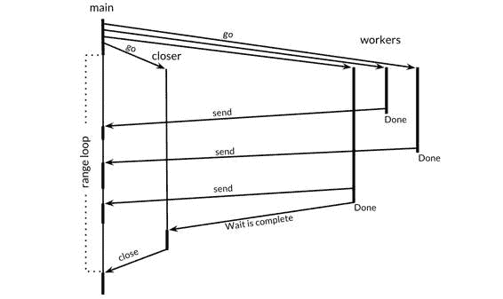

**图 8.5.** `makeThumbnails6` 中的事件序列。

垂直线代表 goroutine。细段表示睡眠，粗段表示活动。对角箭头表示将一个 goroutine 与另一个同步的事件。时间向下流动。请注意主 goroutine 大部分时间在 `range` 循环中睡眠，等待工作器发送值或 closer 关闭通道。

图 8.5 展示了 `makeThumbnails6` 函数中的事件序列。垂直线代表 goroutine。细段表示睡眠，粗段表示活动。对角箭头表示将一个 goroutine 与另一个同步的事件。时间向下流动。请注意主 goroutine 大部分时间在 `range` 循环中睡眠，等待工作器发送值或 closer 关闭通道。


### 并发爬虫

### 基于计数器的解决方案

```go
func main() {
    worklist := make(chan []string)
    var n int // number of pending sends to worklist

    // Start with the command-line arguments.
    n++
    go func() { worklist <- os.Args[1:] }()

    // Crawl the web concurrently.
    seen := make(map[string]bool)
    for ; n > 0; n-- {
        list := <-worklist
        for _, link := range list {
            if !seen[link] {
                seen[link] = true
                n++
                go func(link string) {
                    worklist <- crawl(link)
                }(link)
            }
        }
    }
}
```

在此版本中，计数器 `n` 跟踪尚未发生的对 `worklist` 的发送次数。每当我们知道某个项目需要发送到 `worklist` 时，我们就增加 `n`：在发送初始命令行参数之前增加一次，并在每次启动爬虫 goroutine 时再次增加。当 `n` 降为零时主循环终止，因为没有更多工作要做。

现在并发爬虫的运行速度比 第 5.6 节 中的广度优先爬虫快约 20 倍，没有错误，并且如果完成任务则正确终止。

### 固定 Goroutine 池解决方案

下面的程序展示了解决过度并发问题的另一种方案。此版本使用没有计数信号量的原始 `crawl` 函数，但从 20 个长期运行的爬虫 goroutine 中调用它，从而确保最多有 20 个 HTTP 请求同时处于活动状态。

点击此处查看代码图像

gopl.io/ch8/crawl3

```go
func main() {
    worklist := make(chan []string)  // lists of URLs, may have duplicates
    unseenLinks := make(chan string) // de-duplicated URLs

    // Add command-line arguments to worklist.
    go func() { worklist <- os.Args[1:] }()

    // Create 20 crawler goroutines to fetch each unseen link.
    for i := 0; i < 20; i++ {
        go func() {
            for link := range unseenLinks {
                foundLinks := crawl(link)
                go func() { worklist <- foundLinks }()
            }
        }()
    }

    // The main goroutine de-duplicates worklist items
    // and sends the unseen ones to the crawlers.
    seen := make(map[string]bool)
    for list := range worklist {
        for _, link := range list {
            if !seen[link] {
                seen[link] = true
                unseenLinks <- link
            }
        }
    }
}
```

爬虫 goroutine 都由同一个通道 `unseenLinks` 提供数据。主 goroutine 负责去重它从 `worklist` 接收到的项目，然后将每个未见过的项目通过 `unseenLinks` 通道发送给爬虫 goroutine。

`seen` 映射被*限制*在主 goroutine 内部；也就是说，它只能被该 goroutine 访问。与其他形式的信息隐藏一样，限制有助于我们推断程序的正确性。例如，局部变量不能在声明它们的函数外部通过名称提及；不“逃逸”（§2.3.4）出函数的变量不能从该函数外部访问；对象的封装字段只能通过该对象的方法访问。在所有情况下，信息隐藏都有助于限制程序各部分之间的意外交互。

`crawl` 发现的链接从专用 goroutine 发送到 `worklist` 以避免死锁。

为了节省空间，我们在此示例中未解决终止问题。

### 练习

**练习 8.6：** 为并发爬虫添加深度限制。即，如果用户设置 `-depth=3`，则只获取最多通过三个链接可达的 URL。

**练习 8.7：** 编写一个并发程序，创建一个网站的本地镜像，获取每个可达页面并将其写入本地磁盘上的目录。只应获取原始域名内的页面（例如 `golang.org`）。镜像页面中的 URL 应根据需要进行更改，以便它们指向镜像页面，而不是原始页面。

## 8.7 使用 `select` 进行多路复用

下面的程序为火箭发射进行倒计时。`time.Tick` 函数返回一个通道，它定期向该通道发送事件，充当节拍器。每个事件的值是一个时间戳，但其送达这一事实比时间戳本身更有趣。

点击此处查看代码图像

gopl.io/ch8/countdown1

```go
func main() {
    fmt.Println("Commencing countdown.")
    tick := time.Tick(1 * time.Second)
    for countdown := 10; countdown > 0; countdown-- {
        fmt.Println(countdown)
        <-tick
    }
    launch()
}
```

现在让我们添加在倒计时期间按回车键中止发射序列的功能。首先，我们启动一个 goroutine 尝试从标准输入读取单个字节，如果成功，则在名为 `abort` 的通道上发送一个值。

点击此处查看代码图像

gopl.io/ch8/countdown2

```go
abort := make(chan struct{})
go func() {
    os.Stdin.Read(make([]byte, 1)) // read a single byte
    abort <- struct{}{}
}()
```

现在倒计时循环的每次迭代都需要等待两个通道之一上的事件到达：如果一切正常（NASA 行话中的“nominal”）则是定时器通道，如果有“异常”则是中止事件。我们不能只从每个通道接收，因为我们先尝试的任何操作都会阻塞直到完成。我们需要*多路复用*这些操作，为此我们需要 `select` 语句。

```go
select {
case <-ch1:
    // ...
case x := <-ch2:
    // ...use x...
case ch3 <- y:
    // ...
default:
    // ...
}
```

上面展示了 `select` 语句的一般形式。像 `switch` 语句一样，它有若干 `case` 和一个可选的 `default`。每个 `case` 指定一个*通信*（在某个通道上的发送或接收操作）和一个关联的语句块。接收表达式可以单独出现，如第一个 `case`，也可以在短变量声明中出现，如第二个 `case`；第二种形式允许你引用接收到的值。

`select` 等待直到某个 `case` 的通信可以继续进行。然后它执行该通信并执行该 `case` 关联的语句；其他通信不会发生。没有 `case` 的 `select`，即 `select{}`，会永远等待。

让我们回到火箭发射程序。`time.After` 函数立即返回一个通道，并启动一个新 goroutine 在指定时间后向该通道发送单个值。下面的 `select` 语句等待两个事件中的第一个到达：要么是中止事件，要么是表示 10 秒已过的事件。如果 10 秒内没有中止，则继续发射。

点击此处查看代码图像

```go
func main() {
    // ...create abort channel...

    fmt.Println("Commencing countdown.  Press return to abort.")
    select {
    case <-time.After(10 * time.Second):
        // Do nothing.
    case <-abort:
        fmt.Println("Launch aborted!")
        return
    }
    launch()
}
```

下面的例子更微妙。通道 `ch` 的缓冲区大小为 1，交替为空和满，因此只有一个 `case` 可以继续：`i` 为偶数时发送，`i` 为奇数时接收。它总是打印 `0 2 4 6 8`。

点击此处查看代码图像

```go
ch := make(chan int, 1)
for i := 0; i < 10; i++ {
    select {
    case x := <-ch:
        fmt.Println(x) // "0" "2" "4" "6" "8"
    case ch <- i:
    }
}
```

如果多个 `case` 都准备好，`select` 会随机选择一个，这确保了每个通道都有平等的被选中机会。增加前一个例子的缓冲区大小会使其输出变得非确定性，因为当缓冲区既不满也不空时，`select` 语句形象地说就是抛硬币决定。


### Select 语句与超时处理

### 倒计时示例

让我们让启动程序打印倒计时。下面的 `select` 语句使循环的每次迭代最多等待 1 秒以接收中止信号，但不会更久。

点击查看代码图像

gopl.io/ch8/countdown3

```
func main() {
    // ...create abort channel...

    fmt.Println("Commencing countdown.  Press return to abort.")
    tick := time.Tick(1 * time.Second)
    for countdown := 10; countdown > 0; countdown-- {
        fmt.Println(countdown)
        select {
        case <-tick:
            // Do nothing.
        case <-abort:
            fmt.Println("Launch aborted!")
            return
        }
    }
    launch()
}
```

`time.Tick` 函数的行为类似于创建一个 goroutine，在循环中调用 `time.Sleep`，每次唤醒时发送一个事件。当上述倒计时函数返回时，它停止从 `tick` 接收事件，但定时器 goroutine 依然存在，试图向一个没有 goroutine 接收的通道发送数据——这是一个 **goroutine 泄漏**（§8.4.4）。

`Tick` 函数很方便，但仅适用于整个应用程序生命周期都需要定时器的情况。否则，我们应该使用以下模式：

点击查看代码图像

```
ticker := time.NewTicker(1 * time.Second)

<-ticker.C // receive from the ticker's channel

ticker.Stop() // cause the ticker's goroutine to terminate
```

有时我们想尝试在通道上发送或接收，但如果通道未就绪则避免阻塞——这是一种 **非阻塞通信**。`select` 语句也能做到这一点。`select` 可以包含一个 `default` 分支，指定当其他通信都无法立即进行时该做什么。

下面的 `select` 语句如果 `abort` 通道有值可接收则接收它；否则什么都不做。这是一个非阻塞接收操作；反复执行它称为 **轮询** 通道。

点击查看代码图像

```
select {
case <-abort:
    fmt.Printf("Launch aborted!\n")
    return
default:
    // do nothing
}
```

通道的零值是 `nil`。也许令人惊讶的是，`nil` 通道有时很有用。因为在 `nil` 通道上发送和接收操作会永远阻塞，`select` 语句中通道为 `nil` 的分支永远不会被选中。这让我们可以用 `nil` 来启用或禁用对应处理超时、取消、响应其他输入事件或发送输出等功能的分支。下一节将展示一个示例。

**练习 8.8：** 使用 `select` 语句，为 8.3 节 中的 echo 服务器添加超时机制，使其断开 10 秒内无任何输入的客户端连接。

## 8.8 示例：并发目录遍历

本节我们将构建一个程序，报告命令行指定的一个或多个目录的磁盘使用情况，类似于 Unix 的 `du` 命令。其大部分工作由下面的 `walkDir` 函数完成，该函数使用辅助函数 `dirents` 枚举目录 `dir` 的条目。

点击查看代码图像

gopl.io/ch8/du1

```
// walkDir recursively walks the file tree rooted at dir
// and sends the size of each found file on fileSizes.
func walkDir(dir string, fileSizes chan<- int64) {
    for _, entry := range dirents(dir) {
        if entry.IsDir() {
            subdir := filepath.Join(dir, entry.Name())
            walkDir(subdir, fileSizes)
        } else {
            fileSizes <- entry.Size()
        }
    }
}

// dirents returns the entries of directory dir.
func dirents(dir string) []os.FileInfo {
    entries, err := ioutil.ReadDir(dir)
    if err != nil {
        fmt.Fprintf(os.Stderr, "du1: %v\n", err)
        return nil
    }
    return entries
}
```

`ioutil.ReadDir` 函数返回一个 `os.FileInfo` 切片——这与对单个文件调用 `os.Stat` 返回的信息相同。对于每个子目录，`walkDir` 递归调用自身；对于每个文件，`walkDir` 向 `fileSizes` 通道发送一条消息。消息内容是文件大小（字节数）。

下面的主函数使用两个 goroutine。后台 goroutine 对命令行指定的每个目录调用 `walkDir`，最后关闭 `fileSizes` 通道。主 goroutine 计算从通道接收到的文件大小之和，最后打印总计。

点击查看代码图像

// The du1 command computes the disk usage of the files in a directory.
package main

import (
    "flag"
    "fmt"
    "io/ioutil"
    "os"
    "path/filepath"
)

func main() {
    // Determine the initial directories.
    flag.Parse()
    roots := flag.Args()
    if len(roots) == 0 {
        roots = []string{"."}
    }

    // Traverse the file tree.
    fileSizes := make(chan int64)
    go func() {
        for _, root := range roots {
            walkDir(root, fileSizes)
        }
        close(fileSizes)
    }()

    // Print the results.
    var nfiles, nbytes int64
    for size := range fileSizes {
        nfiles++
        nbytes += size
    }
    printDiskUsage(nfiles, nbytes)
}

func printDiskUsage(nfiles, nbytes int64) {
    fmt.Printf("%d files  %.1f GB\n", nfiles, float64(nbytes)/1e9)
}
```

该程序在打印结果前会暂停很长时间：

```
$ go build gopl.io/ch8/du1
$ ./du1 $HOME /usr /bin /etc
213201 files  62.7 GB
```

如果程序能随时告知进度会更好。但仅将 `printDiskUsage` 调用移入循环会导致输出成千上万行。

下面的 `du` 变体会定期打印总计，但仅在指定 `-v` 标志时才打印，因为并非所有用户都想看进度消息。循环遍历 `roots` 的后台 goroutine 保持不变。主 goroutine 现在使用定时器每 500ms 产生事件，并用 `select` 语句等待文件大小消息（更新总计）或定时器事件（打印当前总计）。如果未指定 `-v` 标志，`tick` 通道保持为 `nil`，其在 `select` 中的分支实际上被禁用。

点击查看代码图像

gopl.io/ch8/du2

```
var verbose = flag.Bool("v", false, "show verbose progress messages")

func main() {
    // ...start background goroutine...

    // Print the results periodically.
    var tick <-chan time.Time
    if *verbose {
        tick = time.Tick(500 * time.Millisecond)
    }
    var nfiles, nbytes int64
loop:
    for {
        select {
        case size, ok := <-fileSizes:
            if !ok {
                break loop // fileSizes was closed
            }
            nfiles++
            nbytes += size
        case <-tick:
            printDiskUsage(nfiles, nbytes)
        }
    }
    printDiskUsage(nfiles, nbytes) // final totals
}
```

由于程序不再使用 `range` 循环，第一个 `select` 分支必须显式检测 `fileSizes` 通道是否已关闭，使用双返回值形式的接收操作。如果通道已关闭，程序跳出循环。带标签的 `break` 语句同时跳出 `select` 和 `for` 循环；无标签的 `break` 只会跳出 `select`，导致循环开始下一次迭代。

程序现在提供悠闲的更新流：

```
$ go build gopl.io/ch8/du2
$ ./du2 -v $HOME /usr /bin /etc
28608 files  8.3 GB
54147 files  10.3 GB
93591 files  15.1 GB
127169 files  52.9 GB
175931 files  62.2 GB
213201 files  62.7 GB
```


### 第三版 `du`：并发遍历目录

然而，该程序完成仍需太长时间。没有理由阻止所有对 `walkDir` 的调用并发执行，从而利用磁盘系统的并行性。下面的 `du` 第三版为每次 `walkDir` 调用创建一个新的 goroutine。它使用 `sync.WaitGroup`（§8.5）来统计仍在活动的 `walkDir` 调用次数，并启动一个额外的 goroutine 在计数器降为零时关闭 `fileSizes` 通道。

点击查看代码图示

gopl.io/ch8/du3

```go
func main() {
    // ...确定根目录...

    // 并行遍历文件树的每个根目录。
    fileSizes := make(chan int64)
    var n sync.WaitGroup
    for _, root := range roots {
        n.Add(1)
        go walkDir(root, &n, fileSizes)
    }
    go func() {
        n.Wait()
        close(fileSizes)
    }()
    // ...select 循环...
}
```

点击查看代码图示

```go
func walkDir(dir string, n *sync.WaitGroup, fileSizes chan<- int64) {
    defer n.Done()
    for _, entry := range dirents(dir) {
        if entry.IsDir() {
            n.Add(1)
            subdir := filepath.Join(dir, entry.Name())
            go walkDir(subdir, n, fileSizes)
        } else {
            fileSizes <- entry.Size()
        }
    }
}
```

由于该程序在峰值时会创建成千上万个 goroutine，我们必须修改 `dirents` 以使用计数信号量，防止其一次性打开太多文件，就像我们在 8.6 节 的网络爬虫中所做的那样：

点击查看代码图示

```go
// sema 是一个计数信号量，用于限制 dirents 中的并发度。
var sema = make(chan struct{}, 20)

// dirents 返回目录 dir 的条目。
func dirents(dir string) []os.FileInfo {
    sema <- struct{}{}        // 获取令牌
    defer func() { <-sema }() // 释放令牌
    // ...
}
```

此版本比前一个快数倍，尽管不同系统间的差异很大。

**练习 8.9：** 编写一个 `du` 版本，计算并定期显示每个 `root` 目录的单独总计。

## 8.9 取消

有时我们需要指示一个 goroutine 停止其正在做的事情，例如，在 Web 服务器代表已断开连接的客户端执行计算时。

没有任何方式让一个 goroutine 直接终止另一个 goroutine，因为那会留下所有共享变量处于未定义状态。在火箭发射程序（§8.7）中，我们向名为 `abort` 的通道发送单个值，倒计时 goroutine 将其解读为请求自行停止。但如果我们需要取消两个 goroutine，或任意数量的 goroutine 呢？

一种可能是向 `abort` 通道发送与要取消的 goroutine 数量相等的事件。然而，如果某些 goroutine 已经自行终止，我们的计数将过大，发送操作会卡住。另一方面，如果这些 goroutine 又衍生出其他 goroutine，我们的计数将过小，一些 goroutine 将不知道取消事件。一般来说，很难知道在任何给定时刻有多少 goroutine 在为我们工作。此外，当一个 goroutine 从 `abort` 通道接收值时，它会消费该值，导致其他 goroutine 看不到它。对于取消，我们需要一种可靠的机制，通过通道*广播*事件，以便许多 goroutine 能在事件发生时看到它，并能在事后看到它*已经*发生。

回想一下，通道关闭并耗尽所有发送值后，后续的接收操作会立即进行，产生零值。我们可以利用这一点创建广播机制：不要在通道上发送值，*关闭*它。

我们可以通过几个简单的更改为上一节的 `du` 程序添加取消功能。首先，我们创建一个取消通道，永远不发送值，但其关闭表示程序该停止了。我们还定义一个工具函数 `cancelled`，在调用时检查或*轮询*取消状态。

点击查看代码图示

gopl.io/ch8/du4

```go
var done = make(chan struct{})

func cancelled() bool {
    select {
    case <-done:
        return true
    default:
        return false
    }
}
```

接下来，我们创建一个从标准输入读取的 goroutine，标准输入通常连接到终端。一旦读取到任何输入（例如用户按下回车键），该 goroutine 通过关闭 `done` 通道来广播取消。

点击查看代码图示

```go
// 当检测到输入时取消遍历。
go func() {
    os.Stdin.Read(make([]byte, 1)) // 读取单个字节
    close(done)
}()
```

现在我们需要让 goroutine 响应取消。在主 goroutine 中，我们向 select 语句添加第三个 case，尝试从 `done` 通道接收。如果选中该 case，函数返回，但返回前必须先耗尽 `fileSizes` 通道，丢弃所有值直到通道关闭。这样做是为了确保任何活动的 `walkDir` 调用能运行完成，而不会卡在向 `fileSizes` 发送上。

点击查看代码图示

```go
for {
    select {
    case <-done:
        // 耗尽 fileSizes 以允许现有 goroutine 完成。
        for range fileSizes {
            // 什么都不做。
        }
        return
    case size, ok := <-fileSizes:
        // ...
    }
}
```

`walkDir` goroutine 在开始时轮询取消状态，如果状态已设置则直接返回而不做任何事。这使得取消事件后创建的所有 goroutine 变为无操作：

点击查看代码图示

```go
func walkDir(dir string, n *sync.WaitGroup, fileSizes chan<- int64) {
    defer n.Done()
    if cancelled() {
        return
    }
    for _, entry := range dirents(dir) {
        // ...
    }
}
```

在 `walkDir` 的循环内再次轮询取消状态可能会有益处，以避免在取消事件后创建 goroutine。取消涉及权衡；更快的响应通常需要对程序逻辑进行更侵入性的更改。确保取消事件后不再发生昂贵操作可能需要更新代码中的许多位置，但通常只需在几个关键位置检查取消即可获得大部分收益。

对该程序的少量性能分析显示瓶颈在于 `dirents` 中获取信号量令牌。下面的 `select` 使该操作可取消，并将程序的典型取消延迟从数百毫秒降低到几十毫秒：

点击查看代码图示

```go
func dirents(dir string) []os.FileInfo {
    select {
    case sema <- struct{}{}: // 获取令牌
    case <-done:
        return nil // 已取消
    }
    defer func() { <-sema }() // 释放令牌

    // ...读取目录...
}
```


## 8.10 示例：聊天服务器

### 取消与测试技巧

现在，当取消发生时，所有后台 goroutine 会迅速停止，且 `main` 函数返回。当然，当 `main` 返回时，程序就会退出，因此很难分辨一个会自我清理的 main 函数和一个不会清理的 main 函数。我们可以在测试期间使用一个方便的技巧：如果在取消发生时不从 `main` 返回，而是执行一个 `panic` 调用，那么运行时会转储程序中每个 goroutine 的堆栈。如果只剩下主 goroutine，说明它已经自我清理完毕。但如果还有其他 goroutine 残留，它们可能没有被正确取消，或者虽然已被取消但取消过程需要时间；稍作调查可能很有价值。panic 转储通常包含足够的信息来区分这些情况。

### 练习 8.10 和 8.11

**练习 8.10：** 通过关闭 `http.Request` 结构体中可选的 `Cancel` 通道，可以取消 HTTP 请求。修改 第 8.6 节 中的网页爬虫以支持取消。

提示：`http.Get` 便利函数不给你自定义 `Request` 的机会。取而代之的是，使用 `http.NewRequest` 创建请求，设置其 `Cancel` 字段，然后通过调用 `http.DefaultClient.Do(req)` 来执行请求。

**练习 8.11：** 遵循 第 8.4.4 节 中 `mirroredQuery` 的方法，实现一个 `fetch` 的变体，并发请求多个 URL。一旦第一个响应到达，取消其他请求。

### 聊天服务器实现

我们将用一个聊天服务器来结束本章，它允许多个用户相互广播文本消息。该程序中有四种 goroutine。`main` 和 `broadcaster` goroutine 各有一个实例，而对于每个客户端连接，则有一个 `handleConn` 和一个 `clientWriter` goroutine。broadcaster 很好地说明了 `select` 的用法，因为它必须响应三种不同类型的消息。

### 主 Goroutine

下面展示的主 goroutine 的任务是监听并接受来自客户端的传入网络连接。对于每个连接，它创建一个新的 `handleConn` goroutine，就像我们在本章开头看到的并发 echo 服务器一样。

点击此处查看代码图像

gopl.io/ch8/chat

```
func main() {
    listener, err := net.Listen("tcp", "localhost:8000")
    if err != nil {
        log.Fatal(err)
    }

    go broadcaster()
    for {
        conn, err := listener.Accept()
        if err != nil {
            log.Print(err)
            continue
        }
        go handleConn(conn)
    }
}
```

### 广播器

接下来是广播器。其局部变量 `clients` 记录当前已连接客户端的集合。关于每个客户端记录的唯一信息是其发出消息通道的标识，稍后详述。

点击此处查看代码图像

```
type client chan<- string // an outgoing message channel

var (
    entering = make(chan client)
    leaving  = make(chan client)
    messages = make(chan string) // all incoming client messages
)

func broadcaster() {
    clients := make(map[client]bool) // all connected clients
    for {
        select {
        case msg := <-messages:
            // Broadcast incoming message to all
            // clients' outgoing message channels.
            for cli := range clients {
                cli <- msg
            }

        case cli := <-entering:
            clients[cli] = true

        case cli := <-leaving:
            delete(clients, cli)
            close(cli)
        }
    }
}
```

广播器监听全局 `entering` 和 `leaving` 通道，以获取客户端到达和离开的通知。当它收到其中一个事件时，会更新 `clients` 集合，如果事件是离开，则关闭客户端的发出消息通道。广播器还监听全局 `messages` 通道上的事件，每个客户端将其所有传入消息发送到该通道。当广播器收到此类事件之一时，它将消息广播给每个已连接的客户端。

### 每客户端 Goroutine

现在让我们看看每客户端 goroutine。`handleConn` 函数为其客户端创建一个新的发出消息通道，并通过 `entering` 通道向广播器宣布该客户端的到来。然后它从客户端读取每一行文本，将每一行通过全局传入消息通道发送给广播器，并在每条消息前加上发送者的标识。一旦没有更多内容可从客户端读取，`handleConn` 通过 `leaving` 通道宣布客户端离开并关闭连接。

点击此处查看代码图像

```
func handleConn(conn net.Conn) {
    ch := make(chan string) // outgoing client messages
    go clientWriter(conn, ch)

    who := conn.RemoteAddr().String()
    ch <- "You are " + who
    messages <- who + " has arrived"
    entering <- ch

    input := bufio.NewScanner(conn)
    for input.Scan() {
        messages <- who + ": " + input.Text()
    }
    // NOTE: ignoring potential errors from input.Err()

    leaving <- ch
    messages <- who + " has left"
    conn.Close()
}

func clientWriter(conn net.Conn, ch <-chan string) {
    for msg := range ch {
        fmt.Fprintln(conn, msg) // NOTE: ignoring network errors
    }
}
```

此外，`handleConn` 为每个客户端创建一个 `clientWriter` goroutine，它接收广播到客户端发出消息通道的消息并将其写入客户端的网络连接。当广播器在收到 `leaving` 通知后关闭通道时，客户端写入器的循环终止。

### 演示

下面的显示展示了服务器运行的情况，两个客户端在同一台计算机的不同窗口中，使用 `netcat` 进行聊天：

点击此处查看代码图像

```
$ go build gopl.io/ch8/chat
$ go build gopl.io/ch8/netcat3
$ ./chat &
$ ./netcat3
You are 127.0.0.1:64208               $ ./netcat3
127.0.0.1:64211 has arrived           You are 127.0.0.1:64211
Hi!
127.0.0.1:64208: Hi!                  127.0.0.1:64208: Hi!
                                      Hi yourself.
127.0.0.1:64211: Hi yourself.         127.0.0.1:64211: Hi yourself.
^C
                                      127.0.0.1:64208 has left
$ ./netcat3
You are 127.0.0.1:64216               127.0.0.1:64216 has arrived
                                      Welcome.
127.0.0.1:64211: Welcome.             127.0.0.1:64211: Welcome.
                                      ^C
127.0.0.1:64211 has left
```

### 并发安全

在为 *n* 个客户端托管聊天会话时，该程序运行 2*n*+2 个并发通信的 goroutine，但它不需要显式的锁操作（§9.2）。`clients` 映射被限制在单个 goroutine（即广播器）中，因此无法被并发访问。多个 goroutine 共享的唯一变量是通道和 `net.Conn` 实例，它们都是*并发安全*的。我们将在下一章更多地讨论限制、并发安全以及跨 goroutine 共享变量的影响。

### 练习 8.12–8.14

**练习 8.12：** 让广播器向每个新到达的客户端宣布当前的客户端集合。这要求 `clients` 集合以及 `entering` 和 `leaving` 通道也记录客户端名称。

**练习 8.13：** 让聊天服务器断开空闲客户端的连接，例如过去五分钟内未发送任何消息的客户端。提示：在另一个 goroutine 中调用 `conn.Close()` 会解除活动的 `Read` 调用阻塞，例如 `input.Scan()` 所做的调用。

**练习 8.14：** 更改聊天服务器的网络协议，使每个客户端在进入时提供其名称。在为每条消息加上发送者身份前缀时，使用该名称代替网络地址。


**练习 8.15：** 任何客户端程序未能及时读取数据，最终都会导致所有客户端卡住。修改广播器，使其在客户端写入器未准备好接收消息时跳过该消息，而不是等待。或者，为每个客户端的传出消息通道增加缓冲，以便大多数消息不被丢弃；广播器应对该通道使用非阻塞发送。

# 9. 共享变量的并发

在上一章中，我们展示了几个使用 goroutine 和 channel 以直接且自然的方式表达并发的程序。然而，在这样做时，我们略过了许多程序员在编写并发代码时必须牢记的重要且微妙的问题。

在本章中，我们将更仔细地研究并发的机制。特别是，我们将指出在多个 goroutine 间共享变量所带来的一些问题、识别这些问题的分析技术以及解决它们的模式。最后，我们将解释 goroutine 与操作系统线程之间的一些技术差异。

## 9.1 竞态条件

在顺序程序中，即只有一个 goroutine 的程序，程序的步骤按照由程序逻辑决定的熟悉的执行顺序发生。例如，在一系列语句中，第一条发生在第二条之前，依此类推。在拥有两个或更多 goroutine 的程序中，每个 goroutine 内部的步骤按熟悉的顺序发生，但通常我们无法知道一个 goroutine 中的事件 `x` 是发生在另一个 goroutine 中的事件 `y` 之前、之后，还是与其同时发生。当我们无法确信某个事件*先于*另一个事件发生时，则称事件 `x` 和 `y` 是*并发* 的。

考虑一个在顺序程序中能正确工作的函数。如果该函数在被并发调用时（即从两个或更多 goroutine 调用且无额外同步）仍能继续正确工作，则该函数是*并发安全* 的。我们可以将这一概念推广到一组协作函数，例如某个特定类型的方法和操作。如果一个类型的所有可访问方法和操作都是并发安全的，则该类型是并发安全的。

我们可以在不使程序中每个具体类型都并发安全的情况下，使程序并发安全。事实上，并发安全类型是例外而非规则，因此只有当其类型的文档说明这样做是安全时，你才应并发访问变量。我们通过将大多数变量*限制*在单个 goroutine 中，或者维护更高层面的*互斥* 不变量，来避免对它们的并发访问。我们将在本章中解释这些术语。

相反，导出的包级函数*通常*应当是并发安全的。由于包级变量无法被限制在单个 goroutine 中，修改它们的函数必须强制实施互斥。

函数在并发调用时可能无法工作的原因有很多，包括死锁、活锁和资源饥饿。我们没有空间讨论所有这些，因此将重点关注最重要的一个：**竞态条件**。

竞态条件是指在多个 goroutine 的操作以某些交错顺序执行时，程序无法给出正确结果的情况。竞态条件具有隐蔽性，因为它们可能潜伏在程序中且不频繁出现，或许仅在高负载或使用特定编译器、平台或架构时才显现。这使得它们难以复现和诊断。

通常通过金钱损失的隐喻来解释竞态条件的严重性，因此我们将考虑一个简单的银行账户程序。

```
// Package bank implements a bank with only one account.
package bank

var balance int

func Deposit(amount int) { balance = balance + amount }

func Balance() int { return balance }
```

（我们本可以将 `Deposit` 函数体写为 `balance += amount`，这二者等价，但较长的形式将简化解释。）

对于这样一个简单的程序，我们一眼就能看出，对 `Deposit` 和 `Balance` 的任何调用序列都会给出正确答案，即 `Balance` 将报告之前所有存款金额的总和。然而，如果我们不是按顺序而是并发调用这些函数，`Balance` 就不再保证给出正确答案。考虑以下两个 goroutine，它们代表联合银行账户上的两笔交易：

```
// Alice:
go func() {
    bank.Deposit(200)                // A1
    fmt.Println("=", bank.Balance()) // A2
}()

// Bob:
go bank.Deposit(100)                 // B
```

Alice 存入 200 美元，然后查询余额，而 Bob 存入 100 美元。由于步骤 `A1` 和 `A2` 与 `B` 并发发生，我们无法预测它们发生的顺序。直觉上，似乎只有三种可能的排序，我们称之为“Alice 优先”、“Bob 优先”和“Alice/Bob/Alice”。下表显示了每一步之后 `balance` 变量的值。带引号的字符串代表打印出的余额单。

```
Alice 优先              Bob 优先        Alice/Bob/Alice
          0                      0                      0
  A1    200              B     100              A1    200
  A2 "= 200"             A1    300              B     300
  B     300              A2 "= 300"             A2 "= 300"
```

在所有情况下，最终余额都是 300 美元。唯一的变化在于 Alice 的余额单是否包含 Bob 的交易，但客户无论哪种方式都会满意。

但这种直觉是错误的。存在第四种可能的结果，即 Bob 的存款发生在 Alice 存款的中间，在余额被读取（`balance + amount`）之后但被更新（`balance = ...`）之前，导致 Bob 的交易丢失。这是因为 Alice 的存款操作 `A1` 实际上是两个操作的序列，一个读和一个写；称它们为 `A1r` 和 `A1w`。以下是有问题的交错执行：

```
数据竞争
         0
A1r      0          ... = balance + amount
B      100
A1w    200          balance = ...
A2  "= 200"
```

在 `A1r` 之后，表达式 `balance + amount` 评估为 200，因此尽管中间插入了存款，`A1w` 期间写入的值仍是 200。最终余额只有 200 美元。银行以 Bob 的损失为代价多赚了 100 美元。

该程序包含一种特定类型的竞态条件，称为*数据竞争*。每当两个 goroutine 并发访问同一变量，且至少其中一次访问是写入时，就会发生数据竞争。

如果数据竞争涉及的变量类型大于单个机器字（如接口、字符串或切片），情况会变得更加混乱。以下代码并发地用两个不同长度的切片更新 `x`：

```
var x []int
go func() { x = make([]int, 10) }()
go func() { x = make([]int, 1000000) }()
x[999999] = 1 // NOTE: undefined behavior; memory corruption possible!
```


## 9.1 数据竞争 (duplicate)

最终语句中 `x` 的值未定义；它可能是 `nil`，或长度为 10 的切片，或长度为 1,000,000 的切片。但请回忆，切片有三个部分：指针、长度和容量。如果指针来自第一次 `make` 调用，而长度来自第二次，`x` 将是一个嵌合体——一个名义长度为 1,000,000 但底层数组只有 10 个元素的切片。在这种情况下，向元素 999,999 存储数据会破坏任意遥远的内存位置，后果无法预测，也难以调试和定位。这种语义雷区称为**未定义行为**（*undefined behavior*），C 程序员对此深有体会；幸运的是，在 Go 中它很少像在 C 中那样麻烦。

即使“并发程序是多个顺序程序的交织”这一概念也是错误的直觉。正如我们将在 9.4 节 看到的，数据竞争可能产生更奇怪的结果。许多程序员——甚至一些非常聪明的程序员——偶尔会为其程序中已知的数据竞争辩护：“互斥的成本太高”、“这只是用于日志记录”、“我不介意丢失一些消息”，等等。在特定编译器和平台上没有出现问题可能会给他们虚假的信心。一个好的经验法则是：**不存在良性的数据竞争**。那么我们如何避免程序中的数据竞争？

我们重复一下定义，因为它非常重要：**当两个 goroutine 并发访问同一变量，且至少有一个访问是写入时，就会发生数据竞争**。根据这个定义，避免数据竞争有三种方法。

### 第一种方法：不写入变量

考虑下面的 map，它在每个键首次被请求时惰性填充。如果 `Icon` 顺序调用，程序运行正常；但如果 `Icon` 并发调用，访问 map 就会发生数据竞争。

点击查看代码图像

```
var icons = make(map[string]image.Image)

func loadIcon(name string) image.Image

// NOTE: not concurrency-safe!
func Icon(name string) image.Image {
    icon, ok := icons[name]
    if !ok {
        icon = loadIcon(name)
        icons[name] = icon
    }
    return icon
}
```

如果我们在创建额外 goroutine 之前用所有必要条目初始化 map，且之后不再修改它，那么任意数量的 goroutine 可以安全地并发调用 `Icon`，因为每个 goroutine 只读取 map。

点击查看代码图像

```
var icons = map[string]image.Image{
    "spades.png":   loadIcon("spades.png"),
    "hearts.png":   loadIcon("hearts.png"),
    "diamonds.png": loadIcon("diamonds.png"),
    "clubs.png":    loadIcon("clubs.png"),
}

// Concurrency-safe.
func Icon(name string) image.Image { return icons[name] }
```

在上面的示例中，`icons` 变量在包初始化期间赋值，这发生在程序的 `main` 函数开始运行**之前**（*happens before*）。一旦初始化，`icons` 就不再修改。从不修改或不可变的数据结构天生是并发安全的，无需同步。但显然，如果更新是必要的（如银行账户），我们就不能使用这种方法。

### 第二种方法：避免从多个 goroutine 访问变量

这是上一章许多程序采用的方法。例如，并发网络爬虫（§8.6）中的主 goroutine 是唯一访问 `seen` map 的 goroutine，聊天服务器（§8.10）中的 `broadcaster` goroutine 是唯一访问 `clients` map 的 goroutine。这些变量被**限制**（*confined*）在单个 goroutine 中。

由于其他 goroutine 无法直接访问该变量，它们必须通过通道向限制该变量的 goroutine 发送请求来查询或更新变量。这正是 Go 格言“不要通过共享内存来通信；而要通过通信来共享内存”的含义。一个使用通道请求来代理对受限变量访问的 goroutine 被称为该变量的**监控 goroutine**（*monitor goroutine*）。例如，`broadcaster` goroutine 监控对 `clients` map 的访问。

下面是用监控 goroutine `teller` 限制 `balance` 变量的银行示例重写：

点击查看代码图像

`gopl.io/ch9/bank1`

```
// Package bank provides a concurrency-safe bank with one account.
package bank

var deposits = make(chan int) // send amount to deposit
var balances = make(chan int) // receive balance

func Deposit(amount int) { deposits <- amount }
func Balance() int       { return <-balances }

func teller() {
    var balance int // balance is confined to teller goroutine
    for {
        select {
        case amount := <-deposits:
            balance += amount
        case balances <- balance:
        }
    }
}

func init() {
    go teller() // start the monitor goroutine
}
```

即使变量在其整个生命周期内无法限制在单个 goroutine 中，限制仍可能是解决并发访问问题的方案。例如，在管道中通过通道将变量地址从一个阶段传递到下一个阶段，在 goroutine 间共享变量是常见的。如果管道的每个阶段在发送变量给下一阶段后不再访问它，那么对该变量的所有访问就是顺序的。实际上，变量先被限制在管道的一个阶段，然后是下一个阶段，依此类推。这种规律有时称为**串行限制**（*serial confinement*）。

在下面的示例中，`Cake` 先被串行限制在 `baker` goroutine，然后是 `icer` goroutine：

点击查看代码图像

```
type Cake struct{ state string }

func baker(cooked chan<- *Cake) {
    for {
        cake := new(Cake)
        cake.state = "cooked"
        cooked <- cake // baker never touches this cake again
    }
}

func icer(iced chan<- *Cake, cooked <-chan *Cake) {
    for cake := range cooked {
        cake.state = "iced"
        iced <- cake // icer never touches this cake again
    }
}
```

### 第三种方法：允许多个 goroutine 访问变量，但同一时间只能有一个

这种方法称为**互斥**（*mutual exclusion*），是下一节的主题。

**练习 9.1：** 向 `gopl.io/ch9/bank1` 程序添加函数 `Withdraw(amount int) bool`。结果应指示事务是成功还是因资金不足而失败。发送给监控 goroutine 的消息必须包含要取款的金额和一个新通道，监控 goroutine 可通过该通道将布尔结果发回给 `Withdraw`。

## 9.2 互斥：`sync.Mutex`

在 8.6 节 中，我们使用带缓冲的通道作为**计数信号量**（*counting semaphore*），确保不超过 20 个 goroutine 同时发起 HTTP 请求。用同样的思路，我们可以使用容量为 1 的通道，确保同一时间最多只有一个 goroutine 访问共享变量。只能计数到 1 的信号量称为**二元信号量**（*binary semaphore*）。

点击查看代码图像

`gopl.io/ch9/bank2`

```
var (
    sema    = make(chan struct{}, 1) // a binary semaphore guarding balance
    balance int
)

func Deposit(amount int) {
    sema <- struct{}{} // acquire token
    balance = balance + amount
    <-sema // release token
}

func Balance() int {
    sema <- struct{}{} // acquire token
    b := balance
    <-sema // release token
    return b
}
```


### 使用 `sync.Mutex` 实现互斥

这种*互斥*模式非常有用，以至于 `sync` 包中的 `Mutex` 类型直接支持它。其 `Lock` 方法获取令牌（称为*锁*），而 `Unlock` 方法释放它：

点击此处查看代码图像

gopl.io/ch9/bank3

```
import "sync"

var (
    mu      sync.Mutex // guards balance
    balance int
)

func Deposit(amount int) {
    mu.Lock()
    balance = balance + amount
    mu.Unlock()
}

func Balance() int {
    mu.Lock()
    b := balance
    mu.Unlock()
    return b
}
```

每当一个 goroutine 访问银行的变量（这里只有 `balance`）时，它必须调用互斥锁的 `Lock` 方法来获取独占锁。如果另一个 goroutine 已经获取了该锁，此操作将阻塞，直到另一个 goroutine 调用 `Unlock` 并使锁再次可用。互斥锁*保护*共享变量。按照惯例，受互斥锁保护的变量会在互斥锁声明之后立即声明。如果你偏离了这一惯例，请务必在文档中说明。

`Lock` 和 `Unlock` 之间可以自由读取和修改共享变量的代码区域称为*临界区*。锁持有者对 `Unlock` 的调用*先行发生于*（happens before）任何其他 goroutine 获取该锁。至关重要的是，goroutine 在完成后必须释放锁，这适用于函数的所有执行路径，包括错误路径。

上面的银行程序体现了一种常见的并发模式。一组导出函数封装了一个或多个变量，使得访问这些变量的唯一途径是通过这些函数（或者对于对象的变量，是通过方法）。每个函数在开头获取互斥锁，在结尾释放它，从而确保共享变量不会被并发访问。这种函数、互斥锁和变量的组合称为*监视器*。（“监视器”一词的这种较早用法启发了“监视器 goroutine”这一术语。两者都包含这样一个含义：一个代理人，确保变量被顺序访问。）

由于 `Deposit` 和 `Balance` 函数中的临界区非常短——只有一行，没有分支——在末尾调用 `Unlock` 很简单。在更复杂的临界区中，特别是那些必须通过提前返回来处理错误的情况，很难确定 `Lock` 和 `Unlock` 的调用在所有路径上都是严格配对的。Go 的 `defer` 语句解决了这个问题：通过推迟 `Unlock` 的调用，临界区隐式地延伸到当前函数的末尾，使我们无需记住在远离 `Lock` 调用的一个或多个位置插入 `Unlock` 调用。

```
func Balance() int {
    mu.Lock()
    defer mu.Unlock()
    return balance
}
```

在上面的示例中，`Unlock` 在 `return` 语句读取 `balance` 的值*之后*执行，因此 `Balance` 函数是并发安全的。作为额外收获，我们不再需要局部变量 `b`。

此外，即使临界区发生 panic，推迟的 `Unlock` 也会运行，这在使用 `recover` 的程序中可能很重要（§5.10）。`defer` 的开销比显式调用 `Unlock` 略大，但不足以成为代码可读性变差的理由。与所有并发程序一样，应优先考虑清晰性，抵制过早优化。在可能的情况下，使用 `defer` 并让临界区延伸至函数末尾。

### `Withdraw` 函数与原子性

请看下面的 `Withdraw` 函数。成功时，它将余额减去指定金额并返回 `true`。但如果账户资金不足以完成交易，`Withdraw` 会恢复余额并返回 `false`。

点击此处查看代码图像

```
// NOTE: not atomic!
func Withdraw(amount int) bool {
    Deposit(-amount)
    if Balance() < 0 {
        Deposit(amount)
        return false // insufficient funds
    }
    return true
}
```

该函数最终会给出正确结果，但它有一个恶劣的副作用。当尝试过度取款时，余额会瞬间降至零以下。这可能导致并发的小额取款被错误地拒绝。因此，如果 Bob 试图买一辆跑车，Alice 就无法支付她的早咖啡费。问题在于 `Withdraw` 不是*原子的*：它由三个独立操作组成，每个操作都会获取并释放互斥锁，但没有任何东西锁定整个序列。

理想情况下，`Withdraw` 应该在整个操作周围获取一次互斥锁。然而，这种尝试行不通：

点击此处查看代码图像

```
// NOTE: incorrect!
func Withdraw(amount int) bool {
    mu.Lock()
    defer mu.Unlock()
    Deposit(-amount)
    if Balance() < 0 {
        Deposit(amount)
        return false // insufficient funds
    }
    return true
}
```

`Deposit` 试图通过调用 `mu.Lock()` 第二次获取互斥锁，但由于互斥锁是*不可重入的*——无法锁定一个已经加锁的互斥锁——这导致了死锁，无法继续执行，`Withdraw` 将永远阻塞。

Go 的互斥锁不可重入是有充分理由的。互斥锁的目的是确保共享变量的某些不变量在程序执行的关键点上得以维持。其中一个不变量是“没有 goroutine 正在访问共享变量”，但互斥锁保护的数据结构可能还有额外的特定不变量。当一个 goroutine 获取互斥锁时，它可以假设这些不变量成立。在持有锁期间，它可能会更新共享变量，导致不变量暂时被破坏。然而，当它释放锁时，必须保证秩序已恢复，不变量再次成立。虽然可重入互斥锁能确保没有其他 goroutine 访问共享变量，但它无法保护这些变量的额外不变量。

### 解决方案：内部辅助函数

一种常见的解决方案是将 `Deposit` 这样的函数拆分为两个：一个未导出的函数 `deposit`，它假设锁已被持有并完成实际工作；一个导出函数 `Deposit`，它在调用 `deposit` 前获取锁。然后我们可以用 `deposit` 来表达 `Withdraw`，如下所示：

点击此处查看代码图像

```
func Withdraw(amount int) bool {
    mu.Lock()
    defer mu.Unlock()
    deposit(-amount)
    if balance < 0 {
        deposit(amount)
        return false // insufficient funds
    }
    return true
}

func Deposit(amount int) {
    mu.Lock()
    defer mu.Unlock()
    deposit(amount)
}

func Balance() int {
    mu.Lock()
    defer mu.Unlock()
    return balance
}

// This function requires that the lock be held.
func deposit(amount int) { balance += amount }
```

当然，这里展示的 `deposit` 函数非常简单，以至于实际的 `Withdraw` 函数不会费心去调用它，但它仍然说明了这一原则。

封装（§6.6）通过减少程序中意外的交互，帮助我们维护数据结构不变量。出于同样的原因，封装也有助于我们维护并发不变量。当你使用互斥锁时，请确保互斥锁本身及其保护的变量都未被导出，无论它们是包级变量还是结构体字段。

## 9.3 读/写互斥锁：`sync.RWMutex`

在看到 100 美元存款无影无踪后惊慌失措的 Bob 编写了一个程序，每秒检查几百次银行余额。他在家里、工作中和手机上运行它。银行注意到增加的流量正在延迟存款和取款，因为所有的 `Balance` 请求都在顺序运行，独占锁并暂时阻止其他 goroutine 运行。


### RWMutex：多读单写锁

由于 `Balance` 函数只需要*读取*变量的状态，实际上多个 `Balance` 调用并发运行是安全的，只要没有 `Deposit` 或 `Withdraw` 调用正在运行。在这种情况下，我们需要一种特殊的锁，允许只读操作彼此并行进行，但写操作拥有完全独占的访问权。这种锁称为*多读单写*锁，在 Go 语言中由 `sync.RWMutex` 提供：

```
var mu sync.RWMutex
var balance int

func Balance() int {
    mu.RLock() // 读锁
    defer mu.RUnlock()
    return balance
}
```

`Balance` 函数现在调用 `RLock` 和 `RUnlock` 方法来获取和释放*读锁*或*共享锁`。`Deposit` 函数保持不变，它调用 `mu.Lock` 和 `mu.Unlock` 方法来获取和释放*写锁*或*独占锁*。

做出此更改后，Bob 的大多数 `Balance` 请求彼此并行运行，完成得更快。锁可用的时间更多，`Deposit` 请求能及时进行处理。

只有在临界区没有对共享变量进行写入时，才能使用 `RLock`。通常，我们不应假设*逻辑上*只读的函数或方法不也会更新某些变量。例如，一个看似简单的访问器方法可能也会增加内部使用计数器，或更新缓存以使重复调用更快。如果拿不准，请使用独占的 `Lock`。

只有当获取锁的大多数 goroutine 是读者，且锁处于*竞争*状态时（即 goroutine 经常不得不等待以获取锁），使用 `RWMutex` 才有利。`RWMutex` 需要更复杂的内部记账，使其在无竞争锁的情况下比普通互斥锁更慢。

## 9.4 内存同步

你可能会想知道为什么 `Balance` 方法需要互斥锁，无论是基于通道的还是基于互斥锁的。毕竟，与 `Deposit` 不同，它仅包含单个操作，因此没有其他 goroutine 在它“中间”执行的危险。我们需要互斥锁有两个原因。第一个原因是，`Balance` 不在像 `Withdraw` 这样的其他操作中间执行，这一点同样重要。第二个（更微妙的）原因是，同步不仅关乎多个 goroutine 执行顺序；同步还影响内存。

在现代计算机中，可能有数十个处理器，每个处理器都有自己的主内存本地缓存。为了效率，对内存的写入会在每个处理器内部缓冲，仅在必要时才刷新到主内存。它们甚至可能以不同于写入 goroutine 编写的顺序提交到主内存。像通道通信和互斥锁操作这样的同步原语会导致处理器刷新并提交所有累积的写入，从而保证截至该点 goroutine 执行的效果对运行在其他处理器上的 goroutine 可见。

考虑以下代码片段的可能输出：

```
var x, y int
go func() {
    x = 1                   // A1
    fmt.Print("y:", y, " ") // A2
}()
go func() {
    y = 1                   // B1
    fmt.Print("x:", x, " ") // B2
}()
```

由于这两个 goroutine 是并发的，且在没有互斥的情况下访问共享变量，因此存在数据竞争，所以我们不应惊讶于程序是不确定的。我们可能期望它打印以下四种结果中的任意一种，它们对应于程序标记语句的直观交织：

```
y:0 x:1
x:0 y:1
x:1 y:1
y:1 x:1
```

例如，第四行可以用序列 `A1,B1,A2,B2` 或 `B1,A1,A2,B2` 来解释。然而，这两种结果可能会让人感到意外：

```
x:0 y:0
y:0 x:0
```

但根据编译器、CPU 和许多其他因素，它们也可能发生。这四条语句的哪种可能交织能解释它们？

在单个 goroutine 内部，每条语句的效果保证按执行顺序发生；goroutine 是*顺序一致的*。但在没有使用通道或互斥锁进行显式同步的情况下，无法保证所有 goroutine 以相同顺序看到事件。虽然 goroutine *A* 必须在读取 `y` 的值之前观察到写入 `x = 1` 的效果，但它不一定观察到 goroutine *B* 对 `y` 的写入，因此 *A* 可能会打印 `y` 的*陈旧*值。

人们很容易试图理解并发，就好像它对应于每个 goroutine 语句的*某些*交织，但正如上面的例子所示，现代编译器或 CPU 并非这样工作。因为赋值和 `Print` 引用不同的变量，编译器可能得出结论：这两条语句的顺序不会影响结果，从而交换它们。如果两个 goroutine 在不同的 CPU 上执行，每个 CPU 都有自己的缓存，那么一个 goroutine 的写入在缓存与主内存同步之前，对另一个 goroutine 的 `Print` 是不可见的。

所有这些并发问题都可以通过一致地使用简单、成熟的模式来避免。如果可能，将变量限制在单个 goroutine 中；对于所有其他变量，使用互斥锁。

## 9.5 惰性初始化：`sync.Once`

将昂贵的初始化步骤推迟到需要时刻是一种好习惯。提前初始化变量会增加程序的启动延迟，而且如果执行过程不总是到达使用该变量的程序部分，则是不必要的。让我们回到本章前面看到的 `icons` 变量：

```
var icons map[string]image.Image
```

这个版本的 `Icon` 使用了*惰性初始化*：

```
func loadIcons() {
    icons = map[string]image.Image{
        "spades.png":   loadIcon("spades.png"),
        "hearts.png":   loadIcon("hearts.png"),
        "diamonds.png": loadIcon("diamonds.png"),
        "clubs.png":    loadIcon("clubs.png"),
    }
}

// 注意：非并发安全！
func Icon(name string) image.Image {
    if icons == nil {
        loadIcons() // 一次性初始化
    }
    return icons[name]
}
```

对于仅由单个 goroutine 访问的变量，我们可以使用上述模式，但如果 `Icon` 被并发调用，此模式是不安全的。就像银行最初的 `Deposit` 函数一样，`Icon` 包含多个步骤：它测试 `icons` 是否为 nil，然后加载图标，然后将 `icons` 更新为非 nil 值。直觉可能会认为，上述竞争条件最坏的结果是 `loadIcons` 函数被调用多次。当第一个 goroutine 正忙于加载图标时，另一个进入 `Icon` 的 goroutine 会发现变量仍等于 `nil`，并也会调用 `loadIcons`。

但这种直觉也是错的。（希望到现在你已建立起关于并发的新直觉，即不应信任关于并发的直觉！）回顾 9.4 节 对内存的讨论。在没有显式同步的情况下，编译器和 CPU 可以以任意方式重排内存访问，只要每个 goroutine 的行为保持顺序一致。下面展示了 `loadIcons` 语句的一种可能重排。它在填充 map 之前，将空 map 存储在 `icons` 变量中：


## 9.5 使用 `sync.Once` 进行一次性初始化 (duplicate)

```
func loadIcons() {
    icons = make(map[string]image.Image)
    icons["spades.png"] = loadIcon("spades.png")
    icons["hearts.png"] = loadIcon("hearts.png")
    icons["diamonds.png"] = loadIcon("diamonds.png")
    icons["clubs.png"] = loadIcon("clubs.png")
}
```

因此，发现 `icons` 非 nil 的 `goroutine` 不能假设该变量的初始化已完成。

确保所有 `goroutine` 都能观察到 `loadIcons` 的效果，最简单正确的方法是使用 `mutex` 进行同步：

点击此处查看代码图像

```
var mu sync.Mutex // 保护 icons
var icons map[string]image.Image

// 并发安全。
func Icon(name string) image.Image {
    mu.Lock()
    defer mu.Unlock()
    if icons == nil {
        loadIcons()
    }
    return icons[name]
}
```

然而，强制对 `icons` 进行互斥访问的代价是，两个 `goroutine` 无法并发访问该变量，即使该变量已被安全初始化且永远不会再被修改。这提示我们使用 `multiple-readers lock`（多读者锁，即读写锁）：

点击此处查看代码图像

```
var mu sync.RWMutex // 保护 icons
var icons map[string]image.Image

// 并发安全。
func Icon(name string) image.Image {
    mu.RLock()
    if icons != nil {
        icon := icons[name]
        mu.RUnlock()
        return icon
    }
    mu.RUnlock()

    // 获取排他锁
    mu.Lock()
    if icons == nil { // 注意：必须再次检查 nil
        loadIcons()
    }
    icon := icons[name]
    mu.Unlock()
    return icon
}
```

现在有两个临界区。`goroutine` 首先获取 `reader lock`（读锁），查询 map，然后释放锁。如果找到了条目（常见情况），则直接返回。如果未找到条目，`goroutine` 则获取 `writer lock`（写锁）。在不先释放 `shared lock`（共享锁）的情况下，无法将其升级为 `exclusive`（排他锁），因此我们必须重新检查 `icons` 变量，以防另一个 `goroutine` 在此期间已经将其初始化。

上述模式虽然提供了更大的并发性，但比较复杂，因此容易出错。幸运的是，`sync` 包为一次性初始化问题提供了专门的解决方案：`sync.Once`。从概念上讲，`Once` 由一个 `mutex` 和一个记录初始化是否已发生的 `boolean` 变量组成；`mutex` 同时保护 `boolean` 和客户端的数据结构。其唯一的方法 `Do` 接受初始化函数作为参数。让我们用 `Once` 来简化 `Icon` 函数：

点击此处查看代码图像

```
var loadIconsOnce sync.Once
var icons map[string]image.Image

// 并发安全。
func Icon(name string) image.Image {
    loadIconsOnce.Do(loadIcons)
    return icons[name]
}
```

每次调用 `Do(loadIcons)` 都会锁定 `mutex` 并检查 `boolean` 变量。在第一次调用中，该变量为 false，`Do` 会调用 `loadIcons` 并将变量设为 true。后续调用什么也不做，但 `mutex` 的同步机制确保了 `loadIcons` 对内存（具体来说是 `icons`）的影响对所有 `goroutine` 可见。通过这种方式使用 `sync.Once`，我们可以避免与其他 `goroutine` 共享变量，直到它们被正确构建完成。

### 练习 9.2

重写 2.6.2 节 中的 `PopCount` 示例，使其在首次需要时使用 `sync.Once` 初始化查找表。（实际上，对于像 `PopCount` 这样又小又高度优化的函数，同步的成本是难以承受的。）

## 9.6 竞态检测器

即使极其小心，也很容易犯并发错误。幸运的是，`Go` 运行时和工具链配备了一个复杂且易于使用的动态分析工具——`race detector`（竞态检测器）。

只需在 `go build`、`go run` 或 `go test` 命令中添加 `-race` 标志。这会导致编译器构建应用程序或测试的修改版本，并添加额外的检测代码，有效地记录执行期间发生的所有共享变量访问，以及读或写该变量的 `goroutine` 的身份。此外，修改后的程序还会记录所有同步事件，例如 `go` 语句、`channel` 操作，以及对 `(*sync.Mutex).Lock`、`(*sync.WaitGroup).Wait` 等的调用。（完整的同步事件集由随语言规范附带的 `The Go Memory Model` 文档指定。）

竞态检测器研究这一事件流，寻找这样的情况：一个 `goroutine` 读或写一个共享变量，而该变量最近曾被另一个 `goroutine` 写入，且两者之间没有插入同步操作。这表明对共享变量存在并发访问，即 `data race`（数据竞争）。该工具会打印一份报告，包含变量的身份，以及读取 `goroutine` 和写入 `goroutine` 中活跃函数调用的堆栈。这通常足以定位问题。9.7 节 包含一个竞态检测器实际运行的示例。

竞态检测器会报告实际执行过的所有 `data races`。然而，它只能检测运行过程中发生的 `race conditions`（竞态条件）；它无法证明将来永远不会发生。为获得最佳效果，请确保您的测试在并发场景下覆盖您的包。

由于额外的记账工作，启用 `race detection`（竞态检测）构建的程序运行需要更多时间和内存，但这种开销即使对于许多生产任务也是可以容忍的。对于难以复现的 `race conditions`，让 `race detector` 发挥作用可以节省数小时甚至数天的调试时间。

## 9.7 示例：并发非阻塞缓存

在本节中，我们将构建一个 `concurrent non-blocking cache`（并发非阻塞缓存），这是一种抽象，解决了实际并发程序中常见但现有库未能很好解决的问题。这个问题是对函数进行 `memoizing`（备忘/记忆化），即缓存函数的结果，使其只需计算一次。我们的解决方案将是 `concurrency-safe`（并发安全）的，并将避免基于单一全局锁的缓存设计所带来的竞争。

我们将使用下面的 `httpGetBody` 函数作为我们可能想要备忘的函数类型的示例。它发起一个 `HTTP GET` 请求并读取响应体。调用此函数的开销相对较大，因此我们希望避免不必要的重复调用。

点击此处查看代码图像

```
func httpGetBody(url string) (interface{}, error) {
    resp, err := http.Get(url)
    if err != nil {
        return nil, err
    }
    defer resp.Body.Close()
    return ioutil.ReadAll(resp.Body)
}
```

最后一行隐藏了一个细微的细节。`ReadAll` 返回两个结果，一个 `[]byte` 和一个 `error`，但由于它们可分别赋值给 `httpGetBody` 声明的结果类型——`interface{}` 和 `error`——我们可以直接返回调用结果而无需进一步处理。我们为 `httpGetBody` 选择这种返回类型，是为了使其符合我们的缓存设计所要备忘的函数类型。

这是缓存的第一个草稿：

点击此处查看代码图像

`gopl.io/ch9/memo1`


### Package memo

### 实现

```
// Package memo 提供了一个非并发安全的
// Func 类型函数的备忘录模式实现。
package memo

// Memo 缓存调用 Func 的结果。
type Memo struct {
    f     Func
    cache map[string]result
}

// Func 是要备忘的函数类型。
type Func func(key string) (interface{}, error)

type result struct {
    value interface{}
    err   error
}

func New(f Func) *Memo {
    return &Memo{f: f, cache: make(map[string]result)}
}

// 注意：非并发安全！
func (memo *Memo) Get(key string) (interface{}, error) {
    res, ok := memo.cache[key]
    if !ok {
        res.value, res.err = memo.f(key)
        memo.cache[key] = res
    }
    return res.value, res.err
}
```

`Memo` 实例持有要备忘的函数 `f`（类型为 `Func`）和缓存，缓存是一个从字符串到 `result` 的映射。每个 `result` 就是调用 `f` 返回的那对结果——一个值和一个错误。随着设计的演进，我们将展示 `Memo` 的几种变体，但它们都共享这些基本特征。

### 使用示例

下面展示了如何使用 `Memo` 的示例。对于传入 URL 流中的每个元素，我们调用 `Get`，记录调用的延迟和返回的数据量：

```
m := memo.New(httpGetBody)
for url := range incomingURLs() {
    start := time.Now()
    value, err := m.Get(url)
    if err != nil {
        log.Print(err)
    }
    fmt.Printf("%s, %s, %d bytes\n",
        url, time.Since(start), len(value.([]byte)))
}
```

### 测试备忘录模式

我们可以使用 `testing` 包（详见第 11 章）系统地研究备忘录模式的效果。从下面的测试输出可以看出，URL 流包含重复项，并且虽然每个 URL 的第一次 `(*Memo).Get` 调用需要数百毫秒，但第二次请求在不到一毫秒的时间内返回相同数量的数据。

```
$ go test -v gopl.io/ch9/memo1
=== RUN   Test
https://golang.org, 175.026418ms, 7537 bytes
https://godoc.org, 172.686825ms, 6878 bytes
https://play.golang.org, 115.762377ms, 5767 bytes
http://gopl.io, 749.887242ms, 2856 bytes

https://golang.org, 721ns, 7537 bytes
https://godoc.org, 152ns, 6878 bytes
https://play.golang.org, 205ns, 5767 bytes
http://gopl.io, 326ns, 2856 bytes
--- PASS: Test (1.21s)
PASS
ok  gopl.io/ch9/memo1   1.257s
```

此测试按顺序执行所有对 `Get` 的调用。

### 并发访问问题

由于 HTTP 请求是并行化的绝佳机会，让我们修改测试，使其并发发起所有请求。测试使用 `sync.WaitGroup` 等待最后一个请求完成后再返回。

```
m := memo.New(httpGetBody)
var n sync.WaitGroup
for url := range incomingURLs() {
    n.Add(1)
    go func(url string) {
        start := time.Now()
        value, err := m.Get(url)
        if err != nil {
            log.Print(err)
        }
        fmt.Printf("%s, %s, %d bytes\n",
            url, time.Since(start), len(value.([]byte)))
        n.Done()
    }(url)
}
n.Wait()
```

测试运行得快多了，但遗憾的是它不太可能始终正确工作。我们可能会注意到意外的缓存未命中、返回错误值的缓存命中，甚至崩溃。

更糟的是，它很可能*有时*能正确工作，所以我们甚至可能注意不到它有问题。但如果我们使用 `-race` 标志运行它，竞态检测器（§9.6）通常会打印如下报告：

### 竞态检测器输出

```
$ go test -run=TestConcurrent -race -v gopl.io/ch9/memo1
=== RUN   TestConcurrent
...
WARNING: DATA RACE
Write by goroutine 36:
  runtime.mapassign1()
      ~/go/src/runtime/hashmap.go:411 +0x0
  gopl.io/ch9/memo1.(*Memo).Get()
      ~/gobook2/src/gopl.io/ch9/memo1/memo.go:32 +0x205
  ...

Previous write by goroutine 35:
  runtime.mapassign1()
      ~/go/src/runtime/hashmap.go:411 +0x0
  gopl.io/ch9/memo1.(*Memo).Get()
      ~/gobook2/src/gopl.io/ch9/memo1/memo.go:32 +0x205
...
Found 1 data race(s)
FAIL    gopl.io/ch9/memo1   2.393s
```

对 `memo.go:32` 的引用告诉我们，两个 goroutine 在没有任何中间同步的情况下更新了 `cache` map。`Get` 不是并发安全的：它存在数据竞争。

```
28  func (memo *Memo) Get(key string) (interface{}, error) {
29      res, ok := memo.cache[key]
30      if !ok {
31          res.value, res.err = memo.f(key)
32          memo.cache[key] = res
33      }
34      return res.value, res.err
35  }
```

### 改进版本

### memo2：互斥锁保护

使缓存并发安全的最简单方法是使用基于监视器的同步。我们只需向 `Memo` 添加一个互斥锁，在 `Get` 开头获取锁，在 `Get` 返回前释放锁，使两个 `cache` 操作都发生在临界区内：

```
type Memo struct {
    f     Func
    mu    sync.Mutex // 保护 cache
    cache map[string]result
}

// Get 是并发安全的。
func (memo *Memo) Get(key string) (value interface{}, err error) {
    memo.mu.Lock()
    res, ok := memo.cache[key]
    if !ok {
        res.value, res.err = memo.f(key)
        memo.cache[key] = res
    }
    memo.mu.Unlock()
    return res.value, res.err
}
```

现在即使并发运行测试，竞态检测器也保持静默。遗憾的是，这种对 `Memo` 的更改抵消了我们之前的性能收益。由于在每次调用 `f` 期间持有锁，`Get` 将我们打算并行化的所有 I/O 操作串行化了。我们需要的是一个*非阻塞*缓存，即不会串行化它所备忘函数调用的缓存。

### memo3：双重检查锁定

在下面的 `Get` 实现中，调用 goroutine 获取锁两次：第一次用于查找，如果查找未返回结果，则第二次用于更新。在此期间，其他 goroutine 可以自由使用缓存。

```
func (memo *Memo) Get(key string) (value interface{}, err error) {
    memo.mu.Lock()
    res, ok := memo.cache[key]
    memo.mu.Unlock()
    if !ok {
        res.value, res.err = memo.f(key)

        // 在两个临界区之间，多个 goroutine
        // 可能竞争计算 f(key) 并更新 map。
        memo.mu.Lock()
        memo.cache[key] = res
        memo.mu.Unlock()
    }
    return res.value, res.err
}
```

性能再次提升，但现在我们注意到某些 URL 被获取了两次。当两个或多个 goroutine 大约在同一时间为同一 URL 调用 `Get` 时，就会发生这种情况。两者都查询缓存，发现没有值，然后调用慢速函数 `f`。随后两者都用各自获得的结果更新 map。其中一个结果会被另一个覆盖。

### memo4：使用通道抑制重复

理想情况下，我们希望避免这种冗余工作。此功能有时称为*重复抑制*。在下面的 `Memo` 版本中，每个 map 元素是一个指向 `entry` 结构体的指针。每个 `entry` 包含对函数 `f` 调用的备忘结果，如前所述，但它额外包含一个名为 `ready` 的通道。就在 `entry` 的 `result` 被设置后，该通道将被关闭，以便*广播*（§8.9）给任何其他 goroutine，告知它们现在可以安全地从 `entry` 读取结果了。

```
gopl.io/ch9/memo4
```


### 使用互斥锁的并发备忘录

```go
type entry struct {
    res   result
    ready chan struct{} // closed when res is ready
}

func New(f Func) *Memo {
    return &Memo{f: f, cache: make(map[string]*entry)}
}

type Memo struct {
    f     Func
    mu    sync.Mutex // guards cache
    cache map[string]*entry
}

func (memo *Memo) Get(key string) (value interface{}, err error) {
    memo.mu.Lock()
    e := memo.cache[key]
    if e == nil {
        // This is the first request for this key.
        // This goroutine becomes responsible for computing
        // the value and broadcasting the ready condition.
        e = &entry{ready: make(chan struct{})}
        memo.cache[key] = e
        memo.mu.Unlock()

        e.res.value, e.res.err = memo.f(key)

        close(e.ready) // broadcast ready condition
    } else {
        // This is a repeat request for this key.
        memo.mu.Unlock()

        <-e.ready // wait for ready condition
    }
    return e.res.value, e.res.err
}
```

现在对 `Get` 的调用涉及获取保护 `cache` 映射的互斥锁，在映射中查找指向现有 `entry` 的指针，如果未找到则分配并插入一个新的 `entry`，然后释放锁。如果存在现有的 `entry`，其值不一定已经准备好——另一个 goroutine 可能仍在调用缓慢的函数 `f`——因此调用 goroutine 必须等待 `entry` 的“就绪”条件，然后才能读取 `entry` 的 `result`。它通过从 `ready` 通道接收值来实现这一点，因为该操作会阻塞直到通道被关闭。

如果不存在现有的 `entry`，则通过将一个新的“未就绪” `entry` 插入映射，当前 goroutine 就负责调用缓慢函数、更新 `entry`，并通过关闭通道向可能正在等待的其他 goroutine 广播新 `entry` 的就绪状态。

请注意，`entry` 中的变量 `e.res.value` 和 `e.res.err` 在多个 goroutine 之间共享。创建 `entry` 的 goroutine 设置它们的值，而其他 goroutine 在“就绪”条件广播后读取它们的值。尽管被多个 goroutine 访问，但不需要互斥锁。`ready` 通道的关闭 *happens before*（先行发生） 任何其他 goroutine 接收广播事件，因此第一个 goroutine 对这些变量的写入 *happens before* 后续 goroutine 对它们的读取。不存在数据竞争。

我们的并发、重复抑制、非阻塞缓存就此完成。

上面的 `Memo` 实现使用互斥锁来保护由每个调用 `Get` 的 goroutine 共享的映射变量。将这种设计与另一种替代设计进行对比很有意思：在替代设计中，映射变量被限制在一个 *monitor goroutine*（监控 goroutine）中，`Get` 的调用者必须向其发送消息。

`Func`、`result` 和 `entry` 的声明保持不变：

```go
// Func is the type of the function to memoize.
type Func func(key string) (interface{}, error)

// A result is the result of calling a Func.
type result struct {
    value interface{}
    err   error
}

type entry struct {
    res   result
    ready chan struct{} // closed when res is ready
}
```

然而，`Memo` 类型现在由一个通道 `requests` 组成，`Get` 的调用者通过它与监控 goroutine 通信。通道的元素类型是 `request`。使用这种结构，`Get` 的调用者将键（即备忘函数的参数）和另一个通道 `response` 都发送给监控 goroutine，结果应在可用时通过该通道发回。该通道只会传递单个值。

`gopl.io/ch9/memo5`

```go
// A request is a message requesting that the Func be applied to key.
type request struct {
    key      string
    response chan<- result // the client wants a single result
}

type Memo struct{ requests chan request }

// New returns a memoization of f.  Clients must subsequently call Close.
func New(f Func) *Memo {
    memo := &Memo{requests: make(chan request)}
    go memo.server(f)
    return memo
}

func (memo *Memo) Get(key string) (interface{}, error) {
    response := make(chan result)
    memo.requests <- request{key, response}
    res := <-response
    return res.value, res.err
}

func (memo *Memo) Close() { close(memo.requests) }
```

上面的 `Get` 方法创建一个响应通道，将其放入请求中，发送给监控 goroutine，然后立即从中接收。

`cache` 变量被限制在监控 goroutine `(*Memo).server` 中，如下所示。监控器循环读取请求，直到 `Close` 方法关闭请求通道。对于每个请求，它查询缓存，如果未找到则创建并插入一个新的 `entry`。

```go
func (memo *Memo) server(f Func) {
    cache := make(map[string]*entry)
    for req := range memo.requests {
        e := cache[req.key]
        if e == nil {
            // This is the first request for this key.
            e = &entry{ready: make(chan struct{})}
            cache[req.key] = e
            go e.call(f, req.key) // call f(key)
        }
        go e.deliver(req.response)
    }
}

func (e *entry) call(f Func, key string) {
    // Evaluate the function.
    e.res.value, e.res.err = f(key)
    // Broadcast the ready condition.
    close(e.ready)
}

func (e *entry) deliver(response chan<- result) {
    // Wait for the ready condition.
    <-e.ready
    // Send the result to the client.
    response <- e.res
}
```

以类似于基于互斥锁版本的方式，对给定键的首次请求负责调用该键的函数 `f`，将结果存储在 `entry` 中，并通过关闭 `ready` 通道广播 `entry` 的就绪状态。这是由 `(*entry).call` 完成的。

对同一键的后续请求在映射中找到现有的 `entry`，等待结果就绪，并将结果通过响应通道发送给调用 `Get` 的客户端 goroutine。这是由 `(*entry).deliver` 完成的。`call` 和 `deliver` 方法必须在各自的 goroutine 中调用，以确保监控 goroutine 不会停止处理新请求。

这个例子表明，可以使用两种方法中的任一种——共享变量和锁，或通信顺序进程——来构建许多并发结构，而不会带来过度的复杂性。

在特定情况下哪种方法更可取并不总是显而易见的，但了解它们如何对应是值得的。有时从一种方法切换到另一种方法可以使代码更简单。

### 练习 9.3

扩展 `Func` 类型和 `(*Memo).Get` 方法，以便调用者可以提供一个可选的 `done` 通道，通过它可以取消操作（§8.9）。被取消的 `Func` 调用的结果不应被缓存。

## 9.8 Goroutines 和线程

在上一章中，我们说 goroutine 和操作系统（OS）线程之间的区别可以暂时忽略。虽然它们之间的差异本质上是定量的，但足够大的定量差异会变成定性差异，goroutine 和线程正是如此。现在是区分它们的时候了。

### 9.8.1 可增长的栈


### 9.8.1 Goroutine 栈 (duplicate)

每个 OS 线程都有一个固定大小的内存块（通常高达 2MB）作为其*栈*，这是保存正在进行或暂时挂起的函数调用的局部变量的工作区（当另一个函数被调用时）。这种固定大小的栈同时又太大又太小。对于一个小的 goroutine（例如仅等待 `WaitGroup` 然后关闭一个 channel 的 goroutine），2MB 的栈将是巨大的内存浪费。Go 程序一次性创建数十万个 goroutine 并不罕见，如果栈这么大，这是不可能实现的。然而，尽管体积庞大，固定大小的栈对于最复杂和深度递归的函数来说，仍不总是足够大。改变固定大小可以提高空间效率并允许创建更多线程，或者支持更深的递归函数，但不能两者兼得。

相比之下，goroutine 的生命周期始于一个小栈，通常为 2KB。goroutine 的栈与 OS 线程的栈一样，保存活跃和挂起函数调用的局部变量，但与 OS 线程不同的是，goroutine 的栈不是固定的；它会根据需要增长和收缩。goroutine 栈的大小限制可高达 1GB，比典型的固定大小线程栈大几个数量级，尽管当然很少有 goroutine 会用那么多。

**练习 9.4：** 构建一个管道，用 channel 连接任意数量的 goroutine。在不耗尽内存的情况下，你能创建的最大管道阶段数是多少？一个值穿过整个管道需要多长时间？

### 9.8.2 Goroutine 调度

OS 线程由 OS 内核调度。每隔几毫秒，硬件定时器就会中断处理器，导致一个名为*调度器*的内核函数被调用。该函数挂起当前正在执行的线程并将其寄存器保存到内存中，查看线程列表并决定下一个应该运行哪个线程，从内存恢复该线程的寄存器，然后恢复该线程的执行。因为 OS 线程由内核调度，从一个线程将控制权传递给另一个线程需要完整的*上下文切换*，即将一个用户线程的状态保存到内存，恢复另一个线程的状态，并更新调度器的数据结构。由于其较差的局部性和所需的大量内存访问，此操作很慢，并且随着访问内存所需的 CPU 周期数增加，历史上这一直在变得更糟。

Go 运行时包含自己的调度器，它使用一种称为*m:n 调度*的技术，因为它将 `m` 个 goroutine 多路复用（或调度）到 `n` 个 OS 线程上。Go 调度器的工作类似于内核调度器，但它只关注单个 Go 程序的 goroutine。

与操作系统的线程调度器不同，Go 调度器不是由硬件定时器周期性调用的，而是由某些 Go 语言结构隐式调用。例如，当 goroutine 调用 `time.Sleep` 或在 channel 或 mutex 操作中阻塞时，调度器会将其休眠并运行另一个 goroutine，直到该唤醒第一个 goroutine 为止。因为它不需要切换到内核上下文，所以重新调度 goroutine 比重新调度线程便宜得多。

**练习 9.5：** 编写一个包含两个 goroutine 的程序，它们通过两个无缓冲 channel 以乒乓方式来回发送消息。该程序每秒能维持多少次通信？

### 9.8.3 `GOMAXPROCS`

Go 调度器使用一个名为 `GOMAXPROCS` 的参数来确定有多少个 OS 线程可以同时活跃地执行 Go 代码。其默认值是机器上的 CPU 数量，因此在拥有 8 个 CPU 的机器上，调度器将同时在最多 8 个 OS 线程上调度 Go 代码。(`GOMAXPROCS` 是 *m:n* 调度中的 *n*。) 正在睡眠或阻塞在通信中的 goroutine 完全不需要线程。阻塞在 I/O 或其他系统调用中或调用非 Go 函数的 goroutine 需要一个 OS 线程，但 `GOMAXPROCS` 不必为它们负责。

你可以使用 `GOMAXPROCS` 环境变量或 `runtime.GOMAXPROCS` 函数显式控制此参数。我们可以通过这个小程序看到 `GOMAXPROCS` 的影响，它打印无尽的 0 和 1 流：

点击此处查看代码图像

```
for {
    go fmt.Print(0)
    fmt.Print(1)
}

$ GOMAXPROCS=1 go run hacker-cliché.go
111111111111111111110000000000000000000011111...

$ GOMAXPROCS=2 go run hacker-cliché.go
010101010101010101011001100101011010010100110...
```

在第一次运行中，最多同时执行一个 goroutine。最初是打印 1 的主 goroutine。一段时间后，Go 调度器将其休眠并唤醒打印 0 的 goroutine，给它一个在 OS 线程上运行的机会。在第二次运行中，有两个 OS 线程可用，因此两个 goroutine 同时运行，以大致相同的速率打印数字。我们必须强调，许多因素涉及 goroutine 调度，且运行时在不断演进，因此你的结果可能与上述不同。

**练习 9.6：** 测量计算密集型并行程序（参见练习 8.5）的性能如何随 `GOMAXPROCS` 变化。在你的计算机上最优值是多少？你的计算机有多少个 CPU？

### 9.8.4 Goroutine 没有标识

在大多数支持多线程的操作系统和编程语言中，当前线程都有独特的标识，可以轻松地作为普通值获得，通常是整数或指针。这使得构建一种称为*线程本地存储*的抽象变得容易，它本质上是一个以线程标识为键的全局映射，以便每个线程可以存储和检索独立于其他线程的值。

Goroutine 没有程序员可访问的标识概念。这是设计使然，因为线程本地存储往往会被滥用。例如，在一个使用具有线程本地存储的语言实现的 Web 服务器中，许多函数通常通过查看该存储来查找有关它们当前正在代表其工作的 HTTP 请求的信息。然而，正如过度依赖全局变量的程序一样，这可能导致不健康的“远程作用”，即函数的行为不仅由其参数决定，还由其运行所在的线程标识决定。因此，如果线程的标识发生变化——例如征用一些工作线程来帮忙——该函数会神秘地表现异常。

Go 鼓励一种更简单的编程风格，即影响函数行为的参数是显式的。这不仅使程序更易读，还让我们可以自由地将给定函数的子任务分配给许多不同的 goroutine，而无需担心它们的标识。

你现在已经了解了编写 Go 程序所需的所有语言特性。在接下来的两章中，我们将退一步，看看一些支持大规模编程的实践和工具：如何将项目构建为一组包，以及如何获取、构建、测试、基准测试、分析、文档化和共享这些包。

# 10. 包和 Go 工具

如今，一个中等规模的程序可能包含 10,000 个函数。然而，其作者只需考虑其中的几个并设计更少的函数，因为绝大多数是由他人编写并通过*包*提供复用的。

Go 自带 100 多个标准包，为大多数应用程序提供基础。Go 社区是一个蓬勃发展的包设计、共享、复用和改进的生态系统，已发布更多包，你可以在 `http://godoc.org` 找到可搜索的索引。在本章中，我们将展示如何使用现有包和创建新包。


Go 还附带了 `go` 工具，这是一个功能复杂但简单易用的命令，用于管理 Go 包的工作区。从本书一开始，我们就一直在展示如何使用 `go` 工具来下载、构建和运行示例程序。在本章中，我们将探讨该工具的底层概念，并浏览其更多功能，包括打印文档和查询工作区中包的元数据。在下一章中，我们将探索其测试功能。

## 10.1 简介

任何包系统的目的都是将相关特性组合在一起，形成易于理解和修改的单元，且独立于程序的其他包，从而使大型程序的设计和维护变得切实可行。这种*模块化*使得包可以被不同项目共享和复用，在组织内部分发，或向更广阔的世界提供。

每个包都定义了一个独特的名字空间，封装了其标识符。每个名称都与特定的包相关联，这让我们可以为最常使用的类型、函数等选择简短、清晰的名称，而不会与程序的其他部分产生冲突。

包还通过控制哪些名称在包外可见或被导出，提供了*封装*。限制包成员的可见性将辅助函数和类型隐藏在包的 API 之后，允许包维护者有信心地更改实现，而无需担心包外的代码会受到影响。限制可见性还隐藏了变量，以便客户端只能通过导出的函数来访问和更新它们，这些函数保持内部不变量或在并发程序中强制互斥。

当我们更改一个文件时，必须重新编译该文件的包，以及可能依赖它的所有包。Go 的编译速度明显快于大多数其他编译语言，即使是从头构建也是如此。编译器速度快主要有三个原因。首先，所有 `import` 必须在每个源文件开头显式列出，因此编译器不必读取和处理整个文件来确定其依赖关系。其次，包的依赖关系形成一个有向无环图，因为没有循环，包可以单独编译，甚至可以并行编译。最后，已编译 Go 包的目标文件不仅记录了包本身的导出信息，还记录了其依赖项的导出信息。编译一个包时，编译器必须为每个 `import` 读取一个目标文件，但无需查看这些文件之外的内容。

## 10.2 导入路径

每个包由一个称为其*导入路径*的唯一字符串标识。导入路径是出现在 `import` 声明中的字符串。

```
import (
    "fmt"
    "math/rand"
    "encoding/json"

    "golang.org/x/net/html"

    "github.com/go-sql-driver/mysql"
)
```

正如我们在 2.6.1 节 中提到的，Go 语言规范并未定义这些字符串的含义，也未定义如何确定包的导入路径，而是将这些问题留给工具处理。在本章中，我们将详细探讨 `go` 工具如何解释它们，因为大多数 Go 程序员使用它进行构建、测试等。当然也存在其他工具。例如，使用 Google 内部多语言构建系统的 Go 程序员遵循不同的规则来命名和定位包、指定测试等，这些规则更紧密地匹配该系统的约定。

对于打算共享或发布的包，导入路径应该是全局唯一的。为了避免冲突，除标准库包之外的所有包的导入路径都应以拥有或托管该包的组织的互联网域名开头；这也使得查找包成为可能。例如，上面的声明导入了由 Go 团队维护的 HTML 解析器和一个流行的第三方 MySQL 数据库驱动。

## 10.3 包声明

每个 Go 源文件开头都需要有 `package` 声明。其主要目的是确定当该包被另一个包导入时的默认标识符（称为*包名*）。

例如，`math/rand` 包的每个文件都以 `package rand` 开头，因此当你导入此包时，可以通过 `rand.Int`、`rand.Float64` 等方式访问其成员。

```
package main

import (
    "fmt"
    "math/rand"
)

func main() {
    fmt.Println(rand.Int())
}
```

按照惯例，包名是导入路径的最后一个片段，因此，尽管导入路径必然不同，但两个包可能具有相同的名称。例如，导入路径为 `math/rand` 和 `crypto/rand` 的包名称都是 `rand`。我们稍后将看到如何在同一个程序中同时使用它们。

“最后一个片段”惯例有三个主要例外。第一个例外是，定义命令（可执行 Go 程序）的包名称始终为 `main`，无论该包的导入路径是什么。这向 `go build` （§10.7.3）发出信号，表明它必须调用链接器来生成可执行文件。

第二个例外是，如果文件名以 `_test.go` 结尾，目录中的某些文件其包名可能带有后缀 `_test`。这样的目录可能定义*两个*包：常规包，外加一个称为*外部测试包*的包。`_test` 后缀向 `go test` 发出信号，表明它必须构建这两个包，并指示哪些文件属于哪个包。外部测试包用于避免因测试的依赖而导致导入图中出现循环；它们将在 11.2.4 节 中详细介绍。

第三个例外是，某些依赖管理工具会在包导入路径后附加版本号后缀，例如 `"gopkg.in/yaml.v2"`。包名不包含该后缀，因此在这种情况下包名仅为 `yaml`。

## 10.4 导入声明

Go 源文件在 `package` 声明之后、第一个非导入声明之前，可能包含零个或多个 `import` 声明。每个导入声明可以指定单个包的导入路径，或在圆括号列表中指定多个包。下面两种形式等价，但第二种形式更常用。

```
import "fmt"
import "os"
```

```
import (
    "fmt"
    "os"
)
```

可以通过引入空行对导入的包进行分组；这种分组通常表示不同的领域。顺序并不重要，但按照惯例，每组内的行按字母顺序排序。（`gofmt` 和 `goimports` 都会为你分组和排序。）

```
import (
    "fmt"
    "html/template"
    "os"

    "golang.org/x/net/html"
    "golang.org/x/net/ipv4"
)
```

如果我们需要将两个同名包（如 `math/rand` 和 `crypto/rand`）导入到第三个包中，导入声明必须为其中至少一个指定一个替代名称以避免冲突。这称为*重命名导入*。

```
import (
    "crypto/rand"
    mrand "math/rand" // 替代名称 mrand 避免冲突
)
```

替代名称仅影响导入它的文件。同一个包中的其他文件，甚至同一包中的文件，可以使用其默认名称导入该包，或使用不同的名称。


## 10.5 空导入

即使没有命名冲突，重命名导入也可能很有用。如果导入包的名称笨拙难用（自动生成的代码常有此情况），使用缩写名称会更方便。应始终如一地使用相同的短名称，以避免混淆。选择替代名称有助于避免与常见的局部变量名冲突。例如，在一个包含许多名为 `path` 的局部变量的文件中，我们可以将标准库的 `"path"` 包导入为 `pathpkg`。

每个导入声明都建立了从当前包到被导入包的依赖关系。如果这些依赖形成环，`go build` 工具会报错。

## 10.5 空导入 (duplicate)

将一个包导入文件却不在该文件中引用其定义的名称，这是错误的。然而，有时我们必须导入一个包，仅为了其副作用：求值其包级变量的初始化表达式并执行其 `init` 函数（§2.6.2）。为了抑制原本会遇到的“unused import”错误，我们必须使用重命名导入，其中替代名为 `_`（空标识符）。一如既往，空标识符永远不能被引用。

点击此处查看代码图像

```go
import _ "image/png" // register PNG decoder
```

这被称为**空导入**（blank import）。它最常用于实现一种编译时机制，使主程序可以通过空导入额外的包来启用可选功能。首先我们将看到如何使用它，然后了解其工作原理。

标准库的 `image` 包导出了一个 `Decode` 函数，它从 `io.Reader` 读取字节，判断数据使用了哪种图像格式编码，调用相应的解码器，然后返回生成的 `image.Image`。使用 `image.Decode`，很容易构建一个简单的图像转换器，读取一种格式的图像并以另一种格式写出：

点击此处查看代码图像

`gopl.io/ch10/jpeg`

```go
// The jpeg command reads a PNG image from the standard input
// and writes it as a JPEG image to the standard output.
package main

import (
    "fmt"
    "image"
    "image/jpeg"
    _ "image/png" // register PNG decoder
    "io"
    "os"
)

func main() {
    if err := toJPEG(os.Stdin, os.Stdout); err != nil {
        fmt.Fprintf(os.Stderr, "jpeg: %v\n", err)
        os.Exit(1)
    }
}

func toJPEG(in io.Reader, out io.Writer) error {
    img, kind, err := image.Decode(in)
    if err != nil {
        return err
    }
    fmt.Fprintln(os.Stderr, "Input format =", kind)
    return jpeg.Encode(out, img, &jpeg.Options{Quality: 95})
}
```

如果将 `gopl.io/ch3/mandelbrot`（§3.3）的输出传给转换程序，它会检测到 PNG 输入格式并写出 图 3.3 的 JPEG 版本。

点击此处查看代码图像

```bash
$ go build gopl.io/ch3/mandelbrot
$ go build gopl.io/ch10/jpeg
$ ./mandelbrot | ./jpeg >mandelbrot.jpg
Input format = png
```

注意 `image/png` 的空导入。没有那一行，程序照常编译链接，但无法再识别或解码 PNG 格式的输入：

点击此处查看代码图像

```bash
$ go build gopl.io/ch10/jpeg
$ ./mandelbrot | ./jpeg >mandelbrot.jpg
jpeg: image: unknown format
```

其工作原理如下。标准库提供了 GIF、PNG 和 JPEG 的解码器，用户也可提供其他解码器，但为了保持可执行文件体积小，除非显式请求，否则解码器不会被包含在应用程序中。`image.Decode` 函数查阅一个支持格式的表。表中的每个条目指定四项内容：格式名称；所有以这种方式编码的图像共有的前缀字符串，用于检测编码；一个解码已编码图像的 `Decode` 函数；以及一个仅解码图像元数据（如尺寸和色彩空间）的 `DecodeConfig` 函数。通过调用 `image.RegisterFormat` 向表中添加条目，通常在每种格式的支持包的包初始化器中进行，例如 `image/png` 中的这个：

点击此处查看代码图像

```go
package png // image/png

func Decode(r io.Reader) (image.Image, error)
func DecodeConfig(r io.Reader) (image.Config, error)

func init() {
    const pngHeader = "\x89PNG\r\n\x1a\n"
    image.RegisterFormat("png", pngHeader, Decode, DecodeConfig)
}
```

其效果是：应用程序只需空导入所需格式的包，即可使 `image.Decode` 函数能够解码该格式。

`database/sql` 包使用类似的机制，让用户仅安装所需的数据库驱动。例如：

点击此处查看代码图像

```go
import (
    "database/mysql"
    _ "github.com/lib/pq"              // enable support for Postgres
    _ "github.com/go-sql-driver/mysql" // enable support for MySQL
)

db, err = sql.Open("postgres", dbname) // OK
db, err = sql.Open("mysql", dbname)    // OK
db, err = sql.Open("sqlite3", dbname)  // returns error:
                                               unknown driver "sqlite3"
```

**练习 10.1：** 扩展 `jpeg` 程序，使其能将任意支持的输入格式转换为任意输出格式，使用 `image.Decode` 检测输入格式，用标志选择输出格式。

**练习 10.2：** 定义一个通用的归档文件读取函数，能够读取 ZIP 文件（`archive/zip`）和 POSIX tar 文件（`archive/tar`）。使用类似上述的注册机制，使得对每种文件格式的支持可以通过空导入来插入。

## 10.6 包与命名

本节将提供一些建议，说明如何遵循 Go 语言为包及其成员命名的独特约定。

创建包时，保持其名称简短，但不要短到晦涩难懂。标准库中最常用的包名为 `bufio`、`bytes`、`flag`、`fmt`、`http`、`io`、`json`、`os`、`sort`、`sync` 和 `time`。

在可能的情况下，要做到描述性强且无歧义。例如，当 `imageutil` 或 `ioutil` 这样具体且简洁的名称可用时，不要将工具包命名为 `util`。避免选择常用于相关局部变量的包名，否则可能迫使包的使用者使用重命名导入，就像 `path` 包那样。

包名通常采用单数形式。标准包 `bytes`、`errors` 和 `strings` 使用复数，是为了避免隐藏对应的预声明类型，而在 `go/types` 的情况下，是为了避免与关键字冲突。

避免使用已有其他含义的包名。例如，我们在 第 2.5 节 中最初对温度转换包使用了 `temp` 这个名字，但没用多久。这是个糟糕的主意，因为“temp”几乎是“temporary”的通用同义词。我们曾短暂地用过 `temperature`，但太长了，且没说明包的功能。最终它变成了 `tempconv`，更短且与 `strconv` 并行。

现在转到包成员的命名。由于对另一个包成员的每次引用都使用限定标识符，如 `fmt.Println`，描述包成员的责任由包名和成员名共同承担。我们无需在 `Println` 中提及格式化的概念，因为包名 `fmt` 已经做到了。设计包时，要考虑限定标识符的两部分如何协同工作，而不仅仅是成员名本身。以下是一些典型示例：

点击此处查看代码图像


```
bytes.Equal        flag.Int        http.Get        json.Marshal
```

我们可以识别出一些常见的命名模式。`strings` 包提供了许多用于操作字符串的独立函数：

*点击此处查看代码图像*

```
package strings

func Index(needle, haystack string) int

type Replacer struct{ /* ... */ }
func NewReplacer(oldnew ...string) *Replacer

type Reader struct{ /* ... */ }
func NewReader(s string) *Reader
```

单词 `string` 不会出现在它们的任何名称中。客户端通过 `strings.Index`、`strings.Replacer` 等来引用它们。

我们可以将其他包描述为*单类型包*，例如 `html/template` 和 `math/rand`，它们暴露一种主要数据类型及其方法，通常还有一个用于创建实例的 `New` 函数。

```
package rand // "math/rand"

type Rand struct{ /* ... */ }
func New(source Source) *Rand
```

这可能导致重复，如 `template.Template` 或 `rand.Rand`，这也是此类包的名称通常特别简短的原因。

另一个极端是像 `net/http` 这样的包，它们拥有大量名称但结构不多，因为它们执行复杂的任务。尽管拥有二十多个类型和更多的函数，但该包最重要的成员拥有最简单的名称：`Get`、`Post`、`Handle`、`Error`、`Client`、`Server`。

## 10.7 Go 工具

本章剩余部分讨论 `go` 工具，它用于下载、查询、格式化、构建、测试和安装 Go 代码包。

`go` 工具将一组多样化工具的功能结合到一个命令集中。它是一个包管理器（类似于 `apt` 或 `rpm`），可以回答关于其包库存的查询，计算依赖关系，并从远程版本控制系统下载它们。它是一个构建系统，计算文件依赖关系并调用编译器、汇编器和链接器，尽管它有意不如标准 Unix `make` 完整。它还是一个测试驱动器，正如我们将在第 11 章中看到的那样。

其命令行界面采用“瑞士军刀”风格，拥有十多个子命令，其中一些我们已经见过，如 `get`、`run`、`build` 和 `fmt`。你可以运行 `go help` 查看其内置文档的索引，但为了参考，我们在下面列出了最常用的命令：

*点击此处查看代码图像*

```
$ go
...
    build       compile packages and dependencies
    clean       remove object files
    doc         show documentation for package or symbol
    env         print Go environment information
    fmt         run gofmt on package sources
    get         download and install packages and dependencies
    install     compile and install packages and dependencies
    list        list packages
    run         compile and run Go program
    test        test packages
    version     print Go version
    vet         run go tool vet on packages

Use "go help [command]" for more information about a command.
...
```

为了将配置需求降到最低，`go` 工具严重依赖约定。例如，给定一个 Go 源文件的名称，该工具可以找到其所属的包，因为每个目录只包含一个包，且包的导入路径对应于工作区中的目录层次结构。给定一个包的导入路径，该工具可以找到存储目标文件的相应目录。它还可以找到托管源代码仓库的服务器的 URL。

### 10.7.1 工作区组织

大多数用户唯一需要的配置是 `GOPATH` 环境变量，它指定工作区的根目录。当切换到不同的工作区时，用户更新 `GOPATH` 的值。例如，我们在撰写本书时将 `GOPATH` 设置为 `$HOME/gobook`：

```
$ export GOPATH=$HOME/gobook
$ go get gopl.io/...
```

使用上述命令下载本书的所有程序后，你的工作区将包含如下层次结构：

```
GOPATH/
    src/
        gopl.io/
            .git/
            ch1/
                helloworld/
                    main.go
                dup/
                    main.go
                ...
        golang.org/x/net/
            .git/
            html/
                parse.go
                node.go
                ...
    bin/
        helloworld
        dup
    pkg/
        darwin_amd64/
            ...
```

`GOPATH` 有三个子目录。`src` 子目录存放源代码。每个包位于一个目录中，该目录相对于 `$GOPATH/src` 的名称即为包的导入路径，例如 `gopl.io/ch1/helloworld`。请注意，单个 `GOPATH` 工作区在 `src` 下包含多个版本控制仓库，例如 `gopl.io` 或 `golang.org`。`pkg` 子目录是构建工具存放编译后包的地方，`bin` 子目录存放像 `helloworld` 这样的可执行程序。

第二个环境变量 `GOROOT` 指定 Go 发行版的根目录，它提供了标准库的所有包。`GOROOT` 下的目录结构类似于 `GOPATH`，因此，例如 `fmt` 包的源文件位于 `$GOROOT/src/fmt` 目录中。用户永远不需要设置 `GOROOT`，因为默认情况下 `go` 工具将使用其安装位置。

`go env` 命令打印与工具链相关的环境变量的有效值，包括缺失变量的默认值。`GOOS` 指定目标操作系统（例如 `android`、`linux`、`darwin` 或 `windows`），`GOARCH` 指定目标处理器架构，如 `amd64`、`386` 或 `arm`。虽然 `GOPATH` 是你必须设置的唯一变量，但其他变量偶尔会出现在我们的解释中。

```
$ go env
GOPATH="/home/gopher/gobook"
GOROOT="/usr/local/go"
GOARCH="amd64"
GOOS="darwin"
...
```

### 10.7.2 下载包

使用 `go` 工具时，包的导入路径不仅指示在本地工作区哪里可以找到它，还指示在互联网哪里可以找到它，以便 `go get` 能够检索和更新它。

`go get` 命令可以使用 `...` 符号下载单个包或整个子树/仓库，如前一节所示。该工具还会计算并下载初始包的所有依赖项，这就是为什么 `golang.org/x/net/html` 包会出现在前一个示例的工作区中的原因。

一旦 `go get` 下载了包，它就会构建它们，然后*安装*库和命令。我们将在下一节中查看详细信息，但一个示例将展示该过程有多简单。下面的第一个命令获取 `golint` 工具，它检查 Go 源代码中的常见风格问题。第二个命令在来自第 2.6.2 节的 `gopl.io/ch2/popcount` 上运行 `golint`。它有帮助地报告说我们忘记为包编写文档注释了：

*点击此处查看代码图像*

```
$ go get github.com/golang/lint/golint
$ $GOPATH/bin/golint gopl.io/ch2/popcount
src/gopl.io/ch2/popcount/main.go:1:1:
  package comment should be of the form "Package popcount ..."
```

`go get` 命令支持 GitHub、Bitbucket 和 Launchpad 等流行的代码托管网站，并能向它们的版本控制系统发出适当的请求。对于不太知名的网站，你可能必须在导入路径中指明使用哪种版本控制协议，例如 Git 或 Mercurial。运行 `go help importpath` 以获取详细信息。


`go get` 创建的目录是远程仓库的真正客户端，而不仅仅是文件的副本，因此你可以使用版本控制命令来查看你所做本地编辑的差异，或者更新到不同的版本。例如，`golang.org/x/net` 目录就是一个 Git 客户端：

```
$ cd $GOPATH/src/golang.org/x/net
$ git remote -v
origin  https://go.googlesource.com/net (fetch)
origin  https://go.googlesource.com/net (push)
```

注意，包导入路径中明显的域名 `golang.org` 与 Git 服务器的实际域名 `go.googlesource.com` 不同。这是 `go` 工具的一项功能，它允许包在导入路径中使用自定义域名，同时由 `googlesource.com` 或 `github.com` 等通用服务托管。`https://golang.org/x/net/html` 下的 HTML 页面包含如下所示的元数据，它将 `go` 工具重定向到实际托管网站的 Git 仓库：

```
$ go build gopl.io/ch1/fetch
$ ./fetch https://golang.org/x/net/html | grep go-import
<meta name="go-import"
      content="golang.org/x/net git https://go.googlesource.com/net">
```

如果指定 `-u` 标志，`go get` 将确保其访问的所有包（包括依赖项）在构建和安装前都更新到最新版本。如果没有该标志，本地已存在的包将不会被更新。

`go get -u` 命令通常会获取每个包的最新版本，这在入门时很方便，但对于部署的项目可能不合适，因为在这些项目中，对依赖的精确控制对于**发布卫生**至关重要。解决此问题的常用方法是对代码进行 `vendor` 处理，即制作所有必要依赖的持久本地副本，并谨慎、慎重地更新此副本。在 Go 1.5 之前，这需要更改这些包的导入路径，因此我们的 `golang.org/x/net/html` 副本将变为 `gopl.io/vendor/golang.org/x/net/html`。更新版本的 `go` 工具直接支持 vendoring，尽管我们这里没有空间展示细节。请参阅 `go help gopath` 命令输出中的 `Vendor Directories`。

**练习 10.3：** 使用 `fetch http://gopl.io/ch1/helloworld?go-get=1`，找出托管本书代码示例的服务。（来自 `go get` 的 HTTP 请求包含 `go-get` 参数，以便服务器将其与普通浏览器请求区分开。）

### 10.7.3 构建包

`go build` 命令编译每个参数指定的包。如果该包是库，则丢弃结果；这仅检查该包是否没有编译错误。如果包名为 `main`，`go build` 会调用链接器在当前目录中创建一个可执行文件；可执行文件的名称取自包导入路径的最后一段。

由于每个目录包含一个包，每个可执行程序（或 Unix 术语中的 `command`）都需要自己的目录。这些目录有时是名为 `cmd` 的目录的子目录，例如 `golang.org/x/tools/cmd/godoc` 命令，它通过 Web 界面提供 Go 包文档服务（§10.7.4）。

包可以通过其导入路径指定，如前所示，也可以通过相对目录名指定，相对目录名必须以 `.` 或 `..` 开头，即使通常不需要这样做。如果未提供参数，则假定为当前目录。因此，以下命令构建同一个包，尽管每个命令都将可执行文件写入运行 `go build` 的目录中：

```
$ cd $GOPATH/src/gopl.io/ch1/helloworld
$ go build
```

```
$ cd anywhere
$ go build gopl.io/ch1/helloworld
```

```
$ cd $GOPATH
$ go build ./src/gopl.io/ch1/helloworld
```

但不能：

```
$ cd $GOPATH
$ go build src/gopl.io/ch1/helloworld
Error: cannot find package "src/gopl.io/ch1/helloworld".
```

包也可以指定为文件名列表，尽管这通常仅用于小程序和一次性实验。如果包名为 `main`，可执行文件名来自第一个 `.go` 文件的基名。

```
$ cat quoteargs.go
package main

import (
    "fmt"
    "os"
)

func main() {
    fmt.Printf("%q\n", os.Args[1:])
}
$ go build quoteargs.go
$ ./quoteargs one "two three" four\ five
["one" "two three" "four five"]
```

特别是对于这种一次性程序，我们希望在构建后立即运行可执行文件。`go run` 命令将这两个步骤合二为一：

```
$ go run quoteargs.go one "two three" four\ five
["one" "two three" "four five"]
```

第一个不以 `.go` 结尾的参数被视为 Go 可执行文件参数列表的开始。

默认情况下，`go build` 命令构建请求的包及其所有依赖项，然后丢弃除最终可执行文件（如果有）之外的所有编译代码。依赖分析和编译都非常快，但随着项目增长到数十个包和数十万行代码，重新编译依赖项的时间可能变得明显，甚至长达数秒，即使那些依赖项根本没有改变。

`go install` 命令与 `go build` 非常相似，不同之处在于它保存每个包和命令的编译代码，而不是丢弃它们。编译后的包保存在 `$GOPATH/pkg` 目录下，对应源码所在的 `src` 目录，命令可执行文件保存在 `$GOPATH/bin` 目录下。（许多用户将 `$GOPATH/bin` 加入他们的可执行文件搜索路径。）此后，如果这些包和命令未更改，`go build` 和 `go install` 就不会为它们运行编译器，从而使后续构建快得多。为方便起见，`go build -i` 会安装构建目标的依赖包。

由于编译后的包因平台和架构而异，`go install` 将它们保存在一个子目录下，该子目录的名称包含 `GOOS` 和 `GOARCH` 环境变量的值。例如，在 Mac 上，`golang.org/x/net/html` 包被编译并安装在 `$GOPATH/pkg/darwin_amd64` 下的文件 `golang.org/x/net/html.a` 中。

对 Go 程序进行 `cross-compile`（交叉编译）非常简单，即构建用于不同操作系统或 CPU 的可执行文件。只需在构建期间设置 `GOOS` 或 `GOARCH` 变量。`cross` 程序打印其构建目标的操作系统和架构：

`gopl.io/ch10/cross`

```
func main() {
    fmt.Println(runtime.GOOS, runtime.GOARCH)
}
```

以下命令分别生成 64 位和 32 位可执行文件：

```
$ go build gopl.io/ch10/cross
$ ./cross
darwin amd64
$ GOARCH=386 go build gopl.io/ch10/cross
$ ./cross
darwin 386
```


### 构建约束

某些包可能需要针对特定平台或处理器编译不同版本的代码，例如为了处理底层可移植性问题，或为重要例程提供优化版本。如果文件名包含操作系统或处理器架构名称，如 `net_linux.go` 或 `asm_amd64.s`，那么 `go` 工具仅在针对该目标进行构建时才会编译该文件。被称为*构建标签*的特殊注释提供了更细粒度的控制。例如，如果一个文件在包声明（及其文档注释）之前包含此注释：

```
// +build linux darwin
```

那么 `go build` 仅在为 Linux 或 Mac OS X 构建时才会编译它，而此注释表示永不编译该文件：

```
// +build ignore
```

更多详情，请参阅 `go/build` 包文档中的*构建约束*部分：

```
$ go doc go/build
```

### 10.7.4 为包编写文档

Go 风格强烈建议对包的 API 进行良好的文档记录。每个导出的包成员的声明，以及包声明本身，都应紧跟在一个解释其目的和用法的注释之前。

Go 的*文档注释*始终是完整的句子，第一句通常是一个以被声明的名称开头的摘要。函数参数和其他标识符在提及时不加引号或标记。例如，这是 `fmt.Fprintf` 的文档注释：

```
// Fprintf formats according to a format specifier and writes to w.
// It returns the number of bytes written and any write error encountered.
func Fprintf(w io.Writer, format string, a ...interface{}) (int, error)
```

`Fprintf` 的格式化细节在与 `fmt` 包本身关联的文档注释中进行了解释。紧邻 `package` 声明之前的注释被视为整个包的文档注释。包文档注释有且只能有一个，尽管它可以出现在任意文件中。较长的包注释可能需要一个单独的文件；`fmt` 包的注释超过 300 行。该文件通常命名为 `doc.go`。

良好的文档不必冗长，文档也不能替代简洁性。事实上，Go 的约定倾向于在文档中保持简洁和简单，正如在所有事情上一样，因为文档像代码一样也需要维护。许多声明只需一个措辞得当的句子即可解释清楚，如果行为确实显而易见，则无需注释。

全书中，在篇幅允许的情况下，我们为许多声明前面加上了文档注释，但浏览标准库时你会找到更好的示例。两个工具可以帮助你做到这一点。

`go doc` 工具打印命令行指定实体的声明及其文档注释，该实体可以是一个包：

```
$ go doc time
package time // import "time"

Package time provides functionality for measuring and displaying time.

const Nanosecond Duration = 1 ...
func After(d Duration) <-chan Time
func Sleep(d Duration)
func Since(t Time) Duration
func Now() Time
type Duration int64
type Time struct { ... }
...many more...
```

或一个包成员：

```
$ go doc time.Since
func Since(t Time) Duration

    Since returns the time elapsed since t.
    It is shorthand for time.Now().Sub(t).
```

或一个方法：

```
$ go doc time.Duration.Seconds
func (d Duration) Seconds() float64

    Seconds returns the duration as a floating-point number of seconds.
```

该工具不需要完整的导入路径或正确的标识符大小写。此命令打印 `encoding/json` 包中 `(*json.Decoder).Decode` 的文档：

```
$ go doc json.decode
func (dec *Decoder) Decode(v interface{}) error

    Decode reads the next JSON-encoded value from its input and stores
    it in the value pointed to by v.
```

第二个工具，命名为 `godoc`（容易混淆），提供交叉链接的 HTML 页面，这些页面提供与 `go doc` 相同的信息以及更多内容。位于 `https://golang.org/pkg` 的 `godoc` 服务器涵盖了标准库。图 10.1 展示了 `time` 包的文档，在 11.6 节 中我们将看到 `godoc` 对示例程序的交互式展示。位于 `https://godoc.org` 的 `godoc` 服务器拥有数千个开源包的可搜索索引。

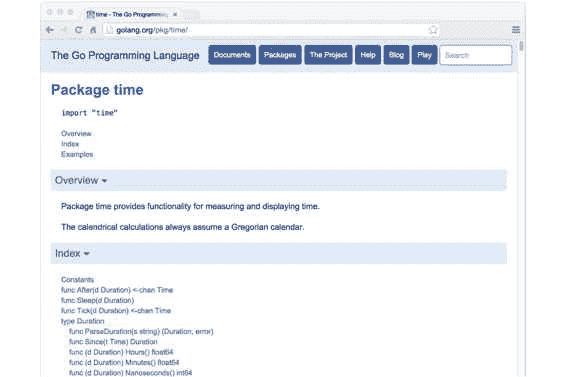

**图 10.1.** `godoc` 中的 `time` 包。

如果你想浏览自己的包，也可以在工作区中运行一个 `godoc` 实例。在运行此命令时，在浏览器中访问 `http://localhost:8000/pkg`：

```
$ godoc -http :8000
```

其 `-analysis=type` 和 `-analysis=pointer` 标志利用高级静态分析的结果增强文档和源代码。

### 10.7.5 内部包

包是 Go 程序中封装的最重要机制。未导出的标识符仅在同一个包内可见，而导出的标识符对全世界可见。

不过，有时中间地带会很有帮助，即一种定义标识符的方式，使其仅对一小组受信任的包可见，而不对所有人可见。例如，当我们将一个大包拆分为更易管理的部分时，可能不想向其他包暴露这些部分之间的接口。或者我们可能想在项目的几个包之间共享工具函数，而不想更广泛地暴露它们。又或者我们只是想通过将一个新包“试用”给有限的客户端集合，来在过早承诺其 API 之前进行试验。

为了满足这些需求，如果包的导入路径包含名为 `internal` 的路径段，`go build` 工具会对该包进行特殊处理。此类包称为*内部包*。内部包只能被位于 `internal` 目录父目录为根的树内的另一个包导入。例如，给定下面的包，`net/http/internal/chunked` 可以从 `net/http/httputil` 或 `net/http` 导入，但不能从 `net/url` 导入。然而，`net/url` 可以导入 `net/http/httputil`。

```
net/http
net/http/internal/chunked
net/http/httputil
net/url
```

### 10.7.6 查询包

`go list` 工具报告可用包的信息。在最简单的形式下，`go list` 测试包是否存在于工作区中，如果存在则打印其导入路径：

```
$ go list github.com/go-sql-driver/mysql
github.com/go-sql-driver/mysql
```

`go list` 的参数可以包含“`...`”通配符，它匹配包导入路径的任意子串。我们可以用它来枚举 Go 工作区内的所有包：

```
$ go list ...
archive/tar
archive/zip
bufio
bytes
cmd/addr2line
cmd/api
...many more...
```

或特定子树内的包：

```
$ go list gopl.io/ch3/...
gopl.io/ch3/basename1
gopl.io/ch3/basename2
gopl.io/ch3/comma
gopl.io/ch3/mandelbrot
gopl.io/ch3/netflag
gopl.io/ch3/printints
gopl.io/ch3/surface
```

或与特定主题相关的包：

```
$ go list ...xml...
encoding/xml
gopl.io/ch7/xmlselect
```

`go list` 命令获取每个包的完整元数据，而不仅仅是导入路径，并以多种格式将此信息提供给用户或其他工具。`-json` 标志使 `go list` 以 JSON 格式打印每个包的完整记录：


```
$ go list -json hash
{
    "Dir": "/home/gopher/go/src/hash",
    "ImportPath": "hash",
    "Name": "hash",
    "Doc": "Package hash provides interfaces for hash functions.",
    "Target": "/home/gopher/go/pkg/darwin_amd64/hash.a",
    "Goroot": true,
    "Standard": true,
    "Root": "/home/gopher/go",
    "GoFiles": [
           "hash.go"
    ],
    "Imports": [
        "io"
    ],
    "Deps": [
        "errors",
        "io",
        "runtime",
        "sync",
        "sync/atomic",
        "unsafe"
    ]
}
```

`-f` 标志允许用户使用 `text/template` 包的模板语言（§4.6）自定义输出格式。以下命令打印 `strconv` 包的传递依赖，以空格分隔：

点击此处查看代码图像

```
$ go list -f '{{join .Deps " "}}' strconv
errors math runtime unicode/utf8 unsafe
```

以下命令打印标准库 `compress` 子树中每个包的直接导入：

点击此处查看代码图像

```
$ go list -f '{{.ImportPath}} -> {{join .Imports " "}}' compress/...
compress/bzip2 -> bufio io sort
compress/flate -> bufio fmt io math sort strconv
compress/gzip -> bufio compress/flate errors fmt hash hash/crc32 io time
compress/lzw -> bufio errors fmt io
compress/zlib -> bufio compress/flate errors fmt hash hash/adler32 io
```

`go list` 命令既适用于一次性交互式查询，也适用于构建和测试自动化脚本。我们将在 11.2.4 节 再次使用它。更多信息（包括可用字段集及其含义），请参阅 `go help list` 的输出。

在本章中，我们解释了 `go` 工具的所有重要子命令——除了一个。下一章我们将看到如何使用 `go test` 命令测试 Go 程序。

### 练习 10.4

构建一个工具，报告工作区中所有传递依赖于参数指定包的包的集合。提示：你需要运行两次 `go list`，第一次针对初始包，第二次针对所有包。你可能想使用 `encoding/json` 包（§4.5）解析其 JSON 输出。

# 11. 测试

EDSAC（第一台存储程序计算机）的开发者 Maurice Wilkes 于 1949 年在实验室楼梯上有了一个惊人的感悟。在《计算机先驱回忆录》中，他回忆道：“我充分意识到，我余下的大部分人生将花在寻找自己程序中的错误上。”自那以后，每一位存储程序计算机的程序员都能对 Wilkes 产生共鸣，尽管或许会对他在软件构建困难方面的天真感到一丝哑然。

当然，如今的程序比 Wilkes 时代大得多、复杂得多，人们投入了大量精力开发技术来管理这种复杂性。有两种技术因其有效性而脱颖而出。第一种是部署前对程序进行常规同行评审。第二种是本章的主题：测试。

测试（我们隐含指*自动化*测试）是编写小程序检查被测代码（即*生产*代码）在特定输入下是否表现符合预期的实践，这些输入通常是精心挑选以覆盖特定功能，或随机生成以确保广泛覆盖。

软件测试领域庞大。测试任务占据所有程序员部分时间，也占据部分程序员全部时间。测试文献包括数千本印刷书籍和数百万字的博客文章。在每种主流编程语言中，都有数十个用于测试构建的软件包，有些包含大量理论，该领域似乎吸引了不少拥有邪教般追随者的先知。这几乎足以让程序员相信，要编写有效测试，必须掌握一套全新的技能。

相比之下，Go 的测试方法显得相当**低技术含量**。它依赖一个命令 `go test`，以及一套 `go test` 可运行的测试函数编写约定。这种相对轻量的机制对纯测试有效，并自然扩展到基准测试和用于文档的系统化示例。

实际上，编写测试代码与编写原程序本身差别不大。我们编写专注于任务一部分的短函数。我们必须小心边界条件，思考数据结构，推导合适输入下计算应产生的结果。但这与编写普通 Go 代码是同一过程；无需新符号、约定和工具。

## 11.1 `go test` 工具

`go test` 子命令是针对按特定约定组织的 Go 包的测试驱动器。在包目录中，文件名以 `_test.go` 结尾的文件通常不属于 `go build` 构建的包，但属于 `go test` 构建的包。

在 `*_test.go` 文件中，三种函数受到特殊对待：测试、基准测试和示例。*测试函数*以 `Test` 开头，用于验证程序逻辑的正确行为；`go test` 调用测试函数并报告结果，即 `PASS` 或 `FAIL`。*基准测试函数*以 `Benchmark` 开头，用于衡量某操作的性能；`go test` 报告该操作的平均执行时间。*示例函数*以 `Example` 开头，提供机器可检查的文档。我们将在 11.2 节 详细介绍测试，11.4 节 介绍基准测试，11.6 节 介绍示例。

`go test` 工具扫描 `*_test.go` 文件中的这些特殊函数，生成一个临时 `main` 包以适当方式调用它们，构建并运行，报告结果，然后清理。

## 11.2 `Test` 函数

每个测试文件必须导入 `testing` 包。测试函数签名如下：

```
func TestName(t *testing.T) {
    // ...
}
```

测试函数名必须以 `Test` 开头；可选的后缀 `Name` 必须以大写字母开头：

点击此处查看代码图像

```
func TestSin(t *testing.T) { /* ... */ }
func TestCos(t *testing.T) { /* ... */ }
func TestLog(t *testing.T) { /* ... */ }
```

参数 `t` 提供报告测试失败和记录额外信息的方法。让我们定义一个示例包 `gopl.io/ch11/word1`，包含单个函数 `IsPalindrome`，用于判断字符串正读反读是否相同。（若字符串是回文，此实现会测试每个字节两次；稍后我们会改进。）

点击此处查看代码图像

gopl.io/ch11/word1

```
// Package word provides utilities for word games.
package word

// IsPalindrome reports whether s reads the same forward and backward.
// (Our first attempt.)
func IsPalindrome(s string) bool {
    for i := range s {
        if s[i] != s[len(s)-1-i] {
            return false
        }
    }
    return true
}
```

在同一目录下，文件 `word_test.go` 包含两个测试函数 `TestPalindrome` 和 `TestNonPalindrome`。每个函数检查 `IsPalindrome` 对单个输入是否给出正确答案，并使用 `t.Error` 报告失败：

点击此处查看代码图像


### Go 语言测试示例：回文检测

### 初始测试代码

```go
package word

import "testing"

func TestPalindrome(t *testing.T) {
    if !IsPalindrome("detartrated") {
        t.Error(`IsPalindrome("detartrated") = false`)
    }
    if !IsPalindrome("kayak") {
        t.Error(`IsPalindrome("kayak") = false`)
    }
}

func TestNonPalindrome(t *testing.T) {
    if IsPalindrome("palindrome") {
        t.Error(`IsPalindrome("palindrome") = true`)
    }
}
```

不带包参数的 `go test`（或 `go build`）命令作用于当前目录下的包。我们可以使用以下命令构建并运行测试。

```bash
$ cd $GOPATH/src/gopl.io/ch11/word1
$ go test
ok   gopl.io/ch11/word1  0.008s
```

### Bug 报告与新增测试

测试通过后我们发布了程序，但发布会的客人刚离开，Bug 报告就来了。一位名为 Noelle Eve Elleon 的法国用户抱怨 `IsPalindrome` 无法识别“été”。另一位来自中美洲的用户失望地发现它拒绝了“A man, a plan, a canal: Panama”。这些具体且微小的 Bug 报告自然适合转化为新的测试用例。

```go
func TestFrenchPalindrome(t *testing.T) {
    if !IsPalindrome("été") {
        t.Error(`IsPalindrome("été") = false`)
    }
}

func TestCanalPalindrome(t *testing.T) {
    input := "A man, a plan, a canal: Panama"
    if !IsPalindrome(input) {
        t.Errorf(`IsPalindrome(%q) = false`, input)
    }
}
```

为了避免两次书写冗长的 `input` 字符串，我们使用了 `Errorf`，它提供类似 `Printf` 的格式化功能。

添加这两个新测试后，`go test` 命令失败并给出了信息丰富的错误消息。

```bash
$ go test
--- FAIL: TestFrenchPalindrome (0.00s)
    word_test.go:28: IsPalindrome("été") = false
--- FAIL: TestCanalPalindrome (0.00s)
    word_test.go:35: IsPalindrome("A man, a plan, a canal: Panama") = false
FAIL
FAIL    gopl.io/ch11/word1  0.014s
```

先编写测试并观察其触发与用户 Bug 报告相同的失败，这是良好的实践。只有那时我们才能确信修复方案解决了正确的问题。

作为额外收获，运行 `go test` 通常比手动执行 Bug 报告中的步骤更快，使我们能更快地迭代。如果测试套件包含许多慢速测试，我们可以通过有选择地运行测试来取得更快的进展。

### 测试标志

`-v` 标志会打印包中每个测试的名称和执行时间：

```bash
$ go test -v
=== RUN TestPalindrome
--- PASS: TestPalindrome (0.00s)
=== RUN TestNonPalindrome
--- PASS: TestNonPalindrome (0.00s)
=== RUN TestFrenchPalindrome
--- FAIL: TestFrenchPalindrome (0.00s)
    word_test.go:28: IsPalindrome("été") = false
=== RUN TestCanalPalindrome
--- FAIL: TestCanalPalindrome (0.00s)
    word_test.go:35: IsPalindrome("A man, a plan, a canal: Panama") = false
FAIL
exit status 1
FAIL    gopl.io/ch11/word1  0.017s
```

`-run` 标志的参数是一个正则表达式，它使 `go test` 仅运行函数名匹配该模式的测试：

```bash
$ go test -v -run="French|Canal"
=== RUN TestFrenchPalindrome
--- FAIL: TestFrenchPalindrome (0.00s)
    word_test.go:28: IsPalindrome("été") = false
=== RUN TestCanalPalindrome
--- FAIL: TestCanalPalindrome (0.00s)
    word_test.go:35: IsPalindrome("A man, a plan, a canal: Panama") = false
FAIL
exit status 1
FAIL    gopl.io/ch11/word1  0.014s
```

当然，一旦让选定的测试通过，我们应该在提交更改前最后一次不带标志地调用 `go test` 以运行整个测试套件。

### 修复 Bug

快速调查揭示了第一个 Bug 的原因：`IsPalindrome` 使用字节序列而非 `rune` 序列，因此像 `"été"` 中的 `é` 这样的非 ASCII 字符会使其困惑。第二个 Bug 源于未忽略空格、标点和字母大小写。

我们更仔细地重写了该函数：

```go
// Package word provides utilities for word games.
package word

import "unicode"

// IsPalindrome reports whether s reads the same forward and backward.
// Letter case is ignored, as are non-letters.
func IsPalindrome(s string) bool {
    var letters []rune
    for _, r := range s {
        if unicode.IsLetter(r) {
            letters = append(letters, unicode.ToLower(r))
        }
    }
    for i := range letters {
        if letters[i] != letters[len(letters)-1-i] {
            return false
        }
    }
    return true
}
```

### 表驱动测试

我们还编写了一组更全面的测试用例，将所有之前的用例和许多新用例合并到一个表中。

```go
func TestIsPalindrome(t *testing.T) {
    var tests = []struct {
        input string
        want  bool
    }{
        {"", true},
        {"a", true},
        {"aa", true},
        {"ab", false},
        {"kayak", true},
        {"detartrated", true},
        {"A man, a plan, a canal: Panama", true},
        {"Evil I did dwell; lewd did I live.", true},
        {"Able was I ere I saw Elba", true},
        {"été", true},
        {"Et se resservir, ivresse reste.", true},
        {"palindrome", false}, // non-palindrome
        {"desserts", false},   // semi-palindrome
    }
    for _, test := range tests {
        if got := IsPalindrome(test.input); got != test.want {
            t.Errorf("IsPalindrome(%q) = %v", test.input, got)
        }
    }
}
```

新测试通过了：

```bash
$ go test gopl.io/ch11/word2
ok      gopl.io/ch11/word2       0.015s
```

这种*表驱动测试*风格在 Go 中非常常见。按需添加新的表条目非常简单，且由于断言逻辑不重复，我们可以投入更多精力生成良好的错误消息。

失败测试的输出在调用 `t.Errorf` 的那一刻**不**包含完整的堆栈跟踪。`t.Errorf` 也不会导致 panic 或停止测试执行，这与许多其他语言测试框架中的断言失败不同。测试之间相互独立。如果表中较早的条目导致测试失败，后面的条目仍会被检查，因此我们可能在一次运行中了解到多个失败。

当我们真必须停止测试函数时（例如初始化代码失败，或防止已报告的失败引发令人困惑的级联失败），我们使用 `t.Fatal` 或 `t.Fatalf`。这些必须从与 `Test` 函数相同的 goroutine 中调用，而不能从测试期间创建的另一个 goroutine 中调用。

### 测试失败消息最佳实践

测试失败消息通常采用 `"f(x) = y, want z"` 形式，其中 `f(x)` 解释尝试的操作及其输入，`y` 是实际结果，`z` 是预期结果。在方便时（如我们的回文示例），`f(x)` 部分使用实际的 Go 语法。显示 `x` 在表驱动测试中尤为重要，因为给定的断言会用不同的值执行多次。避免样板代码和冗余信息。测试布尔函数（如 `IsPalindrome`）时，省略 `want z` 部分，因为它不增加信息。如果 `x`、`y` 或 `z` 很长，打印相关部分的简明摘要。测试作者应致力于帮助必须诊断测试失败的程序员。

### 练习

**练习 11.1：** 为 第 4.3 节 中的 `charcount` 程序编写测试。


### 练习 11.2

为 `IntSet` 编写一组测试（§6.5），检查其每次操作后的行为是否等同于基于内置 map 的集合。将你的实现保存下来，以便在练习 11.7 中进行基准测试。

### 11.2.1 随机化测试

表驱动测试便于检查函数是否能在精心挑选的、能覆盖逻辑中有趣情况的输入上正常工作。另一种方法是*随机化测试*，它通过随机构造输入来探索更广泛的输入范围。

给定随机输入，我们如何知道函数的预期输出是什么？有两种策略。第一种是编写该函数的另一种实现，该实现使用效率较低但更简单、更清晰的算法，然后检查两种实现是否给出相同的结果。第二种是按照某种模式创建输入值，以便我们知道预期的输出是什么。

下面的示例使用第二种方法：`randomPalindrome` 函数根据其构造方式生成已知为回文的单词。

点击此处查看代码图像

```go
import "math/rand"

// randomPalindrome returns a palindrome whose length and contents
// are derived from the pseudo-random number generator rng.
func randomPalindrome(rng *rand.Rand) string {
    n := rng.Intn(25) // random length up to 24
    runes := make([]rune, n)
    for i := 0; i < (n+1)/2; i++ {
        r := rune(rng.Intn(0x1000)) // random rune up to '\u0999'
        runes[i] = r
        runes[n-1-i] = r
    }
    return string(runes)
}

func TestRandomPalindromes(t *testing.T) {
    // Initialize a pseudo-random number generator.
    seed := time.Now().UTC().UnixNano()
    t.Logf("Random seed: %d", seed)
    rng := rand.New(rand.NewSource(seed))

    for i := 0; i < 1000; i++ {
        p := randomPalindrome(rng)
        if !IsPalindrome(p) {
            t.Errorf("IsPalindrome(%q) = false", p)
        }
    }
}
```

由于随机化测试是非确定性的，失败测试的日志必须记录足够的信息以复现失败至关重要。在我们的例子中，传给 `IsPalindrome` 的输入 `p` 就告诉了我们所有需要知道的信息，但对于接受更复杂输入的函数，记录伪随机数生成器的种子（如我们上面所做）可能比转储整个输入数据结构更简单。有了该种子值，我们可以轻松修改测试以确定性地重放失败。

通过使用当前时间作为随机性来源，测试在其整个生命周期内每次运行时都会探索新的输入。如果你的项目使用自动化系统定期运行所有测试，这尤其有价值。

**练习 11.3：** `TestRandomPalindromes` 只测试回文。编写一个随机化测试来生成并验证*非*回文。

**练习 11.4：** 修改 `randomPalindrome` 以测试 `IsPalindrome` 对标点和空格的处理。

### 11.2.2 测试命令

`go test` 工具适用于测试库包，但稍加努力也可用它来测试命令。名为 `main` 的包通常会生成可执行程序，但它也可以作为库被导入。

让我们为第 2.3.2 节中的 `echo` 程序编写测试。我们将程序拆分为两个函数：`echo` 完成实际工作，而 `main` 解析并读取标志值，并报告 `echo` 返回的任何错误。

点击此处查看代码图像

`gopl.io/ch11/echo`

```go
// Echo prints its command-line arguments.
package main

import (
    "flag"
    "fmt"
    "io"
    "os"
    "strings"
)

var (
    n = flag.Bool("n", false, "omit trailing newline")
    s = flag.String("s", " ", "separator")
)

var out io.Writer = os.Stdout // modified during testing

func main() {
    flag.Parse()
    if err := echo(!*n, *s, flag.Args()); err != nil {
        fmt.Fprintf(os.Stderr, "echo: %v\n", err)
        os.Exit(1)
    }
}

func echo(newline bool, sep string, args []string) error {
    fmt.Fprint(out, strings.Join(args, sep))
    if newline {
        fmt.Fprintln(out)
    }
    return nil
}
```

在测试中，我们将使用各种参数和标志设置来调用 `echo`，并检查它在每种情况下是否打印正确的输出，因此我们给 `echo` 添加了参数以减少其对全局变量的依赖。虽说如此，我们也引入了另一个全局变量 `out`，即将结果写入的 `io.Writer`。通过让 `echo` 通过该变量写入，而不是直接写入 `os.Stdout`，测试可以替换一个不同的 `Writer` 实现，记录写入的内容以供后续检查。这是文件 `echo_test.go` 中的测试：

点击此处查看代码图像

```go
package main

import (
    "bytes"
    "fmt"
    "testing"
)

func TestEcho(t *testing.T) {
    var tests = []struct {
        newline bool
        sep     string
        args    []string
        want    string
    }{
        {true, "", []string{}, "\n"},
        {false, "", []string{}, ""},
        {true, "\t", []string{"one", "two", "three"}, "one\ttwo\tthree\n"},
        {true, ",", []string{"a", "b", "c"}, "a,b,c\n"},
        {false, ":", []string{"1", "2", "3"}, "1:2:3"},
    }

    for _, test := range tests {
        descr := fmt.Sprintf("echo(%v, %q, %q)",
            test.newline, test.sep, test.args)

        out = new(bytes.Buffer) // captured output
        if err := echo(test.newline, test.sep, test.args); err != nil {
            t.Errorf("%s failed: %v", descr, err)
            continue
        }
        got := out.(*bytes.Buffer).String()
        if got != test.want {
            t.Errorf("%s = %q, want %q", descr, got, test.want)
        }
    }
}
```

注意测试代码与生产代码在同一个包中。虽然包名是 `main` 且定义了 `main` 函数，但在测试期间，该包作为一个库，向测试驱动程序暴露 `TestEcho` 函数；其 `main` 函数会被忽略。

通过将测试组织为表格，我们可以轻松添加新的测试用例。让我们向表中添加此行，看看测试失败时会发生什么：

点击此处查看代码图像

```go
{true, ",", []string{"a", "b", "c"}, "a b c\n"}, // NOTE: wrong expectation!
```

`go test` 打印

点击此处查看代码图像

```
$ go test gopl.io/ch11/echo
--- FAIL: TestEcho (0.00s)
    echo_test.go:31: echo(true, ",", ["a" "b" "c"]) = "a,b,c", want "a b c\n"
FAIL
FAIL    gopl.io/ch11/echo   0.006s
```

错误消息按顺序描述了尝试的操作（使用类 Go 语法）、实际行为和预期行为。有了这样信息丰富的错误消息，在你甚至还没定位到测试源代码之前，可能就已经对根本原因有了相当好的了解。

被测试的代码不应调用 `log.Fatal` 或 `os.Exit`，这一点很重要，因为这些会立即停止进程；调用这些函数应被视为 `main` 的专有权利。如果发生完全意外的情况导致函数 panic，测试驱动程序会恢复，尽管测试当然会被视为失败。预期的错误（如由错误的用户输入、缺失文件或不当配置引起的错误）应通过返回非 nil 的 `error` 值来报告。幸运的是（作为演示却很不幸），我们的 `echo` 示例太简单了，以至于永远不会返回非 nil 的错误。

### 11.2.3 白盒测试


### 测试分类：黑盒测试与白盒测试

### 黑盒测试和白盒测试

对测试进行分类的一种方式是根据它们对被测包内部工作原理所需了解的程度。`黑盒`测试对包一无所知，只知道其 `API` 暴露的内容及其文档中规定的内容；包的内部是不透明的。相反，`白盒`测试拥有对包内部函数和数据结构的特权访问，可以进行普通客户端无法进行的观察和更改。例如，白盒测试可以检查包的数据类型的不变量在每次操作后是否得以保持。（`white box` 这个名称是传统叫法，但 `clear box` 会更准确。）

### 互补的方法

这两种方法是互补的。黑盒测试通常更健壮，随着软件演进需要的更新较少。它们还能帮助测试作者站在包客户的角度思考，并能揭示 `API` 设计中的缺陷。相比之下，白盒测试可以对实现中较棘手的部分提供更详细的覆盖。

### 示例

我们已经看过这两种测试的示例。`TestIsPalindrome` 仅调用导出函数 `IsPalindrome`，因此它是一个黑盒测试。`TestEcho` 调用 `echo` 函数并更新全局变量 `out`，两者均未导出，这使其成为一个白盒测试。

### 伪实现

在开发 `TestEcho` 时，我们修改了 `echo` 函数，使其在写入输出时使用包级变量 `out`，以便测试能用一个记录数据以供后续检查的替代实现来替换标准输出。使用相同的技术，我们可以将生产代码的其他部分替换为易于测试的 `fake`（伪）实现。伪实现的优势在于它们配置更简单、行为更可预测、更可靠且更易于观察。它们还能避免不良副作用，例如更新生产数据库或扣款信用卡。

### 存储示例

下面的代码展示了一个为用户提供网络存储的 Web 服务中的配额检查逻辑。当用户超过其配额的 90% 时，系统会向他们发送警告邮件。

点击此处查看代码图像

`gopl.io/ch11/storage1`

```go
package storage

import (
    "fmt"
    "log"
    "net/smtp"
)

var usage = make(map[string]int64)
func bytesInUse(username string) int64 { return usage[username] } 

// Email sender configuration.
// NOTE: never put passwords in source code!
const sender = "notifications@example.com"
const password = "correcthorsebatterystaple"
const hostname = "smtp.example.com"

const template = `Warning: you are using %d bytes of storage,
%d%% of your quota.`

func CheckQuota(username string) {
    used := bytesInUse(username)
    const quota = 1000000000 // 1GB
    percent := 100 * used / quota
    if percent < 90 {
        return // OK
    }
    msg := fmt.Sprintf(template, used, percent)
    auth := smtp.PlainAuth("", sender, password, hostname)
    err := smtp.SendMail(hostname+":587", auth, sender,
        []string{username}, []byte(msg))
    if err != nil {
        log.Printf("smtp.SendMail(%s) failed: %s", username, err)
    }
}
```

### 为可测试性重构

我们想测试它，但不希望测试发送真实的邮件。因此我们将邮件逻辑移入一个独立函数，并将该函数存储在一个未导出的包级变量 `notifyUser` 中。

点击此处查看代码图像

`gopl.io/ch11/storage2`

```go
var notifyUser = func(username, msg string) {
    auth := smtp.PlainAuth("", sender, password, hostname)
    err := smtp.SendMail(hostname+":587", auth, sender,
        []string{username}, []byte(msg))
    if err != nil {
        log.Printf("smtp.SendEmail(%s) failed: %s", username, err)
    }
}

func CheckQuota(username string) {
    used := bytesInUse(username)
    const quota = 1000000000 // 1GB
    percent := 100 * used / quota
    if percent < 90 {
        return // OK
    }
    msg := fmt.Sprintf(template, used, percent)
    notifyUser(username, msg)
}
```

### 使用伪通知进行测试

现在我们可以编写一个测试，用一个简单的伪通知机制替代发送真实邮件。这个测试会记录被通知的用户和消息内容。

点击此处查看代码图像

```go
package storage

import (
    "strings"
    "testing"
)

func TestCheckQuotaNotifiesUser(t *testing.T) {
    var notifiedUser, notifiedMsg string
    notifyUser = func(user, msg string) {
        notifiedUser, notifiedMsg = user, msg
    }

    const user = "joe@example.org"
    usage[user]=  980000000 // simulate a 980MB-used condition

    CheckQuota(user)
    if notifiedUser == "" && notifiedMsg == "" {
        t.Fatalf("notifyUser not called")
    }
    if notifiedUser != user {
        t.Errorf("wrong user (%s) notified, want %s",
            notifiedUser, user)
    }
    const wantSubstring = "98% of your quota"
    if !strings.Contains(notifiedMsg, wantSubstring) {
        t.Errorf("unexpected notification message <<%s>>, "+
            "want substring %q", notifiedMsg, wantSubstring)
    }
}
```

### 使用 defer 恢复全局状态

还有一个问题：测试函数返回后，`CheckQuota` 不再按预期工作，因为它仍在使用测试的 `notifyUsers` 伪实现。（更新全局变量时总存在这种风险。）我们必须修改测试以恢复之前的值，以便后续测试不受影响，并且必须在所有执行路径上都这样做，包括测试失败和 panic 的情况。这自然提示使用 `defer`。

点击此处查看代码图像

```go
func TestCheckQuotaNotifiesUser(t *testing.T) {
    // Save and restore original notifyUser.
    saved := notifyUser
    defer func() { notifyUser = saved }()

    // Install the test's fake notifyUser.
    var notifiedUser, notifiedMsg string
    notifyUser = func(user, msg string) {
        notifiedUser, notifiedMsg = user, msg
    }
    // ...rest of test...
}
```

这种模式可用于临时保存和恢复各种全局变量，包括命令行标志、调试选项和性能参数；安装和移除钩子，使生产代码在发生有趣的事情时调用某些测试代码；以及诱导生产代码进入罕见但重要的状态，例如超时、错误，甚至特定的并发活动交织。以这种方式使用全局变量之所以安全，仅仅是因为 `go test` 通常不并发运行多个测试。

### 外部测试包

考虑包 `net/url`（提供 URL 解析器）和 `net/http`（提供 Web 服务器和 HTTP 客户端库）。正如预期的那样，高层的 `net/http` 依赖于低层的 `net/url`。然而，`net/url` 中的一个测试是一个演示 URL 与 HTTP 客户端库交互的示例。换句话说，低层包的测试导入了高层包。


**图 11.1.** `net/url` 的测试依赖于 `net/http`。

在 `net/url` 包中声明此测试函数会在包导入图中形成一个循环，如 图 11.1 中的向上箭头所示，但正如我们在 第 10.1 节 中所解释的，Go 规范禁止导入循环。

我们通过在 `external test package`（外部测试包）中声明测试函数来解决这个问题，即在 `net/url` 目录下的一个文件中，其包声明为 `package url_test`。额外的后缀 `_test` 向 `go test` 发出信号，指示它构建一个仅包含这些文件的额外包并运行其测试。将这个外部测试包视为具有导入路径 `net/url_test` 可能会有帮助，但它不能用这个或任何其他名称导入。


因为外部测试位于一个单独的包中，它们可以导入同样依赖被测试包的辅助包；包内测试无法做到这一点。从设计层级的角度来看，外部测试包在逻辑上比它所依赖的两个包都要高，如图 11.2 所示。


**图 11.2.** 外部测试包打破依赖循环。

通过避免导入循环，外部测试包允许测试（尤其是测试多个组件交互的集成测试）自由导入其他包，就像应用程序所做的那样。

我们可以使用 `go list` 工具来汇总包目录中哪些 Go 源文件是生产代码、包内测试和外部测试。我们将以 `fmt` 包为例。`GoFiles` 是包含生产代码的文件列表；这些是 `go build` 会包含在应用程序中的文件：

点击此处查看代码图像

```
$ go list -f={{.GoFiles}} fmt
[doc.go format.go print.go scan.go]
```

`TestGoFiles` 是同样属于 `fmt` 包的文件列表，但这些文件（其名称都以 `_test.go` 结尾）仅在构建测试时才会被包含：

点击此处查看代码图像

```
$ go list -f={{.TestGoFiles}} fmt
[export_test.go]
```

该包的测试通常位于这些文件中，但 `fmt` 包异常地没有测试文件；我们稍后会解释 `export_test.go` 的用途。

`XTestGoFiles` 是构成外部测试包 `fmt_test` 的文件列表，因此这些文件必须导入 `fmt` 包才能使用它。同样，它们仅在测试期间被包含：

点击此处查看代码图像

```
$ go list -f={{.XTestGoFiles}} fmt
[fmt_test.go scan_test.go stringer_test.go]
```

有时外部测试包可能需要访问被测试包内部的特权，例如白盒测试必须位于单独的包中以避免导入循环。在这种情况下，我们会使用一个技巧：在一个包内的 `_test.go` 文件中添加声明，以向外部测试暴露必要的内部细节。因此，该文件为测试提供了通往该包的“后门”。如果该源文件仅为此目的而存在且本身不包含测试，它通常被称为 `export_test.go`。

例如，`fmt` 包的实现需要 `unicode.IsSpace` 的功能作为 `fmt.Scanf` 的一部分。为了避免产生不必要的依赖，`fmt` 不导入 `unicode` 包及其庞大的数据表；相反，它包含一个更简单的实现，称为 `isSpace`。

为了确保 `fmt.isSpace` 和 `unicode.IsSpace` 的行为不发生偏离，`fmt` 明智地包含了一个测试。这是一个外部测试，因此它无法直接访问 `isSpace`，所以 `fmt` 通过声明一个持有内部 `isSpace` 函数的导出变量，为它打开了一个后门。这就是 `fmt` 包的 `export_test.go` 文件的全部内容。

```
package fmt

var IsSpace = isSpace
```

此测试文件不定义任何测试；它只是为外部测试声明导出符号 `fmt.IsSpace`。每当外部测试需要使用某些白盒测试技术时，也可以使用此技巧。

### 11.2.5 编写有效的测试

许多 Go 语言的新手都会对 Go 测试框架的极简主义感到惊讶。其他语言的框架提供了识别测试函数的机制（通常使用反射或元数据），用于在测试运行前后执行“设置”和“拆卸”操作的钩子，以及用于断言常见谓词、比较值、格式化错误消息和中止失败测试（通常使用异常）的实用函数库。虽然这些机制可以使测试非常简洁，但生成的测试往往看起来像是用外语编写的。此外，尽管它们可能正确地报告 `PASS` 或 `FAIL`，但它们的表现方式可能对倒霉的维护者不友好，会出现晦涩的失败消息，如 `"assert: 0 == 1"`，或大量的堆栈跟踪。

Go 对待测试的态度形成了鲜明对比。它期望测试作者自己完成大部分工作，定义函数以避免重复，就像编写普通程序一样。测试过程不是机械填表；测试也有用户界面，尽管其唯一的用户同时也是维护者。好的测试不会在失败时崩溃，而是打印出清晰简洁的问题症状描述，以及可能与上下文相关的其他事实。理想情况下，维护者不需要阅读源代码就能弄清测试失败的原因。好的测试不应在一次失败后就放弃，而应尝试在一次运行中报告多个错误，因为失败的模式本身可能揭示问题所在。

下面的断言函数比较两个值，构造一个通用的错误消息，并停止程序。它易于使用且正确，但当它失败时，错误消息几乎毫无用处。它没有解决提供良好用户界面这一难题。

点击此处查看代码图像

```
import (
    "fmt"
    "strings"
    "testing"
)

// 一个糟糕的断言函数。
func assertEqual(x, y int) {
    if x != y {
        panic(fmt.Sprintf("%d != %d", x, y))
    }
}

func TestSplit(t *testing.T) {
    words := strings.Split("a:b:c", ":")
    assertEqual(len(words), 3)
    // ...
}
```

从这个意义上说，断言函数遭受了过早抽象之苦：通过将这个特定测试的失败视为两个整数的简单差异，我们放弃了提供有意义上下文的机会。我们可以从具体细节入手，像下面的例子那样提供更好的消息。只有当给定测试套件中出现重复模式时，才是引入抽象的时候。

点击此处查看代码图像

```
func TestSplit(t *testing.T) {
    s, sep := "a:b:c", ":"
    words := strings.Split(s, sep)
    if got, want := len(words), 3; got != want {
        t.Errorf("Split(%q, %q) returned %d words, want %d",
            s, sep, got, want)
    }
    // ...
}
```

现在测试报告了被调用的函数、其输入以及结果的意义；它明确标识了实际值和期望值；并且即使此断言失败，它也会继续执行。一旦我们编写了这样的测试，自然的下一步通常不是定义一个函数来替换整个 `if` 语句，而是在一个循环中执行测试，其中 `s`、`sep` 和 `want` 会发生变化，就像 `IsPalindrome` 的表驱动测试一样。

前面的示例不需要任何实用函数，但当然这不应阻止我们在函数有助于简化代码时引入它们。（我们将在第 13.3 节中查看这样一个实用函数 `reflect.DeepEqual`。）编写好测试的关键是从实现你想要的具体行为开始，然后才使用函数来简化代码并消除重复。最好的结果很少是从抽象的、通用的测试函数库开始获得的。

#### 练习 11.5

扩展 `TestSplit` 以使用输入和期望输出的表格。

### 11.2.6 避免脆弱的测试


遇到新但有效的输入时经常失败的应用程序被称为 `buggy`；对程序进行合理更改时虚假失败的测试被称为 `brittle`。正如 `buggy` 程序让用户感到沮丧一样，`brittle` 测试让维护者感到恼火。最 `brittle` 的测试几乎会因生产代码的任何更改（无论好坏）而失败，有时被称为 `change detector` 或 `status quo` 测试；处理它们所花费的时间会迅速耗尽它们曾经似乎提供的任何收益。

当被测函数产生复杂输出（如长字符串、精心设计的数据结构或文件）时，很容易想要检查输出是否完全等于编写测试时预期的某个“golden”值。但随着程序的演进，输出的各个部分很可能会发生变化，可能是向好的方向，但终究是变化了。不仅仅是输出；具有复杂输入的函数往往因为测试中使用的输入不再有效而中断。

避免 `brittle` 测试的最简单方法是只检查你关心的属性。优先测试程序更简单、更稳定的接口，而不是其内部函数。在断言时要有选择性。例如，不要检查精确的字符串匹配，而要寻找随着程序演进而保持不变的相关子字符串。编写一个辅助函数将复杂输出提炼到其本质通常是值得的，这样断言才会可靠。尽管这看起来像是大量的前期工作，但它可以通过节省原本用于修复虚假失败测试的时间而迅速收回成本。

## 11.3 覆盖率

从本质上讲，测试永远是不完整的。正如有影响力的计算机科学家 Edsger Dijkstra 所说：“测试显示的是缺陷的存在，而非缺陷的不存在。”任何数量的测试都无法证明一个包没有 bug。充其量，它们增加了我们对包在广泛重要场景下都能良好工作的信心。

测试套件对被测包的执行程度称为测试的 `coverage`。`coverage` 无法直接量化——除了最简单的程序外，所有程序的动态都超出了精确测量的范围——但有一些启发式方法可以帮助我们将测试工作引导到更可能有用的地方。

`Statement coverage` 是这些启发式方法中最简单、最广泛使用的。测试套件的语句覆盖率是在测试期间至少执行一次的源语句所占的比例。在本节中，我们将使用 Go 的 `cover` 工具（集成在 `go test` 中）来测量语句覆盖率，并帮助识别测试中明显的空白。

下面的代码是一个表驱动测试，用于我们在第 7 章构建的表达式求值器：

```go
func TestCoverage(t *testing.T) {
    var tests = []struct {
        input string
        env   Env
        want  string // expected error from Parse/Check or result from Eval
    }{
        {"x % 2", nil, "unexpected '%'"},
        {"!true", nil, "unexpected '!'"},
        {"log(10)", nil, `unknown function "log"`},
        {"sqrt(1, 2)", nil, "call to sqrt has 2 args, want 1"},
        {"sqrt(A / pi)", Env{"A": 87616, "pi": math.Pi}, "167"},
        {"pow(x, 3) + pow(y, 3)", Env{"x": 9, "y": 10}, "1729"},
        {"5 / 9 * (F - 32)", Env{"F": -40}, "-40"},
    }

    for _, test := range tests {
        expr, err := Parse(test.input)
        if err == nil {
            err = expr.Check(map[Var]bool{})
        }
        if err != nil {
            if err.Error() != test.want {
                t.Errorf("%s: got %q, want %q", test.input, err, test.want)
            }
            continue
        }

        got := fmt.Sprintf("%.6g", expr.Eval(test.env))
        if got != test.want {
            t.Errorf("%s: %v => %s, want %s",
                test.input, test.env, got, test.want)
        }
    }
}
```

首先，让我们检查测试是否通过：

```
$ go test -v -run=Coverage gopl.io/ch7/eval
=== RUN TestCoverage
--- PASS: TestCoverage (0.00s)
PASS
ok      gopl.io/ch7/eval    0.011s
```

此命令显示覆盖率工具的使用信息：

```
$ go tool cover
Usage of 'go tool cover':
Given a coverage profile produced by 'go test':
    go test -coverprofile=c.out

Open a web browser displaying annotated source code:
    go tool cover -html=c.out
...
```

`go tool` 命令运行 Go 工具链中的可执行文件之一。这些程序位于 `$GOROOT/pkg/tool/${GOOS}_${GOARCH}` 目录中。得益于 `go build`，我们很少需要直接调用它们。

现在我们使用 `-coverprofile` 标志运行测试：

```
$ go test -run=Coverage -coverprofile=c.out gopl.io/ch7/eval
ok      gopl.io/ch7/eval    0.032s  coverage: 68.5% of statements
```

此标志通过*插桩*生产代码来启用覆盖率数据的收集。也就是说，它修改源代码的副本，以便在执行每个语句块之前设置一个布尔变量，每个块一个变量。在修改后的程序退出前，它将每个变量的值写入指定的日志文件 `c.out`，并打印执行语句所占比例的摘要。（如果只需要摘要，请使用 `go test -cover`。）

如果使用 `-covermode=count` 标志运行 `go test`，每个块的插桩代码会增加一个计数器，而不是设置布尔值。每个块的执行计数日志允许对“更热”块（更频繁执行）和“更冷”块进行定量比较。

收集数据后，我们运行 `cover` 工具，它处理日志，生成 HTML 报告，并在新浏览器窗口中打开它（**图 11.3**）。

```
$ go tool cover -html=c.out
```

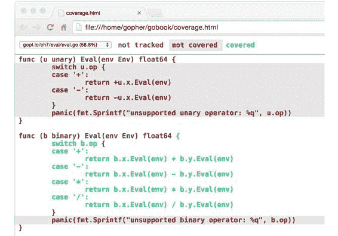

**图 11.3.** 覆盖率报告。

如果语句被覆盖则显示为绿色，未被覆盖则显示为红色。为了清晰起见，我们给红色文本加上了背景阴影。我们可以立即看到，我们的输入没有执行一元运算符的 `Eval` 方法。如果我们将这个新测试用例添加到表中并重新运行前两个命令，一元表达式代码将变为绿色：

```go
{"-x * -x", eval.Env{"x": 2}, "4"}
```

然而，两条 `panic` 语句仍然是红色的。这不足为奇，因为这些语句本应是不可达的。

达到 100% 的语句覆盖率听起来像是一个崇高的目标，但在实践中通常不可行，也不是精力的好用途。仅仅因为一条语句被执行并不意味着它没有 bug；包含复杂表达式的语句必须用不同的输入多次执行才能覆盖有趣的情况。有些语句（如上述的 `panic` 语句）永远无法到达。其他语句（如处理晦涩错误的语句）难以执行，但在实践中很少到达。测试从根本上说是一项务实的工作，是在编写测试的成本和本可通过测试预防的失败成本之间的权衡。覆盖率工具可以帮助识别最薄弱的环节，但设计好的测试用例需要与编程一样严谨的思考。

## 11.4 `Benchmark` 函数


### Go 基准测试

基准测试是指在固定工作负载下衡量程序性能的做法。在 Go 中，基准测试函数看起来像测试函数，但带有 `Benchmark` 前缀和一个 `*testing.B` 参数，该参数提供了与 `*testing.T` 大部分相同的方法，外加一些与性能测量相关的额外方法。它还暴露了一个整数字段 `N`，用于指定被测操作的执行次数。

### 基础基准测试示例

下面是一个针对 `IsPalindrome` 的基准测试，它在循环中调用该函数 `N` 次。

```go
import "testing"

func BenchmarkIsPalindrome(b *testing.B) {
    for i := 0; i < b.N; i++ {
        IsPalindrome("A man, a plan, a canal: Panama")
    }
}
```

### 运行基准测试

我们使用下面的命令运行它。与测试不同，默认情况下不运行任何基准测试。`-bench` 标志的参数选择要运行哪些基准测试。它是一个正则表达式，用于匹配 `Benchmark` 函数的名称，其默认值不匹配任何函数。模式 `.` 会使其匹配 `word` 包中的所有基准测试，但由于只有一个，因此 `-bench=IsPalindrome` 将是等效的。

```bash
$ cd $GOPATH/src/gopl.io/ch11/word2
$ go test -bench=.
PASS
BenchmarkIsPalindrome-8 1000000              1035 ns/op
ok      gopl.io/ch11/word2      2.179s
```

基准测试名称的数字后缀，此处为 `8`，表示 `GOMAXPROCS` 的值，这对于并发基准测试非常重要。

报告告诉我们，在 1,000,000 次运行的平均值下，每次调用 `IsPalindrome` 约耗时 1.035 微秒。由于基准测试运行器最初不知道操作需要多长时间，它会使用较小的 `N` 值进行一些初步测量，然后外推到一个足够大的值，以便进行稳定的计时测量。

之所以由基准测试函数实现循环，而不是由测试驱动程序中的调用代码实现，是为了让基准测试函数有机会在循环外执行任何必要的一次性设置代码，而不将其计入每次迭代的测量时间内。如果这些设置代码仍然干扰结果，`testing.B` 参数提供了停止、恢复和重置计时器的方法，但这些方法很少需要用到。

### 优化示例

现在我们有了基准测试和测试，很容易尝试让程序运行得更快的想法。也许最明显的优化是让 `IsPalindrome` 的第二个循环在中点停止检查，以避免每次比较都做两遍：

```go
n := len(letters)/2
for i := 0; i < n; i++ {
    if letters[i] != letters[len(letters)-1-i] {
        return false
    }
}
return true
```

但正如通常情况那样，显而易见的优化并不总能产生预期的收益。在一次实验中，这仅带来了微乎其微的 4% 改进。

```bash
$ go test -bench=.
PASS
BenchmarkIsPalindrome-8 1000000               992 ns/op
ok      gopl.io/ch11/word2      2.093s
```

另一个想法是为 `letters` 预分配一个足够大的数组，而不是通过连续调用 `append` 来扩展它。像下面这样将 `letters` 声明为合适大小的数组，

```go
letters := make([]rune, 0, len(s))
for _, r := range s {
    if unicode.IsLetter(r) {
        letters = append(letters, unicode.ToLower(r))
    }
}
```

可带来近 35% 的性能提升，且基准测试运行器现在报告的是 2,000,000 次迭代的平均值。

```bash
$ go test -bench=.
PASS
BenchmarkIsPalindrome-8 2000000               697 ns/op
ok      gopl.io/ch11/word2      1.468s
```

正如这个例子所示，最快的程序往往是内存分配最少的那个。`-benchmem` 命令行标志会在报告中包含内存分配统计信息。这里我们对比优化前的分配次数：

```bash
$ go test -bench=. -benchmem
PASS
BenchmarkIsPalindrome    1000000  1026 ns/op   304 B/op  4 allocs/op
```

以及优化后的：

```bash
$ go test -bench=. -benchmem
PASS
BenchmarkIsPalindrome    2000000    807 ns/op  128 B/op  1 allocs/op
```

在单次 `make` 调用中合并分配消除了 75% 的分配次数，并将分配的内存量减半。

### 对比基准测试

此类基准测试告诉我们给定操作所需的绝对时间，但在许多场景下，有趣的性能问题关乎两种不同操作的*相对*耗时。例如，如果一个函数处理 1,000 个元素需要 1ms，那么处理 10,000 个或一百万个需要多久？此类对比揭示了函数运行时间的渐近增长。另一个例子：I/O 缓冲区的最佳大小是多少？针对一系列大小的应用吞吐量基准测试可以帮助我们选择能提供满意性能的最小缓冲区。第三个例子：哪种算法最适合特定任务？在相同输入数据上评估两种不同算法的基准测试通常能显示出每种算法在重要或典型工作负载上的优劣势。

对比基准测试就是普通代码。它们通常采用单个参数化函数的形式，从几个具有不同值的 `Benchmark` 函数中调用，如下所示：

```go
func benchmark(b *testing.B, size int) { /* ... */ }
func Benchmark10(b *testing.B)   { benchmark(b, 10) }
func Benchmark100(b *testing.B)  { benchmark(b, 100) }
func Benchmark1000(b *testing.B) { benchmark(b, 1000) }
```

参数 `size` 指定输入大小，它在基准测试之间变化，但在每个基准测试内部是常量。要抵制使用参数 `b.N` 作为输入大小的诱惑。除非你将其解释为固定大小输入的迭代计数，否则你的基准测试结果将毫无意义。

对比基准测试揭示的模式在程序设计阶段特别有用，但程序投入工作后我们不会丢弃这些基准测试。随着程序的演进、输入的增长，或部署在具有不同特性的新操作系统或处理器上，我们可以重用这些基准测试来重新审视设计决策。

### 练习

**练习 11.6：** 编写基准测试来比较 第 2.6.2 节 中的 `PopCount` 实现与你对 练习 2.4 和 练习 2.5 的解答。基于查找表的方法在何时达到收支平衡？

**练习 11.7：** 使用大量伪随机输入为 `*IntSet` (§6.5) 的 `Add`、`UnionWith` 和其他方法编写基准测试。你能让这些方法运行得多快？字长的选择如何影响性能？`IntSet` 与基于内置 map 类型的集合实现相比速度如何？

## 性能分析

基准测试适用于衡量特定操作的性能，但当我们试图让一个慢程序变快时，往往不知道从何下手。每个程序员都知道 Donald Knuth 关于过早优化的格言，它出现在 1974 年的《Structured Programming with go to Statements》中。尽管这常被误解为性能不重要，但在其原始语境中，我们可以辨别出不同的含义：


### Go 中的性能分析

毫无疑问，对效率的追求会导致滥用。程序员会花费大量时间思考或担心程序中非关键部分的速度，而当考虑到调试和维护时，这些优化尝试实际上会产生强烈的负面影响。我们*应该*在大约 97% 的时间里忘记微小的效率：过早优化是万恶之源。然而我们不应放弃那关键 3% 中的机会。优秀的程序员不会被这种推理哄骗而自满；他会明智地仔细审视关键代码，但*仅在*该代码被识别出来*之后*。对程序哪些部分真正关键做出先入为主的判断往往是错误的，因为使用过测量工具的程序员的普遍经验是：他们的直觉猜测往往会失败。

当我们希望仔细审视程序速度时，识别关键代码的最佳技术是*性能分析*。性能分析是一种基于执行期间对若干 profile *事件*进行采样，然后在后处理步骤中从中推断得出的自动化性能测量方法；由此产生的统计摘要称为 *profile*。

Go 支持多种性能分析，每种关注性能的不同方面，但它们都涉及记录一系列感兴趣的事件序列，每个事件都附带一个堆栈跟踪——即事件发生时刻活动的函数调用堆栈。`go test` 工具内置了对多种性能分析的支持。

### CPU Profile

*CPU profile* 标识执行最耗费 CPU 时间的函数。操作系统每隔几毫秒就会周期性地中断每个 CPU 上当前正在运行的线程，每次中断在恢复正常执行前记录一个 profile 事件。

### Heap Profile

*Heap profile* 标识分配内存最多的语句。分析库对内部内存分配例程的调用进行采样，因此平均每分配 512KB 内存就会记录一个 profile 事件。

### Blocking Profile

*Blocking profile* 标识导致 goroutine 阻塞时间最长的操作，例如系统调用、通道发送和接收、以及获取锁。每当 goroutine 被这些操作之一阻塞时，分析库就会记录一个事件。

为测试代码收集 profile 只需启用以下标志之一即可。但请小心同时使用多个标志：收集一种 profile 的机制可能会扭曲其他 profile 的结果。

```
$ go test -cpuprofile=cpu.out
$ go test -blockprofile=block.out
$ go test -memprofile=mem.out
```

为非测试程序添加性能分析支持也很容易，尽管具体做法因短命命令行工具和长期运行的服务器应用而异。性能分析在长期运行的应用中特别有用，因此 Go 运行时的性能分析功能可通过 `runtime` API 在程序员控制下启用。

收集到 profile 后，我们需要使用 `pprof` 工具进行分析。这是 Go 发行版的标准部分，但因为它不是日常工具，所以通过 `go tool pprof` 间接访问。它有数十种功能和选项，但基本用法只需两个参数：生成 profile 的可执行文件和 profile 日志。

为了使分析高效并节省空间，日志不包含函数名；相反，函数由其地址标识。这意味着 `pprof` 需要可执行文件才能理解日志。虽然 `go test` 通常在测试完成后丢弃测试可执行文件，但启用性能分析时，它会将可执行文件保存为 `foo.test`，其中 `foo` 是被测包的名称。

以下命令展示了如何收集并显示简单的 CPU profile。我们选择了 `net/http` 包中的一个基准测试。通常最好分析那些经过构建能代表你关心的工作负载的特定基准测试。基准测试用例几乎从不具备代表性，这就是为什么我们使用过滤器 `-run=NONE` 禁用它们。

```
$ go test -run=NONE -bench=ClientServerParallelTLS64 \
    -cpuprofile=cpu.log net/http
PASS
BenchmarkClientServerParallelTLS64-8  1000
   3141325 ns/op  143010 B/op  1747 allocs/op
ok      net/http       3.395s

$ go tool pprof -text -nodecount=10 ./http.test cpu.log
2570ms of 3590ms total (71.59%)
Dropped 129 nodes (cum <= 17.95ms)
Showing top 10 nodes out of 166 (cum >= 60ms)
    flat  flat%   sum%     cum   cum%
  1730ms 48.19% 48.19%  1750ms 48.75%  crypto/elliptic.p256ReduceDegree
   230ms  6.41% 54.60%   250ms  6.96%  crypto/elliptic.p256Diff
   120ms  3.34% 57.94%   120ms  3.34%  math/big.addMulVVW
   110ms  3.06% 61.00%   110ms  3.06%  syscall.Syscall
    90ms  2.51% 63.51%  1130ms 31.48%  crypto/elliptic.p256Square
    70ms  1.95% 65.46%   120ms  3.34%  runtime.scanobject
    60ms  1.67% 67.13%   830ms 23.12%  crypto/elliptic.p256Mul
    60ms  1.67% 68.80%   190ms  5.29%  math/big.nat.montgomery
    50ms  1.39% 70.19%    50ms  1.39%  crypto/elliptic.p256ReduceCarry
    50ms  1.39% 71.59%    60ms  1.67%  crypto/elliptic.p256Sum
```

`-text` 标志指定输出格式，这里是一个文本表格，每行一个函数，按“最热”函数——消耗最多 CPU 周期的函数——优先排序。`-nodecount=10` 标志将结果限制为 10 行。对于严重的性能问题，这种文本格式可能足以定位原因。

该 profile 告诉我们，椭圆曲线加密对这个特定 HTTPS 基准测试的性能至关重要。相反，如果 profile 主要由 `runtime` 包中的内存分配函数主导，减少内存消耗可能是值得的优化。

对于更微妙的问题，你可能最好使用 `pprof` 的图形化显示之一。这些需要 GraphViz，可从 `www.graphviz.org` 下载。`-web` 标志随后会渲染程序函数的有向图，并用 CPU profile 数字标注，用颜色指示最热的函数。

我们在这里只是触及了 Go 性能分析工具的皮毛。要了解更多，请阅读 Go 博客上的“Profiling Go Programs”文章。

## 11.6 示例函数

`go test` 特殊对待的第三种函数是示例函数，其名称以 `Example` 开头。它没有参数也没有返回值。这是 `IsPalindrome` 的一个示例函数：

```
func ExampleIsPalindrome() {
    fmt.Println(IsPalindrome("A man, a plan, a canal: Panama"))
    fmt.Println(IsPalindrome("palindrome"))
    // Output:
    // true
    // false
}
```

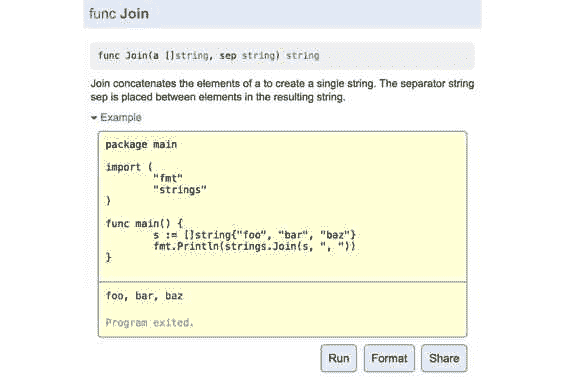

**图 11.4.** `godoc` 中 `strings.Join` 的交互式示例。

示例函数有三个用途。主要用途是文档：一个好的示例比散文描述更能简洁直观地传达库函数的行为，尤其是作为提醒或快速参考时。示例还可以演示属于同一 API 的多个类型和函数之间的交互，而散文文档必须始终附着在某个位置，如类型或函数声明，或整个包。与注释中的示例不同，示例函数是真正的 Go 代码，接受编译时检查，因此不会随着代码演变而过时。


根据 `Example` 函数的后缀，基于 Web 的文档服务器 `godoc` 会将示例函数与它们所演示的函数或包关联起来，因此 `ExampleIsPalindrome` 会显示在 `IsPalindrome` 函数的文档中，而一个仅名为 `Example` 的示例函数则会与整个 `word` 包关联。

第二个用途是示例作为由 `go test` 运行的可执行测试。如果示例函数包含一个像上面那样的最终 `// Output:` 注释，测试驱动程序将执行该函数，并检查其打印到标准输出的内容是否与注释中的文本匹配。

示例的第三个用途是动手实验。`golang.org` 上的 `godoc` 服务器使用 Go Playground，让用户可以在 Web 浏览器中编辑并运行每个示例函数，如图 11.4 所示。这通常是对特定函数或语言特性建立直观认识的最快途径。

本书最后两章探讨 `reflect` 和 `unsafe` 包，极少 Go 程序员会经常用到它们——甚至更少的人*需要*用到它们。如果你还没有编写过任何实质性的 Go 程序，现在是个大显身手的好时机。

# 12. 反射

Go 提供了一种机制，可以在运行时更新变量、检查其值、调用其方法，并应用其表示形式固有的操作，而无需在编译时知道其类型。这种机制称为*反射*。反射还允许我们将类型本身视为一等值。

在本章中，我们将探索 Go 的反射特性，了解它们如何增强语言的表达能力，特别是它们对于两个重要 API 的实现至关重要：`fmt` 提供的字符串格式化，以及 `encoding/json` 和 `encoding/xml` 等包提供的协议编码。反射对于我们在第 4.6 节 中看到的 `text/template` 和 `html/template` 包提供的模板机制也必不可少。然而，反射推理起来很复杂，不适合随意使用，因此尽管这些包是使用反射实现的，但它们自己的 API 并未暴露反射。

## 12.1 为什么需要反射？

有时我们需要编写一个函数，能够统一处理以下类型的值：它们不满足通用接口、没有已知的表示形式，或者在设计该函数时尚不存在——甚至同时满足这三个条件。

一个熟悉的例子是 `fmt.Fprintf` 内部的格式化逻辑，它可以有用地打印任意类型的任意值，甚至包括用户定义的类型。让我们尝试利用已有知识实现一个类似的函数。为简单起见，我们的函数将接受一个参数，并像 `fmt.Sprint` 那样将结果作为字符串返回，所以我们称之为 `Sprint`。

我们从一个类型开关开始，测试参数是否定义了 `String` 方法，如果有则调用它。然后我们添加开关分支，测试值的动态类型是否为各种基本类型——`string`、`int`、`bool` 等——并在每种情况下执行相应的格式化操作。

```
func Sprint(x interface{}) string {
    type stringer interface {
        String() string
    }
    switch x := x.(type) {
    case stringer:
        return x.String()
    case string:
        return x
    case int:
        return strconv.Itoa(x)
    // ...针对 int16、uint32 等类似的分支...
    case bool:
        if x {
            return "true"
        }
        return "false"
    default:
        // array, chan, func, map, pointer, slice, struct
        return "???"
    }
}
```

但我们如何处理其他类型，如 `[]float64`、`map[string][]string` 等？我们可以添加更多分支，但这类类型的数量是无限的。那命名类型呢，比如 `url.Values`？即使类型开关有其底层类型 `map[string][]string` 的分支，它也不会匹配 `url.Values`，因为这两个类型不相同，而且类型开关无法为每个像 `url.Values` 这样的类型包含一个分支，因为那将要求这个库依赖于它的客户端。

如果没有一种方法来检查未知类型值的表示形式，我们很快就会陷入困境。我们需要的是反射。

## 12.2 `reflect.Type` 和 `reflect.Value`

反射由 `reflect` 包提供。它定义了两个重要类型：`Type` 和 `Value`。`Type` 代表一个 Go 类型。它是一个接口，拥有许多用于区分类型和检查其组成部分的方法，比如结构体的字段或函数的参数。`reflect.Type` 的唯一实现是类型描述符（§7.5），它是标识接口值动态类型的同一实体。

`reflect.TypeOf` 函数接受任意 `interface{}` 并将其动态类型作为 `reflect.Type` 返回：

```
t := reflect.TypeOf(3)  // 一个 reflect.Type
fmt.Println(t.String()) // "int"
fmt.Println(t)          // "int"
```

上面的 `TypeOf(3)` 调用将值 `3` 赋给 `interface{}` 参数。回顾第 7.5 节，从具体值到接口类型的赋值会执行隐式接口转换，创建一个包含两个分量的接口值：其*动态类型*是操作数的类型（`int`），其*动态值*是操作数的值（`3`）。

因为 `reflect.TypeOf` 返回接口值的动态类型，它总是返回具体类型。因此，例如，下面的代码打印 `"*os.File"`，而不是 `"io.Writer"`。稍后我们将看到 `reflect.Type` 也能表示接口类型。

```
var w io.Writer = os.Stdout
fmt.Println(reflect.TypeOf(w)) // "*os.File"
```

注意 `reflect.Type` 满足 `fmt.Stringer`。因为打印接口值的动态类型对调试和日志记录很有用，`fmt.Printf` 提供了一个简写 `%T`，它在内部使用 `reflect.TypeOf`：

```
fmt.Printf("%T\n", 3) // "int"
```

`reflect` 包中的另一个重要类型是 `Value`。`reflect.Value` 可以存放任意类型的值。`reflect.ValueOf` 函数接受任意 `interface{}` 并返回一个包含接口动态值的 `reflect.Value`。与 `reflect.TypeOf` 一样，`reflect.ValueOf` 的结果总是具体的，但 `reflect.Value` 也可以存放接口值。

```
v := reflect.ValueOf(3) // 一个 reflect.Value
fmt.Println(v)          // "3"
fmt.Printf("%v\n", v)   // "3"
fmt.Println(v.String()) // 注意："<int Value>"
```

像 `reflect.Type` 一样，`reflect.Value` 也满足 `fmt.Stringer`，但除非 `Value` 存放的是字符串，否则 `String` 方法的结果只会显示类型。相反，应使用 `fmt` 包的 `%v` 动词，它会特殊对待 `reflect.Value`。

在 `Value` 上调用 `Type` 方法会返回其类型作为 `reflect.Type`：

```
t := v.Type()           // 一个 reflect.Type
fmt.Println(t.String()) // "int"
```

`reflect.ValueOf` 的逆操作是 `reflect.Value.Interface` 方法。它返回一个存放与 `reflect.Value` 相同具体值的 `interface{}`：

```
v := reflect.ValueOf(3) // 一个 reflect.Value
x := v.Interface()      // 一个 interface{}
i := x.(int)            // 一个 int
fmt.Printf("%d\n", i)   // "3"
```


### `reflect.Value` 与 `interface{}`

`reflect.Value` 和 `interface{}` 都可以保存任意值。区别在于：空接口隐藏了它所持有值的表示形式和内在操作，且不暴露其任何方法；因此，除非我们知道其动态类型并使用类型断言来窥探内部（如上所示），否则我们对内部的值几乎无能为力。相比之下，`Value` 拥有许多用于检查其内容的方法，而不论其类型如何。让我们利用这些方法来实现第二个通用格式化函数，我们将其命名为 `format.Any`。

我们不再使用类型开关，而是使用 `reflect.Value` 的 `Kind` 方法来区分情况。虽然类型有无限多种，但类型的*种类*只有有限几种：基本类型 `Bool`、`String` 和所有数字；聚合类型 `Array` 和 `Struct`；引用类型 `Chan`、`Func`、`Ptr`、`Slice` 和 `Map`；`Interface` 类型；最后是 `Invalid`，表示完全没有值（`reflect.Value` 的零值的种类是 `Invalid`）。

点击查看代码图像

gopl.io/ch12/format

```
package format

import (
    "reflect"
    "strconv"
)

// Any formats any value as a string.
func Any(value interface{}) string {
    return formatAtom(reflect.ValueOf(value))
}

// formatAtom formats a value without inspecting its internal structure.
func formatAtom(v reflect.Value) string {
    switch v.Kind() {
    case reflect.Invalid:
        return "invalid"
    case reflect.Int, reflect.Int8, reflect.Int16,
        reflect.Int32, reflect.Int64:
        return strconv.FormatInt(v.Int(), 10)
    case reflect.Uint, reflect.Uint8, reflect.Uint16,
        reflect.Uint32, reflect.Uint64, reflect.Uintptr:
        return strconv.FormatUint(v.Uint(), 10)
    // ...floating-point and complex cases omitted for brevity...
    case reflect.Bool:
        return strconv.FormatBool(v.Bool())
    case reflect.String:
        return strconv.Quote(v.String())
    case reflect.Chan, reflect.Func, reflect.Ptr, reflect.Slice, reflect.Map:
        return v.Type().String() + " 0x" +
            strconv.FormatUint(uint64(v.Pointer()), 16)
    default: // reflect.Array, reflect.Struct, reflect.Interface
        return v.Type().String() + " value"
    }
}
```

到目前为止，我们的函数将每个值视为一个不可分割、没有内部结构的整体——因此得名 `formatAtom`。对于聚合类型（结构体和数组）和接口，它只打印值的*类型*；对于引用类型（通道、函数、指针、切片和映射），它打印类型和十六进制的引用地址。这虽然不够理想，但已经是重大改进，而且因为 `Kind` 只关心底层表示，`format.Any` 对命名类型也适用。例如：

点击查看代码图像

```
var x int64 = 1
var d time.Duration = 1 * time.Nanosecond
fmt.Println(format.Any(x))                  // "1"
fmt.Println(format.Any(d))                  // "1"
fmt.Println(format.Any([]int64{x}))         // "[]int64 0x8202b87b0"
fmt.Println(format.Any([]time.Duration{d})) // "[]time.Duration 0x8202b87e0"
```

## 12.3 `Display`，递归值打印器

接下来我们将探讨如何改进复合类型的显示。我们不试图完全复制 `fmt.Sprint`，而是构建一个名为 `Display` 的调试工具函数：给定一个任意复杂的值 `x`，打印该值的完整结构，并标记出找到每个元素的路径。让我们从一个例子开始。

点击查看代码图像

```
e, _ := eval.Parse("sqrt(A / pi)")
Display("e", e)
```

在上述调用中，`Display` 的参数是来自第 7.9 节表达式求值器的语法树。`Display` 的输出如下所示：

点击查看代码图像

```
Display e (eval.call):
e.fn = "sqrt"
e.args[0].type = eval.binary
e.args[0].value.op = 47
e.args[0].value.x.type = eval.Var
e.args[0].value.x.value = "A"
e.args[0].value.y.type = eval.Var
e.args[0].value.y.value = "pi"
```

在可能的情况下，应该避免在包的 API 中暴露反射。我们将定义一个未导出函数 `display` 来完成递归的实际工作，并导出 `Display`，它是一个简单的包装器，接受 `interface{}` 参数：

点击查看代码图像

gopl.io/ch12/display

```
func Display(name string, x interface{}) {
    fmt.Printf("Display %s (%T):\n", name, x)
    display(name, reflect.ValueOf(x))
}
```

在 `display` 中，我们将使用前面定义的 `formatAtom` 函数来打印基本值——基本类型、函数和通道——但会使用 `reflect.Value` 的方法来递归显示更复杂类型的每个组成部分。随着递归深入，`path` 字符串（最初描述起始值，例如 `"e"`）将被扩充以表明我们是如何到达当前值的（例如 `"e.args[0].value"`）。

既然我们不再假装实现 `fmt.Sprint`，我们将使用 `fmt` 包来保持示例简短。

点击查看代码图像

```
func display(path string, v reflect.Value) {
    switch v.Kind() {
    case reflect.Invalid:
        fmt.Printf("%s = invalid\n", path)
    case reflect.Slice, reflect.Array:
        for i := 0; i < v.Len(); i++ {
            display(fmt.Sprintf("%s[%d]", path, i), v.Index(i))
        }
    case reflect.Struct:
        for i := 0; i < v.NumField(); i++ {
            fieldPath := fmt.Sprintf("%s.%s", path, v.Type().Field(i).Name)
            display(fieldPath, v.Field(i))
        }
    case reflect.Map:
        for _, key := range v.MapKeys() {
            display(fmt.Sprintf("%s[%s]", path,
                formatAtom(key)), v.MapIndex(key))
        }
    case reflect.Ptr:
        if v.IsNil() {
            fmt.Printf("%s = nil\n", path)
        } else {
            display(fmt.Sprintf("(*%s)", path), v.Elem())
        }
    case reflect.Interface:
        if v.IsNil() {
            fmt.Printf("%s = nil\n", path)
        } else {
            fmt.Printf("%s.type = %s\n", path, v.Elem().Type())
            display(path+".value", v.Elem())
        }
    default: // basic types, channels, funcs
        fmt.Printf("%s = %s\n", path, formatAtom(v))
    }
}
```

让我们按顺序讨论各种情况。

### 切片和数组

两者的逻辑相同。`Len` 方法返回切片或数组值的元素数量，`Index(i)` 检索索引 `i` 处的元素，也作为 `reflect.Value` 返回；如果 `i` 越界则会 panic。这些类似于序列上的内置 `len(a)` 和 `a[i]` 操作。`display` 函数在序列的每个元素上递归调用自身，将下标表示法 `"[i]"` 追加到路径中。

虽然 `reflect.Value` 有许多方法，但只有少数几个可以安全地在任何给定值上调用。例如，`Index` 方法可以在种类为 `Slice`、`Array` 或 `String` 的值上调用，但对其他种类会 panic。

### 结构体

`NumField` 方法报告结构体中的字段数量，`Field(i)` 返回第 *i* 个字段的值作为 `reflect.Value`。字段列表包括从匿名字段提升的字段。要将字段选择器表示法 `".f"` 追加到路径，我们必须获取结构体的 `reflect.Type` 并访问其第 *i* 个字段的名称。


### Maps

`MapKeys` 方法返回一个 `reflect.Value` 切片，每个 map 键对应一个元素。和遍历 map 一样，顺序是未定义的。`MapIndex(key)` 返回与 `key` 对应的值。我们将下标表示法 `"[key]"` 追加到路径后面。（这里我们偷了个懒。map 键的类型不限于 `formatAtom` 最擅长处理的那些类型；数组、结构体和接口也可以是合法的 map 键。扩展此情况以完整打印键是练习 12.1。）

### Pointers

`Elem` 方法返回指针指向的变量，同样作为 `reflect.Value`。即使指针值为 `nil`，此操作也是安全的，此时结果的 kind 为 `Invalid`，但我们使用 `IsNil` 显式检测空指针，以便打印更合适的消息。我们在路径前加上 `"*"` 并加上括号以避免歧义。

### Interfaces

同样，我们使用 `IsNil` 测试接口是否为 nil，如果不为 nil，则使用 `v.Elem()` 获取其动态值并打印其类型和值。

现在我们的 `Display` 函数已完成，让我们把它用起来。下面的 `Movie` 类型是 4.5 节 中类型的一个小变体：

```
type Movie struct {
    Title, Subtitle string
    Year            int
    Color           bool
    Actor           map[string]string
    Oscars          []string
    Sequel          *string
}
```

让我们声明一个该类型的值，看看 `Display` 如何处理它：

```
strangelove := Movie{
    Title:    "Dr. Strangelove",
    Subtitle: "How I Learned to Stop Worrying and Love the Bomb",
    Year:     1964,
    Color:    false,
    Actor: map[string]string{
        "Dr. Strangelove":            "Peter Sellers",
        "Grp. Capt. Lionel Mandrake": "Peter Sellers",
        "Pres. Merkin Muffley":       "Peter Sellers",
        "Gen. Buck Turgidson":        "George C. Scott",
        "Brig. Gen. Jack D. Ripper":  "Sterling Hayden",
        `Maj. T.J. "King" Kong`:      "Slim Pickens",
    },

    Oscars: []string{
        "Best Actor (Nomin.)",
        "Best Adapted Screenplay (Nomin.)",
        "Best Director (Nomin.)",
        "Best Picture (Nomin.)",
    },
}
```

调用 `Display("strangelove", strangelove)` 打印：

```
Display strangelove (display.Movie):
strangelove.Title = "Dr. Strangelove"
strangelove.Subtitle = "How I Learned to Stop Worrying and Love the Bomb"
strangelove.Year = 1964
strangelove.Color = false
strangelove.Actor["Gen. Buck Turgidson"] = "George C. Scott"
strangelove.Actor["Brig. Gen. Jack D. Ripper"] = "Sterling Hayden"
strangelove.Actor["Maj. T.J. \"King\" Kong"] = "Slim Pickens"
strangelove.Actor["Dr. Strangelove"] = "Peter Sellers"
strangelove.Actor["Grp. Capt. Lionel Mandrake"] = "Peter Sellers"
strangelove.Actor["Pres. Merkin Muffley"] = "Peter Sellers"
strangelove.Oscars[0] = "Best Actor (Nomin.)"
strangelove.Oscars[1] = "Best Adapted Screenplay (Nomin.)"
strangelove.Oscars[2] = "Best Director (Nomin.)"
strangelove.Oscars[3] = "Best Picture (Nomin.)"
strangelove.Sequel = nil
```

我们可以用 `Display` 显示库类型的内部结构，例如 `*os.File`：

```
Display("os.Stderr", os.Stderr)
// Output:
// Display os.Stderr (*os.File):
// (*(*os.Stderr).file).fd = 2
// (*(*os.Stderr).file).name = "/dev/stderr"
// (*(*os.Stderr).file).nepipe = 0
```

请注意，即使是未导出字段对反射也是可见的。请当心，此示例的具体输出可能因平台而异，并可能随库的演进而变化。（这些字段之所以是私有的，是有原因的！）我们甚至可以将 `Display` 应用于 `reflect.Value`，观察它遍历 `*os.File` 类型描述符的内部表示。调用 `Display("rV", reflect.ValueOf(os.Stderr))` 的输出如下所示，当然您的实际结果可能会有所不同：

```
Display rV (reflect.Value):
(*rV.typ).size = 8
(*rV.typ).hash = 871609668
(*rV.typ).align = 8
(*rV.typ).fieldAlign = 8
(*rV.typ).kind = 22
(*(*rV.typ).string) = "*os.File"
```

```
(*(*(*rV.typ).uncommonType).methods[0].name) = "Chdir"
(*(*(*(*rV.typ).uncommonType).methods[0].mtyp).string) = "func() error"
(*(*(*(*rV.typ).uncommonType).methods[0].typ).string) = "func(*os.File) error"
...
```

观察这两个例子的区别：

```
var i interface{} = 3

Display("i", i)
// Output:
// Display i (int):
// i = 3

Display("&i", &i)
// Output:
// Display &i (*interface {}):
// (*&i).type = int
// (*&i).value = 3
```

在第一个例子中，`Display` 调用 `reflect.ValueOf(i)`，返回一个 kind 为 `Int` 的值。正如我们在 12.2 节 中提到的，`reflect.ValueOf` 总是返回一个具体类型的 `Value`，因为它提取了接口值的内容。

在第二个例子中，`Display` 调用 `reflect.ValueOf(&i)`，返回一个指向 `i` 的指针，kind 为 `Ptr`。`Ptr` 的 switch case 对此值调用 `Elem`，返回一个代表变量 `i` 本身的 `Value`，kind 为 `Interface`。间接获得的 `Value`，像这样，可以代表任意值，包括接口。`display` 函数递归调用自己，这一次，它为接口的动态类型和值分别打印了组成部分。

按目前的实现，如果 `Display` 在对象图中遇到循环，将永远不会终止，例如这个吞食自己尾巴的链表：

```
// 一个指向自身的结构体
type Cycle struct{ Value int; Tail *Cycle }
var c Cycle
c = Cycle{42, &c}
Display("c", c)
```

`Display` 打印出这种不断增长的展开：

```
Display c (display.Cycle):
c.Value = 42
(*c.Tail).Value = 42
(*(*c.Tail).Tail).Value = 42
(*(*(*c.Tail).Tail).Tail).Value = 42
...ad infinitum...
```

许多 Go 程序至少包含一些循环数据。使 `Display` 对此类循环具有鲁棒性比较棘手，需要额外的记账来记录迄今为止已跟踪的引用集合；开销也很大。通用解决方案需要 `unsafe` 语言特性，正如我们将在 13.3 节 中看到的。

对 `fmt.Sprint` 而言，循环不构成太大问题，因为它很少尝试打印完整结构。例如，遇到指针时，它通过打印指针的数值来中断递归。它可能会卡在试图打印包含自身作为元素的切片或 map 上，但这种罕见情况不值得花费巨大精力去处理循环。

### 练习 12.1

扩展 `Display`，使其能显示键为结构体或数组的 map。

### 练习 12.2

通过限制放弃递归前的步数，使 `display` 在循环数据结构上使用安全。（在 13.3 节 中，我们将看到另一种检测循环的方法。）

## 12.4 示例：编码 S-Expressions

`Display` 是一个用于显示结构化数据的调试例程，但它离能够将任意 Go 对象编码或 `marshal` 为适合进程间通信的可移植表示法中的消息已不远了。


### S-表达式编码

正如我们在 `第 4.5 节` 中所见，Go 标准库支持多种格式，包括 JSON、XML 和 ASN.1。另一种仍被广泛使用的表示法是 *S-表达式*，即 Lisp 的语法。与其他表示法不同，S-表达式不被 Go 标准库支持，这至少部分是因为尽管有过几次标准化尝试且存在许多实现，但它们没有被普遍接受的定义。

在本节中，我们将定义一个包，使用支持以下结构的 S-表达式表示法来编码任意 Go 对象：

点击此处查看代码图像

```
42             整数
"hello"        字符串（采用 Go 风格引号）
foo            符号（一个未加引号的名称）
(1 2 3)        列表   （用括号括起的零个或多个项）
```

布尔值传统上使用符号 `t` 表示真，用空列表 `()` 或符号 `nil` 表示假，但为求简单，我们的实现将忽略它们。它也忽略通道和函数，因为它们的状态对反射不可见。并且它忽略实数和复数浮点数以及接口。为它们添加支持是 `练习 12.3`。

我们将使用 S-表达式按如下方式编码 Go 的类型。整数和字符串以显而易见的方式编码。空值编码为符号 `nil`。数组和切片使用列表表示法编码。

结构体编码为字段绑定的列表，每个字段绑定是一个双元素列表，其第一个元素（一个符号）是字段名，第二个元素是字段值。映射也编码为键值对的列表，每个键值对是一个映射条目的键和值。传统上，S-表达式使用单个 *cons* 单元 `(key . value)` 来表示每个键值对，而不是双元素列表，但为简化解码，我们将忽略点对列表表示法。

编码由单个递归函数 `encode` 完成，如下所示。其结构本质上与上一节中的 `Display` 相同：

点击此处查看代码图像

`gopl.io/ch12/sexpr`

```
func encode(buf *bytes.Buffer, v reflect.Value) error {
    switch v.Kind() {
    case reflect.Invalid:
        buf.WriteString("nil")

    case reflect.Int, reflect.Int8, reflect.Int16,
        reflect.Int32, reflect.Int64:
        fmt.Fprintf(buf, "%d", v.Int())

    case reflect.Uint, reflect.Uint8, reflect.Uint16,
        reflect.Uint32, reflect.Uint64, reflect.Uintptr:
        fmt.Fprintf(buf, "%d", v.Uint())

    case reflect.String:
        fmt.Fprintf(buf, "%q", v.String())

    case reflect.Ptr:
        return encode(buf, v.Elem())

    case reflect.Array, reflect.Slice: // (value ...)
        buf.WriteByte('(')
        for i := 0; i < v.Len(); i++ {
            if i > 0 {
                buf.WriteByte(' ')
            }
            if err := encode(buf, v.Index(i)); err != nil {
                return err
            }
        }
        buf.WriteByte(')')

    case reflect.Struct: // ((name value) ...)
        buf.WriteByte('(')
        for i := 0; i < v.NumField(); i++ {
            if i > 0 {
                buf.WriteByte(' ')
            }
            fmt.Fprintf(buf, "(%s ", v.Type().Field(i).Name)
            if err := encode(buf, v.Field(i)); err != nil {
                return err
            }
            buf.WriteByte(')')
        }
        buf.WriteByte(')')

    case reflect.Map: // ((key value) ...)
        buf.WriteByte('(')
        for i, key := range v.MapKeys() {
            if i > 0 {
                buf.WriteByte(' ')
            }
            buf.WriteByte('(')
            if err := encode(buf, key); err != nil {
                return err
            }
            buf.WriteByte(' ')
            if err := encode(buf, v.MapIndex(key)); err != nil {
                return err
            }
            buf.WriteByte(')')
        }
        buf.WriteByte(')')

    default: // float, complex, bool, chan, func, interface
        return fmt.Errorf("unsupported type: %s", v.Type())
    }
    return nil
}
```

`Marshal` 函数将编码器封装在一个类似于其他 `encoding/...` 包的 API 中：

点击此处查看代码图像

```
// Marshal 以 S-表达式形式编码 Go 值。
func Marshal(v interface{}) ([]byte, error) {
    var buf bytes.Buffer
    if err := encode(&buf, reflect.ValueOf(v)); err != nil {
        return nil, err
    }
    return buf.Bytes(), nil
}
```

下面是将 `Marshal` 应用于 `第 12.3 节` 中 `strangelove` 变量的输出：

点击此处查看代码图像

```
((Title "Dr. Strangelove") (Subtitle "How I Learned to Stop Worrying and Lo
ve the Bomb") (Year 1964) (Actor (("Grp. Capt. Lionel Mandrake" "Peter Sell
ers") ("Pres. Merkin Muffley" "Peter Sellers") ("Gen. Buck Turgidson" "Geor
ge C. Scott") ("Brig. Gen. Jack D. Ripper" "Sterling Hayden") ("Maj. T.J. \
"King\" Kong" "Slim Pickens") ("Dr. Strangelove" "Peter Sellers"))) (Oscars
("Best Actor (Nomin.)" "Best Adapted Screenplay (Nomin.)" "Best Director (N
omin.)" "Best Picture (Nomin.)")) (Sequel nil))
```

整个输出显示在一行上，空格极少，难以阅读。这是根据 S-表达式约定手动格式化后的相同输出。编写 S-表达式的美化打印器作为一个（有挑战性的）练习留给读者；`gopl.io` 的下载包含一个简单版本。

点击此处查看代码图像

```
((Title "Dr. Strangelove")
 (Subtitle "How I Learned to Stop Worrying and Love the Bomb")
 (Year 1964)
 (Actor (("Grp. Capt. Lionel Mandrake" "Peter Sellers")
         ("Pres. Merkin Muffley" "Peter Sellers")
         ("Gen. Buck Turgidson" "George C. Scott")
         ("Brig. Gen. Jack D. Ripper" "Sterling Hayden")
         ("Maj. T.J. \"King\" Kong" "Slim Pickens")
         ("Dr. Strangelove" "Peter Sellers")))
 (Oscars ("Best Actor (Nomin.)"
          "Best Adapted Screenplay (Nomin.)"
          "Best Director (Nomin.)"
          "Best Picture (Nomin.)"))
 (Sequel nil))
```

与 `fmt.Print`、`json.Marshal` 和 `Display` 函数一样，如果用循环数据调用 `sexpr.Marshal`，它将永远循环下去。

在 `第 12.6 节` 中，我们将概述相应的 S-表达式解码函数的实现，但在此之前，我们首先需要了解如何使用反射来更新程序变量。

### 练习

**练习 12.3：** 实现 `encode` 函数缺失的情况。将布尔值编码为 `t` 和 `nil`，使用 Go 的表示法编码浮点数，将像 `1+2*i` 这样的复数编码为 `#C(1.0 2.0)`。接口可以编码为类型名和值的对，例如 `("[]int" (1 2 3))`，但要注意这种表示法是有歧义的：`reflect.Type.String` 方法可能为不同的类型返回相同的字符串。

**练习 12.4：** 修改 `encode` 以按上述风格美化打印 S-表达式。

**练习 12.5：** 改造 `encode` 以发出 JSON 而不是 S-表达式。使用标准解码器 `json.Unmarshal` 测试你的编码器。

**练习 12.6：** 改造 `encode`，使其作为一种优化，不编码值为其类型零值的字段。

**练习 12.7：** 为 S-表达式解码器创建一个流式 API，遵循 `json.Decoder` 的风格 (`第 4.5 节`)。

## 12.5 使用 `reflect.Value` 设置变量

到目前为止，反射只是以各种方式*解读*我们程序中的值。然而，本节的重点是*修改*它们。


## 12.5 可寻址性与设置值 (duplicate)

### 可寻址的 reflect.Value

回想一下，某些 Go 表达式如 `x`、`x.f[1]` 和 `*p` 表示变量，但其他表达式如 `x + 1` 和 `f(2)` 则不是。变量是一个包含值的**可寻址**存储位置，其值可以通过该地址进行更新。

`reflect.Value` 也有类似的区分。有些是可寻址的；有些则不是。请看以下声明：

```
x := 2                     // 值   类型   变量?
a := reflect.ValueOf(2)    // 2    int    否
b := reflect.ValueOf(x)    // 2    int    否
c := reflect.ValueOf(&x)   // &x   *int   否
d := c.Elem()              // 2    int    是 (x)
```

`a` 中的值不可寻址。它仅仅是整数 2 的一个副本。`b` 也是如此。`c` 中的值也是不可寻址的，它是指针值 `&x` 的一个副本。事实上，`reflect.ValueOf(x)` 返回的任何 `reflect.Value` 都是不可寻址的。但 `d` 是通过解引用 `c` 内部的指针获得的，它引用了一个变量，因此是可寻址的。我们可以使用这种方法，调用 `reflect.ValueOf(&x).Elem()`，来为任意变量 `x` 获取一个可寻址的 `Value`。

### CanAddr 方法

我们可以通过 `CanAddr()` 方法询问一个 `reflect.Value` 是否可寻址：

```
fmt.Println(a.CanAddr()) // "false"
fmt.Println(b.CanAddr()) // "false"
fmt.Println(c.CanAddr()) // "false"
fmt.Println(d.CanAddr()) // "true"
```

每当我们通过指针进行间接引用时，就能获得一个可寻址的 `reflect.Value`，即使我们是从一个不可寻址的 `Value` 开始的。所有关于可寻址性的常规规则在反射中都有对应的类比。例如，由于切片索引表达式 `e[i]` 隐式地遵循了指针，因此它是可寻址的，即使表达式 `e` 本身不是。类比而言，`reflect.ValueOf(e).Index(i)` 引用了一个变量，因此是可寻址的，即使 `reflect.ValueOf(e)` 不是。

### 从可寻址值恢复变量

要从一个可寻址的 `reflect.Value` 恢复变量，需要三个步骤。首先，我们调用 `Addr()`，它返回一个持有指向该变量指针的 `Value`。接着，我们在这个 `Value` 上调用 `Interface()`，它返回一个包含该指针的 `interface{}` 值。最后，如果我们知道变量的类型，就可以使用类型断言将接口的内容作为普通指针取出。然后我们可以通过该指针更新变量：

```
x := 2
d := reflect.ValueOf(&x).Elem()     // d 指向变量 x
px := d.Addr().Interface().(*int)   // px := &x
*px = 3                             // x = 3
fmt.Println(x)                      // "3"
```

或者，我们可以直接更新可寻址 `reflect.Value` 所引用的变量，而不使用指针，方法是调用 `reflect.Value.Set()` 方法：

```
d.Set(reflect.ValueOf(4))
fmt.Println(x) // "4"
```

### Set 方法及其变体

编译器通常执行的可赋值性检查，在运行时由 `Set()` 方法执行。上面的例子中，变量和值都是 `int` 类型，但如果变量是 `int64` 类型，程序就会 panic，因此必须确保值可以赋给变量的类型：

```
d.Set(reflect.ValueOf(int64(5))) // panic: int64 is not assignable to int
```

当然，在不可寻址的 `reflect.Value` 上调用 `Set()` 也会 panic：

```
x := 2
b := reflect.ValueOf(x)
b.Set(reflect.ValueOf(3)) // panic: Set using unaddressable value
```

针对某些基本类型组，有 `Set()` 的特化变体：`SetInt()`、`SetUint()`、`SetString()`、`SetFloat()` 等：

```
d := reflect.ValueOf(&x).Elem()
d.SetInt(3)
fmt.Println(x) // "3"
```

从某种意义上说，这些方法更宽容。例如，只要变量的类型是某种有符号整数，甚至是底层类型为有符号整数的命名类型，`SetInt()` 就会成功；如果值太大，它会被悄悄截断以适应。但要小心：在引用 `interface{}` 变量的 `reflect.Value` 上调用 `SetInt()` 会 panic，即使 `Set()` 会成功。

```
x := 1
rx := reflect.ValueOf(&x).Elem()
rx.SetInt(2)                     // OK, x = 2
rx.Set(reflect.ValueOf(3))       // OK, x = 3
rx.SetString("hello")            // panic: string is not assignable to int
rx.Set(reflect.ValueOf("hello")) // panic: string is not assignable to int

var y interface{}
ry := reflect.ValueOf(&y).Elem()
ry.SetInt(2)                     // panic: SetInt called on interface Value
ry.Set(reflect.ValueOf(3))       // OK, y = int(3)
ry.SetString("hello")            // panic: SetString called on interface Value
ry.Set(reflect.ValueOf("hello")) // OK, y = "hello"
```

### 未导出字段与 CanSet

当我们把 `Display()` 应用于 `os.Stdout` 时，我们发现反射可以读取根据语言常规规则无法访问的未导出结构体字段的值，例如类 Unix 平台上 `os.File` 结构体的 `fd int` 字段。然而，反射**不能**更新这些值：

```
stdout := reflect.ValueOf(os.Stdout).Elem() // *os.Stdout, 一个 os.File 变量
fmt.Println(stdout.Type())                  // "os.File"
fd := stdout.FieldByName("fd")
fmt.Println(fd.Int()) // "1"
fd.SetInt(2)          // panic: unexported field
```

一个可寻址的 `reflect.Value` 会记录它是否通过遍历未导出结构体字段获得，如果是，则禁止修改。因此，`CanAddr()` 通常不是在设置变量前进行检查的正确方法。相关方法 `CanSet()` 报告一个 `reflect.Value` 是否**既**可寻址**又**可设置：

```
fmt.Println(fd.CanAddr(), fd.CanSet()) // "true false"
```

## 12.6 示例：解码 S 表达式

对于标准库 `encoding/...` 包提供的每个 `Marshal()` 函数，都有一个对应的 `Unmarshal()` 函数用于解码。例如，正如我们在 4.5 节 所见，给定一个包含我们 `Movie` 类型（§12.3）JSON 编码数据的字节切片，我们可以这样解码它：

```
data := []byte{/* ... */}
var movie Movie
err := json.Unmarshal(data, &movie)
```

`Unmarshal()` 函数使用反射来修改现有 `movie` 变量的字段，根据类型 `Movie` 和传入数据的内容创建新的 map、结构体和切片。

现在让我们为 S 表达式实现一个简单的 `Unmarshal()` 函数，类似于上面使用的标准 `json.Unmarshal()` 函数，它是我们之前 `sexpr.Marshal()` 的逆操作。我们必须提醒您，一个健壮且通用的实现需要比这个示例舒适容纳的代码多得多（示例已经很长了），所以我们走了许多捷径。我们只支持 S 表达式的一个有限子集，且不优雅地处理错误。该代码旨在演示反射，而非解析。


### 使用反射进行 S-Expression 解析

词法分析器使用 `text/scanner` 包中的 `Scanner` 类型将输入流分解为一系列标记，如注释、标识符、字符串字面量和数字字面量。扫描器的 `Scan` 方法推进扫描器并返回下一个标记的类型，其类型为 `rune`。大多数标记（如 `'('`）由单个 rune 组成，但 `text/scanner` 包使用 `rune` 类型的小负值来表示多字符标记 `Ident`、`String` 和 `Int` 的类型。在调用 `Scan` 返回这些类型的标记之一后，扫描器的 `TokenText` 方法返回该标记的文本。

由于典型的解析器可能需要多次检查当前标记，但 `Scan` 方法会推进扫描器，因此我们将扫描器包装在一个名为 `lexer` 的辅助类型中，该类型记录 `Scan` 最近返回的标记。

点击此处查看代码图像

gopl.io/ch12/sexpr

```
type lexer struct {
    scan  scanner.Scanner
    token rune // 当前标记
}

func (lex *lexer) next()        { lex.token = lex.scan.Scan() }
func (lex *lexer) text() string { return lex.scan.TokenText() }

func (lex *lexer) consume(want rune) {
    if lex.token != want { // 注意：这不是良好错误处理的示例。
        panic(fmt.Sprintf("got %q, want %q", lex.text(), want))
    }
    lex.next()
}
```

### 解析器：`read` 函数

现在让我们转向解析器。它由两个主要函数组成。第一个函数 `read` 读取从当前标记开始的 S-Expression，并更新可寻址的 `reflect.Value` `v` 所引用的变量。

点击此处查看代码图像

```
func read(lex *lexer, v reflect.Value) {
    switch lex.token {
    case scanner.Ident:
        // 唯一合法的标识符是
        // "nil" 和结构体字段名。
        if lex.text() == "nil" {
            v.Set(reflect.Zero(v.Type()))
            lex.next()
            return
        }
    case scanner.String:
        s, _ := strconv.Unquote(lex.text()) // 注意：忽略错误
        v.SetString(s)
        lex.next()
        return
    case scanner.Int:
        i, _ := strconv.Atoi(lex.text()) // 注意：忽略错误
        v.SetInt(int64(i))
        lex.next()
        return
    case '(':
        lex.next()
        readList(lex, v)
        lex.next() // consume ')'
        return
    }
    panic(fmt.Sprintf("unexpected token %q", lex.text()))
}
```

我们的 S-Expression 将标识符用于两个不同的目的：结构体字段名和指针的 `nil` 值。`read` 函数仅处理后一种情况。当它遇到 `scanner.Ident` `"nil"` 时，它使用 `reflect.Zero` 函数将 `v` 设置为其类型的零值。对于任何其他标识符，它会报告错误。稍后我们将看到的 `readList` 函数处理用作结构体字段名的标识符。

`'('` 标记表示列表的开始。第二个函数 `readList` 将列表解码为复合类型的变量——映射、结构体、切片或数组——具体取决于我们当前正在填充哪种 Go 变量。在每种情况下，循环会持续解析项，直到遇到匹配的右括号 `')'`，这由 `endList` 函数检测。

有趣的部分在于递归。最简单的情况是数组。在看到右括号 `')'` 之前，我们使用 `Index` 获取每个数组元素的变量，并递归调用 `read` 来填充它。与许多其他错误情况一样，如果输入数据导致解码器索引超出数组末尾，解码器会 panic。切片采用类似的方法，只是我们必须为每个元素创建一个新变量，填充它，然后将其追加到切片中。

结构体和映射的循环必须在每次迭代中解析一个 `(key value)` 子列表。对于结构体，键是标识字段的符号。类似于数组的情况，我们使用 `FieldByName` 获取结构体字段的现有变量，并递归调用以填充它。对于映射，键可以是任意类型，类似于切片的情况，我们创建一个新变量，递归填充它，最后将新的键/值对插入映射中。

点击此处查看代码图像

```
func readList(lex *lexer, v reflect.Value) {
    switch v.Kind() {
    case reflect.Array: // (item ...)
        for i := 0; !endList(lex); i++ {
            read(lex, v.Index(i))
        }

    case reflect.Slice: // (item ...)
        for !endList(lex) {
            item := reflect.New(v.Type().Elem()).Elem()
            read(lex, item)
            v.Set(reflect.Append(v, item))
        }

    case reflect.Struct: // ((name value) ...)
        for !endList(lex) {
            lex.consume('(')
            if lex.token != scanner.Ident {
                panic(fmt.Sprintf("got token %q, want field name", lex.text()))
            }
            name := lex.text()
            lex.next()
            read(lex, v.FieldByName(name))
            lex.consume(')')
        }

    case reflect.Map: // ((key value) ...)
        v.Set(reflect.MakeMap(v.Type()))
        for !endList(lex) {
            lex.consume('(')
            key := reflect.New(v.Type().Key()).Elem()
            read(lex, key)
            value := reflect.New(v.Type().Elem()).Elem()
            read(lex, value)
            v.SetMapIndex(key, value)
            lex.consume(')')
        }

    default:
        panic(fmt.Sprintf("cannot decode list into %v", v.Type()))
    }
}

func endList(lex *lexer) bool {
    switch lex.token {
    case scanner.EOF:
        panic("end of file")
    case ')':
        return true
    }
    return false
}
```

### `Unmarshal` 函数

最后，我们将解析器包装在一个导出函数 `Unmarshal` 中，如下所示，它隐藏了实现的一些粗糙边缘。解析过程中遇到的错误会导致 panic，因此 `Unmarshal` 使用延迟调用来从 panic 中恢复（§5.10）并返回错误信息，而不是让程序崩溃。

点击此处查看代码图像

```
// Unmarshal 解析 S-Expression 数据并填充非空指针 out 指向的变量。
func Unmarshal(data []byte, out interface{}) (err error) {
    lex := &lexer{scan: scanner.Scanner{Mode: scanner.GoTokens}}
    lex.scan.Init(bytes.NewReader(data))
    lex.next() // 获取第一个标记
    defer func() {
        // 注意：这不是理想错误处理的示例。
        if x := recover(); x != nil {
            err = fmt.Errorf("error at %s: %v", lex.scan.Position, x)
        }
    }()
    read(lex, reflect.ValueOf(out).Elem())
    return nil
}
```

生产级的实现绝不应因任何输入而 panic，并应为每种意外情况报告信息丰富的错误，或许还带有行号或偏移量。尽管如此，我们希望这个例子能传达出 `encoding/json` 等包底层发生的一些情况，以及如何使用反射来填充数据结构。

### 练习

**练习 12.8：** `sexpr.Unmarshal` 函数像 `json.Marshal` 一样，在开始解码前需要完整的字节切片输入。定义一个 `sexpr.Decoder` 类型，像 `json.Decoder` 一样，允许从 `io.Reader` 解码一系列值。修改 `sexpr.Unmarshal` 以使用这个新类型。

**练习 12.9：** 编写一个基于标记的 API 来解码 S-Expression，遵循 `xml.Decoder` 的风格（§7.14）。你需要五种标记类型：`Symbol`、`String`、`Int`、`StartList` 和 `EndList`。

**练习 12.10：** 扩展 `sexpr.Unmarshal` 以处理你在 练习 12.3 的解决方案中编码的布尔值、浮点数和接口。（提示：要解码接口，你需要一个从每个支持的类型名称到其 `reflect.Type` 的映射。）

## 12.7 访问结构体字段标签


## 12.7 结构体字段标签与 HTTP 参数 (duplicate)

在 4.5 节 中，我们使用结构体 *field tags* 来修改 Go 结构体值的 JSON 编码。`json` 字段标签允许我们选择替代字段名并抑制空字段的输出。在本节中，我们将看到如何使用反射访问字段标签。

在 Web 服务器中，大多数 HTTP 处理函数首先做的事情是将请求参数提取到局部变量中。我们将定义一个工具函数 `params.Unpack`，它利用结构体字段标签使编写 HTTP 处理器（§7.7）更加方便。

首先，我们展示如何使用它。下面的 `search` 函数是一个 HTTP 处理器。它定义了一个名为 `data` 的变量，类型是匿名结构体，其字段对应 HTTP 请求参数。结构体的字段标签指定了参数名，这些参数名通常简短且晦涩，因为 URL 中空间宝贵。`Unpack` 函数从请求中填充结构体，以便方便地以适当的类型访问参数。

`gopl.io/ch12/search`

```go
import "gopl.io/ch12/params"

// search implements the /search URL endpoint.
func search(resp http.ResponseWriter, req *http.Request) {
    var data struct {
        Labels     []string `http:"l"`
        MaxResults int      `http:"max"`
        Exact      bool     `http:"x"`
    }
    data.MaxResults = 10 // set default
    if err := params.Unpack(req, &data); err != nil {
        http.Error(resp, err.Error(), http.StatusBadRequest) // 400
        return
    }

    // ...rest of handler...
    fmt.Fprintf(resp, "Search: %+v\n", data)
}
```

下面的 `Unpack` 函数做三件事。首先，它调用 `req.ParseForm()` 解析请求。此后，`req.Form` 包含所有参数，无论 HTTP 客户端使用 GET 还是 POST 请求方法。

接下来，`Unpack` 从每个字段的 *有效* 名称建立到该字段变量的映射。如果字段有标签，有效名称可能与实际名称不同。`reflect.Type` 的 `Field` 方法返回一个 `reflect.StructField`，提供关于每个字段的信息，如名称、类型和可选标签。`Tag` 字段是一个 `reflect.StructTag`，它是一个字符串类型，提供 `Get` 方法来解析并提取特定键的子串，例如本例中的 `http:"..."`。

`gopl.io/ch12/params`

```go
// Unpack populates the fields of the struct pointed to by ptr
// from the HTTP request parameters in req.
func Unpack(req *http.Request, ptr interface{}) error {
    if err := req.ParseForm(); err != nil {
        return err
    }

    // Build map of fields keyed by effective name.
    fields := make(map[string]reflect.Value)
    v := reflect.ValueOf(ptr).Elem() // the struct variable
    for i := 0; i < v.NumField(); i++ {
        fieldInfo := v.Type().Field(i) // a reflect.StructField
        tag := fieldInfo.Tag           // a reflect.StructTag
        name := tag.Get("http")
        if name == "" {
            name = strings.ToLower(fieldInfo.Name)
        }
        fields[name] = v.Field(i)
    }

    // Update struct field for each parameter in the request.
    for name, values := range req.Form {
        f := fields[name]
        if !f.IsValid() {
            continue // ignore unrecognized HTTP parameters
        }
        for _, value := range values {
            if f.Kind() == reflect.Slice {
                elem := reflect.New(f.Type().Elem()).Elem()
                if err := populate(elem, value); err != nil {
                    return fmt.Errorf("%s: %v", name, err)
                }
                f.Set(reflect.Append(f, elem))
            } else {
                if err := populate(f, value); err != nil {
                    return fmt.Errorf("%s: %v", name, err)
                }
            }
        }
    }
    return nil
}
```

最后，`Unpack` 遍历 HTTP 参数的名称/值对并更新相应的结构体字段。回想一下，同一个参数名可能出现多次。如果发生这种情况，且字段是切片，则该参数的所有值都会累积到切片中。否则，字段会被反复覆盖，只有最后一个值生效。

`populate` 函数负责从参数值设置单个字段 `v`（或切片字段的单个元素）。目前它仅支持字符串、有符号整数和布尔值。支持其他类型留作练习。

```go
func populate(v reflect.Value, value string) error {
    switch v.Kind() {
    case reflect.String:
        v.SetString(value)

    case reflect.Int:
        i, err := strconv.ParseInt(value, 10, 64)
        if err != nil {
            return err
        }
        v.SetInt(i)

    case reflect.Bool:
        b, err := strconv.ParseBool(value)
        if err != nil {
            return err
        }
        v.SetBool(b)

    default:
        return fmt.Errorf("unsupported kind %s", v.Type())
    }
    return nil
}
```

如果我们将 `server` 处理器添加到 Web 服务器，这可能是一个典型会话：

```bash
$ go build gopl.io/ch12/search
$ ./search &
$ ./fetch 'http://localhost:12345/search'
Search: {Labels:[] MaxResults:10 Exact:false}
$ ./fetch 'http://localhost:12345/search?l=golang&l=programming'
Search: {Labels:[golang programming] MaxResults:10 Exact:false}
$ ./fetch 'http://localhost:12345/search?l=golang&l=programming&max=100'
Search: {Labels:[golang programming] MaxResults:100 Exact:false}
$ ./fetch 'http://localhost:12345/search?x=true&l=golang&l=programming'
Search: {Labels:[golang programming] MaxResults:10 Exact:true}
$ ./fetch 'http://localhost:12345/search?q=hello&x=123'
x: strconv.ParseBool: parsing "123": invalid syntax
$ ./fetch 'http://localhost:12345/search?q=hello&max=lots'
max: strconv.ParseInt: parsing "lots": invalid syntax
```

### 练习 12.11

编写相应的 `Pack` 函数。给定一个结构体值，`Pack` 应返回一个包含来自结构体的参数值的 URL。

### 练习 12.12

扩展字段标签表示法以表达参数有效性要求。例如，字符串可能需要是有效的电子邮件地址或信用卡号，整数可能需要是有效的美国邮政编码。修改 `Unpack` 以检查这些要求。

### 练习 12.13

修改 S 表达式编码器（§12.4）和解码器（§12.6），使它们以类似于 `encoding/json`（§4.5）的方式遵守 `sexpr:"..."` 字段标签。

## 12.8 显示类型的方法集

我们最后一个反射示例使用 `reflect.Type` 打印任意值的类型并枚举其方法：

`gopl.io/ch12/methods`

```go
// Print prints the method set of the value x.
func Print(x interface{}) {
    v := reflect.ValueOf(x)
    t := v.Type()
    fmt.Printf("type %s\n", t)

    for i := 0; i < v.NumMethod(); i++ {
        methType := v.Method(i).Type()
        fmt.Printf("func (%s) %s%s\n", t, t.Method(i).Name,
            strings.TrimPrefix(methType.String(), "func"))
    }
}
```


`reflect.Type` 和 `reflect.Value` 都有一个名为 `Method` 的方法。每次调用 `t.Method(i)` 都会返回一个 `reflect.Method` 实例，这是一个结构体类型，描述单个方法的名称和类型。每次调用 `v.Method(i)` 都会返回一个 `reflect.Value`，表示一个方法值（§6.4），即绑定到其接收者的方法。使用 `reflect.Value.Call` 方法（这里没有空间展示），可以调用像这样的 `Func` 类别的 `Value`，但该程序只需要它的 `Type`。

下面是属于两个类型 `time.Duration` 和 `*strings.Replacer` 的方法：

点击此处查看代码图像

```
methods.Print(time.Hour)
// Output:
// type time.Duration
// func (time.Duration) Hours() float64
// func (time.Duration) Minutes() float64
// func (time.Duration) Nanoseconds() int64
// func (time.Duration) Seconds() float64
// func (time.Duration) String() string

methods.Print(new(strings.Replacer))
// Output:
// type *strings.Replacer
// func (*strings.Replacer) Replace(string) string
// func (*strings.Replacer) WriteString(io.Writer, string) (int, error)
```

## 12.9 警示

反射 API 的内容远不止我们有空间展示的这些，但前面的例子给出了可能性的概念。反射是一个强大且富有表现力的工具，但应该谨慎使用，原因有三。

第一个原因是基于反射的代码可能很脆弱。对于每一个会导致编译器报告类型错误的错误，都有一种相应的反射误用方式，但编译器在构建时报告错误，而反射错误则在执行期间作为 panic 报告，可能是在程序编写很久之后，甚至是在程序开始运行很久之后。

例如，如果 `readList` 函数（§12.6）在填充 `int` 类型变量时从输入读取字符串，对 `reflect.Value.SetString` 的调用将会 panic。大多数使用反射的程序都有类似的风险，需要相当小心地跟踪每个 `reflect.Value` 的类型、可寻址性和可设置性。

避免这种脆弱性的最佳方法是确保反射的使用完全封装在你的包内，并且如果可能，在包的 API 中避免使用 `reflect.Value` 而改用具体类型，以将输入限制为合法值。如果做不到这一点，请在每次有风险的操作前执行额外的动态检查。以标准库为例，当 `fmt.Printf` 将动词应用于不合适的操作数时，它不会神秘地 panic，而是打印一条信息丰富的错误消息。程序仍然有 bug，但更容易诊断。

点击此处查看代码图像

```
fmt.Printf("%d %s\n", "hello", 42) // "%!d(string=hello) %!s(int=42)"
```

反射还降低了自动重构和分析工具的安全性和准确性，因为它们无法确定或依赖类型信息。

避免反射的第二个原因是，既然类型作为一种文档形式，而反射操作无法接受静态类型检查，大量使用反射的代码通常很难理解。始终要仔细记录接受 `interface{}` 或 `reflect.Value` 的函数的预期类型和其他不变量。

第三个原因是基于反射的函数可能比针对特定类型专门编写的代码慢一到两个数量级。在典型程序中，大多数函数与整体性能无关，因此如果反射能让程序更清晰，使用它是可以的。测试特别适合使用反射，因为大多数测试使用小数据集。但对于关键路径上的函数，最好避免使用反射。

# 13. 底层编程

Go 的设计保证了一些安全属性，限制了 Go 程序“出错”的方式。在编译期间，类型检查会检测到大多数将操作应用于不适合其类型的值的尝试，例如，从一个字符串中减去另一个字符串。严格的类型转换规则防止直接访问字符串、映射、切片和通道等内置类型的内部结构。

对于无法静态检测的错误，例如越界数组访问或空指针解引用，动态检查确保每当发生禁止操作时，程序立即终止并给出信息丰富的错误。自动内存管理（垃圾回收）消除了“释放后使用” bug，以及大多数内存泄漏。

许多实现细节对 Go 程序是不可见的。无法发现结构体等聚合类型的内存布局、函数的机器码，或当前 goroutine 所在操作系统线程的标识。实际上，Go 调度器会在线程间自由移动 goroutine。指针标识一个变量而不透露变量的数字地址。随着垃圾回收器移动变量，地址可能会改变；指针会透明地更新。

这些特性共同使 Go 程序（尤其是失败的程序）比 C 语言程序（典型的底层语言）更可预测、更少神秘。通过隐藏底层细节，它们还使 Go 程序具有高度可移植性，因为语言语义在很大程度上独立于任何特定的编译器、操作系统或 CPU 架构。（并非完全独立：一些细节会泄露出来，例如处理器的字长、某些表达式的求值顺序，以及编译器施加的实现限制集合。）

有时，我们可能会选择放弃其中一些有用的保证，以实现最高可能的性能、与用其他语言编写的库互操作，或实现无法用纯 Go 表达的函数。

在本章中，我们将看到 `unsafe` 包如何让我们跳出常规规则，以及如何使用 `cgo` 工具为 C 库和操作系统调用创建 Go 绑定。

本章描述的方法不应轻率使用。如果不仔细注意细节，它们可能会导致 C 程序员深恶痛绝的那种不可预测、难以捉摸、非局部的故障。使用 `unsafe` 还会使 Go 的未来版本兼容性保证失效，因为无论有意还是无意，很容易依赖可能意外变更的未指定实现细节。

`unsafe` 包颇具魔力。虽然它看起来是一个常规包且以常规方式导入，但实际上它是由编译器实现的。它提供了访问许多内置语言特性的途径，这些特性通常不可用，因为它们暴露了 Go 的内存布局细节。将这些特性作为一个单独的包呈现，使得需要它们的罕见场合更加显眼。此外，出于安全原因，某些环境可能会限制 `unsafe` 包的使用。

`unsafe` 包广泛用于与操作系统交互的底层包中，如 `runtime`、`os`、`syscall` 和 `net`，但普通程序几乎从不需要它。

## 13.1 `unsafe.Sizeof`、`Alignof` 和 `Offsetof`

`unsafe.Sizeof` 函数报告其操作数表示的字节大小，操作数可以是任意类型的表达式；该表达式不会被求值。对 `Sizeof` 的调用是一个类型为 `uintptr` 的常量表达式，因此结果可用作数组类型的维度，或用于计算其他常量。

点击此处查看代码图像

```
import "unsafe"

fmt.Println(unsafe.Sizeof(float64(0))) // "8"
```


## 13.1 Memory Layout and Alignment (duplicate)

`Sizeof` reports only the size of the fixed part of each data structure, such as the pointer and length of a string, but not the indirect parts, such as the string's contents. The table below shows the typical sizes of all non-aggregate Go types, although the exact sizes may vary by toolchain. For portability, we give the sizes of reference types (or types containing references) in words, where a word is 4 bytes on 32-bit platforms and 8 bytes on 64-bit platforms.

### Type Sizes

| Type | Size |
|------|------|
| `bool` | 1 byte |
| `intN`, `uintN`, `floatN`, `complexN` | `N` / 8 bytes (e.g., `float64` is 8 bytes) |
| `int`, `uint`, `uintptr` | 1 word |
| `*T` | 1 word |
| `string` | 2 words (data, len) |
| `[]T` | 3 words (data, len, cap) |
| `map` | 1 word |
| `func` | 1 word |
| `chan` | 1 word |
| `interface` | 2 words (type, value) |

### Alignment and Padding

Computers load and store values from memory most efficiently when values are correctly **aligned**. For example, the address of a two-byte value (like `int16`) should be even; a four-byte value (like `rune`) should be a multiple of 4; and an eight-byte value (like `float64`, `uint64`, or a 64-bit pointer) should be a multiple of 8. Alignment requirements for larger types like `complex128` are rarely stricter.

Consequently, the size of an aggregate type (struct or array) is at least the sum of the sizes of its fields or elements, but may be larger due to **holes**. Holes are unused space added by the compiler to ensure that subsequent fields or elements are correctly aligned relative to the start of the struct or array.

The language specification does not guarantee that the field declaration order matches the memory layout order, so a compiler could theoretically reorder fields, although none currently do. If struct field types vary in size, declaring fields in a compact order may save space. The three structs below have the same fields, but the first uses up to 50% more memory than the other two:

```go
// 64-bit    32-bit
struct{ bool; float64; int16 }   // 3 words   4 words
struct{ float64; int16; bool }   // 2 words   3 words
struct{ bool; int16; float64 }   // 2 words   3 words
```

The details of alignment algorithms are beyond the scope of this book, and you need not worry about them for every struct, but efficient packing can make frequently allocated data structures more compact and faster.

### `unsafe.Alignof` and `unsafe.Offsetof`

The `unsafe.Alignof` function reports the alignment required by its argument's type. Like `Sizeof`, it can be applied to an expression of any type and yields a constant. Typically, boolean and numeric types are aligned to their size (up to 8 bytes), while other types are word-aligned.

The `unsafe.Offsetof` function's operand must be a field selector `x.f`; it computes the offset of field `f` relative to the start of its enclosing struct `x`, including holes.

Figure 13.1 shows a struct variable `x` and its memory layout in typical 32-bit and 64-bit Go implementations. The gray areas represent holes.

```go
var x struct {
    a bool
    b int16
    c []int
}
```

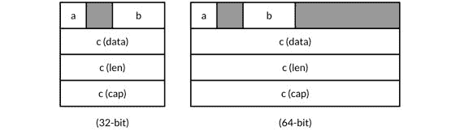

**Figure 13.1.** Holes in a struct.

The table below shows the results of applying the three `unsafe` functions to `x` and its three fields:

```text
Typical 32-bit platform:
Sizeof(x)   = 16  Alignof(x)   = 4
Sizeof(x.a) = 1   Alignof(x.a) = 1  Offsetof(x.a) = 0
Sizeof(x.b) = 2   Alignof(x.b) = 2  Offsetof(x.b) = 2
Sizeof(x.c) = 12  Alignof(x.c) = 4  Offsetof(x.c) = 4

Typical 64-bit platform:
Sizeof(x)   = 32  Alignof(x)   = 8
Sizeof(x.a) = 1   Alignof(x.a) = 1  Offsetof(x.a) = 0
Sizeof(x.b) = 2   Alignof(x.b) = 2  Offsetof(x.b) = 2
Sizeof(x.c) = 24  Alignof(x.c) = 8  Offsetof(x.c) = 8
```

Despite the "unsafe" in their names, these functions are not actually unsafe; they can be helpful for understanding a program's raw memory layout for space optimization.

## 13.2 `unsafe.Pointer`

Most pointer types are written `*T`, meaning "a pointer to a variable of type `T`." `unsafe.Pointer` is a special pointer type that can hold the address of any variable. Naturally, we cannot dereference an `unsafe.Pointer` with `*p` because we don't know what type that expression should have. Like ordinary pointers, `unsafe.Pointer` values are comparable and can be compared with `nil` (the zero value of the type).

An ordinary `*T` pointer can be converted to an `unsafe.Pointer`, and an `unsafe.Pointer` can be converted back to an ordinary pointer, not necessarily of the same type `*T`. For example, converting a `*float64` pointer to `*uint64` allows us to inspect the bit pattern of a floating-point variable:

```go
package math

func Float64bits(f float64) uint64 { return *(*uint64)(unsafe.Pointer(&f)) }

fmt.Printf("%#016x\n", Float64bits(1.0)) // "0x3ff0000000000000"
```

The bit pattern can also be updated through the resulting pointer. This is harmless for a floating-point variable (any bit pattern is valid), but in general, `unsafe.Pointer` conversions allow arbitrary values to be written to memory, thereby subverting the type system.

An `unsafe.Pointer` can also be converted to a `uintptr`, which holds the pointer's numeric value, allowing arithmetic on addresses (recall from Chapter 3 that `uintptr` is an unsigned integer large enough to hold an address). This conversion is also reversible, but again, converting from `uintptr` to `unsafe.Pointer` can subvert the type system because not every integer is a valid address.

Many `unsafe.Pointer` values thus serve as intermediaries to convert ordinary pointers to raw numeric addresses and back. The example below takes the address of variable `x`, adds the offset of its `b` field, converts the resulting address to `*int16`, and updates `x.b` through that pointer:

```go
var x struct {
    a bool
    b int16
    c []int
}

// equivalent to pb := &x.b
pb := (*int16)(unsafe.Pointer(
    uintptr(unsafe.Pointer(&x)) + unsafe.Offsetof(x.b)))
*pb = 42

fmt.Println(x.b) // "42"
```

Although the syntax is cumbersome—perhaps not a bad thing, since these features should be used sparingly—do not attempt to introduce a temporary `uintptr` variable to break the expression into multiple lines. The following code is **incorrect**:

```go
// NOTE: subtly incorrect!
tmp := uintptr(unsafe.Pointer(&x)) + unsafe.Offsetof(x.b)
pb := (*int16)(unsafe.Pointer(tmp))
*pb = 42
```

The reason is very subtle. Some garbage collectors move variables in memory to reduce fragmentation or bookkeeping overhead; such collectors are called **moving GCs**. When a variable is moved, all pointers holding the old address must be updated to point to the new location. From the garbage collector's perspective, an `unsafe.Pointer` is a pointer whose value must be updated when the variable moves, but a `uintptr` is just a number whose value should not change. The incorrect code above **hides a pointer from the garbage collector** in the non-pointer variable `tmp`. By the time the second statement executes, the variable `x` may have been moved, so the integer in `tmp` is no longer the address of `&x.b`. The third statement will corrupt an arbitrary memory location with the value 42.


对此主题存在无数种病态变体。执行完这条语句后：

```
pT := uintptr(unsafe.Pointer(new(T))) // NOTE: wrong!
```

不存在任何指针引用 `new` 创建的变量，因此垃圾收集器有权在该语句完成后回收其存储空间，此后 `pT` 包含的地址是该变量曾经所在的位置，但该变量已不复存在。

目前没有任何 Go 实现使用移动式垃圾收集器（尽管未来的实现可能会），但这并非掉以轻心的理由：当前版本的 Go 确实会在内存中移动*某些*变量。回顾 第 5.2 节，goroutine 栈会根据需要增长。发生这种情况时，旧栈上的所有变量可能会被重定位到一个新的、更大的栈上，因此我们不能依赖变量地址的数值在其生命周期内保持不变。

在撰写本文时，关于 Go 程序员在将 `unsafe.Pointer` 转换为 `uintptr` 后可以依赖什么，几乎没有明确的指导（参见 Go issue 7192），因此我们强烈建议你假设最低限度的保证。将所有 `uintptr` 值视为包含变量的*旧*地址，并将 `unsafe.Pointer` 转换为 `uintptr` 与使用该 `uintptr` 之间的操作数量降到最低。在上面的第一个例子中，三个操作——转换为 `uintptr`、加上字段偏移量、转换回去——全都出现在单个表达式中。

当调用返回 `uintptr` 的库函数时，例如下面来自 `reflect` 包的函数，结果应立即转换为 `unsafe.Pointer`，以确保它继续指向同一个变量。

```
package reflect

func (Value) Pointer() uintptr
func (Value) UnsafeAddr() uintptr
func (Value) InterfaceData() [2]uintptr // (index 1)
```

## 13.3 示例：深度相等

`reflect` 包中的 `DeepEqual` 函数报告两个值是否“深度”相等。`DeepEqual` 使用内置的 `==` 运算符比较基本值；对于复合值，它会递归遍历它们，比较对应的元素。因为它适用于任意一对值，甚至包括那些无法用 `==` 比较的值，所以它在测试中被广泛使用。以下测试使用 `DeepEqual` 来比较两个 `[]string` 值：

```
func TestSplit(t *testing.T) {
    got := strings.Split("a:b:c", ":")
    want := []string{"a", "b", "c"}
    if !reflect.DeepEqual(got, want) { /* ... */ }
}
```

虽然 `DeepEqual` 很方便，但其区分标准看似随意。例如，它不认为 nil 映射等于非 nil 的空映射，也不认为 nil 切片等于非 nil 的空切片：

```
var a, b []string = nil, []string{}
fmt.Println(reflect.DeepEqual(a, b)) // "false"

var c, d map[string]int = nil, make(map[string]int)
fmt.Println(reflect.DeepEqual(c, d)) // "false"
```

在本节中，我们将定义一个函数 `Equal` 来比较任意值。与 `DeepEqual` 一样，它基于元素比较切片和映射，但与 `DeepEqual` 不同，它认为 nil 切片（或映射）等于非 nil 的空切片（或映射）。对参数的基本递归可以用反射来完成，采用的方法类似于我们在 第 12.3 节 中看到的 `Display` 程序。照例，我们为递归定义一个未导出的函数 `equal`。暂时不用担心 `seen` 参数。对于每一对待比较的值 `x` 和 `y`，`equal` 检查两者是否都有效（或都无效），并检查它们是否具有相同的类型。函数的结果定义为一组 switch case，用于比较两个相同类型的值。由于篇幅限制，我们省略了若干 case，因为到现在模式应该已经很熟悉了。

```
func equal(x, y reflect.Value, seen map[comparison]bool) bool {
    if !x.IsValid() || !y.IsValid() {
        return x.IsValid() == y.IsValid()
    }
    if x.Type() != y.Type() {
        return false
    }

    // ...cycle check omitted (shown later)...

    switch x.Kind() {
    case reflect.Bool:
        return x.Bool() == y.Bool()

    case reflect.String:
        return x.String() == y.String()

    // ...numeric cases omitted for brevity...

    case reflect.Chan, reflect.UnsafePointer, reflect.Func:
        return x.Pointer() == y.Pointer()

    case reflect.Ptr, reflect.Interface:
        return equal(x.Elem(), y.Elem(), seen)

    case reflect.Array, reflect.Slice:
        if x.Len() != y.Len() {
            return false
        }
        for i := 0; i < x.Len(); i++ {
            if !equal(x.Index(i), y.Index(i), seen) {
                return false
            }
        }
        return true

    // ...struct and map cases omitted for brevity...
    }
    panic("unreachable")
}
```

照例，我们不在 API 中暴露反射的使用，因此导出函数 `Equal` 必须对其参数调用 `reflect.ValueOf`：

```
// Equal reports whether x and y are deeply equal.
func Equal(x, y interface{}) bool {
    seen := make(map[comparison]bool)
    return equal(reflect.ValueOf(x), reflect.ValueOf(y), seen)
}

type comparison struct {
    x, y unsafe.Pointer
    t    reflect.Type
}
```

为确保算法即使对于循环数据结构也能终止，它必须记录已经比较过哪些变量对，并避免第二次比较它们。`Equal` 分配一个 `comparison` 结构体集合，每个结构体保存两个变量的地址（用 `unsafe.Pointer` 值表示）和比较的类型。除了地址之外，我们还需要记录类型，因为不同的变量可能具有相同的地址。例如，如果 `x` 和 `y` 都是数组，`x` 和 `x[0]` 具有相同的地址，`y` 和 `y[0]` 也是如此，区分我们是比较了 `x` 和 `y` 还是 `x[0]` 和 `y[0]` 非常重要。

一旦 `equal` 确定其参数具有相同类型，在执行 switch 之前，它会检查是否在比较两个已经见过的变量，如果是，则终止递归。

```
// cycle check
if x.CanAddr() && y.CanAddr() {
    xptr := unsafe.Pointer(x.UnsafeAddr())
    yptr := unsafe.Pointer(y.UnsafeAddr())
    if xptr == yptr {
        return true // identical references
    }
    c := comparison{xptr, yptr, x.Type()}
    if seen[c] {
        return true // already seen
    }
    seen[c] = true
}
```

这是我们的 `Equal` 函数的实际运行效果：

```
fmt.Println(Equal([]int{1, 2, 3}, []int{1, 2, 3}))        // "true"
fmt.Println(Equal([]string{"foo"}, []string{"bar"}))      // "false"
fmt.Println(Equal([]string(nil), []string{}))             // "true"
fmt.Println(Equal(map[string]int(nil), map[string]int{})) // "true"
```

它甚至适用于类似于导致 第 12.3 节 中的 `Display` 函数陷入循环的循环输入：

```
// Circular linked lists a -> b -> a and c -> c.
type link struct {
    value string
    tail  *link
}
a, b, c := &link{value: "a"}, &link{value: "b"}, &link{value: "c"}
a.tail, b.tail, c.tail = b, a, c
fmt.Println(Equal(a, a)) // "true"
fmt.Println(Equal(b, b)) // "true"
fmt.Println(Equal(c, c)) // "true"
fmt.Println(Equal(a, b)) // "false"
fmt.Println(Equal(a, c)) // "false"
```


## 练习

## 练习 13.1
定义一个深度比较函数，如果两个数字（任意类型）的差值小于十亿分之一，则认为它们相等。

## 练习 13.2
编写一个函数，报告其参数是否为循环数据结构。

## 13.4 使用 `cgo` 调用 C 代码

Go 程序可能需要使用由 `C` 实现的硬件驱动、查询由 `C++` 实现的嵌入式数据库，或使用由 `Fortran` 实现的某些线性代数例程。`C` 长期以来一直是编程领域的通用语言，因此许多面向广泛使用的包都会导出 `C` 兼容的 API，而不管其实现语言是什么。

在本节中，我们将构建一个简单的数据压缩程序，它使用 `cgo`——一个为 `C` 函数创建 Go 绑定的工具。此类工具称为*外部函数接口*（FFI），`cgo` 并非 Go 程序唯一的此类工具。`SWIG` (`swig.org`) 是另一个；它为与 `C++` 类集成提供了更复杂的功能，但我们在此不作展示。

标准库的 `compress/...` 子树提供了流行压缩算法的压缩器和解压缩器，包括 `LZW`（Unix `compress` 命令使用）和 `DEFLATE`（GNU `gzip` 命令使用）。这些包的 API 在细节上略有不同，但它们都为 `io.Writer` 提供了一个压缩写入数据的包装器，并为 `io.Reader` 提供了一个解压读取数据的包装器。例如：

```
package gzip // compress/gzip

func NewWriter(w io.Writer) io.WriteCloser
func NewReader(r io.Reader) (io.ReadCloser, error)
```

`bzip2` 算法基于优雅的 Burrows-Wheeler 变换，运行速度比 `gzip` 慢，但能产生显著更好的压缩比。`compress/bzip2` 包提供了 `bzip2` 的解压缩器，但目前该包不提供压缩器。从头构建一个是一项重大的工程，但有一个文档完善且高性能的开源 `C` 实现，即来自 `bzip.org` 的 `libbzip2` 包。

如果 `C` 库很小，我们只需将其移植为纯 Go 代码；如果其性能对我们的目的并不关键，我们最好使用 `os/exec` 包将 `C` 程序作为辅助子进程调用。只有当你需要使用具有狭窄 `C` API 的复杂、性能关键型库时，使用 `cgo` 进行封装才有意义。在本章其余部分，我们将通过一个示例进行讲解。

从 `libbzip2` `C` 包中，我们需要 `bz_stream` 结构体类型，它保存输入和输出缓冲区，以及三个 `C` 函数：`BZ2_bzCompressInit`，用于分配流的缓冲区；`BZ2_bzCompress`，用于将数据从输入缓冲区压缩到输出缓冲区；以及 `BZ2_bzCompressEnd`，用于释放缓冲区。（不必担心 `libbzip2` 包的机制；此示例的目的是展示各部分如何组合在一起。）

我们将直接从 Go 调用 `BZ2_bzCompressInit` 和 `BZ2_bzCompressEnd` `C` 函数，但对于 `BZ2_bzCompress`，我们将在 `C` 中定义一个包装函数，以展示如何操作。下面的 `C` 源文件位于我们包的 Go 代码旁边：

```
gopl.io/ch13/bzip 

/* This file is gopl.io/ch13/bzip/bzip2.c,         */
/* a simple wrapper for libbzip2 suitable for cgo. */
#include <bzlib.h>

int bz2compress(bz_stream *s, int action,
                char *in, unsigned *inlen, char *out, unsigned *outlen) {
  s->next_in = in;
  s->avail_in = *inlen;
  s->next_out = out;
  s->avail_out = *outlen;
  int r = BZ2_bzCompress(s, action);
  *inlen -= s->avail_in;
  *outlen -= s->avail_out;
  return r;
}
```

现在让我们转到 Go 代码，其第一部分如下所示。`import "C"` 声明比较特殊。不存在名为 `C` 的包，但此导入会导致 `go build` 在 Go 编译器看到文件之前，使用 `cgo` 工具对文件进行预处理。

```
// Package bzip provides a writer that uses bzip2 compression (bzip.org).
package bzip

/*
#cgo CFLAGS: -I/usr/include
#cgo LDFLAGS: -L/usr/lib -lbz2
#include <bzlib.h>
int bz2compress(bz_stream *s, int action,
                char *in, unsigned *inlen, char *out, unsigned *outlen);
*/
import "C"

import (
    "io"
    "unsafe"
)

type writer struct {
    w      io.Writer // underlying output stream
    stream *C.bz_stream
    outbuf [64 * 1024]byte
}

// NewWriter returns a writer for bzip2-compressed streams.
func NewWriter(out io.Writer) io.WriteCloser {
    const (
        blockSize  = 9
        verbosity  = 0
        workFactor = 30
    )
    w := &writer{w: out, stream: new(C.bz_stream)}
    C.BZ2_bzCompressInit(w.stream, blockSize, verbosity, workFactor)
    return w
}
```

在预处理期间，`cgo` 会生成一个临时包，其中包含文件使用的所有 `C` 函数和类型（如 `C.bz_stream` 和 `C.BZ2_bzCompressInit`）对应的 Go 声明。`cgo` 工具通过以特殊方式在紧邻 import 声明之前的注释内容上调用 `C` 编译器来发现这些类型。

该注释还可能包含 `#cgo` 指令，用于指定传递给 `C` 工具链的额外选项。`CFLAGS` 和 `LDFLAGS` 的值为编译器和链接器命令提供额外参数，以便它们能找到 `bzlib.h` 头文件和 `libbz2.a` 归档库。示例假设这些文件安装在你系统的 `/usr` 目录下。你可能需要根据你的安装情况修改或删除这些标志。

`NewWriter` 通过调用 `C` 函数 `BZ2_bzCompressInit` 来初始化流的缓冲区。`writer` 类型包含另一个缓冲区，用于消耗解压缩器的输出缓冲区。

下面展示的 `Write` 方法将未压缩的 `data` 送入压缩器，在循环中调用 `bz2compress` 函数，直到所有数据被消耗完毕。请注意，Go 程序可以通过 `C.x` 符号访问 `C` 类型（如 `bz_stream`、`char` 和 `uint`）、`C` 函数（如 `bz2compress`），甚至类对象的 `C` 预处理器宏（如 `BZ_RUN`）。`C.uint` 类型不同于 Go 的 `uint` 类型，即使两者具有相同的宽度。

```
func (w *writer) Write(data []byte) (int, error) {
    if w.stream == nil {
        panic("closed")
    }
    var total int // uncompressed bytes written

    for len(data) > 0 {
        inlen, outlen := C.uint(len(data)), C.uint(cap(w.outbuf))
        C.bz2compress(w.stream, C.BZ_RUN,
            (*C.char)(unsafe.Pointer(&data[0])), &inlen,
            (*C.char)(unsafe.Pointer(&w.outbuf)), &outlen)
        total += int(inlen)
        data = data[inlen:]
        if _, err := w.w.Write(w.outbuf[:outlen]); err != nil {
            return total, err
        }
    }
    return total, nil
}
```

循环的每次迭代将 `data` 剩余部分的地址和长度，以及 `w.outbuf` 的地址和容量传递给 `bz2compress`。两个长度变量通过其地址而非值传递，以便 `C` 函数可以更新它们，指示消耗了多少未压缩数据以及产生了多少压缩数据。然后将每块压缩数据写入底层的 `io.Writer`。

`Close` 方法的结构与 `Write` 类似，使用循环将流输出缓冲区中剩余的任何压缩数据刷新出去。


## 13.4 bzip2 Writer 和 cgo (duplicate)

### `Close` 方法

```go
// Close flushes the compressed data and closes the stream.
// It does not close the underlying io.Writer.
func (w *writer) Close() error {
    if w.stream == nil {
        panic("closed")
    }
    defer func() {
        C.BZ2_bzCompressEnd(w.stream)
        w.stream = nil
    }()
    for {
        inlen, outlen := C.uint(0), C.uint(cap(w.outbuf))
        r := C.bz2compress(w.stream, C.BZ_FINISH, nil, &inlen,
            (*C.char)(unsafe.Pointer(&w.outbuf)), &outlen)
        if _, err := w.w.Write(w.outbuf[:outlen]); err != nil {
            return err
        }
        if r == C.BZ_STREAM_END {
            return nil
        }
    }
}
```

完成后，`Close` 调用 `C.BZ2_bzCompressEnd` 以释放流缓冲区，使用 `defer` 确保这在所有返回路径上都会发生。此时 `w.stream` 指针不再安全解引用。为了防御性编程，我们将其设为 `nil`，并为每个方法添加显式的 nil 检查，以便如果用户在 `Close` 后错误地调用方法，程序会 panic。不仅 `writer` 不是并发安全的，而且对 `Close` 和 `Write` 的并发调用可能导致程序在 C 代码中崩溃。修复此问题见练习 13.3。

### `bzipper` 程序

下面的程序 `bzipper` 是一个使用我们新包的 bzip2 压缩命令。它的行为类似于许多 Unix 系统上存在的 `bzip2` 命令。

点击此处查看代码图像

`gopl.io/ch13/bzipper`

```go
// Bzipper reads input, bzip2-compresses it, and writes it out.
package main

import (
    "io"
    "log"
    "os"

    "gopl.io/ch13/bzip"
)

func main() {
    w := bzip.NewWriter(os.Stdout)
    if _, err := io.Copy(w, os.Stdin); err != nil {
        log.Fatalf("bzipper: %v\n", err)
    }
    if err := w.Close(); err != nil {
        log.Fatalf("bzipper: close: %v\n", err)
    }
}
```

### Shell 会话演示

在下面的会话中，我们使用 `bzipper` 将系统字典 `/usr/share/dict/words` 从 938,848 字节压缩到 335,405 字节——大约是原始大小的三分之一——然后使用系统的 `bunzip2` 命令解压。压缩前后的 SHA256 哈希值相同，这让我们确信压缩器工作正常。（如果你的系统上没有 `sha256sum`，请使用你对练习 4.2 的解决方案。）

点击此处查看代码图像

```bash
$ go build gopl.io/ch13/bzipper
$ wc -c < /usr/share/dict/words
938848
$ sha256sum < /usr/share/dict/words
126a4ef38493313edc50b86f90dfdaf7c59ec6c948451eac228f2f3a8ab1a6ed -
$ ./bzipper < /usr/share/dict/words | wc -c
335405
$ ./bzipper < /usr/share/dict/words | bunzip2 | sha256sum
126a4ef38493313edc50b86f90dfdaf7c59ec6c948451eac228f2f3a8ab1a6ed -
```

### cgo 讨论

我们演示了将 C 库链接到 Go 程序中。反过来，也可以将 Go 程序编译为静态归档文件以链接到 C 程序，或编译为共享库以便被 C 程序动态加载。这里我们只是浅尝辄止地介绍了 `cgo`，关于内存管理、指针、回调、信号处理、字符串、`errno`、终结器，以及 goroutine 与操作系统线程之间的关系，还有很多内容要说，其中大部分非常微妙。特别是，正确地在 Go 和 C 之间传递指针的规则很复杂，原因类似于我们在第 13.2 节中讨论的，且尚未有权威规范。欲了解更多，请从 `https://golang.org/cmd/cgo` 开始阅读。

### 练习

**练习 13.3：** 使用 `sync.Mutex` 使 `bzip2.writer` 能安全地被多个 goroutine 并发使用。

**练习 13.4：** 依赖 C 库有其缺点。请提供一个 `bzip.NewWriter` 的纯 Go 替代实现，使用 `os/exec` 包将 `/bin/bzip2` 作为子进程运行。

## 13.5 再次警示

我们在上一章结束时警告了反射接口的缺点。这一警告对本章描述的 `unsafe` 包适用得更为强烈。

高级语言不仅将程序和程序员与各个计算机指令集的晦涩细节隔离开来，还将它们与那些无关紧要的细节隔离开来，比如变量在内存中的位置、数据类型的大小、结构体布局的细节，以及其他大量实现细节。由于这层隔离，可以编写出安全、健壮且无需修改即可在任何操作系统上运行的程序。

`unsafe` 包让程序员穿透隔离层，以使用某些关键但原本无法访问的特性，或者为了获得更高的性能。代价通常是牺牲可移植性和安全性，因此使用 `unsafe` 需自担风险。我们关于如何以及何时使用 `unsafe` 的建议，与我们在第 11.5 节中引用的 Knuth 关于过早优化的评论不谋而合。大多数程序员永远不需要使用 `unsafe`。尽管如此，偶尔会有一些关键代码使用 `unsafe` 编写最为合适。如果仔细的研究和测量表明 `unsafe` 真的是最佳方法，请将其限制在尽可能小的范围内，以便程序的大部分不受其影响。

暂时将最后两章放在脑后。编写一些实质性的 Go 程序。避免使用 `reflect` 和 `unsafe`；只有在必须时才回过头来看这些章节。

同时，祝你 Go 编程愉快。我们希望你像我们一样享受编写 Go 的乐趣。

# 索引

A B C D E F G H I J K L M N O P Q R S T U V W X Y Z

`+=`, `-=`, 等，赋值运算符, 1.2

`|` 在模板中, 4.6

`.` 在模板中，点, 4.6

`:=` 短变量声明, 1.2, 2.3.1, 2.7

`&`, 取地址运算符, 1.8, 2.3.2, 2.3.2, 2.3.2, 4.3, 6.2, 6.5

`&^`, AND-NOT 运算符, 3.1

`...` 参数, 5.6, 5.7

`...` 数组长度, 4.1

`` ` `` 反引号字符, 3.5.1

`&^`, 位清除运算符, 3.1

`^`, 按位取反运算符, 3.1

`|`, 按位或运算符, 6.5, 6.5

`_`, 空标识符, 1.2, 2.4.1, 4.3, 5.1, 5.3, 10.5

`//` 注释, 1.2

`//` 注释, 1.8

`==`, 比较运算符, 2.5, 3.4


# 索引 (duplicate)

## 符号与操作符

- `--`，递减语句，1.2，2.4
- `+=`、`-=` 等，赋值操作符，1.2
- `^`，异或操作符，3.1
- `&`，隐式，6.2，6.5
- `*`，间接操作符，1.8，2.3.2
- `<<`，左移操作符，3.1
- `!`，取反操作符，3.4
- `// Output` 注释，11.6
- `...` 参数，4.2.1，5.7，5.7，7.1
- `...` 路径，10.7.2，10.7.6
- `'` 引号字符，3.1
- `%`，取余操作符，3.1，6.5
- `>>`，右移操作符，3.1
- `&&`，短路与操作符，3.4
- `||`，短路或操作符，3.4
- `-`，一元操作符，3.1
- Unicode 替换字符，3.5.3，4.3
- `+=`、`-=` 等，赋值操作符，1.2
- `+`，字符串连接操作符，1.2，3.5
- `+`，一元操作符，3.1
- `++`，递增语句，1.2，2.4，4.3
- `+build` 注释，10.7.3

## A

- **抽象语法标记法 (ASN.1)**，4.5
- 抽象类型，1.8，7.1
- 抽象，过早抽象，7.15，11.2.5，11.2.5
- 临时多态，7.13
- 局部变量地址，2.3.2，2.3.4
- 结构体字面量地址，4.4.1
- 可寻址表达式，6.2，12.5
- 可寻址值，2.3.2
- 取地址操作符 `&`，1.8，2.3.2，2.3.2，2.3.2，4.3，6.2，6.5
- 聚合类型，4，4.4
- Alef 编程语言，前言
- 算法，广度优先搜索，5.6，8.6
- 算法，深度优先搜索，5.6
- 算法，斐波那契，2.4.1，8.1
- 算法，最大公约数，2.4.1
- 算法，插入排序，4.4
- 算法，利萨如，1.4
- 算法，切片旋转，4.2
- 算法，拓扑排序，5.6
- 别名，指针别名，2.3.2
- 对齐，13.1
- 分配，堆分配，2.3.4
- 分配，内存分配，2.3.4，2.3.4，3.5.4，4.2.1，6.6，7.12，11.4
- 分配，栈分配，2.3.4
- 锚点元素，HTML，5.2
- AND 操作符 `&&`，短路，3.4
- AND-NOT 操作符 `&^`，3.1
- 动画，GIF，1.4
- 匿名函数，1.7，5.6，5.6，8.5
- 匿名函数，`defer`，5.8
- 匿名函数，递归，5.6
- 匿名结构体字段，4.4.3，4.4.3，4.4.3，6.3
- API，`encoding`，7.14，12.4
- API，错误，5.4，5.10
- API，包，10.1，10.7.4，11.2.3，12.3，12.9
- API，运行时，11.5
- API，SQL，7.13
- API，系统调用，7.8
- API，`template`，4.6
- API，基于令牌的解码器，7.14，7.14，12.6
- APL 编程语言，前言
- `append` 内置函数，4.2.1，4.2.1，4.2.1
- `appendInt` 示例，4.2.1
- 参数，`...`，5.6，5.7
- 参数，命令行，1.2，1.6，2.3.2，2.6.1，7.4，7.4，10.7，11.2.3
- 参数，函数，5.1
- 参数，指针，2.3.2，4.1
- 参数，切片，4.2
- 算术表达式求值器，7.9
- 数组比较，4.1
- 数组长度，`...`，4.1
- 数组字面量，4.1，4.1，4.2
- 数组类型，4.1
- 数组，底层数组，4.2，4.2，4.2.1，7.6
- 数组零值，4.1
- ASCII，3.1，3.5，3.5.1，3.5.2，11.2
- ASN.1 (抽象语法标记法)，4.5
- 装配线，蛋糕，8.4.4
- 断言函数，11.2.5
- 断言，接口类型，7.12，7.12
- 断言，测试，11.2
- 断言，类型，7.10，7.13
- 可赋值性，2.4.2，2.4.2，7.3
- 可赋值性，接口，7.3
- 赋值，隐式，2.4.2
- 赋值，多值，2.4.1
- 赋值操作符 `+=`、`-=` 等，1.2
- 赋值操作符，2.4，3.1
- 赋值语句，1.2，1.2，2.4，3.1，4.3，7.1
- 赋值，元组，2.3.1，2.4.1
- 结合性，操作符，3.1
- 原子操作，9.2
- 攻击，HTML 注入，4.6
- 攻击，SQL 注入，7.13
- `autoescape` 示例，4.6

## B

- 后门，包，11.2.4
- 退避，指数退避，5.4.1
- 反引号字符，`` ` ``，3.5.1
- `bank` 示例包，9.1，9.1，9.2
- 裸返回，5.3
- `basename` 示例，3.5.4，3.5.4
- 行为，未定义，9.1
- `Benchmark` 函数，11.1，11.4


双向到单向通道转换，8.4.3

二元运算符，列表，3.1

二进制信号量，9.2

二叉树，4.4

位向量，6.5

位清除运算符 `&^`，3.1

位集合数据类型，3.6.1

按位取反运算符 `^`，3.1

位运算符，列表，3.1

按位或运算符 `|`，6.5，6.5

黑盒测试，11.2.3

空白标识符 `_`，1.2，2.4.1，4.3，5.1，5.3，10.5

空白导入，10.5

块，文件，2.7

块，词法，2.7，5.1，5.6，5.6.1，7.13

块，局部，2.7

块，包，2.7

块，宇宙，2.7

阻塞概要，11.5

博客，Go，前言，11.5

`boiling` 示例，2.2

`bool` 类型，3.4

布尔常量 `false`，3.4

布尔常量 `true`，3.4

布尔零值，2.3

`breadthFirst` 函数，5.6

广度优先搜索算法，5.6，8.6

`break` 语句，带标签，8.8

`break` 语句，1.8，2.7

脆弱测试，11.2.6

广播，8.9，8.10，9.7

Brooks, Fred，前言

`btoi` 函数，3.4

缓冲通道，8.4，8.4.4

`bufio` 包，1.3

`bufio.NewReader` 函数，4.3

`bufio.NewScanner` 函数，1.3

`(*bufio.Reader).ReadRune` 方法，4.3，4.3

`bufio.Scanner` 类型，1.3

`(*bufio.Scanner).Err` 方法，4.3

`(*bufio.Scanner).Scan` 方法，1.3

`(*bufio.Scanner).Split` 方法，4.3

`bufio.ScanWords` 函数，4.3

构建约束，10.7.3

构建标签，10.7.3

构建包，10.7.3

内置函数 `append`，4.2.1，4.2.1，4.2.1

内置函数 `cap`，4.2，8.4.4

内置函数 `close`，8.4，8.4.2，8.9

内置函数 `complex`，3.3

内置函数 `copy`，4.2.1

内置函数 `delete`，4.3

内置函数 `imag`，3.3

内置函数 `len`，1.2，3.1，3.5，3.5，4.1，4.2，8.4.4

内置函数 `make`，1.3，1.6，4.2，4.3，8.4

内置函数 `new`，2.3.3

内置函数 `panic`，5.9，5.9

内置函数 `real`，3.3

内置函数 `recover`，5.10

内置接口 `error`，7.8，7.8

内置类型 `error`，1.3，5.4，5.9，7.8

字节切片到字符串转换，3.5.4

`byte` 类型，3.1

`ByteCounter` 示例，7.1

`bytes` 包，3.5.4，3.5.4

`bytes.Buffer` 类型，3.5.4，6.6，7.1，7.5.1

`(*bytes.Buffer).Grow` 方法，6.6

`(*bytes.Buffer).WriteByte` 方法，3.5.4

`(*bytes.Buffer).WriteRune` 方法，3.5.4

`(*bytes.Buffer).WriteString` 方法，3.5.4

`bytes.Equal` 函数，4.2

`bzip` C 代码，13.4

`bzip` 示例包，13.4

`bzipper` 示例，13.4

`C` 编程语言，前言，前言，1.1，1.2，3.1，9.1，13.4

`C++` 编程语言，前言，前言，13.4

缓存，并发非阻塞，9.7

缓存，非阻塞，9.7

蛋糕装配线，8.4.4

引用调用，4.1

值调用，4.1，5.1，6.2

调用，接口方法，7.5

调用，函数返回的 `ok` 值，5.4

从 Go 调用 C，13.4

驼峰命名，2.1

取消，8.9，8.9

HTTP 请求取消，8.9

内置函数 `cap`，4.2，8.4.4

容量，通道，8.4，8.4.4，8.4.4

容量，切片，4.2，4.2.1

捕获迭代变量，5.6.1

捕获循环变量，5.6.1，8.5，8.6

type `switch` 中的 `case`，7.13

`case`，`select`，8.7

`Celsius` 类型，2.5

`CelsiusFlag` 函数，7.4

`cf` 示例，2.6.1

`cgo` 工具，13.4，13.4

`<-ch`，通道接收，1.6，8.4，8.4.4

`ch<-`，通道发送，1.6，8.4，8.4.4

方法链，4.6

`<-chan T`，只接收通道类型，8.4.3

`chan<- T`，只发送通道类型，8.4.3

`chan` 类型，8.4

通道，缓冲，8.4，8.4.4

通道容量，8.4，8.4.4，8.4.4

通道 `close`，8.4.2，8.9

通道，关闭，8.4

通道通信，8.4，8.7

通道比较，8.4

通道转换，双向到单向，8.4.3


channel, draining a，8.4.2，8.9

channel，`make`，1.6，8.4

channel，`nil`，8.7，8.8

channel，polling，8.7

channel，`range` over，8.4.2

channel receive `<-ch`，1.6，8.4，8.4.4

channel receive，non-blocking，8.7

channel receive，`ok` value from，8.4.2

channel send `ch<-`，1.6，8.4，8.4.4

channel，synchronous，8.4.1

channel type，1.6

channel type `<-chan T`，receive-only，8.4.3

channel type `chan<- T`，send-only，8.4.3

channel type，unidirectional，8.4.3，8.4.3，8.4.3

channel，unbuffered，8.4，8.4.1

channel zero value，8.4，8.7

character conversion，3.5.4

character test，3.5.4

`charcount` example，4.3

`chat` example，8.10

chat server，8.10

`CheckQuota` function，11.2.3，11.2.3

client，email，11.2.3

client，SMTP，11.2.3

`clock` example，8.2，8.2

clock server，concurrent，8.2

`close` built-in function，8.4，8.4.2，8.9

`close`，channel，8.4.2，8.9

closer goroutine，8.5，8.8

closing a channel，8.4

closure，lexical，5.6

`cmplx.Sqrt` function，3.3

code format，1.1，1.2，1.3，2.7

code point，Unicode，3.5.2

code，production，11

`ColoredPoint` example，6.3

`comma` example，3.5.4

command，testing a，11.2.2

command-line argument，1.2，1.6，2.3.2，2.6.1，7.4，7.4，10.7，11.2.3

comment，`//`，1.2

comment，`//`，1.8

comment，`// Output`，11.6

comment，doc，2.6，10.7.4

comments，`+build`，10.7.3

communicating sequential processes (CSP)，Preface，8

communication，channel，8.4，8.7

comparability，1.3，2.4.2，2.5，3.1，4.2，4.3，4.3，4.4.2

comparison，array，4.1

comparison，channel，8.4

comparison，function，5.5

comparison，interface，7.5

comparison，map，4.3

comparison operator `==`，2.5，3.4

comparison operators，2.5，4.3

comparison operators，table of，3.1

comparison，slice，4.2

comparison，string，3.5

comparison，struct，4.4.2

compilation，separate，10.1

complement operator `^`，bitwise，3.1

`complex` built-in function，3.3

`complex` type，3.3

composite literal，1.4

composite type，Preface，1.4，4

composition，parallel，8.3

composition，type，Preface，4.4.3，6.3，7.6

`compress/bzip2` package，13.4

compression，13.4

conceptual integrity，Preface

concrete type，1.8，7.1，7.13，7.14

concurrency，1.6，8，9

concurrency，excessive，8.6，8.6

concurrency safe，9.7

concurrency safety，8.10，9.1，9.7，13.4

concurrency with shared variables，9

concurrent clock server，8.2

concurrent directory traversal，8.8

concurrent echo server，8.3

concurrent non-blocking cache，9.7

concurrent web crawler，8.6

confinement，serial，9.1

confinement，variable，9.1

consistency，sequential，9.4，9.5

`continue` statement，labeled，8.8

`continue` statement，1.8，2.7

contracts，interfaces as，7.1

control flow，2.7

conversion，bidirectional to unidirectional channel，8.4.3

conversion，`byte slice` to `string`，3.5.4

conversion，character，3.5.4

conversion，implicit，3.6.2

conversion，narrowing，2.5，3.1

conversion，numeric，3.6.2

conversion operation，2.5，3.1，3.1，3.1，3.4，3.5.3，3.6.2，3.6.2，7.1，7.6，7.7，7.12，8.4.3，13，13.2

conversion，`rune slice` to `string`，3.5.3

conversion，`rune` to `string`，3.5.3

conversion，string，3.5.4

conversion，`string` to `byte slice`，2.5，3.5.4


## C

转换，字符串到 rune 切片，3.5.3，4.2.1

转换，`unsafe.Pointer`，13.2

`copy` 内置函数，4.2.1

`countdown` 示例，8.7，8.7，8.7，8.7

计数信号量，8.6

覆盖率，语句，11.3，11.3

覆盖率，测试，11.3

`coverage_test` 示例，11.3

CPU 分析，11.5

`crawl` 示例，8.6，8.6，8.6，8.6

爬虫，并发 Web，8.6

爬虫，Web，5

临界区，9.2，9.5，9.7

交叉编译，10.7.3

密码学，3.1，4.1，5.2，11.5

`crypto/sha256` 包，4.1

`customSort` 示例，7.6

循环数据结构，12.3

循环测试依赖，11.2.4

## D

数据竞争，9.1，9.4，9.7

数据结构，循环，12.3

数据结构，递归，4.4，4.4，4.5

数据类型，位集，3.6.1

数据库驱动，MySQL，10.2

`database/sql` 包，7.13，10.5

`daysAgo` 函数，4.6

`deadbeef`，3.1，3.6.2

死锁，8.4.4，8.6，9.2

声明，`const`，1.4，3.6

声明，`func`，1.1，2.2，5.1

声明，`import`，1.1，2.2，2.6.1，10.2，10.4，13.4

声明，方法，2.5，6.1

声明，`package`，1.1，2.2，2.6，10.3

声明，包级，2.2

声明作用域，2.7，5.6

声明，遮蔽，2.7，2.7，7.10，7.13

声明，短变量，1.2，1.2，2.3.1，2.3.1

声明语句，短变量，1.2

声明，`struct`，4.4

声明，`type`，2.5

声明，`var`，1.2，2.3

声明，顺序，2.7

解码示例，S 表达式，12.6

解码器 API，基于令牌，7.14，7.14，12.6

解码，S 表达式，12.6

解码，XML，7.14

递减语句 `--`，1.2，2.4

`dedup` 示例，4.3

深度相等，4.2，11.2.5，13.3

`select` 中的 `default` 分支，8.7

`switch` 中的 `default` 分支，1.8

类型 `switch` 中的 `default` 分支，7.13

`defer` 匿名函数，5.8

`defer` 示例，5.9，5.9

`defer` 语句，5.8，5.9，9.2

延迟函数调用，5.8

`delete` 内置函数，4.3

深度优先搜索算法，5.6

解引用，隐式，6.2

图示，`helloworld` 子串，3.5.3

图示，流水线，8.4.2

图示，切片容量增长，4.2.1

图示，月份切片，4.2

图示，字符串共享，3.5

图示，结构体空洞，13.1

图示，`thumbnail` 序列，8.5

数字工件示例，7.3

Dijkstra, Edsger，11.3

Dilbert，4.4

有向无环图，5.6，10.1

目录遍历，并发，8.8

判别联合，7.13，7.13，7.14

`display` 示例，12.3

`Display` 函数，12.3

`display` 函数，12.3

显示类型的方法，12.8

`Distance` 函数，6.1

文档注释，2.6，10.7.4

`doc.go` 文档注释文件，2.6，10.7.4

文档，包，10.7.4

域名，导入路径，10.2

模板中的点 `.`，4.6

下载包，10.7.2

《怪博士》（Dr. Strangelove），12.3

清空通道，8.4.2，8.9

`du` 示例，8.8，8.8，8.8

`dup` 示例，1.3，1.3，1.3

重复抑制，9.7

动态分派，7.5

动态类型，接口，7.5

## E

`echo` 示例，1.2，1.2，2.3.2，11.2.2

Echo 服务器，并发，8.3

`echo` 测试，11.2.2

`echo_test.go`，11.2.2

有效测试，编写，11.2.5，11.2.6

电子邮件客户端，11.2.3

尴尬地并行，8.5

嵌入结构体字段，6.3

嵌入，接口，7.2

嵌入，结构体，4.4.3，6.3

`Employee` 结构体，4.4

空 `select` 语句，8.7

空接口类型，7.3

空字符串，1.2，1.2，2.3

空结构体，4.4

封装，6.6，10.1

`encoding` API，7.14，12.4

编码，S 表达式，12.4，12.4

`encoding/json` 包，4.5

`encoding/xml` 包，4.5，7.14

文件结束符 (`EOF`)，5.4.2

`enum`，3.6.1


## 环境变量

- `GOARCH`，10.7.1，10.7.3
- `GOMAXPROCS`，9.8.3，11.4
- `GOOS`，10.7.1，10.7.3
- `GOPATH`，Preface，10.7.1，10.7.3
- `GOROOT`，10.7.1

## 函数与方法

- `equal` 函数，4.2，4.3
- `errorf` 函数，5.7
- `eval` 示例，7.9，7.9
- `errors.New` 函数，7.8
- `Example` 函数，11.1，11.6
- `error.Error` 方法，7.8

## 类型与接口

- `error` 内置接口，7.8，7.8
- `error` 内置类型，1.3，5.4，5.9，7.8

## 包

- `errors` 包，7.8
- 示例包 `bank`，9.1，9.1，9.2
- 示例包 `bzip`，13.4
- 示例包 `format`，12.2
- 示例包 `geometry`，6.1
- 示例包 `http`，7.7
- 示例包 `links`，5.6
- 示例包 `memo`，9.7
- 示例包 `params`，12.7
- 示例包 `storage`，11.2.3，11.2.3
- 示例包 `tempconv`，2.6
- 示例包 `thumbnail`，8.5

## 概念与主题

- 相等性，指针，2.3.2
- 深度等价，4.2，11.2.5，13.3
- 错误 API，5.4，5.10
- 错误处理策略，5.4.1，5.10，11.2.2，11.2.5
- 十六进制转义，3.5.1
- HTML 转义，4.6
- 八进制转义，3.5.1
- 转义序列，1.3
- 转义序列表，3.5.1
- Unicode 转义，3.5.3，4.5
- URL 转义，4.5
- 变量转义，2.3.4
- 事件多路复用，8.7
- 事件，8.4.1，8.7

## 示例

- `appendInt`，4.2.1
- `autoescape`，4.6
- `basename`，3.5.4，3.5.4
- `boiling`，2.2
- `ByteCounter`，7.1
- `bzipper`，13.4
- `cf`，2.6.1
- `charcount`，4.3
- `chat`，8.10
- `clock`，8.2，8.2
- `ColoredPoint`，6.3
- `comma`，3.5.4
- `countdown`，8.7，8.7，8.7，8.7
- `coverage_test`，11.3
- `crawl`，8.6，8.6，8.6，8.6
- `customSort`，7.6
- `dedup`，4.3
- `defer`，5.9，5.9
- 数字工件，7.3
- `display`，12.3
- `du`，8.8，8.8，8.8
- `dup`，1.3，1.3，1.3
- `echo`，1.2，1.2，2.3.2，11.2.2
- `fetch`，1.5，5.8
- `fetchall`，1.6
- `findlinks`，5.2，5.3，5.6
- `ftoc`，2.2
- `github`，4.5，4.5
- `graph`，4.3
- `helloworld`，1.1，1.1
- `http`，7.7，7.7，7.7，7.7
- `intset`，6.5，6.5
- `issues`，4.5
- `issueshtml`，4.6
- `issuesreport`，4.6
- `jpeg`，10.5
- `lissajous`，1.4，1.7，2.3.4
- `mandelbrot`，3.3
- `memo`，9.7，9.7，9.7，9.7，9.7，9.7
- `methods`，12.8
- `movie`，4.5，4.5
- `netcat`，8.2，8.3，8.4.1
- `netflag`，3.6.1
- `nonempty`，4.2.2
- `outline`，5.2，5.5
- `params`，12.7
- `Parse`，5.10
- `pipeline`，8.4.2，8.4.2，8.4.3
- 播放列表，7.6
- `rev`，4.2
- `reverb`，8.3，8.3
- `server`，1.7，1.7，1.7
- `sexpr`，12.4
- S 表达式解码，12.6
- `sha256`，4.1
- `sleep`，7.4
- `spinner`，8.1
- `squares`，5.6
- `sum`，5.7
- `surface`，3.2，7.9
- `tempconv`，2.5，7.4，10.6
- 温度转换，2.2
- `tempflag`，7.4
- `word` 测试，11.2
- `thumbnail`，8.5，8.5，8.5
- `title`，5.10
- `topoSort`，5.6
- `trace`，5.8
- `treesort`，4.4
- `urlvalues`，6.2.1
- `wait`，5.4.1

- 回文，11.2，11.2，11.2.1


# 索引 (duplicate)

## E

示例，`word`，11.2，11.2，11.2.1

示例，`xmlselect`，7.14

异常，5.4，5.9

过度并发，8.6，8.6

互斥，排除，9.1，9.2，9.4

独占锁，9.2，9.3，9.5

异或运算符 `^`，3.1

指数退避，5.4.1

结构体字段导出，4.4，4.4.3，4.5，4.5，6.6

`export_test.go` 文件，11.2.4

`Expr.Check` 方法，7.9

表达式，可寻址，6.2，12.5

表达式求值器，7.9

表达式，方法，6.4

表达式，接收，8.4

`Expr.Eval` 方法，7.9

扩展切片，4.2

可扩展标记语言 (XML)，4.5

外部测试包，10.3，11.2.4

## F

`Fahrenheit` 类型，2.5

测试失败消息，11.2

`fallthrough` 语句，1.8，7.13

`false` 布尔常量，3.4

`fetch` 示例，1.5，5.8

`fetchall` 示例，1.6

`fib` 函数，2.4.1，8.1

斐波那契算法，2.4.1，8.1

字段，匿名结构体，4.4.3，4.4.3，4.4.3，6.3

字段，内嵌结构体，6.3

字段，结构体导出，4.4，4.4.3，4.5，4.5，6.6

字段顺序，结构体，4.4，13.1

字段选择器，6.1

字段，结构体，1.4，4.4

字段标签，`omitempty`，4.5

字段标签，结构体，4.5，12.7

图形，利萨如，1.4

图形，曼德博，3.3

图形，三维曲面，3.2，7.9

文件块，2.7

文件，`export_test.go`，11.2.4

文件名，Microsoft Windows，3.5.4

文件名，POSIX，3.5.4

文件，`_test.go`，10.3，11.1，11.2

文件传输协议 (FTP)，8.2

`findlinks` 示例，5.2，5.3，5.6

固定大小栈，5.2

标志，`go list -f`，11.2.4

标志，`go -race`，9.6

标志，`go test -race`，9.7

标志，`go test -run`，11.2

标志，`go test -v`，11.2

标志，`go tool -bench`，11.4

标志，`go tool -benchmem`，11.4

标志，`go tool -covermode`，11.3

标志，`go tool -coverprofile`，11.3

标志，`go tool -cpuprofile`，11.5

标志，`go tool -nodecount`，11.5

标志，`go tool -text`，11.5

标志，`go tool -web`，11.5

标志，`godoc -analysis`，7.3

`flag` 包，2.3.2，7.4

`flag.Args` 函数，2.3.2

`flag.Bool` 函数，2.3.2

`flag.Duration` 函数，7.4

`flag.Parse` 函数，2.3.2

`flag.String` 函数，2.3.2

`flag.Value` 接口，7.4，7.4

浮点数，3.2

浮点数精度，3.2，3.2，3.3，3.6.2

浮点数截断，2.5，3.1

`fmt` 包，1.1

`fmt.Errorf` 函数，5.4.1，7.8

`fmt.Fprintf` 函数，7.1

`fmt.Printf` 函数，1.3

`fmt.Println` 函数，1.1

`fmt.Scanf` 函数，3.5.5

`fmt.Sscanf` 函数，7.4

`fmt.Stringer` 接口，7.4，7.12

`for` 作用域，2.7

`for` 语句，1.2

`forEachNode` 函数，5.5

外部函数接口 (FFI)，13.4

格式，代码，1.1，1.2，1.3，2.7

`format` 示例包，12.2

`formatAtom` 函数，12.2

框架，Web，7.7

`ftoc` 示例，2.2

`func` 声明，1.1，2.2，5.1

函数，匿名，1.7，5.6，5.6，8.5

函数，内置 `append`，4.2.1，4.2.1，4.2.1

函数参数，5.1

函数，断言，11.2.5

函数，`Benchmark`，11.1，11.4

函数体，缺失，5.1

函数，`breadthFirst`，5.6

函数，`btoi`，3.4

函数，`bufio.NewReader`，4.3

函数，`bufio.NewScanner`，1.3

函数，`bufio.ScanWords`，4.3

函数，`bytes.Equal`，4.2

函数调用，延迟，5.8

函数调用，`ok` 值，5.4

函数，内置 `cap`，4.2，8.4.4

函数，`CelsiusFlag`，7.4

函数，`CheckQuota`，11.2.3，11.2.3

函数，内置 `close`，8.4，8.4.2，8.9

函数，`cmplx.Sqrt`，3.3

函数比较，5.5

函数，内置 `complex`，3.3

函数，内置 `copy`，4.2.1

函数，`daysAgo`，4.6

函数，内置 `delete`，4.3

函数，`Display`，12.3

函数，`display`，12.3

函数，`Distance`，6.1

函数，`equal`，4.2，4.3

函数，`errorf`，5.7

函数，`errors.New`，7.8


# 函数索引

## 函数概念

- `function literal` 1.7, 5.6, 8.4.1
- `function parameter` 5.1
- `function result list` 5.1
- `function signature` 5.1
- `function, multi-valued` 1.3, 2.3, 2.4.1, 4.3, 5.3, 5.3
- `function, nil` 5.5
- `function, recursive anonymous` 5.6

## 函数列表

- `function`, `Example` 11.1, 11.6
- `function`, `fib` 2.4.1, 8.1
- `function`, `flag.Args` 2.3.2
- `function`, `flag.Bool` 2.3.2
- `function`, `flag.Duration` 7.4
- `function`, `flag.Parse` 2.3.2
- `function`, `flag.String` 2.3.2
- `function`, `fmt.Errorf` 5.4.1, 7.8
- `function`, `fmt.Fprintf` 7.1
- `function`, `fmt.Printf` 1.3
- `function`, `fmt.Println` 1.1
- `function`, `fmt.Scanf` 3.5.5
- `function`, `fmt.Sscanf` 7.4
- `function`, `forEachNode` 5.5
- `function`, `formatAtom` 12.2
- `function`, `gcd` 2.4.1
- `function`, `handler` 1.7, 1.7, 5.10, 7.7, 7.7, 7.7, 12.7
- `function`, `html.Parse` 5.2, 5.3
- `function`, `http.DefaultServeMux` 7.7
- `function`, `http.Error` 7.7
- `function`, `http.Get` 1.5, 1.6
- `function`, `http.Handle` 7.7
- `function`, `http.HandleFunc` 1.7, 1.7, 7.7
- `function`, `http.ListenAndServe` 1.7, 7.7
- `function`, `http.NewRequest` 8.9
- `function`, `http.ServeMux` 7.7
- `function`, `hypot` 5.1
- `function`, `imag` built-in 3.3
- `function`, `image.Decode` 10.5
- `function`, `image.RegisterFormat` 10.5
- `function`, `incr` 2.3.2
- `function`, `init` 2.6.2, 2.7
- `function`, `intsToString` 3.5.4
- `function`, `io.Copy` 1.5, 1.6
- `function`, `ioutil.ReadAll` 1.5, 9.7
- `function`, `ioutil.ReadDir` 8.8
- `function`, `ioutil.ReadFile` 1.3, 5.8
- `function`, `io.WriteString` 7.12
- `function`, `itob` 3.4
- `function`, `json.Marshal` 4.5
- `function`, `json.MarshalIndent` 4.5
- `function`, `json.NewDecoder` 4.5
- `function`, `json.NewEncoder` 4.5
- `function`, `json.Unmarshal` 4.5, 4.6
- `function`, `len` built-in 1.2, 3.1, 3.5, 3.5, 4.1, 4.2, 8.4.4
- `function`, `links.Extract` 5.6
- `function`, `log.Fatalf` 2.7, 5.4.1
- `function`, `main` 1.1, 11.2.2
- `function`, `make` built-in 1.3, 1.6, 4.2, 4.3, 8.4
- `function`, `math.Hypot` 6.1
- `function`, `math.Inf` 3.2
- `function`, `math.IsInf` 3.2
- `function`, `math.IsNaN` 3.2
- `function`, `math.NaN` 3.2
- `function`, `mustCopy` 8.2
- `function`, `net.Dial` 8.2
- `function`, `net.Listen` 8.2
- `function`, `new` built-in 2.3.3
- `function`, `os.Close` 1.3
- `function`, `os.Exit` 1.5, 2.3.2, 2.7
- `function`, `os.Getwd` 2.7
- `function`, `os.IsExist` 7.11
- `function`, `os.IsNotExist` 7.11
- `function`, `os.IsPermission` 7.11
- `function`, `os.Open` 1.3
- `function`, `os.Stat` 8.8
- `function`, `panic` built-in 5.9, 5.9
- `function`, `params.Unpack` 12.7
- `function`, `png.Encode` 3.3
- `function`, `PopCount` 2.6.2
- `function`, `real` built-in 3.3
- `function`, `recover` built-in 5.10
- `function`, `reflect.TypeOf` 12.2
- `function`, `reflect.ValueOf` 12.2, 12.2, 12.3
- `function`, `reflect.Zero` 12.6
- `function`, `regexp.Compile` 5.9
- `function`, `regexp.MustCompile` 5.9
- `function`, `runtime.Stack` 5.9
- `function`, `SearchIssues` 4.5
- `function`, `sexpr.Marshal` 12.4
- `function`, `sexpr.readList` 12.6
- `function`, `sexpr.Unmarshal` 12.6
- `function`, `sort.Float64s` 7.6
- `function`, `sort.Ints` 7.6
- `function`, `sort.IntsAreSorted` 7.6
- `function`, `sort.Reverse` 7.6
- `function`, `sort.Strings` 4.3, 5.6, 7.6
- `function`, `Sprint` 12.1
- `function`, `sqlQuote` 7.13, 7.13
- `function`, `strconv.Atoi` 1.7, 3.5.5
- `function`, `strconv.FormatInt` 3.5.5
- `function`, `strconv.Itoa` 3.5.5
- `function`, `strconv.ParseInt` 3.5.5
- `function`, `strconv.ParseUint` 3.5.5
- `function`, `strings.Contains` 3.5.3
- `function`, `strings.HasPrefix` 3.5.3
- `function`, `strings.HasSuffix` 3.5.3
- `function`, `strings.Index` 10.6
- `function`, `strings.Join` 1.2, 1.3
- `function`, `strings.Map` 5.5
- `function`, `strings.NewReader` 10.6
- `function`, `strings.NewReplacer` 10.6
- `function`, `strings.Split` 1.3
- `function`, `strings.ToLower` 3.5.4
- `function`, `strings.ToUpper` 3.5.4
- `function`, `template.Must` 4.6
- `function`, `template.New` 4.6
- `function`, `Test` 11.1
- `function`, `time.After` 8.7
- `function`, `time.AfterFunc` 6.4
- `function`, `time.Now` 8.2
- `function`, `time.Parse` 8.2


## G

函数，`time.Since`，4.6

函数，`time.Tick`，8.7，8.7

函数，`title`，5.8，5.8

函数类型，5.1，5.1

函数，`unicode.IsDigit`，3.5.4

函数，`unicode.IsLetter`，3.5.4

函数，`unicode.IsLower`，3.5.4

函数，`unicode.IsSpace`，4.2.2

函数，`unicode.IsUpper`，3.5.4

函数，`unsafe.AlignOf`，13.1

函数，`unsafe.Offsetof`，13.1

函数，`unsafe.Sizeof`，13.1

函数，`url.QueryEscape`，4.5

函数，`utf8.DecodeRuneInString`，3.5.3

函数，`utf8.RuneCountInString`，3.5.3

函数值，5.5

函数，可变参数，5.7，7.1

函数，`visit`，5.2

函数，`WaitForServer`，5.4.1

函数，`walkDir`，8.8

函数零值，5.5

垃圾回收，前言，前言，1.2，2.3.4，8.4.2，13，13.2

垃圾收集器，移动式，13.2

最大公约数算法，2.4.1

`gcd` 函数，2.4.1

`geometry` 示例包，6.1

`geometry.Point.Distance` 方法，6.1

Getter 方法，6.6

GIF 动画，1.4

`github` 示例，4.5，4.5

GitHub 问题追踪器，4.5

Go 博客，前言，11.5

`go build`，1.1，10.4，10.7.3，10.7.3

`go doc`，10.7.4

`go doc` 工具，1.8

`go env`，10.7.1

`go get`，前言，1.1，10.7.2，10.7.2

`go help`，10.7

`go install`，10.7.3

Go 问题，4.5，4.5，13.2

`go list`，10.7.6，11.2.4

`go list -f` 标志，11.2.4

Go Playground，前言，11.6

`go -race` 标志，9.6

`go run`，1.1，10.7.3

`go` 语句，1.6，8.1

`go test`，11，11.1，11.1，11.2

`go test -race` 标志，9.7

`go test -run` 标志，11.2

`go test -v` 标志，11.2

`go` 工具，1.1，2.6.1，2.6.2，10.7

`go tool -bench` 标志，11.4

`go tool -benchmem` 标志，11.4

`go tool cover`，11.3，11.3，11.3

`go tool -covermode` 标志，11.3

`go tool -coverprofile` 标志，11.3

`go tool -cpuprofile` 标志，11.5

`go tool -nodecount` 标志，11.5

`go tool pprof`，11.5

`go tool -text` 标志，11.5

`go tool -web` 标志，11.5

`GOARCH` 环境变量，10.7.1，10.7.3

`godoc -analysis` 标志，7.3

`godoc` 工具，前言，1.8，10.7.4，11.6

`gofmt` 工具，1.1，1.2，2.6.1，10.4

`goimports` 工具，1.1，2.6.1，10.4

`golang.org/x/net/html` 包，5.2

`golint` 工具，10.7.2

`GOMAXPROCS` 环境变量，9.8.3，11.4

`GOOS` 环境变量，10.7.1，10.7.3

`GOPATH` 环境变量，前言，10.7.1，10.7.3

`gopl.io` 代码库，前言

`GOROOT` 环境变量，10.7.1

goroutine，1.6，8.1，8.4.4，8.5

goroutine，关闭者，8.5，8.8

goroutine 标识，9.8.4

goroutine 泄漏，8.4.4，8.5，8.7

goroutine，监控，9.1，9.7

goroutine 多路复用，9.8.2

goroutine 与 OS 线程对比，9.8

`goto` 语句，1.8

`graph` 示例，4.3

GraphViz，11.5

Griesemer, Robert，前言

增长，栈，5.2，9.8.1，13.2

保护互斥锁，9.2

## H

半开区间，1.2

处理函数，1.7，1.7，5.10，7.7，7.7，7.7，12.7

“happens before” 关系，8.4.1，9.1，9.1，9.7

“has a” 关系，6.3

哈希表，1.3，4.3

Haskell 编程语言，前言

堆分配，2.3.4

堆概要，11.5

堆变量，2.3.4

`helloworld` 子串图，3.5.3

`helloworld` 示例，1.1，1.1

十六进制转义，3.5.1

十六进制字面量，3.1

隐藏指针，13.2

空洞，结构体，13.1

HTML 锚元素，5.2

HTML 转义，4.6

HTML 注入攻击，4.6

HTML 元字符，4.6

HTML 解析器，5.2

`html.Parse` 函数，5.2，5.3

`html/template` 包，4.6，4.6

`http` 示例，7.7，7.7，7.7，7.7

`http` 示例包，7.7

HTTP GET 请求，1.7，5.3，9.7，12.7

HTTP POST 请求，12.7


# 索引 (duplicate)

## HTTP

HTTP 请求，取消，8.9

HTTP 请求多路复用器，7.7

`(*http.Client).Do` 方法，8.9

`http.DefaultClient` 变量，8.9

`http.DefaultServeMux` 函数，7.7

`http.Error` 函数，7.7

`http.Get` 函数，1.5，1.6

`http.Handle` 函数，7.7

`http.HandleFunc` 函数，1.7，1.7，7.7

`http.Handler` 接口，7.7，7.7

`http.HandlerFunc` 类型，7.7，7.9

`http.ListenAndServe` 函数，1.7，7.7

`http.NewRequest` 函数，8.9

`http.Request` 类型，1.7，8.9

`(*http.Request).ParseForm` 方法，1.7，12.7

`http.ResponseWriter` 类型，1.7，1.7，7.7，7.7

`http.ServeMux` 函数，7.7

`hypot` 函数，5.1

## I

标识符 `_`，空白，1.2，2.4.1，4.3，5.1，5.3，10.5

标识符，限定，2.6，2.6.1

标识，goroutine，9.8.4

IEEE 754 标准，3.2，3.2

`if`，初始化语句，1.7，7.10

`if-else` 作用域，2.7

`if-else` 语句，1.3，1.7，2.7

`imag` 内置函数，3.3

图像处理，5.2

`image` 包，3.3，10.5

`image/color` 包，1.4

`image.Decode` 函数，10.5

`image/png` 包，10.5

`image.RegisterFormat` 函数，10.5

虚数字面量，3.3

不可变性，9.1

不可变性，字符串，3.5，3.5.4

用切片实现，栈，4.2.2，7.14

隐式 `&`，6.2，6.5

隐式赋值，2.4.2

隐式转换，3.6.2

隐式解引用，6.2

导入，空白，10.5

`import` 声明，1.1，2.2，2.6.1，10.2，10.4，13.4

导入路径，10.2，10.2

导入路径域名，10.2

导入，重命名，10.4

`incr` 函数，2.3.2

增量语句 `++`，1.2，2.4，4.3

索引操作，字符串，3.5

间接操作符 `*`，1.8，2.3.2

无限循环，1.2，5.1，8.4.2

信息隐藏，6.6，10.1

`init` 函数，2.6.2，2.7

初始化，惰性，9.5

初始化，包，2.6.2

`if` 中的初始化语句，1.7，7.10

`switch` 中的初始化语句，1.8

初始化列表，2.3

注入攻击，HTML，4.6

注入攻击，SQL，7.13

原地切片技巧，4.2.2

插入排序算法，4.4

`int` 类型，3.1

整数字面量，3.1

整数溢出，3.1，4.5

整数，有符号，3.1，3.1

整数，无符号，3.1，3.1

集成测试，11.2.4

接口可赋值性，7.3

接口比较，7.5

接口动态类型，7.5

接口嵌入，7.2

接口，`error` 内置，7.8，7.8

接口，`flag.Value`，7.4，7.4

接口，`fmt.Stringer`，7.4，7.12

接口，`http.Handler`，7.7，7.7

接口，`io.Closer`，7.2

接口，`io.Reader`，7.2

接口，`io.Writer`，1.4，1.7，7.1，7.2，7.5.1，7.12，7.12，11.2.2

接口，JSON，4.5

接口方法调用，7.5

接口，nil，7.5

接口陷阱，7.5.1

接口，`ReadWriteCloser`，7.2

接口，`ReadWriter`，7.2

接口满足，7，7.3

接口，`sort.Interface`，7.6

`interface{}` 类型，5.7

接口类型，7.1，7.2

`interface{}` 类型，7.3，12.2，12.2

接口类型断言，7.12，7.12

接口类型，空，7.3

接口值，7.5

带有 nil 指针的接口，7.5.1

接口零值，7.5

接口作为契约，7.1

`internal` 包，10.7.5

`intset` 示例，6.5，6.5

`intsToString` 函数，3.5.4

不变量，6.2，6.6，6.6，9.2，10.1，11.2.3，12.9

`io` 包，7.2

`io.Closer` 接口，7.2

`io.Copy` 函数，1.5，1.6

`io.Discard` 流，1.7

`io.Discard` 变量，1.6

`io.EOF` 变量，5.4.2

`io/ioutil` 包，1.5，5.8

`io.Reader` 接口，7.2

`iota` 常量生成器，前言，3.6.1

`ioutil.ReadAll` 函数，1.5，9.7

`ioutil.ReadDir` 函数，8.8

`ioutil.ReadFile` 函数，1.3，5.8


## J

`io.Writer` 接口，1.4，1.7，7.1，7.2，7.5.1，7.12，7.12，11.2.2

`io.WriteString` 函数，7.12

“is a” 关系，6.3，7.3

议题，Go，4.5，4.5，13.2

议题跟踪器，GitHub，4.5

`issues` 示例，4.5

`issueshtml` 示例，4.6

`issuesreport` 示例，4.6

迭代顺序，映射，4.3

迭代变量，捕获，5.6.1

`itob` 函数，3.4

## K

Java 编程语言，前言

JavaScript 对象表示法 (JSON)，4.5，12.4

JavaScript 编程语言，前言，4.5

`jpeg` 示例，10.5

JSON 接口，4.5

JSON 接口，开放电影数据库，4.5

JSON 接口，xkcd，4.5

JSON，编组，4.5

JSON，解组，4.5

`json.Decoder` 类型，4.5

`json.Encoder` 类型，4.5

`json.Marshal` 函数，4.5

`json.MarshalIndent` 函数，4.5

`json.NewDecoder` 函数，4.5

`json.NewEncoder` 函数，4.5

`json.Unmarshal` 函数，4.5，4.6

## L

关键字，`type`，7.13

关键字，表，2.1

Knuth, Donald，11.5

标签作用域，2.7

标签，语句，2.7

带标签的 `break` 语句，8.8

带标签的 `continue` 语句，8.8

带标签语句，2.7

布局，内存，13，13.1，13.1

惰性初始化，9.5

泄漏，goroutine，8.4.4，8.5，8.7

左移运算符 `<<`，3.1

`len` 内置函数，1.2，3.1，3.5，3.5，4.1，4.2，8.4.4

词法块，2.7，5.1，5.6，5.6.1，7.13

词法闭包，5.6

生命周期，变量，2.3.4，2.7，5.6

`links` 示例包，5.6

`links.Extract` 函数，5.6

Lisp 编程语言，12.4

利萨如算法，1.4

`lissajous` 示例，1.4，1.7，2.3.4

利萨如图形，1.4

列表，初始化器，2.3

字面量，数组，4.1，4.1，4.2

字面量，复合，1.4

字面量，函数，1.7，5.6，8.4.1

字面量，十六进制，3.1

字面量，虚数，3.3

字面量，整数，3.1

字面量，映射，4.3

字面量，八进制，3.1

字面量，原始字符串，3.5.1

字面量，`rune`，3.1

字面量，切片，2.4.2，4.2

字面量，字符串，3.5.1

字面量，结构体，1.4，4.4.1，4.4.3

局部块，2.7

局部变量，2.2，5.6.1

局部变量，地址，2.3.2，2.3.4

局部变量作用域，5.6

定位包，10.7.1

锁竞争，9.3，9.7

锁，互斥，9.2，9.3，9.5

锁，互斥锁，4.4，9.2，9.2，11.5

锁，非重入，9.2

锁，读者，9.3

锁，共享，9.3

锁，写者，9.3

`log` 包，2.7，5.4.1，6.6

`log.Fatalf` 函数，2.7，5.4.1

查找 `m[key]`，映射，4.3

查找，来自映射的 `ok` 值，4.3

循环，无限，1.2，5.1，8.4.2

循环，`range`，1.2，1.3

循环变量，捕获，5.6.1，8.5，8.6

循环变量作用域，5.6.1，8.5

循环，while，1.2

## M

`main` 函数，1.1，11.2.2

`main`，包，1.1，10.3，11.2.2

`make` 内置函数，1.3，1.6，4.2，4.3，8.4

`make` 通道，1.6，8.4

`make` 映射，1.3，1.6，4.3

`make` 切片，4.2，11.4

`mandelbrot` 示例，3.3

曼德博图形，3.3

曼德博集合，3.3

映射作为集合，4.3，7.9

映射比较，4.3

映射元素，不存在，4.3，4.3

映射迭代顺序，4.3

映射字面量，4.3

映射查找 `m[key]`，4.3

映射查找，来自的 `ok` 值，4.3

映射，`make`，1.3，1.6，4.3

映射，`nil`，4.3

映射，`range` 遍历，4.3

映射类型，1.3，4.3

带切片键的映射，4.3

映射零值，4.3

JSON 编组，4.5

`math` 包，1.4，3.2

`math/big` 包，3.3

`math/cmplx` 包，3.3

`math.Hypot` 函数，6.1

`math.Inf` 函数，3.2

`math.IsInf` 函数，3.2

`math.IsNaN` 函数，3.2

`math.NaN` 函数，3.2

`math/rand` 包，10.3，11.2.1


## M (duplicate)

`memo` 示例，9.7，9.7，9.7，9.7，9.7，9.7

`memo` 示例包，9.7

记忆化，9.7

内存分配，2.3.4，2.3.4，3.5.4，4.2.1，6.6，7.12，11.4

内存布局，13，13.1，13.1

元字符，HTML，4.6

方法，`(*bufio.Reader).ReadRune`，4.3，4.3

方法，`(*bufio.Scanner).Err`，4.3

方法，`(*bufio.Scanner).Scan`，1.3

方法，`(*bufio.Scanner).Split`，4.3

方法，`(*bytes.Buffer).Grow`，6.6

方法，`(*bytes.Buffer).WriteByte`，3.5.4

方法，`(*bytes.Buffer).WriteRune`，3.5.4

方法，`(*bytes.Buffer).WriteString`，3.5.4

方法调用，接口，7.5

方法链，4.6

方法声明，2.5，6.1

方法，`error.Error`，7.8

方法，`Expr.Check`，7.9

方法表达式，6.4

方法，`Expr.Eval`，7.9

方法，`geometry.Point.Distance`，6.1

方法，getter，6.6

方法，`(*http.Client).Do`，8.9

方法，`(*http.Request).ParseForm`，1.7，12.7

方法名，6.1

方法，`net.Conn.Close`，8.2

方法，`net.Listener.Accept`，8.2

方法，`(*os.File).Write`，7.5

方法，`path.Distance`，6.1

方法提升，6.3

方法接收者名称，6.1

方法接收者参数，6.1

方法接收者类型，6.1

方法，`reflect.Type.Field`，12.7

方法，`reflect.Value.Addr`，12.5

方法，`reflect.Value.CanAddr`，12.5

方法，`reflect.Value.Interface`，12.2，12.5

方法，`reflect.Value.Kind`，12.2

方法选择器，6.1

方法，setter，6.6

方法，`String`，2.5，6.5，12.1

方法，`(*sync.Mutex).Lock`，1.7，5.8，9.2

方法，`(*sync.Mutex).Unlock`，1.7，5.8，9.2

方法，`(*sync.Once).Do`，9.5

方法，`(*sync.RWMutex).RLock`，9.3

方法，`(*sync.RWMutex).RUnlock`，9.3

方法，`(*sync.WaitGroup).Add`，8.5

方法，`(*sync.WaitGroup).Done`，8.5

方法，`template.Funcs`，4.6

方法，`template.Parse`，4.6

方法，`(*testing.T).Errorf`，7.9，11.2，11.2

方法，`(*testing.T).Fatal`，11.2

方法，`time.Time.Format`，8.2

方法值，6.4

方法，`(*xml.Decoder).Token`，7.14

`methods` 示例，12.8

类型的方法，显示，12.8

Microsoft Windows 文件名，3.5.4

缺少函数体，5.1

`m[key]`，映射查找，4.3

移动平台，5.2

Modula-2 编程语言，前言

模块化，10.1

监视器，9.2，9.7

监视器 goroutine，9.1，9.7

`movie` 示例，4.5，4.5

移动式垃圾收集器，13.2

多值映射，6.2.1，7.7

多值赋值，2.4.1

多路复用器，HTTP 请求，7.7

多路复用，事件，8.7

多路复用，goroutine，9.8.2

多线程，共享内存，8，9

多返回值函数，1.3，2.3，2.4.1，4.3，5.3，5.3

`mustCopy` 函数，8.2

互斥锁，5.8，6.3，8.10，9.5

互斥锁，保护，9.2

互斥锁锁定，4.4，9.2，9.2，11.5

互斥锁，读/写，9.3，9.3

互斥，9.1，9.2，9.4

MySQL 数据库驱动，10.2

## N

名称，方法，6.1

名称，方法接收者，6.1

名称，包，2.1，2.6.1

名称，参数，5.1

命名空间，2.6，6.1，10.1

命名返回值，5.1，5.3

命名返回值零值，5.1，5.3

命名类型，1.8，2.5，2.5，4.4.3，6.1

命名约定，2.1，6.6，7.2，10.6

命名，包，10.6

`NaN`（非数字），3.2，4.3

收窄转换，2.5，3.1

取反运算符 `!`，3.4

`net` 包，8.2

`netcat` 示例，8.2，8.3，8.4.1

`net.Conn` 类型，8.2

`net.Conn.Close` 方法，8.2

`net.Dial` 函数，8.2

`netflag` 示例，3.6.1

`net/http` 包，1.5，7.7

`net.Listen` 函数，8.2

`net.Listener` 类型，8.2

`net.Listener.Accept` 方法，8.2

`net/smtp` 包，11.2.3

`net/url` 包，6.2.1

网络编程，5.2，8.2

`new` 内置函数，2.3.3

`new`，重新定义，2.3.3

nil 通道，8.7，8.8

nil 函数，5.5

nil 接口，7.5

nil 映射，4.3

nil 指针，2.3.2


# 索引 (duplicate)

## N

- nil 指针，带有 nil 指针的接口，7.5.1
- nil 接收者，6.2.1，7.5.1
- nil 切片，4.2
- 非阻塞缓存，9.7
- 非阻塞缓存，并发，9.7
- 非阻塞通道接收，8.7
- 非阻塞 `select`，8.7
- `nonempty` 示例，4.2.2
- 不存在的映射元素，4.3，4.3
- 非重入锁，9.2
- 非标准包，5.2
- 数字，浮点数，3.2
- 数字零值，1.2，2.3
- 数值转换，3.6.2
- 数值精度，3.1，3.6.2
- 数值类型，3.1

## O

- Oberon 编程语言，前言
- 对象，6.1
- 面向对象编程 (OOP)，6，6.6
- 八进制转义，3.5.1
- 八进制字面量，3.1
- `ok` 值，2.4.1
- 来自通道接收的 `ok` 值，8.4.2
- 来自函数调用的 `ok` 值，5.4
- 来自映射查找的 `ok` 值，4.3
- 来自类型断言的 `ok` 值，7.10
- `omitempty` 字段标签，4.5
- 开放电影数据库 JSON 接口，4.5
- 操作，原子操作，9.2
- 操作，转换，2.5，3.1，3.1，3.1，3.4，3.5.3，3.6.2，3.6.2，7.1，7.6，7.7，7.12，8.4.3，13，13.2
- 运算符 `&`，取地址，1.8，2.3.2，2.3.2，2.3.2，4.3，6.2，6.5
- 运算符 `&^`，AND-NOT（与非），3.1
- 运算符 `&^`，位清除，3.1
- 运算符 `^`，按位补码，3.1
- 运算符 `|`，按位或，6.5，6.5
- 运算符 `==`，比较，2.5，3.4
- 运算符 `^`，异或，3.1
- 运算符 `!`，取反，3.4
- 运算符 `%`，取余，3.1，6.5
- 运算符 `<<`，左移，3.1
- 运算符 `>>`，右移，3.1
- 运算符 `&&`，短路与，3.4
- 运算符 `||`，短路或，3.4
- 运算符 `-`，一元负号，3.1
- 运算符 `+=`，`-=` 等，赋值，1.2
- 运算符 `+`，字符串连接，1.2，3.5
- 运算符 `+`，一元加号，3.1
- 运算符 `*`，间接引用，1.8，2.3.2
- 运算符 `s[i:j]`，切片，4.2，4.2
- 运算符 `s[i:j]`，子串，3.5，4.2
- 运算符，赋值运算符，2.4，3.1
- 运算符，比较运算符，2.5，4.3
- 运算符，二元运算符表，3.1
- 运算符，按位运算符表，3.1
- 运算符，比较运算符表，3.1
- 优化，9.2，11.4，11.5
- 优化，过早优化，11.5
- 或运算符 `||`，短路，3.4
- 声明顺序，2.7
- 顺序，结构体字段顺序，4.4，13.1
- 组织，工作区组织，10.7.1
- `os` 包，1.2，7.11
- 操作系统线程与 goroutine 对比，9.8
- `os.Args` 变量，1.2
- `os.Close()` 函数，1.3
- `os.Exit()` 函数，1.5，2.3.2，2.7
- `*os.File` 类型，1.3，1.3，7.1，7.3，7.5.1，12.3
- `os.FileInfo` 类型，8.8
- `(*os.File).Write()` 方法，7.5
- `os.Getwd()` 函数，2.7
- `os.IsExist()` 函数，7.11
- `os.IsNotExist()` 函数，7.11
- `os.IsPermission()` 函数，7.11
- `os.LinkError` 类型，7.11
- `os.Open()` 函数，1.3
- `os.PathError` 类型，7.11
- `os.Stat()` 函数，8.8
- `outline` 示例，5.2，5.5
- 溢出，整数溢出，3.1，4.5
- 溢出，栈溢出，5.2

## P

- 包 API，10.1，10.7.4，11.2.3，12.3，12.9
- 包后门，11.2.4
- 包 `bank` 示例，9.1，9.1，9.2
- 包块，2.7
- 包 `bufio`，1.3
- 包 `bytes`，3.5.4，3.5.4
- 包 `bzip` 示例，13.4
- 包 `compress/bzip2`，13.4
- 包 `crypto/sha256`，4.1
- 包 `database/sql`，7.13，10.5
- `package` 声明，1.1，2.2，2.6，10.3
- 包文档，10.7.4
- 包 `encoding/json`，4.5
- 包 `encoding/xml`，4.5，7.14
- 包 `errors`，7.8
- 包，外部测试包，10.3，11.2.4
- 包 `flag`，2.3.2，7.4
- 包 `fmt`，1.1
- 包 `format` 示例，12.2
- 包 `geometry` 示例，6.1
- 包 `golang.org/x/net/html`，5.2
- 包 `html/template`，4.6，4.6
- 包 `http` 示例，7.7
- 包 `image`，3.3，10.5
- 包 `image/color`，1.4
- 包 `image/png`，10.5
- 包初始化，2.6.2
- 包 `internal`，10.7.5
- 包 `io`，7.2
- 包 `io/ioutil`，1.5，5.8
- 包 `links` 示例，5.6


## 包

- 包，`log`，2.7，5.4.1，6.6
- 包 `main`，1.1，10.3，11.2.2
- 包，`math`，1.4，3.2
- 包，`math/big`，3.3
- 包，`math/cmplx`，3.3
- 包，`math/rand`，10.3，11.2.1
- 包，`memo` 示例，9.7
- 包名，2.1，2.6.1
- 包命名，10.6
- 包，`net`，8.2
- 包，`net/http`，1.5，7.7
- 包，`net/smtp`，11.2.3
- 包，`net/url`，6.2.1
- 包，非标准，5.2
- 包，`os`，1.2，7.11
- 包，`params` 示例，12.7
- 包，`path`，3.5.4
- 包，`path/filepath`，3.5.4
- 包，`reflect`，12.2
- 包，`regexp`，5.9
- 包，`runtime`，5.9
- 包，`sort`，4.3，7.6，7.6
- 包，`storage` 示例，11.2.3，11.2.3
- 包，`strconv`，1.7，3.5.4，3.5.5
- 包，`strings`，1.2，3.5.4，3.5.4，10.6
- 包，`sync`，8.5，9.2
- 包，`syscall`，7.8，7.11
- 包，`tempconv` 示例，2.6
- 包，`testing`，10.3，11.2
- 包，`text/scanner`，12.6
- 包，`text/tabwriter`，7.6
- 包，`text/template`，4.6，10.7.6
- 包，`thumbnail` 示例，8.5
- 包，`time`，1.6，3.6.1，7.5
- 包，`unicode`，3.5.4
- 包，`unicode/utf8`，3.5.3
- 包，`unsafe`，13
- 包级声明，2.2

## 包 (duplicate)

- 包，构建，10.7.3
- 包，下载，10.7.2
- 包，定位，10.7.1
- 包，查询，10.7.6

## 回文

- 回文，7.6
- 回文示例，11.2，11.2，11.2.1

## Panic

- panic，3.5，5.10，8.9
- `panic` 内置函数，5.9，5.9

## 并行

- 悖论竞态，9.4
- 并行组合，8.3
- 并行，尴尬并行，8.5
- 并行性，8

## 参数

- 参数，`...`，4.2.1，5.7，5.7，7.1
- 参数，函数，5.1
- 参数，方法接收者，6.1
- 参数名，5.1
- 参数传递，5.1
- 参数，未使用，5.1

## Params

- `params` 示例，12.7
- `params` 示例包，12.7
- `params.Unpack` 函数，12.7

## 括号

- 括号，1.2，1.2，1.3，3.1，3.4，5.1，5.8，6.2，10.4，12.3，12.6

## 解析

- `Parse` 示例，5.10

## 解析器

- 解析器，HTML，5.2

## Pascal

- Pascal 编程语言，前言

## 路径

- 路径，`...`，10.7.2，10.7.6
- `path` 包，3.5.4
- `path.Distance` 方法，6.1
- `path/filepath` 包，3.5.4

## Pike

- Pike, Rob，前言，前言，前言，3.5.3，4.5

## 管道

- 管道，8.4.2
- 管道图，8.4.2
- `pipeline` 示例，8.4.2，8.4.2，8.4.3

## 陷阱

- 陷阱，接口，7.5.1
- 陷阱，作用域，5.6.1

## 平台

- 平台，移动，5.2

## Playground

- Playground，Go，前言，11.6

## 播放列表

- 播放列表示例，7.6

## PNG

- `png.Encode` 函数，3.3

## 指针

- 指针，1.8，2.3.2，2.3.3
- 指针别名，2.3.2
- 指针参数，2.3.2，4.1
- 指针相等性，2.3.2
- 指针，隐藏，13.2
- 指针，nil，2.3.2
- 指针接收者，6.2，6.5
- 指向结构体的指针，4.4，4.4.1
- 指针零值，2.3.2

## 轮询

- 轮询通道，8.7

## 多态

- 多态，特设，7.13
- 多态，子类型，7.13

## PopCount

- `PopCount` 函数，2.6.2

## 可移植网络图形 (PNG)

- 可移植网络图形 (PNG)，3.3

## POSIX

- POSIX 文件名，3.5.4
- POSIX 标准，前言，3.1，3.5.4，7.8

## 优先级

- 优先级，运算符，3.1，3.4

## 精度

- 精度，浮点，3.2，3.2，3.3，3.6.2
- 精度，数值，3.1，3.6.2
- 常量精度，3.6.2

## 预声明

- 预声明名称，表，2.1

## 过早

- 过早抽象，7.15，11.2.5，11.2.5
- 过早优化，11.5

## Printf

- `Printf %%`，1.3
- `Printf` 格式动词，表，1.3
- `Printf %b`，1.3，3.1，3.5.5
- `Printf %c`，1.3，3.1
- `Printf %d`，1.3，3.1
- `Printf %e`，1.3，3.2
- `Printf %f`，1.3，3.2
- `Printf %g`，1.3，3.2
- `Printf %[n]`，3.1
- `Printf %o`，1.3，3.1
- `Printf %q`，1.3，3.1，4.3
- `Printf %s`，1.3
- `Printf %*s`，5.5，5.5
- `Printf %T`，1.3，3.6.2
- `Printf %t`，1.3


## P

`Printf %t`, 4.1

`Printf %T`, 4.1, 7.5, 12.2

`Printf %v`, 1.3, 1.3

`Printf %#v`, 4.4.3, 7.11

`Printf %x`, 1.3, 3.1

`Printf %#x`, 3.1

`Printf % x`, 3.5.3

`Printf %x`, 4.1

`production code`, 11

`profile`, 阻塞, 11.5

`profile`, CPU, 11.5

`profile`, 堆, 11.5

`profiling`, 11.5

`programming language`, Alef, 前言

`programming language`, APL, 前言

`programming language`, C, 前言, 前言, 1.1, 1.2, 3.1, 9.1, 13.4

`programming language`, C++, 前言, 前言, 13.4

`programming language`, Haskell, 前言

`programming language`, Java, 前言

`programming language`, JavaScript, 前言, 4.5

`programming language`, Lisp, 12.4

`programming language`, Modula-2, 前言

`programming language`, Oberon, 前言

`programming language`, Pascal, 前言

`programming language`, Python, 前言, 7.7

`programming language`, Ruby, 前言, 7.7

`programming language`, Scheme, 前言

`programming language`, Squeak, Newsqueak, 前言

`promotion`, 方法, 6.3

协议缓冲区, 4.5

`Python programming language`, 前言, 7.7

## Q

`qualified identifier`, 2.6, 2.6.1

查询包, 10.7.6

引号字符, `'`, 3.1

## R

竞争条件, 1.7, 9.1, 9.1, 9.1

竞争检测器, 9.6, 9.7

竞争, 悖论性, 9.4

随机测试, 11.2.1

`range` 遍历通道, 8.4.2

`range` 遍历映射, 4.3

`range` 遍历字符串, 3.5.3, 4.2.1

`range` 循环, 1.2, 1.3

`{{range}}` 模板动作, 4.6

原始字符串字面量, 3.5.1

可达性, 2.3.4

`read`, 陈旧, 9.4

读者锁, 9.3

读/写互斥锁, 9.3, 9.3

`ReadWriteCloser` 接口, 7.2

`ReadWriter` 接口, 7.2

`real` 内置函数, 3.3

`receive` `<-ch`, 通道, 1.6, 8.4, 8.4.4

接收表达式, 8.4

`receive`, 非阻塞通道, 8.7

`receive`, 来自通道的 `ok` 值, 8.4.2

`receive-only channel type` `<-chan T`, 8.4.3

`receiver name`, 方法, 6.1

`receiver`, nil, 6.2.1, 7.5.1

`receiver parameter`, 方法, 6.1

`receiver`, 指针, 6.2, 6.5

`receiver type`, 方法, 6.1

`recover` 内置函数, 5.10

递归, 5.2, 5.2, 8.8, 12.3, 12.4, 12.6, 13.3

递归匿名函数, 5.6

递归数据结构, 4.4, 4.4, 4.5

递归类型, 2.7

重新定义 new, 2.3.3

`reference`, 按引用调用, 4.1

引用标识, 4.2

引用类型, 1.3, 1.3, 4.3, 5.1

`reflect` 包, 12.2

反射, 12, 12.9, 13.3

`reflect.StructTag` 类型, 12.7

`reflect.Type` 类型, 12.2

`reflect.Type.Field` 方法, 12.7

`reflect.TypeOf` 函数, 12.2

`reflect.Value` 类型, 12.2, 12.5

`reflect.Value` 零值, 12.2

`reflect.Value.Addr` 方法, 12.5

`reflect.Value.CanAddr` 方法, 12.5

`reflect.Value.Interface` 方法, 12.2, 12.5

`reflect.Value.Kind` 方法, 12.2

`reflect.ValueOf` 函数, 12.2, 12.2, 12.3

`reflect.Zero` 函数, 12.6

`regexp` 包, 5.9

`regexp.Compile` 函数, 5.9

`regexp.MustCompile` 函数, 5.9

正则表达式, 3.5.1, 5.9, 5.9, 11.2, 11.4

`relation`, “happens before”, 8.4.1, 9.1, 9.1, 9.7

`relationship`, “has a”, 6.3

`relationship`, “is a”, 6.3, 7.3

`remainder operator` `%`, 3.1, 6.5

重命名导入, 10.4

会合, 8.4.4

`replacement character`, Unicode, 3.5.3, 4.3

`repository`, `gopl.io`, 前言

`request`, HTTP GET, 1.7, 5.3, 9.7, 12.7

`request`, HTTP POST, 12.7

`request multiplexer`, HTTP, 7.7

`result list`, 函数, 5.1

`result`, 命名, 5.1, 5.3

`return`, 裸返回, 5.3

`return` 语句, 2.2, 5.1, 5.3

`rev` 示例, 4.2

`reverb` 示例, 8.3, 8.3

`right shift operator` `>>`, 3.1

`Ruby programming language`, 前言, 7.7

`rune` 字面量, 3.1

`rune slice to string conversion`, 3.5.3

`rune to string conversion`, 3.5.3

`rune` 类型, 3.1, 3.5.2

`runtime` API, 11.5

`runtime` 包, 5.9

`runtime scheduler`, 9.8.2


# 索引：S (duplicate)

## 函数和类型

- `runtime.Stack` 函数，5.9
- `SearchIssues` 函数，4.5
- `sexpr.Marshal` 函数，12.4
- `sexpr.readList` 函数，12.6
- `sexpr.Unmarshal` 函数，12.6
- `sort.Float64s` 函数，7.6
- `sort.Ints` 函数，7.6
- `sort.IntsAreSorted` 函数，7.6
- `sort.Reverse` 函数，7.6
- `sort.Strings` 函数，4.3，5.6，7.6
- `Sprint` 函数，12.1
- `sqlQuote` 函数，7.13，7.13
- `Sizeof` 表，13.1

## 类型和接口

- `sort.Interface` 接口，7.6
- `sort.IntSlice` 类型，7.6
- 仅发送通道类型 `chan<- T`，8.4.3

## 关键字和语句

- `select` 语句，8.7，8.7
- `select` `case`，8.7
- `select`，`default` 分支，8.7
- `select`，非阻塞，8.7
- `select{}` 语句，8.7
- `select` 语句，空，8.7
- 发送语句，8.4
- 发送 `ch<-`，通道，1.6，8.4，8.4.4
- 短变量声明，1.2，1.2，2.3.1，2.3.1
- 短变量声明语句，1.2
- 简单语句，1.2，1.7
- 语句 `--`，递减，1.2，2.4

## 运算符

- 移位运算符 `<<`，左移，3.1
- 移位运算符 `>>`，右移，3.1
- 短路与运算符 `&&`，3.4
- 短路或运算符 `||`，3.4
- 切片运算符 `s[i:j]`，4.2，4.2
- 子串运算符 `s[i:j]`，3.5，4.2

## 概念和主题

- 满足，接口，7，7.3
- 可缩放矢量图形 (SVG)，3.2
- 调度器，运行时，9.8.2
- Scheme 编程语言，前言
- 作用域，声明，2.7，5.6
- 作用域，`for`，2.7
- 作用域，`if-else`，2.7
- 作用域，标签，2.7
- 作用域，局部变量，5.6
- 作用域，循环变量，5.6.1，8.5
- 作用域陷阱，5.6.1
- 作用域，短变量声明，1.7，2.7
- 作用域，`switch`，2.7
- 搜索算法，广度优先，5.6，8.6
- 搜索算法，深度优先，5.6
- 选择性恢复，5.10
- 选择器，字段，6.1
- 选择器，方法，6.1
- 信号量，二元，9.2
- 信号量，计数，8.6
- 分号，1.1，1.2
- 单独编译，10.1
- 序列图，`thumbnail`，8.5
- 顺序一致性，9.4，9.5
- 串行封闭，9.1
- 服务器，聊天，8.10
- 服务器，并发时钟，8.2
- 服务器，并发回显，8.3
- `server` 示例，1.7，1.7，1.7
- 集合，映射作为，4.3，7.9
- 设置器方法，6.6
- `sexpr` 示例，12.4
- S-表达式解码示例，12.6
- S-表达式解码，12.6
- S-表达式编码，12.4，12.4
- `sha256` 示例，4.1
- SHA256 摘要，4.1
- 遮蔽声明，2.7，2.7，7.10，7.13
- 共享锁，9.3
- 共享变量，9
- 共享变量，并发，9
- 共享内存多线程，8，9
- 有符号整数，3.1，3.1
- 短变量声明作用域，1.7，2.7
- 短路求值，3.4
- 签名，函数，5.1
- 切片，1.2
- 切片参数，4.2
- 切片容量，4.2，4.2.1
- 切片容量增长图，4.2.1
- 切片比较，4.2
- 切片，扩展，4.2
- 切片键，映射含，4.3
- 切片字面量，2.4.2，4.2
- 切片，`make`，4.2，11.4
- 切片，nil，4.2
- 月份切片图，4.2
- 切片旋转算法，4.2
- 切片技术，原地，4.2.2
- 切片类型，4.2
- 切片用作栈，5.2
- 切片，零长度，4.2
- 切片零值，3.5.4，4.2
- SMTP 客户端，11.2.3
- 套接字，TCP，8.2
- 套接字，UDP，8.2
- 套接字，Unix 域，8.2
- 排序算法，拓扑，5.6
- `sort` 包，4.3，7.6，7.6
- `sleep` 示例，7.4
- 栈分配，2.3.4
- 栈，固定大小，5.2
- 栈增长，5.2，9.8.1，13.2
- 用切片实现栈，4.2.2，7.14
- 栈溢出，5.2
- 栈，切片用作，5.2
- 栈跟踪，5.9，8.9
- 栈变量，2.3.4
- 栈，可变大小，5.2
- 陈旧读取，9.4
- 标准，IEEE 754，3.2，3.2
- 标准，POSIX，前言，3.1，3.5.4，7.8
- 标准，Unicode，1.1，2.1，3.1，3.5.1，3.5.2，3.5.3，3.5.3，4.3
- `spinner` 示例，8.1
- `squares` 示例，5.6
- Squeak，Newsqueak 编程语言，前言
- SQL API，7.13
- SQL 注入攻击，7.13


# 索引条目 (duplicate)

## Statement

- `++` (自增), 1.2, 2.4, 4.3
- 赋值, 1.2, 1.2, 2.4, 3.1, 4.3, 7.1
- `break`, 1.8, 2.7
- `continue`, 1.8, 2.7
- 覆盖率, 11.3, 11.3
- `defer`, 5.8, 5.9, 9.2
- `fallthrough`, 1.8, 7.13
- `for`, 1.2
- `go`, 1.6, 8.1
- `goto`, 1.8
- `if-else`, 1.3, 1.7, 2.7
- 标签, 2.7
- 带标签的, 2.7
- `return`, 2.2, 5.1, 5.3
- `select`, 8.7, 8.7
- `select{}`, 8.7
- 发送, 8.4
- 短变量声明, 1.2
- 简单语句, 1.2, 1.7
- `switch`, 1.8, 2.7
- 无标签 `switch`, 1.8
- 类型 `switch`, 7.13, 7.13, 7.14, 12.1
- 不可达, 5.1

## Storage

- 示例包, 11.2.3, 11.2.3

## Strangelove

- 博士, 12.3

## Strategies

- 错误处理, 5.4.1, 5.10, 11.2.2, 11.2.5

## Strconv Package

- `strconv` 包, 1.7, 3.5.4, 3.5.5
- `strconv.Atoi` 函数, 1.7, 3.5.5
- `strconv.FormatInt` 函数, 3.5.5
- `strconv.Itoa` 函数, 3.5.5
- `strconv.ParseInt` 函数, 3.5.5
- `strconv.ParseUint` 函数, 3.5.5

## Stream

- `io.Discard`, 1.7

## String

- 比较, 3.5
- 连接运算符 `+`, 1.2, 3.5
- 转换, 3.5.4
- 不可变性, 3.5, 3.5.4
- 索引操作, 3.5
- 字面量, 3.5.1
- 原始字面量, 3.5.1
- `String` 方法, 2.5, 6.5, 12.1
- `range` 遍历, 3.5.3, 4.2.1
- 共享示意图, 3.5
- 测试, 3.5.4
- 转为字节切片, 2.5, 3.5.4
- 转为 rune 切片, 3.5.3, 4.2.1
- 零值, 1.2, 1.2, 2.3

## Strings Package

- `strings` 包, 1.2, 3.5.4, 3.5.4, 10.6
- `strings.Contains` 函数, 3.5.3
- `strings.HasPrefix` 函数, 3.5.3
- `strings.HasSuffix` 函数, 3.5.3
- `strings.Index` 函数, 10.6
- `strings.Join` 函数, 1.2, 1.3
- `strings.Map` 函数, 5.5
- `strings.NewReader` 函数, 10.6
- `strings.NewReplacer` 函数, 10.6
- `strings.Reader` 类型, 10.6
- `strings.Replacer` 类型, 10.6
- `strings.Split` 函数, 1.3
- `strings.ToLower` 函数, 3.5.4
- `strings.ToUpper` 函数, 3.5.4

## Struct

- 比较, 4.4.2
- 声明, 4.4
- 嵌入, 4.4.3, 6.3
- `Employee`, 4.4
- 空结构体, 4.4
- 字段, 1.4, 4.4
- 匿名字段, 4.4.3, 4.4.3, 4.4.3, 6.3
- 嵌入字段, 6.3
- 导出, 4.4, 4.4.3, 4.5, 4.5, 6.6
- 顺序, 4.4, 13.1
- 标签, 4.5, 12.7
- 空洞, 13.1
- 空洞示意图, 13.1
- 字面量, 1.4, 4.4.1, 4.4.3
- 字面量地址, 4.4.1
- 指针指向, 4.4, 4.4.1
- 类型, 1.4, 1.8, 4.4
- `struct{}` 类型, 8.4.1, 8.6, 8.8
- 未命名类型, 6.3
- 零值, 4.4

## Substitutability

- 可替换性, 7.7

## Substring

- 运算符 `s[i:j]`, 3.5, 4.2

## Subtype

- 多态, 7.13

## Sum

- 示例, 5.7

## Surface

- 示例, 3.2, 7.9
- 图形，三维, 3.2, 7.9

## SVG

- 3.2

## SWIG

- 13.4

## Swiss Army Knife

- 瑞士军刀, 10.7

## Switch

- 类型中的 `case`, 7.13
- 上下文, 9.8.2
- 其中的 `default` 分支, 1.8
- 类型中的 `default` 分支, 7.13
- 其中的初始化语句, 1.8
- 作用域, 2.7
- 语句, 1.8, 2.7
- 无标签语句, 1.8
- 类型语句, 7.13, 7.13, 7.14, 12.1

## Sync Package

- `sync` 包, 8.5, 9.2
- 同步通道, 8.4.1
- `sync.Mutex` 类型, 9.2, 9.5
- `(*sync.Mutex).Lock` 方法, 1.7, 5.8, 9.2
- `(*sync.Mutex).Unlock` 方法, 1.7, 5.8, 9.2
- `sync.Once` 类型, 9.5
- `(*sync.Once).Do` 方法, 9.5
- `sync.RWMutex` 类型, 9.3, 9.5
- `(*sync.RWMutex).RLock` 方法, 9.3


## T

`(*sync.RWMutex).RUnlock` 方法，9.3

`sync.WaitGroup` 类型，8.5，8.8，9.7

`(*sync.WaitGroup).Add` 方法，8.5

`(*sync.WaitGroup).Done` 方法，8.5

`syscall` 包，7.8，7.11

`syscall.Errno` 类型，7.8，7.8

系统调用 API，7.8

二元运算符表，3.1

位运算符表，3.1

比较运算符表，3.1

转义序列表，3.5.1

关键字表，2.1

预声明名称表，2.1

`Printf` 占位符表，1.3

UTF-8 编码表，3.5.3

表，`Sizeof`，13.1

表驱动测试，7.9，11.2，11.3

标签，结构体字段，4.5，12.7

无标签 `switch` 语句，1.8

标签，构建，10.7.3

TCP 套接字，8.2

技巧，原地切片，4.2.2

`tempconv` 示例，2.5，7.4，10.6

`tempconv` 示例包，2.6

温度转换示例，2.2

`tempflag` 示例，7.4

模板，`|` 在其中，4.6

模板动作，`{{range}}`，4.6

`template` API，4.6

模板，点 `.` 在其中，4.6

`template.Funcs` 方法，4.6

`template.HTML` 类型，4.6

`template.Must` 函数，4.6

`template.New` 函数，4.6

`template.Parse` 方法，4.6

测试断言，11.2

测试，黑盒，11.2.3

测试，脆弱，11.2.6

测试，字符，3.5.4

测试覆盖率，11.3

测试依赖，循环，11.2.4

测试，`echo`，11.2.2

测试失败消息，11.2

`Test` 函数，11.1

测试，集成，11.2.4

`word` 示例的测试，11.2

测试包，外部，10.3，11.2.4

测试，字符串，3.5.4

测试，白盒，11.2.3

`_test.go` 文件，10.3，11.1，11.2

测试命令，11.2.2

`testing` 包，10.3，11.2

测试，随机化，11.2.1

测试，表驱动，7.9，11.2，11.3

`testing.B` 类型，11.4

`testing.T` 类型，11.2

`(*testing.T).Errorf` 方法，7.9，11.2，11.2

`(*testing.T).Fatal` 方法，11.2

编写有效测试，11.2.5，11.2.6

`text/scanner` 包，12.6

`text/tabwriter` 包，7.6

`text/template` 包，4.6，10.7.6

Thompson, Ken，前言，3.5.3

线程，8.1，9.8.1

线程本地存储，9.8.4

三维曲面图，3.2，7.9

`thumbnail` 示例，8.5，8.5，8.5

`thumbnail` 示例包，8.5

`thumbnail` 时序图，8.5

`time` 包，1.6，3.6.1，7.5

`time.After` 函数，8.7

`time.AfterFunc` 函数，6.4

`time.Duration` 类型，3.6，7.4

`time.Minute` 常量，3.6

`time.Now` 函数，8.2

`time.Parse` 函数，8.2

`time.Second` 常量，6.4

`time.Since` 函数，4.6

`time.Tick` 函数，8.7，8.7

`time.Time` 类型，4.6

`time.Time.Format` 方法，8.2

`title` 示例，5.10

`title` 函数，5.8，5.8

基于标记的解码器 API，7.14，7.14，12.6

基于标记的 XML 解码，7.14

工具，`cgo`，13.4，13.4

工具，`go`，1.1，2.6.1，2.6.2，10.7

工具，`go doc`，1.8

工具，`godoc`，前言，1.8，10.7.4，11.6

工具，`gofmt`，1.1，1.2，2.6.1，10.4

工具，`goimports`，1.1，2.6.1，10.4

工具，`golint`，10.7.2

拓扑排序算法，5.6

`topoSort` 示例，5.6

`trace` 示例，5.8

跟踪，堆栈，5.9，8.9

树，二叉，4.4

`treesort` 示例，4.4

`true` 布尔常量，3.4

截断，浮点数，2.5，3.1

元组赋值，2.3.1，2.4.1

类型 `<-chan T`，只接收通道，8.4.3

类型 `chan<- T`，只发送通道，8.4.3

类型 `switch`，其中的 `case`，7.13

类型 `switch`，其中的 `default` 分支，7.13

类型，抽象，1.8，7.1

类型，聚合，4，4.4

类型，数组，4.1

类型断言，7.10，7.13

类型断言，接口，7.12，7.12

类型断言，来自它的 `ok` 值，7.10

类型，`bool`，3.4

类型，`bufio.Scanner`，1.3

类型，`byte`，3.1

类型，`bytes.Buffer`，3.5.4，6.6，7.1，7.5.1

类型，`Celsius`，2.5

类型，`chan`，8.4

类型，通道，1.6

类型，`complex`，3.3

类型，组合，前言，1.4，4


# T (duplicate)

- `type` 组合，前言，4.4.3，6.3，7.6
- `type`，具体，1.8，7.1，7.13，7.14
- `type` 声明，2.5
- `type`，显示一个类型的方法，12.8
- `type`，空接口，7.3
- `type`，`error` 内置类型，1.3，5.4，5.9，7.8
- `type`，`Fahrenheit`，2.5
- `type`，函数，5.1，5.1
- `type`，`http.HandlerFunc`，7.7，7.9
- `type`，`http.Request`，1.7，8.9
- `type`，`http.ResponseWriter`，1.7，1.7，7.7，7.7
- `type`，`int`，3.1
- `type`，`interface{}`，5.7
- `type`，接口，7.1，7.2
- `type`，`interface{}`，7.3，12.2，12.2
- `type`，接口动态类型，7.5
- `type`，`json.Decoder`，4.5
- `type`，`json.Encoder`，4.5
- `type` 关键字，7.13
- `type`，`map`，1.3，4.3
- `type`，方法接收者，6.1
- `type` 不匹配，3.1
- `type`，命名，1.8，2.5，2.5，4.4.3，6.1
- `type`，`net.Conn`，8.2
- `type`，`net.Listener`，8.2
- `type`，数值，3.1
- `type`，`*os.File`，1.3，1.3，7.1，7.3，7.5.1，12.3
- `type`，`os.FileInfo`，8.8
- `type`，`os.LinkError`，7.11
- `type`，`os.PathError`，7.11
- `type`，递归，2.7
- `type`，引用，1.3，1.3，4.3，5.1
- `type`，`reflect.StructTag`，12.7
- `type`，`reflect.Type`，12.2
- `type`，`reflect.Value`，12.2，12.5
- `type`，`rune`，3.1，3.5.2
- `type`，`slice`，4.2
- `type`，`sort.IntSlice`，7.6
- `type`，`strings.Reader`，10.6
- `type`，`strings.Replacer`，10.6
- `type`，`struct`，1.4，1.8，4.4
- `type`，`struct{}`，8.4.1，8.6，8.8
- `type` `switch` 语句，7.13，7.13，7.14，12.1
- `type`，`sync.Mutex`，9.2，9.5
- `type`，`sync.Once`，9.5
- `type`，`sync.RWMutex`，9.3，9.5
- `type`，`sync.WaitGroup`，8.5，8.8，9.7
- `type`，`syscall.Errno`，7.8，7.8
- `type`，`template.HTML`，4.6
- `type`，`testing.B`，11.4
- `type`，`testing.T`，11.2
- `type`，`time.Duration`，3.6，7.4
- `type`，`time.Time`，4.6
- `type`，`uint`，3.1
- `type`，`uintptr`，3.1，13.1，13.2
- `type`，底层，2.5
- `type`，单向 `channel`，8.4.3，8.4.3，8.4.3
- `type`，未命名 `struct`，6.3
- `type`，`unsafe.Pointer`，13.2
- `type`，`url.URL`，7.7
- `types`，无类型 `constant`，3.6.2

## U

- `UDP` 套接字，8.2
- `uint` 类型，3.1
- `uintptr` 类型，3.1，13.1，13.2
- 一元运算符 `-`，3.1
- 一元运算符 `+`，3.1
- 无缓冲 `channel`，8.4，8.4.1
- 未定义行为，9.1
- 底层 `array`，4.2，4.2，4.2.1，7.6
- 底层 `type`，2.5
- Unicode 码点，3.5.2
- Unicode 转义，3.5.3，4.5
- `unicode` 包，3.5.4
- Unicode 替换字符，3.5.3，4.3
- Unicode 标准，1.1，2.1，3.1，3.5.1，3.5.2，3.5.3，3.5.3，4.3
- `unicode.IsDigit` 函数，3.5.4
- `unicode.IsLetter` 函数，3.5.4
- `unicode.IsLower` 函数，3.5.4
- `unicode.IsSpace` 函数，4.2.2
- `unicode.IsUpper` 函数，3.5.4
- `unicode/utf8` 包，3.5.3
- 单向 `channel` `type`，8.4.3，8.4.3，8.4.3
- 联合，判别，7.13，7.13，7.14
- 全局 `block`，2.7
- Unix 域套接字，8.2
- 反序列化 `JSON`，4.5
- 未命名 `struct` `type`，6.3
- 未命名 `variable`，2.3.3，4.2
- 不可达 `statement`，5.1
- `unsafe` 包，13
- `unsafe.AlignOf` 函数，13.1
- `unsafe.Offsetof` 函数，13.1
- `unsafe.Pointer` 转换，13.2
- `unsafe.Pointer` `type`，13.2
- `unsafe.Pointer` 零 `value`，13.2
- `unsafe.Sizeof` 函数，13.1
- 无符号 `integer`，3.1，3.1
- 无类型 `constant` `types`，3.6.2
- 未使用 `parameter`，5.1
- `URL`，5.2
- `URL` 转义，4.5
- `url.QueryEscape` 函数，4.5
- `url.URL` `type`，7.7
- `urlvalues` 示例，6.2.1
- `UTF-8`，3.5.1，3.5.3，4.3
- `UTF-8` 编码，表，3.5.3
- `utf8.DecodeRuneInString` 函数，3.5.3
- `utf8.RuneCountInString` 函数，3.5.3
- `utf8.UTFMax` `value`，4.3

## V

- `value`，可寻址，2.3.2
- `value`，按值调用，4.1，5.1，6.2
- `value`，`function`，5.5


# 索引 (duplicate)

## W

`wait` 示例，5.4.1

`WaitForServer` 函数，5.4.1

`walkDir` 函数，8.8

网络爬虫，5

网络爬虫，并发，8.6

Web 框架，7.7

while 循环，1.2

白盒测试，11.2.3

威尔克斯，莫里斯，11

维尔特，尼克劳斯，前言

`word` 示例，11.2，11.2，11.2.1

`word` 示例，测试，11.2

工作区组织，10.7.1

写锁，9.3

编写高效测试，11.2.5，11.2.6

## X

`xkcd JSON 接口`，4.5

XML 解码，7.14

XML (可扩展标记语言)，4.5

`(*xml.Decoder).Token` 方法，7.14

`xmlselect` 示例，7.14

## Y

## Z

零长度切片，4.2

零值，数组，4.1

零值，布尔值，2.3

零值，通道，8.4，8.7

零值，函数，5.5

零值，接口，7.5

零值，映射，4.3

零值，命名返回值，5.1，5.3

零值，数字，1.2，2.3

零值，指针，2.3.2

零值，`reflect.Value`，12.2

零值，切片，3.5.4，4.2

零值，字符串，1.2，1.2，2.3

零值，结构体，4.4

零值，`unsafe.Pointer`，13.2

## 代码片段

许多标题包含编程代码或配置示例。为优化这些元素的呈现效果，请在单栏、横屏模式下查看电子书，并将字体大小调整至最小设置。除了以可重排文本格式呈现代码和配置外，我们还包含了模仿印刷书籍呈现效果的代码图片；因此，当可重排格式可能影响代码清单的呈现时，您将看到一个“点击此处查看代码图片”链接。点击该链接可查看高保真代码图片。要返回之前查看的页面，请点击设备或应用上的“返回”按钮。


 


 


 


## 第 0039 部分


## 第 0040 部分


## 第 0041 部分


## 第 0043 部分


## 第 0044 部分


## 第 0045 部分


## 第 0046 部分


## 第 0047 部分


## 第 0048 部分


## 第 0049 部分


## 第 0050 部分


## 第 0051 部分


## 第 0052 部分


## 第 0053 部分


## 第 0054 部分


## 第 0055 部分


## 第 0056 部分


 


 


 


 


 


  


 


 


 


## 读累了记得休息一会哦~

### 网站：[`elib.cc`](https://elib.cc)

#### 百万电子书免费下载


