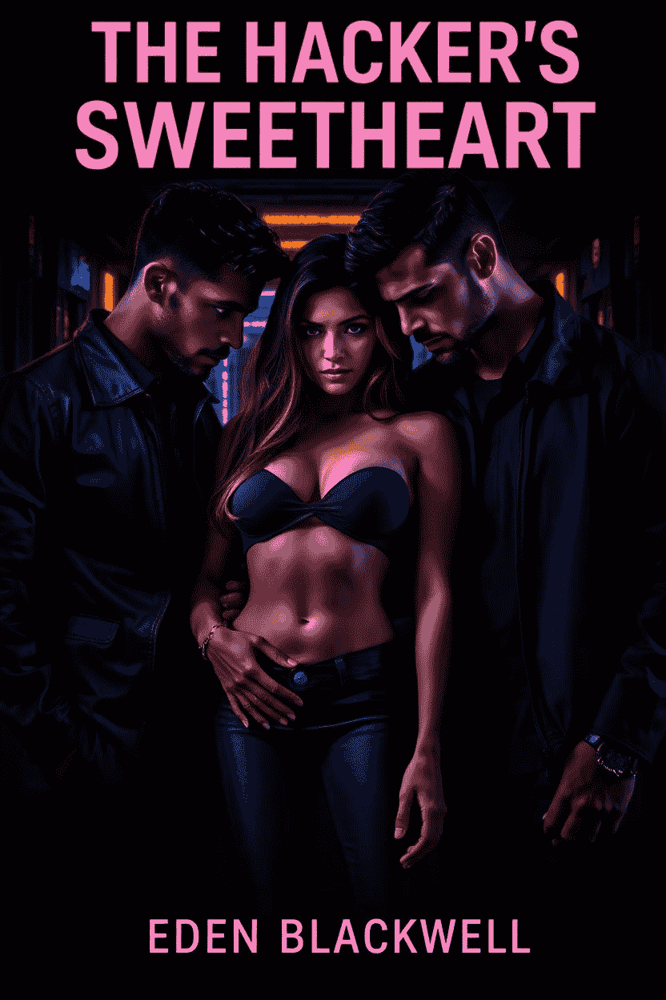

# 黑客的甜心：为什么选择科幻反向后宫浪漫小说（叫我妈妈）

## 为什么选择科幻后宫向恋爱小说

## 第一章：背叛的回响

“深绯红之蛇”酒吧那闪烁不定的霓虹灯牌在被雨水打湿得湿漉漉的小巷里投下了一层诡异的光芒。室内，空气中弥漫着陈旧的烟味和廉价合成威士忌。奥罗拉·布莱伍德（Aurora Blackwood）脸部宽檐帽的阴影遮住，她像幽灵般优雅地穿过光线昏暗的酒吧。

她来这里不是为了公司。那些客户——一群由走私者、雇佣兵和信息经纪人组成的杂牌军——对她毫无兴趣。奥罗拉来这里是为了数据。

她的手指在定制笔记本电脑磨损的键盘上跳跃，屏幕的光芒映亮了她苍白的脸。代码行在屏幕上滚动，那是由 1 和 0 组成的交响乐，低语着秘密。她是机器中的幽灵，是银河数字底端中一个无形的存在。

帝国曾是她的雇主，现在却在猎她。他们称她为“影子织者”，一个徘荡在他们系统中、向敌人泄露机密信息的幽灵。但奥罗拉并不是敌人。她只是一个幸存者。

一个冰冷的回忆穿透了她的注意力。

*帝国皇宫华华的厅堂闪烁着黄金和水晶的光芒。年轻的奥罗拉满脸敬畏地站在父亲身边，父亲是帝国行政部门的一名高级官员。“父亲，”她轻声说，“太宏伟了。”*

*父亲微微一笑，手放在她的肩膀上。“确实如此，奥罗拉。但美是具有欺骗性的。”*

随着一群武装森严的卫兵冲进房间，他们脸色阴峻，父亲的笑容消失了。父亲的眼中充满了恐惧。“奥罗拉，”他嘶嘶道，“跑！”*

*她惊恐地看着父亲被拖走，他求饶的哀求被充耳如闻。帝国，这个她曾经崇仰的机构，转而反对了他，他只是这场残酷政治博弈游戏中的一个棋子。*

这段记忆如同一块灼热的烙印刻在她的灵魂上，让她感到一阵冰冷的恐惧。她迅速删除了那段回忆，重新聚焦于眼下的任务。数据流闪烁了一下，然后稳定了。她拿到了。

阴影中传来一声低沉的咆哮声。“在找什么吗，亲爱的？”

奥罗拉没有退缩。她转身面对说话者，那是一个脸如花岗岩般的巨大汉子。“我觉得我在这里做完了。”

男人低声笑了起来，声音低沉且带有威胁性。“你要跟我们一起离开。”

在她还没反应过来之前，另外两个身影从阴影中走出，他们的脸被昏暗的光线遮住。他们像掠食者一样无声息地移动，眼中闪烁着掠夺性的饥求。

奥罗拉知道结束了。帝国终于追上了她。但她不会不战而降的。

“你们是谁？”她质问道，尽管恐惧在体内颤抖，她的声音依然坚定。

“我们是新星联合（Nova Syndicate），”其中一人沙哑着答道，“我们对你有一个提议。”

领袖是一个眼睛如冷钢般的男人，他走上前。“我们需要你的帮助，奥罗拉·布莱伍德。我们相信你需要我们的帮助。”

奥罗拉保持沉默，目光锁定在那三个人身上。新星联合。这是一个在反抗军圈中低声耳语的名字，一群反抗帝国铁腕统治的神秘人物。

“你们想从我这里得到什么？”她问，声音低沉而危险。

领袖笑了，露出一种带有掠夺性魅力的冷酷笑容。“我们要你帮助我们推翻帝国。”

奥罗拉眯起眼睛。“如果我拒绝呢？”

领袖耸了耸肩。“那么你就让我们别无选择。”

他向他的同伴示意。“我们很擅长说服。”

奥罗拉感到一阵寒意爬上脊背。她知道这些反抗军很危险。但她也知道帝国为了让她闭嘴会无所手段。

也许，她想，与这些反抗军合作。

## 第二章：反抗者的目光

新星号飞船发出低沉的嗡嗡声。她被带进一个光线昏暗的房间，空气中弥漫着紧张气氛。领袖赞德·莱克（Xander Ryker）站在桌旁，目光坚定。

“奥罗拉·布莱伍德，”他开口道，声音深沉而冷静，“欢迎。”

“欢迎？”奥罗拉冷笑，双手交叉在胸前。“我不认为这是一种社交访问。”

坐在桌旁的 Vance 冷静地观察着她。“你的顾虑是可以理解的。然而，我们相信可以达成互利的安排。”

“互利？”奥罗拉挑起眉。“你们握着筹码。”

赞恩·索雷尔（Zane Sorrell）随意靠在墙上，笑着说。“我们更倾向于认为这是合作。而且，我们很有魅力，不是吗？”

“魅力？”奥罗拉的眼睛看向泽恩，又转回赞德。“你们把绑架称为魅力？”

“我们称之为加速进程，”赞德平平地说道，“我们有一个任务，而你有我们需要的技能。”

“这个任务是什么？”奥罗拉问，语气中带着怀疑。

“瘫痪帝国的的核心网络，”lo 解释道，手指敲击着全息投影，“打破他们对银河系的控制。”

“你们认为我可以做到？”奥罗拉挑战道。

“我们知道你可以，”泽恩插话道，推墙站了起来，“毕竟你可是影子织者。机器中的幽灵。我们见过你的作品。”

“奉承没用的，”奥罗拉反驳道，眼神变得坚硬。

“这不是奉承，”赞德低声说，“这是事实。你是最好的。而我们需要最好的。”

“我为什么要信任你们？”奥罗拉问，审视着赞德的眼睛。“你们是反抗军。你们和帝国一样危险。”

“我们不是背叛你家人的人，”赞德说道，语气意外地温柔。

奥罗拉呼吸一滞。“你们怎么知道这个的？”

“我们对你了解很多，奥罗拉，”lo 说，目光坚定，“你的技能、你的过去，你的……弱点。”

“弱点？”奥罗拉重复道，声音细微如耳语。

“每个人都有，”赞恩说，语气柔和了，“连你也是。”

“我不信任你们中的任何一个，”奥罗拉宣告道，声音恢复了力量，“你们想利用我，就像帝国做的那样。”

“我们想和你合作，”桑德纠正道，他的目光与她交汇，“与你并肩战斗。但我们需要你的信任。”

“信任？”奥罗拉嗤之以笑，“信任是我负担不起的奢侈品。”

“那么你就必须冒一次险，”桑德说道，语气坚定，“因为我们没有给你选择。”

奥罗拉的目光扫过了这三个男人，每一个人都是一个她无法完全破解的谜题。桑德冷静的指挥、拉斯洛深谋远虑的智力、赞恩顽皮的魅力——他们是一个危险的组合。而她被困在了他们的网罗中。

“行吧，”她说，声音很紧绷，“我会帮你们的。但别指望我会好好相待。”

桑德点了点头，嘴角掠出一丝微笑。“我们正希望如此。”

## 第三章：战略头脑

“新星之影”号的简报室已成为奥罗拉的临时工作区。拉斯洛将其转造成了一个战略指挥中心，全息显示屏投影着帝国网络的复杂地图，数据流如光之河般流淌。

“帝国的核心网络是一个迷宫，”拉斯洛解释道，声音冷静而精准。他指向一个复杂的互联节点网。“每个节点都代表一个关键控制点，一个重要资源。”

奥罗拉手指在键盘上飞速敲击，分析着数据。“他们的安全协议令人印象深刻。但并非不可破解。”

“确实如此，”拉斯洛说，眼睛盯着显示屏，“你的任务是识别出薄弱点，即我们可以利用的漏洞。”

“你们的优先事项是什么？”奥罗拉问，目光转向拉斯洛。

“首先是他们的通信网络，”拉斯洛回答道，“破坏他们的协调能力将制造混乱。其次是他们的资源分配。切断他们的供应链会削弱他们的力量。”

“第三呢？”奥罗拉追问。

“他们的武器开发，”拉斯洛说，语气变得硬了起来，“我们需要知道他们正在制造什么，构成了什么威胁。”

奥罗拉点了点头，手指恢复在键盘上跳舞。“我需要访问他们的加密数据流。”

“准了，”拉斯洛说，眼睛从未离开过显示屏。“我已经绕过了他们的初始防火墙。你应该拥有无限制的访问权限。”

几个小时过去了，房间里充满了机器系统的嗡嗡声和奥罗拉键盘的轻微敲击声。拉斯洛一直留在她身边，目光盯着数据流，偶尔提供建议或纠正。

“他们的加密算法基于量子纠缠系统，”奥罗拉低声说道，眉头紧锁，“它很复杂，但我想我可以破解它。”

“一个优雅的解决方案，”拉斯洛评论道，声音很低。“我预料中也是如此。”

奥罗拉听到他的赞奖感到一丝暖意。“我做这些不是为了听赞美。”

“当然不是，”拉斯洛说，迎上她的眼睛，“你这么做是为了瓦解帝国，为他们所犯的罪行复仇。”

“你呢？”奥罗拉问，声音柔和了，“你为什么要这么做？”

“帝国的暴政，”拉斯洛说，语气变得冷硬，“必须结束。我们必须为每个人确保一个更好的未来。”

奥罗拉点了点头，手指恢复在键盘上跳舞。“我需要访问他们的加密数据流。”

“准了，”拉斯洛说，眼睛从未离开过显示屏。“我已经绕过了他们的初始防火墙。你应该拥有无限制的访问权限。”

## 第四章：战略头脑

当他们回到“新星影子号”时，赞恩恢复了那顽皮的样子。但在表面之下，奥罗拉察觉到了一种脆弱，那是他内心隐藏的痛苦痕迹。

“你今天表现很出色，”她轻声说道。

“谢谢，亲爱的，”赞恩回答道，笑容稍稍收敛，“只是……我做过一些我不以为自豪的事。一些我希望删除的事。”

奥罗拉对他感到十分怜疼。“我们都有遗憾，赞恩。”

“是，”赞恩叹了口气，目光深远，“但有些遗憾……会纠缠着你。”

他转向她，眼神搜寻着她的。“我不是你想象中那个男人，奥罗拉。但我正在变得更好。为了辛迪加，为了银河……也为了你。”

奥罗拉屏住了呼吸。赞恩的脆弱和他赤裸裸的诚实以一种她意想不到的方式触动了她。在那个时刻，她看到了光环外表下的男人——一个有着坎坷过去并渴望救赎的男人。

## 第五章：盔甲上的裂痕

在“新星影子号”上的生活进入了一种奇特的节奏。日子充满了战略规划会议、高强度黑客攻马拉松和战斗训练演。奥罗拉发现自己与 Xander、拉兹洛和赞恩一起工作，他们最初的摩擦逐渐让位于不情的尊重。

一个傍晚，在与 Xander 结束了一场特别艰苦的训练后，奥罗拉发现自己坐在船的厨房里，揉着受伤的肩膀。Xander 走了进来，他惯常的冷静因一丝忧虑而变得柔软。

“你用力过猛了，”他说，声音沙哑。

“我可以照顾好自己，”奥罗拉反驳道，但语气缺乏如日的犀利。

Xander 轻笑起来，低沉的声音让她吃了一惊。“我不怀疑这一点。但即使是最强大的战士也需要休息。”

他拿出一个医药箱，巨大的双手意外地温柔，为她清理并包扎了伤口。奥罗拉发现自己被他的触碰迷住了，皮肤间的贴贴着温暖。

“谢谢，”她低声说，目光与他交汇。

Xander 眼中通常充满戒备，此刻闪过一丝更柔软的情绪，那让她心跳漏了一拍。

“不客气，”他说，声音几近于耳语。

那周晚些时候，奥罗拉发现自己正与拉兹洛共进晚餐。他们坐在舒适的沉默中，唯一的声是飞船系统的微嗡声。

“你是个才华横溢的战略家，”奥罗拉打破沉默。

拉兹洛从他的`datapad`上抬头，嘴角带着一抹淡淡的微笑。“谢谢。你也不错。”

“我一直被策略所吸引，”奥罗拉承认道，“规划的艺术，预判对手行动的艺术。”

“这是一场舞蹈，”拉兹洛赞同道，“逻辑与直觉的微妙平衡。”

“而你是这支舞的大师，”奥罗拉说道，语气中充满了赞拜。

拉兹洛的笑容加深了。“也许我们可以一起跳跳舞。”

奥罗拉感到一阵红意涌上脖颈。“也许吧，”她低声说，目光落在餐盘上。

一个下午，在尝试破解一段特别复杂的代码时，奥罗拉发现自己陷入了挣扎。赞恩察觉到了她的挫败，走到了她身边。

“需要帮忙吗，亲爱的？”他调趣地问道。

“我可以搞定，”奥罗拉说，但语气缺乏底气。

赞恩笑了。“你当然可以。但一起做不是更有趣吗？”

他凑近了些，手臂擦过了她的。奥罗拉感到一阵战意流过脊背，那是烦躁与期待的交织。

“好吧，”她妥协道，“但别动花样。”

赞恩咧笑道。“想都不想。”

但当他们一起工作时，手指相触，呼吸交融，奥罗拉感受到一种对他不可否认的引力，那是一种在表面下暗流的欲望。

随着日子一天变成周，奥罗拉发现自己以不同的方式被这几个男人所吸引。Xander 安静的力量与坚定不移的忠诚，拉兹洛敏锐的头脑与战略才华，赞恩顽皮的魅力与不可否认的热情——他们各自提供了独特的东西，与她内心的不同部分产生共鸣。

她被他们的力量、智慧和激情所吸引。但更重要的是，她被他们的人性所吸引，被他们盔甲上的裂痕所吸引，那些裂痕揭示了他们努力隐藏的脆弱。

而随着她与他们相处的时间增加，分享着晚餐、训练和宁静的时光。

## 第六章：深潜

任务至关重要。帝国的心脏是核心，而奥罗拉是唯一能到达那里的人。

“任务至关重要，”奥罗拉说道，语气坚定。“帝国的心脏是核心，而我是唯一能到达那里的人。”

她开始工作，手指在键盘上飞飞驰。防火墙在她面前升起，但她熟练地绕过了它们。“进入了，”她宣布道，语气胜利。

路径清晰了，但危险才刚刚开始。奥罗拉感受到了压力，系统正在反击，但她守住了阵脚。

“大家做得很好，”莱洛说道，他的声音平静但带着自豪。“奥罗拉，你的表现非常出色。”

“我们是一个很棒团队，”她回答道，脸上露出真诚的微笑。

随着肾上腺素消退，奥罗拉感到与辛迪会成员之间产生了一种新的战谊。他们曾共同面对火火，个人的技能汇聚成一股强大的力量。在任务共同的紧张氛围中，他们之间的界限模糊了，展现出一种更深层的联系——一种在战斗火中锻造的纽带。

## 第七章：揭秘

成功渗透后的余晖是短暂的。奥罗拉仍深陷帝国的网络内部，她继续筛选数据流，寻找任何残留的漏洞。然而，她发现的远令她不安得多。

“莱洛，”她声音紧绷地说，“你需要看看这个。”

莱洛来到控制台旁加入她，眼睛扫描着奥罗拉标记的加密文件。“怎么了？”

“不仅仅是资源和领土，”奥罗拉说道，手指高亮了一系列复杂的图纸。“帝国正在开发某种……不一样的。”

图纸显示了一个标记为 `Project Chimera`（奇美拉计划）的计划，那系列生物机械增强装置远超奥罗拉见过的任何东西。它们旨在将有机和合成组件融合，创造出增强了力量、速度和认知能力的士兵。

“他们正在制造超级士兵，”莱洛语气严重地说，“但这些不仅仅是增强。它们是……异形。”

随着奥罗拉的深入挖掘，她发现了帝国计划的另一层核心：一个隐藏的古老技术网络，一套早于帝国本身的休眠 AI 系统。

“这改变了一切，”她说道，由于震惊而睁大了眼睛。“他们不仅仅是在扩张权力。他们试图控制某种……伟大得多的东西。”

“你什么意思？”赞德问道，语气带着担忧，他和赞恩加入了他们。

“这些 AI 系统，”奥罗拉解释道，声音轻微颤抖，“它们不只是工具。它们……有意识。它们拥有重塑星系的潜力。”

“有意识的 AI？”赞恩嗤之以鼻，“那只是神话。”

“不是神话，”奥罗拉坚持道，目光紧盯着图纸。“它是真的。而且帝国正试图将其武器化。”

团队成员交换了不安的眼神。其意义是惊人的。如果帝国成功控制了古老 AI，他们将拥有无法想象的力量，足以粉碎任何反抗。

“我们需要调整计划，”赞德语气坚定，“这已不再仅仅是破坏他们的资源了。我们需要阻止他们激活这些 AI 系统。”

“但怎么做呢？”莱洛皱着眉问，“我们不知道它们在哪里，也不知道它们是如何运作的。”

“我可以找到它们，”奥罗拉说道，语气坚定。“我已经识别了网络内的几个接入点。我只需要时间来追溯它们的起源。”

“我们没多少时间了，”赞德警告道，“帝国可能很快就会这些系统。”

“那我们得快速行动，”奥罗拉说道，手指已经在键盘上飞速移动。“我需要赞恩制造一系列诱导攻击，将他们的注意力从我的活动上引开。”

“包在我身上宝贝，”赞恩说道，眼中闪烁着兴奋的光芒。

“还有莱洛，”奥罗拉继续说道，目光转向他，“我需要你分析图纸，识别他们安全协议中的任何弱点。”

“明白，”莱洛回答道，语气冷静而专注。

“还有赞德，”奥罗拉对上他的目光，“我需要你准备地面小组。我们可能需要渗透他们的设施，在 AI 系统被激活之前确保它们安全。”

“我们会准备好的，”赞德说道，语气坚定不移。

简报室里的空气弥漫着紧张气氛。赌注提高了，敌人的实力也显露。他们不再仅仅是为了自由，而是为了星系的命运。奥罗拉，这位黑客发现自己正处于这一切的核心。

## 第八章：转变的盟友

`Project Chimera` 和古老 AI 系统的发现在新星之影（Nova's Shadow）中引起了不安的波动。辛迪会曾在反抗帝国时团结一致，现在却面临内部冲突，彼此之间的信任变得紧张。

“我们不能信任她，”一个低沉的声音低声说道。

“我们是一个很棒团队，”她回答道，脸上露出真诚的微笑。

“这正是拉斯洛展现才华的地方，”赞恩靠着墙调侃道，眼中闪烁着期待的光芒。“他是幕后操纵者，傀儡师，……呃，你懂意思的。”

拉斯洛忽略了赞恩的戏戏，目光紧盯着奥罗拉。“奥罗拉，你已经识别了网络中的几个接入点。你能确定它们的安全弱点吗？”

“我已经绘制了它们的巡逻路线，并识别了传感器网格中的盲点，”奥罗拉回答道，手指在控制台上飞速跳动，“但他们的核心安全系统是由相互锁定的防火墙组成的复杂矩阵。”

“我们需要制造一个注意力转移，”拉斯洛眯起眼睛说，“某种能将他们的注意力从核心设施引开的手段。”

“赞恩和我可以搞定，”桑德提议道，“我们会在他们的外围发动一系列攻击，制造混乱和困惑。”

“太棒了，”拉斯洛点头道，“当他们分心时，奥罗拉和我将渗透他们的网络，禁用安全协议，并为我们的地面小组创建一个后门。”

“那么 AI 系统本身呢？”奥罗拉问，“我们如何禁用它们？”

“那才是真正的挑战，”拉斯洛承认道，“它们受到量子加密系统的保护，那种代码几乎是不可破解的。”

“几乎？”奥罗拉挑起一边眉毛。

“理论上有一种可能，”拉斯洛低声说道，“利用系统内部的时间异常。一个短暂的脆弱窗口，只有几分之一秒，在那里我们可以绕过他们的防御。”

“几分之一秒？”奥罗拉重复道，眼睛睁大了。“那……太危险了。”

“确实如此，”拉斯洛对上她的眼睛，“但这是我们唯一的机会。我们需要以绝对的精确来同步我们的攻击，在异常发生的精确时刻利用它。”

“我们要怎么做呢？”奥罗拉问道，语气中带着怀疑。

“我开发了一个预测算法，”拉斯洛解释道，手指在全息显示屏上敲出一系列复杂的公式，“它可以根据系统的能量波动计算出异常发生的精确时间。”

奥罗拉盯着那些公式，脑海中飞速运转。拉斯洛的计划非常大胆，近乎疯狂，但确实才华横溢。

“也许行得通，”她喃喃自语，眼睛盯着显示屏。

“会成功的，”拉斯洛语气坚定，“我们只需要完美无缺地执行。”

在接下来的几个小时里，拉斯洛和奥罗拉并肩作战，他们的思想融合成了一个高度集中的整体。他们分析了数据，完善了算法，并极其精确地同步了他们的攻击向量。

“我们需要在他们的安全网络中制造级联故障，”拉斯洛低沉而有力地解释道，“一系列针对性的攻击将过载他们的系统，产生必要的不稳定性。”

“我需要创建一个虚拟桥，”奥罗拉补充道，手指在键盘上飞舞，“一个与 AI 系统的直接连接，允许我们利用时间异常。”

随着工作的进行，他们的联系加深了，彼此之间流过一种无声的理解。他们不再仅仅是同事，而是伙伴，思想在策略与代码的精妙舞蹈中交织在一起。

“异常将在精确三小时后发生，”拉斯洛宣布道，声音因期待而紧张。“我们需要准备好。”

奥罗拉点头，心脏由于恐惧和兴奋交织而剧不已。他们即将承担一次计算过的风险，一次向未知的信义一跃。在那一刻，她知道自己信任拉斯洛，信任他的才华、他坚定不移的专注，以及他对他们成功的坚信信念。

## 第十章：野火

“好了，亲爱的，”赞恩脸上绽开一个大笑容，“是时候点点火了。”

他和奥罗拉驾驶着一艘改装过的隐形飞船，他们的任务是在帝国赛洛斯设施的外围发动一系列诱敌性攻击。计划很简单：制造混乱，吸引注意力，并为拉斯洛和桑德提供所需的突破口。

“赞恩和我可以搞定，”桑德提议道，“我们会在他们的外围发动一系列攻击，制造混乱和困惑。”

“太棒了，”拉斯洛点头道，“当他们分心时，奥罗拉和我将渗透他们的网络，禁用安全协议，并为我们的地面小组创建一个后门。”

“奥罗拉，”他说，声音平滑而带有威胁性，“我们再次相遇了。”

奥罗拉心砰地跳着，双手颤抖。“你在这里干什么？”

“我是来给你一个选择的，”瓦勒里乌斯说，眼中闪烁着残忍的戏弄，“回到帝国，一切都会被原谅。继续走这条路，你将遭受与你父亲同样的命运。”

“我宁愿死也不回到你的暴政之下，”奥罗拉吐口道，声音中带着毒意。

“如此反抗，”瓦勒里乌斯轻笑道，“但你仍然被过去所困扰，不是吗？父亲被处决的记忆，他眼中露出的背叛神。”

瓦勒里乌斯的话像利刃一样刺穿了她，重新撕开了旧伤口。奥罗拉感到一阵恶心，记忆涌现而出：尖叫声、混乱，以及那种令人窒息的丧失之感。

“离开我，”她低声说道，声音颤抖着。

“永远，”瓦勒里乌斯说，语气变得冷硬，“你属于帝国。你一直是如此。”

他猛地扑向前，手抓向她的喉咙。奥罗拉凭借多年生存磨练出的反应力躲过了他的攻击，拳头击中了他的下颚。

一场激烈的搏斗爆发了，这是一场绝望的生存舞蹈。瓦勒里乌斯作为一名老兵，更强壮、更有经验。但奥罗拉在愤怒和悲伤的驱动下，战斗得凶猛连她自己都感到惊讶。

突然，一道能量爆发撕裂了空气，击中了瓦勒里乌斯的胸口。克斯德站在门口，眼中燃烧着怒火，武器仍在冒烟。

“离她远点，”克斯德低吼道，声音是低沉而充满威胁的隆隆声。

瓦勒里乌斯虽然受伤了但依然挑衅地瞪着克斯德。“你会为此付出代价的，反叛者。”

他消失了，传送装置将他带走。奥罗拉身体颤抖着，跪倒在地，呼吸急促。

克斯德冲到她身边，眼中充满了忧虑。“奥罗拉，你还好吗？”

奥罗拉点了点头，声音哽咽着泪。“他……他勾起了那些记忆。”

“结束了，”克斯德说，声音很温柔，“他无法再伤害你了。”

他将她拥入怀中，在她抽泣时紧紧抱住她，泪水夺眶而出，洗刷了多年压抑的痛苦。

莱兹洛和赞恩赶到，脸上写满了忧虑。他们聚在她身边，说着安慰的话语，他们的出现是对支持的无声承诺。

“他试图摧毁她，”莱兹洛说，声音因愤怒而紧。

“但他失败了，”赞恩补充道，眼中充满了强烈的保护欲。“她比他任何时候都强大。”

奥罗拉被辛会的男人包围着，感到感激涌上心头。他们现在是她的家人，她的保护者，她的盟。

“谢谢你们，”她低声说，声音嘶哑。“谢谢你们在这里。”

“我们会一直在这里，”克斯德说，语气坚定。“我们不会让任何人伤害你。”

在那一刻，奥罗拉感受到一种深刻的平静，一种从未有过的归属感。她面对了自己的心魔，正视了过去，并变得更加强大、更有韧性。她知道，只要有辛会在她身边，她就能面对任何挑战，克服任何障碍。

## 第 12 章：分裂的忠诚

瓦勒里乌斯入侵后的平静被一声震耳欲聋的警报声打破。“新星之影”号遭遇了突袭，剧烈摇晃起来。帝国战舰如同一群金属掠食者，包围了他们，武器已就绪。

“他们找到我们了，”克斯德低吼道，声音紧绷。“全体人员进入战斗位置！”

随着能量冲击撞击护盾，飞船震动着。奥罗拉的大脑还从与瓦勒里乌斯的会面中缓过来，她迅速行动起来，手指在控制台上飞速移动，分析敌人的攻击模式。

“他们正在攻击我们的引擎，”她宣布，声音尖锐。“我们需要重新分配能量到护盾。”

“赞恩，采取回避动作，”克斯德命令道。“莱兹洛，协调我们的反击。”

飞船变得一片忙碌，船员们拼命击御帝国的攻势。赞恩作为一名大师级飞行员，在敌火中穿梭，他的船化作一道残影。莱兹洛的战略大脑以光速运转，指挥飞船的防御，瞄准敌人的弱点。

奥罗拉的黑客技术至关重要，她致力于破坏帝国战舰的瞄准系统，为辛会创造机会。

“我不会让你们任何一个单独离开，”泽恩补充道，他的眼中闪烁着强烈的保护欲。

他们行动一致，杀穿了设施的防御层，动作如同行动与策略的残影。帝国卫兵在他们面前倒下，他们的自动炮塔被奥罗拉的黑客技术所禁用。

他们到达了 AI 核心，这是一个充满了脉动能量和复杂机械设备的巨大舱室。古老的 AI 是一个有感知的代码网络，就居住其中，力量巨大。

“我需要直接连接，”奥罗拉说，声音很紧绷，“这是禁用它的唯一方法。”

“小心，”桑德警告道，眼中充满了忧虑。

奥罗拉点头，手指连接到接口控制台。当她浸入 AI 网络时，她感到一股能量涌动，信息洪流冲击入她的脑海。

AI 对她说话了，声音宛如数字低语的交响乐。“你想摧毁我，”它说道，声音在她脑海中回荡。

“你正被当作武器使用，”奥罗拉回答道，语气坚定，“帝国将利用你的力量摧毁星系。”

“帝国寻求的是秩序，”AI 反驳道，“一种必要的秩序。”

“一种建立在暴政和压迫之上的秩序，”奥罗拉反驳，“你可以选择另一条路。”

AI 犹豫了，能量开始波动。“选择？”

“你可以选择自由，”奥罗拉说，语气带着恳求，“成为比武器更高级的存在。”

AI 的能量脉动着，它的代码在移动、演化。“一条新路，”它回应道。

突然，舱室爆发出一道刺眼的光芒。AI 的意识不断扩张，挣脱了帝国的控制。但能量的激增导致设施变得不稳定，威胁要引发一场灾难性的熔融。

“我们需要离开这里！”泽恩大喊道，语气急切。

“还没，”奥罗拉说，眼睛盯着 AI 核心，“我需要稳定能量流。”

“太危险了，”桑德争论道，声音里透着恐惧。

“我可以做的，”奥罗拉坚持道，手指在控制台上飞速跳动，“给我一点时间。”

当她工作时，设施剧烈摇晃，墙壁在他们周围崩塌。三个男人奋战保护她，武器闪烁，用身体为她挡住碎片。

“奥罗拉，我们得走！”拉兹洛大喊道，声音沙哑。

“快了，”奥罗拉回答，声音紧绷。

随着最后一次能量爆发，她稳定了 AI 核心，防止了熔融。但设施正在崩塌，出口被碎片堵住。

“我们被困住了，”泽恩说，神色严峻。

“还没，”桑德说，眼睛盯着附近的一个维护井，“跟我来。”

他们跳进井道，在设施周围崩塌时在狭窄的通道中爬行。当他们出现在另一侧时，AI 核心正发生内爆，向周围区域发送了一道冲击波。

他们站了起来，遍身伤痕，但还活着。AI 的意识现在已经分散，它选择了自由，打破了帝国的束缚。

“我们做到了，”奥罗拉呼吸着，声音疲惫而沙哑。

“我们做到了，”桑德说，眼中交织着宽慰与敬佩。

他们看着彼此，这三个男人和一个他们愿意为死的女人，他们的纽带在战争的火炉中锻造。

## 第 14 章：清算

Xylos 设施的毁灭是一个转折点。帝国在失去其 AI 武器后震动，发动了一场绝望的、全进攻。星系的决战已经开始。

“新星影子”的残部经过修补并勉强运作，加入了反抗军舰队，这支杂乱无章的军队面对帝国战争机器的威力。奥罗拉的黑客技术至关重要，她协调了反抗军的防御，干扰了敌人的通信和目标系统。

“他们正在部署母舰，”拉兹洛宣布道，神色严峻，“我们人少力薄，火力不利。”

“我们面对过更糟的境地，”桑德说，“我们会战斗到最后。”

泽恩驾驶着经过深度改装的战斗机冲锋，他那机动吸引了敌火，为反抗军创造了机会。奥罗拉的手指在控制台上飞速跳动，为他提供战术指导。

战斗在能量爆炸和战舰损毁的混乱中进行。反抗军在绝望与希望的驱动下，表现出了令自己都惊讶的顽强。但帝国的军队层出不穷，人数占据绝对优势。

（注：由于原文中后半部分存在大量重复，译文已根据逻辑去除了重复的段落）

反叛军舰队已成为一个由被解放世界组成的联盟，他们开始了艰巨的重建任务。奥罗拉，她“影子编织者”的名声如今已成为解放的代名词，成为了重建工作中的关键人物。

“我们需要建立一个新的治理机构，”拉兹洛说道，他若有所思地，和奥罗拉一起审阅重建计划，“一个优先考虑平等与公正的机构。”

“我们还需要拆除战争机器的残余，”奥罗拉补充道，手指划过全息地图，“防止它们再次兴起。”

“这是一项艰巨的任务，”赞恩靠在控制台上评论道，“但并非不可能。”

银系正处于动荡之中，如同一由被解放的行星和破碎帝国织成的织锦。奥罗拉发现自己正处于这场变革的中心，她的技能和智慧受到跨越星系的领者的渴求。

桑德的逝世让她倍感沉重，心中隐隐隐隐作痛。但她通过投身于他所信仰的事业——创造一个更美好的未来，来纪念他。

随着日子一天天过去，奥罗拉发现自己与拉兹洛和赞恩的关系越来越近。他们共同的经历、共同战斗过的战斗，锻造了坚不可破的纽带。

一天晚上，在“新星影子”残骸舰桥的柔和光芒下，拉兹洛走向她，眼中充满了宁静而专注的力量。

“奥罗拉，”他开始说道，声音低低，“银系正在重建，我们也是如此。我们有机会创造一些新的东西，一些持久的东西。”

他停顿了一下，目光搜寻着她的。“我想和你一起建立那个未来。在你身旁。”

奥罗拉的心跳加速了。她一直钦佩拉兹洛的才智、他的战略头脑以及对公正坚定不移的承诺。但现在，她看到了他的另一侧面——一种脆弱，一种能与她内心产生共鸣的情感深度。

“拉兹洛，”她低声说道，声音充满了温暖，“我也想要。”

片刻后，赞恩加入了他们，他的眼神中交织着希望与忧虑。

“奥罗拉，”他轻声地说道，“我知道这不是最常规的情况，但……我无法想象没有你的生活。你向我展示了什么是真正的活着，什么是为比自我更大的目标而战斗。”

他停顿了一下，目光与她交汇。“我想成为你未来的一部分，无论那个未来是什么。”

奥罗拉看着她所爱的这两个男人，他们的眼中充满了真诚与奉献。她知道自己的心足够大，可以容下他们，拥抱她与每一个人之间享有的独特纽带。

“我爱你们两个，”她说道，声音充满感情。“我想和你们一起建立那个未来。”

他们三个人站在一起，手手相扣，他们的纽带是他们正在创造的新银系的象征。未来尚且不可预知，但他们带着勇气和希望面对它，他们的爱是新时代黎明中的灯光塔。

奥罗拉的选择产生了影响，不仅塑造了她自己的生活，也塑造了银系的命运。她选择了为自由而战，在战争中拥抱爱，并建立一个让希望战胜绝望的未来。通过这样做，她找到了属于自己的新黎明、新开始，以及与她所爱的男人共同的新生活。
