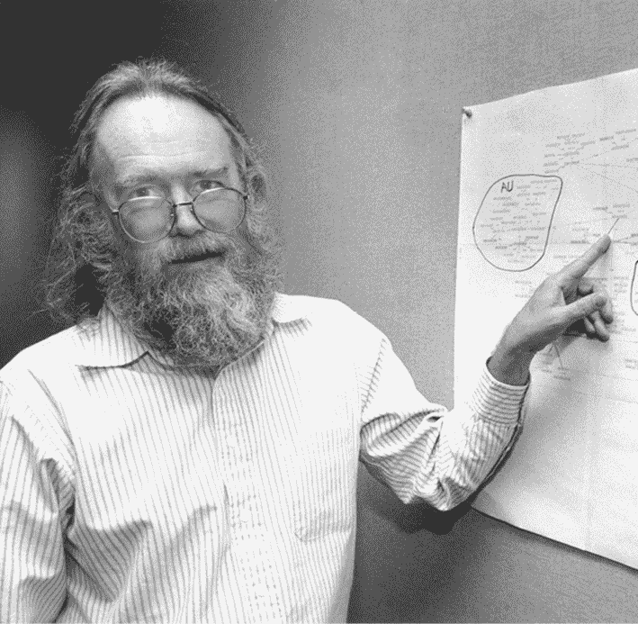
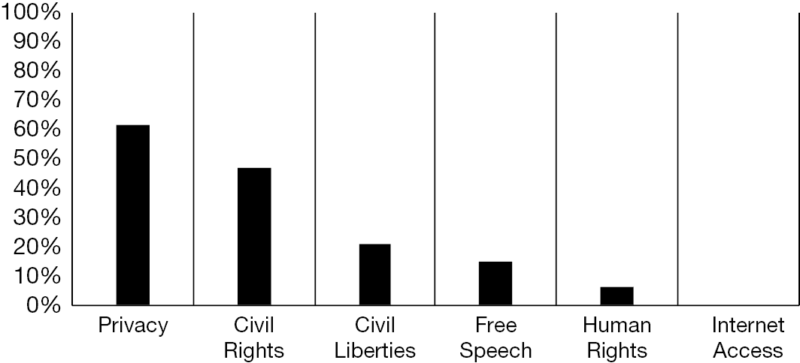

# 物联网：人人必备知识指南

*致 Cora*

### 前言

我们中的许多人在日常生活中，完全——有些人可能会说是天真地——没有意识到，我们周围充斥着大量运行在各种连接平台上的设备，它们正在记录我们的物理存在、声音、心跳和偏好。¹ 环顾四周。除了你的电脑、平板电脑或智能手机，你看到的有多少“东西”可能直接或间接地连接到了互联网？² 你是否佩戴着 Fitbit、Apple Watch，或者正在使用 Airpods？Alexa 在附近吗？那连网的冰箱、烤箱或智能洗衣机呢？最近的 Wi-Fi 连接门铃、灯泡、打印机或尿布有多远？³ 你的供暖、空调和安防系统呢？现在，你知道这些设备中的每一个正在忙碌地记录什么数据吗？或者这些数据是如何被使用或保护的？至于设备本身——你是否信任它能持续且安全地运行？这重要吗？

围绕物联网（IoT）有着大量的讨论，简单来说，物联网的概念是：我们物理世界中几乎所有东西——从健身短裤到路灯，再到婴儿监视器、电梯，甚至我们自己的身体——都将相互连接。⁴ 万物互联（IoE）（思科帮助开创的一个术语）将这一概念进一步推进，它不仅指智能设备和服务的物理基础设施，还指它们对人、企业和社会的影响。⁵ 因此，万物互联可以理解为“人、流程、数据和事物的智能连接”，而物联网的概念通常更局限于“通过互联网访问的物理对象网络”。⁶ 换句话说，物联网关注的是充斥我们家庭和工作场所的智能设备，而万物互联不仅考虑这些产品，还考虑它们对商业、文化和社会的影响。它模糊了现实世界与网络空间之间的界限，创造了一个单一的、高度互联的现实，充满了新的机遇和风险。

正如科技先驱凯文·阿什顿所说：“物联网真正关乎的是能够自行收集信息的信息技术。它处理这些信息后，通常不是告诉人类某件事，而是[直接]去做某事。”⁷ 这种更广阔的视角对于考虑智能设备在社会及我们生活中普及所带来的诸多安全、隐私和治理影响至关重要。不过，应该指出，对这一理念还有其他理解。它也被称为“互联网+”，⁸ 而像前 Alphabet 首席执行官埃里克·施密特等人则认为，随着智能设备日益普及，互联网本身在未来将几乎消失。⁹ 但鉴于人们对日益扩大的数字鸿沟的担忧（这在一定程度上由关于 5G 部署的辩论所助长），这种结果也并非必然。

物联网设备和服务的兴起，以及日益增强的智能（例如自动驾驶汽车）¹⁰ 的嵌入，可能会改变我们花费时间的方式，以及企业和社会的运作方式，尤其是在大规模部署时。目前已有数十亿台联网设备在使用——其数量已超过地球上的人口——而且，尽管估计各异，未来几年还将有数十亿台设备投入使用。简而言之，互联网连接的事物将出现令人瞠目结舌的爆炸式增长。应用程序似乎无穷无尽，涉及一系列消费品和其他行业。¹¹ 工业物联网（IIoT），有时也被称为“物联网工厂”或“智能工厂浪潮”，只是这一向“嵌入式信息空间”发展趋势的一个方面，它涉及在制造应用中使用物联网技术。¹² 物联网普及带来的财务影响也将是重大的；例如，麦肯锡咨询公司估计，物联网（或更技术化的社区可能描述为“事物网络”）¹³ 的经济影响将在 2025 年达到 6.2 万亿美元。¹⁴

万物互联之所以带来如此巨大的思维转变，部分原因是正在产生、存储和处理的海量数据。根据前联邦贸易委员会主席伊迪丝·拉米雷斯的话：“我们现在生活在一个数据不断被收集的世界……我们将这些设备带入我们的家庭，带入曾经是私人领域的空间，而产生的数据变得越来越敏感。在我看来，消费者继续掌握主动权，对自己的信息及其使用方式有发言权，这至关重要。”¹⁵

我们正身处大数据的海洋中，而且这个海洋正在迅速变得既广阔又深邃。开始理解其浩瀚的一种方法是思考我们的智能手机。虽然通常不被视为物联网设备本身，但智能手机往往是物联网生态系统中至关重要的一部分，允许用户通过应用程序与物联网设备进行交互和控制。截至 2018 年，四分之三的美国人拥有智能手机——同年，一半的美国家庭拥有平板电脑，20% 拥有智能音箱。¹⁶ 智能手机配备了传感器，会收集例如你的位置（一项研究表明可能每三分钟就收集一次）¹⁷、气压、温度、你握持或扭转手机的方式、你周围的亮度、你说话的方式和音量、你是否在移动等等。¹⁸ 预装或第三方搜索、社交媒体、医疗保健及其他应用程序也可能追踪和存储大量数据，包括通过 Facebook 等平台共享的个人数据。¹⁹

同样，物联网设备通常配备大量传感器，不断收集并响应数据，例如有人请求 Alexa 在饭前“说祷告”。²⁰ 结合智能，这些数据甚至可以帮助设备响应你的需求。例如，如果你能通过一款应用程序系上蓝牙耐克运动鞋的鞋带，然后鞋子在篮球比赛中收集并处理关于脚部是否以及肿胀程度的数据，从而自动调整紧度，那会怎样？²¹ 虽然其中一些数据收集和使用对于设备的预定功能来说是直观的，但物联网设备和服务也可能会收集超出你预期的更多数据。例如，智能音箱不仅可能会收集和存储通过语音交互共享的数据，而且，只要它们与其他智能家居传感器相连，还可能收集关于灯光何时开启或关闭、电视设置的频道，或前门锁何时锁上的信息。²² 这种信息，几乎不言而喻，不仅会引起营销人员的兴趣，也会引起罪犯的兴趣，甚至为家庭纠纷增添新的维度。

与智能消费设备兴起相关的此类统计数据和示例只讲述了故事的一部分。²³ 除了省去你重新系鞋带的步骤之外，当设备、集成软件功能和数据以有趣的新方式结合时，*能*做什么？考虑弗吉尼亚理工大学的古德温大厦，该大厦配备了数百个传感器，每天共同收集超过 12GB 的数据——它们甚至能够“根据步态识别人员”。²⁴ 换句话说，这样的智能地板和墙壁现在可以根据你的步行方式识别你。即使在地下，我们的世界也在悄然演变——例如，印第安纳州南本德市现在拥有世界上最智能的污水系统之一。²⁵ 从海洋的最深处到太空的最后边疆，这些充满数据的智能设备和服务系统，将改变我们的生活和我们的世界。²⁶

除了不断扩展的“万物互联”所带来的新能力和机遇，我们还应该问自己，未来将面临哪些挑战。换句话说，正如苏格拉底在审判中著名地说道：“未经审视的人生不值得过。”²⁷ 考虑 2016 年 10 月，当时来自一个庞大的小型、廉价、联网设备网络的分布式拒绝服务（DDoS）攻击，这些设备统称为 Mirai 僵尸网络，²⁸ 瘫痪了一家名为 Dyn 的科技公司运营的互联网服务器。这本身可能不是什么大事，但后果肯定很严重。因为 Dyn 管理（并继续运营）互联网基础设施的重要部分，在攻击期间，美国东部大部分地区访问多项重要互联网服务的速度变慢，甚至完全中断。Mirai 僵尸网络之所以如此成功和值得注意，是因为它利用了安全摄像头和家用路由器等联网设备中的安全漏洞。最初，有些人认为这次攻击是出于政治动机，但调查人员确定，事实上，背后并不是神秘的犯罪集团或国家；相反，是三名大学生，试图在 Minecraft 电脑游戏中获得优势。²⁹ “他们没有意识到自己释放了什么力量，”FBI 特工比尔·沃尔顿说。“这就像曼哈顿计划。”³⁰

在物联网及更广泛的背景下，网络攻击的成本和复杂性仍在持续增加，³¹ 有些攻击既有经济影响，也有国家安全影响。物联网可能被用于发送垃圾邮件、窃听儿童以及发动 DDoS 攻击。一项 2017 年的研究发现，近一半的物联网安全购买者在过去两年中经历过安全漏洞；而且，这些漏洞的财务影响据报道非常重大——占小型公司总收入的 13.4%，以及对大型公司而言高达数亿美元。³² 被攻破的物联网技术还会加剧动能攻击的风险，后果可能更严重。正如布鲁斯·施奈尔所主张的，“对于智能家居，攻击可能意味着财产损失……[但]对于汽车、飞机和医疗设备，它们可能意味着死亡。”³³ 智能烤箱的一些场景也可能是灾难性的。

请考虑，2014 年，历史上第二次确认网络攻击造成了物理损坏。³⁴ 这次，目标不是伊朗的核计划，而是德国的一家钢铁厂。具体来说，一台高炉被攻破，造成了“‘大规模’——尽管未具体说明——的损坏。”³⁵ 攻击者通过该公司的业务网络进入了工厂，凸显了即使在设有防火墙的情况下，互联互通系统也可能带来的不安全性。物联网设备可能直接成为目标，或作为进入网络的入口。例如，有未经证实的报道称发生了类似于德国钢铁厂的事件，例如涉及一家被咖啡机攻破的石化工厂，³⁶ 以及一家通过智能水族馆被黑客攻击的拉斯维加斯赌场。³⁷ 对这些攻击成本的估计差异很大，范围从 2750 亿美元到 22.5 万亿美元，³⁸ 美国政府机构经常警告称，网络攻击的危险现在“超过了物理攻击的危险”。³⁹

## 网络安全与数据保护是否会随物联网设备规模化扩展

网络安全与数据保护是否会随物联网设备规模化扩展——或者低成本要求、日益增加的复杂性或其他挑战是否会阻碍进展并加剧不安全——仍然是一个悬而未决的问题。⁴⁰ 我们所知道的是，“网络安全”一词，如同“网络空间”和“物联网”一样，一代人以前在科幻小说之外几乎不存在，如今已迅速成为二十一世纪生活的核心原则。⁴¹ 从美国情报机构归因于俄罗斯政府对民主党全国委员会电子邮件服务器的黑客攻击，到雅虎披露其超过十亿客户记录被泄露，降低网络风险已成为董事会和白宫、华尔街以及世界各地许多城市主街上的谈论话题。尽管人们越来越关注如何保护智能设备，⁴² 但关于如何更广泛地增强网络安全，或如何更好地跨网络和国界保护隐私，仍存在不确定性。此外，管理物联网（IoE）的增长影响着一系列多样化的利益：美国国家和国际安全、企业竞争力、全球可持续发展、对民主进程的信任，以及在信息时代保护公民权利和自由，仅举几例。⁴³

然而，尽管物联网以及更广泛但相互交叉的网络安全和隐私话题受到了大量关注，它仍然是公众鲜有了解或重视的话题。例如，一项 2014 年的调查发现，高达 87%的受访者从未听说过“物联网”。⁴⁴ 最近，这些数字几乎肯定已经发生了变化，但未必是向好的方向。2017 年，联合系统公司的一项调查显示，大多数美国消费者在某些情况下支持通过智能设备共享个人数据。⁴⁵ 在其 2018 年的全球调查中，联合系统公司记录了对其拟议用例略高的支持水平，例如“与机场行李管理系统通信的行李传感器”。⁴⁶ 在调查不希望组织获取数据的原因时，根据情况存在一些差异，但缺乏组织获取数据的有力理由、对数据安全的担忧以及对组织持有数据的不适感都被提及。⁴⁷ 不过，一项 2019 年对 2045 个美国家庭的调查发现，69%的家庭报告拥有物联网技术，而 56%报告对其感到“自在”。⁴⁸ 另一项 2019 年发表的全球调查发现，63%的人认为联网设备“令人毛骨悚然”，甚至更多人不信任数据的共享方式。⁴⁹ 在 2018 年黑帽网络安全会议期间，93%的受访者“认为物联网的未来不一定是更智能，而是更危险，\[特别是\] 因为他们预测国家将针对或利用联网设备。”⁵⁰

## 本书的目标

本书的目标不一定是让读者了解他们想知道但不敢问的关于物联网的一切，但它至少旨在剖析一些正在发挥作用的突出安全、隐私、伦理和政策挑战与机遇。本质上，《物联网：人人皆需知》旨在忠实于这一系列，通过提供现实世界的例子和关于物联网和物联网如何影响我们的生活、组织和国家——以及它们如何日益塑造二十一世纪国际社会的直白讨论。日益普及的物联网传感器有哪些好处？我的智能音箱即使在看似关闭时是否一直在监听？我的手机能够解锁前门、启动汽车并控制恒温器，这有什么缺点吗？有人真的能接管我的联网汽车吗？其他国家如何努力保护用户隐私？本书回答了这些问题及更多问题，并提供了关于如何构建尽可能安全、私密、创新、可持续，甚至有趣的物联网的实用想法。

当然，有很多内容需要涵盖，本书涵盖了从如何在物联网中导航的实用性，例如理解消费者报告数字标准的效用，到与重大问题搏斗，例如网络和平的意义和承诺等话题。这是从第 1 章开始的，该章标题为“网络-什么”，旨在为普通读者绘制一份关于网络安全和互联网治理重大问题的有用指南，例如：什么是网络空间？它是如何扩展的，哪些主要政策问题正在推动其演变？

第 2 章，“欢迎来到物联网”，接着探讨物联网概念的演变，然后调查其众多应用。特别是，我们讨论了从你的手机如何与智能冰箱通信到定义“物联网身体”的一切内容。第 3 章，“保护一切：物联网安全深度探讨”，接着分析为什么你的智能灯泡没有更好的安全性，以及存在哪些风险，同时还可以从各行业在推出和支持各种智能设备的努力和经验中汲取哪些教训。第 4 章，“在万物互联中保护隐私”，回顾了隐私权的演变和含义，以及从相机到谷歌 Nest 等新技术如何迫使我们重新评估关于私人和公共领域的先入之见。

第 5 章，“管理物联网”，深入探讨管理物联网技术的安全性和隐私性，包括对美国政府在州和联邦层面努力的总结。我们还分析了各种网络安全和隐私框架，包括美国国家标准与技术研究院（NIST）的框架，同时扩大视野，看看包括欧盟在内的其他网络强国如何应对这些相同的挑战。第 6 章，“物联网的类比”，探讨其他情境中的经验并将其应用于物联网。例如，我们询问并回答，公地悲剧如何适用于网络空间。如果我们采取基于生态系统的网络安全方法——那会是什么样子？网络安全应该是一项人权吗？最后，第 7 章，“我们如何做得更好？在物联网中寻找网络和平”，探讨了这些问题的多种潜在解决方案，包括区块链和人工智能等新技术，以及从建立网络和平部队或国家网络安全委员会到为保护平民关键基础设施而制定的新国际协议等改革后的政策。

## 结语

归根结底，没有一本书——甚至可以说，没有一本独立的著作——能够完全涵盖物联网（IoT）中蕴含的无数机遇与风险。但我们希望，读完本书后，您至少会觉得我们在剖析这一技术与治理新领域中最重要的问题和概念方面，已尽了最大努力。没有万能药，也没有速效之方，必要的政策或技术变革也不会一蹴而就；即便是“物联网区块链”也有其局限性，这一点我们将在后文中看到。应对诸如技术变革步伐、线上线下社会与政治权利的实现等艰巨挑战，需要持之以恒的努力。但正如马丁·路德·金牧师（Rev. Dr. Martin Luther King Jr.）在谈及美国民权运动时所说：“如果你不能飞，那就跑；如果你不能跑，那就走；如果你不能走，那就爬，但无论如何，请继续前进。”⁵¹ 怀着这样的精神，让我们开始吧！

## 致谢

本书的完成离不开众多学者、从业者、政策制定者和研究助理的帮助与支持。首先，我要感谢 Amanda Craig。她的诸多见解和宝贵贡献极大地改进了本书，她在起草、完善以及在某些情况下提出本书中许多最佳观点方面功不可没，尤其是在 第 1 章、第 2 章 和 第 3 章 中。我还要感谢 Lee Alston 教授、Fred Cate 教授、Dan Cole 教授、Todd Haugh 教授、Jeff Kosseff 教授、Michael McGinnis 教授、Elinor Ostrom 教授、Joshua Perry 教授、Angie Raymond 教授和 Timothy Fort 教授，对本书手稿部分内容提出的宝贵意见和建议。

一支极其出色的研究生团队为本书的完成付出了辛勤努力，包括 Dakota Coates、Shreya Fadia、Dhruv Madappa、Kalea Miao、Jared Stancombe、Phillip Walter Smith II 和 James Theesfeld。我感谢他们在研究和引文核查方面提供的宝贵支持。我也要感谢 Kelley 商学院的行政人员、工作人员以及商法与伦理系的同事们，感谢他们对本项目的大力支持和热情，同时也感谢 Ostrom Workshop 的教职成员和出色的工作人员，包括 Patty Lezotte。

此外，我要感谢 Angela Chnapko 以及牛津大学出版社的工作人员，感谢他们提供这个机会，并在整个制作过程中展现出的非凡专业精神、耐心和奉献精神。

最重要的是，我以无数种方式感谢我亲爱的妻子 Emily

## 缩略语

| 5G || 第五代蜂窝网络技术 |
| --- | --- |
| AI || 人工智能 |
| APEC || 亚太经济合作组织 |
| ARPA || 高级研究计划署 |
| ARPANET || 高级研究计划署网络 |
| ATM || 自动柜员机 |
| AV || 自动驾驶汽车 |
| AWS || Amazon Web Services |
| BCI || 脑机接口 |
| BSA || 商业软件联盟/软件联盟 |
| C2 || 指挥与控制 |
| CAGR || 复合年增长率 |
| CBPR || 跨境隐私规则 |
| CCDCOE || （北约）合作网络防御卓越中心 |
| CCPA || 加州消费者隐私法案 |
| CCTV || 闭路电视 |
| CDC || 疾病控制与预防中心 |
| CEO || 首席执行官 |
| CIA triad || 机密性、完整性和可用性 |
| CIO || 首席信息官 |
| Cong. Res. Serv. || 国会研究服务处 |
| CONSENT Act || 客户在线通知防止边缘提供商网络侵权法案 |
| COP || 缔约方大会 |
| CPS || 网络物理系统 |
| CSIS || 战略与国际问题研究中心 |
| CSR || 企业社会责任 |
| CTIA || 蜂窝电信与互联网协会 |
| CVD || 协调漏洞披露 |
| DARPA || 国防高级研究计划署 |
| DDoS || 分布式拒绝服务 |
| DICE || 设备标识符组成引擎 |
| DNC || 民主党全国委员会 |
| DNS || 域名系统 |
| DSM || 数字单一市场 |
| DVR || 数字视频录像机 |
| EC || 欧洲共同体 |
| EEG || 脑电图 |
| ENISA || 欧盟网络与信息安全局 |
| EPA || 环境保护局 |
| FBI || 联邦调查局 |
| FCC || 联邦通信委员会 |
| FDA || 食品药品监督管理局 |
| FIDO Alliance || 快速身份在线联盟 |
| FIPPs || 公平信息惯例原则 |
| FTC || 联邦贸易委员会 |
| FVEY || 五眼联盟（澳大利亚、加拿大、新西兰、英国和美国） |
| G2 || 二国集团（美国和中国） |
| G7 || 七国集团 |
| G20 || 20 国集团 |
| GAO || 美国政府问责局 |
| GB || 千兆字节（10⁹ 字节） |
| GDP || 国内生产总值 |
| GDPR || 通用数据保护条例 |
| GGE || （联合国）政府专家组 |
| GRI || 全球报告倡议组织 |
| HTTP || 超文本传输协议 |
| HTTPS || 超文本传输安全协议 |
| HVAC || 供暖、通风和空调 |
| IANA || 互联网编号分配机构 |
| IBM || 国际商业机器公司 |
| ICANN || 互联网名称与数字地址分配机构 |
| ICCPR || 《公民权利和政治权利国际公约》 |
| ICS || 工业控制系统 |
| ICT || 信息与通信技术 |
| IDC || 国际数据公司 |
| IEC || 国际电工委员会 |
| IEEE || 电气和电子工程师学会 |
| IETF || 互联网工程任务组 |
| IGF || 互联网治理论坛 |
| IIoT || 工业物联网 |
| IoBs || 身体物联网 |
| IoE || 万物互联 |
| IoT || 物联网 |
| IoT Consumer || 物联网消费者提示 |
| TIPS Act of 2017 || 2017 年改善个人安全法案 |
| IP || 互联网协议 |
| ISO || 国际标准化组织 |
| IT || 信息技术 |
| ITU || 国际电信联盟 |
| JTC || 联合技术委员会 |
| K-12 || 幼儿园至十二年级（美国） |
| LEED Standards || 能源与环境设计先锋标准 |
| MCU || 微控制器 |
| ML || 机器学习 |
| MRI || 磁共振成像 |
| NASA || 美国国家航空航天局 |
| NATO || 北大西洋公约组织 |
| NATO CCDCOE || 北约合作网络防御卓越中心 |
| NCCoE || 国家网络安全卓越中心 |
| NICE || 国家网络安全教育倡议 |
| NIH || 美国国立卫生研究院 |
| NIS || 网络与信息安全 |
| NIST || 美国国家标准与技术研究院 |
| NIST CSF || NIST 网络安全框架 |
| NSA || 国家安全局 |
| NSFNET || 国家科学基金会网络 |
| NSTAC || 国家安全电信咨询委员会 |
| OECD || 经济合作与发展组织 |
| OFPA || 有机食品生产法案 |
| OHCHR || 联合国人权事务高级专员办事处 |
| OPM || 人事管理局 |
| OSCE || 欧洲安全与合作组织 |
| P2P || 对等网络 |
| PC || 个人电脑 |
| PII || 个人身份信息 |
| RFC || 监管者、促进者和合作者 |
| RFID || 射频识别 |
| RoI || 投资回报率 |
| SC || 小组委员会 |

| SCADA || 监控控制与数据采集 |

| SEC || 美国证券交易委员会 |

| SOC || 安全运营中心 |

| TCG || 可信计算组织 |

| TCP/IP || 传输控制协议（TCP）和互联网协议（IP） |

| TPM || 可信平台模块 |

| UNCTAD || 联合国贸易和发展会议 |

| UNESCO || 联合国教育、科学及文化组织 |

| UNHRC || 联合国人权理事会 |

| VPN || 虚拟专用网络 |

| WLAN || 无线局域网 |

| WNAN || 无线邻域网 |

| WPAN || 无线个人区域网 |

## 1

## Cyber-What?

物联网（`IoT`）存在于“网络空间”与物理空间的交汇处，尽管两者之间的界限日益模糊。正如麻省理工学院媒体实验室创始人尼古拉斯·尼格罗庞蒂所说：“这仅仅是个开始，开始意识到网络空间没有界限，没有边界。”¹ 但“网络”究竟是什么意思——又是如何成为二十一世纪如此主导的前缀的？它会以当前形式长期存在吗，其含义是否与“信息”和“数字”等其他术语有所区别？作为一个重要且不断演变的技术、概念甚至政治背景，理解这种背景——特别是，对网络空间本身有清晰的概念——对于深入研究万物互联（`IoE`）是有帮助的。

“网络”前缀起步卑微，出现在一个非常不同的背景下。事实上，该术语的首次使用是在 20 世纪 40 年代，当时“控制论”（“研究生物和机器中的通信与控制系统”）非常流行。²

首先，需要注意的是，网络空间*并不*等同于互联网——更不用说万维网或“网络”了——尽管这些术语有时被混用。互联网可以被视为一个全球有线和无线网络的网络（你经常会看到它被称为“网络的网络”）。这些网络之间的互连需要大规模的物理基础设施，包括铜缆和光纤，允许信息包传输到世界各地的家庭和企业（尽管，正如稍后将讨论的，在宽带基础设施接入方面存在显著的全球差异）。它还需要使用“互联网协议”，⁶——一堆公共资源，通过互联网相互连接并可访问，这归功于应用层互联网协议的一致使用，即超文本传输协议（`HTTP`）或超文本传输安全协议（`HTTPS`）。⁹

那么——“网络空间”究竟是什么？相对于互联网和网络，网络空间是一个更抽象和更具象征性的术语。正如本章开头所提到的，该术语所基于的希腊前缀在理解词义方面只能带我们走到这里（以及其令人印象深刻的生命力——描述半个多世纪以来科学的前沿，从控制论到网络战）。科幻作家威廉·吉布森于 1984 年首次定义了“网络空间”这一术语，将其描述为：“来自人类系统中每台计算机银行的数据的图形表示。难以想象的复杂性。心灵的非空间中排列的光线，数据的簇和星座。如同城市灯光，渐渐远去。”¹¹中稍后描述），随着时间的推移，他们对网络空间的定义也在不断演变。小布什政府将其定义为“数十万台互连的计算机、服务器、路由器、交换机和光纤电缆，使我们的关键基础设施得以运行。”[¹⁴](#17_Notes.xhtml#actrade-9780190943813-miscMatter-10-note-65）2008 年，美国国防部的一份内部备忘录将其定义为“信息环境中的一个全球领域，由相互依赖的信息技术基础设施网络组成，包括互联网、电信网络、计算机系统以及嵌入式处理器和控制器。”[¹⁵](#17_Notes.xhtml#actrade-9780190943813-miscMatter-10-note-66）与此同时，在担任空军网络司令部司令期间，威廉·T·洛德少将将其定义为与“整个电磁频谱”同义。[¹⁶](#17_Notes.xhtml#actrade-9780190943813-miscMatter-10-note-67）

扩大视野超越单一政府的视角，也不一定能带来令人满意的清晰度。2012 年，思科总结了世界各国如何看待“网络空间”，发现其缺乏一致性，尽管在包含以下内容方面存在一些共识：(1) “有形元素”，如全球硬件网络，¹⁷ (2) 信息，(3) 虚拟空间，以及 (4) 某种程度的互连。¹⁸ 然而，这些元素以及政府对待它们的方式之间也存在着天然的张力。例如，尽管存在着一种共识（尤其是许多西方学者和政策制定者持有的观点），即网络空间是一个“全球网络共有地”，正如在 第 7 章 中进一步探讨的那样，许多成熟和新兴的网络强国希望保护或扩展其“网络主权”。¹⁹ 然而，正如前爱沙尼亚总统托马斯·亨德里克·伊尔韦斯所说：“在网络空间，没有哪个国家是孤岛。”²⁰

尽管来自学术界、政府、工业界和新闻界的许多努力值得称赞，但仍需进行基础工作，以进一步澄清网络空间的范围和含义，并确保术语使用的一致性。事实上，在定义网络空间的努力中常被忽视的最重要元素之一就是我们——用户（或者网民，甚至数字公民，如果你更喜欢这个称呼），包括我们的权利（例如，隐私权，第 4 章 讨论的主题）和责任（例如，实践网络卫生，第 7 章 将进一步讨论）。没有人，就没有多少内容需要转换成数据包并作为光脉冲在光纤电缆上传输。而且，没有人，使网络空间如此动态的技术创新也将消散。因此，尽管物联网通常被定义为更多设备和机器的广泛集成，但它需要并将受到我们对网络空间模糊概念的影响，而这一概念正在进一步扩展，以涵盖物理世界。

## “网络”是唯一适用的前缀吗？

与许多学者、从业者和政策制定者，以及美国和国际媒体的流行引用保持一致，本书主要（但不排他性地）使用“网络”术语。但许多其他术语也被使用并继续被依赖来指代类似概念。理解关于术语的辩论的维度——无论是技术性的、政治性的，还是其他方面——既提供了重要背景，也提供了识别并深思熟虑地参与面向不同社区的材料的能力。

例如，许多工程师和从业者在直接指代网络、硬件和软件时，更喜欢使用“信息技术”和“信息系统”而不是“网络”。²¹ 许多人也更喜欢使用“信息安全”或信息系统的安全，而不是“网络安全”。²² 为了充分清晰地界定范围，可能还需要同时使用这两个术语。例如，最近，技术和安全标准社区内的一个关键小组正式（并且终于）将网络安全纳入其名称（此前其名称仅限于信息安全和隐私保护）。²³

政府之间也存在差异。俄罗斯和中国更喜欢使用“信息安全”而不是“网络安全”，以暗示内容管制以及更广泛的安全措施。²⁴ 一些政府在不同语境下使用“网络安全”和“信息系统”安全——包括美国，该国倾向于频繁使用“网络空间”和“网络安全”这两个术语。²⁵ 许多政府也提到“信息和通信技术”，即 ICT，尤其是在指代经济部门时。ICT 也用于多边论坛，例如 G20，用于指代技术发展以及安全措施（即，“ICT 的使用安全”）。

最近，“数字”这一术语也出现了复兴（例如，数字信息、数字生态系统、数字革命、数字安全和数字和平），尤其是在政策制定者和多边组织中。“数字”在信息时代有着深厚的根源，因为它指代以固定数字（即二进制数字或“比特”，以零和一的形式）生成、存储和处理数据的技术（与电压或信号连续变化而非以步骤或增量变化的模拟电子和机械设备不同）。向数字技术的过渡也与二十世纪末的第三次工业革命相关联。例如，1995 年，尼古拉斯·尼葛洛庞蒂撰写了《数字生存》，该书假设我们总有一天会停止以纸质形式阅读书籍，而是在屏幕上阅读——并且我们将使用带有触摸屏界面的数字技术。²⁶

今天，“数字”可能正在复兴，作为一种管理与“网络安全”和“信息安全”等术语相关的政治挑战的方式。它与网络空间中的国家安全和军事努力的关联也可能较少，因为它与全球“数字经济”（也称为“互联网经济”）的概念有着强烈的联系。一个关键例子是 2018-2019 年联合国秘书长数字合作高级别小组，该小组考虑了与数字技术相关的问题，包括包容性、信任和“数字安全”。²⁷ 不过值得注意的是，在多边和多利益相关方论坛中，“网络”和“信息”前缀也依然存在——这从网络空间稳定全球委员会、巴黎信任与网络空间稳定呼吁，以及联合国在国际安全背景下致力于信息和电信领域发展的工作组中可见一斑²⁸（关于每个组织的更多内容将在 第 7 章 中介绍）。

## 网络空间是如何扩展和演变的？

在信息时代黎明前夕，仅在阿波罗 11 号历史性登月任务几个月后，即 1969 年 10 月 29 日，ARPANET 由一名名叫查利·克莱恩的加州大学洛杉矶分校研究生启动。²⁹ 克莱恩被要求输入“LOGIN”，但系统在输入“LO”后崩溃了。这是互联网历史上的第一条消息，发送到了约 350 英里外的斯坦福研究院。³⁰ 尽管克莱恩今天不像尼尔·阿姆斯特朗和巴兹·奥尔德林那样被人铭记，但从许多方面来说，他那天按下的两个按键一直回响到二十一世纪，就像月球表面的第一步脚印一样。

# 自 1969 年以来，网络空间在众多维度上经历了惊人的增长

自 1969 年以来，网络空间在众多维度上经历了惊人的增长，包括用户数量、技术基础设施的物理和虚拟资源、应用程序和服务的数量及种类，以及可用数据的数量。³¹ 尽管个人用户数量的增长起初相对缓慢，从 ARPANET 到国家科学基金会网络（NSFNET），再到我们今天所知的互联网，³² 但随着网络的出现，在 20 世纪 90 年代初开始呈爆炸式增长。尽管估计各有不同，但世界银行报告称，1995 年世界人口中有 0.8%在使用互联网；2000 年该数字为 6.7%，2005 年为 15.7%，2010 年为 28.7%，2015 年约为 43%。³³ 截至 2019 年 1 月，该估计为 57%——即 44 亿人（自 2018 年 1 月以来增加了 3.66 亿用户——即每天约 100 万新互联网用户）。³⁴

许多这些用户正在日益连接，得益于宽带普及率的激增以及移动设备普及率的不断提高。³⁵ 在经济合作与发展组织（OECD）国家中，这些国家包括美国和许多欧洲国家以及澳大利亚、日本和韩国，宽带在 1997 年至 2003 年间变得可用，到 2008 年普及率达到 13%–38%。³⁶ 具体到美国，从 2000 年到 2010 年，家庭宽带连接从 4%跃升至 68%，平均宽带速度从 2009 年到 2013 年翻了一番。³⁷ 如今，路由器等提供网络接入点的边缘设备也出现了新的增长，这部分归功于新型物联网技术的开发和部署——如第 2 章中更详细讨论的那样。这引发了一个问题——当几乎所有东西都是计算机时，我们还应该以哪些其他方式来衡量网络空间的增长和演变？

一个候选方案是衡量生成的数据量，其数量巨大；2000 年，Peter Lyman 和 Hal R. Varian 发表了一项研究，他们计算出 1999 年产生了“约 1.5 艾字节的独特信息——约每人 250 兆字节”。他们还假设，虽然“即使在今天，大多数文本信息也是‘原生数字’……几年之内，图像也将如此。”³⁸ 到 2020 年，估计每人每秒将产生 1.7 兆字节的数据³⁹（约每人每天 146,880 兆字节）——几乎相当于我们在 1999 年一年内共同创造的数据量。换句话说，按此衡量，2020 年一个人产生的数据与二十年前的整个互联网不相上下。正如 Domo 所强调的，这些数据大部分是用户生成的；2018 年，用户每分钟发布 49,380 张 Instagram 照片，分享 2,083,333 个 Snapchat“快照”，进行 3,877,140 次 Google 搜索，发送 12,986,111 条短信，并提交 18,055,555 个天气频道预报请求。⁴⁰ 即使在 2015 年，过去两年创造的数据也“超过了人类整个历史之前创造的数据总和”。⁴¹ 今后，物联网设备将导致进一步的指数级增长，部分原因是，除了用户生成的数据外，它们还将创建来自传感器的数据流，包括温度、压力、接近度、图像和其他传感器。⁴² （所有这些数据，无论是用户生成的还是其他，在多大程度上可以被更广泛的生态系统依赖，或者应该被标记为“错误信息”，还有待观察。）

尽管网络空间中可用的功能和服务可能还将继续出现显著增长——尤其是随着为新物联网设备及其将要实例化的数据流开发软件和应用程序——但也值得注意的是，Facebook、Apple 和 Google 构建并作为策划的半封闭互联网平台运行的服务正在整合。⁴³ 网络分析公司 Compete 发现，“前十大网站在 2001 年占美国页面浏览量的 31%，2006 年占 40%，2010 年约占 75%。”⁴⁴ 这一趋势一直持续到 2018 年，全球有超过 10 亿个网站可供选择，但只有少数网站产生了绝大多数的点击量。例如，Google.com 在 2018 年是全球访问量最大的网站，每月访问量超过 420 亿次（YouTube 也由 Google 拥有，以 230 亿次点击量排名第二，暗示了第 5 章中探讨的垄断问题）。⁴⁵ 消费者似乎偏爱半封闭的专有网络，如许多智能手机中常见的网络，因为它们易于使用，而公司偏爱这些网络，因为它们可以更容易地获利，包括通过营销。⁴⁶ 根据《Wired Magazine》，单一用途的应用程序比通用浏览器更受青睐；或者换句话说，快速正在战胜灵活。⁴⁷

## 当今影响网络空间的主要政策问题有哪些？

接入与包容性、⁴⁸ 治理和信任对网络空间有着巨大影响。尽管我们已记录了网络空间多个维度的惊人增长，但全球宽带基础设施的接入仍然是一项基本挑战和主要政策问题。在农村地区，包括美国以及世界各地的发展地区，技术采用受到限制，很大程度上是因为缺乏支持性基础设施，⁴⁹ 导致通常被称为“数字鸿沟”的现象。2017 年，近一半的世界人口在使用互联网，但各地区的数字差异巨大。例如，当时美国的互联网普及率为 75%——介于白俄罗斯（74%）和阿根廷、摩尔多瓦、俄罗斯（76%）之间，但远远落后于英国（95%）。⁵⁰

数字清楚地表明了连接性的差距，但该差距的影响既隐蔽又深远。一方面，研究表明，存在直接的经济影响；随着宽带的引入和随后的广泛普及，各国的人均 GDP 将出现增长。⁵¹ 此外，技术采用可能会产生复合效应；某些技术是其他技术集成和使用的基础。例如，互联网接入使云服务的使用成为可能，而云服务为更多数据的存储和处理提供动力，进而支持机器学习应用。而且，如今，大多数互联网用户居住在城市和人口稠密地区；“为了弥合数字鸿沟[在农村和偏远地区]并部署新兴技术而必须建设或升级的基础设施规模是巨大的”——据估计，需要 4500 亿美元才能让接下来的 15 亿人上网。⁵² 更重要的是，仅仅增加互联网接入是不够的；在包括安全在内的多个政策领域，包容性方法至关重要。例如，在网络卫生意识薄弱⁵³和治理薄弱的国家，更多的宽带连接会增加它们成为网络犯罪分子避风港的风险。⁵⁴ 因此，当今数字鸿沟带来的近期和长期挑战都很重大，与此同时，有限的互联网接入可能会对挣扎社区的经济增长和创新机会产生连锁反应。

众多组织正试图从概念上和通过务实行动来解决互联网接入方面的重大差距。2010 年，时任国际电信联盟（ITU）秘书长 Hamadoun Touré博士认为，政府必须“将[互联网]视为基础设施——就像道路、废弃物和水一样。”⁵⁵ 2011 年联合国报告认为——西班牙、法国和芬兰政府也持此观点——互联网接入是一项基本人权，尽管包括互联网之父 Vinton Cerf 在内的从业者对这一立场表示反对，这一点将在第 4 章中进一步探讨。⁵⁶ 2018 年，可持续发展宽带委员会（汇集了 ITU 和教科文组织的高级领导层）发布了一系列建议，以促进宽带接入，包括制定国家宽带计划，以及将可负担性阈值目标从人均月毛国民收入的 5%以下降低到 2%以下。⁵⁷ 公共⁵⁸和私营部门⁵⁹组织还创建了贷款和赠款计划，推动了研究，并支持了政策提案，以维持和加强美国农村⁶⁰及全球范围内的宽带基础设施和其他连接解决方案的建设。

影响当今网络空间的另一重大政策问题是治理，包括与主权和控制相关的问题。这些问题并非新鲜事；自互联网成为经济驱动力和国家安全优先事项——商业和冲突的主要平台——以来，政府一直对其治理感到担忧，并寻求影响其治理。然而，存在诸多挑战。首先，虽然网络空间的某些方面无疑是全球性的，但不同地区有不同的价值观、规范和法律，这些因素考验（并日益削弱关于）是否可以或应该通过一致的全球规则来管理它的想法。这一问题的早期表现涉及 Yahoo.com（Yahoo 的英语平台）上出售纳粹纪念品；2000 年，一家法国法院裁定（2006 年，一家美国法院维持该裁定⁶¹），根据法国法律，Yahoo 必须禁止法国用户访问在英语网站上通过拍卖出售纳粹纪念品的网站。⁶² 更近期，这一问题导致了更广泛的控制信息的努力，并与政治领导层的担忧有关，包括阿拉伯之春期间的埃及⁶³以及中国臭名昭著的防火墙。⁶⁴ 正如 2019 年俄罗斯通过新法律所显而易见的那样，安全和隐私问题也被用来证明此类措施的合理性；累积起来，这些努力也在加强并推动关于互联网——以及网络空间——碎片化的持续且日益增长的担忧。⁶⁵

第二——在某种程度上是上述关于全球体系内地方主权问题的延伸——存在与全球治理机构以及多边或多方利益相关方论坛中的控制相关的挑战。许多曾管理某些治理问题的组织——例如技术协议和标准的开发、IP 地址的分配（每台连接到互联网的设备都需要一个！）、以及域名系统的维护（它使我们能够使用“域名”，如 weather.com，来访问数字 IP 地址，而数字 IP 地址要难记得多）——长期以来与美国相关联，尽管最近已有协调努力以确保它们在其中发挥更强的全球作用。⁶⁶（例如，2016 年，美国商务部正式移交了互联网号码分配机构（IANA）职能的协调和管理——该机构源于美国公民 Jon Postel 的工作，媒体组织曾称他为互联网早期的“神”——给私营部门；参见图 1.1。⁶⁷）但一些政府推动多边组织（如联合国机构 ITU）在多方利益相关方论坛（如互联网名称与数字地址分配机构（ICANN）或互联网治理论坛（IGF））中发挥更广泛的作用。⁶⁸

**Figure 1.1** Jon Postel（“互联网之神”）

与接入和包容性问题一样，治理问题很可能在相当长一段时间内继续构成重大的政策挑战，而物联网可能会加剧紧张局势。对于一个许多不同利益相关方都在为其做出贡献并利用它来实现一系列商业和国家安全目的的“网络的网络”而言，治理是分散的——而且不仅仅局限于上文提到的那些机构的字母汤。私营部门的大部分拥有并运营互联网基础设施和服务，从宽带到设备再到软件。随着物联网设备（以及应用程序和服务）的普及，参与讨论的行业组织将更加多样化——不仅仅是电信和 IT 公司，还包括需要 IP 地址的家电制造商、需要在偏远地区获得可靠连接的汽车公司，以及需要全球数据流来为威胁情报模型提供信息的工业系统运营商。多边和多利益相关方治理方法是否以及在多大程度上、如何被利用，很可能会影响一系列问题，包括物联网的使用和控制。一种概念化挑战的方法是通过关于多中心治理的文献，该文献在 第 5 章 中讨论。

治理决策（连同互联网接入的增加）也将影响当今网络空间的第三大主要政策问题：信任——以及相关的隐私、安全和稳定性问题。这些问题中的每一个在本书后面都有更详细的介绍，但简而言之，我们集体相信我们的数据受到保护且不会被滥用、我们可以依赖具有弹性的连接系统和服务、网络冲突不会升级并威胁我们的数字活动、基础设施和生计的能力，是我们继续使用网络空间以及日益增长的物联网使用的基础。在这些隐私、安全和稳定性的广泛问题中，不仅包括旨在推进行业实践、保护消费者和限制进攻性网络攻击的法律、政策和规范相关的主题，还包括改善全球执法合作、增强网络卫生以及为新技术（包括机器学习和人工智能服务的推出，该服务在 第 6 章 和 第 7 章 中讨论）做准备的努力。

### 网络犯罪与网络战争、网络间谍活动和网络恐怖主义有何不同？

在我们更深入地探讨物联网之前，关于“网络”前缀以及关于确保网络空间中足够信任的挑战，最后一个说明：网络威胁通常被分为四类——网络犯罪、网络战争、网络间谍活动和网络恐怖主义。⁶⁹ 由于这些类别也用于网络空间之外的语境，因此它们有助于理解不同类型的威胁网络空间的行为和行为者，即使界限有时可能模糊不清。网络犯罪通常被理解为出于经济动机；攻击者可能会窃取用户的身份或凭证，将资金（以及，如今，通常是加密货币）转入或重定向到他们的账户。网络战争通常被理解为涉及政府之间的冲突，无论这些冲突是局限于网络空间，还是也涉及常规（动能）攻击；⁷¹ 值得注意的是，在定义国际法对低于武装冲突阈值的网络事件的适用性方面，也存在重大挑战（这是一个通过《塔林手册》⁷² 进行持续探讨的主题）。网络间谍活动可能涉及国家对国家的活动（例如，针对军事计划或外交信息）以及窃取私营部门信息（例如，针对知识产权信息以缩短研发工作或降低将新产品推向市场的成本）。⁷³ 美国政府试图建立一种反对国家赞助的为商业目的窃取知识产权的规范，在 2015 年 G20 网络安全行为守则中取得了一些初步成功，尽管该协议在持续的贸易争议影响下被搁置。⁷⁴ 最后，“恐怖分子这一一般术语，用于指代寻求系统性地使用恐怖来推进其观点或治理特定地区的革命者。”⁷⁵ 另一方面，网络恐怖分子利用网络空间“中断计算机或电信服务”，以引发广泛恐慌和公众对政府有效运作能力的信心丧失，例如通过中断关键基础设施。⁷⁶ 该术语倾向于指代利用互联网传播宣传并参与招募和融资活动的非国家行为者，包括通过网络攻击。⁷⁷

不断扩大的物联网将越来越削弱这些类别的实用性，这些类别本身就存在重叠和归属等问题。⁷⁸ 一系列设备之间的连接——连同它们创建的新数据流——将导致窃取信息和实施破坏性或破坏性攻击的新机会和动机。例如，虽然网络恐怖分子可能不认为窃取健康记录对其事业足够有吸引力，但他们可能会考虑针对可能造成更大混乱的健康监测仪或设备。如果他们需要更多专业知识来做到这一点，那么他们可能会试图与网络犯罪分子更密切地合作，以实施服务于两个群体利益的攻击。今天，我们已经看到国家网络行动人员和网络犯罪分子之间的合作——特别是在俄罗斯。⁷⁹ 随着物联网设备的普及，对网络攻击的投资也将增加——这不仅需要继续投资于风险管理，还需要在我们对不断发展的网络威胁及其缓解方法的理解上保持灵活性。

## 2

## 欢迎来到物联网

新发明常常为难以预见的意外影响敞开大门，这些影响在与周围系统相互作用并影响其演变时难以预见。以拖拉机为例。¹ 如今，它们无处不在——有多种不同的形式。然而，在十九世纪末之前，农场需要更多的人和动物来生产显著更少的食物。随着拖拉机实现了更高效的粮食生产，它们也取代了马匹——以及农民，尤其是世界某些地区的农民。在美国，农业长期是经济的支柱，拖拉机最终将许多人推出了农场，有时又推入了新的工作，通常是在工厂，推动了一个新的工业化和技术发展时期——并帮助（连同其他技术创新和趋势）将 19 世纪 90 年代的美国民粹主义运动推向高潮。²

# Smartphones and the Internet of Everything

智能手机是另一个例子。虽然早期型号（例如，2000 年的 Ericsson R380、2002 年的 Palm Treo 和 2003 年的 Blackberry Quark）的采用速度相对较慢，并且最初对相对昂贵的 iPhone（于 2007 年首次上市）是否会畅销存在担忧，但最终智能手机开启了连接浪潮，支持了新的电子商务模式，创造了全新的应用程序世界，并改变了我们与技术交互和依赖技术的方式。虽然通常不被视为 IoT 的一部分，但它们正处于新兴的万物互联（IoE）时代的前沿——促使可能类似于从昨天的固定电话到今天的 iPhone 和 Android 设备的转变。随着“计算机化设备”的实用性和吸引力增加，价格下降，反对 IoE 进一步扩展的理由也将减少，从而使各种场景成为可能——例如，智能洗衣机与内部智能衣物通信以优化脱水循环。³

# Challenges Impacting IoT Adoption

然而，使 IoT 独特，并且可能比其他移动计算技术更具问题性的是，参与其中的设备和平台的规模和变化之大。的确，虽然 IoT 通过无处不在的网络提供了更大的连接性和功能性的有前景的价值主张，但影响其实施的重大挑战依然存在，其中一些在 表 2.1 中总结。⁴

## Table 2.1 Challenges Impacting the Adoption of IoT

| 挑战 | 描述 |
| --- | --- |
| 安全 | 设计弱点或漏洞数量增加，这些弱点或漏洞可能被利用来进行身份盗窃、窃取信息、渗透网络，甚至造成物理损坏⁹⁴ |
| 隐私 | 直接收集敏感的个人身份信息，并分析海量细粒度数据以推断个人的行为⁹⁵ |
| 数据控制与治理 | 收集大量实时数据，超出了我们了解其使用方式并保护数据的能力⁹⁶ |
| 标准化 | 缺乏标准、普遍接受的架构，以及专有协议、接口和设备设计可能占据主导地位⁹⁷ |

# Security, Privacy, and Governance Concerns

我们在 第 3 章 和 第 4 章 中详细讨论了安全和隐私问题，因为它们可能对 IoT 系统的持续发展和部署构成最重大的近期挑战；相关的治理和标准问题将在 第 5 章 和 第 6 章 中进一步阐述。⁵ 正如我们将看到的，网络安全和隐私这两个问题在互联网商业和其他活动的兴起过程中一直是严重关切，尽管 IoT 进一步提高了风险。如果某人的身份被盗，那么这可能会在经济上伤害他或她。⁶ 如果某人的自动驾驶汽车被黑客攻击，后果可能更具破坏性且更直接。⁷ 同样，浏览时经常看到的定制广告凸显了我们与科技公司达成的隐私交易中的隐性权衡。⁸ 随着我们行为的更多维度和生活的更多方面被跟踪、汇总和分析，如果没有保障措施，我们可能越来越面临被操纵（无论是恶意还是非恶意）的风险，甚至都没有意识到这一点，⁹ 尤其是在无处不在的传感器的世界中。

为了了解即将到来的情况以及这一切对安全、隐私和治理问题意味着什么，我们在此开始考虑关于 IoT 技术的定义、范围和实际影响的一些问题。（这种基础也可以为本书后面介绍的更大问题提供基础，例如 IoE 的更广泛的社会、经济和政治影响。¹⁰）最终，我们的未来是否是一个互联网如此普及和可信以至于几乎消失的未来，取决于许多因素。¹¹ 这对未来几代人如何组织、工作或参与政治领袖意味着什么可能难以预料，但我们可以预期涟漪效应——例如拖拉机促成了美国的民粹主义浪潮，或者连接自动售货机的探索催化了先进的 IoT 研究。

# What is the “Internet of Things,” and how did it emerge?

今天，“物联网”（IoT）一词在技术和政策圈以及流行文化中广泛使用（在很大程度上已超越“网络物理系统”等替代方案），但关于其起源故事存在不同的说法。¹² 技术先驱 Kevin Ashton 常被认为最早于 1999 年为宝洁公司（Procter & Gamble）的一次演示使用了“物联网”作为标题。¹³ 他希望将射频识别（RFID）技术（他参与创建）与互联网联系起来，从而吸引高级管理人员的注意。¹⁴

但是，“智能”设备相互通信的想法可以追溯到 20 世纪 90 年代末之前，一直追溯到 ARPANET（一项最终将演变为互联网¹⁵ 的项目）的出现，其标题为“无处不在的计算”。¹⁶ 此外，将计算机连接到机械的历史早于 IoT；“工厂和大型工业机器长期以来一直由计算机化的\[工业控制系统\]以及监控控制与数据采集（SCADA）系统\[,\]控制，这些系统根据运行条件监控和调整这些工业机械。”¹⁷ 卡内基梅隆大学的研究人员被认为最早在 20 世纪 80 年代初在自动售货机中部署传感器和开关，并将其连接到互联网。该连接使研究人员能够计算瓶子的数量并检查其温度。¹⁸ 大约在同一时间，麻省理工学院（MIT）的学生部署了一台服务器，可以告诉你哪些洗手间可用。

# 基础设施有限和高昂成本延迟了我们今天所认为的物联网的实现

在 1990 年代，尽管越来越多的企业开始实现更广泛的互联网连接，但速度缓慢和网络架构不佳仍然限制了联网机器的使用。¹⁹ 物联网技术的潜力可以说直到 2010 年才得以实现，²⁰ 这是至少三个因素汇合的结果。首先，宽带互联网的日益普及提供了高速网络连接，使设备能够通过无线网络在发达世界的大部分地区相互通信。²¹ 其次，增强的计算能力使大量非结构化数据的实时分析成为可能。²² 第三，传感器成本的降低使制造商能够以微小的增量成本向任何设备添加小型无线芯片。²³ 这些因素的结合创造了智能互联设备的完美环境，催生了物联网（以及最终的 IoE）。进一步的进步，²⁴ 例如由机器学习和 AI 带来的计算能力提升，或包括 5G 推广在内的改进的连接性和通信，将使更大的增长以及新功能成为可能。确实，正如 Schneier 所主张的，来自物联网、机器学习、AI、云计算和机器人的趋势线相互加强，导致了“一个感知、思考和行动的互联网”。²⁵

没有通用的物联网定义，部分原因可能是该术语描述的是“定义我们如何与物理世界交互的新概念”，而不是一种技术架构类型。²⁶ 尽管如此，组织和个人仍提出了描述它的方式，强调了一些共同的元素和主题。2014 年，美国国家安全电信咨询委员会（NSTAC）将物联网描述为一个去中心化的设备、应用程序和服务网络，可以“感知、记录、解释、通信、处理并对物理环境中的各种信息或控制设备采取行动……”。²⁷ 2015 年，一份电气和电子工程师学会（IEEE）出版物认为物联网架构有三个层级：感知；网络和数据通信；以及应用。²⁸ 2017 年，一家物联网公司 Leverage 的一位总监将物联网解释为一个“集成四个不同组件：传感器/设备、连接性、数据处理和用户界面”的系统。²⁹ 传感器生成数据，这些数据通常通过（例如，通过蜂窝、卫星、蓝牙、Wi-Fi 等连接）发送至和/或发送到云服务进行处理（从检查温度读数是否在可接受范围内，到使用计算机视觉识别物体，例如家中的入侵者）；最后，用户可以访问这些信息并可能采取行动。³⁰ 云服务还可以帮助维护为物联网设备提供动力的软件，提供更新或安全监控。累积起来，这些功能为物理设备增加了一层“数字智能”。³¹

物联网现在已经从一台智能售货机发展到包含相当不同的网络星座。³² 确实，描述物联网的另一种方式是区分相对复杂度较低的“小”场景（例如，一个网络上的几个东西）和复杂度较高的“大”场景（例如，许多东西和/或网络）。³³ 从使用预测分析来了解用户行为模式以创建定制供暖时间表的智能恒温器，到智能人行道，都有可以获取的信息和可以提取的价值。³⁴ 但随着连接性、分析和管理能力的提高，HVAC 系统可以与其他网络（例如电话服务、安全和照明网络）集成，以创建可远程控制的交互式智能家居环境。随着物联网的成熟，不同的智能住宅和商业网络也将能够相互通信，创建智能（且可能更具韧性）的城市。³⁵ 在宏观层面，这一结果类似于网络早期的日子，当时 Cisco 使用多协议路由连接不同的网络。这最终导致了名为互联网协议（IP）的通用网络标准的创建，该标准是互联网的基础，并且至今仍被大量依赖。物联网似乎将遵循类似的路线，尽管规模更大，涵盖无数个行业和领域。

## 互联网上不同类型的“东西”的增长预测是什么，它们准确吗，为什么它们很重要？

2018 年，三星承诺到 2020 年使其*所有*设备（包括电视和冰箱以及可穿戴设备）实现联网和智能化。³⁶ 前谷歌主席 Eric Schmidt 更进一步，预测“互联网将消失。会有如此多的 IP 地址……如此多的设备、传感器、你穿戴的东西、你正在交互的东西，以至于你甚至感觉不到它。它将始终成为你存在的一部分。”³⁷ 虽然在短期内不太可能，但许多，也许大多数，设备在中期内将连接到互联网的可能性是真实的。在 2018 年推出 Azure Sphere 时（有关 Azure Sphere 的更多信息，请参见第 3 章，这是一个旨在提高安全性的物联网解决方案），Microsoft 强调，今天，许多日常设备都有微控制器（MCU）——一颗通常比你的指甲还小的小芯片。确实，每年部署超过 90 亿个 MCU 驱动的设备，但今天很少有设备连接到互联网。³⁸

# IoT 部署与增长预测

随着物联网热潮的起伏，关于当前物联网部署以及物联网设备增长的报告层出不穷，估算结果差异巨大。虽然其中一些预测已被证明过于乐观且持续存在差异，但不可否认的是，智能设备正在多个类别中迅速普及。

2017 年初，Gartner 预测当年安装的物联网设备数量将增加到 83 亿（较 2016 年的 63 亿增加），首次超过地球人口数量。然而，到了 2018 年中期，IoT Analytics 表示“仅”有 70 亿物联网设备在使用；他们预测连接且在使用的设备数量将在 2019 年达到 83 亿，并在 2021 年增加到 116 亿（与当年预计的非物联网设备连接数量相当，例如智能手机、平板电脑、个人电脑、笔记本电脑和固定电话）。与此同时，2018 年末，Gartner 预测 2019 年将有 142 亿个事物连接，到 2021 年将有 250 亿个事物连接。

代表两家备受尊敬的分析公司之间的中间立场，爱立信预测到 2022 年将有 180 亿物联网设备在使用。总的来说，2020-2021 年的最近估算范围约为 90 亿到 250 亿，尽管更早的 2020 年估算曾高达 750 亿。

# 思考物联网估算的方式

关于这些令人难以置信且多变的估算，至少有几种思考方式。一种是考虑全球部署情况，包括当前和未来。2015 年和 2019 年的报告指出，北美是物联网部署最广泛的地区，亚太地区是增长最快的地区；2017 年，Gartner 预计 67% 的物联网设备将用于中国、北美和西欧。

相关地，我们可以考虑设备是如何连接的——例如，通过无线个人区域网络（WPAN，如蓝牙）或通过无线局域网（WLAN，如 Wi-Fi）——以及增长预计在哪里。虽然 IoT Analytics 显示，当前大多数设备通过 WPAN 或 WLAN 连接，但它也强调了低功耗广域网的潜在增长以及无线邻域网络（WNAN，包括第 6 章和第 7 章中讨论的网状网络）的引入，以及未来几年 5G 的发展。设备的连接方式将影响全球采用——考虑到当前已部署或短期内可用的基础设施差异（例如，网状网络可能有助于填补宽带接入的空白）——以及安全和隐私，因为不同类型的网络可能具有不同的风险或能力。

# 对人和企业的影响

我们还可以考虑这些数字对人和企业意味着什么。如果到 2025 年，地球上有 80 亿人和 250 亿物联网设备，这意味着平均每人拥有 3.13 台设备。但是，考虑到连接性和收入（以及不同年龄群体）的差异，我们可以预计到那时许多人将不会拥有物联网设备；另一方面，对于许多其他人——以及许多西方家庭——这个数字将要高得多。

国际数据公司（IDC）估计，到 2025 年，世界上每个“连接人”都将有“数字数据交互”，其中许多将与物联网设备相关。他们估计这种交互每天将发生超过 4900 次，这意味着我们平均每 18 秒左右就会与某个设备进行一次交互。

# 市场细分与企业采用差异

采用率在不同市场细分领域以及单个企业内部也会有所差异。例如，在企业中，销售、营销和运营部门往往是物联网最活跃的早期采用者，因为他们认识到其在获取实时客户反馈和实现运营目标方面的潜力。

在行业垂直领域中，消费类物联网（例如“智能家居”设备以及可穿戴设备）拥有最广泛的部署以及支出增长的最大预期（总体而言，企业支出更多）。制造、运输和物流行业拥有最广泛的部署和最高的预期支出，但能源和公用事业、金融服务、医疗保健和零售等领域（以及其他领域）也在跟踪和预期显著的使用和增长。

# 拓展与深化物联网采用

在这些业务背景下，拓展和深化物联网采用的一个关键似乎是帮助企业理解选项和用例的格局。物联网解决方案还可以通过使用物联网服务、将多个供应商的组件捆绑为“完整”物联网解决方案，以及高效利用数据进行高级分析、可视化和数据挖掘，来帮助优化资源。此外，解决后续章节中描述的安全、隐私和治理挑战，将是确保企业和个人都能获得支持性环境的关键。

## 面向个人用户、企业和政府，正在提供哪些物联网功能、设备和应用？

你能说出有多少技术旨在帮助保护你的家庭、提高制造设施的能源效率、实现更好的健康结果、更安全地驾驶汽车、管理红绿灯和交通流量，并为洪水或地震做准备吗？很可能不多。物联网功能、设备和应用的惊人广度正是物联网技术令人兴奋且充满炒作的一部分，也是它们有可能以好坏参半的方式改变我们生活和社会诸多方面的原因。

与此同时，你、你的企业或你的政府今天可以做些什么来利用物联网机遇？简而言之，列表已经近乎无穷无尽。以下是一个不全面的汇总，旨在让你了解截至撰写本文时所提供的物联网功能、设备和应用类型。首先是消费类物联网。在“智能家居”背景下，现有设备和服务涉及家电（如冰箱和洗衣机/烘干机）；娱乐（电视）；公用事业（插头或插座、灌溉控制器、恒温器、家庭能源监视器、灯泡和通风口）；以及安全（锁、车库门、运动传感器、烟雾探测器、家庭报警系统等）。在消费类小工具背景下，现有功能、设备和应用包括个人助理（如 Amazon Echo 或 Google Home）；可穿戴设备（例如手表和健身追踪器）；以及日常个人和家庭管理设备（从钥匙或钱包追踪器到牙刷再到宠物喂食器）。

# 行业物联网应用示例

行业示例范围更广。在制造业或工业物联网的背景下，功能、设备和应用包括：监控和优化流程与资源（借助众多传感器和分析以及数字孪生⁵⁸）；预测性维护；错误减少（例如，通过将传感器集成到工具和机器中并提供可穿戴设备）；以及透明度和合规性（零件可追溯性）。⁵⁹ 在交通运输和物流领域，示例包括：车队和运输管理、智能库存系统以及联网或半自动驾驶汽车。⁶⁰ 在金融服务领域，传感器和数据分析的日益部署已经影响信贷承销、贷款（例如，传感器可能监控融资商品的状况）、交易和投资活动，以及为企业和个人提供保险。⁶¹ 在能源领域，常见的传感器部署示例包括智能电表和智能电网，以及用于优化其运营的物联网。⁶² 在医疗健康领域，来自物联网设备（如心电图、磁共振成像、X 射线和超声波机器）的医疗数据不断增加，正在推动物联网分析的更快速部署。⁶³ 零售用例范围从跟踪商店库存到为购物者提供个性化营销，再到了解员工的运营导向任务与面向客户任务。⁶⁴ 农业、教育、酒店业及其他领域也存在潜在的功能、设备和应用，其中一些将在 表 2.2 中讨论。⁶⁵

## 表 2.2 各行业物联网设备的当前与未来应用

| 行业 | 当前应用 | 未来前景 |
| --- | --- | --- |
| 零售 | 供应链运营、个性化营销和客户服务⁹⁸ | 店内和车队运营的实时监控、消费者行为预测⁹⁹ |
| 医疗健康 | 用于患者生命体征的诊断智能手机、用于处方依从性的药瓶¹⁰⁰ | 利用传感器数据减少设备停机时间、面向老年护理的远程医疗服务，以及完全实现的身体物联网¹⁰¹ |
| 保险 | 企业现有技术用于收集合规性数据¹⁰² | 利用收集的数据进行商业预测以定制保单¹⁰³ |
| 智能家居 | HVAC、照明和安防等独立网络使用智能恒温器、智能电表和分析性安防解决方案等智能设备¹⁰⁴ | 创建一个基于智能家居的单一网络，其中所有设备彼此无缝连接¹⁰⁵ |
| 汽车/交通 | 跟踪交通数据、驾驶员表现、环境条件、系统警报¹⁰⁶ | 将自动驾驶车辆与其他自动驾驶车辆、其他智能设备和基础设施连接起来¹⁰⁷ |

政府也在使用物联网设备和应用来提升运营、提供更好的公共基础设施和服务，并改善紧急响应、警务和国防。示例包括在政府办公室使用智能能源系统、建设和维护智能道路、优化垃圾收集、追踪野生动物、监测天气和环境（例如，河流水位、森林火灾、水下火山活动）、管理军事供应链、分析交通流量（尤其是在高事故多发区域），以及了解用水趋势。它甚至被部署用于解决停车难题。⁶⁶

简而言之，很难找到一个既未受到、也未将受到物联网技术广泛普及影响的行业或领域。这包括与我们所有人都息息相关的一件事——我们自身。

## 什么是“身体物联网”？

我们从前一个问题中知道，物联网设备和应用可以用于减少外部压力（例如更快地找到停车位），但物联网也可能能够从内部解决身体上的不适。这种现象被称为“身体物联网”，其基于与物联网本身相同的概念——只不过它是一套附着于或存在于人体内的智能设备网络。⁶⁷ 因此，它包括但超越了健身追踪器、智能眼镜和智能手表等设备，指向一个充满希望与潜在危险的不确定未来：正如 *Motherboard* 的 Meghan Neal 所描述的那样，

计算机将变得如此微小，以至于可以嵌入皮肤下、植入体内，或集成到隐形眼镜中并贴在你的眼球上。自然，这些机器将支持 WiFi，因此可行的是，你现在用手机能做的任何事情，未来都可以通过你的目光或手势来完成 \[in the future\]。⁶⁸

这个概念，不过，已经成为现实。2017 年，美国食品药品监督管理局批准了可吞服技术或“智能药丸”的使用，明尼苏达大学健康诊所的医生们正在使用它们来监测化疗患者是否按时服药。⁶⁹ Medtronic，全球最大的医疗器械公司，于 2019 年推出了一款名为 MyCareLink Heart 的移动应用程序，该应用程序能够通过患者的智能手机和平板电脑直接与其起搏器通信。⁷⁰ 另一家公司推出了一种“智能双模式听力解决方案”，可以直接连接到智能手机并从中进行管理。⁷¹ 同时，也有大量投资用于开发“人工胰腺”，它能够自动监测血糖水平，并为 1 型糖尿病患者提供胰岛素，从而取代持续监测和通过注射给药的需求。⁷² 同样，在 2014 年，Google 宣布了一项开发智能隐形眼镜的努力，该隐形眼镜可以使用微小的无线芯片和微型葡萄糖传感器持续测量泪液中的葡萄糖水平，使糖尿病患者能够接收信号，而无需刺破手指并测试血滴。⁷³ 同年，该公司还为一种眼内设备申请了专利，该设备可以自动调节眼睛的焦距、拍照并连接到无线设备，取代传统眼镜或隐形眼镜（尤其是用于近距离聚焦），并使数据能够发送到验光师办公室或诊所，然后可以提供无线更新，相当于矫正镜片处方。⁷⁴

当然，当将人体这样脆弱的东西连接到各种物联网设备时，安全和隐私问题显而易见。例如，当 FDA 要求召回超过 400,000 个被发现易受黑客攻击的起搏器，需要进行固件更新时，这一问题曾登上全国新闻。⁷⁵ 当考虑与植入式设备交互的挑战，或考虑犯罪分子或国家如何利用目标个人健康记录时，可以进一步想象这些问题。⁷⁶ 在评估嵌入式传感器的进一步好处之后，我们将在第 3 章中深入探讨这些安全问题。

### 连接个人设备中拥有传感器有哪些好处？工业控制系统中呢？

根据 ZDNet 的报道，2018 年最佳智能家居设备是 Ring。⁷⁷ 这是一种设备和应用程序“门铃”系统，当检测到家庭入口附近有移动时会提醒您（通过您的智能手机、平板电脑或 PC），然后为您提供通过内置麦克风直接与访客通信的选项——或者捕捉视频片段（这最终导致 Ring 在 2019 年底陷入麻烦，因其摄像头软件中的漏洞而面临 500 万美元的集体诉讼）。⁷⁸ 列表中的第二名是 Kuri，一种“可爱的移动机器人”，可以在您家中四处游荡，充当个人助手并记录日常生活的混乱。⁷⁹ 然而，就在 ZDNet 认可后仅三个月，Kuri 的生产（至少暂时）结束，因为 Bosch 决定不将 Bosch 启动平台的这一举措整合到其现有业务单元中。⁸⁰

尽管 Ring 和 Kuri 的功能（以及迄今的成功）相当不同，但它们至少有一些传感器是相似的。例如，Ring 和 Kuri 都具有近距离和运动传感器以及图像传感器，无论它们是用于识别和记录您门口的人，还是您家中的家人和朋友。传感器在对即将到来的物联网好处的探索中已经多次出现——作为物联网的基础组件（无论是捆绑还是嵌入）。但是，这些在物联网设备和应用程序中被一致用来记录我们如此多信息的传感器是什么，它们的一些好处和缺点是什么？

设备中用于不同功能的传感器有多种不同类型。一种分类方法是按物理领域：有“光和电磁传感器”、“热传感器”、“振动和声音传感器”、“物质和材料传感器”以及“时间和空间传感器”。⁸¹ 更具体的类别包括压力、水质、化学、气体、烟雾、湿度或红外传感器——这些只是相对直观的一些。⁸² 陀螺仪传感器，用于测量角速率或速度，被用于从汽车导航系统到游戏控制器和无人机的各种设备，⁸³ 它们非常灵敏，以至于被用于“拾取声学振动……[以]窃听对话”。⁸⁴ 这些传感器与加速度计传感器结合使用，加速度计传感器用于测量速度随时间的变化率（并在智能手机中用于检测倾斜等动作，以及用于防盗保护）。⁸⁵ 液位传感器，用于确定开放或封闭系统中流动的液体量，被部署在从回收行业到饮料和制药操作，再到燃油表和监测海平面的仪器等各种领域。⁸⁶

# 在家庭环境中，这些传感器可以帮助提供安全性、能源效率、便利性、新颖性、专业知识（即，让你像专业人士一样烹饪或追踪你的跑步姿势），或人际连接。⁸⁷ 在安全性方面，除了 Ring，智能家居安防系统使用图像和运动传感器来监控谁进出（或儿童或老人的健康状况），智能烤箱可能会使用温度或气体传感器在发生故障时发送信号。在感应式电磁炉的情况下，专业知识可能由压力和化学传感器实现，这些传感器仅在金属锅放置在上面时加热——不再有无人看管的燃烧器运行，也不再有锅被过热。⁸⁸ 为了进一步提高能源效率，运动检测和光学或红外传感器可以提供局部加热，液位和湿度传感器可以帮助智能热水器和洗衣机提醒你泄漏，或让 HVAC 系统发出信号表明它们需要预测性维护。Roombas 提供便利和新颖性（去看看 Instagram 上的那些猫视频），需要近距离和压力传感器。为了改善人际连接，图像和运动传感器不仅可以帮助传输亲人的面孔，还可以通过在有人携带连接设备移动空间时触发，来创造物理接近感或意识。

# 在工业 IoT 中，许多相同的传感器用于类似目的，但也存在差异；例如，即使在特别恶劣的环境中，工业传感器也应能够发出信号表明特定条件正在被保持。⁸⁹ 虽然传感器在制造业中已使用数十年，但在 IoT 技术之前，它们受到信号噪声、信号衰减（即，信号减弱）和响应动态等问题的限制；IoT 已改变了传感器，使它们能够用于更多机器（因为它们可以更小且更灵活），执行更复杂的计算，并具有更多功能。⁹⁰ 广义上讲，工业 IoT 传感器可以提高对现有工作流程和流程的可见性，帮助预测不同环境中的结果，或创造新的商业模式；例如，Kaeser Compressor（一家传统制造和销售压缩空气机器的德国公司）通过使用 IoT 传感器意识到，他们还可以将压缩空气作为一种服务提供。⁹¹ 更具体地说，工业 IoT 传感器倾向于实时监测和测量温度、速度、重量、位置、操作故障、操作变化、物体移动和阀门状态等条件，以及机器性能、氧气水平和员工心率。⁹² 最终，这些传感器提供几个关键好处，包括：设备和环境条件的维护、满足监管要求、改进和自动化物流和资产管理，以及控制能源成本。⁹³

# 传感器是 IoT 设备的核心，使能够收集可用于增强功能的数据。然后数据在设备上进行处理，利用连接性，并执行某些功能，要么自动执行，要么响应用户输入。这是 IoT 设备和服务的真正附加值——也是引入大部分风险的地方，这将我们带到 IoE 革命中更具挑战性的方面。

## 3

## Securing Everything?

Deep Dives into Internet of Things Security

成功有时会带来意外或适得其反的后果。例如，正如 Kleenex、Q-Tip 和 Band-Aid 的制造商所知道的那样，广泛的成功可能导致商标在美国和其他地方变成“通用化”，从而破坏品牌在独特标识符上的投资。在互联网的情况下，成功削弱了关于安全性如何运作的假设。早期互联网开发者更关注互操作性而非安全性，因为他们正在为一个相对较小、受信任的技术专家社区构建网络，但指数级增长带来了许多新的互联网用户，使得内置安全性变得更加重要。¹ 此外，速度、效率以及抢占市场先机的愿望长期以来一直胜过安全性，至少直到 2000 年代初期登上头条的病毒出现为止。²

今天，随着万物互联（IoE）的普及并影响我们生活的许多方面，这种背景为日益庞大的生态系统中的安全问题奠定了舞台，该生态系统从消费品延伸到智能制造及更远的领域；甚至 NASA 现在也在帮助将物联网（IoT）带到最后的边疆。³ 因此，IoT 为安全性带来了巨大的挑战，在几十年来不断累积的网络安全问题之上，叠加了新的威胁、漏洞、后果以及技术和技术架构，尽管这些问题正日益受到重视，解决这些问题的努力也在不断增加。本章将深入探讨这些影响，从基础安全问题开始，然后再讨论智能灯泡这个看似美妙的想法。

### IoT 的一些基础安全挑战和好处是什么？

IoT 设备本身以及它们利用的服务和网络都面临安全挑战。首先，IoT 设备依赖的网络和基础设施（包括移动网络）必须受到保护并具有弹性。此外，IoT 设备和服务面临着与其他由硬件和软件组成并由用户交互的系统和程序类似的问题，例如漏洞（即代码中的弱点）⁴ 移动技术的挑战也凸显了 IoT 设备在更广泛部署并以更集成的方式与家庭和工作环境中的用户交互时可能带来的一些潜在问题。虽然增加的用户功能推动了消费者中移动设备的增长，就像 IoT 应用程序一样，⁶ 但这种增长也扩大了必须防御的“攻击面”。⁷

# IoT 安全挑战与机遇

Some organizations have struggled to successfully deploy Bring-Your-Own-Device (BYOD) programs, wherein users bring their personal devices to work, often reducing costs and improving user productivity while increasing concerns around remote network access and confidential data protection.⁸ Mobile Device Management (MDM) solutions have been instrumental in helping to address some of these security gaps,⁹ but IoT broadens the array of threats with which enterprises need to cope;¹⁰ some even see IoT as “BYOD on steroids.”¹¹

More broadly, many consumers and organizations still lack awareness of cybersecurity issues as well as insight into how to evaluate the security of what they are buying, making it unlikely that they will pay more for better security. Cybercrime is still “cheap, profitable, and comparatively safe” for cybercriminals, while cybersecurity can be expensive, difficult, and have an unclear return on investment (RoI); in other words, the economics of cybersecurity remain challenging, as is explored in chapter 5.¹² The deployment of IoT devices and services will also complicate cybersecurity risk management efforts by broadening supply chains that must be tracked, creating automated functions and new interdependencies¹³ that must be monitored, and multiplying the systems and data that must be updated and protected. As Stanford professor Robert Cannon remarked, “Everything that can be automated will be automated.”¹⁴

In other ways, IoT security challenges represent not only an exaggeration of or new twist on old problems, but also an entirely new game. For one, unlike our laptops and smartphones, we will likely not be able to replace many IoT devices every few years, though the newest technology often incorporates the most advanced security techniques and capabilities—just think how often you replace your refrigerator or thermostat, let alone how often capital-intensive machines are exchanged in factories or healthcare facilities.¹⁵ The UK’s National Health Service, for example, was still running Windows XP in the majority of its hospitals as of 2016, despite the fact that XP was released in 2001 and Microsoft stopped supporting it in 2014 (and provided free upgrades to Windows 10 starting the following year).¹⁶ It may be even more difficult to regularly upgrade IoT devices given the scale of their deployment and the cost of some individual devices; for instance, MRI machines may cost as much as $1–$3 million.

In addition, the consequences of IoT-enabled cyber attacks have the potential to be especially severe: after all, “When cars or infusion pumps are hacked, people can die.”¹⁷ Confidentiality, integrity, and availability—which are generally referred to as the “CIA triad”—have always been at the center of efforts to protect computer systems and the information they store, process, or communicate.¹⁸ Together, they help defenders ensure that computer systems and data are not accessed or altered without authorization, and that users can access systems and data when they need them. All three principles continue to be important for the IoE, but the importance of integrity and availability may be the most pronounced.¹⁹ IoT technology is distinct because it is integrated with the physical systems of our world—including our cars and homes as well as medical devices, electrical grids, and manufacturing facilities that manage complex equipment and a variety of materials. The manipulation or lack of availability of some of these physical systems may have catastrophic consequences, including fatalities or long outages. A Lloyd’s of London study estimated that a worst-case scenario cyber attack on the grid could cost up to $1 trillion and last weeks.²⁰ According to Schneier, “On the Internet of Things, integrity and availability threats are much worse than confidentiality threats. It’s one thing if your smart door lock can be eavesdropped upon to know who is home. It’s another thing entirely if it can be hacked to allow a burglar to open the door—or prevent you from opening your door.”²¹

It’s not all bad news, though. IoT technologies do present some meaningful opportunities to potentially improve cybersecurity. First, the IoE is being created in an era that is much more security-conscious than in the early years of Internet communication and commerce. Whereas cybersecurity awareness and spending remained low throughout the 1990s and 2000s, by 2010, cybersecurity had emerged as a top security threat for many large organizations.²² Today, enterprises and other organizations are still in the thick of trying to understand how to manage cyber risk effectively, but many are certainly paying attention.²³ According to former FBI director Robert Mueller, “I am convinced that there are only two types of companies: those that have been hacked and those that will be. And even they are converging into one category: companies that have been hacked and will be hacked again.”²⁴ While the ecosystem of vendors contributing and managing IoT technologies is broad and diverse, creating complexity, at least some IT companies, cybersecurity firms, and insurers are seeing security as a differentiator.²⁵ Likewise, governments are increasingly leading efforts to promote best practices or ensure the use of baseline measures, which also helps to cultivate awareness and, ideally, effective processes and investments (see more in chapter 5).

## 第二，物联网技术、其产生的数据以及其启用的自动化功能有潜力推动基于 AI 的安全技术的改进，并帮助大规模高效地部署安全。

具体来说，“物联网可以提供前所未有的详细信息来预测和应对攻击。例如，来自多种传感器的信息可以为先进的自动化威胁诊断提供数据。”²⁶ 虽然进展可能“比营销人员愿意承认的更加混乱和渐进”，但企业和学术界的研究人员大体同意，利用 AI 技术进行网络安全将带来好处（以及挑战）。²⁷ 组件甚至可能能够学习检测新漏洞，并在必要时自我隔离。²⁸ 由于涉及互联互通，物联网还可能帮助将思路转向生态系统范围的策略，其中物联网设备“相互协作，为整个系统提供适当的安全级别。”²⁹ 智能路由器可以收集和分析其自身数据，在去中心化网络中共享发现，或集体识别恶意模式并大规模拒绝流量，充当自动化的、有机的安全运营中心（SOC），将在 第 6 章 中进一步探讨。³⁰ 在应对各种威胁（例如分布式拒绝服务攻击（DDoS））时，³¹ “利用真正自主、自我改进的安全机器人”的方法可以产生积极的涌现行为（即，从较小的自主单元发展出更大系统的过程），从而“应对消极的涌现行为。”³²

总体而言，物联网对网络安全的影响既有积极的一面，也有消极的一面。为了了解这些动态在现实世界中是如何发挥作用的，我们接下来将重点关注一种日益流行的消费品——智能灯泡——然后再讨论物联网安全的更广泛趋势。

### 我的智能灯泡安全吗，我为什么应该关心？

虽然智能灯泡可以实现照明的远程控制以及定制和定时，但它们也可能为犯罪分子提供入侵途径，这些犯罪分子可能会黑客攻击物联网设备以进行恶意活动；同时也可能为安全研究人员提供途径，他们可能会攻破相同的设备来测试技能或帮助改进安全。后者实际上并不少见。2014 年，一家总部位于英国的网络安全咨询公司的研究人员表示，他们已成功通过黑客攻击 LIFX 智能灯泡来捕获并解密 Wi-Fi 凭据——并已将研究结果告知 LIFX，并与该公司合作开发修复方案。³³ 2016 年，加拿大和以色列的安全研究人员发现，他们可以使用无人机远程控制飞利浦 Hue 智能灯泡——以及安装恶意固件（即，允许硬件更新的深度嵌入式软件）。³⁴ 该恶意软件使研究人员能够阻止无线更新（包括任何可能关闭其远程访问的更新）被灯泡处理，从而使其感染不可逆转。³⁵ 研究人员向飞利浦报告了他们利用的漏洞，飞利浦随后开发并交付了补丁以修复该问题。³⁶ 2018 年，另一位安全研究人员演示了另一款 LIFX 智能灯泡未加密 Wi-Fi 凭据，因此密码在灯泡内存中是“清晰可读”的；LIFX 再次通过固件和应用程序更新修复了相关漏洞。³⁷ 然而，这应当结合“行业经验法则”来看，即“四分之一的人在补丁发布当天安装，四分之一在一个月内安装，四分之一在一年内安装，四分之一从不安装。”³⁸

虽然这些问题——以及安全研究人员与响应迅速、主动的供应商之间的合作——并不仅限于智能灯泡，但作为一种相对廉价且流行的消费设备，它们是一个有趣的案例。面临智能灯泡和其他廉价消费物联网设备的一项重大挑战是，生产它们的供应商通常利润空间紧张，³⁹ 即使对于在购买新电脑和移动设备时关注安全的买家，在购买灯泡——或摄像头或 DVR（下一节将详细介绍）——时，安全也往往不是首要考虑因素。虽然越来越多的消费者可能遇到过电脑崩溃、身份欺诈甚至勒索软件，但他们可能没有经历过与不安全灯泡相关的许多负面影响（即使更广泛的生态系统已经经历了）。正如安全专家 Bruce Schneier 所写，我们的电脑和智能手机之所以安全，

是因为有安全工程师团队在解决这个问题。微软、苹果和谷歌等公司会在发布前花大量时间测试代码，并在发现漏洞后迅速打补丁。这些公司能够支持此类团队，是因为 \[他们\] 从软件中赚取了大量资金……并且部分在安全性上竞争。嵌入式系统或家用路由器并非如此。⁴⁰

对于智能灯泡来说，情况也通常不是这样，尽管像飞利浦这样大型且多元化的公司也在其中。2019 年的消费者评论中，飞利浦和 LIFX 表现良好，单个产品和产品多样性均获得高分。⁴¹ 然而，尽管智能灯泡被描述为“不算完全商品化”，但也“在市场成熟度方面接近成熟”，安全在产品评论或营销页面中甚至都未被提及，⁴² 尽管它在 `Consumer Reports` 中是一个日益关注的焦点，如 第 4 章 和 第 5 章 所讨论。相比之下，安全不一定在电脑和智能手机的产品评论或营销页面中占据突出地位，但至少会被提及；例如，与芯片、生物识别传感器、支付平台和受信任平台模块支持相关的安全功能，以及案例研究中的安全亮点，至少有时会被采纳。⁴³

### 不安全物联网设备的规模如何创造新风险？

# 智能消费设备与物联网安全风险

生产智能灯泡及其他消费设备的厂商，在竞争安全性方面可能不如生产个人电脑和智能手机的厂商那样专注，这至少部分是因为消费者在不同代际设备上所面临的风险和后果有所不同。例如，2017 年约有 1670 万美国消费者成为身份盗窃或欺诈的受害者（在线上遭受此类风险的可能性比在销售点高出 81%），尽管近 170 亿美元的直接财务损失对消费者来说影响有限，但他们仍需警惕监控自己的账户，尤其是那些在网上活跃的用户。与此同时，相对较少的消费者经历过“噩梦般”的智能家居场景，例如陌生人的声音“直升机式”地飞入孩子的周围。确实，一项 2018 年 12 月的研究表明，即使是在学者中，对智能家居平台和集成第三方产品相关安全问题的理解仍有待提升。值得注意的是，研究人员证明“攻击者可以攻破集成到智能家居中的低完整性设备/应用（例如灯泡），并利用例程对高完整性产品（例如安全摄像头）执行受保护的操作”。此外，很少有消费者经历过因集成和使用物联网设备而导致的特别且立即危险的攻击，这些设备可能成为进入其家庭网络的入口——例如操纵智能锁或安全系统、关闭 HVAC 系统，或引爆连接的烤箱。即使这类攻击尚未进入主流，并且由于其他低风险高回报的在线金融犯罪（例如窃取银行凭证甚至商业秘密），在短期内不太可能发生（我们希望它们永远不会发生！），但不安全的消费级物联网设备仍会升级整个生态系统的风险。

考虑来自华盛顿特区交通部的故事。2013 年，该部门通过部署超过 1300 个无线传感器的网络，对其交通管理系统进行了大修，以提供准确的数据和洞察，用于实时拥堵管理、紧急响应和城市规划。不到一年后，IOActive Labs 的首席技术官 Cesar Cerrudo 漫步在该市街道，演示了如何从两英里外，甚至从飞行高度超过 650 英尺的无人机上，入侵已部署的交通控制系统。他暴露了供应商（Sensys Networks）传感器中的漏洞，确认通信未加密，并且传感器和中继器可以在没有任何身份验证的情况下被控制。这意味着可以攻破传感器，并向交通控制系统提供虚假数据，随意操纵交通。

举另一个例子，许多物联网摄像头都有硬编码凭据，但众多移动应用程序不加密流量。虽然这可能看起来不那么重要，但实际上缺乏加密会使视频流对任何人都可见，这意味着某人在公共网络上通过手机观看视频流时，允许其他人嗅探这些信息并观看同一路实时交通视频流。当 TRENDnet（一家物联网摄像头和婴儿监视器的营销商）“未能使用合理的安全性来设计和测试其软件，包括摄像头密码要求的设置”时，就发生了这种情况。这些设备还以明文存储和传输登录凭据，使攻击者可以轻松获取和利用。确实，2012 年初，一名黑客利用这些缺陷，发布了近 700 个摄像头的实时流链接。不幸的是，这个供应商并非独一无二，正如所显示的那样，许多公司在新产品线的初期并不构建网络安全，而是经常选择事后再补上。这个问题不仅限于小公司。即使是 Nike Fuelband 也在每个设备上都有默认 PIN 码。如果有人知道默认 PIN 码（这并不难获取），就可以连接到任何人的 Fuelband。D-Link 和 Asus 路由器也曾存在带有无法更改的默认凭据的后门。列表还在继续。2014 年，法国技术研究所 Eurecom 的研究人员在 123 种物联网设备制造商的固件中发现了三十八个漏洞，其中包括可能允许未经授权访问的加密不良和后门。Symantec 在 2015 年分析了市场上五十种智能家居设备。其中没有一款强制执行强密码，或在客户端和服务器之间提供相互身份验证。这一点很重要，因为根据一项研究，“80% 的违规行为是凭证滥用或误用的结果。”

# IoT 设备安全风险与僵尸网络

导致不安全的 IoT 设备即使在短期内也会升级风险的一个重要原因，在于它们被引入家庭、工作场所和工业环境的规模。数十亿带有默认凭证且安全功能极少的 IoT 设备的激增，意味着许多设备可能会被外部攻击者攻破，攻击者在设备所有者不知情的情况下控制其功能的某些方面，最终形成“僵尸网络”，即一组“机器人”（即被攻破的设备）。⁶³ 僵尸网络随后可用于恶意目的（以及合法目的，包括加密挖矿），例如发送垃圾邮件、大规模窃取凭证，或向目标服务器发送流量直到其被迫下线，后者被称为“分布式拒绝服务攻击”，即 DDoS。⁶⁴ 许多设备无法摆脱僵尸网络，因为它们无法打补丁，在某些情况下是因为预算紧张导致为（通常基于 Linux 的）操作系统内核预留的空间不足以进行更新；在其他棘手的情况下，制造商可能已经倒闭或不再支持过时的系统（例如，Windows XP）。⁶⁵ 此外，所有者和操作员可能甚至不知道他们的路由器、摄像头、灯泡或其他设备是僵尸网络的一部分（因此也不知道要更改凭证——如果可能的话），因为用户与 IoT 设备的交互方式与 PC 不同；与“受感染的 PC 经常出现故障、变慢或通知用户”不同，IoT 设备是“旨在无限期运行且极少直接与用户交互的工作马”。⁶⁶ 因为成为活跃僵尸网络的一部分不会“明显影响”至少某些 IoT 设备的性能，“普通用户没有理由认为他们的网络摄像头……可能是活跃僵尸网络的一部分”。⁶⁷

迄今为止最臭名昭著的 IoT 僵尸网络之一被称为“Mirai”，它在前言中介绍，最初出现在 2016 年但至今仍在运行（一些设备继续被感染，攻击者也已调整并继续使用 Mirai 软件的不同变种）。⁶⁸ Mirai 恶意软件变种已接管了数以万计的安全性较差的 IoT 设备，包括安全摄像头、数字视频录像机（DVR）⁶⁹ 和路由器，方法是在互联网上扫描受默认用户名和密码保护的系统（僵尸网络源代码中只有六十八个用户名和密码对——其中许多被数十款产品使用）。⁷⁰ Mirai 僵尸网络之所以受到异常广泛的关注，很大程度上是因为它实施了一次“极大规模”的针对 Dyn 的 DDoS 攻击，⁷¹ Dyn 是互联网域名系统（DNS）基础设施的重要提供商（即使这并非最初恶意软件创建者的意图），导致美国东海岸大部分互联网无法访问，并使 Etsy、Netflix 和 Twitter 等主要网站瘫痪。⁷² DDoS 是针对 Dyn 这样的提供商“一种特别有效的攻击类型”，因为恶意流量的浪潮还会因“用户反复刷新以尝试加载无响应页面”而叠加，进一步超载其带宽。⁷³ 此外，这种攻击凸显了“DNS 对于维持稳定和安全的互联网存在有多么关键”。⁷⁴ 僵尸网络还“杀死”了它们接管的设备（如 Brickerbot，因“砖块化”机器而得名），并被用于关闭芬兰两栋建筑的供暖。⁷⁵

## 如果我的手机能控制监控控制和数据采集（SCADA）系统——我真的能让整个城市断电吗？

除了与互联互通家庭平台或僵尸网络相关的问题外，某些与 IoT 相关的安全问题尤其关键，因为实际连接的设备以及可能面临风险的对象——不仅包括家用锁、汽车和医疗设备，还包括智能枪支和 SCADA 系统。2015 年，Andy Greenberg，一位 *Wired* 记者，分享说他自愿成为两名安全研究人员测试嵌入 Jeep Cherokee 软件漏洞利用的“数字碰撞测试假人”；他们远程控制了汽车的空调、收音机、雨刮器——以及变速箱——而这一切发生在 Andy 在圣路易斯外高速公路上驾驶时。⁷⁶ 2016 年和 2017 年，有确认报告称 Johnson & Johnson 胰岛素泵、Owlet 婴儿心脏监护仪以及 St. Jude Medical 的可植入起搏器和除颤器存在安全漏洞，这些设备用于控制心脏功能并预防心脏病发作。⁷⁷ 2015 年，安全研究人员演示了他们可以利用软件漏洞远程控制 TrackerPoint 步枪的自动瞄准功能——可能不让射手察觉（瞄准镜视图的突然跳跃几乎与步枪的后坐力无法区分）。⁷⁸ 虽然这些专业狙击步枪可能不久不会进入主流市场，但最近，警察部门考虑允许其队伍使用只有授权用户才能操作的“智能”枪支。⁷⁹ 这些枪支已经被军队使用。⁸⁰

# SCADA 系统安全威胁

SCADA 系统也同样受到安全研究人员和恶意行为者的关注。甚至有一个专注于 SCADA 安全（正如他们所宣称的，拯救人类免受工业灾难）的研究人员论坛：SCADA StrangeLove。⁸¹ 在 2016 年，研究人员不仅描述了针对 SCADA 和工业控制系统（ICS）攻击的历史，还描述了他们如何创建“蜜罐”⁸² 来了解日益增长的攻击趋势。⁸³ 他们的蜜罐系统遭受了大量恶意活动，超过 1,000 次尝试攻击，从简单的探测到更复杂的行为，包括关闭目标控制系统。⁸⁴ 同年，美国司法部宣布对七名伊朗男子提出指控，指控其发起一系列攻击，包括针对纽约州赖市 Bowman Dam 的 SCADA 系统的攻击。⁸⁵ 特别是在能源领域，攻击者在试图勒索钱财时关闭了电力设备，⁸⁶ 破坏了铀浓缩，⁸⁷ 威胁要在石化厂引发爆炸，⁸⁸ 瘫痪了安全系统，⁸⁹ 并导致 225,000 人断电数小时。⁹⁰ 更具体地说，在 2015 年和 2016 年，派系攻击了乌克兰的电网，并远程控制了乌克兰电力分配公司的 SCADA 系统。⁹¹ 报告显示，二十多家美国公用事业公司也遭到了类似的入侵。⁹² 2014 年，美国网络司令部负责人承认，拥有“关闭运行美国电网的控制系统”能力的攻击者已被追踪到入侵 ICS；⁹³ 2017 年，赛门铁克报告称，针对电网的攻击正在增加，包括旨在获取运营系统访问权限的攻击。⁹⁴ 2018 年，美国指责俄罗斯黑客攻击其电网和其他关键基础设施——并“放置他们为了切断电力而必须放置的工具”，而不仅仅是进行侦察活动——并实施了制裁。⁹⁵

换句话说，通过远程控制 SCADA 系统，恶意行为者有可能关闭整个城市的灯光，而研究人员、安全公司和政府的近期努力表明，攻击者越来越关注此类场景。此外，2018 年，IOActive 和 Embedi 的研究人员发布了一份报告，列出了三十四个用于管理或与 SCADA 系统交互的 Google Play 商店移动应用程序中的 147 个网络安全漏洞。⁹⁶ 研究人员解释说，“如果发现的移动应用程序漏洞被利用，攻击者可能会破坏工业流程或危及工业网络基础设施，或导致 SCADA 操作员在系统上无意中执行有害操作。”⁹⁷ 换句话说，移动应用程序存在漏洞，如果被利用，可能会“对运行工业控制系统的 SCADA 系统产生严重后果”，包括保持灯光亮起的电网。⁹⁸

正如在第 7 章中进一步探讨的那样，阻止此类攻击很困难，最终取决于要么通过增强的网络安全措施拒绝访问，要么拥有足够的进攻能力。换句话说，我们都住在玻璃房子里，而石头只会越来越大，这有助于阻止潜在攻击者。

## 最大的科技公司和行业团体在 IoT 安全方面做了什么？答案是把我们集体的头埋在云端吗？

IoT 安全威胁及其潜在后果从不便到真正可怕的情况比比皆是，但正如本章开头所提到的，未来并非完全没有希望；有机会改善 IoT 安全，并利用 IoT 的部署来推动安全的发展。一系列提供商将为这些努力做出贡献，包括专注于 IoT 的网络安全初创公司，⁹⁹ 以及像思科这样的成熟网络提供商，除了提供其他产品和服务外，还可以将安全“直接部署到网络基础设施中，以便您可以将 IoT 网络用作安全传感器和执行器。”¹⁰⁰ 确实，增强 IoT 安全将需要 IoT 生态系统中各种角色的提供商进行改进，包括硬件制造商和集成商、软件解决方案开发商、IoT 解决方案部署商和 IoT 解决方案运营商。¹⁰¹ 云服务提供商在 IoT 生态系统中处于一个特别有趣的位置，可以影响安全；¹⁰² 正如在第 1 章中讨论的那样，他们通常与设备以及应用程序和其他 IoT 解决方案软件交互，有时充当 IoT 解决方案通往互联网的网关。

# 主要云服务提供商的 IoT 安全集成

每个主导的全球云服务提供商——Amazon Web Services (AWS)、Microsoft、Alibaba Cloud 和 Google Cloud——都将安全性集成到其 IoT 平台中。Alibaba 和 Google 的基于云的 IoT 平台都提供设备身份验证以及设备与 IoT 平台之间的加密通信。AWS 的 IoT Core 还使用户能够安全地将设备连接到云和其他设备，包括通过端到端加密以及身份验证和授权控制以及审计日志记录；此外，AWS 的 IoT Device Defender 是“完全托管的 IoT 安全服务”，使客户能够持续监控其设备、接收任何异常设备行为的警报，并获得缓解安全问题的行动建议。Microsoft 的 Azure IoT Hub、Azure IoT Edge、Security Center 和 Azure Sentinel 解决方案也提供身份验证、授权和加密功能，以及持续监控安全态势和问题、威胁检测、改进安全性的行动建议以及常见事件响应任务的自动化。2018 年，Microsoft 还推出了 Azure Sphere，这是一种用于创建高度安全的、连接互联网的微控制器 (MCU) 设备的解决方案，该设备配备自定义 Linux 操作系统和内置安全服务，可实现远程更新，最终帮助制造商、部署商和操作员自动化安全流程。换句话说，根据设备制造商的说法，Azure Sphere 采用整体方法，在每一层解决安全问题，而不是要求将其拼凑起来。尽管如此，与所有云提供商一样，缺点依然存在，例如对停机时间、安全性、隐私性、有限控制和灵活性的担忧等。

# IoT 安全设计要素与行业标准

除了产品和服务的开发之外，公司和行业团体也在努力确定哪些设计要素、功能和能力对 IoT 解决方案安全至关重要，尤其是考虑到低利润率以及在某些情况下缺乏投入大量资金在安全差异化方面的动力。例如，Azure Sphere 是为了满足高度安全设备的七个属性而构建的，这些属性是由一个微软研究小组在 2015 年开始探索如何保护 MCU 驱动设备时确定的。2018 年，一个无线行业协会宣布了面向蜂窝连接 IoT 设备的网络安全认证。2019 年初，多个位于华盛顿特区的行业联盟公布了一项建立跨行业安全连接设备指南的努力，软件联盟（Software Alliance）宣布了其安全软件框架，帮助那些刚刚将软件集成到设备中的行业评估其安全性。还有更多技术性的努力，包括行业标准组织（如可信计算组 TCG）的努力，这些努力有助于验证软件更新等。

# 专家与安全研究人员的角色

本章多次提到“安全研究人员”，他们在 IoT 解决方案中发现漏洞、测试漏洞利用，并使用蜜罐来了解攻击者行为。这些研究人员长期以来在改善 IT 产品和服务的安全性方面发挥着关键作用，众多主要 IT 公司——包括 Alibaba、Amazon、Apple、Facebook、Google、IBM、Intel、Microsoft 和 Samsung——都会接收来自这些研究人员的潜在漏洞报告，并根据需要开发补丁或缓解措施。这一过程有时被称为“协调漏洞披露”，或简称漏洞披露。多年来，安全社区一直在投入大量精力，促进安全研究人员和供应商之间的合作，以减轻其产品和服务中的漏洞。全球网络专长论坛和欧盟委员会等实体也旨在促进政府之间的最佳实践，以创造有利于漏洞披露计划和安全研究人员报告的环境。

在 IoT 的背景下，这种合作变得更加重要，因为越来越多的供应商正在管理存在漏洞的产品和服务，而他们通常没有主要技术公司那样多的资源和专业知识来投入到管理来自外部专家的硬件或软件漏洞报告中。例如，HackerOne（一家与 Bugcrowd 类似，帮助促进安全研究人员和供应商之间合作以解决漏洞的公司）已记录显示，虽然许多非传统科技公司（包括卡特彼勒、Medtronic 和 Walmart）已制定漏洞披露政策，但 2017 年福布斯全球 2000 强名单中 93% 的公司没有此类政策。如果没有政策——或者至少有一个安全团队联系点——安全研究人员可能很难将漏洞报告给供应商的相应人员。或者，当研究人员可以分享他们发现的漏洞信息时——就像研究人员在已经提及的 Jeep Cherokee、TrackerPoint Rifle 和智能灯泡黑客事件中所做的那样——漏洞可以得到修复，从而更好地保护消费者和基础设施。

如本章所示，物联网系统中的网络安全漏洞似乎源源不断，我们才刚刚触及表面。例如，2017 年，美国国土安全部证明，可以远程入侵一架波音 757 客机。¹²² 打印机也曾被攻破，考虑到 3D 打印机和生物打印机的兴起，这可能带来各种物理和医疗后果。¹²³ 正如施奈尔所解释的，“一切都变得脆弱……因为一切都变成了计算机。更具体地说，是连接到互联网的计算机。”¹²⁴ 这是一个具有挑战性的局面，因为与此同时，对这些系统的攻击“总是在变得更好”。¹²⁵ 毫不客气地说，“过去，东西里面装有计算机。现在它们*本身就是*带有附件的计算机。” 因此，最终将会出现这样的情况：“说‘我要上网’将和插上烤面包机说‘我要接入电网’一样没有意义。”¹²⁶ 接下来，我们将探讨在这样一个高度互联的世界中，隐私的期望与未来。

## 在万物互联网中保护隐私

与安全一样，关于如何在新兴的万物互联网（IoE）中扩展隐私，也存在诸多担忧。在恒温器可能比密友更了解我们的环境中，我们应如何定义“隐私”？隐私甚至可能吗？或者，或许更令人不安的是，我们是否在意？本章将深入探讨在普遍存在的互联网连接设备世界中产生的无数隐私问题。我们首先从在二十一世纪技术环境中定义隐私这一基本且困难的任务入手，然后再思考技术如何——以及将继续如何——改变我们对这种“脆弱商品”的看法。我们考虑这一转变的伦理和人权影响，然后在第 5 章中引出治理讨论，探讨从萨克拉门托到布鲁塞尔的一些领先政策制定者如何试图帮助我们在隐私日益成为例外而非常态的世界中，保留一些隐私的痕迹。

### 什么是“隐私”？

作为一个概念，隐私与人们享受片刻宁静、远离旧石器时代喧嚣的冲动一样古老。从许多方面来说，在那个拥有大量未开发荒野的世界里，这种冲动更容易得到满足；事实上，据大多数估计，全球人口直到十九世纪末才超过十亿。¹ 那么，关于法律隐私权范围的首次辩论追溯到这个人口爆炸增长的时代，或许并非巧合。²

不仅在二十世纪初突然多出了相当多的人口，而且得益于工业革命，他们似乎拥有大量小工具，这些小工具比以往任何时候都更容易侵犯人们所剩无几的隐私。在许多富裕的世界主义精英成员（包括名叫塞缪尔·D·沃伦和路易斯·布兰代斯的两位律师）看来，这些发明中更令人不安的一种是大规模生产的相机。

请想象 1899 年夏天的场景，罗德岛州纽波特的海滩上挤满了享受游艇、网球场和隐私的度假者。一类新型记者——所谓的“柯达狂热者”——闯入了这个与世隔绝的世界，手持一种强大的新图像捕捉工具，令度假者们大为恼火。³ 确实，各行各业的公众人物都被相机日益普及所震惊，包括西奥多·罗斯福总统，他曾著名地斥责一个敢于在他离开教堂时拍他照片的男孩，说道：“你应该为自己感到羞耻……试图在一个人离开礼拜堂时拍他的照片。这是一种耻辱！”⁴

沃伦和布兰代斯在其开创性文章《隐私权》中同意罗斯福的观点，写道：“即时摄影和报纸事业已侵入私人和家庭生活的神圣领域；众多机械装置威胁着要证实‘在壁橱里低语的话将从屋顶上宣扬’的预言。”⁵ 与固有的自由或财产权不同，⁶ 沃伦和布兰代斯将隐私设想为“免受打扰的权利”。⁷ 在随后的几十年里，法院阐释了这一概念，最终在美国“诞生”了宪法隐私权。尽管“隐私”一词从未出现在美国宪法中，⁸ 但这一权利为最高法院在*罗诉韦德案*和*劳伦斯诉德克萨斯案*等开创性案件中的判决铺平了道路，后者推翻了德克萨斯州的反鸡奸法。⁹ 随着时间的推移，法院创建了三条隐私脉络，包括：(1) 决策隐私（例如关于生育），(2) 不披露，以及(3) 在刑事背景下合理的隐私期望。¹⁰

到二十一世纪，隐私已成为一个庞大的概念，涵盖（除其他外）思想自由、身体完整性、独处、信息完整性以及免受监控的自由，同时还包括对声誉和人格的保护。¹¹ 然而，关于隐私权的界限，仍存在广泛分歧的观点，包括是否应将其视为一种财产权（以及像 Facebook 这样的公司，例如，是否应为用户的信息付费），¹² 尤其是如何为信息时代更新核心隐私概念。这场辩论的一个关键方面围绕着彼得·索洛维教授所描述的，可能由信息收集（监控）和处理（不安全）到信息传播（披露和歪曲）以及侵入（侵扰）所产生的众多隐私损害，¹³ 每种损害都需要独特的政策回应。然而，消费者从这些服务中享受的好处也很多，包括“免费”、个性化且方便的搜索和社交媒体，而这些服务本质上需要一定程度的个人信息来适当定制。还有这样一个事实：尽管消费者持有某种情绪，但相对较少的人愿意为私有产品和服务支付更多费用，而且只有大约一半的美国成年受访者信任社交媒体网站或政府来保护他们的数据。¹⁴ 在平衡这些服务的成本和收益方面，正在取得一些进展，正如我们将看到的。例如，在美国，加州 2018 年《消费者隐私法案》（CCPA）等州级努力已经激发了公民社会、行业和政策制定者的兴趣，尽管国会迄今尚未推动新的保护措施。但是，这些美国努力尚未建立起像欧洲人根据 2018 年《通用数据保护条例》（GDPR）所享有的，或者像现在正在制定类似综合隐私法的 100 多个其他国家所享有的那种全面的隐私权。

不断扩大的物联网（IoT）导致许多人质疑沃伦和布兰代斯对隐私的定义在二十一世纪是否仍然适用。在由无处不在的智能设备定义的时代，是否有可能“独处”？这些设备不仅可以拍摄你的照片，还可以记录日常生活中最私密的时刻？如果不能，技术或法律是否应该改变以反映这一新现实？正如亨利·戴维·梭罗所说：“我发现大部分时间独处是有益的。与人相处，即使是与最好的人相处，也很快会变得乏味和耗散。我喜欢独处。我从未找到过像独处那样令人愉快的伴侣。”¹⁵

## 技术如何改变我们对隐私的看法？

技术的进步正在导致世界各地的社会重新思考隐私权的界限。例如，技术使得突破日益薄弱的隐私面纱变得前所未有的容易——无论是通过媒体、私人调查、工作场所监控还是监视。¹⁶ 我们被智能音响包围，它们在聆听我们的指令（录音由人工审核人员审查），¹⁷ 闭路电视摄像头在监视我们的一举一动，智能手机即使在看似关机时也可能在录音。¹⁸ 这样的世界导致一些人认为“隐私已经死亡”，我们所能期望的最好情况，就是一种由谷歌和 Facebook 等公司策划的“群体隐私”。¹⁹ 互联网之父文顿·瑟夫也曾感叹：“隐私可能实际上是一种异常。”²⁰ 其他人，例如艾伦·韦斯廷教授，则反对这种奥威尔式的结局，更务实地将“隐私”定义为“个人……自行决定何时、如何以及在多大程度上将关于自己的信息传达给他人的主张”。²¹ 在这种方法下，“隐私使能自由”，通过将其等同于控制，这从人权角度来看可能是合适的，但这远非一个普遍的定义，个人偏好和文化驱动着对隐私权的不同解释。这种差异使得政策制定变得有些挑战，说得委婉一点。

无论如何，仅靠法律是实现保护信息时代隐私这一最终目标的必要但不充分的力量²²，同时，技术也可以使用户匿名化更容易，并让消费者在不必离开私人住宅的情况下，从前所未有的更广泛的产品中进行选择。因此，最好将技术视为对抗过度侵入世界的双刃剑。例如，美国国家安全电信咨询委员会曾认为：“物联网为端到端生态系统安全性和韧性的新方法提供了新思路，其中决策可以以分布式方式自动做出。”²³

然而，在物联网环境中，个人对隐私能拥有多少控制权，以及如何最好地保护所剩无几的隐私，仍有待观察。在数十亿人愿意通过参与社交网络的爆炸式增长而在线牺牲个人隐私的时代，Facebook 面临着来自政策制定者及其超过两亿用户的波折批评。这种批评曾导致其退缩，放弃了拟议的用户协议更改，这些更改本会使保护私人信息变得更加困难。²⁴ 然而，在剑桥分析公司等丑闻事件之后，其中超过 5000 万 Facebook 用户的私人信息被收集以影响美国选民的行为，²⁵ 英国议会甚至表示 Facebook 的行为就像“数字帮派”。²⁶ Facebook 并非独一无二。例如，谷歌对单个用户拥有的数据可能是 Facebook 的十倍（相当于四百万份 Word 文档，据一位研究人员称），而 Facebook 被称为“万物网络”。²⁷ 有些人希望即使以牺牲隐私为代价也要促进言论自由，但许多人并不希望这样。尽管存在这种差异，当前的美国法律制度往往以牺牲隐私为代价来最大限度地扩大言论自由。关于如何以及何时在数字世界中保护隐私的辩论，正如 Facebook 和 Google 的故事所概括的那样，正在世界各地的法庭上上演，结果大相径庭。

许多用户对领先互联网平台的数据收集实践漠不关心。例如，根据皮尤研究中心的调查，尽管 88%的 18 至 29 岁美国受访者和 78%的 30 至 49 岁受访者使用社交媒体，但只有 9%的用户表示他们“非常有信心”这些公司能够妥善保护他们的数据。²⁸ 但应当注意的是，对联邦政府的信任并没有高出多少——只有 12%的人“非常有信心”美国政府能够保护他们的信息，在人事管理局（OPM）等最近几起高调数据泄露事件之后，这可能并不令人意外。²⁹

正如社会学家罗伯特·默顿所主张的，没有隐私，“遵守所有（且常常相互冲突）社会规范细节的压力将变得难以忍受。”³⁰ 在这种概念化中，隐私的主要敌人是社区，尤其是实践强大言论自由的好奇社区。社区规范越侵入性，技术越先进，隐私就越难以繁荣。但是，那又如何？这种情感预设人们仍然关心自己的个人隐私，这引出了下一个问题——我们的隐私值多少钱？

### 你的私人数据值多少钱？

让一家公司不受限制地访问你的智能手机，需要花费多少？对于美国 13 至 25 岁的青少年和年轻人来说，答案是每月 20 美元。³¹ 根据*TechCrunch*的报道，那些选择在苹果 iPhone 或安卓设备上下载名为“Facebook Research”的应用程序的用户，作为回报获得了这笔钱，以换取该应用程序“监控[他们的]手机和网络活动”并将数据发送回 Facebook。³² 当苹果反对时，该应用程序被停止，苹果认为该服务违反了其数据收集指南，Facebook 后来对此评估提出异议。³³

也许令人惊讶的是，每月 20 美元可能是私人数据价值的高端估计。*Financial Times*自 2013 年以来一直提供一个计算器，允许任何人“检查”其私人信息的价值，以揭示不透明的数据经纪行业。³⁴ 该计算器的方法论可能并非无懈可击，但它确实提供了一些关于哪些类型的信息会让你作为科技平台及其客户（例如，广告商）的数据主体变得更有价值或更不有价值的见解。例如，如果你订婚了、即将生育或有孩子，那么你会受到各种公司的追捧，因为你可能即将在蜜月、尿布和日托上花费惊人的钱。同样，拥有房子会使你的数据档案价值增加大约 0.10 美元，经常锻炼也是如此。购物习惯——包括各种忠诚度计划的会员资格——是另一个重要指标。不过，所有这些加起来也不算多；参加测验后，你的作者的数据档案仅值 0.40 美元。

不过，即使是如此微小的数字，加在一起也真的很多，尤其是考虑到正在收集的海量数据。美国联邦贸易委员会（FTC）估计，某个数据经纪人可能对每个美国消费者拥有超过 3000 个“数据细分”。³⁵ 这个行业的价值难以计算，但很可能是巨大的，因为据报道，一个平均电子邮件地址随着时间的推移对一个品牌价值 89 美元。例如，在 2012 年，数据经纪行业实现了约 1500 亿美元的收入。³⁶ 集体来说，我们的数据价值数万亿，因为它正在推动世界上一些最大公司的增长，包括谷歌和 Facebook。简单来说，这些公司之所以以当前形式存在，是因为美国对个人隐私保护的宽松态度。例如，亚马逊利用用户的搜索历史来推荐产品，而 Netflix 依赖数据分析来做出选角决定。³⁷ 诚然，在一个美国人享有与欧洲人相同隐私保护的替代宇宙中，这些服务中的一些将不再是“免费”的，但随后会出现关于以当前形式维持这些服务的价值的相关问题。³⁸

在审视“谁应该拥有你的数据？”这个问题时，至少有三种选择显而易见——用户、公司或政府。正如我们将看到的，在欧盟，用户对其数据享有比美国等其他司法管辖区相对更多的隐私权。在中国以及实践“网络主权”的各种其他国家，此类信息最终掌握在国家手中。在美国，并非所有私人数据都是平等的——例如，对财务和健康信息的保护比对某人的 IP 地址的保护更多。不过，总的来说，公司在美国拥有相对自由的手段来收集数据，基本上没有政府监管。这种状况与斯坦福商学院研究人员的一份最新报告相悖，该报告主张“[人]，而非公司，应该拥有其数据的权利，[人]，而非公司，应该能够按其意愿出售它。”³⁹ 这些情感推动我们朝着将隐私视为一项基本人权的方向发展，其本质上是无价的。

### 隐私是否是一项基本人权？这与我的 Facebook 个人资料有什么关系？

2017 年底，人们发现，大约一半的美国人口的个人身份信息（PII）被盗，包括姓名、出生日期和社会安全号码，这要归咎于 Equifax 的一系列治理失败。⁴⁰ 不久之后，新闻报道称私人公司剑桥分析公司从超过 5000 万 Facebook 用户那里收集了信息。⁴¹ 作为回应，Facebook 创始人兼首席执行官马克·扎克伯格被要求在国会作证，就保护 Facebook 超过 22 亿用户的安全和隐私的重要性发表意见。越来越多的世界各地的人和政策制定者正在意识到科技公司在其日常生活中——以及在政治中——的力量。⁴² 因此，他们对这些公司的期望正在发生变化。例如，许多人现在期望隐私作为企业社会责任的一部分得到保护，甚至作为一项基本人权。⁴³

# Facebook 的隐私保护与人权挑战

值得称赞的是，自其最近一系列失误曝光以来，Facebook 已开始采取一些行动。扎克伯格承诺，该公司将把欧盟《通用数据保护条例》的保护措施应用于全球所有用户，⁴⁴ 尽管随后它采取措施，将超过 15 亿个用户账户从欧洲服务器转移出去，这显然是为了规避相同的隐私法规。⁴⁵ 它还将要求政治广告商在未来的选举周期中提供更多透明度，作为 Facebook 与俄罗斯宣传者之间所谓“军备竞赛”的新武器。⁴⁶ 该公司还与研究人员合作，以更好地了解其在选举中的作用。⁴⁷

但是，国会和欧洲的一些人认为 Facebook 所做的还不够，这一点从美国联邦贸易委员会于 2019 年对该公司处以 50 亿美元罚款中可见一斑。⁴⁸ 例如，欧洲数据保护主管乔瓦尼·布塔雷利曾表示，Facebook 将其用户视为“实验白鼠”。⁴⁹ 他们认为，必须做得更多，以确保尊重 Facebook 用户隐私和安全的人权。

换句话说，仅仅连接人们是不够的。互联网接入本身确实是一项新兴的人权。扎克伯格热切接受了这一理念，他的公司计划“连接接下来 50 亿尚未上网的人”。⁵⁰ 当然，这也将创造更多 Facebook 用户，因为该公司在西方的增长正在趋于平稳。⁵¹ 全球舆论似乎压倒性地同意互联网接入应是一项基本人权，但随之而来的权利和责任问题——包括隐私和网络安全——仍然存在争议。⁵²

## 国际人权法的局限性

然而，人权法本身不足以解决这个问题。正如杰弗里·罗森教授所主张的，“保护隐私的问题现在如此艰巨，无法仅靠法律解决，而需要法律、社会和技术方案的结合。”⁵³ 《公民权利和政治权利国际公约》（ICCPR）已经包含隐私权，联合国《世界人权宣言》也是如此。⁵⁴ 但各国履行条约义务并不罕见。而且，澄清数字时代隐私权的努力一直存在争议。例如，联合国大会于 2013 年底就此话题采取行动，在 NSA 披露事件之后，通过了一项由德国和巴西赞助的关于“数字时代隐私权”的共识决议，肯定包括隐私和言论自由在内的人权在线上同样适用。⁵⁵ 这一举措与联合国人权事务高级专员（OHCHR）2011 年的声明相呼应，即人权在线上和线下同样有效。⁵⁶ 联合国人权理事会在 2012 年、2014 年和 2016 年进一步强化了这一立场。⁵⁷ 2015 年 11 月，二十国集团（G20，即一些拥有世界最大经济体的国家组织）也同样支持隐私，“包括在数字通信的背景下”。⁵⁸ 然而，并非所有国家都同意这一评估。

例如，您的作者发表在《斯坦福国际法杂志》上的一项研究，调查了三十四个国家的国家网络安全战略，以确定这些国家如何在最高政府层面定义和实施网络安全。⁵⁹ 特别是，它研究了对各种人权（例如隐私）的引用。在被调查的国家中，只有两个国家——土耳其和马其顿——认为人权是构建网络和平的组成部分，这一点在 第 7 章 中有所探讨。⁶⁰ 战略之间的其他共识领域包括十七个国家（47%）提及“公民权利”，⁶¹ 而七个国家（21%）广泛讨论“公民自由”。⁶² 相比之下，这些国家中有二十一个（62%）讨论了在加强国家网络安全态势的同时保护隐私的必要性。⁶³ 这些统计数据让人想起本杰明·富兰克林的名言：“那些放弃基本自由以换取一点暂时安全的人，既不配享有自由，也不配享有安全。”⁶⁴ 这些数据在 图 4.1 中汇总。

**Figure 4.1** 被调查国家网络安全战略中的人权待遇

该图最初发表于 Scott J. Shackelford, *Should Cybersecurity Be a Human Right? Exploring the ‘Shared Responsibility’ of Cyber Peace*, 55 Stan. J. Int’l L. 155, 171 (2019)。

这些战略的内容也随时间演变。例如，到 2018 年，四十四个国家在其国家网络安全战略中讨论了隐私的重要性，与 2014 年相比，比例有所下降，但绝对数量有所增加。⁶⁵ 然而，在同一时期，其他互联网自由趋势似乎有所逆转。例如，只有澳大利亚在其国家网络安全战略中专门讨论了言论自由的重要性，尽管更广泛的“自由”概念被三十四个国家讨论过。⁶⁶

公民社会和私营部门，包括 Facebook 等主要互联网平台，可以通过现代化国际隐私法，为这项工作注入新的活力。Facebook 还可以要求其供应商和合作伙伴为用户及其信息提供一流的网络安全保护。⁶⁷ 简而言之，它可以引领一场全球“向上竞赛”，并在过程中促进网络和平。与其他科技公司的协调——类似于网络安全技术协议等努力——将使此类努力更有可能成功。作为其 2019 年初“转向隐私”的一部分，该公司将从全球“广场”模式转向“数字安全的‘客厅’”模式，Facebook 可以开始在其综合企业报告中披露其网络安全和数据隐私做法。⁶⁸ 另一个合乎逻辑的下一步是，Facebook 为其用户提供 `paid subscription option`，从而允许他们完全退出将个人数据打包并出售用于广告的行为。⁶⁹ 然而，这会带来另一个伦理问题，因为经济条件较差的人可能无法负担保护数据隐私并继续使用 Facebook 的费用。解决该问题的主要方式是颠倒这种关系，让 Facebook 为用户的数据付费。例如，国家科学院估计，普通社交媒体用户的数据价值约为每人每年 9 美元。⁷⁰

拟议中的新法律也可能有所帮助。例如，CONSENT Act（客户在线通知防止边缘提供商网络侵权法案）将要求数据收集型社交网络在能够“使用、共享或出售任何个人信息”之前，获得用户的明确同意。⁷¹ FTC 将执行这些规则。⁷² 立法者可以进一步允许 FTC 对数据泄露处以更高罚款，使平台对托管非法信息承担责任，甚至要求公司建立类似于大学的伦理审查委员会。NIST 也通过其标准制定权支持这项工作，如新隐私框架的开发所示，⁷³ 这与在 `chapter 5` 中讨论的 NIST 网络安全框架类似。经合组织关于隐私保护和个人数据跨境流动的指南也具有影响力，因为它们涉及隐私与言论自由之间的平衡，为在这些问题上建立更广泛的全球共识提供了有用的基础。⁷⁴

Richard Stolley，《人物》杂志的创始执行编辑，曾著名地（且带有某种讽刺意味）将隐私描述为“易碎商品”。⁷⁵ 这种商品，我们都已将其托付给 Facebook，一旦破损，就不容易修复。扎克伯格告诉国会，他理解这一事实，并且他的公司需要重建用户的信任。如果 Facebook 声明支持隐私和安全作为不可剥夺的人权，类似于互联网接入，这可能有助于公司起步，或许在世界各地的政策制定者介入发表意见之前。

## 物联网如何影响关于大数据和数字隐私的政策讨论？

在已经互联的数十亿台互联网设备中，⁷⁶ 我们在保护隐私方面对它们有多少控制权？例如，2018 年的研究人员在 Amazon 的 Alexa 中发现了一个漏洞，允许调查人员使设备“记录并转录您的私人对话”。⁷⁷ 同样，据报道，Google 和 Apple Home 扬声器只有在“Hey, Google”等提示后才会监听，但尽管这些系统在某些方面比 PC 和智能手机更安全，它们仍可能被攻破，尤其是由资金雄厚且耐心的行为者攻击。⁷⁸

物联网在“大数据”（例如，定期淹没组织的大量结构化和非结构化信息）⁷⁹ 和数字隐私领域带来了独特的挑战，因为许多受此类自动化监控的人并不意识到他们所面临的风险。⁸⁰ 大量设备和传感器正在加深这些大数据池，创造一系列商业机会，同时威胁着剩余的个人隐私，预计到 2025 年，全球将部署超过 2000 亿个智能传感器，如在 `chapter 2` 中讨论的那样。⁸¹ 这种前所未有的实时监控正在迫使监管机构和政策制定者解决如何更好地保护消费者的问题，这一话题将在 `chapter 5` 中再次讨论。⁸²

大数据由三个主要指标特征：体量、多样性和速度。⁸³ 虽然不精确，但这些特征强调了物联网在推动创建更强大数据集方面的程度，而这些数据集又推动了一系列机器学习和人工智能应用。⁸⁴ 大量廉价收集的数据及其随后的保护令人担忧，尽管它也为消费者带来了诸多好处。然而，在 2015 年的一项受托人调查中，87% 的互联网用户对正在收集的个人信息类型表示担忧。⁸⁵ 对数字隐私和个人数据控制的威胁，因 Equifax 到 Marriott 等广受关注的数据泄露事件而加剧。⁸⁶ 推动数字隐私改革的关键组成部分是标准化，⁸⁷ 这涉及在技术开发和数字存储过程中创建和执行认证流程。⁸⁸ 目前，个别公司常常试图认证其自身设备，这导致了广泛的保护水平。⁸⁹ 从 `Consumer Reports` 到欧盟等组织正在尝试标准化此类认证方案，如在 `chapter 5` 中所探讨的。然而，除了保护数字隐私之外，大数据的收集还带来了另一个紧迫问题——围绕 IoE 的伦理问题是什么？

## 探索物联网伦理：为祖父母配备数字伴侣是件好事吗？

# 物联网治理

任何年龄段的陪伴益处都有充分的文献记录。根据美国疾病控制与预防中心的说法，“研究表明，人与宠物之间的纽带可以提高体能、降低压力，并给主人带来幸福。”⁹⁰ 然而，有时老年人可能无法照顾宠物。相反，一些人正在转向各种机器人伴侣，例如孩之宝的“快乐岁月”系列，其中包括一款售价 99 美元的逼真陪伴宠物猫。⁹¹ 遗憾的是，此类数字伴侣可能会加剧对监控和隐私的担忧，这对老年人来说可能尤其成问题，因为他们更容易成为身份盗窃和其他类型网络犯罪的受害者。⁹² 总的来说，研究人员和记者已经记录了家庭中物联网设备普遍使用所收集的大量信息，“从我们刷牙的时间，到我们开关灯的时间，我们流媒体音乐的时间，我们在 Hulu 上观看的内容，以及我们睡眠的质量。”⁹³ 类似地，机器人吸尘器公司 iRobot 于 2018 年宣布，打算将其设备生成的用户家庭地图分享给谷歌、Facebook 和 Apple 等公司。⁹⁴

基于后果、美德和规则的伦理传统可以帮助指导各种物联网技术的推广。第一种基于后果的方法示例是编程自动驾驶汽车以保护一群行人（甚至可能以牺牲单独驾驶者为代价），这符合功利主义及其现代迭代——成本效益分析。麻省理工学院的道德机器代表了对这类问题进行众包的努力，向参与者展示各种场景，并允许他们选择失控自动驾驶汽车应如何行为。⁹⁵ 其次，物联网公司可以在其产品和服务中展示美德（道德品格），确保其符合诚实（即数据处理实践中的透明度和准确性）等特质。第三，公司可以内化规则和义务，例如 GDPR（在第 5 章中探讨），并与商业合作伙伴合作制定一般行为准则，这些准则可能最终成为全球标准。⁹⁶

考虑到收集的数据量巨大，以及物联网固有的近乎持续的监控，并搁置在第 5 章中讨论的潜在法律责任，围绕物联网存在一系列具体的伦理问题。大多数问题都围绕数据收集的方式、收集谁的数据，以及谁在数据收集后（以及保留多长时间）控制数据展开。⁹⁷ 这些概念在以下三大类别中成形，涵盖了普遍的伦理问题：（1）访问，（2）控制，以及（3）隐私。

## 访问与信息使用

连接性的增加降低了用户避免物联网产品的能力，即使他们希望如此；我们中的许多人，无论是有意还是无意，都在被同化进物联网环境，无论我们是否喜欢。⁹⁸ 除了同意之外，其他伦理问题还围绕数据收集对不同群体可能产生的不成比例的影响。这包括这样的担忧：社会中的老年成员可能拥有潜在更多的资源和数据，因此在发生泄露时风险更大。这一情况因他们可能对如何保护数据的理解不够成熟而更加复杂，尽管调查对此观点存在分歧。⁹⁹

## 控制与财产权

当万物互联时，谁是最终用户，谁是收集者？一旦数据被各种物联网设备收集，谁有权使用它，用于什么目的？随着系统变得集成且日益自主，数据是否会导致不同群体受到不同待遇的差异？¹⁰⁰ 换句话说，算法的已知偏见——无论是有意还是无意——可能会被新的物联网应用所助长并进一步加剧。¹⁰¹ 随着政府开始将物联网设备收集的数据纳入其流程，此类结果引起的关注日益增加，这一点体现在：进入美国旅游或移民的人在被要求时必须提交手机进行检查。¹⁰²

## 隐私与信息完整性

一个相关的担忧围绕着数据收集者是否应在信息收集前获得同意，¹⁰³ 以及所给予同意的范围，以及如何最好地将其针对特定目的进行定制。¹⁰⁴ 例如，许多患者同意收集其医疗数据用于治疗，但这是否应隐含包括研究？如果医院将这些信息与第三方共享呢？隐私保护倡导者有理由质疑，鉴于通知和同意经常无法保护个人隐私，任何此类制度是否有效。¹⁰⁵ 事实上，根据一项研究，阅读普通互联网用户一年访问的网站的所有政策大约需要一个月的时间。¹⁰⁶

为了帮助应对这些伦理挑战，一些人，例如弗雷德·凯特教授和维克托·迈尔-舍恩伯格教授，主张更新共享隐私原则，包括：收集限制、数据质量、目的明确、使用限制、安全保障、公开性、个人参与和问责制。¹⁰⁷ 相关地，还有关于用户操纵的令人担忧的问题需要考虑，这可能需要制定伦理行为准则。¹⁰⁸ 一些公司（如礼来公司）正在探索的另一种选择是，不仅将网络安全视为经营成本，而且将其视为竞争优势和企业社会责任。其论点是，企业界（以及国家安全）从长远来看，将私营部门风险管理实践采取如此广泛的视角以涵盖不太传统的因素（类似于公司在可持续性方面所做的）符合其自身的长期利益，这一点将在第 5 章和第 6 章中进一步探讨。¹⁰⁹

Beginning in 2020, smart devices sold in California that connect “directly or indirectly” to the public Internet have to be equipped with “reasonable” cybersecurity features such as a unique password.¹ But how, exactly, should we define “reasonable” security? More broadly, are we experiencing a market failure in IoT governance necessitating a bigger role for government in setting benchmarks?² If so, what role should government play in creating a level playing field, while buttressing lax security and privacy safeguards for consumers? As Professor Andrew Murray of the London School of Economics has argued in the cybersecurity context, “The market functions—but only so far!”³ Governments also have a role to play to help the private sector meet cybersecurity and privacy challenges, explored in chapters 3 and 4, within the Internet of Things (IoT), but what form should regulation take, and how can any adverse impact to innovation be minimized?⁴

This chapter asks, and answers, fundamental questions of IoT governance in which new technologies—and laws—can cause ripple effects around the world. We begin by taking a high-level approach, looking at the role of the market along with frameworks, standards, and certifications in improving IoT governance. The chapter next turns to how the US government along with other jurisdictions such as the European Union and China are approaching this topic, as well as the role of international law and norms. In general, this chapter reviews the governance landscape, taking note not only of applicable federal, state, and international law but also other “regulatory modalities” popularized by Professors Lawrence Lessig and Yochai Benkler, among others, including architecture and norms that “may be used individually or collectively” by policymakers within a polycentric framework.⁵ IoT, as with cyberspace generally, is a dynamic, malleable ecosystem and as such an array of economic, legal, technical, and political tools should be brought to bear to promote good governance in the Internet of Everything (IoE).

### How can we regulate the IoT, and even if we could, is that a good idea?

The appropriate role that government should play in regulating the IoT—as with cyberspace generally—largely depends on one’s view of governmental power and responsibility. This responsibility exists on a spectrum from purely market-driven to comprehensive government regulation.⁶ Real-world solutions are often somewhere in the middle of these extremes, for example, establishing baseline cybersecurity and data privacy standards for IoT providers. Such standards might require “reasonable” security, as in California, or leverage governmental procurement practices as with the proposed IoT Cybersecurity Improvement Act of 2019. In general, jurisdictions around the world are in a difficult place given that they are called upon to be regulators, facilitators, and collaborators (RFC) in cybersecurity risk management. Using this RFC Framework, governments can identify the different factors influencing how the private sector is making security investment decisions and then identify an appropriate combination of tools to either nudge or mandate desired ends. A key concern is that regulation may lead to a culture of check-box compliance, and companies may seek the lowest-cost way of meeting these standards under a reactive mindset and thus not put into place the type of proactive cybersecurity best practices that are so essential in safeguarding vulnerable tech along with critical infrastructure.⁷ Relatedly, even finding individuals with the technical ability to work for the public sector—often for just a fraction of the pay of their private sector peers—increases the difficulty for governments, hence the discussion of a Cyber Peace Corps and other workforce development ideas in chapter 7.⁸

Aside from these challenges, jurisdictional confusion may also preclude effective regulatory intervention. As a historical marker, consider the groundbreaking 2001 Yahoo! case mentioned in chapter 1.⁹ There, a group in France sued Yahoo! because its auction site was selling Nazi memorabilia in violation of French law.¹⁰ Ultimately, courts in both France and the United States sided with the group, forcing Yahoo! to take down the offending products and, in essence, and according to Professors Jack Goldsmith and Tim Wu, “making French law the effective rule for the world.”¹¹ By 2005, with less confidence and capital, Yahoo! had also bowed to Chinese national laws by censoring search results and monitoring chat rooms.¹²

Yahoo!’s transformation reflects that of the broader Internet “from a technology that resists territorial law to one that facilitates its enforcement.”¹³ Other more recent but similarly content-related cases reinforce this trend. Take the aftermath of the WikiLeaks episode, in which a combination of political pressure and cyber attacks purportedly incentivized Amazon to stop hosting the WikiLeaks website, forcing it to relocate to servers in Europe.¹⁴ Or consider the 2012 arrest of a Google executive in Brazil for refusing to take down videos from YouTube,¹⁵ or Australia’s 2019 law to make social media executives criminally liable for failing to take down violent videos in a timely manner.¹⁶ As these episodes demonstrate, regulatory efforts from Brussels to Beijing, Sacramento to Singapore are shaping this dynamic landscape with significant ramifications for IoT governance. In particular, it makes clear the extent to which decisions made by a particular jurisdiction can have potentially worldwide knock-on effects, as is already being seen with GDPR.

# 克服这些挑战，以实现对 IoT 技术的有效监管

克服这些挑战，以实现对 IoT 技术的有效监管并非易事。仅数据治理就是一项巨大的挑战，据思科（Cisco）估计，数十亿台 IoT 设备每天产生超过 5 京字节的数据，这一数字预计将呈指数级增长。¹⁷ 这种数据积累水平引发了各种担忧——包括谁有权访问这些数据，他们可以在多大程度上使用这些数据（用于分析、转售等），以及数据应如何安全存储——每一项都需要在多个治理层面采取不同的应对措施。¹⁸ 例如，在美国语境下，取决于涉及的设备或应用程序，一系列机构（FDA、FCC、FTC 等）对 IoT 拥有一定的管辖权。¹⁹ 还有相关问题，即过于严格的监管可能会阻碍创新，尽管一些评论家如布鲁斯·施奈尔（Bruce Schneier）认为 IoT 法律实际上可以激发创新。²⁰ 例如，买家对 FDA 批准的产品表现出更高的信心。²¹ 消费者对 IoT 技术信任度的提高——或许由政府支持的标准或认证计划推动——同样可以增强信任，从而带动销售。

尽管如此，尽管存在困难，但不言而喻的是，当今绝大多数消费者（在一项 2017 年的调查中超过 90%）对 IoT 设备的安全性缺乏信心。²² 最近的攻击，如前言中介绍并在 第 3 章 中讨论的 Mirai 僵尸网络，加强了人们对 IoT 普遍存在漏洞的看法（这种看法往往是准确的）。作为回应，本章余下部分将探讨保护 IoT 中数字隐私和安全的三种主要方法，即：(1) 允许自由市场创新来提供一套解决方案；(2) 依赖州、联邦和国际法规来强制执行安全和隐私标准；或 (3) 利用上述方法的组合，在多中心方法中确保充分的保护。

正如我们将看到的，基于市场的方法侧重于教育消费者、鼓励行业最佳实践，并利用当前的执法工具更好地保护消费者的数据完整性。²³ 虽然自由市场鼓励创新，但不太可能产生消费者所期望的全面保护。缺乏有效的市场机制来激励企业和制造商改进数字安全。²⁴ 目睹市场未能充分惩罚遭受网络攻击的公司，正如 2018 年国家经济研究局的一项研究所记录的那样，该研究发现受影响组织的股价立即仅下降了 1%。²⁵

没有单一途径能够管理 IoT 面临的全部威胁。需要采取全方位的方法来增强数字隐私和安全。²⁶ 越来越多的人认识到，这种多中心方法是前进的首选路线。这种多层级、多目的、多功能、多部门的模式，由包括诺贝尔奖得主埃莉诺·奥斯特罗姆（Elinor Ostrom）和文森特·奥斯特罗姆（Vincent Ostrom）教授在内的学者倡导，通过展示自我组织的好处、在“多个层级”上建立网络化法规，以及考察国家和私人控制在多大程度上可以与社区管理共存，来挑战正统观念。²⁷ 正如文森特·奥斯特罗姆教授最初解释的那样，“多中心政治体系将由以下部分组成：(1) 许多彼此正式独立的自治单元，(2) 选择以考虑他人的方式行事，(3) 通过合作、竞争、冲突和冲突解决的过程。”²⁸ 在许多方面，这种治理模式——已被应用于从管理内城警察分局²⁹到适应气候变化³⁰乃至减轻轨道碎片³¹等各种集体行动问题——非常适合解决动态（且往往碎片化）的 IoT 问题，因为涉及众多不同的参与者和技术。这些应用的示例包括域名系统本身的问题，技术社区为此开发了一项安全升级，但直到二十多年后仍未得到实施，原因是“它需要大多数网站采用后，任何人才能看到好处。”³² 没有治理系统是完美的，多中心主义也有其缺点，例如对僵局和缺乏明确层级的担忧。³³ 但这种方法可能有助于将关于“事物安全”的辩论引向更具建设性的方向，作为促进一定程度网络和平的总体运动的一部分。³⁴

## 自我组织在 IoT 中可行吗？

多中心治理的一个重要方面是自我监管。³⁵ 在某些情况下，自我监管比成文法更能更好、更快地适应快速变化的技术和社会力量。它也可能比命令控制式监管更高效、更具成本效益，³⁶ 但它并非万能药，因为此类努力是自愿的，并受市场力量（例如，消费者需求变化）的影响。³⁷ 只需回顾 Facebook 承诺改革及其未能做到的情况，就能明白为什么呼吁结束互联网平台自我治理的声音正在日益高涨。³⁸ 不过，一些监管者，如前 FTC 主席莫琳·奥尔豪森（Maureen Ohlhausen），曾表示支持允许 IoT 提供商自我监管，³⁹ 这一观点也得到了美国参议院的一项决议的呼应，该决议强调了私营部门在开发和监管 IoT 应用中的核心作用，以及决策者对这一问题所给予的重视程度。⁴⁰

尽管自我治理的失败并非必然。事实上，有些人认为，尽管数据泄露事件持续普遍，但缺乏相应的处罚或纠正措施，网络安全领域实际上并不存在市场失灵。⁴¹ 另一些人则指出，数据泄露后股价并未持续下跌，或对重复利用收集的数据缺乏处罚，这些都是市场未能将松散的网络安全计入考量的例子。⁴² 这很大程度上取决于所涉及的社区类型，以及其在有效沟通、冲突解决、规范建构和执行集体规则方面的能力，正如奥斯特罗姆设计原则所阐述的那样。⁴³ 此类在线社区种类繁多——既存在于物联网语境中，也更为普遍——其成功自我监管的潜力同样丰富，这在很大程度上取决于所考虑的物联网制造商群体的规模和范围。⁴⁴ 在某些社区中，例如 eBay 或 Facebook——默里教授将其描述为“洛克式”，因为用户已将权力让渡给中央管理者——一定程度的民主治理可以与既定权威共存，例如通过赋予用户权力来监管和举报不当行为。⁴⁵ 这种局面可以与所谓的“卢梭式”社区相比，后者中权力保持分散；这在很大程度上仍是物联网语境下的当前状态。⁴⁶ 然而，此类群体往往因其规模庞大和复杂性而效率低下。⁴⁷ 但是，如果此类社区能够借鉴互联网工程任务组工作组或欧盟《通用数据保护条例》（GDPR）的示范，制定行业行为准则，那么权力可能不必像在 Facebook 等洛克式社区中那样高度集中。这可以通过形成微型社区来建立信任来实现，例如金融服务联合安全运营中心。

包括奥斯特罗姆教授在内的多元中心理论家，一直大力赞扬小型自组织社区在管理公共资源方面的益处，⁴⁸ 而人类学证据也证实，当人类群体规模相对较小时，在某些指标上运作更高效。⁴⁹ 然而，微型社区可能会忽视其他利益、利益相关者及其行为的更广泛影响。⁵⁰ 要克服这种冷漠，这些社区必须对结果有明确的利害关系，才能实现良好治理，这可以通过教育用户了解网络威胁及其帮助管理威胁的能力来实现。⁵¹

物联网同时包含这两类社区，但一种混合模式——偏好自下而上的有机治理，由小型群体组成，并辅以集中协调角色，以制定和执行最佳实践并防止搭便车行为——可能最适合增强物联网安全。⁵² 这种自我监管具有“适应快速技术进步”的灵活性，⁵³ 可以说比黑文法更好、更快，后者通常是渐进式变化。它还有可能比替代的“一刀切”方法更高效、更具成本效益，同时培养公民美德。⁵⁴ 然而，它只是一个非常庞大且复杂的拼图中的一块，这就是为什么自我治理只是多元中心治理的一个组成部分。⁵⁵ 然而，正如默里教授所主张的，这并不使其变得不那么重要：“在网络空间中，决定权似乎最终掌握在社区手中。我们有能力控制自己的命运。”⁵⁶

一个正在尝试创建此类社区的组织是 `Consumer Reports`，该组织自 1936 年成立以来，一直处于测试消费品并倡导改进其安全性的前沿。⁵⁷ 更近期地，在 2017 年 3 月，`Consumer Reports` 推出了其数字标准，旨在“衡量产品、应用程序和服务的隐私和安全……[以] 让消费者在数字市场发展过程中掌握主动权。”⁵⁸ 一旦成熟，数字标准将使消费者能够选择——包括在物联网语境中——满足严格隐私和安全要求的产品。随着时间的推移，该标准有望帮助市场更高效地运作。它通过奖励那些认真对待网络安全和数据隐私的公司，并通过较低评分和因此减少的收入来惩罚那些不认真对待的公司，来实现这一点。已经，这些努力正在产生影响，例如帮助揭露了怀孕和生育应用 Glow 中的隐私风险。⁵⁹ 随着数字标准不断完善和全球化，它很可能进一步影响全球物联网隐私和安全标准的轨迹和速度。⁶⁰ 据报道，`Consumer Reports` 正在与欧洲同事合作协调其标准，这可能导致在物联网语境下围绕网络安全尽职调查的进一步规范建构努力。⁶¹ 然而，障碍依然存在，考虑到美国和欧盟在物联网治理方面的监管立场存在分歧。⁶²

## 美国监管物联网的方法是什么？

美国政府长期以来一直偏好一种大多是自愿的、特定行业的方法来管理对隐私和网络安全的威胁，与其他司法管辖区（如接下来讨论的欧盟）不同，后者偏好更全面的措施。物联网治理也不例外。总体而言，联邦网络安全法在很大程度上尚未准备好减轻物联网语境中产生的安全或隐私问题。⁶³ 治理缺口司空见惯，其中只有部分由相关州和国际法律填补，正如我们将看到的那样。

# IoT 隐私与安全监管框架

## 消费者保护与信任的重要性

对更全面的法律框架或监管体系的需求，源于保护消费者并促进消费者信心的重要性。消费者可能因源自物联网（IoT）设备的安全风险和泄露而受到多种方式的伤害，每种情况都可能需要不同的政策响应。例如，授予个人信息的访问权限可能会对个人生计产生不幸的影响，范围从信用评级甚至到个人安全。⁶⁴

此外，除了消费者信心之外，同意是物联网不断发展的世界中经常出现的问题，如第 4 章所介绍。⁶⁵ 特别是，关于“公平信息惯例原则（FIPPs）”的适用性以及它们是否应适用于物联网领域，已经产生了争论，这些原则包括通知、访问选择、准确性、数据最小化、安全性和问责制等原则。⁶⁶

此外，同意与隐私政策披露相关的消费者保护法方面相关，这是另一个尚未准备好解决相互关联的网络安全和隐私问题的领域。例如，传感器设备以独特的方式能够通过导致（有意或无意）歧视而对消费者福利产生负面影响。⁶⁷ 这是因为公众渴望新技术，但同意不太可能向消费者提供保证。⁶⁸

## 美国政府的回应

美国政府对这些物联网隐私和安全漏洞的回应是零散的。截至撰写本文时，没有联邦法律要求物联网网络安全和隐私基准，目前提案被通过的可能性最多也只是不确定。⁶⁹

同样，认为指定一个单一的三字母联邦机构来负责是解决此问题的简单方案的观念很诱人，但鉴于技术领域的极其广泛（从医疗设备到交通信号灯），这很难实现。三个候选机构是联邦贸易委员会（FTC）、联邦通信委员会（FCC）和美国国家标准与技术研究院（NIST），它们分别专注于监管不公平和欺骗性贸易行为、开发物联网安全协议以及制定网络安全和数据隐私标准。⁷⁰

### 联邦贸易委员会（FTC）

联邦贸易委员会（FTC）对其权力的解释允许其对网络安全不达标的公司处以罚款，如果该公司暗示或宣传使用某些网络安全实践，或者如果它们在至少关键基础设施领域（例如医疗保健）运营。法院已维持联邦贸易委员会（FTC）的解释。⁷¹

因此，联邦贸易委员会（FTC）继续调查网络安全标准松散的公司，例如 Facebook 和 Equifax，发出和解令，要求公司“建立并维护一个全面的安全计划，并在未来 20 年内接受独立审计”。它已针对 Wyndham Hotel（因数据泄露）、TRENDNet（因安全摄像头缺陷）和 ASUSTek（因其路由器和云服务问题）发出此类命令。⁷²

联邦贸易委员会（FTC）还发布了非约束性指导，以帮助公司应对物联网安全，⁷³ 鼓励它们：

1. 在设备设计之初就构建安全性，而不是作为设计过程中的事后考虑；
2. 培训员工了解安全的重要性，并确保安全在组织中得到适当级别的管理；
3. 确保在聘请外部服务提供商时，这些提供商能够维持合理的安全性，并对提供商提供合理的监督；
4. 当识别到安全风险时，考虑“纵深防御”策略，即可使用多层安全性来防御特定风险；
5. 考虑防止未经授权的用户访问消费者的设备、数据或存储在网络上的个人信息的措施；
6. 在预期生命周期内监控连接设备，并在可行的情况下，为已知风险提供安全补丁。⁷⁴

联邦贸易委员会（FTC）还建议公司采用美国国家标准与技术研究院（NIST）网络安全框架（CSF）。⁷⁵ 总之，联邦贸易委员会（FTC）建议“以整体方法解决网络安全和所有面向消费者的软件开发工作，该方法融入‘隐私优先设计’策略，以解决数据收集、使用、访问、存储以及最终安全数据删除的整个生命周期”。⁷⁶

### 联邦通信委员会（FCC）

相比之下，联邦通信委员会（FCC）已发布物联网特定法规，例如关于物联网设备制造监管的法规。⁷⁷ 要求因设备而异，但最近联邦通信委员会（FCC）推动了旨在缩小消费者期望与实际安全功能之间差距的法规。⁷⁸

此外，联邦通信委员会（FCC）有权对不遵守规定处以最高 75,000 美元的罚款。⁷⁹

# NIST 网络安全框架与 IoT 监管

NIST，另一方面，作为商务部的一部分，在 2013 年国情咨文中，时任总统奥巴马宣布一项行政令，指示该机构开展网络安全和隐私框架的开发工作时，采取了行动。⁸⁰ 最初的设想是，NIST 与行业合作伙伴合作，制定一份自愿性的“网络安全框架”，供企业采用，以更好地保护关键基础设施。⁸¹ 框架 1.0 版，即《改善关键基础设施网络安全框架》（NIST CSF），于 2014 年 2 月发布，旨在协调“共识标准和行业最佳实践，其支持者认为，这是一种灵活且成本效益高的增强网络安全的方法，协助关键基础设施的所有者和运营商评估和管理网络风险”。⁸² 该框架由三个主要组成部分组成（框架核心、配置文件和等级），⁸³ NIST CSF 已被证明很受欢迎，自首次发布以来下载量已超过五十万次，⁸⁴ 并且在澄清美国及国外的网络安全注意义务标准方面具有影响力，帮助组织“识别、实施和改进网络安全实践，并为内部和外部沟通网络安全问题创建一种共同语言”。⁸⁵ 的确，NIST CSF 在理论上越来越“自愿”，但在实践中却越来越被要求，这一点可从特朗普政府 2017 年规定所有联邦机构必须使用它中看出。⁸⁶ 从英特尔到芝加哥大学等各种不同的组织都利用 NIST CSF 创建企业级热力图，解决已知风险，并确保持续的问责制。⁸⁷ 即使是交通部也利用 NIST CSF 评估车辆网络安全，尽管他们发现该框架必须进行重大调整，才能在开发适用于车辆的有用安全控制方面发挥作用。

此类案例凸显了 NIST CSF 的灵活性和影响力，这促使 NIST 于 2018 年 4 月发布了 NIST CSF 1.1 版。商务部长威尔伯·罗斯认为，这“应该是每家公司的第一道防线”。⁸⁸ 新版本拥有重大改进，包括在身份验证、供应链网络安全和漏洞披露方面，尽管它仍最好被视为网络安全的底线而非上限。⁸⁹ 例如，它并不特别关注 IoT 问题，这是许多（包括美国商会）希望 NIST 在其《物理系统网络安全框架》之外更详细地解决的领域，而该框架在 IoT 方面产生与 NIST CSF 对关键基础设施保护相同影响的可能性不大，或者说不够具体（或用户友好）。⁹⁰ 回应这一呼吁，NIST 发布了一份 IoT 网络安全基线草案，并在撰写本文时正在征求反馈意见。

即使这些机构通力合作，它们也没有权力解决 IoT 面临的全部网络威胁，即使利用现有的普通法索赔，如过失、违约和侵犯隐私也是如此。⁹¹ 联邦层面的改革提案层出不穷，尽管长期以来一直存在一些角落对 IoT 特定立法的抵制。⁹² 前 FTC 主席伊迪丝·拉米雷斯似乎特别支持“物联网”是事物自我监管的代名词这一观点。⁹³ 然而，FTC 已鼓励国会制定旨在激励采用隐私和安全最佳实践的自我监管计划。这些做法将保护个人信息和设备功能免受未经授权的访问，这些做法是“强大、灵活且技术中立”的，但包括关于公司如何就数据收集和使用实践向消费者提供选择的明确规则。⁹⁴ FTC 还领导了一项最初与奥巴马政府合作的推动，为信息作为更广泛的《消费者隐私权利法案》修订的一部分而被泄露的消费者提供联邦数据泄露通知法规。⁹⁵ 其他改革提案包括 2017 年《物联网网络安全法案》，该法案将要求向美国政府销售产品的供应商：(1) 确保其设备“可补丁”，(2) 不包含“已知漏洞”，(3) “依赖标准协议”，(4) 不包含“硬编码密码”。⁹⁶ 然而，该法案并未对监管像 IoT 这样广阔的领域采取一刀切的方法。的确，如果行业提供“等效或更严格的设备安全要求”，则可以使用这些要求来替代前述要求。⁹⁷ 该法案未能通过，但其两党赞助人，包括弗吉尼亚州的马克·沃纳，拒绝放弃，提出了 2019 年《物联网（IoT）网络安全改进法案》，该法案在撰写本文时尚未颁布，但值得注意的是，它缩小了“IoT 设备”的定义（例如，排除了智能手机和个人电脑），并从制定最低标准转变为指导 NIST 为“由联邦政府拥有或控制”的 IoT 产品的“适当使用和管理”提出建议，以纳入最低标准。⁹⁸

其他法案也已提出以改善 IoT 安全，包括 2017 年《IoT 消费者 TIPS 法案》，旨在帮助 FTC 提升消费者网络卫生，以及《SMART IoT 法案》，该法案将要求美国商务部“对行业现状进行研究”。后者法案以一致票数通过了众议院，但未被参议院审议。⁹⁹ 美国政府问责局（GAO）建议美国政府进一步减少漏洞，包括：(1) 制定和执行更全面的国家和全球网络空间战略，(2) 缓解全球供应链风险，(3) 确保新兴技术的安全。¹⁰⁰ GAO 还支持为美国建立类似 GDPR 的隐私制度。¹⁰¹

在州一级，加利福尼亚州——长期以来在环境法和数据隐私等迥异领域都是规范创新者——再次处于一项国家重要紧急事务的前沿，这次是在治理物联网（IoE）方面。具体来说，2018 年底，加利福尼亚州通过了 SB-327（“联网设备安全法案”），该法案要求，从 2020 年开始，“任何制造直接或间接连接到互联网的设备的制造商都必须为其配备‘合理’的安全功能，旨在防止未经授权的访问、修改或信息泄露。”¹⁰² “合理”的安全功能没有明确定义，但总体而言，制造商应当提供防止未经授权的访问、修改或信息泄露的保护措施，例如要求使用唯一密码以避免类似 Mirai 僵尸网络的攻击。¹⁰³ 虽然有人认为该法案在追究物联网制造商责任方面力度不足，或批评其侧重于增加新的安全功能而非移除不安全的功能，但它在采取基于风险的物联网安全和隐私方法方面迈出了一步，应在相关的 NIST、FTC 和 FCC 行动及倡议的背景下加以考虑。¹⁰⁴ 例如，NIST 国家网络卓越中心（NCCoE）一直与 FIDO 联盟合作，FIDO 联盟是一个由两百多家国际公司组成的非营利标准组织，旨在消除密码并转向其他更安全的身份验证方式，以防止物联网风险。加利福尼亚州并非孤例，如在第 7 章中进一步讨论的那样——俄亥俄州通过提供诉讼安全港，鼓励投资网络安全最佳实践和框架的公司。¹⁰⁵

时间将证明加利福尼亚州监管物联网设备的方法会有多受欢迎，并且存在需要考虑的治理挑战，尤其是如果其他州采取竞争性方法的话。¹⁰⁶ 但如果历史是任何参考的话——尤其是如果国会继续无法通过诸如 2019 年《物联网（IoT）网络安全改进法案》之类的改革——那么物联网治理中心（如同数据隐私一样）很可能会成为萨克拉门托、北京和布鲁塞尔。

### 各国如何监管物联网？特别是，欧盟的《通用数据保护条例》（GDPR）将如何影响物联网治理？

谁拥有你的数据？你如何回答这个问题在很大程度上取决于地理位置，甚至你的邮政编码。如果你碰巧是欧盟公民，那么，正如我们将看到的，消费者在决定谁可以收集、分析和从其个人信息中获利方面占据着主导地位。在中国等其他司法管辖区，尽管有通过《个人信息安全规范》扩大隐私权的推动，隐私权仍然有限。¹⁰⁷ 由于第 1 章中探讨的网络主权学说，最终是政府拥有中国公民的数据，这一事实通过一项允许警察在没有正当程序的情况下搜索大数据和个人信息的新法律变得清晰。¹⁰⁸ 在美国，正如律师们喜欢说的，这取决于具体情况。例如，加利福尼亚州的居民不仅将从 2020 年开始享受更强大的物联网保护，而且根据一项名为《加州消费者隐私法案》（CCPA）的透明度法规，他们或许还将享受全国最强的隐私权，该法案包括至少六项不同的隐私权，即：访问、可移植性、删除、披露、轻松退出，以及在权利受到侵犯时的私人诉讼权。¹⁰⁹ 尽管这在很大程度上是一项自我监管法规（并且在最初通过时充斥着起草错误和逻辑不一致），¹¹⁰ 但该法案已经引起了轩然大波，从夏威夷到密西西比州的半打以上州正在考虑类似的立法，促使国会对联邦法规产生新的兴趣，以免加州的方法因其市场规模而成为全国默认标准。¹¹¹ 尽管如此，即使是 CCPA 也无法与欧洲的数据隐私和网络安全保护相提并论，这些保护不仅对欧洲新兴的物联网产生重大影响，也对全球的数据治理产生影响；目前一百多个国家已制定全面的数据保护法。¹¹² 因此，值得详细考虑 GDPR。

首先，有必要提供一些背景。GDPR 旨在取代 20 世纪 90 年代的欧盟《数据保护指令》，并推动欧盟迈向数字单一市场（DSM）。¹¹³ 类似于 NIST CSF，它“依赖于各种现有的标准、指南和实践，使关键基础设施提供商能够实现韧性”，¹¹⁴ DSM 综合了安全和数据保护方面的倡议。¹¹⁵ 最重要的是，DSM 将其方法集中在“数据经济（数据自由流动、责任分配、所有权、互操作性、可用性和访问）”的考量上，并承诺解决互操作性和标准化问题，这对于提升物联网设备的安全性和隐私性至关重要。¹¹⁶

# GDPR 监管框架及其对物联网的影响

在此基础上，GDPR 是一项广泛的监管制度，旨在建立一致的欧盟范围内的消费者保护方法。它包含一系列广泛的要求，从确保数据可移植性和同意，到规定公司在意识到事件后七十二小时内披露数据泄露，然后进行事后分析以确保类似场景不会再次发生。¹¹⁷ 其他要求包括需要获得肯定的、“具体、知情且明确的同意”¹¹⁸ 用于对个人数据进行的每种处理（导致例如长而复杂的服务条款的消亡），以及防止隐私法律不够严格的第三方国家收集和转移欧盟公民的数据。¹¹⁹ 它还规定受监管公司任命数据保护官以监督 GDPR 合规性。¹²⁰ 欧洲委员会在执行 GDPR 方面的影响力也很广泛，因为它不仅适用于欧盟公司，实际上还适用于所有向欧盟居民销售商品或服务的公司，无论该公司位于何处。包括《芝加哥论坛报》和《洛杉矶时报》在内的出版物最初因不符合 GDPR 而被欧盟屏蔽。¹²¹ 这一事实，加上不合规可能面临高达总收入 4% 的惊人罚款，已经对跨国公司的隐私标准产生了影响——例如，制药巨头礼来公司已经宣布将在全球遵守 GDPR。那些不够积极的公司已经感受到了影响；不合规已导致对谷歌、Instagram、WhatsApp 和 Facebook 等公司处以 81.5 亿美元的罚款（截至 2018 年），GDPR 还导致一些无法遵守 GDPR 的小型公司倒闭。¹²²

然而，尽管这些法规具有开创性，但它们并非为物联网而制定，尽管欧洲网络与信息安全局（ENISA）在 2017 年的一项调查发现“物联网设备和服务信任没有‘法律指南’。也没有为连接和智能设备的安全和隐私定义‘零级’。”¹²³ 但事实是，GDPR 保护正在影响，并将继续影响物联网创新的速度，因为受监管组织必须能够按需提供用户数据。这在智能门铃在未首先获得同意的情况下记录访客，到城市闭路电视（CCTV）摄像头等情况下可能尤其具有挑战性。此外，欧洲层面的法规缓慢，且是一种粗放的工具——例如，GDPR 在 2012 年提出后花了四年多才被采纳。¹²⁴ 并且，在某些（有限）方面，美国的隐私和网络安全标准实际上更强，因为没有信用监控的期望，没有针对发生数据泄露的组织的耻辱墙，而且欧洲的数据泄露通知要求比美国常见的更窄。¹²⁵ 尽管如此，GDPR 为构建更安全（且更私密）的物联网提供了基础，尤其是当与其他举措相结合时，例如欧盟的网络与信息安全（NIS）指令（这是“欧盟范围内的第一部网络安全立法”，侧重于关键基础设施保护）、欧盟网络安全法案，以及将欧洲网络与信息安全局（ENISA）设为永久欧盟机构的决定。¹²⁶ 但也应当指出，保护消费者隐私的推动力，无论多么值得称赞，也必须与创新和经济发展的需求相平衡。¹²⁷

其他国家也越来越多地从欧盟而非美国获取隐私和网络安全的启示，如巴西《通用数据隐私法》和日本决定同样更新其隐私制度以确保符合 GDPR。¹²⁸ 根据联合国贸易和发展会议（UNCTAD），截至 2018 年，57% 的国家拥有数据保护和隐私立法。¹²⁹ 印度维护拥有 13 亿用户的 Aadhaar 生物识别数据库，且没有全面的数据保护法，但印度最高法院最近裁定印度宪法保障隐私权作为“保护生命和自由的第 21 条的一部分”，允许例如印度人如果选择可以拒绝提供其生物识别信息。¹³⁰ 此外，2018 年，一份个人数据保护法案草案被提出，该草案大量借鉴了 GDPR。¹³¹ 尽管如此，像 GDPR 和 CCPA 这样的隐私举措有助于确保物联网设备收集的个人数据的机密性，但并不直接解决此类物联网系统的完整性或可用性所面临的网络威胁，例如在第 3 章中描述的违反自主系统的情况。

# 欧盟内的国家一直在创新，将 GDPR 视为底线而非上限，包括在物联网认证领域。

例如，英国的网络基础认证计划旨在“激励广泛采用基础安全控制措施，以帮助组织抵御最常见的互联网攻击”。¹³² 它有两个认证方案：`Cyber Essentials` 和 `Cyber Essentials Plus`。¹³³ `Cyber Essentials` 的要求涉及针对基础组织网络卫生实践的自我认证，例如防火墙、安全配置、用户访问控制和补丁管理。¹³⁴ `Cyber Essentials Assurance Framework` 旨在补充现有的组织风险管理方法，¹³⁵ 并计划于 2019 年引入强制性物联网标签方案。¹³⁶ 此类方案帮助英国公司将网络安全作为竞争优势进行推广，而不仅仅是开展业务的成本。¹³⁷ 计划将此类认证方案推广到整个欧盟，以帮助消费者更好地了解物联网产品的相对安全性，尽管在可预见的未来，合规性可能仍将是自愿的。¹³⁸ 不过，一些欧盟司法管辖区正在考虑是否进一步采取措施。例如，法国政府正在权衡是否对物联网制造商的安全漏洞实施严格责任。¹³⁹ 此举可能会在提升安全性和隐私性的同时，也可能阻碍创新。尽管如此，考虑到我们在物联网领域面临的全球规模和众多技术挑战，此类措施不过是权宜之计。此外，它们还引发了关于异常值影响的担忧，例如，由于澳大利亚有争议的新加密法要求为执法部门提供后门，一些公司将数据转移出澳大利亚。¹⁴⁰ 因此，与其依赖国家和地区的政策制定者，或许国际法可以帮助保障我们高度互联的未来？

## 如何在物联网领域现代化并执行国际隐私和安全权利？

几乎不足为奇的是，截至撰写本文时，还没有一份全面的《保障物联网安全条约》，就像没有以《外层空间条约》或《海洋法公约》形式存在的《网络空间条约》一样，在可预见的未来也不太可能出现。然而，这并不意味着既定的国际法在物联网治理问题上毫无用处。例如，北约合作网络防御卓越中心（`CCDCOE`）等组织已宣布，通过物联网发起的攻击，如俄罗斯对乌克兰发动的攻击，可能“根据习惯国际法和《联合国宪章》，被视为国际不法行为和对国家主权的侵犯”。¹⁴¹ 此外，通过分别调查新兴规范和既定协议，在网络安全和隐私背景下也可以获得有益的见解。¹⁴²

适用于网络安全的国际法范围非常广泛，远未达到触发战争法的武装攻击阈值，尽管像欧洲委员会《网络犯罪公约》这样的专门网络安全条约仍然罕见。这些法律范围从贸易和投资条约到司法协助和引渡协议。超出本书范围详细阐述这些条约，因为这已经在其他地方完成了，¹⁴³ 但在此特别相关的是关键基础设施和网络安全尽职调查。在私营部门交易背景下，网络安全尽职调查被定义为“用于保护信息资产的治理、流程和控制的审查”。¹⁴⁴ 更简单地说，尽职调查是指识别和了解组织面临的各种风险的活动。因此，网络安全尽职调查是指国家和非国家行为体的国际义务，旨在帮助识别和灌输网络安全最佳实践，以促进物联网设备的安全。¹⁴⁵

国际社会越来越认识到保障关键基础设施安全的必要性。这包括各种物联网应用，因为智能传感器和设备广泛嵌入电力、水务和金融系统，使其容易受到一系列网络攻击，如 Mirai 僵尸网络所示。¹⁴⁶ 例如，七国集团关于网络空间负责任国家行为的宣言指出，“[国家]不应故意允许其领土被用于利用信息通信技术实施国际不法行为”。¹⁴⁷ 联合国政府专家组（`GGE`）已重申这一规范。¹⁴⁸ 《塔林手册》第 6 条规定，“国家必须行使应尽的注意义务，不允许其领土、或其政府控制下的领土或网络基础设施，被用于影响其他国家权利并对其产生严重不利后果的网络行动”。¹⁴⁹ 其他利益相关方，包括中国、哈萨克斯坦、吉尔吉斯斯坦、俄罗斯联邦、塔吉克斯坦和乌兹别克斯坦，也坚持认为，国家不应“利用信息通信技术和信息通信网络从事与维护国际和平与安全的任务相悖的活动”。¹⁵⁰ 最终，这种协调可能会导致在物联网背景下就网络安全尽职调查的范围和含义达成新的国际协议。然而，鉴于此类声明掩盖了关于什么构成尽职调查的重大差异，尤其是在审查和网络主权背景下，这一天目前仍然遥远。

同样，全球数据隐私标准的升级工作正在进行中。例如，更新 1948 年《世界人权宣言》中提及的隐私权似乎已迫在眉睫。《宣言》由 1966 年《公民权利和政治权利国际公约》（ICCPR）进一步扩展，该公约已被包括美国在内的 160 多个国家签署。特别是，ICCPR 第 17 条规定：“任何人的隐私、家庭、住宅或通信不得遭受任意或非法的干扰，其荣誉和声誉也不得遭受非法攻击。”¹⁵¹ 例如，可以起草一项新的议定书，将“数字领域”纳入其中，以制定“根据法治原则的数据保护和隐私保护的全球适用标准。”德国政府——特别是德国联邦数据保护官彼得·沙尔（Peter Schaar）——一直在推动这一做法，¹⁵² 该做法于 2013 年获得国际数据保护和隐私专员大会的批准。¹⁵³ 如果没有澄清，ICCPR 及人权法通常对推动全球隐私法的效用将继续受到间谍机构和私营行业的破坏。但如果有新的支持，ICCPR 的若干条款——包括第 17 条（保护隐私权）和第 19 条（保护寻求信息的权利）——在应用于实现物联网（IoT）数据隐私方面将焕发新生。¹⁵⁴

政府干预确实可能对于清理当前“互联网+安全的混乱局面”至关重要，施奈尔（Schneier）断言这“是由于业务激励不匹配、政府将互联网的进攻性使用置于防御之上、集体行动问题以及需要干预才能解决的市场失灵所致。”¹⁵⁵ 但我们不必在真空中处理此类任务；相反，从其他类比和历史先例中学习是明智的，这就是第 6 章的主题。

## 6

## 将物联网类比

当任何新疆域开辟或行业成熟时，寻找类比和历史先例来指导我们的行动和认知是很自然的。肯尼迪总统曾将太空探索比作航海。¹ 在第 7 章中进一步讨论的人工智能和机器学习的兴起，已被类比为“第四次工业革命”，² 而“大数据”被描述为“洪流”甚至“必须加以利用的自然资源。”³ 网络空间也未能免受这种倾向的影响，从 90 年代网络上的“冲浪”到进入“信息高速公路”⁴（后者是一个带有政治色彩的例子，因为各国政府可以并且确实对高速公路进行严格监管，这让人联想到关于监管物联网的讨论，见第 5 章）。最近，Twitter 被称为数字“广场”。⁵ 根据哈佛研究员朱迪思·多纳斯（Judith Donath）的说法，“信息相当无形，因此我们在网上所做的几乎所有事情都带有某种隐喻。”⁶ 然而，随着我们世界日益互联，由社交媒体理论家内森·贾根森（Nathan Jurgenson）描述的“数字二元论”所催生的“网络空间”作为独立现实的概念正在瓦解。⁷ 正如国家科学技术与艺术基金（NESTA）首席执行官杰夫·穆尔根（Geoff Mulgan）所说：“随着物联网的发展，现实与虚拟现实之间清晰分界线的概念变得模糊，有时以创造性的方式。”⁸ 简而言之，“互联网无处不在，因此更难使用将其描述为独立空间的全面性隐喻。”⁹ 的确，寻找一个合适的视角来更好地理解物联网（IoT）的轮廓，长期以来一直困扰着学者和政策制定者。尽管如此，尽管缺乏有效的隐喻，但在人类面临复杂问题的其他背景下，例如公共卫生紧急事件和气候变化，仍有值得探索的教训。¹⁰ 本章承担这一任务，首先从公共卫生和基于生态系统的方法分析物联网（IoE）入手，然后转向企业社会责任，探索绿色运动中的其他教训和工具。

### 公共卫生能教给我们关于保障物联网安全的什么？

我们每个人都在掌控着一个极其复杂的生态系统。人体由超过 37 万亿个细胞组成。¹¹ 但这远非全部——最好的估计是，生活在我们体内的细菌和其他微生物的数量，比构成肌肉、脂肪、器官和骨骼的细胞多出*十倍以上*；¹² 没错，按此计算，我们每个人只有 10%是“人类”，当然，因人而异。（仔细想想，这个事实或许能解释很多问题。）当考虑在这些细胞之间传播的无数电化学信号，更不用说它们如何与外部病原体相互作用时，复杂性只会呈指数级增长。真的，我们丢三落四（或忘记密码）并不奇怪，奇怪的是我们大多数时候都能记住它们。

保持如此复杂的有机体正常运作的探索——例如，改善个人医疗和社区公共卫生——或许能为我们更好地保障和治理物联网（IoT），以及更广泛的万物互联（IoE）提供启示。毕竟，据一些估计，到 2030 年，联网设备的数量将超过 1250 亿，并可能从此呈指数级增长。¹³

# 医疗、公共卫生与 IoT 治理的类比

在试图治疗慢性疾病和治愈疾病时，医学界会创造药物，就像软件供应商创建新程序和补丁一样。有些药物可以直接购买，而有些药物需要处方，因为你需要医生的指导，就像有些软件更新可以免费获得，而其他软件则需要订阅甚至需要访问专门的信息共享组织。此外，有些药物只能在医院中使用，因为它们非常专业或危险，就像在网络安全领域中，某些系统非常重要，必须与公共互联网物理隔离以出于安全考虑（尽管这远非完美的解决方案）。¹⁴ 简而言之，我们有一整套社会和政策框架来管理药物的使用和管理——即使它并不完美——其目的是保障你的安全，并促进个人和公共健康。¹⁵

公共卫生长期以来一直在为管理各种传染病和非传染性疾病，以及不良卫生习惯和有毒环境暴露等危险行为寻找最佳治理实践。¹⁶ 与网络安全的相似之处显而易见，例如需要隔离受感染的系统，并保持适当的“网络卫生”，例如不重复使用密码、远程访问需要 VPN，以及安装防火墙和杀毒软件。¹⁷ 此类预防措施有助于确保 WannaCry 勒索软件等网络攻击不会传播得那么快，尤其是当与旨在最大限度减少损害的主动技术相结合时。¹⁸ 然而，也有人批评这种方法，例如赛门铁克的 Amit Mital，他认为“物联网设备的硬件和处理限制使得当前的端点保护模型（‘疫苗接种’）不可能。”¹⁹ 相反，他主张“安全设计。继续我们的公共卫生类比，将其视为基因工程免疫而不是疫苗接种。”²⁰

公共卫生和物联网的治理模式在某些方面也相似。考虑美国国立卫生研究院（NIH）模型，它由二十七个不同的组成部分中心组成，每个中心都“专注于特定的疾病或身体系统。”²¹ 这种方法与多中心治理的研究结果非常吻合，包括“松耦合”机构的可取性，这些机构旨在多个层级管理特定问题。²² 同样，在 chapter 1 中讨论的复杂多方利益相关方互联网治理方法也是如此。²³ 事实上，FTC 建议长期存在的公平信息惯例原则应适用于物联网，主要挑战是“涉及的利益相关方数量庞大”，据 IT 治理专家 Chris Moschovitis 表示。²⁴ 这种碎片化的方法可能导致数字巴别塔，凸显了需要一个“非常灵活且被国际接受的动态框架”。²⁵

医疗保健总体上一直是开发和部署各种网络安全最佳实践的试验床，尽管它也一直是网络攻击者的受害者。在积极方面，物联网在医疗领域的应用正在彻底改变现代医学，例如电子健康记录的采用，²⁶ 甚至使用区块链来帮助保护连接医疗设备的供应链。²⁷ 另一方面，网络攻击依然普遍存在。一种名为“Locky”的勒索软件是“最多产的勒索软件类型”之一，例如感染了好莱坞长老会医疗中心，导致“内部紧急状态”。²⁸ 2017 年，FDA 强制召回超过 40 万个易受攻击的起搏器，这一相关问题曾引起全国关注，如 chapter 2 中所述。²⁹ 医疗保健行业已采取措施改善其网络安全态势，但可以通过实施公共卫生的这些经验做得更多。³⁰ 然而，正如前 FCC 首席信息官 David Bray 所主张的，“公共卫生之所以存在，是因为即使我们尽了最大努力，现实世界中仍会发生传染病爆发，我们必须迅速检测、响应并帮助治疗受影响的人。”³¹ Bray 认为，需要的是“网络个人卫生与网络流行病学的结合”，以及关于物联网设备健康状况的增强信息共享。³² 小行为，如洗手或不重复使用密码，可以产生巨大的累积影响，提高整体卫生水平，如 chapter 7 中进一步讨论。

## 如果我们采用基于生态系统的方法来治理物联网会怎样？

在 20 世纪 60 年代，一位名为詹姆斯·洛夫洛克的英国科学家在 NASA 工作，受命研究在火星上寻找生命的可能性。作为任务的一部分，洛夫洛克博士开始思考多样化的生态系统如何在行星规模上相互影响，这一思路最终催生了“盖亚理论”。³³ 简而言之，这一概念断言“生物及其无机环境已共同进化为一个单一的生命系统，极大地影响着地球表面的化学和条件。”³⁴ 将地球视为一个相互关联的行星生态系统，其中一个地区的气候波动或物种灭绝可能在全球范围内产生共鸣，这也可能为管理另一个迅速扩展的网络网络——物联网——中的风险提供经验。

人们习惯于在讨论互联网连接技术的演进及其如何与我们更广阔的世界相互作用并塑造它时，提及“物联网生态系统”。例如，NIST 就物联网生态系统的安全问题提出了关切，并致力于制定各种治理框架以更好地管理这些问题，如第 5 章所讨论的那样。³⁵ 类似地，物联网网络安全联盟等团体指出，互联网连接技术“可能通过多种威胁向量在整个生态系统中引入风险”。³⁶ 由于物联网系统固有的复杂性，其复杂程度可能被视为比传统网络安全领域（例如保护数据中心）所固有的问题高出一个数量级，因此并不存在一种放之四海而皆准的方法来管理这一问题。相反，正如已讨论的那样，必须采取自下而上的努力来保护 IoE，这种努力应建立在主动性的基础上。³⁷ 正如一位评论员所指出的，“唯一的解决方案是采取安全优先的方法，将其嵌入以利用网络本身，既能实现实时监控，又能提供防御和保护。”³⁸ 但这个类比在推动 IoE 安全方面到底有多大用处呢？

创造一个全球性的“万物数字生态系统”并非板上钉钉之事。事实上，在可预见的未来，这相当不可能，毕竟，许多物联网系统本质上只是孤立的“事物内联网”的集合，也被称为“垂直孤岛”，这些系统很难高效地相互交互。事实上，这种状况与早期互联网本身的情况并无太大区别，如第 1 章所讨论的那样。构建成功开放物联网生态系统的重要前提是创建一个坚实的技术、经济和法律基础，例如通过创建可信标志、利用供应链以及促进最终用户交易个人数据和/或服务的交换，来确保提供安全可信的设备和服务。³⁹ 从那里开始，可能有可能创建一种基于单一软件和通信框架的方法来统一不同的物联网系统。⁴⁰

然而，如果一个完全实现的 IoE 未来真的到来，它将是前所未有的创新福音，催生当今无法想象的产业，还是将成为反乌托邦未来的终极推手，在其中监控成为常态而隐私成为例外？⁴¹ 我们已经看到网络攻击造成物理损害，在日益互联的世界中，此类由网络助长的灾难机会将呈指数级增长，从“智能”门锁被黑客攻击以让入侵者进入，到汽车遭受勒索软件攻击。作为回应，正如 Bruce Schneier 所指出的，我们需要更新的法规，如第 5 章所讨论的，以及一个“支持人们弥合技术与法律之间差距的整个生态系统”。⁴² 但即使有训练有素的劳动力和行业特定的制度，由于缺乏协调治理，机构碎片化的持续危险仍然存在。⁴³ 这表明需要地方、国家和国际法律来实践基于生态系统的管理，例如 1980 年《南极海洋生物资源保护公约》，这一点将在第 7 章中再次提及。⁴⁴ 这种不仅关注特定部门和系统，还关注它们之间互联的综合方法，似乎更能匹配日益遍布全球的“万物数字生态系统”的复杂性，反映了盖亚哲学。包括夏洛特·赫斯教授在内的学者在 20 世纪 90 年代中期就预测了这一结果，认为网络空间是一个共享的公共池资源，应作为集体管理的生态系统来对待。⁴⁵ 这一运动中的核心参与者是企业，这是我们接下来要讨论的话题。

### 如果更多企业开始将网络安全视为企业社会责任，这会有多大帮助？

2017 年 NotPetya 勒索软件攻击凸显了全球企业上网的程度，以及在更广泛的互联网生态系统中采取主动措施管理网络威胁以防止其无限制扩散的重要性。⁴⁶ 当数字尘埃落定时，NotPetya 利用泄露的 NSA 黑客工具渗透 Windows 系统，并被《连线》杂志称为“历史上最具破坏性的网络攻击”，在包括公用事业、银行和科技公司在内的多家公司造成了超过 100 亿美元的损失。⁴⁷ 受打击最严重的是联邦快递（4 亿美元）、制药公司默克（8.7 亿美元）和航运巨头马士基，据报道马士基损失了 3 亿美元，不得不使用 WhatsApp、Gmail、Excel 电子表格和便利贴来沟通和接单。⁴⁸ 一名马士基员工在事后评论道：“我可以告诉你，发现自己正在通过 WhatsApp 预订 500 个集装箱是一种相当奇怪的经历，但我们就是这么做了”——该公司花了两周时间才能开始重新签发系统。⁴⁹ 不过，NotPetya 不仅对这些特定公司是一件大事，也对它们成千上万的供应商和数百万客户是一件大事。许多人断电和其他关键服务，部分原因是这些公司没有做出必要的主动投资来更好地保护自己和员工。

紧随 WannaCry 之后，WannaCry 利用了同一漏洞，并在同年早些时候影响了分布在 150 个国家的 20 万多台计算机，NotPetya 事件揭示了私营企业拥有和运营的企业信息系统是多么互联，以及我们所有人都多么依赖这些网络的正常运行。当像 Equifax 这样的公司或像英国国家医疗服务体系（UK’s National Health Service）这样的组织未能保持其操作系统和软件处于最新状态时，最终我们所有人都要付出代价，而且代价可能很高，正如我们所看到的那样。然而，似乎很少有董事会能领会这一信息。根据 Bay Dynamics 进行的研究，97% 的董事会成员报告称，他们知道如何处理网络安全专家提供的信息，但只有三分之一的专家“相信董事会理解提供给他们的网络安全信息”，这凸显了一个重要的脱节和企业沟通故障，⁵⁰ 这一问题部分是由美国政府的决定所助长的，即囤积某些漏洞以用作网络武器，而不是将其移交给供应商进行修补。通过被称为漏洞公平性过程（Vulnerabilities Equities Process, VEP）的计划，美国政府是世界上少数公开讨论如何管理漏洞的国家之一，包括大约有多少漏洞被保留或披露。⁵¹ 两个极端都存在风险；例如，公开披露所有漏洞会同时让用户和罪犯意识到未修补的系统。同样，如果囤积了太多漏洞，它们就会成为诱人的目标，例如当 NSA 的此类武器库被自称 Shadow Brokers 的一群人入侵时。巴尔的摩市曾与一系列由这次泄露所助长的长期网络攻击作斗争，⁵² 凸显了寻找协调披露中间地带的必要性。

网络安全越来越不再仅仅被视为经营成本，许多公司开始将其视为竞争优势，甚至是一种企业社会责任（CSR）。总体理念是，公司应做出反映不仅对所有者和股东、客户和员工，而且对整个社会、自然环境和网络空间义务的企业决策。分析 CSR 的方法多种多样，例如 Archie Carroll 采用的方法，他假设一个由四个层次组成的金字塔：经济、法律、道德和慈善义务。⁵³ 然而，这种概念化 CSR 的方法有其局限性。网络威胁不容易归入此类分类，因为它们可能引发经济、法律和道德困境（最后一种在主动防御情境中可见）。此外，根据 Carroll 对道德责任的定义，如何在严格保护敏感客户数据与可能对隐私权产生负面影响的安全实践集中化之间取得平衡尚不清楚。⁵⁴

这种紧张关系部分在于对企业性质的不同看法，即企业应被概念化为“契约纽带”还是作为享有与自然人相同部分权利和责任的独立“法律实体”。⁵⁵ 两种观点都有其优点和缺点，⁵⁶ 但后者通常更有利于对企业及其社会义务持更广泛的看法，⁵⁷ 包括在管理网络风险方面。

世界各地的许多政策制定者和经理人都注意到了将网络安全风险管理视为更广泛视角的趋势，美国国土安全部提到了企业保护自身及其客户免受网络攻击的“共同责任”。⁵⁸ 毕竟，不能指望最终用户独自保护其电力公用事业或银行账户；网络安全必然是一项共同事业，或者说是一项团队运动。一些公司正在接受这种理解。例如，能源公用事业公司 EDP 拥有较高的道琼斯可持续发展指数得分，同时它已采取措施识别并主动管理其延伸供应链中固有的网络风险。⁵⁹

如果更多公司认真对待网络安全，互联网生态系统将对每个人都更安全。这个概念很像给人们接种疫苗以预防疾病：如果足够多的人受到保护，其他未接种疫苗的人也会受益，这一过程被称为“群体免疫”。⁶⁰ 就威慑黑客而言，易受攻击的目标数量将减少（一种被称为“拒绝威慑”的学说），使黑客更难找到它们，甚至不值得去寻找。当网络攻击者来袭时，更多公司将准备好防御。这并非完美的解决方案：只要有足够的时间和资源，任何系统都存在漏洞，正如在第 4 章中讨论的那样。chapter 4 但企业认知的这种转变是发展全球网络安全文化的重要一步。

CSR 向扩大风险管理视角演变具有历史先例。事实上，正如 Reuven Avi-Yonah 教授所主张的，公司治理可以追溯到罗马时代，当时公司主要被视为“致力于促进公共利益的非营利组织”。⁶¹ 直到现代，公司才演变为具有共享管理结构的实体，最终成为当今推动 IoE 演变的跨国营利性公司。⁶² 超过 2,000 家公司，例如 Etsy 和 Kickstarter，已重新注册为利益公司，这些公司不仅关注利润，还致力于促进社会公益。这体现了管理者寻求完全营利性和非营利性企业之间中间立场的趋势。⁶³ 如果更多 IoT 提供商效仿，这可能有助于促使这些组织考虑其通常松散的安全投资和隐私政策的更广泛影响。

客户也可以参与这项工作，要求他们合作的公司提供更好的网络安全，这一点将在第 7 章中进一步讨论。此类公司可以包括在线零售商，无论是小型专业卖家还是亚马逊等巨头。但那些以信任为基础建立品牌的本地实体店也可能容易受到消费者压力的影响。到目前为止，很难知道哪些公司拥有最好的网络安全实践。但随着第 5 章中讨论的消费者报告数字标准等公民社会努力，以及各种信任标志和认证计划，有望事情开始改变。关心的消费者还可以加入互联网协会等倡导团体，敦促公司将网络安全工作纳入其向监管机构和股东提交的报告中。同样，政府机构可以开发自愿计划，效仿美国环保署的能源之星家电效率评级系统。

最终，公司将在塑造我们共享的在线体验的未来方面发挥巨大作用。越来越多的公司对企业社会责任感兴趣，并了解到“做好事”往往可以转化为对其客户、环境和数字生态系统的“做得好”。⁶⁴ 未解决的漏洞威胁着互联网生态系统的可持续性，而围墙花园的兴起以隔离网络，威胁着处于物联网变革潜力核心的互操作性。网络安全和数据隐私是这一难题的核心力量，对于实现联合国十七项可持续发展目标也是不可或缺的。⁶⁵ 是时候让消费者要求公司将其视为二十一世纪的社会责任了，或许可以借助一些引发绿色革命的相同工具。

## 可持续网络安全：利用绿色革命的工具是否能开启安全物联网设备的新时代？

二十世纪中后期，企业特别是国际社会面临的环境状况是严峻的。⁶⁶ 工业废物导致克利夫兰的库亚霍加河于 1969 年起火。⁶⁷ 莱茵河长期以来是欧洲最污染的水道之一，同样于 1986 年起火。⁶⁸ 大约在同一时期，日本的学童死于汞中毒。⁶⁹ 干旱和沙漠化相关的问题在此期间已在中国开始出现，这一过程在二十一世纪初只会加快。⁷⁰ 在这个世界上，出现了包括海洋生物学家蕾切尔·卡森在内的开创性人物，她的 1962 年著作《寂静的春天》记录了美国广泛使用农药的影响，并被认为开启了现代全球环保运动。⁷¹ 就像那个时代一样，二十一世纪的网络安全领域充斥着管理安全和隐私问题的失败尝试以及意想不到的后果。例如，禁用 DDT 对环境质量很重要，但或许导致全球疟疾相关死亡人数激增，就像颁布《通信 decency 法案》为谷歌和 Facebook 等公司的繁荣提供了保护，即使它也破坏了民主机构，例如允许虚假信息的传播。但我们仍在等待我们的网络版《寂静的春天》。

在寻找类比以更好地掌握面向物联网的多方面网络威胁时，我们不应忽视绿色运动，因为它处理着复杂系统、互操作性和规模等类似问题。考虑拉斯维加斯的 Aria 酒店，它不仅因老虎机而闻名——它还以其湿毛巾而闻名。⁷² “‘我们说，如果你想让我们每天洗你的毛巾，我们会做到，只要让我们知道，’MGM 度假村的首席可持续发展官辛迪·奥尔特加说，MGM 度假村拥有 Aria，‘除此之外，我们每晚只是把毛巾挂起来。’”⁷³ 这样的措施可能看起来微不足道，但它们加起来使 Aria 成为可持续发展的先驱。它节省了大量资金，并在过程中创造了业务。像 IBM 这样的大型跨国公司向 Aria 提供问卷，询问从废物回收到用水量的一切（因此是湿毛巾）。⁷⁴ 如果 Aria 选择不投资可持续发展，它将处于与投资了可持续发展的竞争对手的竞争劣势。

Aria 的例子在推动可持续网络安全方面至少有三个方面具有启发性。首先，它表明通过推广企业社会责任来促进公司的可持续性不一定与底线相悖；它可以成为公司区别自身并为其所做工作增加价值的战略优势。投资增强网络安全（无论是技术还是组织方面）也是如此，这使得拥有顶级网络安全的公司能够向日益苛刻的企业合作伙伴和客户收取溢价。⁷⁵ 其次，Aria 的例子说明了投资于具有短期投资回报率的可持续发展举措所带来的成本节约。这种战术优势不仅限于酒店业；事实上，在投资 2000 万美元后，BP 最终节省了超过 20 亿美元。⁷⁶ 虽然很难量化避免网络攻击所节省的资金，或者下一欧元投资应投向何处，但研究表明，采取更主动网络安全投资的公司在遭受网络攻击时能够节省开支。⁷⁷ Aria 故事的第三个维度是利用供应链通过信息共享来实现企业目标甚至建立信任的力量。在这种情况下，“IBM 鼓励 MGM，MGM 鼓励其供应商，越来越多的企业感到压力要走绿色路线。”⁷⁸ 如果更多公司利用其供应链的力量来表明投资网络安全最佳实践的必要性，而不是专注于“边界防御”，那么可持续网络安全的事业将得到极大增强。⁷⁹

随着私营部门可持续发展运动的兴起，旨在更好地向管理者通报其商业决策各种影响的工具也随之演进。当今最普遍的可持续发展报告工具之一，尤其是在西欧和美国，是全球报告倡议组织（GRI）。⁸⁰ 截至 2019 年 5 月，已有超过 13,000 家组织提交了约 53,000 份报告（自 2014 年以来增长了 300%以上），使该框架成为国际商业的主导性可持续发展报告标准。⁸¹ GRI 框架本身旨在灵活，以便于在各个行业领域运营的公司使用。它包含关注公司概况与治理，以及公司运营的社会、经济和环境影响的章节，同时还包含产品责任声明。⁸² 虽然提交报告并不强制要求特定的商业决策，但支持者认为，编制和披露信息的行为本身可以影响公司决策。

推动更严格的可持续发展披露制度的运动，与投资者对网络攻击更多信息的呼声相呼应。⁸³ 事实上，据报道，“近 80% \[受调查公司\] 不太可能考虑投资于有攻击历史的公司。”⁸⁴ 美国证券交易委员会（SEC）于 2011 年发布了其关于披露要求的观点，尽管它并未要求上市公司披露所有网络攻击，但它对现有法规进行了广泛解释，例如，要求披露导致财务损失的“重大”攻击。⁸⁵ 它还暗示，可能会出台额外的报告要求。⁸⁶ 确实，2018 年，SEC 发布了委员会声明和指导，强调“上市公司及时向投资者通报相关网络安全风险和事件至关重要”。⁸⁷ 其中，2018 年 SEC 指导意见将“重要性”的门槛降低到“已知趋势和不确定性”，引用了“事件的性质、范围和潜在规模”，在物联网（IoT）背景下，正如我们所见，这些可能是广泛且不可预测的，同时鼓励量身定制（即非模板化）的披露。⁸⁸ 并且，SEC 以行动支持这一指导意见，对一家公司处以 3500 万美元罚款，原因是“未能披露重大数据泄露和网络攻击”。⁸⁹ 因此，公司最好能在可持续发展和网络安全监管曲线上抢占先机，开始进行综合报告，将公司对环境、经济和周边社区的影响与其网络安全足迹相结合。

除了综合报告之外，可持续发展运动中的其他工具也可能有助于增强网络安全。除了能源之星（Energy Star）之外，私营部门内的元素也可以，例如，开始开发能源与环境设计领导力（LEED）标准的数字等效物，⁹⁰ 这将有助于识别网络安全处于世界一流水平的物联网（IoE）公司。该计划是一个“自愿的、基于共识的、市场驱动的计划，为绿色建筑提供第三方验证”。⁹¹ 它提供了一个灵活的框架，用于沿多个维度对各种类型的项目进行排名，包括从建筑设计和施工到维护和社区发展的方方面面。⁹² NIST 网络安全和隐私框架可以为构建物联网设备的 LEED 类型网络安全认证方案提供基础，并且与环境背景中常见的影响评估和风险管理框架类似。已经，包括美国银行和 IBM 在内的许多公司，都要求其供应商依赖 NIST CSF 作为改善其网络安全态势的指南。⁹³ 毕竟，重大数据泄露对公司的负面影响，在直接和间接成本方面，可以与环境灾难相媲美，但网络安全往往仍被视为 IT 问题，而非 C 层高管问题。⁹⁴

蕾切尔·卡森的《寂静的春天》并非一蹴而就，距离第一个地球日还有数年，而工具成熟到足以让公司更有效地衡量和改善其长期可持续发展目标，则又过了数十年。不幸的是，我们还没有迎来自己的网络《寂静的春天》，但我们也没有几十年可以等待。行动的时候就是现在，前进的道路包括从其他背景下（包括绿色运动）什么有效、什么无效中汲取经验，为物联网（IoE）的可持续网络安全铺平道路，这将在第 7 章中进一步探讨。

## 7

## 我们如何做得更好？在物联网中寻找网络安宁

做出预测通常是一项有些鲁莽的尝试，尤其是在像物联网（IoT）这样动态的领域，但历史可以成为有用的指南。毕竟，根据乔治·萨维尔，哈利法克斯侯爵的话，“预言家最好的资格是拥有良好的记忆。”¹ 因此，本章呼吁我们掏出水晶球（无论它多么不透明）来展望我们高度互联的世界可能走向何方，同时也要回顾过去，看看我们如何利用保险等旧工具，以及区块链和机器学习等新技术，来弯曲曲线，帮助确保一定程度的网络安宁。我们以号召行动结束，探讨我们每个人还能做些什么，以帮助确保完全实现的万物互联（IoE）是一个我们可以生活甚至繁荣的未来。

### 什么是“网络安宁”，它如何应用于物联网？

# 网络安全与网络和平

头条新闻经常证明，网络不安全的状态似乎持续存在，并且日益加深。从 2019 年万豪数据泄露事件，到朝鲜赞助的勒索软件、中国对空中客车的间谍活动，以及哈马斯组织的针对以色列的网络攻击，总而言之，人类似乎并没有很好地管理网络攻击。² 不过，消息并非全是坏的。有报道称，诸如国家网络安全教育计划（NICE）等努力已经带来了更好的网络卫生习惯，更强大的基于行为的威胁分析也是如此。³ 越来越多的董事会似乎也开始认真对待其网络安全监督责任，⁴ 而像 GDPR 这样的全面隐私法规（在第 5 章中讨论）正迫使更多公司在全球范围内重新审视其数据治理实践。⁵ 然而，网络安全人才危机仍在持续，物联网威胁依然严峻，越来越多的国家，例如，正在利用漏洞发动网络攻击。⁶ 那么，在这样一个不确定且快速发展的互联网生态系统中，和平还有何希望呢？

正如所论，迄今为止，关于定义“网络和平”的努力还很有限。⁷ 这样的努力之一是国际电信联盟，它将该术语部分定义为建立在“健康的宁静状态”基础上的“网络空间的普遍秩序”，即“无混乱或干扰以及暴力的状态”。⁸ 虽然这种结果当然是可取的，但在政治和技术上不太可能实现，至少在短期内如此。网络和平（有时也称为“数字和平”)⁹ 也不能仅仅理解为线上“无暴力”，这是 1969 年 Johan Galtung 教授帮助创建的和平研究领域的起点。¹⁰ 因此，此处的网络和平不被定义为线上无冲突的状态，这种状态可能被称为*消极*网络和平。¹¹ 相反，通过像第 5 章中描述的那种多中心伙伴关系共同努力，我们可以通过为*积极*网络和平奠定基础来减轻网络冲突的风险，这种和平尊重人权，传播互联网接入以及网络安全最佳实践，促进稳定，并通过培养多方利益相关者合作来加强治理机制。¹²

所有这一切（不用说）都是说起来容易做起来难，因此，促进网络和平需要解决本书中讨论的一系列棘手的治理挑战，从激励制造商加强其互联设备以抵御网络攻击，到定义和实施企业社会责任、可持续性以及诸如尽职调查等国际规范等概念。需要采取全方位的方法来应对这一挑战。这一努力需要拥抱多中心原则，包括附属性原则，即“中央权威应当具有辅助功能，只执行那些在更直接或地方层面无法有效执行的任务”的概念。¹³

考虑 2018 年巴黎网络空间信任与安全呼吁，这是一份广泛的原则声明，旨在帮助引导国际社会走向更大的网络稳定性，也许有一天，走向网络和平。它得到了 50 多个国家（美国除外）以及“130 多家公司和 90 所大学及非政府组织”的签署。¹⁴ 该呼吁因其如何掩盖了对网络主权的持续担忧而受到批评，¹⁵ 正如法国总统埃马纽埃尔·马克龙的随同评论所见，“巨型平台可能不仅成为门户，也成为把关人。”¹⁶ 尽管如此，该呼吁在催化和塑造关于网络和平范围和意义的讨论方面产生了影响。例如，它侧重于改善“网络卫生”，以及“数字产品和服务的安全性”和“互联网的完整性”，¹⁷ 所有这些对于增强物联网安全性都是至关重要的。它只是众多旨在促进网络安全的私营部门倡议之一。¹⁸

根据这一框架，换句话说，我们的目标不应该是达到某个预设的终点，而是应该促进沿着网络和平光谱的进步，走向一个更强大、更可持续的万物互联生态系统。这样的光谱将包括旨在“威慑网络空间中的敌对或恶意活动”¹⁹ 的系统，从而促进线上和线下的稳定、人权和国际安全。²⁰ 为了实现“开放、互操作、可靠和安全”²¹ 的万物互联的愿景，有必要利用民间社会、学术界，是的，还要制定适当的法规。有一个由参与这一努力的组织组成的制度复合体可以借鉴，包括在线信任联盟、²² 网络和平联盟、²³ ICT4Peace、²⁴ 以及奥斯特罗姆工作坊的网络和平工作组，仅举几例。²⁵ 甚至对诸如网络和平部队等运动的支持也在增长，这些运动借鉴了和平部队和 AmeriCorps 等成功的项目。²⁶ 促进此类努力可以帮助确保，改述马丁·路德·金博士的话，宇宙的道德之弧虽然漫长，但它会向着网络和平弯曲。²⁷

## 拿出水晶球——让我们展望 2050 年的物联网状态；当前的趋势线揭示了什么？

据一些估计，在 2000 年代末，达到了一个里程碑——历史上第一次，互联网连接设备的总数超过了地球上的人口。²⁸ 估计各不相同，如第 1 章中讨论的那样，但使用这些数据，人与智能设备的比例从 2003 年的 0.08 增加到 2015 年的 3.47，再到 2020 年的 6.58，同年消费者预计将在这些设备上花费约 3 万亿美元。²⁹ 如果这些趋势持续下去，到 2050 年可能会出现 400:1 的比例。

# 物联网与未来社会趋势

同样，尽管到目前为止，物联网（IoT）的安装基础大部分集中在北美、欧洲和中国，但这些技术的地理扩散也很可能进一步扩展到私营和公共部门。³⁰ 智能、超高速网络将推动真正智慧城市的到来，这些城市将配备智能路灯和人行道，改变我们的生活、工作和爱方式。我们已经在世界各地的多个国家看到了这一长期趋势的开端，例如阿拉伯联合酋长国的“2021 年智能迪拜”³¹和新加坡的“智慧国家”倡议。³² 我们也看到对这一发展的反弹，例如围绕多伦多 Quayside 项目的隐私担忧，以及涉及华为及其在六十多个国家城市中日益扩大的影响力（有人认为这与中国政府有关）的更广泛问题。³³ 完全自动驾驶汽车（AV）将推动这一趋势；据麦肯锡估计，到 2050 年，AV 将成为消费者和工业部门的主要交通方式，从而提高驾驶效率和安全性，并推动保险等相关行业发生巨大变化。³⁴

换句话说，2050 年的网络空间将与 2000 年 LG 宣布世界上第一台联网冰箱时设想的网络空间大不相同。³⁵ 我们可能会被无处不在的传感器、屏幕和其他旨在与我们互动、预测我们的欲望并回应我们恐惧的事物所包围。这样的未来是否会成为奥威尔式的反乌托邦，其中 Facebook 的“数字黑帮”的祖先会比我们最亲密的朋友和家人更了解我们，这一点尚不确定。³⁶ 我们已经看到包括欧盟和澳大利亚在内的各个司法管辖区正在努力遏制社交媒体的最严重滥用行为，即使在其他司法管辖区（如美国）的反应较为迟缓。但还需要做更多工作，让公司对违反消费者信任的行为负责，并防止煽动缅甸到斯里兰卡等不同社区民众骚乱和暴力的虚假信息传播。如果不加以制约，包括谷歌在内的这些公司的权力只会不断增加，尤其是在美国，考虑到其长期以来相对宽松且特定于行业的隐私和安全标准。此类改革可能包括增强美国联邦贸易委员会调查并对未能进行足够网络安全投资的公司处以罚款的权力，建立伦理审查委员会，重塑反垄断法，以及/或修订 1996 年《通信 decency 法案》第 230 条，以允许一定程度的责任，让科技公司对其平台上传播的内容负责。³⁷

政府滥用新兴物联网的潜力也存在。据 GuideSpark 副总裁 Parker Trewin 所说：“物联网是大新闻，因为它提高了赌注：‘伸出手去触摸某人’正在变成‘伸出手去触摸一切’。”³⁸ 例如，中国于 2010 年成为第一个将物联网列为关键领域的国家，³⁹ 此后一直在努力确保中国公司主导即将到来的物联网革命（例如，通过影响这些系统将建立在其上的基础标准和技术，如 5G）。⁴⁰ 当由其他技术（例如利用物联网传感器提供的越来越多的大数据的人工智能（AI））增强时，中国可能会完善一种监控社会，这种社会最初是针对穆斯林少数民族维吾尔族人开创的。例如，截至 2019 年初，中国已部署超过 2 亿台摄像头。⁴¹ 此类技术正在推动其“社会信用评分”系统，该系统跟踪“不遵守法律规定的社会和经济义务及合同承诺……以确定公司和个人的可信度。”⁴² 善行，如慈善捐款或按时支付账单，会增加你的分数，而违反规范或法律——例如违约、超速或抗议——会降低分数。到 2020 年，中国政府计划向所有 14 亿中国公民公布分数。最终，中国共产党“打算让社会信用评分系统‘让可信者在天下自由行走，而让失信者寸步难行。’”⁴³

很容易看出，这种技术不仅可能在中国普及，还可能通过中国的“一带一路”倡议迁移到许多其他国家，该倡议允许从摇篮到坟墓地跟踪全球个人。⁴⁴ 但是，需要注意的是，尽管信用系统在中国大陆很受欢迎（被视为增强社会安全的工具），但尚不清楚同样的做法是否会在其他文化中被证明是正确的。⁴⁵

支撑这些趋势的三个相关发展将在 2050 年及以后极大地塑造物联网（IoE）：边缘计算（“在网络边缘（例如 IoT 设备）处处理数据的做法，数据在此处生成”⁴⁶）、网状网络（“为每个 IoT 设备提供一个本地网络，以便理解和连接周围世界”⁴⁷）以及脑机接口。目前，互联网上的大部分计算能力都是闲置的。你的 Alexa 能做更多事情。我们可以想象一个未来，消费者不再需要高性能计算机，因为他们所有的联网设备都能在彼此之间分配工作量。但这只是关于边缘计算的一个未来主义预测。边缘计算更实际地指那些自行完成大部分计算工作，然后将最有用的数据发送到云端进行分析和存储的设备。考虑自动驾驶汽车，它每秒可产生 6GB 数据。⁴⁸ 它需要在纳秒级别做出决策。它可能没有时间将数据发送到云端以做出决策，接收决策，然后执行动作。它很可能需要在本地快速完成所有这些操作，因为生命可能面临风险。在自动驾驶汽车场景中，边缘计算将实时生成、分析和处理数据，然后将最重要的部分发回云端进行分析。同样的模型可以映射到几乎任何工业系统，从制造业到农业。⁴⁹

网状网络的运作理念与边缘计算机类似——简而言之，与中央路由器不同，在网状网络中，每个设备都与其他每个设备相连。⁵⁰ 这意味着这些网络具有自我修复能力；如果网络中的一个节点宕机，流量将被无缝重新路由。与传统的星型网络相比，它们通常也更便宜、更小巧且寿命更长。关于网状网络与边缘计算之间交互的未来主义预测是，用户将拥有“无限”的带宽、存储和计算能力。网状网络上的流量可以沿任何可用路径到达目的地，因此可以消除由集中式 ISP 数据线造成的带宽限制。计算工作可以外包给用户在网络上可访问的任何空闲设备，数据可以存储在任何有剩余容量的地方。网状网络和边缘计算是流行角色扮演游戏《Eclipse Phase》科幻未来主义设定的核心概念之一。

物联网技术可能进步的第三个也是最后一个领域是植入式计算和脑机接口（BCI）。公司已经开始为志愿员工植入芯片，这些芯片可以实现诸如介导访问、开门、登录计算机或在自动售货机支付等功能。⁵¹ 2018 年，研究人员能够使用 BCI 芯片控制现成的平板电脑。瘫痪用户能够操作应用程序，⁵² 而其他人则利用脑电波作为身份验证手段。⁵³ 借助传感器和边缘计算，简单的脑电图读数就足以让用户使用直接来自大脑的信号控制轮椅。⁵⁴

展望未来，你的脑电波可以用来解锁设备，或者直接控制它们，这可能导致一种具身认知形式，与《星际迷航》中名为博格人的赛博格种族所拥有的集体意识有一些相似之处。也许有一天，我们可以利用大脑中闲置的集体认知盈余，就像边缘计算和网状网络帮助我们利用未使用的处理能力一样。⁵⁵ 虽然不必费心向 Alexa 发出语音指令，只需想想你今天需要的洗衣液（当然，通过无人机或传送器送达）就有明显的好处，但抵制这种命运当然并非徒劳。我们接下来将探讨一系列技术，例如区块链，以帮助在物联网中建立信任和安全。

## 机器出神——技术能拯救我们免于超连接的命运吗？

技术是一把双刃剑。正如一些物联网创新有望从根本上改变我们的世界和我们自身——从我们学习的方式（想想基于预测的随时可用的普及教育）到我们吃的方式（农民使用物联网技术帮助监测和追踪作物，从而转向体外食品生产并减少碳足迹），⁵⁶ 其他一些则可能挑战我们最根本的价值观，甚至导致隐私的消亡，正如在 `chapter 4` 中所探讨的那样。然而，总体而言，有理由抱有希望。自动传感器和机器学习（ML）应用程序，就像在边缘计算环境中使用的那些，可以帮助企业更好地管理其网络风险（尽管，在对抗性机器学习中，攻击者可以通过向 ML 系统输入错误信息来破坏 ML 系统）。⁵⁷ 特别是，此类技术允许：（1）关联大量威胁情报；⁵⁸ （2）在网络边缘部署反制措施，实时应对蔓延的攻击（想象一下，如果 Equifax 的系统能够注意到异常的数据外泄，将其追溯到未修补的 Apache Struts 包中的漏洞，并在无需操作员干预的情况下实时修复它）；以及（3）改进对现有感染的识别（据一些估计，平均泄露事件在被发现前超过 200 天⁵⁹）。此类自动化系统将使防御者能够更轻松地回顾其海量审计日志，或者向前进行预测并搜索可疑行为。

在相关方面，AI 可以通过检测恶意软件来更主动地管理网络威胁，⁶⁰ 同时也存在引发网络军备竞赛的风险。⁶¹ AI 可以帮助网络安全风险管理和实时客户保护，尤其是通过自动化基础分析。国际数据公司预测，到 2019 年，AI 将支持“所有有效的”物联网努力，并且如果没有 AI，部署的数据将只有“有限的价值”。⁶² 应用广泛，包括使用 AI 检测“银行 ATM 的欺诈行为、根据驾驶模式预测汽车保险费率、识别工厂工人可能存在的危险压力状况，以及监控执法监控数据以主动识别可能的犯罪现场”。⁶³ 并且，由于未来物联网中的许多设备可能不会有个性化的安全协议，AI 可以在网络范围内用于识别和消除我们智能家居和城市中的威胁。⁶⁴

区块链潜在的变革力量如今也得到了更好的认可。⁶⁵ 从根本上说，区块链是一种“共享、可信、分布式账本，人人都可以查阅，但没有任何单一用户控制它。”⁶⁶ 给定区块链系统中的参与者共同努力保持账本更新；账本只能通过严格的规则和共识进行修改。⁶⁷ 从提高企业效率到记录房产契约，再到催生“智能”合约的增长，区块链技术正在被大量组织调查，并吸引了数十亿的风险投资。⁶⁸ 它也越来越多地部署在物联网环境中；例如，2016 年，一架俄罗斯无人机由以太坊区块链控制。⁶⁹ 通过摆脱集中式运营商，区块链应用程序不仅有可能加快数据的收集、处理和存储，还能提高安全性，使得少数运营商的漏洞不再可能导致灾难性系统性故障的潜在风险。⁷⁰ 通过不依赖第三方监督交易，物联网区块链还将允许不同公司制造的设备之间进行安全通信，尽管仍需注意，没有任何系统是万无一失的，因此区块链也可能被黑客攻击。⁷¹ 尽管如此，该技术前景足够好，以至于 IBM 和三星等公司已合作开发基于区块链的物联网平台，这很可能只是众多合作中的第一个。⁷²

## 公司、政府和国际社会还应做些什么来保护物联网？

众所周知，美国总统的工作艰巨——实际上几乎是不可能的。事实上，新英格兰复杂系统研究所的一组数学家认为，如果该职位不再存在（至少不以当前形式存在），对每个人来说可能更好。⁷³ 这个团队（曾预测阿拉伯之春，并发现食品价格指数与骚乱之间存在相关性）认为，传统的层级决策越来越不适合复杂的社会。简单来说，他们主张，没有任何个人，甚至个人群体，能够充分了解各种行动的可能后果，从而做出有效决策。相反，他们建议转向更横向的治理方式，以提高专注度和连贯性。⁷⁴

与民主一样，物联网也可能如此。一个由数十亿设备、人类和各种规模的组织组成的互联全球网络，几乎无法构想，更不用说治理了。然而，普遍不安全的成本已经以多种方式显现，从个人到全球。例如，一些为便利而购买的智能设备，越来越多地被家庭施暴者用来骚扰、监视和控制其受害者。⁷⁵ 正如网络安全专家布鲁斯·施奈尔所主张的，这个问题变得更加紧迫，因为“随着物联网以及一般网络物理系统的出现，我们已经给互联网装上了手脚：即直接影响物理世界的能力。过去针对数据和信息的攻击，已变成针对血肉、钢铁和混凝土的攻击。”⁷⁶

作为回应，需要一整套多中心行动，而且现在就需要。正如 FTC 专员丽贝卡·凯利·斯劳特所主张的：

> 我们正处于物联网时代的关键节点，关键在于做好隐私和安全。在指数级增长的边缘，我们既有机会深思熟虑地开发出从一开始就安全并始终保持安全的产品，也有机会尽早教育消费者如何评估联网设备的风险、如何选择重视隐私和安全的品牌，以及如何在产品整个生命周期内通过补丁保持设备安全。我无法过分强调现在做好这一点的重要性。⁷⁷

回应这一行动号召，一系列国际规范建设努力正在推进，以帮助加强物联网安全。这些努力包括：公私合作伙伴关系——例如 NIST CSF 和隐私框架——以及公民社会的努力，例如在第 5 章中讨论的`Consumer Reports`数字标准，以及国家政府的努力，例如英国提议的物联网标签系统，⁷⁸ 还有欧盟的方案，例如欧洲已销售产品上的“CE”标志，其中包含“负责任的漏洞披露”条款。⁷⁹ 受篇幅限制，无法详细探讨每种方法的利弊，⁸⁰ 但简而言之，纯粹自愿和过度监管的方法都存在显著缺点。⁸¹ 一种僵化的全面制度实际上可能会扼杀创新，挤压较小规模的努力，而仅靠自愿努力可能不足以解决这些集体行动挑战，鉴于如此不同利益相关方之间协调的困难。⁸² 相反，个人和自愿的网络安全支出都应得到增加。⁸³ 这也是为什么埃莉诺·奥斯特罗姆教授认为多中心监管是“解决跨境问题的最佳方式……因为这些问题的复杂性非常适合许多小型、针对特定问题的单位作为网络的一部分自主运作，以解决集体行动问题。这是‘全球思考，本地行动’格言的应用。”⁸⁴ 总而言之，需要采取“全方位”方法来促进物联网的网络和平。

# 充当规范企业家的企业

充当规范企业家的企业可以通过帮助开创和传播标准与规范，在提升 IoE 安全性方面发挥重要作用，⁸⁵ 甚至可以组织评级和标签系统，清晰地“解释用户的安全责任”。⁸⁶ 美国国会某些派别青睐的网络风险缓解策略，例如网络风险保险，可以帮助企业在发生数据泄露时限制其风险暴露，⁸⁷ 但如果没有从一开始就注入最佳实践的主动策略，它们可能对提升整体网络安全帮助不大。⁸⁸ 还必须克服其他问题，例如“战争除外责任”，这可能会因被保险实体在网络战争中被归类为“附带损害”而限制赔偿。⁸⁹ 此外，必须使用强大的信息共享机制来分析投资的类型和范围，以灌输技术、预算和组织方面的最佳实践。⁹⁰ 还需要做更多工作来澄清责任结构，从而界定责任和问责的边界，⁹¹ 包括充当“守门人”，位于“我们家庭与互联网其余部分之间”的互联网服务提供商（ISP）。⁹² 最重要的是，科技公司应当实践预防原则，该原则指出：“当潜在危害巨大时，我们应当在没有安全性证明的情况下，宁可不部署新技术。”⁹³

# 政府促进网络安全尽职调查

在更高一级，政府可以做更多工作来促进 IoE 中的网络安全尽职调查，例如成立网络和平部队、国家网络安全委员会，⁹⁴ 甚至成立网络空间国际刑事法庭。⁹⁵ 各州已经开始行动。除了加利福尼亚州（在第 5 章中讨论）之外，俄亥俄州通过提供安全港，鼓励投资于网络安全最佳实践和框架的公司。⁹⁶ 二十五个州也通过了反 DDoS 法律，另有五个州专注于勒索软件这一紧迫问题，仅 2016 年一年，勒索软件变体就增加了五倍。⁹⁷ 其他州专注于从 IoT 设备中移除不安全功能，并加强事件响应计划。⁹⁸ 同样，二十多个国家正在尝试各种自下而上的网络安全风险管理方法，这些方法模仿 NIST CSF。⁹⁹ 联邦政府在解决本书中讨论的集体行动和搭便车问题方面也发挥着无价的作用。¹⁰⁰ 例如，它可以制定基准标准、基于结果的规则、规范和组织机构。¹⁰¹ 法院也可以帮助培养网络安全尽职调查，甚至追究高管在其任期内发生数据泄露的责任。¹⁰² 当然，这一切都不简单，¹⁰³ 而且很容易走得太远；正如施奈尔所指出的，“如果计算机像梯子一样受到产品责任法规的约束，它们可能至今还无法上市。”¹⁰⁴ 但鉴于利害关系，美国政府可以而且必须在 IoT 治理方面发挥更大的领导作用，¹⁰⁵ 否则其他人将填补真空。

# 全球网络安全合作

在全球范围内，七国集团在 2016 年继续开展网络安全工作，发表了其观点，即“没有任何国家应该进行或明知支持 ICT（信息和通信技术）赋能的知识产权盗窃”，并且所有七国集团国家都应努力“保护互联网的全球性”，包括信息的自由流动，这暗示了将网络空间视为“全球网络公地”的概念。¹⁰⁶ 双边关系，例如 G2（美国和中国）、小多边俱乐部（包括五眼联盟 \[FVEY\] 和北约），以及最终的国际社会，也必须在这一多中心努力中积极主动，以传播网络安全尽职调查并促进网络和平。部分原因是人们认为网络风险“正在失控地升级”，¹⁰⁷ 因此存在开展关于规范建设的建设性国际对话的机会。一个想法是借鉴 2015 年巴黎协定模式，各个国家和俱乐部可以在年度缔约方大会（COP）聚会上宣布“网络和平承诺”，以帮助推动就 IoT 治理达成全球协议，其中包括澄清现有国际法如何适用于 IoT。所有这些都可能为最终（尽管仍显空想）的联合国网络和平框架公约奠定基础。然而，即使是这一结果，也不是终点线，而只是另一个里程碑——成功治理 IoE 需要我们所有人尽自己的一份力。

# 我能做什么？我们需要你！掌控局面，要求更好，做一名负责任的网民。

在 20 世纪 70 年代，人们对食品安全普遍存在担忧。英国科学家阿尔伯特·霍华德爵士正在倡导将养分归还土壤，帮助开启了有机运动。¹⁰⁸ 然而，正如我们现在看到的 IoT 认证计划一样，最初面向消费者的有机食品计划是分散的，基本上是各州各自为政的事务。直到 1990 年，国会才通过《有机食品生产法》（OFPA），最终引入了全国有机食品标准。定义有机食品生产和处理的最终法规直到 2002 年才颁布。¹⁰⁹ 总的来说，适当标记有机食品的探索花了近四分之一世纪，与汽车安全相比，这已经非常快了。最早推动改善汽车安全的流行报告之一由《大众科学》杂志于 1950 年发表。¹¹⁰ 但之后又花了近二十年，碰撞测试结果才被公布，以向消费者告知汽车不同的安全性能。第一项强制使用安全带的美国法律直到 1984 年才通过。

# 消费者行动与网络安全职业发展

As these examples testify, consumers should not wait for government to regulate our way to a safe and secure IoT. After all, these issues were, in comparison, relatively straightforward to the billions of devices spread across myriad product categories, industries, sectors, and nations that compose this emerging digital global ecosystem. Instead, consumers should get active in civil society groups like `Consumer Reports` and push for a right to repair their IoT devices.¹¹¹ They should also look to academic hubs like Citizen Lab and their Security Planner tool,¹¹² industry groups like Cyber Peace Alliance,¹¹³ and ICT4Peace.¹¹⁴ Consumers can, in short, use their hard-earned dollars to demand better from IoT manufacturers. They can also change default passwords and stop using “free” services that do not adequately respect their privacy rights. Moreover, you can submit comments to regulatory bodies like the Federal Trade Commission (FTC) encouraging more robust cybersecurity regulations—and cast your ballot for candidates who promise to take consumer privacy seriously. Progress is possible—even though approximately half of the email sent daily is spam, 99.9% of it is blocked.¹¹⁵ And there is increasing evidence that the word is getting out. For example, according to a 2019 McKinsey report, cybersecurity is now the top concern among surveyed participants when deciding between IoT products.¹¹⁶

More also needs to be done to address the severe cybersecurity workforce shortage that is, as of this writing, estimated at up to six million open positions in the coming years.¹¹⁷ Yet even though cybersecurity may be one of the hottest career tickets around today, surprisingly few students are choosing it as a focus for their undergraduate studies or graduate degrees. In one 2013 survey sponsored by Raytheon with adults ages eighteen to twenty-six, for example, only 24% said they were interested in a cybersecurity career.¹¹⁸ That is despite the fact that demand is strong;¹¹⁹ in fact, by some estimates the cybersecurity shortage is on par with, if not greater than, the nursing shortage.¹²⁰ The Bureau of Labor Statistics similarly ranks Cybersecurity as a `Top Occupation`.¹²¹ Moreover, the number of scholarships and programs such as the National Science Foundation’s CyberCorps Scholarship for Service initiative are growing rapidly,¹²² and the pay is good—the average salary is almost $90,000 per year.¹²³

So, what’s going on? Why the low interest? Part of the problem seems to be that many students still see cybersecurity as primarily a technical field, and they may not be that keen on managing information systems (incorrectly equating the field, for example, to fixing printers).¹²⁴ But that perspective is outdated and inaccurate. In fact, an understanding of core technical cybersecurity skills such as basic coding is a useful but by itself insufficient component for success in both the public- and private-sector cybersecurity workforce. Many cybersecurity professionals have nothing to do with stopping botnets or recovering from ransomware attacks; rather, they are working at the intersection of security, privacy, and risk management on such topics as cyber risk insurance, due diligence, civil rights, and CSR.¹²⁵ Some are even members of the C-Suite, one of a whole range of new career paths that include Chief Privacy Officers, Chief Information Officers, Chief Information Security Officers, and even Chief Information Governance Officers.

To increase interest, we need to engage students from diverse backgrounds to pursue cybersecurity education and career opportunities, especially underrepresented minorities and women, given that the latter of which makes up only a dismal 10% of the US cybersecurity workforce; African Americans compose another 7%, and 5% is Hispanic American.¹²⁶ To tackle this problem, we need to show that cybersecurity matters—whether it is protecting people from identity theft, safeguarding intellectual property, picking the next president of the United States free from foreign influence, or securing the IoE. We then need to give students the tools, and the funding, to join the fight. Cybersecurity is a calling, one that is increasingly vital both to US national security and to the private sector.¹²⁷ Multidisciplinary for-credit and not-for-credit offerings should be seeded, along with clinical and service-learning opportunities to provide more students the chance to hone their craft, and help out under-resourced stakeholders like local governments, small business, and school corporations in the process. Basic cyber hygiene ideally should be taught in K-12, just as it is now in parts of Europe, with ongoing training and well-funded public education programs for all ages, including Cybersecurity Awareness Month (which happens to be every October, though few seem to be aware of that fact).

Continuing the green analogy from `chapter 6`, it is good for consumers to adopt sustainable habits. Safe and secure IoT devices are the organic foods of the twenty-first century. By taking action, you can help promote cyber peace, and help yourself in the process, such as by making it less likely that you do not become one of the more than 13 million annual US victims of fraud or identity theft.¹²⁸ So, to that end, use strong, unique passwords, and even password managers like LastPass or Keychain to help keep track of them. Also be sure to change default passwords on smart devices, and patch them often; keep your antivirus, antispyware, firewalls, and other software up to date; use flash drives cautiously, or better yet not at all; be wary of the information you share on social media; encrypt sensitive information; treat unsolicited emails prudently, especially those including attachments or links; avoid public Wi-Fi hotspots whenever possible without using a VPN or a private brower like DuckDuckGo; and check your credit report regularly for fraudulent activity (you might even consider freezing your credit until you need it).¹²⁹

采取这些措施，我们都能帮助让发动类似 WannaCry 和 NotPetya 那样的攻击变得更加困难。这些共同构成了促进网络和平所必需的多中心伙伴关系的重要组成部分。科幻作家威廉·吉布森在其 1984 年的小说《神经漫游者》中创造了“赛博空间”一词，书中描述了“数十亿人每天都在经历的一种共识性幻觉”。¹³⁰ 只需看看街头行走时盯着智能手机、常常还戴着耳机的行人，就知道吉布森说中了什么。这种幻觉短期内不会结束；事实上，正如我们所论证的，如果有什么变化的话，很可能“虚拟”与“现实”世界之间会出现如此模糊的界限，以至于“赛博空间”这个词可能会像今天的“信息高速公路”一样显得过时。尽管如此，无论我们称它为什么，无论它看起来多么“真实”，它都将是我们的世界。让我们把它建设得更美好。

### 结论

正如我们无法将自己与自然世界隔绝一样，在二十一世纪，我们将越来越深地（无论是否自愿）卷入物联网。在这个高度互联的未来实现可持续的网络安全和隐私水平，需要新的方法论、标准和制度。正如施奈尔所观察到的，“互联网不再是我们连接的网络。相反，它是一个我们生活其中的计算机化、联网和互联的世界。这就是未来，我们称之为物联网的东西。”¹³¹ 随着物联网的成熟，不同的商业和政府网络将能够相互通信，创造智能（且可能更具韧性）的事物、家庭、工厂、城市和社会。这种最终的宏观层面结果呼应了第 2 章中讨论的网络早期时代，当时思科使用多协议路由连接不同的网络。这最终导致了一种名为互联网协议的通用网络标准的广泛采用，我们每次上网时都依赖它。

物联网标准，可能由各种区块链、人工智能和机器学习应用驱动，将遵循类似的路径，尽管规模更大，涵盖无数个部门和行业。作为回应，多中心治理系统应予以调整和改进，以更好地跟上这些变化的步伐，¹³² 特别是关于监管转移个人身份信息（PII）的私营公司和公共部门组织的数据法规。¹³³ 这包括使用框架和标准，以及使用公司治理结构，如可持续性，和国际规范，如尽职调查。这种全方位的多中心方法对于解决不断扩大的物联网中的治理缺口至关重要。

加固物联网没有技术或政策上的万能药。相反，需要在近乎同样多的治理层级上采取成千上万件大大小小的行动，以解决本书中提出的问题。但这不应被视为不行动的借口；远非如此。所需要的只是行动的意愿、尝试新的治理模式的愿望，以及认识到我们应该从历史中吸取教训。正如富兰克林·D·罗斯福总统所著名的所说，“这个国家需要，而且，除非我看错了它的脾气，这个国家要求大胆、持续的实验。尝试一种方法并试试看是常识：如果失败了，坦率地承认并尝试另一种。但最重要的是，尝试点什么。”¹³⁴ 是时候让我们进行实验了——建立网络和平部队、国家网络安全委员会，提供物联网信任标志和认证计划，考虑将产品责任扩展到物联网，就像法国已经做的那样，利用披露法律，并激励物联网制造商认真对待数据隐私和网络安全，例如通过研发税收抵免和改革公司治理。

这些想法中的许多可能确实会失败。但有些可能不会。人类是会犯错的，但我们也是物联网的核心。这使我们成为问题所在，诚然。然而，正如蕾切尔·卡森在《寂静的春子》序言中所指出的，指的是一个曾经宜人的美国小镇如今被一种“白色颗粒状粉末”所玷污。¹³⁵ 这并非由“巫术”造成……“人们是自己造成的。”¹³⁶ 在可持续性和网络安全方面也是如此；我们要负责，而我们也是解决方案。

## Notes

### 前言

\* 本书总结了作者此前进行的广泛研究。因此，本前言的部分内容，以及前文的其他部分，此前已以长文形式发表。这些内容在适当的地方在每章开头予以说明，并按逆时间顺序包括：Scott J. Shackelford，《智能工厂，愚蠢政策？管理工业物联网中的网络安全和数据隐私风险》，21 Minn. J. of L., Sci., & Tech. 1 (2019)；Scott J. Shackelford et al.,《当烤面包机发起攻击：通过多中心治理增强“事物的安全性”》，2017 U. Ill. L. Rev. 415 (2017)。

1.*参见，例如*，Mike Elgan，《读心术技术已经来了（而且比你想象的更有用！）》，Computer World（2018 年 4 月 7 日），[`www.computerworld.com/article/3268132/mind-reading-tech-is-here-and-more-useful-than-you-think.html`](https://www.computerworld.com/article/3268132/mind-reading-tech-is-here-and-more-useful-than-you-think.html)。

2.Margaret Rouse，《物联网网关》，TechTarget，[`whatis.techtarget.com/definition/IoT-gateway`](https://whatis.techtarget.com/definition/IoT-gateway)；*另见* 物联网概述，Google，[`cloud.google.com/solutions/iot-overview`](https://cloud.google.com/solutions/iot-overview)；《什么是 Azure IoT 中心？》，Microsoft Azure，[`docs.microsoft.com/en-us/azure/iot-hub/about-iot-hub`](https://docs.microsoft.com/en-us/azure/iot-hub/about-iot-hub)。

3.*参见* Samantha Murphy Kelly，《宝洁公司正在制造“智能”尿布。是的，真的》，CNN（2019 年 7 月 19 日），[`www.cnn.com/2019/07/19/tech/pampers-smart-diapers/index.html`](https://www.cnn.com/2019/07/19/tech/pampers-smart-diapers/index.html)。

4.*参见* Daniel Burrus，《物联网远比任何人意识到的要大》，Wired（2014 年 11 月），[`www.wired.com/2014/11/the-internet-of-things-bigger/`](http://www.wired.com/2014/11/the-internet-of-things-bigger/)；Lawrence J. Trautman，《网络安全：美国政策呢？》，2015 U. Ill. J.L. Tech. & Pol’y 341, 348 (2015)。

5.*参见* Dave Evans，《万物互联：更多相关和有价值的连接将如何改变世界》，Cisco，第 2 页（2012 年），[`www.cisco.com/c/dam/global/en\_my/assets/ciscoinnovate/pdfs/IoE.pdf`](https://www.cisco.com/c/dam/global/en_my/assets/ciscoinnovate/pdfs/IoE.pdf)（“随着这些‘事物’增加上下文感知、处理能力提高和能源独立等功能，以及更多人和新类型的信息被连接，我们将迅速进入万物互联（IoE）——一个网络的网络，其中数十亿甚至数万亿个连接创造了前所未有的机会以及新的风险。”)。

# 参考文献

[6.] Ahmed Banafa, *万物互联（IoE）*, Open Mind (Aug. 29, 2016), [`www.bbvaopenmind.com/en/the-internet-of-everything-ioe/`](https://www.bbvaopenmind.com/en/the-internet-of-everything-ioe/).

[7.] Bernard Marr, *大数据：20 个令人震惊的事实，人人必读*, Forbes (Sept. 30, 2015), [`www.forbes.com/sites/bernardmarr/2015/09/30/big-data-20-mind-boggling-facts-everyone-must-read/#5234b4cd17b1`](https://www.forbes.com/sites/bernardmarr/2015/09/30/big-data-20-mind-boggling-facts-everyone-must-read/#5234b4cd17b1).

[8.] Martin Giles, *为了安全起见，我们必须放慢互联互通事物的创新步伐*, MIT Tech. Rev. (Sept. 6, 2018), [`www.technologyreview.com/s/611948/for-safetys-sake-we-must-slow-innovation-in-internet-connected-things/`](https://www.technologyreview.com/s/611948/for-safetys-sake-we-must-slow-innovation-in-internet-connected-things/).

[9.] Christina Medici Scolaro, *为什么谷歌的埃里克·施密特说“互联网将消失”*, CNBC (Jan. 23, 2015), [`www.cnbc.com/2015/01/23/why-googles-eric-schmidt-says-the-internet-will-disappear.html`](https://www.cnbc.com/2015/01/23/why-googles-eric-schmidt-says-the-internet-will-disappear.html).

[10.] *参见* Chris Welch, *特斯拉 Model S 将在三个月内增加自动驾驶“自动驾驶”模式*, Verge (Mar. 19, 2015), [`www.theverge.com/2015/3/19/8257933/tesla-model-s-autopilot-release-date`](http://www.theverge.com/2015/3/19/8257933/tesla-model-s-autopilot-release-date).

[11.] *参见* Richard Baguley & Colin McDonald, *家电科学：物联网烤面包机（及其他事物）*, CNET (Mar. 2, 2015), [`www.cnet.com/news/appliance-science-the-internet-of-toasters-and-other-things/`](http://www.cnet.com/news/appliance-science-the-internet-of-toasters-and-other-things/).

[12.] Richard D. Taylor, *美国通信政策的下一阶段：新兴嵌入式信息空间*, 41 Telecom Pol’y 1039, 1040 (2017) (arguing that “the United States needs to reimagine the basic principles of its telecommunications and information policy to fit an emerging society in which networking and intelligence are embedded into an increasing number of everyday things which constantly monitor and measure our lives. This emerging environment is an always-on, ubiquitous, integrated system comprised of the Internet of Things, Big Data, Artificial Intelligence/Intelligent Systems and the Intercloud, which act together as a single system, referred to here as the ‘Embedded Infosphere’ (EI).”).

[13.] Jeffrey Voas, *揭秘物联网*, 49 IEEE Computer Soc. 40, 42 (2016), [`wmcyberintrusion.info/wp-content/uploads/2017/11/DemystifyingIoT2016.pdf`](http://wmcyberintrusion.info/wp-content/uploads/2017/11/DemystifyingIoT2016.pdf).

[14.] Chunka Mui, *宏观思考工业物联网*, Forbes (Mar. 4, 2016), [`www.forbes.com/sites/chunkamui/2016/03/04/thinking-big-about-industrial-iot/#7f1e54066220`](https://www.forbes.com/sites/chunkamui/2016/03/04/thinking-big-about-industrial-iot/#7f1e54066220).

[15.] T. C. Sottek, *物联网将成为法律噩梦*, Verge (Jan. 27, 2015), [`www.theverge.com/2015/1/27/7921025/will-self-regulation-be-a-huge-problem-for-privacy-in-the-internet-of`](http://www.theverge.com/2015/1/27/7921025/will-self-regulation-be-a-huge-problem-for-privacy-in-the-internet-of).

[16.] *参见 移动事实表*, Pew Research Ctr. (Feb. 5, 2018), [`www.pewinternet.org/fact-sheet/mobile/`](http://www.pewinternet.org/fact-sheet/mobile/); Susan Engleson, *智能音箱渗透率达到美国 Wi-Fi 家庭的 20%*, Comscore (Apr. 11, 2018), [`www.comscore.com/Insights/Blog/Smart-Speaker-Penetration-Hits-20-Percent-of-US-Wi-Fi-Households`](https://www.comscore.com/Insights/Blog/Smart-Speaker-Penetration-Hits-20-Percent-of-US-Wi-Fi-Households).

[17.] Hazim Almuhimedi, Forian Schaub, Norman Sadeh, Idris Adjerid, Alessandro Acquisti, Joshua Gluck, Lorrie Cranor, & Yuvraj Agarwal, *你的位置已被共享 5,398 次！移动应用隐私提示的实地研究* (2015), [`www.cs.cmu.edu/~halmuhim/MobileAppPrivacyNudging_CHI2015.pdf`](http://www.cs.cmu.edu/~halmuhim/MobileAppPrivacyNudging_CHI2015.pdf).

[18.] Manisha Priyadarshini, *我的智能手机有哪些传感器？它们如何工作？*, Fossbytes (Sept. 25, 2018), [`fossbytes.com/which-smartphone-sensors-how-work/`](https://fossbytes.com/which-smartphone-sensors-how-work/).

[19.] *参见，例如*，David Nield, *智能手机及其应用程序跟踪你的所有方式*, Gizmodo (Jan. 4, 2018), [`gizmodo.com/all-the-ways-your-smartphone-and-its-apps-can-track-you-1821213704`](https://gizmodo.com/all-the-ways-your-smartphone-and-its-apps-can-track-you-1821213704); Cathy Cunningham, *帮助小队：智能手机应用程序收集和共享大量用户数据，但如何共享以及与谁共享？*, Chi. Tribune (June 6, 2018), [`www.chicagotribune.com/suburbs/ct-ahp-column-help-squad-tl-0614-story.html`](https://www.chicagotribune.com/suburbs/ct-ahp-column-help-squad-tl-0614-story.html). 信息也可能在应用程序提供商之间共享。 *参见* Sam Schechner and Mark Secada, *你将敏感个人信息提供给应用程序：然后它们告诉 Facebook*. Wall St. J. (Feb. 22, 2019), [`www.wsj.com/articles/you-give-apps-sensitive-personal-information-then-they-tell-facebook-11550851636`](https://www.wsj.com/articles/you-give-apps-sensitive-personal-information-then-they-tell-facebook-11550851636).

[20.] *参见* Harriet Sherwood, *Alexa，说祷告：英格兰教会为智能家居设备推出祈祷技能*, Guardian (May 24, 2018), [`www.theguardian.com/world/2018/may/24/alexa-say-grace-church-of-england-launches-skill-for-smart-home-devices`](https://www.theguardian.com/world/2018/may/24/alexa-say-grace-church-of-england-launches-skill-for-smart-home-devices).

[21.] *参见* Ashley Carman, *亲身体验耐克未来的自动系带应用控制运动鞋*, Verge (Jan. 15, 2019), [`www.theverge.com/2019/1/15/18167388/nike-self-lacing-shoes-adapt-bb-smart-bluetooth-app-features-battery-life-price-release-date`](https://www.theverge.com/2019/1/15/18167388/nike-self-lacing-shoes-adapt-bb-smart-bluetooth-app-features-battery-life-price-release-date).

[22.] Matt Day, *谷歌、亚马逊扩大智能家居设备数据收集*, Insurance J. (Feb. 12, 2019), [`www.insurancejournal.com/news/national/2019/02/12/517456.htm`](https://www.insurancejournal.com/news/national/2019/02/12/517456.htm).

[23.] *参见，例如*，Inside the Smart Home (Richard Harper ed., 2006).

[24.] *让建筑更智能，从古德温大厅开始*, Virg. Tech. (Feb. 27, 2018), [`vtnews.vt.edu/articles/2018/02/eng-rodrigosarlo.html`](https://vtnews.vt.edu/articles/2018/02/eng-rodrigosarlo.html).

[25.] *参见* Jennifer Weingart, *这些智能下水道是连接基础设施与互联网的日益增长趋势的一部分*, NPR (May 8, 2018), [`www.npr.org/2018/05/08/609493403/these-smart-sewers-are-part-of-a-growing-trend-connecting-infrastructure-to-the-`](https://www.npr.org/2018/05/08/609493403/these-smart-sewers-are-part-of-a-growing-trend-connecting-infrastructure-to-the-).

26. 参见，例如，*Oceans 2.0: An Internet of Things for the Ocean*，Ocean Networks Canada（2018 年 2 月 9 日），[`www.oceannetworks.ca/oceans-20-internet-things-ocean`](http://www.oceannetworks.ca/oceans-20-internet-things-ocean)；Jon Gold，*IoT Roundup: Outer Space, the Building Is Getting Smart, and Trucking*，Network World（2019 年 2 月 22 日），[`www.networkworld.com/article/3343059/iot-roundup-outer-space-the-building-is-getting-smart-and-trucking.html`](https://www.networkworld.com/article/3343059/iot-roundup-outer-space-the-building-is-getting-smart-and-trucking.html)。

27. Plato, Apology, Plato in Twelve Volumes, v.1 (translated by Harold North Fowler, 1966).

28. 参见 Neena Kapur，*The Rise of IoT Botnets*，Am. Sec. Project（2017 年 1 月 13 日），[`www.americansecurityproject.org/the-rise-of-iot-botnets/`](https://www.americansecurityproject.org/the-rise-of-iot-botnets/)（“机器人被定义为感染恶意软件并由中央命令和控制（C2）服务器控制的计算机或联网设备。机器人网络是指由 C2 服务器控制的所有设备，它们可用于针对网站发起大规模分布式拒绝服务（DDoS）攻击，导致网站流量过载而无法使用。”）。

29. Garrett M. Graff，*How a Dorm Room Minecraft Scam Brought Down the Internet*，Wired（2017 年 12 月 13 日），[`www.wired.com/story/mirai-botnet-minecraft-scam-brought-down-the-internet/`](https://www.wired.com/story/mirai-botnet-minecraft-scam-brought-down-the-internet/)；Constantinos Kolias 等人，*DDoS in the IoT: Mirai and Other Botnets*，Carnegie Mellon Univ.（2017），[`cs.gmu.edu/~astavrou/research/DDoS\_Mirai.pdf`](https://cs.gmu.edu/~astavrou/research/DDoS_Mirai.pdf)。

30. Graff，*supra* note 29。

31. 参见，例如，*IBM Study: Hidden Costs of Data Breaches Increase Expenses for Businesses*，IBM（2018 年 7 月 11 日），[`newsroom.ibm.com/2018-07-10-IBM-Study-Hidden-Costs-of-Data-Breaches-Increase-Expenses-for-Businesses`](https://newsroom.ibm.com/2018-07-10-IBM-Study-Hidden-Costs-of-Data-Breaches-Increase-Expenses-for-Businesses)；*Microsoft Security Intelligence Report: Volume 24*，Microsoft（2019），[`clouddamcdnprodep.azureedge.net/gdc/gdc09FrGq/original`](https://clouddamcdnprodep.azureedge.net/gdc/gdc09FrGq/original)。

32. *Are Your Company’s IoT Devices Secure? Internet of Things Breaches Are Common, Costly for US Firms*，Altman Vilandrie & Company（2017），[www.altvil.com/wp-content/uploads/2017/06/AVCo.-IoT-Security-White-Paper-June-2017.pdf](http://www.altvil.com/wp-content/uploads/2017/06/AVCo.-IoT-Security-White-Paper-June-2017.pdf%22)。

33. Bruce Schneier, Click Here to Kill Everybody: Security and Survival in a Hyper-Connected World 16 (2018).

34. 第一起此类事件是 Stuxnet。参见 Kim Zetter，*An Unprecedented Look at Stuxnet, the World’s First Digital Weapon*，Wired（2014 年 11 月 3 日），[`www.wired.com/2014/11/countdown-to-zero-day-stuxnet/`](https://www.wired.com/2014/11/countdown-to-zero-day-stuxnet/)。

35. Kim Zetter，*A Cyberattack Has Caused Confirmed Physical Damage for the Second Time Ever*，Wired（2015 年 1 月 8 日），[`www.wired.com/2015/01/german-steel-mill-hack-destruction/`](https://www.wired.com/2015/01/german-steel-mill-hack-destruction/)。

36. 参见 How the Coffee-Machine Took Down a Factories Control Room，Reddit（2017），[`www.reddit.com/r/talesfromtechsupport/comments/6ovy0h/how\_the\_coffeemachine\_took\_down\_a\_factories/`](https://www.reddit.com/r/talesfromtechsupport/comments/6ovy0h/how_the_coffeemachine_took_down_a_factories/)。此研究的早期版本最初作为 Shackelford，*Smart Factories, Dumb Policy?, supra* note \* 发表。

37. 参见 Selena Larson，*A Smart Fish Tank Left a Casino Vulnerable to Hackers*，CNN（2017 年 7 月 19 日），[`money.cnn.com/2017/07/19/technology/fish-tank-hack-darktrace/index.html`](https://money.cnn.com/2017/07/19/technology/fish-tank-hack-darktrace/index.html)。

38. Schneier，*supra* note 33，at 103。

39. Derek Hawkins，*The Cybersecurity 202: Pence Takes Tough Tone on Russia in First Cybersecurity Speech*，Wash. Post（2018 年 8 月 1 日），[`www.washingtonpost.com/news/powerpost/paloma/the-cybersecurity-202/2018/08/01/the-cybersecurity-202-pence-takes-tough-tone-on-russia-in-first-cybersecurity-speech/5b608b381b326b0207955e81/?utm\_term=.9555763d46d0`](https://www.washingtonpost.com/news/powerpost/paloma/the-cybersecurity-202/2018/08/01/the-cybersecurity-202-pence-takes-tough-tone-on-russia-in-first-cybersecurity-speech/5b608b381b326b0207955e81/?utm_term=.9555763d46d0)。

40. 这是行业术语，指在未先改进安全性的情况下推出新产品所产生的遗留成本。参见 There Are 3 Main Types of Technical Debt. Here’s How to Manage Them，Hackernoon（2018 年 1 月 25 日），[`hackernoon.com/there-are-3-main-types-of-technical-debt-heres-how-to-manage-them-4a3328a4c50c`](https://hackernoon.com/there-are-3-main-types-of-technical-debt-heres-how-to-manage-them-4a3328a4c50c)。

41. 参见 Cyber Timeline，NATO Rev. Mag.，[`www.nato.int/docu/review/2013/Cyber/timeline/EN/index.htm`](http://www.nato.int/docu/review/2013/Cyber/timeline/EN/index.htm)（最后访问日期：2014 年 1 月 16 日）；Jonathan Zittrain, The Future of the Internet and How to Stop It 36–37 (2008)。

42. 参见 Scott R. Peppet，*Regulating the Internet of Things: First Steps toward Managing Discrimination, Privacy, Security, and Consent*，93 Tex. L. Rev. 85, 94–95 (2014)。

43. 有关这些辩论如何在国际关系前沿（包括全球公共领域）展开的更多信息，请参阅 Scott J. Shackelford, Governing New Frontiers in the Information Age: Toward Cyber Peace (forthcoming 2020)。

44. 参见 Chris Merriman，*87 Percent of Consumers Haven’t Heard of the Internet of Things*，Inquirer（2014 年 8 月 22 日），[`www.theinquirer.net/inquirer/news/2361672/87-percent-of-consumers-havent-heard-of-the-internet-of-things`](https://www.theinquirer.net/inquirer/news/2361672/87-percent-of-consumers-havent-heard-of-the-internet-of-things)。

45. 2017 Unisys Security Index US，Unisys，[`www.app5.unisys.com/library/cmsmail/USI/Unisys%20Security%20Index\_United%20States\_Supplemental.pdf`](http://www.app5.unisys.com/library/cmsmail/USI/Unisys%20Security%20Index_United%20States_Supplemental.pdf)（例如，大多数美国人支持通过智能手表上的紧急按钮向警方共享位置，但不支持警方自行访问可穿戴健身监测器的数据来确定您的位置）。

46. 2018 Unisys Security Index: Global Report，Unisys，[`www.app5.unisys.com/library/cmsmail/USI2018/2018%20Unisys%20Security%20Index%20Global%20Report.pdf`](https://www.app5.unisys.com/library/cmsmail/USI2018/2018%2520Unisys%2520Security%2520Index%2520Global%2520Report.pdf)。

47. Id.；2017 Unisys Security Index US，*supra* note 45。

48.*调查发现大多数消费者对物联网产品感到满意*，CEPro（2019 年 2 月 29 日），[`https://www.cepro.com/article/survey_consumers_comfortable_iot_products`](https://www.cepro.com/article/survey_consumers_comfortable_iot_products).

49.*信任机遇：探索消费者对物联网的态度*，互联网协会（2019 年 5 月 1 日），[`https://www.internetsociety.org/resources/doc/2019/trust-opportunity-exploring-consumer-attitudes-to-iot/`](https://www.internetsociety.org/resources/doc/2019/trust-opportunity-exploring-consumer-attitudes-to-iot/).

50.*参见* Charlie Osborne，*物联网的未来？安全专业人士称国家赞助的攻击*，ZDNet（2018 年 8 月 13 日），[`https://www.zdnet.com/article/the-future-of-iot-state-sponsored-attacks-say-security-professionals/`](https://www.zdnet.com/article/the-future-of-iot-state-sponsored-attacks-say-security-professionals/); *另见* `chapter 7`.

51.Lesli White，*50 King Quotes*，BeliefNet，[`https://www.beliefnet.com/love-family/holidays/martin-luther-king-jr-day/50-king-quotes.aspx`](https://www.beliefnet.com/love-family/holidays/martin-luther-king-jr-day/50-king-quotes.aspx)（最后访问日期：2019 年 3 月 5 日）。

### Chapter 1

\* 本章基于多年来在网络安全和互联网治理领域的深入研究。因此，本章选段的早期版本此前已按逆序时间顺序发表，如下：Scott J. Shackelford，《国际法、商业与关系中的网络攻击管理：追求网络和平》（2014）；Scott J. Shackelford，*走向网络和平：通过多中心治理管理网络攻击*，62 Am. U. L. Rev. 1273（2013）。鼓励读者查阅这些来源，以获取有关所涵盖主题的更多讨论。

1.*互联网时间：‘节拍’还会继续吗？*，CNN（1999 年 2 月 26 日），[`http://www.cnn.com/TECH/computing/9902/26/t_t/internet.time/`](http://www.cnn.com/TECH/computing/9902/26/t_t/internet.time/).

2.*“Cyber”一词的起源是什么？*，Oxford Dictionaries，[`https://blog.oxforddictionaries.com/2015/03/05/cyborgs-cyberspace-csi-cyber/`](https://blog.oxforddictionaries.com/2015/03/05/cyborgs-cyberspace-csi-cyber/)（最后访问日期：2019 年 3 月 5 日）。

3.*同上*.

4.Stephen J. Lukasik，*保护全球信息公共*，24 Telecomm. Pol’y 519, 525（2000)*.*

5.Milton Mueller，*互联网碎片化存在，但并非你所想的那样*，外交关系委员会（2017 年 6 月 12 日），[`https://www.cfr.org/blog/internet-fragmentation-exists-not-way-you-think`](https://www.cfr.org/blog/internet-fragmentation-exists-not-way-you-think).

6.F. J. Baker，*互联网协议套件中的核心协议*，IETF（2009），[`https://tools.ietf.org/id/draft-baker-ietf-core-04.html`](https://tools.ietf.org/id/draft-baker-ietf-core-04.html).

7.*参见* Jesus Diaz，*谷歌的新 AI 让我们离星际迷航的通用翻译器又近了一步*，Tom's Guide（2019 年 5 月 17 日），[`https://www.tomsguide.com/us/google-translatotron-universal-translation,news-30104.html`](https://www.tomsguide.com/us/google-translatotron-universal-translation%2Cnews-30104.html).

8.*万维网架构，第一卷*（2004），[`https://www.w3.org/TR/webarch/`](https://www.w3.org/TR/webarch/).

9.`HTTPS` 是 `HTTP` 的加密版本。消费者应留意 `https` 启用的网站，尤其是在输入财务信息时，因为此类网站能更好地保护其数据，从而降低其成为网络犯罪受害者的可能性。

10.Bruce Schneier, Click Here to Kill Everybody: Security and Survival in a Hyper-Connected World 22 (2018).

11.William Gibson, Neuromancer (1984).

12.For an early look at mapping cyberspace, see Martin Dodge & Rob Kitchin, Atlas of Cyberspace (2001).

13.*See, e.g.*, Bishop Fox Cybersecurity Style Guide (2018) (“Industry professionals don’t use this prefix, but it’s helpful when informing the public, as in the title of this document. For many users, ‘cyber’ on its own invokes cybersex, not hacking.”).

14.White House, National Strategy to Secure Cyberspace vii (2003), [`https://www.us-cert.gov/sites/default/files/publications/cyberspace_strategy.pdf`](https://www.us-cert.gov/sites/default/files/publications/cyberspace_strategy.pdf).

15.Noah Shachtman, *26 Years after Gibson, Pentagon Defines “Cyberspace*,”* Wired (May 23, 2008), [`https://www.wired.com/2008/05/pentagon-define/`](https://www.wired.com/2008/05/pentagon-define/).

16.*Id.*

17.*See, e.g.*, David Bell, An Introduction to Cybercultures 6–7 (2001).

18.Damir Rajnovic, *Cyberspace*—*What Is It?*, Cisco (July 26, 2012), [`https://blogs.cisco.com/security/cyberspace-what-is-it`](https://blogs.cisco.com/security/cyberspace-what-is-it).

19.*See, e.g.*, *Army Cyber*, U.S. Army Cyber Command, [`https://www.arcyber.army.mil/`](https://www.arcyber.army.mil/) (last visited May 17, 2019); Robert A. Miller & Daniel T. Kuehl, *Cyberspace and the “First Battle” in 21st-Century War*, 68 Def. Horizons 1, 1–3 (2009), [`http://www.au.af.mil/au/awc/awcgate/ndu/defhoriz_68.pdf`](http://www.au.af.mil/au/awc/awcgate/ndu/defhoriz_68.pdf).

20.*Estonian President Addresses National Defense University Students*, Nat’l Def. U. (Aug. 29, 2013), [`https://www.ndu.edu/News/Press-Releases/Article/572587/estonian-president-addresses-national-defense-university-students/`](https://www.ndu.edu/News/Press-Releases/Article/572587/estonian-president-addresses-national-defense-university-students/).

21.*See, e.g.*, Michael E. Whitman & Herbert J. Mattord, Principles of Information Security 9–15 (2011); D. Stepanova, S. E. Parkin, & A. van Moorsel, *Computing Science: A Knowledge Base for Justified Information Security Decision-Making* (Newcastle Univ., Working Paper No. CS-TR-1137, 2009).

22.*See, e.g.*, Bishop Fox Cybersecurity Style Guide (2018) (defining “cybersecurity” as “defense contractors and government officials use this term or ‘infosec.’ Industry professionals do not prefer this term, but it is used for clarity with the public, as in the title of this document. We prefer the term information security.” It then defines “information security” as, “This industry is also called infosec, cybersecurity, and internet security.”).

23.This group is the International Organization for Standardization (`ISO`)/International Electrotechnical Commission (`IEC`) Joint Technical Committee 1 Subcommittee 27. *See* `ISO/IEC JTC1/SC27`, [`https://www.iso.org/committee/45306.html`](https://www.iso.org/committee/45306.html).

24.*See* Gerry Smith, *State Department Official Accuses Russia and China of Seeking Greater Internet Control*, Huff. Post (Sept. 28, 2011), [`http://www.huffingtonpost.com/2011/09/27/russia-china-internet-control_n_984223.html`](http://www.huffingtonpost.com/2011/09/27/russia-china-internet-control_n_984223.html).

## 25

例如，美国政府已发布并使用美国国家标准与技术研究院（NIST）特别出版物 800-53，标题为《信息系统和组织的安全与隐私控制》，以及《改善关键基础设施网络安全框架》（同样由 NIST 与行业、公民社会和其他政府利益相关方协调制定）。2016 年和 2019 年，欧洲议会、理事会和委员会通过了《网络和信息系统安全指令》以及《网络安全法》。

## 26

Nicholas Negroponte, Being Digital (1995), at 131–33; `The Best Books on the Internet—Recommended by David Soskin`, Five Books, [`https://fivebooks.com/best-books/david-soskin-internet/`](https://fivebooks.com/best-books/david-soskin-internet/) (last visited June 6, 2019).

## 27

`Secretary-General’s High-Level Panel on Digital Cooperation`, United Nations, [`https://www.un.org/en/digital-cooperation-panel/`](https://www.un.org/en/digital-cooperation-panel/) (last visited May 17, 2019).

## 28

`Developments in the Field of Information and Telecommunications in the Context of International Security`, U.N. Doc. A/C.1/73/L.27/Rev.1 (Oct. 29, 2018), [`https://undocs.org/A/C.1/73/L.27/Rev.1`](https://undocs.org/A/C.1/73/L.27/Rev.1); `Advancing Responsible State Behaviour in Cyberspace in the Context of International Security`, U.N. Doc. A/C.1/73/L.37 (Oct. 18, 2018), [`https://undocs.org/A/C.1/73/L.37`](https://undocs.org/A/C.1/73/L.37).

## 29

`How a Simple “Hello” Became the First Message Sent via the Internet`, PBS (Feb. 9, 2015), [`https://www.pbs.org/newshour/science/internet-got-started-simple-hello`](https://www.pbs.org/newshour/science/internet-got-started-simple-hello).

## 30

`Id`.

## 31

David Clark, `Characterizing Cyberspace: Past, Present, and Future`, MIT CSAIL (2010), [`https://ecir.mit.edu/sites/default/files/documents/%5BClark%5D%20Characterizing%20Cyberspace-%20Past%2C%20Present%20and%20Future.pdf`](https://ecir.mit.edu/sites/default/files/documents/%255BClark%255D%2520Characterizing%2520Cyberspace-%2520Past%252C%2520Present%2520and%2520Future.pdf) (characterizing cyberspace using a model with four layers: the top layer—people, the information layer, the logical layer, and the physical layer).

## 32

`Brief History of the Internet`, Internet Soc’y, [`https://www.internetsociety.org/internet/history-internet/brief-history-internet/`](https://www.internetsociety.org/internet/history-internet/brief-history-internet/).

## 33

`Individuals Using the Internet (% of Population)`, World Bank, [`https://data.worldbank.org/indicator/it.net.user.zs?end=2017&start=1960&view=chart`](https://data.worldbank.org/indicator/it.net.user.zs?end=2017&start=1960&view=chart) (last visited May 18, 2019).

## 34

Simon Kemp, `Digital 2019: Global Internet Use Accelerates`, We Are Social (Jan. 30, 2019), [`https://wearesocial.com/blog/2019/01/digital-2019-global-internet-use-accelerates`](https://wearesocial.com/blog/2019/01/digital-2019-global-internet-use-accelerates).

## 35

`Statistics`, ITU, [`https://www.itu.int/en/ITU-D/Statistics/Pages/stat/default.aspx`](https://www.itu.int/en/ITU-D/Statistics/Pages/stat/default.aspx) (showing increase in connectivity from 2001–18 alongside increases in mobile phone and broadband subscriptions).

## 36

Nina Czernich, Oliver Falck, Tobias Kretschmer, & Ludger Woessmann, `Broadband Infrastructure and Economic Growth` (2009), [`https://www.isto.bwl.uni-muenchen.de/download/forschung/ictcm/czernich\_et\_al.pdf`](https://www.isto.bwl.uni-muenchen.de/download/forschung/ictcm/czernich_et_al.pdf).

## 37

Four Years of Broadband Growth, Off. of Sci. & Tech. Pol’y & Nat’l Econ. Council (June 2013), [`https://obamawhitehouse.archives.gov/sites/default/files/broadband\_report\_final.pdf`](https://obamawhitehouse.archives.gov/sites/default/files/broadband_report_final.pdf).

## 38

Gil Press, `A Very Short History of Big Data`, Forbes (May 9, 2013), [`https://www.forbes.com/sites/gilpress/2013/05/09/a-very-short-history-of-big-data/#19b99acb65a1`](https://www.forbes.com/sites/gilpress/2013/05/09/a-very-short-history-of-big-data/#19b99acb65a1).

## 39

`Data Never Sleeps 6.0`, DOMO, [`https://www.domo.com/learn/data-never-sleeps-6`](https://www.domo.com/learn/data-never-sleeps-6).

## 40

`Id`.

## 41

Bernard Marr, `Big Data: 20 Mind-Boggling Facts Everyone Must Read`, Forbes (Sept. 30, 2015), [`https://www.forbes.com/sites/bernardmarr/2015/09/30/big-data-20-mind-boggling-facts-everyone-must-read/#5234b4cd17b1`](https://www.forbes.com/sites/bernardmarr/2015/09/30/big-data-20-mind-boggling-facts-everyone-must-read/#5234b4cd17b1).

## 42

Rita Sharma, `Top 15 Sensor Types Being Used in IoT`, Finoit, [`https://www.finoit.com/blog/top-15-sensor-types-used-iot/`](https://www.finoit.com/blog/top-15-sensor-types-used-iot/) (last visited Dec. 12, 2019).

## 43

Jonathan Zittrain, The Future of the Internet and How to Stop It 3 (2008) (discussing the “rise and stall” of the generative Internet).

## 44

Chris Anderson & Michael Wolff, `The Web Is Dead: Long Live the Internet`, Wired (Aug. 17, 2010), [`https://www.wired.com/2010/08/ff-webrip/`](https://www.wired.com/2010/08/ff-webrip/).

## 45

`30 Most Visited Websites on the Internet in 2018`, Medium (Aug. 22, 2018), [`https://medium.com/@hotinsocialmedia/30-most-visited-websites-on-the-internet-in-2018-523be3aca0df`](https://medium.com/%40hotinsocialmedia/30-most-visited-websites-on-the-internet-in-2018-523be3aca0df).

## 46

Anderson & Wolff, `supra` `note 44`.

## 47

`Id.`

## 48

联合国秘书长数字合作高级别小组指出：“接入是必要的，但不足以迈出的一步。要发挥数字技术的力量，我们需要在更广泛的生态系统中进行合作，以便以包容的方式使用数字技术。”联合国，《数字相互依存时代》4 (2019)，[`https://digitalcooperation.org/wp-content/uploads/2019/06/DigitalCooperation-report-for-web.pdf`](https://digitalcooperation.org/wp-content/uploads/2019/06/DigitalCooperation-report-for-web.pdf).

## 49

例如，考虑这些国家在 2017 年的互联网普及率：阿富汗，11%；巴林，96%；孟加拉国，18%；布隆迪，6%；加拿大，93%；中非共和国，4%；乍得，6%；丹麦，97%；厄立特里亚，1%；海地，12%；冰岛，98%；利比里亚，8%；日本，91%；蒙古，24%；尼泊尔，21%；荷兰，93%；新西兰，91%；挪威，97%；巴基斯坦，16%；巴布亚新几内亚，11%；卡塔尔，96%；塞拉利昂，13%；瑞士，94%；土库曼斯坦，21%；也门，27%。新闻稿，越来越多的政府现在将宽带状况纳入其国家计划，新全球报告称，ITU (Sept. 11, 2018)，[`https://www.itu.int/en/mediacentre/Pages/2018-PR25.aspx`](https://www.itu.int/en/mediacentre/Pages/2018-PR25.aspx) (noting that “the challenge of connecting people living in rural and remote areas to the Internet persists in many countries).

## 50

`Individuals Using the Internet (% of Population)`, World Bank, [`https://data.worldbank.org/indicator/it.net.user.zs?end=2017&name\_desc=false&start=1960&view=chart`](https://data.worldbank.org/indicator/it.net.user.zs?end=2017&name_desc=false&start=1960&view=chart).

51.Czernich, Falck, Kretschmer, & Woessmann, *supra* 注释 36.

52.新闻稿，*supra* 注释 49.

53.*参见，例如*，Chris Brook, *什么是网络卫生？网络卫生的定义、益处、最佳实践及更多内容*，Digital Guardian (2018 年 12 月 5 日), [`https://digitalguardian.com/blog/what-cyber-hygiene-definition-cyber-hygiene-benefits-best-practices-and-more`](https://digitalguardian.com/blog/what-cyber-hygiene-definition-cyber-hygiene-benefits-best-practices-and-more).

54.*参见* Marthie Grobler & Joey Jansen van Vuuren, *宽带扩大非洲网络犯罪范围，载于* 信息安全南非会议论文集 (Hein S. Venter 等编，2010 年), [`http://icsa.cs.up.ac.za/issa/2010/Proceedings/Full/28\_Paper.pdf`](http://icsa.cs.up.ac.za/issa/2010/Proceedings/Full/28_Paper.pdf); *发展中国家的网络犯罪分子受到关注*，BBC 新闻 (2012 年 7 月 20 日), [`http://www.bbc.co.uk/news/technology-18930953`](http://www.bbc.co.uk/news/technology-18930953) (指出增强的互联互通往往意味着犯罪活动增加); Tamisin Ford, *科特迪瓦打击网络犯罪*，BBC (2014 年 1 月 16 日), [`http://www.bbc.co.uk/news/business-25735305`](http://www.bbc.co.uk/news/business-25735305) (“据科特迪瓦政府称，2013 年上半年其收到的网络犯罪投诉多于该大陆任何其他国家，使其成为非洲不太可能的“brouteurs”首都——“brouteurs”是科特迪瓦俚语，指网络犯罪分子。”).

55.*互联网接入是“基本权利”*，BBC 新闻 (2010 年 3 月 8 日), [`http://news.bbc.co.uk/2/hi/8548190.stm`](http://news.bbc.co.uk/2/hi/8548190.stm).

56.*参见* Vinton G. Cerf, 评论文章, *互联网接入不是人权*, 纽约时报, 2012 年 1 月 5 日, A25 版 (认为互联网使人们能够寻求其人权，但互联网接入本身并非人权)。关于传播互联网接入、人权和促进积极网络和平之间联系的讨论，参见 Henning Wegener, *政府互联网审查：网络压迫，载于* 追求网络和平 43, 51 n.85 (国际电信联盟及信息安全常设监测小组编，2011 年) (引用《关于促进和使用多语言主义及普遍进入网络空间的建议》，联合国教科文组织 ¶ 6 (2003 年 10 月 15 日), [`http://portal.unesco.org/ci/en/ev.php-URL_ID=13475&URL_DO=DO_TOPIC&URL_SECTION=201.html`](http://portal.unesco.org/ci/en/ev.php-URL_ID=13475&URL_DO=DO_TOPIC&URL_SECTION=201.html) (主张“普遍进入互联网作为促进人权实现的工具”)); 日内瓦原则宣言，世界信息社会首脑会议, 2003 年 12 月 12 日, ¶ 4, [`www.itu.int/dms_pub/itu-s/md/03/wsis/doc/S03-WSIS-DOC-0004!!PDF-E.pdf`](http://www.itu.int/dms_pub/itu-s/md/03/wsis/doc/S03-WSIS-DOC-0004!!PDF-E.pdf) (重申“每个人都有权享有意见和表达自由”)。

57.新闻稿，*supra* 注释 49.

58.新闻稿，美国农业部启动新计划以创建美国农村高速互联网电子连接，美国农业部 (2018 年 12 月 13 日), [`https://www.usda.gov/media/press-releases/2018/12/13/usda-launches-new-program-create-high-speed-internet-e-connectivity`](https://www.usda.gov/media/press-releases/2018/12/13/usda-launches-new-program-create-high-speed-internet-e-connectivity).

59.Laura Lorenzetti, *微软首次拨款以促进全球互联网接入*，财富 (2016 年 5 月 24 日), [`http://fortune.com/2016/05/24/microsoft-makes-its-first-grants-to-promote-global-internet-access/`](http://fortune.com/2016/05/24/microsoft-makes-its-first-grants-to-promote-global-internet-access/) (宣布向五大洲十一个国家的十二个组织拨款 70,000 美元至 150,000 美元); *动态频谱和电视空白频段*，微软, [`https://www.microsoft.com/en-us/research/project/dynamic-spectrum-and-tv-white-spaces/`](https://www.microsoft.com/en-us/research/project/dynamic-spectrum-and-tv-white-spaces/); *空中宽带计划*，微软, [`https://www.microsoft.com/en-us/airband`](https://www.microsoft.com/en-us/airband).

60.新闻稿，*supra* 注释 58.

61.Richard Waters & Patti Waldmeir, *雅虎输掉纳粹纪念品案件*，金融时报 (2006 年 1 月 12 日), [`https://www.ft.com/content/81127f12-83cb-11da-9017-0000779e2340`](https://www.ft.com/content/81127f12-83cb-11da-9017-0000779e2340).

62.*雅虎输掉纳粹拍卖案*，CNN (2000 年 11 月 20 日), [`http://www.cnn.com/2000/TECH/computing/11/20/france.yahoo.02/`](http://www.cnn.com/2000/TECH/computing/11/20/france.yahoo.02/).

63.Charles Arthur, *埃及切断互联网接入*，卫报 (2011 年 1 月 28 日), [`https://www.theguardian.com/technology/2011/jan/28/egypt-cuts-off-internet-access`](https://www.theguardian.com/technology/2011/jan/28/egypt-cuts-off-internet-access).

64.Elizabeth C. Economy, *中国防火墙：习近平的互联网关断*，卫报 (2018 年 6 月 29 日), [`https://www.theguardian.com/news/2018/jun/29/the-great-firewall-of-china-xi-jinpings-internet-shutdown`](https://www.theguardian.com/news/2018/jun/29/the-great-firewall-of-china-xi-jinpings-internet-shutdown); Scott J. Shackelford, *欢迎来到“受管理”的互联网：解读中国新网络安全法中的网络主权*，亚太社会政策论坛 (2017 年 6 月 15 日), [`https://www.policyforum.net/welcome-managed-internet/`](https://www.policyforum.net/welcome-managed-internet/).

65.Kate Fazzini, *新俄罗斯法律将进一步将该国与全球互联网分离*，CNBC (2019 年 4 月 18 日), [`https://www.cnbc.com/2019/04/18/russia-stable-runet-law-will-further-separate-country-from-internet.html`](https://www.cnbc.com/2019/04/18/russia-stable-runet-law-will-further-separate-country-from-internet.html).

66.*参见* `第 1 章` 和 `第 2 章` 在 Shackelford, Managing Cyber Attacks in International Law, Business, and Relations, *supra* 注释 *。这些组织包括：互联网工程任务组 (IETF)、互联网号码分配机构 (IANA) 和互联网名称与数字地址分配机构 (ICANN)。关于 IETF 和其他早期互联网治理问题的历史，参见 David G. Post, In Search of Jefferson’s Moose: Notes on the State of Cyberspace (2009)。

67.*IANA 职能移交至全球互联网社区，美国政府合同期满*, ICANN (2016 年 10 月 1 日), [`www.icann.org/news/announcement-2016-10-01-en`](https://www.icann.org/news/announcement-2016-10-01-en). 20 世纪 70 年代，作为研究生，Jon Postel 被指定为“hosts.txt”文件主副本的管理员，该文件列出了 ARPANET 的 IP 地址及其对应的域名。*参见* Richard Pearson, *Jon Postel, Pioneer of Internet Technology, Dies at 55*, Wash. Post (1998 年 10 月 19 日), [`www.washingtonpost.com/archive/local/1998/10/19/jon-postel-pioneer-of-internet-technology-dies-at-55/96b27812-6b71-4a04-abba-d5c49a2664df/?utm_term=.b883b2d1fee1`](https://www.washingtonpost.com/archive/local/1998/10/19/jon-postel-pioneer-of-internet-technology-dies-at-55/96b27812-6b71-4a04-abba-d5c49a2664df/?utm_term=.b883b2d1fee1); *Sci*/*Tech ‘God of the Internet’ Is Dead*, BBC News (1998 年 10 月 19 日), [`news.bbc.co.uk/2/hi/science/nature/196487.stm`](http://news.bbc.co.uk/2/hi/science/nature/196487.stm).

68.*参见，例如*，Richard Bennett, *The Gathering Storm: WCIT and the Global Regulation of the Internet*, Info. Tech. & Innovation Found. (2012), [`www2.itif.org/2012-gathering-storm-wcit-regulations.pdf`](http://www2.itif.org/2012-gathering-storm-wcit-regulations.pdf); *A Digital Cold War?,* Economist (2014 年 12 月 14 日), [`www.economist.com/babbage/2012/12/14/a-digital-cold-war`](https://www.economist.com/babbage/2012/12/14/a-digital-cold-war); Gus Rossi, *ITU’s Plenipot: What Happened*, Pub. Knowledge (2018 年 11 月 18 日), [`www.publicknowledge.org/news-blog/blogs/itus-plenipot-what-happened/`](https://www.publicknowledge.org/news-blog/blogs/itus-plenipot-what-happened/).

69.*参见，例如*，Richard A. Clarke, Cyber War: The Next Threat to National Security and What to Do about It (2010).

70.*参见，例如*，Taylor Armerding, *Cybercrime: Much More Organized*, CSO Online (2015 年 6 月 23 日), [`www.csoonline.com/article/2938529/cybercrime-much-more-organized.html`](https://www.csoonline.com/article/2938529/cybercrime-much-more-organized.html).

71.例如，2007 年俄罗斯与爱沙尼亚之间的冲突仅限于网络空间，而 2008 年俄罗斯与格鲁吉亚之间的冲突则涉及网络和常规战斗（尽管这些网络冲突是否应被理解为“战争”存在争议）。*参见，例如*，Joshua Davis, *Hackers Take Down the Most Wired Country in Europe*, Wired (2007 年 8 月 21 日), [`www.wired.com/2007/08/ff-estonia/`](https://www.wired.com/2007/08/ff-estonia/); Josh Markoff, *Georgia Takes a Beating in the Cyberwar with Russia*, N.Y. Times (2008 年 8 月 11 日), [`bits.blogs.nytimes.com/2008/08/11/georgia-takes-a-beating-in-the-cyberwar-with-russia/`](https://bits.blogs.nytimes.com/2008/08/11/georgia-takes-a-beating-in-the-cyberwar-with-russia/).

72.*Tallinn Manual 2.0*, NATO Cooperative Cyber Def. Ctr. of Excellence, [`ccdcoe.org/research/tallinn-manual/`](https://ccdcoe.org/research/tallinn-manual/); Scott J. Shackelford, *The Law of Cyber Peace*, 18 Chi. J. Int’l L. 1, 2 (2017).

73.*参见，例如*，James Andrew Lewis, *How Much Have the Chinese Actually Taken?* Ctr. for Strategic & Int’l Stud. (2018 年 3 月 22 日), [`www.csis.org/analysis/how-much-have-chinese-actually-taken`](https://www.csis.org/analysis/how-much-have-chinese-actually-taken) (估计美国因中国网络间谍活动造成的经济损失可能高达 6000 亿美元)。

74.*参见* Teri Robinson, *U.S., China Agree to Cybersecurity Code of Conduct*, SC Mag. (2015 年 6 月 26 日), [`perma.cc/K9GQ-FZPT`](https://perma.cc/K9GQ-FZPT).

75.M. J. Warren, *Terrorism and the Internet, in* Cyber Warfare and Cyber Terrorism 42, 42 (Leah Janczewski ed., 2008) (citing Paul Wilkinson, Political Terrorism (1976)).

76.*同上* at 49; *另见* Computer Sci. & Telecomm. Bd., Nat’l Res. Council, Info. Tech. for Counterterrorism: Immediate Actions and Future Possibilities 1–2 (John L. Hennessy et al. eds., 2003) \[hereinafter Information Technology for Counterterrorism\] (defining cyber terrorism).

77.Daniel R. Coats, *Statement for the Record: Worldwide Threat Assessment of the US Intelligence Community*, at 6 (2018 年 2 月 13 日), [`www.dni.gov/files/documents/Newsroom/Testimonies/2018-ATA---Unclassified-SSCI.pdf`](https://www.dni.gov/files/documents/Newsroom/Testimonies/2018-ATA---Unclassified-SSCI.pdf) (“恐怖组织将继续利用互联网进行组织、招募、传播宣传、筹集资金、收集情报、激励追随者采取行动并协调行动。鉴于其当前能力，恐怖组织的网络行动\[最\]可能导致个人身份信息（PII）泄露、网站篡改以及针对防护薄弱网络的拒绝服务\[即，破坏性\]攻击。”).

78.Schneier, *supra* note 10, at 54 (noting the challenge of attribution, the fact that it “takes time,” often has to “rely on classified evidence” making it difficult to offer public proof, and that the know-how is widely diffused to non-state actors).

79.Lesley Stahl, *The Growing Partnership between Russia’s Government and Cybercriminals*, 60 Minutes (2019 年 4 月 21 日), [`www.cbsnews.com/news/evgeniy-mikhailovich-bogachev-the-growing-partnership-between-russia-government-and-cybercriminals-60-minutes/`](https://www.cbsnews.com/news/evgeniy-mikhailovich-bogachev-the-growing-partnership-between-russia-government-and-cybercriminals-60-minutes/).

### Chapter 2

\* 本章基于多年来在物联网治理领域的深入研究。因此，本章选段的早期版本此前已按逆时间顺序发表，如下：Scott J. Shackelford, *Smart Factories, Dumb Policy? Managing Cybersecurity and Data Privacy Risks in the Industrial Internet of Things*, 21 Minn. of L., Sci., & Tech. 1 (2019); Scott J. Shackelford, *Securing the Internet of Healthcare*, 19 Minn. of L., Sci., & Tech. 405 (2018); Scott J. Shackelford, *When Toasters Attack: Enhancing the ‘Security of Things’ through Polycentric Governance*, 2017 U. Ill. L. Rev. 415 (2017); Scott J. Shackelford, *Toward Cyberpeace: Managing Cyber Attacks through Polycentric Governance*, 62 Am. U. L. Rev. 1273 (2013). 鼓励读者查阅这些来源，以获取有关所涵盖主题的更多讨论，特别是 Scott J. Shackelford, Managing Cyber Attacks in International Law, Business, and Relations: In Search of Cyber Peace (2014).

1.*Resistance Is Futile*, NPR: Throughline (2019 年 4 月 25 日), [`www.npr.org/2019/04/23/716521520/resistance-is-futile`](https://www.npr.org/2019/04/23/716521520/resistance-is-futile) (describing the disruptive innovation of tractors).

2.*参见* Charles Postel, The Populist Vision (2009).

3.*参见* Bruce Schneier, Click Here to Kill Everybody: Security and Survival in a Hyper-Connected World 6 (2018).

4.Table 2.1 is reproduced from Shackelford et al., *When Toasters Attack, supra* note \*.

5.Michael Raynor, *Strategy and the Internet of Things*, TM Forum (Keynote Address, June 2, 2015).

6.*Id*.

7.*Id.*

8.参见 Casey Newton，Tim Cook：硅谷最成功的公司正在出卖你，Verge（2015 年 6 月 2 日），[`www.theverge.com/2015/6/2/8714345/tim-cook-epic-award-privacy-security`](http://www.theverge.com/2015/6/2/8714345/tim-cook-epic-award-privacy-security)。

9.Raynor，同上 注释 5。

10.参见，例如，Samuel George & Felipe Buitrago，《无领经济：指数级变革与数字革命》，Bertelsmann 基金会（2018）。

11.Dave Smith，Google 主席：“互联网将消失，”Bus. Insider（2015 年 1 月 25 日），[`www.businessinsider.com/google-chief-eric-schmidt-the-internet-will-disappear-2015-1`](https://www.businessinsider.com/google-chief-eric-schmidt-the-internet-will-disappear-2015-1)。

12.参见 Chris Greer，IoT 与 CPS 的交汇点，NIST（2015 年 6 月 19 日），[`www.picasso-project.eu/wp-content/uploads/2017/06/2017-06-19-9h15\_Keynote\_Greer.pdf`](http://www.picasso-project.eu/wp-content/uploads/2017/06/2017-06-19-9h15_Keynote_Greer.pdf)。

13.Kevin Ashton，那个“物联网”东西，RFID J.（2009 年 6 月 22 日），[www.rfidjournal.com/articles/view?4986](http://www.rfidjournal.com/articles/view?4986)。

14.同上。

15.Gil Press，《物联网简史》，Forbes（2014 年 6 月 18 日），[`www.forbes.com/sites/gilpress/2014/06/18/a-very-short-history-of-the-internet-of-things/`](http://www.forbes.com/sites/gilpress/2014/06/18/a-very-short-history-of-the-internet-of-things/)。ARPANET 最初作为一个封闭的四节点网络存在，连接了加州大学洛杉矶分校、斯坦福大学、加州大学圣巴巴拉分校和犹他大学的计算机。最终，它与其他网络相连，采用了一套称为传输控制协议和互联网协议（TCP/IP）的通用设计协议，使不同网络能够相互通信——这带来了许多安全影响——并演变成了互联网。Andrew D. Murray，《网络空间监管：在线环境中的控制》63（2006）；另见 第 1 章。

16.Jackie Fenn & Hung LeHong，新兴技术炒作周期，Gartner（2011 年 7 月 28 日），[`www.gartner.com/ doc/1754719/hype-cycle-emerging-technologies-2011`](https://www.gartner.com/%20doc/1754719/hype-cycle-emerging-technologies-2011)。

17.NSTAC 关于物联网的总统报告，国家安全电信咨询委员会，第 4 页。（2014 年 11 月 19 日），[`www.dhs.gov/sites/default/files/publications/NSTAC%20Report%20to%20the%20President%20on%20the%20Internet%20of%20Things%20Nov%202014%20%28updat%20%20%20.pdf`](https://www.dhs.gov/sites/default/files/publications/NSTAC%2520Report%2520to%2520the%2520President%2520on%2520the%2520Internet%2520of%2520Things%2520Nov%25202014%2520%2528updat%2520%2520%2520.pdf)。

18.参见《物联网：具有安全风险的突破性技术》，WeLiveSec.（2015 年 10 月 29 日），[`www.welivesecurity.com/2015/10/29/internet-things-groundbreaking-tech-security-risks/`](http://www.welivesecurity.com/2015/10/29/internet-things-groundbreaking-tech-security-risks/)（“卡内基梅隆大学的研究人员于 1982 年首次提出了一台联网可乐自动售货机。”）。

19.Jim Chase，物联网的演变，TX. Instruments（2013 年 9 月），[www.ti.com/lit/ml/swrb028/swrb028.pdf](http://www.ti.com/lit/ml/swrb028/swrb028.pdf)；另见 Jeffrey Voas，揭秘物联网，NIST（2016），[`wmcyberintrusion.info/wp-content/uploads/2017/11/DemystifyingIoT2016.pdf`](http://wmcyberintrusion.info/wp-content/uploads/2017/11/DemystifyingIoT2016.pdf)（讨论物联网治理趋势）。

20.Jacob Morgan，“物联网”简单解释，Forbes（2014 年 5 月 13 日），[`www.forbes.com/sites/jacobmorgan/2014/05/13/simple-explanation-internet-things-that-anyone-can-understand/`](http://www.forbes.com/sites/jacobmorgan/2014/05/13/simple-explanation-internet-things-that-anyone-can-understand/)。

21.同上。发达国家和发展中国家之间在互联网连接方面仍然存在持续的数字鸿沟，这意味着物联网在全球范围内的发展速度并不一致。参见，例如，David Bolton，发展中国家将推动物联网的增长，Applause（2015 年 12 月 2 日），[`arc.applause.com/2015/12/02/internet-of-things-growth-developing-countries/`](http://arc.applause.com/2015/12/02/internet-of-things-growth-developing-countries/)（“迄今为止，发展中国家并没有真正有机会与物联网进行交互或参与”）。另见 第 1 章，了解有关全球宽带接入相关问题和努力的更多信息。

22.参见 Morgan，同上 注释 20。

23.同上。

24.参见，例如，David Oro，Gartner 确定 2017 年和 2018 年的十大物联网技术，IoTCentral（2016 年 3 月 1 日），[`www.iotcentral.io/blog/gartner-identifies-the-top-10-internet-of-things-technologies-for`](https://www.iotcentral.io/blog/gartner-identifies-the-top-10-internet-of-things-technologies-for)（将物联网分析、网络和流程列为最受欢迎的技术之一）；另见 Gartner 确定十大战略物联网技术和趋势，Gartner（2018 年 11 月 7 日），[`www.gartner.com/en/newsroom/press-releases/2018-11-07-gartner-identifies-top-10-strategic-iot-technologies-and-trends`](https://www.gartner.com/en/newsroom/press-releases/2018-11-07-gartner-identifies-top-10-strategic-iot-technologies-and-trends)（将人工智能和新型无线网络技术列为十大趋势之一）。

25.Schneier，同上 注释 3，第 7 页。

26.Benedikt Abendroth、Aaron Kleiner & Paul Nicholas，物联网网络安全政策，Microsoft（2017）。

27.NSTAC 报告，同上 注释 17，第 3 页（指出，物联网与以往“智能”设备的进步不同，因为其“在三个维度上呈爆炸式扩散：首先，部署规模在采用速度方面远超以往任何情况……；其次，部署范围从最复杂的系统到最简单的设备，从制造设施和控制中心到消费者；第三，这些部署的人口跨度正在迅速扩大，没有基础设施的任何方面不受这一现象的影响”）。

28.Roberto Minerva、Abyi Biru & Domenico Rotondi，迈向物联网（IoT）定义，IEEE 第 11 页（2015 年 5 月 27 日），[`iot.ieee.org/images/files/pdf/IEEE\_IoT\_Towards\_Definition\_Internet\_of\_Things\_Revision1\_27MAY15.pdf`](https://iot.ieee.org/images/files/pdf/IEEE_IoT_Towards_Definition_Internet_of_Things_Revision1_27MAY15.pdf)。

29.Calum McClelland，物联网解释——物联网系统究竟如何运作？，Medium（2017 年 11 月 20 日），[`medium.com/iotforall/iot-explained-how-does-an-iot-system-actually-work-e90e2c435fe7`](https://medium.com/iotforall/iot-explained-how-does-an-iot-system-actually-work-e90e2c435fe7)。

30.*同上*.

31.Steve Ranger, *什么是物联网？关于物联网您需要知道的一切*，ZDNet（2018 年 8 月 21 日），[`www.zdnet.com/article/what-is-the-internet-of-things-everything-you-need-to-know-about-the-iot-right-now/`](https://www.zdnet.com/article/what-is-the-internet-of-things-everything-you-need-to-know-about-the-iot-right-now/).

32.*参见，例如*，Dave Evans, *物联网：互联网的下一次进化如何改变一切*（思科白皮书，2011 年 4 月）.

33.*参见* Minerva, Biru, & Rotondi, *同上* 注释 28，第 73 页（区分“小环境”和“大环境”场景）.

34.*参见，例如*，Mary Wollerton, *12 款智能恒温器，让您的家居温度恰到好处*，CNET（2019 年 5 月 15 日），[`www.cnet.com/news/smart-thermostat-roundup/`](https://www.cnet.com/news/smart-thermostat-roundup/); Mary-Kerstin Hassiotis, *超越 Nest：物联网正在重塑 HVAC 行业的 9 种方式*（2016 年 3 月 31 日），[`news.ewmfg.com/blog/beyond-nest-9-ways-iot-is-reshaping-the-hvac-industry`](https://news.ewmfg.com/blog/beyond-nest-9-ways-iot-is-reshaping-the-hvac-industry).

35.*参见，例如*，*智慧城市*，Sensus，[`sensus.com/internet-of-things/smart-cities/`](https://sensus.com/internet-of-things/smart-cities/).

36.*三星发布开放且智能的物联网体验愿景，以简化日常生活*，三星（2018 年 1 月 8 日），[`news.samsung.com/uk/samsung-delivers-vision-for-open-and-intelligent-iot-experiences-to-simplify-everyday-life`](https://news.samsung.com/uk/samsung-delivers-vision-for-open-and-intelligent-iot-experiences-to-simplify-everyday-life). 这在华盛顿及其他地方引起了一些不安，鉴于人们对智能电视制造商“在消费者不知情的情况下追踪其观看行为”的持续担忧。Sapna Maheshwari, *两名参议员呼吁调查智能电视行业*，纽约时报（2018 年 7 月 12 日），[`www.nytimes.com/2018/07/12/business/media/senators-smart-tv-investigation.html`](https://www.nytimes.com/2018/07/12/business/media/senators-smart-tv-investigation.html). 当该公司宣布 2018 年 SmartThings Hub 存在多个安全漏洞并发布补丁时，这些担忧似乎是有道理的。*参见* Mariaella Moon, *三星修复多个 SmartThings Hub 安全漏洞*，Engadget（2018 年 7 月 28 日），[`tinyurl.com/yxk33xhu`](https://tinyurl.com/yxk33xhu).

37.Smith, *同上* 注释 11（引用谷歌前董事长兼首席执行官埃里克·施密特在世界经济论坛小组讨论会上的发言）.

38.Galen Hunt, *介绍 Microsoft Azure Sphere：保障并驱动智能边缘*，微软（2018 年 4 月 16 日），[`azure.microsoft.com/en-us/blog/introducing-microsoft-azure-sphere-secure-and-power-the-intelligent-edge/`](https://azure.microsoft.com/en-us/blog/introducing-microsoft-azure-sphere-secure-and-power-the-intelligent-edge/).

39.Alfonso Velosa, Nathan Nuttall, W. Roy Schulte, & Benoit Lheureux, *2018 年物联网炒作周期*，Gartner（2018 年）; *Gartner 炒作周期*，Gartner，[`www.gartner.com/en/research/methodologies/gartner-hype-cycle`](https://www.gartner.com/en/research/methodologies/gartner-hype-cycle).

40.2011 年，思科预测到 2020 年将有超过 500 亿台设备连接到互联网；该数字被广泛引用，但如今被认为已过时。Evans, *同上* 注释 32.

41.*Gartner 表示，2017 年将有 84 亿个联网“物”在使用，较 2016 年增长 31%*，Gartner（2017 年 2 月 7 日），[`www.gartner.com/en/newsroom/press-releases/2017-02-07-gartner-says-8-billion-connected-things-will-be-in-use-in-2017-up-31-percent-from-2016`](https://www.gartner.com/en/newsroom/press-releases/2017-02-07-gartner-says-8-billion-connected-things-will-be-in-use-in-2017-up-31-percent-from-2016); *总人口*，世界银行，[`data.worldbank.org/indicator/SP.POP.TOTL`](https://data.worldbank.org/indicator/SP.POP.TOTL)（表明 2017 年世界总人口约为 75 亿）.

42.Knud Lasse Lueth, *2018 年物联网现状：物联网设备数量现已达 70 亿*—*市场加速*，IoT Analytics（2018 年 8 月 8 日），[`iot-analytics.com/state-of-the-iot-update-q1-q2-2018-number-of-iot-devices-now-7b/`](https://iot-analytics.com/state-of-the-iot-update-q1-q2-2018-number-of-iot-devices-now-7b/).

43.Oro, *同上* 注释 24.

44.*物联网预测*，爱立信，[`www.ericsson.com/en/mobility-report/internet-of-things-forecast`](https://www.ericsson.com/en/mobility-report/internet-of-things-forecast).

45.Schneier, *同上* 注释 3，第 5 页.

46.*物联网（IoT）分析市场：全球预测至 2020 年*，MarketsandMarkets（2015 年）（强调 2015 年物联网分析市场规模及预计至 2020 年的复合年增长率（CAGR）为：北美—2,375.7 和 23.23%；欧洲—859.5 和 25.33%；亚太地区—836.9 和 37.28%）; *2019 年物联网分析市场全球近期趋势、竞争格局、规模、细分、新兴技术及行业增长预测至 2022 年*，RFDTV（2019 年 4 月 11 日），[`www.rfdtv.com/story/40291846/iot-analytics-market-2019-global-recent-trends-competitive-landscape-size-segments-emerging-technologies-and-industry-growth-by-forecast-to-2022`](https://www.rfdtv.com/story/40291846/iot-analytics-market-2019-global-recent-trends-competitive-landscape-size-segments-emerging-technologies-and-industry-growth-by-forecast-to-2022)（报道称，全球物联网分析市场报告评估北美拥有最大市场份额，且亚太地区预计将相对于其他地区快速增长）.

47.Gartner, *同上* 注释 41.

48.参见 第 1 章 以了解互联网接入问题及相关努力的讨论。

49.Oro, *同上* 注释 24（“从集中式和云端到边缘架构的转变在物联网领域已如火如荼进行。然而，这并非终点，因为与边缘架构相关的整齐层级将演变为更具非结构化的架构，由大量连接在动态网状网络中的‘物’和服务组成。这些网状架构将实现更灵活、智能和响应迅速的物联网系统……\[以及\]额外的复杂性。”）.

50.Lueth, *同上* 注释 42; NSTAC 报告, *同上* 注释 17.

51.David Reinsel, John Gantz, & John Rydning, *世界的数字化：从边缘到核心*，IDC，第 13 页（2018 年 11 月），[`www.seagate.com/files/www-content/our-story/trends/files/idc-seagate-dataage-whitepaper.pdf`](https://www.seagate.com/files/www-content/our-story/trends/files/idc-seagate-dataage-whitepaper.pdf).

52.Louis Columbus, *The State of IoT Intelligence, 2018*, Forbes (Nov. 4, 2018), [`www.forbes.com/sites/louiscolumbus/2018/11/04/the-state-of-iot-intelligence-2018/#25dfb304db00`](https://www.forbes.com/sites/louiscolumbus/2018/11/04/the-state-of-iot-intelligence-2018/#25dfb304db00) (报告 Dresner Advisory Services 2018 IoT Intelligence Market Study).

53.Gartner, *supra* note 41; Louis Columbus, *2018 Roundup of Internet of Things Forecasts and Market Estimates*, Forbes (Dec. 13, 2018), [`www.forbes.com/sites/louiscolumbus/2018/12/13/2018-roundup-of-internet-of-things-forecasts-and-market-estimates/#64c3a0a7d838`](https://www.forbes.com/sites/louiscolumbus/2018/12/13/2018-roundup-of-internet-of-things-forecasts-and-market-estimates/#64c3a0a7d838).

54.*Internet of Things (IoT) Analytics Market: Global Forecast to 2020, supra* note 46; *IDC Forecasts Worldwide Technology Spending on the Internet of Things to Reach $1.2 Trillion in 2022*, IDC (June 18, 2018), [`www.idc.com/getdoc.jsp?containerId=prUS43994118`](https://www.idc.com/getdoc.jsp?containerId=prUS43994118) (强调物联网支出的两大行业是制造业和运输业); Columbus, *supra* note 53.

55.Kasey Panetta, *Technologies Underpin the Hype Cycle for the Internet of Things*, Gartner (Nov. 2, 2016), [`www.gartner.com/smarterwithgartner/7-technologies-underpin-the-hype-cycle-for-the-internet-of-things-2016/?cm\_mmc=social-\_-rm-\_-gart-\_-swg`](https://www.gartner.com/smarterwithgartner/7-technologies-underpin-the-hype-cycle-for-the-internet-of-things-2016/?cm_mmc=social-_-rm-_-gart-_-swg); Gartner, *supra* note 41.

56.Ezra Gottheil & Daniel Callahan, *2019 Devices & Internet of Things Predictions*, Tech. Bus. Res., Inc. (Nov. 2018).

57.*Id*.; Columbus, *supra* note 53.

58.*See, e.g.*, Bernard Marr, *What Is Digital Twin Technology*—*And Why Is It So Important?,* Forbes (Mar. 6, 2017), [`www.forbes.com/sites/bernardmarr/2017/03/06/what-is-digital-twin-technology-and-why-is-it-so-important/#16e7ebf32e2a`](https://www.forbes.com/sites/bernardmarr/2017/03/06/what-is-digital-twin-technology-and-why-is-it-so-important/#16e7ebf32e2a); Digital Twins, Microsoft, [`azure.microsoft.com/en-us/services/digital-twins/`](https://azure.microsoft.com/en-us/services/digital-twins/).

59.*See, e.g.*, Brian Buntz, *The Top 20 Industrial IoT Applications*, IoT World Today (Sept. 20, 2017), [`www.iotworldtoday.com/2017/09/20/top-20-industrial-iot-applications/`](https://www.iotworldtoday.com/2017/09/20/top-20-industrial-iot-applications/).

60.*See, e.g.*, Xiao-Feng Xie, *Key Applications of the Smart IoT to Transform Transportation*, WIOMAX (Feb. 8, 2019), [www.wiomax.com/what-can-the-smart-iot-transform-transportation-and-smart-cities/](http://www.wiomax.com/what-can-the-smart-iot-transform-transportation-and-smart-cities/).

61.*See, e.g.*, Jim Eckenrode, *Future Scenarios for IoT in Financial Services*, Deloitte and The Wall Street J. (2016), [`deloitte.wsj.com/cio/2016/01/06/future-scenarios-for-iot-in-financial-services/`](https://deloitte.wsj.com/cio/2016/01/06/future-scenarios-for-iot-in-financial-services/).

62.*See, e.g., Intel’s Grid Intelligence*, Intel, [`www.intel.com/content/www/us/en/energy/energy-iot.html`](https://www.intel.com/content/www/us/en/energy/energy-iot.html); *Intel in Energy,* Intel, [`www.intel.com/content/www/us/en/energy/energy-overview.html`](https://www.intel.com/content/www/us/en/energy/energy-overview.html); *See the Amazing Things People Are Doing with Azure*, Microsoft, [`azure.microsoft.com/en-us/case-studies/?term=iot&industry=energy`](https://azure.microsoft.com/en-us/case-studies/?term=iot&industry=energy).

63.*Internet of Things (IoT) Analytics Market: Global Forecast to 2020, supra* note 46.

64.*See, e.g.*, Nikki Baird, *Five Retail IoT Use Cases, When Retailers Finally Get Around to IoT*, Forbes (Apr. 24, 2017), [`www.forbes.com/sites/nikkibaird/2017/04/24/five-retail-iot-use-cases-when-retailers-finally-get-around-to-iot/#71bb3dfd6255`](https://www.forbes.com/sites/nikkibaird/2017/04/24/five-retail-iot-use-cases-when-retailers-finally-get-around-to-iot/#71bb3dfd6255); *see also* Dan Mitchell, *5 IoT Applications Retailers Are Using Today*, SAS, [`www.sas.com/en\_us/insights/articles/big-data/five-iot-applications-retailers-are-using-today.html`](https://www.sas.com/en_us/insights/articles/big-data/five-iot-applications-retailers-are-using-today.html).

65.Table 2.2 is reproduced from Shackelford et al., *When Toasters Attack, supra* note \*.

66.*See, e.g., The Future of Smart Parking in the Cities of Tomorrow*, IoT Innovation, [`internet-of-things-innovation.com/insights/the-blog/smart-parking/`](https://internet-of-things-innovation.com/insights/the-blog/smart-parking/) (last visited June 7, 2019).

67.Andrea M. Matwyshyn, *The “Internet of Bodies” Is Here: Are Courts and Regulators Ready?,* Wall St. J. (Nov. 12, 2018), [`www.wsj.com/articles/the-internet-of-bodies-is-here-are-courts-and-regulators-ready-1542039566`](https://www.wsj.com/articles/the-internet-of-bodies-is-here-are-courts-and-regulators-ready-1542039566).

68.*See, e.g.*, Meghan Neal, *The Internet of Bodies Is Coming, and You Could Get Hacked*, Motherboard (Mar. 13, 2014), [`motherboard.vice.com/en\_us/article/gvyqgm/the-internet-of-bodies-is-coming-and-you-could-get-hacked`](https://motherboard.vice.com/en_us/article/gvyqgm/the-internet-of-bodies-is-coming-and-you-could-get-hacked).

69.Laurel Wamsley, *FDA Approves First Digital Pill That Can Track Whether You’ve Taken It*, NPR (Nov. 14, 2017), [www.npr.org/sections/thetwo-way/2017/11/14/564112345/fda-approves-first-digital-pill-that-can-track-if-youve-taken-it](http://www.npr.org/sections/thetwo-way/2017/11/14/564112345/fda-approves-first-digital-pill-that-can-track-if-youve-taken-it); Maddy Kennedy, *U of M Doctors Use “Smart Pills” to Monitor Health of Cancer Patients*, Minneinno (Jan. 23, 2019), [www.americaninno.com/minne/twin-cities-startup/u-of-m-doctors-use-smart-pills-to-monitor-health-of-cancer-patients/](http://www.americaninno.com/minne/twin-cities-startup/u-of-m-doctors-use-smart-pills-to-monitor-health-of-cancer-patients/).

70.*Medtronic Launches Mobile App That Communicates Directly with World’s First Smartphone-Connected Pacemakers*, Cath Lab Digest (Jan. 25, 2019), [www.cathlabdigest.com/content/medtronic-launches-mobile-app-communicates-directly-worlds-first-smartphone-connected-pacemakers](http://www.cathlabdigest.com/content/medtronic-launches-mobile-app-communicates-directly-worlds-first-smartphone-connected-pacemakers).

71.*智能双模听力解决方案*，Cochlear，[`www.cochlear.com/au/home/discover/cochlear-implants/smart-bimodal-solution`](http://www.cochlear.com/au/home/discover/cochlear-implants/smart-bimodal-solution)（最后访问日期：2019 年 6 月 9 日）。

72.*人工胰腺的奇迹*，NIH MedlinePlus (2017)，[`medlineplus.gov/magazine/issues/spring17/articles/spring17pg15-16.html`](http://medlineplus.gov/magazine/issues/spring17/articles/spring17pg15-16.html)。

73.*介绍我们的智能隐形眼镜项目*，Google (2014 年 1 月 16 日)，[`https://googleblog.blogspot.com/2014/01/introducing-our-smart-contact-lens.html`](https://googleblog.blogspot.com/2014/01/introducing-our-smart-contact-lens.html)。

74.Sandra Levy，*Google 寻求可植入式智能眼内设备专利*，Med City News (2016 年 5 月 5 日)，[`https://medcitynews.com/2016/05/google-implantable-intraocular/`](https://medcitynews.com/2016/05/google-implantable-intraocular/)。

75.*参见固件更新以解决在 Abbott（原 St. Jude Medical）的可植入式心脏起搏器中发现的网络安全漏洞：FDA 安全通信*，Fed. Drug Admin. (2017 年 8 月 29 日)，[`https://www.fda.gov/MedicalDevices/Safety/AlertsandNotices/ucm573669.htm`](https://www.fda.gov/MedicalDevices/Safety/AlertsandNotices/ucm573669.htm)。

76.*参见，例如*，FDA 专员 Scott Gottlieb，M.D.关于 FDA 引领医疗产品 3D 打印新时代；向医疗器械制造商提供指导的声明，FDA Stmt. (2017 年 12 月 4 日)，[`https://www.fda.gov/NewsEvents/Newsroom/PressAnnouncements/ucm587547.xhtml`](https://www.fda.gov/NewsEvents/Newsroom/PressAnnouncements/ucm587547.xhtml)。关于此主题的更多信息，参见 Scott J. Shackelford 等人，*保护医疗物联网安全*，*supra* note \*。

77.Charlie Osborne，*2018 年最佳物联网和智能家居设备*，ZDNet (2018 年 4 月 24 日)，[`https://www.zdnet.com/pictures/the-best-iot-smart-home-gadgets-in-2018/`](https://www.zdnet.com/pictures/the-best-iot-smart-home-gadgets-in-2018/)。

78.*Ring 视频门铃*，Ring，[`https://shop.ring.com/pages/doorbells`](https://shop.ring.com/pages/doorbells)。

79.Osborne，*supra* note 77。

80.*一项重要（且艰难）的公告*，Kuri (2018 年 7 月 25 日)，[`https://www.heykuri.com/blog/important\_difficult\_announcement/`](https://www.heykuri.com/blog/important_difficult_announcement/)。

81.Sharon Shea，*物联网智能传感器的用例和优势*，IoT Agenda，[`https://internetofthingsagenda.techtarget.com/opinion/How-smart-sensors-are-transforming-the-Internet-of-Things`](https://internetofthingsagenda.techtarget.com/opinion/How-smart-sensors-are-transforming-the-Internet-of-Things)。

82.Sharma，*supra* note 42。其他人对传感器的分类不同，例如按物理领域分类：光和电磁传感器；热传感器；振动和声音传感器；物质和材料传感器。

83.*同上*。

84.Schneier，*supra* note 3，第 29 页。

85.Sharma，*supra* note 42。

86.*同上*。

87.Stacey Higginbotham，*消费者购买联网设备的 6 个原因*，Stacey on IoT (2018 年 8 月 27 日)，[`https://staceyoniot.com/the-6-reasons-consumers-buy-connected-devices/`](https://staceyoniot.com/the-6-reasons-consumers-buy-connected-devices/)。

88.*如何让您的家变成智能家居*，Direct Energy，[`https://www.directenergy.com/learning-center/modern-home/advantages-smart-home`](https://www.directenergy.com/learning-center/modern-home/advantages-smart-home)。

89.Steven Brand，*智能传感器在制造业中的作用*，CMTC 制造业博客，[`https://www.cmtc.com/blog/the-new-role-of-sensors-in-manufacturing`](https://www.cmtc.com/blog/the-new-role-of-sensors-in-manufacturing)。

90.*同上*。

91.*参见物联网如何帮助以更低价格为压缩空气客户提供更好的服务*，SAP (2018)，[`https://www.sap.com/documents/2018/08/ead5f0e7-167d-0010-87a3-c30de2ffd8ff.html`](https://www.sap.com/documents/2018/08/ead5f0e7-167d-0010-87a3-c30de2ffd8ff.html)。

92.Shea，*supra* note 81。

93.Brand，*supra* note 89。

94.*物联网：联网世界中的隐私与安全*，FTC Rep. (2015 年 1 月)，[`https://www.ftc.gov/system/files/documents/reports/federal-trade-commission-staff-report-november-2013-workshop-entitled-internet-things-privacy/150127iotrpt.pdf`](https://www.ftc.gov/system/files/documents/reports/federal-trade-commission-staff-report-november-2013-workshop-entitled-internet-things-privacy/150127iotrpt.pdf)；*另见* Bernie Magkilat，*关键政府基础设施成为目标*，Manila Bulletin (2015 年 11 月 21 日)，[`http://www.mb.com.ph/critical-govt-infrastructures-become-targets/`](http://www.mb.com.ph/critical-govt-infrastructures-become-targets/)（指出“随着物联网的发展，Trend Micro 表示，用于面向公众技术的智能设备或创新可能被利用，可能导致虚拟和物理破坏”）。

95.*FTC 关于物联网的报告敦促公司采用最佳实践以应对消费者隐私和安全风险*，Fed. Trade Comm’n (2015 年 1 月 27 日)，[`https://www.ftc.gov/news-events/press-releases/2015/01/ftc-report-internet-things-urges-companies-adopt-best-practices`](https://www.ftc.gov/news-events/press-releases/2015/01/ftc-report-internet-things-urges-companies-adopt-best-practices)。

96.*保护物联网安全：在联网时代保持安全、警惕和有韧性*，Deloitte Rev. 17 (2015 年 7 月 27 日)，[`http://dupress.com/articles/internet-of-things-data-security-and-privacy`](http://dupress.com/articles/internet-of-things-data-security-and-privacy) [hereinafter “Safeguarding IoT”]。

97.Rich Quinell，*工业物联网在 2015 年必须克服的 10 大挑战*，EE Times (2014 年 12 月 24 日)，[`http://www.eetimes.com/document.asp?doc\_id=1325067&page\_number=2`](http://www.eetimes.com/document.asp?doc_id=1325067&page_number=2)。

98.Jonathan Gregory，*物联网：革新零售行业*，Accenture Strategy (n.d.)，[`https://www.accenture.com/\_acnmedia/Accenture/Conversion-Assets/DotCom/Documents/Global/PDF/Dualpub\_14/Accenture-The-Internet-Of-Things.pdf`](https://www.accenture.com/_acnmedia/Accenture/Conversion-Assets/DotCom/Documents/Global/PDF/Dualpub_14/Accenture-The-Internet-Of-Things.pdf)

99.*同上。*

100.Eric Topol，*医学的未来在您的智能手机中*，Wall St. J. (2015 年 1 月 9 日)，[`http://www.wsj.com/articles/the-future-of-medicine-is-in-your-smartphone-1420828632`](http://www.wsj.com/articles/the-future-of-medicine-is-in-your-smartphone-1420828632)。

101.*医疗保健物联网：全面综述*，IEEE Access（2015 年 6 月 1 日），[`ieeexplore.ieee.org/stamp/stamp.jsp?arnumber=7113786`](http://ieeexplore.ieee.org/stamp/stamp.jsp?arnumber=7113786).

102.Brett Jurgens，*物联网将如何改变您与保险的关系*，Tech. Crunch（2015 年 8 月 17 日），[`techcrunch.com/2015/08/17/how-iot-will-change-your-relationship-with-insurance/#.u6joyyv:3zq5`](http://techcrunch.com/2015/08/17/how-iot-will-change-your-relationship-with-insurance/#.u6joyyv:3zq5).

103.*同上*.

104.Jeff John，*智能电网的最新云：霍尼韦尔云连接恒温器*，Greentech Media（2011 年 11 月 3 日），[`www.greentechmedia.com/articles/read/smart-grids-latest-cloud-honeywells-cloud-connected-thermostats`](http://www.greentechmedia.com/articles/read/smart-grids-latest-cloud-honeywells-cloud-connected-thermostats).

105.*同上.*

106.Jill Hayden，*拥抱自动化和联网车辆*，Infrastructure-Intelligence（2015 年 5 月 27 日），[`www.infrastructure-intelligence.com/article/may-2015/embracing-automated-and-connected-vehicles`](http://www.infrastructure-intelligence.com/article/may-2015/embracing-automated-and-connected-vehicles).

107.*同上.*

### 第 3 章

\* 本章基于多年来在网络安全和互联网治理领域的深入研究成果。因此，本章选段的早期版本此前已按逆时间顺序发表，具体如下：Scott J. Shackelford，*智能工厂，愚蠢政策？管理工业物联网中的网络安全和数据隐私风险*，21 Minn. of L., Sci., & Tech. 1 (2019)；Scott J. Shackelford，*当烤面包机反击：通过多中心治理增强“物的安全性”*，2017 U. Ill. L. Rev. 415 (2017)。鼓励读者查阅这些来源，以获取有关所涵盖主题的更多讨论。

1.*参见，例如*，Scott J. Shackelford，Managing Cyber Attacks in International Law, Business, and Relations: In Search of Cyber Peace (2014).

2.*参见，例如*，Marshall Brain & Wesley Fenlon，*计算机病毒的工作原理*，HowStuffWorks，[`computer.howstuffworks.com/virus6.htm`](https://computer.howstuffworks.com/virus6.htm)（最后访问日期：2019 年 6 月 9 日）；*另参见 存在 3 种主要的技术债务：以下是如何管理它们*，Hackernoon（2018 年 1 月 25 日），[`hackernoon.com/there-are-3-main-types-of-technical-debt-heres-how-to-manage-them-4a3328a4c50c`](https://hackernoon.com/there-are-3-main-types-of-technical-debt-heres-how-to-manage-them-4a3328a4c50c).

3.*参见 空间物联网起飞*，Phys.org（2018 年 7 月 10 日），[`phys.org/news/2018-07-space-iot.html`](https://phys.org/news/2018-07-space-iot.html).

4.*参见，例如*，Dave Piscitello，*威胁、漏洞和利用*——*哦我的天！*，ICANN（2015 年 8 月 10 日），[`www.icann.org/news/blog/threats-vulnerabilities-and-exploits-oh-my`](https://www.icann.org/news/blog/threats-vulnerabilities-and-exploits-oh-my)；*硬件与软件漏洞*，Inside Battelle（2018 年 1 月 18 日），[`inside.battelle.org/blog-details/hardware-vs.-software-vulnerabilities`](https://inside.battelle.org/blog-details/hardware-vs.-software-vulnerabilities)；*安全漏洞的类型*，Apple，[`developer.apple.com/library/archive/documentation/Security/Conceptual/SecureCodingGuide/Articles/TypesSecVuln.xhtml`](https://developer.apple.com/library/archive/documentation/Security/Conceptual/SecureCodingGuide/Articles/TypesSecVuln.xhtml)；*国家漏洞数据库*，NIST，[`nvd.nist.gov/general/visualizations/vulnerability-visualizations/cwe-over-time`](https://nvd.nist.gov/general/visualizations/vulnerability-visualizations/cwe-over-time).

5.*参见，例如*，Chris Brook，*什么是网络卫生？网络卫生的定义、好处、最佳实践及更多*，Digital Guardian（2018 年 12 月 5 日），[`digitalguardian.com/blog/what-cyber-hygiene-definition-cyber-hygiene-benefits-best-practices-and-more`](https://digitalguardian.com/blog/what-cyber-hygiene-definition-cyber-hygiene-benefits-best-practices-and-more)；Bill Bradley，*践行良好的网络卫生：避免网络钓鱼的危险*，Forbes（2017 年 7 月 19 日），[`www.forbes.com/sites/centurylink/2017/07/19/practicing-good-cyber-hygiene-avoid-the-dangers-of-phishing/#511c00213ae5`](https://www.forbes.com/sites/centurylink/2017/07/19/practicing-good-cyber-hygiene-avoid-the-dangers-of-phishing/#511c00213ae5).

6.Bruce Schneier，Click Here to Kill Everybody: Security and Survival in a Hyper-Connected World 27 (2018)；Pam Baker，*物联网与即将到来的移动潮汐*，Info. Wk.（2015 年 4 月 28 日），[`www.informationweek.com/mobile/mobile-business/iot-and-the-looming-mobile-tidal-wave/a/d-id/1320182`](http://www.informationweek.com/mobile/mobile-business/iot-and-the-looming-mobile-tidal-wave/a/d-id/1320182).

7.Schneier，*同上* 注释 6.

8.*同上*.

9.*移动计算和物联网*，TXT Gp.，[`www.txtgroup.com/corporateresearch/Style%20Library/docs/TXT%20NEXT%20for%20Mobile%20Computing%20and%20Internet%20of%20Things.pdf`](http://www.txtgroup.com/corporateresearch/Style%2520Library/docs/TXT%2520NEXT%2520for%2520Mobile%2520Computing%2520and%2520Internet%2520of%2520Things.pdf)（最后访问日期：2015 年 11 月 23 日）.

10.Jon Oltsik，*物联网：CISO 和网络安全视角*，Enterprise Strategy Gp.（2014），[`www.cisco.com/web/strategy/docs/energy/network-security-perspective.pdf`](https://www.cisco.com/web/strategy/docs/energy/network-security-perspective.pdf). 然而，这些相似之处并不完美；例如，移动技术与物联网之间的主要区别之一在于开发这些技术所期望的功能。移动技术旨在增强用户与便携式设备的交互，而物联网主要旨在使设备能够直接相互通信，无需人工干预。*移动计算和物联网*，TXT Gp.，[`www.txtgroup.com/corporateresearch/Style%20Library/docs/TXT%20NEXT%20for%20Mobile%20Computing%20and%20Internet%20of%20Things.pdf`](http://www.txtgroup.com/corporateresearch/Style%2520Library/docs/TXT%2520NEXT%2520for%2520Mobile%2520Computing%2520and%2520Internet%2520of%2520Things.pdf)（最后访问日期：2015 年 11 月 23 日）.

11.Michael Raynor，*物联网战略*，TM Forum（主旨演讲，2015 年 6 月 2 日）*.

12.Eric A. Fischer，*网络安全问题与挑战：简要概述*，Cong. Res. Serv.（2016 年 8 月 12 日），[`pdfs.semanticscholar.org/65e3/4c9bb7330fcfec378394b5d308b6a323947d.pdf`](https://pdfs.semanticscholar.org/65e3/4c9bb7330fcfec378394b5d308b6a323947d.pdf)（强调“开发人员传统上更关注功能而非安全，原因是经济因素”以及“网络安全的经济激励结构被认为是扭曲的，甚至是倒错的。网络犯罪被认为对罪犯来说成本低、利润高且相对安全。相比之下，网络安全可能成本高昂，其本质是不完美的，且投资的经济回报往往不确定。”）.

13. *参见，例如*，Bruce Schneier, *物联网将大规模黑客攻击变成现实世界灾难*, Schneier on Sec. (2016 年 7 月 25 日), https://www.schneier.com/essays/archives/2016/07/the\_internet\_of\_thin\_3.xhtml (认为与物联网相关的风险增加源于三个因素，包括软件控制以及“互连”和“自主权”。具体来说，“对特定系统设计者而言可能看似无害的东西，当与其他系统结合时就会变得有害”，以及“自主权有很多好处，但从安全角度来看，这意味着攻击的影响可以立即、自动且普遍地发生。”)。

14. Bernard Marr, *每个人都应该阅读的 19 条关于物联网的惊人名言*, Forbes (2018 年 9 月 12 日), [`www.forbes.com/sites/bernardmarr/2018/09/12/19-astonishing-quotes-about-the-internet-of-things-everyone-should-read/#1be607a1e1db`](https://www.forbes.com/sites/bernardmarr/2018/09/12/19-astonishing-quotes-about-the-internet-of-things-everyone-should-read/#1be607a1e1db). 有关 Robert Cannon 的更多信息，请参见 Amy Adams, *Robert Cannon，斯坦福工程师，为未来机器人指明方向，享年 93 岁*, Stan. News (2017 年 8 月 24 日), [`news.stanford.edu/2017/08/24/robert-cannon-engineer-set-course-future-robots-dies-93/`](https://news.stanford.edu/2017/08/24/robert-cannon-engineer-set-course-future-robots-dies-93/).

15. Marr, *同上* 注 14 (强调物联网补丁和更新系统面临的挑战)。

16. Steve Ranger, *Windows XP：为什么医院仍在使用微软的古老操作系统*, ZDNet (2016 年 12 月 8 日), [`www.zdnet.com/article/windows-xp-why-hospitals-are-still-using-microsofts-antique-operating-system/`](https://www.zdnet.com/article/windows-xp-why-hospitals-are-still-using-microsofts-antique-operating-system/).

17. *参见，例如*，Stacey Higginbotham, *物联网安全糟糕的 6 个原因*, IEEE (2018 年 6 月 20 日), [`qa.spectrum.ieee.org/telecom/security/6-reasons-why-iot-security-is-terrible`](https://qa.spectrum.ieee.org/telecom/security/6-reasons-why-iot-security-is-terrible) (引用 Josh Corman 关于物联网安全与传统 IT 安全不同的六个原因，包括第一个原因，即：“失败的后果更加严重。我们将更多物理系统和设施连接到无线网络，提高了风险。”)。

18. *参见，例如*，Margaret Rouse, *机密性、完整性和可用性 (CIA 三元组)*, TechTarget (2014 年 11 月), [`whatis.techtarget.com/definition/Confidentiality-integrity-and-availability-CIA`](https://whatis.techtarget.com/definition/Confidentiality-integrity-and-availability-CIA).

19. Schneier, *同上* 注 13.

20. Schneier, *同上* 注 6，第 90 页。

21. Bruce Schneier, *现实世界安全与物联网*, Schneier on Sec; (2016 年 7 月 28 日), [`www.schneier.com/blog/archives/2016/07/real-world\_secu.html`](https://www.schneier.com/blog/archives/2016/07/real-world_secu.html).

22. *参见，例如，面向美国企业的主要安全威胁和管理问题：2016 年财富 1000 强公司调查*, Securitas (2016), [`www.scisusa.com/wp-content/uploads/2018/05/2016-Top-Security-Threats.pdf`](http://www.scisusa.com/wp-content/uploads/2018/05/2016-Top-Security-Threats.pdf).

23. *参见，例如，* *管理网络安全：网络风险保护故事*, Marsh & McLennan Agency (2018), [`bit.ly/2VoRijF`](http://bit.ly/2VoRijF).

24. *演讲*, 联邦调查局 (2012 年 3 月 1 日), [`archives.fbi.gov/archives/news/speeches/combating-threats-in-the-cyber-world-outsmarting-terrorists-hackers-and-spies`](https://archives.fbi.gov/archives/news/speeches/combating-threats-in-the-cyber-world-outsmarting-terrorists-hackers-and-spies).

25. 例如，2017 年，微软宣布每年在网络安全上的投资超过 10 亿美元。Tova Cohen, *微软将继续每年投资超过 10 亿美元用于网络安全*, Reuters (2017 年 1 月 26 日), [`www.reuters.com/article/us-tech-cyber-microsoft-idUSKBN15A1GA`](https://www.reuters.com/article/us-tech-cyber-microsoft-idUSKBN15A1GA).

26. *NSTAC 关于物联网向总统的报告*, 国家安全电信咨询委员会，第 10–11 页 (2014 年 11 月 19 日), [`www.dhs.gov/sites/default/files/publications/NSTAC%20Report%20to%20the%20President%20on%20the%20Internet%20of%20Things%20Nov%202014%20%28updat%20%20%20.pdf`](https://www.dhs.gov/sites/default/files/publications/NSTAC%2520Report%2520to%2520the%2520President%2520on%2520the%2520Internet%2520of%2520Things%2520Nov%25202014%2520%2528updat%2520%2520%2520.pdf).

27. Lily Hay Newman, *AI 可以帮助网络安全——如果它能穿透炒作*, Wired (2018 年 4 月 29 日), [`www.wired.com/story/ai-machine-learning-cybersecurity/`](https://www.wired.com/story/ai-machine-learning-cybersecurity/); *另见 NSTAC 关于物联网向总统的报告，同上* 注 26，第 36–37 页 (描述近期 AI 如何应用于推进网络安全，尤其是当人类和机器智能相结合时)。

28. *NSTAC 关于物联网向总统的报告，同上* 注 26，第 11 页。

29. *同上*.

30. *同上*. 第 37 页。

31. 请参阅下方问题：“不安全的物联网设备规模如何产生新风险？”

32. *NSTAC 关于物联网向总统的报告，同上* 注 26，第 11 页。

33. Alex Chapman, *黑客攻击联网灯泡*, Context (2014 年 7 月 4 日), [`www.contextis.com/en/blog/hacking-into-internet-connected-light-bulbs`](https://www.contextis.com/en/blog/hacking-into-internet-connected-light-bulbs).

34. Ian Paul, *研究人员从空中黑客攻击飞利浦 Hue 智能灯泡*, PCWorld (2016 年 11 月 7 日), [`www.pcworld.com/article/3138872/researchers-hack-philips-hue-smart-bulbs-from-the-sky.html`](https://www.pcworld.com/article/3138872/researchers-hack-philips-hue-smart-bulbs-from-the-sky.html).

35. *同上*.

36. *同上*.

37. Daniel Oberhaus, *这名黑客展示了智能灯泡如何泄露您的 Wi-Fi 密码*, Motherboard (2019 年 1 月 31 日), [`www.vice.com/en\_us/article/kzdwp9/this-hacker-showed-how-a-smart-lightbulb-could-leak-your-wi-fi-password`](https://www.vice.com/en_us/article/kzdwp9/this-hacker-showed-how-a-smart-lightbulb-could-leak-your-wi-fi-password).

38. Schneier, *同上* 注 6，第 36 页。

39.价格可能需要保持较低，以便与“哑”设备对应产品竞争。例如，2019 年 5 月，一盒四个 Philips Hue White LED 60W-Equivalent Dimmable Smart Wireless 灯泡在 Home Depot 的价格为 42.47 美元（带网桥的四盒装在 Home Deport 的价格为 149.15 美元）。相比之下，一盒八个 EcoSmart Soft White LED 60W-Equivalent 灯泡在 Home Depot 的价格为 9.94 美元。

40.Bruce Schneier, *Security Economics of the Internet of Things*, Schneier on Sec. (Oct. 10, 2016), [`https://www.schneier.com/blog/archives/2016/10/security_econom_1.html`](https://www.schneier.com/blog/archives/2016/10/security_econom_1.html).

41.*See, e.g.*, Alex Colon, *The Best Smart Light Bulbs for 2019,* PCMag (Oct. 5, 2018), [`https://www.pcmag.com/roundup/334096/the-best-smart-light-bulbs`](https://www.pcmag.com/roundup/334096/the-best-smart-light-bulbs); Christopher Null, *Best Smart Bulbs for Your Connected Home*, TechHive (June 3, 2019), [`https://www.techhive.com/article/3129887/best-smart-bulbs.html`](https://www.techhive.com/article/3129887/best-smart-bulbs.html).

42.*See Bulbs*, Philips, [`https://www2.meethue.com/en-us/products.bulbs#filters=BULBS_SU&sliders=&support=&price=&priceBoxes=&page=&layout=12.subcategory.p-grid-icon`](https://www2.meethue.com/en-us/products.bulbs#filters=BULBS_SU&sliders=&support=&price=&priceBoxes=&page=&layout=12.subcategory.p-grid-icon); *LIFX Wi-Fi LED Smart Lights*, LIFX, [`https://www.lifx.com/`](https://www.lifx.com/) (neither page mentions security). Note that only an exemplary but not exhaustive search among product reviews and marketing pages was done.

43.*See, e.g.*, Tom Brant, *The Best Desktop Computers for 2019*, PCMag (Dec. 10, 2018), [`https://www.pcmag.com/roundup/256884/the-best-desktop-computers`](https://www.pcmag.com/roundup/256884/the-best-desktop-computers); *MacBook Pro*, Apple, [`https://www.apple.com/macbook-pro/`](https://www.apple.com/macbook-pro/); *Surface Devices for the Modern Workplace*, Microsoft, [`https://www.microsoft.com/en-us/surface/business?CustomerIntent=Consumer`](https://www.microsoft.com/en-us/surface/business?CustomerIntent=Consumer); Jessica Dolcourt, *Samsung Galaxy S10 Plus Review*, CNET (Mar. 26, 2019), [`https://www.cnet.com/reviews/samsung-galaxy-s10-plus-review/`](https://www.cnet.com/reviews/samsung-galaxy-s10-plus-review/).

44.*Identity Fraud Hits All-Time High with 16.7 Million U.S. Victims in 2017, According to New Javelin Strategy & Research Study*, Javelin (Feb. 6, 2018), [`https://www.javelinstrategy.com/press-release/identity-fraud-hits-all-time-high-167-million-us-victims-2017-according-new-javelin`](https://www.javelinstrategy.com/press-release/identity-fraud-hits-all-time-high-167-million-us-victims-2017-according-new-javelin).

45.For instance, a family reported that a stranger hacked into and spoke to a child through their Nest camera. Narmeen Choudhury, *First on PIX11: Home Monitoring System Hacked by Stranger; LI Family Doesn’t Know How Long They’ve Been Watched*, Pix11 (Oct. 30, 2018), [`https://pix11.com/2018/10/30/home-monitoring-system-hacked-by-stranger-li-family-doesnt-know-how-long-theyve-been-watched/`](https://pix11.com/2018/10/30/home-monitoring-system-hacked-by-stranger-li-family-doesnt-know-how-long-theyve-been-watched/). Another family reported that a stranger remotely activated their baby monitor and Next camera. Amy B. Wang, *‘I’m in Your Baby’s Room’: A Hacker Took Over a Baby Monitor and Broadcast Threats, Parents Say*, Wash. Post (Dec. 20, 2018), [`https://www.washingtonpost.com/technology/2018/12/20/nest-cam-baby-monitor-hacked-kidnap-threat-came-device-parents-say/?utm_term=.23ba25e96ebb`](https://www.washingtonpost.com/technology/2018/12/20/nest-cam-baby-monitor-hacked-kidnap-threat-came-device-parents-say/?utm_term=.23ba25e96ebb). Note that stolen credentials may have been at fault.

46.Kaushal Kafle et al., *A Study of Data Store-Based Home Automation*, CODASPY 2019 (Dec. 4, 2018), [`https://arxiv.org/pdf/1812.01597.pdf`](https://arxiv.org/pdf/1812.01597.pdf).

47.*Id.* at 4.

48.Jack Wallen, *Five Nightmarish Attacks That Show the Risks of IoT Security*, ZDNet (June 1, 2017), [`https://www.zdnet.com/article/5-nightmarish-attacks-that-show-the-risks-of-iot-security/`](https://www.zdnet.com/article/5-nightmarish-attacks-that-show-the-risks-of-iot-security/) (reporting that “cybercriminals shut down the heating of two buildings in the city of Lappeenranta, Finland” in a distributed denial-of-service attack that caused the heating controllers to continually reboot the system such that the heating never actually kicked on; this was especially significant because the temperatures in Finland dip well below freezing in November).

49.Cesar Cerrudo, *Hacking Washington DC Traffic Control Systems,* Ioactive (July 31, 2014), [`http://blog.ioactive.com/2014/07/hacking-washington-dc-traffic-control.html`](http://blog.ioactive.com/2014/07/hacking-washington-dc-traffic-control.html).

50.*Id.*

51.*Id.*

52.Kelly Jackson Higgins, *4 Hurdles to Securing the Internet of Things*, Info. Wk. (Sept. 4, 2014), [`http://www.darkreading.com/informationweek-home/4-hurdles-to-securing-the-internet-of-things/d/d-id/1306978`](http://www.darkreading.com/informationweek-home/4-hurdles-to-securing-the-internet-of-things/d/d-id/1306978).

53.*Id.*

54.Press Release, Marketer of Internet-Connected Home Security Video Cameras Settles FTC Charges It Failed to Protect Consumers’ Privacy, Fed. Trade Comm’n (Sept. 4, 2013), [`https://www.ftc.gov/news-events/press-releases/2013/09/marketer-internet-connected-home-security-video-cameras-settles`](https://www.ftc.gov/news-events/press-releases/2013/09/marketer-internet-connected-home-security-video-cameras-settles).

55.*Id.*

56.Dara Kerr, *FTC and TrendNet Settle Claim over Hacked Security Cameras*, CNET (Sept. 3, 2013), [`http://www.cnet.com/news/ftc-and-trendnet-settle-claim-over-hacked-security-cameras`](http://www.cnet.com/news/ftc-and-trendnet-settle-claim-over-hacked-security-cameras).

57.Mark Stanislav, *Top 3 Security Issues in Consumer IoT and Industrial IoT*, IOT-INC (Mar. 4, 2015), [`http://www.iot-inc.com/top-3-iot-security-issues-connected-products-transcript/`](http://www.iot-inc.com/top-3-iot-security-issues-connected-products-transcript/).

58.*Id.*

59.Andrei Costin, Jonas Zaddach, Aurélien Francillon, & Davide Balzarotti, *A Large-Scale Analysis of the Security of Embedded Firmwares*, USENIX (Aug. 20, 2014), [`https://www.usenix.org/system/files/conference/usenixsecurity14/sec14-paper-costin.pdf`](https://www.usenix.org/system/files/conference/usenixsecurity14/sec14-paper-costin.pdf).

60.Mario Ballano Barcena & Candid Wueest, *Insecurity in the Internet of Things*, Symantec (Mar. 12, 2015), [`https://www.symantec.com/content/en/us/enterprise/iot/b-insecurity-in-the-internet-of-things_21349619.pdf`](https://www.symantec.com/content/en/us/enterprise/iot/b-insecurity-in-the-internet-of-things_21349619.pdf).

61.*Id.*

62.Schneier, *supra* `note 6`, at 45.

63.*参见，例如*，Maria Korolov, *什么是僵尸网络？以及它们为什么短期内不会消失*，CSO (2019 年 2 月 27 日), [`https://www.csoonline.com/article/3240364/what-is-a-botnet-and-why-they-arent-going-away-anytime-soon.xhtml`](https://www.csoonline.com/article/3240364/what-is-a-botnet-and-why-they-arent-going-away-anytime-soon.xhtml).

64.*同上*.

65.Wallen, *同上* `note 48`.

66.Lily Hay Newman, *摧毁互联网的僵尸网络并未消失*，Wired (2016 年 12 月 9 日), [`https://www.wired.com/2016/12/botnet-broke-internet-isnt-going-away/`](https://www.wired.com/2016/12/botnet-broke-internet-isnt-going-away/).

67.*同上*.

68.*参见，例如*，Josh Fruhlinger, *Mirai 僵尸网络解释：青少年骗子和 CCTV 摄像头几乎让互联网瘫痪*，CSO (2018 年 3 月 9 日), [`https://www.csoonline.com/article/3258748/the-mirai-botnet-explained-how-teen-scammers-and-cctv-cameras-almost-brought-down-the-internet.html`](https://www.csoonline.com/article/3258748/the-mirai-botnet-explained-how-teen-scanners-and-cctv-cameras-almost-brought-down-the-internet.html).

69.*参见* Schneier, *同上* `note 6`, at 37（“你更新可被黑客攻击的 DVR 固件的唯一方法就是把它扔掉并买一个新的”).

70.Brian Krebs, *Mirai 僵尸网络作者避免入狱*，Krebs on Sec. (2018 年 9 月 19 日), [`https://krebsonsecurity.com/tag/mirai-botnet/`](https://krebsonsecurity.com/tag/mirai-botnet/).

71.*DNS 概述*，Dyn, [`https://dyn.com/dns/`](https://dyn.com/dns/).

72.Lily Hay Newman, *关于周五大规模美国东海岸互联网中断的已知情况*，Wired (2016 年 10 月 21 日), [`https://www.wired.com/2016/10/internet-outage-ddos-dns-dyn/`](https://www.wired.com/2016/10/internet-outage-ddos-dns-dyn/); *另见* Josh Fruhlinger, *同上* `note 68`; Wallen, *同上* `note 48`.

73.Newman, *同上* `note 72`.

74.*同上*.

75.Wallen, *同上* `note 48`.

76.Andy Greenberg, *黑客远程在高速公路上杀死一辆吉普车——我就在车内*，Wired (2015 年 7 月 21 日), [`https://www.wired.com/2015/07/hackers-remotely-kill-jeep-highway/`](https://www.wired.com/2015/07/hackers-remotely-kill-jeep-highway/).

77.*参见，例如*，Lily Hay Newman, *医疗设备是下一个安全噩梦*，Wired (2017 年 3 月 2 日), [`https://www.wired.com/2017/03/medical-devices-next-security-nightmare/`](https://www.wired.com/2017/03/medical-devices-next-security-nightmare/); Iain Thomson, *Wi-Fi 婴儿心率监测器可能拥有 2016 年最差的物联网安全*，Register (2016 年 10 月 13 日), [`https://www.theregister.co.uk/2016/10/13/possibly\_worst\_iot\_security\_failure\_yet/?mt=1476453928163`](https://www.theregister.co.uk/2016/10/13/possibly_worst_iot_security_failure_yet/?mt=1476453928163); Selena Larson, *FDA 确认圣犹达医疗的心脏设备可被黑客攻击*，CNN (2017 年 1 月 9 日), [`https://money.cnn.com/2017/01/09/technology/fda-st-jude-cardiac-hack/`](https://money.cnn.com/2017/01/09/technology/fda-st-jude-cardiac-hack/).

78.Andy Greenberg, *黑客可以禁用狙击步枪——或改变其目标*，Wired (2015 年 7 月 29 日), [`https://www.wired.com/2015/07/hackers-can-disable-sniper-rifleor-change-target/`](https://www.wired.com/2015/07/hackers-can-disable-sniper-rifleor-change-target/).

79.*‘智能枪’是改善警务的答案吗？*，PoliceOne (2017 年 8 月 3 日), [`https://www.policeone.com/police-products/firearms/articles/390257006-Are-smart-guns-the-answer-for-improved-policing/`](https://www.policeone.com/police-products/firearms/articles/390257006-Are-smart-guns-the-answer-for-improved-policing/).

80.*参见，例如*，Colin Jeffrey, *加拿大下一代军用智能枪揭晓*，New Atlas (2015 年 2 月 16 日), [`https://newatlas.com/smart-gun-evolution-military-weapon/36091/`](https://newatlas.com/smart-gun-evolution-military-weapon/36091/).

81.*SCADA StrangeLove*，[`http://www.scada.sl/`](http://www.scada.sl/) (最后访问于 2019 年 6 月 9 日).

82.Margaret Rouse, *蜜罐*，TechTarget, [`https://searchsecurity.techtarget.com/definition/honey-pot`](https://searchsecurity.techtarget.com/definition/honey-pot) (解释“蜜罐”是一种诱饵，通过看起来像互联网上的潜在目标来引诱网络攻击，并用于检测、偏转或研究黑客攻击尝试).

83.*蜜罐，我黑了 SCADA！工业控制系统！* RSA Conf., [`https://www.youtube.com/watch?v=QAl2GkhT4Jg`](https://www.youtube.com/watch?v=QAl2GkhT4Jg).

84.*同上*.

85.Paul Roberts, *黑客因入侵纽约大坝被起诉*，Sec. Ledger (2016 年 3 月 25 日), [`https://securityledger.com/2016/03/hacker-charged-in-breach-of-new-york-dam/`](https://securityledger.com/2016/03/hacker-charged-in-breach-of-new-york-dam/).

86.Candid Wueest, *针对能源行业的定向攻击*，Symantec (2014 年 1 月 13 日), [`https://www.symantec.com/content/en/us/enterprise/media/security\_response/whitepapers/targeted\_attacks\_against\_the\_energy\_sector.pdf, at 10`](https://www.symantec.com/content/en/us/enterprise/media/security_response/whitepapers/targeted_attacks_against_the_energy_sector.pdf%2C%20at%2010).

87.William J. Broad, John Markoff, & David E. Sanger, *以色列对名为“关键”的蠕虫的测试在伊朗核计划延迟中起关键作用*，N.Y. Times (2011 年 1 月 15 日), [`https://www.nytimes.com/2011/01/16/world/middleeast/16stuxnet.html`](https://www.nytimes.com/2011/01/16/world/middleeast/16stuxnet.html).

88.Nicole Perlroth & Clifford Krauss, *沙特阿拉伯的一次网络攻击具有致命目标：专家担心再次尝试*，N.Y. Times (2018 年 3 月 15 日), [`https://www.nytimes.com/2018/03/15/technology/saudi-arabia-hacks-cyberattacks.html`](https://www.nytimes.com/2018/03/15/technology/saudi-arabia-hacks-cyberattacks.html); *另见* Anshu Mittal, Andrew Slaughter, & Paul Zonneveld, *保护连接的桶：上游石油和天然气网络安全*，Deloitte (2017 年 6 月 26 日), [`https://www2.deloitte.com/insights/us/en/industry/oil-and-gas/cybersecurity-in-oil-and-gas-upstream-sector.html?id=us:2el:3pr:dup3960:awa:dup:MMDDYY`](https://www2.deloitte.com/insights/us/en/industry/oil-and-gas/cybersecurity-in-oil-and-gas-upstream-sector.html?id=us:2el:3pr:dup3960:awa:dup:MMDDYY) (描述了一项针对原油和天然气公司的网络攻击研究结果，此类攻击在频率、复杂性和影响方面都在增长).

89.Samuel Gibbs, *Triton：黑客在能源工厂的“分水岭”攻击中瘫痪安全系统*，Guardian (2017 年 12 月 15 日), [`https://www.theguardian.com/technology/2017/dec/15/triton-hackers-malware-attack-safety-systems-energy-plant`](https://www.theguardian.com/technology/2017/dec/15/triton-hackers-malware-attack-safety-systems-energy-plant).

90.Robert M. Lee, Michael J. Assante, & Tim Conway, *Analysis of the Cyber Attack on the Ukrainian Power Grid*, E-ISAC & SANS ICS (Mar. 18, 2016), [`www.nerc.com/pa/CI/ESISAC/Documents/E-ISAC\_SANS\_Ukraine\_DUC\_18Mar2016.pdf`](https://www.nerc.com/pa/CI/ESISAC/Documents/E-ISAC_SANS_Ukraine_DUC_18Mar2016.pdf).

91.Donghui Park, Julia Summers, & Michael Walstrom, *Cyberattack on Critical Infrastructure: Russia and the Ukrainian Power Grid Attacks,* Univ. Wash. Henry M. Jackson Sch. of Int’l Stud. (Oct. 11, 2017), [`jsis.washington.edu/news/cyberattack-critical-infrastructure-russia-ukrainian-power-grid-attacks/`](https://jsis.washington.edu/news/cyberattack-critical-infrastructure-russia-ukrainian-power-grid-attacks/); *see Ukraine Power Cut ‘Was Cyber-Attack,’* BBC (Jan. 11, 2017), [`www.bbc.com/news/technology-38573074`](https://www.bbc.com/news/technology-38573074); Alyza Sebenius, *Will Ukraine Be Hit by Yet Another Holiday Power-Grid Hack?*, Atlantic (Dec. 13, 2017). [`www.theatlantic.com/technology/archive/2017/12/ukraine-power-grid-hack/548285/`](https://www.theatlantic.com/technology/archive/2017/12/ukraine-power-grid-hack/548285/).

92.Bruce Schneier, Click Here to Kill Everybody: Security and Survival in a Hyper-Connected World 2 (2018).

93.Peter Behr, *Cyberattackers Have Penetrated U.S. Infrastructure Systems*—*NSA Chief*, Energy Wire (Nov. 21, 2014), [`www.eenews.net/energywire/stories/1060009391`](https://www.eenews.net/energywire/stories/1060009391); Richard J. Campbell, *Cybersecurity Issues for the Bulk Power System*, Cong. Res. Serv. (June 10, 2015), [`fas.org/sgp/crs/misc/R43989.pdf`](https://fas.org/sgp/crs/misc/R43989.pdf); Mission Support Center: Idaho National Laboratory, *Cyber Threat and Vulnerability Analysis of the U.S. Electric Sector*, US Dep’t of Energy (Aug. 2016), [`www.energy.gov/sites/prod/files/2017/01/f34/Cyber%20Threat%20and%20Vulnerability%20Analysis%20of%20the%20U.S.%20Electric%20Sector.pdf`](https://www.energy.gov/sites/prod/files/2017/01/f34/Cyber%2520Threat%2520and%2520Vulnerability%2520Analysis%2520of%2520the%2520U.S.%2520Electric%2520Sector.pdf).

94.*Dragonfly: Western Energy Sector Targeted by Sophisticated Attack Group*, Symantec (Oct. 20, 2017), [`www.symantec.com/blogs/threat-intelligence/dragonfly-energy-sector-cyber-attacks`](https://www.symantec.com/blogs/threat-intelligence/dragonfly-energy-sector-cyber-attacks).

95.*Alert (TA18-074A): Russian Government Cyber Activity Targeting Energy and Other Critical Infrastructure*, DHS CISA (Mar. 15, 2018), [`www.us-cert.gov/ncas/alerts/TA18-074A`](https://www.us-cert.gov/ncas/alerts/TA18-074A); Brian Naylor, *Russia Hacked US Power Grid*—*So What Will the Trump Administration Do about It?,* NPR (Mar. 23, 2018), [`www.npr.org/2018/03/23/596044821/russia-hacked-u-s-power-grid-so-what-will-the-trump-administration-do-about-it`](https://www.npr.org/2018/03/23/596044821/russia-hacked-u-s-power-grid-so-what-will-the-trump-administration-do-about-it); *see* Julian Borger, *US Accuses Russia of Cyber-Attack on Energy Sector and Imposes New Sanctions*, Guardian (Mar. 15, 2018), [`www.theguardian.com/us-news/2018/mar/15/russia-sanctions-energy-sector-cyber-attack-us-election-interference`](https://www.theguardian.com/us-news/2018/mar/15/russia-sanctions-energy-sector-cyber-attack-us-election-interference).

96.*IOActive and Embedi Uncover Major Security Vulnerabilities in ICS Mobile Applications*, IOActive (Jan. 11, 2018), [`ioactive.com/article/ioactive-and-embedi-uncover-major-security-vulnerabilities-in-ics-mobile-applications/`](https://ioactive.com/article/ioactive-and-embedi-uncover-major-security-vulnerabilities-in-ics-mobile-applications/).

97.*Id*.

98.*Id*.

99.*See, e.g.*, Jeff Goldman, *20 Cyber Security Startups to Watch in 2018*, eSecurity Planet (Feb. 26, 2018), [`www.esecurityplanet.com/network-security/top-cyber-security-startups-2018.html`](https://www.esecurityplanet.com/network-security/top-cyber-security-startups-2018.html) (highlighting Armis, MagicCube, and Xage Security as companies to watch); *see also* Lindsey O’Donnell, *15 Cool IoT Security Startups That Are Keeping Connected Devices Safe*, CRN (Apr. 17, 2017), [`www.crn.com/slide-shows/internet-of-things/300084589/15-cool-iot-security-startups-that-are-keeping-connected-devices-safe.htm/1`](https://www.crn.com/slide-shows/internet-of-things/300084589/15-cool-iot-security-startups-that-are-keeping-connected-devices-safe.htm/1); Jeff Vance, *10 Hot IoT Security Startups to Watch*, NetworkWorld (May 2, 2019), [`www.networkworld.com/article/3391413/10-hot-iot-security-startups-to-watch.html`](https://www.networkworld.com/article/3391413/10-hot-iot-security-startups-to-watch.html).

100.*IoT Security*, Cisco, [`www.cisco.com/c/en/us/solutions/internet-of-things/iot-system-security.html`](https://www.cisco.com/c/en/us/solutions/internet-of-things/iot-system-security.html).

101.Benedikt Abendroth, Aaron Kleiner, & Paul Nicholas, *Cybersecurity Policy for the Internet of Things*, Microsoft (2017), [`blogs.microsoft.com/wp-content/uploads/2017/05/IoT\_WhitePaper\_5\_15\_17.pdf`](https://blogs.microsoft.com/wp-content/uploads/2017/05/IoT_WhitePaper_5_15_17.pdf).

102.*Cloud*, Tech Terms, [`techterms.com/definition/cloud`](https://techterms.com/definition/cloud) (last visited June 9, 2019) (“The term ‘cloud’ comes from early network diagrams, in which the image of a cloud was used to indicate a large network, such as a WAN. The cloud eventually became associated with the entire Internet, and the two terms are now used synonymously. The cloud may also be used to describe specific online services, which are collectively labeled ‘cloud computing.’ ”).

103.*See, e.g.*, Samantha Lee, *The Cloud-Computing Market Is Set to Double to $116 Billion by 2021*—*These 3 Charts Show Why That’s Probably Good News Only for Amazon, Google, Microsoft, and Alibaba*, Bus. Insider (Nov. 20, 2018), [`www.businessinsider.com/goldman-sachs-cloud-computing-market-forecast-aws-microsoft-azure-google-cloud-2018-11`](https://www.businessinsider.com/goldman-sachs-cloud-computing-market-forecast-aws-microsoft-azure-google-cloud-2018-11) (estimating that, in 2019, Amazon will have 47%, Microsoft will have 22%, Alibaba will have 8%, and Google will have 7% of the public cloud market share, i.e., a combined 84%).

104.*IoT Platform*, Alibaba Cloud, [`www.alibabacloud.com/product/iot`](https://www.alibabacloud.com/product/iot) (last visited June 9, 2019); *Internet of Things, Cloud IoT Core: Documentation: Device Security*, Google Cloud, [`cloud.google.com/iot/docs/concepts/device-security`](https://cloud.google.com/iot/docs/concepts/device-security) (last visited June 9, 2019).

105.*AWS IoT Device Defender FAQs,* AWS, [`aws.amazon.com/iot-device-defender/faq/`](https://aws.amazon.com/iot-device-defender/faq/) (last visited June 9, 2019).

106.*Azure IoT Security*, Microsoft, [`azure.microsoft.com/en-us/overview/iot/security/`](https://azure.microsoft.com/en-us/overview/iot/security/).

107.Galen Hunt, *Introducing Microsoft Azure Sphere: Secure and Power the Intelligent Edge*, Microsoft Azure (Apr. 16, 2018), [`https://azure.microsoft.com/en-us/blog/introducing-microsoft-azure-sphere-secure-and-power-the-intelligent-edge/`](https://azure.microsoft.com/en-us/blog/introducing-microsoft-azure-sphere-secure-and-power-the-intelligent-edge/); *see Azure Sphere*, Microsoft Azure, [`https://azure.microsoft.com/en-us/services/azure-sphere/`](https://azure.microsoft.com/en-us/services/azure-sphere/).

108.*See, e.g.*, Kim Knickle, *Microsoft Azure Sphere Marks Turning Point for IoT in Manufacturing*, IoT Agenda, [`https://internetofthingsagenda.techtarget.com/opinion/Microsoft-Azure-Sphere-marks-turning-point-for-IoT-in-manufacturing`](https://internetofthingsagenda.techtarget.com/opinion/Microsoft-Azure-Sphere-marks-turning-point-for-IoT-in-manufacturing).

109.Hunt, *supra* `note 107`.

110.*See, e.g.*, Andrew Larkin, *Disadvantages of Cloud Computing*, Cloud Academy (June 26, 2018), [`https://cloudacademy.com/blog/disadvantages-of-cloud-computing/`](https://cloudacademy.com/blog/disadvantages-of-cloud-computing/).

111.*Id.*; Galen Hunt, George Letey, & Edmund B. Nightingale, *The Seven Properties of Highly Secure Devices*, Microsoft, [`https://www.microsoft.com/en-us/research/wp-content/uploads/2017/03/SevenPropertiesofHighlySecureDevices.pdf`](https://www.microsoft.com/en-us/research/wp-content/uploads/2017/03/SevenPropertiesofHighlySecureDevices.pdf) (last visited June 9, 2019) (the seven properties are: hardware-based root of trust; small trusted computing base; defense in depth; compartmentalization; certificate-based authentication; renewable security; and failure reporting).

112.*Wireless Industry Announces New Cybersecurity Certification Program for Cellular-Connected IoT Devices*, CTIA (Aug. 21, 2018), [`https://www.ctia.org/news/wireless-industry-announces-internet-of-things-cybersecurity-certification-program`](https://www.ctia.org/news/wireless-industry-announces-internet-of-things-cybersecurity-certification-program).

113.*Landmark IoT Security Summit Gathers Industry Cybersecurity Experts and Leaders to Build Cross-Sector Guidelines for Securing Connected Devices*, Council to Secure the Digital Econ. (Mar. 21, 2019), [`https://securingdigitaleconomy.org/wp-content/uploads/2019/03/Release_CSDE-IOT-Meeting.pdf`](https://securingdigitaleconomy.org/wp-content/uploads/2019/03/Release_CSDE-IOT-Meeting.pdf).

114.*BSA Framework for Secure Software*, BSA, [`https://www.bsa.org/reports/bsa-framework-for-secure-software`](https://www.bsa.org/reports/bsa-framework-for-secure-software).

115.*Device Identifier Composition Engine (DICE) Architectures*, Trusted Computing Group, [`https://trustedcomputinggroup.org/work-groups/dice-architectures/`](https://trustedcomputinggroup.org/work-groups/dice-architectures/) (explaining its goal to enhance security and privacy on systems with a Trusted Platform Module (TPM) as well as provide viable security and privacy foundations for IoT systems without a TPM (due to power, resource, or other constraints)).

116.*Alibaba*, HackerOne, [`https://hackerone.com/alibaba`](https://hackerone.com/alibaba); *Vulnerability Reporting*, AWS, [`https://aws.amazon.com/security/vulnerability-reporting/`](https://aws.amazon.com/security/vulnerability-reporting/) (last visited June 9, 2019); *Report a Security or Privacy Vulnerability*, Apple, [`https://support.apple.com/en-us/HT201220`](https://support.apple.com/en-us/HT201220) (last visited June 9, 2019); *Information*, Facebook, [`https://www.facebook.com/whitehat/`](https://www.facebook.com/whitehat/) (last visited June 9, 2019); *How Google Handles Security Vulnerabilities*, Google, [`https://www.google.com/about/appsecurity/`](https://www.google.com/about/appsecurity/) (last visited June 9, 2019); *IBM*, HackerOne, [`https://hackerone.com/ibm`](https://hackerone.com/ibm) (last visited June 9, 2019); *Product Security at Intel*, Intel, [`https://www.intel.com/content/www/us/en/corporate-responsibility/product-security.html`](https://www.intel.com/content/www/us/en/corporate-responsibility/product-security.html) (last visited June 9, 2019); *Coordinated Vulnerability Disclosure*, Microsoft, [`https://www.microsoft.com/en-us/msrc/cvd`](https://www.microsoft.com/en-us/msrc/cvd) (last visited June 9, 2019); *Security Reporting*, Samsung Mobile Sec., [`https://security.samsungmobile.com/securityReporting.smsb`](https://security.samsungmobile.com/securityReporting.smsb) (last visited June 9, 2019). Alibaba and IBM enlist the help of HackerOne. A broader group from the Cybersecurity Tech Accord, of which Microsoft is a member, have also announced their support for coordinated vulnerability disclosure. *The Cybersecurity Tech Accord Supports the GFCE’s Call for Industry-Wide Adoption of Transparent Policies for Coordinated Vulnerability Disclosure (CVD)*, Tech Accord (Sept. 10, 2018), [`https://cybertechaccord.org/supports-gfce-call-for-cvd/`](https://cybertechaccord.org/supports-gfce-call-for-cvd/).

117.For instance, in the United States, the Department of Commerce National Telecommunications and Information Administration hosted a multistakeholder process with representatives from industry, government, the security researcher community, and civil society to discuss best practices for collaboration. *Multistakeholder Process: Cybersecurity Vulnerabilities*, Nat’l Telecomm. and Info. Admin. (Dec. 15, 2016), [`https://www.ntia.doc.gov/other-publication/2016/multistakeholder-process-cybersecurity-vulnerabilities`](https://www.ntia.doc.gov/other-publication/2016/multistakeholder-process-cybersecurity-vulnerabilities). In announcing a shift toward coordinated vulnerability disclosure in 2010, Microsoft also referenced the long-running debate between different parts of the security community about how best to structure disclosure. *Announcing Coordinated Vulnerability Disclosure*, Microsoft, [`https://blogs.technet.microsoft.com/msrc/2010/07/22/announcing-coordinated-vulnerability-disclosure/`](https://blogs.technet.microsoft.com/msrc/2010/07/22/announcing-coordinated-vulnerability-disclosure/).

118.*Coordinated Vulnerability Disclosure*, Global F. on Cyber Expertise, [`https://www.thegfce.com/initiatives/r/responsible-disclosure-initiative-ethical-hacking`](https://www.thegfce.com/initiatives/r/responsible-disclosure-initiative-ethical-hacking); *What Is a Vulnerability Disclosure Policy and Why You Need One*, HackerOne (Aug. 30, 2018), [`https://www.hackerone.com/blog/What-Vulnerability-Disclosure-Policy-and-Why-You-Need-One`](https://www.hackerone.com/blog/What-Vulnerability-Disclosure-Policy-and-Why-You-Need-One) (citing the European Commission’s reference to the importance of more companies adhering to a vulnerability disclosure policy as well as supportive language and efforts from other government and civil society organizations in the United States and Europe).

119.*About HackerOne*, HackerOne, [`https://www.hackerone.com/about`](https://www.hackerone.com/about); *We Are the #1 Crowdsourced Security Platform*, Bugcrowd, [`https://www.bugcrowd.com/about/`](https://www.bugcrowd.com/about/) (last visited June 9, 2019).

120.*Vulnerability Disclosure Policy: What Is It, Why You Need One, and How to Get Started*, HackerOne, [`https://www.hackerone.com/sites/default/files/2018-11/vulnerability-disclosure-policy.pdf`](https://www.hackerone.com/sites/default/files/2018-11/vulnerability-disclosure-policy.pdf) (last visited June 9, 2019).

121.Greenberg, *supra* note 76; Greenberg, *supra* note 78; Chapman, *supra* note 33; Paul, *supra* note 34.

122.Schneier, *supra* note 92, at 2.

123.*Id*. at 2–3.

124.*Id*. at 3.

125.*Id*. at 33.

126.*Id*. at 5.

### Chapter 4

\* 本章基于多年来在物联网治理领域的深入研究成果。因此，本章选段的早期版本此前已按逆时间顺序发表，如下所示：Scott J. Shackelford, Managing Cyber Attacks in International Law, Business, and Relations: In Search of Cyber Peace (2014); Scott J. Shackelford, *Toward Cyberpeace: Managing Cyber Attacks through Polycentric Governance*, 62 Am. U. L. Rev. 1273 (2013)。鼓励读者查阅这些来源，以获取关于所涵盖主题的更多讨论。特别感谢 Fred Cate 教授对本章提出的宝贵意见和批评。

1.*See* Max Roser & Esteban Ortiz-Ospina, *World Population Growth*, Our World in Data (2013; last updated May 2019), [`https://ourworldindata.org/world-population-growth`](https://ourworldindata.org/world-population-growth).

2.*Id*.

3.Matt Reimann, *How the First Mass-Market Camera Led to the Right to Privacy and ‘Roe v. Wade*,’ Timeline (Mar. 9, 2017), [`https://timeline.com/how-the-first-mass-market-camera-led-to-the-right-to-privacy-and-roe-v-wade-4fb4cd87df7a`](https://timeline.com/how-the-first-mass-market-camera-led-to-the-right-to-privacy-and-roe-v-wade-4fb4cd87df7a) (noting that “the ‘Kodak fiend’ got that name, of course, from Eastman Kodak, the company whose cameras made photography affordable to the amateur. This phenomenon was only accelerated by the release of their Kodak Brownie, a prism-shaped camera with a price tag of $1—cheap enough to be marketed to the masses.”).

4.*Id*.

5.Samuel D. Warren & Louis D. Brandeis, *The Right to Privacy*, 4 Harv. L. Rev. 193, 195 (1890) (calling for the common law to protect the privacy of the individual).

6.*See* Dorothy J. Glancy, *The Invention of the Right to Privacy*, 21 Ariz. L. Rev. 1, 4 (1979).

7.Warren & Brandeis, *supra* note 5, at 195 n.4. *But see* Glancy, *supra* note 6, at 3 n.13 (stating that “Thomas Cooley appears to have coined the phrase ‘the right to be let alone’ in his Treatise on the Law of Torts 29 (1st ed. 1879)”).

8.Ben Bratman, Brandeis, & Warren, *The Right to Privacy and the Birth of the Right to Privacy*, 69 Tenn. L. Rev. 623, 623 (2002).

9.Reimann, *supra* note 3; *see* Josephine Wolff, *Losing Our Fourth Amendment Data Protection*, N.Y. Times (Apr. 28, 2019), [`https://www.nytimes.com/2019/04/28/opinion/fourth-amendment-privacy.xhtml?smid=nytcore-ios-share`](https://www.nytimes.com/2019/04/28/opinion/fourth-amendment-privacy.xhtml?smid=nytcore-ios-share) (discussing the erosion of privacy protections in modern US Supreme Court rulings).

10.*See* Fred H. Cate & Beth E. Cate, *The Supreme Court and Information Privacy*, 2 Int’l Data Privacy L. 255, 255 (2012).

11.*See generally* Daniel J. Solove, *Conceptualizing Privacy*, 90 Calif. L. Rev. 1087 (2002) (advocating a pragmatic approach to conceptualizing privacy). This research was first published as Scott J. Shackelford, *Fragile Merchandise: A Comparative Analysis of the Privacy Rights of Public Figures*, 19 Am. Bus. L.J. 125, 125–27 (2012).

12.*See, e.g.*, Leonid Bershidsky, *Let Users Sell Their Data to Facebook*, Bloomberg (Jan. 31, 2019), [`https://www.bloomberg.com/opinion/articles/2019-01-31/facebook-users-should-be-free-to-sell-their-personal-data`](https://www.bloomberg.com/opinion/articles/2019-01-31/facebook-users-should-be-free-to-sell-their-personal-data).

13.Daniel J. Solove, *A Taxonomy of Privacy*, 154 U. Penn. L. Rev. 477, 490 (2006).

14.*See* Lee Rainie, *Americans’ Complicated Feelings about Social Media in an Era of Privacy Concerns*, Pew Research Ctr. (Mar. 27, 2018), [`https://www.pewresearch.org/fact-tank/2018/03/27/americans-complicated-feelings-about-social-media-in-an-era-of-privacy-concerns/`](https://www.pewresearch.org/fact-tank/2018/03/27/americans-complicated-feelings-about-social-media-in-an-era-of-privacy-concerns/); Samuel Gibbs, *We Know People Care about Privacy, So Why Won’t They Pay for It*, Guardian (July 8, 2016), [`https://www.theguardian.com/technology/2016/jul/08/we-know-people-care-about-privacy-so-why-wont-they-pay-for-it`](https://www.theguardian.com/technology/2016/jul/08/we-know-people-care-about-privacy-so-why-wont-they-pay-for-it).

15.Henry David Thoreau, Walden, or Life in the Woods (1854).

16.*See* Edward Wyatt & Tanzina Vega, *Stage Set for Showdown on Online Privacy*, N.Y. Times, Nov. 10, 2010, at B1 (examining privacy rights related to tracking of Internet usage).

17.*See Smart Speaker Recordings Reviewed by Humans*, BBC (Apr. 11, 2019), [`https://www.bbc.com/news/technology-47893082`](https://www.bbc.com/news/technology-47893082).

18.*See, e.g.*, Alix Langone, *Here’s How Facebook or Any Other App Could Use Your Phone’s Microphone to Gather Data*, Money (Mar. 30, 2018), [`http://money.com/money/5219041/how-to-turn-off-phone-microphone-facebook-spying/`](http://money.com/money/5219041/how-to-turn-off-phone-microphone-facebook-spying/).

19.*See* Christopher Mims, *Privacy Is Dead: Here’s What Comes Next*, Wall St. J. (May 6, 2018), [`https://www.wsj.com/articles/privacy-is-dead-heres-what-comes-next-1525608001`](https://www.wsj.com/articles/privacy-is-dead-heres-what-comes-next-1525608001); Farhad Manjoo, *It’s Time to Panic about Privacy*, N.Y. Times, [`https://www.nytimes.com/interactive/2019/04/10/opinion/internet-data-privacy.xhtml?smid=nytcore-ios-share`](https://www.nytimes.com/interactive/2019/04/10/opinion/internet-data-privacy.xhtml?smid=nytcore-ios-share) (last visited June 12, 2019).

20.Jim Edwards, *Google’s Top Futurist Says Your “Privacy May Be an Anomaly,”* Bus. Insider (Nov. 22, 2013), [`https://www.businessinsider.com.au/google-vinton-cerf-declares-an-end-to-privacy-2013-11`](https://www.businessinsider.com.au/google-vinton-cerf-declares-an-end-to-privacy-2013-11).

21.Herman T. Tavani, *Philosophical Theories of Privacy: Implications for an Adequate Online Privacy Policy*, 38 Metaphilosophy 1, 6 (2007) (quoting Alan F. Westin, Privacy and Freedom (1967)).

22.Margalit Fox, *Alan F. Westin, Who Transformed Privacy Debate before the Web Era, Dies at 83*, N.Y. Times (Feb. 22, 2013), [`https://www.nytimes.com/2013/02/23/us/alan-f-westin-scholar-who-defined-right-to-privacy-dies-at-83.html`](https://www.nytimes.com/2013/02/23/us/alan-f-westin-scholar-who-defined-right-to-privacy-dies-at-83.html).

23. *NSTAC Report to the President on the Internet of Things*, Nat’l Sec. Telecomm. Advisory Comm. (Nov. 19, 2014), [`www.dhs.gov/sites/default/files/publications/NSTAC%20Report%20to%20the%20President%20on%20the%20Internet%20of%20Things%20Nov%202014%20%28updat%20%20%20.pdf`](https://www.dhs.gov/sites/default/files/publications/NSTAC%2520Report%2520to%2520the%2520President%2520on%2520the%2520Internet%2520of%2520Things%2520Nov%25202014%2520%2528updat%2520%2520%2520.pdf).

24. Brad Stone & Brian Stelter, *Facebook Withdraws Changes in Data Use*, N.Y. Times, Feb. 19, 2009, at B1.

25. *See* Kevin Granville, *Facebook and Cambridge Analytica: What You Need to Know as Fallout Widens*, N.Y. Times (Mar. 19, 2018), [`www.nytimes.com/2018/03/19/technology/facebook-cambridge-analytica-explained.html`](https://www.nytimes.com/2018/03/19/technology/facebook-cambridge-analytica-explained.html).

26. Laurel Wamsley, *Facebook Has Behaved Like ‘Digital Gangsters,’ UK Parliament Report Says*, NPR (Feb. 18, 2019), [`www.npr.org/2019/02/18/695729829/facebook-has-been-behaving-like-digital-gangsters-u-k-parliament-report-says`](https://www.npr.org/2019/02/18/695729829/facebook-has-been-behaving-like-digital-gangsters-u-k-parliament-report-says).

27. *See* Louise Matsakis, *What to Look for in Your Facebook Data*—*And How to Find It*, Wired (Mar. 28, 2018), [`www.wired.com/story/download-facebook-data-how-to-read/`](https://www.wired.com/story/download-facebook-data-how-to-read/).

28. Lee Rainie, *Americans’ Complicated Feelings about Social Media in an Era of Privacy Concerns*, Pew Res. Ctr. (Mar. 27, 2018), [`www.pewresearch.org/fact-tank/2018/03/27/americans-complicated-feelings-about-social-media-in-an-era-of-privacy-concerns/`](http://www.pewresearch.org/fact-tank/2018/03/27/americans-complicated-feelings-about-social-media-in-an-era-of-privacy-concerns/).

29. *Id*.; Derek Hawkins, *The Cybersecurity 202: “A Wake-up Call”: OPM Data Stolen Years Ago Surfacing Now in Financial Fraud Case*, Wash. Post (June 20, 2018), [`www.washingtonpost.com/news/powerpost/paloma/the-cybersecurity-202/2018/06/20/the-cybersecurity-202-a-wake-up-call-opm-data-stolen-years-ago-surfacing-now-in-financial-fraud-case/5b2924ca1b326b3967989b66/?utm\_term=.70e772b70c72`](https://www.washingtonpost.com/news/powerpost/paloma/the-cybersecurity-202/2018/06/20/the-cybersecurity-202-a-wake-up-call-opm-data-stolen-years-ago-surfacing-now-in-financial-fraud-case/5b2924ca1b326b3967989b66/?utm_term=.70e772b70c72).

30. Robert King Merton, Social Theory and Social Structure 429 (1968).

31. *See* Casey Newton, *Facebook Has Been Paying Teens $20 a Month for Total Access to Their Phone Activity*, Verge (Jan. 29, 2019), [`www.theverge.com/2019/1/29/18202880/facebook-research-enterprise-root-certificate-onavo-techcrunch`](https://www.theverge.com/2019/1/29/18202880/facebook-research-enterprise-root-certificate-onavo-techcrunch).

32. *Id*.

33. *Id*. (noting that “The Research app requires that users install a custom root certificate, which gives Facebook the ability to see users’ private messages, emails, web searches, and browsing activity. It also asks users to take screenshots of their Amazon order history and send it back to Facebook.”).

34. Shobhit Seth, *How Much Can Facebook Potentially Make from Selling Your Data?*, Investopedia (Apr. 11, 2018), [`www.investopedia.com/tech/how-much-can-facebook-potentially-make-selling-your-data/`](https://www.investopedia.com/tech/how-much-can-facebook-potentially-make-selling-your-data/).

35. Sacha Molitorisz, *It’s Time for Third-Party Data Brokers to Emerge from the Shadows*, Conversation (Apr. 4, 2018), [`theconversation.com/its-time-for-third-party-data-brokers-to-emerge-from-the-shadows-94298`](https://theconversation.com/its-time-for-third-party-data-brokers-to-emerge-from-the-shadows-94298).

36. *What Are Data Brokers*—*And What Is Your Data Worth?*, WebFX, [`www.webfx.com/blog/general/what-are-data-brokers-and-what-is-your-data-worth-infographic/`](https://www.webfx.com/blog/general/what-are-data-brokers-and-what-is-your-data-worth-infographic/) (last visited Mar. 23, 2019).

37. Mytheos Holt, *How Much Is Your Data Worth?*, Hill (Dec. 11, 2018), [`thehill.com/opinion/technology/420816-how-much-is-your-data-worth`](https://thehill.com/opinion/technology/420816-how-much-is-your-data-worth).

38. *Id*. (noting that heavy social media use has been correlated with a higher risk of depression); Concerns Regarding Social Media and Health Issues in Adolescents and Young Adults, Am. College of Obstetricians & Gynecologists (Feb. 2016), [`www.acog.org/Clinical-Guidance-and-Publications/Committee-Opinions/Committee-on-Adolescent-Health-Care/Concerns-Regarding-Social-Media-and-Health-Issues-in-Adolescents-and-Young-Adults?IsMobileSet=false`](https://www.acog.org/Clinical-Guidance-and-Publications/Committee-Opinions/Committee-on-Adolescent-Health-Care/Concerns-Regarding-Social-Media-and-Health-Issues-in-Adolescents-and-Young-Adults?IsMobileSet=false).

39. Holt, *supra* note 37.

40. *See, e.g.*, Dylan Walsh, *How Much Is Your Private Data Worth*—*And Who Should Own It?*, Insights by Stan. Bus. (Sept. 19, 2018), [`www.gsb.stanford.edu/insights/how-much-your-private-data-worth-who-should-own-it`](https://www.gsb.stanford.edu/insights/how-much-your-private-data-worth-who-should-own-it).

41. *Id*.

42. *See, e.g.*, Roger McNamee, Zucked: Waking Up to the Facebook Catastrophe (2019).

43. *See* Scott J. Shackelford, *‘NotPetya’ Ransomware Attack Shows Corporate Social Responsibility Should Include* Cybersecurity, Conversation (June 27, 2017), [`theconversation.com/notpetya-ransomware-attack-shows-corporate-social-responsibility-should-include-cybersecurity-79810`](https://theconversation.com/notpetya-ransomware-attack-shows-corporate-social-responsibility-should-include-cybersecurity-79810).

44. *See, e.g.*, Rachel Kraus, *Facebook Rolls Out GDPR Privacy Checkups Worldwide*, Mashable (May 24, 2018), [`mashable.com/2018/05/24/facebook-gdpr-worldwide-compliance/#Wx1biPUwSaqV`](https://mashable.com/2018/05/24/facebook-gdpr-worldwide-compliance/#Wx1biPUwSaqV).

45. *See, e.g.*, Maya Kosoff, *Mark Zuckerberg Quietly Moves 1.5 Billion Users’ Rights out of Europe’s Reach*, Vanity Fair (Apr. 19, 2018), [`www.vanityfair.com/news/2018/04/mark-zuckerberg-quietly-moves-15-billion-facebook-user-rights-out-of-europes-reach`](https://www.vanityfair.com/news/2018/04/mark-zuckerberg-quietly-moves-15-billion-facebook-user-rights-out-of-europes-reach).

46. *Zuckerberg: Facebook Is in ‘Arms Race’ with Russia*, BBC (Apr. 11, 2018), [`www.bbc.com/news/world-us-canada-43719784`](https://www.bbc.com/news/world-us-canada-43719784).

47. *See* Press Release, Facebook Launches New Initiative to Help Scholars Assess Social Media’s Impact on Elections, Facebook (Apr. 9, 2018), [`newsroom.fb.com/news/2018/04/new-elections-initiative/`](https://newsroom.fb.com/news/2018/04/new-elections-initiative/).

48.*参见* Nilay Patel, *Facebook 的 50 亿美元 FTC 罚款是个令人尴尬的笑话*, Verge (July 12, 2019), [`https://www.theverge.com/2019/7/12/20692524/facebook-five-billion-ftc-fine-embarrassing-joke`](https://www.theverge.com/2019/7/12/20692524/facebook-five-billion-ftc-fine-embarrassing-joke).

49.Arjun Kharpal, *社交媒体用户被当作“实验老鼠”，欧盟数据监管机构在敦促 Facebook 做出更多改变时表示*, CNBC (Apr. 6, 2018), [`https://www.cnbc.com/id/105113671`](https://www.cnbc.com/id/105113671).

50.*连接是否是一项人权？*, Facebook, [`https://www.facebook.com/isconnectivityahumanright`](https://www.facebook.com/isconnectivityahumanright) (last visited Mar. 26, 2019); *cf.* Maeve Shearlaw, *Facebook 用免费互联网诱惑非洲*——*但隐藏的代价是什么？*, Guardian (Aug. 1, 2016), [`https://www.theguardian.com/world/2016/aug/01/facebook-free-basics-internet-africa-mark-zuckerberg`](https://www.theguardian.com/world/2016/aug/01/facebook-free-basics-internet-africa-mark-zuckerberg)(exploring the hidden costs of free Internet services). An earlier version of research first appeared as Scott J. Shackelford, *Should Cybersecurity Be a Human Right? Exploring the ‘Shared Responsibility’ of Cyber Peace*, 55 Stan. J. Int’l L. 155 (2019).

51.*参见* Kurt Wagner & Rani Molla, *Facebook 的用户增长已触及瓶颈*, Recode (July 25, 2018), [`https://www.recode.net/2018/7/25/17614426/facebook-fb-earnings-q2-2018-user-growth-troubles`](https://www.recode.net/2018/7/25/17614426/facebook-fb-earnings-q2-2018-user-growth-troubles).

52.*参见 互联网接入是一项“人权”*, BBC (Mar. 8, 2000), [`http://news.bbc.co.uk/2/hi/technology/8548190.stm`](http://news.bbc.co.uk/2/hi/technology/8548190.stm).

53.Margalit Fox, *Alan F. Westin, Who Transformed Privacy Debate before the Web Era, Dies at 83*, N.Y. Times (Feb. 22, 2013), [`https://www.nytimes.com/2013/02/23/us/alan-f-westin-scholar-who-defined-right-to-privacy-dies-at-83.html`](https://www.nytimes.com/2013/02/23/us/alan-f-westin-scholar-who-defined-right-to-privacy-dies-at-83.html).

54.*参见* International Covenant on Civil and Political Rights, Dec. 19, 1966, 999 U.N.T.S. 171, 6 I.L.M. 368 (entered into force Mar. 23, 1976, and ratified by the United States June 8, 1992) \[hereinafter ICCPR\]; Michael J. Dennis, *Application of Human Rights Treaties Extraterritorially in Times of Armed Conflict and Military Occupation*, 99 Am. J. Int’l L. 119, 119 (2005); Nat’l Research Council, Technology, Policy, Law, and Ethics Regarding U.S. Acquisition and Use of Cyberattack Capabilities 281 (William A. Owens, Kenneth W. Dam, & Herbert S. Lin eds., 2009) \[hereinafter National Academies\].

55.The Right to Privacy in the Digital Age, Nov. 1, 2013, U.N. Doc. A/C.3/68/L.45 (2013), [`http://daccess-dds-ny.un.org/doc/UNDOC/GEN/N13/544/07/PDF/N1354407.pdf?OpenElement`](http://daccess-dds-ny.un.org/doc/UNDOC/GEN/N13/544/07/PDF/N1354407.pdf?OpenElement); *see* Violet Blue, *Despite US Opposition, UN Approves Rights to Privacy in the Digital Age*, ZDNet (Nov. 27, 2013), [`http://www.zdnet.com/despite-us-opposition-un-approves-rights-to-privacy-in-the-digital-age-7000023708/`](http://www.zdnet.com/despite-us-opposition-un-approves-rights-to-privacy-in-the-digital-age-7000023708/) (reporting “it is the first such document to establish privacy rights and human rights in the digital sphere”).

56.*参见* Guiding Principles on Business and Human Rights: Implementing the United Nations “Protect, Respect and Remedy” Framework, U.N. Hum. Rts. 24 (2011), [`http://www.ohchr.org/Documents/Publications/GuidingPrinciplesBusinessHR_EN.pdf`](http://www.ohchr.org/Documents/Publications/GuidingPrinciplesBusinessHR_EN.pdf).

57.*See, e.g.*, Press Release, UN Human Rights Council Resolution on Protection of Human Rights on the Internet a Milestone for Free Speech, Says OSCE Representative, Org. for Sec. & Co-Operation in Eur. (July 5, 2016), [`http://www.osce.org/fom/250656`](http://www.osce.org/fom/250656).

58.G20 Leaders’ Communiqué (Nov. 15–16, 2015), [`https://www.g20.org/Content/DE/\_Anlagen/G7\_G20/2015-g20-abschlusserklaerung-eng.pdf?\_\_blob=publicationFile&v=3`](https://www.g20.org/Content/DE/_Anlagen/G7_G20/2015-g20-abschlusserklaerung-eng.pdf?__blob=publicationFile&v=3).

59.*参见* Shackelford, *supra* note 50; *see also* Ann Väljataga, *Tracing* Opinio Juris *in National Cyber Security Strategy Documents*, NATO CCDCOE, at 4 (2018), [`http://ccdcoe.com/uploads/2019/01/Tracing-opinio-juris-in-NCSS-2.docx.pdf`](http://ccdcoe.com/uploads/2019/01/Tracing-opinio-juris-in-NCSS-2.docx.pdf) (“National cyber security strategies, on the contrary, while not being designed to contain legally binding (customary) norms, do communicate a state’s general position as to the rules and principles in cyber state practice and scholarly opinion, viewed as grey zones.”)

60.Republic of Turk., Ministry of Transp., Mar. Affairs & Comm., National Cyber Security Strategy and 2013–2014 Action Plan 16 (2013), [`https://ccdcoe.org/library/publications/national-cyber-security-organisation-turkey/`](https://ccdcoe.org/library/publications/national-cyber-security-organisation-turkey/) (“The principles of rule of law, fundamental human rights and freedoms and protection of privacy should be accepted as essential principles.”); Strategy for Personal Data Protection in Republic of Macedonia 2-12-16, at 4 (arguing that “personal data protection . . . includes human rights”).

61.These nations include: Australia, Austria, Estonia, Czech Republic, Germany, Italy, Macedonia, Netherlands, Poland, Russia, Spain, Sweden, Switzerland, Turkey, the United Kingdom, and the United States.

62.These nations include: Armenia, Australia, Hungary, Italy, Romania, the United Kingdom, and the United States. This research was first published as Scott J. Shackelford, *Protecting Intellectual Property and Privacy in the Digital Age: The Use of National Cybersecurity Strategies to Mitigate Cyber Risk*, 19 Chapman L. Rev. 445 (2016) (the appendices of this article contain references to the applicable national cybersecurity strategies referencing civil rights and civil liberties).

63.These nations include Armenia, Australia, Austria, Canada, Estonia, Czech Republic, Finland, Italy, Japan, Lithuania, Macedonia, Netherlands, Nigeria, Norway, Qatar, Slovakia, Spain, Switzerland, Turkey, the United Kingdom, and the United States.

64.*Reflections on the Right to Privacy*, N.Y. Times (June 28, 2011), [`https://www.nytimes.com/2011/06/29/opinion/l29search.html`](https://www.nytimes.com/2011/06/29/opinion/l29search.html).

65.These nations include: Aghanistan, Australia, Austria, Canada, Chile, Croatia, Denmark, Dubai, Egypt, Finland, France, Greece, Iceland, India, Italy, Jamaica, Japan, Kenya, Lithuania, Luxembourg, Malta, Mauritania, Mongolia, Montenegro, Netherlands, New Zealand, Nigeria, Norway, Pakistan, Poland, Portugal, Qatar, Romania, Samoa, Saudie Arabia, Slovakia, Slovenia, Spain, Trinidad and Tobago, Turkey, Uganda, the United Kingdom, the United States, and Zimbabwe.

[66.] 这些国家包括：澳大利亚、奥地利、比利时、波斯尼亚、保加利亚、加拿大、智利、克罗地亚、捷克共和国、埃及、爱沙尼亚、芬兰、法国、冈比亚、希腊、匈牙利、冰岛、意大利、牙买加、日本、肯尼亚、马耳他、蒙古、黑山、荷兰、新西兰、挪威、波兰、葡萄牙、罗马尼亚、塞尔维亚、斯洛伐克、斯洛文尼亚、西班牙、瑞典、瑞士、土耳其、乌克兰、英国、美国和津巴布韦。

[67.] *参见，例如*，Scott J. Shackelford, *Understanding Cybersecurity Due Diligence*, Huff. Post (Sept. 16, 2016), [`https://www.huffpost.com/entry/understanding-cybersecuri\_b\_8140648`](https://www.huffpost.com/entry/understanding-cybersecuri_b_8140648).

[68.] Bhaskar Chakravorti, *Facebook’s Fake Pivot to Privacy*, Forbes (Mar. 11, 2019), [`https://www.forbes.com/sites/bhaskarchakravorti/2019/03/11/facebooks-fake-pivot-to-privacy/#76902cbcb37a`](https://www.forbes.com/sites/bhaskarchakravorti/2019/03/11/facebooks-fake-pivot-to-privacy/#76902cbcb37a).

[69.] *参见* Jane Wakefield, *Facebook and Google Need Ad-Free Options, Says Jaron Lanier*, BBC (Apr. 11, 2018), [`https://www.bbc.com/news/technology-43639712`](https://www.bbc.com/news/technology-43639712).

[70.] *参见* Cardiff Garcia & Stacey Vanek Smith, *Dollars for Data*, NPR (Mar. 26, 2018), [`https://www.npr.org/sections/money/2018/03/26/597036173/dollars-for-data`](https://www.npr.org/sections/money/2018/03/26/597036173/dollars-for-data).

[71.] *参见，例如*，Russell Brandom, *After Facebook Hearing, Senators Roll Out New Bill Restraining Online Data Use*, Verge (Apr. 10, 2018), [`https://www.theverge.com/2018/4/10/17221046/facebook-data-consent-act-privacy-bill-markey-blumenthal`](https://www.theverge.com/2018/4/10/17221046/facebook-data-consent-act-privacy-bill-markey-blumenthal).

[72.] *参见* Makena Kelly, *FTC Secures Authority to Open Antitrust Probe into Facebook*, Verge (June 3, 2019), [`https://www.theverge.com/2019/6/3/18650845/ftc-authority-facebook-amazon-google-antitrust-investigation-justice-department`](https://www.theverge.com/2019/6/3/18650845/ftc-authority-facebook-amazon-google-antitrust-investigation-justice-department).

[73.] *参见* Draft NIST Privacy Framework: An Enterprise Risk Management Tool (Apr. 30, 2019), [`https://www.nist.gov/sites/default/files/documents/2019/04/30/nist-privacy-framework-discussion-draft.pdf`](https://www.nist.gov/sites/default/files/documents/2019/04/30/nist-privacy-framework-discussion-draft.pdf).

[74.] OECD Guidelines on the Protection of Privacy and Transborder Flows of Personal Data, [`https://www.oecd.org/internet/ieconomy/oecdguidelinesontheprotectionofprivacyandtransborderflowsofpersonaldata.xhtml`](https://www.oecd.org/internet/ieconomy/oecdguidelinesontheprotectionofprivacyandtransborderflowsofpersonaldata.xhtml) (last updated 2013).

[75.] Shackelford, *supra* `note 11`.

[76.] *参见 Internet of Things (IoT) Connected Devices Installed Base Worldwide from 2015 to 2025 (in Billions)*, Statista, [`https://www.statista.com/statistics/471264/iot-number-of-connected-devices-worldwide/`](https://www.statista.com/statistics/471264/iot-number-of-connected-devices-worldwide/) (last visited Mar. 28, 2019). For a collection of other IoT stats and graphics, see Ana Bera, *80 Mind-Blowing IoT Statistics*, Safe at Last (Feb. 25, 2019), [`https://safeatlast.co/blog/iot-statistics/`](https://safeatlast.co/blog/iot-statistics/).

[77.] *参见，例如*，Rob LeFebvre, *Amazon Fixed an Exploit That Allowed Alexa to Listen All the Time*, Engadget (Apr. 25, 2018), [`https://www.engadget.com/2018/04/25/amazon-fixed-exploit-alexa-listen/`](https://www.engadget.com/2018/04/25/amazon-fixed-exploit-alexa-listen/).

[78.] Peter Newman, *Here’s Why Hackers Are Unlikely to Target Smart Speakers like Amazon Echo or Google Home, According to a Cybersecurity Expert*, Bus. Insider (Sept. 6, 2018), [`https://www.businessinsider.com/jake-williams-cybersecurity-expert-smart-speaker-hacking-2018-9`](https://www.businessinsider.com/jake-williams-cybersecurity-expert-smart-speaker-hacking-2018-9).

[79.] *Big Data: What It Is and Why It Matters*, SAS, [`https://www.sas.com/en\_us/insights/big-data/what-is-big-data.html`](https://www.sas.com/en_us/insights/big-data/what-is-big-data.html) (last visited Mar. 30, 2019).

[80.] Rolf H. Weber, *Internet of Things: Privacy Issues Revisited*, 31 Computer L. & Sec. Rev. 618, 618 (2015).

[81.] Mackenzie Adams, *Big Data and Individual Privacy in the Age of the Internet of Things*, 7 Tech. Innovation Mgmt. Rev. 12, 13 (2017); Jacob Morgan, *A Simple Explanation of ‘The Internet of Things*,’ Forbes (May 13, 2014), [`http://www.forbes.com/sites/jacobmorgan/2014/05/13/simple-explanation-internet-things-that-anyone-can-understand/#572b4c086828`](http://www.forbes.com/sites/jacobmorgan/2014/05/13/simple-explanation-internet-things-that-anyone-can-understand/#572b4c086828).

[82.] *参见* Branden Ly, *Never Home Alone: Data Privacy Regulations for the Internet of Things*, 2017 U. Ill. J.L. Tech. & Pol’y 539, 540 (2017).

[83.] Adams, *supra* `note 81`, at 14.

[84.] Charith Perera et al., *Big Data Privacy in the Internet of Things Era*, IT Pro, May/June 2015, at 32.

[85.] *Id.* at 33.

[86.] Adams, *supra* `note 81`, at 16.

[87.] *参见* Lindsey Washington, *The Big Debate on Privacy in Big Data*, Diplomatic Courier (Apr. 30, 2018), [`https://www.diplomaticourier.com/2018/04/30/the-big-debate-on-privacy-in-big-data/`](https://www.diplomaticourier.com/2018/04/30/the-big-debate-on-privacy-in-big-data/).

[88.] Perera, *supra* `note 84`, at 18.

[89.] *See id.* at 20.

[90.] *Healthy Pets, Healthy People*, CDC, [`https://www.cdc.gov/healthypets/health-benefits/index.html`](https://www.cdc.gov/healthypets/health-benefits/index.html) (last visited Mar. 30, 2019).

[91.] Andrew Liszewski, *Hasbro Now Has a Toy Line for Seniors Starting with a Lifelike Robotic Cat*, Gizmodo (Nov. 18, 2015), [`https://gizmodo.com/hasbro-now-has-a-toy-line-for-seniors-starting-with-a-l-1743122884`](https://gizmodo.com/hasbro-now-has-a-toy-line-for-seniors-starting-with-a-l-1743122884).

[92.] *参见，例如，Top Threats and Responses for Older Adults*，Univ. Tex. at Austin Ctr. for Identity, [`https://identity.utexas.edu/older-adults/top-threats-and-responses-for-older-adults`](https://identity.utexas.edu/older-adults/top-threats-and-responses-for-older-adults). (last visited Mar. 30, 2019).

[93.] Marc DaCosta, *Smart-Home Robots Are Using Their Cuteness to Spy on You Better*, N.Y. Mag. (Aug. 8, 2018), [`http://nymag.com/intelligencer/smarthome/smart-home-robots-are-adorable-pets-and-also-good-at-collecting-data.html`](http://nymag.com/intelligencer/smarthome/smart-home-robots-are-adorable-pets-and-also-good-at-collecting-data.html).

94.*同上*。(引用 Jan Wolfe, *Roomba Vacuum Maker iRobot Betting Big on the “Smart” Home*, Reuters (July 24, 2017), [`https://www.reuters.com/article/us-irobot-strategy/roomba-vacuum-maker-irobot-betting-big-on-the-smart-home-idUSKBN1A91A5`](https://www.reuters.com/article/us-irobot-strategy/roomba-vacuum-maker-irobot-betting-big-on-the-smart-home-idUSKBN1A91A5)).

95.*参见 Moral Machine*，MIT，[`http://moralmachine.mit.edu/`](http://moralmachine.mit.edu/) (last visited June 9, 2019); *Whom Should Self-Driving Cars Protect in an Accident?*, Economist (Oct. 27, 2018), [`https://www.economist.com/science-and-technology/2018/10/27/whom-should-self-driving-cars-protect-in-an-accident`](https://www.economist.com/science-and-technology/2018/10/27/whom-should-self-driving-cars-protect-in-an-accident).

96.*Virtue Ethics*，Stanford Encyclopedia of Philosophy (last revised Dec. 8, 2016), [`https://plato.stanford.edu/entries/ethics-virtue/`](https://plato.stanford.edu/entries/ethics-virtue/).

97.Washington, *supra* `note 87`.

98.*参见* Daniela Popescul & Mircea Georgescu, *Internet of Things*—*Some Ethical Issues*, 13 USV Annals of Econ. & Pub. Admin. 208, 208 (2013).

99.Craig Konnoth, *Health Information Equity*, 165 Col. L. Scholarly Commons 1317, 1317 (2017).

100.Margaret Hu, *Algorithmic Jim Crow*, 86 Fordham L. Rev. 633 (2017).

101.*See, e.g.*, Anjanette Raymond, Scott J. Shackelford, & Emma Arrington Stone Young, *Building a Better HAL 9000: Algorithms, the Market, and the Need to Prevent the Engraining of Bias*, 15 Nw. J. of Tech. & Intell. Prop. 215, 215 (2018).

102.Mark Ryan, *Ethics of Public Use of AI and Big Data*, 2 Orbit J. 1 (2019).

103.Mikkel Flyverbom, Ronald Deibert, & Dirk Matten, *The Governance of Digital Technology, Big Data, and the Internet: New Roles and Responsibilities for Business*, 58 Bus. & Soc’y 3 (2017).

104.Hillary Brill & Scott Jones, *Little Things and Big Challenges: Information Privacy and the Internet of Things*, 66 Am. U. L. Rev. 1183 (2017).

105.*See, e.g.*, Fred H. Cate & Viktor Mayer-Schönberger, *Notice and Consent in a World of Big Data*, 3 Int’l Data Privacy L. 67, 67 (2013).

106.*参见* Shankar Vedantam, *To Read All Those Web Privacy Policies, Just Take a Month Off Work*, NPR (Apr. 19, 2012), [`https://www.npr.org/sections/alltechconsidered/2012/04/19/150905465/to-read-all-those-web-privacy-policies-just-take-a-month-off-work?t=1560288482612`](https://www.npr.org/sections/alltechconsidered/2012/04/19/150905465/to-read-all-those-web-privacy-policies-just-take-a-month-off-work?t=1560288482612).

107.Cate & Mayer-Schönberger, *supra* `note 105`, at 71–73.

108.*参见* Abbey Stemler, Joshua E. Perry, & Todd Haugh, *The Code of the Platform*, Georgia L. Rev. (2019).

109.*参见* Scott J. Shackelford et al., *Sustainable Cybersecurity: Applying Lessons from the Green Movement to Managing Cyber Attacks*, 2016 U. Ill. L. Rev. 1995, 1995 (2016).

### Chapter 5

\* 本章基于多年来在物联网治理领域的深入研究。因此，本章选段的早期版本此前已按逆时间顺序发表，如下：Scott J. Shackelford, *Smart Factories, Dumb Policy? Managing Cybersecurity and Data Privacy Risks in the Industrial Internet of Things*, 21 Minn. of L., Sci., & Tech. 1 (2019); Scott J. Shackelford, *When Toasters Attack: Enhancing the ‘Security of Things’ through Polycentric Governance*, 2017 U. Ill. L. Rev. 415 (2017); Scott J. Shackelford, Scott Russell, & Jeffrey Haut, *Bottoms Up: A Comparison of “Voluntary” Cybersecurity Frameworks*, 16 U.C. Davis Bus. L.J. 217 (2016); Scott J. Shackelford, Scott Russell, & Andreas Kuehn, *Unpacking the International Law on Cybersecurity Due Diligence: Lessons from the Public and Private Sectors*, 17 Chi. J. Int’l L. 1 (2016); Scott J. Shackelford, *Opinion: Forget about Safe Harbor: Modernize Global Privacy Law Instead*, Christian Science Monitor (Jan. 27, 2016), [`http://www.csmonitor.com/World/Passcode/Passcode-Voices/2016/0127/Opinion-Forget-about-Safe-Harbor.-Modernize-global-privacy-law-instea`](http://www.csmonitor.com/World/Passcode/Passcode-Voices/2016/0127/Opinion-Forget-about-Safe-Harbor.-Modernize-global-privacy-law-instea); Scott J. Shackelford, *Toward Cyberpeace: Managing Cyber Attacks through Polycentric Governance*, 62 Am. U. L. Rev. 1273 (2013). 鼓励读者查阅这些来源，以获取有关所涵盖主题的更多讨论，特别是 Scott J. Shackelford, Managing Cyber Attacks in International Law, Business, and Relations: In Search of Cyber Peace (2014). 特别感谢 Jeff Kosseff 教授对本章提出的有益意见和批评。

1.*参见* Adi Robertson, *California Just Became the First State with an Internet of Things Cybersecurity Law*, Verge (Sept. 28, 2018), [`https://www.theverge.com/2018/9/28/17874768/california-iot-smart-device-cybersecurity-bill-sb-327-signed-law`](https://www.theverge.com/2018/9/28/17874768/california-iot-smart-device-cybersecurity-bill-sb-327-signed-law).

2.*参见* Eli Dourado, *Is There a Cybersecurity Market Failure?* (George Mason Univ. Mercatus Ctr., Working Paper No. 12–05, 2012), [`http://mercatus.org/publication/there-cybersecurity-market-failure-0`](http://mercatus.org/publication/there-cybersecurity-market-failure-0) (arguing that market failures are not so common in the cybersecurity realm).

3.Andrew W. Murray, The Regulation of Cyberspace: Control in the Online Environment 200 (2006).

4.*参见，例如，The Administration Unveils Its Cybersecurity Legislative Proposal*，White House (May 12, 2011), [`https://obamawhitehouse.archives.gov/blog/2011/05/12/administration-unveils-its-cybersecurity-legislative-proposal`](https://obamawhitehouse.archives.gov/blog/2011/05/12/administration-unveils-its-cybersecurity-legislative-proposal) (arguing for the need to strike a “critical balance between maintaining the government’s role and providing industry with the capacity to innovatively tackle threats to national cybersecurity”).

5.Lawrence Lessig, The Future of Ideas: The Fate of the Commons in a Connected World 71 (2001). To help translate these insights into a regulatory framework for policymakers, Professor Yochai Benkler introduced a simplified three-layer structure composed of: (1) the “physical infrastructure,” including the fiber-optic cables and routers making up the physical aspect of cyberspace; (2) the “logical infrastructure,” comprising necessary “software such as the TCP/IP protocol”; and (3) the “content layer,” which includes data and, indirectly, users. Yochai Benkler, *From Consumers to Users: Shifting the Deeper Structure of Regulation toward Sustainable Commons and User Access*, 52 Fed. Comm. L.J. 561, 562 (2000).

6.James A. Lewis, *Sovereignty and the Role of Government in Cyberspace*, 16 Brown J. World Aff. 55, 56 (2010).

7.*见，例如*，Scott J. Shackelford, *观点：在高调黑客攻击之后，是时候采取更大胆的网络安全方法了*，Christian Sci. Monitor (2015 年 2 月 27 日), [`m.csmonitor.com/World/Passcode/Passcode-Voices/2015/0227/Opinion-After-high-profile-hacks-it-s-time-for-a-bolder-approach-to-cybersecurity`](http://m.csmonitor.com/World/Passcode/Passcode-Voices/2015/0227/Opinion-After-high-profile-hacks-it-s-time-for-a-bolder-approach-to-cybersecurity); FireEye, Evolving Role of Government in Cyber Security 2 (2018), [`www.fireeye.com/content/dam/fireeye-www/solutions/pdfs/wp-evolving-role-gov.pdf`](https://www.fireeye.com/content/dam/fireeye-www/solutions/pdfs/wp-evolving-role-gov.pdf); FireEye, How Government Agencies Are Facing Cybersecurity Challenges 2 (2018), [`www.fireeye.com/content/dam/fireeye-www/solutions/pdfs/how-govt-agencies-are-facing-cyber-security-challenges.pdf`](https://www.fireeye.com/content/dam/fireeye-www/solutions/pdfs/how-govt-agencies-are-facing-cyber-security-challenges.pdf); *另见* Bruce Schneier, Click Here to Kill Everybody: Security and Survival in a Hyper-Connected World 117 (2018) (指出，由于关键基础设施保护成本高昂、复杂，涉及混合公私治理，且在政治上难以筹集所需资金，因此难以实施)。

8.Josephine Wolff & William Lehr, *当网络威胁逼近时，州和地方政府能做什么？*, 19 Geo. J. Int’l L. 67, 68 (2018).

9.*参见 Yahoo!, Inc. v. La Ligue Contre le Racisme et L’Antisemitisme*, 169 F. Supp. 2d 1181 (N.D. Cal. 2001), *rev’d*, 379 F.3d 1120 (9th Cir. 2005), *rev’d en banc*, 433 F.3d 1199 (9th Cir. 2006). 本研究的早期版本曾作为 chapter 1 收录于 Shackelford, Managing Cyber Attacks, *supra* note \*

10.*参见* Elissa A. Okoniewski, Yahoo!, Inc. v. LICRA*: The French Challenge to Free Expression on the Internet*, 18(1) Am. U. Int’l L. Rev. 295, 296–97 (2002) (讲述了 Yahoo! 在法国出售纳粹纪念品违反法国刑法典 R. 645-1，并成为 *Yahoo!* 案中私人诉讼基础的情况)。

11.*参见* Jack Goldsmith & Tim Wu, Who Controls the Internet?: Illusions of a Borderless World 5 (2006)*.*

12.*参见 id.* at 10.

13.*Id.*

14.*参见，例如，Cyber Attacks Force WikiLeaks to Move Web Address*, Fr. 24 (Mar. 12, 2010), [`www.france24.com/en/20101203-wikileaks-website-address-server-cyber-attacks-switzerland-france-usa`](http://www.france24.com/en/20101203-wikileaks-website-address-server-cyber-attacks-switzerland-france-usa) (报道称 WikiLeaks 已发布“数百份机密外交电报，这些电报对美国及其盟友的外交政策进行了未经修饰且有时令人尴尬的洞察”)。

15.*参见 Internet Freedom: Free to Choose*, Economist (Oct. 6, 2012), [`www.economist.com/node/21564198`](http://www.economist.com/node/21564198) (“巴西当局于 9 月 26 日短暂拘留了 Google 的国家负责人，原因是他拒绝从其 YouTube 子公司删除似乎违反选举法的视频。”)。

16.Chloe Taylor, *社交媒体高管若在澳大利亚平台上托管暴力内容将面临监禁*, CNBC (Apr. 4, 2019), [`www.cnbc.com/2019/04/04/social-media-execs-will-face-jail-in-australia-if-their-platforms-host-violent-content.html`](https://www.cnbc.com/2019/04/04/social-media-execs-will-face-jail-in-australia-if-their-platforms-host-violent-content.html).

17.*参见* Tim Stack, *物联网（IoT）数据继续呈指数级增长：谁在使用这些数据以及如何使用？*, Cisco (Feb. 5, 2018), [`blogs.cisco.com/datacenter/internet-of-things-iot-data-continues-to-explode-exponentially-who-is-using-that-data-and-how`](https://blogs.cisco.com/datacenter/internet-of-things-iot-data-continues-to-explode-exponentially-who-is-using-that-data-and-how).

18.*参见，例如*，Mohana Ravindranath, *谁负责监管物联网？*, Nextgov (Sept. 1, 2016), [`www.nextgov.com/emerging-tech/2016/09/internet-things-regulating-charge/131208/`](https://www.nextgov.com/emerging-tech/2016/09/internet-things-regulating-charge/131208/).

19.*Id*.

20.*新物联网安全法规*, Schneier on Sec., [`www.schneier.com/blog/archives/2018/11/new\_iot\_securit.html`](https://www.schneier.com/blog/archives/2018/11/new_iot_securit.html) (last visited Apr. 4, 2019).

21.*参见，例如*，Daniel Carpenter et al., *批准监管与内生消费者信心：理论及与许可、安全和金融监管的类比*, 4 Reg. & Governance 383, 383 (2010).

22.*参见，例如*，Dan Lohrmann, *对物联网安全缺乏信任表明更多监管即将到来*, Gov’t Tech. (Nov. 5, 2017), [`www.govtech.com/blogs/lohrmann-on-cybersecurity/lack-of-trust-in-iot-security-means-more-regulation-is-coming.html`](https://www.govtech.com/blogs/lohrmann-on-cybersecurity/lack-of-trust-in-iot-security-means-more-regulation-is-coming.html).

23.*参见 id.*; Charlotte A. Tschider, *监管物联网：人工智能时代的歧视、隐私与网络安全*, 96 Denv. L. Rev. 88, 138 (2018).

24.*参见* Tschider, *supra* note 23, at 121.

25.Shinichi Kamiya et al., *成功网络攻击对目标公司有何影响？* (Nat’l Bureau of Econ. Research, Working Paper No. 24409, 2018), [`www.nber.org/digest/jun18/w24409.shtml`](https://www.nber.org/digest/jun18/w24409.shtml).

26.Tschider, *supra* note 23, at 90.

27.Elinor Ostrom, *多中心系统作为解决集体行动问题的一种方法* 1 (Ind. Univ. Workshop in Pol. Theory and Pol’y Analysis, Working Paper Series No. 08-6, 2008), [`dlc.dlib.indiana.edu/dlc/bitstream/handle/10535/4417/W08-6\_Ostrom\_DLC.pdf?sequence=1`](http://dlc.dlib.indiana.edu/dlc/bitstream/handle/10535/4417/W08-6_Ostrom_DLC.pdf?sequence=1).

28.Vincent Ostrom, The Meaning of Federalism 225 (1991).

29.*参见总论* Polycentricity and Local Public Economies: Readings from the Workshop in Political Theory and Policy Analysis (Michael D. McGinnis ed., 1999) (收集了这些研究)。

30.*参见* Elinor Ostrom, *应对气候变化的多中心方法* 6 (World Bank, Pol’y Res., Working Paper No. 5095, 2009), [`documents.worldbank.org/curated/en/480171468315567893/pdf/WPS5095.pdf`](http://documents.worldbank.org/curated/en/480171468315567893/pdf/WPS5095.pdf).

31.*参见* Scott J. Shackelford, *管理最终边疆：管理空间武器化和碎片的多中心方法*, 51 Am. Bus. L.J. 429 (2014).

32.Schneier, supra note 7, at 24.

33.*See* Robert O. Keohane & David G. Victor, *The Regime Complex for Climate Change*, 10 (Harv. Kennedy Sch., Discussion Paper 10-33, 2009) (internal quotation marks omitted), [`http://belfercenter.ksg.harvard.edu/files/Keohane_Victor_Final_2.pdf`](http://belfercenter.ksg.harvard.edu/files/Keohane_Victor_Final_2.pdf).

34.*See* Henning Wegener, *Cyber Peace, in* The Quest for Cyber Peace 77, 77 (Int’l Telecomm. Union & Permanent Monitoring Panel on Info. Sec. eds., 2011), [`http://www.itu.int/dms_pub/itu-s/opb/gen/S-GEN-WFS.01-1-2011-PDF-E.pdf`](http://www.itu.int/dms_pub/itu-s/opb/gen/S-GEN-WFS.01-1-2011-PDF-E.pdf). For a more general background on the application of polycentric governance to addressing cybersecurity, see Scott J. Shackelford, Timothy L. Fort, & Jamie Prenkert, *How Businesses Can Promote Cyber Peace*, 36 U. Penn. J. Int’l L. 353 (2015); Scott J. Shackelford et al., *Using BITs to Protect Bytes: Promoting Cyber Peace and Safeguarding Trade Secrets through Bilateral Investment Treaties*, 52 Am. Bus. L.J. 1 (2015).

35.Monroe E. Price & Stefan G. Verhulst, Self-Regulation and the Internet 21 (2005).

36.*See id*. at 21–22.

37.Ostrom, *supra* `note 27`, at 2–3.

38.*See, e.g.*, Taylor Owen, *The Era of Big Tech Self-Governance Has Come to an End*, Globe & Mail (Apr. 11, 2018), [`https://www.theglobeandmail.com/opinion/article-the-era-of-big-tech-self-governance-has-come-to-an-end/`](https://www.theglobeandmail.com/opinion/article-the-era-of-big-tech-self-governance-has-come-to-an-end/).

39.Jon Martindale, *FTC Head Wants the Internet of Things to Regulate Itself*, Digital Trends (Mar. 15, 2017), [`https://www.digitaltrends.com/web/ftc-iot-self-regulae/`](https://www.digitaltrends.com/web/ftc-iot-self-regulae/).

40.A Resolution Expressing the Sense of the Senate About a Strategy for the Internet of Things to Promote Economic Growth and Consumer Empowerment, S. Res. 110, 114th Cong., 1st Sess. (2015); *see* Rita Tehan, *Cybersecurity: Legislation, Hearings, and Executive Branch Documents*, Cong. Res. Serv. R43317, at 12–21 (Dec. 2015), [`https://www.fas.org/sgp/crs/misc/R43317.pdf`](https://www.fas.org/sgp/crs/misc/R43317.pdf); John Eggerton, *Senate Commerce Schedules IoT Hearing*, Multichannel News (Apr. 23, 2019), [`https://www.multichannel.com/news/senate-commerce-schedules-iot-hearing`](https://www.multichannel.com/news/senate-commerce-schedules-iot-hearing).

41.*See* Jerry Brito & Tate Watkins, *Loving the Cyber Bomb? The Dangers of Threat Inflation in Cybersecurity Policy*, 3 Harv. Nat’l Sec. J. 39, 82 (2011) (making the case against there being a cybersecurity market failure).

42.*See* Andrew J. Grotto & Christos Makridis, *Publicly Reported Data Breaches: A Measure of Our Ignorance?*, Lawfare (July 11, 2018), [`https://www.lawfareblog.com/publicly-reported-data-breaches-measure-our-ignorance?utm_source=Hoover+Daily+Report&utm_campaign=be844ea02e-HDR_COPY_01&utm_medium=email&utm_term=0_21b1edff3c-be844ea02e-72796245`](https://www.lawfareblog.com/publicly-reported-data-breaches-measure-our-ignorance?utm_source=Hoover+Daily+Report&utm_campaign=be844ea02e-HDR_COPY_01&utm_medium=email&utm_term=0_21b1edff3c-be844ea02e-72796245).

43.*See* Elinor Ostrom, Governing the Commons: The Evolution of Institutions for Collective Action 212 (1990); Susan J. Buck, The Global Commons: An Introduction 32 (1998).

44.Murray, *supra* `note 3`, at 148.

45.*Id*. at 163. John Locke was a seventeenth-century philosopher who is popularly known as the Father of Liberalism. *See* Michael Welbourne, *The Community of Knowledge*, 31(125) Phil. Q. 302, 302–04 (1981).

46.Murray, *supra* `note 3`, at 163. Jean-Jacques Rousseau was an eighteenth-century Genevan philosopher who argued that individuals are best protected from one another by forming a moral community of equals. *See* Katrin Froese, *Beyond Liberalism: The Moral Community of Rousseau’s Social Contract*, 34 Can. J. Pol. Sci. 579, 581–82 (2001).

47.Murray, *supra* `note 3`, at 163.

48.*See, e.g.*, Elinor Ostrom et al., *Revisiting the Commons: Local Lessons, Global Challenges*, 284 Sci. 278, 278 (1999) (questioning policymakers’ use of Garrett Hardin’s theory of the “tragedy of the commons,” in light of the empirical data showing self-organizing groups can communally manage common-pool resources).

49.*See, e.g.*, Gregory A. Johnson, *Organizational Structure and Scalar Stress, in* Theory and Explanation in Archeology 389, 392–94 (Colin Renfrew et al. eds., 1982).

50.*See* Murray, *supra* `note 3`, at 164.

51.Indeed, the retail sector established an ISAC in the wake of the 2014 Target data breach. *See Retail-ISAC Launches Cyber Sharing Portal Supported by FS-ISAC*, PR Newswire (Mar. 24, 2015), [`http://www.prnewswire.com/news-releases/retail-isac-launches-cyber-sharing-portal-supported-by-fs-isac-300055086.html`](http://www.prnewswire.com/news-releases/retail-isac-launches-cyber-sharing-portal-supported-by-fs-isac-300055086.html). Other sectors, such as automobile manufacturers, have followed suit.

52.*See* Murray, *supra* `note 3`, at 164.

53.Price & Verhulst, *supra* `note 35`, at 21 According to Notre Dame Professor Don Howard, different online communities “have a complicated topology and geography, with overlap, hierarchy, varying degrees of mutual isolation and mutual interaction. There are also communities of corporations or corporate persons, gangs of thieves, and . . . on scales small and large.” Don Howard, *Civic Virtue and Cybersecurity* 15 (Working Paper, 2014). What is more, Professor Howard argues that these communities will each construct norms in their own ways, and at their own rates, but that this process has the potential to make positive progress toward addressing multifaceted issues such as enhancing cybersecurity. *Id*. at 22.

54.*See* Price & Verhulst, *supra* `note 35`, at 21–22.

55.Ostrom, *supra* `note 27`, at 2–3.

56.Murray, *supra* `note 3`, at 125.

57.*See* Paul Hiebert, *Consumer Reports in the Age of the Amazon Review*, Atlantic (Apr. 13, 2016), [`https://www.theatlantic.com/business/archive/2016/04/consumer-reports-in-the-age-of-the-amazon-review/477108/`](https://www.theatlantic.com/business/archive/2016/04/consumer-reports-in-the-age-of-the-amazon-review/477108/).

58.*消费者报告推出数字标准，以在复杂市场中保障消费者的安全和隐私*，Consumer Rep. (Mar. 6, 2017), [`https://www.consumerreports.org/media-room/press-releases/2017/03/consumer\_reports\_launches\_digital\_standard\_to\_safeguard\_consumers\_security\_and\_privacy\_in\_complex\_marketplace/`](https://www.consumerreports.org/media-room/press-releases/2017/03/consumer_reports_launches_digital_standard_to_safeguard_consumers_security_and_privacy_in_complex_marketplace/).

59.Jerry Beilinson, *消费者报告发现“Glow 怀孕应用程序使女性面临隐私威胁”*，Consumer Rep. (July 28, 2016), [`https://www.consumerreports.org/mobile-security-software/glow-pregnancy-app-exposed-women-to-privacy-threats/`](https://www.consumerreports.org/mobile-security-software/glow-pregnancy-app-exposed-women-to-privacy-threats/).

60.*参见* Hiebert, *supra* `note 57` (“超过 120 名员工，年度测试预算约为 2500 万美元，每年评估约 3,000 种产品。这些公正研究的结果随后被收集、审查并发表，无广告，刊登于《消费者报告》。”); Allen St. John, *欧洲的 GDPR 为美国消费者带来数据可移植性*，Consumer Rep. (May 25, 2018), [`https://www.consumerreports.org/privacy/gdpr-brings-data-portability-to-us-consumers/`](https://www.consumerreports.org/privacy/gdpr-brings-data-portability-to-us-consumers/).

61.如需详细了解国际网络安全规范及其重叠部分，请参阅 *国际网络安全规范*，卡内基国际和平基金会，[`https://carnegieendowment.org/publications/interactive/cybernorms`](https://carnegieendowment.org/publications/interactive/cybernorms) (last visited Sept. 11, 2018).

62.如需深入了解本主题，请参阅 Scott J. Shackelford & Scott O. Bradner, *你更新过你的烤面包机吗？管理万物互联的跨大西洋方法* (Kelley School of Business, Research Paper No. 18-60, July 4, 2018), [`https://ssrn.com/abstract=3208018`](https://ssrn.com/abstract=3208018).

63.Scott R. Peppet, *管理物联网：管理歧视、隐私、安全和同意的初步措施*，93 Tex. L. Rev. 85, 135 (2014).

64.*联邦贸易委员会关于物联网的报告敦促企业采用最佳实践以解决消费者隐私和安全风险*，Fed. Trade Comm’n (Jan. 27, 2015), [`https://www.ftc.gov/news-events/press-releases/2015/01/ftc-report-internet-things-urges-companies-adopt-best-practices`](https://www.ftc.gov/news-events/press-releases/2015/01/ftc-report-internet-things-urges-companies-adopt-best-practices) \[hereinafter “FTC IoT Report”\].

65.*同上*.

66.*同上*.

67.Peppet, *supra* `note 63`, at 39.

68.*同上*.

69.Katharine Goodloe, *Covington 物联网更新：美国物联网立法回顾*，Inside Privacy (May 9, 2018), [`https://www.insideprivacy.com/internet-of-things/covington-iot-update-u-s-legislative-roundup-on-iot/`](https://www.insideprivacy.com/internet-of-things/covington-iot-update-u-s-legislative-roundup-on-iot/).

70.Allison Schiff, *物联网是一团安全乱局，监管机构正在关注*，AdExchanger, (Dec. 9, 2016), [`https://adexchanger.com/mobile/iot-security-mess-regulators-paying-attention/`](https://adexchanger.com/mobile/iot-security-mess-regulators-paying-attention/).

71.W. Reece Hirsch et al., *第三巡回法院在 Wyndham 数据安全案中支持联邦贸易委员会*，Nat’l L. Rev. (Sept. 8, 2015), [`https://www.natlawreview.com/article/third-circuit-sides-ftc-data-security-dispute-wyndham`](https://www.natlawreview.com/article/third-circuit-sides-ftc-data-security-dispute-wyndham).

72.Tyler Armerding, *联邦贸易委员会能拯救物联网吗？*，CSO Online, (Feb. 9, 2017), [`https://www.csoonline.com/article/3166601/can-the-ftc-save-the-iot.html`](https://www.csoonline.com/article/3166601/can-the-ftc-save-the-iot.html).

73.*参见，例如，联邦贸易委员会消费者保护局工作人员就物联网和消费品危害提交意见书*，Fed. Trade Comm’n (June 15, 2018), [`https://www.ftc.gov/news-events/press-releases/2018/06/ftcs-bureau-consumer-protection-staff-submits-comment-internet`](https://www.ftc.gov/news-events/press-releases/2018/06/ftcs-bureau-consumer-protection-staff-submits-comment-internet).

74.FTC IoT Report, *supra* `note 64`.

75.*参见* Andrea Arias, *NIST 网络安全框架与联邦贸易委员会*，Fed. Trade Comm’n (Aug. 31, 2016), [`https://www.ftc.gov/news-events/blogs/business-blog/2016/08/nist-cybersecurity-framework-ftc`](https://www.ftc.gov/news-events/blogs/business-blog/2016/08/nist-cybersecurity-framework-ftc).

76.*参见 联邦贸易委员会与 TRENDnet 拟议和解进入“物联网”领域*，Info. L. Gp. (Sept. 9, 2013), [`https://www.infolawgroup.com/blog/2013/09/articles/ftc/trendnet-settlement`](https://www.infolawgroup.com/blog/2013/09/articles/ftc/trendnet-settlement).

77.*参见，例如，制造物联网设备的 FCC 法规和指南*，Tempo Automation (Sept. 20, 2018), [`https://www.tempoautomation.com/blog/fcc-regulations-and-guidelines-for-manufacturing-iot-devices/`](https://www.tempoautomation.com/blog/fcc-regulations-and-guidelines-for-manufacturing-iot-devices/).

78.Chase Martin, *FCC 现在正在介入物联网监管*，AI&IoT Daily (Jan. 22, 2017), [`https://www.mediapost.com/publications/article/293367/now-fcc-stepping-in-on-iot-regulations.html`](https://www.mediapost.com/publications/article/293367/now-fcc-stepping-in-on-iot-regulations.html).

79.“47 CFR 95.421—(CB Rule 21) 违反这些规则的处罚是什么？” Legal Information Institute, Cornell L. Sch., [`https://www.law.cornell.edu/cfr/text/47/95.421`](https://www.law.cornell.edu/cfr/text/47/95.421).

80.Exec. Order No. 13636, 78 Fed. Reg. 11737 at 11740–41 (Feb. 19, 2013).

81.如需更多关于本主题的内容，请参阅 Scott J. Shackelford et al., *迈向全球网络安全护理标准？：探索 2014 年网络安全框架对塑造合理国家和国际网络安全实践的影响*，50 Tex. Int’l L.J. 287, 288–90 (2015).

82.Scott J. Shackelford & Andrew Proia, *忽视 NIST 框架可能会让你付出代价*，Huff. Post (May 2, 2014), [`http://www.huffingtonpost.com/scott-j-shackelford/why-ignoring-the-nist- fra\_b\_5244112.html`](http://www.huffingtonpost.com/scott-j-shackelford/why-ignoring-the-nist-%20fra_b_5244112.html).

83.NIST CSF 框架核心是主要组成部分，专注于网络安全相关活动和成果。它包括五组可能的行动：识别、保护、检测、响应和恢复。每组进一步细分为类别和子类别，每个子类别均指向特定行业标准。Profiles 本质上是给定网络安全计划的摘要，用于帮助组织将活动与其期望的安全要求保持一致。组织创建“当前 Profile”和“目标 Profile”以识别安全差距，并制定从前者到后者的路线图。最后，NIST CSF 层级旨在供组织自我评估其网络安全风险管理实践。NIST 提供四个层级，从第 1 层（部分）到第 4 层（自适应）。层级越高，实施的实践越严格、越复杂。目标是让公司确定是否应投入资源提升层级，因为根据其面临的网络威胁，这样做并不总是必要或具有成本效益的。*Uses and Benefits of the Framework*，NIST，[`https://www.nist.gov/cyberframework/online-learning/uses-and-benefits-framework`](https://www.nist.gov/cyberframework/online-learning/uses-and-benefits-framework)（最后访问日期：2019 年 4 月 10 日）。

84.Press Release，NIST Marks Fifth Anniversary of Popular Cybersecurity Framework，NIST（2019 年 2 月 2 日），[`https://www.nist.gov/news-events/news/2019/02/nist-marks-fifth-anniversary-popular-cybersecurity-framework`](https://www.nist.gov/news-events/news/2019/02/nist-marks-fifth-anniversary-popular-cybersecurity-framework)。

85.PwC，Why You Should Adopt the NIST Framework 1（2014 年 5 月），[`https://www.pwc.com/us/en/increasing-it-effectiveness/publications/assets/adopt-the-nist.pdf`](https://www.pwc.com/us/en/increasing-it-effectiveness/publications/assets/adopt-the-nist.pdf)；*see* Shackelford, Russell, & Kuehn，*supra* `#17_Notes.xhtml#actrade-9780190943813-miscMatter-10-note-866`，第 1 页。

86.*See* Exec. Order No.13,228 on Strengthening the Cybersecurity of Federal Networks and Critical Infrastructure，82 Fed. Reg. 32,172（2017 年 5 月 11 日）。

87.*See* Tim Casey et al.，*The Cybersecurity Framework in Action: An Intel Use Case*，Intel（2015 年），[`https://supplier.intel.com/static/governance/documents/The-cybersecurity-framework-in-action-an-intel-use-case-brief.pdf`](https://supplier.intel.com/static/governance/documents/The-cybersecurity-framework-in-action-an-intel-use-case-brief.pdf)；*Applying the Cybersecurity Framework at the University of Chicago*—*An Education Case Study*，Univ. of Chi.（2014 年），[`http://security.bsd.uchicago.edu/wp-content/uploads/sites/2/2016/04/BSD-Framework-Implementation-Case-Study_final_edition.pdf`](http://security.bsd.uchicago.edu/wp-content/uploads/sites/2/2016/04/BSD-Framework-Implementation-Case-Study_final_edition.pdf)。

88.*NIST Releases Version 1.1 of Its Popular Cybersecurity Framework*，NIST（2018 年 4 月 16 日），[`https://www.nist.gov/news-events/news/2018/04/nist-releases-version-11-its-popular-cybersecurity-framework`](https://www.nist.gov/news-events/news/2018/04/nist-releases-version-11-its-popular-cybersecurity-framework)。

89.*See id*.

90.*See, e.g.*，Paul Otto & Brian Kennedy，*NIST Releases Draft Framework on the Internet of Things*，Hogan Lovells Chron. of Data Protection（2015 年 9 月 25 日），[`http://www.hldataprotection.com/2015/09/articles/consumer-privacy/nist-releases-draft-framework-on-the-internet-of-things/`](http://www.hldataprotection.com/2015/09/articles/consumer-privacy/nist-releases-draft-framework-on-the-internet-of-things/)。

91.*See* Rebecca Crootof，*The Internet of Torts*，69 Duke L.J. 1, 1（2019 年）（“即使潜在危害不断升级，合同法和侵权法也协同工作，以保护 IoT 公司免受责任。”）。

92.Peppet，*supra* `#17_Notes.xhtml#actrade-9780190943813-miscMatter-10-note-535`，第 7 页。

93.*Id*. 但是，基于 *LabMD Inc. v. Federal Trade Commission*，FTC 可能需要在其要求企业遵循的网络安全标准中更加具体。实质上，美国第十一巡回上诉法院于 2018 年 6 月裁定，由于 FTC 未能提供定义 LabMD（一家现已破产的癌症筛查公司）合理性的具体网络安全标准，因此 FTC 的命令是非法的。Alison Frankel，*There’s a Big Problem for the FTC Lurking in the 11th Circuit’s LabMD Data-Security Ruling*，Reuters（2018 年 6 月 7 日），[`https://www.reuters.com/article/us-otc-labmd/theres-a-big-problem-for-the-ftc-lurking-in-11th-circuits-labmd-data-security-ruling-idUSKCN1J32S2`](https://www.reuters.com/article/us-otc-labmd/theres-a-big-problem-for-the-ftc-lurking-in-11th-circuits-labmd-data-security-ruling-idUSKCN1J32S2)。

94.FTC Staff Rep.，Internet of Things: Privacy & Security in a Connected World（2015 年），[`https://www.ftc.gov/system/files/documents/reports/federal-trade-commission-staff-report-november-2013-workshop-entitled-internet-things-privacy/150127iotrpt.pdf`](https://www.ftc.gov/system/files/documents/reports/federal-trade-commission-staff-report-november-2013-workshop-entitled-internet-things-privacy/150127iotrpt.pdf)。

95.*Id*.

96.*IoT Cyber Bill Factsheet*，[`https://www.warner.senate.gov/public/_cache/files/8/6/861d66b8-93bf-4c93-84d0-6bea67235047/8061BCEEBF4300EC702B4E894247D0E0.iot-cybesecurity-improvement-act---fact-sheet.pdf`](https://www.warner.senate.gov/public/_cache/files/8/6/861d66b8-93bf-4c93-84d0-6bea67235047/8061BCEEBF4300EC702B4E894247D0E0.iot-cybesecurity-improvement-act---fact-sheet.pdf)。

97.*Id*.

98.Katharine Goodloe & Micha Nandaraj Gallo，*Senate Reintroduces IoT Cybersecurity Improvement Act*，Inside Privacy（2019 年 3 月 12 日），[`https://www.insideprivacy.com/internet-of-things/senate-reintroduces-iot-cybersecurity-improvement-act/`](https://www.insideprivacy.com/internet-of-things/senate-reintroduces-iot-cybersecurity-improvement-act/)。

99.Robertson，*supra* `#17_Notes.xhtml#actrade-9780190943813-miscMatter-10-note-473`。

100.Kimberly Underwood，*The U.S. Government Urgently Needs to Address Cyber Security Challenges*，Signal（2018 年 9 月 24 日），[`https://www.afcea.org/content/us-government-urgently-needs-address-cybersecurity-challenges`](https://www.afcea.org/content/us-government-urgently-needs-address-cybersecurity-challenges)。

101.Catalin Cimpanu，*GAO Gives Congress Go-Ahead for a GDPR-Like Privacy Legislation*，ZDNet（2019 年 2 月 15 日），[`https://www.zdnet.com/article/gao-gives-congress-go-ahead-for-a-gdpr-like-privacy-legislation/`](https://www.zdnet.com/article/gao-gives-congress-go-ahead-for-a-gdpr-like-privacy-legislation/)。

102.Robertson，*supra* `#17_Notes.xhtml#actrade-9780190943813-miscMatter-10-note-473`。

103.Josh Fruhlinger，*The Mirai Botnet Explained*，CSO Online，（2018 年 3 月 9 日），[`https://www.csoonline.com/article/3258748/the-mirai-botnet-explained-how-teen-scammers-and-cctv-cameras-almost-brought-down-the-internet.html`](https://www.csoonline.com/article/3258748/the-mirai-botnet-explained-how-teen-scammers-and-cctv-cameras-almost-brought-down-the-internet.html)。

104.Robert Graham, *California’s Bad IoT Law*, Errata Sec. (Sept. 10, 2018), [`blog.erratasec.com/2018/09/californias-bad-iot-law.html`](https://blog.erratasec.com/2018/09/californias-bad-iot-law.html) (“重点不在于添加‘安全功能’，而在于移除‘不安全功能’。对于 IoT 设备，这意味着移除监听端口以及 Web 管理中的跨站点/注入问题。”); Arshad Noor, *California SB-327 and the Wake-Up Call for Stronger Authentication*, CPO Mag. (Dec. 4, 2018), [`www.cpomagazine.com/cyber-security/california-sb-327-and-the-wake-up-call-for-stronger-authentication/`](https://www.cpomagazine.com/cyber-security/california-sb-327-and-the-wake-up-call-for-stronger-authentication/).

105.*参见* Michael Kassner, *Ohio Law Creates Cybersecurity ‘Safe Harbor’ for Businesses*, Tech. Rep. (Jan. 3, 2019), [`www.techrepublic.com/article/ohio-law-creates-cybersecurity-safe-harbor-for-businesses/`](https://www.techrepublic.com/article/ohio-law-creates-cybersecurity-safe-harbor-for-businesses/).

106.在该情形下，还需考虑潜在的休眠贸易条款问题。*参见* Jack L. Goldsmith & Alan O. Sykes, *The Internet and the Dormant Commerce Clause*, 110 Yale L.J. 785, 786 (2000).

107.*参见* Samm Sacks & Lorand Laskai, *China’s Privacy Conundrum*, Slate (Feb. 7, 2019), [`slate.com/technology/2019/02/china-consumer-data-protection-privacy-surveillance.html`](https://slate.com/technology/2019/02/china-consumer-data-protection-privacy-surveillance.html).

108.*参见* Yu Du & Matthew Murphy, *Data Protection and Privacy Issues in China*, HG, [`www.hg.org/legal-articles/data-protection-and-privacy-issues-in-china-5340`](https://www.hg.org/legal-articles/data-protection-and-privacy-issues-in-china-5340) (last visited Apr. 11, 2019)（“自 20 世纪 80 年代起，隐私权根据宪法及其他法律法规向中国公民开放。然而，由于政府规模和实力庞大，以及过去普遍不愿诉诸法律，这些法律并未得到广泛检验。”）。中国推动成为 5G 技术全球领导者的举措，也被广泛视为旨在将其定位为 IoT 应用和治理领域主导力量的举动。*参见，例如*，Josh Chin, *The Internet, Divided between the US and China, Has Become a Battleground*, Wall St. J. (Feb. 9, 2019), [`www.wsj.com/articles/the-internet-divided-between-the-u-s-and-china-has-become-a-battleground-11549688420?mg=prod/com-wsj`](https://www.wsj.com/articles/the-internet-divided-between-the-u-s-and-china-has-become-a-battleground-11549688420?mg=prod/com-wsj).

109.*参见，例如*，Mark G. McCreary, *The California Consumer Privacy Act: What You Need to Know*, N.J. L.J. (Dec. 1, 2018), [`www.law.com/njlawjournal/2018/12/01/the-california-consumer-privacy-act-what-you-need-to-know/?slreturn=20190311100925`](https://www.law.com/njlawjournal/2018/12/01/the-california-consumer-privacy-act-what-you-need-to-know/?slreturn=20190311100925).

110.*参见，例如*，Eric Goldman, *41 California Privacy Experts Urge Major Changes to the California Consumer Privacy Act*, Tech. & Marketing L. Blog (Jan. 17, 2019), [`blog.ericgoldman.org/archives/2019/01/41-california-privacy-experts-urge-major-changes-to-the-california-consumer-privacy-act.htm`](https://blog.ericgoldman.org/archives/2019/01/41-california-privacy-experts-urge-major-changes-to-the-california-consumer-privacy-act.htm).

111.*参见* Joseph J. Lazzarotti & Jason C. Gavejian, *State Law Developments in Consumer Privacy*, Nat’l L. Rev. (Mar. 15, 2019), [`www.natlawreview.com/article/state-law-developments-consumer-privacy`](https://www.natlawreview.com/article/state-law-developments-consumer-privacy).

112.*参见 The State of Data Protection Rules around the World: A Briefing for Consumer Organizations*，Consumers Int’l，第 3 页 (2018)，[`www.consumersinternational.org/media/155133/gdpr-briefing.pdf`](https://www.consumersinternational.org/media/155133/gdpr-briefing.pdf).

113.*Commission Priority, Digital Single Market, Bringing Down Barriers to Unlock Online Opportunities Digital Single Market*，Eur. Comm’n [`ec.europa.eu/priorities/digital-single-market/index\_en.htm`](http://ec.europa.eu/priorities/digital-single-market/index_en.htm).

114.*参见 Framework for Improving Critical Infrastructure*，NIST，第 4 页 (Apr. 2015)，[`www.nist.gov/cyberframework/upload/cybersecurity\_framework\_bsi\_2015-04-08.pdf`](http://www.nist.gov/cyberframework/upload/cybersecurity_framework_bsi_2015-04-08.pdf)（指出“\[t\]为了允许采用，框架版本 2.0 在短期内不计划推出”）。

115.Eur. Comm’n, *supra* note 113.

116.Eur. Comm’n, An Environment Where Digital Networks and Services Can Prosper, [`ec.europa.eu/priorities/digital-single-market/environment/index\_en.htm (last visited Dec. 16, 2017`](http://ec.europa.eu/priorities/digital-single-market/environment/index_en.htm%20\(last%20visited%20Dec.%2016%2C%202017)).

117.*参见，例如，Top Ten Operational Impacts of the GDPR*，Int’l Assoc. Privacy Prof., [`iapp.org/resources/article/top-10-operational-impacts-of-the-gdpr/`](https://iapp.org/resources/article/top-10-operational-impacts-of-the-gdpr/) (last visited June 5, 2018).

118.Max Read, *The E.U.’s New Privacy Laws Might Actually Create a Better Internet*, Intelligencer (May 15, 2018), [`nymag.com/intelligencer/2018/05/can-gdpr-create-a-better-internet.html`](http://nymag.com/intelligencer/2018/05/can-gdpr-create-a-better-internet.html).

119.Lindsey Washington, *The Big Debate on Privacy in Big Data*, Diplomatic Courier (Apr. 30, 2018), [`www.diplomaticourier.com/2018/04/30/the-big-debate-on-privacy-in-big-data/`](https://www.diplomaticourier.com/2018/04/30/the-big-debate-on-privacy-in-big-data/).

120.Int’l Assoc. Privacy Prof., *supra* note 117.

121.*参见* Alyssa Newcomb, *Chicago Tribune, Los Angeles Times Block European Users Due to GDPR*, NBC News (May 25, 2018), [`www.nbcnews.com/tech/tech-news/chicago-tribune-los-angeles-times-block-european-users-due-gdpr-n877591`](https://www.nbcnews.com/tech/tech-news/chicago-tribune-los-angeles-times-block-european-users-due-gdpr-n877591).

122.Chris Albers Denhart, *New European Union Data Law GDPR Impacts Are Felt by Largest Companies: Google, Facebook*, Forbes (May 25, 2018), [`www.forbes.com/sites/chrisdenhart/2018/05/25/new-european-union-data-law-gdpr-impacts-are-felt-by-largest-companies-google-facebook/#73b2a17f4d36`](https://www.forbes.com/sites/chrisdenhart/2018/05/25/new-european-union-data-law-gdpr-impacts-are-felt-by-largest-companies-google-facebook/#73b2a17f4d36).

123.Scott Gordon, *Will We Get a GDPR for the IOT?*, SC Mag. (Apr. 26, 2018), [`www.scmagazineuk.com/will-we-get-a-gdpr-for-the-iot/article/758037/`](https://www.scmagazineuk.com/will-we-get-a-gdpr-for-the-iot/article/758037/).

124.*同上*.

125.*参见* Int’l Assoc. Privacy Prof., *supra* note 117.

126.*《网络和信息系统安全指令（NIS 指令）》*，Eur. Comm’n，[`https://ec.europa.eu/digital-single-market/en/network-and-information-security-nis-directive`](https://ec.europa.eu/digital-single-market/en/network-and-information-security-nis-directive)（最后访问日期：2018 年 1 月 7 日）。

127.*参见，例如*，Alfred Ng，*科技公司真的不想要欧洲隐私法的美国版本*，CNET（2018 年 9 月 26 日），[`https://www.cnet.com/news/tech-companies-really-dont-want-a-us-version-of-europes-privacy-law/`](https://www.cnet.com/news/tech-companies-really-dont-want-a-us-version-of-europes-privacy-law/).

128.Michihiro Nishi，*日本数据保护将与 GDPR 对齐*，Skadden（2018 年 9 月 24 日），[`https://www.skadden.com/insights/publications/2018/09/quarterly-insights/data-protection-in-japan-to-align-with-gdpr`](https://www.skadden.com/insights/publications/2018/09/quarterly-insights/data-protection-in-japan-to-align-with-gdpr).

129.Noah Apthorpe、Sarah Varghese 和 Nick Feamster，*评估隐私法规的语境完整性：父母对 IoT 玩具隐私规范与 COPAA 的对比*，Cornell Univ.（2019 年 3 月 12 日提交），[`https://arxiv.org/abs/1903.05152`](https://arxiv.org/abs/1903.05152).

130.*印度最高法院在隐私问题上的里程碑式裁决*，BBC（2017 年 8 月 24 日），[`https://www.bbc.com/news/world-asia-india-41033954`](https://www.bbc.com/news/world-asia-india-41033954)；《印度隐私状况》，Privacy Int'l（2019 年 1 月），[`https://privacyinternational.org/state-privacy/1002/state-privacy-india`](https://privacyinternational.org/state-privacy/1002/state-privacy-india).

131.Sindhuja Balaji，*印度终于有了数据框架——这对其千亿美元科技行业意味着什么？*，Forbes（2018 年 8 月 3 日），[`https://www.forbes.com/sites/sindhujabalaji/2018/08/03/india-finally-has-a-data-privacy-framework-what-does-it-mean-for-its-billion-dollar-tech-industry/#380096b370fe`](https://www.forbes.com/sites/sindhujabalaji/2018/08/03/india-finally-has-a-data-privacy-framework-what-does-it-mean-for-its-billion-dollar-tech-industry/#380096b370fe).

132.*同上。*

133.UK Dep't Bus.、Innovation & Skills，Cyber Essentials Scheme Summary（2014 年 6 月），[`http://www.cyberstreetwise.com/cyberessentials/files/scheme-summary.pdf`](http://www.cyberstreetwise.com/cyberessentials/files/scheme-summary.pdf).

134.*同上*.

135.*同上*.

136.*参见* Charles Towers-Clark，*英国将为 IoT 设备安全引入新法律*，Forbes（2019 年 5 月 2 日），[`https://www.forbes.com/sites/charlestowersclark/2019/05/02/uk-to-introduce-new-law-for-iot-device-security/#4b0d8688579d`](https://www.forbes.com/sites/charlestowersclark/2019/05/02/uk-to-introduce-new-law-for-iot-device-security/#4b0d8688579d).

137.*参见 Cyber Essentials*，Nat'l Cyber Sec. Ctr.，[`https://www.cyberessentials.ncsc.gov.uk/getting-certified/`](https://www.cyberessentials.ncsc.gov.uk/getting-certified/)（最后访问日期：2018 年 6 月 5 日）。

138.Press Release，EU 将变得更具网络防御能力，因为理事会支持关于共同认证和加强机构的协议，Council of the Eur. Union（2018 年 12 月 19 日），[`https://www.consilium.europa.eu/en/press/press-releases/2018/12/19/eu-to-become-more-cyber-proof-as-council-backs-deal-on-common-certification-and-beefed-up-agency/`](https://www.consilium.europa.eu/en/press/press-releases/2018/12/19/eu-to-become-more-cyber-proof-as-council-backs-deal-on-common-certification-and-beefed-up-agency/).

139.Gordon，*supra* `note 121`.

140.*参见* Henry Belot，*Microsoft 表示加密法令使公司不愿在澳大利亚存储数据*，ABC（2019 年 3 月 27 日），[`https://www.abc.net.au/news/2019-03-28/microsoft-says-companies-are-no-longer-comfortable-storing-data/10946494`](https://www.abc.net.au/news/2019-03-28/microsoft-says-companies-are-no-longer-comfortable-storing-data/10946494).

141.Laura DeNardis & Mark Raymond，*物联网作为全球政策前沿*，51 U.C. Davis L. Rev. 475 (2017)，[`https://lawreview.law.ucdavis.edu/issues/51/2/Symposium/51-2\_DeNardis\_Raymond.pdf`](https://lawreview.law.ucdavis.edu/issues/51/2/Symposium/51-2_DeNardis_Raymond.pdf).

142.关于 2019 年初的现状，参见*国际法在网络空间的趋势*，NATO CCDCOE（2019 年 5 月），[`https://ccdcoe.org/uploads/2019/05/Trends-Intlaw\_a4\_final.pdf`](https://ccdcoe.org/uploads/2019/05/Trends-Intlaw_a4_final.pdf).

143.*参见* Scott J. Shackelford，*网络和平法*，18 Chi. J. Int'l L. 1 (2017)；Tallinn Manual on the International Law Application to Cyber Warfare (Michael N. Schmitt ed., 2013).

144.Tim Ryan & Leonard Navarro，*网络尽职调查：交易前评估可发现昂贵风险*，Kroll Call (Jan. 28, 2015)，[`https://www.kroll.com/en/insights/publications/cyber/cyber-due-diligence-pre-transaction-assessments`](https://www.kroll.com/en/insights/publications/cyber/cyber-due-diligence-pre-transaction-assessments).

145.本研究的早期版本此前已作为 Shackelford、Russell 和 Kuehn，*supra* `note \*`，at 1 发表。

146.*参见* Pete Burke，*保护关键互联网基础设施免受 IoT 设备风险影响*，GCN (Dec. 10, 2018)，[`https://gcn.com/articles/2018/12/10/iot-critical-infrastructure.aspx`](https://gcn.com/articles/2018/12/10/iot-critical-infrastructure.aspx).

147.G7 Declaration on Responsible States Behavior in Cyberspace (Apr. 11, 2017)，[`https://www.mofa.go.jp/files/000246367.pdf`](https://www.mofa.go.jp/files/000246367.pdf).

148.Group of Governmental Experts on Developments in the Field of Information and Telecommunications in the Context of International Security，U.N. Doc. A/70/174 (July 22, 2015)，[`https://carnegieendowment.org/publications/interactive/cybernorms`](https://carnegieendowment.org/publications/interactive/cybernorms).

149.Tallinn Manual on the International Law Application to Cyber Warfare，Rule 6 (Michael N. Schmitt ed., 2013).

150.Date 9 January 2015 Letter from the Permanent Representatives of China, Kazakhstan, Kyrgyzstan, the Russian Federation, Tajikistan, and Uzbekistan to the United Nations addressed to the Secretary General，U.N. Doc. A/69/723 (Jan. 13, 2015)，[`https://carnegieendowment.org/publications/interactive/cybernorms`](https://carnegieendowment.org/publications/interactive/cybernorms).

151.G.A. Res. 217 (III) A，Universal Declaration of Human Rights，art. 12 (Dec. 10, 1948).

152.*参见* Peter Schaar，*Zügellose Überwachung zurückfahren*！，Spiegel Online (June 25, 2013)，[`http://www.spiegel.de/netzwelt/netzpolitik/peter-schaar-zu-prism-und-tempora-ueberwachung-zurueckfahren-a-907793.html`](http://www.spiegel.de/netzwelt/netzpolitik/peter-schaar-zu-prism-und-tempora-ueberwachung-zurueckfahren-a-907793.html).

153.*参见，例如*，Ryan Gallagher，*After Snowden Leaks, Countries Want Digital Privacy Enshrined in Human Rights Treaty*，Slate (Sept. 26, 2013)，[`https://slate.com/technology/2013/09/article-17-surveillance-update-countries-want-digital-privacy-in-the-iccpr.html`](https://slate.com/technology/2013/09/article-17-surveillance-update-countries-want-digital-privacy-in-the-iccpr.html).

154.有关本主题的更多信息，请参阅 Scott J. Shackelford，*Should Cybersecurity Be a Human Right? Exploring the ‘Shared Responsibility’ of Cyber Peace*，55 Stan. J. Int’l L. 155 (2019)。除了 GDPR 之外，还有其他有用的区域协议可供考虑，例如 APEC 跨境隐私规则（CBPR）系统，该系统由二十七个 APEC 成员国以及美国、加拿大、日本和墨西哥组成。这些规则并不取代现有的国内隐私制度，但在国家法规未作规定时，确实提供了最低限度的保护。Alex Wall，*GDPR Matchup: The APEC Privacy Framework and Cross-Border Privacy Rules*，Int’l Assoc. Privacy Prof.（2017 年 5 月 31 日），[`iapp.org/news/a/gdpr-matchup-the-apec-privacy-framework-and-cross-border-privacy-rules/#`](https://iapp.org/news/a/gdpr-matchup-the-apec-privacy-framework-and-cross-border-privacy-rules/#)。同样，隐私盾计划取代了欧洲法院于 2013 年认定为非法的安全港制度，也在某种程度上充当了物联网公司的事实上的国际标准。International Trade Administration，Privacy Shield Framework（2019 年），[`www.privacyshield.gov/Program-Overview`](https://www.privacyshield.gov/Program-Overview)。

155.Schneier，同上 注释 7，第 9 页。

### 第 6 章

\* 本章基于多年来在网络安全和互联网治理领域的深入研究。因此，本章选段的早期版本此前已按逆时间顺序发表如下：Scott J. Shackelford，*‘NotPetya’ Ransomware Attack Shows Corporate Social Responsibility Should Include Cybersecurity*，Conversation（2017 年 6 月 27 日），[`theconversation.com/notpetya-ransomware-attack-shows-corporate-social-responsibility-should-include-cybersecurity-79810`](https://theconversation.com/notpetya-ransomware-attack-shows-corporate-social-responsibility-should-include-cybersecurity-79810)；Scott J. Shackelford 等人，*Sustainable Cybersecurity: Applying Lessons from the Green Movement to Managing Cyber Attacks*，2016 U. Ill. L. Rev. 1995；Scott J. Shackelford、Timothy L. Fort & Jamie D. Prenkert，*How Businesses Can Promote Cyber Peace*，36 U. Penn. J. Int’l L. 353（2015 年）；Scott J. Shackelford，*Sustainable Cybersecurity*，Huff. Post（2015 年 4 月 2 日），[`www.huffingtonpost.com/scott-j-shackelford/sustainable-cybersecurity_b_6988050.html`](http://www.huffingtonpost.com/scott-j-shackelford/sustainable-cybersecurity_b_6988050.html)

1.Megan Garber，*Kennedy, Before Choosing the Moon: “I’m Not That Interested in Space,”* Atlantic（2012 年 9 月 12 日），[`www.theatlantic.com/technology/archive/2012/09/kennedy-before-choosing-the-moon-im-not-that-interested-in-space/262287/`](https://www.theatlantic.com/technology/archive/2012/09/kennedy-before-choosing-the-moon-im-not-that-interested-in-space/262287/)。

2.Alan Crameri，*Artificial Intelligence: The Fourth Industrial Revolution*，Info. Age（2018 年 10 月 3 日），[`www.information-age.com/artificial-intelligence-fourth-industrial-revolution-123475170/`](https://www.information-age.com/artificial-intelligence-fourth-industrial-revolution-123475170/)。

3.Josh Dzieza，*A History of Metaphors for the Internet*，Verge（2014 年 8 月 20 日），[`www.theverge.com/2014/8/20/6046003/a-history-of-metaphors-for-the-internet`](https://www.theverge.com/2014/8/20/6046003/a-history-of-metaphors-for-the-internet)。

4.*同上*。

5.*同上*。

6.Dzieza，*同上* 注释 3。

7.Nathan Jurgenson，*Digital Dualism and the Fallacy of Web Objectivity*，Cyborgology（2011 年 9 月 13 日），[`thesocietypages.org/cyborgology/2011/09/13/digital-dualism-and-the-fallacy-of-web-objectivity/`](https://thesocietypages.org/cyborgology/2011/09/13/digital-dualism-and-the-fallacy-of-web-objectivity/)。

8.*同上*。

9.Dzieza，*同上* 注释 3。

10.*另见* Understanding Cyber Conflict: 14 Analogies（George Perkovich & Ariel E. Levite 编，2017 年）（探讨从私掠船到核武器等一系列类比，以解释并更好地管理网络冲突）。

11.*参见* Rose Eveleth，*There Are 37.2 Trillion Cells in Your Body*，Smithsonian Mag.（2013 年 10 月 24 日），[`www.smithsonianmag.com/smart-news/there-are-372-trillion-cells-in-your-body-4941473/`](https://www.smithsonianmag.com/smart-news/there-are-372-trillion-cells-in-your-body-4941473/)。

12.*参见* NIH Human Microbiome Project Defines Normal Bacterial Makeup of the Body，Nat’l Inst. Health（2012 年 6 月 13 日），[`www.nih.gov/news-events/news-releases/nih-human-microbiome-project-defines-normal-bacterial-makeup-body`](https://www.nih.gov/news-events/news-releases/nih-human-microbiome-project-defines-normal-bacterial-makeup-body)。

13.*参见* Press Release，Number of Connected IoT Devices Will Surge to 125 Billion by 2030, IHS Markit Says，IHS Markit（2017 年 10 月 24 日），[`technology.ihs.com/596542/number-of-connected-iot-devices-will-surge-to-125-billion-by-2030-ihs-markit-says`](https://technology.ihs.com/596542/number-of-connected-iot-devices-will-surge-to-125-billion-by-2030-ihs-markit-says)。

14.*例如*，Michael McElfresh，*Power Grid Cyber Attacks Keep the Pentagon Up at Night*，Sci. Am.（2015 年 6 月 8 日），[`www.scientificamerican.com/article/power-grid-cyber-attacks-keep-the-pentagon-up-at-night/`](https://www.scientificamerican.com/article/power-grid-cyber-attacks-keep-the-pentagon-up-at-night/)。

15.*同上。*

16.*参见* Brent Rowe、Michael Halpern & Tony Lentz，*Is a Public Health Framework the Cure* for Cyber Security?，25 CrossTalk 30，31–32（2012 年）。

17.*同上*，第 35 页。

18.*同上*，第 36 页。

19.*Is Public Health the Model for Securing the Internet of Things?*，Sec. Ledger（2015 年 8 月 28 日），[`securityledger.com/2015/08/is-public-health-the-model-for-securing-the-internet-of-things/`](https://securityledger.com/2015/08/is-public-health-the-model-for-securing-the-internet-of-things/)。

20.*同上*；*另见* Michael Imeson，*Manufacturers Face Tighter Rules on Devices*，Fin. Times（2018 年 10 月 17 日），[`www.ft.com/content/d21079b0-8a79-11e8-affd-da9960227309`](https://www.ft.com/content/d21079b0-8a79-11e8-affd-da9960227309)（“如果我们要推进物联网的发展，‘安全设计’是根本，”英国数字和创意产业大臣 Margot James 表示。“如果消费者对所购买产品的安全性没有信心，将会阻碍该行业的发展。”）。

21.*Organization*，Nat’l Inst. Health，[`www.nih.gov/about-nih/who-we-are/organization`](https://www.nih.gov/about-nih/who-we-are/organization)（最后访问日期：2019 年 4 月 29 日）。

22.*参见* Robert O. Keohane & David G. Victor，*The Regime Complex for Climate Change* 2，4（Harv. Project on Int’l Climate Agreements，Discussion Paper No. 33，2010 年）。

23.Joseph S. Nye Jr., *网络权力*，Harv. Belfer Ctr. 15 (2010), [`http://belfercenter.ksg.harvard.edu/files/cyber-power.pdf`](http://belfercenter.ksg.harvard.edu/files/cyber-power.pdf) (认为网络空间可被视为一种公共资源，并且在特定条件下“自组织是可能的”)。

24.Mike Barlow, *治理物联网：平衡风险与监管* 2 (2016).

25.*同上*。

26.Dimiter V. Dimitrov, *医疗物联网与医疗大数据*，22 Healthcare Informatics Res. 156 (2016), [`https://www.ncbi.nlm.nih.gov/pmc/articles/PMC4981575/pdf/hir-22-156.pdf`](https://www.ncbi.nlm.nih.gov/pmc/articles/PMC4981575/pdf/hir-22-156.pdf).

27.Scott J. Shackelford et al., *保障医疗物联网安全*，19 Minn. J.L., Sci., & Tech. 405, 406 (2018).

28.Charlie Osborne, *用于攻击医院的 Locky 勒索软件不断演变*，ZDNet (2017 年 11 月 7 日), [`http://www.zdnet.com/article/locky-ransomware-used-to-target-hospitals-evolves/`](http://www.zdnet.com/article/locky-ransomware-used-to-target-hospitals-evolves/).

29.*参见 针对 Abbott（原 St. Jude Medical）可植入心脏起搏器中发现的网络安全漏洞的固件更新：FDA 安全通告*，Fed. Drug Admin. (2017 年 8 月 29 日), [`https://www.fda.gov/MedicalDevices/Safety/AlertsandNotices/ucm573669.htm`](https://www.fda.gov/MedicalDevices/Safety/AlertsandNotices/ucm573669.htm).

30.如需深入了解本主题，请参见 Shackelford et al., *同上* `注 27`.

31.Sec. Ledger, *同上* `注 19`.

32.*同上*。

33.*概述*，盖亚理论，[`http://www.gaiatheory.org/overview/`](http://www.gaiatheory.org/overview/) (最后访问日期：2019 年 4 月 30 日)。

34.*同上*。

35.*参见 NIST 物联网网络安全计划*，[`https://www.nist.gov/programs-projects/nist-cybersecurity-iot-program`](https://www.nist.gov/programs-projects/nist-cybersecurity-iot-program) (最后访问日期：2019 年 4 月 30 日)。

36.*揭秘物联网网络安全*，IoT Cybersecurity Alliance 3 (2017), [`https://www.iotca.org/wp-content/themes/iot/pdf/IoT-Cybersecurity-Alliance-Demystifying-IoT-Cybersecurity.pdf`](https://www.iotca.org/wp-content/themes/iot/pdf/IoT-Cybersecurity-Alliance-Demystifying-IoT-Cybersecurity.pdf).

37.*参见 NIST 计划起草将影响私营部门的物联网网络安全指南*，Wiley (2017 年 10 月 23 日), [`https://www.wileyconnect.com/home/2017/10/23/nist-plans-to-draft-iot-cybersecurity-guidance-that-will-impact-the-private-sector`](https://www.wileyconnect.com/home/2017/10/23/nist-plans-to-draft-iot-cybersecurity-guidance-that-will-impact-the-private-sector).

38.Laurence Pitt, *保护物联网生态系统始于网络*，Sec. Wk. (2018 年 7 月 19 日), [`https://www.securityweek.com/path-securing-iot-ecosystems-starts-network`](https://www.securityweek.com/path-securing-iot-ecosystems-starts-network).

39.Jeremy Robert et al., *面向智慧城市增强互操作性的开放物联网生态系统——里昂大都会示例*，17 Sensors 2849 (2017), [`https://www.ncbi.nlm.nih.gov/pmc/articles/PMC5751623/`](https://www.ncbi.nlm.nih.gov/pmc/articles/PMC5751623/).

40.*参见 创建真正开放的物联网设备管理生态系统*，Accelerite (2018 年 3 月 22 日), [`https://accelerite.com/blogs/creating-a-truly-open-iot-device-management-ecosystem/`](https://accelerite.com/blogs/creating-a-truly-open-iot-device-management-ecosystem/).

41.*参见，例如*，Gaia Scagnetti, *反乌托邦场景的当下与现在*，Medium (2017 年 6 月 13 日), [`https://medium.com/the-state-of-responsible-internet-of-things-iot/dystopian-scenarios-and-the-internet-of-things-3836daba8e34`](https://medium.com/the-state-of-responsible-internet-of-things-iot/dystopian-scenarios-and-the-internet-of-things-3836daba8e34).

42.Bruce Schneier, *我们拥有根权限：来自 Schneier on Security 的更多建议* 67 (2019).

43.Larry B. Crowder et al., *解决美国海洋治理中的不匹配问题*，313 Sci. 617, 617 (2006) (指出“在美国，至少有 20 个联邦机构实施 140 多项与海洋相关的联邦法规”，并主张采用基于生态系统的管理)。

44.Paul A. Berkman & Oran R. Young, *北极海洋的治理与环境变化*，324 Sci. 339, 340 (2009).

45.*参见* Charlotte Hess, *虚拟公共资源：作为本地和全球公共资源的互联网* (1995), [`http://dlc.dlib.indiana.edu/dlc/bitstream/handle/10535/234/iascp-95-II.pdf?sequence=1`](http://dlc.dlib.indiana.edu/dlc/bitstream/handle/10535/234/iascp-95-II.pdf?sequence=1).

46.本研究最初以 Shackelford, *‘NotPetya’勒索软件攻击，同上* `注 *` 形式发表。

47.Andy Greenberg, *NotPetya 未解之谜：历史上最具破坏性的网络攻击*，Wired (2018 年 8 月 22 日), [`https://www.wired.com/story/notpetya-cyberattack-ukraine-russia-code-crashed-the-world/`](https://www.wired.com/story/notpetya-cyberattack-ukraine-russia-code-crashed-the-world/).

48.*同上*。

49.*同上*。

50.*董事会对网络安全报告的真实看法*，Bay Dynamics, [`https://baydynamics.com/resources/how-boards-of-directors-really-feel-about-cyber-security-reports/`](https://baydynamics.com/resources/how-boards-of-directors-really-feel-about-cyber-security-reports/) (最后访问日期：2019 年 5 月 5 日)。

51.*参见* Sven Herpig & Ari Schwartz, *全球漏洞权益处理流程的未来*，Lawfare (2019 年 1 月 4 日), [`https://www.lawfareblog.com/future-vulnerabilities-equities-processes-around-world`](https://www.lawfareblog.com/future-vulnerabilities-equities-processes-around-world).

52.*参见* Nicole Perlroth & Scott Shane, *在巴尔的摩及其他地方，被盗的 NSA 工具造成严重破坏*，N.Y. Times (2019 年 5 月 25 日), [`https://www.nytimes.com/2019/05/25/us/nsa-hacking-tool-baltimore.html?smid=nytcore-ios-share`](https://www.nytimes.com/2019/05/25/us/nsa-hacking-tool-baltimore.html?smid=nytcore-ios-share).

53.*参见* Archie B. Carroll, *企业社会责任金字塔：迈向组织利益相关者的道德管理*，34 Bus. Horizons 39, 40 (1991).

54.*参见，例如*，Markus Christen et al., *网络安全中价值冲突回顾*，1 ORBIT J. (2017), [`https://orbit-rri.org/ojs/index.php/orbit/article/view/28`](https://orbit-rri.org/ojs/index.php/orbit/article/view/28).

55.Timothy L. Fort, *商业、诚信与和平：超越地缘政治与学科边界* 79 (2011).

56.*同上* at 92 (指出“总体方法促进自由，但未关注市场之外者能够有效谈判合同的空白……[而]让步方法将公司与民族国家结合，隐含地有义务对其起源国保持忠诚”)。

57.*同上* at 86.

58.Rand Beers, `Cybersecurity: A Shared Responsibility`, Dep’t Homeland Sec. (Oct. 18, 2013), [`https://www.dhs.gov/blog/2013/10/18/cybersecurity-shared-responsibility`](https://www.dhs.gov/blog/2013/10/18/cybersecurity-shared-responsibility).

59.`See` Jake Olcott, `Building Customer Trust`—`Cybersecurity in CSR Programmes`, Gigabit (Dec. 21. 2018), [`https://www.gigabitmagazine.com/big-data/building-customer-trust-cybersecurity-csr-programmes`](https://www.gigabitmagazine.com/big-data/building-customer-trust-cybersecurity-csr-programmes).

60.`See` Marcel Salathé, `Herd Immunity and Measles: Why We Should Aim for 100% Vaccination Coverage`, Conversation (Feb. 2, 2015), [`https://theconversation.com/herd-immunity-and-measles-why-we-should-aim-for-100-vaccination-coverage-36868`](https://theconversation.com/herd-immunity-and-measles-why-we-should-aim-for-100-vaccination-coverage-36868).

61.Scott J. Shackelford, Timothy L. Fort, & Jamie D. Prenkert, `How Businesses Can Promote Cyber Peace`, 36 U. Penn. J. Int’l L. 353, 379 (2015).

62.`Id`. at 380.

63.For more on this topic, see Janine S. Hiller & Scott J. Shackelford, `The Firm and Common Pool Resource Theory: Understanding the Rise of Benefit Corporations`, 55 Am. Bus. L.J. 1, 5 (2018).

64.`See` Megan Stifel, `Securing the Modern Economy: Transforming Cybersecurity through Sustainability`, Pub. Knowledge (Apr. 2018), [`https://www.publicknowledge.org/assets/uploads/documents/Securing\_the\_Modern\_Economy--Transforming\_Cybersecurity\_Through\_Sustainability\_FINAL\_4.18.18\_PK.pdf`](https://www.publicknowledge.org/assets/uploads/documents/Securing_the_Modern_Economy--Transforming_Cybersecurity_Through_Sustainability_FINAL_4.18.18_PK.pdf).

65.`Id`. at 11; Karen Walsh, `Physical and Digital Environmentalism: Lessons for Sustainable Cyber`, Peerlyst (Apr. 25, 2019), [`https://www.peerlyst.com/posts/physical-and-digital-environmentalism-lessons-for-sustainable-cyber-karen-walsh`](https://www.peerlyst.com/posts/physical-and-digital-environmentalism-lessons-for-sustainable-cyber-karen-walsh).

66.`See, e.g.`, Andrew S. Goudie, The Human Impact on the Natural Environment: Past, Present, and Future 326–29 (2013).

67.Michael Rotman, `Cuyahoga River Fire`, Cleveland Hist. [`http://clevelandhistorical.org/items/show/63`](http://clevelandhistorical.org/items/show/63) (last visited Nov. 19, 2013).

68.`Chemical Spill Turns Rhine Red`, BBC: On This Day, [`http://news.bbc.co.uk/onthisday/hi/dates/stories/november/1/newsid\_4679000/4679789.stm`](http://news.bbc.co.uk/onthisday/hi/dates/stories/november/1/newsid_4679000/4679789.stm) (last visited May 13, 2019).

69.`See` Justin McCurry, `Japanese Schoolchildren Fed Toxic Dolphin Meat`, Guardian (Sept. 5, 2007), [`https://www.theguardian.com/world/2007/sep/05/japan.justinmccurry`](https://www.theguardian.com/world/2007/sep/05/japan.justinmccurry).

70.`See` Weihong Qian & Yafen Zhu, `Climate Change in China from 1880 to 1998 and Its Impact on the Environmental Condition`, 50 Climate Change 419, 419–20 (2001); Jonathan Watts, `China Makes Gain in Battle against Desertification but Has Long Fight Ahead`, Guardian (Jan. 4, 2011), [`http://www.theguardian.com/world/2011/jan/04/china-desertification`](http://www.theguardian.com/world/2011/jan/04/china-desertification).

71.`See, e.g.`, `DDT: A Brief History and Status`, Envtl. Protection Agency, [`https://www.epa.gov/ingredients-used-pesticide-products/ddt-brief-history-and-status`](https://www.epa.gov/ingredients-used-pesticide-products/ddt-brief-history-and-status).

72.`See` Adriene Hill, `Wet Towels in Hotel Rooms Is a Corporate Goal`, Marketplace (Sept. 18, 2013), [`http://www.marketplace.org/topics/sustainability/wet-towels-hotel-rooms-corporate-goal`](http://www.marketplace.org/topics/sustainability/wet-towels-hotel-rooms-corporate-goal).

73.`Id`.

74.`Id`.

75.`See` Michael Hickins, `Turning Cybersecurity into a Competitive Advantage`, Wall St. J. (Feb. 20, 2013), [`http://blogs.wsj.com/cio/2013/02/20/the-morning-download-turning-cybersecurity-into-a-competitive-advantage/`](http://blogs.wsj.com/cio/2013/02/20/the-morning-download-turning-cybersecurity-into-a-competitive-advantage/); `The Law Requires It, But Customers Demand It: Cyber Security and Privacy Are Good Business`, Financier Worldwide (Apr. 2016), [`https://www.financierworldwide.com/the-law-requires-it-but-customers-demand-it-cyber-security-and-privacy-are-good-business`](https://www.financierworldwide.com/the-law-requires-it-but-customers-demand-it-cyber-security-and-privacy-are-good-business). For a discussion of cybersecurity best practices being deployed by the private sector to enhance cybersecurity, see Shackelford, Fort, & Prenkert, `supra` `note 61`.

76.`See` Daniel C. Esty & Andrew Winston, `Green to Gold: How Smart Companies Use Environmental Strategy to Innovate, Create Value, and Build a Competitive Advantage` 2 (2009).

77.`See` Shackelford, Managing Cyber Attacks, `supra` `note \*`, at 225–28.

78.Hill, `supra` `note 72`.

79.`See` Tom Relihan, `These Are the Cyberthreats Lurking in Your Supply Chain`, MIT Sloan (Feb. 19, 2019), [`https://mitsloan.mit.edu/ideas-made-to-matter/these-are-cyberthreats-lurking-your-supply-chain`](https://mitsloan.mit.edu/ideas-made-to-matter/these-are-cyberthreats-lurking-your-supply-chain); David Inserra & Steven P. Bucci, `Cyber Supply Chain Security: A Crucial Step Toward U.S. Security, Prosperity, and Freedom in Cyberspace`, Heritage Found. (Mar. 6, 2014), [`http://www.heritage.org/research/reports/2014/03/cyber-supply-chain-security-a-crucial-step-toward-us-security-prosperity-and-freedom-in-cyberspace`](http://www.heritage.org/research/reports/2014/03/cyber-supply-chain-security-a-crucial-step-toward-us-security-prosperity-and-freedom-in-cyberspace).

80.`See About GRI`, Global Reporting Initiative, [`https://www.globalreporting.org/Information/about-gri/Pages/default.aspx`](https://www.globalreporting.org/Information/about-gri/Pages/default.aspx) (last visited May 5, 2019).

81.`See Sustainability Disclosure Database`, GRI, [`http://database.globalreporting.org/`](http://database.globalreporting.org/) (last visited May 5, 2019).

82.`Id`.

83.`See, e.g.`, Matt Egan, `Survey: Investors Crave More Cyber Security Transparency`, Fox Bus. (Mar. 4, 2013), [`https://www.foxbusiness.com/markets/survey-investors-crave-more-cyber-security-transparency`](https://www.foxbusiness.com/markets/survey-investors-crave-more-cyber-security-transparency).

84.`Id`.

### Chapter 6

85.Div. of Corp. Fin., US Sec. & Exch. Comm’n, CF Disclosure Guidance: Topic No. 2 Cybersecurity (Oct. 13, 2011), [`https://www.sec.gov/divisions/corpfin/guidance/cfguidance-topic2.htm`](https://www.sec.gov/divisions/corpfin/guidance/cfguidance-topic2.htm); Joel Bronstein, *The Balance between Informing Investors and Protecting Companies: A Look at the Division of Corporation Finance’s Recent Guidelines on Cybersecurity Disclosure Requirements*, 13 N.C. J.L. & Tech. On. 257, 271 (2012) (citing *TSC Indus., Inc. v. Northway, Inc.*, 426 U.S. 438, 449 (1976), which defined “material” as “a substantial likelihood that the disclosure of the omitted fact would have been viewed by the reasonable investor as having significantly altered the ‘total mix’ of information made available”).

86.*See, e.g., SEC Staff Provides Guidance on Disclosure Obligations Relating to Cybersecurity Risks and Cyber Incidents*, WSGR Alert (Oct. 18, 2011), [`http://www.wsgr.com/WSGR/Display.aspx?SectionName=publications/PDFSearch/wsgralert-cybersecurity-risks.htm`](http://www.wsgr.com/WSGR/Display.aspx?SectionName=publications/PDFSearch/wsgralert-cybersecurity-risks.htm) \[hereinafter WSGR Alert\]; Chris Strohm, *SEC Chairman Reviewing Company Cybersecurity Disclosures*, Bloomberg (May 13, 2013), [`http://www.bloomberg.com/news/2013-05-13/sec-chairman-reviewing-company-cybersecurity-disclosures.xhtml`](http://www.bloomberg.com/news/2013-05-13/sec-chairman-reviewing-company-cybersecurity-disclosures.xhtml) (reporting that the SEC is exploring strengthening cyber attack disclosure requirements).

87.Rob Scott, *SEC Demands Better Disclosure for Cybersecurity Incidents and Threats*, HelpNet Sec. (Apr. 30, 2019), [`https://www.helpnetsecurity.com/2019/04/30/sec-demands-better-disclosure-for-cybersecurity-incidents-and-threats/`](https://www.helpnetsecurity.com/2019/04/30/sec-demands-better-disclosure-for-cybersecurity-incidents-and-threats/).

88.*Id*.

89.Alexander Koskey & Matthew White, *SEC Issues Risk Alert on Regulation S-P*, JD Supra (May 3, 2019), [`https://www.jdsupra.com/legalnews/sec-issues-risk-alert-on-regulation-s-p-61498/`](https://www.jdsupra.com/legalnews/sec-issues-risk-alert-on-regulation-s-p-61498/).

90.*See Green Building Leadership Is LEED*, US Green Building Council, [`https://new.usgbc.org/leed`](https://new.usgbc.org/leed) (last visited May 13, 2019).

91.*Id*.

92.*Id*.

93.*See, e.g., Perspectives on the Framework*, NIST, [`https://www.nist.gov/cyberframework/perspectives`](https://www.nist.gov/cyberframework/perspectives) (last visited May 5, 2019).

94.*See* Christopher P. Skroupa, *An Approach ‘Essential to Creating Robust, Sustainable Cyber Security,’* Forbes (Feb. 27, 2018), [`https://www.forbes.com/sites/christopherskroupa/2018/02/27/an-approach-essential-to-creating-robust-sustainable-cyber-security/#51f16cc33793`](https://www.forbes.com/sites/christopherskroupa/2018/02/27/an-approach-essential-to-creating-robust-sustainable-cyber-security/#51f16cc33793).

### Chapter 7

\* This chapter and the conclusion are based on years of distilled research in the field of cybersecurity and privacy. As such, earlier versions of selections from this chapter have previously been published in reverse chronological order as follows: Scott J. Shackelford, *Smart Factories, Dumb Policy? Managing Cybersecurity and Data Privacy Risks in the Industrial Internet of Things*, 21 Minn. of L., Sci., & Tech. 1 (2019); Scott J. Shackelford, *Securing the Internet of Healthcare*, 19 Minn. of L., Sci., & Tech. 405 (2018); Scott J. Shackelford & Steve Myers, *Block-by-Block: Leveraging the Power of Blockchain Technology to Build Trust and Promote Cyber Peace*, 19 Yale J. of L. & Tech. 334 (2017); Scott J. Shackelford, *The Law of Cyber Peace*, 18 Chi. J. Int’l L. 1 (2017); Scott J. Shackelford, *Opinion: How to Make Democracy Harder to Hack*, Christian Sci. Monitor (July 29, 2016), [`http://www.csmonitor.com/World/Passcode/Passcode-Voices/2016/0729/Opinion-How-to-make-democracy-harder-to-hack`](http://www.csmonitor.com/World/Passcode/Passcode-Voices/2016/0729/Opinion-How-to-make-democracy-harder-to-hack); Scott J. Shackelford et al., *Using BITs to Protect Bytes: Promoting Cyber Peace and Safeguarding Trade Secrets through Bilateral Investment Treaties*, 52 Am. Bus. L.J. 1 (2015); Scott J. Shackelford, *Toward Cyberpeace: Managing Cyber Attacks through Polycentric Governance*, 62 Am. U. L. Rev. 1273 (2013). Interested readers are encouraged to consult these sources for additional discussion of the covered topics, particularly Scott J. Shackelford, Managing Cyber Attacks in International Law, Business, and Relations: In Search of Cyber Peace (2014).

1.George Savile Marquis of Halifax, The Complete Works of George Savile, First Marquess of Halifax 249 (1912).

2.*See Significant Cyber Incidents*, CSIS, [`https://www.csis.org/programs/cybersecurity-and-governance/technology-policy-program/other-projects-cybersecurity`](https://www.csis.org/programs/cybersecurity-and-governance/technology-policy-program/other-projects-cybersecurity) (last visited May 6, 2019).

3.*5 Cybersecurity Trends to Expect in 2019*, AT&T Bus., [`https://www.business.att.com/learn/tech-advice/5-cybersecurity-trends-to-expect-in-2019.html`](https://www.business.att.com/learn/tech-advice/5-cybersecurity-trends-to-expect-in-2019.html) (last visited May 6, 2019).

4.*See, e.g.*, Tara Swaminatha, *Corporate Boards Will Face the Spotlight in Cybersecurity Incidents*, CSO (Mar. 8, 2018), [`https://www.csoonline.com/article/3261405/corporate-boards-will-face-the-spotlight-in-cybersecurity-incidents.html`](https://www.csoonline.com/article/3261405/corporate-boards-will-face-the-spotlight-in-cybersecurity-incidents.html).

5.*See* AT&T Bus., *supra* note 3.

6.*Id*.

7.For a deep dive on this topic, see Shackelford, Managing Cyber Attacks, *supra* note \*.

8.Henning Wegener, *Cyber Peace, in* The Quest for Cyber Peace 77, 78 (Hamadoun I. Toure & Perm. Monitoring Panel on Info. Sec. eds., 2011), [`http://www.itu.int/dms_pub/itu-s/opb/gen/S-GEN-WFS.01-1-2011-PDF-E.pdf`](http://www.itu.int/dms_pub/itu-s/opb/gen/S-GEN-WFS.01-1-2011-PDF-E.pdf).

9.*Digital Peace*, Microsoft, [`https://digitalpeace.microsoft.com/`](https://digitalpeace.microsoft.com/) (last visited Nov. 5, 2018).

10.Johan Galtung, *Violence, Peace, and Peace Research*, 6 J. Peace Res. 167, 168 (1969).

11.*See, e.g.*, Martin Luther King Jr., *Nonviolence and Racial Justice*, Christian Century 118, 119 (1957) (arguing “true peace is not merely the absence of some negative force—tension, confusion, or war; it is the presence of some positive force—justice, good will, and brotherhood”).

12.*See* Johan Galtung, *Peace, Positive and Negative, in* The Encyclopedia of Peace Psychology 1, 1 (Daniel J. Christie ed., 2011).

13.Robert Schütze, European Constitutional Law 177 (2012) (citing to Oxford English Dictionary).

14.David E. Sanger, *美国拒绝签署劝阻使用网络攻击的宣言*, N.Y. Times (2018 年 11 月 12 日), [`https://www.nytimes.com/2018/11/12/us/politics/us-cyberattacks-declaration.html`](https://www.nytimes.com/2018/11/12/us/politics/us-cyberattacks-declaration.html); *印第安纳大学率先支持巴黎网络信任与安全呼吁*, IU Newsroom (2018 年 11 月 12 日), [`https://news.iu.edu/stories/2018/11/iu/releases/12-paris-call-for-trust-and-security-in-cyberspace.html`](https://news.iu.edu/stories/2018/11/iu/releases/12-paris-call-for-trust-and-security-in-cyberspace.html).

15.Milton Mueller, *巴黎互联网治理论坛：规范的趋同还是宏大幻象?*, Internet Governance Project (2018 年 11 月 9 日), [`https://www.internetgovernance.org/2018/11/09/the-paris-igf-convergence-on-norms-or-grand-illusion/`](https://www.internetgovernance.org/2018/11/09/the-paris-igf-convergence-on-norms-or-grand-illusion/) (认为“在就网络空间作为全球公共领域、非主权空间的地位达成一致之前，规范将不会得到有效的操作化”)。

16.Romain Dillet, *借助巴黎呼吁，马克龙希望限制网络攻击*, Tech Crunch (2018 年 11 月 12 日), [`https://techcrunch.com/2018/11/12/with-the-paris-call-macron-wants-to-limit-cyberattacks/`](https://techcrunch.com/2018/11/12/with-the-paris-call-macron-wants-to-limit-cyberattacks/).

17.新闻稿，网络安全：2018 年 11 月 12 日巴黎关于网络空间信任与安全的呼吁，法国外交部，[`https://www.diplomatie.gouv.fr/en/french-foreign-policy/digital-diplomacy/france-and-cyber-security/article/cybersecurity-paris-call-of-12-november-2018-for-trust-and-security-in`](https://www.diplomatie.gouv.fr/en/french-foreign-policy/digital-diplomacy/france-and-cyber-security/article/cybersecurity-paris-call-of-12-november-2018-for-trust-and-security-in).

18.*参见* Garrett Hinck, *网络规范的私营部门倡议：摘要*, Lawfare (2018 年 6 月 25 日), [`https://www.lawfareblog.com/private-sector-initiatives-cyber-norms-summary`](https://www.lawfareblog.com/private-sector-initiatives-cyber-norms-summary).

19.奥巴马白宫，*全面国家网络安全倡议*, 白宫，[`https://obamawhitehouse.archives.gov/issues/foreign-policy/cybersecurity/national-initiative`](https://obamawhitehouse.archives.gov/issues/foreign-policy/cybersecurity/national-initiative) (最后访问日期：2019 年 5 月 13 日)。

20.将人类纳入网络空间和网络安全概念的想法并非新鲜事。*参见* James A. Winnefeld Jr., Christopher Kirchhoff, & David M. Upton, *网络安全的人为因素：来自五角大楼的教训*, Harv. Bus. Rev. (2015 年 9 月), [`https://hbr.org/2015/09/cybersecuritys-human-factor-lessons-from-the-pentagon`](https://hbr.org/2015/09/cybersecuritys-human-factor-lessons-from-the-pentagon)，以及关于人为因素的研究。

21.白宫，美国国家网络战略 (2018 年 9 月), [`https://www.whitehouse.gov/wp-content/uploads/2018/09/National-Cyber-Strategy.pdf`](https://www.whitehouse.gov/wp-content/uploads/2018/09/National-Cyber-Strategy.pdf).

22.*参见 关于我们：非政府组织*, Online Trust Alliance, [`https://otalliance.org/about-us/non-governmental-organizations-ngos`](https://otalliance.org/about-us/non-governmental-organizations-ngos) (最后访问日期：2017 年 11 月 9 日)。

23.*参见 网络安全与互联网治理*, Ostrom Workshop, [`https://ostromworkshop.indiana.edu/research/internet-cybersecurity/index.html`](https://ostromworkshop.indiana.edu/research/internet-cybersecurity/index.html) (最后访问日期：2017 年 11 月 9 日); Cyber Future Found., [`http://cyberfuturefoundation.org/`](http://cyberfuturefoundation.org/) (最后访问日期：2017 年 11 月 9 日)。

24.ICT4Peace, [`https://ict4peace.org/what-we-do/`](https://ict4peace.org/what-we-do/) (最后访问日期：2018 年 11 月 1 日)。

25.*参见 网络和平工作组*, Ostrom Workshop, [`https://ostromworkshop.indiana.edu/research/internet-cybersecurity/index.html`](https://ostromworkshop.indiana.edu/research/internet-cybersecurity/index.html) (最后访问日期：2019 年 5 月 11 日); *网络安全工作组*, Cornell Univ., [`https://einaudi.cornell.edu/working-group/cybersecurity`](https://einaudi.cornell.edu/working-group/cybersecurity) (最后访问日期：2019 年 5 月 11 日)。

26.Scott J. Shackelford, *是时候成立网络和平部队了吗?*, Conversation (2017 年 10 月 25 日), [`https://theconversation.com/is-it-time-for-a-cyber-peace-corps-85721`](https://theconversation.com/is-it-time-for-a-cyber-peace-corps-85721).

27.*参见* Matt Lewis, *奥巴马喜欢马丁·路德·金的名言——但他引用错了*, Daily Beast (2017 年 1 月 16 日), [`https://www.thedailybeast.com/obama-loves-martin-luther-kings-great-quotebut-he-uses-it-incorrectly`](https://www.thedailybeast.com/obama-loves-martin-luther-kings-great-quotebut-he-uses-it-incorrectly).

28.*参见* Ana Bera, *80 个令人震惊的物联网统计数据 (信息图)*, SafeatLast (2019 年 2 月 25 日), [`https://safeatlast.co/blog/iot-statistics/`](https://safeatlast.co/blog/iot-statistics/).

29.*同上*.; Ekaterina Novoseltseva, *将改变世界的物联网项目*, Apiumhub (2017 年 11 月 2 日), [`https://apiumhub.com/tech-blog-barcelona/iot-projects-will-change-world/?utm_source=datafloq&utm_medium=ref&utm_campaign=datafloq`](https://apiumhub.com/tech-blog-barcelona/iot-projects-will-change-world/?utm_source=datafloq&utm_medium=ref&utm_campaign=datafloq).

30.*参见* Bera, *supra* `note 28`.

31.Smart Dubai, [`https://www.smartdubai.ae/about-us`](https://www.smartdubai.ae/about-us) (最后访问日期：2019 年 5 月 11 日)。

32.Smart Nation, [`https://www.smartnation.sg/what-is-smart-nation/initiatives`](https://www.smartnation.sg/what-is-smart-nation/initiatives) (最后访问日期：2019 年 5 月 11 日)。

33.*参见* Amanda Coletta, *多伦多与谷歌相关的智慧城市 Quayside 因隐私和成本问题遭到反对*, Wash. Post (2019 年 5 月 7 日), [`https://www.washingtonpost.com/world/the_americas/quayside-torontos-google-linked-smart-city-draws-opposition-over-privacy-costs/2019/05/05/e0785500-6d12-11e9-bbe7-1c798fb80536_story.xhtml?utm_term=.28cd715a7165`](https://www.washingtonpost.com/world/the_americas/quayside-torontos-google-linked-smart-city-draws-opposition-over-privacy-costs/2019/05/05/e0785500-6d12-11e9-bbe7-1c798fb80536_story.xhtml?utm_term=.28cd715a7165); Nick Schifrin, *中国科技让城市变“智慧”，但批评者称其传播威权主义*, PBS Newshour (2019 年 10 月 1 日), [`https://www.pbs.org/newshour/show/is-this-chinese-technology-a-trojan-horse-for-spreading-authoritarianism`](https://www.pbs.org/newshour/show/is-this-chinese-technology-a-trojan-horse-for-spreading-authoritarianism).

34.Michele Bertoncello & Dominik Wee, *自动驾驶可能重新定义汽车世界的十种方式*, McKinsey & Co. (2015 年 6 月), [`https://www.mckinsey.com/industries/automotive-and-assembly/our-insights/ten-ways-autonomous-driving-could-redefine-the-automotive-world`](https://www.mckinsey.com/industries/automotive-and-assembly/our-insights/ten-ways-autonomous-driving-could-redefine-the-automotive-world).

35. *See* James Cook, *A Complete History of Internet-Connected Fridges*, Bus. Insider (Jan. 5, 2016), [`https://www.businessinsider.com/the-complete-history-of-internet-fridges-and-connected-refrigerators-2016-1`](https://www.businessinsider.com/the-complete-history-of-internet-fridges-and-connected-refrigerators-2016-1).

36. David Pegg, *Facebook Labelled “Digital Gangsters” by Report on Fake News*, Guardian (Feb. 17, 2019), [`https://www.theguardian.com/technology/2019/feb/18/facebook-fake-news-investigation-report-regulation-privacy-law-dcms`](https://www.theguardian.com/technology/2019/feb/18/facebook-fake-news-investigation-report-regulation-privacy-law-dcms).

37. *See* Julia Angwin, *How the Government Could Fix Facebook*, Atlantic (Apr. 5, 2018), [`https://www.theatlantic.com/technology/archive/2018/04/four-ways-to-fix-facebook/557255/`](https://www.theatlantic.com/technology/archive/2018/04/four-ways-to-fix-facebook/557255/). *See generally* Jeff Kosseff, The Twenty-Six Words That Created the Internet (2019).

38. *Internet of Things Quotes*, [`https://internetofthings.net/internet-things-quotes/`](https://internetofthings.net/internet-things-quotes/) (last visited May 6, 2019).

39. *See* Maciej Kranz, *What We Can Learn from China about IoT*, Forbes (May 5, 2018), [`https://www.forbes.com/sites/forbestechcouncil/2018/03/05/what-we-can-learn-from-china-about-iot/#2b1ac5f937af`](https://www.forbes.com/sites/forbestechcouncil/2018/03/05/what-we-can-learn-from-china-about-iot/#2b1ac5f937af).

40. *See* Kelvin Chan & Karel Janicek, *Cyber Officials Call for Coordinated 5G Security Approach*, AP (May 3, 2019), [`https://www.apnews.com/132800027bf24f95aa9f0c950f96343d`](https://www.apnews.com/132800027bf24f95aa9f0c950f96343d).

41. *See* Bernard Marr, *Chinese Social Credit Score: Utopian Big Data Bliss or Black Mirror on Steroids?*, Forbes (Jan. 21, 2019), [`https://www.forbes.com/sites/bernardmarr/2019/01/21/chinese-social-credit-score-utopian-big-data-bliss-or-black-mirror-on-steroids/#48df224748b8`](https://www.forbes.com/sites/bernardmarr/2019/01/21/chinese-social-credit-score-utopian-big-data-bliss-or-black-mirror-on-steroids/#48df224748b8); *The Chinese Surveillance State*, N.Y. Times (May 6, 2019), [`https://www.nytimes.com/2019/05/06/podcasts/the-daily/china-surveillance-uighurs.html`](https://www.nytimes.com/2019/05/06/podcasts/the-daily/china-surveillance-uighurs.html); Chris Buckley & Paul Mozur, *How China Uses High-Tech Surveillance to Subdue Minorities*, N.Y. Times (May 22, 2019), [`https://www.nytimes.com/2019/05/22/world/asia/china-surveillance-xinjiang.html?smid=nytcore-ios-share`](https://www.nytimes.com/2019/05/22/world/asia/china-surveillance-xinjiang.html?smid=nytcore-ios-share).

42. Marr, *supra* `note 41`.

43. *Id*.

44. *See* Samira Shackle, *China Is Actively Exporting Its Model of the Internet*, New Humanist (Mar. 26, 2019), [`https://newhumanist.org.uk/articles/5441/china-is-actively-exporting-its-model-of-the-internet`](https://newhumanist.org.uk/articles/5441/china-is-actively-exporting-its-model-of-the-internet).

45. *See* Scott J. Shackelford & Amanda N. Craig, *Beyond the New ‘Digital Divide’: Analyzing the Evolving Role of Governments in Internet Governance and Enhancing Cybersecurity*, 50 Stan. J. Int’l L.119 (2014).

46. *What Is Edge Computing?*, Hewlett Packard, [`https://www.hpe.com/emea\_europe/en/what-is/edge-computing.html`](https://www.hpe.com/emea_europe/en/what-is/edge-computing.html) (last visited June 10, 2019).

47. Jeffrey Lee, *How Mesh Networking Will Make IoT Real*, Hackernoon (May 8, 2018), [`https://hackernoon.com/how-mesh-networking-will-make-iot-real-b5b88baab63b`](https://hackernoon.com/how-mesh-networking-will-make-iot-real-b5b88baab63b).

48. *See* Jack Stewart, *Self-Driving Cars Use Crazy Amounts of Power, And It’s Becoming a Problem*, Wired (Feb. 6, 2018), [`https://www.wired.com/story/self-driving-cars-power-consumption-nvidia-chip/`](https://www.wired.com/story/self-driving-cars-power-consumption-nvidia-chip/).

49. *See* Peter Levine, *The End of Cloud Computing*, [`https://a16z.com/2016/12/16/the-end-of-cloud-computing/`](https://a16z.com/2016/12/16/the-end-of-cloud-computing/) (last visited May 6, 2019).

50. Barry Manz, *Why Mesh Networks Matter at the Edge*, Enterprise IoT Insights (May 30, 2018), [`https://enterpriseiotinsights.com/20180529/channels/fundamentals/why-mesh-networks-matter-at-the-edge-Tag35-Tag99`](https://enterpriseiotinsights.com/20180529/channels/fundamentals/why-mesh-networks-matter-at-the-edge-Tag35-Tag99).

51. Trent Gillies, *Why Most of Three Square Market’s Employees Jumped at the Chance to Wear a Microchip*, CNBC (Aug. 13, 2017), [`https://www.cnbc.com/2017/08/11/three-square-market-ceo-explains-its-employee-microchip-implant.html`](https://www.cnbc.com/2017/08/11/three-square-market-ceo-explains-its-employee-microchip-implant.html).

52. Lucy Rowlands, *Brain–Computer Interface Gives People with Paralysis Full Control of a Tablet Computer*, Physics Today (Dec. 11, 2018), [`https://physicsworld.com/a/brain-computer-interface-gives-people-with-paralysis-full-control-of-a-tablet-computer/`](https://physicsworld.com/a/brain-computer-interface-gives-people-with-paralysis-full-control-of-a-tablet-computer/).

53. *See* Wenyao Xu Feng Lin & Zhangpeng Jin, *The Fugure of Passwords? Your Brain*, Fast Co. (Oct. 26, 2018), [`https://www.fastcompany.com/90257174/the-future-of-passwords-your-brain`](https://www.fastcompany.com/90257174/the-future-of-passwords-your-brain).

54. Duncan Graham-Rowe, *Wheelchair Makes the Most of Brain Control*, MIT Tech. Rev. (Sept. 13, 2010), [`https://www.technologyreview.com/s/420756/wheelchair-makes-the-most-of-brain-control/`](https://www.technologyreview.com/s/420756/wheelchair-makes-the-most-of-brain-control/).

55. *See The New Politics of the Internet: Everything Is Connected*, Economist (Jan. 5, 2013), [`http://www.economist.com/news/briefing/21569041-can-internet-activism-turn-real-political-movement-everything-connected`](http://www.economist.com/news/briefing/21569041-can-internet-activism-turn-real-political-movement-everything-connected) \[hereinafter *New Politics*\] (discussing the ideas of Professor Kevin Werbach, who has suggested that the Internet “lowers the barriers to organisation,” potentially to the point that mailing lists could replace painstaking institution building); *Digital Do-Gooders: Why Do We Help Strangers Online?*, BBC (Sept. 25, 2013), [`http://www.bbc.co.uk/news/magazine-24207047`](http://www.bbc.co.uk/news/magazine-24207047) (reporting that “educated people around the world have about a trillion hours of free time each year that could be contributed to collaborative projects, a phenomenon . . . \[Clay Shirky\] calls ‘cognitive surplus’ ”).

56.Paul Stokes, *IoT Applications in Agriculture: The Potential of Smart Farming on the Current Stage*, Medium (Oct. 2, 2018), [`https://medium.com/datadriveninvestor/iot-applications-in-agriculture-the-potential-of-smart-farming-on-the-current-stage-275066f946d8`](https://medium.com/datadriveninvestor/iot-applications-in-agriculture-the-potential-of-smart-farming-on-the-current-stage-275066f946d8); Tom Raftery, *What Will the Internet of Things Look Like in 2027? 7 Predictions*, D!gitalist Mag. (Mar. 29, 2017), [`https://www.digitalistmag.com/iot/2017/03/29/what-will-internet-of-things-look-like-in-2027-7-predictions-04998096`](https://www.digitalistmag.com/iot/2017/03/29/what-will-internet-of-things-look-like-in-2027-7-predictions-04998096).

57.Bruce Schneier, Click Here to Kill Everybody: Security and Survival in a Hyper-Connected World 84 (2018).

58.*See 4 Ways Cybersecurity Automation Should Be Used*, Palo Alto Networks Cyberpedia, [`https://www.paloaltonetworks.com/cyberpedia/4-ways-cybersecurity-automation-should-be-used`](https://www.paloaltonetworks.com/cyberpedia/4-ways-cybersecurity-automation-should-be-used) (last visited May 6, 2019).

59.*See* Luke Irwin, *How Long Does It Take to Detect a Cyber Attack?*, IT Governance (Mar. 14, 2019), [`https://www.itgovernanceusa.com/blog/how-long-does-it-take-to-detect-a-cyber-attack`](https://www.itgovernanceusa.com/blog/how-long-does-it-take-to-detect-a-cyber-attack).

60.*See* Naveen Joshi, *Can AI Become Our New Cybersecurity Sheriff?*, Forbes (Feb. 4, 2019), [`https://www.forbes.com/sites/cognitiveworld/2019/02/04/can-ai-become-our-new-cybersecurity-sheriff/#2d71f3e636a8`](https://www.forbes.com/sites/cognitiveworld/2019/02/04/can-ai-become-our-new-cybersecurity-sheriff/#2d71f3e636a8).

61.*Report Details AI and ML Cybersecurity Arms Race*, Dark Reading (Feb. 20, 2019), [`https://www.darkreading.com/analytics/report-details-ai-and-ml-cybersecurity-arms-race/d/d-id/1333926`](https://www.darkreading.com/analytics/report-details-ai-and-ml-cybersecurity-arms-race/d/d-id/1333926).

62.Sourabh Bumb et al., *Bringing the Power of AI to the Internet of Things*, Wired (2018), [`https://www.wired.com/brandlab/2018/05/bringing-power-ai-internet-things/`](https://www.wired.com/brandlab/2018/05/bringing-power-ai-internet-things/).

63.*Id*.

64.Ben Dickson, *Machine Learning Will Be Key to Securing IoT in Smart Homes*, IOT Sec. Found. (Jul. 7, 2016), [`https://www.iotsecurityfoundation.org/machine-learning-will-be-key-to-securing-iot-in-smart-homes/`](https://www.iotsecurityfoundation.org/machine-learning-will-be-key-to-securing-iot-in-smart-homes/).

65.Blockchain technology is based on cryptographic principles that are designed to promote data integrity. For more on this topic, see Shackelford & Myers, *Block-by-Block, supra* `note \*`, at 334; Shackelford et al., *Securing the Internet of Healthcare, supra* `note \*`, at 405.

66.Kevin Jackson, *What Is Blockchain?*, Sci. Node (Nov. 14, 2018), [`https://sciencenode.org/feature/What%20is%20blockchain.php`](https://sciencenode.org/feature/What%2520is%2520blockchain.php).

67.*The Trust Machine*, Economist (Oct. 31, 2015), [`https://www.economist.com/leaders/2015/10/31/the-trust-machine`](https://www.economist.com/leaders/2015/10/31/the-trust-machine).

68.*See* Kyle Torpey, *Prediction: $10 Billion Will Be Invested in Blockchain Projects in 2016*, Coin J. (Jan. 22, 2016), [`http://coinjournal.net/prediction-10-billion-will-be-invested-in-blockchain-startups-in-2016/`](http://coinjournal.net/prediction-10-billion-will-be-invested-in-blockchain-startups-in-2016/).

69.*See* Primavera De Filippi & Aaron Wright, Blockchain and the Law: The Rule of Code 156 (2018).

70.*Id*. at 158 (“One’s mind need not wander far to imagine what would happen if a malicious actor hacked a centralized service provider managing fleets of self-driving cars or gained control of millions of connected devices used to manage human health or even an entire city.”).

71.Stevan Mcgrath, *Resolving IoT Security Issues with Blockchain Technology*, Hackernoon (Jan. 21, 2019), [`https://hackernoon.com/resolving-iot-security-issues-with-blockchain-technology-3ffb36357094`](https://hackernoon.com/resolving-iot-security-issues-with-blockchain-technology-3ffb36357094).

72.Filippi & Wright, *supra* `note 69`, at 156. One example of this approach is a so-called Block Chain Gateway, which informs users of all the devices (and their privacy policies) connected to a given platform by using smart contracts. *See* Shi-Cho Cha et al., *Privacy-Aware and Blockchain Connected Gateways for Users to Access Legacy IoT Devices*, IEEE (2017), [`https://ieeexplore-ieee-org.proxyiub.uits.iu.edu/stamp/stamp.jsp?tp=&arnumber=8229327`](https://ieeexplore-ieee-org.proxyiub.uits.iu.edu/stamp/stamp.jsp?tp=&arnumber=8229327).

73.*See* Jason Koebler, *Society Is Too Complicated to Have a President, Complex Mathematics Suggest*, Motherboard (Nov. 7, 2016), [`https://www.vice.com/en\_us/article/wnxbm5/society-is-too-complicated-to-have-a-president-complex-mathematics-suggest`](https://www.vice.com/en_us/article/wnxbm5/society-is-too-complicated-to-have-a-president-complex-mathematics-suggest).

74.*Id*.

75.*See* Nellie Bowles, *Thermostats, Locks, and Lights: Digital Tools of Domestic Abuse*, N.Y. Times (June 23, 2018), [`https://www.nytimes.com/2018/06/23/technology/smart-home-devices-domestic-abuse.html`](https://www.nytimes.com/2018/06/23/technology/smart-home-devices-domestic-abuse.html).

76.Bruce Schneier, *Real-World Security and the Internet of Things*, Schneier on Sec. (July 28, 2016), [`https://www.schneier.com/blog/archives/2016/07/real-world\_secu.html`](https://www.schneier.com/blog/archives/2016/07/real-world_secu.html).

77.Remarks of Commissioner Rebecca Kelly Slaughter, *Rising the Standard: Bridging Security and Transparency to the Internet of Things?*, New America (July 26, 2018), [`https://www.ftc.gov/system/files/documents/public\_statements/1395854/slaughter\_-\_raising\_the\_standard\_-\_bringing\_security\_and\_transparency\_to\_the\_internet\_of\_things\_7-26.pdf`](https://www.ftc.gov/system/files/documents/public_statements/1395854/slaughter_-_raising_the_standard_-_bringing_security_and_transparency_to_the_internet_of_things_7-26.pdf).

78.*Plan to Secure Internet of Things with New Law*, BBC (May 1, 2019), [`https://www.bbc.com/news/technology-48106582`](https://www.bbc.com/news/technology-48106582) (law would require “unique passwords by default,” clearly state “for how long security updates would be made available,” and “offer a public point of contact to whom any cybersecurity vulnerabilities may be disclosed”).

79.Schneier, *supra* `note 57`, at 185.

80.*See, e.g.*, Scott J. Shackelford & Scott O. Bradner, *Have You Updated Your Toaster? Transatlantic Approaches to Governing the Internet of Everything* (Kelley School of Business, Research Paper No. 18-60, July 4, 2018), available at [`https://ssrn.com/abstract=3208018`](https://ssrn.com/abstract=3208018).

81.*参见* Bruno S. Frey & Felix Oberholzer-Gee, *价格激励的代价：动机挤出效应的实证分析*, 87 Am. Econ. Rev. 746 (1997); Elinor Ostrom, *超越市场与国家：复杂经济体系的多中心治理*, 100 Am. Econ. Rev. 641, 656 (2010) (引用 Andrew F. Reeson & John G. Tisdell, *制度、动机与公共产品：动机挤出的实验检验*, 68 J. Econ. Behavior & Org. 273 (2008) (发现“理论上会导致更高联合回报的外部强制性法规‘挤出’了自愿合作行为”)。

82.*参见，例如*，Ostrom, *同上* 注释 81，第 656 页。

83.Schneier, *同上* 注释 57，第 102 页。

84.与 Elinor Ostrom 的访谈，印第安纳大学—布卢明顿分校杰出教授，地点在印第安纳州布卢明顿（2010 年 10 月 13 日）。

85.NIST 正在协助这一过程，例如专注于为 IoT 制造商制定安全通信指南。*参见 保护中小企业和家庭物联网（IoT）设备*, NIST 特刊 1800-15（2019 年 4 月）, [`https://www.nccoe.nist.gov/sites/default/files/library/sp1800/iot-ddos-nist-sp1800-15-preliminary-draft.pdf`](https://www.nccoe.nist.gov/sites/default/files/library/sp1800/iot-ddos-nist-sp1800-15-preliminary-draft.pdf)。

86.Schneier, *同上* 注释 57，第 131 页。

87.*参见，例如*，美国众议院网络安全特别工作队，第 112 届国会，美国众议院网络安全特别工作队建议 5, 8, 14 (2011)。

88.*参见 为无形风险投保的业务仍处于萌芽阶段*, 经济学人 (2018 年 8 月 23 日), [`https://www.economist.com/finance-and-economics/2018/08/23/the-business-of-insuring-intangible-risks-is-still-in-its-infancy`](https://www.economist.com/finance-and-economics/2018/08/23/the-business-of-insuring-intangible-risks-is-still-in-its-infancy)。

89.*参见* Adam Satariano & Nicole Perlroth, *大公司以为保险涵盖网络攻击：他们可能错了*, 纽约时报 (2019 年 4 月 15 日), [`https://www.nytimes.com/2019/04/15/technology/cyberinsurance-notpetya-attack.html#click=https://t.co/ymBtwrNIHF`](https://www.nytimes.com/2019/04/15/technology/cyberinsurance-notpetya-attack.html#click=https://t.co/ymBtwrNIHF)。

90.关于这些网络安全最佳实践的概述，参见美国联邦贸易委员会，保护个人信息：企业指南，[`https://www.ftc.gov/tips-advice/business-center/guidance/protecting-personal-information-guide-business`](https://www.ftc.gov/tips-advice/business-center/guidance/protecting-personal-information-guide-business) (最后访问日期：2018 年 9 月 25 日)。

91.Schneier, *同上* 注释 57，第 108–9 页（呼吁制定 IoT 标准前十名清单，包括：(1) 透明度，(2) 使软件补丁成为可能，(3) 在软件发布前进行测试，(4) “启用安全默认操作，(5) “可预测的故障，”(6) “使用标准协议和实现，”(7) “避免已知漏洞，”(8) “保留离线功能，”(9) “加密和验证数据，”以及 (10) “支持负责任的安全研究”）。

92.*同上*，第 113 页。

93.*同上*，第 155 页。

94.*参见* Scott J. Shackelford, *美国需要针对网络攻击的 NTSB*, 华尔街日报 (2019 年 6 月 4 日), [`https://www.wsj.com/articles/the-u-s-needs-an-ntsb-for-cyberattacks-11559700060`](https://www.wsj.com/articles/the-u-s-needs-an-ntsb-for-cyberattacks-11559700060)。

95.*参见* Janaki Chadha, *解决网络安全技能差距的三个想法*, 华尔街日报 (2018 年 9 月 18 日), [`https://www.wsj.com/amp/articles/three-ideas-for-solving-the-cybersecurity-skills-gap-1537322520`](https://www.wsj.com/amp/articles/three-ideas-for-solving-the-cybersecurity-skills-gap-1537322520); Scott J. Shackelford, *网络安全调查人员可以从空难中学到什么*, 对话 (2018 年 2 月 21 日), [`https://theconversation.com/what-cybersecurity-investigators-can-learn-from-airplane-crashes-91177`](https://theconversation.com/what-cybersecurity-investigators-can-learn-from-airplane-crashes-91177); Shackelford, *是时候建立网络和平军团了吗？，同上* 注释 26。

96.*参见* Michael Kassner, *俄亥俄州法律为企业创建网络安全“安全港”*, 技术报告 (2019 年 1 月 3 日), [`https://www.techrepublic.com/article/ohio-law-creates-cybersecurity-safe-harbor-for-businesses/`](https://www.techrepublic.com/article/ohio-law-creates-cybersecurity-safe-harbor-for-businesses/)。

97.Schneier, *同上* 注释 57，第 84 页。

98.*参见* Scott J. Shackelford et al., *重新思考主动防御：主动网络安全政策制定的比较分析*, 41 U. Penn. J. Int’l L. 1 (2019); Anastasios Arampatzis, *美国联邦和州 IoT 安全政策之间的差距*, Tripwire (2018 年 10 月 10 日), [`https://www.tripwire.com/state-of-security/government/federal-state-policies-iot-security/`](https://www.tripwire.com/state-of-security/government/federal-state-policies-iot-security/); Phil Goldstein, *马萨诸塞州可以采取什么措施来应对 IoT 安全威胁*, St. Tech. (2018 年 10 月 16 日), [`https://statetechmagazine.com/article/2018/10/what-massachusetts-can-do-combat-iot-security-threats`](https://statetechmagazine.com/article/2018/10/what-massachusetts-can-do-combat-iot-security-threats)。

99.*参见* Scott J. Shackelford, Scott Russell, & Jeffrey Haut, *自下而上：“自愿”网络安全框架的比较*, 16 U.C. Davis Bus. L.J. 217 (2016)。

100.Schneier, *同上* 注释 57，第 145 页。

101.*同上*，第 146–49 页（呼吁成立国家网络办公室，借鉴其他技术（如飞机）导致新政府机构成立的历史先例）。

102.*同上*，第 120, 125 页（呼吁制定事前和事后规则，以及侧重于披露的规则）。

103.*同上*，第 152–54 页（指出网络法规在速度、范围和有效性方面面临的挑战，引用 CAN-SPAM 法案在“阻止垃圾邮件”方面的失败）。

104.*同上*，第 129 页。

105.*参见，例如*，Natasha Cohen, *网络安全需要联邦主义方法*, 新美国 (2019 年 3 月 29 日), [`https://www.newamerica.org/cybersecurity-initiative/c2b/c2b-log/need-federalist-approach-cybersecurity/`](https://www.newamerica.org/cybersecurity-initiative/c2b/c2b-log/need-federalist-approach-cybersecurity/)。

106.*G7 领导人批准历史性网络安全协议*, 波士顿全球论坛 (2016 年 6 月 6 日), [`https://bostonglobalforum.org/2016/06/g7-leaders-produce-historic-cybersecurity-agreement/`](https://bostonglobalforum.org/2016/06/g7-leaders-produce-historic-cybersecurity-agreement/)。

107.Peter Apps, *IMF 网络攻击推动全球行动呼声*, 路透社 (2011 年 6 月 13 日), [`https://www.reuters.com/article/us-imf-cyberattack-idUSTRE75A20720110613`](https://www.reuters.com/article/us-imf-cyberattack-idUSTRE75A20720110613)。

108.*See History of Organic Farming in the United States*, SARE, [`https://www.sare.org/Learning-Center/Bulletins/Transitioning-to-Organic-Production/Text-Version/History-of-Organic-Farming-in-the-United-States`](https://www.sare.org/Learning-Center/Bulletins/Transitioning-to-Organic-Production/Text-Version/History-of-Organic-Farming-in-the-United-States) (last visited May 11, 2019).

109.*Id*.

110.*See* George H. Waltz Jr., *Making the Death Seat Safer*, 157(1) Pop. Sci. 82 (July 1950).

111.Schneier, *supra* `note 57`, at 74.

112.*See* Security Planner, [`https://securityplanner.org/#/`](https://securityplanner.org/#/) (last visited May 11, 2019).

113.*See Cybersecurity and Internet Governance,* Ostrom Workshop, [`https://ostromworkshop.indiana.edu/research/internet-cybersecurity/index.html`](https://ostromworkshop.indiana.edu/research/internet-cybersecurity/index.html) (last visited Nov. 9, 2017); Cyber Future Found., [`http://cyberfuturefoundation.org/`](http://cyberfuturefoundation.org/) (last visited Nov. 9, 2017).

114.ICT4Peace, [`https://ict4peace.org/what-we-do/`](https://ict4peace.org/what-we-do/) (last visited Nov. 1, 2018).

115.Schneier, *supra* `note 57`, at 100.

116.*See* James Kaplan, Wolf Richter, & David Ware, *Cybersecurity: Linchpin of the Digital Enterprise*, McKinsey & Co. (July 2019), at 5.

117.*See* Kelly Sheridan, *Cyber-Security Skills Shortage Leaves Companies Vulnerable*, Info. Wk. (Aug. 1, 2016), [`https://www.informationweek.com/strategic-cio/security-and-risk-strategy/cybersecurity-skills-shortage-leaves-companies-vulnerable/d/d-id/1326463`](https://www.informationweek.com/strategic-cio/security-and-risk-strategy/cybersecurity-skills-shortage-leaves-companies-vulnerable/d/d-id/1326463); Schneier, *supra* `note 57`, at 141.

118.*See* Xuanyan Ouyang, *Wanted: Students to Enter Cybersecurity Field*, UPI (Aug. 19, 2016), [`https://www.upi.com/Business\_News/2016/08/19/Wanted-Students-to-enter-cybersecurity-field/1501471626441/`](https://www.upi.com/Business_News/2016/08/19/Wanted-Students-to-enter-cybersecurity-field/1501471626441/).

119.*See* Sheridan, *supra* `note 117`.

120.*See* Rebecca Grant, *The U.S. Is Running Out of Nurses*, Atlantic (Feb. 3, 2016), [`https://www.theatlantic.com/health/archive/2016/02/nursing-shortage/459741/`](https://www.theatlantic.com/health/archive/2016/02/nursing-shortage/459741/).

121.*See Information Security Analysts*, Bureau of Labor Stat., [`https://www.bls.gov/ooh/computer-and-information-technology/information-security-analysts.htm`](https://www.bls.gov/ooh/computer-and-information-technology/information-security-analysts.htm) (last visited Sept. 14, 2017).

122.*See CyberCorps*® *Scholarship for Service (SFS)*, Nat’l Sci. Found., [`https://www.nsf.gov/funding/pgm\_summ.jsp?pims\_id=504991`](https://www.nsf.gov/funding/pgm_summ.jsp?pims_id=504991) (last visited Sept. 14, 2017).

123.*See* BLS, *supra* `note 121`.

124.*See* Sheridan, *supra* `note 117`.

125.*See, e.g.*, Jeff Kauflin, *The Fast-Growing Job with a Huge Skills Gap: Cyber Security*, Forbes (Mar. 16, 2017), [`https://www.forbes.com/sites/jeffkauflin/2017/03/16/the-fast-growing-job-with-a-huge-skills-gap-cyber-security/#463f44425163`](https://www.forbes.com/sites/jeffkauflin/2017/03/16/the-fast-growing-job-with-a-huge-skills-gap-cyber-security/#463f44425163).

126.*See* Sheridan, *supra* `note 117`; Zach Noble, *Closing Cybersecurity’s Race Gap*, FCW (Oct. 9, 2015), [`https://fcw.com/articles/2015/10/09/minority-cyber-zach-noble.aspx`](https://fcw.com/articles/2015/10/09/minority-cyber-zach-noble.aspx).

127.This message is at the heart of Indiana University’s M.S. in Cybersecurity Risk Management, which includes core coursework from three of IU’s globally ranked schools—the Kelley School of Business, School of Informatics and Computing, and the Maurer School of Law—along with an applied capstone project allowing students to apply what they have learned by working with real-world clients through the IU Cybersecurity Clinic. *See Cybersecurity Programs*, Ind. Univ., [`https://cybersecurityprograms.indiana.edu/`](https://cybersecurityprograms.indiana.edu/) (last visited Sept. 14, 2018).

128.*See Identity Theft First Aid*, Cal. Off. Privacy Protection, [`https://oag.ca.gov/idtheft/first-aid`](https://oag.ca.gov/idtheft/first-aid) (last visited May 14, 2019); *Protect Yourself from Identity Theft*, IRS (Jan. 2012), [`https://www.irs.gov/pub/irs-utl/oc\_protect\_yourself\_from\_identity\_theft\_final.pdf`](https://www.irs.gov/pub/irs-utl/oc_protect_yourself_from_identity_theft_final.pdf).

129.Ken Hess, *10 Security Best Practice Guidelines for Consumers*, ZDNet (Mar. 5, 2013), [`http://www.zdnet.com/10-security-best-practice-guidelines-for-consumers-7000012171/`](http://www.zdnet.com/10-security-best-practice-guidelines-for-consumers-7000012171/); *Microsoft Protect,* Microsoft, [`http://www.microsoft.com/protect/fraud/phishing/feefraud.aspx`](http://www.microsoft.com/protect/fraud/phishing/feefraud.aspx) (last visited Feb. 1, 2014).

130.William Gibson, Neuromancer 52 (1984).

131.Bruce Schneier, *Click Here to Kill Everyone*, N.Y. Mag. (Jan. 27, 2017), [`http://nymag.com/intelligencer/2017/01/the-internet-of-things-dangerous-future-bruce-schneier.html`](http://nymag.com/intelligencer/2017/01/the-internet-of-things-dangerous-future-bruce-schneier.html).

132.*See* Adam Thierer, *Putting Privacy Concerns about the Internet of Things in Perspective*, Int’l Assoc. Privacy Prof. (Feb. 3, 2014), [`https://iapp.org/news/a/putting-privacy-concerns-about-the-internet-of-things-in-perspective`](https://iapp.org/news/a/putting-privacy-concerns-about-the-internet-of-things-in-perspective).

133.*See* Paul M. Schwartz & Edward J. Janger, *Notification of Data Security Breaches*, 105 Mich. L. Rev. 913, 922 (2007).

134.Franklin D. Roosevelt, Address at Oglethorpe University in Atlanta, Georgia (May 22, 1932), [`http://www.presidency.ucsb.edu/ws/?pid=88410`](http://www.presidency.ucsb.edu/ws/?pid=88410).

135.Rachel Carson, Silent Spring 3 (1962).

136.*Id*.

## Index

Tables are indicated by *t* following the page number

*For the benefit of digital users, indexed terms that span two pages (e.g., 52–53) may, on occasion, appear on only one of those pages.*

Advanced Research Projects Agency Network (ARPANET), `3–4`, `7`, `20`, `142n67`, `145n15`

Amazon Web Services (AWS), `48–49`, `165n105`, `166n116`

# 索引

- blockchain, xxi, 96–97, 109, 116, 118, 126–27, 202–3, 209n65, 209n66, 209n68, 209n69, 209n71, 209–10n72

- Brain-Computer Interface (BCI), 114–15, 116

- Business Software Alliance / Software Alliance (BSA), 49, 166n114

- California Consumer Privacy Act (CCPA), 54–55, 85, 88–89, 190n109, 190n110

- Cellular Telecommunications and Internet Association (CTIA), 165–66n112

- Center for Disease Control and Prevention (CDC), 66, 177n90

- Center for Strategic and International Studies (CSIS), 203n1

- CIA triad, 36–37, 157n18

- Command-and-Control, (C2) 75, 132–33n28

- Compound Annual Growth Rate (CAGR), 148n46

- Conference of the Parties (COP), 122

- Confidentiality, integrity, and availability, 36–37, 157n18

- CONSENT Act, 63–64

- Cooperative Cyber Defense Centre of Excellence (CCDCOE), 89–90, 143n72, 193n142

- Coordinated Vulnerability Disclosure (CVD), 49–50, 166–67n118

- Corporate Social Responsibility (CSR), 59–60, 68–69, 93–94, 101, 102–3, 105, 110–11, 124–25, 172n43, 198n53, 199n59

- Cross-Border Privacy Rules (CBPR), 194n154

- cyber attack, xvii–, 13–16, 36–37, 72–73, 74, 90–91, 95–96, 98–99, 100–2, 105, 106–7, 109–11, 201–2n86

- cyber attackers, 96–97, 101–2

- cyber conflict, 13–14, 110, 142n71, 195n10

- cyber criminal, 15–16, 140n54

- cyber espionage, 14–15, 143n73

- cyber hygiene, 4–5, 10, 13–14, 83, 88–89, 95–96, 109–11, 125

- cyber incidents, 14–15

- Cyber Peace Corps, xxi–xxii, 71–72, 111–12, 121–22, 127–28

- Cyber-Physical Systems (CPS), 19–20, 81, 119, 145n12

- cyber powers, xxi, 4

- cyber risk, xviii–xix, 37–38, 81, 101–2, 116–17, 120–21, 122, 124–25

- cyber risk insurance, 120–21

- cyber terrorism, 14–15, 143n76

- cyber terrorist, 14–16

- cyber threat, 14–16, 76–77, 82–83, 88, 99–100, 101, 104–5, 117–18, 187n83

- cyber war, 1, 14–15

- cyber warfare, 3

- cyber weapon, 100–1

- Defense Advanced Research Projects Agency (DARPA), 3–4

- Democratic National Committee (DNC), xviii–xix

- Device Identifier Composition Engine (DICE), 166n115

- Digital Single Market (DSM), 86

- Distributed Denial of Service (DDoS), xvi–xviii, 38, 43–45, 121–22, 132–33n28

- Domain Name System (DNS), 12, 44–45, 74–75

- European Union Agency for Network and Information Security (ENISA), 87–88

- Fair Information Practice Principles (FIPPs), 78–79

- Federal Bureau of Investigation (FBI), xvi–xvii, 37–38

- Federal Communications Commission (FCC), 73, 79, 80–81, 84, 96–97

- Federal Trade Commission (FTC), 58–59, 60, 63–64, 73, 75, 79–80, 82–84, 96, 119, 123–24, 188n93, 188n94

- FIDO Alliance, 84

- Food and Drug Administration (FDA), 29–30, 73, 96–97

- FVEY, 122

- G2 (Group of Two), 14–15, 122

- G20 (Group of Twenty), 6, 61

- G7 (Group of Seven), 90–91, 122

- General Accountability Office (GAO), 83

- General Data Protection Regulation (GDPR), 54–55, 60, 66–67, 72–73, 75–76, 83, 85–89, 109–10, 194n154

# 索引

global governance, 12

Global Reporting Initiative (GRI), 106

Group of Government Experts (GGE), 90–91

Industrial Control Systems (ICS), 20, 46–47

Industrial Internet of Things (IIoT), xiv–xv

Information and Communication Technology (ICT), 5–6, 90–91, 111–12, 122, 123–24

Institute of Electrical and Electronics Engineers (IEEE), 21–22

International Covenant on Civil and Political Rights (ICCPR), 61, 72, 173n54

International Criminal Tribunal for Cyberspace,, 121–22

International Data Corporation (IDC), 24, 117–18

International Electrotechnical Commission (IEC), 137n23

International Organization for Standardization (ISO), 137n23

International Telecommunication Union (ITU), 10–11, 12, 110, 139n49

Internet Assigned Numbers Authority (IANA), 12, 141–42n66

Internet Corporation for Assigned Names and Numbers (ICANA), 12, 141–42n66

Internet Engineering Task Force (IETF), 75–76, 135n6, 141–42n66

Internet Governance Forum (IGF), 12–13

Internet of Bodies (IoB), xx–xxi, 27–28, 28*t*

Internet Protcol (IP), 2–3, 22, 126–27, 145n15

Joint Technical Committee (JTC), 137n23

Leadership in Energy and Environmental Design (LEED), 107

Machine Learning (ML), 10, 13–14, 20–21, 65, 93–94, 109, 116–17, 126–27

Microcontroller (MCU), 22–23, 48–49

National Aeronautics and Space Administration (NASA), 34, 97

National Cybersecurity Center of Excellence (NCCoE), 84

National Initiative for Cybersecurity Education (NICE), 109–10

National Institutes of Health (NIH), 96

National Institute of Standards and Technology (NIST), 63–64, 81, 82–83, 137n25, 187n83, 211n85

NIST CSF, 80, 81, 86, 107, 120, 121–22, 185n63

NIST Cybersecurity Framework, 63–64

National Science Foundation Network (NSFNET), 7

National Security Agency (NSA), 61, 99–101

National Security Telecommunications Advisory Committee (NSTAC), 21–22, 56, 146n27

Network and Information Security (NIS), 87–88, 191n126

North Atlantic Treaty Organization (NATO), 89–90, 122

Office of Personnel Management (OPM), 57

Office of the (United Nations) High Commissioner for Human Rights (OHCHR), 61

Organic Foods Production Act (OFPA), 123

Organisation of Economic Co-operation and Development (OECD), 7–8, 63–64

Organization for Security and Co-operation in Europe (OSCE), 173n57

Ostrom, Elinor, xxiii, 74–75

Ostrom, Vincent, 74–75

Ostrom Workshop, xxiii, 111–12

Peer-to-Peer (P2P), 76–77

Personally Identifiable Information, 18*t*, 59–60, 126–27, 143n77

PII, 59–60, 126–27, 143n77

polycentric governance, 13–14, 75, 77, 96, 126–27, 182n34

Radio Frequency Identification (RFID), 19–20

Regulators, Facilitators, and Collaborators (RFC), 71–72

Securities and Exchange Commission (SEC), 106–7, 201–2n86

Security Operations Center (SOC), 38, 75–76

Supervisory Control and Data Acquisition (SCADA), 20, 45–47

sustainable development, xviii–xix, 10–11, 103

TCP/IP, 2–3, 145n15, 179n5

tragedy of the commons, xxi, 184n48

Transmission Control Protocol (TCP), 2–3, 145n15

Trusted Computing Group (TCG), 49

Trusted Platform Module (TPM), 40–41, 166n115

United Nations Conference on Trade and Development (UNCTAD), 88–89

United Nations Educational, Scientific and Cultural Organization (UNESCO), 10–11

Virtual Private Network (VPN), 95–96, 125–26

Wireless Local Area Networks (WLAN), 24

Wireless Neighborhood Area Networks (WNAN), 24

Wireless Personal Area Networks (WPAN), 24

