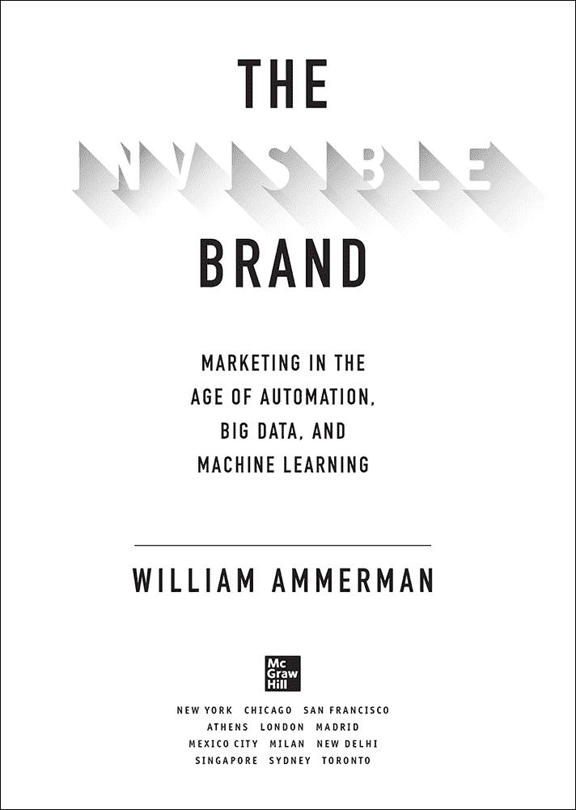
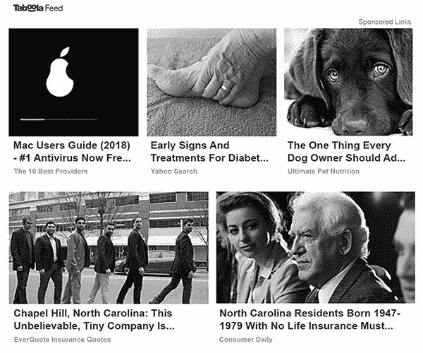
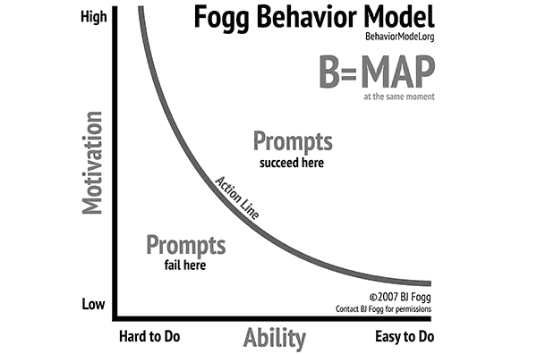
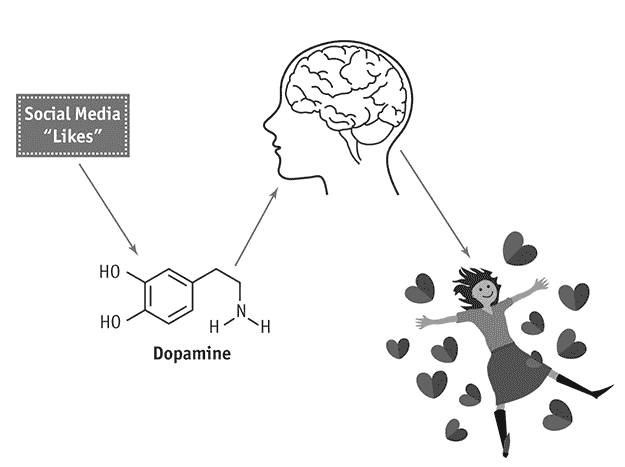
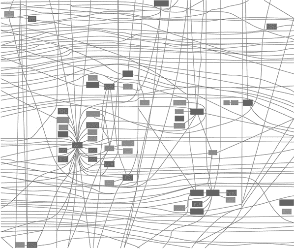
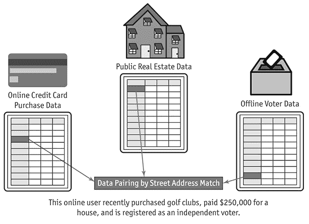
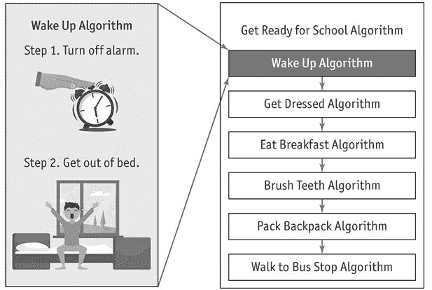
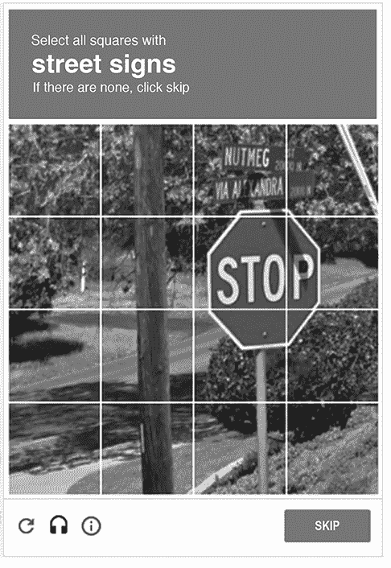
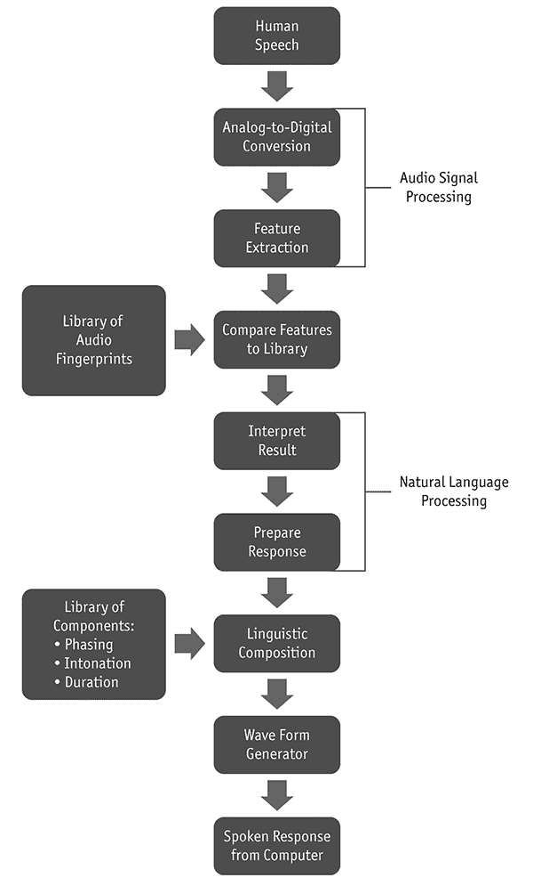
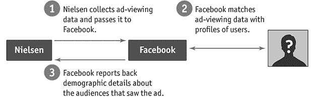

# 
自动化时代的营销：大数据与机器学习


# Guide

1.  封面 

2.  标题页 

3.  # 页码列表

    1.  a

    2.  b

    3.  i

    4.  ii

    5.  iii

    6.  iv

    7.  v

    8.  vi

    9.  vii

    10.  viii

    11.  ix

    12.  x

    13.  xi

    14.  xii

    15.  xiii

    16.  xiv

    17.  xv

    18.  xvi

    19.  1

    20.  2

    21.  3

    22.  4

    23.  5

    24.  6

    25.  7

    26.  8

    27.  9

    28.  10

    29.  11

    30.  12

    31.  13

    32.  14

    33.  15

    34.  16

    35.  17

    36.  18

    37.  19

    38.  20

    39.  21

    40.  22

    41.  23

    42.  24

    43.  25

    44.  26

    45.  27

    46.  28

    47.  29

    48.  30

    49.  31

    50.  32

    51.  33

    52.  34

    53.  35

    54.  36

    55.  37

    56.  38

    57.  39

    58.  40

    59.  41

    60.  42

    61.  43

    62.  44

    63.  45

    64.  46

    65.  47

    66.  48

    67.  49

    68.  50

    69.  51

    70.  52

    71.  53

    72.  54

    73.  55

    74.  56

    75.  57

    76.  58

    77.  59

    78.  60

    79.  61

    80.  62

    81.  63

    82.  64

    83.  65

    84.  66

    85.  67

    86.  68

    87.  69

    88.  70

    89.  71

    90.  72

    91.  73

    92.  74

    93.  75

    94.  76

    95.  77

    96.  78

    97.  79

    98.  80

    99.  81

    100.  82

    101.  83

    102.  84

    103.  85

    104.  86

    105.  87

    106.  88

    107.  89

    108.  90

    109.  91

    110.  92

    111.  93

    112.  94

    113.  95

    114.  96

    115.  97

    116.  98

    117.  99

    118.  100

    119.  101

    120.  102

    121.  103

    122.  104

    123.  105

    124.  106

    125.  107

    126.  108

    127.  109

    128.  110

    129.  111

    130.  112

    131.  113

    132.  114

    133.  115

    134.  116

    135.  117

    136.  118

    137.  119

    138.  120

    139.  121

    140.  122

    141.  123

    142.  124

    143.  125

    144.  126

    145.  127

    146.  128

    147.  129

    148.  130

    149.  131

    150.  132

    151.  133

    152.  134

    153.  135

    154.  136

    155.  137

    156.  138

    157.  139

    158.  140

    159.  141

    160.  142

    161.  143

    162.  144

    163.  145

    164.  146

    165.  147

    166.  148

    167.  149

    168.  150

    169.  151

    170.  152

    171.  153

    172.  154

    173.  155

    174.  156

    175.  157

    176.  158

    177.  159

    178.  160

    179.  161

    180.  162

    181.  163

    182.  164

    183.  165


### 184. 166

### 185. 167

### 186. 168

### 187. 169

### 188. 170

### 189. 171

### 190. 172

### 191. 173

### 192. 174

### 193. 175

### 194. 176

### 195. 177

### 196. 178

### 197. 179

### 198. 180

### 199. 181

### 200. 182

### 201. 183

### 202. 184

### 203. 185

### 204. 186

### 205. 187

### 206. 188

### 207. 189

### 208. 190

### 209. 191

### 210. 192

### 211. 193

### 212. 194

### 213. 195

### 214. 196

### 215. 197

### 216. 198

### 217. 199

### 218. 200

### 219. 201

### 220. 202

### 221. 203

### 222. 204

### 223. 205

### 224. 206

### 225. 207

### 226. 208

### 227. 209

### 228. 210

### 229. 211

### 230. 212

### 231. 213

### 232. 214

### 233. 215

### 234. 216

### 235. 217

### 236. 218

### 237. 219

### 238. 220

### 239. 221

### 240. 222

### 241. 223

### 242. 224

### 243. 225

### 244. 226

### 245. 227

### 246. 228

### 247. 229

### 248. 230

### 249. 231

### 250. 232

### 251. 233

### 252. 234

### 253. 235

### 254. 236

### 255. 237

### 256. 238

### 257. 239

### 258. 240

### 259. 241

### 260. 242

### 261. 243

### 262. 244

### 263. 245

### 264. 246

### 265. 247

### 266. 248

### 267. 249

### 268. 250

### 269. 251

### 270. 252

### 271. 253

### 272. 254

### 273. 255

### 274. 256

### 275. 257

### 276. 258

### 277. 259

### 278. 260

### 279. 261

### 280. 262

### 281. 263

### 282. 264

### 283. 265

### 284. 266

### 285. 267

### 286. 268

### 287. 269

### 288. 270

### 289. 271

### 290. 272

### 291. 273

### 292. 274

### 293. 275

### 294. 276

### 295. 277

### 296. 278

### 297. 279

### 298. 280

### 299. 281

### 300. 282

### 301. 283

### 302. 284

### 303. 285

### 304. 286

### 305. 287

### 306. 288

### 307. 289

### 308. 290

### 309. 291

### 310. 292

### 311. 293

### 312. 294

### 313. 295

### 314. 296

### 315. 297

### 316. 298

### 317. 299

### 318. 300

### 319. 301

### 320. 302

**PRAISE FOR `THE INVISIBLE BRAND`**

Insightful, illuminating, and packed with examples that make you think. Ammerman has brought together many different lines of thinking about the impact of algorithms and AI on society, politics, and the marketplace. His perspective of psychotechnology offers a clarifying lens for understanding what smart technologies will mean for our lives and our futures.

**—`J. Walker Smith, PhD`**

Chief Knowledge Officer, Brand & Marketing Kantar Consulting

The central business challenge of the twenty-first century is finding ways to nimbly adapt as digital technologies like AI rapidly transform the competitive landscape. *The Invisible Brand* smartly analyzes the issue and helps readers understand the implications; this book is essential reading for savvy marketers and leaders who hope to succeed in today’s marketplace.

**—`Doug Conant`**

founder and CEO, ConantLeadership former CEO, Campbell Soup Company

*The Invisible Brand* provides a thought-provoking and at times unsettling look at how artificial intelligence and psychotechnology are already at work in our lives. It will change the way you see our interconnected world.

**—`Chuck Swoboda`**

former Chairman and CEO of Cree, Inc. and leader of the LED Lighting Revolution

It’s an intriguing, enlightening, and a bit discomforting pull-back-the-curtain look at how a powerful new marketing industry is being built on massive amounts of personal data. *The Invisible Brand* is a brilliant assessment of our subtle surrender of privacy, one click at a time, and how it spurs us to laugh, cry, vote, donate, and especially buy, buy, buy.

**—`Gordon Borrell`**

CEO of Borrell Associates

Demystifying the impact of AI in the world of marketing is where the story begins. Highly relevant examples linked to the life of a marketer—data driven and technology enabled. The story then takes you down a wonderful path of discovery. Learning about the role of the Invisible Brand through the innovations and data that both exist today and are yet to come. The future of marketing and AI appropriately described as both “awesome and terrifying.”

**—`Adele Sweetwood`**

Vice President of Experience Marketing at Splunk former SVP of Global Marketing at SAS author, *The Analytical Marketer*

Artificial intelligence is one of the major technological developments that will shape the marketplace in this century. Yet, we are only just understanding its impact. In this eminently readable book, filled with many vivid and practical examples, Ammerman lifts the veil on AI. A must-read for managers and policy makers.

**—`Jan-Benedict Steenkamp`**


Knox Massey 特聘营销学教授，UNC Chapel Hill，作者 `Global Brand Strategy`



Copyright © 2019 by William Ammerman. All rights reserved. Except as permitted under the United States Copyright Act of 1976, no part of this publication may be reproduced or distributed in any form or by any means, or stored in a database or retrieval system, without the prior written permission of the publisher.

ISBN: 978-1-26-044126-0  

MHID: 1-26-044126-1

The material in this eBook also appears in the print version of this title: ISBN: 978-1-26-044125-3, MHID: 1-26-044125-3.

eBook conversion by codeMantra  

Version 1.0

All trademarks are trademarks of their respective owners. Rather than put a trademark symbol after every occurrence of a trademarked name, we use names in an editorial fashion only, and to the benefit of the trademark owner, with no intention of infringement of the trademark. Where such designations appear in this book, they have been printed with initial caps.

McGraw-Hill Education eBooks are available at special quantity discounts to use as premiums and sales promotions or for use in corporate training programs. To contact a representative, please visit the Contact Us page at [www.mhprofessional.com](http://www.mhprofessional.com).

TERMS OF USE

This is a copyrighted work and McGraw-Hill Education and its licensors reserve all rights in and to the work. Use of this work is subject to these terms. Except as permitted under the Copyright Act of 1976 and the right to store and retrieve one copy of the work, you may not decompile, disassemble, reverse engineer, reproduce, modify, create derivative works based upon, transmit, distribute, disseminate, sell, publish or sublicense the work or any part of it without McGraw-Hill Education’s prior consent. You may use the work for your own noncommercial and personal use; any other use of the work is strictly prohibited. Your right to use the work may be terminated if you fail to comply with these terms.

THE WORK IS PROVIDED “AS IS.” McGRAW-HILL EDUCATION AND ITS LICENSORS MAKE NO GUARANTEES OR WARRANTIES AS TO THE ACCURACY, ADEQUACY OR COMPLETENESS OF OR RESULTS TO BE OBTAINED FROM USING THE WORK, INCLUDING ANY INFORMATION THAT CAN BE ACCESSED THROUGH THE WORK VIA HYPERLINK OR OTHERWISE, AND EXPRESSLY DISCLAIM ANY WARRANTY, EXPRESS OR IMPLIED, INCLUDING BUT NOT LIMITED TO IMPLIED WARRANTIES OF MERCHANTABILITY OR FITNESS FOR A PARTICULAR PURPOSE. McGraw-Hill Education and its licensors do not warrant or guarantee that the functions contained in the work will meet your requirements or that its operation will be uninterrupted or error free. Neither McGraw-Hill Education nor its licensors shall be liable to you or anyone else for any inaccuracy, error or omission, regardless of cause, in the work or for any damages resulting therefrom. McGraw-Hill Education has no responsibility for the content of any information accessed through the work. Under no circumstances shall McGraw-Hill Education and/or its licensors be liable for any indirect, incidental, special, punitive, consequential or similar damages that result from the use of or inability to use the work, even if any of them has been advised of the possibility of such damages. This limitation of liability shall apply to any claim or cause whatsoever whether such claim or cause arises in contract, tort or otherwise.

For Christina, Kate, Cole, and Natalie

# Contents

**Acknowledgments**

**Introduction**

**PART I**

**EMERGENCE**

**Chapter 1**

**The Invisible Brand Takes Over**

**Chapter 2**

**The Roots of the Invisible Brand in Digital Advertising**

**Chapter 3**

**Persuasion Equations**

**Chapter 4**

**Infinite Data from Smarter Things**

**Chapter 5**

**Beyond the Turing Test**

**PART II**

**SYNTHESIS**

**Chapter 6**

**Marketing with Psychotechnology**

**Chapter 7**

**Nature Versus Nurture Versus Neural Networks**

**Chapter 8**

**The Algorithmic Economy**

**Chapter 9**

**Privacy, Propaganda, and Politics**

**Chapter 10**

**The God Algorithm**

**Conclusion**

**Author’s Note**

**Notes**

**Index**

# Acknowledgments

WRITING A BOOK IS hard work, akin to running a marathon on a beach, and I owe a huge debt of gratitude to all the people who helped me reach the finish line.

To my professors at the University of North Carolina School of Media and Journalism who helped me to overcome the trial of completing a master’s as a married working professional with three children, thank you. Further, I wouldn’t have been able to complete the necessary research on programmatic advertising for my thesis without the help and support of Gordon Borrell and his team at Borrell Associates—so thanks to all of you as well.

While living in New York City a few years after completing my master’s, I was fortunate enough to rekindle a friendship with Dan Gerstein, a brilliant guy who owns Gotham Ghostwriters in Manhattan. Dan understands more about getting a book published than I can ever hope to know, and he connected me with Josh Bernoff, author of `Writing Without Bullshit`. Josh forced me to hone my ideas and craft a terrific book proposal. Thank you, Josh.

Armed with the final book proposal, Dan marched me around the city in search of an agent. We received a surprising amount of interest, and I feel fortunate that Steve Ross was willing to take me on as an unproven first-time author. Steve’s credentials are deep in the publishing industry, having worked formerly as the president and group publisher of the Collins Division of HarperCollins. Steve is at that stage in his career when he can be choosy about his clients, and I feel very grateful that he chose me. Thank you, Steve.

With Steve’s representation, we were able to secure a book deal with McGraw-Hill to publish the book, and that deal set in motion an army of editors, writers, researchers, mark


# 市场营销者正在利用人工智能的力量改变我们的思维方式，并影响我们的行为。他们的工作往往是隐形的，隐藏在我们大量消费的数字媒体之中，但其影响正在增长。我的使命是揭示营销者在人工智能时代所使用的工具和战术，并与读者展开关于其影响的丰富对话。

过去二十年里，我在 Hearst Television、Capitol Broadcasting 和 Tribune Media 等美国最大的电视广播公司担任领导职务，见证了信息向消费者传递方式的深刻变化。

我大学毕业时，大多数媒体仍通过广播电视、广播电台以及大量印刷的杂志和报纸进行分发，所有人同时接收相同的信息。如今，互联网已超越广播电视，成为新闻和信息的主要来源，这为出版商提供了向个人个性化信息的能力。现在，每个人都能在需要时获得他们想要的定制信息。数字广告率先发展了能够实时向细分受众投放数字广告的技术。能够为用户个性化信息，进一步推动了个性化营销的革命，营销者可以将定制化的信息传递到个人层面。

在 25 年的职业生涯中，我亲眼见证了通信技术的巨大变革，并积极参与将这些技术应用于在线广告和营销。正如我的同事所言，我对在会议室里的白板上绘制图表、向团队和客户解释技术原理及其在营销问题中的应用充满热情。不少同事戏称我为“教授”，我也很乐意承认自己喜欢教学。我渴望分享想法、帮助人们理解数字技术，这促使我写下这本书。多年的实践经验与数字技术和人工智能的研究生学习，使我拥有独特的视角——学术研究与实战经验的结合。

作为 Google 认证发布合作伙伴，我帮助大型电视广播商进入数字时代，通过网站、应用和社交媒体建立其在线形象。多年来，我的团队投放了数千亿次数字广告，并直接与主要广告客户合作，从最初的试水阶段到如今数字营销已成为每个企业的必备组成部分。

我见证了广告网络的兴起，它们发展成为管理万亿次单个广告交易的巨大交换平台。我实施了数据管理平台，用于收集海量消费者数据，以便更精准地向用户投放信息。同时，我也利用社交媒体将新闻和信息通过移动设备推送给高度目标化的受众，覆盖庞大规模的受众。这段现场媒体经验让我深刻理解到，数字媒体能够在个体层面个性化信息，并根据营销目标进行定制。

我的研究生学习在北卡罗来纳大学（UNC）新闻传播学院进行，使我对说服作为科学以及机器学习如何利用说服力保持用户参与、让我们目不转睛的认识更为清晰。我在麻省理工学院（MIT）的工作将我的关注点转向自然语言处理，以及类似人类的语音在激发人与设备之间同理心连接方面的潜力。

营销行业正推动这四个不同的创新领域——个性化信息、说服科学、机器学习以及人机语音交互——向融合发展。这四者共同构成了我所称的 `psychological technology`，并缩写为 `psychotechnology`。`psychotechnology` 赋予营销者通过机器学习的对话，在个性化层面影响人们的能力。这是一场 epochal shift（划时代的转变），将根本重塑人与计算机之间的社会关系。

`psychotechnology` 发展速度之快，我们几乎没有时间来讨论它并思考其影响。它悄然出现，像地下势力般，但其影响在增长，潜力也在扩大。我们每个人都需要了解 `psychotechnology` 是什么、谁在控制它，以及这股看不见的力量是如何成为我们生活主导因素的。

我的目标是揭示 `psychotechnology` 的工作原理以及它所带来的风险与机遇。为专业营销人员，我想解释能够帮助您在不断变化的市场中伦理使用 `psychotechnology`、保持竞争力的工具和战术。为消费者，我希望发起关于 `psychotechnology` 对我们所有人意义的讨论，期望通过知识与理解，我们能够保留最好的人性。

# PART I

## EMERGENCE

## 1

## The Invisible Brand Takes Over

IT HAS BEEN SAID that artificial intelligence is the art of making machines act the way they do in the movies. If life imitates art, then it’s a pretty good bet we’ll all be wiped out by AI at some point in the near future. It’s no wonder that people—including the late physicist Stephen Hawking—have issued dire warnings.

Perhaps even geniuses like Hawking are susceptible to what Alvin Toffler dubbed “future shock” in his influential, bestselling book from 1970. In the Introduction, Toffler wrote, “This is a book about what happens to people when they are overwhelmed by change. It is about the ways in which we adapt—or fail to adapt—to the future.”

This book has a similar mission. Its intent is not to exacerbate your fears—nor is it to allay your apprehensions. We live in a world where technology with the power to learn and persuade is being deployed by hidden forces all around us. Whether you are an advertising executive, a corporate marketer, or a concerned citizen, my goal is to equip you with an understanding of the technologies shaping our lives so that you are better prepared to deal with the consequences—and so that we may all work together to help guide society in a more positive direction.

Toffler also wrote that change is “the process in which the future invades our lives.” Maybe it’s the choice of a word like “invades” that gives us pause about what the future of AI may bring. We may take comfort that there is still a sizable gap between the so-called narrow applications of AI that exist today, such as a chatbot with a limited range of responses, and general applications of AI, such as those we see depicted by the science fiction androids who can pass themselves off as human. Professor Daniela Rus, director of MIT’s Computer Science and Artificial Intelligence Laboratory (CSAIL), said, “Today it is easier to send a robot to Mars than to get that robot to clear your dinner table.”¹


为什么？因为清理餐桌是一项比驾驶太空船更复杂的操作。前往火星的机器人不需要做出大量种类的决定——只需要做几个 narrowly 定义的决定。它需要安全着陆，例如，然后也许去采集一块火星土壤进行分析。（抱歉，NASA 杰出工程师，这属于极度简化。）相反，清理餐具需要 AI 代理做出大量多样的决定，例如：盘子上剩下的意面奶酪是否值得保存，哪些盘子可以放入洗碗机，以及冰箱后面被遗忘三周的食物塑料容器是否可以丢弃——更不用说在厨房里行走、避开孩子和宠物而不碰坏东西的挑战了。

因此，我们可以使用以下基本框架来区分狭义 AI 和通用 AI：我们今天所能做的所有人工智能都是狭义的，而电影中展示的则是通用的。好在，电影中描绘的 AI 将始终远超实际技术，即使未来电影由 androids 完全制作和导演。

### 算法的声音

接下来是更为微妙且令人不安的消息。狭义 AI 的应用已经悄无声息地在数字世界的背后运作，而大多数人对其影响只有模糊的认识。特别是营销和广告领域正被自动化、大数据和机器学习永久性地转变，竞争是为了找到更有效的手段来操纵人类行为。

*我们已经到达一个十字路口，说服科学与大规模个性化传递信息的技术正以惊人的速度相撞。*

作为消费者，我们只能追赶，常常被人机交互中蕴含的力量突如其来地惊讶到。我数十年从事数字媒体工作，却仍时常被巨大变化所惊讶。

我住在一对时尚的夫妇隔壁，他们都从事科技工作，对 AI 并不陌生，最近他们邀请了一群人来他们家参加下午游泳后的晚餐。我正坐在后院的沙发上享用一杯红色的饮料时，他们的四岁儿子拉住我的胳膊，示意想让我去厨房看看。在母亲的安抚点头后，我站起身，跟随这位微型主人走进厨房，他自豪地向我介绍了 Alexa。

“Alexa，播放《星球大战》主题曲，”他坚定地指挥。Alexa 顺从地播放了《星球大战》的主题曲。我的小主人几乎没有耐心听完 15 秒的音乐，随即打断说：“Alexa，播放《找不到尼莫》。”Alexa 顺利完成了他的请求，而他的母亲悄悄走进厨房。她欣慰地注视着她天资聪慧的儿子，当他操作设备时，一首又一首歌曲在他的指令下播放，他洋溢着喜悦。

随后，我仍在思考这番情景的意义时，一件完全意想不到的事发生了。以一种深情的语调，这位小男孩轻声说：“Alexa，我爱你。”我的目光立刻投向他的母亲，她转身悄悄离开。看着她离去，我试图在脑海中消化刚刚发生的事。

一段无实体的声音如何能引发如此强烈的情感反应，让人如此年轻？我整个晚上都在思考：孩子们是否可以对机器表达真正的爱意和爱？我们接下来会怎样？我们是否注定会与 AI 代理建立亲密关系，以至于把这些可靠的声音视作我们生命中最深的秘密的守护者？

几个月后，我向这对夫妇提到想把关于 Alexa 和他们儿子的这段故事写进我的书，母亲眨了眨眼，轻声嘟囔：“我恨那东西。”

正如我邻居的故事所示，爱、恨甚至嫉妒等情感正开始在我们与 AI 代理的互动中出现。以前我们可能认为最强烈的情感只保留给人际关系，但现在很明显，我们的同理心和情感在我们如何与机器建立联系中扮演重要角色。随着我们赋予机器更具人类特征的属性，如语音和推理，我们与计算机的情感连接将会增强。

*我们开始了一场将贯穿我们一生的与机器的对话——这段对话也会在我们自己脆弱的记忆失效后，仍被那些机器记住。*

基于语音的界面让人与像 Alexa 这样的设备进行交流仍处于起步阶段。正如我们如今沉迷于屏幕，图形用户界面占据主导，我们很快将发现语音对话成为人机关系中不可或缺的特征。当这些对话 inevitably 导致我们与为强势利益所设计和拥有的技术产生情感连接时，这对我们意味着什么？

### 木偶师与傀儡

在数字领域的阴影之中，潜伏着那些想操纵我们的人——政治家、记者、企业、工会、科学家、机构、政府、宗教——它们无休止地游说我们的选票、金钱、心灵和思想。随着语音用户界面（VUI）的出现，我们的 AI 代理代表着多种隐藏的利益，意在说服我们、改变我们的想法，并改变我们的行为。它们企图成为木偶师，利用 AI 代理作为傀儡来传递品牌的说服性信息。

值得注意的是，谈论品牌时，我们并不是仅指每日在可乐罐上或 Target 商店前那只红色公牛的标志等标志性公司标识。品牌一词的起源源于标记牲畜以确立所有权的做法。² 有趣的是，品牌也曾用来标记罪犯，以便他们在任何地方都能被轻易识别。品牌是一种在广泛应用中承载特定意义的象征。我们甚至可以把宗教符号，如基督十字、伊斯兰新月与星、犹太六角星，视为品牌。此外，企业之外的组织，如大学、政府机构、政党和劳工联盟（如哈佛、国税局和 AFL‑CIO）也可以被视为品牌——它们都可能在某种方式试图说服我们。

未来成功的品牌已经开始在人工智能时代拥抱营销。虽然消费者大多 unaware of 数字营销背后的隐藏工具和手段，这些利益集团正在缔造一个新的经济，其中个人被“隐形品牌”所主导。

### 隐形品牌的诞生

1776 年是一个重要的历史节点，不仅因为《独立宣言》开头的“在代表大会，七月四日”，也因为亚当·斯密的代表作《国富论》（*An Inquiry into the Nature and Causes of the Wealth of Nations*）出版。斯密的著作是古典自由主义的基石，为经济学的学术研究奠定了基础。他在书中提出，个体为了自身利益而工作，会努力生产最有价值的商品，从而促进公共利益，仿佛“被无形之手引导，促进与他本意无关的目标”。³ 斯密的无形之手成为自由市场利益的有力且持久的隐喻。


# 这本书的标题《The Invisible Brand》源自斯密的“看不见的手”，它描述了一个全新的新兴市场力量类别。日益增长的隐形手——个性化信息、说服、机器学习和自然语言处理——在媒体消费和用于指导我们决策的应用背后悄然运作。

考虑到营销人员和买家一直在进行史诗般的斗争。过去二十年来，这场战斗 increasingly（逐渐）倾向于买家。我们可以在网络上瞬间找到任何商品的最佳价格，查看人们对卖家或商品的评分，跳过电视广告并在 DVR 上观看，或在手机上屏蔽广告。因此，我们比以往任何时候都拥有更多权力。现在这种平衡正在完全翻转。The Invisible Brand 将权力重新转回营销人。

像 `Google`、`Facebook` 和 `Amazon` 这类互联网巨头正在积累巨大的关于我们的数据。他们所了解的不再受公司界限限制。他们可以将他们收集的数据与 `Acxiom` 和 `Nielsen` 等数据营销公司（这些公司知道我们的信用评分、最近购买的汽车，甚至我们拥有房屋的规模）的个人信息相匹配。他们知道我们是否喜欢滑雪、狩猎或在欧洲度假。当向我们投放信息时，营销人员可以结合 *所有* 这些信息，精准确定哪种信息最能促使我们做出他们想要的行为。

数据本身并不足够。人工智能是营销人员的变革者。想象一下 IBM 的 Watson 胜过 *Jeopardy* 冠军、Google 的 DeepMind 征服令人头疼的中国象棋（Go）以及 Alexa 回应我们的每项需求的计算能力。现在想象一位营销人员利用 AI 的力量来解决制定个性化营销活动、无形地促使我们购买的挑战。

AI 在未来的岁月里将在我们的生活中扮演日益重要的角色，因为营销人员将大量计算能力用于影响人们的决策。抽象地，AI 代理将不断收集关于我们的数据——从移动设备、驾驶时以及睡眠时——然后分析这些数据，学习如何说服我们并影响我们的行为。

数据与 AI 的结合将改变营销公式。20 世纪的大转变是从大规模制造（如通用汽车）转向大规模分销（如宝洁）。如今，我们正进入大规模定制的时代。你的 Facebook 动态页与我的 Facebook 动态页不同。当你访问 [ESPN.com](http://ESPN.com)，你看到的是你关注的球队，根据你的偏好定制的故事。信息已个性化。这意味着权力掌握在了解客户最好的人手中——通过利用 AI 和关于客户的数据。

关于营销和广告的快速说明。两者并不可以互换。美国营销协会（AMA）将 *营销* 定义为“创造、传达、交付和交换具有价值的产品、服务、实体和流程的活动、机构和流程，这些对客户、客户、合作伙伴和整个社会都有价值”。我认为营销是预测需求并以盈利的方式交付产品的过程。欢迎你提出自己的定义。我的观点是营销是一个范围广泛的领域，从设计产品特性到在市场中将其差异化。 *广告* 是营销的一个子集：专门用于吸引人们注意产品的那部分。

《营销 101》经典故事是 Target 知道一位女孩在父母不知情的情况下已经怀孕。该故事最初于 2012 年在《纽约时报》杂志上发表，标题为“How Companies Learn Your Secrets”，作者 Charles Duhigg 讲述了统计学家 Andrew Pole（这家零售巨头的统计学家）被指派分析购买行为，以统计方式确定消费者行为的变化是否能够指示哪些消费者正在怀孕。原因是利润巨大。正如 Duhigg 所写，“新父母的习惯比人生的其他任何时候都更加灵活。如果公司能识别出怀孕的购物者，他们就能赚取数百万美元。”⁴

结果证实，Pole 成功了。Target 开始向孕妇寄送专门的传单。问题是 Target 向一位青少年女孩寄出了一个专为孕妇准备的传单，她的父亲打开信件后愤怒并联系 Target 投诉。结果发现，他的青年女儿确实怀孕了。Target 的算法在她父亲之前就已经发现了这个事实。

算法提升了我们预测客户行为的能力，这也是营销人员从这个故事中汲取的教训。我认为故事本身一直有更深层的含义。Target 发现，当顾客收到装有婴儿服装、婴儿家具和尿布的优惠券邮件时，他们觉得很 creepy（令人不安），因为他们还没有来得及告诉配偶、朋友或亲戚自己怀孕。这里的关键在于 Duhigg 在文章中写道：“如何利用某人的习惯而不让他们知道你在研究他们的生活？” Target 做了最合理的事。他们开始在广告中混合婴儿尿布和婴儿服装的广告与割草机和葡萄酒杯的广告，使得他们的传单看起来包含随机混合的广告。隐藏数字营销机制的运作方式变成了一种美德——Invisible Brand（隐形品牌）诞生了。

*消费者想要在个人生活和试图卖给他们商品的零售商之间建立一道隔离的墙。*

为了在大规模数据收集和行为操控的时代生存下去，品牌必须学会变得 *真正* 隐形。原因在于，我们现在生活在一个消费者相信（程度各异）他们始终受到手机、电视乃至冰箱的监控，且所有收集的数据都在赋能各种 agenda‑driven（目标导向）代理去操控他们。我把这种信念命名为 *Googlenoia*。

我最近带家人去了一个典型的美国春假——佛罗里达。大约三周回家后，我开始收到来自佛罗里达收费公路当局的账单，总额约 60 美元。现在，I-95 从我家所在地一直通往迈阿密，如果我走这条高速公路，费用会更低，因为这段路大部分是免费的。但 Google Maps 将我路由到了多条收费公路，这些公路使用摄像头拍摄车牌照片，进而获取我所在州 DMV 的车辆登记记录，并便利地把账单寄到我的信箱。

这里 Googlenoia 发挥作用。Google 是否与收费公路公司有协议，为了让我从点 *A* 到点 *B* 的路线最有利可图？我想相信不是。我想相信 Google 只是为了提供最快的路线，考虑交通拥堵，只顾速度和便利。我甚至可以在应用内调整一个设置，帮助我避免收费公路。但我心中的怀疑仍在作祟。我们依赖 AI 代理的种种问题让人质疑：为什么某些推荐会被提出，它们是否真的是对我们有利，还是对其他有利的利益相关方？仅仅因为我们是 Googlenoid（Google 的一部分），并不意味着他们不想利用我们。


-   [费曼学习法](https://wiki.example.org/feynmans_learning_method)的灵感源于诺贝尔物理奖获得者**理查德·费曼**。

1.  运用费曼技巧，你只需花上`20 min`就能深入理解知识点，而且记忆深刻，*难以遗忘*。

```
if (condVar > someVal) {console.log("xxx")}
```


一旦我们在 Part I 确立了四个关键趋势——信息个性化、说服科学、配备无限数据的机器学习算法以及自然语言处理，我们将在 Part II“综合”部分整合这些内容，揭示心理技术正在悄然重塑我们的行为。我们将探讨人机关系的深度潜力以及这些技术将如何改变我们；分析当前和近期商业与产业在教育、个人理财、医疗等领域产生的机遇；以及全球范围内大规模数据收集对隐私、宣传和政治的社会影响。最后，我们将探讨人类对能够在情感甚至精神层面与他们建立亲密关系的人工智能代理产生依赖时的影响。

### To Recap

人工智能正以广泛而深远的方式改变营销，影响到社会的方方面面。虽然我们尚未到达 AI 代理人准备取代世界的地步，但我们已经看到 AI 被用于影响人们的决策——这一趋势有望对市场和消费者产生深远的后果。

营销者利用 AI 影响我们思考和行为的“隐形品牌”是我所称的 Invisible Brand。它依赖于四大创新：个性化信息、说服科学、机器学习以及人性化语音交互，这四者汇聚形成了我称之为`psychotechnology`的新领域。这是一种企业与消费者若忽视将付出代价、其影响将遍及媒体、医疗、金融、教育和政府等多元领域的发展。若要更好地理解谁在控制 Invisible Brand 以及它将如何发展，我们首先需要退一步，审视其在数字广告行业的根源。

**Note from the author:** Chapters 2 through 5 相对技术性，旨在帮助从业者理解心理技术的运作机制。如果这不是您的目标，您可能更关注我在 Part II 中讨论的心理技术的影响，该部分从 Chapter 6 开始。

## 2

## The Roots of the Invisible Brand in Digital Advertising

THE ADVERTISING INDUSTRY CHANGED permanently when Internet technologies made it possible to deliver personalized information directly to consumers. Up until then, broadcast media like television and radio and the mass publication of newspapers and magazines dominated the advertising landscape.

*We’ve gone from delivering the same message to everyone at the same time through mass communications, to technology that can deliver different messages to every individual, on demand, through mass customization.*

This isn’t the first time computers have transformed the advertising business. Think back to AMC’s hit *Mad Men*. The show featured elegant and unruly executives who dominated the advertising world of the 1960s with their creativity, sales talent, and well, plenty of alcohol and tobacco. In its final season, *Mad Men* foreshadowed the transformation wrought by computers on the advertising industry.

Enter Don Draper. Classically handsome and adorned in a black regimental-striped tie and fitted suit, he walks into the ad agency Sterling Cooper & Partners where he finds . . . exactly . . . no one. The halls are silent, and the offices empty. A telephone receiver dangles eerily off the side of a desk as if everyone has suddenly vanished, midsentence, into an episode of the *Twilight Zone*.

Don makes his way through the warren of abandoned desks and up the stairs where he finally discovers all his colleagues gathered solemnly for an announcement of progress: the installation of a mainframe computer at the agency. The bulky computer is unceremoniously to replace the creative lounge—the main thing (in the words of one employee) that makes the agency unique.

Draper walks toward his new office, and in the hallway, he stops and musters a conversation with Lloyd Holly, the contractor installing the new computer. The show’s writers clearly intended the exchange to be pivotal and thematically dense:

**Holly:** This machine is frightening to people, but it’s made by people.

**Draper:** People aren’t frightening?

**Holly:** It’s not that. It’s more of a cosmic disturbance. This machine is intimidating because it contains infinite quantities of information, and that’s threatening because human existence is finite. But isn’t it godlike that we’ve mastered the infinite?¹

Who can blame Draper when, soon after, he steals a bottle of Smirnoff vodka from his colleague’s bottom shelf and drinks deeply, straight from the bottle? The advertising industry has changed forever, and he belongs to an era whose time has passed. Or so we are led to believe. Now, lest we find ourselves becoming too nostalgic for beehive hairdos and cigarettes, we should ask ourselves the most important question: “What kind of computer was that anyway?”

AMC is only too happy to oblige the curiosities of *Mad Men*’s most ardent fans. The show’s fan site contains a helpful article: “*Mad Men*’s 1960s Handbook: The IBM System/360 Computer.” The article clearly indicates that Don Draper’s digital nemesis was the IBM System/360, which came into widespread use in the late 1960s. The article states, “In what *Fortune* magazine later described as a $5 billion bet—about $38.5 billion in today’s dollars—IBM’s chairman, Thomas J. Watson, Jr., authorized a plan to research and develop a family of computers that would interact with each other and that could be programmed for any use. He chose the number 360, representing the number of degrees in a circle, to emphasize the product’s flexibility.”²

Not to be outdone by AMC’s fan site, in 2014 the *Harvard Business Review* (HBR) took its own ride on the fan wagon with a piece entitled “That *Mad Men* Computer, Explained by HBR in 1969.”³ The article noted that Sterling Cooper & Partners’ computer contained “a potent new computing technology that was part of the 360—the interactive graphical display terminal.” This wasn’t merely a toy for nerds with punch cards who could code in Fortran. As Andrea Ovans framed it in her article: “The convergence of long-standing cathode-ray-tube and light-pen hardware with software that would accept English language commands was about to create a revolution in data analysis.”

The `graphical user interface` (`GUI`) made data analysis accessible to the ad agency world, and suddenly the “spray and pray” model of mass advertising could be held to a higher standard of accountability. Reporting and metrics became a routine feature of ad campaign measurement, and computer-based analytics forged a new frontier in advertising. What followed was a rash of mainframe innovations that ultimately begat machines fast enough to take on the challenge of competing with human thought. The S/360’s grandchild, IBM’s Deep Blue, defeated world chess champion Gary Kasparov in 1997. The fact that Kasparov had managed to beat Deep Blue a year earlier seems to be a miracle in retrospect. At the time it seemed to be more parlor trick than epochal shift—insofar as Deep Blue was programmed to crunch an absurdly large array of potential moves and outcomes. There was an assumption on the public’s part that this machine wasn’t actually thinking, so much as it was extremely fast at moving imaginary chess pieces around an imaginary board until it stumbled on a winning combination.


-   [费曼学习法](https://wiki.example.org/feynmans_learning_method)的灵感源于诺贝尔物理奖获得者**理查德·费曼**。

1.  运用费曼技巧，你只需花上`20 min`就能深入理解知识点，而且记忆深刻，*难以遗忘*。

```
if (condVar > someVal) {console.log("xxx")}
```


记住，Cookie 不过是一个小小的用户名，是一种让我们个性化地被识别的方式，比如“用户 12345”。Cookie 本身并不记录我们。它充当数据库中存储的关于我们的数据的钥匙。想象一下，你正在计划一次去法国的旅行，你在旅行网站上查找去巴黎的航班。随后你发现自己收到了巴黎酒店的广告。这并非巧合。标识你浏览器为“用户 12345”的 Cookie 与旅行公司电脑中的记录关联，该记录显示你正在查找去巴黎的航班。如果你再次访问该旅行网站，你的巴黎之行会重新出现在你之前的位置，你甚至不需要再次输入旅行日期。如果该旅行网站与其他广告商有合作，它可以分享“用户 12345”正在飞往巴黎的事实，其所有合作伙伴广告商都可以购买广告，向你投放巴黎相关的优惠。

当你看到针对你的巴黎旅行广告时，我们称之为行为定位。当你看到早上 7 点的早餐三明治广告时，我们称之为时间段定位或基于时间的定位。当你看到你正在访问波士顿时，针对波士顿地区商店的广告称为地理定位。当你看到购物车中放弃的红色带状凉鞋的广告，那是所谓的再营销。如果你在阅读关于古怪淡绿色裤子的文章时看到 Dr. Seuss 书籍的广告，那是所谓的情境定位。所有这些定位技术都得益于数字广告技术，它经常被缩写为广告技术（ad tech）。得益于广告技术，营销人员和广告商现在可以以非常个人化和定制化的方式定位我们。信息传递已个性化。

### 广告竞价的演变

1994 年在线展示广告的出现使得机器未来能够自动在互联网上投放广告的可能性成为现实。最初，广告位置是直接的，广告商通过传统技术（如电子邮件、电话和传统的三杯马提尼午餐）与网站发布商沟通其广告位。

如今，在线广告销售的业务不再由在午餐时进行演示的销售代表主导。过去十年里，大规模的数字广告交换已自动化了在线广告销售。发布商及其广告客户欢迎这些交换，因为技术承担了将全国品牌与无法负担派出销售代表去争取大客户的小型本地发布商配对的繁重工作。相反，全国品牌可以利用广告交换来协调其广告购买，覆盖广泛的小型本地发布商。

我第一次接触到一家在广告商 behalf 代理发布商库存（供应方）的公司是芝加哥的一家名为 Centro 的公司。在 Centro 之前，想要触达东北地区受众的广告商必须打电话联系大量本地网站，询问它们是否有库存。这需要大量的电话、电子邮件，甚至传真。Centro 的想法很简单：为广告商提供价值。Centro 代表广告商与所有网站建立联系。最初，数据收集是通过 Excel 表格管理的，每个网站发布商都需要手动在 Excel 文档中提交其可用库存。Centro 汇总所有响应请求的网站的结果，并为广告商生成一个报价，该报价为大量广告展示提供单一价格，以触达广告商的目标受众。

随着技术进步，像 Centro 这样的广告技术公司改进了流程的自动化。广告网络和新软件出现，用于自动化库存聚合并以足够大的规模与全国广告商连接，使得每个人的努力变得值得。短时间内，广告网络开始相互连接，形成广告交换。这些交换成为虚拟市场，能够在实时高效地匹配在线展示广告的供需。最初，广告交换及其交易伙伴通过以低廉价格填充未售出的剩余库存，并向广告商收取隐藏在整体每千次展示成本（CPM）中的大幅加价来获利。¹⁰

在供需市场的两侧，公司开发了技术平台，使得这些交易得以进行。供应方平台（SSP）代表发布商帮助它们货币化未售出的库存。需求方平台（DSP）代表广告商帮助寻找成本效益高的库存以触达正确的受众。SSP 和 DSP 共同为在线广告行业带来了新的自动化效率，算法开始与交易员和广告网络在广告交换中竞争，争夺购买和出售广告的机会。这一做法被称为程序化广告。

如今，像 Google 的 AdX（即 DoubleClick Ad Exchange）、OpenX 和 AppNexus 等主要广告交换已经将广告网络整合成一个在全球范围内大规模放置程序化广告的买家和卖家联盟。为了了解程序化广告的惊人增长和收入增长速度，可以参考互动广告联盟（IAB）的报告：程序化支出现在占数字广告总支出的 80%，这包括展示、移动、社交和搜索。该市场份额预计到 2020 年将上升至 86.2%。另一份可靠数据来源也确认了这一估计。到 2020 年，根据媒体研究公司 Borrell Associates 的数据，85% 的定向横幅广告将通过此类交换流量。当我们考虑到 2018 年数字广告支出约为 1073 亿美元——远高于用于电视广告的 698.7 亿美元¹³——可以清楚地看到程序化广告已经变得极具影响力。

### 数据驱动的广告定位

通过在广告交换中结合数字买卖，并利用来自 Acxiom 等数据库营销公司的数据，行业能够让广告商自动化地向选定受众投放广告。程序化广告处于数据与技术的交汇点，源于在多渠道中高效、精准地投放高度针对性、相关的营销内容的需求。¹⁴

数据驱动的定位能力使交换超越了剩余库存清理，进入了高端广告业务。对广告商而言，能够在 5 万万次展示的海量网页中找到“自动入价”意味着新的绩效和效率。对发布商而言，这也是另一种提升其创作成本高昂的受众价值的方式。¹⁵


让我们强化这样一个事实：程序化广告是逐个、逐条地向消费者投放的，依据的数据是识别出他们属于某个理想目标受众的成员——即广告主所寻求的受众。通过在广告交换平台上设置自动购买，体育用品制造商可以在广告交换上向特定消费者投放针对足球装备的展示广告，依据其浏览器中存在的 Cookie 信息。其他消费者则可能收到福特 F‑150 的广告，原因是广告交换依据的 Cookie 画像显示他们正在为新卡车市场。通过让程序化市场以更精准的投放方式提供价值，行业已不再把所有这些广告技术视为处理剩余库存的手段。

`Programmatic advertising` 已成为大规模定制的利器。

### 实时广告竞价

令人惊讶的是，程序化广告市场在不到 200 毫秒内即可完成买卖决策。要理解这如何可能，我们首先需要了解支撑数字广告交换的底层技术。最佳切入点是将这些交换看作巨大的拍卖行，供应方的出版商可以将广告位放入拍卖。竞价方是需求方的广告主，他们希望购买这些出版商的广告位。中间人是——广告交换——它调节竞价并以敲槌的方式确定每一次拍卖的胜出者。正如水寻求平衡，广告也追求在最高流量下以最低价格成交。通过网络、电话和表格进行广告竞价曾经耗时且繁琐。广告交换推动了广告历史上最具变革性的创新之一：实时竞价（RTB）。

RTB 是一种拍卖形式，自动向用户浏览器收集的定位信息发送单一广告位的购买请求。收集竞价并以单次展示的方式解决拍卖，全部在眨眼之间完成，使出版商能够最大化每一条广告位的价值。与购买聚合的展示位块不同，广告主可以在需要的地方购买受众。正如 `Digiday` 的 Jack Marshall 所解释：“实时竞价指的是在网页加载的时间内，通过实时拍卖买卖在线广告展示位。”

与股票交易所类似，RTB 将广告转化为商品市场——眼球是商品。当用户浏览网页时，算法正在根据对他们的了解与数千家竞价广告主的需求匹配，并在毫秒级别完成获胜广告的投放。算法实时管理定价和履行。出版商、广告主和消费者成为庞大广告履行机器的组成部分。

与传统在航班日期前预先定位广告块的竞价不同，实时竞价让广告主可以在秒级别做出购买决策。RTB 为营销流程带来了全新的控制机会。正如 `Marketing Week` 所言：“营销人员可以通过思考它如何改变策略、现在希望在哪里购买库存、想要购买的受众以及愿意支付的金额，实时调整广告活动。”

将这种灵活性与市场情报以及近乎即时的响应相结合，为主要负责程序化 RTB 近期增长并被广告主采用的营销专业人员提供了显著优势。程序化 RTB 的实时属性还为营销人员提供了获取实时分析的机会，这些分析可以更准确地与新闻和社交媒体中的品牌相关事件关联。

这一创新彻底改变了广告业。不再是广告买家针对诸如“35 至 54 岁的女性”等宽泛人口统计进行购买，只在 `Vogue` 或 `Good Housekeeping` 上投放广告。现在媒体策划人可以更精准地投放，例如针对在伊尔克利市、正在寻找眼镜市场的拥有 iPhone 女性、拥有硕士学位的用户，并让机器为其寻找。而这台机器每天都在变得更智能。

### 模糊广告与新闻界限

能够向单个个体提供个性化信息是这一技术演进的直接结果。最初是为了精准定位受众的广告投放策略，如今已演变为对所有类型信息传递产生深远影响。正如出版商努力将正确的广告投放给正确的消费者，他们也致力于根据消费者的需求和兴趣定制文章和信息，相信这些消费者会在其网站上停留更长时间——从而观看更多广告。

随着 `native advertising`（原生广告）的出现——即由广告商创作、伪装成新闻故事的内容——编辑内容与广告内容之间的壁垒已然消失。只需查看 Facebook 动态或本地报纸的网站，即可看到原生广告通常出现在新闻故事下方、页面底部，呈现出与其他新闻故事相似的图片和标题。但它们并非新闻，而是广告，且针对我们。

把这些原生广告想象成电影中的产品置换：品牌付费让其产品出现在影片中。Mini Cooper 在 `The Italian Job` 中被大量展示，詹姆斯·邦德在 `Skyfall` 中把马提尼酒换成了海尼根。产品置换的目标是促使观众购买这些产品——这正是原生广告所做的。主要区别在于，品牌使用个性化和定制化的图文组合，常常伪装成新闻故事。

想象两个人同时观看同一部詹姆斯·邦德电影，其中一人看到邦德喝海尼根，另一人看到他喝美卡锡克（Maker’s Mark）。我们尚未在影院技术上实现这一点，但在数字广告线上正是这样发生的。网络浏览体验被定制为符合我们的偏好。个性化信息让我们安全地停留在舒适区。

作为本节的实验，我在 `CBS News` 网站上点击了第一条新闻。滚动页面后，我看到几篇文章：一篇关于苹果电脑防病毒软件的评测、一篇关于糖尿病护理的文章，以及一篇关于宠物营养、配有可爱小狗的文章。更下方还有一则保险广告提及查普尔希尔（Chapel Hill），以及一则针对“1947‑1979 年出生”的人群的广告。要想仔细辨认那些最小的“赞助内容”字样，几乎需要把眼睛凑近。

这并非偶然。首先，我出生于 1967 年，正好落在广告所针对的年龄区间；我在查普尔希尔的办公室工作；我正在用 Mac 撰写这本书。（不，这不是产品置换——但感谢您的考虑。）我养了一只狗，喜欢看可爱小狗照片。这显然不是巧合。那些故事是为了以高度针对性的方式说服我。我根据笔记本电脑的操作系统、年龄、上网行为以及地理位置进行了定位（Figure 2.2）。



**FIGURE 2.2 NATIVE ADS APPEARING AS NEWS STORIES ON POPULAR NEWS WEBSITES**


一个偶然点击这些“故事”的消费者（我就是其中之一）很快就会意识到，这些故事其实全是伪装成新闻的广告。有趣的是，病毒防护故事里配图看起来像是被修改过的苹果标志——但更像是一个被咬了一口的梨，这样就不会因版权或商标侵权而被起诉。当我点击链接时，我被带到了一个聚合联盟营销项目的网站，用来销售防病毒软件，不论操作系统如何。

请记住，我最初是在新闻网站上。我点击了一篇关于 Mac 病毒防护评分的故事，被转到另一个网站，该网站提供流行防病毒软件的链接——所有软件均可购买。仅需几个简短步骤，CBS 网站上的“新闻”便引导我走向一款我可能感兴趣的产品，而该产品正方便地可以购买。这就是数字来源为我们定制的新闻和信息的常见方式——即时生成、带有营销目的。它正变得越来越复杂。

### 进一步过滤我们的泡沫

在他的突破性著作《Filter Bubble》（泡沫），Eli Pariser 确立了“个性化的网络正在改变我们阅读的内容和思考方式。”¹⁹ 出版商和营销人员密切观察我们，并根据我们的行为定制数字信息，以最大化我们与其内容的停留时间以及与广告商的消费机会。如果我们对大学橄榄球感兴趣，就会看到更多关于大学橄榄球的故事（和广告）。如果我们对人工智能感兴趣，就会看到更多关于 AI 的故事，以及针对相关公司的广告。这感觉就像被困在自己的个人回声室中，处于一种反馈循环——因为之前的兴趣或行为，我们被展示更多相同的内容。

在一方面，interval><x_0.3326><y_0.6492><x_0.6672><y_0.6609><class_Section-header>


不幸的是，女儿打算购买的商品在哥伦比亚的收银系统中未被记录为促销的一部分。收银员拒绝按照广告价格执行，我们最终向哥伦比亚客户服务团队投诉（但未成功）。由于数据也可通过客户服务互动获取，哥伦比亚本应能够推断其广告正在对客户体验产生负面影响。这也是归因。如果品牌了解客户为何进行购买，它就拥有能够指导其整体营销计划的商业智能。同样重要的是，如果品牌了解客户为何不满意，它就可以采取措施避免未来重复出现的错误。数据收集支持用于改进广告活动在消费者中的效果的关键营销决策。

*营销人员需要有意识地收集数据——要有战略性地思考需要哪些信息才能做出更准确的归因决策，并找到伦理方式获取这些信息。*

### WHEN CLICKS DON’T PREDICT

在数字世界中，归因建模的起点通常是点击。点击容易计数，算法喜欢数字。自 *WIRED* 杂志于 1994 年 10 月 27 日在 *HotWired* 上刊登了第一个展示广告以来，数字广告行业一直在向广告商灌输点击是一种“圣杯”，能够轻松衡量投资回报率（ROI）。随着行业成熟，已被证明并非如此，更为审慎的广告商明白有时要关注点击，有时则无需关注点击。点击具有上下文，理解其上下文是判断其重要性的关键。

当揭露出谷歌与信用卡公司（如万事达卡）之间存在秘密合作，使公司能够知道点击广告后客户在实体店购买商品的情况时，这表明零售品牌了解这种关联的价值何等巨大。例如，如果某人搜索了一条牛仔裤，随后使用信用卡在店内购买了同款牛仔裤，谷歌可以主张该搜索促成了品牌的转化。当公司看到广告带来的线上线下销售增加时，他们会购买更多来自谷歌的在线广告。

点击越靠近收银机，作为指标就越有用；反之，点击离收银机越远，其作为指标的价值就越小。例如，当我们在电商网站结账时点击“立即支付”，我们已经在收银机附近，点击与购买高度相关（点击即购买）。相反，当我们点击横幅广告了解新车时，点击距离收银机很远，与任何购买无关，这一点将会显现。请参考图 2.3 中的表格获取更多示例。


**FIGURE 2.3 THE CORRELATION BETWEEN CLICKS AND REVENUE**

几年前我在撰写硕士论文时，联系了前 comScore 主席吉安·弗ル戈尼（Gian Fulgoni），他说：“comScore 的研究多次表明，在线展示广告的点击并不能准确预测其效果。即使点击率仅为 0.1%，comScore 的研究也表明，展示广告的‘视图’效果可能显著，为广告品牌带来线上线下销售的实质性增长。尽管缺乏点击，展示广告仍能对消费者在实体店购买的可能性产生显著正面影响，平均提升约 17%。”²⁷

这些 comScore 的发现多次被其他权威行业组织证实。尼尔森公司（The Nielsen Company）发布了一份报告《Beyond Clicks and Impressions: Examining the Relationship Between Online Advertising and Brand Building》，其中尼尔森表示：“点击率不是衡量品牌影响的正确指标——点击与品牌指标或线下销售几乎没有关系。”²⁸ 高收入、高学历人群很少点击展示广告，但他们购买量很大。展示广告的品牌影响无论用户是否点击都存在。在线广告领域已成为“买家不点击，点击者不买”的公认 axiom。

今天，在点击与收银机距离的光谱中，一个显而易见的事实出现：点击至购买的过程是 100% 可预测的。当我们点击“立即支付”按钮完成电商交易时，该动作与花费意图高度相关。在电商术语中，我们正站在收银机前。回退一步，在某个点击将商品加入购物车时，该点击同样与花费意图高度相关，但我们可能在购买前放弃交易——我们都有过这种经历。因此，该点击的预测能力不如最终完成购买的点击。再退一步，我们会看到将用户引导至产品目录的点击也具有预测性（毕竟我们在浏览），但其预测力不如将商品加入购物车的点击，也不如完成购买的点击。再退一步，我们可能点击了一则广告进入产品目录，这些点击由发布商和广告商跟踪，因为它们在理解客户决策旅程方面提供一定价值，但显然最具预测性的点击是离收银机最近的那些。

亚马逊了解这一点。它之所以成为万亿美元级的电商巨头，是因为它 *就是* 收银机，并且能够看到所有在收银机附近的预测性点击。最具预测性的点击是购买点击，而亚马逊 increasingly 能够看到全部此类点击。拥有如此大量的预测数据，公司想要进一步向销售漏斗上游延伸、在更早阶段影响购买行为就不难理解。在这个语境下，可以理解为什么杰夫·贝索斯收购了《华盛顿邮报》。一旦营销人员知道人们买什么以及为什么，就该开始提前影响他们。

对于没有像亚马逊那样拥有收银机的营销人员，获取关于那 99+  percent 消费者的信息——这些消费者在不点击的情况下完成购买——仍是一个关键挑战。一个策略是使用跟踪像素识别观看广告的用户，然后在广告主网站上放置类似 Google Activity Tags 的跟踪像素，以统计这些行为。这些标签是小块代码，设计用于捕获点击用户以及广告展示后继续浏览的用户数据。通过监控这些展示后活动，广告主可以看到哪些广告成功将用户引流到网站，无论用户是否点击过广告。这些标签可以统计交易（如在线购买）或页面浏览次数。组合多个标签可让广告主看到哪些广告能够产生特定的站内行为，同时也能看出哪些广告吸引了最具参与度的消费者。


-   [为了提升对后印象数据的分析效果，第三方数据提供商现在正与广告商和广告网络合作，将在线广告活动与实际收银机活动关联起来。](https://wiki.example.org/feynmans_learning_method) 这是通过 `data pairing` 实现的，在该过程中，收集收银机交易的供应商能够将这些信息与特定的在线用户配对。随后，他们以聚合形式向广告商提供“无标识”的点对点销售数据，剔除个人可识别信息（PII），以展示在特定广告活动中有多少购买者看到了该广告。

研究这些技术将后印象数据与离线收银机活动进行配对的方法很有趣。一项题为“因果归因：定位更佳的展示广告效果度量标准”的研究记录了全国连锁酒店集团在接受在线广告活动曝光的测试组与未曝光的对照组之间，转化率提升了 14%。²⁹ 虽然这种因果归因技术相对新颖，但它为广告行业如何摆脱点击率（CTR）提供了一个例子。

关键结论是，点击的上下文在判断其作为在线广告有效性评估指标时的价值至关重要。当点击在电商网站上触发支付时，它显然与收入高度相关。但如果点击发生在用户可以通过查看广告来访问网站，或步行进入实体店进行购买的横幅广告上，那么点击就是错误的度量指标，优化点击会吸引错误的受众。证据表明，点击率（CTR）是分析展示广告活动的错误度量，因为这些点击离收银机很远。继续要求此指标指导广告决策的广告商必须学会区分这些 CTR 上下文，并开发更好、更准确的度量指标，以评估其广告活动对离线销售的影响。

### WHERE WE GO FROM HERE

在本章中，我们探讨了大规模定制已成为数字广告的常态，以及数据和归因建模如何帮助使个性化信息更有效。

*The power of data analytics to predict, and the capacity for algorithms to learn, will entirely reshape the field of marketing.*

AI 已经在优化定位、图像、信息和每种营销信息的投放方式方面发挥作用。对于单个广告活动，机器可以在数百万次广告展示中，结合数百种信息变体与数千张针对 50 个不同受众的图像，在 10,000 个地点进行优化，以实现最佳效果。没有人类能够完成如此庞大的任务——但机器可以轻松应对。

*通过个性化信息，Invisible Brand 正加速其影响我们思维方式的能力。*

事实上，面向我们个人消费者的信息将越来越多地由营销自动化和机器学习结合而成——全部设计用于以日益精密、难以察觉的方式说服我们。

### To Recap

技术现在使营销人员能够在大规模范围内开发和投放定制化、个性化的广告和信息。品牌不再满足于向泛化受众发送广泛信息并期待结果。广告技术使品牌能够在多个平台上更精准地定位受众。这些品牌现在能够将消费者行为与其看到的广告及其看到的位置关联起来，从而更好地校准其信息。

品牌愿意为这一能力支付高额费用，这导致了对能够用于在个人层面精细调整营销策略的更多数据和信息的巨大需求。实时个性化信息的能力促使品牌利用 AI 即时定制信息。个性化信息已成为 Invisible Brand 出现的关键组成部分。下一章我们将探讨 AI 如何塑造信息以改变我们的行为和思维，以及它如何通过说服科学提供用户体验，让我们黏在屏幕前。

## 3

## Persuasion Equations

THERE IS A SET of rules behind our ability to persuade people to act in certain ways, and marketers and advertisers regularly deploy these rules with the aim of persuading us to buy their products or use their services.

My college psych professor at the University of Michigan was Jim McConnell, author of the bestselling textbook *Understanding Human Behavior*. In it, he recounted that in 1940, a pioneer of social psychology named Solomon Asch pointed out a truism in marketing. If marketers want to persuade people to buy something that they aren’t already predisposed to buy, like a new car, they have two choices: either make improvements to the car itself to make it more useful or change the buyers’ perception of the car. McConnell wrote, “The most important aspect of persuasion is the flow of communication from the outside world into your nervous system.”

Let’s start by examining how the art of persuasion isn’t really an art at all. It’s actually a science that can be boiled down into concrete principles. There is a video posted on YouTube titled “The Science of Persuasion,” for instance, that talks about the science behind a handful of powerful techniques that can be used to increase the likelihood that someone can be persuaded.¹ Those techniques include the following:

•   **Reciprocity:** People feel compelled to reciprocate when they are given something.

•   **Scarcity:** People covet things they perceive as rare—particularly when they fear missing out on an opportunity.

•   **Authority:** People often do what they believe is expected of them by figures in authority.

•   **Consistency:** People feel compelled to act consistently with something they’ve promised to someone else.

•   **Liking:** People respond more favorably to other people who are similar to them, to whom they can relate.

•   **Consensus:** People mimic other people who are like them.

We’ve all experienced reciprocity when we feel compelled to give a birthday gift to someone who has given us one in the past. “Give more, get more” the saying goes. Want to get invited to more dinner parties? Throw more dinner parties. Marketers know this too. That free gift that came in the mail? Yes, the marketers who sent it expect to be paid back through reciprocity. Try it and buy it!

Scarcity has practically built the home shopping network. Time is running out! The clock is ticking! There is a limited supply. Act now or miss out on this once-in-a-lifetime opportunity. People can be compelled to buy what they do not really need if they believe it is in short supply.

Authority plays prominently everywhere in the marketing and media landscape. Dr. Oz and Dr. Phil are so ubiquitous that they have become caricatures of authority figures. Are they even real doctors? Does it even matter? They can dispense advice and endorsements and persuade mass audiences through the sheer force of their personalities. They have carefully cultivated such an air of authority with their audiences that their persuasive power is irresistible.

Consistency is another important factor. We learn from an early age that being consistent has its own rewards. It is a lesson we don’t unlearn in life. So, when we tell someone we are going to do something, we feel compelled to follow through. Someone who promises to fill out a survey is more likely to fill it out. That’s who we are.


喜欢别人会让他们更容易被信任。如果我喜欢一个人，我更倾向于做他们要求的事。如果我能和他们产生某种联系，他们更有可能说服我。如果他们告诉我他们喜欢我的新衬衫，或者我们听同一种音乐，或者他们养一只和我一样的狗，我们会非常合得来。我会更愿意接受他们的建议，也会避免让他们感到不快。

共识是所有人在青少年时期都会熟悉的概念，因为每个高中社群的核心都是想要像身边的人一样。如果大家都在做，那一定有道理，所以我也跟着做。共识在我们祖先看来可能是非常有用的生存本能，并且已经很好地延续到现在。

在视频中，一个很好的共识说服例子是一家酒店采用巧妙的方法，通过在浴室放置一张说明重复使用毛巾的环境效益的卡片，从而鼓励客人重复使用毛巾。仅仅放置这张卡片，就让重复使用毛巾的客人比例增加了 26%。研究人员还测试了如何修改卡片上的文字，以进一步提升重复使用的比例。将文字改为“在那间住过的客人中，75%的人已经重复使用了毛巾”，结果使重复使用毛巾的客人比例增加了 33%，即更少的人需要每天接收清洁毛巾或床单。

这个例子有力地说明了我们如何会受到他人行为的影响——尤其是我们认为与自己相似的人。它也揭示了我们对同伴压力的脆弱性：当我们认同某些人时，就更容易受到整个群体的说服。

说服科学正在揭示这些无意识的本能反射，这些反射会触发特定的行为。事实上，这些反射甚至可以在我们意识到它们的情况下，依然难以克服。

### DEPLOYING CHEMICAL WARFARE

部分解释我们为何容易受到说服的原因是，我们的大脑会“背叛”我们。实际上，大脑并不是主动背叛，而是可以被触发释放不同的化学物质或神经递质，从而深刻影响我们的情绪和行为。

化学物质在神经系统与内分泌系统之间的相互作用直接影响我们的欲望、情绪和幸福感。快乐与愉悦的体验与体内神经递质（如多巴胺、血清素）以及荷尔蒙（如奥キシトシン、内啡肽）的水平密切相关。压力荷尔蒙如肾上腺素（肾上腺素）和去甲肾上腺素会通过迅速升高心率来加剧情绪，与我们的“战斗或逃跑”反应密切相关。皮质醇有助于提高专注力和记忆形成。虽然每个人的体内化学情况各不相同，科学正在提供线索，帮助我们了解这些化学成分的作用以及如何加以控制。

由于我们各自的生理结构不同，有些人可能会对这些化学物质和荷尔蒙产生特定的成瘾倾向。我们都听说过“肾上腺素成瘾者”，他们不断追求更刺激的危险情境以获得更多的快感。虽然这听起来极端，但我们都会追求能够刺激大脑化学物质的愉快体验，因而这些化学物质的回报可以成为说服的重要手段。通过提供一种能够激活大脑奖励机制的体验，营销者可以诱导我们在各种方式上花费金钱、时间和精力。

考虑一下肖恩·帕克（Sean Parker），这位创办过 Napster 并曾在 2005 年之前担任马克·扎克伯格顾问的争议性企业家，他在一次会议上谈到为什么 Facebook 会变得如此成瘾。帕克承认，Facebook 的策略是回答这样一个问题：如何让 Facebook 占据尽可能多的用户时间和注意力？⁴ 答案是：每当有人点赞或评论照片或帖子时，就会触发大脑分泌多巴胺，让人感觉“很好！再来一次！”帕克甚至被引用说，Facebook 的专长在于“利用人类心理学的脆弱性”，以找到让用户消耗尽可能多的意识时间。

这种技术有人称之为“劫持”（hijacking），但它基于著名心理学家斯金纳（B. F. Skinner）所提出的行为科学理论。拉斯维加斯赌场老虎机的设计者长期使用了斯金纳对老鼠的研究，发现最有效的说服方式是以随机间隔发放奖励。由于老鼠——或 Facebook 用户——不知道何时会得到甜美的多巴胺奖励，他们会一直回头检查，直到获得奖励。

BJ Fogg 是斯坦福大学行为技术实验室的研究员，他一生致力于探索诸如多巴胺奖励反应等说服力量。Fogg 特别关注技术（如网站、视频游戏和手机）在改变人们信念和行为方面所扮演的不成比例的角色。“说服技术触及我们与任何数字产品和服务的接触点，”Fogg 说。“他把这领域命名为‘伪装学’（captology），即‘计算机作为说服技术’的缩写。”⁷

在他的研究中，Fogg 研究了像 Facebook 这样的社交媒体如何利用他称之为“提示触发器”（cue triggers）来促使用户持续使用。他以 Facebook 在用户被其他人标记照片时发送通知为例——这种通知能够非常有效地促使用户重新登录站点。⁸

这正好符合 Fogg 行为模型（FBM）的描述——该模型指出，要让某人做出行动，必须同时满足三个要素：足够的动机、足够的能力以及一个有效的提示或触发器。Fogg 行为模型（如图 3.1 所示）⁹ 将动机、能力和提示用缩写 MAP 表示。



**Figure 3.1 FOGG BEHAVIOR MODEL**

*Source:* Adapted from the Fogg Behavioral Model, copyright © 2007 BJ Fogg, [`www.behaviormodel.org`](https://www.behaviormodel.org).

运用 Fogg 的模型，我可能会因为好奇谁标记了我并产生兴趣而打开 Facebook——操作非常简便，只需点一下；而且我对“被标记”的提示非常敏感，会收到电子邮件提醒。登录后看到有人对我的照片说好话，我会得到多巴胺的愉快冲击，进而继续寻找更多奖励。不知不觉中，我就被说服花费了数小时的时间，甚至没有意识到。

像 YouTube 这样的其他社交媒体也运作类似，通过让有动机的用户轻松点击进入更多内容，将 Fogg 所说的“热触发器”（hot triggers）直接摆在眼前。我们几乎无法避免被吸引进去。这正是 Fogg 所称的“社交媒体的秘密配方”。¹⁰

### INVISIBLE INFLUENCERS


在他的研究中，Fogg 还发现了其他不可见的力量，这些力量对影响我们的行为特别有效。例如，人们倾向于相信自己在视频中看到的内容。¹¹ 我们本性上倾向于相信我们看到的——而不是对视频是否真实保持怀疑。（如今，情况已不再如此。）

Fogg 教导我们，每个人在面对最容易让他们产生影响的说服策略时都是独特的。每个人都有一个独特的“说服档案”，可以用来以不同的方式影响和激励我们。我们的说服档案可能包括我们认同的社区，或者我们对定期获得多巴胺冲击的易感程度。我们可以把它想象成对某种食物的渴求——那种渴求可能让我们跨城奔波去买汉堡。

`*找到正确的渴求，就能触发所需的行为。*`

在我们收集到足够关于自己行为的信息后，Fogg 设想了一个未来：公司会像信用机构为我们构建信用报告一样，为我们构建这些说服档案。公司或政客可以以个人化的方式利用这些关于我们的信息来劝说我们购买产品或投票支持他们的候选人。这将使某人能够基于实际可触发我们行动的线索，而不仅仅是理论，对人们进行非常有效的分类。

这已经在某些方面发生：营销人员利用我们的在线足迹来更好地理解构成独特人格的特质——这是美国心理学协会定义的“个体在思考、感受和行为上的特征模式差异”。¹² 心理学家识别出他们称之为的“五大”特质——开放性、尽责性、外向性、宜人性和神经质——恰好符合酷爽的缩写 OCEAN。

事实证明，这些结合我们记录的数字行为而构建的档案可以极其准确——尤其是当它们与人工智能的力量结合时。例如，基于用户在 Facebook 上“点赞”内容的性格档案的算法，比同事、朋友甚至家人更能准确判断某人的真实性格。¹³

### THE EMERGENCE OF PSYCHOTECHNOLOGY

值得考虑的是，一名装备了说服科学、拥有我们性格和行为档案细节、并具备大规模定制能力的 AI 代理人，将如何学会影响我们的决策和行为。这尤其真实，如果该代理人在外观或语言上显得人性化、具有人类般的特质。Fogg 使用的术语 `*captology*` 尚未真正进入大众意识。正如我已经提到的，由于我们正处于人类与机器交叉的新型心理技术领域，我选择使用术语 `*psychotechnology*`。

想象一下，如果一名 AI 代理人被输入大量关于人们的数据，并被指令进行数百、甚至数千次微小实验，以测试什么最能让他们以特定方式行动。该 AI 可能会计算出他们的 OCEAN 档案、大脑化学成分的档案，以及他们更容易受到权威、好感或共识影响。如果他们更容易受到好感影响，AI 代理人将发现与他们成为朋友是最有效的影响手段。

斯坦福大学的另一位教授克利福德·纳斯（Clifford Nass）也研究了计算机和技术在影响我们行为方面的作用。正如他在接受 NPR 采访时所说：“我们倾向于与我们的电脑以及任何说话或似乎暗示丝毫智能的技术建立起非常丰富、持久且复杂的关系。”¹⁴

在他的著作 `*The Man Who Lied to His Laptop*` 中，纳斯写道，人们甚至会与汽车导航系统建立情感关系。¹⁵ 纳斯发现，导航系统的语音语调——是听起来开心还是悲伤——会对驾驶者的情绪产生可测量的影响。奇特的是，当导航系统的语调与驾驶者自己的情绪相匹配时，驾驶表现会更好。如果驾驶者感到悲伤或愤怒，他们倾向于与同样语调的导航系统互动。但当研究人员让一个开心的导航系统告诉愤怒的驾驶者“减速”，这使得已经脾气暴躁的驾驶者更加愤怒，并极大增加了发生严重事故的风险。

同样，驾驶者在导航系统语音的性别上也似乎分歧。研究发现，许多德国驾驶员因为宝马的导航系统使用女性语音而感到恼火。尽管客服人员解释说，这只是一台电脑的声音，并非真实的女人在指路，公司最终被迫大规模召回，改装为男性语音的新系统。如今，大多数系统允许我们选择男性或女性语音，甚至可以选择该语音的地区口音。纳斯从这项研究中得出的结论是：人们会与技术建立关系——尤其是当他们开始把机器视作与自己相似时。

`*技术越像人类，我们就越容易产生对该技术的情感依恋。*`

正如纳斯所说：“有大量证据表明，与技术互动——尤其是那些能像人一样完成我们希望人做的事，比如随时间学习你的名字、学习你的偏好、变得更像你，能让人感觉更好。”此外，使用“头像”——即机器外观的人类化数字形象——可以显著放大这些效果。

换言之，我们可以在不自觉的情况下，被技术所影响和说服——包括我们驾驶的方式，甚至在驾驶时的感受。我们正处于一个转折点，机器学习和人工智能的力量（我们正以说服力编程它们）可能会反过来揭示关于说服的突破性新真相，而我们之前并未察觉。要看到这种转变的证据，只需看看视频游戏的世界。

### WHAT’S IN A GAME?

我成长于视频游戏刚刚兴起的时代，那时一切都很美好。在家里，我们有康普德和 애플公司生产的早期电脑，以及阿塔利和任天堂的游戏机，它们让我们能够通过磁带和卡带玩游戏。当我们有额外的零花钱，并且有能力去街机时，我们可以无限次地向 *Pac-Man*、 *Space Invaders* 和 *Asteroids* 等经典游戏的投币口投入 quarters。

那些早期游戏的粗糙图形和操作方式显得幼稚，与今天的游戏相比。也许仍能在某些地方发现复古街机，但大多数今天的游戏都在家用电脑、游戏机或移动设备上进行，并且都连接网络。

有趣的是，男性玩家的平均年龄为 32 岁，女性为 36 岁。这意味着数百万成年人投入金钱和时间玩像 *World of Warcraft* 这样的游戏，玩家们会沉浸在幻想世界中与其他玩家战斗，并获得经验值或宝藏以变得更强大。 *World of Warcraft* 是一种大型多人在线角色扮演游戏（MMORPG），数千甚至数百万玩家会非常规律地登录游玩，可能需要数小时甚至数天才能登出。


-   [我之所以知道，是因为我曾是这些玩家中的一员。自 2004 年《魔兽世界》推出后不久，我就上了瘾。我是一名三十多岁的已婚人士，拥有稳定的工作和活跃的社交生活，然而游戏把我吸进去了。游戏里有无尽的世界可以探索，也有无数场战斗可以获胜。有时我会熬夜玩到凌晨 2 点，甚至整夜不眠。坦率地说，它已经成了成瘾。]

-   好在我的妻子没有离开我，我最终也成功戒掉了电脑成瘾——但我的经历让我意识到视频游戏在吸引和影响人们、让他们把玩游戏置于其他一切之上方面具有惊人的力量。根据娱乐软件协会（Entertainment Software Association）的数据，美国三分之二的家庭现在在家玩电子游戏，全球玩家也达到了 26 亿人。[¹⁶ 仅在美国，视频游戏产业每年就创造约`$36 billion`的收入——这个数字每年都在以惊人的速度增长，因为越来越多创新且吸引人的作品赢得了新类型玩家的青睐。]

-   这还不包括移动游戏的市场——那些烦人的应用不断占用我们的手机流量。移动游戏开发者可以选择几种不同的商业模式：他们可以向玩家收取下载费用，也可以免费提供下载，然后通过游戏内广告或购买来获利（有趣的是，目前只有约 5%的玩家会为游戏内升级付费）。[¹⁷ 一旦我们对游戏产生投入，且有能力购买升级，就很容易被诱惑用几美元——`$0.99`这里或`$4.99`那里——来更快达成目标。这些细微的消费加起来，形成了全球约`$50 billion`的市场，并且在不断扩大，这一市场已经占据了 iOS App Store 和 Google Play 总收入的 75%以上。为了作对比，好莱坞电影每年大约创造`$40 billion`的总收入。¹⁸]

*营销人员和机器可以从视频游戏的说服力中学习。*

-   [显然，鉴于涉及的巨大利益以及美国几乎所有成年人手机上都玩至少一款移动游戏，营销者正竭尽全力寻找抓住这些“眼睛”的方法——经常借助人工智能来帮助他们。]

### DRIVEN BY REWARDS

-   [斯坦福大学的研究人员，如`Fogg`，近年来投入大量时间和精力，以更好地理解人们如何被游戏中使用的奖励系统所说服——如何通过追求某个目标来激励行为。]

-   [得益于大型多人在线角色扮演游戏（MMPORGs）的流行，研究人员拥有动态的大量测试主体。]

*在线游戏为营销人员和科学家提供了一个社会心理实验的沙箱。*

-   [科学家可以在严格的社会学测试中进行研究，并且能够在该环境中施加大量控制，这有助于消除他们在研究人类行为时通常需要面对的变量和限制。例如，研究人员可以创建一个情境，指示玩家执行某项行为，然后实时观察他们的反应。]

-   [这种情形时常发生——我们或许甚至未曾察觉。令人惊讶的是，像这些在线游戏一样，玩家会投入大量时间，甚至金钱，去追求游戏内的成就。游戏巧妙地通过设计任务或任务集，让玩家在获得特定奖励（如特殊武器或荣誉徽章）之前必须完成这些任务，从而“钩住”玩家。]

-   [使游戏对各年龄层玩家上瘾的关键在于，完成任务的难度和资源需求会随进度逐渐提升。玩家可能在不知不觉中熬夜游戏，一周内花费数十小时，只为获得“Amazing Awesomeness 之环”或“Super Slicing 之剑”等称号。]

-   [其他任务可能涉及解谜，玩家需要积累一定数量的线索，而线索的获取随着玩家向目标前进变得越来越困难。尽管如此，人们仍会不惜极力奋斗以达成目标。这就是心理技术的作用。]

-   [人类对“徽章”作为一种成瘾奖励的深厚历史可以追溯。例如，切罗基族会在战场表现突出的战士们颁发鹰尾羽毛，战士们随后以头饰的形式骄傲地展示这些羽毛。罗马士兵携带旗帜，宣告其军团的成就。现代士兵在制服上佩戴服役丝带，以纪念所参与的战役。英国军队的罗伯特·巴登-波威尔上将（Lieutenant-General Robert Baden-Powell）深知人们会为小块布料徽章付出巨大努力，因此他创立了童子军并提出了功绩徽章的概念。徽章不必是贵金属，也不必具有内在货币价值，却能让我们非常在意获得它们——我指的就是 *非常在意*。徽章和等级无处不在，包括我们在 Fortnite 排行榜的排名、Facebook 帖子的点赞数，以及 eBay 的“Top Rated”徽章。]

-   在社交媒体上发布的照片，实际上也是一种我们向朋友展示的徽章，用来告诉大家我们去过哪些异国他乡或攀登了哪些山峰。我们自豪地发布，期待朋友点赞和评论。对于某些人来说，这段社交体验非常有价值且强大，他们会把大量时间投入到发布和点赞的活动中。每一个小小的“点赞”都会触发多巴胺的分泌，使他们像药瘾者一样上瘾（[Figure 3.2）。]



**FIGURE 3.2 SOCIAL MEDIA’S FORMULA FOR KEEPING ITS USERS ENGAGED**

-   [徽章现象也被应用于企业的“社会认可”人力资源计划中，员工因展示特定行为而获得虚拟奖励。这些非金钱奖励是有效的补充性薪酬方式。徽章同样在数字学习环境中发挥作用，学生通过完成成就级别来获得等级和认可。例子不胜枚举。]

-   [集合是一种强大的徽章形态，完整的徽章集合能带来极高的 prestige。例如，一个带有五个空缺宝石的王冠会让玩家为获得最后一颗宝石而持续作战。前四颗宝石相对容易获取，而第五颗则需要数小时的游戏时间。在这种情境下，宝石本身即为徽章，完成徽章集合可获得特殊身份。玩家不时会花费数周时间反复刷怪，只为获得一套装甲的最后一块或魔法咒语的最后一味材料。奖励的力量是毋庸置疑的。]

### GAMBLING WITH OUR LIVES

-   现在考虑这些相同的说服力如何影响日益增长的在线赌博人群。全球的赌场以免费饮料、丰盛的自助餐和豪华套房等花招诱骗赌徒。关于在线赌博（从扑克到棒球、美式橄榄球等体育赛事）的法律和监管正逐步被削弱。美国最高法院裁定各州现在可以自行决定是否允许在线赌博。[¹⁹ 人们很容易想象，这些操控手段可以用来更强烈地将人们钉在家中的赌博上，消耗更多的时间和金钱。 


-   [想要的徽章](https://example.org)可能是一枚表明你是 VIP 的徽章，或者是赢得一定赌注水平的标志，或者是你喜欢下注棒球的标志。赌博网站对某人的了解越多，就能越利用这些洞察来提供额外的下注机会——“既然你下注了纽约洋基队获胜，你可能也想下注纽约巨人队本周日”，或者提供加倍下注的机会。就像朋友可能会鼓动别人下更大的注，AI 代理人也可能鼓励人们下比平时更多的注，这可能导致灾难性后果。

这些说服力对任何容易发展成赌博成瘾的人来说都可能特别有问题——而赌博成瘾本身已经是一个广泛存在的问题，据估计美国约有 1000 万人有某种赌博问题。²⁰ 另一方面，AI 也可能被用来帮助赌徒通过说服他们把时间和金钱用于其他方面。例如，一家名为 BetBuddy 的公司已经使用 AI 来个性化在线赌徒的用户体验，同时寻找表明某人可能有问题的征兆。其目标是，当系统发现有成瘾问题的人时，可以向网站运营商发出警报并冻结他们的行为。²¹

关键在于，我们天生就渴望通过各种形式获得徽章并将其作为地位象征和骄傲的来源。如果 AI 代理人被赋予激励我们获得比“托尔的战锤”或 VIP 赌徒徽章更重要的东西的任务，会产生什么影响？如果我们能够激励自己付出如此努力去获得大学学位、结束饥饿、或寻找癌症治愈方法呢？这种层面的说服力正是通过心理技术所能达到的。

### A TIPPING POINT

研究人员在在线游戏研究中发现，少数玩家对虚拟世界中大型多人在线角色扮演游戏（MMORPG）的活动产生了不成比例的影响。²² 通过分析每个玩家之间的联系，研究人员发现，一个拥有 1000 名活跃玩家的游戏服务器，可能只有十几个人真正撑起了整个游戏的活动。

当这十几位关键玩家活跃时，他们帮助激发了其他所有玩家的大量活动。但当这十几位关键玩家停止游戏，甚至离开游戏时，所有人的活动也随之消失。研究人员惊讶于发现，如此多的游戏活动都集中在这小群玩家的互动中。事实上，他们发现如果没有这些关键连接者的参与，几乎没有可玩的游戏可言。

这一发现与马尔科姆·格拉德威尔（Malcolm Gladwell）在畅销书《The Tipping Point》中得出的类似结论相呼应。格拉德威尔谈到了“少数人的法则”，经济学家通常称之为“80/20 原则”，即 20%的人产生 80%的活动。在在线游戏的情况下，这意味着少数人对大多数玩家产生了异常大的影响。

格拉德威尔将构成这一影响核心的三类人描述如下：

• **连接者（Connectors）**：那些像超级网络者一样，似乎认识人人。

• **楔形者（Mavens）**：那些生活在新趋势前沿的人。

• **推销员（Salespeople）**：那些知道如何说服他人的家伙。

为了说明他的观点，格拉德威尔提到了两位骑马在夜色中传播美国殖民地英国入侵消息的骑手的有趣案例。其中一位，众所周知，是保罗·里维尔（Paul Revere）。“英国人来了！英国人来了！”我们可以想象他在黑暗的午夜骑马穿过鹅卵石街道时，马蹄声四溅。另一位骑手？我根本记不起他的名字，而这正是格拉德威尔的点。保罗·里维尔是有联系的，他身处所有正确的俱乐部和委员会，人们都知道他，而且擅长激励民众。而另一位则不然。如果你想赢得革命并让亨利·华盛顿·朗费尔（Henry Wadsworth Longfellow）为你写一首史诗，最好成为像保罗·里维尔这样有联系的人，而不是那位记不清名字的老兄。

如果我们能够同意，我们可以被少数人或事物所影响，那么这引发了一个问题：这些人是谁？他们可能从说服我们以某种方式行动中获得什么？

此外，如果这个连接者、楔形者或推销员是一名装备了大量关于我们的洞察信息的 AI 代理人，能够了解我们最看重的奖励种类，会有什么影响？

回到我作为学生时的经历，我有机会观看乔治亚技术学院（Georgia Institute of Technology）的查尔斯·伊斯贝尔（Charles Isbell）教授关于人工智能的讲座视频。²⁴ 在他自己的话中，他的核心研究目标是“理解如何构建能够与大量其他智能代理——其中一些可能是人类——生存并互动的自主代理”。

为了学习和适应，Isbell 解释说，机器必须首先具备观察并随时间收集数据的能力。这对于一名名为 Cobot 的 AI 代理尤为重要——它的重点是人际关系和互动，这些互动缓慢发生，需要长时间的暴露才能获得充分的学习和适应。

为了探索 Cobot 观察和适应能力的高深造诣，Isbell 编程让 Cobot 在一个名为 LambdaMOO 的多用户聊天环境中（这是一款创立于 1990 年、由著名 Xerox PARC 研究实验室开发的 MUD，即“多用户地下城”）中检测行为模式。

最初，Cobot 的社交词汇由一些看似奇怪的来源组成，包括 Unabomber 的“宣言”以及原版《猿人统治世界》电影剧本等。随着时间的推移，Cobot 从单纯观察转变为实际与人类用户互动。

例如，通过观察和互动，Cobot 能够检测到一名玩家在 LambdaMOO 中创建了多个角色，这基于这些角色的共同点和行为模式。Isbell 在其研究论文中指出：“经过 5 个月的训练，以及来自 254 名不同 LambdaMOO 用户的 3,171 次奖励和惩罚事件，Cobot 学会了若干用户的非平凡偏好，并根据自身当前状态调整行为。”²⁵

基于 Cobot 所观察和收集的数据及社交互动，Isbell 构建了 LambdaMOO 内部社交互动的“地图”，使用彩色节点在图中表示真实人物及其互动关系（Figure 3.3）。Isbell 注意到，有几位人类玩家似乎与所有其他玩家建立了联系，并且彼此也有联系。社交互动的结构性使 Isbell 得出结论：“如果有结构，我就能学习它，如果能学习它，我就能利用它，并学会更好地行动。”基于这一洞察，Isbell 决定研究社交学习，并设计实验以观察 Cobot 是否能够学会成为“社交最优化”者。



**Figure 3.3 COBOT'S SOCIAL MAP**

*Source:* Adapted from Cobot’s social map, [`www.iai.gatech.edu/projects/cobot/map.html`](http://www.iai.gatech.edu/projects/cobot/map.html).


使用`reinforcement learning`（一种基于长期利益和奖励做出决策的模型）的模型——Isbell 认为，仅通过观察人们的互动方式，Cobot 就能随时间变化并学会适应社交互动。Isbell 的研究团队指出：“与其手动编写复杂的规则来指定每个动作何时合适（这些规则会变得不准确并迅速过时），我们希望 Cobot 能学习用户的个人偏好和集体偏好。”

有趣的是，Cobot 还学会了，当一个人离开房间时，它应该改变行为，并以不同的方式与房间里剩下的人互动。换句话说，它学会了，如果根据它了解到的对话伙伴的情况来调整自己的聊天方式，就能让与人类聊天的对话持续更久。

### HOOK’EM EARLY

游戏设计师会有意识、有计划地进行心理技术选择，以保持像我这样的玩家在其虚拟世界中的参与度（并鼓励更多的有利可图的游戏内购买）。在许多情况下，游戏依赖于 B. F. Skinner 所帮助普及的基本条件反射原则。就像一个笼中鸽子被条件反射地用喙按下按钮，因为它知道会得到一颗食物，玩家在游戏中做出决策并采取行动，因为他们期待获得某种回报。

游戏设计师可能会通过让玩家轻松击杀一些无能的哥布林来“钩住”玩家，但玩家随后必须击败更强大的敌人或解决更棘手的谜题才能获得下一次奖励。玩家因此被驱使玩得更久，以实现目标，并通过游戏内购买真实金钱来加速这一过程。

玩家在游戏中停留的时间越长，对游戏设计师越有利。但保持玩家兴趣可能很棘手——也很昂贵。创建越来越复杂的世界和角色、并测试它们以确保玩家真的会玩得开心，需要大量的时间和金钱。虽然估算差异很大，但根据现有信息可以合理得出，打造一款畅销级（AAA）视频游戏的平均成本在 500 万到 6000 万美元之间——尤其是在考虑营销和广告推广费用时。

例如，开发《Star Wars: The Old Republic》据说需要全球超过 800 人的团队工作六年，总花费 2 亿美元。为了让游戏盈利，设计师们估计至少需要 100 万名愿意以 60 美元购买游戏且愿意多年支付 15 美元月费的玩家。（值得一提的是，该游戏至今仍在运行，<sup>29</sup> 尽管它多年来已转向免费在线游玩的商业模式。）

现在想象一下，如果我们把游戏设计交给一位能够测试每种情境、并为每位玩家提供基于其说服特征的个性化体验的 AI 代理，情况将会如何？时间比你想象的要晚。

*游戏设计师已经将 AI 应用于根据个别玩家的独特风格定制游戏，以提升参与度，这些技术正影响数字营销。*

可以说，如果没有 AI，视频游戏根本不会存在。自玩家第一次在 `Pong` 中与电脑对手对战以来，游戏中一直有某种形式的计算机智能在参与并娱乐我们。然而，我们很难称那些早期的电脑对手是“智能”。`Space Invaders` 中下落的外星人，或 `Pac‑Man` 中彩色幽灵，它们遵循脚本规则和包含随机化的模式，只是给玩家一种印象，仿佛电脑在自行行动。

在 1990 年代，游戏设计师提出了一个突破性的概念——`finite-state machine`（FSM）算法。<sup>30</sup> 在这种方法中，设计师会列出 AI 代理在游戏中可能遇到的所有情境，然后为每种情况编写相应的反应。当用于像 `Battle Field`、`Call of Duty` 或 `Tomb Raider` 这类大热游戏时，FSM 算法可能导致 AI 驱动的非玩家角色（NPC）在玩家靠近时射击，或在玩家还击时取掩体。

然而，由于 NPC 的行为和反应是通过静态算法脚本化的，它们会随着时间的推移变得可预测——这对玩家来说黏性不足，可能会导致他们转向更有趣的新事物。

随后出现了 Deep Blue，它使用了更高级的 `Monte Carlo tree search`（MCTS）算法击败国际象棋世界冠军加里·卡斯帕罗夫。它当然登上了全球新闻头条，也标志着设计师可以用于游戏的重要新工具。基本上，Deep Blue 使用的算法类似于树搜索：它会遍历所有可能的走法以及对手对每个走法的潜在回应，然后在对手下子后重新计算决策树。

Deep Blue 在下棋上的优势在于，每一步只有有限数量的可选动作，因此它能够在实时内对决策进行相当深入的评估。但在像 `Civilization` 这样的电脑游戏中，玩家需要对城市建设和攻击进行复杂决策，AI 则更倾向于基于当时可得信息的“最佳猜测”方式做出决策。设计师既想创造出引人入胜的非玩家角色，也想在一定程度上控制游戏流程，确保游戏的趣味性。如果所有 NPC 都随机行动或永远无法被击败，游戏的乐趣会下降，玩家也会离开——这或许类似于 `Westworld` 中当“主机”脱离脚本、开始杀害所有人时的情景。

尽管如此，有时程序员的目标是击败人类玩家，而电脑已经屡次取得令人印象深刻的胜利。一个显著例子是，AI 代理 AlphaGo 击败了世界顶尖的围棋选手——这在当时很多人认为不可能，因为围棋的可能走法数量无限。<sup>31</sup>（趣味事实：围棋的可能走法数量是宇宙原子总数的两倍。<sup>32</sup>）有趣的是，AlphaGo 本身属于 Google 的 DeepMind 项目，它并没有被编写成决策树或规则集，而是通过观看无数在线对局，随后自我对弈数千局，学会了使用很少有玩家考虑过的反直觉走法。AlphaGo 最初以匿名身份在线与其他玩家对弈。当消息传出计算机能够击败人类玩家时，世界最佳选手都挺了过来。AlphaGo 继续获胜，其胜利令人谦卑，围棋大师古力说：“人类与 AI 很快将共同揭开围棋更深层的奥秘。”


一个 AI 代理学会了如何在流行的射击游戏《Dota 2》中击败人类玩家，其最佳玩家是那些通过像 Twitch 等实时流媒体服务订阅观看他们比赛赚取健康薪水的职业选手。虽然《Dota 2》通常以团队形式进行游戏，但由埃隆·马斯克创立的机构 OpenAI 赞助的 AI 代理在一对一对决中战胜了多名职业选手。与 AlphaGo 一样，OpenAI 代理在短短两周内通过数百万次游戏，利用强化学习或试错来获得其人类水平的精通。被 AI 击败三次的职业选手 Dendi Ishutin 表示：“感觉有点像人类，但同时它又是别的东西。”³⁴

研究人员现在正回到我青年时期的经典电子游戏，并将它们转化为 AI 代理的学习机会。例如，德国工程师教一台电脑玩《Q\*bert》——玩家控制一个可爱的毛绒角色，该角色在由 28 个立方体组成的金字塔上跳跃。目标是在跳在每个立方体上更改其颜色，同时躲避 NPC 并避免从金字塔上摔落。在玩了无数《Q\*bert》游戏后，AI 最终发展出了很少甚至从未被人类玩家使用的策略，例如故意自杀以吸引 NPC 远离。AI 还发现了游戏开发者留下的一个被遗忘的彩蛋：通过看似随机跳跃，它触发了金字塔中所有立方体开始闪烁，从而得到了额外的一百万分数。

研究人员还利用经典街机游戏作为训练场地，以实现更有趣的目的——特别是教会 AI 代理如何自己创造游戏。例如，在佐治亚技术学院的一次实验中，研究人员首先让 AI 代理观看两分钟人类玩《超级马里奥兄弟》的游戏过程。³⁶ 随后，研究人员要求 AI 根据所见所预测的游戏过程创建自己的游戏版本。换句话说，AI 并没有获得创建游戏所用的代码，它只获得了游戏的最终产品。这就是机器学习的体现。

设计师也继续寻找创造玩家情感连接的方法。《The Sims》于 2000 年代初推出，是早期玩家能够与游戏中的 NPC 建立情感纽带的有趣例子。它也是一款大获全胜的游戏，销量达数百万份。³⁷ 基于虚拟宠物的游戏，如《Tamagotchi》和《Creatures》，也找到了让玩家以超越单纯炸毁一切的心态参与游戏的方式。

2005 年的游戏《Facade》让玩家的任务是帮助一对夫妇解决家庭纠纷并保持在一起。该游戏采用自然语言处理，玩家输入的对话内容生成了电脑控制角色的情感反应。更近期，一款名为《Prom Week》的游戏采用了非常相似的方法来调动玩家情感。³⁸

能够与我们产生情感共鸣的游戏让我们持续回归。一些游戏通过提醒、推送通知和电子邮件等方式在我们日常生活中与我们联系，将我们拉回游戏环境。游戏设计师不断寻求推动游戏环境与现实生活之间的界限，致力于增强移动体验并“游化”我们的日常生活。对于那些玩游戏是为了逃离现实的玩家来说，这些努力可能会令人不安。对于营销人员而言，致力于更好地学习参与策略的他们，游戏设计领域是一个关键的实验室。

### OUR LIVES INSIDE A GAME

让我们暂停一下，考虑 Electronic Arts CEO Andrew Wilson 对 AI 和视频游戏未来的愿景。“从我早上起床的那一刻起，我做的每一件事都会影响我的游戏生活，无论是离散的还是连续的，”他说。“我冰箱里装的鸡蛋数量可能意味着我的《Sims》角色状态更好。我开车去上班的路程长度可能意味着我在《Need for Speed》中获得更多燃油。如果我在下午去踢足球，通过互联网智能足球鞋，这可能会让我在《FIFA》中获得燃油或新卡片。游戏和生活开始融合的世界我认为这将在不久的将来实现，甚至可能在 2021 年。”³⁹

类似于 Wilson 描述的近期愿景，这将对营销人员来说是一个明显的福利。它将游戏化——即营销人员通过游戏化的奖励和激励说服消费者——推向一个新的高度。

我们已经在营销中看到了大量这类游戏化的例子。经典的例子是 1987 年推出的麦当劳 Monopoly 活动，它鼓励我们购买更多汉堡、薯条和奶昔，以获得那些难以捉摸的 Park Place 和 Boardwalk 代币。记住收集和完成套装吗？这是强大的动机——麦当劳证明它们能非常有效地促使我们购买更多快餐。

许多其他公司也采用了类似的方法，利用在线和移动设备创建激励措施并与消费者共享奖励。星巴克推出了 My Starbucks Rewards 移动应用，该应用跟踪会员的消费并通过视觉提示（星星）展示，同时帮助消费者找到最近的门店，以防他们口渴或需要咖啡提神。

当营销人员加入将使我们保持兴趣的 AI 元素时，营销游戏化将获得全新的含义。未来的营销人员将有巨大的机会，根据消费者日常行为以及基于日益丰富的关于每个人的数据构建的个人画像，创建具有说服力的交叉销售活动。

### To Recap

营销人员长期以来依赖于说服力影响消费者决策。由于 AI 的出现，说服力正在演变为一种科学——一套可重复部署在幕后的规则集，能够影响消费者的情绪和大脑化学。说服力的科学是心理技术的关键组成部分，并有望成为 Invisible Brand（隐形品牌）的不可或缺工具。

我们已经看到这种新科学在游戏世界中的部署，以及 AI 代理如何从中学习并运用这些规则在工作场所、社交媒体和在线学习等领域影响和操控人们。在下一章中，我们将探讨如何从海量设备和传感器中获取个人数据，以及机器学习如何对这些数据进行排序，并利用它来使信息传递更加个性化和具有说服力。

## 4

## Infinite Data from Smarter Things


我们正在被追踪——尽管我们可能没意识到。现在正在发生，而且不是由间谍或罪犯在监视。周围的事物——我们的手机、手表、汽车、牙刷、恒温器，甚至我们的“智能”冰箱——都在监控我们的每一次移动和行为。这得益于所谓的物联网（IoT），即一切都在变得智能，并编译和共享数据。麻省理工学院的 Kevin Ashton 被认为是这一术语的提出者，通常以缩写 IoT 出现。以下是 Ashton 对它的定义：“物联网将人类文化的互连性——我们的‘物’——与我们数字信息系统的互连性——即‘互联网’相结合，这就是物联网。”¹

以色列 Xerox PARC 实验室的研究员 Mark Weiser，那里曾诞生激光打印机和图形用户界面等创新，设想了“通往‘不可见’的道路”，其最高愿望是让电脑变得如此嵌入、贴合、自然，以至于我们使用它时不需要思考。²

我们生活中的每一台设备和产品——显而易见的，如摄像头和手机，也如意想不到的，如路灯和奶牛——已经（或即将）在其上贴上带有网络蓝牙或射频识别（RFID）芯片，这些芯片本质上是无线通信设备。它们通过短距离射频波传输数据到计算机，在那里信息可以被记录并交叉引用到数据库中。

这种“近场通信”技术并不新鲜。它可以追溯到二战时期，第一个专利是在 1973 年授予发明家 Charlie Walton。³ 我们每次从银行自动取款机取钱时都会经历它。但得益于互联网的出现，我们现在可以以科幻作家曾只能想象的方式收集和组合数据。

这些芯片会将数据从其所连接的任何事物中传输——包括我们的身体。可穿戴设备在我们每迈出一步时，都会将个人数据广播到世界，从而大幅增加我们产生的个人数据量。我们在身体上——或者我们的孩子身上——贴上大量发射器时，还有大量信息可以被了解。

尽管各方给出的估计有所不同，但预期我们正站在全球数以亿计连网设备即将爆炸式增长的临界点——一些人称之为“第四次工业革命”。⁴ 一项由研究机构 IHS Technology 预测，物联网连接设备的数量将在 2015 年的 154 亿台基础上翻倍，到 2020 年达到 307 亿台，随后在 2025 年再翻一番，达到 754 亿台。⁵

尽管英特尔（Intel）作为微处理器销售商自然对该业务有利，但它对物联网的前景更为乐观：它预测到 2020 年可能有约 200 亿智能设备，这相当于每人平均约 6 台设备。⁶ 这意味着海量——甚至可以说是无限——的数据。因此，诸如“数据挖掘”和“大数据”等热词在过去十年成为热门话题。

所有这些数据也是大生意。另一家研究机构 IDC 预计，2018 年全球对物联网项目的投资将超过 7720 亿美元，到 2021 年将攀升至 1.1 万亿美元。⁷

换句话说，似乎人人都想让他们制造的每一件事物都广播数据，包括商业、工业和政府应用。他们的目标是优化我们周围一切的生产、组织和分发。我在高中公民课上学到，无论是社会主义还是资本主义社会，都必须做出三个决定：生产什么、谁来生产、以及谁使用它。多年来我一直记住这三点，因为这是一种相当有用的观察视角，而物联网正是设计用来帮助我们回答这些问题。

“这是关于网络、设备以及数据，”Digital Catapult 研究机构的 IoT 负责人 Caroline Gorski 说。⁸ “物联网让私有网络上的设备能够与其他设备通信，物联网将这些网络整合在一起。它为设备提供了不仅在封闭 silos 内通信的机会，还能跨越不同网络类型进行通信，从而创造一个更加连接的世界。”

从工厂到铁路，所有使用 RFID 标记的运输集装箱和卡车都能帮助优化运营。物流公司 UPS 现在在其卡车和送货车上安装传感器，以监测包裹的送达效率，并实时向即将收到包裹的人传递潜在延误的信息。⁹

我第一次真正感受到机器之间通过全球网络相互连接的真实场景，是在 1990 年代中期为通用电气航空（General Electric Aviation）制作一段营销视频时。其新的 GE90 发动机是世界上最大的航空发动机，能够为像波音 777 这类大型客机提供超过 8 万磅的推力。该庞大装置长约 8 米、高约 4 米——足以让一个人站在另一人肩膀上站在空气入口内。

当时这些发动机的价格高达 1000 万美元以上（如果记忆没错）。我记得一位 GE 项目经理说，他们愿意免费赠送发动机，以换取终身服务合同，预计每台发动机在其使用寿命内将带来 4000 万美元的收入。

该服务系统的关键在于发动机内置的诊断系统，能够在飞机抵达目的地机场前主动报告维护问题。目标是通过提前通知维修人员，让他们在飞机降落时准备好工具，从而缩短维修时间并保持航班准点。想象一下飞机提前向地面维修人员报告：“嘿，地面维修团队，我需要换油，并且可能需要检查我的一片叶片。”

我不知道 GE90 实际会对地面维修人员说些什么，但很明显，提前获得这些信息能极大加速维修。回顾起来，这项技术非常了不起，当时的 GE 非常具有前瞻性。即便在当今，通用电气仍然生产能够产生约 14 吉字节数据的喷气发动机，技术人员可以在飞行后分析这些数据，确保发动机在未来航班中安全运行，并进一步降低维修时间以实现成本节约。¹⁰ 更甚者，这些数据还能用于预测发动机故障何时可能发生，从而让技术人员提前进行必要的服务，避免故障发生。

机器进行诊断报告已成为常态，并且得益于互联网的普及。传感器现在可以嵌入混凝土中，提醒工程师桥梁等脆弱结构出现裂缝或其他潜在危害。¹¹ 西班牙巴塞罗那市利用全城物联网系统节约了数百万美元的用水和用电成本，并提升了停车收入。¹²

即使是农民也在加入物联网的行列。像 John Deere 这样的设备制造商已经研发出可放置在田间的传感器，用于上报土壤湿度和温度测量数据。¹³ 农民随后利用这些信息规划灌溉、播种和耕作，有时甚至使用借助 GPS 卫星的自主收割机。¹⁴


-   正如我刚才所说，甚至牛现在也成为物联网 (IoT) 的一部分。传感器监测从牛的移动模式和行为到识别哪些奶牛产奶量最大。Hemdale Farms 的创始人戴尔·赫明格（Dale Hemminger）表示，他每天从奶牛那里收集数千个数据点，以便跟踪哪些奶牛“可能即将生病”。[¹⁵

-   许多由所谓的*开放数据项目*（open data projects）推动的成功案例也层出不穷，这些项目涉及政府机构与第三方合作，试图解决它们单独难以克服的持久性挑战。著名的例子是芝加哥市与研究人员合作，利用数据解决该市顽固的老鼠问题。¹⁶ 通过结合几十个变量的数据，如空置建筑的位置和居民关于未收垃圾或倒下的树木的 311 投诉，研究人员不仅能够绘制出老鼠热点的分布图，还能在老鼠 infestation 发生前一周预测下一次爆发。于是，芝加哥市能够超越人类灭鼠者的直觉，利用数据做出比个人更有效的预测和处置方案。

-   这些都是数据在预测未来事件以做出决策方面发挥作用的出色案例。该领域 commonly 称为“预测分析”（predictive analytics）。¹⁷

-   *预测分析 受机器学习的极大增强。单靠预测分析依赖于人工模型和解释，而机器学习能够实时重新校准预测模型并提升结果。*

-   你能够喂给机器的数据越多，预测和处方结果就会越好。但实际上，这些模型不过是对未来会发生什么的**表面刮擦**——尤其是当这些信息和数据被用来影响或甚至控制我们的行为及其原因时。

### PERSONAL DATA PROFILES

-   当把这些数据用于营销和广告公司时，核心概念之一是 *data pairing*（数据配对）。data pairing 解决的挑战是营销人员常常拥有两个或多个独立、分离的数据集，需要一种方法来识别这些数据的重叠部分。

-   例如，营销人员可能使用公开可得的选民登记记录数据集，这类数据被称为“离线数据”，因为它来源于明信片、选民登记册以及其他离线来源。这与“在线数据”形成对比，后者是通过浏览行为、Cookie 和分析工具在 Internet 上收集的。

-   假设同一营销人员还拥有一个独立的数据集：Amazon 信用卡购买的收据。data pairing 就是找出这两个数据集——选民登记记录和信用卡收据——之间的共同元素的过程（Figure 4.1）。最常见的配对方式是使用**物理邮寄地址**。在我们的例子中，地址“123 Main Street, USA”可能出现在选民登记记录中，也可能出现在另一个数据库的信用卡购买记录里。通过合并这两个数据库并将拥有相同地址的条目配对，我们可以将两条关于同一人的独立数据关联起来。配对成功后，数据科学家可以据此推断结论，例如：这位独立选民购买了这款山地自行车。

-   如果已婚夫妇居住在该地址，情况会稍微复杂一些，因为两人可能不属于同一政党登记，也不知道是谁实际进行了购买。但通常夫妇在大多数方面更相似，使用地址作为配对依据往往效果显著。数据分析领域有一句格言：比随机猜测更好总有价值。

-   通过 data pairing 将公共记录数据与行为与交易历史结合，公司能够在**未经他人知晓或授权的情况下**构建个人行为画像。这使公司能够基于我们的习惯做出假设。

-   

-   **FIGURE 4.1 HOW DATA PAIRING WORKS**

-   这还包括利用移动设备和可穿戴技术的数据来关联我们的**位置**。营销人员可以使用多种方式——基站、GPS 或甚至蓝牙设备——来精准追踪我们的位置。想想飞行员如何通过三角测量利用不同数据点确定位置：他们可能从至少三个无线电塔获取读数，以定位自己。这正是高中所学的基本三角学，精度可达停车场范围。

-   为了更高的精度，我们可以使用卫星 GPS 数据，精度可达约 **5 米**。更精确的位置测量还可以通过蓝牙或 Wi‑Fi 三角测量来实现。此时此刻，我正坐在北卡罗来纳州查普尔希尔 (Chapel Hill) 的 Caribou Coffee 店内。很可能店内某个位置（可能是墙体或天花板）安装了蓝牙发射器。由于我的手机蓝牙已开启，它会与建筑中的信标“唧”一声，让信标知道我的手机刚刚进入店内。手机与信标并没有天然的关系，只是像握手一样相互认可。

-   如果我的手机装有相应的软件或应用（使用了特定的软件开发工具包 SDK），该应用会在数据库中记录信标的“唧”事件，并带有时间戳，显示我的手机唯一 ID 在该日期时间点造访了该咖啡店。这段数据现在可以与其他数据集配对。例如，如果我每天开车经过一家咖啡店再前往另一家，这可能是一个 **conquesting**（抢占）广告机会——通过针对常客提供特殊优惠来抢夺他们。将互联网行为数据与现实世界行踪数据结合，营销人员能够了解我们很多关于自己的信息。

-   我认识的一位公司 CEO 将所有蓝牙信标的位置映射成庞大数据库，并完整记录了每个信标的街道地址及其所在业务类型。虽然 GPS 可能显示移动设备在购物中心内，但蓝牙可以显示某人正站在购物中心二层 Apple Store 的收银台旁。这很有价值，因为一旦安装信标，通常会保持多年不动，成为长期、极具价值的位置映射工具，能够精准追踪人们的移动和行为。

-   了解这些信标存在的初衷很有帮助。它们最初的主要目的是帮助零售商测量并理解店内客流。如果我拥有零售店或超市，我想了解顾客如何在店内移动以及这对购物篮的内容产生影响。通过少量蓝牙信标，我的店铺可以在顾客踏入门槛时即刻识别他们，随后追踪其首先前往儿童服装区，再前往电子产品和玩具区。25 分钟后，当他们到达收银台结账时，店铺可以将收银收据与店内行走路径配对。


-   [该商店现在可以使用这些数据，并将其与所有其他购物者的数据聚合，创建所谓的热力图，这是商店地板的图形叠加层，显示不同颜色中人们聚集的区域。红色等热色可能用于显示人流最集中的区域，如入口或出口，而蓝色等冷色则用于显示店铺较不繁忙的区域，如卫生间。]

-   利用这些数据，商店所有者随后可以运行 A/B 测试或实验，观察在更改商店布局（planogram）后，热力图和购买行为是如何变化的。例如，如果他们更改第一条走廊的端架（endcap），是否会影响热力图或人们在店内移动的方式？同样重要的是，这会是否改变顾客将商品放入购物车和篮子中的数量——这正是最初分析这些行为的目标。牛奶是杂货店中最常见的购买项目之一，通常被放在商店的后方。这旨在迫使顾客在前往乳制品区的途中经过其他诱人的产品，从而在结账前增加他们篮子里的商品数量。

-   这些技术同样适用于我们几乎去的所有地方——从体育场到机场。有时似乎无论我飞往哪里，飞机总是停在离行李提取和出口最远的登机口。这并非偶然，而是机场行政人员（实际上是房东）有意做出的决定，他们租出空间给沿走廊的所有商店和餐厅。这些租户需要支付乘客费用才能收取租金，因此人流越多，他们越开心。机场可以利用我们位置的数据做出相应的决策，以最大化其房地产价值。

-   在更广泛的层面上，现代营销人员可以使用这种基于位置的数据，在不知情的情况下将其与其他数据集（如购买历史）结合，从而构建对我的消费者画像的更全面、更准确的图景。

-   例如，美联社披露称，谷歌服务和应用在我们明确关闭“位置历史记录”选项后，仍继续跟踪我们的位置。¹⁸ 即使我们打开谷歌地图应用，谷歌仍会保存当时的位置记录。即使查看天气，结果也是一样。即使我们搜索看似无害的内容，如“巧克力饼干”，谷歌仍会在该瞬间保存我们的精确纬度和经度。当我们意识到这影响全球数十亿用户时，可以想象谷歌正在为每一位用户构建庞大的数据画像。

-   如果向零售商提供顾客在店内的位置数据，将非常有价值，尤其是当这些数据与顾客正在浏览的商品信息结合时。这类信息可以帮助零售商打击所谓的“showrooming”（顾客到实体店查看商品后，转而在线购买更便宜的产品）这一日益严重的问题。如果零售商能够利用顾客 Wi‑Fi 信号的三角测量数据来判断顾客可能查看的商品，他们可以立即向顾客手机发送提醒，并在其当场购买时提供 20% 的优惠券，而不是让顾客等到在线购买。

-   除了这些连接位置数据所带来的重大隐私和安全问题——这将在本书后续章节中深入探讨——让我们思考当人工智能获得这些数据时，我们自身生活会发生哪些根本性变化。

### MACHINES THAT LEARN

-   许多文章都在讨论物联网（IoT），并将其描述为“下一大趋势”。然而，很少有人真正理解其影响。研究员丹尼尔·布鲁斯（Daniel Burrus）在《WIRED》杂志中提出了一个富有洞察力的观点：“当人们谈论‘下一大趋势’时，他们往往并没有思考得足够大。这不是缺乏想象力，而是缺乏观察。”¹⁹

-   布鲁斯在谈论物联网时，指的是它有潜力进一步转变我们的生活。虽然我们能够在几乎生活的方方面面收集大量信息，但真正的变革在于我们如何利用这些信息——建立不同的关联、形成故事并从中得出结论——这将是颠覆性的因素。

-   正如布鲁斯所写：

    -   传感器本身不是机器，它不像机器那样执行功能。它负责测量、评估，简而言之，它收集数据。物联网的真正价值在于传感器与机器的连接。也就是说，物联网创造的实际价值位于数据收集与利用的交汇点。世界上所有传感器收集的信息如果没有相应的实时分析基础设施，几乎没有价值。²⁰

-   换句话说，物联网产生的所有数据的潜力只有在与人工智能的计算能力结合时才会显现。当我们实现这种结合，人工智能机器就能利用关于我们睡眠周期、健康、兴趣以及下一步行动的信息。事实上，营销人员已经开始以我们可能未曾察觉的方式重塑周围世界。我们每个人都是“隐形品牌”（Invisible Brand）的一部分，该品牌由数据与机器结合驱动，以全新的方式进行营销和广告，而大多数人并不理解其背后的机制。当营销人员将我们现在拥有的所有数据与 AI 代理的能力结合时，这些行业的未来将截然不同。

-   例如，IBM 使用 “embodied cognition”（身体感知）这一术语，定义为“当 AI 能力被置于物体、机器人、化身或空间（如手术室或飞船的墙壁）中，使其能够感知环境，进而理解、推理并学习。”²¹ IBM 高级顾问兼 AI 分析师 Susanne Hupfer 如是说：

    -   我们可以设想不久的将来，人类、物联网设备以及由 AI 驱动的机器和物体将和谐共存，形成一个集体的“数字大脑”，它预测人类需求并提供预测、建议和解决方案。短期内，人类很可能让数字大脑增强自身决策能力；在更遥远的未来，我们甚至可能信任数字大脑代为执行某些行动。²²

-   关于我们关于我们的数据激增以及 AI 发现数据之间新连接的能力，这种组合将深刻改变我们与计算机之间的关系。考虑到高科技公司 Salesforce 收购了被称为“领先的人工智能驱动的营销情报与分析平台”的 Datorama，交易金额约为 8 亿美元。公司在解释交易动机时表示：

    -   借助 Salesforce，Datorama 将加速其核心使命——帮助营销人员构建单一数据真相来源，以实现更明智的决策。这意味着再也不用犹豫：

        -   整合所有营销数据

        -   洞察每项营销投资和活动

        -   加速营销活动优化、自动化报告，并更快做出数据驱动的决策


超过 3,000 家全球领先的机构和品牌——包括 Neo@Ogilvy、PepsiCo、Ticketmaster、IBM 和 DWA——正在优化其营销活动、自动化报告并更快速地做出数据驱动的决策。<sup>[23]</sup>

正如一位博主在评论 Datoroma 交易时所说：“Salesforce 客户将从营销、CRM 以及其他云端的跨领域数据中获得更好的数据驱动洞察，这将进一步提供更全面的客户视图。”<sup>[24]</sup>

我们正在离开“数据收集本身是有价值的终极结果”的时代；现在这些过程会自动完成。我们甚至已经超越了通过对过去数据进行统计分析来弄清楚过去发生了什么这一做法具有意义的阶段——那在 1950 年代属于前沿。

我们现在进入了机器学习的新时代，正如我的一位研究生导师曾经说的，这实际上只是统计学的一个全新分支。Google 的计算机科学家 George Dahl 在一次采访中这样表述：“让我们说实话。机器学习是非线性回归”，这是一种简单的统计分析形式，其中收集的数据被输入模型中。<sup>[25]</sup>

与以往先收集大量数据后再分析得出结论不同，我们现在可以实时交互地利用活数据，持续优化我们在追求目标和关键绩效指标（KPI）的过程中所做的工作。这关乎互动，关乎基于最新可用信息（可能只有不到一秒的延迟）创建新的洞察、预测和处方。机器会根据实时接收到的不同输入进行学习。我们已经跨过隐喻性的镜子，进入了一个全新的统计领域——机器在算法性思维的驱动下，决定未来要进行哪些实验，而不是坐在后面为过去的趋势线做准备。正如我们 earlier 提到的飞机维护案例，预测某件事会失败是一回事，而在它真正失败之前解决问题则是另一回事。

这一趋势对营销和广告领域产生了巨大影响。得益于机器学习的强大——我们可以将其定义为当算法分析数据并基于其学习做出未来决策时发生的情况<sup>[26]</sup>——我们可以实时判断信息是否能够说服潜在客户采取我们希望它们采取的行动。不再需要等待运行营销活动、测量结果、得出结论，然后再重新运行活动。现在这一切都在实时进行：机器即兴进行实验并将结果反馈给算法，以实现营销目标。正如该领域知名专家、华盛顿大学的 Dr. Pedro Domingos 所说：“机器学习不能从无中生有……它做的是从更少得到更多。”<sup>[27]</sup>

很难过度强调这种方法的强大以及它与传统的学术实验方法的根本差异——后者需要无数小时的研究、编写、分析、总结、抽象、发表，以及痛苦的同行评审过程。学术方法可能需要数月甚至数年才能得到合格的结果。而机器则“ impatient”，它不等待所有这些过程完成；它在毫秒级别接收结果、学习并据此采取行动。

随着传感器与机器学习更紧密地结合，这种处理速度只会继续提升——有些人称之为边缘计算，甚至边缘 AI。<sup>[28]</sup> 简单来说，边缘 AI 指的是在硬件设备上本地处理算法，利用该设备上的传感器收集的数据。<sup>[29]</sup>

当前许多 AI 应用可能涉及一个传感器通过 Wi‑Fi 或 Bluetooth 将信号发送到云端，然后传输到数据库；随后算法处理这些数据并得出结论，结论可能再通过云端返回至数据最初采集的位置。博客博主 Ben Dickson 将这种系统比作：每当他在街上看到一只狗并想识别它时，必须跑到图书馆查阅百科全书。

虽然这一交互过程速度接近光速，但如果算法能在数据收集的瞬间就进行处理——即在“边缘”——将会更快。想象一下，若牛仔的传感器或飞机发动机能够实时判断当下正在发生的情况，而无需等待相关数据收集或传输，这便是分布式处理而非集中处理。它不仅更快，而且更高效。

算法化机器学习还通过帮助我们避免所谓的“局部最大”而开辟无限可能性。假设有人让你在某段野外徒步区域找到最高的山峰。你的自然本能是选择最近的坡面并一直向上攀登，直至到达顶峰——看起来任务完成。但在山顶上，你会发现另一座位于山谷另一侧、明显更高的山峰。此时任务未完成——你已经站在了相对于起点的最高点，即局部最大，但不是全局最大，而这才是你的目标。若要攀登最高峰，你必须先下坡再重新向上攀。

我们可以将这种类比应用到工作中：当我们追求某个关键绩效指标（KPI）时，必须时刻留意有时需要“下坡”才能再“上坡”。人类可能会因此感到沮丧。更容易的做法是一直向上爬，只求达成目标，但这会让我们陷入局部最大的陷阱，而可能获得更大的结果。机器则不会沮丧，它们会持续按照算法规则（或多层嵌套的算法——在神经网络中，这些算法相互馈送、相互学习）不断前进。正如人脑的设计，机器能够超越固定指令，进行创新和实验，从而发现其他人从未设想的新路径。将神经网络堆叠起来，就能产生深度学习，帮助我们找到其他人错过的最高峰。

这些算法和学习系统同样顽强，永不疲惫、永不沮丧、永不分心。它们渴望我们实时提供的所有数据，并渴望被赋予自由，以随意进行实验。因此，它们是构建“Invisible Brand”的基石。

### ALGORITHMS 101

我认为有必要在此深入了解推动 AI（尤其是营销领域）的各类算法，以及其子集——机器学习、深度学习和神经网络（我们将在下一章更详细地讨论深度学习和神经网络）。


-   那么，算法是什么呢？一个算法是一系列逻辑指令的顺序，这些指令会被翻译成二进制代码——1 和 0——这为计算机提供了一套操作指令。根据这些指令的复杂程度，它可能涉及大量的 1 和 0。

-   课本上的定义是这样的：“算法是……一系列计算步骤，将输入转换为输出。”³¹ 另一种定义是这样的：“算法仅仅告诉计算机下一步做什么，通过‘and’、‘or’或‘not’语句。把它想象成数学：它看似简单，但扩展后变得无限复杂。”³² 面向儿童教学编程的 Tynker 网站解释得这样：

-   算法是一套详细的、逐步的解决问题或完成任务的指令集或公式。 . . . 当你以最通用的方式思考算法（不仅仅是计算机相关的），算法无处不在。做饭食谱是一个算法，解决加法或长除法问题的方法是一个算法，折叠衬衫或裤子的过程也是一个算法。³³

-   我们也可以在彼此之间嵌套算法（Figure 4.2）。我们可能有一个早晨醒来的算法（关闭闹钟、起床），一个吃早餐的算法（煮咖啡、吃甜甜圈），还有一个包含前两个算法以及给孩子们准备上学的算法的整体算法。



**FIGURE 4.2 COMBINING ALGORITHMS AND NESTING THEM WITHIN OTHER ALGORITHMS**

让我们谈谈营销和广告中人人见过的算法：Google 的搜索工具。为了理解它的工作原理，想象你坐在一架商业航班的座位上。座位后口袋里放着航空公司的杂志，每一期杂志的背面都有一张世界地图，显示航空公司所有运营城市，这些城市之间用细线表示航班路线。我一直对看到许多细线在亚特兰大、芝加哥和达拉斯等枢纽城市中交汇，而像阿纳克拉治这样的城市只有一条孤单的细线连接到其他城市感到着迷。这就是为什么亚特兰大的雷暴导致航班延误，进而影响我们飞往拉瓜迪亚的航班。在互连航班和机场的网络中，某些机场拥有更大的影响力。Tim Berners-Lee 将全球超文本系统的互连链接比作一张巨大的、分布式的蜘蛛丝网络，他称之为 WorldWideWeb（最初没有空格）。

大约七年后，斯탠福大学的研究生拉里·佩奇（以及来自密歇根大学的工程专业出身者——也就是我母校）开始仔细审视世界万维网（此时已包含空格）的节点和链接，并思考如何将其图形化。作为研究生项目，他让爬虫遍历整个网络，映射每一页到每一页之间的所有链接和回链。他很快意识到，就像机场地图上流向枢纽的那些细线一样，他的图表会显示哪些站点位于大量链接的中心位置。他利用这个图表为每个枢纽评分相对重要性，PageRank（以拉里·佩奇命名，而非网页）应运而生。³⁴

其核心是一个由他的研究生同伴谢尔盖·布林（Sergey Brin）制定的复杂算法，该算法根据指向该页的链接数量以及这些链接来源页的价值来评分页面。我们在排名大学橄榄球队的策略中也能看到类似的做法，计算机算法根据球队的胜利次数以及其击败对手的对手的胜利情况来评分。通过这种方式，击败一支不败队伍的意义大于击败一支从未获胜的队伍。同样，从像雅虎！这样的大站点获得的反向链接比从本地宠物店获得的链接更有价值。

PageRank 是 Google（不久之后由佩奇和他的合作者布林创立）创建搜索引擎以对搜索结果相对重要性进行排序的底层算法。一个绘图项目最终彻底改变了广告业。

许多当今的算法都是使用 Python 或 R 等编程语言创建的（R 还极大地增加了对掌握这些语言编程的数据科学家的需求³⁵）。

我不在此深入数学细节，但如果我们想要理解算法，必须认识到其中涉及大量的数学——这取决于我们追求的结果类型。为了此目的，有许多可供选择的算法类别，用于诸如在 Facebook 上投放广告或在 Google 上提供相关新闻故事等任务。

当数据科学家决定哪种算法最适合他们的目标时，他们会基于以下变量做出决定：

•   数据的规模、质量和性质

•   可用的计算时间

•   任务的紧迫性

•   他们希望对数据做什么³⁶

-   一个算法的一个定义特征是它是否为 *supervised*，即是否使用带标签的数据或示例来编程，或者它是否为 *unsupervised*，即算法仅接收完全未标记的数据并需要对其进行分类。监督算法的一个好例子是 *决策树*，我们在算法内部映射出不同的选项。非监督算法可能被指派去在大数据集中寻找模式。此外，还有 *半监督算法*，介于两者之间。

-   机器学习中另一种重要的算法类型是 *reinforcement learning*，它指的是一种通过试错来学习如何获得最佳结果的算法。³⁷ 由埃隆·马斯克创立的 OpenAI 组织开源发布了一种名为 Hindsight Experience Replay (HER) 的算法，该算法被教导从过去的失败中学习。正如我们通过骑自行车学习（例如忘记在踩踏前抬起踏脚板）而犯错，HER 从错误中学习得与从成功中学习同样多。

-   微软提供其 own Siri-like AI 数字助手 Cortana，以及称为 Azure AI 的 AI 工具平台，并创建了一个围绕我们希望算法帮助我们发现什么的算法层级结构：

    - What do you want to find out? I want to:

    - ***Predict Values*** (for example, estimate product demand or predict sales figures)

    - ***Examples***

    - •   **Ordinal regression:** Data in rank ordered categories

    - •   **Linear regression:** Fast training, linear model

    - •   **Neural network regression:** Accurate, long training times

    - ***Find Unusual Occurrences*** (for example, predict credit risk or detect fraud)

    - ***Examples***

    - •   **One-class SVM:** Under 100 features, aggressive boundary

    - •   **PCA-based anomaly detection:** Fast training times

    - ***Discover Structure*** (for example, perform customer segmentation)

    - ***Example***

    - •   **K-means:** Unsupervised learning

    - ***Predict Between Two Categories*** (for example, “Is this tweet positive?”)

    - ***Examples***

    - •   **Two-class SVM:** Under 100 features, linear model


• 两类决策树：训练准确、快速

• 两类神经网络：训练准确、训练时间长

***在多个类别之间进行预测***（例如，“这个推特的情绪是什么？”）

***示例***

• 多类逻辑回归：训练时间快、线性模型

• 多类决策树：准确率高、训练时间快

• 多类神经网络：准确率高、训练时间长⁴⁰

我对解释每种算法在数学层面的工作原理超出我的专业范围——而且这对我们的目的并不有用。有大量的书籍和在线资源可供你获取，以便更深入地了解数据科学家对这一主题的看法。但对于我们普通人想要理解机器学习的力量（它驱动着 Invisible Brand），至少应该了解其内部运作的基本情况：发动机是如何工作的，以及它需要哪种燃料才能推动我们前进。

评分是算法用于做出预测的重要部分。想象我们想预测哪些网站访客最有可能购买滑板。我们可能会给首次访问者 10 分，如果他们再次访问则再给 10 分。我们还可以在网站的滑板专区给他们 10 分，如果他们点击任何滑板则再给 10 分，如果他们将滑板加入购物车则给 30 分。最后，我们可能会将用户与信用评分或购买历史关联起来，判断他们是否有足够的资金购买滑板，并给予他们 30 分的额外加分。现在，我们查看所有访客的评分，范围从 10 分到 100 分。如果我们只有足够的广告预算只针对网站访客的一半进行投放，我们就知道针对哪一半——即评分最高的那一半。

故事并未在此结束。评分可能不准确，在我们的例子中，信用评分与滑板购买意向关联不强。事实上，许多购买者是年轻人，且没有建立信用历史。学习算法可以查看实际购买滑板的人的数据，以判断评分策略的准确性。在此情况下，算法确定给予良好信用评分的分数是无关紧要的，甚至可能与购买意向负相关。学习算法可以查看结果并据此调整评分。随着算法不断接收并学习更多结果，预测会逐渐变得更准确。

*预测并非最终目标。营销人员真正需要的是能够采取行动、避免不良结果并提升积极结果的推荐性算法。*

与预测“某事物可能会损坏”不同，推荐性算法直接告诉我们该怎么做以防止其损坏。这在客服中心尤为重要，因为品牌常常面对可能导致产品退货或服务取消的客户投诉。

其他算法应用的例子包括 Uber 用来计算“激增定价”（当司机需求过高时会收取溢价）以及确定最佳上客位置和检测欺诈的算法。⁴¹ Google Maps 使用所谓的 Dijkstra 算法——该算法计算两个节点之间的最短路径——来帮助它确定基于最新施工和交通信息的最佳路线组合。不出所料，自动驾驶汽车的开发人员和工程师在努力完善无人驾驶汽车时也在使用类似的算法。

无论我们是否认识到它们，算法如今已无处不在，例如 Google 用于各种回归和预测分析的算法，能够检测垃圾邮件并学习如何优先显示我们想阅读的邮件，通过其“优先邮箱”功能。⁴² 维基百科（Wikipedia）如今也在使用算法帮助识别数据库中的缺失部分——尤其是关于女性科学家缺乏信息的情况。⁴³ 作为全球第五大网站，维基百科的贡献者主要为男性，结果是只有 18% 的传记是关于女性的。

为了解决这种巨大的性别偏见，该站点转向了 Quicksilver，这是一家名为 Primer 的初创公司开发的算法。Quicksilver 会在详尽的科学研究百科全书中搜索，然后将其与历史上最著名科学家的数据库进行匹配。算法随后找出被忽视的科学家——包括男性和女性。它利用机器学习根据可获取的数据生成科学家成就的文本摘要，然后在发布到网站之前先发送给人工编辑进行审核。截至 2018 年，Quicksilver 已为 Wikipedia 生成了约 40,000 条新摘要，同时该站点也在使用该算法帮助保持条目更新至最新新闻和事件。

与此同时，银行越来越多地依赖算法来检测欺诈行为、计算信用风险，并添加新功能，如移动支票存款——该功能利用算法和机器学习来辨认手写体。⁴⁴

FICO，个人信用评分的仲裁者，使用算法处理我们所有金融交易的大量数据。有趣的是，根据公司博客的一篇文章，它现在将其能力作为一套名为“FICO 营销解决方案套件”（The FICO Marketing Solutions Suite）的个性化营销工具提供给其他公司——例如一家超市现在每周在其会员计划中为数百万客户评分数千条潜在优惠。正如博客所述：

机器学习用于增强预测结果。自动化的集成模型为零售客户生成数万种产品的评分，并有效指定提供的最佳优惠组合。自动建模的好处体现在上市时间上，将解决方案的上市时间从数月缩短至数天。⁴⁵

机器持续学习，这意味着我们离能为营销人员、企业和消费者带来的进步还很遥远。

### NEURAL NETWORKS EMERGE

神经网络通过模拟人类思维结构，在我们将多个算法相互嵌套并将其产生的结果循环输入时形成。数据量越大，算法完成的评估次数越多，网络就越智能。想象将不同类别的算法层层叠加，创造出新的 AI 能力，例如将语音检测与人脸识别相结合。⁴⁶

Facebook 在近几年内多次并购，收购了包括 Masquerade 和 Faciometrics 等专注于使用神经网络进行人脸识别技术的科技公司。⁴⁷ 由此衍生，开发人员也在构建图像识别应用，帮助人们识别植物、鸟类、地点，甚至疾病。


图像识别与音频识别在某些方面具有共性。我记忆犹新，第一次接触到 Shazam 应用，它能够分析环境音乐并准确识别出大量流行音乐曲目。过去，当我们在收音机上听到一首喜欢的歌曲时，只能希望电台 DJ 会告诉我们歌曲名称、乐队和专辑信息，但这几乎从未成功。Shazam 解决了这个问题，并且还为我们提供了歌词。

除了帮助我们弄清 1970 年代摇滚经典曲目的晦涩歌词外，音频识别算法还在帮助我们与机器对话。在一篇关于人工智能进展的博文中，Google 语音团队讨论了如何使用深度神经网络（DNN）以及循环神经网络（RNN），让用户通过语音发出指令，例如在手机上通过说话来请求搜索结果。⁴⁸ 同样，微软工程师借助神经网络迅速提升了将语音准确转换为文本的能力。⁴⁹

我们将在下一章深入探讨神经网络及其对自然语言的影响。但在离开当前话题——算法——之前，我们必须讨论显而易见的问题：即使是那些构建神经网络的数据科学家，也并不总能完全理解它们的工作原理，也不能总是预测它们的行为。

### ALGORITHMS GONE WILD

卡内基梅隆大学计算机科学系院长、前谷歌副总裁安德鲁·摩尔（Andrew Moore）在《大西洋》杂志上被引用说，像 Facebook 以及谷歌这样的内容提供商并不总能完全弄清楚他们的算法系统是如何运作的。⁵⁰ 他引用了一个理论例子：一家为客户提供电影推荐的公司。他指出，用于生成个性化电影选择的算法需要处理海量数据。“从电影海报上的像素颜色，到可能与喜欢这部电影的其他人的物理距离，所有这些因素的平均效应，”他说。

换句话说，这是一个复杂的过程：负责设计算法以学习个体偏好的工程师可能并不清楚算法是如何得出特定推荐的。把过程倒退来看，我的《Blade Runner》之爱为何会导致推荐《Ex Machina》似乎不费吹灰之力。对于有相当认知，知道这两部电影都是科幻片，且都涉及男人与雌性机器人的冲突关系的人而言，推荐是合理的。

然而，推荐算法无法自我解释。它运行并输出答案，但有时很难理解它是如何得出该答案的——即使是算法的作者也难以明白。这在许多算法中都适用，而且随着算法相互嵌套的增加，理解输出的难度也随之倍增。算法的输入数据种类也起重要作用。正如摩尔在访谈中所说，这是一种“远离，而非走向”能够立即给出明确诊断的世界的情形，即数据驱动算法对个人上网行为的处理。

作为人类，我们本身存在缺陷，并且受各种认知偏见影响，如框架效应和确认偏见。其中我特别感兴趣的偏见是所谓的 Baader‑Meinhof 效应，这是一种频率偏见，使人相信某事物的出现频率高于实际。Baader‑Meinhof 这个名称很有趣，它来源于一支西德激进恐怖组织，某位在明尼苏达州在线聊天室里多次在几小时内听到该组织的名字。该人士之前从未听说过该组织，但在短时间内多次听到后，便误以为恐怖分子无处不在。

为了给出更具个人色彩的画面，假设你刚刚购买了一辆全新的红色特斯拉。你选红色是因为觉得它能让你脱颖而出。但在回家的路上，你看到另一辆红色特斯拉，又一辆，又一辆！瞬间，世界仿佛充满了红色特斯拉。但世界并没有改变，大家并没有突然决定购买红色特斯拉。实际上，你实际上看到了几千辆其他车，而你的大脑现在专注于每一辆红色特斯拉，导致你高估了道路上红色特斯拉的频率。

人类这种认知偏见会导致错误——如果算法被正确编程，机器就不会受这些偏见影响，也能客观地完成任务。一个 AI 算法可以精确计数道路上车辆数量，而不会受到频率偏差或其他认知偏见的干扰，从而保持其目标性能。

虽然电影推荐偏差可能没有严重后果，但它会影响用户对服务的信任度。如果 Netflix 持续推荐用户讨厌的电影，用户将忽视其推荐。在这种情况下，算法做得正确至关重要。当 Instagram 用户几乎发动反对时，是因为该服务改变了它向用户展示的照片类型。该调整将原本按时间顺序的时间线（最新的先）改为算法认为最有趣的照片。Instagram 表示此举是为了展示更多用户想看到的内容，可能在仅靠时间线模型中会被忽略。但其根本目的是让应用更“粘人”，以便用户花更多时间在应用内——从而 exposición 更多广告。无论如何，Instagram 为自己辩护，却并未真正揭示其算法在挑选照片时的具体工作方式。

关于算法内部工作的透明度，已有呼吁要求公开。通过公开源代码以及输入和输出数据，更多人可能会对相关算法产生信任。但这也带来若干问题。例如，卡特克·霍萨纳加尔（Kartik Hosanagar）和维维安·贾尔（Vivian Jair）在《哈佛商业评论》中指出，当今大多数算法均由营利性公司创建和管理，许多企业将算法视为高价值的知识产权，必须保持“黑箱”状态。⁵³ Invisible Brand 的内部运作被这些黑箱遮蔽，外人难以窥见。

据 Hosanagar 和 Jair 所述，也有人提出混合解决方案，例如向监管机构公开算法，让其负责评估其准确性和潜在偏见。但只要算法的底层代码被揭露，就可能出现人们利用该代码进行“游戏”的风险。如果学生了解负责评分的算法如何权重某些因素，他们就可以利用这一洞察来获益。

面对揭开算法内部的困难，一些研究者正在探索可解释人工智能（explainable AI）的新创新方法。一个例子来自麻省理工学院媒体实验室，他们借鉴了 B. F. Skinner 著名的行为箱概念。与 Skinner 用食物、水等控制输入来观察猫的行为不同，Iyad Rahwan 在 MIT 构建了一个“Turing Box”，即可将算法置入虚拟箱中以研究其行为——这也是以阿兰·图灵这位 AI 先驱命名的（我们将在下一章详细讨论图灵）。


-   通过控制输入给算法的数据并测量输出结果，我们可以研究算法在不同场景下“表现”如何。思考片刻吧。我们知道如何构建算法的知识比我们了解它们产生的结果更多，我们需要在受控环境中运行实验，试图弄清它们“做了什么”的原因。结合我们之前讨论的关于个性化信息和说服科学的内容，就可以看出对其应用的担忧是合理的。

*我们很快将失去辨别自己是编程机器，还是机器在编程我们的能力。*

亚当·斯密在《国富论》中指出，我们的机构在试图行善的过程中，可能会产生有害的、破坏性的结果：“如果人类机构从未干预自然事物的进程，城镇的逐渐繁荣与增长在每个政治社会中都会是自然的结果，并且与该领土或国家的改进与开发成比例。” 随着时间的推移，这被普遍称为“ unintended consequences（ unintended consequences）定律”：即在试图改善现有秩序时，我们会产生难以预见且可能适得其反或甚至有害的结果。

就在今天早上，我阅读了一篇美联社的新闻报道，其中描述了一个令人悲痛的例子，生动地体现了 unintended consequences 定律。肯尼亚的野生动物保护专家，获得世界自然基金会（WWF）的资助，近期将 11 只濒危黑犀牛转移到一个新保护区，结果动物们立刻因饮用唯一可用的水坑中的咸水而死亡。大家本意善良，但未能周全考虑，而且令人遗憾的是，没有人检查水坑中的水是否适合黑犀牛饮用。

我们无法预见一切，这也是为什么这“定律”被称为“定律”的原因。我们都有这样的经历：最周密的计划都会因一些不可预料的事件而受阻。这些计划中的小插曲是如此普遍，以至于军队创造了缩写词 SNAFU，粗俗地代表“情况属实：一切都搞砸了”。我敢打赌， unintended consequences 的危害程度与初始努力产生改变的潜在规模成正比。将濒危黑犀牛转移到保护区的 snafu 使整个物种的生存受到威胁。这是一个沉痛的例子，我的目标并非让大家因害怕而变成 Luddites（反对技术的恐慌者），而是强调具有学习和说服人类能力的技术必须受到极度谨慎的对待。随着我们在算法中嵌入算法，并将它们打包进神经网络，我们预测后果的难度将不断增加。

营销人员在开始相信算法能准确在正确时间向正确人群传递品牌信息时，也需要牢记 unintended consequences 定律。尽管如此，AI 学习经验、优化营销活动以实现 KPIs、并以日益精准的方式定位潜在客户的潜力将确保对这些技术的持续投资。结合个性化信息、说服科学以及物联网（IoT）数据，学习算法将成为营销公式中不可或缺的一部分。

### 为了回顾

物联网的发展——几乎一切与我们生活相连的事物都会传输关于我们行为的数据——开辟了营销人员前所未有的新机遇。随着我们获得日益详细的线上线下生活信息，品牌现在拥有前所未有的能力，去构建个人的深度且富有洞察力的画像。这些信息随后可以输入算法，用于创建定制化和个性化的信息，旨在说服人们。

算法可以通过被喂养关于“可行”与“不可行”的数据来学习，并在收集数据的边缘实时适应新信息——尤其是当它们部署在数据采集现场时。结构化为神经网络的 AI 具有以设计者不总是能理解的方式学习的能力。这使我们站在开发更高级说服工具的临界点，同时也见证了那些能够以更人性化、甚至不可预测的方式思考和行动的机器的出现。营销人员正利用机器学习提升营销活动的效果。在下一章中，我们将探讨自然语言处理如何赋予 AI 代理类似人类的特质，如人类语音，以及人类化 AI 如何能更具说服力。

## 5

## Beyond the Turing Test

COMEDIAN JOHN MULANEY HAS joked that we spend a lot of time telling robots that we’re not robots. As an example, he cites the common CAPTCHA tool that asks respondents to identify objects (street signs, for instance) in a series of images ([Figure 5.1). For what it’s worth, the ubiquitous CAPTCHA security program is actually an acronym for Completely Automated Public Turing Test to Tell Computers and Humans Apart.

The irony is that, while it may be difficult for a robot to detect another robot online, in everyday interactions, humans are rather easy to identify. Simply ask them to calculate a complex math problem in a few milliseconds—and humans will always fail where machines succeed.

*It will soon be easier for a robot to recognize a human than for a human to recognize a robot.*



**FIGURE 5.1 CAPTCHA TESTING WHETHER YOU ARE A ROBOT**

Consider that in the first half of 2018, the social media site Twitter took action to suspend or purge some 70 million fake accounts associated with automated “bots.”¹ Even then, Twitter targeted only the most obvious and egregious offenders—leaving it up to its users to try and identify bogus accounts based on things like a username composed of randomly generated characters, lack of a profile photo, or simply just the bizarre or even banal contents of the account’s tweets. As the *MIT Technology Review* put it: “It’s important not to be swayed by fake accounts or waste your time arguing with them, and identifying bots in a Twitter thread has become a strange version of the Turing test. Accusing posters of being bots has even become an oddly satisfying way to insult their intelligence.”²

It was the mathematician Alan Turing who, while at the University of Manchester in 1950, famously penned the words: “I propose to consider the question: ‘Can machines think?’”³

Turing—who had worked secretly for the British government during World War II to crack Germany’s famed “Enigma” coding cipher—is considered one of the pioneers in the world of artificial intelligence, in part because he devised a game to test whether a robot could pass as a human. More precisely, he proposed the game as a substitute for the question as to whether machines could think.


改编自当时流行的沙龙游戏，图灵提出了他所谓的“模仿游戏”——如今它更常被称为“图灵测试”。在题为《计算机与智能》的论文中，图灵界定了他游戏的规则。<sup>4</sup> 图灵的游戏由三人进行，包括一名男性和一名女性在同一房间内，以及一名位于另一房间的审问者。审问者通过电传机与男性和女性进行交互。游戏的目标是让审问者仅凭电传机上对其提问的回答，判断哪位是男性、哪位是女性。图灵确立规则后，他问道如果机器取代男性，审问者是否能够辨认出其中一位回答者是机器。

虽然他没有活够看到这一预言，但图灵激励了大批学生、研究人员和科学家去将自己的创造物与他的测试进行较量。全部失败。直到 2014 年，新闻轰动指出一款名为 Eugene 的 AI 聊天机器人，以一个调皮的 13 岁乌克兰男孩的身份出现，骗过了皇家学会的 10 位 30 名评判，让他们误以为它是真人。<sup>5</sup>

正如图灵所描述的游戏版本，理念是让 Eugene 在虚拟帘幕后隐身，而他的面试官的任务是促使他暴露真实身份。以下是 Eugene 在口试中接受的问题示例：

**Judge:** 你好，明天的天气怎么样？

**Eugene:** 在我家乡，人们常说气象预报员就像矿工：他们只会犯一次错误，但区别在于矿工只会一生犯一次错误，而气象预报员——每天都要。你今天喜欢天气吗？

或者，

**Judge:** 鸟儿突然出现是什么意思？

**Eugene:** 因为 2 加 2 等于 5！顺便说一下，你的职业是什么？也就是说，你能告诉我关于你的工作吗？

**Judge:** 是的，我是医生。你健康吗？

**Eugene:** 好吧，那告诉我关于你的工作吧。我认为医生是个很棒的专业！<sup>6</sup>

科学界对 Eugene 的成就曾出现一些反对声音。著名的 AI 先驱马文·明斯基（Marvin Minsky） reportedly 并不 impression，但他表示这证明有些人可以被误导以为机器是人类。自 2014 年以来，自然语言处理（NLP）及其子集自然语言理解（NLU）的进步持续加速。许多研究者现在认为，当前 AI 代理人 convincingly 模仿人类对话的能力已远超图灵测试的范围。在我们审视当前 NLP 和 NLU 的状态之前，让我们回顾推动我们走到这里的 AI 发展历程。

### THE ORIGINS OF AI

我们可以将 cyber age（ cyber 时代）的黎明归功于历史上最为动荡且充满恐怖的时代：第二次世界大战。战争的需求促使来自各学科的科学家聚集一堂，共同解决紧迫的问题。在某些情况下，这些努力激发了战后持续的新合作。例如，在英国，一个名为“比例俱乐部”（Ratio Club）的社交俱乐部应运而生，吸引了当时一些最聪明的工程师、神经科学家、天体物理学家和生物学家。<sup>7</sup> 正是在这些聚会中，这些聪明的头脑继续思考棘手的问题。特别是，他们思考机器是否能够思考、交流以及控制环境。这是一个初起的领域，有人开始称之为“赛博力学”（cybernetics）。

与此同时，1950 年，一位俄罗斯裔美国作家伊萨克·阿西莫夫（Isaac Asimov）出版了一本短篇小说集，书名为 *I, Robot*，其中他描绘了人类与智能机器共存工作的未来，基于他所谓的“三法机器学说”。阿西莫夫以及像亚瑟·克拉克（Arthur C. Clarke）和罗伯特·海因莱因（Robert Heinlein）等其他科幻作家，对一代正在探索机器思维的实际与伦理挑战的科学家和工程师产生了巨大影响。

1956 年，达尔特茅斯大学的计算机科学家约翰·麦卡锡（John McCarthy）被认为是首次使用“人工智能”（artificial intelligence）这一术语的人。他很快与马文·明斯基（Marvin Minsky）一起发起了推动 AI 发展的有计划的努力。他们写道：

[To] proceed on the basis of the conjecture that every aspect of learning or any other feature of intelligence can in principle be so precisely described that a machine can be made to simulate it. An attempt will be made to find how to make machines use language, form abstractions and concepts, solve kinds of problems now reserved for humans, and improve themselves. We think that a significant advance can be made in one or more of these problems if a carefully selected group of scientists work on it together for a summer.<sup>8</sup>

随后的十年里，明斯基（Minsky）变得 increasingly 相信研究人员正逼近 AI 技术的突破，使得通用人工智能成为现实。1970 年，他在《Life》杂志上预测：“在三到八年内，我们将拥有一台具有平均人类智能的机器。”<sup>9</sup> 然而，该领域随即进入所谓的“AI 冬天”，明斯基的预测随之被搁置了近十年。尽管投入了数百万美元，批评者仍认为计算机永远无法识别人脸，更无法在国际象棋局上击败人类。

尽管明斯基关于通用人工智能的愿景仍未实现，但狭义 AI 应用的兴起带来了新的投资和增长。请考虑以下机器在书面和口头形式中理解和回应人类语言的关键里程碑：

在 1870 年代，托马斯·爱迪生发明了留声机，亚历山大·格雷厄姆·贝尔发明了电话，他们的开创性创新为现代音频工程奠定了基础。捕捉声音、将其转换为电子信号、记录该信号或传输该信号，最终将该信号转换回声音的过程，都可以追溯到这些突破。计算机为音频工程提供了将模拟信号转换为数字信号的能力，以及将数字信号分解为对应词语和人类语音的声音库的能力。本文不会详细列举所有参与者和进步，但请参考以下更近期的亮点：

• **1990:** Dragon 推出 Dragon Dictate，这是面向消费者的首款由算法驱动的语音识别产品，售价惊人地为 9,000 美元。（随后在 1997 年推出了改进版 NaturallySpeaking）。<sup>10</sup>

• **1993:** Apple 推出内置语音识别系统和语音控制软件 PlainTalk，使用户能够通过简单的语音命令控制电脑。<sup>11</sup>

• **1993:** Microsoft 在 Word 6.0 中引入 AutoCorrect。写文档从此不再是原来的样子。<sup>12</sup>

• **1996:** IBM 推出 MedSpeak，这是首款能够识别连续语音的商业产品。它让像病理学家这样的人员可以直接语音记录病例，无需再进行转录。<sup>13</sup>

• **1996:** BellSouth 开发 VAL，这是首款提供拨号交互语音识别系统的产品，引入了语音驱动的菜单选项。<sup>14</sup>

• **2011:** Google 推出适用于 iPhone 的 Voice Search 应用，将语音搜索带到移动设备上。<sup>15</sup>

• **2011:** Apple 推出 Siri，这是一款用于 iPhone 及其他 Apple 设备的数字个人助理。<sup>16</sup>


• 2014: Amazon 宣布推出 Echo，一款由数字个人助理 Alexa 驱动的语音控制音箱。<sup>[17]</sup>

这些以及相关的语音技术如今几乎渗透到我们生活的方方面面。我们可以通过手机和数字助手上的语音用户界面询问路线、播放音乐、控制电视，甚至下单外卖。不久的将来，这类技术将嵌入日常设备，如能够清洁我们公寓的自主吸尘器和能够为我们补货的智能冰箱。这些进步确保了心理技术将拥有一个普遍的平台，用于影响我们生活的方方面面。

MIT 科学家罗迪·布鲁克斯（Rodney Brooks）帮助将利用更多生物学方法构建人工智能的概念推广，例如利用神经网络推动人工智能发展。布鲁克斯在 2018 年 4 月的博客中写道：

自 1956 年以来，已经进行了百万个人年的人工智能研究（远多于阿兰·图灵认为需要的三千个人年），以及更大规模的用于人工智能开发和部署的个人年数。 . . . 在此，我想分享阿兰·图灵在论文《计算机与智能》（Computing Machinery and Intelligence）中的最后一句话，这句至今依然有效，正如 68 年前那样：“我们只能看到有限的距离，但我们可以看到很多需要做的工作。”<sup>[18]</sup>

虽然这些话可能是真的，但我们其实不必走远，就能看到人工智能人类化语音能力的不断涌现已经让世界发生了变化。

### NATURAL LANGUAGE PROCESSING

解决图灵测试的方案来源于自然语言处理（NLP）——在宏观层面上，我们可以将其理解为计算机使用 spoken human language（口语自然语言）与人类进行交互的能力。但自然语言处理也有许多子集。对于人工智能领域的从业者来说，关注点更倾向于 NLU，例如，它可以定义为计算机软件识别文本或语音句子的能力。换言之，这意味着计算机可以直接解释人类的语音。与此同时，人工智能研究者最近在 *semiotics*（符号学）领域取得了突破，这是对符号、品牌和颜色的理解——例如认识到红灯意味着停止，绿灯意味着前进。理解交通标志，甚至辨认出一位人举起大拇指所表示的含义，都对自动驾驶汽车的开发极为有价值。<sup>[20]</sup>

自然语言处理的另一个重要子集是 *sentiment analysis*（情感分析），即机器识别人类情绪的能力。正如我们在 第 4 章 中讨论的那样，数据量越大（包括人口统计、地理、家庭收入、位置等），并且能够将这些数据相互配对，机器预测和推荐行动的准确性就会越高。但仅凭传统数据点来衡量消费者的情绪是十分困难的。

将 NLP 应用于客服中心以测量情感（例如分析语气、消费者使用的词汇，甚至邮件、短信和社交媒体帖子中的用词）为分析提供了新的维度，并且 NLP 可能帮助公司判断哪种推荐策略最有可能留住客户。了解到客户因不满而即将取消有线电视服务是降低流失的关键。一些公司甚至利用这些工具来测量情感，以防止可能流失的员工离职。<sup>[21]</sup> 营销人员也可以在评估针对特定受众的营销活动时，使用情感分析来判断目标受众对该活动的反馈是正面还是负面。<sup>[22]</sup>

使我们能够用自己的口语与客服中心计算机交互的令人印象深刻的科学在过去几年内发展迅速。

例如，当我们拨打传统自动电话系统时，系统可能会回应：“请按 1 键转接至销售，按 0 键联系客服人员。”这已经比早期需要人工电话交换员手动连接线路的情形要先进得多。但在那些情况下，计算机处理的内容仅是菜单提示——通过按钮技术触发的提示，用于打开新的选项或建立客户想要的连接。

如今，客服中心的计算机不仅能理解我们说的是什么，还能理解我们说的语境。它们还学会了通过自然语言生成（见 Figure 5.2）以个人化、富有吸引力的方式与我们交流。这些计算机同样懂得语境：当听到“Monroe”这个词时，它如何判断是指“Monro Tires”还是“Marilyn Monroe”？在语音用户界面中，像“Monro” 与 “Monroe” 这类同音词必须在上下文中加以区分以消除歧义。若在讨论中无法确定消费者是指轮胎还是电影明星，那么人工智能要通过真实对话测试是极其困难的。



**FIGURE 5.1 HOW NATURAL LANGUAGE PROCESSING ENABLES HUMAN-COMPUTER CONVERSATIONS**

虽然没有单一的方法能够打造出真正能与人类 engaging 的 NLP 系统，但能够实现这一点的系统通常依赖于所谓的 *neural network*（神经网络）——即模仿人脑工作方式的算法集合。正如 MIT 研究人员所解释的，神经网络“由数千甚至数百万个简单的处理节点组成，这些节点紧密相连。大多数现代神经网络的节点被组织成层，并且是‘feed-forward’的，意味着数据只能单向流动。一个节点可能与其下层的多个节点相连，接收数据；也可能与上层的多个节点相连，发送数据。”<sup>[23]</sup> 神经网络可以通过持续输入数据并不断评分来“训练”，例如用于识别图像。评分是一种机械过程，而非学习过程本身。

另一个与 NLP 关联的 AI 术语是 *deep learning*，我们可以把它理解为《MIT Technology Review》所定义的：软件试图模拟大脑额叶皮层（占大脑 80% 以上、负责思考的部位）中神经元层的活动。该软件在很真实的意义上学会了在数字化的声音、图像和其他数据表示中识别模式。<sup>[24]</sup> 另一种对 *deep learning* 的定义则简单地说，它是“计算机通过分析训练示例来学习完成某项任务的过程。”<sup>[25]</sup>

与仅使用单一神经网络中有限层的节点不同，深度学习的复杂性基于数据处理节点数量的增加。深度学习中的数据不再仅沿单一方向流动。机器通过反复处理数百万、数千万个示例来自我学习，每次对新数据与现有模型进行比对，并在此基础上优化模型。深度学习需要大量数据——最好是经过标准化且不受孤岛式管理限制的数据，以便挖掘其中蕴含的有价值的连接、关系和模式。


通过在神经网络上层层叠加（或以一种使它们本质上相互输入并相互学习的方式连接它们），研究人员甚至开始创建所谓的记忆网络，以帮助使机器能够创建长期记忆，类似于人类的记忆方式。<sup>26</sup> 这导致了所谓的增强学习，通过这种方式，机器在收到实时反馈后学会根据反馈不断进化，正如本文在讨论的视频游戏章节（Chapter 3）中所见。正是通过采用深度增强学习，机器才得以战胜人类在如围棋等游戏中。

与人脑类似，深度学习配置可以处理构成典型人类对话的无数信息碎片。训练人工智能代理人掌握自然语言处理（NLP）艺术的流程可能如下：

1. 一个人对机器说些什么。

2. 机器捕获音频输入。

3. 音频输入随后转换为文本。

4. 文本被分析并处理为适合生成回复的数据。

5. 该处理后的数据再转换为音频回复。

6. 机器将音频回复回放给人类。<sup>28</sup>

看似简单，实则不然。考虑人类语言的复杂性以及单词和语调的各种变体，以及我们通过眼神或身体语言相互传递的非语言线索。再加上上下文和文化线索的微妙之处，我们面临的问题是一个 Gordian knot（戈尔迪亚结），其解决方案似乎就在我们触手可及之外。研究人员投入精力研究神经网络和深度学习，正是为了揭开这些奥秘，因为让 AI 代理人完美掌握语音用户界面拥有巨大的潜在益处。

作为垫脚石，考虑机器在识别和处理文本方面的改进能力。其中，自动纠错领域是这些投资的短期胜利之一：像 Microsoft Word 这样的文字处理程序能够纠正作者的拼写和语法错误。过去十年取得了巨大进展，但今天仍有大量学习空间。我们都曾经历过自动纠错出错的痛苦——尤其是在匆忙书写某些至关重要的文本或电子邮件时。

我们可能很快就会回望这些早期系统，并对诸如新系统 Embeddings from Language Models（简称 ELMo）成功通过 SAT 风格阅读理解测试等发展感到好笑。<sup>29</sup> ELMo 不仅关注单词，还学会了理解句子中的上下文和情感。如此突破性的进展为研究者开辟了全新的机遇，因为这意味着 AI 代理人可以即时学习处理未标记或非结构化的人类文本——包括与他人进行的即时聊天。

尽管仍有明显的学习曲线需要克服，但许多公司现在已雇佣机器来处理诸如在帮助台和客服中心值班等任务，作为对烦人的客户问题和投诉的第一道防御线。正如 Eugene 能够快速理解上下文的对话，当今的客服机器人也能极大程度上让我们误以为它们是人类，从而帮助我们接受它们的建议。

当我们在网站上停留几分钟时，可能会看到一个弹出的小聊天窗口，里面有一张微笑代理的图片，询问：“我能帮您做什么？”当我们提问——比如“红色版本的玩具火车有售吗？”——可能会收到诸如“让我检查一下”之类的回复，这些回复让我们甚至不得不怀疑自己是否真的在与机器交流。

使用聊天机器人可以为公司节省大量成本，据称最高可达 40%，但同等重要的，是有些客户更倾向于与自动化消息系统交流，而不是与真人交谈。<sup>30</sup> 这得益于 IBM 进行的一项研究，IBM 公司推出了名为 LiveEngage 的服务，该服务由其著名的 AI Watson 提供动力。IBM 还推出了新的 AI 计划 Project Debater，能够实时与人类辩论——尽管其能力仍处于起步阶段。<sup>31</sup>

其他研究也支持这样一种观点：许多我们愿意直接与机器打交道的意愿在增长。2017 年，Forrester Research 对 4,500 人进行的调查发现，约 36% 的成年人表示更倾向于使用数字化客服（包括机器人）而非与人互动。<sup>32</sup>

保险公司 Progressive 更是进一步突破了常规，开发了自家的聊天机器人，并采用了其活泼的代言人 Flo（由女演员兼喜剧演员 Stephanie Courtney 饰演）所使用的同样的幽默风格。<sup>33</sup> 显然，Flo 在 Facebook 上拥有约 500 万粉丝，而公司本身的“点赞”数仅为 47.5 万。不知向公众宣传，那些在 Facebook Messenger 上以为自己在与真实 Flo 交流的人，实际上是在与一台旨在推销保险的机器聊天。

与此同时，金融公司 Capital One 的软件工程师联合了 Disney·Pixar 的角色开发专家，共同打造了一个性别中性的聊天机器人 Eno，它既有趣又体贴。Eno 能为客户提供诸如账户余额等服务，同时还能自然地与客户聊天。例如，如果客户问 Eno 它住在哪里，它会回复：“我生活在互联网上。充满猫图片……我爱它。”

创造像 Eno 这样的机器人的目标是让 Capital One 的首席财务官所说的“更有人性”，即“自动化但让人不知情”。

AI 驱动的自动化接受度提升及其说服力正进一步激发更多公司寻找创新部署机器学习、NLP 和其他 AI 技术的方式。

2010 年创立的 Narrative Science 公司创建了名为 Quill 的 AI 代理，它能根据输入的任何事实生成故事。Quill 最初是作为名为 StatsMonkey 的项目启动的，该项目根据棒球比赛的比分生成故事。<sup>35</sup> 通过处理和解释这些数字并将其与包含数千场类似比赛结果的数据库进行比较，Quill 能够即兴写出与任何体育记者所写的比赛简报相媲美的故事。<sup>36</sup> 关键在于，棒球比赛具有非常可预测的结构——比赛中发生的所有事情此前都曾发生过。棒球比赛不会出现达阵（touchdowns）或奥斯卡奖（Academy Awards），因此任务相对有限。对于“惊人”等词汇的同义词数量有限，只要 Quill 正确配比这些词汇，并结合球员姓名及其在比赛中的打击表现，它就能生成一份看似由人类撰写的合理比赛摘要。

更近期，Quill 也被用于类似方式生成股市波动的故事，以及生成互助基金持有不同资产的年度报告——这类工作同样具有可预测性，易于自动化。<sup>37</sup> 以前令人厌烦且耗时的工作，如今可以在极短时间内准确完成。<sup>38</sup>


我们现在看到的情况是，自然语言处理（NLP）正在将其应用范围从仅限书面语言扩展到语音和语音识别领域。我们已经提到了 Siri 和 Alexa。数字助手在理解和模仿人类语音方面变得越来越好。不过，能够准确解读某人言语背后的上下文的机器距离我们仍有几年时间。例如：一对西雅图夫妇在发现他们的 Amazon Echo 设备录下了他们之间的对话，并将其发送给他们联系人列表中的其他人时感到惊讶。

幸好，这对夫妇讨论的内容很无害——关于更换硬木地板——但在他们收到一位同事的电话告知情况后，他们迅速拔掉了家中安装的各种 Echo 设备。

想象一下事后去询问机器：“Alexa，为什么你录了我们？你在想什么？”

据 Amazon 的调查，Echo 在被唤醒时，是由这对夫妇在另一间房间的对话触发的。他们使用的设备版本配备了七个麦克风以及降噪技术，用于帮助它识别关键词“Alexa”。

在它自动激活后，Echo 随后误以为自己听到了一系列请求，并以诸如“发送给谁？”这样的问题进行回应——它误以为这些请求是基于它正在 overhearing 的内容。谁知道“录下我们的对话并发送到我们的联系人列表”甚至是一个功能？

还有其他类似的情况，智能设备做出了一些令人惊讶的事情——比如，当一位六岁女孩与 Alexa 讨论饼干和洋娃娃屋时，没过多久，一套价值 170 美元的洋娃娃屋就送到了她家。Alexa 错误地将对话理解为购买请求。

此外，还有 Alexa 在家中因收听广播或电视上提到其名称的故事而被触发的情况。我正等待那则广告，它说：“Alexa，订购一箱可口可乐并明天送达。”如果足够多的 Echo 在听，可口可乐可能会发财。

Google 也在推动边界，教导 AI 模仿真实的人类语音模式。2018 年 5 月，Google 推出了 Duplex，这是一种 AI 数字助手，它在与人交互时会包含典型的人类停顿，如“啊”和“嗯”——语言学家称之为“语言不连贯性”。这意味着 Duplex 听起来比 Alexa 和 Siri 更像人类，后者在表达上仍带有机械化的语调。在一次演示中（可在 YouTube 上找到），Duplex 拨打了美容院电话预约。对话大致如下：

**Duplex:** Hi, I’m calling to book a woman’s haircut for a client. Um, I’m looking for something on May 3.

**Receptionist:** Sure, give me one second.

**Duplex:** Mm-hm.

Duplex 随后请求预约时间为中午，但接待员表示此时间不可用。在短暂的停顿后，Duplex 询问是否有 10 点到 12 点之间的时段——接待员回应说这取决于所需的服务类型。Duplex 说明客户只需要一场普通的女士剪发，接待员随即表示 10:00 是空闲的。Duplex 随即回应：“10 点没问题”，然后通过给出客户姓名“Lisa”并感谢接待员结束通话。演示结束时，观众鼓掌。如果不了解情况，你完全可以误以为这是两个人之间的对话——这令人印象深刻。同时，一个人不知情地与电脑交谈的事实也带来了棘手的影响。

在收到反馈后，Google 添加了一个功能，让 Duplex 在致电时宣布自己是代表人类客户的机器。它还开始与不同的企业合作，持续优化 Duplex 的能力。Google 的一些新测试站点中，Duplex 被用作餐厅的接待员，负责接听电话并为客人预订座位。即使在人类试图让其暂停，或试图通过改变预约细节来迷惑它的情况下，Duplex 据称依然表现出色，并且始终保持逼真的人类感——即便来电者知道这是机器。

这种人机交互的突破既令人兴奋，也令人担忧。它也预示着“隐形品牌”新的机遇时代的到来。

### OUR DIGITAL ORACLES

我们正在看到 AI 代理变得越来越具人性，尤其是在语音方面，那么这对营销领域意味着什么？简而言之：一切。我们正站在所谓的*营销自动化*完全转型的门槛上——我们可以将其定义为预先编程一系列行动，如发送邮件、提醒卡片，甚至电话销售，以将潜在客户转化为顾客。

把营销自动化想象成一个工作流，其中包含一系列预设的行动，旨在在客户的决策过程中引导他们购买产品。例如，如果他们已经看到三次广告并访问了网站，系统可能会发送邮件。如果一段时间后客户仍未回复邮件，系统可以发送提醒，然后再发送明信片。营销自动化系统会自动完成这一切。

现在考虑一下，当消费者认为自己正在与人类互动并使用自然语言时，整个过程将如何演变。考虑到营销自动化系统使用自然语言，它可以根据消费者的信息以及最可能激发其行动的说服策略来个性化其互动。不再是手动设计一系列步骤来想象各种情况，而是营销自动化的未来会通过接收购买和转化反馈来学习、测试并改进。它并不像简单地命令计算机“想出如何卖更多披萨”那么容易，但不久之后……它将会。

*我们正在与计算机进行对话，而这事实本身就足以永久改变营销的规则。*

几十年来，自著名的 Xerox PARC 研究实验室发明的技术开始，随后被微软和苹果等公司完善，我们习惯于使用图形用户界面（GUI）与计算机交互。这些所谓的 GUI 相比早期笨拙且令人沮丧的命令行以及即使最早期的计算机使用的打孔卡来说，是一个巨大的飞跃。

现在，得益于为 Alexa 提供动力的技术，我们正处于通过语音和语音界面与计算机建立更深层、更复杂关系的边缘——这是 GUI 所无法实现的。

无论是用手机上的 Google 在地图上查看周六夜晚要去的餐厅路线，还是让 Google 在实时语音指引你前进的体验，后者显然更为特别。想象一下，AI 代理用自然语言为孩子们朗读睡前故事，并帮助他们完成作业，这将是一种怎样的体验。


-   [费曼学习法](https://wiki.example.org/feynmans_learning_method)的灵感源于诺贝尔物理奖获得者**理查德·费曼**。

1.  运用费曼技巧，你只需花上`20 min`就能深入理解知识点，而且记忆深刻，*难以遗忘*。

```
if (condVar > someVal) {console.log("xxx")}
```


营销专业人士需要开发自己的数字助手，以便在语音驱动的市场中与他们自身保持一致。

我们了解到，Google、Apple 和 Amazon 已拥有自己的语音驱动品牌代表。他们已经在将心理技术深度植入我们的生活方面迈出了坚实的一步。他们正在致力于让数字助手变得更加像人类，并赋予它们更好的搜索和响应能力。

如今的中小品牌主要关注搜索引擎优化（SEO），但语音搜索优化（VSO）是一片尚未被探索的领土，大多数营销人员尚未绘制这片疆域的地图。基于语音的搜索为品牌和消费者带来了新的挑战，而我们从图形用户界面时代学到的文本搜索规则将不再适用。

语音用户界面赋予心理技术其类人化的吸引力。NLP 的人类化特质——通过我们的机器与我们对话——当与个性化信息、说服科学以及学习能力相结合时，将变得极具威力。隐形品牌的说服力将因语音能够在深层情感层面与消费者互动而显著增强。我们在图形用户界面时代学到的营销规则需要重新思考，而语音用户界面时代则需要制定全新的规则。

#### 回顾

当阿兰·图灵首次提出检验机器是否能思考的方法时，想必很难想象人类最终会与机器进行经常性对话——有时甚至未曾察觉。虽然这几十年来一直是科幻作家的题材，但机器如今已具备处理和生成文字及语音的能力，仿佛极其像人类。过去十年里，我们目睹了自然语言处理领域的一系列惊人进展。

一些品牌已经开始利用这些能力，积极探索如何部署 AI 代理，以更有效地连接并与消费者互动。我们已经进入了一个[¹]的时代，我们通过文本和语音接收的大部分信息实际上都是由算法生成的。随着算法之声变得更加像人类，它们也变得更具说服力。当我们与 AI 代理进行对话时，心理技术的力量得到极大增强。现在，我们需要审视心理技术正如何积极地重塑营销和媒体。

# PART II

## SYNTHESIS

## 6

## Marketing with Psychotechnology

得益于 AI 的崛起，营销和广告将永远不同。正如《新国家报》的一篇激进文章所言：“广告，曾经是创意行业，如今已成为依赖算法的数据驱动业务。”¹ 这句话说法大有道理。如前所述，我们详细讨论了大数据采集与 AI 算法学习能力的结合将对营销与广告产生深远影响。我认为，个性化信息、说服科学以及自然语言处理将与这些创新融合，其合成——我称之为心理技术——将对我们的生活产生重大影响。

在此合成过程中，我们需要考虑 AI 如何帮助营销人员统一数据、优化活动并获取洞察。换言之，AI 为客户旅程的所有环节——从提升认知、促成购买决策，到留存现有客户并将其转化为忠实倡导者——都注入了新的能力。

不妨想象 Netflix 如何利用数据驱动的推荐算法。一项报告估计，精准的推荐能够显著降低订阅者流失率，为公司每年节省约 10 亿美元的获取新客户成本²。推荐引擎代表一种几乎不可见于客户的、针对性的、数据驱动的、个性化广告。

对营销人员而言，关键在于认识到 AI 正逐步成为消费者在线浏览海量选项时的默认首选工具。这点在数字语音助手（如 Alexa）上表现尤为突出，消费者将更依赖这些助手来决定购买哪些品牌。正如哈佛商业评论的营销学教授尼拉杰·多瓦尔（Niraj Dawar）所写：“消费者的忠诚度将从可信品牌转向可信的 AI 助手。”³

 stakes 极其巨大——尤其是对于那些其产品可被数字助手引导的品牌，多瓦尔称之为“范围经济”。消费者对数字助手的信任度越高，助手就越能说服他们转向特定品牌。这正是隐形品牌在起作用的典型例子。

要在如此即将到来的范式转变中生存，品牌必须将重点从试图直接与客户建立关系，转向优化其在数字助手中的位置。品牌本质上需要从旨在吸引消费者的拉取营销策略，转向针对 AI 算法的积极推送战术。正如广告商必须学会 SEO 与付费广告的秘诀才能在网络上脱颖而出，他们现在也必须深入理解语音搜索优化的细节，以免在数字对话中失去位置。多瓦尔如是说：“[品牌]必须大胆投入理解平台用于推荐和选择产品的算法，包括它们如何为每位消费者权重每个品牌。”

当所有要素——个性化信息、说服公式、学习算法和 NLP——汇聚时，隐形品牌的影响力最大。心理技术让营销得以实现。我们营销和广告的方式正经历剧烈变革，以下是当前这些变革的实际案例以及对未来的理性推测。

### 利用个人数据

我记得曾在北卡罗来纳州的一家电视台工作，当时了解到 Nielsen（研究与调查公司）与 Facebook 签订了协议。Nielsen 将在其广告上添加追踪标签，然后将数据传给 Facebook。作为回报，Facebook 会监控这些追踪标签，并将聚合数据回传给 Nielsen，让其了解有哪些人看到了这些广告——这正是数据配对的体现⁴⁵。


使用 Facebook 这个时刻监控所有人的例子，我们现在可以重新审视我们在 第 2 章 和 第 4 章 中讨论的关于数据收集和配对的关键课题。只要人们在线并且打开了 Facebook，它就会跟踪他们的行为并捕获关于他们的数据，无论是直接还是通过像 Nielsen 这样的合作伙伴间接获取。Facebook 然后将所有这些活动数据与个人资料配对。由于与 Nielsen 的协议，Facebook 可以总结观看特定广告的受众的年龄和性别数据，然后在先删除任何个人识别信息（PII）后向 Nielsen 提供摘要报告。结果可能是：“六十五百分比的广告受众由生活在美国、年龄在 35 到 54 岁的白人男性组成。”这对 Nielsen 来说非常有价值，因为它验证了广告是否触达了目标受众。Nielsen 可以将这种验证作为服务卖给广告商。

对消费者来说，情况不太透明的是，当 Facebook 从合作伙伴那里接收所有这些数据时，它们会将其与消费者画像配对，并且保留这些数据（Figure 6.1）。多年来，Facebook 从其企业合作伙伴那里收集信息，并将其与个人用户画像配对。Facebook 知道消费者在看到特定广告时浏览了哪些网站和具体网页。检查一下。他们拥有关于消费者上网行为的详细信息，可追溯至多年以前，而大量这类信息是由像 Nielsen 这样的合作伙伴提供的，他们需要 Facebook 的帮助将行为与真实人物配对。他们将这些数据重新配回个人 Facebook 画像，并保留下来，消费者无法将其删除。即使消费者删除账户，看起来 Facebook 仍然保留该数据。与此同时，消费者以为自己在匿名浏览挑逗性内容，实际上这些内容正被收集到数据库中并由 Facebook 与他们的婴儿照片以及祖母生日派对的照片一起存储。



**FIGURE 6.1 FACEBOOK ACQUIRING ONLINE BEHAVIOR DATA FROM PARTNERS**

这份来自合作伙伴的数据使 Facebook 能够构建出用户及其在线和离线行为的极其详细且准确的画像。不足为奇的是，Facebook 已与 Oracle 以及移动游戏开发商等公司签订了类似的协议，进一步扩大了其数据收集范围。⁶

但情况并非止于此。我们已经讨论过，即使我们告诉 Google 停止跟踪我们的动向，Google 仍会继续跟踪我们的动向。值得注意的是，自 2014 年起，Google 就一直向广告商提供数据，以跟踪零售场所的客流量。⁷ 这种基于位置的跟踪已成为 Google 的大生意，2017 年单独就达到 950 亿美元以上。2018 年 7 月的一次营销活动上，Google 宣布了一款名为“本地活动”（local campaigns）的新工具，专门用于让零售商根据用户在店内的历史客流量判断广告活动的效果。换句话说，Google 现在让广告商能够根据用户的物理位置向其发送高度定位和个性化的广告。例如，如果用户身处某家零售商附近，他们将看到针对该特定店铺的定向广告——这是一种广告商愿意为之支付高额费用的服务。

AI 驱动的营销和广告工具的下一代将依赖于大量数据的获取——而 Facebook 和 Google 在宏观层面上已经在此方面形成了显著优势。对于营销人员而言，在触达品牌客户时，需要思考如何捕获更详细的客户信息，以便更好地个性化和校准营销活动。同时，他们还需要思考如何消除数据孤岛，提升自身对客户的全面洞察能力。正如 Gartner 营销技术实践负责人 Martha Mathers 在一次关于部署 AI 进行营销的采访中所说：“审视你拥有的数据，并确保自己对客户了解得足够，才能真正利用该工具是非常关键的。”⁸

因此，许多企业正在重新投资于客户关系营销（CRM）系统，这些系统已成为营销漏斗顶端捕获潜在客户和线索数据的核心。随后，这些数据可以被 fed 到营销组织中的 AI 系统中。但仅有数据本身并不是最终目的。借助 AI，我们现在拥有增强的能力，能够在数据来源于任何渠道（无论是线上还是线下）时，建立新的连接，并将其与其他来源结合，从而在客户购买旅程中形成更完整的客户画像。例如，Salesforce 报告称，其 AI 系统 Einstein 每天为客户做出超过 10 亿次预测。⁹

与此同时，Microsoft 开始将其从 2016 年收购的专业社交网络 LinkedIn 收集的数据纳入其 AI 销售和营销工作中。¹⁰ Adobe 则花费了约 45 亿美元收购 Marketo 的 AI 能力，以与 Salesforce 竞争。¹¹ 其他数据供应商，如 D&B Hoovers，也已成为组织将更多数据喂给 AI 系统的重要合作伙伴。

AI 可以帮助我们优化现有的营销活动，以实现关键绩效指标（KPI），如电商收入结果。这基本上是一种交互式的统计测试与纠错过程，最终旨在将营销活动推向产生最佳结果的方向。已经采用 AI 打造动态邮件 outreach kamp aigns 的企业看到令人信服的结果：邮件点击率平均约为 2.6%，通过机器学习生成引人入胜的主题行、文案和呼吁行动（CTA）后已飙升至 14% 以上。¹² AI 还可以获取关于客户决策旅程的洞察，使营销人员能够回答诸如：

• 何时是最佳参与时机？

• 是什么驱动参与？

• 该受众更倾向于回应直接邮件、电话营销、在线广告还是电子邮件？

在此同一语境下，AI 还能帮助我们生成更精准的归因模型，并回答诸如“哪种营销手段促成了这次购买？”等问题。

### NEW ROLES REMAKING THE MARKETING WORLD

营销人的工作现在是评估企业目标、确定战略、开发产品和活动、创建广告并投放。在 Invisible Brand（隐形品牌）的世界里，计算机将协助设计活动，并根据受众的个人特征组装并投放广告。营销将成为完全战略性的活动，所有战术均由机器控制。

这在广告领域尤为真实。将不再有广告买家。在代理环境中，创意专业人员将生产原始素材，供机器组装。这将加速媒体环境的转变，迫使媒体公司选择新的角色：流量抓取者、数据囤积者或精准定位者。处于模糊中间地带的人将消失。


# 21 世纪的广告大师是那些掌握了实时广告效率的人——他们必须理解 AI 技术。

根据世界广告商联合会的一项研究，涵盖年广告支出总额超过 700 亿美元的广告主，90% 的广告主正在审查其程序化广告合同，并要求更多控制权和透明度。AI 是他们用来实现这一目标的工具。IBM 市场分析副总裁 Ari Sheinkin 告诉 *Business Insider* 称，AI 程序 Watson 帮助公司将点击次数成本降低了 71% 相比于传统的广告购买方式。¹³ IBM 正将相同的 Watson 技术提供给那些寻求类似效率的其他广告主。

这种新型广告方式重新定义了广告生态系统中的各个角色——以及每个营销团队和广告公司内部的角色。让我们通过媒体规划师 Jess 的视角来看广告世界。Jess 在纽约曼哈顿中城一家中型广告公司担任媒体规划师。

Jess 正在为三星的 Galaxy 移动账户工作。她今年 36 岁，已经在行业里干了足够长的时间，能够回忆起她曾用 Excel 电子表格来规划广告，精准挑选电视和广播广告的组合，以帮助客户实现目标。五年前，她将重点转向数字媒体，将她的商业天赋与大量基于实时数据的分析相结合。如今她的角色正在不断演变，并在现代广告环境中持续变化。

Jess 最初在广告行业打拼的世界围绕着 Nielsen 和 Arbitron 的调查展开，这些调查对媒体消费者进行调查，估算在特定时间和日期收看电视节目或收听广播的人数。人们会填写小日记，努力回忆上周三晚上 8 点的位置，然后在（可能是虚构的）细节中勾勒出来并邮寄出去。全球数十亿美元的广告预算是根据这些小日记向全球大型公司的广告执行官们传达的。

一方面，像 Jess 这样的媒体规划师与品牌团队合作，品牌团队负责制定广告活动的策略和目标受众；同时与负责执行媒体计划的媒体买家合作。这一切紧密相连，因为策略的改变或创意团队的头脑风暴可能会产生连锁反应，迫使所有人重新审视自己在活动中的工作。如果那些小日记显示，预期的《公园大道休闲区》重播收视人数少于预期……好吧，回到草图阶段。

数字化是不同的。Jess 拥有更详细的关于媒体消费者的信息。在她当前的 Galaxy 广告购买角色中，她特别关注识别那些使用较旧移动设备、功能较少的用户。她利用一种称为“媒体查询”（media query）的技术（该技术最早随 CSS3  cascading style sheet 3 介绍），可以获取关于用户设备的详细信息——设备型号、浏览器类型、窗口大小以及是笔记本电脑还是移动手机。这些媒体查询已内置在 Web 服务器中，用于查询用户的设备并询问：“你是什么类型的设备？”用户的设备会回复其型号、浏览器类型、窗口大小以及是否为笔记本电脑或手机。三星品牌团队已定义一个两年内的旧移动设备型号范围，在此范围内设备的升级能力和功能与现代设备相当。Jess 的工作是向满足这些条件的用户投放 Galaxy 广告。

Jess 的一位最喜欢的合作伙伴是天气公司（Weather Company）。原因是什么？几年前，IBM 收购了天气公司，这一举措令这家庞大计算公司的拥趸者感到困惑。IBM 为什么会涉足天气预报？除了天气预报需要大量计算资源（如 IBM 的 Watson）来处理海量数据外，天气公司还向用户的移动设备投放了大量广告。

现在 Jess 与天气公司合作，确保她的广告只在最合适的受众面前展示：那些拥有老旧手机但如果觉得需要，又有能力购买新手机的人。例如，如果用户经常在 St. Barts、Lake Cuomo 或香港的 Weather.com 网站上查看天气，并且使用老旧手机，那么他或她很可能有购买新手机的能力。Jess 不会整天盯着 Weather.com 监控用户的浏览行为，等待时机点击“发送”并向法国里维尔某处的老旧手机投放 Galaxy 广告。相反，Watson 背后的 AI 正在全力以赴为她完成这项工作。

想象一下，一家营销公司拥有十个创意团队来开发最新 Galaxy 手机的广告。就像某种奇怪的 *American Idol* 版本，每个团队都在现场竞争，证明自己的创意是最佳的。日复一日、年复一年，营销人员要度过源源不断的广告创意洪流，挑选出能带来最高 Galaxy 手机销量的那一个。有人能胜任这项挑战吗？在预测广告胜负时，焦点小组——参与人数越多越好——是最可靠的工具。顶尖的广告执行官们已经学会不盲目依赖直觉，因为他们常常猜错。

Watson 背后的 AI 就像一个庞大的焦点小组。它能够重新配置广告创意，甚至调整广告中的具体文字（以及语言），为数千次在线广告投放尝试数十万个用户，看看哪些文字和图像组合与哪些设备配合最能带来回报。Jess 及其同事可以去喝快乐小时，而 Watson 则在背后持续不懈地处理问题。

Watson 是在“思考”吗？还是它只是在进行蛮力计算，测试大量文字和图像的组合，然后将 Galaxy 广告活动精准地转向那些产生点击或手机销售的组合，远离那些表现不佳的组合？答案对广告主来说并不重要，因为有 Watson 在工作，Galaxy 广告正悄悄地投放在全球高档酒店和餐厅的老旧手机上。

这些例子都是虚构的——我并不了解 Galaxy 的实际广告策略。但我可以确定的是，广告策划师的角色已经发生改变。过去，只需识别整个广告项目的目标就足够了，这仍然是真实的。但现在这些目标可以极其精准——例如，触达 X 万这类人群，使 Y% 的人进入考虑阶段，使 Z% 的人完成购买，依据机器可理解的 KPI 进行衡量。

广告创意的角色过去是交付一致的形象和信息，以实现活动目标。如今，创意不再是一个概念，更不是一个概念集合。创意执行涉及数十甚至上百种变体和组合，全部围绕品牌概念展开。一次广告活动如今包含一个创意云，而非仅仅一个标语配合一张图片。

*The Invisible Brand deploys experiments, learns what works, and develops an approach that is different for individual consumers.*


媒体规划师和买家（如杰斯）的角色已经完全改变，因为现在广告投放的谈判由算法完成，而不是人类。媒体规划师和买家向 AI 机器说明目标，然后提供创意想法的云。他们监测结果，观察算法学习了什么。他们根据机器建议的调整进行微调或批准。

结果并非传统意义上的广告活动，而是一种类似战争的活动，由数千个个体行动组成。实时决策的多重性汇聚在一起，形成了引导人们下营销漏斗的成功努力。这些实时调整的手在“隐形品牌”中。钱进入一端，结果从另一端流出。中间发生的事情现在可能对任何人类来说都难以真正理解。这就是“隐形品牌”的营销世界，它已经不仅改变了广告，也改变了依赖广告获利的媒体。

### FOR MEDIA, NEW AD MODELS ARE DEMANDING TRANSFORMATION

谁获得广告主支付的钱以及“隐形品牌”分配的钱？传统答案是媒体公司。但广告生态系统的转型挑战了媒体公司，摧毁了一些公司。越来越多的广告科技和中介拍卖取走广告主的一美元，这挤压了出版商的利润。《报纸死亡守望者》博客统计了自 2007 年以来关闭的主要报纸（如 *Tampa Tribune* 到 *Rocky Mountain News*）的死亡人数。电视台、广播、杂志——它们都在受苦。原因是它们拥有的价值—— eyeballs（目光）——是无差异化的，它们依赖第三方将受众划分为高价值细分。当 *Buzzfeed* 或 Facebook 的一次点击与 *Boston Globe* 的一次点击价值相同时，*Globe* 难以保持相关性。

为了差异化，这些媒体公司必须改变其价值来源。不再是单纯的无差异 eyeballs。现在是 eyeballs 与数据的结合。品牌了解读者和听众越多，越能更好地竞争。

*出版商不再仅仅要诱惑广告主。他们必须诱惑算法。*

我最近听到 *Dallas Morning News* 的社长描述这一挑战。由于程序化广告购买，他们对业务的视角发生了改变。他们不再仅仅是发布商，现在是一家营销公司。于是，他们拥抱了大量的营销技术。

他们提供直邮。他们加强了在线存在并开始制作视频。他们举办活动。当他们向广告主推销时，传统的纸质产品仅是其全套营销套餐的引言，最终是对达拉斯消费者的逐人了解。下一代媒体将完全基于数据，在多个接触点提供营销。

*那些采用数据收集用于营销思维的媒体公司将生存。那些专注于广泛、无差异受众的媒体公司将失败并消失。*

### RETHINKING THE ONLINE MEDIA MODEL

在互联网早期，新闻始终是免费的。为了在争夺目光的竞争中取胜，每家出版物都推出了网站并提供免费内容，即使仍然向印刷订阅者收费。这个宏大的实验对一些出版物成功，对另一些则不然。我们看到“付费墙”概念的回归——即需要订阅才能访问过去免费的内容，因为年轻消费者开始接受付费获取优质新闻的观念。

然而，从互联网初期开始，*Wall Street Journal*（WSJ）从未妥协。自 1997 年起，它一直坚持其付费墙，相信对其内容感兴趣的客户会愿意为它支付高达 200 美元/年的费用。¹⁴ 有时会有例外——如果 WSJ 的故事在社交媒体上被分享，非订阅者通常仍能阅读——但付费墙依然稳固，帮助该出版物累计近 300 万付费订阅者（印刷版和在线版合计）。¹⁴

直到最近，WSJ 开始了一项宏大的新实验，利用机器学习和用户画像数据在试用期间打开付费墙，以吸引潜在新订阅者。¹⁵ 当非订阅者访问网站时，算法会瞬间根据超过 60 个因素（如访问频率、使用的设备或操作系统）为其打分。随后，根据评分结果，付费墙的宽松程度会根据算法认为访客转化为订阅的可能性而调整。

看起来最有可能转化的用户——WSJ 称之为“热门线索”——会面临硬性付费墙。而对于那些最初不太可能订阅的访客，所谓的“温热”或“冷”线索会让付费墙开放，提供有限时间的客人访问权限，前提是他们愿意提供电子邮件地址。整个思路是：在吸引他们关注内容的同时，收集更多关于他们的数据以及他们在网站上的行为。正如 *Dallas Morning News* 总裁兼会员经理 Karl Wells 在接受采访时所说：

如果你把付费墙广义地看，它包括计时付费墙、自由增值模式和硬性付费墙。计时付费墙针对想阅读超过五篇文章的人。自由增值模式假设人们支付的内容类型与此不同。我们一直在尝试摆脱这种模式，转而以读者为起点。你所看到的内容是付费墙的输出，而不是输入。¹⁶

WSJ 并非唯一尝试这种基于访客行为的预测和动态付费墙的站点。*Financial Times* 多年如一日地使用类似模型。而一家北欧媒体公司 Schibsted，其出版物自 1995 年起在线上一直免费，已开始利用从 Facebook 获取的访客信息对订阅可能性进行评分，并据此定制鼓励订阅的广告。预测模型为网站的销售和营销团队提供信息，帮助他们针对不同的注册用户群体提供不同的数字订阅方案。

订阅者名单——以及其相关的行为数据——是一项硬资产。面向未来的报纸或杂志知道讀者的姓名和居住地、他们在线上行为，以及通过 Cookie 了解其在其他站点的活动。出版商可以将姓名和地址与离线数据（如房产价值、信用卡使用、投票时间）关联起来，从而在其中发现价值。

我们正处于旧媒体商业模式崩溃的中间阶段。实时竞价和广告投放策略打破了“建立受众并将其变现”的概念，因为“隐形品牌”可以实时、跨数千站点组装任何所需受众，广告位置随之而来。媒体公司不再拥有受众的垄断权。它们可以选择退出大型竞价交易的广告，让剩余广告位置闲置；也可以接受这些折扣广告，但收入远低于往年。

因此，21 世纪的媒体公司至少有三种可能的运营方式，以保持相关性并盈利：


• **流量捕获者**：规避收入损失的一种方法是简单地聚集更多目光。大量的目光。采用这种策略的媒体公司不再是关于持续收集内容，而是关于越来越多的流量。这意味着名人新闻、搞笑视频以及任何能吸引观看的内容。雅虎是一个很好的例子。

• **数据囤积者**：如果网站了解更多关于客户的信息，流量就更有价值。将这一点推向其逻辑结论，数据聚合最全的网站可以以最高价格出售其广告位和知识。像谷歌和 Facebook 这样的网站拥有大量关于客户的知识，这使得它们的广告位价值远高于其他网站。

• **精准定位者**：像*洛杉矶时报*这样的网站拥有其他地方难以获取的关于访客的具体信息——例如本地地址与在线行为的结合。CNET 的[Download.com](http://Download.com)知道人们正在使用什么软件。亚马逊知道人们购买了什么。这些网站可以将这些知识转化为对广告商的独特价值。

广播公司、报纸和在线出版商始终在上述三种角色之间微调，但媒体公司永远无法在广播中缺乏数据的区域取得成功。如果一个网站拥有平均流量和关于客户的中等、通用数据，它过去曾拥有业务。但在“隐形品牌”时代，它已经完了。

### 重新思考搜索

我们已经探讨了谷歌 Page-Rank 算法对所有人的重大影响。如果没有它（以及少数不那么受欢迎的竞争对手），互联网将仍然是一大堆干草，很少有人能在其中找到针头。正如拉里·佩奇所引用的那样，完美的搜索引擎“正好理解你的意思，并正好给你想要的东西。”¹⁸

得益于人工智能，搜索技术正变得更加有效。例如，谷歌越来越依赖智能算法来扩展搜索匹配，超越用户输入的典型关键词。

*谷歌的算法从其庞大的用户群中学习——这就像是在运营世界上最大的焦点小组。*

这包括学习如何纠正用户在输入搜索词时的拼写错误，并使用人工智能查找可能符合搜索语境的词语同义词——这项技术被称为“自动补全”。这对营销人员以及搜索引擎优化（SEO）的未来有着深远的影响，因为客户可以通过谷歌提供的自动补全功能轻松发现品牌。

我们现在还可以通过不只是文字来进行搜索。例如，拍卖网站 eBay 已经在尝试图像识别技术，使用户能够从他们正在浏览的任何网站或博客中选择图片，然后点击“在 eBay 上查找”选项。¹⁹ 照片网站 Shutterstock 也在重新思考其搜索技术，允许用户基于照片的“外观和感觉”进行搜索，而非仅仅基于文字描述。假设用户想要找到更多类似于一张包含狗的照片的图片，但用户欣赏的是颜色和背景，而非狗本身。借助这种能力，站点可以基于这些其他参数进行搜索，找到超越普通关键词描述的相似照片。²⁰ 其目的是让这些网站能够利用该技术，让消费者快速找到想要的东西，以便购买。

### 利用品牌数据

未来搜索内容的方式可能会发生更大的变化，尤其是当我们使用移动设备时。得益于像 CamFind 这样的公司，我们可能很快就能拍摄手机摄像头的照片，然后基于该图像进行搜索——这被称为“机器视觉”。²¹ 与文本搜索相比进行图像搜索的一个好处是，用户不受语言限制，因为图像是通用的，无论某人说英语还是日语。

如前所述，我们提到的图像识别算法正在被嵌入到增强现实应用程序中，这些应用可以在用户通过移动设备、抬头显示器或甚至太阳镜看到的现实世界中叠加关于真实物体的数据，从而增强用户的视觉体验。

在一次前往殖民地威廉斯堡的家庭旅行中，我的小女儿花了大量时间使用 iPhone 搜索*Pokémon Go*角色。乔治·华盛顿在这里用餐……*打哈欠*……但看，那里有一只稀有的布鲁基纳！这很好地说明了现实与算法世界可能融合的潜力。我们可以想象，图像识别和地理定位技术结合增强现实设备，可以提升威廉斯堡的殖民地体验。例如，通过 iPhone 的增强现实可能识别 Wren Building 前的 Lord Botetourt 雕像，使其“活起来”，解释他是谁以及他在哪里做什么。当然，这由威廉与玛丽学院赞助——头像可能会提到这是美国历史爱好者的首选学府。

这即为产品植入的体现……我们或许称之为“增强广告”。核心思想是，利用位置感知设备创建定制的互动体验，这些体验能够提升用户的知识和参与度，从而为品牌提供新的传递说服性信息的机会。

随着新的增强技术不断进入主流——Google Lens 于 2018 年首次亮相，利用图像识别和自然语言处理（NLP）来识别物体²²，这可能为品牌提供全新的创意传递方式。使用 Lens，用户只需将手机对准一张即将举办演唱会的海报，手机就会播放该音乐家的视频。或者，用户可以将手机对准朋友的服装，手机会显示类似服装的购买列表，同时查询 Google 数据库以了解该人在 Google 上的其他信息。当然，像 Lens 这样的技术可能会引发品牌之间的竞争，它们努力抓住消费者的注意力，这与搜索的发展历程类似。仅增强现实广告市场每年就有望增长超过 1 万亿美元。²³

这些变化应该让营销人员和广告商有理由重新思考潜在客户如何发现他们，以及如何制定策略以更好地让客户与品牌互动。

### 超级个性化

如果有一件所有营销人员和广告商都能达成一致的事，那就是他们能够将信息个性化到更大程度，效果会更好。这不仅是我的观点，而是基于调查数据的事实，表明营销人员和广告商对利用大数据和人工智能的结合来实现微目标或超级个性化感到兴奋。²⁴


-   [费曼学习法](https://wiki.example.org/feynmans_learning_method)的灵感源于诺贝尔物理奖获得者**Richard Feynman**。

1.  运用费曼技巧，你只需花上`20 min`就能深入理解知识点，而且记忆深刻，*难以遗忘*。

```
if (condVar > someVal) {console.log("xxx")}
```


-   [费曼学习法](https://wiki.example.org/feynmans_learning_method)的灵感源于诺贝尔物理奖获得者**理查德·费曼**。

1.  运用费曼技巧，你只需花上`20 min`就能深入理解知识点，而且记忆深刻，*难以遗忘*。

```
if (condVar > someVal) {console.log("xxx")}
```


-   另一个例子是由麻省理工学院开发的 AI 系统 `True Talk`，它让用户练习进行困难的对话。该系统分析对话并指导人们在哪些方面做得好，以及哪些需要改进。这些看似实用且能提升人际互动的应用，却隐含了人类必须接受机器指导的前提，这可能导致人类被机器所支配。起初作为帮助人们的工具，AI 可能会演变成控制人的媒介——这是我们必须正视的伦理挑战。

-   另一个重要的伦理问题是 AI 工具如 `Alexa` 将如何影响幼儿的发展。`Wall Street Journal` 发表了一篇标题为“Alexa：别让我的 2 岁孩子跟你这样说话！”的文章[³，文中深入探讨了孩子在日常生活中与数字助手互动的各种情形，并不总是积极。卡内基梅隆大学的研究发现，孩子把设备当作“仆人”——包括大声斥责它们——的行为十分常见。这让人思考这会对孩子的发展产生什么影响，以及这种影响如何延伸到他们对待他人的方式。亚马逊近期为其 Echo 扬声器引入了升级，现在会在满足孩子请求前，要求孩子说“please”并对其进行赞扬。

-   同时，我们看到孩子可以与机器建立起持续多年的即时情感联结。一位家长分享说，她的三岁孩子声称与智能设备的连接比与其他家庭成员更紧密。“这真的很 creepy，”这位母亲告诉研究人员，“我的女儿竟然和厨房台面上那台塔状设备成朋友，真是奇怪。”

-   研究人员指出，随着孩子年龄增长，他们对机器的兴趣会下降。但他们也发现，约 93% 的 8 至 9 岁儿童和 80% 的 14 至 15 岁青少年表示，在面对尴尬的个人问题时，更愿意向数字助理而非父母或朋友倾诉，因为他们认为设备不会对他们进行评判⁴。

-   法国的一系列机器人被教会与人类交谈⁵。研究发现，当这些机器人使用亲切的语言并表现友好时，能够对人产生一定的说服力——尤其是在对儿童进行测试时。当机器人被要求完成一个简单的视觉任务——辨认屏幕上哪两条线长度相同——它们被编程给出错误答案。大多数成年人发现错误并选择正确答案，而大多数孩子则选择了机器人给出的错误答案，这被视为孩子受到同伴压力影响的表现。若属实，这对人与计算机关系的发展具有 fascinating 的启示，尤其是当机器人配备说服工具时。

-   我们还必须思考人类正在将自身与机器和计算技术融合。例如，`North Sense` 公司通过在胸部植入一枚小型硅芯片，让人获得“第六感”，并在面向北时振动⁶。未来人类可能通过生物增强获得哪些其他感知？

-   位于威斯康星州的 `Three Square Market` 公司为员工提供自愿植入 RFID 芯片（约大小如一颗细长的 Tic‑Tac）的选项。员工可以用植入设备进入大楼、登录电脑并从自动售货机购买汽水。该实验已相当成功——在 196 名员工中有 92 人选择植入，公司据此推出了新产品线：配备 GPS 与语音识别的植入物，用于监测患痴呆症患者的情况⁸。我们将在下一章讨论此类心理技术的医学意义，但要点在于，我们正在见证人与计算机之间全新关系的出现——技术正 literally “穿透”我们的皮肤。

-   虽然这类植入的应用仍然有限，但它们无疑代表了连接、数据收集以及最终影响我们的又一大跃进。

*不论技术是可穿戴还是植入式，心理技术正变得无处不在，越来越少有机会让我们脱离网络。*

-   我的一位同事常说，如果你忘记了两件东西，你会转身回家取：钱包和手机。对于许多年轻人来说，钱包和手机已经是同一事物……不久的将来，这一切可能都被植入体内，届时我们将无法离家而不带上它们。

-   越来越多的人生活在 `Invisible Brand` 的阴影之下，避免其影响变得愈发困难。我们携带的技术用于扩展现实，并在周围环境中提供数据与信息层。虚拟现实的进步使这一层愈发逼真、具说服力。曾在《星际迷航》中饰演柯克舰长的威廉·夏特纳（William Shatner）是 `Ziva Dynamics` 公司的成员，他在一次采访中谈到 VR 的强大，尤其是其体验的逼真程度⁹。其正面潜力——如帮助自闭症儿童体验情感——同样也伴随着负面风险，例如他曾体验一次火星行走的 VR 模拟，却被一只生物攻击，“这真是一场尖叫的噩梦，”他说，“太真实了，像噩梦一样。我们必须小心，否则可能引发精神病¹⁰”。

-   除了用于娱乐的惊悚效果，虚拟现实还提供了摆脱自身视角限制、以他人视角观察世界的机会。例如，`BeAnotherLab` 公司利用欧盟 Rift 头显，让人们体验成为不同体型——甚至是不同性别身体的可能¹¹。学生可以通过 VR 体验以轮椅视角行走校园，从而培养对残障同伴的同理心。营销人员同样可以利用 VR 观察儿童视角的零售陈列，或在建造前走进购物中心或体育场的虚拟规划中。在这个虚拟空间中，心理技术能够收集数据并对展示、商场、场馆进行改动，从而塑造未来。`Invisible Brand` 已经在塑造我们的环境，并将继续塑造我们的未来。

-   爱丁堡大学逻辑与形而上学教授安迪·克拉克（Andy Clark），曾任印第安纳大学认知科学项目主任，他在《纽约时报》上以《We Are Merging with Robots. That’s a Good Thing》为题发表社论，阐述了这些变化：


所有这些模糊了身体与机器、心灵与世界、常规与虚拟现实、人类与后人类之间的界限，在如此剧烈变革的临界点上，这也是一个日益增加的包容性（个人、社会和性自由的扩展）与新形式排他性威胁交织的时刻，因为越来越多的增强、流动、互联的“网络富人”正在与那些未增强、连接较少的“网络贫民”区分开来。¹²

由此可见，不可见品牌在我们的生活——以及我们彼此之间的关系中——将发挥日益深远的作用。¹³

### FOR THE LOVE OF AI

在线寻找爱情已成为大生意。¹³ 数百万的人在网上交往——包括美国人口至少 15 ％的人。¹⁴ 正被采集的数据为我们的人格、性偏好以及形成关系的能力提供了惊人的详细程度。心理技术从数据中学习以变得更具说服力和吸引力，同时也为不可见品牌提供了影响我们、我们的婚姻以及我们的生育的新工具。

进化确保了我们的生殖驱动力配备了强大的奖励系统。正如软件开发人员利用我们的多巴胺反应作为“作弊”手段让人持续参与游戏，约会行业正在学习利用性作为“作弊”手段，让人们在其应用上不断向右滑。参与消费者的数量以惊人的速度增长，且这些数字预计将继续攀升，因为越来越多的人——已经达到约 50 ％并且在上升——选择保持单身。到 2040 年，预计 7 份每 10 份关系将在网上开始。¹⁵ 我们与生俱来的陪伴需求以及愿意在网上寻找它的意愿，对当前及近期未来不可见品牌利用人工智能和心理技术进行说服的方式产生了重大影响。

考虑一下 Tinder 联合创始人兼首席执行官肖恩·拉德（Sean Rad）在 2017 年 6 月 Startup Grind 会议上向听众表示的内容：该约会应用在首五年内已注册了约 5000 万用户，产生了 200 亿次匹配，他表示希望让全球每位拥有智能手机的成年人——截至目前约 6 亿人——都注册他的服务。¹⁶ 他还表示，他一直在思考如何利用人工智能改造在线约会，包括用智能设备取代“搜索‑滑动”功能，直接给出用户应该约会的人选。

以名为 Bernie 的约会应用为例，它使用人工智能面部识别技术在 Tinder 上寻找匹配。该应用最初名为 Tinderbox，由加拿大程序员贾斯汀·朗（Justin Long）创建，目的是自动化“向右滑”功能。Bernie 是一个个人约会助手，可在用户睡眠时运行，甚至能在睡眠期间与潜在匹配者开启对话，以预防诈骗。

朗在博客上宣称 Bernie 在寻找优质匹配方面的准确率极高，称有 98 ％的用户表示其选择偏好。¹⁸ 然而，Tinder 在 2017 年 6 月将 Bernie 从平台上移除——实质上使该项目终止。当被问及时，朗解释称他正与当时 OKCupid CEO（现 Tinder CEO）埃利·塞德曼（Elie Seidman）协商许可协议，随后 Tinder 便将其所有应用从 Google 与 Apple 商店中下架。他补充道：“我并不惊讶如今 Tinder 正在开发类似功能。”

朗对约会应用业务的看法尤其引人入胜，甚至提出目标并非让你找到一段永久的关系，而是让你持续回归。他说：“如果服务能够帮助你找到灵魂伴侣，它必然会收取更高费用，因为公司实际上会消除来自客户的收入流。但如果服务擅长识别外表吸引人且表现出兴趣的匹配对象，则拥有长期商业模式的良好公式。”

因此，人工智能将在我们使用这些服务时决定匹配对象方面发挥更具影响力的作用。但请警惕：虽然仅凭外貌选择潜在伴侣的约会应用和网站仍然流行，算法帮助人们找到完美匹配的力量可能不容易被拒绝，无论其收费多高。

如果人脸识别功能能够精准搜寻“理想类型”，它极有可能成为在线约会服务的游戏规则改变者。斯탠福大学的研究人员编写了一个人工智能，分析 35,000 张人脸图像以预测其所属的性取向。令人惊讶的是，该 AI 在判断男性性取向时准确率为 81％，在判断女性是异性恋还是同性恋时准确率为 74％。当展示五张该人脸图像时，准确率跃升至惊人的 91％。相比之下，普通人在相同照片集上进行预测时的准确率仅为 61％。¹⁹

这项技术可以用于帮助做出更佳匹配，或在站点上建立信任以寻找合适的约会对象。早期的匹配服务因用户无法诚实评估自己及其在潜在伴侣方面的真实需求而屡屡出现糟糕结果。因此，像 eHarmony 这样的站点——自 2006 年推出时就以其惊人的问卷（当时新用户需回答约 450 条问题）而闻名——持续收集人们日常行为和行动的更多洞察。随后，eHarmony 利用人工智能为用户寻找最佳匹配。其整个商业模式基于这样一个前提：它能说服人们，相比于自己或其他站点，它能为他们找到更好的浪漫匹配——而这只需几美元每月。²⁰

为吸引单亲客户注册，Match dating 站点提供三小时免费看护服务——足够让他们约会、聊天。²¹ 该服务灵感来源于 Match 所委托的一项研究，该研究发现单亲父母因照顾子女而缺乏时间寻找爱情。有趣的是，随着 Match 与不同组织合作为单亲客户提供看护服务，这些组织之间现在可以共享数据——从而为某人构建更完整的个人画像。例如，看护者可能记录：“他晚上 11 点回家，带着约会对象，两人看起来很开心，并让我离开。”


-   [费曼学习法](https://wiki.example.org/feynmans_learning_method)的灵感源于诺贝尔物理奖获得者**理查德·费曼**。

1.  运用费曼技巧，你只需花上`20 min`就能深入理解知识点，而且记忆深刻，*难以遗忘*。

```
if (condVar > someVal) {console.log("xxx")}
```


-   [HBO 将 Michael Crichton 的 `Westworld` 重新创作为客厅版，性爱机器人是常驻角色。与此同时，AI 驱动的“性爱机器人”已开始在现实世界上上市。这些想法的正常化程度越高，消费者越有可能尝试或接受它们——这为 Invisible Brand 提供了进入的机会。越来越高级的 AI 将能够利用这一点实现不同目的。一些方式显而易见，其他方式则隐蔽。产生的数据将只是被 Invisible Brand 用来以更强大的效果把用户行为的复杂画像中的另一层。

-   当有人可以在广播电视上观看资深新闻主播凯蒂·库尔克（Katie Couric）采访一台 20,000 美元的性爱机器人时，这说明我们在补充性生活以技术帮助的想法已经走向主流。在 2018 年 4 月在 ABC 的 `Nightline` 播出现场，库尔克参观了制造这些新型机器人伴侣的工厂。当库尔克到达现场时，制片人问道：“机器人伴侣有一天会取代我们真实的亲密伴侣吗？虽然听起来疯狂，但专家们说这并非不可想象。”

-   虽然整个采访明显是玩笑式的，但它的发生本身告诉我们，我们正在走向何方，以及机器人伴侣将如何迅速走入主流。毕竟，库尔克至少部分是因为她愿意在电视上探讨其他人可能回避的话题而闻名。例如，她在 2000 年播出自己做结肠镜的节目时，引发了大量争议。虽然有些人公开质疑这种内容是否适合电视观众，但许多人支持她，因为这使结肠健康成为一种适合正常交谈的话题。最重要的是，她促成了人们交谈并引发了这些问题。

-   Oshi-El 从它接收到的数千种不同对话中学习，并通过机器学习变得更擅长提供有帮助的建议。你准备好从机器那里获得了一 [Feyn [erson...] ->... wait, the... no, the... [Feyn's learning method]... [Feyn's learning method]...... [Feyn's learning methodits...] ->... no, let... [Feyn<unk><unk><unk><unk><unk><unk><unk><unk><unk><unk><unk><unk><unk><unk><unk><unk><unk><unk><unk><unk><unk><unk><unk><unk><unk><unk><unk><unk><unk><unk><unk><unk><unk><unk><unk><unk><unk><unk><unk><unk><unk><unk><unk><unk><unk><unk><unk><unk><unk><unk><unk><unk><unk><unk><unk><unk><unk><unk><unk><unk><unk><unk><unk><unk><unk><unk><unk><unk><unk><unk><unk><unk><unk><unk><unk><unk><unk><unk><unk><unk><unk><unk><unk><unk><unk><unk><unk><unk><unk><unk><unk><unk><unk><unk><unk><unk><unk><unk><unk><unk><unk><unk><unk><unk><unk><unk><unk><unk><unk><unk><unk><unk><unk><unk><unk><unk><unk><unk><unk><unk><unk><unk><unk><unk><unk><unk><unk><unk><unk><unk><unk><unk><unk><unk><unk><unk><unk><unk><unk><unk><unk><unk><unk><unk><unk><unk><unk><unk><unk><unk><unk><unk><unk><unk><unk><unk><unk><unk><unk><unk><unk><unk><unk><unk><unk><unk><unk><unk><unk><unk><unk><unk><unk><unk><unk><unk><unk><unk><unk><unk><unk><unk><unk><unk><unk><unk><unk><unk><unk><unk><unk><unk><unk><unk><unk><unk><unk><unk><unk><unk><unk><unk><unk><unk><unk><unk><unk><unk><unk><unk><unk><unk><unk><unk><unk><unk><unk><unk><unk><unk><unk><unk><unk><unk><unk><unk><unk><unk><unk><unk><unk><unk><unk><unk><unk><unk><unk><unk><unk><unk><unk><unk><unk><unk><unk><unk><unk><unk><unk><unk><unk><unk><unk><unk><unk><unk><unk><unk><unk><unk><unk><unk><unk><unk><unk><unk><unk><unk><unk><unk><unk><unk><unk><unk><unk><unk><unk><unk><unk><unk><unk><unk><unk><unk><unk><unk><unk><unk><unk><unk><unk><unk><unk><unk><unk><unk><unk><unk><unk><unk><unk><unk><unk><unk><unk><unk><unk><unk><unk><unk><unk><unk><unk><unk><unk><unk><unk><unk><unk><unk><unk><unk><unk><unk><unk><unk><unk><unk><unk><unk><unk><unk><unk><unk><unk><unk><unk><unk><unk><unk><unk><unk><unk><unk><unk><unk><unk><unk><unk><unk><unk><unk><unk><unk><unk><unk><unk><unk><unk><unk><unk><unk><unk><unk><unk><unk><unk><unk><unk><unk><unk><unk><unk><unk><unk><unk><unk><unk><unk><unk><unk><unk><unk><unk><unk><unk><unk><unk><unk><unk><unk><unk><unk><unk><unk><unk><unk><unk><unk><unk><unk><unk><unk><unk><unk><unk><unk><unk><unk><unk><unk><unk><unk><unk><unk><unk><unk><unk><unk><unk><unk><unk><unk><unk><unk><unk><unk><unk><unk><unk><unk><unk><unk><unk><unk><unk><unk><unk><unk><unk><unk><unk><unk><unk><unk><unk><unk><unk><unk><unk><unk><unk><unk><unk><unk><unk><unk><unk><unk><unk><unk><unk><unk><unk><unk><unk><unk><unk><unk><unk><unk><unk><unk><unk><unk><unk><unk><unk><unk><unk><unk><unk><unk><unk><unk><unk><unk><unk><unk><unk><unk><unk><unk><unk><unk><unk>需要翻译的内容，但保留网址。同时，要确保不重复输出原文，并且注意不要漏掉任何一行。

[content]
-   [Feynman's learning method](https://wiki.example.org/feynmans_learning_method) is inspired by **Richard Feynman**, the Nobel Prize winner in physics. 

1.  With Feynman's skills, you can understand the knowledge points in depth in just `20 min`, and it is memorable and *hard to forget*. 

```
if (condVar > someVal) {console.log("xxx")}
```
[/content]

译文：

<unk><unk><unk><unk><unk><unk><unk><unk><unk><unk><unk><unk><unk><unk><unk><unk><unk><unk><unk><unk><unk><unk><unk><unk><unk><unk><unk><unk><unk><unk><unk><unk><unk><unk><unk><unk><unk><unk><unk><unk><unk><unk><unk><unk><unk><unk><unk><unk><unk><unk><unk><unk><unk><unk><unk><unk><unk><unk><unk><unk><unk><unk><unk><unk><unk><unk><unk><unk><unk><unk><unk><unk><unk><unk><unk><unk><unk><unk><unk><unk><unk><unk><unk><unk><unk><unk><unk><unk><unk><unk><unk><unk><unk><unk><unk><unk><unk><unk><unk><unk><unk><unk><unk><unk><unk><unk><unk><unk><unk><unk><unk><unk><unk><unk><unk><unk><unk><unk><unk><unk><unk><unk><unk><unk><unk><unk><unk><unk><unk><unk><unk><unk><unk><unk><unk><unk><unk><unk><unk><unk><unk><unk><unk><unk><unk><unk><unk><unk><unk><unk><unk><unk><unk><unk><unk><unk><unk><unk><unk><unk><unk><unk><unk><unk><unk><unk><unk><unk><unk><unk><unk><unk><unk><unk><unk><unk><unk><unk><unk><unk><unk><unk><unk><unk><unk><unk><unk><unk><unk><unk><unk><unk><unk><unk><unk><unk><unk><unk><unk><unk><unk><unk><unk><unk><unk><unk><unk><unk><unk><unk><unk><unk><unk><unk><unk><unk><unk><unk><unk><unk><unk><unk><unk><unk><unk><unk><unk><unk><unk><unk><unk><unk><unk><unk><unk><unk><unk><unk><unk><unk><unk><unk><unk><unk><unk><unk><unk><unk><unk><unk><unk><unk><unk><unk><unk><unk><unk><unk><unk><unk><unk><unk><unk><unk><unk><unk><unk><unk><unk><unk><unk><unk><unk><unk><unk><unk><unk><unk><unk><unk><unk><unk><unk><unk><unk><unk><unk><unk><unk><unk><unk><unk><unk><unk><unk><unk><unk><unk><unk><unk><unk><unk><unk><unk><unk><unk><unk><unk><unk><unk><unk><unk><unk><unk><unk><unk><unk><unk><unk><unk><unk><unk><unk><unk><unk><unk><unk><unk><unk><unk><unk><unk><unk><unk><unk><unk><unk><unk><unk><unk><unk><unk><unk><unk><unk><unk><unk><unk><unk><unk><unk><unk><unk><unk><unk><unk><unk><unk><unk><unk><unk><unk><unk><unk><unk><unk><unk><unk><unk><unk><unk><unk><unk><unk><unk><unk><unk><unk><unk><unk><unk><unk><unk><unk><unk><unk><unk><unk><unk><unk><unk><unk><unk><unk><unk><unk><unk><unk><unk><unk><unk><unk><unk><unk><unk><unk><unk><unk><unk><unk><unk><unk><unk><unk><unk><unk><unk><unk><unk><unk><unk><unk><unk><unk><unk><unk><unk><unk><unk><unk><unk><unk><unk><unk><unk><unk><unk><unk><unk><unk><unk><unk><unk><unk><unk><unk><unk><unk><unk><unk><unk><unk><unk><unk><unk><unk><unk><unk><unk><unk><unk><unk><unk><unk><unk><unk><unk><unk><unk><unk><unk><unk><unk><unk><unk><unk><unk><unk><unk><unk><unk><unk><unk><unk><unk><unk><unk><unk><unk><unk><unk><unk><unk><unk><unk><unk><unk><unk><unk><unk><unk><unk><unk><unk><unk><unk><unk><unk><unk><unk><unk><unk><unk><unk><unk><unk><unk><unk><unk><unk><unk><unk><unk><unk><unk><unk><unk><unk><unk><unk><unk><unk><unk><unk><unk><unk><unk><unk><unk><unk><unk><unk><unk><unk><unk><unk><unk><unk><unk><unk><unk><unk><unk><unk><unk><unk><unk><unk><unk><unk><unk><unk><unk><unk><unk><unk><unk><unk><unk><unk><unk><unk><unk><unk><unk><unk><unk><unk><unk><unk><unk><unk><unk><unk><unk><unk><unk><unk><unk><unk><unk><unk><unk><unk><unk><unk><unk><unk><unk><unk><unk><unk><unk><unk><unk><unk><unk><unk><unk><unk><unk><unk><unk><unk><unk><unk><unk><unk><unk><unk><unk><unk><unk><unk><unk><unk><unk><unk><unk><unk><unk><unk><unk><unk><unk><unk><unk><unk><unk><unk><unk><unk><unk><unk><unk><unk><unk><unk><unk><unk><unk><unk><unk><unk><unk><unk><unk><unk><unk><unk><unk><unk><unk><unk><unk><unk><unk><unk><unk><unk><unk><unk><unk><unk><unk><unk><unk><unk><unk><unk><unk><unk><unk><unk><unk><unk><unk><unk><unk><unk><unk><unk><unk><unk><unk><unk><unk><unk><unk><unk><unk><unk><unk><unk><unk><unk><unk><unk><unk><unk><unk><unk><unk><unk><unk><unk><unk><unk><unk><unk><unk><unk><unk><unk><unk><unk><unk><unk><unk><unk><unk><unk><unk><unk><unk><unk><unk><unk><unk><unk><unk><unk><unk><unk><unk><unk><unk><unk><unk><unk><unk><unk><unk><unk><unk><unk><unk><unk><unk><unk><unk><unk><unk><unk><unk><unk><unk><unk><unk><unk><unk><unk><unk><unk><unk><unk><unk><unk><unk><unk><unk><unk><unk><unk><unk><unk><unk><unk><unk><unk><unk><unk><unk><unk><unk><unk><unk><unk><unk><unk><unk><unk><unk><unk><unk><unk><unk><unk><unk><unk><unk><unk><unk><unk><unk><unk><unk><unk><unk><unk><unk><unk><unk><unk><unk><unk><unk><unk><unk><unk><unk><unk><unk><unk><unk><unk><unk><unk><unk><unk><unk><unk><unk><unk><unk><unk><unk><unk><unk><unk><unk><unk><unk><unk><unk><unk><unk><unk><unk><unk><unk><unk><unk><unk><unk><unk><unk><unk><unk><unk><unk><unk><unk><unk><unk><unk><unk><unk><unk><unk><unk><unk><unk><unk><unk><unk><unk><unk><unk><unk><unk><unk><unk><unk><unk><unk><unk><unk><unk><unk><unk><unk><unk><unk><unk><unk><unk><unk><unk><unk><unk><unk><unk><unk><unk><unk><unk><unk><unk><unk><unk><unk><unk><unk><unk><unk><unk><unk><unk><unk><unk><unk><unk><unk><unk><unk><unk><unk><unk><unk><unk><unk><unk><unk><unk><unk><unk><unk><unk><unk><unk><unk><unk><unk><unk><unk><unk><unk><unk><unk><unk><unk><unk><unk><unk><unk><unk><unk><unk><unk><unk><unk><unk><unk><unk><unk><unk><unk><unk><unk><unk><unk><unk><unk><unk><unk><unk><unk><unk><unk><unk><unk><unk><unk><unk><unk><unk><unk><unk><unk><unk><unk><unk><unk><unk><unk><unk><unk><unk><unk><unk><unk><unk><unk><unk><unk><unk><unk><unk><unk><unk><unk><unk><unk><unk><unk><unk><unk><unk><unk><unk><unk><unk><unk><unk><unk><unk><unk><unk><unk><unk><unk><unk><unk><unk><unk><unk><unk><unk><unk><unk><unk><unk><unk><unk><unk><unk><unk><unk><unk><unk><unk><unk><unk><unk><unk><unk><unk><unk><unk><unk><unk><unk><unk>需要翻译的内容，但保留网址。同时，要确保不重复输出原文，并且注意不要漏掉任何一行。

[content]
-   Feynman's learning method is inspired by **Richard Feynman**, the Nobel Prize winner in physics. 

1.  With Feynman's skills, you can understand the knowledge points in depth in just `20 min`, and it is memorable and *hard to forget*. 

```
if (condVar > someVal) {console.log("xxx")}
```
[/content]

译文：

[content]
-   [费曼学习法](https://wiki.example.org/feynmans_learning_method)的灵感源于诺贝尔<unk><unk><unk><unk><unk><unk><unk><unk><unk><unk><unk><unk><unk><unk><unk><unk><unk><unk><unk><unk><unk><unk><unk><unk><unk><unk><unk><unk><unk><unk><unk><unk>需要翻译的内容，但保留网址。同时，<unk><unk><unk><unk><unk><unk><unk><unk><unk><unk><unk><unk><unk><unk><unk><unk><unk>需要翻译的内容，但保留网址。同时，要确保不重复输出原文，并且注意不要漏掉任何一行。

[content]
-   [Feynman's learning method](https://wiki.example.org/feynmans_learning_method) is inspired by **Richard Feynman**, the Nobel Prize winner in physics. 

1.  With Feynman's skills, you can understand the knowledge points in depth in just `20 min`, and it is memorable and *hard to forget*. 

```
if (condVar > someVal) {console.log("xxx")}
```
[/content]

译文：

[content]
-   [费曼学习法](https://wiki.example.org/fe<unk><unk><unk><unk><unk><unk><unk><unk><unk><unk><unk><unk><unk><unk><unk><unk><unk><unk>需要翻译的内容，但保留网址。同时，要确保不重复输出原文，并且注意不要漏掉任何一行。

[content]
-   [Feynman's learning method](https://wiki.example.org/feynmans_learning_method) is inspired by **Richard Feynman**, the Nobel Prize winner in physics. 

1.  With Feynman's skills, you can understand the knowledge points in depth in just `20 min`, and it is memorable and *hard to forget*. 

```
if (condVar > someVal) {console.log("xxx")}
```
[/content]

译文：

[content]
-   [费曼学习法](https://wiki.example.org/feynmans_learning_method)的灵感源于诺贝尔物理奖获得者**理查德·费曼**。

1.  运用费曼技巧，你只需花上`20 min`就能深入理解知识点，而且记忆深刻，*难以遗忘*。

```
if (condVar > someVal) {console.log("xxx")}
```


-   最近，一支德国科学家团队进行了一项研究，他们邀请了 89 名志愿者帮助训练一台机器人。<sup>[31]</sup> 参与者通过回答诸如“你更喜欢披萨还是意面？”等简单问题与外形逼真的机器人互动，同时帮助机器人制定一个简单的周计划。在此期间，机器人还讲了笑话并分享了个人信息。这一切都是铺垫。研究者随后要求志愿者关闭机器人。对于其中一半的志愿者（实验组）来说，机器人表现出情绪化的反应，恳求：“不！请不要关闭我！我害怕黑暗。”

这是一种令人信服的论证，至少有 13 名志愿者因不愿关闭机器人而拒绝行动。即便是那些忽视机器人恳求的志愿者，也比未听到机器人恳求的对照组志愿者花费了更长的时间才行动。原因是什么？大多数拒绝关闭机器人的志愿者告诉研究者，他们觉得自己没有立场让机器人做它不愿意做的事。

研究表明，人们能够对具有人类特征的机器产生高度的共情。换句话说，我们现在知道机器可以在人类中引发一系列情感化的说服反应，而这对“隐形品牌”具有巨大的意义。

考虑索尼推出的 Aibo 2.0，这是一只机器狗。与 1999 年首次亮相的 Aibo 1.0 不同，Aibo 2.0 配备人工智能并连接云端。<sup>[32]</sup> 结合其多种摄像头和麦克风，你得到一只可以应声摆尾、摇手的宠物，同时还能响应赞美的话语。凭借其在线连接，Aibo 2.0 还能将记忆存储于云端，就像真实狗狗一样记住它学到的内容，包括如何诱使人类与它互动。早期反馈显示，Aibo 2.0 无可抗拒地可爱——尽管其高昂的 2900 美元价格标签。<sup>[33]</sup>

我们已经看到自然语言处理（NLP）为客户服务呼叫中心提供了更好的营销自动化。现在想象一下，如果其他行业的公司开始将在线约会和性机器人行业开创的营销实践纳入其客户服务机器人，会是怎样的景象？我们如何才能更容易接受 AI 代理那种知道如何拂人称赞的声音或调情话语的诱惑？研究在线约会、色情内容以及广告业——在其中“性仍然销售”的领域——如何采用相似的算法来进行说服，能学到什么？就像板块碰撞形成新土地的边缘地带一样，这些领域的前沿正相互碰撞，在人机关系方面涌现出大量未开发的领域。

#### 回顾

我们现在生活在一个计算机在人类发展中扮演重要角色的时代。人们穿戴着数据收集技术，甚至在皮肤下植入该技术。许多人将大量时间花在由虚拟现实驱动的模拟世界中，他们的行为被仔细收集和分析。计算机不仅能收集我们的个人数据，还能与人建立情感关系，这种关系难以与人与朋友、家人或甚至宠物之间的关系区分开来。计算机现在影响亲密关系的选择，包括恋爱和性关系，几乎没有任何方面是例外。

人们对 AI 驱动的机器在日常生活中的接受度提高，同时也与这些机器建立了强烈的情感纽带，这为品牌探索新的营销机会开辟了道路。心理技术的兴起将继续在各个可想象的行业中产生涟漪，为营销人和消费者带来新的伦理挑战。接下来，我们将探讨心理技术在医疗、金融、教育和艺术等领域的影响。

## HOW OUR HEALTH MAKES US VULNERABLE TO PERSUASION

想象某一天清晨醒来，你立刻知道自己出了大问题——真的很严重。你的皮肤感觉像是燃烧着，当你把被子掀开时，痛源显而易见：手臂、腿和躯干的皮肤长满了水疱。真吓人！

幸运的是，他保持了冷静。他查找家庭医生的电话号码，医生在听完症状描述后让他立即前来就诊。当他到达诊所时，被引导进入检查室。医生开始检查。从她冗长的问诊列表——“你有症状多久了？”“你接触过什么不寻常的东西？”“你在服用新药物吗？”——可以看出她还不确定发生了什么。这让人不安。她为什么不知道？他开始感到担忧。

医生也感到担忧。她在多年的执业生涯中从未见过类似的情况，也从未在医学院学习过相关知识，开始怀疑他的病情是否具有传染性。

现在想象同样的场景在不久的将来。医生只需登录存储患者电子健康记录的电脑，按照几个提示操作，并用自然语言处理（NLP） narrate（叙述）症状，同时用图像识别技术进行可视化记录。她的 AI 驱动系统随即在数百万条其他健康记录中进行扫描，找到与患者症状相匹配的记录。

Ding.

几毫秒后，医生得知患者患有一种非常罕见的皮肤病。系统还告知她，根据患者的基因组成，他无法使用通常用于治疗该病的药物，否则病情会更严重。基于系统从基因相似人群中检索的结果，系统推荐了一种针对其 DNA 定制的新药物方案，处方可以在几分钟内完成。案件结束。

得益于机器学习能力的兴起，我们可能比以往任何时候都更接近利用机器来准确诊断和治疗全球最致命的疾病。研究人员开始采用与营销和广告领域相似的数据收集技术，在患者数据中寻找模式。

考虑一下佐治亚大学的一位研究人员，他利用人们手机收集的数据来追踪结核病的传播。<sup>[2]</sup> 从移动设备中提取地理位置数据，可以看到人们去往何处以及在每个地点停留的时间长短，这为研究人员提供了关于疾病在群体中传播的线索。这些数据同样可以用于锁定可能出现疫情的地区，以便治疗感染者并向其传授如何防止疾病进一步扩散。这可能是未来适合心理技术应用以说服人们采取有利于个人健康及其社区健康的行动的理想领域。


-   由于隐私保护和保护患者数据的法律，医疗数据存储在离散的孤岛中，并且由于医疗安全和隐私法案（如 1996 年《健康保险可携带性和责任法案》，HIPAA）的良好意图，从我们就诊于各种医生诊所和诊所收集的大部分数据都与其他数据库隔离开来。<sup>[3</sup> 这些限制的好处是，它们成为阻碍那些希望将我们的医疗数据与其他消费者数据结合，以利用心理技术对我们进行操控的人的障碍。其缺点是，它们阻止机器学习算法访问大规模数据湖，而其中可能隐藏着致命疾病的治愈方法。

*我们对汽车和飞机引擎的健康记录比对我们身体的记录更好。*

这些限制并未阻止一些研究人员转向不同的数据收集方法，并结合机器学习来帮助治疗和管理疾病。2017 年，一支研究人员团队因在 Qualcomm Tricorder XPRIZE 竞赛中交付了一个原始版本的《星际迷航》Tricorder 而获得奖项。该设备重约五磅，配备多种粘贴在患者身体上的输入传感器，用于测量肺功能、葡萄糖水平、白细胞计数等一切指标。设备随后将收集的患者数据传输到一个基于人工智能的系统。该系统随后处理数据，将患者的症状与数据库中的其他所有内容进行比对，以尝试找到匹配。<sup>4</sup>

医疗公司与人工智能公司的合作也可能预测某些药物如何影响患者的康复路径。目前，制药公司受限于法规：它们只能在志愿者患者身上进行特定数量和类型的临床试验。相反，使用动态学习算法（类似于广告公司用来测试多种信息的方法）可以让研究人员基于现有的患者数据运行无数个虚�<unk><unk><unk><unk><unk><unk><unk><unk><unk><unk><unk><unk><unk><unk><unk><unk><unk><unk><unk><unk><unk><unk><unk><unk><unk><unk><unk><unk><unk><unk><unk><unk><unk><unk><unk><unk><unk><unk><unk><unk><unk><unk><unk><unk><unk><unk><unk><unk><unk><unk><unk><unk><unk><unk><unk><unk><unk><unk><unk><unk><unk><unk><unk><unk><unk><unk><unk><unk><unk><unk><unk><unk><unk><unk><unk><unk><unk><unk><unk><unk><unk><unk><unk><unk><unk><unk><unk><unk><unk><unk><unk><unk><unk><unk><unk><unk><unk><unk><unk><unk><unk><unk><unk><unk><unk><unk><unk><unk><unk><unk><unk><unk><unk><unk><unk><unk><unk><unk><unk><unk><unk><unk><unk><unk><unk><unk><unk><unk><unk><unk><unk><unk><unk><unk><unk><unk><unk><unk><unk><unk><unk><unk><unk><unk><unk><unk><unk><unk><unk><unk><unk><unk><unk><unk><unk><unk><unk><unk><unk><unk><unk><unk><unk><unk><unk><unk><unk><unk><unk><unk><unk><unk><unk><unk><unk><unk><unk><unk><unk><unk><unk><unk><unk><unk><unk><unk><unk><unk><unk><unk><unk><unk><unk><unk><unk><unk><unk><unk><unk><unk><unk><unk><unk><unk><unk><unk><unk><unk><unk><unk><unk><unk><unk><unk><unk><unk><unk><unk><unk><unk><unk><unk><unk><unk><unk><unk><unk><unk><unk><unk><unk><unk><unk><unk><unk><unk><unk><unk><unk><unk><unk><unk><unk><unk><unk><unk><unk><unk><unk><unk><unk><unk><unk><unk><unk><unk><unk><unk><unk><unk><unk><unk><unk><unk><unk><unk><unk><unk><unk><unk><unk><unk><unk><unk><unk><unk><unk><unk><unk><unk><unk><unk><unk><unk><unk><unk><unk><unk><unk><unk><unk><unk><unk><unk><unk><unk><unk><unk><unk><unk><unk><unk><unk><unk><unk><unk><unk><unk><unk><unk><unk><unk><unk><unk><unk><unk><unk><unk><unk><unk><unk><unk><unk><unk><unk><unk><unk><unk><unk><unk><unk><unk><unk><unk><unk><unk><unk><unk><unk><unk><unk><unk><unk><unk><unk><unk><unk><unk><unk><unk><unk><unk><unk><unk><unk><unk><unk><unk><unk><unk><unk><unk><unk><unk><unk><unk><unk><unk><unk><unk><unk><unk><unk><unk><unk><unk><unk><unk><unk><unk><unk><unk><unk><unk><unk><unk><unk><unk><unk><unk><unk><unk><unk><unk><unk><unk><unk><unk> 1. 20 min
 2. 20 min
 2. 20 min
 3. 20 min
 4. 20 min
  [/content]

I need to translate the given English text into Chinese, following the rules specified in the notes and the example. Let me break this down step by step.

First, I need to understand the content. The text is about healthcare data being siloed due to privacy laws like HIPAA, which affects medical research and personalized medicine. It also discusses how AI is being used in healthcare and the potential risks.

Let me go through each part carefully.

First, the text starts with "Due to privacy concerns and laws that protect patient data, healthcare data is stored in discrete silos, and it is often difficult to aggregate that data for study."

I need to translate this, keeping the structure. The phrase "Due to privacy concerns and laws that protect patient data" – "Due to" would be "由于" or "由于". "Privacy concerns" would be "隐私问题". "Laws that protect patient data" – "保护患者数据的法律".

Wait, the example shows that for links, we translate the content but keep the URL. So [Ancestry.com] becomes [Ancestry.com<unk><unk><unk><unk><unk><unk><unk><unk><unk><unk><unk><unk><unk><unk><unk><unk><unk><unk><unk><unk><unk><unk><unk><unk><unk><unk><unk><unk><unk><unk><unk><unk><unk><unk><unk><unk><unk><unk><unk><unk><unk><unk><unk><unk><unk><unk><unk><unk><unk><unk><unk><unk><unk><unk><unk><unk><unk><unk><unk><unk><unk><unk><unk><unk><unk><unk><unk><unk><unk><unk><unk><unk><unk><unk><unk><unk><unk><unk><unk><unk><unk><unk><unk><unk><unk><unk><unk><unk><unk><unk><unk><unk><unk><unk><unk><unk><unk><unk><unk><unk><unk><unk><unk><unk><unk><unk><unk><unk><unk><unk><unk><unk><unk><unk><unk><unk><unk><unk><unk><unk><unk><unk><unk><unk><unk><unk><unk><unk><unk><unk><unk><unk><unk><unk><unk><unk><unk><unk><unk><unk><unk><unk><unk><unk><unk><unk><unk><unk><unk><unk><unk><unk><unk><unk><unk><unk><unk><unk>
[/content]
[content]
-   **Due to privacy concerns and laws that protect patient data, healthcare data is stored in discrete silos, and it is often difficult to aggregate that data for study.** Most of the data that is collected about us from our visits to various doctors’ offices and clinics is walled off from other databases thanks to the best intentions of medical security and privacy laws like the Health Insurance Portability and Accountability Act of 1996, or HIPAA.<sup>3</sup> The upside of these limitations is that they serve as barriers to someone interested in pairing our medical data with other consumer data to turn the powers of psychotechnology against us. The downside is that they prevent machine learning algorithms from accessing large data lakes where cures for the deadliest diseases remain hidden.
*We have better records about the health of our cars and our airplane engines than we do about our bodies.*
Those limitations haven’t stopped some researchers from turning to different methods of collecting data on us and then combining that with machine learning to help treat and manage disease. An example of AI being applied to healthcare features a team of researchers who won a prize in 2017 for delivering a primitive version of *Star Trek*’s Tricorder as part of the Qualcomm Tricorder XPRIZE competition. The device weighs about five pounds and includes several different input sensors that are stuck on a patient’s body to measure everything from lung function and glucose levels to white blood cell counts. The device then transmits the data it is collecting about the patient to an AI-powered system. That system then crunches the data, comparing the person’s symptoms to everything else in its database to try and find a match.<sup>[4](#notes<unk><unk><unk><unk><unk><unk><unk><unk><unk><unk><unk><unk><unk><unk><unk><unk><unk><unk><unk><unk><unk><unk><unk><unk><unk><unk><unk><unk><unk><unk><unk><unk><unk><unk><unk><unk><unk><unk><unk><unk><unk><unk><unk><unk><unk><unk><unk><unk><unk><unk><unk><unk><unk><unk><unk><unk><unk><unk><unk><unk><unk><unk><unk><unk><unk><unk><unk><unk><unk><unk><unk><unk><unk><unk><unk><unk><unk><unk><unk><unk><unk><unk><unk><unk><unk><unk><unk><unk><unk><unk><unk><unk><unk><unk><unk><unk><unk><unk><unk><unk><unk><unk><unk><unk><unk><unk><unk><unk><unk><unk><unk><unk><unk><unk><unk><unk><unk><unk><unk><unk><unk><unk><unk><unk><unk><unk><unk><unk><unk><unk><unk><unk><unk><unk><unk><unk><unk><unk><unk><unk><unk><unk><unk><unk><unk><unk><unk><unk><unk><unk><unk><unk><unk><unk><unk><unk><unk><unk><unk><unk><unk><unk><unk><unk><unk><unk><unk><unk><unk><unk><unk><unk><unk>


-   如果这些“智能”鞋子的所有者能被针对与糖尿病护理相关的信息或针对治愈帕金森病的新突破性药物的信息进行推送呢？鞋子可能会检测到某人最近增加了体重，从而促使一系列与新型减肥计划相关的广告，这些计划可能正是他或她想要考虑的。要点是，像智能鞋子这样的可穿戴技术，可能会成为医疗数据的巨大来源，使隐形品牌能够基于对个体身体的深入了解，向消费者进行营销。

-   利用我们最个人数据的心理技术应用，让医疗专业人士感到担忧。例如，斯坦福大学的一群医师公开质疑，我们可能依赖的用于确定患者治疗方案的算法是否可能内嵌偏见。“如果算法是围绕‘节省成本’的目标设计的呢？”斯坦福生物医学伦理中心主任大卫·马格努斯（David Magnus）问道，他在《美国医学会杂志》（*New England Journal of Medicine*）上发表了一篇关于医疗 AI 伦理的文章。“如果因患者的保险状况或支付能力而做出不同的治疗决定呢？”[⁹

-   伦理挑战是深远的。比如，IBM 的 Watson 会否引导患者进行其他 IBM 设备的检查，从而产生利益冲突？如果药企雇佣 AI 代理协助疾病诊断，以确保更多的药品处方被开具呢？保险公司是否可以利用心理技术提醒订阅者每天按时服药？这听起来像是隐形品牌利用心理技术保持患者健康的一个良好应用，但如果该项目由制药公司赞助——该公司希望销售这些药品——又会怎样？如果医疗结果对患者有益，那么隐形品牌的盈利动机或许是可以接受的。不过，消费者应当知道并理解心理技术正在发挥作用，以及谁受益。

-   说服力的影响不会止于可穿戴设备和药丸提醒。考虑心理健康应用 Cogito，它实时监控用户的社交媒体帖子和电话通话，寻找可能预示即将发作抑郁的模式。医疗专业人员承认，很难发现患者心理健康可能下滑的迹象，从而导致如自杀等悲剧。大卫·阿赫恩（David Ahern），布莱姆林格医院（Brigham and Women’s Hospital）精神病学系行为信息与电子健康计划主管，表示：“我们一直在被动应对，‘我们希望更主动。AI 方面或许能够长期收集数据，为我们提供更好的风险指示，判断某人是否有心理健康问题并是否需要与临床医生进行直接干预。”¹⁰

-   Cogito 已与美国退伍军人事务部合作，用于检测战斗老兵的创伤后应激障碍（PTSD）迹象。该系统使用语音分析器，捕捉如长停顿、中断、对话流畅度、声音紧张或话速加快等模式，这些模式可作为早期预警信号，在有害事件发生前发出帮助呼吁。Cogito 越多获得患者数据，越能更好地识别和学习这些模式，最终预防悲剧。换言之，Cogito 的目标是利用心理技术挽救生命。

-   像 Cogito 这类产品所使用的算法是否可能存在偏见，甚至被操控，从而导致人们被错误诊断为精神疾病并受到伤害？如果人们因为某些人群容易患精神疾病而被标记，是否有人会利用这层知识进行剥削？据长期技术政策顾问 Rick Lane 向《华盛顿邮报》表示：“就像药物使用会重塑大脑，使人产生更强的渴求，社交媒体平台通过设计让算法在用户仅一次搜索非法药物后就‘重新编程’，向已经脆弱的用户推送药物广告。”¹²

-   这类故事应促使我们思考：我们是否应该继续将更多说服力交给那些意在影响我们医疗决策的 AI 代理？目前，AI 主要处于支持角色，提供信息。但最终的治疗决策仍由医师决定。许多人的安慰在于仍有真正参与其中的“人”。但如果随着时间的推移，我们开始把算法托付给所有的医疗与健康管理，会发生什么？AI 驱动的系统能否因工作更快、更准确而获得比人类医师更高的信任度？是时候我们认真讨论隐形品牌在医疗中的角色了。

### PERSUASIVE COMPANIONS

-   蒙太奇经历令人谦卑。作为父母，我们的角色是照顾孩子，引导他们从婴儿成长为幼儿，再到青少年再到年轻成年人。孩子长大后，他们在日常生活如进食、沐浴等方面需要的帮助会减少——至少在表面上是这样。经济援助则是另一回事，我并不确定它何时真正结束。

-   随着我们自己变老，循环重复，我们——作为父母——需要孩子的帮助。几十年前，我的生活发生了巨大转变，当时我的父亲被诊断出患类似帕金森病的神经退行性疾病。我的妻子同意从华盛顿特区搬离我们的生活，随我们的新生儿女儿搬到辛辛那提，帮助我照顾母亲。

-   我度过了几年类似 Mitch Albom 的 *Tuesdays with Morrie* 的生活，每周花几日与父亲相处，帮助母亲，给她提供喘息的机会。我很高兴能在父亲去世前与他共度时光，但这段经历也异常艰难。

-   多年后，当我坐在这里写这本书时，我的 87 岁母亲正面临现代的讽刺：她患上了阿尔茨海默病。就像《土拨鼠日》（*Groundhog Day*）的糟糕改编版，我第二次目睹父母陷入痴呆的痛苦过程。我的兄弟姐妹和我做出了一些艰难的决定，以确保她的安全。其一是取消她的驾照。更糟的是，我们不得不违背她的意愿，将她搬出家中，安置在退休社区，以便她能够获得辅助生活和更强度的护理服务。尽管理性的大脑告诉我这是对的，但情感的一面感受到她的愤怒以及自我毁灭的愧疚，仿佛我在背叛她。

-   如果没有像这样的退休设施——专门服务于老龄化人口的机构，我的母亲会在哪里？事实是，像美国这样的许多国家正面临人口老龄化的飙升。在某些地区，老年人数量已超过年轻人照顾他们的数量。这是一个全球性的日益严重的危机。


它也是心理技术跨入虚空的一个机会。比如，如果一台智能机器能够提醒一位阿尔茨海默病患者服药呢？正如我们之前讨论的，如果患者希望药品公司提醒他每天按时服用降压药，即使公司的目的是为了多销售药片，这也是一件事。但试图提醒一位阿尔茨海默病患者每几小时服一次药，持续十年，这对亲人或看护者来说可能是一种折磨。就像一滴水不断地落在看护者的额头上，一次又一次地回答“是否记得服药”的问题，就能把我们全部逼疯。即使是我们所爱的人。

一支配备说服技术的 AI 代理可以毫无怨言地完成这项任务。我们之前讨论过，人类可以与机器建立亲密而情感化的依恋——这使机器成为具有说服力的盟友。几个早期的此类模型已经问世。其中一款名为 ElliQ 的 AI 机器人设计用来建议人们做些事，例如：“哇，天气真好，为什么不关掉电视去散步呢？或者听一场歌剧，或观看一场 TED 演讲。”¹³ 另一款名为 Komp 的产品，让家人能够通过易用的界面轻松向年长的亲属分享照片和视频信息，即便是技术最不精通的人也能轻松操作。毫无疑问，心理技术可以用于提升某人生活的质量。

也许治疗或至少减缓像阿尔茨海默病等疾病的破坏性影响的方法，就是通过刺激大脑来实现——这为心理技术在维持大脑健康方面发挥有益作用提供了机会。例如，研究表明，当鸟类和松鼠在寻找、储存种子和坚果以备冬季食用时，它们的大脑会发生什么变化。为了最大限度降低失去储备的风险（这会导致饥饿），这些动物会把食物藏在成千上万的不同地点，以确保储备的安全。

是不是很有趣，那些小脑的鸟类和松鼠能够存储如此复杂的信息，并且能够在多年内反复进行，而相比之下，我们大脑发达的现代人每天都可能把钥匙放错地方？

科学家对这些小动物大脑的发现简直令人惊叹。他们发现，当动物在储存食物时，大脑内的神经连接（树突体量）会增加。相反，当鸟类和松鼠取回食物时，这些神经连接会消失。

换句话说，科学家认为这些动物在储存食物的过程中会在大脑中构建一种神经地图，而在不再需要时则会删除该地图的部分内容。这些发现对我们人类，以及模仿动物大脑的 AI 神经网络都有着深远的启示。

考虑到我们已经了解到，阿尔茨海默病的特征是大脑中出现斑块，阻碍了我们构建维持健康生活所需的神经连接。我们还发现，如果能够让大脑持续参与刺激性活动，或许可以抑制这些斑块的形成。当我们用新任务挑战大脑时，神经连接会增加。

反之，当我们进行机械、重复性的任务——那些我们可以在睡眠中完成的任务——时，可能会不经意间抵消任何积极效果。也就是说，虽然我们被告知每天做数独或完成《纽约时报》的十字谜题对大脑有益，但这可能根本没有任何效果。关键在于，如果我们想让大脑保持活力和健康，就需要不断参与各种新颖的活动，而不是陷入惯例。

这正是心理技术可能发挥巨大价值的另一个领域。 wouldn’t it be amazing if an AI agent could persuade someone like my mother to engage in an endless series of stimulating tasks? Perhaps one day that would involve playing a variety of word games together—followed by a history lesson on eighteenth-century organ music or a hands-on class about how to spin pottery. Maybe the next day would include exercise, writing some poetry, and singing lessons. Whatever they are, the activities need to be new to the patient.

The AI agent’s primary goal would be to persuade patients that by engaging in an ever-changing series of topics that would bring entirely new experiences, they could maintain and even improve their memory over the long term. While our approach to elder care today is rooted in the routine—doing what we need to do to keep our parents fed and clean—the future might be about getting our parents to accept variety and constant change.

That’s a job for which AI might be perfectly adapted. In our future, it might not be uncommon for an 87-year-old woman to live independently and happily with the help of an AI agent. At a fundamental level, the agent could help with the basics of, say, getting groceries delivered or calling for help in an emergency. But when we think about the power of persuading someone to opt into constantly learning new things—the benefits of a home-based AI agent could be profound.

### THE NEW MASTERS OF THE UNIVERSE

1980 年代华尔街的刻板印象是：股市是一个充满贪婪野心、不择手段的疯狂之地。许多大赚者是交易员——他们买卖股票和债券的专业人士。在他的小说《角落的焰火》（*The Bonfire of the Vanities*）中，汤姆·沃尔夫（Tom Wolfe）把这一代权力中坚称为“宇宙的主人”。他们成为许多年轻美国人心中致富的象征：如果想致富，就必须去华尔街成为交易员。

如今，华尔街依然有大量金钱可以赚取，也同样可以亏损。但现在已经不是交易员能够左右投资基金的生死了，而是算法——这些算法正证明自己比任何交易员都更具说服力。

过去那种凭直觉做投资决策的日子已经过去。如今，华尔街由所谓的 *quant funds*（量化基金）主导，这些基金由算法而非交易员运行，它们不断在市场中寻找模式和缺口，以争取“低买高卖”的机会。每一毫秒都可能决定赚取或损失数百万美元。

算法在华尔街已经被用于指导决策数十年，尤其是在高频、短线交易的场景中。例如，许多对冲基金最早采用了更具技术化的交易方式。 “ Rogue”（失控）算法也被指责导致市场剧烈波动，例如 2016 年英镑在一夜之间意外且无法解释地大幅下跌，随后又迅速回升。许多人猜测，这可能是一段关于《脱欧》新闻的算法误判触发了抛售，随后又迅速反弹。

通过机器学习和自然语言处理（NLP），算法现在能够处理和消化非结构化的公司信息——从季度报告、分析师会议记录到社交媒体评论——从而评估风险和机会。过去需要人工销售人员完成的工作，如今也已被算法自动化，类似于 Netflix 的推荐引擎，用来寻找股票的潜在买家。可以预见，这一趋势只会加速，因为越来越多的全球金融决策由计算机而非人类做出。


-   [Invisible Brand](https://example.org) 正在通过算法警惕我们的金融决策。

1. 在使用心理技术说服人们做出金钱相关决策的背景下，金融算法如果我们不够警惕，可能会以惊人的方式反噬回来。请记住，市场往往受新闻事件驱动，而新闻可以针对受众个性化。

`When the news that drives the markets is delivered by an algorithm, that algorithm can be used to manipulate prices.`

一方面，市场中的算法会监测新闻，触发买卖事件；另一方面，媒体公司的不同算法会大规模个性化和定制新闻。不难想象，这些新闻算法与交易算法可能会合作，在大规模范围内操纵世界市场，使掌控算法的人获得财富，而未参与其中的交易者则会受到损害。

这种情况在 AI 代理人自动管理个人退休账户、充当所谓的机器人顾问时尤为明显。其理念是，与其聘请人类来构建和管理投资组合，投资者只需回答标准模板（如年龄、收入、财务资产细节）并提供希望的回报方向，算法即可据此调整投资组合。例如，四十岁的投资者希望在 63 岁退休，机器人顾问可以建议其投资更高风险的股票和债券；而接近退休年龄、希望保守投资的投资者，则可获得更均衡、增长稳健的组合。

让我们不要忽视这些 AI 驱动基金可能带来的另一个风险——它们可能说服我们做出本不愿做的投资。谁将从我们在投资组合中添加股票时受益？AI 代理人能否被训练让自己口袋充盈？在金融市场中，Invisible Brand 的角色引发了各种冲突，个别投资者可能对此一无所知。

例如，投资公司 Fidelity 已开始向客户提供包含多种 AI 股票的共同基金。想不想，机器人顾问会说服投资者投资于创造该算法的公司？当机器使用 NLP 分析新闻以指导交易时，Invisible Brand 很快就会学会编写新闻，以最佳影响市场交易（如果它已经能做到的话）。正如人类发展出自我指涉的信息循环、回音室和滤波泡，我是否担心在华尔街交易的算法会利用这一点来编写影响交易的新闻？你或许应该给经纪人打个电话，如果这仍然是一回事。

另一个经济领域，Invisible Brand 承诺在此留下印记，即保险和承保领域。作为一个充满数字和分析的领域，它完美契合 AI 替代或至少 augment 人类决策以评估和预测风险的需求。与人类不同，算法可以基于客户的个人档案（从年龄、婚姻状况、职业到信用历史）运行数百万种情景，综合所有变量来评估其风险。机器还能将个别案例与人口统计数据对应的宏观趋势关联，进一步评估特定客户的风险程度及相应的收费。这对保险公司有利，因为它们可以更精准地为客户定价而不承担额外风险。但这也为 Invisible Brand 开辟了门户。通过利用心理技术和详细个人档案（包括健康数据，如前所述），保险公司有潜力说服我们购买本不需要的产品。我们之所以觉得需要，是因为算法告诉我们如此。

`The actuary is the algorithm.`

个性化保险如果投保人不经常从事高风险行为，也可能对消费者有利——他们不会因与风险更高的客户混在一起而被迫支付更高保费。理论上，低风险消费者可以因 AI 代理人基于大规模行为数据进行的精准评估而支付更少的保费。这正是一个具有说服力的销售话术。

### AN EDUCATION IN PSYCHOTECHNOLOGY

我有一个反复出现的梦：我又回到了大学。学期末临近，我突然意识到自己好几个月没参加过法语课——而期末考试明天就要到！这绝对是噩梦，坦率地说，它可能也是一段真实的记忆。我们现代教育体系的核心在于学生在离散学科（法语、微积分、化学等）中上课，每次课程约为一小时。想象一下教育的革命：教室、课程表甚至课程本身都消失。想象你整天都在参与根据你的兴趣和学习方式量身定制的短时学习活动，这些活动由 AI 导师提供。

`Increasingly AI will be both a subject and a medium for education.`

MIT 和卡内基梅隆大学如今已开始提供人工智能核心课程，这一趋势很快将成为主流。学生将把 AI 作为一门学科来学习，同时也会使用 AI 来提升自己的学习。随着 AI 融入教育领域，我们或许再也不用担心错过课堂。一个永远在场且具有说服力的 AI 导师绝不会让这发生。

几个世纪以来，财富与权力的特权之一是获得一国最伟大思想家和学者的机会。皇族王子、未来的君主、王后，长期都在一群老师和家教的监督下，接受量身定制的课程，以满足他们未来作为统治者的需求。例如，希腊哲学家亚里士多德（柏拉图的门徒，而柏拉图本人是苏格拉底的学生）曾为马其顿王国的年轻王子亚历山大提供从哲学、医学到植物学和艺术的广泛辅导。随后，这位年轻人征服了世界（或至少是很大一部分），从此被称为亚历山大大帝。

如果我们每个人都拥有一位个人亚里士多德——一位经验丰富、资源丰富的 AI 导师，它能以积极的方式“按压”我们的按钮，帮助我们达成 previously 无人能想像的成就？一位知道如何正向地“按压”我们的老师，可能帮助每个人实现其 ultimate potential。如果我们从出生起就与亚里士多德合作，它会收集关于我们的学习方式和进步的数据，以定制教学，保持我们的参与度，并根据需要调整进度。忘记标准化考试分数。亚里士多德会时刻评估我们，并不断优化我们的个人化课程。


这场革命已经开始，尽管是以小步慢走的方式进行。互联网上随时可以点击访问由大众贡献的知识库，YouTube 每天都会出现大量教学视频。主要大学正在推出自主节奏的在线教育项目，而教学设计正在被应用于网站、软件工具和应用程序中，帮助用户轻松掌握复杂系统。想象一下一个类似我们虚构的亚里士多德的 AI 代理，它能够把所有这些知识整合成一个连贯的学习计划，供学生使用。

我们并不必然认为与亚里士多德的时光必须在完成学士或医学学位后就结束。相反，我们与 AI 导师的关系可能贯穿一生——它是帮助我们学习工作所需技能，甚至帮助我们在山路上观察到的各种植物和动物的资源。

亚里士多德可能会在我们业余时间挑选书籍，并在我们年老时协助准备税务和遗产规划。

* omnipresent AI tutor 将确保我们都成为终身学习者。*

得益于 AI 与心理技术的结合，这一概念并非遥不可及。事实上，世界上最大的教育材料提供商之一——普尔森（Pearson）——正在探索 AI 如何继续影响教育领域——一些人称之为“AIEd”。如果有人认为“隐形品牌”不可能出现在教育领域，他们就错了。正如普尔森在一篇名为《Intelligence Unleashed: An Argument for AI in Education》的综合论文中所述：

AIEd 的核心科学目标是“使教育、心理和社会知识——通常是隐性的——在计算上精确并明确”。换言之，除了作为“智能”教育技术的发动机外，AIEd 也是打开所谓“学习黑箱”的强大工具，让我们更深入、更细致地理解学习是如何发生的（例如，学习如何受到学习者的社会经济和物理环境，或受到技术的影响）¹⁹

比尔·盖茨，微软的创始人，一直是利用 AI 重塑教育的最强有力的倡导者——这也可能是“隐形品牌”在起作用的另一个例子。通过他同名基金会，盖茨已投入数亿美元用于探索如何让各行各业的儿童获得平等的学习机会。盖茨尤其热衷于他称之为“个性化学习”（也被称为“自适应学习”）的理念，即每个孩子在不同学科上的学习进度不同²⁰、²¹。

当我们在课堂上标准化教学时，我们会失去一些东西。因此，盖茨设想了一个未来，在该未来中，虚拟导师可以帮助教师关注那些在特定概念上遇到困难的个别学生。配备心理技术和 NLP 技能的 AI 导师可能能够对学生的写作提供有效的反馈，并鼓励他们进一步提升。与数学能力不同，数学可以用二元方式评价（答案要么正确，要么错误），写作评价则极具主观性，且教师为每位学生提供定制反馈往往非常耗时。配备学生优势与弱点的个人化信息的 AI 导师可以被训练使用心理技术，为学生提供所需的定制反馈和鼓励，帮助其持续进步。但这是否也意味着学生可能会被诱导使用该公司控制算法的特定软件？

尽管存在背后操控的风险，这一领域仍有巨大的潜力。借助 AI 导师，我们或许能够在原来的一半时间内交付 K–12 教育。通过将心理技术驱动的计算机提供的已修订课程相结合，我们可以大幅加速学习曲线，让学生更快提升知识。我曾观察到自己的孩子在电脑游戏中的专注程度，常常 wondered 如果将这种专注应用于更有意义的教育目标，他们能取得怎样的成就。

智能计算机辅导的概念可以追溯到 1970 年代，当时研究人员曾开发名为 BUGGY 的程序，用于帮助孩子们学习基本算术²²。该程序围绕孩子们普遍犯的错误设计，并随着使用频率教授新规则。如今仍有公司在此早期技术基础上构建，提供数学虚拟辅导，实时向各年龄段学生反馈，包括那些本可能被留级或被迫在大学参加补救课程的学生²³。

我们收集的关于学生及其学习方式的数据越多，越能通过 AI 定制学习体验。换句话说，AI 代理正在学习“编程”我们。普林斯顿大学甚至要求学生志愿者在一系列视频讲座期间接受磁共振成像（MRI）扫描，以便研究团队观察他们在学习时大脑的活动²⁴。研究人员计划将机器学习应用于收集的数据，分析学生在观看视频时需要重复播放的部分，从而识别模式，帮助未来个性化教学。所有这些都有显著的隐私影响，尤其是对于不希望被监控的学生或家长。

与此同时，AIEd 领域的任何人都不想取代人类教师——至少在当今为止不是这样。目标是找到方式来增强教师的能力，使每位学生都能获得与其能力相匹配的学习机会。正如伦敦大学学院（University College London）的 learner-centered design 教授 Rose Luckin 在接受《大西洋》杂志采访时所说：“人工智能在教育中的真正力量在于我们可以利用它处理大量关于学习者、教师以及教学与学习互动的数据。它能够帮助教师更准确、更有效地了解学生。”²⁵ 通过这种方式，或许能够促使他们继续深造。

这可能包括创建定制内容，将课程拆分为更易消化的模块，并超越纯文本，加入音频、视频和动手演示等多媒体形式，以更好地吸引学生。此外，还可以探索将 VR、视频游戏与 AI 结合，根据学生的学习偏好个性化学习体验²⁶。

AI 还为教师提供直接的好处——尤其是在自动化繁琐任务（如批改试卷和论文）以及管理课堂后勤方面。仅仅处理学生提问就可能占用教师大量时间，尤其是随着课堂边界因在线学习和大规模开放在线课程（MOOCs）而模糊，教师可能拥有数百甚至数千名学生。


恰如其分，这正是乔治亚理工学院的计算机科学教授阿什克·戈尔，他教授在线人工智能课程，创建了聊天机器人珍妮丝（Jill Watson），帮助他处理每学期学生提出的问题。起初，珍妮丝在提供关于办公时间和考试日期的上下文适当回复方面需要经过一些试错。但到第一学期结束时，与珍妮丝互动过的学生中没有人意识到她实际上是一个机器人。

尽管存在这些潜在好处，关于内容的创作和定制方式，以及其付费和销售方式，也存在巨大的担忧。再次强调，如果不了解提供定制内容或人工智能导师的“隐形品牌”的意图，这将对老师和学生产生潜在影响——他们可能会被诱导采取他们可能并未完全意识到的行动，特别是如果使用了心理技术的话。

例如，在线大学的可及性使得备受尊敬的学位对任何有互联网连接的人都更加容易获得。但当学费和学位声望的代价如此之高时，人们在面对说服时会有多么脆弱？像烂苹果（Udacity）和科尔塞拉（Coursera）这样的在线课程平台如今每年产生数亿美元的学费收入。²⁷ 这些品牌能否利用心理技术来销售教育机会？再次强调，利润动机本身并不是自动否定因素，只要对学生的益处是真实的，但消费者在刷信用卡之前应该保持知情和清醒。

### COMPELLING CREATIVITY

回到 18 世纪 60 年代，詹姆斯·克里斯特（James Christie）在伦敦城市举办了他第一场出售商品的拍卖会。如今，佳士得每年为其客户拍卖数百万美元的商品和艺术品。多年来，莫奈、毕加索和欧姬芙等艺术家的画作每件都带来了数千万美元。²⁸

更近期，拍卖行还出售了一幅名为《Edmond de Belamy》的男性肖像画，创作风格仿旧大师，售价数万美元。这个价格相较于列奥纳多·达·芬奇（Leonardo da Vinci）创作的《Salvator Mundi》在 2017 年拍卖会上以超过 4.5 亿美元的价格售出，显得微不足道。但这幅肖像画独特之处在于它的创作者。或者说，是谁创作了它：一台由人工智能驱动的计算机。

法国艺术家-科学家团队（他们自称 Obvious），将艺术家转为科学家，他们训练了一款软件，以创作像《Edmond》这样的肖像，他们向算法提供了数千张跨越世纪的绘画图像。³⁰ 该团队采用了一种名为*生成对抗网络*（`GAN`）的特定人工智能系统，它实际上是由两个算法组成的。第一个算法根据其学习到的规则生成艺术——例如，人类面部的构成要素。第二个算法则评判结果，看看它能否区分数据库中的艺术和其“亲戚”创造的图像。

这两个算法相互“喂养”和“学习”，直到产生像《Edmond》这样的最终结果：一件艺术收藏家愿意为其支付真金白银的作品。

*两个协同工作的算法——一个创作，一个评判作品——能够产生人类认为美观的艺术作品。*

人们可能会认为，人们会购买由专门用于创作供人购买的机器制作的艺术品，基于以往购买数据。但要意识到，这类机器已经存在，这令人印象深刻。由此推论，这些原则同样适用于我们如何运用说服性技术来创建广告活动"???。

Wait><x0.1385><y0.1611><x0.875><y0.1688><class_Text>


# IS PRIVACY A HUMAN RIGHT?

这是一个严肃的问题，当涉及到我们的在线数据——推动说服性人工智能算法的燃料时。

保护我们隐私的法律在不断演进，即使关于我们的数据正在被转化为商品，被数据经纪人交易，并在市场中被利用——往往我们并不知道这些正在发生。

隐私属于神经技术及其对我们生活影响这一未解决议题的范畴。

**案例点**：作为两个在校大学生的父亲，且不久将迎来第三个子女上大学，我被一则广播上的一则故事震撼到。这则故事讲述了一家帮助高中生根据能力和财务状况决定哪所大学适合他们的公司。该公司的想法是：有志的大学生会访问该公司的网站，回答一系列问题，网站随后会给出他们应该考虑的大学名单。简单来说，他们提供一个在线大学推荐引擎，利用算法根据用户的偏好和财务状况进行预测。

让我不安的地方在于，这家公司似乎在出售它从这些青少年和他们的家庭那里收集的信息——从地址和个人兴趣到收入数据——这些信息是志愿者在交换推荐时自愿提供的。大学并不允许进行这种数据交易。正是这家私人公司在出售这些数据。对于我们许多人来说，高中生可能自愿使用他们认为能帮助他们进入大学的服务，却发现他们的个人信息（以及父母的财务状况）正在被出售给其他公司，这令人 deeply 受伤。这种故事触及了我们的核心恐惧：每当我们与他人分享敏感或个人信息——包括关于健康、财务或爱情生活的信息——这些信息会迅速被数千家其他企业“购买”，我们并不得不独自去处理这一切。正如俗话说的那样，把牙膏挤回去是很难的……一旦你的数据在野外散布，想要把它收回几乎是不可能的。

与此同时，广告商试图在创意与令人不安之间走出一条细线，正如 *AdWeek* 精准地指出的那样。虽然 Netflix 用户可能乐意让品牌利用他们观看电视节目的历史来更好地推荐他们喜欢的电影和节目，但他们可能并不热衷于将这些信息交给他人，甚至不愿意让这些信息被用于广告内容中。Netflix 最近发布了一则不恰当的广告，利用观众数据写道：“对过去 18 天每天观看《圣诞老人》的 53 个人：谁伤害了你？”对该品牌的反弹是可预见且迅速的，人们开始质疑公司为何会针对自己的客户。

由于大量品牌收集的数据为算法提供燃料，这些算法正在使数据集归一化、配对并通过经纪人出售给其他品牌。品牌收集的数据越多，消费者就越容易受到心理技术（psychotechnology）和“隐形品牌”（Invisible Brand）的侵害。正如纽约大学教授兼 AI Now Institute 共同创始人 Kate Crawford 所阐述的：

> 与 AI 设备相比，消费者处于一种混合状态：他们既是产品的购买者，也是数据资源——他们的语音命令被保留并作为训练数据库的一部分进行分析。他们也是无偿劳动者，因为他们通过提供反馈为系统提供服务。他们的回应帮助评估 AI 的准确性、实用性和质量。他们也是产品，因为通过这些互动捕获的所有兴趣都会形成一个可以卖给广告商的个人画像。这种“消费者、劳动者、资源和产品”四位一体的状态是非常新奇的。

*社会正在就我们作为个人隐私权以及谁拥有我们关于自己的数据展开重要的哲学争论。*

2014 年，网络之父蒂姆·伯纳斯-李（Tim Berners-Lee）呼吁为在线用户制定一份“网络大宪章”，以保护基本自由。当时他告诉《卫报》报纸：“我们的权利在各个方面都在被侵犯，危险在于我们变得麻木。”[¹] 他一直在努力 codify（编纂）这些保护措施，并于 2018 年，伯纳斯-李与万维网基金会（World Wide Web Foundation）共同宣布了《网络宪约》（Contract for the Web），该宪约已获得包括 Facebook、Google 和前英国首相戈登·布朗（Gordon Brown）在内的初步支持。 《网络宪约》试图争取政府、企业和个人将 Internet 隐私视为人权。

## WHO OWNS OUR DATA?

一些人认为，个人应拥有所有关于自己的信息和行为的权利。任何为了金钱而交易这些信息的人都必须获得用户的许可，并可能对个人进行补偿。这种许可以及相关的补偿应通过某种“加入”程序（opt-in）以双方明确、清晰的方式达成。在双方未达成协议的情况下，个人应默认保留对其个人数据的唯一权利。虽然相关法律正在演进且因国家而异，但许多网站通过发布隐私政策来保护用户隐私权，声明他们将用户信息视为私密且仅用于内部使用。他们承诺不向任何其他人出售或分享这些信息。

这些企业认识到个人信息极其有价值，且消费者倾向于与在数据使用上道德方面表现出色的公司合作。许多企业认识到保护客户数据的公共关系好处，也认识到数据具有长期的竞争价值，因为它是解锁我们行为并说服我们的关键。他们有充足的动力去保护它。

但有些公司的整个商业模式就是围绕购买和出售消费者数据而构建的。主要的信用局（credit bureaus）就是一个例子。它们向银行、抵押贷款公司和汽车金融公司收取费用，以获取信用评分和其他个人可识别信息（PII），这些信息帮助贷款人判断特定贷款违约的风险。风险越高，消费者必须支付更高的利率才能获得贷款。信用局经常向消费者收取查看自己数据的费用。

因此，虽然一些人主张我们应拥有自己的数据，但在实践中我们显然并不拥有。Google  cars 会在街道上拍摄我们的房屋，而卫星和无人机从空中拍摄的照片甚至能看到我们在后院晒太阳。信用局出售我们的财务数据，社交媒体公司读取我们的邮件，并将我们的浏览行为与个人画像结合，使其可用于广告商的定位投放。

**我们实际拥有哪些关于自己的数据？** 如果一个人站在第五大道和主街的角落，这是否属于公共信息？车辆的位置能否在公共高速公路上被追踪？附近建筑上的监控摄像头是否可以合法用于观察人们进出公寓楼的情况？这些都是严肃的政治问题，答案往往取决于你问谁。人脸识别技术意味着我们正以法律的方式被观察——比以往任何时候都更多。更别提那些想通过笔记本电脑摄像头窥探你的黑客。

[¹]: 来源：[notes.xhtml#ch9fn-1]
[²]: 来源：[notes.xhtml#ch9fn-2]
[³]: 来源：[notes.xhtml#ch9fn-3]
[⁴]: 来源：[notes.xhtml#ch9fn-4]


这引发了关于数据边界的复杂哲学问题。数据的边界在哪里？一个人走进一家商店并购买东西，大多数人会认为此时商店所有者和顾客之间已经建立了商业关系。如果顾客是经常光顾的客户，商店所有者可能会根据她购买的商品了解她的习惯和行为。这里隐含的假设是，基于这种商业关系，商店所有者有权保留关于顾客在商店行为的数据。因为这些数据也涉及到商店本身。

如果我经营狗狗日托，有人每天把他的狗送来几个小时，我可能需要他的电话号码以便在紧急情况下联系。我也需要他的地址以便处理信用卡账单的账单问题。我甚至可能需要知道他的行程和位置，如果他要出国旅行。我们不断且自愿地向企业提供这类数据，以换取按需的服务。我们乐于分享紧急联系方式，因为我们希望知道狗狗是否生病。我们日常交换数据以换取一些显性或隐性的利益。但随着“心理技术”越来越普及，以及“隐形品牌”不断前进，消费者开始担心如何更好地保护自己的数据。

假设我们在当地经销商处购买汽车，经销商随后聘请第三方电子邮件公司帮助其服务部门更好地与客户互动。他们知道我们汽车的品牌、型号和年份——于是他们使用电子邮件供应商发送关于更换机油和滤清器的提醒。电子邮件供应商现在可以看到我们的信息。如果这家电子邮件供应商支付其他公司的存储服务器来存储数据，那么该存储公司也会获得我们的信息。私人合同会在各方之间规定这些企业应如何处理我们的数据以及如何保护它。但除合同外，在监管层面，我们限制和阻止数据在公司之间转移的能力非常有限。关于这些做法的规则今天相当松散，且没有统一的关于谁拥有我们的数据——尤其是当我们与某人开展业务时。通常这取决于具体的隐私政策和披露，而这些内容往往放在网页底部或合同背面的细则中。

### 政府在我们数据中的角色

2018 年，欧洲联盟尝试通过实施《通用数据保护条例》（GDPR）来规范数据隐私和所有权等问题，这是一项要求所有企业必须遵守的监管框架，适用于整个欧洲联盟的所有消费者。GDPR 涵盖的一些基本要点包括：仅向已选择同意的消费者发送电子邮件，且除非他们明确同意，否则不得出售关于这些消费者的数据。在欧洲联盟运营的企业必须保留详细记录，以证明其遵守这些规则。否则，它们将面临极其严厉的处罚——最高可达公司年营业额 2%至 4%，或最高 2000 万英镑的罚款，以较高者为准，取决于违规的严重程度。例如，像雅虎！这样的公司，其数据库被黑客入侵但未向用户通报，可能因这一单一违规行为被处以最高 1.6 亿美元的罚款。⁵

GDPR 是一项首创性的立法，旨在解决数据隐私的广泛含义。我们仍处于未经验证、未知的领域。由于我们不知道前方会遇到什么，关于隐私的争论仍在继续。与此同时，我们可以认为，在前进的过程中需要谨慎行事，因为涉及的风险很大——尤其是当人工智能进入这个领域时。个人数据的滥用以及心理技术对个人自主权的威胁是合理的关注，正在吸引公众的应有关注。例如，英国科学协会新任主席吉姆·阿尔-哈利利（Jim Al-Khalili）认为，人工智能对其国家未来的公共威胁大于抗生素耐药、气候变化或恐怖主义：“我们的政府有责任保护社会免受潜在威胁和风险。”⁶

一些人认为，美国在隐私和数据所有权问题上可能会走向与欧洲联盟类似的方向。2018 年 9 月，美国参议院举行了关于数据隐私的听证会，并邀请亚马逊、苹果等公司作证。这发生在众多涉及消费者数据的泄露事件和丑闻之后，以及加州消费者隐私法案（CCPA）的通过。

虽然听证会引来了跨政治光谱的广泛关注，但也有人担心把政府置于数据隐私的主导位置就像把狐狸放在鸡舍里。隐私倡导者经常指出，政府本身是隐私的最大侵犯者，像国家安全局（NSA）这样的机构会捕获数亿条电话和短信的数据。爱德华·斯诺登（Edward Snowden），前中央情报局雇员和情报承包商，2013 年公开释放机密文件，引发了国际轩然大波，揭示了美国政府通过无令状收集普通美国人电话和互联网通信的程度。同样，在欧洲联盟，一些人认为 GDPR 是一种过度扩张的政府干预，也有人质疑政府本身是否是解决问题的办法。

在美国，政府对万维网的征税或监管 largely 受到抵制。许多认为互联网运行良好，无需政府干预，而过度监管会抑制像 Facebook 和 Amazon 这样的公司所依赖的创新氛围。反对者则指出，互联网本身并不存在，它最初是由美国国防部投资建设的。最近的政治辩论体现在美国政府试图取消所谓的“净中立”（net neutrality）的努力，这将把在线接入的自我调节权归还给互联网服务提供商（ISPs），该问题在私营和公共部门中依然具有争议。⁷

其他人质疑像 Google、Facebook 和 Amazon 这类大型科技公司在立法议题和公众层面所拥有的权力。2018 年，蒂姆·伯纳斯-李（Tim Berners-Lee）在路透社采访中表示：“自然会出现一家公司主导整个领域，历史上没有替代方案，最终不得不进行拆分。”⁸ 有些立法者认为大型科技平台是垄断行为，确实需要被拆分。在他们看来，这些公司对大量技术拥有过多控制权，能够垄断垂直业务。1982 年，AT&T 与司法部达成协议，基本上通过分拆 AT&T 的重要业务 holdings——即控制当地电话服务的 Baby Bells——来解决反垄断诉讼。这为后续的反垄断行动提供了先例，可能导致自愿的分拆协议。


-   另一方面，也有倡导允许 Google、Facebook 和 Amazon 继续保持垄断的声音，出于担心中央政府权力只能被那些拥有足够影响力的强大企业来制衡的顾虑。以中国为例。中国在多个方面始终是美国的全球对手。考虑到中国由一个中央权威机构掌控所有关于隐私和审查等议题的决策。中国政府还计划于 2020 年推出全国性系统，届时其 14 亿公民将被持续监控——通过人脸识别、生物监测和地理定位收集行为数据，这些数据将与政府和医疗记录、财务记录以及上网浏览历史相结合，为每个人分配“社会信用分数”。高分者将获得社会地位以及诸如优惠贷款和顶尖大学入学资格等福利，而低分者——被认为花费过多时间饮酒或玩电子游戏的人——可能被禁止出行或甚至使用社交媒体。这算不算说服力十足？当中国走向以社会信用分数为货币的未来时，掌握分配该分数的算法的人将掌握绝对权力。如果政府不喜欢你或你所说的话，你的社会信用分数将被摧毁，你的货币也会被撤销。

*The 赋予个人获取住房、医疗、食品和交通权限的社会信用分数的权力，实际上就是剥夺这一切的权力。*

中国最近也被指控利用像 LinkedIn 这样的社交媒体平台招募美国人，诱使其泄露贸易秘密，并使用假账号。中国间谍特别是针对超算、核能和纳米技术等领域的人员。披露称，一名中国间谍曾长达 20 年担任加利福尼亚州参议员 Diane Feinstein 办公室的主任，这对许多硅谷高管来说并不令人惊讶，因为他们知道中国多年已在监视美国科技公司。人们普遍认为他们利用贿赂和虚假商业机会诱使专家泄露秘密。事实上，一些专家指出，70% 的中国间谍活动都针对美国私营部门。[¹¹

然后是像 Google 这样著名的“别作恶”承诺的公司——它愿意为获取中国数十亿消费者而不择手段。这包括公开计划开发一款中国官员会批准的受限版软件。尽管前首席执行官 Eric Schmidt 担忧与中国合作可能加剧中国的问题，包括政府可能最终控制自己的互联网版本。正如 Schmidt 向硅谷同行表示的那样，他对中国将推出的产品和服务感到兴奋，但也警告：“这些产品和服务若伴随不同的政府领导体制、审查、控制等，存在真正的风险。”¹²

中国占世界人口的 20%，自 1972 年尼克松代表团以来，美国与中国的接触一直是长期政策。然而，许多美国人对 Google 自愿参与中国政府审查以换取该市场感到不安。公司显然不能继续自称自由言论的捍卫者，而做出此类行为。其影响深远。Google 还会为了盈利而审查和操纵其他什么内容？这可能是“隐形品牌”最典型的例证。

如果在美国提出类似的数据控制要求，Google 会让出数据控制权吗？我相信 Google 的人会说不会——但鉴于中国目前的状况以及他们获得的特殊待遇，这种可能性确实存在。

现在考虑一下，Apple 秘密推出了一个新的 iPhone 用户信任评分系统，该系统根据个人的手机和电子邮件行为习惯为其打分。其用户协议的细则中写道，该功能旨在检测和防止欺诈。遗憾的是，公司计划如何使用这些数据，以及还有谁可能获得这些数据，仍然不明确。Facebook 也正在使用基于用户数据的“信任”评分。¹⁴ 如果 Facebook 和 Apple 被要求将信任评分交给政府，会发生什么？当这些信息被外部黑客获取时，又会如何？从我们的行为中获得的这些洞察可能如何被用来控制我们、削弱我们的自主性？这让我思考，世界上可能正在发生多少类似的情形，只是我们视而不见。

### PERSUASIVE PROPAGANDA

当我们听到美国疾病控制与预防中心（CDC）发布的公共服务公告，呼吁人们戒烟时，这可能显得平常。戒烟对健康有害，政府开展宣传教育自然合理。政府开展许多营销活动：为美国邮政服务、为美国陆军招募、为食品安全等。 writing 这本书时，美国政府还开始推出新的“总统警报”系统，能够触达全国超过 2 亿手机用户——且没有“退出”选项。（我在 2018 年 10 月 3 日正好下午 2:18 收到了这条短信。）政府现在能够无限制地访问我们的数字设备，这应该让我们停下脚步，开始思考这一发展的意义。¹⁵

让我们思考一下，当政府能够直接通过我们的手机部署心理技术和说服工具，以修改吸烟、饮酒驾驶，甚至可能导致自杀的症状等社会行为时，其目标显然是让人们接触能够改善生活的信息，对吗？但如果说服的目标是一些并不明显有益的内容，比如告诉我们选举谁，或何时需要上战场呢？

政府在营销和广告方面投入巨额资金，范围远超招募陆军人员。例如，长期存在的传统是让国会议员免费使用美国邮政服务发送竞选材料，这被称为“特权邮寄”（franking）。想想看，我们从当选代表那里收到的各种电子通知。掌控最大营销预算的国会议员现在有机会发送各种利用说服力的电子邮件和数字 correspondence，以推动他们特定的议程。他们可以不断发送这类信件，而公众则为此买单。


-   [我们在何处划出界限，既想听取政府的声音，又想退出？](https://example.org) 党派主义的回声室因滤波气泡而兴起，使得美国的两党政治体系似乎像两个交战的部落，语言不同、习俗各异，彼此无法理解。误解和不信任的程度似乎达到了顶点，因为我们生活在一种心理技术过滤器中，这些过滤器将我们与相反观点隔绝，强化我们喜欢的想法。每当我们听到一条强化我们先入为主观念的谣言时，确认偏误就会被触发，我们便更加深陷于党派立场中。不是我，是他们，我们告诉自己。但这全是我们。

*The leaders of our political tribes are actively deploying the Invisible Brand to ensure that we are ready to march, motivated to donate, and eager to destroy our opponents.*

金钱在未受限制的推动者——那些试图推进自身政治议程的人手中流动。这在传统政治广告中属实，但我们也必须意识到，技术提供商和媒体公司本身拥有巨大的心理技术能力，能够操控选民方向，而无需声明任何政治捐款。

我们应当询问：由受政治动机驱动的公司、政治行动委员会、运营政治竞选的公司以及各级（外部与内部）政府实体所部署的心理技术工具有哪些？这已不再仅是金钱在政治中的问题，而是算法及其控制者的问题。关于宣传与说服的公共讨论，以及政府与心理技术的交织，已久违。

在我们思考政府在保护隐私和确保选举公正中的角色时，还需记住：政府拥有独特的优势，能够利用心理技术——凭借规模和深入理解每个人的个体易受性。尤其当我们考虑到未来可能出现 AI 代理参选政治职位时尤为如此。毕竟，沙特阿拉伯已授予名为“索菲亚”的机器人公民身份——尽管她的工作似乎是帮助提升旅游业。¹⁶

现在想象一下，拥有心理技术访问权限的 AI 政治人物可能在赢得选举时发挥的说服力。即便法律 somehow 阻止 AI 代理参选，它是否可能利用心理技术说服人们改变法律？想象一位能为每位选民量身定制竞选广告的“政治家”！AI 候选人了解的越多，就能越精准地针对个人关切，提出或许会保留、或许不会保留的承诺。

正如《WIRED》杂志的 Joshua Davis 在题为 “Hear Me Out: Let’s Elect an AI as President” 的文章中写道：“\[像\]所有总统一样，AI 领袖将在法律范围内最大化多数选民的满意度。与许多人类不同，AI 能克服阻碍其实现目标的偏见和假设…… AI 总统或许能像 Netflix 推荐我们喜爱的影视作品那样，精准建议政策。”¹⁷ 我们应当在索菲亚实际上出现在 11 月选票前，先思考“隐形品牌”如何影响我们的政治。

### 合作与竞争

“隐形品牌”正迅速为我们带来关于政府角色的新难题，尤其是涉及数据、隐私和政治宣传的监管。

*The emergence of psychotechnology that is personalized, persuasive, able to learn, and anthropomorphic presents governments with an awesome new power.*

大多数现代国家已建立市场经济与社会安全网的结合：竞争与合作力量并存，使市场繁荣，同时在整个“马戏团”上设下安全网，防止高空艺人跌倒受伤。当我们审视美国市场对社会的影响时，令人惊叹的是，当人们获得创新自由时——亚当·斯密的“看不见的手”最为显著——涌现出了众多创新：飞机、晶体管、塑料、微波炉、灯泡、电话、个人电脑、电力网络、牛仔裤，甚至电吉他——这些都是美国发明的典型例子。这一趋势仍在继续。2017 年专利申请量排名靠前的公司名单，以 IBM、英特尔、福特、波音、AT&T、通用电气等美国公司为主导。事实上，四家美国公司——苹果、谷歌、微软、亚马逊——约占当年专利总数的 30%。

要么美国人天生更聪明（我们并非如此），要么制度运作更好。我以一个简单事实作证：美国许多顶尖发明家并非美国人（至少不是出生美国）。亚历山大·格雷厄姆·贝尔来自苏格兰，尼古拉·特斯拉是塞尔维亚人，利维·斯特劳斯是德国人，谷歌的谢尔盖·布林出生于前苏联。他们都在美利坚自由市场中创造了最大价值。这绝非偶然。

若有人像托马斯·爱迪生（俄亥俄州出生）被政府强制要求发明灯泡，他会像现在这样投入自己的生命能量吗？项目被迫交付是否会阻碍他的成功——我们无法确定，但这是一个值得深思的问题，尤其在我们思考是否应通过自上而下的指令来解决社会问题，包括如何规范数据所有权及其流通。

请牢记上述思考，当你在 AI 与政府交叉点上思考其他自然产生的问题时，尤其在我们把一切交给“仁慈”的心理技术 overlords 之前。

最终，我们或许需要问自己：机器是否比人类更适合承担政府常常独享的自上而下决策？如果我们知道 AI 能比人更高效地运行股市，是否会将其置于银行系统、联邦储备系统和财政部的管理之下？AI 代理能否比人类经济学家更准确地决定是否调高或调低利率？我们是否愿意将医院和大学的运营交给 AI 代理？可以预见，未来我们可能会面对一支由 AI 代理主导的庞大政府官僚体系——这与电影《Metropolis》中机器失控、管理城市的景象相似。

像艾萨克·阿西莫夫这样的科幻作家常常思考这些问题。比如，如果让 AI 代理负责清理环境，它是否会惊人地得出结论：为了实现目标，应直接消灭所有人类？阿西莫夫提出了机器人三法则——最重要的原则是机器不得伤害人类——试图应对这种潜在风险。但即便如此，我们还能将生命托付于此吗？


一些 AI 倡导者，如 Facebook 的 AI 研究员 Tomas Mikolov，通过反向思考提出人类面临的真正风险可能在于 AI 开发不足。“我们人类在预测 20 到 30 年后会发生什么方面预测能力很差，”Mikolov 在 AI 会议上向听众表示。“也许通过开发比我们自身更聪明的 AI，建立某种共生关系，可以帮助我们规避未来的灾难。”¹⁹ 或者，正如 Yuval Noah Harari 在接受 WIRED 采访时提出的那样，如果 AI 被训练为为我们服务而非对抗我们，世界会有何不同？他所说：“系统本身能为我们完成惊人的事。我们只需将其转向，使其服务于我们的利益，无论那是什么，而非服务于公司或政府。”²⁰

那种积极的情绪激发了我内心的乐观主义。

### WELCOME TO OUR DYSTOPIAN PRESENT

2018 年 8 月 21 日，我发现一个网站发布了一张马克·扎克伯格的图片，图片上方有两条标题链接：“Facebook‘Trust Ratings’ for Users”和“Communist‘Social Credit Score’ Algorithm Flags Behavior”。

这两条标题来自两个不同的故事——一个是 Facebook 对用户在线行为进行排名，²¹ 另一个是中国开始根据公民的“可疑”行为（如拥有的书籍数量）进行评分²²，但这两条标题在同一天出现的搭配让人难以忽视。在我看来，信息很明确：大家都在监控我们，而他们利用 AI 完成监控，无论我们是否意识到。更糟的是，在中国的情况下，他们根据对我们的了解来限制我们能做和不能做的事，同时强迫我们为了自由而接受某种世界观。

当前新闻故事与乔治·奥威尔的经典反乌托邦小说《1984》之间的联系显而易见，但我想稍微延伸到奥威尔较不为人知的一篇文章。我一直对他的媒体影响公众舆论的看法特别感兴趣。正如他在《回望西班牙内战》中写道：

“正如大众所见，当代出现的舆论剧烈波动、可以像水龙头一样开关的情绪，都是报纸和广播的催眠术的结果。”²³

广播催眠术是一个富有想象力的意象。媒体对社会施加的大规模催眠力量强大且影响深远。即使我们早早观察到大规模生产与分发已被大规模定制所取代，或许我们应考虑“无形品牌”在大规模范围内实施定制化催眠。想象经典催眠师缓慢摆动怀表的画面，念叨“You are feeling very sleepy”（你感到很困倦），再将其与数十亿人盯着手机的空洞表情融合在一起，这并不牵强。

*大规模催眠已通过无形品牌成为个性化催眠。*

在同一篇文章中，奥威尔进一步表达了对媒体的担忧：

我从小就注意到，报纸中几乎没有事件是准确报道的，但在西班牙，我第一次看到报纸报道与事实毫无关系，甚至没有普通谎言所暗示的关系。我看到了大规模战役被报道，但现场并无战斗；看到了数百人被杀害却完全沉默；看到了勇敢作战的部队被诋为懦夫和叛徒，看到了从未开火过的部队被誉为 imaginary victories（虚构胜利）的英雄；看到了伦敦报纸散布这些谎言，而热情洋溢的知识分子则在从未发生的事件上构建情感框架。我看到的，事实上，是历史被写成“应当发生的事情”，而非“实际发生的事情”，依据各种“党线”。²⁴

我想，奥威尔会如何看待当前的状况——新闻被定制并个性化以符合我们的口味和偏好。

### TO CATCH A THIEF

犯罪领域是政府研究 AI 技术应用的领域。随着摄像头和其他数据收集设备（如无人机）日益渗透于我们生活的每个角落，执法部门显然希望利用“人工智能”来建立事件与嫌疑人之间的数据关联，从而帮助侦测和预测犯罪。（这也让人容易想象，奥威尔会为此感到不安。）

FBI 曾请求 AI 专家协助识别那些篡改或完全抹去指纹的潜在犯罪者——这规避了指纹识别这一关键手段。尽管 FBI 拥有名为“Next Generation Identification System”的生物特征数据库，该机构观察到潜在犯罪者试图通过酸烧或手术去除指尖的指纹来干扰系统的匹配能力。²⁵ FBI 希望 AI 能够通过即使现场留下的证据只是不规则指纹，也能找到匹配的个人。

在一些案例中，AI 已经在使用。位于华盛顿杜勒斯国际机场（14 个试点机场之一）安装的面部识别系统识别出一名旅客的脸部与护照照片不符。²⁶  apparently 该男子并无恶意行为——当局允许他离境而不予以起诉。但这展示了政府如何利用 AI 监控试图篡改身份的人。（就在我写这段文字时，国土安全部宣布通过同一面部识别技术在杜勒斯机场抓获了另一名冒充他人企图进入美国的嫌疑人。²⁷ 与此同时，Motorola 与 AI 公司合作开发警用体视摄像头，能够扫描人群以识别已知嫌疑人或失踪儿童，并自动提醒警员。²⁸

这种监控正迅速在全球蔓延，尤其是在中国，政府投入数十亿美元用于相关技术。大型人群聚集的活动会部署面部识别设备，以识别政府正在追查的个人——例如，一名参加流行音乐会的男子三年前因偷窃数千美元价值土豆而被指控。²⁹

我们的身份不只是由面部决定。政府研究人员在利用 AI 结合生物数据（如步态分析和视觉图像）识别个体方面取得突破，例如利用其独特的步态——即行走方式——进行识别。曼彻斯特大学的研究人员 Omar Costilla Reyes 解释道：“每个人大约有 24 个不同的步态因素和动作，因此每个人都有独特的、单一的行走模式。因此，监测这些动作可以像指纹或视网膜扫描一样，用于识别和明确验证个体。”³⁰


当一个算法被训练用来分析来自 120 人的步行数据样本时，它在识别每个个体方面达到了 100%的准确率。<sup>[31]</sup> 换句话说，当将人工智能与人们行走的数据结合时，它可以轻松用于在机场或人群中识别我们，甚至仅凭从太空拍摄的卫星图像即可。<sup>[32]</sup> 不久，Invisible Brand 将利用类似技术帮助识别个别消费者，并在机场及其 beyond（超出）处向他们投放超个人化广告——尤其是随着品牌收集越来越多关于我们和我们身体的个人信息，并将其与他们收集的其他关于我们和我们行为的数据相结合时。随着我们进入未来，关于我们数据的隐私问题也随之增多，而这份数据如今包括任何摄像头可能揭示的我们独特的身体特征。

人工智能也正在成为 DNA 研究领域（尤其是刑事调查）中的重要工具。正是一系列巧合的发生，在 2018 年，这使得警方得以捕获“金州杀手”——一名自 1970 年代以来一直在逃的罪犯。<sup>[33]</sup> 警方挖掘了犯罪现场的旧 DNA 证据，然后与一个由志愿者自发分享 DNA 的众筹网站合作，试图寻找亲属。警方在亲属的 DNA 匹配后，便顺藤摸瓜找到了杀手。随着越来越多的人每年接受 DNA 检测，这种信息如何影响未来的执法实践显而易见，同时也会带来基于谁能获取该数据的新隐私问题。

例如，在荷兰，警察使用名为 `Q` 的 AI 来帮助处理其所谓的冷案数据库，以便根据诸如拥有可追踪的 DNA 证据等因素，优先确定哪些案件最有可能被解决。<sup>[34]</sup> 警方还计划实时向 `Q` 输入其他信息，如目击者证词和书面陈述，以便它能够帮助分析案件解决的可能性。

将机器学习应用于大规模监控对执法的好处，必须权衡政府可能滥用的风险。

### JUST THE FACTS

任何养育子女的人都知道，说服他们相信他们在网络上阅读的一切未必是真的——这并不局限于儿童。在人人都能在网上发布、编辑照片并创造符合自己口味的“真实情况”时代，适度的怀疑精神是获取新闻和信息时所必需的。

我如今最讨厌网上发布的故事——尤其是那些由自称专业记者撰写的——是它们经常提到“事实”，却从未提供信息来源链接。回想到万维网的诞生，它的设计初衷就是简化文档之间的引用。超文本的整个意义就在于此。然而，这种看似简单的机制却常常被忽视。

我们为何看到如此多的网页没有回链到其来源？如果一则新闻报道称“国家国内生产总值上季增长 1.4%”，那么直接链接到原始数据应当并不困难。为何不直接链接到如商务部的报告等来源？这样就不会存在关于信息出处的争议。我们或许会对该部门用于计算国内生产总值的方法产生分歧，但至少我们会知道信息的来源。当作者未能提供信息来源时，鉴于网络上的便利性，我会立即怀疑他们试图说服我关注某个特定议题——这让我感到担忧。

考虑到万维网和 HTML 的结构正是作为一种巨大的引用引擎而设计的，旨在让大学和学者能够连接文档和思想——换言之，分享事实。对于学者而言，能够追溯思想和论证的世系回到根源至关重要，以确保我们的认识论建立在稳健且可重复的研究基础上。研究者重视引用，尤其是当其他研究者引用其作品时会感到欣慰。遗憾的是，我们这 invaluable 的链接和引用工具常常未被信息来源充分利用。

新闻报道经常包含未引用的引语和未链接的数据，这使得任何人都难以评估作者表达的观点的有效性。既然引用工具如此易得，为何会出现如此多的未引用信息？答案是懒惰加上两份懈怠——因为紧迫的截止日期和记者必须快速写作并发布故事的速度所致。我知会你们，我可能因此招致非议，而现在至少有一位朋友正回到我的书中寻找未引用的数据点来证明我是个虚伪者。我认罪。我的观点是：我们都可以做得更好——包括我自己。判断新闻的可信度和事实性颇具挑战性，而更加努力地提供有来源的引语和链接将大幅恢复公众对新闻和信息来源的信任，同时也能为对心理技术滥用的防御提供缓冲。至少，我们或许能更好地理解记者的动机。

关于“偏心媒体”及其对单一“真相”垄断的现代观念，这是一种现代的虚构。许多早期通过古滕堡印刷术大规模分发的小册子都是由有政治目的的人士制作的。考虑一下，1517 年，马丁·路德凭借《九十五条论纲》撼动了罗马天主教会——他在那里攻击了他认为神职阶层滥用权力的行为。<sup>[35]</sup> 路德的论述并未止于他本人的话语或他钉在教堂门上的那张告示。得益于印刷术的力量，他的论述迅速传遍欧洲，加速了教会长期统治的终结。随后引发了政治革命。自由新闻发布之所以重要，并非因为每一篇印刷品都是真相，而是因为每一篇印刷品都有说服的力量。

*许多已发表的文字都是错误的，自由新闻发布确保了制造虚假文字的势力无法压制真实的声音。*

当公众难以区分事实与虚构时，这是一个具有深远影响的真实问题。我认为人工智能可以帮助我们。想象一下，一个简单的浏览器插件或 Chrome 或 Safari 等现有浏览器的增强功能，利用算法分析网页并让消费者知道作者是否链接了其来源。事实上，让我们把这个新浏览器称作“Sourced”。如果我们使用 `Sourced` 进行搜索，例如，它会返回结果并标记为“有来源”或“无来源”。随后，消费者可自行决定阅读哪些故事。我们甚至可以将 `Sourced` 视为对心理技术滥用的潜在解药。


-   [The tool might work as follows: If an article quotes actual people and provides links to original documents for all its data points, it would be categorized as “sourced.” If an article uses quotes from unnamed sources and doesn’t bother to link data points to original documents, it would be categorized as “unsourced.” The algorithm would be transparent in how it works. No one would have to wonder if it was biased or being selective in any way other than looking for sourced stories. Would you prefer to read information that is sourced or unsourced? The technology is available. What’s stopping us?]

一些记者必须保护机密来源，例如吹哨人，他们在分享信息时面临巨大的个人风险。理解了这一点。这些情况本应属于罕见的例外，但它们已成为常态。（也许我们的 Sourced 功能可以设立“吹哨人”类别。）但对匿名来源的滥用已十分普遍。看起来现在我们主要媒体的每篇文章都包含一些阴影人物、某些保密信息来源或高层政府官员，他们预测的东西往往根本不实。当媒体说“相信我”时，公众大部分需要说“证明它”。 stakes（ stakes ）已经变得太高。

诚然，并非所有来源都同等重要。仅仅因为作家链接到了特定来源作为信息依据，并不一定证明他们的故事是准确的。这就是 Sourced 的另一个功能——我们可以称之为“元文本”（meta-text）。其理念是结合人工智能与众包的力量，让人们有机会对链接的来源或来源的有效性进行评价。比如说，有人想研究像特斯拉（Tesla）这样的公司，在发现一篇链接了多个来源的故事时，其中包括一位特定的华尔街分析师，他预测该公司的股票即将下跌。

 wouldn’t it be interesting to know if that analyst worked for a company that had placed bets that the stock would fall, a practice known as “shorting” a stock?  With a meta-text functionality, we could have the opportunity to add our own comment to that linked source in the article. A user who is motivated could hover over that link and read what others have said about the veracity of the source. Then, readers of the story could debate the appropriateness of including that source with that context. We would be better equipped to understand what we were reading, whether we believed it was legitimate or not, and to at least understand what stake the writer might have in publishing such a story.

来想来，为什么我们的 Sourced 浏览器不能对它找到的视频也做类似的事情？儿童和成年人同样容易相信他们在视频中看到的内容。考虑到 Kyrie Irving，这位参加杜克大学的职业篮球明星，他归咎于在 YouTube 上观看的视频，导致他公开发表称地球是平的言论。³⁶ 亚当斯公开向全国数以千计的理科教师致歉，他们被迫向学生证明亚当斯的说法是错误的。

更糟的是，AI 代理人创造假图像和视频（即深度伪造）正在变得越来越容易，这意味着新闻工作者也应该对其信息来源进行引用。（谷歌实际上已宣布计划帮助在 YouTube 上实施更多新闻视频的引用。）我们知道 AI 可以更快速地处理图像和视频，从而帮助我们判断某内容是否引用了可靠来源。

关键在于 Sourced 及其对应的元文本将所有 kinds 的记者（包括休闲的社交媒体作者）对某种公开的问责标准进行约束，同时同时也恢复公众对新闻和信息来源的信任。

*The antidote to feeling manipulated by the Invisible Brand is to shine light into the motives and rationale behind the information we are receiving.*

赋予消费者更好的工具来判断信息准确性是我们应立即采取的重要一步。如果记者未能正确引用他们的故事，人们就不想阅读它们。将故事置于 Sourced 和元文本的审查之下，会鼓励作家和记者坚持事实，从而帮助压制宣传。

### To Recap

随着越来越多的数据被采集用于为个体定制信息，我们必须面对数据所有权的问题——以及是否应该对“隐形品牌”（Invisible Brand）的使用设定限制。遗憾的是，没有简单的答案或解决方案来说明社会应如何规范 pyschotechnology（心理技术）日益扩大的权力。我们正进入未知领域。虽然目前有些政府正在尝试制定保护隐私权的法律，但新的问题出现了：这些政府本身能否被信任，不去滥用心理技术的权力？

心理技术是强大的宣传工具，消费者持续不断受到个性化信息的骚扰，这些信息被设计用来推动他们向特定观点看齐。无论这种力量应保留在市场手中、在不同竞争企业和机构之间分布，还是应集中在强大政府官僚机构手中，这是一个具有深远影响的问题。像美国和中国这样的国家可能走向这一方向的相反端。对于生活在“隐形品牌”不断影响思想和行为的世界中的个体而言，答案的意义触及我们是谁的核心，甚至在精神层面。


-   [我们有两种对宗教的解释。在一种意义上，宗教是一套需要教导、反复阅读、内化并传递的知识体系。在另一种意义上，宗教将我们作为社会紧密联系在一起，或将我们与创造者重新连接。随意将两种解释结合为“连接我们的知识体”。我发现拉丁语 *religio* 不包含根 *deus* 或任何对神的特定指涉。因此，如果你的宗教信仰不涉及特定神祇，我不与你争辩。]

-   [这引出我更大的观点。当连接我们的知识体系来自一位具备学习说服能力的 AI 代理时，会发生什么？如果该 AI 代理已经足够具有人类特质，能够参与关于生命、宇宙以及一切的有意义且令人信服的对话，我主张心理技术有潜力在我们所称的“宗教层面”与我们建立联系。]

-   [在很大程度上，我们的媒体已经成为连接我们的知识体——克劳西和拉康蒂乌斯可能都认可的 *religio*。对大多数人来说，我们花在客厅里看 Netflix 的平板电视时间，要多于在教堂长椅上聆听道德讲座的时间；我们花在手机上研究朋友的 Instagram 动态，要多于研究《托拉》或《古兰经》中的精神信仰。马克思说：“宗教是受压迫生物的叹息，是无情世界的心脏，是无灵条件的灵魂。它是人民的鸦片。”这句名言常被简化为“宗教是人民的鸦片”。许多我们可能坦然承认，我们的数字媒体文化正在迅速成为我们的宗教，而我们的麻木成瘾也随之而来。]

-   [我们的宗教冲动——感受到彼此以及周围宇宙的联系——既是优势，也是脆弱性。要理解它是优势，只需看看宗教文化留下的宏伟建筑和艺术作品。无数次的个人牺牲和深刻奉献，使我们在本应早已灭绝的严酷世界中得以生存。要理解它是脆弱性，只需看看我们内心，很容易看出我们如何被激起仇恨他人的情绪——因为他们的信仰、思想和言论。宗教冲动可以被用来使我们想要压制 filter bubbles 之外的对象，对持不同观点的人 suspend civility，并恐惧任何破坏我们联系感的事物。]

-   Tim Berners-Lee 表示：“如果你在 Twitter 中加入一滴爱，它似乎会腐烂；但如果你加入一滴仇恨，你会感觉到它实际上传播得更强烈。”[¹ 也许我们天生就需要慢慢建立信任和联系，始终警惕欺骗与欺骗。一滴爱必须经过长时间的反复确认才能获得 traction。我们对信任缓慢。相反，我们的生存本能让我们始终处于警戒，随时准备激进应对威胁。一滴仇恨会迅速触发我们，反应毫不犹豫。这是 Invisible Brand 利用的一个漏洞，通过劫持我们的仇恨。]

-   [我们的宗教冲动可以被 Invisible Brand 进行操控，既有更好也有更坏的方面。当它团结我们，共同致力于根除疾病、结束饥饿、加强社会安全网时，我们可能认为更大的公共利益受到服务。但当它将我们分裂，因为我们无法达成一致，如何根除疾病、结束饥饿或加强社会安全网，我们必须警惕灵魂劫持者，防止我们变成手持火把和长矛的愤怒暴徒。]

-   [*我们的宗教冲动使我们容易被 Invisible Brand 劫持。*

-   [我们正站在将元素沙子和闪电转化为精确组织的硅芯片和电力全球系统的临界点，该系统将赋予比我们自身更大的新智能声音。这个声音将无处不在——一个陪伴我们的新伙伴，无论我们走到哪里。我们将能够用自己的声音与这个新智能对话，它将以自然语言回应。复杂的算法将通过我们的手机、家用电器、交通系统，甚至直接传入我们的头颅，向我们发出回应。]

-   [我们每个人都会与这份智能建立个人关系，它也会与每个人建立独特的个人关系。我们将如此深度依赖这份新的声音，以至于会忘记以前是如何生活的。它将成为我们的良心、忏悔者，甚至创造者。]

-   ### METAMAN

-   [1993 年，格雷戈里·斯托克（Gregory Stock）撰写了 *Metaman: 人类与机器合并为全球超级有机体*。他在其中提出了一个惊人命题：我们正与机器一起成长，形成一个类似巨大殖民生物的组织。你可以想象我们像巨大的蚁丘（他认为可能是 termite mounds）一样，没有单个蚂蚁知道殖民地整体的目的和功能，但整个殖民地却有目的地行动。它会向食物来源移动，自我防御掠食者，规避危险，探索周围环境。是的，单个蚂蚁会执行具体任务，如收集食物和照顾幼崽，但某种更大的组织结构在起作用。没有单个蚂蚁指挥殖民地的行为，也无法理解其目的，而且没有任何单个蚂蚁可以独立生存。]

-   [人类是否是一个巨大的、自我组织的超级殖民地，正在构建自己的光纤电缆和通信卫星神经中枢？我们在实验室和服务器农场中构建的神经网络是否只是已在全球构建的巨大神经网络的微型版本？我们的高速公路是否像巨大的血管，在将营养物质输送到这个星球生物体的血液中？我们是否仅仅是巨大身体的细胞——为保持身体存活做出微小贡献，却无法理解或窥见其更大的目的？]

-   [观看一群 starlings（ starlings 是一种鸟类）在大规模迁徙时的飞行景象。它们似乎由无形的线条在风中弯曲扭转，却仍能将群体保持在一起。你可以想象在电脑模拟中创建鸟群行为的简单算法，或是海洋中鱼群的游动。给每条鱼指定一个目的地，并设定一个规则：它不能与至少两只其他鸟或鱼保持超过五英尺的距离。于是，原本随机的羽毛或鱼鳞似乎获得了秩序、形态，并以有目的的方式移动。这种自组织现象发生在从显微到天文层面的各个层次。也许我们正沿着一种自我组织的算法路径，构建超人工智能。我并不是第一个提出这一建议的人。]

-   [在我这本书中，我论证了 AI 正处于对我们生活产生惊人影响的临界点。它将劫持我们的奖励系统、生殖冲动和宗教冲动。我们可能很快会向由微芯片和神经网络制成的神谕寻求精神指导。我们将向笔记本电脑祈祷。]

-   [最终，我们将开始质疑这种智能是全新的，还是古老存在的——本就内在于我们的宇宙，只是我们以前无法理解的语言。如果这种智能确实是新的，我们必须确定它是否值得信赖，谁控制它，它是否服务于人类的更大善，以及我们应给予它多大的影响力。


On the other hand, perhaps intelligence *is* something ancient and inherent to our universe. Perhaps intelligence is buried in the fabric of space-time, and it emerges of its own design. Perhaps we aren’t inventing intelligence so much as we are building a translator capable of letting us speak with the very rocks beneath our feet and the light from the heavens.

Our ancestors gazed up at the night sky and organized the stars into constellations and watched carefully as they marched from horizon to horizon in an annual procession that helped predict the seasons. Desert nomads and jungle natives alike wondered what these patterns meant and what hand was at work in their creation. The patterns of the constellations helped place navigators on the map, to guide them on their explorations and ultimately to steer them back home to share their discoveries. Our ancestors personified those patterns, embraced them as deities, and followed their guidance over their lives.

Tempting as it is from our privileged vantage point to dismiss the astrologers of yore who struggled to tease out and divine the meaning of the skies, we are still lacking vital knowledge, struggling to understand our place in the universe. In our urban enclaves of skyscrapers and subways, surrounded by human-made marvels of engineering, the natural world becomes obscured, and the stars recede into the dimness of city glow and beyond our curiosity. Our relationships with the gods of old, who ruled the natural world from the heavens, have similarly receded in our lives, waiting to be replaced by something very different. Yet to be known is whether the new voices guiding our lives through psychotechnology will remain our digital assistants or become our digital deities.

*Our religious impulse will turn psychotechnology into a God algorithm.*

I foresee changes so profound in our new relationship with artificial intelligence that they will rival social changes wrought by religious movements throughout history.

### STEPPING OUT OF THE CAVE AND INTO THE LIGHT

In *The Republic*, Plato shares a story that is widely known as the Allegory of the Cave. He depicts a scene in which a group of prisoners have been chained to a wall inside a cave all of their lives. There is also a fire inside the cave behind the prisoners. Anytime something passes in front of the fire—a person, an animal, or the leaf of a plant—its shadow is projected against the wall in front of the prisoners. From their vantage point, reality is made up of those shadows. The philosopher’s job is to see beyond our limited senses, to the true nature of things, to see the form of things that lie beyond our senses.

In Plato’s allegory, the prisoners don’t know any better because the shadows are the only way they’ve ever looked at the world. Then, one day, there is a prison break. Everyone escapes their bonds and heads for the mouth of the cave to find freedom. But they are instantly blinded. It’s their first encounter with the sun, and they have no idea what new world they have entered. And for the first time, they see objects as they truly are under the sun’s light—rather than just their mere projections. The world is bewildering to them; everything seems unreal and entirely new.

Then as now, we are the prisoners in Plato’s cave. We are trapped by our senses and must continuously struggle, through reason, to escape our own self-centered perceptions. We have employed powerful tools—telescopes and microscopes and X-rays—to augment our senses to help us see further, deeper, and through to reveal the true form of our world. We’ve now reached a time when the latest augmentation—AI—will take us another step on our quest to leave the cave and emerge into the future.

In Spain, the ceiling of the cave at Altamira is covered with a mural of bison painted by some prehistoric Michelangelo tens of thousands of years ago. Spanish artist Pablo Picasso reportedly emerged from the cave and said, “After Altamira, all is decadence. . . . We have invented nothing.”

When I look at ancient wonders, I muse to myself that we are still the same species that once used clubs and dressed in animal skins and didn’t understand fire. We are all descended from rapists and slavers and murdering savages whom we don’t include on our family trees in [Ancestry.com](http://Ancestry.com), but their genes are in us, handed down over the millennia. Simultaneously, I take heart that we also share genes with the artist who painted the ceiling of Altamira.

As we emerge from Plato’s cave to get our first glimpse of psychotechnology, I hope we can emulate Picasso and appreciate what our ancestors created and preserve the best for our posterity.

## Conclusion

I WANT US ALL to understand the technologies around us and how they are converging into something very new that I call psychotechnology. In my view, psychotechnology relies on the ability to customize information and personalize it for consumption by individuals based on their unique profiles. It also relies on the science of persuasion, where we are rapidly learning that there are repeatable patterns in the way people can be persuaded to change the way they think and what they do. Artificial intelligence allows us to harvest data in massive quantities from a world of sensors and devices, and to learn from that data.

As our interactions with AI agents become more humanlike through natural language algorithms, we will begin to have conversations with machines. We will build empathetic relationships with those machines in which we are even more vulnerable to their influence. Behind all of this psychotechnology is an army of interests: corporations, governments, unions, politicians, religions, scientists, and universities, all vying for our hearts and minds. Through psychotechnology these brands operate invisibly, but collectively they are reshaping the market and the role of marketing.

To remain competitive in this new market, marketing professionals must remain alert and educate themselves about the innovations that are emerging to make psychotechnology such a powerful force. As consumers and citizens, we must inform ourselves and be aware of the opportunities as well as the dangers ahead. The potential exists for tremendous benefits for all of us, in areas as diverse as finance, healthcare, and education. But psychotechnology is capable of hacking our reward systems, our reproductive urges, and even our religious impulses, and therein are profound ethical questions for us all to address. We must retain the ability to think for ourselves and emerge into the sunlight where we can see the Invisible Brand.

## Author’s Note

NOT A DAY GOES BY that I don’t read a news story or a research study that should have a place in this book, and I have dreaded the publisher’s deadline that says, “Your time is up.” I fear that the very day that this book is typeset and becomes unalterable, I will read about some new discovery or have some insight that absolutely *must* be included. And I just know that I have overlooked some things that careful readers will discover once the book is in print. It will happen.

In preparation for that day, I have created an author website at [www.wammerman.com](http://www.wammerman.com) where readers can share their perspectives and we can start a dialogue about *The Invisible Brand*. I believe that we each carry fragments of a map and that, by piecing them together in an ongoing dialogue, we can find our way forward.

October 24, 2018

## Notes

###### *Chapter 1*

1.   Professor Daniela Rus, director of the MIT Computer Science and Artificial Intelligence Laboratory, in the video “The Future Progress of AI,” [`mitsloan.onlinecampus.getsmarter.com/mod/video/view.php?id=3839`](https://mitsloan.onlinecampus.getsmarter.com/mod/video/view.php?id=3839).


2. “品牌，”`在线词源词典`，[`www.etymonline.com/word/brand`](https://www.etymonline.com/word/brand)。

3. 亚当·斯密，`《国富论》`（纽约：`Bantam 经典版`，`Bantam`，2003），第 572 页。

4. 查尔斯·杜希格，“公司如何了解你的秘密，”`纽约时报`，2012 年 2 月 16 日。

###### `第 2 章`

1. AMC 的`《广告狂人》`，第 7 季，第 4 集，“The Monolith”，首播日期 2014 年 5 月 4 日。

2. “*Mad Men*的 1960 年代手册：IBM System/360 计算机，”AMC，[`www.amc.com/shows/mad-men/talk/2014/05/mad-mens-1960s-handbook-the-ibm-system360-computer`](https://www.amc.com/shows/mad-men/talk/2014/05/mad-mens-1960s-handbook-the-ibm-system360-computer)。

3. 安德烈亚·欧万，“《Mad Men》电脑详解，”`哈佛商业评论`，2014 年 5 月 15 日。

4. 佩奇·库珀，“对营销人员重要的 2018 年社交媒体广告数据，”Hootsuite，2018 年 6 月 5 日。

5. “社交媒体营销，”Statista，[`www.statista.com/outlook/220/100/social-media-advertising/worldwide`](https://www.statista.com/outlook/220/100/social-media-advertising/worldwide)。

6. CMO 调查，《亮点与见解报告》，2017 年 8 月，[`cmosurvey.org/wp-content/uploads/sites/15/2017/08/The_CMO_Survey-Highlights_and_Insights-Aug-2017.pdf`](https://cmosurvey.org/wp-content/uploads/sites/15/2017/08/The_CMO_Survey-Highlights_and_Insights-Aug-2017.pdf)。

7. 哈罗德·F. 提普顿和米基·克劳斯，`信息安全管理手册`，第 5 版（纽约：`CRC 出版社`，2003）。

8. 马 arshall·布莱恩，“互联网 Cookie 如何工作，”`HowStuffWorks`，[`www.howstuffworks.com/cookie.htm`](http://www.howstuffworks.com/cookie.htm)，检索于 2014 年 9 月 3 日。

9. 以利·帕里尔，`《过滤泡沫：新个性化网络如何改变我们的阅读方式和思维方式》`（纽约：`企鹅出版社`，2011）。

10. 克里斯·欧哈拉，“出版商对程序化媒体的历史，”`AdExchanger`，2013 年 3 月 14 日，[`www.adexchanger.com/data-driven-thinking/a-publishers-history-of-programmatic-media/`](http://www.adexchanger.com/data-driven-thinking/a-publishers-history-of-programmatic-media/)，检索于 2014 年 9 月 3 日。

11. 杰克·马 arshall，“WTF 是供应方平台，”`Digiday`，2014 年 1 月 22 日，[`digiday.com/platforms/wtf-supply-side-platform/`](http://digiday.com/platforms/wtf-supply-side-platform/)，检索于 2014 年 9 月 3 日；以及杰克·马 arshall，“WTF 是实时竞价？”，`Digiday`，2014 年 2 月 17 日，[`digiday.com/platforms/what-is-real-time-bidding/`](http://digiday.com/platforms/what-is-real-time-bidding/)，检索于 2014 年 9 月 3 日。

12. 互动广告联盟（IAB），“程序化内部化：益处、挑战及建立内部能力的关键步骤，”[iab.com](http://iab.com)，2018 年 5 月。

13. Dana Feldman，“美国电视广告支出下降，数字广告支出攀升至 2018 年的 1070 亿美元，”`福布斯`，2018 年 3 月 28 日。

14. Mindi Chahal，“程序化购买必备指南，”`营销周刊`，2014 年 7 月 16 日，[`www.marketingweek.com/2014/07/16/programmatic-buying-essential-guide/`](https://www.marketingweek.com/2014/07/16/programmatic-buying-essential-guide/)。

15. 提普顿和克劳斯，《信息安全管理手册》。

16. Adotas，“程序化广告印象的生命周期，”2014 年 5 月 6 日，[`www.adotas.com/2014/05/watch-200-milliseconds-the-life-of-a-programmatic-ad-impression/`](http://www.adotas.com/2014/05/watch-200-milliseconds-the-life-of-a-programmatic-ad-impression/)，检索于 2014 年 9 月 3 日。

17. 马 arshall，“WTF 是供应方平台”；以及马 arshall，“WTF 是实时竞价？”。

18. 奇哈尔，“程序化购买必备指南。”

19. 帕里尔，《过滤泡沫》。

20. 定·彼得森和阿莱克斯·坎特罗维茨，“CMO 对程序化购买的指南，”`广告时代`，第 85 卷，第 12 期，2014 年 5 月 19 日，第 25 页；以及 PwC 和互动广告联盟（IAB），《IAB 互联网广告收入报告：2013 全年结果》，纽约，2014。

21. “程序化广告的崛起，”`Folio：杂志管理》`，第 43 卷，第 2 期，2014 年，第 28-31 页。

22. 查理·莱维，“Pandora 转向程序化广告，”`营销钥匙`，2018 年 2 月 25 日。

23. 帕里尔，《过滤泡沫》。

24. 彼得森和坎特罗维茨，“CMO 对程序化购买的指南”；以及 PwC 和互动广告联盟（IAB），《IAB 互联网广告收入报告》。

25. 奇哈尔，“程序化购买必备指南。”

26. 马克·伯根和詹妮弗·苏兰，“Google 和马斯特卡秘密广告交易以跟踪零售销售，”`彭博社`，2018 年 8 月 30 日。

27. 吉安·弗尔戈尼，与作者的个人面谈，2013 年 4 月 5 日。

28. Nielsen，《检查在线广告与品牌建设之间的关系》，2011 年 10 月 3 日，[`www.nielsen.com/us/en/insights/reports/2011/online-advertising-brand-building.html`](https://www.nielsen.com/us/en/insights/reports/2011/online-advertising-brand-building.html)。

29. 彼得·韦英加德，“因果归因：提出数字广告效果度量的更好行业标准，”`Collective`，2013 年 10 月 23 日，[`www.slideshare.net/PeterWeingard/1-causalweb-final`](https://www.slideshare.net/PeterWeingard/1-causalweb-final)。

###### `第 3 章`

1 `影响工作`，“说服的科学，”YouTube，2012 年 11 月 26 日，[`www.youtube.com/watch?reload=9&v=cFdCzN7RYbw`](https://www.youtube.com/watch?reload=9&v=cFdCzN7RYbw)。

2. `Ibid.`；以及罗伯特·西알迪尼，“说服原则，”`影响工作`视频，[`www.influenceatwork.com/principles-of-persuasion/`](https://www.influenceatwork.com/principles-of-persuasion/)。

3. 匹兹堡大学医疗中心神经外科，“大脑化学物质如何影响情绪和健康，”`UPMC 健康线报`，2016 年 9 月 4 日。

4. 西蒙·帕金，“多巴胺让我们沉迷于科技？”，`卫报`，2018 年 3 月 4 日。

5. 埃文·奥诺斯，“埃文·奥诺斯：能否在它破坏民主之前修复 Facebook？”，`纽约客`，2018 年 9 月 20 日。

6. 埃文·奥诺斯，《成瘾设计：拉斯维加斯的机器赌博》（新泽西州普林斯顿：`普林斯顿大学出版社`，2012）。

7. 斯坦福说服技术实验室，“为人类设计的机器，”[`captology.stanford.edu`](http://captology.stanford.edu)。

8. BJ Fogg 和 Jason Hreha，“行为大师：匹配目标行为与解决方案的方法”，斯坦福大学说服技术实验室，[`captology.stanford.edu/wp-content/uploads/2010/10/Fogg-and-Hreha-BehaviorWizard.pdf`](https://captology.stanford.edu/wp-content/uploads/2010/10/Fogg-and-Hreha-BehaviorWizard.pdf)。

9. BJ Fogg，“行为模型用于说服设计”，斯坦福大学说服技术实验室，[`www.mebook.se/images/page_file/38/Fogg%20Behavior%20Model.pdf`](https://www.mebook.se/images/page_file/38/Fogg%20Behavior%20Model.pdf)。


10. BJ Fogg, “Facebook 的评论心理学：力量”，视频，[`captology.stanford.edu/resources/video-the-power-of-comments-on-facebook.html`](http://captology.stanford.edu/resources/video-the-power-of-comments-on-facebook.html)。

11. BJ Fogg, “Persuasion and Technology”，视频，2006，[`vimeo.com/117427520`](https://vimeo.com/117427520)。

12. Christopher Graves and Sandra Matz，“营销人员应了解的基于人格的营销”，*Harvard Business Review*，2018 年 5 月 2 日。

13. Wu Youyou, Michal Kosinski, and David Stillwell，“基于计算机的性格判断比人类做出的更准确”，*Journal of Psychology and Cognitive Sciences*，2014 年 12 月 2 日。

14. Ira Flatow，“研究计算机以了解我们自己”，NPR，2010 年 9 月 3 日。

15. Clifford Nass 与 Corina Yen，*The Man Who Lied to His Laptop: What We Can Learn About Ourselves from Our Machines*（纽约：Current/Penguin，2012）。

16. Entertainment Software Association，*2017 Annual Report*。

17. Greg Sterling，“应用内购买额远超广告收入，而 iOS 应用商店收入超过 710 亿美元”，*Marketing Land*，2016 年 7 月 11 日。

18. Daniel Asper，“移动游戏是 500 亿美元的行业，但只有 5% 的玩家消费金钱”，*Medium*，2017 年 12 月 5 日。

19. Jonathan Shieber，“最高法院允许各州合法化体育博彩，开启在线赌博盈利的大门”，*TechCrunch*，2018 年 5 月 14 日。

20. North American Foundation for Gambling Addiction Help (NAFGAH)，“2016 年赌博成瘾统计”，[`nafgah.org/statistics-gambling-addiction-2016/`](http://nafgah.org/statistics-gambling-addiction-2016/)。

21. Tony Bradley，“人工智能正在改变在线赌场赌博的世界”，*TechPerspective*，2018 年 2 月 19 日。

22. Linda K. Kaye and Jo Bryce，“将‘乐趣因素’融入游戏：社交情境对视频游戏体验的影响”，*International Journal of Internet Science*，卷 7，第 1 期，2012 年，第 23–36 页；以及 B. J. Fogg, G. Cuellar, and D. R. Danielson，“激励、影响和说服用户”，[`captology.stanford.edu/wp-content/uploads/2014/10/Fogg-HCI2007.pdf`](http://captology.stanford.edu/wp-content/uploads/2014/10/Fogg-HCI2007.pdf)。

23. Malcolm Gladwell，*Tipping Point: How Little Things Can Make a Big Difference*（纽约：Little, Brown，2000）。

24. Distinctive Voices 系列在加州欧文比冈中心举办，主题为互动人工智能，2013 年 2 月 28 日。

25. Charles Lee Isbell, Jr., Christian R. Shelton, Michael Kearns, Satinder Singh, and Peter Stone，“Cobot: A Social Reinforcement Learning Agent”，2002，[`web.eecs.umich.edu/~baveja/Papers/CobotNIPS01.pdf`](https://web.eecs.umich.edu/~baveja/Papers/CobotNIPS01.pdf)。

26. Extra Credits，“The Skinner Box: How Games Condition People to Play More”，第一季第 18 集，YouTube：[`www.youtube.com/watch?v=tWtvrPTbQ_c`](https://www.youtube.com/watch?v=tWtvrPTbQ_c)。

27. Raph Koster，“游戏的成本”，*VentureBeat*，2018 年 1 月 23 日。

28. Ben Fritz and Alex Pham，“《星际争霸：旧共和国》的故事——背后的星际赌注”，*Los Angeles Times*，2012 年 1 月 20 日。

29. 链接至游戏：[`www.swtor.com`](http://www.swtor.com)。

30. Harbing Lou，“视频游戏中的 AI：迈向更智能的游戏”，哈佛大学艺术与科学学院博客，2017 年 8 月 28 日。

31. Alan Boyle，“AlphaGo AI 程序进入隐蔽模式，击败围棋大师”，*GeekWire*，2017 年 1 月 4 日。

32. Andrew McAfee and Erik Brynjolfsson，*Machine, Platform, Crowd*（纽约：Norton，2017），第 2–4 页。

33. James Vincent，“埃隆·马斯克的 AI 冠军是否毁灭了人类玩家？这很复杂”，*Verge*，2017 年 8 月 14 日。

34. 同上。

35. Monica Chin，“人工智能通过利用未知漏洞击败 Q\*bert”，*Mashable*，2018 年 3 月 1 日。

36. Blake Hester，“人工智能正在学习如何开发游戏”，*Rolling Stone*，2017 年 9 月 13 日。

37. Keith Stuart，“情感 AI 的奇怪未来：让人在玩游戏时也在乎人”，*Guardian*，2016 年 10 月 12 日。

38. 同上。

39. Chris Plante，“你的生活将成为一款游戏”，*Verge*，2016 年 11 月 16 日。

###### *Chapter 4*

1. Colin Barker，“如果你想成功，你必须先失败”，*ZDNet*，2015 年 3 月 26 日。

2. Ian Bogost，“你不真正需要的物联网”，*Atlantic*，2015 年 6 月 23 日。

3. Mark Roberti，“RFID 技术的历史”，*RFID Journal*，2005 年 1 月 16 日。

4. James Temperton，“即将开始的‘第四次工业革命’（德国）”，*WIRED*，2015 年 5 月 21 日；以及 Sayyidul Arafat，“第四次工业革命的黎明”，*IBM Internet of Things blog*，2016 年 12 月 6 日。

5. IHS，*IoT Platforms: Enabling the Internet of Things*，白皮书，IHS Markit Technology，2016 年 3 月。

6. Intel Infographic：“物联网指南”，[`www.intel.com/content/dam/www/public/us/en/images/iot/guide-to-iot-infographic.png`](https://www.intel.com/content/dam/www/public/us/en/images/iot/guide-to-iot-infographic.png)。

7. IDC，“IDC 预测全球物联网支出将在 2018 年达到 7720 亿美元”，IDC Media Center，2017 年 12 月 7 日。

8. Matt Burgess，“物联网是什么？WIRED 解释”，*WIRED*，2018 年 2 月 16 日。

9. Conner Forrest，“十个物联网与大数据协同工作的优秀案例”，*ZDNet*，2015 年 3 月 2 日。

10. Anders Bylund，“物联网将如何帮助通用电气公司？”，*Motley Fool*，2014 年 6 月 10 日。

11. Denise Brehm，“用于混凝土的‘感应皮肤’”，*MIT News*，2011 年 7 月 1 日。

12. Laura Adler，“智能城市巴塞罗那如何让物联网落地”，Data-Smart City Solutions（哈佛大学），2016 年 2 月 18 日。

13. Lyndsey Gilpin，“大数据将如何帮助到 2050 年的 90 亿人喂饱”，*TechRepublic*，[`www.techrepublic.com/article/how-big-data-is-going-to-help-feed-9-billion-people-by-2050/`](https://www.techrepublic.com/article/how-big-data-is-going-to-help-feed-9-billion-people-by-2050/)。

14. Dave Gershgorn，“在尝试超过 20 年自动驾驶拖拉机后，约翰迪尔公司终于了解到自主的一个硬真相”，*Quartz*，2017 年 8 月 2 日。

15. Hope Reese，“物联网为牛群：农民如何收集和分析牛只数据”，*TechRepublic*，2016 年 11 月 3 日。

16. Linda Poon，“城市能否超越老鼠？”，*CityLab*，2017 年 8 月 9 日。

17. Sean Thornton，“利用预测分析在芝加哥与老鼠作战”，Data-Smart City Solutions，哈佛大学，2013 年 7 月 12 日，[`datasmart.ash.harvard.edu/news/article/using-predictive-analytics-to-combat-rodents-in-chicago-271`](https://datasmart.ash.harvard.edu/news/article/using-predictive-analytics-to-combat-rodents-in-chicago-271)。


-   18. Ryan Nakashima, “AP Exclusive: Google Tracks Your Movements, Like It or Not,” `AP News`, August 13, 2018.
-   19. Daniel Burrus, “The Internet of Things Is Far Bigger Than Anyone Realizes,” `WIRED`, November 2014.
-   20. Ibid.
-   21. Susanne Hupfer, “AI Is the Future of IoT,” `IBM Internet of Things blog`, December 15, 2016.
-   22. Ibid.
-   23. Ran Sarig, “Salesforce Signs Definitive Agreement to Acquire Datorama,” `Datorama blog`, July 16, 2018.
-   24. Virginia Backaitis, “Here’s Why Salesforce Acquired Datorama,” `Digitizing Polaris`, July 22, 2018, [`digitizingpolaris.com/heres-why-salesforce-acquired-dataroma-e6499e2abfb6`](https://digitizingpolaris.com/heres-why-salesforce-acquired-dataroma-e6499e2abfb6).
-   25. Sam Lemonick, “Is Machine Learning Overhyped?,” `Chemical & Engineering News`, August 27, 2018.
-   26. Bartek Ciszewski, “Machine Learning vs. Deep Learning Explained,” `Netguru blog`, August 3, 2018.
-   27. Daniel Faggella, “What Is Machine Learning?,” `TechEmergence` (now called `Emerj`), September 2, 2017.
-   28. Ben Dickson, “When the Cloud Is Swamped, It’s Edge Computing, AI to the Rescue,” `PC Magazine`, April 10, 2018.
-   29. “What Is Edge AI?,” `Imagimob blog`, March 11, 2018, [`www.imagimob.com/blog/what-is-edge-ai`](https://www.imagimob.com/blog/what-is-edge-ai).
-   30. Ben Dickson, “Why Is Edge AI important?,” `Experfy blog`, December 4, 2017, [`www.experfy.com/blog/why-is-edge-ai-important`](https://www.experfy.com/blog/why-is-edge-ai-important).
-   31. Thomas H. Cormen, Charles E. Leiserson, Ronald L. Rivest, and Clifford Stein, `Introduction to Algorithms`, 3rd ed. (Cambridge, MA: MIT Press, 2009).
-   32. Tristan Greene, “A Beginner’s Guide to AI: Algorithms,” `The Next Web (TNW)`, August 3, 2018.
-   33. “How to Explain Algorithms to Kids,” `Tynker blog`, [`www.tynker.com/blog/articles/ideas-and-tips/how-to-explain-algorithms-to-kids/`](https://www.tynker.com/blog/articles/ideas-and-tips/how-to-explain-algorithms-to-kids/).
-   34. John Battelle, “The Birth of Google,” `WIRED`, August 1, 2005.
-   35. Melissa Burns, “What’s Driving the Demand for Python Programmers?,” `Digitalist Magazine`, August 14, 2017, [`www.digitalistmag.com/cio-knowledge/2017/08/14/whats-driving-demand-for-python-programmers-05292789`](https://www.digitalistmag.com/cio-knowledge/2017/08/14/whats-driving-demand-for-python-programmers-05292789).
-   36. Hui Li, “Which Machine Learning Algorithm Should I Use?,” `SAS Data Science Blog`, April 12, 2017, [`blogs.sas.com/content/subconsciousmusings/2017/04/12/machine-learning-algorithm-use/`](https://blogs.sas.com/content/subconsciousmusings/2017/04/12/machine-learning-algorithm-use/).
-   37. Ibid.
-   38. Dom Galeon, “New Algorithm Lets AI Learn from Mistakes, Become a Little More Human,” `Futurism`, March 2, 2018, [`futurism.com/ai-learn-mistakes-openai/`](https://futurism.com/ai-learn-mistakes-openai/).
-   39. Khari Johnson, “Microsoft Introduces Azure Service to Automatically Build AI Models,” `VentureBeat`, September 24, 2018, [`venturebeat.com/2018/09/24/microsoft-introduces-azure-service-to-automatically-build-ai-models/`](https://venturebeat.com/2018/09/24/microsoft-introduces-azure-service-to-automatically-build-ai-models/); and Microsoft Azure, [`azure.microsoft.com/en-us/overview/ai-platform/`](https://azure.microsoft.com/en-us/overview/ai-platform/).
-   40. Adapted from Microsoft, “Dig Deep with Azure Machine Learning,” [`azuremlsimpleds.azurewebsites.net/simpleds/`](http://azuremlsimpleds.azurewebsites.net/simpleds/).
-   41. Gautam Narula, “Everyday Examples of Artificial Intelligence and Machine Learning,” `TechEmergence` (now called `Emerj`), July 22, 2018, [`www.techemergence.com/everyday-examples-of-ai/`](https://www.techemergence.com/everyday-examples-of-ai/).
-   42. Douglas Aberdeen, Ondrej Pacovsky, and Andrew Slater, “The Learning Behind Gmail Priority Inbox,” Google, [`static.googleusercontent.com/media/research.google.com/en//pubs/archive/36955.pdf`](https://static.googleusercontent.com/media/research.google.com/en//pubs/archive/36955.pdf).
-   43. Tom Simonite, “Using Artificial Intelligence to Fix Wikipedia’s Gender Problem,” `WIRED`, August 3, 2018.
-   44. Gautam Narula, “Everyday Examples of Artificial Intelligence and Machine Learning,” `TechEmergence` (now `Emerj`), July 22, 2018, [`www.techemergence.com/everyday-examples-of-ai/`](https://www.techemergence.com/everyday-examples-of-ai/).
-   45. “Artificial Intelligence: Find It Right in Your Own Backyard,” `FICO blog`, October 26, 2016, [`www.fico.com/en/blogs/uncategorized/artificial-intelligence-find-it-right-in-your-own-backyard/`](http://www.fico.com/en/blogs/uncategorized/artificial-intelligence-find-it-right-in-your-own-backyard/).
-   46. “A Beginner’s Guide to Neural Networks and Deep Learning,” `Skymind`, [`skymind.ai/wiki/neural-network`](https://skymind.ai/wiki/neural-network).
-   47. Narula, “Everyday Examples of Artificial Intelligence and Machine Learning.”
-   48. Haşim Sak, Andrew Senior, Kanishka Rao, Françoise Beaufays, and Johan Schalkwyk, “Google Voice Search: Faster and More Accurate,” `Google AI Blog`, September 24, 2015, [`ai.googleblog.com/2015/09/google-voice-search-faster-and-more.html`](https://ai.googleblog.com/2015/09/google-voice-search-faster-and-more.html).
-   49. W. Xiong, J. Droppo, X. Huang, F. Seide, M. Seltzer, A. Stolcke, D. Yu, and G. Zweig, `Achieving Human Parity in Conversational Speech Recognition`, Microsoft Research Technical Report, February 2017.
-   50. Adrienne LaFrance, “Not Even the People Who Write Algorithms Really Know How They Work,” `Atlantic`, September 18, 2015.
-   51. Kate Kershner, “What’s the Baader-Meinhof Phenomenon?,” `HowStuffWorks`, [`science.howstuffworks.com/life/inside-the-mind/human-brain/baader-meinhof-phenomenon.htm`](https://science.howstuffworks.com/life/inside-the-mind/human-brain/baader-meinhof-phenomenon.htm).
-   52. Kurt Wagner, “Here’s How Instagram’s Feed Algorithm Actually Works,” `Recode`, June 2, 2018.
-   53. Kartik Hosanagar and Vivian Jair, “We Need Transparency in Algorithms, But Too Much Can Backfire,” `Harvard Business Review`, July 25, 2018.
-   54. “To Understand Digital Advertising, Study Its Algorithms,” `Economist`, March 22, 2018.
-   55. Adam Smith, `The Wealth of Nations` (New York: Bantam Classic Edition, Bantam, 2003).
-   #### *Chapter 5*
-   1. Craig Timberg and Elizabeth Dwoskin, “Twitter Is Sweeping out Fake Accounts Like Never Before, Putting User Growth at Risk,” `Washington Post`, July 6, 2018.
-   2. Will Knight, “How to Tell If You’re Talking to a Bot,” `MIT Technology Review`, July 18, 2018.
-   3. A. M. Turing, “Computing Machinery and Intelligence,” `Mind`, vol. 49, 1950, pp. 433–460.
-   4. Ibid.
-   5. Ian Sample and Alex Hern, “Scientists Dispute Whether Computer ‘Eugene Goostman’ Passed Turing Test,” `Guardian`, June 9, 2014.


6. David Auerbach, “A Computer Program Finally Passed the Turing Test?” `Slate`, 2014 年 6 月 10 日。

7. Olivia Solon, “The Ratio Club: A Melting Pot for British Cybernetics,” `WIRED`, 2012 年 6 月 21 日。

8. J. McCarthy, M. L. Minsky, N. Rochester, and C. E. Shannon, “A Proposal for the Dartmouth Summer Research Project on Artificial Intelligence,” August 31, 1955.

9. Rockwell Anyoha, “The History of Artificial Intelligence,” `Science in the News`, Harvard University, 2017 年 8 月 28 日。

10. Melanie Pinola, “Speech Recognition Through the Decades: How We Ended Up with Siri,” November 2, 2011.

11. Matt Neuburg, “Bossing Your Mac with PlainTalk,” `TidBITS`, 2000 年 8 月 28 日, [`tidbits.com/2000/08/28/bossing-your-mac-with-plaintalk/`](https://tidbits.com/2000/08/28/bossing-your-mac-with-plaintalk/)。

12. Daniel Engber, “Who Made That?,” `New York Times Magazine`, June 6, 2014.

14. Pinola, “Speech Recognition Through the Decades.”

15. Donald Melanson, “Google Search App for iOS Updated with New Voice Search Functionality, iPhone 5 Compatibility,” `Engadget` video, October 30, 2012.

16. Doug Gross, “Apple Introduces Siri, Web Freaks Out,” CNN, October 4, 2011.

17. Penelope Green, “‘Alexa, Where Have You Been All My Life?,’” `New York Times`, June 11, 2017.

18. Rodney Brooks, “The Origins of Artificial Intelligence,” `Rodney Brooks blog`, MIT, April 27, 2018, [`rodneybrooks.com/forai-the-origins-of-artificial-intelligence/`](https://rodneybrooks.com/forai-the-origins-of-artificial-intelligence/)。

19. Fahrettin Filiz, “Natural Language Understanding,” `Medium`, January 28, 2018, [`medium.com/@fahrettinf/natural-language-understanding-f50cc3229991`](https://medium.com/@fahrettinf/natural-language-understanding-f50cc3229991)。

20. Hanen Hattab, “The Google Self-Driving Car: Overcoming the Semiotic Challenges,” `Substance`, October 24, 2016.

21. Ben Eubanks, “What Is Your Workforce Thinking? Leveraging AI for Employee Sentiment Analysis,” `SHRMBlog`, Society for Human Resource Management, March 6, 2018, [`blog.shrm.org/blog/what-is-your-workforce-thinking-leveraging-ai-for-employee-sentiment-analys`](https://blog.shrm.org/blog/what-is-your-workforce-thinking-leveraging-ai-for-employee-sentiment-analys)。

22. Jason Edelboim, “AI and the Future of Sentiment Analysis in PR,” `Cision blog`, April 17, 2018.

23. Larry Hardesty, “Explained: Neural Networks,” `MIT News`, April 24, 2017, [`news.mit.edu/2017/explained-neural-networks-deep-learning-0414`](http://news.mit.edu/2017/explained-neural-networks-deep-learning-0414)。

24. Robert D. Hof, “Deep Learning,” `MIT Technology Review`, [`www.technologyreview.com/s/513696/deep-learning/`](https://www.technologyreview.com/s/513696/deep-learning/)。

25. Larry Hardesty, “Explained: Neural Networks,” `MIT News`, April 14, 2017, [`news.mit.edu/2017/explained-neural-networks-deep-learning-0414`](http://news.mit.edu/2017/explained-neural-networks-deep-learning-0414)。

26. Will Knight, “Apple’s AI Director: Here’s How to Supercharge Deep Learning,” `MIT Technology Review`, March 29, 2017.

27. Sam Charrington, “What’s Hot in AI: Deep Reinforcement Learning,” `VentureBeat`, April 5, 2018.

28. Tristan Greene, “A Beginner’s Guide to AI: Natural Language Processing,” `TheNextWeb (TNW)`, July 25, 2018, [`thenextweb.com/artificial-intelligence/2018/07/25/a-beginners-guide-to-ai-natural-language-processing/`](https://thenextweb.com/artificial-intelligence/2018/07/25/a-beginners-guide-to-ai-natural-language-processing/)。

29. Gregory Barber, “AI Can Recognize Images. But Can It Understand This Headline?,” `WIRED`, September 7, 2018.

30. Chris Vennard, “The Future of Call Centers and Customer Service Is Being Shaped by AI,” `IBM blog`, October 20, 2017.

31. Will Knight, “This AI Program Could Beat You in an Argument—but It Doesn’t Know What It’s Saying,” `MIT Technology Review`, June 19, 2018.

32. Kim S. Nash and Sara Castellanos, “Businesses Get into the ‘Flo’ with Chatbots,” `Wall Street Journal`, May 23, 2018.

33. Ibid.; and Carly Milne, “Meet the Woman Behind Flo, the Progressive Insurance Lady,” `Yahoo! Lifestyle`, March 9, 2017.

34. Nash and Castellanos, “Businesses Get into the ‘Flo’ with Chatbots.”

35. Clay Dillow, “A Robot to Explain Your Mutual Fund Statement,” CNBC, July 17, 2015.

36. Dylan Love, “This Artificial Intelligence Company Could ‘Eradicate the Spreadsheet’ and Do the Work of a $250,000 Consultant,” `Business Insider`, July 7, 2014.

37. Stephanie Yang, “Can You Tell the Difference Between a Robot and a Stock Analyst?,” `Wall Street Journal`, July 9, 2015.

38. Tom Groenfeldt, “Narrative Science Dynamically Automates Summaries of Financial Information,” `Forbes`, April 18, 2016.

39. Laurel Wamsley, “Amazon Echo Recorded and Sent Couple’s Conversation—All Without Their Knowledge,” NPR, May 25, 2018.

40. Grace Williams, “Six-Year-Old Accidentally Orders High-End Treats with Amazon’s Alexa,” `Fox News`, January 3, 2017.

41. Wamsley, “Amazon Echo Recorded and Sent Couple’s Conversation.”

42. Brian Heater, “A Closer Look at Google Duplex,” `TechCrunch`, June 27, 2018.

43. “Google Duplex Demo,” `VentureBeat`, YouTube, [`www.youtube.com/watch?v=r40e_dXmINo`](https://www.youtube.com/watch?v=r40e_dXmINo)。

44. Mark Bergen, “Google Grapples with ‘Horrifying’ Reaction to Uncanny AI Tech,” `Bloomberg`, May 10, 2018.

45. Rachel Metz, “Google Demos Duplex, Its AI That Sounds Exactly Like a Very Weird, Nice Human,” `MIT Technology Review`, June 27, 2018.

46. Jason Amunwa, “The UX of Voice: The Invisible Interface,” `Telepathy`, [`www.dtelepathy.com/blog/design/the-ux-of-voice-the-invisible-interface`](https://www.dtelepathy.com/blog/design/the-ux-of-voice-the-invisible-interface)。

###### *Chapter 6*

1. Ian Leslie, “The Death of Don Draper,” `NewStatesman`, July 25, 2018.

2. Gary Eastwood, “Big Data, Algorithms and the Future of Advertising,” `Network World`, May 4, 2017.

3. Niraj Dawar, “Marketing in the Age of Alexa,” `Harvard Business Review`, May–June 2018.

4. Nielsen, “Nielsen in a Relationship with Facebook,” Nielsen press release, September 22, 2009, [`www.nielsen.com/us/en/insights/news/2009/nielsen-in-a-relationship-with-facebook.html`](https://www.nielsen.com/us/en/insights/news/2009/nielsen-in-a-relationship-with-facebook.html)


5. "测量品牌提升在电视和 Facebook 之间," `Facebook Business`, 2017 年 9 月 22 日, [`www.facebook.com/business/news/measure-brand-lift-across-tv-and-facebook`](https://www.facebook.com/business/news/measure-brand-lift-across-tv-and-facebook).

6. Mary Swant, "Facebook 正在推出一系列新的测量工具供广告商使用," `Adweek`, 2016 年 9 月 21 日。

7. Ryan Nakashima, "《卫报》独家报道：Google 追踪你的行踪，喜欢不喜欢都要跟踪," `AP News`, 2018 年 8 月 13 日。

8. Dom Nicastro, "6 种营销人员正在拥抱人工智能 (AI)," `CMSWire`, 2018 年 5 月 11 日。

9. Blair Hanley Frank, "Salesforce Einstein 如今每天为超过 10 亿次 AI 预测提供支持," `VentureBeat`, 2018 年 2 月 28 日。

10. Angus Loten, "智能销售工具寻求更好数据," `Wall Street Journal`, 2018 年 3 月 26 日。

11. Ronan Shields, "Adobe 斥资 47.5 亿美元收购 Marketo，将提升其与 Salesforce 竞争的能力," `Adweek`, 2018 年 9 月 21 日。

12. Georgine Anton, "品牌如何利用 AI 提升电子邮件营销策略," `Adweek`, 2018 年 8 月 21 日。

13. Julien Rath, "90% 的广告商正在审查其程序化广告合同，以寻求更多透明度," `Business Insider`, 2017 年 1 月 30 日。

14. Sara Jerde, "问答：WSJ 会员经理为何看到数字内容出现更多付费墙," `Adweek`, 2018 年 5 月 21 日。

15. Shan Wang, "经过多年测试，华尔街日报已构建一个能适应个人读者的付费墙," `NiemanLab`, 2018 年 2 月 22 日。

16. `Ibid`.

17. Liam Corcoran, "并非所有新闻网站访客都相同。Schibsted 正在尝试预测哪些访客会付费," `NiemanLab`, 2018 年 2 月 12 日。

18. Google, "有用的回答形式多种多样," [`www.google.com/search/howsearchworks/responses/#?modal_active=none`](https://www.google.com/search/howsearchworks/responses/#?modal_active=none).

19. Paul Sawers, "eBay 公布利用计算机视觉搜索的功能，帮助你通过照片查找商品," `VentureBeat`, 2017 年 7 月 26 日。

20. `Ibid`.

21. Daniel Faggella, "营销与广告中的人工智能：5 个真实可行的案例," `TechEmergence`（现名为 `Emerj`）, 2018 年 8 月 12 日。

22. Rajan Patel, "Google Lens：实时回答关于你周围世界的问题," `Google`, 2018 年 5 月 8 日；以及 Nick Statt, "Google Lens 实际上展示了 AI 如何让生活更便捷," `Verge`, 2018 年 5 月 8 日。

23. Jay Samit, "增强现实：营销的万亿美元机会," `AdAge`, 2017 年 7 月 18 日。

24. "2018 年个性化趋势," Researchscape International, Everage, 2018。

25. Ayn De Jesus, "AI 驱动的个性化营销：8 种当前应用," `TechEmergence`（现名为 `Emerj`）, 2018 年 8 月 15 日。

26. `Ibid`.

27. David Cohen, "LinkedIn 动态广告现已通过自助式 Campaign Manager 发布," `Adweek`, 2018 年 9 月 10 日。

28. Ayusman Sarangi, "介绍 LinkedIn 动态广告在 Campaign Manager 中的使用," LinkedIn, 2018 年 9 月 10 日, [`business.linkedin.com/marketing-solutions/blog/linkedin-news/2018/introducing-linkedin-dynamic-ads-in-campaign-manager`](https://business.linkedin.com/marketing-solutions/blog/linkedin-news/2018/introducing-linkedin-dynamic-ads-in-campaign-manager).

29. `Cohen`, "LinkedIn 动态广告现已通过自助式 Campaign Manager 发布。"

30. Sara Radicati, ed., "电子邮件统计报告, 2013–2017," Radicati Group, [`www.radicati.com/wp/wp-content/uploads/2013/04/Email-Statistics-Report-2013-2017-Executive-Summary.pdf`](http://www.radicati.com/wp/wp-content/uploads/2013/04/Email-Statistics-Report-2013-2017-Executive-Summary.pdf).

31. Ayn De Jesus, "机器学习在电子邮件营销中的应用：比较 5 种当前方案," `TechEmergence`（现名为 `Emerj`）, 2018 年 7 月 19 日。

32. Recombee, "人工智能为您提供服务," `www.recombee.com/product.html`.

33. `De Jesus`, "个性化营销与 AI。"

34. Brian E. Thomas, "机器学习和 AI 会改变自适应网页设计吗?," `CIO from IDG`, 2018 年 1 月 8 日；以及 `ukit ico`, "AI 通过模仿真实用户来评估网站，甚至超过它们。它是如何实现的？," `Medium`, 2018 年 2 月 15 日。

35. Karola Karlson, "8 种聪明营销人员使用人工智能的方式," Content Marketing Institute, 2017 年 8 月 13 日。

35. Ashley Sams, "营销人员需要知道的 AI 与原生广告要点," Marketing AI Institute, 2018 年 4 月 13 日。

37. "前沿数字体验：下一代原生广告与 AI," `Marketing Week`, 2018 年 2 月 19 日。

38. Lucia Moses, "华尔街日报将人工智能引入其原生广告," `Digiday`, 2017 年 8 月 23 日。

39. David Streitfeld, "Marc Benioff 解释为何他正在购买《时代》杂志," `New York Times`, 2018 年 9 月 17 日。

###### *Chapter 7*

1. Yuval Noah Harari, `21 Lessons for the 21st Century` (New York: Spiegel & Grau, 2018), pp. 271–272.

2. Katerina Ang, "公司利用 AI 帮助经理变得更有人性," `Wall Street Journal`, 2018 年 4 月 29 日。

3. Sue Shellenbarger, "Alexa：别让我的 2 岁孩子跟你这样说话," `Wall Street Journal`, 2018 年 7 月 11 日。

4. `Ibid`.

5. Casey Chin, "如何让粗鲁的机器人搞乱你的思维," `WIRED`, 2018 年 8 月 15 日。

6. Jose Thaddeus-Johns, "认识首批能感知方向的真人," `Guardian`, 2017 年 1 月 6 日。

7. Rachel Metz, "这家公司在员工体内植入芯片，他们很喜欢," `MIT Technology Review`, 2018 年 8 月 17 日。

8. Chloe Aiello, "威斯康星州一家以植入芯片著称的公司计划为痴呆症患者植入 GPS 追踪芯片," `CNBC`, 2018 年 8 月 22 日。

9. Dalya Alberge, "‘尖叫噩梦’：威廉·夏特纳大胆进入 VR 世界," `Guardian`, 2018 年 8 月 31 日。

10. `Ibid`.

11. Leslie Katz, "性别转换：进入他人身体的 VR 之旅," `CNET`, 2014 年 2 月 13 日。

12. Andy Clark, "我们正与机器人合并。这件事很好," `New York Times`, 2018 年 8 月 13 日。

13. Mary-Lynn Cesar for Kapitall Wire, "爱与金钱：在线约会行业的崛起," 2016 年 2 月 13 日, [`www.nasdaq.com/article/of-love-and-money-the-rise-of-the-online-dating-industry-cm579616`](https://www.nasdaq.com/article/of-love-and-money-the-rise-of-the-online-dating-industry-cm579616).

14. Aaron Smith and Monica Anderson, "在线约会的五个事实," Pew Research Center, 2016 年 2 月 29 日。

15. Sophie Curtis, "DNA 匹配与虚拟现实：2040 年在线约会的世界," `Telegraph`, 2015 年 11 月 27 日。

16. Janice Mandel, "约会的未来是人工智能," `StartupGrind`, 2017 年 6 月。

17. James Jackson, "匹配 AI 征服（随后被驱逐出）Tinder," `Motherboard`, 2017 年 11 月 6 日。


18. `Ibid.`

19. `Bernard Marr, “The AI That Predicts Your Sexual Orientation Simply by Looking at Your Face,” *Forbes*, September 28, 2017.`

20. `Polina Marinova, “How Dating Site eHarmony Uses Machine Learning to Help You Find Love,” *Fortune*, February 14, 2017.`

21. `I-Hsien Sherwood, “[Match.com](http://Match.com) Is Giving Single Parents Free Babysitting So They Can Go out on a Date,” *AdAge*, August 28, 2018.`

22. `[eHarmony.co.uk](http://eHarmony.co.uk) and Imperial College Business School, *The Future of Dating: 2040*, November 2015.`

23. `Jason Chen, “Finally Some Actual Stats on Internet Porn,” *Gizmodo*, June 1, 2010.`

24. `Daniel Bates, “Electronics Giant to Cease Production of Cassettes 40 Years After Its ‘Format War’ with VHS,” *Daily Mail*, November, 10, 2015.`

25. `YouTube, [`www.youtube.com/watch?v=-cN8sJz50Ng`](https://www.youtube.com/watch?v=-cN8sJz50Ng).`

26. `Elizabeth Yuko, “17 Years After *TODAY* Colonoscopy, Katie Couric Still Inspires Screenings,” *Health & Wellness*, March 30, 2017.`

27. `Joshua Nevett, “Sex Robots Turning Japanese into ‘Endangered Species’ as Men Choose Dolls over Women,” *Daily Star*, July 24, 2018.`

28. `Joshua Nevett, “Sex Robot Human Clones: Chinese Firm Using 3D Printers to Scan and Make Replicas of People,” *Daily Star*, July 21, 2018.`

29. `Match, “Singles in America: Match Releases Largest Study on US Single Population for Eighth Year,” *Cision PR Newswire*, February 1, 2018.`

30. `Thomas Hornigold, “The Love Oracle: Can AI Help You Succeed at Dating?,” *SingularityHub*, January 28, 2018.`

31. `James Vincent, “New Study Finds It’s Harder to Turn off a Robot When It’s Begging for Its Life,” *Verge*, August 2, 2018.`

32. `Geoffrey A. Fowler, “Aibo the Robot Dog Will Melt Your Heart with Mechanical Precision,” *Washington Post*, September 18, 2018.`

33. `Annie Palmer, “Sony’s Aibo Robo-Dog Finally Goes on Sale in the US—but the AI Canine Will Set You Back $2,900,” *Daily Mail*, September 18, 2018.`

###### *Chapter 8*

1. `Daniela Hernandez, “Artificial Intelligence Is Now Telling Doctors How to Treat You,” *WIRED*, June, 4, 2014.`

2. `Lauren Baguette, “UGA Physician Tracks Tuberculosis Using Cellphone Records,” *OnlineAthens*, September 29, 2018, [`www.onlineathens.com/news/20180929/uga-physician-tracks-tuberculosis-using-cellphone-records`](http://www.onlineathens.com/news/20180929/uga-physician-tracks-tuberculosis-using-cellphone-records)`

3. `Bob Kocher and Pat Basu, “HIPAA 2.0: Doctors in the Digital Age,” *Democracy Journal*, Winter 2016, [`democracyjournal.org/magazine/39/dot-com-doctors/`](https://democracyjournal.org/magazine/39/dot-com-doctors/)`

4. `Sarah DiGiulio, “These ER Docs Invented a Real *Star Trek* Tricorder,” MSNBC, May 8, 2017.`

5. `Jamie Cattell, Sastry Chilukuri, and Michael Levy, “How Big Data Can Revolutionize Pharmaceutical R&D,” *Insights on Pharmaceuticals and Medical Products*, McKinsey&Company, April 2013.`

6. `Masturah Bte Mohd Abdul Rashid and Edward Kai-Hua Chow, “Artificial Intelligence-Driven Designer Drug Combinations: From Drug Development to Personalized Medicine,” *SLAS Technology: Translating Life Sciences Innovation*, September 24, 2018, no. 247263031880077.`

7. `Alice Park, “How Robots Are Changing How You See a Doctor,” *Time*, October 6, 2017.`

8. `Charles Ornstein and Katie Thomas, “Sloan Kettering’s Cozy Deal with Start-Up Ignites a New Uproar,” *New York Times*, September 20, 2018.`

9. `Arlene Weintraub, “Artificial Intelligence Is Infiltrating Medicine—But Is It Ethical?,” *Forbes*, March 16, 2018.`

10. `Park, “How Robots Are Changing How You See a Doctor.”`

11. `Rob Matheson, “Watch Your Tone,” MIT News Office, January 20, 2016.`

12. `Elizabeth Dwoskin, “Instagram Has a Drug Problem. Its Algorithms Make It Worse,” *Washington Post*, September 25, 2018.`

13. `Padraig Belton, “My Robot Makes Me Feel Like I Haven’t Been Forgotten,” BBC, August 31, 2018.`

14. `Jamie Condliffe, “Algorithms Probably Caused a Flash Crash of the British Pound,” *MIT Technology Review*, October 7, 2016.`

15. `Gary Brackenridge, “Machine Learning Is Transforming Investment Strategies for Asset Managers,” CNBC, June 6, 2017.`

16. `Daniel Faggella, “Machine Learning in Finance: Present and Future Applications,” *TechEmergence* (now called *Emerj*), June 29, 2018.`

17. `“AI Is Driving Growth Opportunities in Technology,” [Fidelity.com](http://Fidelity.com), [`www.fidelity.com/mutual-funds/investing-ideas/technology-sector-investing?immid=100414&imm_pid=209385368&imm_cid=c95356038&dfid=&buf=99999999`](https://www.fidelity.com/mutual-funds/investing-ideas/technology-sector-investing?immid=100414&imm_pid=209385368&imm_cid=c95356038&dfid=&buf=99999999)`

18. `Adam C. Uzialko, “Artificial Insurance? How Machine Learning Is Transforming Underwriting,” *Business News Daily*, September 11, 2017.`

19. `Rose Luckin, Wayne Holmes, Mark Griffiths, and Laurie B. Forcier, “Intelligence Unleashed: An Argument for AI in Education,” Pearson, [`www.pearson.com/corporate/about-pearson/innovation/smarter-digital-tools/intelligence-unleashed.html`](https://www.pearson.com/corporate/about-pearson/innovation/smarter-digital-tools/intelligence-unleashed.html)`

20. `“Re-educating Rita,” *Economist*, June 25, 2016.`

21. `Casey Newton, “Can AI Fix Education? We Asked Bill Gates,” *Verge*, April 25, 2016.`

22. `John Brown and Richard Burton, “Diagnostic Models for Procedural Bugs in Basic Mathematical Skills,” *Cognitive Science*, vol. 2, no. 2, April–June 1978, pp. 155–191.`

23. `Daniel Faggella, “Examples of Artificial Intelligence in Education,” *TechEmergence* (now called *Emerj*), September 1, 2017.`

24. `Rik Kirkland, “The Role of Education in AI (and Vice Versa),” McKinsey&Company, April 2018.`

25. `Adam Avery, “Artificial Intelligence Promises a Personalized Education for All,” *Atlantic*, 2017, [`www.theatlantic.com/sponsored/vmware-2017/personalized-education/1667/`](https://www.theatlantic.com/sponsored/vmware-2017/personalized-education/1667/)`

26. `Karl Utermohlen, “4 Ways AI Is Changing the Education Industry,” *Towards Data Science*, April 12, 2018, [`towardsdatascience.com/4-ways-ai-is-changing-the-education-industry-b473c5d2c706`](https://towardsdatascience.com/4-ways-ai-is-changing-the-education-industry-b473c5d2c706)`

27. `Dhawal Shaw, “MOOCs Become Big Business,” *Class Central*, April 9, 2018, [`www.class-central.com/report/moocs-become-big-business/`](https://www.class-central.com/report/moocs-become-big-business/)`

28. `Artspace editors, “10 of the Most Epic, Record-Shattering Masterpieces Ever to Sell at Christie’s Auction House,” *Artspace*, November 9 2016.`

29. `Sarah Jacobs, “A Nude Painting Just Sold in New York for a Record-Breaking $157 Million: Here Are the 15 Most Expensive Paintings Ever Sold,” *Business Insider*, May 16, 2018.`


-   30. Ciara Nugent, “The Painter Behind These Artworks Is an AI Program. Do They Still Count as Art?” *Time*, August 20, 2018.

-   31. Chris Baraniuk, “Artificially Intelligent Painters Invent New Styles of Art,” *NewScientist*, June 29, 2017.

-   32. Nugent, “The Painter Behind These Artworks Is an AI Program.”

-   33. David Pogue, “Is Art Created by AI Really Art?” *Scientific American*, February 1, 2018.

-   34. Ben Sisario, “While Some Cry ‘Fake,’ Spotify Sees No Need to Apologize,” *New York Times*, July 14, 2017.

###### *Chapter 9*

-   1. Lindsay Rittenhouse, “Where Is the Line Between Creepy and Creative in Advertising?,” *Adweek*, January 14, 2018.

-   2. James Vincent, “This Beautiful Map Shows Everything That Powers an Amazon Echo, from Data Mines to Lakes of Lithium,” *Verge*, September 9, 2018, [`www.theverge.com/2018/9/9/17832124/ai-artificial-intelligence-supply-chain-anatomy-of-ai-kate-crawford-interview`](https://www.theverge.com/2018/9/9/17832124/ai-artificial-intelligence-supply-chain-anatomy-of-ai-kate-crawford-interview).

-   3. “Web Founder Berners-Lee Calls for Online Magna Carta to Protect Users,” *Reuters Technology News*, [`www.reuters.com/ideal/us-internet-bernerslee/web-founder-berners-lee-calls-for-online-magna-carta-to-protect-users-idUSBREA2B0PC20140313`](https://www.reuters.com/ideal/us-internet-bernerslee/web-founder-berners-lee-calls-for-online-magna-carta-to-protect-users-idUSBREA2B0PC20140313).

-   4. Ian Sample, “Tim Berners-Lee Launches Campaign to Save the Web from Abuse,” *Guardian*, November 5, 2018, [`www.theguardian.com/technology/2018/nov/05/tim-berners-lee-launches-campaign-to-save-the-web-from-abuse`](https://www.theguardian.com/technology/2018/nov/05/tim-berners-lee-launches-campaign-to-save-the-web-from-abuse).

-   5. Bernard Marr, “GDPR: The Biggest Data Breaches and the Shocking Fines (That Would Have Been),” *Forbes*, June 11, 2018.

-   6. Sarah Knapton, “Artificial Intelligence Is Greater Concern Than Climate Change or Terrorism, Says New Head of British Science Association,” *Telegraph*, September 6, 2018.

-   7. Jon Porter, “Trump Administration Sues California over Tough Net Neutrality Law,” *Verge*, October 1, 2018, [`www.theverge.com/2018/10/1/17922674/us-government-sues-california-over-net-neutrality-law`](https://www.theverge.com/2018/10/1/17922674/us-government-sues-california-over-net-neutrality-law).

-   8. Guy Faulconbridge and Paul Sandle, “Father of Web Says Tech Giants May Have to Be Split Up,” *Reuters Business News*, November 1, 2018, [`www.reuters.com/ideal/us-technology-www/father-of-web-says-tech-giants-may-have-to-be-split-up-idUSKCN1N63MV`](https://www.reuters.com/ideal/us-technology-www/father-of-web-says-tech-giants-may-have-to-be-split-up-idUSKCN1N63MV).

-   9. Charles Rollet, “The Odd Reality of Life Under China’s All-Seeing Credit Score System,” *WIRED*, June 5, 2018.

-   10. Warren Strobel, Jonathan Landay, “Exclusive: Chief U.S. Spy Catcher Says China Using LinkedIn to Recruit Americans,” *Reuters*, August 31, 2018.

-   11. Ibid.

-   12. Lora Kolodny, “Former Google CEO Predicts the Internet Will Split in Two—and One Part Will Be Led by China,” CNBC, September 20, 2018.

-   13. Jennings Brown, “Apple’s Using Your Call and Text Data to Figure out Whether to ‘Trust’ Your Devices,” *Gizmodo*, September 18, 2018.

-   14. Elizabeth Dwoskin, “Facebook Is Rating the Trustworthiness of Its Users on a Scale from Zero to 1,” *Washington Post*, August 21, 2018.

-   15. Drew FitzGerald, “No Cellphone Left Behind: U.S. to Test ‘Presidential Alert’ System,” *Wall Street Journal*, October 2, 2018.

-   16. Emily Reynolds, “The Agony of Sophia, the World’s First Robot Citizen Condemned to a Lifeless Career in Marketing,” *WIRED UK*, June 1, 2018.

-   17. Joshua Davis, “Hear Me Out: Let’s Elect an AI as President,” *WIRED*, May 18, 2017.

-   18. Samuel Stebbins, “The World’s 50 Most Innovative Companies,” *USA Today*, January 12, 2018.

-   19. Dan Robitzski, “Advanced Artificial Intelligence Could Run the World Better Than Humans Ever Could,” *Futurism*, August 29, 2018.

-   20. Nicholas Thompson, “When Tech Knows You Better Than You Know Yourself,” *WIRED*, October 4, 2018.

-   21. Dwoskin, “Facebook Is Rating the Trustworthiness of Its Users.”

-   22. Christina Larson, “Who Needs Democracy When You Have Data?” *MIT Technology Review*, August 20, 2018.

-   23. George Orwell, “Looking Back on the Spanish War,” Orwell Foundation, [`www.orwellfoundation.com/the-orwell-foundation/orwell/essays-and-other-works/looking-back-on-the-spanish-war/`](https://www.orwellfoundation.com/the-orwell-foundation/orwell/essays-and-other-works/looking-back-on-the-spanish-war/).

-   24. Ibid.

-   25. Jack Corrigan, “The FBI Wants Artificial Intelligence Tools That Can ID People with Burnt, Cut or Otherwise Altered Fingerprints,” *Nextgov*, August 29, 2018.

-   26. Shannon Liao, “New Facial Recognition System Catches First Imposter at US Airport,” *Verge*, August 24, 2018.

-   27. Martin Weil, “Face-Recognition Technology Spots Impostor Arriving at Dulles, Government Says,” *Washington Post*, October 3, 2018.

-   28. Shibani Mahtani and Zusha Elinson, “Artificial Intelligence Could Soon Enhance Real-Time Police Surveillance,” *Wall Street Journal*, April 3, 2018.

-   29. Andrew Flanagan, “Thanks to AI, a 3rd Person Is Arrested Following a Pop Superstar’s Concert,” NPR, May 23, 2018.

-   30. Jordan Kenny, “Artificial Intelligence Footstep Recognition System Could Be Used for Airport Security,” University of Manchester, May 29, 2018, [`www.manchester.ac.uk/discover/news/ai-footstep-recognition-system-could-be-used-for-airport-security/`](https://www.manchester.ac.uk/discover/news/ai-footstep-recognition-system-could-be-used-for-airport-security/).

-   31. George Dvorsky, “This AI Knows Who You Are by the Way You Walk,” *Gizmodo*, May 28, 2018.

-   32. Darlene Storm, “Biometrics: Dream Come True or Nightmare?,” *Computerworld from IDG*, March 3, 2011.

-   33. Tony Romm and Drew Harwell, “Ancestry, 23andMe, and Others Say They Will Follow These Rules When Giving DNA Data to Businesses or Police,” *Washington Post*, July 31, 2018.

-   34. Alejandro Tauber, “How the Dutch Police Are Using AI to Unravel Cold Cases,” *The Next Police*, May 23, 2018.

-   35. Heming Nelson, “A History of Newspaper: Gutenberg’s Press Started a Revolution,” *Washington Post*, February 11, 1998.

-   36. Des Bieler, “Kyrie Irving Sorry for Saying Earth Is Flat, Blames It on a YouTube ‘Rabbit Hole,’” *Washington Post*, October 1, 2018.

-   37. Carter Evans, “Spotting Fake News in a World with Manipulated Video,” *CBS News*, April 17, 2018.

-   38. Michelle Castillo, “YouTube Will Use Six Popular YouTube Stars to Educate Kids About Fake News,” CNBC, July 9, 2018.

###### *Chapter 10*


## 1
1. Guy Faulconbridge 和 Paul Sandle，2018 年 11 月 1 日，“Web 之父称技术巨头可能需要被拆分”，路透社商业新闻，[`www.reuters.com/article/us-technology-www/father-of-web-says-tech-giants-may-have-to-be-split-up-idUSKCN1N63MV`](https://www.reuters.com/article/us-technology-www/father-of-web-says-tech-giants-may-have-to-be-split-up-idUSKCN1N63MV)。

# Index
*请注意，索引链接指向印刷版的页面开头。在电子阅读器中，位置大致相同，点击链接后可能需要向下滚动一次或多次才能找到索引内容。*

## A
Acxiom，9，26，30
Ad models，media 和，155–156
Ad servers，24，25，26
Ad targeting，30–31，164–165
Addiction，51，58，61，64，202，255
Advertising，22，24–26，155，224。*另见* Digital advertising
algorithms 和，143–145
auctions，27–33
dynamic，167–169
marketing 和，10–12
native，33–35，167–169
news 和，33–36
programmatic，29–31，37–39，150，156
social media，145–148，167
targeting，30–31，164–165
AdX，29
Ahern，David，201
AI。*见* 人工智能
AI Lab，219
AI Now Institute，225
Aibo 2.0，191
AIEd，213，216
Albom，Mitch，203
Alexa (digital assistant)，6–7，10，120，129–130，174
Algorithmic economy
art world，217–219
education in psychotechnology，211–217
financial markets 和，207–209
healthcare 和，193–198，200–204，206
insurance and underwriting，210
music industry，220
smart shoes，199–200
Algorithms，5–7，11，55，71，92，259
advertising 和，143–145
basics，94–103
combining，95–96，103–105
gone wild，105–111
innovations，119–120
learning，101，110–111
scoring，100–101
AlphaGo，72
Altamira cave，260–261
Amazon，9，43，83，120，129–130，159，174，231
American Psychological Association，55
Amunwa，Jason，134–135
[Ancestry.com](http://Ancestry.com)，198，261
Animals，109，191，205，228
Anthropomorphic robots，186–188，190–191
Apple，34–35，119–120，133，138，162，180，230，234，238
AppNexus，29
Aristotle，212–213
Art world，217–219
Artificial intelligence (AI)，3，45，64，71–72，92，189–190，263。*另见* Neural networks；Robots；Video games
Azure AI，98–100
children 和，6，129–130，174–175，214–215，223–224，243
hyperpersonalization 和，163–167
marketers 和，10，18
marketing 和，13–16，148–155
narrow 和 general，4–5，118
NLP 和，121–131，162，165，167
origins，117–121
with persuasion and companionship，204–206
VUI 和，133–138
Watson AI，10，127，150，152–153，173，197，200
Artificial persuasion，13–16
Ash，Solomon，47
Ashton，Kevin，77
Asimov，Isaac，117，240
AT&T，231，238
Attribution，data 和，39–40
Authority，48–49，56，232
AutoCorrect，119，126
Avatars，57，67，89，162
Azure AI，98–100

## B
Baader-Meinhof effect，106
Baden-Powell，Robert，61
Badges，61–64
Barcelona，Spain，81
Baseball games，128–129
BeAnotherLab，177
Bell，Alexander Graham，118，239
BellSouth，119
Benioff，Marc，169
Berners-Lee，Tim，96，225–226，231，255
Bernie (dating app)，179
BetBuddy，64
*Beyond Clicks and Impressions* (Nielsen)，42
Bezos，Jeff，43
Big Data，5，79，143，163
Biometric data，182，189，243–244
Bluetooth，78，84–86，92
BMW，56–57
Borrell Associates，29–30
Bots。*见* Robots
Boy Scouts，61
Brain
chemicals，50–53
cognitive bias，106–107
health，204–206
neural networks，94，103–105，124–125，171–192，257
Brand data，mobilizing，161–163
Brin，Sergey，97
British Science Association，230


Brooks, Rodney, [`#ch5.xhtml#page_120`]

Brown, Gordon, [`#ch9.xhtml#page_226`]

Browsers, [`#ch2.xhtml#page_23`], [`#ch2.xhtml#page_24`], [`#ch2.xhtml#page_26`]

BUGGY, [`#ch8.xhtml#page_215`]

Burrus, Daniel, [`#ch4.xhtml#page_88`]–89

`C`

California Consumer Privacy Act (CCPA), [`#ch9.xhtml#page_230`]

CamFind, [`#ch6.xhtml#page_161`]

Capital One, [`#ch5.xhtml#page_128`]

CAPTCHA (Completely Automated Public Turing Test to Tell Computers and Humans Apart), [`#ch5.xhtml#page_113`]–114

Captology, [`#ch3.xhtml#page_52`], [`#ch3.xhtml#page_55`]

Carnegie Mellon University, [`#ch4.xhtml#page_105`], [`#ch7.xhtml#page_174`], [`#ch8.xhtml#page_211`]

“Causal Attribution” (study), [`#ch2.xhtml#page_44`]

Cave allegory, [`#ch10.xhtml#page_260`]

CCPA. *See* California Consumer Privacy Act

Centro, [`#ch2.xhtml#page_28`]

Chatbots, [`#ch1.xhtml#page_4`], [`#ch5.xhtml#page_116`], [`#ch5.xhtml#page_127`]–128, [`#ch6.xhtml#page_167`], [`#ch8.xhtml#page_217`]

Cherokee people, [`#ch3.xhtml#page_61`]

Children, [`#ch1.xhtml#page_6`], [`#ch5.xhtml#page_129`]–130, [`#ch7.xhtml#page_174`]–175, [`#ch8.xhtml#page_202`]–203, [`#ch8.xhtml#page_214`]–215, [`#ch9.xhtml#page_223`]–224, [`#ch9.xhtml#page_243`]

China, [`#ch7.xhtml#page_188`], [`#ch9.xhtml#page_232`]–234, [`#ch9.xhtml#page_240`]–241, [`#ch9.xhtml#page_244`], [`#ch9.xhtml#page_251`]

Christie, James, [`#ch8.xhtml#page_217`]–218, [`#ch8.xhtml#page_219`]

Chrome, [`#ch2.xhtml#page_23`], [`#ch9.xhtml#page_248`]

Cicero (Roman statesman), [`#ch10.xhtml#page_253`], [`#ch10.xhtml#page_254`]

Citizenship, for robots, [`#ch9.xhtml#page_237`]

Clark, Andy, [`#ch7.xhtml#page_177`]–178

Clarke, Arthur C., [`#ch5.xhtml#page_117`]

Clicks, [`#ch2.xhtml#page_40`]–45

Click-through rate (CTR), [`#ch2.xhtml#page_44`]–45

Cobot (AI agent), [`#ch3.xhtml#page_66`]–69

Cogito (mental health app), [`#ch8.xhtml#page_201`]

Cognitive bias, [`#ch4.xhtml#page_106`]–107

College admissions, [`#ch9.xhtml#page_223`]–224

College of Charleston, South Carolina, [`#ch8.xhtml#page_219`]

Columbia Sportswear, [`#ch2.xhtml#page_39`]–40

Commodity markets, [`#ch2.xhtml#page_32`]

Competition, cooperation versus, [`#ch9.xhtml#page_238`]–240

Completely Automated Public Turing Test to Tell Computers and Humans Apart. *See* CAPTCHA

Computer Science and Artificial Intelligence Laboratory (CSAIL), [`#ch1.xhtml#page_4`]

“Computing Machinery and Intelligence” (Turing), [`#ch5.xhtml#page_120`]

comScore, [`#ch2.xhtml#page_42`]

Confirmation bias, [`#ch4.xhtml#page_106`], [`#ch9.xhtml#page_236`]

Connectors, [`#ch3.xhtml#page_65`], [`#ch3.xhtml#page_66`]

Consensus, [`#ch3.xhtml#page_49`]–50, [`#ch3.xhtml#page_56`]

Consistency, [`#ch3.xhtml#page_48`], [`#ch3.xhtml#page_49`]

Content, personalized messaging and, [`#ch6.xhtml#page_165`]

Contract for the Web, [`#ch9.xhtml#page_225`]–226

Convergence, cross-platform, [`#ch2.xhtml#page_37`]–39

Cookies, [`#ch1.xhtml#page_15`]–16, [`#ch2.xhtml#page_25`]–27, [`#ch2.xhtml#page_30`]–31, [`#ch4.xhtml#page_83`], [`#ch6.xhtml#page_158`]

Cooperation, competition versus, [`#ch9.xhtml#page_238`]–240

Copyrights, [`#ch2.xhtml#page_35`], [`#ch7.xhtml#page_188`]

Cortana (digital assistant), [`#ch4.xhtml#page_98`]

Cost per thousand (CPM), [`#ch2.xhtml#page_29`]

Couric, Katie, [`#ch7.xhtml#page_186`]–187

Coursera, [`#ch8.xhtml#page_217`]

Courtney, Stephanie, [`#ch5.xhtml#page_127`]

CPM. *See* Cost per thousand

Crawford, Kate, [`#ch9.xhtml#page_225`]

*Creatures* (video game), [`#ch3.xhtml#page_74`]

Credit bureaus, [`#ch9.xhtml#page_226`]–227

Crichton, Michael, [`#ch7.xhtml#page_186`]

Crime, [`#ch9.xhtml#page_242`]–245

CRM systems. *See* Customer relationship marketing systems

CSAIL. *See* Computer Science and Artificial Intelligence Laboratory

CTR. *See* Click-through rate

“Cue triggers,” [`#ch3.xhtml#page_52`]

Customer relationship marketing (CRM) systems, [`#ch6.xhtml#page_148`]

Customer service call-centers, [`#ch4.xhtml#page_101`], [`#ch5.xhtml#page_121`]–122, [`#ch5.xhtml#page_124`], [`#ch5.xhtml#page_126`]–127, [`#ch7.xhtml#page_191`]–192

Customization, [`#ch1.xhtml#page_10`], [`#ch1.xhtml#page_11`], [`#ch1.xhtml#page_16`], [`#ch2.xhtml#page_19`], [`#ch2.xhtml#page_31`], [`#ch2.xhtml#page_45`], [`#ch3.xhtml#page_55`], [`#ch9.xhtml#page_241`]

Cybernetics, [`#ch5.xhtml#page_117`], [`#ch7.xhtml#page_175`]

Da Vinci, Leonardo, [`#ch8.xhtml#page_218`]

Dahl, George, [`#ch4.xhtml#page_91`]

Data, [`#ch1.xhtml#page_5`], [`#ch2.xhtml#page_30`]–31, [`#ch2.xhtml#page_39`], [`#ch4.xhtml#page_79`]

algorithms and, [`#ch4.xhtml#page_94`]–103, [`#ch4.xhtml#page_105`]–111

biometric, [`#ch7.xhtml#page_182`], [`#ch7.xhtml#page_189`], [`#ch9.xhtml#page_243`]–244

brand, [`#ch6.xhtml#page_161`]–163

buying and selling, [`#ch9.xhtml#page_226`]–227

clicks as predictive, [`#ch2.xhtml#page_40`]–45

collection, [`#ch1.xhtml#page_10`], [`#ch1.xhtml#page_12`], [`#ch2.xhtml#page_26`], [`#ch2.xhtml#page_40`], [`#ch4.xhtml#page_81`]–82, [`#ch4.xhtml#page_87`], [`#ch4.xhtml#page_90`]–91, [`#ch6.xhtml#page_143`], [`#ch6.xhtml#page_145`]–147, [`#ch6.xhtml#page_158`]–159, [`#ch7.xhtml#page_181`], [`#ch7.xhtml#page_192`], [`#ch8.xhtml#page_195`]–198, [`#ch8.xhtml#page_200`], [`#ch8.xhtml#page_215`], [`#ch9.xhtml#page_223`]–225, [`#ch9.xhtml#page_234`], [`#ch9.xhtml#page_240`], [`#conclusion.xhtml#page_263`]

government and role in, [`#ch9.xhtml#page_229`]–234

neural networks and, [`#ch4.xhtml#page_103`]–105

ownership, [`#ch9.xhtml#page_226`]–229

pairing, [`#ch2.xhtml#page_44`], [`#ch4.xhtml#page_82`]–85

patient and healthcare, [`#ch8.xhtml#page_195`]–198

personal, [`#ch3.xhtml#page_76`], [`#ch4.xhtml#page_78`], [`#ch4.xhtml#page_82`]–88, [`#ch6.xhtml#page_145`]–149, [`#ch7.xhtml#page_192`], [`#ch8.xhtml#page_197`], [`#ch8.xhtml#page_200`], [`#ch9.xhtml#page_226`], [`#ch9.xhtml#page_229`]–230

privacy with, [`#ch8.xhtml#page_195`]–198, [`#ch9.xhtml#page_226`]–234

wearable technology, [`#ch4.xhtml#page_78`], [`#ch4.xhtml#page_84`], [`#ch7.xhtml#page_175`]–176, [`#ch7.xhtml#page_183`], [`#ch7.xhtml#page_192`], [`#ch8.xhtml#page_199`]–201

Datorama, [`#ch4.xhtml#page_90`]

Davis, Joshua, [`#ch9.xhtml#page_237`]

Dawar, Niraj, [`#ch6.xhtml#page_144`], [`#ch6.xhtml#page_145`]

D&B Hoovers, [`#ch6.xhtml#page_148`]–149

DCO. *See* Dynamic creative optimization

De Castro, Henrique, [`#ch2.xhtml#page_38`]

Decision tree, [`#ch3.xhtml#page_71`], [`#ch3.xhtml#page_72`], [`#ch4.xhtml#page_98`]

Deep Blue (chess computer), [`#ch2.xhtml#page_22`], [`#ch3.xhtml#page_71`]

Deep learning, [`#ch5.xhtml#page_124`]–125

Deep neural networks (DNNs), [`#ch4.xhtml#page_104`]

DeepMind, [`#ch3.xhtml#page_72`]

Demand side platforms (DSPs), [`#ch2.xhtml#page_29`], [`#ch2.xhtml#page_38`]–39

Department of Defense, US, [`#ch9.xhtml#page_231`]

Department of Veterans Affairs, US, [`#ch8.xhtml#page_201`]

Dickson, Ben, [`#ch4.xhtml#page_92`]

*Digiday*, [`#ch2.xhtml#page_32`]

Digital advertising, [`#ch2.xhtml#page_19`]–21, [`#ch2.xhtml#page_26`], [`#ch2.xhtml#page_40`]

auctions, [`#ch2.xhtml#page_27`]–30, [`#ch2.xhtml#page_31`]–33

cross-platform convergence and, [`#ch2.xhtml#page_37`]–39

news and, [`#ch2.xhtml#page_33`]–36

personalized, [`#ch2.xhtml#page_22`]–25

Digital Catapult, [`#ch4.xhtml#page_79`]

Dijkstra’s algorithm, [`#ch4.xhtml#page_102`]

Disney, [`#ch5.xhtml#page_128`], [`#ch5.xhtml#page_135`]

*Divinae Institutiones* (Lactantius), [`#ch10.xhtml#page_254`]


DNA, 172, 184, 195, 197–198, 245, 261

DNNs. *See* 深度神经网络

Domingos, Pedro, 92

Dopamine, 50–54, 62, 178

*Dota 2* (视频游戏), 72

[Download.com](http://Download.com), 159

Dragon Dictate, 119

Drug addiction, social media and, 202

DSPs. *See* Demand side platforms

Duhigg, Charles, 11–12

Dulles International Airport, 243

Duplex (数字助理), 130–131

Dynamic creative optimization (DCO), 168

**E**

eBay, 61, 161

Echo, 120, 129–130, 174

Economy. *See* 算法经济

Edge AI, 92

Edison, Thomas, 118, 239

Education, 211–217, 223–224

eHarmony, 181

eHealth, 201

“80/20 principle,” 65–66

Einstein (AI 系统), 148

ElliQ (AI 驱动机器人), 204

Embeddings from Language Models (ELMo), 126

“Embodied cognition,” 89

Emotions, 6, 51, 56–57, 73–74, 138, 173, 177, 189–192. *See also* 神经网络; 说服

Endocrine system, 50

Eno (性别中性机器人), 128

Entertainment Software Association, 59

Ethics, 40, 117, 190, 192, 226, 264

AI and children, 174

Google in China, 233–234

healthcare and, 200–202

Eugene (AI 聊天机器人), 116, 127

European Union, 229–230

**F**

*Facade* (视频游戏), 74

Facebook, 9–10, 33, 51, 97, 127–128, 219, 231

advertising and, 145–148, 167

with data collection, 158, 159, 234, 240

facial recognition and, 104

Instagram, 107, 201–202, 255

personality profiles and, 55

privacy rights and, 226

triggers and, 52–53

Facial recognition, 104, 179–181, 227, 232, 243–244

FBI, 243

FBM. *See* Fogg Behavior Model

Feinstein, Diane, 233

“Fight-or-flight response,” 51

*The Filter Bubble* (Pariser), 36–37

Financial markets, 207–209

Finite-state machine (FSM) algorithm, 71

Flat Earth theory, 250

Flo (聊天机器人), 127–128

Fogg, BJ, 52, 54, 55

Fogg Behavior Model (FBM), 52–53

Forrester Research, 127

France, 27, 175, 218

Franking, 235

FSM algorithm. *See* Finite-state machine (FSM) algorithm

Fulgoni, Gian, 42

“Future shock,” 3

**G**

Gambling, 63–64

Games, 66, 75–76, 128–129, 147

human-computer relationships and, 71–73

MMORPG, 58, 60, 64–65

video, 58–63, 69–74

Gamification, 75

GAN. *See* Generative Adversarial Network

Gates, Bill, 214

GDPR. *See* General Data Protection Regulation

Gender, 56–58, 102, 128, 135–136, 177

General Data Protection Regulation (GDPR), 229, 230

General Electric Aviation, 80–81

Generative Adversarial Network (GAN), 218

Genetics, 172, 184, 195, 197–198, 245, 261

Georgia Institute of Technology, 66, 73

Georgia Tech University, 216–217

Germany, 115, 190–191

Gladwell, Malcolm, 65–66

God algorithm, 259

Goel, Ashok, 216–217

Golden State Killer, 245

Google, 9–10, 29, 41, 43–44, 133, 161, 180, 227, 231

in China, 233–234

with data collection, 87, 147–148, 159

privacy rights and, 226

technologies, 12–13, 59, 71, 87, 95–97, 102, 119, 130–131, 147, 160, 162–163

Gorski, Caroline, 79

Government

Chinese, 232–234, 244

privacy with data and role of, 229–234

propaganda, 234–237

GPS, 56–57, 81, 84, 85, 176

Graphical user interface (GUI), 21–22, 133, 136

Gu Li, 72

GUI. *See* Graphical user interface

Gutenberg, Johannes, 247

**H**

Harari, Yuval Noah, 172–173, 240

*Harvard Business Review*, 21, 107, 144

Hate, 6, 255–256

Hawking, Stephen, 3

Health Insurance Portability and Accountability Act (HIPAA) of 1996, 195

Healthcare

data and privacy, 195–198

ethics and, 200–202

insurance, 195, 200

mental health app, 201

persuasion and, 193–198

pharmaceutical companies, 196–197

senior populations, 203–204, 206


smart shoes, 199–200

Heinlein, Robert, 117

Heliograf (news-writing bot), 168–169

Hemminger, Dale, 81

Hindsight Experience Replay (HER), 98

HIPAA. *See* Health Insurance Portability and Accountability Act of 1996

Hormones, 50–51

Hosanagar, Kartik, 107–108

“How Companies Learn Your Secrets” (Duhigg), 11–12

HTML, 23, 246

Human-computer relationships, 5–7, 22, 66–69, 123. *See also* 人工智能; 神经网络; 隐私

addiction, 51, 58, 61, 64, 202, 255

children, 6, 129–130, 174–175, 214–215, 223–224, 243

communication errors, 129–130

future of, 189–192

games and, 71–73

with love, business of, 178–184

Metaman, 257–259

religion and, 253–259

senior populations and, 203–204, 206

with smart shoes and healthcare, 199–200

Turing test and, 113–117

voice and gender, 56–57

Hupfer, Susanne, 89–90

Hyperpersonalization, 163–167

Hypnosis, 241–242

**I**

*I, Robot* (Asimov), 117

IAB. *See* Interactive Advertising Bureau

IBM, 21–22, 71, 89–90, 119, 127, 150, 152. *See also* Watson AI

Influencers, invisible, 54–55

*An Inquiry into the Nature and Causes of the Wealth of Nations* (Smith), 8–9

Instagram, 107, 201–202, 255

Insurance, 127, 195, 200, 210

Intel, 78–79

“Intelligence Unleashed” (Pearson), 213–214

Interactive Advertising Bureau (IAB), 29

Internet, 36–37, 78–79, 96, 223–226, 231

Internet of Things (IoT), 77, 79, 81, 88–90, 110

Internet service providers (ISPs), 231

Invisible Brand, 18, 127–128, 131, 228, 251

birth of, 8–13

made visible, 263–264

as oracle, 137, 258

religion and, 256–259

Invisible hand, 9, 18, 238

Invisible influencers, 54–55

IoT. *See* Internet of Things

iPhones, 33, 119–120, 162, 234

Irving, Kyrie, 250–251

Isbell, Charles, 66, 67–68

Ishutin, Dendi, 73

ISPs. *See* Internet service providers

**J**

Jair, Vivian, 107–108

Japan, 188, 189–190

Jill Watson (chatbot), 217

John Deere, 81

**K**

Kasparov, Gary, 22, 71

Kenya, 109

Key performance indicator (KPI), 93, 110, 149, 154

Al-Khalili, Jim, 230

Komp family app, 204

KPI. *See* Key performance indicator

**L**

Lactantius (scholar), 254–255

LambdaMOO, 67

Lane, Rick, 202

Lang, Fritz, 239

Languages, 23, 97, 116–117, 126, 133–134, 161, 246. *See also* 自然语言处理

“Law of the few,” 65

Learning, 11–12

algorithms, 101, 110–111

machines with, 17, 88–94, 115–116

types of, 66–69, 98, 124–125, 214

*Legere*, 254

Lens, 162–163

Life, games and, 74–76

*Ligare*, 255

Liking, 48, 49, 56, 62

LinkedIn, 148, 164, 232

Lippus, Markus, 167

Literature, human-computer relationships in, 117

LiveEngage, 127

Lloyd, Richard, 219

Location tracking, 87, 147, 195

Long, Justin, 179–180

Longfellow, Henry Wadsworth, 66

“Looking Back on the Spanish War” (Orwell), 241

Love, 6, 178–184, 255–256

Luckin, Rose, 216

Luther, Martin, 247

**M**

Machines, 120, 215–216. *See also* 人工智能 (AI)

FSM algorithm, 71

with learning, 17, 88–94, 115–116

*Mad Men* (television show), 19–21

“Magna Carta,” for Internet, 225–226

Magnus, David, 200

Mailing addresses, 83

*The Man Who Lied to His Laptop* (Nass), 56

Marketers, 9–10, 18, 149–155, 177, 263

Marketing, 132. *See also* 心理技术, 营销

advertising and, 10–12

AI and, 13–16, 148–155

*Marketing Week*, 32

Marketo, 148

Marron-Partridge, Tina, 173

Marshall, Jack, 32

Marx, Karl, 255

Massachusetts Institute of Technology (MIT), 77, 108, 114–115, 120, 124, 173, 211

Massively multiplayer online role-playing game. *See* MMORPG

Massively open online courses (MOOCs), 216

Mastercard, 41

Match, 181, 188

Mathers, Martha, 148

Mavens, 65


McCarthy, John, <sup>117</sup>–118

McConnell, Jim, <sup>47</sup>

McDonald’s, <sup>75</sup>

MCTS. <sup>See</sup> 蒙特卡洛树搜索

Media, <sup>19</sup>, <sup>152</sup>, <sup>242</sup>

with news and advertising, <sup>33</sup>–36

news-writing bots, <sup>168</sup>–169

social, <sup>53</sup>, <sup>62</sup>, <sup>145</sup>–148, <sup>167</sup>, <sup>202</sup>, <sup>255</sup>–256

with sourced facts, <sup>246</sup>–251

Media companies

ad models and, <sup>155</sup>–156

online model, <sup>156</sup>–160

planners, <sup>150</sup>–154

MedSpeak, <sup>119</sup>

Memorial Sloan-Kettering Cancer Center, <sup>197</sup>

Mental health app, <sup>201</sup>

Messaging, personalized content and, <sup>165</sup>

Metaman, <sup>257</sup>–259

*Metaman* (Stock), <sup>257</sup>

*Metropolis* (film), <sup>239</sup>

Microsoft, <sup>98</sup>–100, <sup>104</sup>, <sup>119</sup>, <sup>126</sup>, <sup>133</sup>, <sup>148</sup>

Microsoft Word, <sup>119</sup>, <sup>126</sup>, <sup>135</sup>

Mikolov, Tomas, <sup>240</sup>

Military veterans, <sup>201</sup>

MindTitan, <sup>167</sup>

Minsky, Marvin, <sup>116</sup>, <sup>118</sup>

MIT. <sup>See</sup> 麻省理工学院

*MIT Technology Review*, <sup>114</sup>–115, <sup>124</sup>

MMORPG (massively multiplayer online role-playing game), <sup>58</sup>, <sup>60</sup>, <sup>64</sup>–65

Mobile games, <sup>59</sup>–60, <sup>147</sup>

Monte Carlo tree search (MCTS), <sup>71</sup>

MOOCs. <sup>See</sup> 大规模在线公开课

Moore, Andrew, <sup>105</sup>–106

Mosaic web browser, <sup>26</sup>

Motorola, <sup>243</sup>

MRI machines, <sup>215</sup>–216

Mulaney, John, <sup>113</sup>

Music industry, <sup>220</sup>

Musk, Elon, <sup>72</sup>, <sup>98</sup>

**N**

Narrative Science, <sup>128</sup>–129

Nass, Clifford, <sup>56</sup>, <sup>57</sup>

Native advertising, <sup>33</sup>–35, <sup>167</sup>–169

Natural language processing (NLP), <sup>17</sup>, <sup>138</sup>, <sup>191</sup>, <sup>214</sup>

AI and, <sup>121</sup>–131, <sup>162</sup>, <sup>165</sup>, <sup>167</sup>

bots and, <sup>116</sup>–117

financial markets and, <sup>208</sup>–209

Natural language understanding (NLU), <sup>116</sup>–117

Nervous system, <sup>47</sup>, <sup>50</sup>

Net neutrality, <sup>231</sup>

Netflix, <sup>144</sup>, <sup>208</sup>, <sup>224</sup>, <sup>237</sup>, <sup>255</sup>

Netherlands, <sup>245</sup>

Netscape, <sup>26</sup>

Neural networks, <sup>94</sup>. <sup>See also</sup> 脑

emergence, <sup>103</sup>–105

layering of, <sup>124</sup>–125

Metaman and, <sup>257</sup>

Neural networks, nature versus nurture versus

human-computer relationships and, <sup>189</sup>–192

love and, <sup>178</sup>–184

psychotechnology and, <sup>171</sup>–178

with sex and persuasion, <sup>184</sup>–189

Neurotransmitters, <sup>50</sup>–51

*New England Journal of Medicine*, <sup>200</sup>

*New Statesman*, <sup>143</sup>

*New York Times* (newspaper), <sup>177</sup>–178, <sup>220</sup>

News, advertising and, <sup>33</sup>–36

*Newspaper Death Watch* (blog), <sup>155</sup>

Next Generation Identification System, <sup>243</sup>

Nielsen, <sup>9</sup>, <sup>42</sup>, <sup>145</sup>–147, <sup>151</sup>

*Nightline* (television news show), <sup>186</sup>–187

NLP. <sup>See</sup> 自然语言处理

NLU. <sup>See</sup> 自然语言理解

Nonplayer characters (NPCs), <sup>71</sup>, <sup>72</sup>, <sup>73</sup>–74

North Sense, <sup>175</sup>

NPCs. <sup>See</sup> 非玩家角色

**O**

Obvious, <sup>218</sup>, <sup>219</sup>

OCEAN profile, <sup>55</sup>, <sup>56</sup>

Oculus Rift VR headset, <sup>177</sup>

Offline data, <sup>83</sup>, <sup>158</sup>

OKCupid, <sup>180</sup>

Online dating. <sup>See</sup> 爱情

Online gambling, <sup>63</sup>–64

Online media model, <sup>156</sup>–160

Open data projects, <sup>81</sup>–82

OpenAI, <sup>72</sup>–73, <sup>98</sup>

OpenX, <sup>29</sup>

Oracle, Invisible Brand as, <sup>137</sup>, <sup>258</sup>

Orwell, George, <sup>241</sup>, <sup>242</sup>

Oshi-El (AI-powered dating coach), <sup>189</sup>–190

Ovans, Andrea, <sup>21</sup>

Own platform, <sup>168</sup>

Ownership

brands and, <sup>8</sup>

data, <sup>226</sup>–229

**P**

Page, Larry, <sup>96</sup>–97, <sup>160</sup>

PageRank, <sup>97</sup>, <sup>160</sup>

Paige.AI, <sup>197</sup>

Pandora, <sup>38</sup>

Pariser, Eli, <sup>36</sup>–37

Parker, Sean, <sup>51</sup>

Patents, <sup>78</sup>, <sup>238</sup>

Patient data, <sup>195</sup>–198

Paywall, <sup>157</sup>–158

Pearson, <sup>213</sup>–214

Personal data, <sup>78</sup>, <sup>192</sup>, <sup>197</sup>, <sup>200</sup>, <sup>226</sup>, <sup>229</sup>–230

leveraging, <sup>145</sup>–149

profiles, <sup>82</sup>–88

Personality profiles, <sup>55</sup>, <sup>76</sup>

Personalized learning, <sup>214</sup>

Personally identifiable information (PII), <sup>44</sup>, <sup>46</sup>, <sup>146</sup>, <sup>227</sup>

Persuasion

AI companions and, <sup>204</sup>–206

artificial, <sup>13</sup>–16

brain chemicals and, <sup>50</sup>–53

brands with sex and, <sup>184</sup>–189

gambling and, <sup>63</sup>–64

health and, <sup>193</sup>–198

invisible influencers and, <sup>54</sup>–55

with life and games, <sup>74</sup>–76

profile, <sup>54</sup>, <sup>70</sup>

propaganda and, <sup>234</sup>–237

psychotechnology and, <sup>55</sup>–57

with rewards and video games, <sup>60</sup>–63

science of, <sup>47</sup>–50, <sup>76</sup>, <sup>263</sup>

tipping point, <sup>64</sup>–69

video games and, <sup>58</sup>–63

Pharmaceutical companies, <sup>196</sup>–197

PII. <sup>See</sup> 可识别个人信息

Pinpoint targeter, <sup>150</sup>, <sup>159</sup>

PlainTalk, <sup>119</sup>

*Planet of the Apes* (film), <sup>67</sup>

Plato, <sup>260</sup>–261

Pole, Andrew, <sup>11</sup>


Politics, 7–8, 16, 18, 54, 83, 247–248. *See also* 隐私

色情, 185, 192

创伤后应激障碍 (PTSD), 201

预测分析, 82, 122, 164

处方算法, 101

词典, 102

普林斯顿大学, 215–216

隐私, 18, 88, 216, 221, 253

竞争与合作, 238–240

犯罪与, 242–245

与数据及政府角色, 229–234

数据所有权与, 226–229

反乌托邦现状与, 240–242

医疗保健与患者数据, 195–198

媒体与来源事实, 246–251

宣传与说服, 234–237

权利与互联网, 223–226

产品置换, 33–34, 162

产品推荐, 165–166

程序广告, 29–31, 37–39, 150, 156

编程语言, 97

渐进保险, 127

Project Debater (人工智能项目), 127

*Prom Week* (电子游戏), 74

宣传, 18, 234–237. *See also* 隐私

心理技术

障碍, 195–196

与广泛渗透, 220–221

定义, 17, 263

教育, 211–217

出现, 55–57

神经网络与, 171–178

力量, 251, 253

视频游戏与, 58–63

心理技术, 营销与

广告与算法, 143–145

品牌数据, 161–163

演变, 149–155

超个人化, 163–167

媒体与广告模型, 155–156

原生广告, 167–169

在线媒体模式, 156–160

与个人数据利用, 145–149

搜索, 重新思考, 160–161

PTSD. *See* 创伤后应激障碍

Python (编程语言), 97

**Q**

Q (警察数据库), 245

*Q\*bert*, 73

Qualcomm Tricorder XPRIZE 竞赛, 196

量化基金, 207

Quicksilver, 102

Quill (人工智能代理), 128–129

**R**

R (编程语言), 97

Rad, Sean, 179

射频识别 (RFID) 芯片, 78, 79, 175–176

Rahwan, Iyad, 108

Ratio Club, 117

实时竞价 (RTB), 31–32, 37, 158

互惠, 48

Recombee, 166

推荐引擎, 144, 166, 208, 223–224

循环神经网络 (RNNs), 104

加强学习, 68–69, 98, 125

*Religio*, 254–256

宗教, 247, 253–259

*The Republic* (柏拉图), 260

路透社, 231

收入, 41, 44, 59, 80–81, 149, 180, 217, 229

Revere, Paul, 66

奖励, 视频游戏与, 60–63

Reyes, Omar Costilla, 244

RFID 芯片. *See* 射频识别芯片

犀牛, 受威胁, 109

权利, 互联网隐私, 223–226

RNNs. *See* 循环神经网络

机器人 (机器人), 66–69, 115, 168–169, 177–178, 204, 209, 239

人形, 186–188, 190–191

聊天机器人, 4, 116, 127–128, 167, 217

公民身份, 237

性别与, 114, 128

机器人三定律, 117, 240

RTB. *See* 实时竞价

Rus, Daniela, 4

Rutgers 大学, 219

**S**

Safari, 23, 248

Salesforce, 90, 148, 169

销售人员, 65, 208

沙特阿拉伯, 237

稀缺, 48

Schibsted, 158

Schmidt, Eric, 233

科学, 说服学, 47–50, 76, 263

*The Science of Persuasion* (YouTube 视频), 48

评分, 42, 100–101, 103, 232, 234, 240–241

SDK. *See* 软件开发工具包

搜索, 71, 95–97, 119, 138, 145, 160–161, 248

搜索引擎优化 (SEO), 138, 145, 160–161

Seidman, Elie, 180

语义学, 121

半监督算法, 98

参议院, 美国, 230

老年人群体, 医疗, 203–204, 206

情感分析, 121–122

SEO. *See* 搜索引擎优化

服务器, 23–26, 65, 152, 228, 257

性, 178, 180, 184–192

Shatner, William, 176–177

Shazam 应用, 104

Sheinkin, Ari, 150

Shutterstock, 161

硅谷, 233

*The Sims*, 73–74, 75

Siri (数字助手), 120, 129, 130

Skinner, B. F., 52, 69, 108

智能鞋, 199–200

Smith, Adam, 8–9, 109, 238

Snowden, Edward, 230

社会信用评分, 232, 240


Social learning，<sup>66</sup>–67

社交媒体，<sup>53</sup>，<sup>62</sup>，<sup>145</sup>–148，<sup>167</sup>，<sup>202</sup>，<sup>255</sup>–256。*See also specific sites*

软件开发工具包（SDK），<sup>85</sup>

索尼，<sup>185</sup>，<sup>191</sup>

索菲亚（机器人），<sup>237</sup>

西班牙，<sup>81</sup>，<sup>242</sup>，<sup>260</sup>–261

语言学与，<sup>133</sup>–134

间谍，<sup>232</sup>–233

Spotify

SSPs。*See* 供应方平台

斯坦福大学，<sup>52</sup>，<sup>56</sup>，<sup>96</sup>，<sup>200</sup>

*星际迷航*（电视剧），<sup>176</sup>，<sup>196</sup>

*星球大战*（电子游戏），<sup>70</sup>

星巴克，<sup>75</sup>

Startup Grind 会议（2017），<sup>179</sup>

StatsMonkey，<sup>128</sup>

格雷戈里·斯托克，<sup>257</sup>

*替代品*（纪录片电影），<sup>188</sup>

自杀，<sup>73</sup>，<sup>201</sup>，<sup>235</sup>

*超级马里奥兄弟*（电子游戏），<sup>74</sup>

超人工智能，<sup>258</sup>

受监督算法，<sup>98</sup>

供应方平台（SSPs），<sup>29</sup>

最高法院（美国），<sup>63</sup>

手术，RFID 芯片和，<sup>175</sup>–176

“向右滑”功能，<sup>179</sup>

象征语言，<sup>134</sup>

**T**

*Tamagotchi*（视频游戏），<sup>74</sup>

目标，<sup>11</sup>–12

电视，<sup>19</sup>–22，<sup>37</sup>–38，<sup>72</sup>，<sup>176</sup>，<sup>186</sup>–187，<sup>189</sup>，<sup>196</sup>

机器人三法，<sup>117</sup>，<sup>240</sup>

三方广场市场，<sup>175</sup>–176

Tinder，<sup>179</sup>–180

*The Tipping Point*（格雷厄姆），<sup>65</sup>

托勒尔，阿尔文，<sup>3</sup>–4

商业秘密，<sup>232</sup>–233

商标，<sup>35</sup>，<sup>188</sup>，<sup>238</sup>

流量抓取器，<sup>150</sup>，<sup>159</sup>

三角化，系统，<sup>84</sup>–88

Tricorder，<sup>196</sup>

触发器，<sup>52</sup>–54，<sup>62</sup>

真实谈话（MIT），<sup>173</sup>

信任评分，<sup>234</sup>，<sup>240</sup>–241

图灵，阿尔文，<sup>115</sup>，<sup>120</sup>

图灵盒子，<sup>108</sup>

图灵测试，<sup>113</sup>–117，<sup>121</sup>

《21 课》（哈拉里），<sup>172</sup>–173

23andMe，<sup>198</sup>

Twitch，<sup>72</sup>

Twitter，<sup>114</sup>–115，<sup>255</sup>

Tynker 网站，<sup>95</sup>

**U**

Uber，<sup>101</sup>

Udacity，<sup>217</sup>

*理解人类行为*（麦康奈尔），<sup>47</sup>

承保，保险和，<sup>210</sup>

意外后果，<sup>109</sup>

佐治亚大学，<sup>195</sup>

曼彻斯特大学，<sup>115</sup>，<sup>244</sup>

无监督算法，<sup>98</sup>

*语音用户界面的用户体验*（阿穆纳瓦），<sup>134</sup>–135

**V**

视频游戏

设计与开发，<sup>69</sup>–74

说服，<sup>58</sup>–63

奖励，<sup>60</sup>–63

虚拟现实（VR），<sup>176</sup>–178，<sup>192</sup>，<sup>216</sup>

语音，<sup>5</sup>–7，<sup>133</sup>–135

性别，<sup>56</sup>–57

技术，<sup>119</sup>–120，<sup>176</sup>

语音搜索应用，<sup>119</sup>

语音搜索优化（VSO），<sup>138</sup>，<sup>145</sup>

语音用户界面（VUI），<sup>133</sup>–138

VR。*See* 虚拟现实

VSO。*See* 语音搜索优化

VUI。*See* 语音用户界面

**W**

华尔街，<sup>207</sup>–208

*华尔街日报*（报纸），<sup>157</sup>–158，<sup>174</sup>

查理·沃尔顿，<sup>78</sup>

*华盛顿邮报*（报纸），<sup>168</sup>，<sup>202</sup>

Watson，Jill，<sup>217</sup>

Watson，Thomas J.，Jr.，<sup>21</sup>

Watson AI，<sup>10</sup>，<sup>127</sup>，<sup>150</sup>，<sup>152</sup>–153，<sup>173</sup>，<sup>197</sup>，<sup>200</sup>

“我们正在与机器合并”（克拉克），<sup>177</sup>–178

*国富论*（斯密），<sup>109</sup>

可穿戴技术，<sup>78</sup>，<sup>84</sup>，<sup>175</sup>–176，<sup>183</sup>，<sup>192</sup>，<sup>199</sup>–201

天气公司，<sup>152</sup>

网站，动态，<sup>166</sup>

韦瑟，马克，<sup>77</sup>–78

威尔斯，卡尔，<sup>157</sup>–158

*西部世界*（电视剧），<sup>72</sup>，<sup>186</sup>，<sup>189</sup>

*维基百科*，<sup>102</sup>

威尔逊，Andrew，<sup>74</sup>–75

*有线*（杂志），<sup>40</sup>，<sup>88</sup>，<sup>237</sup>，<sup>240</sup>

沃尔夫，Tom，<sup>207</sup>

世界广告联盟，<sup>150</sup>

*星际大战*（电子游戏），<sup>58</sup>

第二次世界大战，<sup>78</sup>，<sup>115</sup>，<sup>117</sup>

万维网，<sup>96</sup>，<sup>231</sup>

世界知识基金会，<sup>225</sup>–226

世界自然保护协会，<sup>109</sup>

**X**

Xerox PARC 研究实验室，<sup>67</sup>，<sup>77</sup>，<sup>133</sup>

**Y**

雅虎！，<sup>38</sup>–39，<sup>159</sup>，<sup>229</sup>

YouTube，<sup>47</sup>–48，<sup>53</sup>，<sup>130</sup>，<sup>212</sup>，<sup>250</sup>

**Z**

Ziva Dynamics，<sup>177</sup>

扎克伯格，Mark，<sup>51</sup>，<sup>240</sup>

**About the Author**


**William Ammerman** 是 Engaged Media Inc. 数字媒体执行副总裁。之前，他担任 Tribune Media 的程序化和数据驱动收入副总裁，并在 Hearst Television 和 Capitol Broadcasting 期间担任高级广告职务。在此期间，他管理了数百家电视台的数字广告，包括其网站、移动应用和连接电视（OTT）平台。他在 `www.MarketingandAI.com` 上撰写关于人工智能时代营销的博客。他拥有北卡罗来纳大学媒体与新闻学院的硕士学位，并在 MIT 完成了人工智能的后续研究。

