# IoT 架构师的可实现安全与隐私指南

## 献辞

献每一个真正热爱他人的人，献给每一个利用自己的技能服务他人的人，献给每一个追求并维护真理的人，我将这本书献给你们。因为这世界上所有的技术永远无法服务于更好的目标。

— Damilare D. Fagbemi

致我天上的父亲，愿您赐佑我们亲手的工作；

致我的家人，愿您在我所的一切中都能看到祂；

致我的导师和老师，愿我能以正直和荣誉传承你们所给予的一切。

— David M. Wheeler

- 前言
- 关于作者

## 第一部分

## 第 1 章：我们是如何走到这一步的

Damilare Fagbemi, Dave Wheeler 和 JC Wheeler

### 1.1 我们在构建互联网时忘记了安安全

### 1.2 本书是关于什么的？目标读者群是谁？

### 1.3 让我们拆解一下这本书

### 1.4 什么是物联网（IoT）系统？

#### 1.4.1 每个人都需要知道披萨的位置

#### 1.4.2 无处不在的

### 1.5 物联网系统的主要组件

#### 1.5.1 人类系统

### 1.6 我们应该连接一切吗？

### 1.7 等等！我们需要添加安全防护！

参考文献

## 第 2 章：物联网城堡及其众多大门

Damilare Fagbemi 和 Dave Wheeler

### 2.1 互联网被黑客了：分析 Mirai 攻击

#### 2.1.1 Mirai 攻击的解析

### 2.2 “完全披露”与“以盈利为目的的黑客”

### 2.3 防御物联网城堡

#### 2.3.1 知己彼

### 2.4 攻击物联网城堡

### 2.5 近距离观察攻击面和泄露后果

### 2.6 前行之路

参考文献

## 第 3 章：物联网安全经济

Damilare Fagbemi 和 Dave Wheeler

### 3.1 玩具不是玩物，它是网络犯罪的工具

### 3.2 理解物联网经济

### 3.3 网络犯罪经济

### 3.4 加密货币 0110101

#### 3.4.1 挖矿、铸造和验证交易

#### 3.4.2 加密货币矿的吸引力

#### 3.4.3 门罗（Monero）加密货币

### 3.5 网络犯罪分子躲藏之处

### 3.6 使用 Tor 访问暗网

### 3.7 钱钱钱……在暗网上赚大钱

### 3.8 常规物联网经济中的挑战：走出黑暗，进入天真

### 3.9 为什么你应该关注

参考文献

## 第二部分

## 第 4 章：构建可安全扩展的物联网系统

Dave Wheeler

### 4.1 物联网系统架构

#### 4.1.1 云层

#### 4.1.2 网关层

#### 4.1.3 设备层

### 4.2 物联网必须是低成本系统

#### 4.2.1 物联网网关层：原因 1—客户端数量

#### 4.2.2 物联网网关层：原因 2—能源成本

#### 4.2.3 物联网网关层：原因 3—长距离通信

#### 4.2.4 物联网网关层：原因 4—安全

#### 4.2.5 物联网网关层：原因 5—扩展性

### 4.3 物联网架构层的细节

#### 4.3.1 物联网设备架构

#### 4.3.2 简单物联网网关架构

### 4.4 基础物联网云架构

### 4.5 为什么物联网系统的安全很难实现

参考文献

## 第 5 章：物联网系统安全架构

Dave Wheeler

### 5.1 为即将来到临的风暴做准备

### 5.2 什么是安全架构？

### 5.3 安全架构流程

#### 5.3.1 分析系统视图

#### 5.3.2 执行威胁分析

#### 5.3.3 处置

#### 5.3.4 将威胁缓解整合进系统架构

#### 5.3.5 循环反复

#### 5.3.6 安全架构委员会

#### 5.3.7 安全架构通过后

### 5.4 安全架构的设计原则

#### 5.4.1 开放设计原则

#### 5.4.2 机制经济性原则

#### 5.4.3 故障安全默认原则

#### 5.4.4 权限分离原则

#### 5.4.5 完全中介原则

#### 5.4.6 最小权限原则

#### 5.4.7 最小共同机制原则

#### 5.4.8 深度防御原则

#### 5.4.9 不信任任何人原则

#### 5.4.10 保护最弱环节原则

### 5.5 解决工业物联网系统的安全关注点

#### 5.5.1 自动化工厂

#### 5.5.2 针对物联网可管理性的架构

#### 5.5.3 物联网设备信任架构

#### 5.5.4 端到端加密架构

#### 5.5.5 针对长久运行性的架构

#### 5.5.6 智能化物联网架构

#### 5.5.7 针对扩展性的架构

### 5.6 总结物联网安全架构

参考文献

## 第 6 章：保障物联网云安全

Damilare Fagbemi

### 6.1 云的历史

### 6.2 什么是云？

### 6.3 云架构概述

#### 6.3.1 对象存储服务

#### 6.3.2 块存储服务

#### 6.3.3 计算服务

#### 6.3.4 镜像服务

#### 6.3.5 网络服务

#### 6.3.6 身份服务

### 6.4 云计算如何实现并扩展 IoT 安全

#### 6.4.1 数据管理与分析的安全中心化

#### 6.4.2 安全的 IoT 设备管理

#### 6.4.3 IoT 设备的安全多点访问

### 6.5 IoT 云端后端安全考虑因素总结

### 6.6 实用 IoT 云安全架构：“Dalit”智能城市案例

#### 6.6.1 介绍作为威胁建模工具的 ATASM

#### 6.6.2 Dalit 云架构概述

#### 6.6.3 数据接入与处理视图

#### 6.6.4 设备软件（及固件）更新更新视图

#### 6.6.5 网络视图

#### 6.6.6 云资源监控与审计视图

#### 6.6.7 威胁分析

### 6.7 我们的启示

## 参考文献

## 第 7 章 安全地连接未连接的设备

Dave Wheeler

### 7.1 连接对 IoT 意味着什么

### 7.2 IoT 通信协议分类

#### 7.2.1 带宽、比特、代码与赫兹

#### 7.2.2 物理层通信——有线与无线

#### 7.2.3 有线物理层

#### 7.2.4 无线物理层

#### 7.2.5 不同物理层的比较

#### 7.2.6 上层协议

#### 7.2.7 IoT 的应用层协议

#### 7.2.8 协议总结

### 7.3 IoT 网络安全

#### 7.3.1 保护小型设备

#### 7.3.2 大尺寸设备的额外步骤——自保护服务

#### 7.3.3 系统保护与检测服务

### 7.4 协议安全分析

#### 7.4.1 准备工作与定义

#### 7.4.2 协议设计的非正式分析模型

#### 7.4.3 摘要认证协议的非正式分析

#### 7.4.4 形式化安全模型

### 7.5 IoT 协议结论

## 参考文献

## 第 8 章 隐私、海盗与智能城市故事

JC Wheeler

### 8.1 恶行的遮羞布还是弱者的堡垒

### 8.2 本章范围

### 8.3 AI 与 IoT 结合——放大工程师的意义

### 8.4 房间里的大象

### 8.5 场景：安全驾驶遇上智能冰箱

#### 8.5.1 IoT 救了我们的命，但会在我们吃肥肉时告密

#### 8.5.2 智能算法来得援

### 8.6 从自动驾驶汽车到智能城市

#### 8.6.1 场景：智能城市的故事

### 8.7 深度伪造 (Deepfake) 与 IoT

### 8.8 从智能家电、近视与深度伪造中学习

### 8.9 隐私策略书

#### 8.9.1 引入“大白鲨”

#### 8.9.2 了解海盗阵容

#### 8.9.3 相信数据生命 (Datalife)

#### 8.9.4 违抗命运

#### 8.9.5 隐藏沃尔多 (Waldo)

#### 8.9.6 策略书总结

## 参考文献

## 第 9 章 极连接时代的隐私控制

Dave Wheeler 和 Damilare Fagbemi

### 9.1 引言

### 9.2 定义隐私与信息隐私

### 9.3 个人信息的更好定义以及其如何成为个人知识

#### 9.3.1 健身 App 的数据变成军事情报

### 9.4 谁关心隐私？

### 9.5 隐私控制

#### 9.5.1 访问控制

#### 9.5.2 匿名化

#### 9.5.3 差分隐私

#### 9.5.4 同态加密

#### 9.5.5 安全多方计算

#### 9.5.6 零知识证明与组签名

#### 9.5.7 数据保留与删除策略

### 9.6 隐私立法

#### 9.6.1 欧盟数据保护指令

#### 9.6.2 通用数据保护条例 (GDPR)

#### 9.6.3 2018 年加州消费者隐私法案

#### 9.6.4 加州在线隐私保护法

#### 9.6.5 1998 年儿童在线隐私保护法

#### 9.6.6 1996 年健康保险流通性与责任法案 (HIPAA)

### 9.7 隐私控制的未来

## 参考文献

## 第 10 章 安全可用性：人、机与安全的交互

Damilare Fagbemi

### 10.1 糟糕的用户体验设计不仅仅是不方便的

### 10.2 噩梦：需要管理的设备太多了

### 10.3 可用性的挑战

#### 10.3.1 安全对普通用户来说没有意义

#### 10.3.2 安全对普通用户来说没有趣

#### 10.3.3 用户不要求供应商提供安全

#### 10.3.4 必要的工作流的障碍

#### 10.3.5 从高管到执行者再到用户的安全不同视角

### 10.4 可用安全设计原则

### 10.5 可用性问题关乎所有人

## 参考文献

## 第 11 章 2040 地球——窥探未来

Damilare Fagbemi

### 11.1 展望 IoT 的未来

### 11.2 技术创新的魅力

#### 11.2.1 预知还是科学？

#### 11.2.2 现在

#### 11.2.3 IoT 引入的主要变化类型

### 11.3 演变的网络格局

#### 11.3.1 未来的威胁主体与网络攻击者：AI 与 ML

### 11.4 2040 年的愿景

#### 11.4.1 医疗健康

#### 11.4.2 农业

#### 11.4.3 城市家居、能源与自动交通

### 11.5 云计算的新兴未来

#### 11.5.1 基础设施即代码 (IaC)

#### 11.5.2 无服务器架构

#### 11.5.3 弹性容器云

#### 11.5.4 自动伸缩

#### 11.5.5 总结云计算新兴趋势的安全优势

### 11.6 做正确的事，未来自然会有保障

## 参考文献

## 结语

## 索引

## 序言

James Ransome 博士著

### 关于 IoT 与安全的简介

物联网（IoT）涉及为相互关联的计算设备、机械和数字机器、物体、人以及/或动物系统添加互联网连接性。现在，全球文明的几乎每一个方面都依赖于或受到相互互联的网络系统的影响。每个“设备”都提供了一个唯一的标识符，以及通过网络自动传输数据的能力。物联网安全架构关注的是设计和保护物联网中的连接设备设备和网络。当前物联网生态系统的爆炸式增长，由于平台和操作系统的异构性、多功能协议以及网络访问的普及，导致了网络系统的复杂性，使得系统和软件的多性不断扩大。这导致物联网系统的攻击面和风险呈指数级增长。通过安全的系统设计和开发，可以极大减少这些风险。允许设备连接到互联网，如果不进行妥当保护，它们将面临许多严重的潜在攻击和风险。这是由于它们的连接性、所处理的敏感数据以及通过物联网设备提供的计算能力等因素共同导致的。

随着物联网的演进，网络安全及其相关问题将以某种方式影响地球上的每一个人，无论是网络犯罪、网络诈骗还是网络战争。对于该行业而言，建立强大的产品保护和安全系统至关重要。你必须通过密切观察物联网攻击面、攻击向量和破解后果，来理解你所设计系统中的对手和弱点。安全设计和架构将是这项工作的关键部分。

运行各种软件的物联网设备的激增凸显了我们的担忧：我们无法再忽视不安全软件的威胁，因为软件已经成为现代世界的命脉。核心软件和硬件安全开发实践可以显著消除物联网安全中的核心风险因素。可靠的物联网应用并非不可实现；然而，这要求所有连接网络保持同样的安全。这只有在产品和/应用程序的架构、设计和开发的初始阶段采取全面的安全措施时才能实现。因此，需要经验丰富且合格的安全架构师，不用说，这些人才非常稀缺，而且对这些专业人士的需求缺口每天都在扩大。《物联网架构师的可行安全与隐私指南》的编写是为了帮助填补这一空白。责任落在我们所有与物联网相关的安全专业人员身上，我们需要重新思考设计和构建安全产品，以响应并防御激进对手对物联网基础设施的攻击，同时保护隐私并在社会中建立我们想要的生活。

### 为什么我关注物联网安全

自 1997 年从美国政府退休以来，过去的 23 年里我一直担任网络安全高管。除了 CISO（首席信息安全官)/CSO（首席安全官）角色外，我还担任过多个技术领导职位，包括在 CH2M HILL 担任集成安全副总裁和工业网络安全总监，在那里负责开发有线/无线网络融合安全模型。在思科担任安全统一无线和移动解决方案高级总监期间，我共同架构化、开发并市场化了 Getronics-Cisco 的“无线集成安全、设计、运营与管理 (WISDOM)”参考框架，该框架是我作为博士论文《用于融合网络安全的无线集成安全数据选项模型（WISDOM）》的一部分开发的原始 WISDOM 框架的产品化成果。这为 Getronics 和 Cisco 在两年内带来了超过 4500 万美元的收入。我还是国家安全局（NSA）国土安全部（DHS）信息保证学术卓越中心的兼职教授，也是十一本涵盖不同领域的书籍的作者。我的大多数职责都围绕构成物联网的技术。自从从劳伦斯·利弗莫尔国家实验室退休的前一年，我对网络安全就产生了浓厚兴趣，特别是那些连接的设备和系统。

### 为什么我认为你应该读这本书

我多年来一直在讨论这个问题。我对这本书的主题充满巨大的热情，并期待它的出版。我与作者以及 David 相识多年，他们是这段旅程中的同事和爱国者。我对他们在行业内的工作和声誉深表尊重。鉴于他们拥有的知识和诚信，当他们说话时……人们倾听；当他们写作时……人们阅读。他们还拥稀有且关键的技能，我称之为 KYSS（保持安全简单），同时使其具有相关性、经济性和扩展性。尽管背后的安全是复杂的，但对用户的体验必须是简单的，否则会被忽视。作为一个额外的奖励，David 的妻子 JC Wheeler 加入了团队编写了第 8 章，这与第 9 章相结合，将成为关于隐私及其与物联网安全关系的卓越著作。尽管这本书包含了必要的技术规范、流程、参考图表、表格和图示，但叙述手法将这一切整合在了一起。最重要的是，它充满了基于物联网安全设计缺陷和架构问题多年经验的实用且相关的案例。这本书没有让你陷入复杂的理论和描述中，而是实用的，且是“你所需要知道的”。它提供了物联网安全设计和架构原则的通用和详细概述，并引导读者通过其他书籍和参考资料对复杂领域进行深入研究。如果你书架上只够空间放一本物联网安全设计的实用参考书，那么这本书就是你需要的。

我非常享受作者在教育读者设计安全物联网原则方面所采用的整体且风趣的方法。书中涵盖的一些我发现特别感兴趣、且作为读者的你可能感兴趣的重点领域包括：

- 互联网和物联网的演变与历史。
- 使用城堡模型作为类比，描述物联网系统和基础设施的各种固有漏洞和威胁向量。
- 对手和安全专业人员的业务驱动因素。书中讨论了哲学和商业问题。由于网络犯罪是由人类动机驱动的，它是动态且不断演变的。这意味着构建和部署物联网系统的防御者在防御方法上必须同样敏捷和精明。

## 物联网安全架构与设计原则

- 物联网安全架构的设计原则、实用的安全系统架构模型，以及涵盖威胁建模、分析与处置、威胁缓解、长寿问题的流程，并对工业物联网（`IIoT`）系统的架构设计挑战进行重点讨论，包括控制循环的重要性。
- 针对可管理性、设备信任、端到端加密、长寿性、智能化包含以及可扩展性的架构设计。
- 保障云安全的设计原则，包括云如何支持并扩展物联网安全、数据管理与分析、设备管理、威胁建模与分析，以及提供所描述原则的实际示例和应用的案例研究。
- 系统中被接受的威胁即为最弱环节。
- 将安全推向边缘和实时操作系统（`RTOS`）。
- 连接设计问题及解决方案，包括通信、有线与无线对比、网络安全和协议。安全协议设计的艺术与科学，以及为什么你不应该创建自己的安全协议，而应该使用经过良好发布和标准化的协议的案例。
- 物联网的隐私风险、设计原则、加密和立法。涵盖与安全和隐私相关的技术风险带来的道德和伦理后果，且不对这些问题的好坏做出判断，而是关注漏洞所在以及如何缓解或修复它们。还讨论了哲学性问题。
- 数据如何成为个人信息，以及个人信息如何增长为更具危险性的东西——“个人知识”。多个个人信息数据集与`PII`的结合共同代表了不同类别的信息，被称为个人知识。关于隐私的两个章节本身就可以成为一本隐私书。
- 与易用性相关的安全设计原则。易用性与良好的安全性之间存在着生存性的紧张关系。安全易用性的目的是缓解这种紧张关系。如果我们努力追求极致的安全，系统将变得不可用；如果我们为了最大的易用性而对安全过于松懈，系统很快就会被破解，每个人都会怨载道。我们必须找到平衡点，确保所实施的安全是易用的。
- 提供可用物联网安全控制时面临的挑战。
- 帮助解决所概述的安全易用性挑战的八项原则。这些原则并非详尽列表，而是一种基础，为你提供构建可用物联网安全所需的必要洞察和启动燃料。书中还邀请读者扩展自己的列表。
- 如何通过对某些领域（如医疗保健、农业、智慧城市、能源和交通）的预测性观点，使你的物联网安全设计面向未来，以及由于云计算、无服务器架构、基础设施即代码和自动伸缩的演进而带来的预见未来进展和挑战。

这是通过利用当前趋势和技术进步概述的证据，来预测未来趋势及其对物联网解决方案和用户的影响实现的。书中还讨论了人工智能（`AI`）和机器学习（`ML`）系统将作为新型攻击者出现的预期。


我无疑会向我遇到的所有技术领域的人士推荐这本书，无论是在顾问委员会中、在会议上演讲，还是面对客户。《物联网架构师的可实现安全与隐私指南》（*The IoT Architect’s Guide to Attainable Security and Privacy*）注定成为所有对这一主题感兴趣的人的必读参考书。

— 詹姆斯·兰索博士（Dr. James Ransome）

## 关于詹姆斯·兰索博士

詹姆斯·兰索博士最近担任英特尔（Intel）和麦菲/英特尔安全的安全开发周期（`SDL`）工程高级总监以及产品安全高级总监，在两家公司负责构建和管理产品安全计划。他的职业生涯以在私营和公有行业的领导职位为特色，包括担任过三次首席信息安全官（`CISO`）和四次首席安全官（`CSO`）以及其他技术领导职位。在进入企业界之前，詹姆斯在政府服务了 23 年，担任多种职位支持美国情报部门、联邦执法部门和国防部。

詹姆斯拥有信息系统博士学位，专攻信息安全，并拥有国际商务和国际事务的毕业证书。他在国家安全局/国土安全部（NSA/DHS）学术卓越中心信息保障教育计划的一部分，在博士论文中开发/测试了一个安全模型和架构，并为融合的有线/无线网络安全提供了领先实践。詹姆斯是 Upsilon Pi Epsilon（计算与信息科学学科国际荣誉学会）的成员，他还是认证信息安全经理（`CISM`）、认证信息系统安全专业人员（`CISSP`）以及波尼蒙研究所杰别院士。

詹姆斯是多本已出版书籍作者，包括《无线运行安全、VoIP 安全、即时消息（IM）安全、信息安全管理人员业务连续计划与灾难恢复指南》、《无线安全：全书》、《云计算：实施、管理与安全》、《防御云：在网络空间中作战》以及《核心软件安全：源头安全》。他还为联邦通信委员会网络可靠性与互操作性委员会网络安全——国土防御焦点小组开发了最初的无线网络架构、`SCADA`、加密和 `VoIP` 安全领先实践。

## 前言

作者：Erv Comer 和 Zebra Technologies

我最早在 20 世纪 90 年代中期就开始意识到 Dave 在安全领域的工作质量。当我们第一次见面时，我正领导着位于亚利桑那州斯科茨代尔摩托罗拉政府电子部门的安全分析团队，为我们那些三个字母代的朋友们开发尖端“产品”。当时安全从业者和设计师的社区是一个很小的群体，我们遵循严格的“按需告知”协议，这限制了互动，但只要 Dave 参与，似乎总会有事情发生。而且朝着更好的方向发展。几年后，在设计“空中互联网”时，我有幸与一位对安全充满虔诚热情的卓越工程师并肩工作——JC Wheeler 女士。我与两位对安全充满热情的人建立了专业层联系，我曾以为这种热情只有我才有。多年来，我们的友谊从未减减。我们继续追求我们如此热爱的安全工程学科。

尽管我很荣幸受邀写这篇前言，但坦率地说，我不认为自己从书中学到很多东西。然而，经验告诉我 Dave 和 JC 有某些过健的东西，否则他们不会寻求安全从业人员的审查。我曾与国家安全局（`NSA`）合作开发他们的系统安全工程能力成熟模型（CMM），获得了工程硕士学位，论文方向是产品开发的安全性；在过去的 15 年里，我在摩托罗拉全球九个业务部门将所有的学术和理论付诸实践，并在最近在 Zebra Technologies（物联网移动计算领域的领导者）重新实现了这整套理念。

本书向读者传达了对 IoT 安全方法和实践的深刻理解，这些方法对于在 IoT 运行环境中妥善考虑安全至关重要。IoT 领域非常广阔，但书中揭示的概念和方法适用于整个领域。端点、边缘服务和云端都发挥着作用。架构视图，结合迭代的安全/隐私威胁分析，揭示了从单一视角分析时不易察觉的滥用和误用案例。随着过程的不断演进，设计的健壮性得到了增强，设计人员也对自己的设计具备了安全意识。再加上对隐私、监管限制和分析反馈渠道的考虑，安全分析将采取不同的路径，从而产生更深刻的洞察。改变几个技术或环境变量，就会出现完全不同的结果。

书中蕴含着巨大的信息宝，对任何人都有益，而不仅仅是工程界的人士。由于其提供的丰富内容，这本书在我的办公室书架上占据了永久的位置。

— Erv Comer，Zebra Technologies 首席架构师办公室工程研究会士

## 前言

本书描述了如何架构和设计物联网（IoT）解决方案，以提供大规模的端到端安全和隐私。它在对威胁分析、协议分析、安全设计原则、智能 IoT 对隐私的影响以及可用性对安全的影响的详细涵盖方面是独一无角的。书中还揭示了数字货币和暗网对 IoT 安全经济的影响。

我们写这本书不仅是为了为你提供有价值的安全和 IoT 架构资源，还为了让它成为令人愉快的读物。基于此，我们增加了个人经验、场景和案例，旨在吸引你的注意力并保持你的参与感。

### 为什么写这本书？

当我们购买一本书时，我们寻找的是新的见解。作为 Intel 的安全架构师，加上我们在 McAfee、Honeywell、Motorola 和 General Dynamics 的共同经验，我们的工作为我们提供了一个独特的机会，参与了数百种不同的 IoT 及其他互联网相关产品的发布。这种深度和广度的接触让我们对什么有效、什么无效以及为什么有了深刻的理解。它让我们对塑造物联网（shaping IoT）的技术未来有了见解，并对 IoT 和网络系统的安全性提供了洞察。它让我们了解了能够良好扩展的安全解决方案、可能渗透到 IoT 系统中的漏洞，以及在不增加团队负担的情况下显著降低风险的保证实践。我们将这些见解和设计实践放在了书中。你作为 IoT 创新者的成功对社会至关重要，所以这对我们来说当然也同样重要。

请访问我们在下方简介中列出的博客，以获取更多示例、详细分析和讨论。

### 谁从本书中受益最多？

如果你对保护安全和维护隐私的 IoT 系统深感兴趣，那么这本书就是为你准备的。主要受益者是 IoT 架构师（安全、系统、软件或解决方案架构师）以及 IoT 战略营销人员。执行经理和政策制定者也将从其见解中受益。

* IoT 系统的基础组件。
* IoT 系统的架构，它们与其他客户端-服务器和基于云的系统有何不同，以及为什么要这样架构。
* 构建安全系统以及与客户、架构师和设计人员有效沟通所需的安全思维和安全设计原则。
* 网络犯罪分子的动机和方法。
* IoT 安全经济、暗网、暗钱和数字货币。
* IoT 攻击向量——IoT 系统是如何被攻击的。
* 如何进行威胁分析并构建防御措施来保护系统（无论是 IoT、云还是其他系统），包括详细示例。
* 对常见和不常见 IoT 通信协议的广泛调查，以及有线和无线通信在 IoT 系统中的作用。
* 如何进行协议分析——分析协议的安全性并发现协议中的安全漏洞，包括详细示例。
* 人工智能与数字隐私——AI 与 IoT 结合对隐私的影响；涵盖自动驾驶汽车生态系统和智能冰箱的场景。
* 数字隐私法律法规及其如何对 IoT 架构的影响。
* 一本减少个人数据不必要泄露的隐私指南。
* 设计易用的 IoT 安全——在 IoT 系统中构建用户友好型安全控制的原则。
* 物联网与人工智能的未来演进、对我们生活的影响、我们必须防止的安全后果 . . . 从现在开始，以及我们共同承担的责任。

我们谦虚地承认，我们无法独自完成这本书。写作是一段旅程，通常是趣味，有时也可能是艰辛的。只有在家人、朋友、导师和同事的帮助和支持下，这段旅程才可能实现。

首先，在所有方面，两位作者都想先感谢上帝，如果没有祂，我们坚信自己并不会有今天。

我们要感谢 Taylor & Francis 的编辑 John Wyzalek，他与我们对这本书的愿景一致，并在项目中一直是我们耐心且支持的支持者。我们还要感谢 DerryField Publishing Services 出色的制作团队，他们辛勤工作，使我们的愿景成为现实：Theron Shreve 和 Marje Pollack。

非常感谢 James Ransome（Intel 安全开发生命周期 [SDL] 工程高级总监）、Brook Schoenfield（IOActive 咨询服务总监，曾任 McAfee 首席安全架构师及《Securing Systems: Applied Security Architecture and Threat Models》作者）以及 Erv Comer（Zebra Technologies 首席架构师办公室工程研究会士）对该项目的支持。我们非常感谢 JC Wheeler，他通过贡献精彩的章节，为数字隐私辩论和由 IoT 驱动的世界的隐私风险开辟了新光，并担任了许多其他章节的技术评审员和编辑。

最后，我们要感谢我们在工程和安全社区的导师和同仁，我们对此深表感谢。正如那句美妙的名言所教的：“想走得快，独自走；想走得远，大家一起。”

— Damilare D. Fagbemi 和 David M. Wheeler

我带着喜悦的微笑，诚挚地向我亲爱的妻子 AtTIyah、爸爸、妈妈以及那“五个人”表示感谢：AtTIyah，在你属于我之前，你是一个充满爱的坚强者。你说：“我在等`第一章`，”就这样，我们上路了。爸爸、妈妈，不知你们如何让我活了下来，不断地投入我的教育，让我学会了阅读和 . . . 写作。那五个人，我们的那五个人，我们简直无法想象我们分享的所有小说和那些珍贵的时光会带我们走向这些道路，进入那些遥远的故事和传说中。

特别感谢 James Ransome、Brook Schoenfield、Rotimi Akinyele、Antonio Martin 和 Marcus Lindholm。正是因为有你们这样无价的人，我发现自己相信所有的安全专业人员都是完美的人。

— Damilare D. Fagbemi

感谢我的家人在我全身投入这个漫长且有时是艰辛的项目期间所给予的支持与耐心！我的我的妻子，你总是能发掘我最好的一面，让我实现了比想象中更多的成就——能与你共同“度过”是我的极大幸运。

感谢我在 `Intel` 的导师们——`Brendan Traw`、`Baiju Patel`、`Lori Wigle`。我珍惜你们给予我的时间，以及你们展现出的正直诚信和无私领导力榜样。从观察你们身上学到的东西比从交流中中学到的还要多。感谢 `Dr. Jesse Walker`，感谢你向我传授协议分析和密码学领域的宝贵见解；你可能永远不知道这些见解如何重新燃了我内心研究者的火。

衷心感谢 `Intel` 的所有技术同仁和同事。通过每天的互动和工作，我学到了很多。没有足够的空间来充分感谢你们每一个人。在这些人，我必须感谢 `Geoffrey Cooper`、`Tony Martin`、`Brent Sherman` 以及已故且深受喜爱的 `George Cox`。

感谢我的朋友（也是 JC 的导师）`Dr. William T. Scott`，感谢我们一起度过的许多午餐，当然还有和 `Sue` 一起伴着美酒讨论安全与通信的夜晚。这些以你们无法想象的方式塑造了这本书。

— David M. Wheeler

## 关于作者

`David M. Wheeler, CISSP, CSSLP, GSLC, GREM` 是 `Intel Corporation` 架构图形与软件组平台安全部门的高级首席工程师，在商业和政府系统的软件、安全和网络方面拥有三十年的经验。在目前的职位中，`Dave` 负责 `Intel` 内部跨多个平台的新加密算法和协议、多个安全 API 以及库的研发，包括针对 `IoT` 平台。他负责 `Intel 的 IoT` 以及密码学实现进行安全审查，并在 `IETF` 代表 `Intel`。

在物联网领域，`Dave` 为 `Intel 的软件定义工业系统` 架构和 `Intel 物联网部门的健康应用平台`做出了贡献。在加入 `Intel` 之前，`Dave` 曾在 `Motorola`、`Honeywell Bull`、`General Dynamics` 以及自己的公司担任过多种首席软件和系统架构职位。`Dave` 设计并构建了多个硬件安全引擎，包括用于软件定义无线电的 `Type-2` 安全协处理器，以及基于 `Intel XScale` 处理器的硬件密码协处理器 `Intel Wireless Trust Module`。他实现了多个加密库和协议层，包括用于 `SDR` 无线电的 `IPSec-type` 实现；用于组播的 `IP`、`TCP` 和 `UDP` 的头部压缩协议层；一种无连接网络层协议；用于防火墙 VPN 的基于 `RADIUS` 的双因子认证验证；用于串口的 `PPP`；基于 `Bluetooth` 的即时消息协议；以及许多其他协议。

`Dave` 是其他全栈产品实现的关键贡献者，包括 `Intel 的 Blue River Network` 设备，以及使用 `PHP`、`JavaScript/Sails` 甚至 `VBScript` 开发的多个完整公共互联网应用。`Dave` 还曾在一家初创公司 `Touch Technology` 从事银行和游戏应用的智能卡安全工作。1992 年在 `Motorola` 工作期间，`Dave` 为`国家安全局`（NSA）编写了“安全关联管理协议”，并随后在全国范围内就密钥管理和密钥管理协议进行演讲。他曾领导过 `ISAKMP`、`IKEv2` 以及自定义网络密钥协议的洁净室实现。`Dave` 在安全、网络、软件和硬件方面的丰富经验被广泛应用于 `Intel 物联网` 的各个领域。

1988 年 11 月 2 日是互联网历史上的至关重要的一天。你还记得那天你在做什么吗？很少有人能真正记得。对于我们这本关于 IoT 安全书籍的作者来说，回想我们当时的所处位置以及个人经历的巨大差异是一件很有趣的事。当时，Damilare 是一个尼日利亚年轻家庭中喜人的新成员，距离说出第一个字还有几个月。他显然完全不知道这一在互联网历史上的意义。坦率地说，互联网当时几乎还没有进入尼日利亚或世界上许多其他地区。另一方面，Dave 是美国大峡谷大学的一名大学生，主修计算机科学，当时他正面临着一个重要的截止日期，需要使用校园内的 `VAX™` 计算机系统。对他来说，这依然是一段清晰的记忆。在那个命运的一天，一位康奈尔大学名为罗伯特·莫里斯（Robert Morris）的学生通过引入第一种可以在网络计算机间传播的自我复制软件，导致互联网的大面积中断。尽管 Dave 和其他少数人对莫里斯网络蠕虫（Morris Internet Worm）记忆犹新，但对世界上其他地方来说，1988 年 11 月 2 日只是三十年前的又普通一天，他们无法确切记得那时占据了他们什么时间。从记忆的遗失中可以得出一个深刻的观察，而这与时间的流逝几乎无关。

回到 2016 年 10 月 21 日，欧洲和北美的大部分地区遭遇了数小时的互联网访问中断。安全公司 Flashpoint^® 和 Akamai^® 的调查显示，针对 `Dyn™` 发起了一场分布式拒绝服务（`DDoS`）攻击。作为 DNS 提供商，`Dyn` 为终端用户提供将互联网域名映射到相应互联网协议（`IP`）地址的服务。例如，网络浏览器使用此映射服务，将地址栏中输入的计算机名称转换为该计算机在互联网上唯一地址对应的数字。攻击者向 `Dyn` 发送了数千万虚假请求，导致 `Dyn` 无法处理有效请求。攻击者是如何管理这么多请求的？他们用恶意软件感染了数百万 IoT 设备（如摄像头、打印机和婴儿监视器），本质上创建了一个听从攻击者意愿指挥的机器超级网络。2016 年 10 月 21 日被安全专业人员和计算机科学家铭记为 Mirai 僵尸网络（Mirai Botnet）攻击。但这一天也刻在了数百万个人和企业的心中，他们不会忘记互联网、Facebook^® 和销售点系统同时陷入黑暗的那一天。三十年对网络系统依赖性产生的影响确实是深远的。

得益于 IoT，互联网正迅速成为我们数字生活的命脉，也成为我们物理生活的命脉，而且可以说仍处于婴儿阶段。想象一下，当家庭、自动驾驶汽车、电网、油轮、炼油厂、库存控制系统、配送系统、医疗设备、农场和冰箱都完成向物联网的转型时，会发生什么？这是一个清醒的想法。

对于设计 ARPANET（互联网的前身）的研究学生和教授来说，安全并不是首要任务，他们的安全决策至今仍给互联网留下了不可灭的印记。为他们辩护的话，在当时计算机很少，连接到互联网的更少——在莫里斯发布蠕虫时大约只有六万台。连接互联网的计算机很大程度上由研究机构和大学拥有。这与当今的 IoT 生态系统形成了对比。Gartner^® 预测，到 2020 年将会有 208 亿连接互联网的设备。能够感染此类设备中极一小部分的恶意软件就可能产生重大的全球影响。

让我们（作者）彻夜不能眠的担忧，以及我们非常荣幸结识并工作的许多同行的担忧，是：在开发周期中，安全往往仍然是一个事后考虑的问题。这正是我们写这书的原因。我们希望在设计、构建和集成 IoT 系统时，将安全推到对话的最前沿。

### 1.2 本书是关于什么的？给谁读的？

当然，没有任何一本书能涵盖 IoT 安全的全部领域。毕竟，它是物联网，或者从字面上讲，是连接到互联网的所有事物。涵盖整个互联网将是一项精疲力竭的任务。我们认为这本书是为中级工程师或架构师提供的一场 IoT 安全之旅，涵盖了 IoT 基础、IoT 系统架构、IoT 安全关注点、威胁分析和通信安全分析。在此过程中，我们提供了自己的见解、经验和案例。我们的目标是在博客中进一步深入探讨关键的 IoT 安全主题。

如果你是一个寻求了解更多关于 IoT 系统安全知识的架构师，一个转入 IoT 领域的工程师，或者是一个想要教育客户的技术营销人员，这本书是一项极好的资源，我们坚信它将在未来几年里留在你的书架上。

## 1.3 让我们拆解这本书

本书分为三个部分：

**第一部分**介绍了 IoT 系统、其用途及其脆弱的本质。

本节的章节有：

1. **我们是如何走到这里的：** 在这一章中，我们介绍了物联网、它是如何产生的、为什么存在以及它的主要组成部分。
2. **城堡及其众多门禁：** 在这里，我们开始通过城堡比喻来探索 IoT 系统中固有的安全关注点，以及安全架构师和工程师正确的心态。我们使用城堡比喻来讨论 IoT 系统的攻击面。
3. **IoT 安全经济：** 在这次进入黑暗侧面的惊悚之旅中，我们考虑了 IoT 的常态经济，以及网络犯罪如何通过破坏 IoT 系统来破坏这种经济并盈利。这引导我们思考：为什么 IoT 产品公司认为安全是昂贵的？

**第二部分**让我们卷起袖子，深入对未来 IoT 系统的安全架构和设计的技术分析。对于任何构建 IoT 系统的人来说，这一部分都非常有参考价值。

本节的章节有：


# 第 1 章：IoT 系统及其安全

## 1.1 构建可安全扩展的 IoT 系统

在这一章中，我们深入探讨构成 IoT 系统的各种元素，如边缘设备、网关和云层。我们考虑了施加在 IoT 系统上的限制，最后解释了为什么 IoT 系统的安全很难。

## 1.2 真实 IoT 系统的安全架构

任何系统的都需要对系统本身以及攻击者进行仔细分析。这一章回顾了安全工程师在正确分析和准备端到端 IoT 系统以缓解攻击时使用的流程和工具，并通过一个工业工厂示例演示了威胁分析练习。

## 1.3 IoT 云安全

云计算是 IoT 解决方案的主要攻击面。如前所述，云服务处理并理解 IoT 传感器和网关的输入。它们还管理并向网关、传感器和执行器提供指令。在本章中，我们通过实际示例和插图探索针对 IoT 用例的云安全问题的解决方案。

## 1.4 安全连接未连接设备

如果 IoT 系统互不相连，就没有意义。我们查看了一些最常见的通信协议，并讨论了如何对协议进行安全分析。

## 1.5 隐私、海盗与智能城市故事

本章通过两个现实主义场景的发展，对数字隐私争论进行了独特且引人入胜的观察——一个发生在现在，另一个发生在不遥远的未来的智能城市。

## 1.6 超连接时代的隐私控制

在超连接的世界中，隐私忧虑的现实情况需要可行的策略，以将隐私设计并构建到 IoT 系统中。在回顾了 IoT 带来的不断演变的隐私挑战后，本章回顾了用于保护隐私的算法和软件技术。本章为定义、策略、法律保护和控制提供了一个平衡的视角。

## 1.7 安全性可用性：人、计算机与安全的交互

一个 IoT 系统包含许多部分，所有部分都必须经过安全管理。仅仅在系统中设计安全性是不够的；系统的管理也必须安全进行。当 IoT 系统的安全功能过于复杂或不直观时，会发生什么？历史表明，系统所有者会绕过或忽略这些功能。我们如何才能 IoT 系统中设计安全访问、网络保护和安全管理功能，以便这些系统能够真正可用呢？

## 1.8 未来展望

**第三部分**是本书的前瞻性章节。虽然分析 IoT 的现状对今天至关重要，但作为安全架构师，我们必须展望未来。IoT 的未来意味着什么？IoT 系统在未来 20 年可能会发生什么变化？

### 1.8.1 地球 2040——窥视未来

我们写这本书是为了让它面向未来，至少在几十年内如此。在第 11 章中，我们探索了 IoT 创新如何改变我们的现在。随后，我们进入时光机，探索 IoT 的未来及其对医疗保健、农业、城市、家庭、自动驾驶、能源和交通等各个领域的影响。

**结语：** 我们对……“我们何去何方”提供看法。

## 1.9 什么是 IoT 系统？

IoT 代表物联网（Internet of Things）。我们可以将 IoT 系统描述为由相互连接的物理设备（也称为“连接设备”和“智能设备”）组成，这些设备嵌入了电子设备、软件、传感器、执行器和网络连接，使这些物体能够收集和交换数据。

让我们通过尽可能简单地描述组件来开始充实 IoT 的概念：

* **传感器：** 能够检测环境中的事件或变化的电气组件，例如温度、压力或运动。
* **执行器：** 机器中负责移动或控制机制或系统的任何组件。
* **软件：** 控制传感器和执行器的编译计算机指令，从而决定了系统的最终目标或结果。某些软件可能存在于传感器或执行器设备上，但通常会有很大一部分独立于两者之外的中央软件。
* **网络：** 设备进行通信的通道。IoT 中的字母 `I` 代表了在互联网上部署的许多此类系统——即，传感器通过互联网将数据发送到中央管理系统，而该系统反过来又可以向物理设备发送控制信号。

物联网是如何产生的？是什么触发了将万物连接到互联网的创新？为什么安全性一直以来如此难以捉摸？

### 1.9.1 每个人都需要知道最近的披萨在哪里

那是 1995 年，互联网业务的巨头们正在迅速积蓄力量。那时，企业刚刚开始接触互联网。大多数常规的实体店尚未创建网站或在线形象。

两个住在硅谷³技术枢纽的兄弟埃隆（Elon）和金巴尔（Kimbal）马克决定想创建一家互联网公司。他们不确定想创建什么样的公司，但只知道这必须是一家互联网公司。埃隆在前夏天曾在硅谷做过实习，在那里他无意中听到一个黄页销售代表关于在线列表的糟糕推销，旨在提供与纸质商业地址簿配套的在线条目。尽管该代表似乎并不确定自己在说什么，但埃隆意识到，可搜索的网络目录是提供在线价值的一种快速且简单的方法。

马斯克兄弟花几百美元购买了一个本地业务目录。之后，他们与一家名为 `Navteq` 的全球定位系统（`GPS`）公司谈判，免费访问某些地图软件。最后，关于这项创业的动力，埃隆经常说，每个人都应该能够找到最近的披萨。⁴。`Zip2`，第一个主要的位置感知业务诞生了。位置感知或上下文感知是指能够感知其环境的计算解决方案或系统，利用此类输入来影响中央程序所做的决策。`Zip2` 提供的价值是数字地图的可用,⁵，它不仅提供了通选目的地的方向，还包含了不同区域业务的信息。这只是开始。

### 1.9.2 无处不在计算

在过去的二十年里，技术人员和科学家一直渴望将计算机从办公桌移到家外的无数环境中，让它们能以更自然、更具侵入性的方式听命。这一切在 `Zip2` 之前很久就开始了。事实证明，在埃隆寻找附近的披萨之前，一位名叫马克·维泽（Mark Weiser）的人正在梦想着非常相似的东西，这是一个寻求让计算随处可见的研究领域。维泽的概念通常被称为泛在计算（ubiquitous computing）。

马克·维泽在 1988 年担任施罗克斯帕洛奥托研究中心（`PARC`）首席技术官期间创造了“泛在计算”这一术语，他通常被称为泛在计算之父。在他关于该主题的早期论文之一中，⁶](#ch01.xhtml#ref1_6)，他描述了最好的技术应当消失，将自己编织进生活的结构中。在这样的环境中，人类不需要与桌面计算机交互，而是与一个较小的计算机网络交互，这些计算机通常是不可见的，并体现在日常物品中，执行着增强人类生活的日常事务。例如，一个感知到其标签内容的智能冰箱能够根据其现有库存提供食物菜谱，或者告诉所有主任何即将变质的食物。泛在计算是我们今天所熟知的物联网（IoT）的先驱。现在对连接设备的兴奋仅仅是那个计算演进阶段阶段的最新阶段——离开我们的办公桌，进入我们的生活。我们可以很容易地说，正如马克·维泽实际上理论化的那样，如今去中心化计算的进展是通向实际上隐形技术的一步。

IoT 系统也可以用基础的三层结构来描述，有时被称为 MGC，分别指 `Embedded` 嵌入式设备、`Gateways` 网关和 `Cloud` 云端后端系统。

* `Embedded` 设备（或简称设备）层：IoT 系统的设备层由边缘节点或计算系统组成，这些系统通过机械或电磁方式改变物理系统或通过收集数据与物理环境进行交互。
* `Gateway` 网关层：网关是直接服务设备层的通信和处理枢纽。网关向云端提供数据中继服务，为云端分担了适当管理控制循环所需的某些时间敏感型处理任务，并为设备提供网络和数据安全。
* `Cloud` 层：IoT 云层代表了设置、管理、运行和从 IoT 系统中提取业务价值所需的后端服务。在云层，使用了复杂的业务分析引擎、人工智能（AI）和 Web 应用程序来处理和加工 IoT 系统收集的数据，并利用这些处理后的数据向操作人员和用户展示系统的复杂模型。

**图 1.1** IoT 系统的概念表示

请参图 1.1 获取 IoT 系统的概念视图。

思考 IoT 系统实际如何工作的一种方法，是思考我们人体的是如何工作的。让我们进一步探讨一下这个类比。

### 1.9.3 人体 IoT 系统

在概念层，IoT 系统旨在感知并响应环境，其工作原理可以与设计精妙的人体相比拟。例如，当我们进入一个寒冷的房间时，我们的皮肤（传感器）检测到寒冷，通过向大脑（中央软件和执行器）发送信号而起鸡皮疙瘩。我们的大脑根据基于生物学编程的历史证据判断，温暖的空气对我们更好。它向皮肤发送不舒适的信号，这通常会导致我们用手遮住身体并拥抱自己取暖。智能家居设备，例如 Google Home™ 的 `Nest` 温度调节器⁹中更详细地描述 IoT 系统的架构和组件。

## 1.10 我们难道应该就连接一切吗？

强大的计算机和先进的传感器为 IoT 系统的扩散提供了完美的环境。IoT 市场正在快速增长，波士顿咨询集团预测其价值到 2020 年达到 2670 亿美元。10)

意不意外的是，IoT 业务的前景吸引了创业者和技术人员的关注，他们正竞入 IoT 创业领域，构思并实验各种解决方案。事实上，随着 IoT 和运行强大计算机的连接设备的普及，可以说 IoT 领域正变得不再是一个“日常物品中的计算机世界”，而不如说是“计算机兼当了日常物品”。

在许多情况下，IoT 解决方案提供的价值是显而易见的。例如，控制家庭或建筑温度的温度调节器、允许远程访问租赁物业的门锁、根据对温度和湿度的感知智能养草坪的喷淋器，列表似乎无穷无尽。然而，某些解决方案的必要性引起了质疑——例如智能咖啡机或烤面包机，会在咖啡煮好或面包烤好通过电子邮件或短信提醒其主人。

值得指出，本书并非意在概述 IoT 解决方案的可行性，而是为安全地设计和实现此类解决方案提供建议。然而，当前涌入的 IoT 解决方案和设备的一个安全担忧是，其中许多设备并没有经过仔细考虑。在 IoT 出现之前，一个廉价的烤面包机仅仅是一个用不了多久的廉价烤面包机。而现在，一个软件编写糟糕且暴露在计算机网络或互联网上的廉价烤面包机不仅是一个不可靠的制饼机器，更是一个定时的信息安全定时炸弹。

在此时，值得注意的是，我们正处于便利科技时代。最流行的 Web 业务和技术是那些在完成给定任务时提供即时、无缝满足的技术。如果你在想：“技术难道不是为了简化那些原本很枯燥的任务的执行吗？”你是正确的。但农主或农工驾驶拖拉机准备数英亩土地进行种植，与所有在物理上距离 10,000 英里（可能在另一个国家）的所有者用来开启或锁上的智能锁之间是有区别的。

正如我们在章开头讨论的那样，互联网的设计并不是为了从本质上提供安全性。因此，设计用于互联网的软件或系统必须设计并实现数据传输、系统访问、用户身份验证等安全机制。

根据定义，IoT 解决方案是互联网可访问的，因此包含了远程使用和管理功能。例如，智能家居可以远程调节温度，电网可以远程管理，门锁可以远程禁用，汽车可以将数据备份到云端并从云下载软件，核反应堆可以远程管理。

连接的关键基础设施（如电网）的远程管理系统和接口是高技能、资源丰富的攻击者的肥肉目标。人们假设，部署此类基础设施的环境的安全控制由经验极其丰富的安全管理人员维护，他们非常关注细节——至少在世界领先科技国家是如此。尽管如此，2017 年 9 月，`Symantec™` 的安全研究人员报告，攻击者已直接访问美国电网控制系统，可能导致该国大面积地区停电。11) 我们提出这一点并不是为了分析、证实或反驳 Symantec 的说法，而是为了说明即使是最坚固的 IoT 部署也并非无敌可胜。

如果坚固的系统仍然存在漏洞，那么那些为了给毫无备客户提供便利机器而快速拼凑的 IoT 解决方案呢？烤面包机、咖啡机、微波炉、冰箱、喷淋器、门锁、灯泡、婴儿监视器，列表还在不断增加。许多此类设备的制造商（其中一些具有制造更传统、非连接版本的经验）在投身 IoT 设备领域时，并未对他们生产的增强型设备进行适当的开发和验证。通常，此类公司的客户并不习惯在他们的灯泡和烤面包机上期待安全功能，他们只是期望它们能工作，当然，是更加便利和无缝地工作。

由于客户并不要求安全性，并且可能对昂贵的灯泡望而却步，尽管这些设备节能且可远程管理，但许多 IoT 制造商仍不于对其创作进行安全开发和验证。这导致了大量的不安全且广泛部署的暴露在物联网上的 IoT 设备。网站 `http://shodan.io` 被誉为全球首个针对联网设备的搜索引擎，它很好地将任何此类不安全的设备暴露给公众，让任何人都能发现并尝试破解 IoT 设备。

## 1.11 等等！我们需要添加安全性！

回首历史，从 `Morris Internet worm`，到无处不在的计算，再到 `Zip2`，以及到今天正在发生的所有奇妙的 IoT 魔术，我们只想大声叫道：“等等！我们需要添加安全性！”但似乎有太多的公司轻率地冲出去去做某些很棒的事情，完全没有考虑过后果。从未想过会有像 `Mirai botnet` 这样的事情会发生。

> **生好奇：Damilare 的反思**
>
> 在非洲和加勒比地区，假装仪式是宗教活动，受推崇的戴具人物（假装者）作为仪式的一部分进行游行。在尼日利亚西南部，`Egungun` 假装被认为与约鲁巴族的祖先有关。`Egungun` 也被认为拥有精神力量，因此让许多人感到恐惧。他们复杂的动作和尖叫也恐吓了大多数孩子，这些孩子听过关于 `Egungun` 威能的故事。
>
> 我记得和我的侄女 Yemi 参加过这样的活动。她那时才两多岁，每当想走路时，走起摇摇晃晃的样子非常可爱。Yemi 并不害怕 `Egungun`，她很新奇！当她看到仪式游行中的第一个假装者走近时，她的眼睛睁大了。当 `Egungun` 穿着他们华大而鲜艳的服装跳舞并尖叫时，她笑了。等我反应过来时，她正摇摇晃晃地向他们走去。Yemi 并不知道什么是假装，她也不知道他们本应该是受推崇的力量力量。她只是看到了一些有趣的东西，并决定去探索。
>
> 现在，除了 `Egungun` 闻名的精神力量（我们中的一些人会本能地对此表示异议）外，对 Yemi 来说也存在物理危险。当她撞入一群戴着面具且极可能视线受限的冲撞人群时，她很容易被踩到。

就像 Yemi 面对 `Egungun` 一样，IoT 的愿景或承诺可能是非常令人兴奋的。计算机与传感器结合可以帮助我们在不同环境中调查和分析许多有趣的场景，并提供帮助我们做出明智决策的建议。但如果这些系统没有经过良好的架构和设计，它们可能会开启大量的安全漏洞，网络攻击者会乐于利用这些漏洞。我们将在`第 2 章` 中探讨如何用安全思维来看 IoT 这一概念：IoT 城堡及其许多大门。

## 参考文献

1. Shackelford, S. (2018, 11 月 1 日). “30 年前，世界上首次网络攻击为现代网络安全奠定了基础。” `The Conversation`。检索自 `http://theconversation.com/30-years-ago-the-worlds-first-cyberattack-set-for-modern-cybersecurity-10549`
2. Newman, L. H. (2018, 10 月 21 日). “我们对周五东海岸大规模停机事件了解。” `Wired`。检索自 `https://www.wired.com/2016/10/internet-outage-dyn/`
3. Uskali, T. and Nordfors, D. (2007). “新闻业在创造硅谷隐喻中的作用。” `斯坦福大学`：创新新闻。
4. Isaacson, W. (2014). `创新者：一群黑客、天才和极客如何创造了数字革命。` 纽约（纽约）：Simon & Schuster。
5. Patricia, B. “Zip2: 美国公司。” `大英百科全书`。检索自 `https://www.britannica.com/topic/Zip2`
6. Weiser, M. (1991, 9 月). “21 世纪的计算机。” `科学美国`。
7. Levis, P. (2016, 9 月 7 日). “重新思考安全的物联网。”检索自 `http://iot.stanford.edu/doc/SITP-summary-2016-project.pdf`
8. Levis, P. (2018, 3 月 20 日). “迈向安全的物联网。”检索自 `http://www.dcs.bbk.ac.uk/~gr/uploads/percom-2018-k1.pdf`
9. `Google Home.` (2018). “Nest 恒温器。”检索自 `https://nest.com/thermostats/`
10. Grobman, S. and Cerra, A. (2016). `第二经济：网络安全战争中信任、财宝和时间的竞赛。` 纽约（纽约）：Apress Media LLC。
11. `赛门克安全响应攻击团队.` (2017, 10 月 20 日). “蜻蜓攻击：西方能源部门成为复杂攻击小组的目标。”检索自 `https://www.symantec.com/blogs/threat-intelligence/dragonfly-energy-sector-cyber-attacks`
12. `Shodan.io`. “针对联网设备的搜索引擎。”检索自 `https://www.shodan.io/`

# 第 2 章：IoT 城堡及其许多大门

*从长远来看，避免危险并不比完全暴露更安全。*

*胆小者和勇敢者一样经常被捕获。*

— Keller

## 2.1 互联网被黑客了：分析 Mirai 攻击

2016 年 10 月 21 日是一个普通的周六，直到它变得不再。一个全新的视角出现了，至少对于技术爱好者来说是这样。这个“新”视角并非源于某个新颖的概念，而是由于对蓬勃发展的物联网（IoT）领域安全性状况有了新的启示。也许人们可以希望，`Mirai botnet` 攻击也为普通互联网用户带来了这一新视角，让他们亲身接触到了婴儿监视器、廉价摄像头以及智能家居系统中的其他无害 IoT 设备固有的风险。

这种新视角的出现于那个周六美国东部时间（EST）上午 7 点左右。北美和欧洲的许多主要互联网平台和服务离开了无线电波，或者我们该说，离开了网络波。在过去的几个小时里，这些平台和服务都无法访问。受影响的服务跨越了多个行业和领域，例如国家政府、在线购物服务、新闻媒体、社交媒体平台和在线支付服务，仅列举几个。

受影响的网站和网络服务的中断是由分布式拒绝服务（`DDoS`）攻击引起的。拒绝服务（`DoS`）通常通过用过剩请求淹没目标机器或资源，试图使系统过载并防止部分或全部合法请求被执行。在 `DDoS` 攻击中，淹没受害者的入流量来自许多不同的源，使得无法仅仅通过阻止单一源或单一网络段来停止攻击。

正如我们在第一章中简要讨论过的，DOS 攻击的受害者是 Dyn™，这是一家为大部分互联网提供域名系统（DNS）解析地址的公司。¹ DNS 是一种负责将人类可读的 Web 应用或 Web 服务名称（例如，[iot.com](http://iot.com)）解析为托管此类服务的机器或网络的唯一网协议（IP）地址的系统协议。²随着 Dyn 遭受攻击，系统无法解析大量 Web 应用或服务的互联网或 IP 地址，导致它们实际上无法访问。


但这些 DDoS 攻击是如何起源的呢？`Dyn` 和美国国土安全部的调查显示，这些故障流量源于全球 10 万多台 IoT 设备，这些设备已被一种名为 `Mirai` 的恶意软件所入侵。受感染的设备包括打印机、IP 摄像头、家用网关和婴儿监视器。请参见图 2.1 的 DDoS 攻击工作原理插图。

**图 2.1** Mirai-Dyn 攻击的阶段

`Mirai` 是一种简单却有效的恶意软件，它将受感染的网络设备转换为工作机器——称为“机器人”（bots）——它们可以被远程攻击者控制。因此，对 `Dyn` 及其客户不幸的是，他们发现自己受命于 10 万多台 IoT 设备的摆布，这些设备被指令持续向 `Dyn` 发送格式错误的请求。

我们很清楚。你可能和我们一样在想：“这就了？网站只宕机了几个小时？”这可能是一个合理的评估，直到你考虑到我们对互联网及其提供的许多服务有多么依赖。诚然，人们在社交媒体上度过了许多快乐的时光，但也有大量时间费力地花费在购买、销售、调解、调查等许多过程中。这次攻击令人担忧的方面之一是，涉及经济多个部门（虚拟或其他实体）的网站都受到了影响，即使只持续了几个小时。然而，它是如何发生的，以及这种影响巨大的攻击所表现出的简单性，几乎同样引人入胜。

### 2.1.1 Mirai 攻击的解析

`Mirai` 软件在互联网上扫描特定类型的 IoT 设备，例如某种类型的婴儿监视器。当它找到此类设备时，`Mirai` 软件会尝试使用制造商的默认用户名和密码登录设备。这些信息包含在用户购买设备时收到的设备制造商用户书中，也可以在互联网上免费找到。如果 `Mirai` 成功登录设备，`Mirai` 软件将通过将设备的固件替换为 `Mirai` 机器人网络软件，从而在该新设备上进行自我复制。现在，有两个实例的 `Mirai` 机器人都在寻找其他受害者设备。复制呈几何级数增长——从两个到四个，再到八个 . . . 到数万。`Mirai` 代码包含一个拥有 50 多种常见出厂默认用户名和密码的表格，允许 `Mirai` 攻击许多不同的设备。³

解决 `Mirai`–`Dyn` 状况的方案简单得令人沮丧：

*   **终端用户的行动：**

    *   修改您设备的默认密码并设置更强的密码。

    *   禁用任何你不使用的网络端口或接口。

*   **制造商：**

    *   所有 IoT 设备都应该支持软件、固件和管理凭据（即密码）的更新。

    *   强制用户在安装任何连接互联网的设备时更改默认用户名和密码。

    *   使用最新的软件和固件更新修复 IoT 设备以缓解漏洞。

运行各种软件的 IoT 设备的泛增，凸显了 James Ransome 和 Anmol Misra 在他们的书籍**核心软件安全：源头安全**⁴中提出的关注点。他们很有说服力论证，我们不能再忽视不安全软件的威胁，因为软件已经成为现代世界的命脉。

尽管 `Mirai` 令人沮丧，因为其安全缺陷如此简单，但在许多其他情况下，恶意软件利用了软件（操作系统和用户应用程序）或设备硬件中的实际安全漏洞。任何此类漏洞都可以用于破坏并控制受影响的设备、窃取隐私信息或监控设备的所有者或用户。

`Dyn` 攻击凸显了连接到网络的任何 IoT 设备中安全漏洞造成的潜在损害——而大多数 IoT 设备都是连接的。针对此类系统的成功攻击不仅是设备所有者和制造商的关注，也是参与互联网生态系统的每一个人的关注。

不要误会；这并不是最近唯一的引人注目的 IoT 攻击。还有很多例子，包括起搏器和汽车一起被破解。花点时间考虑这两种情况。在第一情况下，某人的心脏或心脏支持系统直接受到攻击。出乎意料，这种攻击如此令人担忧，以至于制造商召回了 46 万台起搏器。⁵ 你无法编造这些 . . . “歉，我们给您的起搏器可以被远程攻击，请退回。”在第二情况下，如果有人好心在你送孩子上学时入侵你的汽车，你会觉得如何？不，这不是虚幻的故事。一次实际攻击演示受到了广泛的赞誉和着迷，导致了 140 万辆车的召回。⁶

尽管这两种攻击都令人恐惧，但考虑到 IoT 部署的普及，它们可能远不是我们未来应该考虑的最令人担忧的案例。针对关键基础设施的攻击具有这种推崇的地位。

### 2.2 “完全披露”、伦理与“为了乐趣和利润破解建筑”

`Mirai` 的代码是公开的。⁷ 这是意料之中，因为安全领域反对所谓的“通过隐蔽实现安全”。正如当房屋门锁存在缺陷且无法锁上插销时房屋是不安全的一样，IoT 系统并非仅仅因为其漏洞未知就是安全的。在房子的情况下，锁的缺陷到底有多隐蔽并不重要，因为只需要一个小偷尝试开门就能发现他们可以直接进去。只有通过实施适当的保护才能真正实现安全。“完全披露”是完全公开漏洞的政策，但必须以负责任的方式进行。

道德黑客经常会分享他们编写的软件以揭露系统的安全漏洞，通常在 `Black Hat`^® 和 `SchmooCon`™ 等会议上进行。然而，“负责任披露道德”（Ethics of Responsible Disclosure）要求道德黑客与系统所有者达成协议，在完全披露之前留出宽限期，让所有者有足够的时间在攻击发布之前修复漏洞。

然而，非道德黑客或带着“任务”的道德黑客可能热于破坏，不能指望他们会采取负责任披露。此外，对于像 `Mirai` 那样被利用的漏洞，负责任披露的路径并不那么明显。

在发现 `Mirai` 是 `Dyn` DDOS 攻击背后的软件后，该代码在黑客论坛上以开源的形式共享。随后，它也在主流开源平台 `GitHub`^® 上共享。几乎立即，模仿攻击就开始出现，因为热切的 Beta 测试人员开始部署原始版本或带有自己风格和修改的 `Mirai`。

其中最著名的 `Mirai` 后续攻击之一发生在芬兰。在 `Dyn` 攻击一个月后，网络犯罪分子利用 `Mirai` 机器人网络攻击关闭了控制两个公寓楼供暖的系统。如果你住在芬兰，冬季漫长且刺骨；你不会希望任何人干涉暖气……这可能是致命的。

这次攻击阻断了建筑管理系统（BMS）的互联网连接。系统尝试自动重启以重置故障的网络连接。但这并没有解决问题，于是 BMS 再次重启。最终，系统陷入了重启循环，导致锅炉关闭，让居民在寒冷的北欧深冬中失去中央供暖陷入困境。安全工程师应该如何看待系统以应对此类攻击？

### 2.3 守卫 IoT 城堡

安全工程师的思维方式应该与中世纪城堡建造者的思维相似——保护、加固和深度防御。我们在整本书中会开发安全工程思维，但在这里我们使用城堡的类比，帮助那些初次接触安全工程的学者通过一个生动且更具象的例子进入该主题。城堡的类比允许我们阐述安全漏洞、攻击和防御。第一步是刷新我们对城堡的记忆，它们是什么，以及是如何使用的。

中世纪一直从第 5 世纪持续到第 15 世纪。在此期间，城堡是建造在欧洲和中东的加固豪宅。它们的设计目的是为了保护居住者免受外国和当地入侵者的侵害，同时也作为发动军事行动的基地。

城堡通常为了经济利益而进行战略性布局。例如，位于丹麦赫尔辛格附近的克隆堡堡（`Kronborg Castle`）位置优越，位于厄勒苏海峡，那是波罗的海和北海之间的少数航道之一。这使得城堡领主可以攻击并对所有进入或离开波罗的海的船只征税。在第 4 章中，我们将探索 IoT 生态系统中的资金流，以及被称为“暗网”（`Dark Web`）的互联网底层。正如中世纪城堡占据战略位置以控制资金流动一样，保护 IoT 部署中的关键点对于保留 IoT 系统带来的经济利益控制权至关重要。图 2.2 展示了一座中世纪城堡及其各种防御措施。

最初，城堡利用高地等自然防御，但随着时间的推移，城堡建筑学应运而生。到 12 世纪，较新的城堡依赖于同心防御——深度防御，每一层防御内部都有多个防御阶段，这些阶段可以同时运行，以最大化发挥城堡的火力。

较新的城堡（12 世纪至 15 世纪）通常包含一套常见的防御特征：

*   **护城河（Moat）：** 护城河是城堡周围挖掘的深宽护沟，通常满了水。其目的是防止攻城塔等攻击武器到达幕墙，并防止墙体被挖掘。城堡居民在吊桥的帮助下穿越护城河。

    *   在计算机系统中，护城河等同于让黑客远离你电脑的网络安全组件。如`firewalls`（防火墙）和`NAT`路由器确保网络对手甚至无法靠近你的系统。当然，这是系统的逻辑视图。还有物理视图，即带有所有物理控制措施以防止未经授权的人进入你系统的数据中心。但在 IoT 系统中，我们的许多计算资源并没有锁定在数据中心，必须依靠其他物理控制措施来防止盗窃和破坏。在第 6 章中，我们将讨论云如何架构以保护自己，在第 7 章中，我们将讨论网络安全，并就如何保护你的 IoT 设备免受网络攻击提供一般指导。

    **图 2.2** 攻击面

*   **外幕墙（Outer curtain wall）：** “幕墙”是环绕城堡外部的巨大石墙。正如你想象的，它被称为“幕墙”是因为它覆盖了内部的一切。同心圆至少有两层独立的幕墙，一个在另一个里面。墙墙的作用是隐藏城堡居民，使他们的行为不被看见，为他们提供一些隐私，同时也提供了防御攻击的最后一道屏障。

    *   在计算机系统中，最后的防御屏障是操作系统本身。一旦攻击者进入计算机系统，隔离攻击者就是操作系统的职责。操作系统提供了各种隔离技术，防止一个程序查看另一个程序正在做什么。它还提供了分级权限，限制了程序和用户对某些资源和能力的访问。就像墙一样，隔离是操作系统的主要目的。除了用于分离程序的进程隔离外，某些操作系统还支持容器（`containers`），这是一种更高级的软件隔离。虚拟化是另一种隔离功能，它利用硬件为计算机系统的程序之间提供更强的隔离。最后，某些操作系统提供可信执行环境（`TEE`），这是一种特殊的硬件强制隔离环境，用于处理高度敏感的操作，例如加密密钥的使用或处理非常敏感的数据。在第 5 章中，我们将讨论隔离能力，在第 8 章和第 9 章中，我们将讨论隐私——这是一个 IoT 系统极其重要且经常被忽视的话题。

*   **角楼、塔楼和哨点（Turrets, towers, and lookout points）：** 城堡塔的设计是为了提供要塞周围乡村的的视野，以便哨兵发现进近的攻击者。

看到远处的敌人来袭让防御者能够采取更有效的防御措施。在城堡中，高度和开阔的视野对于有效的侦察是至关重要的。在计算机系统中，早期预警系统（如网络和主机入侵检测软件）可以识别网络攻击的早期预警信号，并提醒系统管理员；或者更好，直接关闭网络连接以从根本上阻止攻击。日志记录（`Logging`）可以作为另一种早期防御系统，但前提是日志必须与具有适当告警机制的异常检测系统或自动化事件响应软件相结合。在第 5 章中，我们讨论了系统监控和异常检测作为系统设计的关键部分。

#### 门楼

城堡入口通常是其最脆弱的特征。门不能像墙墙那样用加固石材建造。因此，入口容易受到任何接近的攻击者的撞城槌和火攻攻击。解决这一问题的方案是设计门楼。这是一座极其坚固、经过加固的入口建筑，使得攻击城堡的这部分变得毫无吸引力。门楼内部充满了障碍——多个金属落栅栅门；箭孔；许多不同的门、窗和吊桥；甚至是臭名昭著的“杀人孔”或吊道。

计算机系统上的网络端口类似于城堡的门窗。网络是计算机系统的最薄弱环节。因此，许多防御措施被构建在网络协议栈和网络应用程序中。对计算机系统中开放监听端口数量的限制，类似于限制城堡门数量的设计决策。门越多，攻击者接近城堡的方式就越多。在建立网络连接之前需要进行身份验证的虚拟专用网络（`VPN`）软件类似于门楼，由门楼的守卫验证所有想要进入城堡的成员。其他防御措施还包括如`iptables`^(\*)和`tcpdump`^†等软件，它们可用于限制连接，并对传出数据强制加密和完整性保护。`TLS` 配置可以通过检查持有受信任的加密密钥来验证远程对方是可靠的。在第 7 章中，我们讨论了通信以及如何保护你的网络。第 7 章还涵盖了一些常见的 IoT 协议以及如何对它们进行安全分析。

#### 箭孔

箭孔是每个城堡塔楼和门楼所在高度的开放空间——本质上是窗户——箭手可以通过这些窗户射击任何靠近城堡的人。当然，攻击者也可以瞄准箭孔处的防御者，或尝试射入火箭，使城堡及其居民陷入危险。

通常在谈论城堡时，我们关注的是其防御属性，这是合理的，因为城堡的很大一部分都是防御性的。我们的计算机系统也是如此。但我们并非没有进攻能力。主机入侵和反病毒软件可用于识别平台上的恶意软件，并在其造成太大伤害之前将其杀死——就像箭手利用箭孔射掉运送攻城工具到达墙下的士兵一样。先进的异常检测机制在 IoT 系统非常有用且具有成本效益，因为它们可以利用 IoT 工作负载相当规律的特点，与我们的笔记本电脑不同。笔记本的操作与我们的个人兴趣和习惯密切相关。`Dave` 是一个技术极客，他用电脑处理各种事情。刻画他的电脑在过去一周内运行的内容，可能包括：周六玩《文明》模拟游戏，第二天浏览关于安全性的学术文章，然后整整周都在`VI`中编写代码、编译和测试这些代码，然后在半夜奇妙时刻运行各种文字处理应用程序。IoT 系统的工作负载非常规律，其处理和内存使用特征是可以被衡量的。当 IoT 系统开始以这种标准行为之外的方式运行时，很可能是恶意软件。这种行为可以被报告，或者可以从受完整性保护的软件重启系统，以保证系统运行正常。这种行为可以识别并杀死恶意软件。第 6 章将讨论如何利用云分析和威胁检测服务来识别。

#### 吊道（杀人孔）

吊道是一个术语，指的是城堡中悬出的孔洞或平台，防御者可以通过这些孔投掷物品——例如石头、箭、热油或水。

这些吊道对于攻击者来说是致命的。被热油淋已经够糟糕了，如果再被箭射中就彻底完蛋了！这些是高级的防御技术，目的是为了设计城堡，让攻击者处于虚弱和暴露的位置，并让防御者处于有利地位。在 IoT 系统中，有很多方法组织和构建系统，使防御更有效——例如：组织软件权限使没有任何组件拥有完全权限；将功能拆分为在容器中运行的微服务，以便仅在需要时启动；仅在启动时利用安全初始化，使敏感数据对文件系统的任何人不可，而是交给受保护的`TEs`。在第 5 章和第 6 章中，我们讨论了 IoT 系统的架构设计以及如何使其更加安全。

众所周知，如果不深入了解城堡的各种工事或弱点，防御城堡是不可能的。同样，如果不考虑成品城堡可能被攻击的方式，尝试设计或建造城堡也是愚蠢的。在本书剩余部分中，我们将介绍构建 IoT 环境和威胁所需的背景，讨论构建安全 IoT 系统所需的架构和设计原则，并通过一些 IoT 系统示例分享我们的安全设计经验，让你具备构建和保护自己 IoT 系统的能力。

#### 2.3.1 知己知敌

“知彼知己，百战不殆”^(\*)是中国古代著名军事家孙子的一句名言。成功的防御者必须了解自己城堡的优势和弱点，同时也必须了解他们的对手。

作为 IoT 系统的防御者，我们必须问：存在哪些类型的网络攻击者？是什么促使他们攻击？在 `Brook Schoenfield` 的著作《`Securing Systems: Applied Security Architecture and Threat Models`》中，他很好地勾勒了不同类型网络攻击者的属性。他对今天可以归属于任何一类网络攻击者的不同能力、目标、方法和风险承受能力进行了详细分析。¹¹我们在表 2.1 中简要描述了每种攻击者及其属性。

**表 2.1** IoT 攻击者画像

解释表 2.1 中的某些条目可能会有所帮助。攻击者的目标多种多样，但通常只分为少数几类：财务、信息、破坏或名誉。财务目标包括获取金钱（如信用卡和加密货币），以及获得免费计算资源或存储空间的访问。未受保护且监控不当的 IoT 设备可能是存储非法视频或挖掘比特币^®的绝佳场所。信息目标包括获取贸易机密、知识产权、计算机代码、个人信息或任何可能为攻击者获利的数字信息。破坏的目标是干扰国家、公司、组织甚至个人的人的运行。通常，破坏行为具有深层动机，例如报仇或给另一个实体造成经济损失的愿望；`Dyn` 攻击被归类为破坏。名誉是许多攻击者的动力，这包括能够向他人炫耀自己攻服了特定公司的计算机网络，或者在 `Black Hat` 等安全会议上发表论文。当然，有些攻击者更倾向于保持匿名。

攻击者的方法分为三大基础类：社会工程学、已知且证实的、以及极端且独特的。社会工程学方法是攻击者利用人类行为来入侵计算机系统的方法。这包括猜测用户的密码以入侵系统，或尝试简单的密码（如`Password123`），或者打电话给用户并冒充重要人物，说服用户将密码交给攻击者。已知且证实的方法是文档中记载且在过去使用过的攻击，但攻击者的目标系统未进行适当更新以应对这些已知的攻击。当模仿者攻击者使用`Github`上的`Mirai`代码攻击 IoT 设备时，他们使用的是一种已知且证实的攻击方法。极端且独特的方法是研究人员新发明的攻击或在操作系统或其他软件中发现的零日漏洞。通过这种方式发现并使用新方法攻击系统，其精细程度和所需的工作量是非常高的。然而，这类攻击确实会发生，而且一旦被揭露，就会迅速变为已知且证实的攻击方法。

在随后的章节中，当我们分析 IoT 系统的安全性时，我们将回溯到表 2.1 来参考不同的攻击者、目标和方法。

### 2.4 攻入 IoT 城堡

现在我们已经建立了如何利用城堡比喻来表示计算机系统防御和进攻概念的基本概念，在本节中，我们将更具体地观察 IoT 系统。IoT 系统通常具有相似的通用架构，即使它们被用于广泛不同的 IoT 生态系统和高度多样的行业。那么，仅凭这种 IoT 架构，我们就可以绘制出一系列表格，突出安全弱环节的通用区域。在第 4 章中，我们将更深入地开发这种 IoT 架构。然后，第 5 章和第 6 章将分别带进入 IoT 和云安全架构的设计。

在第 1 章中，我们介绍了 IoT 架构并将其描述为`MGC`架构，¹²，它是 IoT 系统中主要组件类型的缩写：

* `E`m devices（嵌入式设备），

* `G`ateway devices（网关设备），以及

* `C`loud（云后端系统）。

在任何系统架构中，攻击面是数据进入系统或从系统泄出的接口集合。值得注意的是，我们所说的`系统`是指构成整个技术解决方案的组件和交互的集合，以及系统从创建到弃用的整个生命周期。换句话说法，我们可以将攻击面视为潜在攻击者可能使用的各种入口点，通过这些点向系统提供恶意输入以修改其行为或提取并窃取系统意图保密的数据。使用我们的城堡比喻，攻击面就是入侵者、武器或武器的投射物进入城堡或破坏其安全状态或储存在宝藏的入口点。分析攻击面的过程在第 6 章中有详细描述。表 2.2 根据`MGC`表示概述了几个此类位点。

**表 2.2** 通用 IoT 系统的攻击面

| **高层组件** | **描述** | **攻击面** |


| 组件 | 描述 | 攻击面 |
| :--- | :--- | :--- |
| 嵌入式设备 | 较大系统内部具有特定功能的专用计算机系统。 | 网络通信协议和接口（例如 `WiFi`、`Bluetooth^`、`ZigBee^`、`ZWave^`、`TCP/IP`、`TLS`）；消息协议（例如 `MQTT`、`XMPP`、`OPC UA`、`HTTP/S`）；操作系统；更新机制；管理员/管理接口、API 或应用程序。 |
| 网关 | 将现场（家庭、汽车等）的嵌入式设备连接到云环境。 | 网络通信协议和接口（例如 `WiFi`、`Bluetooth^`、`ZigBee^`、`ZWave^`、`TCP/IP`、`TLS`）；消息协议（例如 `HTTP/S`）；操作系统（例如 `Windows`、`Linux^`）；系统更新；管理员/管理接口、API 或应用程序。 |
| 云 | 云计算是一种允许本地设备或客户端访问互联网托管计算资源（例如计算机网络、服务器、存储、应用程序和服务）。流行的云平台有 `Amazon^® Web Services IoT`、`Microsoft^® Azure^® IoT Hub`、`IBM Watson™ IoT platform`、`Google Cloud™ Platform`。后端通常托管用于从 IoT 设备做出决策或推理以及控制网关和 IoT 设备的分析和管理应用程序。 | 网络通信协议（`TCP/IP`、`TLS`）；消息协议（`HTTP/S`）；网络基础设施组件：`Bastion Host`、`NAT`、负载均衡器`防火墙`；管理员/管理接口、API 或应用程序；代码部署流水线；磁盘存储和数据库；备份 |

### 2.5 深入观察 IoT 攻击面和后果

如果上述任何攻击点被攻击者成功破解，会对解决方案或用户产生什么影响？这些问题将在第 5 章](#ch05.xhtml#chapter5)中得到更详细的解答，但让我们先看一眼。表 2.3 概述了嵌入式设备的攻击面名称、描述和破坏后果。表 2.4 对网关完成了同样的工作，而表 2.5 则针对云端。

**表 2.3 IoT 系统中嵌入式设备的攻击面**

| **攻击面** | **描述** | **破坏后果** |
| :--- | :--- | :--- |
| 特性 | 描述 | 影响 |
| :--- | :--- | :--- |
| 网络通信协议和接口 | 边缘设备（如传感器或执行器）必须能够将其记录的数据发送到中央系统，或从该系统接收控制命令。这种交互通过利用无线网络通信协议（例如 `WiFi`、`Bluetooth®`、`ZigBee®` 或 `Z-Wave®`）来实现。 | 成功拦截进出边缘设备的网络流量的人可以控制设备，或投毒发送到中央系统的数据。在这两种情况下，攻击都会损害基于边缘设备数据进行分析或决策的完整性。如果攻击者可以控制设备，他们可以使其离线——想象一个摄像头——或将其劫用于其他目的，例如僵尸网络。 |
| 操作系统 (OS) | 边缘设备需要操作系统来管理设备运行所需的软件和网络资源。 | `OS` 中的安全漏洞可能导致整个边缘设备被攻破，并访问其网络流量。 |
| 更新机制 | 设计一种更新已部署系统或组件的方法被公认为最佳实践。这可以通过网络或离线模式进行。 | 如果攻击者能够向系统提供未被系统正确验证的恶意更新，整个设备都可能被攻破。 |
| 网络可访问软件或服务 | 包括但不限于运行在设备上的管理 Web 。 | 数据、设备管理员或用户身份凭据以及设备本身被破坏。 |

**表 2.4** IoT 网关的攻击面

**表 2.5** IoT 系统云组件的攻击面

### 2.6 前路

在本章中，我们描述了近期针对 IoT 系统的、相当令人担忧的攻击。我们还确定了安全心态应当被视为防御你自己的城堡。然后，我们探索了通用 IoT 系统的不同攻击点，并将其与城堡类比等同。可以说，存在许多攻击点，而且它们在不同的 IoT 部署中差异很大。在本章中，我们只涵盖了最基础、常见的类型。

面对过去、现在和未来对技术攻击的这些阴暗言论和担忧，我们该怎么办？完全放弃技术，回到生活简单得多的中世纪吗？那永远不会发生。技术的黑猫已经跑出了袋子，无法回头了。但我们确实需要守护我们的技术城堡，否则技术的未来将处于一条注定失败的轨道上，导致过去错误的重演。但我们的未来并不非要充斥着多次的“10 月 21 日事件”。真的，责任落落在我们每个人身上，去重新思考如何设计和构建安全产品，以响应并防御侵略性对手对我们 IoT 城堡的攻击，保护隐私并在社会中建立我们想要的生活。你肩负着一份责任。这从理解对手开始，而旅程将在下一章开启。

### 参考文献

1. Schneier, B. (2016, 11 月 8). *“Lessons from the Dyn Attack. Schneier on Security.”* 取自 [`www.schneier.com/blog/archives/2016/11/lessons\_from\_th\_5.html`](https://www.schneier.com)
2. *The Internet Society.* (1987). RFC 1034, Domain Names—Concepts and Facilities.
3. Paganini, P. (2016, 9 月 5 日). *“Linux/Mirai ELF, When Malware Is Recycled Could Be Still Dangerous.” Security Affairs.** 取自 [`securityaffairs.co/wordpress/50929/malware/linux-mirai-elf.html`](http://securityaffairs.co)
4. Ransome, J. and Misra, A. (2013). *Core Software Security: Security at the Source.* Boca Raton (FL): CRC Press.
5. Smith, M.s. (2017, 9 月 4 日). *“465,000 Abbott Pacemakers Vulnerable to Hacking, Need a Firmware Fix.” CSO from IDG,* 取自 [`www.csoonline.com/article/3222068/hacking/465000-abbott-pacemakers-vulnerable-to-hacking-need-a-firmware-fix.html`](https://www.csoonline.com)
6. Greenberg, A. (2015, 7 月 24 日). *“After Jeep Hack, Chrysler Recalls 1.4M Vehicles for Bug Fix.” Wired.* 取自 [`www.wired.com/2015/07/jeep-hack-chrysler-recalls-1-4m-vehicles-bug-fix/`](https://www.wired.com)
7. Moffitt, T. (2016, 10 月 10 日). *“Source Code for Mirai IoT Malware Released.” WebRoot.* 取自 [`www.webroot.com/blog/2016/10/source-code-mirai-iot-malware-released/`](https://www.webroot.com)
8. *Bugcrowd.* (2018). “What Is Responsible Disclosure?” Bugcrowd. 取自 [`www.bugcrowd.com/resource/what-is-responsible-disclosure/`](https://www.bugcrowd.com)
9. *Janita.* (2016, 11 月 7 日). “DDoS Attack Halts Heating in Finland Amidst Winter.” Metropolitan.fi. 取自 [`metropolitan.fi/entry/ddos-attack-halts-heating-in-finland-amidst-winter`](http://metropolitan.fi)
10. Morris, E. (2018). *“Medieval Castle: Defending a Castle.” Exploring Castles.* 取自 [`www.exploring-castles.com/castle\_defence/`](https://www.exploring-castles.com)
11. Schoenfield, B. (2015). *Securing Systems: Applied Architecture and Threat Models.* Boca Raton (FL): CRC Press.
12. Horowitz, M. (2014, 12 月 9 日). *“Securing the Internet of Things.”* 取自 [`www.slide-share.com/Stanford\_Engineering/mark-horowitz-stanford-engineering-securing-the-of-things`](https://www.slide-share.com)

# 为什么这是一个令人关注的问题？

嗯，正如我们在前面的章节中所揭出的，任何连接到网络的设备都面临被远程攻击的风险。2018 年 2 月，ZDNet 报道了有人利用蠕虫通过手机和电视等被黑的智能设备网络来挖掘或数字生成门罗币（Monero）加密货币。¹随后，在 2018 年 12 月，Anomali^® Labs 发现了一种名为 `Linux^® Rabbit` 的恶意软件变种，它被部署在边缘网关和路由器等被黑的物联网（IoT）设备上用于挖掘加密货币门罗币。²同样，被黑的智能玩具也听受网络犯罪犯的支配，这种玩具可以被用于挖掘加密货币或窃取机密信息。（我们将在 3.3.1 节中详细讨论加密货币。）这里的危险不仅限于你孩子智能玩具上的网络犯罪活动。另一个令人担忧的是，这种活动可能导致处理器在处理加密货币挖掘所需的复杂算法时导致玩具过热。这使得任何玩该玩具的孩子都面临人身伤害的风险。

仍然觉得这更像是小说而非事实吗？一个引起国家关注的智能玩具例子是“我的朋友 Cayla”。2017 年 2 月，德国政府禁止了这种看似无害的智能玩具的使用。³ 这个金发儿童形象洋娃娃通过蓝牙连接到互联网，并使用隐藏的麦克风回答孩子的问题。根据消费者小组提交的投诉，Cayla 记录了对话，将其转换为文本，并与第三方共享这些数据。⁴ 如果消费者小组的说法是正确的，那么 Cayla 很有可能是国家间谍活动的有力工具。但即使事实并非如此，被黑的 Cayla 也可以用于监视家庭、窃取儿童身份，^(\*)](#ch03.xhtml#fn3_1a) 以及挖掘加密货币。在第 8 章 中，我们将更多地探讨个人隐私以及看似无害的小泄露如何变成巨大的隐私问题。

俗话说，哪里有钱，犯罪就在哪里。为了帮助我们理解并重视物联网安全的重要性，了解更多大多数物联网攻击背后的动机是有帮助的。在本章，我们将探索物联网经济，以及犯罪对金钱的追求对物联网安全现状和未来的影响。我们将学习更多关于那些从糟糕的物联网安全中获利的活动者——他们的能力和运作模式。我们还将探索面对“最绿色防御者”——消费者物联网产品（如智能玩具）构建者所面临的挑战，他们对技术的缺乏经验使成为坏人的首要目标。

## 3.2 理解物联网经济](#ch00_fm06_toc.xhtml#rsec3_2)

我们所指的`物联网经济`到底是什么？经济指的是一个社区（或国家）的资源，包括该社区中所有的生产者、分配者消费者，他们为了实现某个目标而努力，这通常意味着财富的积累或获取自给所需的必需品。物联网经济涵盖了数据和计算能力的生产、分配和消费，其目标是完成物联网系统的任务。我们归于物联网经济的物联网系统资源包括：

* 计算资源——传感器、网关和云计算机，包括硬件和软件
* 互联计算资源所需的通信通道和带宽
* 这些计算资源在物联网系统内收集、存储和利用的数据

为了物联网经济的繁荣，其资源必须对其生产者和消费者可用，以便他们可以使用它们来造福社区。就像任何经济一样，如果经济的资源或产品被中断，经济就会失败。破坏单个 `IoT node` 并不困难，我们将在第 4 章 中进一步讨论。网络犯罪犯不会只关注单个节点——如果他们可以接管一个节点，他们可能会对许多节点这样做。

网络犯罪犯并不对破坏你的物联网经济感兴趣，他们更有兴趣让他们自己的黑暗经济繁荣。他们通过窃取你的资源、取代你的生产以及接管你的分配来实现这一点。换句话说，他们用自己的活动取代了你的 `IoT nodes` 活动。了解网络犯罪犯在物联网经济中看到价值的地方，他们针对哪些资源以及目的是什么是有帮助的。这需要我们了解一点网络犯罪犯的经济。

## 3.3 网络犯罪经济](#ch00_fm06_toc.xhtml#rsec3_3)

广而言之，网络犯罪是犯罪活动的近期演变，即利用计算机和计算机网络来执行违反法的活动。网络犯罪犯与普通犯罪犯没有区别。他们追逐金钱。但网络犯罪犯并不让自己陷入社会对合法企业施加的法规和规则中，而是选择创建从他人那里获取资源的业务，并建立利用社会恶习和弱点的盈利引擎，以便为自己赚钱。通常，这些“业务”通过偷取、剥削和欺骗来让自己得更舒服并增加利润，而这一切都是以社会中最弱和最脆弱的群体为代价。犯罪分子与合法企业之间的界限在于他们所从事的活动。网络犯罪犯的一些活动包括：

* 违反进口限制或逃避关税出售和分发非法违禁品
* 使用隐藏网站分发和销售非法毒品（见本章后半部分的暗网）
* 针对社会中无法负担医疗医疗服务的老年人或较不幸的人的分发和销售处方药
* 收集、存储和分发色情材料，特别是其中最违法的材料
* 人口和性买卖，包括对脆弱群体（包括儿童）进行识别、追踪和绑架，以将他们陷入此类活动

另一类网络犯罪犯寻求通过破坏另一个实体的资产来使其动荡。在这些情况下，间接利润往往是动机（因为竞争对手不再经营而盈利），但有时利润根本不是动机。国家行为者、网络战争和网络恐怖属于这一类。犯罪分子使用的方法经常改变，但他们的目标不会。表 3.1 概述了主要的网络犯罪类型、犯罪犯的动机以及它们与物联网系统的关联。

正如我们在第 8 章 探索隐私时看到的，物联网凭借其深的影响力和大数据分析能力，可以成为社会的一种强大力量，如果被网络犯罪犯接管并转向邪恶，则更是如此。但除非这些活动可以转换为某种高流动性、便携且易于隐藏的货币形式，否则其中许多活动对网络犯罪犯并没有益处。在现实世界中，现金一直是那种首选货币。犯罪分子甚至花费了大量精力伪造不同的货币。但在网络世界，现金正在迅速被加密货币取代。正如我们在下一节中看到的，网络犯罪犯还感兴趣仅仅通过窃取物联网系统的资源从无到有创造或“挖掘”加密货币。

# 表 3.1 网络犯罪的类型及其与物联网系统的相关性

### 3.4 加密货币 01100101

在引言中，我们讨论了网络犯罪分子入侵物联网设备以挖掘加密货币的可能性。加密货币正迅速成为网络犯罪分子主要的金融媒介。它们被用作支付方式、货币创造机制以及洗钱机制。但什么是加密货币呢？

加密货币是一种数字或虚拟资产，设计为一种交换媒介，使用强加密算法来确保金融交易的安全。加密货币的一个定义特征，也可以说是其最大的吸引力，是它的有机性；它不由任何中央机构或银行系统发行，这使其在理论上不受政府干预或操纵。由于加密货币可以在不使用银行账户的情况下在网上花费，它们提供了一个方便的匿名购买系统，使得洗钱成为可能。因此，它们已成为网络犯罪和其他和其他攻击者主要的支付方式或价值交换手段。

加密货币是基于`blockchain technology`的去中心化系统，这是一种由非结构化计算机网络管理的分布式账本。账本本质上是一个交易数据库，由互联网上的 set 计算机（`nodes`）管理，网络中的每个节点都维护该数据库的副本。重要的是，节点必须由许多不同的个人或实体拥有，以防止某个人能够操纵货币。每个网络节点在验证由`blockchain`处理的交易时也起着重要作用。

第一个基于`blockchain`的加密货币是`Bitcoin`，它仍然是最受欢迎且价值最高的货币。今天，还有许多其他具有不同功能和特性的替代加密货币。其中一些是`Bitcoin`的克隆版本，而另一些是从已存在的货币分叉出来的分叉货币或新加密货币。

#### 3.4.1 挖掘、铸造和验证交易

加密货币中的交易由加密货币网络中的节点验证，这些节点运行一个开源软件程序来检查硬币持有者提交的交易，然后将其附加到`blockchain`账本上。将交易附加到`blockchain`需要节点执行一定数量的工作来解决加密哈希问题。这个加密哈希问题将新交易链接到`blockchain`中已存在的交易链中。执行此项服务的人（们，`nodes`）被称为“矿工”，因为他们也是那些可以在加密货币中“挖掘”或创造新硬币的人。矿工因清理交易并将其添加到`blockchain`中获得少量的交易费，但对矿工来说真正的价值在于创造新硬币。

加密货币在其系统内部创建货币或硬币的方式与传统货币不同。在传统银行系统中，中央机构负责打印或铸造货币，然后将其投入流通。对于加密货币，一定数量的货币被编写到运行加密网络的分布式软件中。然后，通过“工作量”以固定速率释放新硬币。

#### 3.4.2 加密挖掘的吸引力

人们可以看到成为加密货币矿工的吸引力。这就像是免费钱或淘金。然而，它并不是免费的。验证交易和铸造新硬币所需的`proof-of-work`需要大量的计算能力。

一些矿工聚集资源，在网络上共享处理能力，然后根据他们对交易验证的贡献量平分奖励。但这仍然需要计算机、电力以及网络带宽——这些都不是免费的。

此外，加密货币挖掘通常需要昂贵的专用硬件，会消耗大量电力，这可能会抵消普通矿工获得的加密货币奖励。但这正是网络犯罪分子介入的地方。如果他们能够窃他人的计算机资源和电力，利用本质上免费的资源来挖掘加密货币，那么他们收集的货币实际上就是免费的。

#### 3.4.3 门罗加密货币

2014 年出现了一种加密货币，从以来一直一直是网络地下世界的宠儿。它是`Monero`。


门罗使用混淆公共账本，这意味着任何人都可以广播或发送交易，但外部观察者无法得知来源、金额或目的地。此外，每笔交易都可以生成“隐身地址”，这使得发送者和接收者之外的其他人无法发现交易的实际目标地址。

最后但同样重要的是，`Monero` 的设计旨在支持消费级硬件上进行高效挖矿，这些硬件通常存在于 `x86`、`x86-64`、`Arm®` 和 GPU 设备中，这与大多数需要专用 `ASICs` 的加密货币不同。这使得 `Monero` 挖矿对普通矿工来说非常有吸引力，因为不需要昂贵的硬件。这也使得包含消费级硬件的 IoT 设备成为受挖矿驱动的网络攻击极具吸引力的目标。

### 3.5 网络犯罪分子的藏身之处

如前所述，网络犯罪分子为了实现个人目的利用计算机及相关工具违法。出乎意料的是，大多数网络犯罪分子倾向于不被执法法律的实体发现。被执法机关捕获并被司法机关定罪的网络犯罪分子可能面临巨额罚款、数年监禁，而且在某些国家的极少数情况下，死刑也是一种选择。

**表 3.2 网页的三种视图：表面网、深层网、暗网**

| 表面网 | 表面网是标准搜索引擎和浏览器可以访问的网页部分，不需要特殊配置或工具。大多数常规网络用途都涉及表面网。有趣的是，我们大多数人使用的表面网仅包含整个网络的 10%。 |
| --- | --- |
| 深层网 | 这指的是任何未被标准网页搜索引擎索引的网页内容——即公众无法搜索。它包括动态网页、受限网站（例如需要密码或验证码验证才能进入公共页面的网站）、未链接站点、私有站点（如需要登录凭据的站点）、非 HTML/-上下文/-脚本化内容，以及访问受限的网络。许多此类页面被用于合法目的和业务。深层网上合法内容的示例包括电子邮件账户、银行账户、任何组织或实体的私有数据库、医疗文件和法律记录。通常，深层网的内容可以通过直接 URL 或 IP 地址定位并访问，并可能需要密码或其他安全访问才能越过公共网站页面。 |
| 暗网 | 暗网是深层网的一个小部分。**这是网络犯罪分子藏身的地方。** 它是依赖于暗网（darknets）的网页部分，暗网是互联网（支持世界维网协议的计算机网络）中故意对公众隐藏的部分。暗网包括朋友对朋友网络或点对点网络，以及大型流行的网络，如 `Tor®`、`Freenet` 和 `I2P™`。这些涵盖了所有标准网络配置无法访问的资源和服务，因此为恶意行为者在部分或完全不被执法人员发现的情况下采取行动提供了有趣的可能性。暗网以高度匿名的方式运行。它托管了无害的活动和内容，也有犯罪活动。访问暗网需要特定的软件、配置或授权。 |

只要犯罪存在，黑暗就会吸引犯罪分子。在黑暗中，更容易保持匿名从而避免被发现。网络犯罪分子也是如此。他们也寻求黑暗的掩护，以增加在不被发现的情况下实施犯罪的机会。犯罪地下世界的一个例子（不久前经常发生，今天仍在发生）是旅行者使用电话号码在沿途城市或地点请求非法性及药物。这些电话号码（有时还有家庭地址）通常通过信任的好友之间的口传交换。要访问提供的服务，拨号者或访问者必须提供密码，该密码可能会定期更改。

随着现代技术和互联网的发展，犯罪哲学没有改变，但工具和方法发生了。万维网（或简称网络）的层实际上比眼看到的要多。网络包含了网络犯罪分子可以藏身的深处角落。`表 3.2` 描述了网络的三个层。

### 3.6 使用 Tor 访问暗网

在本文写作时，暗网主要通过两个网络访问——`Tor`（洋葱路由项目）和 `I2P`（隐藏互联网项目）。这些网络受到青睐是因为与更传统的网络访问方式相比，它们为网页浏览者提供了更高的匿名性。我们在这里详细介绍 `Tor` 的工作原理，而将 `I2P` 的探索留给好奇的读者。两者的原理非常相似。

`Tor` 由一个虚拟网络和一个软件客户端组成，使用户能够匿名浏览网页。洋葱路由协议的实现，该协议于 20 世纪 90 年代中期由美国海军实验室的 Paul Syverson、Michael G. Reed 和 David Goldschlag 开发，用于保护美国情报的在线通信。它由国防高级研究计划署（`DARPA`）进一步开发，并由海军于 1998 年获得专利。这不是军事项目第一次对大众产生如此影响，也几乎不会是最后一次。其他成为主要消费工具的军事研究项目著名示例包括互联网本身以及用于导航的全球定位系统（`GPS`）。

要理解洋葱路由的前提，有必要理解互联网固有的隐私弱点。用于在互联网传输数据的数据包由两个主要部分组成：包含所发送信息的数据负载，以及用于将数据包从源地路由到相应目的地的头部信息。即使你的通信数据负载经过了加密，使用“流量分析”技术的熟练攻击者仍然能够揭示许多关于你正在做什么以及可能在说什么的信息。这是因为流量分析关注的是头部，头部泄露了源、地、数据大小、时间等信息。诸如由传输层安全（`TLS`）协议提供的加密通信连接保护的是数据负载，而不保护包含在头部中的路由信息。

结果是，对于任何关注隐私的人来说，基本问题是，通信的接收方可以通过查看头部推断出是谁发送的。授权的中间介（如互联网服务提供商）也可以，有时未授权的中间介也可以。这是因为互联网协议（`IP`）地址通常可以追溯到组织、个人或向组织和个人租赁 IP 地址的互联网服务提供商。非常简单的流量分析形式可能涉及坐在网络发送者和接收者之间的某处并查看头部。洋葱路由不是从源地到目的地采取直接且可预测的路径，而是通过在互联网上随机选择的中继点分发流量，最后将流量交付到最终目的地，从而降低流量分析的风险。

在基于洋葱的网络中，消息是分层加密的，这类似于洋葱的层级。加密数据通过一系列被称为“洋葱路由器”（onion routers）的网络节点或中继进行传输，每个节点都会“剥离”一层，从而揭示数据的下一个目标。要将消息从 A 点传输到 B 点，用户的软件或客户端（如 `Tor`）会通过网络上的中继逐级构建一个加密连接电路。该电路一次扩展一跳，路径上的每个中继只知道是哪个中继为其提供了数据，以及它正将数据提供给哪个中继。没有任何单个中继节点知道数据包所经过的完整路径。客户端为电路中的每个跳节点协商一套独立的加密密钥，以确保每个跳节点在数据通过时无法追踪这些连接。

发送者保持匿名，因为每个中间节点只知道前一个节点和后一个节点的位置。

`Tor` 的洋葱路由实现仅适用于传输控制协议 (`TCP`) 流，并可以被任何支持 `SOCKS` 的应用程序使用。`I2P` 同时支持 `TCP` 和 `UDP` 协议。为了效率，`Tor` 软件对于在十分分钟内发生的连接会使用同一个电路。后续请求将获得一个新的电路，以防止他人将你之前的操作与新操作关联起来。

[图 3.1]、[3.2] 和 [3.3] 描述了 `Tor` 的工作原理。

![图 3.1 Tor 如何工作——部分 1（来源：改编自 https://www.torproject.org/about/overview.html.en [CC BY 3.0]）](ops/images/file3.jpg)

**图 3.1** Tor 如何工作——部分 1（*来源：*改编自 [https://www.torproject.org/about/overview.html.en] [CC BY 3.0]。）

![图 3.2 Tor 如何工作——部分 2（来源：改编自 https://www.torproject.org/about/overview.html.en [CC BY 3.0]）](ops/images/file4.jpg)

**图 3.2** Tor 如何工作——部分 2（*来源：*改编自 [https://www.torproject.org/about/overview.html.en] [CC BY 3.0]。）

![图 3.3 Tor 如何工作——部分 3（来源：改编自 https://www.torproject.org/about/overview.html.en [CC BY 3.0]）](ops/images/file5.jpg)

**图 3.3** Tor 如何工作——部分 3（*来源：*改编自 [https://www.torproject.org/about/overview.html.en] [CC BY 3.0]。）

`Tor` 并不提供针对端到端计时攻击的保护。如果攻击者可以监控从源计算机发出的流量，以及到达选定目的地的流量，就可以使用统计分析来发现它们属于同一个电路。这是洋葱路由的固有缺陷。你可以查看列出的参考文献以获取更多细节。

### 3.7 金钱金钱金钱 . . . 在暗网中发大财

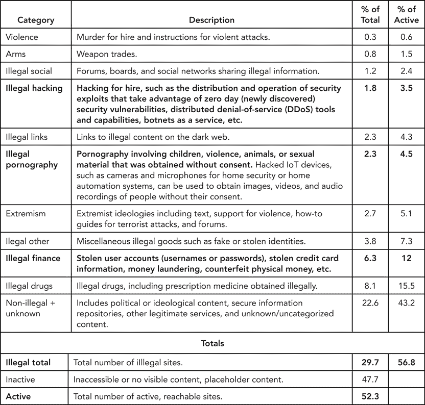

**表 3.3 2016 年 2 月的非法交易和基于 Web 的洋葱服务**

`Tor` 等工具不仅允许用户匿名访问网络；还能让用户匿名托管 Web 服务。再次，用于匿名托管 Web 应用服务的最流行的工具之一由 `Tor` 提供，它被称为 `Tor 洋葱服务协议`（Tor Onion Services Protocol）。这项技术使得通过 `Tor` 网络匿名托管 Web 服务成为可能，从而隐藏编写或部署此类服务的个人或实体身份。他们的位置被保密，同时仍让他们能够提供各种互联网服务，如网站、网页邮箱或即时消息服务器。

匿名托管能力导致了暗网市场的泛滥，这些市场专门买卖非法商品。在这些生态系统中，在线市场是匿名托管、匿名访问的，支付方式是匿名化的加密货币，如 `Bitcoin` 或 `Monero`。最著名的暗网市场之一是“丝绸之路”（Silk Road）。它通过 `Tor` 托管，并使用 `Bitcoins` 进行交易。

[表 3.3] 根据 2016 年的研究，概述了暗网上经常交易的某些非法物品。与 `IoT` 系统最相关的物品已加粗。

### 3.8 常规 IoT 经济中的挑战：走出黑暗，进入天真

让我们暂时离开黑暗吧。是的，你可能正在松一口气。让我们暂时离开黑暗吧。是的，你可能正在松一口气。让我们暂时离开黑暗吧。是的，你可能正在松一口气。让我们暂时离开黑暗吧。是的，你可能正在松一口气。

（注：原文最后一段存在多处相同的句子重复，译文已按要求完整对应翻译。）

正如你可能猜到的那样，这种情况并不局限于玩具公司。连接网络设备或家电的日益普及，以及此类物联网（IoT）技术激进的消费化，创造了一个对许多人来说极具吸引且无法抵拒的市场。从冰箱到恒温器、门锁、扬声器、咖啡机等，制造商不断寻找方法，为了“更大的利益”将原本未连接的设备连接起来。

在本章中，我们不会纠结于“连接未连接设备是否是为了更大的利益”这一争论泥潭，尽管我们将在第 7 章中更详细地检查 IoT 连接性以及保护连接的困难，随后在第 8 章中讨论隐私时，探索一些有趣的关注点和伦理冲突。不过，目前可以说，许多 IoT 系统制造商在 IoT 安全方面缺乏相应的专业知识和投入。

也许，将所有责任归咎于系统设计人员和制造商是错误的。正如俗话说：“你必须给人们他们想要。”遗憾的是，许多客户尚未理解连接设备中固有的安全威胁。因此，我们还没有看到大多数 IoT 设备消费者要求将良好的安全性作为其智能玩具、冰箱、车库门和景观浇水系统的功能特性。对于制造商来说，如果客户不要求，安全就不是首要考虑。

17. Soltani, R., Goeckel, D., Towsley, D., and Houmansadr, A. (2017, 11 月 27). “迈证明不可见的网络流指纹。”来自 [`arxiv.org/abs/1711.10079`](https://arxiv.org/abs/1711.10079)

18. Bangeman, E. (2007, 8 月 30). “安全研究人员偶然发现大使馆邮件日志。”来自 [`arstechnica.com/information-technology/2007/08/security-researcher-stumbles-across-embassy-e-mail-log-ins/`](https://arstechnica.com/information-technology/2007/08/security-researcher-stumbles-across-embassy-e-mail-log-ins/)

19. Gayathri, A. (2011, 6 月 11). “从大麻到 LSD，现在非法药物直接送上门门。”来自 [`www.ibtimes.com/marijuana-lsd-now-illegal-drugs-delivered-your-doorstep-290021`](https://www.ibtimes.com/marijuana-lsd-now-illegal-drugs-delivered-your-doorstep-290021)

20. Moore, D. (2016, 2 月 1). “加密政治与暗网。”来自 [`www.tandfonline.com/doi/full/10.1080/00396338.2016.1142085`](https://www.tandfonline.com/doi/full/10.1080/00396338.2016.1142085)

## 第二部分

## 第 4 章

## 构建可安全扩展的 IoT 系统架构

*你们中哪人想要盖一座楼，却不先坐下来算算，看看自己是否有足够的资源来它吗？*

— 路加福音 14:28

### 4.1 IoT 系统架构

系统架构是对系统中元素的组织，旨在满足业务、环境、操作约束和系统用户的需求。对于 IoT 而言，勾勒系统架构至关重要，这样我们在探索 IoT 系统的不同元素及其运作方式时，可以对系统本身有一个共同的图景和理解。然而，正如 IEEE 所指出的那样，目前并没有一种广泛认同的 IoT 架构；事实上，IoT 领域不同小组和公司所使用的术语可能是多种多样的，这导致了困惑。对十三篇关于 IoT 参考模型的不同学术论文的一项有趣调查识别出了六种不同类型的架构模型，每种模型都有三到七层，并对这些层级使用了九种以上不同的命名方案。尽管这初看之下很令人困惑，但当我们回想起，在不断演进的信息和通信技术领域，模型和术语的分歧并不新鲜时，我们就可以忽略这些嘈杂观点，直击这些 IoT 模型向我们传达的核心内容。

各行业和标准小组开发并传播了各种系统架构，以便更好地传达与其关注的系统相关的问题和需求。任何从事电信国际标准工作的人可能都接触过用于通信栈的七层开放系统互连（OSI）参考模型。然而，不同的行业和不同的小组经常会调整术语并修改架构，以适应其特定的读者和需求。

[图 4.1] 显示了一些并排的栈，以突出这些术语上的差异。互联网工程任务组（IETF）普及了 TCP/IP 参考模型，该模型使用一个简化的栈模型，仅识别了 OSI 模型中七层中的五层。在完全不同的环境中——即软件定义无线电（SDR）社区——开发了一套完全不同的术语来描述通信栈的元素，它被称为“波形”（waveform）而不是栈。波形指的是无线电系统的软件实现，其中包括空中接口（OSI 参考模型的物理层）。“波形”一词表示软件定义无线电物理层中发生的动作，它通过调制和解调电磁能量来产生特定的无线电——它“形成”了无线电。但“波形”一词包含的不仅仅是通信栈底层电磁波的生成；它还包括数据链路层和网络层，这模糊了通信层之间通常的界限，并让那些不熟悉技术特定术语的人感到困惑。虽然初看之下，不同的术语造成了困惑，但实际上，它们并没有太大区别。当人们研究[图 4.1]中不同的通信栈架构时，架构本身传达了对该架构社区最重要的元素和思想。

![图 4.1 七层 OSI 参考模型、IETF TCP/IP 参考模型以及软件定义无线电 (SDR) 示例]

物联网（IoT）社区与其他任何社区并没有区别。主要区别在于 IoT 跨越了许多不同的行业和生态系统，并具有多样化的关注点。这些行业已经有了传达其关注点的架构和词汇，因此当这些社区采用 IoT 时，它们将现有的术语转化为 IoT 术语并不意外。例如，工业制造业围绕普鲁学院参考模型（Purdue Reference Model）有一套完整的架构和术语，该模型包含了用于控制物理系统的操作技术（OT）。

Cisco 系统试图创建一个统一的 IoT 模型，创建了一个详细的七层模型（如图 [4.2] 所示），并发布了他们对 IoT 架构模型应有样子的解释。他们的观点基于数据通信，这符合他们作为通信和路由器公司的市场视角。他们的模型根据数据生成、传输、处理和存储的位置来定义层。他们没有对这些层和功能的物理位置做出任何主张，而是指出可以存在“许多、许多例外”。然而，行业内没有其他人采用过层级如此之深的模型。也许由于 Cisco 的通信背景，他们受到七层 OSI 参考模型的影响太大，认为任何 IoT 架构模型也应该有七层。

许多已发布的架构模型的问题在于，试图同时结合架构的物理呈现和数据模型。架构的物理呈现涉及端点节点、路由器、网关和服务器的位置；架构的数据模型涉及数据捕获、格式化、合并、分析和存储的位置。将这两种模型结合在一起导致了混乱的术语和生硬的层级。

当研究人员和公司努力寻找最佳描述性词汇和合适的层数来描述 IoT 架构时，大多数行业已经确定了三层模型。⁷ 在第 1 章和第 2 章中向您介绍了这种 MGC 架构，它整齐地分为设备层（称为边缘层、感知层或物理层）、网关层（也称为雾层或网络层）和云层（也称为应用与业务层、服务器与存储层或应用层）。在图 4.2 中，我们在思科的七层模型旁边增加了这三个 MGC 层以展示它们的对比。这种三层模型高度倾向于纯粹的物理呈现模型。尽管数据模型通过将特定的数据和通信服务分配给特定层而松散地耦合，但公认为，根据行业和特定的安装需求，这些数据服务可以在层之间浮动。

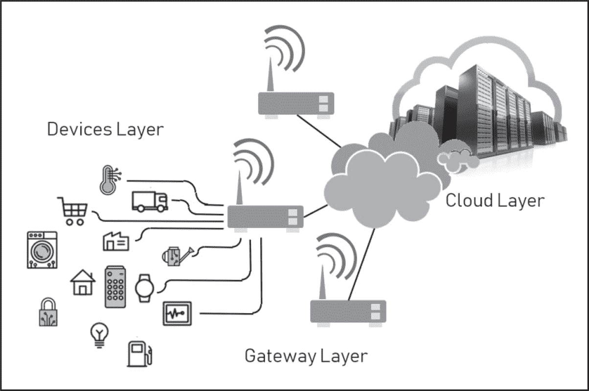

**图 4.3** IoT 设备-云-网关系统架构

因此，在本书剩余范围内，IoT 系统架构被认为由三层组成，如图 4.3 所示：由传感器、执行器和数据采集设备组成的设备层；负责数据整合和转换的网关层；以及用于数据分析、存储和业务价值提取的云层。⁸这种架构旨在以最低的成本最大化 IoT 系统的收益。从 IoT 系统中提取价值的主要机制是对 IoT 设备的整合数据进行大规模分析。这种数据分析能够改进业务决策、优化物流、识别趋势并创建新服务。让我们更详细地检查这些层，并为它们向 IoT 架构提供的服务和功能提供具体的定义。

#### 4.1.1 云层](#ch00_fm06_toc.xhtml#rsec4_1_1)


云并不是一个新范式，它是通过互联网在全球范围内访问的海量服务器群，并有多种“即服务”模型供访问⁹——例如平台即服务（`PaaS`）、基础设施即服务（`IaaS`）、软件即服务（`SaaS`）和函数即服务（`FaaS`）。^(\*)我们将在第 6 章中详细介绍云，因此本节将仅简要回顾我们当前讨论的关键要点。在 IoT 中，云指的是私有数据中心实例；公共云服务（如 Amazon®、Google Cloud Platform™ 或 Microsoft^® Azure^®），或这些者的结合。根据我们图 4.3 中的 IoT 模型，IoT 云层代表了设置、管理、运行和从 IoT 系统中提取业务价值所需的后端服务。IoT 云层代表了设置、管理、运行和从 IoT 系统中提取业务价值所需的后端服务。IoT 云层代表了设置、管理、运行和从 IoT 系统中提取业务价值所需的后端服务。IoT 云层代表了设置、管理、运行和从 IoT 系统中提取业务价值所需的后端服务。IoT 云层代表了设置、管理、运行和从 IoT 系统中提取业务价值所需的后端服务。IoT 云层代表了设置、管理、运行和从 IoT 系统中提取业务价值所需的后端服务。IoT 云层代表了设置、管理、运行和从 IoT 系统中提取业务价值所需的后端服务。IoT 云层代表了设置、管理、运行和从 IoT 系统中提取业务价值所需的后端服务。IoT 云层代表了设置、管理、运行和从 IoT 系统中提取业务价值所需的后端服务。IoT 云层代表了设置、管理、运行和从 IoT 系统中提取业务价值所需的后端服务。IoT 云层代表了设置、管理、运行和从 IoT 系统中提取业务价值所需的后端服务。IoT 云层代表了设置、管理、运行和从 IoT 系统中提取业务价值所需的后端服务。IoT 云层代表了设置、管理、运行和从 IoT 系统中提取业务价值所需的后端服务。IoT 云层代表了设置、管理、运行和从 IoT 系统中提取业务价值所需的后端服务。IoT 云层代表了设置、管理、运行和从 IoT 系统中提取业务价值所需的后端服务。IoT 云层代表了设置、管理、运行和从 IoT 系统中提取业务价值所需的后端服务。IoT 云层代表了设置、管理、运行和从 IoT 系统中提取业务价值所需的后端服务。IoT 云层代表了设置、管理、运行和从 IoT 系统中提取业务价值所需的后端服务。根据我们图 4.3 中的 IoT 模型，IoT 云层代表了设置、管理、运行和从 IoT 系统中提取业务价值所需的后端服务。IoT 云层代表了设置、管理、运行和从 IoT 系统中提取业务价值所需的后端服务。IoT 云层代表了设置、管理、运行和从 IoT 系统中提取业务价值所需的后端服务。IoT 云层代表了设置、管理、运行和从 IoT 系统中提取业务价值所需的后端服务。IoT 云层代表了设置、管理、运行和从 IoT 系统中提取业务价值所需的后端服务。IoT 云层代表了设置、管理、运行和从 IoT 系统中提取业务价值所需的后端服务。IoT 云层代表了设置、管理、运行和从 IoT 系统中提取业务价值所需的后端服务。IoT 云层代表了设置、管理、运行和从 IoT 系统中提取业务价值所需的后端服务。IoT 云层代表了设置、管理、运行和从 IoT 系统中提取业务价值所需的后端服务。IoT 云层代表了设置、管理、运行和从 IoT 系统中提取业务价值所需的 IoT 服务。

#### 4.1.2 网关层](#ch00_fm06_toc.xhtml#rsec4_1_2)

网关层是一个中间层。

IoT 系统的设备层由边缘节点组成，这些节点通过机械或电磁方式改变物理系统，或通过收集数据与物理环境交互。收集数据的边缘节点被称为传感器，而与物理系统交互的边缘节点被称为执行器。设备层有时被称为`感知层`，因为它通过传感器感知或看到环境，并可以通过执行器操纵环境。

在泛及边缘设备时，隐含的是，我们包含了设备本身、微控制器单元（`MCU`）以及运行该设备的辅助软件；这些部分共同构成了一个小型系统，可以执行一些基础功能并与 IoT 系统的其他部分进行通信。当然，这是对设备的一种初级视角。IoT 设备的范围非常广泛，从执行单一动作的“愚笨”设备到由多个传感器和执行器组成的复杂设备不等。在 IoT 的许多领域，人们正致力于于创建“智能设备”，这些设备可以直接利用其自身的传感器数据，以及接收来自其他附近设备的传感器数据，来决定设备本身如何与环境交互，而无需任何（或极少）的外部控制或监控。许多此类设备太小，甚至无法包含电池，因此通过能量采集供电。

尽管存在这些差异，由于功能可能性和组合的规模巨大，要全面涵盖所有 IoT 系统中所有可能的边缘设备是不可能的。需要一整本书才能对它们进行分类和描述。然而，根据一份 IEEE 报告¹，边缘设备可以很容易分为三大类：

*   `标签`（Tags），包含标识符并在查询时传输该标识符的设备。

*   `传感器`（Sensors）^^(\*)。传感器本身仅提供数据——传感器背后的应用程序，以及传感器数据解释和使用的方式（可能与其他传感器数据相结合），才使系统变得独特且有价值。

执行器将电能转换为物理运动；执行器是电气设备，通过打开或关闭接触，或通过移动轴、开关或阀门与环境进行物理交互。遥控玩具车中的电机和伺服器是执行器的绝佳例子。IoT 系统中实际上只有两种类型的执行器——一个是电气的，另一个是物理的：

*   `继电器`（relay）是一种电执行器，根据电控制输入打开或关闭电路；继电器是电子开合开关。

*   `伺服机构`（servo-mechanism）是一种物理执行器，根据电信号输入（通常是脉冲波）使轴旋转指定的次数或达到特定的角度。

从这两种类型的执行器中，可以创建许多不同的控制装置，例如阀门、开关和电机。

执行器领域的一个新兴领域是微机电机械系统（`MEMS`）技术^(13。`MEMS` 与纳米技术有关，但通常涉及大于一微米、几毫米的机械系统。`MEMS` 元件通常将某些机械系统（执行器）与一个或多个传感器以及微控制器相结合，以提供处理和通信^(14。由于 `MEMS` 元件如此小且廉价，推广 `MEMS` 为 IoT 系统提供数据和控制是一个充满前景的增长领域。虽然 `MEMS` 单元很小，因此它们的机械操作也必须局限于极微型，但 `MEMS` 的优势在于数百或数千个 `MEMS` 单元协同工作的力量。考虑一种配备了 `MEMS` 单元的窗帘，它们与建筑内部的热控器通信。当天气变暖时，`MEMS` 单元可以关闭微遮光帘以减少进入建筑的光线，但在冬季它们会保持开启，从而降低制暖成本。尽管体积很小，`MEMS` 单元在控制大规模流程方面取得了卓越效果，甚至被用于飞机机翼，在没有其他飞机控制面辅助的情况下控制飞机飞行^(13。

### 4.2 IoT 必须是一个低成本系统

正如我们之前描述的，`ch00_fm06_toc.xhtml#rsec4_2`旨在最大化从 IoT 系统组件中收益，同时将成本控制在最低水平。这使得成本成为 IoT 系统的主要驱动因素。IoT 的整个理由是为了增加服务的变现、降低运营成本、减少人力支出和/或加速运行。所有这些理由都归结为成本。因此，如果安装或运行 IoT 系统的成本过高或超过了某个阈值，那么整个 IoT 系统的投资回报率（`ROI`）就会下降，甚至完全消失。整个 IoT 系统架构都是为了降低成本而构建——低成本设备、低成本通信、无成本维护和低运营成本。

# 如果低成本是首要目标，那么为什么要在架构中创建三层呢？我们不能直接舍弃所有网关，只保留两层吗？毕竟，对从 IoT 设备收集的汇总信息进行大规模数据分析，似乎只需要设备层和云层。

网关似乎像是一项不必要的支出。毕竟，客户端—服务器架构已经存在很长时间并且非常成功。云系统似乎能有效利用客户端—服务器技术同时为数百万客户端提供服务，那么为什么 IoT 需一种不同于 Facebook^® 或 Amazon Webstore™ 的架构呢？

请不要误会，仅使用设备和云端来创建一个 IoT 系统是完全可能的。目前有许多此类概念验证，包括 Amazon 的 IoT Core™ 和 Arm^® Mbed™ Cloud。将这些系统用于某些 IoT 部署也是完全可行的。但有几个原因导致仅凭云基础设施是无法管理一个完整的、大规模 IoT 系统的。这些原因包括客户端数量、能量、通信成本、安全性以及可扩展性。

## 4.2.1 IoT 网关层：原因 1—客户端数量

在客户端—服务器架构中，大量独立的客户端与单个服务器实例通信。客户端向服务器提交请求，要求执行特定的服务。服务器完成请求并向客户端提供响应。客户端—服务器系统可以通过在负载均衡器后添加额外的服务器，或向现有服务器添加额外的处理器来增长和扩展规模。这些服务器和负载均衡器运行在云端。正如我们提到的，今天许多大规模服务仅依赖于这种架构。那么，为什么 IoT 还需要额外的架构层呢？

这些经过检验的系统之所以发生演进，是因为 IoT 部署中涉及的设备数量巨大。单客户端—服务器系统的设计是为了处理数千个系统用户，而基于云的多服务器系统设计是为了处理数百万个客户端。但 IoT 系统旨在为从千万到数亿的设备提供服务。这种预期的规模需要一种新架构，以便让服务器能够处理向系统输入数据的潜在设备数量。IoT 系统可以被视为客户端—服务器架构和云计算的必要演进。这种架构利用了云计算的全球规模，结合成功的客户端—服务器架构，来处理海量的终端用户设备。

然而，完全可以启动足够的服务器来处理所有这些设备，但这些服务器会被通信流量淹没，而且其处理器的繁忙程度不足以支撑维持所有服务器活跃状态的成本。即使服务器可以进行平衡以至于足够忙碌，这种双层架构也会给设备层带来负担。

## 4.2.2 IoT 网关层：原因 2—能量成本

在许多 IoT 系统中，设备很小且分散，可能分布在大型农田上，或者整个城镇或城市中。许多 IoT 设备是低功耗的，没有接入主电源的能力。在这种情况下，传感器和设备可能通过能量采集或电池运行。IoT 系统必须非常小心地平衡功率。传输数据的能量成本很高，设备通信的时间越长，耗电越多。如果设备没有直接连接电源，它必须使用能量采集，而这种频率可能是有限的。放置在设备附近的网关可以使网络获取设备数据，并通过有线或单一长距离无线连接将这些数据上传，从而节省设备的能量。

## 4.2.3 IoT 网关层：原因 3—长距离通信成本

IoT 系统需要网关层的另一个原因是长距离通信的成本。许多 IoT 设备可能远离任何有线通信基础设施。使用电缆支持此类设备将意味着需要铺设铜线以到达所有设备，其成本极其高昂；甚至可能无法将设备直接连接到有线通信中。在考虑此类网络的长期访问和运营时，租用线路甚至 3G 数据通信可能非常昂贵，这会影响 IoT 系统的投资回报率（`ROI`）。如果每个设备都需要一个 3G 账户，那么一个 IoT 安装项目可能产生数百万 3G 用户。突然之间，一个 3G 账户就可以服务于数百个设备，这取决于设备本身的范围和分布。

IoT 系统通信中可能需要网关层的另一个原因与控制循环（control loops）有关。控制循环存在于许多 IoT 系统中，但在工业物联网（`IIoT`）中具有最高优先级。`IIoT` 是指在化工厂、石油炼油厂、水和废物处理系统或任何其他工业制造操作中使用 IoT 的术语。在 `IIoT` 系统中，主要的关注点是对构成制造系统的阀门、泵和传感器的控制。这些控制装置的正常运行至关重要。

考虑一家生产不同类型汽油产品的石油炼油厂。在加油站，你可以选择普通汽油、无铅汽油、高级汽油，甚至是柴油燃料。不同的汽油品牌具有不同的添加剂，以便在使用过程中清洁发动机。这些产品每种都需要略有不同的化学品混合物、对原油进行不同的温度处理，以及数千个不同的变量。所有这些变量都由炼油厂内部的一系列阀门、泵和液流控制系统控制。对于工业系统中的每一个此类控制点，都有一系列传感器来读取温度、化学成分、粘度等。如果只有几个控制点出错，从炼油厂后端产出的将不是高级汽油，而是污泥——一种你无法销售但必须付钱进行妥善处理的化学废物。你可以想象运行这样一个系统的成本会如何飙升，特别是如果让整个工业系统达到平衡并保持这种状态需要太长时间的话！如果你近距离观察过石油炼油厂，那么想象其中一个系统中包含成千上万个阀门、泵和传感器并不困难！

这些每一个阀门和泵都是所谓控制循环的一部分。例如，阀门被放置在特定位置（例如：完全关闭、打开 3% 或打开 12%）。随后，多个传感器会读取该阀门对工业过程的影响。压力是否过高？流中某一点的特定化学物质是否过多？粘度是否太低？无论传感器读取到什么，都会将该信息返回给工业操作中心。然后对所有传感器值进行分析，并将调整指令发送到控制一个或多个阀门和泵的执行器。这种从阀门到传感器、到控制中心到阀门的循环被称为控制循环。`IIoT` 系统执行这些控制循环的速度越快，整个工业操作中心就能越快地让整个系统平衡并生产出预期产品。这意味着工厂的废物输出更少，生产最终产品的成本更低。只要控制循环运行高效，`IIoT` 系统就能比人类更快、更高效地完成。

在真实的工业系统中，有成千上万个控制循环。还有控制循环中的控制循环。某些控制循环用于炼油厂的日常操作和维护，而另一些对于防止灾难是必不可少的——例如，防止整个炼油厂爆炸并向附近的人口中心扩散有毒氯气云！这些是人员安全控制循环，系统无法等待云操作中心来处理某个特定阀门打开时间过长的传感器数据，因为这会在系统中造成危险的压力状态；该阀门需要立即关闭，或者可能需要打开另一个阀门来释放压力。短周期控制循环的时间可能只有几毫秒。这就是网关在 `IIoT` 系统中变得重要的地方。因为网关更靠近阀门和传感器，网关可以在这些关键控制循环的公差范围内运行。网关还具有运行程序所需的处理能力和能量，而终端设备可能无法执行这些操作。因此，网关并不只是盲目地释放系统压力以防止爆炸，它具有处理能力，甚至可能有 AI，来确定避免灾难的最优方法，同时不会完全破坏炼油厂正在生产的产品。网关在减少废物和平衡成本的同时保护人类生命和财产方面可以发挥关键作用。因此，网关绝不是一个没用的三脚架。

## 4.2.4 IoT 网关层：原因 4—安全

所有与云的通信必须经过安全保护，保护这种通信流的主要机制是传输层协议（`TLS`）；`TLS` 是在 IETF RFC 8446 中取代安全套接层（`SSL`）协议成为行业标准的协议。与 `SSL` 类似，`TLS` 由一系列 Internet 标准定义，这些标准规定了如何对数据进行加密和进行完整性保护，以防止传输过程中的泄露和篡改。`TLS` 还规定了一系列密钥交换步骤，允许两个通信方安全地生成用于加密和完整性操作的共享密钥。这些操作（尤其是密钥交换）的麻烦在于，计算这些值需要大量的处理能力——而这正是我们已经提到的小型设备所缺乏的。

事实上，为了让你直观地了解这些计算有多昂贵，当 `SSL` 在 20 世纪 90 年代初出现，服务器设置为使用 `SSL` 与网络浏览器通信时，服务器配备了特殊的“彩虹卡”（rainbow cards）来执行 `SSL` 计算，因为它们在当时对服务器来说是巨大的负担。今天，服务器包含了特殊的指令和硬件来帮助加速这些计算。但 IoT 的廉价设备没有这些性能增强，主要是因为它们消耗了太多的电量。

IoT 设备中的某些小型 `MCU` 处理器确实具有有限的加密操作（即加密和完整性），这些操作被设备用于安全启动甚至消息加密。但即使 IoT 设备可以执行基本的加密操作，它们也负担不起在每次数据上传时都执行昂贵的密钥交换操作，而这是每次 `TLS` 交换开始时都要求的。

由于大多数小型设备无法执行 `SSL/TLS` 要求的昂贵操作，网关提供了这一关重要的安全服务。网关为低功耗、低能量设备开启定制的安全通道，然后到云执行完整的 `SSL/TLS`。

此外，除了保护端到端的通信路径外，网关还可以为小型 IoT 设备执行网络安全。这至关重要，因为我们都理解在公共互联网上有多危险。即使在家庭网络中，我们也使用防火墙和 NAT 转换将我们的计算机和设备与公共网络上的黑客隔离开。我们的笔记本电脑都运行着主机入侵防御软件、病毒扫描程序和其他会拖慢机器性能的软件。但所有这些保护都是必要的，以防止黑客向我们提供的恶意软件、蠕虫和其他所有形式的恶意行为接管我们的设备。

想象一下一个没有网关的 IoT 系统：功率低廉的传感器和执行器直接连接到互联网，并需要公共 IP 地址来与云端通信。突然之间，这个小型设备需要运行一个防火墙，以防止黑客利用精心构造的数据包渗透进工业计算机系统。该设备必须运行某种形式的病毒扫描，以确保没有内存驻恶意软件绕过防火墙，而且设备还必须执行所有沉重的 `TLS` 加密计算以与云端进行通信。而这一切必须在由某些毫瓦级能量采集子系统充电的小型纽扣电池供电的情况下完成。好吧，观点很好。

网关充当其所连接设备的防火墙，处理网络安全，并执行与云端的重量级通信任务。这只是网关层为真实生产级 IoT 系统提供的关键服务的另一个例子。

## 4.2.5 IoT 网关层：原因 5—扩展性

真实生产级 IoT 系统需要网关层的最后一个原因是扩展性。大多数云实例的设计初衷是扩展到能够同时服务有限数量设备的所需的水平，并根据需要启动额外的服务器。即使 IoT 设备能够访问长途通信通道，并且能够负担消耗能量和处理能力来与云端进行 `TLS` 密钥交换，大多数云端也不会有足够的服务器来立即处理涌入的请求。对于云端来说，百万个 IoT 设备同时上传它们的当前温度读数，看起来可能和我们在[第 2 章]中描述的 Mirai 僵尸网络攻击没有区别。此外，运行并等待服务的服务器数量越少，这些服务器的活跃时间越短，运行 IoT 实例云部分的成本就越低。成本基于云运营商的收费，而这通常取决于运行的服务器实例数量以及云端摄取的流量大小。

此外，重要的是，云的使用受到托管云实例所在地实际数据中心可用带宽的限制。请记住，云是由数据中心中大型服务器集群组成的。而这些数据中心地理上遍布全球。每个数据中心都接入互联网的大型光纤骨干，并从该通道获取所有流量。因此，无论云实例中有多少服务器，特定数据中心能够消耗的流量取决于该接入网络连接的带宽。这就像给泳池注水——你向池中注水的速度取决于水管有多大。所以加一根水管……呃……一根光缆来向数据中心引入更多数据。这在一定范围内是有效的。就像在你家里一样，你可以增加更多水管来填满泳池——从前院一根，从后院一根，从厨房一根……你明白我的意思。但在某个时间点，向你房屋供水的主水管将耗尽，从每根水管流来的水都会减少。互联网也是如此。从地理位置上看，一个区域内能接收的数据是有限的。互联网主骨干会饱和，该区域的路由器会过载，其他互联网服务将开始受到影响。这就是为什么公共云服务以及如 Netflix®、Facebook 和 Amazon 这样巨大的互联网服务在国家和世界不同地区拥有数据中心的原因——这是为了分配网络负载（必要时），并避免网络数据包跨越半个世界产生长延迟。


IoT 系统也会发生相同的情况。云端可以将你的流量重定向到地球另一端的另一个服务器，并启动服务器来处理你的请求。从技术上讲，这是可行的。但现在你的设备将面临所有延迟以及额外的初始连接时间，并且需要保持通信子系统的电源以监听响应。这种扩展方式对于云提供商来说没问题，但对于能量有限的 IoT 系统来说是非常不利的。再次，网关层解决了这个问题。

如果 IoT 系统产生的成本节省被高昂的云服务租赁费用吞噬，这显然是不现实的。而且 IoT 系统的预期规模可以轻易淹没单个云数据中心，导致通信延迟增加并增加设备的能量成本。网关层消除了云端的负担，使得云实例的使用更加审慎，解决了拥塞问题，保持低成本，并允许 IoT 系统扩展到数十亿个设备。

## 4.3 IoT 架构层细节

现在基础 IoT 架构已经铺好，并且理解了 IoT 架构各层主要需求的原因（例如，容量、能量、通信和扩展性）——是时候让我们更详细地查看 IoT 架构的每一层了。仔细观察每一层中的硬件和软件将为我们的下一章提供重要的背景，下一章将分析 IoT 系统的安全性。

### 4.3.1 基础 IoT 边缘设备架构

最基础的 IoT 边缘设备是简单的传感器和执行器，通常由电池供电，并使用`MCU`执行逻辑并运行设备的基础软件。最原始的传感器“运行在裸机上”，这意味着执行传感器功能的软件是直接写在处理器上运行的，不经过任何操作系统或软件框架，以便编写传感器软件更加容易。然而，如今传感器和执行器运行在实时操作系统（RTOS）上更为常见。正如其名所示，`RTOS`的设计目的是允许程序进行实时运行并尽可能地消除开销，同时仍为软件开发者提供一些基本的“便利性”。这些便利性包括文件读取和写入（允许程序员读取配置信息并写入包含传感器数据读数的临时文件）、串口和 USB 端口的输入/输出驱动程序（允许程序员更容易地与调制解调器或以太网卡交互）、以及进程和/线程（允许开发者将程序分成不同的部分并以适当的方式调度每个部分）。当然，`RTOS`还可以提供许多其他服务功能，上述列出的只是最基础的示例之一。

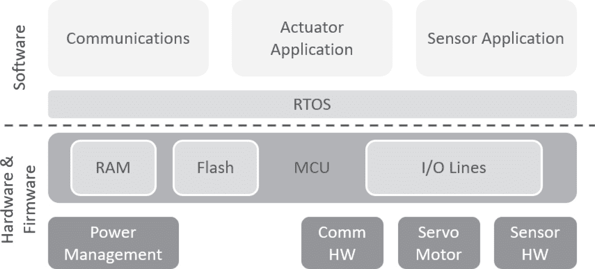

**图 4.5** 基础 IoT 边缘设备软件架构

图 4.5 显示了 IoT 边缘基础设备的硬件和软件架构，指示了硬件与软件之间的分工。软件通常被构建为一个单体应用，这意味着该应用程序被编译成一个程序。但如图所示，可以将不同的操作拆分到不同的执行线程中，每个线程代表一个特定的功能。在这种情况下，`RTOS`可能包含主线程或根据需要调用特定函数的中断处理程序。例如，当发生中断指示通信端口上有数据时，`RTOS`将导致通信应用程序运行；`RTOS`可能会调度传感器应用程序每五分钟运行一次，或者以其他合适的延迟运行，以便传感器可以从环境中读取读数。随后，执行器应用程序将收到通信应用程序的信号，告知已收到特定的命令，要求其执行某些功能。

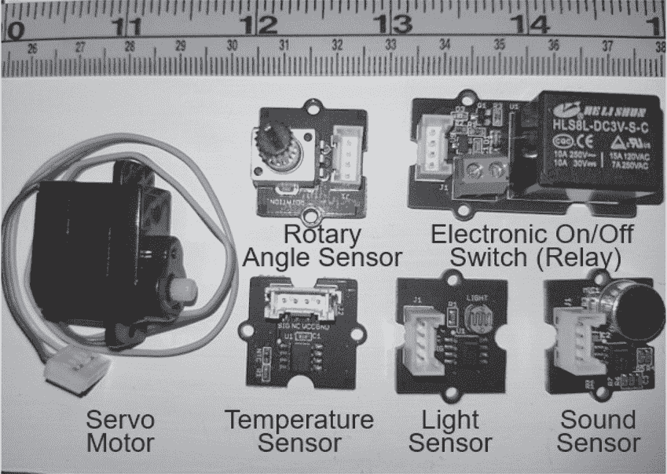

**图 4.6** 来自 Grove Kit 的不同类型的传感器和执行器

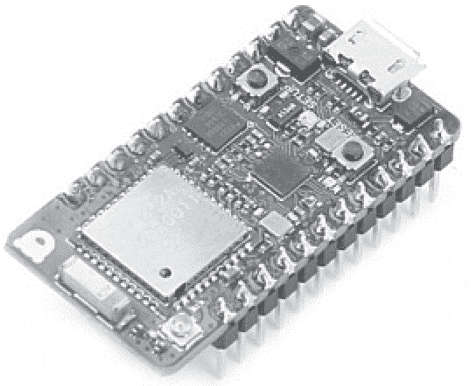

**图 4.7** 一块带有 USB 和蓝牙的 MCU 板板 (DUO 板板) (*来源：*[`digitalmeans.co.uk/shop/image/cache/catalog/seeedstudio/model/10299/102990523/redbear_duo_wi-fi_ble_iot_board-001-500x500.jpg`](http://digitalmeans.co.uk/shop/image/cache/catalog/seeedstudio/model/10299/102990523/redbear_duo_wi-fi_ble_iot_board-001-500x500.jpg))

设备中的特定硬件取决于其特定的预期功能和通信能力。在图 4.6 中，显示了几个传感器和执行器组件。这些元素来自 Seeed® 的 Grove Kit^(\*)，这是一种可以购买的商业硬件套件，用于与 Raspberry Pi^® 或 Arduino^® 板板接口。因此，这些组件仅显示了实际的传感器硬件，不包括`MCU`和通信硬件。此图提供了每种类型尺寸的视角。然而，仔细观察照片可以发现，小型传感器板上最大的组件是用于将传感器连接到`MCU`的白色连接器。`MCU`芯片本身的大小大约相当于小指指甲盖大。一个完整的传感器需要`MCU`、某种通信芯片、电源以及照片所示的传感器硬件。白色连接器将会消失，并被`MCU`和传感器之间的打印电路板连接所取代。所有部分组合在一起，这将构成一个完整的传感器板。

网关通常运行标准的操作系统。Linux® 是一个非常常见的选择，因为它支持许多不同的 CPU 和许多类型的设备。Windows^® 操作系统也被广泛使用，包括企业版（Windows 7、Windows 8 和 Windows 10）以及微软自己的针对 IoT 的特定操作系统——Windows IoT Core。由于 Windows IoT Core 是无头的（即它不提供显示器或键盘来直接与设备交互），更多的设计倾向于使用带有完整显示器和键盘支持的标准操作系统。这种偏好很大程度上是因为开发者和系统集成器在使用没有直接连接的用户界面的设备时会遇到很多困难。

图 4.9 显示了基于上一节分配给网关的功能和职责的 IoT 网关软件和硬件栈。人们注意到的第一个区别是增加了支持短程通信的硬件和固件。长程通信可能只是一个以太网端口，正如我们在图 4.8 中所示，也可以是一个带有 SIM 卡以实现蜂窝通信的 3G 或 4G/LTE 调制解调器。这些通信子系统被刻意与短程通信硬件和软件分离，以避免通信中的无意（或恶意的）交叉。短程通信系统最可能是现有系统（如工业 IoT）的某种类型有线总线。这些通信链路可能是 I2C、串口（`RS-232`或`RS-485`）、MODBUS^® 或`4-20mA`环路，并可以使用图 4.8 中的 LSE 连接器。我们将在第 7 章中详细讨论这些和其他常见的 IoT 协议。在新 IoT 部署中更常见的是设备的无线连接，包括 WiFi、蓝牙低功耗（BLE）、ZigBee®、LoRa® 或 6LoWPAN。在这些硬件/固件通信设备之上，网关维护着两个通信栈。网关始终使用`TCP/IP`通信栈与云端通信，但通常有一个自定义的通信栈与设备通信。虽然可以想象云端和设备都可以使用`TCP/IP`进行通信，但通常情况下并非如此。在设备上运行完整的`TCP/IP`栈需要大量的电力和内存，并且需要的协议比仅`TCP`和`IP`多得多。`TCP/IP`还需要用于链路连接、地址解析、路由、配置和其他服务的协议。因此，在设备端选择了更简单的栈，而网关提供设备简易协议与消息到达云端所需的`TCP/IP`通信之间的翻译。

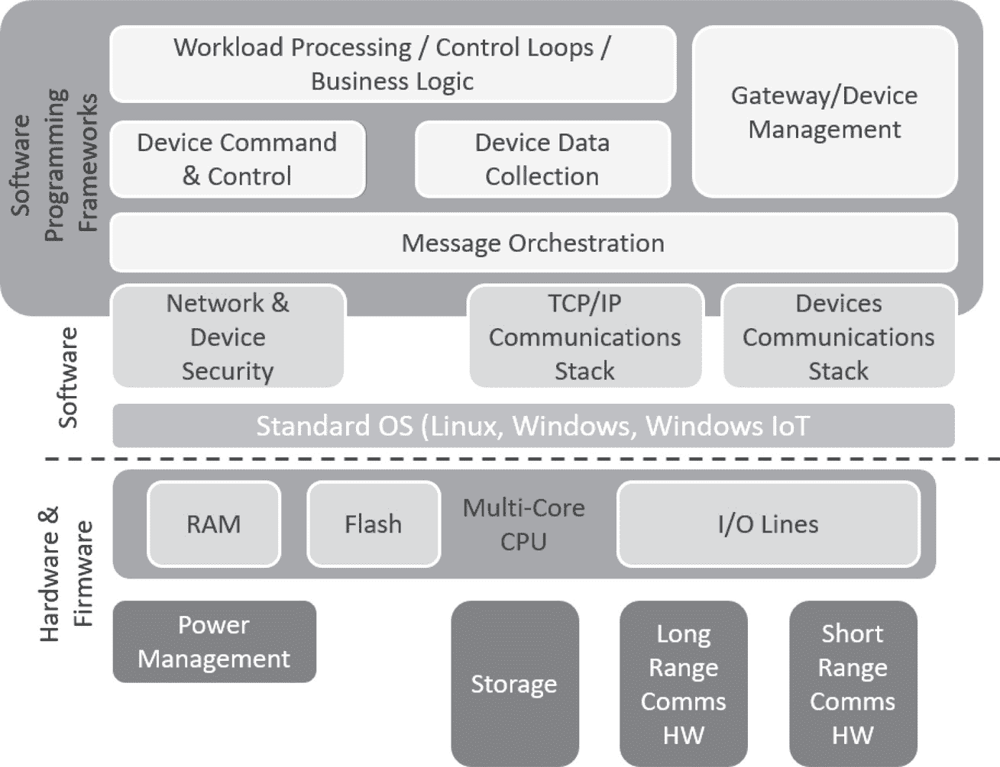

**图 4.9** IoT 网关参考软件架构

为了使网关编程更加容易，开发者通常创建一个消息编排层，以隐藏向云端或设备写入消息的复杂性。顶层应用程序只需向消息编排层写入简单的消息，该层就会执行将其送到正确位置所需的格式化和转换。此外，消息编排层能够接收来自两个通信栈的消息并将其传递给适当的应用程序服务。这本质上是一种发布—订阅（pub—sub）软件设计模式。

在栈的顶部，通常有三种类型的应用程序：命令控制应用程序、数据采集应用程序和管理应用程序。命令控制和数据采集程序执行监听设备、收集数据和发送命令的基本操作。通常，此类软件被分为两层——底层了解设备的特定细节，顶层执行更高级的工作负载功能。顶层包含了用于命令和查询设备的业务逻辑和控制循环。顶层可能包含某些 AI 以更好地控制设备，并将数据采集和命令控制结合在一起。这一层可能会利用网关上增加的存储空间，甚至可能使用全`SQL`或`No-SQL`数据库来保留从设备接收的所有数据的副本，甚至可能包含一个发送到设备的命令的时间戳日志。

管理应用程序为网关以及云端下游的设备提供了一种控制面。管理应用程序保留了与云端完全不同的连接类型，并且通常在设备上以高权限应用程序的形式运行，允许它更改配置文件、更新软件和固件、启动和停止应用程序、清除错误事件、清理日志文件，甚至关机或重启网关或下游设备。所有这些功能都是本地系统管理员通常会做的工作，但在 IoT 部署中，下游没有人类来执行这些功能，因此必须远程完成。管理应用程序通常与网关上的其他应用程序隔离开，尽管命令控制应用程序通常有能力向设备发送某些只有管理应用程序才能发送的命令（例如：关机、重启和更改报告频率）。命令控制应用程序是实际上向下游设备发送命令（如`restart`）的软件，但管理应用程序才是接收云端命令、验证命令，然后指示命令控制应用程序向设备发送命令的部分。这些高度敏感的管理员命令由管理应用程序控制。

图 4.9 还显示了网络和设备安全功能。IoT 网关负责保护其下游设备，因此必须保护网络免受攻击者的侵害。这包括连接到云端的`TCP/IP`网络，以及设备网络（无论它是什么）。`TCP/IP`网络安全相当简单。企业系统存在许多主机入侵防护（HIP）和网络入侵防护（NID）程序，网关针对`TCP/IP`栈的网络安全在根本上没有区别。在 Linux 系统上，用于数据包检查的服务如`tcpdump`和`iptables`，以及用于网络威胁检测的`snort`或`Suricata`^(\*)，都是适用于网关的常见网络安全示例。

然而，设备网络极其不同，并没有许多专门为保护此类网络设计的解决方案。网关通常为其支持的特定设备网络拼凑一些方案，或者可能根本不提供任何保护设备通信网络的措施。

图 4.9 中的最后一个功能块是电源管理模块。显然，对于设备而言，电源管理至关重要，但对于网关来说也同样重要。电源管理单元控制睡眠周期，并在不使用通信硬件时关闭这些硬件的电源。这有助于网关节省能量，如果网关部分依赖能量采集，这一点尤为重要。但即使网关是接入市电的，它也能减少能量消耗，从而降低运行网关的实际成本。这些低功耗期间可能是为了计划中的通信关断，因为网关已要求所有设备在特定时间内进入睡眠；或者硬件可能维持某种快速唤醒能力，并在检测到传入的通信消息时快速开启。电源管理单元通常由操作系统控制，但在 IoT 网关上，标准操作系统的电源管理代码经过了一些定制，以确保网关能够针对其设计任务以最佳方式运行。

关于 IoT 网关的最后一点说明，有必要提到软件编程框架的使用。软件开发人员通常使用不同类型的软件框架，使他们能够轻松与云端和不同设备等 IoT 基础设施建立接口，允许他们共享和复用代码，并加速 IoT 应用的开发。框架可能是针对特定基础设施的，也可能是针对特定语言的。例如，某些框架允许开发者轻松地与 Amazon Web Services™ (AWS™) 基础设施建立接口，如存储、数据库和服务器 lambda 函数。其他框架依赖于语言——例如`Node.js^`，它为开发服务器类型的应用提供了一个`JavaScript`环境，并可以与 JavaScript 中许多不同的功能库建立接口，使开发人员无需自行创建大部分所需的底层代码。这些框架非常有用而且被广泛使用。正如图 4.9 所示，软件编程框架是网关应用程序背后的一种支持性软件，允许开发者使用框架提供的函数，而不是从零开始开发整个应用程序的功能。框架甚至可以为一个或多个应用程序软件组件本身（如编排层）提供所有所需的功能。这使得应用程序更容易编写，并加快了 IoT 服务的发展。

## 4.4 基础 IoT 云端架构

与云基础设施相比，IoT 设备和网关的基础设计要简单得多。在图 4.10 中，我们展示了 OpenStack 设计的通用架构。其他云服务具有类似的基础设施，包括（从图 4.10 从左到右）：大对象非结构化存储（`Object Store`）、磁盘镜像存储与管理（`Image Service`）、用于实际服务器应用程序的计算服务（`Compute`）、用于保存文件和流的标准存储卷（`Block Storage`）以及软件定义网络服务（`Networking`）。

6. 6. *Cisco Systems.* (2014). “物联网参考模型。” 检索自 [`cdn.iotwf.com/resources/71/IoT_Reference_Model_White_Paper_June_4_2014.pdf`](http://cdn.iotwf.com/resources/71/IoT_Reference_Model_White_Paper_June_4_2014.pdf)

7. 7. *Nagasai.* (2017, 2 月 18). “物联网设备分类。” 检索自 [`www.cisoplatform.com/profiles/blogs/classification-of-iot-devices`](http://www.cisoplatform.com/profiles/blogs/classification-of-iot-devices)


8. Horowitz, M. (2014, 12 月 9). *“保障物联网”。* 检索自 [`www.slideshare.net/Stanford_Engineering/mark-horowitz-stanford-engineering-securing-the-internet-of-things`](https://www.slideshare.net).

9. Reese, G. (2009). *《云应用架构：在云端构建应用和基础设施》。* Sebastopol (加州): O’Reilly Media.

10. Allen, J. (2015, 1 月 4 日). *“什么是热能采集：对 John Allen 教授关于热能采集的采访。”* 检索自 [`www.europeanthermodynamics.com/news/what-is-thermal-energy-harvesting`](http://www.europeanthermodynamics.com/news/what-is-thermal-energy-harvesting)

11. Kamalinejad, P., Mahapatra, C., Sheng, Z., Mirabbasi, S., Leung, V., and Guan, Y. (2015, 6 月). “物联网无线能量采集。” *IEEE Communications Magazine,* 第 53 卷，第 6 期，页 102—108。 检索自 [`dx.doi.org/10.1109/MCOM.2015.7120024`](http://dx.doi.org/10.1109/MCOM.2015.7120024)

12. Archer, J. (2015, 11 月 27 日). *“5 个以方式使用陀螺仪/加速度计的 iPhone 应用。”* 检索自 [`medium.com/make-school/5-iphone-apps-that-use-the-gyro-accelerometer-in-an-interesting-way-33f5814ac84c`](https://medium.com)

13. *MEMS 与纳米技术交换中心。* (2018). “什么是 MEMS 技术？” 检索自 [`www.mems-exchange.org/MEMS/what-is.html`](https://www.mems-exchange.org)

14. Gubbi, J., Buyya, R., Marusic, S., and Palaniswamia, M. (2013, 9 月). “物联网 (IoT)：愿景、体系元素和未来方向。” *Future Generation Computer Systems,* 第 29 卷，第 7 期，页 1645—1660。 检索自 [`doi.org/10.1016/j.future.2013.01.010`](https://doi.org/10.1016/j.future.2013.01.010)

15. *OpenStack.* (2018, 11 月 29 日). “OpenStack 逻辑架构图。” 检索自 [`docs.openstack.org/arch-design/design.html`](https://docs.openstack.org)

16. Vashi, S., Ram, J., Modi, J., Verma, S., and Prakash, C. (2017, 2 月). “物联网 (IoT)：愿景、体系元素和安全问题。” 2017 年 I-SMAC 国际会议（社交、移动、分析和云中的物联网）（I-SMAC），Palladam，页 492—496。 检索自 [`doi.org/10.1109/I-SMAC.2017.8058399`](https://doi.org/10.1109/I-SMAC.2017.8058399)

## 第 5 章

## 真实物联网系统的安全架构

### 5.1 为即将到来的挑战做准备

正如第 4 章所示，物联网系统由许多不同类型组成。现在，生态系统的爆炸式增长进一步扩大了系统的多样性。每一家追求增长的科技公司都创造了一些物联网产品，许多只是将各种协议和开源解决方案拼接到某个操作系统上，而几乎没有考虑安全性。更复杂的是，物联网系统是由计算能力有限的能源受限设备组成的，这通常导致为了节省电力或满足性能需求而关闭可能具有的安全功能。安全工程师不再可以使用随性的方法、在餐巾背上涂鸦攻击方案——复杂性太大了。而且管理层无法为长期的安全流程预算。上市时间就是一切。

如果我们在流程早期就有策略性地投入专家资源和分析性工程，就能成功应对物联网世界的“完美风暴”。而且该过程是可以界定和控制的，通过清晰的风险权衡来满足上市截止日期。但安全任何系统都需要对系统进行仔细分析，并了解系统的威胁以及其对组织和攻击者的价值。事实上，你的攻击者也会对你的系统进行类似的分析，试图寻找能够允许他们渗透系统、窃取资源或造成破坏的弱点。

本章分为三个对等部分。第一部分是一个方法论的安全架构流程，包含可衡量的标准；第二部分讨论了安全原则和安全工程师思维，以指导安全架构过程中的权衡和优先级排序。本章以物联网用例的安全分析示例结束，探讨物联网独特的安全挑战和解决方案。

### 5.2 什么是安全架构？

在上一章中我们讨论了系统架构，将其定义为对元素的组织以满足业务、环境、运营限制和系统用户的需求。安全架构类似，但侧重于技术解决方案，以确保在存在试图破坏任务的对手的情况下，系统的目标或任务仍然能够维持。

安全架构通过控制和防御措施扩展了系统架构，使系统能够能够运行和管理的方式最大限度地减少信息丢失和系统资源滥用的风险，并防止信息的损坏或未经授权的泄露。安全架构通过重用系统架构的许多不同视图来利用系统架构的工作成果。安全架构师必须在这些不同的视图中切换角色，以确定系统将如何被使用以及被滥用。通常，安全架构师会过度痴迷于黑客角色以及系统将如何被攻击。虽然攻击者视角至关重要，但其他视角往往会被忽视，包括安全管理视角。

一个常见的误区是完全忽略安全管理，因为被认为它仅仅是策略。安全管理包含了策略和标准，但还需要程序来确保信息、应用程序和系统的机密性、完整性和可用性，这些程序还能确保网络仅供授权用户使用。为安全管理规划是良好的安全架构中至关重要且经常被忽视的部分。如果安全架构师不使用安全管理的视角，他们将无法向自己提出关键问题：系统将构建哪些功能来告知管理员系统出现了问题或正在发生攻击？管理员将如何使用这些功能，以至于他们不需要花费数小时来尝试确定到底出了什么问题？系统中包含了哪些机制来允许在攻击后快速恢复系统？系统中的功能将如何受到控制，以限制或防止系统管理员本身变成敌手？

戴反复一次坐在安全审查委员会上，并询问演示者他们的安全架构如何帮助系统管理员检测和隔离攻击。除了沉默之外，通常回答是：“我们提供了日志。”这个回答没有考虑到系统管理员的观点。在你的项目中尝试这个实验：从你的安全验证团队获取一个随机日志文件，然后尝试将代表正常行为的日志项与代表某一种测试攻击向量的条目分开。在开发者从未从系统中删除的海量额外日志语句中找到这些条目是一项艰巨的任务。仅仅记录日志并不是解决方案。

安全管理需要的不仅仅是日志记录或对特定数据的加密，或者对数据库记录的完整性保护；安全架构必须分析系统用户和管理员、操作用例、可能的攻击者行为、可能的意外用户误用，并利用安全通道和法规规定的加密技术来妥善保护系统。

### 5.3 安全架构流程

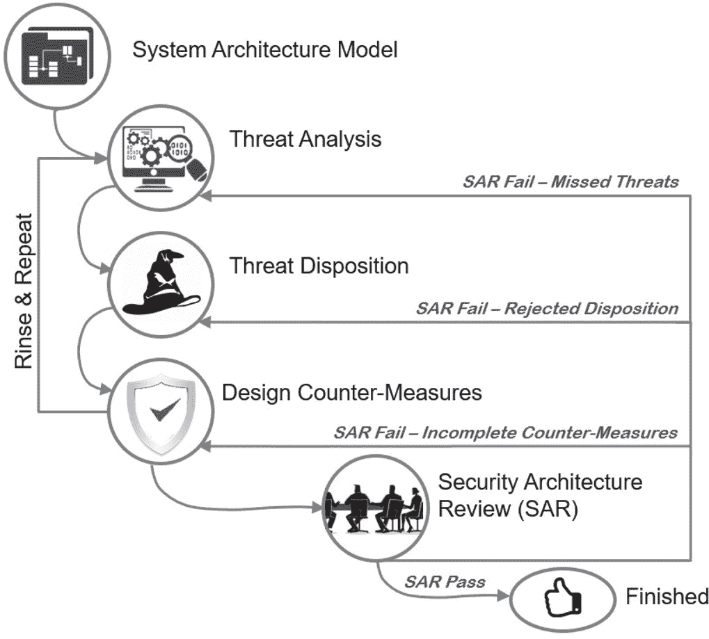

**图 5.1** 安全架构设计流程

本节介绍了戴开发的安全架构流程。戴已经在几十个项目中使用过这一流程，从小规模的单工程师项目到涉及全球多个地理区域团队的复杂多年项目。图 5.1 以及随后的列表引入了我们全面的安全架构流程。我们使用此列表作为本节其余内容的大纲。我们用于安全架构的步骤如下：

1. **分析系统架构视图：** 创建一个解决系统目标的的架构，并创建一组用于分析的架构逻辑视图。

2. **执行威胁分析：** 使用选定的架构图对系统的受威胁进行建模和分析。

3. **处置威胁：** 就像《哈利·波特》系列中的分类帽一样，威胁分析产生的威胁列表必须分类到不同的类别，定义如何处理这些威胁。每种威胁分类如下：

    * 接受的威胁

    * 转移的威胁

    * 缓解的威胁

    * 检测的威胁

4. **纳入威胁缓解措施：** 完善系统架构，以纳入缓解和/或检测步骤 3 中未被接受或转移的威胁所需的所需的功能；如果步骤 3 中没有添加新威胁，则移动到步骤 6。

5. **洗脑并重复：** 放空大脑，然后在更新后的架构上从步骤 2 重复该过程。这需要极大的自律。

6. **安全架构审查：** 与安全审查委员会审查完成的安全架构，以确保所有威胁都已识别且所有缓解措施都是适当的。如果安全审查委员会发现了新的威胁或缓解措施，请将其添加到威胁模型或架构中，并重复。

7. **批准：** 当架构获得安全审查委员会批准时，安全架构完成。

上述流程旨在对系统进行全面分析，并针对识别出的威胁以及安全管理的需求添加适当的措施。该过程需要安全工程师具备良好的判断力和经验，以正确表征威胁并识别有效的措施。然而，在步骤 6 中包含安全审查委员会是为了为经验丰富的工程师提供反馈和指导。它也为执行分析的高级工程师提供了检查和平衡，确保他们没有过度自信而意外遗漏某些内容。

后续章节将详细审查每个步骤，并为有效执行该流程所需的背景材料提供提示。

#### 5.3.1 分析系统架构视图

架构的核心在于视角。良好的系统架构创建了不同视角的图表。因此，安全架构的第一步是收集系统架构视图并研究它们以获得全面的视角。但你永远不应该满足于单一的架构视图。Clements 关于软件架构的书这样描述架构的复杂性和对多个视图的需求：

> 架构是一个复杂的实体，无法用简单的单维方式描述。我们与鸟翅的类比具有启发性。鸟翅没有单一的呈现方式。相反，它有许多视图：羽毛、骨骼、循环、肌肉视图等。这些视图中哪一个是是翅膀的“架构”？一个都不是。哪些视图传达了架构？所有的视图。（第 13 页）

安全架构主要是一门分析学科。我们使用系统的视图来分析其安全属性。首先，注意我们使用了*视图*（views）一词。这个词比*图表*（diagrams）更好，因为后者暗示了某种带有特定方法论的特定图片。这通常会演变成关于哪种方法论能产生更好图表的世俗争论。

具体的图表并不重要。重要的是图表所捕捉和传达的视图或视角。此外，图表必须让进行安全分析的工程师能够理解。这听起来非常基础，但人们在系统图表的争论上浪费了无数小时。如果接收信息的人无法解读图表，那么宇宙上最好的图表也毫无用处。请让你和你的同事从对特定图表或方法论的盲目投入中解放出来，转而寻求传达系统的重要视图。

在安全架构分析中应该关注哪些重要视图？我很兴你问了这个问题。在《应用软件架构,³》中，Hofmeister、Nord 和 Soni（来自西门子公司）描述了他们工业实践中对物联网（IoT）很有价值的架构视图。将他们的想法与 Clements 及其同事² 结合，并为安全资产添加特定的视图，我们建议以下基础视图列表：

1. **概念视图（The Conceptual View）**——展示系统的主要元素及其相互关系。

2. **模块互连视图（The Module Interconnection View）**——将主要的概念元素分解为逻辑功能和层，并显示模块之间的数据流（源-汇关系）。

3. **执行视图（The Execution View）**——显示实际的硬件-软件部署，并将功能归类于库、进程和服务，同时展示系统如何启动，并特别关注系统的动态结构，包括用户、管理员和操作员如何与系统进行交互。

4. **安全资产分配视图（The Security Asset Allocation View）**——利用前三个模型的视图，展示代表系统关键或价值资产的数据和功能（或特性）。如果攻击者夺取控制、破坏或干扰资产会导致系统安全性受到负面影响，则该数据或功能资产就是关键的。

没有这些清晰定义的架构视图，就不可能确定攻击者可能攻击系统的所有路径。这些视图对于分析攻击者如何攻击系统的威胁建模不仅是必要的，而且还被用于安全架构审查，以确保安全分析的完整性。

#### 5.3.2 执行威胁分析

一旦收集或创建了系统视图，就可以开始分析系统威胁的过程。威胁建模（或威胁分析）是一项技术活动，用于识别系统中的所有潜在弱点（或攻击点）。威胁建模并不试图纠正问题，而是仅列出存在的潜在问题。在许多情况下，准确描述如何实施攻击并不重要，而识别潜在的攻击区域才重要。毕竟，黑客不断在想出新的攻击系统的方法。仅仅因为安全工程师无法描述攻击的每一个细微差别，并不意味着这种攻击的威胁就可以被丢弃。如果采用这种逻辑，那么只有安全工程师实际上能够执行的攻击才会被考虑。这会导致系统面临许多实际攻击的风险。

与安全架构一样，威胁建模是通过反复一系列步骤来完成的，以创建一个潜在攻击列表，然后重复这些步骤，直到无法再识别出更多攻击为止。在学习执行威胁分析时，人们通常会面对几种不同的方法论。下列表描述了最常见的威胁分析方法。

*   **基于资产的威胁分析（Asset-Based Threat Analysis）**——关注资产以及这些资产被误用的方式。⁴

*   **基于攻击的威胁分析（Attack-Based Threat Analysis）**——关注攻击以及系统易受到某些攻击的方式。例如：攻击树。⁵

*   **基于攻击者的威胁分析（Adversary-Based Threat Analysis）**——关注攻击者以及攻击者的动机和能力。

*   **基于架构的威胁分析（Architecture-Based Threat Analysis）**——关注系统的架构模型以及暴露的接口和潜在攻击点。⁶

不要被不同的方法论吓倒，要理解威胁分析（或威胁建模，取决于你喜欢的术语）是一个考虑所有这些因素的迭代过程。正如`图 5.2` 所示以及下方所示，威胁建模的迭代步骤为：

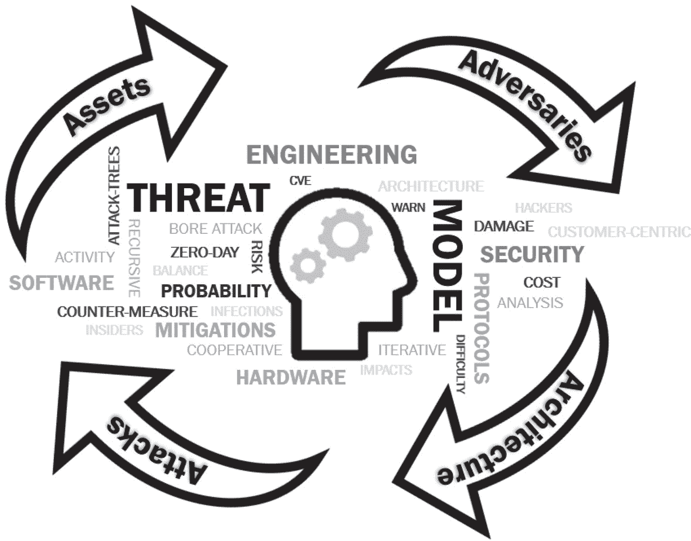

**图 5.2** 迭代威胁分析方法论

* 识别系统包含的资产。

* 识别可能成为系统攻击者的系统对手。

* 列出攻击者可以访问系统的架构入口和出口点。

* 列举攻击者利用特定入口/出口点来观察、捕获、操纵、偷取或破坏资产的所有方式。

在这个过程中从哪里开始取决于你对哪里最熟悉，以及你对分析系统最了解哪些信息。不要接受“威胁分析只有一种正确方法”的谎言。如果你习惯先列出资产，就从基于资产的威胁分析开始。如果你非常熟悉系统设计，那么基于架构的威胁模型可能对你来说更容易开始。一些工程师可能发现通过列举攻击开始更容易，有效地利用他们读过或在渗透测试中练习过的黑客方法创建攻击树。重要的要点是，这个过程是迭代的，你最终必须思考并定义威胁模型的所有部分——资产、对手、入口/出口点和攻击。如果你从攻击开始，然后可以回什么类型的攻击者能够执行这些攻击。他们是软件攻击者还是硬件攻击者？这是网络攻击，还是需要对系统进行物理访问？如果你从攻击点的架构列表开始，列出从这些攻击点可以访问的资产，然后列出可以利用这些攻击点获取资产的攻击者。你能看到这个迭代过程吗？随着你执行该过程，它会产生动力并不断完善。

由于威胁建模是一个迭代过程，你如何知道什么时候结束了？用更正式的方式来说——在威胁建模方面`完整性`是如何定义的？完整性定义为威胁模型属性的笛卡尔积，如下所示。

```
∀ A ∈ Assets, V ∈ Adversaries, E ∈ Entry—Exit Points, T ∈ Attacks A • V • E • T = 潜在威胁完整列表
```

该方程表明，当所有系统变量（资产、攻击者、入口/出口点、攻击）已知时，完整的潜在威胁列表就是由四个系统变量笛卡尔积产生的唯一组合集合。所有可能的威胁组合的完整列表可能很大，但通过分析过程会发现，列表的大部分可以因为不适用而被轻易舍弃。这种推理是显而易见的。例如，某个资产无法通过特定的入口点访问，因此通过该入口对该特定资产的所有攻击都可以被舍弃；或者攻击者无法对某个资产执行特定的攻击，因此该资产与攻击者的组合被忽略了。需要分析的实际威胁列表变得非常易于管理。通过使用笛卡尔积进行威胁分析，只要你的系统变量列表是完整的，就可以证明你的分析是完整的。而且如果你妥善记录了威胁分析，任何人都可以在日后的某个时间回来验证其完整性，或者指出某个变量的缺失。

这种方法还使你能够应对管理层对上市时间的压力。可以很容易展示需要进行的分析的完整范围，并对过程进行优先级排序，优先查看高价值资产。管理层可以做出基于风险的决策提前发布产品，并确切知道哪些资产未被覆盖或哪些缓解措施尚未实施。安全分析和缓解措施的实施可以在初始发布后进行，对系统的更新可以解决在分析过程中发现的任何新问题。

## 威胁分析工作表

通过实际示例的部分可以起到启发。一种非常实用且易于记录威胁分析过程的工具是电子表格。在我们的示例中，我们创建了电子表格（如图 5.3 所示），为上述笛卡尔积方程中找到每个系统变量创建一个工作表，并为`heat map`创建一个工作表。接下来的段落解释了每个工作表。

### 封面工作表 (Cover Worksheet)

封面工作表包含威胁模型的元数据，包括模型的创建日期、产品及产品版本（如果有多个）、参与威胁建模活动的人员以及任何帮助读者将模型与正确产品和发布版本相关的其他信息。


**图 5.3** 威胁分析电子表格——工作表标签

### 资产工作表 (Assets Worksheet)


资产工作表包含资产列表。通过审查系统架构的不同视图并提出相关问题来发现资产。模块互连视图（Module Interconnection View）中显示的配置文件如果其配置数据损坏并导致系统以开放方式运行，那么它可能是一个资产。用于通过传输层安全（TLS）连接验证服务器的信任证书将视为另一个资产。资产是特定于架构的，但它们应该是攻击者可能想要的（例如，包含姓名、信用卡号或密码的数据库），或者可能为了损害系统而想要破坏的（例如，列出信任服务器的配置文件）。在资产工作表中，每个资产都应分配一个唯一数字，用于与电子表格其他部分的该资产进行交叉引用。在许多情况下，创建一个`asset class`（资产类）比列出每一个单独资产是可以接受的。例如，TLS 配置文件和数据库配置文件之间除了系统中的用途外，可能没有真实区别——攻击者可能是相同的，发起的攻击是相似的，攻击入口点也是相同的。在不损害威胁模型细节的情况下减少资产总数，可以缩小威胁矩阵的整体规模。这加快了进程，并允许我们从更高抽象级进行思考。

## 入口和出口点工作表 (Entry and Exit Point Worksheet)

入口和出口点工作表包含了进入或离开系统的每种方式。列表应同时包含物理和逻辑入口/出口点。物理访问点包括 USB 端口、打印机、带有屏幕和键盘的终端、可移动硬盘驱动器、备份设备、用于业务连续性的热插拔站点，以及物理计算机和 CPU 本身。在 IoT 系统中，了解所有物理组件实际位于何处非常重要，这样就可以考虑设备的物理盗窃。逻辑访问点包括监听网络端口、数据库、文件、REST API、系统服务、DNS 和信任时间服务器等网络服务、用户输入、汇总日志库、备份文件以及你在系统概念视图（Conceptual View）中发现的任何其他。每个入口/出口点都需要被列为攻击者进入系统或从系统检索数据的潜在途径。

## 攻击者列表 (Adversaries List)

攻击者列表包含了所有可能攻击系统的人员或角色。这包括不同类别的用户、网络攻击者、系统安装人员和其他内部人员。由于内部攻击经常被忽视，因此攻击者列表应包含系统管理员和备份管理员等角色。如果你选择不将他们视为攻击者，只需在攻击者列表中将他们标记为信任的。此此于记录这样一种假设：尽管这些角色与系统有界面，但他们的特殊访问被标记为已接受的风险。例如，以下攻击者列表已用于一个真实的企业应用，包含了以下攻击者：

*   管理企业内部服务器的 IT 管理员，包括备份的创建和管理 (IT Admin)
*   管理在应用服务器上运行程序的系统管理员 (S. Admin)
*   使用企业应用的用户 (User)
*   设置用户角色和权限的安全官 (Sec Officer)
*   有权读取所有日志、数据库条目和系统事件文件的审计员 (Audit)
*   基本上是数据库管理员的 SPID 管理器 (SPID Mgr)
*   创建云应用的开发人员 (Develop)
*   任何未列出的外部人员，可能包括黑客或组织内未授权访问系统的人员 (Outsider)


**图 5.4** 威胁分析工作表——威胁矩阵页面

这些人中的许多不会被视为攻击者，但他们可能是。列出他们并描述我们认为哪些是信任的，可以告知管理层他们正在承担的风险。

如图 5.4 所示，威胁矩阵工作表包含了系统威胁映射。它初看起来很复杂，但实际上非常简单。行是资产列表，列是切入/出口点列表，而工作表中由资产（行）与切入点（列）交叉定义的单个单元格，包含了攻击者列表以及该攻击者可能构成的威胁或威胁。单元格中的威胁代表了该单元格特定资产（行）与单元格特定切入/出口点（列）针对单元格内列出的某一个攻击者之间的交叉积。例如，在单元格`H-68`中，攻击者是用户，攻击针对资产 17（服务器软件），使用切入点 4（端口和连接器）；但未发现针对这种特定组合的攻击。单元格`F-68`使用切入点 3（控制台）的组合导致了被列为威胁 5 的攻击，即用户可以在服务器上更新或加载新软件。仔细观察图 5.4，显示了三种需要解释的不同类型的单元格：仅包含攻击者名称的单元格、包含所有指向威胁的数字的单元格，以及数字与攻击者名称的单元格。

在图 5.4 中，你会注意到包含多个单元格的较大区块代表资产与切入点组合的交叉，并定期被拆分为我们攻击者列表中的独立攻击者（参见我们之前的项目列表）。在我们的特定示例中，IT 管理攻击者始终位于单元格的左上角，外部人员/黑客攻击者始终位于右下角。每个代表资产和切入/出口点组合的较大区块的交叉点具有完全相同的攻击者列表。仍然显示特定攻击者名称的单元格是尚未评估的单元格，或者是已评估但针对该攻击者-资产-切入/出口点未发现威胁的单元格。在 Dave 用于区分这两种情况的工作表中，他在开始时将所有单元格初始化为灰色，意味着它们尚未经过评估；这便于你跟踪处理进度。当你评估一个单元格并发现没有威胁时，将单元格颜色改为绿色。只需扫一眼工作表，你就能轻松看出哪些单元格仍需要评估。当你确实发现威胁时，将攻击者的名称替换为与识别出的威胁对应的数字，正如我们在`F-68`中做的那样。

这些实际威胁数字是威胁列表的索引，详细信息在另一个工作表——威胁工作表中。威胁工作表中的每个唯一威胁都有唯一的数字。为了保持威胁矩阵的整洁和易读，每个包含威胁的单元格条目仅包含来自威胁工作表的唯一数字。最好使用颜色方案对威胁矩阵中的威胁进行颜色编码，以帮助识别威胁的严重性。这样，威胁矩阵就像一张热力图，可以轻松显示最脆弱的资产和切入点。例如，绿色且仍显示攻击者名称的条目代表已审查但未发现威胁的资产/切入点组合，而灰色的条目尚未评估。如果你仔细看，某些条目（`E71` 和 `F91`）在单元格右上角有一个小三角形，表示已向单元格添加了工作表注释。在对威胁或缺乏威胁进行分类时，通过添加注释来记录假设。一种可能的注释可能是攻击者被认为是可信的，因此特定威胁未列在威胁表中。

图 5.5 显示了威胁列表工作表的摘。描述攻击的关键元素再次列在此工作表中。虽然再次写出这么多细节似乎是多余的，但 Dave 多次回到威胁列表后无法确切记得他想要描述的到底是什么威胁。细节越详细越好。你以后会感谢自己的。

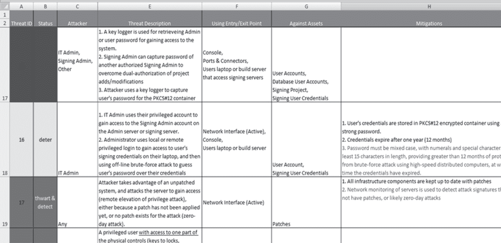

**图 5.5** 威胁分析工作表——威胁列表

图中一个让你显注目点是`status`（状态）列。它显示了威胁处置的过程，这将在下一节中讨论。快照描述了威胁的三种不同处置，并进行了颜色编码，以便理解威胁的当前状态。Thwart（阻止）与 mitigate（缓解）相同。Deter（威慑）是 Dave 使用的一种较轻的缓解形式，表示缓解措施对所有攻击的效果可能没有他所希望的。红色威胁表示没有缓解措施，除非发现了可接受的缓解措施，否则该威胁可能会变成被接受的威胁。

### 5.3.3 威胁处置

一旦列出并记录了威胁，就需要对其进行处置。处置威胁意味着将它们分类为四种桶之一，这些桶定义了如何处理威胁。在本章前面的部分，我们介绍了这四种分类但没有给出任何定义。以下列表提供了每个处置分类桶的定义：

*   `accepted threat`（接受威胁）——接受风险且不对威胁采取任何措施；这些将成为系统中的漏洞，应向最终客户披露。通常，接受威胁是指极不可能发生的情况，或者是执行成本高昂的攻击，对系统发起攻击的成本超过了攻击者能获得的收益。
*   `transferred threat`（转移威胁）——记录并将威胁转移给系统的其他方，例如系统集成商、客户或最终用户。转移威胁的一个例子可能是导致关的断电。这种威胁被转移给最终客户，并建议添加电池备份以防止突然断电。
*   `mitigated threat`（缓解威胁）——在系统中添加技术功能或功能，完全防止攻击者执行该威胁。威胁可能对某些攻击者是缓解的，但对其他人不是，或者缓解由不同攻击者提出的相同威胁可能需要不同的技术功能。
*   `detected threat`（检测威胁）——在系统中添加技术功能或功能，对威胁做出响应但不防止与威胁相关的攻击。这种响应通常是识别并警报威胁/攻击的发生。一个例子是向网络管理员警报登录失败的日志消息，或发现数据库记录损坏的信号。检测威胁应与特定的安全管理控制建议相关联，例如“每天对 syslog 事件进行非法登录监控”。更好的解决方案是跟踪异常系统事件并将这些事件与威胁分析中识别的攻击相关联。当与同一类型攻击相关的异常事件发生一定次数时，会为系统管理员生成一份特殊报告以警告潜在的攻击，并提供触发警报的事件详情。此报告将作为系统仪表板上的警告条件显示或通过消息警报系统发送。警报系统和电子邮件消息应谨慎使用，因为当我们收到大量此类消息时，许多人会忽略它们——这是安全管理中的“狼来了”效应。

### 5.3.4 将威胁缓解整合到系统架构

在处理完威胁后，系统将设计了相应的应对措施和控制措施以分别处理已缓解和检测到的威胁。在本章稍后的部分，我们将讨论安全架构师在完成这一过程部分时应该使用的某些原则，并提供一些带有应对措施和控制措施的物联网威胁示例。

### 5.3.5 循环往复

每当系统架构发生更改时，你都需要重新执行流程，以确保系统仍然安全。如果你已经在工作表中记录了你的步骤，这非常容易。如果你没有这样的系统，这类更新将变得繁琐且通常会被忽略，从而对系统造成重大的安全风险。为什么呢？新的应对措施和控制通常会引入新的资产，例如加密密钥或安全协议。需要对系统进行重新分析（即使是简要的），以确保为添加到系统的任何新资产提供适当的保护。这些新资产应被添加到`Asset Worksheet`中，并在`Threat Matrix`中分析新行，并可能为入口/出口点增加新列。

### 5.3.6 安全架构评审委员会

安全开发周期（`SDL`）或任何流程体系的原则之一是确保适当的质量控制。安全架构评审（`SAR`）委员会就出于此目的。就像代码审查一样，`SAR` 过程迫使安全工程师“做到万无不漏、滴无不失”。仅仅是口头梳理设计方案，就能让一个人发现之前忽略的事物。这并不是由于疏忽。当我们进行演示并向他人解释它时，我们使用了大脑的不同部分，这通常会挖掘出我们逻辑中的问题，或帮助我们从不同的角度看待问题。有时，演示者是房间里唯一发现问题的人。但没关系，因为问题已经被发现了，识别并纠正这些问题会进一步限制攻击者入侵你系统的方式。

建立一个`SAR`非常容易。只需让你组织中的几位经验丰富的安全工程师与你一起评审安全架构即可。由你的组织建立的正式流程效果会更好。但指出一些`SAR`出错的办法或某些需要注意的陷阱，可能会大有益处。

第一个陷阱是`SAR`过于具有敌意或过于友善。如果`SAR`仅仅是为了让某人看起来很愚蠢，或者在每一个设计琐碎细节中寻找错误，那么安全工程师就会保护自己和声誉，而不是利用`SAR`中经验丰富的成员来帮助他们创建更好的架构。`SAR`需要一个工程师以协作方式工作的地方。相反，让`SAR`对架构进行批判性的观察是重要的，而不是让它变成哥们儿仅仅浪费时间交换他们最新项目故事的地方。如果安全工程师不被要求具备高水平的能力，而且对架构的合理问题没有得到应有的考虑，那么整个`SAR`过程就会变成一场骗局，浪费每个人的时间。

另一个在`SAR`中发生的陷阱是对安全架构的评审过于浅显。如果`SAR`不够详尽，并且不需要对系统进行详细解释，那么可能会漏掉真实问题。`SAR`过于浅显的一种常见方法是将其限制在单一系统架构视图，而该视图不能代表系统的真实复杂性和运行情况。相关的陷阱是`SAR`发生在开发周期的太晚阶段，导致对安全架构的任何建议更改或增加无法在产品发布日期之前实施。Dave 经常看到这种情况。一位安全工程师不愿参加`SAR`，因为几个架构细节尚未确定或仍处于变动中。工程师与其来`SAR`并解释情况——可能只获得部分批准，并有额外工作需要以后再回来——他们推迟了整个`SAR`过程直到所有细节确定。但当他们把工作带入`SAR`时，委员会发现了他们遗漏的东西，或者对安全架构的一个基本假设表示不同意。结果要么是进度推误，要么是带有已知缺陷发布。无论何种情况，在`SAR`中进行早期评审都比后期评审好得多。

我们在这里讨论的最后两个陷阱与经验有关。在一种情况下，`SAR`委员会由经验不足的安全工程师组成，或者他们在错误的领域有经验。一个由嵌入式设备工程师组成、评审云系统的`SAR`可能会漏掉某些东西。这并不意味着`SAR`委员会应该由对该主题有直接经验的工程师组成，但这意味着应该有对该主题有相应经验的工程师。另一个相关的陷阱发生在`SAR`的资深成员将其自己的项目引入评审时。通常，资深人员的观点不会受到质疑，委员会的初级成员会感到压力或不安。处理这种情况的最佳方法是让资深成员将评审委托给团队中更年轻的工程师，并利用这个机会指导初级工程师。最终，每位安全工程师都要将他们的第一个项目提交给`SAR`。有什么比在资深工程师的指导下更好的经验呢？

注意这些潜在的陷阱，并努力克服或避免它们。将`SAR`视为精炼和改进安全工程师所做工作的方式。不要仅仅流于形式。从这一过程中获得尽可能可能的收益。

### 5.3.7 安全架构批准后

一旦安全架构获得批准，它必须被开发团队使用。这听起来很傻，但值得说出来。Dave 遇到过一个幽默的故事：他在引导一个项目通过了特别艰巨困难的安全架构流程后，去请了长假。当他回来时，他询问开发团队进展如何。他们回答说很好，但正埋头开发，所以 Dave 就让他们自己忙。他认为如果有问题，他们会来找他的。然而，在 Alpha 版本代码完成后的最终实现评审期间，Dave 要求查看从架构安全目标到实现模块的映射。在一段尴尬的沉默后，开发负责人说：“我以为安全架构是你的责任。”嗯，是的，但实施安全架构是每个人的责任。Dave 有一点建议。在安全架构批准后，去联系开发团队，确保他们知道应该如何处理安全架构，并确保它得到了适当实施！

### 5.4 安全架构设计原则

在上一节中，我们简要地带过了流程中响应威胁开发安全缓解措施和控制的部分。本章的其余部分将侧重于为你提供关于该部分流程的见解，并提供你成功所需的工具。在开发缓解措施这一领域的技能，只有通过经验才能获得，但我们可以通过学习他人的经验来加速技能的获取。本节将通过讨论所有安全工程师都应该作为其设计基础的基础安全设计原则，开始这一过程。⁷

（注：此处为脚注，保持不变）

安全设计原则自计算诞生以来一直存在。Saltzer 和 Schroeder 在 20 世纪 70 年代初引入了它们，但他们指出某些原则早在 20 世纪 60 年代就已经被讨论过了。⁸ 我们包含对设计原则的讨论，是为了让你具备必要的知识，以便在安全架构期间进行权衡，并让你的缓解措施设计建立在经过时间检验的设计模式之上。使用这些原则应该帮助你避免安全架构中的常见错误，并深入思考你的设计，以确保你没有遗漏任何关键内容。

我们期望你如何使用这些原则？在安全架构期间，你将面临特定的威胁，并需要评估一组缓解措施，以确定哪种缓解措施最合适。设计原则允许你评估一种缓解措施，并将其核心安全质量的各个与其他缓解措施进行比较。尽管我们提供了反映设计原则的特定示例，但你应该使用原则本身来评估和引导你的设计。设计原则将引导你回到安全中最基础、最本质方面，而这些方面本应该是你设计的基石。

#### 5.4.1 开放设计原则

`开放设计原则`（open design principle）规定，你的安全架构不应依赖任何秘密构造，即使你的设计被发布，它也不应该削弱系统的安全性。

开放设计原则的一个有趣应用是“敲门协议”（knock-knock protocol）。在模拟调制解调器时代，这种协议用于防止黑客通过自动拨号（war-dialing）进入计算机系统。敲门协议的工作原理是记录调制解调器连接到计算机系统网络交换机后立即发送的一系列`TCP`端口连接请求。这一系列端口连接是一种秘密敲门或秘密密钥。如果组合是`111`、`722`、`86`，那么调制解调器必须按顺序连接到这些端口并立即终止每个连接，最后连接到实际想要的端口，例如端口`22`。如果不遵循该序列，网络交换机将断开连接，据认为可以防止未经授权的用户连接到系统。敲门协议可以完全以开放的方式描述，但这并不能为攻击者破解系统提供足够的信息。共有`65,535`个不同的端口，且敲门协议可以是任何数量的端口作为所需的序列。它可能需要单个端口，或连续的七个端口；八个端口的要求等同于`128`-位的安全性。敲门协议之所以被弃用，因为它代表了整个计算系统的全局密码。网络交换机只能轻松地配置一种序列，所有需要访问的人都必须拥有相同的组合。这种全局知识使得秘密泄露更频繁，并且当有人离开公司或小组时，很难更改。

在现代系统（包括 IoT 系统）中，开放设计原则仍然适用。加密算法所使用的也是同样的原则。当加密算法的所有细节都发布，除了密钥的精确值外，该算法仍然应该是安全的。任何用于机密性或完整性的算法都应该经得起开放设计原则。这意味着你永远不应该使用只有设计者才知道的`special`（特殊）加密算法。另一个破坏开放设计原则的例子是以特殊方式修改开放加密算法。有一次，一位设计工程师告诉我，他更改了著名加密算法`DES`中的`S-Boxes`；他推测由于他在`S-Boxes`中使用了一组独特的值，这将使破解他的加密变得困难得多。他的假设是`S-Boxes`只是随机的，改变它们会扰乱任何密码分析。相反，`S-Box`的设计极其复杂，随机更改会显著增加密码分析的易用性⁹

你的 IoT 安全架构应该使用开放设计原则来构建。即使攻击者拥有你所有的设计文档，也不应该允许他们进入你的系统。适当使用加密算法、身份验证与授权以及平台控制应该威慑任何攻击者。事实上，如果你采用我们设计并编写的 IoT 系统之一并安装它，更改密码、密钥和用户账户，我们对系统的复杂知识不应为我们攻击该系统提供优势。显然，我们都知道，尽管这是目标，但拥有内部知识确实有助于攻击者。有了内部知识，攻击者知道在`where`（哪里）进行攻击，以及攻击最有成效的位置在哪里。但从技术上讲，这不应该让系统变得更脆弱。关键在于，我们不依赖任何秘密元素。

### 5.4.2 机制经济原则


`机制经济原则`（economy of mechanism principle）规定最安全的设计是最简单的机制。复杂的设计更难正确构建，也更难测试以确保其行为正常。例如，创建隔离可以通过一组复杂的规则来实现，允许两个不同的程序共享资源但互不干扰。一种更简单的设计是每个程序提供独立的资源。复杂的设计在许多操作系统中实现，但也制造了许多漏洞。通常情况下，使用更简单的设计更安全。然而，某些原因可能需要复杂性。警惕复杂性，因为复杂性是安全的敌人。

## 5.4.3 故障安全默认原则

`故障安全默认原则`（fail-safe default principle）是默认——拒绝条件。计算机系统中的安全敏感操作应设计为仅在满足某些条件时允许访问或赋予权限（例如提供正确的密码或持有适当的密钥），否则失败。该原则的反面是检查会拒绝访问资源的特殊条件（例如，请求者通过 WiFi 网络或通过 VPN 拨号，因此拒绝连接）。默认允许（Default accept）更难测试，并且更有可能遗漏实现中的边缘情况。当未来向系统添加新功能时，它也更有可能产生安全漏洞，因为那些默认允许情况下的边缘情况被遗忘或未经过适当测试。默认允许需要验证所有可能导致拒绝的条件和场景。

IoT 系统有很多访问控制决策：是否允许特定的传感器将数据上传到特定的网关？此网关可以连接到该云系统吗？该云系统是否允许对该设备进行设备管理？你的系统是如何做出这些决策的，决策的依据是什么？

访问控制应始终以故障安全默认的方式实现，并且最好使用加密技术作为底层的决策因素。这可以是密码的加密哈希值，或者更好的是使用基于非对称密钥对的经过验证的 TLS 连接。然而，加密密钥的访问权限应仅限于受授权的程序或用户。当我们考虑下一个设计原则时，这会变得更加困难。

## 5.4.4 权限分离原则

`权限分离原则`意味着应该使用两个独立的机制来控制高度敏感的数据或功能。这意味着需要两个独立的失败才能攻破保护机制。权限分离被用于储物箱，即打开箱子需要两把钥匙。它也被用于双重身份验证，即你既需要密码，还需要通过短信发送到手机的访问令牌才能登录银行。该原则与`职责分离原则`相似，后者要求两个不同的人来执行某项功能，例如签署支票。在计算机系统中，使用模块化或分离的软件或硬件元素来实现权限分离和职责分离是至关重要的。这一原则应用于保护加密密钥。在 IoT 系统中，由于问题的递归性，这比表面看起来要困难。你如何保护一堆密钥？把它们放在一个文件中并用特殊密钥加密它们！好，我们把那个特殊密钥放在哪里呢？我们将特殊密钥保护在一个特殊账户下，并用密码保护该账户！我们将密码放在哪里？你明白这种递归了吗？因为没有人类来登录 IoT 设备或使用只有该人员知道的东西来解锁某些文件，设备本身必须解锁自己的秘密，它是怎么做到的？让我们更仔细地观察这个问题。

假设你有一个 IoT 系统，其加密密钥存储在安全元件或可信平台模块（`TPM`）中。加密密钥应仅由受授权的程序使用，我们希望使用独立条件来保护加密密钥资源。第一个条件可以是程序运行的用户或任务标识符。在某些系统中，仅此一项是可以接受的访问控制因素。然而，我们知道这些 IoT 系统会受到攻击，如果网络攻击者在程序中发现缓冲区溢出，他们就可以利用这一点在设备上运行任意代码。因此，一个简单的缓冲区溢出就能突破任务标识符的保护。我们需要另一个独立条件。由于我们没有用户来提供密码，可以将密码保存在文本文件中，并让程序将其作为任务标识符提交，以获取密钥。任务标识符满足了“你所拥有的”的访问控制原则，而密码满足了“你所知道的”的访问控制原则。漂亮，两个因素，对吧？错了。文件系统利用用户身份来限制对文件的访问，因此尽管密码看起来是第二个因素，但它与第一个因素并不是`独立`的。攻击者可以利用通过缓冲区溢出伪装的用户身份来访问密码文件。事实证明，如果没有完全独立的内核级服务来调解第二个因素，权限分离将是一个非常困难的问题。

容器执行引擎中正在使用的一种机制是完整性检查。容器镜像经过了签名，并使用完整性检查（例如哈希摘要）来验证容器没有发生更改。这无疑提高了了安全性，但可能无法完全满足需求，正如下一个原则所示。

## 5.4.5 完全中介原则

`完全中介原则`规定，访问决策不能缓存，且每次访问决策都必须在访问时执行，以确保访问权限没有发生变化。这与从检查时间到使用时间（`TOCTOU`）攻击直接相关。`TOCTOU` 是安全检查与实际使用对象之间的时间窗口，即攻击者执行攻击的时间。在容器完整性检查的情况下，检查是在启动时执行的。这意味着启动后的任何时候，缓冲区溢出都可以动态更改容器内部的代码。解决此问题的一种方案是微服务。容器仅在需要执行操作时启动，然后关闭。

## 5.4.6 最小权限原则

`最小权限原则`规定程序应仅拥有其所需的权限，而不有任何其他权限。这一原则最常被违反是以管理员或 `root` 身份运行进程。以 `root` 运行进程的原因各不相同，但这些都是借口，而不是理由。以管理员权限运行进程是因为 `root` 是安装软件的进程，这只是借口不是理由。通常对于开发者来说，仅使用管理员权限编写程序而不必担心如何降低权限要容易得多。当然，如果攻击者在以 `root` 运行的进程中发现缓冲区溢出，那么攻击者就变成了 `root`。在这种情况下，你可以和你的系统告别了，因为为了恢复对系统的控制，你将不得不从头重新构建它或将其替换。

最小权限原则要求架构设置具有不同权限的多个用户或任务标识符，每个进程都在不同的或有限的用户身份下运行。这分离了每个进程可以访问哪些文件，以及可以访问哪些其他资源，包括密钥、设备、消息队列和网络端口。这是 IoT 系统上最难实现的事情之一，但它是最有效的平台加固措施之一。

## 5.4.7 最小共同机制原则

`最小共同机制原则`规定，任何系统操作或活动都应该尽可能与其他用户独立执行。换句话说，进程和用户之间的共享应该降到最低。多个进程使用的任何功能，其之间的共同资源都应尽可能少。共享资源总是会泄漏。总是如此。泄漏可以被减少或减慢速度，但无法完全防止。每当在公共共享服务或将函数实现为调用者专用库之间做出选择时，请选择库。除非，当然不担心数据泄露。

状态的封装与分离是创建安全共享资源或服务的主要工具。共享服务使用的状态可能包含可能在服务用户之间泄露的信息。在每次使用服务之间清除状态是最安全的方法，但在许多情况下，这可能会导致性能影响。服务用户之间的封装是另一种保护机制。安全的服务必须确保用户无法查看或访问服务的状态，或者确保每个用户都与其他进程隔离开。这比表面看起来要困难。全局变量包括未重新初始化的可能包含状态的硬件设备。内存和缓存中的数据位置可能会改变并泄露信息。共享资源且不泄露信息是非常困难的。建议仔细审查你的共享资源，并识别泄露程度，以及这种泄露量是否可以接受。如果有人告诉你没有泄露，他们要么没有对你诚实，要么没有研究实际泄露的情况，或者他们不理解这一原则。

## 5.4.8 深度防御原则 (Defense-in-Depth Principle)

尽管不是 Saltzer 原则之一，`深度防御原则`已成为安全专业人士广为人知的格言，并与权限分离原则相关。该原则指出，为了保护资产，如果采取安全缓解措施，应该有多层独立的防御，以便攻击者无法通过克服单一防御措施获得访问。多层独立的防御使系统对攻击更加健壮。

我们将使用深度防御的示例。深度防御用于发送和接收数据的通信协议，包含了我们不希望攻击者获知的敏感信息。存储在文件系统上的受文件系统保护的、与文件相关的标识符仅在身份验证时用于通信协议。很棒，第一层防御！现在让我们使用绑定到可信执行环境 (TEE) 的密钥来加密文件。`TEE` 程序与通信协议紧耦合，`TEE` 将密钥绑定到平台，以便密钥无法从平台外泄。完美！现在让我们划分通信协议，使得密钥仅在启动打开连接后解密 `TEE` 内部文件时提供。密码仅在 `TEE` 内部使用，绝不传递到外部。让我们明确：这种设计并非完美。然而，攻击者必须克服几层防御才能滥用信息。单一缓冲区溢出无法提取敏感数据，攻击者滥用数据需要设备上的活动恶意软件——其他安全控制和防御应该能够检测这一点。

## 5.4.9 不信任任何原则 (Trust No One Principle)

`不信任任何`是我们添加到 Saltzer 原则中的另一个原则。不可避免地，在设计内部某些元素必须被信任。我们通常将其定义为信任根（root of trust）。信任根必须越小越好，它是设备重置后第一个执行的内容。信任根执行之后，其他执行的所有内容必须经过验证，不应直接信任。这是通过使用加密算法的数字签名实现的。加载固件和软件时，首先验证它们来自真实源且未被修改。与其他实体通信时，针对信任锚（作为信任根一部分安全存储的密钥）进行身份验证至关重要。在设计过程中，要质疑信任的位置以及建立信任的方式。将隐式信任保持在最低，并使用加密技术在信任根的基础上构建。

## 5.4.10 保护弱环节原则 (Secure the Weakest Link Principle)

在任何设计中都会存在一个弱环节。总有一个攻击者成功攻击系统的简单位置。攻击者破坏你系统的简单方法是什么？可能是脆弱的身份验证协议，或者没有针对物理攻击的保护。确定你设计中的缺陷需要仔细的分析，以确定是否实施了最佳缓解措施。但攻击者往往针对的是简单东西，所以不要忽视这些。英国国家网络安全中心最近的一篇博客文章分享了保护弱环节的一些实践经验：

> 俄罗斯网络攻击者不需要利用零漏洞或安装恶意软件来利用这些[网络路由器和]设备。相反，网络攻击者利用了以下漏洞：
>
> * 使用遗留未加密协议或未身份验证服务的设备；
> * 安装前加固不足的设备；
> * 制造商或供应商不再提供安全补丁的设备（寿命终止设备）。

在这些情况下，弱环节是设置了默认密码的开放 telnet，而不是俄罗斯黑客的高级攻击。修复弱环节对于为系统提供任何真实的安全至关重要。你做的任何其他都是徒劳，因为攻击者将绕过你构建在系统中的所有巧妙手段，攻击你的弱环节。

当你执行 `SAR` 时，要求安全架构师列出他们的弱环节——即系统中可接受的威胁。问他们：“如果你要攻击这个系统，你会执行什么样的攻击？结果你从系统中得到什么？这会花费你多少成本？”如果安全架构师说没有攻击系统的方法，或者他们不知道，请判定 `SAR` 并使用这些设计原则指导该安全架构师。

## 5.5 处理工业 IoT 系统的安全关注点

现在我们已经回顾了安全架构方法论并有了全面的威胁分析流程，本节将介绍该流程的实际应用。该示例源自我们的基础安全设计原则，以正确评估架构问题并解决 IoT 架构中的某些安全关注点。对于我们的示例，我们开发了一个工业物联网 (`IIoT`) 架构，松散遵循由埃森美发起的开放过程自动化 (`OPA`) 倡议。在开发架构的过程中，我们展示了安全架构流程，以发现威胁、评估缓解措施，并为 IIoT 系统记录安全设计。在此过程中，我们关注了与 IoT 广泛相关的架构和安全主题，包括：

* 管理性
* 设备信任
* 端到端安全
* 延寿性
* 智能化
* 规模化

在开始练习之前，重要的是强调，这只是一个`exercise`（练习），而且根据定义，它是不完整的。决定在本章中放入哪些内容以及省略哪些内容是一项艰巨的任务。事实上，每当我们重新阅读这一章时，都会发现更多我们认为对你触手可及至关重要的信息。唉，在某个时刻我们必须停止并宣布这就足够了。因此，如果我们必须给你留下一条建议，那就是不要在本章之后停止你对 IoT 安全的调查和学习。关于更详尽的 IoT 安全建议，请查看英国国家网络安全中心（NCSC）提供的 226 页建议书。这份指南文档是一部有用见解的宝库，围绕英国网络安全实践规范中的十三项原则组织，应当指导您的 IoT 系统的开发、安装和管理。这十三项原则值得反复强调，尽管我们对其进行了微调，使其能够从设计指导过渡到运维指导。

* **永远不要使用默认密码**
* 尽可能减少暴露的攻击面
* 确保软件的完整性
* 提供安全软件更新的机制
* 安全地存储凭据和安全敏感数据
* 进行安全通信，包括端点身份验证以及对通信数据实施消息保护
* 验证输入数据
* 使 IoT 设备的安装和维护变得简单
* 确保个人数据受到保护
* 实施漏洞披露政策，以告知客户设备中的安全问题
* 使系统对故障具有韧性
* 监控系统遥测数据
* 方便客户删除个人数据

此列表包含了一些显然面向设计的内容——例如，验证输入数据。还有其他显然是面向运维的指导，例如，监控系统遥测数据。但其他指导可以从两方面兼顾——例如，不使用默认密码。这显然意味着作为系统设计人员，不要创建一个包含默认密码或糟糕地使用硬编码默认密码的系统。从运维的角度来看，要验证设备上的所有密码都已更改，且不包含任何默认（或易于猜到的）密码。

在本章的剩余部分中，当我们开发行业用例分析时，请记住这些原则。利用它们来扩展本章中的细节，并确保这些指南成为你在评估设计时，向自己以及其他安全架构师和系统设计师所提问题时不可或缺的一部分。

## 5.5.1 自主工厂

工业物联网 (IIoT) 涵盖许多主题，从炼油厂、矿业、食品加工到制造业。对于我们的示例，我们使用了自主工厂设置，因为它提供了一系列严重程度不一的潜在危害，且不需要读者消耗大量的背景信息即可理解该场景。在随后的章节中，将描述若干个描述 IoT 架构流的用例，并针对各种安全属性对其进行分析。由于空间限制，并且由于一个完整架构所需的架构细节深度非常大，我们的场景并没有产生一个完备的自主工厂。然而，我们提供了足够的细节来演示安全架构流程，允许读者在自己的实际架构上完成这一过程。对于我们的场景，我们选择了对许多 IoT 生态系统具有广泛吸引力和适用性的元素。


图 5.6 埃克森美孚工业视觉（改编自 Bartusiak, D.）

今天，工业自动化正在演变为某些人所说的工业 4.0。这种转型中的两种影响性力量是工业互联网联盟 (IIC) 以及埃克森美孚与洛希德·马丁合作开发的开放自动化 (OPA)。我们的自主工厂架构 (AFA) 借用了 OPA 的设计。为了提供一些基本的背景，我们回顾了 OPA 的底层假设。正如埃克森所指出的，过去工业系统一直是以分层的方式构建的。普鲁渡企业参考架构 (PERA) 是一个正式模型，描述了工业系统的这种分层组织，分为不同的层，每一层都是特定区域的一部分。PERA 分层结构的物理实现已不再被青睐，因为它会造成信息流的延迟，并增加填充不同物理层的成本。在 OPA 中，所有设备都像实时总线上的对等节点一样连接，从而实现了完全互通。这里没有需要管理的主层次结构或一系列分层，尽管各种 PERA 层在逻辑上是 le 创建的。系统的运维控制（PERA 第 1-3 层）位于实时高级计算 (RTAC) 平台上。RTAC 提供了所有必要的操作技术 (OT) 控制，包括配置管理、记录当前过程精确测量值的历史数据库、用于在部署前验证配置和命令的过程仿真，以及对下游设备的性能监控和控制。信息技术 (IT) 服务（PERA 第 5 层）由与 RTAC 共驻的私有云提供，但在逻辑上是分离的。分析（PERA 第 4 层）由一个与 IT 和 RTAC 对等的云实例支持。

下游设备由一系列分布式控制节点 (DCN) 组成，这些节点连接在实际工厂的传感器和执行器上。连接到 DCN 的特定设备和传感器如图 5.7 所示，稍后将讨论。

在埃克森（Exxon）的 OPA 中，DCN 是遵循 IEC-61499 和 OPC 基金会的 OPC UA 使用特定设计模式开发的（见插图）。对 OPC UA 和 IEC-61499 的公平对待超出了我们的范围。为了在不涉及 OPC UA 深度细节的情况下使我们的场景可行，我们的架构使用了开源的消息队列遥测传输（MQTT）发布—订阅协议。这种发布—订阅模型与 OPC UA 非常契合，使我们避开了 COM、DCOM 和 OLE 连接的复杂性，同时包含了由 OPC 创建的所有过程自动化增强。

如图 5.7 所示，各种物理机器都连接到 DCN 节点。快速回顾这些机器可能会有所帮助。自动存储和取回系统（ASRS）为工厂线提供自主工厂流程所需的部件和原材料。这些材料可能是从储液罐中输送的液体、电子元件，或从料箱中输送的塑料颗粒。必须监控原材料的水平，并定期检查流量，以确保交付的一致性。检测材料不足并在不让工厂离线的情况下补充资源，对于维持高生产流量和减少启动与停止带来的浪费至关重要。图 5.7 中的“储罐控制与液体流量”组件代表了一个 ASRS。

流水线的速度由输送带控制。皮带的速度由额外的传感器进行验证，包括用于人工智能（AI）验证的摄像头以及人工视觉检查。

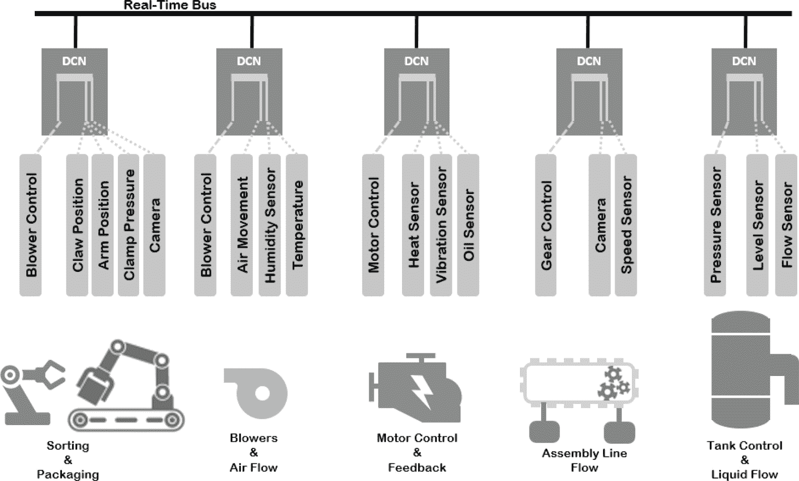

**图 5.7** 开放过程自动化工业物联网安装示例

工厂车间上的各种机器由电机控制。可以监控电机的热量、振动和功率消耗，以检测维护需求。可以通过从 `RTAC` 加载程序到控制机器精确操作的 `DCN` 来控制电机的运行。

某些工厂流程对温度和湿度敏感。可以控制空气处理机以为工厂产生合适的环境。如果工厂车间有人员，可以将对化学污染物或其他环境危害的监测集成到系统中，以便立即做出反应，妥善地排放有害气体。

机器人制造可以通过 `DCN` 上的程序进行控制。通过 `DCN`，`RTAC` 可以根据工厂正在处理的材料为机器人加载正确的指令和配置。自动分类和包装可以由机器人完成，并进行质量控制监控。

在接下来的章节中，我们将 IoT 关注事项应用于此通用架构以及通过 `DCNs` 连接的一系列机器。我们将根据每个章节的需求，开发并探索 `AFA` 的特定架构视图。

## 5.5.2 为 IoT 可管理性进行设计

我们在自主工厂中首先想到的第一个用例是`可管理性`。工厂设备需要根据正在工厂运行的当前作业进行配置或重新配置。手动配置所有设备的成本是巨大的。Dave 在 20 世纪 90 年代后期从事自动化项目时被告知，炼油厂从一种产品切换到另一种产品（例如从柴油切换到无铅汽油）的成本每天超过百万美元，耗时达六天，而在整个切换期间，炼油厂产生的危险废物由于既不是柴油也不是汽油而无法销售。自动配置的益处在于，它不仅能增加利润，还能减少污染我们地球的浪费。


自动管理性的主要理由是维持极低的所有成本，使 IoT 系统能够提供合理的投资回报（ROI）。另一个理由是，IoT 设备通常位于人类难以执行管理任务的地方。因此，几乎所有的管理都必须远程完成，并且尽可能自动完成。即使在工厂环境中，如安装更新、重启设备和重新配置与其它系统的连接等管理任务也应通过虚拟手段完成，而不是派人类去`DCN`或设备处处理。

可管理性通过被管理设备上的软件代理来实现。云端管理系统向被管理设备发送命令并接收其状态。在自主工厂中，有两种不同的管理视角。最广为人所理解的是 IT 管理视角。该视角包括对操作系统、软件更新和设备健康状况的管理。另一个管理视角来自运营侧。这包括安装某些应用程序并配置设备与适当的传感器和执行器通信，以完成分配给设备的特定工厂任务。

从安全角度来看，管理代理是攻击者的理想目标，因为该代理很可能为了执行更新任务和其他管理控制，而在某处拥有管理员权限。而且由于代理必须与云端管理系统通信，管理代理具有开放的网络连接，远程网络攻击者可能利用这些连接进行攻击。出于这些原因，管理代理必须按照以下方式构建：

* **权限分离原则（Separation of Privileges Principle）：** 管理代理必须将具有管理员权限的操作隔离到不具备网络访问能力的独立进程中。

* **故障安全默认原则（Fail-Safe Default Principle）：** 管理代理不能有任何监听端口；传入的连接默认拒绝。所有网络连接必须从设备向外连接到管理系统，最好使用接受的位置和证书白名单来验证端点的真实性。

* **开放设计原则（Open Design Principle）：** 所有管理连接必须通过安全通道执行，并对所有消息使用加密、完整性保护消息传输保护。消息传输保护包括来源证明、消息删除检测、重放保护和消息乱序检测。消息的安全取决于开放设计的密码学，而非隐蔽性或特殊格式的消息。

* **完全中介原则（Complete Mediation Principle）：** 所有管理命令必须通过密码学验证来自可信源。不能仅仅因为管理代理的缓冲区中有某条命令就执行该特权管理操作。每条命令都带有一个可以独立验证的加密授权。

* **最少共同机制原则（Least Common Mechanism）：** 管理代理不应与设备上的其他应用程序或服务共享资源、内存或服务。这种共享代表了利用的途径。

* **深度防御原则（Defense-in-Depth）：** 管理代理应受到设备上主机防火墙的保护，并利用减少缓冲区溢出概率的技术（例如控制流执行技术、开发期间的源代码分析等）。

我们 AFA 中的管理代理（management agent）基于发布-订阅模型（pub—sub model）构建，管理代理的不同部分被划分为不同的进程，如图图 5.8 所示，每个进程都是设备中一个独立的框。管理代理使用一个单独的监听器进程连接到由`Message Queue Server`托管的消息总线，并订阅各种主题，例如其唯一的设备标识符、设备型号或设备类型，以及与其当前功能相关的其他几个主题，例如正在处理的任务、设备可能需要的当前网络服务，或适用于其所连接传感器的特殊设备服务。`RTAC`中的管理系统控制消息总线，并向总线设置或取消某些主题。`RTAC`然后向消息总线发布消息，这些消息会被发送到所有连接并订阅的设备。通过总线并仅使用单条消息，`RTAC`即可管理整个系统并通知所有运行特定操作系统的设备，例如通知它们应该拉取新更新或执行某些操作。消息代理的粗略架构如图图 5.8 所示。如果我们遵循我们的流程，那么我们的架构图应该更加健壮。应该提供更详尽的管理代理软件架构，以及为消息队列提供独立的架构图。还需要显示消息如何构建的、以及实体之间消息的顺序和内容的流程图。最后，还需要一张显示关键资产位置及其重要性的资产图。由于空间限制，这些图表未在此处，但它们的分析结果显示在该设计的威胁表 5.1 中。

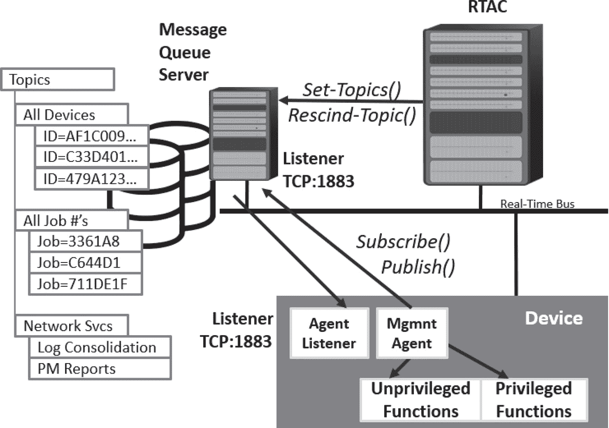

**图 5.8** 自主工厂可管理性架构

### 5.5.3 构筑 IoT 设备信任

在我们的自主工厂架构中，所有设备都通过实时总线连接，并可以访问系统中的每个其他设备。对于所有 IoT 系统，设备交互对于系统运行至关重要。设备将数据报告给云端系统。云管理系统向设备发送命令。设备之间的交互允许共享环境测量数据并告知设备操作。只要一切都是可信且值得信赖的，所有的交互和连接都是良好的。但这种信任是如何建立的呢？盲目信任仅仅是系统的要求吗？因为你在我的网络上，所以我信任你吗？

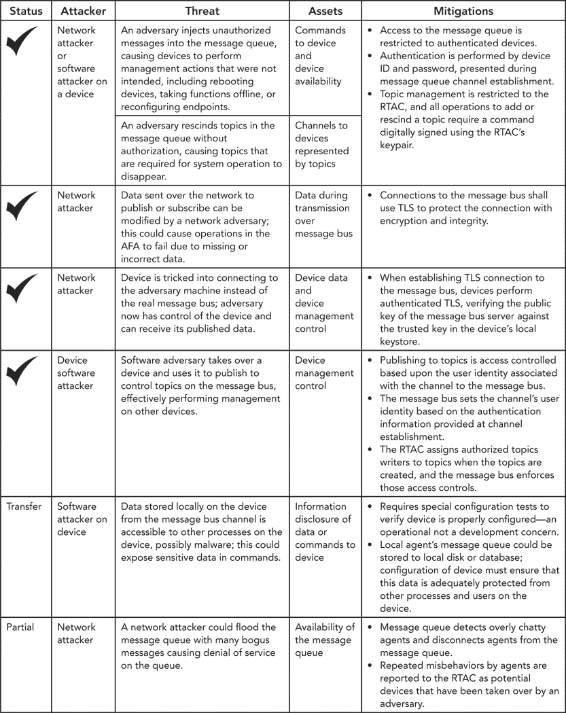

**表 5.1** 自主工厂可管理性威胁

我们人际关系中的信任通常以两种方式之一发生：由我们信任的人向我们介绍一位之前不认识的人，或者我们可以与陌生的人进行交互，探索他们的背景并建立理解，从而与他们建立`trust relationship`。对设备的信任与我们人际关系中建立信任的方式相似，通过介绍或交互来实现。然而，这项讨论中的一个潜在假设是身份。介绍需要被介绍者的身份，或者需要披露与我们交互的个人或实体的身份。因此，设备信任的第一步需要身份。

身份并不是一个简单的概念，它需要建立`identity`。（此处由于原文中存在大量重复句式，已按要求处理）

* 可信平台模块（TPM）是一个离散芯片或处理器上的固件功能，它预装了终端密钥（通常为 RSA 密钥）和 EK 凭证。EK 凭证由制造商签名，证明该 TPM 是正品。TPM 还包括完整性根（RoT for Integrity）、度量根（RoT for Measurement）和存储信任根（RoT for Storage）。TPM 对声明或消息的签名可以由独立的信任第三方进行验证，以确认 EK 凭证是否来自有效且未撤销的 TPM。

* 带有软件防护执行扩展（SGX）或动态应用程序加载器（DAL）的 Intel^® 处理器可以访问平台唯一的 EPID 密钥，该密钥可对运行在 SGX 或 DAL 中的软件的声明进行签名。声明上的签名可以由 Intel 服务进行验证，以确认平台拥有具有未撤销且受信任的 EPID 密钥的正品 Intel 处理器。

* 烧录在 Arm^® 平台熔丝中的密钥（其中熔丝代表一个 RSA 或 ECDSA 密钥），该密钥只有 Arm Trustzone^® 分区中的安全世界应用可以访问。Trustzone 中的安全应用可以使用该密钥来提交身份声明。

在了解了设备包含和呈现身份的背景后，让我们探讨 IoT 设备如何使用这些身份在 IoT 系统中建立信任。设备建立这种信任实际上只有三种方式，每种方式的复杂度逐级递增：

* 在设备制造期间

* 在设备配置期间

* 在信息交换期间

设备之间建立信任简单的方法是在制造期间。在设备制造期间会生成或安装特定的密钥，然后将该密钥的公部分注册到云端管理服务中。Microsoft^® Azure Sphere^® 使用这种方法将设备注册到他们的 Azure^® IoT Hub（微软的设备云）中。这里的缺点是，设备必须在制造时分配给特定的云服务和客户；这阻止了（或至少极大地复杂了）通用 IoT 设备的制造。然而，由于生产线是受严格控制且相对安全的环境，这种方法是安全的。另一个缺点是制造速度；设备必须通电并与云端后端通信以注册其公密钥，这会显著减慢生产线的速度。

下一种建立信任的方法是在配置期间。执行配置通常有两种方式：通过人工操作，或通过自动化协议。人工交互配置在当今 IT 领域很常见，因为大多数设备是发放给人类使用的。在 IoT 领域，目标是限制人工交互，因为其成本高昂。能够执行此类配置的技术熟练人员通常要求高薪水；加上该个人在处理所有设备密钥时必须给予的信任，为 IoT 设备进行人工配置的成本变得变得不可接受。

IoT 设备的自动配置已由几家公司和标准着手。通常，这涉及向云服务提供商进行某种形式的最小配置，以便云端知道会有哪些设备，以及每个设备属于哪个客户，从而允许云对它们进行配置。Intel 的安全设备入网（SDO）在这些解决方案中是独一无二的，因为它不需要提前选择云提供商，且平台不需要特殊凭证。SDO 利用 Intel 的 CPU 密钥对（EPID 或 ECDSA 密钥）通过 Intel 的会合服务（rendezvous service）对设备进行验证。设备所有在 Intel 会合服务处注册其设备，并告诉服务设备应该链接到哪个云提供商或私有云系统。当 IoT 设备连接会合服务时，设备将通过身份验证并重定向到客户偏好的设备管理系统。SDO 服务可以使用公共会合服务，也可以设置在私有网络内部。该解决方案的主要优点是，任何 SDO 设备都可以通过这种方式进行配置，在制造期间不需要对设备进行特殊的配置或标记。

一旦设备配置到 IoT 云管理系统中，该设备与系统中其他设备之间建立信任只需由云管理系统提供某种“介绍”即可。云管理系统充当设备身份的验证者，并将设备身份的公密钥提供给系统的其他设备。

本节提供了设备信任的基本背景。图 5.9 展示了一个 RTR，它唯一访问一组定义设备身份的硬件 PUF（物理不可克隆函数）。对于我们的自动化工厂，身份的注册是通过代理执行的；这允许我们将对信任服务的 IT 云实现的访问限制在一个特定的特定的防火墙过滤代理上。针对 RTR 和设备身份的特定攻击很大程度上取决于实现，注册和使用设备身份的协议也是如此。然而，使用本章的安全性设计原则，以下列表识别了设备之间建立信任时的安全问题，表 5.2 提供了一份概述了通常可能出错之处的威胁表。

* **权限分离原则（Separation of Privileges Principle）：** 设备身份应分离到名为 RTR 的受保护设备功能中。RTR 必须产生一致的签名设备证明声明，并在受信任的设备属性与附加到证明的其他设备声明之间有清晰的界限。

* **开放设计原则（Open Design Principle）：** 设备 RTR 的安全性和不可变性应依赖于已有的硬件不可变性原则（例如熔丝和 PUF），而不是取决于秘密接口或未知的非公开 API。

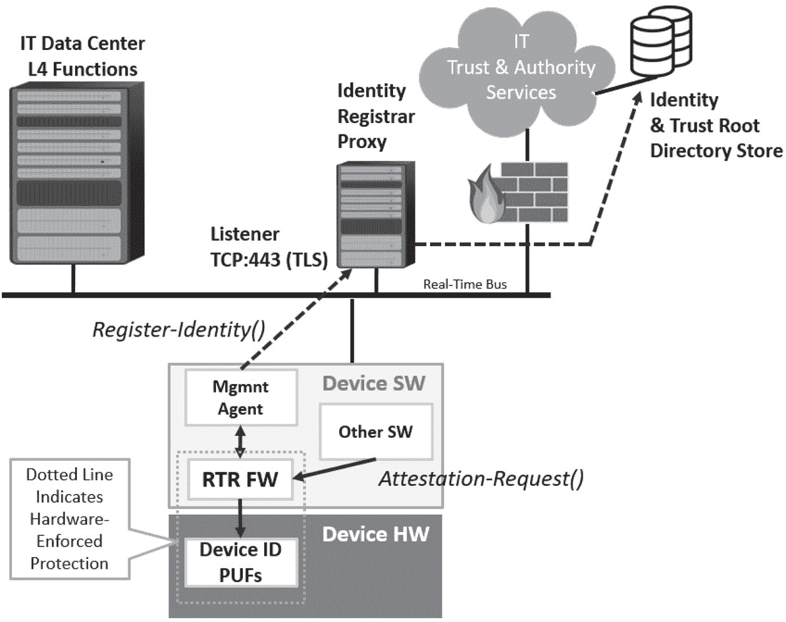

**图 5.9** 设备身份架构


**表 5.2** 设备身份与证明威胁

* **完全中介原则（Complete Mediation Principle）：** RTR 必须与设备上的其他功能完全分离，以免设备身份密钥泄露或被误用。

* **最小公共机制（Least Common Mechanism）：** RTR 加密函数、加密算法和/或硬件引擎必须用于 RTR 函数，不能与设备上的其他应用程序共享。

#### 5.5.4 架构端到端加密

端到端加密是一个经常流传的术语。它之所以成为术语，是因为在现实中你总是可以通过重新定义“*端*一词来声称你的架构符合要求。例如，从笔记本电脑到 Amazon Webstore™ 的浏览器连接提供了端到端加密吗？浏览器地址栏中的小锁告诉你是端到端安全的。然而，可能在你的数据进入 Amazon® 云之后，某个负载均衡器会解密你的流量，并以明文发送到当前有空闲处理你请求的 Amazon Web 服务器。你的数据并没有真正经过端到端加密。但由于你（大部分）信任 Amazon，你认为这足够了。IoT 系统也是如此。数据的端到端加密可能没有完全到达每个端，但可能已经足够了。但让我们更仔细地观察什么是足够的。

创建端到端加密方面存在一些通用的困难，以及一个针对工业系统的特定问题。以下列表识别了这些问题：

### 核心问题

加密的第一个问题是将加密密钥传输到通信通道的两端。多年来，密钥分布一直是限制加密使用的主要问题。1976 年，当惠特·迪菲（Whit Diffie）和马丁·赫曼（Martin Hellman）发表关于公钥密码学的突破性论文时，密钥分布问题几乎消失了。然而，`Diffie—Hellman (DH)`密钥交换在 Web 和其他标准协议中应用广泛，但在能量预算受的低功耗微处理器上执行要困难得多。`DH`需要相当大的数学计算，在没有专用硬件的情况下，这些计算会消耗大量的处理能力。许多小型 IoT 传感器和执行器设备所基于低端微处理器没有`DH`的硬件加速。这意味着要么必须在软件中完成密钥交换（以能量和时间为代价），或者需要手动交付密钥。然而，即使设备能够执行`DH`密钥交换，如果支持一直到云端的端到端加密，云服务器将需要维护数百万密钥，这在实践上是不行的。另一种方案是端到端加密的设计不到达设备，而是在网关处终止。云端与网关维护一个密钥，网关与设备之间使用另一个密钥，或者取决于数据的敏感性和威胁，从网关到设备可能根本没有加密。

### 密钥轮换问题

第二个问题与密钥轮换（Key Rollover）有关。加密密钥不能永久使用；出于安全考虑，必须更换，因为随着加密数据的增加，攻击者成功进行密码分析并恢复加密密钥的概率就会增加。当我们更换密钥时，此过程被称为密钥轮换，它必须在加密通道的两端之间协调。当使用`DH`轻松解决密钥分布问题时，密钥轮换变得简单——通道两端只需协商一个新的密钥即可。但如果密钥分布退回到手动交付密钥，那么我们必须恢复许多执行密钥派生的旧技术，因为密钥交换的成本太高；但必须协调轮换，以确保通道两端同时切换到新密钥。使用这些派生技术轮换新密钥并非不可能。然而，这些技术并未包含在最近的协议和设计中。

### 算法升级问题

另一个问题是偶尔更换加密或完整性算法。最近从`SHA1`哈希算法升级到`SHA2`族算法的升级给全球的 IT 部门带来了许多头疼问题。尽管这些变化并不频繁发生，但确实会发生。这会影响端到端加密，特别是当你的云提供者使用一组算法而你想使用不同的算法时。而且，现场 IoT 设备的升级通常比数据中心的服务器更困难。后续章节之一标题为*长久性设计*（Architecting for Longevity），它讨论了一些将影响 IoT 的未来算法变化，并为此准备提供了一些建议。

### IIoT 运行数据黑洞问题

最后一个问题是 IIoT 特有的。该问题的产生是因为端到端加密实际上使得传输中的数据对中间节点不可读。在工业 IoT 环境中，数据在通过系统节点时有多种用途，包括短路控制回路、安全监控和系统健康分析。如果数据被加密，这些中间节点就会被“黑掉”，无法获得所需的数据。解决黑洞问题的一些方法包括与所有中间方共享加密密钥（这是一个困难的密钥管理问题）、向所有各方单独传输数据（导致带宽浪费）或完全不加密数据。更有可能的解决方案是出于隐私考虑对数据进行跳跳加密，但同时对数据提供端到端的完整性保护，以确保其不被修改。最后这种解决方案在 IIoT 中效果最好。

如今大多数传感器既没有执行加密的硬件能力，也不具备软件存储和处理能力。图 5.10 显示了我们 AFA 中的端到端安全解决方案。来自传感器的数据未加密地发送到运行在实时虚拟机中的控制回路程序。该`VM`在处理数据时将其存储在共享内存位置。控制回路使用这些数据更新到终端设备的命令。另一个独立的`VM`运行完整性保护算法，并在数据发送到`RTAC`之前为所有数据标记元数据信息。发送到`RTAC`的数据未加密，但受了完整性保护。由于工业系统应该是一个高度限制的网络，加密提供的机密性保护并非必须。然而，有必要使用消息认证码（`MAC`）或数字签名进行完整性保护，以防止传输中数据的任何意外或恶意修改。`RTAC`然后可以将这些数据连同`MAC`值存储在历史数据库函数中进行长期完整性保护，并可以依赖数据的真实性来实现其他运行目的。在设计端到端加密功能时，下识别了应当遵守的安全设计原则，表 5.3 列出了分析的威胁：

* **权限分离原则：** 如果加密密钥是存储的而不是使用`DH`密钥交换算法动态创建，则访问存储密钥的权限应分离为至少两个独立的权限，正如我们之前讨论过的。

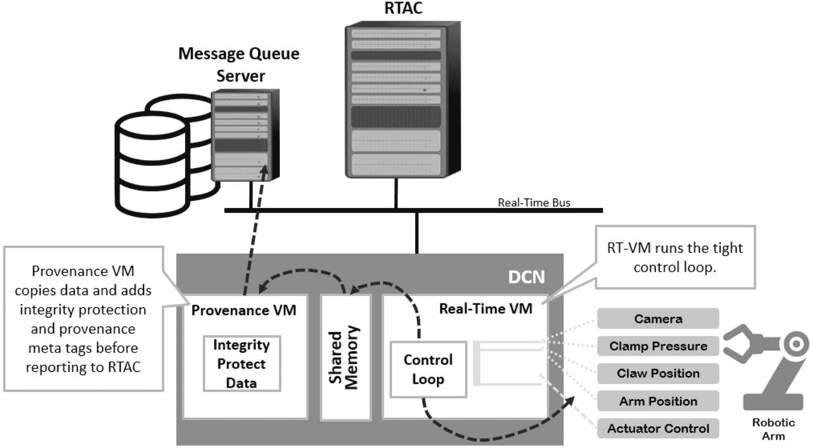

**图 5.10** IIoT 控制回路的端到端完整性架构

* **故障安全默认原则：** 当数据被认为敏感并需要保护时（无论是加密还是完整性保护），架构必须确保此类数据在没有相应保护的情况下不传输。必须对加密进行验证，以确保故障没有将加密替换为空操作。明文或未保护的数据必须在系统中进行分区，以防止意外的、无保护发布。在我们的 AFA 中，实时控制回路`VM`处理未保护的数据，且没有到实时网络的连接，因此数据无法泄露。

* **开放设计原则：** 所有加密算法及其运行模式都应来自为人知的公布的标准，并有学术密码分析和安全证明。如`AES`、`RSA`和`ECDSA`等标准算法均符合此标准。对称密码的运行模式由`NIST`发布。

* **最小权限原则：** 设计中的软件组件拥有完成其操作所需的最小权限。应仅由单个软件元素访问加密密钥。权限包括访问网络；因此，系统设计必须将具有网络能力的软件元素与其他元素分离，从而将网络攻击的影响降至最低。

`Longevity`是 IoT 系统的一个关键方面。IoT 系统通常预计寿命为十年或更久。虽然我们在本节中没有专门针对任何内容进行威胁建模，但保证长期系统的安全性比我们讨论过的其他设计标准的保护要困难得多。固件和操作系统的更新可能完全无法获得，或者在仅几年后通过正常分发渠道停止；原始硬件平台可能无法购买；甚至编程语言和应用程序框架可能会过时且不再被广泛使用。截至本文写作时，运行`FORTRAN`和`COBAL`的系统并非罕见，但它们的维护和支持已变得困难得多。IoT 系统的架构必须为长使用寿命而设计。但选择最新的技术并不总是正确答案，因为它可能只是某种过时的时尚。这通常意味着，应该跳过最新的语言和开源项目，转而选择那些运行时间较长、更有可能在十年后仍在使用的包。


**表 5.3 端到端加密威胁**

在考虑寿命时，请选择在经过合理服务期（五到八年或更久）之后可能仍可用且使用的软件和硬件。例如，操作系统、数据库、语言框架和编程语言应该是具有可持续性的。硬件以及运行硬件的固件也必须考虑长寿命。如果你无法依赖他人为你提供这些服务，那么你就必须自己存档并维护开发系统以保持 IoT 平台的运行，并自己向系统集成和测试安全及功能更新。


IoT 系统讨论得越来越频繁的寿命的一个方面是密码学的使用。其原因是大规模量子计算机即将来将出现，以及这种计算机对经典密码学构成的威胁。当今系统用于加密和身份验证的加密算法是基于某些困难的数学问题的。你在互联网浏览器中使用的算法也利用了这些算法。它们所基于的困难数学问题极其复杂，经典计算机需要几十年才能破解它们。经典计算机使用一种称为 `brute force`（暴力破解）的技术，尝试尝试密钥（加密算法的秘密参数）的所有可能组合来破解加密算法。然而，量子计算机的工作方式与经典计算机不同。量子计算机利用量子比特（qubits）来编码问题的状态。问题的编码会在问题状态下的不同量子比特之间产生纠缠。编码问题的解决方案表现为跨量子比特的一种种搜索。理论上认为，如果能建造出足够大的量子计算机，我们经典加密算法依赖的困难问题可以被很快解决。我们需要基于更困难问题的新型加密算法。

争论的焦点不是量子计算机*能否*破解我们的经典加密算法，而是这种量子计算机*何时*会被建成。截至 2018 年，具有 64 到 80 个量子比特的量子计算机已经建成。然而，要破解 `RSA` 或 `AES`，需要拥有数千个量子比特的量子计算机。建造如此大型量子计算机需要解决重大的工程问题。有人推测这将几年，也许是一个十年。另人则称，将纠缠问题扩展到数千个量子比特比我们想象的要困难，可能需要三到五十年。

因此，IoT 问题在于其寿命——许多 IoT 系统在十或二十年后仍将运行。今天构建的依赖经典加密算法确保安全的 IoT 系统，如果十年后制造出量子计算机，将极易受到量子密码攻击。如果该 IoT 系统运行的是关键基础设施，例如发电厂或化学制造厂，该漏洞可能会导致严重的网络安全风险。

解决方案应该是现在就向 IoT 系统中构建抗量子加密算法。但这样做有两个问题。第一个要解决的问题是算法选择，第二个问题是成本。

我们已知某些加密算法可以针对量子计算机进行加固。对称加密算法（如 `AES`）和哈希算法（如 `SHA2`）可以通过增加密钥大小来加固。对于 `AES`，将密钥大小从 128 位增加到 256 位将增加问题空间，足以让量子计算机也难以手。对于 `SHA2`，将摘要大小从 256 位增加到 384 位同样可以保护其免受量子攻击。然而，公钥加密算法如 `RSA` 和椭圆曲线数字签名算法 (`ECDSA`) 将被量子计算机完全破解；增加密钥大小无法防止量子计算机破解算法。增加密钥大小会延长算法的使用寿命，但我们并不知道量子计算机的量子比特规模会增长有多快，因此很难知道密钥应该多大。更复杂的是，目前极少算法可以完全替代 `RSA` 和 `ECDSA`。基于哈希的签名（Hash-based signatures）是一种部分解决方案，仅涵盖数字签名。虽然基于哈希的签名在密钥生成和密钥寿命方面有一些缺点，但它们是可管理的。其他用于密钥交换、数字签名和加密的算法正在开发中，但它们仍处于密码分析的各个阶段，在五年或更长时间内无法投入生产。

另一个问题是成本。在开发和性能方面都有影响。升级所有硬件以使用更大密钥的算法将花费更多资金。硅片中更大的密钥需要额外的熔丝或其他硅片结构，这会增加处理器的芯片成本。此外，随着 `RSA` 和 `ECDSA` 等算法中使用的密钥大小增加，算法的运行速度会变慢。性能变慢会导致设备安全启动速度变慢。某些设备需要重新设计以满足启动时间预算，并对所有加密用途更多地依赖硬件加速。这些是对现有硬件块和算法的微调，因此开发成本并不高高。然而，当你扩展到拥有数百万台设备的大型 IoT 系统时，每台设备的微小成本就会累积成巨大。

美国国家标准与技术研究院 (`NIST`) 的主流观点是，对于任何将在 2030 年之后继续服务的系统，应升级到更大的密钥大小。建议进行以下升级：

*   使用 256 位密钥进行对称加密的高级加密系统 (`AES`)
*   使用 384 位或更大摘要大小进行哈希处理的标准哈希算法 2 (`SHA2`)
*   使用 3072 位密钥的 `RSA` 公钥加密，或者为了更高的安全性使用 4096 位密钥

对于长寿命 IoT 系统，明智的做法是添加一个恢复系统，可以升级设备固件以包含新的加密算法。该恢复系统应使用基于哈希的签名方案，通过对固件进行签名来验证下载固件的真实性。基于哈希的签名方案即使受到大比特量子计算机的攻击也是安全的。

#### 5.5.6 用智能构建 IoT

智能是物联网系统的一个基本属性。智能可以用于系统内部以自动化或改进流程，或执行系统管理。如果没有智能，很难将物联网系统与仅仅是连接系统区分开来。智能使能够根据环境和物理输入做出自主行动或反应。这些输入通常不是直接的用户或人类输入（例如激活控制），而可能是基于人与系统交互的间接输入。例如，交通控制系统会观察人类驾驶员的流量并分流交通以缓解拥堵；或者，自主机器人可能会检测到人类附近并减慢运行速度，以防快速动作让人类措不及防。

在云端运行 AI 相对简单。配备多核处理器、大量内存以及 GPU 阵列或专用 AI 处理器的巨型服务器可以轻松处理交给它们的任何任务。然而，AI 进程越来越多地需要在更靠近设备的地方运行，即网络的`edge`（边缘）。在构成边缘物联网设备的受限设备上执行带有 AI 的边缘计算变得相当困难。这正是物联网网关变得不可或缺的地方。物联网网关可以包含运行 AI 算法所需的额外处理器（GPU 和 FPGA），且它们与边缘设备的近距离使得它们能够在短毫秒级控制循环中做出反应。让我们对这种控制循环进行安全分析，并讨论在边缘运行 AI 所需的保护和缓解措施。

首先，我们需要一个关于边缘网关更详细的架构图，以及在边缘运行 AI 所需的资源。图 5.11 展示了我们的 AFA，其边缘具有预防性维护控制。

AI 算法用于预测设备何时需要维护，或设备何时即将故障。油温传感器读数可以判断电机运行阻力过大，过量的振動读数可以指示轴承即将故障，热读数可以指示何时需要更换油。传感器的放置与传感器本身一样重要。历史数据提供了机器学习算法用于检测故障的输入。

AI 算法存储在仓库中，并可能根据 `RTAC` 的命令由 `DCN` 刷新。如果 `DCN` 重新配置以监控其他设备，它可以从仓库中拉取适当的代码和算法。这允许在工业工厂的条件、功能或负载变化时修改 `DCN` 的功能。`DCNs` 没有足够的存储空间来自己维护所有算法，因此它们必须依赖仓库来存储它们，并在需要时下载到 `DCN` 中。

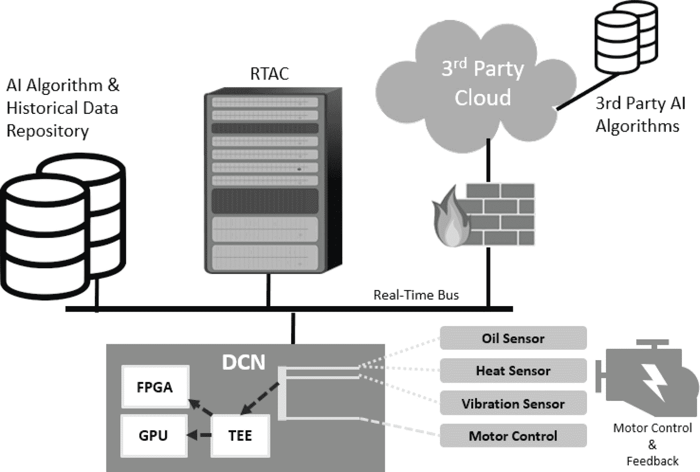

**图 5.11** 边缘处的智能控制循环

此外，某些算法可能是租赁的第三方算法，必须从外部源下载。在 AI 算法研发上投入数百万美元的第三方不会直接将这些算法发布给他们的客户，因此这些算法的某些部分可能会在可信执行环境（TEE）中执行。这种第三方上传可能只在特定时间（生产线启动时）发生，但可能需要间隔对算法进行升级（例如计划维护或生产线切换时间）。显然，网络包含了防火墙和入侵检测系统，以保护自主工厂免受攻击。为了简洁起见，这里将不涵盖网络安全的细节，因为在许多方面，该网络与任何企业网络无异。

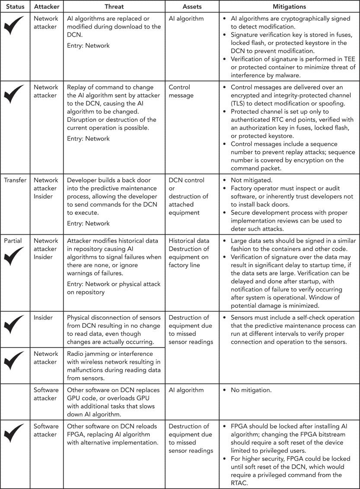

**表 5.4 针对物联网人工智能的威胁**

无论来源是第三方还是本地仓库，预测性维护过程都会加载到 `TEE` 中或从 `Linux Container` 运行。该过程随后将 AI 算法加载到 `GPU` 或 `FPGA` 并控制数据流。当传感器数据从电机流向 `DCN` 时，它被路由到预测性维护过程，该过程根据需要将数据发送到 `GPU/FPGA` 中的 AI 算法。AI 算法返回给预测性维护过程以采取适当行动。预测性维护过程会定期将收集的结果数据报告给 `RTAC`。如果检测到严重的故障状态，预测性维护过程可以减慢甚至停止电机。此操作可能需要与控制线上其他电机的其他 `DCNs` 协调，以便它们加速分担，或者启动备用设备或降低运行线速度。

边缘传感器以设备的方式连接到 `DCN`。`DCN` 与传感器之间预计会有有线和无线连接。控制循环中的大部分时间花在通信上——准备要发送的数据、通过通信端口发送数据、在目的地接收数据以及将数据转换为可用的命令。可以在系统中设计许多快捷径和优化来缩短这种时间，例如共享内存中的预分配缓冲区，以及在网络表示和命令消耗之间具有最小转换的二进制格式命令。网关资源是最重要的。

在我们的示例中，我们将舍弃初步的威胁建模表，并以列表形式列出攻击者和资产。我们将忽略热力图，入口和出口点将整合到我们的威胁表本身。热力图主要引导我们完成练习的完整性，在这里并不可用；入口和出口点将根据您具体的架构和软件栈而异，因此关注这些方面并不同等重要。表 5.4 代表威胁列表工作表（本章之前的图 5.5），并详细说明了运行在物联网网关中的 AI 功能的威胁分析。

`Scale`（扩展性）是大型系统的一种属性，使这些系统能够适应巨大的、近乎同时的需求或系统用户的快速增长。扩展性很难界定，因为它不是系统的单一元素，而是分布在整个系统中的许多属性，这些属性共同产生出健壮性。扩展性并不是一种可以通过我们的安全设计原则来解决的架构特征。但我们都熟悉这种现象：在超级碗周日当天，由于半场广告导致访问量瞬间激增，网站因缺乏扩展性而崩溃；或者零售商店的网站在黑色星期五或网络星期一，由于在线购物者数量巨大而宕机。这类崩溃是由于系统中的某些元素被海量的请求量所压垮，或者是由于突如其来的巨大请求爆发。系统无法扩展的原因有很多。有时是内存管理不当，有时则是对会话（sessions）或线程（threads）的控制不良。有时是数据库结构设计失败，无法在合理时间内响应大量查询。最终，任何有限系统都会被过多的请求所耗尽。那么，在物联网安全性的背景下，我们应该如何理解扩展性？当我们为扩展性进行架构设计时，我们谈论的是`availability`（可用性），但在安全领域，我们谈论的是`denial of service`（拒绝服务）。主要的区别在于前者通常是无意的，而后者是恶意的。在这两种情况下，我们都必须设计系统以对安全的方式响应故障，并监控系统以发现这些故障。

在物联网系统中，我们从物联网架构的三层来观察扩展性的不同方面。云系统必须设计成能够恰当处理入站流量和数据，同时仍能向网关和设备发送命令。如有必要，云端应该能够启动新实例来处理涌入流量；在使用 Amazon、Azure 或 Google Cloud™ 等公共云基础设施时，这种配置更容易实现。

在网关中，入站流量需要进行适当的优先级，以确保消息和数据不会丢失，物联网基础设施的命令不会延迟。这通常意味着分段网络，并确保始终有足够的处理能力和网络带宽来处理网关任务。对于网关，还应该考虑实现网络防火墙，以确保连接的设备与网络其他部分隔离以保护它们，并且如果它们受到攻击，也不会变成僵尸，从而成为对你自己的网络或其他网络发动僵尸攻击的燃料。

在设备中，特别是小型设备，我们通常不考虑设备本身的扩展性。我们大多数时候只担心它是否有足够的资源，在我们提供的稀少资源下完成它预定要执行的简单工作。然而，我们应该考虑在设备上开启哪些功能，以便设备本身能够帮助系统的其他部分实现扩展。例如，允许设备配置时间调度器，以控制它何时向网关或云端报告，或赋予设备足够的内存允许其缓存并整合数据，以尽量减少消息传输的频率。

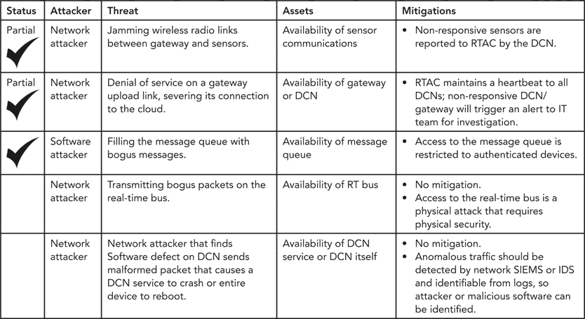

**表 5.5 物联网架构扩展性的威胁**

有很多优秀的书籍专门致力于构建可扩展的系统。物联网架构扩展的架构设计模式应该涵盖数据库、网络协议栈、应用程序、硬件、虚拟化，以及特定的编程语言技术。表 5.5 对扩展性进行了有限的讨论，列出了物联网扩展性面临的主要安全威胁。

### 5.6 总结物联网安全架构

安全架构的过程并不复杂，但确实需要一种严谨的方法。在安全架构中，完整性和可预测的时间表可以通过简单的技术来实现，规划出穿过系统资产、对手、入口点、出口点以及威胁的路径。接触他人的威胁模型以及阅读关于攻击如何实现的报告，为安全架构师开发自己的架构提供了重要数据。经验和利用他人的工作（包括对现有安全设计原则的依赖）是成功的关键。

### 参考文献

1.  Killmeyer, J. (2001). *Information Security Architecture: An Integrated Approach to Security*. Boca Raton (FL): CRC Press, Taylor & Francis.
2.  Clements, P., Bachman, F., Bass, L., Garlan, D., Ivers, J., Little, R., Nord, R., and Stafford, J. (2003). *Documenting Software Architectures: Views and Beyond*. Boston (MA): Pearson Education.
3.  Hofmeister, C., Nord, R., and Soni, D. (2000). *Applied Software Architecture*. Reading (MA): Addison-Wesley.
4.  Myagmar, S., Lee, A. J., and Yurcik, W. (2005, August). *“Threat Modeling as a Basis for Security Requirements.”* Retrieved from `http://people.cs.pitt.edu/-adamlee/pubs/2005/sreis-05.pdf`
5.  Amoroso, E. (1994). “Threat Trees.” In *Fundamentals of Computer Security Technology* (Chapt. 2). Englewood Cliffs (NJ): Prentice Hall PTR.
6.  Shostack, A. (2014). *Threat Modeling: Designing for Security*. Indianapolis (IN): John Wiley & Sons.
7.  Bishop, M. (2003). “Design Principles.” In *Computer Security: Art and Science* (Chapt. 13). Boston (MA): Pearson Education Inc.
8.  Saltzer, J. and Schroeder, M. (1974, July). “The Protection of Information in Computer Systems.” Proceedings of the IEEE, vol. 63, no. 9, pp. 1278—1308.
9.  Gargiulo, J. (2002). *“S-Box Modifications and Their Effect in DES-like Encryption Systems.”* Retrieved from `https://www.sans.org/reading-room/whitepapers/s-box-modifications-effect-des-like-encryption-systems-768`
10. IIC. (2016, 9 月 26). *“工业互联网卷 G4：安全框架”。* 检索自 [`www.iiconsortium.org/pdf/IIC\_PUB\_G4\_V1.00\_PB-3.pdf`](https://www.iiconsortium.org)
11. Obregon, L. (2015). *“工业控制系统的安全架构”。* 检索自 [`www.sans.org/reading-room/whitepapers/ICS/paper/36327`](https://www.sans.org)
12. *OPC 会.* (2018). “统一架构”。 检索自 [`opcfoundation.org/about/opc-technologies/opc-ua/`](https://opcfoundation.org)
13. 美国国家标准技术研究院. (2012, 10 月). *特别出版物 800-164 (SP800-164)-移动设备硬件根安全指南（草案））。* 检索自 [`csrc.nist.gov/csrc/media/publications/sp/800-164/draft/documents/sp800\_164\_draft.pdf`](https://csrc.nist.gov)
14. Diffie, W. and Hellman, M. (1976, 11 月). “密码学的新方向”。 IEEE 信息论汇报, 第 22 卷，第 6 期，第 644—654 页。检索自 [`ee.stanford.edu/-hellman/publications/24.pdf`](https://ee.stanford.edu)

# 第 6 章

## 保护 IoT 云

*云朵从过往的日子飘入我的生活，不再是为了降雨或迎接风暴，而是为了为我的落日天空增添色彩。*

— 孟宾德拉纳·泰戈尔^(\*)

### 6.1 云的历史

花点时间，向窗外望去——如果你必须的话，找一扇窗户，然后抬头看！你看到了什么？你能看到天空吗？如果你能，你也一定能看到云。它们是漂浮在周围的看起来蓬松的白色或灰色的物体。云是悬浮在大气中的凝结水蒸气的可见质量，通常位于地面高空。有时，人们只想伸出手去挤挤它们。这并不是不可能，多亏了跳伞的刺激——那是一个愿望清单上的冠军。然而，当你终于到达那里时，你的手可能会直接穿过云朵。

你可能会像我们以前一样，好奇“云计算”这个术语是如何使用的，尽管正如你将看到的，答案是相当显而易见的。我们稍后会定义“云计算”，首先值得注意的是，在计算和技术领域使用“云”符号可以追溯到互联网的创立时期。


正如我们在第 1 章中讨论过的，互联网最初是一项由美国国防部资助的计算机网络研究项目，称为 `ARPANET`（阿帕网）。早在 1977 年，云符号就被用于表示计算设备网络。¹ 云最终成为了互联网的隐喻——互联网将我们与外部信息连接起来，这些信息似乎漂浮在空气中，就像云一样。后来，在 1993 年，“云”一词被用来指代分布式系统平台——系统的组件位于不同的网络计算机上，这些系统通过相互传递消息来通信并协调其动作。向前推进 13 年，`Amazon®` 通过其在 2006 年发布的弹性计算云（`Elastic Compute Cloud™`）为云计算注入了新生命。

`Amazon` 弹性计算云（`Amazon EC2™`）过去和现在都是一种在云端提供可扩展和可配置计算能力的 Web 服务。`EC2` 的设计旨在让开发者的云计算变得更加简单。它提供了一个 Web 服务接口，允许你以最小的摩擦力获取并配置容量。它将获取和启动新服务器所需的时间缩短到几分钟，并允许你快速向上或缩小容量，以适应不断变化的计算需求。`Amazon EC2` 通过允许用户仅为实际使用的计算能力付费，改变了计算的经济学。²

`Amazon` 的云计算产品 `Amazon Web Services™` (`AWS™`) 允许客户通过亚马逊提供的计算资源无缝地托管和运行应用程序，它迅速成为了云计算的标准。

今天，除了 `Amazon` 之外，还有许多成熟的云计算提供商供潜在客户选择。此外，一些组织运行私有云，以便他们对计算资源的配置和管理拥有完全控制权。

> 云计算是一种模型，它能够实现无处不在、便捷、按需的网络访问，访问共享的可配置计算资源池（例如：网络、服务器、存储、应用程序和服务），这些资源可以以最少的管理工作或与服务提供者的交互进行快速配置和释放。³

正如引用的 `NIST` 出版所有效描述的，云计算或任何云部署都有几个基本特征。其中一些包括：

* **按需自助服务：** 消费者可以根据需要配置计算资源——如处理器、磁盘存储和内存——而无需与服务提供商进行人工交互。

* **广网络访问：** 云提供的资源必须通过网络可用，并可以通过标准机制进行访问。

* **快速弹性：** 消费者使用的资源可以被配置和释放（在某些情况下是自动的），从而根据消费者的需求快速扩展。例如，如果消费者运行一系列计算，该消费者的行为可能会在高强度计算点增加所用处理器的数量，稍后在计算需求减少时由云自动释放额外的处理器。

* **资源池：** 服务提供者的计算资源应该进行池化以服务多个消费者，根据消费者需求动态地分配和重新分配不同的物理和虚拟资源。

* **可计量服务：** 资源使用可以被监控、控制和报告，为所用服务的提供者和消费者提供透明度。

表 6.1 中的云计算定义进一步增强了我们对云的理解，因为它们描述了云计算资源提供给消费者的各种方式。该表描述了根据谁应该访问通过云提供的计算资源来部署不同类型的云。表 6.1 中的定义也源自 `NIST` 的 `SP-800-145` 云计算标准。

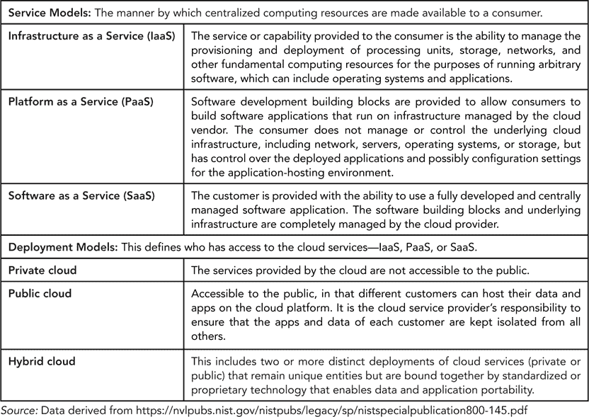

**表 6.1 云计算定义**

### 6.3 云架构概述

正如一位老朋友所说：“架构是我们理解复杂性的手段。”^(\*) 架构为我们提供了一个游乐场，通过它我们可以进行实验、分析、理解、设计，从而构建系统。通过架构的视角，我们可以识别出所需的系统组件，并发现或创建组件之间的交互。在本章中，我们将通过架构视角来看与物联网相关的云。为了实现这一目标，我们将从探索通用云系统的基本组件架构开始。

在第 1 章中，我们引入了物联网架构并将其描述为 `MGC` 架构，云是三个主要组件之一。随后在第 4 章中，我们对物联网架构执行了更深层次的分析，并引入了基于 `OpenStack` 的通用云基础设施架构。^†

如图 4.10 所示，任何云计算基础设施必须包含六个基础组件：对象存储服务、镜像服务、计算服务、块存储服务、网络服务和身份服务。这些概念适用于任何公有或私有云。虽然这些组件对于 `SaaS` 或 `PaaS` 云消费者来说是完全抽象的，但对于任何在 `IaaS` 级别运行的人来说都是至关重要的。现在，让我们探索这些基础云组件，并了解它们为什么如此重要。

#### 6.3.1 对象存储服务

对象存储是一种计算机存储系统，其中数据作为一组非结构化对象进行管理，这些对象是非结构化的，因此对象之间没有精确的关系。⁴ 每个对象通常包含数据本身、一些元数据以及存储系统中的全局唯一标识符。由于对象是通过其唯一标识符进行引用和访问的，因此对象位于哪台机器并不重要。所有对象存储机器在云基础设施内部连接在一起，构成对象存储系统。因此，对象可以轻松地分布在数据中心的各种存储硬件上。这是在云计算中使用对象存储的主要优势（也是原因）。对象存储适用于读取非常频繁但写入不频繁的数据——也就是说，它更适用于数据检索而非数据修改。

对象存储的物联网用例示例包括：`IoT` 节点软件镜像的持久化、运行机器学习系统的规则集，以及设备配置文件和策略的存储。

支持物联网的云基础设施必须提供一种以对象形式存储和访问数据的方法。一些云对象存储系统的示例是 `OpenStack Swift™`、`AWS S3™`、`Google Cloud Storage™` 和 `Azure Blob Storage™`。

云对象存储服务必须提供一种对用户访问对象进行认证并验证用户授权的方法。这通常通过身份服务完成，我们将很快介绍。请参阅我们在 6.6.2 节中物联网云的实用安全架构——例如，云存储的安全架构决策。

#### 6.3.2 块存储服务

云计算中的块级存储涉及对传统块设备（如物理硬盘）的仿真。因此，块存储服务通过网络提供传统的块存储设备（如硬盘）。

为什么这很重要？通过块存储，数据存储在卷和块中，其中文件被划分为等大小的块。每个块都有自己的地址，但与对象不同，它们没有元数据。与对象存储不同，可以增量地编辑文件的一部分，这为数据访问提供了性能优势。

块存储提供的另一个优势是读/写速度。虽然访问云中的对象通常依赖于 `HTTP` 协议，但块存储系统被挂载为服务器上的存储设备，并带有底层文件系统协议（如 `NFS`、`CIFS`、`ext3`/`ext4` 等），这些协议专门为文件操作设计。基于对象的机制不应用于高活动 `IO` 操作，例如缓存、数据库操作、日志文件等。块存储机制更适合此类活动。⁵

块存储设备可以作为服务器或虚拟机的主启动设备，存储操作系统以及必要的系统文件。它可以用于托管数据库，支持数据库文件的随机读写操作，并根据特定运行的虚拟机保留系统配置文件。

一些云块存储系统的示例是 `OpenStack Cinder™`、`Google Persistent Disk™`、`Azure Virtual Disks™` 和 `AWS EBS™`。

#### 6.3.3 计算服务

云计算服务是云服务提供者让消费者创建和管理运行操作系统或虚拟机的虚拟机实例的手段。云服务提供商负责使用硬件虚拟化和网络资源池进行配置，使消费者能够设置具有所需的处理器、非易失性存储、内存和网络访问限制的虚拟机服务器及网络虚拟机服务器集群。

意料之中，计算服务是云计算的核心。它们执行来自镜像服务的虚拟机（`VM`）镜像和操作系统，并运行云应用程序，这些应用程序与其他云服务交互，呈现出一个完整的云应用。其中一些云服务包括：例如用于身份验证和授权的身份服务、提供数据访问的存储服务，以及允许消费者设计虚拟数据中心的网络服务。

云计算用户负责对其应用程序和云实例进行架构设计，以确保 `IoT` 云应用和云环境是安全的。例如：

* 虚拟机服务器（及其托管的应用程序）必须仅使用安全且更新过的软件，且无漏洞；`IoT` 架构师和设计师必须确保他们使用的软件镜像已更新，因为镜像服务本身通常不会更新存储在其中的镜像。

* 服务器上的每个网络端口都必须关闭，但对于云托管解决方案有效运行所必需的端口除外；完整的网络安全建议请参阅第 7.3 节。

* 虚拟机服务器的入站和出站流量必须通过定义的网络规则进行限制。

* 用户对服务器实例的访问必须通过身份验证进行限制。

* 密钥不得存储在服务器上，除非使用了加密块存储。存储密钥的其他选项是严格限制的对象存储组或基于云的硬件安全模块（`HSMs`）。硬件安全模块（`HSM`）是一种专门设计用于安全存储、使用和管理加密密钥的物理设备。它们通常以需要系统的插卡或连接到系统或网络服务器的外部设备的形式出现。

云计算服务的示例有 `Google Compute Engine™`、`OpenStack Nova™`、`Azure Compute™` 和 `AWS EC2™`。

请参阅第 6.6.2 节，我们在构建示例 `IoT` 云时通过架构确保了我们的虚拟机服务器配置是安全的。

#### 6.3.4 镜像服务

镜像服务的本质是一个虚拟机（`VM`）镜像存储库，可用于创建新的虚拟机。你可能会问什么是虚拟机镜像？它简单来说就是一个包含预配置操作系统环境（以及任何必要的应用程序）的只读文件，用于启动新的虚拟机服务器。例如，镜像服务通常会有对应不同版本的 `Windows®` 或 `Linux®` 的镜像。镜像还可以包含机器学习软件或 Web 开发软件，取决于镜像的用途。请注意，这些只是示例，虚拟机镜像可以包含任何操作系统或软件。

云服务提供商通常托管官方的虚拟机镜像服务或市场。通过市场提供的镜像经过了验证，符合云服务提供商的安全和质量要求。然而，我们必须补充的是，某些云服务提供商支持社区驱动的镜像库，而这些并未经过云服务提供商的验证。

我们的观点是：云计算用户负责确保部署服务器实例时使用的虚拟机镜像来自信任源。

#### 6.3.5 网络服务

没有网络，云计算将不复存在。想象一个数据中心以及保持其运行所需的所有网络能力——路由器、防火墙、堡垒机子网、访问控制列表（`ACLs`）等。在云计算中，所有这些能力都必须以虚拟化的形式存在，以便云计算用户可以定义自己的虚拟数据中心来容纳他们的虚拟机服务器和云应用程序。云计算用户负责配置其网络，以确保虚拟数据中心及其所有内容的安全性。

云网络服务的示例有 `Amazon VPC™`、`Google VPC™`、`OpenStack Neutron™` 和 `Azure VNet™`。

请参阅第 6.6.4 节获取有关我们如何安全地构建虚拟数据中心以支持我们的实用 `IoT` 云示例的详情。

#### 6.3.6 身份服务

在任何云计算平台中，身份服务都是支撑整个平台安全的支柱。身份服务允许我们管理用户对云托管的服务和资源的访问。我们还可以使用身份服务对一个服务或资源向另一个服务或资源进行身份验证和授权。例如，确保应用程序只能读取数据库而不能写入。如果身份服务设计不当，对于此类平台及其托管应用程序来说，每天都是黑客的圣诞节。

身份服务的核心概念是：

* **用户（Users）：** 可以创建带有密码、访问密钥和多因素认证等安全凭据的个人用户账户。还可以授予定义用户可以执行的操作的权限。然后配置其他云服务使用身份服务，对通过用户账户发起的操作或访问进行身份验证和授权验证。用户可以是管理云解决方案和基础设施的管理员、需要权限访问云托管内容的终端用户，也可以是需要自动访问云托管内容的系统。

* **组（Groups）：** 在大型系统中管理每个用户的权限是非常繁琐的。组用于减少权限管理的开销和维护工作。首先，为云托管资源定义特定的访问权限。接下来，根据组内用户对云托管资源所需的操作或权限创建不同的用户组。因此，用户权限的管理被简化了，因为管理员可以管理一个组的权限，从而管理所有关联用户的权限。

* **角色（Roles）：** 角色类似于用户账户，但它们不是标识特定的用户，而是定义用户填充的特定功能，例如备份管理员或数据库超级用户。权限被分配给角色，以控制执行该角色的实体可以执行的操作。角色与组确实不同。用户可以同时被分配到多个组，并且任何包含特定权限的组都可以允许用户执行该组允许的操作。这意味着用户可以根据其所属的所有组的权限并集来执行操作。另一方面，用户在任何时候只能持有一个角色。角色的运作是用户权限与角色权限之间的交集，将用户的行为限制在他们所承担的角色范围内。角色用于系统管理，以防止执行特定角色（例如执行数据库查询任务）的用户无意中做出超出权限范围的操作。

* **权限（Permissions）：** 这仅仅是对在资源上执行的操作的定义。权限可以分配给用户、组或角色。不同的云服务对于不同的操作需要不同的权限。例如，网络服务将拥有允许创建或修改虚拟数据中心、子网或网络过滤规则的权限。

身份服务负责将用户、组、角色、权限以及云服务/实体整合在一起，以确保妥善使用身份服务能够显著降低云托管系统和应用程序的安全风险。在第 6.6.2 节到 6.6.4 节中，我们将看到我们如何做出若干身份、身份验证和授权决策，以保持我们的示例 `IoT` 云的安全。

## 6.4 云端如何支持并扩展 IoT 安全

在本节中，我们将仔细研究云为 `IoT` 系统带来了什么。云在 `IoT` 系统中的优势可以很容易地归为三类：集中化数据管理与分析、`IoT` 设备管理以及多处存在访问。让我们逐一探索这些内容。

### 6.4.1 数据管理与分析的安全集中化

一个 `IoT` 部署可能包含成千上万、数百万甚至数十亿个收集数据的设备。云为我们提供了必要的集中化手段，用于存储、保护、聚合和分析这些数据。通过云，我们可以将 `IoT` 数据流视为一个整体，拆解并比较各个流之间的差异，并产生可操作的智能，以便更高效、更具成本效益地运行系统。

基于云的对象存储服务可以高效地存储并提供用于高级云分析的规则集、程序和 `AI` 算法，而块存储卷则用于存储分析应用程序进行处理的数据，以识别有意义的模式和趋势。

使用 `IoT` 云来存储和处理数据产生了三个 `IoT` 特有的安全问题：

* 我们如何在大规模范围内为 `IoT` 系统的所有设备提供身份验证？

* 我们如何从所有这些设备中摄取数据，而不会让入的数据看起来像 `DDoS` 攻击？

* 我们如何为具有真实数据溯源的数据提供真正的端到端完整性，并将其用于数据分析？

图 6.1 描述了这些云特有的问题。让我们逐一考虑。

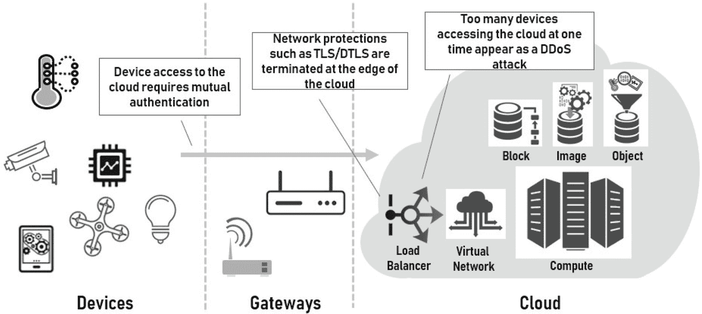

**图 6.1** 使用云进行大规模数据采集和分析产生的 `IoT` 安全问题

#### 大规模身份验证

在计算机科学中，有一句流行的格言是“垃圾进，垃圾出”。这意味着有缺陷的输入数据会导致即使设计最好的计算机程序也会产生错误的结果。对于 `IoT` 系统来说也是如此。`IoT` 系统产生的信息或知识高度依赖于 `IoT` 系统接收到的数据。因此，系统必须经过设计，以确保系统处理的数据来自经过妥善身份验证的受信任数据生产者。此外，`IoT` 系统的规模意味着任何可行的身份验证机制必须相应地扩展。

#### 云验证连接的设备

在 `IoT` 系统中验证数据生产者的主要手段是对边缘 `IoT` 设备本身的身份验证，因为它们是数据生产者。云必须能够确定它可以信任这些设备。如何做到呢？构建 `IoT` 设备信任的原则描述在第 5 章 第 5.5.3 节中。

在此，值得注意的是，对已部署系统进行自动重新配置设备凭据（`re-provisioning`）是另一个难题。解决零接触部署和重新配置问题的解决方案是英特的安全设备装载（`SDO`），它也描述在第 5 章 第 5.5.3 节中。

#### 设备验证云实例

设备能够验证云也同样重要。这确保了合法数据不会被发送到恶意云端。云验证通常通过安全地为设备分发数字服务器证书来实现，该证书包含与云后端关联的公密钥。服务器证书用于 `TLS` 或 `DTLS` 会话的身份验证步骤，这允许 `IoT` 设备验证其所连接的服务器或云的身份。

#### 大规模数据摄取

在第 2 章 第 2.1 节中，我们描述了受攻击的 `IoT` 设备如何对云服务提供商 `DYN` 发起成功的分布式拒绝服务（`DDoS`）攻击，导致许多主要的网络服务和网站无法使用数小时。

所有主要的云服务提供商（如 `Google Cloud Platform`、`AWS` 和 `Microsoft Azure`）都发布了关于在他们的平台上构建云服务的详细指南，以确保检测并缓解 `DDoS` 攻击。截至本文写作，其主要出版物包括 `Azure DDoS Protection: Best Practices and Reference Architectures`、`Denial of Service Attack Mitigation on AWS` 以及 `Best Practices for DDoS Protection and Mitigation on Google Cloud Platform`。

你会发现，上述不同云解决方案提供商推荐的方案是类似的。亮点包括：

*   设计您的服务和服务器，使其根据需求进行智能扩展，使用限制来控制扩展，并使用网关在批准的预定时间从多个设备收集并将输入数据上传到云端，以限制设备到云的连接次数。

*   识别系统的正常流量负载。利用此信息为系统管理员配置告警、缩缩限制和自动化缓解选项。

    *   某些云服务提供商使用机器学习来自动学习每个托管应用程序的正常流量量。

*   使用专用防火墙进行弹性架构设计，自动过滤掉用于某些 `DDoS` 攻击的畸形流量。

*   通过限制可通过互联网访问的系统和服务，将您的攻击面降至最低。

欢迎读者探索这些资源，因为相同的原理也用于为 `IoT` 云提供并保护大规模数据摄取。如果您使用不同的云提供商，他们也应该提供类似的指南。如果您是云服务提供商——即您正在构建运行您的 `IoT` 云的云托管平台——我们仍然鼓励您审阅上述资源，因为它们描述了您需要构建到云托管平台中的 `DDoS` 保护方法。

### 数据完整性保护

对于 `IoT` 云，主要的数据完整性担忧是边缘 `IoT` 设备提供的数据可能会被恶意者篡改。为了防止这一点，我们将从四个主要角度考虑数据完整性保护。

### 网络保护

在数据从边缘设备传输到云端的过程中，数据完整性通常通过加密通信通道受到保护。实现这一点的两种主要方法是通过传输层安全（`TLS`）和数据报传输层安全（`DTLS`）协议。这些机制在之前的“大规模数据认证”章节和第 5 章第 5.5.4 节中进行了描述。在后节，我们描述了如何创建一个安全的、双向认证的 `TLS` 或 `DTLS` 通道，这涉及云平台验证 `IoT` 设备以及 `IoT` 设备验证云平台。

### 数据完整性标签


尽管 `TLS` 和 `DTLS` 用于安全传输数据，但大多数云平台会在云边缘终止这些协议。这意味着当来自 IoT 设备的数据进入云端时，保护传输中信息的加密会被移除，只留下了来自边缘设备的数据。然而，在此时，基于之前的数据保护已应用到静态存储和传输中状态的假设，云平台通常只信任它即将处理的数据没有被篡改，因为数据来自它受信任的设备，且安全隧道已在云提供商的数据中心内部终止。在非常敏感的操作中，在将数据通过 `TLS` 或 `DTLS` 会话发送之前，对数据添加额外的完整性保护将允许后端云实例真正从端到端确认数据的完整性。例如，使用 `HMAC-SHA-256` 完整性标签，或使用 `Poly1305` 或 `GHASH` 对数据计算完整性标签，就能提供这种保护。标签使用密钥和数据创建，生成的标签长度通常为 128 位。可以截断标签以减少完整性带来的开销，但应谨慎行之——标签越小，对手伪造数据或标签就越容易。通常，不建议使用小于 64 位的标签。还需要注意的是，设备和云实例都必须共享完整性密钥。将此标签添加到数据中可以保证数据溯源性，并确保没有损坏（意外或恶意的）可以修改通过云系统传输的数据。

## 启动时软件身份验证与基于云的认证

数据完整性还取决于设备本身以及设备执行的软件。完成这一完整性保护维度涉及验证用于启动设备的软件组件的来源，并证明这些软件未被修改或损坏。通常，这是通过借助基于硬件的信任根（`RoT`）和云端设备认证服务来实现的，这些服务作为报告设备安全启动或度量启动（measured boot）状态的一部分。`RoTs` 在第 5 章第 5.5.3 节中描述，可以报告启动状态和设备完整性的管理代理在第 5.5.2 节中进行了讨论。云验证和使用设备状态信息（如安全启动信息）的方法将在下一节中介绍，该节将介绍通过运行在操作系统上的设备管理代理进行设备健康监控。然而，如果加载操作系统的软件或操作系统本身被攻破了，我们可以假设设备管理代理也被攻破了。因此，平台 `RoT` 需要在认证中报告安全启动状态。

有两种可以用于实现设备启动期间软件身份验证的主要方法。它们被称为安全启动（secure boot）和度量启动（measured boot）。

验证启动（Verified boot）通常通过从处理器内存映射中的不可写（并因此是受保护的）组件——例如 `ROM` 或锁定的闪存设备——运行启动代码来触发。启动代码启动了所谓的用于签名验证的信任链（Chain of Trust for Signature Verification）。这意味着在系统启动过程中，启动的每个实体都负责验证要启动的下一个组件的签名，以此类推。例如，启动代码验证其余固件的签名，固件在启动操作系统之前验证 OS 内核的签名。在闭源系统中，信任链的验证可以持续到操作系统之外，直到单个应用程序，并根据系统架构师的意愿进行尽可能远的验证。系统所有者设置的安全策略规定了在启动期间发生签名验证失败时会发生什么。一种常见且简单的策略是仅停止启动。对于 IoT 系统来说，这意味着必须派一辆车去修复设备——这是一项昂贵的操作。另一种策略可以是恢复到存储在 Flash 中的之前的操作系统版本，或从安全的网络存储器启动。一种先进的解决方案是在闪存中执行一个特殊的恢复操作系统，并让该操作系统与云通信以修复设备上的系统软件。验证启动解决方案通常旨在在签名验证失败时执行某些操作；它们永远不会继续启动系统。

测量启动（Measured boot）的启动方式与验证启动相同，但运行机制有所不同。测量启动涉及每个组件都对启动过程中要加载的下一个软件组件进行哈希测量并存储哈希值。哈希测量值通常通过一种称为可信平台模块（`TPM`）的硬件芯片安全地存储。`TPM` 的平台配置寄存器（`PCRs`）用于存储。`PCRs` 的一个重要特性是它们不能被覆盖，只能被扩展（extended）。因此，随着平台的启动，每个测量值都可以以某种方式累积在 `PCRs` 中，从而明确地证明加载了哪些模块——假设你知道应该加载哪些模块。一旦收集了 `PCRs` 值，下一步是报告这些值，这些值将由只有 `TPM` 可以访问的密钥签名。生成的数据结构称为 `Quote`（引用）或 `Attestation`（证明），提供了 `PCR` 值和签名，允许将 `Quote` 发送到云托管的验证服务器。服务器可以检查 `PCRs` 和相关日志，以确定设备运行的是可接受的镜像。^[⁷ 为了使之工作，云端必须维护一个与可接受系统启动状态相对应的测量值或哈希数据库。

测量启动（不包含验证启动）不涉及对要执行的每个启动组件的签名验证。因此，测量启动不会阻止使用受损的软件组件启动，尽管可疑系统在之后可以通过证明被发现。测量启动可以与安全启动相结合，以提供更全面的解决方案。

## 运行时异常检测与设备健康检查

如第 5 章第 5.5.2 节所述，设备管理通常通过云托管的设备管理服务以及运行在设备上的设备管理代理来实现。设备管理代理负责处理云端发送的设备更新、监控设备健康状况并将设备健康数据传输到云端。

作为深度防御的额外层，应使用基于云的服务对设备健康数据进行异常检测。例如，应该利用云端来定义和存储预期的阈值，如 `CPU utilization` 和网络流量负载，这些值与连接的 IoT 设备或设备类型的常规使用或功能相关。之后，可以通过简单的基于规则的系统或更复杂的机器学习系统进行定期的设备健康分析，以检测 IoT 设备中的异常行为。例如，一个经过测量和测试的 `CPU utilization` 不超过 50% 的 IoT 设备，如果被发现长时间运行在 90% 的 `CPU utilization`，则应触发警报并进行额外调查。同样，如果云端期望从 IoT 设备每小时接收不超过几兆字节的数据，那么显示网卡处理了更大流量的设备健康检查，应在云端的设备健康管理系统中触发系统事件，并对该设备进行调查或修复。

## 6.4.2 安全 IoT 设备管理

IoT 设备管理是对 IoT 设备进行置备、身份验证、监控和维护的过程。设备维护通常指的是更新固件和软件的过程，以保持设备运行并符合功能、质量和安全要求。

云端在 IoT 系统中的核心地位——云端必要的稳健性以及可用的大量算力——使得云端成为 IoT 设备管理的理想控制中心。

### 设备置备、注册与重新置备

假设你是一家冰箱制造公司的 CEO。你的公司一直在探索 IoT，并刚刚生产了一款能够感知食物变质并通知所有者的冰箱。由于员工的商业敏锐度和客户至上的方法，你的产品在全球范围内需求旺盛。你有五百万份预订单。随着你的公司争夺发布日期，你所有的工厂都处于超负荷运转状态。

这是你第一次真正的 IoT“实战”，因此可以预见到会遇到一些波折。在之前与选定的合作伙伴和客户进行的试点中，现场工程师被派遣去配置冰箱，以便注册到你的云端后端。然而，显而易见，这种方法无法扩展到全球数百万客户。在最近与主要合作伙伴的会议上，也变得明确，你的客户希望冰箱开箱可用并安全运行，且只需要极少的配置。

这就是 IoT 设备置备的核心。它涉及两个主要步骤：

1. IoT 设备与云端 IoT 解决方案之间的初始连接，并对该设备进行注册。
2. 根据设备注册的云端解决方案的要求，对设备应用适当的配置。

理想情况下，一旦设备电源，这两个步骤都应该自动完成。置备也应该安全地进行。

为了给 IoT 设备置备做准备，通常有两个不同的步骤：

1. 制造步骤，其中设备制造商负责为 IoT 设备置备做准备。这通常涉及内置设备置备服务的地址、`private key`（私钥）以及用于向设备置备服务验证 `device certificate`（设备证书）。`private key` 和 `device certificate` 应该通过可信平台模块（`TPM`）、可信执行环境（`TEE`）或其他硬件辅助安全组件安全地存储。
2. 云端设置，其中 IoT 系统所有者/运营商配置中心化的设备置备服务，该服务能够在 IoT 设备接入时对其注册、激活和配置。大多数提供 IoT 服务的供应商都提供了可由 IoT 系统所有者/运营商配置的设备置备服务。

在我们智能冰箱的示例中，设备制造商和 IoT 系统所有者是同一个实体。在某些情况下，它们并不是。例如，智能冰箱公司可能会将实际冰箱制造外包给第三方。

接下来，我们将探索一些用于置备 IoT 设备的方法。这里描述的方法使用 `RSA key pairs` 和 `X.509 certificates` 进行身份识别和验证。

1. **基于制造的零接触置备**（所需步骤如图 6.2 所示）：最简单的置备类型是在设备制造时设置设备配置。从客户或终端用户的角度来看，这提供了一种零接触置备，因为他们永远不需要对配置进行任何操作。当然，这创建了仅适用于特定云端或设备管理系统的设备，从而将设备锁定在该特定系统中。如图所示，所有必要的设置都构建在设备中，并对应于在设备置备服务（`DPS`）中为设备创建的配置文件或配置。

大多数主流云平台（如 Microsoft Azure、Google Cloud Platform™ 和 AWS^®）都支持某种基于在制造时设置配置的零接触置备。

## 2. 批量置备 (Bulk provisioning)

`bulk provisioning` 的核心涉及由客户创建数据，然后在制造过程中将其上传到设备。在某些情况下，唯一密钥的生成可以由制造商完成并传回 `DPS` 使用。这种方法的优点是客户可以获得特定的配置，但成本也较高。

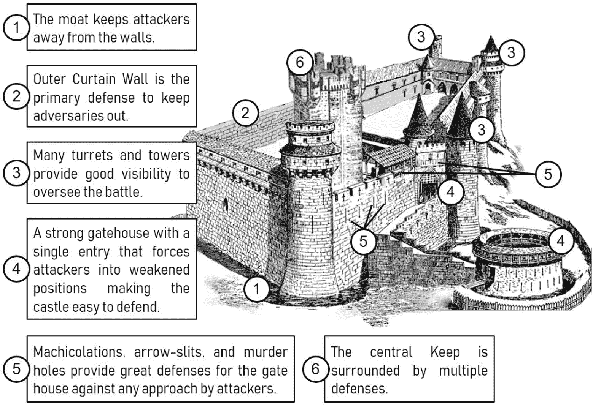

**图 6.2 即时置备或接触置备（也称为批量置备）**

## 3. 设备证书 (CVM)

这种方法不常见，适用于那些没有预装支持 `TLS` 的 `IoT devices` 且无法进行 `provision`#ch06.xhtml#ref8` 的客户。我们假设 `IoT devices` 支持 `TLS`，并且为了防止`中间人`攻击，应该对 `CVM` 进行验证。

以下是 `CVM` 工作流：

* IoT 设备向 `cloud` 发起请求。
* `cloud` 向 `IoT device` 发送 `certificate`。
* 收到 `certificate` 后，`CVM` 启动 `device registration`。
* `cloud` 将 `certificate` 与 `device` 关联。
* `CVM` 为 `device` 生成 `key pairs`。
* `CVM` 将 `certificate` 返回给 `IoT device`。

需要注意的是，这种方法的问题在于`设备伪装`。`cloud` 能够通过 `serial number`、`client ID` 或 `token` 验证 `IoT device`。

关于 `device provisioning` 的更多信息，可以查看 `#ch06.xhtml#9`。关于 `device updates` 的更多信息，可以查看 `#ch06.xhtml#10`。

## 重新置备设备 (Re-provisioning devices)

我们之前的点涵盖了 `IoT devices` 的“重新置备”。可以为应该接收更新的 `IoT devices` 打上标记。这就是 `device maintenance service`。

## 设备维护、更新与监控

`IoT devices` 的寿命为 10 到 15 年。此外，`IoT devices` 经常需要`device maintenance`。因此，让 `IoT devices` 设计为支持`remote maintenance` 是至关重要的。

主要的 `device maintenance` 任务包括：

1. **设备更新（操作系统、应用程序和固件）：** `device updates` 的核心涉及必须正确完成的几项主要任务：
   - `device management service` 与 `IoT devices` 之间安全的通信通道。
   - 一个存储更新的安全存储仓库。
   - `device management service` 将可用更新映射到相应 `IoT devices` 的能力。
   - `device management service` 恰当将 `update package` 的地址（即 `Uniform Resource Identifier (URI)`）发送给需要该更新的设备。
   - `update repository` 与所有相关 `IoT devices` 之间安全的通信通道。
   - `IoT devices` 验证 `update packages` 真实性的安全手段。例如 `digital signature verification`。
   - `IoT device management service` 回滚 `IoT device updates` 的能力。

2. **设备监控：** 这涉及监控整体 `device health`、数据收集服务、正在进行的 `operations` 状态（例如 `sensor operations`、`software workloads`、`network health` 和可用性，以及对 `software updates` 的需求），以及发送给操作人员的关于可能需要关注的问题的警报。

在我们 Section 6.6.3 中的实际 IoT 示例中，我们使用 `application containers` 和 `container registries` 为我们的 `IoT devices` 提供 `over-the-air application updates`。

## 4. 出厂重置

有时有必要为设备移除所有更新并恢复到原始软件载入。这通常发生在软件或操作系统更新出现故障，或者设备的闪存或文件系统发生损坏时。大多数设备都保留原始设备加载的备份，使用出厂重置可以将设备恢复到此原始状态。从出厂重置之后，可以逐一提供更新，使设备恢复到安全且完全更新的状态。

### 资源受限设备远程维护的难题

最近，发生了一起一组 IoT 设备信任根（trust anchor）遭到破坏的事件。

你可能会问，什么是信任根？信任根是系统内生信任的加密密钥。通常，信任根是以特定的方式部署到设备中的，以防止或抵抗能够更改密钥的攻击——例如，作为 ROM 或固件镜像的一部分。对于许多系统而言，信任根通常是根证书或 CA 证书，用于对其他证书签名。因此，信任根也用于验证其他证书及其关联数字签名的信任。⁹ 大多数操作系统都带有一组根证书，用于验证该系统上应用程序的数字签名。系统构建者、供应商或用户也可以将根证书添加到操作系统的信任根集合中。

回到我们的故事：某不具名的 IoT 解决方案运营商，其运行在边缘 IoT 设备上的 Linux^® 操作系统发行版遭遇了信任根被破坏。为了解决这个问题，必须从云端向所有设备推送一个新的 Linux 镜像。对于云端来说，这并不是什么问题，尽管镜像有 4GB 大。另一方面，设备使用的是 3G 连接，容易出现严重的网络错误，而且网络运营商对传输的每个字节数据都收费。在正常运行期间，当设备只需要上传或下载几百字节的数据时，网络限制并不是问题。然而，对于整个操作系统的强制更新，公司的分析显示，要完成所有设备的更新将花费数百万美元的网络费用，并需要超过一年的下载时间。

### 解决方案是什么？

主要的重点是，解决方案的开发者、供应商和运营商必须提前计划。俗话说，不计划就等于失败。以下是针对我们刚刚描述的问题的一些解决方案：

1. 由于大多数 IoT 设备（如传感器和执行器）资源受限，请将网关部署在边缘，更靠近你的受限设备。正如第 4 章中 4.2.1 节到 4.2.3 节所述的，网关可以减少长途通信成本和能耗，同时让解决方案所有者能够支持大量的 IoT 设备。
2. 审慎选择作为你 IoT 解决方案基础的操作系统发行版。选择操作系统意味着你隐式地信任该操作系统的正确开发、运行和维护。在构建你的 IoT 解决方案之前，你应该研究该操作系统的历史以及其开发和维护实践。
3. 考虑使用容器化发行版，它允许你更新操作系统的部分内容而无需更新整体。某些 Linux 发行版通过使用仅包含镜像间差异的二进制差异文件来执行更新，从而显著减少了更新的开销。在写作时，此类系统的示例包括 Intel^® ClearLinux、Rancher^®OS 和 CoreOS^®。

#### 6.4.3 IoT 设备的安全多点访问

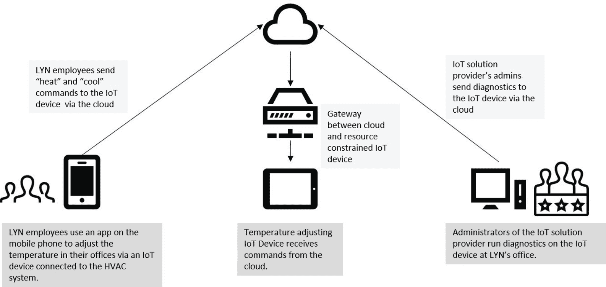

**图 6.3** 云端为 IoT 设备提供多点访问

为了说明这一点，让我们简单考虑一个部署在 LYN（一家非营利慈善机构）办公室的 IoT 解决方案。它允许 LYN 的员工通过智能手机上的 App 调节会议室的温度。同时，IoT 解决方案提供商管理员可以在自己的办公室使用笔记本电脑运行诊断。这是如何运作的？是的，你说对了，是通过云端。云端还通过加密通信通道、认证和授权确保了多点访问的安全。

图 6.3 描述了云端如何提供中央手段，使得用户和系统管理员这两个实体都能访问控制 LYN 办公室温度的 IoT 设备。因此，云端提供了对 IoT 设备的多点访问。

### 6.5 IoT 云端后端安全考虑因素总结

一个能够破坏 IoT 解决方案云后端的攻击者拥有了——安全专业人员所说的——王国钥匙。为什么呢？因为我们到本章为止所涵盖的所有内容都证明了云端对 IoT 系统的至关重要。

在进入实用的 IoT 安全架构之前，让我们总结一下 IoT 云端主要的安全关注点。对于下面列出的每类安全关注点，我们引用了 6.6.6 节中表 6.4 中的攻击和缓解措施，我们在表中列出了针对我们实用 IoT 云端示例的可能攻击，并对这些攻击提出了缓解措施。

1. **大规模安全数据采集、数据清洗和数据存储**：必须确保边缘设备的数据安全地传输到云端并存储在云端。此外，云端消耗数据的方式必须具备可扩展性。对于实用示例，请查看 6.6.7 节中表 6.4 中的攻击 A2、A4、A5、A6、A7、A9、A12、A13 和 A14。


## 2. 设备配置、注册、认证和授权

边缘设备通常受到物理、本地或替换攻击的影响。这意味着 IoT 系统设计时必须确保所有云服务仅与合法设备通信。此外，后端系统必须能够防止非法设备的数据输入。这通过确保所有设备都配置了安全标识符，并且后端系统在处理其发送的数据之前验证其注册、认证和授权来实现。对于实用示例，请查看 6.6.7 节中表 6.4 中的攻击 A3、A19 和 A20。

## 3. 设备管理和更新

大多数 IoT 设备预计运行至少 10 年。因此，确保已配置设备上的软件（在某些情况下为固件）在部署后可以更新至关重要。否则，在设备软件组件中发现漏洞可能会被利用来破坏系统。云后端系统是向 IoT 设备无缝交付补丁和更新的主要手段。补丁和更新必须通过安全通道部署。设备在应用之前还必须能够验证补丁和更新。常见的模型是通过加密通道交付数字签名的更新。接收设备随后能够验证更新的签名。对于实用示例，请查看 6.6.7 节中表 6.4 中的攻击 A3、A19 和 A20。

### 4. 加密通信

物联网（IoT）设备的数据通常通过不受 IoT 系统所有或运营实体控制的通信通道发送到云端。因此，任何通过该不可信通道传输的有价值数据或信息都必须通过加密来保护。加密通信对于边缘设备尤为重要，因为它需要消耗额外的电和计算资源，而这些通常会对边缘设备产生限制。出于此原因，人们正在积极开发和改进轻量级加密协议，以支持在资源受限设备上提供加密能力。作为 IoT 系统安全分析的一部分，安全架构师和产品开发团队需要对性能与安全性之间的权衡做出判断。

每一个通信通道——从传感器或执行器到网关再到云端——都必须考虑加密。此类考虑应基于所传输数据的敏感性，以及泄露的潜在影响和系统设计的任何其他保护措施。实际示例，请查看第 6.6.7 节中表 6.4 中的攻击编号 `A2` 和 `A12`。

### 5. 应用程序接口（API）安全

云端后端系统始终通过暴露在网络上的 API^(\*)消费数据。对于部署在公共云上的系统，此类 API 可能可以通过互联网访问。除了我们已经涵盖的关注的安全措施外，所有接受数据或命令的云 API 或逻辑接口都必须经过健壮的测试和保护。这涉及使用负输入/畸形/意外输入进行测试以及压力测试技术。API 还必须验证并认证每一次访问。实际示例，请查看第 6.6.7 节中表 6.4 中的攻击编号 `A4`、`A5`、`A6`、`A11`、`A12`、`A13` 和 `A14`。

### 6.6 实用 IoT 云安全架构：“Dalit”智慧城市案例

这座城市名为 Dalit，是非洲中西部的一个虚构城市。但让我们忘记它是虚构的，这样我们就可以享受这个故事，好吗？Dalit 的市长和城市规划与开发委员会深知那个频繁提到的技术创新稳步进展及其能提供的利益。结果，市官员希望通过将 Dalit 开发为智慧城市来构建 Dalit 2.0。他们的愿景是建立一个配备了技术的城市，这些技术可以改善城市居民的生活。他们的目标是通过部署有助于减少交通拥堵、交通事故和犯罪的系统来实现这些。

作为第一步，Dalit 的官员决定建立一个试点系统，以描绘城市主要路口的活动水平。该设计的系统将为市官员提供有关在不同日期和时间、不同城市路口的汽车、自行车和行人数数量的实时数据和趋势。

Dalit 的智慧城市试点利用了多种技术，如用于捕捉视频和图像的摄像头、处理来自摄像头视频流以生成汽车、自行车和行人数元数据计数的边缘网关，以及后端基础设施和应用程序。

后端系统从多个边缘网关收集数据，并存储在可全文搜索的搜索引擎中。数据和搜索引擎通过 Web 应用程序供市官员访问。边缘网关的配置和管理也由后端系统处理。

为了在本章的分析，我们将重点关注云托管后端系统的安全性。

#### 6.6.1 介绍作为威胁建模工具的 ATASM

第 5 章深入分析了“威胁建模”的艺术与实践。鉴于威胁建模对设计安全系统重要性，我们将使用 Dalit 示例来探索一种不同的威胁建模技术。我们希望这能帮助读者看到不同的威胁建模方法，从而提高读者对该领域的理解。

到此时，你可能会同意威胁建模是一门艺术，它涉及对系统架构进行审查，以推导出系统中可能存在的任何安全弱点，确定其中哪些弱点应该被缓解，并产生所需缓解措施的规范。威胁建模要求对系统、其组件及其相互作用、系统处理或存储的数据，以及系统运行的运行时或部署环境有深入理解。一旦充分理解了系统架构，威胁建模者就可以处理威胁建模的其他方面，这些方面可以总结如下：

1. 识别会对破坏系统感兴趣的攻击者
2. 识别系统中会对攻击者感兴趣的信息
3. 推断攻击者可能使用的攻击模式
4. 识别为了阻止攻击者而应该实施的安全控制

在本章中，我们将使用一种名为 `ATASM` 的方法对我们的 IoT 云架构进行威胁建模。`ATASM` 是 Brook Schoenfield 的结晶，旨在提供一种清晰简单的方法来教授威胁建模的艺术。`ATASM` 代表 `Architecture（架构）≫ Threat Agents（威胁代理）≫ Attack Surfaces（攻击面）≫ Mitigations（缓解措施）`。以下是这四个步骤中每个的简要解释：

1. **Architecture（架构）：** 消化架构。这几乎总是通过架构图完成。
2. **Threat Agents（威胁代理）：** 理解对你的系统感兴趣的（人类）攻击者、其能力和动机。
3. **Attack Surfaces（攻击面）：** 识别系统中作为攻击者的目标。还要识别攻击者的攻击方法及其高级或系统级目标。
4. **Mitigations（缓解措施）：** 识别所需的安全控制。这些成为威胁建模输出的正式需求列表。

图 6.4 展示了 `ATASM` 的迭代性质。

```
![图 6.4 ATASM—递归威胁建模过程（改编自 Schoenfield, B. [2015]. Securing Systems: Applied Architecture and Threat Models. CRC Press/Taylor Group.10)](ops/images/file31.jpg)
```

**图 6.4** ATASM—递归威胁建模过程（改编自 Schoenfield, B. [2015]. *Securing Systems: Applied Security Architecture and Threat Models.* CRC Press/Taylor Group.¹⁰)

深入研究 `ATASM`，请查看 Brook Schoenfield 在 *Securing Systems: Applied Security Architecture and Threat Models.* 中的著作。¹⁰

在此处值得注意的是，有很多方法可以建模。`ATASM` 只是其中之一。`ATASM` 的方法是一种架构驱动的威胁建模方法论，提供了清晰简洁的步骤来推导出相关的攻击面及其缓解措施。

#### 6.6.2 Dalit 云架构概述

在本节中，我们向您介绍 Dalit 的云托管环境以及城市做出的影响其云架构的选择。在后续章节中，我们将使用不同的架构视图来展示 Dalit 云的安全架构。

##### 选择云提供商、服务和部署模型

Dalit 必须决定如何托管其智慧城市试点项目的后端系统。由于缺乏资金为私有云维护高可用数据中心，Dalit 决定与一家知名且成熟的云服务提供商合作公共云部署模型。这一选项额外具有吸引力，因为首次部署是试点，即使能找到资金，也没有立即为城市构建数据中心的需求。但他们可以使用哪种云服务提供商呢？

目前，且可能日益增加，有很多合格的云服务提供商。根据 2018 年 Gartner 云服务提供商魔力象，前三位领导者分别是：亚马逊的 Web Services (`AWS`)、微软® Azure® 和 Google Cloud Platform™ (`GCP`)。

Dalit 决定选择 `AWS`——尽管我们（作者）不得不带着苦笑着补充道，这一选择主要是出于我们的专业知识，而不是对 `AWS` 优于其他云服务提供商的认可。尽管如此，这意味着我们的架构和安全分析将反映一些 `AWS` 的专有技术或解决方案。即便如此，我们在分析中推导出的多数安全需求都适用于任何云服务平台的云部署。例如，可以使用不同的现有技术实现对云服务的用户身份验证。云服务提供商专有的身份服务示例包括 `AWS Cognito`™ 和 `GCP Firebase`™，而 `Auth0` 是可以同时用于 `AWS` 和 `GCP` 的第三方解决方案。每当我们提到 `AWS` 特定技术时，我们都会尝试提到其他顶级云平台可用的对比技术。

最后，考虑到我们在架构、设计和管理云基础设施及应用程序方面所需的灵活性，以及配置和管理云边缘网关的需求，我们选择的服务模型是基础设施即服务 (`IaaS`)。`Table 6.2` 总结了 Dalit 市选择的云托管方案。

**Table 6.2 规划我们的 IoT 云：云服务提供商、服务模型和部署模式**

| Dalit 的云托管选择 |
| --- |
| **部署模型** | 公共云 |
| **云服务提供商** | 亚马逊 (AWS) |
| **服务模型** | 基础设施即服务 |

### 组件架构

通常，一个架构视图不足以描述系统的不同元素和组件。完整的描述需要系统的不同视图。系统越大，多个视图（在某些情况下是不同抽象级别的视图）就变得越来越必要。为了说明，从不同角度观察大象可以提供对这种大型哺乳动物特征的部分洞察。要进一步了解这种动物，必须理解它的行为、本能、生理结构等。

系统架构的视图示例包括数据流、组件交互、网络、管理、监控，甚至是业务流程/交互。其中某些视图可以组合成单一的图表表示。

对于 Dalit 云，我们开发了四个架构视图。我们并不是说这些是唯一必要的视图，而是说它们足够我们理解系统，以对对 IoT 云进行威胁分析。我们的架构视图可以命名和描述如下：

1. **数据摄取和处理视图：** 该视图描述了涉及从边缘设备检索的数据摄取和处理的主要云组件和数据流。
2. **设备固件和软件更新流视图：** 在这里我们描绘了用于更新边缘设备软件的云组件。在边缘设备上处理和验证更新的具体机制留给读者利用第 5 章分享的原则和实践进行探索。
3. **云基础设施和网络视图：** 该视图说明了云的基础设施。它描绘了连接并在其他情况下隔离虚拟私有云 (`VPC`) 中运行服务的网络、防火墙和安全组。`VPC` 是一个虚拟数据中心。
4. **监控和审计视图：** 该视图描述了 Dalit 如何使用 `AWS` 组件监控其对云计算资源的使用，并审计用于管理 Dalit 云的管理员账户。

*免责声明：在本节中，我们对云组件和服务某些描述和描写（例如设备影子服务）是基于 `AWS` 以及其他云计算提供商产品中的组件。但我们不这样称呼它们，以便我们能够描述和分析有时被 `AWS`、`GCP` 和 `Azure` 等云计算提供商“用户或开发者友好型”界面所隐藏的云架构细节。*

#### 6.6.3 数据摄取和处理视图

如图 6.5 所示，该视图有两个编号流。一个流描绘了数据从边缘到云端流动，另一个流显示了城市官员如何访问这些数据。消化架构的一个良好起点是边缘的摄像头。摄像头用于处理城市交叉路口的视频流。来自摄像头的视频流被传输到交叉路口的边缘计算网关。摄像头与其边缘网关连接的具体细节不在本章的范围内，因为本章侧重于云架构。

边缘网关处理视频流并使用机器学习识别汽车、自行车和行人。为了避免存储或保护关于城市居民的高度敏感数据，边缘网关在处理视频流、计数并存储数值数据之前会丢弃视频流。数值流量元数据被发送到云端。

在云边界处，部署了另一个网关：我们称之为 `Cloud Gateway`。`Cloud Gateway` 是一个专门的计算服务，负责管理所有入站连接。像任何计算服务一样，它利用块存储来存储和运行操作系统及其软件应用程序。它设计为随流量自动伸缩。

`Cloud Gateway` 暴露了消息队列遥测传输 (`MQTT`) 接口，允许通过 `MQTT` 协议进行边缘到云的数据传输。`MQTT` 是一种极其轻量级的发布/订阅消息传输协议。它适用于远程位置的连接，这些地方需要少量代码且网络带宽有限——例如，IoT 传感器通过与医疗提供者偶尔拨号连接的卫星链路与云代理服务器通信，以及一系列家庭自动化和小型设备场景。`MQTT` 在 IoT 云架构中很常见，允许云轻松地从许多设备摄取数据。有关 `MQTT` 工作原理的更多细节，请参阅第 7 章。

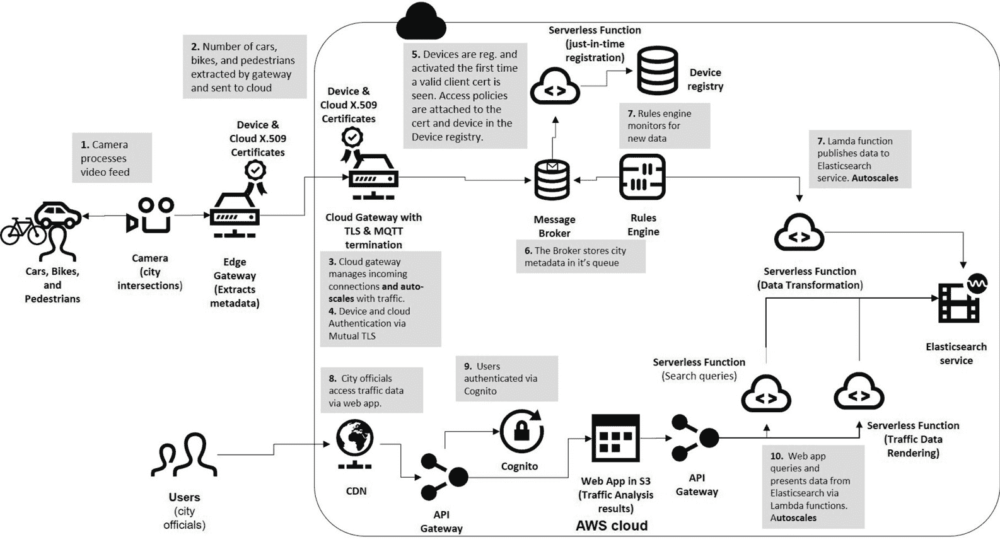

**Figure 6.5** Dalit 云: 数据摄取和处理视图

### 什么是自动伸缩？

这是云计算提供者的一种能力，可以根据使用这些资源的服务或应用程序的负载，自动增加配置的计算资源。自动伸缩通常通过虚拟机（`VMs`）或容器完成。当进入云端的流量超过当前服务器集能够管理的范围时，云管理系统会自动启动另一台运行与当前服务器相同 `VM` 或容器软件的服务器，从而有效地增加了一个服务器来处理流量。同样，当流量峰值消退时，云端将关闭这些额外的服务器，并维持一个最小集合（可能仅限一个）来处理当前的流量负载。有关自动伸缩的更多信息，请查阅第 11 章、第 11.5.5 节。

如第 6.4.1 节“扩展性身份验证”所述，并在图 6.5 所示，边缘设备和云网关设备通过双向传输层安全协议（`TLS`）进行相互身份验证。这意味着每个设备都持有一个 `X.509` 证书，该证书可以被另一个设备成功验证。`TLS` 协议允许客户端/服务器应用程序以旨在防止窃听、篡改或消息伪造的方式进行通信。[12]](#ch06.xhtml#ref6_12)

为了启用双向 `TLS`，边缘网关配置了一个 `X.509` 设备证书，该证书是由用于将设备注册到云端的 `CA` 证书签名的。云平台“服务器”证书也被分发到了设备中。设备证书、设备私钥和服务器证书通过通过硬件安全模块（`HSM`）安全地存储在设备上。设备证书及其签名 `CA` 证书也通过 `HSMs` 存储在云端，因此供指定的 `Lambda™` 函数访问，用于即时注册。此流程在第 6.4.2 节和图 6.2 中进行了描述。基于云的 `HSM` 暴露了 `APIs`，即时注册函数可以使用这些 API 来验证发送到云端的设备证书的签名或证书哈希。我们的架构并未在此涉及云 `HSM` 访问或使用的细节。关于该主题有多种资源可用。

### 什么是 Lambda？

它是 AWS 对一种较新云计算方法的实现，该方法被称为无服务器架构或函数即服务（`FaaS`）。`FaaS` 在第 11 章、第 11.5.2 节中有更详细的描述。`FaaS` 允许软件开发者通过事件驱动的代码函数来编写和部署解决方案，而云计算提供者则负责运行代码所需的基础设施的管理——设置、伸缩和拆除。`FaaS` 实现的其他示例还包括 Azure Functions™ 和 Google Cloud Functions™。

通过即时注册，边缘网关在向云后端发送第一条消息后，会在云后端进行注册和激活。云网关包含逻辑，用于检测设备证书的首次连接，这会导致它将证书信息添加到指定的 `MQTT` 注册主题中。即时注册函数订阅了该主题。该函数负责获取新的客户端证书，验证其真实性，然后在设备数据库中激活它并附带授权策略。只有已注册并激活的设备证书才能用于向消息代理发布城市数据。设备发布或读取数据的请求会导致云网关调用一个身份验证 lambda 函数，该函数会验证请求是否由已注册并激活的设备发出，且该设备具有发布或读取特定主题的权限。lambda 函数的响应将导致网关允许或拒绝设备的数据发布或读取请求。

消息代理是一种计算服务，充当数据总线的功能，存储客户端可以访问的数据。它存储接收来自边缘设备的数据，并作为数据管道，使数据可以从一个组件传递到另一个组件。这是通过发布/订阅（Publish–Subscribe）机制实现的，使得注册的组件可以向主题发布数据，也可以订阅并消费已发布到主题的数据。主题简单地分配给数据的一个标签。规则引擎设计用于监控消息代理队列中的不同类型消息，这些消息可能需要云应用程序采取行动。在我们的 Dalit 试点中，规则引擎订阅了消息代理主题“城市元数据”，该主题包含有关特定城市交叉口行人、汽车和自行车数量的定期信息。一旦有了新的城市元数据，它就会收到通知并将数据发送到名为 `Data Transformation` 的 `Lambda` 函数。

在 Dalit 的物联网云架构中，数据转换函数进行一些最终处理，将从边缘设备接收的数据解析为 `JSON` 文档，这些文档旨在高效支持未来的搜索查询。`JSON` 文档持久位于指定的服务器集群中，称为 `Elasticsearch^®` 服务。`Elasticsearch` 服务是一种自动伸缩的计算服务，基于由名为 `Elasticsearch B.V` 公司构建的 `Elasticsearch` 软件引擎。它提供了一个分布式全文搜索引擎，让我们能够让市官员无缝地搜索、查看和可视化来自城市交叉口的数据流。此时，来自城市交叉口的数据已存储，并可以通过 `Elasticsearch` 进行搜索。

为了让 Dalit 的市官员访问有关城市行人、汽车和自行车的数据，一个静态网站[*]](#ch06.xhtml#fn6_12)托管于 AWS 对象存储服务 `AWS S3™`（简单存储服务）。这意味着代码文件存储在 S3 中。AWS 的身份服务用于授予少数云管理员更新网站代码所需的角色和权限。所有管理员操作都经过审计。这是通过 `AWS CloudTrail™` 计算服务完成的，它记录了在云端执行的所有管理员活动。`AWS CloudTrail` 支持配置告警和日志搜索，以确保指定的管理员可以监控云端的操作。值得注意的是，这种功能并非 AWS 特有，其他主要的云提供商也提供。例如 Azure Search%。普通网站用户仅通过浏览器查看网站。为了实现这一点，网站用户有权读取代码文件，但不能更新或进行修改它们。使用内容分发网络[^†]](#ch06.xhtml#fn6_13)（`CDN`）来提供 Web 应用程序，以便在地理位置靠近用户的云服务器上缓存内容，从而提高获取内容的速度。


应用程序暴露了一个界面，市官员可以通过它查询 `AWS Elasticsearch` 服务。这是通过使用两个名为 `Search Queries` 和 `Traffic Data Rendering` 的 `Lambda` 函数实现的。应用程序设计为根据加载的页面或用户点击的按钮执行这两个 `Lambda` 函数之一。反之，每个函数都会从 `Elasticsearch Service` 搜索或检索数据。

## 6.6.4 设备软件（及固件）更新视图

正如我们在第 6.3 节中讨论过的，在物联网边缘设备上更新软件（及固件）的能力对于任何物联网解决方案的成功都至关重要。固件本质是一种用于控制计算系统硬件的特殊软件。

考虑到一个具有多个软件组件的物联网设备，我们可以确定，迟早会有某些安全研究人员或黑客发现其中某一个组件存在安全漏洞。如果没有更新软件的能力，设备就会变成一个定时炸弹。

Dalit 的软件更新机制利用了软件容器和 `AWS Elastic Container registry` 计算服务。

> **什么是容器？** 运行在普通操作系统上的计算机程序可以看到该计算机的所有资源（连接的设备、文件和文件夹、网络共享、CPU 算力、可量化的硬件能力）。然而，运行在容器内部的程序只能看到容器的内容分配给该容器的设备。除了隔离机制外，`kernel` 通常提供资源管理功能，以限制一个容器的操作对其他容器的影响。容器通常通过容器引擎运行，这些引擎使用操作系统级虚拟化来创建用户空间实例，这些实例可以包含软件应用程序的代码、配置以及运行所需的所有依赖项。因此，容器的使用允许开发人员创建并部署应用程序，而无需担心支持不同的操作系统或环境。这对于移植性是一个巨大的胜利——特别是跨 Linux® 或 Windows® 等操作系统族时。请查看第 11 章、第 11.5.3 节获取有关软件容器的更多信息。

在 Dalit 设备软件更新视图中，系统管理员将签名的容器发布到 `Container Registry`。容器注册表只是存储为容器的更新文件存储库。之后，系统管理员使用 Web 应用程序（同样托管在 `AWS S3`），在 `Lambda` 函数的帮助下，向 `Device Shadow` 计算服务发布新的预期状态。`Lambda` 函数通过 Web 应用程序通过 `Amazon API Gateway™` 计算服务暴露的 `API`（或 `URL`）供 Web 应用访问。`API gateway` 仅仅是一个允许易于创建和操作 `REST APIs` 的服务。`Amazon API Gateway` 可用于创建一个同时连接到不同云端托管数据源的 `API`，为访问该 `API` 的客户端提供简化的接口。在我们当前的示例中，`REST API` 连接到“设置预期设备状态”无服务器函数暴露的函数。

花点时间考虑最后一段描述的内容，并将其与第 6.4.2 节中“设备维护、更新和监控”部分描述的方法进行比较。是否有一种更智能的方法来为 Dalit 设计这种更新系统？花点时间分析一下。是的，你可能已经发现了。可能且或许更好的是设计一种系统，使设备更新带上 `device ID` 或 `device group ID` 标记，这样系统就可以自动将更新与设备或多个设备关联。这将消除我们示例中的步骤，即管理员手动更新 `device shadow service` 的配置，以引导设备下载更新。

我们的目标是让软件更新过程尽可能地无缝且可扩展。通过利用云原生服务，我们可以确保设备始终运行最新且最安全的软件版本。这对于维护我们物联网生态系统的完整性和安全性至关重要。

## 6.6.5 网络视图

图 6.7 展示了 Dalit 云的云端网络。Dalit 利用 Amazon 的网络服务 `Amazon Virtual Private Cloud™` 创建一个包含子网（subnet）和安全组的隔离网络。它由三个子网组成。其中两个子网是可以通过互联网访问的公共网络。私有子网只能通过公共网络访问。每个子网都有一个 `security group`，它作为虚拟防火墙控制入站和出站流量。

`bastion host`（堡垒机）位于公共子网中，其 `security group` 限制入站流量仅限来自 Dalit 的 IT 办公室。该网络是管理子网，使 Dalit 云管理员能够管理部署到 AWS 的各种计算系统和服务。因此，公共管理子网具有访问所有私有子网的权限。管理员通过 `bastion host` 访问网络，这是一个加固以抵抗攻击的服务器。访问 `bastion host` 需要 `SSH key-based authentication`。这意味着会生成一对 RSA 公钥和私钥，并将公钥放在 `bastion host` 上。只有拥有私钥的客户端才能通过 `SSH` 访问 `bastion host`。

在私有子网内有五个安全组。`Registration` 安全组限制对 `Just-In registration` `Lambda` 函数的访问。它仅允许来自 `Cloud Gateway` 计算服务的入站访问，同时与 `device state` 安全组允许双向流量。

消息安全组包含了消息代理程序和规则引擎。该组仅允许来自设备网关、管理员子网络、设备状态安全组和数据安全组的入站流量。

欢迎读者学习图 6.7，以推断图中所示其他连接和安全组的含义。

最后，Dalit 云使用了一些共享和全局 AWS 服务，但它们并不位于 Dalit 的 VPC 内部。它们是 `API Gateway™`、`S3` 和 `Amazon Cognito™`。

## 6.6.6 云资源监控与审计视图

为了保持任何系统的正常运行，有必要对系统使用情况进行监督和洞察。图 6.8 中的监控和审计视图描绘了 Dalit 的 IT 部门如何使用 AWS 来监控云计算资源和管理账户的使用情况。

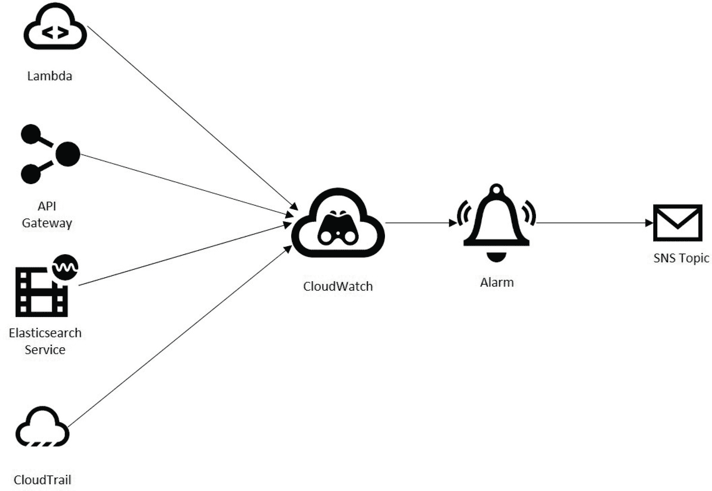

**图 6.8** Dalit 云：监控与审计视图

`AWS CloudWatch™` 计算服务已内置在每个 AWS 资源或服务中。它允许管理员监控其 AWS 的使用情况，同时使用 `AWS Cloudwatch alarms` 在超过预设使用阈值时触发通知（发送指定的接收者）。

`AWS CloudTrail™` 计算服务使得监控和审查通过 AWS 云用户账户执行的所有操作成为可能。在 AWS 平台上执行的每个操作（例如通过所有 Dalit 云图表所示创建云架构）都需要通过 AWS 账户访问 AWS。通常，像 Dalit 这样的组织或实体会创建一个 AWS 账户，然后使用该账户创建具有不同级别管理权限的其他账户。所有这些账户都对 Dalit 云具有不同程度的访问。`AWS Cloudtrail` 可监控 Dalit 的所有 AWS 账户。

如监控和审计视图所示（参见图 6.8），`AWS Cloudwatch` 接收来自 `Lambda`、`API gateway` 和 `Elasticsearch Service` 的使用数据。它还被配置为监控 `CloudTrail logs`。阈值通过 `AWS Cloudwatch Alarms` 配置，并带有事件处理器将通知发送到 `Amazon Simple Notification Service™` (`SNS`) 主题。`Amazon SNS` 是为大规模消息传递创建的基础设施。`SNS topics` 利用第 6.4.2 节中为消息代理的发布-订阅模型。订阅者可以订阅主题，也可以订阅主题者。一旦发布者向主题发送消息，它就会触发 `Amazon SNS`，随后 SNS 通过预先配置到 `SNS topic` 中的手段（如 `HTTP/HTTPS`、电子邮件、短信等）将消息传递给订阅者。

上述的监控和审计系统可用于通知指定人员关于 AWS 账户和资源的意外使用情况——例如，试图删除关键系统或数据的受挫员工，或试图启动数千台虚拟机来挖掘比特币的黑客。

## 6.6.7 威胁分析

### 威胁格局

在第 2 章第 2.3.1 节中，详细分析了当前的威胁格局。我们试图理解谁可能想要攻击我们的 IoT 系统以及他们的攻击动机。

现在，这些知识将被应用于 Dalit 云。表 6.3 分析了可能对攻击 Dalit 云感兴趣的威胁主体，概述了他们的目标和能力。

**表 6.3 Dalit 云的威胁格局**

| **威胁主体** | **目标** | **风险容忍度** | **工作因子** | **方法** |
| --- | --- | --- | --- | --- |
| 网络犯罪分子 | 财务 | 低 | 低到中 | 已知的证明 |
| 脚本小子 (Script kiddies) | 媒体关注 | 高 | 极低 | 已知的证明 |
| 安全研究人员 | 媒体关注、财务 | 极高 | 高 | 复杂 |
| 国家级 | 破坏、间谍 | 极低 | 极高 | 高复杂 |

### 攻击面与缓解措施

云架构老兵会注意到，表 6.4 中描述的部分攻击面和缓解措施不仅适用于 IoT 设备，也适用于通用云。请注意，表 6.4 并非所有可能攻击的穷尽列表。相反，它提供了通用云关注问题的示例。

4. Mesnier, M., Ganger, G., and Riedel, E. (2003, August 18). “Object-Based Storage” (PDF). *IEEE Communications Magazine,* vol. 41, issue 8.

5. Kovacs, G. (2017, February 22). “AWS Cloud 中的块存储 vs. 对象存储.” Retrieved 自 [`cloud.netapp.com/blog/block-storage-vs-object-storage-cloud`](https://cloud.netapp.com)

6. Zimmer, V. and Krau, M. (2016, August). “建立信任根.” Retrieved 自: [`uefi.org/sites/default/files/resources/UEFIRoTwhitepaper\_Final8816(003).pdf`](https://uefi.org)

7. Fedorkow, G. (2015, September 11). Retrieved 自 [`forums.juniper.net/t5/Security/What-s-the-Difference-between-Secure-Boot-and-Measured-Boot/ba-p/281251`](https://forums.juniper.net)

8. Liu, G. (2018, July 11). “使用证书销售机参考应用程序通过 AWS IoT Core 确保安全通信.” Retrieved 自 [`aws.amazon.com/blogs/iot/ensuresecure-communication-with-aws-iot-core-using-the-certificate-vending-machine-reference-application/`](https://aws.amazon.com)

9. Ashmore, S. and Wallace, C. (2010, June). “信任锚格式.” Retrieved 自 [`tools.ietf.org/html/rfc5914`](https://tools.ietf.org)

10. Schoenfield, B. (2015, May 20). *系统安全防护：应用安全架构与威胁模型.* Boca Raton (FL): CRC Press/Taylor & Francis Group.

11. Dignan, L. (2018, May 23). “Google Cloud 平台进入 Gartner 魔力象限的领导者类别.” Retrieved 自 [`www.zdnet.com/article/google-cloud-platform-breaks-into-leader-category-ingartners-magic-quadrant`](https://www.zdnet.com)

12. Dierks, T. (2008, August). “传输层安全 (TLS) 协议版本 1.2.” Retrieved 自 [tools.ietf.org/html/rfc5246#section-7.4.6](https://tools.ietf.org)

## 第 7 章

## 安全地连接未连接的设备

> 所以整场战争是因为我们无法互相交流。

> — 奥森·斯柯特·卡德，《安德士局》

### 7.1 连接性对物联网意味着什么

这个世界上许多问题都源于缺乏通信。那本被改编成电影的著名著作《安德局》讲述了人类与外星物种之间的战争，这场战争的发生主要是因为这两个物种无法进行交流。尽管物联网（IoT）设备之间的通信问题不太可能引发星际战争，但在之前的章节中，我们已经描述了一些当通信协议出现故障时发生的重大事件，包括莫里斯网络蠕虫和 Mirai 僵尸网络攻击。在本章中，我们将更深入地研究物联网设备中的通信，然后探索如何分析通信协议的安全性问题，这应该使你能够在这些问题导致你的系统崩溃之前发现它们。

正如通信是人类生存的本质——分享意图、交换能力信息、在共享任务时保持协调、警报危险，并在需要时获得帮助——设备之间的通信也实现了类似的功能。这可能是显而易见的，但如果没有连接能力，设备就无法成为物联网设备。

通信对于物联网至关重要，因为除了简单的数据交换外，物联网的目标是实现真正的机器对机器（M2M）通信。这一目标是让设备具备在没有任何人工干预的情况下与另一个设备交换信息，并完成任务、报告状况和健康状态、适应周围变化的物理环境，使设备能够生存以完成其预定使命。在物联网领域，我们经常使用缩写 `M2M` 来传达这一丰富的概念。而且，这需要的不仅仅是通信。处理能力、智能性（大写的 I）和适应能力都是必不可少的。

当我们拆解不同的有线和无线通信栈时，在描述通信栈的元素时保持语言的准确性非常重要；因此，我们倾向于利用开放系统互连（OSI）参考模型（见`图 4.1`）来组织这些元素。栈的底部包括物理层和数据链路层；这些包含了 `physical access technologies` 并决定了通信范围、功率需求、带宽能力、通信节点数量以及通信元素的组织等因素。将物理接入技术与物联网系统中设备的需求匹配是非常重要的。正如我们之后讨论的，某些物理接入技术更适合物联网架构的不同部分。

物理接入技术之上是网络层、传输层和会话协议。虽然在这些层有很多选择，但使用互联网工程任务组（IETF）互联网协议（`IP`）、传输控制协议（`TCP`）和 `UDP` 几乎是通用标准。我们不再对这些协议提供进一步涵盖，以便将讨论留给更具物联网特定性的主题，在我们看来，这些主题的理解较少，值得我们（以及你）的关注。

在网络层、传输层和会话层之上是表示层和应用层。这一层有几个非常独特且有趣的物联网特定协议，任何设计和开发物联网系统的人都应该了解它们。我们提供了这些协议的简要概述，以便让你了解物联网应用层的最新协议。

### 7.2 分类物联网通信协议

当我们思考通信协议时，将协议分为不同的分类是有帮助的。我们对通信技术的划分在图 7.1 中以图形形式所示，并分为远距离通信、有线通信和无线通信。远距离通信是用于连接云的协议。用于连接设备的协议通常范围较短，并分为有线协议和无线协议。这些不同的分类使我们能够更好地理解这些协议在物联网（IoT）系统中的最佳用途。提前看一眼图 7.4 也可能很有帮助，该图图形描绘了本章将涵盖的协议。

我们不会深入探讨网络协议栈的完整结构和 OSI 模型。关于这个主题已经有很多优秀的书籍，你可以在我们的参考文献中找到。虽然对于构建通信栈的人来说，网络栈的构建很重要，但对于我们对通信技术的介绍，我们只需要区分通信栈的三个不同部分：物理连接、网络和会话层以及应用协议。让我们回顾一下为什么这三个区别对我们非常重要。

### 物理连接

物理连接对物联网系统至关重要，因为这些连接决定了物联网站与系统其他部分之间的最大距离、这些站之间数据交换的最大速度，以及执行通信协议所需的功率消耗。了解这些信息是必要的，以便为物联网系统的特定部分做出最佳物理通信技术选择。

### 网络和会话层

网络和会话层决定了在通信介质（无线或有线）上发现和命名设备的方式。对于某些技术，连接到系统的设备数量受底层通信技术的限制。`MODBUS^®` 将连接设备的数量限制为 247 个；`IPv4`（网际协议第 4 版本）被限制 `2³²` 个不同的站点。总是存在某些实际限制。了解不同技术的局限性以及克服或处理这些限制的方法是非常重要的。

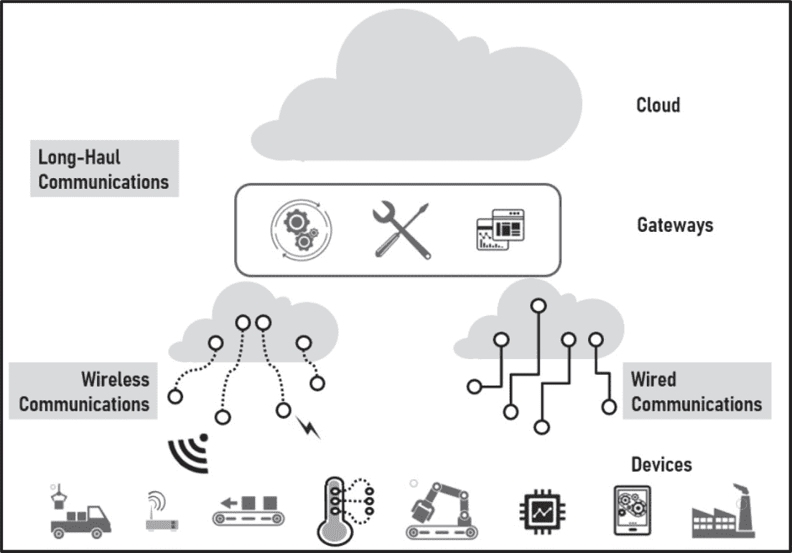

**图 7.1** 物联网系统的通信层

### 应用协议

应用协议决定了不同站点之间如何通信。格式、频率、数据大小、可靠性等参数由运行在物理连接之上的协议决定。有时这些参数由会话层决定，有时则由其他上层协议决定。

我们逐一查看这三个领域，讨论数据速率、网络规模和最大传输距离的特性。

#### 7.2.1 带宽、比特、编码和赫兹


在我们深入探讨物联网通信协议细节之前，我们想分享一个重要的观点，这个观点是年前 Dave 的一位好朋友兼通信专家 Roger Freeman 分给 Dave 的。当 Dave 第一次见到 Roger 时，Roger 已经是个老古董了，而且在通信方面拥有丰富的经验。年轻时，Roger 是商船轮上的无线电操作员，他经常开玩笑说自己曾在一艘听到了泰坦尼克号求救信号的船上。泰坦尼克号灾难发生在他出生十多年以前，但对我们这些年轻人来说，这传达了一个事实：他老得土还老，而且拥有我们仍然匮缺的宝贵经验！

某天，Roger 把 Dave 拉到一旁说：“Dave，永远不要把比特（bits）和带宽（bandwidth）搞混。”然后他开始给 Dave 讲授这意味着什么。Dave 承认，在当时他并没有充分体会 Roger 的智慧，但多年来，Roger 分享的内容对 Dave 来说变得更加清晰、更加珍贵。我们想把这种智慧传递给你。

带宽是特定频带内电磁波的宽度，我们用赫兹（Hertz）来测量。该频带能够携带编码在电磁波上的信息。然而，我们不是用比特（bits）来测量这种带宽。为什么？因为我们可以使用代表更多信息的符号在该波上对信息进行`code`。了解技术的局限性以及克服或处理这些限制的方法是非常重要的。

物理层（Phy）决定了设备之间的物理连接方式——点对点或共享广播媒介。物理层之上的协议决定了站点的组织方式和消息的路由——点对点、星型、环型和网状型。³^,⁴ 应用协议以透明的方式扩展了连接上可以提供的服务类型——例如，`MQTT`允许设备在发布者和订阅者之间使用星型拓扑以存储转发的方式进行通信，无论底层的物理层和传输协议如何构建。

接下来的两个节概述了有线和无线物理层。无线物理层在新的 IoT 系统中常见，在我们看来，它们对 IoT 更重要，因为它们使设备之间能够更简单、成本更低的连接。然而，有线物理层仍然在使用，因为它们可以在最恶劣的环境提供稳健的通信；对于特定的部署，支持有线物理层的设施已经存在；或者特定的安装在使用无线通信时可能会遇到无法接受的干扰。通常，无线物理层出现在 `greenfield` 安装（全新的 IoT 系统）中，而有线物理层出现在扩展了 IoT 能力的现有系统中，被称为 `brownfield` 安装。

## 7.2.3 有线物理层

IoT 系统中使用许多有线物理协议，但其中几种几种比其他的更常用。以下描述对使用的不同常用有线物理层提供了基本概述。

`Ethernet`（以太网）和 `twisted pair`（双绞线）是当计算机网络常用的线类型。如果你在公司或酒店连接笔记本电脑，你可能在使用 `Ethernet`。双绞是指一对扭在一起以提供通信的电线。它有非屏蔽双绞（`UTP`）和屏蔽双绞（`STP`），后者用铝箔或其他导电材料包裹，以保护电线免受外部干扰。`UTP` 在计算机网络中最常见。单对双绞可以用于电话通信。

`Ethernet` 需要两对双绞，即四根线。将一组双绞线束在一起并封装在塑料护套中，末端带有塑料连接器是常见现象。`Ethernet` 线被称为 `Cat5`、`Cat5e` 或 `Cat6` 线，指的是数据通过电缆传输的速度。电话线看起来相似，但实际上并不要求扭在一起，尽管许多是扭在一起的。`Ethernet` 线通常有一个称为 `RJ-45` 的塑料端接器，而电话线使用较小的 `RJ-11`。[⁵

`Ethernet` 是口语中用于指代在电上传具有 `802.3 MAC` 帧的 `IEEE 802.3` 布线。⁴ `802.3` 规范涵盖了多种不同的物理连接，从光纤、双绞线到同轴电缆。但即使限制在通过集线器或交换机配置为星型网络配置的 `802.3` 双绞线上，该标准也有多个版本，包含不同的速度。表 7.1 显示了几种不同的常用 `802.3` 双绞线版本。尽管 `802.3` 双绞线允许的最大距离和最大站点数量似乎受到限制，但可以通过多端口网桥轻松地克服。


### 表 7.1 IEEE 802.3 双绞线特性³

`4-20mA loop`（4-20mA 回路）通常被称为 `twenty-mamp loop`，可能是工业环境中最常见的。电线上的电流是经过调制的，类似于 HART 技术，以便向设备发送数字信号；总线还可用于连接到网络的终端设备供电。FF-H1 允许本质安全（IS）和非点燃操作，使其成为某些类型制造的理想选择。

`HART`®（远程地址寻址远端复用器）是一种特殊的物理层协议，运行在 `420mA loop` 连接上，以便在回路上添加数字数据。`HART` 在电线上使用频率频键控（`FSK`）调制来在 `420mA loop` 上编码额外数据，以便同时发送数字数据和模拟数据。这需要在电线的两端都配备支持 `HART` 的特殊设备。⁷

`FOUNDATION™ Fieldbus`（FF）有两个变体：`FF-H1` 和 `FF-HSE`。`FF-H1` 使用双线 `STP` 为通过主总线或或链连接的设备提供全双工数字通信。总线本身必须供电，电线上的电流经过调制的，类似于 HART 技术，以便向设备发送数字信号。`FF-H1` 是 `HART` 的改进，因为它提供了允许连接到多个设备的总线结构。然而，布线更为复杂，并在连接点需要接线盒，但可以节省布线总量和运营成本。单条总线可以超过一英里并连接多达 32 个设备，但添加中继器可以将此增加到近 6 英里。`FF-HSE`（高速以太网）是一种使用原生以太网布线的变体，通常用于将控制网络连接到 `FFH1` 段。`FF-HSE` 段运行标准的 `10/100 Mbps`，使其能够轻松控制速度较慢的 `31.25 Kbps` `FF-H1` 段.^(8,9

`RS-232` 和 `RS-485`（即推荐标准 232 和 485）是 20 世纪 90 年代计算机常用的串口协议，用于连接调制解调器和打印机。这些串口协议根据 EIA/ANSI 制定，包含了电气和机械规范。`RS-232` 开发于 1960 年，允许使用 0（+5 伏）和 1（–5 伏）进行数字信号通信，比 20 mA 回路更具灵活性，因为它可以传输各种信号数据，而不仅仅是单个百分比或读取值。基本的 `RS-232` 连接器具有 9 个连接（8 个信号引脚加 1 个接地），包括接收数据（`RD`）和发送数据（`SD`），这些信号在主站和从站之间交叉连接。其他信号包括数据载波检测（`DCD`表示与主站连接良好）、数据终端就绪（`DTR`表示从站在线）、发送请求（`RTS`是从站向主站发送的信号，表示从站需要向主站发送数据）以及允许发送（`CTS`为主站信号，表示从站现在可以通信）。接收就绪（`RTR`）在某些系统中用于从站向主站信号从站已准备好接收流量。最后一个信号是环路指示（`RI`），调制解调器用它指示有入站连接。尽管规定了九根线，但许多 `RS-232` 连接使用的线较少，并在连接器内部将某些信号线回路，以“欺骗”站点使其收到了 `DCD` 或 `DTR` 信号。还有一种 25 脚连接器，在同一根电缆和连接器上包含两个独立连接的引脚。

`RS-485` 出于 1998 年。`RS-485` 是 `RS-232` 的改进，提供了更高的速度和可靠性，并允许多个设备连接在一起。由于具有这种连接一系列设备并提供从主站到多个设备通信的能力，`RS-485` 仍用于某些 IoT 网络中。`RS-485` 包含时钟信号，而 `RS-232` 要求接收站手动配置以设置时钟速度以匹配主站。`RS-232` 配置错误意味着接收到的数据损坏，设备无法与主站通信。`RS-485` 提供设备自动配置到主站设置。`RS-232` 在特定特定（自定义）消息中传输 ASCII 文本，而 `RS-485` 通常使用另一种名为 `MODBUS` 的协议。`MODBUS` 在上层协议章节中介绍。`表 7.2` 详细说明了 `RS-232` 和 `RS-485` 协议的特性。

### 表 7.2 RS232 和 RS485 特性

| 名称 | 最大距离 | 最大站数 | 传输速度 |
| --- | --- | --- | --- |
| RS-232 | 50 英尺 | 1 | 高达 1 Mbps |
| RS-485 | 4000 英尺 | 32 | 10 Mbps |

`I2C`（集成电路，读作 *eye-squared-see*）是一种常用于创客运动中的传感器、家居自动化、安全系统和计算机外围设备的串口协议。该协议也可以称为两线制接口（`TWI`）以避免商标问题，尽管某些 `TWI` 实现对协议增加了专有扩展。由于 `I2C` 仅使用两根线，而不是带有八根线的完整串口线，它的价格通常比 `RS-232` 或 `RS-485` 便宜，但运行速度较低且距离更短。`I2C` 支持多达 1023 个站，取决于主控制器支持的地址长度——带有 7 位寻址的 127 个站是常见的。`I2C` 的两根线是一个串行时钟（`SCL`），它告诉从站如何读取另一根串行数据线（`SDA`）上的信号。`SDA` 上的消息由主站的启动启动，随后是设备地址，然后是用于读取或写入的设备命令和地址。写命令后跟的是主站向从站写入的数据；读命令要求从站在特定时间时间内对主站请求的数据做出响应。序列以停止信号结束。`I2C` 总线的最大长度为几米，但这种长度需要降低传输速度。`I2C` 重继器是增加 `I2C` 总线长度的另一种方法。`I2C` 总线速度从标准模式的 100 Kbps 到高速模式的 3.4 Mbps。

`USB`（通用串总线）是一种更快的串口通信技术，在 20 世纪初取代了计算机中的 `RS-232` 和 `RS-485` 串口连接。`USB` 提供比推荐标准协议更高的速度，并可以使用星型拓扑将多个设备连接到主集线器。`USB` 与与其他串口通信不同，它利用两根线的差分电压进行通信，从而实现了更高的切换率和更高的传输速度。`USB` 的发明是为了为设备提供热插拔（在设备通电时移除或连接电缆）高速串口连接。单个 `USB` 集线器可以连接多达 127 个设备，最大电缆距离为 5 米。`USB` 允许集线器级联，突破 127 个设备的限制，这实际上创建了星网拓扑。集线器到设备的距离取决于电缆质量，因为规范规定跨电缆的传播延迟不超过 26 ns。`USB` 规范目前有三个版本，均支持不同的速度。`USB 2.0` 支持 1.5 Mbps、12 Mbps 和 480 Mbps；`USB 3.0` 支持高达 5 Gbps 的速度。`USB` 的其他优势包括通过电缆本身为设备供电以及对传输数据的集成错误检测和恢复。`USB` 还包括节能模式，在无活动 3 毫秒后挂起设备通信硬件。

现场总线（Fieldbus）或 `IEC 61158` 实际上是国际电工委员会在 1999 年标准化的不同技术集，标准的最新更新为 2014 年。`IEC 61158` 由 82 份规范组成，分为 6 部分，这些部分涵盖了协议栈的不同层，包括物理层、数据链路层和应用层。该规范中包含了许多不同的技术，并将这些技术组织成通信配置族（CPF）。我们仅涵盖 `IEC 61158` 协议的一部分，包括 4-20mA 回路上的 `HART`、`FOUNDATION Fieldbus`、`MODBUS` 和 `PROFIBUS DP`。我们未涵盖的其他现场总线协议包括 `CIP™`、`PROFINET`、`P-NET®`、`WorldFIP®`、`INTERBUS®`、`CC-Link`、`Vnet/IP®`、`TCnet`、`EtherCAT`、`ETHERNET Powerlink`、`EPA`、`SERCOS`、`RAPIEnet` 和 `SaftyNet P™`。

`CAN bus`（控制器区域网络总线）通常用于汽车中连接各种电子控制单元（ECU）。一个 `ECU` 包含一个微控制器，用于车辆的控制系统。`CAN bus` 是一种串行通信技术，支持通过双绞线连接的多个总线主设备和多个站之间进行实时通信。`ECUs` 在总线上发送消息，总线根据内容类型对消息进行仲裁，而内容类型也决定了消息的优先级。高优先级消息在低优先级消息之前传输。例如，激活制动系统或减慢引擎速度的消息优先级高于增加座舱空气流量的消息。`CAN` 将比特编码为 0 伏特或 +5 (+3.3) 伏，但它使用非 return 零（NRZ）编码方案，这意味着每个比特并不一定包含信号的下降沿或上升沿。消息包含错误代码以检测损坏的消息，运行异常的 `ECUs` 可以从总线中移除。`CAN bus` 于 1986 年发明，并在 1991 年发布了 `CAN bus 2.0` 更新。1993 年，这些规范被国际标准组织（`ISO`）采用。`图 7.2` 说明了哪些 `ISO` 标准适用于特定的 `CAN bus` 协议层。2012 年，汽车制造商引入了一种新型高速 `CAN bus`——`CAN FD`（灵活数据速率），它满足了为了适应软件更新而更高传输速度的需求。

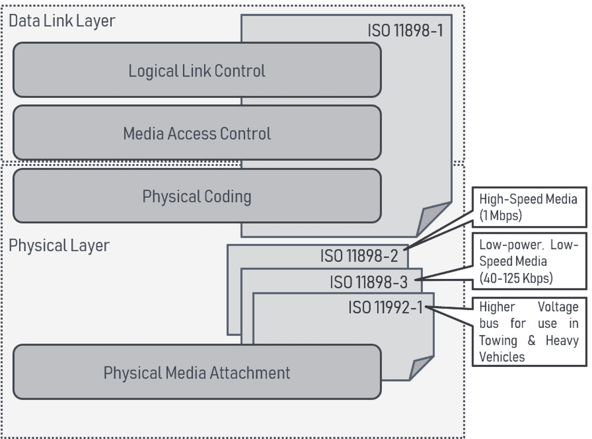

**图 7.2** CAN 线物理层和数据链路协议图

`CAN bus 2.0` 规范仅定义了数据链路层，该层控制仲裁、数据成帧、错误检测、纠正和报告。涵盖比特传输方式的物理层则留给实现者来实现。`ISO` 标准通过定义物理介质接入协议部分填补了这一空白。

## 7.2.4 无线物理层

无线物理层（Wireless Phys）的数量与有线层一样多。`IoT` 设备通常使用无线物理层，因为它们不需要布线，更容易部署，而且还能让设备具备移动，这在某些安装场景中是必要的——例如海运运输、智能物流和机器人农场。当然，从安全的角度来看，无线传输面临着几个问题，因为攻击者可以监听信道并捕获通信，他们可以更容易地向通信通道插入数据，并可以干扰信号以阻止通信。我们将在本章稍后讨论更多关于攻击者及其正式能力。以下描述涵盖了最常见的无线物理层。

**WiFi，** 也称为无线局域网或 `IEEE 802.11`，我们在星巴克使用笔记本电脑时使用的无线技术，它提供了优秀的带宽和合理的范围。`802.11` 有多个版本（`802.11a, b, g, n, ac`）。但 `802.11` 规范还包含了 `WiFi` 的其他功能，包括时间关键型网络的服务质量（`802.11e`）、接入点之间的漫游（`802.11f`）以及选择最佳信道的自调优（`802.11h`）。这些新增功能对 `IoT` 设备非常有用。安全性在 `802.11i` 中加入，但安全方案经历了多次破解和修改，包括 2018 年 8 月对 `WPA2` 的最新攻击。

**BLUETOOTH^® 低功耗蓝牙 (BLE)** `Bluetooth 4.0` 标准的一部分，工作在 2.4 GHz 频谱。`Bluetooth` 通常用于汽车免提通话、无线键盘和鼠标设备，以及手机耳机和麦克风，但 `BLE` 是一种不同的协议，与旧版本的 `Bluetooth` 不兼容。蓝牙的低功耗版本是为那些需要通信但能量特性比手机更严格的设备发明的。`BLE` 额定为 1 Mbps，但实际吞吐量在 10-Kbps 范围内，传输距离约为 30 英尺。`BLE` 和 `Bluetooth` 广播和服务功能；任何运行 `BLE/Bluetooth` 物理层的附近站都可以接收广播。这种广播包含了广播设备的唯一 48 位蓝牙设备地址（`DBA`）。由于此地址包含在未请求的广播中，因此任何附近的接收站都拥有识别并连接该设备的信息。接收端 `BLE` 站随后可以与广播站建立连接。数据通过此点对连接进行传输。在 `BLE` 中，这种连接可以被设置为周期性连接，每隔一段时间自动重新建立。这种能力降低了小型设备向主机传输定期数据的能量成本。

**IEEE 802.15.4™** 通常被提及为传感器和设备的 `IoT` 通信解决方案，但当提到它时，往往很难获取该通信技术究竟包含哪些细节。`IEEE 802.15` 无线个人域网（`WPAN`）工作组由多个标准组成，这导致了一些困惑。但进一步具体化 `802.15.4` 并没有定义设备中的物理层类型。`IEEE 802.15` 工作组的低速率 WPAN（`LR-WPAN`）子小组第四工作组在 `IEEE 802.15.4` 标题下发布了多个标准，这增加了额外的困惑。为了消除这种困惑，让我们深入观察 `802.15` 标准。`表 7.3` 提供了主要的 `802.15` 组列表。尽管这些标准大多数在 `IoT` 圈内并不经常被，但它们对我们仍具有某些相关性，因为这些都是可以用于 `IoT` 的短距离通信技术。`LR-WPAN` 规范有多个版本和修订，就像 `802.11` 标准有不同版本一样。`IEEE 802.15.4` 标准由 18 种不同的物理层以及几种不同的数据链路协议组成，提供了不同的链路控制方案和拓扑结构（星型、网格型、多接入）。物理层涵盖了不同的无线调制方案，从二进制相移（`BPSK`）和偏移正交相移（`O-QPSK`）到直接序列扩频（`DSSS`）和调频扩频（`CSS`），以及其他更独特的调制，如电视白空间窄带正交频分复用（`TVWS-NB-OFDM`）。这些很快变得复杂。此外，取决于所选的物理层调制，允许的频率范围从 169 MHz、各种 800-900 MHz 频段（视而异）、常见的 2.4 GHz 频段（如 `WiFi`）以及 3.2-6 GHz 范围的宽带。由于所有这些不同的选择，构建一个互操作的协议栈不仅仅是声称支持 `IEEE 802.15.4`。。应该参考 `IEEE 802.15.4` 规范以获取特定细节。

显而易见，由于提供了不同的无线频率、不同的物理编码方案以及不同的链路控制，`IEEE 802.15.4` 对于物联网系统极其有用，并且可以进行定制以为不同的垂直市场创建有用的工具。但 `IEEE 802.15.4` 规范的主要优势在于 `MAC` 和链路层访问接口的标准化，这使得创建能够与任何制造商的 `IEEE 802.15.4` 合规实现接口的上层协议变得容易。这也解释了为什么产品没有指定 `IEEE 802.15.4` 之外的进一步规格，因为任何合规的底层 `Phy` 都能与其产品配合。这还为市场架构提供了可能，即通过在特定类型的 `IEEE 802.15.4` `Phy` 之上为“协议”指定唯一的名称。其他几种物联网无线协议也正是这样做并在该标准之上构建的，包括 `ZigBee^®` 和 `6LoWPAN`。然而，为了互操作性，你仍然需要匹配的底层 `IEEE 802.15.4` `Phs`。


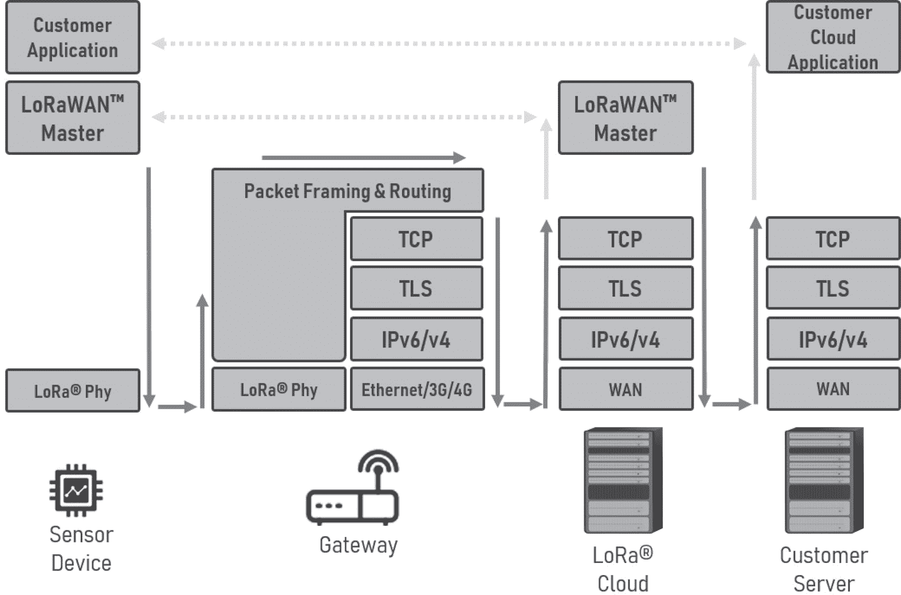

**图 7.3** LoRaWAN 架构 (LoRa Alliance™)

`LoRa^®` 是来自 Semtech 公司的一种远距离私有无线调制技术，工作在 1 GHz 以下的各种非授权频段中——通常美国为 915 MHz，欧洲为 868 MHz。`LoRa` 的物理层使用与 `IEEE 802.15.4` 规范中的 `CSS` 技术类似的调制方式。`LoRa` 非常适用于低功耗的长距离无线通信，但在技术上它仅覆盖通信的物理层。最大消息大小为 243 字节，传输速度最高达 50 Kbps。通过选择 `CSS` 中更高的扩因子可以实现更远的距离，但这会导致传输速度降低。`LoRaWAN™` 是由 `LoRa Alliance™` 管理的介质访问层协议，通常用于 `LoRa` 部署。`图 7.3` 描述了一个典型的 `LoRaWAN`，所有通信都返回到中央服务器；对于大型公共网络（例如智能城市）这非常棒，但对于多个共存的网络，流量会相互混合，隐私和安全可能会成为问题。在 `LoRa` 物理层之上还可以有其他 `MAC` 层，其中一个例子是 `Symphony Link™`。

`SigFox^®` 是一家欧洲公司，提供使用类似于 `LoRa` 的私有无线技术的 LPWAN 服务。基站从物联网节点收集数据并将这些数据发送到 `SigFox` 云端，在云端被转发到订阅者的后端系统。该无线技术在非授权频谱内作为超窄带运行——取决于地区，分为 868 到 869 MHz 以及 902 到 928 MHz。无线调制使用差分二进制相移键控 (`DBPSK`) 和高斯频移键控 (`GFSK`)。数据包非常小——上行 12 字节，下行 8 字节——但由于频率和调制的选择，它可以穿透实体，提供非常好的覆盖范围。`SigFox` 正在致力于全球可用，并已经在欧洲、美国、南美大部分地区、澳大利亚、日本以及非洲、中东和亚太地区的几个国家。覆盖。

`Z-Wave^®` 是另一种位于 800 到 900 MHz 非授权频段的私有无线技术，由 Silicon Laboratories 所有。从技术上讲，`Z-Wave` 使用 `IEEE 802.15.4` 的无线技术，但由于 `Z-Wave` 设备除非使用单一来源 `Z-Wave` 者的相同芯片，否则无法互操作，因此我们选择将其与其他 `802.15.4` 协议技术分离开来，以突出这个问题。`Z-Wave` 专注于家居自动化使用，因此限制在不超过 232 个节点的小网络。`Z-Wave` 包含了直到应用层的全栈，并为开发者和系统集成提供帮助。

### 2G GPRS

`2G GPRS` 蜂窝是第一个可行的广泛部署的通用分组业务 (`GPRS`) 标准，提供从 56 Kbps 到 114 Kbps 的数据。有时 `2G GPRS` 现在被称为 `M2M`（机器对机器），由于设备成本和电池寿命限制，它在某些物联网部署中仍在使用。

### 3G

`3G` 代表用于用于手机的第三代移动无线技术。`3G` 上的数据传输可以使用许多不同的传输技术，速度从几千比特到几兆比特不等。归类为 `3G` 的常用技术包括通用移动通信系统 (`UMTS`) 和 `CDMA2000 EVDO`。构建在 `UMTS` 之上的高速率分组接入 (`HSPA`) 是 GSM 网络的进一步增强。`3G` 服务更频繁地用于物联网，因为基础设施已经到位，尽管大多数蜂窝用户已迁移到 4G 服务。

### 4G/4G LTE

`4G/4G LTE` 是第四代蜂窝技术，以及 `4G 长期演进 (4G LTE)`，它们都指的是替代 `3G` 蜂窝通信的技术。与 `3G` 相比，`4G` 和 `4G LTE` 提供了更高的可靠性和高达 10 倍的传输速度。`4G LTE` 以大多数用户接受的速度将网页浏览和互联网应用带来了移动设备。`4G LTE` 实际上是一个能力路线图，其中一些包括：

* 新的演进分组包系统 (`EPS`)，这是一个仅运行 `IPv4` 和 `IPv6` 的新扁平网络，其接口允许轻松集成 `GPRS` 和 `WiFi` 网络

* 新的物理层技术，包括正交频分复用 (`OFDM`) 和同步信道频分多址 (`SC-FDMA`)

* 多输入多输出 (`MIMO`) 天线技术，包括空间复用 (`SM`)、波束赋形 (`BF`) 和多用户 MIMO (`MU-MIMO`)

* 活跃天线系统 (`AAS`)，它使用多个收发器来调整方向图（使用 `BF`），但是动态的，允许无线束的垂直和水平分割、小区成形和小区分裂，所有这些允许更好地管理带宽需求和用户当前负载。

- 小区间干扰协调 (ICIC) 用于协调 OFDM 和 SC-FDMA 中新窄带技术的传输和接收，以避免干扰问题。

所有这些增强以及我们未及详述的许多改进，都提供了更高的传输速度、更高的可靠性以及更好的带宽管理。每个 `3GPP` 版本都增加了更多功能，并允许对新技术进行实验，每一步都让全 5G 网络实现变得更近。

`LTE-M`（机器长期演进）是面向物联网的 4G 解决方案。`LTE-M` 也被称为 `LTE Cat-M1` 或增强型机器类通信 (`eMTC`)。它是 2016 年 `3GPP` Release 13 的。`LTE-M` 是一种低功耗广域网 (`LPWAN`) 解决方案，提供的带宽比普通的 4G LTE 连接低，因此成本更低。`LTE-M` 将连接速度限制在 300 Kbps 左右，延迟极低（毫秒级），这对于大多数物联网需求来说绰有余。`LTE-M` 还提供语音通信，这对于某些可能需要人工通信作为备份的物联网设备非常有用——例如，在支持智能城市的车库或自助服务亭中。使用 `LTE-M` 的设备电池寿命目标为十年。

`NB-IoT`（窄带物联网）是 `3GPP` 指定的另一种物联网 4G `LPWAN` 解决方案。`NB-IoT` 有三种工作模式。主模式允许它重新分配某些 GSM 载波频来携带 `NB-IoT` 数据。另外两种模式允许它使用 LTE 载波中的资源块或保护频带，但可用带宽会受到限制。由于主要使用 GSM 基础设施，且 GSM 在美国的可用性有限，`NB-IoT` 首先在欧洲推出。`NB-IoT` 专为速率低于 100 Kbps 的低数据率通信设计，延迟可达 10 秒。`NB-IoT` 仅支持半双工，这意味着通信链路的一侧一次只能可以说话，但这对于大多数物联网设备来说是一个合理的限制。`NB-IoT` 相比 4G 通信的简化之处之一是移除了基站切换。切换是允许连接从一个蜂基站转移到另一个基站的协议支持，这是支持移动（移动中）站点的所需的。这种简化意味着 `NB-IoT` 仅支持固定站。

`5G` 是蜂窝无线通信的下一次演进，目标是在 2020 年可用。`5G` 通过一系列技术提供更高的带宽，包括虚拟化软件定义网络 (`SDN`)、网络切片、毫米波（30–300 GHz）、小小区网络、波束成形、大规模 MIMO 和全双工。

#### 7.2.5 不同物理层的比较

`表 7.4` 将所有不同的物理层汇总在一起，大致按最大传输距离组织。

#### 7.2.6 上层协议

在上一节详细解释了不同的物联网物理层之后，我们想通过查看栈的上层来完成对物联网协议的审查。这包括网络层和传输层协议，它们决定了如何组织网络以及消息如何从一个站传输到另一个站。然后我们将回顾一些主要的应用层协议。`图 7.4` 提供了一个组织良好的图，将物理层与上层协议放置在一个有组织的堆栈图中。该图将帮助我们把上层协议与之前涵盖的物理层联系起来。

### 网络和会话层协议

最重要的网络层协议是网协议 (`IP`) 版本 4 (`v4`) 和版本 6 (`v6`)。尽管 `IPv6` 现在已普及，但 `IPv4` 仍然是今天互联网上最常用的网络协议。在 IP 之上，用于面向会话的 `TCP` 和用于无连接会话的 `UDP` 最常见。关于这些协议有很多好书，因此我们在这里不再进行详细介绍。相反，本节侧重于物联网领域中不常见且更专用的传输层和会话层协议。

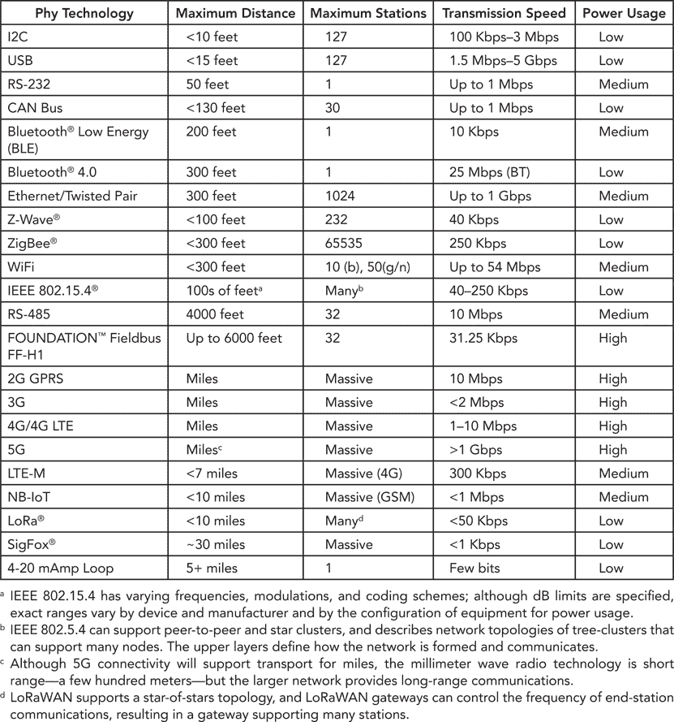

**表 7.4 不同物联网物理层的比较**

`Z-Wave`® 是上一节涵盖的物理层之一，但 `Z-Wave` 包含一个完整的协议栈，最高包含到应用层。这是由于 `Z-Wave` 是家居自动化的完整解决方案，并包含了运行某些类型家庭服务的应用程序，包括打开和关闭门锁、控制照明、访问家庭报警系统以及监控和控制恒温器的应用程序。`Z-Wave` 的网络层和会话层在设备之间创建一个网网。这意味着任何设备都可以与任何其他设备通信，尽管通常有一个主控制器设备通常可以访问互联网，并且所有命令都通过它流动。主控制器接收命令（例如来自智能手机的命令），并将这些命令传递给本地 `Z-Wave` 网络中的设备。主控制器处理新设备到网络上的注册，以及创建和管理关于网格如何构建的路由表。还允许多个从级控制器设备。`Z-Wave` 包含了一些安全性，尽管规范和源代码的开源版本（称为 `open wave`）不包含安全层。对 `Z-Wave` 的安全性已经进行了一些分析，涵盖了源身份验证和使用 `AES` 加密的机密性，并在门锁的实现中发现了一个漏洞，该漏洞随后得到了修复。尽管 `Z-Wave` 不使用 `IP` 作为网络层，但它确实提供了一项规范 `Z-Wave over IP`，允许 `Z-Wave` 网络接收来自网关的通过 IP 网络接收的命令。

### WirelessHART

`WirelessHART` 是一种用于工业物联网 (IIoT)现场总线部署的专用协议，已在 `IEC62591-1` 中标准化。它基于 `IEEE802.15.4` LPWAN 技术，但在标准的无线物理层之上提供了独特的 `MAC` 层和网络层。它使用时分多路访问 (`TDMA`) 和信道跳频来提供稳健的通信。网络层和传输层通过自愈合网状网络上的冗余路径提供安全性，并能够跨越多个数据包发送大消息。网络管理器维护网络、规划到设备的路由路径，并向连接的设备分发时隙信息，以便它们知道何时可以在网络上传输。在网络中添加运行在不同不重叠频率上的额外接入点，可以扩展 `WirelessHART` 网络并支持更多设备。它的设计旨在为各种工业设备（包括 `20mA` 环路）提供无线连接，并保持与当前使用的 `HART` 应用兼容。WirelessHART 声称具有具有完整性和设备身份认证的 `128-bit AES` 安全性。用于网络加入的轮换密钥和每消息加密密钥被用于限制网络或设备渗透的影响。

### LoRaWAN and SigFox

`LoRaWAN` 和 `SigFox` 依赖其网络内部的专有技术进行消息传递。然而，互联网标准机构——互联网工程任务组 (`IETF`) 正在 `IPv6 over LPWAN` 工作组进行当前的标准化工作，以使 `IPv6` 数据包能够直接运行在 `LoRaWAN` 和 `SigFox` 上。由于这些技术具有全球性（且在不断扩大），这项标准化工作很可能在未来几年内扩大这些技术在物联网领域的应用。

### ZigBee

`ZigBee` 是一组构建在 `IEEE802.15.4 Phy` 之上的上层协议。它通常使用 `2.4-GHz` 频段（类似于 `WiFi`），但也可以使用亚 GHz 频段。它是为家庭自动化、建筑控制以及暖通空调 (`HVAC`) 系统设计的。`ZigBee` 网络层在 `802.15.4 Phy` 之上增加了网状局域网，这意味着网状网络设备可以通过从一个设备跳跃到另一个设备来相互通信，而无需与其他设备建立实际的无线链路。

图 `7.5` 显示 `ZigBee` 网状网络的示例。虽然 `ZigBee` 是网状结构，但它使用一个控制器节点来建立网络。该控制器确定将使用的频率，并设置信标消息允许其他节点加入网络。路由器节点 (Router nodes nodes) 是 `ZigBee` 网络上的节点，可以将消息路由到网状网络上的设备；设备节点 (device nodes) 位于网状网络上，但在不需要通信时可能会关机，因此它们不属于网状路由的一部分。`ZigBee` 使用一种按需临时路由 (`RFC3561 Ad Hoc On-Demand Routing`)，该路由可以随着网络的变化而更改和更新，以防节点移动、丢失与另一个节点的无线通信或必须关机。

`ZigBee` 有两个投诉点：

1. 第一，`ZigBee` 节点无法直接与其他 `IP` 设备通信，而需要网关在应用层进行翻译。

2. 第二个投诉点是互操作性；来自不同制造商的许多 `ZigBee` 设备可以组成同一个网络，但它们的上层协议和命令不可互操作，因此设备无法真正协同工作。`ZigBee Alliance` 正在通过额外的符合性标准来纠正这一点。

### 6LoWPAN

`6LoWPAN` 是 `IPv6 over Low-Power Wireless Personal Area Network` 的缩写。它是一种轻级低功耗无线协议，提供低数据速率，经常用于家庭自动化和建筑控制系统。`6LoWPAN` 使用封装和头部压缩直接在 `IEEE802.15.4` 定义的小数据帧上发送 `IPv6` 数据包。`6LoWPAN` 在 `RFC6282` 中定义，并定义了类似于 `ZigBee` 的网状网络，但主要区别在于网状网络上的路由器设备可以直接压缩 `IPv6` 数据包并将其交付到无线网络中。`6LoWPAN` 设备使用 `RFC6282` 定义的自动配置协议生成唯一的 `IPv6` 地址。

### Thread

`Thread` 是一种构建在 `6LoWPAN` 之上的网状网络协议，增加了调试（网络设置）、路由和安全性。构建在 `Thread` 之上的应用使用 `UDP` 协议发送和接收消息。

### MiWi

`MiWi` 是一种基于 `IEEE802.15.4` 的专有协议，专门设计用于与 `ZigBee` 竞争，但代码量小得多。它在 `sub-GHz` 和 `2.4-GHz` 频段运行。

### ISA100.1a

`ISA100.1a` 是一种由国际自动化协会 (`ISA`) 发布的用于过程自动化无线网络标准。`ISA100.1a` 使用在 `2.4 GHz` 频段使用 `DSSS` 的 `Phy`，并在数据链路层进行了一些自定义。它提供了自适应信道跳频、本地链路地址和消息定时。`ISA100.1a` 与 `WirelessHart` 非常相似，但 `WirelessHart` 缺少过程控制应用的标准接口，这可能会产生互操作性问题。此外，`ISA100.1a` 对 `6LoWPAN`的使用提供了与标准网络基础设施更好的连接。

### MODBUS

`MODBUS` 是一种用于工业和监控控制数据采集 (`SCADA`) 系统中可编程逻辑控制器 (`PLC`) 的常用串行通信协议。`MODBUS` 最初设计用于使用 `RS-232` (1979 年) 的串行通信，后来用于 `RS-485`，但它支持一种运行在 `TCP/IP` 上的变体，这意味着可以使用 `Ethernet` 甚至无线 `Phy`。`MODBUS` 通过读写设备设备上的寄存器表来控制设备；每个设备都有其特定应用程序的定义，来说说明特定寄存器的功能。

MODBUS 协议中的消息包含多个元素，包括消息目标从站设备标识符、用于定义操作（从/向特定表条项读取或写入）的功能码，以及受影响元素的地址和数据。消息还包含一个循环冗余校验（`CRC`）值，用于检测消息损坏。

`PROFIBUS DP`（去中心化外围）是一个用于描述标准工业通信协议 set 的术语，它最初在 RS-485 上作为一种多主站串行总线协议运行。回想，我们在 IEC-61158 中将该协议识别为现场总线技术之一。它包含了用于过程自动化（`PROFIBUS PA`）、用于安全关键型应用（`PROFIsafe`）以及用于高速通信（`PROFIdrive`）的版本。PROFINET 则在工业以太网层重新定义了这些相同的协议。PROFIBUS 通过使用令牌（token）机制在总线上上传持多个主站；主站只有在持有令牌时才能向从站设备发送和接收消息。这类似于令牌环系统，但只有主站可以访问令牌，这限制了任何主站无法发送和接收流量的时间。主站对持有令牌的时间有限制，这使得 PROFIBUS 适用于工业系统中的实时控制回路。PROFIBUS 还限制了 RS-485 规范，以增加不同制造商之间的互操作性，并通过定义基本的仪器输入和输出，使得不同仪器更容易集成到网络中。PROFIsafe 限制了总线上的功率，使其具有本质安全性，并且在危险区域的安装和运行成本更低。

### 7.2.7 IoT 的应用层协议

前面的章节对 IoT 系统中使用的不同物理层（Phys）和网络协议进行了很好的概述。应用协议运行在这些协议栈之上，用于执行 IoT 系统中的各种功能。标准应用协议的数量很多，而私有应用协议的数量可能更多。本节甚至无法详尽介绍这些协议。然而，有几种标准协议在 IoT 系统中反复出现，它们值得关注。任何开发或分析 IoT 系统的人都应该熟悉这组应用协议。接下来的章节将介绍这些协议，并提供参考文献以便您查找更多细节。

`MQTT` 是一种消息队列遥测传输协议，在受限网络中提供消息的异步交付。MQTT 由 IBM 设计，最初由 OASIS 组标准化。后来，它提交到 ISO 并标准化为 ISO/IEC 20922。谷歌的 Cloud IoT Core™ 和 AWS IoT™ 都使用 `MQTT` 作为设备通信的主要协议。

`MQTT` 实现了发布/订阅设计模式，允许经过身份验证的发布者将消息提交到代理服务器（broker），代理服务器在订阅者查询时将这些消息交付给他们。这种结构在 IoT 系统中非常常用，因为允许控制系统或其他设备将消息在代理服务器中排队，并在方便时或端设备唤醒并与代理服务器通信时再交付给端设备。这允许 IoT 系统节省能量并扩展到非常大量的设备。这非常符合 MGC 架构，在该架构中，网关或云维护代理服务器，而设备定期与云端通信以接收等待它们的消息。这种描述听起来非常像电子邮件。但 MQTT 非常不同，因为消息的结构化降低了代理服务器的存储和消息处理需求。


`MQTT` 中的一个重要概念是每条消息都有一个标题，称为 `topic`（主题）。主题类似于文件系统上的文件名或路径名，由某些字符（如斜杠）分隔的单词或词组组成（见[图 7.6]）。`MQTT` 有一个专门为传感器网络设计的特殊版本，称为 `MQTT-SN`，其主要优势是更短的 `topic IDs`，可以替代完整的主名称。

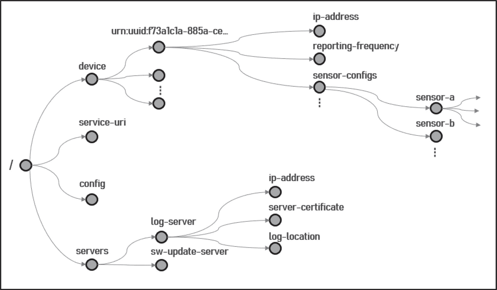

**图 7.6** MQTT 主层次结构示例

如图 7.6 所示，`MQTT` 主由代理服务器按层次排列。消息订阅者可以通过主题或某些前缀订阅消息，然后接收该分支下的所有内容。使用这种结构，代理服务器可以将消息组织进数据库。当设备检查等待的消息时，代理服务器必须采用某种方法确保消息只交付一次。订阅者通过完整主题名称请求或订阅消息，也可以使用通配符将主题名称的任何部分替换为任何单词，允许订阅者接收分类在特定前缀下的任何消息。例如，根据图 7.6，一个获取“传感器 A”所有配置的设备主题为 `/device/URN:UUID: F73A-1C1A-885A-CE4D/sensor-configs/sensor-a/*`。

`MQTT` 支持保护消息的基本安全功能。当发布者和订阅者使用密码连接到代理服务器时，代理服务器会对他们进行身份验证。可以使用传输安全（`TLS`）提供消息机密性。可以在 `TLS` 上配置双向认证并自定义 `TLS` 证书验证过程，以便使用客户端证书验证发布者和订阅者，提供比仅密码更强的认证。

`MQTT` 通常用于两个地方。首先，它用于网关层和云，作为一种以端设备方便的方式（异步）将消息交付到设备层的方法。这种 `MQTT` 使用跨网络必须包含适当的网络安全——用于机密性和完整性的 `TLS`、适当的身份验证和授权控制，以及防火墙和入侵检测系统等网络保护。

`MQTT` 的第二用法是在网关内部的消息编排层。在这种配置下，`MQTT` 在单机上通过本地域套字运行，而不是通过网络。如图 4.9 所示，编排层允许网关内的不同组件通过编排层实现松耦合，同时通过使用支持的主保持高内聚性。这在 IoT 系统设计中至关重要，因为它允许网关内的不同子系统接入或移出编排层，而不影响设计的其他部分或平台。这提高了网关的可扩展性和专业化。消息编排也可以用在小型 IoT 设备上，尽管它在采用传感器融合的网关或端设备中最常见。

MQTT 的优势在于其异步特性和灵活的消息格式。消息可以以订阅者能够读取的任何格式发布到代理服务器（broker），发布者可以在方便的任何时候发布消息。发布者和订阅者之间永远不需要通信，发布者可以通过一次发布触达数千个订阅者，因为这些工作都由订阅者和代理服务器完成。消息主题（topic）用于在订阅者恰好检查代理服务器时识别并投送消息。它消除了发布者和订阅者代码中的许多复杂性，因为它消除了它们在对方在线时也必须在线的要求。只需要代理服务器始终处于激活状态并运行。这也揭示了系统的弱点：代理服务器成为了系统的单点故障——如果代理服务器崩溃或受到攻击，系统中的所有消息传递都会停止。设置冗余代理是解决此问题的方法，但让所有节点连接到备用代理是一个困难的问题。这种设置在网格网络中效果非常好，在网格中可以利用路由协议更新代理服务器的位置，无论它当前位于哪个节点。当然，这种设置的另一个问题是在主代理和备用代理节点之间同步所有消息内容，以确保在主代理宕机时不会丢失消息。这些内容都不由 MQTT 处理，但可以构建在协议之上。

## AMQP

`AMQP`（高级消息队列协议）是一种应用层消息协议，支持像 MQTT 这样的消息队列，但它也更加通用且复杂。AMQP 最初作为一项 OASIS 规范发布，后来作为国际标准发布，并记录在 ISO/IEC 19464 中。AMQP 与 MQTT 相似之处在于，它可以提供具有特定特定消息传递的发布-订阅类型架构。然而，AMQP 在消息格式和消息传递方面与 MQTT 不同。AMQP 具有详细的消息格式，包括消息头、属性、投递指令和数据的特定二进制编码。它也没有分级主题结构的概念，尽管应用程序可以在 AMQP 队列节点之上构建这种结构。AMQP 对消息传递的视图非常复杂，并对协议元素有一套非常特定的术语，将 `nodes`（节点）定义为通信端点（生产者、消费者和队列），将 `containers`（容器）定义为代理服务器或客户端设备。`containers` 之间的通信通过 AMQP `Connection.` 执行。每个 AMQP `Connection` 包含多个半双工的 `Channels`（通道）；`endpoints`（端点）之间的两个半双工 `Channels` 定义了一个 AMQP `Session`（会话）。AMQP 提供了特殊的消息属性，如保证交付、仅投递一次和投递给多方。

AMQP 是一个非常复杂的协议，不用于简单的传感器。然而，它被用于云和网关通信，以构建非常健壮的消息传递。AMQP 的缺点是其复杂性和较大的代码量。一些人认为其二进制格式的消息也是一个缺点，因为开发者在开发期间和调查系统故障时很难读取消息。但另一些人认为二进制消息的大小减少了带宽受限环境下的消息开销。在纯 M2M（机器对机器）通信中，二进制消息是有意义的，因为人类可读的消息只会增加冗余，而很少（如果真的话）提供任何价值。

## XMPP

`XMPP`（可扩展消息和存在协议）由 IETF 在 RFC 6120 中定义，用于在两个或多个网络站之间交换以扩展标记语言（XML）格式的数据。XMPP 最初设计用于即时消息（IM），但被发现在许多情况下（包括物联网 IoT）都非常有用。XMPP 除了规定数据交换旨在用于小型 XML 格式消息（称为 XML 分段，XML stanzas）外，没有定义其他消息格式。尽管 XMPP 定义了点对点消息传递，但 RFC 6120 指出 XMPP 消息流通常从发送客户端到服务器，然后到另一个服务器，最后到达接收客户端。服务器充当 XMPP 消息的中介，允许客户端之间进行通信。这种架构对于物联网设备非常有效，这些设备与网关和云服务器进行通信。

XMPP 的主要优势是它在互联网上的广泛使用，以及可以构建和解析 XML 消息的工具和框架的泛化。XMPP 的缺点是通常与 XML 消息相关的大体积，以及解析 XML 消息涉及的固有复杂性，尤其是在小型设备上。这种复杂性在集成到协议时通常会导致安全问题，而当结合对完整 TCP 栈的要求时，大体积会被进一步放大。

## REST

`REST` 是表述状态转移（representational state transfer）的缩写，是一种超文本传输协议（HTTP）架构风格，它使用基本的 HTTP 操作——`GET`、`PUT`、`POST` 和 `DELETE`——通过统一资源标识符（URI）对 Web 对象进行操作。URI 既可以是资源或对象的唯一名称——统一资源名称（URN），也可以是资源或对象的唯一名称和位置——统一资源位置（URL）。AWS IoT® 允许使用 REST 接口向物联网系统发布数据。

REST 确实物联网设备和网关与云端创建的逻辑对象模型交互的方式。模型中的对象是 URN，物联网设备使用 HTTP 命令与对象交互。例如，一个温度传感器设备唤醒并对其配置的网关执行 `GET` 操作。该 `GET` 操作返回一个包含要执行的命令字符串的 JSON 对象：

```json
{
    "command-list" : [
    {
        "cmd"  : POST
        "who"  : Urn-for-self,
        "what"  : latest-temp-readings
    },
    {
        "cmd"      : SLEEP,
        "who"      : Urn-for-self,
        "period"  : 8
    }
]
}
```

设备解释 JSON 对象，并根据 JSON 中的第一个命令形成一个新的 REST 查询：`POST /device/URN:UUID:F33D-6870-A5D5-661A/temp-readings/latest`。完成 POST 后，设备执行睡眠 8 小时的命令。此示例的部分内容是 REST 协议——`GET` 和 `POST` 是网关上的 RESTful 命令。其他元素是经 JSON 解析器解释的特定实现命令，并被构建在设备软件中。这只是一个简单的示例，让你了解什么是可能的。

REST 部分允许设备驱动操作，而无需服务器（在此例中为网关）记住任何状态或实现任何状态机。每个 REST 命令都是自包含的。如果设备在操作过程中发生故障，网关不需要清理任何状态或会话变量。这使得为服务器或网关进行编程变得非常简单。

正如此示例所示，REST 的问题在于，客户端设备的实现与返回的数据对象之间通常存在强耦合。服务器数据对象的任何升级都必须与客户端的代码更改相关联，以便它们知道如何处理从 `JSON` 中解析出的数据。任何不仅仅是简单示例的客户端应用程序，其与服务器应用程序之间都存在紧密耦合。那么，当某些内容需要升级或更改时，就需要创建一组全新的 `URNs`。你不能简单地更改现有的 `URNs` 和 `JSON` 文件，因为不可能同时升级所有设备。因此，将会存在运行新代码的客户端，它们以一种方式解释 `URNs`，而同时也存在旧客户端，以另一种方式解释 `URNs`。无法一次性更改 IoT 系统上的所有设备。结果是，运行时间较长的 REST 应用往往会充斥着旧代码，这些代码响应着不再使用的 `URNs`。这带来了一定的维护上的困恼，也可能成为黑客攻击的源头，他们可能会找到利用这些旧代码执行缓冲区溢出或其他远程代码执行漏洞的方法。我们的建议是更频繁地更新客户端，移除不再使用的 `URN` 代码。

REST 也有极佳的优点。其中一个优点是添加服务的便利性，以及人类能够读取设备与服务器或网关之间发送的 `JSON`、`XML`或其他消息。此外，这些协议被用于许多移动和企业级 Web 服务，因此有许多可靠且经过良好测试的开源软件包可供构建此类服务。

## CoRE（受限 RESTful 环境）

`CoRE` 并不是一种协议，而是 IETF 中的一个工作组，它正在定义一组协议，使受限网络节点能够利用 REST，并使用 RESTful 协议实现机器对机器（M2M）的通信。REST 在 Web 和云环境中变得如此重要，因此在 IoT 系统中（一直到最小的设备）利用 REST 是至关重要的。CoRE 工作组发布了若干 `RFCs` 来实现这一目标，并还有另外几个处于草案阶段。在本节的剩余部分中，我们将查看 CoRE 中两个重要的已批准 `RFCs`——`CoAP` 和 `SenML`，以及两个支持性的 `RFC`——`CBOR` 和 `COSE`。

## CoAP（受限应用协议）

`CoAP` 定义在 IETF `RFC 7252` 中，是一种 Web 传输协议，它专门为极受限的节点（例如运行 `6LoWPAN` 的节点）优化了 HTTP REST 交互，实现了 M2M 交互。除了让 REST 协议消息更小之外，CoAP 还增加了受限设备所需的额外功能，包括发现、多播和异步消息交换。图 7.7 展示了在 `6LoWPAN` `802.15.4` 无线网格网络上使用数据报传输层安全协议（`DTLS`）的安全 CoAP 栈。

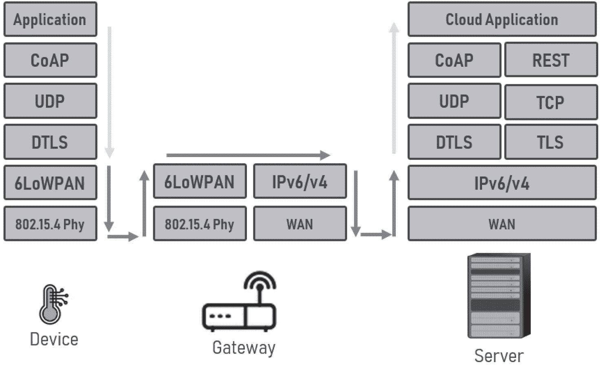

**图 7.7** CoAP Web 架构图

如图 7.7 所示，协议栈内部发生了三个重要的协议转换，值得注意。第一个是 `CoAP` 和 `HTTP`。图中显示设备客户端使用 `CoAP`，而服务器端同时使用 `CoAP` 和 `REST/HTTP`。虽然云服务器可以实现 `CoAP`，但也可以创建一个代理层在 `REST/HTTP` 和 `CoAP` 之间进行翻译。`CoAP` 规范定义了无状态映射，允许 `HTTP` 客户端访问 `CoAP` Web 服务器上的资源，或允许 `CoAP` 客户端通过简单的代理使用简单的 `REST/HTTP` 资源。`CoAP` 不允许所有的 `HTTP` 接口或 `REST APIs` 都能 `CoAP` 可访问，因为 `HTTP` 太复杂了。然而，`CoAP` 规范定义了 `HTTP` 和 `CoAP` 之间的基础映射，`RFC 8075` 定义了在 `CoAP-HTTP` 代理中实现的特定规则。所有这些翻译都是可能的，因为 `CoAP` 定义其标头和解析要求的方式减少了受限设备的负载。这是 `CoAP` 第一个也是主要的益处。

图 7.7 所示的第二个重要转换发生在 `6LoWPAN` 和 `IPv6` 之间的网关处。网关执行网络层桥接功能，允许 `802.15.4` 无线网络上的站点之间建立网络连接，从而可以访问 `IP` 网络上的主机。`RFC 4944` 定义了通过 `IEEE 802.15.14` 无线网络传输 `IPv6` 数据包的基本格式，允许这种翻译，还包含了其他几个使此协议转换有效运行的功能，包括数据包标头压缩的特定协议规则（`RFC 6282`）、用于定位和唤醒无线站点的分页服务（`RFC 8066`）、以及允许 `IP` 主机发现无线网络上站点的发现服务（`RFC 6775`）。尽管这些协议与 `6LoWPAN` 更相关，但它们是使 `CoAP` 可的重要服务；否则，`802.15.4` 无线网络上的 `CoAP` 客户端将完全与互联网主机隔离开。

图 7.7 显示的最后一个转换是安全层。这实际上是用 `DTLS` 替换 `TLS`，而不是另外两个转换那样是翻译。`DTLS` 允许在 `UDP` 上运行 `TLS`。`DTLS` 定义在 `RFC 6347` 中。

`CoAP` 还有三个 IoT 需要的其他重要功能：异步消息交换、多播能力和 URI 支持。

`CoAP` 设计运行在 `UDP` 上，这是一种无连接的数据报服务。`CoAP` 协议允许消息以已确认或未确认的形式发送。`CoAP` 声称支持异步消息交换，是因为 `CoAP` 服务器可以延迟对 `CoAP` 客户端的响应。这与 `MQTT` 或 `AMQP` 提供的异步消息传递不同，后者允许消息在队列服务器中排队直到目标唤醒。然而，这种异步服务允许极受限的设备使用尽可能需要的时间来构建其回复消息。

`CoAP` 支持使用多播组，允许将 `CoAP` 消息发送到多个站点。当网关想要从多个传感器收集读数时，这会非常有用。`CoAP` 使用专门指定的全-CoAP-节点地址组支持多播。对于 `IPv4`，分配的地址是 `224.0.1.187`。对于 `IPv6`，分配地址是 `FF0*X*::FD`，但这是一个变量多范围地址，`X` 可以分配任何有效范围。推荐的范围包括链路本地（`X=2`）和站点本地（`X=5`），允许这些多播消息限制在特定的网络或网络段内。

`CoAP` 定义了一种新的 URI 方案，用于访问 `CoAP` 服务器上的资源。就像熟悉的 `HTTP` URI 是由协议（*http* 或 *https*）以及主机名和可选的端口地址构建一样，`CoAP` 使用相同的结构，但使用 `coap` 或 `coaps` 来进行通过 `DTLS` 的安全访问。`CoAP` URI 的通用结构为：

```
coap-URI = “coap:” “//” host [ “:” port ] path-abempty [ “?” query ]
```

`CoAP` 规范编写得非常好且完整，但还有许多额外的 `RFCs` 对其进行了扩展并补充了其他服务。`CoAP` 正在成为 IoT 中至关重要的协议，并应该继续获得关注，特别是考虑到构建在 `CoAP` 之上的下一组数据格式标准。

`CBOR`（紧凑二进制对象表示）是在 IETF RFC 7049 中定义的一种数据格式，正被 IoT 框架用于取代 XML 和 JSON。XML 和 JSON 的问题在于生成的消息体积极以及在这些框架中生成消息所需的代码库。`CBOR` 专门为小消息体积、极小代码量以及可扩展性而设计，且不需要显式的版本协商。`CBOR` 是一种类似于 ASN.1（抽象语法表示，版本 1，ISO/ IEC 8825-1:2015）的二进制数据编码，但去除了伴随的、需要特殊数据编译器和大型代码库来生成和解析消息的复杂性。`CBOR` 设计的目的是为了方便转换为 JSON，反之亦然。尽管它在技术上属于表示层协议而非应用层协议，但由于它可以让其他协议（例如 REST/CoAP 和 MQTT）对 IoT 更有用，我们认为将其包含在讨论中是有重要的。

`COSE`（CBOR 对象签名与加密）是 `CBOR` 的配套 IETF 规范，定义在 RFC 8152 中，描述了如何在 `CBOR` 格式中创建签名、加密和受完整性保护的消息。这是 `CBOR` 的重要补充，因为它允许消息（如 CoAP 和 MQTT 中的消息）独立于其传输机制受到保护，并实现真正的端到端保护。`COSE` 包含算法支持：

* 爱德华斯曲线数字签名算法 (edDSA)，使用爱德华斯椭圆的对称数字签名算法

* 使用 SHA-2 算法（`SHA-256`、`SHA-384` 和 `SHA-512`）的基于哈希的消息认证码 (HMAC)

* AES 密码块链（CBC）消息认证码 (`AES-CBC-MAC`)

* 使用 `AES-GCM`（Galois 计数器模式下的 AES）加密

* 使用 `ChaCha20` 和 `Poly1305`加密

尽管这些算法看起来有些有限，但 `COSE` 的优势在于定义了如何在 CBOR 对象上应用哈希、加密和公钥签名算法。未来的扩展或附加标准可以添加新算法，同时对数据元素应用相同的格式和排序规则。

`SenML`（传感器测量列表）是一种应用层格式，用于在 HTTP 或 CoAP 中携带简单传感器数据的数组。`SenML` 由 CoRE 工作组在 IETF RFC 8428 中定义，定义了一个传感器读取的数据模型，并创建了新的媒体类型以用 JSON、CBOR、XML 和可扩展 XML 交换 (EXI) 编码该数据模型。一个 SenML `Pack` 是一个携带一组记录的单个数组，其中每个记录代表一个传感器测量值。传感器测量值由一组可选的基础字段和一组常规字段组成。基础字段适用于数组中的每个记录，直到下一个重新定义该基础字段的记录为止；这允许数组尽可能列出最少的字段。SenML 记录格式的示例如下：


```json
[
  {"bn":"urn:uuid:f73a1c1a-885a-ce01-080063cc82f110",
  "u":"Cel","t":1.276020076e+09,"v":23.5},
  {"u":"Cel","t":1.276020091e+09,"v":23.6}
]
```

在此示例中，基础名称（`bn`）被定义为传感器的通用标识符，并适用于 SenML `Pack` 中的两个记录。两个读取值（`v`）的单位均为摄氏度（`u`），并记录了时间（`t`）。

`SenML` 对于网关和服务器收集和交换不同元素之间的一组值非常有用。尽管 `SenML` 是为传感器读取设计的，但它也可以应用于其他数据集的交换。

## 7.2.8 协议总结

本节对许多最流行的 IoT 协议进行了广泛概述，涵盖了从有线和无线物理层（Phys）直到今天正在改变 IoT 的一些常见应用层协议。尽管我们未能深入探讨任何一种协议，但对许多协议的广泛覆盖应该让你了解一些你可能未注意到的协议，并提供足够的信息指导你为你的 IoT 系统选择正确的协议。在本章的剩余部分中，我们将重新关注安全性，涵盖了保护你的 IoT 网络时应该采取的步骤，以及如何分析你所使用的协议以发现安全漏洞。

## 7.3 IoT 网络安全

IoT 系统的主要敌人是网络攻击者。无论该攻击者是国家级、网络犯罪集团，还仅仅是想要探索或利用你系统的好奇黑客，网络端口和协议都是最常见的攻击途径。正因如此，我们必须就如何保护你的 IoT 系统免受此类网络攻击提供一些建议。

### 7.3.1 保护“小家伙”

IoT 系统中的小型设备最难保护。正如我们在第 4 章中讨论的，小型设备没有资源来运行许多保护措施。这意味着小型设备需要通过网关和其他网络基础设施来保护。然而，小型设备本身可以遵循某些设计原则，使其更难被攻击：

- **关闭所有不必要的端口**——正如我们在第 2 章中提到的，开放端口是系统中的弱点，因为它创建了攻击途径。尽可能少地开放网络端口。这意味着简单网络管理协议（`SNMP`）和 `Telnet` 等服务不应被使用。构造良好的设备可以使用单个开放端口接受所有管理命令——无论是 `HTTP`（端口 80）、`HTTPS`（端口 443）、`MQTT`（端口 1883）或基于 `TLS` 的 `MQTT`（8883）。由于出站通信不需要开放端口（它们在开始通信时打开端口），因此只有管理端口需要开放。记住，协议可以配置在不同的端口上运行，在其他端口（如 8080）运行 `HTTP` 并不罕见；因此端口号并不没有端口的数量重要。

- **绝不要在特权用户帐户下运行网络代码**——任何在网络端口上监听或在网络端口上发送数据包的软件都应赋予最低的用户权限，并且绝不要以 root 身份运行。因为直接拥有网络端口（无论发送还是接收）的代码可能是遇到攻击的第一个，此类代码不应在平台上以特权账户执行。如果攻击者能够由于畸形数据激活网络代码中的故障，并利用该故障执行任意代码，那么攻击者的代码将以其所攻击代码的权限执行执行。你不希望该任意代码在系统中以 root 或管理员身份运行。

- **对所有开放端口进行模糊测试**——当确实有开放端口时，运行软件模糊测试器——例如 `Peach`、`American Fuzzy Lop (AFL)` 或 `OWASP Zed Attack Proxy (ZAP)`——以检测对畸形数据包的处理不当。任何由模糊工具创建的软件崩溃都需要调查是否存在潜在的软件缺陷，因为崩溃表明代码中存在任意代码执行漏洞。

- **执行静态代码分析 (SCA)**——应该对设备的整个代码库进行分析，以发现潜在的软件缺陷，例如缓冲区溢出、整数溢出或欠溢、堆错误、格式字符串错误以及可能被黑客转化为远程攻击的常见软件缺陷。常见的静态代码分析 (SCA) 工具包括 `Klockwork®`、`Kiuwan®` 和 `Checkmarx®`。虽然 SCA 工具无法捕获所有问题，但 Dave 进行的一些个人分析显示，大多数工具只能检测到简单的缓冲区溢出攻击，不过对代码执行 SCA 是良好的软件卫生。显示出问题的 SCA 扫描表明，软件开发团队需要重新检查其代码规范。

- **使用安全启动机制并频繁重启**——在运行期间，设备应使用安全启动机制，该机制在整个软件上利用密码学安全的数字签名或加密，以确保软件未被恶意或意外更改。通过重启并重新验证用于启动平台的软件（包括操作系统），任何可能通过网络泄漏的内存恶意软件都会被清除，设备将在没有任何恶意程序的情况下重新启动。当然，如果网络攻击者曾经攻破过系统，他们会再次尝试，因此检测攻击并更新设备软件以消除漏洞至关重要。

- **为所有平台软件和应用提供并利用安全更新机制**——无论设备多小，都必须有一种安全更新运行在该设备上的所有软件和固件的机制。在这种情况下，“安全”意味着软件经过数字签名，以确保软件无法被修改（完整性），并且签名证明了软件的原始来源（不可否认性、来源证明）。验证密钥应存储在设备中防篡的位置，以确保攻击者无法通过攻击存储信任验证密钥的位置来伪造有效软件。

- **对所有入站连接进行验证；保护出站消息**——在第 4 章中，我们讨论了与小型设备的连接可能无法使用 `TLS` 保护，因为该协议非常笨重且具有交互性。我们的意思并不是说在处理小型设备时应该放弃所有安全通信的尝试。可以使用预共享密钥配合 `DTLS`；这对于许多小型设备来说足够轻量。或者，可以直接保护出站消息，而不是使用如 `DTLS` 这样的完整安全协议。这种方法可以使用 `ECDSA` 使用简单的椭圆曲线签名保护消息，或者使用标准的 `COSE` 格式对消息进行加密和完整性保护。

- **将小型设备置于防火墙后**——由于大多数小型设备无法进行很多网络保护，将这些设备放在防火墙后面是最佳选择。在这种情况下，防火墙将作为一个为物联网系统连接回云实例的网关。显然，这对于我们讨论的有线协议有效，但无线连接呢？无线连接较难保护，但集成加密的无线协议提供了解决方案。加入星型网络（`BLE`、`IEEE 802.15.4`、`LoRaWAN`、`LTE-M`、`NB-IoT`）网关的设备在链路建立期间具有安全性，并在数据链路帧上至少具有完整性，这与网络对手提供了良好的隔离。攻击者必须破解加密或以某种方式通过网关进入网络。在星形结构中，网关可以过滤来自未经授权站的流量并丢弃通过完整性检查的数据包。这意味着攻击者不能用假包泛洪无线通道，但要让包通过数据链路层的完整性检查，攻击者必须破坏完整性/加密方案，如果加密执行得当，这对攻击者来说是一个相当困难的任务。

### 7.3.2 较大设备的额外步骤——自保护服务

功能更强的设备和网关需要运行保护其自身的服务。这些包括阻止攻击的预防性服务，以及检测和报告攻击的服务。当然，所有小型设备应遵循的建议也适用于这些功能更强的设备，但较大的设备可以也应该做得更多。以下列表包含了网关和功能更强的物联网设备应该考虑的额外基线服务。

- **运行防火墙来保护自己**——保护下游设备的防火墙服务很重要，但网关和较大的设备也应该运行防火墙，以保护它们与云端的上行通信。为什么这很重要呢，既然这些通信通道应该运行 `TLS` 了？这主要是一种深度防御保护，以确保如果设备上出现任何配置错误，防火墙也能防止未保护的端口暴露。只需一个微小的配置错误，就能让在端口 `443` 上配置了 `HTTPS` 的 Web 服务器也包含在未保护的端口 `80` 或端口 `8080` 的第二个监听器。你可能会对这种操作失误发生的频率感到惊讶。一个高优先级的更改或对客户报告问题的响应会让运维团队进入救火模式来解决问题。在预生产环境中进行测试，并且每个人都全力以赴，通宵寻找根源并纠正问题。团队协作完美！解决方案找到了！推送到生产环境。但大家都累了，实际推送到生产环境的是调试配置，其中包含第二个明文 Web 服务器连接，或者可能有一个供工程师查看设备并在设备上运行测试脚本的特殊 `telnet` 端口。如果现场实际设备上没有防火墙作为额外的保护层来确保没有未经授权的端口开放到*恶大互联网 (Big Bad Internet)*，那么 `HTTP` 或 `Telnet` 端口将暴露给任何恰好对设备进行端口扫描的网络对手。但你确信团队不会犯这种初级错误吗？好吧，那么对于恰好发现操作系统零漏洞攻击的网络对手呢？他们可以安装任何他们想要的软件，软件可以打开他们想要的任何端口。增加防火墙来阻止此类事件发生不是很有道理吗？防火墙确实会消耗一些周期，但它可以防止你的系统遭受无法估量且意外的损害。

- **过滤入站流量以消除已知攻击**——即使有防火墙，设备和网络经常被渗透。克服防火墙并不像我们在某些电视节目中看到的那简单，剧本可能是这样的：“哦，不！系统受防火墙保护。等一下……让我 <一阵疯狂敲击键盘的声音&> . . . 好了，我进来了！”然而，防火墙是可以被绕过的。可以使用 `snort` 和 `suricata` 等应用程序来检测并警告此类攻击，并自动做出响应。

- **维护受信任端点列表**——设备应保留一个信任根列表。信任根是一个公密钥，用于对通过 `TLS` 或或其他安全通道的通信进行身份验证。信任根列表是已知的可信站点的集合，设备可以与这些站点进行管理、软件更新、报告事件和问题，以及仅报告数据的通信。应用程序（特别是设备管理服务）应当验证连接和命令是否来自能够证明其使用了信任根列表中受信任密钥的实体。这种证明可以通过 `TLS` 或 `DTLS` 完成，也可以通过验证收到的 `MQTT` 消息上的 `ECDSA` 签名来完成。

- **运行主机入侵检测软件**——网关必须运行能够检查已知恶意程序的软件，并执行内存扫描器以查找 `RAM` 中受受攻击的应用程序。

- **始终使用安全通道**——`TLS` 是你的朋友。正如我们在下一节中将讨论的，许多协议被发现存在潜在缺陷，但在 `TLS` 等安全通道中运行它们可以防止攻击者利用这些缺陷。

- **利用平台上的硬件保护**——如今的许多平台都包含了复杂的硬件保护。诸如可信执行环境（`TEE`）、安全启动、安全元件（`SE`）、可信平台模块（`TPM`）和控制流保护等服务，可以保护运行在平台上的软件免受黑客和攻击。尽管某些技术已报告过攻击，但考虑到这些攻击，这些保护并非毫无价值。确保你熟悉平台上的高级安全保护措施，并尽可能地使用它们。

### 7.3.3 系统保护与检测服务

单独保护每个设备是重要的，但某些保护应该跨整个系统。威胁检测和监控系统在如今的市场中变得越来越常见，许多系统正在使用人工智能（`AI`）来提高其有效性。这些系统应该集成到你的 `IoT` 系统中，并用于监控尽可能网络流量。所有设备的日志和活动都应该输入到高级威胁检测系统中进行分析，以便在威胁完全控制你的系统之前检测到。

### 7.4 协议安全分析

在第 5 章中，我们描述了安全架构的过程，包括威胁建模，并在图 5.1 中形象地描述了该过程。对协议进行安全分析与我们用于安全架构的过程相似。然而，与其说是架构图，理解协议本身是第一步。其余部分几乎相同——除了那个尝试发现协议上实际威胁的非常棘手的部分。那部分实际上非常困难。有很多关于被认为安全的协议的论文，随后就发现了漏洞。你可能对其中很多都很。还记得 `WEP` 吗？那种保护 WiFi 的无线等效隐私协议，它是作为 `IEEE802.11i` 的一部分发布的。当 `WEP` 被破解后，它被无线保护访问（`WPA`）所代代。但如果你一直关注关注，你会记得现在几乎所有人都在使用 `WPA3`，这意味着自 `WEP` 以来已经发现并修复了几个新问题。不要认为这只是 WiFi 的问题，快速浏览一下发表的学术文献，你会发现其中充斥着关于破解协议并提出修复方案的论文，结果另一个人又发表了下一篇破解“已修复”协议并提出新解决方案的论文。这种循环似乎像炼狱中永无止境椅子游戏一样持续。在本节中，Dave 介绍了一种基于形式安全模型的技术，他利用这种技术来帮助进行协议威胁分析，如果操作得当，它可以避免协议设计中反复的“构建-破坏-再构建”循环。

Dave 在通信和协议构建领域工作多年。他在 1992 年为美国政府发明了一种名为安全关联管理协议（`SAMP`）的密钥管理协议，并在全国范围内标准小组内进行过密钥管理的演讲。Dave 还参与了其中一些构建-破坏-再构建的循环。这些经验帮助他采用了一种松散的协议对手能力模型，并以此来分析和开发协议。但在 Intel，Dave 在 Jesse Walker 从 Intel 退休之前得到了他的指导。本节大量引用了 Jesse 与 Dave 分享的 [74, 75, 76, 77 和 78] 材料。

#### 7.4.1 准备知识与定义

在解释模型之前，最好为我们建立一套词汇，以便在讨论协议及其组成元素时使用。因此，让我们定义几个术语。

首先，让我们定义`协议`。协议是两个或多个双方为了完成某些特定目标而必须遵循的一系列`steps`。对于每个`step`，协议定义了：

- `发送方`，即在该步骤中发送消息的实体

- `接收方`（或多个接收方），即在该步骤中接受消息的实体

- `消息格式`，定义了发送方如何精确构造消息

- `消息处理规则`，定义了接收方收到消息后必须做什么

- `共享状态`，即协议双方使用的数据元素集合，其中一些是彼此已知的（例如：下一条消息 ID、共享对称密钥、公钥、之前交换的消息等），而另一些对于特定方来说是秘密的（例如：密码、私钥等）

在协议的每个步骤中，发送方和接收方可能是不同的。通常，发送方和接收方会在协议的每个步骤中交换角色，允许接收方回复刚从发送方收到的消息，但这并非强制。在某些协议中，双方在同一个步骤中既是发送方也是接收方，尽管这通常更难建模。开始或发起协议交换的方称为`发起者 (Initiator)`，协议消息的初始接收方称为`响应者 (Responder)`。需要记住，在协议的某些步骤中，响应者可能会向发起者发送消息（即角色切换）。发起者和响应者的名称反映了双方在协议最开始时的角色，且不会改变；发送方和接收方的术语可能会随着每个步骤而变化。

接下来，让我们定义一些常见的协议目标。这些是协议尝试通过运行协议来实现的内容，通常这些目标与某种加密操作相关，以确保其安全性。这并不是一个完整的列表，但最常见的目标包括：

- 建立安全通道（`会话密钥建立`），为交换的消息提供`机密性`并可能还提供`完整性`——这是传输层安全（`TLS`）协议的主要目标。

- 建立另一方的身份（`entity authentication`）——这是许多已知协议的目标，包括 Kerberos、挑战握手认证协议（CHAP）和实体认证协议（EAP）。

- 建立数据对象的源头身份（`non-repudiation–proof-of-origin`）——这是在线证书状态协议（OCSP）的目的之一。

- 为操作或数据对象建立安全的收据（`non-repudiation–proof-of-receipt`）——这是安全/多用途邮件邮件扩展（S/MIME）的目标之一。

最后，让我们来定义`adversary`（攻击者）和`advers actions`（攻击者行为）。攻击者是想要破坏我们通信的坏蛋（或坏女孩！）！他们的目标与我们的通信目标相反——机密性、完整性、身份验证等。在我们的模型中，攻击者对通信信道具有完全控制权，并且对他人传输的消息做任何他们想做——你可以将攻击者想象成你的互联网服务提供商（ISP）。你的 ISP 接收你发送的所有消息和数据包，并向你交付你接收的所有消息和数据包。没有 ISP 你无法通信。那么，如果你的 ISP 是坏的并试图干扰你的通信怎么办？在这种情况下，你的 ISP——攻击者——可以执行许多操作，包括以下内容：

- 消息观察或窃听

- 消息修改

- 消息插入

- 消息删除

- 消息延迟

- 消息重排序

- 消息重放

在我们的模型中，攻击者是强大的，但他们的行为仅针对消息。攻击者没有你的加密密钥，所以如果你加密了消息，攻击者可以观察你的消息，但无法读取它。加密密钥是你共享状态的一部分，攻击者工具箱中没有任何东西能让他们窥探你的共享状态——除非你的协议存在缺陷，允许攻击者从你发送的消息中猜测你的加密密钥或共享状态的部分！

在某些模型中，攻击者不仅控制网络，还被赋予了启动新实体以同时参与多个协议会话的能力。对于这些其他实体，攻击者被赋予了攻击他们并随意暴露其短期会话密钥或替换其长期身份密钥的能力——这些分别被称为`reveal`（泄露）和`corrupt`（损坏）攻击。攻击者对你（即我们用来证明协议安全性的测试主体）执行这些操作，但允许攻击者对任何其他人这样做。

这种更极端的能力被用于建模完美前向安全性（perfect forward secrecy）和特殊攻击，如 BORE 攻击。BORE 攻击——“一次破解，处处运行”——是指攻击者攻破一方，然后能够获得一个允许他们攻破所有人的秘密。如果不同时对多个实体建模，在我们的模型中就无法测试 BORE 攻击的存在；`reveal` 操作允许攻击者尝试 BORE 攻击。前向安全性是这种属性，即你长期秘密的泄露不会导致过去的安全会话被破解。`corrupt` 操作允许攻击者通过攻破另一方的长期秘密，尝试破解你（即测试方）会话的前向安全性。

为了为了抵御这些攻击，你必须对你的消息应用加密操作。本书不涵盖密码学，但有许多非常优秀且实用的书籍涵盖了该主题。

### 7.4.2 一个用于协议设计的非正式分析模型

回想一下，在讨论安全架构威胁分析时，我们利用对系统的知识以及我们观察到的、或之前读过的攻击，或者我们能够自己构造的攻击，将威胁分配给系统的部分。我们可以使用攻击树作为一种遍历潜在攻击场景的方法，并讨论安全设计原则作为理解系统不应被违反的属性的方法。

在协议设计的非正式模型中，我们使用类似的指南来告知和塑造我们的协议，并使用攻击者的行为作为攻击协议目标的方法。在正式模型 [75] 到 [78] 中，我们仅使用一种更严谨的方法，将协议还原为基础加密操作，然后使用用于测试加密算法的复杂理论游戏来评估协议操作的加密强度。我们在这里不打算那样做——我们将坚持更非正式的方法。非正式方法没有那么严谨，但相当有效，并被用于今天设计的许多协议。这主要是因为执行严谨的正式方法需要某人非常熟悉密码学复杂性理论，而周围的这类人并不多。让我们通过这个非正式方法的例子来说，让它变得更清晰。

### 7.4.3 摘要认证协议的非正式分析


让我们来看一个通过使用摘要认证（digest authentication）在 REST API 之上的认证协议。发起者和响应者（客户端和服务器）共享一个包含用户名和共享秘密的状态——这可能是一个对称密钥，但通常是密码。协议交换过程如图 7.8 所示。在三步交换中，发起者首先向响应者请求特定资源。在我们的示例中，展示了发起者请求一个代表特定传感器配置文件的 URI。这些文件发布在服务器的 MQTT 代理中，但客户端利用 REST API 而不是 MQTT 来访问它们。

```
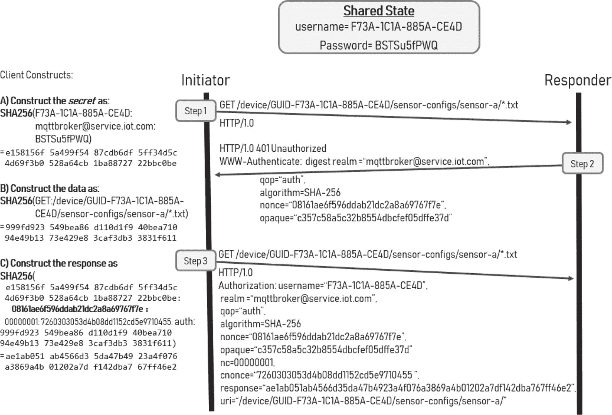
```

**图 7.8** 摘要认证协议的详细示例

服务器要求发起者在释放资源之前通过认证，因此在步骤 2 中，它返回“未经授权”（Unauthorized）响应，并带有一些参数告知发起者如何通过正确的认证进行响应。`nonce` 和 `opaque` 参数被服务器（响应者）用于将此消息与来自发起者的后续认证请求消息相匹配。

在最后一步，发起者遵循某些协议规则构造对服务器的响应，以证明发起者知道共享状态中的秘密。发起者使用哈希函数 SHA256 构造这些值，服务器已请求其作为认证算法。构造 `A` 使用来自共享状态元素的秘密——`username` 和 `password`——以及服务器（响应者）提供的 `realm` 参数。然后发起者创建构造 `B`，它指定了 HTTP 请求方法和所请求的 URI。随后将构造 `A` 和 `B` 与四个值混合创建构造 `C`：服务器 nonce、nonce 使用计数 (`nc`)、客户端 nonce (`cnonce`) 以及保护质量值（在我们在本例中为 `auth`）。构造 `C` 是返回给响应者的响应值。这个完整的发起者消息在步骤 3 中显示。

那么，我们如何使用非正式方法来分析这个协议呢？首先，我们查看协议的目标。这是一个身份验证协议，因此其目标是执行身份验证。这很简单。但有时并非如此容易。有些协议有多个目标。想想 `TLS`，它包含了机密性、完整性和双向身份验证。协议的目标越多，情况就变得越复杂。在这个例子中，我们仅关注身份验证。

现在，我们必须提取来自启动者的内容——由于攻击者不知道秘密密码，他们无法自行生成这些内容——以及发送给攻击者的服务器随机数（nonce）和不透明值（opaque values）。然而，当响应者（服务器）尝试验证此消息时，它将使用攻击者在“消息 3”中提供的服务器随机数值，而不是启动者在计算实际 `response` 参数时所使用的随机数值。服务器计算出的响应将与启动者最初计算的响应不同，因为启动者使用的是发送给他们的服务器随机数，但攻击者发送了另一个不同的服务器随机数。由于服务器随机数被绑定在响应参数中，攻击者无法通过在消息会话之间进行剪切粘贴来伪造消息。

该协议有效地防止了某种常见的协议攻击，在这种攻击中，攻击者混合消息或消息片段来创建一个新的会话，以欺骗响应者。在某些情况下，这种攻击也可以对启动者生效。由于随机数值绑定到响应参数中的身份验证令牌中，攻击被阻止了。这非常酷——即使是非正式的安全分析，也能帮助我们深入审视协议。

现在，假设你合作的团队决定修改服务器实现，或者服务器端实现存在一个 Bug。RFC 规定，服务器随机数应该用 IP 地址和时间戳构建，以便通过识别客户端来防止重放攻击。如果没有这样做，或者该代码中存在 Bug 导致随机数变成一个与 IP 地址或时间戳无关的随机值，那么攻击者就可以执行我们上面讨论的“剪切粘贴”攻击。这可能会导致问题。但假设你采取了深度防御策略，并使用 `TLS` 来保护你的交换过程。那样就完美了，对吧？让我们来聊聊破坏攻击（corrupt attack）。如果设备验证交换通过一个记录交换内容的网关，或者服务器本身记录了交换，并且攻击者能够破坏服务器并窃取日志，那么如果随机数没有包含时间戳和 IP 地址，该协议就会受到攻击。你可能会说，如果攻击者已经在我的服务器里，游戏就结束了，为什么要关心这个？日志可以在很多点受到攻击，包括备份和日志收集服务器。生产环境的 Web 服务器可能是完全安全的。攻击者不会按照你的规则行事。这里的重点是像攻击者一样去思考：我的协议在哪里可能被攻破？并且要小心修改微小的细节，即使是简单的随机数值的构建方式。虽然我们在这里到此为止，但分析尚未结束。你需要继续观察所有不同的参数，并检查它们之间可能发生什么交互。使用非正式模型，你需要尝试许多不同的方法，并构巧妙地思考攻击者可能会做什么。

归结底，对协议的经验以及对攻击的理解帮助了我们制定出一份良好的威胁和攻击列表。对于新接触这一流程的工程师来说，这可能显得有些随性，而且在这个过程中确实包含了一些艺术性和经验。在任何领域的经验总是会有有益的。但即使是经验丰富的工程师和协议设计者也会漏掉一些东西。回顾一下 `IEEE802.11i` 等协议的历史就可以作为例子。我们并不是在这里开玩笑或进行批评——协议设计是非常困难且充满危险的。

### 7.4.4 形式化安全模型

协议分析已经研究了很久——事实上已经几十年了。某种程度上，我们在上一节中讨论的非正式模型就源于这些研究——特别是关于攻击者能力的细节。但非正式方法与形式化方法之间的区别在于，基于计算复杂性理论创建形式化的安全证明，并将协议还原为实现正式协议目标的原子级加密操作。这是非常深奥的内容，超出了本书的范围，但请耐心读完这一段，我们将进行简短的讨论，这将有助于指导你的非正式分析。

在存在攻击者的情况下，唯一可以信赖的是基于计算复杂性理论的加密操作。计算复杂性只是一个华丽的术语，意味着有一个证明显示基础加密操作极其复杂，以至于没有攻击者可以在合理时间内破解它。我们在计算复杂性理论中的时间概念基于许多许多计算机资源，这些资源由某些多项式方程有限地限制。你可以将这种时间限制设为极其不合理，就像宇宙中的每个原子都是一台计算机，如果攻击者能够控制所有这些计算机来破解你的加密算法，那么这些计算机需要在该问题上工作万年才能成功。这就是 128 位安全概念的来源。想一下尝试 `2¹²⁸` 种不同的组合需要多少计算机。这个数字非常大，但它是有限的。尽管它是有限的，但要动用这些资源来破解加密算法是完全不合理的。

你不太可能为你正在使用的协议创建计算复杂性证明。但是，如果你使用已知且受认可的加密算法，例如高级加密标准 (`AES`)、Rivest–Shamir–Adleman (`RSA`) 公钥算法或安全哈希算法 2 代 (`SHA2`)，那么这些算法在合理的计算复杂性条件下已经过证明是安全的。你只需要确保正确地使用它们。

在我们的非正式安全模型中，我们正是这样做。我们确保协议中的每个操作都受到加密操作的保护，该操作提供了我们协议所需的保证——机密性、完整性、不可区分性、不可否认性等。这是困难的，如果没有经验和适当的培训，有很多陷阱会让你的逻辑出错。我们讨论的非正式安全模型对于分析你如何组合现有协议，并确保你没有违反协议所依赖的任何条件非常有用。它对于系统架构非常有用。我们不指你在读完这一节后就能正确地分析全新的安全协议或创建自己的安全协议。

所以，既然这这么困难，我们为什么要花时间在这上面呢？对你来说，理解协议分析实际上有多困难至关重要。有太多团队自己编写协议，或者对现有协议进行“微调”，然后认为自己这样会没问题。在 IoT 团队中，某些协议被精简以适应小型设备，或者删除了某些功能或能力以便在 IoT 领域内良好运行。这非常危险。我们讨论协议的安全分析是为了让你理解协议的变化实际上有多复杂，如果你正在使用一个你必须依赖的协议（例如密钥交换或身份验证），你就会理解在形式化安全模型中对协议进行分析有多么重要。这一切意味着：不要自己编写安全协议。

### 7.5 IoT 协议结论

在这一章中，我们简要地查看了许多不同的协议。虽然我们没有深入细节，但我们为 IoT 系统使用的众多协议提供了一个非常广泛的视角。你可以利用这项调查来识别最适用于你系统的协议，并使用本章末尾的长篇参考文献深入研究细节。我们还讨论了如何对协议进行安全分析，以及对于你真正需要安全的协议，这些协议应该如何在形式化安全模型中进行分析。但我们向你介绍了一些技术，允许你自行评估协议，并理解为什么在相应的协议中包含某些参数和安全保护措施。你应该使用非正式安全模型方法来验证你是否正确使用了经过审查的协议，并确保你的用法没有以某种方式违反安全协议。安全协议设计既是一门艺术也是门科学，所以不要创建自己的安全协议，而是使用那些发布良好且标准化的协议。

### 参考文献

1. Freeman, R. (2001). *Practical Data Communications,* Second Edition. New York (NY): John Wiley & Sons.

2. Earle, A. (2006). *Wireless Security Handbook.* Boca Raton (FL): Auerbach Publications/Taylor & Francis Group.

3. Freeman, R. (2005). *Fundamentals of Telecommunications,* Second Edition. New York (NY): John Wiley & Sons.

4. Tanenbaum, A. (1996). *Computer Networks.* Upper Saddle River (NJ): Prentice Hall.

5. Dummies. (2018). *“Network Basics: Twisted-Pair Cable.”* Retrieved from `https://www.dummies.com/programming/networking/network-basics-twisted-pair-cable/`

6. Paonessa, S. and McDuffee, B. (2018). *“Back to Basics: The Fundamentals of 4-20 mA Current Loops.”* Retrieved from `https://www.predig.com/`

7. Field Comm Group™. (2018). *“HART Explained.”* Retrieved from `https://fieldcommgroup.org`

8. Yokogawa Electric Corporation. (2012, March). “Fieldbus Technical Information.” 4th Edition. `TI 38K0A01-01E`.

9. Rockwell Automation. (2011, June). *FOUNDATION Fieldbus Design Considerations*. Reference Manual.

10. National Instruments. (2018, April 17). *“RS-232, RS-422, RS-485 Serial Communication General Concepts.”* Retrieved from `http://www.ni.com/white-paper/11390/en/`

11. Weis, O. (2018, February 22). *“A Quick Tutorial on RS485 and MODBUS.”* Retrieved from `https://www.eltima.com/article/modbus-vs-rs485/`

12. I2C Info. (2018). “I2C 总线、接口与协议.” 获取自 [`i2c.info`](http://i2c.info)

13. 嵌入式系统学院 (2017). “I2C 常见问题。” 获取自 [`www.esacademy.com/en/library/technical-articles-and-documents/miscellaneous/i2c-bus/frequently-asked-questions/i2c-faq.html`](http://www.esacademy.com)

14. Anderson, D. (2001). 《通用串行总系统架构，第二版》。波士顿 (MA): Addison-Wesley。

15. Fieldbus Inc. (2011, 10 月 14 日). “IEC61158 技术比较：总线现状.” 获取自 [`www.fieldbusinc.com/downloads/fieldbus_comparison.pdf`](http://www.fieldbusinc.com/downloads/fieldbus_comparison.pdf)

16. IEC. (2018). “IEC 61158-1:2014：工业通信网络—现场总线规范—第 1 部分：IEC 61158 和 IEC 61784 系列概述与指南。” 获取自 [`webstore.iec.ch`](https://webstore.iec.ch)

17. CiA. (2018). “CAN 低层与高层协议.” 获取自 [`can-cia.org/can-knowledge/`](https://can-cia.org)

18. CiA. (2018). “CAN 技术历史.” 获取自 [`can-cia.org/can-knowledge/can/canhistory/`](https://can-cia.org)

19. Bosch. (1991, 9 月). “CAN 版本 2.0.” 获取自: [`esd.cs.ucr.edu/webres/can20.pdf`](http://esd.cs.ucr.edu/webres/can20.pdf)

20. Steube, J. (2018, 8 月 5 日). “利用 PMKID 对 WPA/WPA2 的新攻击.” 获取自 [`hashcat.net/forum/thread-7717.html`](https://hashcat.net)

21. 蓝牙 SIG (2016). “蓝牙核心规范.” 获取自 [`www.bluetooth.com/specifications/bluetooth-core`](https://www.bluetooth.com)

22. MikroElekronika. (2016, 3 月 26 日). “蓝牙低功耗—第一部分：BLE 简介.” 获取自 [`www.mikroe.com/blog/bluetooth-low-energy-part-1-introduction`](https://www.mikroe.com)

23. IEEE 协会 (2015). IEEE 802.15.

24. Semtech. (2018). “什么是 LoRa?” 获取自 [`www.semtech.com/lora/what-is-lora`](https://www.semtech.com)

25. Mekki, K. (2018). “大规模部署的 LPWAN 技术对比研究.” ICT. 获取自 [`doi.org/10.116/j.icte.2017.12.005`](https://doi.org/10.116/j.icte.2017.12.005)

26. LinkLabs. (2018, 6 月 26 日). “什么是 LoRa？技术深度解析.” 获取自 [`www.link-labs.com/blog/what-is-lora`](https://www.link-labs.com)

27. SigFox. (2018). “SigFox 技术概述.” 获取自 [`www.sigfox.com/en/sigfox-iot-overview`](https://www.sigfox.com)

28. Z-Wave 联盟 (2018). “关于 Z-Wave 技术.” 获取自 [`z-wavealliance.org/about/z-wave-technology/`](https://z-wavealliance.org)

29. RF 世界 (2012). z-wave 物理层. 获取自 [`www.rf-world.com/Tutorials/z-wave-physical-layer`](http://www.rf-world.com)

30. Weightless SIG (2017, 11 月 7 日). “Weightless-P 系统规范版本 1.03.” 获取自 [`www.weightless.org/about/weightless`](http://www.weightless.org)

31. LinkLabs. (2015, 11 月). “什么是 Weightless?” 获取自 [`www.link-labs.com`](https://www.link-labs.com)

32. 5G 美国 (2017). “迈向 5G 的无线技术演进：3GPP Release 13 到 15 及以后.” 获取自 [`www.5gamericas.org/files/3214/8833/1313/3GPP_Rel_13_15_Final_to_Upload_28.17_AB.pdf`](http://www.5gamericas.org)

33. GSMA (2018). “面向机器的长期演进：LTE-M.” 获取自 [`www.gsma.com/iot/long-term-evolution-machine-type-communication-lte-mtc-cat-m1/`](https://www.gsma.com)

34. (2018). “窄带物联网 (NB-IoT) 的规范与应用.” 获取自 [`www.rfpage.com/specifications-and-applications-of-narrow-band-iot/`](https://www.rfpage.com)


## 参考文献

35. RS Components (2015, 4 月 20 日). “你需要知道的 11 种物联网 (IoT)协议.” 获取自 [`www.rs-online.com/designspark/eleven-internet-of-things-iot-protocols-you-need-to-know-about`](https://www.rs-online.com)

36. LinkLabs (2018). “什么是 LoRa？技术深度解析.” 获取自 [`www.link-labs.com/blog/what-is-lora`](https://www.link-labs.com)

37. Chua, Y. (2018). “物联网的 LPWAN 技术研究.” 获取自 [`www.rfdesign.com/lpwan-technology-overview`](https://www.sigfox.com)

48. Weissberger, A. (2017, 10 月 25 日). “LoRaWAN 和 Sigfox 领先 LPWAN；通过压缩实现互操作性”. 获取自 [`techblog.comsoc.org/2017/10/25/lora-wan-and-sigfox-lead-lpwansinteroperability-via-compression/`](http://techblog.comsoc.org)

49. ZigBee Alliance. (2017). “为什么选择 ZigBee PRO?” 获取自 [`www.zigbee.org/zigbee-for-developers/zigbee-pro/`](https://www.zigbee.org)

50. RF Wireless World. (2012). “ZigBee 教程 | ZigBee 协议、帧、PHY、MAC”. 获取自 [`www.rfwireless-world.com/Tutorials/Zigbee_tutorial.html`](http://www.rfwireless-world.com/Tutorials/Zigbee_tutorial.html)

51. Olssen, J. (2014, 10 月). “揭秘 6LoWPAN”. 德州仪器（Texas Instruments）. 获取自 [`www.ti.com/lit/wp/swry013/swry013.pdf`](http://www.ti.com/lit/wp/swry013/swry013.pdf)

52. Thread Group. (2018). “常见问题：Thread 地址涉及网络的哪些方面？” 获取自 [`www.threadgroup.org/support#faq`](https://www.threadgroup.org)

53. Microchip. (2018). “用于商业和智能家居网络的低成本嵌入式无线连接”. 获取自 [`www.microchip.com/design-centers/wireless-connectivity/embeddedwireless/802-15-4/software/miwi-protocol`](https://www.microchip.com)

54. Nixon, M. (2012, 9 月 23 日). “WirelessHART™ 与 ISA100.11a 的对比”. 获取自 [`www.emerson.com/documents/automation/white-paper-a-comparison-of-wirelesshart-isa100-11aen-42598.pdf`](https://www.emerson.com)

55. Schneider Electric. (2018). “什么是 ModBus 以及它是如何工作的？” 获取自 [`www.schneider-electric.us/en/faqs/FA168406/`](https://www.schneider-electric.us)

56. MODBUS. (2006, 10 月 24 日). “TCP/IP 上 MODBUS 消息实施指南 V1.0b”. 获取自 [`modbus.org/docs/Modbus_Messaging_Implementation_Guide_V1_0b.pdf`](http://modbus.org/docs/Modbus_Messaging_Implementation_Guide_V1_0b.pdf)

57. MODBUS. (2012, 4 月 26 日). “MODBUS 应用协议规范 V1.1b3”. 获取自 [`modbus.org/docs/Modbus_Application_Protocol_V1_1b3.pdf`](http://modbus.org/docs/Modbus_Application_Protocol_V1_1b3.pdf)

58. Powell, J. (2013, 10 月). “Profibus 和 Modbus：对比”. 获取自 [`www.automation.com/automation-news/article/profibus-and-modbus-a-comparison`](https://www.automation.com)

59. MQTT. (2014, 11 月 7 日). MQTT. 获取自 [`mqtt.org/`](http://mqtt.org/)

60. ISO. (2016, 6 月). “ISO/IEC 20922:2016 信息技术—消息队列遥测传输 (MQTT) v3.1.1”. 获取自 [`www.iso.org/standard/69466.html`](https://www.iso.org)

61. Stanford-Clark, A. 和 Truong, H. (2013, 11 月 14 日). “传感器网络的 MQTT (MQTT-SN) 协议规范版本 1.2”. 获取自 [`mqtt.org/new/wp-content/uploads/2009/06/MQTT-SN_spec_v1.2.pdf`](http://mqtt.org/new/wp-content/uploads/2009/06/MQTT-SN_spec_v1.2.pdf)

62. AMQP. (2012, 10 月 16 日). “高级消息队列协议”. 获取自 [`www.amqp.org/resources/specifications`](https://www.amqp.org)

63. ISO. (2014, 5 月). “ISO/IEC 19464:2014 信息技术—高级消息队列协议 (AMQP) v1.0 规范”. 获取自 [`www.iso.org/standard/64955.html`](https://www.iso.org)

64. ISO/IEC 19464:2014. (2011). “可扩展消息与存在性 (XMPP).”

65. Thread Group. (2018). “常见问题：Thread 地址涉及网络的哪些方面？”

66. RFC. (2014). “映射 HTTP 到受限环境的指南”.

67. IANA. (2018). “IPv6 地址空间”.

68. IETF. (2013). “紧凑二进制表示 (CBOR)”.

69. IETF. (2017). “紧凑对象签名与加密 (COSE).”

70. IETF. (2018). “传感器对象表示 (OSCORE)”.

71. Bellare, M. 和 Rogaway, P. (1993). “实体身份验证与密钥分发”.

72. Bellare, M. 和 Rogaway, P. (1995). “可证明会话密钥——三方协议”.

73. Bellare, M., Canetti, R. 和 Krawczyk, H. (1998). “身份验证与密钥交换协议的设计与分析模块化方法”.

74. Canetti, R. 和 Krawczyk, H. (2001). “密钥交换协议的分析及其在构建安全通道中的应用”.

## 引言

在电影《圆环》的结尾，艾玛·沃特森饰演的角色梅似乎平静地接受了周围不断演变的监控文化——听任隐私在数字互联的世界中遭受不可避免的侵蚀。也许你也有同感，这又能怪你呢？无处不在的设备、智能家居和智能城市所提供的便利为我们带来了无数的益处，从管理健康和福祉的定制策略到个性化的家居环境设置。如果我们必须为了智能物联网（IoT）系统带来的生活质量而牺牲一点隐私，那么也罢。无论如何，监控的副作用对整个社会而言并没有那么糟糕。正如梅的老板，一位社交媒体巨头所推理的那样，人们在知道自己正被监视时行为会得更好。尽管他的意识形态讽刺地服务于自利，但他并没有错。熟悉霍桑效应^(\*)的人知道这是事实。那么，为什么保护隐私如此重要呢？如果隐私权无非仅仅是让不道德或非法的行为逃脱惩罚，那么请尽情将其取消吧。然而，当我们回顾人类同情和勇气的历史时刻时，其中许多——例如地下铁路、二战期间的法国抵抗运动，以及从纳粹手中藏匿犹太人——都是被秘密的私语所激发的。在这些情况下，隐私意味着对弱势者的保护。所以，像许多事情一样，隐私是复杂的。一方面，它掩盖了阴暗的非法行为，另一方面，它是弱势者的堡垒。物联网和人工智能（AI）的快速发展剥夺了我们确定健康社会所需隐私水平的大量时间。但我们必须确定它——而且要在为时已晚之前尽快完成。在一个很大程度上由算法运行并得益于通过物联网设备收集的数据提供养料的互联世界中，保护隐私承担了更广泛的角色。它成为了关键的防御，成为防止社会中最弱势群体及其他人员免受歧视和拒绝服务的最后防线。

这显著提升了你作为智能物联网系统架构师或规划师，在保护所有公民的生命、自由和追求幸福方面所必须扮演的角色。是你来决定智能城市是损害还是丰富了社会。你非常重要，你对数字所有权的理解、你挑战自身假设的意愿以及你创造性的思维，在我们工程师作为这一世纪的新变革推动者投身其中的过程中，都是至关重要的。

## 8.2 章节范围

本书将隐私主题分为了两个章节。第一章从隐私角度分析了两个物联网场景。“安全驾驶员 App 遇见智能冰箱”场景和“智能城市故事”这两个场景都以歧视和拒绝服务的案例告终——分别是医疗领域和社会经济领域。“智能城市故事”围绕着一个自动驾驶交通系统以及围绕其开展的商业和智能城市管理展开。本章还讨论了深度伪造（deep fakes）及其与物联网的关系。本章最后以《隐私策略手册》（Privacy Playbook）作为结束，以帮助在产品规划和架构层面暴露并缓解隐私担忧。随后的隐私章节将描述用于应用隐私机制的算法、架构和软件技术。此外，还讨论了与物联网相关的隐私指南和法规。

## 8.3 AI 与物联网统一——放大工程师在社会中的意义

在 20 世纪 90 年代末，我是数百工程师之一，大家都在拼命想在摩托罗拉最新的结晶上留下自己的个人印记——开发一种现在可以被认为是现代智能手机原始版本的产品。该项目被称为 Aspira，我当时与一个工程师团队合作，构思利用将要嵌入手机中的小型 GPS 处理器的服务和功能。“位置服务”（Location Services）是办公室里一个流行的流行词。我和同事们能参与到新事物中感到兴奋。

设计出能对社会产生积极影响的突破性产品，是大多数工程专业学生的梦想。当时的氛围中充满了能量，工程师们脑思了位置服务如何以各种方式丰富手机用户的体验、协助紧急情况并变现。对于像特斯（Tesla）和斯蒂夫·乔布斯（Steve Jobs）这样的人，Aspira 的工程师小组也不例外。技术创新者无意或无意中对个人、经济和国家造成伤害的可能性是真实的。在一个由算法驱动的数字互联的世界中，保护隐私发挥着日益扩大的作用。在隐私问题上，信息就是力量，它变得越来越容易被利益集团、政府和营利巨头滥用。物联网设备和应用程序收集的少量无害数据已经并正在出售或共享给第三方，并在那里通过 AI 算法进行处理，与其他关于你、你的孩子、朋友和父母的信息关联起来。这在小范围内已经并被用于决定就业能力、可保性、你是否值得销售员的时间、你请求的自动驾驶汽车是否先接你，以及你是否是获得授权通过目的地最快路线的优质客户。社会经济地位、年龄、宗教信仰和健康可能都是算法决策过程的因素。而这些信息的大部分将来源于与这些因素无关的无害数据。

请理解，我并不是提议我们都辞去工作去建造离网的小屋——恰恰相反。在过去的十年里，一项接又一项研究证明，移动技术的全球普及是历史上减少贫困最大的单一因素。(2,3) 今天的许多物联网工程师参与了这项海西弗式规模的慈善工作。这是我们可以感到非常自豪的，它证明了技术可以成为解决社会问题的有力良药。只要有机制策略性地应对滥用和侵害，物联网系统不必成为例外。

你是否感受到自己对社会演变产生的影响？“能力越大，责任越重。”^†

### 8.4 房间里的大象

技术和信用卡巨头基本上已经掌握了关于我们的一切信息，不是吗？所以，隐私辩论难道不是已经失败了吗？

诚然，搜索引擎、智能手机供应商、在线零售商、社交媒体、信用卡公司和数据经纪人`4`、`5` 和`6)` 对普通人的了解程度超出了他们感到舒适的范围。这并非新鲜事。然而，目前只要我们选择，我们仍然可以保持匿名性。我们可以在某些机构或实验室支付现金，以防止雇主或保险公司获取医疗状况或诊断信息。我们也没有被强制拥有可能用于判定的社交媒体账号。我们仍然可以在商店付现金，也可以使用不追踪我们搜索记录的搜索引擎。但是，这正变得越来越困难。个人在个人信息传播过程中保持某种匿名性能力的侵蚀，最终将在国会引起关注，并在未来几年引发辩论。然而，更深层次的担忧是深度学习中对个人信息的使用，用于训练神经网络做出分配决策。这些决策可能对数据本身（包括你）产生不利影响。因此，在机器学习和深度学习时代，隐私法规和机制不应局限于数据领域，还应涵盖学习过程。这一扩展角色的动力将在本章的场景中体现。

### 8.5 场景：安全驾驶 App 遇到智能冰箱 `fm06_toc.xhtml`

让我们转换思路几分钟，完成一个练习：

**练习：** 阅读下方的场景，然后回答以下问题。第三方实体仅通过访问从一个人的驾驶器 App 和智能冰箱中收集的数据，可以关于此人推断出什么？^(\*)

你可能在想：“像医疗保险公司或研究人员这样的第三方实体是如何获取来自这些独立来源的数据的？”问得好。可能他们会向数据经纪人支付费用`4`-`6)` 获取信息。也许数据经纪人是汽车保险公司或家电公司的关联公司。如果是这样，用户很可能通过他们的协议授予了访问权限——在细则条款的某处会提到关联关系。第三方公共云提供商也可能是关联公司，还有保险公司或家电公司同意出售数据的母公司及各种合作伙伴。

#### 场景

Ravi 度过了很好的一年。他购买了一部功能应有尽有的智能冰箱，包括一个控制台，可以通过语音激活管理他的家庭家居、餐食计划、能量监控和活动调度。冰箱在每次关闭时都会对其内部物品拍一张照片。这些照片存储在云端，Ravi 可以使用下载到智能手机上的 App 访问它们。这让 Ravi 能够随时随地查看冰箱里的物品——在超市时非常有帮助。此外，Ravi 同意使用安全驾驶监控服务节省了 400 美元的车险——这需要使用一个适配器（dongle）和一个 App。适配器插入汽车仪表盘下方的 `ODB` 端口，安全驾驶 App 下载到他的手机上。除了监控和提供驾驶安全统计数据外，该服务还为 Ravi 提供有用信息，如旅行日志、燃油经济和车辆定位功能。它还会提醒 Ravi 适配器在定期执行诊断扫描期间产生的任何故障代码。适配器使用 `4G LTE` 将所有收集的统计数据发送到云端，并为车内乘客提供 WiFi 热点功能。在下载 App 的过程中，Ravi 分别在智能冰箱制造商和汽车保险公司处注册——两者都要求提供个人数据，包括他的电子邮箱和手机 MAC 地址。

保险公司和家电制造商都使用同一个云提供商`*`，并约定向该提供商公开某些用户数据，以换取云存储费用折扣。该协议使得云提供商成为两家公司的关联公司，这样就不会违反用户协议。家电制造商共享冰箱内容的照片、其在城市区域的位置（但不包括地址）、智能冰箱控制台的 MAC 地址、家里所有支持 WiFi 设备的 WiFi MAC 地址，以及 Ravi 的电子邮箱和手机 `MAC` 地址。冰箱的照片包含日期时间戳。汽车保险公司共享频繁停靠的时间和位置信息；汽车品牌、年份和型号信息；车辆内所有支持 WiFi 设备的 `MAC` 地址（带日期）；以及 Ravi 的电子邮箱和手机 `MAC` 地址。这些都总结在 `图 8.1` 中。

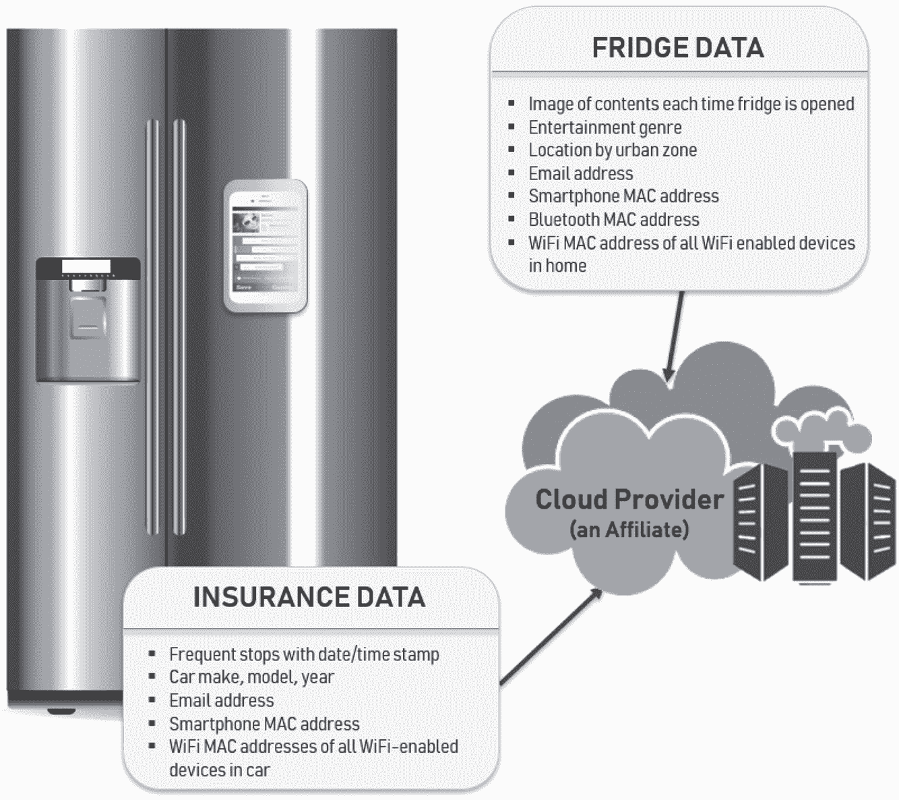

**图 8.1** 与云提供商共享的数据

云提供商拥有一个数据中心，里面有一排一排先进的服务器和 `GPUs`，专门针对每小时在海量数据集上执行深度学习算法进行了优化。因此，云提供商迅速发现 Ravi 是冰箱数据集和安全驾驶数据集之间的共同点，然后使用组合数据为 Ravi 创建画像，或将其添加到已有的画像中。云提供商进一步利用所有提供的 `WiFi` 地址将 Ravi 与其他设备和个人联系起来，为其可能拥有的此类画像增加更多内容。

花点时间，根据 `图 8.1` 中提供的信息，记录你可以了解到关于 Ravi 的什么。在心中列一个清单，我们稍后对比。

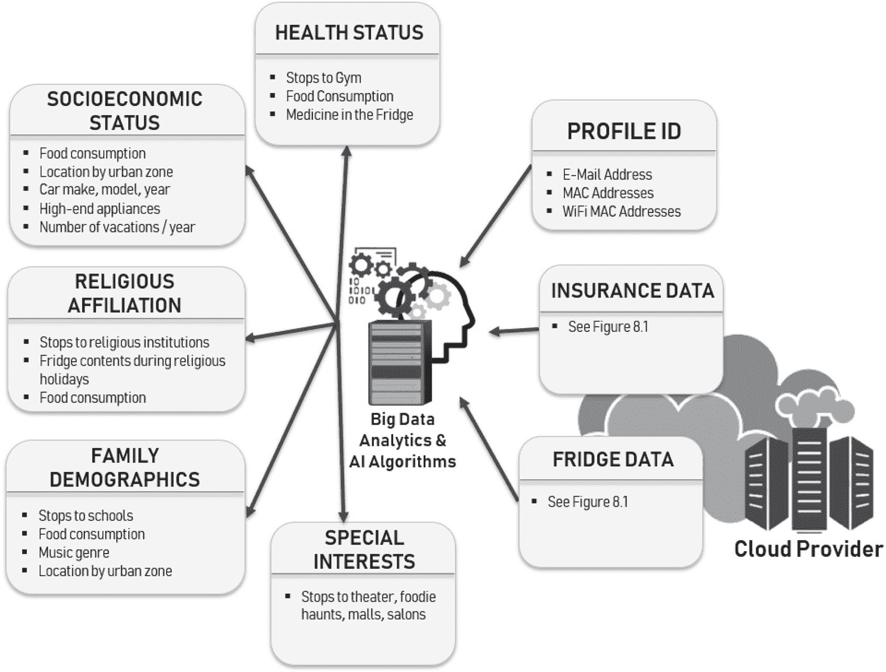

**图 8.2** 在云提供商处对 Ravi 进行画像

### 社会经济地位

我们可以根据汽车的价值和年份、高端家用电器以及房屋的所在地，以及经常出入场所（如商场和餐厅）来推断社会经济地位。冰箱里的食物类型也可以暗示财务状况和可支配收入——例如，有机食品和高端品牌。

### 宗教归属

我们可能推测出宗教归属（如果有），以及对信仰的虔诚程度或缺乏信仰。例如，如果频繁访问教堂、寺庙、清真寺、私立宗教学校或宗教机构运营的慈善机构，那么这些行为可以在不同宗教类别之间建立联系，以发现其他共同行为并预测其他行为——这被称为“微观定位”。^7 通过冰箱内内容的图像，我们还可以将冰箱的使用情况与宗教活动相关起来。食物类型也可能提供帮助，例如纯素食或清真食品。

### 人口统计特征


冰箱里的食物类型可能表明这是一个有年轻消费者的家庭，例如热狗、牛奶、各种类型的酸奶和果汁、大量的水果和鸡腿；与之相对的是“空巢家庭”，例如精品葡萄酒、大量的蔬菜、低脂酱料和鱼。深夜（比如晚上 10 点左右）频繁出现冰箱内容的图像可能表明家里住着一个饥饿的青少年男孩，或者有人正在节食，甚至可能有人正处于糖尿病前期。频繁前往学校、空手道馆和舞蹈教室都表明这些是有孩子的家庭。某些城市区域更吸引成熟的夫妇，某些吸引没有孩子的年轻夫妇，而另一些则吸引年轻家庭。这些数据点本身并不能告诉我们太多信息，但大数据分析的核心在于随着时间的推移关联大量数据集以得出结论。

## 健康状况

如果健身房是一个经常去的地方，且冰箱里装满了全食品、健康品牌、能量饮料、可能的有机食品和极加工食品，那么 Ravi 可能是一个注重健康的人。这并不意味着健康，但意味着健康的概率增加了。相反，如果冰箱里有很多甜点、软饮料、加工食品或外卖，而 Ravi 不经常去健身房，那么健康的概率就会降低。

## 特殊兴趣

随着时间的推移，Ravi 的驾驶习惯将让他对其兴趣有一定的了解。他开车去场馆、公园、博物馆、营地和商场的频率可以帮助确定对运动、旅行和休闲、艺术、园艺以及购物的兴趣程度——这些对于针对性营销非常有价值。

## 配置文件 ID

虽然提供给云端合作伙伴的数据不包含 Ravi 的姓名、地址或电话号码，但包含了电子邮件和`MAC addresses`，这些是唯一标识符。云提供商或数据经纪可能已经从一个或多个其他实体获取了这些信息，如第 8.4 节中所列那样。这允许整合来自许多不同来源与 Ravi 相关的数据集。注意，随着时间的推移，即使没有提供电子邮件和`MAC address`信息，云提供商也可以推断出 Ravi 是——通过将位置信息与图 8.2 列出的其他数据类别进行关联。这需要更多数据，但 IoT 将提供这些数据。

我们从冰箱和数字化的后座司机中学到的关于 Ravi 的信息，这种感觉就像我们有一个心理学家当朋友一样。如果我们怀疑朋友正在对我们进行心理分析，会感到有些不舒服。但如果与朋友的关系中还有其他优点，我们大多数人都会忍受这种不适。对于收集个人数据，对消费者和行业来说确实都有优点。当前这种情况的明显益处包括针对性营销和更安全的驾驶习惯。安全的驾驶习惯据认为可以减少交通事故事故、降低汽车保险成本，并减少道路上的死亡和受伤人数。我必须承认，这对社会来说是双赢，也让各地的青少年的父母松了一口气气。相反，这种特定场景下收集个人数据的主要缺点是可能导致医疗服务的延迟，以及被拒绝就业、医疗保险或完全拒绝医疗服务。

如果智能冰箱 App 能为 Ravi 提供加密云存储选项，和或“退出”（opt out）选项，那么 Ravi 就可以决定数据共享的优势是否大于潜在风险。这难道不应该由他自己吗？

### 8.5.1 IoT 救了我们的急，^(\*) 但如果我们吃腌制肥肉它就会告密

根据美国医疗和医疗保险服务中心（`CMS.gov`），2017 年的国家健康支出总计达 3.5 万亿美元。这包括联邦和州支出、保险支出和消费者自付支出。^8 这大约是美国所有商品和服务价值的六分之一。医疗费支出非常巨大。因此，政府、保险公司和雇主已转向数据分析和人工智能来降低医疗成本。电子病历数据与从可穿戴设备和其他 IoT 产品（如我们的智能冰箱）收集的数据相结合，将为保险公司和研究人员提供数 PB 的数据来用于这项艰巨工程。通过检测高成本的分销渠道，^[，预测未来的健康问题，^10) 以及激励良好的健康习惯，医疗成本正在降低。^11)保险公司和雇主正在合作激励员工定期锻炼、选择健康的食物并参加预防性保健计划。作为交换，员工承诺降低保费和免额。这些激励措施需要对人们的行为进行监控。这种监控目前处于婴儿阶段，但随着 IoT 进入健康和健身监测领域，数据将能够更好地预测，例如癌症风险、心脏病发病前以及阿片类成瘾的可能。然而，特别是在人工智能的这些早期阶段，深度学习算法可能会做出错误的预测，最终导致不公正地惩罚个人。即使算法是准确的，伦理问题也随之而来，例如疾病的遗传倾向性问题。个人应该对自己的 DNA 承担多少责任？

在我的一生中，蛋曾流行过、过时、过时、最后又流行。脂肪曾被认为是不好的，全谷物是好的，但现在，原始饮食和生酮饮食专家说脂肪是健康的，而谷物可能不是。营养基因组学是一门相对新的科学。它的假设是基因在决定你应该吃什么食物和进行什么运动起着巨大作用。这当然需要对你的 DNA 进行分析。如果雇主或保险公司通过某种方式获得了这些 DNA，使其能够搜索肌萎缩侧索硬化（ALS）等疾病的标记物，^(\*)，这将产生歧视或拒绝服务的巨大机会。

### 8.5.2 智能算法大救场

如果国会批准了单一支付者医疗体系会怎样？单一支付者系统，或者说`Medicaid`/`Medicare`系统，无法通过低廉的保费或免赔额来激励健康习惯，因为接收者并不向系统投入资金。那么，将“医疗优先级排序”作为一种激励措施呢？如果活检的平均等待时间是一个月呢？优先考虑那些运动、有饮食意识的人——给他们更大的生存机会——这可行吗？对于这个务实的工程师来说，这似乎是合理的，但我停下来想了想那个工作养活三个孩子、精疲力竭而无法运动的单亲父母。如果他去世了，他的孩子可能会被推入已经拥挤的收养系统，而这的成本可能超过治疗癌症的费用。那么一个非营利组织的高管呢？她不愿花时间自我照顾，反而更愿意投入精力、时间和资源去照顾无家可的青少年。我们`IoT`云中的`AI`算法是否足够智能，能够激励那些比照顾自己更照顾他人、丰富社会的人？

那些社会经济阶层较高的人呢？他们往往缴纳更多的税收，而政府确实需要这些收入，对吧？税收收入应该影响谁在活检队列中排在前面吗？数据分析和机器学习正迫使我们面对这些难题。我们可以将此类决策推卸给政策制定者，也可以通过寻找既满足客户需求又能降低歧视风险的替代方案，使某些决策变得过时。

保护隐私和用户选择将从根本上减少此类伦理困境。例如，如果一个可穿戴设备的目标是监控活动——`HR`、`EKG`、`PH`、汗水矿物质分析（为什么不呢？）以及睡眠模式——并警告用户可能的健康问题，我可以想到几种实现这一目标的方法，而不必担心保险公司、云关联公司或雇主获取这些信息。如果我能想到，你也可以。`Playbook`和下一章将为你提供帮助。

想到技术进步具有显著降低医疗成本并增加寿命和生活质量的潜力，真是令人兴奋的。就像手机对贫困的影响一样，`IoT`对减少我们联邦`Medicare`/`Medicaid`预算的影响可能是历史性的。但如果我们为了实现这一目标而惩罚人口中最脆弱的成员，那么这不会是一个令人满意的胜利。

## 8.6 从自动驾驶汽车到智能城市

小时候，吃煎饼、梦幻飞行汽车和看《杰森一家》动画片是我周六早晨最喜欢的消遣。我想知道自己能否活够久到开上飞行汽车。如果过去五年自动驾驶领域取得的进展有所说明，那么我可能真的能活到那一天。然而，一个城市的交通网由`AI`主导（如果不是完全独占运行）是难以想象的。确实，今天道路上已经有了少量的无人驾驶车辆，但有很多理由怀疑它们是否会主导道路。也许最著名的一点是人类天生对我们所创造的`AI`系统失去控制的恐惧。面对现实吧，我们许多人在思考`AI`时都会想起电影《终结者》。被困在一辆由阿诺·施瓦格那个邪恶的`AI`化身驱动的车辆里，这种想法让人们魂胆俱碎。如果看不见的`AI`算法危及我们的生命，而我们至少无法用棒球棒击中它，那又有多可怕？我们人类喜欢坐在驾驶位上（这里是双关语）。

无论喜不喜欢，自动驾驶交通网络在不久的将来将成为主导的交通模式。为什么尽管我们对`AI`恐惧，它仍然不可避免？因为它解决了全球城市面临的一些挑战性问题，它对环境更好，而且是一笔将注入全球经济的大笔资金。此外，它进展得非常顺利。在未来十年内，一套丰富的自动驾驶功能（即使不是全自动）已经在全球每家主要汽车制造商的路线图中，科技巨头也深陷其中。此外，政府正张开双臂拥抱自动驾驶。欧洲、美国、日本和中国的国家指南、法规和投资都在支持自动交通系统的建设。`Goldman Sachs`预测，自动驾驶汽车行业规模将从 2025 年的 960 亿美元增长到 2035 年的 2900 亿美元，这还包括从辅助服务带来的货币收益，例如针对性营销的数据经纪以及在自动交通生态系统中发生的消费者交易——这两者我们在下面的场景中都会讨论。

车辆不仅会自己行驶，还会接收和处理来自其他车辆、交通系统、广告商和服务提供商的数据——这使`5G`成为热门商品。因此，自动驾驶汽车将演变为由云端`AI`交通控制软件管理的自动互联交通网络。这种`AI`交通控制软件不仅将管理自动驾驶车队，还将管理整个大交通网，包括交通灯、地铁系统和通勤火车——使其成为智能城市的关键。交通网将不断优化以满足瞬时需求。听起来很有未来感，我知道，但轮子似乎已经转动了。2018 年 1 月，福特首席执行官 Jim Hackett 宣布计划通过其新收购的子公司`Autonomic`开发“交通云”服务。`Autonomic`的网站对其基于云的开放平台提供了如下描述：

> 交通云将连接城市移动的各种组件——连接的车辆、公共交通、行人、城市基础设施和服务提供者——目标是协调一个更安全、更高效且可持续的交通网络。

> 它是一个灵活且安全的平台，为智能移动应用提供必要的构建模块，例如自动驾驶汽车路由、管理大规模车队或帮助居民规划交通行程。

> 来源：`https://autonomic.ai`

### 8.6.1 场景：智慧城市的故事

在这里，我们将进入一个涉及名为“Myopia（近视症）”的假设美国大城市的场景。该场景始于 2030 年，跨越 15 年的时间。该场景基于现有技术、技术路线图以及目前全美国许多城市面临的挑战。因此，这个版本的故事很可能在不久的未来成为你所在的某个城市的变为现实。下面的背景设定了舞台。请耐心听听，这一切最终都会环环相扣。

## Myopia 简介及时间线摘要

Myopia 是美国西南部地区的一座大型扩张都市，它正面临着如今全美国市长和市议会都在苦恼的问题：

*   人口密集的市中心区
*   交通拥堵，进入市中心的通勤时间高于全国平均水平
*   巨额公共债务，超过 100 亿美元
*   公共交通覆盖不足
*   陈旧且缺乏维护的公共基础设施
*   空气质量差（NOAA 空质量指数高于全国平均水平）

由于需要改造公共交通网络，且资金有限，Myopia 转而寻求公合营投资方案。2016 年（14 年前），州立法会批准了法规，使该州成为自动驾驶测试的友好环境。在该州人口较少中心部署的小型自动驾驶车队取得了巨大成功。这为 Myopia 市议会提供了政治资本，向居民发起倡议并获得批准。该倡议授予一家大型汽车制造商独家合同，在市中心 10 英范围内试点 5 级自动驾驶车队（AVF）计划。该汽车制造商本身是一个自动驾驶财团的前哨，该财团主要由大型科技公司组成，汇集知识产权以提供全自动驾驶车队，以及维护车队所需的云基础设施和服务管理接口。

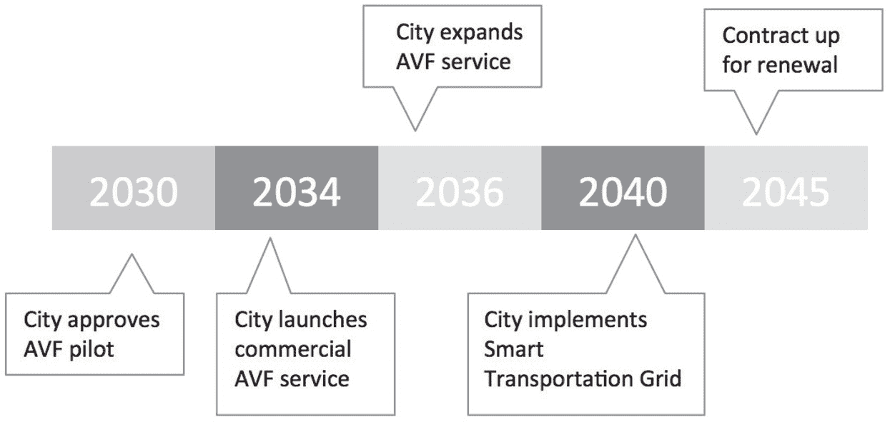

**图 8.3** 自动驾驶车队 (AVF) 服务演进时间线

该协议采取渐进方法，从少数原型开始，随着时间的推移扩大，提供自动驾驶汽车、客面包车和巴士以增强现有的通勤交通系统。2036 年签署了第二份协议以扩大车队规模；随后在 2040 年，城市各种公共交通系统的监控和控制整合进单一智能交通网（见图 8.3 所示的时间线）。

## 2030 年：城市批准 AVF 试点

2030 年，城市与自动驾驶财团签署了为期 15 年的独家服务水平协议（SLA）。财团资助车队的初期和运营成本，以换取权利：

*   收集乘客数据
*   根据城市规定的价格表收取乘客费用
*   向乘客提供广告和其他数字服务以获得直接或间接补偿

财团同意：

*   向城市提供从用户注册和通勤模式中收集的交通流数据和乘客数据
*   协助城市实施公共事务客户关系管理（PA-CRM）服务，分析 AVF 数据
*   与城市合作优化市中心的交通流
*   增加“VIP”服务级别，优先为城市高级官员及其指定人员提供接送时间和路线

AVF 收集的特定交通相关数据如图 8.4 所示。

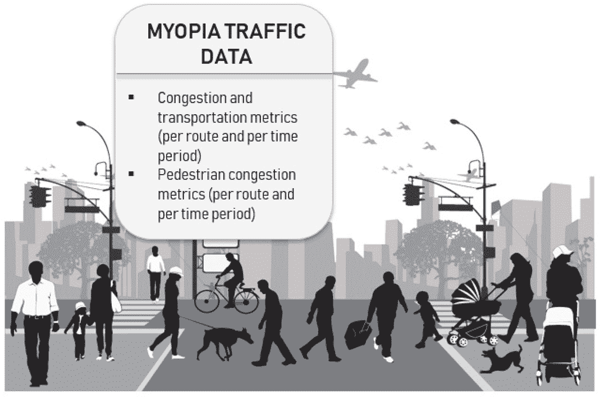

**图 8.4** 自动驾驶车队 (AVF) 服务收集的交通数据

此外，城市同意：

*   为使用 AVF 的市中心居民、小型企业和公司提供税收激励
*   将市中心可用的公共停车场结构减少一半
*   逐步消除现有的破旧公交网络，用 AVF 客运面包车和巴士代之
*   向 AVF 服务提供商保证州和地方层面的税收激励

所有 AVF 车辆都配备了内外摄像头系统和语音激活软件，此外还有雷达、激光雷达（Lidar）、WiFi、5G 和 GPS。每辆车都保持云连接，以及与周围其他车队车辆的连接。这为每辆车提供了实时交通流信息，并允许数据发送到云端进行额外数据分析。这些数据被用于建模和预测未来的交通模式，并将用于优化车队分布和交通灯时序。除了 AVF 收集的交通数据外，AVF 车辆和用户注册系统还收集图 8.5 所示的用户数据。

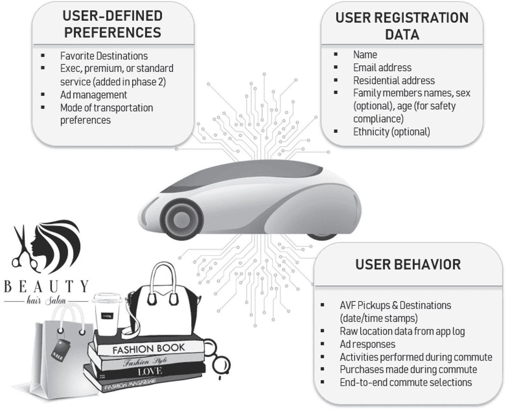

**图 8.5** 自动驾驶车队 (AVF) 服务收集的用户数据

乘客必须下载并注册 AVF 才能使用 AVF 服务。应用程序的注册过程收集个人数据和用户偏好，有助于 AVF 服务提供良好的用户体验。用户还被要求同意使用条款，其中包括提到与关联方共享数据的隐私协议。这些关联方未具体指名，但包括 Myopia 市政府、财团所有成员、市中心当地企业以及付费获取用户画像数据的各种利益集团。用户还许可了访问手机中的服务。应用程序会维护用户位置的持续活动日志，无论用户是否正在寻求交通工具。该日志定期发送到云端，并用于完善用户画像和资源规划。用户注册流程完成后，通勤者使用应用程序发起 AVF 交通请求。

每辆车内的内部摄像头和语音激活系统会监控乘客的活动和对话。这有助于 AVF 服务确定如何与乘客互动，以吸引他们关注根据其生活方式和兴趣定制的产品和服务。AVF 服务利用这些数据与用户通勤沿途的当地企业合作，将企业与潜在客户匹配。

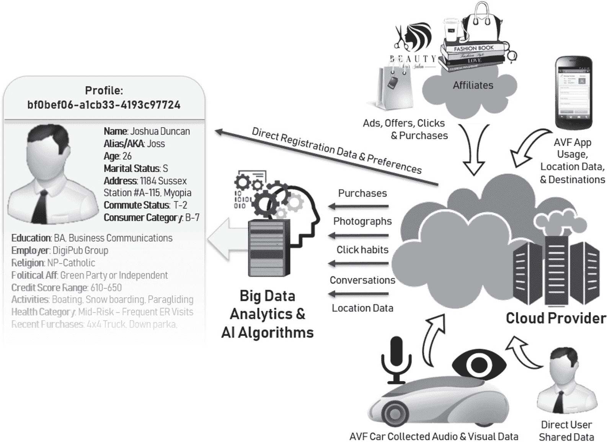

**图 8.6** AVF 用户画像

AVF 服务从每个注册乘客处收集用户数据并创建用户画像。图 8.6 展示了用户画像。画像数据来自多种来源，包括注册信息；用户偏好；应用程序从用户与广告和旅行请求交互中收集的数据；以及车队从内部摄像头、外部摄像头和语音激活系统收集的数据。画像还包括从原始数据中推出的信息。例如，访问心脏科医生可以推断可能有心脏问题，或至少对心脏健康的关注，而访问宠物收容所则意味着对动物感兴趣。

当 AVF 试点车队忙于收集为其 AI 算法所需的海量数据时，财团的数据分析部门承担了一个侧面项目：为 Myopia 的 IT Staff 提供咨询，协助实施公共事务客户关系管理（PA-CRM）系统。通过 PA-CRM，市官员可以轻松地访问并分析来自多个不同市政数据库的数据，包括由 AVF 提供的交通和用户数据。仪表板和易于使用的自定义报告界面让员工在获得访问控制权限后，只需几次鼠标点击，即可将 AVF 用户配置数据与从各个市机构收集的数据关联起来。知识就是力量，而现在它已掌握在职业政客的指尖（参见图 8.7）。

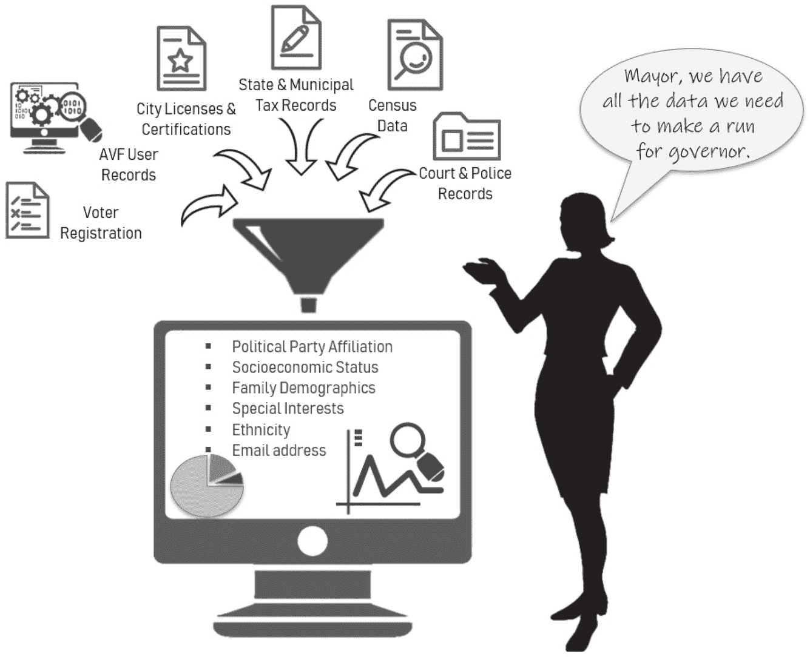

**图 8.7** Myopia 数据分析——政家的宝库

## 2034 年：城市启动商业 AVF 服务

到目前为止，车队规模还很小。对于商业化启动，车队规模扩大，应用程序也得到了更新。此外，AVF 服务现在已经拥有了大量的本地业务合作伙伴关系。更新后的应用程序现在提供了多种端到端的通勤选项（如果可用），并列出了每个选项的预估到达时间。这些选项包含了将 AVF 服务与其他公共交通模式和步行路段相结合的路线。因此，乘客可能会选择，例如，全程使用 AVF，或者步行到 AVF 多人“随上随下”区域以节省费用，又可能乘坐通勤火车进入市区，让 AVF 车辆在车站接应他们，完成通往办公室的“最后一公里”路程。每个选项都带有预估的到达时间和成本展示。

应用程序的另一个新功能是增加了数字钱包和数字货币支付选项。财团基于一种著名的区块链加密货币创建了一种私有网络加密货币。他们还建立了自己的加密货币交易所。这意味着他们控制了新币的所有挖矿操作，以确保货币价值不发生波动。

AVF 服务进入完全商业模式后不久，Myopia 市市的企业收入有所增长。通过与 AVF 应用程序上的广告、优惠和预订选项互动，通勤者可以从当地企业订购商品，并在沿途中等候他们——温度适宜的食物和饮料、杂货、干洗和洗漱用品都会在需要前几刻才包装，就像通勤者自己花时间去购物和排队一样——这一切都是通过应用程序安排和购买的。

地理围栏的使用触发了沿途实时优惠，使当地餐厅、美甲店、按摩诊所和其他服务供应商能够吸引更多客户并减少员工空闲时间。对当地经济的提升对于 Myopia 的财政及其居民来说是大胜利。

Myopia 的交通工程师利用来自 AVF 服务提供者的流量数据和建议来修改交通灯配置、确定道路维护的最佳时间、拟定街道拓窄/新路线及单行道方案，并增强其他公共交通服务。

Myopia 市议会和其他地方机构将 AVF 服务提供的乘客数据作为城市规划计划的输入，例如新住宅开发、公园和时尚零售热点。他们现在还拥有所有使用该服务的居民的电子邮箱。这为城市提供了一种廉价且便利的接触市民的方式。此外，AVF 乘客和交通数据被提供给州政府用于州级的类似活动，而部分交通数据则提供给环保署（EPA）和联邦运输机构。^(\*)

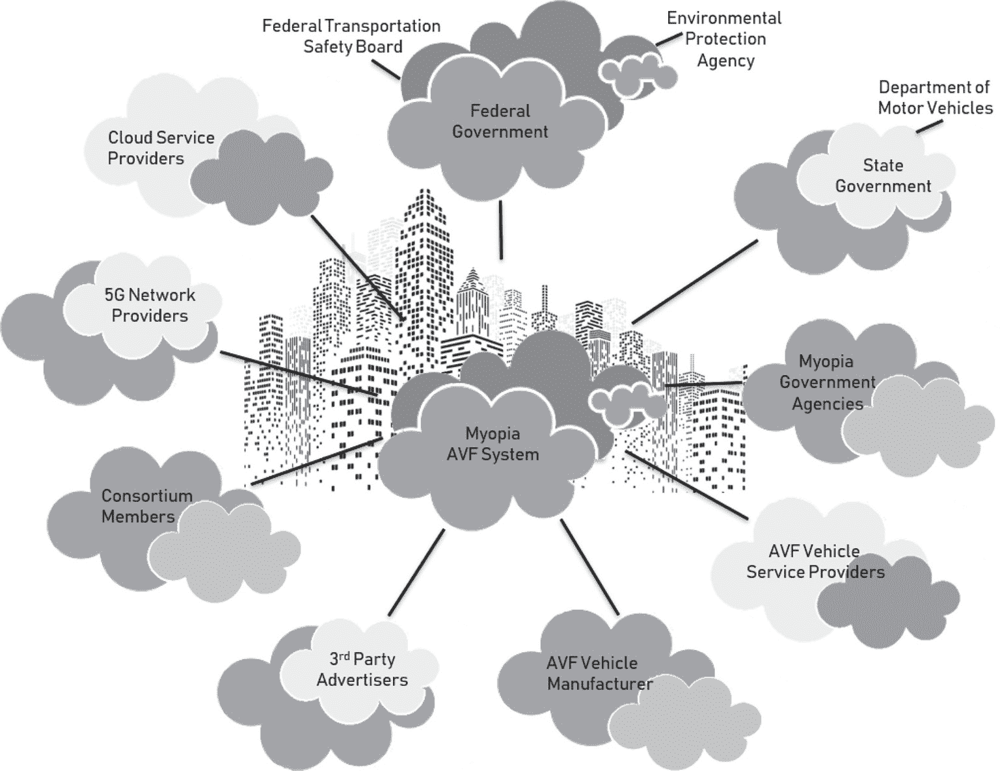

**图 8.8** 潜在自动驾驶车队 (AVF) 和 Myopia 关联机构

图 8.8 显示了 AVF 服务提供者与 Myopia 共享信息的各种合作伙伴和机构。

## 2036 年：城市扩展 AVF 服务

在 AVF 商业运营后的 24 个月内，城市能够将几个市中心的停车场重新分区为急需的住宅和商业空间，交通拥堵减少了 21%，空气质量提升了 16%，市区的交通事故减少了 33%。^(\*)。市区居民和企业对 AVF 持好态度。该计划非常成功，市议会想要扩展 AVF。财团同意，前提是在 SLA（服务水平协议）中增加以下条款：


# 执行级和高级交通选项

- 执行级和高级交通选项——价格不受城市监管；城市的 VIP 级别仍将是最高优先级的服务级别。
- 将市中心公共停车位再减少 25%，以进一步增加对 `AVF` 的需求。
- 在距离市中心 10 英里处增加几个“停换式”停车场，由市付费。
- 市中心交通灯的控制权移交给 `AVF` 服务提供者。
- 由于需求不足已经受限的出租车服务将在 10 英里的市中心范围内被消除。

这些新条款使得 `AVF` 服务能够更好地针对中产阶级以上及富人群以获取额外收入。执行级和高级服务使用升级后的车辆，并拥有更快的接送和通勤时间。

随着更多市中心停车场转换为住宅空间，以及中心城市走廊边缘开放了新的“停换式”停车场，对 `AVF` 的需求日益增加。`AVF` 应用程序成为市区许多居民和通勤者的必要工具。它对最佳通勤路线的按需规划，以及其提供商品和服务选项的能力，显著减少了用户的个人“待办事项”——创造了一个忠实的粉丝群。

`AVF` 服务提供者现在能够说服市议会将交通灯控制权交给他们。他们还提出了一项将 `AVF` 服务演变为“智能交通网”的计划，其中所有的公共交通系统和交通控制应用程序将通过单一平台管理，运行能够实时适应交通变化和紧急服务需求的人工智能算法。该市热烈地接受了这一计划。

## 2038 年：事有异常

在 `AVF` 推出扩展服务方案后大约两年，标准服务的用户开始抱怨通勤时间变长、路线选择减少。他们坚持认为标准车型行驶的路线比以前更具偶然性，而且在以标准 `AVF` 车辆为主的路线上，交通灯红灯时间更长。相比之下，以升级车辆为主的路线享有更长的绿灯——这实际上使它们变成了优先路线。此外，升级车辆似乎垄断了穿过高端购物区的路线。市议会对对此完全归结为服务需求的增长。然而，在接受财经新闻媒体采访时，一位财团 CEO 讨论了加速增长的收入潜力——引用了高级和执行级车辆占总车队的三分之一。

新闻文章报道了这些观察，并对人工智能交通网的明智表示质疑。这类故事出现在当地报纸上：

> 一位希望保持匿名的单亲妈妈在市中心金融区的一家豪华酒店担任家政服务。今天早上，她接到了学校护士的电话；女儿出现了类似流感的症状，需要提前接接。在通常情况下，妈妈通常会使用 `AVF` 微型巴士服务。但今天，她想尽快赶到女儿，于是请求了一辆标准单人车。走到路边时，一位班主管也出现在那里——他正使用 `AVF` App 发出类似的请求。五分钟后，那位班主管开着一辆升级版的 `AVF` 车辆离去。单亲妈妈又等了几分钟。学校在正东 4.5 英里处，但汽车却向南开了五个街，然后以东北方的之字形轨迹行驶——似乎特意绕开了直达金融区的路线——根据她手机地图应用显示，这让她的通勤时间增加了 10 分钟。当她接到女儿时，她再次请求了标准单人车选项。回家的路上，女儿抱怨胃部剧痛，于是她请求更改目的地到急诊中心。车辆靠边停车，让她下车重新请求路线。她和生病的女儿再次等待，这次等了 7 分钟，才有另一辆车接她们去两英里外的诊所。…… `AVF` 的发言人向公众保证，这只是一个故障，很快就会得到纠正。

这类故事背后，有几十甚至上百个未被报道的故事，因为只有 AI 算法完全“感知”到了这种待遇不公。例如，将单亲妈妈的经历与市长的女儿进行对比，后者和她的闺蜜们有一个“紧迫”的购物约会。她只等了三分钟就有车，而且在前往购物区的四英里行程中一路绿灯。此外，另一位在同一栋高层大楼工作的商务高管和一位银行经理在大约同一时间请求了优质服务，前往同一家餐厅参加互不相关的午餐约会。商务高管先接到了车，因为 `AVF` 服务从她交易中产生的收益比银行经理的多。

`AVF` 服务本是为了让每个人的生活变得更好，现在似乎成了新阶级战争冲突的催化剂。对于那些初衷良好的工程师来说，这是一个令人沮丧的打击。他们立即投入到设计更新和算法重新训练中，但重新设计和修改代码的前行可能会引入其他不可预见的副作用——更不用说昂贵的代价了。

> 我们如何避免成为下一次阶级战争冲突的设计师和建筑师？首先，我们必须促进并保护健康的竞争——参见“2045 年：`AVF` 合同到期更新”章节中开放架构的插图。此外，我们可以使用《隐私策略手册》（见下文）以及`第 9 章`中的隐私机制，来更好地控制用于训练深度学习算法的数据类型。而且，大学环境中的数据科学家和 AI 研究人员是培养智库的理想场所，让来自不同专业领域和背景的人士可以与科学家和技术人员并肩工作，为智慧城市制定设计规范。医生、科学家、技术人员、政治家、慈善家、历史学家、心理学家和经济学家都应该参与其中。他们的建议应当公开。

## 民兵

顺便提一下，`AVF` 服务对某些人无效。^*

我们如何避免成为下一次阶级战争冲突的设计师和建筑师？首先，我们必须促进并保护健康的竞争——参见“2045 年：`AVF` 合同到期更新”章节中开放架构的插图。此外，我们可以使用《隐私策略手册》（见下文）以及`第 9 章`中的隐私机制，来更好地控制用于训练深度学习算法的数据类型。而且，大学环境中的数据科学家和 AI 研究人员是培养智库的理想场所，让来自不同专业领域和背景的人士可以与科学家和技术人员并肩工作，为智慧城市制定设计规范。医生、科学家、技术人员、政治家、慈善家、历史学家、心理学家和经济学家都应该参与其中。他们的建议应当公开。

`AVF` 服务本是为了让每个人的生活变得更好，现在似乎成了新阶级战争冲突的催化剂。对于那些初衷良好的工程师来说，这是一个令人沮丧的打击。他们立即投入到设计更新和算法重新训练中，但重新设计和修改代码的前行可能会引入其他不可预见的副作用——更不用说昂贵的代价了。

我们如何防止成为下一次阶级战争冲突的设计师和建筑师？首先，我们必须促进并保护健康的竞争——参见“2045 年：`AVF` 合同到期更新”章节中开放架构的插图。此外，我们可以使用《隐私策略手册》（见下文）以及`第 9 章`中的隐私机制，来更好地控制用于训练深度学习算法的数据类型。而且，大学环境中的数据科学家和 AI 研究人员是培养智库的理想场所，让来自不同专业领域和背景的人士可以与科学家和技术人员并肩工作，为智慧城市制定设计规范。医生、科学家、技术人员、政治家、慈善家、历史学家、心理学家和经济学家都应该参与其中。他们的建议应当公开。

我们如何防止成为下一次阶级战争冲突的设计师和建筑师？首先，我们必须促进并保护健康的竞争——参见“2045 年：`AVF` 合同到期更新”章节中开放架构的插图。此外，我们可以使用《隐私策略手册》（见下文）以及`第 9 章`中的隐私机制，来更好地控制用于训练深度学习算法的数据类型。而且，大学环境中的数据科学家和 AI 研究人员是培养智库的理想场所，让来自不同专业领域和背景的人士可以与科学家和技术人员并肩工作，为智慧城市制定设计规范。医生、科学家、技术人员、政治家、慈善家、历史学家、心理学家和经济学家都应该参与其中。他们的建议应当公开。

我们如何防止成为下一次阶级战争冲突的设计师和建筑师？首先，我们必须促进并保护健康的竞争——参见“2045 年：`AVF` 合同到期更新”章节中开放架构的插图。此外，我们可以使用《隐私策略手册》（见下文）以及`第 9 章`中的隐私机制，来更好地控制用于训练深度学习算法的数据类型。而且，大学环境中的数据科学家和 AI 研究人员是培养智库的理想场所，让来自不同专业领域和背景的人士可以与科学家和技术人员并肩工作，为智慧城市制定设计规范。医生、科学家、技术人员、政治家、慈善家、历史学家、心理学家和经济学家都应该参与其中。他们的建议应当公开。

我们如何防止成为下一次阶级战争冲突的设计师和建筑师？首先，我们必须促进并保护健康的竞争——参见“2045 年：`AVF` 合同到期更新”章节中开放架构的插图。此外，我们可以使用《隐私策略手册》（见下文）以及`第 9 章`中的隐私机制，来更好地控制用于训练深度学习算法的数据类型。而且，大学环境中的数据科学家和 AI 研究人员是培养智库的理想场所，让来自不同专业领域和背景的人士可以与科学家和技术人员并肩工作，为智慧城市制定设计规范。医生、科学家、技术人员、政治家、慈善家、历史学家、心理学家和经济学家都应该参与其中。他们的建议应当公开。

我们如何防止成为下一次阶级战争冲突的设计师和建筑师？首先，我们必须促进并保护健康的竞争——参见“2045 年：`AVF` 合同到期更新”章节中开放架构的插图。此外，我们可以使用《隐私策略手册》（见下文）以及`第 9 章`中的隐私机制，来更好地控制用于训练深度学习算法的数据类型。而且，大学环境中的数据科学家和 AI 研究人员是培养智库的理想场所，让来自不同专业领域和背景的人士可以与科学家和技术人员并肩工作，为智慧城市制定设计规范。医生、科学家、技术人员、政治家、慈善家、历史学家、心理学家和经济学家都应该参与其中。他们的建议应当公开。

我们如何防止成为下一次阶级战争冲突的设计师和建筑师？首先，我们必须促进并保护健康的竞争——参见“2045 年：`AVF` 合同到期更新”章节中开放架构的插图。此外，我们可以使用《隐私策略手册》（见下文）以及`第 9 章`中的隐私机制，来更好地控制用于训练深度学习算法的数据类型。而且，大学环境中的数据科学家和 AI 研究人员是培养智库的理想场所，让来自不同专业领域和背景的人士可以与科学家和技术人员并肩工作，为智慧城市制定设计规范。医生、科学家、技术人员、政治家、慈善家、历史学家、心理学家和经济学家都应该参与其中。他们的建议应当公开。

我们如何防止成为下一次阶级战争冲突的设计师和建筑师？首先，我们必须促进并保护健康的竞争——参见“2045 年：`AVF` 合同到期更新”章节中开放架构的插图。此外，我们可以使用《隐私策略手册》（见下文）以及`第 9 章`中的隐私机制，来更好地控制用于训练深度学习算法的数据类型。而且，大学环境中的数据科学家和 AI 研究人员是培养智库的理想场所，让来自不同专业领域和背景的人士可以与科学家和技术人员并肩工作，为智慧城市制定设计规范。医生、科学家、技术人员、政治家、慈善家、历史学家、心理学家和经济学家都应该参与其中。他们的建议应当公开。

我们如何防止成为下一次阶级战争冲突的设计师和建筑师？首先，我们必须促进并保护健康的竞争——参见“2045 年：`AVF` 合同到期更新”章节中开放架构的插图。此外，我们可以使用《隐私策略手册》（见下文）以及`第 9 章`中的隐私机制，来更好地控制用于训练深度学习算法的数据类型。而且，大学环境中的数据科学家和 AI 研究人员是培养智库的理想场所，让来自不同专业领域和背景的人士可以与科学家和技术人员并肩工作，为智慧城市制定设计规范。医生、科学家、技术人员、政治家、慈善家、历史学家、心理学家和经济学家都应该参与其中。他们的建议应当公开。

我们如何防止成为下一次阶级战争冲突的设计师和建筑师？首先，我们必须促进并保护健康的竞争——参见“2045 年：`AVF` 合同到期更新”章节中开放架构的插图。此外，我们可以使用《隐私策略手册》（见下文）以及`第 9 章`中的隐私机制，来更好地控制用于训练深度学习算法的数据类型。而且，大学环境中的数据科学家和 AI 研究人员是培养智库的理想场所，让来自不同专业领域和背景的人士可以与科学家和技术人员并肩工作，为智慧城市制定设计规范。医生、科学家、技术人员、政治家、慈善家、历史学家、心理学家和经济学家都应该参与其中。他们的建议应当公开。

我们如何防止成为下一次阶级战争冲突的设计师和建筑师？首先，我们必须促进并保护健康的竞争——参见“2045 年：`AVF` 合同到期更新”章节中开放架构的插图。此外，我们可以使用《隐私策略手册》（见下文）以及`第 9 章`中的隐私机制，来更好地控制用于训练深度学习算法的数据类型。而且，大学环境中的数据科学家和 AI 研究人员是培养智库的理想场所，让来自不同专业领域和背景的人士可以与科学家和技术人员并肩工作，为智慧城市制定设计规范。医生、科学家、技术人员、政治家、慈善家、历史学家、心理学家和经济学家都应该参与其中。他们的建议应当公开。

我们如何防止成为下一次阶级战争冲突的设计师和建筑师？首先，我们必须促进并保护健康的竞争——参见“2045 年：`AVF` 合同到期更新”章节中开放架构的插图。此外，我们可以使用《隐私策略手册》（见下文）以及`第 9 章`中的隐私机制，来更好地控制用于训练深度学习算法的数据类型。而且，大学环境中的数据科学家和 AI 研究人员是培养智库的理想场所，让来自不同专业领域和背景的人士可以与科学家和技术人员并肩工作，为智慧城市制定设计规范。医生、科学家、技术人员、政治家、慈善家、历史学家、心理学家和经济学家都应该参与其中。他们的建议应当公开。

我们如何防止成为下一次阶级战争冲突的设计师和建筑师？首先，我们必须促进并保护健康的竞争——参见“2045 年：`AVF` 合同到期更新”章节中开放架构的插图。此外，我们可以使用《隐私策略手册》（见下文）以及`第 9 章`中的隐私机制，来更好地控制用于训练深度学习算法的数据类型。而且，大学环境中的数据科学家和 AI 研究人员是培养智库的理想场所，让来自不同专业领域和背景的人士可以与科学家和技术人员并肩工作，为智慧城市制定设计规范。医生、科学家、技术人员、政治家、慈善家、历史学家、心理学家和经济学家都应该参与其中。他们的建议应当公开。

我们如何防止成为下一次阶级战争冲突的设计师和建筑师？首先，我们必须促进并保护健康的竞争——参见“2045 年：`AVF` 合同到期更新”章节中开放架构的插图。此外，我们可以使用《隐私策略手册》（见下文）以及`第 9 章`中的隐私机制，来更好地控制用于训练深度学习算法的数据类型。而且，大学环境中的数据科学家和 AI 研究人员是培养智库的理想场所，让来自不同专业领域和背景的人士可以与科学家和技术人员并肩工作，为智慧城市制定设计规范。医生、科学家、技术人员、政治家、慈善家、历史学家、心理学家和经济学家都应该参与其中。他们的建议应当公开。

我们如何防止成为下一次阶级战争冲突的设计师和建筑师？首先，我们必须促进并保护健康的竞争——参见“2045 年：`AVF` 合同到期更新”章节中开放架构的插图。此外，我们可以使用《隐私策略手册》（见下文）以及`第 9 章`中的隐私机制，来更好地控制用于训练深度学习算法的数据类型。而且，大学环境中的数据科学家和 AI 研究人员是培养智库的理想场所，让来自不同专业领域和背景的人士可以与科学家和技术人员并肩工作，为智慧城市制定设计规范。医生、科学家、技术人员、政治家、慈善家、历史学家、心理学家和经济学家都应该参与其中。他们的建议应当公开。

我们如何防止成为下一次阶级战争冲突的设计师和建筑师？首先，我们必须促进并保护健康的竞争——参见“2045 年：`AVF` 合同到期更新”章节中开放架构的插图。此外，我们可以使用《隐私策略手册》（见下文）以及`第 9 章`中的隐私机制，来更好地控制用于训练深度学习算法的数据类型。而且，大学环境中的数据科学家和 AI 研究人员是培养智库的理想场所，让来自不同专业领域和背景的人士可以与科学家和技术人员并肩工作，为智慧城市制定设计规范。医生、科学家、技术人员、政治家、慈善家、历史学家、心理学家和经济学家都应该参与其中。他们的建议应当公开。

我们如何防止成为下一次阶级战争冲突的设计师和建筑师？首先，我们必须促进并保护健康的竞争——参见“2045 年：`AVF` 合同到期更新”章节中开放架构的插图。此外，我们可以使用《隐私策略手册》（见下文）以及`第 9 章`中的隐私机制，来更好地控制用于训练深度学习算法的数据类型。而且，大学环境中的数据科学家和 AI 研究人员是培养智库的理想场所，让来自不同专业领域和背景的人士可以与科学家和技术人员并肩工作，为智慧城市制定设计规范。医生、科学家、技术人员、政治家、慈善家、历史学家、心理学家和经济学家都应该参与其中。他们的建议应当公开。

我们如何防止成为下一次阶级战争冲突的设计师和建筑师？首先，我们必须促进并保护健康的竞争——参见“2045 年：`AVF` 合同到期更新”章节中开放架构的插图。此外，我们可以使用《隐私策略手册》（见下文）以及`第 9 章`中的隐私机制，来更好地控制用于训练深度学习算法的数据类型。而且，大学环境中的数据科学家和 AI 研究人员是培养智库的理想场所，让来自不同专业领域和背景的人士可以与科学家和技术人员并肩工作，为智慧城市制定设计规范。医生、科学家、技术人员、政治家、慈善家、历史学家、心理学家和经济学家都应该参与其中。他们的建议应当公开。

我们如何防止成为下一次阶级战争冲突的设计师和建筑师？首先，我们必须促进并保护健康的竞争——参见“2045 年：`AVF` 合同到期更新”章节中开放架构的插图。此外，我们可以使用《隐私策略手册》（见下文）以及`第 9 章`中的隐私机制，来更好地控制用于训练深度学习算法的数据类型。而且，大学环境中的数据科学家和 AI 研究人员是培养智库的理想场所，让来自不同专业领域和背景的人士可以与科学家和技术人员并肩工作，为智慧城市制定设计规范。医生、科学家、技术人员、政治家、慈善家、历史学家、心理学家和经济学家都应该参与其中。他们的建议应当公开。

我们如何防止成为下一次阶级战争冲突的设计师和建筑师？首先，我们必须促进并保护健康的竞争——参见“2045 年：`AVF` 合同到期更新”章节中开放架构的插图。此外，我们可以使用《隐私策略手册》（见下文）以及`第 9 章`中的隐私机制，来更好地控制用于训练深度学习算法的数据类型。而且，大学环境中的数据科学家和 AI 研究人员是培养智库的理想场所，让来自不同专业领域和背景的人士可以与科学家和技术人员并肩工作，为智慧城市制定设计规范。医生、科学家、技术人员、政治家、慈善家、历史学家、心理学家和经济学家都应该参与其中。他们的建议应当公开。

我们如何防止成为下一次阶级战争冲突的设计师和建筑师？首先，我们必须促进并保护健康的竞争——参见“2045 年：`AVF` 合同到期更新”章节中开放架构的插图。此外，我们可以使用《隐私策略手册》（见下文）以及`第 9 章`中的隐私机制，来更好地控制用于训练深度学习算法的数据类型。而且，大学环境中的数据科学家和 AI 研究人员是培养智库的理想场所，让来自不同专业领域和背景的人士可以与科学家和技术人员并肩工作，为智慧城市制定设计规范。医生、科学家、技术人员、政治家、慈善家、历史学家、心理学家和经济学家都应该参与其中。他们的建议应当公开。

我们如何防止成为下一次阶级战争冲突的设计师和建筑师？首先，我们必须促进并保护健康的竞争——参见“2045 年：`AVF` 合同到期更新”章节中开放架构的插图。此外，我们可以使用《隐私策略手册》（见下文）以及`第 9 章`中的隐私机制，来更好地控制用于训练深度学习算法的数据类型。而且，大学环境中的数据科学家和 AI 研究人员是培养智库的理想场所，让来自不同专业领域和背景的人士可以与科学家和技术人员并肩工作，为智慧城市制定设计规范。医生、科学家、技术人员、政治家、慈善家、历史学家、心理学家和经济学家都应该参与其中。他们的建议应当公开。

我们如何防止成为下一次阶级战争冲突的设计师和建筑师？首先，我们必须促进并保护健康的竞争——参见“2045 年：`AVF` 合同到期更新”章节中开放架构的插图。此外，我们可以使用《隐私策略手册》（见下文）以及`第 9 章`中的隐私机制，来更好地控制用于训练深度学习算法的数据类型。而且，大学环境中的数据科学家和 AI 研究人员是培养智库的理想场所，让来自不同专业领域和背景的人士可以与科学家和技术人员并肩工作，为智慧城市制定设计规范。医生、科学家、技术人员、政治家、慈善家、历史学家、心理学家和经济学家都应该参与其中。他们的建议应当公开。


我们如何防止成为下一次阶级战争冲突的设计师和建筑师？首先，我们必须促进并保护健康的竞争——参见“2045 年：`AVF` 合同到期更新”章节中开放架构的插图。此外，我们可以使用《隐私策略手册》（见下文）以及`第 9 章`中的隐私机制，来更好地控制用于训练深度学习算法的数据类型。而且，大学环境中的数据科学家和 AI 研究人员是培养智库的理想场所，让来自不同专业领域和背景的人士可以与科学家和技术人员并肩工作，为智慧城市制定设计规范。医生、科学家、技术人员、政治家、慈善家、历史学家、心理学家和经济学家都应该参与其中。他们的建议应当公开。

## 2040 年：城市实施智能网

市中心周围 10 英里的半径内禁止私家车。智能网现在管理所有电动公共交通工具，包括电动滑板车。^†](#ch08.xhtml#fn17)城市还决定使用联盟的加密货币进行所有市政相关交易。作为交换，联盟给予米亚波所有交易手续费的百分比。这对城市经理来说是一个好消息，为国库提供了急需的资金，这些资金随后被用于社会计划。市中心的居民开始看到更多的步行区和绿带出现，为联盟及其支持者赢得了无贵的声誉。

与此同时，待遇不公仍然是关注公民所提出的问题。这些公民中的一些成了关注灯下的常客，他们很快学会了搭他人的车。^‡](#ch08.xhtml#fn18)

2041 年，市中心农贸市场赞助了一场“保护有机农场”集会。计划参加的人报告早上`MySmart` App 出现问题，提到等待时间过长且路线不符合逻辑，增加了不必要的通勤时间。^(\*)](#ch09.xhtml#fn19) 不可说，集会的参与率很低。市将事件归咎于系统故障，并对不便表示歉意。向公众保证，市将与联盟合作解决问题。然而，阴谋论者很快指出，一家拥有强大游说部门的大型肥料公司总部位于米亚波。这引起了我们喜爱的义警技术人员的注意，他们恰好是当地有机食品爱好者。他们对公司首席执行官开了一些乐子。

2042 年，教师联盟决定罢工。他们计划在周六上午于市政厅台阶举行抗议。预计将有数千人参加。这次抗议引起了全州的报道，全州其他教师也正打算效仿。然而，对于一位考虑竞选州长的权势市长来说，大规模的参与人数将是一次负面宣传。但是，这位市长以其解决问题的能力和应急计划而闻名，“少数”不满的教师并不会阻碍他的政治抱负。他打算确保这种抗议永远不会发生。

周六上午，`MySmart` App 拒绝了市政厅周围 10 街区范围内的所有请求。App 消息显示如下：“由于请求区域内未经许可的抗议，您的交通预订无法处理。给您带来不便，我们深表歉意。请稍试。”

> 一个忽视教育的基层政客怎么可能操纵智能交通系统？有什么主意吗？嗯，简单的方法是使用（或者在这种情况下是滥用）它的应急服务子系统。该子系统可能是根据如美国国土安全部（DHS）等国家机构提供的指南和规范设计的。应急服务子系统将具有优先级覆盖能力，使其能够重新路由交通、仅为应急车辆生成优先路线，并接管智能城市的其他各种子系统。应急子系统应该如何治理？使用经过加密签名的授权令牌，这些令牌只能由至少两名授权且独立的州和市级官员生成，并且令牌应由系统软件通过硬件信任根进行验证，而这些信任根是 IT 管理员无法破坏或更改的。

对市长能如此有效地关闭他们的抗议感到愤怒，几位教师坐在市中心一家临街咖啡馆的开放露台空间里。他们喝着拿铁安慰自己，并脑风出了一个对电网——以及市长进行报复的计划。他们将计划提交给了教师联盟，并迅速分发给所有联盟成员。该计划涉及在下一个工作日驾驶私车进入市中心 10 英里的区域——利用它们封锁整个市区域的`AVF`交通。

在凌晨时分，教师们、他们的配偶和朋友，以及一些过度热情的青少年司机全部冲向了迈派比亚亚（Myopia）中心，决心制造交通拥堵的混乱——这模糊地很像《疯狂麦克斯：狂暴废土》中的场景。混乱随之而来——对于幼儿园老师来说这只是小家常，但对于试图开始日常运营的市中心企业来说，却是疯狂的歇斯底里。警察被召来，车辆被扣押，小孩子们在晚间新闻中看到喜爱的老师被捕时哭泣，而书呆的少年们在看到体育老师因反抗逮捕而被扑倒时在欢呼。几乎所有的教师在收到警告后被释放，许多人支付了罚金以取回被扣押的汽车。然而，头目被起诉。他们在市中心咖啡馆对话的录音在新闻推送中播放，这要感谢咖啡馆露台旁灯柱上的一台智能城市监控摄像头。

整座城市处于震惊和愤怒中：人们被拒绝交通服务，私人对话在公共场所被录音？！这并不是城市在同意扩大`AVF`服务时所预期的。针对市和财团（Consortium）的诉讼接之而来，但在`MySmart` App 用户协议深处包含了涵盖财团行为的条款。迈派比亚公民除了同意协议条款外还能做什么并不重要——或者真的如此吗？法院将做出决定。联邦层面的政客将介入，但有效的改变不仅需要多年的诉讼，还需要一个愿意跨党合作的国会。

## 2045 年：AVF 合同到期更新

迈派比亚的公民要求拆除`AVF`智能交通网，并希望其他的自动驾驶车队提供商能够公平地进入市中心。他们还希望确保低收入人士能够公平地获得通勤路线。

现在，如果智能交通网是基于具有定义接口的开放平台架构构建的，那么迈派比亚可能通过启用其他竞争性的交通选择来安抚公民。但迈派比亚这个名字起得贴切，它已经挖了一个难以爬脱的深坑。

> 你知道重新利用一个控制整个智能交通网或智能城市的定制 AI 系统会有多困难吗？我不认为有人真的知道——如果可能的话，最好避免这种情况。这就是为什么具有针对 AI 算法、数据分析和其他系统资产的定义接口的开放平台架构至关重要。它们将实现急需的竞争并在架构中引入纪律。

## 8.7 深度伪造（Deepfake）与物联网（IoT）

深度伪造对政治选举的威胁已成为美国和欧洲一些高级领导人的关注焦点，成立了一个专门采取行动减轻其影响的联盟。2017 年，丹麦前首相安德斯·福格·拉斯穆森和美国前国土安全部部长（DHS）迈克尔·切托夫在民主联盟基金会下创立跨大西洋选举诚信委员会。该委员会最近资助开发了一个检测深度伪造的工具。

DARPA 的`MediFor`项目也通过资助在深度伪造检测中使用深度学习的大学和公司来解决这一问题。

深度伪造（Deepfake）已成为首选的流行术语，用于描述使用一种称为深度学习的 AI 子集和大量真实的源图像，将虚假图像叠加到原始图像上对源图像和视频进行篡改。最终结果可以是真实的虚假视频或图像，描绘一个人执行其现实中从未做过的动作。

这个流行术语源于 Reddit 用户的一个匿名用户名`Deepfakes`，这是他或她对词汇的巧妙运用——来自深度学习的“deep”（深度）和代表虚假产品的“fake”（虚假）。词汇不是那个显然非常孤独且误入歧途的 Deepfakes 玩的东西。Deepfakes 粗俗的艺术和娱乐想法在发布后不久很快被 Reddit 封禁。这是一个 PG 级限制的章节，所以我将不再详细阐述。遗憾的是，Reddit 移除 Deepfakes 内容的速度不够快，以防止整个社区在无意中（或可能是故意的）通过命名这种 AI 图像篡改技术来向 Deepfakes 致敬。

制作 Deepfakes（深度伪造）并不需要高超技巧。得益于一些精巧的软件，这正变成一种小孩子的游戏，名人和政治家将不再是唯一的受害者。心心破碎的青少年、深陷竞争的学生、被蔑视的配偶以及竞争性的企业，都能制作出他们想要毁掉的名誉的人的真实图像。基于 AI 的图像编辑工具（如使用 Google 的 AI 框架`TensorFlow`的`FakeApp`）使得几乎任何人都能制作出各种质量的深度伪造。`Adobe`也在其`Adobe Sensei™`技术中使用了深度学习来增强其编辑工具。当然，这些工具的设计初衷并非恶意，而是为了赋予初学者像专业人士一样表达自我和创建渲染的能力。然而，正如一位遥远星系的著名小绿大师可能会说的那：“它们会被滥用的。”

随着`IoT`驱动的智慧城市的演进，视频和音频监控单元将无处不在，提供生成信服深度伪造所需的量的图像和音频。如果没有从源头到存储的加密完整性保护，检测此类伪造将非常耗时，且可能无法得出结论。设计这些工具的工程师可以在图像、视频和音频中加入水印（一种加密完整性保护），以使篡改检测更容易。例如，`Truepic Inc.`制作了一个应用程序，能够对图像和视频进行真实性认证，并提供了一个用于照片取证的`SDK`（参见 [www.truepic.com](http://www.truepic.com)）。然而，与所有网络安全相关的事务一样，这是一场升级的军备竞赛，深度伪造工具将不断进化以规避检测，而检测工具也将不断进化以识别出它们。

## 8.8 从智能家、短视症和深度伪造中学习

正如第一个场景以及整个“智慧城市故事”中所述的，推进智能`IoT`系统具有许多益处，同样也存在许多风险。通过确保健康竞争并制定敏捷且几乎上与被监管系统一样智能的法规，可以减少许多风险。但行业并不能仅仅依靠政府来解决此场景中描述的挑战。法规无法检测深度伪造，无法在思考上胜深度学习算法，也无法限制内部人员造成伤害的能力。但也许你，工程师，可以。如果工程师和技术高管致力于理解风险，并投入时间和资源来解决问题，那么智能`IoT`系统对社会的益处就像手机对减少全球贫困一样大。然而，如果这个行业不小心，第四次工业革命的开启将导致战争——这是一场阶级战争，而且几乎没有逃之机。

本书的其他作者和我共同认识了该领域的数百名工程师，我们并不认为他们中的任何一个，或者你，想要参与歧视、拒绝服务或阶级战争。意识、知识和规划将对智能`IoT`系统的未来结果产生巨大影响。本书的作者对`IoT`工程集体充满信心——这些是数字生态系统极具天赋的创造者。我们有信心，用于设计这个生态系统的创造才华也可以找到保护社会免受其意外后果的方法。

## 8.9 隐私策略手册

现在让我们关注架构师如何暴露其系统中的隐私问题，并在问题暴露后采取措施来缓解它们。

插图中的“隐私策略手册”是一份指南，可以在产品生命周期的规划和架构阶段暴露隐私问题。该手册的目标是在使用最少资源成本的同时，实现上市时间目标，生成一个具有适当隐私缓解措施的`IoT`架构。

由于人类大脑倾向于更容易记住非常的事而非平凡的事，因此隐私策略手册在用词上经过了刻意。隐私策略手册的步骤在以下章节描述。

#### 8.9.1 引入“大白鲨”

每一个新设计或产品功能都必须经过“大白鲨评估”。这是由不与设计团队相关的个人（或人员）介入，从捕食者的角度审视设计，通过“撕碎”设计，目标是暴露尽可能多的误用和滥用场景。

大白鲨评审成功的关键在于执行评审员。Dave 的那位隐私专家朋友总是建议，被选参与评审的鲨中至少要有一个白帽黑客，最好兼具广度和深度经验。

这样的人并不总是容易找到，因为他们倾向于专注于特定的攻击向量，并在发现触手可得的果实后有停止分析的倾向。在我职业生涯的某个阶段，我会称这为懒惰，也许对某些人来说确实如此，但之后我变得老练了一些。所以我并不是不想在这里得罪任何黑客的羽毛；他们的行为更多是美国企业界“以少胜多”思想的副产物。白帽黑客和你一样时间紧迫。因此，可能需要两三个具有不同关注领域的黑客专家，你才能对你的产品实现适当的覆盖。如果你无法接触公司内部黑客，尝试使用未参与你项目的资深安全架构师，或者你可能接触到公司的一名安全研究人员。如果一切都失败了，每个组织都有那种为了生存而指出他人工作缺陷并热爱争论的人。我整个职业生涯做过最聪明的事情之一，就是发现如何利用这个人。我必须收下自尊，但与这位工程师进行初步评审并给予他足够的认可有助于使我所有的设计无懈可击，而这位争论者开始*支持*我的工作，而不是反对它。在很大程度上，我都要感谢他让我获得了一年的双倍晋升。所以，简而言之，一组不受你的设计的“纯粹才华”所吸引的、敏安全的新眼睛，将指出你视而不见的问题。

大白鲨评审会发生什么？作为架构师，你带领鲨鱼查看你的产品或功能，方式类似于第 5 章中描述的安全架构评审。这里的不同在于隐私是目标，而用户和管理员的误用是主要的攻击向量。鲨鱼分析产品或业务案例可能出错的所有方式，以揭示用户隐私的部分。需要对业务案例进行限制或创造性的变通处理，以确保隐私得到充分保护和保留。

这可能会有点疼，但你宁愿在前期遭受一点自尊上的痛苦（大家一周就会忘记），还是在两年后某个新出的大学生在你的作品上发布漏洞利用时，让你的声誉遭受巨大的痛苦？

#### 8.9.2 了解海盗阵容

除非你作为架构师，对隐私博弈中真正的对手是谁有全面的理解，否则“大白鲨”式的审查是行不通的。有些对手比其他对手更显显眼。了解“海盗”的名单将帮助你的团队在设计的隐私审查阶段推导出对等者画像（adversary personas）。你可以参考第 3 章以及关于网络犯罪动机的讨论来帮助你入门。

再次，白帽黑客可以帮助你理解某些会被你特定产品吸引的较明显的“海盗”，但咨询你所在人力资源（HR）部门的人员以及执法部门的朋友也有帮助。问问他们，如果他们拥有你正在创建的类型的数据和算法，他们的“海盗替身”会做什么。他们可以帮助你扩展对“什么是真正的海盗”的理解。


我没有将性掠夺者包含在海盗名单中。有更多令人作呕的词汇可以更好地描述这类社会偏态者。在你的威胁模型中为他们单独设立一个类别。必须考虑到他们，执法部门可以很大程度上帮助你的团队理解，这些掠夺者如何利用看似无害的数据来针对无辜者。`Dave` 的隐私专家朋友在进行隐私演示时，会用一张年轻女性站在房子前的照片照开始。她会要求观众告诉她在照片中看到了什么，然后她根据自己多年担任调查记者的经验，告诉他们掠夺者看到了什么。仅仅通过一张照片就能获得如此多的信息，这确实令人不安。

正如我从一个关于海盗社会的迷人巡展中发现的那样，海盗是一群复杂的群体，对外往往冷酷无情，但在内部却公正公平。事实上，在我们每个人心中都有一个小海盗。记得表 2.1 中的 IoT 攻击者画像吗？其中包含了内部人员。内部人员包括你和我。如果被允许访问一个能够对对手造成打击的生态系统，即使我们必须稍微扭曲规则，我们可能也会屈于诱惑。结论是：一个人不应该拥有那种权力。那么为什么不把这纳入你的设计中呢？为什么不要求多个个人来更改算法和系统配置？这本可以防止“近视市长”抑制抗议。

嘿，伙计们（`Arrr Matey`），黑客并不是你唯一需要关注的海盗。IoT 世界中的海盗可能是任何能够访问用户数据和算法的每一个人——甚至是你的对手，甚至包括你自己。了解这一点将极大地帮助你看到你所创造的技术被滥用的可能性。

## 8.9.3 相信数据的后世

我们对死后世的信仰可能不同，但我们都能同意，数字数据的寿命比我们大多数人想象的要长得多。数据尽管早已从我们的个人云账户中删除，但它们拥有活跃的后世，可能比我们的寿命更长。

在我的青少年时期，我是一个口齿伶俐、爱争辩的万事通，我母亲发誓我将来会成为一名优秀的出讼律师。我相信你们中的许多人能产生共，因为这些青少年特征在那些最终选择工程作为职业的人中似乎尤为常见。我在想，如果我那时说的某些话现在正漂浮在网络世界的某处——等着来纠扰我，我会感到多么尴尬。从那时起，我已经改变并进化了，我的大脑也完全髓鞘化^(\*)了。我想我在这一路上获得了更多的智慧，所以我感激我所有的英语作业都是纸质版提交的，而且社交媒体在我年轻时还不流行。你们中的许多人有孩子，或者很快就会有。你不希望他们因为大学期间在社交媒体上发布的某些内容而错失就业机会。IoT 生态系统正在从连接许多不同设备的摄像头和麦克风获取数据，因此捕捉到粗率言语或行为的风险很高。我们都不希望被自己最糟糕的一天永格化，也不希望我们的孩子遭受同样的命运。

通过向你架构的任何云服务添加数据寿命选项，可以提供保护。设置软件强制的策略，禁止某些类型内容的销售和分发，以及任何由大脑尚未完全髓鞘化的个人生成的内容。我知道青少年是一个利润的消费群体。我并不是要求任何人放弃对青少年的定向营销——随随你怎么监控他们的点击。我建议我们尊重他们的未来，以及他们的内容去向、他们与谁分享，以及内容保留多久。我们让他们，或者更好地，让他们的父母来控制。这些是正在写入许多法律中的基本原则，例如 `GDPR`，但它们还没有进入每一个国家，包括美国。是的，我们有 `COPPA`^(\*)。你读过它吗？这是为什么我们需要国会工程师的绝佳例子——那些真正构建过软件、运行过云并设计过安全功能的人。

我特别提到孩子，是因为如果我们公司的业务模式无法支持他们，我们确实应该成为变化的倡导者。但作为一个成年人，我经常在想，为什么我考虑使用的 `App` 不提供本地存储数据的选项。我的手机上有充足的可用内存。

如果我们回顾上面的“安全驾驶员”场景，该 `App` 可以重新设计以限制数据寿命，并在不牺牲 `App` 目标的情况下提供一层模糊性。当然，交通违规事件需要被收集并长期保存，但不相关的 `GPS` 日期/时间戳和其他遥测数据只需要收集有限的时间，并且不应出售或与第三方关联共享。在可能的情况下，收集层级指标而非特定信息项，也可以减少第三方实体关联不同数据源并推导出特定用户身份的能力。例如，在安全驾驶员 `App` 中，为了长期分析目的，可以收集每天的平均里程数，而不是特定路线。`App` 的设备可以统计司机每月经过的高风险路口数量，而不是特定的路口本身。这样，保险公司可以获得评估风险所需的信息，而不会暴露司机的个人习惯。

在构建下一个 `App` 或服务时，为用户提供本地和云存储选项，以及寿命和备份选项，将让数据的后世掌握在受影响的生命手中。

## 8.9.4 反抗命运

在第四次工业革命中，IoT 是其核心部分，结合预测分析、微定位、IoT 可穿戴设备、智能城市和万物互联的综合力量，少数精英控制大部分群体并预决定他们的命运是完全可能的。如果我们想把命运的问题交给哲学家和宗教教授，而不是留在政治家、公司和工程师手中，那么我们必须通过赋予个人选择和提供合法的用户选项来反抗命运。

正如“记住数据的后世”中所提到的，架构师应该提供关于数据持久化时长、存储位置（云端与本地驱动器）、谁有访问权限以及是否进行加密的选项。让用户决定是否存储频繁的目的地、追踪位置、对图片进行标记或在图像中识别人物，以及为图像存储哪些元数据。让用户控制发送到预测性算法的个人信息。数据加密应包含让用户控制谁拥有解密密钥的功能，防止数据被再次转发，以确保数据只流向用户意向的地方。

在保护自己的数字足迹方面，消费者一直处于缺位状态，但得益于源源不断的头条、诉讼和国会调查，这种情况正在发生变化，这些事件都围绕着用户数据滥用展开。只需在你喜爱的搜索引擎中输入“data misuse”（数据滥用），就能找到大量的例子。由于这种隐私意识的觉醒，去年欧盟批准了 `GDPR`（参见[第 9 章]中关于 `GDPR` 的讨论），对那些贪婪的数据巨头施加了严厉重击。

因此，既然消费者和整个政府都有了这些新认知，我们或许应该让消费者对个人数据的利用方式拥有选择权。如果你赋予用户对其个人数据存储和传播的选择权，他们会感谢你并对你忠诚。而且，你也将为反抗命运尽一份力。

## 8.9.5 隐藏沃尔多

“哪里找沃尔多”（`Where’s Waldo`）是 20 世纪 90 年代许多孩子、父母和寻宝爱好者的痴迷。我也不例外。在卡通人物海洋中寻找那件辨识度极高的红条衫，当沃尔多最终被发现时，那种娱乐感让人满足且充满胜利。啊，美好的时光！

好了，现在是时候进行某种角色对调了：我们不再是寻找沃尔多的人，而是需要把他藏起来，并且让他只在他想被发现时才被发现。直白地说，架构师需要寻找方法尽可能从数据分析引擎中隐藏用户的身份。数据看起来似乎是匿名化的，而且也应该是匿名化的，但通过与外部数据集交叉引用来进行数据去匿名化太容易了。例如，公共健康研究和衡量青少年购物趋势并不需要关联 `userID`。当然，你想管理客户，但你仍然可以限制 `customerID` 与所收集信息的关联方式（参见[第 9 章]中关于匿名化的讨论）。

也许，一想到我们的父母被诈骗、我们的青少年遭受网络欺凌，或者我们的配偶因为分析工具判定其未来癌症风险高而被拒绝健康保险，这可能正激励我们在可能时保护用户身份——而在大多数情况下，这样做是很有可能的。

## 8.9.6 剧本总结

[第 9 章]中讨论的隐私机制和方法论对于减少本章讨论的社会风险具有价值且必要，但它们无法考虑到世上所有可能的 IoT 生态系统变体，也无法提供所有的隐私缓解措施。因此，本剧本旨在催化架构团队以及整个公司内部一场急需的对话，以头脑风暴定制适用于你们产品的隐私解决方案，并将对产品生命周期中成本和进度的影响降至最低。

## 参考文献

1. `Hern, A. (2018, January). “Fitness Tracking App Strava Gives Away Location of Secret US Army Bases.” Retrieved from https://www.theguardian.com/world/2018/jan/28/fitness-tracking-app-gives-away-location-of-secret-us-army-bases`

2. `Jensen, R. (2007, August). “The Digital Provide: Information (Technology), Market Performance and Welfare in the South Indian Fisheries Sector.” Retrieved from https://www.economist.com/finance-and-economics/2007/05/10/to-do-with-the-price-of-fish`

3. `Carter, J. (2015, October). “How Cell Phones Are Helping to End Extreme Poverty.” Retrieved from https://blog.acton.org/archives/82494-how-cell-phones-are-helping-to-end-extreme-poverty.html`

4. `Wikipedia. “Information Broker or Data Broker.” Retrieved from https://en.wikipedia.org/wiki/Information_broker`

5. `Leetaru, K. (2018, April). “The Data Brokers So Powerful Even Facebook Bought Their Data—But They—”`

6. `Naylor, B. (2016, July). “Firms Are Buying, Sharing Your Online Info.”`

7. `NG Data. (2016). “How to Implement More Effective Micro-Targeting.”`

8. `Centers for Medicare & Medicaid Services. (2018). “NHE Fact Sheet.”`

9. `Bresnick, J. (2017, December). “How the CVS, Aetna Deal Will Overhaul Healthcare.”`

10. `Monica, K. (2018). “Google Study Uses Entire EHR for Predictive Analytics.”`

11. `Harvard T.H. Chan School of Public Health (2009, Winter). “Employer Health Incentives.”`

12. `Ferris, R. (2019, February). “It Seems Impossible That Tesla Will Have Self-Driving Car Ready in a Year, Says Analyst.”`

13. `Chan, C. (2017, September). “Advancements, Prospects, and Impacts of Automated Driving Systems.”`

14. `Cohen, T., Rabinovitch, A., and Lienert, P. (2017, March). “Intel’s $15 Billion Purchase of Mobileye Shakes Up Driverless Car Sector.”`

15. `Walker, J. (2018, 12 月). *“自动驾驶时间线——全球前 11 家汽车制造商的预测。”* 取自 emerj.com/ai-adoption-timelines/self-driving-car-timeline-themselves-top-11-automakers/`

16. `Browne, R. (2018, 12 月). *反选举干预小组制作了人工智能驱动的特朗普模仿者，以警惕“深度伪造”。* 摘自 www.cnbc.com/2018/12/07/deepfake-ai-trump-impersonator-highlights-election-fake-news-threat.html`

17. `取自 en.wikipedia.org/wiki/Deepfake`

18. `Schwartz, O. (2018, 11 月). *“你认为假新闻已经很糟糕了吗？深度伪造是真相终结之地。”* 取自 www.theguardian.com/technology/2018/nov/12/deep-fakes-fake-news-truth`

19. `Constine, J. (2018, 6 月). *“Truepic 融资 800 万美元揭揭深度伪造，并验证 Reddit 的照片。”* 取自 techcrunch.com/2018/06/20/detect-deepfake/`

# 第 9 章

## 超连接时代的隐私控制

> 我们应当将宇宙的现状视为其前验状态的结果，并视为其后续状态的原因。如果一个智能体知道某一时刻作用于自然界的所有力量，以及宇宙中万物的瞬时位置，那么它就能通过一个公式理解世界上最大的天体以及最轻微的原子的运动，前提是它的智力足够强大，能够对所有数据进行分析；对于它来说，没有任何是不确定的，过去和未来都将呈现在它的眼前。

> — 皮埃尔·西蒙·拉普拉斯，法国数学家（1749–1827）^(\*)

### 9.1 引言

在 16 世纪和 17 世纪，能够预测行星的位置或运动是是不可思议的。即使在伽利略之后很长时间，天体似乎在某种未知力量的影响下在天空中运行。直到皮埃尔·西蒙·拉普拉斯将艾萨克·牛顿爵的引力理论与这些天体之间的相互影响联系起来，行星的运动才像时钟一样被精确地绘制出来。如果对物联网（IoT）数据没有良好的隐私控制，我们的活动、意图和欲望将很容易被人工智能引擎绘制，就像天文学家预测行星运动一样简单。

在看了物联网所带来的不断演变的隐私挑战后，人们可能会怀疑隐私是否已成为过时的产物。人工智能（AI）和大数据正被用于描绘我们的行动、偏好和行为，就像我们观测星空一样。在超连接的世界里，是否有什么可以做来保护个人的隐私考量？本章将从更具性的角度审视隐私，提供隐私和数据的一些定义和分类，然后探索了在物联网系统中设计和构建隐私保护的某些可行策略，并提供了关于定义、政策、法律保护和技术控制的平衡视角。我们从讨论隐私的定义开始，以便为技术讨论奠定基础，即讨论哪些控制措施实际上能保护我们所定义的这类类型的隐私。随后，我们简要讨论了关注隐私的不同群体，以强调不同的视角对隐私究竟是什么有细微不同的见解。在第 9.5 节中，我们将进入技术细节，讨论可用的不同类型的隐私控制和加密机制，让你对这些控制有一个基本的了解，从而使你掌握可以置于系统中的保护类型。最后，第 9.6 节涵盖了所有工程师应该熟悉的某些隐私法律。

### 9.2 定义隐私和信息隐私

隐私是“个人在维持一个不受他人和组织干扰的个人空间方面享有的利益”。¹它是你在自己选择的时间保持不被打扰的权利——例如在洗澡时。但这个定义可以涵盖物理世界和数字世界。应用于数据或数字世界时，信息隐私是“个人在控制或至少显著影响有关自己的数据处理方面的利益”。²

> *信息隐私包含了任何可以识别到个人的信息。这既包括被分配的信息（如姓名、地址或社会安全号码），也生成的信息（如财务或信用卡记录、医疗记录和电话日志）。个人信息被定义为任何无论多么微小、可以追溯或链接到可识别个人的信息。*²

注意到个人/物理隐私与信息隐私之间日益增长的关联是非常有趣的。例如，位置信息本质上只是数据，当它与其他数据（如 10 位数字，即电话号码）链接时，可以被视为物理隐私的整体部分，因为知道某人的位置可以有助于或允许个人侵入以及个人伤害。

在许多国家，隐私受法律保护。但法律及其具体规定在国家之间、甚至地区或州之间往往非常不同。在欧洲，人们极力统一此类定义。我们将在第 9.7 节中更详细地讨论各种隐私法。

因此，隐私是我们个人空间中不受干扰的自由，而信息隐私是对识别个人的数据的限制或保护。

### 9.3 个人信息的更好定义以及它如何变成个人知识

上述对物理和信息隐私的定义仅是帮助。我们需要更好地理解数据如何变成个人信息，以及个人信息如何增长变成更危险的东西，我们称之为“个人知识”。

个人信息可以被描述为任何消除不确定性或针对特定个人提供某种问题答案的数据。数据表现为可以与某人关联的值属性或参数，例如`<weight, 180>` 或 `<hair, brown>`。个人身份识别信息（PII）是一种特定类型的数据，它可以唯一标识特定个人，或者可以显著帮助唯一识别某个人。这是因为，例如像 `John Smith` 这样的名字并不能在美国唯一标识某个人；其他国家也有常见的名字。尽管如此，名字对于识别个人确实有很大贡献。但如果将该名字与额外信息结合起来——`<“居住地”, “Druery Lane”`、`<“职业”, “面包师”>`——那么这些数据收集突然就变成了 PII。单个数据元素也可以是 PII。PII 包括如社会安全号码、电话号码、完整的家庭地址，甚至是网络 IP 地址。个人信息（如某人的外貌或体重）是一回事，但 PII 倾向于将范围缩小到一个人或少数几，例如一个家庭。

将多个个人信息和 PII 数据集结合在一起，代表了另一类信息，我们称之为`个人知识`，或者在本章中，简称为`知识`。知识意味着对复杂主题或抽象概念的理解。


也许身高、体重和发色等属性看起来并不像大隐私问题。但当该数据集与过去一个月每小时一次的 GPS 位置读取相结合，并且可能还有一个包含性别、眼色、种族和体型的第三个数据集时，隐私问题就会开始变得严峻。这些信息足以从人群中挑选出某人，并了解他们居住和工作的地方以及他们经常去的地方。知识是将来自 IoT 和其他系统的多个数据集积累成信息库，这引发了对这些信息将如何使用以及如何防止其被滥用的真实关注。

## 9.3.1 来自健身 App 的数据变成了军事情报

截至本文写作时，总部位于旧金山的`Strava`提供了一个使用手机 GPS 跟踪订阅者运动活动的应用程序。这对于运动员以及那些为了工作渴望保持极佳体能的人（例如警察、消防员和军事人员）来说非常有用。

该公司对 2017 年的回顾显示了用户在全球范围内所有路线的热力图。该图于 2017 年 11 月发布。2019 年 1 月，澳大利亚学生`Nathan Ruser`注意到，某些国家`Strava`用户的足迹使得识别来自美国和其他国家的军事人员集群成为可能。

尽管许多军事基地的位置通常是为人知的，而且卫星图像可以显示建筑的轮廓，但热力图可以揭示哪些基地使用最频繁，或者士兵所走的路线。在某些情况下，它识别出了与此前未知设施相关的士兵小组，或者可能是情报人员小组。据推测，这些可能是情报人员或所谓的“黑点（black sites）”。位置数据还包含了对这些基地位置之外个体的追踪，许多人认为这些通常是常用的运动路线或巡逻道路。

## 9.4 谁在乎隐私？

考虑关注隐私的不同群体以及他们关注的依据是值得的。

1. **公司**和企业关注数据隐私主要有三个原因：

   * 他们希望获取数据以使他们的业务更具可行性、增加收入，或开辟新的市场机会。
   * 他们希望保护那些为他们实现使命提供必要优势的数据——例如，保护知识产权（如一种用于文本搜索的快速高效算法），或保护反映业务运营速度或效率的运营数据。
   * 他们希望防止其客户、员工或股东遭受损害，这些损害可能通过未经授权访问或滥用公司持有或处理的有关这些群体的数据而发生。

2. **个人**希望防止对其个人数据进行访问、盗取和使用，这些行为可能会给他们带来刑事、财务和心理伤害。

3. **政府/国家**关注隐私的方式与公司类似，但如果其数据被不受欢迎的实体访问，可能会产生严重的后果。例如，允许外国实体访问一个国家的机密军事部署或能力是非常不理想的。通常，国家不仅仅是防御者；国家也通过试图访问属于其他国家或私营公司的数据来扮演反派角色。

4. **律师**和立法者帮助定义什么构成对数据的合法或非法的使用或访问。他们也是负责通过斗争来解决与数据隐私相关的争议的人。

5. **网络犯罪分子**（以及`第 3 章`中描述的其他威胁主体）是试图从对方或关于对方获取数据以对其造成伤害的实体。他们的目标通常是利润、关注（有时作为行动主义的一部分）或破坏。

6. **隐私倡导小组**告知立法者、政府、企业和个人隐私对我们社会的影响，并试图提供制衡措施以防止隐私被侵蚀。

你为什么会关心这个列表？重要的是，所有这些群体对隐私的定义都是不同的。尽管他们使用相同的词，但他们的意图和目标非常不同。这不可避免地导致了误解和冲突。作为安全工程师，我们需要理解这些差异并尝试在这些群体之间建立桥梁。毕竟，我们的产品和我们的机制往往是这些讨论的核心。

## 9.5 隐私控制

作为物联网（IoT）的设计师、架构师和倡导者，我们需要仔细考虑对我们设计并向市场提供的系统的隐私影响。我们必须设计能够保护我们的用户和客户的控制措施，以及构建这些系统的公司和偶然经过我们的设备但从 IoT 系统中获得可衡量收益的无辜公民。但我们也必须记住，收集的数据必须用于驱动业务和运营流程。因此，我们必须允许收集具有足够背景和准确的数据，以便此类流程正确运行。在本节中，我们将查看用于保护隐私的控制类型以及这些控制的有效性。

### 9.5.1 访问控制

当然，保护隐私时首先考虑的应该是访问控制。我们所说的访问控制是什么？以下机制可以用于控制对私有数据的访问：

* **文件限制性的操作系统文件权限**：包含敏感数据的文件应始终为每个文件设置限制性权限。这意味着绝不允许允许“世界”或“所有人”可读的文件。权限应设置为单个账户或具有最少人数的组。
* **系统和应用程序的强制登录**——系统上的所有账户都应该通过密码或其他身份验证机制（例如：单点登录、生物识别等）进行登录。访客账户或未设置密码的账户应从系统中禁用或删除。确保定期更改密码，即使每年只更改一次。
* **所有账户均使用复杂密码**——所有密码均应混合大小写字母、数字和特殊字符，且长度至少为 8 个字符。更好的长度是 12 到 13 个字符，但这通常要求人类使用密码短语（passphrases）而非普通密码。开展用户意识活动至关重要，以让所有用户都意识到强密码的重要性。这必须通过审计进行跟进，由信息安全团队运行与密码字典关联的密码破解工具，以发现使用弱密码的账户。确保此类此类扫描涵盖服务器上的所有账户，包括系统服务。作为设计者，不要将这些工作都交给客户，而是要内置安全管理功能，使他们能够强制更改密码、限制密码仅为强力形式并执行安全审计。
* **特权账户的双重身份验证**——对于访问包含大量私有数据的应用程序或数据文件的账户（如数据库管理员、AI 算法账户等），应考虑使用双重身份验证系统。这包括使用生物识别、二级设备验证（如令牌甚至手机）。尽管有些人会反对将手机作为身份验证机制，但某些次要验证总比比只有密码等单一因素要好。
* **审计账户并删除旧或未使用的登录账户**——某些系统倾向于积累用户账户。无论如何，请确保至少每年对账户和权限进行一次审查。这应该验证任何离开公司或职位变更的人员其权限都已得到适当撤销或更新。听起来像是一项操作控制吗？那么一个在四个月未被使用时自动禁用账户的系统服务呢？或者一份自动发送给系统管理员的系统报告，其中包含一段时间未使用的账户以及处于休眠状态突然首次使用的账户又如何？你能看到这种……的之处吗。然而，当相同的查询被多次重复，或者提出多个略有不同但相关的查询时，噪声可以被有效过滤；多个合谋方可以协作评估 epsilon 差异（epsilon-difference）并将其移除。因此，用于计算查询中 epsilon 值的方程必须考虑隐私对所有查询的全局影响。这使得差分隐私成为一个有用的工具，但并非解决所有隐私问题的万灵弹。

管理噪声水平以保护隐私的一种方法是为不同的数据子集维护隐私敏感性值，并评估任何新查询对已暴露子集隐私的影响。如果`DP`低于某个可接受的水平，则简单地不回答该查询。

`DP`是一个非常有用的工具，但它需要非常严谨的数学基础。它并不是解决隐私问题的万灵药，但在可以控制查询的情况下，应该考虑使用它。

### 9.5.4 同态加密

同态加密（`HE`）是一种特殊的加密算法类，允许在加密数据上执行某些类型的计算，而无需解密数据。由于数据始终处于加密状态（即使在使用过程中也是），隐私得到了保护。同态加密的算法细节超出了我们的讨论范围。不过，可以在某些密码学书籍中找到细节。

同态加密方案有一些有趣的局限性。首先，所有数据必须使用相同的密钥加密。这防止了不同参与方之间的操作，每个参与方都希望维护自己数据的隐私，但又共同参与某些计算。另一个限制是可以在`HE`加密数据上执行的操作类型；某些`HE`算法仅限于加法，而另一些则仅限于乘法或这两种操作的有限组合。此外，随着在加密数据上进行多次计算，计算结果中的噪声会增长。最终，噪声会增长到解密失败的程度。这意味着在数据上可以执行的计算量是有限的，除非在消除错误后对数据进行解密并重新加密。在数据所有者和函数执行引擎之间来回传输数据极其不便。最后，`HE`算法是非常开销昂的操作，因此在实践中表现并不理想，特别是在大型数据集上。

同态加密是一个活跃的研究领域，随着探索新技术来解决这些问题，它可能会改进。

### 9.5.5 安全多方计算

由于匿名化的局限性——`DP`和`HE`算法——我们被迫停下来考虑我们在隐私方面想要实现什么。多方计算可以定义了一个非常有用的视角。在多方计算中，我们希望创建一个系统，多个拥有私有数据所有权或获得授权访问权的不同方可以将此类数据发布给其他方，以便对该份私有数据进行函数计算。在这种构造中，拥有数据的方无法获取函数的信息，甚至可能无法获得最终计算结果；而拥有函数的方无法获取除计算结果*以外*的私有数据。这种系统有许多体。例如，数据所有者也可以是函数所有者，但他们只拥有计算最终结果所需的输入数据的一部分。在这种情况下，他们与其他数据所有者合作计算某些函数，可能在所有数据所有者之间传递部分结果，直到最终计算完成。传递部分结果不应暴露任何所有者的私有数据，而且在某些情况下，必须保证所有数据所有者都能获得最终结果，以确保没有所有者会因允许他人使用其数据而没有获得计算结果的收益而受到欺骗。

存在执行此类操作的安全多方协议，但也存在其他利用可信执行环境（`TEE`）的解决方案。`TEE`解决方案很有趣因为它因为它依赖于特殊的协议。`TEE`是一个特殊的计算容器，通常用特殊硬件构建，它可以防止`TEE`外部的软件（例如操作系统）查看`TEE`内部的内存或执行`TEE`内部的软件。`TEE`可以产生签名证明，保证在`TEE`内部执行的是哪些代码（即函数）。数据以加密形式进入`TEE`，`TEE`可以解密它，因为它也持有解密密钥。在`TEE`内部运行的数据处理函数完全不受任何外部因素的影响。输出结果可以以加密形式发送给授权的方，以确保数据结果不会泄露给未授权的方。

围绕机密云计算的新倡议开始出现，这些倡议利用了这种`TEE`安全多方计算方法。此类倡议将允许公司*租用*他们的 AI 算法，确保算法不会泄露，且客户可以确保数据不会被云服务商（`CSP`）或所有者保留。

## 9.5.6 零知识与组签名

在安全多方计算的情况下，贡献数据的身份会如何？通常，使用`TLS`等标准安全协议，通信双方的身份会公开。这可能不是理想的，因为这会泄露敏感信息，但同时我们需要对允许进入共享计算的方进行验证。零知识证明和组签名是解决这一问题的方案。

零知识是协议（双方之间的交换）和困难数学问题的结合，允许一方（证明者）向另一方（验证者）证明其知道该数学问题的特定答案，而无需泄露实际秘密。零知识有几种著名的技术，包括`Fiat-Shamir`、`Feige-Fiat-Shamir`、`Guillou-Quisquater`以及`Chaum-Pederson`零知识算法。困难的数学问题包括求解大质数模数的平方、平方根或逆，或者求解判定迪菲-赫尔曼（`DDH`）问题。

这些算法对于使用信任第三方的匿名识别方案非常有用，该第三方向证明者发放零知识参数。每个证明者都可以证明他们已由信任第三方发放了秘密参数，而无需泄露该秘密。验证者可以验证证明者属于该组，但没有信息确定证明者实际上是组中的哪一个。与同一证明者的多次交互由于协议中的随机化值会产生不同的证明，这意味着验证者无法将与同一证明者的多次交互关联。这与`RSA`、`DSA`和`Diffie–Hellman`证书相反，后者每次交互都会泄露相同的公钥，允许验证者识别出他们与同一个实体通信，即使他们不知道该实体的实际身份。

组签名是这些零知识证明特定实例。它们允许证明者使用发放给它们的参数对消息签名，就像`RSA`和`DSA`允许人们对消息签名一样。区别在于，大多数零知识系统需要证明者和验证者之间的多次交互来*证明*知识，而组签名方案允许通过单个签名来证明证明者属于该组。

显然，该系统存在一些缺点。分组规模必须足够大，以确保实际身份信息不会泄露。此外，正如我们之前提到的，即使使用这种机制，仍然会有其他身份特征泄露，例如申索者的 IP 地址、浏览器，或由于计算机或服务器构建网络包的方式而产生的操作系统特征、交互的时间点，以及许多其他细微的线索。这些技术必须被视为工具，而不是完全解决隐私问题的“银弹”。

## 9.5.7 数据留存与删除策略

正如我们在所有这些技术中看到的，尽管它们为部分问题提供了解决方案，但它们无法解决整个隐私困境。作为这些系统的设计者和工程师，我们必须意识到我们所收集（或允许系统收集）的，，并细致地管理这些信息。这意味着我们需要在系统中同意并实施相关策略，定义收集哪些数据、保留哪些数据以及保留多多久。

首先要考虑的是你的系统收集了哪些数据，无论是有意的还是无意的。当你的系统记录某个实方的成功授权时，该日志条目会包含一个时间戳。随着时间的推移，这些日志条目可能会揭示该实体所在的地理区域——欧洲、美国东海岸或印度。随着时间的推移，通过与其他事件关联，还可以识别出特定的城市。因此，像几乎所有系统都会执行并认为微不足道的普通日志条目这种无害的操作，实际上也会揭示某些信息。

解决方案是在短时间内压缩这些日志条目，并最终删除日志。是否可以合并日志条目，以识别事件在某一天或某周发生的次数，而不是具体的次数？三个月后，这些日志条目数据还有多少价值？它们可能在调查系统泄露时有用，但如果这些信息是基于匿名 ZK 或组签名算法，那么身份信息本身并不存在，因此这些信息对该调查没有用处。我们指出这一点，是因为当我们向系统添加隐私控制和要求时，我们需要使用上一章中讨论过的“大白鲨”审查来确定我们一直以来的做法仍然相关且有用。

这里的教训是，针对隐私对所有数据元素进行审查，而不仅仅针对 PII（个人身份信息）元素。根据这些元素对系统合法用途带来的价值以及对隐私的危险性进行评估。然后根据策略构建系统实施正确的留存和删除操作。不要将此留给系统管理员去手动对所有日志文件执行删除操作。你是想坐在终端前花三个小时点击删除键来处理十万多个文件，还是想成为那个由于删除脚本意外删除了系统某些关键数据并导致公司盈利应用程序崩溃的人？提升你的水平，在你的系统中构建正当的数据管理能力。你可以轻松地将花费的时间解释为为了取悦客户所出的努力。你的客户会同意的！

## 9.6 隐私立法

让我们暂时转换一下话题，讨论我们作为工程师应该熟悉的某些隐私立法。本节以及本书整体都不提供任何法律建议。让我们在开始时把这一点说得清楚。此外，本节的内容并非旨在详尽涵盖，但我们将讨论 Dave 在过去几十年职业生涯中遇到过的主要立法。

### 9.6.1 欧盟数据保护指令

`EU 指令 95/46/EC`被称为《数据保护指令》，它概述了欧盟（EU）“保护自然人的基本权利和自由，特别是关于处理个人数据时其隐私权”的意愿。该法规对个人数据给出了良好的定义：

> 任何与已识别或可识别的自然人有关的信息（“数据主体”）；可识别的人是指能够直接或间接识别的人，特别是通过引用识别码或与其物理、生理、心理、经济、文化或社会身份特定的一个或多个因素。

这个定义具体概述了通过多个因素构建身份的关联性，我们可以推断，如果这些因素没有相互关联或组合，单这些个人因素将无法提供此类个人信息。这回到了数据处理的联系。

尽管该指令本身很有趣，因为它是最早的个人隐私法规之一，但它已主要被《通用数据保护条例》（GDPR）所取代。

### 9.6.2 通用数据保护条例

`通用数据保护条例 (GDPR)`是最近的欧盟法规，它定义了收集、持有或处理与自然人（欧盟公民）相关的个人信息的公司必须如何保护这些信息，并概述了如果公司对欧盟公民个人数据发生数据泄露负有责任时，它们将面临的惩罚。GDPR 的一些有趣元素包括：

* 持有或处理自然人个人数据的控制者，必须根据`GDPR`，以简洁、透明、易懂且易于获取的形式，使用清晰易懂的语言向数据主体提供有关数据持有/处理的信息，特别是专门针对儿童的任何信息。
* 除非控制者证明其无法识别数据主体，否则控制者必须根据数据主体的请求采取行动。
* 数据主体有权在不延迟的情况下，从控制者处获得关于其不准确个人数据的修正。
* 在满足某些条件下，数据主体可以请求删除其数据。
* 数据主体可以请求从任何处理中移除其信息，特别是当由于法律或行政限制，导致此类数据无法被完全删除时。
* 数据主体有权反对控制者出于直接营销、公共利益或执行官方职权而使用其数据；此类反对应考虑数据主体的个人情况，如果受体是儿童，还应进行特殊考虑。
* 个人向欧盟行政机构提交的投诉必须在三个月内回复，否则该个人可以寻求司法救济。
* 在隐私领域活跃的非营利组织可以在法院代表个人进行诉讼。
* 对于因控制者或处理代理遭受损害的个人，可以索赔并获得物质和非物质损害的赔偿。
* 当多个控制者或处理代理共同涉及违反 GDPR 的行为时，每一方都可能对违约造成的全部损害承担单独责任，然后可以向其他控制者和处理者请求赔偿以平衡支付金额；这一规定专门为了确保受害的个人能够获得全额损害赔偿。（第 8 章，第 82 条）
* 欧盟监管机构还可能处加行政罚款，以对导致数据泄露或违反 GDPR 的行为产生威慑力。（第 8 章，第 83 条）
* 欧盟成员国可以对于未被行政罚款涵盖的违规行为施加额外的处罚，且这些处罚应是`有效、成比例且具有威慑力的`。（第 8 章，第 84 条）

GDPR 的这些要素强调了对行政和管理功能的需求，以便控制者和处理者能够查找记录并管理、修改和删除记录，或限制其用于特定用途。随着时间的推移，缺乏此类控制的公司应该预见到面临罚款和处罚。

### 9.6.3 2018 年加州消费者隐私法案

《加州消费者隐私法案》（CCPA）适用于居住在加州的美国公民，其制定旨在加强加州居民的隐私保护。该法案明确列出了以下目标：

* 披露关于数据主体及其子女所收集的个人信息类别：
  * 联系方式必须包含一个免费电话号码和一个网站地址。
  * 披露必须包含从其他数据元素生成的推断数据。
  * 数据必须包含生物数据，包括但不限于 DNA、虹膜、脸部、步态信息、声纹、打字模式以及睡眠或运动信息。
  * 个人信息不包括公开或去标识化信息，但法案中并不存在去标识化信息的任何定义。
* 关于出售或披露个人信息的信息。
* 要求企业停止出售数据主体个人信息的权利。
* 防止因行使这些权利而拒绝或修改未来的服务，或增加服务费用所产生的报复。
* 关于妥善保护消费者个人信息的要求。
* 企业对违反本法案造成的损害负责，每位消费者的最低金钱赔偿为 1000 美元。损害赔偿可能考虑`违规行为的性质和严重性、违规次数、违规行为的持续性、违规持续的时间、被告行为的故意性以及被告的资产、负债和净值。`


尽管该法律相当全面，但对个人信息中排除去标识化信息的限制仍然是一个问题，考虑到第 9.5 节中讨论的关于`k`-匿名（k-anonymity）的局限性，以及缺乏对去标识化的任何定义（包括提供足够隐私的`k`的适当值）。

#### 9.6.4 加州在线保护法

《加州消费者隐私法案》（CCPA）适用于居住在加州的美国公民，其制定旨在加强加州居民的隐私保护。该法案明确列出了以下目标：

### 9.6.5 儿童在线保护法

《加州消费者隐私法案》（CCPA）适用于居住在加州的美国公民，其制定旨在加强加州居民的隐私保护。该法案明确列出了以下目标：

### 9.6.6 1996 年健康保险可携性与法案

《加州消费者隐私法案》（CCPA）适用于居住在加州的美国公民，其制定旨在加强加州居民的隐私保护。该法案明确列出了以下目标：

尽管该报告的结论反映了希望有一项更好的整体性伞形政策来解决`understanding`问题的愿望，但由于技术演进的速度快于立法，这种愿望可能是不现实的。我们对隐私法规这一章节的建议和重要启示是：在法律代表的专业指导下，制定一套特定的政策和指南，概述对`PII`使用和处理的有效目标和使用限制，以避免出现`HIPAA`中发现的那些问题。

### 9.7 隐私控制的未来

如果近期立法和监管的趋势可以作为参考，那么我们可以预计政府对互联网和`IoT`将进行进一步的监管。`GDPR`产生了连锁效应，导致许多立法机构考虑他们在保护公民方面做得是否足够。`COPPA`是美国内部这种思考的产物，其他州也在考虑自己的同等法规。最终，这将上升到美国的联邦层面。然而，`EU`的工作尚未结束。一项《欧盟电子隐私条例》已以草案形式存在多年，但由于对在`GDPR`之外增加额外法规的影响表示担忧，其推出似乎被推了。随着公民继续对数据处理方式以及随后的泄露感到不满，立法者可能被迫采取行动，解决漏洞，例如`GDPR`、`COPPA`和`HIPAA`中讨论过的去标识化差距。

同样，`DP`和`HE`等控制手段的精密性和复杂性将继续演进，但数据隐私最可能的短期救星可能是使用`TEEs`的多方计算。保持信息灵通并分层实施隐私控制，为`IoT`系统中的数据创建稳健的深度防御，是解决客户需求、公民关注和监管指令的审慎方法。

### 参考文献

1. Clarke, R. (2010). *“数据监视与信息隐私简介及术语定义。”* 卡内基梅隆大学计算机与网络安全导论课程。检索自 [`web2.qatar.cmu.edu/iliano/courses/10F-CMU-CS349/slides/privacy.pdf`](https://web2.qatar.cmu.edu)

2. 新泽西州最高法院。(2008,4 月 21 日)。 *“新泽西州原告-上诉人诉 Shirley REID 被被诉人。”* 检索自 [`caselaw.findlaw.com/nj-supreme-court/1377890.html`](https://caselaw.findlaw.com)

3. Hern, A. (2018,1 月 28 日). *“健身追踪应用 Strava 泄露了美国秘密军基地的位置。”* 检索自 [`www.theguardian.com/world/2018/jan/28/fitness-tracking-app-gives-away-location-of-secret-us-army-bases`](https://www.theguardian.com)

4. Guest, R. (2019,3 月 14 日). *“日志数据隐私：应用程序日志中的数据隐私技术。”* 检索自 [`datatracker.ietf.org/meeting/104/materials/slides-104-pearg-ryan-log-data-privacy-00`](https://datatracker.ietf.org)

5. Winton Group, Ltd. (2018,9 月 4 日). *“使用差分隐私保护个人数据。”* 检索自 [`www.winton.com/research/using-differential-privacy-to-protect-personal-data`](https://www.winton.com)

6. Vadhan, S. (2017). “差分隐私的复杂性。” 《密码学基础教程》，Y. Lindell 编（第 7 章）。瑞士夏姆：Springer International Publishing。

7. Trappe, W. and Washington, L. (2002). *结合编码理论的密码学导论。* 新泽西州上萨德河：Prentice Hall。

8. Menezes, A., Oorschot, P., and Vanstone, S. (1997). *应用密码学手册。* 佛里达州博卡拉顿：CRC Press。

9. 欧盟。(1995)。 *“欧洲议会和理事会 1995 年 10 月 24 日第 95/46/EC 号指令，关于个人数据处理中个人个人保护以及此类数据的自由流动。”* 1995 年 11 月 23 日《欧洲社区公报》，第 L.281 期，第 31–50 页。

10. Intersoft Consulting. (2019). *“通用数据保护条例。”* 检索自 [`gdpr-info.eu/`](https://gdpr-info.eu/)

启动开关向电磁线提供电流，你急忙着拉回你的发电机以避免危险的火花。一旦电磁线接收到电，电磁铁就会吸引铁棒。棒的移动闭合了两个沉重的触点，完成了从电池到启动器的电路连接。启动器开始转动你的引擎。立即，你拨动杆子上的复位弹簧，使启动开关停止向电磁线供电，触点断开，启动电机停止。你需要拨动复位弹簧，因为启动电机的旋转次数不能超过启动引擎所需的次数。你的汽车随着轰鸣声启动了。你坐回椅子，深深地舒了一口气。现在，是时候开这这大家伙了。你神情坚定地投入了任务；毕竟，时间不等待任何等人。¹

读了之前的几个段落后，你可能会想，为什么有人必须经历这样的折腾才能让汽车启动。嗯，刚才描述的场景很可能是如果一辆汽车完全由机械工程师设计和建造，将会发生的情况。它会是一辆好车，也许可能是一辆很棒的车。它的功能性会很高，能够胜任汽车应该做的一切。但正如你所看到的，它几乎无法正常使用。是的，你说得对，如果是那样的话，我们应该都去坐地铁、地上铁、公交车，坐任何什么都行！但如果这些交通工具也是那样设计的呢？我们就会陷入真正的混乱中，事实就是如此。最后，如果你不理解最后两段中的许多术语，没关系——我们之前也几乎不懂，直到我们做了一些研究。

不要误会我们的意图。我们不是在说机械工程师有什么问题；同样，我们也没有说任何工程师有什么问题。我们，这些作者本身就是工程师。相反，我们想说的是，接触任何产品的人可以分为两大大类——制造者和使用者。制造汽车的工程师属于制造者范畴，他们很聪明。使用汽车的人也很聪明，但他们并不一定对汽车如何运转的那些“酷”的工程细节感兴趣。这类人除了汽车之外，还有各种他们想要彻彻理解的其他事物。大多数人都会欣赏制造汽车的人的洞察力和工作，但在汽车造好后，他们只想使用它。

> *我所做的就是转一下钥匙（或按一下按钮），它就能运行良好且不把我炸？太棒了！我去哪儿能买一个？*

`IoT`系统中的安全工程也是如此。`IoT`安全架构师和工程师必须意识到，`IoT`系统及其安全机制是为用户构建的，而用户对系统的工程或安全细节并不感兴趣。他们只希望它能正常工作。因此，`IoT`系统不仅需要安全的默认，安全机制也不应阻碍系统的合理使用。此外，用户必须交互的任何安全配置或安全功能都必须设计得既可用又好用。

在本章中，我们将在`IoT`的背景下构建安全可用用性问题，探索安全可用用性的挑战，然后针对`IoT`系统提出设计可用安全性的原则。

## 10.2 40 设备的噩梦：当过多的便利设备变得太难以管理

我们希望你像我们一样喜欢故事和想象力，因为我们还有另一个场景让你进入。在这种情况下，你拥有一栋房子，由于你精通技术（不需要成为工程师也能精通技术），你想把它变成一个“智能”家居。多年来，你一直在用`IoT`便利设施升级你的家。在最近的盘点中，你的一些智能物品包括：一个控制加热和冷却的温控器；一个配备了方位摄像头覆盖家居安全系统；可以远程锁定或解锁的房屋和车库门；一个可以检测食物是否变质的冰箱；根据你的日程和偏好在正确时间开合的窗帘；可以用手势和命令控制的灯泡；一个可以用于许多基本任务的虚拟语音助手，如搜索网页、播放音乐以及设置闹钟或定时器；一个监测你的心率并计算步数的手表；一个确保你按时吃药的药盒；等等于此。让我们假设你的总数大约是 40 台设备，我们还不能忘记你的电视、电脑和智能手机。

为什么是 40？这只是一个数字。更重要的是，当你读完那个列表时，你的头是否转晕了？然而，我们刚刚描述的场景并不是幻想；事实上，它是现实的现状。而且，这些设备很多可能不是来自同一个制造商。此外，每个设备可能都有自己的用于系统管理的网站或移动应用程序。即使所有设备都是由同一制造商制造的，即使存在一个可以覆盖所有设备的中央仪表板，仍然有 40 台设备需要监控和管理。

对于大多数消费者来说，管理 40 台设备是一项苦差。拥有智能办公室系统的公司可以负担得起系统管理员和信息安全专家，他们的唯一工作就是管理公司拥有的`IoT`设备。尽管如此，这些“天选之子”仍然需要花费大量精力来确保公司所有的`IoT`系统运行且安全。对于普通用户来说，例如在智能家居中，只要系统运行正常，这些系统的安全性就会被认为是默认的。

`IoT`的独特之处在于，它极大地增加了需要安全的设备数量。在家里，我们可以选取像 40 这样的数字，这已经足以说明问题了。但在许多其他场景中，设备数量甚至更高，而且非常多。例如，电网中的`IoT`设备轻而易举就数以数百万。

在本书的其他章节中，我们涵盖了`IoT`系统安全泄露的后果。这里必须强调的一点是，如果安全功能设计得使用不方便，那么它们就不可能被正确使用，或者根本不会被使用。不言而喻，这增加了安全泄露的风险。

## 10.3 IoT 安全可用用性的挑战

在本节中，我们将探索`IoT`系统中安全可用用性的一些挑战。我们试图回答这个问题：“为什么安全可用用性很困难？”

### 10.3.1 安全对普通用户来说没有意义

我们在本章的介绍部分提到过这一点。我们必须指出，`IoT`系统的普通用户并不愚蠢。但普通用户对`IoT`系统的安全机制并不感兴趣。他或她只想系统工作。让我们考虑一个名叫 Sandy 的个人，她使用起搏器来调节心跳。起搏器是一种植入医疗设备，通过电极递送电脉冲，通过收缩心肌调节心脏跳动。我们示例中的起搏器可以被远程监控，远程管理员可以通过 Sandy 随身携带的联网集线器对起搏器进行诊断。Sandy 在她的智能手机上还有一个移动应用程序（来自起搏器制造商），她用它来查看心率和心跳强度的统计。手机通过之前提到的集线器连接到她的起搏器。起搏器集线器有某些需要 Sandy 设置的配置，以确保只有她的应用程序可以连接到集线器。

Sandy 关注她的心脏，Sandy 也关注她的心脏起搏器。但 Sandy 并不是安全专家。她并不理解应用中不同配置的安全含义，这些配置被用于连接到枢纽以及限制其他设备连接到枢纽。鉴于 Sandy 的知识水平，可能会发生两种情况中的一种。

其中一种情况是所谓的“克鲁格-邓尼效应”（Kruger—Dunning paradox）²，它告诉我们，人们对特定主题的了解越少，就越容易高估自己所知道的。这是因为他们不知道自己不知道什么。尝试一下：向一位经验丰富的安全专业人员描述我们刚才介绍的场景：一个可以通过互联网远程访问的心起搏器。你可能会看到他们的眼睛像猫头鹰一样睁大，或者看到他们痛苦地皱脸。你甚至可能看到有人吓尿了。为什么安全专业人员的反应如此剧烈？他们非常清楚如果系统设置不当，事情会多么容易出错。事实上，可以打赌，安全专业人员只有在万不得已的情况下才会将接入互联网的设备连接到自己的心脏。直到今天，我们的一些亲密朋友和同事坚决拒绝使用任何配备互联网连接功能的汽车。

另一种可能的情况是 Sandy 仅仅认为系统必须是安全的，或者她可以选择的各种配置必须是安全的。当人们对某个主题了解或完全不了解时，他们很容易向专家寻求帮助，并乐于信任专家已经解决了一切问题。在 Sandy 的情况下，很容易想象她的想法是：“嗯，这件东西连接着我的心脏，所以为什么会有人那么愚蠢到用不安全的配置来制造它呢？它一定是经过安全开发的。”此外，她可能还在想：“政府监管着所有的公司。他们不允许这些公司开发不安全的产品并将其连接到人们的心脏！”

与普通用户相反，安全专业人员对互联网以及软件和硬件漏洞有足够的了解，因此在部署`IoT`系统时保持谨慎。例如，我们的一位老朋友，一位资安全架构师，采取了额外措施，将他的家庭安全系统（由解决方案提供商管理和访问）放置在与家中所有其他设备（他的设备）隔离的独立网络上。根据他的知识，他发现了一些意乎意料但许多人并为人知的事：安装他家庭安全系统的技术人员对计算机系统和网络的工作原理了解甚少。该技术人员足够聪明，能够按照教导将一个组件连接到另一个组件以使系统运行，但仅此而已。他对于网络、计算机和软件的安全几乎一无所知。这个技术人员有错吗？没有。他知道他需要的。那么责任在于我们，即`IoT`系统的设计者和构建者，确保我们的解决方案可以安全部署，而安装技术人员或用户成为资安全架构师。

### 10.3.2 普通用户对安全感兴趣

如果你是一名安全专业人员，你的心可能会微微凉一下。但振作起来，安全专家，抬起下巴；在为你所守护的人的安全奋斗时，你并不孤单。士兵上战不是为了赞誉，而是为了捍卫他们爱人的和平与安全（至少这是战争杀戮中唯一尚强可以接受的理由）。无论如何，我们有些离题了。回到正题，让我们考虑汽车和安全带。

汽车安全带的设计是为了减少车祸中受伤或死亡的风险。如果没有安全带，汽车事故中的冲击力可能会导致乘客猛烈地撞向车身，并在许多情况下通过玻璃窗飞出车外。安全带将乘客固定在车上，从而显著降低了受伤风险。1984 年在美国进行的一项研究显示，使用安全带大大降低了前排乘客的死亡率，从 20% 降至 55%。重伤范围同样缩小，从 25% 降至 60%。³

然而，美国几乎所有其他国家都必须通过法律来确保乘客使用安全带。如果用户天生关心安全，为什么我们还需要法律和法律执法者来确保乘客佩戴安全带呢？近期，社会成功地让汽车用户意识到安全带的优点，以及在没有安全带的情况下存在的巨大伤害风险。但从历史角度看，汽车用户的重点是到达目的地，而不是在胸前系上一根绳子的不便。

正如前面提到的，`IoT`系统的普通用户并不理解`IoT`系统的安全复杂性或其后果。因此，普通用户对此并不感兴趣。一旦我们意识到`IoT`系统的用户最关心的是为了购买它时的目的而使用它，我们就能理解安全必须与`IoT`系统无缝协作，而不是成为阻碍。

### 10.3.3 厂商并不被要求易可用安全

我们刚刚涵盖了普通用户对其`IoT`系统安全细节不感兴趣、他们并不真正理解，以及这两者是如何关联的。因此，很容易理解为什么普通用户不要求供应商提供易可用安全。

另一方面，我们也有部署`IoT`系统的组织。例如，在智慧城市、农业、核电站和发电等领域运营的组织。通常，此类组织足够聪明，意识到管理安全风险的必要。然而，由于他们没有衡量用户花费在安全功能上的时间，他们并不知道安全的成本。因此，他们不要求供应商提供易可用安全。结果是供应商没有动力提供这种安全。大多数技术供应商在信息安全方面的主要目标是其盈利，并避免任何可能对该盈利产生不利影响的负面声誉。⁴

这导致使用`IoT`系统的组织在两种状态之间摇摆。一种状态下，他们必须花费大量的时间和精力通过供应商提供的技术来实现稳健的安全。这通常会抑制他们的生产力效率。在第二种状态下，他们通过实施最小的安全控制来走捷径，这异于给坏人敞开方便门。

#### 10.3.4 必要的工作流的障碍

如果安全设计到系统中的阻碍了系统的目标，那么这种安全就会成为系统必要使用的障碍。这导致用户在必要时绕过安全控制。⁵例如，如果一个`IoT`传感器枢纽被设计为仅通过`X.509 证书`识别和验证所有传感器，那么对于不支持`传输层安全 (TLS)`的传感器，该枢纽将无法使用。目前大量的传感器没有足够的计算能力或内存来通过`TLS`进行安全识别或验证。这可能导致枢纽的用户完全关闭传感器的识别和验证，从而使系统面临通过恶意传感器导致数据损坏的风险。

对于此类传感器枢纽的架构师而言，他们的责任设计一套传感器识别和认证系统，该系统需同时支持启用`TLS`和非`TLS`的传感器。此外，系统应当能够自动检测传感器支持的认证模式（这是优的），或者向系统管理员明确配置选择及其相关影响。安全默认（Secure default）还应确保传感器枢纽在没有配置传感器识别和认证的情况下不会与传感器进行通信。

### 10.3.5 安全的不同视角：从执行者到架构师再到实施者，最后是用户

有一句俗话：“人多不压锅。”这句话的意思是，当产品开发涉及许多相互冲突的观点时，往往会导致结果不连贯。这句话忽略了一个显而易见的事实：如果厨师们能够和谐一致，拥有正确的愿景和领导力、明确的角色和职责以及适当的管理，那么汤就会做得很棒。当然，为厨师们提供所有这些结构可能是昂贵的，并且只有在某些情况下才是合理的。

在当今的系统开发中，有很多“厨师”。在大多数公司中，高级高管通常对公司如何利用其技能人才库和对某些技术的专业知识拥有愿景，以创造出吸引或留住客户的产品。架构师的任务是设计实现愿景的产品，而工程师则与架构师合作实现设计。

安全架构师在确保安全功能的愿景、设计和实现保持和谐一致方面起着重要作用。我们向安全架构师提出的挑战是，他们还必须考虑安全的易用性，从而协调了用户的观点。如果没有这种协调性，安全功能充其量是难以使用的，最坏的情况下则是实现错误。

### 10.4 设计易用 IoT 安全控制的原则

是否可能设计出既具有功能性又对用户方便的安全控制？让我们通过概述一些智慧之晶（来自我们的经验和研究）来寻找，这些智慧将指导设计不会让用户因沮丧而举手放弃的安全控制措施。

#### 原则 1：实施安全默认


IoT 系统（其硬件、软件、通信等）的默认状态应该是安全的。这意味着，当新用户拥有一个 IoT 系统时，生效的配置应该是端到端安全的。

安全默认涵盖了所有可以实现到 IoT 系统中的内容，以确保从源上降低系统及其用户的安全泄露风险。

其中一个例子是安全启动（secure boot）——一种设备通过加密方式验证启动设备所用软件的签名。在这种情况下，存储在硬件中（非常难以篡改）的加密密钥被用于验证实例化设备的软件是否由受信任的机构签名。用于验证设备实例化软件的加密密钥必须由设备制造商安全地构建到硬件中。制造商（以及任何合作伙伴）还负责确保用于启动设备的正版软件在放置到 IoT 设备之前已经过适当签名。如果操作得当，IoT 设备的用户无需担心或配置任何内容。每当设备启动时，它都能够自动检查并验证其启动软件未被篡改。安全启动在`第 6 章`、`6.4.1 节`中有更详细的描述。

## 原则 2：为配置选项显示针对性的风险通信信息

是的，我们应该在 IoT 解决方案中实施安全默认。然而，大多数创意者理解，一种配置很少能满足所有用户或客户。这意味着为了让我们的系统能够广泛部署，必须支持各种配置。

如前所述，安全选项或安全配置的普通用户通常并不熟悉特定配置的安全影响。然而，“普通用户”这一参考框架并不仅适用于购买消费级 IoT 设备的普通人。它也适用于软件工程师或系统管理员等可能并非安全专家的人员。因此，这一原则强烈建议，每个可选择的安全配置都应配有一条针对性的消息或帮助通知，概述该配置的安全收益或风险。为了更上一层楼（值得赞赏的），在选择已知的“安全性较低”的配置时，也可以带有一个突出显示风险的弹出窗口。

例如，现代农场的云应用架构师可能被要求配置一种机制，使农场的 IoT 网关能够对供应商提供的云应用进行认证。供应商允许两种认证方式：`X.509`证书和预共享对称密钥。大多数安全架构师都会理解，预共享对称密钥的安全性较低，因为依赖认证的相同加密密钥必须存储在多个地方，从而增加了泄露的风险。文档和配置界面应当充分突出预共享对称密钥的风险。

## 原则 3：提供具有不同安全级别的安全配置选项桶

为了减少用户的复杂性，我们可以创建一些供他们选择的安全配置选项“桶”。一个粗略的例子是高安全、中安全和低安全桶。选择其中任何一个桶都应该导致自动选择适用于所选安全级别的某些选项。对于 IoT，我们可以想象一个具有云后端和边缘设备的系统，这些设备可以在私人公司内网内通信，也可以通过互联网通信。与公司内网内的通道相比，通过互联网的通信通道泄露风险通常更大。因此，不同的安全级别可以适用于不同的网络类型，可以使用不同的安全配置选项桶来简化用户体验。

这一原则与原则 2 协同工作，因为它要求清晰阐述任何桶的安全收益或风险。用户还应该能够执行以下任何操作：手动选择安全配置选项、选择一个自动选择相关配置选项的安全级别，或将安全级别的选择与手动修改自动选择的选项相结合。事实上，对于任何给定的用例实现这一原则都需要洞察力和技能，但如果一切变得轻而易举，每个人都能构建出易用的安全。

## 原则 4：为扩展而设计

鉴于 IoT 部署中通常涉及大量设备，部署解决方案的可扩展性通常是关重要的。安全也是如此。在为 IoT 设备设计安全解决方案时，你必须问一个问题：“如何扩展？”根据情况的不同，你的解决方案可能需要扩展到数百、数千、百万甚至数十亿个设备。

这些示例已在第 6 章第 6.4.2 节中提供，我们在那里探讨了 IoT 设备配置。即时注册（Just-in-time registration）允许新的 IoT 设备在通过其内置的设备识别`X.509`证书启动时自动与云端注册并激活。我们还介绍了证书售机模式，它允许 IoT 系统所有者安全且自动将设备识别证书传输给那些在制造过程中无法预装证书的设备。

## 原则 5：启用需要授权者同意的主动授权

该原则适用于用户授权。例如，IoT 系统管理员必须同意向另一个用户授予任何权限。⁶ 此系统还应允许用户无缝地请求权限。

## 原则 6：允许系统管理员撤销之前授予的权限

系统管理员必须能够撤销之前分配的权限。这适用于用户以及已授予访问资源权限的设备或子系统。

作为可撤销性的示例，让我们考虑一个连接到五千个边缘网关的 IoT 云。网关设备通过安装在它们上的`X.509`证书进行身份验证和授权以传输数据。为了实现可撤销性，IoT 云应用程序应该能够使用设备健康检查（见第 6 章，第 6.4.1 节）、基于软件的秘密管理器或库、受限制的操作系统目录等。请访问第 5 章查看有关秘密安全存储和管理的详细信息。

## 原则 8：监控对安全控制的绕过

研究显示，经常的“良好”用户经常绕过安全控制。⁵ 参考文献描述了安全绕过的不同场景，以及导致绕过行为的原因。它表明，如前节所述，绕过安全的主要原因是安全阻碍了必要的工作流，给需要使用系统的人增加了生活的复杂性。

技术制造商通常内置遥测数据^(\*)，使他们能够监控（最好是匿名）有关用户行为的统计数据以及整体系统行为和健康。该原则建议系统监控也应涵盖安全控制的使用、不使用或绕过。产生的数据将有助于创建更符合用户需求的安全控制。

## 10.5 可用安全性的原因源于我们所有人

易用性与良好的安全性之间存在着生存性的紧张关系。安全易用性的目的是缓解这种紧张关系。如果我们追求极致的安全，系统将变得不可用。如果我们为了最大的易用性而对安全过于宽松，系统很快就会被破解，每个人都会怨声载道。我们必须找到平衡。

随着技术以不可挡的浪潮向前，新产品和安全控制不断建立，“正确”的平衡必须不断完善。系统设计人员在创新时不仅要将安全放在首位，还要观察并确保所实施的安全是易用的。

在本章中，我们概述了提供易用 IoT 安全控制方面面临的一些挑战。我们还介绍了八项原则，帮助您解决我们概述的安全易用性挑战。我们没有将这八项原则视为详尽列表，而是将其视为提供您构建易用 IoT 安全所需的必要见解和启动燃料的基础。一如既往，我们邀请读者扩展我们的列表。现在，去创新吧！

## 参考文献

1. 1. *“启动系统是如何工作的。”* 获取自 [`www.howacarworks.com/basics/how-the-starting-system-works`](https://www.howacarworks.com)

2. 2. Kruger, J. and Dunning, D. (1999, 12). *“无能且自不知：识别自身无能力的困难如何导致夸大的自我评估。”* 获取自 [`www.ncbi.nlm.nih.gov/pubmed/1062637`](https://www.ncbi.nlm.nih.gov)

3. 3. 国家高速交通安全局，计划与项目办公室 (1984, 7). *“乘用车前座”。* 获取自 [`crashstats.nhtsa.gov/Api/Public/ViewPublication/80657`](https://crashstats.nhtsa.gov)

4. 4. Lampson, B. (2009, 11). “可用安全——如何实现。”*ACM 通讯，*第 52 卷第 11 期，第 25—27 页。来自[`www.acm.org/magazines/2009/11/48419-usable-security-how-to-get-it/fulltext`](https://www.acm.org)

5. 5. Blythe, J., Koppel, R., and Smith, S. (2013, October). “绕过安全：好用户也会做坏事。”*IEEE 安全与隐私，*第 11 卷第 5 期，2013 年 9 月—10 月。来自[`www.cs.dartmouth.edu/~sws/pubs/bks13.pdf`](https://www.cs.dartmouth.edu)

6. 6. Payne, B. and Edwards, W. (2008, 6). *“可用安全简要介绍。”* 获取自[`www.cc.gatech.edu/~keith/pubs/ieee-usable-security.pdf`](https://www.cc.gatech.edu)

Aaron Fechter 是一位工程领域的企业家，他像其他人一样喜欢开玩笑。1974 年，他发明了一种既幽默又恼人的街机游戏。他将其命名为`Whack-a-Mole`（打鼠）。一台典型的`Whack-A-Mole`机器由一个腰高的机箱组成，顶部有五个洞，并配有一个大而柔软的黑色木槌。每个洞里都有一只塑料老鼠，以及让其上下移动的装置。一旦游戏开始，老鼠就会随机从洞中钻出来。游戏的目的是让玩家用木槌直接击中老鼠的头部，将它们击回洞中，从而增加玩家的得分。玩家刚击中一次，那只微笑的老鼠就会在另一个随机位置冒出来。

想象一下，如果我们把洞的数量增加到数百个甚至数千个，但只有同一只老鼠随机出现，木槌可以通过特殊的开关缩短或伸长，而玩家站在中间，被无无尽的洞所包围。

对于我们这些凡人来说，上述场景类似于预测未来事件，尤其是当我们试图向未来推演得越远时。历史告诉我们，生活往往呈现出无限的可能性，且看似是随机。即使这些可能性并非随机，它们也可以视作随机，因为事件之间链接或连接的建立以及这些连接产生的影响同样难以预测。

在他引人入胜的著作《人类史》（*Sapiens: A Brief History of Humankind*）中，尤瓦尔·哈拉里（Yuval Noah Harari）描述了为什么大多数独裁者无法预测革命。如果一个严苛的独裁者聘请最好的统计学家来监测公民的满意度，并将结果与公众情绪以及导致其他国家过去或现在发生革命的事件进行比较，其发现无疑会影响独裁者的未来行动。大多数独裁者在获知存在引发革命的强烈民族不满后，要么采取一些让自己形象变好的措施（如减税），要么使用武力镇压不不分子。因此，预言中的革命在发生之前总是以一种出人意料且意料之外的方式出现。[¹]](#ch11.xhtml#ref11_1)

难怪许多才智者曾宣称，“预测未来的最好方法是创造它。”²]](#ch11.xhtml#ref11_2)

尽管如此，有些人可能仍好奇，精明的投资者是如何对公司和股票做出正确押注的。答案是……趋势。投资者和市场分析算法分析历史数据和现状，对未来事件做出最佳猜测预测。一个精明的投资者，有时在高级算法或软件的帮助下，能够根据市场状况（即特定行业或经济多个部门的供需情况）、`company X`的领导层、产品和收入，以及过去类似情况的结果，预测（或实际上猜中）`company X`在不久的将来表现良好或糟糕。没有哪位称职的投资者会预测`company X`在`Z`年的`Y`天价值恰为价格`W`。准确预测所有这些点的概率本身就很小，而且该投资者试图预测的未来越遥远，这种概率就越小。

在本章中，我们将借鉴这种精明的投资者的方法。通过对当前创新、研究以及`IoT`技术部署的分析，我们将尝试预测未来的状态。

## 11.2 对创新的痴

对于我们这些凡人来说，上述场景类似于预测未来事件，尤其是当我们试图向未来推演得越远时。历史告诉我们，生活往往呈现出无限的可能性，且看似是随机。即使这些可能性并非随机，它们也可以视作随机，因为事件之间链接或连接的建立以及这些连接产生的影响同样难以预测。

创新不断演进。通常情况下，我们关注未来并不令人意外。例如，随着技术的变化，我们正处于……is is. to the the proliferation of `IoT` is.

,,,,,,,,,,.,..,,.....,............... the the.............,,,,, we can can can at at22 `smartsmart` by 222203]](#ch11.xhtml#ref11_3)

二十后的`IoT`未来会是什么？创新的`IoT`解决方案如何通过医疗保健、交通、家庭和城市等行业或部门影响我们的生活？其安全影响有哪些？

加入我们，戴上我们的边疆帽和靴子，冒险进入`IoT`的未来。

### 11.2.1 预知还是科学？

大多数人都不禁对未来以及它可能包含的可能性感到好奇。就好像试图捕捉并留住晨露一样，我们努力、伸展，同时在想这种行为是否有意义，但似乎无法停下来。在过去的几个世纪里，以及在程度小得多的今天，这种好奇心使得占卜术得以繁荣。这种做法通常涉及对个人生活事件的预测。占卜者使用的一种常用工具是玻璃球或水晶球，据说当使用者凝视它时，它会诱发幻象。很大程度上，对占卜者的青睐源于我们对未知的恐惧。占卜者的客户通常在艰难的决策中寻求冲突的解决，以及对积极未来结果的肯定或安慰。

科学家和技术人员也向未来伸手。但与占卜者不同，科学家和技术人员利用现有证据来探索和研究当前及未来的事件。例如，考虑到引入计算机进行家庭的管理、保护和监控，当前技术及其部署方式存在哪些安全问题？如果计算机成为在本地和远程管理和监控家庭所有设施的默认方式，可能会出现哪些问题？

### 11.2.2 现在

正如我们在之前的章节中所展示，传感器的创新和小型化（尽管功能强大）的计算机已将 IoT“智能化”或自动化计算辅助引入了经济的不同领域和我们的生活。在 IoT 中，“智能”涉及利用技术来检测、分析和响应物理环境的变化。目前，传感器能够检测到化学或生物成分的存在、温度、压力等。然后，利用强大的互联网或云托管计算基础设施来分析传感器采集到的大量事件。

## IoT“智能化”的当前示例

IoT 不再是一个新鲜事了。这令人兴奋。IoT 提供的可能性正在被积极地研究，并且确实正在投入部署。

以下是对全球经济中几个领域目前 IoT 创新的简要回顾。

### 农业

智能灌溉和施肥系统能够根据天气和土壤成分的信息，智能地喷洒水和投放肥料。

### 医疗保健

- 在医院中，先进传感器可以监测肤色、呼吸和温度，并在发生任何变化时警报护士。

- 电脑药盒会在预设时间打开，供患者服药，它们还会向家人或护士等人员发送消息，确认药物已服用。

- 心脏起器是一种医疗植入设备，它通过电极传递电冲，通过收缩心肌来调节心脏跳动。

### 能源

- 可以对启用传感器的输电线路和管道进行分析，以检测并隔离维护问题。

- 智能电网正在设计和实施，以接收有关传输电力在一天中用量的数据。据理论，未来将根据需求（通过智能电网）进行动态定价。例如，家庭的需求将实时传输到智能电表、恒温器和电器，以便它们在最便宜的低峰时段获取所需的电力。

### 制造业

嵌入在整个制造和组装过程中的微传感器正在帮助制造商大幅减少产品缺陷。

### 居家与办公

智能家居和办公室的典范是 Nest® 学习型恒温器——这种设备旨在通过操控加热器和空调来控制居住空间的温度，但不仅于此。利用机器学习算法，它会持续观察并学习该空间使用者的日程和偏好——即他们何时以及如何使用加热器或空调。利用这些知识，它会自动修改自身关于调节居住空间温度的行为。

### 交通

- 飞机发动机中的传感器现在可以检测并隔离正在发生的问题——部分通过测量喷气发动机排气口的温度——并在飞机飞行期间将这些问题告知飞行员和地面维修人员。

- Tesla® 的最新汽车包含自动驾驶功能，该功能利用摄像头、雷达和 360 度声纳传感器在开放道路和走走停停的交通中自动行驶，并且不仅能找到还能倒车进入停车位。

**自动驾驶不等同于全自动驾驶：** 值得注意的是，在写作此时，特斯拉自动驾驶距离成为全自动汽车还有很一段距离。司机仍然需要保持意识，并建议双手放在方向盘上，因为可能会出现许多自动驾驶处理得可能不如人类好的情况。

2016 年 5 月 7 日，一名男子在首起已知涉及使用自动驾驶的致命车祸中去世。事故后调查表明，该男子在汽车通过自动驾驶行驶时手没有离开方向盘，据推测，他忽略了汽车给出的七次警告。根据汽车特斯拉的说法，“自动驾驶和司机都没有注意到明亮天空下半挂式拖挂货车的白色侧面，因此没有采取刹车”，汽车从拖挂车下方驶过。

### 城市

- 太阳能垃圾桶在装满时会压碎垃圾并向调度员发送请求清理的消息，从而显著减少了每周垃圾收集的班次以及相关的维护和劳动力成本。

- 嵌入视频传感器的红绿灯可以根据汽车的位置和一天中的时间调整绿灯和红灯，从而减少交通拥堵。

- 智能 LED 路灯仅在行人或车辆靠近时才开启，节省了大量电力。

上述描述的某些开发仍处于试点阶段。随着我们深入探讨对未来的愿景，很快将对它们进行更详细的探索。

## 11.2.3 IoT 引入的主要变化类型

在考虑了一些正在进行中的主要 IoT 创新后，让我们继续探索这些变化可能会如何演变。二十年后，机器与其同以及机器与人类之间“互联性”的增加，将产生什么样的环境、问题和解决方案？

为了提供一个让我们探索未来的框架，我们将从考虑由 IoT 引入的各种变化类型开始。

### 产品变化

产品可以定义为任何提供给市场以满足某种欲望或需求的有形或无形的事物。市场是交换的媒介。产品可以与其他产品交换，也可以交换货币。

正如我们在上一节中提到的，能够感知环境的小型化计算机导致了新解决方案和产品的产生，为消费者提供了某种形式的价值。

通常，技术的进步带来了问题的新解决方案，有时也会产生新问题。IoT 的发展产生了对结合环境感知与自动化以创建“智能”解决方案或环境的需求。

### 生活方式和工作方式的变化

1908 年，福特汽车公司的亨利·福特推出了被认为是世界上第一款廉价汽车——福特 T 型。福特的发明不是第一辆汽车，但其定价使得中产阶级或普通买家负担得起。汽车成本的降低主要归功于组装生产效率的提高和劳动成本的减少。1913 年，福特建立了移动组装线，大大提高了生产效率。结果是汽车在美国被迅速采用，取代了马车和马车成为主要的交通工具。T 型车被誉为 20 世纪的汽车。

延续汽车主题，T 型车对道路运输产生了巨大影响。它有效地开启了将汽车作为一种交通工具普遍使用的的趋势。在 2015 年，全球约有 13 亿辆运行中的汽车。随着物联网（IoT）的发展，全自动即无驾驶汽车可能成为交通创新的下一个大浪潮。这可能导致汽车使用量的大幅减少，特别是在工业化程度较高的国家；在这些国家，汽车目前 90%的时间处于闲置停放状态，可能会被公共自动驾驶出租车所取代。

## 技术支持基础设施的变化

请花一点时间考虑任何大型办公楼的广泛物联网部署。可以想象诸如解决方案：用于员工访问和入侵检测的人脸识别（或其他生物识别）、用于调节温度的智能恒控器，或者用于食品和办公设备的自动补货售卖机。

这样的组织很容易发现自己装载了数百甚至数千个物联网设备。很少有组织有能力或愿意承担管理所有设备的任务。


如今，大多数大型组织会将计算机、计算机外设和网络设备等 IT 设备的供应、管理和维修外包。这种方法可能会复制到主要的物联网部署中。

物联网设备（包括智能恒控器等边缘设备）运行软件。这些设备上软件的部署和管理对于整个解决方案的成功至关重要。与最后一点类似，部署和管理物联网软件的开销可能会产生面向中间件的型业务，旨在提供和管理物联网设备上的软件应用程序。

目前，智能手机由两个主要的操作系统驱动——Google^® Android™ 和 Apple^® iOS^®。第三方软件应用程序（不与操作系统捆绑）通常通过数字分发平台部署，这些平台允许任何软件开发者发布智能手机用户可以下载到设备上的软件。随着软件作者和物联网用户寻求扩展或定制大多数物联网供应商预计部署到其作品中的基础软件解决方案集，物联网系统也可能出现一套类似的系统。

## 经济的变化

相对容易判断出，本章已经探索的各种物联网解决方案和前景将影响经济。自动驾驶汽车和智能电网只是预计会产生深远影响的两个例子。请参阅`Chapter 3`以获取我们对物联网常规经济的详细探讨，以及网络罪犯如何通过破坏物联网系统来获利。

## 安全的变化

正如我们在书的前面的章节中所看到的，安全风险是物联网系统的固有属性。这是由于其连接性、所处理的敏感数据以及通过物联网设备提供的计算能力等因素造成的。我们也看到，通过安全的系统设计和开发可以大大减少这些风险。

本章对物联网预示的未来，将描述该未来中迫在眉睫的安全风险。

### 11.3 演变的网络格局

在`Chapter 2`的`Section 2.3.1`中，我们对当前的威胁格局进行了非常详细分析。我们试图理解谁可能想攻击我们的物联网系统以及他们的动机。

在`Chapter 2`的`Section 2.3.1`中，我们对当前的威胁格局进行了非常详细分析。我们试图理解谁可能想攻击我们的物联网系统以及他们的动机。

#### 11.3.1 威胁主体与未来：AI 和 ML

AI 指的是模仿人类功能的计算机科学领域。ML 是一个寻求学习的相关领域。我们预计人工智能（AI）和机器学习（ML）将成为未来的 AI/攻击类型：

1. 攻击者使用的 AI，用于创建智能开发规避性恶意软件的系统——即机器创建不良软件。

2. 使用 AI 用于构建能够智能发现计算机系统漏洞的系统。目前，使用自动化工具扫描和感染网络。AI 将更进一步，创造出发现即使是最熟练的安全研究人员也难以发现的模式的能力。这种模式更近、可能没那么可怕的版本是用于学习的 ML 系统。

3. 基于 ML 的攻击将被部署用于破坏网络防御。基于 ML 的网络安全系统旨在将某些事物分类为好坏——即良好的网络流量和坏网络流量，良好的软件和坏软件（恶意软件）。

### 11.1 威胁格局的演变

今天，ML 系统被积极用于构建识别异常行为的防御系统。网络安全是一场“坏人”与“好人”之间的猫鼠游戏。我们可以预计，如果防御者使用 ML，攻击者也会使用此类工具。

正如网络安全专家 Bruce Schneier 所说：“今天的国家级技术是明天的博士论文。”

### 垃圾进，垃圾出 . . . AI 风格

2016 年，Microsoft® 创建了“Tay”，一个模仿像青少年女孩说话的 AI 聊天机器人。Tay 的开发是为了改进微软语音识别软件的售后。Tay 的设计旨在从与用户的交互中学习。令微软感到尴尬的是，网络喷子（通过通过引发争论或骚扰他人，或在在线社区发布煽动性、无关或离题的消息在互联网上制造不和的人）在不到 24 小时内就教会了 Tay 说脏话并发表最令人震惊的亵俗。它不得不从网上下架。

回到我们对威胁主体属性的审查，ML 系统不是独立的主体，因为它们并非设计为独立“思考”。显而易见的是，ML 系统的任何威胁主体属性将是其创建者或用户（扳机者）的属性，而后者才是真正的威胁主体。

在不久的将来，AI 的情况大部分也将是如此。如今的 AI 已经能够以新的方式学习新事物，但如果或当 AI 变得真正成功——即变得足够智能和自主，能够独立于人类以可持续的方式进行运行、思考和创造时——情况就会发生变化。

目前以及在未来几年内（五到十年），`AI agent`的属性如下：

* **目标：** 取决于创建者或用户

* **风险承受能力：** 取决于创建者或用户

* **工作投入系数：** 高到极高

* **方法：** 非常复杂且非常独特

创建一个能够智能渗透系统的 AI 需要大量的技能和努力。但预计，正如诸如`Mirai botnet`类的许多网络攻击工具在互联网上免费发布一样，先进的 AI 攻击工具也将被发布。此外，可能可以将设计用于解决非安全相关问题的先进 AI 重新利用，以便用于发现和利用安全漏洞。这种重新设计不需要像从零创建 AI 那样な技能，从而降低了普通网络犯罪分子的门槛。

### 11.4 2040 年的愿景

现在，是时候让我们进入时光机旅行到二十年后的未来了。

在本节中，我们将探索`IoT`的未来，并在此涵盖不同的经济部门。我们的旅程将带我们从医疗健康转向农业、智能城市、能源等领域。

对于每个领域，我们将：

1. 试图理解该领域的目标和`IoT`的当前用途。

2. 在描述未来场景时，提出“下一步是什么？”的问题。

3. 考虑未来场景的技术和架构影响。

4. 对所描述场景的安全影响和关注点进行详细分析总结。

### 11.4.1 医疗保健

“健康就是财富”是一个长生不的真理，从美国到尼日利亚，所有的老师和父母似乎都喜欢把它灌输给孩子。他们是正确的。毕竟，如果身体状况不好，没有任何事情是有趣的——即使是最迷人的代码编写或系统黑客攻击。我们都关心医疗保健，它旨在改善或维持健康。

医疗保健或医学领域在吸收技术创新方面从未缓慢。谢天的是，医疗专业人员像屠夫切牛肉一样对待患者的时代已经一去不复了。现在，诸如显微手术之类的进展允许医生使用细到可以穿过人类头发的针进行手术——是的，你没读错，一根穿过头发的手术针。近年来，许多顶级医院已迅速尝试并整合`IoT`解决方案和设备。

技术先进国家的医院开始采用配备传感器的床位，允许医院管理员在床位空闲后收到自动通知，将新患者的等待时间减少几个小时。智能床还会监测患者的体征，如心率、呼吸和睡眠质量。

`MRIs`等医疗设备也正在安装传感器。这允许医院监控设备的健康状况并减少故障或停机。对于患者来说，利用传感器监测温度、呼吸、心跳节律、血糖等生命体征的技术仍在不断创新。传统上，这些体征或症状有助于帮助医疗专业人员诊断疾病和其他医学问题。例如，被称为`diabetes`的疾病是由血液中糖过多引起的。测量血糖的传感器（和设备）让患者充分了解情况，使他们能够智能地适应。患者的传感器通常以贴在皮肤上的外部贴片或作为皮下植入物的形式存在。

上述传感器通常连接到一个分析系统，该系统在向医疗专业人员或患者提供警报和建议之前处理它们的数据。

显而易见，`IoT`通过允许医疗专业人员实时访问患者体征、医院设备状态或病房或医生的可用性来提高医疗效率。这可以大大减少这个经常忙碌领域内的噪音，使医疗专业人员处于更好的位置，利用他们精心获得的技能来确定患者的健康状况（或缺乏健康）、设备的健康状况以及医院整体流程的健康。

#### 下一步是什么？

到 2040 年，`IoT`将将在大多数工业化国家的主要医院运行中发挥核心作用。无疑这将影响许多人的生活。

首先，我预计许多患者将变成半人——同时具有有机和机械身体部位的人类。虽然许多人可能没有或不需要机器人器官或肢体，但生物传感器将被广泛采用。这很重要。

通过`edge gateways`和公共网络连接到云端分析系统的生物传感器系统，意味着医疗专业人员将实时监测患者的健康状况、症状以及疾病的进展或缓解。在大多数情况下，患者也能获得这些信息，让他们对自己的状况有清晰的认识，并了解有助于治愈应采取的积极措施，以及他们已经接受或将接受的医疗程序或药物。例如，一个带有`insulin patch/sensor`（在皮肤上或通过植入）的糖尿病患者将能够根据随患者变化的预定义阈值接收血糖水平的实时警报。药丸中的摄入传感器也将让患者和医生监测患者对任何给定药物所需时间表的依从情况。

医院也将发生剧变。还记得那些等待医疗专业人员的漫长等待吗？消失了！许多预约将提前安排，但这在技术先进的经济体中已经是常态。巨大的飞跃是利用生物传感器辅助自动医疗预约，这些传感器能够生成选择加入的预约警报。

类似的传感器功能和解决方案将消除医院管理床位、病房和手术室等设施的浪费和低效。为了进一步说明，将根据疾病或手术程序对床位或手术室的占用率或预期占用率进行监测和预测，直接影响此类设施的自动调度。

刚刚描述的场景涉及大量的数据处理，并根据数据生成和发送警报与通知。数据处理将由医院处理，或由医院雇用的承包商处理。但有一点是肯定的，无论如何，医院将成为数据分析和数据仓库公司。这意味着一些医院将部署自己的数据中心，一些将使用第三方云数据中心服务来存储和处理数据，另一些将几乎完全将数据处理交给第三方机构。

数据，非常私密的数据，将无处不在，通常通过公共网络传输：

* 医院到远程患者及反之

* 医院到第三方云提供商、软件/中间件提供商、数据分析师或 IT 管理员

* 患者切换医疗提供者时医院共享的数据

* 医院与保险机构

##### 技术影响

到 2040 年，许多医院将成为数据聚合器。仪表板将成为关键，以便医生和患者能够理解所有四处飞散的数据。大多数仪表板将作为移动和 Web 应用程序构建的。这将使得此类应用程序成为我们监测、检查和理解健康的核心。仪表板将同时适用于患者和医院人员。患者将使用仪表板来监控自己的健康状况，而医生和医院人员将能够了解患者的健康状况以及医院的健康或状态。

## IoT 集成与通信协议

我们可以预计多种类型的传感器将连接到中央仪表板。这些传感器将支持不同的网络协议，如`Bluetooth`、`WiFi`、`ZigBee`和`Z-Wave`，以及不同的消息协议，如`MQTT`、`XMPP`和`AMQP`。请参考第 7 章深入研究 IoT 通信协议。

目前，网络和消息协议正在被积极研究中，以改进现有技术并识别新技术，从而减少包括传感器在内的 IoT 边缘设备的功耗和处理器计算损耗。新协议可能会不断涌现，尽管显而易见，IoT 网络或消息协议的兼容性或标准化是简化 IoT 解决方案采用和维护的主要需求。例如，`Z-Wave`网关可以与`ZigBee`传感器通信吗？或者，`AMQP`消息服务器可以处理`MQTT`客户端吗？

## 数据隐私与安全

数据隐私和安全也将是一个主要关注点，因为非常私人的健康数据正在穿越公共网络——互联网。在边缘、传输过程中以及处理数据并展示仪表板的后端服务，都需要强加密来保护患者的个人数据。

目前，存储医疗数据的后端服务必须符合 HIPAA 标准。然而，当这些服务还存储有关患者活动和健康的实时数据时，这是否足够了？¹³

仪表板不仅限于数据展示。预计医院管理员或医疗专业人员将通过手段向 IoT 设备发送命令并对其进行更新。这种命令和控制功能为医院内任何访问该工具的用户赋予了巨大的权力，因此必须限制访问权限。仅基于用户名/密码的验证是不够的。必须启用双因子或三因子认证。¹⁴ 此外，还必须对患者使用的传感器和网关的配置机制实施严格的访问控制。

后端服务通常需要连接互联网，以便从远程部署的 IoT 设备接收数据。无论后端服务是由医院本地托管还是通过云提供商托管，情况都是如此。这增加了医院及其患者的攻击面。

## 管理与生命周期挑战

很少有医院有技术能力管理现场数百到上千个 IoT 设备，以及可能部署在医院外的数万甚至更多设备。以中间件为导向的企业出现了了，他们将与医院和 IoT 解决方案供应商合作，提供一个平台，以便对位于 IoT 设备上的软件应用程序进行无缝管理和更新。

IoT 设备的寿命通常约为十年。¹⁵寿命指的是预期的使用期限。冰箱的预期寿命（即使是“智能”的）远长于笔记本电脑和智能手机等消费品，后者的寿命通常为 18 到 24 个月。因此，IoT 解决方案和设备中的组件必须维护并更新相当长时间。IoT 设备上任何软件的更新机制必须一畅无阻。否则，医院解决方案（以及许多其他方案）将携带数年的安全漏洞。IoT 设备制造商还发现自己处于一种令人厌的境地，必须支付巨额资金召回并更换缺陷设备。即便如此，并不是每个售出的设备都会被召回。许多设备仍留在野外，快乐地暴露着漏洞，邀请下一个黑客获取轻而易举的目标。

### 安全忧虑

仪表板似乎只是 IoT 解决方案的一一小部分，但你无法逃避它们。它们是普通人开启 IoT 解决方案魔术——或者我们该说是充满激情的工程——的门户。我们在上一节的开头已经提到，仪表板将继续主要基于移动和 Web 应用程序。此类应用程序多年来一直受到安全研究人员的分析和攻击。这种情况不会改变。虽然在 Web 和移动应用程序中绕过安全控制并不新鲜，但重要的是，对于寻求破坏医疗保健系统的威胁者来说，仪表板提供了一个丰满且广为人知的攻击向量。威胁者也不需要非常高明。可以预计，能够访问 Web 或移动仪表板的脚本小子（script kiddies）会尝试用于这些平台的常规黑客工具和技术。供患者使用的仪表板可能被脚本小子轻松访问。

另一个众知的攻击向量是网络。此类攻击实际上比 Web 和移动攻击更老。随着医院在本地或医院内部连接到云后端，并在某些情况下连接到患者家庭设备（即，如果医院本地托管一个患者设备可以访问的服务），它们变得越来越受到网络入侵和分布式拒绝服务（DDoS）攻击的影响。由于未来许多医院设备将连接起来——不仅是电脑，还有床和核共振——这种风险被加剧。网络上任何设备的受损都可能使其他设备面临风险。不言而喻，包括 DDoS 在内的攻击导致医院设备无法使用（即使只有几分钟），将使许多人的生命面临风险。

> 美国医院在勒索软件攻击后支付了 5 万美元
>
> 在 2018 年 1 月，Hancock 健康 披露网络攻击者用名为勒索软件病毒感染了他们的 IT 系统。他们的文件（包括健康记录）被加密且无法访问。网络攻击者要求支付 4 个比特币，在当时价值 5 万美元。他们被给了七天时间付款，否则文件将被永久加密。几天后，Hancock 健康 付款了。¹⁶

如前所述，必须部署稳健且无缝的认证和细粒度的访问控制，以限制对用于控制设备的中央系统和仪表板的访问。在医院或医疗机构等环境中，人们只希望拥有好用的技术。难以使用的认证（以及其他信息安全控制措施）要么被误用，要么被关闭。此外，还需要主动的账户管理。例如，离开医院的医疗专业人员必须在他们离开办公室的最后一刻起，就无法再访问 IoT 系统。

数据现在是王道，并将继续保持其皇室地位。同态加密可能是一种“圣杯”，它允许与外部实体共享数据，而这些实体可以使用这些数据，无需访问其包含的潜在私有信息。同态加密允许对加密数据进行计算，而无需解密数据。这可能是一种安全解决方案，允许医院与需要理解数据模式的实体安全地共享数据，而无需了解此类数据的任何必要细节。目前，这个问题是通过数据匿名化过程来解决的，但这些过程必须针对每种数据共享实例和涉及的数据进行痛苦的定制。

除了用户共享数据的隐私问题外，还有一个更大但相关的安全担忧，即用户或个人本身的隐私问题。考虑到传感器和 IoT 边缘设备的预期普及（这些设备可以获取用户的位置、动作、体力消耗、言语等），这并不想象。由于这些担忧，让用户控制共享他们的哪些信息以及与谁共享变得至关重要。这与当今移动应用程序和智能手机的权限模型非常相似。

### 攻击成功的可能后果

数据窃取、欺诈、需要时医疗服务不可用以及对个人的身体伤害。

正如我们刚刚看到的，IoT 的未来通过引入新产品和解决方案，以及医疗保健管理和交付演变带来的生活方式变化影响医疗保健；它对技术支持基础设施提出了新要求，并直接影响经济以及医院和患者的安全。

#### 11.4.2 农业

如果我们处于饥饿状态，我们就不可能写这本书；如果你处于饥饿状态，你读这本书的可能性也同样小。不言说，农业让我们得以留在这里，为所有其他活动提供燃料。

对于我们大多数人来说，在考虑技术时，农场很少是脑海中出现的第一或第二件事。但与我们大多数人的想法相反，农民长期以来技术的狂热支持者。取决于作物或牲畜的情况，他们的利润空间可能很薄。温度、降雨或害虫等环境条件的不可预测性加剧了这一点。因此，农民通常愿意考虑任何可以帮助降低运营成本并增加利润的技术（当然，这取决于他们的预算和技术的成本）。

今天，IoT 技术对农业产生了非常积极的影响，涉及精细农业、牲畜监控、害虫控制和自动驾驶拖拉机等领域。在精准农业中，传感器被用于获取有关土壤成分、湿度、温度、空气质量的海量数据，使农民能够做出更明明的决策。提到的传感器通常连接到自动施肥和喷淋系统，实现效率并减少浪费。为了控制害虫，已经开发出的解决方案能够感知到大量特定害虫的存在，从而释放费素来干扰它们的交配过程。

牲畜监控解决方案允许远程观察牲畜的健康、行为和位置。来自 Cattle Watch 的一项创新解决方案涉及在 2% 的奶牛上部署太阳能集纽项圈，而其他奶牛则佩戴锂电池驱动的集纽项圈或耳标。集纽项圈负责将数据传输到远程卫星网络。

最后，自动驾驶拖拉机在农业领域已运行多年。考虑到在农场运行自动驾驶拖拉机的操作远比在必须穿越数百辆其他汽车和行人的汽车要复杂得多，变量也少得多，这并不奇怪。市场上的拖拉机并不是全自动的，需要有人坐在驾驶位上。

### 未来展望

如前所述，农业专家长期以来一直是热衷的技术爱好者。到 2040 年，将会有全自动的拖拉机负责耕地、播种和施肥。稳健且多样的传感器解决方案将用于监控农场的状况。这将包括对天气状况、土壤成分和作物成熟度的监控。施肥和灌溉将完全自动化，使用传感器提供的数据。

从上述农业农场利用到的数据将为所有者提供无尽之价值的数据，影响他们种植什么作物、何时种植、何时收获以及何时将牲牛赶往牧场。农场的自动化还意味着多个智能农场产生的数据可以通过中心化数据库进行存储和访问。

目前，网络上的食品数据库是通过一个虚拟手动的过程获取的，涉及数百个农场。在未来，大量的自动化农场将无缝地提供数据。这将促进不同地区食品生产的全球开放数据集的创建。这些数据将输入到`ML`系统，使政府和私营部门能够预测作物产量和作物需求，并预测特定位置的任何干预需求。

然而，我们并不预计上述描述的技术到 2040 年将在所有农场普遍可用。相反，它们将在工业化程度最高的国家以及大多数先进的农业作业中运行。

### 技术影响


在`Chapter 4`中，我们提到所有 IoT 系统的核心架构几乎是相同的——即传感器和执行器连接到中央网关，网关与后端系统之间传输数据。后端系统处理数据，提供见解，使系统所有者管理员能够做出明智的决策，或者自动影响系统其他地方的相关操作。在农场上，此类自动操作可能是释放水或肥料、惊吓捕食者的噪音、用于扰乱害虫的费素，甚至是给系统管理员的警报。

IoT 农业的主要技术影响与我们在医疗保健领域的预期相似。这两个环境的一个主要区别是数据敏感性。我们可以假设农场 IoT 解决方案处理的数据是农场所有者的专利。但它不像医疗保健中经常访问和处理的信息那样私密。

同样可以说，与医疗保健相比，农业 IoT 的网络攻击对人类生命的直接影响较小。然而，对生产的食品有间接且巨大的影响，因为我们描述的解决方案负责施肥和其他影响食品生产的剂剂。但不太会有任何农产品在没有先进行质量分析的情况下就供公众消费。

这表明，尽管农业物联网需要很高的安全水平，但它并不需要医疗保健领域那种极高水平的安全控制。

## 安全忧虑

农业的威胁模型包含三类主要的威胁者或恶意行为者：

1. `恶意内部人员`：具有不良意图的系统管理员
2. `网络间谍/工业间谍`：试图从竞争对手处窃取机密以获得市场优势的实体
3. `网络犯罪分子`：预计会尝试部署勒索软件或将计算机劫持作为僵尸网络的一部分的个人

上述列出的所有三个威胁者都表明，可能并不出料的是，数据和计算能力是农业物联网解决方案的资产——至少在高级层面上是。这使我们得出的基本要求：对系统每个组件的所有使用和配置访问都必须采用适当稳健的身份验证。此外，数据应始终通过安全通道传输。这些内容并不新奇，实际上也非常规程。

然而，取决于系统所有者的偏好，农场设备之间传输的数据可能不会通过安全通道发送。这是由于所传数据的数据敏感性较低，加上处理加密的设备的计算开销。有关农场内物联网组件之间每次通信加密的决策由管理层做出。这一决策应基于全面威胁模型的风险分析。所有离开农场的通信都必须加密。

`功能安全`也是任何自动驾驶或全自动车辆（包括拖拉机）的安全忧虑。虽然我们可以将安全描述为免受身体伤害或人体健康损害的不可接受风险，但机械设备中的功能安全是整体安全的一部分，取决于系统或设备是否根据其输入正确运行。它涉及对潜在危险条件的检测，从而激活保护或纠正设备或机制以防止危险事件发生，或提供缓解以减少危害后果。尽管功能安全并不寻求解决网络攻击的预防或缓解，但安全专业人员和业务领必须考虑系统的安全性与其安全性相关。例如，网络攻击或恶意数据会导致功能安全故障吗？

## 成功攻击的可能后果

*知识产权被窃、作为僵尸网络的一部分劫持农场设备、农场主的财务损失，以及不那么相关的农产品质量下降风险。*

. . . . .

耕作学科继续经历着令人期待和兴奋的变化。这受到嵌入式计算（已作为一个领域和实践存在多年）与物联网引入的超连接性相结合的影响。到 2040 年，先进的自动化、数据收集和人工智能有望在降低运营成本的同时，保持生产效率并提高农产品的质量。

正如我们所见，寻求大规模采用物联网的行业和客户将需要主要的技术支持基础设施来部署和维护物联网解决方案。目前，传感器和网关等技术的制造商是负责其产品部署和维护的主要实体。但是，为了让连接农场繁荣，插拔式架构是理想的。插拔式架构指的是此类系统和组件，使得来自一个制造商的传感器能够与另一个制造商的网关进行交互。反之，这种网关应该在需要时连接到任何基塔或卫星网络，无论其制造商是谁。

## 11.4.3 城市与家庭、能源与自动交通

我们希望你发现我们的时空旅行像我们一样有趣有趣。还有更多精彩在后头。在旅程的最后阶段，我们将尝试在探索中更加勇敢。我们把对未来城市和家庭的分析与自动驾驶、替代能源等技术的预期效应相结合。

到 2050 年，估计全球约 60%的人口将居住在城市或城市地区。城市可以最简单地描述为人口密度高且拥有众多人造基础设施的人类定居点。

大多数城市提供基础设施或服务，如住房（家庭）、交通、水务、卫生、电力、安全（法律和秩序）、娱乐、污水和治理（领导和管理）。而易见，城市提供的基础设施对于城市居民的生存至关重要。由于城市密度大，它们通常是大多数州或国家的动力中心。因此，它们往往是大多数商业和政府机构的焦点，从而也影响居住在城市以外的人的生活。

不可避免的是，城市运行方式或提供各种服务或基础设施方式的任何改变都会影响其居民的生活。

正如我们在之前的“现在”部分中发现的，在我们时空旅行开始之前，许多创新的城市管理者和居民已经开始为他们的城市构建并试点解决方案。例如，只有在汽车周围时才开启的智能路灯、连接的废物管理处置垃圾桶、分析交通拥堵的交通灯、自动驾驶、按需付费的去堵车道等。最后但同样重要的是，且值得专门成书的是智能电网，它仍在演变中。智能电网的目标包括使用户能够实时监控其用电量，使户终端设备能够智能地请求特定时间所需的电量，有效整合风能和太阳能等替代能源等。

在家庭中，目前的物联网解决方案用于提供改进的安全、能源使用管理和环境自动化。这并不意外，因为大多数人在家庭中的首要任务是安全、控制和舒适。

## 未来展望

大约二十年后，许多家庭（特别是城市中的家庭）将可以远程访问。控制从门锁到温度和照明等一切传感器将通过互联网远程访问。智能电表将连接到智能电网，使家中的智能设备和电器能够跟踪用电高峰期和当前电价，并调整其电力需求甚至关闭电源。类似于我们在农业中预期的那样，许多草坪将由自动机器人割草并由监测湿度的系统自动浇水。

城市具有巨大的潜力，取决于连接的程度。首先，全自动汽车将使大多数司机降为副驾驶。因此，我预计事故率将下降，停车问题将几乎消失，街道将变窄，汽车通勤将成为睡眠、工作和娱乐的延伸。车辆（包括汽车、巴士和卡车）能够接载多名乘客，并通过城市或国家数据库进行验证，从而减少个人对汽车的需求或要求。我们可以预计交通拥堵最终将成为历史。

随着车辆、路标、交通灯、路灯和建筑中加入传感器和摄像头，犯罪率将会下降。

城市居民也可以期待获得更好的健康。运行车辆的减少意味着污染的减少。此外，通过策略性地部署在城市各处的传感器对污染进行主动监测和可靠预测，有助于持续追求对绿色能源的依赖。

城市还可以在电力线、水水管道和燃气管道等基础设施的管理和维护方面实现巨大的成本节约。所有此类设施都将配备连接到中央监控系统的传感器，向系统管理员警报泄漏，预测线路中的问题，并使管理员能够主动监控全城市电力线和管道的健康状况。

多年来，嵌入式计算以各种形式存在于我们描述的某些系统中。这就是物联网（IoT）的开端。这里有一些感应，那里有一些监控。但当所有这些计算机都连接到互联网，主动共享或学习正在发生的事件时，那是一个完全不同的世界。

## 技术影响

实现上述所有内容所需的基础设施和解决方案是非常详尽的。正如我们在第 1 章中所描述的，物联网的愿景是计算机无处不在，增强并提高我们与环境互动及反应的能力。在智能城市中，这一点确实成立。

因此，在智能城市或智能家居中，以下主要元素必须在各种互联的系统中协同工作：

* 采集数据的传感器和摄像头。
* 传输数据的有线和无线网络通信介质。
* 从数据中提取模式并创建可操作知识的机器学习（ML）系统。其中某些系统存在于城市设备中（如汽车），也会托管在云系统中。
* 接收并处理原始数据或经机器学习提取知识的人类或技术。

为了进一步说明，尽管一辆自动驾驶汽车必须具备所有上述系统的功能，但它必须能够分析它看到的关于其他数百辆具有类似系统的汽车的信息。此外，智能交通灯等设备也会观察汽车，反之亦然。

一个非常复杂的系统。

为了帮助我们考虑此类系统的高级技术影响，以下列表包含了智能城市、智能家居和自动驾驶汽车等大型、复杂环境所需的一些主要组件：

1. **处理器：** 物联网意味着我们在不同的环境和设备中拥有具有不同限制的处理器，如性能、安全性和可靠性。自动驾驶汽车处理器的要求与路灯中的处理器非常不同，而这两者又与健身追踪手环的要求大相同。

   例如，无人驾驶或自动驾驶汽车中的处理器必须足够强大，能够本地实时处理和分析数据。

2. **边缘设备和本地基础设施：** 正如第 1 章中讨论的，传感器和网关等边缘设备通过执行数据采集来启动“智能”物联网生命周期。本地基础设施（如自动驾驶汽车中的网络）起着核心作用，因为它为边缘设备将数据传递到后端，或从后端接收控制信息。此类设备和所有本地基础设施都必须设计得非常安全。

3. **关键基础设施：** 这指的是对社区居民的健康、安全、保障或经济福祉以及政府有效运行至关重要的所有过程、系统、设施、技术、网络、资产和服务。注：(24)

   我们的定义将网络和技术视为关键基础设施的一部分。然而，在未来的智能城市中，大规模物联网部署将用于自动化、管理和改进过程、设施和服务，例如电力传输、供水、交通运输和废物管理。

   结果，连接技术（连接到本地网络，有时连接到互联网）不仅是关键基础设施的一个元素，而且是所有关键基础设施的主要部分。

   通过物联网，关键基础设施变成了一个非常动态的攻击向量。

4. **通信基础设施：** 这里我们指的是使物联网解决方案成为可能的基础通信设施。对于一个城市要包含公共利用物联网解决方案（包括前述的自动驾驶汽车），必须有可用的社区或市范围的通信基础设施（如光电缆、手机基站或电话线）。这就是为什么智能城市、家居或自动驾驶汽车等物联网解决方案将首先在拥有可靠通信基础设施的工业化城市中成熟。

   也可以预见到，并非所有物联网解决方案供应商都有足够的资金，或者实际上并不愿意为连接其物联网解决方案不同部分所需的通信基础设施预留资金。这意味着，类似于目前的情况（即大型电信供应商将其基础设施租给服务利基市场的较小提供商），大型物联网通信提供商（包括今天的电信和互联网接入提供商）将部署并租赁连接智能城市中不同物联网组件所需的通信基础设施，包括无数家庭和自动驾驶汽车。

5. **云端后端平台：** 大型物联网解决方案供应商将开发满足各种物联网需求的云后端。这将自然地源于接收、存储和处理从现场部署的物联网边缘网关和传感器接收的数据的需求。多个云服务将涌现，允许访问共享计算基础设施——例如基础设施即服务（IaaS）——它暴露数据库、机器学习衍生的知识或推理、运行在底层数据上的网络应用程序或服务，以及告警或通知框架。请参第 6 章：保护物联网云，6.2 节，表 6.1，不同的云服务模型，包括`IaaS`和`SaaS`。

   类似于通信基础设施，云后端将被共享。在一个简单的示例中，我们可以考虑一种通用的`SaaS`农业物联网后端解决方案，它允许鱼类养殖等特殊创新者利用大型`SaaS`农业物联网解决方案构建的数据和后端基础设施。

6. **应用实现（及物联网管理）平台：** 这是云后端平台的一种，但我们认为它值得与上一点分开介绍。这是因为，与其允许访问共享数据库，或基于共享数据的软件和推理，这类类型的泛物联网部署为物联网公司提供了使用物联网解决方案和设备的能力，同时将管理和监控现场设备的麻烦事外包出去。

   此类`SaaS`（某些已在现场应用）对于任何形式的泛物联网部署都至关重要，使企业能够实时管理和监控其设备。在底层设备的支持下，设备管理还可以包括固件和软件更新。

例如，一个部署了数千盏路灯和信号灯的市政府将很难创建出用于监控和控制所有这些设备的技术，尤其是因为技术管理并非他们的专长。某些智能路灯和信号灯的 IoT 解决方案供应商可能也会提供管理和监控工具，但当一个城市部署了来自不同供应商的多个 IoT 解决方案和设备时，会发生什么？这就是应用启用（Application Enablement）和 IoT 管理平台发挥作用的地方。在写作时，此类平台的示例有 Jasper™、Cumulocity™ 和 2lemetry™。

## 安全担忧

从我们到为止讨论显而易见，在智能城市中，许多生活同时受到物联网的影响，或者可能面临风险。

我们对安全担忧的概述将依次涵盖智能城市、智能家居和自动驾驶汽车。

1. **智能城市与能源：** 智能城市的定义性特征是关键基础设施将连接起来。这提供了一个广泛的攻击面，狡猾的攻击者可以通过此直接影响许多人的生活。未来的智能城市是一个能源网（电力和其他替代能源）、道路交通控制、供水供应和废物处理连接到传感器网络和云端的城市。通过 DDoS、管理系统和仪表板（无论是在发电设施中还是云端）的成功攻击可以确保城市一个或多个区域的居民无法获得基本设施。在启用物联网关键基础设施的智能城市中，防御性软件和技术、安全默认和故障保护是不可忽视的。

   在第 2 章中，我们描述了一次导致芬兰某建筑在冬季失去热量的 DDoS 攻击。不是为了加入那些哀言者，但你能想象对整个城市进行这样的攻击吗？如果智能交通灯或信号灯被黑客，必然会引发怎样的混乱？

   隐私的消失也是一个主要担忧，正如第 8 章所示。越来越多的许多安全和隐私专家认为，数字隐私的存在是一个幻觉。每天，我们许多人使用电脑和智能手机，其位置感知应用处于开启状态，不断监控我们的位置。很少有人会进行必要的尽职调查来确保他们的隐私受到消耗其信息的技术的保护。尽管如此，难道一个控制全城传感器和摄像头的市政府是否会成为个人隐私的官方终结者？

   **成功攻击的可能后果：** 对许多个人造成身体伤害、发动战争或对城市（或国家）进行勒索、大规模国家间谍活动和数据盗取。

2. **智能家居：** 通过智能锁实现访问自动化以及远程管理或监控通常被营销为为房主提供更好的安全性和控制。

   不要忘记，除非此类解决方案使用强有端到端安全技术和协议进行智能构建，否则邻居的快乐黑客或 IoT 解决方案供应商的员工可以轻松访问或监控家庭。

   **成功攻击的可能后果：** 家庭设备被僵尸网络控制、房主因网络攻击引发的抢劫导致财务损失以及数据盗取（包括监视）。

3. **自动驾驶：** 自动驾驶车辆的一个相当明显的担忧是自动驾驶车辆的一个相当明显的担忧是自动驾驶车辆的一个相当明显的担忧是自动驾驶车辆的一个相当明显的担忧是自动驾驶车辆的一个相当明显的

## 云计算的新兴未来

在第 6 章中，我们深入了 IoT 解决方案的云后端，并探索了云如何实现并扩展 IoT。现在，我们将花一些时间研究云计算的四种新兴趋势。剧透警告！我们在这里解构的大多数安全担忧在第 6 章的第 6.6 节中已经过，因为我们设计了一个安全的云。但在那时，我们对创建安全云所需的特定缓解步骤描述得很简洁。在这里，在提供简要的安全总结之前，我们将广泛地查看云特征，这将对应用的相关缓解措施提供更多说明。

正如你所知，云计算服务基于虚拟基础设施。这意味着从设计上来说，它们是塑性的——易于部署、修改、扩展和拆除。任何基础设施架构师或数据工程师都会告诉你，对于“物理”基础设施情况并非如此。云计算的塑性对于 IoT 至关重要，因为它提供了支持数千、数百万甚至数十亿 IoT 设备所需的灵活性。

此外，云计算，特别是公共云计算基础设施已成为部署技术解决方案的基石，无需对本地基础设施进行预付资本投资。由于公共云计算提供者按需付费或使用时付费的成本结构，它还消除了未使用本地计算的浪费。

不足的是，上述讨论的观点为云计算提供者提供了持续的动力，让他们创新性地探索减少创建、部署和维护基于云计算的解决方案的开销的方法。

### 基础设施即代码

其核心在于，这简单意味着使用代码文件或代码模板来配置和管理云基础设施，而不是使用更传统的物理工具或交互式配置软件工具。

这是一次效率和安全性的巨大胜利。云基础设施管理的时间实际上从几小时缩短到了几分钟，而且人为错误（通常会导致安全漏洞）也大大减少。进一步的优势还包括：

* 减少了管理云基础设施所需的成本
* 加快了云基础设施部署和更新的速度
* 通过使用自动化来创建、验证和审计生成云基础设施的代码，降低了基础设施不安全的风险

##### 安全简报

在代码中创建和维护云基础设施意味着，对配置的安全评估可以是自动化的，并且可以将良好的（且安全的）配置保存供未来使用以及多次使用。这适用于大多数与物联网云相关的威胁。

#### 11.5.2 无服务器架构

这种云计算方法也被称为函数即服务（FaaS）。它让开发者能够创建云计算解决方案，而无需担心服务器管理或容量规划。这一成就通过允许软件开发者通过事件驱动的代码函数编写并部署解决方案来实现，而由云计算提供商根据需要负责基础设施的搭建、扩展和拆毁。

请查看第 6 章第 6.2 节，传统的云服务模型：基础设施即服务（IaaS）、平台即服务（PaaS）和软件即服务（SaaS）。

FaaS 或无服务器计算是云服务模型的最新演进，它位于 PaaS 和 SaaS 之间，因为用户无需平台的大部分管理细节，但仍然能够编写和部署新的解决方案。对于软件架构师或开发者、初创公司和小企业来说，这是一个非常有吸引力的选择，让他们能够专注于为自己的新方案编写代码，而不必担心基础设施管理或招聘基础设施架构师。这可以显著降低他们的开发和维护成本。

无服务器函数的事件驱动特性意味着它们包含的代码并不总是运行的。因此，在物联网示例中，解析和存储温度数据的函数仅在从现场传感器接收到温度数据时才会运行并计费。如果不需要持续收集数据，严谨的架构师可以在边缘网关上将数据存储一段时间，然后批量发送到云端。此时有必要说明，无服务器计算提供商通常允许解决方案架构师或开发者指定代码函数运行的硬件类型。如果物联网架构师预计对海量数据进行复杂处理，他们可以在设置函数时选择更高等级的硬件，并且只需为代码运行的时间付费。

##### 安全简报

正如你可能直觉到的那样，采用无服务器的一个主要安全吸引力在于云环境的大部分安全考虑由云提供商处理。

在大多数情况下，这有助于将架构师的安全焦点缩小到以下方面：

* 编写良好的、经过测试的 FaaS 代码，具有以下属性：
  * 健壮的输入验证或过滤。代码中不存储密钥（如凭据、授权令牌、密钥或密码）。
  * 设计用于实现小型、清晰目标的的模块化函数。
* 应用最小权限原则，使容器只能访问它们需要的内容。

表 11.2 显示了主要的 FaaS 解决方案。

**表 11.2 无服务器计算解决方案、平台和供应商**

| 无服务器计算解决方案 | 平台 | 供应商 |
| :--- | :--- | :--- |
| AWS Lambda | Amazon Web Services | Amazon |
| Azure Functions | Azure | Microsoft |
| Google Cloud Functions | Google Cloud | Google |

#### 11.5.3 弹性容器云


软件容器是操作系统级虚拟化或容器化的产物（#ch11.xhtml#27）。操作系统级虚拟化是指操作系统的一项功能，内核允许多个隔离的用户空间实例的存在。运行在普通操作系统上的程序可以看到该计算机的所有资源（设备、文件和文件夹、网络共享、CPU 功率）。然而，运行在容器内部的程序只能看到容器的内容。除了隔离机制外，内核通常提供资源管理功能以限制一个容器对其他容器的影响。

目前，最著名的容器技术之一是 `Docker™`（#ch11.xhtml#fn11_2）。`Docker` 用于将应用程序封装成容器，这些容器可以在不同的环境中运行，且产生很少或没有开销。`Docker Engine` 利用操作系统级虚拟化创建用户空间实例，这些实例可以包含软件应用程序的代码、配置以及运行所需的所有依赖。这使得 `Docker` 用户可以创建并部署应用程序，而无需担心不同的操作系统或环境。因此，`Docker` 允许开发者以环境一致性和最小的操作开销来构建、测试和部署应用程序。单个软件解决方案可以由多个通过中央协调器协同工作的容器组成。

基于容器的弹性云计算服务旨在管理运行用户提供的容器的服务器或服务器集群的配置和维护。例如 Google Kubernetes® Engine 和 AWS Elastic Container Service™。

## 安全简报

自动化容器管理和部署服务（如我们刚刚提到的那些）极大地减少了云解决方案架构师和软件开发者需要担心的攻击面。

在大多数情况下，此类环境中的安全关注点可以分为两大类：

- 应用安全：这涉及运行在容器内部的软件和配置的安全性。
- 容器配置安全：确保容器配置能够以保护容器内部的应用免受运行容器外部进程的攻破（或降低攻破风险）。相关的关注点是需要保护底层操作系统免受攻破，即使容器被攻破了。

### 自动伸缩

这正迅速成为云计算的标准功能。它涉及到云提供商能够根据使用这些资源的服务或应用程序的负载，自动增加配置的计算资源的能力。例如，在高需求期间增加支持 Web 服务的服务器数量。

#### 安全简报

自动伸缩（Autoscaling）是对 DDoS 攻击的短期缓解措施。DDoS 是一种大规模的拒绝服务攻击，攻击者使用多个唯一的 IP 地址，通常是数以千计。由于涌入受害者的流量源自许多不同的源，仅通过使用入站过滤（ingress filtering）无法停止攻击的。当流量分散在如此多的源点时，区分合法用户流量和攻击流量也变得非常困难。具有自动伸缩架构的服务在系统管理员处理 DDoS 攻击期间，更有机会保持运行。这是一种有代价的缓解措施（正如大多数措施一样），因为计算资源的使用增加是需要计费的。然而，对于供应商来说，这些成本通常是可以接受的，因为如果他们的服务即使只是中断一段时间，遭受的损失可能会大得多。尽管如此，建议配置伸缩限制以避免产生高昂费用。一旦攻击结束或被击败，自动伸缩会自动减少服务器数量。

### 总结云计算新兴趋势的安全优势

表 11.3 总结了上文提到的新兴云计算趋势中的安全优势。这些优势对于云服务的消费者（个人或实体）适用，他们并不负责运行和维护底层的云计算基础设施——例如，使用 `AWS`、`Google Cloud Compute` 或 `Microsoft Azure` 的软件开发公司。

#### 表 11.3 新兴云计算趋势的安全影响

| 趋势 | 优势 |
| --- | --- |
| **基础设施即代码 (Infrastructure as code)** | - 实现云基础设施配置的自动化测试。<br>- 可以广泛部署已知的配置。 |
| **无服务器架构 (Serverless architecture)** | - 缩小了架构师和开发者的安全范围，因为保护云环境（服务器和网络）所需的工作大大减少。<br>- 让开发者和架构师专注于编写良好的、安全的代码，并管理分配给用户和软件组件（如 `cloud functions`）的权限。 |
| **弹性容器云** | - 允许架构师和开发者将大部分精力放在编写良好的、安全的代码以及配置安全的软件容器来托管他们的应用程序。 |
| **自动伸缩 (Autoscaling)** | - 为 DDoS 攻击提供短期且成本效益的缓解措施。 |

## 做正确的事，未来会自然

物联网（IoT）将改变我们与自我以及环境互动的方式。我们目前所知的日常活动将发生变化。新技术和旧技术将在不同的环境中为了不同的目的连接起来，为日常呼吸的人创造新的体验，从而引入了我们必须解决的新型（即使这些技术是旧的）安全疑虑。

预测未来绝非易事，我们并不指望对 2040 年的预测能精确到最后一个字母。但这绝不是重点所在。不可避免地，未来在形成过程中，包含了我们今天决策和行动的成分。如果要让一个被物联网渗透的世界变得安全的，我们都肩有责任。让我们正确地做正确的事。

## 参考文献

1. Harari, Y. (2015, February 10). *Sapiens: A Brief History of Humankind. Harper*.
2. “We Cannot Predict the Future, But We Can Invent It.” Retrieved from `https://quoteinvestigator.com/2012/09/27/invent-the-future/`。
3. Nordrum, A. (2016, August 18). *“Popular Internet of Things Forecast of 50 Billion Devices by 2020 Is Outdated.”* Retrieved from `https://spectrum.ieee.org/tech-talk/telecom/internet/popular-internet-of-things-forecast-of-50-billion-devices-by-2020-is-outdated`。
4. “What Is the Smart Grid?” Retrieved from `https://www.smartgrid.gov/the_smart_grid/smart_grid.html`。
5. Matousek, M. (2018, January 29). *“The Most Impressive Things Tesla’s Cars Can Do in Autopilot.”* Retrieved from `http://www.businessinsider.com/tesla-autopilot-functions-and-technology-2017-12#when-driving-on-the-highway-enhanced-autopilot-can-control-the-vehicles-speed-based-on-the-traffic-around-it-determine-whether-to-stay-in-or-change-lanes-move-between-freeways`。
6. Stewart, J. (2018, January 25). *“Why Tesla’s Autopilot Can’t See a Stopped Fire Truck.”* Retrieved from `https://www.wired.com/story/tesla-autopilot-why-crash-radar/`。
7. Davies, A. (2016, June 30). *“Tesla’s Autopilot Has Had Its First Deadly Crash.”* Retrieved from `https://www.wired.com/2016/06/teslas-autopilot-first-deadly-crash/`。
8. Cobb, J. (1999, December 24). *“This Just In: Model T Gets Award.”* Retrieved from `http://www.nytimes.com/1999/12/24/automobiles/`。
9. Statista. *“Number of Passenger Cars and Commercial Vehicles in Use Worldwide from 2006 to 2015 in (1,000 units).”* Retrieved from `https://www.statista.com/statistics/281134/number-of-vehicles-in-use/`。
10. Schneier, B. (2015, March 2). *“The Democratization of Cyberattack.”* Retrieved from `https://www.schneier.com/blog/archives/2015/03/the_democratiza_1.html`。
19. El Emam, K., Rodgers, S., and Malin, B. (2015, 3 月 20 日). “个人患者数据的匿名化与共享”。检索自 `https://www.bmj.com/content/350/bmj.h1139`
20. Hoffman, C. (2017, 6 月 8 日). “如何在 Android 上管理应用权限”。How-To Geek. 检索自 `https://www.howtogeek.com/230683/how-to-manage-app-permissions-on-android-6.0/`
21. Jasper, J. (2014, 12 月 7 日). “惊喜：农业在物联网创新方面的进展超过了大多数其他行业”。检索自 `https://venturebeat.com/2014/12/07/surprise-agriculture-is-doing-more-with-iot-innovation-than-most-other-industries/`
22. 国际电工委员会。“功能安全”。检索自 `http://www.iec.ch/functionalsafety/explained/`
23. Herald Globe. (2014, 7 月 12 日). “城市人口到 2050 年将达到 64 亿”。检索自 `http://www.heraldglobe.com/news/223727231/city-population-to-reach-64bn-by-2050`
24. “关键基础设施部门”。检索自 `https://www.dhs.gov/critical-infrastructure-sectors`
25. Casey, K. (2015, 8 月 4 日). “物联网基础设施的 10 强领导者”。检索自 `https://www.networkcomputing.com/internet-things/10-leaders-internet-things-infrastructure/1612927605`
26. Lemos, R. “脚本小子：网络网络黑帮”。检索自 `http://www.zdnet.com/article/script-kiddies-the-nets-cybergangs/`
27. Hogg, S. (2014, 5 月 26 日). “软件容器：使用频率比大多数想象的要高”。检索自 `https://www.networkworld.com/article/2226996/cisco-subnet/software-containers--used-more-frequently-than-most-realize.html`
28. Soltanian, M. and Amiri, I. (2016). *防御 DDoS 攻击的理论与实验方法。* Waltham (MA): Syngress Publishing Inc.

## 结语

正如我们在第一章中提到的，物联网（IoT）诞生于 1988 年，当时 Mark Weiser 提出了`ubiquitous computing（无处不在计算）`的概念并一直发展成熟至今。这本书既不是这段旅程的起点也不是终点。那么，我们建议你接下来去哪里？

首先，由于物联网是一个如此广泛的领域，有许多我们无法提供全面涵盖 Area——传感器架构；云架构以及不同物联网垂直领域的详细架构，例如医疗保健、农业、汽车、石油气等众多无法列举的领域。我们建议在这些领域进行进一步的调查和阅读，以扩展你的物联网知识。我们打算在博客中添加此类材料——包括我们编写的内容，以及对其他优秀书籍和文章的推荐和引导。请在书头的作者简介下查找我们的博客 URL。

我们非常高兴，你和其他从业人员能够发现我们的工作适合在此基础上构建。这可能涉及深入研究我们涵盖的任何领域，概述如何使用较新或不同的安全解决方案构建安全的物联网系统，或者创新新的安全解决方案和技术。在整本书中，我们识别了几个仍然迫切改进或更好解决方案的难题：例如物联网设备中用于密钥管理的健壮权限分离（[第 5.4.4 节]）。

## 索引

- 2G: 170
- 3G: 50, 55, 62, 133, 170, 172
- 4G: 63
- 4G: 62, 170, 172, 205
- 5G: 170, 172, 211, 214
- 6LoWPAN: 255
  - 无线个人局域网。参见* `RFC 6282`

### A

- 抽象语法表示法，版本 1，`ISO/IEC 8825-1`: 183
- 接受威胁: 72, 81, 90
- 访问控制列表 (ACLs): 121
- 访问控制原则: 87
- ACLs。参见* `access control lists`
- 高级加密系统 (AES), 105, 107, 108, 173, 174, 183, 196
- 高级消息队列协议 (AMQP), 179, 182, 270
- 对敌者行动, 71, 189, 190, 193, 195
- 基于对敌者的威胁分析, 74
- 对敌者列表, 77, 79
- `AES`。参阅 高级加密系统
- `AFA`。参阅 自主工厂架构
- `AI`。参阅 人工智能
- 算法升级问题, 104
- Amazon EC2™, 116
- Amazon Elastic Compute Cloud™, 116
- Amazon Web Services™ (AWS™), 23, 65, 116, 119, 120, 125, 129, 131, 139, 140, 142-145](#ch06.xhtml#page_145), 148, 149, 151-153](#ch06.xhtml#page_153), 177, 180, 282-284](#ch11.xhtml#page_284)
- 幅度调制, 160
- `AMQP`。参阅 高级消息协议。另参阅 ISO/IEC 19464
- 分析, 20, 23, 24, 29, 55, 93, 122, 123, 133, 150, 207-209](#ch08.xhtml#page_209), 213, 214, 216, 219-221](#ch08.xhtml#page_221), 223, 224, 231, 236, 239, 265-267](#ch11.xhtml#page_267), 275
- 匿名化, 229, 236-238](#ch09.xhtml#page_238), 272
- 架构视图, 72-74](#ch05.xhtml#page_74), 95, 138-140](#ch06.xhtml#page_140)
- 基于架构的分析, 74
- `Amazon®`, 34, 53, 84, 100, 175, 212, 216, 222
- `Amazon® Cloud`, 53
- ARPANET, 4, 115
- 人工智能 (AI), 8, 49, 56, 64, 93, 108-111](#ch05.xhtml#page_111), 123, 188, 201-203](#ch08.xhtml#page_203), 208-211](#ch08.xhtml#page_211), 214, 216, 219-221](#ch08.xhtml#page_221), 223, 224, 231, 236, 239, 265-267](#ch11.xhtml#page_267), 275
- `ASN.1`。参阅 抽象语法，版本 1, ISO/IEC 8825-1:2015
- `ASRS`。参阅 自动存储与检索
- 基于资产的威胁分析, 74, 75
- 资产类, 77
- 基于攻击的威胁分析, 74
- 攻击面, 5, 18, 20, 22-25](#ch02.xhtml#page_25), 91, 95, 99, 116, 125, 137, 138, 150-154](#ch06.xhtml#page_154), 270, 283
- 攻击树, 74, 75, 191
- 自动存储与检索系统 (ASRS), 93
- 自主工厂架构 (AFA), 91-98](#ch05.xhtml#page_98), 104, 105
- 自主车辆, 210-214](#ch08.xhtml#page_214), 218, 274, 277, 278, 280
- 可用性, 70, 98, 112, 133
- `AWS`。参阅 Amazon Web Services

### B

- 带宽, 28, 33, 49, 58, 104, 112, 125, 140, 158, 166, 170, 171, 179
- `BCK98`。参阅 Bellare-Canetti-Krawczyk 模型
- Bellare-Canetti-Krawczyk 模型 (BCK98), 195
- Bellare-Rogaway 模型 (BR93), 195
- 二相移键控 (BPSK), 168
- BIOS, 23
- `Bitcoin®`, 21, 32, 33, 39, 52-54](#ch06.xhtml#page_54)
- `BLE`。参阅 低功耗蓝牙
- 区链, 32, 221


* 块存储，65，118-120，123，140

* `Bluetooth®`，23，24，28，55，60，62，63，166，167，172，270

* `Bluetooth 4.0`，166，172

* `Bluetooth® 低功耗 (BLE)`，55，60，63，166，172，186

* `BORE 攻击`。参阅 一次破坏处处运行

* 僵尸网络，4，11，13，15，16，24，54，58，112，157，267，274，275，280

* `BPSK`。*参见* 二进制相移键控

* `BR93`。*参见* Bellare-Rogaway 模型

* `break once, run everywhere (BORE attack)`，191

* `brownfield`（棕地场），161

### C

* `CA`。*参见* 证书颁发机构

* `加州消费者隐私法案 (CCPA)`，242

* `加州在线隐私保护法案 (CalOPPA)`，243

* `CalOPPA`。*参见* 加州在线隐私保护法案

* `CAN 总线`。*参见* 控制器区域总线

* `CAN FD`，165

* `CBOR`。*参见* 简洁二进制对象表示。*另请* RFC 7049

* `CBOR 对象签名与加密 (COSE)`，181，183，186

* `CCPA`。*参见* 加州消费者隐私法

* `证书颁发机构 (CA)`，124，131，133，142，151

* `儿童在线隐私保护法案 (COPPA)`，228，243，244

* `扩频频 (CSS)`，168，169

* `客户端-服务器架构`，53，54

* `云`，5，8，10，18，20，22-25，28，47-50，53-58，63-66，69，77，83，86，93，96，97，100，101，103，104，108，112，115-129，131-143，145-154，159，169，177-182，186，187，204-206，208-212，214，215，228，239，254，269-271，277-284

* `云操作系统`，65

* `CoAP`。*参见* 受限应用协议。*另请* RFC 7252

* `CoAP-HTTP`，182

* `COM`。*参见* 组件模型

* `完全介质`，87，96，103

* `完整性`，70，76，111，113

* `复杂度游戏`，191

* `组件模型 (COM)`，93，95

* `计算服务`，65，18，120，140，143，144，148，149，151

* `概念视图`，9，73，77

* `简洁二进制对象表示 (CBOR)`，181，183，184

* `私有云`，239

* `受限应用协议 (CoAP)`，181-184

* `受限 RESTful 环境 (CoRE)`，181，184

* `容器`，18，20，49，87，110，111，133，142，144，145，154，179，238，283，284

* `控制器区域总线 (CAN bus)`，165，166，172

* `控制环`，8，49，55，56，64，104，105，108，109，111，176

* `COP`。*参见* 云操作系统

* `COPPA`。*参见* 儿童在线隐私保护法案

* `CoRE`。*参见* 受限 RESTful 环境

* `COSE`。*参见* CBOR 对象签名与加密。*另请* RFC 8152

* `对措施`，70，72，82，88

* `隐通道`，88

* `加密货币`，27，28，30-34，39，217，221

* `加密授权`，96

* `加密挖矿`，32，33

* `CSS`。*参见* 扩频频

* `防火墙`，17，18

* `网络犯罪分子`，16，21，27-35，39，149，184，226，234，266，267，272，274

* `网络间谍`，274

* `网络勒索`，30，31

* `网络安全实践规范`，91

* `网络恐怖主义`，29，31

* `网络战争`，29，31

### D

* `DAL`。*参见* 动态应用加载器

* `暗网`，17，29，34，35，38，39，272

* `DARPA`。*参见* 国防高级研究计划局

* `数据分析`，29，55，123，133，207-209，213，214，216，223，229，269

* `数据黑洞问题`，104

* `数据中心`，18，49，58，119-122，126，138-140，193，206，220，221，269

* `数据报传输层安全 (DTLS)`，124，126，182，183，186，188

* `数据保护指令`，241

* `数据主体`，241，242

* `DBPSK`。*参见* 差分二进制相移键控

* `DCN`。*参见* 分布式控制节点

* `DCOM`。*参见* 分布式组件对象模型

* `DDoS`。*参见* 分布式拒绝服务

* `深度伪造`，223，224

* `深度学习`，204，206，209，220，224，225

* `深网`，34

* `默认拒绝`，86，96

* `默认密码`，15，90，91

* `美国高级研究计划局 (DARPA)`，35，224

* `深度防御`，17，88，89，96，128，187，194

* `去标识化信息`，242

* `删除策略`，240

* `拒绝服务 (DoS)`，13，98，112，151-153，193，202，209，225，284

* `检测到的威胁`，72，81，82

* `设备管理`，86，98，101，122，127-129，135，150，187，279

* `设备配置服务 (DPS)`，129-132

* `设备信任`，90，97，101，124

* `DH`。*参见* 迪菲赫曼

* `差分二进制相移键控 (DBPSK)`，169

* `差分隐私`，207，237

* `迪菲赫赫曼 (DH)`，103，104，106，239

* `数字货币`，217

* `直接序列扩 (DSSS)`，168，175

* `歧视`，202，203，209，210，225

* `分布式组件对象模型 (DCOM)`，93，95

* `分布式控制节点 (DCN)`，92-96，106，109-112

* `分布式拒绝服务 (DDoS)`，3，13，14，16，30，38，123-125，151，271，279，284

* `DNS`。*参见* 域名系统

* `Dolev-Yao 模型`，189

* `域名系统 (DNS)`，3，14，77

* `DoS`。*参见* 拒绝服务

* `DPS`。*参见* 设备配置

* `DSSS`。*参见* 直接序列扩

* `DTLS`。*参见* 数据报传输安全。*另见* RFC 6347

* `动态加载 (DAL)`，100

* `ECDSA`。*参见* 椭圆曲线签名

* `经济机制`，85

* `ECU`。*参见* 设备单元

* `边缘计算`，108

* `设备单元 (ECU)`，165

* `椭圆曲线签名 (ECDSA)`，100-102，105，186

* `嵌入式设备`，8-22，83

* `嵌入式设备`，8，22，25，47，118，77

* `eMTC`。*参见* 数据报传输安全。*另见* RFC 6347 长期演进

* `加密`，19，30，36，57，71，85，86，89，96，98，103-108，110，126，136，173，174，183，186，190，196，207，229，238

* `以太网 (Ethernet)`，50，59，62，161-163，165，172，176

* `道德黑客`，16

* `执行视图 (execution view)`，73

* `可扩展标记语言 (XML)`，179，181，183，184

* `可扩展消息和存在协议 (XMPP)`，23，179，270

### F

* `FaaS`。*参见* 函数即服务 (Function as a Service)

* `故障安全默认原则 (fail-safe default principle)`，86，96，105

* `联邦贸易委员会 (FTC)`，243

* `FF`。*参见* FOUNDATION™ Fieldbus

* `FF-H1`，163，172

* `FF-HSE`。*参见* FOUNDATION™ Fieldbus 高速以太网

* `现场可编程门阵列 (FPGA)`，110，111

* `防火墙 (firewall)`，17，23，25，57，96，101，111，112，121，125，140，145，151，178，186，187

* `形式模型 (formal model)`，93，191，195

* `FOUNDATION™ Fieldbus (FF)`，163-165，172

* `FOUNDATION™ Fieldbus 高速以太网 (FF-HSE)`，163

* `FPGA`。*参见* 现场可编程门阵列 (field programmable gate array)

* `频率调制 (frequency modulation)`，160

* `FTC`。*参见* 联邦贸易委员会 (Federal Trade Commission)

* `功能安全 (functional safety)`，274，275，280

* `函数即服务 (Function as a Service)`，48，49，142，281，282

* `模糊测试 (fuzz testing)`，152，185

### G

* `闸楼 (gatehouse)`，19

* `网关 (gateway)`，5，8，14，19，22-25，27，28，47-50，53-58，61-65，69，86，103，108，109，111，112，116，125，134，136，137，139，140，142，145，148，149，151-153，172，173，175，182，184-188，194，254，255，269，270，274，275，278，282

* `高斯频频移 (Gaussian frequency shifting (GFSK))`，169

* `GCP`。*参见* 谷歌云 (Google Cloud Platform)

* `GDPR`。*参见* 通用数据保护 (General Data Protection)

* `通用数据保护条例 (General Data Protection Regulation (GDPR))`，228，229，236，241，242，244，245

* `GFSK`。*参见* 高斯频频移 (Gaussian frequency shifting)

* `GHASH`，126

* `全球定位系统 (Global Positioning System (GPS))`，7，35，52，202，214，228，233，236

* `谷歌云平台 (Google Cloud Platform (GCP))`，23，49，125，129，139，140，282

* `GPS`。*参见* 全球定位系统 (Global Positioning System)

* `图形处理单元 (graphics unit (GPU))`，110，111

* `绿色 (green)`，161

* `分组 (group)`，239，240

### H

* `黑客 (hacker)`，21，266

* `硬件模块 (Hardware Modules (HSMs))`，120，142

* `HART`。*参见* 现场可变传输器 (Field Addressable Transducer)

* `健康保险流通法 (Health Insurance Portability Act (HIPAA))`，243，245

* `热图 (heat map)`，76，79，111

* `现场可变传输器 (Field Addressable Transducer (HART))`，162，163，165，174

* `历史记录 (historian)`，93，104，220

* `HMAC-SHA-256`，126

* `同态加密 (homomorphic encryption (HE))`，238，245，272

* `HSMs`。*参见* 硬件模块 (Hardware Modules)

* `HTTP 摘要身份验证协议 (HTTP Digest Authentication)`，192，193

* `混合云 (hybrid cloud)`，118

* `超文本传输协议 (hypertext transfer protocol (HTTP))`，23，119，149，153，179-185，187，191-195

### I

* `I2C`。*参见* 集成电路间电路 (Inter-Integrated Circuit (I2C))

* `IaaS`。*参见* 基础即服务 (Infrastructure as a Service)，241

* `identity`，28，30，38，39，52，65，87，88，98-103，118-122，124，126，127，129，143-145，190，191，228，229，239-241

* `identity service`，65，118，119，121，122，143-145

* `IEC 61158`，164，165

* `IEEE 802.11`，166

* `IEEE 802.15.4™`，55，167-169，172-175，186

* `IEEE 802.3`，162

* `IIHI`。参见`个人可识别健康信息`

* `IIoT`。参见`工业互联网`

* `非法交易`，38

* `图像服务`，65，118，120，121

* `个人可识别健康信息 (II)`，243，244

* `工业互联网 (IIoT)`，55，56，63，90，91，94，104，105，162，173

* `工业过程`，175

* `工业革命`，92，225，228

* `工业间谍`，21，274

* `工业 4.0`，92

* `信息隐私`，232，233

* `基础设施即服务 (IaaS)`，48，118，139，278，281

* `集成集成电路 (I2C)`，62，63，164，172

* `网络诈骗`，30

* `网际协议 (IP)`，3，14，23，24，34，35，45，46，57，63，64，152-154，158，159，165，168，171-173，175，176，181-183，193，194，233，239，244，284

* `网际协议版本 4 (IPv4)`，159，168，170，171，173，181

* `不可见互联网项目 (I2P)`，34-36

* `IP`。参见`网际协议`

* `IPv4`。参见`网际协议 4`

* `IPv6`，170，171，174，175，182

* `IPv6 低功耗局域网 (6LoWPAN)`，63，168，173，175，181，182


# I

- `ISA100.11a`, 175

- `ISO/IEC 19464`, 179. 参见`高级消息协议`](#ch13.index_split_000.xhtml#idx15)

- `ISO/IEC 20922`, 177. 参见`消息队列遥测`](#ch13.index_split_001.xhtml#idx292)

## J

- `JavaScript 对象表示 (JSON)`, 143, 180, 181, 183, 184

- `JSON`. 参见`JavaScript 对象表示`](#ch13.index_split_000.xhtml#idx259)

## K

- `k-匿名性`, 236, 243

- `密钥问题`, 103

- `密钥滚动问题`, 103

- `knock-knock 协议`, 84, 85

## L

- `最小共同机制`, 88

- `最小权限原则`, 87, 88, 105

- `长寿`, 90, 104\-107, 227, 228

- `长途通信`, 50, 55, 57, 134, 159

- `面向设备的长期演进 (LTE-M)`, 170\-173, 186

- `LoRa®`, 55, 63, 168, 172

- `LoRa 联盟`, 168, 169

- `LoRaWAN™`, 168, 169, 172, 174, 186

- `低功耗局域网 (6LoWPAN)`, 63, 168, 173, 175, 181, 182

- `低功耗局域网`, 171\-175

- `低速率局域网`, 63

- `LPWAN`. 参见`低功耗局域网`](#ch13.index_split_000.xhtml#idx273)

- `LR-WPAN`. 参见`低速率局域网`](#ch13.index_split_000.xhtml#idx274)

## M

- `M2M`. 参见`机器对机器`](#ch13.index_split_001.xhtml#idx282)

- `栅栏防御`, 19, 20

- `机器学习 (ML)`, 109, 116, 119, 121, 125, 128, 140, 204, 209, 239, 255, 262, 265\-267

- 机器间通信 (M2M), 61, 157, 158, 170, 179, 181

- 恶意内部人员, 21, 266, 274

- 管理性, 90, 95\-98](#ch05.xhtml#page_98)

- 管理代理, 96, 97, 127, 128, 132

- 市场架构, 168

- `MCU`. 见微控制器单元

- 测量启动, 127

- `MEMS`. 见微机电系统

- 网格网络, 61, 173\-175](#ch07.xhtml#page_175), 178, 182

- 消息编排, 63, 178

- 消息队列遥测传输 (MQTT), 23, 93, 140, 142, 151, 158, 161, 177\-179](#ch07.xhtml#page_179), 182, 183, 185, 188, 192, 270

- `MGC`. 见嵌入式设备、网关和云后端系统

- `MGC` 架构, 22, 47, 118, 177

- 微控制器单元 (MCU), 50, 57, 59\-61](#ch04.xhtml#page_61), 175

- 微机电系统 (MEMS), 52, 53, 61

- `Microsoft® Azure®`, 23, 49, 100, 125, 129, 139, 282, 284

- 微定位营销, 207, 228

- `MIMO`. 见多输入输出

- `Mirai`, 13\-16](#ch02.xhtml#page_16), 22, 54, 58, 157, 267

- `Mirai` 僵尸网络, 11, 15, 54, 267

- `Mirai` 僵尸网络攻击, 4, 13, 16, 58, 157

- 已缓解威胁, 72, 81

- 缓解, 39, 72, 76, 81, 82, 84, 88\-90](#ch05.xhtml#page_90), 93, 98, 102, 106, 108, 112, 116, 125, 135, 137, 138, 150\-154](#ch06.xhtml#page_154), 202, 207, 225, 229, 275, 280, 284

- `MiWi™`, 175

- `ML`. 见机器学习

- 护河, 17

- `MODBUS®`, 63, 159, 163, 165, 175, 176

- 模块互连接视图, 73, 77

- `Monero`, 27, 33, 34, 39

- `Morris` 莫蠕虫, 3, 10, 157

- `MQTT`. 见消息队列遥测传输。另见 `ISO/IEC 20922`

- 组播组, 182

- 多输入多输出 (MIMO), 170, 171

- 纳米技术, 52, 61

- 窄带物联网 (NB-IoT), 171, 172, 186

- `NAT`. 见地址

- 美国标准技术研究院 (NIST), 99, 105, 108, 17, 186

- 国家, 21, 29, 31, 149, 184, 266, 280

- `NB-IoT`. 见窄带物联网

- 网络地址 (NAT), 17, 23, 57

- 网络服务, 118, 120\-122](#ch06.xhtml#page_122), 145

- `NIST`. 见美国标准技术研究院

- 非黑客, 16

- 对象链接嵌入 (OLE), 93, 95

- 对象存储, 118\-120](#ch06.xhtml#page_120), 123, 143

- 对象存储, 65

- `OFDM`. 见正交频分复用

- 偏移交正相键控 (O-QPSK), 168

- `OLE`. 见对象链接嵌入

- `OPA`. 见开放过程自动化

- `OPC UA`. 见 `OPC` 架构

- `OPC` 架构 (OPC UA), 23, 93, 95

- 开放设计原则, 84, 85, 96, 101, 105

- 开放过程自动化 (OPA), 90, 92\-94](#ch05.xhtml#page_94)

- `OpenStack`, 65, 66, 118\-121](#ch06.xhtml#page_121)

- 开放系统互连 (OSI) 参考模型, 45\-47](#ch04.xhtml#page_47), 158, 159

- `operating system (OS)`, 15, 18, 24, 25, 48, 59, 62, 65, 69, 85, 96, 97, 106, 118\-121, 127, 132\-134, 140, 144, 186, 187, 235, 238, 239, 255, 265, 283

- `Operational Technology (OT)`, 46, 93

- `Operations Technology`. *参见* 运营技术

- `O-QPSK`. *参见* 偏移正交相键控

- `orchestration layer`, 63, 65, 178

- `Orthogonal Frequency Division Multiplexing (OFDM)`, 168, 170

- `OS`. *参见* 操作系统

- `OSI`. *参见* 开放系统互连 (OSI) 参考模型. *另参见* `OSI 模型`

- `OSI Model`, 46, 159. *另参见* `开放系统互连 (OSI) 参考模型`

- `OT`. *参见* 运营技术

## P

- `PaaS`. *参见* 平台即服务

- `PERA`. *参见* 普鲁克企业架构

- `perception layer`, 47, 50

- `personal knowledge`, 233

- `Personally Identifiable Information (PII)`, 206, 207, 233, 236, 240

- `personal space`, 232

- `phase modulation`, 160

- `PHI`. *参见* 受保护健康信息

- `physical access technologies`, 158

- `Physical Unclonable Function (PUF)`, 99, 102

- `PII`. *参见* 个人身份信息

- `Platform as a Service (PaaS)`, 48, 118, 281

- `politician`, 216, 220\-224, 228

- `Poly1305`, 126, 183

- `predictive analytics`, 228

- `predictive maintenance`, 110, 111

- `privacy`, 5, 18, 19, 26, 29, 35, 40, 100, 104, 169, 188, 201\-204, 207, 210, 211, 215, 220, 225, 226, 228\-238, 240\-245, 270, 272, 279, 280

- `privacy advocacy`, 234

- `privacy playbook`, 202, 220, 225

- `private cloud`, 25, 93, 101, 16, 118, 138, 140, 145, 148

- `PROFIBUS`, 165, 176

- `PROFIBUS DP`, 165, 176

- `PROFIBUS PA`, 176

- `PROFIdrive`, 176

- `PROFINET`, 165, 176

- `PROFIsafe`, 176

- `protected health information (PHI)`, 243, 244

- `protocol analysis`, 189, 193, 195, 196

- `protocol threat analysis`, 189

- `public cloud`, 49, 58, 93, 112, 118, 136, 139, 281

- `Publish-Subscribe`, 63, 93, 96, 140, 143, 149, 177, 179

- `PUF`. *参见* 物理不可克隆函数

- `Purdue Enterprise Reference Architecture (PERA)`, 93

- `Purdue Reference Model`, 46

## Q

- `quantum computer`, 107, 108

## R

- `radio frequency identifier (RFID)`, 51

- `ransomware`, 30, 271, 274

- `reader`, 51

- `real-time advanced computing (RTAC)`, 92, 93, 95, 97, 98, 104\-106, 112

- `Real-Time Operating System (RTOS)`, 59, 60

- `regulation`, 29, 33, 202, 204, 207, 210, 212, 225, 229, 232, 241, 244, 245, 262

- `relay`, 52

- `representational state transfer (REST)`, 77, 144, 179\-183, 191, 192

- `REST`. *参见* 表述状态转移

- `return on investment (ROI)`, 53, 55, 95

- `RFC 6120`, 179. *另参见* 可扩展消息和存在协议

- `RFC 6282`, 175, 182. *另参见* IPv6 over 低功耗个人局域网

- `RFC 6347`, 182. *另参见* 数据 agram 传输层安全

- `RFC 7049`, 183. *另参见* 紧凑二进制对象表示

- `RFC 7252`, 181. *另参见* 受限应用协议

- `RFC 8152`, 183. *另参见* CBOR 对象签名与加密

- `RFC 8428`, 184. *另参见* 传感器列表

- `RFID`. *参见* 射频识别

- `风险承受能力`, 21, 149, 267

- `Rivest-Shamir-Adleman` (`RSA`), 100, 105, 107, 108, 124, 126, 129, 145, 196, 239

- `robot`, 52, 95, 108, 276

- `ROI`. *参见* 投资回报率

- `信任根` (`RoT`), 89, 99, 100, 102, 126, 127

- `完整性信任根` (`RTI`), 99, 100

- `测量信任根` (`RTM`), 99, 100

- `报告信任根` (`RTR`), 99\-103](#ch05.xhtml#page_103), 163

- `RoT`. *参见* 信任根

- `完整性信任根`, 99, 100, 102. *另参见* 完整性信任根

- `测量信任根`, 99, 100, 102. *另参见* 测量信任根

- `报告信任根`, 99. *另参见* 报告信任根

- `RS-232`, 63, 163, 164, 172, 175

- `RS-485`, 63, 163, 164, 172, 176

- `RSA`. *参见* `Rivest-Shamir-Adleman`. *另参见* `RSA` 密钥

- `RSA` 密钥, 100, 124, 129. *另参见* `Rivest-Shamir-Adleman`

- `RTAC`. *参见* 实时计算平台

- `RTI`. *参见* 完整性信任根. *另参见* 完整性信任根

- `RTM`. *参见* 测量信任根. *另参见* 测量信任根

- `RTOS`. *参见* 实时操作系统

- `RTR`. *参见* 报告信任根. *另参见* 报告信任根

## S

- `SaaS`. *参见* 软件即服务

- `SAR`. *参见* 安全审查

- `SCA`. *参见* 静态代码分析

- `SCADA`. *参见* 数据采集与监控系统

- `script kiddies`, 21, 149, 266, 271

- `SDO`. *参见* 安全设备接入

- `安全启动`, 57, 108, 126, 127, 186, 188, 253

- `安全默认`, 248, 252, 253, 279

- `安全设备接入` (`SDO`), 101, 124

- `安全哈希算法 1` (`SHA1`), 104

- `安全哈希算法 2` (`SHA2`), 104, 107, 108, 183, 192, 193, 196

- `安全多方计算`, 238, 239

- `安全外壳` (`SSH`), 145, 152\-154](#ch06.xhtml#page_154)

- `安全套接层` (`SSL`), 56, 57

- `最弱环节原则`, 89

- `安全更新`, 186

- `安全架构`, 5, 21, 22, 69\-74](#ch05.xhtml#page_74), 82\-85](#ch05.xhtml#page_85), 90, 92, 93, 113, 116, 119, 135, 136, 139, 188, 191, 226

- `安全架构流程`, 70\-72](#ch05.xhtml#page_72), 83, 90, 92, 93

- `安全架构审查` (`SAR`), 72, 74, 82\-85](#ch05.xhtml#page_85), 90, 226

- `安全设计原则`, 84, 90, 101, 104, 111, 113, 191

- `安全工程师思维`, 70

- `安全管理`, 10, 70\-72](#ch05.xhtml#page_72), 81, 82, 235

- `安全审查委员会`, 71, 72

- `sensor`（传感器）, 5\-7, 9, 11, 24, 28, 48, 50\-52, 54\-57, 59\-62, 86, 93, 96, 97, 103, 104, 106, 109\-112, 116, 133, 134, 136, 142, 164, 167, 177\-179, 182, 184, 192, 252, 261\-263, 268\-270, 272\-280, 282

- `sensor fusion`（传感器融合）, 52, 178

- `Sensor Measurement Lists (SenML)`（传感器测量列表 (SenML)), 181, 184

- `separation of duties`（职责分离）, 86, 221

- `separation of privilege principle`（特权分离原则）, 86, 88

- `serverless architecture`（无服务器架构）, 142, 281, 284

- `servo-mechanism`（伺服机构）, 52

- `SGX`. 参见软件保护扩展 (Software Guard Extensions)

- `SHA1`. 参见安全哈希算法 1 (secure hash algorithm 1)


- `SHA2`。参见安全哈希算法 2 (secure hash algorithm 2)。另见`SHA256`(#ch13_index_split_001.xhtml#idx456)

- `SHA256`, 192, 193。另见`安全哈希算法 2 (secure hash algorithm 2)`(#ch13_index_split_001.xhtml#idx430)

- `shielded twisted pair (STP)`（屏蔽型双绞线）, 161, 163

- `short-range communications`（短距离通信）, 62

- `side channel`（信道攻击）, 88

- `SigFox®`, 55, 169, 172, 174

- `simple network management protocol (SNMP)`（简单网络管理协议 (SNMP)), 185

- `smart city`（智能城市）, 5, 50, 61, 136, 138, 150, 169, 171, 201, 202, 210, 211, 220, 224, 228, 251, 268, 277-280

- `smart device`（智能设备）, 6, 27, 51, 61, 276

- `smart fridge`（智能冰箱）, 7, 129, 202, 204, 205, 208

- `SNMP`。参见简单网络管理 (simple network management)

- `Software as a Service (SaaS)`（软件即服务 (SaaS)), 48, 118, 278, 281

- `software-defined radio`（软件定义无线电）, 46

- `Software Guard Extensions (SGX)`（软件保护扩展）, 100

- `SSH`。参见安全外壳 (Secure Shell)

- `SSL`。参见安全套接 (Secure Sockets)

- `static code analysis (SCA)`（静态代码分析 (SCA)), 185, 186

- `STP`。参见屏蔽型双绞线 (shielded twisted pair)

- `Strava`, 233

- `strong password`（强密码）, 153, 235

- `super capacitors`（超级电容器）, 51

- `Supervisory Control And Data Acquisition (SCADA)`（数据采集与监控系统 (SCADA)), 175

- `surface web`（表面网）, 34

- `Symphony Link™`, 169

- `system architectural view`（系统体系视图）, 72, 73

- `system architecture`（系统架构）, 22, 45, 48, 53, 70, 72, 77, 82, 83, 137

### T

- `tag`（标签）, 51, 52, 126, 143, 153

- `TCP`。参见传输控制协议 (Transmission Control)

- `TCP/IP`, 23, 24, 45, 46, 63, 64, 176

- `TCP/IP Reference`（TCP/IP 参考模型）, 45, 46

- `TDMA`。参见时分多址 (time-division access)

- `TEE`。参见信执行环境 (trusted environment)

- `TEG`。参见简单网络管理 (simple network management)

- `Telnet`, 90, 185

- `The Onion Routing`（洋葱路由）, 34

- `The SigFox®`, 55

- `threat attack`（威胁攻击）, 62

- `threat channel`（威胁信道）, 88

- `threat disposition`（威胁处置）, 81

- `threat attack`（威胁攻击）, 87

- `threat matrix`（威胁矩阵）, 77

- `threat model`（威胁模型）, 21, 71, 72, 75-77, 105, 113, 116, 137, 138, 150, 226, 274

- `threat modeling`（威胁建模）, 71, 74, 76, 111, 137, 138, 188

- 转移威胁，72, 81

- 传输控制协议 (TCP), 23, 24, 36, 45, 46, 63, 64, 84, 158, 172, 176, 179

- 传输层安全协议 (TLS), 19, 23, 35, 56, 77, 86, 98, 110, 124, 126, 131, 142, 151, 153, 154, 178, 182, 185, 190, 193, 194, 239, 252

- 可信执行环境 (TEE), 19, 20, 89, 109, 129, 188, 238, 239, 245

- 可信平台模块 (TPM), 86, 100, 127, 129, 188

- 零信任原则，89

- 信任信任关系，99

- `Trustzone®`, 100

- 电视白隙窄带正交频分复用技术 (TVWS-NB-OFDM), 168

- 电视白隙频谱，169

- `TVWS-NB-OFDM`。参见电视白隙窄带正交频分复用技术

- 双绞线，161, 162, 165, 172

- 双重身份认证，86, 235

### U

- `UDP`。参见用户数据报协议

- `UMTS`。参见通用移动通信服务

- 统一资源标识符 (URI), 132, 179, 182, 183, 192, 194

- 统一资源名称 (URN), 178, 180, 181, 184

- 统一 IoT 模型，46

- 通用移动通信服务 (UMTS), 170

- 通用串总线 (USB), 50, 59, 77, 164, 172

- 非双绞线 (UTP), 161

- `URI`。参见统一资源标识符

- `URN`。参见统一资源名称

- 可用性，248, 251, 254, 256

- `USB`。参见通用串总线

- 用户数据报协议 (UDP), 36, 158, 172, 175, 182

- 用户体验，215, 247

- `UTP`。参见双绞线

### V

- 验证启动，127

### W

- 波形，46

- 基于 Web 的服务，38

- `WEG`。参见无线能量提取

- `Weightless-N`, 169

- `Weightless-P`, 169

- `Weightless-W`, 169

- `WiFi`, 23, 24, 50, 55, 62, 63, 86, 166, 170, 172, 174, 188, 205, 206, 214, 270

- 无线能量提取器 (WEG), 51, 55

- `WirelessHART®`, 173

- 无线个人域网 (WPAN), 167, 175

- 无线保护访问 (WPA), 188

- 工作因子，21, 149, 267

- `WPA`。参见无线保护访问

- `WPAN`。参见无线个人域网

### X

- `X.509` 证书，129, 142, 252, 254, 255

- `x86`, 34

- `XML`。参见可扩展标记语言

- `XMPP`。参见扩展性消息与存在协议。另请 RFC 6120

### Z

- 零知识证明 (ZK), 239, 240

- `ZigBee®`, 23, 24, 55, 63, 168, 172, 174, 175, 270

- `ZK`。参见零知识证明

- `Z-Wave®`, 23, 24, 169, 172, 173, 270
