# 密码学之乐（2021 更新版）


## 前言

《密码学的乐趣》是一本密码学本科教材。本书源自我为俄勒冈州立大学cs427课程（此前是蒙大拿大学cs473课程）开发的讲义。

是的，我知道这个标题很荒谬。所有严肃的标题都已经被占用了。希望你明白**实际并不能保证带来乐趣。**

## 本书讲什么？

本书关于**可证明安全的基础知识**。

- **安全性**：密码学是关于控制对信息的访问。我们将“安全性”这一模糊概念拆分为更具体的目标：机密性、真实性、完整性。

- **可证明性**：我们可以正式定义什么是安全，然后数学上*证明*关于安全性的主张。本书的一个突出主题是以安全的方式将构建模块组合在一起的逻辑。

- **基础知识**：这是一本关于该主题的入门书，涵盖基础知识。完成本课程后，你将拥有可应用于大多数现实场景的坚实理论基础。你还将具备学习密码学更高级主题的能力。

本书不是一本手册，告诉你在每种情况下应使用哪种密码学算法，也不是关于安全实现生产级密码学库的指南。我们不讨论特定的密码学软件（例如，PGP、Tor、Signal、TrueCrypt）或比特币等加密货币。你阅读本书不会学会如何成为黑客。

## 这本书适合谁阅读？

本书适合任何可能需要使用密码学来保护信息，并好奇什么使得某些事物“安全”（以及什么使得其他事物不安全）的人。我不认为本书的大多数读者会开发他们自己的新型密码学（例如，设计新的分组密码），但他们更有可能使用和组合密码学构建模块——因此我们关注组合的逻辑。

## 理解本书需要什么背景知识？

如果你在标准本科计算机科学材料方面有坚实的基础，你将从本书中获益最多：

- 离散数学（通常是本科CS课程第2或第3年的内容）是**必需的背景知识**。本书假设你熟悉基本模运算、离散概率、简单组合数学，尤其是证明技巧。第0章对其中一些主题进行了简要回顾。

- 算法与数据结构背景**强烈推荐**，计算理论（自动机、形式语言与可计算性）也**推荐**。我们在高度抽象的层面上处理计算和算法，并保持数学严谨性。之前接触这种思维方式会有所帮助。

## 为什么密码学是一门难学的学科？

**这全是数学，对吧？** 密码学因为涉及大量困难的数学而有难学的名声，但我认为这种评估有失偏颇。一位前受害者，我是说学生，在课堂上直截了当地总结道（意译）：

> > 有些其他学生想选你的课，但担心这门课数学含量太高。我不会说这门课正好有很多数学。这在某种程度上更糟糕！

谢谢，我这么认为。

不管怎么说，密码学的许多领域使用的数学大多数CS本科生会认为相当高级（高级因式分解算法、椭圆曲线、同源性，甚至代数几何），但这些不是本书的重点。我们的重点是以可证明安全的方式组合不同构建模块的逻辑。是的，你可能会在这本书中学习一些新数学——足以理解RSA，例如。是的，这里有大量的“证明”。但我诚实地相信，如果你在标准离散数学课程中表现良好，你会没问题。我总是告诉我的cs427学生，我不指望他们热爱数学、证明和理论——我只要求他们选择**不害怕**它。

**如果不是数学，那是什么？** 在算法课程中，我可以用具体示例介绍和解释概念——当我在这个特定数组上运行归并排序时会发生什么，当我在这个特定图上运行迪杰斯特拉算法时会发生什么，这里有42个生成树的例子。你可以研究这些具体示例，甚至自己制作，来发展对一般情况的理解。

密码学不同，因为我们的主要关注点在**比大多数学生感到舒适的更高抽象层级**上。[^1] 是的，我可以说明当你在特定输入上运行密码学算法时会逐步发生什么。这可能帮助你理解算法做什么，但它永远无法说明为什么算法是安全的。这个“为什么”问题才是本书的主要关注点。

[^1]: 当然，抽象是数学的核心。我说“这不是数学，而是*抽象*”可能是在做错误的区分。但我认为CS专业学生典型的数学厌恶与密码学真正具有挑战性之处之间的区别，是有一定道理的。

- 安全性是关于系统在所有可能输入下的行为的全局属性。你不能通过示例来证明安全性，在算法的特定执行中也没有什么可看的。安全性关乎更高层次的抽象。

- 本书中的大多数安全定义本质上是：“如果输出看起来像随机垃圾，那么该东西就是安全的。”如果我给出具体足以展示实际输入和输出的示例，并且一切按预期工作，那么所有输出都将只是毫无意义的垃圾。不幸的是，没有人通过盯着毫无意义的垃圾看学到过很多东西。

当系统未能充分看起来像随机垃圾时，它们就是不安全的。偶尔，它们失败得如此戏剧化，以至于你可以通过查看具体的输入和输出值来实际看到它（如ECB企鹅的情况所示）。但更常见的是，不安全的原因远非显而易见。例如，假设一种加密方案不安全，因为前两个输出块的异或与第三和第四个输出块的异或相同。我不确定展示具有此属性的具体示例值是否有帮助。而且，有时不安全的原因只有在特定、非显而易见的输入选择时才会“跃然纸上”。

如果你想具备回答“为什么这个东西是安全，而另一个非常相似的东西不是？”之类问题的能力，那么你必须在这种更高层次的抽象上发展理解。你将不得不直接面对诸如“在这种情况下，该算法的输出看起来像随机垃圾”这样的抽象概念，以及这类概念的后果。没有通常的具体示例支架（在特定输入上观察算法执行），很难达到理解，但本书是我尽力使路径尽可能平滑的尝试。

## 已知不足

- 我已经使用本书作为主要课程参考多年，但我仍然认为它是一份草稿。当然，我尽力确保内容的准确性，但肯定会有许多错误，严重程度不一。买者自负！我欢迎各种反馈——不仅是关于错误和拼写错误，还包括关于材料的选择、组织和呈现的反馈。

- 我通常在10周的学期中基本涵盖整本书。不过，可能没有足够的材料来支撑整个16周的学期。我总是觉得完善现有材料比添加完全新材料更容易。总有一天我希望添加更多章节（见下面的路线图），但目前你将不得不在没有一些重要且有趣主题的情况下凑合。

- 没有答案手册，我目前也没有制作一本的计划。


## 基于代码的游戏哲学

本笔记中的安全定义和证明以一种在学术界称为“基于代码的游戏”（code-based games）的风格呈现。我选择这种风格是因为我认为它具有显著的教学优势：

- 每个安全定义都可以用同样的风格表达，即两个游戏的不可区分性。按我的术语，这些游戏是具有共同接口/API 但不同内部实现的库。对手是任何在该接口上调用的程序。这些库使用具体的伪代码，以减少关于对手能力的歧义。例如，对手控制其调用子例程的参数，并且只能看到返回值。对手无法看到库私有作用域中的任何变量。

- 定义的一致框架导致证明和破解安全的一致过程——这是密码学中的两项基本活动。在本笔记中，破解一个结构总是对应于编写一个期望特定接口的程序，并在两个特定接口实现的情况下表现尽可能不同。证明安全几乎总是指展示一个库序列（称为混合体），每个库与前一个不可区分。这些混合体中的每一个都用具体的伪代码编写。通过确定我们希望证明的安全属性，我们确定了该序列的终点必须是什么。连接相邻混合体的步骤用伪代码的语法重写规则来表述，包括提取和内联子例程、更改未使用变量的值等具体步骤。

- 密码学中充满了条件式的安全陈述：“如果 A 是一个安全的小玩意儿，那么 B 是一个安全的小装置。”对此类陈述的常规证明会讨论其逆否命题：“给定一个攻击 B 的小装置安全性的对手，我可以构建一个攻击 A 的小玩意儿安全性的攻击。”根据我的经验，学生很难找到将抽象的假设性 B-攻击对手转换为成功的 A-攻击对手的正确方法。通过用游戏/库的术语定义安全性，我们可以避免这种抽象挑战，并且确实可以完全避免转向逆否命题的上下文切换。在本笔记中，A 的小玩意儿安全性为学生提供了一条新的构造性重写规则，可以放入他的/她的工具箱中，并在证明 B 的小装置安全性时用于连接混合体。

基于代码的游戏最初由 Shoup 提出，后来由 Bellare & Rogaway 扩展。本笔记采用了一种简化和统一的游戏风格，因为目标不是涵盖每个可能的安全定义，而只是基本定义。风格中最显著的区别是，本笔记中的游戏没有显式的 INITIALIZE 或 FINALIZE 步骤。因此，所有安全定义都表达为两个游戏/库的 *不可区分性*，即使是从根本上讲关于不可伪造性的安全定义也是如此。然而，我们仍然可以在这个框架内推理不可伪造性属性。例如，要说没有对手能够伪造 MAC，只需说没有对手能够区分 MAC-验证子例程和一个始终返回 FALSE 的子例程。安全定义索引已提供在本书末尾。

2 Victor Shoup: 游戏序列：驯化安全证明复杂性的工具. ia.cr/2004/332

3 Mihir Bellare & Philip Rogaway: 基于代码的游戏证明与三重加密的安全性. ia.cr/2004/331

然而，这种方法不足的一个例子是定义碰撞抗性。我尚未能够在这个框架内以既易于使用又易于解释的方式定义它（也许我最终两者都没做到）。请参见第 11 章，了解我尽力而为的尝试。

## 其他无聊事项

## 关于封面

封面设计由《Bibliothèque conchyliologique》中各种贝壳插图组成，出版于 1846 年。这些图片不再受版权保护，并从生物多样性遗产图书馆（http://biodiversitylibrary.org/bibliography/11590）获取。

为什么要用贝壳？就像正确部署的加密原语一样，正确部署的贝壳是软体动物最强大的防御线。对于未经告知的观察者来说，贝壳只是一个贝壳。然而，有多种贝壳，每种都能抵御不同类型的攻击。我们在本课程中研究的加密构建块也是如此。

## 致谢

编写本书的一些财务支持由国家科学基金会（奖项 #1149647, #1617197）和俄勒冈州立大学开放教材计划慷慨提供。

感谢 Brent Carmer & Leo Reyzin 对材料提出的许多深思熟虑的建议和评论。我也感谢 cs427 的许多学生报告了无数错误。

## 更改日志

- 2021-01-03 第 2 章（可证明安全基础）现在更明确地说明安全定义是我们用特定算法（例如 Enc, Dec）“填充”的“模板”。第 5 章（PRG）现在比较/对比两种扩展 PRG 长度的方法——一种安全，一种不安全。本章还引入了一种“苏格拉底对话”方法来思考安全证明（此前仅在第 7 章中有过一次这样的对话）。练习提示现在颠倒显示以增强安全性！

- 2020-02-05 对第 2 章（可证明安全基础原理）进行彻底改造。结构现在可以说更加连贯。示例总数增加。我现在还包括一个成功的安全证明示例和一个安全证明尝试出错的示例（因为该方案实际上是不安全的）。

- 2020-01-09 高频冬季修订正在继续。此次更新完全集中在第 13 章（RSA）：包含非常多更多的示例，使用 Sage！对 CRT 的讨论（希望）更清晰。数字签名内容终于加入。还新增了关于如何在巨大数字上实际计算模幂运算的讨论，以及几个有趣的新练习。

- 2020-01-05 正在为冬季学期教授 CS427 做修订准备。
  - 第 0 章：更多示例。扩展了模运算的处理。模运算和概率的技巧与窍门。
  - 第 1 章：对“密码学家乐观忽略的事项”进行适度重组。
  - 第 12-15 章：将 AEAD 章节移动到第 12 章的位置。公钥内容现在为第 13–15 章。
  - 第 13 章（RSA）：更多（但不够多）乘法逆元示例。关于模 N 指数运算算法方面的新讨论。本章最终将专注于签名，但我们还没到那个阶段。预计未来几个月会有更新。

- 2019-03-21 第 11 章（哈希函数）重大修订：不再有难以理解的碰撞抗性安全定义；明确处理盐；为 Merkle-Damgård 和长度扩展提供更好的示例。新增第 15 章草稿关于 AEAD（下次修订后将插入第 11 章之后）。


2019-01-07 进行了大量修订；此处仅列出主要修订内容。全书添加/更新了大量作业题目。我试图在 2019 年冬季学期开课前修订完整本书，但时间不够。

- 新增了变更日志！
- 第 1 章：此处现已讨论 Kerckhoffs’ 原则（此前仅在第 2 章首次提及）。
- 第 2 章：概念现在放在特定一次性安全定义的语境下介绍，而非抽象介绍。更多可互换库的示例。
- 第 3 章：多项式插值现在明确使用拉格朗日多项式（而非范德蒙矩阵）进行展示。完整插值示例已详细演算。
- 第 4 章：组织架构更优。极端（大型和小型）2^n 值的实际情境示例。坏事件引理的完整证明。泛化的避免采样库。
- 第 5 章：通过 pseudo-OTP 理念来动机介绍 PRG。更清晰地展示 PRG 函数及概念陷阱。如何 不 构建 PRG。新增流密码与对称 ratchet 章节。
- 第 6 章：合并了 PRF 与 PRP 章节。通过 m ↦ (r, F(k,r) ⊕ m) 构造来动机介绍 PRF。对指数规模表的急切与懒惰采样进行了更好的讨论。如何 不 构建 PRF。新增从 PRF 构造 PRG 的章节，并对混合数量可变的安全证明进行了更清晰的阐述。Feistel 构造的更佳插图与形式化伪代码。
- 第 7 章：避免确定性加密不安全性的其他方式（有状态 & 基于 nonce）。关于基于 PRF 的加密方案安全性的荒诞苏格拉底式对话。
- 第 8 章：比较与对比 CTR 与 CBC 模式。

## 路线图

以下主题在书中令人惭愧地缺失，但已计划或正在考虑中：

- 1. 认证密钥协商，安全消息传递 / ratcheting（高优先级）
- 2. 随机预言机与理想密码模型（中优先级）
- 3. 椭圆曲线，后量子密码学（但我需要先学习它们）
- 4. 基于 DH 的社会主义百万富翁，PSI，PAKE，简单 PIR，基本 MPC 概念（低优先级）

## 概念与符号回顾

本节内容旨在复习。尽管如此，**许多学生表示这份复习对本书其余部分很有用**。

### 0.1 对数与指数

你可能在中学或高中学过（然后又忘了）这些恒等式：

```
(x^a)(x^b) = x^{a+b}
(x^a)^b = x^{ab}
log_x(ab) = log_x a + log_x b
a log_x b = log_x (b^a)
```

好了，是时候重新熟悉它们了。特别是，**千万不要**写出 \((x^a)(x^b) = x^{ab}\)。如果你这么写，你的密码学教师会意识到生命太短暂，立即辞去教学工作，加入一个巡回马戏团。但在此之前，他会先把你的课程成绩改为零。

### 0.2 模运算

我们将整数集写作：

```
\mathbb{Z} \stackrel{\text{def}}{=} \{..., -2, -1, 0, 1, 2, ...\},
```

并将自然数（非负整数）集写作：

```
\mathbb{N} \stackrel{\text{def}}{=} \{0, 1, 2, ...\}.
```

注意，0 被视为自然数。

**定义 0.1** _对于_ \(x, n \in \mathbb{Z}\)_, 若存在整数 k 使得 x = kn，则我们说 n **整除** x（或 x **是 n 的倍数**），并记作_ \(n \mid x\)_。

请记住，这些定义适用于正数、负数以及零。我们通常只关心 n 为正数的情况，但考虑 x 的正负值也是常见的。

**示例** 7 整除 84，因为我们可以写 \(84 = 12 \cdot 7\)。
7 整除 0，因为我们可以写 \(0 = 0 \cdot 7\)。
7 整除 \(-77\)，因为我们可以写 \(-77 = (-11) \cdot 7\)。
\(-7\) 整除 42，因为我们可以写 \(42 = (-6) \cdot (-7)\)。
1 整除每个整数（-1 也是）。0 唯一能整除的整数是它自己。

**定义 0.2（% 运算符）** 设 n 为正整数，a 为任意整数。表达式 a % n（通常读作“a mod n”）表示将 a 除以 n 后的余数。更正式地说，a % n 是 **唯一**的 r ∈ {0, ..., n − 1}，使得 n | (a − r)。1

请特别注意，a % n 始终是非负数，即使 a 为负数。记住此规则的好方法是：

> a 比 n 的倍数多 (a % n)。

**示例**
21 % 7 = 0，因为 21 = 3 · 7 + 0。
20 % 7 = 6，因为 20 = 2 · 7 + 6。
−20 % 7 = 1，因为 −20 = (−3) · 7 + 1。（−20 比 7 的倍数多 1。）
−1 % 7 = 6，因为 −1 = (−1) · 7 + 6。

不幸的是，某些编程语言对负数定义 % 为 (−a) % n = −(a % n)，因此它们会将 −20 % 7 定义为 −(20 % 7) = −6。这简直是疯狂，我们早就该向这些编程语言设计者挺身而出，用一些数学真理敲敲他们的脑袋了！目前，如果你正在使用某些编程环境来尝试课堂中的概念，请务必检查它是否以正确的方式定义了 %。

**定义 0.3（Z_n）** 对于正整数 n，我们写 Z_n \stackrel{\text{def}}{=} {0, ..., n − 1} 表示 **模 n 的整数集**。这些是除以 n 后可能得到的余数。2

**定义 0.4（≡_n）** 对于正整数 n，我们说整数 a 和 b **模 n 同余**，并记作 a ≡_n b，如果 n | (a − b)。另一个定义是，a ≡_n b 当且仅当 a % n = b % n。

如果你能理解 a ≡_n b 与 a = b % n 之间（微妙的）区别，你在本课中取得成功会更有把握：

a ≡_n b：在这个表达式中，a 和 b 可以是任意大小、任意符号的整数。左右两边模 n 具有一定关系。
a = b % n：这个表达式表示两个整数相等。使用 “=” 而非 “≡” 是你的提示，表明该表达式指整数上的相等。右侧的 “b % n”是对两个整数进行的操作，返回一个整数结果。b % n 的结果是范围 {0, ..., n − 1} 中的一个整数。

简言之，$a =_n b$ 形式的表达式对任何 $a, b$（包括负数！）都有意义，但 $a = b \% n$ 形式的表达式只有在 $a \in \mathbb{Z}_n$ 时才有意义。

大多数其他教材会使用记法 “$a \equiv b \pmod n$” 而非 “$a =_n b$”。我不喜欢这种记法，因为 “(mod n)” 容易被误认为是仅影响右侧的操作或动作，而实际上它更像是一个修饰整个表达式 $a \equiv b$ 的副词。尽管 $\equiv_n$ 有点奇怪，但我认为这种奇怪是值得的。

如果 $d \mid x$ 且 $d \mid y$，则 $d$ 是 $x$ 和 $y$ 的 **公约数**。最大的这样的 $d$ 称为 **最大公约数 (GCD)**，记作 $\gcd(x, y)$。如果 $\gcd(x, y) = 1$，则我们说 $x$ 和 $y$ **互质**。最古老的 “算法” 是欧几里得描述的用于计算 GCD 的递归过程（约公元前 300 年）：

```
gcd(x, y): // Euclid’s algorithm
if y = 0 then return x
else return gcd(y, x % y)
```

### 技巧与窍门

你可能经常会面临一些复杂的表达式，并被要求求该表达式模 $n$ 的值。这通常意味着：找到 $\mathbb{Z}_n$ 中与结果同余的唯一值。直接的方法是先 *在整数上* 计算结果，然后将答案模 $n$ 约简（即使用 % $n$ 运算符）。

这种方法虽然能得出正确答案（并且有助于你的理解），但通常建议 **对中间值模 $n$ 进行简化**。这样做会得到相同的答案，但通常计算起来更容易或更快：

**示例** 我们可以通过以下推理来计算表达式 $6 \cdot 7 \cdot 8 \cdot 9 \cdot 10 \% 11$ 的值，而无需在整数上计算该乘积：

$6 \cdot 7 \cdot 8 \cdot 9 \cdot 10 = (42) \cdot 8 \cdot 9 \cdot 10$
$\equiv_{11} 9 \cdot 8 \cdot 9 \cdot 10$
$= (72) \cdot 9 \cdot 10$
$\equiv_{11} 6 \cdot 9 \cdot 10$
$= (54) \cdot 10$
$\equiv_{11} 10 \cdot 10$
$= 100$
$\equiv_{11} 1$

在仅适用于模 11 的步骤中，我们写 “$\equiv_{11}$”。当该步骤在整数上成立时，我们可以写 “$=$”，虽然在那些情况下写 “$\equiv_{11}$” 也并没错。如果两个表达式表示同一个整数，那么它们肯定表示模 11 同余的值。

我的建议是对中间值模 $n$ 进行简化，但 “简化” 不一定总是意味着 “使用 % $n$ 运算符将结果模 $n$ 约简”。有时，可以通过用同余值替换某个值来 “简化” 表达式，但该值 *不* 在范围 $\{0, \dots, n - 1\}$ 中：

**示例** 我可以心算 $7^{500} \% 8$，方法是注意到 $7 \equiv_8 -1$ 并按如下方式简化：

$7^{500} \equiv_8 (-1)^{500} = 1$.

同样，我可以心算 $89^2 \% 99$，尽管我没有记住整数 $89^2$。我所需要做的就是注意到 $89 \equiv_{99} -10$ 并按如下方式计算：

$89^2 \equiv_{99} (-10)^2 = 100 \equiv_{99} 1$

你可以用 “硬算” 方式计算这两个示例中的任何一个，以验证这些快捷方法得出的答案是正确的。

由于加法、减法和乘法是在整数上定义的（即整数相加/相减/相乘的结果始终是整数），这种技巧很有用。

另一方面，整数除法不一定总是得到整数。在模 $n$ 下进行除法是否有意义，其中结果必须始终位于 $\mathbb{Z}_n$ 中？我们将在本书后面回答这个问题。

### 0.3 字符串

我们写 $\{0, 1\}^n$ 表示 $n$ 位二进制字符串的集合，写 $\{0, 1\}^*$ 表示所有（有限长度）二进制字符串的集合。当 $x$ 是一串比特时，我们写 $|x|$ 表示该字符串的长度（以位为单位），并写 $\overline{x}$ 表示翻转 $x$ 中每个比特后的结果。当上下文清楚地表明我们讨论的是字符串而非数字时，我们写 $0^n$ 和 $1^n$ 分别表示 $n$ 个 0 和 $n$ 个 1 组成的字符串（而不是将整数 0 或 1 乘方 $n$ 次的结果）。你可能已经注意到，我也尝试为字符（包括比特、任何可用于通过连接构建字符串的东西）与整数使用不同的字体和颜色。

**定义 0.5**（+，XOR）当 $x$ 和 $y$ 是长度相同的字符串时，我们写 $x \oplus y$ 表示这两个字符串的逐位异或（xor）。当字符串长度不同时，通常不定义 $x \oplus y$，但在罕见情况下，考虑将较短字符串用 0 填充是有用的。在这种情况下，我们必须有明确的约定，规定较短字符串是在前面填充 0 还是在后面填充 0。

例如，$0011 \oplus 0101 = 0110$。关于异或运算的以下事实经常很有用：

- $x \oplus x = 000\cdots$ 将字符串与自身异或会得到全 0。
- $x \oplus 000\cdots = x$ 与全 0 异或没有影响。
- $x \oplus 111\cdots = \overline{x}$ 与全 1 异或会翻转每个比特。
- $x \oplus y = y \oplus x$ 异或满足交换律。
- $(x \oplus y) \oplus z = x \oplus (y \oplus z)$ 异或满足结合律。

看看你能否利用这些性质推导出下面这个非常有用的结论：

$a = b \oplus c \iff b = a \oplus c \iff c = a \oplus b.$

思考异或的几种方式可能对你在这门课中有所帮助：


**位翻转:** 请注意，将一个比特与 0 进行 xor 运算没有任何效果，而将其与 1 进行 xor 运算会翻转该比特。你可以把 \( x \oplus y \) 理解为："从 \( x \) 开始，翻转 \( y \) 中值为 1 的所有位置上的比特。" 所以如果 \( y \) 全是 1，那么 \( x \oplus y \) 就给出了 \( x \) 的按位补码。如果 \( y = 1010 \cdots \)，那么 \( x \oplus y \) 意味着"（结果是）翻转 \( x \) 中每隔一个比特。" 本课程中许多概念都可以用位翻转来理解。例如，我们可能会问："如果我翻转 \( x \) 的第一个比特并将其送入算法，会发生什么？" 这种问题也可以表述为："如果我将 \( x \oplus 1000 \cdots \) 送入算法，会发生什么？" 通常翻转字符串的第一个比特并没有什么特别之处，因此将问题概括为"如果我将 \( x \oplus y \) 送入算法，其中 \( y \) 是任意（非全零）字符串，会发生什么？" 通常是相当合理的。

**模 2 加法:** xor 实际上就是每个比特上的模 2 加法。这种对 xor 的思考方式有助于解释为什么像 \( (x \oplus y) \oplus z = x \oplus (y \oplus z) \) 这样的"代数"性质是成立的。它们对加法成立，所以对 xor 也成立。这也可能帮助你记住为什么 \( x \oplus x \) 全是 0。如果我们用加法而不是 xor，我们肯定会写 \( x + x = 2x \)。由于 \( 2 \equiv_2 0 \)，我们得到 \( 2x \) 与 \( 0x = 0 \) 同余。

定义 0.6 (||, 连接) 我们写 \( x||y \) 表示 **连接** \( x \) 和 \( y \) 的结果。

### 0.4 函数

令 \( X \) 和 \( Y \) 为有限集。一个函数 \( f : X \to Y \) 是：

**单射** (一对一) 若它将不同的输入映射到不同的输出。形式上：\( x \neq x' \Rightarrow f(x) \neq f(x') \)。如果存在从 \( X \) 到 \( Y \) 的单射函数，那么我们必须有 \( |Y| \geq |X| \)。

**满射** (覆射) 若 \( Y \) 中的每个元素都是 \( f \) 的可能输出。形式上：对所有 \( y \in Y \)，存在一个 \( x \in X \) 使得 \( f(x) = y \)。如果存在从 \( X \) 到 \( Y \) 的满射函数，那么我们必须有 \( |Y| \leq |X| \)。

**双射** (一一对应) 若 \( f \) 既是单射又是满射。如果存在从 \( X \) 到 \( Y \) 的双射函数，那么我们必须有 \( |X| = |Y| \)。

### 0.5 概率

定义 0.7 (分布) 在结果集 \( X \) 上的 **(离散)概率分布** 通常写作一个函数 "Pr"，将每个结果 \( x \in X \) 与概率 \( \text{Pr}[x] \) 关联起来。我们常说该分布**为**结果 \( x \) **分配**概率 \( \text{Pr}[x] \)。对于每个结果 \( x \in X \)，概率分布必须满足条件 \( 0 \leq \text{Pr}[x] \leq 1 \)。此外，所有概率之和 \( \sum_{x \in X} \text{Pr}[x] \) 必须等于 1。

定义 0.8 (均匀) 一个特殊的分布是在有限集 \( X \) 上的**均匀分布**，其中每个 \( x \in X \) 被分配概率 \( \text{Pr}[x] = 1/|X| \)。

我们还将 Pr 符号扩展到**事件**，事件是结果的集合。如果你想严谨一点，事件 A 是可能结果的任意子集，其概率定义为 $\Pr[A] = \sum_{x \in A} \Pr[x]$。我们总是稍微简化一下记号，因此不再写 $\Pr[\{x \mid x \text{ satisfies some condition}\}]$，而是写 $\Pr[\text{condition}]$。

**示例** 一个六面骰子的面编号为 $\{1, 2, \dots, 6\}$。掷骰子（至少对数学家来说）在面的选择上诱导一个均匀分布。那么 $\Pr[\text{掷出 3}] = 1/6$，且 $\Pr[\text{掷出奇数}] = 1/2$ 以及 $\Pr[\text{掷出质数}] = 1/2$。

### 技巧 & 窍门

知道概率 $\Pr[A]$ 和 $\Pr[\neg A]$（即“A 不发生的概率”）中的一个，就通过关系式

$\Pr[A] = 1 - \Pr[\neg A]$

精确地知道了另一个概率是什么。

这是关于概率的最基本事实之一，但它可能出人意料地有用，因为 $\Pr[A]$ 和 $\Pr[\neg A]$ 中的一个通常比另一个容易计算得多。如果你在尝试推导 $\Pr[A]$ 的表达式时卡住了，不妨尝试推导 $\Pr[\neg A]$ 的表达式。

**示例** 我掷一个六面骰子，掷了六次。出现某个重复值的概率是多少？让我们来思考所有获得重复值的方式。嗯，两次掷骰子可能是 1，或者三次掷骰子可能是 1，或者所有掷骰子都可能是 1，两次掷骰子可能是 1 而其余可能是 2，等等。哦不，我在重复计算重复的 2 和重复的 1 吗？嗯哼... 解决这个问题的更简单方法是认识到，我们关心的概率实际上是 $1 - \Pr[\text{所有 6 次掷骰子都不同}]$。这个补事件（所有 6 次掷骰子都不同）恰好发生在骰子掷出序列是 $\{1, \dots, 6\}$ 的一个排列时。这样的排列有 $6! = 720$ 个，总共有 $6^6 = 46656$ 种可能结果。因此，问题的答案是

$1 - \frac{6!}{6^6} = 1 - \frac{720}{46656} = \frac{45936}{46656} \approx 0.9846$

另一个我喜欢称之为**在宇宙中设置断点**的技巧。想象一下在某个时间点暂停宇宙，此时有些随机选择已经发生，而有些尚未发生。这最好通过示例来说明：

**示例** 一个经典问题问：掷两个六面骰子，两个骰子点数相同的概率是多少？以下是一种标准（且完全正确）方法来回答这个问题：掷两个六面骰子时，共有 $6^2 = 36$ 种总结果（一对数字），在均匀分布下，每种结果的概率都是 $1/36$。有 6 种结果会使骰子点数相同：两个骰子都是 1，两个骰子都是 2，两个骰子都是 3，依此类推。因此，掷出点数相同的概率是 $6/36 = 1/6$。得出答案的另一种方法如下：想象我一个接一个地掷骰子，并在掷完第一个骰子、掷第二个骰子之前暂停宇宙（设置断点）。宇宙已经决定了第一个骰子的结果，让我们称这个值为 d。只有当第二次掷出 d 时，两个骰子才会相同。在第二个骰子上掷出 d（实际上，掷出任何特定值）的概率都是 1/6。

这种设置断点的技术简单但强大且经常有用。其他一些密切相关的技巧包括：(1) 推迟随机选择直到最后一刻，即就在其结果第一次被使用之前，以及 (2) 切换独立随机选择的相对顺序。

### 精确术语

在本课程中，很容易说“x 是一个随机字符串”之类的话。但这样的说法在多个方面都不够严谨。

首先，42 是随机数字吗？“正面”是随机硬币吗？这些问题到底在问什么？“随机”并不是结果（如数字或硬币的某一面）的属性，而是产生结果的过程的属性。3 与其说“x 是一个随机字符串”，不如说“x 是随机选择的”要精确得多。

其次，通常当我们使用“随机”这个词时，并不是指任意一种概率分布。我们通常指的是均匀分布。与其说“x 是随机选择的”，不如说“x 是均匀选择的”要精确得多（假设你确实是这个意思）。

我认识的每个密码学家（是的，就连你亲爱的作者）都经常说“x 是一个随机字符串”来表示“x 是从某个字符串集合中均匀选择的”。通常从上下文中意思很清楚，至少对房间里的其他密码学家来说是这样。但我们所有人都可以通过养成更好的习惯来改进这种不严谨的语言。学生尤其会从内化随机性是过程的属性而非单个结果的属性这一事实中受益。

### 0.6 伪代码中的记号

我们将经常使用伪代码来描述算法/过程。在这样做时，我们将使用几种不同的运算符，其含义可能很容易混淆：

- ← 当 D 是概率分布时，我们写“x ← D”表示“根据分布 D 采样 x。”
- 如果 A 是一个接受输入并做一些内部随机选择的算法，那么将其输出 A(y) 视为一个分布——可能对于每个输入 y 都是不同的分布——是很自然的。然后我们写“x ← A(y)”表示自然而然的意思：“在输入 y 上运行 A 并将输出赋给 x。”

3 有一种叫做柯尔莫戈罗夫复杂度的东西，可以实际上为“x 是一个随机字符串”这样的说法提供连贯的意义。但柯尔莫戈罗夫复杂度与本书无关。“x 是一个随机字符串”这一说法在通常的概率分布意义上的“随机”方面依然是没有意义的。


## 子程序约定

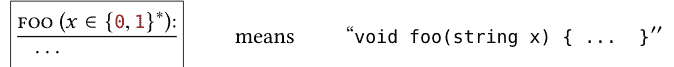

### 0.7 渐近复杂度（大 O 表示法）

设 f : N → N 为一个函数。我们以下述方式表征 f 的渐近增长：

f(n) 是 O(g(n)) ⇔ 定义 lim n→∞ f(n)/g(n) < ∞ ⇔ 存在 c > 0：对于除有限个 n 以外的所有 n：f(n) < c · g(n)
f(n) 是 Ω(g(n)) ⇔ 定义 lim n→∞ f(n)/g(n) > 0 ⇔ 存在 c > 0：对于除有限个 n 以外的所有 n：f(n) > c · g(n)
f(n) 是 Θ(g(n)) ⇔ 定义 f(n) 是 O(g(n)) 且 f(n) 是 Ω(g(n)) ⇔ 0 < lim n→∞ f(n)/g(n) < ∞ ⇔ 存在 c1, c2 > 0：对于除有限个 n 以外的所有 n：c1 · g(n) < f(n) < c2 · g(n)

## 练习

- 0.1. 将下列每个表达式改写为 $2^x$ 的形式。
  - (a) $(2^n)^n = ??$
  - (b) $2^n + 2^n = ??$
  - (c) $(2^n)(2^n) = ??$
  - (d) $(2^n)/2 = ??$
  - (e) $\sqrt{2^n} = ??$
  - (f) $(2^n)^2 = ??$

- 0.2. (a) 当 $n$ 为奇整数时，$0 + 1 + 2 + \cdots + (n - 2) + (n - 1) \% n$ 是多少？证明你的答案！
  - (b) 当 $n$ 为偶数时，$0 + 1 + 2 + \cdots + (n - 2) + (n - 1) \% n$ 是多少？证明你的答案！

- 0.3. $(-99) \% 10$ 是多少？

- 0.4. 不使用计算器，$357998^6$ 的最后两位数字是多少？

- 0.5. 不使用计算器，$1000! \% 427$ 是多少？（这不是我对一千这个数字感到兴奋，而是一千的_阶乘_！）

- 0.6. 以下哪些 $x \in \mathbb{Z}_{11}$ 的值满足 $x^2 \equiv_{11} 5$？哪些满足 $x^2 \equiv_{11} 6$？

- 0.7. 对每个 $n$ 比特字符串进行异或的结果是什么？例如，下面的表达式是每个 5 比特字符串的异或：
\(00000 \oplus 00001 \oplus 00010 \oplus 00011 \oplus \cdots \oplus 11110 \oplus 11111\)
给出令人信服的理由证明你的答案。

- 0.8. 考虑掷若干个 $d$ 面的骰子，面标记为 $\{0, \dots, d - 1\}$。
  - (a) 掷两个这样的骰子，掷出 _蛇眼_（一对 1）的概率是多少？
  - (b) 掷两个这样的骰子，它们 _不_ 匹配的概率是多少？
  - (c) 掷 **三** 个这样的骰子，它们都匹配的概率是多少？
  - (d) 掷三个这样的骰子，它们**不**都匹配（包括两个匹配的情况）的概率是多少？
  - (e) 掷三个这样的骰子，至少有两个匹配的概率是多少（包括三个都匹配的情况）？
  - (f) 掷三个这样的骰子，至少看到一个 0 的概率是多少？

- 0.9. 掷两个 6 面骰子时，掷出 _蛇眼_（两个 1）有一定概率。你在上一题中算出了这个概率。在某个游戏中，轮到我时我会掷两个骰子。最小的 $t$ 值是多少，使得：
\(\text{Pr}[\text{我在前 } t \text{ 轮中至少掷出一次 _蛇眼_}] \geq 0.5\)？
换句话说，我的掷出 _蛇眼_ 的概率超过 50% 需要多少轮？

## 一次性密码本与 Kerckhoffs 原则

你无法在不认识 Alice、Bob 和 Eve 的情况下学习密码学。本章讲述的是**私密通信**这一经典问题：Alice 想要向 Bob 传递一条消息，同时又想让窃听者<sup>1</sup> Eve 无法获悉消息内容。你很快就会了解，密码学不仅仅是私密通信，但这是起步的逻辑位置。

### 1.1 什么是（不是）密码学？

> “定义即限制。”
> —奥斯卡·王尔德

密码学并非解决所有安全问题的魔法咒语。密码学可以为清晰定义的问题提供解决方案，这类问题通常会抽象掉重要但混乱的现实世界因素。密码学可以对特定明确类别的攻击存在时发生的情况提供保证。如果现实世界的攻击者“不遵循”密码学安全模型的“规则”，这些保证可能不适用。

在本课程中，当我们定义（即限制）所要解决的问题时，请始终牢记这一点。

#### 加密基础与术语

让我们开始正式化涉及 Alice、Bob 和 Eve 的场景。Alice 想要（私密地）将一条消息 \( m \) 发送给 Bob。我们称 \( m \) 为**明文**。我们假设她会以某种方式将该明文转换为一个值 \( c \)（称为**密文**），然后将其实际发送给 Bob。将 \( m \) 转换为 \( c \) 的过程称为加密，我们将使用 Enc 来指代加密算法。当 Bob 收到 \( c \) 时，他会运行相应的解密算法 Dec 以恢复原始明文 \( m \)。

我们假设密文可能会被窃听者 Eve 观察到，因此（非正式的）目标是使密文对 Bob 有意义，但对 Eve 毫无意义。

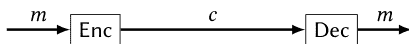

<sup>1</sup>“窃听者”是指秘密窃听他人谈话的人。该词源于指某人字面上悬挂在建筑物的檐口以听到里面谈话的人。

## 秘密与 Kerckhoffs 原则

这个图中缺少了一些重要的东西。如果我们希望 Bob 能够解密 c，但 Eve *不能* 解密 c，那么 Bob 必须拥有 Eve 没有的某些信息（你明白为什么吗？）。必须对 Eve 保密一些东西。

你可能会建议将 Enc 和 Dec 算法的细节保密。在过去 2000 年的大部分时间里，密码学就是这样做的，但这有很大的缺点。如果攻击者最终了解了 Enc 和 Dec 的细节，那么恢复安全性的唯一方法是*发明新算法*。如果你有一个有许多用户的系统，那么防止每个人阅读其他所有人消息的唯一方法是为每对用户*发明新算法*。即使发明一个好的加密方法已经足够困难了！

最早阐明这一问题的人是奥古斯特·科尔克霍夫斯。1883 年，他制定了一套密码学设计原则。他清单中的第 2 条现在被称为**科尔克霍夫斯原则**：

| | |
|---|---|
| **科尔克霍夫斯原则：** | “Il faut qu’il n’exige pas le secret, et qu’il puisse sans inconvénient tomber entre les mains de l’ennemi。” |
| **直译：** | [该方法]不要求保密，且即使落入敌人手中也不应造成不便。 |
| **结论：** | 即使攻击者完全了解系统的所有算法，也应将系统设计为安全。 |

如果算法本身不是秘密，那么系统中必须存在其他某种秘密信息。该信息称为**（秘密）密钥**。密钥只是提供给 Enc 和 Dec 算法的额外信息。对科尔克霍夫斯原则的另一种解读是：*系统的所有安全性都应集中在密钥的保密性上*，而非算法的保密性。如果秘密密钥泄露，你只需选择一个新密钥，而无需重新发明一个全新的加密算法。多个用户可以安全地使用相同的加密算法，但使用独立选择的秘密密钥。

选择秘密密钥的过程称为**密钥生成**，我们使用 KeyGen 来指代（随机化的）密钥生成算法。我们将三个算法（Enc、Dec、KeyGen）的集合称为**加密方案**。请记住，科尔克霍夫斯原则表明我们应假设攻击者知道 KeyGen 算法的细节。但也请记住，了解随机化算法的细节（即源代码）并不意味着你知道该算法执行时给出的*特定输出*。

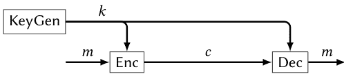


## 借口，借口

让我们练习一些谦逊。以下只是私密通信问题中显然重要但未被我们的问题定义所涵盖的部分问题列表。

- 我们并不试图隐瞒*Alice正在向Bob发送消息*这一事实，我们只想隐瞒该消息的*内容*。隐藏通信渠道的存在称为*隐写术*。

- 我们不会考虑c如何可靠地从Alice传到Bob的问题。我们将默认这一点。

- 目前，我们假设Eve只是被动观察Alice和Bob之间的通信。我们不考虑篡改c的攻击者（导致Bob接收并解密出不同的值），尽管我们将在书中后面讨论此类攻击。

- 我们不会讨论Alice和Bob在现实世界中实际上*如何*获得一个共享的密钥。这个问题（即**密钥分发**）显然极其重要，我们将在书中后面讨论一些巧妙的方法。

我可以辩称，我们正在解决的问题已经相当非平凡：一旦两个用户建立了共享的密钥，他们如何使用该密钥进行私密通信？

- 我们不会讨论Alice和Bob如何保密他们的密钥，即使在建立密钥之后也是如此。我最喜欢的密码学描述之一来自Lea Kissner（Google前首席安全工程师）：“*密码学是一种将许多不同问题转化为密钥管理问题的工具。*”

- 在本课程中，我们简单地假设用户有能力均匀采样随机字符串。确实，没有随机性就没有密码学。在现实世界中，从确定性计算机获得均匀随机比特极其非平凡。John von Neumann曾经说过：“任何考虑用*算术方法产生随机数字*的人，当然都*身陷罪孽*。”同样，即使我们默认均匀随机性，我们仍然面临如何*使用*该随机性进行私密通信（及其他应用）的非平凡问题，以及如何仅使用*可管理的量*随机性的问题。

## 这不是密码学

人们使用许多技术来试图隐藏信息，但其中许多并非“密码学”的，因为它们不遵循Kerckhoffs原理：

- 例如base64这样的编码/解码方法，有助于将任意二进制数据合并到支持有限字符类型的结构化文件格式中。但由于base64编码/解码不涉及任何密钥信息，因此在安全性方面没有任何贡献。

```
joy of cryptography <-> b25seSBUZXJJKcyB3AxsIHJlYWdGhpcw==
```

- 有时，描述加密方案的最简单方法是对二进制字符串（即0和1）数据进行操作。正如我们将看到的，一次一密密码定义为以比特字符串形式表示的明文。（未来方案将要求输入表示为特定长度的比特字符串，或作为$\mathbb{Z}_n$的元素等。）

为了理解本课程中的一些算法，可能需要考虑将数据转换为二进制表示。与base64一样，将事物表示为二进制对安全性没有任何影响，因为它不涉及任何密钥信息。**将事物写成二进制不是安全措施！**

### 1.2 一次一密密码的细节

人们试图发送秘密消息已有约2000年历史，但真正与现代密码学相关的、1900年前的有用想法实际上只有2个。第一个想法是Kerckhoffs原理，你已经见过。另一个想法是**一次一密密码（OTP）**，它说明了几个重要概念，甚至至今仍深藏在许多现代加密方案中。

一次一密密码有时被称为“Vernam密码”，以电报工程师Gilbert Vernam命名，他于1919年为该方案申请了专利。然而，一次一密密码的早期描述是在Frank Miller于1882年撰写的关于电报加密的文本中被相对最近地发现的。2

在本书的大部分内容中，密钥将是比特字符串。我们通常使用变量$\lambda$来表示方案中密钥的长度（比特数），因此密钥是集合$\{0, 1\}^\lambda$的元素。在一次一密密码中，$\lambda$的选择不影响安全性（$\lambda = 10$与“$\lambda = 1000$一样安全”）；然而，密钥和明文的长度必须兼容。在后续章节中，增加$\lambda$会使方案更难破解。因此，$\lambda$通常被称为方案的**安全参数**。

在一次一密密码中，不仅密钥是$\lambda$比特字符串，明文和密文也是如此。你应该把这仅仅视为一个简单的巧合，因为我们很快就会遇到密钥、明文和密文为不同大小字符串的方案。

一次一密密码的具体KeyGen、Enc和Dec算法如下：

| 构造1.1（一次一密密码） | KeyGen: $k \leftarrow \{0, 1\}^\lambda$ return $k$ | Enc($k, m \in \{0, 1\}^\lambda$): return $k \oplus m$ | Dec($k, c \in \{0, 1\}^\lambda$): return $k \oplus c$ |
|---|---|---|---|

请回顾，“\( k \leftarrow \{0, 1\}^\lambda \)”表示从$\lambda$比特字符串的集合中均匀采样\( k \)。这种对密钥的均匀选择是一次一密密码所有算法中唯一的随机性。正如我们将看到的，其所有安全性都源于使用均匀分布的这一选择；选择不同的密钥无法提供等价的安全性。

2. 参见文章Steven M. Bellovin：“Frank Miller：一次一密密码的发明者。”《Cryptologia》35（3），2011年。

示例 使用OTP在20位密钥k下加密以下20位明文m，得到以下密文c：

```
  11101111101111100011   (m)
⊕ 00011001110000111101   (k)
  11110110011111011110   (c = Enc(k, m))
```

使用密钥k解密以下密文c，得到以下明文m：

```
  00001001011110010000   (c)
⊕ 10010011101011100010   (k)
  100110101010101110010  (m = Dec(k, c))
```

请注意，Enc和Dec本质上是同一个算法（返回两个参数的异或）。这在实现一次一密密码时带来了一定的便利性和对称性，但这更多是一种巧合，而非加密本身真正基本的属性（参见练习1.12和2.5）。稍后你将看到加密及解密算法截然不同的加密方案。

## 正确性

我们应首先确认一次一密密码的一个属性：接收者在解密密文时确实能恢复预期的明文。如果没有这一属性，使用一次一密密码进行通信的想法就显得荒谬。用数学表达：

声明1.2 对所有k, m ∈ {0, 1}^λ，Dec(k, Enc(k, m)) = m成立。

证明 这通过代入OTP的Enc和Dec定义，然后应用第0.3章中列出的异或属性得出。对所有k, m ∈ {0, 1}^λ，我们有：

```
Dec(k, Enc(k, m)) = Dec(k, k ⊕ m)
                  = k ⊕ (k ⊕ m)
                  = (k ⊕ k) ⊕ m
                  = 0^λ ⊕ m
                  = m.
```

示例 在密钥k下加密以下明文m，得到密文c，如下：

```
  00110100110110001111   (m)
⊕ 11101010011010001101   (k)
  11011110101100000010   (c)
```

使用相同的密钥k解密c，得到原始m：

```
  11011110101100000010   (c)
⊕ 11101010011010001101   (k)
  00110100110110001111   (m)
```

## 安全性

假设Alice和Bob正在使用一次一密密码，但担心攻击者会看到他们的密文。他们无法预料攻击者在看到密文后会做什么。但他们希望能这样说：“由于密文的生成方式特定，无论攻击者对密文做什么，它都不会向攻击者泄露任何关于明文的信息。”

我们必须首先准确指定密文是如何生成的。Enc算法已经描述了该过程，但它是从Alice和Bob的角度编写的。当讨论安全性时，我们必须从窃听者的角度思考Alice和Bob的行为！从Eve的角度来看，Alice以特定方式（均匀随机）选择了一个密钥，使用OTP用该密钥加密明文，最后仅向Eve泄露生成的密文（而非密钥）。

更正式地说，从Eve的角度来看，看到一个密文相当于从以下算法接收输出：

```
EAVESDROP(m ∈ {0, 1}^λ):
  k ← {0, 1}^λ
  c := k ⊕ m
  return c
```

至关重要的是，你要理解这个EAVESDROP算法代表什么。它旨在描述的**不是攻击者所做的事**，而是Alice和Bob执行的、产生**攻击者所看到内容**的过程！我们始终将攻击者视为从该EAVESDROP算法接收输出的某个（未指定）过程。我们的目标是说类似“EAVESDROP的输出不会泄露输入m”这样的话。

EAVESDROP是一个*随机算法*——请记住，“k ← {0, 1}^λ”表示从$\lambda$比特字符串的均匀分布中采样k。如果多次调用EAVESDROP，即使输入相同，也可能得到不同的输出。不要将“EAVESDROP(m)”视为一个单一的字符串，而应该将其视为字符串上的一个*概率分布*。每次调用EAVESDROP(m)时，你都会从该分布中看到一个**样本**。

**示例** 让我们取λ = 3，并手动计算EAVESDROP(010)和EAVESDROP(111)的分布。在每种情况下，EAVESDROP在{0, 1}^3中均匀选择一个k值——每个可能值的概率为1/8。对于k的每个可能选择，我们可以计算EAVESDROP(c)的输出：

| 概率 | k | 输出 c = k ⊕ 010 | 概率 | k | 输出 c = k ⊕ 111 |
|---|---|---|---|---|---|
| 1/8 | 000 | 010 | 1/8 | 000 | 111 |
| 1/8 | 001 | 011 | 1/8 | 001 | 110 |
| 1/8 | 010 | 000 | 1/8 | 010 | 101 |
| 1/8 | 011 | 001 | 1/8 | 011 | 100 |
| 1/8 | 100 | 110 | 1/8 | 100 | 011 |
| 1/8 | 101 | 111 | 1/8 | 101 | 010 |
| 1/8 | 110 | 100 | 1/8 | 110 | 001 |
| 1/8 | 111 | 101 | 1/8 | 111 | 000 |


所以分布 eavesdrop(010) 为 010 分配概率 1/8，为 011 分配概率 1/8，以此类推。

在这个示例中，请注意 {0, 1}^3 中的每个字符串在 eavesdrop(010) 的 c 列中都 *恰好出现一次*。这意味着 eavesdrop 为 {0, 1}^3 中的每个字符串分配概率 1/8，这只是另一种说法，即该分布是 {0, 1}^3 上的 *均匀分布*。关于分布 eavesdrop(111) 也可以这么说。两个分布只不过是伪装后的均匀分布！

在这些示例中，010 或 111 并没有什么特别之处。对于任何 \(\lambda\) 和任何 \(m \in \{0, 1\}^\lambda\)，分布 eavesdrop(m) 都是 \(\{0, 1\}^\lambda\) 上的均匀分布。

## Claim 1.3

对于每个 \(m \in \{0, 1\}^\lambda\)，分布 eavesdrop(m) 是 \(\{0, 1\}^\lambda\) 上的 **均匀分布**。因此，对于所有 \(m, m' \in \{0, 1\}^\lambda\)，分布 eavesdrop(m) 和 eavesdrop(m') 是相同的。

### 证明

任意固定 \(m, c \in \{0, 1\}^\lambda\)。我们将计算 eavesdrop(m) 生成输出 c 的概率。该事件仅在以下情况发生：

```
c = k \oplus m \Longleftrightarrow k = m \oplus c.
```

该等价关系源自第 0.3 节中给出的异或运算性质。即，

```
Pr[eavesdrop(m) = c] = Pr[k = m \oplus c],
```

其中概率是对 \(k \leftarrow \{0, 1\}^\lambda\) 的均匀选择取的。

我们考虑 m 和 c 的特定选择，因此使 \(k = m \oplus c\) 成立（导致 m 加密为 c）的 k 的值**只有一个**，该值正好是 \(m \oplus c\)。由于 k 从 \(\{0, 1\}^\lambda\) 中均匀选择，选择特定值 \(k = m \oplus c\) 的概率是 \(1/2^\lambda\)。

总之，对于每个 m 和 c，eavesdrop(m) 输出 c 的概率正好是 \(1/2^\lambda\)。这意味着，对于任何 m，eavesdrop(m) 的输出都服从均匀分布。

以更通俗易懂的方式来理解这一安全性声明，有一种方法：

> 如果攻击者看到一个 *单个* 密文，它使用一次性密码本加密，密钥被均匀选择并对攻击者保密，那么密文看起来服从均匀分布。

为什么这很重要？从窃听者的角度来看，假设有人选择一个明文 m，而你看到了生成的密文——这是分布 eavesdrop(m) 的一个样本。但这是一个你自己也可以采样的分布，即使你不知道 m！你本可以选择一个完全不同的 \(m'\)，在你的想象中运行 eavesdrop(\(m'\))，这将产生与 eavesdrop(m) 相同的分布。你看到的“真实”密文 *不包含关于 m 的任何信息*，如果在不知道 m 的情况下也能从相同分布中采样的话！

## 讨论

- 难道不存在一个悖论吗？Claim 1.2 说 c 总是可以被解密得到 m，但 Claim 1.3 说 c 不包含关于 m 的任何信息！这个谜题的答案是，Claim 1.2 讨论的是在知道密钥 k 的情况下可以做什么（Alice & Bob 的视角）。Claim 1.3 讨论的是 eavesdrop 算法的输出分布，不包含 k（Eve 的视角）。简而言之，如果你知道 k，那么你可以解密 c 以获得 m；如果你不知道 k，那么 c 不携带关于 m 的任何信息（实际上，它看起来服从均匀分布）。这是因为 m、c、k 以一种微妙的方式相关联。3

- 难道不存在另一个悖论吗？Claim 1.3 说 eavesdrop(m) 的输出不依赖于 m，但我们可以看到 eavesdrop 算法确实在最后一行使用了它的参数 m！这个谜题的答案或许最好通过先前的 eavesdrop(010) 和 eavesdrop(111) 分布示例来说明。两个值表确实不同（因此 m ∈ {010, 111} 的选择显然有一些影响），但它们表示相同的概率分布（因为顺序无关紧要）。Claim 1.3 只考虑结果概率分布。

- 你可能会用攻击者的具体“目标”来思考安全性：恢复密钥、恢复明文等。Claim 1.3 并不真的以这种方式涉及攻击者，当然也未指定目标。相反，我们是通过与某个假设的“理想”世界进行比较来思考安全性。如果攻击者只看到一串均匀比特源，我就会感到满意，因为在这个假设世界中，没有密钥也没有明文可供恢复！Claim 1.3 说，当我们实际使用 OTP 时，从攻击者的角度来看，它看起来就像这个假设世界。如果我们在这种推理中为攻击者设想任何“目标”，那就是检测密文是否不服从均匀分布。通过证明攻击者甚至无法实现这个微小的目标，这表明攻击者不可能实现其他更自然的目标，例如密钥恢复和明文恢复。

## 局限性

一次性密码本在实际中非常受限。最显著的是：

- 其密钥与所加密的明文一样长。这基本上是不可避免的（参见 Exercise 2.11），并在实际中导致一种鸡生蛋蛋生鸡的困境：如果两个用户想要私下传输一个 λ 位消息，他们首先需要私下商定一个 λ 位字符串。

- 一个密钥只能用于加密一个明文（因此称为“一次性”密码本）；参见 Exercise 1.6。确实，我们可以看到 Claim 1.3 中的 eavesdrop 子程序没有为调用者提供一种方法来保证两个明文使用相同密钥加密，因此不清楚如何使用 Claim 1.3 来论证当密钥以这种方式故意重复使用时一次性密码本中会发生什么。

3 这种相关性在第 3 章中进一步探讨。

尽管存在这些局限性，一次性密码本说明了本课程中大多数加密形式都会出现的基本概念。

## 练习

- 1.1. 在密钥 k 下，明文 mario（以标准方式从 ascii 转换为二进制）的一次性密码本加密为：

  100001000000111010101000001110000011101.

  在相同密钥下，luigi 的一次性密码本加密是什么？

- 1.2. Alice 正在使用一次性密码本，并注意到当她的密钥是全零字符串 k = 0^λ 时，Enc(k, m) = m，她的消息以明文发送！为了避免这个问题，她决定修改 KeyGen 以排除全零密钥。她将 KeyGen 修改为从 {0, 1}^λ \ {0^λ}（即所有 λ 位字符串除 0^λ 外的集合）中均匀选择密钥。这样，她保证她的明文永远不会以明文发送。

  窃听者的密文分布是否仍然在 {0, 1}^λ 上均匀分布？请证明你的答案。

- 1.3. 当 Alice 使用一次性密码本加密密钥 k 本身时，密文总是全零字符串！因此，如果窃听者看到全零密文，她就知道 Alice 加密的是密钥本身。这是否与 Claim 1.3 矛盾？为什么或为什么不矛盾？

- 1.4. 使用异或运算定义 OTP 有什么特别之处？假设我们使用按位与运算（我们将其写作 `&`）并按如下方式定义 OTP 的一个变体：

  KeyGen:
  k ← {0, 1}^λ
  return k

  Enc(k, m ∈ {0, 1}^λ):
  return k & m

  这仍然是加密的好选择吗？为什么或为什么不？

- 1.5. 描述此论证中的缺陷：

  考虑针对一次性密码本的以下攻击：在看到密文 c 后，窃听者尝试每个候选密钥 k ∈ {0, 1}^λ，直到找到使用过的密钥，此时她输出明文 m。这与第 1.2 节中的论证相矛盾，即窃听者通过查看密文无法获得关于 m 的任何信息。

- 1.6. 假设 Alice 使用相同密钥 k 通过一次性密码本加密两个明文 m 和 m′。这样做会向窃听者泄露关于 m 和 m′ 的什么信息（假设窃听者知道 Alice 已重复使用 k）？请尽可能具体！

- 1.7. 你（Eve）截获了两个密文：

  c₁ = 111110010111100111001100001011110000110


c_2 = 11110100110011111011100000100110001000

你知道 c1 和 c2 都是 OTP 密文，且使用了同一密钥加密。你知道要么 c1 是 alpha 的加密且 c2 是 bravo 的加密，要么 c1 是 delta 的加密且 c2 是 gamma 的加密（全部以标准方式从 ASCII 转换为二进制）。

以下哪种可能性是正确的，为什么？密钥 k 是什么？

1.8. 已知明文攻击是指窃听者看到密文 c = Enc(k, m)，并且也得知/知道用于生成 c 的明文 m 的情况。

(a) 证明针对 OTP 的已知明文攻击会导致攻击者得知密钥 k。

(b) 如果 OTP 允许攻击者恢复加密密钥，它还能安全吗？这是否与我们对 OTP 所证明的安全性矛盾？请解释。

1.9. 假设我们修改 Claim 1.3 中讨论的子程序，使其也返回 k：

```
EAVESDROP'(m ∈ {0, 1}^λ):
k ← {0, 1}^λ
c := k ⊕ m
return (k, c)
```

对于每个 m，EAVESDROP'(m) 的输出是否仍然在 ({0, 1}^λ)^2 中服从均匀分布？或者不同的 m 选择会导致不同的输出分布？

1.10. 本问题讨论两次执行一次性密码本加密的安全性：

(a) 考虑以下子程序，它模拟使用两个独立密钥进行一次性密码本加密的结果：

```
EAVESDROP'(m ∈ {0, 1}^λ):
k_1 ← {0, 1}^λ
k_2 ← {0, 1}^λ
c := k_2 ⊕ (k_1 ⊕ m)
return c
```

证明该子程序的输出在 {0, 1}^λ 中服从均匀分布。

(b) 使用相同密钥两次执行一次性密码本加密提供了什么安全性？

1.11. 我们提到一次性密码本密钥只能用于加密一个明文，这在 Claim 1.3 的 EAVESDROP 子程序中有所体现。在 OTP 中（使用不同密文的独立随机密钥），是否存在关于重复使用明文的类似限制？如果窃听者知道同一明文被加密了两次（但不知道明文是什么），她能学到什么吗？Claim 1.3 对同一明文被加密多次的情况有什么说明吗？

1.12. OTP 中字符串和 XOR 并非唯一特殊的事物。我们可以使用模 n 整数和模 n 加法获得相同的特性。

本问题考虑一种一次性密码本的变体，其中密钥、明文和密文都是 Z_n 的元素，而不是 {0, 1}^λ。

(a) 与以下加密算法对应的解密算法是什么？

```
Enc(k, m ∈ Z_n):
return (k + m) % n
```

(b) 证明以下子程序的输出在 Z_n 中服从均匀分布：

```
eavesdrop'(m ∈ Z_n):
k ← Z_n
c := (k + m) % n
return c
```

(c) 不仅密钥的分布很重要。密钥与明文的组合方式也很重要。证明以下子程序的输出**不**一定在 Z_n 中服从均匀分布：

```
eavesdrop'(m ∈ Z_n):
k ← Z_n
c := (k · m) % n
return c
```

## 可证安全的基础

爱伦·坡不仅是一位作家，也是一位密码学爱好者。他在一次关于密码学现状的讨论中写道：¹

> “人的智慧无法创造出人的智慧无法破解的密码。”

这是对 1841 年存在的密码学的准确评估。每当有人提出一种加密方法时，总会有其他人不可避免地找到破解方法，猫鼠游戏一遍又一遍地重复。

然而，现代 21 世纪的密码学有所不同。本书将向你介绍许多方案，其安全性我们可以在非常具体的意义上**证明**。制码者**可以**战胜破码者。

只有通过拥有关于“安全”含义的_形式定义_，才能对安全性进行_证明_。本章围绕安全定义介绍基本技能：如何编写它们，如何理解和解释它们，如何使用_混杂技术_证明安全性，以及如何使用针对安全定义的攻击来证明不安全性。

### 2.1 如何编写安全定义

迄今为止我们见过的唯一密码学形式是一次性密码本，因此我们对安全性的讨论相当特定于一次性密码本。最好能有一套更一般化地谈论安全性的词汇，以便我们可以询问_任何_加密方案是否安全。

在本节中，我们将为加密制定两个安全定义。

### 安全定义中不应包含的内容

安全定义应提供关于在攻击者存在下系统可能发生的情况的保证。但系统的并非所有重要属性都涉及攻击者。具体来说，对于加密：

- 当我们说 Enc 算法接受两个参数（密钥和明文），或者 KeyGen 算法不接受参数时，我们不引用任何攻击者。因此，指定各种算法的输入/输出类型（_即，_“函数签名”）不是关于安全性的陈述。我们称这些属性为方案的**语法**。

¹Edgar Allan Poe, “论秘密写作,” _格雷厄姆杂志_, 1841 年 7 月, v19.

即使没有攻击者，解密是加密的逆运算仍然很重要。这不是加密方案的安全属性。相反，我们称其为**正确性**属性。

以下是对称密钥加密的语法和正确性的通用定义：

**定义 2.1（加密语法）** 一个**对称密钥加密（SKE）方案**包含以下算法：

- KeyGen：一个随机算法，输出一个**密钥** \( k \in \mathcal{K} \)。
- Enc：一个（可能是随机的）算法，接受密钥 \( k \in \mathcal{K} \) 和**明文** \( m \in \mathcal{M} \) 作为输入，并输出一个**密文** \( c \in \mathcal{C} \)。
- Dec：一个确定性算法，接受密钥 \( k \in \mathcal{K} \) 和**密文** \( c \in \mathcal{C} \) 作为输入，并输出一个**明文** \( m \in \mathcal{M} \)。

我们称 \( \mathcal{K} \) 为**密钥空间**，\( \mathcal{M} \) 为**消息空间**，\( \mathcal{C} \) 为**密文空间**的方案。有时我们用单个变量 \( \Sigma \) 指代整个方案（所有三个算法的集合）。这样做时，我们写 \( \Sigma.\text{KeyGen} \)、\( \Sigma.\text{Enc} \)、\( \Sigma.\text{Dec} \)、\( \Sigma.\mathcal{K} \)、\( \Sigma.\mathcal{M} \) 和 \( \Sigma.\mathcal{C} \) 来引用其组件。

**定义 2.2（SKE 正确性）** 如果对于所有 \( k \in \Sigma.\mathcal{K} \) 和所有 \( m \in \Sigma.\mathcal{M} \)，加密方案 \( \Sigma \) 满足**正确性**，即：

```
\(\text{Pr}[\Sigma.\text{Dec}(k, \Sigma.\text{Enc}(k, m)) = m] = 1.\)
```

该定义以概率形式表述，因为 Enc 允许是随机算法。换句话说，使用与加密时相同的密钥解密密文必须**始终**得到原始明文。

**示例** 一个加密方案可以具有适当的语法，但仍然表现出如 \(\text{Enc}(k, m) = 0^\lambda\)（即，每个明文都被“加密”为 \( 0^\lambda \））的退化行为。这样的方案不满足正确性属性。

另一个由 \(\text{Enc}(k, m) = m\)（即，“密文”始终等于明文本身）和 \(\text{Dec}(k, c) = c\) 定义的方案满足正确性属性，但不会满足任何合理的安全性属性。

### “真实-vs-随机”风格的安全定义

让我们尝试制定一个安全定义，形式化以下直观想法：

> “如果一个加密方案的密文在攻击者看来像随机垃圾，那么它就是一个好的加密方案。”

安全定义始终考虑**攻击者对系统的视图**。Alice & Bob 使用密码学向攻击者暴露了什么样的“接口”，该特定接口是否使攻击者受益？

在本示例中，我们考虑攻击者能够观察密文的场景。这些密文是**如何**生成的？Enc 的输入（密钥和明文）是什么，它们是如何选择的？


**密钥：** 很难想象如果攻击者知道密钥，还能有任何有用的安全性。因此，我们假设密钥对攻击者保密。当然，密钥是根据方案的 KeyGen 算法生成的。

在本阶段，我们考虑的是密钥仅用于加密一个明文的加密方案。某种程度上，这种限制必须在我们的安全定义中体现出来。稍后，我们将考虑密钥用于加密许多内容的安全定义。

**明文：** 结果发现，考虑攻击者实际上 *选择* 明文是有用的。这是一种“悲观”的选择，因为它给攻击者很大的权力。但是，如果加密方案在攻击者选择明文的情况下确实是安全的，那么在攻击者对明文存在一定不确定性的更现实场景中，它也是安全的。

这些澄清使我们能够对非正式的安全概念填入更多具体细节：

> "如果每个密钥都是保密的且仅用于加密一个明文，即使攻击者选择明文，一个加密方案如果其密文在攻击者看来像随机垃圾，那么它就是一个好的加密方案。"

表达所有这些细节的简洁方法是考虑 **将攻击者视为调用程序** 来调用以下子程序：

```
CTXT(m \in \Sigma.\mathcal{M}):
  k \leftarrow \Sigma.KeyGen
  c := \Sigma.Enc(k, m)
  return c
```

调用程序可以为子程序选择参数（在此情况下为明文），并且只能看到结果返回值（在此情况下为密文）。调用程序 *不能* 看到私有作用域变量的值（在此情况下的 *k*）。如果调用程序多次调用该子程序，每次都会选择一个新的 *k*。

攻击者（调用程序）与这个 `CTXT` 子程序之间的交互似乎捕捉了相关场景。我们希望说 `CTXT` 子程序的输出是均匀分布的。表达此属性的一种便捷方式是说，这个 `CTXT` 子程序对 *每个* 调用程序的效果，应该与一个（显式地）均匀采样其输出的 `CTXT` 子程序相同。

```
CTXT(m \in \Sigma.\mathcal{M}):
  k \leftarrow \Sigma.KeyGen
  c := \Sigma.Enc(k, m)
  return c

vs.

CTXT(m \in \Sigma.\mathcal{M}):
  c \leftarrow \Sigma.C
  return c
```

直觉上，没有任何调用程序应该有办法确定是这两种实现中的哪一种在响应子程序调用。作为类比，说“foo 是一个正确的排序算法”的一种方式是说，“没有任何调用程序会在将 foo 替换为归并排序实现时表现出不同的行为。”

总之，我们可以以如下方式定义加密的安全性：

> "如果将加密方案的 KeyGen 和 Enc 算法代入上面的 CTXT 子程序模板中，那么两种 CTXT 实现会在每个调用程序中引起相同的行为，那么该加密方案就是一个好的加密方案。"

在几页之后，我们将为这里介绍的概念引入形式化符号和定义。特别是，调用程序和子程序都可以是随机化算法，因此我们应该注意我们所说的“相同行为”究竟是什么意思。

**示例** _一次性密码本定义为 KeyGen 从 {0, 1}^λ 中均匀采样 k，_和_ Enc(_k_, _m_) = _k_ ⊕ _m_。它满足我们的新安全属性，因为当我们将这些算法代入上述模板时，我们得到以下两个子程序实现：

```
CTXT(m):
_k_ ← {0, 1}^λ // KeyGen of OTP
_c_ := _k_ ⊕ _m_ // Enc of OTP
return _c_
```

```
CTXT(m):
_c_ ← {0, 1}^λ // C of OTP
return _c_
```

并且这两个实现对所有调用程序都有相同的效果。

## “左-右”风格的安全定义

这里有一种不同的安全直观概念：

> "如果 m_L 的加密在攻击者看来就像 m_R 的加密（对所有可能的 m_L、m_R），那么该加密方案就是一个好的加密方案。"

如上所述，我们考虑的是攻击者看到某些密文的场景。这些密文是用某个密钥生成的；那个密钥来自哪里？这些密文加密的是某个 m_L 或某个 m_R；m_L 和 m_R 来自哪里？我们可以以类似于前一个示例的方式来回答这些问题。明文 m_L 和 m_R 可以由攻击者选择。密钥是根据 KeyGen 选择的，因此它对攻击者保密（并且仅用于生成一个密文）。

> "如果每个密钥都是保密的且仅用于加密一个明文，即使攻击者选择 m_L 和 m_R，那么一个加密方案如果其 m_L 的加密在攻击者看来就像 m_R 的加密，那么它就是一个好的加密方案。"

如前所述，我们通过将攻击者想象为调用特定接口的程序来正式化这一想法。这一次，攻击者将选择 **两个** 明文 m_L 和 m_R，并获得一个密文。2 取决于实际加密的是 m_L 还是 m_R，这些接口的实现如下：

```
EAVESDROP(m_L, m_R ∈ Σ.M):
_k_ ← Σ.KeyGen
_c_ := Σ.Enc(_k_, m_L)
return _c_
```

```
EAVESDROP(m_L, m_R ∈ Σ.M):
_k_ ← Σ.KeyGen
_c_ := Σ.Enc(_k_, m_R)
return _c_
```

2 正式化这种安全直观概念可能有其他合理的方式。例如，我们可以选择给攻击者 _两个_ 密文而不是一个，并要求攻击者无法确定哪个加密的是 m_L、哪个加密的是 m_R。参见练习 2.15。

正式地说 m_L 的加密“看起来像” m_R 的加密的方式是：

> “如果将加密方案的 KeyGen 和 Enc 算法代入上面的旁听子程序模板中，那么两种旁听子程序实现会在每个调用程序中引起相同的行为，那么该加密方案就是一个好的加密方案。”

**示例** 一次性密码本是否满足这个新的安全属性？要找出答案，我们将其算法代入上述模板，并获得以下实现：

```
EAVESDROP(m_L, m_R):
 k ← {0, 1}^λ // KeyGen of OTP
 c := k ⊕ m_L // Enc of OTP
 return c
```

```
EAVESDROP(m_L, m_R):
 k ← {0, 1}^λ // Keygen of OTP
 c := k ⊕ m_R // Enc of OTP
 return c
```

如果这两个实现对所有调用程序都有相同的效果（并且确实如此），那么我们会说 OTP 满足这个安全属性。

与之前的方法相比，这是一种更好/更差的安全定义方式吗？一种安全定义考虑的是目标是区分真实密文与随机值的攻击者（实-随机范式），而另一种考虑的是目标是区分两个不同明文的真实密文的攻击者（左-右范式）。一种是“正确的”而另一种是“错误的”吗？我们将把此类讨论留到本章稍后进行。

### 2.2 安全定义的形式化方法

到目前为止，我们已将安全性定义为单个自包含子程序，并将攻击者想象为调用此子程序的程序。在课程后面，我们需要将其推广到单个子程序之外，即一组共享常见（私有）状态信息的子程序。沿用软件术语，我们将此集合称为库：

**定义 2.3（库）** 库 L 是一组子程序和私有/静态变量。库的接口由其所有子程序的名称、参数类型和输出类型组成（就像 Java 接口一样）。如果程序 A 包含对库 L 接口中子程序的调用，那么我们写 A ◊ L 表示将 A 与 L 以自然方式链接的结果（使用 L 中指定的实现来回答这些子程序调用）。我们写 A ◊ L ⇒ z 表示程序 A ◊ L 输出值 z 的事件。

如果 A 或 L 是一个会做出随机选择的程序，那么 A ◊ L 的输出是一个随机变量。考虑 Pr[A ◊ L ⇒ true] 之类的概率通常很有用。

**示例** 这是一个熟悉的库：

| L |
|---|
| CTXT(m): |
| k ← {0, 1}^λ |
| c := k ⊕ m |
| return c |


下面是一个可能的调用程序示例：

```
A:
m ← {0, 1}^λ
c := CTXT(m)
return m = c ?
```

希望你能让自己信服：

Pr[A ∘ L ⇒ true] = 1/2^λ.

如果将此 A 链接到不同的库，其输出概率可能会不同。如果将不同的调用程序链接到此 L，输出概率也可能不同。

**示例** 库可以包含多个子程序和私有变量，这些变量在子程序调用之间保持静态。例如，这是一个简单的库，它均匀地选择一个字符串 s，并允许调用程序猜测 s。

```
L
s ← {0, 1}^λ
RESET():
s ← {0, 1}^λ
GUESS(x ∈ {0, 1}^λ):
return x = s
```

我们的约定是，子程序外部的代码（如这里的第一行）在初始化时只运行一次。在初始化时定义的变量（如这里的 s）在所有子程序作用域中均可用（但对调用程序不可用）。

## 可互换性

“没有任何调用程序在这两个库的存在下表现不同”这一观点，即使对于包含多个子程序的库也依然成立。由于这是一个非常常见的概念，我们为此引入了新的记法：

### 定义 2.4

**(可互换)** 设 L_left 和 L_right 为具有相同接口的两个库。如果对于所有输出布尔值的程序 A，我们说 L_left 和 L_right 是 **可互换** 的，并记作 L_left ≡ L_right，

Pr[A ∘ L_left ⇒ true] = Pr[A ∘ L_right ⇒ true].

此定义考虑的是给出布尔输出的调用程序。想象一个调用程序/攻击者，其唯一目标是区分两个特定的库（实际上，我们常将调用程序称为 **区分者**）。布尔输出足以完成该任务。你可以将输出位视为调用程序对“它认为自己链接到了哪个库”的“猜测”。

“调用程序输出 true”与“调用程序输出 false”之间的区别并不重要。如果两个库不影响调用程序输出 true 的概率，那么它们也不影响其输出 false 的概率：

```
Pr[A ∘ L_left ⇒ true] = Pr[A ∘ L_right ⇒ true]
<=> 1 - Pr[A ∘ L_left ⇒ true] = 1 - Pr[A ∘ L_right ⇒ true]
<=> Pr[A ∘ L_left ⇒ false] = Pr[A ∘ L_right ⇒ false].
```

## 示例

下面是两个库可能可互换的一些非常简单直观的方式。希望可以清楚，每对库都具有相同的行为，因此对所有调用程序都有相同的影响。

尽管这些示例非常简单，但每个概念在本书的真实安全证明中都会作为 **构建块** 出现。

```
FOO(x):
  if x is even:
    return 0
  else if x is odd:
    return 1
  else:
    return -1
```

它们唯一的区别在于一段不可达的代码块。

```
FOO(x):
  if x is even:
    return 0
  else if x is odd:
    return 1
  else:
    return ∞
```

```
FOO(x):
  return BAR(x, x)
BAR(a, b):
  k <- {0, 1}^λ
  return k ⊕ a
```

它们唯一的区别在于赋给某个从未实际使用的变量的值。

```
FOO(x):
  return BAR(x, 0^λ)
BAR(a, b):
  k <- {0, 1}^λ
  return k ⊕ a
```

```
FOO(x, n):
  for i = 1 to λ:
    BAR(x, i)
```

它们唯一的区别在于一个库展开了另一个库中出现的循环。

```
FOO(x, n):
  for i = 1 to n:
    BAR(x, i)
  for i = n + 1 to λ:
    BAR(x, i)
```

```
FOO(x):
  k <- {0, 1}^λ
  y <- {0, 1}^λ
  return k ⊕ y ⊕ x
```

它们唯一的区别在于一个库内联了另一个库中出现的子程序调用。

```
FOO(x):
  k <- {0, 1}^λ
  return k ⊕ BAR(x)
BAR(x):
  y <- {0, 1}^λ
  return y ⊕ x
```

## 示例

下面是更多涉及随机性的可互换库的简单示例：

```
FOO():
  x <- {0, 1}^\lambda
  y <- {0, 1}^\lambda
  return x || y

=

FOO():
  z <- {0, 1}^{2\lambda}
  return z
```

字符串上的均匀分布对字符串中的不同字符独立作用（“||”指代串联）。

```
k <- {0, 1}^\lambda

FOO(x):
  return k \oplus x

=

FOO(x):
  if k not defined:
    k <- {0, 1}^\lambda
  return k \oplus x
```

“及早采样”（一旦可能就采样）与“惰性采样”（在值需要之前的最后可能时刻采样）的对比。我们假设 k 在多次调用 FOO 期间是静态/全局的，且最初未定义。

## 先前概念的正式重述

我们现在可以使用这一新术语，重述前一节中的安全定义。

加密的“真实-vs-随机”风格安全定义可以表示如下：

### 定义 2.5（统一密文）

| L_ots$-real^\Sigma | L_ots$-rand^\Sigma |
|---|---|
| CTXT(m \in \Sigma.M): | CTXT(m \in \Sigma.M): |
| k <- $.KeyGen | c <- $.C |
| c <- $.Enc(k, m) | return c |
| return c | |

(两个可互换库的可视化表示)

换句话说，如果你将 $\Sigma$（即其 KeyGen 和 Enc 的行为）的具体内容填入这两个库“模板”中，并得到两个可互换的库（即对所有调用程序都有相同影响的库），我们将说 $\Sigma$ 具有一次性统一密文。

在本课程中，我们将使用 “$” 符号表示随机性（如同 real-vs-random 中那样）。3

3 在计算机科学文献中，使用 “$” 符号指代随机性是很常见的。这源于将随机化算法视为“抛硬币”的算法。因此，随机化算法需要身边备有零钱（即钱）。按照惯例，随机性以美元形式出现。

我们的“左-vs-右”风格安全定义可以表示如下：

### 定义 2.6（一次性保密性）

| L_ots-L^\Sigma | L_ots-R^\Sigma |
|---|---|
| EAVESDROP(mL, mR \in \Sigma.M): | EAVESDROP(mL, mR \in \Sigma.M): |
| k <- $.KeyGen | k <- $.KeyGen |
| c <- $.Enc(k, mL) | c <- $.Enc(k, mR) |
| return c | return c |

此前在主张 1.3 中我们论证，一次性密码本密文遵循均匀分布。这实际上表明 OTP 满足统一密文定义：

### 主张 2.7（OTP 规则）

一次性密码本满足一次性统一密文属性。换句话说：

```
L_otp-real
EAVESDROP(m ∈ {0, 1}^λ):
k ← {0, 1}^λ // OTP.KeyGen
return k ⊕ m // OTP.Enc(k, m)

=

L_otp-rand
EAVESDROP(m ∈ {0, 1}^λ):
c ← {0, 1}^λ // OTP.C
return c
```

由于 OTP 的这一属性在整个课程中非常有用，我为这两个库赋予了特殊名称（除了 $\mathcal{L}_{\text{ots\$-real}}^{\text{OTP}}$ 和 $\mathcal{L}_{\text{ots\$-rand}}^{\text{OTP}}$ 之外）。

## 讨论与陷阱

一个常见的陷阱是想象调用程序 $\mathcal{A}$ *同时* 链接到这两个库，但这并非定义所指。$\mathcal{L}_1 \equiv \mathcal{L}_2$ 的定义指的是两种不同的执行：一种是 $\mathcal{A}$ 在其整个生命周期中仅链接到 $\mathcal{L}_1$，另一种是 $\mathcal{A}$ 在其整个生命周期中仅链接到 $\mathcal{L}_2$。从来没有某个时刻，$\mathcal{A}$ 的某些子程序调用由 $\mathcal{L}_1 回答，而其他调用由 $\mathcal{L}_2 回答。当 $\mathcal{A}$ 在单次执行中进行多次子程序调用时，这一区别尤为重要。

另一个常见的陷阱是混淆加密方案的算法（例如，构造 1.1 中所示内容）与安全定义中使用的库（例如，定义 2.6 中所示内容）之间的区别。主要区别在于：

- ▶ 方案的算法展示了普通用户的视角。例如，Enc 算法接受两个输入：一个密钥和一段明文。除了编写类似构造 1.1 的内容之外，还有什么方法来描述接受两个参数的算法吗？

- ▶ 库捕获了特定场景中攻击者的视角，其中用户 *以非常特定的方式使用加密算法*。例如，当我们讨论加密安全时，我们并不保证当 Alice 允许攻击者选择她的加密密钥时的安全！但允许攻击者选择明文是可以的；我们可以在该场景下保证安全。这就是为什么定义 2.5 描述了一个子程序，该子程序在调用程序选择的明文上调用 Enc，但在由库选择的密钥 $k$ 上调用 Enc。

安全定义称，当攻击者被允许对算法的输入拥有一定影响（例如，完全选择明文，但对密钥无影响），并被允许看到这些算法的某些输出（例如，密文）时，某些任务（例如，将密文与随机垃圾区分开来）是不可能的。

将一次性保密性概括为“我不允许选择要加密的内容，我必须让攻击者为我选择”是 **错误** 的。正确的解释是：“如果我每个密钥只加密一个明文，那么即使攻击者看到生成的密文，甚至她对我要加密的内容有一些影响或部分信息，我也可以安全地加密东西，因为这就是一次性保密性库所捕获的情况。”


## 重访柯克霍夫斯原则

柯克霍夫斯原则主张假设攻击者对所使用的算法有完全的了解。假设密钥的选择是*攻击者唯一不知道的事情*。让我们来看看柯克霍夫斯原则如何体现在我们的正式安全定义中。

假设我写下两个库的源代码，你的目标是编写一个有效的区分器。因此，你研究了这两个库的源代码并编写了现有的最佳区分器。可以说你的区分器“知道”库中使用了什么算法，因为它是基于这些库的源代码设计的。可互换性的定义考虑了*字面意义上的每一个*调用程序，因此也必须考虑像你这样的“知道”正在使用什么算法的调用程序。

但是，有一个重要的区别需要说明。如果你知道你可能会链接到一个执行语句“k ← {0, 1}^λ”的库，那并不意味着你知道运行时选择的 k 的实际*值*。我们的约定是，库中的所有变量都是私有作用域的，调用程序只能通过子程序输出间接了解它们。在库-区分器游戏中，你不允许根据库所做的随机选择来选择不同的调用程序！在确定调用程序后，我们会根据考虑系统中随机选择的所有可能结果的概率来衡量其有效性。

总之，调用程序“知道”正在使用什么算法（以及如何使用！），因为调用程序的选择可以依赖于我们考虑的两个特定库。调用程序“不知道”诸如密钥之类的事情，因为调用程序的选择不允许依赖于运行时随机采样的结果。

> **柯克霍夫斯原则，应用于我们的正式术语：**
> 
> 假设攻击者知道宇宙中的每一个事实，除了：
> 
> - 在任何特定执行中，它链接到两个可能的库中的哪一个，以及
> - 库在任何特定执行中将做出的随机选择（这些通常分配给库中的私有作用域变量）。

### 2.3 如何通过攻击演示不安全性

我们总是相对于两个库来定义安全性——或者，如果你愿意，是两个描述如何将加密方案的算法插入两个库中的库*模板*。如果你得到的两个库（在填充特定方案的具体内容后）是可互换的，那么我们就说该方案满足安全属性。如果我们想证明某个方案是*不安全*的，我们必须演示**只有一个**调用程序，该程序在这两个库的存在下表现不同。

让我们用以下加密方案来演示这个过程，它类似于一次性密码本，但使用按位与（bitwise-AND）代替异或（xor）：

**构造 2.8**

$$\mathcal{K} = \{0, 1\}^\lambda, \quad \mathcal{M} = \{0, 1\}^\lambda, \quad \mathcal{C} = \{0, 1\}^\lambda$$

KeyGen:
$$k \leftarrow \{0, 1\}^\lambda$$

Enc(k, m):
$$\text{return } k \ \& \ m \quad \text{// bitwise-AND}$$

我没有展示解密算法，因为事实上无法编写满足正确性要求的算法。但让我们假设我们还没有注意到这一点，并询问这个加密方案是否满足之前定义的两个安全属性。

**主张 2.9** 构造 2.8**不具有一次性统一密文（定义 2.5）**。

**证明** 要查看构造 2.8 是否满足一次性统一密文，我们必须将其算法插入定义 2.5 的两个库中，并查看生成的库是否可互换。我们正在考虑以下两个库：

```
L_ots$-real:
CTXT(m ∈ {0, 1}^λ):
  k ← {0, 1}^λ   // Σ.KeyGen
  c := k & m     // Σ.Enc
  return c
```

```
L_ots$-rand:
CTXT(m ∈ {0, 1}^λ):
  c ← {0, 1}^λ   // Σ.C
  return c
```

要表明这两个库**不可互换**，我们需要编写一个调用程序，使其在这两个库的存在下表现不同。这意味着它需要选择传递的输入 _m_，并根据它获得的返回值做出一些结论（关于它链接到哪个库）。调用程序应该为 CTXT 选择什么输入 _m_？调用程序在返回值中应该寻找什么？

编写一个好的调用程序有很多有效的方法，也许你可以想到几种。一个很好的方法是观察，与 _k_ 的按位与永远不能“将 0 变为 1”。因此，也许调用程序应该选择由所有 0 组成的 _m_。当 _m_ = 0^λ 时，L_ots$-real 库将始终返回全零，但 L_ots$-rand 库可能返回包含 0 和 1 的字符串。

我们可以用以下调用程序来形式化这个想法：

```
A:
c := CTXT(0^λ)
return c ?= 0^λ
```

接下来，让我们确保这个调用程序在链接到这两个库中的每一个时表现不同。

当 A 链接到 L_ots$-real 时，c 计算为 k & 0^λ。无论 k 是什么，结果始终为全零。因此，A 将始终返回 true。
换句话说，Pr[A with L_ots$-real => true] = 1。

当 A 链接到 L_ots$-rand 时，c 从 {0, 1}^λ 中均匀选择。c 碰巧为全零的概率为 1/2^λ。
换句话说，Pr[A with L_ots$-rand => true] = 1/2^λ。

由于这两个概率不同，这表明 L_ots$-real ≠ L_ots$-rand。换句话说，该方案不满足此统一密文属性。

到目前为止，我们有两个安全定义。这个加密方案是否满足其中一个但不满足另一个？

**主张 2.10** 构造 2.8**不满足一次性保密性（定义 2.6）**。

**证明** 此主张涉及不同的安全定义，该定义涉及两个不同的库。
当我们将构造 2.8 的详细信息插入定义 2.6 的库中时，我们得到以下内容：

```
L_ots-L:
EAVESDROP(m_L, m_R):
  k ← {0, 1}^λ   // Σ.KeyGen
  c := k & m_L   // Σ.Enc(k, m_L)
  return c
```

```
L_ots-R:
EAVESDROP(m_L, m_R):
  k ← {0, 1}^λ   // Σ.KeyGen
  c := k & m_R   // Σ.Enc(k, m_R)
  return c
```

现在我们需要编写一个调用程序，使其在这两个库的存在下表现不同。我们可以使用与上次相同的总体思路，但不能使用相同的实际调用程序，因为这些库提供不同的接口。在这个示例中，调用程序需要调用接受 _两个_ 参数 m_L 和 m_R 的 EAVESDROP 子程序。
调用程序应如何选择 m_L 和 m_R？哪两个明文具有不同外观的密文？

一个好方法是选择全零的 m_L 和全一的 m_R。我们之前知道，全零明文总是加密为全零密文，因此调用程序可以检查该条件。更正式地说，我们可以定义调用程序：

```
A:
c := EAVESDROP(0^λ, 1^λ)
return c ?= 0^λ
```

接下来，我们需要计算它在两个库存在下的输出概率。


```
A:
c := EAVESDROP(0^\lambda, 1^\lambda)
return c \stackrel{?}{=} 0^\lambda
```

```
\mathcal{L}^{\Sigma}_{\text{ots-L}}
EAVESDROP(m_L, m_R):
k \leftarrow \{0, 1\}^\lambda
c := k \& m_L
return c
```

当 \(\mathcal{A}\) 链接到 \(\mathcal{L}_{\text{ots-L}}\) 时，\(c\) 被计算为 \(m_L = 0^\lambda\) 的加密。无论 \(k\) 是什么，结果始终为全零。因此，
\(\Pr[\mathcal{A} \diamond \mathcal{L}_{\text{ots-L}} \Rightarrow \text{true}] = 1\)。

```
A:
c := EAVESDROP(0^\lambda, 1^\lambda)
return c \stackrel{?}{=} 0^\lambda
```

```
\mathcal{L}^{\Sigma}_{\text{ots-R}}
EAVESDROP(m_L, m_R):
k \leftarrow \{0, 1\}^\lambda
c := k \& m_R
return c
```

当 \(\mathcal{A}\) 链接到 \(\mathcal{L}_{\text{ots-R}}\) 时，\(c\) 被计算为 \(m_R = 1^\lambda\) 的加密。换句话说，\(c := k \& 1^\lambda\)。但任何字符串 \(k\) 与全 \(1\) 串的按位与运算结果就是 \(k\) 本身。因此 \(c\) 正好等于 \(k\)，而 \(k\) 是随机均匀选择的。一个均匀随机的 \(c\) 恰好为全零的概率为
\(\Pr[\mathcal{A} \diamond \mathcal{L}_{\text{ots-R}} \Rightarrow \text{true}] = 1/2^\lambda\)。

由于这两个概率不同，\(\mathcal{L}^{\Sigma}_{\text{ots-L}} \not\cong \mathcal{L}^{\Sigma}_{\text{ots-R}}\)，该方案不具有一次性保密性。

### 2.4 使用混合技术证明安全性

我们通过仔细计算某些概率，证明了一次性密码本满足均匀密文属性（主张 1.3）。随着课程后续内容变得更加复杂，这种策略将不可持续。本节将介绍一种证明安全性的技术，通常可以避免繁琐的概率计算。

### 链式连接多个组件

在进入安全性证明之前，我们引入一个实用的引理。考虑像 \(\mathcal{A} \diamond \mathcal{L}_1 \diamond \mathcal{L}_2\) 这样的复合程序。我们的约定是，子程序调用只能从左到右跨越 \(\diamond\) 符号，因此在这个示例中，\(\mathcal{L}_1\) 可以调用 \(\mathcal{L}_2\) 中的子程序，但反之不可。根据上下文，有时将 \(\mathcal{A} \diamond \mathcal{L}_1 \diamond \mathcal{L}_2\) 解释为以下形式会很方便：

- (\(\mathcal{A} \diamond \mathcal{L}_1) \diamond \mathcal{L}_2\): 链接到 \(\mathcal{L}_2\) 的**复合调用程序**。毕竟，\(\mathcal{A} \diamond \mathcal{L}_1\) 是一个向 \(\mathcal{L}_2\) 接口发出调用的程序。
- 或：\(\mathcal{A} \diamond (\mathcal{L}_1 \diamond \mathcal{L}_2)\): 链接到 **复合库** 的 \(\mathcal{A}\)。毕竟，\(\mathcal{A}\) 是一个向 (\(\mathcal{L}_1 \diamond \mathcal{L}_2\)) 接口发出调用的程序。

括号的位置不会影响整体程序的功能，就像将实际程序拆分为不同源文件不会影响其功能一样。

事实上，本书中的每个安全性证明都会涉及复合库的一些中间步骤。我们将大量使用以下有用的结果：

### 引理 2.11（链式）

如果 $\mathcal{L}_{left} \equiv \mathcal{L}_{right}$，那么对于任意库 $\mathcal{L}^*$，都有 $\mathcal{L}^* \diamond \mathcal{L}_{left} \equiv \mathcal{L}^* \diamond \mathcal{L}_{right}$。

**证明** 请注意，我们正在将 $\mathcal{L}^* \diamond \mathcal{L}_{left}$ 和 $\mathcal{L}^* \diamond \mathcal{L}_{right}$ 作为复合库进行比较。因此，我们考虑一个链接到 $\mathcal{L}^* \diamond \mathcal{L}_{left}$ 或 $\mathcal{L}^* \diamond \mathcal{L}_{right}$ 的调用程序 $\mathcal{A}$。

令 $\mathcal{A}$ 为任意调用程序。我们必须证明 $\mathcal{A} \diamond (\mathcal{L}^* \diamond \mathcal{L}_{left})$ 和 $\mathcal{A} \diamond (\mathcal{L}^* \diamond \mathcal{L}_{right})$ 具有相同的输出分布。如上所述，我们可以将 $\mathcal{A} \diamond \mathcal{L}^* \diamond \mathcal{L}_{left}$ 解释为链接到库 $\mathcal{L}^* \diamond \mathcal{L}_{left}$ 的调用程序 $\mathcal{A}$，也可以解释为链接到库 $\mathcal{L}_{left}$ 的调用程序 $\mathcal{A} \diamond \mathcal{L}^*$。由于 $\mathcal{L}_{left} \equiv \mathcal{L}_{right}$，将 $\mathcal{L}_{left}$ 替换为 $\mathcal{L}_{right}$ 对任何调用程序的输出都没有影响。特别是，当调用程序恰好是复合程序 $\mathcal{A} \diamond \mathcal{L}^*$ 时，也没有影响。因此，我们有：

$\Pr[\mathcal{A} \diamond (\mathcal{L}^* \diamond \mathcal{L}_{left}) \Rightarrow \text{true}] = \Pr[(\mathcal{A} \diamond \mathcal{L}^*) \diamond \mathcal{L}_{left} \Rightarrow \text{true}] \quad \text{(视角转换)}$
$= \Pr[(\mathcal{A} \diamond \mathcal{L}^*) \diamond \mathcal{L}_{right} \Rightarrow \text{true}] \quad \text{(由于 } \mathcal{L}_{left} \equiv \mathcal{L}_{right}\text{)}$
$= \Pr[\mathcal{A} \diamond (\mathcal{L}^* \diamond \mathcal{L}_{right}) \Rightarrow \text{true}]. \quad \text{(视角转换)}$

由于 $\mathcal{A}$ 是任意的，我们已证明该引理。

### 混合证明示例

本节将对以下方案进行证明，该方案使用独立密钥对 OTP 进行两次加密：

| | 密钥生成： | 加密((k1, k2), m)： | 解密((k1, k2), c2)： |
|---|---|---|---|
| $\mathcal{K} = (\{0, 1\}^\lambda)^2$ | $k_1 \leftarrow \{0, 1\}^\lambda$ | $c_1 := k_1 \oplus m$ | $c_1 := k_2 \oplus c_2$ |
| $\mathcal{M} = \{0, 1\}^\lambda$ | $k_2 \leftarrow \{0, 1\}^\lambda$ | $c_2 := k_2 \oplus c_1$ | $m := k_1 \oplus c_1$ |
| $\mathcal{C} = \{0, 1\}^\lambda$ | return $(k_1, k_2)$ | return $c_2$ | return $m$ |

直接证明该方案中的密文均匀分布并不算太难，就像我们对普通 OTP 所做的那样。然而，新的混合技术将使我们能够以优雅的方式利用已知的 OTP 知识，并避免任何概率计算。

### 主张 2.13

构造 2.12 具有一次性均匀密文（定义 2.6）。

**证明** 从库的角度来看，我们必须证明：

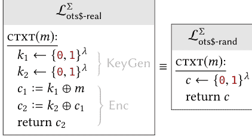

与其直接比较这两个库，不如我们引入一些额外的库 L_hyb-1、L_hyb-2、L_hyb-3，并证明：

$\mathcal{L}_{\text{ots\$ - real}}^{\Sigma} \equiv \mathcal{L}_{\text{hyb-1}} \equiv \mathcal{L}_{\text{hyb-2}} \equiv \mathcal{L}_{\text{hyb-3}} \equiv \mathcal{L}_{\text{ots\$ - rand}}^{\Sigma}$

由于 ≡ 符号具有传递性，这将实现我们的目标。

这些中间库被称为 **混合体**，因为它们将包含该序列两个“端点”的混合特征。选择这些混合体是为了使序列中相邻库的互换性非常容易证明。此处考虑的特定混合体为：

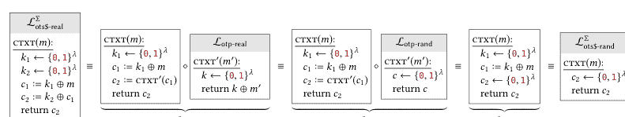

接下来，我们将为上述表达式中的每个 “≡” 提供理由。对于每对相邻库，下面突出了它们的差异：

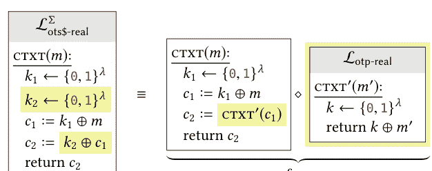

这两个库之间的唯一区别在于，突出的表达式已被提取到一个单独的子程序中，并且一些变量已被重命名。在两个库中，c2 都被选择为 c1 与一个均匀随机字符串的异或值。这些差异对调用程序没有影响。重要的是，我们提取的子程序正是 L_otp-real 库中的那个子程序（除了子程序重命名）。

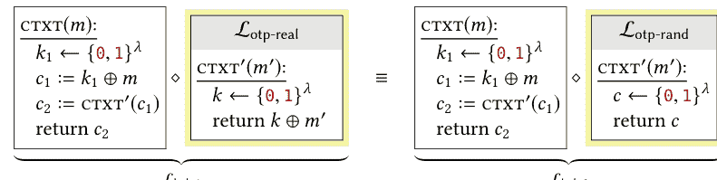

主张 2.7 说明 L_otp-real ≡ L_otp-rand，因此引理 2.11 说明我们可以在复合库中将 L_otp-real 的一个实例替换为 L_otp-rand，就像我们在这里所做的那样。此更改对调用程序没有影响。

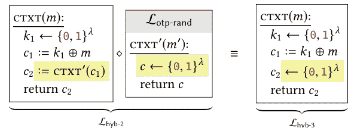

这两个库之间的唯一区别是一个子程序调用已被内联。
此差异对调用程序没有影响。

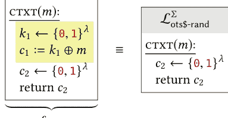

这两个库之间的唯一区别是已删除两行突出的内容。但很明显，这些行没有影响：k1 仅用于计算 c1，而 c1 永远不会再被使用。因此，此差异对调用程序没有影响。

最终的混合体正好是 L_ots$-rand（虽然变量名已更改）。我们已证明 L_ots$-rand == L_ots$-real'，这意味着该加密方案具有一次性均匀密文。

### 混合技术总结

我们现在已经见证了安全性证明中混合技术的第一个示例。本书中的所有安全性证明都使用这种技术。

- 证明安全性意味着表明两个特定的库（例如 L_left 和 L_right）是可互换的。

- 通常，L_left 和 L_right 存在显著差异，使得直接比较比较困难。为了使比较更容易处理，我们可以展示一系列混合库，从 L_left 开始，以 L_right 结束。其思想是将 L_left 和 L_right 之间的较大“差距”分解为更容易证明的较小差距。

- 将“起点”视为 L_left，然后对其进行一系列小的修改，最终目标是达到 L_right，这很有帮助。你必须证明每个修改不会影响调用程序（即，修改前后的两个库是可互换的）。

- 如第 2.2 节所讨论，诸如内联/提取子程序、更改未使用的变量、更改不可达语句或展开循环等简单操作，在混合证明中始终是“允许”的修改，因为它们对


调用程序。随着课程的推进，我们将看到更多种类的有用修改。

## 一个对比示例

通常，安全与不安全之间的界限非常微妙。让我们对之前的加密方案做一个小改动来说明这一点。与其使用独立密钥对明文应用两次 OTP，不如看看如果我们使用相同的密钥会发生什么？

| 构造 2.14（“双重 OTP”） | \(\mathcal{K} = \{0, 1\}^\lambda\) | KeyGen: | Enc(\(k, m\)): | Dec(\(k, c_2\)): |
|---|---|---|---|---|
| | \(\mathcal{M} = \{0, 1\}^\lambda\) | \(k \leftarrow \{0, 1\}^\lambda\) | \(c_1 := k \oplus m\) | \(c_1 := k \oplus c_2\) |
| | \(\mathcal{C} = \{0, 1\}^\lambda\) | return \(k\) | \(c_2 := k \oplus c_1\) | \(m := k \oplus c_1\) |
| | | | return \(c_2\) | return \(m\) |

你可能已经注意到，密文 \(c_2\) 计算为 \(c_2 := k \oplus (k \oplus m)\)，这只是一种花哨的说法，表示 \(c_2 := m\)。这种“双重 OTP”显然无法保证安全。

出于教育目的，让我们尝试在之前的安全证明中重复相同的步骤，应用于这个（不安全）方案，看看哪里会出问题。如果我们想证明构造 2.14 具有均匀密文，我们需要证明以下两个库可以互换：

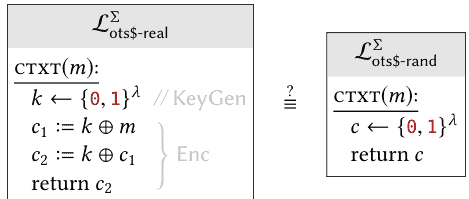

在之前的混合证明中，第一步是将语句“\(k_2 \leftarrow \{0, 1\}^\lambda\); \(c_2 := k_2 \oplus c_1\)”提取到一个单独的子程序中，这样我们就可以论证 \(c_2\) 的结果是均匀分布的。如果在此示例中做类似的事情，我们得到：

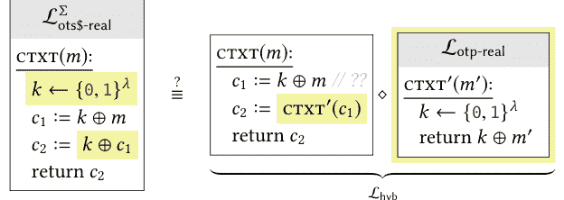

你发现问题了吗？在“\(\mathcal{L}_{\text{hyb}}\)”中，我们尝试将变量 \(k\) 移动到 \(\mathcal{L}_{\text{otp-real}}\)。由于这个作用域是私有的，我们想要对 \(k\) 进行的每个操作都必须由其容器库 \(\mathcal{L}_{\text{otp-real}}\) 提供。但这里存在不匹配：\(\mathcal{L}_{\text{otp-real}}\) 只提供了一种在单个异或表达式中使用 \(k\) 的方式，而我们需要在两个异或表达式中使用相同的 \(k\)，才能匹配 $\mathcal{L}_{\text{ots\$-real}}$ 的行为。复合库 $\mathcal{L}_{\text{hyb}}$ 在行“$c_1 := k \oplus m$”中对 $k$ 有未解决的引用，因此与 $\mathcal{L}_{\text{ots\$-real}}$ 的行为不同。这就是安全证明中出问题的步骤。

4 我会说该库由于作用域/引用错误“无法编译”。

这里有一种更具概念性的方法来理解哪里出了问题。OTP 的重要特性是，*当密钥仅用于加密一个明文时*，其密文看起来是均匀的。这一“双重 OTP”变体使用 OTP 的方式不满足该条件，因此不提供任何安全保证。之前的（成功）证明能够以 $\mathcal{L}_{\text{otp-real}}$ 的术语提取出一些异或运算而不会破坏任何东西，这就是我们知道该方案使用 OTP 的方式与其安全保证一致的原因。

希望你可以看到，安全证明的过程提供了一种捕捉这类问题的方法。在混合证明中，以其他安全定义的库为术语提取一些语句是非常常见的。只有在以适当的方式使用底层密码学时，这一步才能成功完成。

### 2.5 如何比较/对比安全定义

在数学中，一个定义不能真的说是“错误”的，但它可能“远不如你希望的那样有用”，或者“未能充分捕捉你对该概念的直觉”。

安全定义也无外如是。在本章中，我们介绍了两种安全定义：一种是“实-随机”风格，另一种是“左右”风格。在本节中，我们将*安全定义本身*视为值得研究的对象。这两种安全定义在某种意义上是“相同”的吗？它们都捕捉了我们关于安全的所有直觉吗？

### 一个安全定义蕴含另一个

比较/对比两种安全定义的一种方法是证明一个蕴含另一个。换句话说，如果一个加密方案满足定义 #1，那么它也满足定义 #2。

**定理 2.15** 如果一个加密方案 $\Sigma$ 具有一次性均匀密文（定义 2.5），那么 $\Sigma$ 也具有一次性保密性（定义 2.6）。换句话说：

$$\mathcal{L}^{\Sigma}_{\text{ots\$-real}} \equiv \mathcal{L}^{\Sigma}_{\text{ots\$-rand}} \implies \mathcal{L}^{\Sigma}_{\text{ots-L}} \equiv \mathcal{L}^{\Sigma}_{\text{ots-R}}.$$

如果你对所有术语的含义都很熟悉，那么这个陈述的含义就很简单且不足为奇。“如果所有明文 $m$ 都诱导出*均匀*的密文分布，那么所有 $m$ 都诱导出*相同*的密文分布。”

这个相当直接的陈述可以正式证明，这为我们提供了混合证明技术的另一个示例：

**证明** 我们正在证明一个如果-那么陈述。我们要证明该陈述的“那么”部分为真；即，$\mathcal{L}^{\Sigma}_{\text{ots-L}} \equiv \mathcal{L}^{\Sigma}_{\text{ots-R}}$。我们可以使用“如果”部分为真的事实；即，$\mathcal{L}^{\Sigma}_{\text{ots\$-real}} \equiv \mathcal{L}^{\Sigma}_{\text{ots\$-rand}}$。

证明使用混合技术。我们将从库 $\mathcal{L}_{\text{ots-L}}$ 开始，对其进行一小串合理的更改，直到最终达到 $\mathcal{L}_{\text{ots-R}}$。在此过程中，我们可以使用 $\mathcal{L}_{\text{ots\$-real}} \equiv \mathcal{L}_{\text{ots\$-rand}}$ 这一事实。这为证明提供了一些“策略”：如果我们能以某种方式让 $\mathcal{L}_{\text{ots\$-real}}$ 作为混合库中的一个组件出现，那么我们就可以将其替换为 $\mathcal{L}_{\text{ots\$-rand}}$（或反之亦然），希望这能朝着将 $\mathcal{L}_{\text{ots-L}}$ 转换为 $\mathcal{L}_{\text{ots-R}}$ 的目标取得进展。

下面我们列出混合库的序列，并证明每个库都与前一个库可互换。

```
$\mathcal{L}^\Sigma_{\text{ots-L}}$
EAVESDROP($m_L, m_R$):
  \( k \leftarrow \Sigma.\text{KeyGen} \)
  \( c \leftarrow \Sigma.\text{Enc}(k, m_L) \)
  return c
```

我们混合序列的起点是 $\mathcal{L}^\Sigma_{\text{ots-L}}$。

```
$\mathcal{L}^\Sigma_{\text{ots\$-real}}$
CTXT(m):
  \( k \leftarrow \Sigma.\text{KeyGen} \)
  \( c \leftarrow \Sigma.\text{Enc}(k, m) \)
  return c
```

将一块语句提取到子程序中，可以将库写成 _复合_ 库，但不会影响其外部行为。请注意，新子程序正是定义 2.5 中的 $\mathcal{L}^\Sigma_{\text{ots\$-real}}$ 库。这是一个战略选择，因为接下来会发生什么。

```
$\mathcal{L}^\Sigma_{\text{ots\$-rand}}$
CTXT(m):
  \( c \leftarrow \Sigma.\mathcal{C} \)
  return c
```

$\mathcal{L}^\Sigma_{\text{ots\$-real}}$ 已被替换为 $\mathcal{L}^\Sigma_{\text{ots\$-rand}}$。链式引理（Lemma 2.11）指出，这一更改不会影响库的行为，因为两个 $\mathcal{L}_{\text{ots-}\star}$ 库可以互换。

```
$\mathcal{L}^\Sigma_{\text{ots\$-rand}}$
CTXT(m):
  \( c \leftarrow \Sigma.\mathcal{C} \)
  return c
```

CTXT 的参数已从 \( m_L \) 更改为 \( m_R \)。由于 CTXT 在这些混合库中并未实际使用其参数，因此这对库的行为没有影响！

之前的转换是证明中最重要的一步，因为它让我们了解如何得出这个特定的混合库序列。查看混合序列所需的终点——$\mathcal{L}^\Sigma_{\text{ots-L}}$ 和 $\mathcal{L}^\Sigma_{\text{ots-R}}$——我们看到它们仅在于将 \( m_L \) 替换为 \( m_R \)。如果我们不愿意凭直觉判断，我们希望有更好的理由来说明交换 \( m_L \) 和 \( m_R \) 是“安全”的（即这对调用程序没有影响）。然而，均匀密文属性表明，$\mathcal{L}^\Sigma_{\text{ots-L}}$ 实际上与一个不使用 \( m_L \) 或 \( m_R \) 中任何一个的库 $\mathcal{L}_{\text{hyb-2}}$ 具有相同的行为。在不使用 \( m_L \) 或 \( m_R \) 的程序中，显然可以交换它们！


做出这一关键修改后，我们现在可以按相反顺序执行相同的步骤序列。

```
EAVESDROP(m_L, m_R):
c := CTXT(m_R)
return c
```

```
L^\Sigma_{\text{ots\$-real}}
CTXT(m):
k \leftarrow \Sigma.\text{KeyGen}
c \leftarrow \Sigma.\text{Enc}(k, m)
return c
```

\mathcal{L}^\Sigma_{\text{ots\$-rand}} 已被替换为 \mathcal{L}^\Sigma_{\text{ots\$-real}}。这是链式引理的另一个应用。

```
L^\Sigma_{\text{ots-R}}
EAVESDROP(m_L, m_R):
k \leftarrow \Sigma.\text{KeyGen}
c \leftarrow \Sigma.\text{Enc}(k, m_R)
return c
```

子程序调用已被内联，这对库的行为没有影响。结果正是 \mathcal{L}^\Sigma_{\text{ots-R}}。

将所有内容结合起来，我们证明了 \mathcal{L}^\Sigma_{\text{ots-L}} \equiv \mathcal{L}_{\text{hyb-1}} \equiv \cdots \equiv \mathcal{L}_{\text{hyb-4}} \equiv \mathcal{L}^\Sigma_{\text{ots-R}}。这完成了证明，我们得出结论：\Sigma 满足一次保密性的定义。

## One Security Definition Doesn’t Imply Another

比较安全定义的另一种方法是，找出那些满足一个定义但不满足另一个定义的方案。这有助于我们理解定义的边界和“边缘情况”。

一个警告：如果我们有两个都相当准确地捕捉我们直觉的安全定义，那么任何满足一个定义而不满足另一个定义的方案都注定会显得不自然和刻意。重点在于更好地理解安全定义本身，而不自然/刻意的方案只是达到这一目的的一种手段。

**Theorem 2.16** _存在一种加密方案，它满足一次保密性（定义 2.6），但不满足一次统一密文（定义 2.5）。换句话说，一次保密性 **不** 必然蕴含一次统一密文。_

**Proof** 如下给出了这样一种加密方案：

| K = {0, 1}^\lambda | KeyGen: | Enc(k, m ∈ {0, 1}^\lambda): | Dec(k, c ∈ {0, 1}^{\lambda+2}): |
|---|---|---|---|
| M = {0, 1}^\lambda | k ← {0, 1}^\lambda | c' := k ⊕ m | c' := c 的前 λ 位 |
| C = {0, 1}^{\lambda+2} | 返回 k | c := c' || 00 | 返回 k ⊕ c' |
| | | 返回 c | |

这个方案只是在每个密文中添加了比特 00 的一次一密（OTP）。关于该方案的以下事实应该是可信的（练习鼓励你如果想要更多此类练习，可以尝试正式证明它们）：

- 该方案满足一次保密性，意味着对于攻击者任意选择的 m_L 和 m_R，m_L 的加密与 m_R 的加密服从相同的分布。我们可以将两种情况下的密文分布描述为“\lambda 个均匀比特后跟 00”。请思考如何使用混合证明技术来正式证明该方案满足一次保密性！

- 该方案不满足一次统一密文属性。它的密文总是以 00 结尾，而均匀字符串以概率 1/4 以 00 结尾。请思考如何将此观察形式化为针对相关两个库的调用程序/区分者！

你可能会想，当然可以通过将密文空间 C 重新定义为最后两位为 00 的 \((\lambda + 2)\) 比特字符串的集合来修复这个问题。这是一个聪明的主意，而且确实可行。如果按照这个建议更改密文空间 C 的定义，那么该方案将满足统一密文属性（这是因为 \(\mathcal{L}_{\text{ots\$-rand}}\) 库从加密方案指定的 C 中均匀采样）。

但这个观察提出了一个有趣的点。当 C 实际上对加密功能没有任何影响时，安全性是否取决于你定义密文集合 C 的范围有多窄，难道不奇怪吗？同样，没有人真的关心这个刻意的“OTP + 00”加密方案。重点在于阐明安全定义本身的有趣边缘情况！

## Exercises

### 2.1. 以下是两个调用程序 \(\mathcal{A}_1, \mathcal{A}_2\) 和两个具有共同接口的库 \(\mathcal{L}_1, \mathcal{L}_2\)：

| \(\mathcal{A}_1\) | \(\mathcal{A}_2\) | \(\mathcal{L}_1\) | \(\mathcal{L}_2\) |
|---|---|---|---|
| \(r_1 := \text{RAND}(6)\) | \(r := \text{RAND}(6) \stackrel{?}{}\) | \(\frac{\text{RAND}(n)}{r \leftarrow \mathbb{Z}_n}\) | \(\frac{\text{RAND}(n)}{\text{返回 } 0}\) |
| \(r_2 := \text{RAND}(6)\) | 返回 \(r \geqslant 3\) | 返回 \(r\) | |

- (a) \(\text{Pr}[\mathcal{A}_1 \diamond \mathcal{L}_1 \Rightarrow \text{true}]\) 是多少？
- (b) \(\text{Pr}[\mathcal{A}_1 \diamond \mathcal{L}_2 \Rightarrow \text{true}]\) 是多少？
- (c) \(\text{Pr}[\mathcal{A}_2 \diamond \mathcal{L}_1 \Rightarrow \text{true}]\) 是多少？
- (d) \(\text{Pr}[\mathcal{A}_2 \diamond \mathcal{L}_2 \Rightarrow \text{true}]\) 是多少？

### 2.2. 在每个问题中，都描述了一对库。判断 \(\mathcal{L}_{\text{left}} \equiv \mathcal{L}_{\text{right}}\) 是否成立。如果成立，请说明它们如何对所有结果分配相同的概率。如果不成立，请描述一个成功的 *区分者*。

假设两个库使用相同的 \(n\) 值。你的答案是否会依赖于 \(n\) 的选择？

在部分 (a) 中，\(\overline{x}\) 表示 \(x\) 的按位补码。在部分 (d) 中，\(x \& y\) 表示两个字符串的按位与：

| \(\mathcal{L}_{\text{left}}\) | \(\mathcal{L}_{\text{right}}\) |
|---|---|
| QUERY(): | QUERY(): |
| \(x \leftarrow \{0, 1\}^n\) | \(x \leftarrow \{0, 1\}^n\) |
| 返回 \(x\) | \(y := \overline{x}\) |
| | 返回 \(y\) |

```
(b)
L_left
QUERY():
  x <- Z_n
  return x

L_right
QUERY():
  x <- Z_n
  y := 2x % n
  return y
```

```
(d)
L_left
QUERY():
  x <- {0, 1}^n
  y <- {0, 1}^n
  return x & y

L_right
QUERY():
  z <- {0, 1}^n
  return z
```

```
(c)
L_left
QUERY(c in Z_n):
  if c = 0
    return null
  x <- Z_n
  return x

L_right
QUERY(c in Z_n):
  if c = 0
    return null
  x <- Z_n
  y := cx % n
  return y
```

### 2.3. 证明以下库是可互换的：

```
L_left
QUERY(m in {0, 1}^lambda):
  x <- {0, 1}^lambda
  y := x XOR m
  return (x, y)

L_right
QUERY(m in {0, 1}^lambda):
  y <- {0, 1}^lambda
  x := y XOR m
  return (x, y)
```

请注意，x 和 y 在前两行中被交换，但在返回语句中未交换。

### 2.4. 通过构造一个从一次保密性定义中区分两个相关库的程序，证明以下库不可互换。描述一个显式的区分调用程序，并计算其链接到两个库时的输出概率：

```
L_left
EAVESDROP(m_L, m_R in {0, 1}^lambda):
  k <- {0, 1}^lambda
  c := k XOR m_L
  return (k, c)

L_right
EAVESDROP(m_L, m_R in {0, 1}^lambda):
  k <- {0, 1}^lambda
  c := k XOR m_R
  return (k, c)
```

### ★ 2.5. 在抽象代数中，一个（有限）群是由一组有限元素 G 和一个运算符 ⊗ 组成的，满足以下公理：

- **封闭性：** 对于所有 a, b ∈ G，有 a ⊗ b ∈ G。
- **单位元：** 存在一个特殊的单位元 e ∈ G，对于所有 a ∈ G 满足 e ⊗ a = a ⊗ e = a。我们通常写 “1” 而不是 e 来表示单位元。
- **结合性：** 对于所有 a, b, c ∈ G，有 (a ⊗ b) ⊗ c = a ⊗ (b ⊗ c)。
- **逆元：** 对于所有 a ∈ G，存在一个逆元 b ∈ G，使得 a ⊗ b = b ⊗ a 是 G 的单位元。我们通常写 “a⁻¹” 表示 a 的逆元。

根据任意群 $(\mathbb{G}, \otimes)$ 定义以下加密方案：

| | KeyGen: | Enc(k, m): | Dec(k, c): |
|---|---|---|---|
| $\mathcal{K} = \mathbb{G}$ | \( k \leftarrow \mathbb{G} \) | 返回 \( k \otimes m \) | ?? |
| $\mathcal{M} = \mathbb{G}$ | 返回 \( k \) | | |
| $\mathcal{C} = \mathbb{G}$ | | | |

(a) 证明 \(\{0, 1\}^\lambda\) 在异或运算下构成一个群。单位元是什么？值 \(x \in \{0, 1\}^\lambda\) 的逆元是什么？

(b) 填充 Dec 算法的细节，并证明（使用群公理）该方案满足正确性。

(c) 证明该方案满足一次保密性。

### 2.6. 在 Claim 2.9 的证明中，我们考虑了一个调用 ctxt\((\mathbf{0}^\lambda)\) 的攻击者/调用程序：

(a) 如果该攻击者改为调用 ctxt\((\mathbf{1}^\lambda)\)，其有效性会如何变化？

(b) 如果它对均匀选择的 \(m\) 调用 ctxt\((m)\)，其有效性会如何变化？

### 2.7. 以下方案通过根据秘密排列 \(k\) 简单重新排序明文比特来加密明文。

| $\mathcal{K} = \left\{ \text{对 } \{1, \dots, \lambda\} \text{ 的排列} \right\}$ | Enc(k, m): |
|---|---|
| $\mathcal{M} = \{0, 1\}^\lambda$ | for \(i := 1\) 到 \(\lambda\): |
| $\mathcal{C} = \{0, 1\}^\lambda$ | \(c_{k(i)} := m_i\) |
| | 返回 \(c_1 \cdots c_\lambda\) |
| KeyGen: | Dec(k, c): |
| \(k \leftarrow \mathcal{K}\) | for \(i := 1\) 到 \(\lambda\): |
| 返回 \(k\) | \(m_i := c_{k(i)}\) |
| | 返回 \(m_1 \cdots m_\lambda\) |

通过构造一个从一次保密性定义中区分两个相关库的程序，证明该方案 **不** 具有一次保密性。

### 2.8. 通过构造一个从一次保密性定义中区分两个相关库的程序，证明以下加密方案 **不** 具有一次保密性。

| | KeyGen: | Enc(k, m): |
|---|---|---|
| $\mathcal{K} = \{1, \dots, 9\}$ | \(k \leftarrow \{1, \dots, 9\}\) | 返回 \(k \times m \% 10\) |
| $\mathcal{M} = \{1, \dots, 9\}$ | 返回 \(k\) | |
| $\mathcal{C} = \mathbb{Z}_{10}$ | | | |

### 2.9. 考虑以下加密方案。它支持来自 \(\mathcal{M} = \{0, 1\}^\lambda\) 的明文和来自 \(\mathcal{C} = \{0, 1\}^{2\lambda}\) 的密文。其密钥空间是：

```
\(\mathcal{K} = \left\{ k \in \{0, 1, \_\}^{2\lambda} \mid k \text{ contains exactly } \lambda \text{ “\_” characters} \right\}\)
```

使用密钥 \(k\) 加密明文 \(m\) 时，我们使用 \(m\) 的比特来“填充” \(k\) 中的 \(\_\) 字符。


Show that the scheme does **不** have one-time secrecy, by constructing a program that distinguishes the two relevant libraries from the one-time secrecy definition.

Example: Below is an example encryption of $m = 1101100001$.

```
k = 1_0__11010_1_0_0__
  m =   11 01     1 0 0 001
=> Enc(k, m) = 11100111010110000001
```

- 2.10. Suppose we modify the scheme from the previous problem to first permute the bits of $m$ (as in Exercise 2.7) and then use them to fill in the `__" characters in a template string. In other words, the key specifies a random permutation on positions $\{1, \dots, \lambda\}$ as well as a random template string that is $2\lambda$ characters long with $\lambda$ `__" characters.

Show that even with this modification the scheme does not have one-time secrecy.

- ★ 2.11. Prove that if an encryption scheme $\Sigma$ has $|\Sigma.\mathcal{K}| < |\Sigma.\mathcal{M}|$ then it cannot satisfy one-time secrecy. Try to structure your proof as an explicit attack on such a scheme ($i.e.,$ a distinguisher against the appropriate libraries).

The Enc algorithm of one-time pad is deterministic, but our definitions of encryption allow Enc to be randomized ($i.e.,$ it may give different outputs when called twice with the same $k$ and $m$). **For full credit**, you should prove the statement even for the case of Enc is randomized. However, you may assume that Dec is deterministic.

- 2.12. Let $\Sigma$ denote an encryption scheme where $\Sigma.\mathcal{C} \subseteq \Sigma.\mathcal{M}$ (so that it is possible to use the scheme to encrypt its own ciphertexts). Define $\Sigma^2$ to be the following **nested-encryption** scheme:

```
$\mathcal{K} = (\Sigma.\mathcal{K})^2$
$\mathcal{M} = \Sigma.\mathcal{M}$
$\mathcal{C} = \Sigma.\mathcal{C}$

KeyGen:
$k_1 \leftarrow \Sigma.\mathcal{K}$
$k_2 \leftarrow \Sigma.\mathcal{K}$
return $(k_1, k_2)$

\underline{\text{Enc}((k_1, k_2), m):}
$c_1 := \Sigma.\text{Enc}(k_1, m)$
$c_2 := \Sigma.\text{Enc}(k_2, c_1)$
return $c_2$

\underline{\text{Dec}((k_1, k_2), c_2):}
$c_1 := \Sigma.\text{Dec}(k_2, c_2)$
$m := \Sigma.\text{Dec}(k_1, c_1)$
return $m$
```

Prove that if $\Sigma$ satisfies one-time secrecy, then so does $\Sigma^2$.

- 2.13. Let $\Sigma$ denote an encryption scheme and define $\Sigma^2$ to be the following **encrypt-twice** scheme:

```
$\mathcal{K} = (\Sigma.\mathcal{K})^2$
$\mathcal{M} = \Sigma.\mathcal{M}$
$\mathcal{C} = \Sigma.\mathcal{C}$
KeyGen:
  $k_1 \leftarrow \Sigma.\mathcal{K}$
  $k_2 \leftarrow \Sigma.\mathcal{K}$
  return $(k_1, k_2)$
Enc($k_1$, $k_2$, $m$):
  $c_1 := \Sigma.\text{Enc}(k_1, m)$
  $c_2 := \Sigma.\text{Enc}(k_2, m)$
  return $(c_1, c_2)$
Dec($k_1$, $k_2$, $c_1$, $c_2$):
  $m_1 := \Sigma.\text{Dec}(k_1, c_1)$
  $m_2 := \Sigma.\text{Dec}(k_2, c_2)$
  if $m_1 \neq m_2$ return err
  return $m_1$
```

Prove that if $\Sigma$ satisfies one-time secrecy, then so does $\Sigma^2$.

- 2.14. Prove that an encryption scheme $\Sigma$ satisfies one-time secrecy **if and only if** the following two libraries are interchangeable:

```
$\mathcal{L}^{\Sigma}_{\text{left}}$
FOO($m \in \Sigma.\mathcal{M}$):
  $k \leftarrow \Sigma.\text{KeyGen}$
  $c \leftarrow \Sigma.\text{Enc}(k, m)$
  return $c$
```

```
$\mathcal{L}^{\Sigma}_{\text{right}}$
FOO($m \in \Sigma.\mathcal{M}$):
  $k \leftarrow \Sigma.\text{KeyGen}$
  $m' \leftarrow \Sigma.\mathcal{M}$
  $c \leftarrow \Sigma.\text{Enc}(k, m')$
  return $c$
```

Note: you must prove both directions of the if-and-only-if with a hybrid proof.

- 2.15. Prove that an encryption scheme $\Sigma$ has one-time secrecy **if and only if** the following two libraries are interchangeable:

```
$\mathcal{L}^{\Sigma}_{\text{left}}$
FOO($m_L, m_R \in \Sigma.\mathcal{M}$):
  $k_1 \leftarrow \Sigma.\text{KeyGen}$
  $c_1 := \Sigma.\text{Enc}(k_1, m_L)$
  $k_2 \leftarrow \Sigma.\text{KeyGen}$
  $c_2 := \Sigma.\text{Enc}(k_2, m_R)$
  return $(c_1, c_2)$
```

```
$\mathcal{L}^{\Sigma}_{\text{right}}$
FOO($m_L, m_R \in \Sigma.\mathcal{M}$):
  $k_1 \leftarrow \Sigma.\text{KeyGen}$
  $c_1 := \Sigma.\text{Enc}(k_1, m_R)$
  $k_2 \leftarrow \Sigma.\text{KeyGen}$
  $c_2 := \Sigma.\text{Enc}(k_2, m_L)$
  return $(c_1, c_2)$
```

Note: you must prove both directions of the if-and-only-if with a hybrid proof.

- 2.16. Formally define a variant of the one-time secrecy definition in which the calling program can obtain two ciphertexts (on chosen plaintexts) encrypted under the same key. Call it two-time secrecy.

- (a) Suppose someone tries to prove that one-time secrecy implies two-time secrecy. Show where the proof appears to break down.

- (b) Describe an attack demonstrating that one-time pad does not satisfy your definition of two-time secrecy.

- 2.17. In this problem we consider modifying one-time pad so that the key is not chosen uniformly. Let $\mathcal{D}_\lambda$ denote the probability distribution over $\{0, 1\}^\lambda$ where we choose each bit of the result to be 0 with probability 0.4 and 1 with probability 0.6.

Let $\Sigma$ denote one-time pad encryption scheme but with the key sampled from distribution $\mathcal{D}_\lambda$ rather than the uniform distribution on $\{0, 1\}^\lambda$.

- (a) Consider the case of $\lambda = 5$. A calling program $\mathcal{A}$ for the $\mathcal{L}^{\Sigma}_{\text{ots-}\star}$ libraries calls $\text{EAVESDROP}(01011, 10001)$ and receives the result $01101$. What is the probability that this happens, assuming that $\mathcal{A}$ is linked to $\mathcal{L}^{\Sigma}_{\text{ots-L}}$? What about when $\mathcal{A}$ is linked to $\mathcal{L}^{\Sigma}_{\text{ots-R}}$?

- (b) Turn this observation into an explicit attack on the one-time secrecy of $\Sigma$.

- 2.18. Complete the proof of Theorem 2.16.

- (a) Formally prove (using the hybrid technique) that the scheme in that theorem satisfies one-time secrecy.

- (b) Give a distinguishing calling program to show that the scheme doesn't satisfy one-time uniform ciphertexts.

## 秘密共享

DNS is the system that maps human-memorable Internet domains like `irs.gov` to machine-readable IP addresses like `166.123.218.220`. If an attacker can masquerade as the DNS system and convince your computer that `irs.gov` actually resides at some other IP address, it might result in a bad day for you.

To protect against these kinds of attacks, a replacement called DNSSEC has been proposed. DNSSEC uses cryptography to make it impossible to falsify a domain-name mapping. The cryptography required to authenticate DNS mappings is certainly interesting, but an even more fundamental question remains: *Who can be trusted with the master cryptographic keys to the system?* The non-profit organization in charge of these kinds of things (ICANN) has chosen the following system. The master key is split into 7 pieces and distributed on smart cards to 7 geographically diverse people, who keep them in safe-deposit boxes.

> > At least five key-holding members of this fellowship would have to meet at a secure data center in the United States to reboot [DNSSEC] in case of a very unlikely system collapse.
>
> > "If you round up five of these guys, they can decrypt [the root key] should the West Coast fall in the water and the East Coast get hit by a nuclear bomb," [said] Richard Lamb, program manager for DNSSEC at ICANN.1

How is it possible that *any* 5 out of the 7 key-holders can reconstruct the master key, but (presumably) 4 out of the 7 cannot? The solution lies in a cryptographic tool called a **secret-sharing scheme**, the topic of this chapter.

### 3.1 定义

We begin by introducing the syntax of a secret-sharing scheme:

**Definition 3.1** (Secret-sharing) *A $t$-out-of-$n$ threshold secret-sharing scheme (TSSS) consists of the following algorithms:*

- Share: *a randomized algorithm that takes a **message** $m \in \mathcal{M}$ as input, and outputs a sequence $s = (s_1, \dots, s_n)$ of **shares**.*
- Reconstruct: *a deterministic algorithm that takes a collection of $t$ or more shares as input, and outputs a message.*

We call $\mathcal{M}$ the **message space** of the scheme, and $t$ its **threshold**. As usual, we refer to the parameters/components of a scheme $\Sigma$ as $\Sigma.t$, $\Sigma.n$, $\Sigma.\mathcal{M}$, $\Sigma$.Share, $\Sigma$.Reconstruct.

1 http://www.livescience.com/6791-internet-key-holders-insurance-cyber-attack.html

In secret-sharing, we number the users as $\{1, \dots, n\}$, with user $i$ receiving share $s_i$. Let $U \subseteq \{1, \dots, n\}$ be a subset of users. Then $\{s_i \mid i \in U\}$ refers to the set of shares belonging to users $U$. If $|U| \ge t$, we say that $U$ is authorized; otherwise it is unauthorized. The goal of secret sharing is for all authorized sets of users/shares to be able to reconstruct the secret, while all unauthorized sets learn nothing.

**Definition 3.2** (TSSS correctness) A $t$-out-of-$n$ TSSS satisfies **correctness** if, for all authorized sets $U \subseteq \{1, \dots, n\}$ (i.e., $|U| \ge t$) and for all $s \leftarrow \text{Share}(m)$, we have $\text{Reconstruct}(\{s_i \mid i \in U\}) = m$.

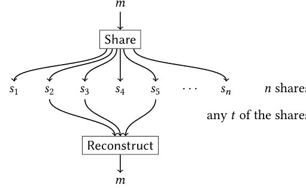

### 安全定义

We'd like a security guarantee that says something like:

> if you know only an unauthorized set of shares, then you learn no information about the choice of secret message.

To translate this informal statement into a formal security definition, we define two libraries that allow the calling program to learn a set of shares (for an unauthorized set), and that differ only in which secret is shared. If the two libraries are interchangeable, then we conclude that seeing an unauthorized set of shares leaks no information about the choice of secret message. The definition looks like this:

**Definition 3.3** (TSSS security) Let $\Sigma$ be a threshold secret-sharing scheme. We say that $\Sigma$ is **secure** if $\mathcal{L}_{\text{tsss-L}}^\Sigma \equiv \mathcal{L}_{\text{tsss-R}}^\Sigma$, where:

| $\mathcal{L}_{\text{tsss-L}}^\Sigma$ | $\mathcal{L}_{\text{tsss-R}}^\Sigma$ |
|---|---|
| SHARE($m_L, m_R \in \Sigma.\mathcal{M}, U$): | SHARE($m_L, m_R \in \Sigma.\mathcal{M}, U$): |
| if $|U| \ge \Sigma.t$: return err | if $|U| \ge \Sigma.t$: return err |
| $\boldsymbol{s} \leftarrow \Sigma.\text{Share}(m_L)$ | $\boldsymbol{s} \leftarrow \Sigma.\text{Share}(m_R)$ |
| return $\{s_i \mid i \in U\}$ | return $\{s_i \mid i \in U\}$ |

In an attempt to keep the notation uncluttered, we have not written the type of the argument $U$, which is $U \subseteq \{1, \dots, \Sigma.n\}$.


## 讨论与陷阱

- 与加密的一次性保密定义类似，我们允许调用程序选择将被共享的两条秘密消息。与之前一样，这模拟了一个攻击场景，其中对手对正在共享的秘密 m 具有部分知识或影响。

- 调用程序还选择要获取的用户股份集合 U。这些库使得调用程序无法获取授权集的股份（在这种情况下返回 err）。这并不意味着用户永远不允许分发授权数量的股份（这确实很奇怪，因为这将使任何未来的重建都不可能）。这只是意味着我们希望有一个安全定义，能够说明只看到一组未授权股份的攻击者的情况，因此我们以具有此限制的库为基础来形式化安全性。

- 考虑一个 6-out-of-10 阈值秘密共享方案。使用上述库，调用程序可以在一次 SHARE 调用中接收用户 {1, ..., 5}（一组未授权集合）的股份，然后在另一次调用中接收用户 {6, ..., 10} 的股份。看起来调用程序似乎可以随后组合这些股份来重建秘密（如果两次调用中共享了相同的消息）。然而，情况并非如此，因为这两组股份来自 Share 算法的两次独立执行。不应期望一次 Share 调用生成的股份与另一次调用生成的股份协同工作，即使两次 Share 调用都使用了相同的秘密消息。

- 请回顾，在我们使用库来定义安全性的方式中，只有库之间的内部差异必须被隐藏。两个库之间相同的任何东西都不需要隐藏。这里两个库中相同的一件事是，它们输出属于同一组用户 U 的股份。这个安全定义不要求股份隐藏它们属于哪个用户。确实，你可以修改一个秘密共享方案，使每个用户的身份附加到其对应的股份上，结果仍然满足上述安全定义。

- 就像加密定义不解决密钥分发问题一样，秘密共享定义也不解决谁应该运行 Share 算法的问题（如果它的输入 m 如此秘密以至于不能托付给任何单个人），或者股份应该如何传递给 n 个不同的用户。这些问题被秘密共享问题视为超出范围（尽管我们稍后会讨论第一个问题的巧妙方法）。相反，重点仅仅在于是否有可能以这种方式对数据进行编码，即一组未授权的股份不泄露关于秘密的任何信息，而任何一组授权股份都能完全揭示秘密。

## 一种不安全的方法

理解秘密共享安全性的一种方法是查看秘密共享中一个“显而易见”但不安全的方法示例，并研究为什么它不安全。

让我们考虑一个 5-out-of-5 秘密共享方案。这意味着我们希望将秘密分割成 5 个部分，以便任何 4 个部分都不泄露任何信息。你可能想到的一种方法是将秘密 *字面上切成* 5 个部分。例如，如果秘密是 500 位，你可以将前 100 位给用户 1，将第二个 100 位给用户 2，依此类推。

| | Share(m): | Reconstruct(s1, ..., s5): |
|---|---|---|
| $\mathcal{M} = \{0, 1\}^{500}$ | 将 $m$ 分割为 $m = s_1 || \cdots || s_5$, | 返回 $s_1 || \cdots || s_5$ |
| $t = 5$ | 其中每个 $|s_i| = 100$ | |
| $n = 5$ | 返回 $(s_1, \dots, s_5)$ | |

确实，通过连接所有 5 个股份可以构造秘密，因此此构造满足正确性属性。（唯一的授权集是所有 5 个用户的集合，因此我们编写 Reconstruct 以期望所有 5 个股份。）

然而，该方案是 **不安全** 的（如所承诺）。假设你甚至只有 1 个股份。确实，你不知道秘密 *的完整内容*，但安全定义（针对 5-out-of-5 秘密共享）要求单个股份关于秘密 *什么都不* 泄露。当然，知道某样东西的 100 位并不等同于关于它 *一无所知*。

我们可以利用此观察对该方案进行更正式的攻击，形式是两个 $\mathcal{L}_{\text{tsss-}\star}$ 库之间的区分器。作为极端情况，我们可以区分全 0 秘密的股份和全 1 秘密的股份：

```
$\mathcal{A}$
$s_1 := \text{SHARE}(0^{500}, 1^{500}, \{1\})$
return $s_1 \stackrel{?}{=} 0^{100}$
```

让我们将这个调用程序链接到两个 $\mathcal{L}_{\text{tsss-}\star}$ 库，看看会发生什么：

| $\mathcal{A}$ | $\mathcal{L}_{\text{tsss-L}}$ | 当 $\mathcal{A}$ 链接到 $\mathcal{L}_{\text{tsss-L}}$ 时，它接收 $0^{500}$ 的股份，这本身将是一个全零字符串。在此情况下，$\mathcal{A}$ 以概率 1 输出 1。 |
|---|---|---|
| $s_1 := \text{SHARE}(0^{500}, 1^{500}, \{1\})$<br>return $s_1 \stackrel{?}{=} 0^{100}$ | $\text{SHARE}(m_L, m_R, U)$:<br>if $|U| \geqslant t$: return err<br>\(\boldsymbol{s} \leftarrow \text{Share}(\boldsymbol{m_L})\)<br>return $\{s_i \mid i \in U\}$ | |

| $\mathcal{A}$ | $\mathcal{L}_{\text{tsss-R}}$ | 当 $\mathcal{A}$ 链接到 $\mathcal{L}_{\text{tsss-R}}$ 时，它接收 $1^{500}$ 的股份，这将是一个全 1 字符串。在此情况下，$\mathcal{A}$ 以概率 0 输出 1。 |
|---|---|---|
| $s_1 := \text{SHARE}(0^{500}, 1^{500}, \{1\})$<br>return $s_1 \stackrel{?}{=} 0^{100}$ | $\text{SHARE}(m_L, m_R, U)$:<br>if $|U| \geqslant t$: return err<br>\(\boldsymbol{s} \leftarrow \text{Share}(\boldsymbol{m_R})\)<br>return $\{s_i \mid i \in U\}$ | |

我们已经构建了一个调用程序，在两个库的存在下表现得非常不同（确实，尽可能不同）。因此，这个秘密共享方案是不安全的。

希望这个例子展示了秘密共享方案的主要挑战（和奇妙之处）之一。随着获得更多股份，很容易逐渐泄露关于秘密的信息，就像在这个不安全的示例中一样。然而，秘密共享的安全定义是，股份必须 *绝对不* 泄露关于秘密的任何信息，直到股份数量超过阈值。

### 3.2 一个简单的 2-out-of-2 方案

信不信由你，我们已经见过一个简单的秘密共享方案！事实上，把一次性密码本视为最简单的秘密共享方案可能更好。

| | $\mathcal{M} = \{0, 1\}^\ell$ | Share(m): |
|---|---|---|
| 构造 3.5 (2-out-of-2 TSSS) | $t = 2$ | $s_1 \leftarrow \{0, 1\}^\ell$ |
| | $n = 2$ | $s_2 := s_1 \oplus m$ |
| | | 返回 $(s_1, s_2)$ |
| | | Reconstruct($s_1, s_2$): 返回 $s_1 \oplus s_2$ |

由于这是一个 2-out-of-2 方案，唯一的授权用户集是 $\{1, 2\}$，因此 Reconstruct 编写为期望两个股份 $s_1$ 和 $s_2$ 作为其输入。正确性很容易从我们已经学到的关于异或属性的知识中得出。

示例 如果我们想共享字符串 $m = 1101010001$，那么 Share 算法可能会选择

```
s_1 := 0110000011
s_2 := s_1 \oplus m
= 0110000011 \oplus 1101010001 = 1011010010.
```

然后可以通过对两个股份进行异或来重建秘密，如下所示：

```
s_1 \oplus s_2 = 0110000011 \oplus 1011010010 = 1101010001 = m.
```

请记住，这个示例仅显示 Share(1101010001) 的一种可能执行，但 Share 是一个随机算法，$(s_1, s_2)$ 的许多其他值也是可能的。

### 定理 3.6
*构造 3.5 是一个安全的 2-out-of-2 阈值秘密共享方案。*

### 证明
令 $\Sigma$ 表示构造 3.5。我们将使用混合证明来显示 $\mathcal{L}^\Sigma_{\text{tsss-L}} \equiv \mathcal{L}^\Sigma_{\text{tsss-R}}$。

```
$\mathcal{L}^\Sigma_{\text{tsss-L}} :$
SHARE($m_L, m_R, U$):
if $|U| \ge 2$: return err
$s_1 \leftarrow \{0, 1\}^\ell$
$s_2 := s_1 \oplus m_L$
return $\{s_i \mid i \in U\}$
```

像往常一样，起点是 $\mathcal{L}^\Sigma_{\text{tsss-L}}$，这里填充了秘密共享方案的详细信息（并省略了子程序参数的类型以减少混乱）。


```
SHARE(m_L, m_R, U):
if |U| >= 2: return err
if U = {1}:
  s_1 <- {0, 1}^\ell
  s_2 := s_1 \oplus m_L
  return {s_1}
elseif U = {2}:
  s_1 <- {0, 1}^\ell
  s_2 := s_1 \oplus m_L
  return {s_2}
else return \emptyset
```

将库的主体复制到新 if 语句的 3 个分支中，不会对库的行为产生任何影响。这样做的原因是该方案生成 s1 和 s2 的方式不同。这意味着我们的证明最终将以根本不同的方式处理 3 个不同的未授权集合（{1}、{2} 和 \emptyset）。

```
SHARE(m_L, m_R, U):
if |U| >= 2: return err
if U = {1}:
  s_1 <- {0, 1}^\ell
  s_2 := s_1 \oplus m_R
  return {s_1}
elseif U = {2}:
  s_1 <- {0, 1}^\ell
  s_2 := s_1 \oplus m_L
  return {s_2}
else return \emptyset
```

第一个 if 分支中 s2 的定义已更改。由于 s2 在此分支中从未实际使用，因此这对库的行为没有任何影响。

```
SHARE(m_L, m_R, U):
if |U| >= 2: return err
if U = {1}:
  s_1 <- {0, 1}^\ell
  s_2 := s_1 \oplus m_R
  return {s_1}
elseif U = {2}:
  s_2 <- EAVESDROP(m_L, m_R)
  return {s_2}
else return \emptyset
```

```
\mathcal{L}^{OTP}_{ots-L}
EAVESDROP(m_L, m_R):
  k <- {0, 1}^\ell
  c := k \oplus m_L
  return c
```

将 if 语句的第二个分支识别为一次性密码本加密（在密钥 s_1 下对 m_L 进行加密），我们从一次性保密定义中提取了以库 \mathcal{L}^{OTP}_{ots-L} 为术语的 s_2 生成。这对库的行为没有任何影响。重要的是，\mathcal{L}^{OTP}_{ots-L} 中的子程序期望两个参数，因此我们必须传递这两个参数。我们选择传递 m_L 和 m_R，理由将很快变得清晰。

```
SHARE(m_L, m_R, U):
if |U| >= 2: return err
if U = {1}:
  s1 <- {0, 1}^\ell
  s2 := s1 \oplus m_R
  return {s1}
elseif U = {2}:
  s2 <- EAVESDROP(m_L, m_R)
  return {s2}
else return \emptyset
```

```
L^{OTP}_{\text{ots-R}}
EAVESDROP(m_L, m_R):
  k <- {0, 1}^\ell
  c := k \oplus m_R
  return c
```

我们已将 L^{OTP}_{ots-L} 替换为 L^{OTP}_{ots-R}。基于一次性密码本的一次性保密性（以及组合引理），此更改对库的行为没有任何影响。

```
SHARE(m_L, m_R, U):
if |U| >= 2: return err
if U = {1}:
  s1 <- {0, 1}^\ell
  s2 := s1 \oplus m_R
  return {s1}
elseif U = {2}:
  s1 <- {0, 1}^\ell
  s2 := s1 \oplus m_R
  return {s2}
else return \emptyset
```

已内联子程序；对库的行为没有任何影响。

```
L^{\Sigma}_{\text{tsss-R}}
SHARE(m_L, m_R, U):
if |U| >= 2: return err
  s1 <- {0, 1}^\ell
  s2 := s1 \oplus m_R
  return {s_i | i \in U}
```

代码已简化。具体来说，if 语句的所有分支都可以统一，且对库的行为没有任何影响。结果是 L^{\Sigma}_{\text{tsss-R}}。

我们证明了 L^{\Sigma}_{\text{tsss-L}} = L_{\text{hyb-1}} = ... = L_{\text{hyb-5}} = L^{\Sigma}_{\text{tsss-R}}；因此，该秘密共享方案是安全的。

我们实际上证明了一个略微更一般的语句。我们使用的一次性密码本的唯一属性是其一次性保密性。用任何其他一次性保密加密方案替换一次性密码本，仍然可以使相同的证明成立。因此，我们实际上证明了以下内容：

**定理 3.7** 如果 Sigma 是具有一次性保密性的加密方案，则以下 2-out-of-2 阈值秘密共享方案 S 是安全的：

| $\mathcal{M} = \Sigma.\mathcal{M}$ | Share(m): | Reconstruct(s1, s2): |
|---|---|---|
| $t=2$ | $s_1 \leftarrow \Sigma.KeyGen$ | |
| $n=2$ | $s_2 \leftarrow \Sigma.Enc(s_1, m)$ | return $\Sigma.Dec(s_1, s_2)$ |
| | return $(s_1, s_2)$ | |

### 3.3 多项式插值

您可能已经知道，两点确定一条直线（在欧几里得几何中）。同样，3 个点确定一条抛物线，依此类推。我们接下来要讨论的秘密共享方案基于以下原理：

$d + 1$ 个点确定一个*唯一*的 $d$ 次多项式。

术语说明：如果 $f$ 是可以写成 $f(\boldsymbol{x}) = \sum_{i=0}^d f_i x^i$ 的多项式，那么我们称 $f$ 为 **$d$ 次**多项式。更准确地说，应该说 $f$ 的次数 *至多为 $d$*，因为我们允许首项系数 $f_d$ 为零。出于方便，我们将继续使用“$d$ 次”来表示“次数至多为 $d$”。

### 实数上的多项式

定理 3.8（多项式插值）设 $\{(x_1, y_1), \dots, (x_{d+1}, y_{d+1})\} \subseteq \mathbb{R}^2$ 为一组点，其 $x_i$ 值互不相同。那么，存在一个**唯一**的、具有实系数的 $d$ 次多项式 $f$，使得对所有 $i$ 都有 $y_i = f(x_i)$。

证明 首先，考虑以下多项式：

\(\ell_1(\boldsymbol{x}) = \frac{(\boldsymbol{x} - \boldsymbol{x}_2)(\boldsymbol{x} - \boldsymbol{x}_3) \cdots (\boldsymbol{x} - \boldsymbol{x}_{d+1})}{(\boldsymbol{x}_1 - \boldsymbol{x}_2)(\boldsymbol{x}_1 - \boldsymbol{x}_3) \cdots (\boldsymbol{x}_1 - \boldsymbol{x}_{d+1})}\)。

该符号可能令人困惑。$\ell_1$ 是带形式变量 $\boldsymbol{x}$（以粗体书写）的多项式。非粗体的 $x_i$ 值只是普通数字（标量），在定理语句中给出。因此，$\ell_1$ 的分子是关于 $\boldsymbol{x}$ 的 $d$ 次多项式。分母只是一个标量，并且由于所有 $x_i$ 互不相同，我们不是在除以零。总的来说，$\ell_1$ 是一个 $d$ 次多项式。

当我们在某个特殊 $x_i$ 值处求值 $\ell_1$ 时会发生什么？

- 对 $\ell_1(x_1)$ 求值会使分子和分母相同，因此 $\ell_1(x_1) = 1$。
- 对 $i \neq 1$ 处的 $\ell_1(x_i)$ 求值会导致分子中出现项 $(x_i - x_i)$，因此 $\ell_1(x_i) = 0$。

当然，$\ell_1$ 可以在任意点上求值（而不仅仅是特殊点 $x_1, \dots, x_{d+1}$），但我们不关心那些情况下的情况。

我们可以类似地定义其他多项式 $\ell_j$：

\(\ell_j(\boldsymbol{x}) = \frac{(\boldsymbol{x} - \boldsymbol{x}_1) \cdots (\boldsymbol{x} - \boldsymbol{x}_{j-1})(\boldsymbol{x} - \boldsymbol{x}_{j+1}) \cdots (\boldsymbol{x} - \boldsymbol{x}_{d+1})}{(\boldsymbol{x}_j - \boldsymbol{x}_1) \cdots (\boldsymbol{x}_j - \boldsymbol{x}_{j-1})(\boldsymbol{x}_j - \boldsymbol{x}_{j+1}) \cdots (\boldsymbol{x}_j - \boldsymbol{x}_{d+1})}\)。

规律是，分子“缺少”项 $(\boldsymbol{x} - \boldsymbol{x}_j)$，分母缺少项 $(x_j - x_j)$，因为我们不想让分母为零。此类多项式称为拉格朗日多项式。它们每个都是 $d$ 次多项式，并满足以下性质：

```
\ell_j(\boldsymbol{x}_i) = \begin{cases} 1 & \text{if } i = j \\ 0 & \text{if } i \neq j \end{cases}
```

现在考虑以下多项式：

```
f(\boldsymbol{x}) = y_1\ell_1(\boldsymbol{x}) + y_2\ell_2(\boldsymbol{x}) + \cdots + y_{d+1}\ell_{d+1}(\boldsymbol{x}).
```

请注意，$f$ 是一个 $d$ 次多项式，因为它是 $d$ 次多项式的和（同样，$y_i$ 值只是标量）。

当我们在某个特殊 $x_i$ 值上对 $f$ 求值时会发生什么？由于 $\ell_i(\boldsymbol{x}_i) = 1$ 且当 $j \neq i$ 时 $\ell_j(\boldsymbol{x}_i) = 0$，我们得到：

```
f(\boldsymbol{x}_i) = y_1\ell_1(\boldsymbol{x}_i) + \cdots + y_i\ell_i(\boldsymbol{x}_i) + \cdots + y_{d+1}\ell_{d+1}(\boldsymbol{x}_i)
= y_1 \cdot 0 + \cdots + y_i \cdot 1 + \cdots + y_{d+1} \cdot 0
= y_i
```

因此，对每个 $x_i$ 都有 $f(\boldsymbol{x}_i) = y_i$，这正是我们想要的。这表明存在*某个*具有此性质的 $d$ 次多项式。

现在让我们论证这个 $f$ 是唯一的。假设存在两个 $d$ 次多项式 $f$ 和 $f'$，使得对 $i \in \{1, \dots, d+1\}$ 都有 $f(\boldsymbol{x}_i) = f'(\boldsymbol{x}_i) = y_i$。那么多项式 $g(\boldsymbol{x}) = f(\boldsymbol{x}) - f'(\boldsymbol{x})$ 也是 $d$ 次的，并且对所有 $i$ 满足 $g(\boldsymbol{x}_i) = 0$。换句话说，每个 $\boldsymbol{x}_i$ 都是 $g$ 的根，因此 $g$ 至少有 $d+1$ 个根。但只有零多项式 $g(\boldsymbol{x}) = 0$ 是具有 $d+1$ 个根的 $d$ 次多项式。如果 $g(\boldsymbol{x}) = 0$，则 $f = f'$。换句话说，任何满足 $f'(\boldsymbol{x}_i) = y_i$ 的 $d$ 次多项式 $f'$ 必须等于 $f$。因此，$f$ 是具有此性质的唯一多项式。

**示例** 让我们找出通过点 (3, 1)、(4, 1)、(5, 9)、(2, 6) 的三次多项式：

| i | 1 | 2 | 3 | 4 |
|---|---|---|---|---|
| $\boldsymbol{x}_i$ | 3 | 4 | 5 | 2 |
| $y_i$ | 1 | 1 | 9 | 6 |

首先，让我们构造相应的拉格朗日多项式：

```
\ell_1(\boldsymbol{x}) = \frac{(\boldsymbol{x} - \boldsymbol{x}_2)(\boldsymbol{x} - \boldsymbol{x}_3)(\boldsymbol{x} - \boldsymbol{x}_4)}{(\boldsymbol{x}_1 - \boldsymbol{x}_2)(\boldsymbol{x}_1 - \boldsymbol{x}_3)(\boldsymbol{x}_1 - \boldsymbol{x}_4)} = \frac{(\boldsymbol{x} - 4)(\boldsymbol{x} - 5)(\boldsymbol{x} - 2)}{(3 - 4)(3 - 5)(3 - 2)} = \frac{\boldsymbol{x}^3 - 11\boldsymbol{x}^2 + 38\boldsymbol{x} - 40}{2}
\ell_2(\boldsymbol{x}) = \frac{(\boldsymbol{x} - \boldsymbol{x}_1)(\boldsymbol{x} - \boldsymbol{x}_3)(\boldsymbol{x} - \boldsymbol{x}_4)}{(\boldsymbol{x}_2 - \boldsymbol{x}_1)(\boldsymbol{x}_2 - \boldsymbol{x}_3)(\boldsymbol{x}_2 - \boldsymbol{x}_4)} = \frac{(\boldsymbol{x} - 3)(\boldsymbol{x} - 5)(\boldsymbol{x} - 2)}{(4 - 3)(4 - 5)(4 - 2)} = \frac{\boldsymbol{x}^3 - 10\boldsymbol{x}^2 + 31\boldsymbol{x} - 30}{-2}
\ell_3(\boldsymbol{x}) = \frac{(\boldsymbol{x} - \boldsymbol{x}_1)(\boldsymbol{x} - \boldsymbol{x}_2)(\boldsymbol{x} - \boldsymbol{x}_4)}{(\boldsymbol{x}_3 - \boldsymbol{x}_1)(\boldsymbol{x}_3 - \boldsymbol{x}_2)(\boldsymbol{x}_3 - \boldsymbol{x}_4)} = \frac{(\boldsymbol{x} - 3)(\boldsymbol{x} - 4)(\boldsymbol{x} - 2)}{(5 - 3)(5 - 4)(5 - 2)} = \frac{\boldsymbol{x}^3 - 9\boldsymbol{x}^2 + 26\boldsymbol{x} - 24}{6}
\ell_4(\boldsymbol{x}) = \frac{(\boldsymbol{x} - \boldsymbol{x}_1)(\boldsymbol{x} - \boldsymbol{x}_2)(\boldsymbol{x} - \boldsymbol{x}_3)}{(\boldsymbol{x}_4 - \boldsymbol{x}_1)(\boldsymbol{x}_4 - \boldsymbol{x}_2)(\boldsymbol{x}_4 - \boldsymbol{x}_3)} = \frac{(\boldsymbol{x} - 3)(\boldsymbol{x} - 4)(\boldsymbol{x} - 5)}{(2 - 3)(2 - 4)(2 - 5)} = \frac{\boldsymbol{x}^3 - 12\boldsymbol{x}^2 + 47\boldsymbol{x} - 60}{-6}
```


作为一项合理性检查，请注意：

```
\(\begin{aligned} \ell_1(x_1) = \ell_1(\mathbf{3}) = \frac{3^3 - 11 \cdot 3^2 + 38 \cdot 3 - 40}{2} = \frac{2}{2} = 1 \\ \ell_1(x_2) = \ell_1(\mathbf{4}) = \frac{4^3 - 11 \cdot 4^2 + 38 \cdot 4 - 40}{2} = \frac{0}{2} = 0 \end{aligned}\)
```

如果将所有拉格朗日多项式重写为具有相同分母 6，下一步将更容易：

```
\(\begin{aligned} \ell_1(\mathbf{x}) &= \frac{3\mathbf{x}^3 - 33\mathbf{x}^2 + 114\mathbf{x} - 120}{6} \\ \ell_2(\mathbf{x}) &= \frac{-3\mathbf{x}^3 + 30\mathbf{x}^2 - 93\mathbf{x} + 90}{6} \end{aligned} \quad \begin{aligned} \ell_3(\mathbf{x}) &= \frac{\mathbf{x}^3 - 9\mathbf{x}^2 + 26\mathbf{x} - 24}{6} \\ \ell_4(\mathbf{x}) &= \frac{-\mathbf{x}^3 + 12\mathbf{x}^2 - 47\mathbf{x} + 60}{6} \end{aligned}\)
```

我们想要的多项式是

```
\(\begin{aligned} f(\mathbf{x}) &= y_1 \cdot \ell_1(\mathbf{x}) + y_2 \cdot \ell_2(\mathbf{x}) + y_3 \cdot \ell_3(\mathbf{x}) + y_4 \cdot \ell_4(\mathbf{x}) \\ &= 1 \cdot \ell_1(\mathbf{x}) + 1 \cdot \ell_2(\mathbf{x}) + 9 \cdot \ell_3(\mathbf{x}) + 6 \cdot \ell_4(\mathbf{x}) \\ &= \frac{1}{6} \left( \begin{matrix} 1 \cdot ( 3\mathbf{x}^3 - 33\mathbf{x}^2 + 114\mathbf{x} - 120) \\ + 1 \cdot ( -3\mathbf{x}^3 + 30\mathbf{x}^2 - 93\mathbf{x} + 90) \\ + 9 \cdot ( \mathbf{x}^3 - 9\mathbf{x}^2 + 26\mathbf{x} - 24) \\ + 6 \cdot ( - \mathbf{x}^3 + 12\mathbf{x}^2 - 47\mathbf{x} + 60) \end{matrix} \right) \\ &= \frac{1}{6} \left( 3\mathbf{x}^3 - 12\mathbf{x}^2 - 27\mathbf{x} + 114 \right) \\ &= \frac{\mathbf{x}^3}{2} - 2\mathbf{x}^2 - \frac{9\mathbf{x}}{2} + 19 \end{aligned}\)
```

确实，\(f\) 给出了正确的值：

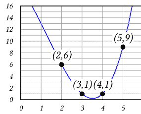

```
\(\begin{aligned} f(x_1) = f(3) &= \frac{3^3}{2} - 2 \cdot 3^2 - \frac{9 \cdot 3}{2} + 19 = 1 = y_1 \\ f(x_2) = f(4) &= \frac{4^3}{2} - 2 \cdot 4^2 - \frac{9 \cdot 4}{2} + 19 = 1 = y_2 \\ f(x_3) = f(5) &= \frac{5^3}{2} - 2 \cdot 5^2 - \frac{9 \cdot 5}{2} + 19 = 9 = y_3 \\ f(x_4) = f(2) &= \frac{2^3}{2} - 2 \cdot 2^2 - \frac{9 \cdot 2}{2} + 19 = 6 = y_4 \end{aligned}\)
```

## 模 \(p\) 的多项式

我们将看到一个基于多项式的秘密共享方案，其 Share 算法必须选择具有均匀随机系数的多项式。由于我们无法在实数上拥有均匀分布，因此我们必须考虑系数在 \(\mathbb{Z}_p\) 中的多项式。

在模 \(p\) 下运算时，如果 \(p\) 是素数，那么 \(d + 1\) 个点仍然确定一个唯一的 \(d\) 次多项式！

**定理 3.9** (模 \(p\) 插值) 设 \(p\) 为素数，设 \(\{(x_1, y_1), \dots, (x_{d+1}, y_{d+1})\} \subseteq (\mathbb{Z}_p)^2\) 为一组点，其 \(x_i\) 值互不相同。那么存在一个来自 \(\mathbb{Z}_p\) 的 **唯一** \(d\) 次多项式 \(f\)，使得对所有 \(i\) 都有 \(y_i \equiv_p f(x_i)\)。

证明与定理 3.8 的证明相同，只要将所有算术运算解释为模 \(p\) 即可。模 \(p\) 的加法、减法和乘法很简单；唯一不平凡的问题是如何解释“模 \(p\) 除法”，这在定义 \(\ell_j\) 多项式时是必需的。目前，只需接受当 \(p\) 是素数时，你总可以“除以”模 \(p\)（除以零除外）。如果你有兴趣了解模 \(p\) 除法是如何工作的，请参阅第 13 章。

我们还可以推广这样的观察：\(d + 1\) 个点唯一确定一个 \(d\) 次多项式。结果表明：

对于任意 \(k\) 个点，恰好有 \(p^{d+1-k}\) 个 \(d\) 次多项式模 \(p\) 经过这些点。

请注意，当 \(k = d + 1\) 时，该陈述表示只有一个多项式经过这些点。

**推论 3.10** (多项式个数) 设 \(\mathcal{P} = \{(x_1, y_1), \dots, (x_k, y_k)\} \subseteq (\mathbb{Z}_p)^2\) 为一组点，其 \(x_i\) 值互不相同。设 \(d\) 满足 \(k \le d + 1\) 和 \(p > d\)。那么系数在 \(\mathbb{Z}_p\) 中且对所有 \(i\) 都满足条件 \(y_i \equiv_p f(x_i)\) 的 \(d\) 次多项式 \(f\) 的数目恰好为 \(p^{d+1-k}\)。

**证明** 证明是对 \(d + 1 - k\) 的值进行归纳。基础情形是 \(d + 1 - k = 0\)。此时我们有 \(k = d + 1\) 个互异点，定理 3.9 说明存在一个满足条件的唯一多项式。由于 \(p^{d+1-k} = p^0 = 1\)，基础情形成立。

对于归纳步骤，我们在 \(\mathcal{P}\) 中有 \(k \le d\) 个点。设 \(x^* \in \mathbb{Z}_p\) 为一个不出现为任何 \(x_i\) 的值。每个多项式在 \(x^*\) 处求值时都必须给出某个值。所以，

[# of degree-$d$ polynomials passing through points in $\mathcal{P}$]
= $\sum_{y^* \in \mathbb{Z}_p}$ [# of degree-$d$ polynomials passing through points in $\mathcal{P} \cup \{(x^*, y^*)\}$]
$(\star)$ $\sum_{y^* \in \mathbb{Z}_p} p^{d+1-(k+1)}$
= $p \cdot (p^{d+1-k-1}) = p^{d+1-k}$

标记为 ($\star$) 的等式来自归纳假设，因为每一项都涉及一个经过指定的 \(k + 1\) 个具有不同 \(x\) 坐标的点的多项式。

### 示例

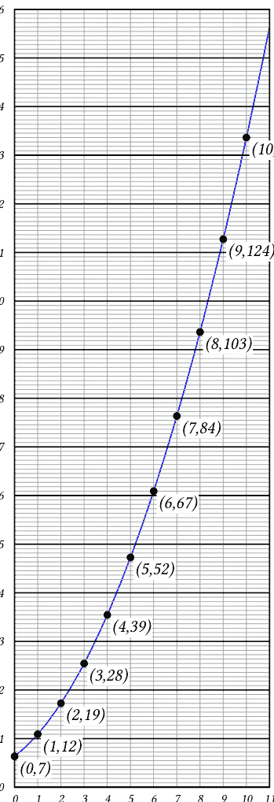

**“模 \(p\) 多项式”长什么样？** 考虑一个二次多项式示例：

f(x) = x^2 + 4x + 7

当我们在实数上绘制此多项式时（左侧图片），我们会得到一个熟悉的抛物线。

让我们看看该多项式模 11（即在 \(\mathbb{Z}_{11}\) 中）“长什么样”。模 11 运算意味着每当多项式沿 y 轴超过 11 的倍数时就“回绕”。这产生了下面的蓝色图形：

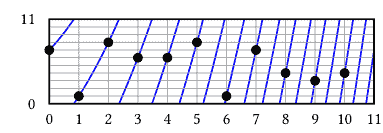

这是一张模 11 抛物线的图片。事实上，由于我们只关心 f 的 \(\mathbb{Z}_{11}\) 输入，你完全可以说，**仅 11 个高亮点本身**（而不是蓝色曲线）就是一张模 11 抛物线的图片。

### 3.4 Shamir 秘密共享

设计秘密共享方案的一部分挑战是确保 *任何* 授权的用户集都能重建秘密。我们刚刚看到，\(d\) 次多项式上的 *任何* \(d + 1\) 个点就足以唯一重建多项式。因此，秘密共享的一种自然方法是让每个用户的份额成为多项式上的一个点。

**Shamir 秘密共享** 正是如此。要以阈值 \(t\) 共享秘密 \(m \in \mathbb{Z}_p\)，首先选择一个满足 \(f(0) \equiv_p m\) 的 \((t-1)\) 次多项式 \(f\)，所有其他系数在 \(\mathbb{Z}_p\) 中均匀随机选择。第 \(i\) 个用户接收多项式上的点 \((i, f(i) \% p)\)。插值定理表明，*任何* \(t\) 个份额都可以唯一确定多项式 \(f\)，从而恢复秘密 \(f(0)\)。

```
Construction 3.11 (Shamir SSS)
M = Z_p
p : prime
n < p
t <= n

Share(m):
  f_1, ..., f_{t-1} <- Z_p
  f(x) := m + \sum_{j=1}^{t-1} f_j x^j
  for i = 1 to n:
    s_i := (i, f(i) % p)
  return s = (s_1, ..., s_n)

Reconstruct({s_i | i \in U}):
  f(x) := unique degree-(t - 1) polynomial mod p passing
  through points {s_i | i \in U}
  return f(0)
```

正确性源于插值定理。

### 示例

这是一个在 \(\mathbb{Z}_{11}\) 中 3-out-of-5 秘密共享的示例（因此 \(p = 11\)）。假设要共享的秘密是 \(m = 7 \in \mathbb{Z}_{11}\)。Share 算法选择一个常数项为 7 的随机二次多项式。

假设其余两个系数分别选择为 \(f_2 = 1\) 和 \(f_1 = 4\)，得到以下多项式：

```
f(x) = 1x^2 + 4x + 7
```

这是前一个示例中说明的同一个多项式：

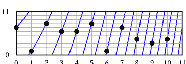

对于每个用户 \(i \in \{1, \dots, 5\}\)，我们分发份额 \((i, f(i) \% 11)\)。这些份额对应上述模 11 图片中的高亮点。

| 用户 (i) | f(i) | 份额 (i, f(i) % 11) |
|---|---|---|
| 1 | f(1) = 12 | (1, 1) |
| 2 | f(2) = 19 | (2, 8) |
| 3 | f(3) = 28 | (3, 6) |
| 4 | f(4) = 39 | (4, 6) |
| 5 | f(5) = 52 | (5, 8) |

请记住，这个示例仅说明 Share 的一种可能执行。因为 Share 是一个随机算法，存在许多相同秘密的有效共享（由 f 中高亮系数的不同选择引起）。


## Security

要展示 Shamir 秘密共享的安全性，我们首先展示一个关于未授权集合中份额分布的便利引理：

## Lemma 3.12

设 p 为素数，并定义以下两个库：

```
$\mathcal{L}_{\text{shamir-real}}$
POLY(m, t, U \subseteq \{1, \dots, p\}):
 if |U| \ge t: return err
 f_1, \dots, f_{t-1} \leftarrow \mathbb{Z}_p
 f(\boldsymbol{x}) := m + \sum_{j=1}^{t-1} f_j x^j
 for i \in U:
 s_i := (i, f(i) \% p)
 return \{s_i \mid i \in U\}
```

```
$\mathcal{L}_{\text{shamir-rand}}$
POLY(m, t, U \subseteq \{1, \dots, p\}):
 if |U| \ge t: return err
 for i \in U:
 y_i \leftarrow \mathbb{Z}_p
 s_i := (i, y_i)
 return \{s_i \mid i \in U\}
```

$\mathcal{L}_{\text{shamir-real}}$ 选择一个过点 (0, m) 的随机 (t − 1) 次多项式，然后在给定的 x 坐标（由 U 指定）处对其求值。$\mathcal{L}_{\text{shamir-rand}}$ 简单地给出均匀选择的点，与任何多项式无关。

主张是这些库可以互换：$\mathcal{L}_{\text{shamir-real}} \equiv \mathcal{L}_{\text{shamir-rand}}$。

## Proof

固定消息 $m \in \mathbb{Z}_p$，固定用户集合 $U$ 且 $|U| < t$，并对每个 $i \in U$ 固定一个值 $y_i \in \mathbb{Z}_p$。我们希望考虑在两个库中，调用 POLY$(m, t, U)$ 输出 $\{(i, y_i) \mid i \in U\}$ 的概率。

在库 $\mathcal{L}_{\text{shamir-real}}$ 中，子程序选择一个随机 (t−1) 次多项式 $f$，使得 $f(0) \equiv_p m$。根据推论 3.10，这样的多项式有 $p^{t-1}$ 个。

为了让 POLY 输出与我们选定的 $y_i$ 一致的点，该库必须选择一个过 $(0, m)$ 和所有 $\{(i, y_i) \mid i \in U\}$ 点的多项式。该库必须选择一个通过特定选定的 $|U| + 1$ 个点的多项式，而推论 3.10 告诉我们这样的多项式有 $p^{t-(|U|+1)}$ 个。

POLY 给出我们期望输出的唯一方式是，在 $p^{t-1}$ 种可能性中选择其中一个 $p^{t-(|U|+1)}$ 个“好”多项式。这恰好以如下概率发生：

```
\frac{p^{t-|U|-1}}{p^{t-1}} = p^{-|U|}
```

现在，在库 $\mathcal{L}_{\text{shamir-rand}}$ 中，POLY 在 $\mathbb{Z}_p$ 中均匀地选择其 $|U|$ 个输出值。选择它们有 $p^{|U|}$ 种方式。但只有其中一种方式会导致 POLY$(m, t, U)$ 输出我们特定选择的 $\{(i, y_i) \mid i \in U\}$。因此，接收到该输出的概率是 $p^{-|U|}$。

对于 POLY 的所有可能输入，两个库对每个可能的输出分配相同的概率。因此，这些库可以互换。

## Theorem 3.13

Shamir 的秘密共享方案（构造 3.11）根据定义 3.3 是安全的。

这与在主张 2.7 中我们固定特定 $m$ 和 $c$ 并计算 EAVESDROP$(m) = c$ 的概率的方式类似。

## Proof

设 $\mathcal{S}$ 表示 Shamir 秘密共享方案。我们通过混合参数证明 $\mathcal{L}_{\text{tss-L}}^{\mathcal{S}} \equiv \mathcal{L}_{\text{tss-R}}^{\mathcal{S}}$。

```
$\mathcal{L}_{\text{tss-L}}^{\mathcal{S}}$:
SHARE(m_L, m_R, U):
  if |U| >= t: return err
  f_1, ..., f_{t-1} <- Z_p
  f(x) := m_L + \sum_{j=1}^{t-1} f_j x^j
  for i \in U:
    s_i := (i, f(i) % p)
  return {s_i | i \in U}
```

我们的起点是 $\mathcal{L}_{\text{tss-L}}^{\mathcal{S}}$，此处填充了 Shamir 秘密共享的详细信息。

```
SHARE(m_L, m_R, U):
return POLY(m_L, t, U)
```

```
$\mathcal{L}_{\text{shamir-real}}$:
POLY(m, t, U):
  if |U| >= t: return err
  f_1, ..., f_{t-1} <- Z_p
  f(x) := m + \sum_{j=1}^{t-1} f_j x^j
  for i \in U:
    s_i := (i, f(i) % p)
  return {s_i | i \in U}
```

SHARE 子程序的几乎整个主体已根据上述定义的 $\mathcal{L}_{\text{shamir-real}}$ 库进行了因式分解。剩下的唯一事项是是共享 $m_L$ 还是 $m_R$ 的“选择”。以这种方式重构代码不会影响库的行为。

```
SHARE(m_L, m_R, U):
return POLY(m_L, t, U)
```

```
$\mathcal{L}_{\text{shamir-rand}}$:
POLY(m, t, U):
  if |U| >= t: return err
  for i \in U:
    y_i <- Z_p
    s_i := (i, y_i)
  return {s_i | i \in U}
```

根据引理 3.12，我们可以用 $\mathcal{L}_{\text{shamir-rand}}$ 替换 $\mathcal{L}_{\text{shamir-real}}$，而不会影响库的行为。

```
SHARE(m_L, m_R, U):
return POLY(m_R, t, U)
```

```
$\mathcal{L}_{\text{shamir-rand}}$:
POLY(m, t, U):
  if |U| >= t: return err
  for i \in U:
    y_i <- Z_p
    s_i := (i, y_i)
  return {s_i | i \in U}
```

传给 poly 的参数已从 $m_L$ 更改为 $m_R$。这不会影响库的行为，因为在这些混合体中，poly 实际上忽略了其参数。

```
SHARE(m_L, m_R, U):
return POLY(m_R, t, U)
```

```
$\mathcal{L}_{\text{shamir-real}}$:
POLY(m, t, U):
  if |U| >= t: return err
  f_1, ..., f_{t-1} <- Z_p
  f(x) := m + \sum_{j=1}^{t-1} f_j x^j
  for i \in U:
    s_i := (i, f(i) % p)
  return {s_i | i \in U}
```

按相反顺序应用相同步骤，我们可以用 $\mathcal{L}_{\text{shamir-real}}$ 替换 $\mathcal{L}_{\text{shamir-rand}}$，而不会影响库的行为。

```
$\mathcal{L}_{\text{tss-R}}^{\mathcal{S}}$:
SHARE(m_L, m_R, U):
  if |U| >= t: return err
  f_1, ..., f_{t-1} <- Z_p
  f(x) := m_R + \sum_{j=1}^{t-1} f_j x^j
  for i \in U:
    s_i := (i, f(i) % p)
  return {s_i | i \in U}
```

已内联一个子程序，这不会影响库的行为。得到的库是 $\mathcal{L}_{\text{tss-R}}^{\mathcal{S}}$。

我们证明了 $\mathcal{L}_{\text{tss-L}}^{\mathcal{S}} = \mathcal{L}_{\text{hyb-1}} = \dots = \mathcal{L}_{\text{hyb-4}} = \mathcal{L}_{\text{tss-R}}^{\mathcal{S}}$，因此 Shamir 的秘密共享方案是安全的。

### 3.5 Visual Secret Sharing

这里有一个 2-out-of-2 秘密共享的有趣变体，称为 **视觉秘密共享**。在此变体中，秘密和份额都是黑白图像。我们要求与传统秘密共享相同的安全性质——即，单个份额（图像）本身不会泄露关于秘密（图像）的任何信息。视觉秘密共享的不同之处在于，我们要求 *重建* 过程以视觉方式进行。

更具体地说，每个份额应打印在透明纸上。当两个份额叠在一起时，秘密图像会以视觉方式显现。我们将讨论一个简单的视觉秘密共享方案，其灵感源于以下观察：

- 当 [icon] 叠在 [icon] 上时，结果是 [icon]
- 当 [icon] 叠在 [icon] 上时，结果是 [icon]
- 当 [icon] 叠在 [icon] 上时，结果是 [icon]
- 当 [icon] 叠在 [icon] 上时，结果是 [icon]

重要的是，在前两种情况下叠加份额时，结果是一个半黑半白的 2 x 2 块（我们称之为“灰”）；而在其他情况下，结果是完全黑色的。

想法是独立处理源图像的每个像素，并将每个像素编码为每个份额中的一个 2 x 2 像素块。白色像素应以一种方式共享，使得两个份额叠加形成“灰”色的 2 x 2 块，而黑色像素以一种方式共享，结果形成黑色的 2 x 2 块。

更正式地说：

```
Share(m):
initialize empty images s₁, s₂, with dimensions twice that of m
for each position (i, j) in m:
  randomly choose b₁ ← { { } }
  if m[i,j] is a white pixel: set b₂ := b₁
  if m[i,j] is a black pixel: set b₂ to the “opposite” of b₁ (i.e., { { } } \ {b₁})
  add 2 x 2 block b₁ to image s₁ at position (2i, 2j)
  add 2 x 2 block b₂ to image s₂ at position (2i, 2j)
return (s₁, s₂)
```

不难看出，份额 $s_1$ 不会泄露关于秘密图像 $m$ 的任何信息，因为它由均匀选择的 2 x 2 块组成。在练习中，你被要求证明 $s_2$ 也单独不泄露关于秘密图像的任何信息。

请注意，每当源像素是白色时，两个份额具有相同的 2x2 块（因此叠加时形成“灰”色块）。每当源像素是黑色时，两个份额具有相反的块，因此叠加形成黑色块。

### Example

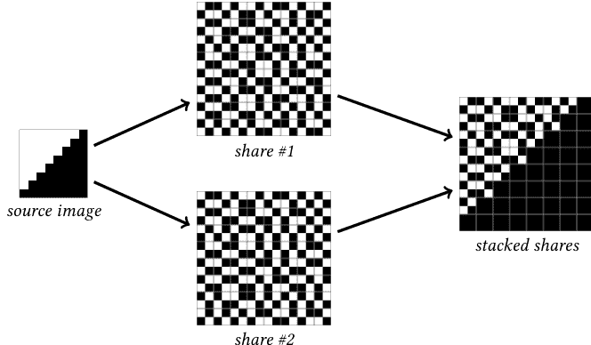

### Exercises

- 3.1. 将构造 3.5 推广为 n-out-of-n 秘密共享方案，并证明你的方案是正确且安全的。
- 3.2. 证明定理 3.7。
- 3.3. 补全定理 3.6 的以下替代证明的细节：从 $\mathcal{L}_{\text{tss-L}}$ 开始，像以前一样应用证明的第一步，将主体复制为新 if 语句的 3 个分支。然后将练习 2.3 应用于 if 语句的第二个分支。论证 $m_L$ 可以替换为 $m_R$ 并完成证明。


3.4. 假设 T 是一个在 Z_p 上的固定（公开已知）可逆 n x n 矩阵，其中 p 是一个素数。

(a) 证明以下两个库是可互换的：

| L_left |
|---|
| QUERY(): |
| r <- (Z_p)^n |
| return r |

| L_right |
|---|
| QUERY(): |
| r <- (Z_p)^n |
| return T x r |

(b) 证明以下两个库是可互换的：

| L_left |
|---|
| QUERY(v \in (Z_p)^n): |
| r <- (Z_p)^n |
| z := v + Tr |
| return z |

| L_right |
|---|
| QUERY(v \in (Z_p)^n): |
| z <- (Z_p)^n |
| return z |

3.5. 考虑一个 t-out-of-n 阈值秘密共享方案，其中 M = {0, 1}^l，且每个用户的份额也是一串比特。证明如果该方案是安全的，那么每个用户的份额必须至少为 l 比特长。

提示：证明逆否命题。假设第一个用户的份额少于 l 比特（并且这一事实为所有人所知）。展示用户 2 到 t 如何通过枚举第一个用户份额的所有可能性来违反安全性。以相关库上的区分者形式给出你的答案。

3.6. n 个用户使用 Shamir 秘密共享共享了两个秘密。用户 i 拥有秘密 m 的份额 s_i = (i, y_i)，以及秘密 m' 的份额 s'_i = (i, y'_i)。两组份额使用相同的素数模数 p。

假设每个用户 i 在本地计算 z_i = (y_i + y'_i) % p。

(a) 证明如果 m 的份额和 m' 的份额具有相同的阈值，那么生成的 {(i, z_i) | i \leqslant n} 是秘密 m + m' 的有效秘密共享。

(b) 描述当 m 和 m' 的份额具有不同的阈值（例如 t 和 t'）时，用户会得到什么。

3.7. 假设一个委员会有 5 个人：Alice（主席）、Bob、Charlie、David、Eve。建议他们如何安全地共享一个秘密，使得只有以下组合才能打开它：

- > Alice 和任何其他一个人
- > 任何三个人

详细描述共享算法的工作原理以及重建算法的工作原理（针对所有授权的用户集）。

注意：不同用户拥有大小不同的份额（例如，表示所需的比特数不同）是可以的，并且 Reconstruct 算法依赖于提供份颪的用户的身份也是可以的。

3.8. 假设一个重要委员会有 9 个人：Alice、Bob、Carol、David、Eve、Frank、Gina、Harold 和 Irene。Alice、Bob 和 Carol 组成一个子委员会；David、Eve 和 Frank 组成另一个子委员会；Gina、Harold 和 Irene 组成另一个子委员会。建议分发者如何共享一个秘密，使得只有当每个子委员会的多数成员在场时才能打开它。描述为什么 6-out-of-9 阈值秘密共享方案 **不** 足够。

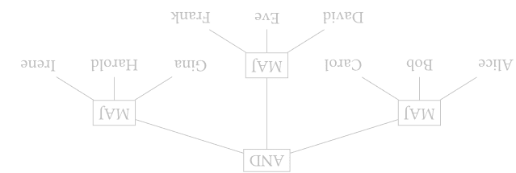

★ 3.9. (a) 推广上一道习题。一个 **单调公式** 是一个布尔函数 \(\phi : \{0, 1\}^n \to \{0, 1\}\)，当写成公式时仅使用 AND 和 OR 操作（没有 NOT）。对于集合 \(A \subseteq \{1, \dots, n\}\)，让 \(\chi_A\) 是位串，其中第 \(i\) 位当且仅当 \(i \in A\) 时为 1。对于每个单调公式 \(\phi : \{0, 1\}^n \to \{0, 1\}\)，构建一个秘密共享方案，其授权集为 \(\{A \subseteq \{1, \dots, n\} \mid \phi(\chi_A) = 1\}\)。证明你的方案是安全的。

提示：将公式表示为 AND 和 OR 门的树

(b) 给出一个 t-out-of-n 秘密共享方案的构造，其中所有份额都是二进制字符串，Share 和 Reconstruct 所需的唯一操作是 xor（因此没有 mod-p 操作）。与 Shamir 方案相比，份额有多大？

3.10. 证明构造 3.14 中的份额 \(s_2\) 与秘密 \(m\) 独立分布。

3.11. 使用实际的透明片或图像编辑程序，重建这两张图像中共享的秘密：

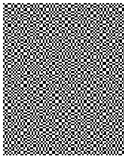

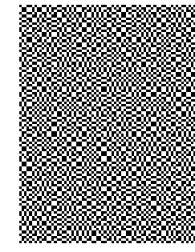

★ 3.12. 构建一个 3-out-of-3 视觉秘密共享方案。任何两个份额合在一起都不应泄露源图像的任何信息，但任何三个份额叠在一起时都能揭示源图像。

## 4 基于难以处理的计算构建密码学

John Nash 是一位数学家，因其在博弈论方面的工作而获得 1994 年诺贝尔经济学奖。他的人生故事被改编成一部成功的电影，*美丽心境*。

1955 年，Nash 与美国国家安全局（NSA）1 通信，讨论他构思的新加密方法。在这些信件中，他还提出了一些密码学的一般原则（原文中未加粗强调）：

> ... 原则上，敌人只需要很少的信息就可以开始破解该过程。基本上，一旦传输了 \(\lambda\) 比特2 的加密消息，密钥就大致被确定。这不算安全，因为实用密钥不应该太长。但这并没有考虑敌人进行确定密钥的计算是容易还是困难。如果这种计算，尽管原则上是可能的，但最好也足够长，那么该过程在实用意义上仍然可能是安全的。

Nash 在说一件相当深刻的事情：攻击是否不可能并不重要，重要的是攻击是否在计算上不可行。如果他的信件直到 2012 年才被解密，它们可能会加速“现代”密码学的发展，在这种密码学中，安全性基于难以处理的计算。就目前而言，他在识别现代密码学中最重要的概念之一方面领先于他的时代几十年。

### 4.1 什么是“计算上不可行”的攻击？

像一次性密码本这样的方案，即使是由执行暴力攻击（尝试所有可能的密钥）的攻击者（参见习题 1.5）也无法破解。然而，我们将看到的所有未来方案确实都可以通过这种攻击破解。Nash 很快指出，对于具有 \(\lambda\) 比特密钥的方案：

> 最直接的计算程序是让敌人逐个尝试所有 \(2^\lambda\) 个可能的密钥。显然，只需选择足够大的 \(\lambda\)，就可以轻松地使敌人无法实现此操作。

1Nash 的原始信件，手写体，可于以下网址查阅：https://www.nsa.gov/Portals/70/documents/news-features/declassified-documents/nash-letters/nash_letters1.pdf。

2Nash 最初使用 *r* 表示密钥长度（以比特为单位）。在本章引用的所有片段中，我已将他的数学表达式转换为我们的记号（\(\lambda\)）。

我们称 \(\lambda\) 为方案的 **安全参数**。它就像一个旋钮，允许用户将安全性调整到任何所需的级别。增加 \(\lambda\) 会使暴力攻击的难度呈指数级增长。理想情况下，当使用 \(\lambda\) 比特密钥时，每种攻击（不仅仅是暴力攻击）的难度大约为 $2^\lambda$。但是，有时更快的攻击是不可避免的。本章后面，我们将看到为什么许多具有 \(\lambda\) 比特密钥的方案的攻击成本仅为 $2^{\lambda/2}$。如果最著名的攻击需要 $2^n$ 步，通常会看到一个方案被描述为具有 **$n$-比特安全性**。

64 比特密钥上的暴力计算有多不切实际？128 比特密钥呢？像 $2^{64}$ 和 $2^{128}$ 这样的巨大数字很难在直觉上理解。

**示例** 将计算成本以货币价值来考虑可能很有帮助，分配此类货币成本的一种便捷方法是使用云计算提供商的定价模型。下面，我粗略计算了在 Amazon EC2 上，涉及 $2^\lambda$ 个 CPU 周期的计算对于各种 \(\lambda\) 选项的费用。

| 时钟周期 | 约略费用 | 参考 |
|---|---|---|
| $2^{50}$ | $3.50 | 一杯咖啡 |
| $2^{55}$ | $100 | 波特兰开拓者队比赛的体面门票 |
| $2^{65}$ | $130,000 | Oshkosh, WI 的中位住房价格 |
| $2^{75}$ | $130 million | 一部《哈利·波特》电影的预算 |
| $2^{85}$ | $140 billion | 匈牙利的 GDP |
| $2^{92}$ | $20 trillion | 美国的 GDP |
| $2^{99}$ | $2 quadrillion | 自公元前 300,000 年以来的所有人类经济活动$^4$ |
| $2^{128}$ | 真的很多 | 一千亿个人类文明的努力 |

请记住，此表仅显示执行 $2^\lambda$ 个时钟周期的成本。检查 $2^\lambda$ 个密钥的暴力攻击将需要比这多得多的周期！但是，作为免责声明，这些数字仅反映了在相当标准的通用硬件上执行计算的零售成本。政府组织能够制造专用硬件，从而显著降低计算成本。练习探讨了一些这些问题，以及概念化巨大计算成本的非金融方式。

**示例** 2017 年，SHA-1 哈希函数中的第一个碰撞被发现了（我们将在课程后面讨论哈希函数）。该攻击涉及在 GPU 集群上评估 SHA-1 函数 $2^{63}$ 次。Ars Technica$^5 上的一篇文章以如下方式估计了攻击的货币成本：

> 如果研究人员在 Amazon Web Services 平台上执行他们的攻击，按正常定价将花费 560,000 美元。如果研究人员有耐心，等待在非高峰时段运行他们的攻击，同样的碰撞将花费 110,000 美元。

3截至 2018 年 10 月，适合密集计算的最便宜 CPU 类是 m5.large，它是一个 2.5 GHz CPU。这样的 CPU 每小时执行 $2^{43}$ 个时钟周期。EC2 上该 CPU 的最低费率为每小时 0.044 美元（3 年预留实例，所有费用预付）。总的来说，单个时钟周期的成本（向下取整）为 $2^{-48}$ 美元。

4我找到了一些估计（https://en.wikipedia.org/wiki/Gross_world_product）关于人类历史上各年的全球生产总值（类似于 GDP，但针对整个世界），并将它们逐年相加。

5https://arstechnica.com/information-technology/2017/02/at-deaths-door-for-years-widely-used-sha1-function-is-now-de


## 渐近运行时间

思考巨大计算的货币成本很有启发性，但这不一定能帮助我们在“可行”攻击（我们希望防御的）和“不可行”攻击（我们已同意无需关心的）之间划清界限。我们需要能够划出这样一条界限，以便制定只排除“可行攻击”的安全定义。

约翰·纳什再次思考了这个问题。他建议考虑攻击的**渐近成本**——随着安全参数 \(\lambda\) 趋向无穷大，计算成本如何随输入规模增长？

> _因此，对加密过程进行分类的一种合理方式是，根据**计算密钥所需计算长度随密钥长度增加的方式**。在最好情况下，这是指数级的；在最坏情况下，很可能是 \(\lambda\) 的一个相对较小的幂次，即_ \(a\cdot\lambda^2\) _或_ \(a\cdot\lambda^3\) _，如同替换密码。_

纳什强调了多项式时间攻击的重要性：

**定义 4.1** 如果存在一个常数 \(c>0\)，使得对于所有足够长的输入字符串 x，程序在不超过 \(O(|x|^c)\) 步之后停止，则称该程序在**多项式时间**内运行。

多项式时间算法扩展性相当不错（尤其是当指数较小时），而指数时间算法则不然。现代读者看到“多项式时间”作为“高效”的同义词，可能也不足为奇。不过，值得指出的是，同样地，纳什在计算机科学领域方面领先于他的时代很多年。

在密码学的背景下，我们的目标是确保没有多项式时间攻击能够成功破解安全。我们不需要担心像暴力攻击这样需要指数时间的攻击。

多项式时间与我们非正式谈论“高效”算法时所指的含义并不完全匹配。运行时间为 \(\Theta(n^{1000})\) 的算法从技术上讲属于多项式时间，而运行时间为 \(\Theta(n^{\log \log \log n})\) 的算法则不属于。尽管如此，多项式时间仍然非常有用，因为它具有以下**封闭性**：将一个多项式时间过程重复多项式次数，总体上仍然是一个多项式时间过程。

## 潜在陷阱：数值算法

当我们学习公钥密码学时，我们将讨论操作非常大的数字（例如，长达数千位）的算法。你必须记住，在计算机上表示数字 _N_ 只需要约 \(log_2 N\) 位。这意味着 \(log_2 N\)，而不是 _N_，才是我们的安全参数！因此，我们将关注对数字 _N_ 的某些操作是否作为 \(log_2 N\) 的函数在多项式时间内运行，而不是作为 _N_ 的函数。请记住，运行时间 _O_(log _N_) 和 _O_(_N_) 之间的区别，就像写下一个数字和数到那个数字之间的区别。

供参考，下面是我们在课程后面将使用的一些数值操作及其已知效率：

| 已知高效算法： | 无已知高效算法： |
|---|---|
| 计算最大公约数 | 整数分解 |
| 模 N 运算 | 在给定 \(N\) 时计算 \(\phi(N)\) |
| 模 N 逆元 | 离散对数 |
| 模 N 指数运算 | 合数 \(N\) 模下的平方根 |

再次说明，“高效”意味着多项式时间。此外，我们只考虑在标准、*经典*计算机上运行的多项式时间算法。事实上，右侧列中的所有问题在*量子*计算机上*确实*有已知的多项式时间算法。

### 4.2 什么算得上是“可忽略”的成功概率？

仅考虑攻击的运行时间是不够的。例如，考虑一个仅试图猜测受害者密钥的攻击者，只进行一次猜测。这种攻击成本极低，但仍有非零的机会破解安全！

除了攻击的运行时间，我们还需要考虑其成功概率。我们不想担心那些像暴力攻击一样昂贵的攻击，也不想担心那些成功概率像盲猜攻击一样低的攻击。

成功概率为 \(2^{-128}\) 的攻击不应该真正算作攻击，但成功概率为 1/2 的攻击应该算。在 \(2^{-128}\) 和 \(2^{-1}\) 之间，我们需要找到一个合理的地方来划清界限。

**示例**

现在我们处理的是极其微小的概率，可能很难直观理解。同样，用一个更熟悉的参照来概念化这些概率会很有帮助：

| 概率 | 等价事件 |
|---|---|
| \(2^{-10}\) | 5 卡牌扑克中的葫芦 |
| \(2^{-20}\) | 5 卡牌扑克中的皇家同花顺 |
| \(2^{-28}\) | 你赢得本周的强力球头奖 |
| \(2^{-40}\) | 连续两场扑克游戏中的皇家同花顺 |
| \(2^{-60}\) | 下一颗击中地球的陨石落在这个方形 →  |

与之前一样，对于攻击的“合理”与“不合理”成功概率究竟在哪里划线，并不清楚。就像我们对待多项式运行时间一样，我们也可以使用**渐近**方法来定义何时概率是可忽略地小。正如“多项式时间”考虑算法运行时间随输入增长而趋向无穷大的速度一样，我们也可以考虑成功概率随安全参数增长而趋近于零的速度。

在一个使用 \(\lambda\)-bit 密钥的方案中，盲猜攻击成功的概率为 \(1/2^\lambda\)。那么，一个进行 2 次盲猜、\(\lambda\) 次盲猜，或者 \(\lambda^{42}\) 次盲猜的攻击者呢？这样的攻击者仍然在多项式时间内运行，其成功概率分别为 \(2/2^\lambda\)、\(\lambda/2^\lambda\) 或 \(\lambda^{42}/2^\lambda\)。然而，无论分子中放入什么多项式，概率仍然趋近于零。确实，\(1/2^\lambda\) **趋近于零的速度如此之快，以至于没有多项式能将其“挽回”**；换句话说，它趋近于零的速度快于任何多项式的倒数。这一想法引出了我们的正式定义：

**定义 4.2** (可忽略) 如果对于每一个多项式 \(p\)，都有 \(\lim_{\lambda \to \infty} p(\lambda)f(\lambda) = 0\)，则称函数 \(f\) 是**可忽略**的。

换句话说，可忽略函数趋近于零的速度非常快，以至于你乘以一个多项式也永远赶不上。这正是我们希望安全保证针对所有多项式时间对手时所具备的属性。如果一个多项式时间攻击者以概率 \(f\) 成功，那么以独立的方式重复相同的攻击 \(p\) 次，仍然是一个总的多项式时间攻击（如果 \(p\) 是一个多项式），其成功概率将为 \(p \cdot f\)。当你想要检查一个函数是否可忽略时，你只需要考虑形式为 \(p(\lambda) = \lambda^c\) 的多项式 \(p\)，其中 \(c\) 是某个常数：

**声明 4.3** 如果对于每个整数 \(c\)，\(\lim_{\lambda \to \infty} \lambda^c f(\lambda) = 0\)，则 \(f\) 是可忽略的。

**证明** 假设 \(f\) 具有这个性质，并取一个任意多项式 \(p\)。我们想要证明 \(\lim_{\lambda \to \infty} p(\lambda)f(\lambda) = 0\)。如果 \(d\) 是 \(p\) 的次数，那么 \(\lim_{\lambda \to \infty} \frac{p(\lambda)}{\lambda^{d+1}} = 0\)。因此，\(\lim_{\lambda \to \infty} p(\lambda)f(\lambda) = \lim_{\lambda \to \infty} \left[ \frac{p(\lambda)}{\lambda^{d+1}} \left( \lambda^{d+1} \cdot f(\lambda) \right) \right] = \left( \lim_{\lambda \to \infty} \frac{p(\lambda)}{\lambda^{d+1}} \right) \left( \lim_{\lambda \to \infty} \lambda^{d+1} \cdot f(\lambda) \right) = 0 \cdot 0\)。第二个等式是关于极限的有效法则，因为右边的两个极限都存在，并且不像 \(0 \cdot \infty\) 那样是不定式。最后一个等式源自对 \(f\) 的假设。

**示例** 函数 \(f(\lambda) = 1/2^\lambda\) 是可忽略的，因为对于任何整数 \(c\)，我们有：\(\lim_{\lambda \to \infty} \lambda^c / 2^\lambda = \lim_{\lambda \to \infty} 2^{c \log(\lambda)} / 2^\lambda = \lim_{\lambda \to \infty} 2^{c \log(\lambda) - \lambda} = 0\)，

因为对于任何常数 \(c\)，\(c \log(\lambda) - \lambda\) 在极限下趋近于 \(-\infty\)。使用类似的推理，可以证明下列函数也是可忽略的：

\(\frac{1}{2^{\lambda/2}}, \quad \frac{1}{2^{\sqrt{\lambda}}}, \quad \frac{1}{2^{\log^2 \lambda}}, \quad \frac{1}{\lambda^{\log \lambda}}.\)

像 \(1/\lambda^5\) 这样的函数趋近于零，但不够快，因此不可忽略。要理解原因，我们可以取多项式 \(p(\lambda) = \lambda^6\)，并看到结果极限不满足定义 4.2 的要求：\(\lim_{\lambda \to \infty} p(\lambda) \frac{1}{\lambda^5} = \lim_{\lambda \to \infty} \lambda = \infty \neq 0\)

在本课程中，当我们看到一个可忽略函数时，它通常总是容易被识别为可忽略的（就像在本科算法课程中，你其实不会遇到很难判断运行时间是否是多项式的算法）。

**定义 4.4** (\(f \approx g\)) 如果 \(f, g : \mathbb{N} \to \mathbb{R}\) 是两个函数，我们写 \(f \approx g\) 表示 \(\left| f(\lambda) - g(\lambda) \right|\) 是一个可忽略函数。


我们在讨论概率时专门使用可忽略函数的术语，因此以下情况很常见：

```
Pr[X] ≈ 0 ⇔ “event X almost never happens”
Pr[Y] ≈ 1 ⇔ “event Y almost always happens”
Pr[A] ≈ Pr[B] ⇔ “events A and B happen with
essentially the same probability”⁶
```

此外，≈ 符号具有 _传递性_。⁷ 如果 Pr[X] ≈ Pr[Y] 且 Pr[Y] ≈ Pr[Z]，则 Pr[X] ≈ Pr[Z]（差异可能稍大，但仍可忽略）。

### 4.3 不可区分性

迄今为止，我们一直使用可互换库来编写形式化安全定义，这要求两个库对 _每一个_ 调用程序都有 _完全相同的效果_。今后，我们的安全定义将不会那么严格。首先，我们只考虑多项式时间调用程序；其次，我们不要求库对调用程序产生完全相同的效果，只要求效果的差异是可忽略的。

定义 4.5（不可区分）_设_ \(\mathcal{L}_{left}\) _和_ \(\mathcal{L}_{right}\) _为具有共同接口的两个库。我们称_ \(\mathcal{L}_{left}\) _和_ \(\mathcal{L}_{right}\) _为_ **不可区分** _，并记作_ \(\mathcal{L}_{left} \approx \mathcal{L}_{right}\) _，如果对于所有输出单个比特的多项式时间程序_ A _，_ \(\Pr[A ◊ \mathcal{L}_{left} ⇒ 1] \approx \Pr[A ◊ \mathcal{L}_{right} ⇒ 1]\) _。_
"_我们称_ \(|\Pr[A ◊ \mathcal{L}_{left} ⇒ 1] - \Pr[A ◊ \mathcal{L}_{right} ⇒ 1]|\) _为_ A _在区分_ \(\mathcal{L}_{left}\) _和_ \(\mathcal{L}_{right}\) _时的_ **_优势_** _或_ **_偏差_** _。因此，如果所有多项式时间调用程序在区分这两个库时的优势都可忽略，则这两个库不可区分。_"

从“≈”符号的性质可以看出，库的不可区分性也具有传递性，这使我们能够以与之前相同的方式进行安全的杂交证明。

示例 _以下是两个不可区分库的非常简单的示例：_

| \(\mathcal{L}_{left}\) | \(\mathcal{L}_{right}\) |
|---|---|
| PREDICT(x):<br>s ← {0,1}^λ<br>return x = s | PREDICT(x):<br>return false |

想象调用程序正在尝试预测从 \(\{0, 1\}^\lambda\) 中均匀采样时会选择哪个字符串。左库会告诉调用程序其预测是否正确。右库甚至懒得采样一个字符串，它只会始终说“对不起，你的预测错了。”

以下是区分这些库的一种显而易见的策略（也许不是最好的，我们会看到）。调用程序 \(\mathcal{A}_{obvious}\) 多次调用 PREDICT，如果曾收到 true 作为响应，则输出 1。既然 PREDICT 的参数似乎没有任何影响，我们就每次都使用全 0 字符串作为参数。

```
\(\mathcal{A}_{obvious}\)
do q times:
if PREDICT(\(0^\lambda\)) = true
return 1
return 0
```

- \(\mathcal{L}_{right}\) 永远不会返回 true，因此 \(\Pr[\mathcal{A}_{obvious} \diamond \mathcal{L}_{right} \Rightarrow 1] = 0\)。

- 在 \(\mathcal{L}_{left}\) 中，每次调用 PREDICT 都有独立的概率 \(1/2^\lambda\) 返回 true。因此 \(\Pr[\mathcal{A}_{obvious} \diamond \mathcal{L}_{left} \Rightarrow 1]\) 肯定非零。实际上，精确概率写起来有点麻烦：

```
\(\Pr[\mathcal{A}_{obvious} \diamond \mathcal{L}_{left} \Rightarrow 1] = 1 - \Pr[\mathcal{A}_{obvious} \diamond \mathcal{L}_{left} \Rightarrow 0]\)
\(= 1 - \Pr[\text{all } q \text{ independent calls to PREDICT return false}]\)
\(= 1 - \left( 1 - \frac{1}{2^\lambda} \right)^q\)
```

与其理解这个概率，不如直接为其计算一个上界。使用并集界，我们得到：

```
\(\Pr[\mathcal{A}_{obvious} \diamond \mathcal{L}_{left} \Rightarrow 1] \leqslant \Pr[\text{first call to PREDICT returns true}]\)
\(+ \Pr[\text{second call to PREDICT returns true}] + \cdots\)
\(= q \frac{1}{2^\lambda}\)
```

这对某些概率来说是高估（例如，如果第一次调用 PREDICT 返回 true，则不会进行第二次调用）。从根本上说，当 \(q\) 很大时，\(q/2^\lambda\) 会超过 1。尽管如此，\(\Pr[\mathcal{A}_{obvious} \diamond \mathcal{L}_{left} \Rightarrow 1] \leqslant q/2^\lambda\)。

我们表明 \(\mathcal{A}_{obvious}\) 具有非零优势。这足以表明 \(\mathcal{L}_{left} \not\cong \mathcal{L}_{right}\)。

我们还表明 \(\mathcal{A}_{obvious}\) 的优势至多为 \(q/2^\lambda\)。由于 \(\mathcal{A}_{obvious}\) 以多项式时间运行，它只能对库进行多项式数量 \(q\) 的查询，因此 \(q/2^\lambda\) 是可忽略的。然而，这不足以表明 \(\mathcal{L}_{left} \approx \mathcal{L}_{right}\)，因为它只考虑了单个调用程序。要证明库不可区分，必须表明 **每个** 调用程序的优势都是可忽略的。

在几页后，我们将证明对于 **任何** 进行 \(q\) 次 PREDICT 调用的 \(\mathcal{A}\)，

```
\(\left| \Pr[\mathcal{A} \diamond \mathcal{L}_{left} \Rightarrow 1] - \Pr[\mathcal{A} \diamond \mathcal{L}_{right} \Rightarrow 1] \right| \leqslant \frac{q}{2^\lambda}.\)
```

对于任何多项式时间 \(\mathcal{A}\)，PREDICT 的调用次数 \(q\) 将是 \(\lambda\) 的多项式，使得 \(q/2^\lambda\) 成为可忽略函数。因此，\(\mathcal{L}_{left} \approx \mathcal{L}_{right}\)。

## 其他属性

引理 4.6（≈ 事实）如果 \(\mathcal{L}_1 \equiv \mathcal{L}_2\)，则 \(\mathcal{L}_1 \approx \mathcal{L}_2\)。同样，如果 \(\mathcal{L}_1 \approx \mathcal{L}_2 \approx \mathcal{L}_3\)，则 \(\mathcal{L}_1 \approx \mathcal{L}_3\)。

类似于引理 2.11，我们还有以下库链式引理，作为练习留给读者证明：

引理 4.7（链式）如果 \(\mathcal{L}_{left} \approx \mathcal{L}_{right}\)，则对于任何多项式时间库 \(\mathcal{L}^*\)，都有 \(\mathcal{L}^* \diamond \mathcal{L}_{left} \approx \mathcal{L}^* \diamond \mathcal{L}_{right}\)。

## 坏事件引理

一种常见的情况是：两个库预期会执行完全相同的语句，直到发生某个罕见且特殊的条件。在这种情况下，我们可以通过特殊条件的概率来界定攻击者的区分优势。更正式地说，

引理 4.8（坏事件）设 \(\mathcal{L}_{left}\) 和 \(\mathcal{L}_{right}\) 为各自定义名为 ‘bad’ 且初始化为 0 的变量的库。如果 \(\mathcal{L}_{left}\) 和 \(\mathcal{L}_{right}\) 的代码相同，除了仅在 bad = 1 时可到达的代码块（例如，由“if bad = 1”语句保护的块）之外，则
\(\left| \Pr[\mathcal{A} \diamond \mathcal{L}_{left} \Rightarrow 1] - \Pr[\mathcal{A} \diamond \mathcal{L}_{right} \Rightarrow 1] \right| \leqslant \Pr[\mathcal{A} \diamond \mathcal{L}_{left} \text{ sets } bad = 1]\)。

★ 证明 修正一个任意的调用程序 \(\mathcal{A}\)。在本证明中，我们使用条件概率⁸来隔离 bad 被更改为 1 的情况。我们定义以下事件：

- \(\mathcal{B}_{left}\)：\(\mathcal{A} \diamond \mathcal{L}_{left}\) 在某个时刻将 bad 设置为 1 的事件。
- \(\mathcal{B}_{right}\)：\(\mathcal{A} \diamond \mathcal{L}_{right}\) 在某个时刻将 bad 设置为 1 的事件。

我们还写 \(\overline{\mathcal{B}_{left}}\) 和 \(\overline{\mathcal{B}_{right}}\) 表示相应的补事件。根据条件概率，我们可以写出：

\(\Pr[\mathcal{A} \diamond \mathcal{L}_{left} \Rightarrow 1] = \Pr[\mathcal{A} \diamond \mathcal{L}_{left} \Rightarrow 1 \mid \mathcal{B}_{left}] \Pr[\mathcal{B}_{left}] + \Pr[\mathcal{A} \diamond \mathcal{L}_{left} \Rightarrow 1 \mid \overline{\mathcal{B}_{left}}] \Pr[\overline{\mathcal{B}_{left}}]\)
\(\Pr[\mathcal{A} \diamond \mathcal{L}_{right} \Rightarrow 1] = \Pr[\mathcal{A} \diamond \mathcal{L}_{right} \Rightarrow 1 \mid \mathcal{B}_{right}] \Pr[\mathcal{B}_{right}] + \Pr[\mathcal{A} \diamond \mathcal{L}_{right} \Rightarrow 1 \mid \overline{\mathcal{B}_{right}}] \Pr[\overline{\mathcal{B}_{right}}]\)

我们的第一个观察是 \(\Pr[\mathcal{B}_{left}] = \Pr[\mathcal{B}_{right}]\)。这是因为在 bad 第一次被更改为 1 时，库只执行了在 \(\mathcal{L}_{left}\) 和 \(\mathcal{L}_{right}\) 中相同的指令。换句话说，将 bad 设置为 1 的选择由两个库中相同的指令序列决定，因此在两个库中以相同的概率发生。

作为简写符号，我们定义 \(p \stackrel{\text{def}}{=} \Pr[\mathcal{B}_{left}] = \Pr[\mathcal{B}_{right}]\)。然后我们可以将 \(\mathcal{A}\) 的优势写为：
\(\text{advantage}_\mathcal{A} = \left| \Pr[\mathcal{A} \diamond \mathcal{L}_{left} \Rightarrow 1] - \Pr[\mathcal{A} \diamond \mathcal{L}_{right} \Rightarrow 1] \right|\)

⁸此处使用条件概率很微妙，容易出现细微错误。有关陷阱的讨论，请参阅该引理首次出现的论文：Mihir Bellare & Phillip Rogaway：“Code-Based Game-Playing Proofs and the Security of Triple Encryption”，Eurocrypt 2006。ia.cr/2004/331


=\left|\begin{aligned} &\left( \Pr[\mathcal{A} \diamond \mathcal{L}_{left} \Rightarrow 1 \mid \mathcal{B}_{left}] \cdot p^* + \Pr[\mathcal{A} \diamond \mathcal{L}_{left} \Rightarrow 1 \mid \overline{\mathcal{B}_{left}}](1 - p^*) \right) \\ -\left( \Pr[\mathcal{A} \diamond \mathcal{L}_{right} \Rightarrow 1 \mid \mathcal{B}_{right}] \cdot p^* + \Pr[\mathcal{A} \diamond \mathcal{L}_{right} \Rightarrow 1 \mid \overline{\mathcal{B}_{right}}](1 - p^*) \right) \end{aligned}\right|\\
=\left|\begin{aligned} &p^* \left( \Pr[\mathcal{A} \diamond \mathcal{L}_{left} \Rightarrow 1 \mid \mathcal{B}_{left}] - \Pr[\mathcal{A} \diamond \mathcal{L}_{right} \Rightarrow 1 \mid \mathcal{B}_{right}] \right) \\ &(1 - p^*) \left( \Pr[\mathcal{A} \diamond \mathcal{L}_{left} \Rightarrow 1 \mid \overline{\mathcal{B}_{left}}] - \Pr[\mathcal{A} \diamond \mathcal{L}_{right} \Rightarrow 1 \mid \overline{\mathcal{B}_{right}}] \right) \end{aligned}\right|

在表达式 \(\Pr[\mathcal{A} \diamond \mathcal{L}_{left} \Rightarrow 1 \mid \overline{\mathcal{B}_{left}}]\) 和 \(\Pr[\mathcal{A} \diamond \mathcal{L}_{right} \Rightarrow 1 \mid \overline{\mathcal{B}_{right}}]\) 中，我们条件化于 bad 永不被设置为 1。在这种情况下，两个库正在执行相同的指令序列，因此概率相等（概率差为零）。代入后，我们得到：

advantage_\mathcal{A} = p^* \left| \Pr[\mathcal{A} \diamond \mathcal{L}_{left} \Rightarrow 1 \mid \mathcal{B}_{left}] - \Pr[\mathcal{A} \diamond \mathcal{L}_{right} \Rightarrow 1 \mid \mathcal{B}_{right}] \right|

直观地讲，证明正在确认这样一个观点：只有当 bad 被设置为 1 时，才能注意到 \(\mathcal{L}_{left}\) 和 \(\mathcal{L}_{right}\) 之间的差异（这对应于我们对 \(\mathcal{B}_{left}\) 和 \(\mathcal{B}_{right}\) 的条件化）。

绝对值内的量是两个概率的差，因此其最大值可以是 1。因此，

advantage_\mathcal{A} \leq^* p^* \stackrel{\text{def}}{=} \Pr[\mathcal{B}_{left}] = \Pr[\mathcal{A} \diamond \mathcal{L}_{left} \text{ sets bad } = 1].

这就完成了证明。

**示例** 考虑之前示例中的 \(\mathcal{L}_{left}\) 和 \(\mathcal{L}_{right}\)（其中调用程序试图“预测”均匀采样的 \(\lambda\)-位字符串的结果）。我们可以用以下杂交序列证明它们不可区分：

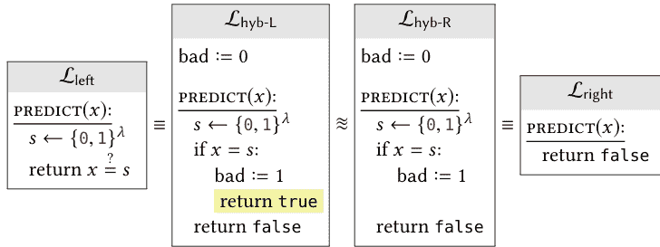

让我们为每个步骤辩护：

-   \(\mathcal{L}_{left} \equiv \mathcal{L}_{hyb-L}\)：唯一的区别是 \(\mathcal{L}_{hyb-L}\) 维护了一个变量“bad”。由于它从未实际从该变量读取，此更改无任何影响。

-   \(\mathcal{L}_{hyb-L}\) 和 \(\mathcal{L}_{hyb-R}\) 仅在高亮行不同，该行仅在 \(bad = 1\) 时可达。因此，根据坏事件引理：

\left| \Pr[\mathcal{A} \diamond \mathcal{L}_{hyb-L} \Rightarrow 1] - \Pr[\mathcal{A} \diamond \mathcal{L}_{hyb-R} \Rightarrow 1] \right| \leq \Pr[\mathcal{A} \diamond \mathcal{L}_{hyb-L} \text{ sets bad } = 1].

但 \(\mathcal{A} \diamond \mathcal{L}_{\text{hyb-L}}\) 仅在调用程序在 \(\text{PREDICT}\) 的某次调用中成功预测 \(s\) 时才设置 \(bad = 1\)。在 \(\text{PREDICT}\) 有 \(q\) 次调用的情况下，此事件发生的总概率最多为 \(q/2^\lambda\)，当调用程序在多项式时间运行时这可以忽略不计。因此 \(\mathcal{L}_{\text{hyb-L}} \approx \mathcal{L}_{\text{hyb-R}}\)。

-   \(\mathcal{L}_{\text{hyb-R}} \equiv \mathcal{L}_{\text{right}}\)：与上述类似，注意 \(\mathcal{L}_{\text{hyb-R}}\) 中 \(\text{PREDICT}\) 的前 3 行实际上什么也不做。子程序无论如何都会返回 false。两个库具有相同的行为。

由于 \(\mathcal{L}_{\text{left}} \equiv \mathcal{L}_{\text{hyb-L}} \approx \mathcal{L}_{\text{hyb-R}} \equiv \mathcal{L}_{\text{right}}\)，这证明了 \(\mathcal{L}_{\text{left}} \approx \mathcal{L}_{\text{right}}\)。

### 4.4 生日概率与采样有/无放回

在许多密码学方案中，用户会反复选择随机字符串（例如，每次加密消息时），如果同一个字符串被选择两次，安全性就会被破坏。因此，重复样本的概率可以忽略不计非常重要。在本节中，我们计算此类事件的概率，并以模块化的方式表达我们的发现，即作为关于两个库不可区分性的陈述。

### 生日概率

如果房间里有 \(q\) 个人，两个人生日相同的概率是多少（假设每个人的生日均匀地从一年中可能的日子中选择）？这个问题被称为 **生日问题**，并且之所以著名，是因为答案对大多数人来说高度违背直觉。\(^9\)

让我们将问题推广。假设从 \(N\) 个项目的集合中取 \(q\) 个独立且均匀的样本。同一个值被选择超过一次的概率是多少？换句话说，以下程序输出 1 的概率是多少？

```
B(q, N)
for i := 1 to q:
    s_i <- {1, ..., N}
    for j := 1 to i - 1:
        if s_i = s_j then return 1
return 0
```

让我们为这个概率命名：

\(BirthdayProb(q, N) \stackrel{\text{def}}{=} \Pr[\mathcal{B}(q, N) \text{ outputs } 1]\).

可以为这个概率写出精确公式：

引理 4.9 \(BirthdayProb(q, N) = 1 - \prod_{i=1}^{q-1} \left( 1 - \frac{i}{N} \right)\).

\(^9\)它有时被称为“生日悖论”，尽管它实际上并不是一个悖论。真正的生日悖论在于，“生日悖论”并不是一个悖论。

证明 让我们改为计算 \(\mathcal{B}\) 输出 0 的概率，这样我们就可以进而求解它输出 1 的概率。为了让 \(\mathcal{B}\) 输出 0，它必须在主循环的每次迭代中避免提前终止条件。因此：

```
\(\text{Pr}[\mathcal{B}(q, N) \text{ outputs } 0] = \text{Pr}[\mathcal{B}(q, N) \text{ doesn't terminate early in iteration } i = 1]\)
\(\cdot \text{Pr}[\mathcal{B}(q, N) \text{ doesn't terminate early in iteration } i = 2]\)
\(\vdots\)
\(\cdot \text{Pr}[\mathcal{B}(q, N) \text{ doesn't terminate early in iteration } i = q]\)
```

在主循环的第 \(i\) 次迭代中，有 \(i-1\) 个先前选择的值 \(s_1, ..., s_{i-1}\)。如果其中任何一个再次被选为 \(s_i\)，程序就会提前终止，否则它继续到下一次迭代。换句话说，有 \(i-1\)（在 \(N\) 中）种选择 \(s_i\) 的方式会导致提前终止——\(s_i\) 的所有其他选择都避免提前终止。由于 \(s_i\) 的 \(N\) 种可能性等可能发生：

```
\(\text{Pr}[\mathcal{B}(q, N) \text{ doesn't terminate early in iteration } i] = 1 - \frac{i - 1}{N}.\)
```

把一切放在一起：

```
\(\text{BirthdayProb}(q, N) = \text{Pr}[\mathcal{B}(q, N) \text{ outputs } 1]\)
\(= 1 - \text{Pr}[\mathcal{B}(q, N) \text{ outputs } 0]\)
\(= 1 - \left(1 - \frac{1}{N}\right) \left(1 - \frac{2}{N}\right) \cdots \left(1 - \frac{q - 1}{N}\right)\)
\(= 1 - \prod_{i=1}^{q-1} \left(1 - \frac{i}{N}\right)\)
```

这就完成了证明。

### 示例

\(\text{BirthdayProb}(q, N)\) 的这个公式一眼不易理解。我们可以通过绘制它作为 \(q\) 的函数的图像来更好地了解其行为。以下是 \(N = 365\) 的图像，对应于经典的生日问题：

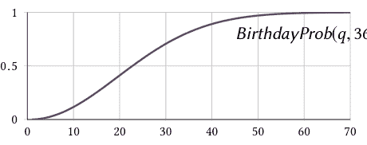

仅有 \(q = 23\) 个人时，共享生日的概率就已超过 50%。图表可以向右扩展（一直到 \(q = 365\)），但即使在 \(q = 70\) 时，概率也超过 99.9%。

### 生日概率的渐近界

拥有一个关于 BirthdayProb(q, N) 如何作为 q 和 N 的函数增长的 *渐近* 公式将会很有帮助。我们最感兴趣的是 q 相对于 N 相对较小的情况（例如，当 q 是 \(\lambda\) 的多项式函数而 N 是指数时）。

**引理 4.10**（生日界）如果 \( q \le \sqrt{2N} \)，则

\( 0.632 \frac{q(q-1)}{2N} \le \text{BirthdayProb}(q, N) \le \frac{q(q-1)}{2N} \).

由于上界和下界仅相差一个常数因子，因此写成 \(\text{BirthdayProb}(q, N) = \Theta(q^2/N)\) 是有意义的。

### 证明

我们将证明分为两部分。

-   为了证明上界，我们使用这样一个事实：当 x 和 y 为正数时，

\( (1-x)(1-y) = 1 - (x+y) + xy \ge 1 - (x+y) \).

更一般地，当所有项 \(x_i\) 为正数时，\(\prod_i(1-x_i) \ge 1 - \sum_i x_i\)。因此，\( 1 - \prod_i(1-x_i) \le 1 - (1 - \sum_i x_i) = \sum_i x_i \).

应用这一事实，

\(\text{BirthdayProb}(q, N) \stackrel{\text{def}}{=} 1 - \prod_{i=1}^{q-1} \left(1 - \frac{i}{N}\right) \le \sum_{i=1}^{q-1} \frac{i}{N} = \frac{\sum_{i=1}^{q-1} i}{N} = \frac{q(q-1)}{2N}.\)

-   为了证明下界，我们使用这样一个事实：当 \( 0 \le x \le 1 \) 时，

\( 1 - x \le e^{-x} \le 1 - 0.632x \).

下面对此作了说明。0.632 的意义在于 \( 1 - \frac{1}{e} = 0.63212 \dots \).

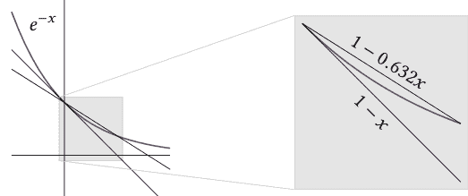

我们可以利用 \( e^{-x} \) 的上界和下界来证明如下内容：

\( \prod_{i=1}^{q-1} \left(1 - \frac{i}{N}\right) \le \prod_{i=1}^{q-1} e^{-\frac{i}{N}} = e^{-\sum_{i=1}^{q-1} \frac{i}{N}} = e^{-\frac{q(q-1)}{2N}} \le 1 - 0.632 \frac{q(q-1)}{2N} \).


使用上述不等式，我们利用了 $q \le \sqrt{2N}$ 这一事实，因此 $\frac{q(q-1)}{2N} \le 1$（这是应用不等式 $e^{-x} \le 1 - 0.632x$ 所必需的）。因此：

\(\text{BirthdayProb}(q, N) \stackrel{\text{def}}{=} 1 - \prod_{i=1}^{q-1} \left( 1 - \frac{i}{N} \right) \ge 1 - \left( 1 - 0.632 \frac{q(q-1)}{2N} \right) = 0.632 \frac{q(q-1)}{2N}.\)

证明完成。

示例：下图是这些界限与 BirthdayProb(q, N) 实际值的对比图（N = 365 时）：

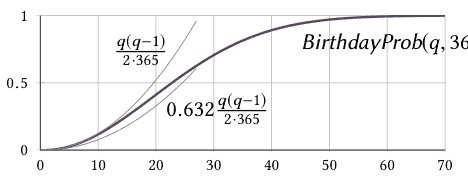

如前所述，在我们关心的取值范围内（$q$ 相对于 $N$ 较小），BirthdayProb(q, N) 大致呈 $q^2/N$ 增长。

## 用不可区分库表述的生日问题

下面是两个库，它们在后续主题中也将很有用。

```
\(\mathcal{L}_{\text{samp-L}}\) \\ $\text{SAMP}():$ \\ $r \leftarrow \{0, 1\}^\lambda$ \\ return $r$
```

```
\(\mathcal{L}_{\text{samp-R}}\) \\ $R := \emptyset$ \\ $\text{SAMP}():$ \\ $r \leftarrow \{0, 1\}^\lambda \setminus R$ \\ $R := R \cup \{r\}$ \\ return $r$
```

两个库都提供一个 SAMP 子例程，用于从 $\{0, 1\}^\lambda$ 中采样一个随机元素。$\mathcal{L}_{\text{samp-L}}$ 的实现每次都从 $\{0, 1\}^\lambda$ 中均匀独立地采样。它进行 **有放回采样**，因此多次调用 SAMP 可能（虽然也许不太可能）在 $\mathcal{L}_{\text{samp-L}}$ 中返回相同的值。

另一方面，$\mathcal{L}_{\text{samp-R}}$ 对 $\lambda$-比特字符串进行 **无放回采样**。它会维护一个集合 $R$，包含之前采样过的所有值，并避免再次选择它们（“$\{0, 1\}^\lambda \setminus R$” 是排除 $R$ 中元素的 $\lambda$-比特字符串集合）。在这个库中，SAMP 永远不会输出两次相同的值。

### “显而易见”的区分策略。

因此，区分这两个库的一种自然方式（但也许不是 *唯一方式*）是多次调用 SAMP。如果你曾经看到重复的输出，那么你可以确定自己连接到了 $\mathcal{L}_{\text{samp-L}}$。在多次调用 SAMP 之后，如果你仍然没有看到任何重复输出，你最终可能会停止并猜测自己连接到了 $\mathcal{L}_{\text{samp-R}}$。

令 $\mathcal{A}_q$ 表示这个“显而易见”的调用程序，它对 SAMP 进行 $q$ 次调用，如果看到重复值则返回 1。显然，当连接到 $\mathcal{L}_{\text{samp-R}}$ 时，该程序永远不会返回 1。另一方面，当连接到 $\mathcal{L}_{\text{samp-L}}$ 时，它以恰好 BirthdayProb$(q, 2^\lambda)$ 的概率返回 1。因此，$\mathcal{A}_q$ 的 *优势* 恰好是 BirthdayProb$(q, 2^\lambda)$。

该程序在这两个库的存在下表现不同，因此它们不是 *可互换* 的。但是这些库是 *不可区分* 的吗？我们已经展示了一个优势为 BirthdayProb$(q, 2^\lambda)$ 的调用程序。我们没有精确指定 $q$，但如果 $\mathcal{A}_q$ 旨在以多项式时间运行（作为 $\lambda$ 的函数），那么 $q$ 必须是 $\lambda$ 的多项式函数。那么 $\mathcal{A}_q$ 的优势是 BirthdayProb$(q, 2^\lambda) = \Theta(q^2/2^\lambda)$，这是 *可忽略* 的！

为了证明这些库是不可区分的，我们必须表明 *所有* 调用程序都具有可忽略的优势。仅展示这个 *特定* 调用程序具有可忽略优势是不够的。也许令人惊讶的是，我们考虑的“显而易见”调用程序是 *最佳可能* 的区分器！

### 引理 4.11（有放回采样）

设 $\mathcal{L}_{\text{samp-L}}$ 和 $\mathcal{L}_{\text{samp-R}}$ 如上定义。那么，对于所有对 SAMP 子例程进行 $q$ 次查询的调用程序 $\mathcal{A}$，$\mathcal{A}$ 在区分这两个库方面的优势 **最多为** BirthdayProb$(q, 2^\lambda)$。

特别是，当 $\mathcal{A}$ 为多项式时间（关于 $\lambda$）时，$q$ 作为安全参数的多项式增长。因此，$\mathcal{A}$ 具有可忽略的优势。由于这对所有多项式时间 $\mathcal{A}$ 都成立，我们有 $\mathcal{L}_{\text{samp-L}} \approx \mathcal{L}_{\text{samp-R}}$。

*证明* 考虑以下混合库：

```
$\mathcal{L}_{\text{hyb-L}}$
\( R := \emptyset \)
\( \text{bad} := 0 \)
\(\underline{\text{SAMP()}}:\)
\( r \leftarrow \{0, 1\}^\lambda \)
if \( r \in R \) then:
  \( \text{bad} := 1 \)
\( R := R \cup \{r\} \)
return \( r \)
```

```
$\mathcal{L}_{\text{hyb-R}}$
\( R := \emptyset \)
\( \text{bad} := 0 \)
\(\underline{\text{SAMP()}}:\)
\( r \leftarrow \{0, 1\}^\lambda \)
if \( r \in R \) then:
  \( \text{bad} := 1 \)
\( r \leftarrow \{0, 1\}^\lambda \setminus R \)
\( R := R \cup \{r\} \)
return \( r \)
```

首先，让我们证明关于这些库的一些简单观察：

$\mathcal{L}_{\text{hyb-L}} \equiv \mathcal{L}_{\text{samp-L}}$：请注意，$\mathcal{L}_{\text{hyb-L}}$ 只是从 $\{0, 1\}^\lambda$ 中均匀采样。$\mathcal{L}_{\text{hyb-L}}$ 中额外的 \( R \) 和 \(\text{bad}\) 变量实际上不影响其外部行为（它们仅在证明后面出于方便而使用）。

$\mathcal{L}_{\text{hyb-R}} \equiv \mathcal{L}_{\text{samp-R}}$：与 $\mathcal{L}_{\text{samp-R}}$ 仅通过从 $\{0, 1\}^\lambda \backslash R$ 采样来避免重复不同，这个库 $\mathcal{L}_{\text{hyb-R}}$ 从 $\{0, 1\}^\lambda$ 中均匀采样 $r$，如果结果恰好在 $R$ 中则重试。这种方法称为 *拒绝采样*，它与直接从 $\{0, 1\}^\lambda \backslash R$ 中采样 $r$ 具有相同的效果$^{10}$。

方便的是，$\mathcal{L}_{\text{hyb-L}}$ 和 $\mathcal{L}_{\text{hyb-R}}$ 仅在 bad = 1 时可达的代码中有所不同（高亮部分）。因此，使用引理 4.8，我们可以对调用程序的优势进行界定：

$| \Pr[\mathcal{A} \diamond \mathcal{L}_{\text{samp-L}} \Rightarrow 1] - \Pr[\mathcal{A} \diamond \mathcal{L}_{\text{samp-R}} \Rightarrow 1] |$
$= | \Pr[\mathcal{A} \diamond \mathcal{L}_{\text{hyb-L}} \Rightarrow 1] - \Pr[\mathcal{A} \diamond \mathcal{L}_{\text{hyb-R}} \Rightarrow 1] |$
$\leqslant \Pr[\mathcal{A} \diamond \mathcal{L}_{\text{hyb-L}} \text{ sets bad } := 1].$

最后，我们可以观察到，$\mathcal{A} \diamond \mathcal{L}_{\text{hyb-L}}$ 仅在看到来自 $\{0, 1\}^\lambda$ 的重复样本时才会将 bad 设为 1。这发生的概率是 BirthdayProb($q, 2^\lambda$)。$\blacksquare$

### 讨论

- 将生日问题用不可区分库来表述，使其成为未来安全证明中的有用工具。例如，在证明某个构造的安全性时，我们可以将均匀采样步骤替换为无放回采样步骤。这一变化只有可忽略的影响，但现在证明的其余部分可以利用样本永不重复这一事实。

  换句话说，在考虑密码学构造时，可以“安全地假设”随机采样的长字符串不会重复，并相应地行事。

- 然而，如果安全证明确实使用了生日库的不可区分性，这意味着当用户碰巧重复一个均匀采样的值时，该方案很可能被破解。由于当样本数量趋近于 $\sqrt{2^{\lambda+1}} \sim 2^{\lambda/2}$ 时，这变得不可避免，这意味着该方案只提供 $\lambda/2$ 位的安全性。当方案具有此属性时，我们说它具有 **生日边界安全性**。了解方案何时具有此属性很重要，因为它决定了实际中应该选择的密钥大小。

### 一个推广

如果 samp 曾经返回两次相同的值，调用程序就可以区分前面的库。在对 samp 的任何给定调用中，变量 $\mathcal{R}$ 表示导致库被区分的“有问题”的值集合。在任何时刻，$\mathcal{R}$ 只有多项式个值，因此选择这样一个有问题值的概率是可忽略的。

假设我们考虑一组不同的值被视为有问题。只要在对 samp 的每次调用中只有多项式个有问题的值，证明背后的推理就不会改变太多。这一想法导致了以下推广，其中调用程序显式地写下所有有问题的值：

10 从 $\{0, 1\}^\lambda \backslash R$ 采样的两种方法可能具有不同的运行时间，但我们的模型仅考虑库的输入输出行为。


Lemma 4.12 以下两个库不可区分，前提是传递给 $\text{SAMP}$ 的参数 $\mathcal{R}$ 显式为项目列表。

| $\mathcal{L}_{\text{samp-L}}$ | $\mathcal{L}_{\text{samp-R}}$ |
|---|---|
| $\text{SAMP}(\mathcal{R} \subseteq \{0, 1\}^\lambda):$ | $\text{SAMP}(\mathcal{R} \subseteq \{0, 1\}^\lambda):$ |
| $r \leftarrow \{0, 1\}^\lambda$ | $r \leftarrow \{0, 1\}^\lambda \setminus \mathcal{R}$ |
| return $r$ | return $r$ |

假设调用程序对 samp 进行 $q$ 次调用，在第 $i$ 次调用中使用包含 $n_i$ 个项目的参数 $\mathcal{R}$。则调用程序的优势至多为：

$$1 - \prod_{i=1}^q \left(1 - \frac{n_i}{2^\lambda}\right).$$

我们可以像以前一样界定这个优势。如果 $\sum_{i=1}^q n_i \leq 2^\lambda$，则优势介于 
0.632 \(\left(\sum_{i=1}^q n_i\right) / 2^\lambda\) 和 \(\left(\sum_{i=1}^q n_i\right) / 2^\lambda\) 之间。当调用程序以多项式时间运行且必须将 $\mathcal{R}$ 作为显式列表传递（即，花时间“写下”$\mathcal{R}$ 的元素）时，\(\sum_{i=1}^q n_i\) 是安全参数的多项式，且调用程序的优势可忽略。

生日情景对应于特殊情况 $n_i = i - 1$（在第 $i$ 次调用中，$\mathcal{R}$ 由之前对 samp 调用的 $i-1$ 个结果组成）。在这种情况下，\(\sum_{i=1}^q n_i = q(q-1)/2\)，概率退化为熟悉的生日概率。

## 练习

- 4.1. 在第 4.1 节中，我们使用 Amazon EC2 云计算服务的定价信息估算了大规模计算的货币成本。这反映了使用 *通用 CPU* 进行大规模计算的成本。对于长期运行的计算，主导成本不是硬件的一次性成本，而是为硬件供电的电力成本。因此，制造 *专用硬件* 可能便宜得多。具体取决于计算的性质，专用硬件可以显著更节能。

  这就是比特币加密货币的情况。挖掘比特币需要尽可能多地、尽可能快地计算 SHA-256 加密哈希函数。当今挖掘比特币的唯一经济合理选择是使用专用硬件，它除了计算 SHA-256 外什么都不做，但比通用 CPU 计算 SHA-256 节能百万（或许十亿）倍。

  - (a) 比特币挖矿硬件的相关规格是功率和每秒吉哈希（或太哈希），可转换为每次哈希所需的原始能量。在线搜索，找到你能找到的最节能的挖矿硬件（例如，每哈希消耗最少焦耳）。

  - (b) 在世界任何地方找到你所能找到的最便宜的实际电价。使用这些电价估算计算 \(2^{40}, 2^{50}, \dots, 2^{120}\) 次 SHA-256 哈希的货币成本。

  - (c) 货币不是衡量大规模计算能源成本的唯一方式。在线搜索，找出在典型的电力生产方式分布下，每单位产生的电力会向大气中排放多少二氧化碳（CO2）。估算计算 \(2^{40}, 2^{50}, \dots, 2^{120}\) 次 SHA-256 哈希作为副作用产生的二氧化碳有多少吨。

  - ★ (d) 估算计算 \(2^{40}, 2^{50}, \dots, 2^{120}\) 次 SHA-256 哈希导致大气中相应的 CO2 浓度（百万分比）。如果无需气候科学博士学位即可实现，请尝试估算这些计算导致的平均全球温度升高。

- 4.2. 以下哪些是关于 $\lambda$ 的可忽略函数？请证明你的答案。

  $$
  \frac{1}{2^{\lambda/2}} \quad \frac{1}{2^{\log(\lambda^2)}} \quad \frac{1}{\lambda^{\log(\lambda)}} \quad \frac{1}{\lambda^2} \quad \frac{1}{2^{(\log \lambda)^2}} \quad \frac{1}{(\log \lambda)^2} \quad \frac{1}{\lambda^{1/\lambda}} \quad \frac{1}{\sqrt{\lambda}} \quad \frac{1}{2\sqrt{\lambda}}
  $$

- 4.3. 假设 $f$ 和 $g$ 是可忽略的。

  - (a) 证明 $f + g$ 是可忽略的。

  - (b) 证明 $f \cdot g$ 是可忽略的。

  - (c) 举出 $f$ 和 $g$ 的例子，两者均为可忽略，但 $f(\lambda)/g(\lambda)$ 不是可忽略的。

- 4.4. 证明当 $f$ 可忽略时，对于每个多项式 $p$，函数 $p(\lambda)f(\lambda)$ 不仅趋近于 0，而且本身也是可忽略的。

  提示：使用逆否命题。假设 $p(\lambda)f(\lambda)$ 不是可忽略的，其中 $p$ 是多项式。得出 $f$ 必须不是可忽略的。

- 4.5. 证明 $\approx$ 关系具有传递性。设 $f, g, h: \mathbb{N} \to \mathbb{R}$ 为函数。使用 $\approx$ 关系的定义，证明如果 $f \approx g$ 且 $g \approx h$，则 $f \approx h$。你可能会发现调用三角不等式很有用：$|a - c| \leqslant |a - b| + |b - c|$。

- 4.6. 证明引理 4.6。

- 4.7. 证明引理 4.7。

- ★ 4.8. 一个 *确定性* 程序是不使用随机选择的程序。假设 $L1$ 和 $L2$ 是具有共同接口的两个 *确定性* 库。证明要么 $L1 \equiv L2$，要么 $L1 \& L2$ 可以以优势 1 被区分。

- 4.9. 第 4.4 节中的算法 B 的最坏情况运行时间为 $O(q^2)$。你能否提出一种使其以 $O(q \log q)$ 时间运行的方法？$O(q)$ 时间呢？

- 4.10. 假设该大学学生证号码的最后 4 位数是均匀分配的。在一个有 46 名学生的班级中，两名学生证号码最后 4 位数相同的 **精确** 概率是多少？

  将这个精确答案与引理 4.10 给出的上界和下界进行比较。

- 4.11. 编写一个程序，实验性地估算 BirthdayProb(q, N) 概率。

  给定 $q$ 和 $N$，从 $\mathbb{Z}_N$ 中生成 $q$ 个均匀选择的样本（有放回抽样），并检查是否有任何元素被选出多次。将整个过程重复 $t$ 次，以估算 BirthdayProb(q, N) 的真实概率。

  生成一个图表，将你的实验结果与理论上界/下界 $0.632^{\frac{q(q-1)}{2^{k+1}}}$ 和 $\frac{q(q-1)}{2^{k+1}}$ 进行比较。

- 4.12. 假设你想要强制执行密码规则，使得至少有 $2^{128}$ 个密码满足规则。在这些情况下，密码必须有多长？

  - (a) 密码仅由小写字母 a 至 z 组成。

  - (b) 密码由小写和大写字母 a–z 及 A–Z 组成。

  - (c) 密码由大小写字母和数字 0–9 组成。

  - (d) 密码由大小写字母、数字以及标准美国键盘上出现的任何符号字符组成（包括空格字符）。

## 伪随机生成器

一次性密码本要求密钥与明文一样长。让我们先放下对这一限制的认识。假设 Alice 和 Bob 只共享一个短的 \(\lambda$-bit 秘密 \(k\)，但他们想要加密一个 $2\lambda$-bit 的明文 \(m\)。他们不知道（完美）一次性保密性在此环境下是不可能的（练习 2.11），因此他们试图使用以下推理来实现它：

- 他们了解的唯一加密方案是一次性密码本，因此他们决定密文形式为 \(c = m \oplus \text{??}$。这意味着未知值 ?? 必须是 $2\lambda$ 比特长。
- 为了使一次性密码本的安全性适用，未知值 ?? 应该是均匀分布的。
- 从共享密钥 \(k$ 获取未知值 ?? 的过程应当是 *确定性* 的，以便发送方和接收方计算出相同的值，并且解密能够正确工作。

令 \(G$ 表示将密钥 \(k$ 转换为该神秘值的过程。那么 \(G : \{0, 1\}^\lambda \rightarrow \{0, 1\}^{2\lambda}$，加密方案为 \(\text{Enc}(k, m) = m \oplus G(k)$。

不难看出，如果 \(G$ 是确定性函数，则 \(G$ 只有 $2^\lambda$ 个可能输出，因此 \(G(k)$ 的分布在 $\{0, 1\}^{2\lambda}$ 中不可能是均匀分布。因此，我们不能以与一次性密码本相同的方式论证该方案是安全的。

但是，如果 \(G(k)$ 值的分布不是完美均匀，而只是“足够接近”均匀分布呢？假设没有多项式时间算法能够区分 \(G(k)$ 值的分布与均匀分布。那么这对于实际目的来说当然“足够接近”均匀分布。这正是 **伪随机性** 的理念。事实证明，如果 \(G$ 具有伪随机性属性，那么上面描述的加密方案实际上是安全的（针对多项式时间对手，在前一章讨论的意义上）。

### 5.1 定义

**伪随机生成器（PRG）** 是一种确定性函数 \(G\)，其输出比输入长。当 \(G$ 的输入被均匀随机选择时，它在可能输出上诱导出某种分布。如上所述，此输出分布不可能是均匀的。然而，如果该分布 **与均匀分布不可区分**，则该分布是 *伪随机* 的。更正式地说：


**定义 5.1（PRG 安全性）** 设 \( G : \{0, 1\}^\lambda \rightarrow \{0, 1\}^{\lambda+\ell} \) 为一个确定性函数，其中 \( \ell > 0 \)。我们称 \( G \) 为**安全伪随机生成器（PRG）**若 \( \mathcal{L}^G_{\text{prg-real}} \approx \mathcal{L}^G_{\text{prg-rand}} \)，其中：

```
\(\mathcal{L}^G_{\text{prg-real}}\)
QUERY():
\( s \leftarrow \{0, 1\}^\lambda \)
return \( G(s) \)
```

```
\(\mathcal{L}^G_{\text{prg-rand}}\)
QUERY():
\( r \leftarrow \{0, 1\}^{\lambda+\ell} \)
return \( r \)
```

值 \( \ell \) 称为 PRG 的**扩展量（stretch）**。PRG 的输入通常称为**种子（seed）**。

下面是这些库采样分布的示意图，针对 **倍长（length-doubling）**（\( \ell = \lambda \)）PRG（未按比例绘制）：

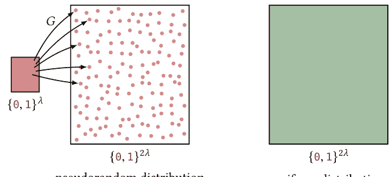

\(\mathcal{L}_{\text{prg-real}}\) 从红点分布中采样，先对 \(\{0, 1\}^\lambda\) 中的一个均匀元素进行采样，然后对该值执行 \( G \) 的操作，得到 \(\{0, 1\}^{2\lambda}\) 中的红色结果。另一个库 \(\mathcal{L}_{\text{prg-rand}}\) 直接对 \(\{0, 1\}^{2\lambda}\) 上的均匀分布进行采样（如上文绿色所示）。

要理解 PRG，必须同时欣赏两种将 PRG 的输出分布与均匀分布进行比较的方式：

- 从 *相对视角* 来看，PRG 的输出分布很小。在 \(\{0, 1\}^{2\lambda}\) 的 \( 2^{2\lambda} \) 个字符串中，只有 \( 2^\lambda \) 是 \( G \) 的可能输出。这些字符串占 \(\{0, 1\}^{2\lambda}\) 的 \( 2^\lambda / 2^{2\lambda} = 1/2^\lambda \) 比例——**可忽略的比例**！

- 从 *绝对视角* 来看，PRG 的输出分布很大。\( G \) 有 \( 2^\lambda \) 个可能输出，这是一个**指数级数量**！

上面的插图只捕捉了 *相对视角*（将红点与 \(\{0, 1\}^{2\lambda}\) 的整个范围进行比较），因此可能导致一些误解。仅凭这张图，很难想象两个分布如何不可区分。调用程序怎么可能 *不* 注意到它看到的是整个集合还是仅整个集合的一小部分呢？好吧，如果你以 \( \lambda \) 中的多项式时间运行，那么 \( 2^\lambda \) 和 \( 2^{2\lambda} \) 都如此巨大，以至于一个远大于另一个并不重要。分布的相对大小并不能真正帮助区分，因为区分者“测量”其采样分布大小并不是可行的策略。

设想：一茶匙水中大约有 $2^{75}$ 个分子，地球海洋中大约有 $2^{2\cdot 75}$ 个水分子。假设你将一茶匙水倒入海洋并让混合几千年。尽管茶匙仅占海洋内容物的 $1/2^{75}$，但这并不容易跟踪所有源自茶匙的 $2^{75}$ 个水分子！如果你足够小到能看到单个水分子，那么一茶匙水看起来和海洋一样大。

## 讨论与陷阱

- 不要混淆 PRG 的接口（它将种子作为输入）与安全库 $\mathcal{L}_{\text{prg}\star}$ 的接口（它们的 QUERY 子程序不接受任何输入）！PRG 确实是一个你可以向其中输入任何字符串的算法。但是，**只有在 PRG 按安全库中描述的方式使用时才能保证安全性**——特别是，当种子被均匀/秘密地选择且不用于其他任何事情时。

- 没有什么能阻止用户将对抗者选择的 $s$ 放入 PRG，或将 PRG 种子透露给对抗者等。这样做你只是无法获得安全保证，因为这不是 PRG 安全库所反映的情况。

- 说 "0010110110" 是“随机字符串”或 "0000000001" 是“伪随机字符串”并没有太大意义。**生成字符串所用 *过程* 的属性**，而非单个字符串本身的属性。当我们有一个值 $z = G(s)$，其中 $G$ 是 PRG 且 $s$ 被均匀选择时，你可以说 $z$ 是“伪随机选择”的。你可以说某个过程的输出是“伪随机分布”。但说一个字符串 $z$ “是伪随机的”略显不严谨（尽管常见）。

- 你可以运行一些常见的统计测试，用来检查数据是否具有你期望均匀分布所具有的各种属性。$^1$ 例如，0 和 1 的数量是否大致相等？子串 01010 出现的频率是否大致符合预期？如果将字符串解释为单位正方形 $[0, 1)^2$ 中的一系列点，那么大约 $\pi/4$ 的点到原点的欧氏距离在 1 以内，这是真的吗？

伪随机性的定义有点像“总括”定义，涵盖了所有这些统计测试及更多内容。毕竟，统计测试不就是一种多项式时间过程，它从分布中获取样本并输出是/否决策吗？伪随机性意味着，*每个*“通过”均匀数据的统计测试也会“通过”伪随机生成的数据。

### 5.2 实践中的伪随机生成器

你可能现在希望至少看到一个安全 PRG 的示例。不幸的是，事情没有那么简单。我们没有安全 PRG 的示例！如果有可能证明某个函数 G 是安全 PRG，那它 **将解决著名的 P 与 NP 问题** —— 计算机科学（或许可以说，整个数学）中最著名的未解决问题。

密码学研究能提供的次佳之物是**候选 PRG**，它们被 *推测* 是安全的。此类 PRG 的最佳示例是那些经受过大量公众审查并迄今抵挡住所有攻击尝试的 PRG。

事实上，本书其余部分完全基于仅被 *推测* 是安全的密码学。考虑到本书声称专注于 *可证明安全*，这是如何可能的？随着你阅读本书的进展，请注意所有可证明安全的主张都是 *有条件的* —— 如果 X 是安全的，那么 Y 就是安全的。你将能够沿着这一蕴含网络追溯，发现只有少数底层密码学原语的安全性仅是 *推测* 的（PRG 就是其中一种原语的示例）。其他一切都以可证明安全的方式构建在这些原语之上。

抛开这个免责声明，*现在*你可以被展示一个推测安全 PRG 的示例，对吧？确实有一些在此时足够简单、可以向你展示的推测安全 PRG，但你在书中找不到它们。问题是这些 PRG 候选者在实践中并未真正使用。当你在实践中真正需要 PRG 时，你实际上会使用一个基于称为分组密码（block cipher）的东西构建的 PRG（我们将在第 6 章看到）。分组密码从 *概念上* 比 PRG 更复杂，甚至可以（原则上）从 PRG 构建。这就是为什么本书从 PRG 开始的原因。在实践中，分组密码只是一个更有用的对象，因此你很容易找到它（甚至在大多数 CPU 中使用专用 CPU 指令实现）。当我们介绍分组密码（和伪随机函数）时，我们将讨论如何使用它们来构建 PRG。

## 如何不构建 PRG

我们可以先看一个构建 PRG 的显而易见的想法并理解它为什么不安全，从而体会从头构建 PRG 所面临的挑战。

**示例** 让我们关注倍长 PRG 的情况。它应输入 \(\lambda\) 位并输出 \(2\lambda\) 位。当输入被均匀采样时，输出应看起来是随机的。一个自然的想法是让候选 PRG 仅将输入重复两次。毕竟，如果输入 s 是随机的，那么 s||s 也应当是随机的，对吧？

```
G(s):
return s||s
```

要理解为什么这个 PRG 不安全，先让我问你，以下字符串看起来是否像是从 \(\{0, 1\}^8\) 中均匀采样的：

11011101, 01010101, 01110111, 01000100, ...

你看到任何规律了吗？每个字符串的前半部分都等于后半部分。这是一个显著的模式，因为均匀选择的字符串具有此属性相对罕见。

$^1$有关此类测试列表，请参见 http://csrc.nist.gov/publications/nistpubs/800-22-rev1a/SP800-22rev1a.pdf。


当然，这正是上面所定义的这个简化版 PRG G 的问题所在。G 的每个输出的前后两半都相等。但均匀采样的字符串具有此属性的情况很少见。我们可以将这一观察形式化为针对 G 的 PRG 安全性的攻击：

```
x||y := QUERY()
return x ?= y
```

第一行的意思是获取 QUERY 的结果，并将其前半部分设置为字符串 x，后半部分设置为 y。这个调用程序只是检查 QUERY 的输出前后两半是否相等。

为了完成攻击，我们必须表明这个调用程序在区分 $\mathcal{L}_{\text{prg-}\star}$ 库时具有非可忽略的优势。

- 当链接到 $\mathcal{L}_{\text{prg-real}}$ 时，调用程序接收 G 的输出，这些输出始终具有匹配的前后两半。因此 $\Pr[\mathcal{A} \diamond \mathcal{L}^G_{\text{prg-real}} \Rightarrow 1] = 1$。下面我们用 G 算法的细节填充了 $\mathcal{L}_{\text{prg-real}}$：

| A | $\mathcal{L}^G_{\text{prg-real}}$ |
|---|---|
| x||y := QUERY() | QUERY(): |
| return x ?= y | s ← $\{0, 1\}^\lambda$ |
| | return s||s |

- 当链接到 $\mathcal{L}_{\text{prg-rand}}$ 时，调用程序从 $\{0, 1\}^{2\lambda}$ 中接收均匀采样。

| A | $\mathcal{L}^G_{\text{prg-rand}}$ |
|---|---|
| x||y := QUERY() | QUERY(): |
| return x ?= y | r ← $\{0, 1\}^{2\lambda}$ |
| | return r |

每当从 $\{0, 1\}^{2\lambda}$ 中采样的字符串具有相等的前后两半时，A 就输出 1。这种情况发生的概率究竟是多少？有几种方法可以看出概率是 $1/2^\lambda$（这就像问掷两个骰子出现点子相同的概率，但每个骰子有 $2^\lambda$ 个面而不是 6 个）。因此，$\Pr[\mathcal{A} \diamond \mathcal{L}^G_{\text{prg-rand}} \Rightarrow 1] = 1/2^\lambda$。

这个对手的优势是 $1 - 1/2^\lambda$，这无疑是非可忽略的——即使 $\lambda$ 增大，它甚至不会趋近于 0。这表明 G 不是一个安全的 PRG。

这个例子说明了随机性/伪随机性是*整个过程*的属性，而不是单个字符串的属性。如果你取一个由 1 组成的字符串，并将其与另一个由 1 组成的字符串连接，你会得到一个长的 1 字符串。“仅包含 1”是单个字符串的属性。如果你取一个“随机字符串”并将其与另一个“随机字符串”连接，你可能不会得到一个“长随机字符串”。随机性不是单个字符串的属性，而是生成它的整个过程的属性。

这个 G 的输出具有相等的前后两半，这是一个明显的模式。设计安全 PRG 的挑战在于其输出必须*没有可辨别的模式*！任何模式都会导致类似上面所示的攻击。

## 相关概念：随机数生成

PRG 的安全性要求种子被均匀选择。在实践中，种子必须来自某个地方。通常，硬件或操作系统提供一个“随机性”源，生成这些随机比特的过程（令人困惑地）被称为随机数生成器（RNG）。

在本课程中，我们不会深入讨论底层随机数生成，而只是指出它与我们研究的 PRG 的不同之处：

- PRG 的工作是获取少量“理想”（换句话说，均匀）随机性并将其扩展。

- 相比之下，RNG 通常会随时间接收许多输入并维护内部状态。这些输入通常来自物理/硬件源。虽然这些输入在某种意义上是“噪声”的，但很难想象它们在统计上是均匀的。因此，RNG 的工作是将（有时是许多）噪声数据源“精炼”为均匀输出。

### 5.3 应用：一次性加密中的短密钥

我们回到本章开头的动机示例。Alice 和 Bob 共享一个仅 \(\lambda\)-bit 的密钥，但希望加密长度 \(\lambda + \ell\) 的消息。主要思想是使用 PRG \(G\) 将密钥 \(k\) 扩展为更长的字符串，并将结果用作（更长的）明文的一次性密码本。更准确地说，设 \(G : \{0, 1\}^\lambda \rightarrow \{0, 1\}^{\lambda+\ell}\) 为 PRG，并定义以下加密方案：

| | | |
|---|---|---|
| \(\mathcal{K} = \{0, 1\}^\lambda\) | KeyGen: \(k \leftarrow \mathcal{K}\) | Enc(k, m): return \(G(k) \oplus m\) |
| \(\mathcal{M} = \{0, 1\}^{\lambda+\ell}\) | return k | Dec(k, c): return \(G(k) \oplus c\) |
| \(\mathcal{C} = \{0, 1\}^{\lambda+\ell}\) | | |

得到的方案不会具有（完美的）一次性保密性。也就是说，\(m_L\) 和 \(m_R\) 的加密通常不会具有相同的分布。然而，如果 \(G\) 是安全的 PRG，则分布将不可区分。这种构造获得的安全精确含义如下。

## 定义 5.3

设 \(\Sigma\) 为一个加密方案，\(\mathcal{L}^\Sigma_{\text{ots-L}}\) 和 \(\mathcal{L}^\Sigma_{\text{ots-R}}\) 如定义 2.6 所述（下方为方便重复给出）。如果 \(\mathcal{L}^\Sigma_{\text{ots-L}} \approx \mathcal{L}^\Sigma_{\text{ots-R}}\)，则称 \(\Sigma\) 具有**（计算）一次性保密性**。也就是说，对于所有多项式时间区分者 \(\mathcal{A}\)，我们有 \(\text{Pr}[\mathcal{A} \diamond \mathcal{L}^\Sigma_{\text{ots-L}} \Rightarrow 1] \approx \text{Pr}[\mathcal{A} \diamond \mathcal{L}^\Sigma_{\text{ots-R}} \Rightarrow 1]\)。

| \(\mathcal{L}^\Sigma_{\text{ots-L}}\) | \(\mathcal{L}^\Sigma_{\text{ots-R}}\) |
|---|---|
| eavesdrop(\(m_L, m_R \in \Sigma.\mathcal{M}\)): | eavesdrop(\(m_L, m_R \in \Sigma.\mathcal{M}\)): |
| \(k \leftarrow \Sigma.KeyGen\) | \(k \leftarrow \Sigma.KeyGen\) |
| \(c \leftarrow \Sigma.Enc(k, m_L)\) | \(c \leftarrow \Sigma.Enc(k, m_R)\) |
| return \(c\) | return \(c\) |

这基本上与定义 2.6 相同，只是我们使用 \(\approx\)（不可区分性）而不是 \(\equiv\)（可互换性）。

**主张 5.4** 设 pOTP 表示构造 5.2。如果使用安全的 PRG G 实例化 pOTP，则 pOTP 具有计算一次性保密性。

**证明** 我们必须证明 \(\mathcal{L}^{\text{pOTP}}_{\text{ots-L}} \approx \mathcal{L}^{\text{pOTP}}_{\text{ots-R}}\)。与往常一样，我们将使用一系列从 \(\mathcal{L}^{\text{pOTP}}_{\text{ots-L}}\) 开始并在 \(\mathcal{L}^{\text{pOTP}}_{\text{ots-R}}\) 结束的混合库来进行。对于每个混合库，我们将证明它与前一个库不可区分。请注意，我们可以使用 \(G\) 是安全 PRG 这一事实。从实际角度来说，这意味着如果我们能将某个混合库表示为 \(\mathcal{L}^G_{\text{prg-real}}\)（PRG 安全性定义中的库之一），我们就可以将其替换为其对应的 \(\mathcal{L}^G_{\text{prg-rand}}\)（反之亦然）。\(G\) 的 PRG 安全性表明，这样的变化将是不可区分的。

```
$\mathcal{L}^{\text{pOTP}}_{\text{ots-L}}$
EAVESDROP(m_L, m_R \in \{0, 1\}^{\lambda+\ell}):
  k \leftarrow \{0, 1\}^\lambda
  c := G(k) \oplus m_L
  return c
```

起点是 \(\mathcal{L}^{\text{pOTP}}_{\text{ots-L}}\)，此处已填充 pOTP 的细节。

```
$\mathcal{L}_{\text{hyb-1}}$
EAVESDROP(m_L, m_R):
  z \leftarrow \text{QUERY}()
  c := z \oplus m_L
  return c
\otimes
$\mathcal{L}^G_{\text{prg-real}}$
QUERY():
  s \leftarrow \{0, 1\}^\lambda
  return G(s)
```

第一个混合步骤是将涉及 G 的计算以 \(\mathcal{L}^G_{\text{prg-real}}\) 库的形式提取出来。

```
$\mathcal{L}_{\text{hyb-2}}$
EAVESDROP(m_L, m_R):
  z \leftarrow \text{QUERY}()
  c := z \oplus m_L
  return c
\otimes
$\mathcal{L}^G_{\text{prg-rand}}$
QUERY():
  r \leftarrow \{0, 1\}^{\lambda+\ell}
  return r
```

根据 G 的 PRG 安全性，我们可以将 \(\mathcal{L}^G_{\text{prg-real}}\) 的实例替换为 \(\mathcal{L}^G_{\text{prg-rand}}\)。得到的混合库 \(\mathcal{L}_{\text{hyb-2}}\) 与前一个库不可区分。

```
$\mathcal{L}_{\text{hyb-3}}$
EAVESDROP(m_L, m_R):
  z \leftarrow \{0, 1\}^{\lambda+\ell}
  c := z \oplus m_L
  return c
```

已内联一个子程序。请注意，得到的库正是涉及大小为 \(\lambda + \ell\) 明文的**标准一次性密码本**的 \(\mathcal{L}^{\text{pOTP}}_{\text{ots-L}}\)。我们基本上已经证明 pOTP 与标准 OTP 不可区分，因此可以应用 OTP 的安全性。


```
$\mathcal{L}_{\text{hyb-4}}$:
EAVESDROP($m_L, m_R$):
$z \leftarrow \{0, 1\}^{\lambda + \ell}$
$c := z \oplus m_R$
return $c$
```

rOTP 的（完美）一次性保密性允许我们将 $\mathcal{L}^{\text{OTP}}_{\text{ots-L}}$ 替换为 $\mathcal{L}^{\text{OTP}}_{\text{ots-R}}$；两者可以互换。

证明的其余部分本质上是前面步骤的“镜像”，我们执行相同的步骤，但顺序相反（并且使用 \(m_R\) 而不是 \(m_L\)）。

```
EAVESDROP($m_L, m_R$):
$z \leftarrow$ QUERY()
$c := z \oplus m_R$
return $c$
```

```
$\mathcal{L}^G_{\text{prg-rand}}$
QUERY():
$r \leftarrow \{0, 1\}^{\lambda + \ell}$
return $r$
```

一条语句已被提取到子程序中，它恰好与 $\mathcal{L}^G_{\text{prg-rand}}$ 完全匹配。

```
EAVESDROP($m_L, m_R$):
$z \leftarrow$ QUERY()
$c := z \oplus m_R$
return $c$
```

```
$\mathcal{L}^G_{\text{prg-real}}$
QUERY():
$s \leftarrow \{0, 1\}^\lambda$
return $G(s)$
```

从 $G$ 的 PRG 安全性出发，我们可以将 $\mathcal{L}^G_{\text{prg-rand}}$ 替换为 $\mathcal{L}^G_{\text{prg-real}}$。得到的库与前一个库不可区分。

```
$\mathcal{L}^{\text{pOTP}}_{\text{ots-R}}$
EAVESDROP($m_L, m_R$):
\(k \leftarrow \{0, 1\}^\lambda\)
\(c := G(k) \oplus m_R\)
return \(c\)
```

已将子程序内联。结果为 $\mathcal{L}^{\text{pOTP}}_{\text{ots-R}}$。

总结一下，我们展示了一组满足以下条件的混合库序列：

\(\mathcal{L}^{\text{pOTP}}_{\text{ots-L}} \equiv \mathcal{L}_{\text{hyb-1}} \approx \mathcal{L}_{\text{hyb-2}} \equiv \mathcal{L}_{\text{hyb-3}} \equiv \mathcal{L}_{\text{hyb-4}} \equiv \mathcal{L}_{\text{hyb-5}} \approx \mathcal{L}_{\text{hyb-6}} \equiv \mathcal{L}^{\text{pOTP}}_{\text{ots-R}}.\)

因此，$\mathcal{L}^{\text{pOTP}}_{\text{ots-L}} \approx \mathcal{L}^{\text{pOTP}}_{\text{ots-R}}$，pOTP 具有（计算）一次性保密性。

### 5.4 扩展 PRG 的伸展量

PRG 的伸展量衡量其输出比输入长多少。我们可以使用伸展量较小的 PRG 来构造伸展量较大的 PRG 吗？答案是肯定的，但只有当你采用正确的方法时才行！

### 增加伸展量的两种方法

假设 \(G : \{0, 1\}^\lambda \rightarrow \{0, 1\}^{2\lambda}\) 是一个长度翻倍 PRG（即伸展量为 \(\lambda\) 的 PRG）。下面是构造更长伸展量 PRG 的两种思路：

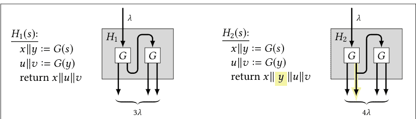

尽管这两种构造相似，但只有其中一种是安全的。在继续阅读之前，你能猜出 \(H_1\) 和 \(H_2\) 中哪一个是安全的 PRG，哪一个是不安全的吗？通过仔细比较这两种方法，我希望你能更好地理解 PRG 安全性定义。

### 一则安全性证明

我认为，从期望的结论出发并逆向推导，有助于阐释安全性证明的“策略”。还不如以伽利略风格的苏格拉底对话来呈现吗？²

萨尔维亚蒂：我肯定 \(H_1\) 是安全的 PRG。

辛普利西奥：如果我正确理解了 PRG 的安全性定义，您的意思是当 \(H_1\) 的输入是均匀分布时，其输出看起来与均匀分布不可区分。您为什么这么说？

萨尔维亚蒂：简单！\(H_1\) 的输出由名为 \(x\)、\(u\) 和 \(v\) 的片段组成。这些片段都是 \(G\) 的输出，而由于 \(G\) 本身就是一个 PRG，它的输出看起来是均匀的。

辛普利西奥：我真希望有您那样的胆量，萨尔维亚蒂。我自己更加谨慎。如果 \(G\) 是安全的 PRG，那么它的输出确实与均匀分布不可区分，但这肯定只在输入均匀时才成立！您在这里就那么肯定吗？

萨尔维亚蒂：您提出了很好的观点，辛普利西奥。在这类工作中，谨慎行事总是更可取。当我们要主张 \(H_1\) 是安全的 PRG 时，我们考虑当种子 \(s\) 是均匀分布时其输出的性质。由于 \(H_1\) 将该种子 \(s\) 直接输入到 \(G\)，您的顾虑已得到消除。

辛普利西奥：是的，我可以看到在表达式 \(x||y := G(s)\) 中，\(G\) 的输入是均匀分布，因此其输出 \(x\) 和 \(y\) 与随机分布不可区分。由于 \(x\) 是 \(H_1\) 的输出的一部分，我们正在朝着证明 \(H_1\) 的完整输出与随机分布不可区分的方向迈进！然而，\(H_1\) 的输出还包含项 \(u\) 和 \(v\)。当我检查它们是如何生成的，即 \(u||v := G(y)\) 时，我又感到担忧了。肯定 \(y\) 不是均匀的，所以我看不到应用 \(G\) 安全性的方法！

萨尔维亚蒂：哦，天啦。答案再明显不过了！确实 \(y\) 不服从均匀分布。但您不是刚刚说服自己 \(y\) 与均匀分布不可区分吗？这难道不够吗？

辛普利西奥：难以置信！我相信我现在明白了。让我试着总结一下：我们假设输入到 H1 的 \(s\) 是均匀选择的，并检查 H1 的输出会发生什么。在表达式 \(x||y := G(s)\) 中，\(G\) 的输入是均匀分布，因此 \(x\) 和 \(y\) 与均匀分布不可区分。现在，考虑表达式 \(u||v := G(y)\)，其结果与 \(y\) 真正是均匀分布的情景不可区分。但如果 \(y\) 真正是均匀分布，那么输出 \(u\) 和 \(v\) 将与均匀分布不可区分！总而言之，\(x\)、\(u\) 和 \(v\)（即 \(H_1\) 的输出）都与均匀分布不可区分！

希望这对你来说和对我一样有趣。³ 正式的安全性证明及其混合库序列将遵循辛普利西奥总结中的大纲。我们首先对第一次调用 G 应用 PRG 安全性定义，并将其输出替换为真正均匀的值。经过这一更改后，第二次调用 G 的输入变为均匀分布，从而使我们能够再次应用 PRG 安全性定义。

主张 5.5 如果 G 是安全的长度翻倍 PRG，那么 H1（如上定义）是安全的（长度三倍）PRG。

证明 此证明中棘手的方面之一是，我们使用安全的 PRG G 来证明另一个 PRG H1 的安全性。这意味着 \(\mathcal{L}^{H_1}_{\text{prg-star}}\) 和 \(\mathcal{L}^G_{\text{prg-star}}\) 都将出现在本证明中。这两个库/接口都有一个名为 "QUERY" 的子程序，我们将把这些子程序重命名为 QUERY_{H1} 和 QUERY_{G} 以消除歧义。

我们想要证明 \(\mathcal{L}^{H_1}_{\text{prg-real}} \approx \mathcal{L}^{H_1}_{\text{prg-rand}}\)。和往常一样，我们通过混合库序列来实现这一点。

由于我们假设 G 是安全的 PRG，我们可以使用 \(\mathcal{L}^G_{\text{prg-real}} \approx \mathcal{L}^G_{\text{prg-rand}}$ 这一事实。

```
$\mathcal{L}^{H_1}_{\text{prg-real}}$
QUERY_{H1}():
  $s \leftarrow \{0, 1\}^\lambda$
  $x||y := G(s)$
  $u||v := G(y)$
  return $x||u||v$
```

起点是 \(\mathcal{L}^{H_1}_{\text{prg-real}}\)，此处填充了 H1 的细节。

```
QUERY_{H1}():
  $x||y := QUERY_G()$
  $u||v := G(y)$
  return $x||u||v$

$\mathcal{L}^G_{\text{prg-real}}$
QUERY_G():
  $s \leftarrow \{0, 1\}^\lambda$
  return $G(s)$
```

第一次调用 G 已被提取为子程序。得到的混合库包含一个 \(\mathcal{L}^G_{\text{prg-real}}$ 的实例。

从 G 的 PRG 安全性出发，我们可以将 $\mathcal{L}^G_{\text{prg-real}}$ 的实例替换为 $\mathcal{L}^G_{\text{prg-rand}}$。得到的混合库不可区分。

已将子程序内联。

选择 $2\lambda$ 个均匀随机位然后将其分成两半，与选择 $\lambda$ 个均匀随机位并独立再选 $\lambda$ 个具有完全相同的效果。

剩余的 G 调用已被提取为子程序。现在 $\mathcal{L}^G_{\text{prg-real}}$ 第二次出现。

再次，G 的 PRG 安全性允许我们将 $\mathcal{L}^G_{\text{prg-real}}$ 替换为 $\mathcal{L}^G_{\text{prg-rand}}$。得到的混合库不可区分。

已将子程序内联。

与上述类似，将 $\lambda$ 个均匀位与 $2\lambda$ 个独立均匀位拼接，与采样 $3\lambda$ 个均匀位的效果相同。此更改的结果是 $\mathcal{L}^{H_1}_{\text{prg-rand}}'$。


通过这一系列混合库，我们证明了：

\(\mathcal{L}_{\text{prg-real}}^{H_1} \equiv \mathcal{L}_{\text{hyb-1}} \approx \mathcal{L}_{\text{hyb-2}} \equiv \mathcal{L}_{\text{hyb-3}} \equiv \mathcal{L}_{\text{hyb-4}} \equiv \mathcal{L}_{\text{hyb-5}} \approx \mathcal{L}_{\text{hyb-6}} \equiv \mathcal{L}_{\text{hyb-7}} \equiv \mathcal{L}_{\text{prg-rand}}^{H_1}\)

因此，\(H_1\) 是一个安全的 PRG。

## 证明在 $H_2$ 上失效的原因

\(H_1\) 和 \(H_2\) 之间的唯一区别在于变量 \(y\) 被包含在输出中。这个微小的改变如何影响我们应用于 \(H_1\) 的推理？

```
H2(s):
x||y := G(s)
u||v := G(y)
return x||y||u||v
```

我们认为输出 \(u\) 和 \(v\) 与均匀分布不可区分，因为它们的输入 \(y\) 也与随机不可区分。但事情并没有那么简单：PRG 的输出与随机不可区分，当且仅当 (1) 其种子是均匀的，并且 (2) *种子没有被用于其他任何目的！* 该构造 \(H_2\) 违反了条件 (2)，因为它将“种子”\(y\) 包含在输出中。

我们可以在正式的 PRG 定义中看到这一想法的体现。在 \(\mathcal{L}_{\text{prg-real}}\) 中，种子 \(s\) 被均匀选择，作为输入传递给 \(G\)，然后就超出了作用域！如果我们尝试用 \(H_2\) 来重现 \(H_1\) 的安全性证明，当我们试图将对 \(G\) 的第二次调用用 \(\mathcal{L}_{\text{prg-real}}\) 分解出来时，就会卡住：

```
QUERY_H2():
x <- {0, 1}^\lambda
y <- {0, 1}^\lambda
u||v := G(y)
return x||y||u||v

~>

QUERY_H1():
x <- {0, 1}^\lambda
u||v := QUERY_G()
return x|| [gray] ||u||v

<> (diamond)

L_prg-real
QUERY_G():
s <- {0, 1}^\lambda
return G(s)
```

作用域错误！\(y\) 未定义

我们试图将两个高亮行分解为一个独立的库，在此过程中将 \(y\) 重命名为 \(s\)。但是 \(s\) 只能存在于新库的私有作用域内，而原库中仍然存在对 \(y\) 的“悬空引用”。

更一般地谈论 PRGs，假设我们在某处有一个对 \(G\) 的调用，并希望论证其输出是伪随机的。只有当 \(G\) 的输入是均匀的且未在任何其他地方使用时，我们才能将此对 \(G\) 的调用用 \(\mathcal{L}_{\text{prg-real}}^G\) 来表示。在这里情况并非如此——我们不能将其中一个对 \(G\) 的调用用 \(\mathcal{L}_{\text{prg-real}}^G\) 来表示，因此我们无法确定该调用的输出看起来是随机的。

这些微妙的问题并不仅限于 PRG。本课程中的每一个混合安全性证明都包含将一些语句用某个预存在的库来分解的步骤。不要将这些步骤视为理所当然！如果构造没有正确使用构建块，这些步骤就会失败（通常是因为作用域问题）。你应当始终将此类“分解”步骤视为证明的“健全性检查”。

## 对 $H_2$ 的具体攻击

到目前为止，我们只演示了在尝试证明 $H_2$ 的安全性时会卡住。但这并不一定意味着 $H_2$ 不安全——这可能只是因为我们不够聪明，无法看到另一个安全性证明。为了表明 $H_2$ 实际上不安全，我们必须演示一个成功的区分攻击。

攻击 PRG 等同于在其输出中寻找“模式”。$H_2$ 在其输出中有模式吗？有，在这种情况下，模式是如果你将输出写成 $x\|y\|u\|v$ 的形式，那么 $u\|v$ 始终等于 $G(y)$。调用程序可以检查这个条件，对于真正均匀的值来说，这种情况不太可能发生。

你可能会问，调用程序计算 $G(y)$ 是否合法？好吧，$G$ 是一个公开的算法（科克霍夫原则！），而且 \(y\) 就作为输入的一部分摆在那里。没有任何东西能阻止调用程序“在脑海中”运行 $G$。$^4$

声明 5.6 构造 $H_2$ **不是**安全的 PRG，即使 $G$ 是。

证明 考虑下面的区分器 \(\mathcal{A}\)：

```
x||y||u||v := QUERY()
return G(y) =? u||v
```

当 \(\mathcal{A}\) 与 \(\mathcal{L}^{H_2}_{\text{prg-real}}\) 链接时，输出确实满足条件 \(G(y) = u\|v\)，因此 \(\mathcal{A}\) 以概率 1 输出 true。

当 \(\mathcal{A}\) 与 \(\mathcal{L}^{H_2}_{\text{prg-rand}}\) 链接时，输出是真正均匀的。想象 \(x\) 和 \(y\) 在 \(u\) 和 \(v\) 之前被选择是有帮助的。一旦 \(y\) 被选择，值 \(G(y)\) 就被唯一确定，因为 \(G\) 是一个确定性算法。然后 \(\mathcal{A}\) 会在 \(u\|v\) 被精确选择为等于这个 \(G(y)\) 时输出 true。由于 \(u\) 和 \(v\) 是均匀选择的，总长度为 \(2\kappa\) 比特，这个事件发生的概率为 \(1/2^{2\kappa}\)。

\(\mathcal{A}\) 的优势是这些概率之差：\(1 - 1/2^{2\kappa}\)，这是不可忽略的。

## 讨论

在对 $H_2$ 的攻击中，我们从未尝试区分 $G$ 的输出与均匀分布。即使 $G$ 是世界上最好的 PRG，$H_2$ 也是不安全的！它不安全是因为它使用 $G$ 的*方式*不正确。

从现在起，本书将研究由各种构建块组装而成的高级构造——在本章中，是从更简单的 PRG 构造的花哨 PRG。“安全性”意味着：如果构建块安全，那么构造是安全。“不安全”意味着：*即使构建块安全*，构造也可能不安全。因此，当你展示不安全性时，不应该直接攻击构建块！你应该假设构建块是安全的，并攻击*构建块被使用的方式*。

$^4$ 与区分安全的 $G$ 的 $G(s)$ 与均匀分布的情况相比较。调用程序知道算法 \(G\) 但没有种子 \(s\)——它只知道*输出* \(G(s)\)。在 \(H_2\) 的情况下，调用程序既知道 \(y\) 也知道 \(G(y)\)！

### 5.5 应用：流密码与对称齿轮

PRG 反馈构造可以自然地推广，方法是继续将 G 的部分输出反馈到 G 中。证明的工作方式与之前的构造相同——G 的安全性被逐个应用于 G 的每次应用。

**声明 5.7** 如果 G 是一个安全的长度翻倍 PRG，那么对于任何 n（\(\lambda\) 的多项式函数），以下构造 H_n 是一个具有伸展 n\(\lambda\) 的安全 PRG：

```
H_n(s):
s_0 := s
for i = 1 to n:
  s_i || t_i := G(s_{i-1})
return t_1 || ... || t_n || s_n
```

这一 PRG 链可以无限扩展的事实提供了另一个有用的功能：

**定义 5.8** (流密码) **流密码**是一个算法 G，它接受种子 s 和长度 \(\ell\) 作为输入，并输出一个字符串。它应满足以下要求：

- 1. \(G(s, \ell)\) 是长度 \(\ell\) 的字符串。
- 2. 如果 \(i < j\)，那么 G(s, i) 是 G(s, j) 的前缀。
- 3. 对于每个 n，函数 \(G(\cdot, n)\) 是一个安全的 PRG。

由于第 2 条规则，你可能会想到一个单一的无限长字符串，它是 n 趋于无穷时 G(s, n) 的极限。有限长字符串 G(s, n) 都是这个无限长字符串的前缀。

PRG 反馈构造可以以自然的方式用于构造安全的流密码：给定种子 s 和长度 \(\ell\)，不断迭代 PRG 反馈主循环，直到生成 \(\ell\) 比特。

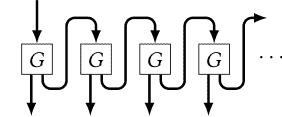

### 对称齿轮

假设 Alice 和 Bob 共享一个对称密钥 k，并使用安全消息应用程序长时间交换消息。课程后面我们将看到 Alice 和 Bob 可以用来用单个密钥安全加密许多消息的技术。然而，假设 Bob 的设备被攻破，攻击者得知了 k。那么攻击者可以解密它看到的所有过去、现在和未来的密文！

Alice 和 Bob 可以通过使用 PRG 反馈流密码不断“更新”他们的共享密钥来防止这种密钥泄露。假设他们从共享密钥 k 开始，执行以下操作：

- 他们使用 k 来为长度翻倍 PRG 的链播种，两人都获得相同的伪随机密钥流 \(t_1, t_2, \dots\)。
- 他们使用 \(t_i\) 作为密钥来发送/接收第 i 个消息。加密的细节与此示例无关。
- 在调用 PRG 之后，他们从内存中擦除 PRG 的输入，并仅记住 PRG 的输出。在使用 \(t_i\) 发送/接收消息后，他们也将其从内存中擦除。

这种使用并忘记一系列密钥的方式被称为**对称齿轮**。

构造 5.9 (对称齿轮)

```
s_0 = k
for i = 1 to ∞:
s_i || t_i := G(s_{i-1})
erase s_{i-1} from memory
use t_i to encrypt/decrypt the ith message
erase t_i from memory
```

[描述带有 G 块和箭头的齿轮结构的图示]

假设在发送 n 个密文后，攻击者攻破了 Bob 的设备。内存中驻留的唯一值是 \(s_n\)，攻击者得知了它。由于 G 是确定性的，攻击者现在可以以通常的方式计算 \(t_{n+1}, t_{n+2}, \dots\) 并解密所有将要发送的未来密文。

然而，我们可以证明攻击者从 \(s_n\) 无法了解关于 \(t_1, \dots, t_n\) 的任何信息，这意味着之前的密文仍然安全。通过攻破密钥 \(s_n\)，对手仅危及未来消息的安全性，而非过去消息的安全性。有时这个属性被称为**前向保密**，意思是当前消息受到防止未来发生的密钥攻破的保护。

这个构造被称为**齿轮**，因为沿着前向方向（从 \(s_n\) 到 \(s_{n+1}\)）推进密钥序列很容易，但逆转它（从 \(s_{n+1}\) 到 \(s_n\)）却很难。练习探讨了显式逆转齿轮的问题，但对我们更相关的属性是攻击者是否了解在攻破之前生成的密文的任何信息。

声明 5.10 如果对称齿轮（构造 5.9）与安全的 PRG G 和具有均匀密文的加密方案 \(\Sigma\)（且 \(\Sigma.K = \{0, 1\}^\lambda\)）一起使用，那么即使对攻破密钥 \(s_n\) 的窃听者，前 n 个密文也是伪随机的。

证明 我们正在考虑一个攻击场景，其中 n 个明文被加密，对手看到它们的密文以及齿轮密钥 \(s_n\)。这种情况由以下库捕获：


```
ATTACK(m_1, ..., m_n):
s_0 <- {0, 1}^\lambda
for i = 1 to n:
    s_i || t_i := G(s_{i-1})
    c_i <- Sigma.Enc(t_i, m_i)
return (c_1, ..., c_n, s_n)
```

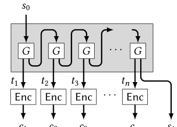

如我们所见，阴影框（即从 s_0 计算 t_1, ..., t_n 的过程）实际上是一个 PRG。让我们用这个 PRG H_n 来重写库：

```
ATTACK(m_1, ..., m_n):
s_0 <- {0, 1}^\lambda
t_1 || ... || t_n || s_n := H_n(s_0)
for i = 1 to n:
    c_i <- Sigma.Enc(t_i, m_i)
return (c_1, ..., c_n, s_n)
```

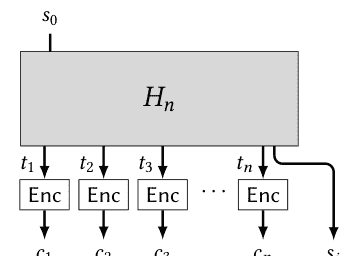

现在，我们可以应用 H_n 的 PRG 安全性，改为均匀地选择 t_1, ..., t_n 和 s_n。这一更改是不可区分的，根据 PRG 的安全性。请注意，我们没有写出标准的显式步骤（将 ATTACK 的前两行用 L^{prg-real} 分解，替换为 L^{prg-rand}，并内联）。

```
ATTACK(m_1, ..., m_n):
for i = 1 to n:
    t_i <- {0, 1}^\lambda
    s_n <- {0, 1}^\lambda
for i = 1 to n:
    c_i <- Sigma.Enc(t_i, m_i)
return (c_1, ..., c_n, s_n)
```

```
ATTACK(m_1, ..., m_n):
for i = 1 to n:
    t_i <- {0, 1}^\lambda
    c_i <- Sigma.Enc(t_i, m_i)
    s_n <- {0, 1}^\lambda
return (c_1, ..., c_n, s_n)
```

此时，加密方案正被“按预期使用”，意味着我们均匀/独立地生成其密钥 t_i，并且每个密钥仅用于一次加密，不做其他用途。从形式上讲，这意味着我们可以将 for 循环体用 L^{ots$-real} 分解出来：

```
ATTACK(m_1, ..., m_n):
for i = 1 to n:
    c_i <- CTXT(m_i)
s_n <- {0, 1}^\lambda
return (c_1, ..., c_n, s_n)
```

```
L^{\Sigma}_{ots$-real}
CTXT(m \in \Sigma.\mathcal{M}):
k <- \Sigma.KeyGen
c <- \Sigma.Enc(k, m)
return c
```

我们现在可以将 \(\mathcal{L}_{\text{ots\$-real}}\) 替换为 \(\mathcal{L}_{\text{ots\$-rand}}\) 并内联子程序（不展示中间库）。结果如下：

```
ATTACK(m_1, ..., m_n):
for i = 1 to n:
    c_i \leftarrow \Sigma.C
s_n \leftarrow {0, 1}^\lambda
return (c_1, ..., c_n, s_n)
```

这个最终库与第一个库不可区分。如承诺，我们证明攻击者无法将前 n 个密文与随机值区分开来，即使看到 s_n。

此证明使用了均匀密文属性，但同样的逻辑基本适用于您关心的任何加密属性——只需想象将加密步骤用不同于 \(\mathcal{L}_{\text{ots\$-real}}\) 的库来分解即可。

## 练习

### 5.1. 设 G : {0, 1}^\lambda -> {0, 1}^{\lambda+\ell} 为一个单射（即一对一）PRG。考虑以下区分器：

```
\mathcal{A}
x := QUERY()
for all s' \in {0, 1}^\lambda:
    if G(s') = x then return 1
return 0
```

- (a) A 区分 L^G_{prg-real} 和 L^G_{prg-rand} 的优势是多少？它是可忽略的吗？
- (b) 这是否与 G 是 PRG 的事实相矛盾？为什么或为什么不？
- (c) 如果 G 不是单射，优势会发生什么变化？

### 5.2. 设 G : {0, 1}^\lambda -> {0, 1}^{\lambda+\ell} 为一个单射 PRG，并考虑以下区分器：

```
\mathcal{A}
x := QUERY()
s' \leftarrow {0, 1}^\lambda
return G(s') = x
```

A 区分 L^G_{prg-real} 与 L^G_{prg-rand} 的优势是多少？

提示：在计算 Pr[A^L...] 时，根据 x 是否为 G 的可能输出来分开概率。

### 5.3. 对于任何 PRG \( G : \{0, 1\}^\lambda \to \{0, 1\}^{\lambda+\ell} \)，都会有很多 \( \{0, 1\}^{\lambda+\ell} \) 中的字符串无法作为 G 的输出。设 S 为任意一组这样的不可能的 G-输出，并考虑以下将 S 硬编码的对手：

```
\mathcal{A}
x := QUERY()
return x \in S ?
```

\( \mathcal{A} \) 区分 \( \mathcal{L}^G_{\text{prg-real}} \) 与 \( \mathcal{L}^G_{\text{prg-rand}} \) 的优势是多少？为什么像这样的对手不会自动破解每个 PRG？

### 5.4. 证明第 5.3 节中的方案不具备完美一次性保密性，方法是证明必然存在两个消息 \( m_1 \) 和 \( m_2 \)，其密文分布不同。

提示：
[反转文本块：存在字符串 s_1, s_2 ... 使得 ... 注意，攻击者知道 m_1 和 m_2 是合法的。s_1 和 s_2 ... 因为这些仅是 G 本身的属性，不取决于运行 ... 时所做的随机选择。当库 ... 加密算法 ...]

### 5.5. 要求 5.5 的证明对两次 G 调用都应用了 PRG 安全性规则，从第一次调用开始。描述当你尝试以相反顺序对这两次调用应用 G 的 PRG 安全性时会发生什么。证明是否仍然成立，还是仅在所呈现的顺序下才成立？

### 5.6. 设 \( \ell' > \ell > 0 \)。扩展“PRG 反馈”构造，将任何 stretch 为 \( \ell \) 的 PRG 转换为 stretch 为 \( \ell' \) 的 PRG。正式定义新的 PRG，并使用基础 PRG 的安全性证明其安全性。

### 5.7. 证明如果 G 是安全的 PRG，那么函数 \( H(s) = G(\bar{s}) \) 也是安全的 PRG。

### 5.8. 设 \( G : \{0, 1\}^\lambda \to \{0, 1\}^{3\lambda} \) 为安全的长度三倍 PRG。对于下面的每个函数，说明它是否也是安全的 PRG。如果该函数是安全的 PRG，给出证明。如果不是，描述一个成功的区分器并明确计算其优势。当我们写 \( a\|b\|c := G(s) \) 时，a、b、c 的长度均为 \( \lambda \)。

- (a)
```
H(s):
x||y||z := G(s)
return G(x)||G(z)
```

- (b)
```
H(s):
x||y||z := G(s)
return x||y
```

- (c)
```
H(s):
x := G(s)
y := G(s)
return x||y
```

- (d)
```
H(s):
x := G(s)
y := G(0^\lambda)
return x||y
```

- (e)
```
H(s):
x := G(s)
y := G(0^\lambda)
return x \oplus y
```

```
// H : {0, 1}^{2\lambda} \to \{0, 1\}^{3\lambda}
H(s_L || s_R):
  x := G(s_L)
  y := G(s_R)
  return x \oplus y
```

```
// H : {0, 1}^{2\lambda} \to \{0, 1\}^{\lambda}
H(s_L || s_R):
  x := G(s_L)
  y := G(s_R)
  return x || y
```

### 5.9. 设 $G : \{0, 1\}^\lambda \to \{0, 1\}^{3\lambda}$ 为安全的长度三倍 PRG。证明以下每个函数也是安全的 PRG：

```
// H : {0, 1}^{2\lambda} \to \{0, 1\}^{4\lambda}
H(s_L || s_R):
  y := G(s_R)
  return s_L || y
```

请注意，H 将其一半输入直接包含在输出中。你如何将此事实与练习 5.14(b) 的结论调和？

```
// H : {0, 1}^{2\lambda} \to \{0, 1\}^{3\lambda}
H(s_L || s_R):
  return G(s_L)
```

### ★ 5.10. 设 G 为安全的长度倍增 PRG。以下两个构造中有一个是安全的 PRG，另一个不是。孰是孰非？为其中一个给出安全证明，为另一个给出攻击。

```
H_1(s):
  x||y := G(s)
  u||v := G(y)
  return (x \oplus y)||u||v

H_2(s):
  x||y := G(s)
  u||v := G(y)
  return x||(y \oplus u)||v
```

提示：通常，如果某物不安全，它对于任何构建块选择都不安全。在这种情况下，攻击仅适用于特定的 G。基本上，你需要构造一个特定的 G，证明它是安全的 PRG，然后证明当使用此 G 时 H1/H2 不安全。

### 5.11. 密码学论坛中一个常见问题是：是否可以通过观察输出样本来确定使用了哪种 PRG 实现。

设 G_1 和 G_2 为输入/输出长度匹配的两个 PRG。定义两个库 \( \mathcal{L}_{\text{which-prg}}^{G_1} \) 和 \( \mathcal{L}_{\text{which-prg}}^{G_2} \) 如下：

```
\mathcal{L}_{\text{which-prg}}^{G_1}
QUERY():
  s \leftarrow \{0, 1\}^\lambda
  return G_1(s)
```

```
\mathcal{L}_{\text{which-prg}}^{G_2}
QUERY():
  s \leftarrow \{0, 1\}^\lambda
  return G_2(s)
```

证明，如果 G_1 和 G_2 都是安全的 PRG，那么 \( \mathcal{L}_{\text{which-prg}}^{G_1} \approx \mathcal{L}_{\text{which-prg}}^{G_2} \) —— 也就是说，仅通过接收输出样本，无法可行地区分使用了哪种 PRG。

### 5.12. 设 \( G_1 \) 和 \( G_2 \) 为确定性函数，每个接受长度为 \( \lambda \) 的输入并生成长度为 \( 3\lambda \) 的输出。

- (a) 定义函数 \( H(s_1||s_2) = G_1(s_1) \oplus G_2(s_2) \)。证明，如果 \( G_1 \) 或 \( G_2 \)（或两者）中有任何一个是安全的 PRG，那么 H 也是。
- (b) 当 \( G_1 \) 或 \( G_2 \) 中有一个是安全的 PRG 时，你对更简单的构造 \( H(s) = G_1(s) \oplus G_2(s) \) 有何看法？

### ★ 5.13. 证明，如果存在 PRG，则 P \(\neq\) NP。

### 5.14. (a) 设 \( f \) 为任意函数。证明以下函数 \( G\) **不是**安全的 PRG，无论 f 是什么。描述一个成功的区分器并明确计算其优势：

```
G(s):
return s||f(s)
```

- (b) 设 \( G : \{0, 1\}^\lambda \to \{0, 1\}^{\lambda + \ell} \) 为候选 PRG。假设存在一个多项式时间算法 V，它以非可忽略的概率反转 G。即，

\(\Pr_{s \leftarrow \{0,1\}^\lambda} [V(G(s)) = s]\) 是非可忽略的。

证明，如果存在具有此属性的算法 V，那么 G 不是安全的 PRG。换句话说，构造一个违反 G 的 PRG 安全性的区分器，并表明它能实现非可忽略的区分优势。

> 注：不要对 V 的输出做任何假设，除了上述属性。特别是，V 可能会非常频繁地输出“错误”的结果。

### 5.15. 设 \( s_0, s_1, \dots \) 和 \( t_1, t_2, \dots \) 按照对称棘轮（构造 5.9）定义。

- (a) 证明，如果 G 是安全的 PRG，那么对于任何多项式时间算法 \( \mathcal{A} \)，以下两个库不可区分：

| \( \mathcal{L}_{\text{left}} \) | \( \mathcal{L}_{\text{right}} \) |
| :--- | :--- |
| TEST(): | TEST(): |
| \( s_{n-1} \leftarrow \{0, 1\}^\lambda \) | \( s_n \leftarrow \{0, 1\}^\lambda \) |
| \( s_n || t_n := G(s_{n-1}) \) | \( \tilde{t} = \mathcal{A}(s_n) \) |
| \( \tilde{t} = \mathcal{A}(s_n) \) | \( t_n \leftarrow \{0, 1\}^\lambda \) |
| return \( \tilde{t} \stackrel{?}{=} t_n \) | return \( \tilde{t} \stackrel{?}{=} t_n \) |

- (b) 在 \( \mathcal{L}_{\text{right}} \) 中，TEST 输出 true 的概率是多少？

- (c) 证明，对于任何多项式时间算法 \( \mathcal{A} \)，\( \Pr[\mathcal{A}(s_n) = t_n] \) 是可忽略的，其中 \( s_n, t_n \) 按照对称棘轮构造生成。


- (d) 证明，对于任何多项式时间算法 \(\mathcal{A}\)，\(\Pr[\mathcal{A}(s_n) = s_{n-1}]\) 是可忽略的。换句话说，“逆转棘轮”是一个难问题。

提示：证明只需几行。是 (c) 部分的直接推论。

## 6 伪随机函数与分组密码

想象一下，如果 Alice 和 Bob 拥有 *无限* 量的共享随机性——而不仅仅是一个短密钥。他们可以将其分成 \(\lambda\) 比特的块，并在每次想要发送长度为 \(\lambda\) 的加密消息时，将每个块用作一次性密码本。

Alice 可以通过说：“嘿 Bob，这条消息使用一次性密码本加密，密钥是块 #674696273。”来进行加密。Bob 可以通过在他的共享随机性副本中查找位置 #674696273 来解密消息。只要 Alice 不重复使用密钥/块，窃听者（没有共享随机性的人）将无法了解加密消息的任何信息。尽管 Alice（公开地）宣布了 *哪个* 位置/块被用作每个一次性密码本密钥，但这些信息并不能帮助攻击者知道该位置的 *值*。

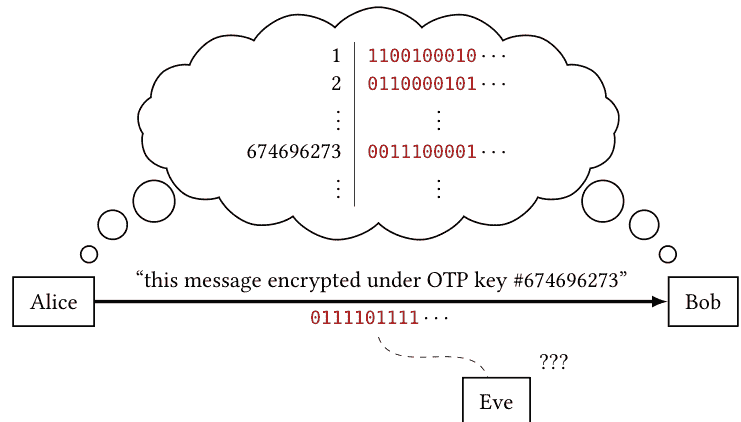

想象拥有无限量的共享随机性是荒谬的。然而，指数量级的东西通常与无限量一样有用。一张包含“仅”\(2^\lambda\) 个一次性密码本密钥的共享表，对于加密你可能需要的尽可能多的消息来说，将非常有用。

**伪随机函数（PRF）** 是一种工具，允许 Alice 和 Bob 在实践中实现如此巨大的共享随机性表的效果。在本章中，我们将探讨 PRF 及其属性。在后续章节中，在引入加密的新安全定义之后，我们将看到 PRF 可以用于在同一密钥下安全地加密 *多条* 消息，遵循上面说明的主要思想。

### 6.1 定义

延续我们的示例，想象一个作为数组 \( T \) 存储的巨大共享数据表，因此第 \( i \) 项被引用为 \( T[i] \)。我们不仅可以将 \( i \) 视为整数，还可以将 \( i \) 视为二进制字符串。如果数组有 \( 2^{in} \) 项，那么 \( i \) 将是一个 \( in \)-比特字符串。如果数组包含长度为 “out” 的字符串，那么记法 \( T[i] \) 就像一个函数，它从 \( \{0, 1\}^{in} \) 获取输入，并从 \( \{0, 1\}^{out} \) 输出。

伪随机函数模拟了巨大数组的功能。它是一个函数 \( F \)，从 \( \{0, 1\}^{in} \) 获取输入并从 \( \{0, 1\}^{out} \) 输出。但是，\( F \) 还接受一个称为 **种子** 的附加参数，它作为一种密钥。

伪随机函数的目的是“看起来像”均匀选择的数组/查找表。这样的数组可以通过以下库的查找子程序来访问：

```
for \( x \in \{0, 1\}^{in} \):
\( T[x] \leftarrow \{0, 1\}^{out} \)
LOOKUP(\( x \in \{0, 1\}^{in} \)):
return \( T[x] \)
```

正如你所见，这个库最初用均匀随机数据填充数组 \( T \)，然后允许调用程序访问数组中的任何位置。

当使用均匀选择的种子时，伪随机函数应该产生不可区分的行为。更正式地说，下面的库应该与上面的库不可区分：

```
\( k \leftarrow \{0, 1\}^\lambda \)
LOOKUP(\( x \in \{0, 1\}^{in} \)):
return \( F(k, x) \)
```

请注意，第一个库以均匀随机方式采样 \( out \cdot 2^{in} \) 比特（表中每个 \( 2^{in} \) 个条目采样 \( out \) 比特），而第二个库仅采样 \( \lambda \) 比特（相同的 \( k \) 用于 \( F \) 的所有调用）。尽管如此，我们仍要求这两个库不可区分。

这基本上就是 PRF 的定义，有一个技术上的注意事项。我们希望允许 \( in \geqslant \lambda \) 之类的情况，但在这些情况下，第一个库以指数时间运行。通常，使用以多项式时间运行的库来构建我们的安全定义会很方便。\(^1\) 我们通过利用以下事实来解决这个问题：无论表 \( T \) 想要多大，以多项式时间运行的调用程序只会访问其中的多项式数量。从某种意义上说，事先实际填充整个表 \( T \) 是“过度的”。相反，我们可以以懒加载/按需的方式填充 \( T \)。\( T \) 最初未初始化，其值仅在调用程序请求时才被分配。这改变了每个 \( T[x] \) 被采样的 *时间*（如果有的话），但不改变其采样 *方式*（即，均匀且独立）。这也将 \( T \) 从典型的数组变为 *关联数组*（“哈希表”或“字典”数据结构），因为它只将 \( \{0, 1\}^{in} \) 的一个子集映射到 \( \{0, 1\}^{out} \) 中的值。

\(^1\)当我们将伪随机函数用作其他构造中的组件时，PRF 安全的库将作为其他库的 *调用程序* 出现。不可区分性的定义要求所有调用程序以多项式时间运行。

### 定义 6.1（PRF 安全）

设 $F : \{0, 1\}^\lambda \times \{0, 1\}^{in} \to \{0, 1\}^{out}$ 为确定性函数。如果 $\mathcal{L}_{\text{prf-real}}^F \approx \mathcal{L}_{\text{prf-rand}}^F$，则我们说 $F$ 是安全的伪随机函数（PRF），其中：

| $\mathcal{L}^F_{\text{prf-real}}$ |
|---|
| $k \leftarrow \{0, 1\}^\lambda$ |
| $\underline{\text{LOOKUP}(x \in \{0, 1\}^{in}): \text{return } F(k, x)}$ |

| $\mathcal{L}^F_{\text{prf-rand}}$ |
|---|
| $T := \text{空关联数组}$ |
| $\underline{\text{LOOKUP}(x \in \{0, 1\}^{in}):}$ |
| 如果 $T[x]$ 未定义： |
| $T[x] \leftarrow \{0, 1\}^{out}$ |
| 返回 $T[x]$ |

### 讨论与陷阱

“伪随机函数”这一名称来自将 $T$ 视为函数 $T : \{0, 1\}^{in} \to \{0, 1\}^{out}$ 而非（关联）数组的视角。$T$ 有 $2^{out \cdot 2^{in}}$ 种可能的函数（一个难以置信的大数），$\mathcal{L}_{\text{prf-rand}}$ 通过按需均匀采样其真值表来选择一个“随机函数”。

对于每个可能的种子 $k$，剩余函数 $F(k, \cdot)$ 也是从 $\{0, 1\}^{in} \to \{0, 1\}^{out}$ 的一个函数。这种类型的可能函数有“仅” $2^\lambda$ 个（每个 $k$ 的选择对应一个），$\mathcal{L}_{\text{prf-real}}$ 随机选择其中一个函数。在两种情况下，这些库都为调用程序提供对所选函数的输入/输出访问。你可以参考第 5.1 节中的图片来思考这一点，但对象不是字符串，而是函数。

请注意，即使在“随机函数”（$\mathcal{L}_{\text{prf-rand}}$）的情况下，函数 $T$ 本身仍然是 **确定性** 的！准确地说，这个库从所有可能的确定性函数集合中均匀地选择一个确定性函数。但是，一旦做出此选择，$T$ 的输入/输出行为就固定了。如果调用程序使用相同的 $x$ 两次调用查找，它将收到相同的结果。在 $\mathcal{L}_{\text{prf-real}}$ 中也是如此，因为 $F$ 是一个确定性函数，并且 $k$ 在整个执行过程中固定不变。为了避免这种非常自然的混淆，也许最好从“随机初始化的查找表”而非“随机函数”的角度来思考。

### 如何不构建 PRF

我们可以通过研究一个并不完全奏效的自然方法，来体会构建 PRF 所涉及的挑战。

**示例** 假设我们有一个长度翻倍 PRG $G : \{0, 1\}^\lambda \to \{0, 1\}^{2\lambda}$，并试图用它来构造一个 PRF $F$，如下所示：

```
F(k, x):
return G(k) ⊕ x
```

你可能会注意到，我们所做的只是重命名了“伪一次性密码本”（构造 5.2）的加密算法。我们之前曾论证过，该算法是一种安全的一次性加密方法，生成的密文也是伪随机的。这足以构成安全的 PRF 吗？不，我们可以攻击这个 PRF 的安全性。


攻击 $F$ 意味着设计一个区分者，使其在两个 $\mathcal{L}^F_{\text{prf-}\star}$ 库的存在下表现得尽可能不同。我们要表明即使 $G$ 是一个优秀的 PRG，$F$ 也是不安全的。我们不应试图将攻击建立在区分 $G$ 的输出与随机值的基础上。相反，我们必须尝试**破坏构建 PRF 时使用 $G$ 的不当方式**来构建一个 PRF。

区分者必须使用 $\mathcal{L}_{\text{prf-}\star}$ 库的接口——即，对 LOOKUP 子程序进行一些调用，并根据得到的答案输出 0 或 1。LOOKUP 子程序接受一个参数，因此区分者必须选择使用哪些参数。

我们可以做出的一个观察是，如果调用程序只看到一个形式为 $G(k) \oplus x$ 的值，它将看起来是伪随机的。这基本上就是我们在第 5.3 节中展示的内容。因此，我们应该寻找一个对 LOOKUP 进行不止一次调用的调用程序。

如果我们对 LOOKUP 进行两次调用——例如，在输入 $x_1$ 和 $x_2$ 上——来自 $\mathcal{L}^F_{\text{prf-real}}$ 的响应将是 $G(k) \oplus x_1$ 和 $G(k) \oplus x_2$。要成为一个安全的 PRF，这些响应必须看起来是独立且均匀的。为什么？它们实际上有一个调用程序可以注意到的模式：它们的异或始终是 $x_1 \oplus x_2$，这是调用程序已经知道的值。

我们可以将所有观察结果浓缩为以下区分者：

```
$\mathcal{A}$
pick $x_1, x_2 \in \{0, 1\}^{2\lambda}$ arbitrarily so that $x_1 \neq x_2$
$z_1 := \text{LOOKUP}(x_1)$
$z_2 := \text{LOOKUP}(x_2)$
return $z_1 \oplus z_2 \stackrel{?}{=} x_1 \oplus x_2$
```

让我们通过考虑 $\mathcal{A}$ 与这两个库链接时的行为，来计算它在区分 $\mathcal{L}^F_{\text{prf-real}}$ 与 $\mathcal{L}^F_{\text{prf-rand}}$ 方面的优势：

| $\mathcal{A}$ | $\mathcal{L}^F_{\text{prf-real}}$ |
| :--- | :--- |
| pick $x_1 \neq x_2 \in \{0, 1\}^{2\lambda}$<br>$z_1 := \text{LOOKUP}(x_1)$<br>$z_2 := \text{LOOKUP}(x_2)$<br>return $z_1 \oplus z_2 \stackrel{?}{=} x_1 \oplus x_2$ | $k \leftarrow \{0, 1\}^\lambda$<br>LOOKUP(x):<br>return $G(k) \oplus x$ // $F(k, x)$ |

当 $\mathcal{A}$ 与 $\mathcal{L}^F_{\text{prf-real}}$ 链接时，库将选择一个密钥 $k$。然后 $z_1$ 设置为 $G(k) \oplus x_1$，$z_2$ 设置为 $G(k) \oplus x_2$。因此 $z_1 \oplus z_2$ 始终等于 $x_1 \oplus x_2$，且 $\mathcal{A}$ 始终输出 1。即，

$\Pr[\mathcal{A} \diamond \mathcal{L}^F_{\text{prf-real}} \Rightarrow 1] = 1$.

| $\mathcal{A}$ | $\mathcal{L}^F_{\text{prf-rand}}$ |
| :--- | :--- |
| pick $x_1 \neq x_2 \in \{0, 1\}^{2\lambda}$<br>$z_1 := \text{LOOKUP}(x_1)$<br>$z_2 := \text{LOOKUP}(x_2)$<br>return $z_1 \oplus z_2 = x_1 \oplus x_2$ | $T :=$ empty assoc. array<br>LOOKUP(x):<br>if $T[x]$ undefined:<br>$T[x] \leftarrow \{0, 1\}^{2\lambda}$<br>return $T[x]$ |

当 $\mathcal{A}$ 与 $\mathcal{L}^F_{\text{prf-rand}}$ 链接时，两次 LOOKUP 调用的响应将被均匀且独立地选择，因为 LOOKUP 是在不同的输入上被调用的。考虑第二次 LOOKUP 调用即将发生的时刻。此时，$x_1$、$x_2$ 和 $z_1$ 已经全部确定，而 $z_2$ 即将由库均匀选择。利用异或的性质，我们可以看到，$\mathcal{A}$ 将当且仅当 $z_2$ 被选择为恰好是值 $x_1 \oplus x_2 \oplus z_1$ 时输出 1。这种情况发生的概率仅为 $1/2^{2\lambda}$。即，

$\Pr[\mathcal{A} \diamond \mathcal{L}^F_{\text{prf-rand}} \Rightarrow 1] = 1/2^{2\lambda}$.

因此 $\mathcal{A}$ 的优势为 $1 - 1/2^{2\lambda}$，这无疑是非可忽略的，因为它甚至不趋近于 0。这表明 $F$ 不是一个安全的 PRF。

从更哲学的角度来看，我们想要识别 $G$ 被以不当方式使用的精确所在。PRG 安全库保证当 $G$ 的种子为每次对 $G$ 的调用重新选择时是安全的。$F$ 的这种构造违反了该规则，并允许相同的种子在对 $G$ 的不同调用中被使用两次，而结果应当看起来是独立的。

这个例子展示了构建 PRF 的挑战。尽管我们知道如何使任何单个输出看起来是伪随机的，但要使所有输出整体上看起来是独立的，而在现实中它们却派生自单个短种子，这是困难的。

### 6.2 PRFs 与 PRGs；变量混合证明

在本节中，我们将展示 PRG 可用于构建 PRF，**反之亦然**。从 PRF 构建 PRG 是实用的，也是在实践中获得 PRG 的更常见方式之一。从 PRG 构建 PRF 更多的是理论兴趣，并不反映 PRF 在实践中的设计方式。

### 从 PRF 构建 PRG

如承诺，PRF 可用于构建 PRG。这种构造非常自然。为简单起见，假设我们有一个 PRF $F : \{0, 1\}^\lambda \times \{0, 1\}^\lambda \to \{0, 1\}^\lambda$（_即，输入 = 输出 = $\lambda$_）。我们可以如下构建一个长度翻倍的 PRG：

| 构造 6.2（计数器 PRG） |
| --- |
| $G(s)$: |
| $x := F(s, 0\cdots 00)$ |
| $y := F(s, 0\cdots 01)$ |
| return $x\|y$ |

传给 $F$ 的输入 $0\cdots 00$ 和 $0\cdots 01$ 并没有什么特别之处。重要的是它们互不相同。该构造可以扩展以轻松给出超过 2 个输出块，通过将 $F$ 的输入视为一个简单的计数器（因此得名此构造）。

PRF 的保证是，当其种子被均匀选择并且在不同的输入上被调用时，其输出看起来是独立且均匀的。特别是，其在输入 $0\cdots 00$ 和 $0\cdots 01$ 上的输出与均匀输出不可区分。因此，将它们拼接得到一个与均匀 $2\lambda$ 比特字符串不可区分的字符串。

这其实就是该构造安全性的全部内容，但不幸的是，有一个小的技术问题使得安全证明比你可能猜想的更加复杂。我们将不得不引入一种新的**变量混合**技术来应对它。

**主张 6.3** 如果 $F$ 是一个安全的 PRF，那么上述计数器 PRG 构造 $G$ 是一个安全的 PRG。

**证明** 为了证明 $G$ 是一个安全的 PRG，我们必须证明以下库是不可区分的：

```
$\mathcal{L}^G_{\text{prg-real}}$
QUERY():
$s \leftarrow \{0, 1\}^\lambda$
$x := F(s, 00\cdots 00)$
$y := F(s, 00\cdots 01)$
return $x\|y$   // $G(s)$
```

```
$\mathcal{L}^G_{\text{prg-rand}}$
QUERY():
$r \leftarrow \{0, 1\}^{2\lambda}$
return $r$
```

在证明过程中，我们可以使用 $F$ 是一个安全的 PRF 这一事实。也就是说，我们可以使用以下两个库是不可区分的这一事实：

```
$\mathcal{L}^F_{\text{prf-real}}$
$k \leftarrow \{0, 1\}^\lambda$
LOOKUP($x \in \{0, 1\}^\text{in}$):
return $F(k, x)$
```

```
$\mathcal{L}^F_{\text{prf-rand}}$
$T :=$ empty assoc. array
LOOKUP($x \in \{0, 1\}^\text{in}$):
if $T[x]$ undefined:
  $T[x] \leftarrow \{0, 1\}^\text{out}$
return $T[x]$
```

证明中的不便之处源于 $\mathcal{L}^G_{\text{prg-real}}$ 中的 $s$ 变量与 $\mathcal{L}^F_{\text{prf-real}}$ 中的 $k$ 变量的不匹配。在 $\mathcal{L}^G_{\text{prg-real}}$ 中，$s$ 是 QUERY 子程序的局部变量。在执行过程中，$s$ 将取许多值。由于 $s$ 被用作 PRF 种子，我们必须用 $\mathcal{L}^F_{\text{prf-real}}$ 的 LOOKUP 子程序来写对 $F$ 的调用。但在 $\mathcal{L}^F_{\text{prf-real}}$ 中，PRF 种子在整个执行过程中是固定的。换句话说，我们一次只能使用 $\mathcal{L}^F_{\text{prf-real}}$ 来处理单个 PRF 种子，但 $\mathcal{L}^G_{\text{prg-real}}$ 同时处理许多 PRG 种子。

为了解决这个问题，在证明过程中我们将不得不多次应用 $F$ 的安全性（即，用 $\mathcal{L}^F_{\text{prf-rand}}$ 替换 $\mathcal{L}^F_{\text{prf-real}}$）——事实上，对调用程序进行的每次 QUERY 调用都要应用一次。先前的安全证明具有固定数量的混合步骤（例如，主张 5.5 的证明使用了 7 个混合库来显示 $\mathcal{L}^G_{\text{prg-real}} \approx \mathcal{L}_{\text{hyb-1}} \approx \dots \approx \mathcal{L}_{\text{hyb-7}} \approx \mathcal{L}^G_{\text{prg-rand}}$）。本证明将拥有一个**依赖于调用程序的变量数量的混合**。具体来说，我们将证明

$$\mathcal{L}^G_{\text{prg-real}} \approx \mathcal{L}_{\text{hyb-1}} \approx \dots \approx \mathcal{L}_{\text{hyb-}q} \approx \mathcal{L}^G_{\text{prg-rand}},$$

其中 $q$ 是调用程序调用 QUERY 的次数。


不要被所有这些混合库压倒。它们都遵循一个简单的模式。事实上，第 $i$ 个混合库如下：

```
$\mathcal{L}^{\text{hyb-}i}:$:

count := 0
QUERY():
  count := count + 1
  if count \(\leqslant i\):
    \(r \leftarrow \{0, 1\}^{2\lambda}\)
    return \(r\)
  else:
    \(s \leftarrow \{0, 1\}^\lambda\)
    \(x := F(s, 00 \cdots 00)\)
    \(y := F(s, 00 \cdots 01)\)
    return \(x \|\| y\)
```

换句话说，这些混合库仅在于插入到上述代码中的值 \(i\) 不同。如果你熟悉 C 编译器，可以将此视为在上述代码顶部添加 "#define i 427"，从而得到 \(\mathcal{L}^{\text{hyb-427}}\)。

首先注意 \(i\) 取极端值时会发生什么：

- 在 \(\mathcal{L}^{\text{hyb-0}}\) 中，if 分支永远不会被执行（\(count \leqslant 0\) 永远不为真）。该库在每次调用 QUERY 时都给出 PRG 输出，因此其行为与 \(\mathcal{L}^G_{\text{prg-real}}\) 完全一致。

- 如果 \(q\) 是调用程序调用 QUERY 的总次数，则在 \(\mathcal{L}^{\text{hyb-q}}\) 中，if 分支始终会被执行（\(count \leqslant q\) 始终为真）。该库在每次调用 QUERY 时都给出真正均匀的输出，因此其行为与 \(\mathcal{L}^G_{\text{prg-rand}}\) 完全一致。

一般来说，\(\mathcal{L}^{\text{hyb-}i}\) 会对前 \(i\) 次 QUERY 调用给出真正随机的输出。它会对所有后续调用给出我们 PRG 构造的输出。

我们已经论证了 \(\mathcal{L}^G_{\text{prg-real}} \equiv \mathcal{L}^{\text{hyb-0}}\) 且 \(\mathcal{L}^G_{\text{prg-rand}} \equiv \mathcal{L}^{\text{hyb-q}}\)。为了完成证明，我们必须表明对于所有 \(i\)，\(\mathcal{L}^{\text{hyb-}(i - 1)} \approx \mathcal{L}^{\text{hyb-}i}\)。定义如此多的混合库并费此周折的主要原因是，\(\mathcal{L}^{\text{hyb-}(i-1)}\) 和 \(\mathcal{L}^{\text{hyb-}i}\) 完全相同，只不过在响应第 \(i\) 次 QUERY 调用的方式上不同。这一差异仅涉及一次 PRG 调用（因此也仅涉及一个 PRF 种子），这使我们能够应用 PRF 的安全性。

更具体地说，令 \(i\) 为任意值，并考虑从 \(\mathcal{L}^{\text{hyb-}(i - 1)}\) 开始的以下步骤序列：

```
count := 0
QUERY():
  count := count + 1
  if count < i:
    r <- {0, 1}^{2\lambda}
    return r
  elseif count = i:
    s* <- {0, 1}^{\lambda}
    x := F(s*, 0...00)
    y := F(s*, 0...01)
    return x||y
  else:
    s <- {0, 1}^{\lambda}
    x := F(s, 0...00)
    y := F(s, 0...01)
    return x||y
```

我们对 \(\mathcal{L}^{\text{hyb-}(i-1)}\) 进行了处理，仅将 else 分支 \((count \ge i)\) 展开为两个子情况（\(count = i\) 和 \(count > i\)）。然而，两种情况都导致相同的代码块（仅局部变量名称不同），因此该更改对调用程序没有影响。

```
count := 0
QUERY():
  count := count + 1
  if count < i:
    r <- {0, 1}^{2\lambda}
    return r
  elseif count = i:
    x := LOOKUP(0...00)
    y := LOOKUP(0...01)
    return x||y
  else:
    s <- {0, 1}^{\lambda}
    x := F(s, 0...00)
    y := F(s, 0...01)
    return x||y
```

```
\mathcal{L}^F_{\text{prf-real}}
k <- {0, 1}^{\lambda}
LOOKUP(x):
  return F(k, x)
```

我们已将使用种子 \(s^*\)（对应 \(count = i\) 情况）的 \(F\) 调用用 \(\mathcal{L}_{\text{prf-real}}\) 形式提取出来。该更改对调用程序没有影响。

```
count := 0

QUERY():
  count := count + 1
  if count < i:
    r <- {0, 1}^{2\lambda}
    return r
  elseif count = i:
    x := LOOKUP(0...00)
    y := LOOKUP(0...01)
    return x||y
  else:
    s <- {0, 1}^{\lambda}
    x := F(s, 0...00)
    y := F(s, 0...01)
    return x||y
```

```
\mathcal{L}^{\mathcal{F}}_{\text{prf-rand}}

T := empty assoc. array

LOOKUP(x):
  if T[x] undefined:
    T[x] <- {0, 1}^{\lambda}
  return T[x]
```

由于 F 是安全的 PRF，我们可以用 \(\mathcal{L}^{\mathcal{F}}_{\text{prf-rand}}\) 替换 \(\mathcal{L}^{\mathcal{F}}_{\text{prf-real}}\)，且总的变化不可区分。

```
count := 0

QUERY():
  count := count + 1
  if count < i:
    r <- {0, 1}^{2\lambda}
    return r
  elseif count = i:
    x := LOOKUP(0...00)
    y := LOOKUP(0...01)
    return x||y
  else:
    s <- {0, 1}^{\lambda}
    x := F(s, 0...00)
    y := F(s, 0...01)
    return x||y
```

```
LOOKUP(x):
  r <- {0, 1}^{\lambda}
  return r
```

由于 count = i 仅发生一次，整个库生命周期内只会进行两次 LOOKUP 调用，且它们的输入不同。因此，LOOKUP 中的 if 分支始终会被执行，T 从不需要（它仅用于“记住”值，并在同一个 x 两次作为参数传给 LOOKUP 时给出相同答案）。因此，简化库对调用程序没有影响：

```
count := 0
QUERY():
  count := count + 1
  if count < i:
    r <- {0, 1}^{2\lambda}
    return r
  elseif count = i:
    x <- {0, 1}^{\lambda}
    y <- {0, 1}^{\lambda}
    return x||y
  else:
    s <- {0, 1}^{\lambda}
    x := F(s, 0...00)
    y := F(s, 0...01)
    return x||y
```

内联子程序对调用程序没有影响。所得库对前 \(i\) 次 QUERY 调用给出均匀随机输出，对其他调用给出我们的 PRG G 的输出。因此，该库与 \(\mathcal{L}_{\text{hyb-}i}\) 具有相同的行为。

我们已经表明 \(\mathcal{L}_{\text{hyb-}(i-1)} \approx \mathcal{L}_{\text{hyb-}i}\)，因此：

$\mathcal{L}^G_{\text{prg-real}} \equiv \mathcal{L}_{\text{hyb-0}} \approx \mathcal{L}_{\text{hyb-1}} \approx \cdots \approx \mathcal{L}_{\text{hyb-q}} \equiv \mathcal{L}^G_{\text{prg-rand}}$

这表明 $\mathcal{L}^G_{\text{prg-real}} \approx \mathcal{L}^G_{\text{prg-rand}}$，因此 G 是安全的 PRG。

## 从 PRG 构造 PRF 的理论方法

我们已经看到，可以将 PRG 的输出再次输入到 PRG 中，以扩展其扩展量（Claim 5.7）。这是通过构建一个长长的 PRG 链（类似于链表）来实现的。从 PRG 构造 PRF 的诀窍是将 PRG 组织成一棵二叉树（类似于练习 5.8(a)）。树的叶子对应于 PRF 的最终输出。如果我们想要一个指数级大小的定义域的 PRF（例如，\(n = \lambda\)），那么二叉树本身也是指数级大小的！然而，通过简单地从根遍历到叶子，仍然可以高效地计算任何单个叶子。这种树遍历本身就是 PRF 算法。这种 PRF 构造方法源自戈德雷奇、戈尔德瓦瑟和米卡利，他们在定义 PRF 概念的论文中提出了该方法。

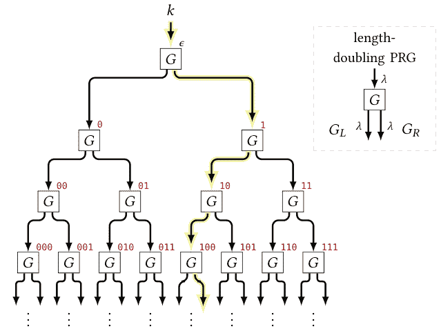

想象一棵高度为 $n$ 的完全二叉树（$n$ 将是 PRF 的输入长度）。树中的每个节点都有一个*位置*，可以表示为一个二进制字符串。可以将节点的位置视为从根出发到达该节点的方向，其中 0 表示“向左走”，1 表示“向右走”。例如，根节点的位置为 $\epsilon$（空字符串），根的右子节点位置为 1，依此类推。

该 PRF 构造通过使用长度翻倍的 PRG $G : \{0, 1\}^\lambda \rightarrow \{0, 1\}^{2\lambda}$ 为树中的每个节点分配一个*标签*。为了方便，我们将用 $G_L(k)$ 和 $G_R(k)$ 分别表示 $G(k)$ 的前 $\lambda$ 位和后 $\lambda$ 位。树中的标签是 $\lambda$ 位字符串，根据以下两条规则计算：

- 1. 根节点的标签是 PRF 种子。
- 2. 如果位置 $p$ 处的节点具有标签 $v$，则其左子节点（位置为 $p||0$）获得标签 $G_L(v)$，其右子节点（位置为 $p||1$）获得标签 $G_R(v)$。

如上图所示，节点的标签是其入边上传输的字符串。该树有 $2^n$ 个叶子，其位置为字符串 $\{0, 1\}^n$。我们定义 $F(k, x)$ 为节点/叶子 $x$ 的标签。要计算该标签，可以从根遍历到叶子，在每个节点根据 $x$ 的位决定向左还是向右，并沿着该路径根据标记规则计算标签。如上图所示，高亮路径对应于 $F(k, 1001 \cdots)$ 的计算。

重要的是要记住，二叉树是一个有用的概念工具，但通常来说它是指数级大小的。在某个输入上运行 PRF 不需要计算整棵树的标签，只需沿从根到叶子的单一路径计算即可。


## 构造 6.4 (GGM PRF)

```
in = arbitrary
out = \lambda

F(k, x \in \{0, 1\}^in):
v := k
for i = 1 to in:
  if x_i = 0 then v := G_L(v)
  if x_i = 1 then v := G_R(v)
return v
```

## 断言 6.5 若 G 是安全 PRG，则构造 6.4 是安全 PRF。

证明 我们使用一系列混合库（hybrids）来证明该断言。在此情况下，混合库的数量取决于输入长度参数 in。混合库定义如下：

```
\mathcal{L}_{\text{hyb-d}}
T := empty assoc. array
QUERY(x):
  p := first d bits of x
  if T[p] undefined:
    T[p] \leftarrow \{0, 1\}^\lambda
  v := T[p]
  for i = d + 1 to in:
    if x_i = 0 then v := G_L(v)
    if x_i = 1 then v := G_R(v)
  return v
```

混合库仅在其硬编码的 d 值上有所不同。我们将展示

\mathcal{L}_{\text{prf-real}}^F \equiv \mathcal{L}_{\text{hyb-0}} \approx \mathcal{L}_{\text{hyb-1}} \approx \dots \approx \mathcal{L}_{\text{hyb-in}} \equiv \mathcal{L}_{\text{prf-rand}}^F.

我们先了解 \mathcal{L}_{\text{hyb-d}} 在 d 取极端值时的行为。右侧展示了代码的简化形式。

```
\mathcal{L}_{\text{hyb-0}}
T := empty assoc. array
LOOKUP(x):
  p := first 0 bits of x
  if T[p] undefined: T[p] \leftarrow \{0, 1\}^\lambda
  v := T[p]
  for i = 1 to in:
    if x_i = 0 then v := G_L(v)
    if x_i = 1 then v := G_R(v)
  return v

k := undefined // k is alias for T[\epsilon]
p = \epsilon
if k undefined: k \leftarrow \{0, 1\}^\lambda
v := F(k, x)
return F(k, x)
```

在 \mathcal{L}_{\text{hyb-0}} 中，我们总是有 p = \epsilon，因此访问的 T 中唯一的条目是 T[\epsilon]。然后将 T[\epsilon] 重命名为 k，我们可以看到 \mathcal{L}_{\text{hyb-0}} \equiv \mathcal{L}_{\text{prf-real}}^F。唯一的区别在于 PRF 种子 k（T[\epsilon]）的采样时机：在 \mathcal{L}_{\text{prf-real}}^F 中是在初始化时急切采样，而在 \mathcal{L}_{\text{hyb-0}} 中是在最后可能的时刻采样。

```
\mathcal{L}_{\text{hyb-in}}
T := empty assoc. array
LOOKUP(x):
  p := first in bits of x
  if T[p] undefined:
    T[p] \leftarrow \{0, 1\}^\lambda
  v := T[p]
  for i = in + 1 to in:
    if x_i = 0 then v := G_L(v)
    if x_i = 1 then v := G_R(v)
  return v

p = x
if T[x] undefined:
  T[x] \leftarrow \{0, 1\}^\lambda
// unreachable
return T[x]
```

在 \mathcal{L}_{\text{hyb-in}} 中，我们总是有 p = x，并且 for 循环的主体总是不可达。在这种情况下，可以轻松看出 \mathcal{L}_{\text{hyb-in}} 的行为与 \mathcal{L}^F_{\text{prf-rand}} 相同。

一般模式是，\mathcal{L}_{\text{hyb-d}} "砍掉" 概念二叉树的顶层 d 层。在计算某个字符串 x 的输出时，我们不是从根开始遍历树，而是从树中 d 层下的节点开始，该节点的位置是 x 的 d 位前缀（在库中称为 p）。我们将该节点的标签初始化为均匀值（除非已定义），然后继续向叶子 x 遍历。
为了完成证明，我们展示 \mathcal{L}_{\text{hyb-(d - 1)}} 和 \mathcal{L}_{\text{hyb-d}} 是不可区分的：

```
T := empty assoc. array
LOOKUP(x):
  p := first d - 1 bits of x
  if T[p] undefined:
    T[p] \leftarrow \{0, 1\}^\lambda
  T[p||0] := G_L(T[p])
  T[p||1] := G_R(T[p])
  p' := first d bits of x
  v := T[p']
  for i = d + 1 to in:
    if x_i = 0 then v := G_L(v)
    if x_i = 1 then v := G_R(v)
  return v
```

此处显示的库与 \mathcal{L}_{\text{hyb-(d - 1)}} 在高亮部分不同。然而，这些差异对调用程序没有影响。此处的库推进 d - 1 层到达树中的节点（位置为 p），将该节点的标签初始化为均匀值，然后计算其两个子节点的标签，最后继续计算向叶子的标签。与 \mathcal{L}_{\text{hyb-(d - 1)}} 唯一的显著区别是，它计算了 p 两个子节点的标签，尽管只有一个在通往 x 的路径上。由于它正确计算了标签，因此何时（或是否）计算这个额外标签都无关紧要。

```
T := empty assoc. array
LOOKUP(x):
  p := first d - 1 bits of x
  if T[p] undefined:
    T[p||0] || T[p||1] := QUERY()
  p' := first d + 1 bits of x
  v := T[p']
  for i = d + 1 to in:
    if x_i = 0 then v := G_L(v)
    if x_i = 1 then v := G_R(v)
  return v
```

```
\mathcal{L}^G_{\text{prg-real}}
QUERY():
  s \leftarrow \{0, 1\}^\lambda
  return G(s)
```

我们已将 if 语句的主体用 \mathcal{L}^G_{\text{prg-real}} 分解出来，因为它涉及对均匀输入调用 G。 importantly，传递给 G 的种子（在前一个混合库中称为 T[p]）未在任何其他地方使用——它是长度为 d-1 的字符串，而库仅读取长度为 d 的 T[p']。此更改对调用程序没有影响。

```
T := empty assoc. array
LOOKUP(x):
  p := first d - 1 bits of x
  if T[p] undefined:
    T[p||0] || T[p||1] := QUERY()
  p' := first d + 1 bits of x
  v := T[p']
  for i = d + 1 to in:
    if x_i = 0 then v := G_L(v)
    if x_i = 1 then v := G_R(v)
  return v
```

```
\mathcal{L}^G_{\text{prg-rand}}
QUERY():
  r \leftarrow \{0, 1\}^{2\lambda}
  return r
```

我们已应用 G 的安全性，并用 \mathcal{L}^G_{\text{prg-rand}} 替换了 \mathcal{L}^G_{\text{prg-real}}。此更改是不可区分的。

```
T := empty assoc. array
LOOKUP(x):
  p := first d - 1 bits of x
  if T[p] undefined:
    T[p||0] \leftarrow \{0, 1\}^\lambda
    T[p||1] \leftarrow \{0, 1\}^\lambda
  p' := first d + 1 bits of x
  v := T[p']
  for i = d + 1 to in:
    if x_i = 0 then v := G_L(v)
    if x_i = 1 then v := G_R(v)
  return v
```

我们已将 \mathcal{L}_{\text{prg-rand}} 内联，并将 2\lambda 位的采样拆分为两个各采样 \lambda 位的独立语句。在此库中，我们推进 d 层到达树，为节点（及其兄弟节点）分配均匀标签，然后沿常规方式应用 G 向叶子推进。此库与 \mathcal{L}_{\text{hyb-d}} 的唯一区别在于，我们采样了不在直接路径上的节点的标签。但由于我们均匀采样它，因此何时（或是否）采样该额外值都无关紧要。因此，此库与 \mathcal{L}_{\text{hyb-d}} 具有相同的行为。

我们展示了 \mathcal{L}_{\text{hyb-(d-1)}} \approx \mathcal{L}_{\text{hyb-d}}。将所有内容结合起来，我们有：
\mathcal{L}^F_{\text{prf-real}} \equiv \mathcal{L}_{\text{hyb-0}} \approx \mathcal{L}_{\text{hyb-1}} \approx \dots \approx \mathcal{L}_{\text{hyb-in}} \equiv \mathcal{L}^F_{\text{prf-rand}}.

因此，F 是安全 PRF。

### 6.3 分组密码（伪随机置换）

在固定 PRF 的种子后，它计算一个从 $\{0, 1\}^{\text{in}}$ 到 $\{0, 1\}^{\text{out}}$ 的函数。让我们考虑 in = out 的情况。某些从 $\{0, 1\}^{\text{in}}$ 到 $\{0, 1\}^{\text{out}}$ 的函数是可逆的，这引发了这样一个问题：PRF 是否可能实现这样的函数并可逆（在知道种子的情况下）。换句话说，如果给定 k 和 F(k, x)，有可能确定 x 吗？虽然这将是一个方便的属性，但即使在 in = out 的情况下，PRF 安全性定义也不保证这一点。从 $\{0, 1\}^{\text{in}}$ 到 $\{0, 1\}^{\text{out}}$ 随机选择的函数不太可能有逆函数，因此使用随机密钥实例化的 PRF 不太可能有逆函数。

一个 **伪随机置换（PRP）** — 也称为 **分组密码（block cipher）** — 本质上是一个保证对于每种种子选择都可逆的 PRF。我们互换使用这两个术语（PRP 和分组密码）。术语“置换”指的是，对于每个 k，函数 $F(k, \cdot)$ 应该是 $\{0, 1\}^{\text{in}}$ 的一个置换。我们不要求 PRP 与随机选择的函数不可区分，而要求它与随机选择的 _可逆_ 函数不可区分。$^2$ 这意味着我们必须修改 PRF 定义中的一个库。与使用均匀随机值填充关联数组 $T$ 不同，它选择均匀随机但 _互不相同_ 的值。只要 $T$ 在不同输入上给出不同输出，它就与某个可逆函数一致。该库通过仅采样之前未分配过的值来保证互异性。将关联数组 $T$ 视为键值存储，我们使用符号 $T.\text{values}$ 表示存储在 $T$ 中的值的集合。

### 定义 6.6 (PRP 语法)

让 \(F : \{0, 1\}^\lambda \times \{0, 1\}^{\text{\textit{blen}}} \rightarrow \{0, 1\}^{\text{\textit{blen}}}\) 成为一个确定性函数。我们将 blen 称为 F 的 **块长度（blocklength）**，并将 \(\{0, 1\}^{\text{\textit{blen}}}\) 中的任何元素称为 **块（block）**。

如果满足以下两个条件，我们称 F 为 **安全伪随机置换（PRP）（分组密码）**：

- (**在给定 k 时可逆**) 存在一个函数 \(F^{-1} : \{0, 1\}^\lambda \times \{0, 1\}^{\text{\textit{blen}}} \rightarrow \{0, 1\}^{\text{\textit{blen}}}\) 满足

\(F^{-1}(k, F(k, x)) = x\),

对于所有 \(k \in \{0, 1\}^\lambda\) 和所有 \(x \in \{0, 1\}^{\text{\textit{blen}}}\)。

- (**安全性**) \(\mathcal{L}^F_{\text{prp-real}} \approx \mathcal{L}^F_{\text{prp-rand}}\)

| \(\mathcal{L}^F_{\text{prp-real}}\) |
| :--- |
| \(k \leftarrow \{0, 1\}^\lambda\) |
| \(\underline{\text{LOOKUP}}(x \in \{0, 1\}^{\text{\textit{blen}}})\) |
| return \(F(k, x)\) |

| \(\mathcal{L}^F_{\text{prp-rand}}\) |
| :--- |
| \(T := \text{empty assoc. array}\) |
| \(\underline{\text{LOOKUP}}(x \in \{0, 1\}^{\text{\textit{blen}}})\) |
| if \(T[x]\) undefined: |
| \(T[x] \leftarrow \{0, 1\}^{\text{\textit{blen}}} \setminus T.\text{values}\) |
| return \(T[x]\) |

$^2$稍后我们将看到，随机选择的函数与随机选择的 _可逆_ 函数之间的区别，不像看起来那么重要。


‘T.values’ 指的是集合 {v | ∃x : T[x] = v}。

与 PRF 定义相比的更改已用黄色突出显示。特别是，L_prp-real 和 L_prf-real 库是相同的。

## 讨论与陷阱

在定义中，函数 F 和 F^{-1} 都以种子 k 作为输入。因此，只有拥有 k 的人才能反转块密码。回想一下 PRF 的定义——没有种子 k，计算 F(k, x) 是困难的。块密码有正向和反向两个方向，没有 k，计算其中任何一个都是困难的！

### 6.4 将 PRF 与块密码相关联

在本节中，我们讨论如何从 PRPs/块密码获得 PRFs，反之亦然。

### 置换引理（PRP 也是 PRF！）

想象你可以对选定的输入查询 PRP（如在 L_prp-real 库中），并假设 PRP 的块长度为 blen = λ。你只能在其指数级大的输入域上的可忽略比例上查询该 PRP。你甚至似乎不可能分辨它是 PRP（即可逆函数）而非 PRF（无限制函数）。

这个想法可以形式化如下。

> **Lemma 6.7 (PRP 置换)** 令 L_prf-rand 和 L_prp-rand 按照定义 6.1 & 6.6 定义，参数 in = out = blen = λ（使得接口匹配）。则 L_prf-rand ≈ L_prp-rand。

**证明** 回顾替换采样引理，Lemma 4.11，它表明以下库是不可区分的：

| L_samp-L | L_samp-R |
|---|---|
| SAMP(): | R := ∅ |
| r ← {0, 1}^λ | SAMP(): |
| return r | r ← {0, 1}^λ \ R |
| | R := R ∪ {r} |
| | return r |

L_samp-L 带替换地采样值，L_samp-R 不放回地采样值。现在考虑以下库 L*：

```
L*
---
T := empty assoc. array
LOOKUP(x ∈ {0, 1}^λ):
  if T[x] undefined:
    T[x] ← SAMP()
  return T[x]
```

当我们链接 \(\mathcal{L}^* \diamond \mathcal{L}_{\text{samp-L}}\) 时，我们得到 \(\mathcal{L}_{\text{prf-rand}}\)，因为 \(T[x]\) 中的值被均匀采样。当我们链接 \(\mathcal{L}^* \diamond \mathcal{L}_{\text{samp-R}}\) 时，我们得到 \(\mathcal{L}_{\text{prp-rand}}\)，因为 \(T[x]\) 中的值在没有重复的情况下被均匀采样（考虑 \(R\) 在 \(\mathcal{L}_{\text{prp-rand}}\) 中扮演 T.values 的角色）。然后根据 Lemma 4.11，我们有：

```
\(\mathcal{L}_{\text{prf-rand}} \equiv \mathcal{L}^* \diamond \mathcal{L}_{\text{samp-L}} \approx \mathcal{L}^* \diamond \mathcal{L}_{\text{samp-R}} \equiv \mathcal{L}_{\text{prp-rand}},\)
```

这完成了证明。

使用置换引理，我们可以得出结论：每个 PRP（具有 \(blen = \lambda\)）也是 PRF：

### 推论 6.8

令 \(F : \{0, 1\}^\lambda \times \{0, 1\}^\lambda \rightarrow \{0, 1\}^\lambda\) 为一个安全的 PRP（具有 \(blen = \lambda\)）。那么 \(F\) 也是一个安全的 PRF。

### 证明

如上文所述，\(\mathcal{L}^F_{\text{prf-real}}\) 和 \(\mathcal{L}^F_{\text{prp-real}}\) 实际上是同一个库。因为 \(F\) 是安全的 PRP，\(\mathcal{L}^F_{\text{prp-real}} \approx \mathcal{L}^F_{\text{prp-rand}}\)。最后，根据置换引理，\(\mathcal{L}^F_{\text{prp-rand}} \approx \mathcal{L}^F_{\text{prf-rand}}\)。将一切结合起来：

```
\(\mathcal{L}^F_{\text{prf-real}} \equiv \mathcal{L}^F_{\text{prp-real}} \approx \mathcal{L}^F_{\text{prp-rand}} \approx \mathcal{L}^F_{\text{prf-rand}},\)
```

因此 \(F\) 是安全的 PRF。

请记住，置换引理仅在块长度足够大时才适用（至少 \(\lambda\) 位长）。这是因为证明中的 \(\mathcal{L}_{\text{samp-L}}\) 和 \(\mathcal{L}_{\text{samp-R}}\) 仅在采样长（长度-\(\lambda\)）字符串时才不可区分（查看 Lemma 4.11 的证明以回顾原因）。练习 6.14 要求你证明，在 _小型域_ 上的随机置换可以与随机（无约束）函数区分开来；因此，块长度小的 PRP **不是** PRF。

### 从 PRF 构造 PRP：Feistel 构造

如何从不一定可逆的 PRF 构建一个 _可逆_ 块密码？在本节中，我们展示了一种称为 **Feistel 构造** 的简单技术（以 IBM 密码学家 Horst Feistel 命名）。

Feistel 构造的主要思想是将不一定可逆的函数 \(F : \{0, 1\}^n \rightarrow \{0, 1\}^n\) 转换为可逆函数 \(F^* : \{0, 1\}^{2n} \rightarrow \{0, 1\}^{2n}\)。函数 \(F^*\) 称为具有轮函数 \(F\) 的 **Feistel 轮**，定义如下：

- **构造 6.9（Feistel 轮）**

  \(F^*(x||y)\):
  // each of \(x, y\) are \(n\) bits
  return \(y || (F(y) \oplus x)\)
  
  ![Feistel round diagram]

无论 \(F\) 是什么，其 Feistel 轮 \(F^*\) 都是可逆的。不仅如此，其逆是 \(F^*\) 的一种“镜像”：

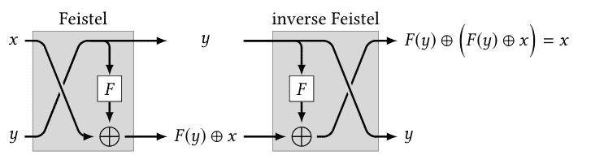

请注意，正向和逆向 Feistel 轮都使用 F 的正向方向！

**Example** 让我们看看在 Feistel 构造中使用一个平凡的轮函数会发生什么。考虑常数函数 F(y) = 0^n，这是可以想象的“最不可逆”函数。Feistel 构造给出：

```
F*(x||y) = y||(F(y) ⊕ x)
           = y||(0^n ⊕ x)
           = y||x
```

结果是一个简单交换其两半的顺序的函数——显然是可逆的。

**Example** 让我们尝试另一个简单的轮函数，这次是恒等函数 F(y) = y。Feistel 构造给出：

```
F*(x||y) = y||(F(y) ⊕ x)
           = y||(y ⊕ x)
```

该函数是可逆的，因为给定 y 和 y ⊕ x，我们可以求解 x 为 y ⊕ (y ⊕ x)。你可以验证，当你将 F 代入逆 Feistel 构造时发生的情况正是如此。

我们还可以考虑使用一个带有密钥/种子的轮函数 F。结果将是一个也带有种子的 F*。对于每个种子 k，F*(k, ·) 都将有一个逆（看起来像其镜像）。

```
Construction 6.10
(Keyed Feistel)
F*(k, x||y):
return y||(F(k, y) ⊕ x)
```

现在假设 F 是安全的 PRF，我们将其用作 Feistel 轮函数，以获得一个带密钥的函数 F*。由于 F*(k, ·) 对每个 k 都是可逆的，并且 F* 以某种方式使用安全的 PRF，你可能会诱导地声称 F* 是安全的 PRP。不幸的是，事实并非如此！F* 的输出包含其输入的一半，这使得打破 F* 的 PRP 安全性变得非常简单。

我们可以通过连续执行多个 Feistel 轮来避免这种平凡攻击，从而得到一种称为 Feistel 密码的构造。在每一轮中，我们甚至可以对轮函数使用不同的密钥。如果我们在第一轮使用 k1，第二轮使用 k2，依此类推，那么 k1, k2, ... 称为 Feistel 密码的密钥调度。r 轮 Feistel 密码的正式定义如下：

Construction 6.11 (Feistel cipher)
\[\mathbb{F}_r((k_1, \dots, k_r), v_0||v_1):\]
for \( i = 1 \) to \( r \):
\( v_{i+1} := F(k_i, v_i) \oplus v_{i-1} \)
return \( v_r||v_{r+1} \)

...

\[\mathbb{F}_r^{-1}((k_1, \dots, k_r), v_r||v_{r+1}):\]
for \( i = r \) downto \( 1 \):
\( v_{i-1} := F(k_i, v_i) \oplus v_{i+1} \)
return \( v_0||v_1 \)

由于每一轮都是可逆的（给定适当的轮密钥），整个 Feistel 密码也是可逆的。请注意，Feistel 密码的逆使用逆 Feistel 轮并反转密钥调度的顺序。

令人惊讶的是，3 轮 Feistel 密码实际上可以是安全的，尽管 2 轮 Feistel 密码永远不安全（参见练习）。更准确地说：当 \( F \) 是一个带有 \( in = out = \lambda \) 的安全 PRF 时，将 \( F \) 用作 3 轮 Feistel 密码的轮函数会得到一个安全的 PRP。Feistel 密码具有块长度 \( 2\lambda \)，并且拥有长度为 \( 3\lambda \) 的密钥（是 \( F \) 的密钥长度的 3 倍）。隐含地，这意味着三个轮密钥是独立选择的。

**Theorem 6.12 (Luby-Rackoff)** 如果 \( F : \{0, 1\}^\lambda \times \{0, 1\}^\lambda \to \{0, 1\}^\lambda \) 是安全的 PRF，那么 3 轮 Feistel 密码 \(\mathbb{F}_3\)（构造 6.11）是安全的 PRP。

不幸的是，此定理的证明超出了本书的范围。

### 6.5 实践中的 PRF 与块密码

块密码是当今实践中密码学的基石之一。我们已经展示了（至少在原则上）块密码如何从更简单的原语（PRG 和 PRF）构建而成。然而，在实践中，我们使用从头设计的块密码，然后在需要时使用这些块密码来构建更简单的 PRG 和 PRF。

我们目前 **无证** 证明任何安全的 PRP 存在。如我们在第 5.2 节中讨论的，这样的证明将解决著名的 P vs NP 问题。没有这样的证明，我们对当今正在使用的块密码安全性的信心基础是什么？导致高级加密标准（AES）块密码的过程展示了密码学界建立此类信心的最佳努力。

美国国家标准与技术研究院（NIST）赞助了一场竞赛，以设计一种块密码来取代 1970 年代的 DES 标准。许多密码学家团队提交了他们的块密码设计，所有设计随后都经过了密码学研究社区多年的严格公开审查。这些设计基于其性能和对 PRP 安全定义（以及其他攻击）的抗攻击能力进行评估。有些设计确实提供了证明，表明它们能抵抗某些


攻击类别，以及证明在从简单组件构建分组密码时某些选择的合理性。

由 Vincent Rijmen 和 Joan Daemen 设计的 Rijndael 密码被选为优胜者，并于 2001 年成为 AES 标准。可能没有另一种密码学算法受到如此多的审查和攻击尝试。到目前为止，尚未发现 AES 的任何重大弱点。³

AES 分组密码的分组长度为 128 比特，并提供三种不同的变体，密钥长度分别为 128 比特、192 比特和 256 比特。由于其标准化，AES 可用于任何编程语言的密码学库中。它甚至作为硬件指令实现在大多数现代处理器中，每秒可进行数百万次 AES 运算。如我们所见，一旦拥有良好的分组密码，它可以直接用作安全的 PRF（推论 6.8），并可用于构建简单的 PRG（构造 6.2）。尽管 AES 本身不是可证安全的 PRP，但基于 AES 的这些 PRF 和 PRG 构造是安全的。或者更准确地说，这些构造的 PRF 安全性和 PRG 安全性保证与 AES 的 PRP 安全性一样好。

### ⋆ 6.6 强伪随机置换

由于分组密码 F 具有相应的逆 F⁻¹，在某种意义上将 F 和 F⁻¹ 视为可互换是很自然的。然而，PRP 安全定义只保证 F 具有一个安全属性，而不保证其逆。在练习中，你会看到，可以构造一个 F，它是安全的 PRP，但其逆 F⁻¹ 不是安全的 PRP！

要求一个 F 和 F⁻¹ 都安全的 PRP 是非常自然的。我们稍后会看到，在这种属性方便的场景中会有应用。更强的要求是允许区分器在单次交互中同时查询 F 和 F⁻¹（而不是一个区分器只查询 F 的安全定义，以及另一个区分器只查询 F⁻¹ 的定义）。如果在该设置下 PRP 与随机置换不可区分，则我们称其为强伪随机置换（SPRP）。

在正式安全定义中，我们为调用程序提供两个子程序：一个用于正向查询，一个用于反向查询。在 L_sprp-real 中，这些子程序通过相应调用 PRP 或其逆来实现。在 L_sprp-rand 中，我们模拟可双向查询的随机选择置换的行为。我们维护两个关联数组 T 和 T_inv 来存储这些置换的真值表，并按需采样其值。唯一的限制是 T 和 T_inv 保持一致性（T[x] = y 当且仅当 T_inv[y] = x）。这也确保它们始终表示一个可逆函数。我们使用与之前相同的技术来确保可逆性。

³公平地说，有可能 NSA 等政府机构知道许多密码学算法的弱点，但将其保密。我认识一位相当著名的密码学家（此处不点名），他认为这很可能，其依据是 NSA 聘用的数学和密码学博士人数，比从事公共研究的人数还多。

## 定义 6.13 (SPRP 安全) 设 $F : \{0, 1\}^\lambda \times \{0, 1\}^{blen} \to \{0, 1\}^{blen}$ 为确定性函数。如果 $\mathcal{L}_{sprp-real}^F \approx \mathcal{L}_{sprp-rand}^F$，则我们称 $F$ 是 **安全的强伪随机置换 (SPRP)**。

```
$\mathcal{L}_{sprp-real}^F$
$k \leftarrow \{0, 1\}^\lambda$
\underline{\text{LOOKUP}(x \in \{0, 1\}^{blen}):}
return $F(k, x)$
\underline{\text{INVLOOKUP}(y \in \{0, 1\}^{blen}):}
return $F^{-1}(k, y)$
```

```
$\mathcal{L}_{sprp-rand}^F$
$T, T_{inv} := \text{empty assoc. arrays}$
\underline{\text{LOOKUP}(x \in \{0, 1\}^{blen}):}
if $T[x]$ undefined:
$y \leftarrow \{0, 1\}^{blen} \setminus T.values$
$T[x] := y; T_{inv}[y] := x$
return $T[x]$
\underline{\text{INVLOOKUP}(y \in \{0, 1\}^{blen}):}
if $T_{inv}[y]$ undefined:
$x \leftarrow \{0, 1\}^{blen} \setminus T_{inv}.values$
$T_{inv}[y] := x; T[x] := y$
return $T_{inv}[y]$
```

此前我们表明，在 3 轮 Feistel 密码中将 PRF 用作轮函数会产生安全的 PRP。然而，该 PRP **不是** 强 PRP。更令人惊讶的是，给 Feistel 密码增加一轮确实使其成为强 PRP！我们不证明地提出以下定理：

## **定理 6.14** (Luby-Rackoff) 如果 $F : \{0, 1\}^\lambda \times \{0, 1\}^\lambda \to \{0, 1\}^\lambda$ 是安全的 PRF，则 4 轮 Feistel 密码 $\mathbb{F}_4$（构造 6.11）是安全的 SPRP。

## 练习

- 6.1. 在本题中，你将证明通过查询 PRF 很难确定 PRF 的密钥。

设 $F$ 为候选 PRF，并假设存在程序 $\mathcal{A}$，使得：

```
$\Pr[\mathcal{A} \diamond \mathcal{L}_{prf-real}^F \text{ outputs } k] \text{ is non-negligible.}$
```

在上述表达式中，$k$ 指 $\mathcal{L}_{prf-real}$ 内部的私有变量。

证明如果存在这样的 $\mathcal{A}$，则 $F$ 不是安全的 PRF。利用 $\mathcal{A}$ 构造一个违反 PRF 安全定义的区分器。

- 6.2. 设 $F$ 为安全的 PRF。

  - (a) 设 $m \in \{0, 1\}^{out}$ 为固定字符串（公开、硬编码、对对手已知）。定义：

```
$F_m(k, x) = F(k, x) \oplus m.$
```

证明对于每个 $m$，$F_m$ 都是安全的 PRF。

  - (b) 定义

\( F'(k, x) = F(k, x) \oplus x \).

证明 \( F' \) 是安全的 PRF。

- 6.3. 设 \( F \) 为输出为 \(\lambda\) 比特的安全 PRF，设 \( G \) 为展开度为 \(\ell\) 的 PRG。定义

\( F'(k, r) = G(F(k, r)) \).

所以 \( F' \) 的输出长度为 \(\lambda + \ell\)。证明 \( F' \) 是安全的 PRF。

- 6.4. 设 \( F \) 为输入长度为 \(2\lambda\) 的安全 PRF，设 \( G \) 为长度翻倍 PRG。定义

\( F'(k, x) = F(k, G(x)) \).

我们将看到 $F'$ 不一定是 PRF。

  - (a) 证明如果 \( G \) 是单射，则 $F'$ 是安全的 PRF。

    提示：你甚至不需要使用 $G$ 是 PRG 这一事实。

  - ★ (b) 练习 5.9(b) 构造了一个忽略一半输入的安全长度翻倍 PRG。证明使用这样的 PRG 实例化时，$F'$ 是不安全的。给出一个区分器并计算其优势。

    注意：你并非在攻击 $F$ 的 PRF 安全性，也不是在攻击 $G$ 的 PRG 安全性。你是在攻击它们组合的无效方式。

- 6.5. 设 $F$ 为安全的 PRF，设 $m \in \{0, 1\}^{in}$ 为固定字符串（因此对对手已知）。定义新函数

\( F_m(k, x) = F(k, x) \oplus F(k, m) \).

证明 $F_m$ **不是** 安全的 PRF。描述一个区分器并计算其优势。

- ★ 6.6. 在上一题中，如果 $m$ 是保密的并作为 PRF 种子的一部分，会发生什么？设 $F$ 为安全的 PRF，并定义新函数：

\( F'\big((k, m), x\big) = F(k, x) \oplus F(k, m) \).

$F'$ 的种子是 $(k, m)$，可以将其视为 $\lambda + in$ 比特字符串。证明 $F'$ 确实是安全的 PRF。

提示：重写 $F'$ 算法以包含 if $x = m$ 情况，并主张调用程序很少能满足此条件。

- 6.7. 设 $F$ 为安全的 PRF。设 $\bar{x}$ 表示字符串 $x$ 的按位补码。定义新函数：

\( F'(k, x) = F(k, x) \| F(k, \bar{x}) \).

证明 $F'$ **不是** 安全的 PRF。描述一个区分器并计算其优势。

- 6.8. 假设 $F$ 是输入长度为 $in$ 的安全 PRF，但我们想用它来构造输入长度更长的 PRF。以下是一些**行不通**的方法。对于每种方法，描述一次成功的区分攻击并计算其优势：

  - (a) \( F'(k, x||x') = F(k, x)||F(k, x') \)，其中 $x$ 和 $x'$ 各为 $in$ 比特长。
  - (b) \( F'(k, x||x') = F(k, x) \oplus F(k, x') \)，其中 $x$ 和 $x'$ 各为 $in$ 比特长。
  - (c) \( F'(k, x||x') = F(k, x) \oplus F(k, x \oplus x') \)，其中 $x$ 和 $x'$ 各为 $in$ 比特长。
  - (d) \( F'(k, x||x') = F(k, 0||x) \oplus F(k, 1||x') \)，其中 $x$ 和 $x'$ 各为 $in - 1$ 比特长。

- 6.9. 定义 PRF $F$，其密钥 $k$ 写作 \( (k_1, \dots, k_{in}) \)，其中每个 \( k_i \) 为长度为 \( out \) 的字符串。然后 $F$ 定义为：

```
\( F(k, x) = \bigoplus_{i:x_i=1} k_i . \)
```

证明 $F$ **不是** 安全的 PRF。描述一个区分器并计算其优势。

- 6.10. 定义 PRF $F$，其密钥 $k$ 是一个 \( in \times 2 \) 的 \( out \) 比特字符串数组，其条目称为 \( k[i, b] \)。然后 $F$ 定义为：

```
\( F(k, x) = \bigoplus_{i=1}^{in} k[i, x_i] . \)
```

证明 $F$ **不是** 安全的 PRF。描述一个区分器并计算其优势。

- 6.11. 从所有函数 \( \{0, 1\}^n \to \{0, 1\}^n \) 中均匀随机选择一个函数。该函数可逆的概率是多少？

- 6.12. 设 $F$ 为分组长度 \( blen = 128 \) 的安全 PRP。那么对于每个 $k$，函数 \( F(k, \cdot) \) 是 \( \{0, 1\}^{128} \) 上的一个置换。假设我从 \( \{0, 1\}^{128} \) 上的所有置换中均匀随机选择一个置换。我选择的置换与形如 \( F(k, \cdot) \) 的置换一致的概率是多少？将概率计算为实际数字——这是一个合理的概率还是一个极小的概率？

- 6.13. 假设 \( R : \{0, 1\}^n \to \{0, 1\}^n \) 在所有此类函数中均匀随机选择。存在 \( x \in \{0, 1\}^n \) 使得 \( R(x) = x \) 的概率是多少？

- 6.14. 在本题中，你将证明 PRP 转换引理仅适用于大域。设 \( \mathcal{L}_{\text{prf-rand}} \) 和 \( \mathcal{L}_{\text{prp-rand}} \) 如引理 6.7 所示。选择你喜欢的任何小值 \( blen = in = out \)，并证明使用这些参数时 \( \mathcal{L}_{\text{prf-rand}} \not\cong \mathcal{L}_{\text{prp-rand}} \)。描述一个区分器并计算其优势。

- 6.15. 设 \( F : \{0, 1\}^{in} \to \{0, 1\}^{out} \) 为一个（不一定可逆）函数。我们只展示了在 \( in = out \) 时如何在 Feistel 构造中使用 \( F \) 作为轮函数。

描述一种 Feistel 构造的修改，即使在轮函数满足 \( in \neq out \) 时也能工作。结果应为输入/输出长度为 \( in + out \) 的可逆构造。务必证明你提出的变换是可逆的！不要求你展示 Feistel 构造的任何安全性质。


6.16. 证明一轮密钥 Feistel 密码 **不能** 成为安全的 PRP，无论其轮函数是什么。也就是说，构造一个区分器，它仅在知道 \(F\) 是一轮 Feistel 密码的情况下，成功区分 \(\mathcal{L}_{\text{prp-real}}^F\) 和 \(\mathcal{L}_{\text{prp-rand}}^F\)。特别是，目的是攻击 Feistel 变换而非其轮函数，因此你的攻击无论轮函数如何都应有效。

6.17. 证明两轮密钥 Feistel 密码 **不能** 成为安全的 PRP，无论其轮函数是什么。你的攻击不需要知道轮密钥，并且即使使用不同的（独立的）轮密钥也应有效。

6.18. 证明任何作为三轮密钥 Feistel 密码的函数 \(F\) **不能** 成为安全的 _强_ PRP。如上，你的区分器不需要知道轮函数是什么，并且攻击即使使用不同的（独立的）轮函数也应有效。

6.19. 在本题中，你将证明没有密钥时 PRP 难以反转（只要分组长度足够大）。设 \(F\) 是一个具有分组长度 \(\mathit{blen} \geq \lambda$ 的候选 PRP。假设存在一个程序 \(\mathcal{A}$，使得：

\(\Pr_{y \leftarrow \{0,1\}^{blen}} [\mathcal{A}(y) \diamond \mathcal{L}_{\text{prp-real}}^F \text{ outputs } F^{-1}(k, y)] \text{ is non-negligible.}\)

该记号表示 \(\mathcal{A}$ 接收一个随机分组 \(y$ 作为输入（并且也链接到 \(\mathcal{L}_{\text{prp-real}}\)）。\(k$ 指的是 \(\mathcal{L}_{\text{prp-real}}\) 中的私有变量。因此，当仅获得正向评估 \(F$ 的能力（通过 \(\mathcal{L}_{\text{prp-real}}\)）时，\(\mathcal{A}$ 可以反转一个均匀选择的分组 \(y$。

证明如果存在这样的 \(\mathcal{A}$，那么 \(F$ 不是安全的 PRP。使用 \(\mathcal{A}$ 构造一个违反 PRP 安全定义的区分器。你在哪里使用了 \(\mathit{blen} \geq \lambda$ 的事实？你如何处理 \(\mathcal{A}$ 可能以高概率给出错误答案的事实？

6.20. 设 \(F$ 是一个具有分组长度 \(\mathit{blen} = \lambda$ 的安全 PRP，并考虑 \(\widehat{F}(k, x) = F(k, x) \oplus F(k, x)$。

- (a) 证明 \(\widehat{F}$ 不是强 PRP（即使 \(F$ 是）。
- ★ (b) 证明 \(\widehat{F}$ 是安全的（普通）PRP。

## 7 防受明文攻击安全

我们之前的加密安全定义捕获的是密钥仅用于加密一个明文的情况。显然，拥有一个允许在同一密钥下加密多个明文的加密方案会更有用。

幸运的是，我们以一种自然的方式修改早期定义，从而得到“正确”的安全定义。我们只需让库一次性选择一个密钥，并用它来加密所有明文。更正式地：

Definition 7.1 (CPA 安全) 设 \(\Sigma$ 为一个加密方案。如果 \(\mathcal{L}^\Sigma_{\text{cpa-L}} \approx \mathcal{L}^\Sigma_{\text{cpa-R}}$，则我们称 \(\Sigma$ 具有抗选择明文攻击安全性（CPA 安全），其中：

```
\(\mathcal{L}^\Sigma_{\text{cpa-L}}\)
\(k \leftarrow \Sigma.KeyGen\)
\(\underline{\text{EAVESDROP}(m_L, m_R \in \Sigma.\mathcal{M})}\):
\(c := \Sigma.\text{Enc}(k, m_L)\)
return \(c\)
```

```
\(\mathcal{L}^\Sigma_{\text{cpa-R}}\)
\(k \leftarrow \Sigma.KeyGen\)
\(\underline{\text{EAVESDROP}(m_L, m_R \in \Sigma.\mathcal{M})}\):
\(c := \Sigma.\text{Enc}(k, m_R)\)
return \(c\)
```

注意密钥 \(k$ 在初始化时选定，并且对所有 Enc 调用都是静态的。CPA 安全通常被称为“IND-CPA”安全，意思是“在选择明文攻击下密文不可区分”。

### 7.1 确定性加密的局限性

我们已经见过分组密码 / PRP，它们似乎满足安全加密方案所需的一切。对于分组密码，\(F$ 对应加密，\(F^{-1}$ 对应解密，并且 \(F$ 的所有输出看起来都是伪随机的。在一个好的加密方案中，你还能要求什么呢？

示例 我们将看到，分组密码如果“原样”使用，**不是** CPA 安全的加密方案。设 \(F$ 表示分组密码，并假设其分组长度为 \(blen$。考虑以下试图区分 \(\mathcal{L}_{\text{cpa-*}}$ 库的对手 \(\mathcal{A}$：

```
\(\mathcal{A}\)
\(c_1 := \text{EAVESDROP}(0^{blen}, 0^{blen})\)
\(c_2 := \text{EAVESDROP}(0^{blen}, 1^{blen})\)
return \(c_1 \stackrel{?}{=} c_2\)
```

```
A
c1 := EAVESDROP(0^blen, 0^blen)
c2 := EAVESDROP(0^blen, 1^blen)
return c1 =? c2
```

```
L^Sigma_cpa-L
k <- {0, 1}^lambda
EAVESDROP(mL, mR):
c := F(k, mL)
return c
```

当 A 链接到 L_cpa-L 时，EAVESDROP 算法会加密其第一个参数。因此，c1 和 c2 都将被计算为 F(k, 0^blen)。由于 F 是确定性函数，这导致 EAVESDROP 输出相同。换句话说 c1 = c2，且 A 链接到 L_cpa-L 始终输出 1。

```
A
c1 := EAVESDROP(0^blen, 0^blen)
c2 := EAVESDROP(0^blen, 1^blen)
return c1 =? c2
```

```
L^Sigma_cpa-R
k <- {0, 1}^lambda
EAVESDROP(mL, mR):
c := F(k, mR)
return c
```

当 A 链接到 L_cpa-R 时，EAVESDROP 算法会加密其第二个参数。因此，c1 和 c2 分别计算为 c1 = F(k, 0^blen) 和 c2 = F(k, 1^blen)。由于 F 是置换，c1 != c2，所以 A 链接到 L_cpa-R 永远不会输出 1。

这个对手在区分库方面具有优势 1，因此原始分组密码 F 不是 CPA 安全的加密方案。

### 确定性加密的不可能性

原始分组密码不能提供 CPA 安全的原因是它是确定性的。用相同的密钥和相同的明文调用 Enc(k, m) 两次会导致相同的密文。即使一次性密码本也是确定性的。1 CPA 安全的首要且最重要的方面之一是它与确定性加密不兼容。确定性加密永远不能是 CPA 安全的！换句话说，仅知道某方案 Sigma 是确定性加密，我们就可以攻击其 CPA 安全性。该攻击是我们针对原始 PRP 的攻击的简单推广：

```
A
arbitrarily choose distinct plaintexts x, y in M
c1 := EAVESDROP(x, x)
c2 := EAVESDROP(x, y)
return c1 =? c2
```

思考确定性加密出了什么问题的一个好方法是，它泄露了两个密文是否编码相同的明文，而 CPA 安全不允许这种情况。可以将密封信封视为加密的类比。我不应该能判断两个密封信封是否包含相同的文本！我们之所以现在才看到这个问题，是因为这是我们的安全定义第一次允许对手看到在相同密钥下加密的多个密文。

1请记住，我们总是可以考虑用相同的密钥+明文运行两次一次性密码本加密会发生什么。一次性保密定义不会就以这种方式使用一次性密码本向我们提供任何安全保证，但我们仍然可以将其视为思想实验。

### 避免确定性加密

CPA 安全甚至可能吗？我们究竟如何才能构建一个非确定性加密方案？这听起来很有挑战性！我们必须设计一个 Enc 算法，使得用相同的明文和密钥调用它两次会产生不同的密文（否则上面的攻击 \(\mathcal{A}$ 将违反 CPA 安全性）。此外，必须能够将同一明文的所有这些不同加密解密为正确的值！

设计非确定性加密方案有 3 种一般方法：

- 加密/解密可以是 **有状态** 的，意味着每次调用 Enc 或 Dec 都会实际修改 \(k$ 的值。第 5.5 节中描述的对称棘轮构造可以被视为这种有状态的构造。每次加密都会通过棘轮机制更新密钥。有状态加密的一个重大缺点是，发送方和接收方之间的同步很脆弱，如果密文在传输中丢失，同步可能会中断。

- 加密可以是 **随机** 的。每次加密明文时，Enc 算法都会选择专用于该次加密的全新独立随机性。设计随机加密方法的主要挑战在于将随机性纳入每个密文，同时仍能实现解密。虽然这听起来相当有挑战性，但我们已经见过这样的方法，并将在下一节证明其 CPA 安全性。在本书中，我们将几乎完全专注于随机加密。

- 加密可以是 **基于 nonce** 的。“nonce”代表“仅使用一次的数字”，指的是传递给 Enc 和 Dec 算法的一个额外参数。nonce 不需要随机选择；不需要保密；它只需要在所有对 Enc 的调用中**不同**。通过保证 Enc 的某个输入每次都会不同（即使密钥和明文重复），Enc 算法可以是确定性的，同时仍能提供 CPA 安全性。

基于 nonce 的加密要求更改加密接口，因此也要求更改正确性和安全性定义。加密/解密算法语法更新为 Enc(\(k, v, m$) 和 Dec(\(k, v, c$)，其中 \(v$ 是 nonce。正确性属性是对于所有 \(k, v, m$，Dec(\(k, v$, Enc(\(k, v, m$)) = \(m$，因此加密和解密算法都应使用相同的 nonce。安全定义允许对手选择 nonce，但如果对手尝试使用相同的 nonce 加密多个密文，则会报错。通过这种方式，定义强制要求 nonce 不同。

| | |
|---|---|
| \(k \leftarrow \Sigma.\)KeyGen<br>\(V := \emptyset\)<br>EAVESDROP(\(v, m_L, m_R \in \Sigma.\mathcal{M}\)):<br>if \(v \in V\): return err<br>\(V := V \cup \{v\}\)<br>\(c := \Sigma.\)Enc(\(k, v, m_L\))<br>return \(c\) | \(k \leftarrow \Sigma.\)KeyGen<br>\(V := \emptyset\)<br>EAVESDROP(\(v, m_L, m_R \in \Sigma.\mathcal{M}\)):<br>if \(v \in V\): return err<br>\(V := V \cup \{v\}\)<br>\(c := \Sigma.\)Enc(\(k, v, m_R\))<br>return \(c\) |


注意，调用程序提供一个单一值 \( v \)（不是 \( v_L \) 和 \( v_R \)）。两个库都使用给定的 nonce \( v \)，这意味着加密方案不需要 *隐藏* \( v \)。如果两个库之间有相同之处，那么为了使库不可区分，就没有必要隐藏它。

如果加密方案不属于这三类中的任何一类，它就不能满足我们对 CPA 安全的定义。你可以而且应该使用确定性加密作为针对任何拟议加密算法的合理性检查。

### 7.2 伪随机密文

当我们在 2.2 节中引入加密的一次性安全性时，定义有两种变体。较一般的变体大致表示，\( m_L \) 的加密应该看起来像 \( m_R \) 的加密。较具体的变体表示，每个 \( m \) 的加密应该看起来均匀。

我们可以为 CPA 安全做类似的事情，定义一个安全定义，表示“\( m \) 的加密看起来均匀”。请注意，仅使用一次性安全定义中的相同安全库是不够的。库允许在同一密钥下进行多次加密这一点很重要。仅仅因为单次加密是伪随机的，并不意味着多次加密呈现 *联合* 伪随机。特别是，它们可能看起来不 *独立*（这是我们在讨论从 PRG 构造 PRF 的困难时看到的问题）。

### 定义 7.2（CPA$ 安全）设 \( \Sigma \) 为加密方案。我们说 \( \Sigma \) 具有 **在选择明文攻击下的伪随机密文（CPA$ 安全）** 如果 \( \mathcal{L}^\Sigma_{\text{cpa\$-real}} \approx \mathcal{L}^\Sigma_{\text{cpa\$-rand}}\)，*其中*：

```
\mathcal{L}^\Sigma_{\text{cpa\$-real}}

k \leftarrow \Sigma.\text{KeyGen}

\text{CTXT}(m \in \Sigma.\mathcal{M}):
c := \Sigma.\text{Enc}(k, m)
return c
```

```
\mathcal{L}^\Sigma_{\text{cpa\$-rand}}

\text{CTXT}(m \in \Sigma.\mathcal{M}):
c \leftarrow \Sigma.\mathcal{C}
return c
```

这个定义也称为“IND$ -CPA”，意为“在选择明文攻击下与随机值不可区分”。此定义将很有用，因为：

- 证明 CPA$ 安全比证明 CPA 安全更容易。CPA 安全的证明往往大约长两倍、重复两倍，因为它们涉及达到“中间杂交”，然后按相反顺序执行相同的杂交步骤。将证明仅进行到相同的中间点通常足以证明 CPA$ 安全
- CPA$ 安全蕴含 CPA 安全。我们将在下面展示这一点，但主旨与一次性安全的情况相同。如果所有明文的加密看起来均匀，那么 \( m_L \) 的加密看起来就像 \( m_R \) 的加密。
- 我们将考虑的大多数方案无论如何都能实现 CPA$ 安全。

不过，我们对安全性属性的大多数高层讨论仍将基于 CPA 安全。它是“最小的”（即最不严格的）定义，似乎能捕捉我们的安全直觉。

### 声明 7.3 如果加密方案具有 CPA$ 安全，那么它也具有 CPA 安全。

证明 我们想利用假设 \( \mathcal{L}^\Sigma_{\text{cpa\$-real}} \approx \mathcal{L}^\Sigma_{\text{cpa\$-rand}}\) 来证明 \( \mathcal{L}^\Sigma_{\text{cpa-L}} \approx \mathcal{L}^\Sigma_{\text{cpa-R}} \)。杂交序列如下：

```
L^Σ_cpa-L
k ← Σ.KeyGen
EAVESDROP(mL, mR):
  c := Σ.Enc(k, mL)
  return c
```

起点是 \( \mathcal{L}^\Sigma_{\text{cpa-L}}，如预期。

```
EAVESDROP(mL, mR):
  c := CTXT(mL)
  return c
◇
L^Σ_cpa$-real
k ← Σ.KeyGen
CTXT(m):
  c := Σ.Enc(k, m)
  return c
```

这可能看起来奇怪，但我们还将对 Enc 的调用进一步提取为子程序。看起来 L_cpa-L 中的所有内容都已被提取，但实际上原始库仍然“选择”要加密的 mL 或 mR。

```
EAVESDROP(mL, mR):
  c := CTXT(mL)
  return c
◇
L^Σ_cpa$-rand
CTXT(m):
  c ← Σ.C
  return c
```

我们已将 \( \mathcal{L}^\Sigma_{\text{cpa\$-real}}\) 替换为 \( \mathcal{L}^\Sigma_{\text{cpa\$-rand}}\)。根据我们的假设，此更改不可区分。

```
EAVESDROP(mL, mR):
  c := CTXT(mR)
  return c
◇
L^Σ_cpa$-rand
CTXT(m):
  c ← Σ.C
  return c
```

我们已更改传递给 CTXT 的参数。由于在这些杂交中 CTXT 完全忽略其参数，这对库的行为没有影响。

```
EAVESDROP(mL, mR):
  c := CTXT(mR)
  return c
◇
L^Σ_cpa$-real
k ← Σ.KeyGen
CTXT(m):
  c := Σ.Enc(k, m)
  return c
```

这是上一步的镜像；我们将 \( \mathcal{L}^\Sigma_{\text{cpa\$-rand}}\) 替换为 \( \mathcal{L}^\Sigma_{\text{cpa\$-real}}\)。

\( \mathcal{L}_{\text{cpa\$-real}}\) 库已被内联，结果是 \( \mathcal{L}^\Sigma_{\text{cpa-R}}\)。

杂交序列显示 \( \mathcal{L}^\Sigma_{\text{cpa-L}} \approx \mathcal{L}^\Sigma_{\text{cpa-R}} \)，正如所期望的那样。

### 7.3 基于 PRF 的 CPA 安全加密

CPA 安全带来重大挑战；其目标似乎难以协调。一方面，我们需要一种随机化的加密方法，因此每个明文 \(m\) 都映射到大量潜在密文。另一方面，解密方法必须能够识别所有这些不同的密文作为 \(m\) 的加密。

不过，我们已经看到一种做到这一点的方法！在第 6 章中，我们使用以下加密技术来阐释 PRF 的概念。如果 Alice 和 Bob 共享一个用均匀数据初始化的大表 \(T\)，那么 Alice 可以向 Bob 加密明文 \(m\)，并说些类似“这是使用一次性垫，密钥为 #674696273 加密的”这样的话，然后发送 \(T[674696273] \oplus m\)。看到数字 674696273 对窃听者知道 \(T[674696273]\) 是什么没有帮助。PRF 使 Alice 和 Bob 只能共享一个短密钥 \(k\) 就能执行相同的加密。它们不再使用大表 \(T\)，而是可以使用 PRF \(F(k, \cdot)\) 来派生一个共同的伪随机值。当 \(k\) 保密时，知道值 \(r\) 对敌手预测 \(F(k, r)\) 没有帮助。

因此，翻译成更精确的 PRF 符号，对 \(m\) 的加密将类似于 \((r, F(k, r) \oplus m)\)。由于 Bob 也持有 \(k\)，他可以通过计算 \(F(k, r)\) 并对密文的第二个分量进行异或来解密 *任何* 这种形式的密文，从而恢复 \(m\)。

仍需确定 Alice 如何选择 \(r\) 值。我们非正式地论证过，只要这些 \(r\) 值不重复，安全性就能保持。这确实是真的，且 \(r\) 值的不同性至关重要。回想一下，有 3 种方法可以避免确定性加密，且这 3 种方法在这里都适用：

- 在 **有状态** 加密中，\(r\) 可用作计数器。使用 \(r = i\) 来加密/解密第 \(i\) 个密文。
- 在 **随机化** 加密中，为每次加密均匀随机选择 \(r\)。如果 \(r\) 值是足够长的字符串，则重复 \(r\) 值的可能性应当可以忽略不计。
- 在 **基于 nonce** 加密中，我们可以直接令 \(r\) 为 nonce。在基于 nonce 的环境中，可以保证这些值不会重复。

在本节中，我们将展示随机化加密情况的安全性证明，因为这是最传统的环境，并且比其他环境稍微更稳健一些。

练习探讨了当该方案以自然方式扩展时，基于 nonce 的方法是多么脆弱。

### 构造 7.4

设 $F$ 为一个输入长度为 $\lambda$ 的安全 PRF。基于 $F$ 定义以下加密方案：

$$\mathcal{K} = \{0, 1\}^\lambda$$  
$$\mathcal{M} = \{0, 1\}^{out}$$  
$$\mathcal{C} = \{0, 1\}^\lambda \times \{0, 1\}^{out}$$

**KeyGen:**
\( k \leftarrow \{0, 1\}^\lambda \)
return \( k \)

**Enc(k, m):**
\( r \leftarrow \{0, 1\}^\lambda \)
\( x := F(k, r) \oplus m \)
return \( (r, x) \)

**Dec(k, (r, x)):**
\( m := F(k, r) \oplus x \)
return \( m \)

很容易检查该方案满足正确性属性。

### 声明 7.5

$Construction 7.4$ 具有 CPA$ 安全（因此也具有 CPA 安全）如果 $F$ 是安全 PRF。

证明的步骤比我们之前见过的其他证明更多，且有些步骤微妙。因此，让我们使用苏格拉底式对话来说明证明背后的策略：

> **萨尔维亚蒂：** 构造 7.4 的密文与均匀随机性不可区分。
>
> **辛普利西奥：** 萨尔维亚蒂，你说得如此自信！请告诉我，你为什么说这些密文看起来伪随机。
>
> **萨尔维亚蒂：** 很简单！密文的形式为 \( (r, F(k, r) \oplus m) \)。根据其定义，\( r \) 是均匀选择的，而 \( F(k, r) \oplus m \) 像一次性垫密文一样呈均匀分布。
>
> **辛普利西奥：** 你关于 \( r \) 的说法不言而喻，但 \( F(k, r) \oplus m \) 让我困惑。这看起来不像我们讨论过的一次性垫。首先，同样的 \( k \) 是“每次”都使用，而不是“一次性”使用。
>
> **萨尔维亚蒂：** 我确实说过它仅是“像”一次性垫。一次性垫的“密钥”不是 \( k \)，而是 \( F(k, r) \\)。而且，由于 \( F \) 是伪随机函数，其所有输出都将呈现独立均匀（更不用说与各自的 \( r \\) 不相关），即使每次都使用相同的种子。这不正是我们要求一次性垫密钥具备的特性吗？
>
> **辛普利西奥：** 我明白了，但 \( F \\) 的输出 surely 仅在输入不同时才呈现独立？我知道 \( F \\) 是确定性的，这可能导致相同的“一次性垫密钥”在不同场合被使用。
>
> **萨尔维亚蒂：** 辛普利西奥，你的怀疑态度在这件事上对你很有帮助。确实，你担忧的核心在于 Alice 可能会选择重复的 \( r \\)。我认为这种情况发生的概率可以忽略不计，因此我们可以安全地忽略这种令人烦恼的事件。
>
> **辛普利西奥：** 确实令人烦恼，但你为什么说 \( r \\) 不太可能重复？


SALVIATI: 哦，西普利西奥，你现在变得烦人了！这个值 $r$ 是 $\lambda$ 比特长，每次均匀随机选择。你不记得我们关于生日悖论的漫长讨论了吗？

SIMPLICIO: 哦对，现在我记清楚了。现在我相信我理解了你的所有推理：在所有生成的密文中，$r$ 不太可能重复，因为生日悖论。现在，只要 $r$ 从不重复，Alice 就在不同的输入上调用 PRF。在不同输入上调用的 PRF 提供的输出在各方面均为均匀随机。因此，将这些输出作为一次性密钥完全隐藏了明文。对吗，萨尔维亚蒂？

SALVIATI: 太棒了！现在我们可以回到讨论太阳和地球的运动了 . . .

请查看西普利西奥的最终总结，它将在正式证明使用的混合体序列中体现出来：

证明 我们使用混合体技术证明 \(\mathcal{L}^\Sigma_{\text{cpa\$-real}} \approx \mathcal{L}^\Sigma_{\text{cpa\$-rand}}\)：

```
\mathcal{L}^\Sigma_{\text{cpa\$-real}}

k \leftarrow \{0, 1\}^\lambda

\underline{\text{CTXT}(m)}:
  r \leftarrow \{0, 1\}^\lambda
  x := F(k, r) \oplus m
  return (r, x)
```

起点是 \(\mathcal{L}^\Sigma_{\text{cpa\$-real}}\)。\(\Sigma\) 的细节已填入并高亮。

```
\underline{\text{CTXT}(m)}:
  r \leftarrow \{0, 1\}^\lambda
  z := \text{LOOKUP}(r)
  x := z \oplus m
  return (r, x)
```

```
\mathcal{L}^F_{\text{prf-real}}

k \leftarrow \{0, 1\}^\lambda

\underline{\text{LOOKUP}(r)}:
  return F(k, r)
```

与 PRF 相关的语句已按 \(\mathcal{L}^F_{\text{prf-real}}\) 库的形式提取出来。

```
\underline{\text{CTXT}(m)}:
  r \leftarrow \{0, 1\}^\lambda
  z := \text{LOOKUP}(r)
  x := z \oplus m
  return (r, x)
```

```
\mathcal{L}^F_{\text{prf-rand}}

T := empty

\underline{\text{LOOKUP}(r)}:
  if T[r] undefined:
    T[r] \leftarrow \{0, 1\}^\text{out}
    return T[r]
```

我们已将 \(\mathcal{L}^F_{\text{prf-real}}\) 替换为 \(\mathcal{L}^F_{\text{prf-rand}}\)。根据 F 的 PRF 安全性，这两个混合体不可区分。

在证明的这个阶段，很容易认为我们完成了。密文形式为 \((r, x)\)，其中 \(r\) 是均匀选择的，而 \(x\) 是用看似“一次性密钥”的 T[r] 加密明文的结果——如果 \(r\) 曾经重复，这个值可能会被多次使用！

正如西普利西奥恰当指出的，当 PRF 在不同输入上被调用时，它会给出独立随机（看起来随机）的输出。但在我们当前的混合体中，无法保证 PRF 输入是不同的！我们的证明必须明确包含关于为什么 PRF 输入不太可能重复的推理。我们通过引用 Lemma 4.11 的有放回采样引理来做到这一点。

我们首先将 r 值的采样提取为一个子程序。该子程序对应于 Lemma 4.11 的 L_samp-L 库：

```
CTXT(m):
r ← SAMP()
z := LOOKUP(r)
x := z ⊕ m
return (r, x)

L^F_prf-rand
T := empty
LOOKUP(r):
if T[r] undefined:
  T[r] ← {0, 1}^out
return T[r]

L_samp-L
SAMP():
r ← {0, 1}^λ
return r
```

接下来，L_samp-L 被 L_samp-R 替换。根据 Lemma 4.11，差异不可区分：

```
CTXT(m):
r ← SAMP()
z := LOOKUP(r)
x := z ⊕ m
return (r, x)

L^F_prf-rand
T := empty
LOOKUP(r):
if T[r] undefined:
  T[r] ← {0, 1}^out
return T[r]

L_samp-R
R := ∅
SAMP():
r ← {0, 1}^λ \ R
R := R ∪ {r}
return r
```

检查前一个混合体，我们可以推断传递给 LOOKUP 的参数保证永不重复。因此 L_prf-rand 库可以大大简化。特别是，L_prf-rand 中的 if 条件始终为真。简化不会影响库的输出行为：

```
CTXT(m):
r ← SAMP()
z := LOOKUP(r)
x := z ⊕ m
return (r, x)

LOOKUP(r):
t ← {0, 1}^out
return t

L_samp-R
R := ∅
SAMP():
r ← {0, 1}^λ \ R
R := R ∪ {r}
return r
```

现在我们确实使用唯一的一次性密钥来掩盖明文。我们比之前好得多。回顾我们的目标是到达一个混合体，其中 CTXT 的输出均匀选择。这些输出包括 r 值，但现在 r 不再均匀选择！我们必须将 r 恢复为均匀采样，然后我们就接近终点了。

```
CTXT(m):
  r <- SAMP()
  z := LOOKUP(r)
  x := z $\oplus$ m
  return (r, x)
```

```
LOOKUP(r):
  t <- {0, 1}$^{\text{out}}$
  return t
```

```
$\mathcal{L}_{\text{samp-L}}$
SAMP():
  r <- {0, 1}$^\lambda$
  return r
```

如所承诺，\(\mathcal{L}_{\text{samp-R}}\) 已被 \(\mathcal{L}_{\text{samp-L}}\) 替换。差异由于 Lemma 4.11 而不可区分。

```
CTXT(m):
  r <- {0, 1}$^\lambda$
  z <- {0, 1}$^{\text{out}}$
  x := z $\oplus$ m
  return (r, x)
```

所有子程序调用都已内联；对库的输出行为无影响。

```
$\mathcal{L}^\Sigma_{\text{cpa\$-rand}}$:
CTXT(m):
  r <- {0, 1}$^\lambda$
  x <- {0, 1}$^{\text{out}}$
  return (r, x)
```

我们已对变量 \(z\) 和 \(x\) 应用了一次性密钥规则，但省略了我们多次见过的非常熟悉的步骤（提取、替换库、内联）。结果的库正是 \(\mathcal{L}^\Sigma_{\text{cpa\$-rand}}\)，因为它从 \(\Sigma.\mathcal{C} = \{0, 1\}^\lambda \times \{0, 1\}^{\text{out}}\) 中均匀采样。

混合体序列表明 \(\mathcal{L}^\Sigma_{\text{cpa\$-real}} \approx \mathcal{L}^\Sigma_{\text{cpa\$-rand}}\)，因此 \(\Sigma\) 具有伪随机密文。

## 练习

### 7.1. 设 \(\Sigma\) 为一个加密方案，并假设存在一个程序 \(\mathcal{A}\)，它能从选择明文攻击中恢复密钥。更准确地说，\(\Pr[\mathcal{A} \diamond \mathcal{L} \text{ outputs } k]\) 不是可忽略的，其中 \(\mathcal{L}\) 定义为：

```
$\mathcal{L}$
k <- $\Sigma$.KeyGen
CHALLENGE($m \in \Sigma.\mathcal{M}$):
  c := $\Sigma$.Enc(k, m)
  return c
```

证明，如果存在这样的 \(\mathcal{A}\)，则 \(\Sigma\) 不具有 CPA 安全性。在一个违反 CPA 安全性定义的区分器中将 \(\mathcal{A}\) 用作子程序。

换句话说，CPA 安全性意味着从看到选择明文的加密中确定密钥应该是困难的。

### 7.2. 设 \(\Sigma\) 为具有 CPA$ 安全性的加密方案。设 \(\Sigma'\) 为按以下方式定义的加密方案：

$\Sigma'.\text{Enc}(k, m) = 00 || \Sigma.\text{Enc}(k, m)$

\(\Sigma'\) 中的解密算法仅丢弃密文的前两位，然后调用 \(\Sigma\).Dec。

- (a) \(\Sigma'\) 是否具有 CPA$ 安全性？证明或反驳（如果反驳，展示一个区分器并计算其优势）。
- (b) \(\Sigma'\) 是否具有 CPA 安全性？证明或反驳（如果反驳，展示一个区分器并计算其优势）。

### 7.3. 假设用户正在使用构造 7.4，而攻击者观察到两个具有相同 \(r\) 值的密文。

- (a) 在这种情况下，攻击者确切地了解了明文的什么信息？
- (b) 如何将此与这样一个事实调和：在索赔 7.5 的证明中，存在一个混合体，其中 \(r\) 值 *从不* 重复？

### 7.4. 构造 7.4 是一个随机化加密方案，但我们也可以考虑将其定义为 **基于 nonce** 的方案，将 \(r\) 解释为 nonce：Enc\((k, r, m) = (r, F(k, r) \oplus m)\)。形式上证明它作为一个确定性、基于 nonce 的方案是安全的。换句话说，证明以下两个库不可区分，其中 \(\Sigma\) 指的是构造 7.4。

```
k \(\leftarrow\Sigma\).KeyGen
V := \(\emptyset\)
EAVESDROP(v, m_L, m_R \(\in\Sigma.\mathcal{M}\)):
if v \(\in\) V: return err
V := \(V \cup \{v\}\)
c := \(\Sigma\).Enc(k, v, m_L)
return c
```

```
k \(\leftarrow\Sigma\).KeyGen
V := \(\emptyset\)
EAVESDROP(v, m_L, m_R \(\in\Sigma.\mathcal{M}\)):
if v \(\in\) V: return err
V := \(V \cup \{v\}\)
c := \(\Sigma\).Enc(k, v, m_R)
return c
```

### 7.5. 设 \(F\) 为一个安全的 PRP，块长度 \(blen = \lambda\)。考虑以下随机化加密方案：

| | KeyGen | Enc(k, m) |
|---|---|---|
| $\mathcal{K} = \{0, 1\}^\lambda$ | | |
| $\mathcal{M} = \{0, 1\}^\lambda$ | $k \leftarrow \{0, 1\}^\lambda$ | $v \leftarrow \{0, 1\}^\lambda$ |
| $\mathcal{C} = (\{0, 1\}^\lambda)^2$ | return k | $x := F(k, v \oplus m)$ |
| | | return $(v, x)$ |

- (a) 给出该方案的解密算法。
- (b) 证明该方案具有 CPA$ 安全性。
- (c) 假设我们将此方案解释为一个基于 nonce 的方案，其中 \(v\) 是 nonce。证明该方案 **不** 具有基于 nonce 的 CPA 安全性。该定义的库在上一题中给出。

注意：即使在标准 CPA 库中，\(v\) 也会提供给攻击者，且不太可能重复。然而，在基于 nonce 的库中，攻击者可以 *选择* \(v\)，这正是导致问题的原因。


## 7.6. 设 $F$ 是一个安全的 PRP，分组长度 $\mathrm{blen} = \lambda$。证明以下方案具有伪随机密文：

| | |
|---|---|
| $\mathcal{K} = \{0, 1\}^\lambda$ | $\text{加密}(k, m):$ |
| $\mathcal{M} = \{0, 1\}^\lambda$ | $s \leftarrow \{0, 1\}^\lambda$ |
| $\mathcal{C} = (\{0, 1\}^\lambda)^2$ | $z := F(k, s \oplus m) \oplus m$ |
| | 返回 $(s \oplus m, z)$ |
| $\text{密钥生成}:$ | $\text{解密}(k, (r, z)):$ |
| $k \leftarrow \{0, 1\}^\lambda$ | 返回 $F(k, r) \oplus z$ |
| 返回 $k$ | |

## 7.7. 设 $F$ 是一个安全的 PRP，分组长度 $\mathrm{blen} = \lambda$。以下是几个加密方案，每个方案都有 $\mathcal{K} = \mathcal{M} = \{0, 1\}^\lambda$ 和 $\mathcal{C} = (\{0, 1\}^\lambda)^2$。对每个方案：

- 给出相应的解密算法。
- 说明该方案是否具有 CPA 安全性。（假设密钥生成算法从 $\{0, 1\}^\lambda$ 中均匀采样密钥。）如果是，则给出安全性证明。如果不是，则描述一个成功的对抗者并计算其区分优势。

### (a)
```
Enc(k, m) :
r \leftarrow \{0, 1\}^\lambda
z := F(k, m) \oplus r
return (r, z)
```

### (e)
```
Enc(k, m) :
r \leftarrow \{0, 1\}^\lambda
x := F(k, r)
y := r \oplus F(k, m)
return (x, y)
```

### (b)
```
Enc(k, m) :
r \leftarrow \{0, 1\}^\lambda
s := r \oplus m
x := F(k, r)
return (s, x)
```

### (f)
```
Enc(k, m) :
s_1 \leftarrow \{0, 1\}^\lambda
s_2 := s_1 \oplus m
x := F(k, s_1)
y := F(k, s_2)
return (x, y)
```

### (c)
```
Enc(k, m) :
r \leftarrow \{0, 1\}^\lambda
x := F(k, r)
y := r \oplus m
return (x, y)
```

### (g)
```
Enc(k, m) :
r \leftarrow \{0, 1\}^\lambda
x := F(k, m \oplus r) \oplus r
return (r, x)
```

### (d)
```
Enc(k, m) :
r \leftarrow \{0, 1\}^\lambda
x := F(k, r)
y := F(k, r) \oplus m
return (x, y)
```

## 7.8. 假设 $F$ 是一个安全的 PRP，分组长度 $n + \lambda$。以下是支持明文空间 $\mathcal{M} = \{0, 1\}^n$ 的方案的加密算法：

```
Enc(k, m):
  r <- \{0, 1\}^\lambda
  return F(k, m||r)
```

- (a) 描述相应的解密算法。
- (b) 证明该方案满足 CPA 安全性。

## ★ 7.9. 假设 $F$ 是一个安全的 PRP，分组长度 $\lambda$。给出以下方案的解密算法，并证明它**不**具有 CPA 安全性：

```
K = \{0, 1\}^\lambda
M = \{0, 1\}^{2\lambda}
C = (\{0, 1\}^\lambda)^3

Enc(k, m_1 || m_2):
  r \leftarrow \{0, 1\}^\lambda
  s := F(k, r \oplus m_1)
  t := F(k, r \oplus m_1 \oplus F(k, m_1) \oplus m_2)
  return (r, s, t)

KeyGen:
  k \leftarrow \{0, 1\}^\lambda
  return k
```

## ★ 7.10. 假设 $F$ 是一个安全的 PRP，分组长度 $\lambda$。给出以下方案的解密算法，并证明它满足 CPA 安全性：

```
K = (\{0, 1\}^\lambda)^2
M = \{0, 1\}^\lambda
C = (\{0, 1\}^\lambda)^2

Enc((k, r), m):
  s \leftarrow \{0, 1\}^\lambda
  x := F(k, s)
  y := F(k, s \oplus m \oplus r)
  return (x, y)

KeyGen:
  k \leftarrow \{0, 1\}^\lambda
  r \leftarrow \{0, 1\}^\lambda
  return (k, r)
```

提示：你可能会发现通过引入“如果 $m = ...$”来将加密算法分为两种情况很有用。注意：如果 $r = 0^\lambda$，则该方案简化为练习 7.7 (f)。因此，重要的是 $r$ 是秘密且随机的。

## 7.11. 设 $\Sigma$ 是一个加密方案，明文空间 $\mathcal{M} = \{0, 1\}^n$，密文空间 $\mathcal{C} = \{0, 1\}^n$。证明 $\Sigma$ 不能具有 CPA 安全性。

得出结论：直接将 PRP 应用于明文不是加密方案的好选择。

## ★ 7.12. 在我们将会看到的所有 CPA 安全加密方案中，密文都比明文长至少 $\lambda$ 位。这个问题表明，这种**密文扩展**对于 CPA 安全性来说基本上是不可避免的。

设 $\Sigma$ 是一个加密方案，明文空间 $\mathcal{M} = \{0, 1\}^n$，密文空间 $\mathcal{C} = \{0, 1\}^{n+\ell}$。证明存在一个区分者，其优势为 $\Omega(1/2^\ell)$，可以区分两个 CPA 库。

提示：作为警告，考虑每个明文恰好有 $2^\lambda$ 个可能密文的情况。然而，这在一般情况下不一定成立。对于一般情况，选择一个随机明文 $m$，并论证其具有良好概率（即，你应当精确量化 $m$）最多有 $2^{\ell+1}$ 个可能密文。

## 7.13. 证明加密方案 $\Sigma$ 具有 CPA 安全性，**当且仅当**以下两个库不可区分：

| 左库 | 右库 |
| :--- | :--- |
| $k \leftarrow \Sigma.\text{密钥生成}$<br>$\text{挑战}(m \in \Sigma.\mathcal{M})$:<br>返回 $\Sigma.\text{加密}(k, m)$ | $k \leftarrow \Sigma.\text{密钥生成}$<br>$\text{挑战}(m \in \Sigma.\mathcal{M})$:<br>$m' \leftarrow \Sigma.\mathcal{M}$<br>返回 $\Sigma.\text{加密}(k, m')$ |

用通俗的话说：如果这些库不可区分，那么所选明文的加密与随机明文的加密不可区分。你必须证明双向性！

## 7.14. 设 $\Sigma_1$ 和 $\Sigma_2$ 是加密方案，且 $\Sigma_1.\mathcal{M} = \Sigma_2.\mathcal{M} = \{0, 1\}^n$。

考虑以下加密明文 $m \in \{0, 1\}^n$ 的方法：首先，使用任何 2-出-of-2 秘密共享方案对 $m$ 进行秘密共享。然后在 $\Sigma_1$ 下加密一个共享，在 $\Sigma_2$ 下加密另一个共享。释放两个密文。

- (a) 正式描述此加密方法的算法。

- (b) 证明如果 **至少一个** $\{\Sigma_1, \Sigma_2\}$ 具有 CPA 安全性，则该方案具有 CPA 安全性。换言之，不需要 $\Sigma_1$ 和 $\Sigma_2$ *都* 是安全的。这涉及证明两种情况（假设 $\Sigma_1$ 安全，以及假设 $\Sigma_2$ 安全）。

## 分组密码运行模式

前一节 CPA 安全加密方案的一个缺点是，其密文比明文长 $\lambda$ 位。在常见情况中，如果我们使用分组长度 $\mathrm{blen} = \lambda$ 的分组密码，这意味着密文是明文的**两倍长**。是否有办法在不需要如此显著开销的情况下加密数据（特别是大量数据）？

**分组密码模式**是指使用分组密码高效加密大量数据（多于一个分组）的方式。在本章中，我们将看到用于长明文 CPA 安全加密的最常见模式。

### 8.1 常见模式之旅

和往常一样，$\mathrm{blen}$ 表示分组密码 $F$ 的分组长度。在我们的图示中，我们将 $F_k$ 作为 $F(k, \cdot)$ 的简写。当 $m$ 是明文时，我们将 $m = m_1||m_2||\cdots||m_\ell$ 写出，其中每个 $m_i$ 是一个单一分组（因此 $\ell$ 是按分组计算的明文长度）。目前，我们假设 $m$ 是分组长度的精确倍数。

#### ECB: 电子密码本 (**绝对不要使用这个模式！绝对不要！！**)

使用分组密码加密长消息最明显的方式就是独立地对每个分组应用分组密码。了解这种模式的唯一原因就是知道永远不要使用它（并公开谴责任何使用它的人）。无论强调多少遍都不为过：**绝对不要使用 ECB 模式！** 它不提供加密安全性；你能看出为什么吗？

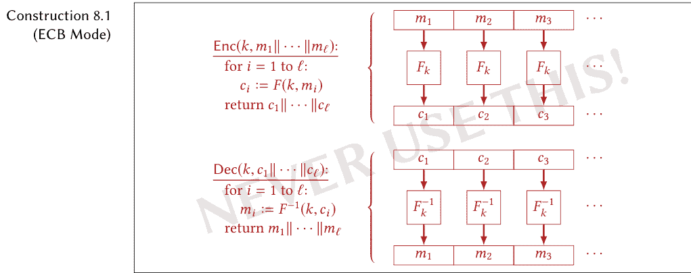

#### CBC: 密码分组链接

CBC（即密码分组链接）是实践中最常见的模式。$\ell$ 分组明文的 CBC 加密长度为 $\ell + 1$ 个分组。第一个密文分组称为**初始化向量 (IV)**。这里我们将 CBC 模式描述为一种随机加密，每个密文的 IV 都是均匀选择的。正如你所知，随机化是实现 CPA 安全性的必要（但非充分）条件，而且 CBC 模式确实提供了 CPA 安全性。

**构造 8.2 (CBC 模式)**

```
Enc(k, m_1 || \cdots || m_\ell):
  c_0 \leftarrow \{0, 1\}^{blen};
  for i = 1 to \ell:
    c_i := F(k, m_i \oplus c_{i-1})
  return c_0 || c_1 || \cdots || c_\ell
```

[加密图]

```
Dec(k, c_0 || \cdots || c_\ell):
  for i = 1 to \ell:
    m_i := F^{-1}(k, c_i) \oplus c_{i-1}
  return m_1 || \cdots || m_\ell
```

[解密图]

#### CTR: 计数器

实践中接下来最常见的模式是计数器模式（通常简称为 CTR 模式）。就像 CBC 模式一样，它涉及一个额外的 IV 块 $r$，该块均匀选择。其思路是使用序列

```
\(F(k, r); \quad F(k, r + 1); \quad F(k, r + 2); \quad \cdots\)
```

作为长时密码本来掩盖明文。由于 $r$ 是一串位，像 $r + 1$ 这样的加法表达式指的是模 $2^{blen}$ 加法（这是处理器中无符号加法的典型行为）。


## 构造 8.3 (CTR 模式)

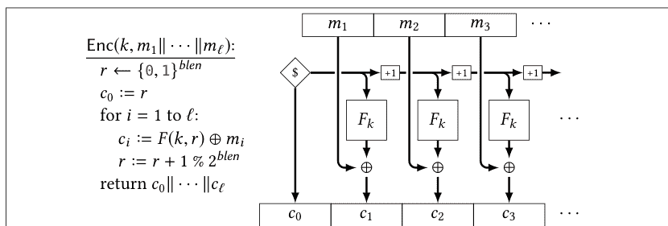

## OFB: 输出反馈

OFB (输出反馈) 模式在实际中很少使用。我们将其纳入讨论是因为它拥有最简单的安全证明。与 CBC 和 CTR 模式一样，OFB 以一个随机 IV r 开始，然后使用序列：

$F(k, r);\quad F(k, F(k, r));\quad F(k, F(k, F(k, r)));\quad \dots$

作为一次性密码本来掩盖明文。

## 构造 8.4 (OFB 模式)

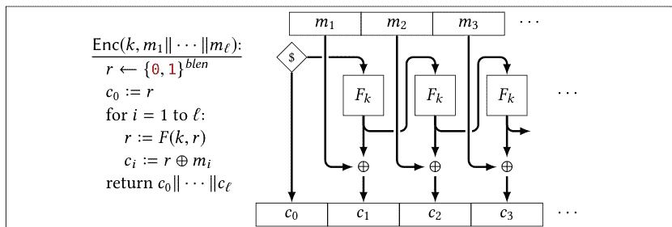

## 比较与对比

CBC 和 CTR 模式本质上是实践中为 CPA 安全所考虑的仅有的两种模式。两者提供相同的安全保证，因此两者之间的任何比较都必须基于 CPA 安全定义之外的因素。在选择这些模式时，通常会考虑以下几个属性：

- 虽然我们未展示 CTR 模式的解密算法，但它甚至不使用分组密码的逆运算 $F^{-1}$。这与前一章中基于 PRF 的加密方案类似（事实上，当限制为 1 块明文时，CTR 模式会退化为该构造）。严格来说，这意味着 CTR 模式可从 PRF 实例化；它不需要 PRP。然而，在实践中，遇到既非 PRP 又高效的 PRF 是罕见的。

- CTR 模式加密可以并行化。一旦 IV 被选定，第 i 个密文块可以在不首先计算前 i - 1 个块的情况下计算出来。CBC 模式不具备此属性，因为它本质上是串行的。不过，两种模式都具有可并行化的解密算法。

- 如果调用分组密码的开销很大，则在明文已知之前预先计算并存储这些调用可能是可取的。CTR 模式允许这样做，因为只有 IV 会影响输入到分组密码的内容。在 CBC 模式中，明文会影响分组密码的输入，因此在明文已知之前无法预先计算这些调用。

- 修改 CTR 以支持不是块长度精确整数倍的明文相对容易。（这留作练习。）我们将看到一种使 CBC 模式也支持此类明文的方法，但这远非易事。

- 迄今为止所有比较都偏向 CTR 模式，因此这里有一个偏向 CBC 模式的重要属性。实现者经常会误解这些模式中 IV 的安全影响。许多粗心的实现允许 IV 被重用。严格来说，重用 IV（除非像生日边界所允许的那样意外发生）意味着该方案未正确实现。但与其将责任推卸给开发者，不如预判系统可能的误用，并在可能时尝试使其不造成灾难性后果，这是良好的设计实践。

CTR 模式中 IV 重用的影响对消息隐私相当具有毁灭性（参见练习）。在 CBC 模式中，如果两个明文的第一个块不同，重用 IV 实际上可能是安全的！

### 8.2 CPA 安全与变长明文

这里有一个大惊喜：这些分组密码模式都不实现 CPA 安全，或者至少不实现我们此前定义的 CPA 安全。

**示例** 考虑一个 $\text{blen} = \lambda$ 的分组密码，在 CBC 模式下使用。如你将看到， CBC 模式并无特别特定之处，同样的观察也适用于其他模式。

在 CBC 模式下，由 $\ell$ 个块组成的明文被加密为 $\ell + 1$ 个块的密文。换言之，密文**泄露了明文的块数**。我们可以利用这一观察发起如下攻击：

```
\(\mathcal{A}\):
\(c := \text{EAVESDROP}(0^\lambda, 0^{2\lambda})\)
\(\text{return } |c| \stackrel{?}{=} 2\lambda\)
```

鉴别器选择一个 1 块明文和一个 2 块明文。如果该鉴别器链接到 \(\mathcal{L}_{\text{cpa-L}}\)，则 1 块明文被加密，生成的密文长度为 2 个块（\(2\lambda\) 比特）。如果该鉴别器链接到 \(\mathcal{L}_{\text{cpa-R}}\)，则 2 块明文被加密，生成的密文长度为 3 个块（\(3\lambda\) 比特）。通过简单检查密文长度，该鉴别器可以分辨差异并获得优势 1。

因此，严格来说，这些分组密码模式不提供 CPA 安全，因为密文泄露了明文的长度（以块计）。但假设我们并不真正在意隐藏明文的长度。\(^1\) 是否有一种方法可以制定安全定义，表述为：**密文隐藏明文的所有信息，除了其长度**？

从前一示例可以清楚看出，如果鉴别器发起带有 $|m_L| \neq |m_R|$ 的 $\text{EAVESDROP}(m_L, m_R)$ 查询，则可以成功区分 CPA 库。修改 CPA 安全定义的一种简单方法是直接禁止此类查询。如果 $|m_L| \neq |m_R|$，库将给出错误消息。这将允许对手以任意他/她选择的方式使质询明文不同，*除了它们的长度*。$|m|$ 是指比特还是块中的明文长度，这并不重要——具体取决于对特定方案最合理的含义。

从现在起，在讨论支持*变长*明文的加密方案时，CPA 安全将指以下更新的库：

| $\mathcal{L}^\Sigma_{\text{cpa-L}}$ |
|---|
| $k \leftarrow \Sigma.\text{KeyGen}$ |
| $\text{CTXT}(m_L, m_R \in \Sigma.\mathcal{M})$: |
| 如果 $|m_L| \neq |m_R|$ 则返回 err |
| $c := \Sigma.\text{Enc}(k, m_L)$ |
| 返回 $c$ |

| $\mathcal{L}^\Sigma_{\text{cpa-R}}$ |
|---|
| $k \leftarrow \Sigma.\text{KeyGen}$ |
| $\text{CTXT}(m_L, m_R \in \Sigma.\mathcal{M})$: |
| 如果 $|m_L| \neq |m_R|$ 则返回 err |
| $c := \Sigma.\text{Enc}(k, m_R)$ |
| 返回 $c$ |

在 CPA$ 安全（伪随机密文）的定义中，\(\mathcal{L}_{\text{cpa\$-rand}}\) 库以统一响应回应查询。由于这些响应必须看起来像密文，它们必须具有适当的长度。例如，对于本章讨论的模式，一个 \(\ell\) 块明文预期会被加密为 \((\ell + 1)\) 块密文。因此，根据提供的明文长度，库必须选择适当的密文长度。我们已经使用 \(\Sigma.\mathcal{C}\) 表示加密方案 \(\Sigma\) 的可能密文集。因此，让我们稍微扩展一下记号，并写出 \(\Sigma.\mathcal{C}(\ell)\) 以表示长度为 \(\ell\) 的明文的可能密文集。然后，在讨论支持变长明文的加密方案时，CPA$ 安全将指以下库：

| $\mathcal{L}^\Sigma_{\text{cpa\$-real}}$ |
|---|
| $k \leftarrow \Sigma.\text{KeyGen}$ |
| $\text{CHALLENGE}(m \in \Sigma.\mathcal{M})$: |
| $c := \Sigma.\text{Enc}(k, m)$ |
| 返回 $c$ |

| $\mathcal{L}^\Sigma_{\text{cpa\$-rand}}$ |
|---|
| $\text{CHALLENGE}(m \in \Sigma.\mathcal{M})$: |
| $c \leftarrow \Sigma.\mathcal{C}(|m|)$ |
| 返回 $c$ |

请注意，\(\mathcal{L}_{\text{cpa\$-rand}}\) 库不使用关于 \(m\) 的任何信息，除了其长度。这再次反映了密文除了长度之外不泄露明文任何信息的理念。

\(^1\) 实际上，隐藏通信长度（在极端情况下，隐藏通信的*存在*）是一个非常困难的问题。

在练习中，你被要求证明，就这些更新的安全定义而言，CPA$ 安全意味着如前所述的 CPA 安全。

## 不要理所当然地认为长度泄露！

我们刚刚从要求加密*不泄露任何部分信息*，转变为随意允许某些特定信息泄露。关于这一点，我们不宜过于仓促！

如果我们想真正支持*任意*长度的明文，那么泄露长度实际上是不可避免的。但“不可避免”并不意味着“没有后续影响”。仅通过观察加密网络流量的长度，许多严重攻击是可能的。以下是几个示例：

- 访问 Google 地图时，您的浏览器会接收许多构成您看到的地图的图像平铺图。每个图像平铺图具有相同的像素尺寸。但是，它们被压缩以节省资源，并非所有图像都能像其他图像那样显著压缩。世界上的每个地区都有其相当独特的“图像平铺图长度指纹”。因此，即使与 Google 地图之间的通信是加密的，图像平铺图的大小也会泄露。这确实可用于确定用户请求地图的地区。² 同样的想法也适用于搜索表单中的自动完成建议。

- 可变比特率（VBR）编码是音频/视频编码中的一种常见技术。当数据流携带较少信息（*e.g*.，固定相机位置的场景或安静的音频片段）时，它以较低的比特率编码，意味着每个时间单位用更少的比特编码。在加密视频流中，比特率的变化表现为数据包长度的变化。当用户正在观看 Netflix 上的电影或 Youtube 视频（与现场活动直播相反）时，比特率的变化是一致且可预测的。因此，仅通过观察数据包长度，即使在加密连接上，也很容易确定正在观看哪个视频。

- VBR 也用于许多加密语音聊天程序。对这些工具的攻击日益复杂。针对加密语音程序的首批攻击展示了如何仅通过观察密文大小流来识别说话者是谁（从一组候选者中）。后来的攻击可以确定正在说的语言。最终，当与复杂的语言模型相结合时，甚至显示可以在一定程度上识别单个词！

值得再次强调的是，这些攻击都不涉及任何试图破解加密的行为。这些攻击仅依赖于加密泄露明文长度这一事实。

### 8.3 OFB 模式的安全性

在本节中，我们将证明 OFB 模式具有伪随机密文（当块长度为 $blen = \lambda$ 比特时）。OFB 加密和解密都使用正向 direc-


F 的逆运算，因此即使 F 不是可逆的，OFB 也能提供安全性。因此我们将假设 F 只是一个 PRF 来证明安全性。

## 主张 8.5 OFB 模式（构造 8.4）具有 CPA$ 安全性，前提是其底层分组密码 F 是一个安全的 PRF，参数为 in = out = \(\lambda\)。

证明 证明的一般结构与前一章（构造 7.4）中用于基于 PRF 的加密方案的证明非常相似。这并非巧合：如果将 OFB 模式限制为单块明文，则正好得到构造 7.4！

其思想是，除 IV 外的每个密文块均按 \(c_i := r \oplus m_i\) 计算。根据一次性密钥规则，只需证明 \(r\) 值是独立伪随机的即可。每个 \(r\) 值都是对 PRF 的一次调用的结果。只有当所有输入到 PRF 的值都不同时，这些 PRF 输出才是独立伪随机的。在 OFB 模式中，我们使用之前一次 PRF 调用的输出 \(r\) 作为下一次的输入，因此该 PRF 输出 \(r\) 与过去的某个 PRF 输入值匹配的可能性极小。为了更精确地论证这一点，证明中包含了一些混合库，在其中 \(r\) 是不放回地选取的（之后再将 \(r\) 改回均匀采样）。

混合库的正式序列如下：

```
\mathcal{L}^{\text{OFB}}_{\text{cpa\$-real}}:
k \leftarrow \{0, 1\}^\lambda
CTXT(m_1 || \cdots || m_\ell):
  r \leftarrow \{0, 1\}^\lambda
  c_0 := r
  for i = 1 to \ell:
    r := F(k, r)
    c_i := r \oplus m_i
  return c_0 || c_1 || \cdots || c_\ell
```

起点是 \(\mathcal{L}^{\text{OFB}}_{\text{cpa\$-real}}\)，此处已填充 OFB 的详细信息。

```
CTXT(m_1 || \cdots || m_\ell):
  r \leftarrow \{0, 1\}^\lambda
  c_0 := r
  for i = 1 to \ell:
    r := LOOKUP(r)
    c_i := r \oplus m_i
  return c_0 || c_1 || \cdots || c_\ell
```

```
\mathcal{L}^F_{\text{prf-real}}
k \leftarrow \{0, 1\}^\lambda
LOOKUP(r):
  return F(k, r)
```

与 PRF F 相关的语句已按 \(\mathcal{L}^F_{\text{prf-real}}\) 的形式提取出来。

```
CTXT(m_1 || \cdots || m_\ell):
r \leftarrow \{0, 1\}^\lambda
c_0 := r
for i = 1 to \ell:
  r := LOOKUP(r)
  c_i := r \oplus m_i
return c_0 || c_1 || \cdots || c_\ell
```

```
\mathcal{L}^F_{\text{prf-rand}}
T := empty
LOOKUP(x):
  if T[x] undefined:
    T[x] \leftarrow \{0, 1\}^\lambda
  return T[x]
```

\(\mathcal{L}^F_{\text{prf-real}}\) 已被 \(\mathcal{L}^F_{\text{prf-rand}}\) 取代。根据 F 的 PRF 安全性，此变化不可区分。

接下来，所有涉及为变量 r 采样值的语句均按引理 4.11 中的 \(\mathcal{L}_{\text{samp-L}}\) 库提取出来：

```
CHALLENGE(m_1 || \cdots || m_\ell):
r := SAMP()
c_0 := r
for i = 1 to \ell:
  r := LOOKUP(r)
  c_i := r \oplus m_i
return c_0 || c_1 || \cdots || c_\ell
```

```
T := empty
LOOKUP(x):
  if T[x] undefined:
    T[x] := SAMP()
  return T[x]
```

```
\mathcal{L}_{\text{samp-L}}
SAMP():
r \leftarrow \{0, 1\}^\lambda
return r
```

然后将 \(\mathcal{L}_{\text{samp-L}}\) 替换为 \(\mathcal{L}_{\text{samp-R}}\)。根据引理 4.11，此变化不可区分：

```
CTXT(m_1 || \cdots || m_\ell):
r := SAMP()
c_0 := r
for i = 1 to \ell:
  r := LOOKUP(r)
  c_i := r \oplus m_i
return c_0 || c_1 || \cdots || c_\ell
```

```
T := empty
LOOKUP(x):
  if T[x] undefined:
    T[x] := SAMP()
  return T[x]
```

```
\mathcal{L}_{\text{samp-R}}
R := \emptyset
SAMP():
r \leftarrow \{0, 1\}^\lambda \setminus R
R := R \cup \{r\}
return r
```

在此混合库中，传递给 LOOKUP 的参数永远不会重复，因此中间库可以大幅简化：

```
CTXT(m_1 || \cdots || m_\ell):
r := SAMP()
c_0 := r
for i = 1 to \ell:
  r := LOOKUP(r)
  c_i := r \oplus m_i
return c_0 || c_1 || \cdots || c_\ell
```

```
LOOKUP(x):
t := SAMP()
return t
```

```
\mathcal{L}_{\text{samp-R}}
R := \emptyset
SAMP():
r \leftarrow \{0, 1\}^\lambda \setminus R
R := R \cup \{r\}
return r
```

接下来，将 \(\mathcal{L}_{\text{samp-R}}\) 替换为 \(\mathcal{L}_{\text{samp-L}}\)。根据引理 4.11，此变化不可区分：

```
CTXT(m_1 || \cdots || m_\ell):
r := SAMP()
c_0 := r
for i = 1 to \ell:
  r := LOOKUP(r)
  c_i := r \oplus m_i
return c_0 || c_1 || \cdots || c_\ell
```

```
LOOKUP(x):
t := SAMP()
return t
```

```
\mathcal{L}_{\text{samp-L}}
SAMP():
r \leftarrow \{0, 1\}^\lambda
return r
```

对 LOOKUP 和 samp 的子例程调用已内联：

```
CTXT(m_1 || \cdots || m_\ell):
r \leftarrow \{0, 1\}^\lambda
c_0 := r
for i = 1 to \ell:
  r \leftarrow \{0, 1\}^\lambda
  c_i := r \oplus m_i
return c_0 || c_1 || \cdots || c_\ell
```

最后，在 for 循环内应用一次性密钥规则（省略了一些常见步骤）。请注意，在前一个混合库中，每个 \(r\) 值都只用 *只用一次* 作为一次性密钥。\(i = 0\) 的情况也已吸收进 for 循环中。结果是 \(\mathcal{L}_{\text{cpa\$-rand}}^{\text{OFB}}\)，因为 OFB 将 \(\ell\) 块的明文加密为 \(\ell + 1\) 块。

```
\mathcal{L}_{\text{cpa\$-rand}}^{\text{OFB}}
CTXT(m_1 || \cdots || m_\ell):
for i = 0 to \ell:
  c_i \leftarrow \{0, 1\}^\lambda
return c_0 || c_1 || \cdots || c_\ell
```

混合库序列表明 \(\mathcal{L}_{\text{cpa\$-real}}^{\text{OFB}} \approx \mathcal{L}_{\text{cpa\$-rand}}^{\text{OFB}}\)，因此 OFB 模式具有伪随机密文。

我们在只假设 F 是 PRF 的前提下证明了该主张，因为 OFB 模式不要求 F 可逆。由于我们假设 PRF 的参数为 \(\text{in} = \text{out} = \lambda\)，PRP 换位引理（引理 6.7）表明，当 F 是块长度 \(n = \lambda\) 的 PRP 时，OFB 也是安全的。

### 8.4 填充与密文窃取

迄今为止，我们一直假设所有明文都是块长度的整数倍。但现实世界中的数据并不总是如此合作。分组密码在实际中如何处理长度任意的数据？

### 填充

填充仅指将任意长度数据编码为块长度整数倍的任何方法。唯一要求是该编码是可逆的。更正式地说，**填充方案**应由两个算法组成：

- pad：输入任意长度的字符串，输出长度为块长度整数倍的字符串
- unpad：pad 的逆运算。我们要求对于所有字符串 x，unpad(pad(x)) = x。

其思想是，发送方可以加密 pad(x)，其长度保证是块长度的整数倍；接收方可以解密并对结果运行 unpad 以获取 x。

在现实世界中，数据几乎总是以 **字节** 而非比特形式出现，因此我们在此采用此假设。在本节中，我们将以十六进制写出字节，例如 `8f`。典型的块长度为 128 比特（16 字节）或 256 比特（32 字节）。

以下是几种常见的填充方法：

**零填充：** 最简单的填充方法是用空字节（`00`）填充最后一个块。这种方法的问题是它并不总是可逆。例如，`pad(31 41 59)` 和 `pad(31 41 59 00)` 会给出相同的结果。无法区分用于填充的空字节和数据的故意最后一个字节。

**ANSI X.923 标准：** 数据用空字节填充，但填充的最后一个字节指示填充字节的数量。本质上，填充消息的最后一个字节告诉接收方应删除多少字节以恢复原始消息。

请注意，在此填充方案（以及事实上所有填充方案中），如果原始未填充数据 *已经是* 块长度的整数倍，则必须添加 **一个完整的额外填充块**。这是必要的，因为原始数据可能以某些看起来像有效填充的字节结尾（例如 `00 00 03`），而我们不希望这些字节被错误地删除。

示例 以下是使用 16 字节块的有效和无效 X.923 填充示例：

- `01 34 11 d9 81 88 05 57 1d 73 c3 00 00 00 00 00 05` => 有效
- `95 51 05 4a d6 5a a3 44 af b3 85 00 00 00 00 03` => 有效
- `71 da 77 5a 5e 77 eb a8 73 c5 50 b5 81 d5 96 01` => 有效
- `5b 1c 01 41 5d 53 86 4e e4 94 13 e8 7a 89 c4 71` => 无效
- `d4 0d d8 7b 53 24 c6 d1 af 5f d6 f6 00 c0 00 04` => 无效

**PKCS#7 标准：** 如果需要 *b* 个字节的填充，则数据不是用空字节填充，而是用 *b* 个字节填充。同样，填充消息的最后一个字节告诉接收方应删除多少字节。


示例 以下是有效和无效的 PKCS#7 填充示例（使用 16 字节块）：

```
01 34 11 d9 81 88 05 57 1d 73 c3 05 05 05 05 05 => valid
95 51 05 4a d6 5a a3 44 af b3 85 03 03 03 03 03 => valid
71 da 77 5a 5e 77 eb a8 73 c5 50 b5 81 d5 96 01 => valid
5b 1c 01 41 5d 53 86 4e e4 94 13 e8 7a 89 c4 71 => invalid
d4 0d d8 7b 53 24 c6 d1 af 5f d6 f6 04 c0 04 04 => invalid
```

**ISO/IEC 7816-4 标准：** 数据填充为一个 `80` 字节，随后跟随空字节。要移除填充，删除所有尾部空字节并确保最后一个字节是 `80`（然后也将其删除）。

当将 `80` 写成二进制 `10000000` 时，其意义更加清晰。因此，描述此填充方案的另一种方式是：追加一个 `1` 位，然后用 `0` 位填充直到达到块长度。要移除填充，删除所有尾部 `0` 位以及最右侧的 `1` 位。因此，这种方法很容易推广到填充非字节倍数的数据。

示例 以下是有效和无效的 ISO/IEC 7816-4 填充示例（使用 16 字节块）：

```
01 34 11 d9 81 88 05 57 1d 73 c3 80 00 00 00 00 => valid
95 51 05 4a d6 5a a3 44 af b3 85 03 03 80 00 00 => valid
71 da 77 5a 5e 77 eb a8 73 c5 50 b5 81 d5 96 80 => valid
5b 1c 01 41 5d 53 86 4e e4 94 13 e8 7a 89 c4 71 => invalid
d4 0d d8 7b 53 24 c6 d1 af 5f d6 f6 c4 00 00 00 => invalid
```

填充方案的选择并不至关重要，其中任何一种通常都可以。只需记住 **填充方案不是安全特性！** 填充是一种对数据进行编码的公开方法，不涉及任何密钥。填充的唯一目的是启用功能——对非块长度倍数的数据使用 CBC 等分组密码模式。

此外，如下一章所见，填充与针对加密不当使用的某些攻击相关。尽管这并非真正是填充的过错（而是使用了错误类型的加密的过错），但这是一个如此常见的陷阱，以至于在讨论填充时始终值得考虑。

## Ciphertext Stealing

另一种名字颇具挑衅性的方法是 **密文窃取**（CTS，如果你还没对三个字母缩写感到厌倦），其结果是密文不是块长度的倍数。密文窃取背后的主要思想是：使用仅支持完整块的标准分组密码模式（例如 CBC 模式），然后 **简单丢弃部分密文位**，使解密仍然可行。如果最后一个明文块缺 j 位才能成为完整块，通常可以丢弃 j 位密文。这样一来，n 位的明文将被加密为 blen + n 位的密文，其中 blen 是额外 IV 块的长度。

例如，让我们看看密文窃取在 CBC 模式中的应用。假设块长度为 $blen$，最后一个明文块 \(m_\ell\) 缺 j 位才能成为完整块。我们首先用 j 个零扩展 \(m_\ell\)（即对明文进行空填充），然后像往常一样执行 CBC 加密。

现在我们的目标是识别出可以丢弃的 j 位 CBC 密文，同时仍能保证解密可行。在这种情况下，应丢弃的适当位是 **\(c_{\ell-1}\) 的最后 j 位**（CBC 密文的倒数第二块）。原因如下图所示：

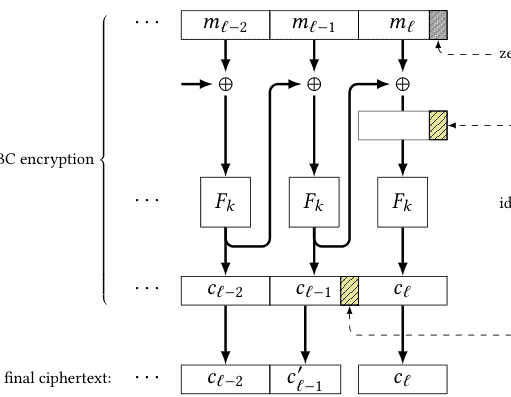

假设接收方接收到此 CBC 密文，但 \(c_{\ell-1}\) 的最后 j 位已被删除。他/她如何解密？重要的想法是，缺少的 j 位是冗余的，因为有另一种计算它们的方法。

在 CBC 加密中，输入到分组密码的最后一个值是 \(c_{\ell-1} \oplus m_\ell\)。让我们将此值命名为 \(x^* := c_{\ell-1} \oplus m_\ell\)。由于 \(m_\ell\) 的最后 j 位是 0，\(x^*\) 的最后 j 位是 \(c_{\ell-1}\) 的最后 j 位——即缺失的位。尽管这些位从 \(c_{\ell-1}\) 中丢失，但接收方有另一种计算它们的方法，即 \(x^* := F^{-1}(k, c_\ell)\)。

综上所述，接收方执行以下操作：首先，它观察到密文缺 j 位才能成为完整块。它计算 \(F^{-1}(k, c_\ell)\)，并取该值的最后 j 位作为 \(c_{\ell-1}\) 中缺失的位。在恢复缺失的位后，接收方像往常一样执行 CBC 解密。结果是一个由 \(\ell\) 个完整块组成的明文，但我们知道该明文的最后 j 位是接收方可以移除的 \(\emptyset\) 填充。

在实现中，块之间的边界位于可预测的位置很方便。因此，在加密过程中从密文中间移除 j 位（或在解密时添加它们）有点别扭，就像我们在这里所做的那样。因此，在实践中，密文的最后两个块通常会被互换。在上面的示例中，结果密文（密文窃取后）将是：

```
\(c_0 \| c_1 \| c_2 \cdots c_{\ell-3} \| c_{\ell-2} \| c_\ell \| c'_{\ell-1}\), where \(c'_{\ell-1}\) is the first \(blen - j\) bits of \(c_{\ell-1}\).
```

接收方知道这一事实，因为密文缺 j 位才能成为完整块。（缩短后的）密文长度是一个信号，指示加密过程中使用了多少个 0 位填充。

这样一来，除了最后一个块外，所有密文块都是完整的 \( blen \) 位长，块之间的边界每 \( blen \) 位出现一次。这种“优化”会给任何实现增加一些显著的边界情况。还必须决定当明文已经是块长度的精确倍数时该如何处理——即使在这种情况下，是否也要交换最后两个密文块？下面我们展示了一种密文窃取（CTS）的实现，在该情况下不交换最后两个块。这意味着当明文是块长度的精确倍数时，它会退化为普通 CBC 模式。

### Construction 8.6 (CBC-CTS)

| 加密 (k, \(m_1 \| \cdots \| m_\ell\)): | 解密 (k, \(c_0 \| \cdots \| c_\ell\)): |
|---|---|
| // 每个 \( m_i \) 都是 \( blen \) 位，// 但 \( m_\ell \) 除外 | // 每个 \( c_i \) 都是 \( blen \) 位，// 但 \( c_\ell \) 除外 |
| \( j := blen - |m_\ell| \) | \( j := blen - |c_\ell| \) |
| \( m_\ell := m_\ell \| 0^j \) | 如果 \( j \neq 0 \)： |
| \( c_0 \leftarrow \{0, 1\}^{blen} \)： | 交换 \( c_{\ell-1} \) 和 \( c_\ell \) |
| 对 \( i = 1 \) 到 \( \ell \)： | \( x \)：\( F^{-1}(k, c_\ell) \) 的最后 \( j \) 位 |
| \( c_i := F(k, m_i \oplus c_{i-1}) \) | \( c_{\ell-1} := c_{\ell-1} \oplus x \) |
| 如果 \( j \neq 0 \)： | 对 \( i = 1 \) 到 \( \ell \)： |
| 移除 \( c_{\ell-1} \) 的最后 \( j \) 位 | \( m_i := F^{-1}(k, c_i) \oplus c_{i-1} \) |
| 交换 \( c_{\ell-1} \) 和 \( c_\ell \) | 移除 \( m_\ell \) 的最后 \( j \) 位 |
| 返回 \( c_0 \| c_1 \| \cdots \| c_\ell \) | 返回 \( m_1 \| \cdots \| m_\ell \) |

*标记的行对应于普通 CBC 模式。*

## 练习

- 8.1. 证明 ECB 模式下的分组密码不提供 CPA 安全性。描述一个区分器并计算其优势。
- 8.2. 描述 OFB 解密模式。
- 8.3. 描述 CTR 解密模式。
- 8.4. CBC 模式：
  - (a) 在 CBC 模式加密中，如果明文的某一位被更改，哪些密文块会受到影响（假设使用相同的 IV）？
  - (b) 在 CBC 模式解密中，如果密文的某一位被更改，哪些明文块会受到影响？
- 8.5. 证明变长明文的 CPA 安全性蕴含变长明文的 CPA 安全性。证明在哪里使用了 \( |m_L| = |m_R| \) 这一事实？
- 8.6. 假设我们不对分组密码应用 CBC 模式，而是将其应用于一次性密码本。换句话说，我们将 CBC 加密代码中每个 \( F(k, \star) \) 替换为 \( k \star \)。证明结果不具有 CPA 安全性。描述一个区分器并计算其优势。


## 8.7. 证明存在一个运行时间为 \(O(2^{\lambda/2})\) 的攻击者，且能以恒定概率破坏 CBC 模式加密的 CPA 安全性。

## 8.8. 下面列出了几种用于加密的分组密码模式，应用于分组长度为 \(blen = \lambda\) 的 PRF \(F\)。对于每种模式：

- 描述相应的解密过程。
- 证明该模式**不**具有 CPA 安全性。这意味着描述一个区分器并计算其优势。

```
Enc(k, m_1 || ... || m_\ell):
r_0 \leftarrow \{0, 1\}^\lambda
c_0 := r_0
for i = 1 to \ell:
  r_i := F(k, m_i)
  c_i := r_i \oplus r_{i-1}
return c_0 || ... || c_\ell
```

```
Enc(k, m_1 || ... || m_\ell):
c_0 \leftarrow \{0, 1\}^\lambda
m_0 := c_0
for i = 1 to \ell:
  c_i := F(k, m_i) \oplus m_{i-1}
return c_0 || ... || c_\ell
```

```
Enc(k, m_1 || ... || m_\ell):
c_0 \leftarrow \{0, 1\}^\lambda
for i = 1 to \ell:
  c_i := F(k, m_i) \oplus c_{i-1}
return c_0 || ... || c_\ell
```

```
Enc(k, m_1 || ... || m_\ell):
c_0 \leftarrow \{0, 1\}^\lambda
r_0 := c_0
for i = 1 to \ell:
  r_i := r_{i-1} \oplus m_i
  c_i := F(k, r_i)
return c_0 || ... || c_\ell
```

模式 (a) 与 CBC 类似，只不过异或操作发生在分组密码应用之后，而非之前。模式 (c) 本质上与 CBC 解密相同。

## 8.9. 假设你观察到一个 CBC 密文，且其中两个块恰好相同。你能推断出关于明文的什么信息？陈述明文的某个非平凡性质，该性质不依赖于加密密钥。

## 8.10. 与 OFB 加密的证明相比，CBC 加密的 CPA$-安全性证明有一点复杂。回顾一下，证明的重要部分在于论证所有输入到 PRF 的值都互不相同。

在 OFB 中，PRF 的输出被直接作为输入馈回到 PRF。攻击者对此过程无影响，因此论证所有 PRF 输入都互不相同（概率无限接近 1）倒也不算太难。

相比之下，CBC 模式取一个来自 PRF 的输出块，将其与一个明文块（归根结底是由攻击者*选择*）进行异或，并将结果用作下一次 PRF 调用的输入。这意味着在论证 CBC 模式向所有 PRF 调用提供互不相同的输入（概率无限接近 1）时，我们必须更加小心。

### (a) 证明以下两个库不可区分：

```
\mathcal{L}_{\text{left}}
\text{SAMP}(m \in \{0, 1\}^\lambda):
r \leftarrow \{0, 1\}^\lambda
\text{return } r

\mathcal{L}_{\text{right}}
R := \emptyset
\text{SAMP}(m \in \{0, 1\}^\lambda):
r \leftarrow \{r' \in \{0, 1\}^\lambda \mid r' \oplus m \notin R\}
R := R \cup \{r \oplus m\}
\text{return } r
```

提示：使用引理 4.12。

### (b) 利用部分 (a) 以及底层 PRF 的安全性，证明 CBC 模式的 CPA$-安全性。

提示：该调用将在一个“新鲜”输入上进行。它从未被见过。这保证了在 $\mathcal{L}_{\text{right}}$ 中，下一次 PRF 调用是均匀随机的。令 $m$ 对应于下一个明文块，$m$ 已经被采样了 $r$（它之前的 PRF 输出）。然后 $m$ 对应于下一个明文块 $m$，称其为 $\mathcal{L}_{\text{right}}$。令 $R$ 对应于发送到 PRF 的所有输入的集合。

注意：要意识到攻击者在“看到”来自 PRF 的输出 $r$（该输出包含在密文中）之前选择明文块 $m$ 是多么重要。

## ★ 8.11. 证明 CTR 模式实现 CPA$ 安全性。

提示：使用引理 4.12 证明在此情况下，选择 IV 导致分组密码被两次调用相同值的概率仅为可忽略概率。

## 8.12. 设 $F$ 为一个满足 $out = in = \lambda$ 的安全 PRF，并令 $F^{(2)}$ 表示函数 $F^{(2)}(k, r) = F(k, F(k, r))$。

### (a) 证明 $F^{(2)}$ 也是一个安全的 PRF。

### (b) 如果 $F$ 是一个分组长度为 $blen$ 的安全 PRP 呢？$F^{(2)}$ 也是一个安全的 PRP 吗？

## 8.13. 本题涉及基于 nonce 的 CPA 安全性概念。

### (a) 给出一个 CPA$ 安全性定义，该定义同时结合第 7.1 节的基于 nonce 的语法和第 8.2 节的变长明文。

### (b) 证明 CBC 模式作为基于 nonce 的方案（其中 IV 被用作 nonce）**不**安全。

### (c) 证明 CTR 模式作为基于 nonce 的方案（其中 IV 被用作 nonce）**不**安全。注意，如果将（随机化的）CTR 模式限制为单个明文块，我们将得到构造 7.4 的 CPA 安全方案，它作为基于 nonce 的方案**是**安全的。因此，攻击必须利用明文可以超过一个块的事实。（部分 (b) 中的攻击对单块明文有效吗？）

## 8.14. 将基于随机 IV 的结构转换为基于 nonce 的结构的一种方法称为 **合成 IV** 方法。

### (a) 下面展示了将合成 IV（SIV）方法应用于 CBC 模式。证明它作为基于 nonce 的方案是 CPA/CPA$ 安全的（参考上一题中的安全定义）：

```
SIV-CBC.Enc((k1, k2), v, m1 || ... || ml):
c0 := F(k1, v)
for i = 1 to l:
  ci := F(k2, mi ⊕ c(i-1))
return c0 || c1 || ... || cl
```

它不再选择随机 IV c0，而是使用分组密码 F 从 nonce v 的确定性生成。在你的证明中，你可以使用这样一个事实：随机化 CBC 模式具有 CPA$ 安全性，且 F 也是一个安全的 PRF。

### (b) SIV 结构使用两个密钥用于不同目的这一点很重要。假设我们改为始终使用同一个密钥：

```
BadSIV-CBC.Enc(k, v, m1 || ... || ml):
c0 := F(k, v)
for i = 1 to l:
  ci := F(k, mi ⊕ c(i-1))
return c0 || c1 || ... || cl
```

证明得到的方案不具有 CPA$ 安全性（在基于 nonce 的意义上）。忽略填充的复杂性，仅考虑长度为分组长度倍数的明文。描述一个成功的区分器并计算其优势。

### (c) 对于随机加密，将 IV 包含在密文中是必要的；否则接收者无法解密。在基于 nonce 的设置中，我们假设接收者知道正确的 nonce（例如，通过带外通信）。考虑到这一点，我们可以修改部分 (b) 中的方案以移除 c0，因为接收者无论如何都可以从 v 中重构它。

证明即使有此修改，该方案在基于 nonce 的定义下仍然无法实现 CPA 安全性。

## 8.15. 实现者有时对分组密码模式中的 IV 比较谨慎，并可能试图“保护”它们。保护 IV 的一个想法是防止其直接出现在密文中。下面的修改后的 CBC 加密在将 IV 包含在密文之前先将其通过分组密码发送：

```
Enc(k, m1 || ... || ml):
c0 ← {0, 1}^blen
c’0 := F(k, c0)
for i = 1 to l:
  ci := F(k, mi ⊕ c(i-1))
return c’0 || c1 || ... || cl
```

该密文可以通过先计算 $c_0 := F^{-1}(k, c'_0)$，然后对 $c_0 || \cdots || c_\ell$ 执行通常的 CBC 解密来解密。证明该新方案**不是** CPA 安全的（在随机加密的传统定义下）。

## 8.16. 假设一个错误的实现导致两个密文使用相同的 IV 进行加密，而不是每次都使用随机 IV。

### (a) 当使用 CBC 模式且 IV 重复时，尽可能详细地描述关于明文泄露了哪些信息。

### (b) 当使用 CTR 模式且 IV 重复时，尽可能详细地描述关于明文泄露了哪些信息。

## 8.17. 描述如何扩展 CTR 和 OFB 模式以处理任意长度的明文（不使用填充）。为什么这比 CBC 密文偷窃要简单得多？

## 8.18. 以下 CBC 密文偷窃技术在 1980 年代被提出，甚至被采用到商业产品中。不幸的是，它是不安全的。

假设最后一个明文块 \( m_\ell \) 的长度为 \( blen - j \) 比特。与其用零填充最后一个块，不如用密文块 \( c_{\ell-1} \) 的*最后 \( j \) 比特*对其进行填充。然后将填充后的块 \( m_\ell \) 通过 PRP 以生成最后的密文块 \( c_\ell \)。由于 \( c_{\ell-1} \) 的最后 \( j \) 比特可以从 \( c_\ell \) 中恢复，因此可以丢弃它们。如果最后一个明文块已经是 *blen* 比特长，则使用标准 CBC 模式。

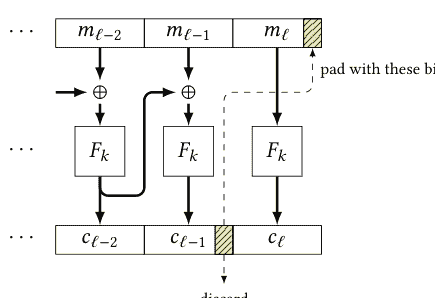

证明该方案**不**满足 CPA$ 安全性。描述一个区分器并计算其优势。

提示：请求对若干明文进行加密，这些明文的最后一个块长度为 blen - 1 比特。

## 8.19. 证明*任何* CPA 安全的加密在通过对输入进行填充来扩展后仍然是 CPA 安全的。

## 8.20. 证明带有密文偷窃的 CBC 具有 CPA$ 安全性。你可以使用这样一个事实：当限制于长度为分组长度精确倍数的明文时（即没有填充或密文偷窃的 CBC 模式），CBC 模式具有 CPA$ 安全性。


提示：处理。实现以调用 ... 。可以轻易观察到 ... 令 CBC 表示限制于明文空间 M = {0, 1}* 的标准 CBC 模式：

## 8.21. 传播 CBC (PCBC) 模式是指以下 CBC 模式的变体：

```
Enc(k, m_1 || ... || m_l):
c_0 <- {0, 1}^blen:
m_0 := 0^blen
for i = 1 to l:
  c_i := F(k, m_i \oplus c_{i-1} \oplus m_{i-1})
return c_0 || c_1 || ... || c_l
```

- (a) 描述 PCBC 解密。

- (b) 假设标准 CBC 模式具有 CPA 安全性（针对块长度整数倍的明文），证明 PCBC 模式也具有 CPA 安全性（针对相同的明文空间）。

提示：将 PCBC 加密编写为使用标准 CBC 加密作为子程序。

- (c) 考虑将 CBC 密文窃取适配到 PCBC 模式的问题。假设最终明文块 $m_\ell$ 具有 $blen - j$ 位，并且我们用前一个明文块 $m_{\ell-1}$ 的最后 $j$ 位对其进行填充。证明丢弃 $c_{\ell-1}$ 的最后 $j$ 位仍然允许正确解密并实现 CPA 安全。

提示：参见练习 8.20。

- (d) 假设最终明文块使用前一个密文块 $c_{\ell-1}$ 的最后 $j$ 位进行填充。虽然正确解密仍然可能，但该构造不再安全。展示一个违反该构造 CPA 安全性的攻击。为什么部分 (c) 的证明方法不再有效？

提示：请求对若干最后块长度为 1 位的明文进行多次加密。

## 9 选择密文攻击

在本章中，我们讨论 CPA 安全定义的局限性。简而言之，CPA 安全定义仅考虑由诚实生成的密文泄露给对手的信息。然而，它不考虑当对手被允许将其自身精心构造的恶意密文注入到诚实系统中时会发生什么。如果发生这种情况，即使是 CPA 安全的加密方案也可能以惊人的方式失败。我们首先看到了这样一个惊人且令人惊讶的失败示例，称为填充甲骨攻击：

### 9.1 填充甲骨攻击

想象一个接收 CBC 加密密文以进行处理的 Web 服务器。在接收到密文时，Web 服务器使用适当的密钥对其进行解密，然后检查明文是否具有有效的 X.923 填充（第 8.4 节）。

重要的是，假设 Web 服务器的可观察行为取决于填充是否有效。你可以想象，Web 服务器在填充无效的情况下会给出特殊的错误消息。或者，更巧妙（但仍然现实）的是，处理具有无效填充的密文时的响应时间差异足以使攻击得以实现。1 了解填充有效性的机制并不重要——重要的是，攻击者有某种方式来确定密文是否编码了具有有效填充的明文。无论攻击者如何获得此信息，我们都说攻击者可以访问一个填充甲骨，它提供与以下子程序相同的信息：

```
PADDINGORACLE(c):
m := Dec(k, c)
return VALIDPAD(m)
```

我们称其为填充甲骨，因为它只回答关于输入的一种特定类型的问题。在此情况下，它给出的答案始终是单个布尔值。

填充甲骨似乎并未泄露有用信息，也似乎无需担忧。令人惊讶的是，我们可以证明，一个不知道加密密钥 k 的攻击者可以单独使用填充甲骨来解密其选择的任何密文！无论 Web 服务器还做什么，这一点都成立。只要它对攻击者可选择的密文泄露这一个比特的信息，它等同于泄露了一切。

1 出于此原因，有必要编写去填充算法，使得通过子程序的每条执行路径所需的 CPU 周期数相同。

### CBC 加密的可塑性

回顾 CBC 解密的定义。如果密文是 \( c = c_0 \cdots c_\ell \)，那么第 \( i \) 个明文块按如下方式计算：

\( m_i := F^{-1}(k, c_i) \oplus c_{i-1} \) 。

由此我们可以推导出两个重要事实：

- 两个连续块 \( (c_{i-1}, c_i) \) 单独取出是 \( m_i \) 的有效加密。展望未来，这一事实允许攻击者一次专注于解密一个块。

- 将密文块与已知值（例如 \( x \)）进行异或操作，会使相应的明文块也与同一值进行异或。换句话说，对于所有 \( x \)，密文 \( (c_{i-1} \oplus x, c_i) \) 解密为 \( m_i \oplus x \)：

\(\text{Dec}(k, (c_{i-1} \oplus x, c_i)) = F^{-1}(k, c_i) \oplus (c_{i-1} \oplus x) = (F^{-1}(k, c_i) \oplus c_{i-1}) \oplus x = m_i \oplus x\) 。

如果我们将这样的密文 \( (c_{i-1} \oplus x, c_i) \) 发送到填充甲骨，因此我们将了解 \( m_i \oplus x \) 是否是（单个块）具有有效填充。与其从填充的角度思考，不如将甲骨视为告诉你 \( m_i \oplus x \) 是否以 `01`、`00 02`、`00 00 03` 等后缀之一结尾。

通过仔细选择不同的 \( x \) 值并向填充甲骨提出这类问题，我们将展示如何学习 \( m_i \) 的 *所有* 部分。我们迄今为止使用以下子程序来总结这种能力：

```
// suppose c encrypts an (unknown) plaintext m_1 | ... | m_l
// does m_i \oplus x end in one of the valid padding strings?
CHECKXOR(c, i, x):
    return PADDINGORACLE(c_{i-1} \oplus x, c_i)
```

给定加密了未知消息 \( m \) 的密文 \( c \)，我们可以看到对手可以生成另一个密文，其内容 *与* \( m \) *相关*，且这种关系 *可预测*。加密方案的这种属性称为 **可塑性**。

### 学习块的最后一个字节

我们现在展示如何使用 CHECKXOR 子程序来确定明文块 \( m \) 的最后一个字节。有两种情况需要考虑，具体取决于 \( m \) 的内容。攻击者最初不知道哪种情况成立：

对于两种情况中的第一种（也是较简单的一种），假设 \( m \) 的倒数第二个字节非零。我们将尝试每个可能的字节 \( b \) 并询问 \( m \oplus b \) 是否具有有效填充。由于 \( m \) 是一个块，\( b \) 是单个字节，当我们写 \( m \oplus b \) 时，我们的意思是 \( b \) 在左侧用零扩展。由于 \( m \)（因此也是 \( m \oplus b \)）的倒数第二个字节非零，只有其中一种可能性会具有有效填充——即 \( m \oplus b \) 以字节 `01` 结尾的那种。因此，如果 \( b \) 是成功的候选字节（即，\( m \oplus b \) 具有有效填充），那么 \( m \) 的最后一个字节必须是 \( b \oplus \mathtt{01} \)。

使用 LEARNLASTBYTE 学习明文块最后一个字节的示例：

```
... a0 42 ??        m = unknown plaintext block
... 00 00 b         b = byte that causes oracle to return true
= ... a0 42 01      valid padding <=> b ⊕ ?? = 01
                    <=> ?? = 01 ⊕ b
```

对于另一种情况，假设 m 的倒数第二个字节为零。那么 m ⊕ b 将对几个候选 b 值具有有效填充：

使用 LEARNLASTBYTE 学习明文块最后一个字节的示例：

```
... a0 00 ??        ... a0 00 ??       m = unknown plaintext
... 00 00 b1        ... 00 00 b2       bi = candidate bytes
= ... a0 00 01      = ... a0 00 02     two candidates cause oracle to return true
  |                   |
  v                   v
... a0 00 ??        ... a0 00 ??
... 00 01 b1        ... 00 01 b2       same b1, b2, but change next-to-last byte
= ... a0 01 01      = ... a0 01 02     only one causes oracle to return true
                    => ?? = b1 ⊕ 01
```

每当多于一个候选 b 值产生有效填充时，我们知道 m 的倒数第二个字节为零（事实上，通过计算成功候选的数量，我们可以确切地知道 m 的最后一个字节前面有多少个零）。

如果 m 的倒数第二个字节为零，那么 m ⊕ 01 b 的倒数第二个字节非零。m ⊕ 01 b 和 m ⊕ b 都具有有效填充的唯一方式是 m ⊕ b 以字节 01 结尾。我们可以再次重试所有成功的候选 b 值，这次在前面添加一个额外的非零字节。将有一个唯一的候选 b 值在两轮中都成功，这将告诉我们 m 的最后一个字节是 b ⊕ 01。

学习明文块最后一个字节的总体方法在图 9.1 的 LEARNLASTBYTE 子程序中总结。集合 B 包含第一轮中的成功候选字节。第一轮后 B 中最多有 16 个元素，因为正确填充块的最后一个字节只有 16 个有效可能性。在最坏情况下，LEARNLASTBYTE 通过 checkxor 对填充甲骨进行 256 + 16 = 272 次调用。

### 学习块的其他字节

一旦我们学习了明文块的一个尾随字节，学习额外字节就会稍微容易一些。假设我们知道明文块的最后 3 个字节，如下例所示。我们希望使用填充甲骨来发现倒数第 4 个字节。


示例 使用 `LEARNPREVBYTE` 在块的最后 3 个字节已知时学习倒数第 4 个字节。

```
... ?? a0 42 3c   m = partially unknown plaintext block
⊕ ... 00 00 00 04   p = string ending in 04
⊕ ... 00 a0 42 3c   s = known bytes of m
⊕ ... b 00 00 00   y = candidate byte b shifted into place
= ... 00 00 00 04   valid padding <=> ?? = b
```

已知 $m$ 的最后 3 个字节，我们可以计算一个字符串 $x$，使得 $m \oplus x$ 以 `00 00 04` 结尾。现在我们可以尝试将 $m \oplus x$ 的倒数第 4 个字节与不同的候选字节 $b$ 进行异或，并询问填充预言机结果是否具有有效填充。只有当结果的倒数第 4 个字节为 `00` 时才会出现有效填充，而这恰好发生在 $m$ 的倒数第 4 个字节精确匹配我们的候选字节 $b$ 时。

该过程在图 9.1 的 `LEARNPREVBYTE` 子例程中进行了总结。在最坏情况下，该子例程会向填充预言机发出 256 次查询。

**把所有内容放在一起。** 现在我们拥有了仅使用填充预言机来解密 *任何密文* 所需的所有工具。该过程在下面的 `LEARNALL` 子例程中进行了总结。

在最坏情况下，学习明文的每个字节需要向填充预言机发出 256 次查询。但是在实践中，次数可以低得多。本节中的示例受到一个真实世界填充预言机攻击的启发，该攻击包含优化，使攻击者平均只需 14 次预言机查询即可恢复每个明文字节。

### 9.2 What Went Wrong?

## 9.2 What Went Wrong?

CBC 加密提供 CPA 安全，那么为什么它不能保护我们免受填充预言机攻击？攻击者如何能够彻底摧毁加密的隐私性？

- 1. 首先，CBC 加密（实际上，迄今为止我们见过的每个加密方案）具有一种称为 **可延展性** 的属性。给定对 *未知* 明文 $m$ 的加密 $c$，可以生成另一个密文 $c'$，其内容以 *可预测的方式* 与 $m$ *相关*。在 CBC 加密的情况下，如果密文 $c_0 || \cdots || c_\ell$ 加密明文 $m_1 || \cdots || m_\ell$，那么密文 $(c_{i-1} \oplus x, c_i)$ 加密 *相关* 的明文 $m_i \oplus x$。

简而言之，如果加密方案是可延展的，那么它就允许一个密文中包含的信息被“转移”到另一个密文。

2 学习最后一个字节可能需要超过 256 次查询。但是每当 `LEARNLASTBYTE` 使用超过 256 次查询时，副作用是你也学到了块中的某些其他字节为零。这使得你完全不需要查询填充预言机来学习那些字节。

3 *如何破解 XML 加密*，Tibor Jager 和 Juraj Somorovsky。ACM CCS 2011。

```
CHECKXOR(c, i, x):
  // if c encrypts (unknown)
  // plaintext m1 ... ml; then
  // does m_i xor x (by itself)
  // have valid padding?
  return PADDINGORACLE(c_{i-1} xor x, c_i)

LEARNLASTBYTE(c, i):
  // deduce the last byte of
  // plaintext block m_i
  B := \emptyset
  for b = 00 to ff:
    if CHECKXOR(c, i, b):
      B := B union {b}
  if |B| = 1:
    b := only element of B
    return b xor 01
  else:
    for each b in B:
      if CHECKXOR(c, i, 01 b):
        return b xor 01

LEARNPREVBYTE(c, i, s):
  // knowing that m_i ends in s,
  // find rightmost unknown
  // byte of m_i
  p := |s| + 1
  for b = 00 to ff:
    y := b 00 ... 00
           |___|  (underbrace |s|)
    if CHECKXOR(c, i, p xor s xor y):
      return b

LEARNBLOCK(c, i):
  // learn entire plaintext block m_i
  s := LEARNLASTBYTE(c, i)
  do 15 times:
    b := LEARNPREVBYTE(c, i, s)
    s := b || s
  return s

LEARNALL(c):
  // learn entire plaintext m1 ... ml
  m := epsilon
  l := number of non-IV blocks in c
  for i = 1 to l:
    m := m || LEARNBLOCK(c, i)
  return m
```

### 图 9.1：填充预言机攻击摘要。

- 2. 其次，你可能已经注意到 CPA 安全定义完全没有提到 Dec 算法。Dec 算法出现在我们的正确性定义中，但在 L_cpa-* 库中却找不到它的踪迹。解密对 CPA 安全没有任何影响！

但是填充预言机场景涉及 Dec 算法——特别是，对手被允许看到对对手选择的密文应用 Dec 后结果的某些信息。因此，CPA 安全定义无法捕捉填充预言机攻击场景。

结论是：给攻击者一个可延展的加密方案以及与解密相关的任何部分信息的访问权限，他/她就能以惊人的方式让信息泄露出去。正如填充预言机攻击所示，即使只有关于解密结果的单个比特信息（即关于明文的是/否问题的答案）泄露，这通常也足以提取整个明文。

如果我们希望即使在填充预言机场景下也能获得安全性，我们需要一个更好的安全定义以及能够实现该定义的加密方案。这就是本章其余部分要讨论的内容。

## 讨论

- 这是一个现实的担忧吗？你可能会怀疑整个局面是否有些刻意，只是为了给密码学家们布置更难的问题。这可能曾经是对本章中引入的安全定义的普遍态度。然而，在 1998 年，Daniel Bleichenbacher 对早期版本的 SSL 协议演示了一场毁灭性的攻击。通过向 Web 服务器提交数百万个精心构造的密文，攻击者最终可以恢复任意 SSL 会话密钥。

在实际中，要让服务器的外部行为 *不* 取决于解密结果是很难的。这使得 CPA 安全在现实世界中相当脆弱。在填充预言机攻击的情况下，实现中的错误可能导致无效填充的不同错误消息。在其他情况下，即使是一个原本仔细的实现也可以通过时序旁路信道提供填充预言机（如果服务器对有效/无效填充的明文响应时间不同）。

如我们将看到，在这样的环境下提供安全性 *确实* 是可能的，并且额外开销很低。如今，几乎没有什么正当理由去使用仅 CPA 安全的加密。

- 填充出现在攻击名称中。但填充并不是罪魁祸首。罪魁祸首是使用（仅）CPA 安全的加密方案，同时允许关于解密结果的某些信息泄露。练习进一步阐述了这一思想。

- 如果填充只添加到明文的 *最后一块*，那么这个攻击如何能恢复 *整个* 明文呢？这种常见的混淆是另一个不应该过分指责填充方案的理由。填充预言机具有如下行为：“给我一个 $m_1 || \cdots || m_\ell$ 的加密，我会告诉你关于 $m_\ell$ 的某些信息（它是否以某个后缀结尾）。” 确实，填充预言机只检查最后一块。然而，CBC 模式具有这样的性质：如果你拥有 $m_1 || \cdots || m_\ell$ 的加密，那么你可以轻松构造一个加密 $m_1 || \cdots || m_{\ell-1}$ 的不同密文。如果你将 *这个* 密文发送给填充预言机，你将获得关于 $m_{\ell-1}$ 的信息。通过修改密文（利用 CBC 的可延展性），你让不同的明文块有机会成为填充预言机所查看的“最后一块”。

- 该攻击表面上看起来像暴力破解，但并非如此：该攻击每个明文字节需要 256 次查询，因此对于 $\ell$ 字节的明文，代价大约为 $256\ell$ 次查询。暴力破解整个明文将花费 $256^\ell$，因为存在那么多个 $\ell$ 字节的明文。因此，该攻击比暴力破解指数级地更好。教训是：一次暴力破解小片段远好于一次暴力破解整个东西。

### 9.3 Defining CCA Security

## 9.3 定义 CCA 安全

我们现在的目标是制定一个新的安全定义——一个考虑能够构造恶意密文并观察其解密所造成影响的对手的定义。我们将从 CPA 安全的基本方法开始，使用左和右库，它们之间仅在加密哪个明文方面有所不同。

在典型系统中，对手可能只能了解 Dec 过程的一些特定 *部分信息*。在填充预言机攻击中，对手只能了解解密结果是否具有有效填充。

但是，我们试图制定一个无论加密方案如何部署都有用的安全定义。我们怎么可能预见到加密方案在每种可能用途中可能传递给对手的每一种部分信息呢？最安全的选择是尽可能悲观，只要最终我们能得到一个实际可实现的安全概念。所以 **让我们干脆允许对手完全解密其选择的任意密文。** 换句话说，如果我们能保证当对手拥有解密密文的 *完整信息* 时系统是安全的，那么当对手只了解解密密文的 *部分信息*（如典型现实世界系统中）时，它肯定也是安全的。

但这带来了一个重大问题。对手可以执行 \(c^* := \text{EAVESDROP}(m_L, m_R)\) 来挑战密文，然后立即要求解密该密文 \(c^*\)。这显然会向对手揭示它是与左库还是右库相关联。

因此，仅仅向对手提供不受限制的 Dec 访问权限无法得出合理的安全定义（这是一个永远无法满足的安全定义）。修复定义中这个明显问题的最简单方法是允许对手请求解密 **任何密文，但对 EAVESDROP 查询生成的密文除外**。通过这样做，我们得出了最终的安全定义：针对选择密文攻击的安全性，即 CCA 安全：

### 定义 9.1（CCA 安全）

设 \(\Sigma\) 为一个加密方案。我们说 \(\Sigma$ 具有 **针对选择密文攻击的安全性（CCA 安全）**，如果 \(\mathcal{L}^{\Sigma}_{\text{cca-L}} \approx \mathcal{L}^{\Sigma}_{\text{cca-R}}\)，其中：

| \(\mathcal{L}^{\Sigma}_{\text{cca-L}}\) | \(\mathcal{L}^{\Sigma}_{\text{cca-R}}\) |
|---|---|
| \(k \leftarrow \Sigma.\text{KeyGen}\) | \(k \leftarrow \Sigma.\text{KeyGen}\) |
| \(\mathcal{S} := \emptyset\) | \(\mathcal{S} := \emptyset\) |
| \(\text{EAVESDROP}(m_L, m_R \in \Sigma.\mathcal{M})\): | \(\text{EAVESDROP}(m_L, m_R \in \Sigma.\mathcal{M})\): |
| if \|m_L\| \neq \|m_R\| return err | if \|m_L\| \neq \|m_R\| return err |
| \(c := \Sigma.\text{Enc}(k, m_L)\) | \(c := \Sigma.\text{Enc}(k, m_R)\) |
| \(\mathcal{S} := \mathcal{S} \cup \{c\}\) | \(\mathcal{S} := \mathcal{S} \cup \{c\}\) |
| return \(c\) | return \(c\) |
| \(\text{DECRYPT}(c \in \Sigma.\mathcal{C})\): | \(\text{DECRYPT}(c \in \Sigma.\mathcal{C})\): |
| if \(c \in \mathcal{S}\) return err | if \(c \in \mathcal{S}\) return err |
| return \(\Sigma.\text{Dec}(k, c)\) | return \(\Sigma.\text{Dec}(k, c)\) |


在此定义中，集合 S 跟踪由 EAVESDROP 子程序生成的密文。DECRYPT 子程序拒绝解密这些密文，但会很乐意解密对手选择的任何其他密文。

## 示例

填充甲骨文攻击已经表明，在存在选择密文攻击的情况下，CBC 模式不提供安全性。但该攻击相当复杂，因为对手每次只能了解解密密文的 1 位信息。针对完全 CCA 安全性的攻击可以更加直接，因为对手可以完全访问解密后的密文。

示例 考虑下面攻击 CBC 模式（块长度为 blen）的 CCA 安全性的对手

```
A
c = c0||c1||c2 := EAVESDROP(0^{2blen}, 1^{blen})
m := DECRYPT(c0||c1)
return m ?= 0^{blen}
```

可以轻松验证，该对手在区分 L_{cca-l} 和 L_{cca-r} 时优势为 1。该攻击利用的事实（也用于填充甲骨文攻击）是：如果 c0||c1||c2 加密为 m1||m2，则 c0||c1 加密为 m1。对我们来说，很明显密文 c0||c1 与 c0||c1||c2 相关。不幸的是，对于 CBC 模式，安全定义并不十分巧妙——由于 c0||c1 仅仅不同于 c0||c1||c2，DECRYPT 子程序很乐意地解密它。

示例 或许并不奇怪，有很多非常简单的方法可以灾难性地攻击 CBC 模式加密的 CCA 安全性。以下是更多示例（其中 x̄ 表示翻转 x 中每个比特的结果）：

```
A'
c0||c1||c2 := EAVESDROP(0^{2blen}, 1^{blen})
m := DECRYPT(c0||c1||c̄2)
if m begins with 0^{blen} return 1 else return 0
```

```
A''
c0||c1||c2 := EAVESDROP(0^{2blen}, 1^{blen})
m := DECRYPT(c̄0||c1||c2)
return m ?= 1^{blen}||0^{blen}
```

第一个攻击利用的事实是：修改 c2 对第一个明文块没有影响。第二个攻击利用的事实是：翻转 IV 中的每个比特会翻转 m1 中的每个比特。同样，在所有这些情况下，DECRYPT 子程序被调用的密文与 EAVESDROP 返回的密文不同（但相关）。

## 讨论

**那么，如果我使用 CCA 安全的加密方案，我是否永远不应该解密我自己加密的密文？**

请记住：当我们定义加密方案的 Enc 和 Dec 算法时，我们是从普通用户的角度描述事物。作为加密方案的用户，你可以随意加密和解密任何东西。如果你明知加密的东西永远不应该被解密，那确实很奇怪。那有什么意义呢？

安全定义是从 *攻击者* 的角度描述事物的。$\mathcal{L}_{\text{cca-}\star}$ 库告诉我们 *在什么情况下加密方案提供安全性*？它们（大致）说：

> 攻击者无法判断密文 $c^*$ 内部是什么，即使她对该明文有一些部分信息，即使她对该明文的选择有一些部分 *影响*，即使她 *被允许解密她想要的任何其他密文*。

当然，如果现实世界的系统允许攻击者得知解密 $c^*$ 的结果，那么根据定义，攻击者就了解该密文内部的内容。

CCA 安全性与 **可塑性** 的概念紧密相关。可塑性意味着，给定一个加密未知明文 $m$ 的密文，可以生成一个不同的密文，该密文加密的明文以可预测的方式与 $m$ *相关*。例如：

- 如果 $c_0||c_1||c_2$ 是 $m_1||m_2$ 的 CBC 加密，则 $c_0||c_1$ 是 $m_1$ 的 CBC 加密。
- 如果 $c_0||c_1||c_2$ 是 $m_1||m_2$ 的 CBC 加密，则 $c_0||c_1||c_2||0^{blen}$ 是 *以* $m_1||m_2$ *开头的某些明文* 的 CBC 加密。
- 如果 $c_0||c_1$ 是 $m_1$ 的 CBC 加密，则 $(c_0 \oplus x)||c_1$ 是 $m_1 \oplus x$ 的 CBC 加密。

从第二个示例中注意到，我们不需要知道旧密文和新密文之间 *确切* 的关系。

如果加密方案具有可塑性，那么针对其 CCA 安全性的典型攻击将如下工作：

1. 请求加密某个明文，得到密文 $c$。
2. 利用该方案的可塑性，将 $c$ 修改为另一个密文 $c'$。
3. 要求解密 $c'$。

由于 $c' \neq c$，安全库允许解密 $c'$。该方案的可塑性表明，$c'$ 的内容应该与 $c$ 的内容相关。换句话说，看到 $c'$ 的内容应该使攻击者能够确定最初在 $c$ 中加密了什么。

## 伪随机密文

我们也可以以类似的方式修改伪随机密文安全定义（CPA$ 安全性）：

**定义 9.2（CCA$ 安全性）** 设 \(\Sigma\) 为一个加密方案。我们说 \(\Sigma$ 具有 **在选择密文攻击下的伪随机密文（CCA$ 安全性）**，如果 \(\mathcal{L}^\Sigma_{\text{cca\$-real}} \approx \mathcal{L}^\Sigma_{\text{cca\$-rand}}\)，其中：

| \(\mathcal{L}^\Sigma_{\text{cca\$-real}}\) | \(\mathcal{L}^\Sigma_{\text{cca\$-rand}}\) |
| --- | --- |
| \(k \leftarrow \Sigma.\)KeyGen<br>\(S := \emptyset\)<br>\(\text{CTXT}(m \in \Sigma.\mathcal{M})\):<br>\(c := \Sigma.\text{Enc}(k, m)\)<br>\(S := S \cup \{c\}\)<br>return \(c\)<br>\(\text{DECRYPT}(c \in \Sigma.C)\):<br>if \(c \in S\) return err<br>return \(\Sigma.\text{Dec}(k, c)\) | \(k \leftarrow \Sigma.\)KeyGen<br>\(S := \emptyset\)<br>\(\text{CTXT}(m \in \Sigma.\mathcal{M})\):<br>\(c \leftarrow \Sigma.C(|m|)\)<br>\(S := S \cup \{c\}\)<br>return \(c\)<br>\(\text{DECRYPT}(c \in \Sigma.C)\):<br>if \(c \in S\) return err<br>return \(\Sigma.\text{Dec}(k, c)\) |

与 CPA 安全性一样，如果一个方案具有 CCA$ 安全性，那么它也具有 CCA 安全性，但反之不成立。参见练习。

### ★ 9.4 一个简单的 CCA 安全方案

回顾 **强** 伪随机置换（PRP）的定义（定义 6.13）。强 PRP 是指与随机选择的置换不可区分的置换，即使对于能够同时进行 *前向*（即，对 *F*）和 *逆向*（即，对 *F*⁻¹）查询的对手也是如此。

这个概念与 CCA 安全性的定义有一些相似之处，在该定义中，对手可以对 Enc 及其逆运算 Dec 进行查询。确实，强 PRP 可以以自然的方式用于构建 CCA 安全的加密方案：

**构造 9.3** 设 *F* 为块长度为 *blen = n + λ* 的伪随机置换。定义消息空间为 \(\mathcal{M} = \{0, 1\}^n$ 的以下加密方案：

| KeyGen: | Enc(*k*, *m*): | Dec(*k*, *c*): |
| --- | --- | --- |
| \(k \leftarrow \{0, 1\}^\lambda\)<br>return *k* | \(r \leftarrow \{0, 1\}^\lambda\)<br>return *F*(*k*, *m*||*r*) | \(v := F^{-1}(k, c)\)<br>return first *n* bits of *v* |

在此方案中，先将随机值 *r* 追加到 *m* 后面，然后应用 PRP 来加密 *m*。虽然这个概念上很简单，但由于它需要一个块大小相当大的块密码，而这种密码很少遇到，因此通常不在实践中使用。

我们可以非正式地推理该方案的安全性如下：

- 想象一个与某个 CCA 库链接的对手。只要随机值 \( r \) 不重复，所有输入到 PRF 的值都不同。伪随机函数/置换的保证是，其输出（即本方案中的 *密文*）将因此看起来都是独立均匀的。
- CCA 库防止对手请求解密由库本身生成的 \( c \)。对于对手要求解密的任何其他值 \( c' \)，*强* PRP 的保证是结果看起来独立随机。特别是，结果不会依赖于用于生成挑战密文的明文选择。由于这种明文选择是两个 CCA 库之间唯一的区别，这些解密查询（直觉上）对对手没有帮助。

我们现在正式证明构造 9.3 的 CCA 安全性：

**主张 9.4** 如果 \( F \) 是 *强 PRP*（定义 6.13），那么 *构造 9.3* 具有 CCA$ 安全性（因此也具有 *CCA 安全性*）。

**证明** 与通常一样，我们通过一系列混合来证明该主张。

| \(\mathcal{L}^\Sigma_{\text{cca\$-real}}\) |
| --- |
| \( k \leftarrow \{0, 1\}^\lambda \) |
| \( \mathcal{S} := \emptyset \) |
| CTXT(\( m \)): |
| \( r \leftarrow \{0, 1\}^\lambda \) |
| \( c := F(k, m||r) \) |
| \( \mathcal{S} := \mathcal{S} \cup \{c\} \) |
| return \( c \) |
| DECRYPT(\( c \in \Sigma.\mathcal{C} \)): |
| if \( c \in \mathcal{S} \) return err |
| return first \( n \) bits of \( F^{-1}(k, c) \) |

起点如预期是 \(\mathcal{L}^\Sigma_{\text{cca\$-real}}\)，其中 \(\Sigma\) 指构造 9.3。


S := ∅
T, T_inv := empty assoc. arrays

CTXT(m):
  r ← {0, 1}^λ
  if T[m||r] undefined:
    c ← {0, 1}^blen \ T.values
    T[m||r] := c; T_inv[c] := m||r
  c := T[m||r]
  S := S ∪ {c}
  return c

DECRYPT(c ∈ Σ.C):
  if c ∈ S return err
  if T_inv[c] undefined:
    m||r ← {0, 1}^blen \ T_inv.values
    T_inv[c] := m||r; T[m||r] := c
  return first n bits of T_inv[c]

我们应用了 F 的强 PRP 安全性（定义 6.13），跳过了某些标准中间步骤。我们将所有对 F 和 F^{-1} 的调用都以 L_sprp-real 库的形式因式分解出来，用 L_sprp-rand 替换了该库，最后将其内联。

本证明有一些微妙之处，因此现在是停下来思考需要做什么的好时机。要证明 CCA$-安全性，我们必须达到一个混合分布，其中 CTXT 的响应是均匀的。在当前的混合分布中，有两个性质阻碍了这一目标：

- 密文值 c 从 {0, 1}^blen \ T.values 中采样，而不是从 {0, 1}^blen 中采样。
- 当 CTXT 中的 if 条件为假时，CTXT 的返回值不是一个新鲜的随机值，而是一个旧的、重复的值。当 T[m||r] 已定义时会发生这种情况。请注意，CTXT 和 DECRYPT 都会向 T 赋值，因此这两个子程序中的任何一个都可能是预先存在的 T[m||r] 值的原因。

关于当前混合分布最微妙的事实或许是，CTXT 的参数会影响 DECRYPT 的响应！在 CTXT 中，库将 m||r 赋值给 T_inv[c] 的某个值。随后对 DECRYPT 的调用不会直接读取这个值；由于 DECRYPT 第一行的守卫条件，这些 c 值是禁止访问的。然而，DECRYPT 从 {0, 1}^blen \ T_inv.values 中采样一个值，这确实使用了 T_inv[c] 的值。为了证明 CCA$ 安全性，我们必须消除 DECRYPT 对先前提供给 CTXT 的值的这种依赖。

S := ∅; R := ∅
T, T_inv := empty assoc. arrays

CTXT(m):
  r ← {0, 1}^λ
  if T[m||r] undefined:
    c ← {0, 1}^blen \ T.values
    T[m||r] := c; T_inv[c] := m||r
    R := R ∪ {r}
  c := T[m||r]
  S := S ∪ {c}
  return c

DECRYPT(c ∈ Σ.C):
  if c ∈ S return err
  if T_inv[c] undefined:
    m||r ← {0, 1}^blen \ T_inv.values
    T_inv[c] := m||r; T[m||r] := c
    R := R ∪ {r}
  return first n bits of T_inv[c]

我们添加了一些未在任何地方使用的记账操作。每次发生形式为 T[m||r] 的赋值时，我们就将 r 添加到集合 R 中。展望未来，我们最终希望确保 r 的选择方式使得 CTXT 中的 if 语句总是被执行，并且 CTXT 的返回值始终是一个新鲜的随机值。

S := ∅; R := ∅
T, T_inv := empty assoc. arrays

CTXT(m):
  r ← {0, 1}^λ \ R
  if T[m||r] undefined:
    c ← {0, 1}^blen
    T[m||r] := c; T_inv[c] := m||r
    R := R ∪ {r}
  c := T[m||r]
  S := S ∪ {c}
  return c

DECRYPT(c ∈ Σ.C):
  if c ∈ S return err
  if T_inv[c] undefined:
    m||r ← {0, 1}^blen
    T_inv[c] := m||r; T[m||r] := c
    R := R ∪ {r}
  return first n bits of T_inv[c]

我们三次分别应用了引理 4.12。标准中间步骤（因式分解、替换库、内联）已被跳过，这里仅显示最终结果。

在 CTXT 中，我们对 r 的采样方式添加了一种限制。展望未来，以这种方式采样 r 意味着 CTXT 中的 if 语句总是被执行。

在 CTXT 中，我们移除了对 c 采样方式的限制。由于 c 是 CTXT 的最终返回值，这使我们更接近该返回值均匀随机的目标。

在 DECRYPT 中，我们移除了对 m||r 采样方式的限制。如上所述，这是因为 T_inv.values 包含了 CTXT 的先前参数，我们不希望这些参数以任何方式影响 DECRYPT 的结果。

S := ∅; R := ∅
T, T_inv := empty assoc. arrays

CTXT(m):
  r ← {0, 1}^λ \ R
  c ← {0, 1}^blen
  T[m||r] := c; T_inv[c] := m||r
  R := R ∪ {r}
  S := S ∪ {c}
  return c

DECRYPT(c ∈ Σ.C):
  if c ∈ S return err
  if T_inv[c] undefined:
    m||r ← {0, 1}^blen
    T_inv[c] := m||r; T[m||r] := c
    R := R ∪ {r}
  return first n bits of T_inv[c]

在前一个混合分布中，CTXT 中的 if 语句总是被执行。这是因为如果 T[m||r] 已定义，那么 r 就已经在 R 中了，但我们采样 r 是为了避开 R 中的所有内容。因此，我们可以直接执行 if 语句的主体，而不需要实际检查条件。

S := ∅; R := ∅
T, T_inv := empty assoc. arrays

CTXT(m):
  r ← {0, 1}^λ \ R
  c ← {0, 1}^blen
  // T[m||r] := c; T_inv[c] := m||r
  R := R ∪ {r}
  S := S ∪ {c}
  return c

DECRYPT(c ∈ Σ.C):
  if c ∈ S return err
  if T_inv[c] undefined:
    m||r ← {0, 1}^blen
    T_inv[c] := m||r; T[m||r] := c
    R := R ∪ {r}
  return first n bits of T_inv[c]

在前一个混合分布中，没有任何代码行从 T 读取；它们只向 T 写入。删除向 T 赋值的行没有影响，因此我们在 CTXT 中执行此操作。

CTXT 也向 T_inv[c] 写入，但针对的是 c ∈ S 的值。唯一从 T_inv 读取的行在 DECRYPT 中，但 DECRYPT 的第一行防止它对于这样的 c ∈ S 被访问。因此，删除对 T_inv 的此赋值没有影响。

S := ∅; // R := ∅
T, T_inv := empty assoc. arrays

CTXT(m):
  // r ← {0, 1}^λ \ R
  c ← {0, 1}^blen
  // R := R ∪ {r}
  S := S ∪ {c}
  return c

DECRYPT(c ∈ Σ.C):
  if c ∈ S return err
  if T_inv[c] undefined:
    m||r ← {0, 1}^blen
    T_inv[c] := m||r; T[m||r] := c
  // R := R ∪ {r}
  return first n bits of T_inv[c]

考虑前一个混合分布中 R 的所有用法。CTXT 的第一行使用 R 来采样 r，但随后 r 仅用于进一步更新 R，而不再用于其他地方。两个子程序仅使用 R 来更新 R 的值。简单地删除所有引用变量 R 的行没有影响。

S := ∅
T, T_inv := empty assoc. arrays

CTXT(m):
  c ← {0, 1}^blen
  S := S ∪ {c}
  return c

DECRYPT(c ∈ Σ.C):
  if c ∈ S return err
  if T_inv[c] undefined:
    m||r ← {0, 1}^blen
    T_inv[c] := m||r; T[m||r] := c
  return first n bits of T_inv[c]

我们将引理 4.12 应用于 decrypt 中的采样步骤。标准中间步骤已被跳过。现在 decrypt 中的第二个 if 语句与 L_sprp-rand 完全匹配。

L^Σ_cca$-rand:
k ← {0, 1}^λ
S := ∅

CTXT(m):
  c ← {0, 1}^blen
  S := S ∪ {c}
  return c

DECRYPT(c ∈ Σ.C):
  if c ∈ S return err
  return first n bits of F^-1(k, c)

我们应用了 F 的强 PRP 安全性，用 L_sprp-real 替换了 L_sprp-rand。标准中间步骤已被跳过。结果是 L_cca$-real。

我们证明了 L^Σ_cca$-real ≈ L^Σ_cca$-rand，因此该方案具有 CCA$ 安全性。

## 练习

- 9.1. 填充方案本身并没有什么特别糟糕的地方。它们之所以成为目标，仅仅是因为填充是明文中常用的一种结构，并在解密时进行验证。

A **空字符** 简单来说就是字节 00。如果一个字符串的最后一个字符是 null，但没有其他字符是 null，则称其为 **正确空终止**。假设你可以访问以下 oracle：

```
NULLTERMORACLE(c):
m := Dec(k, c)
if m is properly null terminated:
    return true
else return false
```

假设你得到的是在未知密钥 k 下对未知（但正确空终止）明文 m* 的 CTR 模式加密。假设任意长度的明文都受到支持，方法是在与明文异或之前将 CTR 流截断到适当长度。

展示如何在该 null-termination oracle 下完全恢复 m*。

- 9.2. 展示如何在以下 oracle 下完全恢复任意 CBC 模式密文的明文：

```
NULLORACLE(c):
m := Dec(k, c)
if m contains a null character:
    return true
else return false
```

假设受害者密文编码的明文不使用任何填充（其明文是块长度的精确倍数）。

- 9.3. 展示如何执行填充 oracle 攻击，以解密使用 PKCS#7 填充的任意消息（所有填充字符串以 01、02 02、03 03 03 等结尾）。

- 9.4. 对于对手来说，有时加密与解密一样有效。

  - (a) 假设你可以访问以下 **加密** oracle，其中 s 是在所有调用中都一致的秘密：

```
ECBORACLE(m):
// k, s are secret
return ECB.Enc(k, m||s)
```


是的，本题所指的是糟糕的 ECB 加密模式（构造 8.1）。描述一种攻击，利用对 ECBORACLE 的访问高效恢复 s 的所有内容。假设如果 m||s 的长度不是块长度的倍数，则 ECB 模式会用 null 字节对其进行填充。

(b) 现在假设你可以访问一个 CBC 加密预言机，其中你可以控制所使用的 IV：

```
CBCORACLE(iv, m):
// k, s are secret
return CBC.Enc(k, iv, m||s)
```

描述一种攻击，利用对 CBCORACLE 的访问高效恢复 s 的所有内容。如上所述，假设 m||s 以某种方式被填充到块长度的倍数。无论填充方法是什么，都可以实施该攻击，只要填充方法已知于对手即可。

## ⋆ 9.5. 展示如何使用一个填充预言机（用于带 X.923 填充的 CBC 模式加密），在与填充预言机相同的（秘密）密钥下，**生成任何选定明文的有效加密**。在本题中，你无法访问加密子程序或任何有效密文——仅能访问填充预言机子程序。

## 9.6. 正式证明 CCA$ 安全性蕴含 CCA 安全性。

## 9.7. 设 $\Sigma$ 是一个消息空间为 $\{0, 1\}^n$ 的加密方案，并定义 $\Sigma^2$ 为以下消息空间为 $\{0, 1\}^{2n}$ 的加密方案：

```
KeyGen:          Enc(k, m):                 Dec(k, (c1, c2)):
k <- Sigma.KeyGen c1 := Sigma.Enc(k, mleft)  m1 := Sigma.Dec(k, c1)
return k         c2 := Sigma.Enc(k, mright)  m2 := Sigma.Dec(k, c2)
                 return (c1, c2)             if err in {m1, m2}:
                                             return err
                                             else return m1 || m2
```

- (a) 证明如果 $\Sigma$ 具有 CPA 安全性，则 $\Sigma^2$ 也具有 CPA 安全性。

- (b) 即使 $\Sigma$ 具有 CCA 安全性，$\Sigma^2$ 也不具有。描述一个成功的区分器并计算其区分优势。

## 9.8. 展示以下分组密码模式不具有 CCA 安全性。对于每一种，描述一个成功的区分器并计算其区分优势。

- (a) OFB 模式 (b) CBC 模式 (c) CTR 模式

## 9.9. 展示习题 7.7 中的任何方案都不具有 CCA 安全性。对于每一个，描述一个成功的区分器并计算其区分优势。

## 9.10. 设 F 是一个块长度为 $\lambda$ 的安全分组密码。下面是针对明文空间 $\mathcal{M} = \{0, 1\}^\lambda$ 的一个加密方案。正式描述其解密算法，并表明它**不**具有 CCA 安全性。

```
KeyGen:
  k <- {0, 1}^\lambda
  return k

Enc(k, m):
  r <- {0, 1}^\lambda
  c1 := F(k, r)
  c2 := r \oplus F(k, m)
  return (c1, c2)
```

## 9.11. 设 F 是一个块长度为 $\lambda$ 的安全分组密码。下面是针对明文空间 $\mathcal{M} = \{0, 1\}^\lambda$ 的一个加密方案。正式描述其解密算法，并表明它**不**具有 CCA 安全性。

```
KeyGen:
  k1 <- {0, 1}^\lambda
  k2 <- {0, 1}^\lambda
  return (k1, k2)

Enc((k1, k2), m):
  r <- {0, 1}^\lambda
  c1 := F(k1, r)
  c2 := F(k1, r \oplus m \oplus k2)
  return (c1, c2)
```

## 9.12. Alice 对 CCA 安全加密有以下想法。要加密单个明文块 m，对 $0^{blen}||m$ 进行普通 CBC 加密。要解密，进行普通 CBC 解密，但如果第一个明文块不是全零，则报错。她的推理是：

- 密文有 3 个块（包括 IV）。如果对手篡改密文中的 IV 或中间块，则第一个明文块将不再是全零，密文被拒绝。
- 如果对手篡改密文中的最后一个块，则 CBC 解密结果为 $0^{blen}||m'$，其中 m' 从对手的角度来看是不可预测的。因此解密结果（$m'$）不会泄露关于原始 m 的任何信息。

更正式地说，令 CBC 表示使用安全 PRF 在 CBC 模式下获得的加密方案。下面我们定义一个加密方案 $\Sigma'$，其消息空间为 $\{0, 1\}^{blen}$，密文空间为 $\{0, 1\}^{3blen}$：

```
$\Sigma'.KeyGen`:
  k <- CBC.KeyGen
  return k

$\Sigma'.Enc(k, m)`:
  return CBC.Enc(k, $0^{blen}||m$)

$\Sigma'.Dec(k, c)`:
  m1 || m2 := CBC.Dec(k, c)
  if m1 = $0^{blen}$:
    return m2
  else return err
```

证明 $\Sigma'$ **不**具有 CCA 安全性。描述一个区分器并计算其区分优势。Alice 的推理中哪部分不太正确？

提示：
要求库对 c = c0 || c1 || c2 || c3 进行解密，其中两个明文均已知
获得一个密文 c = c0 || c1 || c2 || c3 和另一个密文 c' = c'0 || c'1 || c'2 || c'3，其中两个明文均已知

## 9.13. CBC 和 OFB 模式以非常不同的方式具有可塑性。基于此，Mallory 声称，使用两种模式（独立地）加密一个明文会导致 CCA 安全性，前提是 Dec 算法拒绝 OFB 和 CBC 明文不匹配的密文。其推理是，很难以在明文上产生相同效果的方式同时篡改两个密文。

令 CBC 表示使用安全 PRF 在 CBC 模式下获得的加密方案。令 OFB 表示使用安全 PRF 在 OFB 模式下获得的加密方案。下面我们定义一个加密方案 $\Sigma'$：

```
$\Sigma'.\text{KeyGen}`:
\(k_{\text{cbc}} \leftarrow \text{CBC.KeyGen}\)
\(k_{\text{ofb}} \leftarrow \text{OFB.KeyGen}\)
return \((k_{\text{cbc}}, k_{\text{ofb}})\)

$\Sigma'.\text{Enc}((k_{\text{cbc}}, k_{\text{ofb}}), m)`:
\(c := \text{CBC.Enc}(k_{\text{cbc}}, m)\)
\(c' := \text{OFB.Enc}(k_{\text{ofb}}, m)\)
return \((c, c')\)

$\Sigma'.\text{Dec}((k_{\text{cbc}}, k_{\text{ofb}}), (c, c'))`:
\(m := \text{CBC.Dec}(k_{\text{cbc}}, c)\)
\(m' := \text{OFB.Dec}(k_{\text{ofb}}, c')\)
if \(m = m'\):
    return \(m\)
else return \(\text{err}\)
```

证明 $\Sigma'$ **不**具有 CCA 安全性。描述一个区分器并计算其区分优势。

## 9.14. 本题是前一题的推广。设 $\Sigma_1$ 和 $\Sigma_2$ 为两个（可能不同的）加密方案，具有相同的消息空间 $\mathcal{M}$。下面我们定义一个加密方案 $\Sigma'$：

```
$\Sigma'.\text{KeyGen}`:
\(k_1 \leftarrow \Sigma_1.\text{KeyGen}\)
\(k_2 \leftarrow \Sigma_2.\text{KeyGen}\)
return \((k_1, k_2)\)

$\Sigma'.\text{Enc}((k_1, k_2), m)`:
\(c_1 := \Sigma_1.\text{Enc}(k_1, m)\)
\(c_2 := \Sigma_2.\text{Enc}(k_2, m)\)
return \((c_1, c_2)\)

$\Sigma'.\text{Dec}((k_1, k_2), (c_1, c_2))`:
\(m_1 := \Sigma_1.\text{Dec}(k_1, c_1)\)
\(m_2 := \Sigma_2.\text{Dec}(k_2, c_2)\)
if \(m_1 = m_2\):
    return \(m_1\)
else return \(\text{err}\)
```

证明 $\Sigma'$ **不**具有 CCA 安全性，即使 $\Sigma_1$ 和 $\Sigma_2$ 都具有 CCA（是的，CCA）安全性。描述一个区分器并计算其区分优势。

## 9.15. 考虑任何由子程序 $\text{PAD}$（为其参数添加有效填充）和 $\text{VALIDPAD}$（检查其参数是否具有有效填充并返回 true/false）组成的填充方案。假设对于所有字符串 $x$，$\text{VALIDPAD}(\text{PAD}(x)) = \text{true}$。

证明，如果加密方案 $\Sigma$ 具有 CCA 安全性，则以下两个库不可区分：

```
L^\Sigma_{pad-L}

k \leftarrow \Sigma.KeyGen
\underline{eavesdrop(m_L, m_R \in \Sigma.M):}
if |m_L| \neq |m_R| return err
return \Sigma.Enc(k, pad(m_L))
\underline{paddingoracle(c \in \Sigma.C):}
return validpad(\Sigma.Dec(k, c))
```

```
L^\Sigma_{pad-R}

k \leftarrow \Sigma.KeyGen
\underline{eavesdrop(m_L, m_R \in \Sigma.M):}
if |m_L| \neq |m_R| return err
return \Sigma.Enc(k, pad(m_R))
\underline{paddingoracle(c \in \Sigma.C):}
return validpad(\Sigma.Dec(k, c))
```

也就是说，CCA 安全的加密方案在存在填充预言机攻击时会隐藏底层明文。

注意：区分器甚至可以将从 eavesdrop 获得的密文 c 作为参数发送到 paddingoracle。你的证明在归约到 $\Sigma$ 的 CCA 安全性时，应当以某种方式考虑到这一点。

## 9.16. 证明加密方案 \(\Sigma\) 具有 CCA$ 安全性，当且仅当以下两个库不可区分：

```
L^\Sigma_{left}

k \leftarrow \Sigma.KeyGen
\underline{eavesdrop(m \in \Sigma.M):}
return \Sigma.Enc(k, m)
\underline{decrypt(c \in \Sigma.C):}
return \Sigma.Dec(k, c)
```

```
L^\Sigma_{right}

k \leftarrow \Sigma.KeyGen
D := empty assoc. array
\underline{eavesdrop(m \in \Sigma.M):}
c \leftarrow \Sigma.C(|m|)
D[c] := m
return c
\underline{decrypt(c \in \Sigma.C):}
if D[c] exists: return D[c]
else: return \Sigma.Dec(k, c)
```

注意：在 \(\mathcal{L}_{left}\) 中，对手可以通过 decrypt 获得*任意*密文的解密。在 \(\mathcal{L}_{right}$ 中，decrypt 子程序通过 D 进行了“补丁”，以对 eavesdrop 生成的密文给出合理的答案。


## 10 消息认证码

CCA 安全加密的挑战在于处理由对手生成的密文。设想有一种方法可以“认证”某个密文不是由对手生成的——也就是说，它是由持有密钥的人生成的。我们可以将此类认证信息包含在密文中，如果 Dec 算法被要求解密带有无效认证信息的内容，则可以引发错误。

我们要求的不是**隐藏**密文，而是**认证**它：确保它是由持有密钥的人生成的。用于此目的的工具称为**消息认证码**。消息认证码最重要的应用之一是将 CPA 安全加密方案转换为 CCA 安全加密方案。

阅读本章时，请牢记隐私和认证确实是不同的属性。可以同时拥有其中之一或两者兼有。但一方并不蕴含另一方，因此必须分别考虑它们。

### 10.1 定义

MAC 类似于可以添加到一段数据上的签名，用于证明持有密钥的人认可此特定数据。在密码学中，“签名”一词有特定含义，与 MAC 略有不同。我们不将 MAC 算法的输出称为签名，而称其为“标签”（或令人困惑地，直接称为“MAC”）。

MAC 方案的安全要求是：只有持有密钥的人才能生成有效标签。要检查标签是否有效，只需对给定消息重新计算标签，并查看其是否与声明的标签匹配。这意味着生成和验证 MAC 标签都需要密钥。

**Definition 10.1 (MAC 方案)** _针对消息空间_ $\mathcal{M}$ _的**消息认证码（MAC）方案**由以下算法组成：_

- **KeyGen**: 采样一个密钥。
- **MAC**: 接受密钥 $k$ 和消息 $m \in \mathcal{M}$ 作为输入，并输出一个 **标签** $t$。MAC 算法是确定性的。

### 如何思考真实性属性

我们迄今见过的每个安全定义都是关于隐藏信息的，那么如何对真实性进行正式定义呢？

在介绍 MAC 的安全定义之前，让我们先从一个更简单（可能显而易见？）的陈述开始：“对手不应该能够猜测一个均匀选择的 $\lambda$ 比特值。”我们可以用以下两个库来形式化这个想法：

```
L_left
r ← {0, 1}^λ
GUESS(g):
return g ?= r
```

```
L_right
GUESS(g):
return false
```

左侧库允许调用程序尝试猜测一个均匀选择的“目标”字符串。右侧库甚至不愿验证调用程序的猜测——事实上，它甚至不愿采样一个随机目标字符串！

这些库的 GUESS 子程序在几乎所有输入上都给出相同的输出。只有一个输入 $r$ 会导致它们不一致。如果调用程序能够找到值 $r$，那么它可以轻松地区分这些库。因此，说这些库不可区分，实际上就是说**对手很难找到/生成这个特殊值**！这就是我们想要表达的属性。

确实，在这种情况下，对手向猜测子程序发出 $q$ 次查询，其优势最多为 $q/2^\lambda$。对于多项式时间对手，这是一个可忽略的优势（因为 $q$ 是 $\lambda$ 的多项式函数）。

更一般地，假设我们有两个库，其中一个库中的子程序检查某个条件（可能返回 true 或 false），而另一个库中的子程序始终返回 false。如果两个库不可区分，则调用程序无法判断该库是否实际在检查条件，还是始终返回 false。这意味着，要找到一个“正确”答案为 true 的输入，必须非常困难。

### MAC 安全定义

我们想表达的意思是：只有持有密钥的人才能生成有效的 MAC 标签。换句话说，对手无法生成有效的 MAC 标签。

实际上，这一属性还不够有用。更有用的属性是：_即使对手知道各种消息对应的有效 MAC 标签，她也无法为不同的消息生成有效 MAC 标签_。如果对手能够生成一个“新”的有效 MAC 标签，我们称之为**伪造**。

要将此安全属性转化为正式定义，我们定义了两个库，允许对手针对所选消息请求 MAC 标签。这些库还提供一种机制，让对手 _检查_ 是否成功找到了伪造（因为没有密钥无法检查此属性）。一个库会实际执行检查，而另一个库只会假设伪造是不可能的。这两个库仅在对手对伪造调用此验证子程序时的行为上有所不同。通过要求两个库不可区分，我们实际上是在要求调用程序很难生成伪造。

**Definition 10.2** (MAC 安全) 设 Σ 为一个 MAC 方案。如果 $\mathcal{L}^\Sigma_{\text{mac-real}} \approx \mathcal{L}^\Sigma_{\text{mac-fake}}$，则称 Σ 为**安全 MAC**，其中：

```
$\mathcal{L}^\Sigma_{\text{mac-real}}$  
$k \leftarrow \Sigma.\text{KeyGen}$  
$\text{GETTAG}(m \in \Sigma.\mathcal{M})$:  
return $\Sigma.\text{MAC}(k, m)$  
$\text{CHECKTAG}(m \in \Sigma.\mathcal{M}, t)$:  
return $t \stackrel{?}{=} \Sigma.\text{MAC}(k, m)$
```

```
$\mathcal{L}^\Sigma_{\text{mac-fake}}$  
$k \leftarrow \Sigma.\text{KeyGen}$  
$\mathcal{T} := \emptyset$  
$\text{GETTAG}(m \in \Sigma.\mathcal{M})$:  
$t := \Sigma.\text{MAC}(k, m)$  
$\mathcal{T} := \mathcal{T} \cup \{(m, t)\}$  
return $t$  
$\text{CHECKTAG}(m \in \Sigma.\mathcal{M}, t)$:  
return $(m, t) \stackrel{?}{\in} \mathcal{T}$
```

### 讨论：

- 对手可以通过 GETTAG 子程序看到所选消息的有效标签。但是，这些标签不应被视为成功伪造。这种强制执行是在 $\mathcal{L}_{\text{mac-fake}}$ 的 CHECKTAG 子程序中实现的——它不是始终返回 false，而是对由 GETTAG 生成的任何标签给出正确答案（true）。
- 要使两个库表现出不同的行为，对手必须对输入 $(m, t)$ 调用 CHECKTAG，其中 $m$ 从未作为参数传递给 GETTAG（因此 $\mathcal{L}_{\text{mac-fake}}$ 返回 false），但标签实际上是正确的（因此 $\mathcal{L}_{\text{mac-real}}$ 返回 true）。
- 如果对手找到*任何*伪造——即任何“新”消息的有效 MAC 标签，则可以成功地区分。定义并不在乎它是否是任何特定*有意义*消息的标签。

### MAC 应用

虽然 MAC 在公众意识中的普及程度不如加密，但它们非常有用。MAC 的一个常见应用是将一些信息存储在不可信的地方，我们并不打算*隐藏*数据，只是确保数据不被篡改。

- **浏览器 Cookie** 是 Web 服务器存储在用户 Web 浏览器中的一小段数据。浏览器在每次请求时都会向服务器呈现 Cookie 数据。

想象一下，当用户登录时，Web 服务器存储了一个包含该用户账户名的 Cookie。什么能阻止攻击者修改其 Cookie 以包含另一个用户的账户名？为 Cookie 数据添加 MAC 标签（使用仅服务器所知的密钥）可确保此类攻击不会成功。服务器可以信任任何 MAC 标签正确的 Cookie 数据。

- 当 Alice 向 Bob 发起网络连接时，他们必须执行 TCP 握手：
  1. Alice 发送一个包含其初始序号 A 的特殊 SYN 数据包。在 TCP 中，从 Alice 到 Bob 的所有数据包都包含一个序号，这有助于各方检测数据包是否丢失或乱序。初始序号必须是随机的，这一点很重要，以防止其他方注入虚假数据包。
  2. Bob 发送一个包含 A+1（用于确认 Alice 的 A 值）和其数据包初始序号 B 的特殊 SYN+ACK 数据包。
  3. Alice 发送一个包含 B + 1 的特殊 ACK 数据包，然后连接建立。

当 Bob 等待步骤 3 时，连接被视为“半开”。在等待期间，Bob 必须记住 B，以便与 Alice 在其最终 ACK 中应发送的 B + 1 进行比较。通常，操作系统为这些半开连接分配的资源非常有限。

在过去，可以通过与服务器启动大量 TCP 连接但从不发送最终 ACK 数据包来执行拒绝服务攻击。服务器的半开连接队列会填满，从而阻止其他合法连接启动。

解决此问题的一种巧妙的向后兼容方案称为 SYN Cookie。其思路是让 Bob 将其初始序号 B 选择为客户端 IP 地址、端口号和其他一些值的 MAC。现在，对于半开连接无需存储任何内容。当 Alice 发送握手的最终 ACK 时，Bob 可以从其 MAC 密钥重新计算初始序号。

这些都是 MAC 生成者与稍后验证者为同一人的情况。你可以将此人视为选择不存储某些信息，而是将信息留给他人作为“自我备忘”。

还有其他有用的场景，其中一方生成 MAC，另一方进行验证。

- 在双因素身份验证中，用户使用他们知道的东西（例如，密码）和他们拥有的东西（例如，手机）登录到服务。最常见的双因素身份验证机制称为基于时间的一次性密码（TOTP）。当你（作为用户）启用双因素身份验证时，你会生成一个秘密密钥 k，并将其同时存储在手机和服务提供商处。当你希望登录时，你在手机上打开一个简单的应用，它计算 p = MAC(k, T)，其中 T 是当前日期 + 时间（通常四舍五入到最近的 30 秒）。值 p 是“基于时间的一次性密码”。然后你使用通常的（长期）密码和一次性密码 p 登录服务。服务提供商持有 k，并且也知道当前时间，因此可以验证 MAC p。

从服务提供商的角度来看，k 存在的唯一其他地方就是这个特定用户的手机中。直觉上，在时间 T 生成有效一次性密码的唯一方式是在时间 T 拥有该手机。即使攻击者从你肩膀上看到你的长期密码和一次性密码，这也无法帮助他将来访问你的账户（嗯，30 秒后不行）。


### 10.2 PRF 是一个 MAC

PRF 的定义（或多或少）指出，即使你在若干自选输入上见过 PRF 的输出，所有其他输出看起来也独立且服从均匀分布。此外，只要足够长（例如，$\lambda$ 位），均匀选取的值就难以猜测。

换句话说，在见过 PRF 的某些输出后，任何其他 PRF 输出都难以猜测。这正是我们要求的 MAC 的直观属性。确实，我们将在本节证明 PRF 是一个安全的 MAC。虽然该说法直观上说得通，但正式证明它有点繁琐。这是因为，在 MAC 安全性游戏中，对手在要求查看 m 的正确 MAC 之前，可以发出许多验证查询 CHECKTAG(m, t)。处理这种情况是证明中所有技术难点的来源。

我们首先从一个技术性主张入手，该主张捕捉了这样的观点：“如果你可以盲目猜测均匀选取的值，并且还可以要求查看这些值，那么在你见过之前，猜测一个随机值是很难的。”

### 主张 10.3 以下两个库不可区分：

| $\mathcal{L}_{\text{guess-L}}$ | $\mathcal{L}_{\text{guess-R}}$ |
| :--- | :--- |
| `T := empty assoc. array`<br>`GUESS(m ∈ {0, 1}^in, g ∈ {0, 1}^λ):`<br>`  if T[m] undefined:`<br>`    T[m] ← {0, 1}^λ`<br>`    return g ?= T[m]`<br>`REVEAL(m ∈ {0, 1}^in):`<br>`  if T[m] undefined:`<br>`    T[m] ← {0, 1}^λ`<br>`  return T[m]` | `T := empty assoc. array`<br>`GUESS(m ∈ {0, 1}^in, g ∈ {0, 1}^λ):`<br>`  // returns false if T[m] undefined`<br>`  return g ?= T[m]`<br>`REVEAL(m ∈ {0, 1}^in):`<br>`  if T[m] undefined:`<br>`    T[m] ← {0, 1}^λ`<br>`  return T[m]` |

两个库都维护一个关联数组 \(T\)，其值在首次需要时均匀采样。调用程序可以通过 GUESS 子程序尝试猜测这些值，或者直接通过 REVEAL 了解它们。请注意，调用程序可以在调用 REVEAL\((m)\) 之前和之后调用 GUESS\((m, \cdot)\)。

直观上，由于 \(T\) 中的值长度为 \(\lambda\) 位，在调用 REVEAL\((m)\) 之前猜测 \(T[m]\) 应该是很难的。这正是我们在 \(\mathcal{L}_{\text{guess-R}}\) 中正式化的内容。事实上，这个库甚至懒得在调用 REVEAL\((m)\) 之前选择 \(T[m]\)。在第一次调用 REVEAL\((m)\) 之前进行的所有 GUESS\((m, \cdot)\) 调用都将返回 false。

证明 设 \(q\) 为调用程序对 GUESS 所做的查询数量。我们将通过如下混合序列证明这些库不可区分：

$\mathcal{L}_{\text{guess-L}} \equiv \mathcal{L}_{\text{hyb-0}} \approx \mathcal{L}_{\text{hyb-1}} \approx \cdots \approx \mathcal{L}_{\text{hyb-q}} \equiv \mathcal{L}_{\text{guess-R}}$

序列中第 $h$ 个混合库定义如下：

```
L_hyb-h
count := 0
T := empty assoc. array
GUESS(m, g):
  count := count + 1
  if T[m] undefined and count > h :
    T[m] ← {0, 1}^λ
    return g ?= T[m]
  // returns false if T[m] undefined
REVEAL(m):
  if T[m] undefined:
    T[m] ← {0, 1}^λ
  return T[m]
```

这个混合库在 GUESS 的前 h 次查询中的表现类似于 L_guess-R，即当 T[m] 未定义时，它将始终只返回 false。在 h 次查询之后，它将在这些情况下实际采样 T[m]，从而表现得像 L_guess-L。

在 L_hyb-0 中，子句 “count > 0” 始终为真，因此可以从 if 条件中删除该子句。此修改得到 L_guess-L，所以有 L_guess-L ≡ L_hyb-0。

在 L_hyb-q 中，if 语句中的子句 “count > q” 始终为假，因为调用程序只发出 q 次查询。删除不可达的 if 语句可得到 L_guess-R，所以有 L_guess-R ≡ L_hyb-q。

仍需证明对于所有 h，L_hyb-h ≈ L_hyb-(h + 1)。我们可以通过将这两个库重写如下来实现：

```
L_hyb-h
count := 0
T := empty assoc. array
GUESS(m, g):
  count := count + 1
  if T[m] undefined and count > h :
    T[m] ← {0, 1}^λ
    if g = T[m] and count = h + 1:
      bad := 1
  return g ?= T[m]
  // returns false if T[m] undefined
REVEAL(m):
  if T[m] undefined:
    T[m] ← {0, 1}^λ
  return T[m]
```

```
L_hyb-(h + 1)
count := 0
T := empty assoc. array
GUESS(m, g):
  count := count + 1
  if T[m] undefined and count > h :
    T[m] ← {0, 1}^λ
    if g = T[m] and count = h + 1:
      bad := 1; return false
  return g ?= T[m]
  // returns false if T[m] undefined
REVEAL(m):
  if T[m] undefined:
    T[m] ← {0, 1}^λ
  return T[m]
```

左边的库与 L_hyb-h 等价，因为唯一的变更是高亮行，它们实际上不影响任何内容。在右边的库中，如果在 GUESS 的前 h + 1 次调用期间 T[m] 未定义，则子程序将返回 false（要么是完全避免 if 语句，要么是触发高亮行）。这与 L_hyb-(h + 1) 的行为一致，除了上述库会采样值 T[m]，而在 L_hyb-(h + 1) 中，该值要直到下一次形如 GUESS(m, ·) 或 REVEAL(m) 的调用时才会被采样。但采样方法相同，仅时机不同。这种差异对调用程序没有影响。

因此，上述两个库确实分别等价于 L_hyb-h 和 L_hyb-(h + 1)。它们仅在 bad = 1 时可达的代码上有所不同。根据引理 4.8，如果 Pr[bad = 1] 可忽略，则这两个库不可区分。在这些库中，只有一次机会将 bad 设为 1，即在第 h + 1 次 GUESS 调用时猜测/预测均匀分布的 T[m]。这发生的概率为 1/2^λ，确实是可忽略的。

这表明 L_hyb-h ≈ L_hyb-(h + 1)，并完成了证明。

现在我们回到证明 PRF 是一个 MAC 的问题。

### 主张 10.4 设 F 为输入长度为 in、输出长度为 out = λ 的安全 PRF。那么方案 MAC(k, m) = F(k, m) 是消息空间 {0, 1}^in 上的一个安全 MAC。

**证明** 我们将通过标准混合序列证明 L^F_mac-real ≈ L^F_mac-fake。

```
L^F_mac-real

k ← {0, 1}^λ

GETTAG(m):
return F(k, m)

CHECKTAG(m, t):
return t ?= F(k, m)
```

起点是 L_mac-real 库，其中填充了该 MAC 方案的详细信息。

```
GETTAG(m):
return LOOKUP(m)

CHECKTAG(m, t):
return t ?= LOOKUP(m)
```

```
L^F_prf-real

k ← {0, 1}^λ

LOOKUP(x):
return F(k, x)
```

我们根据 PRF 安全性定义中的库 L_prf-real 提取了 PRF 操作。

```
GETTAG(m):
return LOOKUP(m)

CHECKTAG(m, t):
return t ?= LOOKUP(m)
```

```
L^F_prf-rand

T := empty assoc. array

LOOKUP(x):
if T[x] undefined:
  T[x] ← {0, 1}^out
  return T[x]
```

我们应用了 F 的 PRF 安全性，并用 L_prf-rand 替换了 L_prf-real。

```
GETTAG(m):
return REVEAL(m)

CHECKTAG(m, t):
return GUESS(m, t)
```

```
L_guess-L
T := empty assoc. array

GUESS(m, g):
if T[m] undefined:
  T[m] ← {0, 1}^λ
  return g ?= T[m]

REVEAL(m):
if T[m] undefined:
  T[m] ← {0, 1}^λ
  return T[m]
```

我们可以使用主张 10.3 中的 L_guess-L 库来表达前一个混合库。该更改对调用程序没有影响。

```
GETTAG(m):
return REVEAL(m)

CHECKTAG(m, t):
return GUESS(m, t)
```

```
L_guess-R
T := empty assoc. array

GUESS(m, g):
return g ?= T[m]

REVEAL(m):
if T[m] undefined:
  T[m] ← {0, 1}^λ
  return T[m]
```

我们应用主张 10.3 用 L_guess-R 替换 L_guess-L。这仅涉及从 GUESS 中删除 if 语句。因此，如果 T[m] 未定义，GUESS(m, g) 将返回 false。

```
T := empty set

GETTAG(m):
t := REVEAL(m)
T := T ∪ {(m, t)}
return t

CHECKTAG(m, t):
return GUESS(m, t)
```

```
L_guess-R
T := empty assoc. array

GUESS(m, g):
return g ?= T[m]

REVEAL(m):
if T[m] undefined:
  T[m] ← {0, 1}^λ
  return T[m]
```

添加了额外的簿记信息，但未在任何地方使用。对调用程序没有影响。

考虑上述混合实验，并假设调用程序发出对 CHECKTAG(m, t) 的调用。有两种情况：

- 情况 1：之前有过对 GETTAG(m) 的调用。在这种情况下，L_guess-R 中定义了值 T[m]，并且 (m, T[m]) 已存在于 T 中。在这种情况下，GUESS(m, t)（因此也是 CHECKTAG(m, t)）的结果将是 t ?= T[m]。
- 情况 2：之前没有过对 GETTAG(m) 的调用。那么 T 中不存在形如 (m, *) 的值。此外，在 L_guess-R 中 T[m] 未定义。对 GUESS(m, t) 的调用将


return false，我们考虑的对 CHECKTAG(m, t) 的调用也将如此。

在这两种情况下，CHECKTAG(m, t) 的结果为 true **当且仅当** (m, t) ∈ T 。

```
T := ∅
GETTAG(m):
  t := REVEAL(m)
  T := T ∪ {(m, t)}
  return t
CHECKTAG(m, t):
  return (m, t) ∉ T
```

```
L_guess-R
T := empty assoc. array
GUESS(m, g):
  return g == T[m]
REVEAL(m):
  if T[m] undefined:
    T[m] <- {0, 1}^λ
    return T[m]
```

根据上述讨论，我们修改了 CHECKTAG。

```
T := ∅
GETTAG(m):
  t := LOOKUP(m)
  T := T ∪ {(m, t)}
  return t
CHECKTAG(m, t):
  return (m, t) ∉ T
```

```
L_prf-rand^F
T := empty assoc. array
LOOKUP(x):
  if T[x] undefined:
    T[x] <- {0, 1}^out
    return T[x]
```

在之前的混合体中，从未调用过 guess 子程序。删除该未使用的子程序并将 REVEAL 重命名为 LOOKUP，即得到 PRF 安全定义中的 L_prf-ideal 库。

```
T := ∅
GETTAG(m):
  t := LOOKUP(m)
  T := T ∪ {(m, t)}
  return t
CHECKTAG(m, t):
  return (m, t) ∉ T
```

```
L_prf-real^F
k <- {0, 1}^λ
LOOKUP(x):
  return F(k, x)
```

我们再次应用了 F 的 PRF 安全性，将 L_prf-ideal 替换为 L_prf-real。

在最终混合体中内联 L_prf-real 后，我们可以看到结果正是 L_mac-fake^F。因此，我们已经证明 L_mac-real^F ≈ L_mac-fake^F，从而完成了证明。

## Discussion

如果 PRFs 是 MACs，我们为什么还需要 MAC 的定义？这个问题最简单的答案是，PRF 和 MAC 的概念确实不同：

- 并非每个 PRF 都是 MAC。只有 **足够长的随机值难以猜测**，因此只有输出较长（out ≥ λ）的 PRF 才是 MAC。考虑输出较短的 PRF 是完全合理的。

- 并非每个 MAC 都是 PRF。就像并非每个加密方案都有伪随机密文一样，并非每个 MAC 方案都有伪随机标签。想象一下，取一个安全的 MAC 方案并将其修改为 \(\text{MAC}'(k, m) = \text{MAC}(k, m)||0^\lambda\)。在每个标签中添加 0 防止标签看起来像伪随机的，但并没有让标签更容易被猜测。**某物不必是均匀随机的才难以被猜测。**

诚然，在绝大多数情况下，我们会遇到带有随机标签的 MAC 方案和具有长输出（out ≥ λ）的 PRF。但良好的做法是知道你真正需要的是 *伪随机* 的东西还是 *难以被猜测* 的东西。

### 10.3 MACs for Long Messages

将 PRF 用作 MAC 仅对短固定长度消息有用，因为实际中大多数 PRF 都限于此类输入。我们是否可以以某种方式扩展 PRF 来构建用于长消息的 MAC 方案，类似于我们使用块密码模式构建长消息加密的方式？

### How NOT to do it

为了了解构建长消息 MAC 的挑战，我们首先探索一些 *不* 奏效的方法。不安全的 MAC 中可能出错的事情与块密码模式中可能出错的事情在性质上截然不同，请务必注意！

**示例** 让 \(F\) 成为 \(\text{in} = \text{out} = \lambda\) 的 PRF。以下是针对长度 \(2\lambda\) 的消息的一种 MAC 方法。它受 ECB 模式启发，所以你知道这将是一场灾难：

```
ECBMAC(k, m_1 || m_2):
t_1 := F(k, m_1)
t_2 := F(k, m_2)
return t_1 || t_2
```

这种方法的一个问题是，尽管 PRF 单独验证每个块 \(m_1, m_2\)，但它什么也不做来验证 \(m_1\) 是第一个块而 \(m_2\) 是第二个块。将此观察转化为攻击，对手可以请求 \(m_1 || m_2\) 的 MAC 标签，然后预测/伪造 \(m_2 || m_1\) 的标签：

```
A:
t_1 || t_2 := GETTAG(0^\lambda || 1^\lambda)
return CHECKTAG(1^\lambda || 0^\lambda, t_2 || t_1)
```

当 \(\mathcal{A}\) 链接到 \(\mathcal{L}_{\text{mac-real}}\) 时，它始终返回 *真*，因为我们可以判断 \(t_2 || t_1\) 确实是 \(1^\lambda || 0^\lambda\) 的有效标签。当 \(\mathcal{A}\) 链接到 \(\mathcal{L}_{\text{mac-fake}}\) 时，它始终返回 *假*，因为调用程序从未以输入 \(1^\lambda || 0^\lambda\) 调用过 \(\text{GETTAG}\)。因此，\(\mathcal{A}\) 以优势 1 区分了这些库。

这种愚蠢的 MAC 构造以相同的方式对待 \(m_1\) 和 \(m_2\)，尝试修复问题的一个明显方法是以某种方式不同地对待不同的块：

**示例** 让 \(F\) 成为 \(in = \lambda + 1\) 和 \(out = \lambda\) 的 PRF。以下是针对长度 \(2\lambda\) 的消息的另一种 MAC 方法：

```
ECB++MAC(k, m_1||m_2):
t_1 := F(k, 0||m_1)
t_2 := F(k, 1||m_2)
return t_1||t_2
```

这种 MAC 构造做得更好，因为它不同地对待两个消息块 \(m_1\) 和 \(m_2\)。当然，交换 \(m_1\) 和 \(m_2\) 顺序的先前攻击不再奏效。（你能看出为什么吗？）

该构造在某种意义上验证了 \(m_1\) 是第一个消息块，\(m_2\) 是第二个块的事实。但是，该构造并未验证 **这个特定的** \(m_1\) **和** \(m_2\) **属于在一起** 的事实。更具体地说，我们可以“混合搭配”对应不同消息的标签块：

```
A:
t_1||t_2 := GETTAG(0^{2\lambda})
t'_1||t'_2 := GETTAG(1^{2\lambda})
return CHECKTAG(0^\lambda || 1^\lambda, t_1||t'_2)
```

在这种攻击中，我们将第一个标签的 \(t_1\) 块和第二个标签的 \(t_2\) 块组合在一起。

我们开始看到构建长消息 MAC 方案所涉及的挑战。一个安全的 MAC 应该验证每个消息块、消息块的顺序，以及 *这些特定的消息块出现在单个消息中* 的事实。简而言之，它必须验证消息的 *完整性*。

考虑一下，在这方面，身份验证与隐私/隐藏有显著不同。至少对于 CPA 安全性，我们可以通过分别隐藏明文的每个单独部分（使用 CPA 安全加密对其进行加密）来隐藏整个明文。身份验证在根本上是不同的。

### How to do it: CBC-MAC

我们已经看到了构建长消息 MAC 的一些不安全方法。现在让我们看看一种安全的方法。构建长消息 MAC 的常见方法涉及 CBC 块密码模式。

**构造 10.5 (CBC-MAC)** 让 \(F\) 成为 \(in = out = \lambda\) 的 PRF。CBC-MAC 指的是以下 MAC 方案：

```
CBCMAC^F(k, m_1 \cdots m_\ell):
  t := 0^\lambda
  for i = 1 to \ell:
    t := F(k, m_i \oplus t)
  return t
```

与 CBC 加密不同，CBC-MAC 不使用初始化向量（或者，你可以将其视为使用全零 IV），并且只输出最后一个块。

**定理 10.6** 如果 F 是具有 in = out = \(\lambda\) 的安全 PRF，那么对于任何固定 \(\ell\)，在消息空间 \(\mathcal{M} = \{0, 1\}^{\lambda \ell}\) 中使用时，CBC-MAC 是一个安全的 MAC。

请仔细关注安全性声明。它表示，如果只对 4 块消息进行身份验证，CBC-MAC 是安全的。如果只对 24 块消息进行身份验证，CBC-MAC 是安全的。但是，如果要同时对 4 块和 24 块消息进行身份验证（即在相同密钥下），则 CBC-MAC 不安全。特别是，看到几个 4 块消息的 CBC-MAC 会使攻击者能够生成 24 块消息的伪造品。练习探讨了这一属性。

### More Robust CBC-MAC

如果 CBC-MAC 如此脆弱，那么有没有一种方法可以扩展它以适用于不同长度的消息？一种称为 ECBC-MAC 的方法如下所示。它的工作原理是以不同的方式对待最后一个块——具体地说，它为 CBC 链中的最后一个块使用独立的 PRF 密钥。

### Construction 10.7 (ECBC-MAC)

让 F 成为具有 in = out = \(\lambda\) 的 PRF。ECBC-MAC 指的是以下方案：

```
ECBCMAC^F((k_1, k_2), m_1 \cdots m_\ell):
  t := 0^\lambda
  for i = 1 to \ell - 1:
    t := F(k_1, m_i \oplus t)
  return F(k_2, m_\ell \oplus t)
```

**定理 10.8** 如果 F 是具有 in = out = \(\lambda\) 的安全 PRF，那么 ECBC-MAC 是消息空间 \(\mathcal{M} = (\{0, 1\}^\lambda)^*\) 的一个安全 MAC。

换句话说，ECBC-MAC 可以安全地用于任何长度（即块长度的倍数）的消息。


要将 ECBC-MAC 扩展到 *任意* 长度的消息（不一定是块长度的整数倍），可以使用与加密情况一样的填充方案。1

### 10.4 加密-然后-MAC

我们研究 MAC 的动机在于，它们似乎有助于构建 CCA 安全的加密方案。其思路是向 CPA 安全的加密方案添加一个 MAC。若 MAC 无效，解密算法可以抛出错误，从而确保不会接受对抗生成的（或对抗修改的）密文。将 MAC 与加密方案结合的方式有几种自然的方法，但*并非全部都安全！*（参见练习。）最安全的方式被称为加密-然后-MAC：

构造 10.9 (加密-然后-MAC) 设 E 表示一个加密方案，M 表示一个 MAC 方案，其中 E.C ⊆ M.M（即，MAC 方案能够为 E 方案中的密文生成 MAC）。然后让 EtM 表示以下给出的 **加密-然后-MAC** 构造：

```
K = E.K × M.K
M = E.M
C = E.C × M.T

KeyGen:
  ke <- E.KeyGen
  km <- M.KeyGen
  return (ke, km)

Enc((ke, km), m):
  c := E.Enc(ke, m)
  t := M.MAC(km, c)
  return (c, t)

Dec((ke, km), (c, t)):
  if t != M.MAC(km, c):
    return err
  return E.Dec(ke, c)
```

重要的是，该方案计算的是 CPA 密文的 MAC，而非明文的 MAC！其结果是一个 CCA 安全的加密方案：

**主张 10.10** 若 E 具有 CPA 安全性且 M 是一个安全的 MAC，则 EtM（构造 10.9）具有 CCA 安全性。

*证明* 与往常一样，我们通过一系列混合库来证明该主张：

```
L^{EtM}_{cca-L}
k_e <- E.KeyGen
k_m <- M.KeyGen
S := ∅
EAVESDROP(m_L, m_R):
if |m_L| != |m_R|
return null
c := E.Enc(k_e, m_L)
t <- M.MAC(k_m, c)
S := S ∪ {(c, t)}
return (c, t)
DEC(c, t):
if (c, t) ∈ S return null
if t != M.MAC(k_m, c):
return err
return E.Dec(k_e, c)
```

起点是 L^{EtM}_{cca-L}，此处以高亮方式显示了加密-然后-MAC 构造的细节。我们的目标最终是将 m_L 与 m_R 互换。但 E 的 CPA 安全性本应允许我们做到这一点，那么问题出在哪里呢？

要应用 E 的 CPA 安全性，我们必须用 CPA 库 L^{E}_{cpa-L} 来提取相关的 E.Enc 调用。这意味着 k_e 变成了 L_{cpa-L} 库的私有变量。但 k_e 也在库的最后一行作为 E.Dec(k_e, c) 使用。E 的 CPA 安全库没有提供执行此类 E.Dec 语句的方式！

```
k_e <- E.KeyGen
S := ∅
EAVESDROP(m_L, m_R):
if |m_L| != |m_R|
return null
c := E.Enc(k_e, m_L)
t := GETTAG(c)
S := S ∪ {(c, t)}
return (c, t)
DEC(c, t):
if (c, t) ∈ S
return null
if not CHECKTAG(c, t):
return err
return E.Dec(k_e, c)
```

```
L^{M}_{mac-real}
k_m <- M.KeyGen
GETTAG(c):
return M.MAC(k_m, c)
CHECKTAG(c, t):
return t = M.MAC(k_m, c)
```

MAC 方案的操作已通过 L^{M}_{mac-real} 进行了提取。特别是，在 DEC 子程序中，条件 "t != M.MAC(k_m, c)" 已被替换为 "not CHECKTAG(c, t)"。

```
k_e <- E.KeyGen
S := ∅
EAVESDROP(m_L, m_R):
if |m_L| != |m_R|
return null
c := E.Enc(k_e, m_L)
t := GETTAG(c)
S := S ∪ {(c, t)}
return (c, t)
DEC(c, t):
if (c, t) ∈ S
return null
if not CHECKTAG(c, t):
return err
return E.Dec(k_e, c)
```

```
L^M_{mac-fake}
k_m <- M.KeyGen
T := ∅
GETTAG(c):
t := M.MAC(k_m, c)
T := T ∪ {(c, t)}
return t
CHECKTAG(c, t):
return (c, t) ∈ T
```

我们已应用 MAC 方案的安全性，并将 L_mac-real 替换为 L_mac-fake。

```
k_e <- E.KeyGen
k_m <- M.KeyGen
T := ∅
S := ∅
EAVESDROP(m_L, m_R):
if |m_L| != |m_R|
return null
c := E.Enc(k_e, m_L)
t := M.MAC(k_m, c)
T := T ∪ {(c, t)}
S := S ∪ {(c, t)}
return (c, t)
DEC(c, t):
if (c, t) ∈ S
return null
if (c, t) ∉ T :
return err
return E.Dec(k_e, c)
```

我们已将 L_mac-fake 库内联。该库为 CCA 接口维护一个值集合 S，同时也为 MAC 目的维护一个值集合 T。然而，从该库的代码中可以清楚看出，S 和 T 始终具有相同的内容。

因此，DEC 子程序中的两个条件 “(c, t) in S” 和 “(c, t) not in T” 是详尽的！DEC 的最后一行不可达。此混合库突出了这样的直观思想：对抗者要么用 EAVESDROP 生成的密文查询 DEC（即 (c, t) in S 的情况），此时响应为 null；要么用不同的密文查询，此时响应将为 err，因为 MAC 无法验证。

```
k_e <- E.KeyGen
k_m <- M.KeyGen
S := ∅
EAVESDROP(m_L, m_R):
if |m_L| != |m_R|
return null
c := E.Enc(k_e, m_L)
t := M.MAC(k_m, c)
S := S ∪ {(c, t)}
return (c, t)
DEC(c, t):
if (c, t) ∈ S
return null
if (c, t) ∉ S :
return err
// unreachable
```

不可达语句已被移除，冗余变量 S 和 T 已统一。请注意，此混合库从不使用 E.Dec，因此可以使用 L_cpa-L 来表达其对 E 加密方案的使用。

```
k_m <- M.KeyGen
S := ∅
EAVESDROP(m_L, m_R):
if |m_L| != |m_R|
return null
c := CPA.EAVESDROP(m_L, m_R)
t := M.MAC(k_m, c)
S := S ∪ {(c, t)}
return (c, t)
DEC(c, t):
if (c, t) ∈ S
return null
if (c, t) ∉ S:
return err
```

```
L_{cpa-L}^{E}
k_e <- E.KeyGen
CPA.EAVESDROP(m_L, m_R):
c := E.Enc(k_e, m_L)
return c
```

涉及加密方案 E 的语句已通过 L_cpa-L 进行了提取。

我们现在已达到证明的中点。证明通过将 L_cpa-L 替换为 L_cpa-R（即加密 m_R 而非 m_L），并按相反顺序应用相同的修改，最终到达 L_cca-R。重复性细节已省略，但我们提到，当按相反顺序列出相同步骤时，变化确实非常奇怪。例如，我们向 DEC 子程序添加一个不可达语句；我们创建一个与 S 内容相同的冗余变量 T；我们神秘地将 S 的一个实例（DEC 中第二个 if 语句的条件）改为引用另一个变量 T。当然，这一切都是为了能够引用 MAC 方案（连同 T）的语句通过 L_mac-fake 进行提取，并最终

将 $\mathcal{L}_{\text{mac-fake}}$ 替换为 $\mathcal{L}_{\text{mac-real}}$。

## 练习

10.1. 考虑以下 MAC 方案，其中 \(F\) 是一个安全的 PRF，且 \(in = out = \lambda\)：

```
KeyGen:
k <- {0, 1}^\lambda
return k

MAC(k, m_1 || ... || m_\ell): // each m_i is \lambda bits
m^* := 0^\lambda
for i = 1 to \ell:
    m^* := m^* \oplus m_i
return F(k, m^*)
```

证明该方案**不是**一个安全的 MAC。描述一个区分器并计算其优势。

10.2. 考虑以下 MAC 方案，其中 \(F\) 是一个安全的 PRF，且 \(in = out = \lambda$：

```
KeyGen:
k <- {0, 1}^\lambda
return k

MAC(k, m_1 || ... || m_\ell): // each m_i is \lambda bits
t := 0^\lambda
for i = 1 to \ell:
    t := t \oplus F(k, m_i)
return t
```

证明该方案**不是**一个安全的 MAC。描述一个区分器并计算其优势。

10.3. 假设 MAC 是一个安全的 MAC 算法。定义新算法 MAC'(k, m) = MAC(k, m)||MAC(k, m)。证明 MAC' 也是一个安全的 MAC 算法。

注意：MAC' 不可能是一个安全的 PRF。这表明 MAC 安全性不同于 PRF 安全性。

10.4. 假设 MAC 是一个安全的 MAC 方案，其输出长度为 \(\ell\) 位。证明存在一个高效的对抗者，其以 \(\Theta(1/2^\ell)$ 的优势破坏 MAC 安全性（即区分相关库）。这意味着 MAC 标签必须足够长才能保证安全。

10.5. 假设我们在消息空间 \(\mathcal{M} = (\{0, 1\}^\lambda)^*$ 上使用 CBC-MAC。换句话说，单个 MAC 密钥将用于长度为块长度整数倍的*任意*长度的消息。证明其结果**不是**一个安全的 MAC。构造一个区分器并计算其优势。

提示：对两个单块消息请求 MAC。然后利用结果伪造一个两块消息的 MAC。

★ 10.6. 这是一种在每条消息长度预先已知的情况下扩展 CBC-MAC 以支持混合长度消息的不同方法。假设 \(F\) 是一个安全的 PRF，且 \(in = out = \lambda$。

```
NEWMAC^F(k, m_1 || ... || m_\ell):
k^* := F(k, \ell)
return cbcMAC^F(k^*, m_1 || ... || m_\ell)
```


证明该方案是消息空间 $M = (\{0, 1\}^\lambda)^*$ 上的安全 MAC。你可以使用 CBC-MAC 对定长消息是安全的这一事实。

## 10.7. 设 $E$ 为 CPA-安全的加密方案，$M$ 为安全 MAC。证明以下加密方案（称为 encrypt & MAC）**不是** CCA-安全：

```
E&M.KeyGen:
k_e ← E.KeyGen
k_m ← M.KeyGen
return (k_e, k_m)

E&M.Enc((k_e, k_m), m):
c := E.Enc(k_e, m)
t := M.MAC(k_m, m)
return (c, t)

E&M.Dec((k_e, k_m), (c, t)):
m := E.Dec(k_e, c)
if t ≠ M.MAC(k_m, m):
return err
return m
```

描述一个区分者并计算其优势。

## 10.8. 设 $E$ 为 CPA-安全的加密方案，$M$ 为安全 MAC。证明以下加密方案 $\Sigma$（我称之为 encrypt-and-encrypted-MAC）**不是** CCA-安全：

```
Σ.KeyGen:
k_e ← E.KeyGen
k_m ← M.KeyGen
return (k_e, k_m)

Σ.Enc((k_e, k_m), m):
c := E.Enc(k_e, m)
t := M.MAC(k_m, m)
c' ← E.Enc(k_e, t)
return (c, c')

Σ.Dec((k_e, k_m), (c, c')):
m := E.Dec(k_e, c)
t := E.Dec(k_e, c')
if t ≠ M.MAC(k_m, m):
return err
return m
```

描述一个区分者并计算其优势。

## ★ 10.9. 在构造 7.4 中，我们将一个明文块加密为两个密文块。设想将 Encrypt-then-MAC 范式应用于此加密方案，但（错误地）仅对第二个密文块计算 MAC。

换句话说，设 $F$ 为 in = out = $\lambda$ 的 PRF，设 $M$ 为消息空间 $\{0, 1\}^\lambda$ 上的 MAC 方案。定义以下加密方案：

```
KeyGen:
k_e ← {0, 1}^\lambda
k_m ← M.KeyGen
return (k_e, k_m)

Enc((k_e, k_m), m):
r ← {0, 1}^\lambda
x := F(k_e, r) ⊕ m
t := M.MAC(k_m, x)
return (r, x, t)

Dec((k_e, k_m), (r, x, t)):
if t ≠ M.MAC(k_m, x):
return err
else return F(k_e, r) ⊕ x
```

证明该方案**不**具有 CCA 安全性。描述一次成功的攻击并计算其优势。

提示：假设 (A^x-r, r, x-t) 和 (A^x-r, r, x-t) 是有效加密，并考虑 Dec((k_e, k_m) ^ (x ^ t ^ x, r, x))。

## 10.10. 当我们组合不同的密码学原语（例如，将 CPA-安全加密方案与 MAC 组合以获得 CCA-安全方案）时，通常要求两个原语使用分离的独立密钥。如果整个方案只使用一个 $\lambda$ 比特密钥，那将更加方便。

### (a) 假设我们使用 Encrypt-then-MAC，其中加密方案和 MAC 的密钥长度均为 $\lambda$ 比特。参考 Claim 12.5 的安全性证明，并描述当我们修改 Encrypt-then-MAC 以使加密和 MAC 组件使用相同密钥时，证明在哪里会失效：

```
KeyGen:
\( k \leftarrow \{0, 1\}^\lambda \)
return \( k \)

Enc(\( k \), \( m \)):
\( c := E.\text{Enc}(k, m) \)
\( t := M.\text{MAC}(k, c) \)
return \( (c, t) \)

Dec(\( k \), \( (c, t) \)):
if \( t \neq M.\text{MAC}(k, c) \):
    return err
return \( E.\text{Dec}(k, c) \)
```

### (b) 虽然 Encrypt-then-MAC 要求两个组件使用独立密钥 $k_e$ 和 $k_m$，但证明它们可以使用 PRF 从单个密钥中 *派生*。

更详细地说，设 $F$ 为 $in = 1$ 且 $out = \lambda$ 的 PRF。证明以下修改后的 Encrypt-then-MAC 构造是 CCA-安全的：

```
KeyGen:
\( k^* \leftarrow \{0, 1\}^\lambda \)
return \( k^* \)

Enc(\( k^* \), \( m \)):
\( k_e := F(k^*, 0) \)
\( k_m := F(k^*, 1) \)
\( c := E.\text{Enc}(k_e, m) \)
\( t := M.\text{MAC}(k_m, c) \)
return \( (c, t) \)

Dec(\( k^* \), \( (c, t) \)):
\( k_e := F(k^*, 0) \)
\( k_m := F(k^*, 1) \)
if \( t \neq M.\text{MAC}(k_m, c) \):
    return err
return \( E.\text{Dec}(k_e, c) \)
```

你不需要重新证明 Encrypt-then-MAC 安全性证明中所有乏味的步骤。相反，你应该应用 PRF 的安全性以回到 *原始* Encrypt-then-MAC 构造，其安全性我们已经证明过（因此你无需重复）。

## 11 哈希函数

假设你和朋友共享一个巨型文件，但不确定你们是否拥有同一版本的文件。你可以把你的文件版本发送给朋友，让他们与自己的版本进行比较。有没有任何方法可以检查，而所需的通信量比这个更少？

让我们把你的文件版本称为 $x$（一个字符串），把朋友的版本称为 $y$。目标是判断 $x = y$ 是否成立。一种自然的方法是商定某个确定性函数 $H$，计算 $H(x)$，并将其发送给朋友。朋友可以计算 $H(y)$，并且由于 $H$ 是确定性的，可以将结果与你的 $H(x)$ 进行比较。为了使此方法万无一失，我们需要 $H$ 具有这样的性质：不同的输入总是映射到不同的输出——换句话说，$H$ 必须是单射（1-to-1）。不幸的是，如果 $H$ 是单射且 $H : \{0, 1\}^{in} \to \{0, 1\}^{out}$ 是单射，则 out $\ge$ in。这意味着发送 $H(x)$ 并不比直接发送 $x$ 本身更好/更短！

让我们称满足 $x \neq y$ 且 $H(x) = H(y)$ 的一对 $(x, y)$ 为 $H$ 中的碰撞。单射函数没有碰撞。密码学中的一个共同主题是：你并不总是需要某事是不可能的；通常只需该事件发生的概率极低即可。与其说 $H$ 不应该有碰撞，不如说碰撞应该（对于多项式时间算法）难以找到？具有此属性的 $H$ 可能足以应对我们关心的任何事情。而且，可能还可以构造这样一个 $H$ ，其输出比输入更短！

我们一直在描述的正是密码学哈希函数。哈希函数具有长输入和短输出 — 通常是 $H : \{0, 1\}^* \to \{0, 1\}^n$。这样的 $H$ 必然存在许多碰撞。哈希函数的安全性属性是：找到任何这样的碰撞都很困难。哈希函数的另一个好名字（我刚刚编造的，没有其他人使用）将是“准单射”函数。虽然它不是单射，但就我们的目的而言，它表现得像单射。

### 11.1 哈希函数的安全性属性

哈希函数有两个常见的安全性属性：

- **抗碰撞性。** 应该难以计算任意满足 $H(x) = H(x')$ 的碰撞 $x \neq x'$。

- **第二前像抗性。** 给定 $x$，应该难以计算任何涉及 $x$ 的碰撞。换句话说，应该难以计算满足 $H(x) = H(x')$ 的 $x' \neq x$。

### 哈希函数的暴力攻击

抗碰撞性和第二前像抗性之间存在重要区别，这反映在它们各自暴力攻击的难度上。假设 $H$ 是一个输出长度为 $n$ 比特的哈希函数。我们做一个简化假设：对于任意 $m > n$，以下分布在 $\{0, 1\}^n$ 上近似均匀：

```
x \leftarrow \{0, 1\}^m
return H(x)
```

这是实际哈希函数的一个相当现实的假设。如果事实并非如此，那么 $H$ 将向某些输出引入偏差并远离其他输出，这会被视为可疑。此外，随着 $H$ 的输出偏离均匀分布越远，找到碰撞就只会变得更容易。

以下是针对抗碰撞性（左）和第二前像抗性（右）的直截了当的暴力攻击：

```
Collision brute force:
\(\mathcal{A}_{cr}():\)
for i = 1, ...:
  \(x_i \leftarrow \{0, 1\}^m\)
  \(y_i := H(x_i)\)
  if there is some j < i with \(x_i \neq x_j\) but \(y_i = y_j\):
    return \((x_i, x_j)\)
```

```
Second preimage brute force:
\(\mathcal{A}_{2pi}(x):\)
while true:
  \(x' \leftarrow \{0, 1\}^m\)
  \(y' := H(x')\)
  if \(y' = H(x)\): return \(x'\)
```

在对 $H$ 的简化假设下，抗碰撞性暴力攻击 $\mathcal{A}_{cr}$ 本质上是将每个 $y_i$ 均匀随机选择。由于每个 $y_i \in \{0, 1\}^n$，根据生日攻击边界，在主循环中经过 $q$ 次后找到重复值的概率大约为 $\Theta(q^2/2^n)$。虽然在 **最坏情况下** 找到 $H$ 中的碰撞可能需要 $2^n$ 步，但生日攻击边界暗示只需 $2^{n/2}$ 次尝试就能以 99% 的概率（或任何常数概率）找到碰撞。

另一方面，第二前像暴力攻击 $\mathcal{A}_{2pi}$ 将 $y$ 作为输入，并且（在我们对 $H$ 的简化假设下）本质上是均匀随机采样 $y'$，直到结果为 $y$。因此，预计需要 $\Theta(2^n)$ 次尝试才能成功终止。\(^1\)

打破抗碰撞性和第二前像抗性的难度存在根本性差异。打破抗碰撞性就像不断邀请更多人进入房间，直到房间里有两个生日相同的人。打破第二前像抗性就像不断邀请更多人进入房间，直到房间里有一个和 *你* 生日相同的另一个人。这两者中的一个从根本上需要更长的时间。

\(^1\) 概率论中一个众所周知且有用的事实是：如果某事件发生概率为 $p$，那么在看到该事件之前需要重复的期望次数为 $1/p$。例如，掷一个六面骰子（D6）出现 1 的概率为 1/6，因此期望需要掷 6 次才能看到 1。从 $\{0, 1\}^n$ 中采样特定的 $y$ 在一次尝试中成功的概率为 $1/2^n$，因此在看到 $y$ 之前所需的试验期望次数为 $2^n$。


这种差异解释了为什么在实践中你通常会看到输出长度为 256 到 512 位（而不是 128 位）的加密哈希函数，而你只通常看到密钥长度为 128 位或 256 位的分组密码。为了使暴力攻击的代价为 2^n，分组密码只需要一个 n 位密钥，而抗碰撞哈希函数需要 2n 位的输出。

用图来讨论这些攻击，其中边的数量是产生碰撞的“机会数”。抗碰撞暴力攻击是一个完全图（需要 √N 个顶点才能拥有 N 条边/产生碰撞的机会）。第二原像暴力攻击是一个星图（需要 N 个顶点才能拥有 N 条边）。可以推广到考虑 √N + √N 个顶点之间的完全二分图。

## 哈希函数安全性：实践

我们将着重于制定抗碰撞性的正式定义。我们可以从消息认证码（MAC）的安全定义中汲取一些灵感。MAC 的安全性意味着伪造应该是困难的。MAC 安全定义通过一个检查伪造的库和一个假设伪造不可能的库来形式化这一思想。如果这两个库不可区分，那么找到伪造就必须是困难的。

我们可以采用类似的方法来说，产生碰撞应该是困难的。以下是一个尝试：

```
TEST(x, x'):
if x ≠ x' and H(x) = H(x'): return true
else: return false
≈
TEST(x, x'):
return false
```

这对应于我所称的抗碰撞性的“民间定义”。它在直觉上讲得通（只要你习惯我们的安全定义风格），但不幸的是，该定义存在一个非常微妙的技术问题。

由于 Kerckhoffs 原则，我们允许调用程序任意依赖这两个库的源代码。这是形式化“攻击者知道算法的一切”这一思想的一种方式。我们的安全定义将调用程序限制为多项式时间算法，但它们从不考虑寻找调用程序源代码所付出的努力！

这个奇怪的漏洞导致了以下有效攻击。当我们考虑某个函数 H 的安全性时，我们知道 H 中存在许多碰撞 (x, x')。这些碰撞可能很难找到，但它们肯定存在。用指数时间，我们可以找到这样的 (x, x') 对，并写下攻击者的代码：

```
A:
return TEST(x, x')
```

在这里，x 和 x' 的值被硬编码到 A 中。算法 A 显然是多项式时间（事实上是常数时间）的。“漏洞”在于，定义只考虑运行算法 A 的代价，而不考虑寻找 A 源代码的代价。

在其他安全定义中避免此类情况的方法是，库中包含一些秘密随机性。虽然攻击者可以任意依赖库的源代码，但不允许依赖库中随机事件的结果选择，例如采样一个秘密密钥。由于调用程序无法“准备”它将面临的随机选择，因此我们没有这种琐碎的攻击。另一方面，这两个用于抗碰撞性的库是完全确定性的。调用程序将被要求为哪个函数 H 计算碰撞，没有“意外”，因此没有什么能阻止调用程序“准备好”一个在 H 中预先计算的碰撞。

## 哈希函数安全性：理论

绕过这个技术问题的方法是向库和 H 的输入中引入一些随机性。我们定义哈希函数接受两个参数：一个随机选择的公开值 s，称为盐（salt），以及一个由攻击者选择的输入 x。

### 定义 11.1 如果 $\mathcal{L}^{\mathcal{H}}_{\text{cr-real}} \approx \mathcal{L}^{\mathcal{H}}_{\text{cr-fake}}$，则称哈希函数 H 是抗碰撞的，其中：

$\mathcal{L}^{\mathcal{H}}_{\text{cr-real}}$

```
s <- {0, 1}^\lambda
GETSALT():
  return s
TEST(x, x' \in {0, 1}*):
  if x != x' and H(s, x) = H(s, x'): return true
  return false
```

$\mathcal{L}^{\mathcal{H}}_{\text{cr-fake}}$

```
s <- {0, 1}^\lambda
GETSALT():
  return s
TEST(x, x' \in {0, 1}*):
  return false
```

库最初会对盐 s 进行采样。与其他库不同，这个值 s 是打算提供给调用程序的，因此库提供了一种方式（GETSALT）让调用程序获知它。然后调用程序尝试找到一个碰撞 x \neq x'，使得 H(s, x) = H(s, x')。

我不知道为什么在哈希函数中使用“盐”这个术语。这在互联网上似乎仍是一个谜。可以将盐视为一个额外的值，它为特定应用“个性化”哈希函数。这里有一个很好的类比：一个加密方案可以看作是对于每个密钥 k 的不同加密算法 Enc(k, ·)。当我选择一个随机 k 时，我得到一个个性化的加密算法 Enc(k, ·)，它与其他人选择他们自己的 k 时得到的算法 Enc(k', ·) 无关。当我选择一个盐 s 时，我得到一个个性化的哈希函数 H(s, ·)，它与其他 H(s', ·) 函数无关。因为盐是从 {0, 1}^\lambda 中均匀选择的，调用程序无法预测它会被挑战使用哪个盐（哪个个性化哈希函数）。

定义 11.1 是抗碰撞的有效定义，没有类似“民间”定义那样的奇怪漏洞。然而，当哈希函数作为更大系统中的构建块用于安全证明时，它并不是一个特别有用的定义。

2. 如果你给哈希函数添加了一个额外的随机参数，但将其保密，那么它被称为“胡椒”（pepper）。我是认真的，这是真实存在的。

在这些情况下使用它变得很麻烦，因为当你使用哈希函数时，你通常不会明确检查是否已经看到过碰撞。相反，你只是简单地继续，仿佛碰撞不会发生一样。

在本章中，我们不会看到引用此定义的可证明的安全性陈述。

## 实践中的盐

在理论中定义哈希函数时，我们要求哈希函数接受两个输入，其中第一个被解释为盐。你在实践中看到的哈希函数只有一个输入，即任意长度的字符串。你可以通过简单地将两个输入连接起来来模拟此类哈希函数的盐效应——例如，使用 H(s||x) 而不是 H(s, x)。

盐哈希的概念不仅对于制定连贯的安全定义有用，而且本身也是良好的实践。哈希函数通常用于存储密码。服务器可能会以 (用户名, h = H(密码)) 的形式存储用户记录。当用户尝试使用密码 p' 登录时，服务器计算 H(p') 并将其与 h 进行比较。存储哈希密码意味着，如果密码文件被盗，攻击者需要找到 h 的原像才能冒充用户。

最佳实践是为每个用户使用单独的盐。不要存储 (用户名, H(密码))，而是为每个用户选择一个随机盐 s 并存储 (用户名, s, H(s, 密码))。哈希函数的安全性属性不要求 s 保密，尽管也没有充分的理由公开广播用户的盐。只有服务器在登录尝试期间验证密码时才需要盐。

用户特定的盐意味着每个用户都有自己“个性化”的哈希函数来存储其密码。盐提供了以下好处：

- 没有盐时，当两个用户拥有相同密码时，这将明显——他们会有相同的密码哈希。使用不同盐哈希相同的密码将产生无关的哈希输出。

- 攻击者可以为常见密码计算一个 (p, H(p)) 字典。没有盐时，这个字典使得一次性攻击所有用户变得容易，因为所有用户都在使用相同的哈希函数。有了盐，每个用户都有一个个性化哈希函数，每个函数都需要自己的字典。盐使攻击者的努力与受害者数量成比例增加。

### 11.2 Merkle-Damgård 构造

构建一个哈希函数，尤其是一个接受任意长度输入的哈希函数，似乎是一项艰巨的任务。在本节中，我们将看到一种构建哈希函数的方法，称为 Merkle-Damgård 构造。

与其构建一个功能完善的哈希函数，不如想象我们有一个抗碰撞函数，其输入具有单一固定长度，但比其输出长。换句话说，h : {0, 1}^{n+t} → {0, 1}^n，其中 t > 0。我们称这样的 h 为压缩函数。这并不是通常意义上的压缩——我们不关心恢复


输出中的输入。我们称其为压缩函数，因为它“压缩”了其输入 $t$ 位（类似于伪随机生成器“拉伸”其输入一定量的方式）。

以下构造是利用这样的压缩函数构建全功能哈希函数（支持任意长度输入）的一种方式：

**构造 11.2（Merkle-Damgård）**
令 $h : \{0, 1\}^{n+t} \to \{0, 1\}^n$ 为一个压缩函数。则 $h$ 的 **Merkle-Damgård 变换**为 $\text{MD}_h : \{0, 1\}^* \to \{0, 1\}^n$，其中：

\(\underline{\text{MDPAD}_t(x)}\)
\(\ell := |x|\)，作为长度为 $t$ 的二进制数
当 $|x|$ 不是 $t$ 的倍数：
$x := x \parallel 0$
返回 $x \parallel \ell$

\(\underline{\text{MD}_h(x):}\)
$x_1 \parallel \cdots \parallel x_{k+1} := \text{MDPAD}_t(x)$
// 每个 $x_i$ 均为 $t$ 位
$y_0 := 0^n$
for $i = 1$ 到 $k + 1$：
$y_i := h(y_{i-1} \parallel x_i)$
输出 $y_{k+1}$

[图示：使用压缩函数 $h$ 对块 $x_1, \dots, x_k, |x|$ 进行迭代哈希以产生 $\text{MD}_h(x)$]

Merkle-Damgård 构造的核心思想是将输入 $x$ 分割为大小为 $t$ 的块。如有必要，在字符串末尾用 0 填充。最后添加一个称为“填充块”的块，用于以二进制形式编码 $x$ 的（原始）长度。

### 示例

假设我们有一个压缩函数 $h : \{0, 1\}^{48} \to \{0, 1\}^{32}$，因此 $t = 16$。我们利用该压缩函数构建一个 Merkle-Damgård 哈希函数，并希望计算以下 5 字节（40 位）字符串的哈希值：

```
$x = 01100011 \ 11001101 \ 01000011 \ 10010111 \ 01010000$
```

我们必须首先适当地对 $x$ 进行填补（$\text{MDPAD}(x)$）：

- 由于 $x$ 不是 $t = 16$ 位的倍数，我们需要添加 8 位使其成为倍数。
- 由于 $|x| = 40$，我们需要添加一个额外的 16 位块，以二进制形式编码数字 40（101000）。

填补后，并将结果拆分为长度为 16 的块，我们得到如下内容：

```
$01100011 \ 11001101 \quad 01000011 \ 10010111 \quad 01010000 \ 00000000 \quad 00000000 \ 00101000$
\(\underbrace{\qquad}_{x_1} \quad \underbrace{\qquad}_{x_2} \quad \underbrace{\qquad}_{x_3} \quad \underbrace{\qquad}_{x_4}\)
```

$x$ 的最终哈希值计算如下：

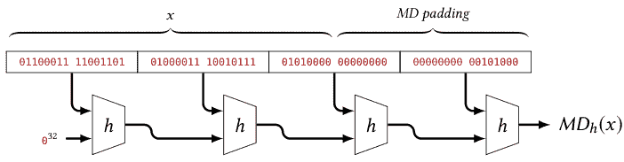

我们介绍了一个简化版本，其中 $\text{MD}_h$ 接受的输入最大长度为 $2^t - 1$ 位（输入长度必须能装入 $t$ 位）。通过使用多个填补块（在必要时）以及对原始字符串长度的适当编码，该构造可以扩展以容纳任意长度的输入（参见练习）。

值 $y_0$ 称为 **初始化向量**（IV），它是算法中硬编码的一部分。

如上所述，我们不会使用库风格定义进行可证明安全性声明。然而，我们可以通过以下主张来证明 Merkle-Damgård 构造的合理性：

### 主张 11.3

假设 $h$ 是一个压缩函数，$\text{MD}_h$ 是应用于 $h$ 的 Merkle-Damgård 构造。给定 $\text{MD}_h$ 中的碰撞 $x, x'$，在 $h$ 中找到碰撞很容易。换句话说，如果在 $h$ 中找到碰撞很困难，那么在 $\text{MD}_h$ 中找到碰撞也必须很困难。

**证明** 假设 $x, x'$ 是 $\text{MD}_h$ 下的碰撞。定义 $x_1, \dots, x_{k+1}$ 和 $y_1, \dots, y_{k+1}$ 的值，如同在计算 $\text{MD}_h(x)$ 中一样。同样，定义 $x'_1, \dots, x'_{k'+1}$ 和 $y'_1, \dots, y'_{k'+1}$，如同在计算 $\text{MD}_h(x')$ 中一样。注意，一般来说，$k$ 可能不等于 $k'$。

回顾：

$\text{MD}_h(x) = y_{k+1} = h(y_k || x_{k+1})$
$\text{MD}_h(x') = y'_{k'+1} = h(y'_{k'} || x'_{k'+1})$

由于我们假设 $\text{MD}_h(x) = \text{MD}_h(x')$，因此有 $y_{k+1} = y'_{k'+1}$。我们考虑两种情况：

**情况 1：** 如果 $|x| \neq |x'|$，那么编码 $|x|$ 和 $|x'|$ 的填补块 $x_{k+1}$ 和 $x'_{k'+1}$ 不相等。因此 $y_k || x_{k+1} \neq y'_{k'} || x'_{k'+1}$，所以 $y_k || x_{k+1}$ 和 $y'_{k'} || x'_{k'+1}$ 是 $h$ 下的碰撞，证明完成。

**情况 2：** 如果 $|x| = |x'|$，那么 $x$ 和 $x'$ 被分割为相同数量的块，因此 $k = k'$。让我们从 $\text{MD}_h(x)$ 和 $\text{MD}_h(x')$ 的计算最后一步逆向推导。我们知道：

```
$y_{k+1} = h(y_k || x_{k+1})$
$=$
$y'_{k+1} = h(y'_k || x'_{k+1})$
```

如果 $y_k || x_{k+1}$ 和 $y'_k || x'_{k+1}$ 不相等，那么它们是 $h$ 下的碰撞，证明完成。否则，我们可以将相同的逻辑再次应用于 $y_k$ 和 $y'_k$，根据我们的假设，它们是相等的。

更一般地，如果 $y_i = y'_i$，那么要么 $y_{i-1} || x_i$ 和 $y'_{i-1} || x'_i$ 是 $h$ 下的碰撞（我们称之为“幸运”），要么 $y_{i-1} = y'_{i-1}$（我们称之为“不幸”）。我们以 $y_k = y'_k$ 为前提开始。在每次都“不幸”且在将此逻辑逆向传播到 $\text{MD}_h(x)$ 和 $\text{MD}_h(x')$ 的计算过程中不遇到碰撞的情况下，我们是否可能？答案是否定的，因为每次都遇到不幸情况意味着对于所有 $i$ 都有 $x_i = x'_i$。也就是说，$x = x'$。但这与我们最初的假设 $x \neq x'$ 矛盾。因此，我们必定会遇到某种“幸运”情况，从而得到 $h$ 中的一个碰撞。

### 11.3 哈希函数与 MAC：长度扩展攻击

讨论哈希函数时，我们通常将盐 s 视为公开的。一个自然问题是，当我们将盐设为私有时会发生什么？在迄今讨论的所有密码学原语中，带有秘密盐的哈希函数最接近 MAC。那么，通过使用带有私有盐的哈希函数，我们是否就能获得一个安全的 MAC？

不幸的是，一般来说答案是否定的（尽管在某些情况下可能是肯定的，具体取决于哈希函数）。特别是，当 $H$ 采用 Merkle-Damgård 方法构造时，该方法是不安全的。关键观察如下：

> 知道 $H(x)$ 允许你预测任何以 $\text{MDPAD}(x)$ 开头的字符串的哈希值。

该概念最好通过示例来说明。

### 示例

让我们回到之前的示例，其中压缩函数为 $h : \{0,1\}^{48} \rightarrow \{0,1\}^{32}$。假设我们利用该压缩函数构建一个 Merkle-Damgård 哈希，并使用构造 $\text{MAC}(k, m) = H(k||m)$ 作为 MAC。
假设 MAC 密钥选择为 $k = 01100011\ 11001101$，攻击者看到消息 $m = 01000011\ 10010111\ 01010000$ 的 MAC 标签 $t$。那么 $t = H(k||m)$ 正好对应之前的示例：

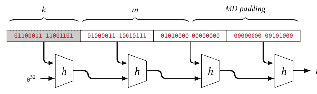

与之前唯一的区别是，第一个块包含 MAC 密钥，因此其值对攻击者未知。我们在此将其阴影处理为灰色。攻击者知道所有其他输入以及输出标签 $t$。

> 我声称，攻击者现在可以准确预测以下内容的标签：

```
m' = 01000011 10010111 01010000 00000000 00000000 00101000
```

拥有密钥的人会按如下方式计算该值的正确 MAC 标签 $t'$：

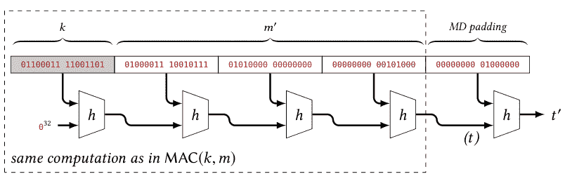

攻击者可以不使用密钥以另一种方式计算输出 $t'$。具体来说，攻击者知道最后一次 $h$ 调用的所有输入。由于 $h$ 函数本身是公开的，攻击者可以自行将此值计算为 $t' = h(t||00000000\ 01000000)$。由于她只在看到 $m$ 的标签的情况下就能预测 $m'$ 的标签，她已攻破该 MAC 方案。

### 讨论

- 在我们的示例中，攻击者看到 $m$ 的 MAC 标签（计算为 $H(k||m)$），然后伪造 $m' = m||p$ 的标签，其中 $p$ 是在对 $k||m$ 进行哈希时必须添加的填充。请注意，填充仅取决于 $k$ 的 *长度*，我们假设该长度是公开的。
- 同样的攻击可用于伪造任何 *以* $m||p$ 开头的 $m'$ 的标签。攻击者只需自行计算 Merkle-Damgård 的最后几轮（而不仅仅是一轮）即可。
- **这不是对抗碰撞抗性的攻击！** 长度扩展不会导致碰撞！我们并不是说 $k||m$ 和 $k||m||p$ 在 $H$ 下具有 *相同* 的哈希，而是说，知道 $k||m$ 的哈希值可以让你同时计算出 $k||m||p$ 的哈希值。

了解 $H(k||m)$ 为何无法作为 MAC，有助于我们理解从哈希函数构建安全 MAC 的更好方法：

- Merkle-Damgård 方法因输出其 **完整内部状态** 而易受长度扩展攻击。在上面的示例图中，值 $t$ 既是 $H(k||m)$ 的输出，也是计算 $H(k||m||p)$ 中最后一次 $h$ 调用所需的关于 $k||m$ 的唯一信息。

避免此问题的一种方法是仅输出内部状态的一部分。在 Merkle-Damgård 中，我们计算 $y_i := h(y_{i-1}||x_i)$ 直到达到最终输出 $y_{k+1}$。假设改为仅输出 $y_{k+1}$ 的一半（为了使此操作有意义，$y_i$ 值可能需要更长）。那么，仅知道 $y_{k+1}$ 的一半不足以在长度扩展场景中预测哈希输出会是什么。

哈希函数 **SHA-3** 正是按此方式设计的（通常称为“宽管道”构造）。SHA-3 的明确设计标准之一是 $H(k||m)$ 将是一个安全的 MAC。

- 使用 Merkle-Damgård 的长度扩展之所以可能，是因为 $H(k||m)$ 的计算在 $H(k||m||p)$ 的计算过程中恰好出现。类似问题


## 习题

- 11.1. 有时当我目视核对 MD5 哈希值时，我只检查开头几个和结尾几个十六进制数字，而不太看哈希值的中间部分。

  生成两个含义相反的文件，它们的 MD5 哈希值在前 16 位（4 个十六进制数字）和后 16 位（4 个十六进制数字）上一致。可以是两个表达相反意思的文本文件。可以是一个马里奥图片和一个库巴图片。我不知道，发挥创意。

  作为示例，字符串“subtitle illusive planes”和“wantings premises forego”实际上在它们的 MD5 哈希值的前 20 位和后 20 位（首尾 5 个十六进制数字）上一致，但不清楚它们是否非常有意义。

  ```
  $ echo -n "subtitle illusive planes" | md5sum
  4188d4cdcf2be9a112bdb8ce4500243 -
  $ echo -n "wantings premises forego" | md5sum
  4188d209a75e1a9b90c6fe3efe300243 -
  ```

  描述你是如何生成这些文件的，以及你进行了多少次 MD5 计算。

- 11.2. 设 $h : \{0, 1\}^{n+t} \to \{0, 1\}^n$ 为固定长度压缩函数。假设我们忘记了 Merkle-Damgård 变换的几个重要特性，并从 $h$ 构造哈希函数 $H$ 如下：

  - 设 $x$ 为输入。
  - 将 $x$ 分割为片段 $y_0, x_1, x_2, \dots, x_k$，其中 $y_0$ 是 $n$ 位，每个 $x_i$ 是 $t$ 位。最后一片段 $x_k$ 如有必要应用零填充。
  - 对 $i = 1$ 到 $k$，设置 $y_i = h(y_{i-1}||x_i)$。
  - 输出 $y_k$。

  基本上，它类似于 Merkle-Damgård，只不过我们丢失了 IV，也丢失了最终填充块。

  - 1. 描述一种简便方法，找出两个消息，它们被分割成相同数量的片段，且在 $H$ 下具有相同的哈希值。
  - 2. 描述一种简便方法，找出两个消息，它们被分割成不同数量的片段，且在 $H$ 下具有相同的哈希值。

  你上述的任何碰撞都不应涉及在 $h$ 中找到碰撞。

- 11.3. 我设计了一个哈希函数 $H : \{0, 1\}^* \rightarrow \{0, 1\}^n$。我的一个想法是，如果 $x$ 是一个 $n$-bit 字符串，则令 $H(x) = x$（假设 $H$ 在其他长度输入上的行为要复杂得多）。这样，我们可以确定 $n$-bit 字符串之间没有碰撞。我做出了一个好的设计决策吗？

- 11.4. 同上，但现在如果 $x$ 是 $n$ 位长，则 $H(x) = x \oplus m$，其中 $m$ 是一个固定的公开字符串。这能成为一个好的哈希函数吗？

- 11.5. 设 $H$ 为哈希函数，$t$ 为固定常数。定义 $H^{(t)}$ 为：

  \[
  H^{(t)}(x) = H(\cdots H(H(x)) \cdots ).
  \]
  \(\underbrace{\quad t \text{ times} \quad}\)

  证明，如果给定一个在 \(H^{(t)}\) 下的碰撞，则可以高效地在 \(H\) 下找到一个碰撞。

- 11.6. 在本题中，如果 \(x\) 和 \(y\) 是相同长度的字符串，当 \(x = y\) 或 \(x\) 在标准字典序中排在 \(y\) 之前时，我们写 \(x \sqsubseteq y\)。

  假设函数 \(H : \{0, 1\}^* \rightarrow \{0, 1\}^n\) 具有以下性质。对于所有相同长度的字符串 \(x\) 和 \(y\)，如果 \(x \sqsubseteq y\)，则 \(H(x) \sqsubseteq H(y)\)。证明 \(H\) 是 **不** 抗碰撞的（描述如何高效地在该函数中找到碰撞）。

- 11.7. 假设函数 \(H : \{0, 1\}^* \rightarrow \{0, 1\}^n\) 具有以下性质。对于所有相同长度的字符串 \(x\) 和 \(y\)，\(H(x \oplus y) = H(x) \oplus H(y)\)。证明 \(H\) 是 **不** 抗碰撞的（描述如何高效地在该函数中找到碰撞）。

- 11.8. 设 \(H\) 是一个带有 \(n\) 位输出的加盐哈希函数，并定义以下函数：

  \[
  \boxed{\begin{aligned}
  &H^*(x_1 || x_2 || x_3 || \cdots || x_k): \\
  &\quad \text{return } H(1, x_1) \oplus H(2, x_2) \oplus \cdots \oplus H(k, x_k)
  \end{aligned}}
  \]

  注意 \(H^*\) 可以接受任意长度（\(k\)）的输入。证明当 \(k > n\) 时如何在 \(H^*\) 中找到碰撞。

- 11.9. 推广 Merkle-Damgård 构造，使其适用于任意输入长度（以及压缩函数中任意的 \(t\) 值）。将 Claim 11.3 的证明扩展到你的新构造中。

- 11.10. 设 \(F\) 是一个具有 \(n\)-bit 输入的安全 PRF，\(H\) 是一个具有 \(n\)-bit 输出的抗碰撞（加盐）哈希函数。定义新函数 \(F'((k, s), x) = F(k, H(s, x))\)，其中我们将 \((k, s)\) 视为其密钥。证明 \(F'\) 是一个具有任意长度输入的安全 PRF。

- 11.11. 设 MAC 是一个具有 n-bit 输入的安全 MAC 算法，\(H\) 是一个具有 n-bit 输出的抗碰撞（加盐）哈希函数。定义新函数 MAC'((k, s), x) = MAC(k, H(s, x))，其中我们将 (k, s) 视为其密钥。证明 MAC' 是一个具有任意长度输入的安全 MAC。

### 11.12. Merkle-Damgård 构造中更多奇异问题：

- (a) 设 H 是一个基于 Merkle-Damgård 构造的 n-bit 输出哈希函数。展示如何（以高概率）使用仅 ~ 2 · 2^{n/2} 次 H 调用来计算 4 条哈希值在 H 下相同的消息。
  提示：这 4 条碰撞消息将采用 x || x' || y || y' 的形式。使用长度扩展攻击和生日攻击的思路。

- (b) 展示如何使用仅 O(d · 2^{n/2}) 次 H 计算来构造 2^d 条哈希值在 H 下相同的消息。

- (c) 假设 H_1 和 H_2 是（不同的）哈希函数，均具有 n-bit 输出。考虑函数 H^*(x) = H_1(x) || H_2(x)。由于 H^* 具有 2n-bit 输出，很容易认为在 H^* 中找到碰撞需要 2^{(2n)/2} = 2^n 的工作量。
  然而，当 H_1 是 Merkle-Damgård 哈希时，这种直觉不成立。证明当 H_1 是 Merkle-Damgård 时，可以使用仅 O(n 2^{n/2}) 的工作量在 H^* 中找到碰撞。该攻击不应对 H_2 作任何假设（即，H_2 不需要是 Merkle-Damgård）。
  提示：应用部分 (b)，首先找到一组 2^{n/2} 条在 H* 下哈希值相同的消息。在其中，找到 2 条在 H_2 下也碰撞的消息。

- 11.13. 设 H 是一个输出长度为 n 的抗碰撞哈希函数。设 H^* 表示以类似 CBC-MAC 的方式迭代 H：

  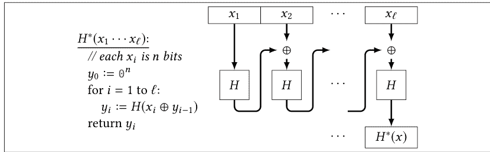

  证明 H^* 不是 **抗碰撞** 的。描述一次成功的攻击。

- 11.14. 证明裸 PRP 不是抗碰撞的。换句话说，如果 F 是安全的 PRP，则展示如何在 H(x||y) = F(x, y) 中高效地找到碰撞。

- 11.15. 证明对 PRP 应用 CBC-MAC 构造不是抗碰撞的。更准确地说，设 F 是安全的 PRP。展示如何在以下加盐哈希函数 H 中高效地找到碰撞：

  ```
  H(k, m_1||m_2||m_3):
  c_1 := F(k, m_1)
  c_2 := F(k, m_2 \oplus c_1)
  c_3 := F(k, m_3 \oplus c_2)
  return c_3
  ```

  此处我们将 k 视为盐值。这是又一个示例，说明抗碰撞性不同于真实性（MAC）。

- 11.16. 设 \( H : \{0, 1\}^\lambda \to \{0, 1\}^\lambda \) 为任意函数，并定义以下函数 \( H^* : \{0, 1\}^{2\lambda} \to \{0, 1\}^\lambda \)：

  ```
  H^*(x||y):
  z := H(x) \oplus y
  return H(z) \oplus x
  ```

  展示如何对 \( H^* \) 进行一次高效的第二原像攻击。

- 11.17. 将纯哈希值添加到明文中并不能实现 CCA 安全。考虑以下加密方法，使用纯（未加盐）哈希函数 \( H \)。加密明文 \( m \) 时，只需在 CTR 模式下加密 \( m||H(m) \)。解密时，使用标准 CTR 模式解密，但如果明文不符合 \( m||H(m) \) 的形式（即，最后 \( n \) 位不是 CTR 明文其余部分的哈希值），则返回 err。

  证明该方案不具有 CCA 安全性。

- 11.18. 在讨论长度扩展攻击时，我们指出，一种自然的阻止方法是对 Merkle-Damgård 的最后一个块“做些不同的事情”。假设在 Merkle-Damgård 中对 h 进行最终调用后，我们对值（\( y_{k+1} \)）取补码。这种修改后的方案是否仍具有长度扩展特性？


## 12 认证加密与 AEAD

Disclaimer: This chapter is in rough draft stage.

It can be helpful to think of encryption as providing a secure *logical channel* between two users who only have access to an insecure *physical channel*. Below are a few things that an attacker might do to the insecure physical channel:

- An attacker may **passively eavesdrop**; *i.e.*, simply observe the channel. A CPA-secure encryption scheme provides **confidentiality** and prevents the attacker from learning anything by eavesdropping.
- An attacker may **drop** messages sent along the channel, resulting in a denial of service. If the attacker can do this on the underlying physical channel, then it cannot be overcome through cryptography.
- An attacker may try to **modify** messages that are sent along the channel, by tampering with their ciphertexts. This sounds like what CCA-secure encryption protects against, right?
- An attacker may try to **inject** new messages into the channel. If successful, Bob might receive a message and mistake it for something that Alice meant to send. Does CCA security protect against this? If it is indeed possible to inject new messages into the channel, then an attacker can delete Alice's ciphertexts and replace them with their own. This would seem to fall under the category of “modifying” messages on the channel, so message-injection and message-modification are somewhat connected.
- An attacker may try to **replay** messages that were sent. For example, if Bob was convinced that a ciphertext c came from Alice, then an attacker can re-send the same c many times, and Bob may interpret this as Alice wanting to re-send the same plaintext many times. Does CCA security protect against this?

Although it might seem that CCA-secure encryption guarantees protection against many of these kinds of attacks, it does not!

To see why, consider the SRP-based encryption scheme of Construction 9.3. We proved that this scheme has CCA security. However, it never raises any errors during decryption. Every ciphertext is interpreted as a valid encryption of *some* plaintext. An attacker can choose an arbitrary ciphertext, and when Bob decrypts it he might think Alice was trying to send some (presumably garbled) message. The only thing that CCA security guarantees is that **if** an attacker is able to make a ciphertext that decrypts without error, then it must decrypt to something that is unrelated to the contents of other ciphertexts.

In order to achieve protection against message-modification and message-injection on the secure channel, we need a stronger/better security definition. Authenticated encryption (AE) formalizes the extra property that only someone with the secret key can find ciphertexts that decrypt without error. For example, encrypt-then-MAC (Construction 10.9) already has this property.

In this chapter we will discuss authenticated encryption and a closely-related concept of encryption with associated data (AD), which is designed to help prevent message-replay attacks. These two concepts are the “gold standard” for encryption.

### 12.1 Definitions

### Authenticated Encryption

As with CPA and CCA flavors of security, we can define AE security in both a “left-vs-right” style or a “pseudorandom ciphertexts” style. Both are reasonable choices. To make life simpler we will only define the pseudorandom-ciphertexts-style of AE security in this chapter.

In CCA security, the attacker has access to the decryption algorithm (except for ciphertexts generated by the library itself). This captures the idea that the result of decrypting adversarially-generated ciphertexts cannot help distinguish the contents of other ciphertexts. For AE security, we want a stronger condition that Dec(k, c) = err for every adversarially-generated ciphertext c. Using the same ideas used to define security for MACs, we express this requirement by saying that the attacker shouldn’t be able to distinguish access to the “real” Dec algorithm, or one that always outputs err:

**Definition 12.1** (AE) Let \(\Sigma\) be an encryption scheme. We say that \(\Sigma\) has **authenticated encryption (AE) security** if \(\mathcal{L}^{\Sigma}_{\text{ae\$-real}} \approx \mathcal{L}^{\Sigma}_{\text{ae\$-rand}}\), where:

```
L^Σ_ae$-real
k ← Σ.KeyGen
S := ∅
CTXT(m ∈ Σ.M):
  c := Σ.Enc(k, m)
  S := S ∪ {c}
  return c
DECRYPT(c ∈ Σ.C):
  if c ∈ S: return err
  return Σ.Dec(k, c)
```

```
L^Σ_ae$-fake
CTXT(m ∈ Σ.M):
  c ← Σ.C(|m|)
  return c
DECRYPT(c ∈ Σ.C):
  return err
```

### Discussion

The two libraries are different from each other in two major ways: whether the calling program sees real ciphertexts or random strings (that have nothing to do with the given plaintext), and whether the calling program sees the true result of decryption or an error message. With these two differences, we are demanding that two conditions be true: the calling program can’t tell whether it is seeing real or fake ciphertexts, it also cannot generate a ciphertext (other than the ones it has seen) that would cause Dec to output anything except err.

Whenever the calling program calls DECRYPT(c) for a ciphertext c that was produced by the library (in CTXT), both libraries will return err by construction. Importantly, the difference in the libraries is the behavior of DECRYPT on ciphertexts that were not generated by the library (i.e., generated by the attacker).

### Associated Data

AE provides a secure channel between Alice and Bob that is safe from message-modification and message-injection by the attacker (in addition to providing confidentiality). However, AE still does not protect from replay of messages. If Alice sends a ciphertext c to Bob, we know that Bob will decrypt c without error. The guarantee of AE security is that Bob can be sure that the message originated from Alice in this case. If an attacker re-sends the same c at a later time, Bob will likely interpret that as a sign that Alice wanted to say the same thing again, even though this was not Alice’s intent. It is still true that Alice was the originator of the message, but just not at this time.

You may wonder how it is possible to prevent this sort of attack. If a ciphertext c is a valid ciphertext when Alice sends it, then it will always be a valid ciphertext, right? A clever way around this problem is for Alice to not only authenticate the ciphertext as coming from her, but to authenticate it also to a specific context. For example, suppose that Alice & Bob are exchanging encrypted messages, and the 5th ciphertext is c, sent by Alice. The main idea is to let Alice authenticate the fact that “I meant to send c as the 5th ciphertext in the conversation.” If an attacker re-sends c later (e.g., as the 11th ciphertext, a different context), Bob will attempt to authenticate the fact that “Alice meant to send c as the 11th ciphertext,” and this authentication will fail.

What I have called “context” is called associated data in an encryption scheme. In order to support associated data, we modify the syntax of the encryption and decryption algorithms to take an additional argument d. The ciphertext c = Enc(k, d, m) is an encryption of m with associated data d. In an application, d could be a sequence number of a conversation, a hash of the entire conversation up to this point, an IP address + port number, etc. — basically, as much information as you can think of regarding this ciphertext’s intended context. Decrypting c with the “correct” associated data d via Dec(k, d, c) should result in the correct plaintext m. Decrypting c with any other associated data should result in an error, since that reflects a mismatch between the sender’s and receiver’s contexts.

The intuitive security requirement for authenticated encryption with associated data (AEAD) is that an attacker who sees many encryptions ci of chosen plaintexts, each authenticated to a particular associated data di, cannot generate a different (c*, d*) that decrypts successfully. The security definition rules out attempts to modify some ci under the same di, or modify some di for the same ci, or produce a completely new (c*, d*).

Definition 12.2 (AEAD) Let $\Sigma$ be an encryption scheme. We write $\Sigma.\mathcal{D}$ to denote the space of supported associated data signifiers (“contexts”). We say that $\Sigma$ has authenticated encryption with associated data (AEAD) security if $\mathcal{L}^{\Sigma}_{\text{aead\$-real}} \approx \mathcal{L}^{\Sigma}_{\text{aead\$-rand}}, where:


```
\mathcal{L}^\Sigma_{\text{aead\$ -real}}
k \leftarrow \Sigma.\text{KeyGen}
\mathcal{S} := \emptyset
\text{CTXT}(d \in \Sigma.\mathcal{D}, m \in \Sigma.\mathcal{M}):
c := \Sigma.\text{Enc}(k, d, m)
\mathcal{S} := \mathcal{S} \cup \{(d, c)\}
return c
\text{DECRYPT}(d \in \Sigma.\mathcal{D}, c \in \Sigma.\mathcal{M}):
if (d, c) \in \mathcal{S}: return \text{err}
return \Sigma.\text{Dec}(k, d, c)
```

```
\mathcal{L}^\Sigma_{\text{aead\$ -fake}}
\text{CTXT}(d \in \Sigma.\mathcal{D}, m \in \Sigma.\mathcal{M}):
c \leftarrow \Sigma.C(|m|)
return c
\text{DECRYPT}(d \in \Sigma.\mathcal{D}, c \in \Sigma.\mathcal{M}):
return \text{err}
```

### Discussion

将消息与某个上下文 \(d\) 进行认证的一种方法，是在 AE 方案中加密 \(m||d\) 而非仅加密 \(m\)。这确实可行！将 \(d\) 作为明文的一部分确实可以对其进行认证，但也会 _隐藏_ 它。区分明文和关联数据的要点在于，我们假设关联数据是两个参与者之间的 _共享上下文_。换句话说，我们假设发送方和接收方都已经知道上下文 \(d\)。因此，_隐藏 \(d\) 属于过度处理 — 只需要认证即可。通过在 AEAD 中分别区分明文和关联数据，**密文长度只能取决于明文的长度**，而不取决于关联数据的长度。

关联数据 \(d\) 是公开的这一事实，体现在安全定义中由调用程序选择它。

“标准” AE 对应于 \(d\) 始终为空的情况：所有密文都认证到相同的上下文。

### 12.2 实现 AE/AEAD

Encrypt-then-MAC 构造（构造 10.9）具有攻击者无法生成能正确解密的密文的特性。尽管我们引入 encrypt-then-MAC 是为了实现 CCA 安全，但它也实现了更强的 AE 要求。

**主张 12.3** _如果 E 具有 CPA 安全且 M 是一个安全的 MAC，那么 EtM（构造 10.9）具有 AE 安全。_

> to-do
> _这里存在轻微的不匹配，因为我将 AE/AEAD 安全定义为一种“伪随机密文”风格的定义。因此，你实际上需要 CPA$+PRF 而不是 CPA+MAC。但 CPA+MAC 对于左右取样式的 AE/AEAD 安全已经足够。_

安全证明本质上与 CCA 安全的证明（主张 12.5）相同。在该证明中，存在一个混合，其中 DECRYPT 子例程始终返回错误。在该点停止证明将得到 AE 安全的证明。

### 带关联数据的先加密后 MAC

回顾，先加密后 MAC 构造计算密文的 MAC。要融入关联数据，我们只需将密文与关联数据一起计算 MAC。

回顾，实践中大多数 MAC 支持变长输入，但 MAC 标签的长度不取决于消息的长度。因此，这种新的先加密后 MAC 变体具有密文，其长度不取决于关联数据的长度。

```
Construction 12.4
(Enc+MAC+AD)

Enc((k_e, k_m), d, m):
  c <- E.Enc(k_e, m)
  t := M.MAC(k_m, d || c)
  return (c, t)

Dec((k_e, k_m), d, (c, t)):
  if t != M.MAC(k_m, d || c):
    return err
  return E.Dec(k_e, c)
```

Claim 12.5
如果 E 具有 CPA 安全且 M 是一个安全的 MAC，那么构造 12.4 具有 AEAD 安全性，前提是关联数据具有固定长度（即，D = {0, 1}^n，其中 n 为某个固定值）。

> to-do
> 该构造对于变长关联数据是不安全的。修复这一点并不十分困难；参见练习。

### 12.3 Carter-Wegman MACs

假设我们使用先加密后 MAC 范式构建一个 AE[AD] 方案。CPA 安全加密方案的良好选择是 CBC 模式；MAC 方案的良好选择是 ECBC-MAC。结合这两个构建块将产生一个 AE[AD] 方案，该方案对每个明文块调用两次块密码——一次用于 CBC 加密（应用于明文），另一次用于 ECBC-MAC（应用于该密文块）。

是否可以以更低的成本实现 AE[AD]？在本节中，我们将探讨一种针对变长 MAC 的更高效技术，该技术只需要每个消息块执行一次乘法操作，并伴随一次块密码调用。

### 通用哈希函数

Carter-Wegman 风格 MAC 中的主要构建块是一种称为通用哈希函数（UHF）的哈希函数。虽然“通用哈希函数”这个名字听起来一定是一种极其强大的原语，但 UHF 实际上提供的安全保证远比抗碰撞或第二前像抗性哈希函数要弱。

回顾，如果 \(x \neq x'\) 且 \(H(s, x) = H(s, x')\)，则 \((x, x')\) 是盐 \(s\) 下的碰撞。通用哈希函数的特性在于，找到这样的碰撞是困难的 ...

... 当 \(x\) 和 \(x'\) 在不知道盐的情况下被选择时，

... 并且当攻击者只有一次机会为某个特定的盐值寻找碰撞时。

这些约束相当于在 \(x\) 和 \(x'\) 被选择后再选择盐，并且在这种情况下碰撞应该是可忽略的。

定义可以更正式地表述：

### 定义 12.6 (UHF) 具有盐集合 \(S\) 的哈希函数 \(H\) 称为 **通用哈希函数 (UHF)**，如果 \(L_{\text{uhf-real}}^H \cong L_{\text{uhf-fake}}^H\)，其中：

```
L_uhf-real^H
TEST(x, x' ∈ {0, 1}*):
  s ← S
  b := [ H(s, x) =? H(s, x') ]
  return (s, b)
```

```
L_uhf-fake^H
TEST(x, x' ∈ {0, 1}*):
  s ← S
  return (s, false)
```

该定义在精神上与抗碰撞性的正式定义（定义 11.1）相似。就像那个定义一样，这个定义在安全证明中使用起来很麻烦。在使用哈希函数时，人们通常不会显式地检查碰撞，而是直接假设没有碰撞发生。

在 UHF 的情况下，有一种不同且有用的安全思考方式。考虑一个 **“盲抗碰撞性”** 游戏，你试图在没有盐访问权限，甚至 _看不到 H 的输出_ 的情况下找到 \(H\) 下的碰撞！结果表明，如果 \(H\) 是 UHF，那么在这种游戏中找到碰撞是困难的：

### 主张 12.7 如果 \(H\) 是 UHF，那么以下库不可区分：

```
L_bcr-real^H
s ← S
H_inv := empty assoc. array
TEST(x ∈ {0, 1}*):
  y := H(s, x)
  if H_inv[y] defined and H_inv[y] ≠ x:
    return H_inv[y]
  H_inv[y] := x
  return false
```

```
L_bcr-fake^H
TEST(x ∈ {0, 1}*):
  return false
```

在这些库中，调用程序为 UHF 选择输入 \(x\)。\(L_{\text{bcr-real}}\) 库以反向查找表的形式维护所有 \(x\) 值及其哈希的私有记录。\(H_{\text{inv}}[y]\) 将保存被哈希得到 \(y\) 的 \(x\) 值。

如果调用程序对与先前 \(x'\) 发生碰撞的值调用 \(\text{TEST}(x)\)，那么 \(L_{\text{bcr-real}}\) 将响应这个 \(x'\) 值（这样做的目的只是对使用这些库的安全证明有所帮助）；否则它将响应 \(\text{false}\)，不提供关于 \(s\) 或 \(H(s, x)\) 的任何信息。另一个库始终响应 \(\text{false}\)。因此，两者不可区分的前提是找到碰撞很困难。

to-do 即将给出证明。这不难，但很繁琐。

### 使用多项式构建 UHF

与其他类型的哈希相比，UHF 的安全性要弱得多，而且它们实际上可以无条件构建。在数学上最简单的构建之一与多项式有关。

**主张 12.8** 设 \(p\) 为一个素数，\(g\) 为系数在 \(\mathbb{Z}_p\) 中且次数至多为 \(d\) 的非零多项式。那么 \(g\) 在 \(\mathbb{Z}_p\) 中至多有 \(d\) 个零点。

这一观察导致了一个简单的 UHF 构建，其思路是将字符串 \(x\) 解释为多项式的系数，并在点 \(s\)（UHF 的盐）处求值该多项式。更详细地说，设 \(p\) 为满足 \(p > 2^\lambda\) 的素数，并令盐 \(s\) 为 \(\mathbb{Z}_p\) 中均匀选择的元素。要计算 \(x\) 的哈希，首先将 \(x\) 分割为 \(\lambda\) 比特块，以便索引为 \(x_{d-1} || x_{d-2} \cdots || x_0\)。将每个 \(x_i\) 解释为模 \(p\) 的数。然后，哈希值 \(H(s, x)\) 为：

\( s^d + x_{d-1}s^{d-1} + x_{d-2}s^{d-2} + \cdots + x_0 \pmod p \)

这是在点 \(s\) 处求系数为 \((1, x_{d-1}, x_{d-2}, \ldots, x_0)\) 的多项式的结果。求值该多项式的一种方便方法是使用 **Horner 法则：**

\( \cdots \cdot s \cdot (s \cdot (s + x_{d-1}) + x_{d-2}) + x_{d-3} \cdots \)

Horner 法则可以直观地表示如下：

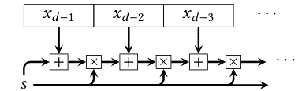

UHF 构建在下面正式描述。

```
Construction 12.9 (Poly-UHF)

\(\underline{H(s, x):}\)
write \(x = x_{d-1} || x_{d-2} || \cdots || x_0\),
where each \(|x_i| = \lambda\)

\(p = \) a prime \(> 2^\lambda\)
\(\mathcal{S} = \mathbb{Z}_p\)

\(y := 1\)
for \(i = d - 1\) downto 0:
  \(y := s \cdot y + x_i \% p\)
return \(y\)
```

**主张 12.10** Poly-UHF 构建是一个安全的 UHF。

**证明** 只需证明，对于任何 \(x \neq x'\)，\(H(s, x) = H(s, x')\) 的概率（关于随机选择的 \(s\)）是可忽略的。注意 \(H(s, x) = g(s)\)，其中 \(g\) 是系数为 \((1, x_{d-1}, \ldots, x_0)\) 的多项式，而 \(H(s, x') = g'(s)\)，其中 \(g'\) 是从 \(x'\) 推导出的类似多项式。注意 \(x\) 和 \(x'\) 可能被分割成不同数量的块，导致两个多项式的次数（\(d\) 和 \(d'\)）不同。


为了发生碰撞 $H(s, x) = H(s, x')$，必须有

$g(s) \equiv_p g'(s)$
$\Longleftrightarrow g(s) - g'(s) \equiv_p 0$

请注意，此等式左边是次数至多为 $d^* = \max\{d, d'\}$ 的多项式。而且，多项式 $g - g'$ 不是零多项式，因为 $g$ 和 $g'$ 是不同的多项式。即使原始字符串 $x$ 和 $x'$ 仅在 0 块中有所不同，得到的 $g$ 和 $g'$ 也会是不同的多项式，因为它们包含额外的首位系数 1。

当且仅当 $s$ 被选为 $g - g'$ 的根之一时，才会发生碰撞。根据主张 12.8，该多项式至多有 $d^*$ 个根，因此选择其中之一的概率至多为：

$d^*/p \le d^*/2^\lambda.$

由于 $d^*$ 是 $\lambda$ 的多项式（它是攻击者写下的字符串中的块数，攻击者在 $\lambda$ 的多项式时间内运行），因此该概率是可忽略的。

> to-do
>
> 细则：此方法可行，但模块乘法不够快。如果你希望这快速，你会使用二元有限域。描述有限域是什么并不算太糟，但这涉及更多多项式。然后当你构建系数为有限域元素的多项式时，存在感觉像是多项式之上的多项式的风险（因为在某种程度上它确实是）。我不确定我最终将如何处理这个问题。

## 基于 Carter-Wegman UHF 的 MAC

仅 UHF 本身并不是一个好的 MAC，即使其盐值 $s$ 保持秘密。这是因为 MAC 的安全性必须在攻击者看到函数输出的情况下成立，而 UHF 仅在攻击者看不到 UHF 输出时才提供安全性（盲抗碰撞性）。

Carter-Wegman MAC 技术通过将 UHF 的输出送入 PRF 来增强 UHF，因此 $m$ 的 MAC 为 $F(k, H(s, m))$，其中 $H$ 是 UHF，$F$ 是 PRF。

> **构造 12.11 (Carter-Wegman)**
>
> 设 $H$ 是具有 $n$ 位输出的 UHF，设 $F$ 是输入长度为 $n$ 的安全 PRF。Carter-Wegman 构造将二者组合如下：
>
> KeyGen:
> $k \leftarrow \{0, 1\}^\lambda$
> $s \leftarrow \mathcal{S}$
> return $(k, s)$
>
> MAC$((k, s), x)$:
> $y := H(s, x)$
> return $F(k, y)$

我们将证明 Carter-Wegman 构造是一个安全的 PRF。回顾这意味着该构造也是一个安全的 MAC（主张 10.4）。请注意，Carter-Wegman 构造也将 PRF 作为构建块。然而，它将 PRF 用于短消息，以构建用于任意长度消息的 PRF。此外，它只调用底层 PRF 一次，所有涉及 UHF 的其他计算相对来说都比较“便宜”。

要理解 Carter-Wegman 的安全性，我们逆向思考。输出 \( F(k, H(s, x)) \) 直接来自 PRF。只要 PRF 的输入是 \( distinct \)，这些输出看起来就是随机的。在此构造中，PRF 输入重复的唯一方式是 UHF \( H \) 中发生碰撞。然而，我们必须小心。只有当盐值保密且其输出对攻击者隐藏时，我们才能论证 \( H \) 的抗碰撞性。在此情况下盐值确实被隐藏（作为 Carter-Wegman 密钥的一部分），但其输出被用作 PRF 输入。幸运的是，PRF 的保证是其输出看起来与其输入 \( unrelated \)。换句话说，PRF 输出不会泄露关于 PRF 输入（\( H \)-输出）的任何信息。确实，这似乎是一种 UHF 输出对攻击者隐藏的情况，因此我们可以论证 \( H \) 中的碰撞可忽略地不可能发生。

## 主张 12.12
如果 \( H \) 是安全的 UHF 且 \( F \) 是安全的 PRF，那么 Carter-Wegman 构造 (*构造 12.11*) 是安全的 PRF，因此也是安全的 MAC。

### 证明
我们将证明 \( \mathcal{L}_{\text{prf-real}}^{\text{CW}} \approx \mathcal{L}_{\text{prf-rand}}^{\text{CW}} \)，使用标准混杂技术。

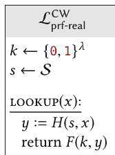

起点是 \( \mathcal{L}_{\text{prf-real}}^{\text{CW}} \)。

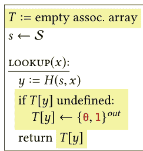

我们应用了 \( F \) 的安全性，通过按 \( \mathcal{L}_{\text{prf-real}}^F \) 分解，将其替换为 \( \mathcal{L}_{\text{prf-rand}}^F \)，并内联结果。

```
cache := empty assoc. array
T := empty assoc. array
s \leftarrow \mathcal{S}
LOOKUP(x):
if cache[x] undefined:
  y := H(s, x)
  if T[y] undefined:
    T[y] \leftarrow \{0, 1\}^{out}
  cache[x] := T[y]
  return cache[x]
```

查找子程序具有以下属性：如果对同一个 x 调用两次，它将返回相同的结果。因此每次缓存答案没有任何坏处。第二次对同一值 x 调用 LOOKUP 时，先前的值将从缓存加载，而不是重新计算。此更改对调用程序没有影响。

```
cache := empty assoc. array
H_{inv} := empty assoc. array
T := empty assoc. array
s \leftarrow \mathcal{S}
LOOKUP(x):
if cache[x] undefined:
  y := H(s, x)
  if H_{inv}[y] defined:
    x' := H_{inv}[y]
    return cache[x']
  if T[y] undefined:
    T[y] \leftarrow \{0, 1\}^{out}
  H_{inv}[y] := x
  cache[x] := T[y]
  return cache[x]
```

请注意，如果查找首先对 x' 调用，随后对 x 调用，其中 H(s, x) = H(s, x')，则 lookup 将返回相同的结果。因此我们修改库来跟踪 H-输出和输入。每当库计算 y = H(s, x) 时，它将存储 H_{inv}[y] = x。但是，如果 H_{inv}[y] 已经存在，这意味着该 x 和 x' = H_{inv}[y] 在 H 下是碰撞。在这种情况下，库直接返回它先前对输入 x' 返回的内容。此更改对调用程序没有影响。

```
cache := empty assoc. array
H_{inv} := empty assoc. array
T := empty assoc. array
s \leftarrow \mathcal{S}
LOOKUP(x):
if cache[x] undefined:
  y := H(s, x)
  if H_{inv}[y] defined:
    x' := H_{inv}[y]
    return cache[x']
  if H_{inv}[y] undefined:
    T[y] \leftarrow \{0, 1\}^{out}
    H_{inv}[y] := x
    cache[x] := T[y]
  return cache[x]
```

在先前的混杂中，T[y] 在设置 H_{inv}[y] 的同时设置——在第一次调用 LOOKUP(x) 使得 H(s, x) = y 时。因此，检查 T[y] 是否定义或检查 H_{inv}[y] 是否定义对调用程序没有影响。

```
cache := empty assoc. array
H_{inv} := empty assoc. array
s \leftarrow \mathcal{S}
LOOKUP(x):
if cache[x] undefined:
  y := H(s, x)
  if H_{inv}[y] defined:
    x' := H_{inv}[y]
    return cache[x']
  if H_{inv}[y] undefined:
    cache[x] \leftarrow \{0, 1\}^{out}
    H_{inv}[y] := x
  return cache[x]
```

请注意，如果 H_{inv}[y] 已定义，则 lookup 将在该 if 语句内返回。因此，行 cache[x] := T[y] 仅在 H_{inv}[y] 初始未定义的情况下执行。与其选择 T[y] 仅为立即将其赋给 cache[x]，不如直接赋值给 cache[x]。此更改对调用程序没有影响，并且完全消除了 T 关联数组。

此混杂中涉及 H_{inv} 的 if 语句正在检查 x 是否与任何先前的 x' 在 H 下发生碰撞。所有这些逻辑，包括 H 的求值，都可以按 \(\mathcal{L}^H_{\text{bc-real}}\) 分解。在混杂序列的此点，除了检查是否遇到碰撞（以及如果是，违规输入是什么）之外，不需要 H 的输出。同样，此更改对调用程序没有影响。结果是：

```
cache := empty assoc. array
LOOKUP(x):
if cache[x] undefined:
  if TEST(x) = x' ≠ false
    return cache[x']
  else:
    cache[x] ← {0, 1}^out
    return cache[x]
```

```
\mathcal{L}^H_{\text{bcr-real}}
s \leftarrow \mathcal{S}
H_{inv} := empty assoc. array
TEST(x):
  y := H(s, x)
  if H_{inv}[y] defined:
    return H_{inv}[y]
  H_{inv}[y] := x
  return false
```

\( H \) 的安全性在于我们可以将 \(\mathcal{L}^H_{\text{bcr-real}}\) 替换为 \(\mathcal{L}^H_{\text{bcr-fake}}\)，对调用程序的影响可忽略。请注意，\(\mathcal{L}_{\text{bcr-fake}}\) 中的 TEST 算法始终返回 false。这使我们只需删除“if \(\text{TEST}(x) \neq \text{false}\)”子句，得到以下内容：

```
\mathcal{L}^{CW}_{\text{prf-rand}}
cache := empty assoc. array
LOOKUP(x):
if cache[x] undefined:
  cache[x] ← {0, 1}^out
  return cache[x]
```

由于这正是 \(\mathcal{L}^{CW}_{\text{prf-rand}}\)，我们完成了证明。我们已证明 \(\mathcal{L}^{CW}_{\text{prf-rand}} \approx \mathcal{L}^{CW}_{\text{prf-rand}'}\)。\(\blacksquare\)

### 12.4 用于 AEAD 的 Galois 计数器模式

用于 AEAD 的最常见块加密模式称为 **Galois 计数器模式 (GCM)**。GCM 本质上是 encrypt-then-MAC 的一个实例，结合了用于加密的 CTR 模式和用于身份验证的基于多项式的 Carter-Wegman MAC。GCM 相对便宜，因为它只需每个明文块调用一次块加密，加上每个密文块 + 关联数据进行一次乘法。

GCM 模式不使用 \(\mathbb{Z}_p\) 上的多项式，而是使用在具有 \(2^\lambda\) 元素的有限域上定义的多项式。这样的字段通常称为“伽罗瓦域”，这导致了 Galois 计数器模式这一名称。


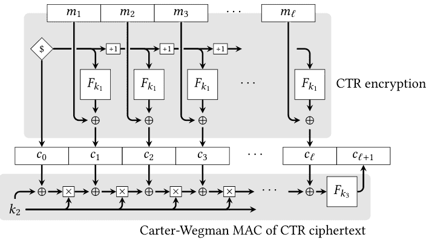

## 练习

待办事项……更多内容即将推出……

- 12.1. 假设 Enc-then-MAC+AD 采用 CBC 模式和任何安全的 MAC 实例化，如构造 12.4 所述。该方案对固定长度关联数据是安全的。证明，如果允许可变长度关联数据，则该方案 **不** 提供 AEAD 安全性。

  注：你并非在攻击 MAC！利用 \(d||c\) 在 \(d\) 的长度非固定且非公开时具有歧义性这一事实。

- 12.2. 建议一种使构造 12.4 对可变长度关联数据安全的方法。证明你的构造是安全的。

- 12.3. 证明，如果知道 Poly-UHF 构造（构造 12.9）的盐 s，则可以高效地找到碰撞。

- 12.4. 证明，如果只允许看到 Poly-UHF 的输出（即盐保持隐藏），则在选择的输入上可以计算出盐。

## 13 RSA 与数字签名

RSA 是最早开发的公钥密码学之一。它最早于 1978 年描述，并以其创建者 Ron Rivest、Adi Shamir 和 Len Adleman 命名。¹ RSA 可用作公钥加密和数字签名的基础构建块。本章仅讨论 RSA 在数字签名中的应用。

### 13.1 模 n 下的“除法”

**待办事项**

我考虑将其中一些材料移至第 3 章（秘密共享）— 足以理解每个非零元素在模素数下都有乘法逆元（欧拉函数等可保留在此）。这样，我在描述素数域上的拉格朗日插值时，就不必说“相信我，这可以实现”，学生们还可以使用 Sage 尝试秘密共享。此外，学生们会看到第 3 章中已有“严肃的数学”，因此在过渡到公钥密码学时不会感到措手不及。（更不用说，本章太长了。）

请复习第 0.2 节的内容，以确保你对基本模运算的理解还很新鲜。你应该熟悉 $\mathbb{Z}_n$、同余 ($\equiv_n$)、模运算符（%）以及如何在模 $n$ 下进行加法、乘法和减法的定义。

请注意，我们尚未提到模 $n$ 下的 *除法*。谈论模 $n$ 下的除法是否有意义？

示例 考虑以下模 15 下的事实：

| 2 · 8 ≡₁₅ 1 | 10 · 8 ≡₁₅ 5 |
| --- | --- |
| 4 · 8 ≡₁₅ 2 | 12 · 8 ≡₁₅ 6 |
| 6 · 8 ≡₁₅ 3 | 14 · 8 ≡₁₅ 7 |
| 8 · 8 ≡₁₅ 4 | |

现在想象将这些示例中的每一个中的“ · 8”替换为“ ÷ 2”：

| 2 ÷ 2 ≡₁₅ 1 | 10 ÷ 2 ≡₁₅ 5 |
| --- | --- |
| 4 ÷ 2 ≡₁₅ 2 | 12 ÷ 2 ≡₁₅ 6 |
| 6 ÷ 2 ≡₁₅ 3 | 14 ÷ 2 ≡₁₅ 7 |
| 8 ÷ 2 ≡₁₅ 4 | |

¹Clifford Cocks 于 1973 年开发了一个等效方案，但由于他为英国情报机构工作，该方案被保密。

一切依然合理！不知何故，模 15 下乘以 8 似乎与模 15 下“除以 2”是同一回事。

之前的示例都使用了 x 是偶数时的 x · 8（x ÷ 2）。当 x 是奇数时会发生什么？

```
3 · 8 ≡₁₅ 9 ⇐⇒ “3 ÷ 2 ≡₁₅ 9” ??
```

这可能看起来不合逻辑，但如果我们进行替换 3 ≡₁₅ -12 和 9 ≡₁₅ -6，那么我们确实会得到合理的结果：

```
-12 · 8 ≡₁₅ -6 ⇐⇒ -12 ÷ 2 ≡₁₅ -6
```

这个例子表明 2、8 和 15 之间肯定存在某种有趣的关系。在模 15 下运算时，将“乘以 8”解释为“除以 2”似乎是合理的。

我们能否为模 15 下的“除以 3”做类似的事情？我们能否找到某个 y，使得“模 15 下乘以 y”的行为与“模 15 下除以 3”相同？特别是，我们寻求满足 3 · y ≡₁₅ 1 的 y 值，但你可以自行检查，不存在这样的 y 值。

为什么我们可以在模 15 下“除以 2”，但显然无法在模 15 下“除以 3”？我们将在本节余下部分探讨这个问题。

### 乘法逆元

在模运算中，我们通常不直接使用“除法”术语。我们不说“除以 2”，而说“乘以 2⁻¹”，其中 2⁻¹ 只是 8 的另一个名称。

定义 13.1（模 n 下的 x⁻¹）x 模 n 的乘法逆元是满足 x · y ≡ₙ 1 的整数 y（如果存在这样的数）。我们通常将 x 的乘法逆元称为“x⁻¹。”

示例 继续在模 15 下工作，我们有：

- ► 4⁻¹ ≡₁₅ 4，因为 4 · 4 = 16 ≡₁₅ 1。因此 4 是其自身的乘法逆元！你也可以这样理解：

```
4⁻¹ = (2²)⁻¹ = (2⁻¹)² ≡₁₅ 8² = 64 ≡₁₅ 4
```

- ► 7⁻¹ ≡₁₅ 13，因为 7 · 13 = 91 ≡₁₅ 1。

我们感兴趣的是哪些数在模 n 下有乘法逆元。

定义 13.2（Z*_n）模 n 的乘法群定义为：

```
Z*_n = {x ∈ Z_n | x has a multiplicative inverse mod n}
```

2 “群”是抽象代数中的一个技术术语。

例如，我们已经看到 $\mathbb{Z}_n^*$ 包含数字 2、4 和 7（或许还有其他），但不包含数字 3，因为 3 没有乘法逆元。那么一般来说，哪些数在模 n 下有乘法逆元？（哪些数属于 $\mathbb{Z}_n^*$？）答案非常简单：

### 定理 13.3 $x$ 在模 n 下有乘法逆元 **当且仅当** $\gcd(x, n) = 1$。换句话说，$\mathbb{Z}_n^* = \{x \in \mathbb{Z}_n \mid \gcd(x, n) = 1\}$。

### 定理 13.4（Bézout 定理）*对于所有整数 $x$ 和 $y$，存在整数 $a$ 和 $b$，使得 $ax + by = \gcd(x, y)$。事实上，$\gcd(x, y)$ 是可以表示为 $x$ 和 $y$ 的整数线性组合的最小正整数。*

我们不会证明 Bézout 定理，但将展示如何使用它来证明定理 13.3：

### 证明（定理 13.3）（$\Leftarrow$）假设 $\gcd(x, n) = 1$。我们将证明 $x$ 在模 n 下有乘法逆元。根据 Bézout 定理，存在整数 $a, b$ 满足 $ax + bn = 1$。将此等式两边模 n 化，我们得到

$1 = ax + bn \equiv_n ax + b \cdot 0 = ax.$

因此，Bézout 定理得出的整数 $a$ 就是 $x$ 模 n 的乘法逆元。

（$\Rightarrow$）假设 $x$ 在模 n 下有乘法逆元，即 $xx^{-1} \equiv_n 1$。我们需要证明 $\gcd(x, n) = 1$。根据 $\equiv_n$ 的定义，我们知道 $n$ 整除 $xx^{-1} - 1$，因此可以写出 $xx^{-1} - 1 = kn$（作为整数上的表达式）对某个整数 $k$。移项后，我们得到 $xx^{-1} - kn = 1$。既然我们可以将 1 写为 $x$ 和 $n$ 的整数线性组合，Bézout 定理表明必须有 $\gcd(x, n) = 1$。

### 示例 $\mathbb{Z}_{15} = \{0, 1, \dots, 14\}$，要得到 $\mathbb{Z}_{15}^*$，我们排除任何与 15 有公因数的数。换句话说，我们排除 3 的倍数和 5 的倍数。剩下的数字是 $\mathbb{Z}_{15}^* = \{1, 2, 4, 7, 8, 11, 13, 14\}$。由于 11 是素数，0 是 $\mathbb{Z}_{11}$ 中唯一与 11 有公因数的数。其余的都满足 $\gcd(x, 11) = 1$。因此，$\mathbb{Z}_{11}^* = \{1, 2, \dots, 10\}$。

### 示例 我们可以使用 Sage$^3$ 来玩转这些概念。Sage 支持用于模运算的 $\%$ 运算符：

```
sage: 2*8 % 15
1
```

它还支持一种方便的方式来生成“$\mathbb{Z}_n$ 对象”，或称为 Mod-对象。像 Mod$(2, 15)$ 这样的对象表示值 $2 \in \mathbb{Z}_{15}$，其所有运算都被重载为模 15 运算：

$^3$https://www.sagemath.org

```
sage: Mod(2, 15)*8
1
sage: Mod(2, 15)+31415926
3
sage: Mod(-1, 15)
14
```

在 Sage 中，你可以通过几种不同的方式计算乘法逆元：

```
sage: Mod(2, 15)^-1
8
sage: 1/Mod(2, 15)
8
sage: 2.inverse_mod(15)
8
sage: (1/2) % 15
8
```

Sage 足够智能，知道乘法逆元何时不存在：

```
sage: Mod(3, 15)^-1
ZeroDivisionError: inverse of Mod(3, 15) does not exist
```

Sage 支持超大整数，毫无问题：

```
sage: n = 3141592653589793238462643383279502884197169399375105820974944
sage: x = 1234567890123456789012345678901234567890123456789012345678901
sage: 1/Mod(x,n)
2234412539909122491686747985730075304931040310346724620855837
```

乘法逆元与最大公约数之间的关系比定理 13.3 更深远。回顾我们可以使用欧几里得算法高效计算 gcd(x, n)。对欧几里得算法有一个相对简单的修改，它还能以很少额外工作量计算相应的 Bézout 系数。换句话说，给定 x 和 n，可以高效计算整数 a、b 和 d，使得

ax + bn = d = gcd(x, n)

在 gcd(x, n) = d = 1 的情况下，整数 a 是 x 模 n 的乘法逆元。用于 GCD 的“扩展欧几里得算法”如下所示：

```
EXTGCD(x, y):
// returns (d, a, b) such that gcd(x, y) = d = ax + by
if y = 0:
    return (x, 1, 0)
else:
    (d, a, b) := EXTGCD(y, x % y)
    return (d, b, a - b * (x // y))
```


示例 Sage 实现了扩展欧几里得算法，命名为“xgcd”：

```
sage: xgcd(427,529)
(1, 223, -180)
sage: 223*427 + (-180)*529
1
```

然后你可以看出 223 和 427 在模 529 下是乘法逆元：

```
sage: 427*223 % 529
1
```

## 欧拉 Φ 函数

欧拉 Φ 函数定义为 $\phi(n) \stackrel{\text{def}}{=} |\mathbb{Z}_n^*|$；也就是说，$\mathbb{Z}_n$ 中具有乘法逆元的元素个数。

举例来说，如果 $n$ 是质数，那么 $\mathbb{Z}_n^* = \mathbb{Z}_n \setminus \{0\}$，因为 $\mathbb{Z}_n$ 中除零以外的每个整数都与 $n$ 互质。因此，在这种情况下，$\phi(n) = n - 1$。

RSA 涉及一个模数 $n$，它是两个不同质数 $n = pq$ 的乘积。在这种情况下，$\phi(n) = (p - 1)(q - 1)$。要理解原因，让我们来计算 $\mathbb{Z}_{pq}^*$ 中有多少个元素与 $pq$ 共有公约数（即不在 $\mathbb{Z}_{pq}^*$ 中）。

- $p$ 的倍数与 $pq$ 共有公约数。这些包括 $0, p, 2p, 3p, ..., (q - 1)p$。这个列表中有 $q$ 个元素。

- $q$ 的倍数与 $pq$ 共有公约数。这些包括 $0, q, 2q, 3q, ..., (p - 1)q$。这个列表中有 $p$ 个元素。

我们在这些列表中明显重复计算了元素 0。但是没有其他元素被重复计算。任何同时出现在这两个列表中的项目都将是 $p$ 和 $q$ 的公倍数，但由于 $p$ 和 $q$ 互质，它们的最小公倍数是 $pq$，大于这些列表中的任何项目。

我们计算出 $\mathbb{Z}_{pq}$ 中与 $pq$ 共有公约数的元素共有 $p + q - 1$ 个。其余的属于 $\mathbb{Z}_{pq}^*$，共有 $pq - (p + q - 1) = (p - 1)(q - 1)$ 个。因此 $\phi(pq) = (p - 1)(q - 1)$。

存在 $\phi(n)$ 的一般公式，但它们通常依赖于知道 $n$ 的质因数分解。我们将在本部分课程稍后看到计算 $\phi(n)$ 的难度与分解 $n$ 的难度之间更多的联系。

我们之所以考虑 $\phi(n)$，是因为来自抽象代数的这个基本定理：

## 定理 13.5（欧拉定理）

$如果\ x \in \mathbb{Z}_n^*\ 那么\ x^{\phi(n)} \equiv_n\ 1.$

示例 使用 $\phi(n)$ 的公式，我们可以看出 $\phi(15) = \phi(3 \cdot 5) = (3 - 1)(5 - 1) = 8$。欧拉定理指出，将 $\mathbb{Z}_{15}^*$ 中的任何元素乘以第 8 次幂都得到 1：我们可以使用 Sage 来验证这一点：

```
sage: for i in range(15):
....:     if gcd(i,15) == 1:
....:         print("%d^8 mod 15 =%d" % (i, i^8 % 15))
...:
1^8 mod 15 = 1
2^8 mod 15 = 1
4^8 mod 15 = 1
7^8 mod 15 = 1
8^8 mod 15 = 1
11^8 mod 15 = 1
13^8 mod 15 = 1
14^8 mod 15 = 1
```

### 13.2 RSA 函数

RSA 函数定义如下：

- 设 $p$ 和 $q$ 为不同的质数（稍后我们将详细说明它们是如何选择的），并设 $N = pq$。$N$ 被称为 **RSA 模数**。

- 设 $e$ 和 $d$ 为满足 $ed \equiv_{\phi(N)} 1$ 的整数。也就是说，$e$ 和 $d$ 是模 $\phi(N)$ 下的乘法逆元——而不是模 $N$ 下的！

- RSA 函数为：$x \mapsto x^e \% \, N$，其中 $x \in \mathbb{Z}_N$。

- 逆 RSA 函数为：$y \mapsto y^d \% \, N$，其中 $x \in \mathbb{Z}_N$。

本质上，RSA 函数（及其逆）是一个简单的模幂运算。关于 RSA 最容易混淆的一点是，$e$ 和 $d$ “存在”于 $\mathbb{Z}^*_{\phi(N)}$ 中，而 $x$ 和 $y$ “存在”于 $\mathbb{Z}_N$ 中。

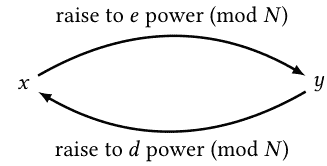

让我们确保我们称之为“逆 RSA 函数”的函数确实是 RSA 函数的逆。让我们从一个示例开始：

**示例** 在 Sage 中，我们可以使用 `random_prime(k)` 在 1 和 $k$ 之间采样一个随机质数。我们用它来采样质数因子 $p$ 和 $q$：

```
sage: p = random_prime(10^5)
sage: q = random_prime(10^5)
sage: N = p*q
sage: N
36486589
```

然后我们可以计算指数 e 和 d。回顾一下，它们必须是模 $\phi(N)$ 下的乘法逆元，因此不能与 $\phi(N)$ 共有任何公因数。确保这一点的一个简单方法是选择 $e$ 为质数：

```
sage: phi = (p-1)*(q-1)
sage: e = random_prime(phi)
sage: e
28931431
sage: d = 1/Mod(e,phi)
sage: d
31549271
```

我们现在可以对某个东西进行 e 次幂运算，然后再进行 d 次幂运算：

```
sage: x = 31415926
sage: y = x^e % N
sage: y
1798996
sage: y^d % N
31415926
```

如你所见，先进行 e 次幂运算，再进行 d 次幂运算（模 N），似乎把我们带回了起点（x）。

我们可以论证，e 次幂运算和 d 次幂运算一般来说是互逆的：由于 $ed \equiv_{\phi(N)} 1$，我们可以写出 $ed = t\phi(N) + 1$，其中 $t$ 为某个整数。那么：

$(x^e)^d = x^{ed} = x^{t\phi(N)+1} = (x^{\phi(N)})^t x \equiv_N 1^t x = x$

注意，我们使用了来自欧拉定理的事实：$x^{\phi(N)} \equiv_N 1$。

## 如何[不]对巨大数进行幂运算

当你看到类似 “x^e % N” 的表达式时，你可能会想用下面的算法来实现它：

| NaiveExponentiate(x, e, N): |
| --- |
| result = 1 |
| for i = 1 to e: // 计算 x^e |
|   result = result × x |
| return result % N |

虽然这个算法确实能给出正确答案，但这是一种非常糟糕的做法。在实践中，我们使用位数长达数千位的数字进行 RSA。假设我们用 x、e 和 N 作为参数运行 NaiveExponentiate 算法，它们各自大约一千位长（因此这些数字的量级接近 2^1000）：

- 1. 该算法将在 for 循环中花费大约 $2^{1000}$ 次迭代！

- 2. 该算法首先将 $x^e$ 作为一个 *整数* 计算出来，然后再对该整数取模 $N$。请注意，$x^2$ 大约 2000 位长，$x^3$ 大约 3000 位长，等等。因此，仅仅写下整数 $x^e$ 就需要大约 $2^{1000} \cdot 1000$ 位。

如你所见，宇宙中既没有足够的时间也没有足够的存储容量来使用这个算法。那么，我们如何在巨大数字上实际计算类似 $x^e \% N$ 的值呢？

- 1. 假设给你一个整数 $x$，要求你计算 $x^{17}$。你可以这样计算它：

$x^{17} = \underbrace{x \cdot x \cdot x \cdot \cdots \cdot x}_{16 \text{ 次乘法}}$ 。

但一个更巧妙的方法是观察到：

$x^{17} = x^{16} \cdot x = (((x^2)^2)^2)^2 \cdot x$ 。

这个表达式只需要 5 次乘法即可求值（平方就是将一个数乘以它自身）。

更一般地，你可以通过遵循下面的递推关系来计算类似 $x^e$ 的表达式。这种方法被称为 **反复平方求幂**，原因希望是显而易见的：

$x^e = \begin{cases} 1 & \text{若 } e = 0 \\ (x^{\frac{e}{2}})^2 & \text{若 } e \text{ 为偶数} \\ (x^{\frac{e-1}{2}})^2 \cdot x & \text{若 } e \text{ 为奇数} \end{cases}$

```
BETTEREXP(x, e):
if e = 0: return 1
if e even:
    return BETTEREXP(x, e/2)^2
if e odd:
    return BETTEREXP(x, (e-1)/2)^2 * x
```

BETTEREXP 每次递归时将 e 参数除以二（多多少少），直到到达基本情况。因此，递归调用次数为 $O(\log e)$。在每次递归调用中，只有常数个乘法（包括平方）。因此，总体而言，该算法只需要 $O(\log e)$ 次乘法（与仅将 m 自身乘 e 次所需的 $e-1$ 次乘法相比）。在 $e \sim 2^{1000}$ 的情况下，这意味着只需几千次乘法。

- 2. 我们只关心 $x^e \% N$，而不关心中间整数值 $x^e$。模运算最基本的特征之一是：如果你只关心最终结果模 $N$ 的值，则可以 **将任何中间值模 $N$ 约简**。

回顾我们之前的示例：

$x^{17} \% N = x^{16} \cdot x \% N = (((x^2 \% N)^2 \% N)^2 \% N)^2 \cdot x \% N$ 。

更一般地，我们可以将所有中间值模 $N$ 约简：

```
ModExp(x, e, N): // compute x^e % N
if e = 0: return 1
if e even:
    return ModExp(x, e/2, N)^2 % N
if e odd:
    return ModExp(x, (e-1)/2, N)^2 * x % N
```

该算法避免了计算天文数字般巨大的整数 $x^e$ 的问题。它不需要存储任何比 $N$ 大得多的值。

**警告：** 即使是这个 ModExp 算法也不是实现加密用途幂运算的理想方式。练习 13.10 探讨了该幂运算算法的一些不幸特性。

示例 大多数数学库都使用反复平方法来实现幂运算。例如，你可以使用 Sage 轻松计算具有巨大指数的数字：

```
sage: 427^31415926 % 100
89
```

然而，这个表达式仍然指示 Sage 首先将 $427^{31415926}$ 作为整数计算出来，然后再对其取模 100。因此，执行此计算需要一些时间。

如果你尝试像 x^e % N 这样指数更大的表达式，Sage 会报内存错误。我们如何指示 Sage 在反复平方法的每个中间步骤都执行模约简呢？答案是使用 Sage 的 Mod 对象，例如：

```
sage: Mod(427, 100)^314159265358979
63
```

这个表达式对对象 Mod(427, 100) 执行反复平方法。由于 Mod 对象的所有运算都被重载（仅给出模 n 的答案），其结果是在每次平方和乘法后都进行模约简。即使是非常大的数字，这个表达式也能瞬间运行。

## 安全属性与讨论

RSA 被称为一种 **陷门函数**。

- 一个用户生成 RSA 参数（主要是 $N$、$e$ 和 $d$），并使 $N$ 和 $e$ 公开，同时保持 $d$ 私密。

- 功能属性：仅给出公开信息 $N$ 和 $e$，就很容易计算 RSA 函数（$x \mapsto x^e \% N$）。给出私有信息（$d$），显然很容易计算 RSA 逆函数（$y \mapsto y^d \% N$）。

- **安全属性：** 仅给出公开信息，在随机选择的值上计算 RSA 逆函数（$y \mapsto y^d \% N$）应该是困难的。换句话说，唯一能够计算 RSA 逆函数的人是生成 RSA 参数的人。


待办

安全属性在我们的安全定义语言（库）中并不自然地表达。

目前针对 RSA 的最佳已知攻击（即仅给定公开信息来计算逆 RSA 函数的方法）涉及对模数进行因式分解。如果我们希望确保 RSA 作为陷门函数是安全的，就必须了解对大数进行因式分解的最新技术。

在讨论因式分解算法的性能之前，请记住，我们将性能作为输入 **长度** 的函数来衡量——即写下输入需要多少位。在因式分解算法中，输入是一个大数 $N$，写下该数大约需要 $n = \log_2 N$ 位。我们将把算法的运行时间作为 $n$ 的函数来讨论，而不是 $N$。请记住，*写下* 一个 1000 位数（$n = 1000$）与 *数到* 一个 1000 位数（$N = 2^{1000}$）之间的代价差异。

每个人都知道“试除”因式分解方法：给定一个数 $N$，检查每个 $i \in \{2, \dots \sqrt{N}\}$ 是否整除 $N$。该算法在最坏情况下需要 $\sqrt{N} = 2^{n/2}$ 次除法。由于我们按位长度 $n$ 衡量性能，因此它是一个指数时间算法。

如果这是最佳已知的因式分解算法，那么我们只需将 $N$ 设得大到 $2^{256}$，就能使因式分解需要 $2^{128}$ 的工作量。但是，存在比试除好得多的因式分解算法。当今最快的因式分解算法称为广义数域筛法（GNFS），其复杂度类似于 $O\Big(n^{\left(\frac{n}{\log n}\right)^{\frac{1}{3}}}\Big)$。这不是多项式时间算法，但比试除快得多。

## 示例

Sage 轻松就能对相当大的数进行因式分解。在我的普通计算机上，对以下 200 位 RSA 模数进行因式分解大约需要 10 秒：

```
sage: p = random_prime(2^100)
sage: q = random_prime(2^100)
sage: N = p*q
sage: factor(N)
206533721079613722225064934611 * 5175820805637266211301114148123
```

截至 2020 年 1 月，已（公开）因式分解的最大 RSA 模数是一个 795 位模数。$^5$ 对该数进行因式分解所需的计算量相当于 900 个 CPU 核心年，或大约 $2^{66}$ 个总时钟周期。

总而言之，RSA 中涉及的数字需要足够大，以抵抗因式分解攻击（即，对于最先进的因式分解算法，需要 $2^{128}$ 的工作量）。当前的最佳实践建议使用 2048 位或 4096 位 RSA 模数，这意味着 $p$ 和 $q$ 各为 1024 位或 2048 位。

待办

$^5$https://en.wikipedia.org/wiki/RSA_numbers#RSA-240

### 13.3 数字签名

MAC 是一种提供真实性的加密原语。对消息 $m$ 的有效 MAC 标签是“证明”，表明持有密钥的人已经为 $m$ 担保。MAC 是一种对称密钥原语，因为生成 MAC 标签和验证 MAC 标签都需要相同的密钥（事实上，标签是通过重新计算来验证的）。

**数字签名**与 MAC 类似，但用于签名和验证的密钥是分开的。数字签名方案由以下算法组成：

- **密钥生成**：输出一对密钥 $(sk, vk)$，其中 $sk$ 是 **签名密钥**，$vk$ 是 **验证密钥**。

- **签名**：以签名密钥 $sk$ 和消息 $m$ 作为输入，输出 **签名** $\sigma$。

- **验证**：以验证密钥 $vk$、消息 $m$ 和潜在签名 $\sigma$ 作为输入；输出一个布尔值。

如果 $\sigma$ 确实是 $\text{签名}(sk, m)$ 的输出，那么 $\text{验证}(vk, m, \sigma)$ 应输出真。直觉上，攻击者很难找到任何其他导致 $\text{验证}$ 输出真的 $(m, \sigma)$ 对。

数字签名背后的想法是使 $vk$ 变为公开。换句话说，任何人（甚至攻击者）都应该能够验证签名。但只有 $sk$ 的持有者（生成 $vk$ 和 $sk$ 的人）才能生成有效签名。此外，即使面对看到许多有效签名示例的攻击者，这一保证也应成立。攻击者不应该能够生成 _新_ 的有效签名。

我们以类似于形式化 MAC 安全性的方式来形式化此安全属性：“只有秘密密钥持有者才能生成有效标签，即使在看到选定的有效标签示例之后也是如此。”

**定义 13.6** _设_ $\Sigma$ _为一个签名方案。如果_ $\Sigma$ _是_ **安全签名** _，则_ $\mathcal{L}^{\Sigma}_{\text{签名-真实}} \approx \mathcal{L}^{\Sigma}_{\text{签名-伪造}}$ _，其中：_

```
$\mathcal{L}^{\Sigma}_{\text{sig-real}}$
$(vk, sk) \leftarrow \Sigma.\text{KeyGen}$
GETVK():
return $vk$
GETSIG($m$):
return $\Sigma.\text{Sign}(sk, m)$
VERSIG($m, \sigma$):
return $\Sigma.\text{Ver}(vk, m, \sigma)$
```

```
$\mathcal{L}^{\Sigma}_{\text{sig-fake}}$
$(vk, sk) \leftarrow \Sigma.\text{KeyGen}$
$\mathcal{S} := \emptyset$
GETVK():
return $vk$
GETSIG($m$):
$\sigma := \Sigma.\text{Sign}(sk, m)$
$\mathcal{S} := \mathcal{S} \cup \{(m, \sigma)\}$
return $\sigma$
VERSIG($m, \sigma$):
return $(m, \sigma) \stackrel{?}{\in} \mathcal{S}$
```

与 MAC 的安全定义类似，这些库仅在验证攻击者提供的签名（签名验证）方面有所不同。如果攻击者能够生成一个消息-签名对 $(m, \sigma)$，其 (1) 验证正确，但 (2) 之前未由库本身生成，那么 $\mathcal{L}_{\text{签名-真实}}$ 库中的签名验证将返回真，而 $\mathcal{L}_{\text{签名-伪造}}$ 库将返回假。通过要求这两个库不可区分，我们实际上是在要求攻击者无法找到任何这样的消息-签名对（伪造）。

与 MAC 定义的主要区别在于，与 MAC 环境不同，我们打算使验证密钥公开。库可以运行 $(vk, sk) \leftarrow \text{密钥生成}$，但这些值默认保持私有。为了使 $vk$ 公开，我们明确向攻击者提供一个访问器 $\text{getvk}$。

## “教科书” RSA 签名

签名具有非对称性：每个人都应该能够验证签名，但只有签名密钥的持有者才能生成有效签名。RSA 函数具有类似的非对称性：如果 $N$ 和 $e$ 是公开的，那么任何人都可以将东西提升到 $e$ 次幂，但只有持有 $d$ 的人才能将东西提升到 $d$ 次幂。

这种相似性表明，我们可以以如下方式使用 RSA 进行签名：

- 验证密钥是 $(N, e)$，签名密钥是 $(N, d)$，其中这些值具有适当的 RSA 关系。

- 消息 $m$（此处 $m$ 是 $\mathbb{Z}_N$ 的一个元素）的签名是值 $\sigma = m^d \% N$。直觉上，对于给定的 $m$，只有持有签名密钥的人才能生成此值。

- 要验证消息 $m$ 上的签名 $\sigma$，我们的目标是检查 $\sigma \equiv_N m^d$ 是否成立。然而，我们只给定了 $N$ 和 $e$，而没有 $d$。考虑将等式两边都提升到 $e$ 次幂：

  $$
  \sigma^e \equiv_N (m^d)^e \equiv_N m
  $$

第二个等式来自标准 RSA 属性。现在，仅凭公开信息 $N$ 和 $e$ 即可完成此检查。

该方案的正式描述如下：

```
Construction 13.7 (Textbook RSA)
The key generation algorithm is not listed here, but $N, e, d$ are generated in the usual way for RSA. The signing key is $sk = (N, d)$ and the verification key is $vk = (N, e)$.

$$
\begin{aligned}
\text{Sign}(sk = (N, d), m): \\
\quad \text{return } m^d \% N \\
\[10pt]
\text{Ver}(vk = (N, e), m, \sigma): \\
\quad m' := \sigma^e \% N \\
\quad \text{return } m \stackrel{?}{=} m'
\end{aligned}
$$
```

不幸的是，教科书 RSA 签名仅作为初步直觉有用。它们 **不安全！** 一个简单的攻击如下：

假设攻击者知道验证密钥 $(N, e)$ 并看到某条消息 $m$ 的有效签名 $\sigma \equiv_N m^d$。那么 $\sigma^2$ 也是消息 $m^2$ 的有效签名，因为：

$$
\sigma^2 \equiv_N (m^d)^2 = (m^2)^d
$$


The attacker can easily generate a forged signature on a new message m², making the scheme insecure.

## Hashed RSA Signatures

The problem with textbook RSA signatures is that the signatures and plaintexts had a very strong algebraic relationship. Squaring the signature had the effect of squaring the underlying message. One way to fix the problem is to “break” this algebraic relationship. Hashed RSA signatures break the algebraic structure by applying the RSA function not to m directly, but to H(m), where H is a suitable hash function (with outputs interpreted as elements of Z_N).

| Construction 13.8 (Textbook RSA) |
| --- |
| Sign(sk = (N, d), m): return H(m)^d % N | Ver(vk = (N, e), m, σ): y := σ^e % N return H(m) =? y |

Let’s see how this change thwarts the attack on textbook signatures. If σ is a valid signature of m, we have σ ≡_N H(m)^d. Squaring both sides leads to σ^2 ≡_N (H(m)^2)^d. Is this the valid signature of any m'? An attacker would have to identify some m' that has H(m') = H(m)^2. If the hash function is a good one, then this should be hard.

Of course, this is not a formal proof. It is possible to formally prove the security of hashed RSA signatures. The precise statement of security is: “if RSA is a secure trapdoor function and H is modeled as a random oracle, then hashed RSA signatures are a secure signature scheme.” Since we have not given formal definitions for either trapdoor functions or random oracles, we won’t see the proof in this book.

- to-do Write a chapter on random oracle and other idealized models.

### 13.4 Chinese Remainder Theorem

When doing arithmetic mod N, we can sometimes use knowledge of the factors N = pq to speed things up. This section discusses the math behind these speedups.

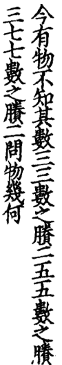

**History.** In the Sunzi Suanjing, written some time around the 4th century CE, Chinese mathematician Sunzi posed an interesting puzzle involving remainders:

> “We have a number of things, but we do not know exactly how many. If we count them by threes we have two left over. If we count them by fives we have three left over. If we count them by sevens we have two left over. How many things are there?”⁶

Sunzi’s puzzle is the first known instance of a system of simultaneous equations involving modular arithmetic: In our notation, he is asking us to solve for x in the following system of congruences:

```
x ≡₃ 2
x ≡₅ 3
x ≡₇ 2
```

We can solve such systems of equations using what is called (in the West) the **Chinese Remainder Theorem** (CRT). Below is one of the simpler formations of the Chinese Remainder Theorem, involving only two equations/moduli (unlike the example above, which has three moduli 3, 5, and 7):

**Theorem 13.9 (CRT)** Suppose gcd(r, s) = 1. Then for all integers u, v, there is a solution for x in the following system of equations:

```
x ≡ᵣ u
x ≡ₛ v
```

Furthermore, this solution is unique modulo rs.

**Proof** Since gcd(r, s) = 1, we have by Bezout’s theorem that 1 = ar + bs for some integers a and b. Furthermore, b and s are multiplicative inverses modulo r. Now choose x = var + ubs. Then,

```
x = var + ubs ≡ᵣ 0 + u(s⁻¹s) = u
```

So x ≡ᵣ u, as desired. Using similar reasoning mod s, we can see that x ≡ₛ v, so x is a solution to both equations.

Now we argue that this solution is unique modulo rs. Suppose x and x’ are two solutions to the system of equations, so we have:

```
x ≡ᵣ x’ ≡ᵣ u
```

$x \equiv_s x' \equiv_s v$

Since $x \equiv_r x'$ and $x \equiv_s x'$, it must be that $x - x'$ is a multiple of $r$ and a multiple of $s$. Since $r$ and $s$ are relatively prime, their least common multiple is $rs$, so $x - x'$ must be a multiple of $rs$. Hence, $x \equiv_{rs} x'$. So any two solutions to this system of equations are congruent mod $rs$.

⁶Chinese text is from an old manuscript of Sunzi Suanjing, but my inability to speak the language prevents me from identifying the manuscript more precisely. English translation is from Joseph Needham, Science and Civilisation in China, vol. 3: Mathematics and Sciences of the Heavens and Earth, 1959.

**Example** Sage implements the `crt` function to solve for $x$ in these kinds of systems of equations. Suppose we want to solve for $x$:

$x \equiv_{427} 42$
$x \equiv_{529} 123$

In Sage, the solution can be found as follows:

```
sage: crt( 42,123, 427,529 )
32921
```

We can check the solution:

```
sage: 32921 % 427
42
sage: 32921 % 529
123
```

## CRT Encodings Preserve Structure

Let’s call $(u, v) \in \mathbb{Z}_r \times \mathbb{Z}_s$ the CRT encoding of $x \in \mathbb{Z}_{rs}$ if they satisfy the usual relationship:

$x \equiv_r u$
$x \equiv_s v$

We can convert any $x \in \mathbb{Z}_{rs}$ into its CRT encoding quite easily, via $x \mapsto (x \% r, x \% s)$. The Chinese Remainder Theorem says that any $(u, v) \in \mathbb{Z}_r \times \mathbb{Z}_s$ is a valid CRT encoding of a unique $x \in \mathbb{Z}_{rs}$; and the proof of the theorem shows how to convert from the CRT encoding into the “usual $\mathbb{Z}_{rs}$ encoding.”

**Claim 13.10** If $(u, v)$ is the CRT encoding of $x$, and $(u', v')$ is the CRT encoding of $x'$, then $(u+u'\%r, v+v'\%s)$ is the CRT encoding of $x + x' \% rs$.

**Example** Taking $r = 3$ and $s = 5$, let’s write down the CRT encodings of every element in $\mathbb{Z}_{15}$. In this table, every column contains $x$ and its CRT encoding $(u, v)$:

| x | 0 | 1 | 2 | 3 | 4 | 5 | 6 | 7 | 8 | 9 | 10 | 11 | 12 | 13 | 14 |
|---|---|---|---|---|---|---|---|---|---|---|----|----|----|----|----|
| u | 0 | 1 | 2 | 0 | 1 | 2 | 0 | 1 | 2 | 0 | 1 | 2 | 0 | 1 | 2 |
| v | 0 | 1 | 2 | 3 | 4 | 0 | 1 | 2 | 3 | 4 | 0 | 1 | 2 | 3 | 4 |

Highlight the columns for $x = 3$ and $x' = 7$ and their sum $x + x' = 10$.

| x | 0 | 1 | 2 | 3 | 4 | 5 | 6 | 7 | 8 | 9 | 10 | 11 | 12 | 13 | 14 |
|---|---|---|---|---|---|---|---|---|---|---|---|---|---|---|---|
| u | 0 | 1 | 2 | 0 | 1 | 2 | 0 | 1 | 2 | 0 | 1 | 2 | 0 | 1 | 2 |
| v | 0 | 1 | 2 | 3 | 4 | 0 | 1 | 2 | 3 | 4 | 0 | 1 | 2 | 3 | 4 |

Focusing on only the highlighted cells, the top row shows a true addition expression $3 + 7 \equiv_{15} 10$; the second row shows a true addition expression $0 + 1 \equiv_3 1$; the third row shows a true addition expression $3 + 2 \equiv_5 0$.

This pattern holds for any $x$ and $x'`, and I encourage you to **try it**!

As if that weren't amazing enough, the same thing holds for multiplication:

**Claim 13.11** If $(u, v)$ is the CRT encoding of $x$, and $(u', v')` is the CRT encoding of $x'`, then $(u \cdot u' \% r, v \cdot v' \% s)` is the CRT encoding of $x \cdot x' \% rs`.

**Example** Let's return to the $r = 3, s = 5` setting for CRT and highlight $x = 6, x' = 7`, and their product $x \cdot x' \equiv_{15} 12`.

| x | 0 | 1 | 2 | 3 | 4 | 5 | 6 | 7 | 8 | 9 | 10 | 11 | 12 | 13 | 14 |
|---|---|---|---|---|---|---|---|---|---|---|---|---|---|---|---|
| u | 0 | 1 | 2 | 0 | 1 | 2 | 0 | 1 | 2 | 0 | 1 | 2 | 0 | 1 | 2 |
| v | 0 | 1 | 2 | 3 | 4 | 0 | 1 | 2 | 3 | 4 | 0 | 1 | 2 | 3 | 4 |

The top row shows a true multiplication expression $6 \cdot 7 \equiv_{15} 12`; the second row shows a true multiplication expression $0 \cdot 1 \equiv_3 0`; the third row shows a true multiplication expression $1 \cdot 2 \equiv_5 2`.

This pattern holds for any $x` and $x'`, and I encourage you to **try it**!

The CRT suggests a different, perhaps more indirect, way to do things mod $rs`. Suppose $x` has CRT encoding $(u, v)` and $x'` has CRT encoding $(u', v')`, and we want to compute $x + x'$ mod $rs`. One wild idea is to first directly compute the CRT encoding of this answer, and then convert that encoding to the normal integer representation in $\mathbb{Z}_{rs}`.

In this case, we know that the answer $x + x'` has the CRT encoding $(u + u' \% r, v + v' \% s)`. But this is the same as $(x + x' \% r, x + x' \% s)` – do you see why? So, to add $x + x'` mod $rs`, we just need to add $x + x'$ mod $r`, and then add $x + x'$ mod $s`. This gives us the CRT encoding of the answer we want, and we can convert that CRT encoding back into a normal $\mathbb{Z}_{rs}`-integer.

The same idea works for multiplication as well, giving us the following:

- **CRT method for doing some operation[s] mod rs**
  1. Do the operation[s] you want, but mod $r` instead of mod $rs`.
  2. Do the operation[s] you want, but mod $s` instead of mod $rs`.
  3. Those two results are the CRT encoding of the final answer, so convert them back to the normal representation.


示例 让我们以 r = 3359 和 s = 2953 为例，它们互质（因此适用 CRT）。假设我们想计算 3141592 + 6535897 % rs。在 Sage 中以通常方式操作如下：

```
sage: r = 3359
sage: s = 2953
sage: (3141592 + 6535897) % (r*s)
9677489
```

采用 CRT 方式操作如下。

```
sage: u = (3141592 + 6535897) % r
sage: v = (3141592 + 6535897) % s
sage: crt(u, v, r, s)
9677489
```

两种方法得出的答案相同！

## 应用于 RSA

你可能会好奇这一切有什么用。CRT 方法看起来似乎是一种非常间接且浪费的计算方式。对于加法和单次乘法等简单运算，这种印象可能是正确的。然而，对于模 N 的幂运算（即 RSA 中的主要运算），CRT 方法更快。

示例 在 Sage 中，我们可以按如下方式进行基本的模 n 幂运算：

```
sage: def modexp(x,e,n): # x^e mod n
....:     return Mod(x,n)^e
```

如果我们在处理 RSA 模数并且知道其因式分解 pq，那么我们按如下方式使用 CRT 方法对模 pq 进行幂运算。我们只需分别对模 p 和模 q 进行幂运算，然后使用 crt 函数将结果转换回 Z_pq。

```
sage: def crtmodexp(x,e,p,q): # x^e mod pq, using CRT speedup
....:     u = Mod(x,p)^e
....:     v = Mod(x,q)^e
....:     return crt(u.lift(), v.lift(), p, q)
```

我们需要使用 u.lift() 和 v.lift() 将 u 和 v 从 Mod 对象转换为整数，因为 crt 期望的就是整数。

我们可以使用两种方法进行幂运算，并使用 timeit 函数测量耗时。在本示例中，N 约为 2000 比特长，速度差异明显：

7 这里我指的是模 rs 运算的 CRT 方法，而非泛指生活中的情况。

```
sage: p = random_prime(2^1000)
sage: q = random_prime(2^1000)
sage: N = p*q
sage: x = 12345678901234567
sage: e = randint(0,N) # random integer between 0 & N-1
sage: timeit('modexp(x,e,N)')
125 loops, best of 3: 5.34 ms per loop
sage: timeit('crtmodexp(x,e,p,q)')
125 loops, best of 3: 2.86 ms per loop
```

顺便验证一下，我们可以检查两种方法是否得出相同的答案：

```
sage: modexp(x,e,N) == crtmodexp(x,e,p,q)
True
```

要理解 CRT 方法为何更快，需要知道在 k 比特模数上进行标准模幂运算的代价是 O(k^3)。为了简单起见，我们假设幂运算正好需要 k^3 步。假设 p 和 q 各为 k 比特长，因此 RSA 模数 N 为 2k 比特长。于是，标准的模 N 幂运算需要 (2k)^3 = 8k^3 步。

使用 CRT 方法，我们对模 p 进行幂运算，并对模 q 进行幂运算。由于 p 和 q 仅为 k 比特长，每次幂运算需要 k^3 步。因此，这种方法总共只需 2k^3 步，比标准的模 N 幂运算快 4 倍。在此简单分析中，我们没有计算将 CRT 编码转换回典型的 mod-N 表示的代价。但这个代价远小于幂运算的代价（无论是实际中还是渐进意义上）。

值得注意的是，这种加速只能用于 RSA 签名，而不能用于验证。为了利用 CRT 方法加速模 N 幂运算，必须知道素因子 p 和 q。只有持有签名密钥的人才知道这些因子。

### 13.5 因式分解 N 的难度

如前所述，攻击 RSA 作为陷门函数的安全性（即仅凭公开信息 N 和 e 计算逆 RSA 函数）的最佳已知方法涉及对 RSA 模数进行因式分解。

因式分解整数（或者更具体地说，因式分解 RSA 模数）被认为对经典计算机是一个难题。在本节中，我们将展示与 RSA 相关的一些其他问题“与因式分解同样困难”。一个计算问题“与因式分解同样困难”是什么意思？更正式地说，在本节中我们将展示以下内容：

定理 13.12 以下问题要么*全部*可以在多项式时间内求解，要么**一个也不能**在多项式时间内求解：

- 1. 给定 RSA 模数 N = pq，计算其因子 p 和 q。
- 2. 给定 RSA 模数 N = pq，计算 \(\phi(N) = (p - 1)(q - 1)\)。
- 3. 给定 RSA 模数 $N = pq$ 和值 $e$，计算相应的 $d$（满足 $ed \equiv_{\phi(N)} 1$）。
- 4. 给定 RSA 模数 $N = pq$，找到任意 $x \not\equiv_N \pm 1$，使得 $x^2 \equiv_N 1$。

为了证明该定理，我们将展示：

- 如果存在针对 (1) 的高效算法，则我们可以将其作为子程序来构造针对 (2) 的高效算法。这很简单：如果有一个将 $N$ 分解为 $p$ 和 $q$ 的子程序，则可以调用该子程序并计算 $(p - 1)(q - 1)$。
- 如果存在针对 (2) 的高效算法，则我们可以将其作为子程序来构造针对 (3) 的高效算法。这也很简单：如果有一个给定 $N$ 即可计算 $\phi(N)$ 的子程序，则可以按照密钥生成算法中计算 $d$ 的方式来计算 $d$。
- 如果存在针对 (3) 的高效算法，则我们可以将其作为子程序来构造针对 (4) 的高效算法。
- 如果存在针对 (4) 的高效算法，则我们可以将其作为子程序来构造针对 (1) 的高效算法。

下面我们重点讨论最后两个蕴含关系。

## 利用单位平方根因式分解 N

定理 13.12 中的问题 (4) 涉及一个称为单位平方根的新概念：

定义 13.13（单位平方根）若 $x^2 \equiv_N 1$，则称 $x$ 为模 $N$ 的**单位平方根**。若 $x \not\equiv_N 1$ 且 $x \not\equiv_N -1$，则称 $x$ 为**非平凡**单位平方根。

由于在整数范围内 $(\pm 1)^2 = 1$，因此对任何 $N$ 都有 $(\pm 1)^2 \equiv_N 1$。换句话说，$\pm 1$ 始终是模 $N$ 的单位平方根。但某些 $N$ 的值拥有更多单位平方根。如果 $N$ 是不同奇素数的乘积，则 $N$ 有 4 个单位平方根：两个平凡的和两个非平凡的（你需要在练习中证明这一事实）。

主张 13.14 假设存在计算模 $N$ 非平凡单位平方根的高效算法。那么存在因式分解 $N$ 的高效算法。（这是定理 13.12 中的 $(4) \implies (1)$ 步骤。）

证明 该归约相当简单。假设 NTSRU 是一个算法，输入 $N$ 后返回模 $N$ 的非平凡单位平方根。那么我们可以使用以下算法因式分解 $N$：

```
FACTOR(N):
x := NTSRU(N)
return gcd(N, x + 1) and gcd(N, x - 1)
```

该算法很简单，但我们必须证明其正确性。当 $x$ 是模 $N$ 的非平凡单位平方根时，有以下关系：

\(x^2 \equiv_{pq} 1 \Rightarrow pq \mid x^2 - 1 \Rightarrow pq \mid (x + 1)(x - 1);\)
\(x \not\equiv_{pq} 1 \Rightarrow pq \nmid (x - 1);\)
\(x \not\equiv_{pq} -1 \Rightarrow pq \nmid (x + 1).\)

\((x + 1)(x - 1)\) 的素因子分解包含一个因子 \(p\) 和一个因子 \(q\)。但 \(x + 1\) 和 \(x - 1\) 都不包含 \(p\) 和 \(q\) 的两个因子。因此，\(x + 1\) 和 \(x - 1\) 必然各自恰好包含 \(\{p, q\}\) 中的一个因子。换句话说，\(\{\gcd(pq, x - 1), \gcd(pq, x + 1)\} = \{p, q\}\)。■

## 寻找单位平方根

**主张 13.15** 如果存在给定 $N$ 和 $e$ 即可计算 $d \equiv_{\phi(N)} e^{-1}$ 的高效算法，那么存在计算模 $N$ 非平凡单位平方根的高效算法。（这是定理 13.12 中的 $(3) \Rightarrow (4)$ 步骤。）

**证明** 假设我们有一个算法 FIND\_D，输入 $(N, e)$ 后返回相应的指数 $d$。然后考虑以下使用 FIND\_D 作为子程序的算法：

```
SRU(N):
choose e as a random n-bit prime
d := FIND\_D(N, e)
write ed - 1 = 2^s r, with r odd
// i.e., factor out as many 2s as possible
w <-_R Z_N
if gcd(w, N) != 1: // w \notin Z_N^*
   use gcd(w, N) to factor N = pq
   compute a nontrivial square root of unity using p & q
x := w^r % N
if x ==_N 1 then return 1
for i = 0 to s:
   if x^2 ==_N 1 then return x
   x := x^2 % N
```

该算法中有几个 return 语句，显然它们都确实返回一个单位平方根。此外，算法最终会在主 for 循环内返回，因为 $x$ 取值序列如下：

\(w^r, w^{2r}, w^{4r}, w^{8r}, \dots, w^{2^s r}\)

且该序列的最终值满足

\(w^{2^s r} = w^{ed-1} \equiv_N w^{(ed-1)\% \phi(N)} = w^{1-1} = 1.\)

虽然我们在此不作证明，但可以证明该算法从四个可能的单位平方根中_均匀随机_地选择一个单位平方根返回。因此，输出是非平凡单位平方根的概率为 1/2。我们可以重复这个基本过程 $n$ 次，最终以概率 $1 - 2^{-n}$ 遇到一个非平凡单位平方根。■


## 练习

- 13.1. 用归纳法证明 extgcd 算法的正确性。也就是说，每当 extgcd(x, y) 输出 (d, a, b) 时，就有 gcd(x, y) = d = ax + by。你可以使用原始欧几里得算法能正确计算 GCD 这一事实。

- 13.2. 证明如果 $g^a \equiv_n 1$ 且 $g^b \equiv_n 1$，则 $g^{\gcd(a,b)} \equiv_n 1$。

- 13.3. 证明 $\gcd(2^a - 1, 2^b - 1) = 2^{\gcd(a,b)} - 1$。

- 13.4. 证明对任意 $x \in \mathbb{Z}_n^*$ 都有 $x^a \% n = x^{(a \% \phi(n))} \% n$。换句话说，在模 $n$ 运算中，可以对指数模 $\phi(n)$ 进行约化。

- 13.5. 有多少个约分后的分数 a/b 满足 $0 < a/b < 1$ 且 $b \le n$？当 $n = 5$ 时答案为 9，因为相关分数如下：

1/5, 1/4, 1/3, 2/5, 1/2, 3/5, 2/3, 3/4, 4/5

用 $n$ 表示的公式是什么？当 $n = 100$ 时答案是多少？

提示：

- 13.6. 本题确定欧几里得 GCD 算法的效率。由于其输入是一对数 $(x, y)$，我们称 $x + y$ 为输入的大小。设 $F_k$ 表示第 $k$ 个斐波那契数，采用索引约定 $F_0 = 1$；$F_1 = 2$。证明 $(F_k, F_{k-1})$ 是欧几里得算法进行 $k$ 次递归调用所需的最小大小输入。

提示：

请注意，输入 $(F_k, F_{k-1})$ 的大小为 $F_{k+1}$，并回忆 $F_{k+1} \approx \phi^{k+1}$，其中 $\phi \approx 1.618 \dots$ 是黄金比例。因此，对于任意大小为 $N \in [F_k, F_{k+1})$ 的输入，欧几里得算法将进行少于 $k \le \log_\phi N$ 次递归调用。换句话说，欧几里得算法在大小为 $N$ 的输入上进行的递归调用的最坏情况次数为 $O(\log N)$，这与写出该输入所需的位数呈线性关系。

- 13.7. 考虑以下 **对称密钥** 加密方案，明文空间为 $M = \{0, 1\}^l$。要加密消息 $m$，我们通过附加一个零然后附加随机非零字节，将 $m$“填充”为一个素数。然后乘以密钥。要解密，我们除去密钥，然后去除“填充”。

其理念是，在不知道密钥的情况下解密密文需要分解两个大素数的乘积，这是一个难题。

```
KeyGen:
choose random $\lambda$-bit prime $k$
return $k$

Dec($k, c$):
$m' := c/k$
while $m'$ not a multiple of 10:
$m' := \lfloor m'/10 \rfloor$
return $m'/10$

Enc($k, m \in \{0, 1\}^\lambda$):
$m' := 10 \cdot m$
while $m'$ not prime:
$d \leftarrow \{1, \dots, 9\}$
$m' := 10 \cdot m' + d$
return $k \cdot m'$
```

展示一个打破该方案 CPA 安全性的攻击。也就是说，描述一个区分器并计算其偏差。

^8 一个更为复杂的计算，考虑了每次除法（取模）操作的代价，表明该算法的最坏情况总效率为 $O(\log^2 N)$，即写出输入所需位数的平方。

- 13.8. 解释为什么 RSA 指数 $e$ 和 $d$ 必须始终为奇数。

- 13.9. 为什么 $p$ 和 $q$ 必须是 *不同* 的素数？选择 $p = q$ 为什么是个坏主意？

- 13.10. **简单功耗分析 (SPA)** 攻击是一种针对计算机的物理攻击，攻击者精确监测处理器在执行加密算法时消耗的电流量。在本练习中，我们将考虑针对第 13.2 节所示 ModExp 算法的 SPA 攻击。

ModExp 算法主要由平方和乘法组成。假设通过监控计算机，可以轻易区分处理器是在运行平方步骤还是乘法步骤（这是一个非常现实的假设）。这个假设类似于可以访问该修改算法的打印输出：

```
ModExp($m, e, N$): // compute $m^e \% N$
if $e = 0$: return 1
if $e$ even:
  res := ModExp($m, \frac{e}{2}, N)^2 \% N$
  print "square"
if $e$ odd:
  res := ModExp($m, \frac{e-1}{2}, N)^2 \cdot m \% N$
  print "square"
  print "mult"
return res
```

描述该算法的打印输出如何使攻击者 *完全* 了解 $e$ 的值。请记住，在 RSA 中，指数确实是秘密，因此此攻击会导致 RSA 密钥恢复。

- 13.11. 中国剩余定理指出，当 $\gcd(r, s) = 1$ 时，下面方程组对 $x$ 总是有解：

\( x \equiv_r u \)

\( x \equiv_s v \)

给出一个 $u, v, r, s$ 的例子，其中 $\gcd(r, s) \neq 1$，使得方程无解。解释为什么没有解。

- 13.12. 证明主张 13.10 和 13.11。

- 13.13. 考虑一个宽度为 \( w \)、高度为 \( h \) 的矩形点阵。从网格的左下角开始，沿东北方向对角线行走。当你走到网格边缘时，绕到对面（即吃豆人拓扑）。下面是你在 \( w = 3 \) 和 \( h = 5 \) 的网格上走的前几步示例：

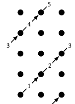

证明如果 $\gcd(w, h) = 1$，那么你最终将访问网格中的每个点。

提示：

- 13.14. 假设 \( (u, v) \in \mathbb{Z}_r \times \mathbb{Z}_s \) 是 \( x \in \mathbb{Z}_{rs} \) 的 CRT 编码。证明 \( x \in \mathbb{Z}_{rs}^* \) 当且仅当 \( u \in \mathbb{Z}_r^* \) 且 \( v \in \mathbb{Z}_s^* \)。

_注意：_ 这道题意味着当 $\gcd(r, s) = 1$ 时有 $\phi(rs) = \phi(r)\phi(s)$。这个恒等式的一个特例是当 $p$ 和 $q$ 是不同素数时的熟悉表达式 $\phi(pq) = (p-1)(q-1)$。

- 13.15. 证明 $x \mapsto x^e \% N$ 和 $y \mapsto y^d \% N$ 是互逆函数时存在一个错误（或至少是疏忽）。我们使用了 $x^{\phi(N)} \equiv_N 1$ 这一事实，但这仅对 $x \in \mathbb{Z}_N^*$ 才一定成立。使用中国剩余定理，证明 RSA 函数及其逆函数确实是互逆的，即使应用于 $x \notin \mathbb{Z}_N^*$ 也是如此。

- 13.16. 我们应当选择 RSA 指数 $e$ 和 $d$，使得 $ed \equiv_{\phi(N)} 1$。设 $N = pq$，并定义 $L = \text{lcm}(p - 1, q - 1)$。假设我们选择 $e$ 和 $d$ 使得 $ed \equiv_L 1$。证明 RSA 对于这种 $e$ 和 $d$ 的选择仍然有效——也就是说，$x \mapsto x^e \% N$ 和 $y \mapsto y^d \% N$ 是互逆函数。

提示：你将不得不使用中国剩余定理。

- ★ 13.17. 如果 $y^e \equiv_N x$，则称 $y$ 为 $x$ 的一个“$e$ 次根”。理解 RSA 的一种方式是，将某物提升到 $d$ 次幂等同于计算一个 $e$ 次根。我们对 RSA 的假设是，仅给出公开的 $e$ 和 $N$，计算 $e$ 次根是困难的。

在本题中，证明如果你给出了 $x$ 的一个 $a$ 次根和同一个 $x$ 的一个 $b$ 次根，且 $\gcd(a, b) = 1$，那么你可以轻易计算出 $x$ 的一个 $ab$ 次根。

更正式地，给定 $x, y, z$ 和 $N$，其中 $y^a \equiv_N x$ 且 $z^b \equiv_N x$，展示如何高效计算一个值 $w$，使得 $w^{ab} \equiv_N x$。

计算以下数值的 $w$（在验证 $y$ 是 $x$ 模 $N$ 的 $a$ 次根且 $z$ 是 $x$ 模 $N$ 的 $b$ 次根之后）：

N = 318753895014839414391833197387495582828703628009180678460009
x = 183418622076108277295248802695684859123490073011079896375192
a = 56685394747821296805145649774065963442016512301261628946051059
b = 17820510058552698963299857795978076415749676266266617231198813
y = 185575838649944725271855413520846311652963277243867273346885
z = 20697550065842164169278024507041536884260713996371572807344

提示：重要的是 gcd(a, b) = 1。使用贝祖定理。

- 13.18. 假设 Alice 使用 CRT 方法在教科书 RSA 中对某个消息 $m$ 进行签名。也就是说，她计算 $m^d \ \% \ p$，然后计算 $m^d \ \% \ q$，最后将此 CRT 编码转换回 $\mathbb{Z}_N$。但是，假设 Alice 使用的是有故障的硬件（或者 Eve 用电磁脉冲轰击她的硬件），因此她对模 $q$ 计算出了**错误的值**。其余计算正确，Alice 发布了 $m$ 和（错误的）签名 $\sigma$。

证明，无论 $m$ 是什么，无论 Alice 的计算错误是什么，Eve 都可以分解 $N$（在看到 $m$、$\sigma$ 和公开的 RSA 信息 $N$ 和 $e$ 之后）。

提示：你有两个方程（涉及 $\phi(N)$ 和 $N$）和两个未知数（$p$ 和 $q$）。

- 13.19. (a) 证明给定 RSA 模数 $N$ 和 $\phi(N)$，可以轻易分解 $N$。

(b) 编写一个 Sage 函数，以 RSA 模数 $N$ 和 $\phi(N)$ 作为输入，并输出 $N$ 的素因子。使用它来分解以下 2048 位 RSA 模数。注意：注意求解问题时不要出现精度问题；仔细检查你的分解结果！

```
N = 133140272889335192922108409260662174476303831652383671688547009484
2532359405869171404826691822566368285260992829447207980183170174867
620358952230969986447559330583492429636627298640338596531894556546
013113154346823212271748927859647994534586133553218022983848108421
465442089919090610542344768294481725103757222421917115971063026806
587141287587037265150653669094323116686574536558866591647361053311
046516013069669036866734126558017744393751161611219195795787488559
8829023972483090339116661475005854696820021069072502248533328754832
698616238405221381252145137439919090800085955274389382721844956661
1138745095472005761807

phi = 133140272889335192922108409260662174476303831652383671688547009484
2532359405869171404826691822566368285260992829447207980183170174867
620358952230969986447559330583492429636627298640338596531894556546
013113154346823212271748927859647994534586133553218022983848108421
465442089919090610542344768294481725103757214932292046538867218497
63525677222737010906678531209658977922355495419006049974567895189
873181104980586923156308566936720693202529062399681563590382015177
322909744749330702607931428154183726552004527201956226396835500346
779062494259638983191178915027835134527751607017859064511731520440
2981816860178885028680
```


13.20. 判断对错：若 \( x^2 \equiv_N 1 \)，则 \( x \in \mathbb{Z}_N^* \)。证明或给出反例。

13.21. 讨论以下问题的计算难度：
*给定整数 N，找出* \( \mathbb{Z}_N \setminus \mathbb{Z}_N^* \) *中一个非零元素*。
如果可以，将其难度与我们讨论过的其他问题（分解 N 或逆向 RSA）联系起来。

13.22. (a) 证明在已知 \( p \) 和 \( q \) 的情况下，可以高效计算模 \( pq \) 的所有四个单位平方根。
提示：
(b) 实现一个 Sage 函数，接收不同的素数 \( p \) 和 \( q \) 作为输入，并返回模 \( pq \) 的四个单位平方根。使用它来计算模
1052954986442271985875778192663 × 611174539744122090068393470777
的四个单位平方根。

⋆ 13.23. 证明，在 \( w \in \mathbb{Z}_N^* \) 的条件下，SqrtUnity 子程序从 4 个可能的单位平方根中均匀随机输出一个单位平方根。
提示：使用中国剩余定理。

13.24. 假设 N 是一个 RSA 模数，且 \( x^2 \equiv_N y^2 \)，但 \( x \not\equiv_N \pm y \)。证明，如果已知这样一对 x 和 y，则可以高效分解 N。

13.25. 当 \( p \) 是奇素数时，为什么 \( \pm 1 \) 是模 \( p \) 的唯二单位平方根？

13.26. 当 N 是 RSA 模数时，为什么模 N 的平方是一个 4 对 1 函数，而模 N 的 e 次幂是一个 1 对 1 函数？

13.27. 实现一个 Sage 函数，仅给定 N、e 和 d 即可高效分解 RSA 模数 N。使用你的函数分解以下 2048 位 RSA 模数。
N = 157713892705550064909750632475691896977526767652833932128735618711213662561319634033137058267272367265499003291937716454788882499492
3111170659510772453043175429787152165772644004408482780664547204140564
709253009840166821302184014310192765595015483588878761062406993721
851190041888790873152584082212461847511180066690936944585390792304
663763886417861546718283897613617078370412411019301687497005038294
389148932398661048471814117247898148030982257697697888167001010511378
647288478239379740416388270380035364271593609513220655573614212415
962670795230819103845127007912428958291134064942068225836213242131
15022256956985205924967
e = 327598866483920224268285373549315001772252982661926675504591773242
501030864502336359508677092544631083799700755236766113095163469666
905258066495934057774395712118774014408282455244138409433389314036
198045263991986560198273156037233588691392913730537367184867549274
682884119866630822924707702796323546327425328705958528315517584489
590815901470874024949798420173098581333151755836650797037848765578
433873141626191257009250151327378074817106208930064676608134109788
601067071103742326030259629322458620311949453584045538305945217564
027461013225009980998673160144967719374426764116721861138496780008
6366258360757218165973
d = 1384769997342637754981004435671327591821445734747474014195021091272
755207803162019484487127866675422608401990888942659393419384528257
462434633738686176601555755842189986431725335031620097854962295968
391161090826380458969236418585963384717406704714837349053808786086
701573765714825783042297344050528898259745757741233099297952332012
749897281090378398001337057869189488734951853748327631883502135139
523664990296334020327713900408683264232664645438899178442633342438
19832998312120731543644704191589754445402505558420138506655106015
215450140256129977382476062366519087386576874886938585789874186326
69265500594424847344765

13.28. 在本题中，我们将看到选择过于接近的 RSA 素因数 p 和 q 是不好的。

- (a) 设 N = pq 为一个 RSA 模数。证明，如果已知 N 和 δ = |p − q|，则可以高效分解 N。

- (b) Alice 生成了以下 RSA 模数 N = pq 并告知你 |p − q| < 10000。分解 N：
N = 874677518388996663638698301429866315588010681593301504361505917406
679600338654753978646639928231278257025792316921962329748948203153
633013718175380969169006125249183547099230845322374618855425387176
952865483432804575895177869626746459878695728149786382697571962961
898331255405534657194681056148437649091612403258304084081171824215
469549484981192162710052121535309254024720635781955739713239334398
494465828323810812843582187587256744901184016546638718414715249093
757039375585896257839327987501216755865353444704506441078034811012
930282857089819030160822729139768982546143104625315700571887037795
31855302859423676881

13.29. 以下是一种稍微更好的方法，用于分解因数过于接近的 RSA 模数。同前，设 N = pq。

- (a) 定义 t = (p + q)/2。注意，当 p 和 q 接近时，t 不会大大超过 √N。证明：

- t² − N 是一个完全平方数。
- 给定 t，可以高效分解 N。

提示：写 t² − N = s²，其中 s 为某个数。

- (b) 编写一个 Sage 函数，用于分解素因数接近的 RSA 模数。使用它来分解以下 2048 位数。因数有多接近（|p − q| 有多大）？

提示：Sage 有一个 -is-square 方法。同时请确保在整数上进行精确平方根运算，而非实数。

N = 51420288664266501986736340226343880193216864011643244558701956114
553317880043289827487456460284103951463512024249329243228109624011
915392411888724026403127686707255825056081890692595715828380690811
1316863831802823307755723858221021812095694119611125753242467971879
1313059869865256001103407905959879753455738422666766492356686762134
653833064511337433089249621257629107825681429573934949101301135200
918606211394413498735486599678541369375887840013842439026159037108
043724221865116794034194812236381299786395457277559879575752254116
612726596118528071785474551058540599198869986780286733916614335663
3723003246569630373323

## 14 Diffie-Hellman 密钥协商

### 14.1 循环群

**定义 14.1** 令 \( g \in \mathbb{Z}_n^* \)。定义 \( \langle g \rangle_n = \{g^i \pmod n \mid i \in \mathbb{Z} \} \)，为模 \( n \) 约简后的 \( g \) 的所有幂的集合。那么 \( g \) 称为 \( \langle g \rangle_n \) 的一个 **生成元**，而 \( \langle g \rangle_n \) 称为模 \( n \) 由 \( g \) **生成的循环群**。如果 \( \langle g \rangle_n = \mathbb{Z}_n^* \)，则我们说 \( g \) 是模 \( n \) 的一个 **原根**。

该定义允许生成元 \( g \) 的指数为负整数。由于 \( g \in \mathbb{Z}_n^* \)，可保证 \( g \) 模 \( n \) 存在乘法逆元，我们可以称其为 \( g^{-1} \)。那么 \( g^{-i} \) 可定义为 \( g^{-i} \stackrel{\text{def}}{=} (g^{-1})^i \)。所有常用的幂律在这一负指数定义下均成立。

**示例** 取 \( n = 13 \)，则有：

\(\langle 1 \rangle_{13} = \{1\}\)
\(\langle 2 \rangle_{13} = \{1, 2, 4, 8, 3, 6, 12, 11, 9, 5, 10, 7\} = \mathbb{Z}_{13}^*\)
\(\langle 3 \rangle_{13} = \{1, 3, 9\}\)

因此 2 是模 13 的一个原根。每个群 \(\{1\}\)、\(\mathbb{Z}_{13}^*\)、\(\{1, 3, 9\}\) 在模 13 乘法下都是一个循环群。

循环群可能有不止一个生成元；例如：

\(\langle 3 \rangle_{13} = \langle 9 \rangle_{13} = \{1, 3, 9\}\)

同样，模 13 有四个原根（等价地，\(\mathbb{Z}_{13}^*\) 有四个不同的生成元）；它们是 2、6、7 和 11。

并非每个整数都有原根。例如，模 15 不存在原根。但是，当 \( p \) 是素数时，模 \( p \) 总存在原根（因此 \(\mathbb{Z}_p^*\) 是一个循环群）。

让我们写 \(\mathbb{G} = \langle g \rangle = \{g^i \mid i \in \mathbb{Z} \}\) 来表示由 \( g \) 生成的一个未指定的循环群。\(\mathbb{G}\) 的定义性质是其每个元素都可表示为 \( g \) 的幂。由此我们可以得出：

- 任何循环群在乘法下都封闭。也就是说，取任意 \( X, Y \in \mathbb{G} \)，则一定存在某些整数 \( x, y \) 使得 \( X = g^x \) 和 \( Y = g^y \)。利用 \(\mathbb{G}\) 的乘法运算，乘积为 \( XY = g^{x+y} \)，也属于 \(\mathbb{G}\)。

- 任何循环群在求逆下都封闭。取任意 \( X \in \mathbb{G} \)，则一定存在某个整数 \( x \) 使得 \( X = g^x \)。我们可以看到，按定义 \( g^{-x} \in \mathbb{G} \)，且 \( g^{-x}X = g^{-x+x} = g^0 \) 是单位元。因此 \( X \) 在 \(\mathbb{G}\) 中有一个乘法逆元（\( g^{-x} \)）。

这些事实表明，\(\mathbb{G}\) 确实是抽象代数术语中的一个 *群*。


## 离散对数

在循环群中，给定 \( g \) 和 \( x \)，通常很容易计算 \( g^x \) 的值。例如，在使用形式为 \( \mathbb{Z}_n^* \) 的循环群时，我们可以使用快速幂（repeated squaring）轻松计算模幂运算 \( g^x \, \% \, n \)。

循环群中的逆运算称为离散对数问题：

**定义 14.2** (离散对数) _**离散对数问题**是：给定 \( X \in \langle g \rangle \)，确定一个数 \( x \) 使得 \( g^x = X \)。这里的幂运算是相对于 \( \mathbb{G} = \langle g \rangle \) 中的乘法运算。_

离散对数问题在某些类型的循环群中被推测为困难（即，不存在该问题的多项式时间算法）。

### 14.2 Diffie-Hellman 密钥协商

密钥协商是指使用公开通信建立私有通道的问题。假设爱丽丝和鲍勃之前从未通信过，也没有共享秘密。通过交换 *公开消息*（即，任何外部观察者都能看到的消息），他们希望建立一个只有他们两人知道的秘密。

**迪菲-赫尔曼** 协议就是这样一种密钥协商协议，它也是公钥密码学的首个公开实例：

**构造 14.3** (迪菲-赫尔曼) _双方（公开）同意选取带有生成元 \( g \) 的循环群 \( \mathbb{G} \)。令 \( n = |\mathbb{G}| \)。所有幂运算均相对于 \( \mathbb{G} \) 中的群运算。_

- 爱丽丝从 \( \mathbb{Z}_n \) 中选取 \( a \leftarrow \mathbb{Z}_n \)。她将 \( A = g^a \) 发送给鲍勃。
- 鲍勃从 \( \mathbb{Z}_n \) 中选取 \( b \leftarrow \mathbb{Z}_n \)。他将 \( B = g^b \) 发送给爱丽丝。
- 鲍勃在本地输出 \( K := A^b \)。爱丽丝在本地输出 \( K := B^a \)。


通过代入并应用标准幂运算法则，我们可以看到双方输出一个共同值，即 \( K = g^{ab} \in \mathbb{G} \)。

## 定义密钥协商的安全性

执行密钥协商协议会留下两个产物。首先，我们有双方交换的消息集合。我们将此集合称为 **执行记录**。我们设想双方在 *窃听者* 在场的情况下执行密钥协商协议，因此我们设想执行记录是公开的。其次，我们有各方输出的 **密钥**，它是私密的。

为了定义密钥协商的安全性，我们希望要求执行记录对窃听者关于密钥不泄露任何（有用）信息。有几种方法来处理这个定义：

- 我们可以要求，给定执行记录时计算密钥是困难的。然而，这被证明是一个相当弱的定义。例如，它并未排除窃听者可能猜出密钥前半部分比特的可能性。
- 我们可以要求，给定执行记录时密钥是伪随机的。这是一个更好的定义，也是我们采用的定义。为了形式化这一想法，我们定义两个库。在这两个库中，对手/调用程序都可以获得密钥协商协议执行的执行记录。在一个库中，对手获得协议执行所产生的密钥；而在另一个库中，对手获得一个完全无关的密钥（从可能密钥的集合 $\Sigma.\mathcal{K}$ 中均匀选择）。

**定义 14.4** (KA 安全) 令 $\Sigma$ 为一个密钥协商协议。我们用 $\Sigma.\mathcal{K}$ 表示协议的密钥空间（即它生成的可能密钥的集合）。我们用 $(t, K) \leftarrow \text{EXECPROT}(\Sigma)$ 表示在两个诚实各方之间执行协议的过程，其中 $t$ 表示生成的执行记录，而 $K$ 是生成的密钥。注意，此过程是随机的，且 $K$ 很可能与 $t$ 相关。

我们说 $\Sigma$ 是 **安全** 的，如果 $\mathcal{L}^{\Sigma}_{\text{ka-real}} \approx \mathcal{L}^{\Sigma}_{\text{ka-rand}}$，其中：

```
L^Σ_ka-real
QUERY():
(t, K) ← EXECPROT(Σ)
return (t, K)

L^Σ_ka-rand
QUERY():
(t, K) ← EXECPROT(Σ)
K' ← Σ.K
return (t, K')
```

### 14.3 决策性迪菲-赫尔曼问题

迪菲-赫尔曼协议由循环群 $\mathbb{G}$（及生成元 $g$）的选择参数化。协议中的执行记录由 $(g^a, g^b)$ 组成，其中 $a$ 和 $b$ 是均匀选择的。与此执行记录对应的密钥是 $g^{ab}$。可能密钥的集合是循环群 $\mathbb{G}$。

让我们将迪菲-赫尔曼协议的细节代入 KA 安全库中。简化后，我们看到迪菲-赫尔曼协议的安全性等价于以下陈述：

```
L^G_dh-real
QUERY():
a, b ← Z_n
return (g^a, g^b, g^ab)

≈

L^G_dh-rand
QUERY():
a, b, c ← Z_n
return (g^a, g^b, g^c)
```

我们已将库重命名为 $\mathcal{L}_{\text{dh-real}}$ 和 $\mathcal{L}_{\text{dh-rand}}$。在 $\mathcal{L}_{\text{dh-real}}$ 中，对 QUERY 的响应对应于 DHKA 执行记录 $(g^a, g^b)$ 连同相应的“正确”密钥 $g^{ab}$。在 $\mathcal{L}_{\text{dh-rand}}$ 中，响应对应于 DHKA 执行记录连同一个完全独立的随机密钥 $g^c$。

**定义 14.5** (DDH) 在循环群 $\mathbb{G}$ 中，**决策性迪菲-赫尔曼 (DDH) 假设**是 $\mathcal{L}_{\text{dh-real}}^{\mathbb{G}} \approx \mathcal{L}_{\text{dh-rand}}^{\mathbb{G}}$（如上文定义的库）。

由于我们仅通过重命名 DHKA 的安全定义来定义 DDH 假设，我们立即得到：

**主张 14.6** DHKA 协议是一个安全的 KA 协议 **当且仅当** 协议中使用的 $\mathbb{G}$ 对应的 DDH 假设为真。

## **哪些循环群适用 DDH 假设？**

到目前为止，我们唯一的循环群示例是 $\mathbb{Z}_p^*$，其中 $p$ 是素数。尽管 *许多* 教科书使用这个循环群来描述 DHKA，但这不是一个好选择，因为 DDH 假设在 $\mathbb{Z}_p^*$ 中是 *明显错误* 的。要了解原因，我们引入一个新概念：

**主张 14.7** (欧拉判别法) 如果 $p$ 是素数且 $X = g^x \in \mathbb{Z}_p^*$，则 $X^{\frac{p-1}{2}} \equiv_p (-1)^x$。

注意，如果 $x$ 是偶数则 $(-1)^x$ 为 $1$，如果 $x$ 是奇数则为 $-1$。因此，虽然在一般情况下给定 $g^x$ 很难确定 $x$，但欧拉判别法指出，给定 $g^x$ 可以确定 $x$ 的 *奇偶性*（即 $x$ 是偶数还是奇数）。

要了解这些观察如何导致针对迪菲-赫尔曼协议的攻击，请考虑以下攻击：

```
\mathcal{A}:
(A, B, C) \leftarrow \text{QUERY()}
?
\text{return } 1 \equiv_p C^{\frac{p-1}{2}}
```

大致而言，当 $C$ 可以表示为 $g$ 的 *偶数* 次幂时，对手返回 true。当与 $\mathcal{L}_{\text{dh-real}}$ 关联时，$C = g^{ab}$，其中 $a$ 和 $b$ 是均匀选择的。因此，$ab$ 为偶数的概率为 3/4。当与 $\mathcal{L}_{\text{dh-rand}}$ 关联时，$C = g^c$，其中 $c$ 是独立随机的。因此，$c$ 为偶数的概率仅为 1/2。故对手以 1/4 的优势区分了这两个库。

具体来说，使用这个循环群时，密钥 $g^{ab}$ 永远不会服从均匀分布。有关稍好一些的攻击（该攻击将密钥与执行记录相关联），请参见练习。

**二次剩余。** 文献中已提出了几种更好的循环群选择。也许最简单的一种是基于以下定义：

**定义 14.8** 如果存在某个整数 $Y$ 使得 $Y^2 \equiv_n X$，则数 $X \in \mathbb{Z}_n^*$ 是模 $n$ 的一个 *二次剩余*。也就是说，如果 $X$ 可以通过对模 $n$ 的一个数求平方得到。令 $\mathbb{QR}_n^* \subseteq \mathbb{Z}_n^*$ 表示模 $n$ 的二次剩余集合。

出于我们的目的，只需知道，当 $p$ 为素数时，$\mathbb{QR}_p^*$ 是一个包含 $(p - 1)/2$ 个元素的循环群（参见练习）。当 $p$ 和 $(p - 1)/2$ 均为素数时，我们称 $p$ 为 **安全素数**（并称 $(p - 1)/2$ 为 *索菲日尔曼素数*）。据我们所知，当 $p$ 是安全素数时，DDH 假设在 $\mathbb{QR}_p^*$ 中成立。


## Exercises

14.1. 记 \( p \) 为奇素数，如常。回顾 \(\text{QR}_p^*\) 是模 \( p \) 的二次剩余集合——即，\(\text{QR}_p^* = \{x \in \mathbb{Z}_p^* \mid \exists y : x \equiv_p y^2\}\)。证明，若 \( g \) 是 \(\mathbb{Z}_p^*\) 的原根，则 \(\langle g^2 \rangle = \text{QR}_p^*\)。

*Note:* 这意味着 \( g^a \in \text{QR}_p^*\) 当且仅当 \( a \) 为偶数——特别是，生成元 \( g \) 的选择无关紧要。

14.2. 假设 \( N = pq \)，其中 \( p \) 和 \( q \) 为不同素数。证明 \( |\text{QR}_N^*| = |\text{QR}_p^*| \cdot |\text{QR}_q^*|\)。

提示：

14.3. 假设已知 \( X \in \langle g \rangle \)。你可以任意选择 \( X' \neq X \) 并得知 \( X' \) 关于底数 \( g \) 的离散对数。证明你可以利用此能力求得 \( X \) 的离散对数。

14.4. 设 \(\langle g \rangle\) 为具有 \( n \) 个元素的循环群，生成元为 \( g \)。证明对任意整数 \( a \)，均有 \( g^a = g^{a \% n} \)。

*Note:* 因此，\(\langle g \rangle\) 与加法群 \(\mathbb{Z}_n\) 同构。

14.5. 设 \( g \) 为 \(\mathbb{Z}_n^*\) 的原根。回顾 \(\mathbb{Z}_n^*\) 有 \(\phi(n)\) 个元素。证明 \( g^a \) 是 \(\mathbb{Z}_n^*\) 的原根当且仅当 \(\gcd(a, \phi(n)) = 1\)。

*Note:* 由此可见，对任意 \( n \)，模 \( n \) 的原根个数要么为 0，要么为 \(\phi(\phi(n))\)。

14.6. 设 \(\langle g \rangle\) 为具有 \( n \) 个元素的循环群。证明对任意 \( x, y \in \langle g \rangle \)，均有 \( x^n = y^n \)。

提示：

14.7.
- (a) 证明 Lemma 4.10 的如下变体：假设固定一个值 \( x \in \mathbb{Z}_N \)。则从 \(\mathbb{Z}_N\) 中均匀采样 \( q = \sqrt{2N} \) 个值 \( r_1, \dots, r_q \) 时，至少有 0.6 的概率存在 \( i \neq j \) 使得 \( r_i \equiv_N r_j + x \)。

- (b) 设 \( g \) 为 \(\mathbb{Z}_p^*\)（某素数 \( p \) 下）的原根。考虑计算 \( X \in \mathbb{Z}_p^*\) 关于 \( g \) 的离散对数问题——即，找到 \( x \) 使得 \( X \equiv_p g^x \)。论证若能找到整数 \( r \) 和 \( s \) 使得 \( g^r \equiv_p X \cdot g^s \)，则可求得 \( X \) 的离散对数。

- (c) 结合上述两点观察，描述一个 \( O(\sqrt{p}) \) 时间算法，用于求解 \(\mathbb{Z}_p^*\) 中的离散对数问题。

14.8. 在 DHKA 执行过程中，窃听者观察到以下值：

\( p = 461733370363 \quad A = 114088419126 \)
\( g = 2 \quad \quad \quad \quad \quad B = 276312808197 \)

Alice 和 Bob 的共享密钥是多少？

14.9. 解释以下论证的错误之处：

在 Diffie-Hellman 密钥交换中，Alice 发送 \(A = g^a\)，Bob 发送 \(B = g^b\)。它们的共享密钥是 \(g^{ab}\)。要破解该方案，窃听者可以直接计算 \(A \cdot B = (g^a)(g^b) = g^{ab}\)。

14.10. 设 \(\mathbb{G}\) 为具有 \( n \) 个元素的循环群，生成元为 \( g \)。考虑以下算法：

```
RAND(A, B, C):
r, s, t \leftarrow \mathbb{Z}_n
A' := A^t g^r
B' := B g^s
C' := C B' A^{st} g^{rs}
return (A', B', C')
```

令 \(DH = \{(g^a, g^b, g^{ab}) \in \mathbb{G}^3 \mid a, b \in \mathbb{Z}_n\}\)。

- (a) 假设 \((A, B, C) \in DH\)。证明 \(\text{RAND}(A, B, C)\) 的输出分布是 \(DH\) 上的均匀分布。

- (b) 假设 \((A, B, C) \notin DH\)。证明 \(\text{RAND}(A, B, C)\) 的输出分布是 \(\mathbb{G}^3\) 上的均匀分布。

- ★ (c) 考虑判定给定三元组 \((A, B, C)\) 是否属于集合 \(DH\) 的问题。假设你有一个算法 \(\mathcal{A}\)，该算法平均解决此问题的成功率略好于随机猜测。即：

```
Pr[\mathcal{A}(A, B, C) = 1] > 0.51 when (A, B, C) chosen uniformly in DH
Pr[\mathcal{A}(A, B, C) = 0] > 0.51 when (A, B, C) chosen uniformly in \mathbb{G}^3
```

如果你有一个*特定*的三元组 \((A, B, C)\) 并真正想知道它是否属于 \(DH\)，算法 \(\mathcal{A}\) 似乎不太有用。你可能恰好拥有一个 \(\mathcal{A}\) 给出错误答案的三元组，并且无法真正得知这一点。

展示如何构建一个随机算法 \(\mathcal{A}'\)，使得对每个 \((A, B, C) \in \mathbb{G}^3\)：

```
Pr [\mathcal{A}'(A, B, C) = [(A, B, C) \in DH]] > 0.99
```

此处输入 \(A, B, C\) 固定，概率取自 \(\mathcal{A}'\) 内部的随机性。因此，在*每个*可能的输入上，\(\mathcal{A}'\) 都会给出非常可靠的答案。

## 15 公钥加密

迄今为止，我们所见的加密方案均为**对称密钥**方案。同一个密钥既用于加密也用于解密。本章介绍**公钥**（有时也称为*非对称*）加密方案，其加密与解密使用不同的密钥。其理念是加密密钥可以*公开*，这样任何人都可以向该密钥的所有者发送加密消息，即使两位用户从未通信过且没有共享秘密。解密密钥是私有的，因此只有指定的所有者才能解密。

我们按如下方式修改加密方案的语法。公钥加密方案由以下三个算法组成：

KeyGen：输出一对 \((pk, sk)\)，其中 \(pk\) 是公钥，\(sk\) 是私钥/秘密密钥。

Enc：接收公钥 \(pk\) 和明文 \(m\) 作为输入，输出密文 \(c\)。

Dec：接收密钥 \(sk\) 和密文 \(c\) 作为输入，输出明文 \(m\)。

我们以类似方式修改正确性条件。公钥加密方案满足*正确性*的条件是：对所有 \(m \in \mathcal{M}\) 和所有 \((pk, sk) \leftarrow \mathsf{KeyGen}\)，有 \(\mathsf{Dec}(sk, \mathsf{Enc}(pk, m)) = m\)（随 Enc 的随机性，概率为 1）。

### 15.1 安全定义

我们现在修改 CPA 安全的定义以适应公钥加密设置。与之前一样，对手会使用两个明文调用 CHALLENGE 子例程——两个库的区别在于哪个明文实际被加密。当然，加密操作现在接收公钥。

最大的变化是我们希望让公钥*公开*。换句话说，调用程序应有一种方式来获取公钥（否则该库无法模拟公钥已知于对手的情形）。为此，我们只需添加另一个返回公钥的子例程。

定义 15.1 设 \(\Sigma\) 为公钥加密方案。若 \(\mathcal{L}^\Sigma_{\text{pk-cpa-L}} \approx \mathcal{L}^\Sigma_{\text{pk-cpa-R}}\)，则称 \(\Sigma\) 是**抗选明文攻击安全（CPA 安全）**的，其中：

| \(\mathcal{L}^\Sigma_{\text{pk-cpa-L}}\) | \(\mathcal{L}^\Sigma_{\text{pk-cpa-R}}\) |
|---|---|
| \((pk, sk) \leftarrow \Sigma.\text{KeyGen}\)<br>GETPK(): 返回 \(pk\)<br>CHALLENGE(\(m_L, m_R \in \Sigma.\mathcal{M}\)): 返回 \(\Sigma.\text{Enc}(pk, m_L)\) | \((pk, sk) \leftarrow \Sigma.\text{KeyGen}\)<br>GETPK(): 返回 \(pk\)<br>CHALLENGE(\(m_L, m_R \in \Sigma.\mathcal{M}\)): 返回 \(\Sigma.\text{Enc}(pk, m_R)\) |

**待办事项** 再次论述如何证明确定性加密在公钥设置下仍不能满足 CPA 安全。

### 伪随机密文

我们可以以类似方式修改/调整伪随机密文的定义以适用于公钥加密：

**定义 15.2** *设* \(\Sigma\) *为公钥加密方案。则* \(\Sigma\) *具有**选择明文攻击下的伪随机密文（CPA$ 安全）**，当且仅当* \(\mathcal{L}^\Sigma_{\text{pk-cpa\$-real}} \approx \mathcal{L}^\Sigma_{\text{pk-cpa\$-rand}}\)*，其中：*

| \(\mathcal{L}^\Sigma_{\text{pk-cpa\$-real}}\) | \(\mathcal{L}^\Sigma_{\text{pk-cpa\$-rand}}\) |
|---|---|
| \((pk, sk) \leftarrow \Sigma.\text{KeyGen}\)<br>GETPK(): 返回 \(pk\)<br>CHALLENGE(\(m \in \Sigma.\mathcal{M}\)): 返回 \(\Sigma.\text{Enc}(pk, m)\) | \((pk, sk) \leftarrow \Sigma.\text{KeyGen}\)<br>GETPK(): 返回 \(pk\)<br>CHALLENGE(\(m \in \Sigma.\mathcal{M}\)): \(c \leftarrow \Sigma.\mathcal{C}\)<br>返回 \(c\) |

与对称密钥设置一样，公钥加密的 CPA$ 安全意味着 CPA 安全：

**主张 15.3** *设* \(\Sigma\) *为公钥加密方案。若* \(\Sigma\) *具有 CPA$ 安全，则* \(\Sigma\) *具有 CPA 安全。*

证明与对称密钥加密中类似陈述（定理 7.3）的证明极为相似，且留作练习。

### 15.2 一次性安全意味着多次性安全

迄今为止，公钥加密的一切都与我们在对称密钥加密中看到的直接类似。我们现在讨论一个在两种设置之间不同的独特性质。


在对称密钥加密中，我们见过一些加密方案的示例：当攻击者只看到一个密文时是安全的，但当攻击者看到多个密文时是不安全的。一次性密码本是这种加密方案的标准示例。

令人惊讶的是，如果一种公钥加密方案在攻击者只看到一个密文时是安全的，那么它对于多个密文也是安全的！简而言之，不存在比完整公钥加密更弱的公钥一次性密码本——要么就是公钥加密，要么就什么都没有。

为了正式证明这一属性，我们首先将一次性保密性（Definition 2.6）的定义适应到公钥设置中。这里有一个虽小但重要的技术细节：在 Definition 2.6 中，加密密钥是在 CHALLENGE 主体中最后可能的时刻选择的。这确保了密钥局限于该作用域，因此每个密钥值仅用于加密一个明文。

然而，在公钥设置中，允许攻击者在决定加密哪些明文之前先看到公钥，这一点至关重要。（这一顾虑在对称密钥设置中不存在，正是因为攻击者的明文选择没有任何公开内容可依赖。）因此，在公钥设置中，我们必须在初始化时采样密钥，以便攻击者可以通过 GETPK 获得公钥。为确保密钥仅用于加密一个明文，我们向 CHALLENGE 添加一个计数器和防护条件，使其仅返回一次密文。

### 定义 15.4

设 \(\Sigma\) 为一种公钥加密方案。若 \(\mathcal{L}^\Sigma_{\text{pk-ots-L}} \approx \mathcal{L}^\Sigma_{\text{pk-ots-R}}\)，则称 \(\Sigma\) 具有一次性保密性，其中：

```
\mathcal{L}^\Sigma_{\text{pk-ots-L}}

(pk, sk) \leftarrow \Sigma.\text{KeyGen}
count := 0

GETPK():
  return pk

CHALLENGE(m_L, m_R \in \Sigma.\mathcal{M}):
  count := count + 1
  if count > 1: return null
  return \Sigma.\text{Enc}(pk, m_L)
```

```
\mathcal{L}^\Sigma_{\text{pk-ots-R}}

(pk, sk) \leftarrow \Sigma.\text{KeyGen}
count := 0

GETPK():
  return pk

CHALLENGE(m_L, m_R \in \Sigma.\mathcal{M}):
  count := count + 1
  if count > 1: return null
  return \Sigma.\text{Enc}(pk, m_R)
```

### 声明 15.5

设 \(\Sigma\) 为一种公钥加密方案。若 \(\Sigma\) 具有一次性保密性，则 \(\Sigma\) 是 CPA 安全的。

证明 假设 \(\mathcal{L}^\Sigma_{\text{pk-ots-L}} \approx \mathcal{L}^\Sigma_{\text{pk-ots-R}}$。我们的目标是证明 \(\mathcal{L}^\Sigma_{\text{pk-cpa-L}} \approx \mathcal{L}^\Sigma_{\text{pk-cpa-R}}$。证明围绕以下混合库 \(\mathcal{L}_{\text{hyb-}h}$ 展开，该库设计为与以下之一链接：

```
$\mathcal{L}_{\text{hyb-h}}$

count = 0
pk := GETPK()

CHALLENGE(m_L, m_R \in \Sigma.\mathcal{M}):
    count := count + 1
    if count < h:
        return \Sigma.\text{Enc}(pk, m_R)
    elseif count = h:
        return \text{CHALLENGE}'(m_L, m_R)
    else:
        return \Sigma.\text{Enc}(pk, m_L)
```

这里，\( h$ 的值是一个未指定的值，将被设为硬编码常量；\(\text{CHALLENGE}'$（由 "elseif" 分支调用）和 GETPK 指的是 \(\mathcal{L}_{\text{pk-ots-}\star}$ 中的子程序。
请注意，\(\mathcal{L}_{\text{hyb-h}}$ 设计为仅对 \(\text{CHALLENGE}'$ 进行一次调用——具体来说，仅当其自身的 CHALLENGE 子程序被调用第 \( h^\text{th}$ 次时才调用。

我们现在做几个观察：

- \(\mathcal{L}_{\text{hyb-1}} \diamond \mathcal{L}_{\text{pk-ots-L}} \equiv \mathcal{L}_{\text{pk-cpa-L}}$：在两个库中，对 CHALLENGE 的每次调用都加密左侧明文。特别是，\(\mathcal{L}_{\text{hyb-1}}$ 中对 CHALLENGE 的第一次调用触发 "elseif" 分支，因此挑战被路由到 \(\mathcal{L}_{\text{pk-ots-L}}$，它加密左侧明文。在对 CHALLENGE 的所有其他调用中，触发 "else" 分支并显式加密左侧明文。

- \(\mathcal{L}_{\text{hyb-h}} \diamond \mathcal{L}_{\text{pk-ots-R}} \equiv \mathcal{L}_{\text{hyb-(h + 1)}} \diamond \mathcal{L}_{\text{pk-ots-L}}$，对所有 \( h$ 均成立。在这两个库中，对 CHALLENGE 的前 \( h$ 次调用加密右侧明文，所有后续调用加密左侧明文。

- \(\mathcal{L}_{\text{hyb-h}} \diamond \mathcal{L}_{\text{pk-ots-L}} \approx \mathcal{L}_{\text{hyb-h}} \diamond \mathcal{L}_{\text{pk-ots-R}}$，对所有 \( h$ 均成立。这直接源于 \(\mathcal{L}_{\text{pk-ots-L}} \approx \mathcal{L}_{\text{pk-ots-R}}$ 这一事实。

- \(\mathcal{L}_{\text{hyb-q}} \diamond \mathcal{L}_{\text{pk-ots-R}} \equiv \mathcal{L}_{\text{pk-cpa-R}}$，其中 \( q$ 是调用程序调用 CHALLENGE 的次数。特别是，对 CHALLENGE 的每次调用都加密右侧明文。

综合以上内容，我们有：

\(\mathcal{L}_{\text{pk-cpa-L}} \equiv \mathcal{L}_{\text{hyb-1}} \diamond \mathcal{L}_{\text{pk-ots-L}} \approx \mathcal{L}_{\text{hyb-1}} \diamond \mathcal{L}_{\text{pk-ots-R}}\)
\(\equiv \mathcal{L}_{\text{hyb-2}} \diamond \mathcal{L}_{\text{pk-ots-L}} \approx \mathcal{L}_{\text{hyb-2}} \diamond \mathcal{L}_{\text{pk-ots-R}}\)
\(\vdots\)
\(\equiv \mathcal{L}_{\text{hyb-q}} \diamond \mathcal{L}_{\text{pk-ots-L}} \approx \mathcal{L}_{\text{hyb-q}} \diamond \mathcal{L}_{\text{pk-ots-R}}\)
\(\equiv \mathcal{L}_{\text{pk-cpa-R}}\),

因此 \(\mathcal{L}_{\text{pk-cpa-L}} \approx \mathcal{L}_{\text{pk-cpa-R}}$。

该证明之所以适用于公钥加密而不适用于对称密钥加密，是因为在公钥方案中，*任何人都可以加密*。在对称密钥方案中，没有密钥无法生成加密。但在公钥方案中，加密密钥是公开的。

更详细地说，\(\mathcal{L}_{\text{hyb-h}}$ 库确实可以从 \(\mathcal{L}_{\text{pk-ots-*}}$ 获得 \(pk$。因此，它拥有足够的信息来执行对 CHALLENGE 的所有调用的加密。确实，你可以把 \(\mathcal{L}_{\text{hyb-0}}$ 视为在执行 \(\mathcal{L}_{\text{pk-cpa-L}}$ 做的一切，尽管它不知道密钥。我们让 \(\mathcal{L}_{\text{hyb-h}}$ 将 CHALLENGE 的第 \(h^\text{th}$ 次调用指定为由 \(\mathcal{L}_{\text{pk-ots-*}}$ 处理的特殊调用。这使我们能够将第 \(h^\text{th}$ 次加密从使用 \(m_L$ 更改为使用 \(m_R$。

### 15.3 ElGamal 加密

ElGamal 加密是一种基于 DHKA 的公钥加密方案。

### 构造 15.6（ElGamal）

公共参数是含 n 个元素的循环群 G 及其生成元 g。

| | KeyGen: | Enc(A, M ∈ G): | Dec(a, (B, X)): |
|---|---|---|---|
| M = G | sk := a ← Z_n | b ← Z_n | 返回 X(B^a)^−1 |
| C = G² | pk := A := g^a | B := g^b | |
| | 返回 (pk, sk) | 返回 (B, M · A^b) | |

该方案满足正确性，因为对于所有 M：

Dec(sk, Enc(pk, M)) = Dec(sk, (g^b, M · A^b))
= (M · A^b)((g^b)^a)^−1
= M · (g^{ab})(g^{ab})^−1 = M.

### 安全

想象一个对攻击 ElGamal 方案感兴趣的攻击者。该攻击者看到公钥 A = g^a 和一个密文 (g^b, M g^{ab}) 传过来。直觉上，判定性 Diffie-Hellman 假设认为，即使是对见过 g^a 和 g^b 的人来说，值 g^{ab} 看起来也是随机的。因此，消息 M 被一个伪随机群元素掩盖——如前面所见，这很像用一次性密码本中的随机 pad 来掩盖消息。这里唯一的变化是，我们使用群 G 中的群运算，而不是 xor 运算。

更正式地说，我们可以在 DDH 假设下证明 ElGamal 的安全性：

### 声明 15.7

如果群 G 中的 DDH 假设成立，则群 G 中的 ElGamal 是 CPA$ 安全的。

**证明** 足以表明，当调用程序只看到一个密文时，ElGamal 具有伪随机密文。换言之，我们将证明 \(\mathcal{L}_{\text{pk-ots\$-real}} \approx \mathcal{L}_{\text{pk-ots\$-rand}}$，这些库是 Definition 15.2 中的 \(\mathcal{L}_{\text{pk-cpa-★}}$ 库，但使用了 Definition 15.4 中的单密文限制。证明 \(\mathcal{L}_{\text{pk-ots\$-real}} \approx \mathcal{L}_{\text{pk-ots\$-rand}}$ 暗示 CPA$ 安全性（进而暗示 CPA 安全性）留作练习；证明与声明 15.5 的证明非常相似。

混合库序列如下：

```
\mathcal{L}_{\text{pk-ots\$-real}}

a \leftarrow Z_n
A := g^a
count := 0

GETPK():
return A

QUERY(M \in G):
count := count + 1
if count > 1: return null
b \leftarrow Z_n
B := g^b
X := M \cdot A^b
return (B, X)
```

起点是 \(\mathcal{L}_{\text{pk-ots\$-real}}$ 库，此处已填充 ElGamal 的详细信息。

```
a \leftarrow Z_n; b \leftarrow Z_n
A := g^a; B := g^b; C := A^b
count := 0

GETPK():
return A

QUERY(M \in G):
count := count + 1
if count > 1: return null
X := M \cdot C
return (B, X)
```

QUERY 的主体计算一些中间值 B 和 A^b。但由于这些行只能到达一次，因此在初始化时预先计算它们不会改变任何东西。


```
(A, B, C) <- DHQUERY()
count = 0
GETPK():
return A
QUERY(M ∈ G):
count := count + 1
if count > 1: return null
X := M · C
return (B, X)
```

```
L_dh-real
DHQUERY():
a, b <- Z_n
return (g^a, g^b, g^ab)
```

我们可以从决策性 Diffie-Hellman 安全定义（定义 14.5）中，在 L_dh-real 库的框架下提取 A、B、C 的生成。

```
(A, B, C) <- DHQUERY()
count = 0
GETPK():
return A
QUERY(M ∈ G):
count := count + 1
if count > 1: return null
X := M · C
return (B, X)
```

```
L_dh-rand
DHQUERY():
a, b, c <- Z_n
return (g^a, g^b, g^c)
```

应用 DDH 的安全性，我们可以用 L_dh-rand 替换 L_dh-real。

```
a, b, c <- Z_n
A := g^a; B := g^b; C := g^c
count = 0
GETPK():
return A
QUERY(M ∈ G):
count := count + 1
if count > 1: return null
X := M · C
return (B, X)
```

对 DHQUERY 的调用已被内联。

```
a \leftarrow \mathbb{Z}_n
A := g^a
count = 0

GETPK():
    return A

QUERY(M \in \mathbb{G}):
    count := count + 1
    if count > 1: return null
    b, c \leftarrow \mathbb{Z}_n
    B := g^b ; C := g^c
    X := M \cdot C
    return (B, X)
```

与之前一样，由于 QUERY 的主体只能执行一次，我们可以将 B 和 C 的选择移入该子程序，而不是在初始化时进行。

```
\mathcal{L}_{\text{pk-ots}\$-rand}
a \leftarrow \mathbb{Z}_n
A := g^a
count = 0

GETPK():
    return A

QUERY(M \in \mathbb{G}):
    count := count + 1
    if count > 1: return null
    b, x \leftarrow \mathbb{Z}_n
    B := g^b ; X := g^x
    return (B, X)
```

当 b 从 $\mathbb{Z}_n$ 中均匀采样时，表达式 $B = g^b$ 是 $\mathbb{G}$ 中的一个均匀分布元素。还要回顾，当 C 是 $\mathbb{G}$ 中的均匀分布元素时，$M \cdot C$ 也是均匀分布的——这与一次性密码本属性类似（参见练习 2.5）。应用此更改得到左侧的库。

在最终混合体中，对 QUERY 的响应是一对均匀分布的群元素 (B, X)。因此该库正是 $\mathcal{L}_{\text{pk-ots}\$-rand}$，符合预期。

### 15.4 混合加密

一般而言，公钥加密方案的计算开销远大于对称密钥方案。以 ElGamal 为代表性例子，在密码学安全的循环群中计算 g^b 远比一次 AES 计算开销大得多。随着明文数据长度的增加，公钥与对称密钥技术之间的成本差距只会越来越大。

一种巧妙的最小化公钥密码学成本的方法是使用一种称为混合加密的技术。其思想是使用昂贵的公钥方案来加密对称密钥方案的临时密钥，然后使用该临时密钥（廉价地）加密大量明文数据。

解密时，可以使用公钥方案的解密密钥来获取临时密钥。然后可以使用该临时密钥来解密主载荷。

### 构造 15.8（混合加密）

设 \(\Sigma_{pub}\) 为一个公钥加密方案，\(\Sigma_{sym}\) 为一个对称密钥加密方案，其中 \(\Sigma_{sym}.\mathcal{K} \subseteq \Sigma_{pub}.\mathcal{M}\) —— 也就是说，公钥方案能够加密对称密钥方案的密钥。

```
Enc(pk, m):
  tk <- \Sigma_sym.KeyGen
  c_pub <- \Sigma_pub.Enc(pk, tk)
  c_sym <- \Sigma_sym.Enc(tk, m)
  return (c_pub, c_sym)

M = \Sigma_sym.M
C = \Sigma_pub.C \times \Sigma_sym.C

KeyGen:
(pk, sk) <- \Sigma_pub.KeyGen
return (pk, sk)

Dec(sk, (c_pub, c_sym)):
  tk := \Sigma_pub.Dec(sk, c_pub)
  return \Sigma_sym.Dec(tk, c_sym)
```

重要的是，混合加密方案的消息空间是对称密钥方案的消息空间（可以将其视为涉及非常长的明文），但加密和解密仅在小的临时密钥上涉及昂贵的公钥运算（可以将其视为一个非常短的字符串）。

该方案的正确性可以通过以下方式验证：

```
Dec(sk, Enc(pk, m)) = Dec(sk, (\Sigma_pub.Enc(pk, tk), \Sigma_sym.Enc(tk, m)))
= \Sigma_sym.Dec( \Sigma_pub.Dec(sk, \Sigma_pub.Enc(pk, tk)), \Sigma_sym.Enc(tk, m) )
= \Sigma_sym.Dec( tk, \Sigma_sym.Enc(tk, m) )
= m.
```

为了证明混合加密是一种有效的数据加密方式，我们证明当其两个组件具有适当的安全属性时，它提供 CPA 安全性：

### 声明 15.9

如果 \(\Sigma_{sym}\) 是一个一次性秘密对称密钥加密方案，且 \(\Sigma_{pub}\) 是一个 CPA 安全的公钥加密方案，那么混合方案 \(\Sigma_{hyb}$（构造 15.8）也是一个 CPA 安全的公钥加密方案。

请注意，\(\Sigma_{sym}$ 甚至不需要是 CPA 安全的。直观上，一次性秘密就足够了，因为每个临时密钥 \(tk\) 仅被用来加密单个明文一次。

### 证明

如常，我们的目标是证明 \(\mathcal{L}^{\Sigma_{hyb}}_{\text{pk-cpa-L}} \approx \mathcal{L}^{\Sigma_{hyb}}_{\text{pk-cpa-R}}$，我们通过一系列标准的混合体来实现：

```
\mathcal{L}^{\Sigma_{\text{hyb}}}_{\text{pk-cpa-L}}
(pk, sk) \leftarrow \Sigma_{\text{pub}}.\text{KeyGen}
\underline{\text{GETPK}():
return } pk
\underline{\text{CHALLENGE}(m_L, m_R):
tk \leftarrow \Sigma_{\text{sym}}.\text{KeyGen}
c_{\text{pub}} \leftarrow \Sigma_{\text{pub}}.\text{Enc}(pk, tk)
c_{\text{sym}} \leftarrow \Sigma_{\text{sym}}.\text{Enc}(tk, m_L)
return (c_{\text{pub}}, c_{\text{sym}})
}
```

起点是 $\mathcal{L}_{\text{pk-cpa-L}}$，这里填充了 $\Sigma_{\text{hyb}}$ 的细节。

我们唯一的目标是以某种方式将 $m_L$ 替换为 $m_R$。由于 $m_L$ 仅作为 $\Sigma_{\text{sym}}$ 的明文使用，很诱人直接应用 $\Sigma_{\text{sym}}$ 的一次性秘密属性来论证 $m_L$ 可以被 $m_R$ 替换。不幸的是，这行不通，因为用于该密文的密钥是 $tk$，而 $tk$ 在其他地方也被使用。特别是，它被用作 $\Sigma_{\text{pub}}.\text{Enc}$ 的参数。

然而，如果 $\Sigma_{\text{pub}}$ 是 CPA 安全的，那么将 $tk$ 作为 $\Sigma_{\text{pub}}.\text{Enc}$ 的明文参数，应当对调用程序隐藏 $tk$。也就是说，$\Sigma_{\text{pub}}$ 对 $tk$ 的加密应该看起来像是对某个不相关的哑值的 $\Sigma_{\text{pub}}$ 加密。更正式地，我们可以按照以下方式，基于 $\mathcal{L}_{\text{pk-cpa-L}}$ 库提取对 $\Sigma_{\text{pub}}.\text{Enc}$ 的调用：

```
\underline{\text{CHALLENGE}(m_L, m_R):
tk \leftarrow \Sigma_{\text{sym}}.\text{KeyGen}
tk' \leftarrow \Sigma_{\text{sym}}.\text{KeyGen}
c_{\text{pub}} \leftarrow \text{CHALLENGE}'(tk, tk')
c_{\text{sym}} \leftarrow \Sigma_{\text{sym}}.\text{Enc}(tk, m_L)
return (c_{\text{pub}}, c_{\text{sym}})
}
```

```
\mathcal{L}^{\Sigma_{\text{pub}}}_{\text{pk-cpa-L}}
(pk, sk) \leftarrow \Sigma_{\text{pub}}.\text{KeyGen}
\underline{\text{GETPK}():
return } pk
\underline{\text{CHALLENGE}'(tk_L, tk_R):
return } \Sigma_{\text{pub}}.\text{Enc}(pk, tk_L)
}
```

这里我们更改了 CHALLENGE' 参数的变量名，以避免不必要的混淆。还要注意，CHALLENGE 现在选择两个临时密钥——一个实际上用于加密 $m_L$，另一个在任何地方都不使用。这是因为在语法上，我们必须向 CHALLENGE' 传递两个参数。

现在想象将 $\mathcal{L}_{\text{pk-cpa-L}}$ 替换为 $\mathcal{L}_{\text{pk-cpa-R}}$ 并内联子程序调用。结果是：

```
(pk, sk) \leftarrow \Sigma_{\text{pub}}.\text{KeyGen}
\underline{\text{GETPK}():
return } pk
\underline{\text{CHALLENGE}(m_L, m_R):
tk \leftarrow \Sigma_{\text{sym}}.\text{KeyGen}
tk' \leftarrow \Sigma_{\text{sym}}.\text{KeyGen}
c_{\text{pub}} \leftarrow \Sigma_{\text{pub}}.\text{Enc}(pk, tk')
c_{\text{sym}} \leftarrow \Sigma_{\text{sym}}.\text{Enc}(tk, m_L)
return (c_{\text{pub}}, c_{\text{sym}})
}
```

此时，可以基于 $\mathcal{L}_{\text{ots-L}}$ 库提取对 $\Sigma_{\text{sym}}.\text{Enc}$ 的调用。这是因为密钥 $tk$ 在库中不再在其他地方被使用。结果是


以这种方式进行分解是：

```
(pk, sk) ← Σ_pub.KeyGen
GETPK():
  return pk
CHALLENGE(m_L, m_R):
  tk' ← Σ_sym.KeyGen
  c_pub ← Σ_pub.Enc(pk, tk')
  c_sym ← CHALLENGE'(m_L, m_R)
  return (c_pub, c_sym)
◇
L^{Σ_sym}_{ots-L}
CHALLENGE'(m_L, m_R):
  tk ← Σ_sym.KeyGen
  return Σ_sym.Enc(tk, m_L)
```

此时，我们可以用 L_ots-R 替换 L_ots-L。做出此更改后，Σ_sym 密文加密的是 m_R 而不是 m_L。这是证明的“中点”，其余步骤是之前步骤的镜像。总结：我们先内联 L_ots-R，然后应用 CPA 安全性将 tk' 的 Σ_pub 加密替换为 tk。结果正是 L_pk-cpa-R，如所期望。

## 练习

- 15.1. 证明主张 15.3。

- 15.2. 证明存在双消息密钥协议当且仅当存在 CPA 安全的公钥加密。

  换句话说，请展示如何从任意双消息 KA 协议构造 CPA 安全的加密方案，反之亦然。证明你的构造的安全性。

- 15.3. (a) 假设给定未知明文 M ∈ G 的 ElGamal 加密，请展示如何构造另一个也能解密为相同 M 的密文。

  (b) 假设给定两个 ElGamal 加密，分别对应未知明文 M1, M2 ∈ G，请展示如何构造一个解密为它们乘积 M1 · M2 的密文。

- 15.4. 假设你得到两个加密未知明文 M1 和 M2 的 ElGamal 密文 (B1, C1)、(B2, C2)。假设你还知道公钥 A 和循环群生成元 g。

  (a) 如果观察到 B1 = B2，你可以推断出关于 M1 和 M2 的哪些信息？

  (b) 如果观察到 B1 = g · B2，你可以推断出关于 M1 和 M2 的哪些信息？

  ★ (c) 如果观察到 B1 = (B2)^2，你可以推断出关于 M1 和 M2 的哪些信息？

## 安全定义索引

### 对称密钥加密的一次性统一密文（定义 2.5）:

```
L^Σ_ots$-real
CTXT(m ∈ Σ.M):
  k ← Σ.KeyGen
  c ← Σ.Enc(k, m)
  return c
```

```
L^Σ_ots$-rand
CTXT(m ∈ Σ.M):
  c ← Σ.C
  return c
```

### 对称密钥加密的一次性保密性（定义 2.6）:

```
L^Σ_ots-L
EAVESDROP(m_L, m_R ∈ Σ.M):
  k ← Σ.KeyGen
  c ← Σ.Enc(k, m_L)
  return c
```

```
L^Σ_ots-R
EAVESDROP(m_L, m_R ∈ Σ.M):
  k ← Σ.KeyGen
  c ← Σ.Enc(k, m_R)
  return c
```

### t-out-of-n 秘密共享（定义 3.3）:

```
L^Σ_tsss-L
SHARE(m_L, m_R ∈ Σ.M, U):
  if |U| ≥ Σ.t: return err
  s ← Σ.Share(m_L)
  return {s_i | i ∈ U}
```

```
L^Σ_tsss-R
SHARE(m_L, m_R ∈ Σ.M, U):
  if |U| ≥ Σ.t: return err
  s ← Σ.Share(m_R)
  return {s_i | i ∈ U}
```

### 伪随机生成器（定义 5.1）:

```
L^G_prg-real
QUERY():
  s ← {0, 1}^λ
  return G(s)
```

```
L^G_prg-rand
QUERY():
  r ← {0, 1}^{λ+ℓ}
  return r
```

### 伪随机函数（定义 6.1）:

```
L^F_prf-real
k ← {0, 1}^λ
LOOKUP(x ∈ {0, 1}^in):
  return F(k, x)
```

```
L^F_prf-rand
T := empty assoc. array
LOOKUP(x ∈ {0, 1}^in):
  if T[x] undefined:
    T[x] ← {0, 1}^out
  return T[x]
```

### 伪随机置换（定义 6.6）:

```
L_prp-real^F

k ← {0, 1}^λ

LOOKUP(x ∈ {0, 1}^blen):
  return F(k, x)
```

```
L_prp-rand^F

T := empty assoc. array

LOOKUP(x ∈ {0, 1}^blen):
  if T[x] undefined:
    T[x] ← {0, 1}^blen \ T.values
  return T[x]
```

### 强伪随机置换（定义 6.13）:

```
L_sprp-real^F

k ← {0, 1}^λ

LOOKUP(x ∈ {0, 1}^blen):
  return F(k, x)

INVLOOKUP(y ∈ {0, 1}^blen):
  return F⁻¹(k, y)
```

```
L_sprp-rand^F

T, T_inv := empty assoc. arrays

LOOKUP(x ∈ {0, 1}^blen):
  if T[x] undefined:
    y ← {0, 1}^blen \ T.values
    T[x] := y; T_inv[y] := x
  return T[x]

INVLOOKUP(y ∈ {0, 1}^blen):
  if T_inv[y] undefined:
    x ← {0, 1}^blen \ T_inv.values
    T_inv[y] := x; T[x] := y
  return T_inv[y]
```

### 对称密钥加密的 CPA 安全性（定义 7.1，第 8.2 节）:

```
L_cpa-L^Σ

k ← Σ.KeyGen

EAVESDROP(m_L, m_R ∈ Σ.M):
  if |m_L| ≠ |m_R| return err
  c := Σ.Enc(k, m_L)
  return c
```

```
L_cpa-R^Σ

k ← Σ.KeyGen

EAVESDROP(m_L, m_R ∈ Σ.M):
  if |m_L| ≠ |m_R| return err
  c := Σ.Enc(k, m_R)
  return c
```

### 对称密钥加密的 CPA$ 安全性（定义 7.2，第 8.2 节）:

```
L_cpa$-real^Σ

k ← Σ.KeyGen

CHALLENGE(m ∈ Σ.M):
  c := Σ.Enc(k, m)
  return c
```

```
L_cpa$-rand^Σ

CHALLENGE(m ∈ Σ.M):
  c ← Σ.C(|m|)
  return c
```

### 对称密钥加密的 CCA 安全性（定义 9.1）:

$\mathcal{L}_{\text{cca-L}}^{\Sigma}$
\(k \leftarrow \Sigma.\text{KeyGen}\)
\(\mathcal{S} := \emptyset\)
\(\underline{\text{EAVESDROP}(m_L, m_R \in \Sigma.\mathcal{M}):}\)
if \(|m_L| \neq |m_R|\) return err
\(c := \Sigma.\text{Enc}(k, m_L)\)
\(\mathcal{S} := \mathcal{S} \cup \{c\}\)
return \(c\)
\(\underline{\text{DECRYPT}(c \in \Sigma.\mathcal{C}):}\)
if \(c \in \mathcal{S}\) return err
return \(\Sigma.\text{Dec}(k, c)\)

$\mathcal{L}_{\text{cca-R}}^{\Sigma}$
\(k \leftarrow \Sigma.\text{KeyGen}\)
\(\mathcal{S} := \emptyset\)
\(\underline{\text{EAVESDROP}(m_L, m_R \in \Sigma.\mathcal{M}):}\)
if \(|m_L| \neq |m_R|\) return err
\(c := \Sigma.\text{Enc}(k, m_R)\)
\(\mathcal{S} := \mathcal{S} \cup \{c\}\)
return \(c\)
\(\underline{\text{DECRYPT}(c \in \Sigma.\mathcal{C}):}\)
if \(c \in \mathcal{S}\) return err
return \(\Sigma.\text{Dec}(k, c)\)

### 对称密钥加密的 CCA$ 安全性（定义 9.2）:

$\mathcal{L}_{\text{cca\$-real}}^{\Sigma}$
\(k \leftarrow \Sigma.\text{KeyGen}\)
\(\mathcal{S} := \emptyset\)
\(\underline{\text{CTXT}(m \in \Sigma.\mathcal{M}):}\)
\(c := \Sigma.\text{Enc}(k, m)\)
\(\mathcal{S} := \mathcal{S} \cup \{c\}\)
return \(c\)
\(\underline{\text{DECRYPT}(c \in \Sigma.\mathcal{C}):}\)
if \(c \in \mathcal{S}\) return err
return \(\Sigma.\text{Dec}(k, c)\)

$\mathcal{L}_{\text{cca\$-rand}}^{\Sigma}$
\(k \leftarrow \Sigma.\text{KeyGen}\)
\(\mathcal{S} := \emptyset\)
\(\underline{\text{CTXT}(m \in \Sigma.\mathcal{M}):}\)
\(c \leftarrow \Sigma.\mathcal{C}(|m|)\)
\(\mathcal{S} := \mathcal{S} \cup \{c\}\)
return \(c\)
\(\underline{\text{DECRYPT}(c \in \Sigma.\mathcal{C}):}\)
if \(c \in \mathcal{S}\) return err
return \(\Sigma.\text{Dec}(k, c)\)

### MAC（定义 10.2）:

$\mathcal{L}_{\text{mac-real}}^{\Sigma}$
\(k \leftarrow \Sigma.\text{KeyGen}\)
\(\underline{\text{GETTAG}(m \in \Sigma.\mathcal{M}):}\)
return \(\Sigma.\text{MAC}(k, m)\)
\(\underline{\text{CHECKTAG}(m \in \Sigma.\mathcal{M}, t):}\)
return \(t \stackrel{?}{=} \Sigma.\text{MAC}(k, m)\)

$\mathcal{L}_{\text{mac-fake}}^{\Sigma}$
\(k \leftarrow \Sigma.\text{KeyGen}\)
\(\mathcal{T} := \emptyset\)
\(\underline{\text{GETTAG}(m \in \Sigma.\mathcal{M}):}\)
\(t := \Sigma.\text{MAC}(k, m)\)
\(\mathcal{T} := \mathcal{T} \cup \{(m, t)\}\)
return \(t\)
\(\underline{\text{CHECKTAG}(m \in \Sigma.\mathcal{M}, t):}\)
return \((m, t) \stackrel{?}{\in} \mathcal{T}\)

### 抗碰撞性（定义 11.1）:

```
L^H_cr-real
s ← {0, 1}^λ
GETSALT():
  return s
TEST(x, x' ∈ {0, 1}*):
  if x != x' and H(s, x) = H(s, x'): return true
  return false
```

```
L^H_cr-fake
s ← {0, 1}^λ
GETSALT():
  return s
TEST(x, x' ∈ {0, 1}*):
  return false
```

### 数字签名（定义 13.6）:

```
L^Σ_sig-real
(vk, sk) ← Σ.KeyGen
GETVK():
  return vk
GETSIG(m):
  return Σ.Sign(sk, m)
VERSIG(m, sigma):
  return Σ.Ver(vk, m, sigma)
```

```
L^Σ_sig-fake
(vk, sk) ← Σ.KeyGen
S := ∅
GETVK():
  return vk
GETSIG(m):
  sigma := Σ.Sign(sk, m)
  S := S ∪ {(m, sigma)}
  return sigma
VERSIG(m, sigma):
  return (m, sigma) ∈ S
```

### 密钥协议（定义 14.4）:

```
L^Σ_ka-real
QUERY():
  (t, K) ← EXECPROT(Σ)
  return (t, K)
```

```
L^Σ_ka-rand
QUERY():
  (t, K) ← EXECPROT(Σ)
  K' ← Σ.K
  return (t, K')
```

### 决策性 Diffie-Hellman 假设（定义 14.5）:

```
L^G_dh-real
QUERY():
  a, b ← Z_n
  return (g^a, g^b, g^{ab})
```

```
L^G_dh-rand
QUERY():
  a, b, c ← Z_n
  return (g^a, g^b, g^c)
```


## 公钥加密的 CPA 安全性 (定义 15.1):

L^\Sigma_{pk-cpa-L}
(pk, sk) <- Sigma.KeyGen
GETPK():
return pk
CHALLENGE(m_L, m_R \in Sigma.M):
return Sigma.Enc(pk, m_L)

L^\Sigma_{pk-cpa-R}
(pk, sk) <- Sigma.KeyGen
GETPK():
return pk
CHALLENGE(m_L, m_R \in Sigma.M):
return Sigma.Enc(pk, m_R)

## 公钥加密的 CPA$ 安全性 (定义 15.2):

L^\Sigma_{pk-cpa$-real}
(pk, sk) <- Sigma.KeyGen
GETPK():
return pk
CHALLENGE(m \in Sigma.M):
return Sigma.Enc(pk, m)

L^\Sigma_{pk-cpa$-rand}
(pk, sk) <- Sigma.KeyGen
GETPK():
return pk
CHALLENGE(m \in Sigma.M):
c <- Sigma.C
return c

## 公钥加密的一次性保密性 (定义 15.4):

L^\Sigma_{pk-ots-L}
(pk, sk) <- Sigma.KeyGen
count := 0
GETPK():
return pk
CHALLENGE(m_L, m_R \in Sigma.M):
count := count + 1
if count > 1: return null
return Sigma.Enc(pk, m_L)

L^\Sigma_{pk-ots-R}
(pk, sk) <- Sigma.KeyGen
count := 0
GETPK():
return pk
CHALLENGE(m_L, m_R \in Sigma.M):
count := count + 1
if count > 1: return null
return Sigma.Enc(pk, m_R)

