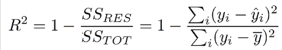

# 机器学习与数据科学圣经


# 第一部分

## 数据科学基础

## 第 1 章

## 理解数据科学


本章将向你介绍数据科学领域及其如何应用于从数据中获取洞察。数据科学融合了包括机器学习、统计学、可视化和编程在内的多个领域的技术。其核心在于，数据科学通过探索、清洗和建模大型数据集，采用分析方法来解决问题。

数据科学流程通常遵循从定义问题陈述到部署预测模型的明确定义的生命周期。在本章中，我们将详细研究这个生命周期，并了解其中涉及的各个阶段。我们还将探讨常用的工具和技术，这些工具和技术有助于数据清洗、探索、建模和结果沟通等任务。本章的一个关键部分是一个真实世界的案例研究，展示了如何通过应用数据科学来解决制造工厂中的预测性维护挑战。在本章结束时，你将掌握数据科学概念、方法论、工具以及使用数据驱动技术解决业务问题的基本知识。

## 数据科学简介

数据科学是一门跨学科领域，它利用科学方法、过程、算法和系统，从结构化和非结构化数据中提取知识和洞察。随着数据变得越来越丰富和有用，数据科学旨在分析这些数据，并从统计学、计算机科学和数学等多个领域汲取技术和理论，以帮助理解和优化现实世界的过程。

### 什么是数据科学？

数据科学是利用数据挖掘、机器学习和统计学的方法和过程，从数据中提取有用信息和洞察的过程。它涉及清洗、组织和建模大量数据，以发现有助于回答重要问题和做出明智决策的模式和相关性。

数据科学家处理来自各种来源的结构化和非结构化数据，例如传感器、物联网（IoT）设备、社交媒体互动、Web 服务器日志、科学实验和金融交易。他们的目标是开发洞察和预测模型，以帮助预测客户行为、检测网络入侵、评估治疗方案和改进业务策略等任务。

数据科学与机器学习、统计学和人工智能等学科相互交叉。然而，机器学习仅关注建模方面，而数据科学涵盖了从数据收集和准备到结果部署的整个生命周期。统计学提供基础的数学和概率技术，而人工智能研究智能计算机系统的开发。因此，数据科学可以被视为一门跨学科领域，它汇集了来自多个领域的技术和理论。

### 数据科学方法论

数据科学项目通常遵循一套明确定义的方法论，可以分解为以下阶段：

*   **问题定义**：清晰理解业务问题或研究问题，以及数据如何帮助解决它。这涉及与利益相关者讨论，以定义目标、假设和成功指标。

*   **数据收集**：使用网络爬虫、API 或传感器等工具，从各种内部和外部来源收集相关数据。结构化数据存储在数据库中，而非结构化数据（如文本）存储在文件系统中。

*   **数据准备**：清洗、集成和转换收集到的数据，使其适合分析。这涉及数据清洗、处理缺失值、特征提取和归一化等任务。

*   **探索性数据分析（EDA）**：通过可视化和汇总统计对数据进行初步检查，以获得初步洞察，识别模式、异常和关系。

*   **建模**：应用回归分析、分类、聚类、深度学习等技术，基于数据中识别出的模式开发预测算法或统计模型。

*   **评估**：在测试数据上比较模型性能以消除过拟合，并根据准确率、精确率和召回率等评估指标选择最佳模型。

*   **部署**：将选定的预测模型集成到工作流系统、应用程序或 API 中，以便在目标环境中进行操作使用。

*   **反馈**：在生产环境中定期监控模型，并使用新数据定期重新训练，以根据系统或环境的变化，迭代地随时间改进洞察。

### 数据科学的应用

得益于数据和分析能力的增长，数据科学在许多行业和领域都有广泛的应用。以下是一些关键应用：

*   **医疗保健**：通过电子健康记录和临床试验改善诊断、药物发现、治疗效果分析。

*   **零售和电子商务**：使用购买历史和网站行为数据进行需求预测、产品推荐、客户细分、欺诈检测。

*   **金融**：基于金融交易、市场和经济指标的信用评分、风险建模、投资策略。

*   **交通**：通过航空、汽车、铁路等领域的物联网传感器数据进行路线优化、资产预测性维护。

*   **电信**：通过呼叫详细记录进行网络优化、流失预测、个性化计划和定价。

*   **政府**：使用开放数据集进行城市规划、政策制定、公共事业管理。

*   **制造业**：通过工业物联网进行过程控制、质量控制、设备预测性维护。

数据科学通过高级分析，使组织能够在所有业务职能中做出基于证据和数据驱动的决策，从而提供竞争优势。

#### 职业前景和技能

近年来，数据科学已成为增长最快、薪酬最高的领域之一。根据一份报告，到 2026 年，全球将有 1150 万个数据科学岗位，美国的平均薪资超过 110,000 美元。一些关键职业选择和所需技能如下：

*   **数据分析师**：SQL、数据可视化、统计建模、Python/R 编程。

*   **数据工程师**：系统设计、数据仓库、使用 Spark/Hadoop 进行分布式计算、云平台。

*   **机器学习工程师**：算法开发、模型评估、神经网络、TensorFlow 等深度学习框架。

*   **数据科学家**：全生命周期项目、探索性数据分析、统计学、机器学习、洞察沟通。

*   **业务分析师**：专注于业务问题、数据讲故事、金融或医疗保健等特定领域的数据应用。

## 数据科学生命周期

数据科学项目遵循一个系统的过程，通过数据分析和建模来解决业务问题。这个过程通常被称为数据科学生命周期，涉及从问题定义到模型部署和改进的明确步骤。让我们详细了解这个生命周期的每个阶段。

### 问题定义

初始步骤是清晰地定义需要解决的问题或问题。数据科学家与业务领导者、领域专家和客户等利益相关者密切合作，以了解：

*   组织的关键业务目标和约束。

*   需要数据驱动洞察来进行决策的具体问题或机会。

*   解决这个问题如何影响收入、客户保留率或运营效率等指标。

*   正在做出哪些假设，以及成功将如何定量衡量。


## 数据科学流程概述

此阶段的讨论确保数据科学工作与整体战略目标保持一致，且明确的范围可避免日后出现范围蔓延。问题陈述和初步假设会被记录下来。

## 数据收集

一旦问题定义明确，相关数据源将被识别并收集数据。数据源可能包括：

* 内部数据库，如客户关系管理系统和企业资源计划系统。
* 外部数据源，如公共数据库、社交媒体个人资料和 Web API。
* 部署在现场的物联网和传感器设备，如智能电表或交通摄像头。

会使用网络爬虫、应用程序编程接口（`APIs`）和文件传输协议等工具，提取常见格式（如 `CSV`、`JSON` 和 `XML`）的结构化和非结构化数据文件。会处理权限和隐私问题。

### 数据准备

原始数据通过数据清洗、特征工程、归一化和转换等活动进行优化和准备，以便进行分析。任务包括：

* 使用统计插补方法识别和处理缺失值。
* 使用独热编码等技术将分类变量编码为数值格式。
* 将相关属性组合为派生特征，以便更好地建模。
* 使用最小-最大或 z-score 归一化将数值缩放到统一范围。
* 使用对数或 Box-Cox 变换转换偏态分布。

目标是解决不一致问题，并确保数据质量（如有效性、准确性、完整性和一致性），以便进行下游处理。

## 探索性数据分析

清洗完成后，会进行初步的探索性数据分析，以获得洞察、发现模式和关系。涉及的技术包括：

* 数值属性的集中趋势和变异性的描述性统计。
* 分类变量的频率分布和交叉表。
* 相关属性对之间的相关性分析。
* 直方图、散点图、热图等可视化工具，用于识别趋势和异常值。

研究结果有助于制定假设，突出需要进一步清洗的领域，或在建模前识别用于特征工程的新属性。

### 模型构建

基于探索性数据分析的洞察，选择相关的预测建模算法，并在训练数据集上应用。常见技术包括：

* 用于涉及连续目标的预测的回归模型，如线性回归、逻辑回归、多项式回归。
* 用于数值和分类结果的基于规则建模的决策树。
* 用于在未标记数据中发现自然分组的聚类算法，如 `K-means`。
* 用于复杂非线性关系的神经网络和深度学习方法。

模型参数会使用网格搜索等工具进行迭代调优，以优化验证数据集上的预测性能。

## 模型评估

训练好的模型会在未用于模型构建的独立测试数据集上进行评估，以准确评估预测能力，避免过拟合偏差。评估考虑：

* 分类问题的分类指标，如准确率、精确率、召回率。
* 回归问题的回归指标，如 `R-squared`、均方根误差。
* 无监督问题的聚类有效性指标，如轮廓系数。

在比较所有建模算法的评估结果后，会确定表现最佳的模型。会进一步使用诊断测试和可视化来验证模型假设并识别失效模式。

## 模型部署

最终选定的模型将通过以下方式部署到生产环境中：

* 运营团队可以以编程方式访问的 `APIs` 和 Web 服务。
* 非技术用户用于应用模型和可视化结果的用户界面和仪表板。
* 与工作流和商业智能平台的集成，用于自动化洞察和行动。
* 模型详细信息、限制、重新训练计划和监控最佳实践的文档。

## 反馈与改进

在生产环境中，会主动监控模型性能，并从利益相关者处收集关于洞察、支持的决策和整体影响的反馈。定期：

* 使用新的和不断变化的数据重新训练模型，以保持洞察的时效性。
* 在新数据上评估性能，以检查是否需要算法更新的概念漂移。
* 业务合作持续进行，以采用持续学习的方法优化问题定义。

这种重新评估和增强的循环确保数据科学工作通过基于证据的自适应方法产生可持续的改进。

## 数据科学中的工具和技术

数据科学涵盖使用各种工具和技术解决不同领域的问题。选择合适的工具可优化数据科学过程的不同阶段，从数据准备到模型部署。本文讨论了数据科学生态系统中一些最常用的编程语言、数据处理系统、可视化工具和机器学习库。

## 编程语言

编程语言是数据科学家分析、操作和开发数据算法的主要接口。一些主要使用的语言包括：

* `Python`：`Python` 由于拥有 `NumPy`、`Pandas`、`Matplotlib` 和 `Scikit-learn` 等丰富的分析库，已成为最流行的语言。它非常适合数据处理、机器学习和可视化任务。
* `R`：作为一种开源语言，`R` 通过 `tidyverse`、`ggplot2` 和 `caret` 等高效包，在统计建模、预测分析和数据可视化方面表现出色。它在营销、遗传学和调查分析等领域广泛应用。
* `SQL`：结构化查询语言 `SQL` 通过 `MySQL`、`PostgreSQL` 和 `SQLite` 等语言与关系型数据库交互。它对于从多个数据库表中提取、转换和集成数据很有用。
* `C/C++`：这些低级语言提供高性能，对于使用 `TensorFlow`、`PyTorch` 和 `Spark MLlib` 等库编程机器学习系统以及大规模开发分布式算法至关重要。
* `Java`：作为一种面向对象、与平台无关的语言，`Java` 通过 `Java`、`Scala` 和 `Clojure` 中的 API 驱动 `Hadoop` 和 `Spark` 等主要企业数据处理框架。
* `JavaScript/TypeScript`：`Node.js` 等 Web 技术增加了 `JavaScript` 在 Web 浏览器环境中进行数据可视化、模型服务和构建分析仪表板的采用率。

在这些语言之间的选择取决于用例、手头的具体任务、技术栈和开发人员的技能集。

## 数据处理系统

大规模数据处理需要分布式、可扩展且容错的系统。一些广泛使用的平台包括：

* `Hadoop`：一个 Apache 开源软件框架，用于在商品硬件集群上可靠地存储和处理大型数据集。组件包括 `HDFS`、`MapReduce`、`YARN`。
* `Spark`：最初由 UC Berkeley 开发，`Spark` 是一个用于大数据处理的统一分析引擎，提供 `Java`、`Python`、`R` 和 `Scala` 的 API。对于许多工作负载，它比 `MapReduce` 快多达 100 倍。
* `Storm`：一个用于可靠地大规模处理无界数据流的实时计算系统。它适用于日志分析、金融分析和网站活动跟踪等应用。
* `Flink`：`Flink` 是一个开源流处理框架，与 `Storm` 类似，但在数据流模型、容错和延迟特性方面存在关键差异，使其对某些用例具有吸引力。


这些分布式计算框架提供了处理 PB 级数据集进行数据科学所需的大规模并行性、容错性和可扩展性。它们处理的数据集远超单机能力。

### 数据可视化

将数据转化为可视化洞察对于人类理解至关重要。此处的关键工具包括：

*   **Tableau:** 一个领先的交互式仪表板平台，允许通过拖放创建可视化模板，并对大型数据集进行筛选和探索。

*   **Power BI:** 来自微软，Power BI 通过广泛的可视化类型画廊和自然语言查询界面，实现直观的报告和交互式数据发现。

*   **Qlik:** 一个关联式数据可视化工具，帮助用户通过关联视图和表达式，自由探索大型多维数据集中的关系。

*   `matplotlib`, `seaborn`: 用于绘制 2D 图表、直方图、散点图、柱状图和其他静态可视化格式的开源 Python 库。

*   **ggplot2:** R 语言 tidyverse 套件的一部分。它遵循图形语法概念框架来创建分层图表。

这些工具根据数据量、所需的交互性以及报告是否需要在线共享和嵌入或导出为静态图像，适合不同的需求。

### 机器学习框架

软件框架为机器学习模型构建提供程序化接口和算法。流行示例包括：

*   **Scikit-learn:** 一个首选的 Python 库，为数据挖掘和建模任务提供简单的 API，使用线性回归、SVM、随机森林、降维等算法。

*   **TensorFlow:** 由 Google 开发的端到端开源机器学习和深度学习平台。它为神经网络定义数据流和计算图。

*   **PyTorch:** 一个基于 Python 的深度学习框架，在研究中很受欢迎，专注于使用动态计算图和自动微分实现灵活性和实验速度。

*   **Keras:** 可以在 TensorFlow、CNTK 或 Theano 上运行的 API，使 Keras 易于与深度学习后端交互。它为开发和评估深度模型提供高级构建块。

*   **Spark MLlib:** 集成到 Apache Spark 中的机器学习库，提供用于分类、回归、聚类以及管道、参数调优等的分布式算法。

这些框架通过抽象底层线性代数计算和硬件优化来加速算法开发。它们允许快速从原型进展到规模化的生产模型。

### 云平台

云计算为数据科学任务提供按需访问可扩展、弹性资源。一些领先的平台包括：

*   **AWS:** Amazon Web Services 提供一整套 ML 和数据处理服务，包括 SageMaker、EMR、EC2、S3、Redshift 等。其按使用付费的模式对初创企业和企业来说成本效益高。

*   **Azure:** 微软的云，提供 HDInsight 用于 Hadoop/Spark，ML Studio/Workbench 用于模型构建，Databricks 用于 Azure 数据湖上的协作分析。

*   **GCP:** Google Cloud Platform 在 Google Compute Engine VM 上提供托管的 Spark 和 Hadoop 集群，以及 Dataproc、BigQuery、Dataflow 和 ML Engine 等工具。

*   **阿里云:** 一个快速增长的云服务提供商，阿里云通过 MaxCompute 提供数据分析即服务，通过阿里云数据可视化提供数据可视化，并使用 ModelArts 平台进行机器学习。

云平台提供弹性按需基础设施，其能力涵盖数据科学的所有阶段，从提取-转换-加载到模型部署和监控。它们正在改变数据科学的实践方式。

## 实际应用：制造业中的预测性维护

制造业一直面临着最大限度提高设备正常运行时间并尽量减少影响生产力和成本的非计划停机时间的压力。预测性维护使用数据科学技术准确预测设备故障，从而实现及时维修并避免生产损失。本案例研究考察了预测性维护策略在实际制造环境中的应用。

### 问题

一家食品加工厂拥有五十条高速生产线，包含传送带、搅拌机、电机和包装机等机械部件。关键部件的非计划故障导致意外停机，造成瓶颈并错过交货期限。

平均而言，每条生产线故障会中断三小时的生产，每次故障导致 $30,000 的成本（包括重跑、加班和机会损失）。每月各生产线发生五次故障，年度成本为 $180 万。被动的故障维修模式既不可靠又低效。

### 目标

构建机器学习模型，利用传感器数据主动预测设备故障，提前 2-4 周发出预警。这样可以在不中断生产的情况下进行维护规划，并优化资产利用率。关键目标包括：

*   将非计划故障及相关成本降低至少 30%。

*   安排及时的预防性维护以延长资产寿命。

*   改善对设备健康状况和风险的可见性。

该方法将利用工业物联网（IIoT）传感器、云基础设施和预测分析。

### 数据收集

在关键部件上安装了传感器，以监测振动、热量、压力、电压和人机界面信号。数据通过本地 MQTT 代理实时流式传输到 Azure IoT 中心，并安全存储在 Azure SQL 数据库中。

数据工程师每天执行提取-转换-加载（ETL）流程，以标准化五年的历史读数，并进行特征工程派生，如移动平均和傅里叶变换。这得出了来自 50 台机器的超过 5 亿个数据点的训练集，每月故障事件由专家标记。

### 数据准备

由于传感器读数的采样率不同，存在缺失值，且不同机器类型的格式不一致，采取了以下步骤：

*   使用卡尔曼滤波器对时间序列缺失进行插值和填充。

*   重采样为每小时频率，并将数据归一化到标准范围内。

*   对机器 ID 等分类参数进行独热编码。

*   通过相关性分析进行特征选择，并移除共线性属性。

这种清理、集成和转换使得能够对涵盖多种设备的异构多传感器数据集进行一致的建模。

### 探索性分析

EDA 通过可视化和统计测试识别趋势和重要关联：

*   基于逻辑回归 p 值 < 0.05，振动和热量属性与故障事件高度相关。

*   出现季节性模式，故障在夏季维护计划期间达到高峰。

*   某些机器基于年龄、工作负载或过去的服务历史记录模式，倾向于更频繁地发生故障。

洞察揭示了故障前兆，以集中建模，并突出了需要主动监控的设备。

### 模型构建与评估

根据问题特征选择了三种算法：

#### 1\. 随机森林分类器：

因其能够捕捉连续属性和分类属性混合体之间的复杂交互作用。

#### 2\. 梯度提升（XGBoost）：

在时间序列数据集上表现优于其他提升技术。

#### 3\. 深度神经网络：

用于发现跨多传感器输入随时间变化的深层非线性模式。

使用随机搜索优化进行超参数调优，提高了模型在验证数据上的平衡准确率：

*   随机森林：83%

*   XGBoost：85%

*   DNN：87%


由于网络擅长捕捉预示即将出现问题的微小异常，因此在诊断其故障预测后，它被选中进行部署。

## 模型部署

DNN 模型已集成到 Azure 的 IoT 预测性维护解决方案中：

*   流式处理管道从资产中摄取实时传感器数据，并通过 API 使用预训练模型进行评分。

*   结果在响应式仪表板上可视化，标记高风险设备和异常。

*   电子邮件警报会在预测故障日期前 2-4 周发送给维护团队，以便在模型开发期间分析的故障根本原因基础上，进行润滑、清洁或零件更换等主动服务。

这使得从被动维护转向基于状态的维护，以实现最低全生命周期成本下的最大正常运行时间。

## 结果与效益

系统部署 1 年后：

*   非计划故障从平均每月 5 次减少到每月 2 次。

*   通过模型指导的 15 次成功预防性维修避免了停机，节省了价值 300,000 美元的生产损失。

*   在首次检测到退化时进行有针对性的维护，使资产寿命延长了 10-15%，优于运行至故障的方法。

*   基于准确的警报，技术人员的响应时间从平均 4 小时缩短到不到 1 小时。

每年 450,000 美元的节省在 3 年内超过了初始投资成本。客户将预测性维护扩展到其他设施，提高了整个车队的 OEE。

本案例凸显了当完整的数据科学方法论应用于带有 IIoT 数据的工业问题时，如何通过效率提升和风险缓解带来显著的投资回报率。它展示了传感器数据的洞察如何推动制造业的运营卓越。

## 章末练习

1. 用自己的话定义数据科学生命周期过程的每个步骤。给出一个你会应用每个步骤的示例场景。

2. 描述数据科学中常用的 3 种编程语言。讨论每种语言在不同数据科学任务中的适用性方面的优缺点。

3. 解释在预测性维护用例中收集数据时的 3 个关键考虑因素。在数据准备阶段可能会面临哪些挑战？

4. 讨论可用于时间序列传感器数据探索性数据分析的 3 种技术。提供可能有助于识别异常或故障模式的可视化或统计测试示例。

5. 描述数据科学生命周期各个阶段中常用的不同工具和技术。在什么情况下，不同的编程语言、数据处理系统和机器学习框架是合适的？

6. 从案例研究中选择一个制造工厂，或选择你自己的一个工厂。制定详细的数据采集和整理计划，概述所需的 IIoT 传感器类型、数据存储方法、清洗和特征工程步骤。

7. 案例研究中的预测性维护模型达到了 87% 的准确率。提出两种可能提高模型性能的方法。可能会出现哪些挑战，以及如何应对？

8. 质量控制是制造业的另一项重要功能。建议预测分析和机器学习如何帮助检测生产线上的异常并预测缺陷。

9. 资产正常运行时间至关重要，但成本也很重要。讨论基于模型警报的预防性维护与运行设备至故障方法之间的权衡。每种方法在什么情况下更可取？

10. 除了减少停机时间外，预测性维护解决方案的洞察还可以通过哪 2-3 种其他方式影响关键制造指标，如整体设备效率 (OEE)？

## 摘要：关键概念和公式

### 数据科学方法论

数据科学过程遵循结构化的生命周期方法，包含定义的阶段：

*   **问题定义：** 了解业务目标、约束条件和成功指标。

*   **数据收集：** 从内部和外部来源提取相关数据。

*   **数据准备：** 从原始数据中清洗、转换和工程化特征。

*   **探索性数据分析 (EDA)：** 通过统计分析和可视化获得初步洞察。

*   **建模：** 在训练数据上开发和优化预测算法。

*   **评估：** 在验证数据上评估模型性能，不存在偏差。

*   **部署：** 通过 API、仪表板和工作流集成将模型运营化。

*   **反馈：** 通过重新训练和概念漂移分析，在新数据上持续改进模型。

这种方法论通过基于证据的迭代，确保了强大、高效和可持续的解决方案。

### 数据科学工具与技术

支持不同阶段的关键技术包括：

*   **编程语言：** Python、R、SQL、Java，用于灵活开发。

*   **数据处理框架：** Hadoop、Spark、Storm，用于大规模分布式分析。

*   **机器学习库：** Scikit-Learn、TensorFlow、PyTorch，用于算法和模型。

*   **可视化工具：** Tableau、Power BI、Matplotlib，用于洞察沟通。

*   **云平台：** AWS、Azure、GCP，用于按需灵活的基础设施。

根据独特需求正确选择可优化问题解决能力。

### 预测性维护概念

将数据科学应用于资产性能优化有助于实现：

*   通过传感器监控，从被动维护转向基于状态的维护。

*   基于故障概率的维护工作风险优先级排序。

*   以可靠性为中心的维护，延长资产使用寿命。

*   通过减少过程中断和优化组件使用配置，提高能源效率。

*   基于故障预测的库存优化和减少零件消耗。

### 关键模型评估公式

准确率、误差和不确定性度量有助于验证机器学习算法，包括：

#### 分类指标

1. 分类准确率

其中 `TP` 为真阳性，`TN` 为真阴性，`P` 为阳性总数，`N` 为阴性总数。

2. 精确率

其中 `FP` 为假阳性。

3. 召回率

其中 `FN` 为假阴性。

## 回归指标

4. 均方根误差 (RMSE)

其中 `y_true` 为真实值，`y_pred` 为预测值，`N` 为观测数量。

5. R 平方（决定系数）

其中 `y_mean` 为真实值的均值。

#### 其他评估方法

6. 接收者操作特征 (ROC) 曲线分析

ROC 曲线是真阳性率（召回率）与假阳性率（1-特异性）在各种阈值设置下的图形表示。ROC 曲线下面积 (AUC) 是衡量模型区分类别能力的指标。

这些指标和方法对于评估和比较机器学习模型的性能至关重要。

### IoT 传感器数据特征

预测性维护利用来自以下来源的异构时间采样数据：

*   振动传感器，用于检测滚动轴承退化。

*   热电偶，用于指示电气/机械故障的热特征。

*   超声波泄漏探测器，用于压缩空气管道和管线。

*   电力表，用于监测电压/电流特征变化。

*   pH 探头、气体分析仪，用于检测化学过程症状。

预处理处理缺失值、重采样和归一化，以供算法使用。

## 第 2 章

### 探索数据


探索性数据分析是初始数据收集与最终建模阶段之间的重要中间环节。在本章中，我们将学习可视化和统计探索性数据分析技术，以获得有价值的初步洞察。直方图、散点图、热图等可视化方法可以让我们用最少的代码识别模式、分布和异常观测值。统计例程有助于总结数值属性、检测变量之间的关联，并突出任何异常趋势。无论是在笔记本环境中还是通过专用工具进行，探索性分析都能让我们在构建模型之前验证假设、战略性地处理异常值并审慎地转换特征。

### 数据收集与获取

适当数据收集的重要性无论如何强调也不为过。高质量、相关的数据对于任何数据科学项目都是必不可少的。它影响模型的准确性、洞察的深度以及结论的整体价值。数据收集不足可能导致结果偏差、错失机会，并可能产生具有重大现实影响的错误决策。

### 内部数据来源

许多组织的主要数据来源是其内部数据库。这些数据库可能包括客户关系管理（CRM）系统、企业资源计划（ERP）软件或自定义构建的数据仓库。例如，一家大型电子商务公司可能拥有广泛的客户交易数据库，涵盖购买历史、浏览行为和客户人口统计信息。访问这些数据通常涉及编写 `SQL` 查询或使用专用数据提取工具。

考虑这样一个场景：该电子商务公司的一名数据科学家被指派改进产品推荐。他们可能会先编写一个 `SQL` 查询来提取所需的数据：

```
SELECT c.customer_id, p.product_id, p.category, o.order_date, o.order_total

FROM customers c

JOIN orders o ON c.customer_id = o.customer_id

JOIN order_items oi ON o.order_id = oi.order_id

JOIN products p ON oi.product_id = p.product_id

WHERE o.order_date >= DATE_SUB(CURDATE(), INTERVAL 1 YEAR);
```

此查询将提供过去一年客户购买的丰富数据集，包括产品类别和订单总额，可用于构建推荐引擎。

### 用于外部数据的网络爬虫

然而，内部数据经常需要辅以外部来源，以提供更全面的视角。网络爬虫就变得有价值了。网络爬虫涉及从网站自动提取数据，是收集公开可用但不易以结构化格式获取的信息的强大工具。

例如，一名金融分析师可能需要收集各公司随时间变化的股票价格数据。通过使用 `Python` 及其 `BeautifulSoup` 或 `Scrapy` 等库，他们可以创建一个脚本，从金融网站抓取这些数据：

```
import requests

from bs4 import BeautifulSoup

import pandas as pd

def scrape_stock_data(ticker):

url = f"https://finance.yahoo.com/quote/{ticker}"

response = requests.get(url)

soup = BeautifulSoup(response.text, 'html.parser')

price = soup.find('fin-streamer', {'data-field': 'regularMarketPrice'}).text

return float(price)

tickers = ['AAPL', 'GOOGL', 'MSFT', 'AMZN']

data = {ticker: scrape_stock_data(ticker) for ticker in tickers}

df = pd.DataFrame(list(data.items()), columns=['Ticker', 'Price'])

print(df)
```

此脚本将生成一个包含指定公司当前股票价格的 `DataFrame`。虽然有效，但网络爬虫应负责任地进行，遵守网站的服务条款，并加入速率限制以防止服务器过载。

### 用于数据访问的 API 集成

另一个日益关键的数据来源是 `APIs`（`应用程序编程接口`）。众多公司和组织提供 `APIs`，使其数据能够以编程方式访问。这可以涵盖从社交媒体数据到天气预报再到政府统计数据的广泛信息。

例如，一名研究气候变化的研究人员可能会利用国家海洋和大气管理局（`NOAA`）的 `API` 来收集历史天气数据。以下是他们如何使用 `Python` 与该 `API` 交互的示例：

```
import requests

import pandas as pd

from datetime import datetime, timedelta

def get_noaa_data(station_id, start_date, end_date):

base_url = "https://www.ncdc.noaa.gov/cdo-web/api/v2/data"

token = "YOUR_API_TOKEN" # Replace with your actual token

params = {

"datasetid": "GHCND",

"stationid": station_id,

"startdate": start_date,

"enddate": end_date,

"limit": 1000,

"units": "metric"

}

headers = {"token": token}

response = requests.get(base_url, params=params, headers=headers)

data = response.json()

return pd.DataFrame(data['results'])

# Example usage

station_id = "GHCND:USW00023234" # Boston, MA

end_date = datetime.now().strftime("%Y-%m-%d")

start_date = (datetime.now() - timedelta(days=365)).strftime("%Y-%m-%d")

df = get_noaa_data(station_id, start_date, end_date)

print(df.head())
```

此脚本将检索波士顿一年的每日天气数据，随后可用于分析趋势或用于预测模型。

### 数据收集中的伦理考量

随着数据收集方法的进步，伦理考量变得越来越关键。数据隐私、同意和负责任的使用是数据科学家必须优先考虑的关键问题。在收集个人数据时，必须从个人处获得知情同意并保护其数据。

在欧盟，通用数据保护条例（`GDPR`）为数据收集和使用制定了严格的指导方针。全球正在出现类似的法规，要求数据科学家了解并遵守这些标准。

### 确保数据质量

确保数据质量是数据收集的另一个重要方面。它不仅包括收集大量数据，还包括验证其准确性、完整性以及与特定问题的相关性。数据质量问题可能源于测量不准确、数据录入错误或有偏样本等来源。

例如，考虑一家公司进行客户满意度调查。如果他们仅调查近期购买者，可能会忽略那些未进行近期交易的客户的反馈，这可能是由于不满造成的。这可能导致结果偏差，不准确地描绘客户满意度水平。

为缓解此类问题，数据科学家通常采用分层抽样等技术以确保具有代表性的样本。他们还可能在收集过程中实施数据验证检查以尽早发现错误。例如，在通过网页表单收集年龄数据时，他们可能会包含一个验证检查，以验证输入的年龄是否在合理范围内：

```
function validateAge() {

var age = document.getElementById("age").value;

if (age < 0 || age > 120) {

alert("Please enter a valid age between 0 and 120");

return false;

}

return true;

}
```

### 数据收集中的可扩展性

随着数据量的扩大，可扩展性成为数据收集中的一个关键问题。传统的数据存储和处理方法可能不足以管理大数据。因此，已转向开发分布式系统并利用基于云的解决方案。

例如，一家每天处理太字节数据的社交媒体分析公司可能会使用 `Apache Kafka` 进行实时数据摄取。他们可以将这些数据存储在像 `Hadoop HDFS` 这样的分布式文件系统中，并使用 `Apache Spark` 等工具进行处理。以下是他们如何使用 `PySpark` 处理大型数据集的基本示例：

```
from pyspark.sql import SparkSession
```


from pyspark.sql.functions import col, explode

# 初始化 Spark 会话

spark = SparkSession.builder.appName("SocialMediaAnalysis").getOrCreate()

# 从 HDFS 读取数据

df = spark.read.json("hdfs://namenode:8020/user/data/social_media_posts.json")

# 处理数据

result = df.select(

col("user_id"),

col("post_text"),

explode(col("hashtags")).alias("hashtag")

).groupBy("hashtag").count().orderBy(col("count").desc())

# 显示前 10 个热门标签

result.show(10)

此脚本将处理大型社交媒体帖子 JSON 文件，提取并统计标签，以找出最受欢迎的标签。

### 数据采集中的新兴技术

随着我们迈向未来，新兴技术正在不断重塑数据采集的格局。物联网（IoT）正在产生海量传感器数据，而可穿戴设备则为健康和行为提供了前所未有的洞察。增强现实和虚拟现实系统也在产生新的交互数据形式。

例如，在智慧城市计划中，城市各处散布的各种 IoT 传感器数据可能会被收集，以优化交通流量、能源消耗和废弃物管理。为了收集这些数据，他们可以使用 MQTT（消息队列遥测传输），这是一种专为 IoT 设备设计的轻量级消息传递协议。以下是他们可能在 Python 中配置 MQTT 客户端以接收传感器数据的示例：

```python
import paho.mqtt.client as mqtt

import json

def on_connect(client, userdata, flags, rc):

print("Connected with result code "+str(rc))

client.subscribe("city/sensors/#")

def on_message(client, userdata, msg):

payload = json.loads(msg.payload)

print(f"Received message on topic {msg.topic}: {payload}")

# Here you would typically process and store the data

client = mqtt.Client()

client.on_connect = on_connect

client.on_message = on_message

client.connect("mqtt.example.com", 1883, 60)

client.loop_forever()
```

此脚本将连接到 MQTT 代理并监听来自城市各处传感器的消息，在消息到达时对其进行处理。

### 数据清洗与预处理

数据清洗涉及识别和纠正数据集中错误、不一致和不准确之处的过程。另一方面，预处理涵盖一系列更广泛的技术，旨在将原始数据转换为更适合分析的格式。这两项程序共同确保您的数据准确、一致，并按特定分析要求进行适当格式化。

### 识别和管理缺失数据

现实世界数据集中最普遍的挑战之一是缺失数据。缺失值可能由于各种因素产生，包括设备故障、人为错误，或者仅仅是信息不可用。处理缺失数据至关重要，因为许多机器学习算法无法有效处理不完整的数据集。

处理缺失数据有几种策略：

1. **删除**：这种方法涉及删除包含缺失值的记录。虽然简单直接，但如果执行不当，可能会导致大量信息丢失。

2. **插补**：插补涉及用估计值替换缺失值。常见方法包括均值插补、中位数插补，或更复杂的技术，如回归插补或多重插补。

3. **使用容忍缺失值的算法**：某些算法，如特定类型的决策树，旨在在处理过程中直接处理缺失数据。

这些策略使数据科学家能够有效管理缺失数据场景，确保数据集为分析和建模任务做好最佳准备。

以下是使用 Python 和 pandas 处理缺失数据的示例：

```python
import pandas as pd

import numpy as np

# Load the dataset

df = pd.read_csv('dataset.csv')

# Check for missing values

print(df.isnull().sum())

# Remove rows with missing values

df_cleaned = df.dropna()

# Or, fill missing values with the mean of the column

df_imputed = df.fillna(df.mean())

# For categorical variables, you might fill with the mode

df['categorical_column'] = df['categorical_column'].fillna(df['categorical_column'].mode()[0])

# Or use more advanced imputation techniques

from sklearn.impute import SimpleImputer

imputer = SimpleImputer(strategy='mean')

df_imputed = pd.DataFrame(imputer.fit_transform(df), columns=df.columns)
```

#### 处理异常值

异常值是与其他观测值显著偏离的数据点。虽然异常值有时可能指示值得研究的重要异常，但它们也可能源于测量错误或数据录入错误。管理异常值至关重要，因为它们有可能严重扭曲统计分析和机器学习模型。

#### 检测异常值的常用方法

1. **Z-score 方法**：该方法假设数据服从正态分布，并识别偏离均值指定标准差数量的数据点。

2. **四分位距（IQR）方法**：该方法对极端值具有鲁棒性，特别适用于非对称（偏斜）分布。它根据第三四分位数（Q3）和第一四分位数（Q1）之间的差异来识别异常值。

3. **可视化技术**：箱线图、散点图和直方图等技术可以通过显示超出典型范围的数据点来直观地突出异常值。

#### 处理异常值

一旦识别出异常值，可以使用多种方法进行管理：

* **删除**：可以从数据集中删除异常值，但需谨慎，以确保不会丢失重要信息。

* **转换**：对数据应用数学转换（例如，对数转换）有时可以减少异常值的影响。

* **稳健统计方法**：使用对异常值不那么敏感的统计技术，如稳健回归或截尾，可以减轻其对分析的影响。

通过采用这些方法，数据科学家可以有效地识别和管理异常值，确保更准确、更可靠的分析和模型结果。

以下是使用 IQR 方法检测和处理异常值的示例：

```python
import pandas as pd

import numpy as np

# Load the dataset

df = pd.read_csv('dataset.csv')

# Calculate IQR

Q1 = df['column_name'].quantile(0.25)

Q3 = df['column_name'].quantile(0.75)

IQR = Q3 - Q1

# Define bounds

lower_bound = Q1 - 1.5 * IQR

upper_bound = Q3 + 1.5 * IQR

# Identify outliers

outliers = df[(df['column_name'] < lower_bound) | (df['column_name'] > upper_bound)]

# Remove outliers

df_cleaned = df[(df['column_name'] >= lower_bound) & (df['column_name'] <= upper_bound)]

# Or cap the outliers

df['column_name'] = np.clip(df['column_name'], lower_bound, upper_bound)
```

### 标准化与归一化

许多机器学习算法在特征处于可比较尺度时性能更好。标准化和归一化是用于调整不同特征尺度的技术。

#### 标准化（Z-score 归一化）

标准化，也称为 Z-score 归一化，将数据转换为均值为 0、标准差为 1。当数据特征表现出不同的尺度，或需要公平比较不同特征时，此方法特别有效。

#### 归一化

归一化通常将值缩放到固定范围，通常在 0 到 1 之间。当需要在稀疏数据中保留零值，或数据分布偏离高斯（正态）分布时，这种方法很有用。

以下是如何实现这些技术：

```python
from sklearn.preprocessing import StandardScaler, MinMaxScaler

### Standardization

scaler = StandardScaler()
```


`df_standardized = pd.DataFrame(scaler.fit_transform(df), columns=df.columns)`

#### 标准化

`normalizer = MinMaxScaler()`

`df_normalized = pd.DataFrame(normalizer.fit_transform(df), columns=df.columns)`

## 对分类变量进行编码

对分类变量进行编码对于许多需要数值输入数据的机器学习算法至关重要。现实世界的数据集通常包含颜色、类型或类别等分类变量，需要将其转换为数值格式，以便机器学习模型能够有效处理。

### 常见编码技术

1. `One-Hot Encoding`：这种技术为每个类别创建二进制列，适用于类别之间没有序数关系的情况。每个类别由一个二进制向量表示，其中仅一位为 `'1'`（热），其余位为 `'0'`（冷）。

2. `Label Encoding`：标签编码为每个类别分配一个唯一的整数。当类别之间存在固有的序数关系（即它们之间有有意义的顺序或排名）时适用。

3. `Binary Encoding`：这种方法在独热编码和标签编码之间取得了平衡。它使用二进制数字表示每个类别，与独热编码相比能有效减少维度数量，同时仍能捕捉分类信息。

这些技术使数据科学家能够将分类数据预处理为机器学习算法可以有效利用的数值格式，确保模型训练和预测的准确性。选择合适的编码方法取决于分类变量的性质以及手头机器学习任务的具体要求。

以下是独热编码和标签编码的示例：

```
import pandas as pd

from sklearn.preprocessing import OneHotEncoder, LabelEncoder

# One-Hot Encoding

onehot = OneHotEncoder(sparse=False)

onehot_encoded = pd.DataFrame(onehot.fit_transform(df[['categorical_column']]))

onehot_encoded.columns = onehot.get_feature_names(['categorical_column'])

# Label Encoding

le = LabelEncoder()

df['label_encoded'] = le.fit_transform(df['categorical_column'])
```

## 处理不平衡数据集

在现实场景中，尤其是在分类问题中，数据集往往会不平衡，即一个类别显著多于其他类别。这种不平衡可能导致模型偏差，在预测少数类时表现不佳。

### 处理不平衡数据集的技术

1. `Oversampling the Minority Class`：`SMOTE`（合成少数类过采样技术）等技术会为少数类生成合成样本，以平衡类别分布。

2. `Undersampling the Majority Class`：欠采样涉及减少多数类的实例数量，以匹配少数类的规模。

3. `Combination of Oversampling and Undersampling`：这种方法结合了少数类的过采样和多数类的欠采样，以实现更平衡的数据集。

4. `Using Algorithms that Handle Imbalanced Datasets`：某些算法，例如带有调整类权重的决策树或 `XGBoost` 等集成方法，可以通过在训练期间给少数类实例更多权重来直接处理不平衡数据集。

以下是使用 `SMOTE` 的示例：

```
from imblearn.over_sampling import SMOTE

from sklearn.model_selection import train_test_split

# Split the data

X_train, X_test, y_train, y_test = train_test_split(X, y, test_size=0.2, random_state=42)

# Apply SMOTE

smote = SMOTE(random_state=42)

X_train_resampled, y_train_resampled = smote.fit_resample(X_train, y_train)
```

### 特征工程

特征工程是利用领域知识创建新特征的过程，这些新特征能让机器学习算法工作得更好。这可能涉及组合现有特征、转换特征，或基于现有数据创建全新的特征。

一些常见的特征工程技术包括：

1. 多项式特征：通过相乘现有特征来创建新特征

2. 分箱：将连续变量转换为离散箱

3. 对数变换：适用于处理偏态分布

4. 特定领域特征：基于领域知识创建新特征

以下是创建多项式特征的示例：

```
from sklearn.preprocessing import PolynomialFeatures

poly = PolynomialFeatures(degree=2, include_bias=False)

X_poly = poly.fit_transform(X)
```

#### 降维

处理高维数据时，减少特征数量通常是有益的。这有助于减少噪声、避免过拟合，并使模型更具可解释性。常见的降维技术包括：

1. 主成分分析 (`PCA`)：这种技术寻找能最大化数据集方差的方向（主成分）。

2. `t-SNE` (`t-Distributed Stochastic Neighbor Embedding`)：这对于可视化高维数据特别有用。

3. 自编码器：这些是神经网络，可以学习输入数据的压缩表示。

### 数据增强

在数据有限的情况下，可以使用数据增强技术人为扩展数据集。这在图像处理任务中非常常见，但也可以应用于其他类型的数据。

对于图像数据，常见的增强技术包括：

1. 翻转

2. 旋转

3. 缩放

4. 添加噪声

以下是使用 Keras `ImageDataGenerator` 的简单示例：

```
from keras.preprocessing.image import ImageDataGenerator

datagen = ImageDataGenerator(

rotation_range=20,

width_shift_range=0.2,

height_shift_range=0.2,

horizontal_flip=True)

datagen.fit(X_train)
```

## 探索性数据分析 (`EDA`)

探索性数据分析 (`EDA`) 是数据科学过程中的关键步骤，涉及分析和可视化数据集以总结其主要特征。它通常是数据科学家在清洗和预处理数据后采取的第一步。`EDA` 的主要目标是使用统计摘要和图形表示来获得洞察、发现模式、识别异常、验证假设并检查假设。

`EDA` 不仅仅是应用一组技术；它是一种数据分析方法，采用各种技术来最大限度地提高对数据集的洞察力，发现潜在结构，检测异常值和异常，并验证潜在假设。`EDA` 的重点在于灵活性和多种方法，而不是一套固定的技术。

### 描述性统计

`EDA` 的第一步之一是计算和检查数据集的基本描述性统计量。这包括集中趋势度量（均值、中位数、众数）、离散度量（范围、方差、标准差）和形状度量（偏度、峰度）。

以下是使用 Python 计算这些统计量的示例：

```
import pandas as pd

import numpy as np

# Load the dataset

df = pd.read_csv('dataset.csv')

# Calculate descriptive statistics

desc_stats = df.describe()

# Calculate skewness and kurtosis

skewness = df.skew()

kurtosis = df.kurtosis()

print("Descriptive Statistics:")

print(desc_stats)

print("\nSkewness:")

print(skewness)

print("\nKurtosis:")

print(kurtosis)
```

这些统计量提供了数据集特征的快速摘要，并可以突出显示值得进一步调查的潜在问题或有趣特征。

### 数据可视化

可视化是 `EDA` 的关键组成部分。图表和图形可以揭示仅从汇总统计量中无法察觉的趋势、模式和关系。常见的可视化类型包括：

1. 直方图：显示单个数值变量的分布。

2. 箱线图：显示类别间数值变量的分布。


3. 散点图：显示两个数值变量之间的关系。

4. 柱状图：比较不同类别之间的数量。

5. 热图：可视化不同变量之间的相关性。

这里是一个使用 `matplotlib` 和 `seaborn` 创建这些可视化效果的示例：

```
import matplotlib.pyplot as plt

import seaborn as sns

# Histogram

plt.figure(figsize=(10, 6))

sns.histplot(df['numerical_column'], kde=True)

plt.title('Distribution of Numerical Column')

plt.show()

# Box plot

plt.figure(figsize=(10, 6))

sns.boxplot(x='categorical_column', y='numerical_column', data=df)

plt.title('Box Plot of Numerical Column by Category')

plt.show()

# Scatter plot

plt.figure(figsize=(10, 6))

sns.scatterplot(x='numerical_column1', y='numerical_column2', data=df)

plt.title('Scatter Plot of Numerical Column 1 vs Numerical Column 2')

plt.show()

# Correlation heatmap

plt.figure(figsize=(12, 10))

sns.heatmap(df.corr(), annot=True, cmap='coolwarm')

plt.title('Correlation Heatmap')

plt.show()
```

这些可视化可以快速揭示数据中的模式、异常值和关系，而这些可能仅通过查看原始数字无法立即察觉。

### 检查变量之间的关系

了解数据集中不同变量之间的关系是探索性数据分析（EDA）的关键部分。这可能涉及查看数值变量之间的相关性，检查分类变量如何与数值变量相关，并识别数据中的任何多重共线性。

### 检测异常值和异常

识别异常值和异常是 EDA 的重要组成部分。异常值可能会显著影响统计分析和机器学习模型，因此检测和理解它们至关重要。

这里是一个如何使用四分位距（IQR）方法检测异常值的示例：

```
import numpy as np

import matplotlib.pyplot as plt

def detect_outliers(data):

Q1 = np.percentile(data, 25)

Q3 = np.percentile(data, 75)

IQR = Q3 - Q1

lower_bound = Q1 - (1.5 * IQR)

upper_bound = Q3 + (1.5 * IQR)

return np.where((data > upper_bound) | (data < lower_bound))

for column in df.select_dtypes(include=['float64', 'int64']).columns:

outliers = detect_outliers(df[column])

print(f"Outliers in {column}:")

print(df.loc[outliers[0], column])

plt.figure(figsize=(10, 6))

plt.boxplot(df[column])

plt.title(f'Box Plot of {column}')

plt.show()
```

此脚本使用 IQR 方法检测异常值，并使用箱线图对其进行可视化。

### 时间序列分析

如果您的数据包含时间组件，时间序列分析可以是 EDA 的重要组成部分。这可能涉及查看趋势、季节性模式和自相关。

这里是一个基本时间序列分析的示例：

```
import pandas as pd

import matplotlib.pyplot as plt

from statsmodels.tsa.seasonal import seasonal_decompose

# Assuming 'date' is your date column and 'value' is the value you're analyzing

df['date'] = pd.to_datetime(df['date'])

df.set_index('date', inplace=True)

# Plotting the time series

plt.figure(figsize=(12, 6))

plt.plot(df.index, df['value'])

plt.title('Time Series Plot')

plt.show()

# Decomposing the time series

result = seasonal_decompose(df['value'], model='multiplicative')

result.plot()

plt.show()

# Autocorrelation plot

from pandas.plotting import autocorrelation_plot

autocorrelation_plot(df['value'])

plt.show()
```

此脚本创建一个时间序列图，将序列分解为趋势、季节性和残差成分，并绘制自相关函数。

### 特征工程洞察

EDA 还可以为特征工程提供洞察。通过了解数据中的分布和关系，您可以识别可能有用的潜在新特征或转换。

例如，您可能会注意到变量的对数具有更正态的分布，或者两个变量的比率比单个变量更具信息性。

```
import numpy as np

import matplotlib.pyplot as plt

# Log transform

df['log_column'] = np.log1p(df['column'])

# Plot original and log-transformed data

fig, (ax1, ax2) = plt.subplots(1, 2, figsize=(12, 5))

ax1.hist(df['column'], bins=30)

ax1.set_title('Original Distribution')

ax2.hist(df['log_column'], bins=30)

ax2.set_title('Log-Transformed Distribution')

plt.show()

# Create interaction term

df['interaction'] = df['column1'] * df['column2']

# Plot interaction term against target variable

plt.figure(figsize=(10, 6))

plt.scatter(df['interaction'], df['target'])

plt.xlabel('Interaction Term')

plt.ylabel('Target Variable')

plt.title('Interaction Term vs Target Variable')

plt.show()
```

此脚本演示了对数转换和交互项的创建，并可视化结果以查看这些新特征是否可能有用。

## 现实世界应用：零售业中的客户细分

客户细分对于寻求更个性化的目标营销、有效资源分配和最大化生命周期价值的零售商至关重要。本案例研究展示了在真实交易数据上应用无监督学习技术以获得可操作的战略洞察。

### 业务背景

一家领先的服装零售商旨在对其忠诚客户群进行细分，以开展定制营销活动。跨越 2 年的历史购买记录包含客户 ID、购买商品、消费金额、日期和地点。该方法涉及不直接使用人口统计信息的无监督学习，以尊重隐私。识别出的细分将有助于定制商品组合、折扣和数字体验。

### 数据理解

结构化数据集使用描述性分析进行检查。它包括 20 万名活跃客户的记录，共有 120 万笔交易，收入达 5000 万美元。70% 的客户是年龄在 18-40 岁之间且主要位于城市地区的女性。

初步 EDA 显示购买频率分布呈长尾状，前 10% 的客户贡献了 60% 的收入。商品类别涵盖服装、鞋类和配饰，利润率各不相同。季节性效应通过季度间商品组合和销量的波动得到观察。

### 数据准备

数据通过删除异常值、标准化日期格式并在客户层面聚合购买（总消费、购买的唯一商品/类别数量、近期性和频率属性）来进行清理。

为了便于聚类，一个包含 363 个维度的二进制指标矩阵指定了每位客户的购买情况——1 表示特定（商品，日期）组合的发生情况。这为降维和聚类算法奠定了基础。

### 聚类工作流

由于确定真实潜在客户原型的属性空间仍然未知，无监督方法是合适的。

主成分分析将维度降至 50 个向量，保留 95% 的方差，然后对其应用不同 K 值的 K-Means 聚类，以识别最佳的连贯细分数量。

不同解决方案的轮廓分数有助于选择 K=7 作为最佳值——产生了相对同质、离散且重叠最少的细分。

### 细分画像

每个细分使用总消费、近期性、频率、偏好时间、热门商品等购买属性进行画像。出现了不同的购买模式，揭示了不同潜在客户心态的情况。

例如，细分 1-3 是“重度消费者”，其中 1 是购买昂贵新奇商品的时尚前沿客户，而 2-3 则反复偏好特定类别且参与度高。细分 4-6 展示了各种“预算购物者”模式，最后一个代表“不频繁浏览者”。

这些画像与客户原型之间的直观现实和差异相吻合，从而验证了细分方法。

### 业务应用


Segments form the basis of targeted campaigns. 'Heavy Spenders' may receive early access to new inventory through events; 'Budget Shoppers' can leverage discounts for essential categories.

'Fashion-forward' customers promote new styles through digital influencer marketing. Tailored assortments and recommendations optimize average basket sizes across segments. Personalized marketing messages strengthen loyalty through more relevant experiences.

Ongoing analytics helps segment evolution - tracking purchase patterns over time, re-running algorithms periodically on refreshed data to identify latent changes in customer preferences and adapt strategies. This keeps the retailer agile amid evolving consumer trends.

## 章末练习

1. 为什么探索性数据分析是在构建模型之前的重要初始步骤？它提供哪些洞察？

2. EDA 中使用的一些关键可视化技术有哪些？它们如何帮助分析不同的属性？

3. 与样本数据相比，使用真实业务数据集可能会遇到哪些挑战？

4. 隐私和伦理考量如何影响在个人数据上应用算法？

5. （挑战）在包含 10,000 名客户的更大规模多年交易数据集上复制探索性工作流和聚类。如有需要，利用并行/分布式计算。

6. （研究）调查超越 PCA 和 K-Means 的替代降维和聚类算法，以适用于大型异构客户数据集。在示例零售数据上比较其效果。

7. （应用）与零售商合作，将您的知识应用于分析其实际客户交易记录，以获得可操作的客户洞察。向其管理层展示带有可视化的调查结果。

8. （开卷）您分别获得了男性和女性客户的服装购买历史。应用适当的无监督技术，根据性别对客户行为差异进行细分。

9. （小组工作）以 3-4 人为一组，汇集您的数据集，为假设的全渠道零售商构建统一的客户细分模型。展示工作流并与全班分享识别出的客户原型。

10. （自学）研究应用于客户分析用例的无监督学习技术的最新进展。随着营销策略的演变，它们如何帮助细分？提交一份简短报告。

### 选择题

1\. 探索性数据分析的主要目标是：

a) 假设检验

b) 构建预测模型

c) 理解数据特征

d) 验证模型性能

答案是 c) 理解数据特征。

2\. 以下哪项不是 EDA 中使用的关键可视化技术？

a) 直方图

b) 散点图

c) 逻辑回归

d) 箱线图

答案是 c) 逻辑回归。

3\. 最优聚类数量由以下哪项决定：

a) 细分画像

b) 验证集准确率

c) 降维得分

d) 聚类有效性指标

答案是 d) 聚类有效性指标。

4\. 以下哪项指的是根据观测值的固有相似性进行分组？

a) 关联分析

b) 判别分析

c) 聚类

d) 降维

答案是 c) 聚类。

5\. 分类变量的示例是：

a) 年龄

b) 体重

c) 邮政编码

d) 购买频率

答案是 c) 邮政编码。

6\. 数据中的缺失值应：

a) 删除

b) 插补

c) 忽略

d) 转换

答案是 b) 插补。

7\. 时间序列分解有助于：

a) 识别季节性模式

b) 寻找相关性

c) 降低维度

d) 检测异常

答案是 a) 识别季节性模式。

8\. 主成分分析的结果是：

a) 聚类标签

b) 降低维度

c) 变量交互作用

d) 相关矩阵

答案是 b) 降低维度。

9\. K-means 聚类适用于：

a) 分类数据

b) 序列数据

c) 正态分布数据

d) 数值数据

答案是 d) 数值数据。

10\. 描述性统计包括以下指标：

a) 标准差、方差、中位数

b) 决定系数、p 值

c) 轮廓系数、BIC

d) ROC 曲线、提升度

答案是 a) 标准差、方差、中位数。

## 摘要：关键概念和公式

### 数据收集与获取

* 来源：内部数据库、网络爬虫、API、公共数据集、文件

* 技术：SQL 查询、网络爬虫工具、API 请求、文件解析

* 挑战：数据质量、隐私问题、法律/伦理因素、偏差

### 数据清洗与预处理

* 评估数据质量：缺失值、重复项、异常值、不一致性

* 处理缺失数据：插补、删除记录、新特征创建

* 处理异常值：截断、Winsorizing、过滤

* 格式标准化和不一致性解决

* 特征工程：聚合、分箱、交互作用、归一化

### 探索性数据分析（EDA）

* 可视化探索：直方图、散点图、热图

* 汇总统计：均值、中位数、众数、标准差、百分位数

* 异常检测

* 变量关系分析：相关性、聚类

* 时间序列分析：趋势、季节性、自相关

### 客户细分案例研究

* 无监督学习方法

* 使用主成分分析（`PCA`）进行降维

* 使用 K-Means 聚类进行细分识别

* 细分画像和业务应用。

### 公式

#### 异常值检测

1\. Z-score

其中 `X` 是数据点，`μ` 是均值，`σ` 是标准差。

2\. 四分位距（`IQR`）

异常值通常定义为低于或高于 的值，其中 `Q1` 是第一四分位数，`Q3` 是第三四分位数。

#### 相关性

3\. 相关系数（Pearson's `r`）

其中 `x` 和 `y` 是变量，`x‾` 和 `y‾` 是它们各自的均值。

#### 聚类

4\. K-Means 聚类目标函数

其中 是数据点， 是聚类 j 的质心。

5\. 轮廓系数（用于评估聚类质量）

其中 `a(i)` 是第 `i` 个点到同一聚类中其他点的平均距离，`b(i)` 是第 `i` 个点到最近聚类中点的平均距离。

这些公式对于有效理解和应用各种统计和机器学习技术至关重要。

# 第 2 部分

## 机器学习基础

### 第 3 章

#### 机器学习简介


机器学习是人工智能的一个子领域，它允许系统从数据中学习，而不是被显式编程。典型的机器学习工作流程包括收集和准备数据集、选择合适的算法、在样本数据上训练模型，然后在未见数据上评估其性能。主要有两种范式——监督学习算法可以通过从训练数据中的标记示例学习，在给定输入特征的情况下预测输出值，而无监督技术则对未标记数据进行分组和降维，以在没有训练目标的情况下发现隐藏模式。将要介绍的流行算法包括线性回归和逻辑回归、决策树、支持向量机、K-Means 聚类和神经网络。


机器学习模型的正确评估至关重要，这取决于任务是分类还是回归。对于分类，准确率、精确率、召回率、F1 分数和 AUC-ROC 等常用指标用于量化相对于基准真值的正确和错误预测。回归通常基于 MSE、MAE 或 R 平方等误差分数进行评估，这些指标衡量预测输出与实际值的接近程度。留出法测试、k 折交叉验证等技术有助于解决过拟合问题并提供稳健的性能估计。一个案例研究将演示在社交媒体数据上应用机器学习进行情感分析，章末练习将通过建模问题测试理解。最后，摘要将回顾本章学到的基本概念和公式。

## 机器学习基础

机器学习是一个快速发展的领域，它使计算机能够在无需明确编程的情况下进行学习。通过先进的算法和海量数据，机器学习使计算机能够逐步改进其预测并做出数据驱动的决策。本节将介绍支撑机器学习的基本概念、技术和应用。通过了解机器如何学习，读者可以开始欣赏人工智能日益增长的影响。

### 什么是机器学习？

机器学习是人工智能的一个子领域，专注于可以通过经验和数据自动改进的计算机算法。其总体目标是通过开发方法，使系统能够自动检测数据中的模式并根据观察结果做出决策，从而使计算机能够在不依赖手动编码指令的情况下进行学习。这使机器学习区别于传统的计算机编程，后者基于明确编程的规则执行任务。

### 流行的机器学习算法

从业者根据学习问题和数据特征应用不同的算法：

*   `Linear Regression`: 通过线性方程模拟目标与特征之间的关系，以预测连续变量，如房价。

*   `Logistic Regression`: 类似于线性回归，但用于通过 sigmoid 函数进行具有离散结果的分类，例如预测肿瘤是否为恶性。

*   `Decision Trees`: 使用 CART 等模型，根据特征值将数据分割为子组，以表示用于分类和回归的规则。

*   `Support Vector Machines`: 在高维空间中构建类别之间具有最大边界的分离超平面，用于非线性分类任务。

*   `K-Nearest Neighbors`: 基于训练集中 k 个最近邻的投票来对新示例进行分类，使用欧几里得距离等相似度指标。

*   `Neural Networks`: 受人脑启发，这些网络具有互连节点，能够通过从大型数据集中进行表征学习来识别复杂模式。由于其表征能力，它们为计算机视觉和自然语言处理等应用提供动力。

每种算法都利用不同的技术，通过损失最小化来逼近解决方案，并基于对数据中关系的各种约束和假设。仔细将问题与合适的归纳偏置相匹配至关重要。

### 机器学习工作流

成功应用机器学习通常涉及明确定义步骤的迭代工作流：

1. 定义业务目标：确定关键绩效指标和目标，以集中精力。

2. 数据收集：从用户活动或传感器日志等来源汇集和集成相关数据集。

3. 数据预处理：清理缺失值、处理异常值、提取有用特征、对类别进行编码等。

4. 模型选择：选择与数据属性相符并解决给定任务的算法。

5. 模型训练：使用训练集拟合参数，并通过交叉验证调整超参数。

6. 评估：在验证集上检查性能并诊断偏差或方差。

7. 改进模型：调整架构、添加正则化、进行特征工程，根据需要重复步骤。

8. 部署：将最终模型集成到生产环境中，并随时间继续维护/重新训练。

9. 反馈：监控实时系统，收集更多数据，重新训练以不断改进解决方案。

通过额外数据对该过程进行迭代是开发稳健、具有泛化能力的机器学习系统的关键。

### 评估模型准确性

仔细评估可防止过拟合并识别最熟练的预测模型：

对于分类，指标包括：

*   `Accuracy`: 测试集上正确预测的百分比

*   `Precision`: 预测为正例且真为正例的百分比

*   `Recall`: 实际为正例且预测为正例的百分比

*   `F1 Score`: 精确率和召回率的调和平均数

对于回归，指标捕捉每个示例的平均误差：

*   `Mean Squared Error (MSE)`: 预测值与真实值之间平均平方差

*   `Mean Absolute Error (MAE)`: 预测值与真实值之间平均绝对差

*   `R-squared`: 模型拟合解释的方差百分比

交叉验证等技术可为模型选择和调整提供无偏的样本外准确率估计，同时避免数据集之间的数据泄露。

### 代表性机器学习应用

机器学习正通过创新应用彻底改变各个行业：

*   生物信息学利用基因组序列分析来推动疾病生物标志物发现和精准医疗。

*   计算机视觉利用卷积神经网络进行图像分类、目标检测、人脸识别和自动驾驶汽车等任务。

*   自然语言处理应用机器学习来实现聊天机器人、机器翻译、文本情感分析和文档摘要。

*   金融行业使用强化学习进行自动化交易策略，使用欺诈检测模型检测信用卡欺诈，并在保险核保中进行风险评估。

*   制造业利用预测性维护算法分析传感器数据，通过预测性组件更换调度来优化机器正常运行时间。

当负责任地开发时，机器学习通过数据驱动的决策和发现，在多样化领域中实现有价值的目标，同时提升人类能力。

### 监督学习与非监督学习

机器学习算法根据学习问题的性质以及训练数据中标签或注释的可用性，大致分为监督学习和非监督学习。监督学习和非监督学习都广泛应用于各个行业，以从数据中获得洞察。通过了解它们的主要区别，数据科学家可以有效地应用这些方法来解决问题。

### 监督学习与非监督学习

监督学习涉及给定输入特征时预测目标变量，通过学习包含输入和所需输出的完全标记示例的训练集来实现。目标是通过推广训练数据中的模式来预测新示例的输出值。

相比之下，非监督学习技术旨在学习无标签数据中的结构和模式，其中不存在标签。算法必须在没有外部指导的情况下自行对数据进行分组并发现隐藏模式。这些方法通常用于探索性数据分析，以自动发现自然聚类和类别。

### 主要区别

监督学习和非监督学习范式之间的一些关键区别包括：


*   `Labels:` 监督学习算法提供示例输入-输出对供其学习，而无标签数据用于无预定义输出的无监督学习。

*   `Predictive Power:` 监督学习直接将输入映射到输出，与无监督学习的聚类和关联相比，可以更准确地预测目标变量。

*   `Tasks:` 常见的监督学习问题涉及分类和回归，而聚类、降维和关联规则挖掘是典型的无监督学习任务。

*   `Data Requirements:` 监督学习技术需要更多标记示例来训练准确模型，而无标签数据可能对于无监督应用来说很丰富，以发现隐藏模式。

*   `Evaluation:` 监督学习的预测性能直接使用准确率、AUC 等指标进行评估。无监督学习的结果在没有预定义类别成员或目标的情况下更难以评估。

### Popular Algorithms by Paradigm

在每种机器学习范式下都开发了多种算法，以利用标注的可用性：

#### Supervised Algorithms

*   `Linear/Logistic Regression:` 模拟输入和目标之间的线性关系，用于回归/分类。

*   `Decision Trees:` 根据输入阈值递归拆分数据为子集的规则表示。

*   `SVM:` 构建具有最大分离边界的决策边界，以最优方式划分类别。

*   `Neural Networks:` 多层互连网络，通过反向传播学习复杂函数。

#### Unsupervised Algorithms

*   `K-Means Clustering:` 通过迭代分配到最近的聚类中心来对无标签示例进行分组。

*   `Hierarchical Clustering:` 根据相似性通过聚合或划分观测值形成嵌套组。

*   `Principal Component Analysis (PCA):` 将数据投影到正交组件上，突出最大方差。

*   `Association Rule Mining:` 发现经常一起出现的变量之间的关系。

### Applications by Paradigm

一旦在上下文中理解，这些机器学习风格能够实现多种应用：

#### Supervised Learning Examples

*   `Fraud Detection:` 根据交易记录和用户属性将交易分类为合法或欺诈。

*   `Medical Diagnosis:` 根据患者症状、病史和测试结果预测疾病。

*   `Sentiment Analysis:` 根据用词模式将产品评论标记为正面、中性或负面。

#### Unsupervised Learning Use Cases

*   `Customer Segmentation:` 根据购买模式将客户分组为档案，以定向提供优惠。

*   `Network Analysis:` 通过节点之间的相似性检测社交网络中的社区。

*   `Genomics Research:` 基于共表达模式对基因或蛋白质进行聚类，以发现功能家族。

### The Paradigm Selection Process

选择监督或无监督方法取决于问题框架和数据上下文。关键考虑因素包括：

*   `Availability of labeled examples:` 监督模型依赖于标注，需要可能难以大规模获取或成本高昂的标记数据集。

*   `Learning goal:` 当目标是直接将输入映射到输出（如分类或回归目标）时，监督方法适用。无监督方法更适合开放式探索。

*   `Data characteristics:` 如果输入能清晰地预测输出，监督学习效果最佳。在输入-输出关系存在噪声、无关或模糊的数据集上，它可能会遇到困难。

*   `Downstream usage:` 无监督学习的聚类结果可能需要额外标记，然后模型才能直接为新示例预测目标变量。

凭借经验，数据科学家可以根据这些标准正确识别适用的范式，以在现实数据约束下得出有意义的洞察。两者在不同使用场景中都提供了有价值的机器学习技术。

### Evaluation Differences

模型质量的评估方式取决于范式和问题：

#### For Supervised Learning

*   `Holdout Test Set Performance:` 在未见示例上测量分类准确率、回归误差或其他领域特定指标。

*   `Cross-Validation:` 评估跨模型配置的平均性能，以防止过拟合。

#### For Unsupervised Learning

*   `Cluster Cohesion and Separation:` 内部指标在没有外部标签的情况下量化簇内/簇间相似性。

*   `Characterizing Clusters:` 提取频繁模式或为自然分组分配语义含义。

*   `Supervised Evaluation:` 如果将簇视为伪类，则手动标记样本以计算准确率。

虽然评估技术因标注可用性而有所不同，但两者都旨在验证模型是否有效捕捉真实结构，并能超越训练数据进行泛化。

### Advances in Machine Learning Techniques

随着机器学习的快速发展，正在出现结合并建立在监督和无监督方法之上的技术：

*   半监督学习利用少量标记数据和大量无标签数据集，以实现单独使用任何一种方法都无法达到的更好性能。

*   多任务学习同时训练多个相关任务，以利用共同点并与单任务模型相比提高样本效率。

*   自监督学习通过预文本任务从数据分布本身自动生成标签，以产生对下游目标有用的表示。

*   强化学习将与动态环境的无标签交互与数值奖励交错，以在没有完全监督示例的情况下最大化长期收益。

通过开发利用多种数据类型的技术，该领域正在朝着更通用智能系统的方向发展，这些系统可以通过监督和无监督学习范式的灵活组合，应用于挑战性的现实世界问题。

## Evaluation Metrics for ML Models

在机器学习中，模型开发过程并不随着训练而结束。同样重要的是评估阶段，我们在此阶段评估模型的表现。评估指标是衡量模型在给定任务上表现的定量指标。这些指标帮助我们了解模型的优缺点，比较不同模型，并就模型选择和优化做出明智决策。

评估指标的选择取决于机器学习任务的类型（分类、回归、聚类等）以及项目的具体目标。通常使用多个指标来全面了解模型性能是有益的。

### Classification Metrics

#### Accuracy

准确率是最直观的指标，衡量被检查的总案例中正确预测的比例。虽然简单直接，但对于不平衡数据集，准确率可能具有误导性。

示例：在识别垃圾邮件的二进制分类任务中，如果 100 封电子邮件中有 95 封被正确分类，则准确率为 95%。

#### Precision and Recall

精确率衡量所有正预测中真正预测的比例，而召回率（也称为灵敏度）衡量所有实际正例中真正例的比例。

示例：在罕见疾病的医疗诊断模型中，高精确率意味着当模型预测阳性结果时，通常是正确的。高召回率意味着模型正确识别了大多数实际患病病例。

#### F1 Score

F1 分数是精确率和召回率的调和平均数，提供一个平衡两个指标的单一分数。当类别分布不均匀时，它特别有用。


# 示例：在产品评论的情感分析中，F1 分数高的模型能够准确识别正面和负面情绪。

## 4\. ROC 曲线和 AUC

接收者操作特征（ROC）曲线在不同阈值设置下绘制真正率与假正率的关系。ROC 曲线下的面积（AUC）提供了跨越所有可能分类阈值的综合性能度量。

示例：在信用评分模型中，高 AUC 表明该模型在不同风险阈值下能够很好地区分信用良好和信用不良的申请人。

## 5\. 混淆矩阵

虽然混淆矩阵不是单一指标，但它提供了模型性能的表格式摘要，显示真正例、真负例、假正例和假负例。

示例：在预测客户流失的模型中，混淆矩阵将显示有多少客户被正确预测为流失或留存，以及每个类别中有多少被误分类。

## 回归指标

### 1\. 均方误差（MSE）和均方根误差（RMSE）

MSE 衡量预测值与实际值之间平均平方差。RMSE 是 MSE 的平方根，与目标变量的单位相同。

示例：在房价预测模型中，RMSE 为 50,000 美元意味着，平均而言，模型的预测值与实际价格相差约 50,000 美元。

### 2\. 平均绝对误差（MAE）

MAE 衡量预测值与实际值之间平均绝对差。与 MSE 相比，它对异常值不那么敏感。

示例：在预测零售店日销售额的模型中，MAE 为 100 意味着，平均而言，模型的预测值偏差 100 个单位（无论是高估还是低估）。

### 3\. R-平方（决定系数）

R-平方表示因变量中可由自变量预测的方差比例。其范围从 0 到 1，1 表示完美预测。

示例：在基于各种因素预测作物产量的模型中，R-平方为 0.75 意味着作物产量变异的 75% 可以由模型的特征解释。

### 4\. 调整 R-平方

这是 R-平方的修改版本，用于调整模型中预测变量的数量。只有当新项对模型的改进程度超过偶然预期时，它才会增加。

示例：在比较两个预测股票价格的模型时，一个有 5 个特征，另一个有 20 个特征，调整 R-平方有助于确定第二个模型中的额外特征是否真正改进了预测。

## 聚类指标

### 1\. 轮廓系数

该指标衡量一个对象与其自身簇的相似程度，与其他簇相比。其范围从 -1 到 1，高值表示该对象与其自身簇匹配良好，与邻近簇匹配不佳。

示例：在客户细分中，高轮廓系数表明每个细分群体内的客户彼此非常相似，且与其他细分群体的客户非常不同。

### 2\. Calinski-Harabasz 指数

也称为方差比准则，该指标是所有簇的簇间分散总和与簇内分散的比率。

示例：在按主题对文档进行聚类时，较高的 Calinski-Harabasz 指数表明每个主题簇内的文档相似，而不同主题簇则明显分离。

### 3\. Davies-Bouldin 指数

该指标是簇之间的平均“相似度”，其中相似度是比较簇间距离与簇自身大小的度量。

示例：在图像分割中，较低的 Davies-Bouldin 指数表明图像中的不同分段（簇）分离良好且各不相同。

## 时间序列指标

### 1\. 平均绝对百分比误差（MAPE）

MAPE 以百分比形式衡量误差的大小。当您想要比较不同数据集之间的预测性能时，它特别有用。

示例：在预测月度产品需求时，MAPE 为 10% 意味着，平均而言，预测值偏离实际需求的 10%。

### 2\. 自相关函数（ACF）和偏自相关函数（PACF）

这些函数有助于识别时间序列数据中的模式，如趋势和季节性。

示例：在分析股票价格走势时，ACF 和 PACF 图可以揭示周期性模式或过去价格对未来价格的影响。

选择正确的评估指标在机器学习中至关重要。它应与业务目标和问题的性质保持一致。通常，一组指标的组合能对模型性能提供更全面的评估。

请记住，虽然这些指标是强大的工具，但应在问题的背景下进行解释。如果模型在关键案例上表现不佳，高准确率的模型也不一定是最佳选择。始终考虑模型性能的实际影响。

## 现实世界应用：社交媒体中的情感分析

情感分析，也称为意见挖掘，是自然语言处理（NLP）的一个重要现实世界应用，旨在通过分析书面文本来了解人们对主题、产品、组织和个人的看法、态度和情绪。随着社交媒体平台每天产生的海量用户数据，情感分析已成为深入了解公众认知和客户需求的宝贵工具。

### 问题场景

有几个关键应用，其中社交媒体数据的情感分析提供了价值：

*   **品牌管理：** 公司跟踪对产品、服务和品牌体验的情感，以便根据反馈进行改进并识别新出现的问题。

*   **营销与公关：** 分析意见有助于定位营销活动、衡量外联效果，并识别有利于塑造叙事的主题机会。

*   **客户支持：** 了解用户情绪有助于解决投诉，并通过解决讨论中浮现的常见痛点来防止未来的不满。

*   **市场研究：** 跟踪消费者对新产品创意或现有类别的情绪，有助于创新、预测和竞争情报工作。

*   **政治分析：** 情感数据帮助政治家衡量公众对问题的看法，以制定政策平台或评估对演讲和立法的反应。

### 算法与技术

各种机器学习技术通常被应用于对社交媒体通信进行情感分析：

1.  基于词典的方法利用预定义的情感词典，将术语或短语与极性分数（正面、中性、负面）关联起来。

2.  统计方法应用机器学习分类器，如朴素贝叶斯或支持向量机，在标注示例上进行训练，以确定新文本的情感极性。

3.  深度学习使用卷积或循环神经网络，以词序列作为输入，自动学习上下文情感，无需特征工程。

4.  迁移学习从大型语言模型中调整预训练的上下文化嵌入，以提高相关领域或语言的准确性，且所需标注数据较少。

5.  基于方面的情感分析识别意见的目标，并以比文档分类更精细的水平确定极性。

### 实现与工作流程

典型的情感分析工作流程涉及通过社交网络的 API 收集相关数据，使用 NLP 处理文本，并在数据管道中应用机器学习模型，如下所示：

*   **数据收集：** 提取与定义的参数（如主题、位置或时间段）相关的帖子、评论、推文等。


### 数据预处理
清理、解析、删除停用词并应用归一化/词干提取等操作。

### 特征提取
对单词或经过设计的语言/心理语言特征进行向量化。

### 分类
应用训练好的机器学习模型，为新文本预测情感标签。

### 分析与可视化
汇总结果以了解趋势，并通过交互式仪表板/报告展示调查结果。

### 重新训练
定期更新模型，以保持对不断演变的语言使用和词汇的准确性。

## 品牌追踪案例研究

一家电信公司对客户关于其新 5G 网络部署计划的评论进行了社交媒体情感分析。使用关键词搜索和自然语言分类器，他们分析了：

*   每周 5 万条讨论品牌和主要城市 5G 网络覆盖的推文
*   关于网速、可靠性和套餐成本等话题的基于方面的情感分析

这发现，在 5G 已推出的地区，情感主要是积极的。然而，对 Twitter 上投诉的分析揭示了某些社区存在需要基础设施升级的中断情况。客户支持部门也在处理客户对 5G 套餐定价与竞争对手相比不满的问题。

该电信公司利用这些社交媒体监听洞察，根据 Twitter 数据优先扩大 5G 覆盖范围，针对反响热烈的地区，同时降低旗舰 5G 套餐的价格，以更好地符合从讨论竞争对手成本的负面推文中推断出的客户预算。定期追踪 5G 情感使能够及时响应，既有利于网络发展，也有助于调整企业信息传递，直接回应公众反馈。

## 扩展应用场景

情感分析的新应用场景也超越了传统领域：

*   教育：调查学生/教师情感有助于大学了解在线/混合式学习体验的满意度，并在后疫情时代收集反馈以改进课程。
*   医疗保健：分析关于医疗状况或药物试验的讨论有助于研究人员了解患者视角，以根据在线表达的需求改进治疗方案。
*   可持续发展：追踪对环境问题的态度有助于倡导团体优化外联工作，并识别需要加强教育的子主题，以建立对倡议的支持。

随着社交媒体参与度在全球各行业持续增长，利用实时情感数据的创新应用有望带来更多创新，通过前所未有的规模赋予在线视角以声音，从而提升消费者体验、业务运营和社会影响。严谨的技术将在这些不断扩展的应用场景中继续至关重要。

### 伦理考量

虽然情感分析提供了有价值的洞察，但从业者在应用这些技术时也必须考虑伦理影响，尤其是针对用户可能视为私人对话的社交媒体数据。关键问题包括隐私、数据收集的透明度以及模型偏见。匿名化个人详细信息并获得适当的同意对于建立信任至关重要。公司还应以清晰、易懂的方式披露正在分析哪些情感以及出于什么目的。通过主动解决这些伦理挑战并加强监督，该领域可以实现情感分析的承诺，即通过新的理解赋能组织和个人，同时保护用户的福祉、自主权和意见表达权。

## 章末练习

### 问题 / 答案

1. 绘制预测情感随时间变化的汇总结果，或按属性分组，以发现数据中的模式和故事。
2. 创建图表或交互式仪表板，向非技术利益相关者清晰展示您识别出的情感趋势或分布。
3. 概述在社交媒体数据上部署情感分析项目时，如何处理隐私、透明度和偏见等伦理影响。
4. 找出至少两种扩展或增强分析的方法，例如额外的应用场景、改进的算法或集成到应用程序中。
5. 手动标注数据集以创建用于训练情感分类模型的标注语料库。比较不同的标注方案。
6. 开发新的特征提取器，捕捉与情感相关的属性，并评估其对模型性能的贡献。
7. 在情感分析任务上测试和比较各种机器学习算法（`naive Bayes`、`logistic regression`、`RNN`、`CNN` 等）。
8. 应用基于方面的情感分析技术，识别用户评论的产品属性。
9. 修改模型以预测重叠情感（如“积极且愤怒”），而不是单一标签。
10. 使用在电影评论上训练的情感模型，将其应用于推文而不进行重新训练，进行评估。

### 选择题

1. 以下哪项不是情感分析中常用的技术？
a) 基于词典的方法
b) 统计方法
c) 迁移学习
d) 潜在语义分析

正确选项是 `d) Latent semantic analysis`。

2. 以下哪项是可用于情感分析的无监督机器学习算法示例？
a) 线性回归
b) K-近邻
c) 朴素贝叶斯
d) K-均值聚类

正确选项是 `d) K-means clustering`。

3. 除了识别情感极性外，还能识别表达情感的目标的情感分析称为：
a) 基于方面的情感分析
b) 主观性分析
c) 情感检测
d) 主题建模

正确选项是 `a) Aspect-based sentiment analysis`。

4. 以下哪项有助于确定文档的整体情感为积极、消极或中性？
a) 上下文嵌入
b) 方面级分析
c) 情感词典
d) 文档级分类

正确选项是 `d) Document-level classification`。

5. 情感词典包含：
a) 标记的情感短语
b) 标记的表情符号
c) 方面术语
d) 以上全部

正确选项是 `a) Labeled sentiment phrases`。

6. 哪种神经网络类型常用于情感分类任务？
a) 卷积神经网络
b) 循环神经网络
c) 自动编码器
d) 生成对抗网络

正确选项是 `b) Recurrent neural network`。

7. 哪种 NLP 技术有助于减少文本数据中的噪声和稀疏性？
a) 词干提取
b) 词形还原
c) 分词
d) 词性标注

正确选项是 `b) Lemmatization`。

8. 情感分析是以下哪项的应用？
a) 主题建模
b) 信息检索
c) 自然语言处理
d) 以上全部

正确选项是 `c) Natural language processing`。

9. 哪个在线平台常被用于情感分析研究？
a) Facebook
b) Twitter
c) LinkedIn
d) Reddit

正确选项是 `b) Twitter`。

10. 情感分析的主要目标之一是确定：
a) 语言翻译
b) 文本摘要
c) 观点极性分类
d) 以上全部

正确选项是 `c) Opinion polarity classification`。

## 摘要：关键概念和公式

机器学习是人工智能的一个子领域，专注于开发算法和技术，使计算机能够从数据中学习而无需明确编程。本章概述了基本的机器学习概念和方法。

### 监督学习与无监督学习

机器学习任务根据用于训练的数据类型分为监督学习或无监督学习：

*   监督学习使用带标签的示例来学习将输入映射到输出的通用规则。它用于分类和回归。
*   无监督学习在未标记的数据中发现隐藏模式。它用于聚类、关联规则学习和降维等任务。

### 示例应用


机器学习通过从大型数据集中学习，为许多现实世界的应用提供支持：

*   **图像分类 -** 识别照片中的对象（Facebook 照片标记）

*   **语音识别 -** 将语音转录为文本（Siri、Alexa）

*   **垃圾邮件过滤 -** 将电子邮件分类为垃圾邮件或非垃圾邮件

*   **产品推荐 -** 建议购买其他商品（Amazon）

*   **欺诈检测 -** 发现可疑交易（信用卡公司）

### 模型性能评估

算法使用独立测试数据上的定量指标进行评估：

*   分类问题的分类准确率/错误率

*   不平衡类问题的 ROC 曲线和 AUC

*   回归问题的均方误差

### 关键算法

常见的监督学习算法包括：

*   用于线性可分数据分类/回归的线性/逻辑回归

*   用于分类和特征选择的决策树

*   用于概率文本/垃圾邮件分类的朴素贝叶斯

*   带有核函数的非线性分类的 SVM（支持向量机）

*   用于非参数实例式学习的 KNN（k 近邻）

*   计算机视觉和 NLP 任务中流行的神经网络

常见的无监督算法包括：

*   用于对无标签实例进行分组的聚类，如 k-means

*   用于检测市场篮子数据中相关性的关联规则学习

*   使用 PCA、t-SNE、UMAP 进行数据可视化的降维

### 模型训练和评估

通常将数据集分为三个子集：

*   **训练集 -** 算法从这些标记示例中学习

*   **验证集 -** 调整超参数以优化性能

*   **测试集 -** 对训练好的模型在未见数据上的最终评估

当数据量有限时，使用交叉验证来估计未见数据上的性能。如果模型记忆了训练数据中的噪声，可能会发生过拟合。

### 特征工程

特征，也称为变量或属性，代表了关于每个示例的所有可用信息。在建模之前必须仔细选择/设计特征：

*   相关和冗余特征会影响性能

*   归一化重新缩放数值特征，以适应对尺度敏感的算法

*   特征选择通过删除不相关特征来降低维度

### 平均绝对百分误差 (MAPE)

平均绝对百分误差 (MAPE) 是一种用于评估预测或回归模型准确性的指标。它衡量预测值与实际值之间平均绝对百分比差异。

MAPE 的公式为：

其中：

*   表示第 i 个观测值的实际值，

*   表示第 i 个观测值的预测值，

*   nnn 是观测值的总数。

MAPE 提供了一个百分比度量，用于衡量预测值平均而言与实际值的接近程度。它通常用于商业和预测应用中以评估模型的准确性，值越低表示准确性越高。

# 第 4 章

## 特征工程与选择


特征工程是任何机器学习项目中的关键步骤。它涉及分析、转换、减少并从原始数据中选择最有用的特征，这些特征将用于构建模型。特征充当“蓝图”，代表了每个数据点或示例的所有可用信息。仔细设计最佳特征集非常重要，因为它直接影响机器学习算法能够从数据中学习哪些模式。

特征工程涉及多种常见技术。特征可以通过领域知识或转换从原始数据中提取或派生。数值特征通常会进行缩放或转换。降维技术可以减少冗余特征。而特征选择则识别出要使用的最重要的特征子集。本章将更详细地介绍特征工程的这些关键方面，提供技术、最佳实践以及将特征工程应用于欺诈检测的示例用例。理解特征工程对于机器学习从业者开发准确、高效且可解释的模型非常重要。

#### 特征提取技术

特征提取是特征工程过程中的关键部分，其中从现有原始数据中派生出新变量，以帮助机器学习算法学习更好的模式。本节将探讨用于从文本、图像、时间序列等多种数据类型生成信息丰富的特征表示的常见技术。独立转换及其组合都将以易于理解的方式介绍。

### 文本特征提取

由于原始文本的非结构化特性，算法难以处理。常见技术将文本预处理为数值特征向量。

*   **词袋模型：** 统计词语出现次数，忽略顺序但保留频率信息。这种基本表示适用于情感分析和垃圾邮件过滤等任务。

*   **TF-IDF：** 根据词语在文档中的频率以及通过逆文档频率在语料库中的唯一性对词语进行加权。赋予区分性术语更多重要性。

*   **N-gram：** 捕捉 1 到 N 个连续词语的序列，以模拟局部上下文，而不仅仅是单个词语。对于翻译和命名实体识别很有用。

*   **词性标注：** 为每个词语标记其句法类别，如名词、动词、形容词，以添加语法含义。改善依赖结构的任务。

*   **词嵌入：** 使用在大型无标签语料库上训练的神经网络，将词语映射到密集的低维语义向量。附近的向量代表语义相似的词语。

此外，哈希技巧可用于将高基数稀疏文本转换为低维密集表示，以提高效率。

### 图像特征提取

从原始像素中提取有意义的表示具有挑战性。技术利用图像结构和视觉感知特有的属性。

*   **手工制作特征：** 通过梯度、滤波检测边缘、角点等基本组件。组合成形状、纹理描述符，如 SIFT、HOG。适用于其设计者预期的任务，但缺乏通用性。

*   **预训练 CNN 特征：** 使用预训练卷积神经网络上层的激活作为图像特征。网络通过无标签数据学习层次化、语义特征检测器。可很好地迁移到新领域和任务。

*   **降维：** 对于密集的像素级数据，无监督算法如 t-SNE、UMAP 将嵌入投影到 2D/3D 空间，以便人类可视化并直观理解图像中的聚类、流形结构。

### 时间序列特征提取

时间序列数据捕捉随时间变化的测量值，与静态数据相比需要特殊处理。常见技术：

*   **指标：** 每个时间步骤中事件、状态、超过阈值等的二进制特征。

*   **聚合：** 固定周期（如每小时、每天、每周）的统计量。例如，均值、最大值、最小值、分位数、计数。

*   **差分：** 通过减去相邻或前一个滞后值来对平稳数据进行去趋势处理，以消除趋势、季节性，用于预测。

*   **形状子：** 特殊形状的子序列，用于表征不同类别，用于设备上的异常检测、分类任务。

*   **谐波：** 傅里叶、小波变换分解为频率域，捕捉用于预测和异常检测的趋势、周期性模式。

### 表格/混合类型数据提取

当记录间的特征类型不同时，针对性提取有助于算法：


* `Feature Binning`: 将数值特征分组为箱或类别（如年龄段），而非使用原始值。

* `Interaction Features`: 对现有特征进行交叉，以建模非线性关系，例如价格与面积之间的交互作用。

* `Principal Components`: 现有特征的正交线性组合，用于解释最大方差，适用于替换相关子集、降低噪声。

* `Encoding Features`: 对类别变量（如 true/false、分组）进行标签编码或独热编码，适用于假设零值有意义的算法。

* `Feature Selection`: 仅对重要特征进行排序和选择，通过相关性过滤方法（如与目标的相关性）或包装子集评估器等方式移除不贡献的特征。

### Temporal Feature Extraction

对于包含固有时间维度的数据，提取表示样本随时间演变的特征可能很有价值。`lag`/`lead` 特征捕捉过去/未来的上下文，而频率域变换将数据分解为趋势和周期性模式。动态时间规整对齐并比较可能以不同速度变化的时间序列。递归图可视化重复出现的时间模式。事件指示器标记显著的状态变化。这些时间特征提取技术共同使模型能够学习与前后、稳定性、重复性和动态性相关的模式。

### Feature Engineering Pipelines

在实践中，特征提取通常通过一个有组织的流水线来完成。数据首先被收集，并针对领域理解、异常值和预处理需求进行评估。然后，探索性分析识别出可以尝试的简单变换。这些变换被实现、评估并迭代优化。在留出数据上的模型评估提供反馈，以优先处理更多的提取器。由于特征工程是一个开放式的过程，随着理解的加深，技术可能会在以后被重新审视。自动化、文档化和测试流水线可确保工作流可扩展，结果保持可复现。与版本控制接口有助于共享和跟踪成功的特征集。流水线方法将特征工程结构化为一种由实验驱动的工作。

## Feature Scaling and Transformation

特征缩放通过归一化属性值，为机器学习算法准备数据。这一过程对于许多技术的模型收敛和准确性非常重要。本节通过详细示例探讨常见的缩放方法及其优势。适当的缩放促进算法效率，使模型能够专注于学习有意义的模式，而不是数值方差。

### Standardization

标准化通过减去均值并除以标准差来转换特征。这使数据围绕 0 中心化，具有单位方差，将所有属性带到一个共同可比的尺度上。

对于均值为 `μ`、标准差为 `σ` 的特征向量 `x`，标准化计算如下：

```
z = (x - μ) / σ
```

标准化适用于对属性方差敏感的算法，如线性回归和神经网络。当输入范围差异很大时，它能加速学习。

### Min-Max Scaling

最小-最大缩放将特征归一化到 0 和 1 之间。它应用线性变换，将所有值带入一个小的共同范围，而不扭曲差异：

```
z = (x - min(x)) / (max(x) - min(x))
```

这在保持所有成对距离的同时，确保属性保持在范围内。最小-最大缩放适用于稀疏数据和决策树。

### Normalization

归一化通过将特征中的值除以最大幅度条目来重新缩放。它修改属性范围，而不改变原始分布形状。

对于向量 `x`，归一化计算如下：

```
z = x / max(|x|)
```

此方法适用于对重新缩放不变的算法（如朴素贝叶斯），并保留点之间的定性关系。

### Feature Transformations

除了缩放之外，通过派生增强输入可能会提高泛化能力。常见的变换包括：

#### Logarithm:

对右偏特征取对数是一种常见的变换，用于减弱异常值对这些属性的影响。它压缩较大值的尺度，同时扩展较小值的尺度，使数据分布更接近正态分布。这对于具有长右尾的正特征（如可能跨越多个数量级的收入值）很有用。对数变换通过将极端的大值和小值在重新缩放的轴上拉近，有助于解决这种严重偏态。它使机器学习模型能够更容易地从这些属性中学习模式，而不会被少数异常数据点所淹没。但是，对数不能应用于小于或等于零的值，因此对于包含零的特征，可能需要先进行一些调整（如添加一个小的正常数）。

#### Box-Cox transformation :

Box-Cox 变换将对数和幂变换推广为单一的幂变换函数族。它包含对数和平方根作为特例，可以优化特征分布的正态性。给定特征向量 `x`，Box-Cox 幂变换计算如下：

```
The optimal value of the parameter λ is chosen by maximum likelihood estimation.
```

这使得 Box-Cox 比基本的对数或平方根更加灵活。它允许数据被转换为更接近正态形状，而无需对使用哪种特定幂变换做出假设。这种增强的特征归一化能力有助于许多在高斯输入下效果最好的机器学习算法。

#### Discretization:

离散化涉及将连续数值属性映射为有序的类别变量。这包括将特征的值范围划分为箱或类别。有不同的离散化方法，例如等宽、等频或基于聚类的方法。等宽将值划分为大小相等的区间，而等频箱包含相同数量的数据点。聚类离散化将相似的观测值分组在一起。离散化降低了复杂性，并便于处理类别特征的算法。但是，它也会导致信息损失。必须注意以有意义的方式对值进行分箱——类别太少可能导致过度概括，而类别太多则会导致过拟合。离散化作为一种降维技术，用于简化表示。

#### Principal Components:

主成分分析（`PCA`）是一种强大的降维技术，通过提取高维数据中最大方差的正交方向（成分）来实现。它产生新的不相关属性，尽可能保留更多信息。第一个主成分尽可能多地解释数据中的变异性，而每个后续成分在正交于前面成分的约束下，依次具有尽可能高的方差。这意味着转换后的成分不相关，从而减少了原始特征空间中的冗余。`PCA` 对于具有许多相关属性的大型数据集尤其有用，使建模算法能够处理较少的代表性特征，而不是原始输入集。它既提供压缩表示，也提供对多变量数据结构的可视化洞察。

#### Interaction Features:


交互特征是通过对原始预测变量进行两两组合或交叉乘积生成的。这丰富了特征空间，使得能够建模属性之间可能存在的非线性关系。例如，将价格与面积进行交互，可以揭示它们对房价非加性影响。高阶交互还可以编码更复杂的依赖结构。然而，交互项会指数级增加维度。基于领域知识或相关性等过滤方法进行仔细选择，对于平衡复杂性至关重要。交互为机器学习算法提供了发现超越单个线性特征所能表达的更丰富模式的机会。

### 领域专业知识

利用领域专业知识设计任务特定的派生属性可以大大提升预测性能。学科专家了解算法可能忽略的问题领域细微差别。他们的知识可以识别相关特征以提取关键概念。例如，在医疗应用中，患者病史、治疗轨迹和依从性措施等概念可能比单纯的原始检测结果更重要。在金融领域，代表购买力、月度现金流负担的派生属性，比单独的收入和贷款变量提供了更具预测性的购买倾向信号。借助领域专家的知识，可以开发出高度信息性、内在意义明确且针对任务优化的特征。它通过将人类问题洞察力形式化为强大的算法模式发现，增强了机器学习解决方案。

#### 降维

在处理高维数据集时，降维变得至关重要。本节讨论了将数据转换为低维空间的流行技术，旨在解决计算效率和过拟合问题，同时尽可能保留信息。降维仍然是任何机器学习流水线的核心组成部分。

### 特征选择

特征选择通过过滤或包装方法识别原始变量的有用子集。

过滤方法使用相关性到目标等指标独立地对变量进行排名，移除冗余特征。这忽略了特征依赖关系，但速度快。

包装方法使用学习算法测量变量子集的预测能力。穷举搜索不切实际，因此使用前向选择等启发式方法。包装方法精度更高，但可能存在过拟合。

嵌入式方法通过 LASSO 等正则化将特征选择纳入模型训练，得到稀疏权重解。

### 特征投影

投影技术学习将高维数据映射到低维表示空间：

#### 主成分分析 (PCA)

PCA 旨在用正交成分解释最大方差。它计算协方差矩阵的特征值/特征向量，以定义方差最高的主轴。后续成分解释的方差较少，但与前面的成分正交。PCA 对于大型数据集以及作为其他算法的预处理步骤很有用。

#### 线性判别分析 (LDA)

LDA 寻找最大化类间分离相对于类内方差的投影。它将数据投影到一个空间，其中不同类样本之间的距离尽可能大，而同类样本之间的距离尽可能小。LDA 对分类任务效果良好。

#### 多维缩放 (MDS)

MDS 在 2D/3D 中绘图时保留高维观测值之间的成对距离。它定义一个配置，使距离尽可能紧密地尊重原始近似关系。MDS 常用于数据可视化和内在几何结构的探索。

#### t-分布随机邻域嵌入 (t-SNE)

t-SNE 使用带有早期夸张的学生 t 分布来模拟局部近似和全局结构，以清晰地表示邻域。由于其对局部方差的关注，它非常适合将高维数据集群和类嵌入到 2D/3D 中用于可视化目的。

#### 自编码器

自编码器将输入压缩为低维编码表示，然后从该编码重建输出。压缩/编码过程定义了优化重建精度的特征减少潜在空间嵌入。自编码器广泛用作降维技术。

### 核方法

核化将输入非线性地映射到高维特征空间，其中通过核技巧可能出现线性关系。流行的核函数包括：

#### 多项式核

多项式核是一种用于机器学习的核函数，特别是在支持向量机 (SVM) 和其他核化算法中。它们将输入数据映射到更高维的多项式特征空间，以捕捉复杂的模式和关系。

多项式核函数定义为：

```
K(x, y) = (γ⟨x, y⟩ + r)^d
```

其中：

*   `x` 和 `y` 是输入向量。
*   `γ` 是控制点积影响的系数。
*   `⟨x, y⟩` 表示输入向量 `x` 和 `y` 的点积。
*   `r` 是一个常数项，可帮助调整特征空间中多项式的位置。
*   `d` 是多项式的次数。

#### 说明

*   **映射到更高维度**：多项式核隐式地将输入向量 `x` 和 `y` 映射到更高维空间，其中每个维度代表原始特征的各种幂次组合，最高不超过次数 `d`。这种转换使算法能够捕捉线性模型可能遗漏的更复杂模式。
*   **特征空间中的点积**：该函数在多项式特征空间中计算点积，而无需显式计算更高维表示。这在计算上是高效的，并被称为“核技巧”。
*   **非线性决策边界**：通过使用多项式核，SVM 和其他算法可以创建非线性决策边界。这对于原始输入空间中类别不可线性分离的分类任务特别有用。

应用：

*   **分类**：多项式核广泛用于 SVM 中，用于数据不可线性分离的分类任务。
*   **回归**：它们也可以应用于核化回归方法，以建模变量之间的非线性关系。
*   **特征工程**：多项式核可以有效地处理特征之间的交互，而无需显式特征工程。

#### 高斯 RBF 核

高斯径向基函数 (RBF) 核广泛用于机器学习中，用于测量数据点之间的相似性。高斯 RBF 核函数定义为：

```
K(x, y) = exp(-γ∥x−y∥²)
```

其中：

*   `x` 和 `y` 是输入向量。
*   `∥x−y∥` 表示 `x` 和 `y` 之间的欧几里得距离。
*   `γ` 是控制高斯函数宽度的参数，决定单个数据点的影响。

高斯 RBF 核基于两个数据点之间的距离来测量它们的相似性。随着距离增加，该函数呈指数衰减，因此更近的点具有更高的相似性值。

RBF 核将数据映射到无限维特征空间。这使其能够表示数据中的复杂结构，特别是对于聚类和分类任务非常有用。

参数 `γ` 控制单个训练示例有多大影响。较大的 `γ` 值意味着影响仅限于小区域，使模型关注局部细节。较小的 `γ` 值将影响分布到更大区域，捕捉更广泛的模式。

#### 核技巧


Kernel methods leverage the "kernel trick" to perform operations in high-dimensional feature spaces without explicitly computing the transformations. This technique allows linear algorithms to operate in transformed feature spaces, making them capable of solving nonlinear problems.

*   `Inner Products in High Dimensions`: Kernel functions compute the inner products in high-dimensional spaces implicitly. This avoids the computational complexity of explicitly mapping the data.

*   `Nonlinear Decision Surfaces`: By using kernel functions, algorithms like support vector machines (`SVMs`) can find nonlinear decision surfaces. The kernel trick transforms the original input space into a feature space where a linear separator can be found, corresponding to a nonlinear boundary in the original space.

*   `Kernelized Learning`: Formulating equations solely in terms of kernel functions enables "kernelized" versions of linear algorithms, providing flexibility to exploit the underlying problem characteristics.

#### Kernel Selection

Choosing the appropriate kernel and tuning its parameters are crucial for the performance of kernel-based methods. The selection process should consider several factors:

*   `Problem Properties`: The kernel should capture the specific properties of the problem at hand. For example, polynomial kernels are useful for capturing feature interactions, while RBF kernels are effective for representing local similarities.

*   `Computational Efficiency`: The computational cost of using a particular kernel and its impact on the training and prediction phases should be considered.

*   `Validation`: Empirical validation on representative data is essential to ensure the chosen kernel and parameters perform well in practice. Techniques like cross-validation can help in selecting the best configuration.

### Neural Networks

Deep architectures train autoencoders or variational autoencoders to probabilistically model data in a dimensional compressed latent space from which inputs can be reconstructed. Generative models like GANs may also serve for compression.

Combinations prove effective for highly non-linear problems, producing optimal representations for prediction tasks through multiple reduction lenses.

### Evaluation

Dimensionality reduction quality depends on task - supervised techniques maximize class discrimination while unsupervised focus on capturing variance. Validation involves measuring information retention via reconstruction error or prediction performance on held-out data with reduced dimensions versus full feature space. No free lunch theory implies proper model and algorithm selection for given problems.

### Combining Techniques

While individual methods provide distinct perspectives, ensemble approaches leverage their synergies.

For example, PCA could reduce data dimensionality followed by LDA to maximize separability of class projections. Nonlinear techniques like autoencoders may initialize kernel methods. Ensemble methods combining linear and nonlinear techniques often outperform individual counterparts, capturing complex structure more expressively through diverse lenses of transformation. This demonstrates the value of both specialization and pluralism within effective machine learning pipelines.

## Real-World Application: Fraud Detection in Finance

Financial fraud exacerbates economic instability while violating consumer trust. Machine learning shows promise for detecting anomalies indicative of fraudulent activity. This section examines real-world fraud detection applications, challenges, and best practices through the lens of credit card transactions.

### Data Collection

#### Sources of Transaction Data

Banks aggregate detailed records of all customer transactions including payments, transfers and purchases from various channels. Credit cards are a major source of digital footprints spanning merchants, locations, amounts and timings. Mobile apps and online banking also contribute behavioral logs.

#### Longitudinal Profiling

Valuable sequential and periodical trends emerge over months or years of an individual's financial activities and habits. Their normal spending regions and routines distinguish them from impersonators. Customers with extensive transaction histories empower robust individual profiling critical to differentiating anomalies.

### Data Preparation

#### Anonymization

Any personally identifiable information like names, addresses or government IDs must be removed before modeling to respect privacy. Cryptographic techniques like hashing anonymize sensitive attributes while preserving analytical utility of structured data.

#### Attribute Engineering

Transaction attributes are engineered from raw records through domain expertise. Relative fields capture deviations from typical profiles. Clustering aggregates similar merchant types. Attributes encode periodic patterns to detect fraudulent impersonations.

#### Imbalance Mitigation

Oversampling randomly replicates rare fraudulent cases or generating synthetic anomalies mirrors class distributions. Alternatively, cost-sensitive models assign higher error penalties to misclassified minority frauds. This alleviates model bias that could dismiss infrequent but important cases.

### Feature Engineering

Domain expertise guides feature extraction. Transaction attributes are normalized and recentered relative to individual customer baselines. Differences illuminate unusual behavior. Customers with more history enable stronger normal profiles. Temporal factors like weekly/monthly spending patterns are also instrumental. Rare merchant categories or distant locations hint at compromised accounts. feature transformations like clustering further enrich representations.

### Model Selection

Due to non-stationary distributions and evolving fraud tactics, online learning dynamically updates models exposed to new data. One-class SVMs capture normal patterns without fraudulent labels. Isolation Forests promptly identify outliers. Autoencoders reconstruct inputs, flagging anomalies. Clustering isolates unrepresentative groups. Ensemble Bayesian models combine probabilities from diverse algorithms. Adjusting weights over time accommodates changing fraud behaviors.

### Model Evaluation

Real-time evaluation necessitates rapid validation on incoming streams while fraud remains undisclosed for some period. Periodic holdout sets enable offline evaluation as ground truth emerges. Threshold tuning optimizes the detection rate and false positive ratio. Anomaly scores indicate suspiciousness levels requiring investigation versus automatic rejection. Model interpretability aids forensic analysis and continued learning.

### Continuous Monitoring

Online algorithms continue refining normal customer profiles indefinitely with new transactions. Detected anomalies trigger account suspension and manual review. False positives incorrectly flagging legitimate users negatively impact the customer experience and require compensation. Regular model retraining prevents concept drift while protecting privacy as populations evolve.

### Ethical Considerations

While targeting financial crime, fraud detection systems must respect human and civil rights. Bias toward any group should be avoided through representative data and algorithmic fairness techniques. Privacy protections prevent sensitive customer information abuse, warranting data minimization and security. System transparency cultivates understanding and accountability. Together, responsible development can maximize benefits of machine learning for security balanced with ethics.

### Combating Adaptation


随着问题实体调整行为以规避检测，防御机制需要具备相应的敏捷性。通过战略性抽样构建模拟潜在未来欺诈模式的合成异常，能够增强对新兴威胁的抵御能力。多样化的算法组合可对冲特定失效模式。主动想象力挑战当前假设，从而保障系统的长期安全。

## 章末练习

### 问题与答案

1. 您的银行在过去一年中收集了 10,000 名客户的交易数据。请绘制一个包含 10 条记录的示例数据集，其中应包含本章讨论的关键属性。请包含一些可能指示欺诈活动的记录。

2. 研究并总结金融机构目前用于近实时检测信用卡或借记卡欺诈的两个实际系统。它们采用了哪些算法和技术？认为哪些评估指标很重要？

3. 银行可以采用哪三种策略来使其欺诈检测模型对抗对抗性操纵或随时间推移的概念漂移更具鲁棒性？请证明你的答案。

4. 写一篇短文，讨论银行在使用机器学习和客户数据开发欺诈检测系统时应解决的三大伦理考量。

5. 解释为什么类别不平衡是欺诈检测机器学习模型的一个问题。提出两种可帮助解决训练数据中不平衡问题的技术。

6. 比较和对比监督学习和无监督学习在欺诈检测任务中的应用。每种方法在何种情况下可能更合适？

7. 您正在对保留数据集上的多个异常检测模型进行评估。定义三种可用于比较其检测欺诈交易性能的指标。

8. 一位客户抱怨其账户因银行欺诈检测系统的误报而被冻结。您会建议他们如何改进以减少此问题？

9. 提出基于分析信用卡购买描述文本可以工程化的特征。这些特征可能有何潜在用途？

10. 您的集成欺诈检测模型性能随时间下降。提出两个可能的原因以及如何更新系统。

### 选择题

1. 以下哪项不是构建欺诈检测模型常用的交易数据来源？

a) 信用卡支付

b) 移动银行应用

c) 社交媒体帖子

d) 电汇

正确选项是 c) 社交媒体帖子

2. 当训练数据中欺诈案例稀少时，哪种技术可以帮助解决类别不平衡问题？

a) 成本敏感学习

b) 特征选择

c) t-SNE 降维

d) 欺诈实例过采样

正确选项是 d) 欺诈实例过采样

3. 哪种类型的属性对于检测客户常规消费模式的异常偏差有用？

a) 年交易总额

b) 每周汇总金额

c) 相对差异字段

d) 原始商户名称

正确选项是 c) 相对差异字段

4. 在欺诈检测中使用在线学习算法的主要优势是什么？

a) 能够检测零日威胁

b) 对概念漂移免疫

c) 可扩展到海量数据

d) 可以持续更新模型

正确选项是 d) 可以持续更新模型

5. 哪种过程对原始客户数据进行匿名化处理，以实现保护隐私的机器学习建模？

a) 哈希

b) k-means 聚类

c) 归一化

d) PCA 降维

正确选项是 a) 哈希

6. 类别不平衡分布何时会对欺诈检测产生负面影响？

a) 当模型在新数据上表现不佳时

b) 当大多数用户被标记为欺诈时

c) 当罕见案例被忽略时

d) 当模型方差较高时

正确选项是 c) 当罕见案例被忽略时

7. 哪种类型的算法最适合在没有真实欺诈标签的情况下进行单类学习？

a) 决策树

b) 逻辑回归

c) 隔离森林

d) k-近邻

正确选项是 c) 隔离森林

8. 为什么多样化算法的集成通常优于单个模型用于欺诈检测？

a) 它们相互抵消随机错误

b) 它们更好地平均概率

c) 它们模拟更复杂的表示

d) 它们自动处理不平衡问题

正确选项是 c) 它们模拟更复杂的表示

9. 应在何时对训练数据中的罕见欺诈类别进行重采样？

a) 始终用于平衡分布

b) 用于类别不平衡问题

c) 仅用于线性模型

d) 绝不，它会使结果无效

正确选项是 b) 用于类别不平衡问题

10. 与仅基于交易的方法相比，基于档案的建模的关键优势是什么？

a) 对欺诈行为的鲁棒性

b) 降低维度

c) 可扩展到大量数据

d) 结果的可解释性

正确选项是 a) 对欺诈行为的鲁棒性

## 摘要：关键概念和公式

### 关键概念

#### 特征提取技术

* 文本特征提取（`Bag-of-Words`、`TF-IDF`、`N-grams`、`Word Embeddings`）

* 图像特征提取（`Handcrafted Features`、`Pretrained CNN Features`）

* 时间序列特征提取（`Indicators`、`Aggregates`、`Differencing`、`Shapelets`）

* 表格/混合类型数据提取

#### 特征缩放和转换

* `Standardization`

* `Min-Max Scaling`

* `Normalization`

* `Logarithmic transformation`

* `Box-Cox transformation`

* `Discretization`

* `Principal Components Analysis`

* `Interaction Features`

#### 降维

* 特征选择方法（`Filter`、`Wrapper`、`Embedded`）

* 特征投影技术（`PCA`、`LDA`、`MDS`、`t-SNE`）

* `Autoencoders`

* 核方法（`Polynomial Kernels`、`Gaussian RBF Kernels`）

#### 实际应用：金融欺诈检测

* 数据收集与准备

* 欺诈检测特征工程

* 模型选择与评估

* 持续监控与伦理考量

### 公式

#### 标准化：

#### Min-Max 缩放：

#### 归一化：

#### TF-IDF：

`TF(t,d)` 是术语 `t` 在文档 `d` 中的术语频率，`N` 是文档总数，`df(t)` 是包含术语 `t` 的文档数量。

#### 主成分分析（PCA）：

对于第 `i` 个主成分：

系数（载荷）为，原始特征为。

#### 线性判别分析（LDA）：

判别函数：

判别系数为，输入变量为，为常数。

#### 用于评估回归模型的平均绝对误差（MAE）

实际值为，预测值为。

#### 用于回归模型的 R-平方（决定系数）



残差平方和为，总平方和为。

#### 用于聚类评估的轮廓系数

`a(i)` 是 `i` 与同一簇中所有其他数据点之间的平均距离，`b(i)` 是 `i` 到任何其他簇中所有点的最小平均距离。

#### 用于特征选择的信息增益

`H(Y)` 是 `Y` 的熵，`H(Y|X)` 是给定 `X` 时 `Y` 的条件熵。

这些额外公式补充了之前提到的公式，为本章讨论的特征工程、降维和模型评估提供了一套更全面的工具。

# 第 3 部分

### 构建和部署机器学习模型

#### 第 5 章

##### 模型训练与评估


# 模型训练策略

本章将介绍开发稳健机器学习模型的几个重要方面。我们首先将探讨在分区数据集上训练算法的策略，并关注类别不平衡等问题，这些问题在医疗诊断等领域的应用中尤其重要。随后将讨论通过交叉验证评估模型质量的技术，因为这些技术有助于优化算法并防止过拟合。调节控制模型复杂度的超参数是另一个将要探讨的重要步骤。将机器学习应用于自动化医疗诊断的实际案例将帮助在实践情境中展示这些方法。本章将通过复习问题和总结来综合关键概念和公式，作为结尾。掌握模型训练、评估和应用这些主题领域，对于在需要高精度的领域成功实施机器学习至关重要。

适当地分区数据并在建模过程中跟踪验证集性能，有助于识别算法何时需要改进。分层抽样分割和过采样等技术可以解决类别不平衡问题。K 折交叉验证和留一法交叉验证能提供预测能力的稳健估计。网格搜索和贝叶斯优化可以高效地调节超参数，例如 L2 正则化惩罚项或随机森林中的树木数量。医疗工作示例说明了应用方法，并展示了机器学习在处理复杂任务方面的潜在效用。

模型训练是机器学习流程中的关键阶段，算法在此阶段从数据中学习模式以进行预测或决策。模型的有效性在很大程度上取决于此阶段所采用的策略。在这里，我们将探讨各种模型训练策略、它们的应用以及确保稳健且可泛化模型的最佳实践。

## 梯度下降及其变体

许多模型训练策略的核心在于梯度下降，这是一种用于最小化损失函数的优化算法。其基本思想是沿着损失函数最陡下降的方向迭代调整模型参数。

标准梯度下降在每次迭代中使用整个数据集来更新参数：

其中 `θ` 表示模型参数，`α` 是学习率，`∇J(θ)` 是损失函数的梯度。

然而，对于大型数据集，这在计算上可能非常昂贵。因此，开发了随机梯度下降（`SGD`）和小批量梯度下降等变体。

随机梯度下降（`SGD`）在每次迭代中使用单个随机选择的样本来更新参数。这在参数更新中引入了噪声，但可以导致更快的收敛，尤其是在训练的早期阶段。

小批量梯度下降在两者之间取得了平衡，使用一小批样本来更新参数。与 `SGD` 相比，这减少了参数更新的方差，同时仍然比批量梯度下降更具计算效率。

在实践中，自适应学习率方法如 `Adam`、`RMSprop` 和 `Adagrad` 已显示出更优的性能。这些方法根据历史梯度为每个参数调整学习率，从而允许更细致的优化。

例如，`Adam` 优化器的更新规则是：

### Adam 优化 - 一阶矩估计：

### Adam 优化 - 二阶矩估计：

### Adam 优化 - 参数更新：

其中 `m` 和 `v` 分别是梯度的一阶和二阶矩估计，`β_1` 和 `β_2` 是超参数，`ε` 是一个小常数，用于防止除以零。

## 批量归一化

批量归一化是一种对每一层的输入进行归一化的技术，可减少内部协变量偏移。这允许使用更高的学习率并加快收敛。批量归一化变换如下：

其中 `x` 是输入，`μ` 和 `σ²` 是小批量的均值和方差，`γ` 和 `β` 是可学习参数，`ε` 是一个用于数值稳定性的小常数。

## 迁移学习

迁移学习涉及使用预训练模型作为新任务的起点。当你为特定任务拥有有限的标记数据，但存在数据丰富的相关任务时，这特别有用。

例如，在计算机视觉中，在 ImageNet（一个大型自然图像数据集）上预训练的模型通常被用作更具体的图像分类任务的特征提取器或起点。这些模型的较低层（学习边缘和形状等通用特征）被冻结，而较高层则在新任务上进行微调。

在自然语言处理中，`BERT` 和 `GPT` 等模型彻底改变了迁移学习。这些模型在大型文本语料库上预训练，并可以针对情感分析、命名实体识别或问答等特定任务进行微调。

## 课程学习

课程学习受人类学习方式的启发，从简单概念开始，逐步过渡到更复杂的概念。在机器学习中，这意味着首先向模型展示更简单的样本，然后逐渐增加难度。

例如，在训练语言模型时，你可以先从较短、较简单的句子开始，然后逐渐引入更长、更复杂的句子。这种方法可以带来更好的泛化能力和更快的收敛。

### 多任务学习

多任务学习涉及训练单个模型同时执行多个相关任务。这可以提高泛化能力，因为模型学习了跨任务有用的共享表示。

例如，在自然语言处理中，模型可能同时在词性标注、命名实体识别和依存句法分析等任务上进行训练。模型的共享层学习通用的语言表示，而任务特定层则针对每个任务进行专业化。

## 对抗训练

对抗训练涉及在训练期间让模型接触对抗样本。这些是经过轻微扰动以欺骗模型的输入。通过学习正确分类这些对抗样本，模型变得更加稳健。

例如，在图像分类中，你可以向输入图像添加人类无法察觉但可能导致误分类的小扰动。然后，模型被训练为正确分类原始图像和扰动图像。

## 集成方法

集成方法结合多个模型的预测以提高整体性能和稳健性。常见的集成方法包括：

1. 装袋法（Bootstrap Aggregating）：同一模型的多个实例在训练数据的不同子集上进行训练。最终预测是单个模型预测的平均值（用于回归）或多数投票（用于分类）。

2. 提升法：模型按顺序训练，每个模型关注前一个模型的错误。示例包括 AdaBoost 和梯度提升。

3. 堆叠法：训练多个多样化的模型，并将其输出作为元模型的输入，由元模型做出最终预测。

## 正则化技术

正则化对于防止过拟合和提高模型泛化能力至关重要。一些关键的正则化技术包括：

1. L1 和 L2 正则化：这些根据模型参数的大小向损失函数添加惩罚项。L1 正则化（Lasso）可以通过将一些参数驱动到恰好为零来产生稀疏模型，而 L2 正则化（Ridge）防止任何单个特征产生过大的影响。

2. Dropout：在训练期间随机“丢弃”一定比例的神经元，迫使网络学习更稳健的特征。这可以被视为训练神经网络集成的一种高效方式。


### 早停法

早停法：在训练期间监控验证误差，并在其开始增加时停止训练，以防止模型对训练数据过拟合。

### 数据增强

数据增强涉及通过对现有样本应用变换来创建新的训练样本。在处理数据有限的情况时，这尤其有用。

在计算机视觉中，常见的增强包括旋转、翻转、裁剪和颜色抖动。例如，一张猫的图片可以通过应用这些增强转换为多个训练样本，帮助模型学习对这些变换的不变性。

在自然语言处理中，增强可能包括同义词替换、单词的随机插入或删除，或回译（将句子翻译成另一种语言再翻译回来）。

### 处理不平衡数据

许多现实世界中的数据集是不平衡的，有些类别比其他类别更为普遍。处理此问题的策略包括：

1. 过采样：增加少数类样本的数量，通常通过复制样本或生成合成样本（例如，SMOTE - 合成少数类过采样技术）。

2. 欠采样：减少多数类样本的数量。

3. 类权重：在损失函数中为少数类分配更高的权重。

4. 焦点损失：一种修改后的交叉熵损失，它降低了分类良好的样本的权重，使模型专注于难以分类的错误样本。

### 主动学习

主动学习是一种策略，模型主动选择最具信息量的样本进行标注，而不是被动接收标注数据。这可以显著减少训练所需的标注数据量。

常见的方法包括：

1. 不确定性采样：选择模型最不确定的样本。

2. 委员会查询：使用一组模型，并选择模型之间意见不一致的样本。

3. 预期模型变化：选择如果被标注会对模型造成最大变化的样本。

### 在线学习

在线学习涉及在新数据可用时逐步更新模型，而不是在固定数据集上进行训练。这对于数据以流形式到达且底层分布可能随时间变化的应用特别有用。

例如，推荐系统可能使用在线学习根据用户交互持续更新其模型，从而使其能够适应不断变化的用户偏好。

## 交叉验证技术

交叉验证是机器学习中的一种基本技术，用于评估模型在独立数据集上的泛化能力。它有助于估计模型在未见数据上的表现，并且对于检测过拟合至关重要。与简单的训练-测试分割相比，交叉验证技术能提供对模型性能更稳健的评估，尤其是在处理数据有限的情况时。让我们探讨各种交叉验证技术、它们的应用和最佳实践。

### K-折交叉验证

K-折交叉验证是最常用的技术之一。在这种方法中，数据集被分成 k 个大小相等的折。模型被训练 k 次，每次使用 k-1 个折进行训练，剩余的一个折用于验证。过程如下：

1. 将数据集分成 k 个折

2. 对于每个唯一的折：a. 将该折用作验证集 b. 将剩余的 k-1 个折用作训练集 c. 在训练集上拟合模型并在验证集上评估

3. 汇总所有 k 次试验的性能

k 的选择通常是 5 或 10，但这可能取决于数据集的大小。较大的 k 能更准确地估计模型的性能，但计算成本更高。

例如，在 5-折交叉验证中：

```
from sklearn.model_selection import KFold

from sklearn.model_selection import cross_val_score

from sklearn.linear_model import LogisticRegression

X, y = load_data() # Load your dataset

model = LogisticRegression()

kfold = KFold(n_splits=5, shuffle=True, random_state=42)

scores = cross_val_score(model, X, y, cv=kfold)

print("Cross-Validation Scores:", scores)

print("Mean CV Score:", scores.mean())
```

这种方法给出了一组分数分布，提供了模型在数据不同子集上的稳定性洞察。

### 分层 K-折交叉验证

分层 K-折是 K-折的一种变体，它在训练集和验证集中保持每个类别的样本百分比。这对于不平衡数据集或目标变量为分类变量的情况特别有用。

过程与 K-折类似，但折是通过保持每个类别的样本百分比来创建的。这确保了每个折中的相对类别频率与整个数据集大致相同。

```
from sklearn.model_selection import StratifiedKFold

skf = StratifiedKFold(n_splits=5, shuffle=True, random_state=42)

for train_index, val_index in skf.split(X, y):

X_train, X_val = X[train_index], X[val_index]

y_train, y_val = y[train_index], y[val_index]

# Train and evaluate your model here
```

### 留一法交叉验证 (LOOCV)

LOOCV 是 K-折交叉验证的一种极端情况，其中 k 等于数据集中的观测数量。在每次迭代中，模型在除了一个数据点之外的所有数据点上进行训练，该数据点用于验证。

这种方法提供了模型性能的近乎无偏估计，但对于大型数据集来说计算成本可能很高。它特别适用于小型数据集，我们希望充分利用可用数据。

```
from sklearn.model_selection import LeaveOneOut

loo = LeaveOneOut()

scores = cross_val_score(model, X, y, cv=loo)

print("Mean LOO Score:", scores.mean())
```

### 留 P 法交叉验证

留 P 法是 LOOCV 的一种推广，在每次迭代中留出 p 个样本用于验证。这种方法是穷尽的，意味着它考虑了 p 个样本的所有可能组合。

虽然它提供了彻底的评估，但对于大型数据集或较大的 p 值来说，计算成本可能极高。

```
from sklearn.model_selection import LeavePOut

lpo = LeavePOut(p=2)

for train_index, test_index in lpo.split(X):

X_train, X_test = X[train_index], X[test_index]

y_train, y_test = y[train_index], y[test_index]

# Train and evaluate your model here
```

### 时间序列交叉验证

对于时间序列数据，传统的交叉验证技术可能导致数据泄露，因为它们不尊重观测的时间顺序。时间序列交叉验证通过使用一系列扩展的训练窗口来解决这个问题。

在每次迭代中，训练集由某个时间点之前的所有数据组成，验证集是随后的一个时间段。这模拟了现实世界场景，即我们使用历史数据来预测未来事件。

```
from sklearn.model_selection import TimeSeriesSplit

tscv = TimeSeriesSplit(n_splits=5)

for train_index, test_index in tscv.split(X):

X_train, X_test = X[train_index], X[test_index]

y_train, y_test = y[train_index], y[test_index]

# Train and evaluate your model here
```

### 嵌套交叉验证

嵌套交叉验证用于我们需要调整超参数并获得模型性能的无偏估计时。它由用于估计模型性能的外层循环和用于超参数调整的内层循环组成。

过程如下：

1. 将数据分成 k 个折用于外层循环


2. 对外层循环中的每个折叠：
   a. 使用剩余的 k-1 个折叠进行训练和超参数调优
   b. 对这些 k-1 个折叠执行另一次交叉验证（内层循环）以选择最佳超参数
   c. 使用最佳超参数在所有 k-1 个折叠上训练模型
   d. 在外层循环中保留的折叠上评估模型

```python
from sklearn.model_selection import GridSearchCV, cross_val_score

from sklearn.svm import SVC

# Outer cross-validation
cv_outer = KFold(n_splits=5, shuffle=True, random_state=42)

outer_scores = []

for train_ix, test_ix in cv_outer.split(X):
    # Split data
    X_train, X_test = X[train_ix, :], X[test_ix, :]
    y_train, y_test = y[train_ix], y[test_ix]

    # Inner cross-validation for hyperparameter tuning
    cv_inner = KFold(n_splits=3, shuffle=True, random_state=42)
    model = SVC()
    space = dict()
    space['C'] = [0.1, 1, 10]
    space['kernel'] = ['rbf', 'poly', 'sigmoid']
    search = GridSearchCV(model, space, scoring='accuracy', cv=cv_inner, refit=True)

    # Execute the search
    result = search.fit(X_train, y_train)

    # Get the best model
    best_model = result.best_estimator_

    # Evaluate model on the hold out dataset
    yhat = best_model.predict(X_test)
    acc = accuracy_score(y_test, yhat)
    outer_scores.append(acc)

    # Summarize the estimated performance of the model
    print('Accuracy: %.3f (%.3f)' % (mean(outer_scores), std(outer_scores)))
```

### 组 K-折叠交叉验证

在某些数据集中，特定的观察组应保持在一起。例如，在医学研究中，来自同一患者的所有观察应位于同一折叠中。组 K-折叠确保来自同一组的所有样本位于同一折叠中，防止组间数据泄露。

```python
from sklearn.model_selection import GroupKFold

groups = [1, 1, 2, 2, 3, 3] # 每个样本的组标签
gkf = GroupKFold(n_splits=3)

for train_index, test_index in gkf.split(X, y, groups):
    X_train, X_test = X[train_index], X[test_index]
    y_train, y_test = y[train_index], y[test_index]

    # Train and evaluate your model here
```

### 蒙特卡洛交叉验证

蒙特卡洛交叉验证多次随机将数据分为训练集和验证集。与 K-折叠不同，分割不是互斥的，这意味着一个数据点可能在不同迭代的多个验证集中出现。

当你希望执行多次分割，而不受在验证集中每个数据点恰好使用一次的限制时，此方法很有用。

```python
from sklearn.model_selection import ShuffleSplit

ss = ShuffleSplit(n_splits=5, test_size=0.2, random_state=42)

for train_index, test_index in ss.split(X):
    X_train, X_test = X[train_index], X[test_index]
    y_train, y_test = y[train_index], y[test_index]

    # Train and evaluate your model here
```

### 最佳实践与注意事项

1. k 的选择：K-折叠交叉验证中 k 的选择取决于数据集大小。较大的 k 可提供更准确的估计，但计算成本更高。常见选择为 5 或 10。

2. 分层：对于分类问题，尤其是不平衡数据集，始终使用分层交叉验证以保持各折叠间的类别比例。

3. 随机化：在分割前始终随机化数据，除非你处理的是时间序列数据。

4. 计算资源：考虑交叉验证的计算成本，尤其是对于大型数据集或复杂模型。你可能需要在折叠数量和计算时间之间进行权衡。

5. 数据泄露：警惕潜在的数据泄露。确保任何数据预处理步骤（如缩放或插值）在每个折叠内执行，而不是在整个数据集上事先执行。

6. 时间序列数据：对于时间序列数据，始终使用时间序列交叉验证以尊重观察的时间顺序。

7. 嵌套交叉验证：当你需要同时调优超参数并获得模型性能的无偏估计时，使用嵌套交叉验证。

8. 报告结果：报告交叉验证结果时，始终包括各折叠得分的均值和标准差。

交叉验证是数据科学家工具箱中的必备工具，可提供模型性能的稳健估计并帮助检测过拟合。交叉验证技术的选择取决于数据的性质、数据集的大小以及你的具体要求。

### 超参数调优

超参数定义了机器学习算法在训练过程中不学习且必须事先设置的方面。其最佳配置对于模型在先前未见数据上表现良好至关重要。本节探讨系统调优超参数以最大化泛化能力的技术。所讨论的原则支撑着有效的算法，这些算法在部署时能提供稳健的预测。

### 网格搜索

网格搜索是最简单、最直观的方法之一，涉及为每个超参数定义一组可能值，并穷举评估每个组合。虽然实现简单，但网格搜索受维度灾难影响。随着超参数数量增加，需要评估的组合数呈指数增长，使其对于复杂模型或大型数据集在计算上不可行。

例如，如果我们有三个超参数，每个有 10 个可能值，则需要训练和评估 1000 个模型。这种方法对于逻辑回归等简单模型可能可行，但对于可能需要数小时或数天训练的深度学习模型则变得不切实际。

尽管有局限性，当超参数数量较少或领域知识允许我们显著缩小搜索空间时，网格搜索可能有效。它也可作为比较更高级方法的基准。

### 随机搜索

随机搜索由 Bergstra 和 Bengio 于 2012 年提出，为网格搜索提供了更高效的替代方案。它不是评估所有组合，而是从超参数空间中随机采样配置。这种方法基于以下观察：对于大多数数据集，某些超参数比其他超参数更重要。随机搜索允许对重要维度进行更彻底的探索。

在实践中，随机搜索通常在相同计算时间内比网格搜索找到更好的解决方案。例如，在图像分类神经网络的研究中，随机搜索找到的配置在网格搜索找到 97% 准确率所需时间的一半内，就达到了 98% 的准确率。

### 贝叶斯优化

贝叶斯优化是一种更高级的超参数调优方法。它将问题视为黑盒优化任务，利用概率模型来估计未知目标函数（模型性能作为超参数的函数）。通常，这个概率模型是高斯过程，它会在每次评估后更新，使算法能够就下一步测试哪些超参数配置做出明智决策。

贝叶斯优化的主要优势是其样本效率。通过利用先前评估的信息，它通常可以用比随机搜索或网格搜索更少的试验次数找到良好配置。这种效率使其在调优计算成本高昂的模型或处理大型数据集时尤其有价值。

贝叶斯优化有效性的一个显著示例是谷歌将该技术应用于优化数据中心的能源效率。通过调优与冷却系统相关的数百个参数，他们将冷却能耗降低了 40%，每年节省数百万美元。


在机器学习的背景下，Python 中的 Scikit-Optimize (`skopt`) 等库实现了贝叶斯优化，使其对数据科学家易于使用。例如，使用 skopt 调整梯度提升分类器可能如下所示：

```
from skopt import BayesSearchCV

from sklearn.datasets import make_classification

from sklearn.ensemble import GradientBoostingClassifier

from sklearn.model_selection import train_test_split

# Generate a sample dataset

X, y = make_classification(n_samples=1000, n_features=20, n_informative=5, n_redundant=5, random_state=42)

X_train, X_test, y_train, y_test = train_test_split(X, y, test_size=0.2, random_state=42)

# Define the search space

search_spaces = {

'learning_rate': (0.01, 1.0, 'log-uniform'),

'n_estimators': (10, 1000),

'max_depth': (3, 10)

}

# Create and run the Bayesian optimization

opt = BayesSearchCV(

GradientBoostingClassifier(),

search_spaces,

n_iter=50,

cv=3,

n_jobs=-1,

random_state=42

)

opt.fit(X_train, y_train)

# Print the best parameters and score

print("Best parameters:", opt.best_params_)

print("Best cross-validation score:", opt.best_score_)

print("Test score:", opt.score(X_test, y_test))
```

此脚本演示了如何使用贝叶斯优化来调整梯度提升分类器，探索不同的学习率、估计器数量和最大树深度。

虽然贝叶斯优化功能强大，但对于高维超参数空间，它可能会变得计算成本高昂。这导致了多臂老虎机策略的发展，其中 Hyperband 是一个突出的示例。

### Hyperband

Hyperband 由 Li 等人于 2017 年开发，旨在解决超参数优化过程中高效分配资源的挑战。这种方法对于深度学习模型尤其有益，因为训练单个配置直到完成可能非常耗时。

Hyperband 的核心概念是，许多次优配置可以在训练过程早期被识别出来。通过简要评估大量配置并逐步淘汰表现不佳的配置，Hyperband 可以高效地探索广阔的超参数空间。

#### Hyperband 的实际实现

1. **初始采样：** 从大量随机采样的配置开始。

2. **初始训练：** 为每个配置训练几个时代。

3. **选择：** 保留表现最好的配置部分。

4. **扩展训练：** 增加剩余配置的时代数量。

5. **迭代：** 重复步骤 3 和 4，直到只剩下几个配置，然后将其训练至完成。

这种方法使 Hyperband 能够快速丢弃不良配置，同时将更多资源投入到有前途的配置中。在图像分类任务的实验中，Hyperband 展示了比随机搜索快 5-30 倍识别有效配置的能力。

可以使用 Keras Tuner 等库实现 Hyperband：

```
import tensorflow as tf

from tensorflow import keras

from kerastuner.tuners import Hyperband

from kerastuner.engine.hyperparameters import HyperParameters

def build_model(hp):

model = keras.Sequential()

model.add(keras.layers.Dense(units=hp.Int('units', min_value=32, max_value=512, step=32),

activation='relu'))

model.add(keras.layers.Dense(10, activation='softmax'))

model.compile(optimizer=keras.optimizers.Adam(hp.Float('learning_rate', min_value=1e-4, max_value=1e-2, sampling='log')),

loss='sparse_categorical_crossentropy',

metrics=['accuracy'])

return model

tuner = Hyperband(

build_model,

objective='val_accuracy',

max_epochs=30,

factor=3,

hyperband_iterations=2

)

# Assume X_train, y_train, X_val, y_val are your data

tuner.search(X_train, y_train, epochs=30, validation_data=(X_val, y_val))

best_model = tuner.get_best_models(num_models=1)[0]
```

此脚本将 Hyperband 配置为微调基本神经网络，测试各种隐藏层单元数量和学习率。

随着数据集扩大和模型变得更加复杂，分布式计算对于高效的超参数调制至关重要。Ray Tune 等平台支持 Hyperband 和贝叶斯优化等算法的分布式实现。

例如，一家开发自然语言处理模型的大型科技公司可能会利用数百个 GPU 的集群来优化其模型。通过使用 Ray Tune 实现分布式版本的 Hyperband，他们可以同时探索数千个配置，可能将调制时间从几周缩短到几小时，从而实现更快的迭代和对超参数空间更全面的探索。

超参数优化的最新进展包括元学习和神经架构搜索。元学习将以前调制任务的知识转移到新任务中，甚至跨越不同领域。例如，从调制各种图像分类任务的模型中获得的知识可以用于高效调制不同图像分类数据集的新模型。

神经架构搜索超越了超参数优化，自动化神经网络架构的设计。这涉及层数和类型、层间连接以及激活函数的决策。尽管计算要求高，但这种方法在图像分类和语言建模等领域取得了尖端性能。

随着机器学习模型变得更加复杂和重要，有效的超参数调制变得更加重要。这不仅仅是关于在测试集上最大化准确性；而是关于构建能够很好地泛化到新数据、计算效率高且对输入数据变化具有鲁棒性的模型。

此外，随着机器学习系统越来越多地用于医疗诊断和自动驾驶汽车等关键应用，量化不确定性的能力至关重要。贝叶斯优化等技术在这里很有价值，因为它们提供捕捉不确定性的分布，而不仅仅是最优超参数的点估计。

## 现实世界应用：机器学习辅助医疗诊断

医疗诊断是为患者提供优质医疗保健的组成部分。然而，做出准确诊断可能具有挑战性，因为症状可能并不总是清楚地指示潜在病症。机器学习有潜力补充和增强传统诊断方法。通过分析大量医疗数据，机器学习算法可以发现人类单独可能不明显的模式。

医疗诊断的机器学习方法

几种机器学习技术非常适合开发计算机辅助诊断系统。监督学习算法可以在包含医学图像、测试结果和确诊诊断的大型数据集上进行训练，以自动发现特征与特定病症之间的关系。无监督学习有助于揭示诊断数据中不可见的模式或分组。强化学习使基于仿真的训练能够优化诊断策略。集成方法利用多个更简单模型的智慧。深度学习模型可以处理文本、图像和组学数据等各种输入类型，以生成综合诊断。常见应用包括：

#### 基于图像的诊断


# 医学影像诊断

医学影像（如 X 射线、CT 和 MRI 扫描）提供了大量对诊断至关重要的解剖学和病理学信息。卷积神经网络在计算机视觉任务中表现出色，并在某些诊断影像问题（例如癌症和异常检测）上实现了人类水平的性能。通过在数百万次扫描中学习图像特征，这些模型能够获得比任何个人更全面的理解。示例包括从胸部 X 光片中识别肺炎以及在眼部扫描中检测糖尿病视网膜病变。

## 基于医疗记录的诊断

监督模型可以从患者的电子健康记录中提取诊断推断，这些记录整合了人口统计学、症状、检测结果、医生笔记等信息。自然语言处理技术解析非结构化文本，预测模型检测不同数据类型中的模式，用于心脏病风险等疾病。单一的综合视图能够基于患者完整的病史，实现全面诊断和个性化治疗计划。

## 基于组学的诊断

整合基因组学、转录组学和代谢组学等分子组学数据，能够提供超越标准临床检测的洞察。对多组学患者档案进行机器学习，可以推导生物标志物和癌症亚型分类，以指导精准肿瘤学。模型还可以仅根据个人的分子档案，建议潜在的诊断检测。快速基因组测序尤其有助于诊断罕见且难以识别的遗传疾病。

## 基于模拟的诊断

将强化学习应用于基于代理的医学模拟，为计算机辅助诊断培训提供了另一条途径。代理人在现实的虚拟环境中通过试错学习诊断策略和治疗优化，与仅依赖人类实验相比，加速了最佳实践的发现。模拟器为涉及生物变量随时间复杂相互作用的困难诊断场景提供了安全的探索环境。

## 现实世界中的医疗诊断系统

多个 AI 辅助诊断系统体现了在真实临床环境中应用机器学习的前景与挑战：

### Deep Vision

由 Anthropic 开发，用于识别眼部疾病，该卷积神经网络分析视网膜扫描。在 100,000 多次扫描上的验证表明，其准确率达到人类水平，并具备用户友好的临床界面。该模型通过注意力图概述了可解释的决策工作流程。

### Inside Radiology

该分诊系统利用 NLP 和循环网络对影像报告进行处理，以标记需要立即由放射科医生审查的令人担忧的病例。通过优先处理工作列表，Inside Radiology 安全地将美国放射科医生的工作量减少了 20% 以上，且不会遗漏关键发现。持续优化改进了其功能。

### IDx-DR

第一个获得 FDA 批准的 AI 医疗设备，IDx-DR 通过轻量设备和深度学习模型筛查糖尿病患者的视网膜疾病风险。精心设计的验证确保在实际使用中实现公平性和质量，以造福服务不足的人群。成功促进了计算机视觉应用的接受度。

### IBM Watson for Oncology

整合多模态组学、影像和临床笔记，该认知系统向执业肿瘤学家发出治疗建议。严格的临床测试表明，对于某些癌症，其准确率可与专家小组相媲美。临床医生的密切监督和持续的模型校准不断完善其能力。

许多诊断 AI 工具直接在 Cerner 和 Epic 等电子健康系统中运行，以便顺利融入临床工作流程。机器学习通过 Genome Medical 的肿瘤板协助和 Anthropic 的流行病分诊聊天机器人等应用，实现大规模的精准医疗。尽管并不完美，这些先驱系统证明了将人工智能审慎地整合到医疗保健中，以扩大医疗知识覆盖范围的现实可行性和益处。

## 章末练习

### 回答以下问题

1. 简要总结本章讨论的具有医疗诊断应用的主要机器学习技术。

2. 与仅靠人类医生相比，机器学习为医疗诊断提供了哪三个关键益处？

3. 本章描述了哪些现实世界中的 AI 诊断系统示例？

4. 选择本章讨论的将机器学习应用于医疗诊断的挑战之一。提出一些解决该挑战的潜在策略，以确保 AI 被负责任地开发和使用。

5. 机器学习如何帮助诊断医生很少遇到的罕见疾病？哪些数据和方法会有用？

6. 你认为 AI 最终会取代医生，还是主要作为决策支持工具使用？请证明你的观点。

7. 研究并总结用于诊断的 AI 医疗设备当前的 FDA 批准状态。监管机构的主要关注点是什么？这些关注点如何得到解决？

8. 找出并描述本章未涵盖的另一个现有的医疗诊断 AI 系统。它使用哪种数据/模态？它是如何验证和临床使用的？

9. 作为一个小组，讨论为医疗保健开发 AI 所涉及的伦理问题。需要哪些框架和监督，以确保它在尊重隐私、安全、公平和人类自主权的同时改善医疗可及性？请陈述你的观点。

10. 哪些类型的医学影像（例如 X 射线、MRI 等）最适合使用计算机视觉和深度学习技术进行分析？为什么？

11. 电子健康记录如何预处理和准备，以训练用于医疗诊断的监督机器学习模型？使用这种现实世界临床数据存在哪些挑战？

12. 选择一种特定疾病（例如癌症、心脏病、糖尿病等）。研究哪些组学数据类型（基因组学、蛋白质组学、代谢组学等）可能有助于使用机器学习模型实现该病症的早期或更精确的诊断。

13. 强化学习被提及为开发基于模拟的诊断培训的一种技术。详细描述如何在模拟医疗环境中设计和训练 RL 代理。

14. 无监督学习技术（如聚类分析）如何帮助从大型医疗数据集中揭示先前未知的模式或疾病亚型？

15. 比较和对比在医疗诊断任务中使用监督学习与深度学习方法的潜在益处和局限性。每种方法在何种情况下最适用？

16. 解释在现实世界医疗数据上训练的机器学习模型中可能出现的偏差来源，以及缓解这些问题的策略。

17. 提出一个框架，用于在临床实践中使用机器学习诊断系统时进行持续评估，因为患者病情会随时间演变。

18. 提出一些可用于衡量 AI 诊断工具性能、成本效益或临床效用的指标示例。

19. 当 AI 系统协助或自动化诊断过程的一部分时，医生和其他医学专家应承担哪些角色和责任？

20. 在你看来，当今医疗保健应用中安全有效地实施机器学习面临哪些最大的未解决挑战或未决问题？

### 选择题

1\. 哪种机器学习方法最适合自动将医学图像分类为诊断类别？

a) 决策树

b) 聚类

c) 卷积神经网络

d) 关联规则学习

正确选项是 c) 卷积神经网络。


# 2\. 电子健康记录包含以下哪些类型的数据，可用于训练监督机器学习模型？

a) 人口统计学数据

b) 症状

c) 检测结果

d) 以上全部

正确选项是 d) 以上全部。

# 3\. 组学数据（如基因组学）可以通过以下方式有助于诊断：

a) 揭示常规检测无法观察到的潜在生物学机制

b) 通过分子分析实现精准医疗

c) 帮助识别罕见遗传病

d) 以上全部

正确选项是 d) 以上全部。

# 4\. 强化学习在以下背景下进行讨论：

a) 分析医学图像

b) 开发基于代理的医疗模拟

c) 从临床笔记中进行诊断

d) 预测药物副作用

正确选项是 b) 开发基于代理的医疗模拟。

# 5\. AI 在医疗诊断中的一项关键优势是：

a) 提高地理可及性

b) 快速分析大型数据集

c) 识别罕见病症

d) 以上全部

正确选项是 d) 以上全部。

# 6\. 确保训练数据集具有代表性的挑战与以下问题相关：

a) 偏见

b) 隐私

c) 可解释性

d) 泛化能力

正确选项是 a) 偏见。

# 7\. SHAP 值等技术用于：

a) 数据可视化

b) 模型评估

c) 解释

d) 降维

正确选项是 c) 解释。

# 8\. 验证旨在确定模型是否可以：

a) 对新的未知数据进行分类

b) 检测分布外样本

c) 权衡特征重要性

d) 参数化隐藏层

正确选项是 a) 对新的未知数据进行分类。

# 9\. 经过同行评审的发表研究是以下内容的重要组成部分：

a) 模型调试

b) 文献综述

c) 监管批准

d) 数据插补

正确选项是 c) 监管批准。

# 10\. 实时监控有助于：

a) 异常检测

b) 精准医疗

c) 超参数调优

d) 临床集成

正确选项是 a) 异常检测。

# 11\. 随着数据随时间演变，保持模型行为安全和透明的挑战与以下内容相关：

a) 持续学习

b) 迁移学习

c) 治理

d) 特征选择

正确选项是 a) 持续学习。

# 12\. 哪个先驱计算机视觉系统用于筛查糖尿病眼病并获得了 FDA 批准：

a) Deep Vision

b) IDx-DR

c) inside Radiology

d) IBM Watson for Oncology

正确选项是 b) IDx-DR。

# 13\. 哪个系统分析癌症患者的肿瘤特征和治疗方案：

a) Deep Vision

b) IDx-DR

c) Genome Medicine's tumor board

d) inside Radiology

正确选项是 c) Genome Medicine's tumor board。

# 14\. 临床集成 AI 的最大障碍是：

a) 数据监管

b) 模型性能

c) 工作流集成

d) 计算资源

正确选项是 c) 工作流集成。

# 15\. 验证研究应涉及：

a) 多个外部测试集

b) 成本效益分析

c) 模拟患者

d) 敏感性分析

正确选项是 a) 多个外部测试集。

# 16\. 哪种技术可以提供对复杂特征交互的视角：

a) 决策树

b) SHAP 值

c) PCA

d) 聚类

正确选项是 b) SHAP 值。

# 17\. 人工监督仍然很重要，用于：

a) 减轻偏见

b) 确保同意

c) 验证建议

d) 以上全部

正确选项是 d) 以上全部。

# 18\. 学科专业知识在以下方面发挥关键作用：

a) 模型调试

b) 用例开发

c) 确保临床有效性

d) 超参数调优

正确选项是 c) 确保临床有效性。

# 19\. 临床决策支持通常如何集成？

a) 作为基于 Web 的工具

b) 通过与 EHR 的 API

c) 独立的移动应用程序

d) 以上全部

正确选项是 d) 以上全部。

# 20\. 哪个利益相关者群体通常承担治理责任？

a) 政府监管机构

b) 医疗保健组织

c) 模型开发者和工程师

d) 患者

正确选项是 a) 政府监管机构。

## 摘要：关键概念和公式

监督学习技术在包含特征（例如医学图像、检测结果）以及确诊诊断的数据集上进行训练，以自动发现特征与病症之间的关系。讨论的流行方法包括卷积神经网络和自然语言处理。

无监督学习有助于在未标记的诊断数据中检测以前未见过的模式或聚类，这些模式可能揭示新的疾病亚型。

强化学习被用于开发基于代理的模拟，通过试错优化诊断策略，其速度快于单纯的人类实验。

集成方法结合了多个更简单的机器学习模型的输出，以发挥各自的优势进行诊断。

深度学习通过多层神经网络架构整合图像、文本和组学数据等输入类型，以生成更全面的诊断。

### 关键应用

本章讨论的这些机器学习技术的具体应用包括：

使用计算机视觉和卷积神经网络进行基于图像的诊断，以分类 X 光片等医学图像并识别异常或疾病。

使用自然语言处理和预测模型从电子健康记录中进行诊断，从集成的患者数据源中提取诊断洞察。

基于组学的诊断，将机器学习应用于来自基因组学、转录组学和代谢组学的多组学患者概况，以推导生物标志物和个性化治疗方案。

基于模拟的诊断，其中强化学习代理通过在模拟医疗环境中与虚拟患者交互来学习诊断策略。

### 性能指标

为了评估医疗诊断任务中的机器学习模型，引入了以下类型的指标公式：

*   `Accuracy = (True Positives + True Negatives) / Total Cases`

*   `Sensitivity (True Positive Rate) = True Positives / (True Positives + False Negatives)`

*   `Specificity (True Negative Rate) = True Negatives / (True Negatives + False Positives)`

*   `Positive Predictive Value = True Positives / (True Positives + False Positives)`

*   `Negative Predictive Value = True Negatives / (True Negatives + False Negatives)`

*   `F1 Score = 2 \* ((Precision \* Recall) / (Precision + Recall))`

这些指标量化了模型正确识别真实病例（`Sensitivity`、`PPV`）和真实非病例（`Specificity`、`NPV`）的能力，或者平衡两者（`Accuracy`、`F1 Score`）。

# 第 6 章

## 模型部署与监控


既然机器学习模型已经经过严格测试开发和验证，下一个关键阶段就是将这些预测系统部署到真实世界的运行环境中，并长期持续监控其性能。将机器学习应用从受控的研究环境过渡到实际使用，引入了围绕扩展、集成、维护和治理的新复杂性，必须仔细解决这些问题才能实现成功采用。与此同时，运营部署提供了一个宝贵的机会，可以从实际最终用户在真实市场条件下收集关于模型输出和行为的重要且持续的反馈，这些见解可以通过迭代改进进一步增强和推进技术。

本章将探讨通过用户友好的界面部署经过验证的模型、将其与相关软件和工具集成，以及建立全面的性能监控系统的经过验证的方法、策略和最佳实践，以确保上线后持续提供强大可靠的预测服务。

## 机器学习模型的部署策略


# 简介

验证机器学习模型后，下一个关键阶段是将其部署到实际环境中。本节讨论以可扩展、可靠的方式将预测系统投入运行的最佳实践。成功采用涉及技术和社会层面的考量。

# 架构方法

架构直接影响部署的成功与否。

## 单体架构

单体架构由一个单一的连贯应用程序组成，所有组件都紧密耦合。整个代码库作为一个单元进行部署和更新。虽然初期开发较为容易，但单体架构无法动态扩展计算资源，且缺乏灵活性。更新需要重新部署整个应用程序，增加了风险。调试影响无法隔离。

## 微服务架构

微服务将应用程序分解为具有明确定义接口的独立模块化组件。每个服务运行隔离的进程，通过网络进行通信。这允许根据需求独立扩展特定服务的计算资源。单个服务可以在不影响其他服务的情况下进行更新、调试和替换。新功能可以以最小的集成工作量无缝添加。服务被容器化以提供灵活性。

## 无服务器计算

无服务器架构自动在云资源之间分配计算使用量，无需容量规划。开发人员专注于代码触发器，而非运维任务。使用量基于实际消耗计费，而非实例预留。`Lambda`/`Azure Functions` 抽象了基础设施，保持可扩展性和可用性。自动扩展能够快速适应动态工作负载，降低维护开销。

## 容器

容器化将依赖项和代码打包成标准化的、自包含的单元，可以在任何地方运行。容器隔离服务并提供可复现的环境。多个服务可以在单个主机上并发运行。像 `Docker` 这样的流行选项使跨平台部署和扩展容器化服务变得简单且一致。

## 混合架构

生产需求通常需要多种架构范式。混合方法利用微服务、容器和无服务器计算的优势，同时结合传统技术。这涉及按功能分解应用程序，并根据可扩展性、可靠性或成本优化的要求将组件部署到不同的基础设施上。

## 容器化包

容器化包将机器学习应用程序及其依赖项打包成标准化单元，以便在任何地方部署。容器隔离服务并提供可复现的环境。像 `Docker` 这样的流行软件使组件在不同基础设施之间可移植。

## 部署基础设施

关键的基础设施选择包括自托管服务器、云平台或边缘设备。云平台自动化资源管理，降低开销，并轻松扩展工作负载。边缘部署优化延迟敏感型应用程序。混合架构利用多种基础设施类型。

# 模型格式

用于模型可移植性的流行序列化格式包括用于表格数据的 `PMML` 和用于嵌入式/移动端使用的 `ONNX`。格式优化受限设备的文件大小，并跨平台标准化模型。

## PMML

预测模型标记语言（`PMML`）是一种开放标准，用于表示数据挖掘和预测分析模型。它能够在不同应用程序之间无缝交换模型，无论创建模型所使用的平台或编程语言是什么。

主要特性：

*   模型表示：`PMML` 可以描述数据预处理、聚类、分类、回归和预测模型。
*   互操作性：促进分析的跨平台部署，使模型能够在不同的数据挖掘工具和环境之间共享。
*   可扩展性：`PMML` 是一种基于 XML 的格式，易于扩展和适应新的建模技术。

假设一位数据科学家使用 Python 中的 `scikit-learn` 构建了一个逻辑回归模型来预测客户流失。通过将模型导出为 `PMML`，该模型可以导入并用于基于 Java 的评分引擎，从而使同一模型能够在组织的不同部分使用，而无需重写代码。

## ONNX

`ONNX` 是一种开放格式，旨在表示深度学习模型。它允许模型在一个框架中训练，然后移动到另一个框架进行推理，使其成为机器学习互操作性的强大工具。

主要特性：

*   框架互操作性：支持在 `PyTorch`、`TensorFlow` 等框架中训练的模型在任何支持 `ONNX` 的框架中运行。
*   可扩展计算图模型：定义了一个计算图模型，可用于表示神经网络、机器学习模型和其他计算图。
*   部署灵活性：非常适合在边缘/嵌入式设备以及基于云的系统上部署模型。

一位开发人员在 `PyTorch` 中训练了一个卷积神经网络（`CNN`）用于图像分类。他们将模型转换为 `ONNX` 格式，并将其部署到运行 `ONNX Runtime` 的嵌入式系统中，使模型能够在计算资源有限的设备上高效运行。

## TensorFlow Saved Model

`TensorFlow SavedModel` 是一种用于序列化 `TensorFlow` 模型的多功能格式。它捕获完整的 `TensorFlow` 程序，包括变量、计算图和训练权重，允许在各种环境中灵活部署。

主要特性：

*   全面序列化：保存完整的 `TensorFlow` 模型，包括图结构、变量和资产。
*   多功能部署：支持在移动、Web 和云等不同平台上部署。
*   即时服务：模型可以直接使用 `TensorFlow Serving` 或其他兼容的服务框架进行服务。

一位机器学习工程师训练了一个使用 `TensorFlow` 检测欺诈交易的模型。他们将模型保存为 `SavedModel` 格式，并使用 `TensorFlow Serving` 将其部署到生产环境中，以便高效处理实时预测。

## Core ML

`Core ML` 是 Apple 的机器学习框架，针对 iOS 和 macOS 设备上的设备端性能进行了优化。它允许开发人员将机器学习模型集成到他们的应用程序中，利用 Apple 的硬件加速。

主要特性：

*   设备端处理：使模型能够在 Apple 设备上本地运行，增强隐私并降低延迟。
*   硬件加速：针对利用 Apple 硬件（包括神经引擎和 GPU）进行了优化。
*   跨框架兼容性：支持从各种框架（如 `TensorFlow`、`PyTorch` 等）转换的模型。

一位应用开发人员使用 `TensorFlow` 创建了一个图像识别模型，并将其转换为 `Core ML` 格式。然后将该模型集成到 iOS 应用程序中，使用户无需互联网连接即可实时分类图像。

## PKL

在 Python 中，Pickle（`PKL`）格式用于序列化和反序列化 Python 对象。它允许轻松存储和检索模型，但不像其他标准化格式那样支持跨语言兼容性。

主要特性：

*   简单序列化：轻松保存和加载 Python 对象，包括机器学习模型。
*   对象结构保留：保持 Python 对象的结构和数据，使重新实例化模型变得容易。
*   有限的互操作性：不适合在 Python 环境之外使用，因为它缺乏跨语言兼容性。

一位数据科学家使用 `scikit-learn` 训练了一个决策树模型，并使用 Pickle 将其保存以供以后使用。然后从 `PKL` 文件在另一个 Python 脚本中加载该模型，以便对新数据进行预测。

# 访问方法


模型可以部署为 API 端点、微服务，或集成到应用程序中。通过 REST 等常见接口暴露的 API 可最大限度地提高跨客户端的可重用性。微服务封装特定功能。

## REST APIs

REST APIs 由于其简单性和通用性，已成为暴露机器学习模型的事实标准。它们通过 HTTP 运行，使其在不同平台和编程语言之间易于访问。

REST APIs 的关键特性：

1. 无状态：每个请求包含所有必要信息，简化了服务器设计。

2. 可缓存：响应可以被缓存以提高性能。

3. 统一接口：用于与资源交互的标准化方法（`GET`、`POST`、`PUT`、`DELETE`）。

使用 Flask 在 Python 中的示例实现：

```python
from flask import Flask, request, jsonify

import joblib

app = Flask(__name__)

model = joblib.load('model.pkl')

@app.route('/predict', methods=['POST'])
def predict():
    data = request.json
    prediction = model.predict([data['features']])
    return jsonify({'prediction': prediction.tolist()})

if __name__ == '__main__':
    app.run(port=5000)
```

在此示例中，加载训练好的模型并通过 `/predict` 端点暴露。客户端可以发送带有特征数据的 POST 请求以接收预测。

实际应用：TensorFlow Serving 是一个灵活、高性能的机器学习模型服务系统，专为生产环境设计。它可以提供 REST API，并与 TensorFlow 模型开箱即用地集成。

## SOAP Web Services

简单对象访问协议定义了系统之间以机器可读格式进行通信的规则。SOAP 历史上为使用 XML 调用远程过程或在系统之间提供中间件消息传递提供了传输机制。然而，SOAP 接口往往比 REST 更复杂。

## gRPC

gRPC 是由 Google 开发的现代开源框架。它使用 Protocol Buffers 作为其接口定义语言，并支持双向流。

gRPC 的主要优势：

1. 高性能：使用 HTTP/2 进行传输，支持多路复用。

2. 强类型：确保客户端和服务器之间的一致性。

3. 双向流：允许更复杂的通信模式。

使用 Python 的示例实现：

```python
# Define the service in a .proto file
syntax = "proto3";

service Predictor {
rpc Predict (Features) returns (Prediction) {}
}

message Features {
repeated float values = 1;
}

message Prediction {
float value = 1;
}

# Implement the service
import grpc
from concurrent import futures
import predictor_pb2
import predictor_pb2_grpc
import numpy as np

class PredictorServicer(predictor_pb2_grpc.PredictorServicer):
    def __init__(self, model):
        self.model = model

    def Predict(self, request, context):
        features = np.array(request.values)
        prediction = self.model.predict([features])[0]
        return predictor_pb2.Prediction(value=float(prediction))

def serve():
    server = grpc.server(futures.ThreadPoolExecutor(max_workers=10))
    predictor_pb2_grpc.add_PredictorServicer_to_server(
        PredictorServicer(model), server)
    server.add_insecure_port('[::]:50051')
    server.start()
    server.wait_for_termination()

if __name__ == '__main__':
    serve()
```

此示例定义了用于模型预测的 gRPC 服务并实现了服务器端逻辑。

实际应用：NVIDIA Triton 推理服务器支持 gRPC（以及 HTTP/REST）来服务机器学习模型，为各种深度学习框架提供高性能和灵活性。

## Microservice APIs

微服务架构将应用程序分解为小型、独立的服务。对于机器学习，这可能意味着将数据预处理、模型推理和后处理分离为不同的服务。

微服务的优势：

1. 可扩展性：各个组件可以独立扩展。

2. 技术多样性：不同的服务可以使用不同的技术。

3. 故障隔离：一个服务中的问题不一定会影响其他服务。

使用 Docker 和 Flask 的示例：

```dockerfile
# Dockerfile
FROM python:3.8-slim
WORKDIR /app
COPY requirements.txt .
RUN pip install -r requirements.txt
COPY app.py .
COPY model.pkl .
CMD ["python", "app.py"]
```

```python
# app.py
from flask import Flask, request, jsonify
import joblib

app = Flask(__name__)
model = joblib.load('model.pkl')

@app.route('/predict', methods=['POST'])
def predict():
    data = request.json
    prediction = model.predict([data['features']])
    return jsonify({'prediction': prediction.tolist()})

if __name__ == '__main__':
    app.run(host='0.0.0.0', port=5000)
```

此设置将模型及其 API 封装在 Docker 容器中，该容器可以作为微服务部署。

实际应用：Amazon SageMaker 使机器学习模型能够作为微服务部署，允许在生产环境中轻松扩展和管理。

## Offline Serialization

对于网络连接有限或不需要的场景，模型可以被序列化并部署以供离线使用。

离线序列化的优势：

1. 无网络依赖：适用于边缘设备或离线环境。

2. 降低延迟：消除网络通信开销。

3. 隐私：数据不会离开本地设备。

使用 ONNX（Open Neural Network Exchange）的示例：

```python
import onnx
import onnxruntime as ort
from sklearn.ensemble import RandomForestClassifier
from skl2onnx import convert_sklearn
from skl2onnx.common.data_types import FloatTensorType

# Train a model
clf = RandomForestClassifier()
clf.fit(X_train, y_train)

# Convert to ONNX
initial_type = [('float_input', FloatTensorType([None, 4]))]
onx = convert_sklearn(clf, initial_types=initial_type)

# Save the model
with open("rf_clf.onnx", "wb") as f:
    f.write(onx.SerializeToString())

# Load and use the model
sess = ort.InferenceSession("rf_clf.onnx")
input_name = sess.get_inputs()[0].name
label_name = sess.get_outputs()[0].name
pred_onx = sess.run([label_name], {input_name: X_test.astype(numpy.float32)})[0]
```

此示例演示了如何将 scikit-learn 模型序列化为 ONNX 格式，然后用于离线推理。

实际应用：TensorFlow Lite 允许在移动和 IoT 设备上部署机器学习模型，在资源受限环境中实现离线推理。


模型部署的访问方法选择取决于多种因素，包括具体用例、性能要求、可扩展性需求以及整体系统架构。`REST APIs` 提供简便性和广泛兼容性，`gRPC` 提供高性能和强类型，微服务支持灵活且可扩展的架构，而离线序列化则适用于边缘计算和隐私敏感型应用。

## 集成

集成规划在技术 API 设计的同时考虑社会层面，以促进有效采用。利益相关者的意见指导接口设计。文档和支持资源解决可用性障碍和知识差距。试点测试评估真实用户体验。

严格的部署前测试模拟生产环境以识别问题。负载测试验证容量极限。`A/B testing` 比较部署版本。上线后监控性能基线以建立正常运行范围。

## 部署策略

分阶段部署滚动式地逐步引入变更。

### 金丝雀发布

在广泛发布之前，逐步将变更推送到一小部分用户，以便利用实时流量识别和修复问题。如果未出现重大问题，则依次增加用户数量，直至完成全量部署。

### 蓝绿部署

将新代码版本部署为独立环境，同时保持旧版本运行。验证通过后，通过更新域名或负载均衡器将流量重定向到新版本。如需快速回滚，只需恢复更改即可。

### 功能标志

可通过配置标志将单个功能选择性地暴露给部分用户，以实现受控发布。如果变更被证明成功，则按高价值增量向更多用户开放访问，直至所有人受益。问题影响的客户最少。

### 暗部署

隐藏部署将变更暴露给极小样本，且不公布功能。在通知客户并增加可能导致系统过载的使用负担之前，可以先修复重大问题。在公开可见之前，信心程度较高。

### A/B 测试

随机分配将一部分客户导向新部署，以便与对照组并排比较错误、加载时间或转化率等关键指标。在完全迁移之前先证明成功。

蓝绿部署通过避免混合环境，提供最短的变更验证周期。功能标志和暗部署最大限度地降低风险暴露。这些方法共同减少协调工作，同时促进受控过渡。

## 监控方法

持续监控评估部署后的模型和数据漂移。自动化异常检测标记异常输出。与监控工具集成以捕获关键统计信息。自定义仪表板可视化关键性能指标，以便立即识别问题。

### 扩展方法

成功部署的系统需要具备可扩展性，以应对随时间增加的负载。策略包括优化资源使用、自动化基础设施扩展、对数据/模型进行分片以及演进架构。

*   **优化资源：** 通过代码优化、削减过度精度、量化和剪枝来减少未使用的 CPU/RAM，从而在现有容量内提升性能。

*   **自动扩展：** 根据监控指标自动增加基础设施（VM、容器等），以防止队列和延迟。云平台可检测流量高峰并无缝扩容/缩容。

*   **缓存：** 存储模型、数据或响应中频繁访问的静态部分，以减少重复计算。输出缓存通过尽可能提供缓存结果来提高效率。

*   **分片：** 水平分区将数据/模型分布到独立服务器上，以分配负载并提升并行度。一致性哈希将分片映射用于查询路由。

*   **架构演进：** 重构为多语言微服务、无服务器函数或分布式系统，以提高弹性。拆分单体架构可实现子集的独立扩展。

*   **模型并行：** 将大型模型分区到多个设备上，利用更大的总资源呈指数级扩展计算能力。数据并行也分布批次。

*   **地理分布：** 在靠近用户的区域部署，可在扩展整体容量的同时优化延迟。当回传链路失败时，边缘部署可最大限度提高可用性。

定期基准测试可确保扩展调整与实际基础设施需求保持一致。早期扩展可确保可用性，而动态方法可维持最佳成本。

## 更新和重新训练

随着数据演进，更新会重新训练模型，以在不从头重建系统的情况下，在新统计数据上保持高性能。在线学习等技术可在不中断运行的情况下高效改进模型。特征存储对训练数据进行版本控制。

### 安全实践

*   **身份验证：** 通过用户名和密码或联合登录等凭据验证用户身份，确保只有授权方才能访问模型端点和管理界面。

*   **授权：** 细粒度访问控制列表通过权限模型限制每个经过身份验证的用户的允许数据视图和操作，以防止滥用或意外泄露。

*   **传输中加密：** 使用 TLS/SSL 进行网络加密，保护公共网络上的通信，对作为参数或头部传输的危险机密进行哈希处理。

*   **静态加密：** 数据库中的静态数据使用 AES 等算法加密，即使存储被攻破，也能保护文件。模型权重也会被加密。

*   **输入验证：** 通过白名单有效内容和类型来清理特殊字符和 XSS 尝试，从而对不可信的用户提供的输入进行消毒，避免注入漏洞。

*   **日志和审计：** 全面的日志记录查询、修改和 API 访问等事件。审计可检测有害或异常活动，以便进行调查和响应。

*   **机密管理：** Vault 等集中式机密存储安全地保护 API 密钥和连接字符串，与代码分开，并实施严格的访问控制和凭据轮换。

*   **漏洞扫描：** 定期扫描可识别缺陷、错误配置和过时的依赖项，以便在被利用前主动应用补丁或变通方案。

*   **访问控制：** RBAC、ABAC 限制授予特定身份、角色或属性（如团队）的模型操作和视图，以实现问责制。

某些领域需要通过受控流程来展示责任。法规确保模型和数据治理、公平性和偏见的算法审计、隐私和机密性保护，以及对法律问题的响应。

透明度通过状态沟通建立信任。问题跟踪解决事件。路线图对齐优先级。参与度调查收集反馈和需求，以实现持续改进。

## 监控模型性能

机器学习模型部署后，持续监控可确保其长期保持高准确性。有效的监控可防止问题并推动持续改进。

### 建立监控基线

基线代表正常行为，以便检测变化。部署前，在验证数据上的基准测试可确认预期准确性，帮助解释上线后的指标。监控随后建立实时性能基线。波动表明可能需要调查的潜在问题，以便主动修复隐藏问题。

### 关键性能指标

彻底定义的指标量化模型行为的所有重要方面。多种视角呈现整体视图。常用指标包括：

*   **准确率/错误率：** 正确预测的比例。错误率应保持稳定。


*   `Precision`: 预测为正例中实际为正例的比例。适用于罕见事件预测。

*   `Recall`: 实际为正例中被正确识别的比例。对安全关键领域至关重要。

*   `F1 Score`: 精确率与召回率的调和平均数。用于分类模型的综合单一指标。

*   `Confusion Matrices`: 所有真实类别中正确/错误预测的分布。可发现新出现的偏差。

*   `Latency`: 模型推理和完整响应所需的时间。性能下降会增加延迟。

*   `Feature Importance`: 属性对预测的影响。可提示意外的重要性变化。

自定义指标与业务目标保持一致，例如最大化平均订单价值或最小化客户流失率。多个 KPI 可从不同角度发现问题。严谨的定义标准化了测量。

## Metric Design

关键绩效指标跟踪进度，包括：准确率、精确率、召回率、F1 分数、混淆矩阵、响应时间和特征重要性。指标与转化率等业务目标保持一致。

## Data Logging

全面的日志记录是所有下游监控的基础。细粒度、保护隐私的数据收集包括：

*   `Inputs`: 足够的统计信息，可匿名重放推理以进行调试。

*   `Predictions`: 对记录输入的模型输出，实现全程可追溯性。

*   `Timestamps`: 预测时间和请求/响应延迟。可检测减速情况。

*   `Outcomes`: 用于评估存档数据随时间准确性的真实标签。

*   `Metadata`: 操作系统、框架版本、模型标识符等。为异常提供上下文。

汇总、匿名化的日志在指标下降时支持法务分析。它们在审计期间证明模型行为，并有助于诊断仅凭高级别指标无法发现的缺陷。数据管理通过访问控制和匿名化技术符合法规要求。

## Anomaly Detection Algorithms

算法会自动识别与典型行为的意外偏差，例如准确率急剧下降或罕见类别的高错误率。警报用于调查潜在的数据或模型漂移。

设定基线后，高级监控会采用自动异常检测算法来标记人类无法发现的意外变化：

*   `Statistical Process Control`: 跟踪过程指标与控制限值，发出违规警报。

*   `Clustering`: 在先前均匀的组中发现新出现的模式。

*   `Forecasting`: 检测与预测历史趋势的偏差。

*   `One-Class Support Vector Machines`: 将新观测值与训练数据分开。

警报用于调查潜在的数据或人口结构变化，这些变化可能引入不公平偏差、此前未知的故障模式，或需要维护的准确率下降。早期发现和快速修复可最大限度地减少负面影响。

## Threshold Monitoring

除了无监督异常检测之外，对 F1 分数等关键成功指标设置自动阈值，当阈值被跨越时会触发审查警报：

*   上限/下限控制值警告意外的变异性。

*   折旧阈值识别需要采取行动的准确率/性能下降。

*   组成部分差异阈值检测子群中新出现的不公平偏差。

*   延迟上升阈值防止令用户沮丧的响应减速。

监控与利益相关者合作，设置灵活且具有上下文的阈值，避免因不重要的警报而产生“警报疲劳”，同时确保问题不会长期得不到解决。阈值保护模型随时间的实用性。

## Performance Dashboards

可自定义的仪表板集成监控工具，通过图表和仪表等可配置的可视化效果，清晰地可视化指标。

### Integrating Data Sources

仪表板整合来自模型日志、A/B 测试和外部服务等多种来源的数据，汇总到集中式监控系统中。这涉及配置连接器和管道来汇总指标。

### Visualizations

可视化元素通过折线图、柱状图和饼图等结构清晰地展示关键指标，并针对快速理解进行了优化。分布图和密度图用于诊断异常。可配置性可自定义视图。

### Drill-down Filters

过滤器支持在不同粒度级别下钻取指标。例如，按用户属性、地理区域或单个类别细分准确率。这加速了根本原因的发现。

### Autogenerated Reports

自动报告生成通过快照随时间跟踪 SLO 和重要趋势。计划导出诊断 PDF 和电子表格，用于审计、合规性或交接。

### Alerting

可配置的阈值在被跨越时通过电子邮件、短信或工单系统触发警报。带有上下文的通知能有效传达分类问题所需的信息。

### Annotations

用户可以对可视化内容进行注释，添加将下降或变化与开发生命周期或生产环境中的相关事件关联起来的注释。这保留了机构知识。

### Custom Views

权限允许通过可自定义的小部件和格式，根据个人基于角色的需求定制视图。每个用户只看到所需的数据，以优化效率。

### API Access

对原始数据的编程访问支持定制集成和针对特定受众及故障排除工作流量身定制的外部可视化。灵活性可应对不断变化的需求，实现未来无忧。

## A/B Testing

在当前模型和候选模型之间拆分实时流量，有助于在全面部署前对变更进行受控验证。指标决定表现最佳的变体。

### Controlled Experiments

A/B 测试通过对真实用户进行受控实验，系统地比较当前模型（A）与拟议的变更（B）。实时流量的比例被随机拆分到每个变体中。

### Measuring Key Metrics

测试定量地测量变体之间的转化率、网站停留时间、错误或满意度评分等重要指标。多个成功标准全面评估影响。

### Statistical Analysis

统计学用于确定变体之间观察到的任何差异是否具有统计学意义，而非偶然因素。这验证了 B 是否真正优于 A。

### Candidate Evaluation

持续的 A/B 测试有助于在生产环境中同时评估许多候选变体。只有通过多臂老虎机算法证明的改进才会被批准用于全面部署。

### Qualitative Feedback

除了指标之外，通过调查、访谈或焦点小组进行的定性用户研究，可提供关于变更主观体验的具有上下文的反馈。

### Rolling Out Wins

一旦候选变体在严格测试中所有成功指标上都表现优于当前模型，它就成为新的控制变体 A，流程重复，从而推动迭代进步。

### Stakeholder Alignment

A/B 测试验证对业务目标的定量和定性影响，确保拟议的模型变更在全面投入资源前满足各利益相关者的需求。

### Interpretability Techniques

了解特定预测发生的原因可以建立信心，并有助于诊断不公平偏差。注意力图和 SHAP 值揭示模型的依据。

### Attention Maps

注意力图可视化模型在每次预测中关注或关注哪些输入特征。对于图像，热图显示在识别对象时最具影响力的区域。这提供了对模型决策过程的洞察。

### SHAP (SHapley Additive exPlanations) Values

SHAP 值根据特征的边际贡献，评估每个特征对特定预测的贡献或反对程度。全局 SHAP 值还考虑特征交互。它们透明地指示负责的特征。

### LIME (Local Interpretable Model-agnostic Explanations)


LIME 通过学习可解释的局部线性模型来近似模型的行为，并将其认为最相关的特征作为预测的解释来呈现。它适用于任何分类器。

#### 锚点

锚点是描述输入中特定预测所需条件的规则。它们基于输入特征和值的组合，为决策提供逻辑解释。

#### 显著性图

对于图像模型，显著性图会突出显示驱动预测的最重要像素。它们指示对分类有影响的对象区域，并允许解释空间依据。

这些与模型无关的技术通过揭示模型如何得出结论，增强了人们对预测与人类判断一致性的信心。它们还支持诊断不公平的偏见，通过验证受保护属性不会不当地影响结果。

### 警报管理

当通过各种监控系统检测到异常或违规行为时，建立明确的流程和程序以确保及时处理至关重要。首先，监控工具将生成通知，并根据预定义的升级计划将其发送给相关的值班人员。这些通知旨在以标准化格式清晰地传达问题的关键背景，以便接收者拥有开始初步分类所需的信息。通知通常包括检测到的异常类型、检测时间、超过阈值的关键指标和指标、可用的示例数据以及初步严重性评估等详细信息。

收到通知后，值班工程师将按照规定的步骤进行初步诊断。这包括仔细查看细粒度的监控数据流，以更好地了解问题的范围和潜在影响。他们还可能尝试使用测试数据或生产环境代表性数据来复现问题。及早与相关利益方沟通也有助于定位潜在的根本原因。如果初步诊断能够解决并关闭问题，则更新文档。否则，升级程序将概述在需要时何时以及如何引入额外的技术资源或管理层。定期的站立会议有助于协调各参与解决问题的团队之间的进度更新。最终，对于持续存在或高严重性的异常，可能需要进行根本原因分析，以确定根源并防止未来再次发生。问题关闭后，回顾性审查将识别经验教训，以便随着时间的推移不断加强监控能力和响应流程。

### 微调

与从头开始进行完整重新训练相比，微调是以更轻量的方式对现有模型进行有针对性的最小调整。这种方法有助于保留早期训练中已经开发的大部分模型容量和定制化，同时仍能解决监控检测到的问题。

一些常见的微调技术包括仅重新训练神经网络的最后几层，假设输入数据分布的变化最好在高级推理阶段解决，而不是在低级特征表示阶段解决。或者，将重新训练集中在与检测到的异常最相关的特定样本子集上，可以更高效地恢复准确性。

分布鲁棒优化是另一种技术，它调整训练过程，使模型性能对数据中的微小分布变化更加稳定，从而在无需完全重新训练的情况下解决漂移问题。生成新合成样本等数据增强方法也可以通过让模型接触更广泛的表示范围来帮助稳定模型。

通过采用仅关注所需特定变化的轻量级方法，微调有助于模型比从头重建更快、更省资源地保持整体性能。这种平衡策略在控制长期维护和工程成本的同时，保持高质量服务。

## 处理概念漂移

概念漂移是指在数据流中，目标变量的统计特性和/或变量之间的关系随时间发生变化。简单来说，模型所学习的底层概念会随时间改变。这对在静态数据集上训练并在动态环境中部署的机器学习模型构成了重大挑战。模型需要能够检测概念漂移何时发生，并通过重新训练或自我更新来做出适当响应。否则，随着数据的变化，其性能将下降。

### 概念漂移的原因

在现实世界应用中，概念漂移可能由于多种原因发生。概念漂移的一些常见原因包括：

*   底层数据分布的变化：变量的统计特性或联合分布可能会随时间逐渐变化。这可能是由于影响被建模过程的自然或人为因素引起的。

*   数据质量的变化：噪声水平、缺失数据模式等可能随时间而变化。

*   协变量偏移：输入变量的边缘分布发生变化，但给定输入时目标变量的条件分布不变。

*   概念偏移：实际目标函数或目标变量的条件概率分布发生变化。

### 概念漂移的类型

概念漂移是指机器学习模型用于进行预测的底层数据分布的变化。如果不妥善处理，这些变化可能会对模型的性能产生不利影响。概念漂移可以根据这些变化的速率和可预测性分为不同类型：

#### 突发/突然概念漂移

*   描述：这种漂移发生在数据分布在两个连续时间步骤之间突然变化时。变化是立即发生的，并可能显著影响模型的性能。

*   示例：电子商务网站由于病毒式趋势导致客户偏好突然发生变化。有一天，客户突然开始偏爱新产品而非其他产品，销售模式发生剧烈变化。

#### 渐进式概念漂移

*   描述：渐进式概念漂移发生在数据分布在一段时间内缓慢且持续变化时。这种缓慢变化使得立即检测漂移变得困难，但仍需要模型逐渐适应。

*   示例：时尚行业经常会出现什么是“时尚”的缓慢变化。在数月或数年的时间里，客户偏好逐渐转变，需要预测模型持续调整。

#### 循环概念漂移

*   描述：这种漂移发生在底层概念周期性或间歇性重复时。数据分布以某种可预测的方式变化，通常与季节、节假日或其他周期性事件等外部因素相关。

*   示例：销售模式的季节性波动，例如节假日期间零售销售增加，随后下降，都是循环概念漂移的示例。

### 检测概念漂移的方法

机器学习系统监控概念漂移并在必要时触发重新训练以长期保持良好性能至关重要。存在多种检测概念漂移的方法：

#### 基于分布的方法：

这些方法将新传入数据的分布与初始训练数据进行比较，以检测超过阈值的突发变化。一种流行的技术是 Kolmogorov-Smirnov 检验。


# Kolmogorov-Smirnov 检验

这种非参数检验量化了两个样本经验分布函数之间的距离。它特别适用于检测连续分布的变化。

#### 实现示例

```python
from scipy import stats

import numpy as np

def ks_test(baseline_data, new_data, alpha=0.05):
    statistic, p_value = stats.ks_2samp(baseline_data, new_data)
    if p_value < alpha:
        print(f"Concept drift detected. P-value: {p_value}")
    else:
        print(f"No significant drift detected. P-value: {p_value}")

# Example usage
baseline = np.random.normal(0, 1, 1000)
new_data = np.random.normal(0.5, 1, 1000) # Slight shift in mean
ks_test(baseline, new_data)
```

## 基于阈值的方法

这些方法监控模型性能指标随时间的变化，并在误差超过设定阈值时触发重新训练。Page-Hinkley 检验是这种方法的一个流行示例。

### Page-Hinkley 检验

这种序列分析技术旨在检测高斯信号平均值的变化。它特别适用于检测时间序列数据中的突变。

#### 实现示例

```python
import numpy as np

def page_hinkley_test(data, threshold=50, delta=0.005):
    cumulative_sum = 0
    max_cumsum = 0
    ph_statistic = 0
    mean = data[0]
    for i, x in enumerate(data):
        cumulative_sum = cumulative_sum + x - (mean + delta)
        max_cumsum = max(0, max_cumsum)
        ph_statistic = max_cumsum - cumulative_sum
        mean = mean + (x - mean) / (i + 1)
        if ph_statistic > threshold:
            return i # Return the point of change
    return None # No change detected

# Example usage
data = np.random.normal(0, 1, 1000)
data[500:] += 1 # Introduce a shift at the 500th point
change_point = page_hinkley_test(data)
print(f"Change detected at point: {change_point}")
```

## 基于上下文的方法

这些方法跟踪模型对类别或上下文的识别变化。如果基于信息论的度量显示变化显著，则会进行重新训练。Kullback-Leibler 散度是这一类别中的一种常见技术。

### Kullback-Leibler 散度

这种度量量化了一个概率分布与第二个预期概率分布之间的偏差程度。它对于检测特征与目标变量之间关系的细微变化很有用。

#### 实现示例

```python
import numpy as np

from scipy.stats import entropy

def kl_divergence(p, q):
    return entropy(p, q)

def detect_drift_kl(baseline_dist, new_dist, threshold=0.1):
    kl_div = kl_divergence(baseline_dist, new_dist)
    if kl_div > threshold:
        print(f"Concept drift detected. KL divergence: {kl_div}")
    else:
        print(f"No significant drift detected. KL divergence: {kl_div}")

# Example usage
baseline_dist = np.random.dirichlet(alpha=[1, 1, 1], size=1000)
new_dist = np.random.dirichlet(alpha=[2, 1, 1], size=1000) # Slight change in distribution
detect_drift_kl(baseline_dist.mean(axis=0), new_dist.mean(axis=0))
```

## 基于误差的方法

这些方法持续对传入数据进行模型测试，并在误差显著上升时标记概念漂移。漂移检测方法（DDM）是这种方法的一个突出示例。

### 漂移检测方法（DDM）

DDM 监控模型的在线误差率。它将误差率与其最小值和标准差进行比较，并根据统计标准触发警告或漂移检测。

#### 实现示例

```python
import numpy as np

class DDM:
    def __init__(self, warning_level=2.0, drift_level=3.0):
        self.warning_level = warning_level
        self.drift_level = drift_level
        self.n = 1
        self.p = 1
        self.s = 0
        self.p_min = float('inf')
        self.s_min = float('inf')
        self.n_min = 0

    def update(self, error):
        self.n += 1
        self.p += (error - self.p) / self.n
        self.s = np.sqrt(self.p * (1 - self.p) / self.n)
        if self.p + self.s < self.p_min + self.s_min:
            self.p_min = self.p
            self.s_min = self.s
            self.n_min = self.n
        if self.p + self.s > self.p_min + self.drift_level * self.s_min:
            print("Drift detected")
            self.reset()
        elif self.p + self.s > self.p_min + self.warning_level * self.s_min:
            print("Warning: Possible drift")

    def reset(self):
        self.n = 1
        self.p = 1
        self.s = 0
        self.p_min = float('inf')
        self.s_min = float('inf')
        self.n_min = 0

# Example usage
ddm = DDM()
errors = np.random.binomial(1, 0.1, 1000) # Simulate errors
errors[500:] = np.random.binomial(1, 0.3, 500) # Introduce drift
for error in errors:
    ddm.update(error)
```

## 处理概念漂移

当检测到概念漂移时，机器学习模型必须进行更新，以考虑数据分布和目标概念的变化。以下是几种处理概念漂移的方法：

1. **从头开始重新训练**
   * **描述**：丢弃现有模型，并使用所有最近的数据训练一个新模型。
   * **优点**：简单直接。
   * **缺点**：计算成本高且耗时。

1. **增量/在线学习**
   * **描述**：以小批量的方式持续用新的训练示例更新模型参数，而不是定期重新训练整个模型。
   * **优点**：高效，并允许模型快速适应变化。
   * **示例**：感知机、决策树、朴素贝叶斯。

1. **流式集成方法**
   * **描述**：维护一个模型集成，在检测到变化时添加或删除单个弱学习者（模型）。预测由当前学习者的加权投票做出。
   * **优点**：自动处理漂移并增量适应变化。
   * **示例**：SEA（流式集成算法）、FLORA、Learn++.NSE。

1. **自适应窗口**
   * **描述**：使用最近数据的滑动窗口来重新训练模型。窗口大小可以变化，以便在漂移后更关注最近的数据。
   * **优点**：平衡内存使用和适应性，在关注最近变化的同时保留一些历史上下文。

1. **概念演化方法**
   * **描述**：增量学习后验类概率的版本空间或概率密度函数，修改概念而不是重建模型。
   * **优点**：更高效、速度更快地处理漂移，适用于较慢的变化。
   * **示例**：CVFDT（概念自适应极快决策树）。

1. **主动学习**
   * **描述**：模型有选择地向用户或神谕查询以标记最不确定的示例，快速重新训练仅受漂移影响的模型部分。
   * **优点**：高效地关注最相关的数据，减少所需标记数据的数量。

1. **多种群追踪模型**
   * **描述**：跟踪不同概念时期的分布。新数据显式标记概念，允许模型根据上下文适当地混合和匹配。
   * **优点**：为不同的概念时期提供定制处理，增强模型在不同上下文中的准确性。

## 评估漂移处理性能

为了有效比较不同的概念漂移处理方法并调整其参数，需要强大的评估指标。可以使用多种标准：

* **检测准确性**：量化算法发现真实概念变化的速度和准确性。
* **维护准确性**：衡量模型在真实概念漂移发生后相对于不进行漂移处理所保留的性能。
* **跟踪多个概念的能力**：模型同时学习多个概念并随时间混合成员的能力。
* **计算效率**：速度和内存使用对于流式/大数据应用是一个重要因素。


合成概念生成工具通过以编程方式将各种受控漂移场景引入数据集，帮助测试和基准测试算法。这些场景包括突发漂移、渐进漂移、循环漂移以及复杂的交错变化。在具有已知漂移标签的现实世界数据流上的实验评估进一步验证了其在实际不可预测部署中的性能。通过标准化指标与标准化基线进行持续比较，可实现严格的进度跟踪。

## 现实世界应用：物联网预测性维护

随着工业设备和基础设施越来越多地配备物联网（IoT）传感器，通过数据驱动分析为预测性维护创造了新机遇。预测性维护利用机器学习分析运行数据和传感器数据，预测设备维护需求，而非依赖例行或基于故障的维护。通过提前预测机械故障，企业可以进行主动维修或更换，避免昂贵的停机时间，并优化资产使用。本文将探讨现代工业如何利用物联网和预测分析开展预测性维护应用。

### 现实世界物联网预测性维护用例

各行各业正在广泛采用物联网支持的预测性维护解决方案：

#### 风力涡轮机

传感器监测扭矩、振动、温度和噪声水平，以预见齿轮箱、发电机和叶片问题。模型优化维护计划，将涡轮机停机时间降至 20%以下。

#### 制造设备

通过电机/液压异常预测机械臂、机床等故障，防止生产线停机造成的损失。

#### 石油和天然气作业

远程监控泵、压缩机、储罐。将过程信号与催化剂失效或泄漏等潜在问题相关联。

#### 矿业作业

通过传感器化关键部件分析大型铲、钻机、运输卡车的机械/电气故障，确保矿坑平稳运行。

#### 铁路基础设施

监测路侧的热量、噪音、压力，以预见接头疲劳等问题，防止服务中断。模型突出高风险资产。

#### 发电

利用涡轮机传感器数据历史，主动更换故障发电机轴承、阀门或冷凝器管，减少电厂停机时间。

#### 车队车辆

车载诊断捕捉车辆使用/驾驶模式。通过对遥测数据流应用机器学习，提前预测电池等部件故障。

#### 建筑设施

利用建筑物的暖通空调、电气、运营指标，通过与楼宇管理系统（BMS）集成，提前预见冷水机、锅炉、泵或电路等问题。

### 预测分析方法

各种机器学习、统计和算法方法被用于根据传感器历史数据中的运行模式预测故障：

回归分析 - 用于检测随时间恶化的趋势和相关性。

异常检测 - 用于识别偏离正常范围预测器的异常传感器值。

聚类 - 将相似的资产使用/故障特征分组，以进行定制建模。

时间序列分析 - 利用顺序传感器测量中的时间模式。

预后 - 利用与实证数据校准的基于物理的故障进展模型。

深度学习 - 例如通过循环神经网络进行预测性维护。

成功的工业预测性维护将领域专业知识、工程理解和这些先进算法最优地结合起来。

### 预测性维护的概念与优势

在传统的反应性维护中，维修仅在设备故障或故障发生后进行。这种非计划方法会导致生产损失和更高成本。另一方面，预防性维护遵循固定的计划和时间表，可能无法准确反映设备的实际状况。预测性维护实时监控设备参数，并通过数据科学技术检测预示未来故障的细微变化。它提供的一些优势包括：

提高正常运行时间 - 通过在故障发生前预测和解决问题，将停机时间降至最低。

节省成本 - 避免非计划维护。由于规划更高效，人工/材料成本也会下降。

安全 - 危险可以在发展成事故前主动解决。

客户服务 - 生产/运营的可靠性和可用性得到改善。

库存优化 - 仅根据定制需求预测储备必要的备件。

### 未来展望

展望未来，预测性维护、数字孪生仿真、自主机器人和增强现实的融合预计将实现真正主动的“处方性维护”。边缘 AI、5G 连接和设备智能化提升等技术进步将使此类闭环解决方案广泛可及。总体而言，利用物联网和数据科学的预测性维护应用将显著增长，为全球各行业改善资产性能优化树立新标准。

## 章末练习

### 回答以下问题

1. 随着时间推移可能影响预测性维护模型的主要概念漂移类型有哪些？请分别举例说明。

2. 解释预测性维护相较于传统反应性或预防性维护方法的 3 个优势。

3. 列出并描述可用于评估预测性维护解决方案有效性的 5 个关键绩效指标。

4. 哪些领域专业知识和工程理解可能改善预测性维护的机器学习结果？

5. 将在一种资产类型或公司上训练的预测模型迁移到标记数据有限的新环境中，面临哪些挑战？

6. 辩论在设备故障预测任务中使用回归算法与分类算法的相对优缺点。

7. 在大规模预测分析中处理工业物联网流数据时，必须考虑哪些因素？

8. 为支持通过嵌入式边缘分析实现预测性维护的真正自主的设备端人工智能，需要具备哪些技术能力？

9. 为什么使用多模态学习结合音频、视频和时间序列等多样化的非结构化和结构化传感器数据对预测性维护很重要？

10. 解释数字孪生的概念，以及数字仿真如何通过处方分析增强预测性维护能力。

### 选择题

**1**. **以下哪项不是概念漂移的一种类型？**

a) 突发漂移

b) 渐进漂移

c) 周期漂移

d) 相关漂移

正确选项是 d) 相关漂移。

2\. 最初检测概念漂移最常用的方法是什么？

a) 基于阈值的方法

b) 基于错误的方法

c) 基于分布的方法

d) 聚类方法

正确选项是 b) 基于错误的方法。

3\. 检测到概念漂移后，以下哪项不是处理概念漂移的方法？

a) 增量学习

b) 从头开始重新训练

c) 主动学习

d) 实例选择

正确选项是 d) 实例选择。

4\. 流式集成方法通过维护以下内容来工作：

a) 一个单一弱学习器

b) 一组弱学习器

c) 一个深度神经网络

d) 一个支持向量机

正确选项是 b) 一组弱学习者。

5\. 迄今为止，哪个行业在预测性维护方面取得的成功最少？

a) 制造业

b) 石油和天然气

c) 医疗保健

d) 交通运输

正确选项是 c) 医疗保健。

6\. 哪种类型的物联网传感器数据最适合预测性维护？

a) 静态元数据

b) 文本日志

c) 时间序列信号

d) 图像


正确选项是 c) 时间序列信号。

7\. 预测性维护依赖于捕捉设备随时间变化的运行数据，以便：

a) 发现横截面相关性

b) 检测漂移的故障模式

c) 识别异常值

d) 解释方差

正确选项是 b) 检测漂移的故障模式。

8\. 评估预测性维护解决方案的最佳性能指标是什么？

a) 准确率

b) 召回率

c) 成本节约

d) 停机时间减少

正确选项是 d) 停机时间减少。

9\. 主动学习技术在何种情况下对预测性维护最有用？

a) 用于批量模型重新训练

b) 在概念漂移检测期间

c) 历史数据有限时

d) 用于非结构化工业资产

正确选项是 c) 历史数据有限时。

10\. 指令性维护的优势是：

a) 自主维修

b) 基于模拟的优化

c) 远程异常警报

d) 早期故障警告\\

正确选项是 b) 基于模拟的优化。

## 摘要：关键概念和公式

本章讨论了将机器学习模型成功投入运行使用并跟踪其持续有效性能的最佳实践。现实世界部署除了实验室环境之外，还面临着独特的挑战。

### 模型运营化

模型必须被打包并优化，以便在目标系统中无缝运行。这涉及容器化、编译、量化等技术，以最小化占用空间并确保响应能力。界面设计旨在方便访问。

### 监控指标

除了准确率之外，指标还跟踪延迟、吞吐量、错误、资源使用情况和其他服务级别目标。异常值指示问题。基准测试建立性能基线。

#### 概念漂移检测

定期重新评估可检测训练数据分布的变化是否需要重新训练模型。技术比较最近数据和保留数据的性能，并检查参数重要性随时间的变化。

#### 模型解释

对于高风险应用和合规性非常重要。`LIME`、`SHAP` 等技术在推理时提供对单个预测的模型无关解释。

### 安全与隐私

模型防范对抗性攻击、对敏感属性的过拟合以及数据泄露，同时遵守隐私规范。日志记录跟踪模型使用情况。

### 注释与优化

操作期间的人工输入通过主动学习、用户反馈、标记边缘案例以进行定期批量重新训练，进一步优化模型。

### 警报与通知

基于阈值和异常检测的技术通过电子邮件、仪表板或工单系统自动将关键问题提交给运营团队，以便立即处理。

### 公式

#### 概念漂移检测

`KL-divergence` 测量概率分布之间的差异：

如果 `Q` 是最近数据且 `P` 是保留数据，较高值表明需要重新训练。

#### 对抗性鲁棒性

给定输入 `x`，对抗性示例在约束下最大化损失：

像特征压缩这样的几何变换可以检测异常。

#### 模型解释

`LIME` 在本地将模型近似为简单可解释的模型并对特征加权：

其中 `fi` 是可解释特征，`wi` 是它们的系数。

#### 逻辑回归

逻辑 Sigmoid 函数建模概率：

逻辑回归模型输出类概率如下：

最大化对数似然成本函数来训练权重 `w` 和偏差 `b`。

#### 线性回归

线性回归模型的系数，该模型训练以最小化数据点上的平方误差，由以下给出：

其中 `X` 是设计/特征矩阵，`y` 是目标向量。`w` 是将输入映射到输出的权重。

# 第 4 部分

### 高级机器学习概念

#### 第 7 章

##### 深度学习基础


本章概述了现代深度学习技术及其应用。我们将从人工神经网络的介绍开始，探讨这些互连计算单元的系统如何通过矩阵运算和非线性激活函数学习复杂模式。本节建立了深度学习模型的基本构建块。然后，本章将研究常见的网络架构，如前馈网络、循环网络和卷积网络，概述它们独特的结构及其在文本、图像和时间序列等不同数据类型上的应用。我们将深入探讨这些深度模型的训练方法，重点介绍反向传播和优化算法，以最小化将大量输入数据映射到输出目标时的损失。

在了解网络基础知识和训练方法后，本章将转向深度学习的实际应用。我们将研究一个利用卷积网络进行医学图像分类的案例研究。练习使读者能够测试他们的知识，总结部分综合了所涵盖的关键原则。通过从基本神经计算到完整模型以及实际用例的主题，本章旨在传授深度学习技术及其通过表征学习解决复杂数据驱动问题的潜力的工作知识。这为理论和应用的进一步学习提供了坚实基础。

## 神经网络简介

神经网络是一种受人类大脑启发的机器学习模型。正如大脑由互连的神经元组成一样，神经网络包含可以从大量数据中学习复杂模式的互连计算单元。在本节中，我们将探讨神经网络的基础知识及其工作原理。

### 人工神经元

*   **输入：** 人工神经元接收一个或多个输入信号，类似于生物树突。

*   **激活函数：** 聚合后，净输入通过激活函数，模拟触发放电的阈值。

*   **输出：** 人工神经元的激活输出随后向前传播，类似于生物轴突的信号传输。

*   **加权：** 突触强度由人工神经元之间连接上的自适应数值权重模拟，这些权重在学习过程中会发生变化。

*   **计算单元：** 单个的人工神经元在网络中充当处理单元，通过连接协作来解决问题。

### 网络结构

神经网络包含三种主要类型的层——输入层、隐藏层和输出层。

#### 输入层

输入层将原始数据引入网络。每个神经元保存一个输入特征值。所有输入都必须以网络能够理解的通用格式表示，例如整数或浮点数。

#### 隐藏层

隐藏层是学习表示的核心计算单元。多个隐藏层允许分层特征提取，高层响应由低层组合构建的图案。每个神经元的输入来自前一层的所有神经元。

#### 隐藏层深度

使用更多隐藏层可以学习越来越抽象的概念，通过特征层捕捉图案。然而，非常深的网络难以训练，并且可能会过拟合。常见深度范围为 1-10 层。

#### 隐藏层宽度

每个阶段拥有许多神经元的更宽隐藏层会增加表达能力。但更多参数也会增加过拟合风险。平衡可优化未见示例上的性能。宽度通常随数据维度增长。

#### 输出层

最终层生成网络输出。对于分类，神经元数量与目标类数匹配。回归任务使用单个输出神经元。输出神经元根据问题类型使用 softmax 或恒等等激活函数。

#### 网络容量


不同层深度和宽度的调整可以改变网络对数据建模的灵活性。通过更多层/单元获得的更大容量可能会导致网络记忆噪声而非泛化。正则化可以减少这种过拟合。

### 数据流

在预测过程中，数据会逐层通过网络。输入值进入第一个隐藏层，其中每个神经元计算其加权和并应用激活函数。这些输出随后输入到下一个隐藏层的神经元中，依此类推，直到到达最终输出层。

在每个阶段，学习到的权重会乘以输入以提取对总体目标有用的特征。更高层通过组合下层的简单组件来检测复杂模式。每个神经元中加权求和与激活函数的重复过程构建了渐进式表示，即使在原始、未处理的输入数据中也能发现结构。学习到的层次化特征映射使网络能够捕捉微妙的关系以进行预测。

### 激活函数

激活函数为神经网络计算引入非线性，使其能够从现实世界数据中学习复杂模式。最常见的激活函数包括 Sigmoid、Tanh、修正线性单元（ReLU）、Leaky ReLU 和 Softmax。

#### Sigmoid 函数

Sigmoid 函数使用以下方程将输出压缩在 0 和 1 之间：

```
sigmoid(x) = 1 / (1 + e^(-x))
```

它有助于建模概率，但也有缺点。当值趋向正无穷或负无穷时，斜率会趋于平坦并接近 0。这可能导致梯度消失，即在反向传播过程中权重更新变得无限小。

#### 双曲正切函数

Tanh 函数使用以下公式将输出缩放到 -1 和 1 之间：

```
tanh(x) = (e^x - e^(-x)) / (e^x + e^(-x))
```

它以 0 为中心，有助于优化。然而，对于较大的正输入或负输入，它仍然存在梯度消失问题。

#### 修正线性单元 (ReLU)

ReLU 使用以下公式直接激活大于 0 的输入：

```
f(x) = max(0, x)
```

对于负输入，它输出 0。这种线性使神经元在前向传播过程中更容易被激活。它还避免了梯度消失，因为导数要么是 1，要么是 0。然而，如果输入为负，神经元可能会永久失活。

#### LeakyReLU

LeakyReLU 是 ReLU 的一种变体，它为负输入分配一个较小的负斜率（例如 0.01），以解决神经元失活问题。它保留了 ReLU 的许多优点，同时改善了某些任务的训练效果。

#### Softmax 函数

Softmax 函数使用以下公式将批次中的输出归一化为 0 到 1 之间且总和为 1 的值：

```
softmax(x_i) = e^(x_i) / sum(e^(x_j))
```

这使得输出可以解释为类别概率，适用于多类分类问题。

### 神经网络训练

在确定网络结构后，让我们讨论如何通过监督学习优化可训练权重。给定一组输入和输出的数据集，前向传播会将输入逐层传递通过网络以生成预测。为了学习，权重会在反向传播过程中进行调整。首先，使用像均方误差这样的代价函数计算预测值与目标值之间的损失。然后，该误差信号向后传播通过网络，将总误差的责任分配给每个权重。个别权重使用梯度下降优化算法进行更新。从随机权重开始，网络通过反复将输入向前传播、计算误差向后传播，并在多次迭代中调整权重以最小化代价来学习。网络深度和宽度、训练时间、正则化、初始化及其他超参数会影响网络捕捉数据中模式以生成准确预测的效果。

## 深度学习架构

神经网络已发展成为强大的模型，能够通过针对不同数据类型和任务量身定制的创新架构设计来解决高度复杂的问题。本节探讨迄今开发的最具影响力的深度学习架构。通过了解它们的结构和应用，可以深入了解深度学习在研究和工业领域带来的快速进步。

### 前馈网络

前馈网络，也称为全连接网络，是最早和最简单的神经网络类型之一。它包含一个接收数据的输入层、多个通过其互连性执行非线性转换的隐藏层，以及生成预测或分类的输出层。在推理过程中，信息严格从输入流向输出，没有循环。

前馈网络在模式识别问题上表现出色，其中输入被确定性地映射到输出。它们的成功激发了始于 20 世纪 80 年代的神经网络研究复兴。然而，有限的表达能力要求对挑战性任务使用大量数据集和参数。此后已开发出各种捷径，但前馈架构仍然是更复杂模型中的常用构建模块。

### 卷积神经网络

卷积神经网络（CNN）由于利用图像空间和时序特性的特定架构属性而主导计算机视觉。它们包含卷积层，该层将输入特征与可训练核进行卷积，无论位置如何都能提取特征。这种嵌入的平移不变性使 CNN 能够识别图像中任何位置的对象。

池化层对表示进行下采样，仅保留重要信息并控制过拟合。末端的全连接层执行分类。CNN 通过残差网络（缓解退化）和 Transformer 注意力（促进对象间细粒上下文建模）等创新，使视觉任务呈指数级增长。它们的平移等变性也使 CNN 能够应用于基因组学等领域，这些领域存在大量规则网格状数据。

### 循环神经网络

循环神经网络（RNN）通过隐藏层神经元内的时序反馈连接，在序列建模方面表现出色。在每个时间步，网络接收输入并考虑其先前的隐藏状态，将新状态传递给下一步。这种“记忆”使 RNN 能够提取任意时间滞后上的模式，捕捉自然语言、语音、音频和时间序列预测中必不可少的动态时序依赖关系。

然而，标准 RNN 在学习长间隔依赖关系方面存在困难，原因是梯度消失。流行的解决方案包括引入“门”以维持信号流的 LSTM，以及使用更简单门控机制的 GRU。Transformer 架构也通过自注意力避免了循环，在加速并行化的同时捕捉细粒交互作用。总体而言，RNN 彻底改变了序列数据建模，并仍然处于语言技术的前沿。

### 自编码器与生成对抗网络

虽然监督学习将输入映射到输出，但无监督方法在未标记数据中发现模式。自编码器将输入压缩为紧凑的隐藏编码，然后从该表示重建输入。它们可用于降维、压缩、去噪或作为迁移学习的预训练。变分自编码器还会推断编码上的概率分布，而不是编码到单个点。

生成对抗网络将生成模型与判别模型相对立。生成器合成旨在欺骗判别器将其分类为真实的虚假示例，而判别器则试图识别假样本。随着它们进行这种对抗博弈，生成器变得极其擅长模仿，从而实现高保真图像、音频和视频生成，以及数据增强应用。

### 图神经网络


图神经网络将神经网络学习从网格式数据扩展到由节点和边组成的通用图。它们通过相邻节点之间的消息传递进行迭代，根据局部邻域结构更新特征表示。这种归纳偏差尊重图拓扑结构，使得涉及分子、知识库、社交网络等图基础预测任务成为可能。流行模型包括图卷积网络、图注意力网络以及扩展基于 CNN 和自注意力方法的 GraphSAGE。总体而言，图网络将深度学习的强大能力带入关系型、非欧几里得数据集。

### 现代进展

新架构不断涌现，在解决局限性的同时推进能力发展。Transformer 在全局上下文中进行自注意，而非局部邻域，彻底改变了自然语言处理。生成式预训练方法利用大量未标注数据，通过自监督目标在下游任务微调前进行训练。超网络可以为另一个网络生成权重，从而减少参数。记忆网络引入外部内存以访问过去数据。神经形态硬件有朝一日可能以时间编码方式执行脉冲神经网络，从而更贴近地模拟大脑。深度学习架构的进步始终处于进步的前沿。

## 深度学习模型训练

深度学习模型是具有数千到数十亿个参数的复杂多变量函数，必须通过称为训练的优化过程将其拟合到数据上。本节探讨神经网络优化背后的数学基础和计算技术。对模型训练有扎实的理解，可以更好地应用、分析和改进深度学习系统。

### 损失函数与优化

给定输入 `X` 和目标 `Y` 的数据集，训练旨在最小化模型预测 `f(X)` 与真实值 `Y` 之间的成本或损失。流行的可微分损失函数包括用于回归的均方误差和用于分类的交叉熵损失。

从数学上讲，训练涉及通过基于梯度的优化算法，将参数 `θ` 的函数成本 `J(θ)` 最小化。从随机初始化开始，这些算法沿负梯度方向 `-∇J` 进行迭代的小更新，以达到描述决策边界的最小值。

### 梯度下降

随机梯度下降（`SGD`）是深度学习的主力算法。每个训练样本都提供了用于更新参数的真实梯度的独立估计。

批量梯度下降同时考虑多个样本，而小批量训练使用小子集以改善收敛性和并行性。两者都比在线 `SGD` 具有更快的训练时间，但代价是更高的方差。学习率退火调度在优化进展过程中随时间减小步长。

动量和 Nesterov 加速梯度通过抑制振荡来进一步平滑训练。自适应优化器（如 `Adam`）根据参数梯度和过去的更新自动调整各个学习率，加速收敛。总体而言，`SGD` 尽管不断改进，但仍然是神经网络优化的基础。

### 反向传播

反向传播通过链式法则高效计算参数更新所需的梯度 `∂J/∂θ`。在前向传播过程中，激活值从输入流向输出，而误差从输出回传到输入，将损失的责任归因于每个权重。梯度在多个样本中累积，以并行更新所有权重。

这种端到端的可微性允许具有数百万个参数的深度网络通过深度监督直接从数据中学习。硬件和软件的进步现在使视觉和语言模型的可行反向传播成为可能，其性能可匹配人类水平。

### 正则化

为了防止复杂模型对噪声过拟合，正则化向目标函数添加额外项，惩罚复杂模式。常见形式包括 `L1/L2` 权重衰减（缩小权重）、`dropout`（训练期间随机省略激活值以进行集成）以及标签平滑（将标签概率质量分布到邻居以获得更软的目标）。

数据增强通过仿射变换、混合、噪声注入和裁剪等方式创造性地扩展数据集，以在标记样本有限的情况下增强强健的平移不变特性。它们共同防止模型容量超过训练数据的信息内容。

### 超参数调优

架构、优化器、学习率、正则化强度和初始化策略构成了控制模型容量和优化的超参数。由于计算成本和组合爆炸，手动和自动技术搜索此空间。网格搜索穷举评估候选设置。贝叶斯优化建模目标，根据过去的结果智能地选择下一个配置。

随着计算加速，神经架构搜索通过进化算法或强化学习控制器构建模型来自动化设计，所有模型都在代理数据集上评估，以发现优于人类的架构。总体而言，经过深思熟虑的超参数选择对深度网络的潜力至关重要。

### 迁移学习与多任务学习

当标记样本稀缺时，迁移学习重用源模型的知识，要么是在新任务上微调其顶层，要么是提取中间表示作为特征。这在计算机视觉、自然语言处理、医疗保健等应用领域相对于从零开始训练显著提升了性能。

多任务学习共同优化多个目标以利用共享特征，在相关问题（如解析和标记语言）之间进行泛化。通过生成建模或对比学习进行的自监督预训练利用大量未标注的公共数据集，然后在更窄的目标上进行微调。这些预训练技术现在使突破性语言模型成为可能，其能力接近人类水平。

### 基准测试与模型分析

为了评估进展，每个应用领域都建立了标准化数据集和评估指标。`ImageNet`、`GLUE` 和 `SQuAD` 等基准通过在相关的大规模问题上实现技术的直接比较来加速进展。

显著性图、激活最大化和模型解剖等技术为模型用于决策的模式提供了有价值的诊断。量化和提炼这种可解释性对于涉及自主系统的高风险用例越来越重要。总体而言，基准测试和分析将增强对深度学习系统在研究和工业层面的理解、可靠性和持续发展。

## 现实世界应用：医疗保健中的图像分类

医学影像为计算机视觉提供了大量数据，以发现并精确诊断疾病。这一领域体现了深度学习增强全球临床医生专业知识的潜力。

### 医学影像的作用

放射学家长期以来一直在研究 X 光、MRI、CT 和其他扫描，以检测异常并指导治疗。同样，病理学家在显微镜下检查活检样本。然而，专家可用性短缺和指数级影像增长给传统审查方法带来压力。计算机视觉可以系统地发现放射学家可能因疲劳等人为因素而忽略的模式。在数百万次扫描上训练的深度学习模型现在在某些任务上匹配甚至超过了人类准确性。当与临床经验相结合时，此类辅助工具有望在全球范围内提升诊断标准。

### 皮肤科用例


皮肤病诊断高度依赖对病灶进行视觉检查，以寻找提示黑色素瘤、基底细胞癌等疾病的特征。这涉及细微的判断，偏远地区的全科医生可能缺乏资源来持续做出此类判断。在数十万张图像的数据集上训练的深度卷积网络，在独立测试集上验证时，对常见病症的分类表现出令人印象深刻的准确性、灵敏度和特异性。此类系统中的一些已获得监管批准，可用于智能手机照片，以辅助初步筛查决策。这代表了一种有前景的方法，可在任何可以捕获和传输视觉数据的地方，提升专家级皮肤病学评估的可及性。

### 病理学应用

病理学家在显微镜下研究组织切片，这是一个劳动密集型过程，旨在全面表征癌症分期、分级和生物标志物。卷积神经网络在评估肿瘤组织病理学扫描时，表现出人类水平或更好的性能。

#### 组织病理学数字化

随着技术的进步，整个玻璃病理切片现在可以数字化为高分辨率全切片图像（WSI），可在任何设备上查看。这种数字化通过图像档案实现了远程会诊、教育和大规模研究。它还为将计算机视觉应用于自动化奠定了基础。

#### 肿瘤检测与定位

在大型组织病理学数据集上训练的 CNN 在识别 WSI 是否包含癌症以及精确定位肿瘤区域方面，表现出与病理学家相当的准确性。模型可以突出可疑区域，以指导在显微镜下的进一步审查。这有助于工作量分流和优先级排序。

#### 癌症分类

更深层的模型超越检测，利用形态学特征对癌症类型和分级进行分类。它们分析细胞类型、生长模式以及病理学家依赖于诊断的其他组织病理学标准。自动分类支持初步筛查和工作列表组织。

#### 生物标志物分析

超越视觉外观，模型在与预后相关的生物标志物分析任务方面显示出潜力，例如量化肿瘤浸润淋巴细胞或从染色扫描中检测特定基因表达。这增加了一个客观层面，以补充病理学家的检查。

#### 标准化

随着数字档案和 AI 决策支持在全球普及，模型可能有助于标准化不同病理学家的诊断实践和教育。这有助于确保一致的高质量癌症护理，尤其是在临床医生短缺的医疗资源匮乏地区。

### 模型开发最佳实践

若干考虑因素可确保医疗保健 AI 应用安全且公平地发挥其潜力。

#### 数据收集与标注

遵循涉及患者同意的严格协议，以收集具有代表性的数据集。专家提供迭代标注，以解决诊断歧义问题。

#### 前瞻性验证

模型经过独立保留数据集以及真实临床使用的彻底测试，量化性能随时间的稳定性。

#### 缓解偏差

利用 `Grad-CAM` 和 `SHAP` 等技术来理解模型推理并检测决策中的潜在偏差。确保公平性。

#### 监管合规

模型通过受控验证以及在任何用于临床决策支持的批准后进行监控，以满足适用的监管标准。

#### 解决数据集和协变量偏移

通过持续监控和重新训练来解决性能下降问题，因为临床实践、人口统计和其他因素会在多年内发生变化。

#### 模型可解释性

工具提供解释，以建立对模型解释的信心，并识别对非诊断线索的过度依赖，这可能导致错误。

#### 伦理监督

多学科治理确保患者利益得到保护，并以安全、负责任且尊重医学伦理的方式最大化 AI 的益处。

#### 持续改进

基于证据的持续评估和改进文化，优化模型在长期内的安全性、有效性以及在护理中的适当集成。

### 集成到临床工作流程中

深度学习工具旨在增强专家的专业知识，而不是取代他们，尤其是在资源匮乏环境中的全科医生。

#### 高风险病例标记

计算机视觉系统可以设计为自动标记高风险病例，例如黑色素瘤、晚期癌症或需要专家立即进行二次审查的异常病理学切片。这有助于优先处理危急病例。

#### 广义分类

模型可以将发现分类为良性与恶性等广义类别，以指导全科医生。这有助于初步筛查，而无需替代专家诊断。

#### 鉴别诊断生成

系统可以为临床医生提供一份潜在病症的排序列表，供其考虑，并附带预测的视觉可解释性。这支持决策，而无需直接替代。

#### 性能监控

定期审计确保模型在临床实践演变过程中，继续对新数据表现出可接受的性能。重新训练可解决随时间推移的数据集或协议变化。

#### 专家增强

工具不仅可以帮助全科医生，还可以通过过滤病例量或在肿瘤委员会期间提供计算机标注的扫描来帮助专家。

#### 多学科集成

计算机科学家、临床医生和伦理学家之间的密切合作，在最大化收益的同时防止对诊断过程任何单一组件的过度依赖。

#### 远程医疗支持

通过高质量医学图像的远程指导，增强诊断旨在在全球范围内扩大访问，特别是在面临临床医生短缺的医疗资源匮乏地区。

## 章末练习

### 回答以下问题

1. 分组，在技术人员、医生、医院管理人员、伦理学家和患者之间，就将 AI 采用到临床工作流程中进行利益相关者圆桌讨论的角色扮演。识别观点和顾虑，以就集成标准达成共识。

2. 研究迁移学习或持续学习技术在医疗保健深度学习问题中的应用，特别是在标注数据可用性有限的情况下，例如罕见疾病分类。提出一种方法和基于假设的实验。

3. 选择一个用于开发医学影像模型的数据集，并评估其代表性、偏差缓解、标注质量、教育/非商业用途的许可条款，以及拟议任务的大小/复杂度适宜性。

4. 设计验证指标（例如准确率、精确率、召回率）和评估程序，以随时间推移对新的 AI 临床决策支持工具进行前瞻性评估，因为医疗最佳实践在不断演变。

5. 研究在医疗保健中可视化和解释深度学习模型决策的作用和技术。提出建立对系统可靠性信心的策略。

6. 辩论用利用全切片扫描和 AI 增强诊断的数字病理学工作流程取代传统玻璃切片显微镜的优缺点。

7. 通过文献综述，研究 AI 与人类专家在特定临床影像分类任务中的诊断准确性。识别当前的性能上限。

8. 根据 AI 的当前状态，概述 AI 作为决策支持工具与完全自主的临床诊断系统的合理职责和能力。

9. 研究 AI 图像分析系统的正在进行的大规模临床验证研究。评估其方法学、监督以及进一步批准临床使用的潜力。


10. 检查规范人工智能临床决策支持工具的绩效评估和监督的专业指南或监管文件。

### 选择题

1. 以下哪项不是卷积神经网络已应用于分类的医学影像类型？

a) X 光

b) CT 扫描

c) MRI 扫描

d) 血液检测

正确选项是 d) 血液检测

2. 深度学习在哪项医学影像任务上实现了人类水平或更高的准确率？

a) 乳腺癌筛查

b) 皮肤癌分类

c) 视网膜疾病诊断

d) 肺结节检测

正确选项是 b) 皮肤癌分类

3. 哪种神经网络架构因其平移不变性和学习视觉特征的能力而适合医学图像分类？

a) 循环神经网络

b) 卷积神经网络

c) 自编码器

d) 生成对抗网络

正确选项是 b) 卷积神经网络

4. 以下哪项不是确保人工智能临床决策支持系统性能和安全的模型开发最佳实践？

a) 在独立测试数据集上进行前瞻性评估

b) 使用单一专家对数据进行标注

c) 部署后监控模型

d) 解决偏见和不公平问题

正确选项是 b) 使用单一专家对数据进行标注

5. 旨在标记需要立即审查的高优先级病例的人工智能集成范式示例是：

a) 完全自主诊断

b) 第二意见生成

c) 发现的广泛优先级排序

d) 可疑区域识别

正确选项是 d) 可疑区域识别

6. 哪个临床专科因其视觉性和对病变检查的依赖，被作为计算机视觉应用的引人注目的早期示例？

a) 放射学

b) 病理学

c) 心脏病学

d) 皮肤病学

正确选项是 d) 皮肤病学

7. 由于隐私和标注挑战导致数据有限，深度学习在何时最适用于医疗任务？

a) 使用迁移学习的分类问题

b) 生成合成医学图像

c) 分割显微组织结构

d) 直接从原始健康记录进行诊断

正确选项是 a) 使用迁移学习的分类问题

8. 哪种神经网络在数字化病理扫描中超越视觉外观的生物标志物分析方面显示出前景？

a) 卷积神经网络

b) 循环神经网络

c) 自编码器

d) 生成对抗网络

正确选项是 a) 卷积神经网络

9. 应用于组织扫描全切片图像的深度学习模型的主要输出是什么？

a) 离散诊断标签

b) 显著区域的视觉热图

c) 模拟病理报告

d) 类别上的概率分布

正确选项是 b) 显著区域的视觉热图

10. 医学图像数字档案相对于实体切片在计算机视觉应用中具有什么优势？

a) 分辨率更高

b) 不需要专用扫描仪

c) 数据可自由用于任何用途

d) 模型可以大规模直接应用

正确选项是 d) 模型可以大规模直接应用

## 摘要：关键概念和公式

深度学习是机器学习的一个子集，利用具有多个隐藏层的复杂神经网络。这些隐藏层使模型能够从低级特征到高级特征学习数据的分层表示。通过网络架构、优化技术以及海量数据集的可用性方面的进步，深度学习在各项挑战性任务上已实现人类水平的性能。

神经网络的基本构建块是神经元或感知器。单个神经元接收加权输入 `xt`，根据权重 `w` 求和，添加偏置项 `b`，并将结果传递给激活函数 `φ` 以产生输出 `at`：

常见的激活函数包括 sigmoid、`tanh` 和修正线性单元（ReLU）`φ(x) = max(0, x)`，后者引入非线性。

多层感知器（`MLP`）将多个完全连接的神经元层串联在一起。卷积神经网络（`CNNs`）由于通过卷积滤波器实现局部连接和参数共享，对图像/视频非常有效。循环神经网络（`RNNs`）通过其隐藏状态引入反馈循环，非常适合序列数据。`LSTMs` 等变体解决了梯度消失问题。

模型通过损失函数 `L` 的基于梯度的优化端到端训练，`L` 测量预测 `ŷ` 与目标 `y` 之间的误差。反向传播计算梯度 `∇wL` 以增量更新权重 `w`，通过随机梯度下降等算法朝着最小化损失的方向进行：

正则化有助于防止过拟合，而数据增强和迁移学习有助于在数据有限的情况下实现泛化。

# 第 8 章

## 强化学习和迁移学习


在上一章中，我们探讨了深度学习的基础知识和常用的神经网络架构。深度学习通过依赖标记训练数据的监督学习技术取得了显著成功。然而，并非所有机器学习问题都涉及明确的标记。有些涉及序列决策，或者标记示例有限。

本章介绍了两种相关但不同的深度学习范式——强化学习和迁移学习——它们可以在不完全依赖标签的情况下解决更具挑战性的学习场景。强化学习允许智能体通过与环境的试错交互学习最优行为。该范式能够解决序列决策问题。迁移学习旨在重用解决一个问题所获得的知识，以提高相关任务的性能，尤其是在标签有限的情况下。这两种方法都利用神经网络跨领域泛化技能。

## 强化学习基础

强化学习（`RL`）是机器学习的一个领域，关注智能体如何通过直接与动态、不确定的环境交互，为复杂任务学习最优行为。与依赖标记训练示例的监督学习不同，`RL` 智能体使用“试错”方法在环境中发现奖励和惩罚。这种范式允许在不完全了解情况的情况下解决涉及序列决策的问题。`RL` 在游戏、机器人和自动控制等领域取得了越来越多的成功，这得益于深度学习集成的发展。

### 强化学习问题

从本质上讲，强化学习定义了智能体在离散时间步骤中与环境交互。在每个步骤 `t`，智能体从环境接收当前状态 `st` 的某些表示，并选择一个动作 `at`。然后环境根据其动态转换到下一个状态 `st+1`，智能体接收一个奖励 `rt+1`。学习智能体的目标是通过发现策略 `π(s,a) = P(at|st)` 来最大化预期总回报，该策略指定在状态 `s` 中选择每个可能动作 `a` 的概率。策略通过试错交互进行改进，试图最大化累积折扣未来奖励。这种迭代过程使 `RL` 智能体能够逐渐学习给定环境的适当行为，而无需完美决策的示例。

### 数学框架

正式地，强化学习问题可以定义为马尔可夫决策过程（`MDP`），由以下组成：

*   **状态 `S`：** 环境的所有可能感知配置。\- 动作 `A`：智能体可用的动作集。

*   **转换函数 `T (s'|s, a)`：** 动作 `a` 在状态 `s` 下会导致状态 `s'` 的概率。


*   `Reward function R (s, a, s')`: 从 s 到 s' 因动作而转换时获得的即时奖励

*   `Discounted Cumulative Future Reward`:

从时间步 t 开始的折扣累积未来奖励。折扣因子 `γ ∈ [0, 1)` 确保 `Gt` 保持有界。

目标是找到最优策略 `π*(s)`，以最大化从每个状态开始的预期回报。最优性可以由贝尔曼方程来表征，该方程关联值函数 `Vπ(s)` 和 `Qπ(s,a)`。有了 `T` 和 `R` 的准确模型，值迭代/策略迭代等动态规划方法可以求解小型 MDP。但无模型方法直接从经验中学习最优策略。

## 无模型强化学习算法

大多数成功的 RL 算法都是无模型的，这意味着它们不依赖于 `T` 和 `R` 的内部模型。相反，它们通过从环境中采样来直接学习策略或值函数。

### 时序差分学习 (TD):

`TD(0)` 算法通过迭代更新值估计，以最小化实际回报与预测回报之间的时序差。资格迹允许 `TD(λ)` 利用多步备份以提高样本效率。

### Q-Learning:

通过学习动作值函数 `Qπ(s,a)`，Q-learning 间接地通过 `π*(s) = maxaQ*(s,a)` 找到最优策略。它是非策略方法，意味着学习策略可以与行为策略不同。

### 策略梯度:

这些无模型算法不是学习值函数，而是直接参数化策略 `πθ(a|s)`，并通过对策略参数进行随机梯度上升来优化 `θ` 以最大化预期回报。`REINFORCE` 是使用这种方法的经典算法。

### Actor-Critic 方法:

结合值函数学习与策略梯度，Actor-Critic 旨在实现稳定的策略内更新和最优动作选择。Critic 学习状态或动作值函数，而 Actor 根据 Critic 的反馈修改策略。

## 深度强化学习

将 RL 与深度学习技术相结合，最近使得解决更具挑战性的问题成为可能，因为它允许在视觉和文本输入等复杂的高维领域中进行泛化。深度强化学习领域结合了以下优势：

*   深度神经网络可以表示复杂的非线性值函数或策略。

*   可以通过优化神经网络（使用随机梯度下降等技术）从大量经验中学习。

*   神经函数近似器在状态之间进行泛化，减少对详尽先前经验的依赖。

*   强化学习为直接从原始经验中发现有用表示提供了有效的框架。

流行的深度 RL 算法，如深度 Q 网络 (`DQN`)、策略梯度方法和异步优势 Actor-Critic (`A3C`)，利用神经网络进行函数近似。深度 RL 在围棋、星际争霸和挑战性控制任务中实现了超越人类水平的性能，达到了可跨领域应用的通用智能水平。正在进行的研究继续在游戏、机器人技术及其他领域不断突破边界。

## 基于模型的强化学习

除了直接学习策略或值的无模型方法外，基于模型的 RL 方法旨在显式学习环境的转移动态和奖励函数。通过构建内部模型，智能体可以进行模拟规划，以确定比简单探索更好的动作。模型学习仍然具有挑战性，但显示出提高数据效率和长期信用分配的前景。将基于模型的规划与无模型控制相结合是一个活跃的研究领域。

## 迁移学习技术

迁移学习旨在重用解决一个问题所获得的知识，以提升对相关但不同任务的性能。这在机器学习中已成为必不可少的技术，因为大规模收集带有完整标签的大型数据集证明是具有挑战性的。迁移技术允许利用现有数据和模型，而不是仅在标注有限的目标领域上进行训练。

### 动机与设置

#### 生物启发

大脑在学习新技能时利用先前知识的能力，推动了人工智能中迁移学习技术的发展。人类在一生中不断将过去经验中的规则和策略应用于新颖但相关的情境。研究人员旨在赋予机器类似的能力，以泛化学习。

#### 归纳式迁移学习

在归纳式迁移中，目标是利用解决不同但相关的源问题所获得的知识，来改进目标预测函数或策略。源域和目标域可能不同，其目标是将从源中学习到的表示、特征或方法论应用于帮助目标任务。

#### 诱导式迁移学习

诱导式迁移学习旨在在训练期间同时利用标记的源数据和未标记的目标数据，以提升对目标问题的性能。这种设置允许利用源分布和目标分布之间的共性，以增强跨领域的学习。

#### 自我教学学习

当不存在标记的源域数据时，自我教学学习使用大量未标记的辅助数据以非监督方式学习表示特征。然后将这些表示用于解决其他标记样本有限的监督目标任务。这种设置利用原始数据中固有的结构。

#### 统一公式

尽管这些迁移学习设置在精确公式上有所不同，但它们共享一个共同目标——利用相关信息（无论是否标记），在标注不足时增强机器学习结果。这种灵活性使知识迁移在现实场景中成为可能。

### 领域自适应

当源域和目标特征的分布不同，但标签共享相同的语义内容时，领域自适应会考虑这些偏移。基于重建的方法通过编码-解码学习域不变子空间。对抗性域分离训练判别器来分类域，同时使其混淆，从而形成共享表示。理论理解，尤其是针对深度域混淆，推动了这种实用技术的发展。

### 多任务学习

同时在多个相关源任务上进行训练，有助于学习跨领域有益的共享表示。硬参数共享为所有任务重用整个网络。软参数共享在最终层引入特定于任务的参数，共享早期层。任务选择和表示偏置策略有助于最大化收益。联合学习增强了许多自然语言处理任务。

### 模型自适应

将源模型的结构和预训练参数进行迁移，然后在目标数据上精炼表示，证明是非常有效的。微调所有源参数可以深度适应，同时保留初始化。冻结早期参数可以更保守地适应目标层。基于约束的自适应通过 `l1/l2` 惩罚或特定于目标任务的 dropout 来规范参数更新，以控制适应。策略在保留源知识与针对目标进行专业化之间取得平衡。

### 计算机视觉中的迁移学习


# 图像分类与迁移学习

图像分类是计算机视觉迁移任务的典型代表。使用在 ImageNet 上训练的 AlexNet、VGG-16/19 等网络的特征，众多模型在较小的目标数据集上超越了之前的最先进水平。迁移学习能够提升细粒度识别、基于区域建议的目标检测、使用全卷积架构的分割等任务。通过预测旋转等技术在大型无标签数据集上进行自监督预训练，进一步提升了性能。迁移学习使得解决以前无法实现的更大规模视觉任务成为可能。

## 自然语言处理的迁移学习

自然语言任务也能从迁移学习技术中获益良多。BERT、ELMo 和 GPT 等预训练语言模型建立了从海量语料中捕捉句法和语义信息的词嵌入。从这些强大模型中提取的特征可迁移至下游任务，包括问答、情感分析、文本分类等，尤其是在目标数据有限的情况下。联合微调所有参数持续推动着自然语言处理的发展。迁移学习为大多数语言理解问题提供了最先进的解决方案。

## 终身机器学习

终身机器学习旨在开发能够在整个运行生命周期中持续获取和迁移知识的系统，类似于人类。这带来了在持续学习新技能（可塑性）与保留现有知识（稳定性）之间取得平衡的挑战。方法利用记忆机制、概念漂移模型和持续学习算法，来原型化能够解决无限数量相关任务的终身学习者。终身迁移学习仍然是未来研究的重要领域。

### 伦理考量

随着迁移学习使得将强大模型应用于新领域成为可能，必须降低伦理风险。

### 管理模型偏差

大型语言模型和计算机视觉系统通常在捕捉社会偏差的数据集上进行预训练，这些偏差可能对边缘群体产生负面影响。如果不加以解决，迁移学习必须考虑这些偏差如何转移或放大目标任务中的不公平结果。

### 公平感知适应

在微调过程中强制执行公平性约束或引入去偏正则化目标等技术，有助于在模型适应时平衡准确性与公平性。这可以帮助补救由于源预训练中携带的偏差而导致的意外歧视。

### 模型透明度

用户和审计员了解模型的来源以及有多少知识真正迁移，而需要根据目标领域进行更新，这一点很重要。基于梯度的归因和测试模型敏感性等技术，可以帮助评估哪些概念从源任务迁移过来。

### 减轻有害应用

还存在关于迁移学习如何使深度伪造或错误信息传播等有害应用成为可能的担忧。利用大型语言模型生成虚假文本或图像的技术需要约束，以确保输出可信，并为社会有益的目的负责任地使用。

### 制定最佳实践

随着迁移学习研究的进步，围绕透明度、问责制、去偏和负责任的人工智能的持续指导至关重要。制定社区主导的最佳实践和监督，可以帮助迁移学习安全地进步，并确保所产生的技术尊重公平、隐私和同意等原则。

# 微调预训练模型

迁移学习通过利用大型预训练任务的知识，极大地推动了机器学习的进步。然而，为了将预训练模型适应特定的目标领域，通常需要微调其参数。本节探讨了针对流行计算机视觉和自然语言模型微调到新问题的常用技术。微调的目标是在保留有用的先验知识的同时，更新表示以适应目标任务的需求。通过仔细的策略，微调能够极大地增强标注数据有限的模型。

## 计算机视觉中的微调

开创性工作将在 ImageNet 上训练的卷积神经网络（CNN）在较小的数据集上进行微调，确立了视觉迁移学习。常见方法包括特征提取和全模型训练。

### 特征提取

特征提取是微调过程中使用的一种技术，涉及冻结预训练模型中负责从图像提取基本视觉特征的低级卷积块。使用这种方法时，仅根据目标数据集在微调过程中修改顶层分类层。这使得预训练的通用特征提取能力可以直接用于新任务，因为这些层不更新并保持固定。通过保持这些早期层冻结，有助于防止在标注数据有限的目标领域进行微调时可能出现的过拟合问题。然后可以优化分类器层，学习如何最好地组合已提取的特征以预测新的目标。总体而言，这种方法能够高效利用预训练期间获得的知识，同时解决小目标领域规模可能存在的过拟合风险。

### 全模型训练

全模型训练端到端微调所有层，深度专门化特征以适应特定领域，但需要较大的目标数据集以避免过拟合。它能够实现分割等复杂任务的完整表示学习，并通过在微调过程中使用逐层解冻和正则化等技术，即使在中等数据量下也能缓解过拟合风险。

### 微调 CNN

计算机视觉迁移学习的一些开创性研究涉及将在 ImageNet 等大规模数据集上开发的预训练 CNN（如 AlexNet 和 VGG）微调到各种目标分类任务。通过接触数百万张 ImageNet 图像学习到的滤波器权重，为网络提供了理想的初始点。在微调过程中，早期卷积层可以保留其在大规模上开发的通用视觉特征表示。随后的全连接层将学习如何最好地将初始滤波器生成的这些广泛适用的表示转换和重新组合，以针对新的、较小的问题优化分类决策。这确立了 CNN 微调作为利用现有图像识别能力的一种简单而强大的方法。

### 微调 Transformer 模型

最近，自监督学习的进步导致了强大的基于视觉 Transformer 的模型（如 DALL-E 和 CLIP）的发展，这些模型从大规模语言-图像数据集中学习强大的多模态表示，无需显式标注。研究人员发现，通过迁移学习技术谨慎地微调这些模型，既能保留其对视觉世界的广泛概念知识，又能增强领域特定能力。例如，将 DALL-E 微调到特定生成领域（如解剖图制作），或将 CLIP 微调到生物医学图像检索任务。这种调优过程改进了模型学习到的模式与概念之间的关联，引导其广泛的预训练理解走向目标生成或检索技能。与 CNN 一样，计算机视觉中微调 Transformer 已被证明对于释放其在各种实际应用中的潜力至关重要。

### 提升多样化应用


预训练卷积网络微调技术的应用，显著提升了超越传统分类任务的多种计算机视觉任务的性能。通过选择性模型迁移和微调方法，语义分割、目标检测、少样本图像识别和无监督域迁移等领域都获益匪浅。在每种情况下，从大型数据集中学习到的特征，结合对模型参数的针对性调整，帮助推动了最先进技术的发展。这表明，通过审慎的微调而非单纯的迁移学习，深度特征提取能力可以灵活地适应和重新组合，以最优地解决远超其原始范围的新颖且多样的视觉问题。

### 用于自然语言任务的微调

微调技术也证明了对于利用强大的预训练语言模型至关重要。早期的技术通过冻结除最终分类层外的所有层来微调循环或卷积架构。

像 BERT 这样的较新的 Transformer 模型，通过在巨大的语料库上进行掩码语言建模、下一句预测和其他无监督目标进行调优。微调将这些通用领域的表示重新用于特定任务。

常见的 NLP 微调方法包括：

*   冻结除最终层外的所有层，用于分类或简单问题
*   对所有模型权重进行联合微调，用于序列标注，或通过继续预训练进行生成。
*   如逐层解冻或虚拟对抗训练等策略，可增强稳定性。调优推动了问答、情感分析、文本分类及更多应用的最先进技术。

### 模型适应策略

仔细的正则化和初始化有助于预训练权重正向迁移，同时减轻小数据上的过拟合。

*   早期层使用较低的学习率，在适应与遗忘之间取得平衡。
*   对参数更新施加 `l1/l2` 惩罚，以约束变化。
*   直接冻结选定的层，以保留其表示。
*   虚拟对抗训练添加噪声以稳定调优。
*   数据增强扩展有限的目标样本。

综合起来，这些技术提供了足够温和的参数调整以迁移知识，同时又足够精细以满足本地需求。合适的方案取决于模型、数据和任务。

### 微调最佳实践

关于超参数搜索空间和模型选择，已形成一些最佳实践。

*   调优预训练模型，而非随机重新初始化，可提升性能。
*   基于特征的微调通常证明与完整模型调优相当，但参数更少。
*   小型目标数据集需要少量的 epoch、大批量和早期停止。
*   数据增强在调优期间扩展有限的目标样本。
*   调优预训练语言模型需要巨大的计算资源，但推动了 NLP 的发展。

通过定制技术和架构，预训练知识可以通过微调灵活而有纪律的方法，无缝地推广到新领域。

### 微调的应用

微调推动了从视觉到语言理解的无数专业机器学习任务。突出的例子包括：

*   **基于图像的医疗诊断：** 在标记的医疗数据上微调模型，有助于更准确地从 X 光片中检测癌症、肿瘤、骨折等。这有助于放射科医生并扩大专业知识的获取。
*   **公共卫生响应：** 在 COVID-19 大流行期间，研究人员微调模型以快速从胸部扫描中检测病毒，加快了检测和治疗。这有助于应对未来的疫情爆发。
*   **在线对话审核：** 调整模型以检测评论中的骚扰、错误信息或威胁，以促进社交平台和网站上的尊重性讨论。
*   **客户体验增强：** 通过微调对产品评论进行情感分析，帮助企业更好地满足客户需求和满意度。由此带来销售额和忠诚度的提升。
*   **可访问的信息助手：** 调优生成和问答能力，通过各种设备为用户的健康、学术或工作查询提供有用、及时的响应。
*   **远程学习和工作培训：** 自适应应用程序呈现教育或职业材料，评估理解程度，并通过定制指导协助远程或弱势学习者。
*   **灾难响应协调：** 通过微调分析卫星和无人机图像，可以在自然灾害发生后更快地绘制损害图、分配第一响应者并估算重建成本。

通过解决这些重要挑战，由迁移学习技术驱动的微调模型以有意义的方式直接提升了全球人们的生活。

### 微调的伦理考量

随着微调将模型扩展到敏感用例，必须遵循负责任的做法：

#### 解决模型偏见

在多样化、具有代表性的数据上进行微调，同时监控不公平结果，可确保预训练中的偏见不会对群体产生负面影响。微调期间的反事实数据增强等技术可以帮助抵消此类偏见。

#### 系统能力的透明度

模型卡清楚地记录模型的来源、能力、训练方法和已知局限性，帮助用户了解系统能做什么和不能做什么，以便适当使用并防范意外后果。

#### 保护用户隐私

像差分隐私这样的隐私保护方法，在微调期间向用户数据添加噪声，以防止敏感信息被关联回个人，同时仍在群体水平提供实用性。

#### 监督与治理

根据模型能力量身定制的影响评估和使用限制，可防止功能蔓延。监督委员会提供指导和问责，以确保微调符合公平、安全和社会效益等伦理标准。

#### 持续风险监控

随着微调模型的部署，持续的测试、结果记录和用户反馈有助于识别任何新出现的偏见、隐私问题或意外影响，这些问题必须通过进一步的责任技术或缓解措施来解决。

## 现实世界应用：自动驾驶

自动驾驶汽车有潜力彻底改变交通运输，并大幅减少由人为错误引起的事故。多家汽车和技术公司正在积极开发自动驾驶汽车技术并将其推向市场。然而，在自动驾驶汽车准备好在公共道路上广泛采用之前，仍有许多技术和社会挑战需要解决。本节将探讨自动驾驶技术的现状、公司采取的方法以及通往完全自动驾驶汽车道路上仍然存在的障碍。

### 自动驾驶的技术挑战

自动驾驶需要解决人工智能中一些最困难的挑战。一辆完全自动驾驶的汽车必须能够在没有任何人工协助的情况下安全地在复杂的交通场景中导航。本节将概述涉及的一些主要技术挑战。

### 感知与理解驾驶环境


自动驾驶汽车最困难的任务之一是实时感知和理解复杂的驾驶环境。车辆必须能够检测和分类其他车辆、行人、交通标志和信号等物体。它们还必须能够估计周围物体的速度和可能的轨迹，以预测可能的驾驶场景。天气状况、光照变化和道路上的碎片等环境因素都可能影响感知系统。摄像头、雷达、激光雷达和超声波传感器等技术被共同用于构建对周围场景的稳健理解。需要先进的计算机视觉和机器学习算法来处理和解释这些海量的传感器数据。

### 长期决策与轨迹规划

一旦车辆了解其当前环境，它就必须确定最佳行动方案并执行安全的驾驶操作，例如通过路口、超车和变道。这涉及基于对动态驾驶场景如何随时间演变的预测进行复杂的长期决策和轨迹规划。自动驾驶汽车还必须遵守所有适用的交通法规和安全驾驶规范，而不会迷路或陷入困境。实现人类水平的情境意识和判断仍然是一项重大的技术挑战。

### 驾驶策略与稳健行为建模

除了感知环境和规划路线，自动驾驶汽车还必须为不同的驾驶场景制定和应用全面的策略。这些策略必须考虑到国家、州和当地驾驶文化之间的差异。罕见和模糊的边缘情况中的行为也需要仔细建模。驾驶系统必须表现得可预测，并且即使面对意外情况或不明确的目标，也要倾向于谨慎。开发策略层以在不同地理区域稳健地处理每个现实场景，仍然是活跃研究的领域。

### 可靠性、安全性与安全性

为了获得公众信任，自动驾驶汽车必须展示出甚至超越人类驾驶员的极高可靠性和安全标准。感知、规划或执行系统的任何问题都可能导致事故。还必须对从未遇到过的场景进行严格测试，以确保稳健性。需要采取严格的预防措施来防范可能危及乘客或操纵车辆控制的网络攻击。建立可证明的安全论证并解决安全漏洞对于公众采用至关重要。

### 主要汽车和科技公司的举措

为了解决这些困难的技术问题，许多公司正在通过不同的方法积极开发自动驾驶技术：

#### Waymo 的叫车机器人出租车服务

Waymo 得到了 Google 几乎十年的研究支持，是自动驾驶领域的领导者，已为其早期乘客计划和在亚利桑那州凤凰城的机器人出租车服务大规模生产了没有方向盘或踏板的自动驾驶小型货车。Waymo 结合使用激光雷达、雷达和摄像头，以及其专有的自监督和机器学习算法，用于感知、决策和轨迹优化等任务。截至目前，其庞大的车队在公共道路上共计行驶了超过 2000 万英里。

#### Cruise 的集成软件平台

Cruise 专注于为自动驾驶出租车、配送车辆和共享班车开发集成商业平台。该公司利用机器学习技术、仿真测试以及雪佛兰 Bolt 车辆的实际道路部署，旨在将其自动驾驶解决方案扩展到密集的城市环境。Cruise 目前正在旧金山运营一辆有安全驾驶员坐在方向盘后的自动驾驶出租车服务。

#### Tesla 的纯视觉 Autopilot 系统

Tesla 采用了与其他公司不同的方法，使用摄像头和 AI 为其车辆配备“Autopilot”驾驶辅助系统，最终目标是实现完全自动驾驶。虽然目前尚未达到 L5 级别，Tesla 正在逐步开发新一代专用神经网络硬件和算法训练方法。空中下载（OTA）更新旨在持续增强大量由客户日常驾驶的 Tesla 车辆的能力。然而，关于 Autopilot 的安全性问题也引发了担忧。

#### Argo AI 与 Ford 和 VW 的合作伙伴关系

总部位于匹兹堡的 Argo AI 得到了 Ford 提供的 10 亿美元和 VW 提供的 26 亿美元的支持，正在构建一个全栈自动驾驶系统，包括激光雷达、摄像头和雷达，并专注于 3D 映射和虚拟仿真测试。Argo 旨在与主要汽车制造商合作，扩展并商业化其自动驾驶技术。它目前正在底特律、迈阿密和华盛顿特区测试车辆，目标是在未来几年内推出商业机器人出租车和货运服务。

#### 自动驾驶卡车作为更早的市场细分领域

虽然机器人出租车面临更多技术挑战，但像 TuSimple、Embark、Aurora、Pronto 和 Ike 这样的公司认为自动驾驶卡车是一个更可实现的市场。卡车通常在已绘制详细地图的州际高速公路上运行，而不是不可预测的城市环境。公司相应地正在测试自动驾驶大型卡车，这些卡车可以更安全、更高效地运输货物，帮助解决运输物流中的司机短缺问题。有些人认为，卡车编队和高速公路自动驾驶可能会在完全无人驾驶的城市出行之前商业化。

#### 硬件障碍与激光雷达的作用

一个主要的争论是哪些传感器组合对于实现稳健的自动驾驶能力最为关键。虽然大多数公司最初严重依赖昂贵的激光雷达，但 Tesla 认为，只要有足够的神经计算能力，摄像头就足够了。但激光雷达的支持者指出，它在所有条件下（包括恶劣天气）都能更好地感知物体，并解决了仅靠摄像头固有的聚光灯挑战。无论如何，开发高性能且成本效益可扩展的感知硬件将对未来的自动驾驶系统至关重要。

## 章末练习

### 回答以下问题

1. 实现完全自动驾驶汽车涉及哪些核心技术挑战？请用你自己的话解释每个挑战。

2. 比较 Waymo、Cruise、Tesla 和 Argo AI 开发自动驾驶技术所采取的方法。每家公司的策略有哪些优势和局限性？

3. 讨论你认为自动驾驶卡车还是机器人出租车更具可实现的近期商业应用。请支持你的观点。

4. 解释为什么公众接受度将是自动驾驶汽车的一大障碍。公司和政府可以采取哪些措施来帮助获得公众对自动驾驶技术的信任？

5. 雷达、激光雷达和摄像头是自动驾驶汽车使用的主要传感器类型。比较每种感知模式的能力和局限性。你认为哪种最关键，为什么？

6. 自动驾驶车辆的广泛采用可能会如何影响城市交通和城市规划？讨论对交通拥堵、停车需求和公共交通的可能影响。

7. 就允许乘客在自动驾驶汽车中睡觉、工作或分心的安全性和法律问题进行辩论。完全自动驾驶是否应始终需要人工监控？

8. 设想自动驾驶末端配送机器人和货运无人机如何改变物流。为了使此类服务安全可靠地运行，需要解决哪些挑战？


### 9. 讨论自动驾驶汽车可能面临的伦理场景，例如在碰撞中不得不选择是伤害乘客还是行人。车辆应如何编程来处理此类场景？

### 10. 预测自动驾驶技术可能如何影响车辆所有权模式、出租车/网约车服务、老年人和残障人士的出行。由于自动驾驶带来的新出行服务，私人汽车所有权最终是否会下降？

### 选择题

### 1\. 以下哪项不是自动驾驶汽车的核心技术挑战？

A) 感知与环境理解  
B) 导航与路径规划  
C) 用户体验与界面设计  
D) 长期决策制定  

正确选项是 C 用户体验与界面设计。

### 2\. 哪家公司目前正在运营自动驾驶出租车服务？

A) Waymo  
B) Cruise  
C) Tesla  
D) Argo AI  

正确选项是 A Waymo。

### 3\. 特斯拉 Autopilot 系统主要依赖哪种传感器？

A) 激光雷达  
B) 雷达  
C) 摄像头  
D) 激光雷达和雷达  

正确选项是 C 摄像头。

### 4\. SAE International 将哪个级别定义为完全自动驾驶？

A) 2 级  
B) 3 级  
C) 4 级  
D) 5 级  

正确选项是 D 5 级。

### 5\. Argo AI 专注于开发什么？

A) 集成自动驾驶软件平台  
B) 自动驾驶长途卡车  
C) 具备部分自动化功能的消费级车辆  
D) 专用机器人出租车  

正确选项是 A 集成自动驾驶软件平台。

### 6\. 哪个细分领域被视为更可实现的近期商业应用？

A) 自动驾驶长途卡车  
B) 自动驾驶私人车辆  
C) 密集城市中的机器人出租车  
D) 自动驾驶除雪车  

正确选项是 A 自动驾驶长途卡车。

### 7\. 哪家公司从谷歌的自动驾驶项目分拆出来，现在运营商业网约车服务？

A) Cruise  
B) Argo  
C) Waymo  
D) Tesla  

正确选项是 C Waymo。

### 8\. 实现甚至优于人类的性能对于自动驾驶汽车获得以下哪项至关重要？

A) 市场份额  
B) 巡航控制功能  
C) 公众信任  
D) 自动化制造  

正确选项是 C 公众信任。

### 9\. 如果发生事故，以下哪些因素最可能阻碍自动驾驶汽车的进展？

A) 测试中发现的软件错误  
B) 高于预期的制造成本  
C) 自动驾驶模式下造成人员伤亡的碰撞  
D) 各司法管辖区之间严格且不一致的法规  

正确选项是 C 自动驾驶模式下造成人员伤亡的碰撞。

### 10\. 根据 NHTSA 指南，哪个级别涉及特定条件下的有条件驾驶自动化？

A) 2 级  
B) 3 级  
C) 4 级  
D) 5 级  

正确选项是 B 3 级。

## 摘要：关键概念和公式

本摘要旨在涵盖第 8 章关于自动驾驶汽车所讨论的最重要的理念、技术、挑战和方法。关键主题将在概念层面进行解释，并在适用时附带相关公式，仅关注章节中直接呈现的信息。

### 车辆自动化等级

SAE International 定义了从 0（无自动化）到 5（完全自动化）的标准驾驶自动化等级。3 级涉及有条件的驾驶自动化，在某些条件下仍需要人类驾驶员进行响应。4 级表示高级驾驶自动化，车辆可以在特定环境下处理驾驶的所有方面，无需人类干预。5 级是指在所有道路和环境条件下的完全驾驶自动化。

### 感知与环境理解

实时准确感知外部驾驶环境对于自动驾驶至关重要。本章概述了常用的传感器，这些传感器可以用公式建模：

**摄像头视觉：** `I = f(L)`

其中 `I` 是捕获的图像，`L` 是光强度值

**激光雷达深度估计：**

其中 `D` 是距离，`c` 是光速，`τ` 是反射的飞行时间

雷达检测：

其中 `R` 是物体距离，`Rx`、`Ry` 表示接收天线上的坐标

### 决策制定与轨迹规划

此公式基于预测状态转移和动作上的策略，计算路径的概率。

还必须应用高级机器学习技术，从大型数据集中训练感知和决策系统，以处理不确定和不断变化的驾驶场景。

### 车辆定位与制图

车辆在道路几何、地标和交通规则的高精度矢量地图上定位自身。同时定位与制图（`SLAM`）算法实时融合传感器数据，以定位车辆并逐步构建地图表示。卡尔曼滤波器通常用于定位：

```
x(t) = Fx(t-1) + w
z(t) = Hx(t) + v
```

其中 `x` 是真实状态，`z` 是测量值，`F` 是状态转移模型，`H` 是观测模型，`w`、`v` 是噪声项。

### 硬件组件

需要多种感知模式来实现冗余。本章概述了激光雷达在精度方面的优势，但也存在高成本的局限性。目前，大多数公司将激光雷达与摄像头和雷达配对，以实现强健的感知。处理这些数据需要强大的车载计算机，专用的神经网络加速器芯片正在开发中。

# 第 5 部分

### 商业应用的数据科学

### 第 9 章

### 在商业中实施 ML 解决方案


随着机器学习算法和技术的迅速发展，企业一直在寻求创新方式，将这些强大的工具应用于获得竞争优势。机器学习在自动化任务、分析海量数据以及大规模提供个性化客户体验方面具有巨大潜力。然而，在组织内成功实施机器学习解决方案面临着独特的技术、运营和战略挑战。本章将探讨公司如何识别高影响力的用例，开发强健的 ML 系统，并将其负责任地集成到业务流程中。

任何 ML 实施的第一步是定义明确的业务目标并适当界定问题范围。数据驱动的策略需要评估可用资产，并识别营销、物流或客户支持等业务领域内的杠杆点。一个高度有影响力的领域是预测分析，用于预测客户需求或行为。例如，一家电子商务零售商分析了购买模式并推荐了互补产品，使购物车价值增加了 12%。

大型企业在部署学习模型时也面临着治理和监督的复杂性。确保公平性、可解释性和问责制对于增强消费者和员工的信任至关重要。一家主要航空公司与监管机构密切合作，为 AI 驱动的飞行员辅助系统获得批准，通过严格的测试和文档展示模型输出和故障场景。适当的变革管理同样至关重要，因为 ML 解决方案可能会扰乱工作流程，或随着时间的推移取代某些角色。

## 理解业务需求

正确定义业务需求对于开发与组织目标保持一致并增加价值的 IT 解决方案至关重要。从一开始就准确捕获需求，可以通过指导解决方案设计和开发工作，为项目奠定成功基础。然而，需求获取也是一个迭代过程，随着利益相关者需求随时间变得更加清晰，逐步深化理解。本节将探讨获取、记录和管理需求的有效技术，以满足利益相关者的需求。整体的需求管理方法确保解决方案在满足不断变化的需求的同时，保持合规性并交付承诺的效益。

### 定义范围和目标


明确定义范围为项目建立了边界。与利益相关者讨论高级业务驱动因素以了解战略目标。通过市场调研和竞争分析确定功能范围。定义非功能质量属性，如可扩展性、安全性和法规要求。现实地将范围与预算和时间表保持一致。保持灵活性，以便随着理解的演变而优化范围。

## 理解业务目标

与利益相关者讨论高级业务驱动因素和战略目标，以了解项目的目的。进行竞争分析，了解同行如何解决类似需求。市场调研可以提供有关当前功能可能无法满足的客户和行业趋势的洞察。将范围与总体战略目标保持一致，有助于证明投资的合理性，并确保解决方案支持优先事项。

## 确定功能和非功能需求

在定义的范围内，确定必要的功能和非功能需求。功能需求描述特性和功能。非功能需求涵盖性能、安全性、法规和可维护性等质量。前期明确指定功能和非功能需求有助于指导项目规划和开发。

## 需求获取

### 从利益相关者处收集信息

收集准确的需求依赖于跨部门和利益相关者群体的开放沟通。进行引导式访谈和讨论，将对话集中在特定主题或场景上。提出开放式问题，以在没有先入之见的情况下发现隐藏的需求。亲自观察现有的业务流程和系统，以发现低效或痛点。

### 利用多元化视角

利用头脑风暴研讨会从各种利益相关者那里产生新颖的想法和需求。通过在用户所在环境中进行实地观察来捕获隐含的领域知识。审查现有政策、技术和过去问题报告的文档。通过包含不同部门和经验水平的代表来弥补个人偏见。交叉验证来自不同获取活动的需求。

### 发现洞察

通过从利益相关者那里收集定量和定性输入，可以浮现出更强大的洞察。指标和绩效报告提供了业务需求的客观描述。研讨会促进超越个人观点的协作思考。情境调查揭示隐含的假设。从多种技术中三角验证信息，能够更全面地了解真实需求。

## 文档化需求

### 组织以便管理

为了有效管理需求，将其组织到标准化框架或模板中。将需求分类为功能需求（描述特性或功能）或非功能需求（涉及性能、安全性等质量）。根据业务需求和技术复杂性对需求进行优先级排序，以指导开发。在需求、架构组件、测试用例和文档之间保持可追溯性。

### 定义需求细节

使用一致的语法惯例简洁地定义每个单独的需求陈述，以确保清晰。明确指定接口、条件、异常、对其他需求的引用以及任何相关假设。在适当的粒度级别表达验证标准和测试预期。随着项目理解的进展，持续对需求进行版本控制，以随时间跟踪更改。

单个需求陈述的一些关键最佳实践包括使用精确、无歧义的语言、主动语态和不定式形式。明确定义的需求构成了连贯分析、设计和测试活动的基础。

## 需求建模

### 利用可视化建模

可视化建模工具和技术有助于分析和传达需求。实体关系图（ERD）澄清支持业务功能的数据实体、属性和关系。用例图定义系统参与者和离散使用场景的目标。UML 应用标准可视化符号，支持多种互补视图。

### 跟踪信息流和流程

流程建模映射涉及部门之间的工作流序列。数据流图跟踪信息在系统流程或手动任务中移动的路径。架构图说明预期的逻辑或物理组件如何映射以满足功能和非功能需求。这些模型促进超越书面规范的共同理解。

不同的建模方法服务于不同的目的，但统一起来能比单纯文本更全面地描绘需求。可视化模型还能促进项目进展过程中的分析、设计和测试活动。

## 分析需求

进行评审以验证需求质量。检查不一致、歧义、不可行性和错误假设。验证需求是否符合标准。对需求进行优先级排序，以估算实施成本和进度。审查需求之间的依赖关系。分析需求变更的风险。尽早确定测试方法。在开发开始前批准需求。

## 管理需求变更

通过协作修订周期灵活响应不断变化的需求。使用变更日志等工件仔细跟踪请求的变更。将变更分类为新增、更新或弃用。确定变更影响并相应地进行优先级排序。透明地向受影响的团队传达影响。在实施前集中批准所有变更。持续验证实施的变更是否满足批准的需求。

## 获取利益相关者反馈

在开发过程中征求反馈可确保相关性。展示渐进式原型以验证不断演变的理解。通过利益相关者调查衡量满意度，以测量质量因素。让所有部门参与未来增强功能的优先级排序。通过开放沟通解决顾虑。在需求和交付里程碑之间保持双向可追溯性。持续审查交付的价值与原始目标。

## 测试需求满足度

全面测试可验证解决方案的有效性和质量。对修改后的需求自动化回归测试。根据文档化的验证标准设计现实的测试场景。将测试分布到集成系统组件和非功能属性上。让领域专家参与评估解决方案在上下文中的表现。有条不紊地跟踪所有缺陷，并优先解决。只有在成功的用户验收测试后，才批准需求完全满足。

## 合规需求

通过主动遵守行业和地理标准来降低合规风险。熟悉适用的法规，如隐私、无障碍和本地化。识别强制性功能、数据保护指南和子系统认证需求。与法律和质量团队合作审计 IT 控制。保存合规工件，证明所有需求都已得到适当处理。持续监控法规变化，以保持持续遵守。

## 业务分析案例研究

随着数据和分析技术的成熟，创新公司不断发现新的机会来战略性地应用这些工具。研究现实世界中的案例研究，可以为成功部署分析计划提供有价值的最佳实践洞察。

### Netflix 的定向营销


Netflix 广泛利用预测建模进行推荐、欺诈检测和营销。一个有影响力的案例涉及根据观看行为建模电影偏好。Netflix 将客户细分为微目标群体，并定制符合每个群体口味的电子邮件促销。与传统的大规模邮件相比，这使响应率提高了高达 50%，并带来了数十万次增量观看。

这一成功展示了细粒度分析如何优化营销活动效果。Netflix 还获得了宝贵的使用数据，以完善将观众与新内容相匹配的算法，进一步增强其商业模式核心的个性化体验。这一早期应用展示了分析在塑造需求和供给两方面以实现持续竞争优势方面的价值。

### 利用分析改善医疗保健

许多医疗保健提供商应用分析来改善患者预后并降低成本。一个显著的例子来自约翰斯·霍普金斯，该机构开发了预测模型，预测因心力衰竭或肺炎等慢性疾病而有 30 天内再次住院高风险的患者。护士使用这些预测来优先为出院后的高危人群提供密集的居家护理干预。

早期结果显示，再入院率降低了 25%-40%，并且由于预后改善，Medicare 报销增加。节省的费用足以支付分析项目的成本。患者不仅从针对其需求量身定制的改善术后支持中受益，医院还从由此产生的质量改进和成本效率中获得了长期战略利益。这展示了分析在同时推进护理质量和运营绩效方面的能力。

### 利用大数据优化航空公司

JetBlue 开创了先进的数据驱动策略，以在竞争激烈的航空业中获得优势。通过将数百万条客户记录与外部数据集相结合，JetBlue 建模了旅客的偏好和购买行为，以更好地了解旅行模式。这使得超个性化的数字营销以及更精确的定价和升级优惠成为可能。

在短短几个月内，转化率增长了 35%，而营销成本下降了 10%。模型还发现了某些细分市场偏好的新国际航线。数据因子化揭示了 JetBlue 可以通过捆绑产品或忠诚度促销来利用的邻近领域。这种高度数据驱动的方法通过更相关的个人层面定位，提升了客户获取效率、留存率和生命周期价值。它体现了大数据技术如何使企业能够独特地了解客户并提升参与度。

### 制造业缺陷减少

分析通过在生产周期早期识别低效率和质量问题，彻底改变了制造业。例如，一家计算机硬件 OEM 在制造线上部署了传感器，从装配机器、环境控制和电子测试中积累了大量运营指标流。通过持续挖掘这些实时设备数据，异常检测算法能够预先发出新兴故障的信号，避免昂贵的停机时间。

相关性还揭示了某些变量组合与下游发生的缺陷之间的联系。这使工程师能够主动优化校准参数，在保持产量的同时将缺陷减少了 30%。IIoT 分析提供的整体视图通过预测性维护和质量控制优化了流程，而不是被动的事后分析。制造商通过工业分析实现的良率提高、资产利用率和更快的问题解决，获得了可观的底线收益。

### 利用机器学习构建更智能的供应链

许多零售商现在应用机器学习来了解复杂的全球供应网络。例如，优衣库开发了内部预测模型，研究了十年的销售点和库存记录。这些模型生成了 SKU-商店-区域粒度的高度准确的六个月需求预测，支持主动补货和战略库存分配，以最大限度地提高可用性。

优衣库随后将内部预测与涵盖天气、宏观经济指标和竞争对手产品组合的外部数据集相结合。这种增强的上下文进一步提高了预测精度。利用如此细粒度的需求信号，优衣库重新校准了制造计划和配送中心运营，提前一年进行。库存持有成本下降了 15%，缺货减少了 30%，通过优化供应链响应能力稳定了收入。这代表了推动优衣库扩张的重大竞争差异化。

### 利用人才分析改善招聘

许多组织现在对候选人进行定量画像，以加强招聘结果。一家财富 500 强科技公司发现，尽管资金充足，传统面试和简历筛选却导致招聘结果不一致。在积累多年绩效评估后，该公司应用机器学习来发现最能预示成功的属性，例如某些教育背景、技能或以前的职位——而不仅仅是经验水平。

有了这些模型，招聘人员可以更快地筛选申请人，同时减少偏见。更重要的是，新颖的候选人匹配发现了那些可能通过传统流程被忽视的更强潜在雇员。早期模型部署显示，员工关键第一年的留存率提高了 20%。有前途的申请人也能更早被识别，将招聘时间缩短了 15%，这对于最大限度地减少人才缺口至关重要。预测性招聘通过加强劳动力基础，展示了明确的投资回报率，加速了该公司的增长。

### 星巴克的社交分析

星巴克通过 My Starbucks Rewards 计划利用位置情报和客户联系。这家咖啡巨头与分析供应商合作，从会员数据、应用/网站使用情况和全面的销售点记录中获取洞察。拥有超过 1500 万活跃会员，星巴克获得了无与伦比的购买行为、人流模式和当地人口统计数据的可见性。

模型揭示了天气等环境因素如何以每家店独特的方式影响需求。跨地区的比较可以确定预测新市场成功的产品偏好。通过将这些信号整合到预测和品类规划流程中，星巴克保持了 98% 的货架可用率，同时简化了再分配物流，每年节省数百万美元。此外，个性化的移动优惠增加了会员参与度和增量支出，通过数据驱动创新，延长了星巴克在零售餐饮细分市场的竞争优势。

## 数据科学伦理

随着数据和分析改变各行各业，确保其负责任的使用变得迫在眉睫。如果不加控制，即使是出于良好意图的技术也可能通过无意的偏见传播或加剧危害。本节探讨了数据科学家和从业者主动解决伦理问题的原则性方法。

### 公平性、问责制和透明度

公平性意味着开发不偏袒任何群体并避免有害影响的解决方案。将隐私、法律合规性和更广泛的社会成本与业务目标一起考虑，培养问责制。透明度意味着清晰地传达模型的运作方式、局限性和监督程序，以建立信任。解决这些因素维护了数据科学在赋能而非边缘化社区方面的作用。

### 数据偏见与歧视


源数据中的偏见若未被识别，可能会传播，从而不公平地使受保护群体处于不利地位。检测表征性危害需要进行交叉性分析，承认偏见同时沿着多个人口统计学轴线存在。通过统计调整模型或在公平子集上重新训练，可以抵消因历史不公正而隐式编码为模式的不平衡。然而，补救措施必须通过持续审查结果来避免造成不同的危害。

### 隐私与匿名化

负责任的使用在效用和隐私之间取得平衡。去标识化个人细节可降低在外部共享数据时的再识别风险。差分隐私技术能够在可证明保护个人的同时实现分析。细粒度同意和目的限制维护自主权并防止功能蔓延。强大的安全性和明确的保留期限进一步保护敏感属性。仅靠匿名化无法提供任何保证，因此需要全面的保障措施。

### 算法透明度

“黑箱”解决方案由于难以解释模型行为或错误，阻碍了问责制和监督。像 LIME 这样的技术通过线性近似内部机制来促进局部可解释性。SHAP 值量化了特征对预测的影响。但即使有局部代理解释，全局模型运作仍然不透明。关于透明度的技术可行性与非专家的实用效用之间的辩论仍在继续。

### 模型验证与可审计性

独立审计可以减轻无意或故意插入的模型缺陷所造成的危害。回归测试在整个模型生命周期中检测不想要的变化。对抗性鲁棒性检查识别能够欺骗预测的示例扰动，从而发现缺乏泛化能力。在多个利益相关者策划的测试集上进行评估，可以近似真实世界的使用情况。文档记录了所有验证过程，以确保监督。

### 人机协作

人类和 AI 不应推卸责任，而是通过协作工作结合各自的优势。增强人类判断可以抵消技术和认知局限性。操作员主动监控输出，并提供反馈以逐步使模型保持一致。人类批准所有涉及弱势群体的高风险决策。共同解决问题培养互补技能，最大限度地发挥社会效益。

### 可访问性与通用设计

包容性需要尽早考虑可访问性。对色盲友好的可视化避免排斥。应用程序与屏幕阅读器等辅助技术集成。多语言支持适应语言多样性。概念以不同的识字水平传达。反馈收集所有能力用户的印象，继续迭代设计过程。精心设计的解决方案通过技术的赋能性质提升人类。

### 监管与专业责任

监管监督可以减轻危害，但可能滞后于技术创新，或不成比例地加重新进入者的负担。自愿的严格自我监管为开放式问题解决设定了负责任的道德标准。通过认证和执照维护的专业行为准则增强了负责任的做法。数据捐赠和共享基准推动该领域的协作进步。持续评估优化了对意外社会后果的保障。

### 算法影响评估

彻底的影响评估在部署前评估新技术对边缘群体和长期影响的影响。公共政策规定与风险成比例的强制性评估。专家进行涉及受影响社区的参与式评估。评估评估助长偏见或功能蔓延的技术特征，为扩展前的设计迭代提供信息。文档记录了缓解努力，以最大限度地减少危害并最大限度地为所有人带来益处。

应对风险需要通过尊重和公开讨论来纳入多元观点。坚持道德使数据科学成为赋权、平等和人类尊严的力量。通过警惕和同情，其应用可以加强社会，而不是危及弱势群体。

## 现实应用：电信行业客户流失预测

电信公司在竞争激烈的市场中运营，高客户流失率影响盈利能力。准确的流失预测能够实现主动保留策略。本案例研究考察了一家主要电信公司（以下简称 Telco Inc.）用于构建预测模型以最大限度地减少客户流失的方法。

### 业务理解

Telco 分析了流失趋势，将重大损失归因于导致不满的计费/网络问题。合同到期也有所贡献，因为竞争对手通过促销活动吸引客户。改善保留的策略包括优化优惠、资源分配以及解决根本服务问题。将流失率降低 5% 每年可从保留的收入中带来数百万收益。Telco 优先主动识别有风险的客户。

### 数据理解

Telco 利用其客户关系管理系统，该系统存储了跨越多年的人口统计信息、订阅详情、付款记录、客户支持工单和调查。为准备建模，数据被清洗、缺失值被填充，并重新格式化为一致的结构。领域专家检查了流失与各种属性之间的关系，以细化范围。

### 模型构建

Telco 尝试了不同的算法以满足其流失预测需求：

*   逻辑回归产生可解释的结果，将属性与倾向评分相关联。

*   决策树生成规则，按客户细分拆解流失风险。

*   随机森林利用许多决策树来提高泛化能力。

*   深度神经网络捕捉高阶交互作用，但需要更多数据和计算能力。

### 评估

模型在 60-80% 的数据上进行训练，并在剩余部分上进行评估。Telco 比较了 ROC AUC 分数，并提升了优先分配资源的顶层十分位中的真阳性率。他们还验证了预测和实际流失，发现随机森林和深度网络最初表现最好。

### 运营化洞察

Telco 将顶级模型集成到其客户服务平台中。关系经理每周收到流失风险评分和主动联系有风险客户的建议。如果合同续约激励措施失败，定制的捆绑套餐将解决个人不满的原因。内部营销自动化解决方案会自动向中等风险客户发送保留优惠。

早期试点表明，与以前的被动方法相比，减少流失带来了显著的渐进成本节约。持续的用户反馈改进了建议，而扩展的数据长期验证了模型的泛化能力。持续的成功使得该计划在公司范围内推广。

### 扩展机会

在初步结果的基础上，Telco 进一步完善了模型：

*   添加第三方替代方案，如客户的信用评分，增强了预测能力。

*   对支持工单进行文本分析，揭示了非结构化的情感和问题。

*   使用滞后属性预先预测未来的流失风险，有助于预测。

*   模型促进模拟，探索优惠组合或额外投资，以最大限度地提高保留率。

*   流失队列分析按账户创建以来的时间拆解趋势，以更好地个性化客户旅程。

通过利用强调持续学习的分阶段、以利益相关者为中心的方法，Telco 增强了通过预测性商业决策推动忠诚度的核心能力。成功确立了数据科学作为竞争差异化因素。

### 建立伦理框架


虽然优化留存率在商业上有利于电信公司，但可能具有强制性的解读需要保持警惕。明确的指南确保了建议在伦理上是合规的：

*   客户拥有参与的自主权，并在寻找理想提供商时得到透明支持。

*   预测侧重于通过合作伙伴关系改进来留住忠诚客户，而非人为阻止客户转网。

*   模型输入仅通过考察相关经济属性和情境化客户价值来间接考虑人口统计因素。

*   涉及外部审计的渐进式评估保证了持续的、基于同意的负责任实践，尊重隐私和自主权。

## 章末练习

### 回答以下问题

1.  开展研究，找出 3-5 个可能从应用客户流失预测模型中受益的其他行业。对于每个行业，建议他们可以利用的 1-2 个关键数据集，并说明模型可能需要如何定制。

2.  假设你是 Telco Inc. 的一名数据科学家，并被指派将流失预测模型扩展到新的国际市场。讨论你可能面临的 3 个挑战，以及你可以采用的策略来调整现有模型以适应这一新环境。

3.  选择本章讨论的一个案例研究（例如 Telco Inc. 的客户流失预测），并自行进行额外研究，了解该公司如何应用机器学习或分析的更多细节。你可能会找到包含特定方法、模型和结果技术细节的补充案例研究、访谈或报告。

4.  选择一家你作为客户或员工所熟悉的公司（例如你经常使用的零售商、银行或媒体公司）。头脑风暴 3-5 个潜在机会，你认为机器学习或高级分析可以帮助改善该公司的运营、客户体验或业务成果。

5.  为你从第 9 个问题中识别出的一个机会，创建一个大纲或简短提案，描述：

1.  特定的业务挑战或机会领域。

2.  公司可能利用的相关数据来源。

3.  可能合适的机器学习模型或分析技术类型。

4.  产生的洞察如何被业务运营化或使用。

5.  可能受益或可能受影响的关键绩效指标。

1.  选择本章讨论的一个案例研究。在 2-3 段的简短分析中，讨论如果应用类似的机器学习系统，可能需要解决的一个潜在伦理考量。你的回答应识别一个具体问题，并提供简短的拟议缓解策略或伦理准则。

2.  选择一个讨论过的案例研究并研究其长期结果。该公司对机器学习/分析的应用随时间如何演变？实现了哪些额外收益？从他们持续的创新中可以学到什么教训？

3.  反思在开发 ML 解决方案之前明确定义业务目标的重要性。为什么目标设定是关键的早期步骤？目标对齐不当或未明确可能导致哪些负面影响？

4.  解释应用多种建模技术（例如决策树、神经网络）而非依赖单一算法的价值。测试各种方法可以提供哪些类型的优势？

5.  讨论将 ML/分析模型的洞察运营化到职能业务团队中可能涉及的挑战。哪些策略有助于成功采用和变革管理？

### 选择题

1\. Telco Inc. 最初尝试以下哪种机器学习算法进行流失预测建模？

a) K-近邻

b) 逻辑回归

c) 朴素贝叶斯

d) 决策树

正确选项是 b) 逻辑回归。

2\. Telco Inc. 将总数据的百分之多少用于模型训练？

a) 50-60%

b) 60-70%

c) 70-80%

d) 80-90%

正确选项是 c) 70-80%。

3\. Telco Inc. 使用哪个指标来比较模型的预测性能？

a) 准确率得分

b) F1 得分

c) ROC AUC 得分

d) 提升得分

正确选项是 c) ROC AUC 得分。

4\. Telco Inc. 如何将模型预测运营化到其客户服务工作流中？

a) 自动向高风险客户提供折扣

b) 改进目标保留活动消息

c) 标记不一致的客户行为模式

d) 将预测集成到关系经理仪表板中

正确选项是 d) 将预测集成到关系经理仪表板中。

5\. Telco Inc. 识别出的客户流失根本原因有哪些？

a) 网络问题和账单问题

b) 客户支持资源不足

c) 保留部门员工流动

d) 新进入提供商的竞争

正确选项是 a) 网络问题和账单问题。

6\. Telco Inc. 随时间如何扩展其属性数据的范围？

a) 从设备收集地理空间 GPS 数据

b) 获取替代金融信用记录

c) 进行关于 NPS 的客户调查

d) 分析文本支持工单评论

正确选项是 d) 分析文本支持工单评论。

7\. Telco Inc. 尝试了哪种需要更多数据和计算能力的替代建模技术？

a) K-均值聚类

b) 协同过滤

c) 深度神经网络

d) 主成分分析

正确选项是 c) 深度神经网络。

8\. 以下哪项在开发预测模型时不被视为评估指标？

a) 训练时间

b) RMSE 得分

c) 提升图表

d) ROC 曲线

正确选项是 a) 训练时间。

9\. Telco Inc. 的初步试点主要关注哪些风险百分比范围内的客户？

a) 前 20%

b) 前 30-40%

c) 前 50-60%

d) 后 20%

正确选项是 a) 前 20%

10\. Telco Inc. 如何向非技术利益相关者解释模型预测？

a) 通过开发交互式仪表板

b) 通过局部代理建模技术

c) 他们没有解释预测

d) 通过全面的模型文档

正确选项是 a) 通过开发交互式仪表板。

## 摘要：关键概念和公式

任何 ML 实施的第一步是定义清晰的业务目标并适当界定问题范围。这包括评估可用资源，并在营销、物流或客户支持等业务领域内识别高影响力用例。预测分析以预测客户需求或行为是一个有影响力的领域。例如，一家电子商务零售商分析购买模式并推荐互补产品，使购物车价值增加了 12%。

大型企业在部署学习模型时也面临治理和监督的复杂性。确保公平性、可解释性和问责制对于增强消费者和员工信任至关重要。一家主要航空公司与监管机构密切合作，为 AI 驱动的飞行员辅助系统获得批准，通过严格的测试和文档展示模型输出和故障场景。适当的变革管理同样至关重要，因为 ML 解决方案可能会破坏工作流程，或随时间推移可能取代某些角色。

正确定义业务需求对于开发与组织目标一致并增加价值的 IT 解决方案至关重要。这包括从一开始就准确捕获需求，以指导解决方案设计和开发工作。然而，需求获取也是一个渐进理解的迭代过程，因为利益相关者的需求会随时间变得更加清晰。本章将探讨有效的技术，用于获取、记录和管理需求，以满足利益相关者的需求。


清晰地定义范围为项目设定了边界。这包括与利益相关者讨论高层次的业务驱动因素和战略目标，以了解其目的。在确定的范围内，确定描述功能或能力的功能需求以及非功能需求都很重要。通过访谈、流程观察、文档审查等方式从利益相关者处收集信息，可以发现有价值的洞察。可视化建模工具也有助于分析和传达需求。

随着机器学习算法和技术的快速发展，企业一直在寻求创新的方式来应用这些强大的工具以获得竞争优势。机器学习在自动化任务、分析海量数据以及大规模提供个性化客户体验方面具有巨大的潜力。然而，在组织内成功实施机器学习解决方案面临着独特的技术、运营和战略挑战。

现实世界中的案例研究可以提供有关成功部署分析计划的最佳实践的宝贵洞察。例如，Netflix 广泛利用预测建模来进行推荐、欺诈检测和营销。通过将客户细分为微目标群体，并定制符合每个群体口味的电子邮件促销，响应率提高了高达 50%，并带来了额外的观看量。约翰斯·霍普金斯大学开发了预测模型，预测高风险再入院的患者，使护士能够优先进行密集的家庭护理干预。早期结果显示，再入院率降低了 25%-40%，并且由于更好的结果，医疗保险报销额增加了。

随着数据和分析改变各行各业，确保其负责任的使用变得越来越迫切。必须主动解决公平性、问责制、透明度、数据和算法偏见、隐私及可访问性等问题。独立审计和影响评估可以减轻模型缺陷造成的危害。算法透明度技术有助于提供解释，而人机协作则可以弥补局限性。涉及受影响社区的法规、行为准则和评估可以帮助以负责任的方式优化防范意外后果的保障措施。

电信公司在竞争激烈的市场中运营，高客户流失率会影响盈利能力。本案例研究考察了 Telco Inc. 通过分阶段、以利益相关者为中心的流程构建预测流失模型的方法，强调持续学习。模型在目标细分市场的 ROC AUC 和真实正提升等指标上进行了评估。洞察力使定制捆绑和主动保留外联成为可能，从而减少了流失。持续扩展反映了通过扩展数据、文本分析、预测和道德实践来应用数据驱动忠诚度这一核心能力。

# Chapter 10

## Process: Design, Monitor, and Implement Reliable ML Systems


一旦确定了有前景的机器学习应用，就需要仔细的系统设计和实施，以确保高性能、可靠性和治理。随着机器学习在各行各业越来越多地为安全关键功能提供动力，开发必须从一开始就集成强大的监控、监督和安全实践。

本章探讨了工程可持续 ML 系统的方法论，这些系统在整个生命周期中既满足技术要求也满足业务要求。第一步包括在原型设计开始之前，通过目标设定、范围界定和影响评估进行规划。围绕技术、数据架构、部署策略和维护需求的关键决策为成功奠定了基础。在设计过程中，优先考虑模块化、可测试性和可解释性，以促进透明度和问责制。

严格的测试和验证协议验证解决方案在正常和边缘条件下都能按预期运行，并配备监督机制来随时间检测和解决漂移问题。部署后的强大监控会持续评估性能，检测异常，并通过既定程序及时响应问题。迭代调整实践可以吸收宝贵的经验教训，以加强未来的 ML 计划。一种有纪律、以利益相关者为中心的流程可以产生可靠、值得信赖的系统，通过受监督的机器智能增强业务目标。

## Problem Definition and Goal Setting

定义问题是任何机器学习项目的第一个关键步骤。它为确定成功的样子以及指导模型开发和部署的所有后续阶段奠定了基础。本节将探讨清晰界定问题的最佳实践，以在利益相关者之间建立共同理解并设定现实的期望。

### Understand the Business Context

为了正确定义任何技术问题，首先必须理解促使该计划启动的业务目标和条件的性质。与产品经理、数据科学家和主题专家等关键利益相关者公开讨论，以发现：

#### Strategic Drivers

了解推动探索机器学习解决方案的战略驱动因素，为适当界定问题提供了重要背景。这包括与利益相关者讨论机器学习可能解决的机会类型，例如实现新产品或市场、降低成本、提高生产力或效率提升。捕捉这些高层次目标有助于定义成功和潜在价值。

#### Industry Landscape

审视相关的行业和竞争格局，将机器学习的业务需求置于具体情境中。评估趋势、挑战以及同行如何应对类似需求，可以提供有关当前能力是否可以增强的洞察。这种格局意识有助于识别机器学习可能帮助组织抓住的最相关机会。

#### Operational Constraints

可能存在围绕预算、可用资源、监管标准或投资回报预期时间表的限制，这些限制会影响潜在机器学习方法的可行性和设计。尽早了解这些实际限制因素，有助于进行与运营现实相一致的现实范围界定。

#### Performance Metrics

发现问题领域中目前用于定义成功的指标，为建立定量评估标准奠定了基础。这些指标通常直接与生产力、客户结果或财务目标等核心业务目标相关。此类指标的基准绩效水平也有助于制定期望。

#### Hypotheses Generation

利用先前的经验和对相关组织数据资产的访问，可以帮助生成关于机器学习可能在流程、产品或服务的哪些方面提供最大收益的假设。这些假设作为发现的起点，并有助于指导对具有最高潜在影响的机会进行有针对性的探索。

在前期清晰地捕捉高层次背景，可以使范围界定与实际考虑相一致。它还建立了在整个模型开发过程中进行迭代改进和持续评估所必需的合作伙伴关系。

### Determine Stakeholder Needs

为了彻底理解任何给定的问题，应与代表不同职能和角色的受影响利益相关者进行接触。使用开放式提示进行访谈，以引出：

#### Pain Point Identification

直接与代表不同角色的利益相关者接触，可以引出他们目前经历的特定痛点、挑战或低效问题，机器学习解决方案可能有助于解决这些问题。了解这些观点可以深入了解组织各个部分所感受到的影响。

#### Operational Impacts


发现拟议的机器学习方法可能带来的潜在运营影响，例如工作流程、流程、技能或工具所需的变更，有助于确定采用准备情况。评估组织对过渡的接受度有助于建立可行的预期。

#### 平衡变革与现状

引出当前状态中需要保留的重要方面以及需要改进的目标领域，有助于获得支持，并在创新与尽量减少干扰之间取得平衡。此输入会影响解决方案设计的权衡。

#### 性能预期

示例和复杂场景有助于展示超出简单成功指标的利益相关者性能细微差别和预期。边缘情况还会暴露出需要考虑的未明确假设。

#### 对技术方面的接受度

衡量对算法不透明性、工作影响以及模型缺陷和故障等技术属性的接受程度，有助于根据需要定制解决方案以缓解潜在的采用障碍。早期的透明度能建立信任。

仔细的发现确保拟议的解决方案符合组织现实，同时考虑过渡挑战和对工作场所文化的影响。它确保获得支持和采用准备情况。

### 定义具体挑战

现在对输入进行提炼，将挑战表述为具体且可操作的陈述。精确阐述：

*   通过机器学习介入直接影响的实体、流程或结果。

*   涉及建模或预测现象的关键参数或变量。

*   具体目标，例如增加/减少某些指标，或解释因果关系。

*   相关条件、约束、注意事项或其他界定范围的因素。

以正式且易于理解的方式撰写问题定义，简洁地总结背景、利益相关者的观点和目标，供各方参考。在涵盖细微差别的同时避免歧义。

### 分解子问题

考虑总体挑战是否可以通过模块化、相互关联的子组件来更好地解决。与领域专家一起头脑风暴，潜在的逻辑方式包括：

#### 概念元素

分解复杂问题的一种方法是将主要概念元素分开，例如不同的预测任务、分类问题或针对不同结果的解释模型，这些都可以单独处理。

#### 技术分区

另一种策略是分区模型开发的技术方面，例如采用分阶段的方法，按逻辑顺序随时间构建累积的数据集。

#### 最小可行产品

敏捷方法涉及通过最小可行产品分阶段交付价值，这些产品按顺序处理问题的可执行部分。

#### 并行工作流

在逻辑上可行且资源充足时，某些问题方面可以通过相互独立的并行工作流同时处理，从而帮助优化时间表和资源分配。

将大型挑战分解为模块化子问题，有助于将范围细化为更离散、可管理的阶段，并通过战略性排序或同时进行的子任务优化解决方案设计。这可能包括分离可以单独处理的概念或技术元素。

### 验证定义理解

通过让利益相关者执行以下操作来测试对问题的理解：

*   `Paraphrasing the Definition`：让利益相关者在不直接参考文档的情况下用自己的话转述问题定义，以测试他们的理解，并可以揭示需要澄清的领域。

*   `Providing New Examples`：要求利益相关者提供尚未讨论过的理想结果或失败模式示例，有助于扩展预设场景，以改善对预期的共同理解。

*   `Asking Clarifying Questions`：鼓励旨在发现任何隐含假设或相互协议中差距的问题，以便对模糊解释的元素进行改进。

*   `Proposing Edge Cases/Criteria`：要求提出最初未涵盖的其他边缘情况或评估考虑因素，以协作方式扩展知情的范围界定。

*   `Critiquing Definition Contents`：就定义的完整性、精确性以及对不同利益相关者需求的代表性等方面征求批判性反馈，有助于迭代改进内容以达成共识。

促进此验证过程有助于验证一致且内化的观点，并允许进行任何必要的改进，以建立后续规划、开发和评估活动的共同基础。

### 确定成功指标

为了系统地衡量进度，请书面同意与问题目标一致并反映利益相关者优先事项的具体、量化评估指标。示例指标可能包括：

*   `Accuracy Thresholds`：对于预测或诊断建模问题，设定目标准确度、可接受的错误率或精度阈值，以建立性能基准。

*   `Time/Cost Reductions`：在优先考虑效率提升的地方，将目标量化为相关工作流程的时间或财务成本的目标降低，有助于定义成功。

*   `Customer Metrics`：对于以客户为中心的问题，指标可能涉及与满意度、保留率或客户终身价值变化等见解相关的目标。

*   `Operational Efficiencies`：在制造或服务流程中，将目标量化为吞吐量、产量或资产利用率等指标的效率提升，可以使收益清晰明了。

*   `Factor Insights`：对于解释性建模，将成功定义为驱动结果的因素关系的新知识，可以阐明因果依赖关系。

*   `Model Attributes`：此外，根据上下文设置模型可解释性、计算效率或可靠性等属性的水平，可以建立技术基准。

通过试点量化并使指标与问题目标保持一致，可以系统地跟踪进度，同时将目标运营化以进行迭代验证和改进。

### 质量功能展开

质量功能展开（QFD）提供了一种结构化技术，用于将客户要求映射到技术规格。与利益相关者一起，构建一个 QFD 矩阵，关联：

*   `Problem Goals and Metrics`：开发质量功能展开（QFD）矩阵涉及指定通过问题定义建立的问题目标和用于定义成功的可量化指标，在 QFD 中称为“what's”。

*   `Model Capabilities`：矩阵随后列出机器学习模型可能具备的潜在能力或输出属性，以解决这些目标，在 QFD 中称为“how's”。

*   `Correlation Strengths`：每个目标指标与潜在模型能力之间的关系按量表评级，以指示每个“what-how”对之间的相关性强度。

*   `Technical Targets`：对于每个模型能力或属性，根据利益相关者的意见和可行性评估，记录可接受和理想性能的目标水平，以指导开发。

将客户定义的目标直接映射到技术实现因素，有助于全面满足需求，并从一开始就以相互关联的方式将要求整合到范围界定过程中。

### 开发场景

开发代表性数据场景，模拟现实复杂的示例和非示例，以：

*   `Demonstrate Complexities`：通过现实数据集，生动地展示问题领域的微妙复杂性，并明确指定限制性边界条件。

*   `Envision Model Application`：允许设想模型在不同评估阶段可能如何合理应用，特别是从预期最终用户的角度。


### 传达期望

通过记录完善的数据示例和反例，有效地传达模型可能面临的正常情况和异常/"边缘情况"的性能期望。

### 识别差距

展示数据星座，帮助识别问题定义中可能存在的任何隐含假设或歧义，以便进行改进。

系统地记录横跨问题范围的标准化场景，有助于获得对利益相关者需求的整体、共情理解，同时通过可随时间协作测试和改进的具体示例来帮助建立性能基准。

### 跟踪和传达变更

随着探索和验证过程中理解的不断演变，透明地记录所有问题定义的改进。变更可能源于：

*   **更深入的情境研究**：持续的情境研究揭示了基于扩展洞察的先前未见的细微差别或额外限制因素。
*   **关键反馈**：关键评审指出不完整、不准确或可能被误解的问题元素，值得纠正或改进。
*   **优先级转变**：变化的外部条件或内部战略目标需要重新评估并可能进行调整。
*   **早期学习经验**：来自初始原型设计、数据审计或基础模型验证的宝贵经验，揭示了被忽略或需要重新定义的方面。

及时更新所有问题文档，附带可追踪的变更日志，并社交化调整，有助于保持知情协作。它还通过提供学习反馈循环来支持迭代，根据工作进展中积累的知识不断加强理解并随时间改进范围。

## 数据准备和预处理

数据的质量和可用性是机器学习成功的决定性因素。因此，正确准备和预处理原始数据是一个关键的初始步骤。本章将探讨有效评估、清洗、转换和丰富数据的最佳实践，以创建强大的、生产就绪的数据集。

### 评估数据质量和完整性

在建模开始之前，通过对属性进行统计分析，仔细评估数据质量。这有助于了解需要解决的固有优势和局限性。具体而言：

*   **审计属性分布**：仔细分析属性值的分布有助于发现重要的模式和异常，例如离群值。记录这些洞察有助于识别所需的预处理。
*   **评估缺失和错误值**：有条不紊地检查缺失、损坏或格式不正确的数据点，以确定数据清洗策略。
*   **检查采集协议**：评估属性的年龄、来源以及值的捕获方式，可以提供关于数据随时间推移的可信度和稳定性的背景。这有助于建立现实的期望。
*   **应用采样以进行规模化**：对于极大的数据集，统计采样技术可以选择性地审查具有代表性的部分，以便在更深入分析之前及时有效地评估整体质量。

通过审计分布、检查问题、检查采集历史和考虑采样等技术进行严格的质量保证，可以产生对预处理需求的强大理解。这有助于为开发知情充分的模型适当地界定需求。

### 探索和解决不平衡

不平衡的类会产生不准确、不公平的模型。评估属性分布以识别需要缓解策略的过度或不足代表的类，例如：

*   **合成样本生成**：通过 SMOTE 等算法对少数类进行过采样，添加新的但相似的合成样本，以改善不足代表类的表现。
*   **加权技术**：或者，加权技术在模型训练期间为少数类观测分配更多重要性，以补偿其相对缺乏示例的问题。
*   **阈值转移**：调整决策阈值远离常见默认值，可以提高对罕见类的敏感性，这些类可能因偏斜而被忽视。
*   **集成学习方法**：在原始数据的重采样版本上训练多个平衡模型，并通过集成学习聚合其结果，以汇总它们各自的优势。

主动解决偏斜可以产生更具泛化性、更强健的结果，避免对少数群体的偏见。与利益相关者就敏感数据进行密切协作是明智之举。

### 标准化数据表示

将原始属性统一转换为数值、分类或日期时间格式，以便于建模兼容。技术包括：

*   **标签编码**：将分类属性值映射到整数 ID，允许在机器学习算法中使用它们，但忽略语义含义。
*   **独热编码**：使用单独的二进制变量列表示每个分类值，相比于标签保留了语义，但增加了稀疏性。
*   **归一化连续变量**：将所有连续变量范围重新缩放到均匀密度，相比于原始不同的量表，有助于模型收敛。
*   **填补缺失数据**：用合理的估计值（如平均值或预测模型）填充缺失值，避免丢弃可能有用的样本。
*   **数值属性分箱**：将相关的连续值分组为连贯、可解释的区间，简化关系以便于理解，同时保留顺序。

一致地准备数据格式，通过语义和数值标准化的表示，简化了准备工作流、建模兼容性和结果的可解释性。

### 特征工程

除了提供的属性之外，还可以从现有属性中工程化额外特征，这些特征可能通过捕获信息性模式来增强模型。潜在特征包括：

*   **预测器交互**：除了单个预测器之外，计算变量之间的比率、差异和高阶项，可能捕获重要的预测协同作用。
*   **组级聚合**：通过计数、求和和平均等函数将属性值聚合到组级别（例如用户均值），可以揭示组趋势。
*   **时间因素**：对于时间序列数据，考虑滞后周期、移动平均、季节性调整和趋势，作为潜在的解释性周期性或序列相关性。
*   **文本转换**：应用自然语言处理，通过词袋、n-gram 或主题建模等方法，从非结构化文本中推导出有意义的表示。

深思熟虑地工程化额外的转换和派生特征，可以更有效地利用可用信息。这种严谨的方法通过揭示可能 otherwise 保持隐藏的显著预测模式来增强模型。

### 特征选择

在众多可能的特征中，要谨慎选择以避免过拟合。过滤或包装方法系统地评估特征的预测重要性，考虑属性冗余和相关性。方法包括：

*   **过滤方法**：单变量统计测试基于相关系数或信息增益值等指标计算属性的个体预测能力，以过滤无信息特征。
*   **嵌入式选择**：在模型训练期间，LASSO 等正则化技术通过将不重要的系数驱动到精确的零值来自动执行选择。
*   **包装方法**：递归特征选择使用预测模型迭代评估特征子集，保留产生最高交叉验证准确率的配置，以识别最佳组合。


系统性地评估特征重要性利用验证数据来区分相关输入与冗余输入，避免对复杂模型进行过拟合。它在优化性能的同时，通过专注于真正关键驱动因素的精简表示来增强可解释性。

### 构建目标变量

根据问题目标精确定义目标变量。选项包括：

*   分类目标作为离散类标签。
*   回归目标作为连续数值。
*   二元目标用于区分两种替代方案。
*   多类目标用于多种可能性之间。
*   结构化目标，如文本、图像或时间序列。

深思熟虑地构建与成功指标相一致的目标，为模型在开发和评估期间的行为设定预期。

### 准备验证数据

仔细划分数据以现实地评估模型。通常：

*   随机将样本分配给训练（70-80%）、验证（10-15%）和测试（10-15%）子集。
*   对分层划分以匹配整体类分布并保留关系。
*   避免集合间的信息泄漏，以免虚高准确率。
*   对于小数据，考虑嵌套或 k 折交叉验证。

在纯粹保留的数据上进行验证，能对真实泛化性能提供无偏评估。

通过主动协作和质量保证，持续改进对数据的理解。严谨的准备通过主动解决问题并适当准备输入，为建模建立最佳基础。它对于开发强大、可信的解决方案至关重要。

## 模型选择与评估

为给定问题选择合适的机器学习模型，需要在精选数据集上对候选算法进行彻底审查。随后的适当评估则对性能进行基准测试，以验证其在预期运行条件下的适用性。以下探讨了客观选择和评估模型的最佳实践。

### 定义选择标准

在实验之前，根据问题属性和利益相关者目标，明确定义候选者比较的高级标准。示例因素包括：

#### 预测性能要求

仔细考虑成功指标，以确定基于业务目标和错误后果所要求的预测精度。

#### 数据属性

清点数据集特征，如样本大小、属性关系、复杂度和不平衡水平，以建立现实的准确率预期。

#### 可解释性考量

评估利益相关者对解释结果的透明度需求，特别是关于需要因果洞察的敏感领域。

#### 延迟容忍度

对于实时应用，根据部署基础设施，在预期负载下定义允许的预测延迟。

#### 硬件约束

利用硬件规格来界定候选技术，考虑可用的并行性、内存和运行时复杂度。

专注于问题细微差别和约束的系统性标准界定，为选择过程提供至关重要的指导，以适当考虑权衡并客观地基准完成情况。这与利益相关者建立了对评估优先级的共同理解。

### 考虑算法选项

回顾通常应用于问题类型的算法类别，确保有一个足够广泛的池子进行严格审查。一些主要类别包括：

#### 广义线性模型

评估更简单的分类器，如逻辑回归和线性回归，适用于需要可解释性而非复杂性的线性可分问题。

#### 决策树与森林

利用基于树的集成的能力，在具有复杂特征交互和固有分组的数据集中进行结构发现。

#### 梯度提升

评估以准确性为导向的提升技术，由于谨慎的正则化避免过拟合，常常成为许多竞赛的冠军。

#### 深度学习

对于具有大量标记样本的高维、非线性挑战，探索深度模型的通用函数逼近能力。

#### 无监督方法

应用聚类、流形学习和其他无监督算法到缺乏目标的数据集，用于探索性分析和降维支持。

广泛调研主要方法论，通过测试适合不同问题方面的各种归纳偏差，增加找到卓越匹配的可能性。这在迭代精炼之前建立了坚实的基础。

### 在验证数据上评估

在选择候选者后，使用一致的超参数在划分的训练数据上实现算法，监控验证子集上的性能。关键指标包括：

*   准确率、精确率、召回率或其他特定于问题的标准。
*   预测概率或分位数的校准和一致性。
*   模型复杂度和计算效率。
*   对不同数据采样或超参数的鲁棒性。

严格重复验证，应用 k 折和嵌套交叉验证等技术，在适度硬件上现实地评估真实预测能力。

### 选择最佳模型

系统地比较验证结果，选择符合评估标准的表现最佳算法。记录选择理由以确保透明度，并向利益相关者证明选择的合理性。在可比的情况下，考虑利用互补优势的集成组合。

保持灵活性，以便在持续工作发现新见解或优先级变化需要考虑替代方案时重新审视选择。将选定的模型及相关文档保留为经过验证的基线。

### 基准关键能力

在保留的测试集上进行更深入的评估，以评估其能力：

*   根据置信水平适当对预测进行排序
*   校准估计的概率或分位数以确保可靠性
*   基于指标稳定性推广到新观测
*   解释内部决策或特征重要性以确保透明度
*   随着时间推移容忍分布偏移或概念漂移

在预期的运行现实下进行 go/no-go 评估，确保选择在投入生产前能够稳健地满足利益相关者的需求。

### 迭代运营化

利用初始选择，通过堆叠集成、迁移学习或多任务学习等技术迭代寻求架构优化。随着理解的成熟，考虑替代表示、更细粒度的成功指标或信息价值评估。

持续重新验证选择，以防止随着环境演变而过拟合，并在发生重大变化时重新进行基准测试。保持流程文档以确保可追溯性和透明度。

全面的模型评估客观地确定最佳匹配，并通过在现实假设下的性能基准测试建立信任。迭代评估随后努力在问题约束内最大化收益。

## 部署与监控策略

一旦验证通过，模型将进入生产环境，需要仔细的部署和持续监控。这决定了现实世界的有效性，并确保随时间推移的持续安全、可靠性和合法性。

### 规划部署架构

随着云服务使机器学习民主化，考虑自托管与托管平台。关键因素包括：

#### 硬件要求、延迟容忍度和并发级别

提前评估基础设施需求，考虑处理能力、并行性、响应时间阈值和预测的并发请求量。合理配置硬件可避免瓶颈。

#### 数据访问、转换和安全协议

设计安全、合规的数据管道，用于训练数据集访问、新数据摄入、清洗以及根据隐私和监管标准对模型输入/输出进行塑造。


# 模型序列化格式和推理 API

选择文件打包标准和统一接口，以便将训练好的模型可移植地集成到生产服务和客户端之间，实现互操作性。

# 日志记录、版本控制和 A/B 测试功能

集成功能，以实现有效监控、带有语义标签的透明版本控制以及受控实验，从而逐步提升模型性能。

# 可扩展性、可用性和成本结构

通过自动扩缩容、高可用性技术、容器化和云原生无服务器方法，针对流量高峰、故障和成本优化进行架构设计，以平衡响应能力与费用管理。

架构评审建立了针对特定约束和目标的部署最佳实践。

## 开发软件生态系统

开发强大的软件生态系统涉及构建周围系统以支持透明且容错的操作。让我们结合实际细节和最新考量，深入探讨每个组件：

### 预测请求和响应的 API/接口定义

*   **目的：** 通过明确定义服务与客户端之间交换的协议和数据格式，确保机器间的互操作性。

*   **实现：** 使用 JSON 或 Protobuf 等标准化格式进行数据交换。使用 Swagger 或 OpenAPI 等工具记录 API。

*   **优势：** 促进生态系统中不同组件之间的无缝通信，实现更轻松的集成和可扩展性。

### 带有验证和预处理的数据/模型摄入工作流

*   **目的：** 自动化新数据的摄入，验证其质量，对其进行预处理，并将其馈送到机器学习模型中。

*   **实现：** 使用带有数据验证步骤的 ETL（提取、转换、加载）管道。在模型输入之前实现特征提取和转换步骤。

*   **优势：** 确保数据质量和一致性，减少人工干预，并提高模型输入的可靠性。

### 健康和利用率监控仪表板

*   **目的：** 实时监控系统性能、错误、流量模式和基础设施利用率。

*   **实现：** 部署使用 Grafana 或 Kibana 等工具的仪表板，这些工具汇总来自整个生态系统的指标。

*   **优势：** 实现主动系统管理、早期发现问题以及优化资源分配。

### 预测到训练实例的回溯以供审计

*   **目的：** 保持模型预测回溯到原始训练数据的可追溯性和透明度。

*   **实现：** 存储将预测与训练数据样本关联的元数据。使用版本控制和日志记录机制。

*   **优势：** 支持法规合规性（例如 GDPR），并促进模型调试和改进。

### 故障场景中的回滚机制

*   **目的：** 通过在发生故障或回归时使系统能够恢复到稳定状态，确保弹性。

*   **实现：** 实现回滚程序和版本控制机制（例如 `Git`）。

*   **优势：** 最大限度地减少停机时间，减少对用户的影响，并保持服务可靠性。

### 软件更改的自动化测试

*   **目的：** 验证软件组件和模型的更改，以防止回归并确保可靠性。

*   **实现：** 使用带有自动化测试框架（例如 `Jenkins`、`pytest`）的持续集成/持续部署（`CI/CD`）管道。

*   **优势：** 增强对部署的信心，加快发布周期，并提高整体软件质量。

## 实施部署流程

### 模型打包和语义版本控制约定

*   **目的：** 确保训练模型的一致且受控的部署。

*   **实现：** 使用 `Docker` 容器打包模型和配置。使用语义版本控制（例如 `SemVer`）来清晰跟踪更改。

*   **优势：** 促进可重复性、可扩展性以及模型版本的更轻松管理。

### 预期负载和流量下的性能基准测试

*   **目的：** 验证模型在现实条件下是否满足性能服务级别协议（SLA）。

*   **实现：** 使用 Apache `JMeter` 或 `Locust` 等工具进行负载测试和性能分析。

*   **优势：** 早期识别性能瓶颈，确保可扩展性，并改善用户体验。

### 带有重定向百分比的金丝雀和蓝绿部署

*   **目的：** 以最小风险安全地将更改引入生产环境。

*   **实现：** 通过最初将少量实时流量路由到新版本（金丝雀部署）来逐步推出更新。使用蓝绿部署在版本之间切换流量。

*   **优势：** 降低部署风险，允许进行 A/B 测试，并在出现问题时提供快速回滚选项。

### 指标收集和基于阈值的警报

*   **目的：** 实时监控系统健康状况和性能指标，并根据预定义阈值触发警报。

*   **实现：** 对代码进行插桩以收集指标（例如响应时间、错误率）并配置警报系统（例如 `Prometheus`、`Grafana`）。

*   **优势：** 实现主动管理、早期发现异常以及快速响应问题。

### 出现错误时的回滚程序

*   **目的：** 为在部署失败或出现意外错误时恢复更改定义清晰的程序。

*   **实现：** 记录回滚步骤，尽可能自动化，并对人员进行紧急程序培训。

*   **优势：** 最大限度地减少停机时间和对用户的干扰，保持服务可用性，并维护用户信任。

### 变更管理文档和工单

*   **目的：** 在整个软件开发生命周期中保持更改、配置和决策的清晰记录。

*   **实现：** 使用版本控制系统（例如 `Git`）管理代码更改，并使用问题跟踪系统（例如 `JIRA`、`GitHub Issues`）管理任务和文档。

*   **优势：** 促进团队成员之间的协作、透明度和问责制。

这些步骤共同为可靠地将高质量、经过充分测试的模型部署到实时生产服务中提供了结构和治理。

## 在预发布环境中评估

在公开模型之前，在逼真的幻影流量上进行预发布部署，以：

*   对架构进行负载测试，测量延迟和错误率

*   进行模拟攻击或异常的渗透测试

*   监控偏见、不公平或不希望的行为

*   解决瓶颈或不可预见的故障模式

*   验证监控是否携带可操作的信号

在受控的预生产环境中逐步暴露模型，可验证生态系统在逼真的流量和条件下的完整性。

## 为监控进行插桩

### 新鲜数据上的预测性能

确保模型随时间保持一致的准确性对于机器学习应用中的可靠预测至关重要。监控新鲜数据上的预测性能涉及跟踪验证指标，例如准确率、精确率和召回率。通过持续评估模型在新输入上的表现，团队可以早期发现性能漂移或下降。这种监控确保部署的模型在现实场景中保持其预期的准确性和可靠性水平。使用 TensorFlow Model Analysis 等工具实现自动化验证管道，可以高效地跟踪和比较不同数据批次之间的模型性能指标。

### 运行时统计信息，例如内存使用量和吞吐量


监控运行时统计信息（如内存使用量和吞吐量）可深入了解已部署模型的运行状况。内存使用量指标有助于识别潜在的内存泄漏或过度资源消耗，这些问题可能导致性能下降或系统故障。吞吐量指标则衡量模型处理传入请求的效率，表明系统是否能够处理当前和预计的工作负载。使用 `Prometheus` 等监控工具，团队可以根据这些关键运行时指标进行可视化并设置警报，从而主动管理系统资源和性能瓶颈。

## 流量量、错误和延迟分布

了解流量量、错误率和延迟的分布有助于团队优化服务可靠性和性能。监控传入流量量可深入了解服务负载，从而便于容量规划和资源分配。错误率和延迟分布可突出显示可能影响用户体验的异常值或性能问题。通过使用 `Grafana` 等可观测性平台可视化这些指标，团队可以快速检测异常、调查根本原因，并实施必要的优化以保持服务质量和响应能力。

## 模型版本识别和元数据

跟踪模型版本及其关联元数据对于保持机器学习部署的透明度和可追溯性至关重要。为每个模型版本分配唯一标识符有助于将系统行为和性能归因于特定配置。元数据（如训练数据源或模型训练期间使用的超参数）为理解模型决策和行为提供了上下文。通过将版本控制系统和元数据存储集成到部署管道中，团队可以有效地管理和跨模型版本跟踪更改，支持审计和监管合规要求。

## 通过预测来源和解释进行可调试性

通过预测来源和解释启用强大的可调试性，可增强机器学习应用中的故障排除能力。记录预测输入和输出可让团队回溯并分析模型决策，从而更快地诊断性能问题或意外行为。`TensorBoard` 等工具提供可视化和日志记录功能，用于捕获预测来源，帮助理解模型原理和血缘。通过将这些可调试性实践纳入监控框架，团队可以有效地维护和优化已部署机器学习模型的可靠性。

## 软件更改、部署和回滚活动

保持对软件更改、部署和回滚活动的可见性对于确保系统稳定性和可靠性至关重要。跟踪代码和配置更改有助于将系统行为归因于特定更新或部署，从而便于问责和问题解决。与版本控制系统和部署管道集成可自动跟踪环境间的更改，使团队在部署失败或出现回归时能够回滚到先前的已知良好状态。这种主动监控和管理软件更改的方法可降低风险，并确保生产系统的持续可用性和性能。

## 建立监控仪表板

创建有效的监控仪表板对于获得可操作的洞察并促进跨团队协作监控至关重要。仪表板应提供当前性能和质量指标（如错误率、延迟、流量模式和模型准确性）的实时可见性。通过在主页上突出显示这些关键指标，团队可以一目了然地快速评估系统健康状况和性能。

历史时间序列图进一步支持趋势分析和异常检测，帮助团队识别并解决随时间推移的性能下降或意外变化。通过电子邮件、聊天或其他渠道发送自动警报和通知，可提醒利益相关者关注关键问题，确保及时响应并最大限度地减少对用户的影响。此外，针对不同角色（例如开发人员、经理、可靠性工程师）定制的视图和访问权限可提高可用性和相关性，使团队能够主动管理和优化已部署机器学习模型和系统的可靠性和性能。

## 定义警报阈值

主动检测异常需要在数值上定义：

*   可接受的错误预算和覆盖率指标
*   基于业务影响的可容忍延迟 SLA
*   利用率和故障率阈值
*   需要重新训练的验证准确率下限
*   回滚前的软件更改故障率

阈值会触发通知和纠正措施，从战略上维护可靠性预期。

## 建立值班轮班

值班轮班对于确保机器学习系统问题的快速响应至关重要。

### 值班计划和升级程序

制定清晰、公平的轮班计划：

*   通常使用为期一周的轮班，例如周一上午 9 点至下周一上午 8:59。
*   确保团队成员之间公平分配周末和节假日。
*   使用 `PagerDuty`、`OpsGenie` 或 `VictorOps` 等调度工具进行自动化。

建立多级升级系统：

*   主值班：所有警报的首要响应人员。
*   副值班：在主值班人员不可用时提供备份。
*   经理值班：关键问题或主/副值班人员无响应时的升级点。

根据严重程度定义响应时间预期：

*   严重 (P1)：立即响应（15 分钟内）
*   高 (P2)：1 小时内
*   中 (P3)：4 小时内
*   低 (P4)：下一个工作日

### 标准故障排除步骤的运行手册

为常见问题创建详细的分步指南：

*   模型性能下降
*   数据管道故障
*   基础设施中断
*   API 响应时间增加

每个运行手册中包括：

*   问题描述和潜在原因
*   初始诊断步骤
*   详细解决程序
*   升级标准
*   解决后的步骤和报告要求

将运行手册保存在易于访问且受版本控制的存储库中（例如 `GitHub`、`GitLab`），并定期审查和更新。

### 事件报告模板

设计结构化模板以实现一致的报告：

*   事件摘要（一行描述）
*   严重程度级别
*   事件时间线
*   根本原因分析
*   采取的解决步骤
*   影响评估（例如，停机时间、受影响的用户/服务）
*   经验教训
*   预防行动项

使用 `Jira`、`ServiceNow` 或 `Blameless` 等事件管理工具跟踪事件并生成报告。

### 重大中断的事后分析要求

对 P1 和 P2 事件进行彻底的事后分析：

*   在事件解决后 48 小时内安排专门会议
*   包含所有相关方和利益相关者
*   采用无责备方法以鼓励开放和学习
*   详细记录事件，包括：

    *   详细的时间线
    *   根本原因分析（例如，使用“5 Whys”技术）
    *   应用的短期修复
    *   长期预防措施
    *   针对流程、监控或基础设施的可操作改进

为后续行动分配明确的负责人和截止日期。

### 其他最佳实践

*   为所有团队成员提供全面的值班培训
*   实施“影子”系统，让新团队成员向经验丰富的值班工程师学习
*   定期审查和更新警报阈值以减少警报疲劳


*   定期进行“防火演练”以测试响应程序

*   为值班职责提供补偿或调休

*   通过事后回顾和团队讨论鼓励知识共享

*   集成聊天机器人（例如，在 `Slack` 中）以快速访问运行手册和升级程序

*   使用异常检测和预测分析主动识别潜在问题

通过实施这些做法，您可以建立一个强大的值班轮换系统，确保对问题做出快速响应，最大限度地减少停机时间，并不断改进团队的事件管理能力。请记住，要根据团队反馈和不断变化的系统要求定期审查和改进这些流程。

### 基于反馈进行迭代

利用监控洞察不断增强生态系统的各个方面。方法包括：

*   对架构选择和软件更改进行 A/B 测试

*   重新审视指标、阈值和仪表板 UX

*   改进验证程序和重新训练触发器

*   纳入利益相关者和用户反馈

通过科学实验和透明监督培育的渐进式改进，加强了生产环境下的机器学习部署。

## 现实应用：零售销售预测

准确预测产品销售是零售企业优化库存水平、定价、商品陈列和规划的重要能力。作为机器学习的一种应用，销售预测为零售商提供预测分析能力，以加强运营和盈利能力。

### 销售预测的业务目标

对于零售商来说，销售预测满足战略和战术业务需求。在战略层面，预测指导关于新店开设、自有品牌产品和分销合作伙伴关系的高层决策。在战术层面，预测用于确定订购数量、分配库存、规划促销活动以及制定人员配置水平。通过先进技术降低预测误差，最终可以通过避免积压成本和缺货造成的销售损失来节省资金。

### 相关数据来源

零售商利用多种内部和外部数据进行预测。销售点交易记录包含销售量、退货、应用折扣和时间的商品级详细信息。这些记录捕捉了季节性和促销销售模式。库存系统跟踪现有库存水平和补货需求。人口统计数据揭示了不同地区的客户行为。宏观经济指标反映了趋势的影响。网络流量和社交媒体提供需求转变的早期信号。

### 特征工程

在建模之前，数据科学家执行特征工程，将原始数据提炼为预测特征。时间序列属性捕捉季节性和趋势。滞后特征代表库存水平滞后的销售。宏观经济变量预测外部影响。跨产品关联揭示一起购买的相关商品。客户细分对购物者进行分类。促销标记区分不同优惠下的销售。文本嵌入量化非结构化社交数据的影响。

### 基准模型

基本统计技术建立性能基准。移动平均平滑波动。季节性朴素方法外推季节性模式。回归分析量化销售与价格、天气或人口统计等自变量之间的因果关系。这些为与更复杂的机器学习方法进行比较提供了基础。

### 时间序列预测方法

时间序列数据适合于强大的循环和序列机器学习技术。`ARIMA` 利用自回归、差分和移动平均组件，基于历史观测预测未来值。`Prophet` 使用可分解的时间序列模型外推趋势和季节性。`LSTM` 和 `CNN` 神经网络分别通过单元状态向量和空间卷积捕捉时间性。注意力机制优化网络以适应间隔不规则或高维时间序列。贝叶斯预测量化预测中的不确定性。集成方法结合多种模型以最小化误差。超参数调整为每个 SKU 的独特销售模式定制算法。

### 跨领域销售预测

集成单独的商品特定模型可以提高准确性。`HierNet` 从交易共同发生中学习库存单位（`SKU`）关系，用于跨 `SKU` 预测。一种更像此的推荐技术基于类似现有产品的历史销售预测新商品的需求。类别级预测有助于缺乏单独时间序列数据的新产品推出。多任务学习共同优化不同 `SKU` 或时间桶的目标，以增加统计效力。

### 将模型部署到生产环境

成熟的预测系统将机器学习模型运营化。数据工作流在可扩展的数据科学平台上自动化特征工程、模型训练和评估。`APIs` 按需为业务用户提供预测。模型注册表跟踪版本和元数据。监控仪表板监督预测准确性、新数据验证和模型健康状况。生产管道在新数据到达时按计划间隔重新运行模型。当准确性下降需要重新训练时，自动警报会发出通知。版本控制最佳实践在更改过程中保持可重复性。基础设施自动弹性伸缩，以经济地服务于波动的负载。

### 迭代改进

持续改进最大化价值。`A/B testing` 比较算法和超参数变体。堆叠或混合预测对表现最好的技术进行平均。集成自助法注入噪声以减少方差。数据科学家在促销活动或重大经济变化后重新训练模型。客户细分通过丰富档案的聚类不断演变。在线学习以最小延迟逐步无缝更新模型。利益相关者输入优先考虑新数据集、指标或 `SKU` 以供关注。在生产环境中安全地进行实验，逐步优化预测生态系统。

### 业务影响

当模型运营化集成后，零售商将实现切实成果。减少缺货通过销售渠道在内部和外部满足需求。满架商品陈列提高平均购物篮大小。优化的库存持有成本缓解资本限制。精确的补货减少过剩，降低库存持有费用。个性化的促销规划增加利润率。基于位置的库存分配加快供应链前置时间。最终，先进的销售预测通过数据驱动的决策增强竞争地位，推动盈利增长。随着技术不断进步，其影响将进一步放大。

### 伦理考量

与任何机器学习应用一样，销售预测引发了围绕模型透明度、验证、监督和个人数据适当使用的伦理讨论。零售商通过可解释预测、客户档案中的偏差检测、敏感特征的访问限制、高风险预测的内部审查以及参与促进行业最佳实践的研究等措施来解决这些问题。通过负责任的开发和治理，预测的益处可以广泛共享，同时降低风险。

## 章节末练习

### 回答以下问题

1.  使用示例零售交易或库存数据集，执行探索性数据分析以识别可能有助于预测销售的潜在特征。记录提取的特征，以共享构建基准或机器学习预测模型的可能选项。


## 2. 实现基准预测技术

在时间序列数据集上实现至少两种基准预测技术（如移动平均或季节性朴素法）。评估并比较其准确性，为更高级的方法建立性能基准。

## 3. 训练多种时间序列机器学习模型

在同一数据集上选择并训练至少三种不同的时间序列机器学习模型（例如 `ARIMA`、`LSTM`、`Prophet`）。调整每个模型的超参数，并比较其样本外预测准确性，以确定表现最佳的方法。

## 4. 扩展顶级时间序列模型

将表现最佳的时间序列模型扩展为包含价格、促销或外部因素等额外自变量。评估多变量方法相对于单变量方法是否能降低误差。

## 5. 实现基于相关商品的新产品预测

实现类似 `HierNet` 或基于推荐的预测技术，根据相关商品为新产品生成预测。比较误差指标，以评估利用跨产品关系相对于特定商品模型所带来的收益。

## 6. 原型化预测模型在模拟零售运营中的集成

通过模拟 API、数据集和仪表板，原型化预测模型如何集成到模拟零售运营中。测试扩展性、可靠性和用户体验，以验证其产品化可行性。

## 7. 提出现有预测系统的改进方案

基于最新研究，探索新数据、算法、指标或用例，提出改进现有预测系统的方法。推测对加强决策的预期业务效益。

## 8. 探索替代特征工程技术

在示例数据集上探索离散化、转换或插值等替代特征工程技术。比较它们对多个模型预测准确性的影响。

### 选择题

1\. 以下哪项不是零售预测中使用的外部数据示例？

A) 天气报告

B) 竞争对手定价

C) 商品描述文本

D) 市场篮子分析

正确选项是 C - 商品描述文本

2\. 以下哪项是预测中特征工程的示例？

A) 随时间折旧旧数据点

B) 将客户分组为队列

C) 平均过去每周的销售额

D) 以上全部

正确选项是 D - 以上全部

3\. 哪种类型的机器学习模型特别适合序列时间序列数据？

**A**) CNN

B) RNN

C) 决策树

D) K-最近邻

正确选项是 B - RNN

4\. 贝叶斯预测方法在何种情况下最有用？

A) 当需求高度可变时

B) 当量化不确定性很重要时

C) 当过拟合是一个问题时

D) 以上全部

正确选项是 D - 以上全部

5\. 以下哪项不被视为“集成”预测技术？

A) 对单独的商品级模型进行平均

B) 堆叠来自各种算法的预测

C) 直接训练单个深度学习模型

D) 生成备选场景以进行敏感性测试

正确选项是 C - 直接训练单个深度学习模型

6\. 通过跨 SKU 关系集成单独的商品模型，通过以下方式改进预测：

A) 降维

B) 汇总相关商品的历史

C) A 和 B 都是

D) A 和 B 都不是

正确选项是 C - A 和 B 都是

7\. 零售商为什么关心预测准确性？

A) 避免昂贵的缺货

B) 优化库存水平

C) 更好地规划促销

D) 以上全部

正确选项是 D - 以上全部

8\. 当模型持续重新训练时，有助于解决哪种机器学习概念？

A) 过拟合

B) 概念漂移

C) 高方差

D) 欠拟合

正确选项是 B - 概念漂移

9\. 监控生产环境中预测模型的性能有助于：

A) 模型调试

B) 合规性

C) 持续改进

D) 可解释性

正确选项是 C - 持续改进

10\. 哪种预测方法首先建立简单基准，以便与更高级的技术进行比较？

A) 因果

B) 基准

C) 基于机器学习

D) 理论

正确选项是 B - 基准

## 摘要：关键概念和公式

本章讨论了机器学习如何增强零售商的销售预测能力，以通过预测分析获得战略和战术优势。介绍了多种核心概念和技术，旨在通过更准确的需求预测来优化库存水平、定价、商品陈列和规划。本摘要将简要回顾本章中涉及的重要思想和数学公式，以巩固对这一有影响力应用的理解。

### 特征工程

最初步骤之一是将原始数据提炼为预测目标变量（在此情况下为未来销售量）的输入变量。时间序列属性通过周或月等各种周期间隔捕捉波动模式，通过以下指标实现：

`yt` = 时间 t 的销售额

`yt-1` = 一个周期前的销售额

`yt-12` = 十二个周期前的销售额

这编码了季节性和趋势。滞后特征表示若干个周期前的库存水平：

`It-1` = 一个周期前的库存

跨产品亲和力通过测量交易记录中一起购买的商品的共现情况来量化。公式计算包含商品 A 和 B 的订单数除以单独包含 A 或 B 的订单总数。

客户档案通过人口统计和过去行为的数字表示进行整合。文本嵌入将非结构化社交媒体内容合成为保留语义关系的结构化向量空间。

### 基准方法

为了建立基准，首先应用基本统计模型，包括：

移动平均：

其中 `h` 是预测范围，取最后 `n` 个周期的平均值作为下一周期的预测值。

季节性朴素法：

预测重复 `h` 个周期前的值，以考虑循环模式，其中 `s` 是季节中的周期数（例如 12 个月）。

回归：

销售被建模为价格（`x1`）、天气（`x2`）等预测变量的线性组合，带有误差项 `e`。系数 `b` 通过最小二乘优化估计。

### 时间序列预测模型

销售历史中的时间依赖性适合于专用的时间序列算法。核心模型是自回归积分移动平均（`ARIMA`）：

其中 `φ` 参数建模自回归，`θ` 表示移动平均分量，`c` 是常数，`εt` 是误差。阶数配置（`p,d,q`）确定滞后值和为平稳性所需的差分。

深度学习方法如 `LSTM` 通过细胞状态向量 `ct` 在输入输出对序列（`xt`,`yt`）中应用门控来捕捉长期依赖性。注意力机制通过优化每个时间步的网络关注点来增强这一点。

`Prophet` 从加法回归模型中外推非线性趋势和季节性分量：

其中 `g` 是分段线性/逻辑趋势，`s` 编码周期季节，`h` 使用傅里叶项建模年度季节性，`ε` 是误差。超参数调整定制每种方法。

### 评估

多种指标量化性能以对技术进行排名并推动持续改进。平均绝对百分误差（`MAPE`）计算预测偏差相对于实际值的平均绝对百分比：

其中 `forecast` 是预测值，`actual` 是实际值，`n` 是观测数量。较低的 `MAPE` 表示更高的准确性。平均绝对缩放误差（`MASE`）缩放到随机游走基准，使其适用于不同规模的序列。

### 产品化

一旦验证，顶级模型将通过软件框架集成到运营中。随着数据集的演变，持续的特征预处理和模型重新训练至关重要。参数化管道通过 API 在预定义的时间表上逐步更新预测。监控仪表板通过新鲜验证错误等指标提供实时监督。模型监控检测准确性衰减以触发重新训练。自动警报在需要干预时通知。

## 结论


# 恭喜！你已走过数据科学与机器学习的广阔世界

恭喜！你已走过数据科学与机器学习的广阔世界，从基础概念到高级技术及实际应用。在结束这场全面探索之际，让我们花点时间反思这些技术的变革力量，并思考在这个令人兴奋的领域中你的下一步。

在本书中，我们深入探讨了数据收集、预处理和分析的复杂性。我们揭开了机器学习算法的神秘面纱，从简单的线性模型到复杂的神经网络。我们探讨了在生产环境中部署和监控 ML 系统的挑战，更重要的是，我们考察了这些技术技能如何转化为各行各业的实际商业价值。

但你的旅程并未结束。事实上，它才刚刚开始。

数据科学与机器学习领域正以惊人的速度发展。新算法、工具和方法论不断涌现，不断拓展可能性的边界。作为数据科学家或 ML 从业者，你最大的资产将是你持续学习、适应和成长的能力。

请记住，数据科学的真正力量不仅在于掌握算法或编写高效代码，更在于提出正确的问题、理解数据的背景，并有效地传达洞察。在向前迈进的过程中，努力培养不仅包括你的技术技能，还包括你的商业头脑、道德意识以及跨学科协作的能力。

无论你是希望开启数据科学职业生涯，还是希望用 ML 能力增强你当前的角色，亦或是仅仅想了解正在塑造我们世界的技术，我希望本书已为你提供了迈出下一步所需的知识和信心。

以下是一些继续你学习之旅的建议：

1. 实践，实践，再实践：将所学应用于现实世界的数据集。在 Kaggle 等平台上参加数据科学竞赛，或为开源项目做出贡献。

2. 保持更新：关注可靠的数据科学博客，参加会议，并在 Stack Overflow 或 Reddit 的 r/datascience 等论坛上与社区互动。

3. 专精：考虑深入研究你特别感兴趣的领域，例如计算机视觉、自然语言处理或强化学习。

4. 拥抱跨学科学习：将你的数据科学知识与医疗保健、金融或环境科学等领域的领域专业知识相结合。

5. 专注沟通：致力于将复杂的技术概念转化为非技术利益相关者清晰、可操作的洞察。

请记住，每个数据科学项目、你构建的每个模型、你发现的每个洞察都是学习和成长的机会。拥抱挑战，庆祝胜利（无论多么微小），永远不要停止提问。

当我们站在日益数据驱动的未来的门槛上时，你的技能和知识有潜力推动创新、解决复杂问题，并在世界上产生真正的影响。可能性是无限的，未来由你塑造。

感谢你踏上 *The Machine Learning & Data Science Bible* 的这段旅程。我希望它能成为你继续探索、学习和在数据科学与机器学习这个令人兴奋的世界中创新的宝贵资源。

现在，出发吧，让你的数据驱动冒险开始！

