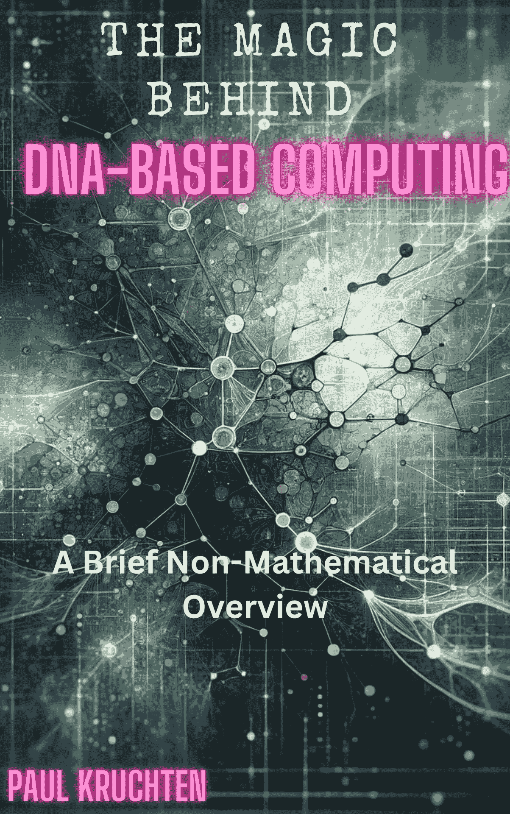

# DNA计算背后的奥秘：非数学概述

# 前言

在生物学与计算机科学的动态交汇处，存在着一个惊叹的领域——DNA 计算。本书致力于揭示这一创新领域的复杂性与可能性，对一个遗传材料成为计算介质的世界进行全面探索。

书中的每一章都设计为独立章节，允许读者灵活地深入感兴趣的特定领域，或通过浏览全书来获得更全面的理解。这种格式迎顾了广泛的读者群体，从初涉该领域的学者，到寻求对 DNA 计算特定方面进行深度分析的资深专家。

在编写本书的过程中，我拥抱了主题内容与其创作过程之间的协同作用。利用先进的 AI 工具，我汇并整合了关于 DNA 计算的大量文献。这种与 AI 的协作不仅反映了该主题的前沿性，而且在呈现复杂信息时，提供了人类视角与机器效率的独特结合。

需要注意的是，本书主要作为 DNA 计算领域现有研究和文献的综述。它不包含由本人开展的原创研究。因此，对研究和理论的解释与总结可能带有主观色彩，并受我理解和观点的影响。尽管我力求准确和客观，但读者应当意识到这一点，并以批判性和反思的心态对待内容。

本书旨在揭开 DNA 计算的神秘面纱，并激发对这一迷人学科交叉领域的奇心和理解。当你开启这段旅程时，我邀请你探索 DNA 计算的奇迹，并记住本文所具有的主观解释与客观信息相结合的特点。

欢迎来到生命构建模块与计算前沿的世界——一段穿越 DNA 计算趣味景观的旅程。

# 引言

DNA 计算是分子生物学、计算机科学和纳米技术汇处的前卫领域，代表了从传统硅基计算的范式转变。其核心在于利用脱氧核糖核酸（DNA）的固有属性来执行计算，利用其信息编码、分子识别和自组装的能力。

DNA 计算的精髓在于其分子级的操作。DNA 链能够在微小空间内存储海数据，为高密度数据存储提供了一个无比拟的平台。这种方法的优越性在分子识别过程中得到了进一步体现，特别是 DNA 杂交。这种互补的 DNA 链退火形成双螺旋结构的现象，是计算操作的基础机制。碱基配对的精确性和可预测性为算法设计提供了稳健的框架，将生化相互作用转化为逻辑操作。

DNA 计算中的并行处理不仅是一个特性，更是一种基本特征。同时进行大量反应的能力赋予了 DNA 计算机卓越的能力，特别适合解决组合问题。这种并行性，结合生化反应的低能量需求，使得 DNA 计算成为解决传统计算机无法处理的问题的潜在方案。

合成和测序技术是该领域的关键。定制 DNA 序列的合成允许对初始状态和指令进行编码，而测序则破译 DNA 计算的结果。这些技术的进步显著推动了该领域的发展，增强了可以解决的问题的复杂性以及计算的效率。

然而，该领域并非没有挑战。DNA 系统中的错误纠正和容错需要创新的方法，这与传统计算有所不同。

此外，DNA 分子的自组装特性与纳米技术契合，为复杂结构的创造提供了可能，并开启了超越单纯计算的途径，包括智能递送系统和分子传感器。

DNA 计算的跨学科性质要求对生物信息学和算法设计有深入理解，并要针对分子生物学的独特限制和可能性进行定制。本质上，DNA 计算是一个站在创新前沿的领域。它挑战了我们传统的计算观念，推向了生命分子所实现的边界。

## 分子级操作

DNA 计算在分子水平上运行，利用 DNA 分子的小尺寸进行高密度信息存储和处理。

酶活性在这一分子交响乐中起着至关重要的作用。酶作为生物世界的催化剂，被重新用作操纵 DNA 链的工具——切割、连接和放大——这些操作按照精心安排的序列进行，构成了计算过程。生物化学工具的精确性和特异性确保了这种规模的操作不仅可行，而且极其准确。

然而，这段通往分子世界的旅程并非没有挑战。正是这种提供了如此优势的规模也带来了对错误的敏感性——一个偏离的核苷酸、链链中无意的折叠，或杂交中的不匹配。解决这些错误需要对涉及的生物化学原理有复杂的理解，并开发稳健的纠错机制。这是在利用分子级操作能力与减轻固有脆弱性之间进行的一种微妙的平衡。

总而言之，基于 DNA 的计算中的分子级操作标志着计算科学的变革性飞跃，其中古老的生物学原理被巧妙地重新用于实现计算目的。这一领域不仅是人类智慧的见证，更是计算新时代的预言——在这个时代，最小的生物组件被动员起来解决一些最复杂的计算挑战。

### 分子信息编码

本主题探讨了如何利用 DNA 中的核苷酸序列在分子水平编码信息。它涉及理解将二进制数据编码为 DNA 序列的原理，确保数据稳定性，并开发高效的编码算法以在最大化数据密度的同时最小化错误率。

DNA 计算范围内的分子信息编码是生物学复杂性与计算智慧的精妙炼金术。其核心涉及将计算机的语言——0 和 1 的鲜明二对值——转化为核苷酸的细微词汇——腺嘌呤、胸腺嘧啶、鸟嘌呤和胞嘧啶。这种转换不仅是形式的翻译，更是从元素层面对信息存储和处理的重新想象。

在 DNA 计算领域，分子信息编码的概念超越了数字数据表示的传统边界。在这里，信息不是刻在硅片上，而是织入生命本身的纹理中。DNA 具有以极其紧凑的结构存储海量信息的能力，成为一种无与伦比的强大介质。双螺旋变成了一个画布，每个核苷酸对都是一笔数据，它以一种既微小又宏大的形式编码信息。

该领域的编码艺术要求人们对 DNA 的分子语法和语义有深刻的理解。仅仅将二进制数据映射到核苷酸序列上是不够的；还必须考虑这些序列的物理化学特性——它们的稳定性、成键倾向、错误概率以及读取和写入这些序列的生物化学机制施加的限制。编码方案的选择必须在数据密度、错误容忍性和生物化学可行性之间取得微妙的平衡。

分子信息编码的先进技术还深入了纠错领域——在合成和测序失误可能导致计算不准确的介质中，这是一个关键考虑因素。在这里，数字数据世界中熟悉的冗余和奇偶校验原理在核苷酸序列的背景下被重新解释。诸如冗余编码、哨兵序列的使用以及纠错代码的引入策略对于确保编码信息的保真至关重要。

此外，DNA 计算中的编码过程不是静态的，而是动态的。它不仅包括将信息初始写入 DNA 链，还包括通过切割、连接和放大等操作对这些链进行持续操纵。这些操作中的每一个都会改变编码信息，使复杂计算任务的可能。因此，DNA 计算中的编码既是为了存储数据，也是为了为计算搭建舞台。

本质上，DNA 计算领域的分子信息编码代表了生物学与计算机科学的共生，其中遗传学和分子生物学的原理被用来推进计算前沿。这是一个挑战我们传统的数据存储和计算观念的领域，让我们窥见了一个未来——在那里，生命的最小单位将成为信息的存储器和处理器。

### 核苷酸合成与操纵

这一领域侧重于定制 DNA 链的合成以及操纵这些链来执行计算任务。它包括合成特定核苷酸序列的技术、拼接、连接和放大 DNA 的方法，以及组织和操纵这些分子以表示和处理信息的方法。

在 DNA 计算这一迷人领域，核苷酸的合成和操纵不仅仅是生物化学过程，更是计算炼金术的基石。这一领域超越了传统的计算范式，进入了一个景观——在那里，操纵生命本身的基石（核苷酸）成为编码、处理和解释信息的手段。

DNA 计算中的核苷酸合成既是一门艺术也是一门科学。它涉及对 DNA 链的精细制作，其中每个核苷酸都经过仔细选择和定位，就像艺术家为杰作细心挑选颜色一样。这种合成不是分子的随机连接，而是一种编码信息的有意且精确的组合。这项任务的复杂性和深度是深远的，因为它要求对 DNA 的结构和功能细微差别有深入理解。合成的链不仅序列上必须准确，而且适用于它们被设计执行的特定计算任务。

除了合成之外，这些核苷酸的操纵才是计算魔法真正发生的地方。在这里，酶扮演着熟练工匠的角色，在生物化学反应的编排舞蹈中切割和连接 DNA 链。限制性酶具有在特定序列处切割 DNA 的能力，像精确的剪刀一样在指定位点分割 DNA。另一方面，连接酶充当分子胶水，将碎片片段拼接在一起形成新链。这种切割和连接的相互作用不是随机的，而是一个经过精心策划的事件序列，每一步都建立在上一步的基础上，朝着计算目标移动。

放大是这一分子史诗的另一大支柱。诸如 `聚合酶链反应 (PCR)` 等技术可以放大特定的 DNA 序列，使对计算结果的检测和分析成为可能。这种放大类似于将低语变成轰吼，使分子相互作用那种微妙且往往微小的信号足够大到被识别和解释。

DNA 计算中的核苷酸合成与操纵领域也是不断创新和充满挑战的领域。合成长且无错误的序列仍然是一项艰巨的任务，推向了当前生物化学技术的边界。同样，操纵过程必须应对分子相互作用的随机性，在这里，微小的偏差都可能导致计算错误。因此，精确性、准确性和纠错是这段旅程中永久的伴侣。

本质上，DNA 计算领域的核苷酸合成与操纵代表了生物学、化学和计算逻辑的汇聚。在这个领域中，分子变成了数据，酶变成了工具，生物化学反应则转变为计算操作。这一领域不仅在重新定义计算可能性的边界，也在重塑我们对分子世界的理解。

## 分子逻辑门与电路

类似于电子逻辑门，本主题深入探讨了由 DNA 制成的分子逻辑门的创建和运行。这些逻辑门基于分子间的相互作用执行逻辑操作，并可以组合组合组合成复杂的分子电路。该领域的研究涉及设计和测试各种门架构、理解其局限性，并探索将其集成到更大的分子计算系统中。

在 DNA 计算错综复杂的织锦中，分子逻辑门和电路证明了将分子生物学原理与计算逻辑严谨性相结合的独特性。在这里，逻辑门这一经典概念——数字计算的基础元素——在分子尺度上被重新构想，利用 DNA 这种多功能介质及其相互作用来执行逻辑操作。

DNA 计算中的分子逻辑门并非刻蚀在硅片上，而是由精心设计的 DNA 链组成。这些链通过杂交和酶反应的精确机制，功能类似于传统计算中的二值逻辑门。例如，一个分子与门（AND gate）可能设计为需要两个特定的 DNA 序列（类比于二进制输入）来触发产生可见输出的反应，例如荧光的发射。

这些分子门的优雅之处在于其精细性和特异性。驱动这些门的相互作用受碱基配对严格规则的支配，其中腺啶与胸嘧啶配对，鸟嘌呤与胞啶配对。这些配对的配置以及随之产生的 DNA 分子结构变化体现了逻辑操作。通过操纵这些配置，可以实现各种逻辑函数。

超越单个门，DNA 计算中的分子电路代表了更复杂、更具雄心的企。这些电路将多个逻辑门集成到一个凝聚的系统中，能够执行更复杂的计算任务。此类电路的构建不仅需要对分子生物学和生物化学的深刻理解，还需要精通计算设计。电路中的每个门必须经过精确编排，以确保逻辑操作的正确流，并且整体设计必须考虑分子相互作用的动力学、潜在的交叉反应以及误差的最小化。

DNA 计算中分子逻辑门和电路最引人注目的方面之一是它们的动态性质。与静态的电子对应物不同，这些分子系统可以设计为可重构或对环境变化做出响应。这种适应性为智能生物传感器和响应性药物递送系统开了可能，电路可以检测特定的分子信号并计算出相应的响应。

然而，完善和利用这些分子系统的过程充满了挑战。在面对生物变性和潜在错误时，确保这些门和电路的可靠性、可扩展性和效率仍然是一项巨大的工程。该领域不断在这些系统的理论优雅性和其实际性之间进行斗争。

总之，DNA 计算中的分子逻辑门和电路不仅仅是电子计算原理向生物背景的简单转换。它们代表了对计算的大胆重新想象，生命的语言本身成为了处理信息的介质。这一微观与复杂交织的前沿领域不断推向技术和生物学的边界，为探索利用世界分子结构中固有的计算潜能开辟了新路径。

## 计算中的分子自组装

本课题研究如何利用 DNA 的自组装特性来实现计算目的。它包括研究分子自组装原理、设计可以自组装成预定义模式的 DNA 纳米结构，以及利用这些结构执行计算任务，如算法自组装和分子图案形成。

DNA 计算背景下的分子自组装是一个利用生物系统的优雅性来协调计算过程的领域。分子生物学与计算理论之间这一迷人的交汇点，利用了 DNA 分子自组织成预定义结构的内在倾向，为计算的新范式奠定了基础。

DNA 计算中分子自组装的核心利用了核酸酸的天然亲和力和结构构象。这一过程类似于分子相互作用的交响乐，每个核苷酸在碱基配对规则和分子几何原理的指导下扮演自己的角色。结果是复杂结构的自发形成——从简单的基元到复杂的网络——不需要外部操纵。这种现象不仅是一个生物奇观，而且是一个强大的计算工具。

自组装的威力在于它能够创建高度有序的结构，这些结构可以作为计算过程的模板或脚架。通过设计特定的序列和结构，研究人员可以将信息直接编码到 DNA 链中。随着这些链的自组装，它们产生了复杂的几何形状，反过来代表了计算数据或逻辑操作。这种编码和计算方法与传统的电子计算有本质区别，后者的信息是以线性顺序的方式处理的。

DNA 计算中分子自组装最引人的应用之一是 DNA 折纸（DNA origami）的开发。这种技术涉及使用大量的短“钉钉”链将一个长单链 DNA 分子折叠成所需的形状。这些结构被设计和创建的精度是惊人的，允许在纳米尺度上构建二维和三维的形状。这些形状可以作为纳米级电路、分子容器，甚至作为以原子级精度排列其他分子的平台。

DNA 计算中自组装的动态方面开启了另一个可能领域。与静态结构不同，动态 DNA 装配可以响应特定刺激改变其配置，例如某些分子的存在或环境条件的变化。这种响应性允许创建能够随时间推移做出反应、适应甚至进化的计算系统，镜像了生物系统的适应性性。

然而，利用分子自组装进行计算的并非没有挑战。组装的保真度、对相互作用动力学的控制以及将这些系统集成到更大的网络和接口中是持续的研究开发领域。该领域不断与分子行为的复杂性作斗争，力争将自组装的理论优雅转化为实用且可靠的计算系统。

从本质上，DNA 计算领域的分子自组装是生物世界与计算世界汇聚的证明。它代表了一个前沿领域，生命的原理被巧妙地重新用于计算目的，让我们窥见未来：在未来，计算不仅由机器执行，而是由构成生命本身的分子来完成。

### 基于 DNA 的分子传感器与执行器

这一领域探索了利用 DNA 分子作为传感器和执行器，用于在分子水平检测并响应环境刺激。它涉及设计能够响应特定分子信号改变构象的 DNA 结构，从而执行计算功能，并将这些系统集成到更大的网络中，应用于生物传感、诊断和智能药物递送。

在基于 DNA 计算的复杂领域中，分子传感器和执行器代表了计算智能与生物系统细微响应能力的融合。这些设备在分子尺度上制造，利用 DNA 的内在特性来检测和响应环境刺激，体现了一类新型的动态、智能系统。

基于 DNA 的分子传感器经过精细设计，对特定信号具有极高的敏感性。这些信号可以是多种分子输入，范围从离子、小分子到蛋白质，甚至是 pH 值或温度的变化。传感机制通常取决于 DNA 的结构多变性。例如，适配体（aptamers）——因对特定目标具有高亲和力而被选定的 DNA 或 RNA 分子——在与其目标分子结合时会发生构象变化。这种结构变化可以转化为可检测输出，例如产生荧光信号或启动随后的生化反应。因此，这些传感器充当了分子哨兵，持续监测其环境，并根据特定的生化事件产生计算相关的输出。

DNA 计算领域的执行器进一步扩展了这一概念。它们不是被被的检测器，而是分子过程的活跃参与者。在接收到特定输入后，基于 DNA 的执行器可以对其周围环境实施改变。这可能涉及触发级联生化反应、释放结合的物质或改变基底的物理属性。此类执行器的潜在应用非常广阔，从靶向药物递送系统（执行器响应分子信号释放治疗药物）到分子机器人（执行器作为纳米级机器的运动部件）。

在基于 DNA 的计算系统中，传感器和执行器的集成引入了超越传统计算范式的交互性和功能性。这些系统可以被程序化，不仅处理信息，还能实时对其环境做出反应并适应。这种能力类似于赋予计算系统感知和行动感，镜像了生物体中存在的复杂的反馈机制。

然而，这些复杂分子设备的开发既是生物学理解的成就，也是工程学的胜利。它要求在设计对所需输入特异且敏感的 DNA 结构与确保这些结构能够在生物环境中变化且往往不可预测的条件下可靠运行取得平衡。挑战在于利用 DNA 内有的灵性和适应性的同时，减轻阻碍功能的非特异性相互作用、降解和噪声等因素。

总之，基于 DNA 的分子传感器和执行器处于 DNA 计算的前沿，代表了计算、分子工程和合成生物学的汇聚。它们体现了这种雄心：不仅将 DNA 作为计算的媒介，还要创建能够与其分子景观交互并主动操纵它的系统。这种在分子水平上的感知、处理和响应，为未来铺平了道路——计算将超越硅片，进入生命系统的动态领域。

### 参考文献

以下是关于核苷酸合成与操的 APA 格式论文：

- Takahashi, S., Iuchi, S., Hiraoka, S., & Sato, H. (2023). Theoretical and computational methodologies for understanding coordination self-assembly complexes.

# 并行处理

基于 DNA 的计算在同时执行许多操作（并行处理）方面表现出色，使其对于某些类型的计算（如组合问题）非常高效。

在 DNA 计算领域，并行处理出现不仅是一种特征，更是一种基本理念，代表了从传统计算中固有的顺序处理的范式转变。这一领域利用了分子相互作用的天然并行性，数以亿计的 DNA 分子同时进行计算，体现了与硅基架构本质不同的计算形式。

DNA 计算中并行处理的核心在于对可以同时发生的大量分子事件的利用。想象一下数百万条 DNA 链，每条链都编码着一个大型计算问题的片段，并同时进行杂交、连接或切割等生化学反应。这不仅仅是并行性的运作，更是大规模的并行。在这样的系统中，传统计算机需要多年才能解决的问题，可以在显著缩短的时间内完成，这利用了组合化学的力量和 DNA 分子的大规模并行处理能力。

这种方法在解决复杂的组合问题时尤为优异，因为一次性探索多种可能的能力极大地缩短了计算时间。DNA 计算并不是一步步地遍历问题空间，而是并行地探索该空间的广阔区域。这好比通过同时检查每一根草草来在大海中找针，而不是按顺序检查每一根草草。

DNA 计算中并行处理的优雅之处还在于其能量效率。生物系统在近热平衡状态下运行，分子相互作用的能量需求与电子计算的能量需求相比是微其道的。这种效率不仅是技术的产物，更是使 DNA 计算对处理大规模复杂问题极具吸引力的核心特征。

然而，这种形式的并行处理并非没有挑战。同时发生的分子反应数量巨大会导致交叉反应和误差累积等问题。因此，DNA 计算的很大研究致力于错误检测和纠正，以确保并行性不会损害计算的准确性和可靠性。

此外，读取这些并行计算结果的挑战仍然是一项非易的任务。将无数分子相互作用的结果转化为有意义的计算结果需要复杂的检测和分析技术，通常涉及二代测序或其他先进方法。

总之，DNA 计算领域的并行处理代表了对传统计算方法的彻底背离。它利用 DNA 的独特属性和分子相互作用的自然并行性，来解决传统计算机无法胜任的规模和复杂问题。随着该领域的发展，DNA 计算的愿景不断扩大，为未来铺平了道路——在未来，计算将不再受硅的限制，而是由分子生物学的无限潜力所驱动。

## 组合问题求解中的大规模并行

该主题探讨了 DNA 计算如何利用其同时执行大量操作内在的能力来解决复杂的组合问题。它包括研究此类并行性特别有益的应用，例如优化问题、搜索大型数据库以及解决对传统计算机来说计算密集型的 NP 完全问题。

在 DNA 计算的前沿领域中，大规模并行是一个基石，特别是在组合问题求解领域。这种方法利用了 DNA 分子参与大量同时相互作用的内在能力，构建了一种与传统电子系统的顺序处理截然不同的计算范式。

这种方法的核心是利用 DNA 形成互补对的内在倾向，使得能够在分子序列的限制范围内表示复杂问题。这种方法的精妙之处在于它能够将通常在复杂性和规模上令人望而畏的组合问题，转化为一个分子相互作用的广阔图谱。每一条 DNA 链都是潜在解决方案的载体，参与到杂交和酶促反应的并行舞蹈中，集体以传统计算无法实现的方式探索解决方案空间。

当面对 NP 完全问题时，DNA 计算的大规模并行概念表现得格外耀眼，因为潜在解决方案的数量随问题规模的增加呈指数级增长。传统计算机受限于其顺序处理，在广阔的解决方案空间中艰难行进。形成鲜明对比的是，DNA 计算以并行的活力处理这些问题，并发检查无数可能性。这好比在解决方案空间上撒一张网，每个网格都是一条评估可能解决方案的 DNA 链，所有操作同步运行。

这种大规模并行不仅是 DNA 计算效率的证明，也是优雅和能量效率的体现。作为这种计算策略骨干的生物过程在近热平衡下运行，与耗能电子计算机的操作相比，所需的能量极小。这种效率和有效的协同使得 DNA 计算在处理大规模组合问题时特别强大，让我们窥见了一个未来，这类问题将以前所未有的速度和精度得到解决。

然而，这种大规模并行的协调并非没有挑战。确保 DNA 合成的保真度、管理分子相互作用的动力学、以及解读无数结果都是艰巨的任务。该领域在错误纠正、序列设计和分析方法上不断创新，以减轻这些挑战，努力利用这种革命性方法的全部潜力。

本质上，通过 DNA 计算进行组合问题求解的大规模并行是一种范式转移，是向一个计算边界被重新定义的未来的跨跃。它是分子生物学（具有其优雅的机制和效率）与现代世界计算挑战的交汇，提供了在范围上深远、在执行上错综复杂的解决方案。

## 2.2 并行 DNA 计算的算法设计

该领域侧重于创建专门适用于 DNA 计算并行特性的算法，涉及开发能够有效利用 DNA 并行处理能力的计算程序。它包括将经典算法适配到并行框架中，并设计可以使用 DNA 自然实现的新算法。

在并行 DNA 计算领域，算法设计是一项独特的挑战，与传统的计算范式截然不同。这一领域需要对算法结构进行重新思考，并对其进行量裁，以利用 DNA 的独特属性和分子相互作用的内在并行性。任务不是简单地将现有算法适配到新介质，而是构思本质上与分子生物学原理和 DNA 行为动力学共鸣的算法。

这项努力的核心是认识到 DNA 计算超越了传统计算的二进制逻辑，而是在一个丰富的化学语言中运行，其中杂交、酶活性和分子构象变化充当了基本操作。此背景下的算法设计要求对这些分子过程及其作为计算工具的潜力有深刻的理解。它需要设想算法，基本操作不是在二进制数据上执行的算术或逻辑操作，而是在 DNA 链上进行的生化反应。

并行 DNA 计算算法设计的核心方面之一是利用 DNA 的海量并行处理能力。算法的设计必须从本质接纳这种并行性，允许同时探索巨大的解决方案空间。这对于组合问题特别为有利，因为在这些问题中，传统算法受限于指数级的时间复杂度的限制。在 DNA 计算中，这些问题可以通过并行探索来解决，从而显著缩短计算时间。

然而，为此类系统设计算法并非没有复杂之处。分子间相互作用的随机性引入了一层不可预测性，要求算法对反应动力学的差异以及 DNA 合成和杂交中的潜在错误具有鲁棒性。容错和纠错成为算法设计中不可或缺的元素，需要策略能够检测并减轻错误，同时又不损害系统的并行处理能力。

此外，DNA 计算中结果的解释呈现出另一层复杂性。算法不仅要协调计算过程，还要将分子结果翻译成有意义的数据。这通常涉及 DNA 计算与传统电子计算系统相结合，需要分子生物学与计算机科学的和谐融合。

本质上，并行 DNA 计算的算法设计是多个学科交叉领域的一种精密舞蹈。这是一场创意与创新的实践，推向计算可能性的边界。这一领域挑战了我们对算法的传统理解，邀请我们从生命分子机制的背景重新构构计算。在这个领域，硅基的限制被 DNA 分子的巨大潜力所取代，开启了计算版图的新地平。

## 2.3 DNA 链置换机制

本主题深入探讨了 DNA 链置换作为并行处理工具的机制。链置换是一种单链 DNA 分子结合到双链 DNA 分子的互补区域的技术，从而取代原本配对的链。这一过程是构建能够执行并行计算的动态 DNA 基础系统的基础。

在 DNA 计算的复杂世界中，DNA 链置换机制成为一种关键且优雅的策略，能够在分子水平实现动态且可编程的相互作用。这种机制深植于分子生物学的细微差别之中，利用 DNA 链的独特特性进行计算，超越了传统计算模型的静态本质。

DNA 链置换是一个单链 DNA (`ssDNA`) 片段入侵双链 DNA (`dsDNA`) 复合物的过程，通过取代原始链之一来形成新的双链复合物。这种看似简单的分子相互作用蕴含着深远的计算能力。它是 DNA 计算中的一项基础操作，类似于传统计算中的基础逻辑门，但在分子生物学的流动、动态领域内运行。

DNA 链置换的美之处在于其特异性和多功能性。通过设计特定的核苷酸序列，可以精确控制置换发生的条件，从而编码一种形式的分子逻辑。这种方法允许构建复杂的计算网络，其中一个链置换反应的输出可以作为另一个反应的输入，创建类似于电子电路的级联计算事件，但是在纳米尺度内且在生化学背景下完成的。

在 DNA 计算的场中，链置换机制开启了无限可能。它们被用于创建能够响应环境刺激的动态系统，构建分子传感器，以及开发可以并行处理信息的电路。其潜在应用范围从智能药物递送系统（DNA 电路可以响应体内的分子信号）到能够以高精度检测特定生物标志物的先进诊断工具等。

然而，利用 DNA 链置换进行计算是一项需要精细设计和对分子动力学深入理解的任务。序列必须经过仔细设计，以确保反应是快速、特异的，并在需要时是可逆的。DNA 双链的稳定性与置换反应的动力学之间的平衡至关重要；太稳定，反应可能太慢或无法发生；太不稳定，系统则可能产生错误和非预期反应。

此外，将 DNA 链置换机制集成到更大的计算系统中面临着自身的挑战。确保单个反应在复杂网络中和谐工作，减轻非特异性相互作用产生的噪声和干扰影响，并将这些分子系统与宏观世界接口以进行结果解释和应用，都是持续研究和创新的领域。

总结，DNA 链置换机制处于 DNA 计算的前沿，体现了分子生物学与计算逻辑的精密融合。它们代表了计算的范式转变，信息处理不再通过硅片上的电子，而是通过试管中的 DNA 链进行，展示了利用生命机制进行计算的巨大潜力。

## 2.4 并行错误检测

考虑到分子相互作用易出错，该领域研究并行处理环境下的错误检测和纠正策略。它涉及开发能够同步监控并修正多个 DNA 反应和计算错误的方法，以确保结果的可靠性和准确性。

在并行处理主行的 DNA 计算领域，错误检测和纠正成为一个关键的前沿。分子计算的独特环境以大量同时反应为特征，要求对传统的错误处理方法进行重新评估和发明。这一领域需要一种不仅能识别分子相互作用固有的随机性，还能利用其来实现稳健可靠计算的方法。

DNA 计算中的并行错误检测是分子相互作用与计算逻辑复杂的芭蕾。与传统计算中通常是二进制且确定性的错误不同，DNA 计算中的错误跨越了更广泛的光谱，包括杂交中的错配、意外的酶反应以及 DNA 合成中的异常。检测这些错误需要对分子动力学和生化过程的概率本质有细微理解。策略从设计内置冗余的序列到利用实时信号异常的分子信标不一，后者为异常事件提供了即时读数。

将错误检测与纠正整合到 DNA 计算系统的结构中并非一项轻易的任务。它需要在错误处理机制的复杂性与可行性，以及计算系统的效率与可扩展性之间取得平衡。过于复杂的纠正方案可能会拖慢计算过程，抵消并行处理的优势；而过于简单的方案则可能无法充分应对大量的潜在错误。

此外，DNA 计算领域必须不断进化其错误处理策略，以跟 DNA 合成和测序技术的进步。随着这些技术变得更加精密并能够处理更大更复杂的 DNA 结构，相应的错误检测和纠正机制也必须进步，以确保计算的准确性和可靠性。

本质上，DNA 计算中的并行错误检测与纠正代表了分子生物学、生物化学和计算理论原理汇聚的关键折点。它是该领域独特性和适应能力的证明，展示了在计算超越硅边界并进军分子领域的世界中，对精确性和可靠性的不懈追求。这一领域不仅挑战了我们传统的计算和错误处理观念，还为理解理解和利用生物分子的复杂相互作用来实现计算目的开启了新的视野。

## 2.5 并行生化网络计算

该主题侧重于能够并行执行计算任务的复杂生化网络的设计与实现。它包括对反应扩散系统的研究、酶反应与 DNA 计算的整合，以及能够进行并行数据处理和决策的空间组织生化网络开发。

DNA 计算范围内的并行生化网络计算代表了分子生物学、化学和计算理论之间引人入胜的汇，在这里，复杂生化反应网络的编排被用于计算目的。这种先进方法超越了传统的电子计算范式，进入了一个分子相互作用的复杂性不再仅仅是生物现象，而是计算的基质的领域。

并行生化网络计算的核心概念是：利用一个相互相关的生化反应网络（主要由 `DNA` 及其互补相互作用驱动）来执行复杂的计算任务。这些网络类似于复杂的电路，每个生化反应代表电路中的一个组件或节点。具有特定序列的 `DNA` 链充当导线和晶体管，引导分子信息在网络中流动。

这种方法的力量在于其固有的并行性。与传统计算的线性、顺序处理相比，生化网络能够跨多个通路同时处理信息。这种并行性不仅是一种特征；它是一项基本特性，允许在传统计算机所需的一小时间内探索巨大的计算空间。此类系统特别擅长处理本质上是并行的问题，例如模式识别、优化问题和复杂系统的模拟。

然而，这些并行生化网络的设计和实现是一项极其复杂的任务。它不仅需要对底层分子生物学有深入的理解，还需要对网络设计和系统工程原理精精通。网络必须经过精心设计，以确保各个组件之间的相互作用是精确且可预测的。这涉及到 `DNA` 结构的稳定性与反应性、酶反应的动力学以及网络整体架构之间的细致平衡。

并行生化网络计算面临的最重大挑战之一，是管理潜在的交叉反应和意外相互作用。分子相互作用的随机性会导致系统内部噪声和错误。解决这些问题需要复杂的错误检测和纠正机制，以及能够容忍甚至利用这些分子特性的稳健网络设计。

此外，这些网络与传统电子计算系统的整合面临着自身的挑战。开发能够将基于 `DNA` 的网络的输出转换为电子信号（反之亦然）的接口对于这些系统的实际应用至关重要。这需要分子计算与数字世界的无缝整合，弥补分子的纳米级世界与电子计算机宏观世界之间的差距。

总结来说，DNA 计算领域的并行生化网络计算是一个具有卓越创新和潜力的领域。它代表了对传统计算模型的彻底背离，利用生化过程的复杂性和高效性来进行计算。该领域处于科学技术的最前沿，推了计算可能性的边界，并在理解和应用分子系统方面开启了新的视野。

## 2.6 参考文献

## 3. DNA 杂交

指的是互补 DNA 链的配对，是 DNA 计算机执行计算的基本机制。

在 DNA 计算的复杂领域，DNA 杂交展现出一种精髓的机制，它像一位分子大师，指挥着计算过程的交响乐。这种现象植根于分子生物学的基本原理，超越了其生物学作用，演变为分子尺度信息处理的关键工具。在此背景下，DNA 杂交不仅是一种生物学相互作用，更是一种充满可能性和复杂性的计算操作。

DNA 杂交是指互补 DNA 链退位结合形成双螺旋的过程，它是分子计算的基石。它类似于一场追求精确与特异性的舞蹈，链中的每个核苷酸在碱基配对规则的指导下找到它的对应。在 DNA 计算领域，这种优雅的分子相互作用被重新用于编码、操纵和解释信息。经过精心设计特定序列的 DNA 链成为了数据的载体，而它们的杂交标志着计算任务的执行。

在计算中利用 DNA 杂交的卓越之处在于其固有的特异性和预测性。每一次杂交事件都是一次刻意且受控的交互，经过精心设计以代表特定的计算操作。这可以从简单的二进制运算到更复杂的逻辑函数不等，这些操作的结果被编码在生成的 DNA 双链的结构和序列中。杂交的特异性确保了这些操作以高保真度执行，这对计算过程的准确性和可靠性至关重要。

然而，DNA 杂交在计算中的应用远不止单纯的数据编码。它还实现了动态和可重构系统的构建。通过设计能够经历受控杂交和去杂交循环的 DNA 链，可以创建出不是静态而是响应性的系统。此类系统能够适应环境的变化，处理输入信号，甚至随着时间的推移而进化，镜像了自然生物系统中观察到的适应行为。

然而，利用 DNA 杂交进行计算并非没有挑战。杂交的动力学、形成的双链的稳定性以及潜在的非预期相互作用构成了巨大的障碍。设计能够以所需的特异性和效率进行杂交的序列，同时避免不良的二级结构或非特异性结合，需要对核酸化学和热力学有深入的理解。此外，将这些杂交事件整合到更大的计算网络中需要精细的协调，以确保整个系统能够协同且可靠地运行。

本质上，DNA 计算领域的 DNA 杂交证明了将生物学原理应用于计算挑战的智慧。它代表了一种范式，即生命的分子机制不仅被研究，还被利用并重新用于计算目的。这种方法不仅拓宽了我们对 DNA 在生物学之外之外潜力的理解，还为计算领域开辟了新途径，在那里，分子相互作用成为了数据处理和计算的语言。

### 3.1 计算序列设计

该主题涉及 DNA 序列的精心设计，以确保特异且高效的杂交。它包括对核苷酸组成、序列长度和热力学属性的研究，以避免不良的相互作用，例如自杂交或非特异性结合，这些可能导致计算错误。

在 DNA 计算的复杂领域，用于杂交的 DNA 序列设计是一项关键且复杂的艺术形式，它将分子生物学的细微差别与计算逻辑的精确性融合在一起。这种努力超越了纯粹的生物化学合成，进入了一个领域，每个核苷酸序列都经过精心制作，不仅是为了体现生物稳定性，还为了编码和执行计算功能。

在此背景下，DNA 杂交的序列设计类似于编写一部复杂的交响乐，每个核苷酸都是一个音符，为分子相互作用的整体和谐做出贡献。其目标不仅是创建彼此以高特异性和稳定性结合的序列，还要确保这些相互作用代表有意义的计算操作。这种微妙的平衡要求对碱基配对规则、DNA 双链形成的热力学以及杂交和去杂交的动力学有深入的理解。

任务的复杂性在于需要预测并控制这些序列在动态且通常拥挤的生化环境中的行为。设计序列必须避免不良的二级结构，例如发卡结构或内部环，这些可能会阻碍杂交或导致非特异性结合。此外，必须最小化自互补倾向，以防止不良的二聚体或高阶结构的形成，这些结构可能会干扰计算过程。

然而，DNA 计算中序列设计的挑战不仅限于避免不良的相互作用。序列还针对预期的计算应用进行优化，无论是逻辑门操作、数据存储还是分子传感。这涉及到调整核苷酸的长度、组成和顺序，以实现所需的反应动力学和信噪比。设计过程通常利用高级计算工具和算法来模拟和预测这些序列的行为，引导迭代优化过程。

此外，在 DNA 计算的更广泛背景下，用于杂交的序列设计并不是孤立的任务。它必须整合到 DNA 计算系统的整体架构中，考虑与酶反应的兼容性、多路用的潜力以及系统的可扩展性等因素。这种整合需要一种全局方法，其中序列设计是更大计算图的关键部分。

本质上，DNA 计算领域的 DNA 杂交序列设计代表了科学精确性与创新新的交汇。这是一个将分子相互作用的细节用于计算目的的领域，体现了生命的分子语言与计算逻辑的融合。这一领域不仅挑战了我们对 DNA 在遗传和生物角色之外潜力的理解，还扩展了生物与计算交叉领域的成就边界。

### 3.2 基于杂交的逻辑操作

该领域探索如何利用 DNA 杂交来执行逻辑操作，这是 DNA 计算的核心概念。它涉及设计 DNA 链，这些链在杂交时代表 AND、OR、NOT 和 XOR 等逻辑函数。杂交的物理过程充当计算机制，使得构建逻辑门和电路成为可能。

在 DNA 计算的复杂景观，基于杂交的逻辑操作体现了分子生物学与计算智慧的卓越融合。这种方法超越了逻辑处理的传统边界，拥抱 DNA 杂交的分子复杂性来执行逻辑操作。在这里，双螺旋不仅是遗传信息的存储库，更是执行计算逻辑的动态框架。

#### 基于杂交的逻辑操作

基于杂交的逻辑操作利用了 DNA 碱基配对固有的特异性。通过设计精心设计的 DNA 链序列，使其在精确条件下相互作用，计算逻辑被嵌入到了分子水平。这些相互受互补碱基配对严格规则的支配，被用于表示 AND、OR、NOT 和 XOR 等基础逻辑操作。

这些操作的优雅之处在于其分子级的执行。例如，一个基于 DNA 的 AND 门可能涉及两条代表输入“变量”的不同 DNA 链。溶液中同时存在这两条链会引发杂交事件，导致形成一个新的 DNA 双链链结构，这标志着“真（true）”输出。同样，NOT 操作可以通过设计一种链来实现，该链仅在缺少特定序列时才发生杂交，从而反转逻辑输入。

这种方法扩展到了简单的二运算之外，允许构建更复杂的逻辑门和电路。通过整合多个杂交事件、级联反应，甚至引入酶过程，可以实现复杂的计算任务。这些基于 DNA 的逻辑电路可以并行运行，同时处理多个输入，这种成就利用了分子相互作用固有的海量并行处理能力。

然而，设计和实现基于杂交的逻辑操作是一项充满挑战的任务。序列必须经过仔细设计以确保高特异性，并尽可能减少不良的相互作用，例如脱靶杂交或二级结构的形成。此外，这些杂交事件的动力学必须经过精细调整，以确保逻辑操作在实际的时间范围内发生并达到预期的效率。

DNA 计算中基于杂交的逻辑操作领域也为动态响应型系统开启了途径。通过设计能够响应环境线索或特定分子输入改变行为的 DNA 电路，可以想象生物传感、自适应计算和智能药物递送等新功能。

总之，DNA 计算中基于杂交的逻辑操作代表了分子精确性与计算逻辑的高级融合。这一领域证明了利用 DNA 的自然属性进行计算的独特性，推了传统计算范式的边界，为分子计算的新时代铺平了道路。

### 3.3 DNA 杂交动力学与热力学

理解 DNA 杂交的动力学和热力学对于精确控制计算过程至关重要。该主题了杂交反应的速率、杂交对的稳定性，以及温度和离子强度等因素如何影响这些属性。这些研究对于优化基于 DNA 的计算系统的反应条件至关重要。

在 DNA 计算领域，DNA 杂交的动力学和热力学不仅仅是生物化学上的奇闻，更是分子计算可靠性和有效性的支柱。这种核苷酸配对的复杂舞蹈受动力学速率与热力学稳定性微妙平衡的支配，形成了分子级计算操作的基础。

在此背景下，DNA 杂交的动力学是一项关于精确性和时机的研究。它涉及理解互补 DNA 链聚集形成双螺旋的速率。这一过程对于执行计算任务至关重要，受到多种因素的影响：DNA 链的长度和序列、溶液中的离子浓度，以及可能干扰或促进杂交过程的其他分子实体。这些链的退火速率决定了计算操作的速度，因此，深入理解这些动力学原理对于设计高效的 DNA 计算系统至关重要。

另一方面，热力学为杂交 DNA 结构的稳定保真度提供了见解。DNA 双链形成的热力学属性——焓、熵和自由能的变化——决定了杂交的强度和特异性。在 DNA 计算的背景下，这转化为计算输出的准确性和可靠性。序列的设计必须使其杂交在所需的运行条件下在能量上是有利的，以确保计算过程不仅快速，而且对热波动和环境扰动具有稳健性。

平衡这些动力学和热力学方面是一项微妙的任务。快速的杂交动力学有利于快速计算，但不能以牺牲杂交的特异性或稳定性为代价。同样，热力学稳定的双链确保了操作的可靠性，但可能会导致可逆性挑战，而这是动态可重构计算系统的关键。因此，用于计算的 DNA 序列涉及对这些参数的精密优化，通常采用计算工具和模拟来预测并微调 DNA 链的行为。

此外，DNA 杂交中动力学与热力学的相互作用不仅是静态的考量，更是动态的，随着计算过程的推进而演变。这种动态性质需要精密的控制机制来调节较大计算框架内杂交事件的时间和顺序，确保每一步都与其他步骤协调地进行。

从本质上，DNA 计算背景下 DNA 杂交的动力学和热力学是将分子相互作用转化为计算逻辑的基础。它们代表了生物化学理解与计算策略的融合，支撑了计算超越电子并深入分子的系统设计和运行。这一领域证明了将分子生物学原理与计算科学严谨性相结合的复杂美。

## 3.4 DNA 纳米技术与杂交网络

DNA 纳米技术利用 DNA 杂交原理创建自组装纳米结构。这一领域研究如何利用杂交来构建 DNA 链网络，这些链汇聚形成复杂的形状和图案，可用于计算或作为纳米制造的模板。

在 DNA 纳米技术的前沿领域，DNA 杂交网络的编排代表了分子尺度上精密工程的巅峰。在这里，DNA 可编程自组装与纳米尺度架构原理的汇聚，为 DNA 计算的新时代铺平了道路。这一领域是 DNA 序列的精密设计和对其杂交特性的策略性操纵最终创造出具有计算功能的复杂动态网络。

DNA 纳米技术利用 DNA 杂交固有的预测性和特异性，以以前所未有的精度构建纳米结构和设备。在该领域，DNA 不仅仅是遗传材料，更是纳米制造的多功能构建块。通过自组装过程，单个 DNA 链的设计在核苷酸序列程序化相互作用的驱动下，自发形成所需的形状和图案。这种方法允许构建大量的纳米结构，从简单的几何形状到更复杂的图案和晶格，每种结构在 DNA 计算中都有潜在的应用。

DNA 纳米技术在 DNA 计算背景下的真正独特之处在于杂交网络的形成。这些网络本质上是相互连接的 DNA 链系统，其中特定序列之间的杂交使得分子信息能够在网络中进行传输。通过精确设计这些网络，可以将逻辑操作和计算算法直接编码到 DNA 中。杂交事件充当了计算步骤，其中 DNA 双链的形成和解离代表了信息的处理。

这一概念已经超越了静态结构，扩展到了动态和可重构的网络。通过在 DNA 链中引入对刺激响应的元件（如适配体或 pH 敏感序列），可以使这些网络的行为取决于环境线索或特定的分子输入。这种动态网络可以进行适应、响应和进化，为智能生物传感器、自适应材料以及能够在纳米尺度上进行复杂决策的系统开辟了可能性。

然而，在 DNA 计算中构建和编程 DNA 杂交网络是一项充满复杂性与挑战的尝试。这些网络的设计不仅需要对 DNA 生物化学有深入的理解，还需要预测和控制相互作用分子系统行为的能力。网络必须对非预期的相互作用具有稳健性，并在各种条件下保持稳定，同时在需要时具有响应性和适应性。

此外，将这些基于 DNA 纳米技术的系统与宏观世界接口以实现实际应用仍然是一个重大挑战。将分子级计算转换为可用的输出、将这些系统与电子设备集成以及扩大其操作规模，是目前研究开发的关键领域。

总结来说，DNA 纳米技术和杂交网络处于 DNA 计算的前沿，体现了分子生物学、纳米技术和计算科学的精妙融合。它们不仅代表了一种新的计算方法，更代表了我们感知和利用分子进行信息处理能力方式的范式转变。这一领域继续推向创新边界，在探索 DNA 作为计算介质和纳米尺度构建材料的潜力方面开辟了新边疆。

### 3.5 基于 DNA 的数据存储与检索

利用 DNA 杂交进行数据存储和检索是一个快速增长的关注领域。这一主题涉及将数据编码到 DNA 序列中，并使用杂交技术选择性地访问和读取这些数据。它包括对高效编码算法、数据检索方法以及确保数据完整性的纠错策略的研究。

在 DNA 计算的高级领域，基于 DNA 的数据存储和检索的概念是一项范式转换的创新，将生物分子科学的巨大潜力与不断增长的数据技术需求融合。这一领域超越了传统的数据存储媒介，进入了一个利用 DNA 的紧凑性和长寿性以前所未有的效率编码、存储和检索海量信息的领域。

基于 DNA 的数据存储的核心在于其能够利用 DNA 分子巨大的信息密度。DNA 链中的每个核苷酸——腺嘌呤、胸腺嘧啶、胞嘧啶和鸟嘌呤——都能代表数字信息，就像传统计算中的二进制代码。然而，与二进制系统依赖 0 和 1 不同，基于 DNA 的数据存储利用四种不同的核苷酸，允许更紧凑、更密集的数据表示。这种分子数据编码方法为在传统存储介质所需的物理空间内存储数艾字节（exabytes）的信息提供了可能。

该系统中数据检索的过程同样复杂。它不仅涉及准确合成代表编码数据的 DNA 链，还需要对这些链进行精确高效的测序以检索存储的信息。先进的测序技术在这里起着关键作用，能够快速准确地解码海量的 DNA 序列。这种合成与测序的相互作用是分子精度的精细舞蹈，要求高度的准确性和纠错能力以确保数据完整性。

基于 DNA 的数据存储和检索最引人入胜的方面之一是其潜在的寿命和稳定性。DNA 作为一种存储介质，随时间的推移具有极强的韧性，能够在适当条件下保存信息数千年。这与传统存储媒介形成了鲜明对比，后者在短得多的时间内就会受到降解和过时的影响。近乎永久存储介质的前景对于档案存储具有巨大意义，因为为后代保存海量信息至关重要。

然而，基于 DNA 的数据存储和检索的实际实施面临挑战。目前 DNA 合成和测序的成本和速度是广泛应用的重大障碍。此外，开发在 DNA 序列内编码、访问和编辑数据的高效可扩展方法仍然是一个活跃的研究领域。酶法数据记录和基于 CRISPR 的编辑创新是解决这些挑战的前景领域。

总结，基于 DNA 的数据存储和检索代表了分子生物学与信息技术交汇的前沿，让我们看到了未来的愿景：数据不再仅仅存储在云端或物理设备上，而是编码在生命的本质之中。这一领域不仅正在重新定义数据存储容量和寿命的边界，还为生物与数字系统的集成开启了新的可能性。该领域的持续进步有望彻底改变我们存储、检索和感知信息的方式，标志着数据技术演化的重大飞跃。

### 3.6 参考文献

Li, H., Fan, J., Buhl, E. M., Huo, S., Loznik, M., Göstl, R., & Herrmann, A. (2020). DNA hybridization as a general method to enhance

Zhang, C., Lovrod, J., Beronov, B., Dao Duc, K., & Condon, A. (2023). ViDa: Visualizing DNA trajectories with

Ouldridge, T., Šulc, P., Romano, F., Doye, J. P., & Louis, A. (2013). DNA hybridization kinetics: zippering, internal displacement and sequence dependence

Chen, C., Wang, W., Ge, J., & Zhao, X. S. (2009). Kinetics and thermodynamics of DNA hybridization on gold nanoparticles

Yu, Q., Shi, D., Dong, W., & Chen, M. (2021). Optimizing the dynamic and thermodynamic properties of hybridization in DNA-mediated self-assembly

Ashwood, B., Jones, M. S., Radakovic, A., Khanna, S., Lee, Y., Sachleben, J. R., Szostak, J. W., Ferguson, A. L., & Tokmakoff, A.

Wang, F., Li, Q., & Fan, C. (2023). The Evolution of DNA-Based Molecular Computing.

Milenkovic, O., & Pan, C. (2023). DNA-Based Data Storage Systems: A Review of Implementations and Code Constructions.

Zahid, M., Kim, B., Hussain, R., Amin, R., & Park, S. H. (2013). DNA nanotechnology: a future perspective.

Roquet, N., Bhatia, S. P., Flickinger, S. A., Mihm, S., Norsworthy, M. W., Leake, D., & Park, H. (2021). 通过组合组装实现 DNA 数据存储。

Bar-Lev, D., Orr, I., Sabary, O., Etzion, T., & Yaakobi, E. (2021). 深度 DNA 存储：通过编码理论和深度学习实现扩展且稳健的 DNA 存储。

Wang, F., Li, Q., & Fan, C. (2023). DNA 分子计算的演进。

## 4. 生化操作

DNA 计算中的操作通过生化反应完成，例如连接、切割、复制和扩增 DNA 链。

在 DNA 计算复杂且不断演变的领域，生化操作是基石，它们编排着支撑这种创新计算方法的分子编排舞。在这里，计算领域超越了二进制数字逻辑，进入了一个复杂的生化环境，DNA 链、酶和各种分子相互作用在该处汇聚，以执行计算任务。

DNA 计算中的生化操作利用了核酸和蛋白质编码、操纵和处理信息的天然能力。其核心是酶的使用——大自然的催化剂——它们擅长以高度特定且控制的方式操纵 DNA 链。例如，限制酶充当精确的分子剪刀，在特定序列上剪切 DNA；而连接酶则充当分子胶水，将 DNA 链拼接在一起。另一方面，聚合酶用于复制和扩增特定的 DNA 序列，从而实现计算输出的规模化。

这些生化操作的艺术在于它们的编排。每个操作都是大型计算过程中一个经过仔细校准的步骤。就像一场复杂的舞蹈一样，这些操作的顺序执行和并行执行必须经过精心编排，以确保计算的保真度和效率。这涉及到对酶促反应动力学、DNA 杂交热力学以及生物系统复杂环境中分子相互作用细微差别的深层理解。

这些操作的一个经典型方面是将计算逻辑编码在 DNA 序列本身中。通过设计特定的序列和结构，DNA 链可以被程序化为在特定条件下发生某些反应，从而在分子水平上嵌入计算算法。这种方法允许在试管内执行复杂的逻辑操作、数据存储和检索，甚至是决策过程。

然而，DNA 计算中的生化操作领域充满了挑战。分子相互作用的随机性引入了一层必须仔细管理的不可预测性。DNA 合成或酶促反应中的错误可能导致计算错误，因此需要稳健的错误检测和纠正机制。此外，这些操作从微观实验室实验到实际应用的扩展性，在反应效率、控制以及与传统电子计算系统的集成方面面临着巨大障碍。

从本质上说，DNA 计算中的生化操作代表了计算思维范式的转移，从硅基电子设备转向一个利用生物分子和过程进行计算的世界。这一领域处于生物学、化学和计算机科学的交汇点，扩展了计算可能的边界，为数据处理和分析的创新开辟了新途径。对这些操作的持续探索和完善不断推动该领域的发展，有望解锁计算能力和效率的新潜力。

### 4.1 DNA 的酶促操纵

本主题探讨了利用酶来切割、连接、扩增和修改 DNA 链，这是 DNA 计算的关键操作。它包括研究各种酶（如限制内切酸酶、连接酶和聚合酶）的作用，以及如何利用它们来执行特定的计算步骤或构建和解构 DNA 结构。

在 DNA 计算领域，DNA 的酶促操纵是分子生物学与计算逻辑融合的证明，在这里，酶不仅是生物反应的催化剂，更是执行计算任务的关键工具。这一复杂领域利用酶的特异性和效率来操纵 DNA 序列，从而超越传统的电子计算范式，进入了一个将生物过程转化为计算目的的领域。

在此背景下，DNA 的酶促操纵是一门精密与复杂的艺术。限制内切酸酶、DNA 连接酶和聚合酶被用作分子仪器，每个在计算过程中发挥特定作用。限制酶充当细致的分子剪刀，在特定的识别位点切割 DNA，实现 DNA 序列的选择性切割和重组。DNA 连接酶则作为分子焊工，促进 DNA 片段的连接，从而构建代表计算操作输出的新 DNA 序列。

DNA 聚合酶进一步增强了这一分子工具箱。它们是高效的复制机，通过聚合酶链反应 (`PCR`) 等过程扩增特定的 DNA 序列。这种扩增对于将 DNA 计算操作的输出放大到可检测水平至关重要，从而弥补了分子级事件与宏观读数之间的差距。

这些酶在 DNA 计算中的应用超越了它们传统的生物学角色。它涉及到一种微妙的编排，酶受到 DNA 序列本身设计的引导，以具有生物系统特征的精确度和特异性执行操作。这些序列经过精细工程，以确保与酶促活性兼容，并将计算逻辑直接编码到 DNA 中。

然而，利用酶进行计算目的并非没有挑战。酶促反应的效率和保真度至关重要。无意的切割或错误连接会导致计算错误，因此需要稳健的错误检测和纠正策略。反应条件（温度、pH、离子浓度）必须经过仔细优化，以最大化提高效率并最小化错误。

此外，要将这些酶促操作集成到一个凝聚的计算系统中，需要对酶-DNA 相互作用的动力学和热力学有深入理解。酶促反应的时间和顺序需要精确控制，以确保计算过程正确流动，类似于电子计算机中的时钟机制。

本质上，DNA 计算背景下的酶促操纵代表了生物学与计算的卓越汇聚。在这个领域，酶不仅是催化剂，更是计算操作员，而 DNA 序列不仅是遗传信息的载体，更是计算逻辑的底物。这一领域继续推向计算可能的边界，利用生命的复杂机制以优雅且高效的方式解决复杂的计算问题。

### 4.2 DNA 扩增技术

DNA 计算的核心是扩增特定 DNA 序列的能力，从而实现对计算结果的检测和分析。本主题涵盖了聚合酶链反应 (`PCR`) 和其他扩增方法，这些技术被用于增加目标 DNA 序列，从而增强计算输出中的信号。

#### DNA 计算中的 DNA 放大

在 DNA 计算的高级领域，DNA 放大技术起着至关重要的作用，将微妙的分子事件转化为可检测的计算结果。这些技术并非 DNA 序列的简单复制，而是计算过程中不可或缺的组成部分，将分子相互作用的信号放大到可以高效分析和解释的规模。

该领域的核心是 `Polymerase Chain Reaction (PCR)`，这是一种体现了分子生物学与计算效率交汇的技术。`PCR` 像是一台分子复印机，能够以指数级倍放大特定的 DNA 序列。这种放大在 DNA 计算中至关重要，因为初始计算事件往往发生在极其微小的尺度，无法通过传统手段进行检测。`PCR` 放大了这些事件，将分子相互作用的离散细语转化为足以让计算系统破译的响亮合唱。

`PCR` 在 DNA 计算中的力量在于其多功能性和特异性。通过设计对特定 DNA 序列特异的引物，`PCR` 可以选择性地放大计算操作的产物，例如 DNA 逻辑门的输出。这种选择性对于区分正确的计算输出与任何背景噪声或非预期产物至关重要。

然而，`PCR` 在 DNA 计算中的应用超越了简单的放大。它可以被巧妙地整合到计算过程本身。例如，在某些特定 DNA 序列的存在与否代表二进制状态的算法中，`PCR` 可用于仅放大那些代表“真”状态的序列，有效地充当分子过滤器，将正确的计算结果与错误结果隔离开。

尽管，在 DNA 计算中部署 DNA 放大技术充满了挑战。`PCR` 的保真度对于计算的准确性至关重要，可能会受到聚合酶错误、引物二聚体形成和特异性放大等因素的影响。管理这些问题需要对反应条件和引物设计进行精细优化，并开发具有更高保真度和特异性的先进 `PCR` 变体。

此外，将 `PCR` 放大集成到更大的 DNA 计算系统中需要仔细考虑反应动力学及其与系统与其他分子组分之间的相互作用。放大的时机、效率及其对整个计算过程的影响必须得到良好平衡，以确保放大达到其预期目的，而不引入计算错误或偏差。

从本质上说，DNA 计算领域的 DNA 放大技术代表了一个关键折点，在该折点上，分子生物学的原理被用来增强和促进计算过程。它们体现了 DNA 计算的创新精神，即生物过程不仅仅是被模仿，而是被紧密地织入计算逻辑的结构中，推动该领域迈向效率和能力的新前沿。

### 4.3 分子信标的设计

分子信标（Molecular beacons）是能够形成茎环结构的寡聚核酸，被用作基于 DNA 计算的传感器。这一领域侧重于设计这些信标，使其能够响应特定目标序列改变构象，从而在生化计算过程中充当开关或指示器。

在 DNA 计算的精密领域，分子信标的设计证明了分子生物学与计算技术交汇处的智慧。分子信标不仅仅是被动的结构；它们是动态的、响应性的元件，在特定核酸序列的检测和信号传递中起着至关重要的作用，在 DNA 计算的复杂格局中充当复杂的分子哨兵。

分子信标的核心是寡聚核酸探针，通过巧妙设计形成一个一端带有荧光团、另一端带有猝灭基的发夹结构。在静息状态下，发夹结构内荧光团和猝灭基的距离确保了荧光被抑制。然而，一旦遇到互补的 DNA 或 RNA 序列，信标会发生构象转变，导致发夹的茎部解开。这种结构重组将荧光团与猝灭基分离，导致荧光信号的发射——这是杂交事件成功的发光宣告。

这些分子信标的设计是一次分子精度的极高实践。它涉及构建不仅对目标 DNA 或 RNA 链具有特异性，而且能够在多种条件下形成稳定发夹结构的序列。荧光团和猝灭基对的选择同样关键，需要在荧光强度、猝灭效率以及信标在各种生化条件下的稳定性之间进行仔细平衡。

在 DNA 计算领域，分子信标的作用不仅仅是核酸序列的检测器；它们是计算机制的一部分。它们可以被设计为启动或调节计算过程的传感器，将分子识别事件转化为可读的信号。例如，在基于 DNA 的逻辑电路中，特定 DNA 序列的存在与否可触发分子信标，从而编码二进制状态或促进逻辑操作。

然而，在 DNA 计算中实现分子信标充满了挑战。这些信标的特异性和灵敏度至关重要，因为任何非特异性结合或部分杂交都可能导致假信号，损害计算的准确性。此外，信标杂交和荧光激活的动力学必须经过精密调整，以适应计算过程的时间动态。

此外，将分子信标集成到更复杂的 DNA 计算系统（如级联电路或并行处理网络）需要更高水平的设计。不仅需要了解核酸化学，还需要对信标如何在整个计算框架内相互作用具有战略眼光。

从本质上说，DNA 计算中的分子信标设计体现了生物学理解与计算智慧的融合。它代表了一个分子结构被赋予计算功能的边界，突出了 DNA 计算超越传统边界并重新定义数据处理和分析格局的潜力。该领域不断推动分子工程的边界，为生命基础水平上的敏感、特定动态计算开辟了新途径。

## 4.4 DNA 计算中的信号传递

该主题研究了 DNA 计算系统中如何产生、放大和解释生化信号。它包含了级联反应的研究，一个反应的输出作为另一个反应的输入，从而实现计算过程，以及这些信号如何被读取或与电子系统接口。

在 DNA 计算的复杂结构中，信号传递是一个至关重要的概念，它将分子生物学的微妙之处与计算逻辑的复杂性交织在一起。这一领域超越了传统的电子信号处理，进入了一个利用生化相互作用来传输和处理信息的领域，体现了一种本质上是分子化和动态的计算形式。

## 4.5 DNA 计算中的信号转导

DNA 计算中的信号转导是指在 DNA 体系内产生、传播和解释分子信号的机制。该过程的核心在于将一种形式的分子信息转换为另一种形式，这类似于在生物系统中发现的转导机制。在 DNA 计算的背景下，这些信号通常源于 DNA 杂交、酶促反应或核酸构象变化等相互作用，并用于驱动计算过程的进展。

这一领域信号转导的优雅之处在于其多功能性和特异性。通过设计特定的 DNA 序列和结构，可以将计算任务编码为分子格式。信号的启动可能涉及 DNA 链与互补序列的结合，从而触发一系列级联反应。这些级联反应经过精密的编排，每一步都代表一种计算操作，无论是逻辑、算术还是算法操作。

然而，真正的挑战在于这些分子信号的精确性和控制。与电子信号离散且可预测的本质不同，DNA 计算中的分子信号受到生化学动力学细微差别分子相互作用随机性的影响。这些系统的设计要求对分子反应动力学有深入理解，并具备预测和调节其行为的能力。

此外，这些信号的高效准确转导对于计算的保真度至关重要。最小化噪声和提高信噪比的策略是这些系统设计不可。这可能涉及使用 `PCR` 等放大技术来增强信号强度，或利用分子反馈回路来调节和稳定信号转导通路。

将信号转导机制整合到更大更复杂的 DNA 计算系统中增加了额外的复杂性。在这里，多个信号通路之间的相互作用必须经过仔细协调，以确保整个系统按预期运行。这不仅要求对单个分子相互作用有全面的理解，还需要对这些相互作用在大型计算网络中如何相互作用产生整体视角。

总之，DNA 计算中的信号转导代表了分子生物学与计算理论迷人的交汇。在这个领域，分子相互作用的复杂性并非仅仅是旁观者，而是计算过程中的活跃参与者，推动了计算领域可能性的边界。这一领域继续挑战我们对如何利用分子系统实现计算目的的理解，在追求更高效、多功能和复杂的计算范式的，不断突破创新的边界。

## 4.6 生化振荡器与定时器

在该领域，研究人员探索了利用 DNA 和酶开发生化振荡器和计时机制。这些系统可以计时或产生周期性信号，作为分子计算电路中的时钟或定时器。它们对于需要同步或时间依赖的操作至关重要。

在 DNA 计算的高级领域，生化振荡器和定时器代表了节奏性生物现象与计算精确性迷人的融合。在这个领域，生化过程的脉动节奏不仅是生命活力的简单表现，而且经过复杂的设计，作为分子计算的基础组件，在 DNA 相互作用的微观世界中体现了时间的衡量者和传递者。

DNA 计算背景下的生化振荡器设计用于表现出周期性行为，类似于细胞过程中观察到的振荡系统。这些振荡器通过 `DNA`、`RNA` 和蛋白质相互作用的精心编排而创建，产生某些分子浓度节奏性、时间依赖性变化的分子电路。此类振荡器的设计涉及反馈回路的细微相互作用，其中一个反应的产物影响另一个反应的速率，导致分子事件的持续循环。

这些振荡器的巧妙之处在于它们能够作为计算系统中的分子时钟或定时器，提供信号的节奏性调制，或作为顺序计算操作的计时器。通过调节振荡参数——频率、振幅和相位——可以校准这些生化定时器以对分子事件执行精确的时间控制，在纳米尺度同步计算过程。

然而，在 DNA 计算中设计和实现生化振荡器和定时器是一项极为复杂的任务。它不仅要求对分子组件的动力学和动态属性有深刻的理解，还需要具备精确控制和同步它们相互作用的能力。挑战在于创建稳定、健壮且能够在变化条件下保持其周期性的振荡器，同时将它们整合到基于 DNA 的计算系统的更大范围内。

此外，这些生化定时器为动态和响应性计算领域开辟了新途径。它们能够创建可以随时间调整行为、响应环境时间变化或执行本质上依赖于时间的计算的系统。DNA 计算的这种时间动态特性为不仅需要空间分辨率，还需要时间分辨率的应用铺平了道路，例如智能药物递送系统或合成生物学中多个分子过程的同步。

本质上，DNA 计算中的生化振荡器和定时器代表了生物节奏模式与计算逻辑及精确性的精密结合。它们是该领域创新精神的证明，分子相互作用的起起落落被推动计算前沿的发展。这一领域继续挑战并重新定义我们感知和利用分子过程时间维度的边界，在追求先进计算范式的道路上不断极限。

## 4.7 参考文献

- Wang, F., Li, Q., Fan, C. (2023). The Evolution of DNA-Based Molecular Computing.
- Weitz, M., Kim, J., Kapsner, K., Winfree, E., Franco, E., & Simmel, F. C. (Year). Diversity in the dynamical behaviour of a compartmentalized programmable biochemical oscillator
- R. Sawlekar and G. Nikolakopoulos (2021), "A Survey of DNA-based Computing Devices and their Applications,"
- Dong, Y., Dong, C., Wan, F. et al. Development of DNA computing and information processing based on DNA-strand displacement
- Wang, F., Li, Q., & Fan, C. (Year). The Evolution of DNA-Based Molecular Computing.
- Jain, S., & Alam, M. A. (Year). Review of research challenges and future of DNA computing applications.
- University of Minnesota. (2023). New biocomputing method uses enzymes as catalysts for DNA-based molecular computing
- Jaekel, A., Stegemann, P., & Saccà, B. (2019). Manipulating enzymes properties with DNA nanostructures.
- Q. Liu, K. Yang, J. Xie and Y. Sun, "DNA-Based Molecular Computing, Storage, and Communications
- Wang, F., Li, Q., & Fan, C. (2023). The Evolution of DNA-Based Molecular Computing.
- Reif, J.H., Hauser, M., Pirrung, M., LaBean, T. (2006). Application of Biomolecular Computing to Medical Science: A Biomolecular Database System for Storage, Processing, and Retrieval of Genetic Information and Material
- Adleman, L. M. (1998). Computing with DNA.
- Chen, L., Chen, W., Liu, G., Li, J., Lu, C., Li, J., Tan, W., & Yang, H. (2021). 核酸基分子计算迈向细胞应用发展。
- Baiardi, A., Christandl, M., & Reiher, M. (2022). 分子生物学的量子计算
- Aiassa, S., Terracciano, R., Carrara, S. et al. 用于生物分子计算的生物传感器：综述与未来展望

## 5. DNA 合成与测序

合成特定 DNA 序列并读取（测序）这些序列的能力，对于创建和解释 DNA 计算结果至关重要。

在 DNA 计算领域，DNA 合成与测序这两个双过程构成了支撑整个分子计算大厦的支柱。这些过程绝非仅仅是遗传学分析的工具，在 DNA 计算中，它们被重新构想和重新利用，成为在分子层面编写和读取计算语言的手段。

在此背景下，DNA 合成超越了其在生物技术中的传统角色。它是将计算信息编码到 DNA 分子结构中的方法。合成的每一链都是由核苷酸织成的锦缎，经过精心设计，以代表数据、体现逻辑门或形成更大计算网络的一部分。合成过程中的精确性至关重要——每个核苷酸的放置都必须准确，以确保生成的序列在适当的分子条件下能够执行其指定的计算任务。

合成技术的进步为 DNA 计算带来了福音。固相法合成和酶法合成等技术允许创建长且复杂的 DNA 链，其序列是为各种计算应用量身定制的。可靠且高效地合成这些序列的能力，是 DNA 计算作为一种实用计算范式之可行性的核心。

另一方面，测序是互补的过程，对于解释基于 DNA 的计算结果至关重要。它是读取和破译编码在 DNA 链中的信息的行为。在 DNA 计算的语境下，测序成为了一项提取复杂分子计算结果的强大工具。高通量测序技术能够快速准确地解码海量 DNA 序列，对于将 DNA 计算的分子事件转化为更广泛的计算系统中可以被理解和利用的形式至关重要。

然而，将 DNA 合成与测序集成到 DNA 计算系统中并非没有挑战。DNA 合成的真真度对于计算的准确性至关重要，但经常受到核苷酸掺入错误的威胁。同样，测序错误可能导致对计算结果的误读。解决这些问题需要精的平衡——优化合成和测序过程以获得更高的精度，开发纠错算法，并设计对此类错误具有健性的计算系统。

此外，这些过程的可扩展性是一个关键考虑。随着 DNA 计算系统的日益复杂，对合成和测序技术的需求也随增加。在不损害保真度和速度的情况下，高效地扩展这些过程，对于 DNA 计算从小众研究领域走向实用且强大的计算工具至关重要。

本质上，DNA 计算领域的 DNA 合成与测序律不仅仅是生物技术过程——它们是分子计算的击键和显示。它们使得抽象的计算概念转化为 DNA 语言并反之，弥合了数字与生物之间的差距，并推动了计算可能的边界。

### 5.1 定制 DNA 序列设计与合成

该主题关注为计算任务定制的特定 DNA 序列的设计与合成。它涵盖了理解高效计算的核苷酸序列设计原理、合成精确序列的 DNA 链，以及克服与合成 DNA 的长度和复杂性相关的挑战。

在复杂的 DNA 计算领域，定制 DNA 序列的设计与合成是一项将分子生物学的复杂性与计算逻辑的精确性相结合的工作。这一过程超越了传统的生物合成，使其处于跨学科领域的前沿，在该领域中，DNA 序列不再仅仅是遗传载体，而是计算的基质。

在此背景下，定制 DNA 序列的设计是一场核苷酸排列的复杂芭蕾，每一段 DNA 都经过精心制作以履行特定的计算角色。这不仅仅是将腺嘌呤、胸腺嘧啶、胞嘧啶和鸟嘌呤随机随机连接起来。相反，它要求对分子相互作用原理、DNA 杂交机制以及酶促反应动力学有深入理解。每个序列都必须经过精确工程设计，不仅代表计算数据，还能以预测和可控的方式与其他序列和酶相互作用，形成分子计算操作的骨干。

DNA 合成技术的进步对推动 DNA 计算领域的发展至关重要。固相合成等技术允许创建具有无与伦比精度的寡核酸，而新的方法如酶法合成为更长、更复杂的 DNA 序列提供了途径。可靠且高效地合成这些定制序列的能力，是 DNA 计算作为一种实用计算范式之可行性的核心。

然而，为计算目的设计和合成定制 DNA 序列的任务充满了挑战。设计序列的稳定性至关重要——它们必须抵抗核酸酶的降解，并能够在各种条件下保持其完整性。此外，必须优化序列以避免产生二级结构（如发夹结构或二聚体），这些结构可能会干扰预期的计算过程。这通常需要复杂的计算工具和算法来模拟和预测 DNA 序列的行为，引导迭代的精炼和优化过程。

此外，将这些定制设计的序列集成到更大的 DNA 计算系统中增加了另一层复杂性。多个序列之间的相互作用、它们对酶反应的集体行为以及它们在更广泛计算架构中的作用，必须经过仔细考虑和协调，以确保计算任务的成功执行。

总之，DNA 计算领域定制 DNA 序列的设计与合成证明了分子生物学与计算科学相结合的智慧。它代表了一个前沿，DNA 不仅仅是遗传信息的被媒介，更是计算过程的活跃参与者。这一领域继续推动分子工程和计算的边界，探索未来数据处理和分析的新可能性。

### 5.2 高通量 DNA 测序技术

高通量测序（或称二代测序）在基于 DNA 的计算中起着至关作用。该领域涵盖了测序技术的最新进展，允许快速且成本效益地读取大量的 DNA 序列，这对于解码 DNA 计算的结果至关重要。

在 DNA 计算领域，高通量 DNA 测序技术处于前沿，作为分子计算与数字数据解释之间的关键接口。这一领域利用庞大且复杂的分子相互作用世界来实现计算目的，它深度依赖于快速准确地解码 DNA 中包含信息的能力。高通量测序技术在这项工作中至关重要，它将基于 DNA 的计算结果转换为可以在广泛的计算格局中被理解和利用的形式。

高通量测序，通常被称为二代测序（`NGS`），通过允许同时对大量 DNA 分子进行快速测序，彻底改变了 DNA 计算领域。这种并行测序能力在 DNA 计算中是不可缺的，因为计算过程通常涉及许多 DNA 链，每条链都携带着整个计算任务的一个片段。`NGS` 技术允许同时解码这些链，比传统测序方法所需的时间短得多，就能提供计算结果的全面读取。

高通量测序在 DNA 计算中的复杂性不仅在于其速度，还在于其精确性和可扩展性。该技术必须准确地识别无数 DNA 链的序列，每条链都可能代表不同的计算数据片段。这要求测序过程具有高度的保真度，因为任何错误都可能导致对计算结果的错误解释。此外，随着 DNA 计算系统的复杂性和规模增加，测序技术必须跟上步伐，能够在不损失准确性或效率的情况下处理更大、更复杂的数据。

然而，将高通量测序集成到 DNA 计算系统中并非没有挑战。这些技术产生的海量数据令人敬畏，需要复杂的计算工具和算法进行数据分析和解释。此外，测序的成本和效率仍然是重要的考虑因素，特别是在扩展 DNA 计算系统以供实际应用的背景下。

此外，高通量测序技术的发展不断进化，新的方法提供了更高的速度、准确性和效益。这些进步不断扩展着 DNA 计算的视野，能够承担更复杂、复杂的计算任务。

从本质上说，DNA 计算中的通量 DNA 测序技术代表了分子生物学与计算科学最先进水平的汇。。它们仅仅是读取 DNA 的工具，更是计算过程中不可或缺的组件，桥起了 DNA 链内部发生的分子计算与这些计算找到应用和用途的数字世界之间的鸿沟。这一领域继续推动技术边界，在探索和利用 DNA 进行计算方面开辟了新路径。

### 5.3 DNA 合成与测序中的错误率与质量控制

考虑到 DNA 合成和测序均可能存在错误，本主题探讨了此类错误的来源及其对基于 DNA 计算的影响。它包括错误最小化策略、质量控制措施，以及针对 DNA 合成和测序独特错误特征开发的纠错码和算法。

在 DNA 计算这一复杂领域中，对 DNA 合成和测序错误率的细致控制是一项关键任务，它支撑了整个计算过程的可靠性和准确性。在这个领域，DNA 链作为信息处理的媒介，要求在这些分子序列的创建和解释上具有极水平的精度。然而，合成或测序中的错误即使微，也会在计算系统中传播，导致错误的输出，并从根本上破坏计算的完整性。

管理 DNA 合成错误率的挑战是一个微妙的问题。人工构建 DNA 链的过程（无论是固相合成还是酶法）本质上容易产生错误。这些错误可能源于非理想的反应条件、合成化学的局限性或涉及酶的固有错误率。每一个错误的核苷酸掺入或缺失都可能产生连锁影响，特别是在 DNA 计算中，序列完整性是至重要的。因此，合成中的质量控制不仅涉及优化反应条件，还涉及采用纠错码和合成后错误检查等技术。先进的合成技术持续进化，降低了错误率并提高了合成 DNA 的保真度。

在 DNA 测序领域，错误控制同样至重要。高通量测序技术虽然强大，但并非无一击。它们可能会以替换、插入或缺失的形式引入错误，从而扭曲对计算结果的解释。这里的挑战在于区分真实的计算输出和测序过程引入的伪影。这需要实施稳健的数据分析算法、纠错方法和验证策略，以确保测序数据的准确性。

此外，将 DNA 合成和测序中的错误控制机制集成到更广泛的 DNA 计算系统中需要仔细考虑。系统的设计必须容忍某些水平的错误，引入冗余和容错机制，类似于传统数字计算系统中的机制。这些包括使用多数逻辑（对同项计算进行多次，并通过共识确定正确输出），或实施反馈循环来实时检测并纠正错误。

本质上说，管理 DNA 合成和测序中的错误率并确保质量控制是 DNA 计算领域的基石。它代表了当前生物技术方法的能力与计算准确性的严格要求之间的微妙平衡。这一领域继续挑战并驱动 DNA 计算的创新，推向分子生物学与计算科学结合中可实现的边界，并确保了基于 DNA 的计算系统的可靠性和实用性。

### 5.4 大规模计算的可扩展合成与测序

随着基于 DNA 的计算系统变得复杂，这一领域探索了扩展 DNA 合成和测序的方法，以处理更大的计算问题。它涉及开发高效、高通量的合成和测序过程，以满足大规模 DNA 计算应用日益增长的需求。

在 DNA 计算范围内，用于大规模计算的 DNA 合成和测序的可扩展性是一个以巨大挑战和变革潜力为特征的领域。随着 DNA 计算超越理论模型和实验室规模演示，以与广泛计算任务相匹配的规模合成和测序 DNA 的能力变得至关重要。这种扩展不仅仅是数量问题，更是效率、准确性和经济可行性之间复杂的相互作用，所有这些对于将 DNA 计算作为一种可行且强大的计算范式实现至关重要。

大规模 DNA 合成是一项需要精密工程和创新的任务。传统的 DNA 合成方法虽然在小型实验室实验中有效，但在合成大规模计算所需的海量 DNA 时面临着局限性。其面临的挑战是多方面的：确保长 DNA 序列的保真性、保持成本效益，以及在不损害产品质量的情况下实现高吞吐量合成。酶法合成方法的进展以及新型化学合成技术的发展处于应对这些挑战的前沿。这些新兴技术有望增加可合成 DNA 的长度和复杂性的同时，降低错误率和合成成本。

另一方面，测序在扩大规模时面临着不同的挑战。高通量测序技术彻底改变了基因组学，是大规模 DNA 计算的基石。然而，这些技术产生的海量数据，加上对快速准确解读的需求，构成了计算瓶颈。高效的数据处理算法、纠错策略以及先进的生物信息学工具，对于从大规模测序产生的海量数据集中提取出有意义的计算结果至关重要。

此外，将可扩展的合成和测序集成到凝聚的 DNA 计算系统中又增加了另一层复杂性。该系统的设计不仅要处理大量的 DNA，还要确保合成、计算处理和测序之间的相互作用是无缝高效的。这需要一种整体方法，将合成和测序不仅视为孤立的步骤，而是更大计算生态系统中不可或缺的组件。

总结来说，DNA 计算中大规模计算合成和测序的可扩展性代表了该领域的一个重要前沿。这是一个生物技术、计算科学和工程交汇的领域，规模挑战在此通过创新解决方案和尖端技术得到解决。该领域的进展有可能将 DNA 计算从一个小众研究领域推向主流计算技术，为前所未有的规模的数据处理和分析等领域开辟新的可能性。

## 5.5 合成、测序与计算算法的集成

本主题深入探讨了 DNA 合成测序过程与计算算法的集成。它涉及设计能够有效将计算问题转换为 DNA 序列，并解读测序结果的算法，从而弥合生物过程与计算逻辑之间的差距。

在 DNA 计算的高级阶段，DNA 合成、测序与计算算法的集成代表了生物技术与信息学的关键汇合。这种集成不仅仅是不同过程的结合；它是一种复杂的相互作用，分子生物学与计算逻辑之间的边界无缝地交织在一起。在这个领域，DNA 合成和测序超越了它们的传统角色，成为计算过程中的活跃参与者，与算法的设计和执行紧密相关。

在此背景下，DNA 的合成是复杂编排中的第一步。它涉及 DNA 序列的创建，这些序列不仅是遗传信息的载体，还编码了特定的计算指令。这些序列被设计以精确的方式相互作用，形成分子计算的基础。挑战在于如何将这些指令编码到 DNA 序列中，使它们能够被分子机器有效地“读取”和“执行”。这需要对 DNA 相互作用原理以及合成技术所施的限制有深入的理解。算法必须针对这些限制进行定制，以确保计算任务在理论上是合理的，而且在生物化学环境中是可以执行的。

测序与合成协同发挥着双重作用。首先，它作为验证工具，确保合成的 DNA 准确反映了预期的计算设计。合成中的任何偏差或错误都可以被识别并纠正，维持计算过程的完整性。其次，测序是读取和解读 DNA 计算结果的手段。DNA 计算操作的输出编码在 DNA 链中，必须测序并转换回数字形式。这个转换过程是一个关键关节点，测序技术的效率和准确性直接影响计算结果的保真度。

合成、测序和计算算法集成的真正艺术在于信息在这些阶段中的无缝流动。计算算法指导 DNA 序列的设计，合成使这些设计变为现实，而测序则译计算的结果。这种流动必须顺畅且高效，每个阶段都要与其他完美对齐。先进的生物信息学工具和算法对于管理这种集成、处理海量数据以及确保生物与数字信息之间的转换准确且有意义至关重要。

本质上，DNA 计算中 DNA 合成、测序与计算算法的集成证明了领域的智慧和潜力。它代表了学科的融合，生物与计算之间的界限模糊，产生了一种新的计算范式。这种集成不仅是一项技术成就，更是概念上的飞跃，为未来利用生物过程实现计算目的铺平道路，在数据处理、分析及其他领域提供了新的可能性。

## 5.6 参考文献

- Zhang, H., Jain, C. & Aluru, S.(2020) 长读长错误纠正方法的全面评估
- Heinis, T., Alnasir, J. J., & Carteron, L. (2021). DNA 存储错误模拟器：用于模拟合成、存储、`PCR` 和测序中错误的工具
- Delahaye, C., & Nicolas, J. (2021). 纳米孔测序 DNA：问题与偏差
- Masaki, Y., Onishi, Y., & Seio, K. (Year). DNA 化学合成过程中合成错误的定量分析及其通过非标准核苷的抑制
- Jory Lietard, Adrien Leger, Yaniv Erlich, Norah Sadowski, Winston Timp, Mark M Somoza (2021), 光导向合成复杂 DNA 库中的化学和光化学错误率
- Lo Giudice, C., Pesole, G., Picardi, E. (2021). 用于检测 DNA-RNA 变化的高通量测序
- Georgakopoulos-Soares, I., Chan, C.S.Y., Ahituv, N. et al.(2022) 高通量技术推动 DNA 和 RNA 二级结构在转录和转录后基因调控中的进展
- Frio, T. R. (Year). 高通量技术：DNA 和 RNA 测序策略与潜力
- Koch, L., Potenski, C., & Trenkmann, M. (2021). 测序进入二十世纪。
- Arita, M., Kobayashi, S.(2002) 使用模板的 DNA 序列设计
- Wang, B., Zhang, Q., & Zhang, R. (2008). 基于改进遗传算法的 DNA 序列设计
- Kosuri, S., & Church, G. M. (2014). 大规模从头合成 DNA：技术与应用
- Synplogen Co., Ltd. (Year). 使用一步 DNA 组装创建设计的 DNA。
- Piskunen, P., Nummelin, S., Shen, B., Kostiainen, M. A., & Linko, V. (2020). 增加骨架型 DNA 纳米结构的复杂度
- Kosuri, S., & Church, G. M. (2014). 大规模从头 DNA 合成：技术与应用
- Raj, A., & D’Souza, R. (2018). 数字数据到 DNA 合成、存储与测序综述
- Eltoukhy, H., & El Gamal, A. (Year). 合成测序的建模与碱基识别
- Milenkovic, O., & Pan, C. (2023). 基于 DNA 的存储系统：实现与代码构建综述
- Chen, YJ., Seelig, G. (2023). 基于矩阵的合成和高通量测序扩展 DNA 计算

## 6. 组合搜索

DNA 计算特别擅长解决组合问题，在这种问题中，可以利用分子反应的巨大并行性。

在 DNA 计算的精深领域，组合搜索代表了一种范式，该范式利用分子相互作用巨大的并行处理能力来探索广阔的空间。这一领域超越了传统的计算方法，利用 DNA 分子的特性来解决传统计算系统无法处理的组合性问题。

DNA 计算中组合搜索的本质是将给定问题的潜在解决方案编码在庞大的 DNA 序列库中。库中的每个序列都代表一个唯一的候选解决方案，而整个库包含了整个解决方案空间。这种方法的精妙之处在于 DNA 相互作用中固有的并行性；通过杂交和酶促反应的自然过程，同时探索数百万个潜在解决方案。这种大规模并行的方法与电子计算中采用的顺序搜索策略形成了鲜明对比，为具有巨大组合空间的问题提供了显著的加速。

该过程通常于合成一个多样化的 DNA 序列池，每个序列都经过仔细设计，以对应一个潜在解决方案。然后将计算问题转化为一系列生物化学操作，以系统地评估这些候选方案。例如，在解决优化问题时，不符合某些标准的序列可能会被酶切并丢弃，逐步缩小范围，仅保留那些代表最优或近优解的序列。

然而，DNA 计算中执行组合搜索充满了挑战。合成一个能够准确代表整个解决方案的完整库是一项极其复杂且高精度的任务。此外，对正确解决方案的后续选择和扩增需要对生物化学反应进行精细控制，以确保特异性并避免可能导致假阳性或丢失有效解的错误。

此外，解码剩余 DNA 序列以解释计算结果的最后一步关重要。这涉及对选定的 DNA 链进行测序并将其映射回相应的解决方案。这一解码过程的效率和准确性直接影响组合搜索的可行性和成功。

本质上，DNA 计算领域的组合搜索是创新解决问题的典范，它利用分子生物学的独特优势来应对计算挑战。它代表了学科的协同工作，将遗传学和生物化学原理应用于计算领域，为复杂问题提供了新的解决方案。该领域不断进化，推向生物与计算融合所实现的边界，为新的计算范式铺平道路。

### 6.1 解决 NP 完全问题

本主题探讨了基于 DNA 的计算在 NP 完全问题中的应用，这类问题在经典计算中尚没有高效的求解算法。DNA 计算的并行处理能力允许同时探索许多潜在解决方案，使其非常适合解决如旅行商问题、图染色和满足性问题等问题。

在 DNA 计算的高级版图中，解决 NP 完全问题代表了一个前沿领域，其中 DNA 的独特计算能力被应用于计算机科学中一些最具挑战性和复杂的问题。NP 完全问题以其“易于检查但难以求解”的特性，长期以来一直是计算方法的熔炉。DNA 计算以一种新颖的方法进入这一领域，利用分子生物学固有的巨大并行性，以传统电子计算机无法实现的方式探索解决方案空间。

在 DNA 计算中解决 NP 完全问题的关键在于构建一个巨大的分子库，其中每条 DNA 链都编码了给定问题的可能解。这种方法基于组合探索的原理；与其顺序迭代潜在解决方案，不如 DNA 计算允许同时处理大量候选方案。例如，在处理如哈密顿路径问题等时，DNA 链可以代表不同的路径，并可以使用分子操作来系统地消除那些不符合解标准的路径。

这种方法的优之处在于其优雅的简单性和暴力破解式的并行性。通过合成一个多样化的 DNA 序列池，可以并行表示和探索问题的整个解决方案空间。然后利用杂交、连接和限制性酶消化等生物化学技术来逐步过滤掉无效解。从这个分子筛子中产生的是代表问题可行解的 DNA 链，有效地将计算密集型搜索转变为了一系列易于处理的生物化学操作。

然而，将 DNA 计算应用于 NP 完全问题并非没有挑战。许多 NP 完全问题解决方案空间的庞大规模需要合成极大量的 DNA 链，这在技术上要求很高，而且耗费资源。此外，确保这个分子库的准确性和完整性至关重要，因为库中的任何间隙或错误都可能导致丢失潜在解决方案。

此外，读取和解释结果的过程也有其自身的复杂性。对剩余 DNA 链进行测序以识别可行解需要高效且准确的测序技术，并结合复杂的算法将分子数据转换回数字格式以便进行分析和验证。

本质上，通过 DNA 计算应对 NP 完全问题代表了分子生物学与算法问题解决的卓越融合。它体现了计算思维的范式转变，利用生物化学过程的自然并行性来应对计算机科学中最令人畏的挑战。该领域继续推向学科创新的边界，弥补了理论与实践之间的差距，为解决复杂计算问题开辟新途径。

### 6.2 组合优化的算法设计

该领域涉及专门为 DNA 计算设计的算法，用于解决优化问题。这包括开发将问题参数编码到 DNA 序列和生物化学操作中的策略，并设计高效的方法从 DNA 相互作用产生的广阔解空间中探索并识别最优解。

在 DNA 计算领域，针对组合优化的算法设计是一项复杂的工程，它将分子生物学的错综复杂性与计算理论的严谨性融合在一起。这种融合创造了一个独特的景观，其中算法不再受限于硅基的数字逻辑，而是在核苷酸的语言中表达并执行。组合优化问题以其复杂性和计算上的不可行性而闻名，通过 DNA 固有的并行处理能力找到了新颖的解决路径。

这种背景下的算法设计与传统计算有本质区别。在这里，计算介质是一个巨大的 DNA 序列库，每个序列都代表优化问题的一个潜在解决方案。算法的任务是利用 DNA 相互作用的天然并行性，高效地遍历这一庞大的解空间。这涉及到将问题转化为一系列生物化学操作，这些操作可以逐步缩小解范围，最终收敛到最优或近优的答案。

这些算法的一个典型方面是将潜在解决方案编码到 DNA 序列中。这一步至关重要，因为它决定了问题在分子水平上如何表示，进而如何探索解决方案。编码必须以这种方式进行使得每条 DNA 链都能以意义的方式与其他链相互作用，反映优化问题的约束和目标。这可能涉及设计在特定条件下发生杂交、代表某些约束或经历特定酶反应的序列。

编码完成后，算法将通过一系列选择性扩增、切割、连接和其他分子操作进行，每种操作都旨在消除不可行的解决方案，并用更接近最优解的链来丰富解池。这一过程通常涉及探索与利用之间的微妙平衡，确保搜索范围足够大以覆盖解空间，同时足够集中以便高效收敛。

然而，设计此类算法面临的挑战是多方面的。确保生物化学操作准确反映计算步骤绝非易事。反应必须具有高度特异性，且错误率极低，序列必须是稳定的，并具有抵抗意外相互作用的鲁棒性。此外，问题的规模在所需的 DNA 数量和操作效率方面提出了巨大挑战。

此外，算法的最后一步（涉及读取和解释结果）至关重要。这通常需要对剩余的 DNA 链进行测序，并将分子信息转换回数字格式。这一解码过程的效率和准确性直接影响算法的成功。

本质上，DNA 计算中组合优化的算法设计是生物科学与计算科学创新合成的明证。它代表了处理复杂问题的一种范式转变，利用了分子相互作用海大的并行处理能力。该领域不断演进，推了计算问题解决的边界，并为解决计算机科学中最具挑战性的某些问题提供了新视角。

### 6.3 用于解空间的 DNA 库构建

在基于 DNA 的计算领域，特别是在组合搜索的背景下，用于解空间表示的 DNA 库构建是一项体现了计算理论与分子生物学融合的任务。这一复杂的过程涉及将问题的大量潜在解决方案编码到大量的 DNA 序列中，每个序列都经过精心设计和合成，以代表解空间中的唯一候选方案。这项工作不仅是分子合成的展示，更是计算设计和生物工程领域的一项复杂演练。

在此背景下，构建 DNA 库的本质是将组合问题转化为 DNA 序列库，其中每个序列对应一个潜在解决方案。这项任务的复杂性和规模是巨大的，因为文库必须足够全面以覆盖整个解空间。该方法涉及对如何在序列内表示数据的仔细考虑，通常采用先进的编码方案将问题变量转换为核苷酸序列。这种编码必须是高效的（以最小化所需的 DNA 长度）且无歧的（以确保每个序列唯一代表一个解决方案）。

这些 DNA 库的合成是一项巨大的工程。采用先进技术，如基于芯片的 DNA 合成或 `PCR amplification`，来生成所需的量序列。合成过程必须高度准确，因为序列中的错误可能导致解决方案的错误表示或引入虚假结果。每个序列的完整性至关重要，确保文库准确反映了预期的解空间。

在组合搜索的应用中，该文库作为计算过程的起点。DNA 序列被混合并接受一系列模拟计算搜索过程的生物化学操作。这些操作（如杂交、连接或酶促处理）旨在根据问题的标准选择性地扩增或减少某些序列。通过这一过程，代表可行解决方案的序列被丰富或分离，从而识别出问题的解或多个。

然而，组合搜索中 DNA 库构建的挑战超了合成和编码。文库的处理和加工，特别是可行解决方案的分离和识别，需要周密的规划和执行。通常采用先进的分离技术，如基于亲和力的纯化或电泳方法。此外，读取和解释结果的最后阶段（通常通过测序）需要仔细分析，将分子结果解码回原始问题的语境中。

本质上，在基于 DNA 的计算的组合搜索背景下，用于解空间表示的 DNA 库构建，代表了分子精密与计算智慧的卓越结合。它反映了对分子计算潜力和挑战的深刻理解，推了通过协调 DNA 相互作用所能实现的边界。随着该领域的不断演进，这些 DNA 库在构建和利用方面的创新与完善，无疑将在解锁 DNA 计算的新可能性方面发挥关键作用。

### 6.4 基于杂交的解决方案筛选

该领域侧重于使用 DNA 杂交作为从候选池中筛选和识别正确解决方案的方法。它包括开发选择性扩增或分离代表有效解决方案序列的方法，以及设计能够高效区分正确和错误答案的基于杂交的实验方法。

## 基于杂交的方案筛选

在复杂的 DNA 计算世界中，基于杂交的方案筛选已成为一种关键且细致的技术。这一过程基于 DNA 的分子间相互作用，利用核苷酸配对的特异性从海量的潜在方案库中进行筛选，精确确定符合预定义标准的方案。它是分子生物学与计算策略的深度融合，DNA 杂交原理在这里不仅用于生物分析，而是为了解决复杂的计算问题。

DNA 计算中基于杂交的方案筛选涉及 DNA 序列的策略性设计，使其能够根据序列互补性选择性地结合（或杂交）。这种选择性结合是筛选过程的基石。库中的每条 DNA 链都代表计算问题的一个潜在方案，而杂交事件则作为分子测试，用于确定这些方案的可行性。例如，在某些条件或约束被编码到序列中的问题，只有那些能与互补序列杂交（代表了这些条件）的链会被保留为有效方案。

这种方法的优雅之处在于其固有的并行性。它不需要顺序测试每个潜在方案，杂交允许同时筛选数百万条 DNA 链。这种大规模并行处理极大地加速了方案寻找过程，使得处理在传统计算范式中无法解决的问题成为可能。

## 挑战与整合

然而，基于杂交的筛选的设计和执行充满了挑战。DNA 序列必须经过精心设计，以确保杂交的高特异性。无意的或非特异性的结合会导致假阳性，破坏计算过程的准确性。此外，杂交发生的条件——如温度、盐浓度和 pH 值——必须经过仔细控制，以优化结合效率与特异性之间的平衡。

另一个关键方面是筛选结果的读取。在杂交过程之后，识别成功杂交（从而代表潜在方案）的链需要精确且敏感的检测方法。荧光标记、先进成像或测序等技术通常被用于区分和计数这些链。

此外，将基于杂交的筛选整合到更复杂的 DNA 计算系统中（例如执行顺序或多步计算的系统），需要更高水平的设计复杂性。序列不仅需要针对初始杂交进行优化，还需要针对后续计算步骤进行优化，以维持整个计算过程的完整性和流程。

## 总结

总而言，DNA 计算中基于杂交的方案筛选代表了分子生物学原理在计算科学中的深度应用。它证明了 DNA 作为计算媒介的潜力，能够以高效且精确的方式探索广阔的方案空间。这种方法不断推向计算可能的边界，利用分子相互作用的复杂舞蹈来解决复杂问题。

# 6.5. 组合 DNA 计算中的错误处理

鉴于生物化学过程易产生错误的特性，本主题探讨了基于 DNA 的组合搜索中管理和纠正错误的策略。它涉及理解 DNA 合成、处理和杂交中的错误来源，并开发纠错算法和冗余方案，以确保搜索结果的可靠性和准确性。

在组合 DNA 计算领域，错误处理是一个复杂且关键的方面，需要分子精确性与计算敏锐度的汇合。这一领域通过 DNA 分子间的相互作用探索海量的潜在方案，本质上在多个水平容易产生错误——从 DNA 链的合成到它们的杂交和测序。在这种范围内，有效的错误处理不仅是一种纠正措施，更是计算过程的基本组成部分，对于确保结果的准确性和可靠性至关重要。

## 错误处理的挑战

组合 DNA 计算中错误处理的挑战始于最基础的——DNA 链的合成。合成中的错误（例如错误的掺入或缺失）可能导致方案的错误表示，偏偏计算过程。为了减轻这一点，采用了先进的合成技术结合严格的质量控制。一旦进入计算过程，DNA 链将经历一系列生物化学反应，每种反应都存在错误机会。例如，杂交可能会受到非特异结合或不完全相互的影响，导致方案空间出现假阳性或假阴性。为了解决这个问题，必须保持反应条件的严格控制，并使用分子探针或其他信号机制从噪声中准确识别出真实信号。

## 读取与测序

测序是该过程的最后一步，也是错误处理的另一个关键节点。高通量测序技术虽然强大，但并非无一击，可能会在读取中引入错误。因此，先进的生物信息学工具在测序后分析中至关重要，通过使用错误检测、比对和共识发现算法来准确解释计算结果。

这涉及对计算过程的设计和执行采取整体方法，其中从合成到测序的每一步都针对准确性进行了优化。它还意味着理解错误率、计算效率和实际可行性之间的权衡，确保系统不仅准确而且是可行的。

从本质上说，组合 DNA 计算中的错误处理证明了该领域的智慧和多学科性质。它代表了分子生物学、化学和计算机科学的关键交汇点，计算结果的可靠性取决于分子相互作用的精确性。DNA 计算的这一方面不断进化，推动着合成、测序和计算技术的进步，并巩固了 DNA 计算作为解决复杂组合问题的有力工具地位。

# 6.6. 参考文献

Computer Security Division, I. T. L. (n.d.). Papers on combinatorial test methods - combinatorial testing: CSRC. CSRC. `https://csrc.nist.gov/Projects/Automated-Combinatorial-Testing-for-Software/ACTS-Library/Papers`

Wang, B., Xie, Y., Zhou, S., Zheng, X., & Zhou, C. (2018, July 27). Correcting errors in image encryption based on DNA coding. MDPI. `https://www.mdpi.com/1420-3049/23/8/1878`

F. Famoori, A. S. Molahosseini and A. A. E. Zarandi, "DNA Arithmetic With Error Correction"

X. Zheng, B. Wang, C. Zhou, X. Wei and Q. Zhang, "Parallel DNA Arithmetic Operation With One Error Detection Based on 3-Moduli Set,"

### Jain, S., Afshar Alam, M. (2022). DNA 计算的研究挑战与未来回顾

# Wang, B., Xie, Y., Zhou, S., Zheng, X., & Zhou, C. (2018, 7 月 27). 基于 DNA 编码的图像加密纠错. MDPI. `https://www.mdpi.com/1420-3049/23/8/1878`

# Zhang, Y., Franzini, R.M. (2022). DNA 编码库的构建与筛选中的设计考虑. 于: Brunschweiger

### R. Qu, G. Kendall and N. Pillay, 通用组合优化问题：迈自动化算法设计

### Gauci, J.B., Martello, S. 组合优化的理论与应用

### R. Sawlekar and G. Nikolakopoulos, “基于 DNA 的计算设备及其应用综述,” 2021

### Reif, J.H. 等人 (2002). 具有关联搜索能力的超大规模 DNA 数据库的实验性构建。

### Wang, F., Li, Q., Fan, C. (2023). 基于 DNA 的分子计算演变

### Dai, H., Khalil, E. B., Zhang, Y., Dilkina, B., & Song, L. (2018). 在图上学习组合优化算法。

### Gasse, M., Cappart, Q., Charfreitag, J., Charlin, L., Chételat, D., Chmiela, A., Dumouchelle, J., Gleixner, A., Kazachkov, A. M., Khalil, E., ... & Mao, K. (2022). 组合优化机器学习竞赛 (ML4CO)：结果与启示

# Preuss, I., Yakhini, Z., & Anavy, L. (2021). 基于 DNA 短链组合合成的数据存储

# Roquet, N., Bhatia, S. P., Flickinger, S. A., Mihm, S., Norsworthy, M. W., Leake, D., & Park, H. (2021). 通过组合组装实现基于 DNA 的数据存储

## 7. 能量效率

从理论上，DNA 计算比传统的硅基计算更具能量效率，特别是对于特定类型的计算。

在 DNA 计算领域，能量效率不仅是一种辅助性收益，更是一种定义性属性，使其与传统的电子计算产生深远区别。这一领域将分子生物学的优雅与计算算法的精确性相结合，其运行范式在能量动力学上有着本质的不同。在 DNA 计算中，能量需求与涉及的生物化学过程内在相关，这标志着它与传统硅基计算高能耗要求的区别。

DNA 计算能量效率的本质在于分子相互作用的性质。这些相互作用主要由杂交和酶反应的自然过程驱动，只需要极少的能量输入。DNA 链的合成和组装是 DNA 计算的核心操作，主要受分子键的热力学支配，这些键在合适的条件下自发形成。与电子计算机能耗随计算复杂性的增加不同，DNA 计算利用了生物系统固有的稳定性和低能量需求。

这种高效率的操作在 DNA 计算的并行处理能力中得到了进一步证明。传统计算机的能耗随计算复杂性的增加，DNA 计算利用了生物系统固有的稳定性和低能量需求。

此外，DNA 计算的低功耗特性为计算开辟了新途径，特别是在能源效率至关重要的领域。它在遥感、太空探索和生物集成系统中具有应用前景，在这些领域中，传统的能源往往有限或不切。

从本质上说，DNA 计算分子层面的低功耗计算不仅是一种运行特征，更是定义该领域的根本方面。它反映了与可持续计算原则的深层契合，利用分子相互作用的微妙特性以最小的能量需求执行复杂的计算。随着领域的发展，持续关注优化 DNA 计算每一个环节的提高效率，将是释放其作为一种环保且强大的计算范式全部潜力的关键。

## 7.2. DNA 相互作用的热力学

理解 DNA 相互作用的热力学性质对于高效的 DNA 计算至关重要。这一领域涉及研究与 DNA 杂交、变性和酶促反应相关的能量变化，以及如何优化这些变化以在保持计算效率和准确性的同时最大限度地减少能量消耗。

在 DNA 计算复杂的世界中，DNA 相互作用的热力学起着至关重要的作用，它是构建和执行分子计算的基础框架。这一领域超越了传统热力学的边界，将其原理应用于计算背景下核酸的细微相互作用。在这里，DNA 结合、杂交和构象变化的能量学不仅是分子现象，更是计算过程中的不可分割的元素。

计算中 DNA 相互作用的热力学景观主要受 DNA 杂交稳定性和特异性的支配。两条互补链退火形成双螺旋的过程是焓和熵力驱动的微妙平衡。互补碱基之间的氢键贡献了焓，而整体熵则受到结合时释放的水分子和离子等因素的影响。在 DNA 计算中，这种微妙的平衡不仅决定了基于杂交的操作的可行性，还决定了它们的可靠性和效率。每一个计算步骤，无论是逻辑操作还是数据存储，都取决于所涉及的 DNA 结构的热力学稳定性。

此外，这些相互作用的动力学（与其热力学内在相关）也起着关键作用。DNA 链发生杂交或解离的速率影响着计算过程的速度。为计算设计 DNA 序列涉及优化这些速率，以确保操作在实际的时间范围内发生，同时保持相互作用的保真度。这通常需要对序列长度、GC 含量以及温度和离子强度等环境条件进行精调。

然而，DNA 计算中的热力学领域不仅限于线性链的杂交。复杂的 DNA 结构，如发夹、四链体或分支连接，引入了额外的热力学考量。这些结构可以作为计算电路中的开关或信号放大器，其形成和解离受序列特定热力学的支配。

利用热力学进行 DNA 计算的挑战在于对这些相互作用的预测建模和控制。先进的计算工具和算法被用于模拟和预测 DNA 序列的热力学行为，指导设计过程。然而，分子相互作用固有的随机性意味着这些预测必须通过实验验证，以确保理论热力学与实际行为一致。

总结，DNA 计算领域 DNA 相互作用的热力学是分子科学与计算逻辑之间迷人的相互作用。它支撑了分子层级计算任务的设计和执行，决定了这些操作的效率、速度和可靠性。随着 DNA 计算领域的不断演进，对 DNA 热力学的深入理解将推动新的创新，实现更复杂、更高效的计算架构。

## 7.3. DNA 合成与测序中的能量权衡

虽然 DNA 计算本身可以是低能耗的，但 DNA 合成和测序的过程通常是高能耗的。该主题涉及这些过程中涉及的能量权衡，探索使基于 DNA 计算的整个生命周期更具能源效率的方法，从 DNA 链的合成到计算结果的读取。

在 DNA 计算的复杂领域，DNA 合成和测序涉及的能量权衡是该领域一个微妙且关键的方面。这一领域是分子生物学与计算科学前沿的交叉点，必须在 DNA 相互作用内在的低能计算过程与合成和测序的高能耗程序之间寻求平衡。这些权衡对于塑造 DNA 计算作为一种变革性计算范式的整体能量状况和实际可行性关重要。

DNA 合成是人工构建 DNA 链的过程，是 DNA 计算的基础。这是计算问题编码为核苷酸语言的阶段。虽然 DNA 链的合成创建是现代生物技术的奇迹，但它也是一个需要大量能量资源的过程。合成每个核苷酸连接时涉及的化学反应、合成仪的操作需求以及对严格质量控制措施的需求共同构成了 DNA 合成的能量成本。这构成了一种权衡：为了准确计算对高保真、定制化 DNA 链的需求，与生产这些链所需的能量之间的冲突。

光谱的另一端是 DNA 测序，读取和解释编码在 DNA 链中的信息的过程。随着高通量测序技术的出现，快速解码大量 DNA 数组的能力已成为 DNA 计算不可或的一部分。测序提供了计算结果的输出，将分子相互作用转换回数字数据。然而，这些技术在吞吐量方面强大且高效，但也有自身的能量需求。测序平台的操作、数据处理和分析需要大量的计算资源，贡献了整个 DNA 计算过程的能量消耗。

平衡这些能量权衡对于 DNA 计算的进展至关重要。一方面，持续向更能源高效的 DNA 合成方法推进。酶法合成方法的进步、简化的化学工艺以及新型合成技术的开发，旨在减少能量需求的同时，保持甚至增强合成 DNA 的质量。

另一方面，DNA 测序领域也正经历着向更能源效率技术的范式转变。便携、实时测序技术的发展以及数据处理算法的改进，旨在最小化测序过程的能量消耗。

从本质上说，DNA 合成与测序中的能量权衡是 DNA 计算的一个定义特征，概括了该领域的挑战与机遇。应对这些权衡不仅是为了提高单个过程的能量效率，更是为了为 DNA 计算构建一个整体的、高效能的框架。这一努力是实现 DNA 计算全部潜力的关键，为其成为一种可持续且强大的传统计算范式替代方案铺平道路。

## 7.4 DNA 计算中的可持续实践

这一领域关注基于 DNA 的计算更广泛的可持续性，包括合成和废弃 DNA 对环境的影响，以及在 DNA 计算系统的开发和运行中对可再生资源的使用和绿色化学原则的应用。

在不断进步的 DNA 计算领域，纳入可持续实践已是一项关键且不断演变的话题，反映了人们对这一前沿领域固有的环境和伦理影响日益增长的关注。随着 DNA 计算超越理论并走向实际应用，它与可持续性的交汇既带来了挑战，也带来了机遇。这一领域处于分子生物学、计算科学和环境意识的交汇点，要求一种整体方法，使创新与生态和伦理管理和谐统一。

对 DNA 计算中可持续性的追求是多方面的，涵盖了计算过程整个生命周期，从 DNA 链的合成到最终的废弃。主要的考虑因素之一是 DNA 合成对环境的影响。虽然合成生物学在高效准确合成 DNA 方面取得了巨大进展，但涉及的化学过程通常依赖于对环境有害的试剂和条件。因此，挑战在于开发更绿色的合成方法——那些使用毒性较小的材料、最小化废物并减少能量消耗的方法。DNA 合成向绿色化学的转变不仅是对环保主义的认可，更是对合成方案的根本性重新思考，以符合可持续实践。

DNA 计算可持续性的另一个关键方面涉及废旧 DNA 的处理和处置。随着 DNA 计算规模的扩大，计算中使用的生物材料数量也随之增加。这些材料的处置构成了潜在的环境和生物伦理担忧。开发可降解或可回收的 DNA 链，或将旧 DNA 用于其他应用，是正在探索的解决这些问题的领域。此外，实施严格的生物安全措施确保用于计算的合成 DNA 不会意外影响自然生态系统或生物多样性。

能量效率作为 DNA 计算的标志，在其可持续性叙述中也起着重要作用。基于 DNA 的计算具有固有的低功耗特性，与传统电子计算的高能需求形成了鲜明对比。然而，外围过程（特别是 DNA 测序）的能量足迹需要不断努力提高效率并减少能量消耗。开发低能耗测序技术和优化数据处理算法对于最小化 DNA 计算系统的整体能量影响至关重要。

此外，DNA 计算领域具有直接贡献可持续性的潜力。基于 DNA 的系统可以设计用于环境监测、污染检测，甚至可再生材料的合成。这些应用不仅证明了 DNA 计算的实用性，还强调了其作为环境管理工具的潜力。

总而言之，在 DNA 计算中整合可持续实践是一项超越运营效率或科学创新的迫切要求。它代表了对生态责任、伦理行为和资源审慎使用的承诺。随着 DNA 计算领域的不断进步，其与可持续性原则的结合对于塑造其轨迹至关重要，确保这项革命性技术不仅能解决计算问题，还能对全球生态系统做出积极贡献。

## 7.5 与电子计算的比较分析

该主题涉及比较基于 DNA 的计算与传统电子计算的能量效率。它包括对两种系统的能量消耗进行定量分析，并考虑了计算速度、规模以及所执行计算任务的性质等因素。

电子计算与 DNA 计算的比较分析揭示了两种根本上不同的计算范式之间迷人的并置。这种分析超越了单纯的技术比较，深入了每种方法固有的核心原理、能力和局限性，从而揭开了它们对计算未来的深远影响。

电子计算的核心在于通过硅基电路对电子信号进行操纵。这种主导了几十年计算格局的范式，其特征是二进制逻辑，晶体管中电子的流动编码了数字数据的 0 和 1。电子计算的优势在于其卓越的速度和可靠性，能够每秒以极高的精度执行数十次操作。这种速度结合电子元件的小型化，使得强大、紧凑的计算设备成为可能，并构成了现代技术的骨干。

另一方面，DNA 计算代表了向生物化学平台的转变，计算通过 DNA 内部的分子相互作用完成。与电子计算的二进制系统不同，DNA 计算利用核苷酸的腺嘌呤、胸腺啶、胞嘧啶和鸟嘌呤）四碱系统编码和处理信息。这种方法的关键在于分子相互作用的大规模并行，在很小的生物化学溶液中可以同时发生数百万次计算。这种并行性允许 DNA 计算比电子计算更有效地处理某些类型的问题，特别是涉及组合搜索或优化的问题。

然而，这两种范式之间的比较超了它们的计算机制。在速度方面，电子计算目前超过了 DNA 计算；后者受限于生物化学反应较慢的动力学。然而，在能量效率方面，DNA 计算具有明显的优势。DNA 计算中的分子操作在近乎热平衡的状态下发生，所需的能量极少，而电子系统具有巨大的功耗需求。

这种比较的另一个关键方面是可扩展性和数据密度。电子计算在小型化方面面临物理限制，受量子力学和材料科学定律的支配。相反，DNA 计算提供了无与伦比的数据密度，每克 DNA 存储艾字节（exabytes）的信息，为数字时代日益增长的数据存储需求提供了解决方案。

此外，两种范式在发展阶段和适用性上存在差异。电子计算是一个成熟且完善的领域，已整合到现代生活的方方面面。DNA 计算尽管正在迅速发展，但仍处于起步阶段，许多许多理论和实践上的挑战需要克服。其应用目前更为小众，专注于在其独特能力能够发挥最大效益的特定类型问题。

本质上，电子计算与 DNA 计算的比较分析揭示了这样一个格局：每种范式都提供了独特的优势并面临着独特的挑战。电子计算仍然是当前技术的基石，以其速度和可靠性闻名。DNA 计算凭借其并行性和数据密度，正成为一种互补的范式，为特定的计算挑战提供了新的解决方案，并具有彻底改变数据存储和处理的潜力。随着技术的进步，这些范式之间的相互作用可能会变得日益协同，从而催出结合电子计算和分子计算优势的创新计算策略。

### 7.6. 参考文献

- M. Imani, T. Nassar, A. Rahimi and T. Rosing,(2018) "HDNA: Energy-efficient DNA sequencing using hyperdimensional computing"

- Chen, C., Wen, J., Wen, Z., Song, S., & Shi, X. (2023). DNA strand displacement based computational systems and their applications

- Marinella, M. J., & Talin, A. A. (2021). Molecular memristors offer a path to ultra-efficient computing.

- Gangadharan, S., & Raman, K. (2023). The art of molecular computing: whence and whither.

- Lian, X., Zhu, W., Lv, Z., Zou, Q.,(2019). Molecular Computing and Bioinformatics.

## 8. 纠错与容错

DNA 计算中的纠错和容错对于可靠性至关重要。电子计算具有成熟的错误处理机制，而基于 DNA 的系统容易产生各种错误，从合成不准确到杂交配配错误。解决这些挑战需要多方面的方法，将分子生物学与计算机科学相结合。

DNA 计算中错误的产生发生在几个阶段。不准确性可能出现在 DNA 合成、杂交过程或结果的最终测过程中。为了确保最终输出的准确性，研究人员采用了借自数字通信的纠错码。这些代码通常涉及冗余和校验和，允许系统识别并纠正分子错误。

在分子环境中，容错通常通过并行性实现。通过执行多次相同的计算并比较结果，系统可以忽略异常结果。这种方法对于将 DNA 计算的理论潜力转化为实际的计算范式至关重要。

#### 8.1. 生化错误源与缓解策略

本节探讨了基于 DNA 计算的各种错误来源，例如 DNA 合成错误、杂交错配以及非预期的酶活动。这涉及开发减轻这些错误的策略，包括优化反应条件、使用高保真酶以及设计序列以降低错配概率。

另一个重要的错误来源出现在杂交过程中。DNA 链之间的非特异性结合或部分杂交会导致错误的计算输出。为了消除这些错误，DNA 序列的设计针对特异性和稳定性进行了精细化优化，以确保杂交仅在预设条件下发生。此外，通过保持对反应条件（如温度、离子强度和 `pH`）的严格控制，来增强杂交过程的特异性和效率。

DNA 计算中使用的酶促反应（如连接、剪切和扩增）也引入了潜在的错误来源。这些酶的保真度并非绝对，可能会发生非预期的反应。酶错误的缓解策略包括使用高保真度酶、优化反应条件以及实施能够最大限度减少意外活性的反应缓冲。

此外，DNA 测序作为读取 DNA 计算结果的关键步骤，其也面临着一系列挑战。测序错误可能会歪曲计算结果的解释。先进的测序技术结合复杂的生物信息学算法被用于识别和纠正这些错误。诸如深度测序（对同一 DNA 区域进行多次测序）的技术通过构建共识提供了纠错机制。

除了这些特定策略外，DNA 计算中错误缓解的整体方法涉及在计算过程的多个阶段整合冗余。这包括执行并行计算，即多次执行相同的计算任务，从而允许对结果进行交叉验证并识别异常。

本质上，解决 DNA 计算中的生物化学错误源并实施有效的缓解策略是一个细微且多层挑战。它要求对底层分子生物学有深入的理解，并辅以复杂的计算技术和算法。随着 DNA 计算的不断演进，这些错误缓解策略的完善对于该领域的发展至关重要，确保分子级计算的愿景以精确且可靠的方式实现。

## 8.2 算法纠错技术

与数字计算中的纠错类似，这一领域侧重于设计和实现算法以检测并纠正 DNA 计算中的错误。这包括使用冗余编码方案、检测与纠错码，以及能够在计算过程中识别并纠正错误的算法。

在 DNA 计算的高级领域，算法纠错技术是至关重要的，它们体现了计算理论与分子生物学的深度合成。在这个领域中，DNA 链通过一系列生化反应编码并处理信息，分子层面的错误倾向性使得需要巧妙的检测和纠正策略。这些技术并非传统纠错方法的简单应用，而是针对 DNA 计算的独特特性和挑战进行了重新设计和定制。

DNA 计算中算法纠错的核心在于处理来自各种来源的错误：DNA 合成的不准确性、杂交过程中的非预期相互作用以及测序中的潜在误读。每一个来源都可能歪曲计算过程，导致错误的输出。在此背景下，算法纠错涉及一种多层策略，整合了信息论、计算机科学和分子生物学的概念。

一种基本方法是使用纠错码，类似于数字通信系统中使用的代码。在 DNA 计算中，这些代码的设计考虑了 DNA 的四进制特性（四个核酸碱基）以及分子相互中典型的错误类型。冗余编码是一种常用技术，将信息的多个副本编码到不同的 DNA 链中，允许交叉验证和共识构建。此外，校验位和校验和机制可以整合到 DNA 序列中，实现对错误的检测和定位。

算法纠错另一个关键方面是设计对某些类型错误具有固有容性的稳健计算算法。这涉及创建在存在微小不准确的情况下仍能正常运行或能识别并隔离错误数据的算法。例如，在组合搜索算法中，可以采用多数投票或基于阈值的决策等策略，从包含错误候选的池中识别出正确解。

此外，计算后阶段（特别是 DNA 链的测序和解释）是纠错的另一个关键节点。先进的生物信息学算法在此起着至关作用，通过处理测序数据来识别和纠正可能的测序错误。这些算法利用统计模型和机器学习技术区分真实的计算结果与测序过程中引入的异常。

然而，在 DNA 计算中实现这些算法纠错技术并非没有挑战。算法的复杂性必须与 DNA 合成和测序的实际限制之间的平衡。此外，纠错过程的效率极其重要，因为过于繁琐或计算密集型的算法可能会抵消 DNA 计算带来的优势。

总之，DNA 计算中的算法纠错技术代表了该领域复杂且不可缺的一部分。它们体现了计算智慧与分子精度的融合，确保了在分子水平执行计算的准确性和可靠性。随着 DNA 计算的不断演进，这些纠错技术无疑对其进展起到关键作用，为更复杂、更稳健的分子计算系统铺平道路。

## 8.3 容错系统设计

该主题涉及设计对错误具有固有稳健性的 DNA 计算系统。它涵盖了冗余路径、反馈机制和自纠正结构的发展，这些结构即使存在某些类型的错误或故障时也能继续正常工作。

在 DNA 计算的高级领域，容错系统设计的概念和实现至关重要，它标志着分子生物学与计算韧性的深度交汇。在这个领域中，DNA 链通过一系列生化反应编码和处理信息，其对错误的内在敏感性要求系统不仅要擅长检测和纠正故障，还要对错误的发生具有稳健性。DNA 计算中的容错设计是一个细致的努力，要求对潜在错误源以及减轻其对计算过程影响的策略有深入的理解。

DNA 计算中容错设计的的核心是`冗余`概念。这一原则借用自传统计算范式，涉及在系统中引入关键组件或过程的多个实例或副本。在 DNA 计算的语境下，这可以表现为编码相同信息的冗余 DNA 序列，或执行相同计算操作的多个并行路径。这种冗余确保了即使某个组件失效或某条路径产生错误结果，系统仍能通过剩余的正常元素得出正确的输出。

除了冗余之外，DNA 计算的容错性还涉及对某些类型错误具有固有抗性的稳健算法和分子电路的设计。例如，算法可以设计为在存在一定程度序列错误的情况下也能正常运行，或者通过反馈机制进行自我纠错。分子电路可以设计成内置的检查与平衡机制，其中一个反应的输出作为另一个反应的调节输入，确保整个系统尽管存在单个分子波动，仍能保持其功能完整性。

DNA 计算容错系统设计的另一个关键方面是对反应条件的精细控制。通过优化温度、`pH` 和离子强度等环境参数，可以增强分子间相互作用的特异性和效率，减少错误结合或反应的可能性。此外，使用高保真酶和精心设计的寡核苷酸序列进一步减少了酶促反应和杂化过程中错误的发生率。

此外，错误检测和纠正机制的整合是容错 DNA 计算系统的基石。这些机制涉及复杂的生物化学和计算策略，用于在计算过程各个阶段识别并修正错误。从 DNA 序列设计中的纠错码到用于分析序列数据的先进生物信息学算法，每个组件都在保护计算输出的准确性方面发挥着作用。

本质上，DNA 计算中的容错系统设计证明了该领域在分子精度与计算稳健性之间的创新融合。它反映了对分子级计算的复杂性及挑战的深刻理解，并体现了确保 DNA 基计算系统可靠性和有效性的主动方法。随着 DNA 计算的不断进步，容错原则无疑将在其演进中发挥至关重要的作用，驱动更复杂、可靠且高效的分子计算架构的发展。

## 8.4 错误分析与建模

理解基于 DNA 计算中错误的性质和频率是有效错误纠正的关键。这一领域包括错误率的统计分析、分子计算过程中错误传播的建模，以及用于预测和对抗错误的预测性模型开发。

在 DNA 计算这一复杂而细微的世界中，错误分析和建模是至关重要的元素，确保了分子计算的保真性和可靠性。在这个领域，DNA 链不仅是遗传信息的载体，更是计算数据的媒介，这要求对错误的来源和本质有深刻的理解。DNA 计算中的错误分析和建模不仅是为了识别和纠正错误，更是为了预测和先发制人，构建面对分子不确定性时稳健的系统。

DNA 计算错误分析的工作始于对整个计算过程的细致检查。这种检查涵盖了从 DNA 链的初始合成、计算操作中的操纵，到最终结果的测序和解释。每个阶段都存在产生错误的可能——无论是合成中的错配、非预期的杂化、酶促反应的效率低下，还是测序的不准确。理解这些错误的频率、类型和影响对于开发有效的错误缓解策略至关重要。

这些错误的建模涉及计算模拟与生物化学知识的复杂结合。开发计算模型来模拟 DNA 计算的各个阶段，预测错误如何通过系统传播。这些模型考虑了分子相互作用的动力学、DNA 杂化的热力学以及各种类型错误的统计概率。通过模拟不同的场景和错误条件，这些模型为计算过程的稳健性提供了宝贵的见解，并突出了潜在的漏洞。

此外，DNA 计算中的错误建模还涉及开发能够量化和预测错误对计算结果影响的理论框架。这涉及到将信息论和统计力学的原理应用于分子相互作用领域，创建可以估计错误率、评估冗余方案并评估计算系统整体可靠性的模型。

然而，DNA 计算中错误分析和建模面临着巨大挑战。分子相互作用的随机性和生物化学系统的极复杂性引入了在模型中难以捕捉的不可预测性。此外，DNA 合成和测序技术的快速进步要求对这些模型进行持续更新和完善，以确保它们保持相关性和准确性。

本质，DNA 计算中的错误分析和建模代表了计算理论、分子生物学和统计分析的关键交汇。它们是设计和开发可靠高效 DNA 计算系统的不可或缺的一部分，为分子计算的准确性和稳健性奠定了基础。随着 DNA 计算领域的不断演进，错误分析和建模的精密性和准确性将在推分子分子级计算边界方面发挥至关重要的作用。

## 8.5 计算后错误检测与纠正

本主题涵盖了在计算过程完成后检测和纠正错误的方法。它包括分析基于 DNA 计算结果的技术、识别指示错误的异常或不一致之处，以及采用纠正措施来精炼结果。

在 DNA 计算这一复杂而细微的领域，计算后错误代表了一个关键转折点，分子计算的精度在此面临结果解释中准确性和可靠性方面的挑战。DNA 计算的这一阶段发生在主计算过程执行之后，涉及对计算出的 DNA 序列进行准确解码和分析。在这里，错误可能以各种形式出现，每种形式都有可能偏曲对计算结果的解释，并影响整个计算过程的有效性。

DNA 计算中的计算后错误主要发生在测序及后续数据分析阶段。尽管测序技术有所进步，但仍可能发生替换、插入或删除等不准确的情况，导致 DNA 序列读取中引入错误。这些测序错误特别麻烦，因为它们可能会模仿或掩盖真实的计算结果，导致误读。

为了应对这些挑战，采用了复杂的错误检测和纠正算法。这些算法通常借鉴了生物信息学和统计分析的原理，旨在识别并纠正测序错误。诸如共识测序（`consensus sequencing`）的技术，通过对同一 DNA 序列的多次读取进行分析和比较，有助于将计算结果与测序伪迹区分来。此外，在初始 DNA 序列设计中引入纠错码也起着至关重要的作用，能够识别并纠正在计算或测序过程中可能引入的错误。

DNA 计算中计算后处理的另一个方面是结果的验证与确认。这涉及将计算结果与预期结果进行交叉引用，或使用备用计算方法作为基准。这种验证至关重要，特别是在 DNA 计算准确性至关重要的应用中，例如在复杂的决策过程或生物工程应用的开发中。

此外，计算后错误的挑战不仅在于错误的检测和纠正，还在于如何高效管理测序过程中产生的海量数据。先进的数据处理技术和高通量计算方法对于高效筛选这些数据、识别相关的计算结果并确保最终解释的准确可靠至关重要。

本质上，DNA 计算领域的计算后错误是一个多方面的挑战，它需要先进测序技术、复杂的纠错算法和严谨的验证技术的和谐融合。随着 DNA 计算不断进步并在更复杂的计算任务中找到应用，有效管理计算后错误的能力对于确保这一创新计算范式的可靠性和适用性将关键。

### 8.6. 参考文献

- T. T. Nguyen, K. Cai, K. A. Schouhamer Immink and H. M. Kiah,(2021) "Capacity-Approaching Constrained Codes With Error Correction for DNA-Based Data Storage"

- E. Marinelli, V. Magnone, M. -C. Dumargne, P. Barbry and R. Appuswamy(2023), "Using Soft Information to Improve Error Tolerance of Motif-Based DNA Storage Systems,"

- F. Famoori, A. S. Molahosseini and A. A. E. Zarandi,(2023) "DNA Arithmetic With Error Correction"

- Mitchell, K., Brito, J.J., Mandric, I. et al. (2020) Benchmarking of computational error-correction methods for next-generation sequencing data

- Xie, R., Zan, X., Chu, L. et al. (2023) Study of the error correction capability of multiple sequence alignment algorithm (`MAFFT`) in DNA storage

- Lian, X., Zhu, W., Lv, Z., Zou, Q.,(2019). Molecular Computing and Bioinformatics.

- Sienko, T., Adamatzky, A., Conrad, M., & Rambidi, N. G. (Eds.). (2023). Molecular Computing.

- Wang, F., Li, Q., & Fan, C. (2023). The Evolution of DNA-Based Molecular Computing.

- (2022). Molecular Computing.

- Adleman, L. M. (1998). Computing with DNA.

- Chen, L., Chen, W., Liu, G., Li, J., Lu, C., Li, J., Tan, W., & Yang, H. (2021) Molecular Computing
- Bai, S., Christand, M., & Rei, M. (2022) Molecular Computing
- Wang, F., Li, Q., & Fan, C. (2023) The Evolution of DNA-Based Molecular Computing
- Jain, S., & Alam, A. (2023) Review of Research

## 9. 纳米尺度构建

DNA 计算中纳米尺度结构的构建与纳米技术相辅相成，利用了 `DNA origami`（DNA 折纸）技术，通过许多短“钉针”链将长单链 DNA 分子折叠成特定的形状。这种技术允许创建从简单到复杂的各种范围的纳米结构。DNA 折纸的精妙之处在于其在核苷酸水平上控制折叠的能力。

这些纳米结构不仅是被动的支架，更是系统中不可或缺的组件。通过引入酶、金属纳米颗粒或其他分子组件，这些纳米结构可以执行各种操作。例如，DNA 折纸结构可以充当分子电路板，其中不同元素的排列决定了处理过程。

DNA 计算中纳米尺度结构的制造还涉及动态纳米结构的使用，它们可以根据特定刺激（如离子的存在、温度的变化或目标分子的结合）改变自身的配置。这些动态结构为系统引入了编程性和响应性，允许创建自适应和重构的架构。

然而，DNA 计算中的纳米尺度构建并非没有挑战。这些结构在各种环境下的稳定性和功能是关键考虑因素。离子强度、温度以及核酸酶的存在都会影响结构的完整性和使用寿命。此外，这些纳米结构的可扩展性（在尺寸和复杂度方面）面临巨大挑战，需要新的设计和组装方法。

此外，将纳米尺度 DNA 结构与传统的电子元件和系统集成是一个关键探索领域。这种集成对于 DNA 计算系统的实际应用至关重要，实现了分子级计算与宏观世界之间的接口。

总结，DNA 计算领域的纳米尺度构建代表了分子生物学、纳米技术和计算科学的卓越交汇。它体现了 DNA 不仅作为遗传材料，而且作为构建纳米级复杂功能结构的通用构建模块的潜力。随着领域的不断发展，这些纳米尺度结构无疑将在推动 DNA 计算方面发挥关键作用，开启计算的新领域，并拓展分子水平上可以实现的可能性。

### 9.1. DNA 折纸与纳米结构设计

本主题深入探讨 DNA 折纸技术，即通过许多短“钉针”链将长单链 DNA 分子折叠成特定的形状。重点在于设计和合成复杂的二维和三维纳米结构，这些结构可以作为分子计算组件的支架，也可应用于药物递送和生物传感等各种纳米技术领域。

在 DNA 计算的高级领域中，DNA 折纸（`DNA origami`）和纳米结构设计处于创新的前沿，它们将分子生物学的精确性与纳米技术的巧妙性相结合。这一领域超越了传统的纳米级构建，利用 DNA 的独特特性来创建复杂的结构，这些结构不仅在复杂性和精确性方面表现卓越，而且具备计算功能。

DNA 折纸是该领域的一项开创性技术，涉及在许多短“钉针”链的引导下，将长单链 DNA 分子复杂地折叠成预定义的形状。这种方法利用 DNA 的碱基配对特性，创建出从二维阵列到具有纳米级精度的三维形状的各种纳米结构。DNA 折纸的本质在于其可编程性——能够设计出从 DNA 序列自组装的复杂形状和图案。先进的计算工具和算法在设计过程中起着至关重要的作用，负责预测折叠模式并确保最终构建结构的完整性。

DNA 折纸在 DNA 计算领域的应用，为将计算功能集成到纳米结构中开辟了新的可能性。通过将酶、金属纳米颗粒或其他分子等功能元件置在这些折纸结构上，可以将它们转化为活跃的计算平台。这些纳米结构可以充当分子电路板，空间排列和分子间的相互作用控制着计算过程，能够在纳米尺度上执行复杂的算法。

此外，DNA 计算中的纳米结构设计领域已从静态结构扩展到动态系统。可重构和响应型 DNA 纳米结构的发展，使其能够根据外部刺激改变其配置，这为 DNA 计算系统引入了适应性和可编程性。这种适应性是创建能够响应不断变化的条件或输入的通用计算架构的关键。

然而，DNA 计算中纳米结构设计的旅程充满了挑战。确保这些纳米结构在各种环境条件下的稳定性和功能至关重要。必须仔细考虑离子强度、温度和潜在的酶促降解等因素。此外，DNA 折纸技术在结构尺寸和生产量方面的可扩展性面临了一项重大障碍，这需要在设计和组装方法论上进行持续创新。

从本质上说，DNA 计算中的 DNA 折纸和纳米结构设计代表了分子精确性与纳米工程的融合。它们处于当前科学探索的最前沿，推向计算和纳米技术领域可能性的边界。随着领域的不断演变，通过 DNA 折纸开发的复杂结构和系统无疑将在塑造 DNA 计算的未来方面发挥关键作用，为生物学、化学和计算机科学交界面上的创新提供无与伦比的机会。

### 9.2. DNA 的可编程自组装

DNA 计算中纳米级构建的核心是自组装概念，即 DNA 链被设计为自主组装成预定义的结构。这一领域探索了编程 DNA 分子以形成特定图案和结构的原理和方法，这些结构可以为计算任务进行功能化。

在 DNA 计算的复杂领域中，DNA 可编程自组装的概念证明了分子生物学在服务计算设计方面的巧妙应用。这一领域超越了对 DNA 作为遗传材料的传统理解，将其重新构为一种多功能且可编程的实体，能够组装成复杂的结构，这些结构不仅是静态的，而且动态地参与计算过程。

可编程自组装的核心是 DNA 分子与互补序列形成特定、可预测键的内在特性。这种特性被用于设计 DNA 链，在碱基配对的自然亲和力驱动下自组装成所需的结构。过程始于计算绘图板，使用先进的算法和分子设计原理来绘制出将形成所需组装构建区块的序列和结构。

DNA 计算中可编程自组装的魔力在于其多功能性和精确性。DNA 链可以被设计成形成大量的纳米结构，从简单的几何形状到具有特定功能的更复杂的形式。这些结构可以作为分子电路的支架、纳米级设备的框架，甚至作为更大型计算系统中的动态组件。DNA 自组装的可编程性允许对各种功能元件（如酶、金属纳米颗粒或其他分子组件）进行精确定位，从而将计算能力直接嵌入结构中。

这种方法最具突破性的方面之一是动态、可重构 DNA 结构的发展。这些结构不是静态的；它们可以根据外部刺激（如温度变化、`pH` 或特定分子的存在）改变其配置。这种响应性为 DNA 计算系统引入了适应性和控制，能够在纳米尺度上创建可编程、响应的计算设备。

然而，DNA 计算中可编程自组装的旅程并非没有挑战。设计能够可靠自组装成所需结构的 DNA 序列需要对 DNA 行为和相互作用深入理解。此外，这些结构在各种条件下的稳定性、它们对外部刺激的响应性以及与更大系统的集成仍然是持续的研究领域。

从本质上说，DNA 计算领域的 DNA 可编程自组装代表了计算、分子生物学和纳米技术的融合。它体现了 DNA 的力量，不仅是遗传信息的载体，更是能够形成复杂计算系统基础的可编程材料。随着该领域的不断演变，可编程 DNA 自组装在计算、纳米技术及其他领域的应用是广阔的，为曾经属于科幻的创新铺平了道路。

### 9.3. DNA 纳米结构与电子组件的集成

此主题涉及 DNA 纳米结构与传统电子组件的接口，以创建混合纳米设备。它包括在电子基底上精确定位和贴附 DNA 纳米结构的方法，并探索这些混合系统的电性能和计算潜力。

在 DNA 计算的高级领域，DNA 纳米结构与电子组件的集成代表了分子生物学与纳米电子学交叉的前沿。这种集成是一项复杂的工程，旨在弥合 DNA 结构内部发生的分子计算与传统电子计算世界之间的差距。这是一个分子工程的精确性与电子系统的稳健性汇聚的领域，为混合计算架构开辟了道路。

这种集成的核心在于能够构建 DNA 纳米结构，这些结构不仅执行计算任务，还能与电子元件无缝交互。这些 DNA 纳米结构通过 `DNA origami`（DNA 折纸术）等技术制造，可作为精确定位电子元件的支架。`DNA origami` 的精度允许以前所未有的精度在纳米尺度上放置组件，从而构建具有纳米级特征的复杂电子设备。

将 DNA 纳米结构与电子元件集成的关键挑战之一是建立两者之间有效的通信。这涉及开发分子接口，能够将生物信号转换为电子信号，反之亦然。研究人员正在探索如使用金属纳米颗粒、导电聚合物或分子线等技术来创建这些接口。这些材料可以促进 DNA 结构与电子电路之间的电子传输，有效地将 DNA 计算的分子事件转化为传统电子系统可以处理的形式。

这种集成的另一个关键方面是 DNA 纳米结构与电子环境的稳定兼容性。DNA 结构在电子元件存在时必须保持其完整性和功能，而这些元件通常在不同的温度范围内运行，并可能有不同的材料需求。此外，电子元件的制造方式需要与 DNA 结构的生物特性兼容，以确保集成系统的可靠运行。

将 DNA 纳米结构与电子元件集成的应用潜力巨大且多样。这包括生物传感器的开发，其中 DNA 纳米结构可以检测特定的分子信号，电子元件可以放大并处理这些信号以进行数字输出。另一个有前景的应用是存储领域，DNA 的高密度信息存储能力可以与电子系统相结合，实现快速数据访问和处理。

总之，DNA 计算领域 DNA 纳米结构与电子元件的集成代表了学科间突破性的融合。这一领域具有变革计算任务执行方式的潜力，将 DNA 的分子级精度与电子系统的效率和可扩展性融合在一起。随着该领域研究的不断进行，它为新一代混合计算设备铺平了道路，有望带来重新计算技术格局的创新。

### 9.4. 动态与可重构 DNA 纳米结构

该领域专注于创建不是静态的、而是能够响应外部刺激改变配置的 DNA 纳米结构。这些动态结构可以用于构建纳米级机器和设备，能够执行计算操作、响应环境变化，或作为更大纳米系统的组件。

在 DNA 计算的复杂格局中，动态和可重构 DNA 纳米结构处于前沿，展示了 DNA 作为纳米工程材料卓越的适应性和多功能性。这些结构远非静态实体，它们代表了分子设计领域的飞跃，DNA 在这里不仅是复杂结构形成的介质，还是创建能够动态响应并适应环境线索或计算输入的系统的平台。

动态和可重构 DNA 纳米结构的概念取决于 DNA 相互作用固有的编程性。通过利用 DNA 的特定碱基配对规则及其结构构象的可预测性，科学家可以设计出能够组装成可受控转换的复杂结构的 DNA 分子。这些转换可以通过各种刺激触发，例如温度变化、`pH`、特定离子或分子的存在，甚至是光。这些刺激的引入会促使 DNA 结构的重构，以预定的方式改变其形状、大小或功能。

此类动态结构的创建通常利用 `DNA origami` 的原理，即使用长支架链通过一组较短的钉针链（`staple strands`）折叠成特定形状。通过设计响应外部触发而添加或移除钉针链，可以对折纸结构编程改变其配置。此外，引入充当分子开关或合页的 DNA 链进一步增强了可重构性，允许 DNA 纳米结构内部发生复杂的运动和转换。

动态和可重构 DNA 纳米结构在 DNA 计算中的应用是众多且深远的。一个关键应用是智能药物传递系统的开发，其中 DNA 纳米容器可以被编程仅在响应特定分子信号时打开并释放货物，确保靶向和高效的药物传递。另一个有前景的应用是生物传感领域，可重构 DNA 结构可以在特定生物标志物存在时改变配置，提供可见且易于检测的信号。

此外，这些动态结构具有变革纳米机器人领域的潜力。由可重构 DNA 结构驱动的 DNA 纳米机器人可以在纳米级执行复杂任务，例如沿定义路径移动、采集分子货物或组装其他纳米结构。这为精密医疗、环境监测和纳米制造开辟了新途径。

然而，动态和可重构 DNA 纳米结构的设计和实现并非没有挑战。对这些结构的动态进行精确控制，确保对刺激产生重复可靠的响应是一项复杂的任务。此外，这些结构在各种环境条件下的稳定性以及与更大系统和设备的集成是持续的研究领域。

本质上，动态和可重构 DNA 纳米结构代表了 DNA 计算和纳米技术的前沿，利用 DNA 的编程性和多功能性来创建不仅在结构上复杂而且在功能上是动态的系统。随着该领域研究的不断推进，它有望改变纳米工程的格局，为响应式、自适应和智能分子系统开启新的可能性。

### 9.5. 基于 DNA 的纳米机器人与分子机器

该主题探索了基于 DNA 的纳米机器人和分子机器的设计与构建。这些纳米级设备可以在分子水平上执行特定任务，如靶向药物传递、分子分选或环境传感。计算方面体现在控制这些设备、处理它们生成的信号以及根据分子输入做出决策。

在 DNA 计算和纳米技术领域，基于 DNA 的纳米机器人和分子机器的开发处于生物学、化学和工程学非凡融合的前沿。这一领域利用了 DNA 复杂的编程性和多功能性来构建在纳米尺度上运行的设备和系统，推向了微观世界可行性的边界。

基于 DNA 的纳米机器人技术涉及在分子机制驱动下创建能够执行特定任务的纳米级设备或机器人。这些纳米机器人通常使用 DNA 折纸技术构建，该技术通过一条长 DNA 骨架在短“回针”链的帮助下，被折叠成精确的三维结构。这些纳米机器人的独特之处在于它们能够在纳米尺度上执行动态功能——例如移动、感知甚至决策——而这种尺度是传统机器人技术无法实现的。

这些纳米机器的核心是基于 DNA 的分子机器。这些机器由经过工程设计的 DNA 链组成，它们能够响应特定刺激发生构象变化，充当分子执行器、传感器甚至逻辑门。例如，DNA 步行器（DNA `walker`）是一种分子机器，可以在互补 DNA 轨道上移动，由酶促反应或环境条件的改变驱动。同样，DNA `tweezers`（镊子）可以响应分子信号打开和关闭，作为抓取或释放分子负载的工具。

基于 DNA 的纳米机器人和分子机器的应用前景广阔且具有革命性。在医学领域，这些设备为靶向药物递送系统带来了希望，纳米机器人可以导航到特定的细胞或组织，并以前所未有的精度递送治疗药物。在诊断方面，配备分子传感器的 DNA 纳米机器人可以检测极低浓度的生物标志物，实现疾病的早期诊断。

另一个很有前景的应用是在材料科学和纳米制造领域。DNA 纳米机器人和分子机器可用于在纳米尺度组装或操纵材料，为开发具有定制属性的新型材料或构建复杂的纳米结构铺平道路。

然而，通往全功能基于 DNA 的纳米机器人和分子机器之路充满了挑战。在动态环境中对这些纳米级设备进行精确控制和协调，确保它们的稳定性和功能，并将这些系统集成到实际应用中，仍然是深入研究的领域。

总之，基于 DNA 的纳米机器人和分子机器代表了纳米技术与分子生物学的尖端融合。它们体现了 DNA 超越其生物功能的转型潜力，进入了分子精度和可编程性能产生复杂设备和系统的领域。随着该领域的不断进步，对医疗保健、材料科学等方面的影响是深远的，预示着微观与机械交叉领域创新的新时代。

### 9.6. References

- List, J., Kopperger, E., Simmel, F.C. (2023). Electrical Actuation of DNA-Based Nanomechanical Systems.
- Zhou, X., Lin, S. & Yan, H.(2022) Interfacing DNA nanotechnology and biomimetic photonic complexes: advances and prospects in energy and biomedicine
- Glaser, M., Deb, S., Seier, F., Agrawal, A., Liedl, T., Douglas, S., Gupta, M. K., & Smith, D. M. (2021). The art of designing DNA nanostructures with CAD software
- Rodriguez, A., Gandavadi, D., Mathivanan, J., Song, T., Madhanagopal, B. R., Talbot, H., Sheng, J., Wang, X., & Chandrasekaran, A. R. (2023). Self-assembly of DNA nanostructures in different cations
- Gangrade, A., Stephanopoulos, N., & Bhatia, D. (2021). Programmable, self-assembled DNA nanodevices for cellular programming and tissue engineering
- Zhang, F., & Yan, H. (2017). DNA self-assembly scaled up. Journal Title, Volume(Issue), Page range. DOI
- Wang, D.-X., Wang, J., Wang, Y.-X., Du, Y.-C., Huang, Y., Tang, A.-N., Cui, Y.-X., & Kong, D.-M. (2021). DNA nanostructure-based nucleic acid probes: Construction and biological applications
- Wu, G., Jonoska, N., & Seeman, N. C. (2009). Construction of a DNA nano-object directly demonstrates computation
- Zhou, C., Song, Y., Jin, X., Li, B., & Pang, C. (2023). Construction of a scalable DNA computing nano-system for large-scale and complex logical operations
- Marinella, M. J., & Talin, A. A. (2021). Molecular memristors offer a path to ultra-efficient computing.
- Gangadharan, S., & Raman, K. (2023). The art of molecular computing: whence and whither.
- Lian, X., Zhu, W., Lv, Z., Zou, Q.,(2019). Molecular Computing and Bioinformatics.
- Sienko, T., Adamatzky, A., Conrad, M., & Rambidi, N. G. (Eds.). (2023). Molecular Computing.

# Bioinformatics and Algorithm Design

## References

- Wang, F., Li, Q., & Fan, C. (2023). The Evolution of DNA-Based Molecular Computing.
- Adleman, L. M. (1998). Computing with DNA.
- Chen, L., Chen, W., Liu, G., Li, J., Lu, C., Li, J, Tan, W., & Yang, H. (2021). Nucleic acid-based molecular computation heads towards cellular applications.
- Baiardi, A., Christandl, M., & Reiher, M. (2022). Quantum Computing for Molecular Biology

## 10. Bioinformatics and Algorithm Design

基于 DNA 计算的算法设计需要对生物信息学的了解，因为生物过程和限制决定了计算能力和局限性。

在 DNA 计算这一复杂领域，生物信息学与算法设计的整合代表了关键的协同作用，生物数据的计算分析与分子级算法的创建在此交汇。这一领域证明了 DNA 计算的多方面性质，分子生物学中的挑战不仅通过生物化学技术，还通过先进的计算策略来解决。

在 DNA 计算背景下，生物信息学在用于计算过程的 DNA 序列的设计和分析中起着至关重要的作用。设计能够编码信息、与其他链精确交互并发生特定生化反应的 DNA 链需要复杂的计算工具。生物信息算法用于模拟 DNA 链在各种条件下的行为，预测它们的相互作用，并识别设计序列中的错误或效率问题。这些算法考虑了 DNA 杂交动力学、热稳定性以及产生意外二级结构或交叉反应的可能性。

与生物信息学相结合，DNA 计算的算法设计是一项创造且复杂的工程。DNA 计算算法与传统计算大不同。DNA 计算算法不是基于电子逻辑门和二进制数据，而是基于分子相互作用和 DNA 碱基四进制。这些算法必须精心设计，将计算问题转化为一系列生化操作，如杂交、连接或酶修饰。挑战在于将这些操作编码到 DNA 序列中，并确保分子过程按顺序展开，以产生预期的计算结果。

此外，DNA 计算的生物信息学和算法设计领域延伸到计算结果的分析。一旦 DNA 计算完成，对 DNA 链进行测序并解释结果需要先进的生物信息学技术。这不仅涉及 DNA 序列的解码，还涉及对大型数据集的处理和分析，以提取有意义的计算结果。纠错、数据验证和结果优化是这一计算后分析不可或缺的方面。

然而，DNA 计算中生物信息学与算法设计的整合并非没有挑战。算法的准确性和效率取决于 DNA 合成和测序过程的保真度。此外，这些算法的可扩展性——从小型实验室实验到更大规模、更复杂的计算任务——在计算资源和 DNA 计算系统的实际实现方面面临着持续的挑战。

从本质上，DNA 计算领域的生物信息学和算法设计代表了学科间卓越的融合，凸显了 DNA 作为计算介质的潜力。这种整合对于推进 DNA 计算至关重要，它能够将复杂的计算问题转化为 DNA 的分子语言，并开启分子计算领域的新可能性。随着领域的演变，这些生物信息学工具和计算算法的复杂化和高效性将在塑造 DNA 计算的未来方面发挥至关重要的作用。

## 10.1 DNA 计算的算法翻译

本主题侧重于将传统的计算算法转换为可以使用 DNA 基系统执行的格式。这涉及理解如何在 DNA 序列中编码计算问题及其解决方案，并设计模拟排序、搜索和优化等算法功能的生化通路。

在 DNA 计算领域，算法翻译的过程是一项基石，体现了将计算算法转化为 DNA 分子语言的复杂翻译。这项任务超越了简单的代码转换；它涉及在分子生物学框架内重新构计算过程，在该框架下，核苷酸序列和生化反应取代了传统的数字逻辑和电子电路。

DNA 计算中的算法翻译始将计算逻辑编码到 DNA 序列中的基础挑战。与传统计算系统的二进制逻辑不同，DNA 计算利用核苷酸的四进制代码（腺嘌呤、胸胞啶、鸟嘌呤和胞啶）。这些 DNA 序列的设计是计算生物学中的一项复杂活动，不仅需要对当前的计算任务有理解，还需要对 DNA 行为和相互作用有深入了解。每个序列必须经过精心设计，以确保其杂交、复制或其他分子相互作用与预期的计算操作对应。

翻译过程的关键在于利用 DNA 的并行处理能力。在 DNA 计算中，复杂问题通常被分解为许多可以同时执行的分子级任务。这种方法利用了 DNA 相互作用的天然并行性，允许在顺序电子计算所需的一部分时间内探索庞大的计算空间。例如，在解决组合问题时，会生成大量的 DNA 序列库，每个序列代表一个潜在的解决方案。然后，计算任务涉及系统评估这些序列的生化过程，识别符合问题标准的序列。

然而，DNA 计算的算法翻译不仅仅关于 DNA 序列的初始设计。它还涵盖了整个计算过程的编排，包括分子反应发生的条件、这些反应的时间和顺序，以及对最终结果的解释。这需要分子生物学、化学和计算机科学的和谐整合，确保过程的每一步都与整体计算目标一致。

此外，算法翻译到 DNA 计算面临着独特的挑战，例如错误处理、可扩展性和效率。DNA 反应虽然高度并行，但会受到错误和低效率的影响，这会影响计算的准确性。解决这些挑战涉及实施纠错机制、优化反应条件以及开发用于数据分析的稳健生物信息学工具。

从本质上，DNA 计算的算法翻译代表了学科间的突破性融合，推进了计算问题概念化和解决的前沿。它是 DNA 作为计算介质的多功能性和潜力的证明，能够在分子水平执行复杂的算法。随着该领域的继续演变，这些算法翻译的复杂性和有效性将在实现 DNA 计算的全部潜力方面发挥关键作用，为计算挑战的创新解决方案铺平道路。

## 10.2 用于 DNA 序列分析的生物信息学工具

鉴于 DNA 序列在 DNA 计算中的核心作用，能够分析和预测这些序列行为的生物信息学工具至关重要。这一领域包括 DNA 序列比对、结构预测和功能分析软件的开发与应用，有助于设计高效且准确的 DNA 计算系统。

在 DNA 计算复杂且不断变化的格局中，DNA 序列分析的生物信息学工具代表了一个关键节点，将核苷酸序列的计算分析与分子计算的实际应用相结合。这些工具不仅仅是传统生物信息学的延伸；它们专门为解决 DNA 计算的独特挑战和需求而定制，其中 DNA 序列的精确设计和解释至关重要。

这些生物信息学工具的基石是它们在各种条件下模拟和预测 DNA 序列行为的能力。先进算法被用于模拟 DNA 链的杂交动力学，评估结合特异性、热力学稳定性和意外二级结构出现的概率等因素。这种建模对于 DNA 计算的设计阶段至关重要，在设计阶段，必须仔细构建序列以编码计算逻辑并确保分子相互作用的正确执行。

这些生物信息学工具的另一个基本功能是错误分析和纠。鉴于 DNA 合成和测序产生错误的倾向——例如不匹配、插入或删除——这些工具配备了复杂的算法，可以检测、量化并纠正这些错误。它们利用来自信息论和计算生物学的技术来增强计算过程中使用的 DNA 序列的保真度。

此外，DNA 计算中的 DNA 序列分析延伸到了计算后阶段。一旦 DNA 计算操作完成，产生的 DNA 序列必须经过测序和解释。生物信息学工具在此过程中发挥着关键作用，分析测序数据以提取有意义的计算结果。它们处理由高通量测序技术产生的海量数据集，采用序列比对、数据过滤和计算输出解码的算法。

机器学习和人工智能与这些生物信息学工具的进一步增强了它们的能力。通过利用这些先进的计算技术，工具可以从数据中自适应学习，提高它们在序列分析和纠错中的预测准确性和效率。这对于快速发展的 DNA 计算领域尤为关键，因为新的挑战和应用不断涌现。

然而，用于 DNA 计算中 DNA 序列分析的生物信息学工具的开发与完善是一项持续的挑战。这些工具必须跟上 DNA 合成和测序技术的进步，并且必须具备通用性，以适应多样化且不断变化的 DNA 计算应用。此外，这些工具的可扩展性和用户友好性对于它们在研究社区中的广泛采用至关重要。

从本质上说，DNA 计算领域用于 DNA 序列分析的生物信息学工具代表了计算生物学、算法设计和分子科学的高度融合。它们在将 DNA 计算的理论转化为实际应用方面起着作用，能够在分子水平上实现计算精确的设计、执行和解释。随着 DNA 计算的不断进步，这些生物信息学工具将在塑造其轨迹方面发挥核心作用，驱动这一动态领域的创新与发现。

### 10.3 分子模拟与建模

该主题涵盖了 DNA 计算涉及的分子相互作用和生化过程的模拟与建模。它包括使用计算工具预测 DNA 杂交的动力学、酶促反应以及 DNA 结构的折叠与自组装，这些对于设计可靠的 DNA 计算至关重要。

在 DNA 计算领域，分子模拟和建模是不可或缺的工具，使研究人员能够深入分子相互作用和计算的复杂世界。DNA 计算的这一方面超越了传统的模拟范式，进入了一个通过先进计算技术对分子生物学的复杂性进行精密建模和理解的领域。在这里，分子过程的虚拟表征为 DNA 作为计算介质的行为和提供了提供了具价值的见解。

DNA 计算背景下的分子模拟涉及在原子或近原子水平上对 DNA 相互作用进行详细建模。这些模拟旨在复制 DNA 计算发生的物理和化学环境，考虑到 DNA 链的结构和灵活性、碱基对的热力学以及酶促反应的动力学等因素。先进的计算方法（包括分子动力学和蒙特卡洛模拟）被研究 DNA 结构随时间变化的行为，揭示对 DNA 计算至关重要的折叠、杂交和其他相互作用的动力学。

分子模拟在 DNA 计算中的核心应用之一是 DNA 序列和结构的设计与优化。通过预测不同序列如何相互作用和折叠，模拟可以引导 DNA 纳米结构、逻辑门和其他用于分子计算的功能元素的创建。这种预测能力在设计动态和可配置的 DNA 结构时尤为宝贵，因为预见结构变化如何响应外部刺激的能力至关重要。

此外，分子建模在理解和减轻 DNA 计算中的错误方面起着关键作用。通过模拟，研究人员可以识别 DNA 相互作用中的潜在错误源，例如非特异性结合或结构不稳定性。这种理解使得纠错策略的发展和更稳健的 DNA 计算设计成为可能。

量子力学和机器学习在分子模拟中的整合代表了该领域的前沿发展。量子力学模拟对分子水平上的电子相互作用提供了更详细的理解，增强了预测的准确性。另一方面，机器学习算法可以分析模拟产生的海量数据集，识别模式并优化模型以提高预测性能。

然而，DNA 计算背景下的分子模拟和建模面临着严峻挑战。详细模拟所需的计算资源是巨大的，且准确捕获分子相互作用的随机性是一项复杂的任务。此外，将这些模拟的结果转化为 DNA 计算系统的实际设计，需要计算发现与实验生物技术的无缝衔接。

从本质上说，DNA 计算中的分子模拟和建模代表了计算科学与分子生物学的关键汇合。它们为不可见的分子相互作用世界提供了一个窗口，实现了基于 DNA 计算系统的设计与优化。随着 DNA 计算领域的不断演进，这些模拟和模型将在推进我们理解和能力方面发挥关键作用，驱动更先进、更可靠的分子计算技术的发展。

### 10.4 DNA 中的数据编码与解码策略

这一领域深入研究将数字信息编码进 DNA 序列并将其解码回来的方法。它涵盖了生物介质中数据表示的挑战，包括错误率、存储密度以及能够最大化数据容量和检索准确性的高效编码和解码算法的开发。

在 DNA 计算这一先进的跨学科领域，数据编码和解码策略是基石，体现了将计算信息翻译为 DNA 分子语言（反之亦然）的复杂过程。这一领域超越了传统的数据表示，利用核酸的独特属性，以一种既紧凑又便于复杂计算过程的方式编码信息。

DNA 计算中的数据编码涉及将数字信息转换为核苷酸序列。与使用二进制制（0 和 1）的传统二进制编码不同，DNA 编码利用基于四种核苷酸碱基——腺嘌呤（A）、胸腺嘧啶（T）、胞啶（C）和鸟嘌呤（G）的四进制体系。这种四进制代码提供了更密集的数据存储形式，允许信息的更紧凑的表示。DNA 数据编码的挑战在于设计不仅能代表计算数据，而且适用于生化处理的序列。这涉及确保序列不会形成不良的次级结构、在实验条件下保持稳定，并针对计算任务相关的杂交和酶反应进行优化。

除了序列设计外，DNA 计算中的数据编码策略还考虑了容错性。考虑到 DNA 合成和测序中潜在的错误，编码方案通常包含冗余信息或纠码。这些策略与数字通信中使用的策略相似，但针对核酸化学的特殊性进行了调整。例如，DNA 版本的汉明码或里德-所门码可以确保即使在存在某些类型错误的情况下，原始数据也能被准确检索。

解码是将 DNA 计算的结果翻译回数字形式的互补过程。一旦 DNA 计算完成，就会对产生的 DNA 链进行测序以确定其核苷酸序列。解码过程随后涉及根据所使用的编码方案解释这些序列，重构数字数据或计算结果。这一过程关键依赖于先进的测序技术和复杂的生物信息学工具，这些工具能够准确读取和解释 DNA 测序产生的海量数据。

然而，解码并非编码的简单逆向过程。它必须考虑到并纠正计算过程和测序过程中引入的潜在错误。先进算法被用于解析测序数据、识别并纠正错误，并确保检索信息的完整性。DNA 计算的这一方面是一个动态的研究领域，随着测序技术和纠错方法的进步而不断演进。

从本质上说，DNA 计算中的数据编解码策略代表了计算理论、分子生物学和信息技术的融合。它们对于将数字数据转换为分子系统可以处理的格式（反之亦然）至关重要，桥接了计算的电子世界与 DNA 的生物化学领域之间的差距。随着 DNA 计算的不断发展和新应用的发现，这些编码和解码策略的创新和完善对于实现其作为一种新型计算范式的全部潜力将至关重要。

## 10.5 生化反应网络的优化

在 DNA 计算中，复杂的问题通常需要设计复杂的生化反应网络。这一主题涉及优化这些反应网络以提高效率和可靠性。它包括对反应动力学的研究、减少非必要的相互作用，以及开发开发用于调节反应定时和顺序的控制机制。

在 DNA 计算的精密领域，生化反应网络的优化是一项关键且复杂的任务，它将分子生物学原理与计算设计的复杂性交织在一起。这一领域超越了传统的生化分析，进入了一个对基于 DNA 的反应编排进行精细微调，以高效、精确地执行特定计算任务的图景。

优化 DNA 计算中的生化反应网络涉及一种微妙的平衡。这些网络由一系列相互连接的反应组成，每个反应由 DNA 链介导并通常由酶促进。目标是确保这些反应高效地朝着所需的计算结果进行，尽可能地减少副反应和错误。这需要对涉及的分子相互作用的动力学和热力学有深入理解——DNA 链在什么速度和条件下杂交、酶如何促进反应，以及这些过程如何受到温度、pH 和离子强度等环境因素的影响。

优化的一个关键方面是 DNA 序列本身的设计。序列的设计不仅要编码必要的计算信息，还要以可预测且特定的方式相互作用。这涉及到对序列长度、碱基组成和形成二级结构倾向等因素的仔细考虑。先进的计算工具和算法被用于建模和预测这些相互作用，引导设计过程以避免如非特异性结合或意外杂交事件等潜在陷阱。

除了序列设计，优化过程还涵盖了整个反应网络的编排。这包括确定 DNA 链和酶的最佳浓度、反应步骤的定时和顺序以及反应网络的整体架构。在复杂计算中，多个反应相互连接，挑战在于确保每一步都高效进行，并确保上一个反应的输出正确地进入下一个反应。这通常需要迭代测试和微调，同时利用计算模拟和经验实验。

优化生化反应网络的另一个关键因素是减少错误。DNA 计算过程本质上容易产生错误，例如 DNA 杂交中的错配或酶促反应的不准确。实施稳健的纠错和检测机制对于计算过程的可靠性至关重要。这可能涉及 DNA 序列冗余策略、使用校对酶或在反应网络中引入反馈回路。

此外，这些优化反应网络的可扩展性是一个重要的考虑因素。随着 DNA 计算应用日益复杂，在不损害效率和准确性的情况下扩大反应网络规模面临着巨大挑战。这需要反应网络设计的持续创新，以及 DNA 合成和测序领域新方法和新技术的发展。

本质上讲，DNA 计算中生化反应网络的优化是一个多维度且动态的过程，融合了分子工程与计算算法设计。它是 DNA 计算进展的基础，使其能够以分子级的精度执行复杂计算。随着该领域的不断演进，这些反应网络的持续精炼和优化对于利用 DNA 作为计算介质的全部潜力至关重要。

## 10.6 参考文献

- Heinis, T., Sokolovskii, R., & Alnasir, J. J. (2019). DNA 信息编码技术调查
- Church, G. M., Gao, Y., & Kosuri, S. (Year). DNA 数字信息存储
- Dimopoulou, M., Antonini, M. (2022). 合成 DNA 数据存储：现有方案与挑战
- Wang, C., Ma, G., Wei, D. et al. (2022). DNA 数据存储的主流编码方法
- Wang, Y., Wang, L., Hu, W. et al. (2023). 空间局部 DNA 自主机制的设计与仿真
- Carmean, D., Ceze, L., Seelig, G., Stewart, K., Strauss, K., & Willsey, M. (Year). DNA 数据存储与混合电学计算
- Mu, Z.-C., Tan, Y.-L., Liu, J., Zhang, B.-G., & Shi, Y.-Z. (2023). DNA 三维结构的计算建模：从动力学和力学到折叠
- Sironi, M., & Kaderali, L. (2021). 生物信息学算法与预测模型：计算病毒学的挑战
- Gertzen, C.G.W., Gohlke, H. (2022). DNA 和 RNA 的分子建模与模拟：作为模型的 DNA 酶
- Wang, F., Li, Q., Fan, C. (2023). DNA 分计算计算演进
- Tan, Y.C., Kumar, A.U., Wong, Y.P. et al. (2022). 植物生物技术的生物信息学方法与应用
- Adleman, L. M. (1998). 用 DNA 计算
- Chen, L., Chen, W., Liu, G., Li, J., Lu, C., Li, J., Tan, W., & Yang, H. (2021). 核酸基分子计算迈向细胞应用。
- Baiardi, A., Christandl, M., & Reiher, M. (2022). 用于分子生物学的量子计算

## 法律声明

出版者：

Paul Kruchten

Steinkopfstraße 10

65207 Wiesbaden

paulkruchten4@gmail.com
