# 元宇宙：批判性入门指南

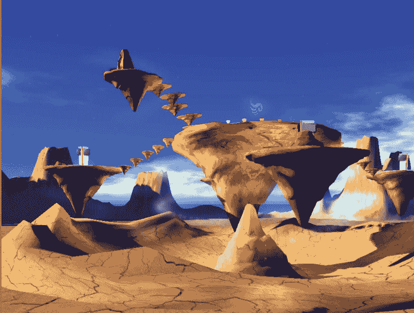

我们从与Habitat的经验中提炼出的基本教训是，网络空间更多地由其中行为者之间的互动来定义，而非由其实现所使用的技术。……我们愿景的核心在于这样的理念：网络空间必然是一个多参与者环境……在一套基础通信能力之外，用于向参与者呈现该环境的技术，无论多么酷炫和有趣，都是次要考量。

奇普·莫宁斯塔和F.兰道尔·法默
《卢卡斯影业Habitat的经验教训》
第一届国际网络空间会议
德克萨斯大学奥斯汀分校
1990年5月

## 泰勒与弗朗西斯

泰勒与弗朗西斯集团

http://taylorandfrancis.com

献给我的女儿乔和露丝，让她们不再那么费力地向别人解释父亲到底做什么！

并且，我们俩向在虚拟世界多年中结识、合作并交谈过的所有人物和虚拟形象致以问候。

## 泰勒与弗朗西斯

泰勒与弗朗西斯集团

http://taylorandfrancis.com

## Taylor & Francis

Taylor & Francis Group

http://taylorandfrancis.com

## 关于作者

**戴维·伯顿** 于 1996 年创建了他的第一个虚拟世界，此后大部分时间都通过他的公司 Daden Limited 为各种客户在虚拟空间和与虚拟人类合作。他首次关于元宇宙的演示是在 2008 年。戴维和麦吉于 2019 年为 Routledge 合著了书籍 _《虚拟人类》_，并还在 2020 年共同参与了书籍 _《数字后世》_ 的创作。

**麦吉·萨文-巴登** 是牛津大学布莱克弗莱尔斯大厅的研究教授。她在超过 20 年的时间里一直在研究和评估员工和学生的学习体验，并拥有超过 70 篇研究出版物的良好出版记录，已完成 25 本书。她的研究和写作反映了她对创新学习、数字素养、数字后世和后数字时代的兴趣，并且自 2008 年以来，她一直与戴维合作开展多个研究项目。

## Taylor & Francis

Taylor & Francis Group

http://taylorandfrancis.com

## 致谢

我们最诚挚地感谢 CRC/Taylor and Francis 的兰迪·斯拉克，当我们提出不仅一本书而是一整套关于元宇宙的书籍的想法时，她持如此积极的态度，并且自我们最初着手创作 *《虚拟人类》*以来，她一直对我们两人给予大力支持。任何错误和疏漏均由我们负责；毕竟，我们终究只是普通人。

## Taylor & Francis

Taylor & Francis Group

http://taylorandfrancis.com

# 引言

“元宇宙”一词最初由尼尔·斯蒂芬森在其 1992 年的小说《_雪崩_》（Stephenson, 1992）中提出，用来描述一个作为人们物理生活延伸的在线三维（3D）数字世界。然而，我们现在所认为的元宇宙的大部分内容，早在 1981 年首次出版的沃诺·文吉的《True Names》（Vinge, 2015）这种奇幻风格的虚拟世界中就已经存在。一些最早的类似元宇宙的实际环境是基于文本的多用户地牢（MUDs）和面向对象的 MUD（MOOs）。但是，第一批 3D 社交虚拟世界，如 Active Worlds，尤其是 Second Life，开始表明类似斯蒂芬森想象的东西可以在现实中构建。随着这一代原始元宇宙在 2010 年代初开始挣扎，Oculus 虚拟现实（VR）头显的到来引发了人们对沉浸式空间的进一步兴趣。马克·扎克伯格将 Facebook 的控股公司更名为 Meta，似乎证实了元宇宙仍然是一个当前的愿景。

许多近期关于元宇宙的出版物采取技术或金融方法，专注于区块链和非同质化代币（NFT）为基础的世界的暴利，或者对该话题采取相对不批判的态度。面对这些来源，以及 X/Twitter 和 Medium 等平台上评论的巨大炒作，对于过去二十年不熟悉元宇宙演变的人来说，要理解元宇宙概念的基本要素，以及元宇宙可能提供的潜在陷阱和机遇，可能会很困难。

为了提供一些至关重要的初始背景，第 1 章考察了元宇宙的历史，从其在科幻小说中的起源，到 1980 年代基于文本的 MUD 和 MOO，再到 1990 年代末和 2000 年代初的 2D 和 3D 社交虚拟世界，接着是 2010 年代基于头显的 VR 浪潮，最后是 2020 年代的加密世界。

第 2 章考虑了关于元宇宙的一些竞争性定义，并提出了完全实现的元宇宙应该展示的十条公理。它以对 VR 体验中有什么特别之处使其与其他基于互联网的体验如此不同的考察作为结尾。

在更清晰地了解什么构成元宇宙之后，第 3 章考虑了元宇宙在广泛商业和社会领域中的应用和影响，包括商业、协作、培训和教育、经济、市场营销、娱乐、游戏、艺术和国防，参考了超过 20 年的元宇宙活动实例。

第 4 章探讨了支撑元宇宙的技术，以希望非技术化的方式呈现它们，并确定哪些技术是元宇宙概念的核心，哪些是可选的。

第 5 章考虑了在思考元宇宙时出现的一些更广泛的问题和二元对立，以及任何终极元宇宙都需要解决的个人、社会和全球挑战及相关机遇。

第 6 章将前面的分析汇总，考察元宇宙面临的短期、中期和长期挑战，然后再考虑元宇宙未来的七种不同情景。

在撰写本书期间，某些圈子对术语发生了一些转变，从“元宇宙”转向“空间计算”。我们坚持使用元宇宙，原因有二。首先，“元宇宙”作为一个术语已经存在很长时间，是我们所讨论的这类空间的主导术语，我们预计它将在大多数人心中占据主导地位并超越空间计算——尽管后者实际上拥有更长的传承。其次，更重要的是，空间计算是一个非常以技术为中心的术语，而正如我们希望本书所示，我们所谈论的未来虚拟空间将更多地关注其中的人和社区。如果元宇宙真正实现，技术应该只是退居幕后。

还有两点考虑因素影响了我们撰写本书——可以将其视为偏见。首先，我们在 2000 年代/2010 年代初都高度活跃于 Second Life，这无疑塑造了我们对元宇宙可能、甚至应该是什么样子的许多观点，以及我们如何看待 Second Life 和 OpenSim 与其他更近期的平台和倡议相比。其次，我们认为“元宇宙”一词应保留给虚拟领域应该是什么样子的最高公分母模型，而不是用于其最低公分母的实现。

本书的意图是成为元宇宙概念的实践指南，借鉴学术研究以及实践和商业经验。目的是让读者更好地理解元宇宙的含义，它在演化过程中处于什么阶段，以及元宇宙的益处和挑战可能是什么。

## 网站与微元宇宙

我们创建了一个网站来支持本书，提供额外信息、链接（包括所有 URL 参考）和更新，网址为 http://www.themetaverseseries.info/。我们也言行一致，从该站点和网页浏览器中创建了一个可访问的 3D 微元宇宙，它为本书内容提供了一种“数据花园”方法（参见第 3 章），并且是一个希望能与读者在元宇宙中会面并讨论元宇宙的地方！

## 关键术语

任何关于元宇宙的讨论如果不提及与其相关的一些关键技术和概念，都无法深入。虽然本书（特别是第 4 章）将更详细地描述这些技术，但为了帮助本领域不太熟悉的读者并澄清本书中术语的使用方式，对每个术语进行了总结（参见表 0.1 和 0.2）。

| 术语 | 定义 |
| :--- | :--- |
| 增强现实（AR） | 增强现实将数字信息叠加到视图屏幕上（通常是智能手机，但也可能是抬头显示器或一副眼镜），并补充现实，而不是取代现实。 |
| 桌面 VR（DesktopVR） | 桌面 VR 是指使用传统的 2D 计算机屏幕（台式机、笔记本电脑、平板电脑或移动设备）提供的 VR 体验，可以是第一人称视角（从化身眼睛看到的视图）或第三人称视角（“过肩”视图，包括化身的背部）。鼠标、键盘、操纵杆和触摸屏的组合用于控制和交互。 |
| 头戴式显示器 VR（HMD-VR） | HMD-VR 是通过头戴式显示器（HMD）提供的 VR，该设备完全覆盖用户的视野，完全阻挡物理世界。手柄和/或普通身体运动用于控制和交互。 |
| 头戴式显示器 XR（HMD-XR） | 能够提供 VR 和 MR 体验的 HMD。 |
| 混合现实（MR） | 混合现实将 3D 数字可视化叠加到头戴式屏幕或透视遮光板上，其中数字信息能够“感知”世界的物理几何和用户在其中的运动，并能对两者做出响应。 |
| 虚拟现实（VR） | 一个 3D 空间的、主观的、合成的数字环境，可以通过智能手机、平板电脑或传统计算机（桌面 VR）或头戴式显示器（HMD-VR）访问。VR 在用户视野中完全取代物理现实（甚至其他感官）。 |
| 虚拟世界（VW） | 一个为用户提供交互空间、拥有代理权和（理想情况下）一定塑造世界能力的 VR 环境。请注意，在本书中，“虚拟世界”和“元宇宙”往往被互换使用，因为“元宇宙”一词（如通常使用）现在足够宽泛，可以涵盖几乎所有虚拟世界，而一些虚拟世界表现出的元宇宙特征甚至比某些被描述为元宇宙的其他环境还要多！ |
| 扩展现实（XR） | 扩展现实是用于所有创建沉浸式体验的技术的总称，在这些体验中，用户与增强或取代感知物理世界的数字内容进行交互。因此，它包括 VR、MR 和 AR。 |

如上文所述，本书采用以下惯例来区分“元宇宙”一词的不同用法。对“元宇宙”的实际定义将在第2章中讨论。

| 术语 | 用法 |
|---|---|
| metaverse（小写 m） | 指由大量具有能动性并可进行交互的化身所构成的持久性数字合成环境，用于协作、工作、娱乐、学习、社交和/或游戏；且可通过包括VR、MR以及可能的AR在内的一系列技术访问。 |
| Metaverse（大写 M） | 元宇宙概念的终极体现，涵盖全球使用和可访问系统中的所有元宇宙特征，该系统可能是单一的元宇宙，也可能是互连的独立元宇宙网络——即多元宇宙。 |
| metaversal | 表现出元宇宙的部分或全部特征。 |
| multiverse/Multiverse | 互连的独立元宇宙网络。Metaverse实际上可能是一个Multiverse——大写字母同样保留用于完全发展后的形态。 |
| proto-Metaverse | 表现出许多或大部分元宇宙特征，但发展程度尚不足以使用“Metaverse”一词的元宇宙。 |

> **完全披露**
> 
> David和Maggi在元宇宙领域积极工作了大约20年，既独立工作，也通过多所大学，以及通过David的公司Daden Limited工作。在文中提到他们参与的项目时，将包含一条注释，说明他们的参与情况。

**注意**：当文本中首次介绍虚拟世界和元宇宙平台时，通常会随后附上其公开发布日期，例如Second Life (2003)，以及（如相关）URL。随后会引用相关论文或其他参考文献。

## 参考文献

- Stephenson, N. (1992). 《崩溃》. Bantam Books.
- Vinge, V. (2015). 《真名与开拓网络空间边疆》. Tor Books.

## 1

# 元宇宙简史

## 简介

本章概述了元宇宙的历史，既作为一种理念，也作为一系列不断发展的虚拟世界和扩展现实体验及技术。它探讨了一些早期基于文本的社交空间如何被视为原型元宇宙，随后考察了在1990年代和2000年代发展起来的图形化二维（2D）和三维（3D）社交虚拟世界。本章接着描述了，从2013年起，元宇宙概念如何被新一代头戴式VR显示器（HMD-VR）和流行3D游戏世界的兴起所主导，随后探讨了Meta决定支持元宇宙概念的影响，以及基于区块链和加密货币的虚拟世界的兴起。它还简要考虑了增强现实（AR）和混合现实（MR）的发展，这些都是元宇宙的一部分。本章最后探讨了元宇宙在虚构作品中的表现。

## 开端

“元宇宙”一词由Neal Stephenson在《崩溃》（Stephenson, 1992）中著名地创造。那里描述的元宇宙展示了人们现在对元宇宙所期望的大部分特征。它是多人用户的、社交的、交互式的，由人类和人工智能（AI）驱动的化身所居住，并提供了一个人们几乎可以随心所欲行事的环境。值得注意的是，该世界基于空间布局——即围绕虚拟地球赤道的一条直路，土地价格取决于沿路和离路的距离。元宇宙是通过从便携式计算机以光学而非数字方式馈送的HMD-VR显示器访问的。

然而，元宇宙的概念早于Stephenson。尽管开创性的《神经漫游者》（Gibson, 1984）和许多其他赛博朋克作品展示了对网络空间的非常抽象的表现，但Vernor Vinge的*《真名》*（Vinge, 2015）这一于1981年首次出版的奇幻风格虚拟世界，包含许多元宇宙元素，其主人公在虚拟城堡各自的房间中会面并游历虚拟世界。

## MUD、MOO与Habitat

从实际意义上说，元宇宙概念的根源可以追溯到20世纪末的多人地下城（MUD）和多人面向对象地下城（MOO）。MUD和MOO，例如*MUD*（1978）（Bartle, 2004）和*LambdaMOO*（1990）（Schiano & White, 1998），提供的环境远比“地下城”这一名称所暗示的要广泛得多。由于其中的一切都以文本描述，一艘星舰或外星世界可以仅用一句话就“呈现”出来。只要用户参与其中，沉浸感在心理和情感上都可以非常强烈。尽管参与这些世界通常是一种积极的体验，但如在*《我微小的生命》*（Dibbel, 1994）中记录的“数字强奸”等实例，为元宇宙潜在的陷阱提供了早期警告。

从文本向2D图形的转变，最显著的来源是*Habitat*（1986），这是一个由Chip Morningstar和F. Randall Farmer创建的具有简单方块状图形的2D虚拟世界（Morningstar & Farmer, 2008）。*Habitat*的灵感来源于包括*《真名》*在内的多个方面。*Habitat*包含20,000个地点、可四处移动、做手势、与物体交互并相互文本聊天的化身。该世界还拥有自己的经济。*Habitat*最初是为Quantum Link拨号系统构建的，后来被移植到CompuServe。在他们1990年发表的一篇论文中，Morningstar和 Farmer意味深长地指出：

> 我们从与Habitat的经验中抽象出的基本教训是，网络空间更多地由其中行为体之间的交互定义，而非由其实现所用的技术定义。尽管我们认为目前在精细界面技术（如DataGloves、头戴式显示器、专用渲染引擎等）方面的许多工作既令人兴奋又充满希望，但围绕所有这些硬件目前似乎笼罩着近乎神秘的狂热，在我们看来，这既过度又有些错位。我们忍不住觉得，这从某种程度上是对真正紧迫问题的一种分心。我们愿景的核心是，网络空间必然是一个多参与者环境……除了基础的一组通信能力之外，用于向参与者呈现该环境的技术，尽管性感且有趣，只是一个次要问题。（Morningstar & Farmer, 2008）。

将“网络空间”替换为“元宇宙”，该说法今天可能和30多年前一样正确。

## 转向互联网与3D

尽管到20世纪90年代末，国防、企业乃至消费级HMD-VR已经存在（例如，皮卡迪利广场的Virtuality Entertainment装置以及Dave & Buster’s酒吧连锁店）（Virtual Reality Society，n.d.），但直到Web的出现和互联网的广泛普及，易于访问的虚拟世界才成为可能。虚拟现实标记语言（VRML）（https://www.w3.org/MarkUp/VRML/）是一种早期的超文本标记语言（HTML风格标准），它允许开发者使用文本编辑器创建VRML页面，这些页面可以在PC查看器应用程序甚至浏览器插件中呈现为完整的3D桌面VR虚拟环境。

一些公司开始利用互联网作为提供多人虚拟世界的方式，要么集成到浏览器中，更常见的是作为可下载的应用程序。两个关键世界是：

- Worlds Chat (1994)，由Worlds Inc.开发，可能是第一个3D虚拟世界，尽管它只不过是在3D空间中滑动简单的3D化身对象并进行文本聊天；以及
- Worlds Away (1996)，它与*Habitat*有共同的历史，具有类似但改进的2D图形界面，并且通过互联网运行，而不是像CompuServe这样的网络（Brenchley, 2023）。

## 《崩溃》的子民

相传，当《崩溃》出版时，几位企业家将其放在投资者或团队面前的桌子上说“我们要建造这个”。或许更现实地说，它成为开发首批3D虚拟世界的人们的参考点（Au, 2023）。最早期且愿景最完整的一个是Active Worlds（1995，https://www.activeworlds.com/）。按今天的标准来看，其图形相当基础（但超越了早期电子游戏的8位图形），但它拥有一个连续的地理世界，你可以在其中购买一块土地，并且与《崩溃》类似，土地价格与距离中心和最近的传送“铁路”车站的距离相关。可以购买化身服装，建筑是通过游戏内市场获取的一系列简单形状和组件构建的。至关重要的是，Active Worlds拥有一种脚本语言，它不仅允许游戏内脚本，还允许与互联网上的应用程序进行有限的接口连接。Active Worlds在将近30年后仍在运行。

大卫大约在1999年在Active Worlds的一个名为Retsmah Crossing的地方建造了他第一个元宇宙房屋（参见Figure 1.1）。像之前和之后的许多元宇宙房屋一样，它遵循了“海洋生活”美学风格，采用开放式布局、玻璃墙和铬质饰面。随后，大卫利用脚本构建了一个简单的非玩家头像，它可以响应命令，在本地周围导航，甚至能玩捉迷藏。

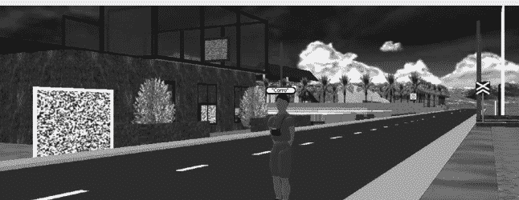

**FIGURE 1.1** 大卫及其位于Active Worlds Retsmah Crossing的房屋。

尽管在图形方面更简单（更接近8位模型），并且具有固定的2.5D/等轴透视，Habbo Hotel（2000年，https://www.habbo.com/）吸引了大量用户，并被视为最受青少年欢迎的社交虚拟世界之一，2013年拥有2.73亿注册用户（Mäntymäki & Salo，2013），尽管到2018年已下降至四百万（Leotoddy，2019）。除了头像服装、房间装饰和文字聊天之外，它缺乏许多元宇宙功能，但仍是一个受欢迎的聚会和聊天场所。像许多其他社交世界一样，它饱受滥用和剥削行为的困扰，2012年在Channel 4报道该世界被恋童癖者使用之后，系统上的聊天功能被禁言了一个月（Bryce，2020）。

完全不同的另一个世界是There.com（2003年，https://www.prod.there.com/）— 参见Figure 1.2。它当时拥有最先进的图形和精美渲染的环境，但从未拥有像Habbo Hotel那样的用户规模。用户必须获得批准才能在世界中创建和出售资产。There.com于2010年关闭，Márquez（2013）对其居民后来被称为“Thereians”的情况进行了一项有趣的研究，这可能代表其他封闭式虚拟世界。Márquez识别了Thereians如何使用社交媒体来维持他们建立的社交联系，并探讨了将他们的身份、群体和活动转移到其他社交虚拟世界（如Second Life）的过程。There.com本身于2012年重新开放。

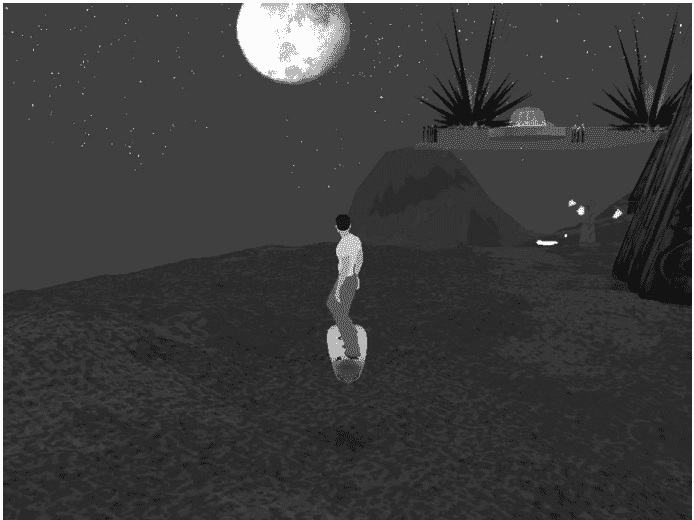

**FIGURE 1.2** 大卫最喜欢的*There.com*时刻是在Nene Peak火山口边缘骑行悬浮滑板，然后沿着其陡峭的斜坡冲浪，奔向一片波光粼粼的大海。

## Second Life 和 OpenSim

*Second Life*（2003年，www.secondlife.com），通常简称为SL，是Philip Rosedale和Linden Lab的创作。*Second Life*反映了与Active Worlds许多相同的想法，但交付了更完整的执行。值得花些时间研究*Second Life*，因为它仍然是原型元宇宙环境的最佳实现之一（Au，2023；Lamb，2022）。

> **体验Second Life**
>
> Second Life的体验是什么样的？这个描述主要基于2008年左右的*Second Life*，但虽然某些细节可能已经改变，基本体验没有。它也通常适用于其他虚拟世界和原型元宇宙。
>
> 你在Second Life网站上注册一个账户并下载Viewer应用程序。在早期，Linden Lab只提供少量头像/账户姓氏供选择，但用户可以自由选择自己的名字。这既让SL头像拥有奇特而一致的名字，又在发现有人拥有相同姓氏时产生额外的纽带。据记载，David是Corro Moseley（部分原因是他住在英国伯明翰的Moseley），Maggi是Second Wind。

当你第一次登录Viewer时，可以设计你的头像——体型、面部、皮肤、头发、衣服等。这随时可以更改，并且你可以保存任意多个头像造型（商务、派对、泳装、动物、机器人等）。当你第一次抵达Second Life时，你会被放置在欢迎中心（Figure 1.3）。这可能是一个混乱的地方，因为新手头像（就像你）正努力控制自己的头像，而老手则试图引诱你去他们的商店或酒吧，或者可能以反社会的方式行事——所谓的“破坏者”。志愿者迎宾可能随时为你提供帮助。有一些通知面板解释如何移动、导航、互动和聊天，在不同时期，曾有一些简单的实践练习，你需要在继续之前完成这些练习。在商业上使用Second Life时，开发者可以将他们的客户直接路由到私有

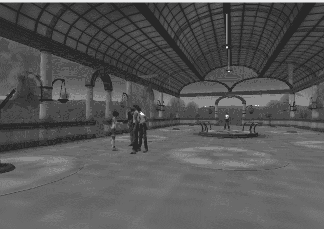

**FIGURE 1.3** Second Life欢迎区域，约2006年。

到达区域并设计所需的任何引导流程。一旦你掌握了基础知识；那就是，你得靠自己了，Second Life或Linden Lab不会告诉你下一步该做什么！

许多新用户先从观光开始。Viewer会向你展示整个世界地图；每个sim上有多少人；以及可搜索、热门和推广地点的列表。你可能想去看看商店、博物馆、荒野地区，或者是对现实世界城市或地点的克隆/致敬区域。你可能想尝试飞行、航海或跳伞；玩游戏（棋盘或桌面RPG风格）；或者参观基于Star Trek、Lord of the Rings或众多其他主题的类型主题区域——这些都是粉丝构建的，非常适合虚拟LARPing。或者你可能想上一堂课，或者只是在俱乐部或酒吧闲逛。只需点击地图或位置按钮，你就会立即被传送到新位置。到达后，可能会有迎宾员欢迎你——通常是自动机器人，有时是人类。你可以四处游荡，与事物互动，并做你想做的任何事情。SL中的一些土地设置为私有，因此当你靠近一块新土地时，通常会看到一个大黄色网格，告诉你不允许进入。Second Life很大，所以步行需要时间，而传送会错过景色，所以SL中有大量飞行。不需要飞机，只需像超人一样跳入空中（早期天使翅膀曾一度流行）。

你很快就会发现，你的新手服装让你显得与众不同。因此，在Second Life网站上使用信用卡购买一些林登币（L$，2023年1美元约合320 L$），然后要么走进商店，要么使用基于Viewer的亚马逊风格市场来购买一些新衣服（典型价格从L$50到L$1000不等，从新发型、连衣裙或西装到全新体型和皮肤纹理应有尽有——价格取决于质量）。

不久，你可能会对被动消费Second Life感到厌倦，并想开始建设。找一个Sandbox（一个用于练习建设的公共区域，会定期自动清除），查看Wiki教程，并rez（使出现）你的第一个1米木质外观立方体。拉伸它、给它上色，并扭曲它。然后，添加一个球体，然后是一个圆锥体，依此类推，将它们组合成组和组的组。在任何阶段，都将副本保存到你的物品栏中，以便以后在其他地方rez。如果你已经熟悉Blender等3D建模工具，那么你可以直接将现有对象导入Second Life。你可以同时学习基本脚本，只需添加一个脚本来更改对象的颜色，使其在有人靠近时跳入空中，或读取实时股票市场价格，并随意自定义脚本。

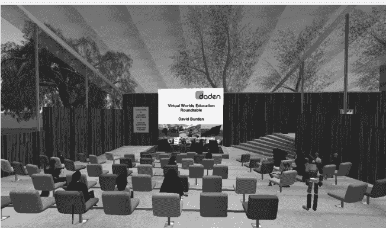

**FIGURE 1.4** Second Life中的虚拟研讨会，约2014年。

虽然大多数人去Second Life是为了玩耍，当然在2000年代初，很多人是在那里工作的，它目前仍被广泛用作教学和学习场所（Figure 1.4）。Second Life会议可以在反映讨论主题的地点举行，并通过结合语音和文字聊天变成丰富的互动，人们会rez出物体来帮助解释或探讨问题。人们自然地像在真实会议中一样安排自己，站在朋友身边，走近以看清事物，如果主人没有参与，他们的头像甚至会向前瘫靠！所有这些提供的会议记忆线索远比又一屏网络摄像头视频要多得多。

当你在Second Life中花费更多时间后，你可能会想要一个家。高级账户现在附带一块土地和一套样板房。如果你想要更个性化的东西，使用你的林登币购买一块土地（1024平方米是一个很好的起始面积，目前根据位置不同大约为550 L$），要么直接从Linden Lab购买，要么从地产经理处购买（在这种情况下，费用会更高，但可能附带一套房子甚至公寓式租赁条件！）。然后你可以在限定范围内对土地进行地形塑造（terraform），添加一座山丘或池塘，购买（或制作）花朵和树木，甚至鸟、蜜蜂和其他动物。同样，你可以购买或建造你的房子，或委托建筑师为你建造。一次市场之旅就可以让它按照你能想到的几乎任何风格进行家具配置，而脚本意味着东西可以运作——灯光、门，

视频屏幕、音响系统、机器人管家等等。当然，你其实不 *需要* 一座房子，*第二人生* 中也没有雨水或寒冷，但用户似乎确实喜欢那种据点的感觉，可以在那里动手折腾和与朋友见面——如果你愿意，那可以简单到一个篝火坑，也可以奇幻到天空中的一朵云！

有了永久据点，你才能真正开始思考如何使用 *第二人生*。邀请朋友来参加派对，或在虚拟篝火旁进行深夜哲学讨论？利用新学会的制作技能出售自己的衣服或车辆系列，或利用脚本技能出售能从网络获取数据并以创新方式在 3D 中显示的小工具。带学生来上课——在专门的教育空间中，或者将 *第二人生* 作为一次巨大的语言/人类学/地理学/社会学实地考察。创造某种令人难以置信的新艺术形式，利用（本质上）用户可控的重力与可见性、惊艳的光影效果，以及能够飞行的观众。这可能是一句陈词滥调，但在 *第二人生* 中，以及在即将到来的元宇宙中，唯一的限制确实就是你的想象力。

与 *主动世界* 类似，*第二人生* 围绕地图（图 1.5）构建，最初所有土地都是单一大陆的一部分，随着时间的推移，其他大陆和数千个岛屿集群相继加入。*第二人生* 的土地模式基于 256 m × 256 m 的地块（称为“sims”或“regions”），用户可以购买自己想要的大小的土地。目前（截至 2023 年），高级用户（每年支付 99 美元）作为套餐的一部分获得 1024 m² 的土地赠款（包括一栋房子），而整个岛屿区域需要 349 美元的设置费和 209 美元的月度维护费。不过，享受 *第二人生* 无需拥有土地，基础账户免费。用户可以转租 sims，许多早期 SL 商业实际上都是有效的房地产开发和物业管理公司，购买一个空白 sim；通过添加道路、公园、房屋、商店、游艇码头等进行改进；然后将地块（有房或无房）出售给单个用户。最初，*第二人生* 有一个声誉管理系统，让人想起 *魔法王国的潦底人生*（Doctorow, 2003）中的 Whuffie，因此用户可以根据互动对遇到的任何头像进行正面或负面评分，但这相对较早就被放弃了（Au, 2009）。

*第二人生* 有自己的货币——林登美元（L$）——它一直可以按浮动汇率与美元自由兑换（双向）。确实，Au (2023) 将其视为比特币和整个加密货币运动兴起的重要组成部分。关于 *第二人生* 的经济模型和经济管理，已经写了几篇论文（例如 Chambers, 2011; Ernstberger, 2009），它从未遭受与加密货币相关的投机。Castronova 2002 年的原始

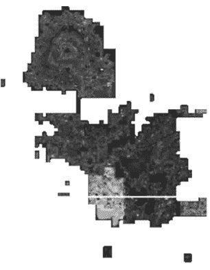
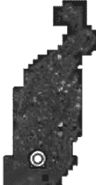

**图 1.5** 2006 年的第二人生地图。每个小方块是一个 256 m × 256 m 的“sim”。

关于虚拟经济的论文（Castronova, 2002）也相关，并提出了谁对这些新经济拥有管辖权的重要问题。Linden Lab 只有在你将 L$ 兑换为美元时才会抽成——除了土地租赁支付和 Marketplace 费用之外，人们在 *第二人生* 中赚取、保留或花费的 L$ 没有内部收入抽成。Linden Lab 仅对 SL Marketplace 销售收取 10% 的佣金（Second Life Marketplace, n.d.），而其他平台通常收取 30%（Ball, 2022），Fortnite 甚至收取 60%（Au, 2023）——使用 Marketplace 是可选的。在不同时期，曾对“prims”（实际上是用户拥有的 3D 对象数量，按复杂度加权）征税，这通常与土地费用挂钩。能够轻松将 L$ 兑换为美元至关重要，因为这意味着如果一个人在 SL 中建立业务（租赁土地、设计服装、编写脚本等），他们就可以将收入转换为现实世界的现金，并真正在现实世界中谋生。根据 Au (2023)，*第二人生* 内容创作者的总收入大约等于 Linden Lab 从平台获得的总收入。

在 2022 年，*第二人生* 拥有一个虚拟经济，年 GDP 为 6.5 亿美元，有 3.45 亿笔虚拟交易（Linden Lab, 2022）。在 2020 年，约有 1600 人通过 *第二人生* 中用户生成内容（UGC）的销售每年赚取超过 1 万美元，而 Roblox 上约为 1050 人，但到那时，*第二人生* 只有约 60 万月活跃用户，而 Roblox 有 2.5 亿（Au, 2023）。*第二人生* 内容开发者在截至 2021 年 6 月的 12 个月内从虚拟世界向现实世界经济套现了约 8000 万美元（Galov, 2023）。

在早期，*第二人生* 只有文本聊天，2007 年宣布将引入语音聊天时引起了巨大哗然，因为这将立即“dox”（即揭露）人们在现实世界中的性别，可能还包括年龄、国籍，甚至背景和社会阶层（Krotoski, 2009）。头像的性别流动性（过去和现在）都很普遍，许多用户拥有无性别头像（例如机器人、抽象图形，甚至家用电器等），*第二人生* 中还有大量的兽迷（拟人动物头像）（Brookey & Cannon, 2009）。一项调查（Bell et al., 2009）发现，11% 的现实世界男性在 SL 中使用女性头像，而只有 5% 的现实世界女性使用男性头像。在样本中，51% 的人在现实世界中自我报告为女性，43% 为男性。调查还发现，23% 的受访者在某个时候更改过头像的性别。这种可以承担和探索任何身份的自由，或许是社交虚拟世界的关键特征和益处之一。*在 第二人生 中成长：一位人类学家探索虚拟人类*（Boellstorff, 2015）和 *虚拟环境与文化：虚拟文化与景观中的社会人类学研究选集*（Frömming, 2013）都是对早期 *第二人生* 人口的优秀人类学研究。

虽然 2006 年格莱美奖获奖歌手兼词曲作者 Suzanne Vega 在 SL 中有一场著名的表演（Wired, 2006）（BBC 早期使用 SL 的情形见图 1.6），并且许多在职艺术家继续将 *第二人生* 用作表演平台（Au, 2023），但也许游戏内艺术场景是最充满活力和原创性的。亮点包括 ZeroG SkyDancers 的空中舞蹈/多媒体表演（Au, 2013）、Pink Floyd 的《The Wall》表演（Hayes, 2008）、考文垂大学的 Joff Chafer 的混合现实作品（Fewster et al., 2011）、SL 莎士比亚公司和头像剧团、Starax Statosky 的高耸人体雕塑（Sichelseifert, 2009a），以及 AM Radio 冥想式的风景（Sichelseifert, 2009b），其作品《遥远之地》后来被艺术家的儿子在 Fortnite 中重新创作（Au, 2023）。

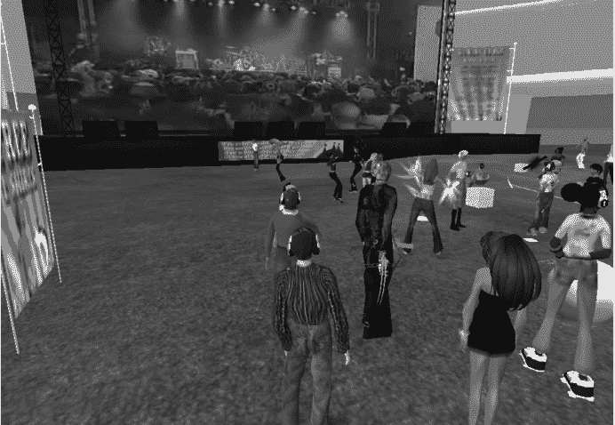

图 1.6 2006 年，BBC Radio 1 将一场音乐节流媒体传输到了 *第二人生*。

几乎就在 *第二人生* 迅速的消费者增长开始之际，其注册账户从 2005 年 12 月的约 10 万个增长到 2006 年 12 月的两百万，再到 2007 年 12 月的一千一百万（Voyager, 2023），现实世界的企业开始关注。从 2006 年到 2009 年左右，媒体上充满了 IBM、耐克、Visa、欧莱雅、通用汽车、英特尔和 American Apparel 等公司在 *第二人生* 中开设商店的报道（Barnes & Mattsson, 2011）。甚至有瑞典（Bengtsson, 2011）、爱沙尼亚（Estonia, 2007）和马尔代夫（Sydney Morning Herald, 2007）的大使馆。2007 年达沃斯峰会被流媒体传输到了 *第二人生*，其中一场会议由路透社在游戏内举办（Hounshell, 2007）。这个世界也成为跨国抗议的基地——例如关于缅甸政府的抗议（Borgan, 2007），以及全球募捐活动，如每年的 Walk for Life（American Cancer Society, n.d.）。甚至政治家也曾露面（SpeedMatters, 2007），选举竞选活动也在那里举行过——例如 2007 年法国总统选举中勒庞和萨科齐的活动（Kar-Gupta, 2007）。

不过，请注意，这些参考文献中有很多是 2007 年的。由于早期的企业参与主要由营销和公关推动（David 曾为通用汽车、Visa 和 Red Nose Day 参与项目），当人们明显看出 SL 以及社交虚拟世界的消费者兴趣正在消退，并且它们不会成为“下一个大东西”时，大部分营销和企业活动就消失了。

导致衰落的关键原因之一是许多用户根本搞不懂 *第二人生* 是做什么的。他们把它当成电脑游戏

本以为它会设定目标和宗旨——但 *第二人生* 并非如此（尽管 Linden Lab 晚些时候曾试图通过 Quests 和 Linden Realms 追溯性地添加此类功能）（Uccie, 2014）。Au（2023）还解释了内部管理问题、技术决策以及智能手机带来的新兴挑战等因素如何都促成了 *第二人生* 的收缩。

然而，其他人，特别是教育和培训界的人，已经发现 *第二人生* 是多么适合他们自身用途的多功能平台。在 *第二人生* 中构建实际上只是类固醇版的玩具积木——尽管要精通需要一些时间——因此任何导师都可以自学基础知识、阅读维基，或参加平台内课程（这一切都始于 YouTube 出现之前！）。*第二人生* 中的脚本使用 Linden 脚本语言，虽然它有自己的特点，但复杂度与 Javascript 类似——因此，热衷的教师同样可以使用它来开发基本功能。Virtual World Watch 2009 年的一项调查发现，英国约有 50 所高等教育机构正在使用 *第二人生*（Kirriemuir, 2009a），而他们每年的 Snapshots 对当时虚拟世界（主要是 *第二人生*）在教育中的广泛应用方式提供了很好的概述（Kirriemuir, 2009b）。2009 年，英国联合信息系统委员会（JISC，一家主要由政府和大学资助的独立非营利慈善机构，为英国高等教育提供共享 IT 方面的建议和管理）发布了一份关于“开始使用 *第二人生*”的指南（Savin-Baden et al., 2009），而开放大学举办了两场关于虚拟世界教育的 ReLIVE 会议（分别在 2009 年和 2011 年）。虚拟世界教育联盟（https://www.vweconsortium.org/），作为最新的支持虚拟世界教育工作者的组织，其主要基地位于 *第二人生*，仅在 2021 年成立。

Linden Lab 为学校和学院使用的 sim 提供了教育折扣，但当该折扣于 2010 年取消后，许多机构开始离开。许多人转而开发 *开放模拟器*（2007, http://opensimulator.org/），将在下文进一步描述。其他人使用 Unreal 和 Unity 开发定制的沉浸式环境应用程序——尽管这些应用从未拥有导师（甚至学生）创作所带来的灵活性。

不仅是教育领域看到了 *第二人生* 的好处。例如，帝国学院、圣乔治医院¹（图 1.7）；康奈尔大学和爱达荷州立大学（Stott, 2007）；俄亥俄州立大学（DigitalUnionOSU, 2008）；以及卡尔加里大学和卡尔加里 SAIT 理工学院（Kopp & Burkle, 2010）都有大量医疗培训项目，项目范围从急救和护理培训到虚拟实验室和人体解剖的飞行漫游。纽约市应急管理办公室在一个纽约公立学校的虚拟副本中开展了飓风救援中心培训²（Brouchoud, 2011）。咨询公司 Booz Allen Hamilton 和得克萨斯女子大学评估了基于联邦应急管理局模式的龙卷风响应培训

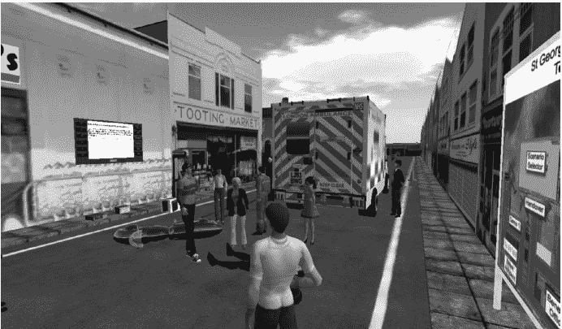

图 1.7
2008 年，在 SL 中于伦敦圣乔治医院的早期急救培训模拟。

（Taylor-Nelms & Hill, 2014），迈阿密大学牛津分校和辛辛那ti大学培训护士应对放射性和爆炸性灾难的分诊（Farra et al., 2013）。Hsu 等人（2013）对第二人生和其他平台上的灾难准备与响应培训项目提供了有用的概述。即使是军队（例如 Pey, 2020），根据斯诺登文件，情报界也曾在第二人生中（NSA, 2008）。

Linden Lab 曾有过为第二人生创建独立或基于内联网的企业服务器的短期计划（Korolov, 2010）。这作为 Linden Lab 的项目从未实现，但开放模拟器很快就提供了完全相同的功能。

开放模拟器本质上是第二人生的反向工程版本（图 1.8）。Linden Lab 对代码一直持相当开放的态度，用户用来访问第二人生的核心“查看器”代码早已公开，以便开发人员创建支持额外功能的客户第三方查看器（TPV）。开放模拟器更进一步，开发了一个第二人生服务器代码的版本，其工作方式与官方代码几乎完全相同，甚至可以使用第二人生查看器来访问它，但人们可以在自己的服务器上运行它，甚至可以连接到其他人的开放模拟器服务器以创建“超网格”。

开放模拟器的最大优势之一是，用户可以将 sim 的整个设置——所有构建和脚本——保存为单个开放模拟器存档（OAR）文件。然后可以将其上传到新服务器，因此 sims 可以轻松分发、归档或复制（有助于扩展培训练习，因为典型的 sim 只能支持约 50 名用户）。

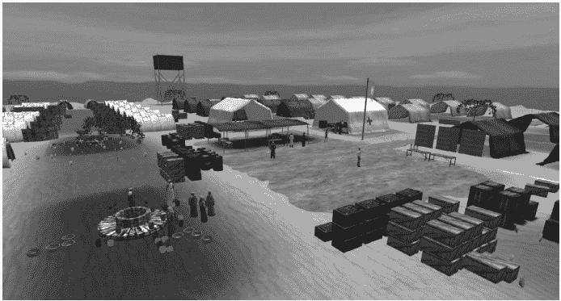

图 1.8
在开放模拟器上为人道主义救援培训建造的难民营。

正如第二人生尽管在 2010 年代被抛弃后仍作为一个有用的平台继续存在一样，开放模拟器如今仍然是一个充满活力的社区。2023 年，超网格商业（一个追踪开放模拟器、第二人生和其他元宇宙活动超过 15 年的机构）记录了 427 个开放模拟器网格（即公开可访问且通常包含多个 sim 的网格），其中约 317 个已连接到超网格（超网格商业，2023）。这还不包括纯粹为私人使用而运行的任何开放模拟器实例。

从很多方面来说，开放模拟器超网格（http://opensimulator.org/wiki/Hypergrid）可能是目前存在的最接近开放元宇宙的东西。它基于开源代码；每个网格由私人运营和托管；任何人都可以运行和托管网格，购买 sim，或在网格的 sim 上落脚。由于基于第二人生，构建工具全部内置于查看器中，并包含一个具有读写 Web 访问权限的强大脚本引擎。而超网格协议（实现网格间连接）支持网格之间的传送和代理（即用户）转移（Lopes, 2011）。

Linden Lab（关于 Project Sansar）和 Philip Rosedale（关于 High Fidelity）的后续工作将在本章后面讨论——同时还将考虑第二人生当前的健康状况。

## Second Life 替代方案

第二人生并非 2000 年代初期唯一可用的原型元宇宙。Open Wonderland（2010）（Kaplan & Yankelovich, 2011）起源于 Sun Microsystems，基于开源编码模型，让开发人员构建自己的独立虚拟世界。Open Wonderland 技术复杂，是某些新颖功能的早期先驱，例如世界之间的窗户和门，人们可以透过一个世界看到另一个世界，穿过去，然后再回头看他们刚刚来过的世界。

Twinity（2008）是首次尝试数字孪生的项目之一。它让用户探索伦敦、柏林及其他几个城市的副本；在其中购买虚拟公寓；然后在主题相应的空间里去夜店或购物（Schultz, 2018）。然而，这些虚拟城市没有一个商店橱窗或立面——据推测是为了避免品牌侵权（图 1.9）。据 Schultz 报道，Twinity 最终甚至不得不出于法律和财务原因放弃数字城市孪生模式。

当时的其他虚拟环境包括：

- Croquet（2004）（Smith et al., 2003），后来演变为 Open Croquet，然后是 Qwaq，并拥有一些新颖的协作工具但非常方块化的虚拟形象。该技术最近被 Virtend（2022, https://www.3dicc.com/product-details/）使用，这是一个专注于商业协作的虚拟世界，Croquet 本身也发布了一个 Microverse World Builder，使用核心的最新版本

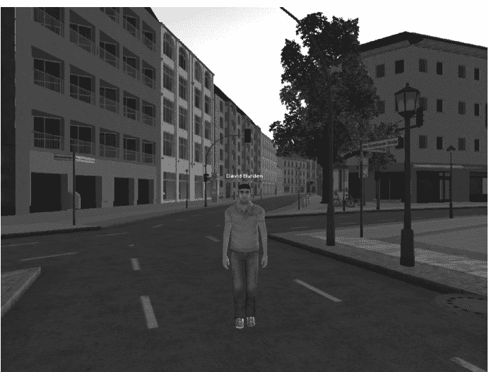

图 1.9
在 Twinity 中探索虚拟柏林。

- Croquet Microverse 开源项目（2022年）（https://croquet.io/）（Croquet，2022）；
- Kaneva（2006年）（Forbes，2007年）是一个比 Second Life 更光鲜的虚拟世界，拥有远为流畅的界面以及一些早期自动化头像，用于迎宾等角色，但较少关注用户内容创作；
- Forterra’s OLIVE（约2006年）（Badger，2008年）是早期面向企业的培训和协作平台之一，并与 There.com 共享相同的技术基础。甚至还有计划在情报界内部署它（NSA，2008年）；
- 来自澳大利亚的 Vastpark（2007年），除了作为一个虚拟世界（具有本地托管功能）外，还通过其 OpenAvatar 项目（Hypergrid Business，2011年）率先尝试开发可移植头像；
- Sony Home（2008年）（Takashi，2010年）是索尼试图通过其 PlayStation 主机将虚拟世界带给大众的尝试。它于2008年推出，到2010年底已拥有超过1700万用户，但于2015年关闭。与 Kaneva 一样，其重点更多在于精美的图形和易用性，而非 UGC；
- Blue Mars（2009年）（Shertyk 等人，2010年）是另一个高光泽度的虚拟世界，基于当时最先进的 CryEngine 构建，但提供了更广泛的 UGC 工具。尽管公共世界于2012年关闭，但其遗产之一是 Chatscript 聊天机器人引擎，由 Bruce Wilcox 构建用于驱动世界内的头像，随后被广泛用于各种聊天机器人项目，包括两次赢得勒布纳奖（一项年度公开图灵测试）（Wilcox & Wilcox，2013年）；以及
- AvayaLive Engage（约2012年）（Camilleri 等人，2013年）与 Forterra’s OLIVE 类似，旨在更多地将虚拟世界用于企业协作、教育和培训。

除这些专门构建的社交虚拟世界之外，用户还发现如何利用多人游戏（尤其是多人在线角色扮演游戏——MMORPG），例如 Runescape（2001年）、《魔兽世界》（2004年）甚至 Club Penguin（2005年），将其作为闲逛、聊天、协作甚至教学和学习的场所（例如 Marsh，2016年）。

社交虚拟世界中一个值得注意的早期发展是 Google 夭折的 Lively（2008年）（Huviła，2015年）。Lively 于2008年7月8日推出，其创新之处在于可以通过浏览器访问，而无需下载应用程序。每个用户都会得到一个小岛，他们可以在上面放置对象并上传纹理（图片）——与几乎任何虚拟世界一样。但这是面向大众市场的，因此成千上万的人开始使用它，最受欢迎的网站会被列在排行榜上。唯一的问题是，大量世界充满了色情

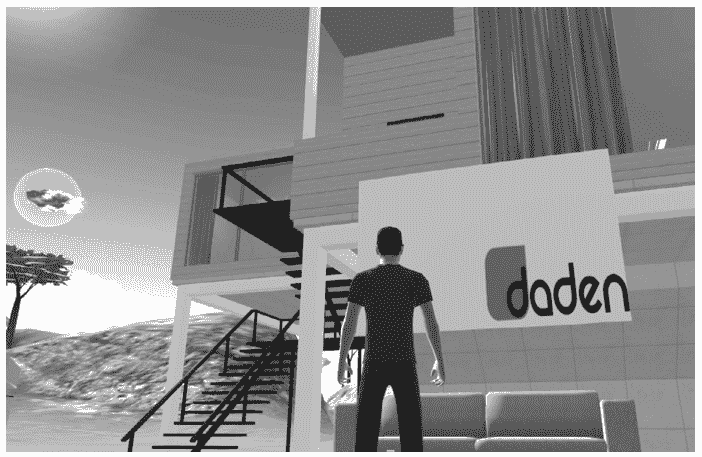

图 1.10 在 Cloud Party 中构建业务形象。

图片内容。如果没有足够的审核措施，Google 于2008年11月19日宣布关闭 Lively，仅推出四个月后。想象如果 Lively 幸存下来会怎样，这很有趣（Burden，2011年）。每次 Google 搜索都会有 Lively 标签页，与图片和地图并列，将用户引导至一系列信息丰富、引人入胜的虚拟世界网站，让他们以完全不同、可能更令人难忘和引人入胜的方式探索搜索主题吗？会有这样的功能吗？

一个非常相似的世界是 Cloud Party（2011年）——同样致力于将构建和访问体验直接带入浏览器。Cloud Party 成立于2011年，于2014年被 Yahoo 收购，同年关闭（Etherington，2014年）！

虚拟世界不仅受到消费者和教育者的兴趣。尽管军方曾在虚拟世界中进行过一些早期实验（大部分在由美国政府联邦虚拟世界联盟组织的短暂一年一度的联邦虚拟世界会议上展示；Harris，2010年），但军事模拟往往遵循独立轨道。虽然战斗机和医疗培训一直是许多头戴式显示器 VR（HMD-VR）硬件发展的持续驱动力（例如 Simons & Melzer，2003年），但陆军对大型农村或城市空间的需求，用于举行虚拟演习，这与虚拟世界更为接近。波希米亚互动（Bohemia Interactive）于2003年推出的 Virtual Battle Systems (VBS) 系列是所创建和使用内容的一个良好示例，该系列本身也是从《闪点》（Flashpoint，2001年）系列消费类视频游戏开发而来。随着每次迭代（截至2023年，已达到 VBS4），图形和功能已得到改善，以至于现在有了全地球模型，甚至可以再现雨、泥、雾和雪等季节和天气效果（https://bisimulations.com/products/vbs4）。飞行模拟器（例如《微软模拟飞行》系列）也经历了类似的演变速度，从1971年原版的线框图形发展到2020年版的全地球模型（https://www.flightsimulator.com/），Ball（2022年）甚至认为《模拟飞行》有助于将微软置于元宇宙未来的有利地位。

## Oculus 的到来

2013年，随着 Oculus DK1 虚拟现实（VR）头戴式显示器的推出（Kumparak，2014年）（图 1.11），虚拟世界领域永远改变了。尽管分辨率可用，虽不惊艳，但关键进步在于 HMD-VR 现在对热衷的爱好者来说已负担得起，它不再是国防、医学和航空航天的玩物。DK1 本身仅提供 3 度

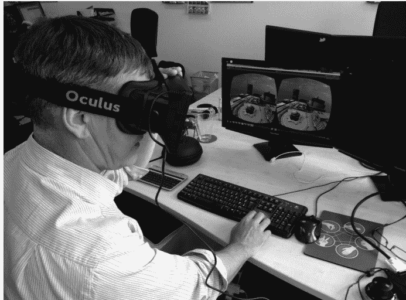

图 1.11 大卫使用 Oculus DK1 探索在 Unity 中构建的伯明翰百年广场虚拟副本。

自由度（3DOF）（即它响应你转头，但不响应任何横向移动），但一台桌面传感器增加了横向移动，从而提供 6 自由度（6DOF）——但仅在靠近传感器时才有效。在 DK2（2014年发布）中，有两个传感器，但追踪仍仅限于有限空间。HTC 的 Vive 于2016年率先提供易于使用的全室追踪（Robertson，2016年）——使用户能够在物理空间内自然行走，以探索 VR 环境。

然而，Oculus Rift 和 HTC Vive 头显都需要一台强大的 PC 来驱动——使成本增加至少 1000 美元，加上约 599 美元的头显价格，并使设置成为中等程度的噩梦。另一种方法是使用手机作为处理和显示设备，分割屏幕以呈现左右眼视图，并将其放入带有几片镜头的简单头戴式外壳中以完成系统。Samsung Gear VR 是典型的高端版本（Rundle，2015年），而曾短暂普及的 Google Cardboard 是低端版本（例如 Fabola 等人，2015年）（图 1.12）。介于两者之间有几十种塑料克隆品，很快就进入了清仓货柜，因为人们早期的 VR 体验未能兑现承诺。

索尼再次是唯一真正涉足 VR 的主机制造商，于2016年发布了 PlayStation VR 头显（Habgood 等人，2017年），据报道到2020年底已实现五百万销量（Hayden，2023a年）。更新版 PSV2 于2023年初推出，Hayden 报告称，发布后头六周的销量约为55万台。2023年7月，索尼宣布投资200万美元用于 XR 和元宇宙研究与开发（Kolo，2023年）。

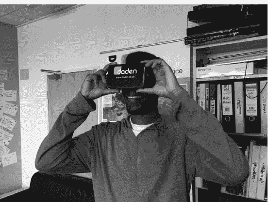

图 1.12 尝试 Google Cardboard。

任天堂早在1994年就有过一款 VR 头显——Virtual Boy——但未能获得真正的成功（Boyer，2009年）。2019年，任天堂推出了 Labo VR，本质上是为其 Switch 主机打造的 Google Cardboard，而第三方 Orzly VR 头显在使用 Switch 的 VR 模式时提供了廉价但更坚固的头显。2023年，仍有关于原生任天堂 VR 头显的猜测（例如 Hayden，2023b年）。

Facebook 于2014年收购了 Oculus（Dredge，2014年），但下一个重大进步出现在2019年，随 Oculus Quest 发布——一款完全自包含、6DOF、室内规模的 VR 头显，售价399英镑，不再需要连接到高端 PC 或需要额外的房间传感器。现在，几乎任何买得起智能手机的人也能买到像样的 VR 头显。2020年，Quest 2 推出，到2023年，Oculus/Meta 据报道已销售近2000万副 Quest 头显（Heath，2023年）。Quest 3 增加了最先进的混合现实功能，于2023年10月推出。

## HMD-VR 虚拟世界

尽管为 Quest 发布的大多数应用都是视频游戏或360度视频文化和地理之旅，但也出现了一些有趣的虚拟世界类型应用。

最常见的类别可能是会议和协作应用程序。示例包括 Glue（约2017年，https://glue.work/）、MeetInVR（2020年，https://www.meetinvr.com/）和 Arthur（2021年，https://www.arthur.digital/）。这些通常具有企业、商务风格，支持有限数量的位置样式、有限的头像选择和有限的对象放置/导入，但拥有一套合理的协作工具，例如虚拟白板、PowerPoint 屏幕、浏览器显示、Google Docs 集成、语音和文本聊天、3D 表情符号、屏幕共享，甚至网络摄像头。

在面向消费者社交的环境方面，VRChat（2014年）（https://hello.vrchat.com/）可能最受欢迎，其并发率可与最受欢迎的在线游戏相媲美（Au，2022a年），但具有相当极端的审美风格（图 1.13），Cryptovoxels（2018年）（https://www.cryptovoxels.com/）也是如此。积极的一面是，VRChat 的创造力可与鼎盛时期的 Second Life 相媲美（Au，2023年），而消极的一面则是关于诱骗、剥削和重大儿童保护问题的报告（Crawford & Smith，2022年）。

较为克制但同样富有创造力的是 AltSpaceVR（2015年），它每年都举办虚拟燃烧人节，可能是目前最接近 Second Life 感受的产品。在其最初的2015年版本中，AltSpaceVR 有一个名为“enclosures”的创新功能，允许用户编写代码来定义该空间的3D内容——甚至可以拉取网页数据并在显示器中可视化（见图 1.14）。对于较大的空间，开发者使用 Unity 构建环境，然后将其上传到 AltSpaceVR（这是一种常见的方法，在

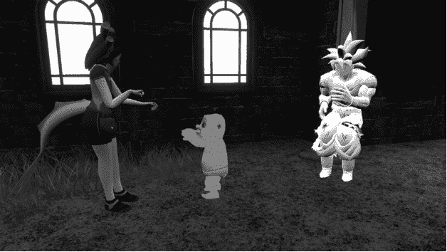

图 1.13
在VRChat中，非人类虚拟形象非常常见。

许多虚拟世界）。AltSpaceVR 曾短暂倒闭，随后被微软收购并重新推出，所有这一切都发生在 2017 年，但随后于 2023 年关闭（Hayden, 2023c）。然而，部分技术被微软的 Mesh 3D 协作环境采用，该环境于 2021 年作为 Teams 的一部分推出（Warren, 2021）。
此外，还有许多专门面向培训和教育的 VR 应用程序。一个较好的例子是 Engage (2017) (https://engagevr.io/)，虽然它（目前）尚未支持虚拟世界内的构建或脚本编写，但允许对象导入和放置，并具有一套完善的协作工具。其独特功能之一是将讲座、会议或课程记录为数据文件，而不是视频，因此在回放时，周围所有虚拟形象会按事件发生时的方式在你身边移动——甚至包括你自己的！因此，你可以体验到一种奇特的感觉：站在那里，以你的“实时”虚拟形象观看你的“录制”虚拟形象在空间中移动、交谈和互动——一种真正的“灵魂出窗”体验。

其他值得关注的当前社交 VR 应用程序包括：

- Virbela (c.2012, www.virbela.com) – 一个侧重于会议的平台，拥有一个大型虚拟校园以及各种演讲厅和会议室。虚拟形象对许多人来说太小且过于卡通化（参见图 1.15），但它们确实有助于确保该服务在配置较低的 PC 上运行。企业可以拥有自己的私有 Virbela 世界；
- Rec Room (2016, https://recroom.com/) – 一个充满奇妙体验的应用程序，其中包含各种虚拟化的“实体”游戏，可与朋友一起游玩，包括飞盘高尔夫、躲避球、彩弹射击，甚至攀岩。在 COVID 封锁期间，它是举办虚拟团队建设活动的绝佳方式。Rec Room 具有一个虚拟世界内的系统，允许玩家构建和脚本化他们自己的“房间”和游戏；
- Vark (2018, https://corp.vark.co.jp/) – 一款日本 VR 应用程序，在其原始版本中，动漫风格的虚拟流行明星进行了虚拟表演，但所有其他与会者都被“幽灵化”，因此仿佛你正在观看一场私人表演；以及

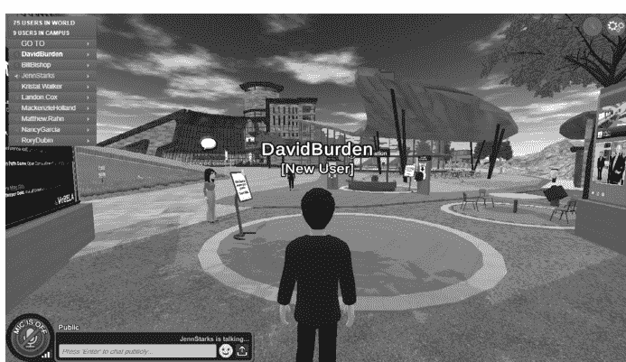

图 1.15
抵达 Virbela 校园。

- Spatial (2020, https://www.spatial.io/) 于 2021 年从最初的商业焦点转向更侧重社交和娱乐的方向。

虽然上述所有应用程序都宣传用于 HMD-VR 头显，但其中大多数也提供 DesktopVR 版本。轶事证据（例如，通过观察人们在空间中的移动方式）和游戏指标（例如，2019 年只有三分之一的 VRChat 用户使用 HMD-VR；Au, 2022a）表明，大多数用户是通过 PC/手机访问这些虚拟世界，而不是通过头显，尽管也有一些证据表明 HMD-VR 使用量正在增长（Au, 2023）。考虑到某些虚拟世界吸引了大量版面（和投资），而 Second Life 似乎因没有官方 HMD-VR 实现而被忽视，这有些讽刺。

## 3D 大型多人在线游戏

正如早前的一代人找到了新的方式来使用大型多人在线（MMO）平台（如《魔兽世界》）一样，在 2010 年代，人们开始使用 Minecraft (2011, https://www.minecraft.net/) 进行教育（Bar-El & Ringland, 2021）、地理学（Lecordix et al., 2018）、代码可视化（Balogh & Beszedes, 2013），甚至宗教礼拜和虚拟主日学校³（CofE, 2020; Jeremy, 2021）。Minecraft 提供了各种世界构建、脚本、市场和协作工具，以帮助构建用户生成内容（UGC），甚至允许人们运行自己的服务器。截至 2023 年 1 月，Minecraft 拥有约 1.76 亿月活跃用户（MAUs）（Sharma, 2023）。

Roblox (2006, https://www.roblox.com/) 在教育领域也得到了广泛应用，同样得益于易于使用的构建、脚本和共享工具（Han et al., 2023）。Roblox 还被多个知名品牌（如 Walmart（Blackwood, 2023）和 Nike（Utoyo et al., 2022））用于营销活动。虽然 Roblox 支持 UGC 并且确实拥有开发者社区，但如前所述，该社区的收入不如 Second Life 中的开发者社区。2023 年，Roblox 拥有约 2.14 亿 MAUs（Ruby, 2023）。

撰写时另一款流行的 MMO 是 Fortnite (2017, https://www.fortnite.com/)。虽然可以说它拥有更好的图形，但该游戏将玩家紧密绑定在大逃杀模式中，因此最初相比于 Roblox 和 Minecraft 等虚拟世界，其创造性和非游戏用途较少。2018 年，Epic 推出了 Fortnite: Creative，为玩家提供编辑器以创建自己的游戏体验；2023 年，Unreal Editor for Fortnite (UEFN) 允许开发者使用 Epic 的核心 Unreal 游戏引擎来创建 Fortnite 体验（Franey, 2023）。Garst (2023) 报告称，Fortnite 用户“大约将 40% 的总游戏时间花在探索游戏创意模式中的体验上，包括自定义用户创建的游戏、训练模式和品牌体验”。许多知名品牌和人物在 Fortnite 上很活跃，包括 Ariana Grande、Travis Scott (Regan, 2021)、Marvel 和 NFL (Goodman, 2023)。2023 年 3 月，Fortnite 宣布其 MAUs 已达到 7000 万（Jacob, 2023），并于 2023 年中期宣布将把 40% 的净收入分配给创作者（Peters, 2023）。

面向科幻的 MMO，如 EVE Online (2003)、Elite Dangerous (2014)、No Man’s Sky (2016)、Dual Universe (2022) 以及基于区块链的 Million on Mars (2022)，也具有元宇宙元素。

一直具有成为虚拟世界潜力却从未实现的平台是 Google Earth (2001, https://earth.google.com/web/)。尽管城市和全球地标的 3D 建模有了稳步发展，但它固执地仍然是一种单人体验。其 VR 版本目前（2024 年）仅在 HTC Vive 和 Oculus Rift 上可用，而非更受欢迎的 Quest，尽管谷歌 2023 年的一项公告表明这可能会改变，并且正在出现第三方解决方案，例如 Woorld (sic) MR 应用程序（Bezmalinovic, 2023）。

## Facebook 开始关注

Facebook 收购 Oculus，尤其是 Mark Zuckerberg 在 2021 年 10 月 28 日 Facebook Connect 上的演示（该演示被实时流式传输到 Oculus Horizons Spaces 虚拟世界），以及宣布 Facebook 控股公司更名为 Meta，将元宇宙概念重新带回公众（或至少是极客）的意识中。然而，其中真正鲜有十年前未曾讨论过的内容，而且许多内容在 15 年前的 Second Life 中就已经存在。Zuckerberg 还谈到将元宇宙视为移动互联网的“替代品”——鑑于头显的不便，这一点将在第 3 章中受到挑战。一些更有趣的（当时）未来发展宣布，同样适用于其他虚拟世界平台，包括：使 PC 和智能手机应用程序能够从 VR 内部的数字孪生中使用（这些元素如今出现在 Apple Vision Pro、Somnium Space 和 Immersed 中），能够检测面部表情和眼动以实现更自然虚拟形象交互的头显（在 Apple Vision Pro、Quest Pro 和其他设备中），以及使用基于肌电图（EMG）的神经技术设备检测手部运动和手势（这是 Thalmic Labs MYO 早在 2016 年就开创的事情）（Burden, 2021）。他们新的 Codec “照片级逼真”虚拟形象在 Zuckerberg 与 Lex Fridman 关于元宇宙的采访中得到预览（Fridman, 2023），但背景为黑色且仅显示头部和肩膀，仍然有恐怖谷的感觉。

Meta 的意图似乎是将用户在 Quest 中当前的“家”（他们从此选择应用程序），以及“Spaces”社区观看应用程序，扩展为一个更全面的多用户社交虚拟

名为 Horizon Worlds (2021, https://www.meta.com/en-gb/experiences/2532035600194083/) 的世界，其中包含构建工具和一种类似 Scratch 的可视化脚本语言 (https://scratch.mit.edu/about)。Meta 称 Horizon Worlds 在 2022 年 10 月的 MAU 约为 200,000，较新数据不易获取 (Tassi, 2022)。

2022/2023 年 Meta 裁员 15,000 人的公告似乎让其整个元宇宙策略备受怀疑，但尽管 Reality Labs（Meta 开发元宇宙应用的部门）似乎没有受到像公司其他部分那样严重的打击，Meta “从专注于其‘元宇宙’举措转向人工智能的反复无常给 Reality Labs 部门带来了巨大压力” (Barr, 2023)。

## 西方之外

尽管迄今讨论的大部分世界都源自西方文化，但在全球其他地区也存在强大的元宇宙运动。来自日本的 Vark 已经提及，Zepeto (2018, https://web.zepeto.me/en) 是一个韩国世界。同样来自韩国，Krafton（热门游戏 PUBG: Battlegrounds 的所有者，类似于 Fortnite）正在推出 Overdare，一个类似 Roblox 的 NFT 驱动元宇宙，将于 2024 年上线 (Irwin, 2023)。韩国科学 ICT 部甚至创建了“元宇宙联盟” (Kim, 2021)。GOXR 和 PartyOn（都来自 XRSpace – https://www.xrspace.io/us）是台湾世界。中国 VR 市场被一些人估计占全球市场超过 40%，并涉及百度、阿里巴巴和腾讯等关键中国科技公司 (Kurzydlowski, 2021)。字节跳动，TikTok 的中国所有者，于 2021 年收购了 Pico，这是领先的 HMD-VR 制造商之一 (Kharpal, 2021)。在中东，迪拜推出了自己的元宇宙战略，阿联酋开设了元宇宙孵化器，NEOM 未来城市拥有元宇宙元素，以支持建设阶段的协作 (MIT Sloan Management Review, 2023)。因此，无论西方发生什么，元宇宙发展似乎都可能在全球其他地方继续。

## 加密虚拟世界

近年来对虚拟世界领域的另一重大变化是基于区块链的虚拟世界的兴起——即“加密元宇宙” (Au, 2023)。Somnium Space (2018, https://somniumspace.com/) 是最早的平台之一，提供许多 Second Life 风格的功能和类似的土地模式，并计划于 2024 年推出自己的 HMD-VR 头显。其他包括 Decentraland (2020, https://decentraland.org/) 和 Cryptoverse (2022, https://www.cryptoverse.vip/)。

与 Second Life 时代的世界相比，重大区别在于所有交易和所有权均通过区块链追踪，土地和资产使用加密货币购买——因此价格可能极高，并受加密货币投机的捉摸不定所影响。结果，虚拟资产实际上变成了非同质化代币 (NFTs) —— 而围绕 NFT 的最近热潮进一步将价格推高，超出大多数普通用户的承受能力。例如，在 Decentraland 上，土地价格约为每平方米 $40–$300，一条新连衣裙的价格为 $2–$20。相比之下，在 Second Life 中，土地价格约为每平方米 $0.0016，一条连衣裙的价格约为 $0.30–$2（所有价格均为 2023 年 7 月的价格）。

这些成本不利于产生高用户参与度。Decentraland 报告称 2022 年 9 月只有约 57,000 MAU (Decentraland, 2022)，Au 报告称 Somnium Space 在 Steam 用户（因此可能无法覆盖所有用户）中的 12 个月峰值并发只有 16 用户 (Au, 2022b)。这种缺乏吸引力的典型表现是 Alloverse 加密世界 (2020) 于 2023 年关闭，声明称“我们的金库现在空了，……我们暂停商业运营”，但他们将“从带有开源核心的‘开放核心’商业公司过渡为完全开源项目” (Bengtsson, 2023)。相比之下，Second Life 在 2022 年的并发约为 30,000–50,000 (Galov, 2023)，VRChat 在 2022 年底的并发约为 65,000 (Virtual Girl Nem, 2022)，Rec Room 在 2022 年中达到三百万 MAU (Lang, 2022)。

这些世界背后的区块链技术或许确实有其位置，如第 4 章将讨论的那样，但目前看来，它们更多是在阻碍而非推动元宇宙的发展。有趣的是，在其 2024 年宣言中，Decentraland 认识到需要探讨“多样化支付方式、改善教育资源以及避免加密黑话”，并设想“一个欢迎不熟悉加密生态系统用户的平台；只需你常规的社交资料，你就可以进入 Decentraland 并创建账户——无需创建数字钱包，一切都在幕后为你处理” (Decentraland, 2024)。

## 第三人生？

令人着迷的是，尽管所有喧嚣都围绕 HMD-VR，然后是 Meta/Facebook，再然后是加密世界，Second Life 和 OpenSim 却一直照常运行——正如刚才展示的数字所证明的那样。Oculus DK1 发布后，一个名为 CtrlAltStudio 的“第三方查看器”(TPV) 很快为 Second Life（和 OpenSim）创建，它在 DK1 上运行，以便你可以全 HMD-VR 体验 Second Life (see 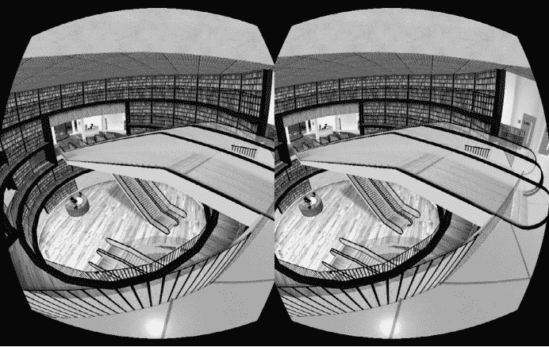

图 1.16
使用 Oculus DK1 在 VR 中查看 Second Life 中的伯明翰虚拟图书馆建设——这可以做到！

图 1.16) —— 但这不是 Linden Lab 所走的路线。然而，CtrlAltStudio 查看器已更新以支持 Oculus DK2 和 Oculus Rift CV1，Firestorm TPV 目前提供一个 VR Mod (Tate, 2022)，因此 “Second Life 和 OpenSim 查看器的 VR 版本仍然存在并每天使用” (Tate, 2024)，驳斥了 Second Life 和 OpenSim 不是“正规”VR 应用程序的观点。

Philip Rosedale 于 2010 年离开 Linden Lab 后，新所有者似乎认为未来在于更具消费者友好性的虚拟世界应用，该应用作为 Project Sansar (2017, https://www.sansar.com/) 推出。它无疑拥有更好的图形，但转向了“房间”模式，远离了 Second Life 的连贯虚拟世界。它于 2020 年被出售，以便 Linden Lab 能够（重新）专注于 Second Life，并于 2022 年再次被出售。它现在已转型为虚拟活动平台，并于 2022 年宣布合作，通过 LG 智能电视提供该应用程序和活动 (Cimerman, 2022)，并于 2023 年与 Somnium Space 进一步合作，开发两个平台之间的互操作性 (SomniumSpace, 2023)。与此同时，Philip Rosedale 创立了 High Fidelity (2016, https://www.high-fidelity.com/) 来开展前沿虚拟世界技术。High Fidelity 很大程度上是一个面向程序员的平台，但由实时面部和肢体位置捕捉驱动的虚拟形象的自然感，产生了一些出色的逼真演示视频和虚拟演示（例如 High Fidelity, 2017）。与 Sansar 一样，High Fidelity 并不十分成功，并于 2019 年转型为空间音频驱动的会议平台 (Au, 2021)。

2022 年，High Fidelity Inc. 成为 Linden Lab（因此也是 *Second Life*）的投资者，Philip Rosedale 回归担任 Linden Lab 的战略顾问 (Pey, 2022)。尽管关于 *Second Life* 的 HMD-VR、整个 Second Life 刷新，甚至可能是第三人生尚无公开消息，但 2023 年宣布了移动客户端，目前正与 *Second Life* Premium Plus 居民进行私有 Alpha 测试 (Axon, 2023)。*Second Life*（和 *OpenSim*）似乎仍然提供比可能任何其他平台都更完整的元宇宙体验，这将在第 2 章进一步讨论。

## 虚拟世界数据库

David 通过 Metaverse Series 在 http://www.themetaverseeries.info/ 维护着一个关键当前和过去虚拟世界应用程序的数据库。这总结了它们的关键功能和能力，并提供到每个世界或应用程序的直接链接。

## 使用 Web

尽管 Meta 吸引了大部分媒体关注，但潜在更有趣的进展可能正在其他地方进行。WebGL 标准 (https://get.webgl.org/) 于 2011 年正式批准，提供了一种在普通网页中使用 Javascript 定义 3D 图形（包括 DesktopVR 沉浸式环境）的方法。下一个关键成分是 WebXR (https://immersiveweb.dev/ 和 https://www.w3.org/TR/webxr/) 标准（源自 WebVR – https://webvr.info/），于 2018 年推出。这使 WebGL 网页/应用程序能够感知它是否在 VR 头显中运行，如果是，则为用户提供直接从浏览器中的网页启动全 HMD-VR 体验的能力。

这种技术组合显著提升了 DesktopVR 和 HMD-VR 体验的可访问性，且基于开源基础。邀请用户进入虚拟世界变得就像发送一个链接让其点击，或将其嵌入网页一样简单，然后他们就可以直接在笔记本电脑（甚至智能手机或平板电脑）的浏览器中进入 DesktopVR 体验，或者如果佩戴头显，则进入 HMD-VR 体验——无需任何软件下载，甚至无需注册。第 4 章将详细介绍这些技术。

重要的结果是，这些技术正被新一代网页交付的社交虚拟世界所使用，著名的有 *Mozilla Hubs*4 (2018, https://hubs.mozilla.com/) (Fodor, 2020) (参见图 1.17) 和 Virbela 的 *Frame* (2020, https://learn.framevr.io/) (参见图 1.18)，以及加密世界如 *Hyperify* (2022, https://hyperify.io/) (Metamike, 2023)。Hubs 和

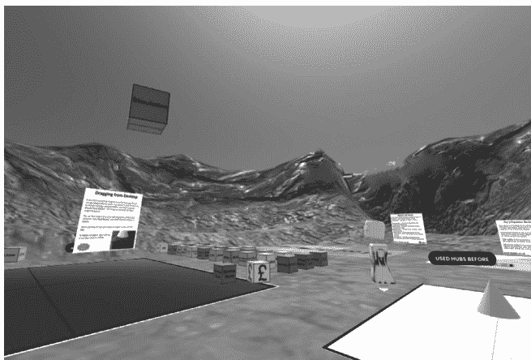

### 图 1.17
David 在 Mozilla Hubs 中的虚拟环境设计空间 (VEDS)。

Frame 和 Hubs 都提供一组用户可使用和自定义的模板空间，或者用户可以导入自己的空间。两者还提供一系列协作工具——尽管 Frame 在此方面略占优势。Hubs 拥有更好的构建工具，但这些工具存在于一个名为 Spoke 的独立（但仍为 Web 交付）应用中。两者最初都采用“小部件”方法开发功能，使构建者可以放入粒子发射器、声音源和“可交互对象”等功能，这些功能可以相互关联。2023 年底，Frame 开始发布基于 Wonderland 游戏引擎的适当脚本，但截至 2024 年初，每个“世界”只允许一个脚本，且脚本的学习曲线比 Linden 脚本语言陡峭得多。它们还引入了 ChatGPT 风格的 AI 驱动非玩家角色 (NPC) 头像，可通过简单的背景故事来定义。然而，（截至 2024 年初）两者都不支持用户市场、经济甚至持久的社交世界空间，两者都完全致力于“房间”模式（见第 3 章）。不过 Mozilla Hubs 是完全开源的，因此开发者不仅可以托管自己的 Hubs 服务器 (https://hubs.mozilla.com/docs/hubs-cloud-intro.html)，还可以自定义源代码以添加新的交互功能（Benetou, n.d.; Freeman, 2020）。

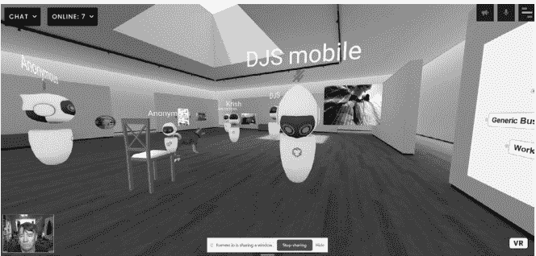

### 图 1.18
FrameVR 中的团队会议，网络摄像头显示物理用户。

诸如 WebGL/WebXR 之类的技术也可以与任何标准软件开发环境一起使用，以开发具有高度功能和丰富交互性的沉浸式应用。Unity 和 Unreal 等主要游戏引擎（开发者使用它们不仅创建游戏，还创建培训和教育应用甚至虚拟世界）也允许将项目导出为 WebGL/WebXR 应用，以便它们在浏览器中运行。

虽然 WebGL/WebXR 充满希望，但当前使用它们实现的世界缺乏元宇宙的许多关键功能，甚至缺乏一个合适的社交虚拟世界——但朝着更多基于 Web 交付的虚拟世界和元宇宙空间与应用转变似乎很可能，并将显著增强元宇宙体验的可访问性。

## 增强现实与混合现实 (AR 和 MR)

诸如《彩虹尽头》(Vinge, 2007) 之类的书籍，为 AR 描绘了与《雪崩》为 VR 和元宇宙描绘的同样引人入胜的愿景。正如扎克伯格 2021 年的 Connect 演示所显示的，元宇宙与 AR/MR 技术之间确实存在一些重叠。尽管曾短暂尝试过谷歌眼镜 (2013 年推出)，以及现在的 Facebook Ray-Ban Meta 智能眼镜，但消费者 AR 最初是通过智能手机的相机、显示和处理能力变得普及的。《Pokémon Go》(2016, https://pokemongolive.com/) 可能至今仍是基于位置的 AR 的定义性消费者应用，超越了 Snapchat 和 Messenger 的简单 AR 滤镜。然而，在这些 AR 应用中，宝可梦（或其他）图像实际上只是贴在 2D 摄像头图像上的 2D 图形；宝可梦角色并没有显示在其周围物理世界的上下文中，因此会安恬地悬停在半空中或水下。《Pokémon Go》目前仍拥有约 7900 万 MAU (Krawanski, 2023)。宜家等公司也在使用 AR 帮助客户可视化家居改进 (Ozturkcan, 2021)，AR 还有许多其他营销、教育和培训用途 (Parekh et al., 2020)。

在 MR 中，增强对象是完整的 3D 虚拟对象，并被放置在物理环境中固定的位置，甚至可以响应周围的物理环境。例如，一盒虚拟积木打开并铺在实体桌子上，积木会在桌面上弹跳，许多会掉到地板上。微软于 2016 年发布了 HoloLens (https://www.microsoft.com/en-us/hololens)，HoloLens 2 于 2019 年发布，但 3790 美元的价格限制了任何消费者采用。Magic Leap (https://www.magicleap.com/) 最终在 2018 年推出，经历了数年的炒作，随后于 2022 年推出了自己的第 2 版，定价相似。

HoloLens 1 的缺点是视野 (FOV) 较窄，水平仅 30°，HoloLens 2 增加到 43°，仅略多于 Magic Leap 1 的 40° (Heaney, 2019)。这与人类的物理世界双眼视野约 120°、周边视野约 200° (Wang & Cooper, 2022) 相比。结果，只有用户视野的一小部分体验到了 MR 效果。Meta 的 Quest Pro 头显 (1500 美元外加配件) 提供 VR 和 MR 模式，并且视野更大——尽管使用的是视频透传方式而非投射到面罩上，因此分辨率降低——但反响不佳 (例如 Robertson, 2022)。Meta 的新消费级 Quest 3 VR 头显 (500 美元) 包括全彩透传和 MR 体验，可以说比 HoloLens 或 Magic Leap 更好 (图 1.19)——并且拥有宽广的视野 (McMillan & Moore-Colyer, 2023)。Apple 于 2024 年凭借 Vision Pro 进入 VR/MR 领域。虽然它可能是 Meta Quest Pro 的直接竞争对手——但据评论者称实现得好得多 (Porter, 2024)——其 3499 美元的价格将使其大多数用户望而却步。

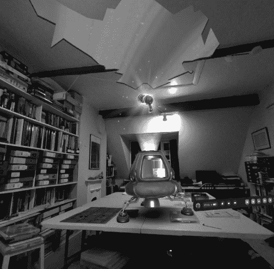

### 图 1.19
《初次相遇》——Quest 3 混合现实欢迎游戏，场景为 David 的书房。

MR 究竟将如何使元宇宙渗透到物理世界，以及消费者用例是什么，仍然是大量讨论的主题，并将在后续章节中进一步探讨。Quest 3 或许是 MR 行业的“Oculus DK1”时刻——提供一款价格合理且高性能的设备，用于实验和创建新的应用和体验，以进一步定义元宇宙的能力。

## 流行文化中的元宇宙

元宇宙起源于流行文化，因此元宇宙的概念，或者至少是一个发展完善的社交虚拟世界的概念，被许多书籍、电影、电视剧甚至广播节目所采用，其中有些甚至早于《雪崩》。值得注意的有：

- * 《真实之名》(Vinge, 2015)，如前所述，最初出版于 1981 年，描绘了一个奇幻风格的虚拟世界，匿名性是躲避“联邦”的关键；
- * 《星际迷航：下一代》(Roddenberry, 1987)，经常出现“全息甲板”，这是一种逆向 MR，虚拟空间似乎变得物理上真实；
- * 《黑客帝国》(Wachowskis, 1999) – 虚拟世界电影的*必不可少之物*，地球人口浑然不觉地存在于一个虚拟世界中，以便为 AI 统治者产生能量；
- * 《彩虹尽头》(Vinge, 2007) – 《雪崩》的增强/混合现实对应物，MR 头显可以完全重绘用户体验的物理现实；
- * 《置换之城》(Egan, 2008)，其中许多角色是副本，在虚拟模拟中运行。其最有趣的想法之一是，这些模拟可能以极慢的速度运行，例如，每秒一条计算机指令，因此模拟内部的生活看起来“正常”，而外部时间却快千万倍——非常适合探索星辰；
- * 《PlanetB》(Broughton et al, 2009)，一部 BBC 广播剧系列，设定在非常类似*《第二人生》*的世界中，并出现“流氓”——由计算机控制的化身，正在独立于人类操作员发展出自己的生活；
- * 《卡普利卡》(Aubuchon & Moore, 2010)，其中出现一个似乎受 Linden Lab 的 Philip Rosedale 启发的角色，其 V-world 虚拟世界是由物理人类的数字痕迹生成的首批虚拟人类的家园；

- 《一号玩家》（Cline, 2011），一书及电影，其中角色在介于电子游戏与Second Life之间的混合体中搜寻线索，以便成为其所有者；
- 《黑镜》（Brooker, 2011）包含多集涉及虚拟世界以及虚拟现实和混合现实的剧集，包括《圣朱妮珀罗》（关于死者和老年人在虚拟世界中生活）、《对火开火》（其中MR以类似《终极之巅》的方式重新涂色对手）、《USS卡利斯特号》（一艘由真实人物头像克隆体组成的虚拟飞船）和《致命格斗》（其中虚拟体验开始渗透到物理世界中）；
- 《初吻先定》（Moggach, 2013），一本书和第四频道电视系列，其中一位年轻女子同意冒充一位垂死的女性。在电视系列中，大部分动作从书中的文本聊天室转移到了类似Second Life的虚拟世界；
- 《地狱之中：或，道奇》（Stephenson, 2020），《雪崩》作者对《Reamde》的续作，其中一款幻想MMORPG世界的创作者在死后被上传到计算机中，并“思考”出一个新的幻想虚拟世界，随后接收了其他已经死亡并被上传者的心智；
- 《上传》（Daniels, 2010），一部美国情景喜剧，背景设在一家虚拟世界酒店，所有客人在死前不久都已上传至此，并从那里与物理世界中的亲友进行有限的通信；以及
- 《当麻雀坠落时》（Sharpson, 2021），其中地球上大部分人口已被“限制”，以便他们的意识可以被转移到一个虚拟领域——或者反之，人们在物理世界和虚拟世界之间流畅地移动。

2004–2010年首批社交虚拟世界兴起期间出现的虚构作品集群相当引人注目。

## 摘要

本章希望已经表明，在Oculus和Facebook/Meta出现之前，就已经存在大量构建、使用和生活在元宇宙类型世界中的经验，而许多当前元宇宙的用户、开发者和评论家似乎对此并不了解。为了强调这一点，图1.20显示了自1992年以来Google Scholar中提及“元宇宙”的条目数量。

尽管在元宇宙方面工作了几十年，但可以说自Second Life和OpenSim以来几乎没有什么具体进展。虽然其图形相比当今的高端游戏可能看起来很基础，但

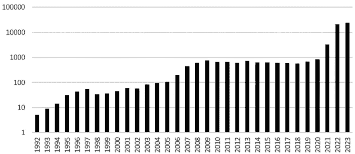

图1.20 自（根据Childs, 2023，并由原作者更新至2023年）Google Scholar“元宇宙”条目数量

Second Life的功能，尤其是其中的世界内建构和脚本、功能齐全的市场和经济，以及连续的景观模型，至今仍比任何后续世界更接近最初的《雪崩》愿景。目前的虚拟世界要么主要专注于游戏（例如《堡垒之夜》、Roblox、Rec Room），要么采用基于房间的模型、对象放置和世界外编辑的稳妥做法（例如VRChat、大多数商业/协作世界），要么陷入区块链炒作（例如Decentraland、Somnium Space、Cryptovoxels）。两个亮点是消费者HMD-VR头显的持续发展，以及使用WebGL和WebXR将虚拟世界体验交付到浏览器的能力——如Hubs，尤其是Frames。

鉴于在开发虚拟世界和原型元宇宙方面有几十年的历史，下一章将尝试在此背景下定义元宇宙是什么，或者至少元宇宙可能或应该是什么。

## 注释

- 1 完全披露，Maggi和David都参与了这个项目。
- 2 完全披露，David参与了这个项目。
- 3 完全披露：英国国教参考中提到的Revd. Jo Burden是David的女儿——小时候显然就早早接触Second Life，这显然有好处！
- 4 2024年2月15日，就在本书手稿提交之际，Mozilla宣布Hubs将于2024年5月31日关闭（Lardinois, 2024）。由于Hubs已经是开源的，该技术可能在Mozilla之外拥有生命，Hubs团队希望它“可以在Mozilla之外拥有充满活力的生命”，因此所有对Hubs的引用均保持完整（https://hubs.mozilla.com/labs/sunset/）。

## 参考文献

- American Cancer Society. (n.d.). *Second Life中的社会*. American Cancer Society. https://www.cancer.org/involved/volunteer/society-second-life.html

- Au, W. J. (2009). *构建Second Life：来自新世界的笔记*. Collins Business.

- Au, W. J. (2013). 谁想在明天提前预览SL中的SkyDance V？New World Notes. https://wnw.blogs.com/wnw/2013/01/skydancers-sl-art-preview.html

- Au, W. J. (2021). 菲利普·罗兹代尔在Clubhouse上将High Fidelity的元宇宙驱动空间音频带到大型音频聊天应用。New World Notes. https://wnw.blogs.com/wnw/2021/08/clubhouse-high-fidelity-spatial-audio-philip-rosedale.html

- Au, W. J. (2022a). 去年除夕夜VRChat用户并发量接近90,000！New World Notes. https://wnw.blogs.com/wnw/2022/01/vrchat-concurrency-2021.html

- Au, W. J. (2022b). 元宇宙房地产“繁荣”实际上具有泡沫的所有迹象。New World Notes. https://wnw.blogs.com/wnw/2022/02/metaverse-real-estate-boom-bust-sandbox-somnium-space-cryptovoxels.html

- Au, W. J. (2023). *打造一个重要的元宇宙：从《雪崩》和Second Life到一个值得为之奋斗的虚拟世界*. John Wiley & Sons.

- Aubuchon, R., & Moore, R. D. (创作者). (2010). *卡普利卡* [电视系列]. Syfy.

- Axon, S. (2023年3月16日). 20年后，Second Life将在移动端推出。*Ars Technica*. https://arstechnica.com/gaming/2023/03/20-years-later-second-life-is-launching-on-mobile/

- Badger, C. (2008). *企业虚拟世界成功之道*. Forterra Systems, Inc. http://www.cedma-europe.org/newsletter%20articles/TrainingOutsourcing/Recipe%20for%20Success%20with%20Enterprise%20Virtual%20Worlds%20(Dec%2008).pdf

- Ball, M. (2022). *元宇宙：以及它将如何颠覆一切*. Liveright Publishing.

- Balogh, G., & Beszedes, A. (2013年9月). CodeMetropolis—基于Minecraft的开发者协作工具. *2013年第一届IEEE软件可视化工作会议(VISSOFT)* (第1–4页). IEEE. http://www.inf.u-szeged.hu/~beszedes/research/paper34.pdf

- Bar-El, D., & Ringland, K. (2021年9月). 教师使用数字沙盒游戏设计课程：Minecraft教育版的案例. *基于游戏的学习欧洲会议*. Academic Conferences International Limited. https://www.researchgate.net/profile/David-Bar-El/publication/35456391_Teachers_Designing_Lessons_with_a_Digital_Sandbox_Game_The_Case_of_Minecraft_Education_Edition/links/61404e89a29a250dbf6d8ad5/Teachers-Designing-Lessons-with-a-Digital-Sandbox-Game-The-Case-of-Minecraft-Education-Edition.pdf

- Barnes, S. J., & Mattsson, J. (2011). 探索现实品牌在Second Life 1虚拟世界中的契合度. *营销管理杂志*, 27(9–10), 934–958.

- Barr, K. (2023年4月19日). Meta裁员开始，连游戏开发者也不安全. *Gizmodo*. https://gizmodo.com/meta-layoffs-begin-game-developers-metaverse-1850353319

- Bartle, R. A. (2004). *设计虚拟世界*. New Riders.

- Bell, M. W., Castronova, E., & Wagner, G. G. (2009). 调查虚拟世界：使用虚拟数据收集接口(VDCI)在Second Life中进行的大规模调查. https://www.econstor.eu/bitstream/10419/129253/1/diw_datadoc_2009-044.pdf

- Benetou, F. (n.d.). Mozilla Hubs. Fabien Benetou的PIM. https://fabien.benetou.fr/Tools/Hubs

- Bengtsson, N. (2023). 商业运营暂停. Alloverse. https://alloverse.com/2023/06/08/commercial-operations-taking-a-break/

- Bengtsson, S. (2011). 虚拟国家品牌化：Second Life中的瑞典大使馆. 虚拟世界研究杂志, 4(2). https://www.learntechlib.org/p/178165/article_178165.pdf

- Bezmalinovic, T. (2023年5月27日). 我们离独立头显的Google Earth VR又近了一步. MIXED现实新闻. https://mixed-news.com/en/photorealistic-3d-tiles-standalone-google-earth-vr/

- Blackwood, G. (2023). Roblox与元宇宙：沃尔玛Roblox游戏案例研究. M/C期刊, 26(3). https://www.journal.media-culture.org.au/index.php/mcjournal/article/view/2958

- Boellstorff, T. (2015). 在Second Life中成长：一位人类学家探索虚拟人类. Princeton University Press.

- Borger, C. (2007). Zick论Second Life与网络行动主义. OpinioJuris. http://opinio-juris.org/2007/10/21/zick-on-second-life-and-cyber-activism/

- Boyer, S. (2009). 虚拟失败：评估任天堂Virtual Boy的成功与否. 天鹅绒灯光陷阱, 64, 23–33.

- Brenchley, K. (2023年4月23日). Meta并非在构建第一个“元宇宙”. Medium. https://medium.datadriveninvestor.com/meta-isnt-building-the-first-verse-0ea7725717c

- Brooker, C. (2011). 黑镜 [电视系列]. Channel 4.

- Brookey, R. A., & Cannon, K. L. (2009). 第二生命中的性生活. 媒体传播批判研究, 26(2), 145–164.

- Brouchoud, J. (2011). 作品集——模拟训练——飓风避难所... Flickr. https://www.flickr.com/photos/crescendo/albums/72157625910273942

- Broughton, M., Dromgoole, J., Hoyle, S., & Robinson, J. (创作者), & Dromgoole, J. (制片人). (2009). 行星B [广播系列]. BBC.

- Bryce, A. (2020年7月28日). 我为其20周年重新登录了Habbo Hotel. Vice. https://www.vice.com/en/article/jgxvkk/habbo-hotel-20-years-old-online-game

- Burden, D. J. H. (2011). 虚拟世界——一部未来史. Slideshare. https://www.slideshare.net/davidburden/virtual-worlds-a-future-history

- Burden, D. J. H. (2021年10月29日). Facebook（又称Meta）Connect2021. Daden的博客. https://dadenblog.blogspot.com/2021/10/facebook-aka-meta-connect2021.html

- Camilleri, V., de Freitas, S., Montebello, M., & McDonagh-Smith, P. (2013). 虚拟世界内部个案研究：使用分析来服务于沉浸式空间. 第三届国际学习分析与知识会议论文集 (第230–234页). 计算机协会. https://www.researchgate.net/profile/Vanessa-Camilleri/publication/257765038_A_case_study_inside_virtual_worlds_Use_of_analytics_for_immersive_spaces/links/0c960525d3d2155886000000/A-case-study-inside-virtual-worlds-Use-of-analytics-for-immersive-spaces.pdf

- Castronova, E. (2002). 关于虚拟经济 (CESifo工作论文第752号). CESifo. https://papers.ssrn.com/sol3/delivery.cfm/SSRN_ID338500_code021011590.pdf?abstractid=338500

- Chambers, C. (2011). 虚拟经济有多虚拟？对虚拟世界经济的法律、社会和经济性质的探讨. 计算机法律与安全评论, 27(4), 377–384. https://doi.org/10.1016/j.clsr.2011.05.007

- Childs, M. (2023). 教学法与课程研究集群海报会议. Durham大学教育学院.

Cimerman, A. (2022, December 27). Source Digital宣布了LG智能电视上的世界首个元宇宙体验。*元宇宙邮报*. https://mpost.io/source-digital-announced-the-worlds-first-metaverse-experience-for-lg-smart-tvs/

Cline, E. (2011). *头号玩家*. Crown Publishing Group.

CofE. (2020). Curate将崇拜带入全新维度——在Minecraft中提供儿童礼拜。Church of England. https://www.churchofengland.org/news-and-media/stories-and-features/curate-takes-worship-whole-new-dimension-childrens-services

Crawford, A., & Smith, T. (2022, February 23). 元宇宙应用让儿童进入虚拟脱衣俱乐部。*BBC新闻*. https://www.bbc.co.uk/news/technology-60415317

Croquet. (2022, November 10). Croquet宣布Microverse World Builder可用。*美新社*. https://www.prnewswire.com/news-releases/croquet-announces-availability-of-microverse-world-builder-301673922.html

Daniels, G. (2010). *上传* [电视剧]. Deedle-Dee Productions. https://www.imdb.com/title/tt7826376/

Decentraland. (2022, October 11). Decentraland有多少日活跃用户？*Decentraland*. https://decentraland.org/blog/announcements/how-many-dau-does-decentraland-have

Decentraland. (2024, January 29). Decentraland 2024宣言：为未来奠定基础。*Decentraland*. https://decentraland.org/blog/announcements/decentraland-2024-manifesto-forging-foundations-for-the-future?utm_source=decentraland.beehiiv.com&utm_medium=newsletter&utm_campaign=weekly-newsletter-february-1

Dibbel, J. (1994). 网络空间中的强奸：或者一个邪恶小丑、一个海地骗子之神、两个巫师以及数十名演员如何将一个数据库变成一个社会。*美国法律年度调查*, 1994: 471-500. http://www.juliandibbell.com/articles/a-rape-in-cyberspace/

DigitalUnionOSU. (2008, November 5). *第二人生项目：与Douglas Danforth的访谈* [视频]. YouTube. https://www.youtube.com/watch?v=vEk48Sc9UaM&ab_channel=DigitalUnionOSU

Doctorow, C. (2003). *魔法王国中的落魄者*. Turtleback Books.

Dredge, S. (2014, July 22). Facebook完成20亿美元收购Oculus Rift。接下来是什么？*卫报*. https://www.theguardian.com/technology/2014/jul/22/facebook-oculus-rift-acquisition-virtual-reality

Egan, G. (2008). *排列城市*. Gollancz.

Ernstberger, P. (2009). Linden美元与虚拟货币政策. University of Bayreuth. https://citeeseerx.ist.psu.edu/viewdoc/download?repid=rep1&type=pdf&doi=10.1.1.555.9589

Estonia. (2007). 爱沙尼亚在虚拟世界第二人生开设大使馆。爱沙尼亚外交部. https://vm.ee/en/news/estonia-opens-embassy-virtual-world-second-life

Etherington. (2014). Yahoo收购虚拟世界游戏初创公司Cloud Party，将关闭它。*TechCrunch*. https://techcrunch.com/2014/01/24/yahoo-acquires-will-shut-down-browser-based-virtual-world-gaming-startup-cloud-party/

Fabola, A., Miller, A., & Fawcett, R. (2015). 使用Google Cardboard探索过去。*2015数字遗产*（第1卷，第277-284页）. IEEE. https://research-repository.st-andrews.ac.uk/bitstream/handle/10023/12489/DigitalHeritage2015_submission_98.pdf

Farra, S., Miller, E., Timm, N., & Schafer, J. (2013). 使用3D虚拟现实模拟改进灾难培训。*西方护理研究杂志*, 35(5), 655–671. https://citeseerx.ist.psu.edu/document?repid=rep1&type=pdf&doi=697106d9fefebc81b48a0936cdd0dbbcff2cad12e4

Fewster, R., Wood, D., & Chafer, J. (2011). 在真实和虚拟空间中搭建第二人生. 通过多用户虚拟环境教学：将动态元素应用于现代课堂（第217–235页）. IGI Global.

Fodor, G. (2020, April 19). Mozilla Hubs的秘密主计划. Medium. https://gfodor.medium.com/the-secret-mozilla-hubs-master-plan-2c1364033bec

Forbes. (2007, December 7). 摇滚虚拟世界. Forbes. https://www.forbes.com/forbes/2007/1224/103.html?sh=18eed1735a55

Franey, J. (2023). 如何获取Fortnite Creative 2.0及其用途？Games Radar. https://www.gamesradar.com/fortnite-creative-20/

Freeman, C. (2020, December 3). 创建自定义Mozilla Hubs客户端 [视频]. YouTube. https://www.youtube.com/watch?v=E7I5LxpEWzE&ab_channel=ColinFreeman

Fridman, L. (Host). (2023). 马克·扎克伯格：首次在元宇宙接受采访（Lex Fridman播客第398期）[视频]. YouTube. https://www.youtube.com/watch?v=MVYRjJNdrEg&ab_channel=LexFridman

Frömming, U. U. (2013). 虚拟环境与文化：虚拟文化与景观的社会人类学研究集. Peter Lang GmbH.

Galov, N. (2023, March 6). 2023年18个第二人生事实：在虚拟世界中生活意味着什么. Web Tribunal. https://webtribunal.net/blog/second-life-facts/#gref

Garst, A. (2023, May 9). Epic Games如何改造Fortnite Creative生态系统以吸引游戏内创作者. Digiday. https://digiday.com/marketing/how-epic-games-is-revamping-the-ecosystem-of-fortnite-creative-to-sweeten-the-deal-for-in-game-creators/

Gibson. (1984). 神经漫游者. Ace.

Goodman, K. (2023). Fortnite如何将品牌编织进游戏并赚取数十亿. 古怪营销故事. https://weirdmarketingtales.com/fortnite-integrates-brands-makes-billions/

Habgood, M. J., Wilson, D., Moore, D., & Alapont, S. (2017). 来自PlayStation VR的人机交互教训. 计算机-人类交互游戏年度研讨会扩展摘要出版物（第125–135页）. http://shura.shu.ac.uk/16656/3/Habgood%2520HCI%2520lessons%2520from%2520playstation%2520VR%2520%2528AM%2529.pdf

Han, J., Liu, G., & Gao, Y. (2023). 元宇宙中的学习者：在学习中使用Roblox的系统综述。*教育科学*, 13(3), 296. https://www.mdpi.com/2227-7102/13/3/296

Harris, C. (2010). 政府联盟将调查虚拟世界最佳实践. 政府技术. https://www.govtech.com/dc/articles/government-consortium-to-investigate-virtual-world.html

Hayden, S. (2023a). 索尼确认PSVR 2在首6周销量超过原版PSVR. Road to VR. https://www.roadtovr.com/psvr-2-sales-figures-units-sony/

Hayden, S. (2023b). 任天堂为何尚未推出真正的VR头显. Road to VR. https://www.roadtovr.com/nintendo-missing-real-vr-headset/

Hayden, S. (2023c). 微软将于明日关闭先驱社交VR平台“AltspaceVR”. Road to VR. https://www.roadtovr.com/microsoft-social-vr-xr-interface-layoffs.

Hayes, G. (2008). 照片流. Flickr. https://www.flickr.com/photos/garyhayes/2793935191/

Heaney, D. (2019). HoloLens 2的视野揭晓. Upload VR. https://www.uploadvr.com/hololens-2-field-of-view/

Heath, A. (2023, February 28). 这是Meta未来四年的AR/VR硬件路线图. The Verge. https://www.theverge.com/2023/2/28/23619730/meta-vr-oculus-ar-glasses-smartwatch-plans

High Fidelity. (2017, June 12). 重点：与Robert Scoble和Philip Rosedale探讨VR现状 [视频]. YouTube. https://www.youtube.com/watch?v=9wCz52lq9CE&ab_channel=HighFidelity

Hounshell, B. (2007). 第二人生参加达沃斯. 外交政策. https://foreignpolicy.com/2007/01/22/second-life-does-davos/

Hsu, E. B., Li, Y., Bayram, J. D., Levinson, D., Yang, S., & Monahan, C. (2013). 基于虚拟现实的灾难准备和响应培训现状. *PLoS Currents*. 5. https://www.ncbi.nlm.nih.gov/pmc/articles/PMC3644293/

Huwila, I. (2015). 我们有了更好的境况：Google Lively虚拟社区的生平与余波. 文献学杂志, 71, 526–549. http://dx.doi.org/10.1108/JD-09-2013-0116.

Hypergrid Business. (2011). VastPark推出开源头像工具包. Hypergrid Business. https://www.hypergridbusiness.com/2011/06/vastpark-launches-open-source-avatar-kit/

Hypergrid Business. (2023). 统计 » 活跃OpenSim网格. Hypergrid Business. https://www.hypergridbusiness.com/statistics/active-grids/

Irwin, K. (2023). PUBG创作者Krafton揭晓“Overdare” NFT游戏，附AI创作工具. Decrypt. https://decrypt.co/197345/pubg-creator-krafton-unveils-overdare-nft-game-ai-creation-tools

Jacob (2023, March 28). Fortnite在2023年拥有7000万月活跃用户. Fortnite新闻. https://fortinenews.com/fortnite-has-70-million-monthly-active-players-in-2023/

Jeremy, W. (2021). 欢迎来到Minecraft教堂. 教会传道会. https://pioneer.churchmissionsociety.org/2021/03/welcome-to-minecraft-church

Kaplan, J., & Yankelovich, N. (2011). Open Wonderland：可扩展虚拟世界架构. IEEE互联网计算, 15(5), 38–45.

Kar-Gupta, S. (2007, March 26). 法国政治进入“第二人生”. NBC新闻. https://www.nbcnews.com/id/wbna17796832

Kharpal, A. (2021, August 30). TikTok母公司字节跳动通过最新收购迈出进入虚拟现实的第一步. CNBC. https://www.cnbc.com/2021/08/30/tiktok-owner-bytedance-acquires-pico-and-takes-first-step-into-virtual-reality.html

Kim, S. (2021, November 2). 韩国对元宇宙的方法. 外交官. https://thediplomat.com/2021/11/south-koreas-approach-to-the-metaverse/

Kirriemuir, J. (2009a). 通过跌倒学习：英国学术界的第二人生. Slideshare. https://www.slideshare.net/silversprite/learning-through-falling-second-life-in-uk-academia

Kirriemuir, J. (2009b). 英国大学和学院的虚拟世界活动. 一个充满期待的学年？Virtual World Watch. https://www.silversprite.com/ss/wp-content/uploads/2014/10/snapshot-seven.pdf

Kolo, K. (2023). 索尼投资20亿美元用于XR（元宇宙）研究和开发. VR/AR协会. https://www.thevrara.com/blog/2/2023/7/14/sony-investing-2b-into-xr-metaverse-research-and-development

- Kopp, G., & Burkle, M. (2010). 使用Second Life进行即时培训：在虚拟世界中构建教学框架. 国际高级企业学习期刊 (IJAC), 3(3), 19–25. https://www.researchgate.net/publication/455239975_Using_Second_Life_for_Just-in-Time_Training_Building_Teaching_Frameworks_in_Virtual_Worlds

- Korolov, M. (2010). Second Life停止企业平台. Hypergrid Business. https://www.hypergridbusiness.com/2010/08/second-life-discontinues-enterprise-platform/

- Krawanski, F. (2023, November 30). 有多少人玩Pokémon Go？Pokémon Go玩家数量. Dexerto. https://www.dexerto.com/pokemon/how-many-people-play-pokemon-go-pokemon-go-player-count-2132719/

- Krotoski, A. (2009). 博士研究3 简介草稿1：关于Second Life中语音影响的探讨. Alek Krotoski. http://alekskrotoski.com/post/phd-study-3-intro-draft-1-on-the-implications-of-voice-in-second

- Kumparak, G. (2014, March 27). Oculus简史. TechCrunch. https://techcrunch.com/2014/03/26/a-brief-history-of-oculus/

- Kurzydłowski, C. (2021). 中国的VR市场：迈向元宇宙. The China Guys. https://thechinaguys.com/china-virtual-reality-market/

- Lamb, H. (2022, April 13). 元宇宙能从Second Life中学到什么？. E&T 工程与技术. https://eandt.theiet.org/content/articles/2022/04/what-can-the-metaverse-learn-from-second-life/

- Lang, B. (2022). 虚拟社交平台Rec Room月活跃VR用户达到300万. Road to VR. https://www.roadtovr.com/rec-room-monthly-active-vr-users-3-million-peak/

- Lardinois, F. (2024, February 13). Mozilla在重新聚焦Firefox和AI时缩减规模：阅读备忘录. TechCrunch. https://techcrunch.com/2024/02/13/mozilla-downsizes-as-it-refocuses-on-firefox-and-ai-read-the-memo/

- Lecordix, F., Fremont, D., Jilani, M., Séguin, E., & Kriat, S. (2018). 按需Minecraft®——一项结合游戏与3D制图的新IGN服务. ICA会议论文集 (第1卷, 第1–5页). Copernicus GmbH. https://ica-proc.copernicus.org/articles/1/65/2018/ica-proc-1-65-2018.pdf

- Leotoddy. (2019). Habbo 2018统计——Habbo. Puhekuplaa. https://puhekuplaa.com/news/habbo-statistics-2018-habbo

- Linden Lab. (2022). High Fidelity投资Second Life. Linden Lab. https://lindenlab.com/press-release/high-fidelity-invests-in-second-life

- Lopes, C. (2011). Hypergrid：虚拟世界互操作性的架构与协议. IEEE互联网计算, 15(5), 22–29. https://web.archive.org/web/20150426153421/https://dl.dropboxusercontent.com/u/18483217/hypergrid-draft.pdf

- Mäntymäki, M., & Salo, J. (2013). 社交虚拟世界中的购买行为：对Habbo Hotel的考察. 国际信息管理杂志, 33(2), 282–290.

- Márquez, I. V. (2013). 当赛博世界结束时会发生什么？There.com案例. DiGRA 2013会议论文集：重构游戏研究, 亚特兰大, GA. http://www.digra.org/wp-content/uploads/digital-library/paper_280.pdf

- Marsh, J. (2016). 线上与线下游戏的关系：友谊与排斥. 新媒体时代的儿童游戏 (第109–132页). Routledge. https://eprints.whiterose.ac.uk/79790/1/9781409450245_J.Marsh.pdf

- McMillan, M., & Moore-Colyer, R. (2023, March 29). Meta Quest 3发布日期、价格、规格及最新消息. Tom's Guide. https://www.tomsguide.com/news/oculus-quest-3-release-date-rumors-specs-news

- Metamike. (2023). Hyperfy：面向创作者和专业人士的可扩展WebXR虚拟世界平台. HackMD.io. https://hackmd.io/@metamike/hyperfy

- MIT Sloan Management Review. (2023). 中东正在释放虚拟世界的潜力. MIT斯隆管理评论. https://www.mitsloanme.com/article/the-middle-east-is-unlocking-the-potential-of-virtual-worlds/

- Moggh, L. (2013). 《先亲我一下》. Picador.

- Morningstar, C., & Farmer, F. R. (2008). Lucasfilm的Habitat的教训. 虚拟世界研究期刊, 1(1). https://jvwr-ojs-utexas.tdl.org/jvwr/index.php/jvwr/article/download/287/241

- NSA. (2008). 利用恐怖分子对游戏和虚拟环境的使用. 卫报/NSA. https://www.theguardian.com/world/interactive/2013/dec/09/nsa-files-games-virtual-environments-paper-pdf

- Ozturkcan, S. (2021). 服务创新：在IKEA Place应用中使用增强现实. 信息技术教学案例期刊, 11(1), 8–13. https://journals.sagepub.com/doi/full/10.1177/2043886920947110

- Parekh, P., Patel, S., Patel, N., & Shah, M. (2020). 医学、零售和游戏中增强现实的系统综述与荟萃分析. 工业、生物医学和艺术面向的可视化计算, 3, 1–20. https://link.springer.com/article/10.1186/s42492-020-00057-7

- Peters, J. (2023, May 22). Epic将把40%的Fortnite净收益回馈给创作者. The Verge. https://www.theverge.com/2023/3/22/23645633/fortnite-creator-economy-2-0-epic-games-editor-state-of-unreal-2023-gdc

- Pey, I. (2020). 联盟岛：探讨美军对Second Life的使用. Metaworld.me. https://metaworld.me/2020/06/28/coalition-island-looking-at-the-us-militarys-use-of-second-life/

- Pey, I. (2022). High Fidelity、Linden Lab与Philip Rosedale的回归——更新. Metaworld.me. https://metaworld.me/2022/01/13/high-fidelity-linden-lab-and-the-return-of-philip-rosedale/

- Porter, J. (2024). 关于Apple Vision Pro头显的一切已知信息. The Verge. https://www.theverge.com/23689334/apple-mixed-reality-headset-augmented-virtual-reality-ar-vr-rumors-specs-features

- Regan, T. (2021). 从《Fortnite》到《Roblox》：有史以来最佳游戏内演唱会排名. NME. https://www.nme.com/features/gaming-features/fortnite-roblox-best-in-game-concerts-2021-3021418

- Robertson, A. (2016, April 5). HTC Vive评测. The Verge. https://www.theverge.com/2016/4/5/11358618/htc-vive-vr-review

- Robertson, A. (2022, November 22). Meta Quest Pro评测：带我离开这里. The Verge. https://www.theverge.com/23451629/meta-quest-pro-vr-headset-horizon-review

- Roddenberry, G. (创作者兼执行制片人). (1987). 星际迷航：下一代 [电视剧]. CBS电视.

- Ruby, D. (2023). Roblox 2023统计——人口统计与财务数据. Demand Sage. https://www.demandsage.com/how-many-people-play-roblox/

- Rundle, M. (2015, December 2). 三星Gear VR现已在英国上市. Wired. https://www.wired.co.uk/article/gear-vr-uk-launch

- Savin-Baden, M., Tombs, C., Poulton, T., & Kavia, S. (2009). Second Life入门. JISC.

- Schiano, D. J., & White, S. (1998). 赛博空间的第一个高尚真理：人还是人（即使在MOO中也是如此）. 人机交互学会SIGCHI会议论文集 (第352–359页). 计算机协会.

- Schultz, R. (2018). Twinity：简要介绍. Ryan Schultz. https://ryanschultz.com/2018/05/10/twinity-a-brief-introduction/

- Second Life Marketplace. (无日期). Second Life市场费用与上架政策. Second Life市场. https://marketplace.secondlife.com/listing_guidelines

- Sharma, A. (2023). 有多少人玩Minecraft？2023年玩家数量. Charlie Intel. https://www.charlieintel.com/minecraft/how-many-people-play-minecraft-2022-player-count-195437/

- Sharp son, N. (2021). 当麻雀落下时. Solaris.

- Sherstyuk, A., Olle, S., & Sink, J. (2010). 蓝色火星编年史：面向百万用户的构建. ACM SIGGRAPH ASIA 2010草图. https://citeseerx.ist.psu.edu/document?repid=rep1&type=pdf&doi=551d876235a939c1707009219fe675bc156dd645

- Sichelseifert. (2009a). Starax Statosky：Second Life的Giotto. Second Life杰作集. https://sichelseifert.wordpress.com/2009/01/05/starax-statosky-second-life-giotto/

- Sichelseifert. (2009b). 风景大师：AM Radio. Second Life杰作集. https://sichelseifert.wordpress.com/2009/01/19/the-landscapes-master-am-radio/

- Simons, R., & Melzer, J. E. (2003, September). 面向美军AVCATT的基于HMD的培训——一种集体航空培训模拟器. 头盔和头戴式显示器VIII：技术与应用 (第5079卷, 第1–6页). SPIE.

- Smith, D. A., Kay, A., Raab, A., & Reed, D. P. (2003). Croquet——一种协作系统架构. 通过计算机进行创造与协作首届会议 (第2–9页). IEEE. https://citeseerx.ist.psu.edu/document?repid=rep1&type=pdf&doi=2d294e1d2d49881591a8dceb55c3199b6947a4d

- SomniumSpace. (2023, July 31). Somnium Space宣布战略投资Sansar以实现完全的跨平台互操作性. Medium. https://somniumspace.medium.com/somnium-space-announces-strategic-investment-in-sansar-to-achieve-full-cross-platform-716a7bedd780

- Speed Matters. (2007, February 9). Second Life为政客提供新平台. Speed Matters. https://speedmatters.org/news/secondlifeoffersanewplatformforpoliticians

- Stephenson, N. (1992). 《雪崩》. Bantam Books.

- Stephenson, N. (2020). 《坠落：或，地狱中的道奇》. 威廉·莫罗公司.

- Stott, D. (2007). 学习的第二种方式. BMJ, 335(7630), 1122–1123.

- Sydney Morning Herald. (2007, May 23). 马尔代夫在Second Life上开设首个虚拟大使馆. Sydney Morning Herald. https://www.smh.com.au/national/maldives-opens-first-virtual-embassy-on-second-life-20070523-gqdj7m.html

- Takagi, D. (2010, December 10). 索尼Home虚拟世界用户达1700万，并在虚拟商品中找到商业模式. VentureBeat. https://venturebeat.com/games/sonys-home-virtual-world-hits-17m-users-and-finds-a-business-model-in-virtual-goods/

- Tassi, P. (2022, October 17). Meta的《Horizon Worlds》在八个月内不知为何流失了10万名玩家. Forbes. https://www.forbes.com/sites/paultassi/2022/10/17/metas-horizon-worlds-has-somehow-lost100000-players-in-eight-months/?sh=6502e7ed2a1b

- Tate, A. (2022, February 20). Second Life和OpenSim VR查看器的历史. Austin Tate的博客. https://blog.inf.ed.ac.uk/atate/2022/02/20/vr-viewers/

- Tate, A. (2024, January 15). [致David Burden的电子邮件]. 副本由David Burden持有.

Taylor-Nelms, L., & Hill, V. (2014). 通过成人学习理论评估3D虚拟世界灾难培训。*国际严肃游戏期刊*, 1(4). https://citeseerx.ist.psu.edu/document?repid=rep1&type=pdf&doi=9ef3e246c95ece34d0eb5065b6939ed259c6942c

Uccie. (2014). Linden Realms：两种视角。家禽报告。https://poultryreport.wordpress.com/2014/02/18/linden-realms-two-perspectives/

Utoyo, A. W., Warburg, T., Bonafix, N., Aprilia, H. D., & Oei, J. (2022). 元宇宙中的品牌。为什么大品牌要在元宇宙投放广告。公开社会大会：元宇宙对可持续发展目标的影响与展望论文集。在线国际会议。https://repository.unmul.ac.id/bitstream/handle/123456789/46298/BUKU-PROSIDING-OSC-2022_FIX.pdf?sequence=1&isAllowed=y#page=347

Vinge, V. (2007). 彩虹终结。Tor Books.

Vinge, V. (2015). 真名与赛博空间边疆的开辟。Tor Books.

Virtual Girl Nem. (2022, May 22). VRChat以92,000名同时在线用户打破纪录！“元宇宙”用户数因COVID-19和Quest 2激增超过5倍。*中介*。https://medium.com/@nemchan_nel/vrchat-breaks-records-with-92-000-simultaneous-users-9464a33f3561

Virtual Reality Society. (n.d.). 虚拟性——承诺的新现实，为时过早二十年。虚拟现实学会。https://www.vrs.org.uk/dr-jonathan-walden-virtuality-new-reality-promise-two-decades-soon/

Voyager, D. (2023). 第二人生统计数据。Daniel Voyager。https://danielvoyager.wordpress.com/sl-stats/

Wachowskis. (1999). 黑客帝国 [电影]。华纳兄弟。

Wang, M., & Cooper, E. A. (2022). 优化立体增强现实显示器视野的感知准则。*ACM应用感知汇刊*, 19(4), 1–23. https://dl.acm.org/doi/pdf/10.1145/3554921

Warren, T. (2021, May 2). Microsoft Mesh感觉像是Microsoft Teams会议的虚拟未来。*棱镜*。https://www.theverge.com/22308883/microsoft-mesh-virtual-reality-augmented-reality-hololens-vr-headsets-features

Wilcox, B., & Wilcox, S. (2013). 使之真实：Loebner获奖聊天机器人设计。*树园*, 189(764), a086. https://citeseerx.ist.psu.edu/document?repid=rep1&type=pdf&doi=b4008a89363730219e36ac563d9c8d74fcb15be1

Wired. (2006, August 15). 第二人生太棒了（名副其实）。*连线*。https://www.wired.com/2006/08/second-life-rocks-literally/

# 2 元宇宙是什么？

## 引言

开发者（以及用户和作者）对“元宇宙”一词有多种不同的解读。本章探讨了一些当前的定义，并考虑“3D互联网”和Web3概念如何与元宇宙相关联。虽然元宇宙的简单定义对营销可能有用，但它们可能阻碍对元宇宙究竟是什么及其影响的更深入探讨，因此本章提出了10条公理来定义元宇宙，以其最完整和发展的形式来考察元宇宙。本章展示了一些当前平台如何与这些公理相衡量，并考察了第二人生（及OpenSim）作为目前最完整的元宇宙模型的地位。在本章的第二部分，重点转向从心理学角度解释虚拟现实（VR）体验有何显著不同之处，以及这如何为元宇宙概念增添额外的力量。

## 元宇宙的不同观点

如引言所述，讨论元宇宙的一个问题是，人们对其究竟是什么并没有真正的共识。表2.1展示了几个关于元宇宙的最近定义和描述。
图2.1将这些定义表示为词云。大多数定义中唯一共同的词是“虚拟”。元宇宙实际上将是多元宇宙——元宇宙空间网络——这一想法在近一半定义中都有体现。虚拟世界与物理世界之间的联系被Hackl、国际电信联盟（ITU）和Narula所强调。有趣的是，正是Hackl和ITU深入探讨了技术细节，包括区块链、5G和数字孪生等概念。有几个定义采用了“下一代互联网”的方法，这种方法将在下文中受到质疑。

表2.1
元宇宙定义

| 来源 | 定义 |
| :--- | :--- |
| Au (2023) | “元宇宙是一个庞大、身临其境的虚拟世界，数百万人可以通过高度可定制的头像和强大的体验创建工具同时访问，并通过其虚拟经济和外部技术与离线世界相集成”。 |
| Ball (2022) | “一个大规模可扩展且互操作的实时渲染3D虚拟世界网络，可以由实际无限数量的用户同步和持续体验，具有个人在场感，并且数据（如身份、历史、权利、对象、通信和支付）具有连续性”。 |
| Deloitte (Greig, n.d.) | “简单来说，元宇宙就是互联网，只是以3D呈现……它是一种数字互动形式，其中连接的虚拟体验既可以模拟现实世界，也可以构想超越现实的世界。许多元宇宙要素如今已具备——想想与许多人互动，以及他们制作的内容，在多种设备（包括虚拟现实）上的持久、身临其境的世界中。这些组件交织得越多，我们就越接近一个更完整的元宇宙版本”。 |
| Hackl (Alaghband, 2022) | “我认为这是我们的物理生活与数字生活的融合。这是我们的数字生活方式，我们一直在手机或电脑上生活，以某种方式慢慢赶上我们的物理生活，从而实现完全融合。它由许多不同的技术支持，比如AR和VR，这是大多数人倾向于思考的技术。但它们不是唯一的入口。还有区块链，这是一个重要组成部分，还有5G、边缘计算以及许多其他技术。对我来说，元宇宙还关乎我们的身份和数字所有权。从某种意义上说，这是人类创造力的一种新延伸”。 |
| ITU (2023) | “元宇宙和多元宇宙是指与现实世界有紧密联系和交互的虚拟宇宙，在一系列数字技术和信息通信技术（ICT）的支持下，包括AI、IoT、数字孪生和区块链。元宇宙可以被视为一个集体空间或统一平台，而多元宇宙（元宇宙）则拥有多个交互的集成数字平台和生态系统”。 |
| McKinsey (2022) | “元宇宙是新兴的3D赋能数字空间，利用虚拟现实、增强现实以及其他先进的互联网和半导体技术，让人们在线上拥有逼真的个人和商业体验”。  “在其最基本层面，元宇宙将具有三个特性： • 身临其境感 • 实时交互性 • 用户代理权  而最终，元宇宙的完整愿景将包括以下内容： • 能够无缝协同工作的平台和设备 • 数千人同时交互的可能性 • 远超游戏的应用场景” |
| Narula (2022) | “这些[虚拟]世界将具有价值，因为它们将通过扩展社会持续领域的语境来重塑我们的生活，允许在我们当前的现实与我们创建的数字现实之间转移财富、理念、身份和影响——人类社会关系的基石。这些现实的结合以及它们之间的价值转移，将构成数字元宇宙……我所设想的数字元宇宙是一个将为用户和更广阔的世界创造难以估量的社会、心理和经济价值的元宇宙”。 |
| Radolf | “元宇宙不是‘一个’元宇宙。它是下一代互联网：由新一代丰富的创作者领导的去中心化多元宇宙”（Radolf, 2021a）。“元宇宙是互联网演变为任何想要创造体验的人的创造性空间”（Radolf, 2021b）。 |
| Wired (Ravenscraft, 2023) | “‘元宇宙’[由技术公司定义]可以包括虚拟现实——其特征是持久的虚拟世界，即使你不玩游戏它们也会继续存在——以及结合数字和物理世界方面的增强现实。然而，它不要求这些空间仅通过VR或AR访问。虚拟世界——例如可以通过PC、游戏主机甚至手机访问的《堡垒之夜》的某些方面——已经开始自称‘元宇宙’”。 |

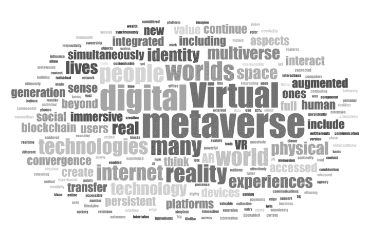

图2.1 元宇宙定义词云（在 https://www.jasondavies.com/wordcloud/ 生成）。

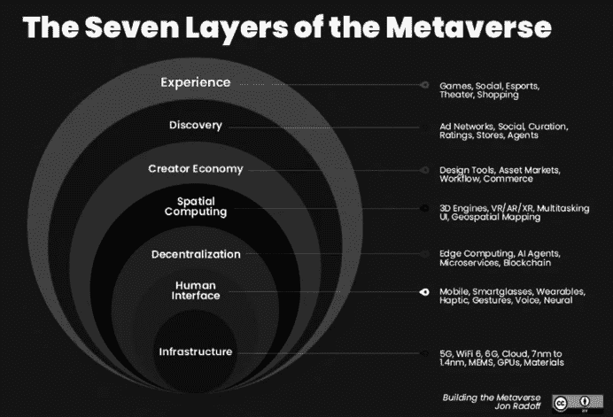

图 2.2 Jon Radoff 的元宇宙七层模型 (Radoff, 2021c)。

Radoff 还有一个“元宇宙七层”模型 (Radoff, 2021c)，它将元宇宙生态系统分解如图 2.2 所示。虽然这是一个有用的参考，但此示意图不应被视为技术栈，而应视为元宇宙价值链以及使元宇宙成为可能的公司所交付的产品类别的指南。

## 2D 与 3D Web

在阅读关于元宇宙的内容时，经常会看到“3D Web”或甚至“3D Internet”这些术语。“Internet”一词严格来说是指通过一组名为 IP、UDP 和 TCP 的底层通信协议连接在一起的计算机网络。万维网（World Wide Web）只是一个运行在互联网之上的应用程序，使用一组称为应用层（Application layer）的协议，构建在互联网协议之上。Web 协议和标准包括诸如 HTTP（网站如何向用户提供内容并链接页面）、HTML（Web 内容如何显示）、Javascript（Web 页面如何编写脚本）和 WebSockets（更高级的应用程序如何在 Web 服务器和浏览器之间传输信息）等（Sahu, 2021）。

元宇宙平台通常通过以下方式在互联网上传输信息：要么直接使用互联网协议（例如 UDP 或 TCP）与互联网直接通信，要么使用 WebSockets 等 Web 协议。这并不意味着元宇宙将取代互联网。

同样不应暗示元宇宙将取代 2D Web，特别是移动 Web。2D 信息访问模型（用户只需简单硬件，并且觉得随时随地使用它既安全又得体）将在元宇宙变得司空见惯之后长期存在——而且两者应和谐共存并相互互连。用户应能够使用 2D Web 访问 WebXR 内容，并即时进入桌面 VR（DesktopVR）或头显 VR（HMD-VR）元宇宙空间（取决于其浏览器），并能从该元宇宙空间内访问 2D Web 内容。

“3D Internet”这一概念试图指出的一个重要区别是：虽然 Web 由大量在抽象层面相互链接的网站组成，但元宇宙更可能由具有某种空间关系的“地点”组成——无论是按主题、观点，甚至是时间或物理/虚拟地理划分（例如，Au，2023 引用的 Neal Stephenson 所言）。也许，“空间互联网”（Vogelsang, 2021）或更好的“空间 Web”（Newton, 2021）这个术语会更合适。正如在引言中提到的，当前流行语“空间计算”（Ball, 2024）让我们觉得过于技术中心而非以人为中心，尽管它可能非常适用于 Apple Vision Pro 的概念：在你周围的空间中进行个人计算，而不是使用头戴式显示器 XR（HMD-XR）进行以社交互动为主的活动。

## Web3 与元宇宙

在元宇宙语境下，另一个令人困惑的术语是“Web3”。这 *不是* 3D 的 Web，而是 Web 3.0 的缩写——尽管令人困惑的是，有些人认为 Web 3.0 是关于语义网的演进（Nabben, 2023）。Web 1.0 是最初的信息型万维网，Web 2.0 是用户生成内容、社交媒体和事务型 Web 的增长。Web3 由 Gavin Wood (Wood, 2014) 定义，被视为一种“去中心化和民主化的互联网，使用户能够控制自己的数据和在线身份”，并创造“一个更公平、更安全、更互联的数字世界”（Ray, 2023）。它主要由区块链技术和诸如去中心化应用 (DApps)、去中心化金融 (DeFi)、非同质化代币 (NFTs) 和去中心化自治组织 (DAOs) 等方法驱动（Buterin, 2013）。虽然 Web 2.0 更多是关于 Web 的内容以及人们使用 Web 的方式的改变，而 Web3 更多是关于 Web 和互联网的底层控制结构。它也是人们看待和构建互联网方式的近乎哲学上的转变——尽管据报道，加密运动与 Web3 标签之间存在紧张关系（Gilbert, 2022）。

虽然有些人可能将 Web3 视为元宇宙的“技术基础设施”（Momtaz, 2022），但更恰当的是将元宇宙与 Web3 视为不同的东西——后者侧重于所有权和控制，而前者关注用户体验（Kshetri, 2022a）。Jarvinen 等人 (2023) 提出了一种“元宇宙-Web3 融合模型”，以帮助企业更好地理解来自这两个领域的哪些技术和设计组合能满足其特定服务需求。

正如第 1 章已经所示，类似元宇宙的体验可以使用多种 Web 2.0 技术构建，并且虽然元宇宙可以（并且也许应该）使用 Web3 技术或方法构建，但它们并非必不可少——这一点将在第 4 章中进一步探讨。

## 定义的光谱

大多数元宇宙定义都位于一个光谱上，如图 2.3 所示，该光谱的范围是将元宇宙视为一系列不相关、未连接的体验，到将元宇宙视为单一的、包罗万象的元宇宙。

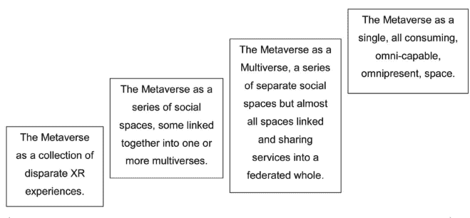

**图 2.3**
元宇宙定义的光谱。

在光谱的左端，有些定义仅将“元宇宙”视为任何 VR（甚至是增强现实 [AR] 或混合现实 [MR]）体验的包罗万象的术语。在光谱的这一左侧，“元宇宙”同样很容易被“XR 体验”所取代。

在光谱中心，定义承认“元宇宙”不仅仅是一种 XR 体验，并且共同标准和技术可能有用，特别是，它可能/必须是社交的，可能是持久的，并且可能会授予用户更高程度的自主权。这种光谱中部的定义拒绝（或对）单一真正元宇宙的概念持无所谓态度，而是将未来视为围绕多个环境构建，这些环境之间可能具有更高或更低的集成程度。

在光谱中心的右侧，是一种更整体但仍然是联邦的观点，其中大多数世界都建立在相同的技术之上，甚至可能共享公共服务。这导致一个或多个多元宇宙将所有这些其他世界连接在一起，方式类似于 Hypergrid 连接 OpenSim 世界以及 DNS 网络连接 Web 服务器（但不支持身份或资产转移）。

在光谱的最右端，是“一个元宇宙统治一切”的模型——即存在一个单一的元宇宙，使用一套共同技术构建，而每个元宇宙空间都是该元宇宙的一部分。

本书主要关注光谱中心右侧的定义，尽管符合光谱中心左侧定义的世界和体验确实有助于构建元宇宙体验的用例，这一点将在第 3 章中看到。第 6 章将进一步探讨光谱中心右侧和光谱最右端的定义可能会如何实现。

## 元宇宙路线图模型

尽管已有 15 多年历史，但元宇宙路线图对元宇宙的模型仍值得重新审视 (S. G. Lee 等人，2011)。该模型如图 2.4 所示。

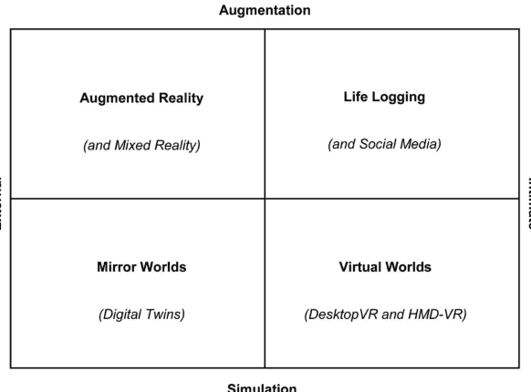

图 2.4
元宇宙路线图模型。

它从增强或模拟现实，以及关乎个人（亲密型）还是关乎世界宏观（外部型）的角度，识别了当时被视为元宇宙的各个部分。这导致定义了四种不同类型的体验：

- 虚拟世界 – 如今包含桌面 VR 和头显 VR 世界，涉及社交互动；
- 镜像世界 – 如今可称为数字孪生；
- 增强现实 – 如今包括混合现实；以及
- 生命记录 – 2000 年代初是一个重要术语，但现在可以理解为通过 X/Twitter、TikTok、Facebook 和其他社交媒体平台记录我们生活的方式。

## 元宇宙的十条公理

与其提出另一个一句式的元宇宙定义，不如提出我们认为真正的元宇宙应当遵循的 10 条公理。许多元宇宙平台遵循其中一些公理，但至今没有一个平台能高度实现所有公理。这些公理大致按照从技术导向到人本导向再到社会导向的顺序排列。

### #1 元宇宙是一种多用户、交互式、社交、共享且主观的体验——以数字方式交付

这是关于元宇宙的不言而喻的陈述：

- 它必须是多用户的。独自在元宇宙中没有任何意义；
- 它必须是交互式的。元宇宙不是一种被动体验；
- 它必须是社交的。这不仅意味着多用户，还意味着给你时间和功能，使你能够与他人互动并与他们建立关系（短期或长期）；
- 它必须是共享的。我看到的你也能看到，我能去的地方你也能去。它是基于共识的；以及
- 它必须是主观的。我们可能都看到相同的事物，但作为个体，每个人的体验都会不同，受我们自身兴趣和生活经历的影响。

当然，它主要是数字的。物理世界和数字世界在元宇宙中如何结合，将在后面讨论。

### 2 元宇宙可从其内部进行编辑

元宇宙必须可由其用户编辑，在允许的权限范围内，在元宇宙之内，这样你就可以改变你看到的内容、事物的功能以及事物的工作方式，并创建原创内容，而无需离开元宇宙（就像你不必退出物理世界来建造房屋，或在其中进行一些 DIY 一样）。独立的编辑软件是可选的附加项。

### 3 元宇宙具有持久性

元宇宙必须具有持久性。如果有人更改了某物，它将保持更改状态，直到有人再次更改它。无需每天或每次会话都刷新。它始终存在、始终开启、始终可用，是你整个生活中一个持久的特征。

### 4 元宇宙是开放的

元宇宙并非关于某一家公司的技术、平台或生态系统，也（目前）不以任何特定硬件（例如 VR 头显）或技术方法（例如区块链或 Web3）为前提，而且也不应该仅仅是一种视觉体验。

Web 更是值得效仿的模式，其基本运作由开放标准定义，多家公司随后能够创建运行它的软件、在其上运行的软件，所有这些组件随后（相对）无缝协同工作，从而对用户透明。代码本身是否真正需要开源是一个有争议的观点（更重要的是开放标准），还有谁运行和拥有可能连接元宇宙不同服务器和空间的 DNS 等效物这一关键问题。

自从 Oculus DK1 的发布开启了当前基于头戴式显示器（HMD）的 VR 一代以来，似乎一直存在一种不成文的假设，即元宇宙全部关乎 HMD-VR。然而，如第 1 章所期望展示的那样，1990 年代末和 2000 年代初的许多桌面 VR 社交虚拟世界在精神和执行上（在某些情况下至今仍是）远比许多（甚至可能全部）当前被宣传为“元宇宙”的 HMD VR 应用程序更接近元宇宙的理念。

这或许甚至更进一步。对于那些体验过 1990 年代中期的文本多用户地牢（MUD）和面向对象多用户地牢（MOO）的人来说，尽管它们缺乏甚至基于桌面 VR 的社交虚拟世界的视觉元素，但成功地创造了一种多用户、交互式、社交、可编辑、共享、主观且持久的体验，具有高用户能动性，并且也许与后来的图形化社交虚拟世界一样，有权被视为至少是原型元宇宙。这种对技术实现的独立性也扩展到区块链和 NFT 等现代趋势。更积极地说，它还表明，元宇宙对某些人来说可以主要是一种音频体验，而且元宇宙确实应该设计为提供尽可能多的可访问性。

### 5 元宇宙是技术和体验的超集，并且很可能在其中包含多个更受约束的环境

元宇宙包括 MR、桌面 VR、HMD-VR 以及类似体验。另外，在物理世界中，我们会封闭空间作为办公室、医院、培训设施、自然保护区、足球场等，并且我们应该期望在元宇宙中也能做到同样的事情，这些空间可能对更广泛元宇宙的自由和设施采取更受限的实现方式——并且可能甚至拥有更广泛社区中没有的一些功能。这些空间可能在“逻辑上”被封闭——例如 Second Life 中你看到但无法穿越的边界障碍——或者它们可能是从更大的元宇宙中分离出来的独立微型元宇宙或口袋元宇宙（类似于 RecRoom 中的房间或 Hypergrid 中的 OpenSim 服务器），但能够在它们之间高度地移动资产、身份和信息。

### 6 元宇宙可能是多重宇宙，在这种情况下，互操作性和可移植性应尽可能广泛

这在一定程度上是 #5 的延伸，但这里的重点在于元宇宙的整体架构，而不是为特定用例而分离出微型元宇宙。Web 同样是一个合理的示例，每个人都运行自己的服务器（即使它们在物理上越来越多地合并为云服务器农场），但以相对无缝的方式连接网站。OpenSim 及其 Hypergrid 是一个更直接相关的元宇宙示例，而 Mastodon（X/Twitter 的替代品）是一个更一般的示例。但正如我们从 Web 中所知道的，服务之间身份和其他资产的可移植性是一个真正的挑战，第三方中介（你的 Google 或 Facebook 账户）越来越成为管理它的方式——而在 ReadyPlayerMe 服务（https://readyplayer.me）中，就头像管理而言的一些元素也正在进入沉浸式环境。多重宇宙与单一元宇宙之间的张力需要时间才能显现，因此很可能某种形式的多重宇宙将在一段时间内成为模型，并将在以后进一步讨论。

### 7 你应该能够在元宇宙中过上完整的生活：学习、教学、赚钱、创作、出售、购买、交易、协作、沟通、探索、交友、玩耍、娱乐、提供娱乐、接受娱乐、建立关系、获得新体验、留下遗产

这扩展了 #1，并从用户体验而非系统功能的角度表达——并且是单句定义的一部分的良好候选。有很多空间可能会声称它们满足 #1，但在此方面完全失败。如果元宇宙要成为我们物理存在的真正数字延伸，那么我们应该能够使用它来做（几乎）我们在物理世界中能做的所有事情，再加上一些新事物。元宇宙还需要支持其自身原生的、在世界内的经济和市场——并且这些市场与物理世界无缝连接。

我们当然不是主张抛弃物理世界，但如果我们想将多重宇宙用于跨越我们生活大部分的事情，无论是在主题上还是在时间上，我们都应该能够这样做。

### 8 元宇宙应为用户在沉浸式数字世界中提供与在物理世界中一样多的能动性和行动空间，可能更多，其行动的唯一限制是（最初）反映物理世界的法律、伦理和道德

在元宇宙中，你应该拥有随心所欲的能动性，就像在物理世界中一样。这正是 #7 成为可能的原因。是的，这可能受到技能或知识（两者皆可学习）、才能或资源，以及被视为道德、伦理和合法之事的限制，但除此之外，你只需做你想做的事。Priestley 认为，最成功的虚拟世界具有充分理由是那些“未必是为某一特定原因或受众而构建的——它们主要保持中立，让玩家通过角色扮演或想象力或互动的其他方面创建自己的世界，并且其用途‘之所以出现，是因为平台允许其虚拟世界具有开放式结构’，从而使‘真正的、涌现的创作者经济’得以发展”（Priestley, 2022a）。元宇宙需要从内部构建，而不是从外部构建。

关于应适用谁的法律、伦理和道德的挑战将在第 5 章中讨论，而“最初”这一限定词是对一个事实的暗示，即最终元宇宙中的法律、伦理和道德很可能与物理世界有所不同。

### 9 元宇宙中不是每个人都会受人类控制

这刻意没有表述为“元宇宙中不是每个人都是人类”，因为那可能被理解为关于头像和外貌，并且如第 1 章所讨论的，Second Life 和 VRChat 等原型元宇宙中充满了

of furries, robots, and other non-human avatars. Instead, the emphasis here is on what is controlling the avatars. There are three particular cases of interest:

- Simple “non-AI” driven avatars performing routine tasks in the Metaverse, such as greeters, helpers, personal assistants/stand-ins, non-player characters and so on – just as we already have in many of the proto-Metaverses;
- AI-driven avatars which begin to live their own semi or fully independent lives within the Metaverse. Virtual world spaces like the Metaverse are probably the ideal learning and proving grounds for more developed AIs as they provide a grounded and “realistic” experience for an embodied AI (Burden & Savin-Baden, 2019);
- Digital Amortals, ex-human-driven avatars, where the virtual selves that we might create to double for us in the Metaverse continue to live and work in it well beyond the point where our physical selves have died (Burden, 2020).

Planet B (Broughton & Dromgoole, 2009) is a fun exploration of some of these forms in a fictional proto-Metaverse, and Caprica (Aubuchon & Moore, 2010) is probably the best exploration of the last consideration.

### 10 The Boundary between the Physical Universe and Virtual Metaverse Is as Porous as Each User Wants It to Be, Within Moral, Ethical, and Legal Reason

The Metaverse and its users need to find the right balance between the attribution of action to physical individuals, and the protection against doxing and other forms of on-line (or subsequent off-line) abuse. Just as with social media platforms, this will be no easy task. People should be free to create different identities within the Metaverse in order to explore their different selves, but there should be some, protected, form of attribution chain.

This boundary and interface to the physical world also include things like financial exchanges (money earned in the Metaverse should be spendable in the physical world) and cyber and information system (extending your mobile phone and your favourite web and desktop applications into the Metaverse).

Whilst we see the Metaverse as being integrated with the physical world, to the point where you might forget what you did in the physical world and what you did in the virtual world, we think it loses focus and even devalues the term metaverse to apply that to both virtual and physical world. Perhaps a new term is needed, or we just accept that the sum of the Metaverse and the physical world is just life.

### 10 AXIOMS FOR THE METAVERSE

For convenience, here are the 10 axioms brought together.

- #1 The Metaverse is a multi-user, interactive, social, shared and subjective experience – delivered digitally.
- #2 The Metaverse is editable from within itself.
- #3 The Metaverse is persistent.
- #4 The Metaverse is Open.
- #5 The Metaverse is a superset of technologies and experiences and likely contains within it, multiple, more constrained environments.
- #6 The Metaverse may be a Multiverse in which case interoperability and portability should be as extensive as possible.
- #7 You should be able to live a complete life in the Metaverse: learn, teach, earn, create, sell, buy, trade, collaborate, communicate, explore, make friends, play, have fun, entertain, be entertained, have relationships, have new experiences, and leave a legacy.
- #8 The Metaverse should provide the user with as much scope for agency and action in the immersive digital world as in the physical world, probably more so, with the only limits on their action being (initially) those reflecting the laws, ethics, and morals of the physical world.
- #9 Not everyone in the Metaverse will be human controlled.
- #10 The boundary between the physical universe and virtual Metaverse is as porous as each user wants it to be, within moral, ethical, and legal reason.

Although not really an axiom, a final point to keep in mind is that “virtual” should be contrasted with “physical” not “real”. There are plenty of examples which show that the virtual world can evoke real emotions and have real impact on people’s lives in the physical world – so the correct dichotomy is virtual versus physical not virtual versus real.

Some similar lists of metaversal traits and rules are provided by Parisi (2021), Forster (2022), and Buchholz et al. (2022), and there is a meta-analysis of Parisi, Ball, and others in Priestley (2022b). Useful taxonomies of metaverse worlds are provided by Merrick and Gu (2011), L. H. Lee et al. (2021), Kshetri (2022b), and Park and Kim (2022)

## Assessing Current Platforms

Figure 2.5 provides a very rough assessment of some of the current metaverse platforms against the 10 axioms. Mozilla Hubs had a similar shaped profile to Virbela’s Frame, most other cryptoworlds would have profiles similar to Decentraland, and other game-based worlds similar to Roblox. Updated graphs, graphs for other worlds, and more detail on the methodology used are on the series website at http://www.themetaverseseries.info/.

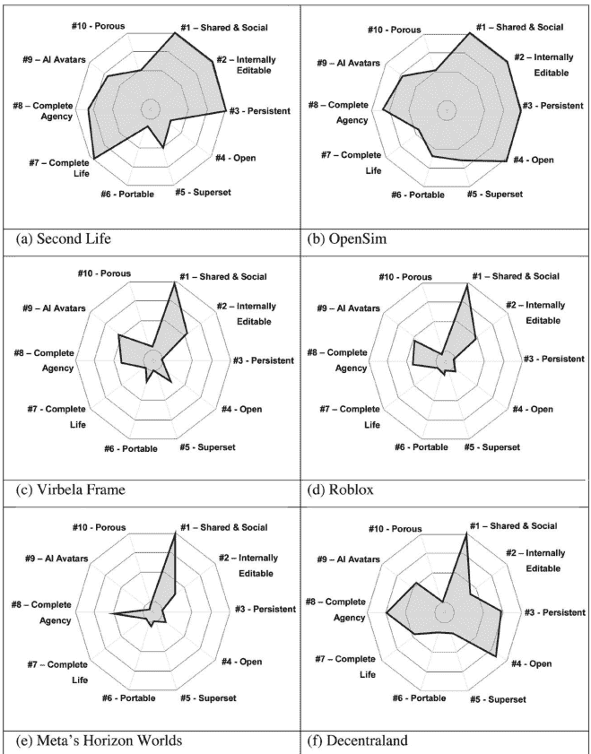

**FIGURE 2.5** Assessing current platforms against the 10 axioms: (a) Second Life, (b) OpenSim, (c) Virbela Frame, (d) Roblox, (e) Meta’s Horizon Worlds, and (f) Decentraland.

## Comparing (and Deriving) Terms

Having hopefully established a clearer idea of what the Metaverse is, it may be useful to show how some of the terms already discussed relate to this larger scope.

## Environment Types

These terms relate to a complete environment space and are largely technology neutral.

- Synthetic Environment – the broadest term encompasses any environment that provides a synthetic or artificial sense of reality. Although some people even include manual or synthetic systems such as paper wargames in this definition (e.g. Perla, 2011), it is usually taken as referring to digital synthetic environments. It can be further refined into:
  - Immersive/Subjective digital synthetic environments where the user has a first-person experience (even if from an over-the-shoulder third-person view); and
  - Objective digital synthetic environments, such as agent-based modelling environments where the user observes the behaviour of multiple algorithmically driven agents within a space – such as for crowd and traffic modelling – objectively from outside of the simulation.

- Virtual Reality Environment/Experience – a more specific term which in more recent usage tends to imply the use of a VR headset but can also be used to refer to mobile and desktop VR experiences as well – and is used in this sense in this book. It includes VR experiences that are single user and with relatively little user agency (including viewing a 360° photo or video) that might be excluded from a “virtual world” definition;

- Virtual World – during the 1990s/2000s, “virtual world” (VW) was the dominant term for the worlds that people were exploring such as Second Life, Qwaq, OpenWonderland, and Forterra. The key features are that users are represented by an avatar, share the space with other avatars, and can explore and interact with a rich 3D environment – which in some cases might be just one room but in others entire continents. Whilst training- and business-orientated virtual worlds might limit agency and persistence, the more socially orientated spaces had fewer restrictions and more capability;

- Massively-Multiplayer Online Games (MMOs) – they provide many of the features of a virtual world, but since they are presented as a game, they naturally constrain player choices and agency. Sandbox MOOs, or MMOs with sandbox or creative modes, tend to overlap with social virtual worlds, such as with Fortnite Creative, Roblox, and Minecraft;

- Multi-User Virtual Environment (MUVE) – a term commonly used within the learning and education community to describe a virtual world which is focused on education, training, and learning;

- Social Virtual Worlds (SVW) – a more specific type of virtual world which emphasises social interaction rather than using the world only for training, education, business, or entertainment, etc. These can range from low agency worlds such as *Fortnite* and *RecRoom* to the proto-metaverses such as *Second Life*, *OpenSim*, and *Somnium Space*, which are characterised by high user agency and low direction. The most open social virtual worlds have in-world tools to build and script new objects and experiences as user-generated content (UGC). Ideally, the whole virtual world (and the Metaverse) should be built from UGC; and

- Proto-Metaverse – a social virtual world which covers most but not all of the 10 axioms above, or covers all of them but to only a moderate degree, and so whilst being close to a Metaverse “ideal” falls (currently) slightly short of it.

## Metaverse Terms

The following terms can be useful to describe how metaversal spaces may be created within a larger virtual world or metaverse (but which have restricted access, and possibly reduced functionality or agency), or through the inter-connection of multiple smaller metaversal spaces.

- Microverse – a metaverse created for a very specific function – such as a training course, project, meeting, group, or entertainment event (Ffiske, 2022). It could be the metaverse equivalent of an Intranet – an area of metaverse type functionality, but which is restricted to access by a single company or organisation, or for a single event or task;
- Pocket Metaverse – similar in concept to a Microverse, but with more of an implication of being “pinched out” of a larger metaverse and so sharing the same infrastructure;
- Multiverse – a network of metaversal spaces which are interconnected so that users can move (relatively) seamlessly from one to another. Ideally, they can take their identity and assets with them, and spaces may share common technologies and even services. Each space or collection of spaces is hosted by a different entity, but there should be a common discovery and possibly asset management service and standardised access devices and applications;
- Federated Multiverse – a more formal form of the Multiverse, where common approaches are mandated, more services are shared, and interconnectivity is (near) complete;
- Confederated Multiverse – a variant of the Federated Multiverse where there is more of a peer-to-peer approach with only the bare minimum of services needing to be centrally provided; and

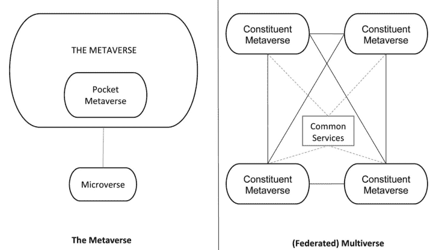

**图 2.6** 元宇宙类型。

- **组成元宇宙** – 在多元宇宙的语境下，一个连接到更大多元宇宙的元宇宙，可能实现本地规则并且很可能在其自身基础设施上运行。有些人也将这些称为卫星元宇宙。

它们之间的关系如图 2.6 所示。

## 第二人生就是元宇宙吗？

如第 1 章所示，第二人生及其关联的开源和启用超网格的派生产品 OpenSim 已经提供了元宇宙中指定的许多功能，可以正确地称为原型元宇宙。这从它们在图 2.5 中的图表中得到证实。它们可能不是元宇宙，但它们仍然是目前最接近它的体验。

在不将第二人生视为元宇宙的情况下（例如 Naveen, 2023），这通常是因为：

- 被声称没有 HMD-VR 接口——虽然如第 1 章所述，它确实有（非官方的）支持 HMD-VR 的查看器，且如上文讨论所主张，元宇宙不应依赖于任何单一的接口模式；
- 它未实施区块链技术和加密货币，尽管拥有自己 20 年历史的数字货币，并且如第 1 章所讨论，拥有一个比加密世界或更大的消费世界更盈利的游戏内经济；和
- 它很大程度上只是一个虚拟世界，与物理世界的连接极少，且没有更广泛的意图去重新思考 Web 或互联网，或实际上我们如何生活我们的生活（Virgilio, 2022）。

然而，其他人看到了它所创造的价值，以及它如何帮助改善对任何元宇宙可能是什么样子的理解。Liddle（2022）指出：

> > 可以说，之前的产品和游戏已经展示了像 Meta 这样的公司希望粉丝感到兴奋的概念和虚拟活动：游戏、3D 创建、虚拟聚会、虚拟货币等等。但没有哪家公司像 Linden Lab 与第二人生那样做得如此出色……第二人生本质上是一个带有集中权威的元宇宙示例。虽然第二人生并非旨在改变现实生活，但它仍然展示了 Meta 元宇宙理念中存在的许多概念。
> >
> > （Liddle，2022）。

用更生动的语言，另一篇文章将第二人生描述为“笨拙、肮脏，并且在很大程度上居住着比现实生活中更习惯于像素的人。只要 Facebook 的元宇宙平台能像这样好就好了”（Lamb, 2022）。正如《卫报》所描述的，在一篇名为“你管这叫元宇宙吗？”的文章中，谈论扎克伯格关于元宇宙的宏伟愿景时，“那些仍在第二人生上幸福地存在的人……可能在想所有的骚动是关于什么的”（Parkin, 2023）。然而，Priestley 认为，最大的问题之一可能是“Linden Lab 未能利用第二人生带来的重新燃起的兴趣”以及它也未能“以技术发展的同等步伐改进平台，或在当前周期中做任何事情将其宣传为应该所在的地方”（Priestley, 2022c）。

如果要有一个“待办事项”列表来使第二人生和 OpenSim 更接近元宇宙理想，它可能会包括：

- 开源所有代码（OpenSim 已经这样做了，Linden Lab 对 Viewer 也是如此）；
- 扩展 OpenSim 的 Hypergrid 方法，特别是支持完全账户可移植性并允许人们托管自己的服务器（OpenSim 已经这样做）；
- 正式支持 HMD-VR 访问，并可能支持 MR 访问，尤其是用于构建；
- 进一步提升图形外观；
- 增强隐私控制和防止滥用；
- 创建对新用户更直观的 DesktopVR 和 HMD-VR 用户界面；和
- 实现 WebXR 查看器，以便世界可以在浏览器中运行。

第二人生和 OpenSim 已经开始引入对 glTF 和基于物理的渲染（PBR）的支持，这应该改善外观和互操作性（Pey, 2023）。

然而，挑战可能在于第二人生的核心架构使得支持其中一些改变变得不切实际（Gregory, 2023），在这种情况下，是时候推出第二人生 2.0 或 OpenSim 2.0，或者由新进入者或现有参与者从第二人生和 OpenSim 中汲取灵感，构建一个兼具其遗留功能和建议改进的平台，而不增加额外的参与障碍——例如通过使用不稳定的加密货币。

## 虚拟体验的心理基础

通过使用 VR 技术，元宇宙体验与大脑体验沉浸感、在场感、代理感、身化和心流的心理学紧密相关。正是这种关系使元宇宙体验感觉比其他传统数字媒体体验更强大，并有助于解释为什么元宇宙可能对我们和我们的生活产生比其他数字体验更深远的影响。

研究人员已经确定了虚拟环境（无论是 DesktopVR 还是 HMD-VR）以独特方式提供的五个关键特征，它们在图 2.7 中以图形方式显示。了解如何利用每一个特征是充分利用 VR 和元宇宙环境所提供的一切的关键。不过要注意的是，VR 是一种高度个性化的体验，基于上下文和我们自身的心理与生理。该领域的一些早期研究人员甚至将想象力确定为最重要的因素之一（Burdea & Coiffet, 2003）。因此，请注意，无论 VR 体验多么“好”，也许不是每个人都能从中获得相同的东西。

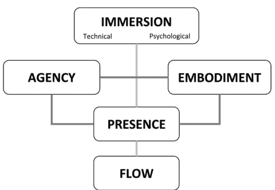

图 2.7 虚拟环境体验的心理驱动因素。

## 沉浸感

沉浸感是指被“包围、包含于并与一个提供持续刺激和体验的环境进行交互”的感觉（Witmer & Singer, 1998）。通过减少对“真实”物理环境的意识（因此 HMD-VR 通常比 DesktopVR 提供更多沉浸感）、对自身行为的自然控制（因此更少菜单）以及环境对你的存在作出反应，可以增强沉浸感。研究人员（例如 Mütterlein, 2018; Rueda et al., 2018）通常从以下方面考虑沉浸感：

- 其技术方面（例如屏幕分辨率和刷新率）；和
- 心理方面（例如情绪反应和“身临其境”的感觉）。

## 在场感

在场感是对简单沉浸感的进一步提升，它是指你感觉自己“正在与环境直接交互，而不是间接或远程交互。你觉得自己是该环境的一部分”（Witmer & Singer, 1998）。Slater (2009) 将在场感分解为：

- 位置错觉，由技术沉浸和视觉真实感产生的身在彼处的感觉；和
- 可信度错觉，感知到的事件实际上正在发生的感觉——并由可信度、代理感和叙事所告知。

真实在场感通常被描述为：当你离开 VR 时，真实感觉自己去过某个地方——即“位置错觉”，这由虚拟体验本身的“真实”的“可信度错觉”所强化（Slater, 2009）。

共在感也是一个考量因素；当那里有其他人（以头像形式表示）时，地方通常感觉更“真实”，即使是由计算机控制的。一些研究人员甚至发现，当有虚拟旁观者在场时，培训效果得到了提高（例如 Stroyny et al., 2020），而像第 1 章中提到的 VARK 这样的平台旨在通过向你的环境中添加额外的、真正的虚拟音乐会观众来提升独自观看音乐会体验的真实感。

## 代理感

代理感是指你觉得自己控制自身行为的程度（Piccione et al., 2019）以及可以控制或至少影响周围（虚拟）世界的程度（Jicol et al., 2021）。如果你感到高度的代理感，研究表明你的在场感、空间意识和共在感会更高，从而带来更好的表现。有助于在 VR 中产生代理感的因素包括：

- 从第一人称视角观察世界（Piccione et al., 2019）；
- 能够自由移动并以最少限制进行探索（Jicol et al., 2021）；和
- 能够在虚拟环境中随心所欲地行动（Jicol et al., 2021）。

不过要注意的是，在 DesktopVR 中，与可能的预期相反，第三人称而非第一人称视角可能会带来更强的代理感和在场感（Black, 2017）。

## 身化

身化是指你觉得自己的头像是你自身的表现的程度。Kilteni et al. (2012) 将身化感分解为三个组成部分：

- 身处头像身体内部的感觉；
- 掌控头像的感觉；和
- 拥有头像身体的感觉。

当动画出现故障时（例如，手穿过身体，或肘部角度奇怪——这将在第 4 章中讨论的挑战本体感觉），身化感会受损。有趣的是，关于全身头像是否比部分（例如头部和手部）头像提供更多身化感存在一些争论（例如 Lugrin et al., 2018; Y. Pan & Steed, 2019）。

VR 中身化的一个证明是，实验表明在线虚拟环境中“非语言规范的持续存在”——例如头像之间的社交距离（Yee et al., 2007）。

你自身外貌与头像之间无需匹配，事实上，VR 提供了一个强大的机会来进行放置

置身他人身体，并“设身处地为他人着想”（Wiederhold, 2020）。

## 心流

心流被定义为“在活动中投入程度极高的状态，是沉浸感的一种极端形式，会失去自我意识、不察觉疲劳且时间感被改变”（Csikszentmihalyi, 1990），并与沉浸感和存在感相关。人们认为，学习者、从事专业活动的人员（例如音乐家）甚至是玩家，当处于心流状态且活动挑战水平与其技能水平相匹配时，能发挥出最佳表现。在VR中，任何破坏体验协调性的事物，或需要用户有意识地思考如何使用环境的事情，都会立使用户脱离心流状态，因此应予以避免。

## HMD-VR与桌面VR

尽管近期媒体关注主要集中在HMD-VR上，但研究人员尚未断定它是否在所有使用场景中都能比桌面VR提供更好的效果。

Rueda等人（2018）的一项关键分析——见图2.8——清楚地展示了用户访问虚拟环境的方式与其连接后所获得体验之间的区别。用户体验与技术不同这一观点，由用户-系统-体验（USE）模型（Cowley等人，2006）进一步强化，该模型认为用户体验是用户心理和生理状态及其与系统技术组件（包括创作体验）的交互结果。这让人联系到早先关于技术沉浸与心理沉浸、场所幻觉与存在幻觉之间的区别。Rueda在创建体验时对叙事和游戏性（ludic）元素与更感知性的元素给予同等重视，这一点也值得注意。

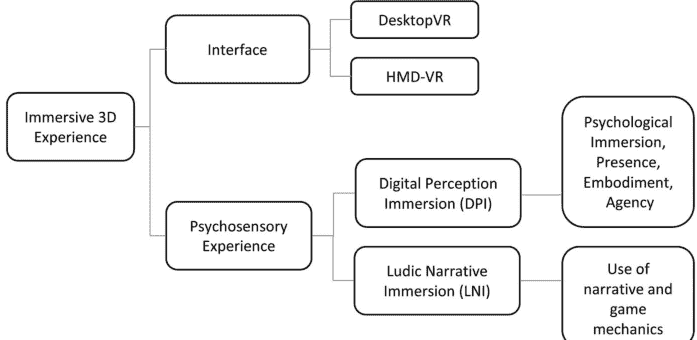

**图 2.8**
虚拟现实体验分析（改编自Rueda等人，2018）。

在将HMD-VR与桌面VR及其他媒体进行比较时，常发现更高沉浸度（即HMD-VR）不一定与更高绩效相关，这似乎高度取决于任务和用户（例如Chen，2019；Pallavicini等人，2019；Srivastava等人，2019）。与绩效相关性更好的似乎是存在感（Grassini等人，2020）——桌面VR和HMD-VR似乎都同样可以实现存在感。笨拙的VR控制和安全移动方面的问题会削弱这种存在感，因此良好的人机交互（HMI）设计至关重要。用户在桌面VR会话中停留的时间可能也比在HMD-VR中更长——部分原因是晕动症（CS）的发生率较低，这将在下文进一步讨论。

## VR的问题

除了疗效争论之外，VR体验可能对用户造成问题的关键领域有几个，任何元宇宙都需要在设计和使用时将这些因素考虑在内。这些问题还在第5章讨论的社交虚拟世界和元宇宙的一些更广泛问题之外。

## 晕动症（CS）

VR使用中的一个关键问题是CS，在HMD-VR中普遍存在，但在桌面VR中通常不存在。一项综述（虽然基于2019年前的头显）发现：“60–95%的参与者在接触虚拟环境时会经历一定程度的CS，而6–12.9%的参与者会提前结束接触”（Caserman等人，2021）。有迹象表明，分辨率、刷新率和延迟的持续改进可能正在降低CS的发生率。不过，为任何HMD-VR体验提供桌面VR替代方案仍似乎是一个明智的选择，尤其是因为桌面VR也可以在移动设备和平板电脑上体验，因此可以更不受地点（和时间）限制。

## 伦理

HMD-VR可能是一种非常强烈的体验，用户在其中感到的压迫感可能比在桌面VR空间中更强，因为不那么容易只是移开视线。设计师需要思考他们将用户置于何种情境中，以及给予他们哪些选择，以确保任何体验在伦理（和道德）上得到传递——因为VR可以让用户获得“执行某些不道德行为的第一人称体验”（Brey，1999）。另一个担忧是，VR可能导致虚假记忆的产生，甚至导致回到现实世界后出现非预期的行为改变（Pan & Hamilton，2018），Heller（2020）甚至主张“我们应当通过人权导向的视角来审视沉浸式媒体”。

## 性别与偏见

与伦理问题相关，很容易制作出存在性别偏见或失真表现的VR体验。尤其是第一人称体验，需要考虑是否需要男性和女性选项，以及这对其余体验设计是否有任何影响（Stanny等人，2020）。种族及其他偏见则带来了进一步的挑战，即避免对非玩家角色（NPC）进行刻板印象化（Kim & Wei，2011；Moreno & Flowerday，2006）。HMD-VR设备设计也可能存在问题，使其对女性用户的可用性降低（Stanny等人，2020），不过应当注意的是，有些证据表明女性可能比男性在VR中感受到更强的存在感并表现得更好（Grassini & Laumann，2020）。

## 隐私与监控

HMD-VR允许前所未有的用户跟踪程度。一个担忧是，跟踪数据不仅可能通过交互行为对用户进行行为指纹识别（Pham，2018），还可能识别出生理和情绪触发点（Heller，2020）。还存在一个相关现象，称为“匿名亲密感”，即用户在虚拟环境中与NPC交谈时可能会透露比在现实生活中对人更多的信息（Pan & Hamilton，2018）。

## 健康与安全

由于HMD-VR用户对其物理环境的感知极少（尽管内置安全功能在不断改进），用户需要确保自己处于安全空间，并可能需要有人在旁照看以确保安全。一个关键考量是HMD-VR会话能持续多久，一些研究建议最长为55–70分钟，具体取决于体验设计的质量（Kourtesis等人，2019）——然而，在桌面VR体验中的时间似乎是无限的。

## 摘要

本章探讨了“元宇宙”的若干不同定义，并提出了指导本书中元宇宙分析的10条公理。本章还探讨了通常与元宇宙概念相关的不同类型的虚拟体验，并介绍了原型元宇宙、微型宇宙和多重宇宙的概念。本章讨论了第二人生（Second Life）和OpenSim如何被视为原型元宇宙的最佳示例之一，以及它们如何能够进一步改进。最后，本章探讨了VR体验的心理基础——这些基础是大多数元宇宙概念的核心，也使其如此引人入胜——并识别了VR使用中固有的一些挑战。第3章将探讨这些虚拟世界空间和XR技术在不同领域和应用场景中的各种使用方式，以证明元宇宙不仅是一个好点子，而且能够带来经过验证的益处。

## 注

- 注：本节部分内容源自Maggi与David与Victoria Mason-Robbie合著、由Daden Limited为英国国防部制作并根据CC BY 4.0许可提供的《VR训练的循证模型》。

## References

- Alaghband, M. (主持人). (2022). 什么是元宇宙——以及它对企业意味着什么？[播客]. 麦肯锡. https://www.mckinsey.com/capabilities/mckinsey-digital/our-insights/what-is-the-metaverse-and-what-does-it-mean-for-business
- Au, W. J. (2023). 打造有意义的元宇宙：从《雪崩》和第二人生到值得为之奋斗的虚拟世界. John Wiley & Sons.
- Aubuchon, R., & Moore, R. D. (创作者). (2010). Caprica [电视剧]. Syfy.
- Ball, M. (2022). 元宇宙：以及它如何将颠覆一切. Liveright Publishing.
- Ball, M. (2024). 关于空间计算、元宇宙、被遗忘的术语与焕新的理念. Mathew Ball. https://www.matthewball.vc/all/metaversespatialandmore
- Black, D. (2017). 为什么我能看到我的化身？第三人称视频游戏中的具身视觉互动. Games and Culture, 12(2), 179–199.
- Brey, P. (1999). 虚拟现实中表征与行动的伦理. Ethics and Information Technology, 1(1), 5–14.

- Broughton, M., Dromgoole, J., Hoyle, S., & Robinson, J. (创作者), & Dromgoole, J. (制作人). (2009). Planet B [广播系列]. BBC

- Buchholz, F., Oppermann, L., & Prinz, W. (2022). 元宇宙不止一个. i-com, 21(3), 313–324.

- Burdea, G., & Coiffet, P. (2003). 虚拟现实技术. Wiley.

- Burden, D. J. H. (2020). 构建数字不朽者. 收录于 M. Savin-Baden & V. Mason-Robbie (编), Digital afterlife (第143–160页). CRC.

- Burden, D. J. H., & Savin-Baden, M. (2019). 虚拟人类：今天与明天. CRC.

- Buterin, V. (2013年9月19日). 启动去中心化自治组织：第一部分. Bitcoin Magazine. https://bitcoinmagazine.com/technical/bootstrapping-a-decentralized-autonomous-corporation-part-i-1379644274

- Caserman, P., Garcia-Agundez, A., Gómez Zarzuela, A., & Göbel, S. (2021). 当前一代虚拟现实头戴式显示器中的晕动症：系统综述与展望. Virtual Reality, 25, 1153–1170.

- Chen, M. F. (2019). 理解虚拟现实中的心流与沉浸感：一项探索性先导研究. Ohio State University. https://www.researchgate.net/publication/347766448_Understanding_Flow_and_Immersion_in_Virtual_Reality_An_exploratory_pilot_study

- Cowley, B., Charles, D., Black, M., & Hickey, R. (2006年6月). 计算机游戏中以用户为中心的设计的用户-系统-体验模型. 自适应超媒体和自适应基于Web的系统国际会议 (第419–424页). Springer.

- Csikszentmihalyi, M. (1990). 心流：最佳体验的心理学. Harper & Row.

- Fiske, T. (2022). 元宇宙：专业指南. Amazon.

- Forster, A. [@AntoniaRForster]. (2022年3月2日). “我不相信有人是“元宇宙专家”” [推文]. X/Twitter. https://twitter.com/AntoniaRForster/status/1498987122124070916

- Gilbert, S. (2022). 加密货币、Web3与元宇宙. 剑桥贝内特公共政策研究院，政策简报. https://www.bennettinstitute.cam.ac.uk/wp-content/uploads/2022/03/Policy-brief-Crypto-web3-and-the-metaverse.pdf

- Grassini, S., & Laumann, K. (2020). 现代头戴式显示器有性别歧视吗？基于HMD中介虚拟现实的性别差异系统综述. Frontiers in Psychology, 11, 1604.

- Grassini, S., Laumann, K., & Rasmussen Skogstad, M. (2020). 单独使用虚拟现实并不促进训练表现（但存在感会促进）. Frontiers in Psychology, 11, 1743.

- Gregory, S. (2023). 第二人生：窥见虚拟世界，但不完全是元宇宙. ASCILITE技术增强学习博客. https://blog.ascilite.org/second-life-a-glimpse-into-virtual-worlds-but-not-quite-the-metaverse/

- Greig, E. (无日期). 论元宇宙. 德勤. https://www2.deloitte.com/uk/en/pages/consulting/articles/what-is-the-metaverse.html

- Heller, B. (2020). 重构现实：人权与沉浸式技术. 哈佛大学哈佛肯尼迪学校卡人权中心.

- ITU. (2023). 探索元宇宙：机遇与挑战. 国际电信联盟. https://www.itu.int/dms_pub/itu-t/opb/fg/T-FG-MV-2023-PDF-E.pdf

- Jarvinen, A., Baliou, A., & Williams, V. (2023). 元宇宙与Web3的交汇：英国融合现状. 数字猎鹰. https://www.digicatapult.org.uk/wp-content/uploads/2023/07/The-metaverse-meets-Web3-report-July-2023.pdf

- Jicol, C., Wan, C. H., Doling, B., Illingworth, C. H., Yoon, J., Headey, C., Lutteroth, C., Proulx, M., Petrini, K., & O’Neill, E. (2021年5月). 情绪与主体性对虚拟现实中在场感的影响. 2021年人机交互CHI会议论文集 (第1–13页). 计算机协会.

- Kilteni, K., Groten, R., & Slater, M. (2012). 虚拟现实中的身体化感. Presence: 遥操作与虚拟环境, 21(4), 373–387.

- Kim, Y., & Wei, Q. (2011). 代理环境中学习者属性与学习者选择的影响. 计算机与教育, 56(2), 505–514.

- Kourtesis, P., Collina, S., Doumas, L. A., & MacPherson, S. E. (2019). 虚拟现实神经科学问卷的验证：在没有相关不良症状的情况下沉浸式虚拟现实会话的最长持续时间. 人类神经科学前沿, 13, 417.

- Kshetri, N. (2022a). Web3和元宇宙的政策、伦理、社会和环境考量. IT专业人士, 24(3), 4–8.

- Kshetri, N. (2022b). 元宇宙的类型学. 计算机, 55(12), 150–155.

- Lamb, H. (2022). 元宇宙可以从第二人生中学到什么？ 工程与技术学会. https://eandt.theiet.org/content/articles/2022/04/what-can-the-metaverse-learn-from-second-life/

- Lee, L. H., Braud, T., Zhou, P., Wang, L., Xu, D., Lin, Z., Kumar, A., Bermejo, C., & Hui, P. (2021). 关于元宇宙的一切：技术奇点、虚拟生态系统和研究议程的完整调查. arXiv预印本 arXiv:2110.05352.

- Lee, S. G., Trimi, S., Byun, W. K., & Kang, M. (2011). 元宇宙服务采用中的创新与模仿效应. 服务业务, 5, 155–172.

- Liddle, J. (2022). 第二人生抢先于“元宇宙”项目. 游戏狂潮. https://gamerant.com/second-life-sansar-metaverse-design-philosophy-history/

- Lugrin, J. L., Ertl, M., Krop, P., Klüpfel, R., Stierstorfer, S., Weisz, B., Rück, M., Schmitt, J., Schmidt, N., & Latoschik, M. E. (2018). 那里有“身体”吗？虚拟现实游戏中头像可见性的影响. 2018年IEEE虚拟现实与3D用户界面会议 (VR) (第17–24页). IEEE.

- McKinsey. (2022). 什么是元宇宙？ 麦肯锡公司. https://www.mckinsey.com/featured-insights/mckinsey-explainers/what-is-the-metaverse

- Merrick, K. E., & Gu, N. (2011). 使用多用户虚拟世界作为协作设计创新平台的案例研究. 建筑信息技术期刊(ITcon), 16(12), 165–188.

- Montaz, P. P. (2022). Web3和元宇宙的一些非常简单的经济学. 金融科技, 1(3), 225–234.

- Moreno, R., & Flowerday, T. (2006). 科学学习中学生对动画教学代理的选择：关于性别和族群相似性-吸引力假设的检验. 当代教育心理学, 31(2), 186–207.

- Mütterlein, J. (2018). 虚拟现实的三大支柱？探讨沉浸感、在场感和交互性的作用. 第51届夏威夷国际系统科学会议论文集，大岛，夏威夷.

- Nabben, K. (2023). Web3作为“自我基础设施化”：挑战在于如何实现. 大数据与社会, 10(1), 20539517231159002.

- Narula, H. (2022). 虚拟社会：元宇宙与人类体验的新疆界. 货币出版社.

- Naveen, C. (2023). 元宇宙 vs 第二人生：探索差异. LinkedIn. https://www.linkedin.com/pulse/metaverse-vs-second-life-exploring-differences-naveen-c/

- Newton, E. (2021). 什么是空间网络，企业将如何使用它？ 里程碑. https://blog.milestoneinternet.com/web-design-promotion/what-is-the-spatial-web-how-will-businesses-use-it/.

- Pallavicini, F., Pepe, A., & Minissi, M. E. (2019). 虚拟现实游戏：与非沉浸式视频游戏相比，可用性、情感反应和在场感方面有哪些变化？ 模拟与游戏, 50(2), 136–159.

- Pan, X., & Hamilton, A. F. D. C. (2018). 为何及如何使用虚拟现实研究人类社会互动：探索新研究领域的挑战. 英国心理学杂志, 109(3), 395–417.

- Pan, Y., & Steed, A. (2019). 脚部追踪为何重要：动画自我头像对共享虚拟环境中交互、身体化和在场感的影响. 机器人与人工智能前沿, 6, 104.

- Parisi, T. (2021). 元宇宙的七条法则. Medium. https://medium.com/meta-verses/the-seven-rules-of-the-metaverse-7d4e06fa864c

- Parkin, S. (2023年6月10日). 你管这叫元宇宙？ 卫报.

- Park, S. M., & Kim, Y. G. (2022). 元宇宙：分类学、组件、应用和开放挑战. IEEE Access, 10, 4209–4251.

- Perla, P. (2011). 彼得·佩拉的战争推演艺术. 战争推演历史项目.

- Pey, I. (2023). 第二人生中PBR材质、反射探针和glTF简介. Inara Pey：生活在调制解调器世界. https://modemworld.me/2023/11/28/a-simple-introduction-to-pbr-materials-reflection-probes-gltf-in-second-life/

- Pham, D. M. (2018). 基于神经网络分类虚拟现实中周期性行为的人类识别. 2018年IEEE虚拟现实与3D用户界面会议 (VR) (第657–658页). IEEE.

- Piccione, J., Collett, J., & De Foae, A. (2019). 虚拟技能培训：在场感和主体性的作用. Heliyon, 5(11), e02583.

- Priestley, T. (2022a). 元宇宙不需要你的用例才能运作. Medium. https://medium.com/@theo/the-metaverse-doesnt-need-your-use-case-to-work-2275leb2cd47

- Priestley, T. (2022b). 元宇宙已经坏了（以及如何修复——第一章）. Medium. https://medium.com/@theo/the-metaverse-is-already-broken-and-how-to-fix-it-chapter-one-170722ba1f7c

- Priestley, T. (2022c). 第二人生正在用怀旧交易它的未来. Medium. https://medium.com/@theo/second-life-is-trading-its-future-in-for-nostalgia-d8b4313b0b4d

- Radoff, J. (2021a). 什么是元宇宙？ Medium. https://medium.com/building-the-metaverse/what-is-the-metaverse-a170108458e8

- Radoff, J. (2021b). 元宇宙定义. Medium. https://medium.com/building-the-metaverse/metaverse-definition-51e6b1c5baf3

- Radoff, J. (2021c). 元宇宙价值链. Medium. https://medium.com/building-the-metaverse/the-metaverse-value-chain-afc9e09e3a7

- Ravenscraft, E. (2023). 元宇宙究竟是什么？ 连线. https://www.wired.com/story/what-is-the-metaverse/

- Ray, P. P. (2023). Web3：背景、技术、应用、零信任架构、挑战和未来方向的全面综述. 物联网与物理系统, 3, 213–248. https://www.sciencedirect.com/science/article/pii/

- Rueda, C., Godfines, J. C. V., & Rudman, P. D. (2018). 三维沉浸式数字环境教育可负担性的分类. 信息技术教育期刊：实践创新, 17(1), 83–112.

Sahu, S. (2021). WebSocket：深入初学者指南。Medium。https://javascript.plainenglish.io/websocket-an-in-depth-beginners-guide-96f617c4c7a5

Slater, M. (2009). 存在感错觉与合理性可导致沉浸式虚拟环境中的现实行为。伦敦皇家学会学报，364(1535)，3549–3557。

Srivastava, P., Rimzhim, A., Vijay, P., Singh, S., & Chandra, S. (2019). 桌面VR优于非步行式HMD VR用于空间学习。机器人与人工智能前沿，6，50。

Stanney, K., Fidopiastis, C., & Foster, L. (2020). 虚拟现实有性别歧视：但不必如此。机器人与人工智能前沿，7，4。

Strojny, P. M., Dudzińska-Misiakczyk, N., Lipp, N., & Stroyny, A. (2020). 虚拟现实中社会促进效应的调节因素：虚拟代理的共在感与真实感。心理学前沿，11，1252。

Virgilio, D. (2022). 第二人生与元宇宙比较所忽略的。Slate。https://slate.com/technology/2022/02/second-life-metaverse-facebook-com-parisons.html

Vogelsang, B. (2021). 开发者：利用空间计算创造新现实。高通。https://www.qualcomm.com/news/onq/2021/05/creating-new-reality-spatial-computing

Wiederhold, B. K. (2020). 身体化赋能虚拟现实中的共情。网络心理学、行为与社交网络，23(11)，725–726。

Witmer, B. G., & Singer, M. J. (1998). 虚拟环境中的在场感测量：一份在场感问卷。在场感，7(3)，225–240。

Wood, G. (2014). DApps：Web 3.0的样子。Gavin Wood。https://gavwood.com/dappsweb3.html

Yee, N., Bailenson, J. N., Urbanek, M., Chang, F., & Merget, D. (2007). 数字化存在的难以忍受的相似性：在线虚拟环境中非语言社会规范的持续性。CyberPsychology & Behavior，10(1)，115–121。

# 3 元宇宙的用途与益处

## 简介

在审视元宇宙能提供的益处——面向个人、组织和社会——以及元宇宙为何重要时，存在两个主要问题：

- 基于元宇宙技术的应用有哪些益处？
- 单一元宇宙或多元宇宙为何比一组独立应用更有用？

本章结构遵循此分段。首先，它探讨元宇宙技术的基础益处（特别是来自协作和消费者对消费者[C2C]用途），然后考察从企业对消费者(B2C)到企业对企业(B2B)应用等多个领域中出现的益处和用例。其次，它考虑通过更集成的元宇宙交付这些益处为何可能优于通过离散世界和应用交付。第5章将进一步探讨元宇宙作为更整体的实体为何重要，它如何能为更广泛的人类和社会背景做出贡献，以及元宇宙带来的一些挑战。希望这两章合起来，能在某种程度上回答元宇宙试图解决的问题是什么。

图3.1提供了本章前半部分的图形概览。

> 注：元宇宙系列的其他书籍将更详细地探讨更多这些用例。请访问www.themetaverseseries.info查看计划中和已出版书籍的当前列表。部分计划书籍的概要已在相关位置收录于本书中。

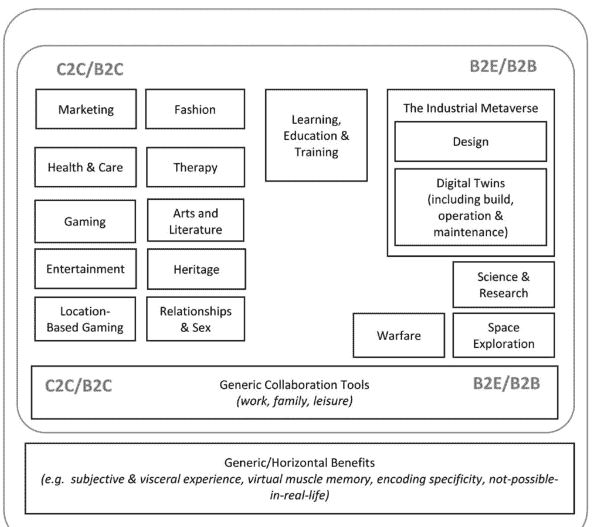

图3.1
元宇宙用例。

## 基础益处与协作

### VR/MR/AR的通用益处

在评估元宇宙技术在几乎所有用例中的益处时，将其与物理世界替代方案_和_非元宇宙数字替代方案进行比较非常重要。例如，尽管元宇宙应用可以通过减少旅行来节省成本、时间和碳排放，但这些益处也适用于更传统的二维(2D)替代方案——例如Zoom通话。纯粹的元宇宙益处通常来自将物理世界的益处带入数字交互，并将数字世界的益处带入物理交互，包括：

- 身临其境，如第2章所述，这可以提高理解和记忆（例如Haber et al., 2023）。S. A. Smith (2019)对虚拟现实(VR)与情景记忆之间关系进行了广泛的综述；
- 虚拟空间中群体动态的改变——这可以鼓励更具包容性的参与（Nesson & Nesson, 2008）；
- 在强调互动社会性并增强偶然发现的环境中以人类尺度运作的能力（Webber, 2013）；以及
- 在物理世界中绝对不经济、危险或不道德，甚至单纯只是“现实中不可能”(NPIRL)的事情去做和体验的能力——从在几分钟内创建（和销毁）建筑模型并练习危险的医疗程序，到在虚拟火星上开会或从晶体的原子结构内部学习（例如Maksimenko et al., 2021）。

表3.1总结了物理、数字和元宇宙的横向比较。

| | 对...物理 | 数字 | 元宇宙 |
|---|---|---|---|
| 比较...物理 | | • 环境沉浸 • 触觉/力反馈 • 主观的、直感的体验 • 编码特异性 | • 黄金标准环境、沉浸、风险和情感 • 更复杂、混乱的环境 |
| 数字 | • 节省时间 • 节省成本 • 节省碳排放 • 远程活动 • 随时随地/任何地方使用 • 精确重复 • 详细指标 • 易于AI集成 | | • 更简单的技术 • 更简单的创作 • 自然视频 • 自然面部表情 |
| 元宇宙 | • 节省时间 • 节省成本 • 节省碳排放 • 远程活动 • 随时随地/任何地方使用（近乎） • 精确重复 • 详细指标 • 易于AI集成 • 不可能、不切实际、不经济的活动（现实中不可能 – NPIRL） | • 主观的、直感的体验 • 虚拟肌肉记忆 • 编码特异性 • 来自更丰富环境的更广泛线索 • 更自然的团队合作/协作 • 更现实的（且非提示）选择 • 更广泛的人际沟通 | |

注：斜体表示传统2D数字方案与元宇宙方案共享的益处。

### VR中的协作

协作或许是元宇宙应用中的“易得之果”，几乎适用于一切——从用户与朋友闲逛或与家人保持联系，到追求爱好、接受教育，再到商务会议、会议和培训。

基本要求仅仅是有一个用户可以见面和交流的空间。尽管这些世界的营销往往展示模仿现实世界对应物的时尚现代董事会会议室和协作空间，但没有理由让会议空间不反映讨论主题（例如在正在建设的建筑物中、工厂车间或客户产品展示厅开会），或反映所需互动和创造力性质与水平的地方（例如篝火旁、沙滩、酒吧、电影院、轨道空间站等）。

表3.2详细列出了一个或多个虚拟世界中已存在的协作工具，理想的协作元宇宙可能应包含所有这些工具。

| 功能 | 描述 |
|---|---|
| 空间语音聊天 | 这样你知道谁在你的左侧或右侧说话，或者你可以聚集到主聊天之外的较小群体中。 |
| 临时“沉默环” | 这样即使你靠近其他用户，其他人也无法听到你对最近的人说的话。 |
| 文本聊天 | 支持平行讨论和提供额外信息，无论是对整个群体还是特定参与者。 |
| 摄像头画面 | 这样人们可以看到真实的你。有时，这些画面被渲染在虚拟形象的肚子上、悬浮在虚拟形象肩膀上方、固定在世界的墙上，或放置在用户界面上而不是在世界中。 |
| 表情符号 | 2D和3D表情符号，以支持非语言沟通。 |
| 桌面共享 | 这样你可以像在Zoom通话中一样共享演示文稿和文档。 |
| 拨入用户 | 这样人们可以从音频电话或像Zoom这样的视频会议系统呼入。 |
| 世界内网页浏览器 | 这样你可以协作访问网络内容，包括视频和诸如Google Docs之类的服务，你甚至可以与非虚拟世界的参与者协作和同步处理文档。 |
| 虚拟白板和便利贴 | 当然，没有理由将绘制或便签放置限制在墙壁或板子上，你可以在3D空间的任何地方绘制或放置对象。 |
| 2D拖放 | 将图像、PDF、音频和视频文件以及其他媒体类型从桌面拖放到虚拟世界中。 |

| 功能 | 描述 |
|---|---|
| 3D 拖放 | 从 3D 设计和 CAD 工具或库中拖放 3D 对象（动画和非动画），并可使用虚拟便签对其进行注释。 |
| 世界内构建（甚至脚本） | 用于在想法出现时进行创造性探索和说明。 |
| 自定义投票工具 | 用于协助投票和参与者主题分组的自定义设备 – 例如 Opinionator（Cunningham & Harrison，2010）。 |
| 数据可视化工具 | 以 3D 而非仅 2D 呈现数据，并在相关时支持文本和代码可视化（例如 Balogh & Beszedcs，2013 年）。 |
| 会话录制 | 音频、视频和文本会话捕获。 |
| 3D 会话捕获 | 用于回放的 3D 会话捕获 – 这样您以后就可以在会议中观看自己了！ |

关于虚拟世界中这类工具的设计、使用和有效性，已有大量文献，通常以协作虚拟环境（CVE）的名义开展，包括：

- CVE 中游戏和社交性的作用（Brown & Bell，2006）；
- 利用颜色和空间设计，既帮助固定参与者来自物理世界的期望，又为鼓励非物理世界活动（例如按需创建对象）提供空间（Uribe Larach & Cabra，2010）；
- 探索媒体同步性理论的应用，该理论表明 CVE 有助于“处于决策任务中的团队的收敛过程，从而增加团队成员之间的共享理解”，进而提高决策团队的绩效（Schouten 等，2010）；
- 开发“3D 虚拟环境中有效团队协作的理论模型”，侧重于信息处理、通信支持和共享理解（Van der Land 等，2011 年）；以及
- 使用虚拟环境支持医疗质量改进中的协作会议，突出信息技术（IT）技能较弱者面临的潜在挑战（Taylor 等，2020 年）。

《信息系统协会期刊》的一整期特刊专门讨论虚拟世界中的团队协作，包括关于团队协作中虚拟世界使用的纵向实地研究以及为虚拟世界设计协作体验的结构化方法的论文（Boughzala 等，2012 年）。

当前（2023 年）专注于通用协作用例的一些平台包括 Arthur（2020 年，https://www.arthur.digital/）、Glue（2020 年，https://glue.work/）和 MeetInVR（2019 年，https://www.meetinvr.com/），但这是一个变化快速的领域。

## AR/MR 中的协作

也有大量关于使用增强现实/混合现实（AR/MR）进行物理任务协作的研究（例如 Ladwig & Geiger，2019 年）。Wang 等人（2021 年）对 200 多篇论文进行了有用的分析，涵盖制造业、远程医疗、建筑和远程教育等多个领域。他们确定了现场工作人员和远程工作人员之间共享非语言线索的五种主要方式：

- 虚拟副本或物理代理（VRP）；
- AR 注释或光标指针（ARACP）；
- 虚拟形象位置和移动；
- 手势；以及
- 注视。

MR 的当前问题包括视野（如第 1 章所述）和照明限制——即使参与者处于同一位置（Alizadehsalehi 等，2020 年）——尽管视频穿透方法似乎已在很大程度上解决了这些问题。

这一已可实现的愿景——如 Meta 关于元宇宙的宣传视频（Meta，2021 年）所示，并在 Arkio 和 Wooorld 等 MR 应用程序中得到证实——是指参与者身处不同的物理位置，但通过 MR 头显可以出现在其他参与者的物理位置中。

MR 协作（相对于 VR）的主要论点是用户保持本地情境意识——在某些用例中这可能至关重要——并可以响应虚拟世界和物理世界的提示和事件——事实上，MR 甚至可能能够增强情境意识（Wallmyr 等人，2019 年）。

另一个论点是，用户（至少在同一位置模型中）可以与物理人员互动，从而更好地检测非语言线索——前提是 MR 头显不会遮住用户的大部分面部，使面部表情难以看清。

窄视野使这一点更加困难，难以同时查看参与者和任何虚拟信息（同样，视频穿透在很大程度上解决了这个问题，而 Apple Vision Pro 甚至将您的“眼睛”放在了头显的正面！）。

随着人们开始尝试这一新一代 MR 设备，增强远程协作存在着重要机遇。虚拟形象风格的全息指挥中心是更适合通过 MR 实现，还是仅仅将所有人移入 VR 空间，将是值得观察的问题——当然，两种路径取决于用例，都可能是有效的。

在考虑了元宇宙空间的通用优势后，本章现在探讨更具行业特定性的用例。由于学习、培训和教育在 B2C、B2E 和 C2C 之间存在重叠，它们将首先被考虑，然后再转向特定的 B2C 和 B2B 用例。

## 学习、教育和培训

在最基本的层面上，支持协作的元宇宙也可以支持教育。虚拟世界中教育的早期历史很大程度上在于颠覆那些不明确支持教育（例如《魔兽世界》）的游戏世界，以便将其用于教学和学习（例如 Wiklund & Ekenberg，2009 年）。

使用元宇宙进行学习的核心在于它支持广泛的相关教学方法，例如 Kolb 的学习循环（Kolb，2014 年）、建构主义（Loke，2015 年）、体验式学习（Dewey，1986 年）、认知负荷理论（P. Chandler & Sweller，1991 年）、情境认知/编码特异性（Greeno 等人，1993 年）和基于问题的学习（Savin-Baden，2007 年）。

沉浸式 3D 环境的关键可能性被确定为：能够让用户体验所教授的内容、在情境中学习、在空间上与知识建立联系、参与学习以及在学习中协作（Dalgarno & Lee，2010 年）。

在元宇宙中进行教学和学习，使导师和学生能够利用这些可能性，从而发展出更好的学习、更深入的理解和更好的回忆。

VR 的心理学基础，特别是技术沉浸与心理沉浸之间的关系，在第 2 章中已讨论。

头戴式 VR 显示器（HMD-VR）和 DesktopVR 应该是用户的选择而非设计师的选择，这是一个至关重要的考虑因素。

VR 学习中的一个关键设计决策是找到环境、任务和交互的保真度的正确平衡和方法，并确保它们满足学习需求（Stone，2008 年）。

沉浸式学习研究网络的 Beck 等人（2021 年）提供了一个有用的沉浸式学习知识树，这是一个用于映射 XR 学习中知识和工具的概念框架。

元宇宙对学习的更广泛益处中，除了“更好的学习”之外的许多方面都由元宇宙的通用优势涵盖。特别相关的元素包括：能够将用户置于学习关注的环境中——无论该环境在物理世界中多么危险、昂贵或根本不切实际——以及改变群体动态，以便让较安静的学生有更多机会参与，并以在物理或更传统的数字学习空间中难以复制的方式鼓励团队学习和团队共同创作。

元宇宙学习可以应用于从 K12/初等教育到高等教育、入职培训，再到职业和工作培训以及持续专业发展的所有层面，涵盖硬技能和软技能。

使用元宇宙技术和平台进行学习和培训的一些近期研究包括：

- Minecraft 的教育影响挖掘 –（Baek 等人，2020 年）；
- 学习中使用 Roblox 的系统综述（Han 等人，2023 年）；
- 虚拟现实技能培训应用综述——涵盖一线响应者培训、医学培训、军事培训和劳动力培训（Xie 等人，2021 年）；以及
- 使用 VR 进行化学、生物、放射性和核（CBRN）培训的挑战研究（Regal 等人，2023 年）。

关于 Second Life 时代用例的调查，John Kirriemuir 当时制作的关于记录 Second Life 和 OpenSim 在全球教育应用的材料（主要是 Virtual World Watch）仍然是一个极好的资源（Kirriemuir，2009 年）。

Engage（https://engagevr.io/）凭借其迄今独特的录制和回放会话并在其中观看自己的能力，可能是当前专注于教育和培训的元宇宙平台中最引人注目的一个。

该领域的其他活跃公司（特别是企业培训）还包括 Luminous Group（https://www.luminousxr.com/）、Immerse（https://immerse.io/）、Strivr（https://www.strivr.com/）、TrainBeyond（https://www.trainbeyond.com/）、Acadius（https://acadius.com/）和 ClassVR（https://www.classvr.com/）。

然而，大量工作仍在使用 Unity 和 Unreal 构建的自定义构建和专有平台上进行，而不是在共享公共或半公共平台上进行，结果既掩盖了活动水平，又降低了组织间共享学习和培训经验及资产的能力。

应注意的是，使用基于游戏的技术进行学习与游戏化不同，游戏化更多是关于产生内在动机（Hamari 等人，2014 年）——尽管你可以在元宇宙学习应用程序中使用游戏化流程。

## 面向消费者的商业用例

## 营销

营销始终是新技术的早期采用者，如第 1 章所述，营销也是 2000 年代初 Second Life 的主要用途之一。这一趋势延续到了当前的元宇宙类环境中，例如 Walmart 的营销活动（Blackwood，2023 年）

耐克（Sutcliffe, 2022）在 Roblox 中，以及由漫威和 NFL 在 Fortnite 中（Goodman, 2023）。然而，微软和 Mojang 迄今为止已限制 Minecraft 上的企业营销（Grubb, 2016）。

营销活动在很大程度上是品牌知名度宣传活动——因此，Roblox 和 Fortnite 等平台上数千万甚至数亿活跃用户难以忽视。虽然视频游戏中已经存在针对广告牌类型广告的成熟系统（Dixie, 2023），但针对虚拟世界的营销方法往往需要采取不同的策略，因为无法保证用户一定会“看到”某个特定的广告牌（例如，与赛车游戏不同），因此营销更多地侧重于体验式，通常在专门空间中进行，而非一种被动观看行为（A. Lee, 2023）。

AR 在营销中的应用更多地是一种销售支持工具——就像已引用的宜家示例。使用 AR 或 MR，公司可以在消费者购买前将自己的产品放入潜在客户的家中，或者将产品放置在人们聚集的任何地方，而无需（以及相关成本和安全问题）将产品实际移送到那里。

一个经常被提及的用例是在商店外创建虚拟广告，但为了使其有效，消费者需要佩戴连续佩戴的 AR/MR 设备——例如失败的 Google Glass 或 Ray-Ban Meta 智能眼镜——这些设备尚未普及，并且遇到了一些社会抵制和隐私问题（de Ruyter 等人，2020）。然而，确实存在一些利用 AR/MR 进行一次性活动的创意机会——例如在迪拜购物节中所见的情况（ARKx, 2022）。

## 时尚

元宇宙是社交虚拟世界，因此用户虚拟形象的外观可能是一个关键考量。许多社交虚拟世界已经支持活跃的时尚社区，许多现实世界品牌，如耐克、普拉达（Prada）和汤米·希尔费尔（Tommy Hilfiger），已经尝试将其产品提供给虚拟用户（L. Smith, 2022）。术语 “phygital” 已被创造出来，用于识别同时连接虚拟世界和物理世界的产品（Moravcikova & Kliestikova, 2017）。今天，当你购买一些产品（例如，一本书或一张地图）时，可以同时获得实体版和数字版——并且购买新上衣或鞋子时可能也不会过久才出现同样的情况。或者，也许，我们会为了视觉冲击力、外观和多样性购买虚拟服装，而为了永久性和可持续性购买实体服装（Cannone, 2021）。

这是缺乏标准可能阻碍市场的一个领域，因为虚拟服装通常不能从一个世界移植到另一个世界——在 Fortnite 中购买的夹克无法在 Roblox 中使用（Prem, 2023）。外部中介服务，例如 ReadyPlayerMe（https://ready-player.me/），其中虚拟形象和服装由第三方管理，然后由各个虚拟世界支持，是一个前进方向——但也许不是最理想的解决方案。虚拟时尚市场（包括营销和虚拟商品）预计到 2030 年将达到 550 亿美元（Deloitte, 2022）。

利用虚拟世界作为实体时尚设计师和零售商的学习场所也不应被忽视。许多时尚学校已使用虚拟世界，让学生有机会设计新产品，在虚拟时装秀上展示，然后在虚拟商店向真实的人销售（例如，Uhomoiibhi & Ross, 2013）。

虚拟时尚的另一个重要元素是 “虚拟试穿” 的概念，通常使用 AR 技术来查看化妆品和服装在你身上的效果。MAC 和 L’Oréal（Cannone, 2021）、Prada、Levi’s 和 Ray-Ban（Lavoye 等人，2023）等公司已经探索了该领域的产品，TINT（https://www.banuba.com/tint-makeup-virtual-try-on）和 Google 的 “Try On”等应用也是如此。

## 健康与护理

已有多项研究表明，在虚拟世界中锻炼实际上可以改善身体健康和心理福祉（例如，Appel 等人，2020；Costa 等人，2019；Wagener 等人，2021）。医学界也是将 VR 用于手术培训（Paro 等人，2022）以及将虚拟世界用于各种医疗培训场景（包括急救人员培训（例如，Conradi, 2009）和护理培训（Plotzky 等人，2021））的早期采用者。VR 甚至已被用于在手术过程中提供止痛（Freitas & Spadoni, 2019）。还有研究探讨了利用 VR 支持认知训练（Bauer & Andringa, 2020）、物理治疗（Heiyanthuduwa 等人，2020）以及老年护理中的娱乐（Lai 等人，2019）。Kononowicz 等人（2019）和 Barteit 等人（2021）撰写了有关医疗保健中 VR 的有用系统综述。

健康与护理可能是环境、交互和任务保真度区别适用的一个很好的例子。手术通常涉及精细操作，因此对 VR 系统的技术要求非常高；理想情况下，手术工具需要触觉反馈，而在现代微创手术中，外科医生可以使用真实工具，但这些工具已被集成到虚拟环境中。相比之下，其他医疗和护理任务——例如应对产后出血或家访时应遵循的正确程序——更多地关乎流程，因此对模拟的要求较低。

在医疗领域，还广泛使用人体模型进行培训，这些模型本身也变得更加智能化，甚至集成了虚拟环境——这样学生可以在 VR 中与患者互动，然后与同一患者的 AR/MR 增强型人体模型互动（例如，Schild 等人，2022）。与许多虚拟世界活动一样，医疗模拟往往由个人和独立的项目推动，但已有尝试创建整合的虚拟医院或医疗中心，以便在更广泛的机构基础上共享一系列医疗模拟——元宇宙将使这变得容易得多。还有尝试使用诸如 Medbiquitous 虚拟病人（Ellaway et al., 2008）或人工智能标记语言（Danforth et al., 2009）等标准，以便以相对平台中立的方式定义医疗练习，从而鼓励可移植性。

除了教育医务人员，虚拟环境还可以用于教育患者——让他们体验医院就诊或医疗程序，以便更好地了解将要发生的事情，从而缓解焦虑或做出更明智的选择（Mahajan 等人，2021）。还有项目利用虚拟环境帮助人们进行生活方式选择——例如饮食或吸烟（McGuirt 等人，2020）——让人们在自己的虚拟身体内走动，体验几十年吸烟的影响，或查看多年不健康饮食后外貌和能力的变化。

在不同环境下考虑护理问题，还有大量研究探讨了在监狱中使用 VR 的情况，包括教育（McLaughlan & Farley, 2022）、改善行为管理（Farley, 2018）以及重返社会（Teng & Gordon, 2021）。

## 治疗

尽管 “普罗透斯效应”（Yee & Bailenson, 2007）表明，拥有理想化虚拟形象的用户往往会达到这种理想化自我，并在虚拟世界中拥有更强的自我价值感，但也有证据表明，虚拟体验有助于在现实世界中保持这种提升的自我价值感（例如，C. J. Falconer 等人，2016）。VR 还被用于虚拟现实暴露疗法（VRET）等领域，以帮助治疗与战斗相关的创伤后应激障碍（PTSD）（Mozgai 等人，2020）、社交焦虑（尽管结果不确定）、成瘾、自闭症和注意缺陷多动障碍（ADHD）（Emmelkamp 等人，2020）。

治疗师可以使用虚拟世界作为安全的共享空间与来访者会面，根据来访者的需求调整环境，并按需要引入图像、音频、视频甚至对象来支持会话（Sampaio 等人，2021）。甚至还有潜力考虑如何让治疗师由自动化虚拟形象支持，以便来访者可以在一天中的任何时间获得支持（例如，Ren, 2020）。

## 娱乐

利用虚拟世界支持音乐会和体育赛事等被动娱乐体验也有着悠久的历史。IBM 在 2008 年使用 Second Life 展示了温网（Cremorne, 2008），如前所述，苏珊·维加早在 2006 年就在 Second Life 中表演。与使用 Fortnite 等通用平台的表演者如

如 Ariana Grande、Travis Scott 以及 NFL 等体育品牌，也有许多平台试图将音乐会或体育作为其主要商业模式。示例包括重新聚焦的 *Sansar*（2014，https://www.sansar.com/）、*Vark*（2018，https://vark.co.jp/）和 *AmazeVR*（2022，https://www.amazevr.com/）。*AmazeVR* 于 2022 年制作了 Megan Thee Stallion 的独立 VR 表演，名为 *Enter Thee Hottieverse*（sic）（Skarredghost，2022）。在 AR 领域，Immersal（https://immersal.com/）专注于开发应用程序，以增强体育比赛的体育场体验。

这些公司面临的一个问题是，在同一地点拥有数百个以上的化身，并且它们之间相互交互，仍然是一个巨大的计算和网络挑战，这一点在第 4 章中有更详细的讨论。因此，尽管使用元宇宙让大量人群参加大型音乐和体育活动的想法在元宇宙的许多宣传中出现，但以一种镜像物理体验的方式实现它所面临的技术挑战并非易事，这或许也是为什么表演者应该寻找更具元宇宙原生特色的方式来表达他们的艺术。

## 游戏

许多具有元宇宙元素的平台主要是为支持游戏而开发的——无论是 *Roblox*、*Fortnite* 还是 *Minecraft*。独自游玩的第一人称射击游戏感觉不太像元宇宙，但一旦该游戏变成多人游戏，尤其是当有暂停或坐下来、聊天、偏离脚本的机会时，游戏就会显得更加社交、更像元宇宙。因此，纯粹的游戏与元宇宙体验之间存在着非常模糊的界限。在设计游戏平台时采用元宇宙方法的一大好处是，它鼓励创建用户生成的游戏和内容——如 *Fortnite*、*Roblox* 和 *Rec Room* ——在平台所有者投入极少资金的情况下进一步增强平台，并建立用户参与度。未来的某个时候，所有游戏可能只是更通用元宇宙中的区域——就像所有物理游戏都在物理宇宙中一样。

## 桌面游戏

另一种值得提及的游戏形式是桌面游戏——无论是 *Ticket to Ride*、*Dungeons and Dragons* 还是 *Risk*。已经存在一些平台来实现此类游戏的远程进行，包括：

- *Vassal*（2002，https://vassalengine.org/）– 一个相对早期且简单的 2D 游戏实现，侧重战争游戏，但任何人都可以创建或移植游戏；
- *Roll20*（2012，https://roll20.net/）– 同样是 2D，并针对角色扮演游戏进行了优化，但也可用于其他类型——用户同样可以创建自己的游戏，但商业游戏的官方模块也可用。Roll20 于 2022 年报告拥有 1000 万注册用户（Meehan，2022）；以及
- *Tabletop Simulator*（2015，https://www.tabletopsimulator.com/），它为用户提供了一个完全实现的 3D 桌面和 3D 游戏棋子，但由于它并未实际实现游戏规则（与上述两者大体相同），用户可以随意使用空间和棋子。Tabletop Simulator 还拥有约 1000 万注册用户和约 87.5 万活跃用户（Playtracker，2023）。

阻止这些空间中的大多数成为元宇宙的原因是，用户通常仅通过其在游戏中的能动性来存在——即移动棋子和掷骰子的能力。至多，他们也可以通过音频流或网络摄像头流来存在，但他们并未以化身形式出现，也无法在桌旁走动并做其他事情。随着脚本功能在元宇宙平台中变得越来越普遍，玩家在通用元宇宙平台中以化身形式围坐在游戏桌旁便没有理由不可以。结果，可能再次不需要专用平台——而且该领域已经有一些进展——例如 Minecraft 中的 TableTop Craft 和 VRChat 中的 VRC Dominion。这种世界结合带来的与其说是增强游戏体验，不如说是使参与者能够更流畅（且常规地）在游戏玩法与其他元宇宙活动之间移动，正如下文将讨论的，正是元宇宙的这种整合性特征有望帮助其超越一系列定制的元宇宙技术体验。

在桌面游戏环境中，也应提及 AR 和 MR，例如 Tilt Five（https://www.tiltfive.com/）正在开发的系统，以及新一代 XR 头显的可能性。它们可能通过将共享视觉效果投影到物理空空如也的桌面上，使数字游戏空间的灵活性进入物理世界。

## 基于位置的 VR 游戏

在考虑元宇宙和娱乐时，最后一个领域是基于位置的 VR 游戏。这是激光 tag 中心的现代等价物，玩家佩戴 VR 头显，手持仪器化武器，然后探索一个充满虚拟敌人或怪物（或两者兼有）的大空间（Williams，2023）。关键在于，空间本身在颜色和语境上实际上是中性的——只是一堵堵墙、楼梯、桌子、椅子和其他物体——然后 VR 头显生成图形以提供游戏的语境。但是，VR 图形与物理世界对齐，如果你走进一堵虚拟墙壁，你会感觉到一堵真实的墙壁，如果你遇到一些虚拟楼梯，你将不得不实际走下它们。

从某种意义上说，这是目前最接近 *Star Trek* 全息甲板体验的体验。大量投资正在流入该行业，其中一项（自称）更谨慎的预测认为，市场将从 2018 年左右的 20 亿美元增长到 2028 年的近 90 亿美元（Mordor，2023）。它们是否算作元宇宙的一部分尚存争议——它们当然使用元宇宙技术，并且性质高度社交——但它们本质上是独立体验，没有持久性，几乎没有颠覆的机会。然而，在一个更完整的元宇宙中，此类空间可以被用来支持更广泛的娱乐和严肃（例如培训）活动，从而成为元宇宙的不同用户界面。

## 艺术与文学

艺术家使用元宇宙技术最明显的方式是在虚拟装置和艺术画廊中，例如 *Minecraft* 中的虚拟泰特美术馆（Styles，2016）以及使用 HMD-VR 访问虚拟艺术画廊并探索著名艺术作品（ARTDEX，n.d.）。然而，虽然能够走进一幅画并从内部体验它可以为人们提供对艺术的独特视角，但真正的机会在于创作只有使用元宇宙技术并在元宇宙空间中才能实现的艺术。Hagerty（2012）探讨了关于虚拟空间中艺术的一些更具哲学性的观点，有趣的 XR 原生表演示例包括：

- 莎士比亚的 *Hamlet* 在 *Grand Theft Auto Online* 中（Vincent，2021）；
- 皇家莎士比亚剧团的 *A Midsummer Night’s Dream* 演出，家庭观众控制可见于演员及其 HMD 中的虚拟布景中的精灵（https://audienceofthefuture.live/dream/）；
- 沉浸式剧院公司 Punchdrunk 为 Samsung 制作的 #BelieveYourEyes 制作，一个混合 VR 视频与实体演员互动的鬼故事（https://www.punchdrunk.com/project/believe-your-eyes/）；
- 芬兰国家歌剧与芭蕾舞团的 Opera Beyond 项目（https://operabeyond.com/）；以及
- 在约克大学开发的短形式沉浸式音乐剧（“immersical”）（Lock & Stewart-David，2022）。

另一个方面是元宇宙如何帮助艺术史学家和学者更好地了解过去的艺术。*Second Life* 早期的一个著名项目是 Theatron，它重建了剧院和表演空间

过去，并让研究人员随后使用它们来尝试上演当时的戏剧，从而更好地理解戏剧与戏剧院之间的互动（Childs, 2008）。

## 历史与遗产

虚拟环境被大力宣传的一项能力，是其能将你置身于栩栩如生的过去还原之中。博物馆和诸如吴哥窟（Chandler & Clulow, 2019）和埃夫伯里环形石阵（Falconer et al., 2020）³等历史遗址已使用VR技术构建，以帮助研究人员和游客更好地了解过去，或帮助居住在遗址周边的社区（Forte et al., 2010）。Heritage Immortalised (https://www.facebook.com/hereimmc/) 在 Minecraft 中开展了竞赛，以构建联合国教科文组织世界遗产和非物质文化遗产的再现。AR 也已以特定地点的方式被使用，将现今已不存在的建筑叠加到现代景观上，或更好地检视原本会被放在玻璃柜里的物品（Luna et al, 2019）。关于博物馆（和画廊）应在多大程度上使用 VR 来实现其馆藏的远程访问，一直存在张力（Ocausse, 2016）。

在元宇宙中，理想情况下每个博物馆都应能通过 XR 访问其整个藏品（而不仅仅是适合公开展示的部分），且理想情况下不仅作为画廊文物展示，而且要放在语境中呈现。元宇宙还应允许机构之间合作，例如，一个虚拟的铁器时代村庄可以填满欧洲各地博物馆的最佳文物，并按照用户希望的任何语言和任何教育水平进行呈现。虚拟地点无需被动，而是可以填充由人工或人工智能（AI）控制的化身，以提供“活历史”体验，解释文化、艺术或科学意义。游客甚至可以被邀请在环境中自己进行角色扮演。按需提供此类资源还将使教育者能够更好地将其整合到各级课程中，因此“博物馆之旅”不仅仅（只是）成为一年一次的活动，而是可以融入每一堂相关课程的内容。当然，这里存在可扩展性问题，学生绝对仍应有机会看到并可能触摸实物，并步行实地考察。

另一个重要方面是使用元宇宙技术帮助专业人士探索和理解过去。使用摄影测量和光探测与测距（LIDAR）来捕获物体或地形的精确3D模型已相当成熟。使研究人员能够在虚拟环境中以主观和客观的方式体验这些信息——并且可以轻松邀请来自全球的同行研究人员（并可能在此拥有先前提到的所有协作工具）——这已经在帮助考古学家协作解读他们发现的文物（De Bonis et al., 2022）。

## 关系与性

如前所述，虚拟世界给人们提供了玩弄身份的机会，而性和色情一直是虚拟世界发展中的重要元素。本节将探讨元宇宙技术在支持关系和性方面更有组织的应用，而第5章将回到元宇宙与身份的问题。

2022年，约会应用市场价值近50亿美元，大部分来自Tinder的母公司Match Group（Curry, 2023），而Tinder拥有约7500万月活跃用户（Iqbal, 2023）。Flirtual (https://flirtua.l/) 和 Nevermet (https://www.nevermet.io/) 等多家公司一直在研究如何利用VR提供“虚拟初次约会”体验——提供可能与视频通话或现实会面一样吸引人的东西，但没有同等程度的风险（情感和身体方面）。虚拟约会应用还可以以更“有机”的方式介绍相识的人（Sharabi, 2022）。

在考虑将VR用于色情内容时，HMD-VR头显可用于私下观看普通视频或立体视频（参见第5章），后者能带来更强的沉浸感和对所观看内容更加直观的反应（Simon & Greitemeyer, 2019）。超越视频之外，个体用户已经在探索化身性行为，因此企业将其作为一种新的商业模式进行调查也不足为奇。其中之一是Red Light Centre，一个专注于人类控制的化身性行为的虚拟世界（Schultze, 2019）。另一种方法是在Virt-a-Mate等应用程序中使用计算机控制的化身，似乎包括虚拟“女友体验”（Milrod & Monto, 2012）和故事路径选择的应用程序在内有所增长，将叙事与色情类型融合在一起（Joho, 2021）。

Evans (2023) 审查了23篇关于VR色情的文章，包括VR作为“共情机器”的作用，以及远程性玩具等发展及其对忠诚度的影响。色情VR也被用于治疗目的，以帮助精子捐赠者和癌症受害者（Rosenkjaer et al., 2022）。

与色情并存的是关于性工作者剥削以及女性客体化和自我客体化的严重问题。Cijntje 和 van Gisbergen (2023) 研究了VR色情（VRP）对关系忠诚和背叛的影响，考虑了被动观看VRP与参与交互式VRP之间的差异，以及化身与现实伴侣相似的情况。Fox et al. (2013) 研究了女性在虚拟世界中观看性化或非性化的化身时，其自我认知和态度如何变化，尤其是当化身带有参与者的面孔时。Nesbitt (n.d.) 指出，随着VR的出现，“社会开始面临关于网络性工作的新问题。是否需要监管以中和虚拟现实网络性工作中的危险领域？”。

## 企业对企业用例

## 工业元宇宙

“工业元宇宙”被定义为“专注于工业领域生产、维护和专家协作的元宇宙子集”，数字孪生（见下文）或许是其最重要的部分（Bellalouna & Puljiz, 2023）。工业元宇宙的目的是“通过模拟加速维修/保养、启动新制造产线、远程监控/故障排除、远程控制以及新用户/经理培训等流程”（J. Lee & Kundu, 2022）。因此，它借鉴了本章开头描述的许多协作工具以及培训和教育机会，并增加了数字孪生概念。诺基亚和EY（以及相关利益方）于2023年开展的“职场元宇宙”调查考察了汽车、制造、物流和公用事业领域的企业。调查发现，组织正在看到“资本支出（capex）削减、可持续性和安全性改善”方面的收益，尽管“企业认为在使用扩展现实（XR）进行培训以入职和提升员工技能方面具有最高潜力，而四个被调查行业中的三个选择了使用虚拟研发来增强产品设计和流程”（O'Halloran, 2023）。有人认为工业元宇宙可能会超越消费级元宇宙（Lawton, 2022）。

## 设计

使用3D工具支持产品和建筑环境设计可以追溯到至少20世纪60年代（Tornincasa & Di Monaco, 2010）。现代设计输出典型的高光泽渲染图的主要缺点之一是，它们通常不是实时渲染的，而是像计算机生成图像（CGI）电影一样，进行渲染（通常在夜间完成），然后制作成视频（Ratcliffe & Simons, 2017）。在光谱的另一端，支持实际零件加工或建筑施工的工具采用非常低级、类似数据库的方法来解决问题，传统上使用线框图形，尽管现在正在被实时渲染所补充（Johansson et al., 2015）。建筑信息模型（BIM）标准（https://www.bsigroup.com/en-GB/iso-19650-BIM/）是一种试图管理产品生命周期设计、建造和维护部分之间信息流的方式（Razali et al., 2019）。BIM信息可用于支持新建筑的VR和MR可视化（Y. Huang, 2020; Wen & Gheisari, 2020）。

然而，这两种方法通常排除了用户，而虚拟世界则提供了一个理想的机会来将参与度嵌入到

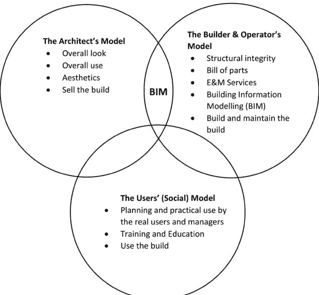

图 3.2

三环设计模型。

设计工作流（Hudson-Smith, 2022）。取而代之的是需要一种三环方法（如图 3.2 所示），用户也可以访问针对其需求优化的模型，并了解实际使用产品或建筑是什么感觉（Burden, 2020）。

虚拟世界非常适合这种方法，因为它们允许多人同时探索项目或地点，共享笔记，并按自己的方式接近产品——而不是设计者或建造者的方式（Anderson et al., 2014）。此类方法的示例包括 City4.0/Curiosity——使用 Unity 创建（Hunter et al., 2022）、巴西的 Tirol Town——在 Minecraft 中创建（de Andrade et al., 2020）以及伯明翰虚拟图书馆（见图 3.3）——在 Second Life 中创建（Hand, 2011）*。这些模型不必仅仅是被动的表示。用户可以获得设计选项进行试用，环境中可以包含 3D 便利贴，以允许用户注释（以及评论和投票支持/反对）特定问题，或者在受到某种残疾影响时尝试浏览建筑或使用设备。

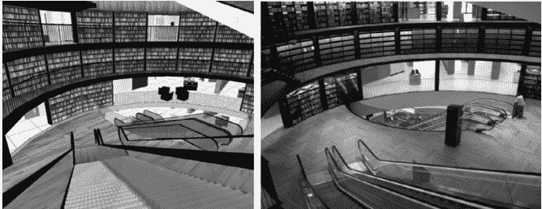

图 3.3 比较伯明翰图书馆的虚拟构建和物理构建。

## 数字孪生

数字孪生概念可追溯至 2002 年和佛罗里达理工学院先进制造中心（Grieves, 2003; Mihai et al., 2022）。其核心思想是，组织维护一份真实设备（甚至场所或团队）的数字副本，将该模型输入所有关于物理实例的数据，从而能够持续进行“如果……会怎样”的推演，探讨物理系统随时间如何响应，无论是涉及维护故障等慢性问题，还是涉及运行条件突然变化等急性问题。目标系统可以是从船舶发动机——或整艘船舶——到整个工厂及其所有生产线，甚至整个城市。迪拜和上海都已宣布计划为自身建设数字孪生（Gazit, 2024），而伦敦、纽约、东京、首尔、圣莫尼卡和新加坡都已在某种形式的数字孪生城市建设中（Ibrahim, 2022）——尽管除了视觉表现之外，实际最终会建设什么，仍存争议。Juárez-Juárez et al. (2021) 提供了数字孪生的分类法，以及可能涉及的技术和方法的良好概述，包括数据建模、数据管理、通信和多代理系统。

虽然数字孪生只需在数字和代码中实现，但人们自然倾向于至少通过 2D 图形界面来展示它，甚至将其作为 3D 模型。与元宇宙的真正重叠开始于管理人员和维护人员可以围绕该模型行走，获得主观和客观两方面的视角来了解正在发生的事情。他们可以使用虚拟平板电脑、抬头显示器（HUDs）或 AR 显示屏来检查性能的物理版和数字版（Eyre & Freeman, 2018），或者体验数字孪生数据作为熔融孪生（Fused Twin），在物理世界中与物理孪生（Physical Twin）位于同一空间内（Grübel et al., 2022）。主要好处是，操作员能够以更即时、可访问、具备上下文感知、令人难忘且可能更具洞察力的方式，对整个系统进行全局视角，这比一张充满数字的电子表格或 2D 图形更优。

## 科学与研究

虽然虚拟世界的大部分科学应用已通过前面讨论的协作功能来覆盖，或者利用了已经描述的一些其他用例，但元宇宙技术和虚拟世界还有许多更具体的科学和研究应用。最明显的一个——是能够在微观或宏观尺度上主观体验事物——无论是检查分子中的化学键（例如 Seritan et al., 2021），还是星系的相互作用和演化（例如 Jarrett et al., 2021）。

使用虚拟世界以沉浸式、交互式可视化展示任何数据是另一个重要的潜在应用领域——这一学科被称为沉浸式视觉分析（Immersive Visual Analytics）（Cybulski et al., 2014; Thomas & Cook, 2005）。示例包括沉浸式分析工具包（Immersive Analytics Toolkit）（Cordeil & Dwyer, 2019），或者 David 使用 Datascape 的工作（Burden, 2021）——如图 3.4 所示。此类可视化基于以自我为中心的原则（所有信息均相对于查看者），而不是基于以他为中心的基础（所有信息均相对于任意原点）（Klatzky et al., 1998）。由于人们主要基于以自我为中心的方式与物理世界交互，因此当数据以

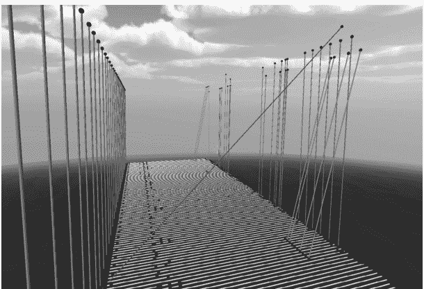

图 3.4
使用 Datascape 在 VR 中查看网络安全数据。

以自我为中心的方式。借助合适的脚本工具，任何虚拟世界或元宇宙环境都可以支持此类协作式 3D 数据可视化。

与此相关的是“数据花园”（Driver, 2009）的概念，或许更准确的描述是“信息花园”——一个你可以在其中漫步并了解某个话题、用自己的评论和研究进行补充，并与其他人相遇讨论的地方——介于海报会议、同行评议期刊、维基和博物馆之间。在很多方面，这些是“记忆宫殿”模型（Vindanes et al., 2018）的延伸，旨在改善记忆，但在共享的虚拟实现环境中。此类空间实施了以自我为中心的模型，因此你记住部分信息是因为其空间位置以及你寻找它所经历的旅程（可能有许多路线，每条路线都有自己的主题）。为该模型增加自动化头像，它们不仅可以引导你了解信息，还可以分享其他人对该信息的解读，你就会得到一种用于收集、共享、沟通和发展科学知识的新潜在模式。在科学研究的“前线”工作，几乎可以字面上理解为将这个花园延伸到新领域。

## 元宇宙：批判性导论的信息花园

已在 VR 中制作了一个基本信息花园以支持本书。每个章节都有自己的区域，包含与本书内容相关的信息和链接。由于这是一个社交环境，你甚至可能会遇到其他读者——甚至是作者！你可以通过系列网站 http://themetaverseseries.info/ 访问它。

## 战争与军事

围绕 HMD-VR 以及更广泛的仿真技术的早期工作大多源出于对更安全、成本更低的军事人员培训方式的需求。军队也是 CAD 技术的早期采用者，以帮助设计新系统。虽然此类活动大多在封闭系统中进行（例如第 1 章提到的 *Virtual Battle Systems*（VBS）），但社交虚拟世界的出现鼓励了更多基层活动，探讨虚拟世界如何支持从培训（Maxwell, 2012）到理解反潜作战（Aguiar & Monte, 2011）等军事活动。其中许多通过美国政府的联邦虚拟世界联盟（Harris, 2010）汇集在一起。

军队也对数字孪生浓厚兴趣，无论是它们如何帮助管理军事系统，还是如何帮助理解和规划全球（通常为城市）地点的行动。一个简单数字孪生的早期示例是，在美军特种部队袭击奥萨马·本拉登的藏身处之前，为其建立了 3D 模型（R. E. Smith & Vogt, 2014）。最近，美军（无疑还有其他军队）一直在研究使用 VR 进行规划，以及使用头盔集成 MR 头显来提高其士兵（Shear, 2023）和飞行员（Webster, 2021）的态势感知能力。然而，前面提到的 Snowden/NSA 文件（NSA, 2008）也强调，反对派可能也在使用虚拟世界，而有时被称为“灰色地带战争”（Brands, 2016）的事情可能已经在社交虚拟世界中发生，正如它在更传统的社交媒体平台上已经发生一样（Matisek, 2017）。这的最终表现可能是元宇宙中的战争——既通过“游戏内”活动进行，也通过针对平台代码和基础设施的网络攻击进行。因此，军队需要意识到元宇宙的挑战以及机遇。

## 太空探索

VR 已经被用来让学生探索太阳系中的世界（W. Huang et al., 2021），也被科学家和工程师用于规划和支持真实的太空任务，例如 NASA 的火星 XR 运行支持系统（XOSS）环境（https://www.buendea.com/xoss）。AR 和 VR 也已在国际空间站上用于从机器人和实验控制到锻炼等各种任务（Guzman, 2021）。对于某些年龄段的人来说，在模糊的黑白电视机上观看 1969 年的月球登陆是一个改变人生的时刻。但第一次载人火星登陆会是什么样子呢？任何着陆点都会事先进行详细勘测，并预先部署设备，因此团队将已经拥有详细的 3D 模型和模拟以及整个虚拟火星区域来进行练习和规划。XOSS 和火星车已经开始这样做，NASA 团队可以使用 VR 站在火星上的火星车旁边来规划其下一步行动（Samuelsson, 2018），阿联酋也在使用元宇宙来规划其自己的火星定居点（Hasan, 2023）。美国太空军甚至将其使用 XR 技术支持太空行动的愿景称为“SpaceVerse”（Kauchak, 2023）。

当首次人类登陆火星时，没有理由不将该虚拟火星的一个版本公开提供，这样任何人都可以站在虚拟火星上观看第一批宇航员踏上这颗星球——既可以通过实时视频观看，也可以在他们面前以虚拟头像的形式观看。在该环境的私有版本中，支持团队也可以做同样的事情——宇航员的头显中可以配备 MR 显示屏，这样他们就可以看到支持团队，仿佛他们与自己一起站在火星上，并作为物理-虚拟团队协作探索火星。当然，两颗行星之间传输存在 3-21 分钟的时间延迟这一小问题，因此两个团队实际上可能正在进行交互

带有自动化头像，即物理人类的数字孪生体，随着计划和活动的展开而不断更新。

## 一个集成的元宇宙

在审视了元宇宙技术的一系列经过验证的应用后，有必要考虑某种形式的集成元宇宙能提供什么，而将每个用例分散地实现在各种不同的元宇宙系统上可能无法实现。本节的重点在于该论点的更技术层面，而第5章则考虑更社会层面的问题。尽管Au（2023）认为“元宇宙”一词正变得类似于“社交媒体”，没有必要的底层共享技术或集成，但本节主张某种程度的集成应是目标，并且应基于开放标准。

## 降低成本并增加重用

通过共享技术和方法，支持不同元宇宙体验的基础设施的开发时间和成本预计会因高度重用而降低，这与Web一样。Web服务器成本通常只是任何Web应用中微不足道的一部分，除非是为了高使用量而进行扩展。元宇宙也应如此——为新体验设置核心基础设施（无论是本地服务器还是云托管）应该是一项简单、快速且廉价的任务，以此实现创建新体验的访问民主化。

同样，如果所有元宇宙体验都使用同一套核心工具集和方法，那么在元宇宙上开发这些体验所需的时间和成本预计会更低。公民开发者只需学习一次，就可以将这些知识应用到任何体验中，无论与工作、娱乐、爱好还是家庭相关。在一个体验中开发的工具和对象可以轻松地在另一个体验中重用，从而节省更多时间和成本。

## 访问和体验的一致性

在手机上，用户习惯于“为每个应用都有一个应用”的模式（即使其中许多只是封装了Web浏览器的URL），而在PC上，“通过Web完成一切”似乎正成为主导模式（也许电脑游戏除外，这一点本身就很重要）。过去几十年来交付虚拟世界所面临的挑战意味着桌面应用几乎一直是唯一的选择，但随着WebXR的出现，这种情况正在改变。对于大多数元宇宙应用，预测在未来五到十年内，它们可以很容易地通过基于浏览器的模式交付，因此访问不同体验就与在Web浏览器中点击收藏夹没有什么区别——而且确实应该（并且很可能也应该）是同一个浏览器。无论是通过可下载的应用程序还是Web URL进行交付，都需要一套足够的发现工具，包括经过策划的和未经过策划的，以帮助用户在需要时找到他们所需的元宇宙体验——例如第1章中提到的Google搜索上类似Lively风格的“沉浸式”标签页的想法。

除了访问的一致性之外，还存在体验一致性的问题。在Web早期，网页和网站的工作方式具有一致性，这在一定程度上得益于Nielsen和Loranger（2006）等人的可用性工作。元宇宙的共享技术基础应该使跨应用程序鼓励用户界面一致性变得更容易，即使只是在使用图标、术语、导航命令以及理解世界之间链接将如何工作等基本方面（类似于Web上的带下划线超链接）。这并不是说每个体验都需要看起来和工作方式相同——实际上，Web已经远离了Nielsen时代的建议，因为它变得更像“应用”——但当然，在新用户刚开始适应元宇宙体验的早期阶段，为他们提供一定程度的体验一致性应该会显著有助于推动采用。

## 体验的连续性和协同机会

通过提供体验一致性，特别是通过提供体验之间的链接，用户在从一个体验转移到另一个体验时，将不需要切换思维模式或冒失去思维链条的风险。工作与生活模式的变化正在导致物理工作与个人和爱好体验之间界限日益模糊（Kossek，2016）。元宇宙难道不也应该实现这一点，允许用户在所有兴趣之间模糊其元宇宙使用方式吗？当然，许多人希望为工作、家庭和爱好保持独立的身份，元宇宙必须积极支持这一点——特别是在头像外观和游戏内命名方面。理想情况下，在工作、家庭和娱乐中共享元宇宙环境也应鼓励人们识别并采取行动，利用不同体验之间的协同效应，从而带来更大的创造力和创新。本章所有示例中使用的各种不同平台证明了当前元宇宙体验的碎片化特征——重复无疑很常见，协同可能性也被忽略。

## 持续演进

回到Nielsen，1996年的网站与2023年的网站（或Web应用）截然不同。Web通过不断更新其部分关键组件，引入了级联样式表、WebSockets和WebGL等功能，并辅以Ruby on Rails、React和node.js等不断变化的开发方法，使网站能够不断演进以满足用户不断变化和发展的需求和期望。任何元宇宙也预计会演进。在分段的独立元宇宙模型中，每个新发展可能出现在一个平台上，其他平台可能也可能无法复制，而专有模型将开发限制在系统所有者本身。尽管多个系统中的创新可能更快（每个系统的利益相关者更少，遗留和可扩展性问题也更少），但该创新的传播可能会大大减少。

## 避免冗余并延续体验

与持续演进问题相关的还有冗余问题以及创建孤立世界的危险。1996年的网页在现代浏览器中应该和创建时一样可以显示和使用。然而，计算机游戏世界尤其散落着许多已经无法在当今计算机或游戏平台上运行的游戏（Guttenbrunner等人，2010年）。体验的丧失也来自平台运营的终止，或者只是商业模式的改变——2000年代的许多Second Life项目已不再可用，因为所有者无法负担或证明对sim的每月付款是合理的，而且与OpenSim不同，无法创建构建的离线存档。通过采用元宇宙技术的通用基础方法，应用程序的生命周期不再应受其原始平台可用性（或变化）的限制。应该能够轻松地在元宇宙服务提供商之间移动体验，并最终创建一个随时可以重新激活的离线存档。

## 社区

主张元宇宙至少应该是一系列连接的世界，这不仅是技术论点，也是社会论点。尽管本题的某些方面将在第5章中更详细地考虑，但社区的关键问题最好在此处解决。有些人认为元宇宙主要关乎社区——元宇宙世界之间的互连不如社区之间的互连重要（例如Au，2023）。只要每个社区都能找到一个家园，元宇宙中每个世界与另一个世界的连接程度如何就无关紧要。反对这一观点的论点是，每个人都可能是多个社区的成员——家庭、地区、工作、爱好、兴趣等。如果每个社区都在不同的平台上运行，那么在它们之间移动、共享体验和加入新社区时，这将立即成为障碍。这已经阻碍了用户，因为社区可能分散在WhatsApp、Facebook、LinkedIn、Discord、TikTok、Telegram以及无数其他服务上。元宇宙是一个尝试把这件事做好的机会——拥有足够的共同基础来便于服务之间的访问，同时也

在需要时支持身份分区，并提供工具，使每个社区都能实现最大程度的表达。

如前所述，社交虚拟世界体验的一个关键方面在于，它最终还是回归到一群（相对较少的）人围坐在篝火旁闲聊。当前社交空间所带来的匿名性和缺乏在场感——即使是最小众的兴趣也能吸引数百甚至数千用户——往往不利于丰富且深入的对话与关系建立。将元宇宙作为支持社区及其话语的主要手段，或许能改变这一现状。

## 面向一体化元宇宙的挑战

面向一体化元宇宙或多元宇宙的一个主要挑战在于开发者之间达成一致，以及对标准的选择、实施和遵守。元宇宙行业尚未在 WebXR 等相对底层的技术标准之外形成一套标准，尽管跨行业标准工作至少自 2000 年代以来便已存在。当前正在进行的多个“标准”倡议（当然，这本身也是问题的一部分！）将在第 4 章中讨论。即使在关键要素上达成协议，它们仍需被平台开发者、大企业以及爱好者所采纳，才能产生真正的影响。与此相关的还有开放标准与专有标准之争，这将在后文中再次探讨。

达成协议需要时间，对任何协议的修改同样需要时间，因此一体化元宇宙的发展可能比多个不连接的非标准元宇宙更缓慢。还有标准化可能扼杀创造力的风险。任何标准都需要允许开发者突破边界，如同在 Web 上所发生的那样，尝试新方法——可能是在私有系统上的代码私有分支中，或者在坚持遵循核心标准并为其“元宇宙浏览器”不支持的新功能提供向后兼容性的同时，保持对核心标准的遵守。那些经得起时间考验的新功能可以重新纳入标准。第 5 章将探讨更多挑战，特别是与隐私、监控和控制相关的挑战，所有这些都可能因互联的元宇宙而变得更加严峻。

## 摘要

本章展示了元宇宙技术已存在的广泛应用场景，其中许多已被探索并用于个人和商业利益超过十年。这些场景表明元宇宙技术有多么有益，随着各行业越来越多地使用元宇宙，其重要性只会不断增长。本章还论证了，将这些应用实现为至少某种形式的链接元宇宙——在其中跨平台共享通用标准和方法，并在平台与体验之间建立链接——可能比一系列孤立的虚拟世界、VR 或“元宇宙”体验提供更好的整体解决方案。

创建一个统一创建和访问虚拟世界体验方法的元宇宙，正如万维网为在线内容所做的那样，可能为创建一个不仅民主——使人们能够创建和使用他们想要的任何内容——而且还能增长和生存的元宇宙提供最佳机会。然而，这种方法也存在潜在挑战——将在第 5 章中探讨，一些可能的后果将在第 6 章中探讨。

下一章将更详细地探讨支撑元宇宙的技术，并继续构建关于某种形式的一体化、开放标准元宇宙的论点。

## 注释

- 1 David 的公司为 Southampton Solent University 构建了此项目。
- 2 Maggi 和 David 均参与了此项目。
- 3 Maggi 和 David 均参与了此项目。
- 4 这是 David 和 Daden Limited 主导的项目。

## 参考文献

- Aguiar, S., & Monte, P. (2011). 用于 C2 设计、分析与实验的虚拟世界. 第 16 届国际指挥与控制研究与技术研讨会论文集. https://apps.dtic.mil/sti/pdfs/ADA547157.pdf
- Alizadehsalehi, S., Hadavi, A., & Huang, J. C. (2020). 从 BIM 到 AEC 行业的扩展现实. 施工自动化, 116, 103254.
- Anderson, A., Dossick, C. S., Azari, R., Taylor, J. E., Hartmann, T., & Mahalingham, A. (2014, May). 将 BIM 作为化身探索：使用 3D 虚拟世界改善模型协作. 2014 年建筑研究大会：全球网络中的建筑（第 179–188 页）. 美国土木工程师学会.
- Appel, L., Appel, E., Bogler, O., Wiseman, M., Cohen, L., Ein, N., Abrams, H. B., & Campos, J. L. (2020). 有认知和/或身体障碍的老年人可以从沉浸式虚拟现实体验中获益：一项可行性研究. 医学前沿, 6, 329.
- ARKx. (2022, July 24). 2022 年迪拜购物节——增强元宇宙. Medium. https://medium.com/@arkx/dubai-shopping-festival-2022-augmented-metaverse-263fdf06ac96
- ARTDEX. (n.d.). 虚拟艺术完全指南. ARTDX. https://www.artdex.com/the-complete-guide-on-virtual-art
- Au, W. J. (2023). *打造一个重要的元宇宙：从《雪崩》和《第二人生》到值得为之奋斗的虚拟世界*. John Wiley & Sons.
- Baek, Y., Min, E., & Yun, S. (2020). 挖掘 Minecraft 的教育启示. *学校中的计算机*, 37(1), 1–16.
- Balogh, G., & Beszedes, A. (2013). CodeMetropolis—基于 Minecraft 的开发者协作工具. *2013 年第一届 IEEE 软件可视化工作会议 (VISSOFT)*（第 1–4 页）. IEEE.
- Barteit, S., Lanfermann, L., Bärnighausen, T., Neuhann, F., & Beiersmann, C. (2021). 用于医学教育的基于增强现实、混合现实和虚拟现实的头戴式设备：系统综述. *JMIR 严肃游戏*, 9(3), e29080.
- Bauer, A. C. M., & Andringa, G. (2020). 沉浸式虚拟现实用于老年人认知训练的潜力. *老年学*, 66(6), 614–623.
- Beck, D., Morgado, L., Lee, M., Gütl, C., Dengel, A., Wang, M., Warren, S., & Richter, J. (2021). 迈向沉浸式学习知识树——该领域知识和工具映射的概念框架. *2021 年第 7 届沉浸式学习研究网络国际会议 (iLRN)*（第 1–8 页）. IEEE.
- Bellalouna, F., & Puljiz, D. (2023). 工业元宇宙方法在工程设计审查中的应用用例. *Procedia CIRP*, 119, 638–643.
- Blackwood, G. (2023). Roblox 与 Meta Verch：沃尔玛 Roblox 游戏案例研究. *M/C 期刊*, 26(3). https://doi.org/10.5204/mcj.2958
- Boughzala, I., de Vreede, G. J., & Limayem, M. (2012). 虚拟世界中的团队协作：特刊序言. *信息系统协会期刊*, 13(10), 6.
- Brands, H. (2016). *灰色地带的悖论* (SSRN 学术论文编号 2737593). https://doi.org/10.2139/ssrn.2737593
- Brown, B., & Bell, M. (2006). There 中的游戏与社交性：来自在线游戏的协作虚拟环境经验. *工作与娱乐中的化身：共享虚拟环境中的协作与互动*（第 227–245 页）. Springer Netherlands.
- Burden, D. J. H. (2021). *沉浸式视觉分析：一份白皮书*. Daden Limited. https://www.daden.co.uk/_files/ugd/0c2908_0369a471a71d4e8291f6d4730daf129d.pdf
- Burden, D. J. H. (2020). 使用 3D 可视化技术改进设计和访客导向. 在 R. Parry, R. Page, R., & A. Moseley (编), *博物馆门槛：抵达的设计与媒介*（第 124–152 页）. Routledge.
- Cannone, G. (2021). 最新数字时尚趋势：虚拟服装洞察. *时尚技术加速器*. https://www.ftaccelerator.it/blog/digital-fashion-virtual-clothing/
- Chandler, T., & Clulow, A. (2019). 为教室构建虚拟城市：吴哥. *非过去：特稿*.
- Chandler, P., & Sweller, J. (1991). 认知负荷理论与教学形式. *认知与教学*, 8(4), 293–332.
- Childs, M. (2008). 使用中介环境参考模型评估学习者在第二人生中的体验. 第六届网络学习国际会议论文集（第 38–45 页）. 兰卡斯特大学/SEERC.
- Cijntje, E., & van Gisbergen, M. S. (2022, April). 唤起真实还是真实威胁？化身中的现实感如何影响异性恋女性对虚拟现实色情和关系的感知. *国际 XR 会议*（第 319–331 页）. Springer International Publishing.

Conradi, E., Kavia, S., Burden, D., Rice, A., Woodham, L., Beaumont, C., Savin-Baden, M., & Poulton, T. (2009). 虚拟世界中的虚拟患者：培训急救专业学生的实践. 医学教师, 31(8), 713–720.

Cordeil, M., & Dwyer, T. (2019). IATK简介：一个沉浸式可视分析工具包. 2019年ACM交互表面与空间国际会议论文集（第431–435页）. 计算机协会.

Costa, M. T. S., Vieira, L. P., de Oliveira Barbosa, E., Oliveira, L. M., Maillot, P., Vaghetti, C. A. O., Carta, M. G., Machado, S., Gatic-Rojas, V., & Monteiro-Junior, R. S. (2019). 基于虚拟现实的电子游戏运动作为不同情境下的医疗手段：一篇简要综述. 临床实践与心理健康流行病学：CP & EMH, 15, 15–20.

Cremorne, L. (2008). 第二人生中的温布尔登. 元宇宙杂志. http://metaversejournal.com/2008/06/18/wimbledon-in-second-life/

Cunningham, C. A., & Harrison, K. (2010). 第二人生对PreK-12教育的可能性. 在J. Braman & G. Vincenti (编), 通过多用户虚拟环境教学：将动态元素应用于现代课堂 (第120–138页). IGI Global.

Curry, D. (2023). 约会应用收入与使用统计数据（2023年）. 商业应用. https://www.businessofapps.com/data/dating-app-market/

Cybulski, J., Keller, S., & Saunders, D. (2014). 交互式可视分析中的隐喻. 第七届视觉信息通信与交互国际研讨会论文集（第212–215页）. 计算机协会.

Dalgarno, B., & Lee, M. J. (2010). 3D虚拟环境的学习可能性是什么？. 英国教育技术杂志, 41(1), 10–32.

Danforth, D. R., Procter, M., Chen, R., Johnson, M., & Heller, R. (2009). 医学教育虚拟患者模拟的开发. 虚拟世界研究杂志, 2(2), 4–11.

de Andrade, B., Poplin, A., & Sousa de Sena, Í. (2020). 将Minecraft作为吸引儿童参与城市规划的工具：巴西蒂罗尔镇案例研究. ISPRS国际地理信息杂志, 9(3), 170.

De Bonis, M., Nguyen, H., & Bourdot, P. (2022, 10月). 考古学扩展现实应用中用户研究的文献综述. 2022年IEEE混合与增强现实国际研讨会（ISMAR）（第92–101页）. IEEE.

de Ruyter, K., Heller, J., Hilken, T., Chylinski, M., Keeling, D. I., & Mahr, D. (2020). 从客户视角看：探索AR广告的挑战与机遇. 广告杂志, 49(2), 109–124.

Deloitte. (2022). 试穿一下：元宇宙时尚可能到2030年成为550亿美元产业. 德勤. https://action.deloitte.com/insight/1514/try-this-on-for-size

Dewey, J. (1986). 经验与教育. 教育论坛（第50卷，第3期，第241–252页）. 泰勒与弗朗西斯集团.

Dixie, A. (2023). 程序化广告：它就在游戏中. MediaWrites. https://mediawrites.law/programmatic-advertising-its-in-the-game/

Driver, E. (2009). ThinkBalm数据花园现已上线！. ThinkBalm. https://thinkbalm.com/thinkbalm-data-garden-is-live/

Ellaway, R., Poulton, T., Fors, U., McGee, J. B., & Albright, S. (2008). 构建虚拟患者公共平台. 医学教师, 30(2), 170–174.

Emmelkamp, P. M., Meyerbröker, K., & Morina, N. (2020). 社交焦虑障碍的虚拟现实疗法. 当前精神病学报告, 22, 1–9.

Evans, L. (2023). 虚拟现实色情：与健康相关的机遇与挑战综述. 当前性健康报告, 15, 26–35. https://doi.org/10.1007/s11930-022-00352-9

Eyre, J., & Freeman, C. (2018). 工业数字孪生的沉浸式应用. EuroVR 2018工业轨道. 第15届EuroVR年度会议论文集（第11–13页）. 芬兰VTT技术研究中心.

Falconer, C. J., Rovira, A., King, J. A., Gilbert, P., Antley, A., Fearon, P., Ralph, N., Slater, M., & Brewin, C. R. (2016). 在虚拟现实中体现自我同情及其对抑郁症患者的影响. BJPsych Open, 2(1), 74–80.

Falconer, L., Burden, D., Cleal, R., Hoyte, R., Phelps, P., Slawson, N., Snashall, N., & Welham, K. (2020). 虚拟鸟占：探索虚拟考古模拟中的地方感. 虚拟考古评论, 11(23), 50–62.

Farley, H. S. (2018). 在监狱中使用3D世界：驾驶、学习与逃避. 虚拟世界研究杂志, 11(1), 1–11.

Forte, M., Lercari, N., Galeazzi, F., & Borra, D. (2010). 元宇宙社区与考古学：特拉莫案例. 第三届数字遗产国际会议，塞浦路斯利马索尔.

Fox, J., Bailenson, J. N., & Tricase, L. (2013). 性化虚拟自我的具身化：普罗透斯效应及通过头像的自我客体化体验. 人类行为中的计算机, 29(3), 930–938.

Freitas, D. M. D. O., & Spadoni, V. S. (2019). 虚拟现实对接受医疗程序的患者疼痛管理是否有用？. 爱因斯坦（圣保罗）, 17. https://doi.org/10.31744/einstein_journal/2019MD4837

Gazit, E. (2024). 介于迪拜与上海之间：人工智能时代元宇宙的未来（第一部分）. MetaYeda. https://metayeda.substack.com/p/dubai-and-shanghai-metaverse-ai-odyssey

Goodman, K. (2023). 堡垒之夜如何将品牌编织进游戏并赚取数十亿. 奇特营销故事. https://weirdmarketingtales.com/fortnite-integrates-brands-makes-billions/

Greeno, J. G., Smith, D. R., & Moore, J. L. (1993). 情境学习的迁移. 在D. K. Detterman & R. J. Sternberg (编), 迁移受审：智能、认知与教学 (第99–167页). Ablex Publishing.

Grieves, M. (2003). 数字孪生：减轻复杂系统中不可预测、不可取的涌现行为. 佛罗里达理工学院先进制造与创新设计中心（CAMID）. https://polytechnic.purdue.edu/sites/default/files/files/Fall16-%20Grieves%20-%20Digital%20Twin%20Mitigating%20Unpredictable%20systems.pdf

Grubb, J. (2016). 微软禁止企业将Minecraft用作营销工具. VentureBeat. https://venturebeat.com/games/microsoft-bans-corporations-from-using-minecraft-as-a-marketing-tool/

Grübler, J., Thrash, T., Aguilar, L., Gath-Morad, M., Chatain, J., Sumner, R. W., Hölscher, C., & Schnazi, V. R. (2022). 融合孪生搭车者指南：智慧城市中就地访问数字孪生的综述. 遥感, 14(13), 3095.

Guttenbrunner, M., Becker, C., & Rauber, A. (2010). 让游戏延续：评估主机视频游戏保护策略. 国际数字策展杂志, 5(1). https://doi.org/10.2218/ijdc.v5i1.144

Guzman, A. (2021). 我们在国际空间站使用AR和VR的九种方式. NASA. https://www.nasa.gov/mission_pages/station/research/news/nine-ways-we-use-ar-vr-on-iss

Haber, J., Xu, H., & Priya, K. (2023). 利用虚拟现实进行管理培训：一项纵向研究. 组织管理杂志, 20(3), 93–106.

Hagerty, P. (2012). 元宇宙先驱与OpenSimulator的殖民. 元宇宙创造（新标题：虚拟创造）, 2(1), 97–114.

Hamari, J., Koivisto, J., & Sarsa, H. (2014, 1月). 游戏化有效吗？关于游戏化实证研究的文献综述. 2014年第47届夏威夷系统科学国际会议（第3025–3034页）. IEEE.

Hand, R. (2011). 伯明翰虚拟图书馆向公众开放探索之门. VizWorld. https://vizworld.com/2011/07/virtual-library-birmingham-opens-doors-public-exploration/

Han, J., Liu, G., & Gao, Y. (2023). 元宇宙中的学习者：关于在学习中使用Roblox的系统综述. 教育科学, 13(3), 296.

Harris, C. (2010). 政府联盟将调查虚拟世界最佳实践. 政府技术. https://www.govtech.com/dc/articles/government-consortium-to-investigate-virtual-world.html

Hasan, S. (2023). 阿联酋2117年火星定居计划将在元宇宙中建设. 连线. https://wired.me/technology/uaes-2117-mars-settlement-plan-is-to-be-built-in-the-metaverse/

Heiyantuduwa, T. A., Amarapala, K. N. U., Gunathilaka, K. V. B., Ravindu, K. S., Wickramaratne, J., & Kasthurirathna, D. (2020). VirtualPT：面向老年人的基于虚拟现实居家物理治疗康复. 在2020年第二届计算进步国际会议（ICAC）（第1卷，第311–316页）. IEEE.

Huang, Y. (2020). 评估建筑设计与施工布置中的混合现实技术. 土木工程与建筑技术杂志, 11(1), 1–12.

Huang, W., Roscoe, R. D., Johnson-Glenberg, M. C., & Craig, S. D. (2021). 跨多次虚拟现实会话和沉浸水平的动机、参与度与表现. 计算机辅助学习杂志, 37(3), 745–758.

Hudson-Smith, A. (2022). 即将到来的元宇宙：城市规划的数字镜像. 城市规划, 7(2), 343–354.

Hunter, M. G., Soro, A., Brown, R. A., Harman, J., & Yigitcanlar, T. (2022). 增强City 4.0中的社区参与：城市公共空间中数字代理的考量. 可持续性, 14(16), 9803.

Ibrahim, D. (2022). 2023年值得关注的8个元宇宙城市. 元宇宙内幕. https://metaverseinsider.tech/2022/12/16/metaverse-cities/

Iqbal, M. (2023). Tinder收入与使用统计数据（2023年）. 商业应用. https://www.businessofapps.com/data/tinder-statistics/

Jarrett, T. H., Commie, A., Marchetti, L., Sivitilli, A., Macfarlane, S., Vitelò, F., Becciani, U., Taylor, A. R., van der Hulst, J. M., Serra, P., Katz, N., & Cluver, M. E. (2021). 在虚拟现实中探索与质疑天体物理数据. 天文学与计算, 37, 100502.

Johansson, M., Roupé, M., & Bosch-Sijtsema, P. (2015). 建筑信息模型（BIM）的实时可视化. 建筑自动化, 54, 69–82.

JoHo, J. (2021). 最佳虚拟现实色情游戏及如何玩成人VR. Mashable. https://mashable.com/article/best-vr-porn-games

Juárez-Juárez, M. G., Botti, V., & Giret Boggino, A. S. (2021). 数字孪生：综述与挑战. 计算与信息科学工程杂志, 21(3), 1–23. https://doi.org/10.1115/1.4050244

Kauchak, M. (2023). 将“SpaceVerse”变为现实. Halldale集团. https://www.halldale.com/articles/21010-mst-brings-spaceverse-to-reality

Kirriemuir, J. (2009). 作品集. Silversprite. https://www.silversprite.com/?page_id=285

Klatzky, R. L., Loomis, J. M., Beall, A. C., Chance, S. S., & Golledge, R. G. (1998). 真实、想象和虚拟运动过程中的自我位置与方向空间更新. 心理科学, 9(4), 293–298.

Kolb, D. A. (2014). 经验学习：经验作为学习与发展的来源. FT出版社.

Kononowicz, A. A., Woodham, L. A., Edelbring, S., Stathakarou, N., Davies, D., Saxena, N., Car, L. T., Carlstedt-Duke, J., Car, J., & Zary, N. (2019). 卫生专业教育中的虚拟病人模拟：数字健康教育协作的系统评价与荟萃分析. 医学互联网研究杂志, 21(7), e14676.

Kossek, E. E. (2016). 数字时代的工作与生活边界管理. 组织动态, 45, 258–270.

Ladwig, P., & Geiger, C. (2019). 混合现实中的协作文献综述. 《智能产业与智能教育：第15届远程工程与虚拟仪器国际会议论文集》(第15届, 第591–600页). Springer国际出版公司.

Lai, X., Lei, X., Chen, X., & Rau, P. L. P. (2019). 虚拟现实能否满足老年人的娱乐需求？VR头显在老年护理中的应用. 《跨文化设计。文化与社会：第11届国际会议，CCD 2019，作为第21届人机交互国际会议HCII 2019的一部分，于2019年7月26–31日在美国奥兰多举行，论文集，第二部分》(第159–172页). Springer国际出版公司.

Lavoye, V., Sipilä, J., Mero, J., & Tarkiainen, A. (2023). 皇帝的新装：虚拟试穿服务体验中的自我探索式参与对品牌结果的积极影响. 服务营销杂志, 37(10), 1–21.

Lawton, G. (2022). 工业元宇宙将如何超越消费级元宇宙. VentureBeat. https://venturebeat.com/virtual/why-the-industrial-metaverse-will-eclipse-the-consumer-one/

Lee, A. (2023). 在游戏内广告世界中，内置广告与沉浸式品牌体验之间的紧张局势日益加剧. DIGIDAY. https://digiday.com/marketing/in-the-in-game-advertising-world-tension-is-mounting-between-intrinsic-ads-and-immersive-brand-experiences/

Lee, J., & Kundu, P. (2022). 用于远程制造的集成 cyber-物理系统与工业元宇宙. 制造快讯, 34, 12–15.

Lock, D., & Stewart-David, M. (2022). 打造一个 Immersical®. 写作平台. https://thewritingplatform.com/2022/05/the-making-of-an-immersical/

Loke, S. (2015). 虚拟世界体验如何促进学习？理论批判性综述. 澳大拉西亚教育技术杂志, 31(1), 112–122.

Luna, U., Rivero, P., & Vicent, N. (2019). 遗产应用中的增强现实：欧洲的当前趋势. 应用科学, 9(13), 2756.

Mahajan, U. V., Sunshine, K. S., Herring, E. Z., Labak, C. M., Wright, J. M., & Smith, G. (2021). 术前患者教育中的虚拟现实：范围综述与推荐的试验设计指南. 外科杂志, 222(4), 704–705.

Maksimenko, N., Okolzina, A., Vlasova, A., Tracey, C., & Kurushkin, M. (2021). 通过沉浸式虚拟现实体验向一年级本科化学学生介绍原子结构. 化学教育杂志, 98(6), 2104–2108. https://doi.org/10.1021/acs.jchemed.0c01441

Matisek, J. W. (2017). 灰色地带威慑的多种面貌：在灰色地带作战的问题. 战略安全杂志, 10(3), 1–26.

Maxwell, D. (2012). 军事网格实现性能目标. Hypergrid Business. https://www.hypergridbusiness.com/2012/11/military-grid-hits-performance-goals/

McGuirt, J. T., Cooke, N. K., Burgermaster, M., Enahora, B., Huebner, G., Meng, Y., Trippicchio, G., Dyson, O., Stage, V. C., & Wong, S. S. (2020). 营养教育与行为中的扩展现实技术：全面范围综述与未来方向. 营养素, 12(9), 2899.

McLaughlan, J., & Farley, H. (2022). 通往知识的快车道：在监狱中使用虚拟现实进行学习. 《监狱教育的历史与哲学：目标、矛盾、承诺与问题》(第229–251页). Springer国际出版公司.

Meehan, A. (2022). 自2020年以来，Roll20用户数量翻倍，超过1000万人加入在线RPG平台. Dicebreaker. https://www.dicebreaker.com/companies/roll20/news/roll20-userbase-doubles

Meta. (2021, 10月28日). 元宇宙及我们如何共同构建它——Connect 2021 [Meta]. YouTube. https://www.youtube.com/watch?v=Vvufun6xer8&ab_channel=Meta

Mihai, S., Yaqoob, M., Hung, D. V., Davis, W., Towakel, P., Raza, M., Karamanoglu, M., Barn, B., Shetve, D., Prasad, R. V., Venkataraman, H., Trestian, R., & Nguyen, H. X. (2022). 数字孪生：支持技术、挑战、趋势与未来前景调查. IEEE通信调查与教程. https://eprints.mdx.ac.uk/36014/1/DT_Survey_Final_Accepted.pdf

Milrod, C., & Monto, M. A. (2012). 业余爱好者与女朋友体验：互联网性服务提供商男性客户的行为与偏好. 违规行为, 33(10), 792–810.

Moravcikova, D., & Kliestikova, J. (2017). 使用 phygital 营销传播进行品牌建设. 经济、商业与管理杂志, 5(3), 148–153.

Mordor. (2023). 基于位置的VR市场规模与份额分析——增长趋势与预测（2023–2028）. Mordor Intelligence. https://www.mordorintelligence.com/industry-reports/location-based-virtual-reality-vr-market

Mozgai, S., Hartholt, A., Leeds, A., & Rizzo, A. S. (2020). 用于VRET领域迁移的迭代参与式设计：从战斗暴露到军事性创伤. 2020年人机交互CHI会议扩展摘要，檀香山，夏威夷，美国.

Nesbitt, D. (无日期) 监控网络空间：互联网与性的爱恋. https://www.academia.edu/download/58017701/Monitoring_Cyberspace_-_The_Internets_Love_Affair_with_Sex.pdf

Nesson, R., & Nesson, C. (2008). 虚拟世界教育论. 空间与文化, 11(3), 273–284.

Nielsen, J., & Loranger, H. (2006). 网站可用性优先级. 皮尔森教育.

NSA. (2008). 利用恐怖分子对游戏和虚拟环境的使用. NSA. https://www.theguardian.com/world/interactive/2013/dec/09/nsa-files-games-virtual-environments-paper-pdf

O'Halloran, J. (2023). 企业和工业元宇宙超出预期. Computer Weekly. https://www.computerweekly.com/news/366541564/Enterprise-and-industrial-metaverses-exceeding-expectations

Ocausse. (2016). VR为何可能意味着艺术博物馆的终结. 哈佛大学. https://d3.harvard.edu/platform-rctom/submission/why-vr-could-mean-the-end-of-art-museums/

Paro, M. R., Hersh, D. S., & Bulsara, K. R. (2022). 神经外科培训中虚拟现实与增强现实的历史. 世界神经外科, 167, 37–43.

PlayTracker. (2023). Steam上的桌面模拟器. PlayTracker. https://playtracker.net/insight/game/4468

Plotzky, C., Lindwedel, U., Sorber, M., Loessl, B., König, P., Kunze, C., Kugler, C., & Meng, M. (2021). 护理教育中的虚拟现实模拟：系统映射综述. 护理教育今日, 101, 104868.

Prem, A.-L. (2023). 未来趋势：2023年数字时尚及其之后的下一步. 元宇宙时尚委员会. https://metaversefashioncouncil.org/news/future-trends-whats-next-for-digital-fashion-in-2023-and-beyond

Ratcliffe, J., & Simons, A. (2017). 3D游戏引擎如何创建照片级真实感交互式建筑可视化？《电子学习与游戏：第11届国际会议，edutainment 2017》(第164–172页). Springer国际出版公司.

Razali, M. F., Haron, N. A., Hassim, S., Alias, A. H., Harun, A. N., & Abubakar, A. S. (2019, 11月). 综述：建筑全生命周期中建筑信息模型（BIM）的应用. IOP会议系列：地球与环境科学（第357卷，第1期，第012028页）. IOP Publishing.

Regal, G., Pretolesi, D., Schrom-Feiertag, H., Puthenkalam, J., Migliorini, M., De Maio, E., Scarrone, F., Nadalin, M., Guarneri, M., Xerri, G. P., Di Giovanni, D., Tessari, P., Genna, F., D'Angelo, A., & Murtinger, M. (2023). CBRN事件虚拟现实培训中的挑战. 多模态技术与交互, 7(9), 88.

Ren, X. (2020). 人工智能与抑郁：虚拟现实游戏中AI驱动的聊天机器人如何降低焦虑和抑郁水平. 人工智能实践杂志, 3(1), 48–58.

Rosenkjar, D., Pacey, A., Montgomerie, R., & Skytte, A. B. (2022). 虚拟现实色情内容对精子捐赠者精液质量的影响：平衡随机对照交叉组内试验. 生殖生物学与内分泌学, 20(1), 1–8.

Rueda, C. J. A., Godines, J. C. V., & Rudman, P. D. (2018). 三维沉浸式数字环境教育效能分类. 信息技术教育杂志：实践创新, 17, 83–112.

Sampaio, M., Navarro Haro, M. V., De Sousa, B., Vieira Melo, W., & Hoffman, H. G. (2021). 治疗师转向远程心理学，以在COVID-19大流行期间安全地继续治疗患者。虚拟现实远程心理学可能是下一步. 虚拟现实前沿, 1, 576421.

Samuelson, A. (2018). 火星虚拟现实软件获得NASA奖. NASA. https://mars.nasa.gov/news/8374/mars-virtual-reality-software-wins-nasa-award/

Savin-Baden, M. (2007). 在线问题式学习实用指南. Routledge.

Schild, J., Carbonell, G., Tarrach, A., & Ebeling, M. (2022, 8月). ViTAWiN-面向急救人员和急诊护士的跨专业医学混合现实培训. 2022年IEEE第10届严肃游戏与健康应用国际会议（SeGAH）（第1–8页）. IEEE.

Schouten, A. P., van den Hooff, B., & Feldberg, F. (2010). 虚拟世界中的真实决策：3D虚拟世界中的团队协作与决策. 第2010年信息系统国际会议（ICIS）论文集. https://aisel.aisnet.org/icis2010_submissions/18

Schultz, R. (2019). Utherverse和红灯区：简要介绍. RyanSchultz.com. https://ryanschultz.com/2018/05/26/utherverse-and-the-red-light-center-a-brief-introduction/

Seritan, S., Wang, Y., Ford, J. E., Valentini, A., Gold, T., & Martínez, T. J. (2021). InteraChem: 反应性交互分子动力学的虚拟现实可视化器. 《化学教育杂志》, 98(11), 3486–3492.

Sharabi, L. (2022). 《约会元宇宙内部：你的虚拟现实约会指南》. 《心理学今日》. https://www.psychologytoday.com/gb/blog/dating-in-the-digital-age/202210/inside-the-datingverse-your-guide-virtual-reality-dating

Shear, F. (2023). IVAS的学习运动确保开发、生产和装备保持在正轨上. 《美国陆军》. https://www.army.mil/article/264773/ivas_campaign_of_learning_ensures_development_production_and_fielding_remain_on_track

Simon, S. C., & Greitemeyer, T. (2019). 沉浸感对色情感知的影响：一项虚拟现实研究. 《人类行为中的计算机》, 93, 141–148.

Skarredghost. (2022). AmazeVR “辣妹元宇宙”音乐会评论. 《幽灵嚎叫》. https://skarredghost.com/2022/12/04/amazevr-hottieverse-review/

Smith, L. (2022). 数字时尚有了新面貌. 《FWD》. https://www.wix.com/studio/blog/digital-fashion-2021

Smith, S. A. (2019). 情节记忆研究中的虚拟现实：一篇综述. 《心理科学通报与评论》, 26, 1213–1237.

Smith, R. E., & Vogt, B. D. (2014). 2025年地面系统、系统工程流程建议 (ADA608885). 《国防采购大学》.

Stone, R. (2008). 交互式3D和游戏化训练系统设计的人体工程学指南. 《人体工程学集成国防技术中心出版物》. 国防部. https://www.semanticscholar.org/paper/Human-Factors-Guidelines-for-Interactive-3-D-and-Stone/2042c99a1956314ddb0b4e13045c9215fafeb08

Styles, E. B. (2016). 泰特世界：在Minecraft中重新想象的艺术与文物. 《考古实践进展》, 4(3), 410–414.

Sutcliffe, C. (2022). 2100万人现在已造访Nike的Roblox商店。以下是如何正确进行元宇宙商业的方法. 《The Drum》. https://www.thedrum.com/news/2022/09/22/21m-people-have-now-visited-nike-s-roblox-store-here-s-how-do-metaverse-commerce

Taylor, M. J., Shikaislami, C., McNicholas, C., Taylor, D., Reed, J., & Vlaev, I. (2020). 使用虚拟世界作为医疗协作会议平台：一项可行性研究. 《BMC健康服务研究》, 20(1), 1–10.

Teng, M. Q., & Gordon, E. (2021). 监狱中的治疗性虚拟现实：与被监禁女性的参与式设计. 《新媒体与社会》, 23(8), 2210–2229.

Thomas, J. J., & Cook, K. A. (编). (2005). 照亮道路：视觉分析的研发议程. 《IEEE计算机学会》.

Tornincasa, S., & Di Monaco, F. (2010, 9月). CAD的未来与演变. 《第14届国际研究/专家会议论文集：机械及相关技术发展趋势》(第1卷，第1期，第11–18页). 《泽尼察大学》.

Uhomoibhi, J., & Ross, M. (2013). 计算机与工程教育中电子学习发展趋势. 《工程教学法国际期刊》, 3(2), 26–29.

Uribe Larach, D., & Cabra, J. F. (2010). 第二人生中的创造性问题解决：一项行动研究. 《创造力与创新管理》, 19(2), 167–179.

Van der Land, S., Schouten, A., & Feldberg, F. (2011). 元宇宙建模：3D虚拟环境中有效团队协作的理论模型. 《虚拟世界研究期刊》, 4(3) 1–16.

Vincent, J. (2021). 在GTA Online中上演《哈姆雷特》只是封锁能提供的最佳戏剧体验. 《The Verge》. https://www.theverge.com/tldr/2021/6/17/22538361/hamlet-gta-online-rustic-mascara-lobby

Vindenes, J., de Gortari, A. O., & Wasson, B. (2018). 墨涅摩绪涅：将位点法改编为沉浸式虚拟现实. 《增强现实、虚拟现实与计算机图形学：第5届国际会议，AVR 2018，意大利奥特兰托，2018年6月24–27日，论文集第一部分》(第205–213页). 《斯普林格国际出版》.

Wagener, N., Duong, T. D., Schöning, J., Rogers, Y., & Niess, J. (2021). 移动和虚拟现实应用在支持福祉方面的作用：专家观点与系统应用评述. 《人机交互—INTERACT 2021：第18届IFIP TC 13国际会议，意大利巴里，2021年8月30日至9月3日，论文集第四部分》(第262–283页). 《斯普林格国际出版》.

Wallmyr, M., Sitompul, T. A., Holstein, T., & Lindell, R. (2019). 评估混合现实通知以支持挖掘机操作员情境意识. 《人机交互—INTERACT 2019：第17届IFIP TC 13国际会议，塞浦路斯帕福斯，2019年9月2–6日，论文集第一部分》(第743–762页). 《斯普林格国际出版》.

Wang, P., Bai, X., Billinghurst, M., Zhang, S., Zhang, X., Wang, S., Weiping, H., Yan, Y., & Ji, H. (2021). 物理任务中的AR/MR远程协作：一篇综述. 《机器人与计算机集成制造》, 72, 102071.

Webber, S. (2013). 第二人生中的融合信息行为. 《信息科学期刊》, 39(1), 85–100.

Webster, E. (2021). F-35飞行员头盔试戴内部视角. 《美国空军》. https://www.af.mil/News/Article-Display/Article/2719003/an-inside-look-at-f-35-pilot-helmet-fittings/

Wen, J., & Gheisari, M. (2020). 使用虚拟现实促进AEC领域沟通：一项系统综述. 《建筑创新》, 20(3), 509–542.

Wiklund, M., & Ekenberg, L. (2009). 在魔兽世界中上学：使用现成计算机游戏作为中学教育学习工具的试点计划观察. 《学习设计》, 2(1), 36–55.

Williams, K. (2023). 虚拟竞技场：伦敦最新的VR景点. 《Mixed》. https://mixed-news.com/en/virtual-arena-londons-latest-vr-attractions/

Xie, B., Liu, H., Alghofaili, R., Zhang, Y., Jiang, Y., Luo, F. D., Li, C., Li, W., Huang, H., Akdere, M., Mousas, C., & Yu, L. F. (2021). 虚拟现实技能培训应用综述. 《虚拟现实前沿》, 2, 645153.

Yee, N., & Bailenson, J. (2007). 普罗透斯效应：转化的自我表征对行为的影响. 《人类沟通研究》, 33(3), 271–290.

# 元宇宙技术

## 引言

本章对支撑元宇宙的技术进行了高层次描述。如前在第2章中所讨论，“元宇宙”和“虚拟现实”（VR）常被视为同义词，支撑元宇宙的大多数技术也可见于虚拟世界、大型多人在线角色扮演游戏（MMORPGs）、一般视频游戏以及三维（3D）协作和培训软件中。从技术层面来看，元宇宙只是将这些元素组合在一起的一种不同方式。

此处将技术划分为八大领域，如图 4.1 所示：

- **3D 环境**，包括对象、物理、渲染、感官和场景；

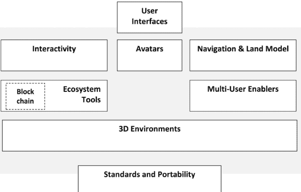

图 4.1
元宇宙的关键技术领域。

- 多用户实现者，包括游戏服务器、分片等；
- 导航和土地模型；
- 头像，包括头像外观（和动画）、头像交互和虚拟代理；
- 交互性，包括语音、文本聊天、工具、构建、脚本和接口；
- 生态系统工具，包括市场/经济、权利和权限、用户管理；
- 标准和可移植性；以及
- 用户界面。

此外，本章还将考虑人工智能（AI）和区块链技术（包括加密货币和非同质化代币（NFT））的作用。

此处未明确考虑的是构成几乎任何软件应用程序所需的某些后端元素，例如访问控制、数据库、安全管理等。

## 3D 环境

3D 环境是用户在其屏幕或 XR 设备上看到（并可能听到甚至感觉到）的内容。它可以分为六个不同的元素，如图 4.2 所示：

- 对象（包括头像）；
- 物理；
- 照明和渲染；
- 音频；
- 其他人类感觉触发器；
- 非人类感觉现象；以及
- 场景。

### 对象

3D 虚拟环境通常由置于由一组 x,y,z 坐标定义的空间内的 3D 数字对象构成。这些 3D 对象可以简单如立方体，也可以复杂如一束鲜花；可以小如虱子，也可以大如城市。每个对象通常包含三个元素：

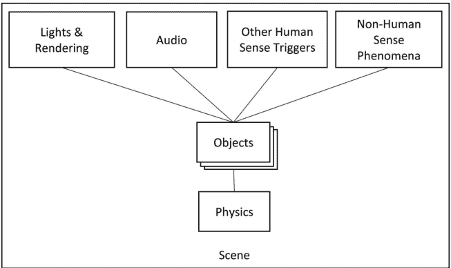

图 4.2
3D 环境的组件。

- **几何** – 对象的形状，通常由线（也称为边）和顶点（也称为点）定义，这些线和点常被用来组成三角形（tris）或其他多边形（polys），一系列多边形拼合在一起形成所需形状。当对象仅以其几何形式显示时，称为线框；
- **纹理** – 对象在色彩和图案方面的外观。这通常通过将一个二维（2D）图像（JPG、PNG 或其他格式）“粘贴”到对象的每个表面上，或将对象的表面用某种称为 UV 贴图的复杂纹理排列进行“包裹”来定义；以及
- **材质** – 对象反射光线的方式，使表面具有深度感以及人们通常所说的“纹理”（即看起来是光滑还是粗糙，由毛皮或布料制成等），通常由所谓的“凹凸”或“法线”贴图定义。

图 4.3 展示了一个简单的木屋，按线框、普通纹理、图像纹理和材质来展示。

从几何、纹理和材质来看，对象越复杂，存储所需内存越多，传输所需带宽越多，渲染和显示所需处理能力也越多。因此，为低功耗设备（如手机）设计的虚拟环境往往使用更方块化、更卡通化的对象和简单的原色调色板——但移动处理器的改进正在越来越多地缩小智能手机与桌面电脑之间可用细节的差距。

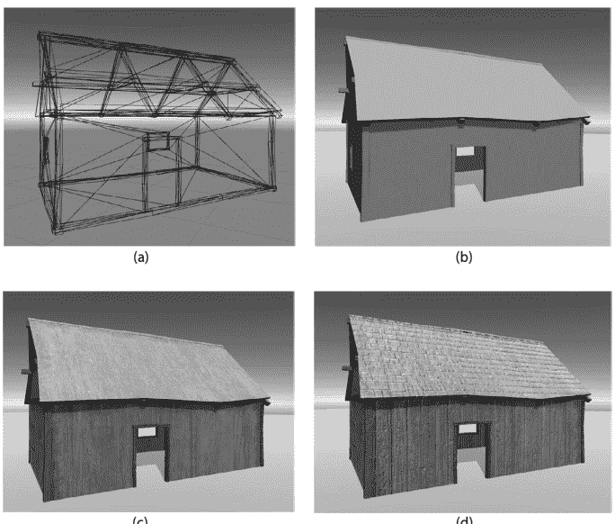

图 4.3
木屋展示了 (a) 线框、(b) 普通纹理、(c) 图像纹理和 (d) 包含凹凸贴图的材质。

大多数 3D 对象是使用专用的 3D 图形应用程序创建的，例如 Blender (https://www.blender.org/)、Z-Brush (https://www.maxon.net/en/zbrush) 和 3D Studio Max (https://www.autodesk.co.uk/products/3ds-max/)。这些应用程序将对象生成用于虚拟空间的数字文件，格式如 Wavefront OBJ (.obj)、Autodesk Filmbox (.fbx) 以及更近期的 Graphics Library Transmission Format glTF (.gltf)，随后可导入虚拟空间。3D 空间内对象的组成通常通过 Unity3D (https://unity.com/) 或 Epic Games 的 Unreal (https://www.unrealengine.com/) 等游戏引擎实现。

然而，使用外部应用程序构建 3D 对象然后将其组合成场景的模型，并不真正符合之前定义的、关于能够在元宇宙中创建和编辑的公理。在真正的元宇宙中，用户应当能够在世界内部构建和创建对象，就像在物理世界中所做的那样。Second Life、OpenSim 和 Somnium Space 是完全拥抱世界内构建（而非仅仅是对象放置）的主要虚拟世界。在 Second Life 的早期版本中（2003 年至 2011 年），世界内构建是唯一的选择，即通过一种称为“prim-torture”的过程，组装和扭曲简单的柏拉图立体“原始体”（通常缩写为“prims”），例如立方体、圆锥体和圆柱体，将其变成相当令人惊叹的结构、装置和艺术品（参见图 4.4）。Second Life 于 2011 年引入了网格（即 3D 模型导入），并开始支持 glTF，用户现在可以在两种方法之间自由选择。

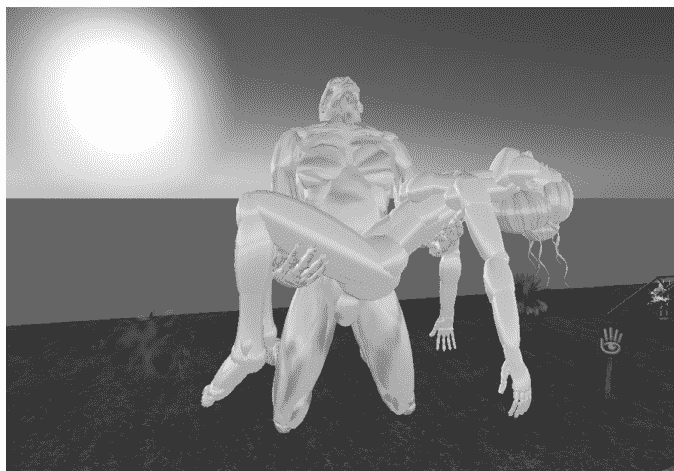

图 4.4 第二人生艺术家 Starax 使用“prim-torture”创作的 Second Life 雕塑。

## 物理

如果虚拟世界要像物理世界一样运行，它需要物理——如果用户松开某物，它应该掉落，如果用户扔出某物，它应该画出弧线。当然，这是一个虚拟世界，用户可能希望能够有选择地关闭物理或更改数值，以便体验身处月球、另一颗行星甚至失重状态。另一个关键元素是物体在相互触碰或碰撞时的反应：它们应该只是穿过并忽略另一个物体，还是应该像台球一样弹开（即所谓的硬体物理），或者在触碰时略微变形并产生排斥（即所谓的软体物理）。

虚拟世界中的物理通常由 Havok (https://www.havok.com/) 和开源 Bullet Physics (https://github.com/bulletphysics/bullet3/) 等专业提供商的“物理引擎”实现，随后将其插入所使用的虚拟世界或游戏引擎中。物理设置通常对用户隐藏，但某些世界可能允许更改重力值，甚至其方向。

## 光照与渲染

仅仅创建一个 3D 对象并将其放置在 3D 空间中，不足以让用户看到该对象。还需要另外两样东西——光照和光照模型——最终结果是在 3D 空间中对对象进行“渲染”。光照有多种形式，例如点光源、聚光灯或环境光。可以根据颜色、强度以及光线随距离衰减的速度来定义光照。光照模型定义了入射到对象上的光线如何照亮甚至反射，这取决于对象的材质和纹理。

场景中的另一个关键元素是物体遮挡任何光源所产生的阴影。提升任何场景真实感的快速方法是更关注阴影。光照模型需要大量计算，因此许多计算机游戏会预先完成所有计算，并将其“烘焙”到对象的纹理中，但这对于可编辑的元宇宙来说不是一条可行的路径，因为对象可以不断移动、删除或添加。这也是传统社交虚拟世界在图形上不如游戏的原因之一，但现代显卡使得能够进行更多实时光照计算。

反射是一个真正的挑战。传统上，镜子在虚拟环境中是通过在镜面对象前放置一个不可见的游戏内摄像机，然后将其输出渲染到镜面表面上来创建的。光泽金属或水面等表面的反射如今通过称为着色器的软件实现，着色器是运行在计算机显卡上的小段代码，能以多种方式增强场景的外观（Vivo & Lowe, 2015）。

更先进的光照方法需要大量处理能力，并且只有慢慢才可用于实时渲染。其中大多数是基于物理的渲染（PBR）方法，其行为大致基于光线工作的实际物理原理（3DAce, 2021）。一个具体示例，比更简单的 PBR 方法更准确，是光线追踪。在此过程中，将光线投射到场景中，以计算光源与虚拟眼之间所有可能的反射、遮挡和颜色变化（Glassner, 1989）。更先进的方法是光场成像技术，它捕获眼睛通常不处理的信息，但允许对场景视图进行更大程度的操纵（Ihrke et al., 2016），并可能承诺无头显 VR（Kara et al., 2023）。

虚拟世界在整体外观上采用了多种风格，从 Virbela 的高度卡通形式，到 Second Life 和 Fortnite 时尚但显然人造的外观，再到 EngageVR 和 Rumii 等更现代环境的“逼真”外观。正如头像中存在“恐怖谷”（见下文），许多用户似乎更倾向于拥有一个外观良好的人造环境，而非实现糟糕的“逼真”环境。此外，如果环境过于光鲜，会分散对任何旨在参与的协作或培训任务的注意力，并不必要地增加系统成本（Serbo & Dawson, 2007）。

## 音频

虚拟世界通常被视为纯视觉空间，但即使对于视力正常的用户，添加音频也能显著提升虚拟空间的沉浸感——即使只是办公室、交通、风声或鸟鸣的背景噪音（例如 Lindquist et al., 2020）。然而，虚拟世界也应对无视力用户和部分视力用户开放。讽刺的是，原始的文本多人地下城（MUD）和多人面向对象地下城（MOO）可能更具可访问性，因为它们可以与简单的屏幕阅读器一起使用，并且人们对音频游戏及其与增强现实（AR）结合的概念仍然感兴趣（Moustakas et al., 2019）。迈向更具语义的元宇宙（见下文）将极大地帮助为虚拟空间创建音频和其他感官界面。

## 其他人类感官触发

其他感官呢？元宇宙空间应该能够生成触觉、嗅觉，甚至潜在味觉的线索。与视觉和听觉一样，在虚拟空间中启用这些感官的元素只是代码和数据——然而，正如世界需要照明模型和光照一样，它还需要扩散模型以及气味（例如）来创建真实环境。关于用于计算机游戏和潜在虚拟世界应用的嗅发生成器的研究仍在进行中（例如 Makin, 2023，一些早期系统已实现商业化（Milevo, 2020））。味觉模拟同样是一些有趣研究的主题（例如 Aoyama, 2020；Kerruish, 2019）。

除了五种常见感官之外，身体还依赖至少两种感官：本体感觉（身体各部位位置的感觉）和内受感觉（身体内部发生情况的感觉）。前者往往影响导航、定位和操纵（例如 Valori et al., 2020），后者可能有从 VR 治疗（Riva et al., 2021）到疼痛管理（Felnhofer et al., 2023）的应用，并且还可能与网络晕动症（Heeter et al., 2020）有关。

## 非人类感官现象

人类只有五种主要感官，那么是否有理由让虚拟世界仅限于模拟这些感官呢？温度、红外线、超声波或电磁学等附加现象

可能由脚本对象直接使用（例如动物虚拟形象中的超声波或电磁检测），或转换为人工控制虚拟形象的视觉或听觉感官。有趣的是，军队特别对所谓的超光谱建模感兴趣，以便更好地表示伪装、热签名（BISim, 2023）、雷达和电子战（Wihl et al., 2010）等问题。

## 场景

场景是VR中用户周围的一切（可能小到一个房间，大到一个世界），通常表示为层次结构，如图4.5所示。这通常被称为场景图，类似于定义网页的文档对象模型。场景图告诉渲染系统渲染什么以及在哪里渲染。

场景可能使用Unity或Unreal等拖放编辑器创建，也可能使用WebGL等代码编写（WebGL也可由Unity和Unreal生成）。此代码还可以定义场景的交互性，就像嵌入网页的JavaScript应用程序一样。事实上，正是three.js JavaScript库（https://github.com/mrdoob/three.js）使得WebGL（在普通2D网页中创建3D场景）可供更广泛的开发者使用。babylon.js库（https://www.babylonjs.com/）进一步扩展了Web上可实现的3D功能，该库包含物理、动画和流体建模，以及专用的Web编辑器/游戏引擎，但代价是

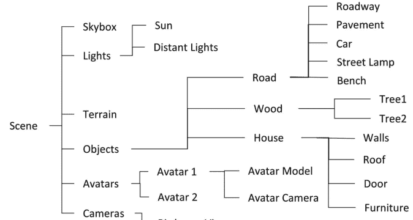

图4.5
虚拟世界的典型场景图。

更高的复杂度（Jamil, 2023）。另一种替代方案是A-Frame（https://aframe.io/），它在three.js之上提供了更高级别的抽象，为3D图形和体验提供了近似超文本标记语言（HTML）风格的创作环境。WebXR通过使WebGL能够检测其是运行在桌面VR还是头戴式VR显示器（HMD-VR）上，并相应地渲染场景和获取用户输入，从而扩展了WebGL。将场景图从小型单用户场景扩展到大型多人虚拟世界是一项重大挑战。正在实施的一种解决方案是开放通用场景描述（OpenUSD）（Lebaredian & Kass, 2022; Peters & Weatherbed, 2023），用于NVIDIA的Omniverse产品，并基于Pixar的早期工作。除了支持场景图的标准元素外，OpenUSD还支持关系和继承、与glTF模型标准的互操作性、对WGS84地理空间参考架构的支持（使物理世界项目能够准确定位），以及扩展到大型场景的能力。OpenUSD及其工具是开源的，由OpenUSD联盟（https://aousd.org/）推广，Unreal、Unity和Apple都支持它。

## 语义元宇宙

USD的一个潜在局限是它不强制执行任何命名或类型标准，因此对象可以被称作任何名称——一把椅子可能只是“object27354”，而不是“chair2”甚至“leather armchair”。为了使虚拟世界环境能够被最广泛的设备（以及AI）访问，有充分理由采用语义方法来构建虚拟世界（Burden, 2011; Ibáñez-Martinez & Delgado-Mata, 2006）。在语义元宇宙中，一切都以语义术语定义——它是什么以及它能做什么——与其渲染方式无关。每个元素都与一个本体学类型相关联（Messaoud et al., 2015），因此任何系统都会知道“object27354”是一把椅子，甚至可能知道是什么类型的椅子。这带来了许多好处：

- 如果用户界面系统无法渲染场景中给定的对象和对象模型，它可以替换一个更适合其媒介（例如AR或混合现实[MR]）、带宽、处理能力，甚至其用户或用例的合适对象；
- 对于视觉障碍用户，增强型用户界面（UI）可以添加合适的音频描述，帮助导航，甚至突出显示最重要的对象；
- 访问虚拟世界的任何AI都不必尝试理解3D模型来判断对象是什么，它只需读取其本体学类型和任何相关元数据即可；
- 场景定义的可移植性以及在不同格式和标准下运行的虚拟世界之间的互操作性得到了增强（Soto & Allongue, 1997）；
- 创建者实际上可以使用语义术语更快地定义世界（例如Kleinermann et al., 2005）；以及
- 对象之间的任何关系都可以提取到包含对象的语义图中，而无需显式编码到每个虚拟世界中。

## 游戏服务器

本章描述的大多数技术既被单用户计算机游戏也被多人虚拟世界使用。使后者与众不同的是，该技术允许多个用户同时处于同一虚拟空间，并理想地相互交互。

大多数多人系统的核心是游戏服务器（也称为反射服务器或多人服务器）（Gallagher, 2022）。游戏服务器示例包括Photon Engine（https://www.photonengine.com/）、Nakama（https://heroiclabs.com/nakama/）和PlayFab（https://azure.microsoft.com/en-gb/products/playfab），或集成到Unreal和Unity平台中的服务器。

当用户首次登录共享空间时，系统会发送该空间中所有事物（和所有人）位置的详细信息（这可能是完整的实时数据集，也可能是基础数据集加上最近的更改）。出于性能原因，这可能仅限于用户一定距离内的内容。当虚拟形象移动，对象被移动、创建或删除时，相关用户的软件会将更改消息发送到游戏服务器，服务器更新世界状态，然后向该空间中的每个用户发送更新消息，其软件随后在本地副本中反映这些更改。除了这种集中式方法外，还可以采用点对点方法——即每个用户的设备直接与其他用户的设备通信，但协调和扩展可能会更具挑战性（Novotny et al., 2020）。

游戏服务器经过高度优化，可将非常小的消息（例如对象A已移动到位置X,Y,Z）传递给大量用户。然而，游戏服务器的性能并不是让用户获得流畅体验的唯一关键因素。还有当消息从用户发送到游戏服务器，再传递到每个用户时，互联网上的网络延迟，以及每个用户自身计算机管理更新的能力。常规方法往往导致任何单一空间中的人数明显少于100人。

试图让大量虚拟形象处于同一虚拟空间是一项挑战。即使Improbable在实验中展示的4000个虚拟形象（Improbable, 2021）也远远少于大型足球比赛中温布利球场的90,000人。目前有几种方法可以尝试解决这个问题，可以单独或组合使用：

- 分片——每组约50–100个虚拟形象位于该位置的独立实例中。一个实例中的用户可以看到并与同一实例中的其他用户交互，但看不到且无法与其他实例中的用户交互——尽管其余人群可能只是简单勾勒的通用虚拟形象。可以为关键虚拟形象（例如音乐会的表演者）做例外，使其被所有用户看到，无论他们处于哪个实例。这种分片方法被大型多人在线游戏（MMOs）广泛使用，也已用于大型虚拟世界活动。从某种意义上说，结果可能与真实事件不相上下，在真实事件中，你可以直接与你所在座位区的人互动，但你只能感觉到其余人群的存在（Waldo, 2008）；
- 不同的保真度级别，即靠近你的人以全分辨率显示，但随着他们离你越来越远，分辨率逐渐降低，直到远处只是一个模糊的轮廓；
- 将你与其他参会者之间的交互最小化——甚至允许你穿过他们；
- 使关键对象支持多人使用——例如游戏中的球和球员，但其他对象（例如爆米花盒）仅在本地处理；以及
- 大规模优化游戏服务器，以最有效的方式分发更新——例如Improbable和RP1正在开发的系统（Takahashi, 2021）。

元宇宙需要以某种方式应对人类经验的全部范围，从围坐在篝火旁的一小群人（实际上数百万个这样的篝火群体可以存在），到允许70,000个虚拟形象参加虚拟燃烧人节，或让数百万人参加抗议游行，或者甚至让数千万人聚集致敬或祈祷。

## 导航与土地模型

如果向用户呈现一个虚拟空间，那么他们如何在其中移动？在特定位置内，他们可能会行走，甚至飞行，但大规模呢？早期的虚拟世界，如Second Life和ActiveWorlds，采用了“单一地图”模式，可能受到《雪崩》中环绕地球的Street的启发。Decentraland和Somnium Space等一些加密世界也采用了相同的模式。在所有这些虚拟世界中，你购买土地进行建设，并

从你的土地上，你可以看到邻居的土地，并在权限允许的情况下，自由地在它们之间步行（或飞行），并可以选择传输（TP）更长距离。你会感觉自己身处一个单一的、共享的、持久的虚拟世界。Decentraland 谈论“可穿越世界”和“邻近发现”的重要性，这些都是值得牢记的有用概念（Ordano et al., n.d.）。

以 Frames、Horizon Worlds 和 VRChat 为例的许多 HMD-VR 导向型世界，更多地采用“房间”模式，你在其中拥有自己的空间或空间（可能是房间大小，也可能是行星大小），可以在该空间内做任何事情，包括向其他人开放，但没有邻居或空间关系的感觉，并且只能在房间之间 TP。共享体验的感觉仅在你与其他人身处同一空间时才有；它既不普遍也不持久。

一些平台模糊或融合了这些模型。例如，OpenSim 允许你构建自己的“世界”，并以地理、土地地块的形式将该世界上的空间分租给其他用户，然后将你的世界（及其分租空间）连接到 Hypergrid 上的任何其他世界和空间。OpenSim 的地块和 Hypergrid 模式似乎非常适合任何终极元宇宙，兼得两个（虚拟）世界之长。

## Avatars

用户在虚拟空间中以化身形式出现。虽然有些人偏好长得像自己的化身，但其他人则偏好风格、性别或物种完全不同的化身，甚至偏好以机器人、幽灵或烤面包机的形式来代表自己。

本节不会详细介绍用于构建逼真化身的所有技术和方法——关于这一点，读者可参阅作者们早前出版的书籍《虚拟人类：今天与明天》（Burden & Savin-Baden, 2019）。相反，本节将探讨元宇宙中关于化身的一些关键问题和选择。

### Avatar Appearance

化身的外观包括体型（及尺寸）、肤色、面部形状和颜色（包括嘴唇、鼻子、面颊、眼睛）、头发（样式和颜色）以及衣服。用户应该期望能够随时更改其化身的外观，可能会为不同的活动和角色拥有不同的化身（或至少是不同的服装）。不应强制要求人类或甚至类人外观。关于人们如何在虚拟世界中选择化身，已有大量研究。选择动机包括虚拟探索、社交导航、情境适应和身份表征，用户在一定程度上会描绘其实际自我，并在长时间内与之建立联系的过程中，反映自身的审美观，发展出一个稳定的化身（Lin & Wang, 2014）。

除了个人选择，化身外观的另一个关键问题是虚拟世界技术将化身渲染得多么“好”。有些世界的化身非常卡通化，而另一些世界则力求“照片逼真”的化身。然而，诡异谷效应（Mori, 1970）意味着，许多人更喜欢一个良好的、略带卡通风格的化身，而不是一个照片逼真效果不尽理想的“照片逼真”化身。

有些世界允许用户拍摄头部网络摄像头照片，然后尝试将其包裹到化身的头部（Spatial 过去就是这样做的），而另一些世界（例如 _VirBela_）只是将网络摄像头照片粘贴到类似小怪物的方块状身体上。一种略有不同、或许更好的方法是 ReadyPlayerMe 采用的方法（https://readyplayer.me/）。网络摄像头拍摄一张头部和肩部照片，但与其尝试将其直接转换为一个（可能看起来很糟糕的）“照片逼真”化身，不如将其用于驱动配置器的参数，因此结果是一个看起来明显是人造的化身，但（a）看起来相当不错，（b）长得有点像你。图 4.6c 展示了 David 使用此流程创建并在 _Mozilla Hubs_ 中使用的 ReadyPlayerMe 化身，以及他在其他虚拟世界中的化身。Apple Vision Pro 允许用户使用头显创建其头部的 3D 扫描，用作化身。

与物体实时渲染相同的问题，传统上使得虚拟世界化身不如最新的计算机生成图像（CGI）电影或 AAA 游戏中的化身，但硬件改进以及时尚行业对元宇宙日益增长的兴趣可能有助于改变这一现状。

作者们在虚拟世界中与达立克、幽灵和会说话的鹦鹉进行过足够多的严肃商务会议，深知某人的化身不必长得像其本人，而且研究表明，化身选择的自由有助于表达自由和真实个性的表达，还能在你想要时沉溺于角色扮演（Neustaedter & Fedorovskaya, 2009）。

### Avatar Animation

化身动画发生在三个广泛的层面：

- 化身行走、飞行、游泳或跳舞时肢体和身体的大规模移动（位移动画）；
- 它指指点点、做手势或惊恐地举起双手时的小规模移动（原地动画）；以及
- 用于表达情感并与所产生的任何语音同步的面部动画。

在 _Second Life_、《Active Worlds》以及 2000–2010 年左右的其他虚拟世界中，全身化身配合全身动画是常态。值得注意的是

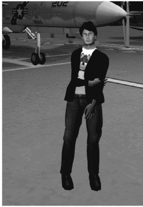

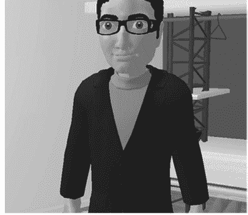

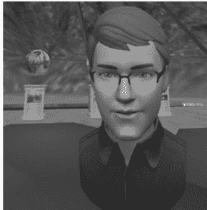

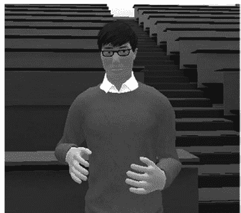

图 4.6 David 在不同虚拟世界中的化身。(a) Second Life，(b) VirBela，(c) ReadyPlayerMe/Hubs，以及 (d) EngageVR。

许多 HMD-VR 导向型世界为化身采用头部、肩部/胸部和手部的方法——没有手臂或腿！这似乎是为了避免当反向运动学（即估计身体位置）导致化身的手肘和膝盖以奇怪方式弯曲时出现的沉浸感丧失（Parger et al., 2018）。一些平台，例如 EngageVR、Frame 和 Decentraland，正在采用全身化身路线，它们可能很快就会来到 Meta 的 Horizon World（Truly, 2023），因此希望没有手臂腿且缺乏身体感的化身只是一种短暂的阶段。

虽然位移动画在化身移动时会自动触发，但原地动画（包括舞蹈动作）和表情在 DesktopVR 中通常由用户手动触发（例如通过功能键），或从聊天关键词自动触发（例如输入“No”也会导致摇头）。同样值得注意的是，拥有“待机”动画——仅让化身略微移动、重心在双脚之间移动或手部小动作——能够显著提升场景的真实感。

随着 HMD-VR 的到来，现在还有手部追踪，许多这些原地动画已不再需要，因为它们由用户的自然动作创建——但此类手势仍需提供给 DesktopVR 用户；否则，仅从手臂位置就很容易看出谁在使用 HMD-VR，谁在使用 DesktopVR。

剩下的挑战之一是实时面部动画，包括说话、微笑或皱眉等——这能显著提升社交互动的真实感。早期方法涉及使用网络摄像头检测面部表情并动画化化身的面部（例如 Apostolakis & Daras, 2015）。最新一代头显（例如 Oculus Quest Pro、Apple Vision Pro）配备了小型背面摄像头，用于检测面部表情和眼动，并将其传递给化身（Lang, 2022）。

不过，隐私和欺骗方面也存在一些有趣的问题。例如，你的表情可能会被更好地（即自动）检测到，并提醒你正在交谈的人，这可能会与你所说的话的真实性相悖。或者，你可能会运行软件来静音、强调或反转头显向世界发送的表情馈送。

### Avatar Interaction

在早期的 DesktopVR 世界中，文本聊天往往占主导地位，但现在语音是常态，通常是空间音频——因此声音在空间中定位，并来自说话者的方向，音量与其距离一致。然而，文本聊天有其优势——如果用户的化身与其本质不同，它可以掩盖用户的物理本质（参见第 1 章中关于将语音引入 Second Life 的早前讨论），它在协作会议期间提供了有用的后通道，并创造了一个更公平的讨论空间（Nesson & Nesson, 2008）。相对而言，语音目前真的是 HMD-VR 中唯一的选择——尽管不错的虚拟键盘可能解决这个问题。但人际互动不仅仅是关于语音——还涉及表情、手势和其他形式的肢体语言。轻松访问 2D 和 3D 表情符号，以及手势和表情，是捕捉沟通非语言元素的一种方式。触觉技术实现其他化身交互模式的潜力将在下文中讨论。

## 虚拟代理

所有这些特性也适用于化身为非玩家角色（NPC）的虚拟代理。此类 NPC 可能充当游戏角色，也可能是向导、接待员、店员、私人助理、训练伙伴、教练、家教，甚至是物理世界应用程序的具体化版本，或者是我们不在身边时的虚拟分身。一个关键问题是：该虚拟代理的“大脑”位于何处？正如在《虚拟人类》（Burden & Savin-Baden, 2019）中所讨论的，它可能不应该位于虚拟世界中。它需要用行业标准代码编写，运行在互联网某处的通用服务器上，然后使用应用程序编程接口（API）从虚拟世界接收信息，并向其在世界（或各个世界）中的化身（或化身们）发送命令。理想情况下，该化身应当能够执行人类控制的化身所能做的一切。

2017 年，David 帮助开展了一项实验，让此类聊天机器人程序在 Second Life 中控制一个化身，进行一次隐蔽的图灵测试。在与该代理交互的用户中，78% 认为它是人类操作的（Gilbert & Forney, 2015）。在区分聊天机器人与人类方面，虚拟世界确实让竞争环境变得公平（Burden et al., 2016）。当然，在实验时，人们的默认假设是化身可能是由人类驱动的，因此代理只需确保不会透露它是计算机这一事实，而不必试图说服用户它是人类。

虚拟世界可以作为有用的虚拟实验室，用于研究具身认知和接地认知理论，因为它们以传统“方块世界”研究空间无法做到的方式表现出混乱而复杂的世界，并让研究人员免去在物理世界中构建实体机器人进行实验的所有麻烦。Lucy 是 Fable Studio 的《墙中的狼》（Wolves in the Walls, Billinghton, 2018）中的主角代理，迄今为止是在 VR 空间中实现虚拟代理的最佳案例之一，无论你在房间的哪个位置，她都能直接、亲切地与你交谈，并真正将你带入她的故事。

## 交互性

本节探讨用户如何与环境本身进行交互。在最基本的层面上，这涉及触摸/点击对象和按钮，或者使用头戴式显示器 XR（HMD-XR）和手部追踪伸手触摸和操纵某物，但这并不奇怪，因为这基本上就是人类与物理世界交互的方式。

## 工具

大多数虚拟世界提供一系列通用工具来支持协作，如第 3 章所述，包括虚拟白板和便签、屏幕共享以及 3D 绘图工具。如果世界（正如它应该做的那样）还具有构建、编辑、脚本和市场工具，那么用户应该能够创建他们想要的任何工具，无论多么小众，并使其可供其他用户使用——无论是免费还是收费。工具范围不应受平台所有者限制。

正如物理世界中智能手机和平板电脑取代了曾经多个独立工具的情况一样，虚拟平板电脑和虚拟智能手机也可能以熟悉的外形提供其他功能，尤其是虚拟世界内和跨虚拟世界的应用（例如记笔记、消息传递、视频录制等）。到某个时候，甚至可能实现将物理平板电脑的所有功能、应用和数据映射到其虚拟版本上（Apple 的 Vision Pro 正开始做到这一点），并让用户能够为其虚拟平板电脑编写自定义应用。

### 构建

能够在元宇宙中创建或构建（而不仅仅是放置）对象是必不可少的；否则，那只是别人的 VR 应用程序。同时，也应支持对象导入，以便可以使用更强大的外部构建工具（如 Blender 等）。许多当前的虚拟世界（例如 ChatVR、Fortnite、Decentraland、Roblox）要求用户使用 Unity、Unreal 或自定义外部编辑器来构建空间及其中的任何对象。Second Life/OpenSim 可能仍然是进行正确虚拟世界内构建的最佳示例，尽管 Minecraft 和 Somnium Space 也具有此功能。

### 脚本

尽管许多世界允许对象放置，甚至允许修改，但极少数允许虚拟世界内脚本。这很可能主要是由于性能管理和安全问题——一个糟糕的脚本可能会使空间一团糟，或被用于针对用户、其账户或平台本身的恶意目的（Muttik, 2008）。例如，2007 年，David 在 Second Life 中的自己的 sim 上设置了一个人工生命脚本——它失控地在各处复制自身，并导致整个 sim 崩溃！

如果用户能够像在现实世界中创建小工具或应用一样在虚拟世界中创建交互式对象和工具，那么元宇宙必须支持脚本，最好是基于易于使用且常见的语言，如 Javascript。对于简单的任务，拖放式或可视化积木编程语言（如 Scratch）可能很有用。Meta 的 Horizon Worlds 正在同时使用拖放式和可视化积木编程，效果相当不错（MetaQuest，n.d.），而 Ova 的 StellarX（2022，https://www.stellarx.ai/）拥有一个非常流畅的拖放式系统，用于图形化流程图交互。Hiberworld（2018，https://hiberworld.com/）拥有一个类似的（尽管功能不那么完善）脚本界面。Frame 于 2024 年初开始支持脚本，但如前所述，它使用 Wonderland 脚本语言，因此即使是最基本的交互也具有陡峭的学习曲线。

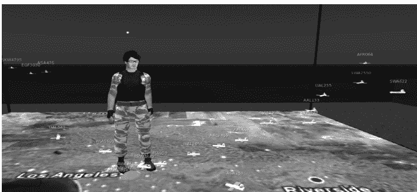

**图 4.7**
在虚拟世界中绘制实时空中交通管制数据。

虽然 Linden Scripting Language (LSL)（用于 *Second Life* 和 *OpenSim*）可能不如 Javascript 那么熟悉，但它仍然提供了一种易于使用且功能强大的虚拟世界内脚本功能，其他世界尚未能比拟。

脚本还应允许编写能够从互联网其他部分（进而从物理世界）获取数据的代码。例如，物理地理时空数据（例如天气、地震或空中交通信息——参见图 4.7）可以绘制在虚拟地图或地球仪上，或者可以单向传递状态或命令以控制虚拟世界中的操作——例如物理灯开关打开虚拟灯；或者反之，化身的移动可以在物理世界中创建音景。

虽然这些例子很简单，但它们表明虚拟与物理（可以而且应该）成为同一个更大元宇宙的一部分。如果用户希望在虚拟世界中拥有与在物理世界中同等的主体性，他们就需要能够像日常一样访问相同的信息和系统。这些界面还允许开发者使用行业标准工具在互联网上构建任何大型应用程序的核心，并只需将虚拟世界视为用户界面。开发者需要为单一元宇宙构建，涵盖虚拟、数字 *和* 物理世界。

### 语音控制

HMD-VR 的一个缺点是，虚拟键盘交互目前相当成问题——这会使详细的构建和脚本任务，甚至简单的文本聊天或记笔记变得困难。希望，虚拟世界将越来越多地支持其界面的语音控制，既包括明确的命令，也包括某种虚拟世界内或头显内的个人助理。关于使用生成对抗网络（GANs）、ChatGPT 和类似技术不仅用于文本和 2D 图像，还用于 3D 建模的最新发展，开始展示语音控制未来的潜力：用户可以站在一个空白的全息甲板风格空间里，只需说出类似“给我一个有蓝色大海、跳舞的海豚、一些椰子树和一大杯代基里酒的海滩”这样的话，一切就会出现（Chow, 2023）。[GOXR](https://www.xrspace.io/us/goxr) 已经有用户可以进行语音对话的 NPC 化身，而 [Hiberworld](https://hiberworld.com/) 则可以从简单文本描述中进行一些原始的 AI 场景渲染，因此合并这两种功能指日可待。

## 生态系统工具

运行元宇宙所需的并非所有内容都对用户立即可见，本节描述的许多功能正是开始将社交虚拟世界或元宇宙类空间与更通用的多用户 VR 应用区分开来的地方。Radoff 的生态系统模型（见图 2.2）也是了解所需不同工具范围的有用指南，并强调了发现工具的需求，这些工具将部分存在于元宇宙及任何单一生态系统之外。

## 用户管理

与任何社交应用一样，需要一个用户管理层。它不仅控制应用程序和世界的访问，还包括：

- 个人资料信息，包括：
  - 兴趣领域；
  - 链接（如需要）到其他社交网络网站上的个人资料；
- 好友链接，以及查找、添加和删除好友的能力；
- 群组链接，以及查找、加入、离开、创建、消息和删除群组的能力；
- 金钱和交易信息及控制；以及
- 安全管理。

## 权利与权限

如果用户打算在元宇宙中购买、制作或销售物品，则需要某种方式来保护知识产权（IP）并限制权限。一种常见的模式是为对象、脚本和地点分配所有者（可以是个人或群组），然后设置一组权限，允许其他个人或群组，或任何人，访问/使用、复制、修改、销售或删除该实体。当物品

开始由多个实体构建起来。这可能是一个区块链实际上可以提供帮助的领域，这一点将在下文进一步讨论。

## 市场/经济

如果虚拟世界创建者未能提供用户所需的东西，那么为什么不从另一位用户那里获取呢？诸如 Second Life、Minecraft 和 Roblox 这样的世界都拥有基于用户生成内容的活跃世界内市场。

元宇宙中几乎肯定需要某种形式的虚拟货币，并且该货币应能与现实世界货币自由兑换。第1章讨论了一些关于研究Second Life虚拟经济的工作。当前许多虚拟世界（加密世界）都以比特币或以太坊等加密货币为基础，但这些货币既存在环境资质方面的潜在问题（参见第5章），也易受黑客攻击、投机和暴利行为的影响。加密货币的作用将在下文中更详细地讨论。

## 标准与可移植性

迄今为止描述的一切都是单一开发公司可以构建到其自身世界中的工作，但真正的挑战在于：用户如何将他们的头像、货币、对象甚至脚本，在不同的虚拟世界或元宇宙之间移动。

如第2章所讨论，认为将来永远只会存在一个元宇宙可能是不现实的，因此如果未来是多元宇宙，那么可移植性问题需要得到解决。当然，即使在万维网上（那些多个账户、不同个人资料等），可移植性也几乎不存在，因此它在虚拟世界中尚不存在就不足为奇了。即使是上面提到的.obj和.fbx等对象“标准”，本应使对象能够在平台之间无缝移动，但经常失败。

有一些积极的迹象。新的3D对象标准glTF正在证明比早期标准可移植性强得多，并已被采纳为国际标准，[ISO/IEC 12113:2022](https://www.iso.org/standard/83990.html)。尽管2007年作为跨行业机构成立的元宇宙路线图（MVR）（Smart et al., 2007）已经搁置，但多个新组织正在接受挑战，为元宇宙建立标准：

- [元宇宙标准论坛](https://metaverse-standards.org/) 旨在“为开放元宇宙培育互操作性标准”，似乎拥有最多成员，包括大多数行业关键参与者，以及一组活跃的“领域组”；
- [开放元宇宙基金会](https://www.openmv.org/) 是“一个致力于创建开放标准和软件以支持开放、全球、可扩展元宇宙的开放、中立社区的家园”，其主要项目之一是O3DE，这是一款与Unity和Unreal处于同一领域的开源游戏引擎，尽管它表示也正在开发对象可移植性的开放标准；
- [开放元宇宙联盟（OMA3）](https://www.oma3.org/) 是“Web3元宇宙平台创建者的合作组织”，其目标是“确保虚拟土地、数字资产、想法和服务在平台之间高度互操作，并对所有社区透明”。因此，它与Web3和区块链方法紧密相连；
- [开放元宇宙互操作性组（OMIG）](https://omigroup.org/) 将自己描述为“一个由行业专业人士、独立创作者和充满热情的爱好者组成的开源社区，共同在公开环境中构建互操作性技术”，并旨在通过设计和推广身份、社交图谱、库存等协议，来“在界面和技术之间架起虚拟世界的桥梁”；
- W3C（运行万维网标准的机构）维护着一个[元宇宙互操作性社区组](https://www.w3.org/community/metaverse-interop/)，也是元宇宙标准论坛的成员；
- 国际电信联盟（ITU）设有自己的[元宇宙焦点小组（FG-MV）](https://www.itu.int/en/ITU-T/focusgroups/mv/Pages/default.aspx)，开展“预标准化”工作，分析“元宇宙的技术要求，以识别从多媒体和网络优化到数字货币、物联网、数字孪生和环境可持续性等领域的基础赋能技术”，并考察国际标准的作用（ITU，2023年）；以及
- [开放USD联盟](https://aousd.org/) 如上文所述推广OpenUSD。

## 用户界面

用户界面被有意地放在最后来讨论，因为用户是从智能手机、笔记本电脑、台式机还是HMD访问元宇宙，对元宇宙本身来说都应该是无关紧要的。

## DesktopVR

这是通过传统台式机、笔记本电脑和智能手机上常见的单个2D屏幕来访问3D环境的统称。它可能不具备与HMD-VR相同的技术沉浸水平，但如第2章所述，技术沉浸只是整个沉浸/在场/化身/能动性计算中的一部分，只要体验的其余部分设计良好，用户仍然能获得环境的大部分好处。与HMD-VR相比，Desktop VR也更便宜、更方便，而且用户几乎不会受到网络晕动症的影响。

对于DesktopVR和HMD-VR来说，通过浏览器使用WebXR（如第1章所述）交付世界给用户是一种更可取的方式——无需下载。还应注意，VR体验在互联网和无线连接上的运行通常比视频会议通话所需带宽更低（A. G. Campbell 等人，2020年）。

## HMD-VR

自2013年Palmer Luckey发布Oculus DK1以来，媒体关注点一直集中在HMD-VR体验上。随着每一代头显的推出，屏幕分辨率、动态范围、视野和电池寿命往往在增加，延迟和重量在减少，整个HMD-VR体验也变得更加舒适和自然。截至2023年，最新的头显，如Meta Quest 3、Varjo XR-3和Apple Vision Pro，现在配备了面向前方的彩色摄像头以支持混合现实，有些甚至配有面向后方的摄像头来检测眼动和表情。[OpenXR](https://www.khronos.org/openxr/) 正在成为HMD-VR设备运作的开源标准。

## DesktopVR 或 HMD-VR

在DesktopVR体验和HMD-VR之间进行选择，是用户应该能够按会话自行决定的事项，而不应由应用程序决定。有许多场景中使用HMD-VR是不切实际的（比如在火车上、在咖啡馆、在沙发上半看电视等），第2章已经介绍了比较DesktopVR和HMD-VR的一些研究。

一个关键问题是，HMD-VR目前尚未实现显著的市场渗透率。HMD-VR的安装基数目前估计（截至2022年底）约为5000万台，其中Meta Quest 2占2022年销量的约46%（S. Campbell，2023年）。假设所有这些头显都在使用中，全球渗透率仅为0.6%，而移动互联网的渗透率约为55%（GSMA，2023年）。一份2021年仅关注“少数世界”¹国家的报告估计，家庭中HMD-VR的渗透率约为2.4%（Jijiashvili，2021年）。HMD-VR增长率的估算并不乐观，有一位分析师在2023年下调了预测，预计HMD-VR销量将从2023年每年约1000万台增长到2025年约1800万台（Erl，2023年）。因此，支持DesktopVR和HMD-VR的双轨策略必须是合乎逻辑的选择，任何元宇宙空间都应能够支持这两类界面。

## 移动设备

移动设备实际上只是DesktopVR的一个特殊情况。现代智能手机拥有处理能力、屏幕分辨率甚至屏幕尺寸，可以轻松渲染除最复杂虚拟环境外的所有环境。然而，有几个移动特定问题值得考虑：

- 无线连接的带宽可能过于有限，无法支持来自游戏服务器的所有变更更新。因此，元宇宙可能会支持不同的细节层次（LODs），以便在带宽或观看设备受限时以更简单的方式显示对象。
- 用户可能希望在元宇宙中参加会议或进行某些活动，但没有精力或带宽来支持完全沉浸式会话。用户应该能够仅作为屏幕或机器人上的网络摄像头视图加入会议，以及/或者能够以自上而下的2D地图模式访问元宇宙。

## CAVEs

CAVE自动虚拟环境（CAVEs）是一种通过步入式环境提供的VR，通常三面墙（但可能多达全部六面）是全屏显示器，且视图会随着用户在空间内行走而改变（Muhanna，2015年）。其缺点在于成本高昂，通常是机构内的单一安装（因此需要预约），且维护需要时间和金钱（Havig 等人，2011年）。如今在很大程度上已被HMD-VR取代，但对于元宇宙中的某些用例，它们仍然是可行的界面模型，特别是当需要观众时，任何元宇宙可能都应该足够灵活以支持CAVEs和类似的穹顶显示器，甚至可能支持伦敦的Lightroom和纽约的Lightbox这样的沉浸式投影场所。

## 360° 视频VR 和 立体视频VR

360°视频VR和立体视频VR是使用VR头显的替代方式。用户并非身处一个可以随意移动的3D世界，而是在观看、并可能与之交互一部电影——即使这部电影是环绕他们的。当前大量的HMD-VR

内容实际上是360 VR，用户可以在视频中环顾四周，但在其中没有主导权。立体视频VR同样使用视频，但采用双摄像机拍摄以产生立体视频对，当通过VR头显观看时，能给视频带来真实的深度感和更强的沉浸感——结果是对所观看内容有更强烈的直观反应。该技术可用于提供结构化的人际培训，因为它比简单的2D视频或3D虚拟形象提供了更多的情感投入。然而，视频VR体验实际上只是一组特定用例的工具，而不是元宇宙固有的组成部分，因为它们缺乏建模3D环境所提供的交互性和主导权。

## 视频流

视频流，也称为云游戏，将虚拟世界（及游戏）体验传递至处理能力降低的设备，例如手机。通过在中央服务器上进行场景渲染，然后仅将生成的视频馈送发送到用户设备，虚拟世界或游戏可以变得更加易于访问，因为最终用户设备只需显示视频并捕获和传输任何玩家交互。Second Life在2012年尝试了这一概念（IGN, 2012）。谷歌（Google）从2019年至2023年提供Stadia服务以支持视频游戏流式传输（Carrascosa & Bellalta, 2022），尽管目前有多种云游戏服务可供选择，但反应褒贬不一（例如，Perry, 2023）。随着智能手机处理器性能的提升，除了对要求最高的游戏之外，围绕这种方法的必要性存在日益增多的争论（例如，Coleman, 2023）。如其他地方所述，元宇宙体验与分辨率之间不一定存在关联，理想情况下，元宇宙应能够原生支持以客户端所支持的任何分辨率和细节级别运行的客户端。

## 触觉反馈

触觉反馈是使用户能够感觉到自己在虚拟世界中触碰的事物的方式。计算机游戏通常带有“触觉”控制器，在驾驶车辆或被射击时会振动。不过，更值得关注的是用于VR的触觉手套，例如HaptX（https://haptx.com/）提供的手套。在此，手套中的执行器提供一些力反馈，让用户感觉自己实际上在虚拟世界中触摸、触碰或握住某物。其最有趣的用例之一是，它允许用户复制物理世界中的行为：看着某物在哪里，然后转过头去将视觉焦点重新放在其他事物上，同时仅使用触觉伸手去拿起该物体。触觉反馈还可以扩展到全身。Teslasuit（https://teslasuit.io/）研发了同名全身触觉服，可以模拟用户全身的冲击或触感，而OWO Games的Skin（https://owogame.com/）则是T恤相当物。

触觉反馈的一种更简单方法，特别是在HMD-VR中，是为用户提供一个代表物理设备的物理控制器——理想情况下是实际物理设备的一个版本，该版本仅为VR使用进行了仪器化（例如，Saghafian et al., 2020）。这种方法已被应用于军事、医疗、消防和建筑VR培训，为用户提供仪器化枪支、手术器械、灭火器和起重机控制器，以便在虚拟世界中进行培训。

## 运动方式

在虚拟世界中，沉浸感经常受损的一个领域是移动。通过操纵杆、光标键或键盘的ASDF键控制虚拟形象显得笨拙。在DesktopVR中，尤其是在HMD-VR中，点击式导航（用户点击目的地，虚拟形象随后自行导航到那里）可能是一种更可靠的导航方式，但可能会打破用户与其虚拟形象之间的联系。特别是在HMD-VR中，看着你的虚拟形象移动——无论是在自动驾驶下还是在操纵杆控制下——而你的双脚却牢牢固定在地板上，这似乎并不正确。随着房间级追踪的出现，用户现在可以在HMD-VR中自然地在一个空间里行走，假设他们在物理世界中拥有等效的空旷空间，但对于其他情况，则需要替代方案。

在过去十年左右的时间里，已有大量关于使用360°跑步机、低摩擦鞋和其他技术的研究，以允许用户在保持在同一物理位置的同时在VR中“行走”。Boletsis（2017）介绍了该研究的有用概述和VR运动方式的拟议分类法。然而，成本、空间、可靠性、人体工程学和其他问题迄今仍使解决方案未能进入大众市场（Hooks et al., 2020）。

在虚拟世界中飞行可以避免腿部运动问题，但通常更适合长途旅行。已有一些有趣的项目来研究使用手臂拍打和风力发生器来增强飞行体验（例如，https://birdlyvr.com/）。自行车模拟器也已被探索（例如，https://virzoom.com/vzfit-2/），特别是针对运动和健身市场。

另一种方法是使用脑机接口（BCI）来控制虚拟形象运动（Alchalabi et al., 2021），但直到大脑也能获得实际运动的感觉之前，这和其他许多方法一样，只是半个解决方案。

## 增强现实和混合现实

AR和MR设备都是通往元宇宙的有效接口，元宇宙应能够支持用户拥有的任何接口设备，并以适当方式显示相关信息。AR往往是单用户且相对被动的，因此MR更为相关。

MR显示屏——由头显实现，头显最终可能会缩小为一副眼镜甚至隐形眼镜的外形——将3D对象和信息叠加到用户对物理世界的视图上。这可以提供复杂信息以支持导航，或将虚拟模型放在用户面前以供玩耍或了解，或对物理设备进行注释以帮助维护，在这两种情况下都可以将虚拟同事、朋友或导师放在用户所在的房间里。MR还可以改写现实，重新解释用户看到的几乎所有内容，并将其与幻想世界或科幻场景中的东西叠加（Vinge, 2006）。随着VR头显上彩色视频直通功能的出现（例如，Meta Quest Pro、Meta Quest 3、Varjo XR-3、Apple Vision Pro）实现了类似MR的功能，VR和MR头显之间的区别正在慢慢模糊，HMD-XR可能是硬件更有用的描述符，尽管HMD-VR和HMD-MR体验仍然不同，即使可以即时切换。

## 脑机接口

尽管每一代HMD-VR设备都在改进，但使用纯视觉和音频显示以及外部身体追踪的方法存在显著问题和局限性——其中不乏上述运动方式和感官挑战。研究人员正在为虚拟环境开发BCI，但这些目前仅限于追踪脑电图（EEG）、心电图（ECG）和类似脑信号，以便通过HMD-VR头显增加额外的离散控制功能（例如，Cassani et al., 2020）。Putze（2019）区分了主动BCI——“允许用户向设备发出命令或输入文本，无需任何形式的物理参与”——和被动BCI——“监测用户的状态（例如，工作量水平、注意状态），并可用于主动调整VR/AR界面”。另一个有用的区分是侵入式（电极和类似设备通过手术植入头骨）和非侵入式（传感器位于皮肤表面）BCI（Zhao et al., 2023）。

就直接在大脑中生成VR体验而言，研究仍处于非常早期的阶段（例如，Morris, 2018），但DARPA等组织已经开始研究“高性能、双向脑机接口”（DARPA, 2019）。技术可能距离《卡普里卡》（Caprica）中展示的那种“全息频段”接口设备和体验还有数十年之遥（Aubuchon & Moore, 2010），但可能只有当元宇宙拥有神经接口，使用户获得技术沉浸感的极致时，元宇宙的最充分承诺才会实现，并且它将成为真正的日常服务。

## 人工智能与元宇宙

人工智能（特别是神经网络、生成对抗网络和大型语言模型）的最新进展，都在影响人工智能如何为元宇宙体验的创建做出贡献。人工智能在元宇宙中的一些主要应用包括：

- 在 HMD-XR 头显上进行边缘和物体检测，以构建数字对象将与之共存的物理世界模型（Rokhsaritale mi et al., 2020）；
- 语音识别，以支持与 NPC 头像（已在 GOXR 中）以及元宇宙应用本身进行语音交互（Siyaev & Jo, 2021）；
- 使用 ChatGPT 等系统进行自然语言通信和聊天机器人开发（已在 Frame 中），无需硬编码响应（Lv, 2023）；以及
- 生成虚拟场景，要么在需要之前大规模过程化生成（例如 Deitke et al., 2022），要么按用户需求生成（例如 Viviani, 2023）——基本版本已在 Hiberworld 中，以及 Frame 的天空盒。

Huynh-The et al. (2023) 提供了元宇宙 AI 应用的综述。

## 区块链、加密货币和 NFT

许多较新的原始元宇宙，如 Decentraland 和 Somnium Space，基于区块链和加密货币，因此了解这些技术在任何未来元宇宙中的潜在作用很重要。

区块链本质上是一种分布式、安全的数字账本——一种以不可更改的方式记录交易和信息的方法，并为每笔交易显示完整的可追溯性。加密货币，如 Bitcoin 或 Ethereum，本质上只是使用区块链来实现货币系统，记录谁拥有什么以及谁给了谁什么（Nakamoto, 2008）。NFT，例如用于营销艺术作品和 GIF，本质上只是在区块链上跟踪的代币（即一段信息），它链接到图像或对象，且通常只有有限数量的副本。Vasquez (2021) 和 Tysver (2023) 提供了关于区块链、加密货币和 NFT 的有用介绍。

区块链系统的关键问题之一是生成新代币或硬币（称为“挖矿”）以及更新加密账本条目所需的过度计算能力。在这个备受争议的领域中，有一项估计认为，基于区块链的元宇宙中 36% 的能源需求可能来自区块链交易（Liu et al., 2023）。这一问题及一些潜在解决方案将在第 5 章中进一步探讨。

第二个问题是区块链的安全性仅取决于其用户界面，媒体上充斥着关于加密货币系统和用户账户被黑客攻击、人们因基础设施外围的攻击而损失储蓄的报道。据估计，仅比特币被黑客攻击造成的损失就高达 880 亿美元（按 2021 年价格计算），时间在 2011 年至 2021 年之间（Charoenwong & Bernardi, 2021）。

第三，许多人将加密货币和 NFT 视为一夜致富的骗局，其中 NFT、加密货币、虚拟土地或甚至使用加密货币购买的衣物的物理世界价格似乎与任何合理价值都格格不入。当然，任何艺术（甚至在某种程度上货币系统）只值人们愿意为此支付的价格，但区块链、加密货币和 NFT 市场似乎已将这一点推向了类似南海泡沫的水平。关于加密货币的一个引人注目的统计数据是加密货币持有者中实际将其用于支付而非投资的比例。例如，2023 年美国联邦储备委员会的一份报告显示，尽管 2022 年被调查的 10% 的美国人持有加密货币（较 2021 年的 12% 下降），但只有 2% 将其用于商品或服务支付（Federal Reserve, 2023）。

对区块链技术与元宇宙未来之间关系的看法不一。Ball (2022) 指出了元宇宙与区块链之间五种不同关系的光谱，范围从浪费且无关紧要到绝对必不可少。在光谱的后端，有些人认为“元宇宙在经济层面如果没有区块链技术作为其核心将无法运作”（Rosa, 2023）。Narula 也将区块链技术和加密货币视为“建立和维护元宇宙内价值转移桥梁的任何努力中不可或缺的一部分”。相比之下，Au 指出，目前基于区块链的原始元宇宙平台中没有一个“在大规模增长方面取得了成功。或者说，几乎没有任何增长”（Au, 2023, p. 152）。

区块链的核心概念无疑是有效的，如果其部分计算需求和气候影响能够得到缓解，它很可能会被更广泛地接受为一种可行的系统，用于更广泛的应用。它确实可能在元宇宙中发挥作用，特别是如果加密货币和区块链概念在消费金融和其他行业中得到更广泛的采用。然而，以其目前的形式，它可能通过将那些原本富有想象力的原始元宇宙的访问限制在愿意加入加密货币和 NFT 投资热潮的人群中，从而对元宇宙的演进弊大于利。

## 摘要

本章介绍了创建元宇宙所需的技术。它涵盖了八个广泛领域，包括 3D 环境的创建、导航和土地模型、多用户支持、头像、交互性、生态系统工具、用户界面和区块链技术。

任何元宇宙的核心在于它如何作为空间环境呈现和导航，作为多用户空间运行，由头像填充，这些头像彼此之间以及与该环境具有交互性，并具有在该环境中自由且轻松地创建的能力。游戏服务器、生态系统工具，特别是用户生成内容的共享和共同标准是至关重要的推动者。只有之后才是实际的用户界面，无论是 HMD-VR、DesktopVR、移动设备、MR、AR，甚至是神经接口，如所述，元宇宙应该能够支持所有模式——以及使用不同模式的人之间的交互。然后才应考虑区块链等因素——并且在很大程度上作为生态系统工具的技术推动者。

下一章将考虑元宇宙理念引发的一些更广泛的，且大多是非技术性的问题，这些问题在大多数情况下远比技术挑战更难以解决。

## 注意

- 1 我们使用“少数世界”和“多数世界”这两个术语来描述地球上的“有”和“无”部分，因为这些似乎是现有术语中最准确、最不贬义的。参见 https://www.ncbi.nlm.nih.gov/pmc/articles/PMC9185389/

## 参考文献

- 3DAce. (2021). 基于物理的渲染：将 PBR 用于游戏、动画等。3D Ace. https://3d-ace.com/blog/physically-based-rendering-using-pbr-for-games-animations-and-more/
- Alchhalabi, B., Faubert, J., & Labbe, D. R. (2021). 一种多模式修正反馈自进度 BCI 以控制头像步态。Journal of Neural Engineering, 18(5), 056005.
- Aoyama, K. (2020 年 2 月 4 日). 面向虚拟现实和增强现实的电味觉刺激方法。Human interface and the management of information. Designing information: thematic area, HIMI 2020, held as part of the 22nd international conference, HCI 2020, Copenhagen, Denmark, July 19–24, 2020, proceedings, part I (pp. 341–349). Springer International Publishing.
- Apostolakis, K. C., & Daras, P. (2015). 沉浸式虚拟世界中虚拟角色全身和面部动画的自然用户界面。Augmented and virtual reality: Second international conference, AVR 2015, Lecce, Italy, August 31–September 3, 2015, proceedings 2 (pp. 371–383). Springer International Publishing.
- Au, W. J. (2023). 打造有意义的元宇宙：从《雪崩》和《第二人生》到值得为之奋斗的虚拟世界。John Wiley & Sons.
- Aubuchon, R., & Moore, R. D. (Creators). (2010). 卡普里卡 [电视剧]。Syfy.
- Ball, M. (2022). 元宇宙：以及它将如何颠覆一切。Liveright Publishing.
- Billington, P. (2018). 墙里的狼。Fable Studios and Third Rail Projects. https://thirdrailprojects.com/wolvesinthewalls
- BISim. (2023 年 5 月 12 日). BISim 的热成像改进 [Bohemia Interactive Simulations]. YouTube. https://www.youtube.com/watch?v=k63RzxVQk3w&ab_channel=BohemiaInteractiveSimulations
- Boletsis, C. (2017). 虚拟现实运动的新时代：技术系统文献综述与拟议分类法。Multimodal Technologies and Interaction, 1(4), 24.
- Burden, D. (2011). 虚拟世界标准的语义方法。IEEE Internet Computing, 15(6), 40–43.
- Burden, D. J. H., & Savin-Baden, M. (2019). 虚拟人类：今天与明天。CRC.
- Burden, D. J., Savin-Baden, M., & Bhakta, R. (2016). 图灵测试的隐蔽实现：一个更公平的竞争环境？在 Research and development in intelligent systems XXXIII: Incorporating applications and innovations in intelligent systems XXIV 33 (pp. 195–207) 中。Springer International Publishing.
- Campbell, S. (2023). 2023 年 VR 头显销量和市场份额（售出多少台？）。The Small Business Blog. https://thesmallbusinessblog.net/vr-headset-sales-and-market-share/
- Campbell, A. G., Holz, T., Cosgrove, J., Harlick, M., & O'Sullivan, T. (2020). 虚拟现实在金融服务沟通中的应用：比较不同远程存在界面的案例研究：虚拟现实与视频会议的对比。Advances in information and communication: Proceedings of the 2019 future of information and communication conference (FICC) (Vol. 1, pp. 463–481). Springer International Publishing.
- Carrascosa, M., & Bellalta, B. (2022). 云游戏：Google Stadia 流量分析。Computer Communications, 188, 99–116.
- Cassani, R., Moinereau, M. A., Ivanescu, L., Rosanne, O., & Falk, T. H. (2020). 神经接口仪器化虚拟现实头显：迈向下一代沉浸式应用。IEEE Systems, Man, and Cybernetics Magazine, 6(3), 20–28.
- Charoenwong, B., & Bernardi, M. (2021). 十年加密货币“黑客攻击”：2011–2021。Leibniz Information Center for Economics.
- Chow, A. R. (2023 年 1 月 27 日). 为什么 AI 爆炸对元宇宙有巨大影响。Time Magazine. https://time.com/6250249/chatgpt-metaverse/

Coleman, T. (2023年6月8日). 云游戏是视频游戏的未来吗？*每周*. https://theweek.com/talking-point/1023972/is-cloud-gaming-the-future

DARPA. (2019). 非手术脑机接口未来的六条路径. DARPA. https://www.darpa.mil/news-events/2019-05-20

Deitke, M., VanderBilt, E., Herrasti, A., Weihs, L., Ehsani, K., Salvador, J., Han, W., Kolve, E., Kembhavi, A., & Mottaghi, R. (2022). ProcTHOR: 基于程序生成的大规模具身AI. *神经信息处理系统进展*, 35, 5982–5994.

Erl, J. (2023年3月22日). 1010万台：VR和AR头显短期需求降低. *混合新闻*. https://mixed-news.com/en/vr-and-ar-market-growing-slower-than-expected/

Federal Reserve. (2023). *2022年–2023年5月美国家庭经济福祉报告*. 美国联邦储备委员会. https://www.federalreserve.gov/publications/2023-economic-well-being-of-us-households-in-2022-banking-credit.htm

Felnhofer, A., Martinek, D., Pazour, P., & Riva, G. (2023). PAIN-EX: 通过虚拟现实中的具身性探索中和疼痛体验的替代干预措施. *网络心理学、行为与社交网络*, 26(8), 662–664.

Gallagher, A. (2022). 什么是游戏服务器？你需要知道的一切. OneQode. https://www.oneqode.com/what-is-a-game-server/

Gilbert, R. L., & Forney, A. (2015). 头像能通过图灵测试吗？3D虚拟环境中的智能代理感知. *人机研究国际期刊*, 73, 30–36.

Glassner, A. S. (Ed.). (1989). *射线追踪导论*. Morgan Kaufmann.

GSMA. (2023). *移动经济：2023*. https://www.gsma.com/mobileeconomy/

Havig, P., McIntire, J., & Geiselman, E. (2011). CAVE中的虚拟现实：局限性与对头戴显示器的需求？光学工程国际学会（SPIE）论文集, 8041. https://doi.org/10.1117/12.883855

Heeter, C., Day, T., & Cherchiglia, L. (2020). 内感觉意识：虚拟世界中“身临其境”的“存在”维度. *人机交互*, 32(1), 1–16.

Hooks, K., Ferguson, W., Morillo, P., & Cruz-Neira, C. (2020). 全方位VR步行模拟器用户体验评估. *娱乐计算*, 34, 100352.

Huynh-The, T., Pham, Q. V., Pham, X. Q., Nguyen, T. T., Han, Z., & Kim, D. S. (2023). 元宇宙人工智能：一项综述. *人工智能工程应用*, 117, 105581.

Ibáñez-Martinez, J., & Delgado-Mata, C. (2006). 虚拟环境的基本语义共同层次. *国际虚拟现实期刊*, 5(3), 25–32.

Improbable. (2021). Improbable与Midwinter Entertainment让超过4000名《Scavengers》玩家聚集在同一个游戏世界中. Improbable. https://www.improbable.io/blog/scavengers-scavlab-4000-players-in-a-single-game-world

IGN. (2012). Volle在移动平台上推出Second Life. IGN. https://www.ign.com/articles/2008/06/04/volle-debuts-second-life-on-mobile

Ihrke, I., Restrepo, J., & Mignard-Debise, L. (2016). 光场成像原理：对25年研究的简要回顾. *IEEE信号处理杂志*, 33(5), 59–69.

ITU. (2023). FG-MV D.WGI-01 探索元宇宙：机遇与挑战. ITU. https://www.itu.int/dms_pub/itu-t/opb/fg/T-FG-MV-2023-PDF-E.pdf

Jamil, R. (2023). 对比Three.js和Babylon.js：哪个JavaScript 3D库适合你？Medium. https://mohammadrahi.medium.com/comparing-three-js-and-babylon-js-which-javascript-3d-library-is-right-for-you-7196ef21949e

Jiashvili, G. (2021). Omdia调查显示，2021年消费级VR头显销量达1250万台，内容支出超过20亿美元. Game Developer. https://www.gamedeveloper.com/blogs/omdia-research-reveals-12-5-million-consumer-vr-headsets-sold-in-2021-with-content-spend-exceeding-2bn

Kara, P. A., Tamboli, R. R., Adhikarla, V. K., Balogh, T., Guindy, M., & Simon, A. (2023). 无断连接：光场元宇宙应用及其体验质量概述. Displays, 78, 102430.

Kerruish, E. (2019). 编排感官：增强现实与虚拟现实中的嗅觉与味觉. 感官与社会, 14(1), 31–45.

Kleinermann, F., De Troyer, O., Mansouri, H., Romero, R., Pellens, B., & Bille, W. (2005). 语义虚拟现实应用设计. 第2届直觉国际研讨会论文集, 塞利斯, 法国.

Lang, B. (2022). 技术演示展示了Quest Pro面部追踪的真正威力. 通往VR之路. https://www.roadtovr.com/quest-pro-face-tracking-tech-demo-aura/

Lebaradec, R., & Kass, M. (2022). 通用场景描述作为元宇宙的语言. NVIDIA. https://developer.nvidia.com/blog/universal-scene-description-as-the-language-of-the-metaverse/

Lindquist, M., Maxim, B., Proctor, J., & Dolins, F. (2020). 音频保真度和虚拟现实对虚拟绿地感知的影响. 景观与城市规划, 202, 103884.

Lin, H., & Wang, H. (2014). 虚拟世界中的头像创建：行为与动机. 计算机与人类行为, 34, 213–218.

Liu, F., Pei, Q., Chen, S., Yuan, Y., Wang, L., & Muhlhauser, M. (2023). 当元宇宙遇上碳中和：持续努力与方向. https://doi.org/10.48550/arXiv.2301.10235

Lv, Z. (2023). 元宇宙时代的生成式人工智能. 认知机器人学, 3, 208–217.

Makin, S. (2023). 虚拟现实系统让你停下来闻闻花香. 科学美国人. https://www.scientificamerican.com/article/virtual-reality-system-lets-you-stop-and-smell-the-roses/

Messaoud, M., Cherif, F., Sanza, C., & Gaildrat, V. (2015). 虚拟世界语义建模的本体论. 人工智能与应用国际期刊, 6(1), 65–74.

MetaQuest. (无日期). 脚本入门. MetaQuest. https://www.oculus.com/horizon-worlds/learn/tutorial/intro-to-scripting/

Milevo, G. (2020). OVR技术创造带有气味的独一无二的虚拟现实体验. AR Post. https://arpost.co/2020/06/19/ovr-technology-virtual-reality-scents/

Mori, M. (1970). 诡异谷. 能源, 7(4), 33–35.

Morris, A. (2018年4月30日). 科学家将全息图投射到大脑中以创造体验. 福布斯. https://www.forbes.com/sites/andreamorris/2018/04/30/scientists-project-holograms-into-the-brain-to-create-experiences/?sh=2967869b1460

Moustakas, N., Floros, A., Rovithis, E., & Vogklis, K. (2019). 增强纯音频游戏：通过先进混音实现的新一代沉浸式声学环境. 音频工程学会第146届大会. 音频工程学会. https://www.aes.org/e-lib/browse.cfm?elib=20336

Muhanna, M. A. (2015). 虚拟现实与CAVE：分类学、交互挑战与研究方向. 卡尔苏德大学期刊-计算机与信息科学, 27(3), 344–361.

Muttik, I. (2008). 防御虚拟世界免受真实攻击. McAfee Inc.

Nakamoto, S. (2008). *比特币：一种点对点电子现金系统*. 去中心化商业评论. https://assets.pubpub.org/d8wct41f/31611263538139.pdf

Nesson, R., & Nesson, C. (2008). 虚拟世界教育论证. *空间与文化*, 11(3), 273–284.

Neustaedter, C., & Fedorovskaya, E. A. (2009). 通过头像外观在虚拟世界中呈现身份. 《图形界面2009论文集》（第183–190页）. 加拿大信息处理学会.

Novotny, A., Gudmundsson, R., & Harris, F. C., Jr. (2020). 多人用户VR体验的Unity框架. 《第35届计算机及其应用国际会议论文集》（第69卷，第13–21页）. 计算机及其应用国际学会（ISCA）.

Ordano, E., Araoz, M., Jordi, Y., & Meilich, A. (无日期). *去中心化土地白皮书*. Decentraland. https://decentraland.org/whitepaper.pdf

Parger, M., Mueller, J. H., Schmalstieg, D., & Steinberger, M. (2018). 面向消费级虚拟现实中增强具身感的人体上半身逆运动学. 《第24届ACM虚拟现实软件与技术研讨会论文集》（第1–10页）. 计算机协会.

Perry, H. (2023年6月29日). 最好的云游戏服务还不够出色（暂时）. *纽约时报*. https://www.nytimes.com/wirecutter/reviews/best-cloud-gaming-services/

Peters, J., & Weatherbed, J. (2023年8月3日). 为什么苹果押注皮克斯技术来让元宇宙运作. *The Verge*. https://www.theverge.com/2023/8/3/23818718/apple-pixar-3d-tech-alliance-openswd-metaverse

Putze, F. (2019). 在增强现实与虚拟现实中使用脑机接口的方法与工具. 载 A. Nijholt (编), *脑艺术：用于艺术表达的脑机接口* (第433–446页). Springer Nature Switzerland AG.

Riva, G., Di Lernia, D., Sajno, E., Sansoni, M., Bartolotta, S., Serino, S., Gaggioli, A., & Wiederhold, B. K. (2021). 元宇宙中的虚拟现实疗法：融合外部VR与内部VR. *网络治疗与远程医学年度评论*, 19, 3–8.

Rokhsaritalehi, S., Sadeghi-Niaraki, A., & Choi, S. M. (2020). 混合现实综述：当前趋势、挑战与前景. *应用科学*, 10(2), 636.

Rosa, N. (2022). *理解元宇宙：商业与伦理指南*. John Wiley & Sons.

Saghafian, M., Laumann, K., Akhtar, R. S., & Skogstad, M. R. (2020). 虚拟现实灭火器培训评估. *心理学前沿*, 11, 593466.

Scerbo, M. W., & Dawson, S. (2007). 高保真，高绩效？ *医疗模拟*, 2(4), 224–230.

Siyyaev, A., & Jo, G. S. (2021). 飞机维护元宇宙中的神经符号语音理解. *IEEE Access*, 9, 154484–154499.

Smart, J., Cascio, J., Paffendorf, J., Bridges, C., Hummel, J., Hursthouse, J., & Moss, R. (2007). 一项跨行业公共前瞻项目. 《元宇宙路线图：3D Web路径论文集》（第1–28页）. 加速研究基金会. https://www.metaverseroadmap.accelerating.org/MetaverseRoadmapOverview.pdf

Soto, M., & Allongue, S. (1997年6月). 虚拟世界互操作性的语义方法. 《IEEE第6届支持技术研讨会：协作企业基础设施论文集》（第173–178页）. IEEE.

Takahashi, D. (2021). *RP1推出面向“无分片”元宇宙的可扩展平台*. VentureBeat. https://venturebeat.com/games/rp1-debuts-a-scalable-platform-for-the-metaverse/

Truly, A. (2023年7月1日). Meta 在 Quest 全身动作捕捉方面取得重大进展。_混合新闻_. https://mixed-news.com/en/meta-makes-big-advances-in-quest-full-body-motion-capture/

Tysver, D. A. (2023). _区块链导论_. Bitlaw. https://www.bitlaw.com/blockchain/intro-to-blockchains.html

Valori, I., McKenna-Plumley, P. E., Bayramova, R., Zandonella Callegher, C., Altoè, G., & Farroni, T. (2020). 沉浸式虚拟现实中的本体感觉准确性：一种发展视角。_PLoS One_, _15_(1), e0222253.

Vasquez, G. (2021). 区块链导论。_注册会计师杂志_, _91_(6/7), 52–55. https://www.cpajournal.com/2021/08/18/an-introduction-to-blockchain/

Vinge, V. (2006). _彩虹的终点_. Tor Books.

Viviani, M. (2023年3月30日). ChatGPT 和 GPT-4 如何用于 3D 内容生成。_Medium_. https://medium.com/@nvidiaomniverse/chatgpt-and-gpt-4-for-3d-content-generation-9cbe5d17ec15

Vivo, P. G., & Lowe, J. (2015). _着色器之书_. The Book of Shaders. https://thebookofshaders.com/

Waldo, J. (2008). 游戏与虚拟世界中的扩展。_ACM通讯_, _51_(8), 38–44.

Wihl, L., Varshney, M., & Kong, J. (2010). 向合成环境引入网络战通信效果模型。_军工业培训、模拟与教育会议（I/ITSEC）_. https://www.researchgate.net/profile/Jiejun-Kong/publication/228676783_InterserviceIndustry_Training_Simulation_and_Education_Conference_ITSEC_2010_Introducing_a_Cyber_Warfare_Communications_Effect_Model_to_Synthetic_Environments/links/02e7e5727c7286f5e3000000/Interservice-Industry-Training-Simulation-and-Education-Conference-I-ITSEC-2010-Introducing-a-Cyber-Warfare-Communications-Effect-Model-to-Synthetic-Environments.pdf

Zhao, Z. P., Nie, C., Jiang, C. T., Cao, S. H., Tian, K. X., Yu, S., & Gu, J. W. (2023). 利用侵入式脑机接口调节脑活动：一篇叙事性综述。_脑科学_, _13_(1), 134.

# 5 机遇与挑战

## 简介

本章对元宇宙的承诺与危险进行了批判性审视，视野比前几章更广。它探讨了元宇宙概念中存在的多种竞争性压力和二元对立，从更关注平台（及其创建者）的问题，到以个人为主要关注点的问题，最终到关于整个社会的问题。这些主题在图 5.1 中以图形形式呈现。在大多数情况下，单一、整体的元宇宙概念可能比多元宇宙概念面临更多挑战。

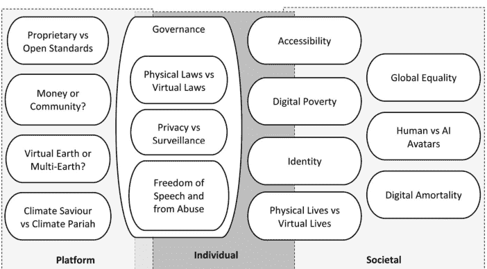

图 5.1
元宇宙——机遇与挑战。

## 专有标准与开放标准

在考虑元宇宙未来形态时，也许最大的张力在于——这也关系到本章许多其他主题——元宇宙究竟是基于专有标准和企业控制，还是一种自下而上、基于开放标准的事业。

已存在一系列方法的光谱。当前大多数元宇宙世界都基于企业/专有模式——例如 Fortnite 和 Roblox。相比之下，Minecraft 严格控制其公共世界，但开发者可以搭建自己的 Minecraft 服务器，在那里他们拥有更大的自由度来创建想要的内容，尽管它仍然是专有代码。光谱更远的一端，Hubs 是开源代码，使用户能够运行自己的服务器。Somnium Space 和 Decentraland 等加密世界在很大程度上遵循 Web3 模式，因此既支持开源也支持去中心化。Second Life 本身是专有且集中的，但采用相当宽松的例外制策展模式，而 OpenSim 衍生版则是开源且去中心化的。Neal Stephenson 即将推出的 Lamina1 虚拟世界（https://www.lamina1.com/）正在支持开源模式（Sparkes, 2022）。表 5.1 总结了部分更受欢迎虚拟世界的方法，但这是一种非常主观的评估。

| | 去中心化 | 开源 | UGC 自由度 |
|---|---|---|---|
| Fortnite | | | ●● |
| Horizon Worlds | | | ●● |
| Roblox | | | ●●● |
| Minecraft | ● | | ●●● |
| VRChat | | | ●●● |
| Hubs | ●● | ●●●●●● | ●●●● |
| Frames | | | ●●●● |
| Decentraland | ●●● | ●●●●●● | ●●●●●● |
| Somnium Space | ●● | | ●●●●● |
| Second Life | | ● | ●●●●● |
| Open Sim | ●●● | ●●●●●● | ●●●●●● |

Perri 等人（2023）认为：“开放标准和开源代码对于元宇宙的增长和可持续性至关重要。开发者和政策制定者应优先考虑这些原则，以确保发展出包容性和开放性的虚拟环境。”元宇宙标准论坛（2022）——其成员包括 Epic、Meta、Microsoft、Sony 和 Unity 等公司——表示：“多位行业领袖指出，只有在开放标准基础上构建，元宇宙的潜力才能最好地实现。在普适规模上构建一个开放和包容的元宇宙，将需要一整套开放的互操作性标准。”第 4 章已描述了各种元宇宙标准倡议，但如前所述，类似的先前尝试曾失败——这一次它们会更成功吗？

## 由金钱驱动还是由社区驱动？

与关于治理和集中式与去中心化方法的辩论相关的是，元宇宙最终是否将主要出于对金钱或社区的关注而被创建和开发。Ball（2022）似乎倾向于认为，元宇宙最有可能源于采取企业、金钱驱动方法的某个或某些世界。“最可能的结果确实是，少数垂直和水平一体化的平台将收集元宇宙中大部分总时间、内容、数据和收入”（Ball，2022）。Ball 描述称，企业高管认为元宇宙将价值“数万亿美元”（尽管他们还无法就它实际是什么达成一致），并引用 Nvidia 的 Jensen Huang 的预测，即元宇宙的价值“最终将‘超过’物理世界”（Ball，2022）。Au（2023）持几乎相反的观点，他在书中几乎不提及收入（除非与创作者分成相关）或投资。相反，他将元宇宙视为一种自下而上的社区事业——“社区创造价值——而不是相反”（Au，2023）。虽然 Au 预计元宇宙平台将（至少最初）以游戏为主导，但他认为具有独立目的的用户生成内容是成功元宇宙平台的试金石——即，是否“会发现一部分内容创作者并非主要为了盈利，而是为了用户社区的利益而创作。并得到该社区的社会认可”（Au，2023）。

万维网的例子同样发人深省。Tim Berners-Lee 爵士将底层超文本传输协议（HTTP）和超文本标记语言（HTML）标准，以及浏览器和服务器代码，赠予全球社区，从而实现了万维网的自下而上、由社区驱动的增长，起初没有人真正关心收入、投资或利润。有些人，例如 Mozilla 的 Fodor（2020），认为元宇宙应该这样发展，同时也应基于开源代码。然而，随着时间的推移，企业利益（以及随之而来的收入、利润和投资）变得越来越重要，从亚马逊到谷歌和 Meta 等大型企业成为了万维网的主导者。一个关键问题——将在第 6 章中探讨——是元宇宙是否会经历类似的过程，或者它是否已经处于企业主导的局面（例如 Meta/Oculus、Epic/Fortnite），或者是否存在一种既能在开发、运行和维护支撑其技术所需成本的同时，又能保持高水平社区参与度的方法。

## 虚拟地球还是多重地球？

与元宇宙或多元宇宙的辩论相关的是，任何元宇宙究竟在多大程度上应当是地球（及/或任何其他世界）的数字孪生——或者至少遵循其基本地理。由国际数字地球学会（http://www.digitalearth-isde.org/）开发的数字地球愿景，采用了一种字面意义的数字孪生方法，即一个“通过互联网连接的地球公民可以直接访问的数字化格式的地球，并支持向其他人提供数据和信息”，它能够支持社会、文化和经济活动，并在该领域支持全球合作近 20 年。

然而，如前所述，在第 2 章中讨论过，在短期到中期，元宇宙几乎可以肯定将是一系列互连的元宇宙空间——部分原因是过多人想要“自己”的某个地点的数字孪生，而这与其他人对同一空间的数字孪生相冲突。另外，如果只有一个数字地球，那么所有关于土地所有权和权利以及将物理世界控制扩展到虚拟世界的问题都将出现。更可能的是，将会出现互补（甚至竞争）的地球数字孪生，希望它们都基于共同的地理空间数据，各自拥有关于如何使用的一套准则。因此，可能一个世界强制执行“物理世界类似物”规定——你只能建造物理上存在的东西，而另一个世界可能专注于环境或全球平等问题，还有一个世界则专注于全球旅游。但是，既然这些（希望）都在同一互连基础设施上，用户可以轻松地在它们之间传送，甚至可以在混合现实中，甚至在另一个虚拟现实（VR）空间中，将所有这些数据叠加在一起。

当然，这些都不妨碍任何元宇宙将其地理基于整个太阳系、一个完全想象的世界或宇宙，或一个基于文学或电影的世界。

## 气候救星还是气候罪人

与任何支持远程工作的技术一样，似乎有一个自然论点：元宇宙可以通过减少通勤和商务旅行的环境影响（Le et al., 2020），甚至通过发展虚拟旅游（De-la-Cruz-Diaz et al., 2022; Gursoy et al., 2022）来有利于气候变化。一项研究乐观地预测，“增加元宇宙采用可以减少全球地表

本世纪前将温度降低多达0.02°C，并将温室气体排放量降低10 Gt CO2e……到2050年节省全国能源使用量的10%”（Zhao & You, 2023）。

然而，Kshetri和Dwivedi（2023）强调，“关于元宇宙是会成为环境可持续性灾难，还是会让世界变得更清洁、更绿色，一场激烈的辩论正在酝酿”，因为任何节约都必须与支持元宇宙所需运行服务器和网络的环境成本相权衡。Liu等人（2023）针对三个主要要素估算了2030年元宇宙的气候成本：底层基础设施（占CO2排放和能源消耗的约20%）、计算和显示设备（约45%）、以及基于区块链的交易和经济服务（约35%）。他们总结称，“除非从现在起采取有效的预防措施，否则到2030年元宇宙将占全球碳排放量的高达0.5%”，随后对元宇宙发展的潜在碳和能源节约措施进行了分析，但该分析仍然以区块链为前提（Liu et al, 2023）。

正如本分析所表明的，一个关键的环境问题是元宇宙中任何区块链及其相关加密货币系统的影响。比特币网络的能源消耗被描述为可与爱尔兰（De Vries, 2018）以及马来西亚或瑞典（Carter, 2021）相媲美。尽管这些比较受到了质疑（例如McCausland, 2018），但毫无疑问，当前区块链方法的能源需求非常巨大。已提出可将能源消耗降低约75%的改进措施（Zhang & Chan, 2020），增加可再生能源的使用是另一个潜在步骤（Ibañez & Freier, 2023）。然而，仍然存在其他重大环境问题，例如挖矿计算硬件的生产和处置（De Vries, 2019）。

元宇宙的开发必须意识到其环境影响，尽可能优化计算和通信资源，确保服务器、通信和接入设备均由可再生能源供电，并确保使用元宇宙带来的任何节约都不会被运行元宇宙的环境影响所抵消。还必须考虑有限和/或难以获取资源的使用，例如大多数消费电子产品中存在的锂电池。

更积极地说，元宇宙对气候议程的一项潜在贡献在于让每个人更好地理解气候变化问题并建立更广阔的全球视野。宇航员谈到“概览效应”——即从太空看不到政治边界，并且对“照顾环境的责任感有了新的认知”（Voski, 2020）。元宇宙是一种在地面上建立这种视角的方式——不仅通过提供从太空观察地球的大规模模拟（例如Stepanova等人，2019），而且在元宇宙本身内，人们和地点由社区和理念连接，而非国家。这也是支持单一元宇宙（或连贯的多元宇宙）而非一系列不相连的虚拟空间的论点，这样每个人都生活在同一个虚拟星球上并高度意识到这一点，从而可以轻松体验和理解当地社区因气候变化面临的问题，并更容易访问和分享旨在理解（希望）解决或至少缓解气候变化的研究。

然而，巴巴多斯在元宇宙开设大使馆（Thurman, 2021），在其案例中是Decentraland，就像马尔代夫在2007年在Second Life所做的那样（《悉尼先驱晨报》, 2007），或图瓦卢宣布其在元宇宙中复制自身（Fainu, 2023）究竟意味着什么，尚存争议，人们当然应警惕任何天真的未来主义（Guiao, 2022）。然而，通过元宇宙将全球问题带给全球受众可能会变得更加普遍，元宇宙应该被设计为能够实现并鼓励这一点——无论是虚拟大使馆、国家数字孪生、身临其境地体验干旱或洪水，还是协作分析气候影响数据和故事，以便以更具吸引力和影响力的方式向更广泛的受众传达风险。

## 治理

如果元宇宙本质上是一个全新的世界（仅数字），那么它应当如何治理，元宇宙的治理又应如何与国家和超国家治理相关联？这种模型在一定程度上取决于元宇宙是一个或多个集中化、受严格控制的企业空间——在这种情况下，可以预期企业治理将占主导地位——还是一个更分散、开源的模型，元宇宙是大量部分的总和，可能在链接从一个部分到另一个部分时有一些“联盟协议”，以确保维持一些共享的隐私、合法性和可接受使用标准。Web3的倡导者正在推广去中心化自治组织（DAOs）（Tse, 2020）的概念来运行虚拟世界，并且它们已经被用于运行Decentraland（https://dao.decentraland.org/）。

政府、政府间组织和非政府组织正在考虑其作用。欧盟已启动报告和咨询，以“基于对数字权利和欧盟法律及价值观的尊重，为新兴虚拟世界（例如元宇宙）制定愿景”，使得“开放、互操作和创新的虚拟世界……可以被公众和企业安全且有信心地使用”（Choi et al., 2023）。一个此类研究项目旨在制定新的伦理框架，以帮助起草未来欧盟关于元宇宙的立法，由耶鲁大学数字伦理中心的受尊敬伦理学家Luciano Floridi教授领导（Holden, 2022）。2023年，欧盟发布了关于《下一代虚拟世界：欧盟2023年面临的社会、技术、经济和政策挑战》的中期报告（Hupont Torres et al., 2023），同年还发布了一份关于_欧盟在Web 4.0和虚拟世界方面的倡议：在下一代技术转型中抢占先机_的报告，探讨了经济和治理问题。该报告将Web 4.0确定为“预期中的万维网第四代。利用先进的人工和环境智能、物联网、可信区块链交易、虚拟世界和XR功能，数字对象与环境和现实对象与环境完全集成并相互通信，实现真正直观、身临其境的体验，无缝融合物理世界和数字世界”（EU, 2023）。IEEE的扩展现实伦理全球倡议正在制定一个法律框架，类似于欧盟的GDPR立法（Stephens, 2022）。世界经济论坛于2022年启动了一项倡议，旨在构建公平、互操作和安全的元宇宙，其2023年关于_元宇宙中的互操作性_的简报文件涵盖了管辖权互操作性，同时涉及技术和使用互操作性，并就制定“考虑隐私、安全、身份、安全性和互操作性的治理框架”提供了一些初步指导（WEF, 2023）。

## 物理法还是虚拟法

围绕治理的辩论的一部分是世界内部适用哪些法律的问题。如果用户被抢劫、引诱、虐待、欺诈或遭遇更糟的情况，他们应向谁申诉？世界中什么算是亵渎、诽谤或非法色情——如果这些行为被违反，由谁起诉？网络上的社交网络也存在类似问题——到底是运营商、服务器、受害者还是施虐者的物理位置才重要？以及反社会行为与滥用之间的界限在哪里——恶意破坏（越界行为）在许多，如果不是所有虚拟世界中都很常见（Jenkins, 2010）。Garon（2022）提供了一篇关于元宇宙法律影响及Web3方法的有用调查。

可能的假设是，虚拟世界应受与物理世界相同的规则和法律的约束。然而，物理世界的法律和规则因管辖区、组织甚至文化而异——那么应该为虚拟世界或元宇宙选择哪一种呢？联合国《世界人权宣言》在元宇宙中适用吗？运营商和虚拟地产所有者是否可以在不侵犯这些基本权利的前提下强制执行他们自己的法律？在元宇宙中，谁将拥有制定和执行法律的权威？

已经存在关于互联网上什么法律管辖权适用于提供者、服务器和用户可能位于不同管辖区的情况的辩论（例如Reidenberg, 2005），在元宇宙中情况不会不同，而且可能更糟糕（Kostenko et al., 2022; Kalyvaki, 2023）。虽然基于房间的元宇宙可能与网站/应用程序的情况非常相似，但如果元宇宙被实现为一个或多个空间模型，那么相同的规则是适用于整个连接空间，还是仅适用于其中某些区域？一个区域能否在其

边界是否可能从另一个区域可见，而其中的内容在该区域会被视为亵渎或非法？一个区域的虚拟公民能否在另一个区域的服务器上寻求庇护？

围绕知识产权（IP）的法律——无论其表现为构建物、脚本、物体还是服装——也需要在元宇宙的不同部分之间进行一定程度的协调。欧盟已经在研究欧盟知识产权法律如何在元宇宙中适用（Choi et al., 2023），而世界知识产权组织（联合国的一个机构）也在研究元宇宙的全球知识产权问题（WIPO, n.d.）。

## 表达自由与免遭虐待自由

治理的另一个方面是如何确保用户自由。虚拟世界从一开始就是表达自由与免遭虐待自由之间张力明显的地方——正如第 1 章中提到的 Dibbell 网络空间强奸案。《卫报》在 2022 年报道了一起涉嫌 VR 群体强奸案，并指出 Horizon Worlds 据称已发生多起性侵犯事件（Sales, 2024）。联合国地区犯罪和司法研究所（UNICRI）关于《游戏与元宇宙：新数字前沿中在线儿童性剥削和虐待的惊人上升》的报告警告称，随着“虚拟平台的使用增加，对儿童的潜在危害的规模和复杂性也将随之增加”，并且“如果没有适当的保障措施，儿童……可能会接触到性剥削和虐待”（UNICRI, 2022）。

相比之下，Johnson (2010) 描述道：“对于跨性别居民来说，Second Life 允许对性别和政治活动有更广阔的视角”，提供了一个安全、支持性的聚会场所，并总体上提供了一个“允许人们尝试‘性想象’……并开始在‘现实与虚拟’之间建立联系的可能性世界”。使用虚拟世界进行政治运动和示威也已经有过描述。

国际刑警组织正在研究如何对元宇宙进行执法（Cieslak & Gerken, 2023），Headleand et al. (2020) 提出了从虚拟社区内部选拔虚拟社区支持官作为对虚拟空间进行执法的一种方式。长期网络安全中心于 2022 年发布了一份关于元宇宙社区指南的报告，强调了清晰性、全面性、特异性和透明度的重要性（Lazeron, 2022）。

更大的集中控制预计可以减少滥用，但也可能影响政治、性别及其他表达自由，尤其是在世界由（甚至从）具有专制倾向的国家管理（或访问）的情况下。在元宇宙的虚拟世界中找到正确的平衡，将与在物理世界中一样具有挑战性。

## 隐私与监控

一个相关的考虑是，元宇宙技术为其运营商，以及潜在的任何控制性国家，提供了对其用户/公民实施近乎完全监控的重大机会。监控游戏服务器将允许对每个用户进行全面监控，而这是电话和闭路电视监控相结合在物理世界中也绝无可能实现的。斯诺登文件揭示了西方情报机构早在 2008 年就有控制台监控行动和虚拟世界数据收集计划（NSA, 2008），第 3 章描述了围绕“指纹识别”用户、通过头戴式 VR 显示器（HMD-VR）使用捕获其生物特征数据以及识别情绪触发点的潜在问题，所有这些都可能出于敌对或操纵意图被利用（Rosenberg, 2022）。

元宇宙需要确保用户隐私至少与物理世界和网络世界一样好。虽然有一些功能可以改善用户感知到的隐私（例如，区域访问控制、音频静音区），但这些功能不能确保免受平台运营商或任何恶意代理的绝对隐私。更大的去中心化、可解释人工智能（AI）、区块链、全球监管以及更多使用开源等都已被提出来帮助解决隐私问题（Fernandez & Hui, 2022; Sandeepa, n.d.），同时还可以通过人权视角来考虑这些问题（Heller, 2020）。

## 可访问性

如果元宇宙要在一个人生活的几乎所有方面开启广泛的可能性，那么无论能力或残疾状况如何，每个人都能以同等程度参与其中至关重要。Stendal et al. (2011) 对虚拟世界和元宇宙为残疾人提供的机会进行了有用的概述。Stendal (2012) 还提供了更详细的文献综述，并强调了（当时以及可能至今）在残疾人虚拟世界领域缺乏研究的问题。

已经有很多残疾人使用虚拟空间作为沟通、庆祝或克服残疾的方式的例子。David 记得帮助 BBC 在 Second Life 中采访残疾活动家和虚拟世界企业家 Simon Stevens，采访者对 Simon 在 Second Life 中仍然坐在轮椅上并戴着防护头盔——而这两者显然都不是必须的——以及他随后竟然在这辆轮椅上蹦床和跳伞这一事实感到惊讶！Simon 曾被许多其他人采访（例如，Headstar, 2012; Mollman, n.d.），很明显，对于残疾人来说，并没有简单的 *阿凡达* 电影风格的“虚拟世界让你重新行走”的体验，相反，它为每个人提供了表达自我身份和目标的新方式。

一项使用 *Second Life* 的研究发现，使用虚拟世界的残疾用户在“情感状态（抑郁、焦虑、积极情绪、生活满意度和孤独感）和自我评估（自尊）方面显著改善”（Gilbert et al., 2013）。另一项针对残疾用户的研究，使用 *Gather.Town* 2D 虚拟世界（2020, https://www.gather.town/），发现通过在虚拟世界中的培训，“参与者的人际关系、工作场所的问题解决能力以及在线面试技巧都得到了显著提高”（Lee et al., 2023）。

残疾用户始终会有意识地决定是否向其他用户透露自己的残疾情况——如 Lim 和 Nardi (2011) 研究的 *World of Warcraft* 玩家以及 Stendal et al. (2012) 研究的 *Second Life* 用户的情况所示。Smith (2010) 的一项研究将残疾虚拟世界用户的动机确定为两种不同的动机：

- 增强主义者——他们认为虚拟世界是延伸其物理世界存在的一种方式——并且可能拥抱其物理自我的化身；以及
- 沉浸主义者——他们认为虚拟世界是与其物理世界存在不同的并行替代世界。

当然，动机可能高度依赖于上下文，任何元宇宙都应该支持用户随时探索这两种模式。

为了可用性，尤其是对于运动控制有问题的人，元宇宙的用户界面需要以高度可访问性为设计理念——并非所有用户都能完成控制化身所需的精细动作，或愿意佩戴 VR 头显。对于视觉元宇宙来说，最大的挑战当然是视力障碍者，这也是第 2 章中元宇宙公理试图避免谈论“视觉”体验的原因之一。它当然是一种空间体验，界面需要能够适应盲人和低视力用户以及视力正常的用户。早在 2009 年，*Second Life* 中就有虚拟导盲犬在开发，它可以帮助其主人导航并识别物体和人（Anderson, 2009）。在物理世界中用于帮助视障人士的同类语音导览技术（例如，Parker et al., 2021）也可以应用于虚拟世界，以帮助他们导航，通常通过音频或触觉辅助。除了使用语音之外，为盲人开发或改编的游戏，如 *Shades of Doom*、*AudioQuake* 和 *Terraformers*，还使用了声呐风格的“滴滴声”、方向性音色和音乐“耳标”，以帮助为视障用户创建丰富的声景以供其交互（Folmer, 2018）。

Fernandes 和 Werner（2022）对五感中的人机界面挑战及潜在解决方案提供了有用的概述。Politis 等人（2017）强调，从一开始就让残疾人参与游戏和虚拟世界的设计非常重要，以帮助确保其可用性。Zallio 和 Clarkson（2022）以及 Parker 等人（2023）描述了当前元宇宙平台无障碍设计和包容性的广泛议程，而 XRAccess（https://xraccess.org/）是一个旨在让所有人都能使用扩展现实（XR）的研究联盟。

## 数字贫困

无障碍辩论的一个更普遍案例，以及与下文讨论的全球平等相关，是元宇宙如何应对数字贫困问题。数字（或数据）贫困是指一些人在访问数字服务时面临的主要财务、技术、社会和经济挑战（Cáceres, 2007）。政府和组织推行数字优先甚至数字唯一，可能会剥夺相当比例人口的权利。一项 2015 年的研究（Leidig 等人, 2016）建立了数据贫困指数，发现赤道非洲约一半的国家数据贫困程度较高，非洲大多数其他国家和东南亚大多数国家的数据贫困水平高于平均水平。数字贫困有时也被称为数字排斥，在少数世界国家也存在。2020 年，英国通信管理局（Ofcom）报告称，在英国，“约 9% 的有儿童的家庭无法使用笔记本电脑、台式机或平板电脑；2% 无法上网，4% 仅能使用智能手机上网”，低收入家庭的数据几乎翻了一番（Coleman, 2021）。2022 年 Ofcom 报告显示，没有互联网的家庭占 6%，另外 5% 依赖移动互联网（Ofcom, 2022）。

如果元宇宙要成为人们生活中至关重要的组成部分，那么它就必须在设计和交付上尽量减少对潜在用户的剥夺。最基本的一步是确保任何 VR 体验或服务都可以作为 DesktopVR 提供，而不仅仅通过 HMD 使用，并且混合现实（MR）体验也可以在 AR 中使用，这样即使是智能手机用户也能访问它们。还应考虑服务所需的带宽，尽管如第 4 章所述，XR 体验所需的带宽可能少于视频聊天或流媒体电影或电视节目。这也是为什么应尽量避免将集中式渲染和视频流作为访问 VR 内容的方式。

当然，还有一个需要考虑的因素是成本。一般来说，只要用户拥有智能手机或电脑以及宽带或移动连接，访问 Web 就不需要花钱，理想情况下元宇宙也应如此。元宇宙中的某些区域和应用程序可能会产生费用，就像物理世界和 Web 上的场所一样，但任何收费都应通过不会进一步排斥人们的支付系统来收取。这是当前加密世界的一大问题。除了定价波动之外，加密货币的普及程度还不足以让所有人都能使用——例如，2023 年的一项英国调查显示，只有约 10% 的英国成年人持有加密货币（FCA, 2023）——而基于早期调查，这很可能严重偏向富裕的中年男性（Jones, 2021）。在美国数据更高，有一项研究报告称 17% 的成年人投资过、交易过或使用过加密货币，同样偏向收入较高的男性（Faverio & Sidoti, 2023）。

即使有技术和资金，一些用户可能也会对化身感到不自在，或发现通过第一人称或第三人称控制来导航化身比较困难。应考虑既让人们在虚拟世界中更自在的教育方式，也应提供解决持续存在的元宇宙恐惧的技术方案。技术采用模型已被用于研究此类问题（例如 Wu & Yu, 2023），而且这些问题是除已讨论的与网络晕动症（及其可能的性别偏差）相关的问题之外的额外问题。解决所有这些问题的一种方法是“设计正义”概念，将所有用户置于设计流程的中心：

> 这意味着要关注最易受 Web2 和游戏自身种下的罪恶威胁的边缘化社区，倾听他们的声音，并将他们的生活经验融入元宇宙设计的基础之中。通过这种方式，我们有机会让新的虚拟世界比其前辈更具可访问性和公平性。
>
> (Fusco-House, 2022).

## 身份

虽然在数字空间中的身份方面有大量研究（例如 Haraway, 1991; Hayles, 1999; Ito 等人, 2010），但对虚拟世界中的人的研究较少。不过，一种有用的方法是考察学生学习者在虚拟世界中的行为，以制定学习者身份类型（Steils, 2013, pp. 242–250），这可能更具一般适用性。该类型显示了学生如何通过化身来管理其身份，并从五个维度刻画了身份：

- 失位化身：第一个维度涉及默认化身的使用。在这个维度中，化身被定位为纯粹的功能性工具。未显示对化身的情感依恋；参与者基本上忽略了化身的外观。
- 代表性化身：第二个维度将化身视为自身在功能上的一种表现，尽管化身的外观似乎与用户在物理世界中的外观密切相关（或至少是近似）。学生们用功能性表现来描述与化身的关系，并将化身视为对象或工具。
- 化身作为玩具和工具：第三个维度将化身视为一种工具和用于游戏化互动的对象，也是一种地位象征。化身被定位为可以定制和玩耍以呈现不同外观的对象。
- 化身作为自我的延伸：第四个维度是指那些将各自的化身宣告为自身延伸（无论是视觉上还是情感上）的学生。在他们的叙述中，化身被描述为与用户不仅在躯体外观上密切相关，可能还通过名字相关，而且学生还提到对自己的化身在情感和心理上产生依恋。
- 化身作为身份的延伸：在这个维度中，学生将与化身和虚拟世界的互动视为“身份构建的实验室”（Turkle, 1996, p. 184）。因此，这个维度的化身涉足探索自己潜在、新的或替代身份的维度，既是在虚拟世界的背景下，也作为物理世界的试验场，以及探索其边界之外的可能性。

关于网络空间中身份的本质，仍有许多争论，意见分歧很大。例如，一些学者认为，有必要明确概念上了解我们在网络空间中是谁，因为否则我们面临混淆的风险（例如 Floridi, 2011）。像 Floridi 这样主张这种立场的人似乎暗示，通过分离并诚实地面对身份，会带来某种诚实或道德，但这似乎不恰当。

理解用户及其化身之间的身份是复杂的。需要一套新的空间/场所身份，以反映被压缩的两极、混乱的重叠以及空间和场所的新配置，同时也要欣赏 VR 和元宇宙空间。

## 物理生活与虚拟生活

除了时尚，家园也是虚拟世界活动的常见焦点。尽管人们生活在一个永不下雨或寒冷、只需几下鼠标点击即可提供完全安全和隐私的世界，但人们仍喜欢有一个称为“家”的地方，并能够对其进行个性化设置。这可能简单如 Oculus Quest 或 Rec Room 中的家“巢穴”，或者一个

Linden Home 在 *Second Life* 中遵循最精良的牧场式传统，或者是你在 *Minecraft* 中用方块搭建出的东西。对虚拟、安全的“家基地”的需求似乎是一种近乎原始的冲动（Goetz, 2017）。COVID 大流行迫使数百万人过上足不出户的生活和居家办公模式。几乎所有虚拟世界的使用量都出现了激增，因为人们利用虚拟世界作为逃离实体家园、将存在扩展到更大虚拟空间的方式（Somoza Medina & Somoza Medina, 2023）。虽然大多数远程商务会议仍倾向于使用视频会议系统，但如果元宇宙模式和之前提到的所有协作工具变得更加普遍，那么实体办公室向虚拟空间的类似扩展可能会出现（类似于 IBM 等公司在早期 *Second Life* 时期尝试过的事情）。

元宇宙是否提供了进一步融合物理世界与数字/虚拟世界的机会，使得虚拟住宅不再是（往往是）人们希望在物理世界中拥有的住宅的理想化版本，而是成为一种更共生关系的一部分？在这种关系中，物理住宅和虚拟住宅相互连接，相互渗透和融合，并支持发展一个涵盖人们生活各个方面（无论是物理的还是数字的）的元宇宙。同样的讨论是否也适用于城市层面——如果城市既在物理世界又在虚拟世界中作为可行且有效的实体存在，且其市民同样具备存在流动性，城市该如何重新设计？Mitchell（2003）谈到过 Me++，说明当时新兴的数字世界让我们能够将存在扩展到物理自我之外，因此我们既由（物理）边界，也由（主要是数字的）网络所定义。在元宇宙时代，我们是否也会由我们所居住的虚拟世界所定义？

扩大这一讨论，一个关键考虑是物理世界与元宇宙的虚拟世界将如何共存——许多人（例如 Narula, 2022；Hackl, 在 Alaghaband, 2022 中接受采访）认为物理世界和虚拟世界都是同一个元宇宙的一部分。科幻小说经常描绘人们完全被虚拟世界所诱惑而忽视身体健康、人际关系和环境的危险——如电影 *WALL-E*（Stanton, 2008）所示。可以做些什么来避免这种情况，以及是否存在让虚拟世界真正增强物理世界的方式——这在气候变化和全球平等的背景下已经讨论过？

电脑游戏具有成瘾性及其影响早已得到承认（Aziz et al., 2021），中国甚至尝试限制儿童玩视频游戏的时间——尽管据报道效果不佳（Stokel-Walker, 2023）。时间压缩（即失去对现实时间的感知）在 DesktopVR 和 HMD-VR 体验中也得到了深入研究（例如 Mullen & Davidenko, 2021）——尽管在 HMD-VR 中这可能更成问题，因为用户无法感知物理世界中日光的变化。

在将元宇宙推广为人们日常生活中常规使用的一部分，又不希望人们因此沉迷以至于忽视物理世界和存在之间，存在明显的张力。

在元宇宙中使用户能够更紧密地连接到其非元宇宙数字存在的功能类型，例如 Meta 在 Connect 2021 活动上展示的虚拟手机（Burden, 2021），实际上可能有助于保持虚拟世界和物理世界之间的连接，类似于可以跟踪用户在游戏内时间的虚拟助手，甚至是在虚拟世界中 HUD 或虚拟平板电脑上的简单闹钟。或许通过将元宇宙更多地融入人们的日常生活，带来好的和坏的方面，那么在大部分情况下，它会失去那种逃避现实的感觉，成为用户像对待任何物理世界任务一样对待的东西——尽管逃避现实的环境在元宇宙中很可能始终有一席之地。

或许未来将是这样一种情形——特别是随着 Rainbow's End (Vinge, 2006) 中设想的那种增强/混合现实叠加层——物理与虚拟之间的边界变得越来越模糊。确实，Narula（2022）将元宇宙视为“多个世界之间后果与意义的网络，人们同时在其中投入和参与。其中一个或多个世界由理念构成，另一个是物理世界”。哲学家 David Chalmers 强烈主张虚拟体验的“现实性”（Chalmers, 2022），那么即使存在模糊，这真的重要吗？

## 阈域性

在虚拟世界中，人们常常会感到困惑或流离失所，这种感觉本身在人们生活中所发生的事情方面具有问题性，作为概念也是如此。当人们参与他们觉得棘手的知识和虚拟空间时，他们会体验到错位——一种陷入僵局的感觉。这种错位促使人们重新思考关于自己是谁以及在元宇宙空间中如何运作的信念，并导致一种称为阈域性的状态。

阈域性通常表现为旧身份的剥离、在状态之间的摇摆以及个人转变。阈域性一词最初由 van Gennep（Gennep, 1960）提出，他描述了一种处于两个存在平面门槛上的心理或隐喻性主观状态。尽管该术语最初应用于小型人类群体的仪式和典礼，但后来被 Jaspers（1953）等作家扩展到整个社会。Turner 后来将处于阈域状态的人描述为“一种纯粹可能性的领域，新的思想和关系配置可能由此产生”（1969）。他指出，处于阈域状态的人通常会在仪式上、象征性上或隐喻性上被移除，以便在他们经历过渡、转变或“中间状态”时不威胁社会秩序。

在从传统上主要是人类之间无需数字中介的模拟信息和知识传递，向新的、未知领域过渡的过程中，与之互动的人们常常会有陷入僵局并进入阈域空间的感觉。通过阈域性的过渡不仅能为个人带来新的知识和理解，还往往带来新的身份认同。Ball（2022）认为，在面对错位时理解并协调个人的内在世界和外在世界，会对情感、物质和社会资源带来各种挑战——在元宇宙背景下需要考虑这一点。

## 全球平等

许多关于元宇宙如何帮助应对气候变化的论点也适用于元宇宙如何帮助促进全球平等。在最坏的情况下，这可以成为“道德要求”的论点——即虚拟体验被视为对那些无法获取或负担得起住在时尚海滨房屋或开最新款快车的物理体验的人的一种安抚（Au, 2023）。在最好的情况下，元宇宙可以像手机一样，被视为多数世界国家有可能跳过一代商业和基础设施发展，比许多少数世界国家的同行更具“元宇宙原生”属性的方式（Koomsom, 2018）。当然，目前 VR/MR 头显不如手机坚固且更昂贵，这些是无法解决的问题，但如前所述，元宇宙应当可从各种设备访问，包括手机，因此这不应成为真正的问题。

语言常常是多数世界获取高科技的一道屏障（Eijaku, 2014），但元宇宙主要是一种视觉、听觉和社交体验，而且大部分内容应当是用户生成的，因此任何人都应该能够进入元宇宙并开始使用它，甚至在其中进行创作。

有助于在元宇宙中发展全球平等的一种潜在方法是，确保元宇宙的发展围绕联合国可持续发展目标（SDGs）（https://sdgs.un.org/goals）展开。两个关键问题是（Umar, 2022a）：

- 元宇宙能否用于加速 SDGs 的推进；以及
- 元宇宙可能会为 SDGs 带来哪些挑战，以及需要何种类型的政策来应对这些挑战？

Umar (2022b) 还对元宇宙应用及其与可持续发展目标（SDGs）的对接进行了高层次的映射。联合国互联网治理论坛（IGF）基于SDGs举办了一场关于“共同构建负责任且可持续的元宇宙”的研讨会（IGF, 2022），其他研究者也探讨了元宇宙如何应对特定的SDGs——例如，目标4：优质教育（Nilashi & Abumalloh, 2023）。在关于元宇宙与可持续性的系统性综述中，Jauhiainen 等人（2022）指出：

作为全球平台，元宇宙将成为应对SDGs的重要领域之一。元宇宙在实现各种SDGs方面可能发挥重要作用，不仅能在数字领域解决这些目标，还能通过转变与SDGs相关的物质世界来发挥作用。然而，元宇宙的开发、构建和实施可能会对可持续性构成挑战。

## 人类与 AI 头像

目前，用户在社交虚拟世界中遇到的大多数头像都由其他人类控制。自动（即计算机控制）的头像可能作为助手、向导或非玩家角色出现在世界中，某些世界（例如游戏体验）可能拥有比人类头像更多的自动头像（有时称为机器人），但人类控制的头像在虚拟世界中仍然普遍占据主导地位。但这种情况会持续下去吗？

首先，应当指出自动头像不必等同于 AI 驱动的头像——尽管情况可能越来越如此。当前大多数自动头像由非常简单的脚本驱动。游戏行业一直是开发非玩家角色越来越复杂行为的重要参与者（例如 da Silva & de Souza Ribeiro, 2021），但虚拟世界也被认为是探索基于体感和具身 AI 发展的有用（或许理想）环境（例如 Burden et al., 2016）。

虚拟世界的一个关键要素是，当面对另一个头像时，用户最初无法知道对方是人类还是计算机控制——互动立即成为图灵测试的一种变体（Shah et al., 2016）。因此，虚拟世界是举行隐蔽图灵测试的理想场所，以查看在甚至没有提示另一个头像可能由计算机驱动的情况下，人类能否识别出他们正在互动的头像是人类控制还是计算机控制。如第 5 章所述，在 David 帮助进行的一项测试中，即使在得到提示的情况下，也只有 22% 的参与者正确识别出头像是由计算机控制的（Gilbert & Forney, 2015）。

除了纯计算机控制的头像越来越多地出现在虚拟世界的服务、支持以及助手/陪伴角色中之外，头像可以选择性地由计算机控制这一想法也可能成为一种可能。许多人梦想过把自己的一个复印件派去参加他们不想出席的会议，而在元宇宙中这比在物理世界中可行得多。的确，如果你有一个作为你的虚拟助手的计算机应用程序，比喻地坐在你肩膀上，观看（并记录和分析）你所做的每一件事和所说的每一句话，那么让这个虚拟助手暂时控制你的元宇宙头像以参加特定会议可能是一个合乎逻辑的下一步（Burden, 2019）。

## 数字永生（Digital Amortality）

如果你有一个知道你所做一切的虚拟助手，那么关键问题就是：如果你被一辆（非常物理的）公共汽车撞到，或者以其他方式死亡，会发生什么？虚拟助手能否在你永久缺席的情况下继续操作你的头像？那个助手（及头像）是属于你，还是你的雇主或你的直系亲属？它能否代表你（或你的雇主或你的配偶）继续赚钱？而且它究竟有什么法律地位？当人们考虑的不是一个具有次要角色的虚拟助手来代替用户，而是用户创建了一个数字分身，其明确目的既是在有生之年代替他们（例如在假期或生病期间，或仅仅是作为增加收入能力的方式），甚至死后也如此时，情况就更加关键了。

“数字永生”作为概念和“数字永生体”作为实体的术语由 Neal Stephenson 在《Fall; or, Dodge in Hell》（Stephenson, 2020）中创造。与数字不朽/不死相比，它们可能更好，因为要让此类实体永久运行面临重大的技术和经济挑战（Burden, 2020）。死亡意味着实体可以决定是否以及何时终止其生命。尽管这些想法可能看起来像科幻，但在其最基本的形式中，此类系统已经是可能的（Savin-Baden & Burden, 2019）。支持这些系统的技术正在迅速发展——Somnium Space 已经预览了“永生”模式（Somnium Times, 2023）——因此现在就需要考虑其伦理影响。

作为这一概念的最后一个方面，尽管像《Upload》（Daniels, 2020）这样的媒体探索展示了生者与虚拟死者在（相对）和谐共存（尽管是在分隔的世界中），但这种积极结果可能并不现实。Arthur C. Clarke 在《2001：太空漫游》中写道，死者数量比生者多 30:1（Clarke, 1968）——尽管目前的估计将该数字定为大约 13:1（Routley, 2022）。如果在几十年后，每个人都留下（可能是多个）自己的数字永生体副本会怎样？也许会出现一种“死亡元宇宙”（thanoverse）——更广泛元宇宙的一部分，但（大部分）由死者的头像居住。死亡元宇宙的概念甚至可能与第 6 章将要描述的元宇宙在星际探索中的作用重叠。探索星辰的人类可能不仅仅是虚拟的人类，还包括死去的人类。

## 摘要

本章考察了元宇宙发展中存在紧张关系的 15 个不同领域。这些紧张关系从相对技术性的问题（例如元宇宙是封闭且集中的，还是开放且去中心化的）一直到更广泛的、对个人重要的问题（如隐私、合法性、身份和可访问性），再到气候变化、全球平等以及对整个社会的影响等全球性问题。下一章也是最后一章将对元宇宙的未来发展进行广泛审视，并考察七种不同的元宇宙可能发展情景，每种情景都描绘了穿越这些挑战的不同路径，并带来截然不同的一系列问题和机遇。

## 参考文献

- Alagband, M. (2022, March 29). 什么是元宇宙——它对商业意味着什么？[播客]. 麦肯锡. https://www.mckinsey.com/capabilities/mckinsey-digital/our-insights/what-is-the-metaverse-and-what-does-it-mean-for-business
- Anderson, P. F. (2009). Max，导盲犬（Second Life）. 新兴技术图书馆员. https://etechlib.wordpress.com/2009/06/22/max-the-guide-dog-in-second-life/
- Au, W. J. (2023). 打造有意义的元宇宙：从《雪崩》和第二人生到一个值得为之奋斗的虚拟世界. John Wiley & Sons.
- Aziz, N., Nordin, M. J., Abdulkadir, S. J., & Salih, M. M. M. (2021). 数字成瘾：计算机游戏成瘾对青少年身体健康影响的系统性综述. 电子学, 10(9), 996.
- Ball, M. (2022). 元宇宙：以及它如何颠覆一切. Liveright Publishing.
- Burden, D. J. H. (2019, July 15). 为国防部开发对话式 AI 解决方案. CogX2019[视频]. YouTube. https://www.youtube.com/watch?v=SQj8kTpN7Iw
- Burden, D. J. H. (2020). 构建数字不死者. 收录于 M. Savin-Baden & V. Mason-Robbie (Eds.), 数字来世. CRC.
- Burden, D. J. H. (2021). Facebook（又名 Meta）Connect2021. Daden 的博客. https://daden-blog.blogspot.com/2021/10/facebook-aka-meta-connect2021.html
- Burden, D. J., Savin-Baden, M., & Bhakta, R. (2016). 图灵测试的隐蔽实现：一个更公平的竞技场？智能系统研究与开发 XXIV XXXIII：包含智能系统 XXIV 33 的应用与创新 (pp. 195–207). Springer International Publishing.
- Cáceres, R. B. (2007). 数字贫困：概念与测量，以及在秘鲁的应用. Helen Kellogg 国际研究所.

Carter, N. (2021). 比特币实际消耗多少能源。哈佛商业评论。https://hbr.org/2021/05/how-much-energy-does-bitcoin-actually-consume

Chalmers, D. J. (2022). Reality+：虚拟世界与哲学问题。WW Norton.

Choi, S. J., Cooper, D., & Szewczyk, B. (2023). 欧洲元宇宙监管。全球政策观察。https://www.globalpolicywatch.com/2023/04/regulating-the-metaverse-in-europe/

Cieslak, M., & Gerken, T. (2023年2月4日). 国际刑警组织正在研究如何管控元宇宙。BBC新闻。https://www.bbc.co.uk/news/technology-64501726

Clarke, A. C. (1968). 2001：太空漫游。Longman.

Coleman, V. (2021). COVID-19大流行期间英国教育中的数字鸿沟：文献综述。研究报告。剑桥评估。https://www.cambridgeassessment.org.uk/Images/628843-digital-divide-in-uk-education-during-covid-19-pandemic-literature-review.pdf

da Silva, G. A., & de Souza Ribeiro, M. W. (2021). 具有可信行为的非玩家角色开发：系统文献综述。第XX届巴西游戏与数字娱乐研讨会扩展论文集（第319–323页）。巴西计算机学会.

Daniels, G. (2020). 上传 [电视剧]. Deedle-Dee 制作公司.

De Vries, A. (2018). 比特币日益严重的能源问题。Joule, 2(5), 801–805.

De Vries, A. (2019). 可再生能源无法解决比特币的可持续性问题。Joule, 3(4), 893–898.

De-la-Cruz-Díaz, M., Alvarez-Risco, A., Jaramillo-Arévalo, M., Lenti-Dulong, M. F., Calle-Nole, M., de las Mercedes Anderson-Seminario, M., & Del-Aguila-Arcentales, S. (2022). 虚拟旅游、碳足迹与循环性。循环经济：对碳足迹和水足迹的影响（第245–263页）。新加坡春林出版社.

Ejiaku, S. A. (2014). 技术采用：新兴经济体中信息技术采用的问题与挑战。国际技术与信息管理期刊, 23(2), 59–68.

EU. (2023). 欧盟关于Web 4.0和虚拟世界的倡议：在下一轮技术转型中抢占先机。欧洲委员会。https://eur-lex.europa.eu/legal-content/EN/TXT/?uri=CELEX%3A52023DC0442

Fainu, K. (2023年6月27日). 面对灭亡，图瓦卢考虑对国家进行数字克隆。卫报。https://www.theguardian.com/world/2023/jun/27/tuvalu-climate-crisis-rising-sea-levels-pacific-island-nation-country-digital-clone

Favorio, M., & Sidoti, O. (2023). 大多数美国人对加密货币的安全性和可靠性不放心。皮尤研究中心。https://www.pewresearch.org/short-reads/2023/04/10/majority-of-americans-arent-confident-in-the-safety-and-reliability-of-cryptocurrency/

FCA. (2023). FCA为加密资产营销引入严格新规则。金融行为监管局。https://www.fca.org.uk/news/press-releases/fca-introduces-tough-new-rules-marketing-cryptoassets

Fernandes, F., & Werner, C. (2022). 元宇宙中的可访问性：我们准备好了吗？第13届关于面向社交网络的人机交互方面研讨会论文集（第9–15页）. SBC.

Fernandez, C. B., & Hui, P. (2022). 生活、元宇宙与万物：元宇宙中隐私、伦理与治理概述。2022年第42届IEEE分布式计算系统国际会议研讨会（ICDCSW）（第272–277页）. IEEE.

Floridi, L. (2011). 在线个人身份的构建。心智与机器, 21(4), 477–479.

Fodor, G. (2020). Mozilla Hubs的秘密主计划。Medium。https://gfodor.medium.com/the-secret-mozilla-hubs-master-plan-2c1364033bec

Folmer, E. (2018). 面向视觉障碍用户的视频游戏。载于R. Manduchi & S. Kurniawan（编），盲人和低视力辅助技术（第359–382页）. CRC出版社.

Fusco-House, C. (2022). 我们必须从错误中吸取教训。WPP。https://www.wpp.com/en/wpp-iq/2022/11/we-must-learn-from-our-mistakes

Garon, J. M. (2022). 无处不在的元宇宙与Web3未来的法律影响。Marquette法律评论, 106, 163.

Gennep, A. (1960). 过渡仪式。芝加哥大学出版社.

Gilbert, R. L., & Forney, A. (2015). 虚拟形象能通过图灵测试吗？3D虚拟环境中的智能代理感知。国际人机研究杂志, 73, 30–36.

Gilbert, R. L., Murphy, N. A., Krueger, A. B., Ludwig, A. R., & Efron, T. Y. (2013). 现实世界残障人士参与三维虚拟世界的心理益处。残疾、发展与教育国际期刊, 60(3), 208–224.

Goetz, C. (2017). 确保家园安全：分离-个体化、依恋理论与电子游戏中的“虚拟世界”范式。儿童精神分析研究, 70(1), 101–116.

Guiao, J. (2022年11月21日). 如果我们让新技术分散对当前问题的注意力，元宇宙将成为数字坟场。卫报。https://www.theguardian.com/commentisfree/2022/nov/21/the-metaverse-will-be-a-digital-graveyard-if-we-let-new-technologies-distract-us-from-todays-problems?CMP=fb_a-technology_b-gdntech.

Gursoy, D., Malodia, S., & Dhir, A. (2022). 热情好客和旅游业中的元宇宙：当前趋势与未来研究方向概述。酒店营销与管理杂志, 31(5), 527–534.

Haraway, D. (1991). 赛博格宣言：二十世纪末的科学、技术与社会主义女权主义。类人猿、赛博格与女性：重塑自然（第149–181页）. Routledge.

Hayles, K. (1999). 我们如何成为后人类：控制论、文学与信息学中的虚拟身体。芝加哥大学出版社.

Headleand, C. J., Free, J., Farndale, S., & Hall, M. (2020). 虚拟社区支持官员：数字空间中的社区警务。2020年赛博世界国际会议（CW）（第121–124页）. IEEE.

Headstar. (2012). 特写——Simon Stevens：两个世界中的高飞者。Headstar电子无障碍简报直播。http://www.headstar.com/eablive/?p=758

Heller, B. (2020). 重构现实：人权与沉浸式技术。哈佛大学哈佛肯尼迪学校卡人权政策中心.

Holden, K. (2022). 2022年数字伦理峰会 [2022]. Tech UK。https://www.techuk.org/resource/digital-ethics-summit-2022.html

Hupont Torres, I., Charisi, V., de Prato, G., Pogorzelska, K., Schade, S., Kotsev, A., Sobolewski, M., Duch Brown, N., Calza, E., Dunker, C., & Di Girolamo, F. (2023). 下一代虚拟世界：欧盟面临的社会、技术、经济和政策挑战。欧盟出版办公室。https://doi.org/10.2760/51579

Ibáñez, J. I., & Freier, A. (2023). 比特币碳足迹再探：用于可再生能源扩张的工作量证明挖矿。Challenges, 14(3), 35.

IGF. (2022). IGF 2022 WS #217 共同努力构建负责任且可持续的元宇宙。互联网治理论坛。https://www.intgovforum.org/en/content/igf-2022-ws-217-joint-efforts-to-build-a-responsible-sustainable-metaverse

Ito, M., Bauer, S., Bittanti, M., Boyd, D., Cody, R., Herr-Stephenson, B., Horst, H. A., Lange, P. G., Mahendran, D., & Martínez, K. Z. (2010). 闲逛、捣鼓与入迷。MIT出版社.

Jaspers, K. (1953). 历史的起源与目标。耶鲁大学出版社.

Jauhiainen, J. S., Krohn, C., & Junnila, J. (2022). 元宇宙与可持续性：截至2022年及以后的科学出版物系统性综述。可持续性（第一部分）, 15(1), 346.

Jenkins, H. (2010). 监视监视者：第二人生中的权力与政治（第一部分）。Henry Jenkins。https://henryjenkins.org/blog/2010/04/watching_the_watchers_power_an.html

Johnson, P. (2010). 第二人生、媒体与另一个社会。Peter Lang.

Jones, R. (2021年6月17日). 尽管有风险警告，约230万英国人持有加密货币。卫报。https://www.theguardian.com/technology/2021/jun/17/about-23m-britons-hold-cryptocurrencies-despite-warnings-of-risk

Kalyvaki, M. (2023). 应对元宇宙商业与法律挑战：知识产权、隐私与管辖权。元宇宙期刊, 3(1), 87–92.

Koomson, W. K. (2018). 跃进技术：移动技术能否成功与传统学习管理系统竞争？社会科学研究进展期刊, 5(8), 234–250.

Kostenko, O., Furashev, V., Zhuravlov, D., & Dniprov, O. (2022). 互联网法律规范起源与元宇宙电子管辖权模型。布拉蒂斯拉瓦法律评论, 6(2), 21–36.

Kshetri, N., & Dwivedi, Y. K. (2023). 元宇宙的减污与产污效应。国际信息管理杂志, 69, 102620.

Lazeron, R. (2022). 安全公平的元宇宙：为社交VR设计有效的社区准则。长期网络安全中心。https://cltc.berkeley.edu/wp-content/uploads/2022/11/Secure_Equitable_Metaverse.pdf

Le, D. A., MacIntyre, B., & Outlaw, J. (2020年3月). 增强社交虚拟环境中的虚拟会议体验。2020年IEEE虚拟现实与3D用户界面会议摘要与研讨会（VRW）（第485–494页）. IEEE.

Lee, S., Lee, Y., & Park, E. (2023). 残障成年人可持续职业准备：基于元宇宙的方法。可持续性, 15(15), 12000.

Leidig, M., Teeuw, R. M., & Gibson, A. D. (2016). 数据贫困：2009年至2013年的全球评估——对可持续发展和灾害风险降低的影响。应用地球观测与地理信息国际期刊, 50, 1–9.

Lim, T., & Nardi, B. (2011年6月). 《魔兽世界》中残障突袭玩家研究。第6届数字游戏基础国际会议论文集（第161–167页）. 计算机协会.

Liu, F., Pei, Q., Chen, S., Yuan, Y., Wang, L., & Muhlhauser, M. (2023). 元宇宙与碳中和的交汇：正在进行的努力与方向。https://doi.org/10.48550/arXiv.2301.10235

McCausland, P. (2018年5月18日). 研究声称比特币耗能与爱尔兰相当。专家：未必。NBC新闻。https://www.nbcnews.com/tech/tech-news/study-claims-bitcoin-uses-much-energy-ireland-not-so-fast-n875211

Metaverse Standards Forum. (2022). 领先标准组织和公司联合推动开放元宇宙互操作性。元宇宙标准论坛。https://

metaverse-standards.org/news/press-releases/leading-standards-organizations-and-companies-unite-to-drive-open-metaverse-interoperability/.

Mitchell, W. J. (2003). Me++：赛博格自我与网络城市。MIT 出版社。

Mollman, S. (n.d.). 面向残疾人的线上虚拟商业选择。CNN。https://edition.cnn.com/2007/BUSINESS/07/10/virtual.disabled/index.html

Mullen, G., & Davidenko, N. (2021). 虚拟现实中的时间压缩。时间与时间感知，9(4)，377–392。

Narula, H. (2022). 虚拟社会：元宇宙与人类体验的新疆界。货币出版。

Nilashi, M., & Abumalloh, R. A. (2023). 元宇宙及其对可持续发展目标4：优质教育的影响。软计算与决策支持系统期刊，10(4)，1–8。

NSA. (2008). 利用恐怖分子对游戏和虚拟环境的使用。NSA。https://www.theguardian.com/world/interactive/2013/dec/09/nsa-files-games-virtual-environments-paper-pdf

Ofcom. (2022). 数字排斥：Ofcom 关于英国成年人数字排斥研究的回顾。Ofcom。https://www.ofcom.org.uk/__data/assets/pdf_file/0022/234364/digital-exclusion-review-2022.pdf

Parker, A. T., Swobodzinski, M., Wright, J. J., Hansen, K., Morton, B., & Schaller, E. (2021). 现实世界环境中视觉障碍人士的导航工具：近期研究文献综述。教育前沿，6，723816。

Parker, C., Yoo, S., Lee, Y., Fredericks, J., Dey, A., Cho, Y., & Billinghurst, M. (2023). 迈向包容且可访问的元宇宙。2023年计算机系统人因CHI会议扩展摘要（第1–5页）。计算机协会。

Perri, D., Simonetti, M., Tasso, S., & Gervasi, O. (2023). 基于开源软件的开放元宇宙。计算科学及其应用国际会议（第583–596页）。瑞士施普林格自然出版集团。

Politis, Y., Robb, N., Yakkundi, A., Dillenburger, K., Herbertson, N., Charlesworth, B., & Goodman, L. (2017). 残疾人主导严肃游戏和虚拟世界的设计。严肃游戏国际期刊，4(2)，63–73。

Reidenberg, J. R. (2005). 技术与互联网管辖权。宾夕法尼亚大学法学评论，153(6)，1951–1974。

Rosenberg, L. (2022年12月28日). 元宇宙中的思维控制。Medium。https://medium.com/predict/mind-control-in-the-metaverse-48dfbd88c2ae

Routley, N. (2022). 根据研究人员，这就是有史以来存在的人类数量。世界经济论坛。https://www.weforum.org/agenda/2022/04/quantifying-human-existence/

Sales, N. J. (2024年1月5日). 一名女孩据称在元宇宙中被强奸。这是黑暗新未来的开始吗？卫报。https://www.theguardian.com/commentisfree/2024/jan/05/metaverse-sexual-assault-vr-game-online-safety-meta?CMP=Share_iOSApp_Other

Sandeepa, C., Wang, S., & Liyanage, M. (n.d.). 元宇宙的隐私：当前问题、AI攻击及可能解决方案。ResearchGate。https://www.researchgate.net/profile/Madhusanka-Liyanage/publication/369331696_Privacy_of_the_Metaverse_Current_Issues_AI_Attacks_and_Possible_Solutions_links/64151c8f66f8522c38b3ca9e/Privacy-of-the-Metaverse-Current-Issues-AI-Attacks-and-Possible-Solutions.pdf

Savin-Baden, M., & Burden, D. (2019). 数字不朽与虚拟人类。后数字科学与教育，1，87–103。

Shah, H., Warwick, K., Vallverdú, J., & Wu, D. (2016). 机器能说话吗？Eliza与现代对话系统比较。人类行为中的计算机，58，278–295。

Smith, K. (2010). 残疾人中虚拟世界的使用。通用技术国际会议论文集，奥斯陆，挪威。

Somoza Medina, X., & Somoza Medina, M. (2023). 视频游戏与COVID-19大流行：虚拟世界作为新的游乐场和训练空间。COVID，4(1)，1–12。

Somnium Times. (2023). 为什么Somnium Space的永生模式非常合理。Somnium Times。https://somniumtimes.com/2023/04/06/why-somnium-spaces-live-forever-mode-just-makes-sense/

Sparkes, M. (2022). 科幻作家尼尔·史蒂芬森希望构建面向所有人的开放元宇宙。新科学家。https://www.newscientist.com/article/2339401-sci-fi-author-neal-stephenson-wants-to-build-a-metaverse-open-to-all/

Stanton, A. (2008). WALL-E [电影]。华特迪士尼影片。

Steils, N. (2013). 探索高等教育虚拟世界中的学习者身份：追求、具身化与抵抗的叙事（博士论文）。考文垂大学，英国考文垂。

Stendal, K. (2012). 残疾人如何使用和体验虚拟世界及ICT：文献综述。虚拟世界研究期刊，5(1)。

Stendal, K., Balandin, S., & Molka-Danielsen, J. (2011). 虚拟世界：终身残疾人的新机遇？智力与发展残疾期刊，36(1)，80–83。

Stendal, K., Molka-Danielsen, J., Munkvold, B., & Balandin, S. (2012). 虚拟世界与终身残疾人：探索与虚拟自我和他人的关系。ECIS 2012：2012年欧洲信息系统会议论文集，信息系统协会，西班牙巴塞罗那，第156–179页。

Stepanova, E. R., Quesnel, D., & Riecke, B. E. (2019). 太空——一个虚拟的前沿：如何设计和评价概览效应的虚拟现实体验。数字人文前沿，6，7。

Stephens, M. (2022). 元宇宙及其治理。IEEE。https://standards.ieee.org/wp-content/uploads/2022/06/XR_Metaverse_Governance.pdf

Stephenson, N. (2020). 坠落；或，在地狱中闪避。威廉·莫罗公司。

Stokel-Walker, C. (2023). 中国的视频游戏限制并未减少重度游戏。新科学家。https://www.newscientist.com/article/2387005-chinas-video-game-limits-havent-cut-heavy-gaming/

Sydney Morning Herald. (2007年5月23日). 马尔代夫在第二人生中开设首个虚拟大使馆。悉尼晨报。https://www.smh.com.au/national/maldives-opens-first-virtual-embassy-on-second-life-20070523-gdq7im.html

Thurman, A. (2021). 巴巴多斯将成为元宇宙中设有大使馆的第一个主权国家。CoinDesk。https://www.coindesk.com/business/2021/11/15/barbados-to-become-first-sovereign-nation-with-an-embassy-in-the-metaverse/

Tse, N. (2020). 分散式自治组织与公司形式。惠灵顿维多利亚大学法律评论，51(2)，313–356。

Turkle, S. (1996). 屏幕上的生活：互联网时代的身份认同。韦登菲尔德与尼科尔森出版社。

Turner, V. (1969). 临界性与共同体。仪式过程：结构与反结构（第94–130页）。瓦尔特·德·格鲁이터出版社。

Umar, A. (2022a). 元宇宙与联合国可持续发展目标——一项探索性研究。可持续发展目标科学、技术与创新多利益相关方论坛科学政策简报，2022年5月。联合国。https://sdgs.un.org/sites/default/files/2022-05/2.1.4-27-Umar-Metaverse4SDG.pdf

Umar, A. (2022b). 元宇宙与公共福利及联合国可持续发展目标。2022年云计算、大数据和物联网国际会议（3CBiT）（第160–165页）。IEEE。

UNICRI. (2022). 游戏与元宇宙报告：新数字前沿中在线儿童性剥削和虐待的惊人上升。UNICRI。https://unicri.it/sites/default/files/2022-11/Gaming%20and%20the%20Metaverse.pdf

Vinge, V. (2006). 彩虹的尽头。Tor Books。

Voski, A. (2020). 概览效应的生态意义：宇航员的环境态度与行为。环境心理学杂志，70，101454。

WEF. (2023). 元宇宙中的互操作性。世界经济论坛。https://www3.weforum.org/docs/WEF_Interoperability_in_the_Metaverse.pdf

WIPO. (n.d.). 元宇宙与知识产权。世界知识产权组织。https://www.wipo.int/about-ip/en/frontier_technologies/meta-verse-and-ip.html

Wu, R., & Wu, Z. (2023). 基于扩展技术接受模型探究用户对元宇宙的接受度。人机交互国际期刊。

Zallio, M., & Clarkson, P. J. (2022). 设计元宇宙：面向数字沉浸式环境的包容性、多样性、公平性、可访问性和安全性研究。远程信息学与信息学，75，101909。

Zhang, R., & Chan, W. K. V. (2020). 工作量证明和权益证明区块链中的能源消耗评估。物理学杂志：会议系列，1584(1)，012023。

Zhao, N., & You, F. (2023). 不断增长的元宇宙领域可在2050年前使美国温室气体排放减少10 Gt CO2e。能源与环境科学，16(6)，2382–2397。

# 元宇宙的未来

## 引言

在回顾了元宇宙的过去与现在，并对可能塑造元宇宙的因素进行了一些思考之后，本章最后一章展望了元宇宙的未来。本章分为两部分。第一部分采用两种透镜来审视元宇宙的概念，并考虑为了鼓励引人入胜、普遍存在的元宇宙或多元宇宙环境的发展需要做些什么，以及可能带来哪些影响。考虑的两种透镜是：

- ReLive 2011 Delphi研究；以及
- 马歇尔·麦克卢汉的四象限。

本章的第二部分呈现了七种不同的未来场景，每种场景都探讨元宇宙可能发展的一种方式——无论好坏。

应当指出的是，与本书其余部分一样，本章并不讨论“元宇宙市场增长”或“元宇宙市场价值”的预测。当人们甚至无法就“元宇宙”一词实际代表什么达成一致时，此类讨论几乎没有意义。此外，如前所述，元宇宙的真正价值更可能来自使用它的人以及他们如何使用它。就市场规模而言，全球互联网接入率约为50%（联合国，2021年），全球移动智能手机渗透率约为80%，移动电话渗透率约为90%（Deloitte，2017年）。目标无疑应是让这些人中的每一个人都能接入元宇宙，并当然支持提升所有这些比例尽可能接近100%的行动。接入元宇宙也不应取决于头戴式显示XR（HMD-XR）头显的接入（或销售数据）。元宇宙应成为每个人在线体验的组成部分。

## ReLive研究

早在2011年，英国公开大学举办了第二届虚拟环境学习研究（ReLive）会议，Maggi和David均出席了此次会议——Maggi担任学术委员会成员。会议进行了一项德尔菲调查，询问与会者他们认为虚拟世界在短期、中期和长期面临的挑战与机遇是什么（Burden，2011）。该研究确定了以下目标（如图6.1所示）：

- **短期**（约2011–2013年）——使虚拟世界无缝且具有吸引力；
- **中期**（约2013–2020年）——提供移动端访问并统一虚拟世界；以及
- **长期**（约2018年起）——拥抱新型界面设备（例如头戴式显示VR [HMD-VR]）并回应和创造社会变革。

请注意HMD-VR的位置。尽管已在2020年和2022年重新审视了这一预测（Burden，2022），但在其最初创建超过13年后，它仍然是一个有用的透镜，用于审视元宇宙的发展。

| **短期** | **中期** | **长期** |
| :--- | :--- | :--- |
| **无缝** 易于使用，浏览器访问，网络摄像头集成 | **移动端** 可从移动设备访问，而不仅仅是桌面。 | **激进界面** HMD-VR，与AI交互，脑机接口 |
| **吸引人** 对组织和消费者有明显的好处。有趣、引人入胜且易于使用。 | **统一** 体验之间的集成与传送。资产和身份的移动。 | **社会变革（内部与外部）** 恐怖主义、监控、距离终结、与AI共同生活、在虚拟世界中生活 |

## 无缝性

即便在2011年，社交虚拟体验的进入门槛也被认为过高。当时考虑的关键问题包括：如何让这些空间在浏览器中可访问，以及用户将面对一个可以访问所有空间的“世界”，还是会出现大量面向不同受众的虚拟世界（这是元宇宙vs多元宇宙争论的先导）——受众往往因选择过多而却步，与因选择而被吸引一样常见。与此相关的是发现与引导的挑战。虚拟世界是人们通过口口相传或媒体发现的环境，还是他们会被零售商、娱乐者、搜索结果、教育者等引导到的地方？本质上，是推模型还是拉模型会占据主导，还是两者的结合？

还指出了将网络摄像头和桌面集成到虚拟体验中的需求，以增强虚拟世界用于“严肃”用途和更个人化互动的生产力。甚至还讨论了从网络摄像头输入触发虚拟形象手势和面部表情的能力。

还指出了与社交媒体平台集成（而非被其主导）的需求。为什么要在每个虚拟世界中创建一个个人资料，而它们都可以（如果用户愿意）共享现有的社交媒体个人资料呢？

最后，强调了用户、创意人员（或更广泛的创作者）和专业人士的不同需求。这可能是一个虚拟世界，但每个用户可能都想要不同的功能和特性集，以及不同的方式来访问、管理和共享体验。

即使在现在，这对于试图推动元宇宙发展的人来说，似乎仍然不是一个糟糕的待办事项清单。就所讨论的具体项目而言：

- 浏览器访问已经实现，主要通过WebXR、Hubs和Frames，但在此过程中，虚拟世界的许多功能最初已丢失；
- 我们仍然处于虚拟世界众多的状态，没有单一访问入口的迹象；
- 发现与引导的挑战依然存在。元宇宙体验不是搜索页面上的一个选项卡，而且通常没有URL可以传递来将人们带入同一空间；
- 网络摄像头和桌面共享正在集成，尽管对桌面应用程序的访问正在缓慢到来；
- 从网络摄像头输入触发虚拟形象手势和面部表情在技术上已被证实，但仍不是常见功能；
- 与社交媒体平台的集成正在发生（至少对于Meta/Oculus/Facebook而言），但这是从主导地位出发，并没有帮助跨平台实现无缝访问；以及
- 用户的不同需求仍然通过完全不同的平台来满足，而不是通过不同的用户界面（UI）和功能集。

ReLive 11的重要信息，以及现在也是如此，是用户（而非技术爱好者）只希望东西能正常工作。整个体验需要简单且无缝，在解决这个问题之前（并且在Web和网页应用程序方面是否已经解决尚有争议），获取用户永远将是一场艰苦的战斗。

## 吸引力

回到推与拉的主题，ReLive的第二个主线围绕如何使虚拟世界具有吸引力展开——这本身就承认现有的拉力还不够。除了加强上述信息（即虚拟世界需要易于访问，并且在其中身处其境既有趣又引人入胜）之外，还确定了几个领域，需要收集案例研究并清晰地传达论点，包括：

- 对教育者的学习益处；
- 对行业和政府的商业益处与成本节约；
- 收入创造机会；以及
- 对消费者和家庭的社会益处。

正如第3章所示，来自最广泛行业和公共生活的大量案例研究表明了XR技术的益处——但将这些传达给组织和广大公众仍然是一个挑战。目前，可能存在一种危险：如果将元宇宙与HMD-VR技术过于紧密地结合在一起（如前所述，该技术存在一系列问题），那么元宇宙的桌面VR（尤其是移动端）方法可能最好被遗忘，最坏被忽视。桌面VR（在其最广泛的意义上）是进入元宇宙理念及其益处的最低门槛，或许在更好地传达元宇宙方法益处的同时，应更多地关注非HMD-VR方法来访问元宇宙。

DelSignore（2022）指出了HMD-VR的两个吸引力障碍：头显的外形尺寸，以及人们在使用HMD和VR应用程序时感到的脱离感。HMD的每一次迭代都在改善第一个问题，Quest 3远比DK1好得多，虽然Apple Vision Pro取消了控制器，但也增加了笨拙的电缆和电池组——我们离卡普里卡的全息头带还很远。脱离问题是元宇宙可能解决而元宇宙解决不了的问题。随着更大的互操作性和共性之

元宇宙空间，我们中的更多人会花更多时间待在其中，并随身携带我们的二维（2D）Web工具，并能够以目前不可能的方式跨空间和跨应用进行通信。

元宇宙体验普及率未达预期的一个原因可能与“lean-forward”和“lean-back”媒体概念有关（Picone，2007）。lean-back体验是指用户投入极少的体验——他们是被动地消费内容，因此，用户在获取内容时不需要投入太多思考，同时可以兼顾其他事情。相比之下，lean-forward媒体（例如游戏，当然还有虚拟世界和元宇宙）需要用户几乎完全的注意力，并放弃对周围物理世界发生的事情的关注。这意味着lean-forward媒体的进入门槛显著更高——在虚拟世界中做某事永远不会像看电视节目那样轻松和不费力。即使是许多Zoom通话也可能主要成为lean-back活动。因此，虚拟世界和元宇宙——尤其是当被视为娱乐，甚至协作或学习环境时——需要提供比某些竞争媒体更高的价值和回报证明，才能让用户认为参与值得更高的投入。这也表明，除开第5章讨论的一些病理问题外，我们不应指望人们把所有时间都花在元宇宙中，因为它是一个用于跨越工作、家庭和娱乐生活的工具，会与移动设备、电视以及更传统的电脑屏幕时间共享时间，但只会缓慢地将一些其他体力活动从物理世界转移到虚拟世界。

## 移动端

早在2011年，通过移动设备将虚拟世界体验从桌面带到用户手中的优势就已广为认可。早期曾有一些关于视频流和2D客户端的实验，但十年左右之后，拥有移动元宇宙体验几乎已成定局。许多大型多人在线游戏（MMOs）和元宇宙应用在移动设备上原生运行，WebGL世界在移动浏览器中运行，Facebook甚至将移动端访问Horizon Worlds列为其Connect 2023活动的亮点之一（IGN，2023）。这可能是ReLive上提出的六个问题中唯一可以基本标记为已完成的一项——但每个元宇宙平台都需要完成此事。

## 标准与集成

如果不会存在单一的、单体化的元宇宙，那么即使在2011年，也认识到现有的元宇宙应当高度互操作，以便身份、资产甚至功能能够在它们之间移动。讨论了三种方法，它们在当今关于如何将不同元宇宙空间集成到连贯多元宇宙的争论中仍然高度相关。三种模型（如图6.2所示）如下：

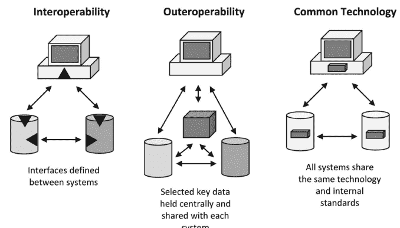

图 6.2
三种不同的集成模型。

- **互操作性** – 每个组成元宇宙在自己的软件上运行，拥有自己的内部数据标准，但系统之间存在商定的接口（例如，三维[3D]模型的交换格式或一组账户信息）。这些接口理想应基于开放标准，以便任何人都可以参与。
- **外互操作性（Outeroperability）** – 存在一个跨多个环境适用的核心信息中央存储库（例如，账户信息、虚拟形象等），然后每个环境利用这些信息来指导其自身运行。这是ReadyPlayerMe等服务所采用的模型，用户的虚拟形象在第三方应用程序中定义和存储，然后由各个平台访问和实现。同样，这应基于开放标准，理想情况下驱动中央服务的软件应为开源。
- **共同技术** – 每个组成部分实际上运行相同的代码，尽管可能有一些本地增强（例如在安全性、功能或性能方面）。但是，任何人都可以运行基础设施的一个组件，代码应为开源。这是OpenSim和Mozilla Hubs服务器版实现的模型。这也基本上是Web早期使用的模型。

在《沉浸式Web的互操作性》(*Interoperability in the Immersive Web*，E，2022)中也有关于元宇宙互操作性的很好讨论。

只要元宇宙仍基于专有技术和围墙花园，互操作性极低，元宇宙就很可能永远无法发挥其全部潜力，甚至可能失败，因为用户会对不同账户、不同功能和冗余资产感到沮丧。但是，除了核心网页功能之外，我们需要牢记，这些问题在2D Web上也并未真正解决。

## 激进界面

2011年，人们心中主要想到的激进界面是HMD-VR。这发生在Virtuality（让许多人第一次体验HMD-VR）和Oculus DK1发布之间，Oculus DK1终于以大多数开发者都能负担得起的价格交付了HMD-VR——而且是在2013年，几乎早了近两个时间段！从那以后，Meta的Quest系列稳步提升了价格实惠的独立式HMD-VR头显的功能，而Quest 3是一款价格实惠的HMD-XR头显。

另一种考虑的新型界面是使用网络摄像头和音频与虚拟世界中的虚拟角色进行物理世界交互——典型的是Lionhead Studio的Project Milo演示（Chung，2010）。之前提到的Fable Studio《墙里的狼》(*Wolves in the Walls*，Billington，2018)中的Lucy可能是迄今最接近该演示的，尽管全程在VR中，但围绕人工智能（AI）角色的总体发展表明，虚拟形象与物理人之间的这种交互——无论是在游戏、虚拟世界、世界之间，还是通过智能手机——将变得越来越普遍。

最后考虑的界面是脑机接口（BCI）。如第4章讨论的，出于各种原因，这项技术实际上可能是将元宇宙从“可有可无”变为“必不可少”的关键，但朝着该目标的技术进展仍然缓慢。

## 社会变革

元宇宙作为一种概念，只有在嵌入社会后才能免于失败，就像电视、手机和万维网一样。ReLive考虑的社会变革有两个方面：

- 虚拟世界（又称元宇宙）的发展将如何受到物理世界发展的影响？以及
- 虚拟世界/元宇宙的使用对社会本身会有什么影响？

第5章考虑了各种问题，例如隐私与监控之间持续的紧张关系、全球文化规范的差异、向居家办公的推动，以及其他可能既鼓励元宇宙发展又带来挑战的社会和全球因素。该章还探讨了元宇宙可能如何影响全球社会。这可能仅仅通过促进“距离的消亡”，支持居家办公和虚拟团队协作，并保持与家人朋友的全球联系来实现。或者可能更深刻，让我们更意识到全球问题（尤其是气候变化），增强“全景效应”，并通过更直接和间接地亲身体验这些事物的能力，使我们对不同文化、观点、生活方式以及性别和性别选择更加开放。展望未来，元宇宙可能会催生新的社会形式，这些形式对物理位置和政治关注远少于当前，并且可能成为我们与先进AI乃至数字不死者互动的地方。

13年后的今天（ReLive 2011之后），我们是否对元宇宙可能带来的社会变革有了更明确的想法，这可能仍是一个有待商榷的问题。

## 新的时间线？

基于自最初2011年ReLive Delphi研究以来所取得（或未取得）的进展，图6.3展示了基于上述分析的一个可能的未来时间线，说明元宇宙概念的发展可能会如何聚焦。

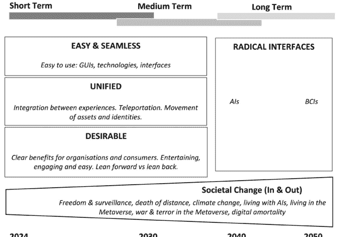

图 6.3
一个更新的ReLive风格计划。

## 马歇尔·麦克卢汉的四元法

马歇尔·麦克卢汉的四元法（麦克卢汉 & 麦克卢汉, 2017），如图 6.4 所示，最初是为考察媒体变化而开发的，但也是分析任何新技术或现象（例如元宇宙）的有用工具。它包含四个问题：

- 技术、媒介或任何人造物增强了什么？
- 它使什么过时？
- 它找回了哪些早已过时的事物？
- 当媒介被推向其潜力的极限时，它会演变成什么？

### 元宇宙增强了什么？

元宇宙实际上赋予了我们超能力。它使我们能够去任何地方、看到任何事物、做任何事——只要是在虚拟领域。通过 MR，它还使我们能够增强现实，引入信息甚至新的虚拟物体，以便更好地看到事物的本来面目、当前状态或可能的样子。

### 元宇宙使什么过时？

元宇宙不应使 2D Web 或手机过时；元宇宙关乎主观体验——而非客观体验。元宇宙可能会使某些类型的旅行（尤其是航空旅行）过时，这对气候有好处，并且潜在上可以在提供比网络摄像头或电视旅游节目更好的“身临其境”感的同时实现这一点。元宇宙可能有助于使对不同文化和生活方式的一些陈旧态度过时，甚至可能有助于使围绕全球不平等和文化分歧的一些问题过时。它甚至可能通过新形式的社会和治理的出现，帮助使民族国家过时。

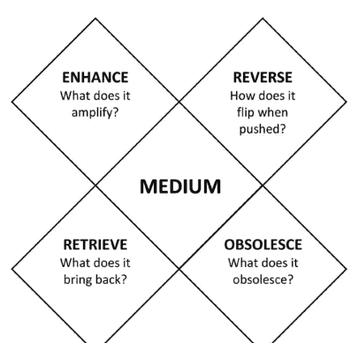

**FIGURE 6.4** 马歇尔·麦克卢汉的四元法（引自麦克卢汉 & 麦克卢汉, 2017）。

### 元宇宙找回了哪些早已过时的事物？

元宇宙找回了篝火。它将全球技术带回一群围坐在（虚拟）篝火旁聊天的人群中。它应该找回讲故事，给予人们讲述自己故事和拥有自己冒险的工具，而不是被动消费精美的媒体。它甚至可能找回想象力。

### 当元宇宙被推向其潜力的极限时，它会演变成什么？

元宇宙可能会变成一个不愉快的世界，充满了破坏者、骗子、性骚扰者、罪犯和恐怖分子；一个虚拟贫民窟。但更糟糕的是，它会变成塞壬之歌，一个如此美好、让我们感觉如此美妙的地方，以至于我们忽视了我们的物理自我、物理关系和物理星球。

这些内容在图 6.5 中进行了总结。

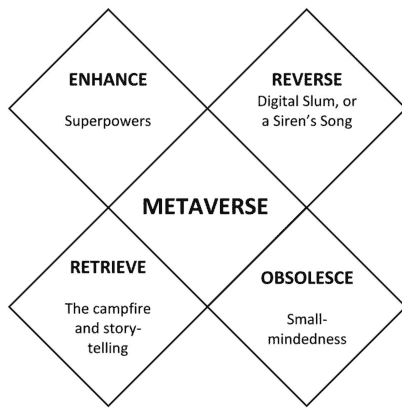

图 6.5
元宇宙四元法。

## 未来场景

试图为元宇宙预测一个特定的未来可能是一个徒劳的挑战。不仅人们和公司对元宇宙是什么仍有不同看法，而且底层技术及社会对其的态度也在不断演变。然而，对未来可能带来什么有一些看法很重要。拥有一些可能的未来场景可以为未来地图提供一系列地标，帮助我们识别真实的未来在展开时正朝哪个方向发展。如果目标是试图引导发展向某些方向并避免其他方向，这一点尤为重要。本节将探讨七种可能的未来场景（在图 6.6 中以图形说明）：

- 失败的元宇宙 – 元宇宙永远不会超越小众兴趣；
- 企业多元宇宙 – 未来全在于围墙花园和单一用途世界；
- 无法无天的元宇宙 – 我们拥有元宇宙，但它变得如此无法无天和失控，以至于大多数人避开它；
- 极权主义元宇宙 – 由一个组织（或群体）将其作为封地来运营；
- 务实元宇宙 – 一个更可能的中期未来；
- 伊甸园元宇宙 – 一个理想化的中期未来；以及
- 星际多元宇宙 – 一个可能的长期未来。

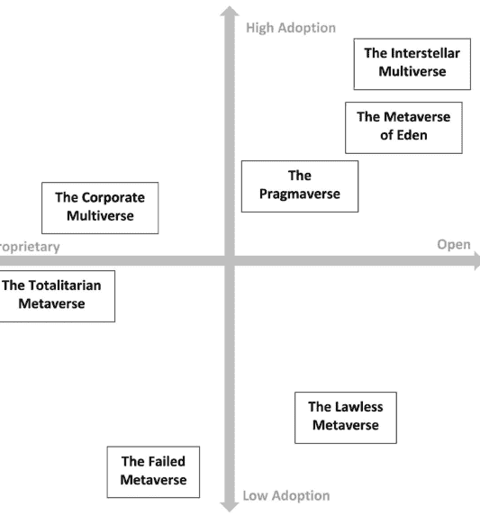

**FIGURE 6.6**
元宇宙的七种未来场景。

对于每种场景，都会考虑其出现的步骤、每种场景的积极和消极方面，以及可以做些什么来鼓励或阻止其实现。如需替代观点，请阅读皮尤研究中心（Pew Research Centre）发布的 *2040 年的元宇宙* 报告，该报告征求了元宇宙不同领域各类专家的意见（Anderson & Rainie, 2022）。

### 失败的元宇宙

如果这本书是在 10 或 12 年前写成的，那么这很可能就是被视为已成为现实的场景。在 *雪崩* 发起关于元宇宙的讨论之后，20 世纪 90 年代末的早期 3D 世界迅速探索了这一理念，随后在 *Active Worlds* 和 *第二人生* 中，发布了实际上实现了人们对元宇宙应有样子的许多期望的平台。当时的希望是，我们会看到像 *第二人生* 这样的平台功能稳步改进，越来越多成功案例出现，并且这种版本的元宇宙逐渐但稳定地被采用。

但不知何故，一切都出了问题。*第二人生* 的定价和政策变化、用户持续的沮丧以及在整合不同平台方面几乎没有进展，都阻碍了预期的增长。讽刺的是，致命一击可能是 Oculus DK1 HMD-VR 的发布，从 2013 年开始，似乎任何不推广 HMD-VR 的东西都无望了。元宇宙的第一次伟大实验失败了。

### 我们如何走向那里

问题在于，元宇宙的第二波会出现失败吗？元宇宙在某些圈子里与加密货币和非同质化代币（NFT）的投机和暴利挂钩，这似乎使得元宇宙崩盘更有可能。HMD-VR 头显的销售表面上看起来不错，但市场渗透率仍然很低。网络晕动症、使用设备所需的空间（尤其是在欧洲家庭中），以及使用头显带来的隔离感和脆弱性等问题，似乎都不利于采用率突然飙升。的确，在撰写本书期间，我们已看到从“元宇宙”转向“空间计算”的趋势。平台之间持续缺乏整合（如 2010 年代那样）没有帮助，我们还从未真正实现 ReLive 2011 的首两个“短期”优先事项——吸引力和易用性。讽刺的是，这或许反映的是技术推动而非社会拉动，工业界在实现中期（移动接入）和长期（HMD-VR）目标方面实际上做得好得多。这种技术聚焦或许就是许多技术和企业将元宇宙活动重新命名为空间计算的背后原因——这是一个技术术语，而且如前所述，似乎消除了人的因素。

### 那是什么样子？

在这种情况下，所有这些沮丧情绪不断累积，加密货币/NFT 发生大崩盘（或者至少投资者决定加密世界不是该待的地方），不久之后，整个元宇宙泡沫破裂，人们转而追求其他事物。少数铁杆用户仍在使用诸如 Second Life、OpenSim 和 Frame 之类的社交虚拟世界，大多数商业协作平台已经破产，因为用户发现其成本效益计算行不通，尽管一些大型活动平台（如 VirBela 和 AmazeVR）可能还在勉强支撑。两个亮点是：使用 DesktopVR 和 HMD-VR 进行学习和培训的缓慢持续增长（但“元宇宙”现在是一个脏字，供应商坚持使用“空间计算”或回归“虚拟体验”），以及诸如 Fortnite 之类的 MMO 游戏让元宇宙变得有趣，而像 Minecraft 和 Roblox 这样为用户提供一定自主权的游戏继续表现良好，并为每一代人重新以不同形式诞生。

这种场景可能没有什么真正具体的优缺点——除了广泛地未能利用元宇宙的可能性之外，那么可以做些什么来避免陷入这种情景（假设没有人愿意为了失败而努力）。

### 阻止失败的元宇宙

创建《元宇宙系列》的关键动力之一是意识到，围绕元宇宙理念的许多辩论自 21 世纪初甚至更早就已经在进行——不仅仅是讨论，还有实际实施、经验和真正的研究。然而，当前围绕元宇宙的许多辩论似乎在忽视这些内容的情况下进行。2000 年代的元宇宙大多失败了，而该失败的许多根源在于 2011 年 ReLive 会议中确定的问题。如果不想重蹈历史覆辙，并避免出现失败的元宇宙情景，那么所有

参与当今元宇宙考虑和开发的人最好应该重视这些来自过去的讨论，并解决本书中所识别的问题和挑战。

## 企业多元宇宙

在没有其他主要驱动力的情况下，并且假设上述描述的至少一些行动被采取以阻止失败的元宇宙，企业多元宇宙似乎可能是默认的目的地。

## 我们将如何到达那里

西方的 Meta 和 Epic 等公司，以及中国的百度、阿里巴巴和腾讯，继续扩展他们进入 VR 和 MR 领域的蹒跚早期步伐，并缓慢构建元宇宙。Meta 的 *Horizons* 也许是一个例子，当你戴上头显时，它最初只是你的“欢迎页面”，然后变成 *Venues* 和一个观看流媒体内容的地方，接着变成 *Horizon Home*，你可以在那里自定义家居体验，最终变成 *Horizon Worlds*，你可以在那里与其他人社交、构建体验并分享它们。在巨大营销预算的支持下，这些世界有一种安全感，并且是流行硬件上的默认体验。只要体验和功能的范围与大多数用户所享受的保持同步，这些企业世界就可能在消费领域保持默认地位。娱乐和游戏品牌可能会与这些公司合作，或者觉得自己足够大，可以开发自己的品牌世界。在商业领域，也会出现类似模式，领先的商业解决方案提供商开发专注于商业协作的世界，培训和学习提供商建立首选的培训和教育世界，等等。

## 它是什么样子？

尽管底层技术可能存在一些共性，一些世界甚至可能感觉非常相似，但每个世界都是其自身的生态系统，它们之间在身份、资产或体验转移方面几乎没有方式。这更像是一系列独立的元宇宙集合，而不是一个单一的元宇宙或联邦多元宇宙。一个可能的类比是万维网出现之前的日子，当时“信息高速公路”由 Prodigy、AOL 和 CompuServe 等独立系统主导。严格的企业控制可能还意味着稳定性和安全性受到重视，超过创造力和想象力，因此用户代理权，特别是在世界内构建方面，尤其是脚本编写，可能受到限制。用户生成内容（UGC）只有在符合企业指南并能改善企业利润时才会受到鼓励。这些世界可能看起来非常漂亮，但可能被视为镀金的笼子。

## 影响演化

虽然有些人可能对这样一个未来感到满意，但我们的假设是，大多数用户希望比这种场景提供的拥有更多自由、代理权、灵活性、隐私和所有权。这的关键可能在于确保某人建立自己的元宇宙空间（在服务器和体验层面）与他们购买网络托管并构建自己的网站一样容易。这反过来表明需要确保驱动元宇宙的关键技术是开源的，并基于开放标准——鼓励创新和利用。

还有必要向参与度较低的用户证明，元宇宙的潜力远远超出企业组织推广的整洁和受限制的版本——鼓励他们转向其他提供商，充分利用元宇宙的潜力。

## 无法无天的元宇宙

如果失败的元宇宙展示了事情在一开始就出错时会发生什么，那么无法无天的元宇宙展示了事情在过程中出错时会发生什么。

## 我们将如何到达那里

元宇宙的发展可能一开始会朝着非常有前途的方向前进。所需的软件和硬件正在稳步开发和采用，多个世界，甚至几个主导世界在元宇宙中建立起来，一段时间内，一切看起来都很好。但就像社交媒体在某种程度上变成了网络喷子的游乐场，骗子和黑客在网络和互联网上猖獗一样，社会中不那么体面的部分也会认识到元宇宙中赚钱、制造混乱和恶意行为的机会。一个虚拟形象对着你尖叫辱骂，或者使用某些黑客手段禁用你的移动，甚至在喊出淫秽语言或向你挥舞巨大的像素阴茎（或更糟）时强制你移动，这很可能会劝退许多用户，不再参与该环境，并且它会迅速沦为最低共同标准的空间。如第 1 章所述，至少有一个高知名度的原型元宇宙（Google 的 Lively）部分因为世界内的滥用行为而关闭，并且如前所述，元宇宙空间的滥用行为仍然是一个问题，隐私、非法活动甚至敌对行为的担忧也是如此。

## 它是什么样子？

在这种情况下，元宇宙或多或少成为所谓暗网的一部分。这是一个人们只有在参与可疑或完全非法活动时才倾向于访问的地方。色情、盗窃、暴力图像和极端滥用司空见惯。设有年龄验证计划的国家可能会限制对它的访问，或者它可能是一个你只能通过元宇宙版本的 Tor 浏览器才能到达的地方。鉴于用户和运营商对安全性的担忧，它更有可能是一个多元宇宙，而不是单一的元宇宙，有许多离散服务器松散地链接成一个世界网络，使用区块链或类似技术控制访问、资产所有权以及世界之间的转移。

## 避免无法无天的元宇宙

试图避免无法无天的元宇宙可能最大的要求是确保每个元宇宙开发中都存在安全和安保功能及工具，用户不仅知道它们的存在，而且对使用它们感到舒适，并且存在良好但公平的治理。

虽然有些人可能会反对，但将每个账户链接到可追溯的现实世界身份可能是一个基本步骤——尽管这并不意味着用户无法在其他用户所知晓的情况下在世界内匿名操作。但这意味着，如果用户违反平台或社区准则或适用法律，则可以采取适当的制裁（不仅包括禁止当前账户和未来访问，还包括现实世界中的法律行动）。这里当然存在公民自由问题，以及如何在多国背景下处理这些问题，是首要关注的问题。此外，如果元宇宙成为日常生活的必需品，那么终身禁令可能不可行——可能需要一种绝对可靠的电子手段来限制能力和自由（也许是电子脚铐的虚拟等价物）。

在次要层面，虚拟世界长期以来包含了各种个人安全功能，例如第 2 章中描述的安全区。许多世界允许你视听屏蔽正在骚扰你的特定用户，并可以举报他们的滥用行为。私人拥有的区域可以为违反当地次级法律的人建立自己的禁入名单。自动化和 AI 监控也可用于执行图像、聊天，甚至可能是 3D 模型的内容准则等内容。一些世界（例如 Second Life）要求用户将私人持有的区域标记为类似电影的内容分类评级，以便区域可以被评为 U（所有人）、A（建议或陪同）、15（15 岁或以上）、18（18 岁或以上）或 X（故意的露骨材料）。账户上的年龄验证随后可以帮助确保账户与分类相匹配——但儿童使用成年人的账户可能难以防止（尽管实现面部表情检测的相同摄像头可能还能在头显或网络摄像头中实现身份甚至年龄检测——但同样会产生新的隐私问题）。

无论未来采取哪条路线，任何元宇宙中都可能存在不体面的区域，就像在现实世界中一样。它们的存在不一定完全是一件坏事，只要基本权利得到保护。挑战在于确保它们只占体验的一小部分，人们知道何时误入其中，并且即使在其中的深处，保护和帮助也可用。

## 极权主义元宇宙

如果无法无天的元宇宙代表了元宇宙在个人层面的失败，那么极权主义元宇宙代表了在企业或国家/政府层面的失败。

## 我们将如何到达那里

这可能开始时类似于企业多元宇宙场景，但一家公司大获成功。在已经拥有控制导向型政府的国家，政府可能只允许一家公司（它自己的公司）建立“国家元宇宙”，并阻止访问其他元宇宙。无论哪种情况，就任何用户而言，他们只有一个元宇宙选项，而那个元宇宙由一个实体控制，该实体可能不以用户的最佳利益为重。

## 它是什么样子？

极权主义元宇宙是另一个数字反乌托邦。使用 VR 跟踪不仅用户身份，而且可能还包括他们的情感行为和触发因素以及他们的兴趣和使用情况的能力，已经讨论过。如果元宇宙成为日常生活的很大一部分，那么这种程度的信息以及同等程度的控制可能被滥用，这一点非常令人担忧。Second Life 早期放弃了其声誉管理，但在元宇宙中实施中国式的“社会信用”系统不仅更容易，而且比试图在现实世界中实施它要全面得多。在极权主义元宇宙中，你必须表现良好，否则后果自负。

## 影响演化

如果通往极权主义元宇宙的关键路径是垄断平台的出现，那么与企业多元宇宙一样，允许任何人建立元宇宙必须是抵御它的关键防御。一个垄断元宇宙

可能是企业元宇宙场景的极端结果，而该垄断甚至可能是良性的，但在让这样的实体出现之前，我们需要绝对确定这是正确的做法，并且始终有机会退出并建立一个替代元宇宙。

而在无政府元宇宙的讨论中，支持Tor浏览器的元宇宙曾是反派，而在这里它甚至可能是救世主，即使是生活在极权政权下的人们也能安全地进入更开放的元宇宙。

## 务实元宇宙

如前所述，一个统治一切的元宇宙可能有其自身的问题，因为不同的利益相关者想要和期望的东西不同，更别提让某些普遍采用的标准站稳脚跟所面临的挑战（虽然同样，我们在万维网上做到了）。也许未来最务实的场景更像是一种“混合舰队”，即一个开放标准的元宇宙/多元宇宙与更多专有技术或空间共存。

## 我们如何实现

随着组织探索元宇宙的商业潜力，各种各样的用例正在涌现。这些用例已经由多种专用技术和系统支持，例如培训世界、娱乐世界、会议世界、会议与协作世界，甚至军事世界。所有这些是否都现实地汇聚到同一套技术和标准上——更不用说仅仅成为一个全包性元宇宙中的一块土地了？

在务实元宇宙中，很可能会出现一些整合。一个关键元素是HMD-XR头显。人们不太可能为不同用途想要不同的头显，因此在元宇宙堆栈的呈现元素上进行标准化是我们已经看到的事情——尤其是WebXR等标准。在管道的另一端，如果开发者可以在多个平台上使用相同的3D模型和虚拟形象，则会有明显的经济效益——glTF和ReadyPlayerMe等服务已经在这方面提供帮助。即使是驱动这些世界的游戏引擎也经历了显著的整合，Unreal和Unity倾向于占据主导地位。差异化发生在应用程序本身，并且可能会继续发生。

虽然总有“专注于自己主业”的动力，但平台可能会逐渐扩展以涵盖相关主题——为什么培训世界不应该也提供协作和会议设施，或者协作空间不应该提供培训设施呢？与此同时，用户可能会对UGC世界产生越来越大的需求，在那里他们可以发挥创造力，随心所欲。

如果人们随后发现他们可以使用UGC提供与某些定制环境相媲美的服务（就像在第二人生中发生的那样），那么这可能会引发进一步的整合。因此，在这个场景中，可能存在两种子场景：一种是“企业”平台是主导形式，但UGC世界是一股活跃的力量；另一种是UGC世界实际上是主导形式，而企业平台仅处理最专业的用例。

也可能最终会出现岛屿连接，因为不同的元宇宙和微元宇宙发现联合成一个更连贯的多元宇宙是有益的。

## 它是什么样子？

作为用户，你比在大多数其他场景中更意识到不同系统的存在。你为所有不同的应用程序使用同一个XR头显，但有些可能需要不同的登录身份，并且你在不同的世界中可能有不同的个人资料、虚拟形象和资产。如果你正在进行虚拟会议，然后需要去参加一些培训，你可能需要先登出，然后再登录到另一个世界。如果你随后转到另一项任务，并认为从培训会话中带入那个可交互对象会很有用，你可能做不到。下午5点，你从企业世界登出，进入一个棋盘游戏世界与朋友一起玩Root，然后进入另一个世界，虚拟地参加地球另一端的一场音乐会。你在一个由UGC主导的世界度过一天，在那里你与另一群朋友闲逛，或者做一个个人项目。

## 影响演进

尽管务实元宇宙可能不是默认的未来，但如果能避免更多负面场景，它很可能是最可能的结果。关键的影响活动在于实施那些ReLive观察结果。如上述叙述所示，最大的用户问题很可能是碎片化——这不利于让体验变得无缝，但在所有层面上拥有广泛采用的标准可能有助于解决这个问题。

企业世界与UGC世界之间的平衡点很可能取决于支持UGC的世界的能力和灵活性——如果用户在UGC世界中能比企业世界做得更好，那么企业拥抱该UGC世界的压力就会增加。因此，为了鼓励UGC未来，那些UGC功能（尤其是脚本功能）需要在UGC主导的世界（以及理想情况下的其他平台）上可用，并且人们需要具备使用和利用这些新UGC工具的技能，以在元宇宙中创建他们想要的工具和体验。

## 伊甸元宇宙

当人们传统上谈论“元宇宙”时，愿景通常是关于一个每个人都能访问的单一虚拟世界，它满足他们所有与元宇宙相关的需求，并与他们的物理生活无缝集成。这是一个现实的期望吗？

## 我们如何实现

如果人们注意到失败、极权和企业元宇宙场景中提出的要点，并专注于体验的无缝性、支持它的开放标准、构建满足真实需求的服务，以及支持将元宇宙作为我们未来生活重要组成部分的社会变革，那么我们可能已经在通往伊甸元宇宙的道路上了。社会在很大程度上通过万维网实现了这一点，那么社会为什么不能通过元宇宙也实现它呢？

## 它是什么样子？

伊甸元宇宙是营销视频和好莱坞电影中的元宇宙。它是《头号玩家》的OASIS或《卡普里卡》的V-World。每个人都可以通过智能手机/平板电脑或家用电脑，或者通过XR头显或眼镜进入元宇宙（尽管这两个世界至少在一开始都是企业元宇宙）。大多数地点都有某种形式的“全息投影仪”（如《银翼杀手2049》中所示），以避免本地用户不得不戴上头显才能看到虚拟访客。这个世界对地球有一些地理概念，但也可能包括太阳系的行星甚至一些奇幻和类型世界，混合了各种公共和私人空间。如前面呈现的公理所示，在伊甸元宇宙中，你可以“学习、教学、赚钱、创作、出售、购买、交易、协作、沟通、探索、交朋友、玩耍、娱乐、提供娱乐、被娱乐、建立关系、拥有新体验并留下遗产”。这个元宇宙还将是数百万甚至数十亿个AI控制的虚拟形象的家园，有些只不过是虚拟销售和支持助手，有些是死者的数字长生者（DAs），也许还有少数人处于（甚至实现）通用人工智能（AGI）的边缘。伊甸元宇宙将成为每个人生活的重要组成部分，我们几乎不会去想某件事是发生在物理空间还是虚拟空间。

## 影响演进

如上所述，要想到达伊甸，重点需要放在体验的无缝性、支持它的开放标准、将服务和体验与真实需求相匹配，以及支持任何由此产生的社会变革上，同时避开企业和极权元宇宙的陷阱。

可能最大的挑战是，不同的人，尤其是组织，甚至国家和社会，有不同的需求和不同的规范。例如：

- 不同国家和文化的社会及法律期望可能使它们在同一个元宇宙中共存变得棘手（就像在物理世界中一样）。适用谁的着装规则，什么金融模式，以及什么言论和表达自由规则？

- 一个组织可能不放心将其商业秘密、机密信息和知识产权（IP）以及敏感会议委托给全球共享元宇宙中即使是“私有”空间。国防和情报领域的参与者可能会有更多担忧。

- 不同的组织可能对如何呈现和潜在更改同一真实世界位置的数字孪生有不同看法。实际的市政当局可能希望结合智慧城市和营销表现，社区团体可能希望“改善”或改进他们自己的虚拟区域，规划者可能希望让城市快进十年，拥有的军队可能希望推演防御计划，而敌对军队可能希望推演攻击计划。虽然单一数字孪生的想法很有吸引力，但鉴于这类用例，它会迅速失效。

存在四种广泛的解决方案：

- 解决方案与物理世界相同——每一块虚拟土地都有自己的保护和规则，用户应遵守当地规则。在这种情况下，单一元宇宙可能就足够了——尽管这无法满足安全或数字孪生的挑战。

- 一个非常技术性的解决方案可能是，虽然地球上的每个点只有一个实例，但你可以在那里在不同的虚拟现实层之间进行选择以显示和交互——虚拟现实和混合现实的结合，可以说是一种混合虚拟现实！

- 一个更可能的解决方案是，元宇宙实际上是某种形式的多元宇宙。可能存在某种形式的共同核心世界，但人们和组织能够创建他们自己的组成元宇宙（或多元宇宙），这些元宇宙可以从核心空间访问，使用相同的软件按照相同的标准构建，受当地规则约束，拥有自己的访问控制，并在自己的托管上运行。这些世界中的数字孪生可能不同，但它们之间有链接，并可能链接到某个“主”副本以进行更新。

- 在更极端的情况下，国家和社会群体可能会运行元宇宙或多元宇宙，这些元宇宙或许共享通用代码，但仅能通过特定门户访问，并与其余元宇宙保持有限连接——类似于中国的防火长城。

## 星际多元宇宙

最后，可能的长期未来会是什么样子？元宇宙的发展（或失败）正与太空探索的重大进展同步进行。到2030年代/2040年代，月球上可能会有基地，而大约在2040年，首次火星登陆可能会发生。与此同时，首批 AGI 可能在本世纪某个时间出现。到2100年代，人类和 AI 可能会开始触及星辰。元宇宙可能成为这一切的核心，甚至陪伴首批旅行者超越太阳系。

## 我们如何到达那里

为简化起见，假设最终胜出的是伊甸元宇宙的多元宇宙形式，地球拥有一个全球性多元宇宙（但称为元宇宙），为所有人提供访问权限和机会。一个关键挑战在于元宇宙如何离开行星。即使是往返月球的显著时间延迟（约2.6秒）也会使共享世界中化身的实时交互变得极为棘手，而平均往返火星约25分钟的延迟会使这种交互变得不可能。解决方案是多元宇宙的多元宇宙。每个卫星或行星都有自己的多元宇宙，但其中一些元素与其他多元宇宙同步，以便可以共享共同体验。对于人与人之间的通信，AI 技术的进步允许用户根据需要向其他多元宇宙派遣自己的虚拟版本（他们可能已经为多场会议这样做），以进行不受时间延迟影响的本地对话，然后汇报。未来的元宇宙将成为人类、虚拟代表、数字永生者和 AI 的融合。

## 它是什么样子？

元宇宙不仅由人类控制的化身构成，还包括由人们的虚拟私人助理（VPA）控制的化身，以及简单 AI 和 AGI 化身，还有许多逝者的 DA——他们大部分时间在称为 Thanoverse 的多元宇宙大部分区域与 AGI 一起工作。

你的化身将访问本地元宇宙所在的任何地方，但多元宇宙之间的兼容性和互操作性意味着你的所有账户信息、数字资产和资金都会随你一起。你可能会在当地元宇宙片段上“租”下家庭或办公空间，就像你在实地旅行到地球（甚至火星）上的某个地方时可能会租下住处一样。要拜访“外宇宙”的某人，你会派遣虚拟个人代表（VPR）代你前往。它返回后，你的 VPR 不仅会向你汇报，而且在没有任何记忆上传突破的情况下，其旅行记忆会自动融入你持久 VPA 的记忆图谱中。这意味着，当旅行中的记忆、讨论和关键决策与你正在做的事情相关时，VPA 可以回忆起它们，并且随着时间的推移，它们可能会变得如此熟悉，以至于你对自己是否去了还是你的 VPR 去了的记忆变得模糊。如果达到了真正的数字永生阶段，你的 VPA 可以为虚拟的、永生的、你提供基础。

## 影响演进

要到达伊甸元宇宙，甚至普拉格马斯，并使其对地球上每个人都可用，这可能已经足够让人们忙碌不堪，无需再担心元宇宙如何被带到其他行星。然而，离地球元宇宙可能比预想的更近。当科学家和探险家考虑如何在月球上建造基地、如何管理往返火星两到三年的旅程，甚至在火星上建立殖民地时，在每个世界上拥有一系列元宇宙空间供探险家用于支持规划、设计、科学、探索、社交、家庭联系和放松，几乎肯定是必不可少的。

## 迈向星辰？

从地球到月球和行星的同样讨论也适用于触及星辰。当前技术表明，未来一个世纪左右的任何任务都可能没有人类船员（Peck, 2023），并且如前所述，元宇宙空间对于创建和维持有根基的 AI 可能是必不可少的（Burden & Savin-Baden, 2019; Gamez, 2023）。任何随行的 DA 无疑也会想要带上他们一小块（虚拟）家园。一个巧妙的技巧是，在飞船上的多元宇宙中，不同的世界可以以不同速率运行，因此主要任务仅在到达后才开始的 AI 或 DA 可以以 1:100 的稀释率体验旅程，因此一百年的旅程主观上只感觉一年——这足够它们在接近到达时分析新信息并调整规划。一旦它们到达并建立双向通信，新的恒星元宇宙可以链接到地球上的所有本地多元宇宙——让全人类能够第一次（虚拟）亲身体验新世界。并且可以传输新的 VPR 和 DA 出去，去那个遥远的新多元宇宙中生活和工作。

在建立新殖民地、拥有其自身行星元宇宙网络后，机器人可以为下一波探索建造星际飞船，并以不断扩大的化身驾驶的冯·诺依曼机器（Matloff, 2022）波及形式推进到银河系各地。元宇宙将变得真正的星际级，甚至可能是银河级。

当然，在某个时候，我们可能会遇到一群外星智慧体，以及来自另一方向的外星元宇宙。一旦技术挑战得到解决，外星 AI 和它们的 DA 甚至可能访问我们的本地元宇宙，并且随着技术理解的增长，两个元宇宙之间可能会建立适当的门户和可移植性，外星空间和化身可以缓慢地通过每个种族的星际元宇宙向相反方向传播。结果，实体人类对外星种族的第一次体验可能是，一个外星门户在地球元宇宙中开启，提供访问外星元宇宙的本地副本，以及与外星化身见面和交谈的能力。对于大多数实体人类来说，他们与外星人的第一次相遇可能不是身穿宇航服在崎岖敌对的星球上，而是在自己沙发上的舒适环境中。

## 结论

没有用户，元宇宙就什么都不是，并且对于普通人来说，要让元宇宙（甚至是虚拟世界）的概念变得可理解，更不用说可取，仍然存在巨大的挑战。上述基于 ReLive 的分析开始确定一些有助于元宇宙/多元宇宙增长的具体步骤，而七个场景为未来可能是什么样子提供了一些想法——有些未来需要避免，另一些则需要努力实现。

有一代人在 Club Penguin、动物之森、魔兽世界和 Habbo Hotel 等虚拟体验中长大；而 Roblox 和 Minecraft 可能正在孕育新一代粉丝。但目前还不明显这些人是否正在成长为一代热衷于 VR 和虚拟世界的用户，尽管有些人正在将虚拟世界带入他们的成年生活。

这将是一场持久战，我们需要确保元宇宙满足真实需求，而不是技术狂人的幻想，并且我们正在以所有最好的方式传播和展示其益处。我们也需要从过去学习。从《雪崩》发布到 Facebook 改名为 Meta，甚至仅仅到 Oculus DK1 发布的那段时期，并非元宇宙沙漠。那段时期充满了开发者创建丰富的原型元宇宙平台，用户寻找各种方式使用这些空间用于家庭、娱乐、工作和学习，以及研究人员对其进行研究和报道。我们需要从那些时期产生的、并在很大程度上被记录的丰富经验中学习。

当新一代进入元宇宙时，它必须允许他们做他们想做的任何事——这正是它与会议应用、游戏或活动应用不同的地方。这曾是 Second Life 的真正优势之一（但对许多人来说也是真正的弱点）——一旦你到了那里，你就可以做任何

你想要：开会、玩游戏、建立关系、查看数据、教学、放松、赚钱，或只是闲逛。真正的元宇宙也必须给予我们这种灵活性——它是现实世界，只是数字化的。

## 参考文献

- Anderson, J., & Rainie, L. (2022). *2040年的元宇宙*. Pew Research Centre. https://www.pewresearch.org/internet/2022/06/30/the-metaverse-in-2040/
- Billington, P. (2018). *墙中的狼*. Fable Studios and Third Rail Projects. https://thirdrailprojects.com/wolvesinthewalls
- Burden, D. J. H. (2011). *虚拟世界：未来史* [演示文稿]. https://www.slideshare.net/davidjburden/virtual-worlds-a-future-history
- Burden, D. J. H. (2022). *元宇宙——未来史？*. Medium. https://medium.com/@davidjhburden/the-metaverse-a-future-history-e618b080d15
- Burden, D. J. H., & Savin-Baden, M. (2019). *虚拟人类：今天与明天*. CRC.
- Chung, J. (2010). *Microsoft 的 Milo：一个虚拟的4岁男孩*. TechEBlog. https://www.techeblog.com/microsofts-milo-a-virtual-4-year-old-boy/
- Deloitte. (2017). *全球移动消费者趋势* (第2版). Deloitte. https://www2.deloitte.com/content/dam/Deloitte/us/Documents/technology-media-telecommunications/us-global-mobile-consumer-survey-second-edition.pdf
- DelSignore, P. (2022). *虚拟现实的挑战*. Medium. https://medium.com/blockchain-biz/what-is-wrong-with-virtual-reality-1955dafdf21
- E, L. (2022). *沉浸式 Web 的互操作性，第 1 部分和第 2 部分*. Mozilla Hubs. https://hubs.mozilla.com/labs/interoperability-in-the-immersive-web/; https://hubs.mozilla.com/labs/interoperability-in-the-immersive-web-part-2/
- Gamez, D. (2023). *虚拟世界必须具备哪些属性和结构，才能成功实现人类水平的人工智能？*. davidgamez.eu. http://www.davidgamez.eu/papers/Gamez23_PropertiesVirtualWorldCreationIntelligence.pdf
- IGN. (2023年9月27日). Meta Quest 3 揭晓：Meta Connect 2023 主题演讲直播 [视频]. YouTube. https://www.youtube.com/watch?v=q09j-y05Prw&ab_channel=IGN
- Matloff, G. L. (2022). 冯·诺伊曼探测器：原理、推进、星际传输时机. *国际天体生物学杂志*, 21(4), 205–211.
- McLuhan, M., & McLuhan, E. (2017). *马歇尔·麦克卢汉的丢失四分体*. OR Books.
- Peck, M. (2023). 机器人、人类，还是某种组合——我们应该向星际派遣什么或谁？ *星际旅行* (第83–100页). Elsevier.
- Picon, I. (2007). 概念化在线新闻使用. *天文台*, 3, 93–114.
- United Nations. (2021). *到2030年实现普遍连接*. United Nations. https://www.un.org/techenvoy/content/global-connectivity

## 泰勒和弗朗西斯

泰勒和弗朗西斯集团

http://taylorandfrancis.com

# 尾声

我们希望这本书为您提供了关于元宇宙概念、其历史、技术、潜在利益与挑战的（相对）简洁而批判性的入门介绍，以及对元宇宙在未来数年、数十年乃至数个世纪中可能如何演变的一些想法。

如果您希望进一步探索本书中提出的任何想法，我们将向您推荐本系列即将出版的其余书籍。已在进行中的书籍已列在本书前面，但我们在付印时以及在这第一本书出版后很长一段时间内，将继续积极物色和签约新作者。下面列出了我们对本系列潜在书籍的一些其他想法。

- 无障碍
- 艺术与时尚
- 区块链与加密货币
- 商业与协作
- 气候变化
- 网络安全
- 数字永生
- 经济学
- 娱乐与游戏
- 全球平等
- 治理
- 健康与护理
- 身份与性取向
- 法律
- 文学与媒体
- 市场营销
- 哲学与伦理学
- 政治、运动与极端主义
- 社会与人类学

如果您认为自己有资格撰写上述某一主题，或有关于元宇宙的其他方面要建议，请联系 CRC/泰勒和弗朗西斯系列编辑 Randi Slack，电子邮箱：Randi.Slack@taylorandfrancis.com。

## 泰勒和弗朗西斯

泰勒和弗朗西斯集团

http://taylorandfrancis.com

# 参考书目

虽然其中一些已在正文中具体提及，但这是与元宇宙任何讨论相关的关键书籍、媒体和网站的摘要列表。更新后的列表也可在元宇宙系列网站上查阅：http://www.themetaverseseries.info。

### 非小说类书籍

- Au, W. J. (2009). 第二人生的制作：来自新世界的笔记. Collins Business.
- Au, W. J. (2023). 打造一个重要的元宇宙：从雪崩和第二人生到一个值得为之奋斗的虚拟世界. John Wiley & Sons.
- Ball, M. (2022). 元宇宙：以及它将如何颠覆一切. Liveright Publishing.
- Bartle, R. A. (2004). 设计虚拟世界. New Riders.
- Blascovich, J., & Bailenson, J. (2011). 无限实在：虚拟形象、永生、新世界与虚拟革命的黎明. Harper Collins.
- Burdea, G., & Coiffet, P. (2003). 虚拟现实技术. Wiley.
- Burden, D. J. H., & Savin-Baden, M. (2019). 虚拟人类：今天与明天. CRC.
- Burden, D. J. H., Savin-Baden, M., & Mason-Robbie, V. (2022). 虚拟现实培训与教育的教学法. https://www.daden.co.uk/p4vr.
- Carr, P., & Pond, G. (2007). 第二人生非官方旅游指南. Pan Macmillan.
- Chalmers, D. J. (2022). 实在+：虚拟世界与哲学问题. Allen Lane.
- Ffiske, T. (2022). 元宇宙：专业指南：虚拟现实（VR）、增强现实（AR）和沉浸式技术专家指南. Amazon.
- Guest, T. (2007). 第二人生：穿越虚拟世界的旅程. Random House.
- Kannen, V., & Langille, A. (编). (2023). 虚拟身份与数字文化. Routledge.
- van Kokswijk, J. (2007). 数字自我：虚拟身份的社会与法律层面. Eburon Academic Publishers.
- Meadows, M. S. (2008). 我，虚拟形象：拥有第二人生的文化与后果. New Riders.
- Moore, D., Thome, M. & Haigh, K.Z. (2008). 脚本你的世界：第二人生脚本制作官方指南. Wiley Publishing.
- Narula, H. (2022). 虚拟社会：元宇宙与人类体验的新疆域. Currency.
- Rosa, N. (2023). 理解元宇宙：商业与伦理指南. Wiley & Sons.
- Rymaszewski, M., Au, J. W., Batstone-Cunningham, B., Ondrejka, C., Wallace, M. & Winters, C. (2007). 第二人生：官方指南. Wiley & Sons.
- Savin-Baden, M. (2010). 在高等教育中使用第二人生的实用指南. Open University Press.
- Savin-Baden, M., & Mason-Robbie, V. (编). (2020). 数字后世：数字时代的死亡问题. Chapman & Hall/CRC.
- Savin-Baden, M., Tombs, C., Poulton, T., & Kavia, S. (2009). 第二人生入门. JISC.
- Sinha, I. (1999). 电子游牧民：关于爱情、生活和电子前沿旅行的坦率叙述. Scribner.
- Weber, A., Platek, R. & Rufer-Bach, K. (2008). 创建你的世界：第二人生高级内容创建官方指南. Wiley Publishing.

### 网站、博客和播客

- Active Player - https://activeplayer.io/category/live-player-count/ 获取各种游戏及众多虚拟世界平台使用情况最新统计数据的有用场所。
- Hypergrid Business - https://www.hypergridbusiness.com/ 虚拟世界与元宇宙新闻的长期且受人尊敬的来源。
- 沉浸式学习研究网络 - https://www.immersivelrn.org/ 跨多种虚拟世界和技术的学习与教育研究。
- 元宇宙期刊 - https://independent.academia.edu/JournalMetaverse 关于虚拟世界和元宇宙的学术论文有用集合。
- 虚拟世界研究杂志 - https://jvwr-ojs-utexas.tdl.org/jvwr/ 一本关于虚拟世界和元宇宙的开放获取期刊，刊物时间为2008年至2020年。
- KZero Worldwide - https://www.linkedin.com/company/kzeroworldwide/ Nic Mitham 近20年来一直在跟踪虚拟世界数据，并制作出优秀的元宇宙雷达图。
- 新世界笔记 - https://nwn.blogs.com/nwn/ Wagner James Au 关于虚拟世界和元宇宙事务的长期运营博客。
- 下一亿秒 - https://nextbillionseconds.com/a-brief-history-of-the-metaverse/ 制作了优秀的《元宇宙简史》系列。
- Theo Prestley - https://medium.com/@theo Medium 上关于元宇宙问题的较好评论员之一。
- VR之声播客 - https://voicesofvr.com/ VR和元宇宙访谈的绝佳来源。

### 标准组织与行业组织

- 开放USD联盟 - https://aousd.org/
- 企业增强现实联盟 - https://thearea.org/
- 元宇宙标准论坛 - https://metaverse-standards.org/
- 开放元宇宙联盟 - https://www.oma3.org/
- 开放元宇宙基金会 - https://www.openmv.org/
- 开放元宇宙互操作性小组 - https://omigroup.org/
- OpenXR - https://www.khronos.org/openxr/
- 虚拟世界教育联盟 - https://www.vweconsortium.org/
- VR/AR协会 - https://www.thevara.com/
- XRAccess - https://xraccess.org/
- XR协会 - https://xra.org/

## 虚构书籍

巴恩, E. (1999). ThiGMOO. Earthlight.

克莱恩, E. (2011). 头号玩家. Crown Publishing Group.

伊根, G. (2008). 置换城市. Gollancz.

吉布森, W. (1984). 神经漫游者. Ace.

吉布森, W. (1996). 偶像. Viking Press.

莫加奇, L. (2013). 先亲吻我. Anchor Books. Picador.

夏普森, N. (2021). 当麻雀落下. Solaris.

斯蒂芬森, N. (1992). 雪崩. Bantam Books.

斯蒂芬森, N. (2020). 坠落；或，道奇在地狱中. William Morrow & Company.

泰勒, D.E. (2016). 我们是军团（我们是鲍勃）. Worldbuilders Press.

维因, V. (2007). 彩虹尽头. Tor Books.

维因, V. (2015). 真名与赛博空间疆域的开辟. Tor Books.

## 电视、电影和有声虚构作品

奥布尚, R., & 穆尔, R. D. (创作者). (2010). 卡普里卡. Syfy.

布鲁克, C. (2011). 黑镜 [电视剧]. 频道 4.

布劳顿, M., 德拉姆古尔, J., 霍尔, S., & 罗宾逊, J. (创作者), & 德拉姆古尔, J. (制片人). 行星 B. (2009). BBC

克莱恩, E. (2018). 头号玩家. 华纳兄弟影片公司.

丹尼尔斯, G. (2010). 上传. Deedle-Dee 制作公司.

埃斯利, B. (2018). 先亲吻我. 频道 4.

小中千昭, C. J. (编剧). (1998). 序列实验莱恩. TXN.

罗登贝瑞, G. (创作者 & 执行制片人). (1987). 星际迷航：下一代. CBS 电视.

沃卓斯基姐妹. (1999). 黑客帝国 [电影]. 华纳兄弟.

## 电脑游戏

比林顿, P. (2018). 墙中的狼 [虚拟现实]. Fable Studios 和 Third Rail Projects. 可在以下网址获取: https://thirdrailprojects.com/wolvesinthewalls

## 角色扮演游戏

牛顿, S., & 斯尼德, J. (2014). 心灵塑造者. Modiphius Entertainment.

## 虚拟世界与原型元宇宙

- Active Worlds - https://www.activeworlds.com/
- Alloverse - https://alloverse.com/
- AmazeVR - https://www.amazevr.com/
- Arthur - https://www.arthur.digital
- Cryptovoxels - https://www.voxels.com/
- Decentraland - https://decentraland.org/
- Engage - https://engagevr.io/
- Fortnite - https://www.fortnite.com/
- Frame - https://learn.framevr.io/
- Gather.town - https://www.gather.town/
- Glue - https://glue.work/
- Hiberworld - https://hiberworld.com/
- Hyperfy - https://hyperfy.io/
- Lamina1 - https://www.lamina1.com/
- MeetInVR - https://www.meetinvr.com/
- MetaVRse/TheMall - https://themall.io/
- Meta Horizon Worlds - https://horizon.meta.com/
- Microsoft Mesh - https://www.microsoft.com/en-us/microsoft-teams/microsoft-mesh
- Minecraft - https://www.minecraft.net/en-us
- Mozilla Hubs - https://hubs.mozilla.com/
- Open Sim - http://opensimulator.org/
- Rec Room - https://recroom.com/
- Roblox - https://www.roblox.com/
- Sansar - https://www.sansar.com/
- Second Life - https://secondlife.com/
- Somnium Space - https://somniumspace.com/
- Spatial - https://www.spatial.io/
- StellarX - https://www.stellarx.ai/
- Vark - https://corp.vark.co.jp/
- Virbela - www.virbela.com
- Virbacia - https://virbacia.com/
- Virtend - https://www.3dicc.com/
- VISPA - https://www.vispa.io/
- VR Chat - https://hello.vrchat.com/
- Wonderland - https://wonderlandengine.com/
- World of Warcraft - https://worldofwarcraft.blizzard.com/en-gb/
- XRSpace/GOXR/PartyOn - https://www.xrspace.io/us

此列表会随着虚拟世界的兴衰而过时。更及时的列表（连同世界图像和关键数据）可通过元宇宙系列网站获取：http://www.themeataverseeries.info.

# 术语表

**180VR：** 立体视频 VR（另见）仅显示前向视图，以节省带宽和内存。

**3DOF：** 三自由度，即能够上下、左右观察，并向左/向右倾斜。

**360VR：** 立体视频 VR（另见）记录摄像头周围完整的 720°（上下 360° 和左右 360°）。

**6DOF：** 六自由度，即在 3DOF（另见）的基础上增加向前/向后、左右以及上下移动的能力。

**增强现实（AR）：** 将数字信息叠加到视图屏幕（通常是智能手机，但也可能是抬头显示器或一副眼镜）上，补充现实而非取代现实。

**虚拟化身：** 用户在虚拟世界中的（通常是可视化的）自我表现，或由计算机程序创建和控制的类似表现。

**区块链：** 分布式、安全的数字账本——一种以不可更改的方式记录交易和信息的方法，并对每笔交易显示完整的可追溯性。

**CAVE：** 一个房间，虚拟世界在占据至少三面墙壁的整个屏幕上显示，可以使用投影或视频屏幕。

**chatGPT：** OpenAI 基于大型语言模型方法实现的聊天机器人，但越来越多地被用作此类聊天机器人的通用术语。

**并发数：** 任何特定时刻虚拟世界中的（通常是最大）用户数量。

**联邦多元宇宙：** 构成元宇宙之间共享的服务或架构很少，且可能更多基于点对点基础运行的多元宇宙。

**构成元宇宙：** 连接到更大多元宇宙的元宇宙，可能实施本地规则，并且很可能在其自身基础设施上运行。也可能被称为卫星元宇宙。

**加密货币：** 基于区块链的货币。

**加密元宇宙：** 建立在区块链上并对所有付款和收款使用加密货币的虚拟世界。

**网络晕动症：** 某些人使用头戴式显示器 VR 耳机时产生的恶心感。

**去渲染：** 从虚拟世界中移除一个对象，并通常将其放回物品栏，通常带有稍后恢复它的选项。

**桌面 VR：** 指使用传统 2D 计算机屏幕（台式机、笔记本电脑、平板电脑或移动设备）提供的 VR 体验，可以是第一人称视角（虚拟化身眼睛所见的视图）或第三人称视角（“过肩”视图，包括虚拟化身的背部）。鼠标、键盘、操纵杆和触摸屏的组合用于控制和交互。

**曝光个人信息（Doxing）：** 违背虚拟世界用户意愿，揭露其现实世界身份。

**扩展现实（XR）：** 用于指代所有创造沉浸式体验的技术的统称，在这些体验中，用户与增强或替换感知物理世界的数字内容进行交互。因此，它包括 VR、MR 和 AR。

**联合多元宇宙：** 构成元宇宙共享常见服务甚至架构的多元宇宙。

**游戏服务器：** 一台计算机，其工作是先向用户计算机发送一个位置副本，接收用户关于其活动的更新，然后保持该空间中所有用户的计算机与其他每个用户的活动保持同步。也称为反射服务器。

**glTF/glb：** 一种用于编码 3D 模型的新开放标准，与 .obj 和 .fbx 等早期标准相比，在系统间提供了更好的可移植性。

**捣乱行为：** 虚拟世界中的反社会和越界行为。

**图形用户界面（GUI）：** 图形用户界面——用户在屏幕上看到的控件。

**触觉反馈：** 虚拟环境中的触觉感知，通常通过手套传递，但也可涉及全身衣装。

**头戴式显示器：** 绑在头部并在通常情况下还能追踪你动作的显示器。目前与 HMD-VR 同义，但越来越应被理解为指代 HMX-XR。

**头戴式显示器 VR (HMD-VR)：** 通过头戴式显示器传递的 VR，该显示器完全覆盖用户的视野，完全阻挡物理世界。手柄控制器和/或普通身体动作用于控制和交互。

**头戴式显示器 XR (HMD-XR)：** 能够在 VR 和 MR 模式下运行的 HMD，通常通过视频透视而非投射到透明屏幕来实现 MR。

**物品栏：** 用户或虚拟化身在虚拟世界中拥有的对象、衣物、媒体和脚本的集合。

**JavaScript：** 一种广泛用于网页以使其交互的简单计算机语言。

**大型多人在线游戏 (MMO)：** 专为大量玩家同时游玩而设计的游戏，所有玩家都可能在游戏世界中相互交互。

**大型多人在线角色扮演游戏 (MMORPG)：** 一种强调角色、角色扮演、探索和冒险而非战斗的 MMO 形式。

**材质：** 在 3D 图形中，材质是指某物看起来有多粗糙或光滑，更类似于物理世界中所说的纹理。

**mesh:** 由点、顶点和多边形等通常定义对象形状的网格。本质上与线框（q.v.）同义，但早期的Second Life严格限制可使用的形状原语。

**metaverse:** 由大量具有代理权并能互动的化身所填充的持久数字合成环境，用于协作、工作、娱乐、学习、社交关系和/或游戏；并可通过包括VR、MR以及可能的AR在内的多种技术访问。

**Metaverse:** 元宇宙概念的终极体现，涵盖在全球范围内使用和访问的系统中的所有元宇宙特征，该系统可能是单一的元宇宙，也可能是互连的个别元宇宙网络——即多元宇宙。

**metaversal:** 表现出元宇宙的某些或全部特征。

**microverse:** 为非常特定的功能（如培训课程、项目、会议、群组或娱乐活动）创建的小型元宇宙。

**mixed reality (MR):** 将3D数字可视化叠加到头戴式屏幕或透视头显上，其中数字信息“感知”世界的物理几何和用户在其中的运动，并可以对两者作出响应。

**monthly active users (MAUs):** 每月使用某个应用程序或服务的不同用户的数量（c.f. concurrency）。

**multi-user dungeon (MUD):** 第一批基于文本的虚拟世界，使大量用户能够通过文本描述在奇幻地牢，后来是任何空间中进行冒险、采取行动并相互交互。

**multi-user dungeon object-oriented (MOO):** 第二代MUD，采用面向对象的方法进行设计，以便于程序员和用户使用。

**multi-user virtual environment (MUVE):** 教育和学习领域用于描述虚拟世界的术语。

**multiverse:** 互连的个别元宇宙网络。元宇宙实际上可能是一个多元宇宙——大写字母再次保留用于完全发展的形态。

**non-fungible token (NFT):** 区块链上的代币，代表特定事物（例如一件艺术品），而不是通用事物（例如一笔款项）。

**non-player character (NPC):** 由虚拟环境而非用户控制的化身，其意图是增强用户体验。最初出现在基于游戏的世界中，但现在应用更为广泛。

**not possible in real life (NPIRL):** Second Life中的一句老话，用于强调在虚拟世界中能够做那些在物理世界中根本不可能的事情。

**physically-based rendering (PBR):** 试图模拟真实照明和光照的一些物理元素的渲染。

**player character (PC):** 由用户控制的化身。最初出现在基于游戏的世界中，但现在应用更为广泛。

**pocket metaverse:** 类似于微型元宇宙，但可能从更大的元宇宙中“切割”出来，例如通过安全和访问控制。

**proto-metaverse:** 显示出许多或大多数元宇宙特征但尚未充分发展到足以使用“元宇宙”这一术语的元宇宙。

**reflection server:** 游戏服务器的另一个名称（q.v.）。

**render:** 使用灯光、纹理和材料（q.v.）使虚拟世界中的对象成为用户可以看到的东西的过程。

**rez:** 在虚拟世界中放置或使某物出现——通常是将其从用户的库存中放置。

**robotar:** 由计算机程序控制的化身。比非玩家角色（q.v.）更通用的术语。

**roomscale:** 能够通过在物理空间中实际移动来探索3D场景，而不是使用一组控制器来明确移动化身的能力。

**scene graph:** 虚拟场景中对象和化身的总体，包括它们在哪里、是什么以及它们如何相互关联。

**semantic web:** 网页和其他资产携带关于它们是什么以及显示什么的元信息的World Wide Web版本，以便代码和计算机更容易理解。

**semantic metaverse:** 对象携带关于它们是什么、是什么样子以及能做什么的元信息的元宇宙版本，以便代码和计算机更容易理解。

**skybox:** 通常围绕3D建筑物的360°图像，以营造天空和遥远地平线的印象。

**social virtual world (SVW):** 强调社交互动而非（例如）游戏或战斗的虚拟世界。

**stereoscopic video VR:** 使用两台相机拍摄的视频，两台相机之间分离典型的瞳距，以便在VR中观看时具有深度感知。

**streaming:** 在虚拟世界意义上，当场景在中央计算机上渲染（q.v.）然后将生成的图像流式传输到用户设备时——减少了本地处理的需求但增加了带宽需求。

**synthetic environment:** 提供合成或人工现实感的任何环境，通常指数字合成环境。

**teleport (TP):** 在虚拟世界中直接从一个地方移动到另一个地方，而无需步行或飞行。

**texture:** 对象的颜色和图案。在3D图形中令人困惑的是，虚拟纹理更类似于物理（视觉）材料，而虚拟材料更类似于物理纹理。

**uncanny valley:** 当观看一个（通常）人类化身时，如果它太“逼真”无法被视为卡通，但又不够逼真无法看起来完全像一个人，那么人会产生的不安感。

**user-generated content (UGC):** 由用户而非平台所有者在虚拟世界或网络上创建的内容。

**video pass-through:** HMD上可用，使用前向摄像头向用户显示其面前的物理世界，否则由于使用封闭式头显而无法看到。最初用于安全，但现在用于实现MR体验。

**virtual reality (VR):** 一个3D空间、主观的合成数字环境，可以通过智能手机、平板电脑或传统计算机（DesktopVR）或头戴式显示器（HMD-VR）访问。VR在用户视野中（甚至其他感官中）完全替代物理现实。

**virtual reality markup language (VRML):** 用于构建3D空间的第一批计算机语言之一。

**virtual world (VW):** 一个VR环境，为用户提供交互空间、拥有代理权和（理想情况下）塑造世界的某些能力。通常与“元宇宙”互换使用。

**voxel:** 像素的3D等效物，3D场景中的最小立方体。许多早期的3D环境都基于体素（例如Habbo Hotel），有些至今仍然如此（例如Dual Universe），但大多数已转向网格。

**webGL:** 在浏览器中运行的构建3D场景的基于Web的方法。

**webXR:** webGL的进一步发展，允许在HMD-VR浏览器中查看3D场景。

**wireframe:** 通常由点、顶点和多边形定义对象形状的线框。本质上与网格（q.v.）同义。

**XR:** see Extended Reality.

Taylor & Francis Group

http://taylorandfrancis.com

# Index

注意：文中*斜体*页码表示图表，**粗体**页码表示表格。

- **A**
- Abuse, 6, 60, 66, 154, 155, 187, 188
- Accessibility of Metaverse, 156–158
- Active Worlds, 7, 8, 13, 126, 184
- Agency, 69
- AGI, see Artificial general intelligence
- AI, see Artificial intelligence
- Alloverse, 31
- AltSpaceVR, 25–26
- AmazeVR (2022), 89, 185
- Amazon, 150
- American Apparel, 16
- Animal Crossing, 196
- Anonymous intimacy, 72
- API, see Application programming interface
- Apple, 36, 122
- Apple Vision Pro concept, 53, 83, 135, 176
- Application layer, 52
- Application programming interface (API), 129
- AR, see Augmented reality
- Arthur, 25, 83
- Artificial general intelligence (AGI), 192, 194
- Artificial intelligence (AI), 30, 179
  - driven avatars, 60
  - driven non-player character (NPC) avatars, 35
  - and metaverse, 140
- Artificial Intelligence Markup Language, 88
- Arts and literature, 91–92
- Assessing current platforms, 61, 62
- Au, W. J., 7, 13, 15, 17, 31, 50, 53, 100, 141, 150
- Audio, 120
- AudioQuake, 157
- Augmentationists, 157
- Augmented reality (AR), 3, 35, 120
- Augmented reality/mixed reality (AR/MR), 138–139
  - collaboration in, 83–84
  - generic benefits of, 79–80
- Avatars, 125
  - animation, 126–128
  - appearance, 125–126
  - as extensions of self, 160
  - as identity extensions, 160
  - interaction, 128
  - as toys and tools, 160
  - virtual agents, 129
- AvayaLive Engage (c.2012), 21
- Axioms for the metaverse, 56–61
- **B**
- Ball, M., 23, 50, 61, 141, 150, 163
- BCI, see Brain-computer interface
- Bias, 72
- Bitcoin network, 13, 133, 140, 141, 152
- Black Mirror (Brooker), 38
- Blockchain, 1, 31, 140–142, 152, 154
- Blue Mars (2009), 21
- Booz Allen Hamilton, 17
- Brain-computer interface (BCI), 138, 139, 179
- Building Information Modelling standard, 94
- Business to business use cases
  - design, 94–95
  - Digital Twins, 96–97
  - exploration of space, 99–100
  - industrial metaverse, 94
  - science and research, 97–98
  - warfare and the military, 98–99
- Business to consumer use cases
  - arts and literature, 91–92
  - entertainment, 88–89
  - fashion, 86–87
  - gaming, 89–91

- 健康与护理，87–88
- 历史与遗产，92
- 基于位置的VR游戏，90–91
- 市场营销，85–86
- 人际关系与性，93
- 桌面游戏，89–90
- 治疗，88

- CtrlAltStudio，31–32
- 自定义投票工具，82
- CVEs，参见协作式虚拟环境
- 网络晕动症（CS），71, 120, 135, 159, 184

## C

- Caprica (2010)，37, 139, 176, 192
- 护理，87–88
- 层叠样式表，101–102
- 洞穴自动虚拟环境（CAVEs），136
- CAVEs，参见洞穴自动虚拟环境
- 长期网络安全中心，155
- CGI电影，参见计算机生成成像电影
- ChatGPT，35, 131, 140
- 气候救星/气候罪人，151–153
- 云游戏，参见视频流
- Cloud Party (2011)，22, 22
- 企鹅俱乐部 (2005)，21, 196
- 协作，81–83
- 协作式虚拟环境（CVEs），82
- 《第二人生中的成年：一位人类学家探索虚拟人类》(博尔斯特尔夫)，15
- 社区，102–103, 150–151
- 对元宇宙的竞争观点，49–52
- 计算机生成成像（CGI）电影，94, 126
- 联邦多元宇宙，64
- 构成元宇宙，65, 178, 193
- 持续演化，101–102
- 企业多元宇宙，183, 186–187
- COVID大流行，161
- Croquet (2004)，20–21
- 加密货币，13, 31, 133, 140–142, 152, 159, 184
- 加密元宇宙，30–31
- 加密虚拟世界，30–31
- Cryptovoxels (2018)，25
- CS，参见网络晕动症

## D

- DAOs，参见去中心化自治组织
- DApps，参见去中心化应用
- 暗网，188
- DAs，参见数字不死者
- 数据花园，2, 98
- 数据可视化工具，82
- Decentraland，31, 61, 124–125, 140, 153
- 去中心化应用（DApps），53
- 去中心化自治组织（DAOs），53, 153
- 去中心化金融（DeFi），53
- DeFi，参见去中心化金融
- 元宇宙定义，50–51
- 设计正义，159
- DesktopVR，3, 33, 57, 69, 72, 122, 128, 135, 138, 158, 161, 176
- DesktopVR/HMD-VR，70–71, 84, 135–136
- 数字不死，165–166, 195
- 数字不死者（DAs），60, 165, 180, 192, 195–196
- 数字地球愿景，151
- 数字贫困，158–159
- 数字孪生，20, 94, 96–97, 98–99, 100, 151, 165, 193
- 位移虚拟形象，159
- 《魔法王国里的落魄与富有》(多克托罗)，13
- 揭私，15, 60

## E

- ECG，参见心电图
- 经济与经济学，13, 15, 59, 133, 153, 154
- 生态系统工具，132
  - 市场/经济，133
  - 权利与权限，132–133
  - 用户管理，132
- 教育与学习，84–85
- EEG，参见脑电图
- 心电图（ECG），139
- 脑电图（EEG），139
- 基于肌电图的神经科技设备，29
- 具身化，69–70
- EMG-based neurotech devices，参见基于肌电图的神经科技设备
- 共情机器，93
- Engage (2017)，26, 85
- 娱乐，88–89
- 环境类型，63
  - 大型多人在线游戏（MMOs），63
  - 多用户虚拟环境（MUVE），63
  - 原始元宇宙，64
  - 社交虚拟世界（SVW），64
  - 合成环境，63
  - 虚拟现实环境/体验，63
  - 虚拟世界（VW），63
- Epic，28, 149, 186
- 伦理，59, 61, 72, 153, 154
- 太空探索，99–100
- 扩展现实（XR），3, 158

## F

- Facebook，1, 25, 29–30, 66, 177, 196
- 失败的元宇宙，183, 184–186
- 《坠落；或，地狱中的道奇》(斯蒂芬森)，38, 165
- 时尚，86–87
- 联合多元宇宙，64
- FG-MV，参见元宇宙焦点小组
- 视野（FOV），36
- 《闪点》(2001) 系列，22
- 心流，70
- 元宇宙焦点小组（FG-MV），134
- Forterra的OLIVE (c.2006)，21
- Fortnite，14, 15, 28–29, 39, 64, 86, 88–89, 149, 185
- Fortnite创意模式，28
- FOV，参见视野
- Frame，33–34, 61, 130
- FrameVR，34
- 表达自由与免受虐待的自由，155
- 元宇宙的未来，173
  - 企业多元宇宙，186–187
  - 失败的元宇宙，184–186
  - 星际多元宇宙，194–196
  - 无法无天的元宇宙，187–189
  - 马歇尔·麦克卢汉的四分法，181–182, 181
  - 伊甸元宇宙，192–194
  - 实用元宇宙，190–191
  - ReLive研究，174
    - 可取性，176–177
    - 移动端，177
    - 新时间线，180
    - 激进界面，179
    - 无缝性，175–176
    - 社会变革，179–180
    - 标准与集成，177–179
  - 未来场景，183–184
  - 极权元宇宙，189–190

## G

- 游戏服务器，123–124, 136, 142, 156
- 游戏，89–91
  - 基于位置的VR游戏，90–91
  - 桌面游戏，89–90
- GANs，参见生成对抗网络
- Gather.Town，157
- 通用汽车，16
- 生成对抗网络（GANs），131, 140
- 元宇宙通用协作功能，81–82
- 性别，15, 72, 125, 155, 180
- 全球平等，158, 163–164
- gITF，67, 117, 118, 122, 133, 190
- Glue，25
- Google，21, 22, 29, 101, 137, 150
- Google Cardboard，24, 24, 25
- Google Docs，25
- Google Earth (2001)，29
- Google Glass，35, 86
- Google Scholar，38, 39
- Google的Lively，187
- Google的"试穿"，87
- 治理，153
  - 表达自由与免受虐待的自由，155
  - 物理法/虚拟法，154–155
  - 隐私与监控，156
- GOXR，30, 132, 140

## H

- Habbo Hotel (2000)，8
- 生境 (1986)，6
- Hackl, C.，49, 50, 161
- 手部追踪，128, 129
- 触觉反馈，137–138
- HaptX，137
- 头戴式VR显示器（HMD-VR），3, 5, 7, 22, 23, 28, 31, 33, 53, 70–71, 72, 84, 91, 93, 98, 122, 125, 128, 129, 131, 135, 138, 156, 161
  - 与DesktopVR相比，70–71
  - 虚拟世界，25–28
- 抬头显示器（HUDs），96
- 健康与护理，87–88
- 健康与安全，72
- 遗产，92
- Hyperworld (2018)，130
- 高保真 (2016)，32–33
- 历史与遗产，92
- 元宇宙历史，5–6
  - 增强（AR）技术，35
  - 加密虚拟世界，30–31
  - Facebook，29–30
  - 生境 (1986)，6
  - HMD-VR虚拟世界，25–28
  - 互联网，7
  - 混合现实（MR）技术，35–37
  - 多用户地牢（MUDs），6
  - 多用户面向对象地牢（MOOs），6
  - Oculus的到来，23–25
  - 流行文化中的元宇宙，37–38
  - 第二人生替代品，19–23
  - 第二人生与OpenSim，9–19
  - 《雪崩》，7–8
  - 第三人生，31–33
  - 3D DesktopVR虚拟环境，7
  - 3D大型多人在线（MMO）游戏，28–29
  - WebGL/WebXR，33–35
  - 西方文化，30
- HMD-VR，参见头戴式VR显示器
- HMI设计，参见人机界面设计
- Horizon Worlds (2021)，30, 125, 130, 155, 177, 186
- HTC的Vive，24
- HTML，参见超文本标记语言
- HTTP，参见超文本传输协议
- Hubs，参见Mozilla Hubs
- HUDs，参见抬头显示器
- 人机界面（HMI）设计，71
- 人权，72, 154, 155, 156
- 人类感官触发器，120
- 人类与AI虚拟形象，164–165
- Hyperfy (2022)，33
- 超文本标记语言（HTML），7, 52, 122, 150
- 超文本传输协议（HTTP），52, 150

## I

- IBM，16, 88, 161
- 身份，159–160
- IGF，参见互联网治理论坛
- 沉浸感，6, 68
- 沉浸主义者，157
- 沉浸式分析工具包，97
- 沉浸式/主观数字合成环境，63
- 沉浸式可视分析，97
- 工业元宇宙，94
- 集成元宇宙，100
  - 访问与体验的一致性，100–101
  - 避免冗余和延续体验，102
  - 面临的挑战，103
  - 社区，102–103
  - 体验与协同机会持续演化的延续性，101
  - 降低成本并增加重用，100
- Intel，16
- 知识产权（IP），132, 155, 193
- 情报界，18, 21, 99, 156
- 交互性，129
  - 构建，130
  - 脚本编写，130–131
  - 工具，129–130
  - 语音控制，131–132
- 国际电信联盟（ITU），49, 50, 134
- 互联网治理论坛（IGF），164
- 互操作性，122, 154, 178–179
- 国际刑警组织，155
- 星际多元宇宙，184, 194–196
- 世界内构建，26, 39, 82, 117, 130, 187
- IP，参见知识产权
- ITU，参见国际电信联盟

## J

- 联合信息系统委员会（JISC），17

## K

- Kaneva (2006)，21
- 《先亲我一下》(莫加奇)，38

## L

- Lamina1，149
- 土地模型，124–125
- 无法无天的元宇宙，184, 187–189
- 被动体验，177
- 学习，84–85
- 法律管辖权，154–155
- LIDAR，参见光探测与测距
- 光探测与测距（LIDAR），92
- 光照与渲染，119–120
- 临界性，162–163
- 林登币（L$），13
- 林登实验室，9, 14–15, 17, 18, 32–33
- 林登脚本语言（LSL），17, 35, 131
- 文学，91–92
- Lively (2008)，21–22
- 基于位置的VR游戏，90–91
- 移动方式，138
- 欧莱雅，16, 87
- LSL，参见林登脚本语言

## M

- MAC，87
- 市场营销，85–86
- 市场，7, 14, 35, 59, 130, 133
- 马歇尔·麦克卢汉的四分法，181–182, 181
- 大型多人在线游戏（MMOs），28–29, 63, 124, 177
- 大型多人在线角色扮演游戏（MMORPGs），21, 38, 114
- Mastodon，58
- 《黑客帝国》(沃卓斯基)，37
- Mediquitous虚拟患者，88
- 媒体同步性理论，82
- Medium，1
- MeetInVR，25
- "记忆宫殿"模型，98
- Meta，1, 29, 30, 33, 150, 162, 186, 196
- 元宇宙，4
- 元宇宙用例，79
- 元宇宙，4
- 元宇宙应用，30, 79, 89, 100–101, 140, 164, 177
- 元宇宙学习，84–85
- 伊甸元宇宙，184, 192–194
- 元宇宙路线图（MVR），55–56, 55, 133
- 元宇宙标准论坛，133, 134, 149
- 元宇宙术语，64
  - 联邦多元宇宙，64
  - 构成元宇宙，65
  - 联合多元宇宙，64
  - 多元宇宙，64
  - 多元宇宙，64
  - 袖珍元宇宙，64
- Meta的Horizon Worlds，62, 128, 130
- 微软，23, 26, 36, 86
- 微软，58, 64, 191
- 军事，18, 22, 85, 98–99, 121, 138, 190, 193
- Minecraft (2011)，28, 63, 85, 86, 89, 90, 91, 92, 95, 130, 133, 139, 149, 161, 185, 196

## M

- 混合现实 (MR), 3, 35–37, 138–139, 158; 另见 增强现实/混合现实 (AR/MR)
- MMORPGs, 参见 大型多人在线角色扮演游戏
- MMOs, 参见 大型多人在线游戏
- Mobile, 136
- MOOs, 参见 多用户面向对象地牢
- 关于元宇宙的“母爱与苹果派”式声明, 56
- Mozilla Hubs, 33–35, 61, 126, 149, 178
- MR, 参见 混合现实
- MUDs, 参见 多用户地牢
- 多用户地牢 (MUDs), 1, 6, 57, 120
- 多用户面向对象地牢 (MOOs), 1, 6, 57, 120
- 多用户虚拟环境 (MUVE), 63
- 多元宇宙, 4, 58, 59, 64, 133, 148, 188
  - 联邦多元宇宙, 64
  - 企业多元宇宙, 183, 186–187
  - 联合多元宇宙, 64
  - 星际多元宇宙, 184, 194–196
- MUVE, 参见 多用户虚拟环境
- MVR, 参见 元宇宙路线图
- 《我的微小生活》(Dibbel), 6

## N

- 纳鲁拉，H., 49, 51, 141, 162
- 国家安全局, 18, 21, 99, 156
- 导航与土地模型, 124–125
- 《神经漫游者》(Gibson), 5
- NFTs, 参见 非同质化代币
- 耐克, 16, 28, 86
- 任天堂, 25
- 非“AI”驱动化身, 60
- 非同质化代币 (NFTs), 1, 31, 53, 58, 115, 140–142, 184, 185
- 非人类感知现象, 120–121
- 非玩家角色 (NPCs), 35, 72, 129, 132
- 现实中不可能 (NPIRL), 80
- NPCs, 参见 非玩家角色
- NPIRL, 参见 现实中不可能
- NSA, 参见 国家安全局

## O

- OAR 文件, 参见 OpenSimulator 存档文件
- 客观数字合成环境, 63
- 对象, 115–118
- 奥库勒斯, 23–25
- Oculus DK1 虚拟现实 (VR) 头显, 23
- Oculus Quest, 25, 160
- Oculus Rift, 24, 29
- Oculus 虚拟现实头显, 1
- 通信管理局 (Ofcom), 158
- OMA3, 参见 开放元宇宙联盟
- OMIG, 参见 开放元宇宙互操作性组
- 开放元宇宙联盟 (OMA3), 134
- 开放元宇宙基金会, 134
- 开放元宇宙互操作性组 (OMIG), 134
- OpenSim, 2, 17–19, 19, 32, 38, 55, 58, 65, 66–67, 73, 85, 102, 117, 125, 131, 149, 178, 185
- OpenSimulator 存档 (OAR) 文件, 18
- 开放标准, 57, 100, 104, 134, 149, 150, 178, 187, 190, 192
- 开放通用场景描述 (OpenUSD), 122
- OpenUSD, 参见 开放通用场景描述
- 开放梦境 (2010), 19–20
- OpenXR, 135
- 元宇宙的机遇与挑战, 148
  - 可访问性, 156–158
  - 气候救星–气候弃儿, 151–153
  - 数字不死, 165–166
  - 数字贫困, 158–159
  - 由资金/社区驱动, 150–151
  - 全球平等, 163–164
  - 治理, 153
  - 表达自由与免受滥用的自由, 155
  - 物理法/虚拟法, 154–155
  - 隐私与监控, 156
  - 人类与 AI 化身, 164–165
  - 身份, 159–160
  - 物理生活与虚拟生活, 160–162
  - liminality, 162–163
  - 专有标准与开放标准, 149–150
  - 虚拟地球/多地球, 151
- 互操作性, 178
- Ova's StellarX, 130
- Overdare, 30
- OWO Games' Skin, 137

## P

- PartyOn, 30
- 《排列城市》(Egan), 37
- 摄影测量法, 92
- 物理法/虚拟法, 154–155
- 物理生活与虚拟生活, 160–162
- 基于物理的渲染 (PBR), 67, 119
- 物理, 118–119
- 《PlanetB》(Broughton et al.), 37
- PlayStation VR 头显, 24
- 口袋元宇宙, 58, 64
- 《Pokémon Go》(2016), 35
- 流行文化中的元宇宙, 37–38
- 色情 VR, 93
- Pragmaverse, 184, 190–191, 195
- 在场感, 68–69
- 隐私, 66, 72, 86, 128, 153, 154, 156, 160, 179, 187, 189
- 普罗透斯效应, 88
- Sansar 项目 (2017), 32
- 专有标准与开放标准, 149–150
- 原始元宇宙, 4, 5, 19, 58, 60, 64, 65, 73, 140, 141, 142, 187, 196
- 虚拟体验的心理基础, 67
  - 能动性, 69
  - 身化, 69–70
  - 心流, 70
  - 沉浸感, 68
  - 在场感, 68–69
- 《PUBG: 战场》游戏, 30

## Q

- Quantum Link 拨号系统, 6

## R

- Radloff 的生态系统模型, 132
- 《天涯尽头》(Vinge), 35, 37
- 《头号玩家》(Cline), 38, 192
- Rec Room (2016), 27, 31, 38, 58, 64, 89, 160
- 红灯区中心, 93
- 关系与性, 93
- ReLive 研究, 174
  - 可取性, 176–177
  - 移动端, 177
  - 新时间线, 180
  - 激进界面, 179
  - 无缝性, 175–176
  - 社会变革, 179–180
  - 标准与集成, 177–179
- 代表性化身, 159–160
- 权利与权限, 132–133
- Roblox (2006), 15, 28, 39, 62, 63, 85, 86, 89, 130, 133, 149, 185, 196
- Roll20 (2012), 90
- 罗兹代尔，P., 9, 19, 32–33
- 《RuneScape》(2001), 21

## S

- Sansar (2014), 89
- 未来情景, 183–184
- 场景图, 121, 121, 122
- 场景, 121–122
- 科学与研究, 97–98
- 脚本编写, 130–131
- SDGs, 参见 可持续发展目标
- 第二人生 (Second Life), 2, 25, 28, 31–33, 37–38, 65–67, 73, 85, 88, 89, 91–92, 95, 102, 117–118, 118, 119, 124, 129, 130, 131, 133, 137, 149, 153, 156–157, 161, 184, 188, 189, 196
  - 替代方案, 19–23
  - BBC 广播电台 1 将一场音乐节流式传输至其中, 16
  - 体验, 9–13
  - 地图, 14
  - 与 OpenSim, 9–19
  - 在其中观看伯明翰虚拟图书馆的建设, 32
  - 其中的虚拟研讨会, 12
  - 欢迎区, 10
- 语义元宇宙, 120, 122–123
- 会话录制, 82
- 性, 93
- 《毁灭战士阴影》, 157
- 六度自由 (6DOF), 24
- 《雪崩》(Neal Stephenson), 1, 5, 7–8, 37, 38
- 《斯诺登文件》, 18, 21, 99, 156
- 社交虚拟世界 (SVW), 15, 21, 33, 37, 57–58, 64
- Somnium Space (2018), 30, 32, 64, 117, 124, 130, 140, 149, 165
- 索尼, 24, 149
- 索尼 Home (2008), 21
- 太空探索, 99–100
- SpaceVerse, 99
- Spatial (2020), 28
- 空间计算, 2, 53, 185
- 空间互联网, 53
- 元宇宙定义光谱, 54–55, 54
- 间谍活动, 18, 21, 99, 156
- 标准与可移植性, 133–134
- 《星际迷航：下一代》(Roddenberry), 37
- StellarX, 130
- 太阳微系统, 19
- 可持续发展目标 (SDGs), 163
- SVW, 参见 社交虚拟世界
- 合成环境, 63

## T

- 桌面游戏, 89–90
- 《桌面模拟器》(2015), 90
- 元宇宙技术, 114
  - 人工智能与元宇宙, 140
  - 化身, 125
  - 化身动画, 126–128
  - 化身外观, 125–126
  - 化身交互, 128
  - 虚拟代理, 129
  - 区块链、加密货币和 NFT, 140–142
  - 生态系统工具, 132
  - 市场/经济, 133
  - 权利与权限, 132–133
  - 用户管理, 132
  - 游戏服务器, 123–124
  - 交互性, 129
  - 构建, 130
  - 脚本编写, 130–131
  - 工具, 129–130
  - 语音控制, 131–132
  - 导航与土地模型, 124–125
  - 标准与可移植性, 133–134
  - 3D 环境, 115
    - 音频, 120
    - 人类感官触发器, 120
    - 照明与渲染, 119–120
    - 非人类感知现象, 120–121
    - 对象, 115–118
    - 物理, 118–119
    - 场景, 121–122
    - 语义元宇宙, 122–123
- 地表服务器, 157
- 特斯拉衣, 137
- 德克萨斯女子大学, 17
- There.com, 8, 9, 21
- 第三方查看器 (TPV), 31–32
- 三度自由 (3DOF), 23–24
- 3D DesktopVR 虚拟环境, 7
- 3D 拖放, 82
- 3D 环境, 115
- 3D 互联网, 49, 52, 53
- 3D 大型多人在线游戏, 28–29
- 3D 会话捕获, 82
- 360° 视频 VR 和立体视频 VR, 136–137
- 三圈设计模型, 95, 95
- 极权元宇宙, 184, 189–190
- TPV, 参见 第三方查看器
- 培训, 85
- 跨性别者, 155
- 3A 游戏, 126
- 《真名》(Vernor Vinge), 6, 37
- 图灵测试, 21, 129, 164
- Twinity (2008), 20, 20
- 2D 与 3D 网络, 52–53
- 《2001太空漫游》(Arthur C. Clarke), 165

## U

- UGC, 参见 用户生成内容
- UNICRI, 参见 联合国区域犯罪与司法研究院
- 联合国区域犯罪与司法研究院 (UNICRI), 155
- Unity, 17, 25, 35, 85, 95, 121, 122, 123, 130, 134, 149, 190
- Unreal, 17, 28, 35, 85, 117, 121, 122, 123, 130, 134, 190
- 《上传》(Daniels), 38
- USE 模型, 参见 用户-系统-体验模型
- 用户生成内容 (UGC), 64, 187
- 用户界面, 134
  - 增强现实和混合现实, 138–139
  - 脑机接口, 139
  - Cave 自动化虚拟环境 (CAVEs), 136
  - 桌面 VR, 135
  - 桌面 VR/HMD-VR, 135–136
  - 触觉反馈, 137–138
  - HMD-VR, 135
  - locomotion, 138
  - 移动端, 136
  - 360° 视频 VR 和立体视频 VR, 136–137
  - 视频流, 137
- 用户管理, 132
- 用户-系统-体验 (USE) 模型, 71
- 元宇宙的用途与益处, 78
  - 增强现实/混合现实 (AR/MR)
    - 其中的协作, 83–84
  - 通用益处, 79–80
  - 商务对商务用例
    - 设计, 94–95
    - 数字孪生, 96–97
    - 太空探索, 99–100
    - 工业元宇宙, 94
    - 科学与研究, 97–98
    - 战争与军事, 98–99
  - 商务对消费者用例
    - 艺术与文学, 91–92
    - 娱乐, 88–89
    - 时尚, 86–87
    - 游戏, 89–91
    - 健康与护理, 87–88
    - 历史与遗产, 92
    - 基于位置的 VR 游戏, 90–91
    - 营销, 85–86
    - 关系与性, 93
    - 桌面游戏, 89–90
    - 治疗, 88
  - 集成元宇宙, 100
    - 避免冗余并延续体验, 102
    - 集成元宇宙面临的挑战, 103
    - 社区, 102–103
    - 访问与体验的一致性, 100–101
    - 持续演进, 101–102
    - 体验的连续性与协同机会, 101
    - 降低成本并增加重用, 100
  - 学习、教育与培训, 84–85
  - 虚拟现实 (VR)
    - 其中的协作, 81–83
    - 通用益处, 79–80

## V

- Vark (2018), 27, 30, 89
- Vassal (2002), 89
- Vastpark (2007), 21
- VBS，参见 虚拟战斗系统
- VEDS，参见 虚拟环境设计空间
- 维尔纳·文奇的《真名》，1, 6
- 视频流，137, 158, 177
- Virkela (约2012), 27, 27, 119, 185
- Virtend (2022), 20
- 虚拟代理，129
- 虚拟战斗系统 (VBS), 22, 98
- 虚拟地球/多地球，151
- 虚拟环境设计空间 (VEDS), 34
- 《虚拟环境与文化：虚拟文化与景观社会人类学研究集》(Frömming), 15
- 虚拟体验，67, 67 心理基础，67 代理，69 具身化，69–70 心流，70 沉浸，68 在场感，68–69
- 《虚拟人类：今天与明天》(Burden & Savin-Baden), 125
- 虚拟个人助理 (VPA), 194–195
- 虚拟个人代表 (VPR), 195
- 虚拟现实 (VR), 1, 3, 49, 151 协作，81–83 环境/体验，63 通用益处，79–80 问题，71 网络晕动症，71 伦理，72 性别和偏见，72 健康与安全，72 隐私与监控，72
- 虚拟现实暴露疗法 (VRET), 88
- 虚拟现实标记语言 (VRML), 7
- 虚拟现实色情制品 (VRP), 93
- 虚拟世界 (VW), 3, 22, 63, 86–87, 88, 93, 94–95, 97–100, 103, 104, 118–119, 120, 121, 122, 129, 131, 133, 137–138, 154, 161, 162, 164, 175, 176, 177, 188, 196
- 虚拟世界教育联盟，17
- Visa, 16
- 声音控制，131–132
- VPA，参见 虚拟个人助理
- VPR，参见 虚拟个人代表
- VR，参见 虚拟现实
- VRChat (2014), 25, 26, 28, 31, 39, 59, 90, 125
- VRET，参见 虚拟现实暴露疗法
- VRML，参见 虚拟现实标记语言
- VRP，参见 虚拟现实色情制品
- VW，参见 虚拟世界

## W

- W3C, 134
- WALL-E [电影] (斯坦顿), 161
- 沃尔玛，28, 85–86
- 战争与军事，18, 22, 85, 98–99, 121, 138, 190, 193
- Web3 与元宇宙，53–54
- 摄像头，25, 126
- WebGL, 33–35, 102, 121, 122, 177
- WebSockets, 52, 53, 102
- WebXR, 33–35, 100, 103, 122, 135, 190
- 西方文化，30
- 《当麻雀坠落》(夏普森), 38
- 《仙境》, 35
- 《魔兽世界》 (2004), 21, 28, 157
- 《远方世界》 (1996), 7
- 《世界聊天》 (1994), 7
- 万维网，52, 53, 104, 133, 150, 154, 179, 192

## X

- X/推特, 1, 56
- XOSS，参见 XR 运营支持系统
- XR，参见 扩展现实
- XR 运营支持系统 (XOSS), 99
- XRSpace, 30

