# 现代安全运营中心：运营 SOC 服务的人员、流程与技术

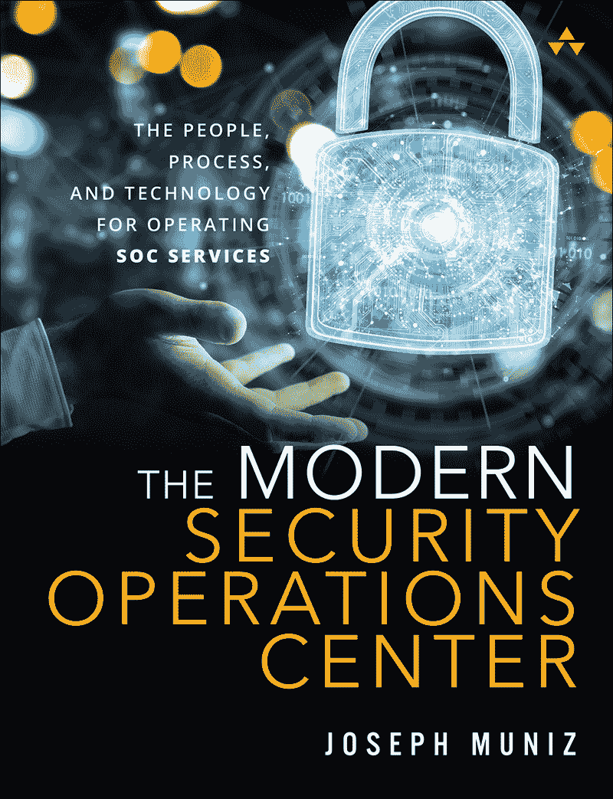

## 关于本书

ePUB 是一种开放的、行业标准的电子书格式。然而，不同阅读设备和应用程序对 ePUB 及其众多功能的支持程度各不相同。请使用您的设备或应用程序设置来自定义呈现效果，以符合您的喜好。通常可自定义的设置包括字体、字号、单栏或双栏、横向或纵向模式，以及可点击或轻触放大的图表。有关您的阅读设备或应用程序的设置和功能的更多信息，请访问设备制造商的网站。

许多书籍包含编程代码或配置示例。为优化这些元素的呈现效果，请在单栏、横向模式下查看电子书，并将字号调整至最小设置。除了以可重排文本格式呈现代码和配置外，我们还包含了模仿印刷书籍呈现效果的代码图片；因此，当可重排格式可能影响代码清单的呈现时，您将看到一个“点击此处查看代码图片”链接。点击该链接即可查看高保真的印刷版代码图片。要返回之前查看的页面，请点击设备或应用程序上的“返回”按钮。

## 献词

*我想将这本书献给两个人。首先，献给 Atticus Muniz，他还不会走路、不会阅读、甚至不懂得如何使用厕所，但总有一天他会掌握这一切。他现在一岁，正在成长。希望他将来能成就一番伟业，并在此时抽出时间阅读这本书。其次，献给 Raylin Muniz，她今年 11 岁，是我见过的最狂热的书虫之一。希望她也能将这本书加入她的阅读清单。*

## 机器学习

### 机器学习障碍

### 机器学习应用

### 训练机器学习

### 机器学习的未来

## SOC 的未来：统揽全局

## 您未来的设施与能力

### 组标签

### 您未来的 SOC 员工

## 审计、评估与渗透测试

### 对您服务的未来影响

## 猎捕明天的威胁

### 总结

### 参考资料

# 索引

# 前言

保护组织免受网络威胁是一场猫鼠游戏。双方都在不断改变战术。当防御工具奏效时，对手会获取防御技术，对其进行逆向工程，并制定绕过策略。当对手开始成功绕过安全工具时，防御公司会予以关注，研究所使用的攻击手段，并调整其工具中的防御能力以防止未来的成功利用。您的组织就处于这种来回博弈的中间地带。

安全关乎人员、流程和技术的结合，三者协同工作以达成目标。您不能仅购买几个产品，插上电源，就神奇地消除被利用的风险。安全是一场旅程，您必须持续投入。它不是终点。您不会某一天突然变得安全而告一段落。您无法通过购买来实现安全。它需要对负责安全的团队进行投资，这通常被称为安全运营中心（`SOC`）。

## 愿景

我写这本书的目的是帮助每一个组织——无论规模、预算或使命如何——了解如何将负责组织安全的人员转变为一个安全运营中心。我确实认为安全是组织中每个人的责任，但需要有一个或多个将安全作为其主要工作的人员，并且他们需要因该角色而获得认可。

在本书中，我描述了如何构建安全服务以支持您的组织。一些组织从云端运营业务。其他组织则不然。一些组织有预算建立新的 `SOC`，而另一些组织则需要将现有资源转变为能够当前支持组织的 `SOC`。无论您处于安全旅程的哪个阶段，我都设计了本书，融合行业指南、流行框架及我个人经验，为您提供全球成熟 `SOC` 如何运行其安全实践的概览。我相信，只要组织认可其安全团队及其工作作为正式的 `SOC`，任何组织都可以运行一个成熟的 `SOC`。

## 我对本书的愿景

我对本书的愿景是采取一种与厂商无关的安全方法，重点关注能力和最佳实践，以帮助你应对未来的威胁。书中包含大量开源和商业产品示例，但我始终关注建议的结果，因此所选厂商并不重要。我引用具体指南来验证我的建议，并解释不执行本书所涵盖内容的风险。我相信各个经验层次的安全专业人员都能从本书中受益，并希望本书能成为你对抗网络威胁旅程中的宝贵资产。

## 谁应该阅读本书？

我认为任何对网络安全感兴趣的人都将从本书中受益。我从领导层的期望到一线操作人员的关注点等不同视角来解释概念。主题包括建设 `SOC`、风险管理、漏洞管理、事件管理、恶意软件分析、合规、数字取证、态势感知与安全意识，以及研发。所有这些主题都对应全球成熟 `SOC` 提供的服务。任何有兴趣学习如何将这些服务构建到其安全实践中的人都将从本书中受益。

## 本书的组织方式

从你开始规划建设 `SOC` 的那一天起，就可以使用本书，它也可以作为帮助成熟现有 `SOC` 的资源。第 1 章 从所有高层 `SOC` 概念的总体概览开始。第 2 章 重点介绍如何建设 `SOC`，包括将 `SOC` 与业务对齐、使命宣言、范围，以及在规划 `SOC` 时应考虑的一切事项。

第 3 章 介绍了我在全球成熟 `SOC` 中发现的基本 `SOC` 服务。我在后续章节中逐一讲解每项服务，包括如何应对风险、漏洞、合规，以及组织依赖 `SOC` 处理的其他挑战。第 8 章 为某些主题提供了不同的方法，例如何时启动应急响应与取证调查。第 2 章 和 第 11 章 涵盖了当今常见的技术以及未来感十足但最终将成为普通 `SOC` 一部分的技术。一个例子是云技术（如安全访问服务边界 [`SASE`]）最终将像大多数企业中的 IP 语音 (`VoIP`) 一样普及。

全书中，我包含了红队和蓝队使用的工具和技术示例，这意味着我既展示了如何执行真实世界的利用，也展示了全球 `SOC` 如何防御现代攻击。许多工具是开源的，包括使用 `Kali Linux` 进行利用、使用 `Ansible` 进行自动化，以及使用 `NIST` 发布物（以及其他）作为指南。当主题需要引用企业级工具时，我会尝试在不同厂商之间切换，让你大致了解能力，而不是特定厂商工具的具体功能。我的目标是保持一种与厂商无关的安全方法，这也是我包含许多不同厂商示例和开源选项的原因。

第 11 章 通过对 `SOC` 未来的预测来结束全书。我的预测基于行业趋势、与客户的交流以及我在该行业 20 多年的个人经验。我相信本书中的许多主题是基本安全概念，将在本书出版后的许多年里依然适用。我写这本书是为了让你做好准备应对未来的威胁，无论它们是什么样子。我相信每个组织都能从本书中受益，并希望它能帮助你在建设和运营成功的安全运营中心的旅程中取得进展。

## 书籍结构

我将本书从一般 `SOC` 概念组织到详细 `SOC` 服务。以下是每章的简要总结及其与建设和维护成熟 `SOC` 的关系。

*   **第 1 章，“安全运营与 SOC 简介”：** 本章介绍高层 `SOC` 概念。我提供了方法让你验证当前拥有哪些能力，以及如何评估现有流程，以便规划可以在哪些方面改进你的 `SOC`（如果已存在）。本章旨在作为后续章节的入门指引，并帮助你确定当前的安全状态，以便利用本书发展成熟的 `SOC`。

*   **第 2 章，“开发安全运营中心”：** 第 2 章 重点介绍在 `SOC` 能够提供服务之前必须到位的基本业务和运营需求。主题包括谁应该赞助、管理和支持 `SOC`，需要制定哪些类型的政策和程序，以及 `SOC` 正式上线前必不可少的其他业务目标。本章后半部分侧重于运营需求，例如如何规划 `SOC` 工作空间、如何容纳不同职责的 `SOC` 团队成员，以及根据 `SOC` 计划提供的服务需要考虑哪些类型的技术。解决本章中的主题是在 `SOC` 能够为组织提供任何价值之前的必要步骤。

*   **第 3 章，“SOC 服务”：** 本章介绍了本书后续章节深入探讨的许多主题。我介绍了全球组织通用的基本 `SOC` 服务。我涵盖了这些服务如何由 `SOC` 提供，以及当你着手建立新的 `SOC` 服务时需要考虑的一切。这包括何时应该外包服务，以及何时利用内部能力开发服务更合理。第 3 章 代表了 `SOC` 进入上线状态并开始为组织提供价值的节点。

*   **第 4 章，“人员与流程”：** 每项 `SOC` 服务都需要合适的人员和流程才能成功。本章介绍了全球成熟 `SOC` 中常见的所有不同工作角色。它描述了每个角色的技能要求以及日常职责的期望。我涵盖了如何为你的 `SOC` 找到合适的人员，并通过直接关联 `SOC` 服务成功的不同项目来培养他们。主题包括工作角色、招聘、面试、入职，以及人员和流程的外包。

*   **第 5 章，“数据集中化”：** 一项基本的 `SOC` 能力是能够处理组织内部数据和外部安全数据（如威胁情报）。许多新 `SOC` 最初提供日志管理和分析服务。这意味着 `SOC` 负责从各种工具收集日志、分析日志，并在识别出特定事件时提供响应。数据集中化并非易事，因为数据有多种格式，而数据的更高级用例需要不同类型的编程和自动化技能。我涵盖了与如何收集和使用数据相关的所有内容，这是全球成熟 `SOC` 提供的许多其他服务的关键垫脚石。

## 章节概览

*   **第 6 章 “降低风险与超越合规”：** 处理风险和确保合规是许多 `SOC` 的常见要求。风险类型因组织而异，但总体而言，`SOC` 负责降低风险。合规性可能由地方或联邦政府强制要求，由信用卡公司等服务提供商强制要求，或由组织领导层强制要求。除了这些主题，本章还涵盖了一些外围主题，因为所有与安全相关的事务都是一种风险管理形式，并包含某种合规要素。例如，管理漏洞可以是风险管理计划的一部分，也是符合某些法规或政策的要求。我认为风险管理和合规是您的 `SOC` 可以提供的最关键服务。

*   **第 7 章 “威胁情报”：** 在第 5 章的基础上，第 5 章强调了收集和使用数据对 `SOC` 服务的重要性，本章重点关注威胁情报这一关键数据源。我认为威胁情报代表了所有安全技术的未来，因此专门用一章来探讨该主题。数据量变得太大，无法人工审查，建立正常行为基线或将事物与他人所见进行比较等概念是安全行业投资开发的重点。如果您的 `SOC` 今天没有利用威胁情报，很快就会用到。如果您正在使用威胁情报，您将在本章中发现使用威胁情报的许多不同方式，包括超越获取高风险事物列表的范围。

*   **第 8 章 “威胁狩猎与事件响应”：** 许多组织期望 `SOC` 提供的核心服务之一是响应事件。本章介绍如何开发稳健的事件响应服务。主题包括如何根据事件规划响应、如何遏制、根除和恢复事件、何时使用数字取证，以及在结案前应进行哪些事件后响应活动。事件响应由许多不同的服务组成，范围从分析恶意软件的技能到如果可能发生法律行动，如何在不修改工件的情况下正确调查工件。我包含了许多工具和技术，以便您可以构建实验室，并最终上线具备完善事件响应能力的环境。

*   **第 9 章 “漏洞管理”：** 任何负责事件响应的 `SOC` 还应包含事件恢复和漏洞管理服务。通过这样做，`SOC` 能够基于“攻击需要漏洞才能成功”这一原则，降低未来安全事件的风险。消除漏洞意味着降低风险。本章从主动和被动两个角度重点关注漏洞管理服务。我认为，如果您的 `SOC` 投入时间研究这些主题，您的组织将经历更少的攻击行为，从而有更多时间专注于主动服务，而不是持续应对安全事件。

*   **第 10 章 “数据编排”：** 世界各地的许多 `SOC` 拥有出色的数据存储库和服务，但发现员工被繁琐的工作压垮。为了解决这个问题，许多组织正在投资自动化和编排，旨在减少琐碎任务，并建立正式化、可重复的 `SOC` 服务交付响应。本章重点关注这些主题，汲取前几章的许多概念，探讨应用编排和自动化的方法。主题包括工具、技术和编程，包括 `DevOps` 简介。

*   **第 11 章 “SOC 的未来”：** 最后一章预测了安全运营中心的未来。我提出了几个我认为将改变未来 `SOC` 的行业趋势，并解释了它们的现状以及对未来的预测。主题包括安全访问服务边缘 (`SASE`)、软件定义广域网 (`SD-WAN`) 技术、通用云趋势、IT 服务、培训和自动化的未来。我以关注您自己的 `SOC` 的未来作为本章和全书的结语，概述了如何将本书涵盖的所有内容应用到您的 `SOC` 走向成熟和成功的历程中。

## 我们期待您的反馈！

作为本书的读者，*您* 是我们最重要的批评家和评论员。我们重视您的意见，想知道我们做得好的地方、可以改进的地方、您希望我们涉足的出版领域，以及您愿意传授的任何其他宝贵建议。

我们欢迎您的评论。您可以通过电子邮件或信函告诉我们您喜欢或不喜欢本书的哪些方面，以及我们如何才能让书籍变得更好。

请注意，我们无法帮助您解决与本书主题相关的技术问题。

来信时，请务必注明本书的标题和作者，以及您的姓名和电子邮件地址。我们将仔细审阅您的意见，并将其与参与本书编写的作者和编辑分享。

电子邮件：`community@informit.com`

## 读者服务

在 [`informit.com/aw`](http://informit.com/aw) 注册您的《现代安全运营中心》副本，以便在下载内容、更新和勘误发布时方便地访问。要开始注册流程，请访问 [`informit.com/register`](http://informit.com/register) 并登录或创建账户。输入产品 ISBN `9780135619858` 并点击提交。流程完成后，您将在“已注册产品”下找到任何可用的额外内容。

请务必勾选您希望收到我们消息的复选框，以接收该产品未来版本的独家折扣。

## 致谢

我在验证本书内容方面得到了大量帮助，想感谢审阅者 Anthony Giandomecino、Kevin Tigges 和 Willow Young 的辛勤工作和宝贵反馈。本书是一段为期两年的开发历程，这三位始终让我保持诚实，确保内容切中肯綮。您会发现这群优秀的工程师都曾在行业活动中演讲，发布过各类安全内容，并以多种方式为安全行业做出贡献。向他们致敬，感谢他们帮助我完成这个书籍项目。

我也要感谢 James Manly 和 Pearson 团队的其他成员，感谢他们在这漫长的两年概念到出版历程中的支持。他们是一个非常专业的团队，合作愉快。

我要对我的朋友和家人表示衷心的“感谢”，感谢他们在整个过程中以及我的其他项目中对我的支持。也要感谢我工作中的管理者和真正的老板 Anjelica Ruda，感谢她允许我在忙碌之余抽出时间撰写本书。

## 作者简介


**Joseph Muniz** 是 Cisco 安全销售与工程组织的架构师和安全研究员。他致力于通过教育和对手研究让世界变得更安全。Joseph 在为财富 500 强企业和美国政府设计安全解决方案和架构方面拥有丰富经验，是值得信赖的顾问。

# 关于作者

Joseph 是一位研究人员和行业思想领袖。他定期在国际会议上发表演讲，为技术杂志撰稿，并参与开发各种行业认证的培训课程。他虚构了 Emily Williams 这一角色，以提高人们对社会工程学的认识。Joseph 运营着 The Security Blogger 网站，这是一个广受欢迎的安全与产品实施资源平台。他是多部出版物的作者和贡献者，涵盖从安全最佳实践到利用战术等主题。

当 Joseph 不在钻研技术时，你可以在 fútbol（足球）场上找到他，或者看到他正在培养下一代黑客——也就是他的孩子们。请访问 [`www.thesecurityblogger.com`](https://www.thesecurityblogger.com) 并关注 @SecureBlogger。

# 图片致谢

封面图片 Sdecoret/Shutterstock

图 1-1，Anonymous 在 YouTube 上发布的视频 © 2020 Scripps Media, Inc

图 1-18，企业版 MITRE ATT&CK 矩阵的一部分 © 2015–2021, The MITRE Corporation

图 1-19，使用 ATT&CK 建模串联攻击行为 © 2015–2021, The MITRE Corporation

图 2-5，Rapid7 的 Nexpose 漏洞扫描器 © Rapid7

图 2-6，Cisco Firepower 被动漏洞数据 © Cisco Systems

图 2-7，Cisco 信誉拦截页面 © Cisco Systems

图 2-8，Google 的信誉警告横幅 ©2020 Google

图 2-13，架空地板砖图片由 Alibaba.com 提供

图 2-14，SOC 示例布局由 Cisco Systems 提供

图 2-26，图 5-16，SPLUNK 仪表板示例 © 2005–2020 Splunk, Inc

图 2-27，QRadar 仪表板示例 © IBM Corporation 1994, 2020

图 3-8，Tenable.sc 漏洞跟踪 © 2020 Tenable, Inc.

图 3-9，OpenVAS GUI 示例 © Greenbone Networks 2020

图 3-11，MITRE ATT&CK 框架 © 2015–2020, The MITRE Corporation

图 3-12，Atomic Red Team 网站 © 2014–2020 Red Canary

图 3-13，适用于 Windows 的 Atomic Red Team 示例 © 2015–2020, The MITRE Corporation

图 3-14，Kali Linux 工具类别 © OffSec Services Limited 2020

图 3-15，在 Metasploit 中搜索 Adobe 漏洞 © Rapid7

图 3-20，Incident Response Consortium 剧本 © 2019 Incident Response Consortium

图 3-21，恶意软件爆发剧本 © 2019 Incident Response Consortium

图 3-22，关于隐藏扩展名的图表 © Microsoft 2020

图 3-24，Peframe 分析加壳文件 © Microsoft 2020

图 3-26，使用 SET 克隆 Gmail © 2020 by TrustedSec

图 3-27，克隆的 Gmail 网站 © 2020 Google

图 5-2，Splunk 中解析不佳的日志 © 2005–2020 Splunk, Inc

图 5-3，Windows 事件日志 © Microsoft 2020

图 5-5，Splunk 自定义仪表板示例 © 2005–2020 Splunk, Inc

图 5-7，Splunk 数据输入选项 © 2005–2020 Splunk, Inc

图 5-8，配置为将 syslog 数据发送到 Splunk 的 Cisco Stealthwatch © Cisco Systems

图 5-9，SMC 中使用默认解析模板 © Cisco Systems

图 5-10，格式不佳的 Syslog 产生的结果 © 2005–2020 Splunk, Inc

图 5-11，SMC 中使用自定义 syslog 模板 © Cisco Systems

图 5-12，将 syslog 数据转换为报告和微件 © Cisco Systems


图 5-13，IBM QRadar 搜索屏幕 © IBM Corporation 1994, 2020

图 5-14，在 IBM QRadar 中搜索数据渗漏 © IBM Corporation 1994, 2020

图 5-15，IBM QRadar 仪表板示例 © IBM Corporation 1994, 2020

图 5-17，Splunk 中的 Stealthwatch 应用 © 2005–2020 Splunk, Inc

图 5-18，IBM QRadar 资产与漏洞管理示例 © IBM Corporation 1994, 2020

图 5-21，Firepower 利用 Rapid7 漏洞数据 © Cisco Systems

图 5-25，Cisco Umbrella 大数据结果示例 © Cisco Systems

图 6-1，Incident Response Consortium 剧本选项 © 2019 Incident Response Consortium

图 6-7，Metasploit 中的各种 Apache Struts 漏洞利用 © 2020 The Apache Software Foundation

图 6-8，使用 Armitage 利用 Struts 漏洞 © 2020 The Apache Software Foundation

图 7-2，Sophos 威胁流行度使用示例 © 1997–2020 Sophos Ltd

图 7-3，Splunk 未正确处理威胁数据的示例 © 2005–2020 Splunk, Inc

图 7-5，Google Alerts 示例 © 2020 Google

图 7-6，Google Chrome Scraper 从 Cisco Talos 博客收集哈希值 © 2020 Cisco Systems, Inc

图 7-7，Twitter 威胁数据行为示例 © 2020 Trend Micro Incorporated

图 8-2，Incident Response Consortium 恶意软件爆发剧本示例 © 2019 Incident Response Consortium

图 8-4，在 Cisco SecureX 中打开新事件工单 © 2020 Cisco Systems, Inc

图 8-5，新案例示例 © 2020 Cisco Systems, Inc

图 8-7，Cisco AMP 妥协指标示例 © 2020 Cisco Systems, Inc

图 8-8，隐藏扩展名示例 © Microsoft 2020

图 8-10，TrIDNET 免费文件分析工具 © Marco Pontello

图 8-17，Ghidra 反汇编器查看 WannaCry 勒索软件杀伤开关 © Lazarus Group

图 8-18，使用 Joe Sandbox 进行恶意软件分析的示例 © Lazarus Group

图 8-19，Cisco Stealthwatch 基于 NetFlow 识别威胁 © 2020 Cisco Systems, Inc

图 8-20，威胁狩猎成熟度模型 © 2016–20 Sqrrl Fintech Private Limited

图 8-21，Cisco 威胁响应分析 success20.hopto.org © 2020 Cisco Systems, Inc

图 8-25，IRC 恶意软件爆发剧本根除步骤 © 2019 Incident Response Consortium

图 8-26，IRC 数据窃取剧本根除步骤 © 2019 Incident Response Consortium

图 8-27，IRC 恶意软件爆发剧本恢复步骤 © 2019 Incident Response Consortium

图 8-29，证据保管链文档袋示例 由 Cisco Systems 提供

图 8-30，Autopsy 主页 © 2003–2020 Brian Carrier

图 8-31，Autopsy 使用示例 © 2003–2020 Brian Carrier

图 8-40，经验教训会议议程模板示例 © Template.net

图 8-42，记录相关方的模板 © 2002–2020 Blackboard, Inc.

图 9-4，Struts 漏洞示例截图 © 2020 Cisco Systems, Inc

图 9-5，CVSS v2 基础分计算器截图 © National Institute of Standards and Technology

# 第一章

## 安全运营与 SOC 简介

> *千里之行，始于足下。*
>
> ——老子

安全是一个简单的概念：保护某物免受威胁。尽管这听起来很简单，但许多组织——从小型政府机构到财富 500 强企业——都不知道如何将其当前的工作转化为正式的安全运营中心（SOC）。因此，这些组织内的安全团队难以获得改进其能力所需的适当支持和资金。静态的 SOC 能力会导致 SOC 职能失效，因为过多的时间被花费在被动和手动的工作上，而没有任何明确的路径来改进 SOC 服务。这些挑战的组合导致组织经历安全漏洞、人才流失、巨额罚款以及其他负面结果，甚至可能包括业务的彻底失败。

在本章中，您将了解基本的安全和 SOC 概念。我将介绍为什么构建一个成熟的安全运营中心（结合人员、流程和技术）非常重要。安全主题包括如何利用标准、指南和框架中的行业建议来开发纵深防御安全架构。我将向您展示如何使用威胁模型和漏洞评估来更好地理解潜在威胁。我将介绍我在世界各地成熟 SOC 中发现的八项基本服务，并向您展示如何根据这些服务评估自身情况。本章是本书所涵盖所有内容的基础。

### SOC 简介

安全运营中心，更常被称为“SOC”，是一个集中化的部门，负责在组织层面和技术层面处理安全问题。这是通过利用人员、流程和能力来提供一项或多项服务来实现的。服务可能包括识别和降低风险、解决漏洞、遵守合规要求、响应事件、收集取证证据，以及执行其他被认为对组织安全态势至关重要的任务。任何特定 SOC 提供的服务取决于其所保护业务的性质。一些 SOC 可能会使用按需或外部服务提供商外包服务，以满足能力需求。其他 SOC 可能会选择接受风险并忽略服务，或将责任转交给组织内的其他团队。一个例子是将漏洞管理移交给桌面支持团队。第 3 章“SOC 服务”涵盖了全球成熟 SOC 通常提供的所有服务。

### 每个组织都可以拥有 SOC

每个组织都可以拥有 SOC，无论其提供何种服务和能力。企业的规模或类型不应成为阻碍，因为每个组织都有一个或多个业务目标，这些目标受到从网络犯罪分子到不良 IT 实践等各种因素的威胁。这条规则有一些例外，例如 IT 占地面积较小的小型公司或组织；然而，许多此类组织未来将利用更多技术，从而产生对 SOC 的需求。物联网的大规模增长代表了许多非技术市场利用技术所产生的影响。

无论你是唯一负责保护组织安全的人，还是与其他人共同承担这一责任的大型团队的一员，你本质上都是在作为 SOC 运作，即使你可能没有被贴上此类标签。你的组织如何看待你，取决于你（以及你的团队，如果适用）如何组织并向组织展示你的工作职责。例如，设想一个由两名 IT 管理员组成的团队，他们也负责组织的安全，后来发展成为一个由十名管理员组成的专职安全团队，拥有优质技术和权力来强制执行正确的做法，即使违反流程的人是 CEO。我曾协助过这种变革，帮助安全专业人员将其安全工作角色成熟为有据可查的实践，获得领导层支持，并被授予做出战略决策和获取增长预算的权力。这是成熟 SOC 实践的基础。

### 导致 SOC 失灵的因素

有几个因素可能导致 SOC 变得失灵。第一个问题是缺乏受过教育的安全专业人员来满足需求。许多组织在寻找和留住适合 SOC 相关工作的人才方面遇到困难。网络安全市场有大量就业机会，但缺乏足够的熟练专业人员来满足需求。正如 Kate Rogers 和 Betsy Spring 于 2020 年 9 月在 CNBC.com 上发表的题为“我们人手不足——网络安全专业人员面临巨大的人员短缺，因为疫情期间攻击激增”的文章所报道，这一问题在疫情期间变得更加严峻（[`www.cnbc.com/2020/09/05/cyber-security-workers-in-demand.html`](https://www.cnbc.com/2020/09/05/cyber-security-workers-in-demand.html)）。该文章引用 (ISC)² 的一份报告称：“全球有 280 万专业人员从事网络安全工作，但该行业还需要 400 万受过培训的工人，才能妥善保护组织并弥补技能差距。其中包括美国约需要 50 万工人来满足需求。” 技能差距也是一个移动的目标，因为技术正转向对编程和开发技能的需求，而非传统的安全工具管理。

可能导致 SOC 失灵的第二个因素是网络安全行业过度关注防止入侵。防止入侵发生固然理想，但更现实的方法是为入侵发生时做好准备。组织应针对攻击过程的所有环节进行防御，而不应假设 SOC 能 100% 防止漏洞利用。缺乏检测已入侵网络的对手的能力，将导致组织内部发生的恶意行为不被察觉。

可能导致 SOC 失灵的第三个问题是其无法扩展以满足当前需求，导致报告质量差、工具失灵和分析师职业倦怠。云计算、数据传输和存储以及物联网等许多驱动因素增加了带宽需求，迫使安全工具在规模和性能上扩大，以适应必须监控的数据量增长。随着数据增加，需要分析师筛选的事件积压量变成了 12 到 18 个月的持续审查工作量，导致分析师职业倦怠。低估技术需求与压倒性的工作量需求相结合，会迅速使 SOC 陷入停滞。

最后，如果组织在未考虑适当安全性的情况下迁移到云服务，SOC 可能会变得失灵。云计算给数据安全带来了新挑战，包括利用组织无权管理或无法查看的云资源。此外，一些传统安全供应商可能不提供组织已熟悉的技术的云选项，迫使组织采购需要新技能组合且成本更高的新技术。软件定义网络 (SDN) 和随处办公策略等近期技术趋势，进一步推动了对云技术的需求。

上述任何挑战都可能导致组织运行 SOC 的方式崩溃。这些挑战可能导致决策失误、安全能力缺口和程序无效。决策失误包括看到了问题的影响，但因缺乏对应采取何种措施的理解而未能正确解决问题。有数百个来源声称提供“最佳实践”，范围从供应商出版物到行业指南，但不同团队试图完成的任务不同，因此对任何特定问题会有不同的看法。这反过来导致以各种孤岛式小组的形式运行 SOC，对事件做出反应，却没有改进安全实践运作方式的计划。失灵的 SOC 使组织面临被对手入侵的高风险，而被入侵可能导致组织的终结。

### 网络威胁

由于上一节概述的任何或所有原因而导致失灵的 SOC，最终将无法保护组织，给网络对手利用暴露漏洞的机会。另一方面，有效的 SOC 了解各种网络威胁，并知道如何保护组织免受其害。本节概述了各种网络威胁，为后续讨论如何防御它们奠定基础。

一类网络威胁是恶意行为者试图入侵网络。防御此类攻击的一个基本要素是了解谁会这样做以及他们的动机是什么。根据《数据窃贼：网络威胁行为体的动机及其对窃取数据的利用和变现》（兰德公司出版物，记录了兰德公司研究员 Lillian Ablon 于 2018 年 3 月 15 日在美国众议院金融服务委员会恐怖主义和非法融资小组委员会作证的内容），网络威胁行为体分为四类：网络犯罪分子、黑客活动家、国家资助行为体和网络恐怖分子。

#### 网络犯罪分子

这些威胁行为体专注于牟利。他们通常是有组织犯罪集团的成员，或是试图利用技术窃取数据并出售牟利的小型罪犯。防止网络犯罪分子的关键是使其行动的成本高于收益，从而让他们转向其他目标。针对这类网络威胁行为体需考虑的关键点如下：

*   网络犯罪分子由利润驱动。降低潜在利润会减少该对手投入时间制定攻击策略的兴趣。
*   许多网络犯罪分子作为独立承包商按雇佣条款开展工作。网络犯罪分子可能被国家、组织或其他需要外包犯罪活动的方招募。
*   较大的网络犯罪组织本质上就是黑手党。有组织犯罪集团已将重点从实体抢劫银行转移到网络犯罪，因为后者被抓风险较低，且利润极高。

#### 网络犯罪组织

一些网络犯罪组织建立了专门的呼叫中心，用于实施特定攻击，包括通过电话实施社会工程学攻击、打包恶意软件以绕过基于主机的安全防护以及发送钓鱼邮件。这些呼叫中心的运作方式类似于任何合法企业，为员工提供全职或兼职工作，并提供员工从任何雇主那里所期望的福利。

#### 黑客活动家

这些威胁行为者是由对某项事业的信仰所驱动的。Anonymous 是一个臭名昭著的黑客活动家组织，他们针对认为侵犯了人权或其他政治议程、需要受到惩罚的人或组织。图 1-1 显示了来自一段视频的屏幕截图，视频中的人佩戴着 Anonymous 成员典型的面具。针对黑客活动家的防御不同于针对典型网络犯罪分子的防御，因为黑客活动家不是以赚钱为驱动。针对这一类网络威胁行为者需要考虑的关键点如下：

*   由于黑客活动家是由事业而非利润驱动，因此与以经济利益为驱动的对手相比，他们更有可能更持久地针对特定实体。
*   黑客活动家通常与阴谋论相关联，包括涉及反政府概念的阴谋论。
*   黑客活动家造成了重大泄露事件，包括 PlayStation 网络的瘫痪，以及 HBGary 公司及其 CEO Aaron Barr 的倒台——后者是由于 Barr 宣称将揭露 Anonymous 某些“领导者”的姓名，导致 68,000 封私人邮件被公开。
*   黑客活动家可以雇佣网络犯罪分子协助其任务，也可以根据所处理的问题寻求突发性支持。


**图 1-1** Anonymous 在 YouTube 上发布的视频

#### 国家资助的行为者

这些威胁行为者与黑客活动家类似，他们是由资助他们的国家所基于的事业驱动的。这已不是秘密，大多数政府都在投资网络战。任何大规模战争都将包括利用网络利用战术破坏技术。这意味着，如果您负责本国的关键基础设施或其他关键服务，您就是该对手的潜在目标。针对这一类网络威胁行为者需要考虑的关键点如下：

*   国家资助的网络犯罪往往资金充足且技术精湛。
*   许多组织不具备防御国家资助攻击的能力。
*   大多数技术先进的国家都在秘密持续增强其网络攻击能力。没有国家真正确切知道其他国家在网络进攻能力方面拥有什么，从而基于持续的无声军备竞赛形成了一种网络冷战。
*   对跨国犯罪进行追踪、取证和执法极其困难。
*   国家资助的网络犯罪通常代表针对性极强的攻击，通常被称为高级持续性威胁（APT）。

#### 网络恐怖分子

这些威胁行为者可以是任何受驱动去恐吓、胁迫或影响受众、制造恐惧或造成身体伤害的人。基本上，这些是利用技术的恐怖分子。一些网络恐怖分子技术非常娴熟，负责开发从未见过的恶意软件，直到被使用时才被发现，被称为`零日威胁`，因为所有已知的检测特征码都将失效。其他时候，网络恐怖分子利用预构建的脚本发起攻击，使得对系统造成大规模破坏变得容易。他们只需将工具指向目标并执行攻击。针对这一类网络威胁行为者需要考虑的关键点如下：

*   网络恐怖分子可以像雇佣网络犯罪分子一样被雇佣，这意味着网络恐怖分子可以作为独立承包商运作，其技能专门用于造成破坏。
*   网络恐怖分子不是唯一能利用零日漏洞的对手。
*   网络恐怖分子的影响改变了网络安全行业，推动了多因素认证、改进的密码策略以及数字证书使用的要求，以降低网络恐怖主义引发全球性事件的风险。
*   一些不知情受害者的受损系统会成为攻击的一部分。示例包括通过受损系统传播恶意软件、利用受损系统作为进入网络的网关，以及在钓鱼攻击期间通过受损系统推送邮件。

> **注意**
>
> 威胁行为者的具体动机可能各不相同，从热衷于支持某项事业到仅在报酬合适时才参与。威胁行为者市场的运作方式类似于其他市场，有受雇的黑客、将工作视为朝九晚五职业的黑客，以及愿意花费数月甚至数年时间在没有任何报酬的情况下执行攻击的黑客，这取决于驱使他们参与网络犯罪的原因。

除了前面列表中的威胁行为者类别外，另一个类别是**内部威胁**。内部威胁可能是怀有恶意的人，例如即将离职并带走敏感数据的员工或安全人员；也可能是意外，例如管理员犯了一个诚实的错误，使组织面临额外风险，或被攻陷。作为后一种情况的示例，我见过安全管理员意外错误配置安全工具（如 `honeypots` 和 `sandboxes`），将这些工具变成了恶意软件感染环境的网关。

您的组织必须做好准备应对的最后一个威胁是*变化*。在过去几十年里，行业见证了威胁运作方式的持续变化。在 1980 年代末和 1990 年代初，威胁行为者主要攻击计算机操作系统。随着操作系统变得更安全，威胁行为者将注意力转向攻击操作系统上安装的 Internet 浏览器。随着 Internet 浏览器变得更安全，威胁行为者开始攻击浏览器插件，如 `Java` 和 `Flash`。观察安全工具，当防御者发明 `sandbox` 来检测恶意软件时，恶意软件编写者购买了 `sandbox`，了解其工作原理，并配置恶意软件以绕过 `sandbox`。当 `bitcoin` 技术使对手能够在向感染勒索软件的用户索要付款时保持匿名时，`bitcoin` 成为了从勒索软件受害者那里获取付款的方式。一些勒索软件创建者发现用加密挖矿软件感染系统比勒索软件更有利可图，因此这些勒索软件编写者转向创建加密挖矿工具。

网络战场是一个不断变化的环境，这意味着您需要预期来自不同类型威胁行为者的、针对您组织的不断变化的利用变体。如果您不继续投资您的安全计划，它将迅速过时。如果您将所有精力集中在防御本月的攻击上，下一次变化将绕过您的安全。请记住以下这条格言：“安全是一场旅程，而不是终点。”您不会一劳永逸地变得安全；您将在运行安全运营中心的过程中继续您的安全之旅。

这个网络威胁的快速概述应该能帮助您了解那些正在等待您的 SOC 在保护其人员、技术和数据时出现疏漏的威胁。这引出了下一个主题，即如何防御网络威胁。接下来让我们看看安全的概念。

### 投资安全

#### 组织内部改善安全性的适当投资是什么？


有人认为安全性关乎拥有最新或“同类最佳”技术，且获取此类技术应是最高预算优先级。另一些人则认为成功取决于安全团队人员的素质，因此资金最好花在高技能 IT 人员身上。第三种观点认为，最好的安全性源自定义明确且执行有力的政策，其中包括如何限制高风险行为以及如何应对威胁。事实是，最佳实践是这些概念的组合，代表着对人员、流程和技术的投资。许多行业模型和认证计划在提及安全要素时，都使用这些或非常相似的术语。例如，美国国家安全局（NSA）在其信息保障和纵深防御战略中，用“运营”替代了“流程”，如图 1-2 所示。

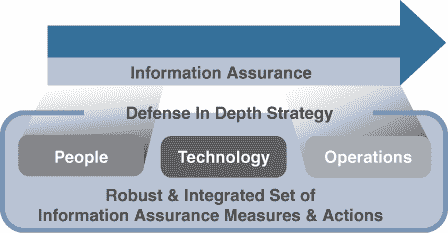

**图 1-2** NSA 信息保障和纵深防御战略

图 1-2 包含一些需要探讨的关键术语，因为它们将成为本书许多概念的重要基础主题：

*   **信息保障：** 确保信息的机密性、完整性和可用性（CIA）并管理与信息的使用、处理、存储和传输相关的风险，以及用于这些目的的系统和流程的实践。从本质上讲，信息保障意味着保护数据。数据代表着组织的核心资产，对组织和黑市都极具价值。

*   **纵深防御战略：** 为了保护数据，`SOC` 利用人员、流程和技术的组合来创建不同的防御层，这确保了当一层防御失效时，另一层会介入，使网络威胁更难达成其目标。例如，当防火墙未能阻止开放端口暴露时，入侵防御系统（`IPS`）可以监控通过该开放端口的流量是否存在利用行为。如果 `IPS` 未能发现利用行为，基于主机的反恶意软件工具可以评估哪些文件成功通过了开放的防火墙端口且未被 `IPS` 拦截。

`SOC` 通过遵循由详细程序支持的高层策略，创建并执行纵深防御战略以保护数据，所有这些构成了指导数据安全成功的指令，从而提供信息保障。请注意本书中使用的语言，因为它与行业谈论网络安全概念的方式保持一致。

### 违规的影响

为什么建立成熟的安全运营中心对组织很重要？答案可以通过衡量遭受网络违规的影响来显现。影响包括组织面临的各种痛苦，首先是潜在的巨额财务损失。根据 IBM Security《2020 年数据泄露成本报告》，基于 Ponemon Institute 进行的独立研究，数据泄露的平均总成本为 386 万美元，每条丢失或被盗记录的平均成本为 148 美元。许多组织无法从这种级别的成本中恢复，甚至更大的财富 500 强组织，如果发生几起这种级别成本的事件，也会倒闭，前提是它们没有投资网络安全保险。根据事件后所需的服务、折扣、新工具和其他损害，这种成本可能跨越很长一段时间。

除了直接的财务影响，违规的另一个成本是组织信任的丧失。例如，这可能导致客户不愿从组织购买特定技术，甚至因担心信用卡信息被盗而不敢通过其网站支付服务费用。根据违规发生地的不同，可能存在违规通知法，要求组织向公众通报潜在损失。例如，某些法律要求组织根据记录暴露的时长和现有取证证据指示的记录*可能*被访问的情况，向所有记录所有者发出违规警报，而非基于对手是否*实际*访问了其记录。一个例子是 Kevin McCoy 所述的 Target 违规事件，“影响了 4100 万客户的数据泄露”。很难说有 4100 万客户直接受到该违规事件的影响；然而，由于这些记录存在被访问的可能性，Target 被迫向公众发布该数字，并通知所有 4100 万客户该事件。

网络违规的第三个影响是潜在的罚款和人员流失。利用信用卡信息（行业法规）或人们的私人数据（政府法规）等服务，包含必须遵守的要求以保护此类数据。如果在政府法规中发现违规，将处以罚款，责任方可能面临监禁。除了强制惩罚外，许多组织在内部应对网络违规时会追究责任，这可能导致一名或多名员工被解雇或调离到组织内的不同岗位。这往往会加剧安全事件的压力，因为组织随后必须在合格人才有限的行业中替换关键员工。

网络违规的一个最终潜在影响是数据丢失。数据丢失可能导致前文提到的巨额罚款和信任丧失，但丢失数据还有其他负面结果。公司专有数据的丢失可能给竞争对手带来优势。例如，销售联系人或未来技术文档的泄露，如果竞争对手获取此类信息，将对某些企业造成毁灭性打击。数据丢失可能使员工面临身份盗窃风险，并导致员工流失或与其他企业失去合作伙伴关系（例如，根据《华尔街日报》2014 年的一篇文章，索尼影业黑客事件暴露了 4.7 万名索尼员工及包括西尔维斯特·史泰龙、贾德·阿帕托、瑞贝尔·威尔逊在内的好莱坞明星的个人数据，包括社会安全号码。）

上述任何后果都会对从小企业到财富 500 强公司的任何组织造成巨大的负面影响。利润微薄的小企业资源较少，可能被推向破产。大型组织可能不会倒闭；但它们会遭受导致股票贬值的损失，并面临将业务恢复到运营状态的巨大成本。正是由于这些及其他原因，运行成熟的 `SOC` 对任何企业的安全和可持续性至关重要。小企业不能抱有“我们不够重要，不会成为目标”的想法，大型组织也不能认为“我们有足够资源应对安全事件的反弹”。必须采取行动以降低不得不应对违规的风险。这些行动是 `SOC` 的责任。

### 建立基线

在进行任何安全实践改进之前，您需要评估当前实践的成熟度。这涉及对从实践如何与业务目标对齐，到您的具体能力和流程等各方面的评估。请将其视为现有能力和服务的基线，这使您能够确定何时何地进行了改进或出现了退步。拥有基线允许 SOC 制定未来能力和服务的目标，并建立通往这些目标的里程碑。如果您不知道如何建立基线，可以参考 NIST 网络安全框架等框架以及本章后面介绍的自我评估策略，以帮助制定基线。SOC 领导层可以通过奖励和表彰达成发展目标里程碑的 SOC 员工，来鼓励改善 SOC 氛围的改进。SOC 成员可以将资源请求与特定目标对齐，以帮助向非 SOC 方（通常是控制预算的非技术领导团队成员）证明这些请求的合理性。第 2 章“开发安全运营中心”将指导您如何将 SOC 与业务对齐。

> **注意**
>
> NIST 网络安全框架版本 1 的详细信息可在 [`www.nist.gov/cyberframework/framework`](https://www.nist.gov/cyberframework/framework) 找到。我将在全书中引用此框架及其他指南，因为它们是建立 SOC 基线的绝佳资源。

#### 变更的影响

提升安全实践的成熟度源于实施变更。请知悉，从任何变更中获得 100% 的收益几乎是不可能的，因为变更也会引入某种形式的复杂性。例如，新工具可能提供价值，但设置并将其投入运营以获取收益涉及复杂性。有时，工具过于复杂，以至于需要许多额外步骤才能正确使用，从而将资源和时间从其他安全领域抽离，实质上损害而非增强您的安全能力。如果存在这种可能性，您应认识到复杂性超过了收益，并避免该变更。

一个需要比较变更影响的决策示例是：在特定工具上选择免费开源选项还是企业级选项。开源工具可能没有获取成本，但会有安装、配置、学习和维护成本。企业级选项有前期采购成本，但可能提供更简单的部署和配置选项，以及开源选项不具备的供应商功能和支持。在确定变更的真实成本之前，权衡所有这些因素非常重要。您将在 第 10 章“数据编排”中更详细地了解关于构建自有工具、使用开源工具和购买企业级选项的投资比较。

好的变更是指能力超过复杂性的变更。一个例子是提升 SOC 识别和修复漏洞的能力，许多组织因缺乏对网络上资产的可见性，以及已知和未知设备引入的漏洞类型，而发现这极其困难。简化 SOC 漏洞管理实践的一种方法是利用网络准入控制和漏洞管理解决方案。网络准入控制（`NAC`）解决方案旨在自动控制什么可以或不可以连接到网络。漏洞管理解决方案旨在识别任何已知漏洞，包括基于通用漏洞评分系统（`CVSS`）评分的详细信息。`CVSS` 评分提供了一种捕获漏洞主要特征并生成反映其严重程度的数值评分的方法。然后可以将数值评分转换为定性表示（如低、中、高和严重），以帮助组织正确评估和优先处理其漏洞管理流程。第 9 章“漏洞管理”更详细地介绍了漏洞管理。

集成 `NAC` 和漏洞扫描技术可以自动识别连接到网络的设备，并在连接时扫描任何设备的漏洞。许多 `NAC` 技术甚至可以限制被发现存在严重漏洞（如 `CVSS` 评分 8.0 或更高）的系统的访问。图 1-3 是 SANS 研究院的漏洞管理最佳实践概念模型，反映了这一概念。

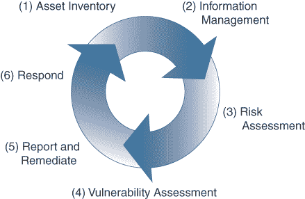

**图 1-3** SANS 漏洞管理最佳实践概念模型

每个组织都应考虑使用这些工具和流程自动化漏洞管理；但请记住，每项变更都会引入其自身的复杂性。`NAC` 等技术及与漏洞管理解决方案的集成部署起来可能很复杂。应提出的问题是：能力的收益是否超过复杂性。对于许多中大型组织，答案是肯定的，因为缺乏有效的自动化漏洞管理计划存在现有风险，且现有精力用于以手动被动方式运作。较小的组织可能不需要这种级别的自动化，因为这会使本可由小型 IT 支持团队在桌面级别控制的事情过度复杂化。这就是为什么与变更相关的能力和复杂性将始终特定于应用它的组织。

可能很难识别随能力或服务而来的复杂性。许多供应商喜欢宣传其技术实施和使用有多容易，并倾向于夸大有效性（毕竟，他们是销售产品和服务的）。将由 SOC 或外部审计来判断您能力的有效性以及可以采取什么措施来提高组织的安全有效性。我将在本章后面介绍如何审计您的安全能力和服务。在探讨如何审计能力之前，我们首先需要回顾能力的概念。

### 基本安全能力

#### 安全能力

什么是安全方面的能力？它们是你识别和应对威胁的能力。管理威胁造成的风险是大多数 SOC 解决的关键服务，这是 第 3 章 涵盖的主题。理解风险的关键在于威胁利用漏洞的可能性。简单来说，威胁利用漏洞，而 SOC 的工作是尝试检测并防止这种情况发生。检测和预防涉及不同的安全能力。安全行业以声称安全工具能提供复杂的能力而臭名昭著，例如利用类人行为（人工智能）来决定某事物是否构成风险，利用云资源进一步评估潜在威胁，或拥有不同“检查”的层级来捕捉最隐蔽的恶意软件。其中一些说法属实；然而，事实是安全工具使用三种基本的检测能力。安全工具旨在利用以下三种基本能力中的一种或多种：检测已知攻击的能力、检测已知恶意行为的能力，以及检测异常（例如新型攻击的异常行为）的能力。行业能力可以归结为这些基本的检测概念。图 1-4 表示了安全工具用于检测和预防威胁的三种核心安全能力的概念。


**图 1-4** 安全检测能力

#### 特征检测

让我们从检测已知攻击的能力开始，它依赖于基于特征的技术。查找已知威胁的一种方法是使用特征，这些特征代表安全行业以前识别出的特定威胁的检测。例如，防病毒解决方案拥有许多已知恶意软件的特征，并将文件与一个不断更新的近期威胁特征列表进行比对。检测恶意软件可能基于各种特征，例如文件的哈希值，但这并不像看起来那么简单。创建和管理特征存在相关挑战。特征越具体，攻击者越容易修改攻击以避免被检测。特征越通用，越有可能产生误报，即对非实际威胁触发警报。对手通常会修改现有恶意软件以改变文件的外观，这被称为 `encoding the file`（编码文件）。他们这样做是为了让恶意对象在防病毒解决方案眼中显得与其已知恶意文件列表中的内容不同。还有其他避免检测的方法，包括加密文件、添加无用代码行或添加空操作（`NOPs`）。对手可以在公共特征列表（如 `VirusTotal`）上测试恶意软件，以查看恶意软件是否可能被流行的安全工具触发。（如果你从未听说过 `VirusTotal`，请访问 [`www.virustotal.com`](https://www.virustotal.com) 了解详情。）

> **注意**
>
> 开源渗透测试工具（如 Rapid7 的 `Metasploit`）提供了多种隐藏文件的方法。例如，你可以使用 `Metasploit` 对测试载荷进行编码，并查看你的安全工具是否能检测到你编码后的威胁。Kali Linux 的创建者 Offensive Security 发布了一篇精彩的文章来解释这一概念，地址为 [`www.offensive-security.com/metasploit-unleashed/generating-payloads/`](https://www.offensive-security.com/metasploit-unleashed/generating-payloads/)。

#### 行为检测

检测已知恶意行为的概念基于观察到的动作，而非扫描特定事物（模式匹配）。恶意行为可能是从计算机扫描网络到文件尝试获取系统的 root 访问权限等任何行为。回到我恶意文件的例子，假设对手对文件进行了编码，使其不被防病毒特征检测到。防病毒软件可以监控文件的行为以将其识别为恶意。在这个例子中，假设该文件是勒索软件，这意味着它会尝试加密其感染系统的硬盘。如果勒索软件配置为使用非对称加密，它需要在加密过程完成前连接互联网上的外部源以执行密钥交换。这意味着该文件会向威胁行为者拥有的 Web 源发送信标以完成加密过程。文件引起的这些动作中的任何一个都应该触发安全工具，阻止文件继续执行这些动作。这使得行为规则成为验证威胁未绕过特征规则的理想选择。

#### 异常检测

当威胁未被特征和行为检测能力识别时会发生什么？这就是异常检测极其有益的地方。虽然检测异常似乎与检测已知恶意行为相似，但它们是不同的。异常检测基于网络基线，标记任何异常情况。例如，某些组织可能允许员工从公司邮箱发送邮件到个人邮箱。尽管在拥有数百名员工的组织中，这种活动可能一直在发生，但 SOC 可以配置一条异常规则，当公司邮箱向个人邮箱发送异常数量的邮件时触发标记。组织为什么要实施这条规则？这种活动可能表明员工即将离职，并在辞职交还电脑前，将大量敏感内部资料发送到个人邮箱。对于此用例，该规则可以是基于行为的（即特定时间内发送一定数量的邮件会触发警报），也可以是基于异常的（查看用户的平均邮件活动，并根据该特定用户标记异常峰值）。某些用户因角色原因可能拥有较高的平均邮件活动量，这使得异常检测能够适应现实世界的活动。此例所示的一个关键点是异常检测不如其他方法准确。对于此例，如果出于合法原因从公司邮箱向个人邮箱发送异常数量的邮件，邮件规则可能会触发。合法原因可能包括用户为授权的邮件营销活动发送大量邮件，或执行邮件备份。

> **注意**
>
> 我在职业生涯中升级电脑时经历过邮件异常检测警报。我花了几分钟时间通过邮件将文件从公司邮箱发送到个人邮箱，因为这比连接外置硬盘或使用云盘传输文件更快。我的目标是快速将文件从旧电脑迁移到新电脑，两台电脑都连接了互联网，因为我需要清理旧电脑以便归还给雇主。在我向个人 Gmail 账户发送了大约 15 到 20 封邮件后，我接到了人力资源部的电话，询问我对目前职位是否满意。基于我异常的邮件活动，我的雇主担心我可能要离职。我只是解释说我在迁移到新电脑，对话就此结束。还要注意，这条规则并非为数据丢失防护目的而设。如果我只发了几封邮件，我不会接到 HR 或数据安全团队的电话，因为实际数据未被评估。这意味着该异常规则仅旨在针对发送数据量的激增，以锁定潜在的员工离职风险。

异常检测能力的另一个理想应用示例是监控连接到物联网的家用电器。想象一个连接到网络的恒温器，它定期从制造商的网站下载小型更新。如果该恒温器开始从企业网络导出大量数据，则应触发异常警报。异常检测可与行为检测相结合，这意味着如果恒温器还首次开始执行端口扫描，则恒温器示例中的风险会增加，这表明该物联网设备可能正被外部方利用来勘测内部网络。再次强调，异常检测并不总是准确的。对于此示例，物联网设备可能正在下载非常大的固件更新，或者可能启用了新功能，导致其向供应商发送大量数据。

> **注意**
>
> 为避免误报，您需要将安全工具配置为忽略会触发安全功能的设备。例如，您会希望将漏洞扫描器添加到忽略列表中；否则，每当它执行漏洞扫描时，都会触发检测工具中的侦察警报。

在安全活动中，供应商声称其安全工具的功能远超我刚才介绍的三种检测能力，这很常见。希望了解如何将功能归纳为核心概念，能帮助您理解您正在为环境考虑的工具的真实价值。我指出这一点，是因为理解您正在评估哪种能力至关重要，这样您才能了解它保护什么、不保护什么，以及如何维护它以获得最大的投资回报。

#### 单一最强 vs. 纵深防御

利用可用安全能力的最佳方法是什么？是拥有一种非常强大的能力（称为 `best-of-breed capability` [单一最强能力]），还是分层部署不同的能力（称为 `defense-in-depth strategy` [纵深防御策略]）？最佳实践是分层部署不同的能力，而不是使用同类型的检测。例如，防火墙根据规则允许或拒绝流量。如果所有防火墙都开放 80 端口，那么部署多个防火墙无法为针对 80 端口的系统漏洞利用提供任何额外防御。更理想的做法是分层部署 IPS 和某种形式的入侵检测，这样如果防火墙允许流量通过，IPS 可以分析流量中的漏洞利用行为。如果攻击未被发现，绕过了防火墙和 IPS，入侵检测技术（如基于异常的工具）可以识别目标的异常变化并将其标记为被利用。遵循此策略，攻击者必须突破不同形式的检测才能达到目的。具有不同能力的分层越多，攻击者成功的可能性就越小。图 1-5 表示分层能力的概念。

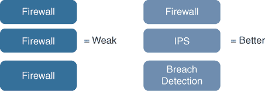

**图 1-5** 单一最强 vs. 纵深防御

> **注意**
>
> 指出购买多个防火墙并非糟糕的投资很重要。您网络的不同部分需要各自的防火墙，因此它们将拥有各自包含防火墙的技术能力串。每个能力串将独立于网络其余部分的能力（包括其他防火墙）进行评估。一个例子是将公司网络边缘与其私有云或内部数据中心内的安全性进行比较。对于组织而言，为数据中心和网络边缘分别部署独立的防火墙、IPS 和入侵检测解决方案是理想的。

#### 评估技术

关于您正在考虑的技术是提供单一最强选项还是纵深防御选项，安全市场可能会让人感到困惑。供应商经常声称，基于不同能力的协同工作方式，他们的纵深防御技术栈是单一最强的。有诸如 Gartner 魔力象限之类的资源，试图对安全产品进行分类，并根据他们认为谁最接近单一最强，比较该类别中的多个供应商。某些资源的结果在技术上也不准确，原因可能是排名受非技术数据（如客户反馈或供应商财务背书）影响，或者工具测试具有主观性。后一种情况的一个例子是：供应商赞助测试，并操纵测试标准以利于自己的产品。我曾见过“IPS 类别”的测试结果显示，一家供应商的检测率为 100%，而其他供应商则不然。进一步审查测试标准后，我发现该测试基于搜索仅赞助测试的供应商工具启用的自定义签名！这种测试显然不能代表真实用例，仅用于生成销售报告。我建议根据以下项目质疑任何对技术进行排名的报告：

*   测试是如何执行的？


## 调研技术

关于确定什么是最适合您组织的解决方案，我的建议是结合使用外部资源，将调研结果与您的业务目标对齐，并进行测试。测试可能因涉及的能力以及一般性能概念（如启用能力时提供承诺的流量吞吐量）而具有挑战性。安全工具面临的一个常见挑战示例是加密流量。一种变通方法是具备解密流量的能力，以便安全工具对其进行评估，然后在发送到目的地前重新加密。此解密/加密过程会影响性能，在评估工具时这是一个重要的考量因素。我见过启用某些安全能力时性能损失高达 60% 到 80%。请务必从工具应如何为您的需求进行规模调整，以及您期望的能力是否仍能提供预期性能这两点开始制定测试标准。

在测试能力时，通常会使用测试工具来加快流程，并提供第三方、与厂商无关的视角来审视所交付的测试过程。`BreakingPoint` 就是一种可以对工具施加压力、以评估其在真实条件下表现的工具示例。像 `BreakingPoint` 这样的工具还可以为常见攻击提供模板，有时称为 `strike pack`（攻击包），可用于测试安全工具检测和阻止攻击的效果。为避免获得不准确的结果，必须极其谨慎地考虑 `strike pack` 的设计与真实条件的贴合程度。使用过时的 `strike pack` 意味着针对可能已不存在或已修补的威胁测试安全工具；因此，安全工具可能不再阻止 `strike pack` 发起的某些攻击，导致报告漏报，尽管由于补丁意味着漏洞已被缓解，该威胁实际上并不存在。拥有不同厂商渠道的顾问（如技术分销商）可以帮助搭建实验室以测试不同厂商的能力，并提供他们对不同工具的使用经验。

我经常收到的一个常见问题是：“我知道要找什么时懂得如何测试安全工具；但是，基于我们现有的投资，我怎么知道组织需要什么安全能力，更重要的是，我应该先买哪个工具？” 从本质上讲，这个问题是在询问在研究特定安全能力的最佳产品之前，应该参考哪些资料。我对这个问题的回答是：不要仅依赖特定厂商甚至第三方顾问的建议。双方都可以评估您的组织并提供建议；然而，双方也可能因经济动机而推荐特定技术，从而给出有偏见的建议。要真正获得关于组织需要考虑哪些安全工具的与厂商无关的视角，您应该利用行业标准、指南和框架。

### 标准、指南和框架

许多组织会参考行业标准、指南和框架，以帮助为其环境开发安全架构。除 `PCI DSS` 等行业标准外，标准、指南和框架提供的是组织可选择遵循的建议和指导，而非出于合规原因必须遵循的强制性实践。许多组织会将行业建议转化为企业政策，这可能既有优势也有劣势。标准、指南和框架的益处源于它们通常由行业专家开发，并针对常见威胁进行过测试（例如使用威胁建模，这是我稍后将介绍的主题）。来自标准、指南和框架的建议通常与厂商无关，并专注于足够通用、能为任何类型组织提供价值的能力和服务。

这些资源的缺点是开发和更新需要时间，而在此期间威胁仍在快速变化。我见过这样的情况：技术被发现存在漏洞，制造商已开发出修复方案，但客户拒绝安装修复，直到软件版本符合行业标准、指南或框架。这使客户在行业建议追上威胁形势变化所需的时间内面临不必要的风险。这些来源的建议也可能过于笼统，无法解决特定于某个组织的威胁。例如，假设一个组织有一名 HR 员工，会在不考虑安全的情况下打开任何简历文件。通过遵循框架关于实施分段和反恶意软件的通用建议，可以降低该员工使组织面临恶意软件感染风险的可能性；然而，要有效全面地解决这一情况，组织还需要直接教育用户了解恶意软件风险，并制定专门的流程在文件发送给用户前对其进行清理。该示例的关键在于：您应该仅将标准、指南和框架作为安全架构的基线，而非在特定环境中实施安全的全包蓝图。组织需要开发自己的成熟度分级结构，并根据对其特定组织重要的事项来改进安全性，这将远远超出普通标准、指南和框架的范围。

> **注意**
>
> 现在，许多外部安全资源都包含自我评估程序，以帮助组织更紧密地将建议与组织实际需要实施的内容对齐。因此，除了组织需要纳入的特定指南所推荐的内容外，需要在其外部进行的调整更少了。我认为，在标准、指南和框架中包含自我评估能力的趋势将持续下去，且这些能力会变得更好。

一些常用标准、指南和框架的示例包括 `NIST`、`ISO` 和 `FIRST.org` 的框架。第 6 章“降低风险并超越合规”将更详细地介绍这些内容。现在，让我们快速浏览一下这些资源，首先从 `NIST` 为您的 SOC 提供的内容开始。

#### NIST 网络安全框架

美国国家标准与技术研究院（`NIST`）开发了 NIST 网络安全框架（`CSF`），这是最流行的框架之一，包含与应对网络安全风险相关的标准、指南和最佳实践。最新版本 CSF 1.1 版（[`www.nist.gov/cyberframework`](https://www.nist.gov/cyberframework)）提出了一个基于以下五大功能的框架核心，如图 1-6 所示（源自 `NIST`）：

*   **识别** 适用于管理系统、人员、资产、数据和能力。
*   **保护** 专注于防御服务。
*   **检测** 涵盖如何识别特定事件的发生。
*   **响应** 是检测到事件时采取的行动。
*   **恢复** 适用于组织如何在攻击期间保持弹性，以及如何恢复受事件影响的服务。

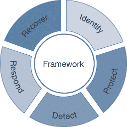

**图 1-6** NIST 网络安全框架核心

在此核心框架内包含类别、子类别和参考资料，这些都是将这五大功能进一步细分为更聚焦主题的方法。例如，保护功能包含一个名为身份管理和访问控制（`PR.AC`）的类别，该类别有一个标记为 `PR.AC-7` 的子类别，规定用户、设备和其他资产必须经过与交易风险相称的身份验证。行业参考 `802.1X` 作为提供具有多因素认证的访问控制的主要方法，这意味着它不是强制性的，但受到行业的高度推荐。图 1-7 展示了 `NIST` 在 CSF 1.1 版中呈现的 2018 年 NIST 框架核心结构。


**图 1-7** NIST 框架核心结构

##### 使用 NIST

许多 SOC 将审查 NIST 的建议，并根据 NIST 在框架核心中对特定类别或子类别的成熟度评级，制定他们认为能改善安全性的能力需求。回到 Protect（保护）功能下 PR.AC 类别的示例，它包含控制资产物理访问、处理身份和凭据、配置远程访问等最佳实践。该类别中的最佳实践包括：控制资产物理访问、如何处理身份和凭据，以及如何配置远程访问。NIST CSF 还包含对其他行业指南的引用，以支持其建议。PR.AC 类别的参考资料部分引用了 ISO/IEC 27001:2013、COBIT 5、ISA 62443 和 CIS CSC，并包含具体章节引用，确认了 NIST CSF 文档与其他行业指南的直接一致性。

推荐的做法是下载最新版本的 NIST CSF，并针对 NIST 涵盖的每个类别验证您现有的能力。这样做不仅有助于您识别改进领域，还能为您提供一份参考资料清单，以支撑您为何请求人员、流程或技术变更。我见过客户以这种方式使用 NIST CSF 并取得成功。例如，SOC 团队的一名成员向组织高管展示缺乏访问控制的风险，然后请求预算购买访问控制能力所需的技术、服务和培训。SOC 可以引用 NIST CSF 的建议及其提供的其他权威资源来支持该请求。通过引用备受推崇的第三方发布的最佳实践来验证您的预算请求，对于说服那些不懂技术的决策者大有裨益！

一些组织将 NIST 建议视为强制性政策，这使得预算请求的沟通变得容易得多。例如，美国军事组织将 NIST 文档用于其许多政策中。我发现，遵循这种方式的组织会识别任何已发布的 NIST 要求，如果他们没有 NIST 建议的技术，就会直接购买。无需多问。同样重要的是要指出，NIST 还有许多针对 IT 之外领域的出版物，可为您的组织提供价值。

> **注意**
>
> 如果您尚未探索 NIST 庞大的文档库，请访问 [`www.nist.gov/publications`](https://www.nist.gov/publications)

#### ISO 3100:2018

另一个流行指南来源是国际标准化组织，通常称为 ISO。与 NIST 一样，ISO 由厂商中立的行业专家组成，提供行业最佳实践。ISO 是一个全球性联合会，在 IT 行业备受推崇。一些组织甚至会宣称自己“通过了 ISO 认证”，尽管 ISO 并不认证组织，这意味着认证部分是由第三方制定的。组织能合法声称的最多只是其产品或系统已由认可的认证机构认证符合特定 ISO 标准，例如将产品营销为“ISO 9001:2015 认证”。人员和组织谈论“ISO 认证”是为了表明他们重视网络安全，从而赢得客户信任。

ISO 3100:2018《风险管理——指南》帮助组织应对风险。2018 版取代了 2009 标准，且像任何指南一样，它是自愿采用的。ISO 有三个风险管理重点领域，基于原则、框架和流程。风险管理原则旨在如何制定结构化且全面的方法。这将考虑许多因素，如公司重视什么、文化要素、如何确保改进等。最终目标是确保风险管理方法有效、动态，并针对组织需求进行定制。

风险管理框架旨在识别业务目标，并建立一个由领导层发起的正式框架。获得领导层的支持至关重要，这一概念不仅见于 ISO，也见于许多涵盖 SOC 使命声明和业务目标的其他指南中。ISO 框架包含五个部分，旨在循环执行，最后一步是“改进”，强调安全需要持续改进。我将在第 6 章中更详细地介绍 ISO。

> **注意**
>
> 了解更多 ISO 标准，请访问 [`www.iso.org/standards.html`](https://www.iso.org/standards.html)

#### FIRST 服务框架

FIRST.org 是一个非营利组织，汇集了来自世界各地的事件响应和安全团队，共同制定网络安全最佳实践。FIRST 提供的一个非常有用的指南是 FIRST 服务框架。FIRST 计算机安全事件响应小组（CSIRT）服务框架（撰写时为 2.1.0 版）为全球 CSIRT 团队使用的服务领域提供了建议。这些服务领域包括：信息安全事件管理、信息安全事故管理、漏洞管理、态势感知、沟通和知识转移。建议细分为服务领域、服务和功能。例如，信息安全管理服务提供监控和检测服务，后者包含多个功能，包括日志和传感器管理、检测用例管理和上下文数据管理。CSIRT 服务框架解释了对每个功能的期望，以帮助指导其他 CSIRT 运营了解这些服务中存在的期望。

FIRST 还为产品事件响应团队（PSIRT）提供了类似的框架。PSIRT 服务框架定义了 PSIRT 的范围和运营活动，而不涉及组织针对受影响特定产品所需采取的变更行动。这对于无论组织负责保护哪些产品都能提供价值至关重要。活动专门针对 PSIRT，而非整个组织会做的事情。图 1-8 是通用 PSIRT 活动的高层图示。

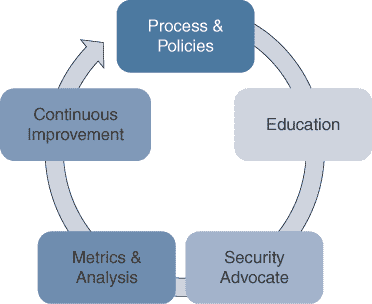

**图 1-8** 通用 PSIRT 活动

#### 应用框架

如前所述，您可以使用 NIST、ISO 或 FIRST 框架，基于行业最佳实践验证您的安全能力和服务，并引用该框架来请求人员、流程和技术变更的预算。其他行业标准、指南和框架提供类似价值，例如 SANS、ISACA 的 COBIT 和互联网安全中心（CIS）控制所提供的内容，每一种都诠释了专家认为的最佳实践。只需留意前面提到的概念：这些参考资料的局限性取决于其发布频率、它们必须足够通用以适用于大多数组织，以及许多其他因素——如果利用不当，可能会损害您的安全态势。框架是第 6 章的核心重点。

### 行业威胁模型

安全行业使用威胁模型来表示攻击和防御概念。这些模型的目的是帮助组织了解在开发纵深防御架构时所需的能力类型。例如，网关或边缘技术（如 `firewall/IPS` 和基于主机的 `firewall/IPS`）通常重点关注利用基于特征的能力来防止漏洞利用。原因在于这些是第一道防线技术，将面对最多的恶意流量。当第一道防线失效时，攻击的下一阶段就是建立立足点并利用新被攻陷的系统执行操作。针对这一攻击阶段的防御能力目标有所不同，因为这些能力假设网关工具已经失效。入侵检测工具通常更多基于行为和异常，因为失效的网关工具往往更多基于特征。在现实世界中，网关和入侵检测工具可以拥有这三种能力的组合，但关键在于理解攻击的不同步骤将针对相关防御有不同类型的目标。同一概念也适用于不同区域或设备类型，即电子邮件防御不同于网络防御，Web 应用防御也不同于网络防御。

随着组织堆叠所有潜在所需工具类型的可能性，它们会变得不堪重负，因此需要行业威胁模型来帮助它们理解，基于预期遇到的威胁类型，哪些工具和技术适用于其业务需求。

#### 网络攻击链模型

行业中最流行的威胁模型之一是洛克希德·马丁公司创建的网络攻击链。图 1-9 展示了一个网络攻击链示例，呈现了常见网络攻击的生命周期，即外部方实施漏洞利用并获得对受害者系统的键盘访问权限。


**图 1-9** 通用网络攻击链威胁模型

理解网络攻击链的最佳方式是分析攻击生命周期的每个步骤，从准备攻击开始，到完全获得被利用系统的键盘访问权限结束。

*   **侦察：** 攻击者通过探测和评估公开可用内容来研究目标。这也可能包括收集登录凭证或扫描互联网可访问系统上的开放端口。此步骤对于攻击者了解攻陷目标最简单、最有效的方法至关重要。
*   **武器化：** 利用侦察阶段发现的数据，攻击者根据攻陷目标网络或系统最简单、最有效的路径开发攻击技术或工具。这可能包括将恶意软件捆绑在软件中、使用 `Metasploit` 等工具构建漏洞利用代码、创建索取数据的钓鱼邮件，或将文件链接到恶意网站。此步骤还可能包括针对 `VirusTotal` 等已知安全工具测试攻击。
*   **投递：** 攻击者与目标建立联系，并投递在武器化步骤中构建的漏洞利用载荷。这是攻击者首次与受害者交互的步骤。这可能是用户点击了错误链接的结果，例如，使系统暴露于攻击者的恶意工具之下。
*   **漏洞利用：** 网络武器被投递并滥用目标中的漏洞。这会导致不良行为，如在系统上打开后门或瘫痪安全防御，以便攻击者植入载荷。这可能损害系统，但真正的损害在于后续步骤。
*   **安装：** 一旦受害者系统被攻陷，攻击者即可利用漏洞利用代码在目标上安装恶意软件。安装是成功利用系统漏洞的结果。恶意软件可以是从勒索软件、加密货币挖矿程序到远程访问工具（`RAT`）的任何东西。
*   **命令与控制：** 成功安装恶意软件后，一个常见步骤是向攻击者发送信标回连，告知其受害者系统可被控制。一旦攻击者知晓系统可访问，即可远程连接并控制被攻陷资产。这在非定向攻击中很常见，即攻击者利用任何可被攻击的受害者，并等待通过被攻陷系统的回连来查看哪个受害者被成功利用。
*   **目标行动：** 最后一步可能是从窃取数据到瘫痪受害者的任何操作。在现实世界中，许多网络攻击是多种攻击的组合，意味着执行了多条攻击链。例如，如果攻击者以某组织的数据中心为目标，他们需要突破网络边缘的系统，并在内部系统间横向移动，最终到达包含数据中心服务器的环境。

##### 使用网络攻击链

###### 理解模型

请知悉，并非所有攻击都必须遵循这一特定的攻击流程，这意味着有时攻击场景并不适用于此模型。用户登录虚假网站导致密码被盗，将属于另一种攻击模型。由用户失误引发的威胁导致网络瘫痪，则属于完全不同的模型。**网络攻击链**模型专门针对威胁行为者试图通过获取受损系统的直接控制权来攻破网络的场景，通常使用提供键盘访问权限的工具，这可以是各种类型的利用，例如浏览器注入或软件滥用，或任何类型的端点攻陷，例如安装远控木马或下载器。

###### 何时使用网络攻击链

何时会使用网络攻击链模型？为何要考虑仅基于一种攻击类型的模型？了解您的能力和服务如何与网络攻击链威胁模型相关步骤相匹配，将大有裨益，这基于可用于此类攻击的利用代码和恶意软件的范围。保持模型的通用性，可适应攻击行为的变化，例如勒索软件转向加密货币挖掘，或 Flash 漏洞利用转变为使用“永恒之蓝”漏洞（Microsoft 漏洞）。具体细节并不重要，因为您衡量的是分层能力和服务针对整个攻击生命周期的有效性，而非仅针对攻击的某个特定步骤。在任意环节阻止攻击都是防御者的胜利。阻止发生得越早，对防御者而言胜利就越大。

###### 阶段 1：侦察与准备

网络攻击链模型的第一步代表恶意行为者如何根据通过各种形式的侦察所发现的信息来研究和准备攻击。防御策略包括限制系统向外部方暴露程度的方法，以及防止访问高风险外部资源。请思考如何通过减少被攻击的暴露面，在攻击发生前就将其防范。如果外部人员可以扫描您的系统漏洞，攻击者就会利用此方式寻找您的弱点。如果员工无论网站潜在风险如何均可随意访问，员工势必会连接到那些试图利用漏洞攻击其系统的网站（通常称为漏洞利用工具包）。如果您的物理网络端口未执行任何形式的访问控制，您将面临极高的风险，即错误的人员将设备插入您的网络。总之，如果您利用技术和最佳实践来限制暴露，攻击者将更难识别您的弱点，并希望他们要么攻击他人，要么尝试在您正在监控且准备更充分的地方攻击您。业界有一句常言：您最薄弱的环节就是您最高级别的安全。这意味着攻击者会找到您最脆弱的地方并在那里发动攻击。

###### 阶段 2：利用与访问


网络攻击链的中间部分着眼于攻击者如何滥用漏洞以获取系统访问权限。常见的利用方式包括滥用过时的 `Java` 或 `Flash` 软件，或诱骗某人安装恶意软件。安全策略应通过识别攻击并将其阻断，或在恶意软件安装前将其隔离，来防止利用行为。能力示例包括入侵防御、防病毒软件和其他基于特征的检测技术。

> **注意**
>
> 正如您将在第 3 章中读到的，许多利用已知威胁特征列表的基于特征的检测工具，启用了大量并不适用于其所要保护对象的特征。嗯，这听起来不对劲。请考虑一下使用供应商技术的不同类型客户。供应商如何能自动知晓该为大型零售店、石油公司、学校和赌场提供何种保护，而这些不同组织却共享一个默认的特征类别？事实是，这是不可能的！相反，供应商仅根据对所有客户所需保护的最佳猜测来提供特征。这意味着许多供应商解决方案上默认启用的大量特征，都在寻找您网络上根本不存在的事物。这也意味着，您网络上独有的事物，在默认特征设置下并未启用相应特征进行防护。这就是为什么调优安全解决方案如此重要。只有当您通过漏洞管理了解要保护什么、了解工具如何运作、了解工具利用何种能力以及进行威胁建模时，调优才能发生。

我交谈过的许多客户都拥有某种形式的基于特征的安全防护，而这些组织中的许多员工都高度专注于监控基于检测的告警。如果所有安全能力和服务都旨在防范网络攻击链模型中的利用阶段，这可能是件坏事。基于组织可能遗漏保护某个漏洞，或恶意软件可能使用组织现有安全防线无法检测到的方法这一可能性，每个组织都需为威胁突破其防线做好准备。

### 阶段 3：目标行动

网络攻击链的最后几步着眼于成功攻击的结果。攻击者可利用漏洞向系统推送恶意软件、禁用安全功能、瘫痪系统，并执行许多其他会对您的业务产生负面影响的有害行为。攻击结果的一个示例是攻击者使交换机过载，导致其变成集线器，从根本上为攻击者在网络间跳转提供了可能。成功利用系统的另一个结果示例是攻破服务器并植入后门，允许攻击者获得该系统的远程控制权。获得控制权后，攻击者可达成其目标，这可能包括在目标网络内重复攻击链以攻陷内部系统、窃取数据或关闭系统。

### 入侵检测与持续监控

使用某种形式的入侵检测和持续监控能力至关重要，以验证前述能力和服务是否有效。入侵检测技术的一个示例是建立网络基线并寻找异常。另一个示例是在网络上部署易受攻击的诱饵系统，即 `honeypots`（蜜罐），当受到攻击时会触发 `SOC` 警报。如果攻击者知道如何绕过，这些工具也可能被绕过，但这些能力的目标是与其他能力有所不同，以提供超出网络边界或主机系统第一层防御之外的另一层检测。

### 不同的攻击链模型

### 威胁建模的应用位置

一个需要考虑的关键概念是威胁模型的应用位置。例如，在使用 `Cyber Kill Chain`（网络攻击链）威胁模型之前，你需要确定要评估网络的哪一部分。主机笔记本电脑的攻击链与数据中心的截然不同。这两种环境可能都部署了杀毒软件和 `IPS`（入侵防御系统），但笔记本电脑的流量基于单个用户，攻击它所需的战术与试图攻击公司网络中受 `SOC`（安全运营中心）监控的数据中心截然不同。重要的是，在考虑环境特性的同时，运用 `Cyber Kill Chain` 原则评估组织的不同部分。作为防御者，你的目标是尽早“打破攻击链”；因此，该威胁模型可帮助你为假设的网络攻击行为做好准备，以便评估你针对攻击每个步骤的防御能力。（我将在本章后面的“SOC 能力评估”部分更多地介绍如何执行能力评估，该部分探讨了可用于打破攻击链的能力和服务。）图 1-10 展示了攻击者可能以此为目标的网络不同部分。网络的每个部分都应使用其专属版本的 `Cyber Kill Chain` 威胁模型进行评估。

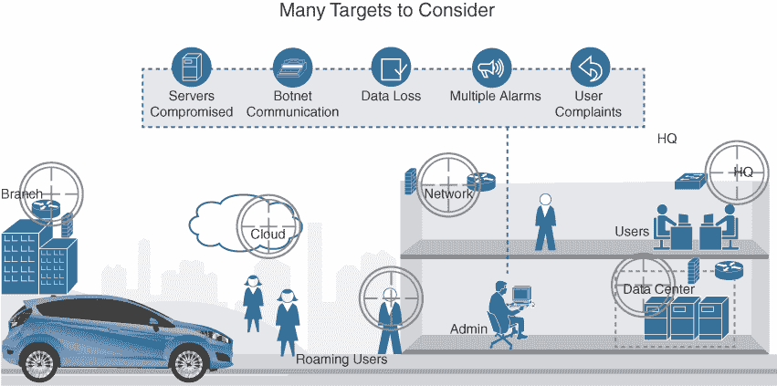

**图 1-10** 各种网络目标

### 钻石模型

`Cyber Kill Chain` 威胁模型是评估一种特定攻击行为的非常有效的方法；然而，攻击者还有许多其他方式攻击你的组织。我并非贬低利用 `Cyber Kill Chain` 的价值，因为针对 `Cyber Kill Chain` 每个步骤中所代表的威胁评估你的能力极其宝贵。挑战在于考虑攻击者采用不同于 `Cyber Kill Chain` 所表示方法接近你防御体系的场景。与其收集多个演练所有潜在不同攻击的威胁模型，不如使用其他威胁模型从更整体的角度审视攻击行为，提供一种适应任何类型攻击的方式。一种采用更广泛视角审视潜在威胁的流行威胁模型是入侵分析钻石模型，通常简称为钻石模型。

钻石模型旨在表示由四个部分组成的安全事件，如图 1-11 所示。活动入侵始于以受害者为目标的攻击者。攻击者利用各种能力，通过某种形式的基础设施向受害者发起攻击。攻击者使用的能力是各种工具、技术和流程（`TTP`），而基础设施则是连接攻击者和受害者的桥梁。连接模型各部分的线条描绘了一个点如何到达另一个点的映射。例如，`SOC` 分析师可以看到钓鱼攻击等能力如何通过电子邮件等基础设施被利用，然后将该能力关联回攻击者。钻石模型中表示的所有概念在设计上均为高层级，以适应不同类型的威胁，这使得该模型的方法比 `Cyber Kill Chain` 更具通用性。

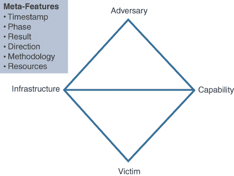

**图 1-11** 入侵钻石模型

在攻击的各个部分之间移动称为*分析枢纽转换*，这是为事件建模的关键。钻石模型还包含事件的额外元特征（见图 1-11），如时间戳、攻击链阶段、攻击结果、攻击方向、攻击方法和使用的资源。元特征列表的示例可能显示：时间戳为下午 1:05，攻击链阶段为利用，结果为成功，方向为攻击者到受害者，攻击方法为定向钓鱼，资源与受害者主机系统上的特定漏洞相关。元特征提供有用的上下文，但并非模型的核心，因此可根据需要忽略和增补。

#### 扩展钻石模型

钻石模型可通过增加两个建立关系间连接的额外元特征进一步扩展。*技术元特征*通过描述这两个模型部分之间使用的技术，连接能力和基础设施。技术元特征的示例可能是域名系统（`DNS`），如果恶意软件利用它来确定其命令与控制（`C2`）节点。*社会政治元特征*表示攻击者与受害者之间的关系。这对于确定攻击背后的意图至关重要，以便分析师了解受害者被选中的原因、攻击者在受害者身上看到的价值，以及有时识别共享威胁空间，即多个受害者关联回同一攻击者的情况。共享威胁空间与威胁情报类似，都是在特定空间理解威胁行为体的方式，以潜在地预测和应对未来的恶意活动。例如，被确认发起针对学校攻击活动的威胁行为体。图 1-12 表示钻石模型的扩展版本。

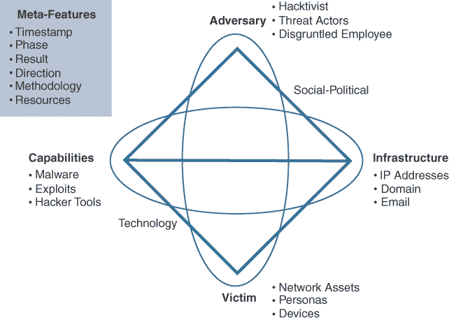

**图 1-12** 扩展入侵钻石模型

#### 用于事件管理的钻石模型

使用这种威胁建模方法，每个事件都被视为一个钻石。事件管理实践应以钻石模型为基础对事件进行分组和组织。目标是回顾多个钻石并识别共同的攻击者。例如，考虑一个攻击者向受害者投递勒索软件的攻击。攻击的第一阶段可能涉及攻击者使用恶意电子邮件诱骗受害者访问某个网站。目标是让该网站扫描受害者的漏洞，并通过利用其中一个弱点投递勒索软件。攻击的第一阶段可表示为一个钻石，如图 1-13 所示。

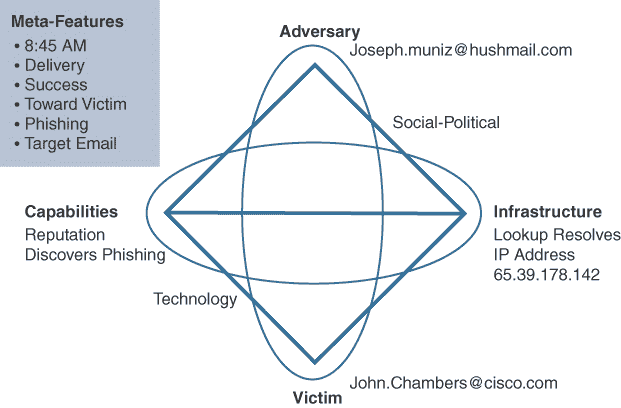

**图 1-13** 勒索软件攻击第一阶段的钻石模型

攻击的第二阶段紧随将受害者系统重定向到恶意网站的钓鱼邮件之后。现在受害者系统已访问该网站，恶意网站将通过利用漏洞下推勒索软件。攻击者仍是同一个攻击者；然而，与安全事件第二部分相关的能力和基础设施已发生变化，这在根据攻击链概念识别攻击的所有阶段时很常见。图 1-14 展示了该攻击第二阶段的钻石。

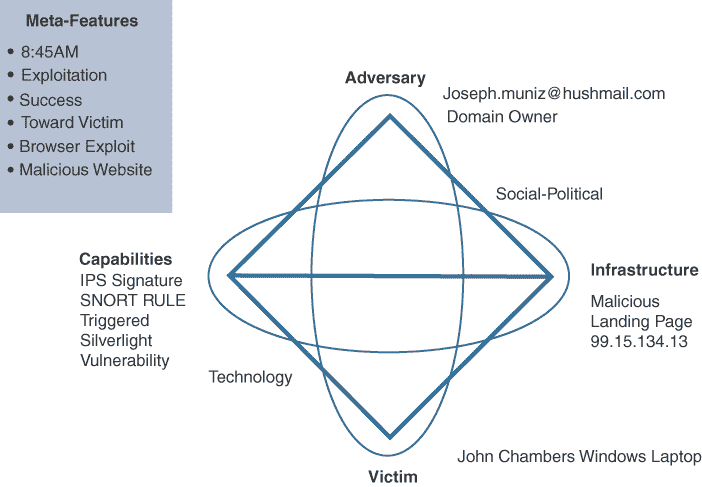

**图 1-14** 勒索软件攻击第二阶段的钻石模型

同一事件的实例在几周内发生，可以通过多个菱形关联起来，然后再关联回同一个对手。将鱼叉式网络钓鱼攻击与勒索软件投递关联起来，能让分析师有一种方法来绘制攻击图及所有相关对手。事件响应团队可以根据各个相连的菱形创建一个活动群组，并尝试定义哪些要素组合是将菱形归为一组的标准。随着新菱形的出现，活动群组会随着菱形基于新可用数据被归为一组而增长。菱形之间的关系称为*活动线索*，它们可以分布在同一次攻击中，也可以连接其他攻击，具体取决于收集到的满足活动群组要求的情报。图 1-15 提供了一个基于前面示例攻击数据构建活动线索的例子。

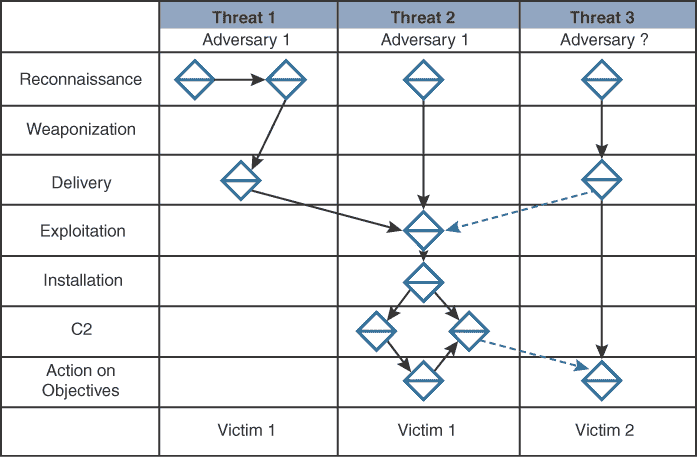

**图 1-15** 开发活动线索

图 1-15 显示一个对手关联到针对同一受害者的两次不同攻击，以及可能的另一个受害者（用虚线表示）。还有一个可能的对手正在攻击与先前已识别对手相似的受害者。这种对攻击数据的可见性使分析师能够整合任何假设，这些假设可在收集到更多证据时进行测试。活动线索过程显示当前的研究状态，这有助于分析师通过文档记录和测试提出的攻击假设来识别知识空白和对手行动。

#### 菱形模型攻击图

一旦事件管理团队建立了一个规模可观的活动群组，绘制出多个事件的映射，团队就能更好地分析数据以填补缺失的知识空白，并可能开始预测未来的攻击路径。这种威胁情报数据可以构建成一个图，称为*攻击图*，表示对手针对受害者可能采取的路径。攻击图中包含活动线索，即对手已经采取的路径。将攻击数据和活动数据结合起来，得到*活动-攻击图*，这有助于突出攻击者攻击受害者的偏好以及可能使用的替代路径。这为事件响应团队提供了一种方法，通过知道可能在哪里预期攻击以及了解对受害者的其他潜在风险，将精力集中在防御对手上。图 1-16 是我勒索软件示例的活动-攻击图示例。

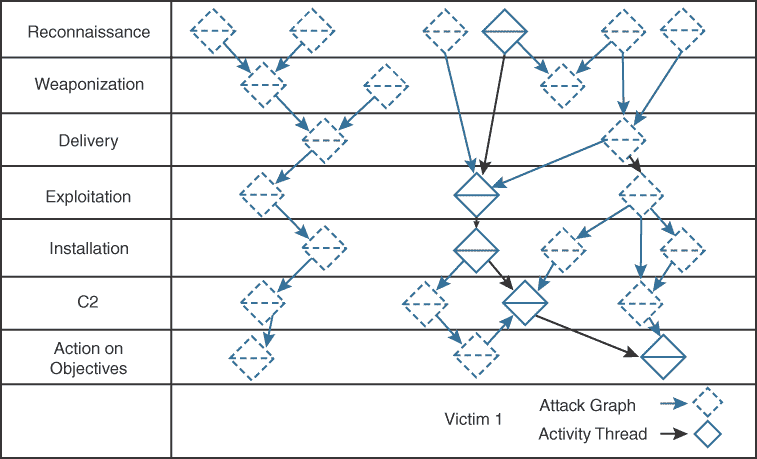

**图 1-16** 活动-攻击图示例

如果分析师担心这是一个持续性攻击，使用活动-攻击图不仅能显示应为已识别的活动攻击考虑在哪些地方部署防御，还能显示对手可能利用的其他区域，因此应主动加以保护。通过将常见的恶意事件、对手过程和线索分组，分析师可以创建活动群组。图 1-16 将帮助分析师根据相似特征确定哪些事件组合构成一个活动群组。然后，活动群组可以归类为活动群组家族，用于模拟各种事件背后的组织，例如识别特定的有组织犯罪集团。最终结果可能是识别出一个来自乌克兰的特定团体，试图通过分析师将针对医院多台主机的各种事件归类在一起，在特定的美国医院植入勒索软件。

菱形模型是一种更广泛的攻击建模视角，允许你适应不同的攻击类型，并识别攻击之间的关联，这些关联可以代表更大规模的攻击行动。菱形模型还包含添加攻击者细节以更好地理解意图的灵活性，从而基于行为预测做出更好的决策。这种威胁建模方法缺少关于攻击如何实施的一些细节，但在针对攻击行为的总体规划方面提供了很大价值。

还有一个最后的模型值得考虑，即结合了网络杀伤链和菱形威胁模型所见价值的混合方法：`MITRE ATT&CK` 模型。

### MITRE ATT&CK 模型

另一个基于真实观察对对手战术和技术进行建模的全球可访问资源是 `MITRE ATT&CK` 知识库。这可用于基于常见对手行为开发特定的威胁模型和方法论，以进行仿真和入侵检测研究。基于持续更新的真实世界数据的定制威胁模型比网络杀伤链和菱形模型更准确，从而能更好地了解对攻击后对手行为的检测。

`ATT&CK` 将对手运行的生态系统组织为*技术域*。对手必须规避或利用生态系统才能完成一组目标。两个 `ATT&CK` 域是企业网络和移动设备。在这些域中，有代表对手运行所在系统的平台。对手将技术应用于一个或多个平台，这就是对手试图实现其目标的方式。这种方法类似于菱形模型提供的攻击广泛视角，但提供了大量细节，例如描述技术、哪些平台适用于该技术、技术的系统要求、权限要求、数据源、示例、检测策略，甚至缓解建议。图 1-17 展示了 `ATT&CK` 如何表示攻击模型关系的高层视图。注意，`ATT&CK` 模型的目标或最终结果被标记为战术，这解释了对手为什么执行前面的动作。

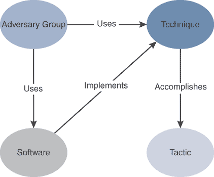

**图 1-17** ATT&CK 模型关系

#### PRE-ATT&CK 研究

`ATT&CK` 还包括 `PRE-ATT&CK` 研究中攻击发生之外的行为。`PRE-ATT&CK` 涵盖在需求收集、侦察和武器化期间的对手行为记录，这发生在导致未经授权网络访问的利用被识别之前。这类似于网络杀伤链的前几个阶段，但 `PRE-ATT&CK` 的结果更加具体，且基于近期的真实世界数据。图 1-18 显示了一个矩阵，代表针对企业的潜在攻击的许多步骤。

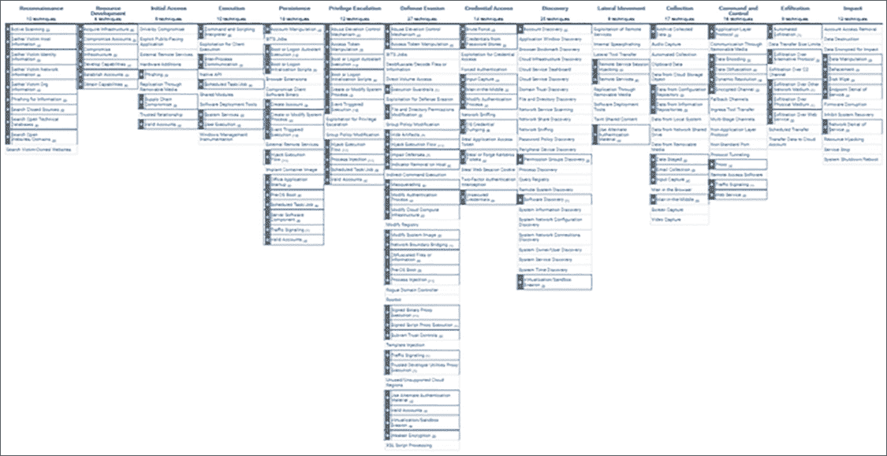

**图 1-18** 企业 MITRE ATT&CK 矩阵的一部分

#### 使用 MITRE ATT&CK

图 1-18 中所示 `ATT&CK` 细节的常见用例包括：基于威胁建模提高组织的检测和分析能力、提供一种威胁情报形式、仿真对手行为以及评估现有安全能力。这可以通过处理 `ATT&CK` 矩阵并将战术链接在一起发生，从而形成对手所采取过程的非常强大的可视化表示。请记住，一次攻击将包含多个步骤；`ATT&CK` 威胁模型提供了一种收集所有这些步骤并将它们“链接”成一个更大攻击的方法。图 1-19 提供了一个示例，展示了利用 `ATT&CK` 模型更好地理解对手攻击行为时，这种攻击步骤链接可能是什么样子的。

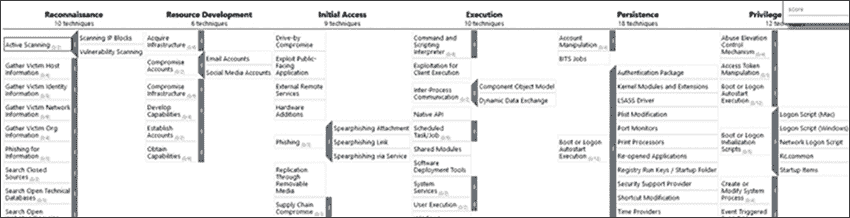

**图 1-19** 使用 ATT&CK 建模将攻击行为串联起来

> **注意**
>
> 请访问 <https://attack.mitre.org/> 了解有关 `MITRE ATT&CK` 模型的更多信息。

### 选择威胁模型

基于所提供的详细程度，`ATT&CK` 威胁建模方法可能会让人感到不知所措，这也是网络杀伤链和钻石模型等较简单的威胁模型至今仍在使用的原因。选择威胁模型的最佳方式是以结果为导向，并根据实现预期结果的情况匹配最佳方法。还有其他行业模型也可用于表示假设的攻击和防御概念。我重点介绍了网络杀伤链、钻石和 `ATT&CK` 模型，因为它们是许多行业专业人士使用的非常流行的威胁模型，并且每种模型都提供了一种不同的威胁建模方法，从而产生不同类型的价值。

这些威胁模型的一个挑战在于，对于某些用例（例如决定应选择哪种特定能力或服务来应对潜在威胁或风险），它们可能过于假设性。*桌面推演* 是许多 `SOC` 用来假设性测试安全能力的更常见做法。这些会议会演练各种攻击情况，而无需实际执行攻击和防御行为。例如，一家公司可以召集桌面支持主管、管理层、人力资源部门和 `SOC` 团队，共同商讨如果检测到网络杀伤链示例中的那种网络入侵，应当采取什么措施。每位团队成员可以演练其角色，目标是测试是否有流程到位，以及该流程在该情况下如何运作。我将在第 4 章“人员与流程”中介绍如何执行桌面推演。

威胁模型有助于了解哪些威胁和风险可能影响您的组织。一个关键点是理解威胁如何利用漏洞；没有漏洞，威胁就不再构成风险。这意味着，要提供强有力的安全防护，您不仅必须了解安全最佳实践和潜在威胁，还必须了解自身的脆弱之处。接下来要介绍的主题是漏洞和风险，这也将是第 9 章的重点。

### 漏洞与风险

漏洞是攻击者可利用的弱点。例如，漏洞可能是一扇未锁的门，为入侵者穿行创造了可能。漏洞可能是一个缺少安全补丁的系统，暴露了攻击者可利用的数字弱点，从而导致不良行为。漏洞甚至可能是业务策略中的疏忽，例如设置密码策略要求密码最少六位、最多八位，且末尾必须包含一个特殊字符。为什么这种密码策略会被视为漏洞？如果攻击者发现某个组织正在使用该策略，攻击者可以调整暴力破解工具，仅搜索六到八位且最后一位为特殊字符的密码，从而大幅降低猜测密码的复杂度。实质上，暴力破解攻击无需尝试少于六位或多于八位的任何密码，且可以假设最后一字符仅为少数特殊字符之一。

回顾网络杀伤链模型，该威胁模型中的假设攻击者正利用漏洞投放载荷。这意味着如果不存在漏洞，攻击者就无法投放漏洞利用代码。消除漏洞的一个例子是应用修复代码中已知弱点的补丁。也可以通过使用防御战术来阻止攻击者利用漏洞。这意味着漏洞依然存在，但攻击者无法利用它达成目标。一个例子是使用安全工具（如 `IPS`）阻止针对易受攻击系统的漏洞利用行为。

#### 无穷无尽的漏洞

重要的是要认识到，所有组织都存在漏洞，永远不会达到所有漏洞都被识别并修补的时刻。原因之一是网络和系统在不断变化，这持续引入新的漏洞。另一个原因是技术变更导致错误，因为引入了新版本或新功能。一个更常见的漏洞成因是人们如何使用技术。如果以特定方式使用，技术本身可能没有漏洞；然而，人们可能会错误配置或滥用技术，偏离其预期用途，从而导致漏洞。滥用技术的一个例子是在网络中放置蜜罐并配置外部连接。这是个坏主意，因为蜜罐的设计初衷是极其脆弱以吸引恶意因素。包含外部连接意味着网络外部的来源可以利用蜜罐访问内部网络，实质上将蜜罐变成了威胁行为者突破网络的网关。

安全工具非常适合识别和阻止威胁利用漏洞。修复所有漏洞固然理想，但基于上述原因，这不可能实现。这意味着安全工具可以识别并阻止对漏洞的利用，直到组织能够修复该漏洞。在某些情况下（如前文所述的物联网示例），修复方案可能不存在或无法实施。

在许多组织中，`SOC` 负责管理漏洞，或与系统支持团队合作监督漏洞管理，以确保降低暴露风险，并确保安全技术和服务保护最关键的漏洞所在之处。此处的关键重点是漏洞管理是一项降低风险的工作，意味着它属于风险管理服务范畴，因为漏洞构成组织风险诸多因素的一个子集。第 6 章将更详细地介绍风险管理概念，而第 9 章将重点探讨漏洞管理最佳实践。

技术漏洞并非 `SOC` 在风险管理优先级方面所需应对的唯一挑战。还有许多业务挑战和威胁给组织带来风险，这些应纳入 `SOC` 的风险管理实践中。让我们看看其中一些与业务相关的风险。

### 业务挑战


# 本章前面您了解了组织面临的挑战

本章前面您了解了组织面临的挑战，这些挑战导致即便已建立安全计划和部署安全工具，未来仍可能遭遇妥协。这些挑战包括快速变化的环境、缺乏经验丰富的安全专业人员、难以理解该选择哪些工具、某些类型设备（如 `IoT`）缺乏安全能力，等等。还有更多与组织所从事业务相关的挑战需要考虑。此类挑战的例子包括适应技术变革、遵守法规要求，以及寻找合适的人员填补安全岗位。

## 适应技术与业务挑战

### 技术挑战：云服务安全利用

适应技术挑战的一个非常常见的例子是如何以安全的方式利用云服务。保护访问云的用户安全是一项挑战，这可能需要安全的互联网网关。软件即服务（`SaaS`）云应用程序也面临挑战，这可能需要云访问安全代理（`CASB`）。公共云产品（如 Amazon Web Services (`AWS`) 和 Microsoft Azure，通常称为基础设施即服务 (`IaaS`)）应被视为您环境中的数据中心，这意味着它们需要包含自己的分层安全能力和服务。我接触的许多组织都有“云优先”的业务目标，但它们缺乏如何以安全方式推进使用云服务的理解。软件定义网络（`SDN`）等技术正将云业务推向所有组织前所未有的高度关注。

### 法规挑战：合规要求

法规挑战的一个例子是满足合规要求。许多组织必须遵守特定行业的法规，如果被发现不在可接受的合规水平内，将面临巨额罚款和潜在的法律诉讼。例如，任何利用信用卡数据的组织都必须遵守支付卡行业数据安全标准（`PCI DSS`）的要求，美国任何拥有医疗记录访问权限的组织都必须遵守健康保险流通与责任法案（`HIPAA`）的要求。某些国家有合规要求，例如只有政府可以拥有电话线，这意味着拥有私人电话线是违法的。这一要求也意味着语音过 IP（`VoIP`）等技术将被视为违反政府对通信的所有权。第 6 章将更详细地介绍合规性。

### 人员挑战

人员将永远是每个组织的业务挑战。当今市场上可用的安全工作岗位多于拥有适当技能可填补这些岗位的人员。这意味着填补职位要求和员工保留是组织面临的主要业务挑战。安全专业人员在一个组织待超过几年正变得不常见，这导致了对数据隐私的担忧，并增加了工作轮换的需求，以确保当关键成员离开组织时，总有人准备好填补空缺。第 4 章将更深入地探讨人员挑战和最佳实践。

### 其他行业特定的业务挑战

还有其他特定于特定业务领域的业务挑战。负责公用事业和其他关键基础设施的组织必须应对被其他国家网络军队攻击的风险。银行负责保持交易安全且极快，因为毫秒级的延迟可能使客户损失数十万美元。较小的教会因预算限制而在投资适当的安全解决方案方面面临挑战，因为其大部分利润基于捐赠和志愿者工作。您无法涵盖组织将面临的每一个业务挑战；然而，最佳实践是指派一个团队来识别和管理风险。该团队应为 SOC。然而，风险管理应只是 SOC 可以提供的少数服务之一。

此时，我已介绍了安全运营中心，并从高层面涵盖了旨在降低威胁风险的安全能力。本书的其余部分将更深入地探讨所有这些主题。为了帮助您了解 SOC 如何改善安全性，本书采用了关注结果的方法，即关注 SOC 提供的服务。接下来要讨论的主题是我发现成熟 SOC 在全球范围内提供的安全能力。这些服务中的每一项将成为未来章节的重点。

## 自建与外包

虽然我已经讨论了威胁和安全能力，但这些如何关联回安全运营中心？我将 SOC 定义为一个集中式单元，在组织和技术层面处理安全问题。这是通过各种类型的服务实现的，这些服务由 SOC 直接处理或外包。使用自建 SOC 服务和外包 SOC 服务都有优缺点。选择哪种方式的最佳决策将取决于您的业务需求。一些组织可能按需或临时外包，这意味着它们内部没有该服务，但如果情况需要可能会增加它。其他时候，服务是持续的，例如聘请外部公司处理与潜在安全事件相关的任何呼叫。按需方法的一个常见例子是重大安全事件发生后对数字取证的即时需求。重要的是要指出，大多数临时方法与专用或预先规划的服务相比，是效果最差且成本最高的选择。该决策将取决于您的组织对每项 SOC 服务的需求。

表 1-1 显示了使用自建 SOC 服务的优势与外包 SOC 服务的优势的对比。

**表 1-1** 自建 SOC 服务优势与外包 SOC 服务优势

| 自建优势 | 外包优势 |
| --- | --- |
| 了解业务 | 可分摊的 OPEX 成本 |
| 数据内部存储 | 无利益冲突 |
| 跨部门关联 | 可扩展性和灵活性 |
| 定制需求 | 利用其他客户趋势 |

### 服务优势

总结自建 SOC 服务的优势，关键在于对 SOC 执行的服务拥有更多控制权和定制能力。执行服务的成员了解环境以及事件涉及的所有人员。拥有这些知识对于快速响应和处理任何内部政治问题极有帮助。使用自建服务还通过培训和职业发展为 SOC 的成长构建了路线图，因为组织在安全方面进行投资。自建服务可以简化保护敏感数据的合规要求，并且在服务目标和程序调整方面具有灵活性。这种灵活性的原因在于，与仅负责监控安全事件的外包服务相比，自建服务更熟悉数据、数据所有者和数据的业务目的。如果需要对外包服务进行协议范围之外的更改，则在完成任何工作之前，都需要召开会议并变更成本。自建资源没有这些关于适应变更的限制。

虽然提供内部 SOC 服务是许多组织的理想选择，但有时商业模式使其因成本过高而难以实现。外包服务的优势可能包括降低成本，因为组织无需招聘和支付员工薪资、提供医疗保险等福利，或提供工作空间和设备。人员是企业最昂贵的资产，在当今市场上，寻找并留住专门从事特定 SOC 服务的合适人才颇具挑战。依我经验，许多外包 SOC 服务的组织之所以做出此选择，是基于对比：组建一支拥有合适技能的团队及/或培训内部员工加入 SOC 的成本，与接入能更快产生影响且具有额外价值（如拥有处理其他客户事件的经验）的外部服务的成本。其他客户的数据可作为一种威胁情报形式，意味着服务提供商能看到其他组织发生的事件，从而帮助其主动为针对贵组织的未来攻击做好准备。

由于利益冲突情况，某些组织被要求外包部分 SOC 服务。例如，一个组织可能拥有内部数字取证专家，但因为这些专家知晓任何内部调查涉及的当事人，如果法官认定他们与受影响方的关系可能影响了其调查或证词，他们可能不被允许出庭作证。在这种情况下，组织应将调查移交给外包的数字取证团队，以使结果被视为无偏见的意见。

### 服务劣势

正如前文讨论外包优势时所述，内部 SOC 服务的主要劣势是妥善创建和维护它们的成本，以及获得所需预算的相应挑战。确定创建内部 SOC 服务的成本颇具挑战，因为存在许多不确定性，例如寻找合适人员的成本、业务不可预见的变化、所需培训以及建立实践所需的时间。这就是为什么拥有高管赞助 SOC 如此重要的原因。没有这种级别的支持，这些成本障碍中的任何一个都可能得不到解决，导致 SOC 服务变得机能失调。我将在第 2 章中提供关于获得领导层支持 SOC 的建议。

在难以将组建 SOC 团队的总预期成本转化为美元价值的情况下，向领导层推销这一想法非常困难，因为你本质上是在要一张空白支票。有一些公式可用于克服这一顾虑。我将在第 6 章中介绍一种公式，用于计算事件发生的可能性，并确定事件发生时给组织造成的成本。该公式将考虑如何将该成本分摊到一段时间内。最终结果将是一个假设的事件成本金额，以及其成本如何随时间分摊，从而给领导层一个可供比较的价值，基于事件发生的可能性以及发生频率与风险进行对比。如果该价值极高，例如每次可能发生的安全事件高达数百万美元，那么为降低毁灭性事件发生几率而投入 SOC 服务成本就讲得通了。如果单次事件成本较低，合同制或临时服务等其他选项可能是企业的最佳选择。这些计算通常是假设性的，而大多数合同制和按需服务具有更清晰的相关成本，这使得外包成为负责为降低风险提供资金的各方更具吸引力的方法。如果你计划获得 `CISSP` 或 `CompTIA CySA+` 认证，你将需要掌握计算安全成本的公式。

如前所述，外包服务的最大劣势是服务提供商对组织了解有限，以及缺乏灵活性，因为外包服务受固定合同约束。变更合同有成本，且提供商可能没有可用资源来支持所请求的变更。外包的另一个劣势是，外部服务通常使用部署在网络外部或放置在网络内部的工具来监控环境，这限制了组织对这些工具安装位置的可见性。此外，许多外包服务还会轮换人员，意味着分配给合同的资源并非专职，且对其被指派保护的环境知之甚少。最后，外包服务通常提供不同层级的覆盖范围，其结果是：如果顶级客户发生事件，将消耗服务提供商的顶尖人才，导致购买较低层级覆盖的其他客户只能获得有限支持。表 1-2 概述了内部 SOC 服务和外包 SOC 服务的劣势。

**表 1-2** 内部 SOC 服务与外包 SOC 服务的劣势

| 内部劣势 | 外包劣势 |
| --- | --- |
| 成本 | 有限的业务知识 |
| 人员（招聘/维护） | 外部工具和数据流 |
| 潜在利益冲突 | 缺乏沟通 |
| ROI 担忧 | 通常非专职人员 |
| | 有限的定制化 |
| | 服务基于成本受限（如分级的金/银/铜服务） |

### 混合服务

组织通常采用混合方法，以获得内部和外包 SOC 服务方法的最大效益。我遇到过许多公司外包一级支持，并培训内部专家处理超出一级能力范围的升级事件。这一流程的价值在于将通用请求外包，减轻高成本内部资产的工作量。内部资产了解环境和内部政治，并拥有所有内部工具的访问权限。一级支持对组织的可见性有限，但足以处理许多第一线支持呼叫。这种混合示例还为组织提供了培养内部资产的机会，最终这些人员可处理一级支持需求，组织从而能解除未来的外包需求。同样的方法可用于特定服务，例如先外包事件响应服务，直到内部成员被要求或培训至能承担此职责。在需求旺盛时期（如可能需要特定专业知识的重大事件期间），服务也可被外包。

## SOC 服务

全球成熟的 SOC 往往拥有一组共同的核心安全服务。这些服务可能是内部的、外包的，甚至是按需的，使 SOC 能在需要时调用所需服务。按需服务可以是保留服务以备不时之需的合同，也可以是简单的保存服务报价，以便在未来某个时间点执行。无论交付方式如何，每个 SOC 都需要提供一些服务。总之，这些通用的 SOC 服务可定义为以下服务：

*   **风险管理：** 识别并做出决策以应对组织风险。这涉及管理任何类型的风险，从物理保护资产到修补软件中存在的数字漏洞。这也适用于修复薄弱策略，以及组织成员缺乏安全意识教育的问题。
*   **漏洞管理：** 识别和管理技术漏洞带来的风险。这通常涉及针对服务器、笔记本电脑和 `IoT` 设备上发现的软件中的漏洞。大多数 SOC 使用漏洞扫描器和外部威胁情报来识别漏洞。
*   **事件管理：** 响应安全相关事件。这涵盖了当某些事件发生时 SOC 采取的行动，例如隔离系统、通知团队成员以及实施补救步骤以解决问题。属于事件管理的其他子类别包括事件响应、事件调查和其他事件相关主题。编排工具、人工智能和剧本等技术变得极其流行，以帮助 SOC 进行事件响应服务。
*   **分析：** 分析各类工件。这包括识别特征、逆向工程、漏洞/利用分析、根因分析、补救和缓解分析。专注于分析的分析师与事件响应分析师的区别在于所需技能的类型。分析使用 `IDA Pro` 等工具反汇编恶意软件并了解其功能。分析工程师可以通过在沙箱中运行文件来了解其行为，从而回答“此文件是否恶意？”。这些技能不同于响应潜在入侵的 SOC 分析师所需的技能。
*   **合规：** 评估和维护组织合规要求。这可以包括法律强制要求，如 `HIPAA` 和 `PCI DSS` 合规，以及组织驱动的目标，如满足 `NIST` 或 `ISO` 标准，这些标准虽非法律强制，但可能被组织或其客户视为必需策略。合规服务还为组织评估做准备，并协助收集外部方验证组织合规性所需的信息。
*   **数字取证：** 事件发生后收集证据以确定事件原因并为法律行动做准备。数字取证、事件响应和分析技能组合之间存在一些重叠，因为三者都包含某种形式的理解恶意软件或恶意方的行为。区分数字取证的是关于如何收集证据的法律层面。例如，如果您在调查过程中操作文件，就会毁掉在法庭上使用该证据的任何机会（基于证据污染的概念）。第 8 章“威胁狩猎和事件响应”更详细地阐述了数字取证概念。
*   **态势感知和安全意识：** 为组织提供其运营环境和潜在威胁的感知。这包括关于可能影响组织目标的关键要素、潜在威胁以及降低运营风险和威胁的行动的教育。
*   **研究与开发：** 研究不断演变的威胁格局，开发新工具和技术，并修改现有工具以提高有效性。

您的 SOC 内可能以某种形式拥有所有这些服务，无论是外包还是由内部员工承担。如果您的 SOC 缺少其中一项服务，我建议至少获取按需服务的报价，以便在需要该服务时有备选方案。我已经举过例子，一些组织没有内部数字取证能力，有时被迫在重大事件发生后采取临时应对方法。明智的做法是在需要这项服务之前就知道联系谁，而不是在应对重大事件的同时还要四处寻找联系人。

> **注意**
>
> 关于数字取证，时间对成功至关重要，这意味着如果不启动适当的调查，证据将迅速丢失或被污染。想象一下，如果您不得不在正常工作时间之外或大多数企业关门的周末开始研究取证服务，会浪费多少时间。根据 Ponemon Institute *2018 Cost of Data Breach Study* 报告（由 IBM 赞助），在涵盖不同国家和地区公司的综合样本中，识别入侵的平均时间（`MTTI`）为 197 天，遏制入侵的平均时间（`MTTC`）为 69 天。这些数字代表识别和遏制入侵的时间，而非事件响应后执行取证的时间！

一项重要的工作是确定您的组织目前拥有哪些 SOC 服务，哪些没有。同样重要的是弄清楚 SOC 内现有服务的有效性如何。如果这些服务无效，组织可以根据变更成本与业务需求的对比，决定是否改进这些服务。请记住，仅拥有服务并不意味着它为组织提供价值。仅仅购买漏洞扫描器并不意味着您拥有强大的漏洞管理实践。了解您当前拥有哪些服务并评估其有效性的最佳方法是使用成熟度模型。

### SOC 成熟度模型

当我与 SOC 交流时，一个常见的问题是他们与行业相比有多有效。这很难回答，因为 SOC 的目标应该是支持其自身组织的业务目标，而不是根据其他组织 SOC 使用的技术或流程类型来衡量自己。我的回答是，更好的方法是验证 SOC 在支持业务目标方面的有效性，而不是其他企业如何运行其 SOC。这引出了关于 SOC 成熟度和业务相关性的对话。

评估 SOC 成熟度是确定 SOC 特征和功能的过程，例如特定技术和流程。创建 SOC 成熟度模型的目标是建立对 SOC 服务当前质量的理解，并制定带有里程碑的改进路线图。SOC 成熟度模型的结果可用于预测和申请 SOC 服务预算、建立奖励改进的标准，以及在变更发生时跟踪每项 SOC 服务的成功情况。评估 SOC 的成熟度是运行成功 SOC 计划的关键步骤，也是所有 SOC 都需要定期进行的过程。

#### SOC 成熟度评估

如何评估 SOC 的成熟度？基本的成熟度评估评估每项 SOC 服务的运作情况。例如，考虑一项仅在需要时使用的 SOC 服务。假设某个 SOC 拥有事件响应服务，但只有少数人知道如何操作。他们不分享如何操作的知识；只是在事件发生时才做。这些事件响应人员不会对每次调查执行相同的步骤，如果他们离职，该服务就会丢失。在这个例子中，该 SOC 服务将被视为处于低成熟度状态。为了提高该服务的成熟度，他们首先需要将事件响应服务中执行的步骤形式化，使其成为具有预期结果的可重复服务。随着服务成熟，流程可以文档化，以便其他人遵循相同步骤产生类似结果。最终，某些步骤可以通过工具和流程自动化和优化，以提高事件响应服务的速度和有效性。基于所使用的成熟度模型，每个改进里程碑都可以被视为成熟度的提升。图 1-20 展示了 CMMI Institute 对成熟度建模的看法。CMMI Institute 的示例使用五个成熟度级别来评估人员、流程和技术。

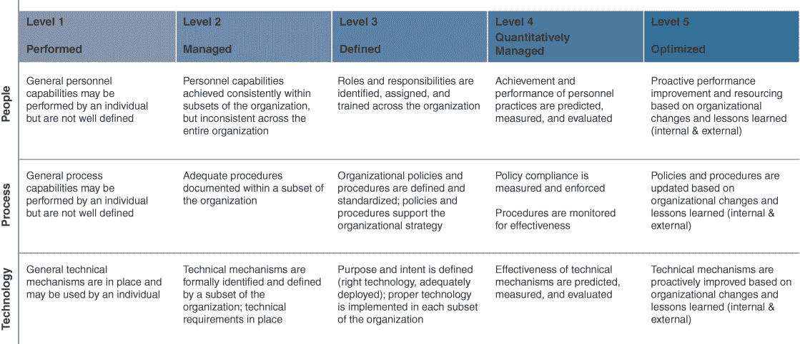

**图 1-20** CMMI 协会标准化成熟度定义

#### SOC-CMM 模型

另一个 SOC 成熟度模型是由吕勒奥理工大学（`LTU`）硕士项目创建的 SOC-CMM 模型。该模型包含五个领域。前三个领域——业务、人员和流程——均按成熟度进行评估，而其余两个领域——技术和服务——则同时按成熟度和能力进行评估。SOC-CMM 模型基于与 NIST 类似的类别对成熟度进行分级。这些类别为：不存在、初始、已定义、已管理、定量管理和优化，具体类别会根据被评估的领域类型而有所不同。图 1-21 展示了五个 SOC-CMM 领域及其 25 个相关方面。

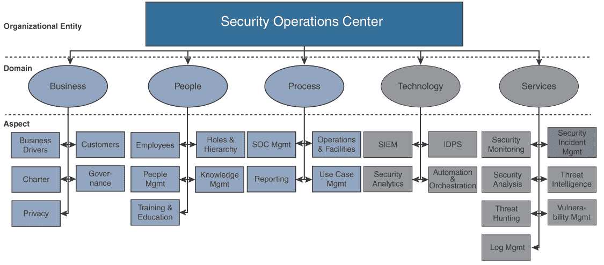

**图 1-21** SOC-CMM 模型图

SOC-CMM 模型真正有益之处在于，它在建议中引用了其他标准、指南和框架，以增强 SOC 服务或能力的成熟度。例如，ID.AM-1 子类别：组织内的物理设备和系统已编入清单，其中包含对 `CCS CSC1`、`COBIT 5`、`ISA` 和 `NIST` 的引用。SOC-CMM 模型可免费使用，并可从 [`www.soc-cmm.com`](https://www.soc-cmm.com) 下载。

#### ISACA COBIT 5 流程评估模型

ISACA 的另一个流行行业成熟度模型是 COBIT 5 流程评估模型（`PAM`），它基于 ISO/IEC 15504 标准用于执行流程评估（COBIT）。根据 COBIT，有一个 0 到 5 分的六级评分系统。0 级意味着服务不存在或不完整。1 级服务代表一种临时能力，意味着它至少实现了其目的，尽管这并非对业务有效的方法。一旦该能力变得可重复，就会进入 2 级。这要求该能力能够被管理并产生预期结果。一旦可重复的能力被完全记录并定义为正式流程，就会进入 4 级。这意味着该流程可在整个组织中使用，而不仅限于特定群体或个人。随着流程的执行，可以对其进行度量和管理以实现改进。一旦建立并维护了成功与失败的检查点，成熟度即达到 4 级。最后，流程可以开始针对持续改进进行优化，从而达到 5 级。

该模型看起来应与 CMMI 协会模型相似。图 1-22 细分了 COBIT 评分模型。关于如何执行 COBIT 评估的详细信息，可在 ISACA.org 网站上找到。

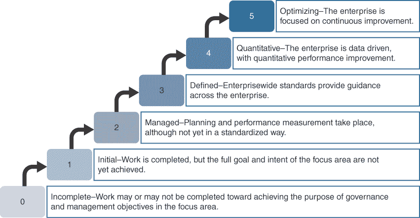

**图 1-22** COBIT 能力评分

#### SOC 计划成熟度


NIST、SOC-CMM 和 COBIT 模型是评估 SOC 服务特定功能成熟度的绝佳资源。对 SOC 成熟度建模的一种更通用方法是评估整个 SOC 计划。使用这种方法可以整合整个 SOC 相关的人员、流程和技术，而不是像 NIST、SOC-CMM 和 COBIT 模型那样拆分每个 SOC 服务。这种方法始于定义最基本的 SOC 成熟度级别：

*   **第一代 SOC：** 此级别的 SOC 仅监控设备日志，这意味着其基于受监控数据的覆盖范围有限。基础 SOC 的数据保留能力有限，且无法有效响应安全事件。基础 SOC 拥有少量安全工具将事件日志发送到集中式工具（如安全信息和事件管理 [SIEM] 系统），SOC 依靠该系统获取所有安全感知。第一代 SOC 所提供的服务包括某种形式的风险管理和针对安全事件的有限持续监控。

*   **第二代 SOC：** 第二代 SOC 利用数据关联和整合将日志数据转化为安全事件。这简化了监控，显著改进了事件响应。这还可以引导开发跟踪系统来管理事件，并最终形成针对特定类型事件的正确响应剧本。第二代 SOC 提供更高级的风险管理和更成熟的事件响应服务。此级别的 SOC 可以是有效的，但仍然非常依赖被动响应。

*   **第三代 SOC：** 第三代 SOC 拥有更丰富的 SOC 能力经验，能够提供更多服务，如漏洞管理和合规性。此级别的 SOC 拥有评估服务，用于查找潜在弱点、违反策略的领域以及所需的合规性要求。关键在于，第三代 SOC 已从被动安全实践转向主动安全实践，因为它拥有旨在通过降低潜在风险在攻击发生前做好准备的服务。这也意味着 SOC 可以开发更好的剧本，并执行经验总结演练，以在安全事件发生后更好地为未来的攻击做准备。

*   **第四代 SOC：** 第四代 SOC 利用最新的 SOC 技术和服务。此级别的 SOC 进一步调优工具，并通过威胁情报、信誉安全和云服务扩展对其他网络的可见性。它通过使用人工智能增强数据关联，不仅改进了决策制定，还支持基于实时数据开发新的安全规则和剧本。第四代 SOC 使用 NetFlow 和数据包捕获等数据源提供网络取证服务。它不仅是主动的，还持续衡量结果并设定增长和成熟度目标。我将在本书中提供建议和指导，帮助您提高整体 SOC 成熟度，使其成为第四代 SOC。

图 1-23 显示了总体 SOC 成熟度细分。

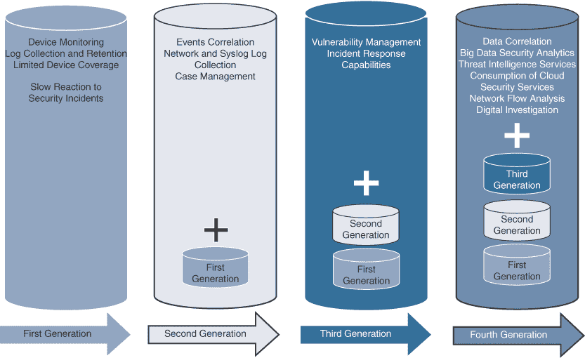

**图 1-23** SOC 成熟度模型

在每个 SOC 代际中，服务均可细分并使用 CMMI 协会、SOC-CMM 或 COBIT 模型或其他标准、指南或框架进行评估。您可能会发现，您的 SOC 拥有一项基础取证服务，您会将其评为第一代 SOC 服务，因为它是临时性的；而事件响应计划则基于 SOC 在该服务上的投入程度，成熟度高得多。您可能会发现，您的 SOC 与独立的漏洞管理团队合作，而不是在 SOC 内部运行漏洞管理计划。这种漏洞管理方法意味着第一代 SOC 服务将其资源与桌面支持团队结合，将其能力和服务提升至第三代性能水平。我建议将您的 SOC 作为一个整体运营进行评级，同时也使用 NIST、SOC-CMM 或 COBIT 等标准、框架或指南，以这种方式评估每个常见 SOC 服务（本章前面已描述）。

确立 SOC 服务的成熟度并制定改进里程碑，是正式化 SOC 计划的关键步骤。通过了解成熟度状态，您的 SOC 计划可以评估业务所需的改进级别。这为资源申请和建立奖励机制以鼓励健康的 SOC 环境奠定了基础。路线图通向变革，这正是一群负责安全的人员将其实践发展成为负责任的 SOC 的方式。

### SOC 目标评估

正如您所读，行业中有非常有用的标准、指南和框架可供使用，它们为安全最佳实践提供了建议。我在本章中重点介绍了一些最流行的选项，并指出了使用这些资源的一些局限性。这些局限性包括：它们的更新速度无法跟上技术变革的步伐；它们在设计上具有通用性，以适应各类行业；并且它们没有提供一种方法来确定哪些变更对您的特定业务最为重要。这使得诸如优先投资哪些安全能力和服务、以及在何处整合现有安全能力等决策完全取决于组织自身。试想一个组织，预算只够购买一种安全工具，却同时需要下一代防火墙（NGFW）和 Web 应用防火墙（WAF）。该组织应该先投资哪一个？

我与 Cisco 的一些杰出安全架构师合作，开发了一种方法论，它通过提供一份定制的目标清单，以及展示安全缺口和潜在整合领域的能力评估图，来补充标准、指南和框架的价值。拥有目标清单可以简化投资决策，前提是这些目标与业务重点保持一致。根据每个目标对业务的重要性对目标清单进行排序，能清晰地显示每个目标的重要性，从而使决策能够聚焦于最高优先级的目标。开发能力图谱能清晰地展示缺口或重叠能力所在，使技术和非技术人员都能理解为何需要变更。您可能会问，为什么不直接着手评估安全能力？为什么要先回顾组织和 SOC 的目标？请再次考虑这样一个场景：预算有限的组织需要多种安全工具，却不知道按何种顺序投入资金和时间。通过首先建立并排序业务和 SOC 的目标，组织可以将安全工具与该清单对齐，从而提供一份路线图，明确应如何以及按何种顺序解决每个安全需求。

#### 定义目标

SOC 评估方法论的第一步是定义业务目标。这至关重要，可确保 SOC 的所有其他目标都直接与业务目标保持一致。例如，如果一家业务专注于提供在线视频游戏，那么 SOC 的目标应旨在支持以安全的方式交付游戏，并保护与提供在线游戏服务相关的所有系统。如果业务是一所学校，其主要重点是提供最现代化的在线学习环境，那么 SOC 的目标应是提供可靠的网络和数字学习资源。确定组织目标应在高管层面完成。然后 SOC 根据组织目标制定其 IT 目标。让执行赞助人验证业务目标是否正确非常重要，以确保 SOC 的所有目标规划都与组织相关。业务目标也体现在 SOC 的使命和范围声明中，我将在第 2 章中介绍。

> **注意**
>
> 我强烈建议与 SOC 执行赞助人或其他高管确认 SOC 团队对业务目标的理解，以确保 SOC 的目标与业务正确对齐。

一旦业务目标确立并经领导层验证，您就可以根据满足业务目标来制定 SOC 目标。这些目标将基于 SOC 提供的人员、流程和技术，并属于一项或多项 SOC 服务的一部分。我称这些为 SOC 的 *IT 目标*。IT 目标与业务目标对齐，意味着技术有助于实现业务目标。回顾前面的例子，在线游戏公司一个显而易见的 IT 目标是保护在线游戏服务免受外部威胁，因为在线游戏服务是业务盈利所必需的。为提供在线课程的学校设定的一个 IT 目标是提供可靠的网络，并识别任何可能影响网络性能的系统。这同样讲得通，因为学校的业务目标是提供现代化学习环境，这在很大程度上依赖于可靠的网络。IT 目标可以记录在案并转化为公司政策，使其成为必须遵守的要求。IT 目标应非常高层级，解释目标的愿景，而不解释实现目标的具体细节。这有助于无论人员、流程和技术如何具体变化，都能保持目标的相关性。IT 目标的旨在为 SOC 提供愿景。

由于 IT 目标是高层级的，实现每个目标的细节在一个或多个 IT 流程中定义。IT 流程建立了交付目标的分步方法。在线游戏公司的一个流程示例是监控在线请求的激增，旨在识别潜在的拒绝服务（DoS）攻击。实现保护在线服务这一 IT 目标的所有步骤和工具，以及负责确保此过程执行的人员，都将在一个或多个 IT 流程中得到解释。如果有人询问为何某个流程存在，可以通过展示该流程如何直接与 IT 目标对齐，而 IT 目标又如何与业务目标对齐来解释。学校的一个 IT 测程序将是监控网络中断所采取的步骤。这可能包括用于监控网络流量使用的工具、发生中断时该怎么做，以及哪些人员负责提供这项服务。在两个示例中，这些都可以是与特定 IT 目标或多个 IT 目标对齐的一个或多个 IT 流程。图 1-24 表示业务目标、IT 目标和流程应如何对齐。此模型类似于 CompTIA CySA+ 对策略、标准和程序对齐的看法。

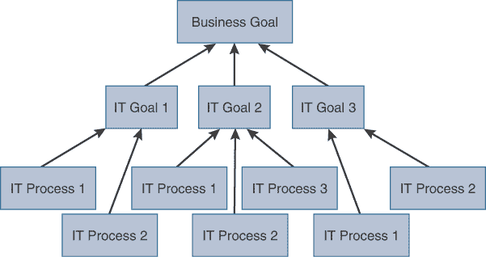

**图 1-24** 业务目标、IT 目标和流程对齐

以下是 SOC 目标评估流程的简要总结：

1.  与 SOC 执行赞助人或业务领导层会面，确认业务目标。
2.  制定支持业务目标使命的 SOC 目标（也称为 IT 目标）。IT 目标必须与业务目标对齐。
3.  创建 IT 流程，详细记录如何正确执行 IT 目标。
4.  识别 IT 流程中缺失的人员、流程或技术。

#### SOC 目标排序

Recalling my examples, I mentioned that the IT objectives for the online gaming company would include protecting online resources, which would require DoS and web attack defense technology capabilities and services. I mentioned the online school's objectives would be to protect network performance, which would require IT objectives for vulnerability management, incident response, and continuous network monitoring. Evaluating the SOC in this manner helps justify the specific tools and processes deployed, which can later be assessed for maturity using any of the standards, guidelines, or frameworks previously reviewed. Table 1-3 and Table 1-4 outline examples of high-level business and technology objective mappings for the online school and online gaming company, respectively.

> **Note**
>
> The following examples are similar to the results I have obtained from performing this work for clients in the past. Each organization will have different objectives and prioritization.

### Table 1-3 Online School Objective Mapping

| Strategic Objective | Priority |
| --- | --- |
| Data Privacy | 1 |
| Support Learning Environment | 1 |
| Services for Students and Faculty | 2 |
| Shorten Time to Detect and Correct Incidents | 3 |
| Off-Campus Learning | 3 |
| School Reputation | 4 |
| Mobile Workforce Support | 5 |

### Table 1-4 Online Gaming Company Objective Mapping

| Strategic Objective | Priority |
| --- | --- |
| Provide 99.9% Uptime | 1 |
| Company Reputation | 2 |
| Rapid Software Releases and Updates | 3 |
| Protect Customer Data | 3 |
| Remote Worker Support | 4 |
| Employee Retention | 5 |
| Vendor Partnerships | 6 |

Note that in Table 1-3 and Table 1-4, some strategic objectives have the same priority ranking. This is acceptable as long as not all objectives are ranked as the highest priority. The reason behind the ranking is to determine how to prioritize objectives. It is recommended to first list all business objectives and rank them based on input from various parties (which may include desktop support, legal, finance, facilities, security, human resources, and leadership) so that everyone agrees on the importance of each objective to the organization. I recommend validating the results of the business objective ranking with the SOC's executive sponsor.

Table 1-5 and Table 1-6 demonstrate the execution of technology objective assessments for the online school and online gaming company, respectively. Note that the ranking of technology objectives remains consistent with the ranking of business objectives. If the school lists data privacy as a top concern, data loss prevention technology should also be a top technology objective. Technology objectives are just one example of IT objectives. Other examples can focus on the people and process elements of the SOC.

### Table 1-5 Online School Technology Mapping

| Technology Objective | Priority |
| --- | --- |
| Data Loss Prevention | 1 |
| Network Uptime | 1 |
| High Availability | 2 |
| Segmentation | 2 |
| Endpoint Security Enforcement | 3 |
| Authorized and Unauthorized Cloud Services | 4 |
| User Training | 4 |
| Least Privilege Enforcement | 5 |
| Vulnerability Management | 6 |
| Configuration Management | 7 |

### Table 1-6 Online Gaming Company Technology Mapping

| Technology Objective | Priority |
| --- | --- |
| Denial of Service Defense | 1 |
| High Availability | 1 |
| Network Monitoring | 1 |
| Application and WAF Requirements | 2 |
| Configuration Validation | 3 |
| Data Loss Prevention | 3 |
| Least Privilege Enforcement | 4 |
| VPN and Remote Routing | 5 |
| Endpoint Security Enforcement | 6 |
| Internal Segmentation | 7 |


Developing technology objectives and ranking them should be much easier than performing the same process for business objectives because the previously created business objectives influence and narrow the scope of the technology objective discussion. For this reason, it is critical to develop and rank business objectives first. The order of the objective assessment matters! I have performed these assessments for hundreds of clients, and many times find that, for example, an organization thought they needed a new firewall going into the assessment, but through the assessment discovered their business objectives highlighted a greater need for investment in areas where capabilities and services were completely lacking. In the online gaming system example, `WAF` and `DoS` technologies should be prioritized over a new `NGFW` or segmentation technology. I posed the question at the beginning of this section as to whether a company should choose a `WAF` or `NGFW`. For the online gaming company example, based on the results of the business and IT objective ranking, the answer would be the `WAF`. If another organization went through this process, they might find that based on their derived results, the `NGFW` is the better investment.

> **Note**
>
> You may wonder why the SOC would be involved in procuring security tools (some clients I've spoken with believe the SOC is only responsible for responding to security incidents). Among the SOC services common in mature SOCs globally, a key service is `R&D`. This service focuses on researching and evaluating security tools so that the expected security experts in the organization—the SOC—select the best technology fit for the organization, rather than another team in the organization. I strongly recommend the SOC be involved in the evaluation of any tools that will be used by the SOC. I have seen hundreds of times where an organization's procurement office takes full ownership of acquiring tools and selects tools based solely on price. Trust me, this approach often leads to poor decisions. Chapter 10 covers evaluating whether to build your own tools, leverage open source, or procure enterprise options.

IT objectives should be high-level, while IT processes should be specific to the particular people, processes, or technologies provided. IT processes should include step-by-step instructions for performing a task, details of the tools involved, and the personnel responsible for executing the service. One or more IT processes can map to a single IT objective. For example, one IT process might cover the specifics of how to configure a `WAF`, while another IT process might cover how to monitor the `WAF`. In both IT processes, details such as who does the work, when, how, etc., are just some of the information that should be included. IT processes can also be ranked like the IT objectives in the previous examples.

#### Threat Ranking

In addition to objectives, a third aspect that can be assessed is to look at the primary threats facing the organization. This can supplement the threat modeling exercise introduced earlier in this chapter. Ranking threats helps validate how technology objectives align with business objectives and verifies whether capabilities and processes exist to address high-concern situations. Threat types and expected threat behaviors can be derived from the threat modeling exercise. Taking the online gaming company as an example, it is reasonable to consider threats against their 99.9% uptime objective as a top priority for the business. This means threats that could cause a disruption to their services would be ranked as Priority 1. Table 1-7 and Table 1-8 show examples of performing this for my example online school and online gaming company, respectively.

### Table 1-7 Online School Threat Mapping

| Threat Concern | Priority |
| --- | --- |
| Denial of Service | 1 |
| Data Breach | 1 |
| Lack of Visibility | 2 |
| Attack Exploitation | 3 |
| Account Compromise | 3 |
| Lateral Movement | 3 |
| Malware | 4 |
| User Error/Layer 8 | 4 |

### Table 1-8 Online Gaming Company Threat Mapping

| Threat Concern | Priority |
| --- | --- |
| Denial of Service | 1 |
| User Account Theft | 1 |
| Website Compromise | 2 |
| Software Compromise | 2 |
| Account Theft | 3 |
| Misconfiguration | 4 |
| Endpoint Malware | 5 |
| Insider Threat | 6 |
| Unauthorized Devices (Hubs/Routers) | 7 |
| Partner Risk | 7 |

Having these rankings and alignment results provides a solid foundation for understanding which objectives and processes are critical to the SOC, depending on their alignment with the overall business. Remember, if certain groups were not involved in the process of creating and ranking objectives, you may need to re-perform the assessment with the absent parties to get a truly balanced opinion on the objectives and rankings. I have seen desktop support teams not involved in these decisions later withdraw their budget portions due to not supporting the next proposed organizational security investment. I strongly recommend including at least one director or higher-level representative for business objectives, and a manager for every critical service in the organization, to get the maximum impact from this exercise. Usually, this person is the SOC's executive sponsor.

#### SOC Objective Assessment Summary

Upon completing this work, your organization will have a general understanding of which departments are the primary targets for investing in SOC services and capabilities to achieve established goals. What is still missing is identifying specific gaps in capabilities, as well as areas where consolidation can create new budgets. In the next section, I will focus on a methodology for assessing security capabilities based on a capability model.

The following steps summarize the objective ranking process:

1.  Establish business objectives and align SOC/IT objectives and IT processes with them.
2.  Rank business objectives and IT objectives by importance.
3.  Debate the rankings and validate them with different groups in the organization to ensure all voices are heard.
4.  Apply gap analysis to each ranked item, starting with the most critical.
5.  Translate the gap analysis into a three-to-five-year plan to enhance SOC capabilities.

The two assessment items I just introduced will produce a list of objectives aligned with the business. The next step in assessing the SOC and developing an improvement roadmap is to identify gaps or overlapping capabilities within the IT objectives. For example, if an IT objective is to reduce vulnerability risk, how do you know which existing capabilities achieve that goal? To assess people and processes, you need to conduct tabletop exercises, which will be covered in Chapter 4. To assess technology capabilities, I recommend using a SOC Capability Assessment.

### SOC Capability Assessment

The previous section discussed assessing SOC business objectives, IT objectives, and IT processes. You learned how to rank these objectives to understand how to prioritize investments in SOC services and capabilities. What I have not yet discussed is how to verify what SOC capabilities exist to determine specific investment areas. For example, what capabilities does the online gaming company have to achieve its goal of 99.9% uptime for its games and services? What capabilities can the online school leverage to ensure student network uptime? Should the focus be on the edge, inside the network, or on the host? Assuming a limited SOC budget, what is the best investment choice?

In this section, I will explore developing a capability map that can be used to consolidate similar capabilities and identify gaps. Consolidation frees up more budget for future tools, people, and services. Identifying gaps helps SOC members and non-SOC members understand what types of services and capabilities are needed to improve the maturity of SOC services. Industry standards, guidelines, and frameworks can also provide improvement recommendations, but as mentioned earlier, they are not tailored to your specific organization. A capability map is customized to your environment but can also include missing capabilities found in industry standards, guidelines, and frameworks if needed.

#### Capability Mapping

Creating a capability map involves identifying the different parts of the network and mapping how users and systems interact within that environment. To better understand this, let's walk through mapping a typical organization's branch network. I will start with the end user and attempt to define what security capabilities or services exist to protect that user's laptop. Does the organization standardize on hardware and software, or do employees bring their own devices (`BYOD`)? Do employees have permission to install or modify software? Depending on your business needs and what you want to include in the capability map, you may or may not care about this level of detail. Taking the online school as an example, assume the school does not care which operating system students use, i.e., allowing students to bring their own systems. This differs from organizations like the online gaming company, which requires all employees to use only company-issued devices on the corporate network.

##### Capability Map Example: Endpoint Security

For this capability map example, I will ignore system and host details to focus purely on security technology capabilities. A capability map might include other concepts, such as services running on the host, but to keep the example simple and focused, I will only focus on security capabilities. Starting with the end-user systems, these computers will have antivirus software installed to prevent known malicious files. What about anti-malware for more advanced unknown threats, capable of detecting threats based on behavior that bypasses antivirus? Is there any content filtering or reputation security installed on the host to protect users from known malicious external sources? Is a firewall or Host-based Intrusion Prevention System (`HIPS`) enabled on the host system? You can use the industry standards, guidelines, or frameworks introduced earlier in this chapter as a method to identify industry best practices for endpoint protection security capabilities and compare these recommendations with existing capabilities. For example, `NIST` has a set of recommendations on what security capabilities host systems should have. The specific standard, guideline, or framework you use should be based on the one you believe is most useful for your organization.

The key to this example is listing the different capabilities, or at least providing additional checkpoints against threats. This leads to the defense-in-depth security approach. Redundant capabilities (such as two antivirus programs) can be identified as duplicate capabilities, represented by the same icon appearing twice in the capability map. Figure 1-25 shows an example of mapping host-based security capabilities. Remember, for this example, I am only focusing on capabilities existing within the host. SOC services such as endpoint vulnerability scanning and managing user privileges are not covered but are equally important to IT capabilities.

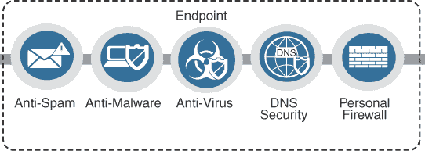

**Figure 1-25** Host Capabilities

##### Capability Map Example: Endpoint OS Security

You may want to assess capabilities within the endpoint more deeply because the last capability map shown in Figure 1-25 glossed over this. For the next example, desktop support members may care about the security of the operating system and want to assess the capabilities and services of the host OS. You can develop a separate capability map for the host OS to achieve this. Once the host OS capability map is complete, other capability maps can reference it, so you don't have to repeat the process every time a host OS is listed in a capability map. Figure 1-26 is an example of creating a specific host defense security map. These host OS capability recommendations come from `NIST SP 800-30` Guide for Conducting Risk Assessments.

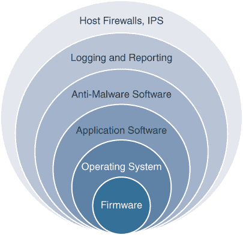

**Figure 1-26** Host-Specific Defense Diagram

> **Note**
>
> I recommend starting capability mapping at a high level to establish a general understanding of information flow and how it interacts with existing capabilities. Once you have identified areas of focus, you can create more detailed capability maps for those specific areas. For example, you can group "Gateway Security Capabilities" as a single checkpoint initially, and later map all capabilities within the security gateway, such as firewall, `IPS`, `WAF`, etc.

##### Capability Map Example: Network Security

For the next part of this capability mapping exercise, I will examine how users connect to the network. I need to consider how any user connects to the network and what measures the network takes to reduce the risk of compromise. I should also consider any relevant processes and policies, such as requiring any connected device to undergo a vulnerability scan before being allowed access. Here are some questions to consider for this part of the assessment exercise:

*   Is some form of access control implemented?
*   How is authentication handled?
*   What are the policies allowing people and systems to have specific access levels?
*   How are systems allowed to connect to the network monitored?
*   Has hardware been profiled, and are certain hardware types granted more access than others?
*   Is segmentation enforced based on device and user type?
*   What happens after a system is authorized for online services?
*   Is user behavior monitored for malicious activity?
*   Who is responsible for these services?
*   What security measures are in place when traffic leaves the user system for the internet?

The key is understanding traffic flows and the different capabilities in place. It is recommended not to turn this process into a product discussion, but to focus on the capabilities and services themselves, regardless of how they are delivered. For example, a single product like a "Next-Generation Firewall" may possess multiple capabilities. Many industry "Next-Generation Firewalls" provide multiple capabilities including firewall, application firewall, intrusion prevention, anti-malware, etc. Figure 1-27 shows an example of an `NGFW` broken down into a capability flow. Note that traffic first hits the firewall capability; if allowed through, it is filtered by application control. Subsequently, that traffic is scanned by the `IPS` for threat behavior. Finally, any files allowed through are assessed for malware. This flow is important so you understand at which link in the attack chain defenses should activate. Similarly, for this example, I am only focusing on capabilities. Many factors such as who manages them, what policies should be enforced (e.g., what content to filter), etc., are not included for brevity.

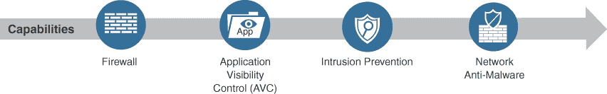

**Figure 1-27** Next-Generation Firewall Capabilities Flow

> **Note**
>
> You can draw boxes for capabilities contained within a single existing product to improve understanding of the document content. I have found that if readers assume each capability represents a product, they may become confused about the number of products needed or existing. The reality is that most capabilities will be grouped into different products, meaning a few multi-functional products will constitute all capabilities represented in the capability map.

##### Capability Map Example: Branch Office Network


我建议您保持能力映射与厂商无关，但如果需要，您可以为文档目的对其进行标记。关键在于绘制现有能力和服务的图表，即使有多种技术提供相同的能力。例如，具有应用层防火墙能力的 `NGFW` 和 Web 代理都具备过滤流量的能力。图 1-28 展示了一个组织的分支机构网络在从用户映射能力到该用户流量如何流向互联网后的示例。此示例不仅关注实际存在的内容，还着眼于所有可能的能力，包括那些尚不存在但根据 `NIST` 和 `ISO` 等行业标准、指南和框架应成为地图一部分的能力。为保持简洁，此示例中我仅关注技术能力。

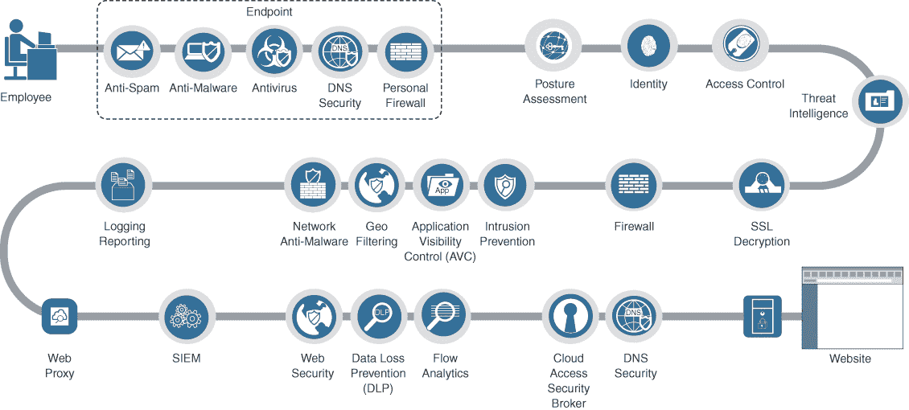

**图 1-28** 分支机构能力示例

### SOC 能力差距分析

创建能力图后，您可以根据差距和重叠的能力及服务对其进行评估。我建议用绿色阴影或勾号标记胜任的能力区域，用黄色阴影或斜线标识不令人满意的能力。薄弱能力的一个示例是组织使用手动端口安全来实施访问控制，而不是使用自动化网络准入控制。手动端口安全是指配置网络交换机仅允许一个或多个特定设备访问网络。当未在批准列表内的任何设备尝试连接网络时，网络交换机将禁用该端口。虽然这提供了端口安全，但管理批准设备列表并在网络端口被禁用时做出响应可能非常繁琐。手动端口安全也被认为容易受到欺骗攻击，因为如果攻击者能确定某端口应连接何种系统，他们就可以欺骗授权系统的 MAC 地址。例如，欺骗连接到特定点的打印机的 MAC 地址，拔掉打印机，然后使用打印机的伪造 MAC 地址插入该端口。

我建议用红色阴影或 X 标记不存在的能力和服务。缺少某项能力或服务并不意味着必须添加它。可能存在不具备某项能力或服务的业务或技术原因。您可能会发现，行业指南、标准和框架建议的能力和服务多于您能投入或特定业务和 IT 目标所需的。图 1-29 显示了之前标记了如何应用于示例客户的能力图。在此示例中，勾号代表现有的有效能力，斜线代表现有但无效的能力，X 代表缺失的能力。

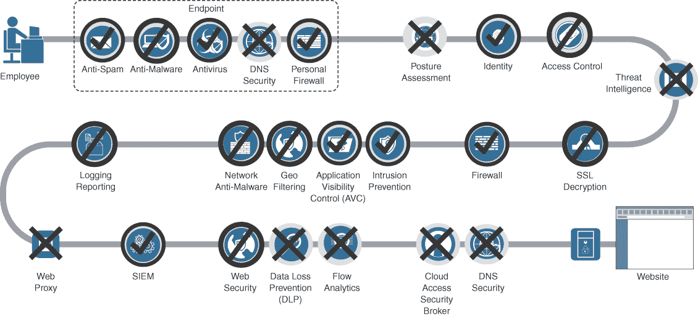

**图 1-29** 能力评估示例

这种执行能力差距分析的方法并不能展示能力将如何防范特定威胁。该方法的目的是建立对组织纵深防御架构的理解，而不考虑其将遇到的威胁类型。请记住，今天构成主要问题的威胁明天将被另一种威胁所取代。采用纵深防御方法通过分层不同的能力来适应这种变化。也许今天的威胁会利用你的 `IPS` 通过基于特征的检测所无法识别的漏洞。如果该攻击成功利用了目标，现在威胁必须面对下一层防御，该层将分析正在目标上安装的文件。如果攻击者能在目标上植入恶意软件，下一层防御将根据同类文件的正常功能，评估该文件是否表现出异常行为。随着你分层部署更多防御能力，攻击者绕过所有安全层以达成其目标的风险就会降低。如果你想将能力测试与这种评估组织安全能力的方法相结合，可以应用诸如 `MITRE ATT&CK` 之类的威胁模型。

> **注意**
>
> 在这些不同的评估会议中，迟早会讨论到应选择哪个供应商。理想的做法是在所有评估工作完成后，再推迟针对特定供应商的讨论，以保持纯粹关注能力和业务目标。

### 能力图后续步骤

制定能力图后，可能会有以下几个后续步骤。首先，你可能会发现存在重叠的能力和/或服务，这些可以整合以简化数据流、简化工具管理，并降低组织维护供应商合同的成本。其次，在向非技术人员汇报时，你可以利用刚刚创建的可视化图表来识别能力和服务中的差距。这些数据可以结合业务目标、技术目标和威胁排序，以确定应优先解决哪个关注领域。例如，如果你的能力图显示缺乏内部威胁能力，而业务优先级指出这是一个关注领域，那将是未来投资人员、流程和技术改进的首要之处。回顾在线游戏公司的例子，其能力图将显示缺乏下一代防火墙和 Web 应用防火墙能力。公司的业务目标和 IT 目标排序可以帮助决定在预算限制只能购买一种工具的情况下投资什么。对于这个例子，基于 Web 攻击属于高优先级，`WAF` 将是最佳选择。

> **注意**
>
> 拥有重叠能力并不总是坏事。这可能代表了一个整合并获取新能力以进一步扩展纵深防御架构的机会。例如，为什么要同时让代理和应用层防火墙都执行内容过滤，而任一方法都能为组织实现该目标？也许存在政治或运营原因来维持这种做法，或者通过将该职责整合到一个工具中，可以将额外的许可证、产品或工作职能重新用于一项尚不存在的能力。

此练习可以用类似的方式针对网络的其他部分执行，例如数据中心、无线网络、总部、远程办公室等。图 1-30 展示了一个仅关注 IT 能力的数据中心能力映射示例。在该示例中，我首先查看了访问网络的客户端，它们将访问一个内部防火墙，该防火墙将网络与数据中心网络隔离开。在该数据中心网络内部，建议部署内部威胁或东西向安全防护。我发现许多组织将大部分安全防护部署在数据中心的边缘，尽管大部分流量存在于数据中心内部。这意味着如果数据中心被攻陷，可能直到恶意行为发生在边缘（如数据被窃取流出）时才会被发现！如果是这种情况，该图将显示 X 标记，代表数据中心边缘防火墙之外缺乏能力。

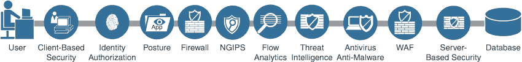

**图 1-30** 数据中心能力示例

执行 `SOC` 能力和服务评估将耗费时间，并需要具备相当安全知识以及行业最佳实践了解的人员，以便正确捕获关键数据点。如果你不确定应存在哪些能力，请参考行业标准、指南和框架以获取建议。

## SOC 发展里程碑

开发成熟的 `SOC` 是一个包含关键里程碑的过程。第一个里程碑是确定一名或多名高管发起人。发起人的目的是拥有一位权威人物，协助 `SOC` 在策略制定时强制执行。发起人还可以验证组织的真实业务目标，并帮助将 `SOC` 的 IT 目标与业务对齐。`SOC` 和发起人共同努力，朝着第二个里程碑迈进，即建立 `SOC` 计划。建立计划包括各种发展里程碑，例如制定 `SOC` 所需预算、招聘何种人才、获取何种技术。这些里程碑相互依赖。必须先确定预算，才能锁定招聘目标。高素质人才比初级职位需要更高成本，但后者需要更多培训。在人员到位并能评估其技能、询问其偏好的技术类型之前，不应采购技术。一旦根据计划目标获取了人员和技术，就可以制定流程，包含为实现每日目标应采取的步骤。流程起初可能以临时方式启动；但随着时间的推移，可以根据本章介绍的成熟度模型加以改进。随着成熟度的建立，可以与其他团队开展协作。例如 `SOC` 承担部分漏洞管理职责，而桌面支持团队负责桌面漏洞修复。图 1-31 为高层图表，展示了 `SOC` 发展的各个里程碑。

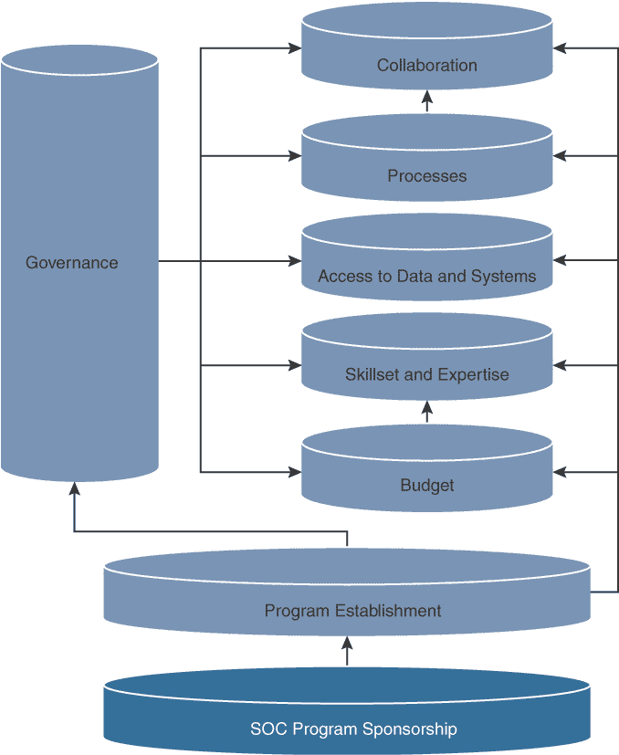

**图 1-31** 开发成功的 SOC

图 1-31 中所示策略从高层面评估如何开发 `SOC` 时似乎很直接。然而，成功的关键在于如何执行每个里程碑内的步骤。我将在后续章节深入探讨这些里程碑的细节。你将学习如何接触高管并为 `SOC` 获得适当的赞助。你将了解招聘和留住人员的最佳实践。我还将更详细地介绍安全工具、能力和服务，并解释高效第四代 `SOC` 中的流程。你通往高效 `SOC` 的旅程从下一章开始，我将更深入地探讨构建 `SOC` 以及如何选择计划提供的服务。

## 摘要

本章首先回顾了网络威胁和漏洞背后的基础知识。接下来，您了解了安全运营中心（`SOC`）的宗旨，以及 `SOC` 可用于识别和响应网络威胁的能力。随后，本章通过回顾威胁模型，更深入地探讨了理解网络威胁行为。您还学习了使用标准、指南和程序防御网络威胁的行业最佳实践。您审视了业务和技术挑战以及常见的 `SOC` 服务。本章最后回顾了如何使用成熟度模型、目标评估和能力评估演练来评估 `SOC`。

本章中的许多概念属于高层设计，旨在建立对如何开发 `SOC` 的基本理解。后续章节将提供所涵盖概念的详细信息，以便您提升 `SOC` 的能力和服务。`SOC` 的成熟将减少漏洞，提供有效的 `SOC` 服务，并获得组织更多的支持。

## 参考资料

Ablon, L. (2018, March 15). Data Thieves. Rand Corporation. [`www.rand.org/content/dam/rand/pubs/testimonies/CT400/CT490/RAND_CT490.pdf`](https://www.rand.org/content/dam/rand/pubs/testimonies/CT400/CT490/RAND_CT490.pdf)

Caltagirone, S., Pendergast, A., & Betz, C. (2013, July 5). The Diamond Model of Intrusion Analysis. U.S. Department of Defense. [`www.activeresponse.org/wp-content/uploads/2013/07/diamond.pdf`](http://www.activeresponse.org/wp-content/uploads/2013/07/diamond.pdf)

Cimpanu, C. (2019, December 12). A Decade of Hacking: The Most Notable Cyber-security Events of the 2010s. ZDNet. [`www.zdnet.com/article/a-decade-of-hacking-the-most-notable-cyber-security-events-of-the-2010s/`](https://www.zdnet.com/article/a-decade-of-hacking-the-most-notable-cyber-security-events-of-the-2010s/)

Cisco. (2018). Figure 37: Patching Behavior Before and After WannaCry Campaign. Cisco 2018 Annual Cybersecurity Report (pp. 41). Cisco. [`www.cisco.com/c/dam/m/hu_hu/campaigns/security-hub/pdf/acr-2018.pdf`](https://www.cisco.com/c/dam/m/hu_hu/campaigns/security-hub/pdf/acr-2018.pdf)

Fritz, B., & Yadron D. (2014, December 5). Sony Hack Exposed Personal Data of Hollywood Stars. Wall Street Journal. [`www.wsj.com/articles/sony-pictures-hack-reveals-more-data-than-previously-believed-1417734425`](https://www.wsj.com/articles/sony-pictures-hack-reveals-more-data-than-previously-believed-1417734425)

IBM Security. (2020). Cost of a Data Breach Report 2020. IBM Security. [`www.ibm.com/security/data-breach`](https://www.ibm.com/security/data-breach)

International Organization for Standardization (2018, February). ISO 31000:2018: Risk management – Guidelines. ISO. [`www.iso.org/standard/65694.html`](https://www.iso.org/standard/65694.html)

ISACA. (2019). COBIT 2019 Framework (various publications). ISACA. [`www.isaca.org/resources/cobit`](https://www.isaca.org/resources/cobit)

Joint Task Force Transformation Initiative. (2012, September). SP 800-30 Rev. 1: Guide for Conducting Risk Assessments. NIST. [`csrc.nist.gov/publications/detail/sp/800-30/rev-1/final`](https://csrc.nist.gov/publications/detail/sp/800-30/rev-1/final)

Kaspersky. (2018, June 27). Ransomware and Malicious Crypto Miners in 2016–2018. Securelist. [`securelist.com/ransomware-and-malicious-crypto-miners-in-2016-2018/86238/`](https://securelist.com/ransomware-and-malicious-crypto-miners-in-2016-2018/86238/)

McKay, B., & McKay, K. (2014, September 15). The Tao of Boyd: How to Master the OODA Loop. The Art of Manliness. [`www.artofmanliness.com/articles/ooda-loop/`](https://www.artofmanliness.com/articles/ooda-loop/)

National Institute of Standards and Technology. (2018, August 10). The Five Functions. NIST. [`www.nist.gov/cyberframework/online-learning/five-functions`](https://www.nist.gov/cyberframework/online-learning/five-functions)

National Security Agency. (2010). Defense in Depth. NSA. [`citadel-information.com/wp-content/uploads/2010/12/nsa-defense-in-depth.pdf`](https://citadel-information.com/wp-content/uploads/2010/12/nsa-defense-in-depth.pdf)

Ponemon Institute. (2018, October). 2018 Cost of a Data Breach Study: Impact of Business Continuity Management. IBM. [`www.ibm.com/downloads/cas/AEJYBPWA`](https://www.ibm.com/downloads/cas/AEJYBPWA)

Proffitt, T. (2009, March). Achievements and Pitfalls of Creating and Maintaining Vulnerability Assessment Programs. SlidePlayer. [`slideplayer.com/slide/5705807/`](https://slideplayer.com/slide/5705807/)

Quote Investigator. (2013, February 10). I Rob Banks Because That's Where the Money Is. Quote Investigator. [`quoteinvestigator.com/2013/02/10/where-money-is/`](https://quoteinvestigator.com/2013/02/10/where-money-is/)

Robertson, A. (2018, September 28). California Just Became the First State with an Internet of Things Cybersecurity Law. The Verge. [`www.theverge.com/2018/9/28/17874768/california-iot-smart-device-cybersecurity-bill-sb-327-signed-law`](https://www.theverge.com/2018/9/28/17874768/california-iot-smart-device-cybersecurity-bill-sb-327-signed-law)

Rogers, K., & Spring, B. (2020, September 6). 'We Are Outnumbered' – Cybersecurity Pros Face a Huge Staffing Shortage as Attacks Surge During the Pandemic. CNBC. [`www.cnbc.com/2020/09/05/cyber-security-workers-in-demand.html`](https://www.cnbc.com/2020/09/05/cyber-security-workers-in-demand.html)

van Os, R. (n.d.). SOC-CCM Model. SOC-CCM. [`www.soc-cmm.com/`](https://www.soc-cmm.com/)

# 第 2 章

## 开发安全运营中心

*一座伟大的建筑造不成一座伟大的城市。*

——托马斯·希瑟维克


# 第 1 章 以安全概念介绍开篇

第 1 章以安全概念介绍开篇，涵盖了如何根据行业最佳实践对现有能力和服务的质量进行评级。您的安全运营中心（SOC）之旅的起点可能介于创建新实践与增强现有运营之间。无论您的运营成熟度如何，从高层使命到 SOC 负责的每项服务的每个流程细节，审视一切都至关重要。本章首先回顾高层 SOC 开发概念，逐步深入到后续章节中展示的高效 SOC 所具备的技术细节。任何成功组织必须确定的绝对首要事项是其`宗旨`，这体现在使命宣言和范围声明中。即使您已有现成的使命宣言或既定宗旨，定期回顾以查看是否可做改进也是值得花时间的。

## 使命宣言和范围声明

### 组织使命与范围声明的重要性

对于组织中的任何员工来说，了解他们每天来工作的原因都至关重要。如果员工不了解业务的宗旨，他们就不会知道如何通过日常贡献产生最大的影响，从而导致缺乏职业驱动力的员工。员工在领导层没有指导其职位存在的原因及其如何造福组织使命的情况下执行工作职责，会变得不满并成为流失风险。员工在不考虑对业务影响的情况下执行日常职责的一个例子是糟糕的客户服务或支持。想象这样一种情况：客户致电寻求一款不再受保产品的支持。如果支持代表不了解业务目标，他或她只会告知客户该产品不再受支持，因为这是代表的具体工作指令，无论这如何影响客户。糟糕客户服务的长期影响是回头客减少和业务品牌受损，导致销售额下降。如果业务目标是将客户放在首位，且该目标已清晰传达给客户支持代表，支持代表将优先满足客户需求，并根据满足支持业务目标提供支持。

组织的使命声明和范围声明告知员工组织的宗旨是什么。`使命声明`本质上是组织核心宗旨和价值观的正式总结。该声明层级较高，且极少随时间变化（如果有的话）。使命声明表达了对业务重要的内容，指明了组织希望实现的目标。任何员工都应能看到其在组织中的角色如何影响使命声明中确定的目标。这种可及性使使命声明成为业务规划的理想起点。`范围声明`与使命声明类似，但包含更多细节。使命声明除非组织发生重大变化否则保持不变，而范围声明的目的是更灵活地适应变化。

### 制定使命与范围声明

如果在组织内开发 SOC，其使命和范围声明必须与 SOC 负责保护的业务相关。创建成功的 SOC 使命声明的关键在于明确 SOC 的职责。使命声明必须简明扼要地解释 SOC 的宗旨和总体意图。声明必须是长期目标，而非所提供服务类型的具体细节，因为这些由范围声明涵盖。

> **Note**
>
> SOC 使命声明包含与其保护组织目标相似的目标很常见；但也存在例外。一些 SOC 由一组 SOC 组成，称为全球 SOC (GSOC)。各个 SOC 可能有自己的使命声明，或共享整体 GSOC 使命声明。一些 SOC 是外包的，或出于合规或其他目的与受服务客户隔离。此类 SOC 的使命声明仅关注其服务，而不考虑其客户的使命。

如果您正在为 SOC 创建或贡献使命声明，关键是确保其回答以下问题。请记住，使命声明语言应保持在代表 SOC 愿景的高层级。具体细节将在稍后介绍的范围声明中描述。

*   **宗旨：** SOC 的宗旨是什么？它为什么存在？
*   **客户：** SOC 的客户是谁？组织内的所有员工还是仅特定部门？是否包含外部客户？
*   **与客户使命的对齐：** SOC 的使命如何与组织的使命对齐？SOC 是否在保护资产和数据的同时帮助组织实现其目标？
*   **服务：** SOC 提供哪些服务？仅是监控还是也包括事件响应？服务不应具体化，例如监控网络可适用于事件响应和漏洞管理等多种服务。这些细节适合放在范围声明中。
*   **服务可用性：** SOC 服务何时可用？是 24/7 还是仅在工作时间？使命声明不应提供可能因可用性目的而变化的细节。它应仅为关于覆盖范围的一般性声明。

#### 使命声明示例

以下是两个 SOC 使命声明示例。在阅读每个使命声明时，尝试识别前面列表中问题的答案（答案在每个声明后的子列表中给出）。

*   **使命声明 1：** 安全运营中心 (SOC) 负责监控、检测和响应事件，以及管理组织的安全工具、网络技术、终端设备和其他分配的系统。SOC 的目标是降低针对组织的网络威胁风险。SOC 的职能每周七天、每天 24 小时执行。SOC 是专门用于此功能的员工和系统的主要位置。

    *   **宗旨：** 监控、检测和响应事件以及管理安全工具。
    *   **客户：** 组织雇用的所有最终用户和来宾用户。
    *   **与客户使命的对齐：** 降低针对组织的网络威胁风险。
    *   **服务：** 事件管理以及安全工具、网络技术、终端设备和其他分配系统的管理。
    *   **服务可用性：** 每周七天、每天 24 小时。

*   **使命声明 2：** 安全运营中心 (SOC) 监控 IT 网络的整体安全态势。SOC 的目标是帮助组织识别和响应安全事件，并及时将受影响的系统恢复到正常运行状态。安全运营中心响应和跟踪安全事件，旨在维护整体安全态势，并在可能的情况下降低风险。这些职能全天候执行，以支持组织的运营模式。

    *   **宗旨：** 维护组织的整体安全态势，并在可能的情况下降低风险。
    *   **客户：** 组织。
    *   **与客户使命的对齐：** 响应安全事件并及时将受影响的系统恢复到正常运行状态。
    *   **服务：** 响应和跟踪安全事件。
    *   **服务可用性：** 全天候支持组织的运营模式。

这两个示例使命声明各自代表单个 SOC 承担其运行组织的大部分安全职责。声明 1 具有更多具体细节，如运营天数和位置，而声明 2 在解释其宗旨时更为宽泛。两个声明都不错；但建议将可能变化的项目归入范围声明，以便使命声明能相对不变地延续并代表高层目标。声明 1 并不差，但如果 SOC 更改运营时间或位置，使命声明将需要调整。声明 2 为运营时间提供了更宽泛的语言，这更理想，这样服务可用性的具体变化不会影响使命声明。两个声明也可以包含更多关于如何与组织对齐的细节，但它们是很好的起点。

> **Note**

### SOC 使命声明与范围声明

如果您没有专门的 SOC 使命声明，或者一直在使用组织的使命声明，强烈建议制定一份 SOC 使命声明。

#### SOC 范围声明

SOC 范围声明与 SOC 使命声明类似，但包含关于 SOC 的更多详细信息。范围声明包括 SOC 的位置、提供和不提供的服务、运营时间的详细信息以及使用的技术。范围声明需要与使命声明相辅相成，但与使命声明不同的是，范围声明可以包含更容易频繁变更的项目。有些 SOC 会将范围声明和使命声明合并；然而，在这种情况下，对 SOC 的任何更改都需要更新合并后的使命和范围声明，而不仅仅是更新范围声明。出于这个原因，我建议将范围声明和使命声明分开，以便范围声明能更灵活地应对变更，而使命声明则保持为 SOC 不变的愿景。范围声明还可以涵盖合作伙伴和子公司的职责。

回顾使命声明示例，一些重要主题未被涵盖。这些主题将归入范围声明，且可能发生变更。范围声明的理想主题包括以下内容。

*   **位置与网络：** SOC 将负责组织的哪些部分？哪些物理位置、远程办公室和云环境属于支持范围内或范围外？考虑哪些网络类型？访客网络、数据中心或广域网是否将成为 SOC 职责的一部分？
*   **所有权：** SOC 对系统和信息拥有何种程度的所有权？SOC 是否拥有保护终端的所有权，还是说这是桌面支持的职责？SOC 是否监控数据中心并负责配置数据访问权限，还是说访问权限由数据中心管理员管理？SOC 很可能不负责管理特定安全工具数据之外的系统或数据。这种所有权需要在范围声明中明确列出。
*   **SOC 目标：** 需要概述 SOC 的目标，以便组织其他部门了解 SOC 的宗旨。这可以在使命声明中解释并在范围声明中引用，也可以是与组织整体使命声明或 GSOC 使命声明一致的另一份组织使命声明。如果使命声明已存在，范围声明应更具体地说明目标，包括实现特定目标的时间表。例如，提高事件响应或漏洞管理等能力的成熟度。
*   **技术与服务：** 范围声明可以具体列出 SOC 将使用的内容。例如，范围声明可以指定“所有入侵防御设备”，这将意味着组织使用的其他网络设备不属于 SOC 职责。范围还可以标识所提供的服务，如取证或事件响应。如果某些服务外包，则范围声明可仅标识 SOC 覆盖的内容。例如，范围声明可以说明 SOC 负责第 2 级或更高级别的事件，这意味着其他资源将处理第 1 级支持。
*   **SOC 服务可用时间的具体细节：** 这包括每天的确切开始和结束时间、是否包含节假日，以及非支持时段如何覆盖。

让我们看几个 SOC 范围声明示例。

#### 范围声明 1

SOC 负责全国每个托管系统并允许系统连接到通用网络的公司站点。SOC 提供的服务包括对系统、应用程序和网络进行全天候安全监控，目标是检测并响应所有外部攻击以及内部恶意行为。SOC 服务还负责处理事件响应；收集和关联各种系统事件；捕获和分析原始数据包数据；发现和跟踪漏洞；以及消费从外部来源接收的威胁情报信息。

*   **位置与网络：** 全国每个托管系统并允许系统连接到通用网络的公司站点。
*   **所有权：** 监控系统、应用程序和网络。
*   **SOC 目标：** 检测并响应所有外部攻击以及内部恶意行为。
*   **技术与服务：** 事件响应；收集和关联各种系统事件；捕获和分析原始数据包数据；发现和跟踪漏洞；以及消费从外部来源接收的威胁情报信息。
*   **服务具体细节：** 对系统、应用程序和网络进行全天候监控。

#### 范围声明 2

SOC 范围涵盖由 IT 管理和运营的所有系统，包括位于国内和国际办公室的系统。SOC 服务全天候提供，包括收集和关联安全事件消息；检测内部和外部恶意活动；响应安全事件；以及在需要时开展安全意识培训。

*   **位置与网络：** 国内和国际办公室。
*   **所有权：** 由 IT 管理和运营的所有系统。
*   **SOC 目标：** 涵盖由 IT 管理和运营的所有系统。
*   **技术与服务：** 收集和关联安全事件消息；检测内部和外部恶意活动；响应安全事件；以及在需要时开展安全意识培训。
*   **服务具体细节：** 全天候服务。

值得注意的是，范围声明比使命声明包含更多关于 SOC 将提供什么内容的详细信息。每个 SOC 都应有单独的使命声明和范围声明（或至少两者的结合），即使是大型 GSOC 内部的较小 SOC 也是如此，以便将服务、运营时间和 SOC 宗旨等关键细节记录在案，供任何人参考。

#### 范围声明的挑战

制定范围声明时常见的一个挑战是承诺具体服务。可能会有关于 SOC 是否应负责某项特定服务，还是由另一个部门处理该服务的问题。例如，如果 SOC 范围声明声称负责识别漏洞，这是否意味着桌面支持不负责识别漏洞？谁来处理漏洞的`修复`？是桌面支持和/或 SOC？如果 SOC 不处理漏洞修复，而是将识别出的有漏洞的系统移交给桌面支持，这种移交将如何进行？回顾第一个示例范围声明中使用的措辞，该声明指出 SOC 仅负责“发现和跟踪漏洞”。范围声明不包括修复漏洞的责任，这意味着 SOC 不负责这项服务。

在此示例中，另一个团队（如漏洞管理团队）可以负责修复漏洞。漏洞管理团队的范围声明中也可能声称负责识别漏洞，这将与 SOC 提供的服务产生重叠，因为 SOC 也声称负责识别漏洞。如果出现这种情况，两个团队都需要认识到这一责任重叠，并制定计划，明确责任如何移交和/或这些团队如何协作。针对这一具体示例的最佳方法将取决于组织内部的各种因素。有些组织可能决定从 SOC 的范围中移除漏洞识别，而其他组织可能决定从漏洞管理团队的范围中移除漏洞识别，这意味着 SOC 将识别漏洞并将这些发现移交给漏洞管理团队，以便由漏洞管理团队处理修复工作。

#### 治理与风险管理参考

范围声明还可以包含与安全治理和/或风险管理相关的概念。其目的是为提供特定服务的原因提供清晰的说明。例如，范围声明可能会规定提供数据控制服务的原因是为了满足 HIPAA 或 PCI DSS 合规性要求。范围声明也可以关联业务目标，例如确保组织的产品安全或服务始终可供客户使用。包含关于 SOC 服务目的的清晰说明有助于领导层更好地理解该服务的目的，从而获得对 SOC 更好的支持。清晰度的另一个好处是，使用或受 SOC 服务影响的人员将理解并尊重该服务存在的原因。尊重 SOC 服务将减少 SOC 必须采取行动时遇到的抵制。

## 开发 SOC

开发 SOC 所需的精力不仅仅在于选择合适的地点和购买一堆设备。你必须拥有一个流程来规划、设计、构建和运营 SOC，这可以在 SOC 启动并运行后将其移交给另一个团队，或者帮助 SOC 从一个小团队成熟为组织内拥有自己领导层和资金的专职团队。SOC 规划始于第 1 章涵盖的主题，即评估 SOC 的当前状态以及制定使命和范围声明。

你如何规划和设计 SOC 将以积极或消极的方式影响它，包括开发和改进 SOC 服务所需的成本和时间。基于其范围了解 SOC 的预期，有助于选择雇佣何种类型的人员和获取何种类型的技术。图 2-1 提供了设计 SOC 步骤的高层级总结。

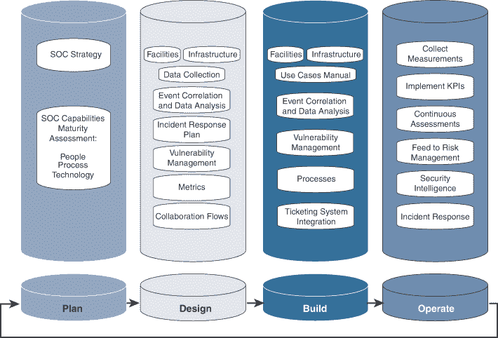

**图 2-1** 开发 SOC 的阶段

在图 2-1 中，规划阶段确定了创建作为 SOC 战略一部分的使命和范围声明。这些声明用于制定由政策和流程组成的 SOC 战略。利用第 1 章中的评估战术，在规划阶段开发 SOC 能力和成熟度模型。SOC 可以将现有的能力和成熟度模型与 SOC 战略进行比较，以制定需要人员、流程和技术的设计计划。

在图 2-1 的设计和构建阶段，将获取技术，这涉及考虑带宽、高可用性和其他要求等因素。这些获取的能力将引出规划阶段中指定的服务，这些服务将需要开发和记录流程。最终，这些服务将上线进入运营阶段。

请注意图 2-1 中有一个从运营阶段指回规划阶段的箭头。这代表了对新服务和能力的额外需求将在运营阶段之后出现。例如，在 SOC 运行后，领导层可能决定指派研发的新职责给 SOC。即使许多 SOC 服务已处于运营阶段，新的研发服务也将从规划阶段开始，并遵循图 2-1 中所示的步骤，然后才会被视为投入运营。

维护 SOC 内的特定人员、流程和技术可能不会遵循图 2-1 中概述的开发流程。单独的人员、流程和技术可以拥有自己的质量测试和升级流程，如图 2-2 所示，代表独立开发或获取的不同 SOC 方面。例如，用于新员工入职的培训将不会遵循图 2-2 中所示的所有四个阶段。

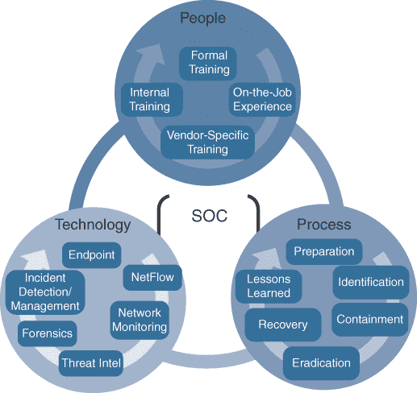

**图 2-2** 人员、流程和技术核心要素

将图 2-1 和图 2-2 视为开发 SOC 流程的高层级模型。随着这些步骤的完成，SOC 将制定程序，以表明 SOC 将如何执行其负责的每项服务。接下来我们将探讨开发 SOC 程序。

## SOC 程序

第 1 章提到了成熟 SOC 提供的常见服务，包括风险管理、漏洞管理、事件管理、分析、合规、数字取证、态势感知与安全意识以及研发。所有这些服务在第 3 章“SOC 服务”以及全书中都有更详细的介绍。如果你的 SOC 将提供这些服务中的任何一项，你需要决定哪些应该外包，哪些将由内部服务覆盖。虽然第 1 章涵盖了每种方法的优缺点，但并未深入探讨为 SOC 服务开发程序。

程序是 SOC 执行服务的方式。程序包括执行政策的分步说明，例如操作漏洞扫描工具的步骤、工具运行的频率，以及工具扫描网络的哪些部分或哪些主机。这些程序中的每一个都用于强制执行识别网络中漏洞的政策。请记住，程序是关于执行政策所做工作的细节。

### 设计程序

在设计程序时，有一些重要事项需要考虑。以下列表中的问题需要由 SOC 程序来解决：

*   该程序的目的是什么？它与哪项政策保持一致？
*   SOC 应如何参与该程序？
*   SOC 对该程序负责多长时间？
*   哪些其他团队或外部因素会影响该程序？
*   该程序针对什么威胁？
*   该程序需要哪些资源？
*   该程序是否需要日志记录或报告？
*   该程序应包含哪些通知？
*   通知升级流程是什么？
*   通知如何传递（电子邮件、移动端、家庭、聊天等）？
*   该程序是否涉及任何合规性要素？

SOC 参与这些程序的程度将根据 SOC 是否负责所有或部分这些操作而有所不同。例如，SOC 可以让另一个团队处理威胁的监控和警报，而 SOC 负责处理所有升级的事件。其他时候，则可能完全相反，由 SOC 处理基础事件，并将任何升级的事件移交给外部调查服务。

以下是被认为常见的 SOC 程序列表，用于提供各类 SOC 服务：

*   **监控：** 对特定系统和网络进行监视
*   **警报：** 对威胁、问题或事件进行通知
*   **升级：** 将响应事件的责任传递给下一级支持
*   **调查：** 对事件进行检查、研究或询问
*   **事件记录：** 案例管理工作，包括跟踪发生的事件以及处理事件的过程
*   **合规：** 将活动和事件与满足合规要求相关联
*   **报告：** 编制并交付有关已发生和未发生事件的指标
*   **修复：** 将系统恢复到运行状态并封堵漏洞以减少未来的攻击

至关重要的是，任何程序都必须明确定义 SOC 所需的行动，以便其能为人员、流程和技术开发适当的支持。随着程序的成熟，推荐的做法是制定模板，以便新团队成员能轻松遵循他们所要执行的任务。随着时间的推移，模板可以实现自动化，以提高 SOC 服务的效率和有效性，从而形成成熟的 SOC 能力。

程序必须定义所需的沟通以及行动。沟通职责包括团队之间应如何沟通，以及应使用何种沟通方式。这一点在开发 SOC 分级时尤为重要。

### 程序示例

让我们看一个与响应安全事件相关的程序示例。程序应指定哪个小组负责对安全事件执行首次响应。程序应包含该团队的工作时间、如果无法解决问题则升级问题的步骤、解决属于首个响应团队职责范围内问题的步骤、当团队不可用时的备选方案，以及首个响应团队被授权执行的操作。如果招聘新人员担任事件的首席响应人员角色，程序将为如何执行这些任务中的每一项提供指导。

图 2-3 展示了创建 SOC 如何支持程序的映射示例。在该示例中，SOC 活动包括监控来自三个不同小组的警报。一级支持处理监控、警报，并在问题需要更有技能且被授权执行此类工作的个人时升级至二级。当需要此类技能时，二级也可以升级至更高级的三级小组。三级支持还包括取证和恶意软件调查等额外的 SOC 服务。


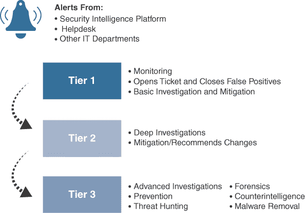

**图 2-3** SOC 程序示例

图 2-3 适合从高层查看 SOC 分级；但是，这些团队之间的沟通未被定义。例如，如何联系一级？谁有权将事件升级到更高层级？谁处理日志记录和报告？如果联系某一级别时该级别不可用怎么办？图 2-4 提供了一种记录程序的更详细方法。在该示例中，程序图涵盖了如何处理客户的入站请求。服务台通过电话或电子邮件接收警报。事件被移交给 SOC 一级分析师，他们可以尝试结案，或通过 SOC 一级主管或组长升级案件。SOC 二级尝试处理事件，或引入/移交事件给三级支持成员。三级成员包括他们可以利用的外部服务（如果他们无法用内部资源覆盖该事件）。请知悉，该图可以包含更多细节，如相关方的姓名和位置、可用的特定工具和工作时间。为了提供一个通用示例，许多此类细节已从图中省略。

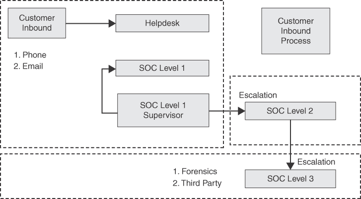

**图 2-4** SOC 联系流程示例

## 安全工具

第 1 章 指出，制定安全策略的最佳实践是针对攻击者为突破网络所采取的所有步骤开发防御能力。您还了解到，这些步骤对于网络的不同部分将会有所不同。现在让我们开始看看 SOC 可以使用哪些不同类型的工具，以提供纵深防御方法来警报和响应安全事件。所有这些工具都应具备将日志导出到 SOC 的安全信息和事件管理（`SIEM`）解决方案的能力。第 5 章 “数据集中化” 将更详细地介绍如何完成此过程。虽然许多工具已在 第 1 章 关于保护 SOC 的讨论中涉及，但本节将深入探讨与全球 SOC 用于提供各类服务的安全工具相关的具体能力。

### 评估漏洞

第 1 章 指出了对手如何利用漏洞来攻击系统。这意味着作为 SOC，拥有成熟的漏洞管理实践是理想的。第 9 章 “漏洞管理” 将更深入地探讨如何建立漏洞管理实践；不过，有一些工具您应考虑专门用于您的漏洞管理实践。最显而易见的工具是能够评估网络和端点漏洞的工具。漏洞扫描器通过将被分析系统和软件的属性与已知弱点进行比较来实现这一目的。已知漏洞根据风险影响进行分类，这在其通用漏洞评分系统（`CVSS`）评分中得以总结（参见 [`www.first.org/cvss/`](https://www.first.org/cvss/)）。`CVSS` 评分提供了一种捕获漏洞主要特征并生成反映其严重程度的数值评分的方法。然后可以将数值评分转换为定性表示，以帮助组织正确评估和优先处理其漏洞管理流程。

#### 主动漏洞扫描

##### 漏洞扫描访问级别

为了让漏洞扫描器能够检测并分类计算机、网络和通信中的系统弱点，它必须拥有对被扫描目标的访问权限。访问可以来自网络，也可以直接在主机上进行。访问级别可以是完全读取级别的访问，称为 `authenticated scanning`（已认证扫描）；也可以是无法登录系统，称为 `unauthenticated scanning`（未认证扫描）。拥有完全读取访问权限可提供有关系统、网络和通信如何存在漏洞的更多详细信息。已认证扫描的结果能提供更准确的报告，从而带来更好的修复响应。虽然已认证扫描提供的结果优于未认证扫描，但它并不能真实反映潜在对手将看到的内容。未认证扫描被视为攻击者的视角，这意味着防火墙等工具会阻止某些扫描用例提供任何有用数据。SOC 应同时使用已认证和未认证扫描，以识别所有潜在漏洞，并了解对手将如何通过未认证扫描的方式查看他们可能攻击的计算机、网络和通信。

图 2-5 展示了一个使用 Rapid7 Nexpose 漏洞扫描平台的示例。仪表板显示了正在持续进行漏洞评估的环境摘要，可细分为站点或网段。例如，可以为客户和 SOC 的不同部分设置扫描。在该示例中，每个网段中发现的漏洞摘要以两个饼图呈现。第一个饼图基于 CVSS 评分对漏洞进行评级。第二个饼图根据利用漏洞所需的技能水平对漏洞进行排名。饼图下方是 Nexpose 识别出的具体漏洞。分析师可以点击任一饼图的任何部分或列出的具体漏洞，以了解 Nexpose 发现的更多详情。

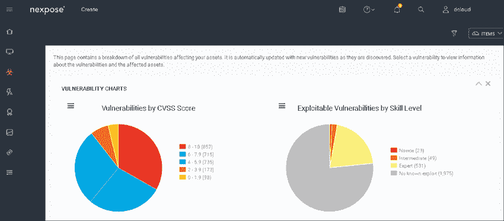

**图 2-5** Rapid7 的 Nexpose 漏洞扫描器

#### 被动漏洞扫描

应用层防火墙等工具可以收集关于端点的数据，并将这些数据发送给漏洞扫描器以执行被动扫描。我发现越来越多的安全解决方案正在利用被动安全技术，旨在根据发现的脆弱系统调整防御能力。图 2-6 展示了 Cisco Firepower 解决方案展示被动漏洞扫描信息的示例。这种被动漏洞扫描方法通过利用下一代防火墙查看所有流量层的能力来工作。这允许创建主机配置文件，并将其与已知漏洞数据库进行比较，这类似于主动漏洞扫描器。Rapid7 的 Nexpose 等主动漏洞扫描器与 Cisco Firepower 解决方案等被动漏洞扫描器的区别在于：被动扫描器只能看到可被分析的数据，而主动扫描器可配置为扫描其能访问的任何网络或主机。

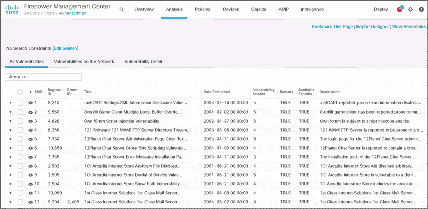

**图 2-6** Cisco Firepower 被动漏洞数据

无论采用哪种方法，漏洞扫描的结果都会列出你环境中计算机、网络和通信内发现的一系列漏洞。分析师需要识别所有存在漏洞的系统，并创建工单指派工程师修补这些弱点。在系统暴露期间，SOC 将利用 IDS/IPS 和防病毒软件等安全工具，致力于防止对手利用这些弱点。可利用漏洞扫描器的结果对安全工具进行调优，以帮助保护已被识别为存在漏洞的计算机、网络和通信。调优安全工具有助于在资产所有者被通知修复漏洞期间，保护易受攻击的计算机、网络和通信免受攻击。

> **注意**
>
> 如果你搜索近期威胁却在安全产品中未见匹配的特征码，请联系供应商询问是否受保护。供应商可能隐藏了规则，以防对手逆向工程其防御策略。

### 预防技术

如果发现系统、网络或通信存在漏洞，通过打补丁、升级或其他方式消除漏洞将防止遭到利用。遗憾的是，由于各种原因，修复并不总能执行。某些技术（如 IoT 设备）因其运作方式的限制，不提供修复已识别漏洞的能力。如果无法修复漏洞，SOC 需要寻找其他方法防止对手利用该漏洞。一种方法是将漏洞对潜在威胁隐藏。另一种方法是设置安全工具监控易受攻击的计算机、网络或通信，并在尝试利用漏洞时进行告警和阻断。预防技术可提供这两种保护易受攻击的计算机、网络和通信的方法。

SOC 应使用不同类型的预防技术，以保护其负责的网络和系统中发现的漏洞。

#### 预防技术：防火墙

防火墙和代理可执行网络分段，并限制允许跨越网段的端口、协议和应用程序。最佳实践是通过每个网段强制实施最小权限访问，以降低将漏洞暴露给网段外部对手的风险。例如，如果组织没有业务需求允许 Tor 流量，则应阻止此类流量跨越网段。阻断 Tor 可降低对手和恶意软件在网段与 Tor 网络之间通信的风险，这是勒索软件等威胁的常见行为。

#### 预防技术：信誉安全

SOC 应使用的另一种预防技术是信誉安全。信誉安全会审查外部源的各种因素，并判断该源的可信度。其中一个因素是在线时长。如果某源声称是在线银行，但上线仅几小时，则该源不是银行。另一个因素是域名所有者的信誉。当前被评估的源可能被视为安全，但如果域名所有者因对其他恶意域名负责而被标记，该因素将影响当前被评估源的可信度。另一个因素是域名呈现的内容类型。如果从某域名下载的文件被标记为恶意，将影响被评估源的可信度。可评估的因素不止这些，不同供应商评估和实施信誉安全的方法也不同。

信誉安全价值的一个示例是阻止攻击者创建外观类似受信任站点的恶意网站，这是网络钓鱼攻击的常见战术。如果攻击者试图创建代表受信任银行的虚假网站，诸如网站上线时间短、托管于 GoDaddy、域名所有者与其他恶意网站相关联等因素，都会影响该源的信誉评分。图 2-7 展示了访问具有负面信誉评分的 Web 源时触发的 Cisco 拦截页面示例。利用信誉安全的安全解决方案将拦截前文示例中的虚假银行，并根据供应商告知用户源被拦截的方式，显示如图 2-7 所示的页面。

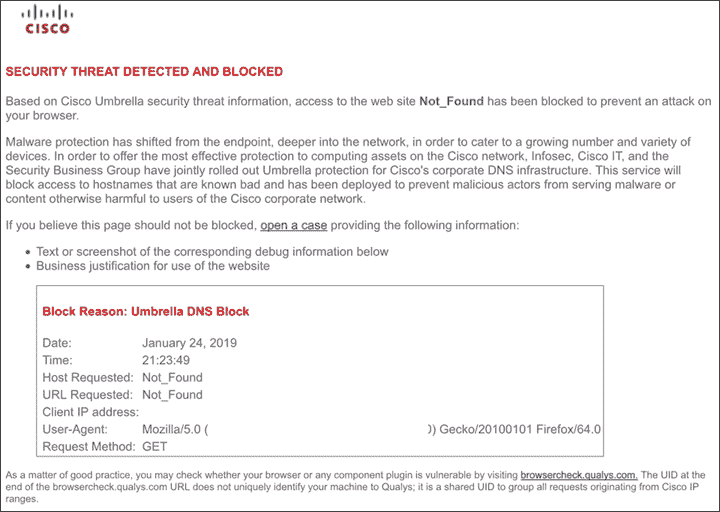

**图 2-7** Cisco 信誉拦截页面

> **注意**
>
> 可通过访问 [www.ihaveabadreputation.com](http://www.ihaveabadreputation.com) 测试组织是否具备信誉安全。该网站不会损害计算机，但因测试目的拥有不良信誉。若看到幽灵图像而非供应商生成的拦截屏幕，则表明未部署信誉安全。

类似的信誉安全技术可用于网络的其他部分，如主机系统和电子邮件。Google Gmail 是众多采用信誉安全以减少垃圾邮件和网络钓鱼攻击的电子邮件服务之一。图 2-8 展示了 Google 基于各种因素将网络钓鱼邮件标记为危险的示例。因素可包括邮件内容、发件人、收件受众，以及与类似邮件相关的负面结果。


**图 2-8** Google 信誉警告横幅

> **注意**
>
> 信誉安全并非 100% 有效。这并不意味着它不能因增加攻击者发动攻击所需的工作量而大幅减少攻击数量。例如，攻击者可入侵小型企业或学校，并利用被攻陷源的信誉从该源转移，以绕过信誉安全防御。

#### 预防技术：VPN

虚拟专用网络（VPN）是另一种预防技术。VPN 因所有流量均加密，可降低中间人攻击风险。SOC 可考虑不同的 VPN 选项。对于需要访问安全网段的远程设备，SOC 可对远程访问 VPN 使用不同选项，如安全套接字层（SSL）/TLS 或 IP 安全（IPsec）。SOC 也可使用 VPN 加密不同网段间的流量，如 SOC 总部与分支机构。表 2-1 总结对比了远程访问 VPN 与站点到站点 VPN 技术的差异。

**表 2-1** 站点到站点 VPN 与远程访问 VPN 技术对比

| 参数 | 站点到站点 VPN | 远程访问 VPN |
| --- | --- | --- |
| **概念** | 使用 IPsec 从一个客户网络（通常为总部或数据中心）到客户远程站点建立加密隧道。 | 将单个远程用户连接到专用网络（通常为总部或数据中心）。 |
| **终端设备上的 VPN 客户端** | 无需在每个客户端上设置。 | 每个用户可能（客户端 VPN）或可能不需要（无客户端）拥有自己的 VPN 客户端。 |
| **隧道创建** | 无需每个用户发起设置 VPN 隧道。 | 每个远程访问用户需发起以建立 VPN 隧道。 |
| **目标用户** | 分支机构办公室 LAN 用户需连接到总部服务器。 | 需安全访问公司办公室资源/服务器的移动用户。经常出差的员工。 |
| **加密/解密** | VPN 网关负责封装和加密出站流量，通过互联网经 VPN 隧道发送至目标站点的对端 VPN 网关。 | VPN 客户端软件在通过互联网发送至目标网络边缘的 VPN 网关前，封装并加密该流量。 |
| **支持的技术** | IPsec | IPsec 和 SSL |
| **多用户/VLAN 流量流动** | 允许多用户/VLAN 流量通过每个 VPN 隧道。 | 不允许多用户流量通过每个 VPN 隧道。 |

#### 预防技术：网络准入控制

网络准入控制（NAC）是一种预防技术，可防止未授权设备连接到网络。因潜在攻击者无授权设备，故无法连接网络尝试攻击。NAC 还可基于各种特征，通过为设备预置预定义访问权限来强制执行最小权限原则。来宾用户网络可仅限来宾所需内容，如仅限带宽受限的互联网访问；而受信任员工可被置于具有更多访问能力的网络中。控制访问是实施正确网络安全的基础。

#### 预防技术：静态数据/动态数据

静态数据和动态数据技术可保护数据免受未授权访问。静态数据技术加密包含敏感数据的文件，防止攻击者访问此类数据。动态数据解决方案（通常称为数据丢失防护 [DLP] 技术）可通过模式匹配（如识别包含信用卡号或其他敏感数据的数据）防止敏感数据离开组织。云访问安全代理（CASB）技术也可通过控制谁可访问云服务中的数据来执行动态数据功能，防止数据暴露给攻击者。

总之，*预防*意指在攻击发生前将其阻断。预防技术可在网络攻击链的所有阶段提供价值，需纳入 SOC 的纵深防御策略。

### 检测技术

防止任何针对计算机、网络或通信的利用尝试固然理想，但因预防能力的缺口以及攻击者持续变换战术等诸多因素，预防技术并非 100% 有效。检测技术旨在检测网络和系统中的恶意行为。SOC 需包含检测技术，原因如下：

*   检测技术可验证预防技术是否正在阻止（或未能阻止）攻击者利用系统、网络和通信。
*   检测技术提供了另一层防御，降低了对手成功完成利用预期目标所需的所有步骤的风险。
*   某些检测技术的另一个价值在于能够了解利用技术，从而提高预防能力。例如，如果检测功能根据文件的行为将其识别为恶意文件，该安全工具可以将该文件的哈希值与其他预防工具共享，以便其他安全工具可以根据识别出的哈希值阻止该文件。

检测技术通常使用一种或多种核心能力，例如基于特征码的已知威胁检测、恶意行为检测和异常识别。`Antivirus`（防病毒软件）和 `IDS/IPS`（入侵检测/防御系统）是试图阻止利用行为的能力示例。检测恶意行为的方法将因安全工具的类型和提供它的供应商而异。例如，某些防病毒产品仅扫描文件以查找威胁。任何不使用文件的威胁，例如发生在内存中的 `PowerShell` 利用，都不会被基于文件的防病毒软件检测到。

#### 检测技术：NetFlow 和 NBAR

`NetFlow` 和基于网络的应用识别（`NBAR`）可用于根据设备在网络上的行为以及与这些设备正常行为基线的偏差来检测威胁。这两种方法都提供了很大的价值，但在它们提供的关于潜在威胁的详细信息方面存在局限性。数据包捕获技术可以提供比 `NetFlow` 更多的细节，例如在潜在数据丢失事件中丢失的具体文件，而 `NetFlow` 只能提供涉及该事件各方的记录。记录可以包括发送文件的人、使用的协议、数据类型以及其他指标，具体取决于所使用的技术和收集的流量类型。

#### 检测技术：基线

可以使用检测功能来监控用户行为。该技术建立用户登录趋势、访问网络不同部分的系统、用户所在位置以及他们应拥有的访问级别的基线。例如，如果用户从美国登录网络，片刻后又从俄罗斯登录同一系统，则很可能有两个不同的用户正在使用同一个账户，这意味着账户登录已被泄露。类似的技术在云环境中变得越来越流行，特别是前面提到的云访问安全代理（`CASB`），它监控对 `Dropbox` 和 `Salesforce` 等服务的访问。

#### 检测技术：蜜罐

正如第 1 章所述，其他流行的入侵检测工具是蜜罐，即旨在吸引对手和恶意软件的系统。就像熊会被蜂蜜吸引一样，蜜罐的概念是将攻击者吸引到诱饵系统，从而将他们的注意力和精力从宝贵的生产系统上转移开。恶意软件和对手倾向于攻击被认为最容易得手的目标，而蜜罐系统配置了大量漏洞以引起他们的注意。蜜罐可通过网络访问，但通过防火墙与网络中的其他系统隔离。这种战术可能非常有效；然而，某些恶意软件旨在针对特定行为，而不是利用网络上最薄弱的系统，以避免攻陷蜜罐从而向目标发出对手已潜入网络的警报。如果配置不当，蜜罐也会给网络带来风险，例如为蜜罐配置公网 IP 地址，却将其置于受信任网络中。受信任网络之外的任何对手都可以利用这个配置错误的蜜罐作为进入受信任网络的网关。

第 1 章涵盖了安全能力，以及 SOC 如何需要分层不同的能力来制定纵深防御的安全方法。纵深防御包括分层不同类型的检测和预防技术。

## 移动设备安全顾虑

如今，普通员工拥有不止一台设备。其中许多设备是移动的，但包含的敏感数据级别与授权台式机有权访问的数据级别相同，这产生了在受信任的移动设备和台式机之间实施类似安全级别的需求。保护移动设备的一种流行方法是使用移动设备管理（`MDM`）技术。SANS 安全意识培训（SANS 研究院的一个部门）在其博客文章“移动设备安全（[`www.sans.org/security-awareness-training/blog/mobile-device-security`](https://www.sans.org/security-awareness-training/blog/mobile-device-security)）”中提供了保护移动设备的建议。以下列表是该博客文章中包含的安全建议的缩略版，列出了您希望 SOC 选择利用的 `MDM` 技术具备的功能：

*   强制执行密码
*   屏幕锁定超时
*   远程锁定和远程擦除
*   密码重置
*   设置、策略和应用程序的部署
*   远程监控
*   用于合规的日志记录

在大多数情况下，许多 `MDM` 供应商都提供这些常见的请求功能。`PCMag` 等提供 `MDM` 供应商评估的来源，其决策依据包括用户和设备如何自我注册、如何将策略和设置推送到设备、如何定位丢失的设备以及数据安全。选择合适的 `MDM` 供应商将取决于他们的成本和能力如何满足您的业务需求。

在移动设备上安装 `MDM` 代理等客户端的一种替代方案是创建任何设备都可以访问的门户。这限制了不受信任的移动设备将恶意软件或其他威胁感染网络的风险，因为门户的访问权限仅限于其拥有的权限。门户的另一种替代方案是仅提供对安全网段内系统的键盘远程访问。通过仅提供键盘访问，感染远程主机的恶意软件等威胁只能看到发往安全环境中系统的按键操作。远程系统永远无法访问安全环境，从而阻止恶意软件访问安全系统和环境。

## 规划 SOC

制定您的 SOC 目标（通过使命宣言和范围声明，或两者的结合来定义），为您的 SOC 将完成的工作设定了标准。协调安全工具、策略和流程，为您的 SOC 服务如何交付奠定了基础。接下来要解决的挑战是如何支持 SOC 的日常运营。诸如分析师在哪里工作、需要多少计算能力以及如何保护 SOC 等问题，需要在 SOC 正式运行前得到解决。这些主题也需要持续评估，以确保 SOC 的管道和基础能够跟上对各种资源日益增长的需求。

### 容量规划

要解决的第一个 SOC 基础规划概念是了解您当前以及未来所需的容量要求。

容量规划涉及制定建设 SOC 的物理和技术要求：


## 物理要求与技术要求

*   **物理要求**包括托管 SOC 员工和技术的物理位置、电力需求、设备存放空间、座位安排、垃圾处理方式、物理安全考量以及 SOC 内使用的其他物品。
*   **技术要求**包括网络吞吐量、技术类型、显示器以及其他 SOC 技术需求。

这些需求将基于支持 SOC 使命声明和范围声明中概述的服务。例如，如果监控本地数据中心是范围声明的一部分，那么物理和技术需求将包括 SOC 分析师执行该工作所需的条件。如果未正确评估容量，可能会遇到诸如网络带宽不足或机架空间不足等问题，导致无法安置和供电执行监控所需的工具。如果容量规划未考虑合理的 SOC 布局，从嘈杂的工作环境到关键信息显示器可见性不足等问题，都将导致 SOC 无法正常运作。鉴于这些及其他诸多原因，妥善规划 SOC 的容量需求至关重要。

## SOC 目标对齐

设计 SOC 取决于少数几个关键因素。首先，使命声明和范围声明设定了 SOC 运营地点的边界。这些声明还确定了 SOC 需提供的各项服务。第 3 章将更详细地介绍 SOC 服务；但需理解，在提供一项服务之前，必须具备执行该服务所需的人员、流程和技术。这意味着人员和技术必须驻留在某处，且会有预期的可用资源。容量规划确保满足这些要求。

第 1 章介绍了如何根据行业标准、指南和框架的最佳实践来评估现有能力和可用技术。评估现有能力和可用技术可为 SOC 的当前状态提供蓝图。第 1 章还介绍了如何利用成熟度模型制定包含里程碑的计划以改进 SOC 服务。这些成熟度目标涵盖了未来期望的 SOC 在人员、流程和技术方面的面貌：

*   **人员目标** 反映所需角色的人数以及预期的技能组合。某些技能可在工作中教授，而其他技能则要求新员工入职第一天就具备。
*   **流程目标** 影响服务交付所需的条件。这包括需要强制执行哪些策略以及如何执行这些策略。
*   **技术目标** 补充人员和流程目标，作为实现 SOC 服务目标的赋能器。例如，监控网络威胁的目标需要允许监控网络流量的技术，以及在恶意活动发生时识别该活动的工具。

## 增长规划

成熟度目标影响 SOC 的容量规划需求。规划必须考量所需硬件、员工数量、团队协作方式、座位安排，以及按预期成熟度水平妥善交付特定 SOC 服务所需的许多其他因素。在考虑 SOC 物理选址时，一项关键原则是：选择一个可供 SOC 成长发展的地点，通常比日后因 SOC 规模超出初始空间而不得不搬迁至更大场所的成本更低。如果 SOC 容量规划团队对物理场所的未来需求不确定，理想做法是至少预测未来三到五年的增长百分比，并围绕这些数字规划场所。例如，可以查看 SOC 的成熟度目标，并设定每项 SOC 服务在当前日期起三到五年内达到特定状态。容量规划必须考虑在人员、流程和技术方面需要哪些变更，才能达到三到五年的成熟度状态。采用这种方法可形成一种 SOC 设计，其包含一定比例的空余座位、供带宽使用增长的预留空间，以及供未来技术使用的可用机架空间。

> **关键点**
>
> 成熟度模型必须是容量规划的一部分。成熟度模型的更高阶段将需要特定资源才能得到妥善执行。这就是为什么在执行容量规划之前，必须先制定成熟度模型。然后，您可以将成熟度目标与预期容量需求对齐，使 SOC 赞助方了解当前的容量需求以及未来可能的需求。

如果您的 SOC 预算不允许在容量规划中包含未来增长，当 SOC 规模超出其物理场所时，还有其他可选方案。选项包括允许远程办公、开设连接到 SOC 总部的新分支机构，和/或外包部分服务。这些选项中的任何一项都比在维持服务的同时迁移整个 SOC 及其人员和技术到更大设施要理想得多。

## 技术规划

另一个容量规划因素与 SOC 使用的技术有关。在执行技术容量规划时，建议与组织内现有设备的供应商安排会议，以便他们协助对其设备进行“面向未来”的规划。供应商也将了解满足您 SOC 成熟度目标的最佳配置和硬件选项。最好从现有供应商入手，因为他们不太可能需要“推销”自己以对抗竞争对手，且可能已了解您的环境。即便如此，您仍可能遇到供应商试图推销更高配产品或挤走您组织内其他供应商的情况。例如，如果您的环境中有来自两家不同防火墙供应商的产品，并邀请每家供应商协助容量规划，每家供应商都会提供一个取代竞争对手防火墙的未来设计方案。

另一种获取供应商中立视角的技术容量规划选项是寻求技术服务合作伙伴（也称经销商）的咨询，他们在您的组织与供应商之间斡旋销售。许多企业级供应商不直接向客户销售，而是依赖经销商，后者可为 SOC 提供行业领导者之间的对比，并就您感兴趣的特定技术领域中其他 SOC 的做法提供建议。知识就是力量，很可能有许多专家愿意免费与您交流设计网络不同部分的最佳方式。

在与供应商或专家开始对话之前，您需要根据 SOC 成熟度目标验证所有硬件和连接需求。请记住，您制定的需求只是设计的起点；要做好准备接受外部专家建议的变更。例如，某些产品可能包含专有组件，或有特殊要求（如额外供电）。最佳实践是主导采用支持 `application programming interfaces (APIs)` 和开放标准的灵活技术；但您仍需确保容量规划涵盖所有需求，包括那些在 API 和开放标准方面不灵活的系统。有时您会发现某些专有技术可能便宜得多且已在组织内使用，而其他时候投资精力转换到新系统对您的 SOC 更有意义。第 1 章详细介绍了如何评估能力、规划成熟度，以及对哪项投资能为组织带来最大影响进行排序。这些练习的结果将为哪些技术选项最适合您的 SOC 提供指导。

## SOC 资源规划

在 SOC 容量规划期间，必须纳入所有将与 SOC 协作的团队。通过利用其他团队的资源，可能会实现成本节约，包括将其他团队作为指定的备份选项。例如，另一个团队可能同意其办公空间可作为 SOC 的溢出或应急工作空间，而无需建设或租赁冗余场地。与其他团队的沟通将涉及预算，这可能导致硬件和服务支持成本的分摊以及现有硬件的整合。与 SOC 外部团队合作有助于克服某些 SOC 目标的挑战。例如，SOC 使用组织的数据中心来托管和管理其技术设备，而不是由 SOC 负责数据中心管理任务。

某些容量规划决策将受到是使用内部服务还是外部服务的影响。供应商和经销商再次可以就任一方法的优势提供建议，但请记住供应商想向您推销产品。依赖您的成熟度评估（详见第 1 章），以帮助保持对话的非偏见性，并符合 SOC 的最佳利益。为响应容量规划而使用外部服务的原因包括硬件、人员、所需流程和合规性方面的减少和潜在节约。

### 冗余规划

您必须解决的另一个容量主题是冗余要求。冗余决策基于 SOC 的风险偏好（例如，备份系统可配置为主动、被动或按需模式），冗余计划通过使用内部服务、外包服务或两者兼用来制定。第 1 章介绍了如何根据组织目标对能力和服务的重要性进行排序。任何被评为高重要性的项目都需要主动且成本较高的冗余，而排名较低的服务和技术则需要被动、成本较低的冗余选项，或者仅在因主服务故障需要备份服务或技术时采用按需选项。本章后面的“灾难恢复”一节将更详细地探讨灾难规划概念。

### 制定容量计划

要正确执行容量规划，您应该记录容量计划。首先包含容量规划报告的时间、日期和版本，以便读者了解他们正在查看的数据的相关性。接下来，您需要提供执行摘要和/或目的陈述，以便读者了解您执行规划的原因。例如，您需要解释容量规划是针对新 SOC 还是为了使现有 SOC 面向未来。另一个例子是说明容量规划报告将定义改进现有 SOC 服务以达到期望成熟度目标所需的内容。该报告执行摘要的质量可能是高管批准或拒绝所请求资源的决定性因素。

在容量规划报告中说明容量细节时，您应列出容量类型、当前分析以及任何预期的增长或变更。根据被分析项目的不同，您可能还需要包含其他子章节，但至少这三个容量细节必须出现在任何被请求项目的容量规划报告中。记录所有项目后，您需要提供关于每个被分析项目的详细信息。这可以包括其位置；运行的具体要求；满足未来需求所需的变更；基于硬件、软件或服务的任何阈值限制；以及可实施以将容量提升至期望状态的策略摘要。其他考虑细节包括预算、合规性规划，以及用于定义关键术语或其他参考项的附录。

图 2-9 中的文档是容量规划的示例模板。您可以调整这些问题以满足您的 SOC 目标。


**图 2-9** 容量规划模板

您可以在容量规划文档中包含其他项目，例如成功标准和一个排序系统，按从对 SOC 最重要到“最好拥有”的顺序排列。这些额外数据将有助于回答诸如如何将有限预算投资于 SOC 等问题，即哪些容量需求应立即解决，哪些应留待未来预算解决。

# 设计 SOC 设施

本节探讨在开发新设施或修改 SOC 运行的现有设施时的考虑要点。该领域推荐的一个优秀资源是美国国家建筑科学院的整体建筑设计指南（WBDG）网站（`https://www.wbdg.org/`）。WBDG 2017 年的一篇题为“办公楼”的文章指出了以下重要设计考虑因素（此处针对 SOC 设施进行了调整）：

*   **性价比：** 评估每个设计元素和建筑组件的性能与成本。在某些情况下，最初投入更多以节省长期运营和维护成本是理想的。
*   **功能/运营租户需求：** 考虑 SOC 员工的综合需求。这些包括期望形象、公共访问程度、运营时间、增长需求、安全问题和漏洞评估结果以及其他长期项目。
*   **灵活性：** 办公楼必须能轻松容纳频繁的装修和改造。它必须为变更提供便捷访问，例如使用架空地板以便访问布线和配电。
*   **城市规划：** 考虑当地社区提供的价值以及 SOC 对社区的影响。员工购买午餐需要走多远？消防局或警察局有多近？建设 SOC 及其相关设施（如停车场）是否会对周围环境产生负面影响？
*   **生产力：** 考虑员工满意度、健康、安全和舒适度。SOC 员工对工作空间是否舒适满意？SOC 与内部和外部人员开会有多方便？
*   **技术连通性：** 确保 IT 基础设施的灵活性，允许 SOC 设备的技术访问和供电。考虑因素包括有线和无线选项，例如墙体材料是否允许无线信号通过，以及整栋楼是否提供有线网络端口。

WBDG 建议适用于开发工作空间的普通企业。基于 SOC 的需求，还应在 WBDG 建议清单中包含一些额外的关键点。额外项目包括：能够促进 SOC 成员之间的有效协作、维护安全的 SOC、遵守合规要求，以及满足容量规划报告的要求。SOC 成员之间的协作包括个人团队成员之间如何共享数据，以及如果需要楼层监视器，为整个 SOC 楼层提供数据的大屏幕。SOC 的安全性可能取决于业务目标。我见过许多包含机密数据的 SOC，要求在未获许可人员被允许进入 SOC 楼层时关闭实体灯光。

这些示例只是在考虑 SOC 容量规划要求和建筑建议（如 WBDG 的建议）并设计 SOC 设施时，需要牢记的众多因素中的一部分。某些设计特性和功能将是强制性的，且重要性高于其他特性；但是，你不应忽视优先级较低的设计特性和功能。例如，舒适的工作环境可能不是强制性要求，但它将显著提高员工留任率，从长远来看，能避免你因工作环境不佳而不得不处理投诉和员工离职的情况。我见过有人即使升职了也离开组织，因为他们没有获得自己的办公空间。请记住，员工将在 SOC 设施中度过生命中很大一部分时间。在让员工满意方面稍微多投入一些，对保持他们的满意度大有裨益。

## 物理 SOC 与虚拟 SOC

关于 SOC 设施需要多少物理空间，一个主要因素是你是否计划采用虚拟 SOC 设计或外部咨询服务。虚拟 SOC 可能意味着团队成员从不同地点工作，并通过协作技术互联。在这种情况下，物理设施可能仅用于 SOC 总部，或作为发生重大事件时虚拟成员需在实体地点会面的应急工作空间。重大事件的一个例子可能是：扰乱组织利润的安全事件、导致员工无法工作的事件，或公司机密数据丢失。这些情况将要求采取“全员出动”的方法，要求现场成员前往 SOC 总部组建一个临时小组（通常称为“虎队”）来处理事态。

外包服务可能意味着一种虚拟 SOC 设计，即 SOC 分析师从自己的办公室工作，仅在重大事件或季度会议期间亲自到场。影响是否允许远程工作的因素包括安全要求、禁止数据带离设施的政策以及技术限制。例如，美国政府对处理特定级别的机密材料有具体要求。随着内容涉密等级提高，设施安全要求也随之增加，包括限制对该类数据的访问以及数据存储地点。

第 1 章介绍了使用内部 SOC 服务和外部 SOC 服务的优缺点。设施方面的考量也类似。表 2-2 概述了将内部设施（即 SOC 员工工作的单一物理位置）或外部设施（利用较小的办公室或允许员工在家办公）用于 SOC 的益处。这不考虑第 1 章所述外包服务相关的收益和成本。

**表 2-2** 内部与外包 SOC 设施的收益对比

| 内部 | 外部 |
| --- | --- |
| 面对面的团队互动 | 运营支出节省（办公空间和资源） |
| 直接与员工互动的渠道 | 更广的招聘覆盖范围 |
| 对组织的本地支持 | 不同时区雇佣员工以适应 24/7 支持 |
| 现场活动选项（团建/午餐学习） | 工作时间灵活性 |

## SOC 选址

另一个需要考虑的决策是 SOC 设施的选址。一些公司可能会发现将 SOC 设在网络运营中心（`NOC`）或桌面支持团队附近具有价值。较小的组织可能会使用共享楼层空间，并利用云资源实现冗余。前文引用的 WBDG 建议指出了城市选址考量因素，包括周边社区。我见过一些组织选址之处，员工工作周所需的餐饮、托儿等资源在一小时车程内均无法到达。员工不得不制定不合理的工作时间表以照顾孩子，或占用极长的午休时间，从而导致不健康的工作环境。如果消防队不在合理距离内，SOC 就需要制定不依赖等待当地消防员的防火策略。

除了当地社区因素，还需考虑基于国家的限制。某些国家有数据主权要求，限制数据离境。其他基于国家的限制包括影响组织当地员工的法律或文化因素。也许在某个国家合法可接受的特定程序在另一个国家不可接受，因此需要调整。例如，设在荷兰的 SOC 能否监控中国公民？在考虑 SOC 设施选址时，必须评估所有这些因素。

## SOC 内部设施

需要根据容量规划报告和建议（如 WBDG 的建议）考虑 SOC 设施的内部方面。决定 SOC 如何设计的同一决策者，需要负责制定 SOC 的使命和范围。这包括将运营 SOC 的 SOC 经理、支持 SOC 的高管，以及了解如何打造满足 SOC 需求设施的设施专家。一些决策将关注美观，而另一些将基于政治或预算。关于预算和政治的决策示例包括：经理办公室应多大、SOC 分析师应拥有何种类型的工作空间。美观考量包括自然光与人造光的比例。例如，安全要求可能会影响不采用自然光的决定，因为采光口可能成为物理入侵的潜在漏洞。

### SOC 内部设计考量

以下列表重点列出了 SOC 内部设计需考虑的关键方面：

*   **照明：** 照明应营造舒适的工作环境，不仅让分析师在其工作区看清事物，还能看清视频墙监视器（如适用）。关于自然采光和人工照明的决策基于建筑设计、预算和安全要求做出。某些 SOC 职能可能还需要专用照明，例如查看服务器机架空间或架空地板下的线缆。
*   **声学：** 不良的声学环境会严重干扰日常运营。SOC 分析师将通过电话和团队内部协作，这会产生噪音。需要考虑噪音水平，以便分析师在电话交谈中听得清晰。还要考虑设备噪音，这可能需要将设备放在单独的房间（如机房）中，而不是 SOC 分析师工作区。墙壁可使用隔音材料以降低声音水平，并防止谈话被无关人员听到。可建设音频隐私室，以躲避噪音并确保谈话隐私。`ISO 17624:2004` 还提供了利用声学屏减少办公室噪音的指南。所有这些选项均可用于促进健康高效的工作环境。

### 安全

每个 SOC 都会对谁可以进入运营室、谁不可以进入有具体要求。物理安全必须是 SOC 设施设计的一部分。常见的选项包括门锁、通用访问卡（`CAC`）或其他智能卡门锁、视频监控和人员闸。某些情况下可能需要额外的专用照明，例如当未获许可的访客身处 SOC 设施内时。我曾见过一些 SOC 使用警灯，当未获许可的人员进入 SOC 时警灯会亮起，通知所有分析师在该人员在场期间关闭显示器和视频墙屏幕。外部顾问可以协助满足您 SOC 的安全要求，并就任何限制提供建议，例如某个国家不允许使用 `CCTV`。

### 安全销毁

人员会产生包含敏感信息的垃圾。SOC 必须有要求，对这类垃圾进行妥善粉碎和处置。翻垃圾桶仍然是现代组织面临的威胁。购买专业的垃圾处理服务或工具（如碎纸机）以妥善处理垃圾，是可选方案之一。

### 存储

某些类型的数据可能需要特定的存储要求。例如，机密文件或取证证据必须装袋、贴标签并安全存放。安全存储需求可能需要保险柜或其他存储选项，甚至可能需要建筑物中由武装警卫看守的专用区域，即敏感隔间信息设施（`SCIF`），将在下一节进一步讨论。

### 视频墙

一些 SOC 使用显示器，使多名分析师能够同时查看相同的数据。这意味着需要查看多个仪表板，这些仪表板很可能需要放置在墙上，以便所有分析师都能看到数据。例如，负责各种服务的 SOC 可能会显示 `SIEM` 的仪表板，或其他考虑了 SOC 当前事件工作量以及外部数据（如全球事件）的工具。拥有一个集中的显示器，可以让每位 SOC 分析师专注于自己的职责，同时始终能查看适用于整个组织的数据。为了最大化协作，分析师应能在个人电脑上访问相同的数据，并能在共享视频墙上共享他们正在查看的内容。确保视频墙安装得足够高，以便所有分析师都能看到，包括前排有人比后排分析师高的情况。还要根据容量规划报告，考虑未来可能增加的系统和分析师。图 2-10 展示了如何为这些项目进行设计的示例。


**图 2-10** 视频墙设计示例

### 工作站

考虑每类 SOC 员工的工作空间。例如，是否应包含电话、台式电脑，以及可能安装的平板显示器？一些分析师仅使用笔记本电脑，不需要显示器，而另一些分析师则倾向于使用多个显示器。考虑可用的走线孔数量，以帮助隐藏电源和网络线缆。工作站外观的布局可以划分为独立的隔间工作空间、归组为大型工作空间，或者可能是允许开放式工位的长桌。许多办公设备制造商提供工作空间配置选项，这非常理想，因为 SOC 可以调整为最高效的布局（这满足了前面讨论的 `WBDG` 关于灵活性的建议）。请咨询办公家具专家，了解更多关于工作站家具选项的信息。

### 存包柜

提供存包柜为 SOC 人员提供了一种安全存放个人物品的方式。甚至可能存在合规要求，例如不允许将移动设备带入 SOC，这使得提供存包柜成为必要。存包柜也可以放置在个人工作空间内，用于存放较小的个人物品和文件。


关于 SOC 内部设计价值影响的最后一个考量因素是 SOC 的美观度。不要低估当人们走进一个正在运作的 SOC 时，第一印象的价值。许多 SOC 提供参观选项，使非 SOC 成员能够了解 SOC 及其相关活动。在美观度上投入额外精力，可以从领导层那里争取到额外的资金和支持，领导层可能会将 SOC 纳入公司参观路线，以展示公司对安全的投资。

### SOC 房间

SOC 设施设计的另一个考量因素是设施内不同类型的房间。这些房间可能位于 SOC 总部、远程分支机构，或其他类型的远程设施（如员工的家庭办公室）。以下是为您的 SOC 考虑的房间类型（并非所有类型都适用于您的 SOC）：

*   **SOC 运营室：** 这是由分析师和其他 SOC 成员执行日常任务所占用的 SOC 楼层。该室可容纳各种仪表板、事件看板、分析师工作空间和其他运营项目。如果使用视频墙，该室应为所有 SOC 成员提供无遮挡的视线。务必按大不按小来确定尺寸，否则可能会导致楼层拥挤，破坏 SOC 工作空间的氛围。

*   **作战室/态势室：** 此室用于会议。应配备视频会议和白板等协作技术。大多数现代作战室具备接入远程用户并共享其桌面或室内某人桌面的功能，以便每个人都能在同一屏幕上工作。一个需要考虑的方面是作战室内可能涉及内容的敏感性。根据敏感性需求，墙壁、门或协作技术可能需要额外的安全措施。

*   **SOC 经理办公室：** 通常设计经理办公室时，会使其拥有清晰的视野以俯瞰 SOC 楼层和视频墙，同时配备墙壁和门，以便在谈论敏感话题时提供隐私。

*   **数字取证实验室/洁净室：** 专用于数字取证工作的房间需要额外的安全措施，包括记录任何访问。这对追踪证据保管链至关重要，证据保管链要求记录所有对证据的访问；否则，从法律角度来看，证据可能被视为已受污染。数字取证实验室的其他方面包括：额外的电源，以保持已获取且仍通电的设备持续供电，防止其关机；烟罩；大型实验台空间；以及更高的清洁标准。更好地了解如何建立数字取证实验室/洁净室的资源包括 `ISO 31000`（风险管理）、`ISO 14000` 系列（环境管理体系）、`ISO/IEC 27000` 系列（信息安全管理体系）和 `OHSAS 18000`（职业健康安全），具体取决于您打算建立哪种类型的实验室。

### 敏感隔间信息设施 (SCIF)

**敏感隔间信息设施 (SCIF)：** SCIF（读作“skiff”）是指如果安全运营中心（SOC）计划处理敏感隔间信息（SCI），则必须建立的设施。SCI 代表法律要求必须保护的敏感信息相关资源。SCIF 的技术规范需考虑物理安全；计算机散发的热量（称为 tempest）；用于存放敏感信息的警报、锁和保险柜；以及用于存放所有未授权设备（如手机、相机和计算机）的存储空间。这些要求取决于 SCIF 是用于处理英国机密数据还是美国机密数据，以及将处理何种类型的数据。设施的物理结构、访问控制和报警系统已由各种政府指令定义，必须满足并通过审计，敏感数据才能存放在 SCIF 中。

### 计算机机房

**计算机机房：** SOC 设备（如服务器和用于测试的私有网络设备）需要托管在某处。有时 SOC 的计算机机房是共享空间（如数据中心）的一部分，有时则是专门用于 SOC 设备的专用空间。

有一个特定的机房对 SOC 的运营至关重要，即存放其技术设备的地方。这引出了下一个主题：为 SOC 设计计算机机房。

#### SOC 计算机机房

开发计算机机房涉及许多需要考虑的需求。SOC 可能负责建设其使用的计算机机房，也可能不负责，但至少应参与其规划。数据中心内使用的硬件和软件版本存在特定的法规合规性要求。法规合规性还可能控制 SOC 数据的架构分段方式，并要求使用特定级别的加密来保护流量。某些专用设备可能需要上架、供电和加固，这些都必须纳入考量。

##### 计算机机房考量因素

在为 SOC 规划计算机机房时，必须解决以下关键主题：

*   **电力需求：** 规划电力需求的第一步是确定每个机架安装的服务数量。某些设备可能需要特殊电源（如更大电流），这需要电工进行设置。在大量设备集中放置的地方，可能需要配电插座。为避免烧断保险丝或损坏设备，我建议根据容量规划报告收集电力需求，并咨询电工哪些可以支持、哪些不可以。电力冗余也是一个重要话题。影响因素包括可提供的冗余类型、冗余选项的预算、设备中的可用电源以及风险承受能力。电力冗余的一种方案是单一冗余选项，即如果主系统电源线路故障，备用电源将接管。电网冗余是另一种方案，即在同一系统上配置双倍数量的电源，每个电源使用不同的交流电源。

    电力负载取决于设施输入插头。如果电力负载在足够长的时间内超过输入插头的额定值，输入断路器将被触发，导致供电中断。因此，需要评估电源插头，以确保它们能根据容量规划需求支持预期的电力需求。这包括考虑不同国家使用的不同类型插头。

    正常运行时间学会（Uptime Institute）提供了不同规模计算机机房预期电力使用量的估算，这对计算机机房及相关设备的供电预算编制很有帮助。例如，正常运行时间学会估算 1 千瓦的服务器容量在 Tier IV 级数据中心的成本为 25,000 美元。请访问 `https://uptimeinstitute.com/` 以更好地了解计算机机房及相关设备供电的估算成本。

*   **温度和湿度：** 美国采暖、制冷与空调工程师学会（ASHRAE）技术委员会 9.9 制定了一套广泛接受的数据中心最佳温度和湿度设定点指南。例如，ASHRAE 指南规定了数据中心可接受的温度范围，以防止 IT 设备过热。冷却选项包括带有内置冷却功能的服务器机架、服务器机房冷却，以及从计算机机房或单个服务器机架空间吸出热量的 HVAC 过滤器。高温环境可能产生霉菌，这对设备有害。您可能需要加湿/除湿设备，它们收集水分需要某种排水方式。最好有一个水槽供加湿器排水，而不是人工倒空加湿器。

    表 2-3 列出了 ASHRAE 推荐的计算机机房温度和湿度范围。

    **表 2-3 ASHRAE 推荐温度和湿度范围**

    | 属性 | 推荐值 |
    | --- | --- |
    | 温度下限 | 64.4°F [18°C] |
    | 温度上限 | 80.6°F [27°C] |
    | 湿度下限 | 40% 相对湿度和 41.9°F (5.5°C) 露点 |
    | 湿度上限 | 60% 相对湿度和 59°F (15°C) 露点 |

    测量温度和湿度需要正确进行，以确保获得与计算机机房内所有系统相关的准确读数。机房一侧可能比另一侧更热、更潮湿，因此两侧都需要监控。计算机机房的设计也会影响气流，从而允许更好地控制温度和湿度。图 2-11 展示了计算机机房内气流流动的示例。

    

    **图 2-11 数据中心内气流示例**

    思科发布了一个名为“数据中心电源和冷却白皮书”的站点规划指南，其中包含关于设备机架位置和使用的建议，涉及其对温度和湿度的影响。其中一项建议是考虑服务器机架热通道和冷通道的布局。将机架排列成热通道和冷通道行可最大限度地减少空气混合，从而降低温度和湿度。如果允许两个热通道混合空气，将需要更强的空调来补偿额外的热量。图 2-12 展示了热通道/冷通道布局的示例。

    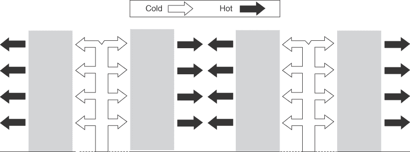

    **图 2-12 热通道和冷通道设计示例**

    思科指南建议将功率最大、功率密度最高的设备放在机架底部。这有助于降低机架的重心，减少倾倒风险。功率密度高的设备往往吸入更多空气，需要最多的冷却。许多数据中心在机架底部附近设有冷却装置，以便为最热的设备提供最冷的空气。思科还建议，如果可能，在服务器之间预留机架空间以允许气流通过。未占用的机架空间可用挡板填充，以保持气流在服务器空间内。

#### 设备机架

不同类型的设备对机架有不同的要求。服务器机架与网络设备机架有所不同。请务必考虑需要存放或安装哪种类型的设备。带有穿孔前后门以最大化气流的机架是理想选择。您可能需要能够容纳不同连接类型的布线系统，例如光纤和带护套 RJ45 连接器的 CAT6 线缆。应配备可选脚轮，以便在需要时移动机架。应配备锁具，以保障机架内设备的访问安全。考虑使用可拆卸的机架门，以简化机架内系统以及机架本身的维护工作。最后，正如前文所述，请根据机架在机房内的摆放位置以及机架内设备的情况，考虑热量和湿度的影响。

#### 照明

请考虑机房的照明情况。在照明不良的机房中，线缆可能变得极难识别。请确保照明能满足人员及其工作空间的需求，这意味着如果技术人员需要进入机架内部，应有照明让技术人员能完全看清该空间内的设备。当主电源不可用时，应有应急照明可用。

#### 冗余与 UPS

SOC 处理敏感数据，即使在停电期间也需要保持可用性。冗余可通过硬件、备用站点、路由、软件和备用电源来实现。例如，专用不间断电源 (UPS) 或支持 SOC 所在设施的现有 UPS 可提供冗余电源选项。可设计备用路由选项，以便在主系统故障时将流量路由至另一位置。备用系统可设在分支机构或云中。软件可根据其业务功能配置为故障开启或故障关闭。例如，网络准入控制解决方案可配置为在系统故障发生时允许所有连接（故障开启）或拒绝所有连接（故障关闭）。

关于 UPS 支持的预期成本，一份好的参考指南是 Kevin McCarthy 和 Victor Avelar 撰写的白皮书“Comparing UPS System Design Configurations”（UPS 系统设计配置对比），其中建议了增加 UPS 架构冗余级别相关的潜在成本。随着设计中可用性等级的提高，每机架成本也会增加。McCarthy 和 Avelar 使用以下术语描述 UPS 配置：

*   **Capacity（容量）：** 单个 UPS 系统，无冗余，即无备用系统。

*   **Isolated redundant（隔离冗余）：** 传统的主备双系统设计，主系统承担所有负载，备用系统仅在事件发生时启用。

*   **Parallel redundant（并行冗余）：** 两个系统主动共享负载。

*   **Distributed redundant（分布式冗余）：** 几个 UPS 系统均以主动方式共享负载。

*   **System plus system（系统加系统）：** 系统不仅共享负载，而且在本地主系统故障时，还拥有额外的本地冗余系统作为备份。系统加系统设计的一个示例是三个设施共享电力负载，且每个设施都拥有一个并行冗余系统。

表 2-4 显示了根据 McCarthy 和 Avelar 白皮书，各 UPS 设计相关的预估成本。

**表 2-4 预估 UPS 成本**

| 配置 | 可用性等级 | 等级分类 | 数据中心成本规模 (美元) |
| --- | --- | --- | --- |
| 容量 (N) | 1 = 最低 | Tier 1 | $13,500–$18,000/机架 |
| 隔离冗余 | 2 | Tier II | $18,000–$24,000/机架 |
| 并行冗余 (N+1) | 3 | | |
| 分布式冗余 | 4 | Tier III | $24,000–$30,000/机架 |
| 系统加系统 (2N, 2N+1) | 5 = 最高 | Tier IV | $36,500–$42,000/机架 |

##### 接地

所有数据中心设备都需要接地。这可以是设备机架的一部分，也可能需要额外的工作。请确保接地电阻至少为 `< 1 Ohm`。有许多可供参考的标准和指南，用于接地最佳实践。NIST 根据论文“Ground Connections for Electrical Systems”（电气系统的接地连接，标准技术局技术论文第 108 号）和“A Consensus on Powering and Grounding Sensitive Electronic Equipment”（为敏感电子设备供电和接地的共识）提供了接地建议。

##### 架空地板

如果 SOC 计划托管大量设备，这些设备将需要线缆，这可能会变得非常混乱。机房可以建在架空地板上，以隐藏线缆和电源连接器。图 2-13 展示了一个架空地板砖的示例。另一种选择是在吊顶内走线缆和电源连接器，这需要吊顶能承受相应的重量。请与设施专家沟通，确认用于托管线缆的吊顶或地板选项是否满足您的容量规划要求。


**图 2-13** 架空地板砖

#### 消防安全

不同国家有不同的消防安全规范要求。有时，消防安全措施在释放时可能会使设备或人员面临风险，例如能迅速扑灭火灾但对人体有毒的化学品。水对人类安全，但会损坏设备。您必须考虑所有这些因素，包括可能发生的不同类型的火灾。例如，电气火灾与燃气火灾不同，需要采取不同的消防安全措施。您可能需要专业人员检查烟雾探测器和一氧化碳探测器，以应对所有这些因素。`ISO/TC92`《消防安全》是您可参考的众多指南之一，用于应对不同类型的消防安全风险。

#### 防洪保护

SOC 设施可能因其地理位置而面临洪水风险。水泵和排水管是可采取的应对一定程度洪水的对策。防水材料和防水屏障也是降低洪水风险的选项。WBDG 文章“Flood Resistance of the Building Envelope”（建筑围护结构的抗洪性）提供了评估设施是否位于易发洪水区域的方法，并描述了各种防洪对策。表 2-5 是 WBDG 关于主动和被动防洪方法的概述。

**表 2-5 建筑主动与被动防洪方法示例**

##### 监控

所有电子设备都需要进行监控，以确保保持可访问性和可接受的性能水平。建议在机房外设置一个中央监控控制台，并由专人 24/7 监控。一些 SOC 将监控职责分配给 NOC 或第三方咨询公司，而另一些 SOC 则使用内部资源监控设备。监控内容可包括确保电力分配正常、系统可达、系统运行正常。网络监控工具的一个示例是 Progress 公司（前身为 Ipswitch）的 WhatsUp Gold。该工具持续 Ping 网络设备，并在发现系统不可达时向管理员发出警报。NetFlow 工具可用于在检测到网络带宽峰值或下降时发出警报。`Cisco Secure Network Analytics`（前身为 Stealthwatch）、`SolarWinds Network Performance Monitor` 和 `Plixer Scrutinizer` 是基于 NetFlow 的网络监控解决方案示例。

*   **锁：** 计算机机房内的系统对 SOC 的运行至关重要，需要受到物理保护。数据中心内门和服务器机柜上的锁提供物理安全，可以是传统的锁和钥匙，也可以基于各种类型的数字系统。数字系统的示例包括智能卡和生物识别设备。确保电源和网络线缆的访问也是安全的。您需要避免此类场景：清洁人员在日常清洁过程中意外拔掉关键系统的插头。`FIPS 140-3`《密码模块安全要求》也提供了关于使用锁来实施适当物理安全的指南。

*   **视频和访问控制：** SOC 计算机机房的一项常见要求是具备控制人员进出房间以及监控其在室内活动的能力。访问控制可以基于物理控制，例如人员锁（mantraps）以及 SOC 及其计算机机房内门上使用的锁的类型。可以使用各种形式的视频监控设备，这些设备可以始终处于激活状态，也可以在检测到移动时触发。某些 SOC 要求视频监控必须录制并存储特定时长。视频和访问控制要求的具体细节将取决于您的 SOC 业务需求，特别是关于计算机机房物理安全方面的需求。`ISO 22311:2012`《社会安全——视频监控——导出互操作性》是众多可用指南之一，可为计算机机房的物理安全和监控选项提供建议。

#### SOC 布局

图 2-14 展示了 SOC 布局可能的样子示例。此示例显示了一个 SOC 操作室、作战室和经理办公室。在该示例中，计算机机房位于大楼的其他位置。


**图 2-14** SOC 布局示例

图 2-15 显示了操作室分析师区域可能的设计草案。请注意，该设计的中心点是对视频墙的可视性。某些 SOC 可能不需要视频墙，这意味着分析师区域的设计将与图 2-14 完全不同。您的理想设计将基于容量规划结果与 SOC 业务目标的对比。

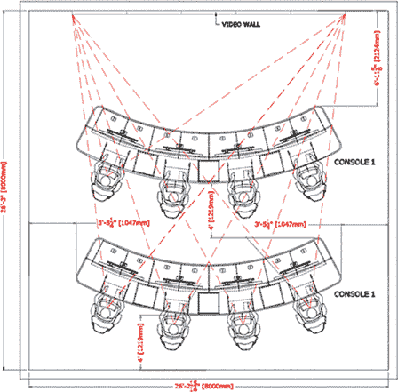

**图 2-15** SOC 楼层布局

> **注意**
>
> 对于许多组织而言，SOC 之外的其他团队将处理本节涵盖的部分或所有主题。可能会有专门的设施团队负责一切，或者前述任务可能分配给多个团队；例如，数据中心运维团队可能处理与服务器、电源和制冷相关的任何事务。我涵盖了所有核心概念，以防您的 SOC 需要负责规划和/或构建其所需的所有资源。

### 网络考量

SOC 需要网络。有许多书籍专门讲述网络建设，但就本书的范围而言，以下是在为 SOC 构建网络时需要考虑的一些关键概念：

*   分段
*   吞吐量
*   连通性和冗余

以下部分重点介绍为您的 SOC 构建可靠且安全的网络，首先从分段考量开始。

#### 分段

分段的定义是将事物分离成多个部分和区段。就技术而言，分段是指系统和用户如何被隔离开。分段可以在许多层面上实现，从物理隔离网络到逻辑隔离运行在同一硬件上的流量。如果您正在构建新网络，您会希望主动规划分段，而不是在网络建立后再部署分段。许多组织在部署深度分段或修改现有运行网络时遇到困难，导致不必要的中断并消耗大量工程工时。主动设计网络分段将为您节省大量时间和金钱。图 2-16 展示了可能的不同分段层级示例。

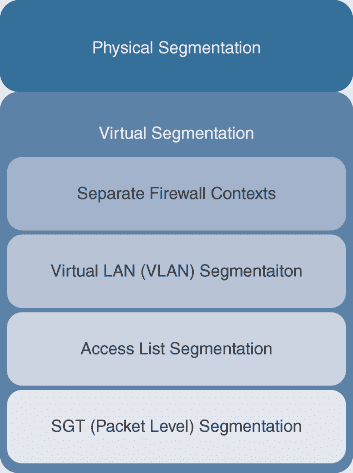

**图 2-16** 不同的分段选项


# 网络分段与架构设计

## 物理分段

顶层代表为每个网络段提供专用网络设备，这将包括其自己的路由器、交换机和安全设备。这是最安全且推荐的方法，但也是成本最高的选项。某些 SOC 需要专用网络，有时称为`安全飞地`，在这种情况下，别无选择，只能投资专用硬件。使用安全飞地的原因可能是为了保护特定类型的数据，例如机密网络，或者为了遵守监管要求，将流量保留在特定网络上，例如数据主权要求。安全飞地还可能对加密有更多安全要求，以及控制什么可以连接到网络、允许何种硬件或系统软件在网络设备中运行流量的其他策略。`NIST 800-53 Rev. 5`《信息系统和组织的安全和隐私控制》是了解安全飞地和其他分段建议的绝佳资源。

> **注意**
>
> 某些 SOC 被迫必须满足特定的法规合规要求，涉及网络中使用的硬件和软件版本。法规合规还可能控制 SOC 网络为分段而采取的架构方式，以及使用特定级别加密保护网络流量的要求。例如，接触机密数据的网络将被要求使用政府批准的技术和加密。升级到未在批准列表中的最新代码，可能会导致 SOC 网络违反法规合规要求，即使该更新修复了已知漏洞！

## 逻辑分段

如果您被允许灵活使用虚拟分段策略，可以通过利用虚拟局域网（`VLAN`）在逻辑上将 SOC 流量与其他流量分离，从而在使用相同网络设备的情况下节省成本。关于 `VLAN` 安全性的顾虑，有一些行业支持且被证明安全的策略可用于保护流量。对手攻破交换机安全并窃听 SOC 网络的风险较低，具体取决于网络设备中是否存在漏洞。例如，溢出内容可寻址存储器（`CAM`）表或交换机欺骗攻击，目的是在 `VLAN` 间跳转。大多数现代交换机都具有原生安全功能，可防御这些及其他基于交换机的威胁。这就是为什么我强烈建议投资合适的网络设备，而不是依赖缺乏现代网络和安全功能的二手或廉价设备。

以下是大多数托管交换机中的设置，可启用这些设置以降低第二层被利用的威胁，从而防止 `VLAN` 跳转：

*   禁用中继、动态期望或动态自动（当不使用时）
*   防止在所有中继端口和访问端口上使用动态中继协议（`DTP`）
*   防止双重标记
*   关闭所有未使用的接口

### 逻辑分段硬件

另一个逻辑分段选项是将一台物理硬件配置为在逻辑上被识别为多个解决方案。一个例子是将物理防火墙配置为充当多个逻辑防火墙。将物理防火墙配置为被视为多个逻辑防火墙，某些厂商称之为 `multi-context mode`。此功能非常适合最大化技术投资，因为同一技术的逻辑独立版本可以专用于不同目的。有时分段可以在管理层面进行，这意味着管理员可以进行更改并查看所有内容，而其他用户只能根据其登录权限查看或更改系统的部分内容。其他时候，例如在多上下文防火墙示例中，防火墙硬件将不同的逻辑防火墙段视为相互隔离、互不知晓的独立系统。多上下文防火墙部署在向客户出售数据中心服务访问权限并为每个客户部署专用虚拟防火墙的服务提供商中很受欢迎，这样客户就可以管理和保护其租用的虚拟空间。SOC 可以使用单个防火墙，并虚拟地为分析师网络、测试网络和管理网络专用独立防火墙。

## ACL 分段

您可以使用访问控制列表 (`ACL`) 来过滤同一网络上允许和不允许通过的内容。使用 `ACL` 的一个例子是允许分析师从 SOC 网络完全访问互联网，同时根据拒绝特定端口和协议的 `ACL` 限制访问 SOC 的来宾的网络访问权限。使用 `ACL` 的方法有很多，包括动态 `ACL`，如果触发策略，安全工具可以将其下发。无论您选择 `VLAN`、`ACL` 还是安全组标签 (`SGT`)（这是执行分段的另一种方式），我建议不要使网络设计过于复杂，否则您将产生大量不必要的管理工作，导致混淆和服务的意外中断。

> **注意**
>
> 我强烈建议考虑集中式网络准入控制 (`NAC`) 技术，以集中管理 `VLAN`、`ACL` 和 `SGT`。`NAC` 将在本章后面更详细地介绍。

### 选择分段

您应该为 SOC 选择哪种分段选项，将取决于 SOC 内部数据的关键程度。这种选择本质上归结为 SOC 的风险偏好，基于风险和事件发生的可能性，与部署对策（如实施分段或其他安全技术）的成本进行权衡。请注意，如果 SOC 共享网络设备且该设备遭到入侵，也会使 SOC 的运行状态面临风险。

图 2-17 展示了 SOC 网络分段的一个基本示例。SOC 工具段专用于各种工具的管理。第二个网络段专用于分析师工具。第三个网络段留作所有分析师工作站流量使用。第四个网络段专用于恶意软件分析。这些网络段的目的是根据不同类型的风险，隔离每个网络内的流量类型。例如，如果分析师工作站遭到入侵，只有其他分析师工作站可能会受到影响。

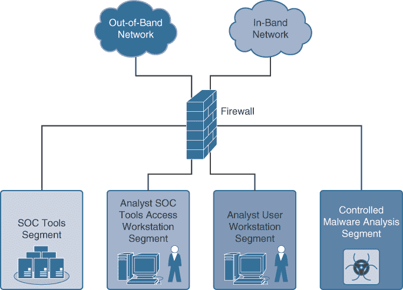

**图 2-17** 逻辑 SOC 网络分段

> **注意**
>
> 图 2-17 中所示示例未展示任何形式的高可用性。

### 客户端/服务器分段

存在可在网络段内运行的技术选项，它们提供另一层分段或以受控方式访问其他段，例如瘦或胖客户端/服务器技术。客户端/服务器架构是一种分布式应用程序结构，它在服务器和服务请求者（称为客户端）之间划分任务或工作负载。客户端可以是瘦客户端或胖客户端。瘦客户端设计为体积小巧，将大部分数据处理推送到服务器上。胖客户端体积大得多，能够执行大部分处理，而不依赖服务器。服务器和客户端通常通过网络通信，这也被用作在网络段内为系统提供访问权限的一种方式。例如，参考图 2-17，SOC 网络可能在 SOC 工具网络段中有一个工具，分析师无法从位于分析师工作站段的工作站直接访问该工具。可以在分析师的工作站上安装瘦或胖客户端，以便访问 SOC 工具网络段中的工具，这比允许分析师的工作站直接访问工具更安全。由于工作站没有直接访问工具的权限，安装在分析师系统上的恶意软件等风险将无法感染该工具。

表 2-6 对比了瘦客户端设备与胖客户端（个人电脑）的优缺点。

**表 2-6** 瘦客户端设备与胖客户端的优缺点对比

| 优点 | 缺点 |
| --- | --- |
| 瘦客户端终端比胖客户端便宜。 | 胖客户端提供比瘦客户端更优的功能。 |
| 瘦客户端功耗更低。 | 胖客户端需要更多计算能力。 |
| 扩展服务器/客户端技术比部署多个胖客户端更容易。 | 基于功率或其他要求，某些应用程序无法在瘦客户端上运行。 |
| 基于由集中式计算机控制，瘦客户端可被视为更安全。 | 瘦客户端集中式管理带来了单点故障的潜在可能。 |
| 基于集中式管理概念，瘦客户端更易于管理。 | |
| 基于对系统的集中式视图，数据丢失的风险较小。 | |

### Active Directory 分段

另一种逻辑分段形式是使用 Active Directory (`AD`) 管理分层模型。该模型划分三个层级，创建缓冲区以分隔高风险 PC 和域控制器等宝贵资产的管理。以下是各层级的简要说明：

*   **第 0 层** 是最高级别，包括管理账户和组、域控制器，以及对 `AD` 林具有直接或间接管理控制权的域。第 0 层管理员可以管理和控制所有层级的资产，但只能交互式登录到第 0 层资产。换句话说，域管理员绝不应交互式登录到第 2 层资产。
*   **第 1 层** 用于域成员服务器和应用程序。控制这些资产的账户可以访问敏感业务数据。第 1 层管理员可以访问第 1 层或第 0 层资产（网络登录），但只能管理第 1 层或第 2 层资产。第 1 层管理员只能交互式登录到第 1 层资产。
*   **第 2 层** 用于最终用户设备。例如，服务台人员将属于此层。第 2 层管理员可根据需要访问所有层级资产（网络登录），但只能管理第 2 层资产。第 2 层管理员可交互式登录到第 2 层资产。

正如传统网络分段一样，这种方法的目标是增加额外的分段层，黑客在访问关键系统之前需要攻破这些层。与其他分段方法一样，虽然黑客从第 2 层系统逐步渗透到第 0 层系统并非不可能，但这样做难度大得多。分层安全中的安全最佳实践包括其他防御措施，例如监控各层之间的恶意活动。图 2-18 是展示 Active Directory 三层模型的概念图。

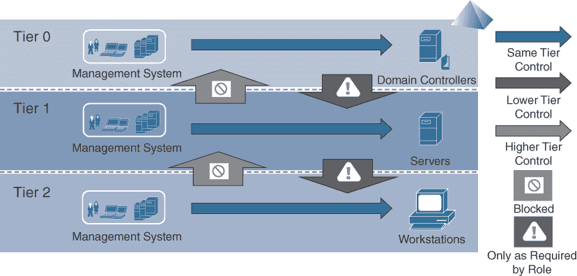

**图 2-18** Active Directory 三层模型

## 吞吐量

SOC 网络的另一个考量因素是吞吐量需求。建议使用专用线路为 SOC 提供服务。与其他非 SOC 网络流量共享网络可能导致所有用户的服务中断或变得迟缓，如果网络出现使用高峰。拥有专用线路的成本较高，由于预算限制，并非所有 SOC 都能负担得起。

如果您的 SOC 必须共享网络，您可以使用配置和技术来优先处理 SOC 流量，并降低 SOC 网络变慢的风险。以下项目是一些可用于为 SOC 流量提供优先级并为所有系统创建整体更快网络的选项：

*   **分段：** 逻辑上隔离 SOC 网络。
*   **适当的容量规划：** 确保有足够的带宽应对预期工作负载。
*   **使用线速路由进行 VLAN 间通信：** 使用交换机而非路由器来路由 `VLAN` 间流量。交换机的硬件可以以线速执行该路由，称为静态或动态 IP 路由。
*   **优先处理应用程序并使用流量整形：** 交换机提供确定流量重要性的能力。这可以通过以下方法实现：
    *   `802.1p/Q` 标记以优先处理应用程序
    *   `DSCP`/服务类型 (`ToS`)/第三层交换，通过报头优先处理应用程序
    *   通过带宽限制或速率限制来整形流量
*   **使用自动端点参数：** 使用风暴控制、设备数量、服务质量 (`QoS`) 和 `VLAN` 配置交换机端点端口。如果可用智能端口选项，请使用它来自动配置端点参数设置。
*   **利用交换机安全性：** 启用地址解析协议 (`ARP`) 检查、IP 源防护和动态主机配置协议 (`DHCP`)。
*   **MAC 层优先级：** 配置网络以优先处理特定 `MAC` 地址列表内的设备。
*   **服务质量 (`QoS`)：** 配置网络以优先处理某些类型的时间敏感和任务关键型数据协议。例如，优先处理音频和视频，而非 `SMTP` 或 `HTTP` 等非紧急协议。

> **注意**
>
> 组织可能有自己的吞吐量要求，这与您的 SOC 所需的吞吐量需求不同。

### 确定吞吐量需求

网络容量规划中的一项重要任务是确定 SOC 所需的吞吐量。未正确调整吞吐量规模可能会拖慢甚至导致某些 SOC 服务和功能不可用。一个例子是专门监控各种 SOC 工具可用性的系统连接中断。如果监控工具认为系统宕机，它可能触发故障转移，从而导致将所有工具重置回主状态的徒劳努力。未正确调整 SOC 吞吐量规模的另一个影响示例是，当大量设备大致同时连接到网络时，网络变得极其缓慢。这可能发生在早上所有人到岗时，或午餐后大多数人休息返回时。容量规划需要包含适当的方法来预测吞吐量，以避免这些情况。

您可以通过几种方式来测量和预测所需吞吐量。一种方法是考虑将连接到 SOC 网络的用户数量。每个用户将使用一定级别的办公互联网带宽。互联网带宽数量可能从 `10 × 1 Mbps` 到 `300 × 20 Mbps` 不等，具体取决于用户数量和使用的设备。这取决于对每个用户的预期是轻度、中度还是重度使用。轻度使用包括电子邮件和互联网，这可能是管理人员的用途。中度使用包括文件下载、流媒体音乐、IP 语音 (`VoIP`) 和基于云的资源。重度使用包括大文件下载、密集型互联网应用使用、多设备和交互式网络会议。

以下是与网络上常见操作相关的预期带宽值：

*   **打开网页：** `1 Mbps`
*   **观看 720p 实时流媒体视频：** `5 MB/分钟`
*   **Skype 视频通话：** `28 Mbps/秒`

您可以使用工具来测试和验证吞吐量。`Speedtest.net` 等在线资源提供免费方法来识别当前吞吐量水平。`SolarWinds` 等供应商提供网络吞吐量工具，也能提供预估的吞吐量使用报告。无论您制定何种预估吞吐量需求，还必须考虑当前吞吐量读数之外的其他因素。以下是您在吞吐量容量规划中需要考虑的其他要素：

*   **网络峰值可能性：** 预估在最大用户数量需要吞吐量的情况下需要多少吞吐量。一个例子是应对导致所有本地和远程员工同时连接网络的事件。
*   **平均带宽需求：** 平均使用量是多少？`Speedtest.net` 和 `SolarWinds 带宽监视器`（免费工具）等工具可以捕获这些读数。
*   **预期增长：** 用户和设备数量的预期增长。设备数量的预期增长应包括物联网 (`IoT`) 和其他非最终用户运行的设备类型的预期。
*   **系统吞吐量依赖性：** 所有预期连接到 SOC 网络的系统都需要评估吞吐量依赖性。供应商网站或产品文档可提供此信息。
*   **高可用性/故障转移吞吐量考量：** 某些高可用性配置将有特定的吞吐量要求，以确保主系统和冗余系统能够相互监控状态。
*   **减少吞吐量需求的可能流量整形选项：** 考虑交换机和路由器中减少吞吐量需求的配置选项。

在执行吞吐量容量规划时，请务必考虑流量全年如何变化以及未来增长，而不仅仅假设当前吞吐量数字足以支撑未来三到五年。要了解未来三到五年所需的吞吐量，可能需要在一年中的不同时间进行采样，以获得实际带宽使用情况的更准确视图。您还需要考虑 SOC 计划根据 SOC 服务成熟度规划增加哪些新服务和功能。我建议在当前吞吐量需求和新 SOC 服务及功能预期需求的基础上，至少预留 `10–20%` 的增长空间。如果 SOC 遇到带宽问题，可以使用工具和策略调整网络使用方式来释放带宽。最佳实践是不依赖过滤策略来获得可接受的吞吐量。

> **注意**
>
> 如果性能标准超过了本地资源所能提供的范围，外包将比扩容更好。例如，如果你发现调查单个事件的当前资源需要 35 分钟才能在安全工具中加载和处理查询，由于等待特定工具完成工作负载而浪费时间的瓶颈，这将导致较差的 SOC 响应时间。解决此问题的一个选项是增加容量，但这样做的成本可能比直接移除该工具并使用第三方云服务，或将现有平台迁移到 `IaaS` 或 `SaaS` 选项更昂贵。在进行容量规划时，权衡所有选项至关重要，包括不增加容量并切换到其他方案！

### 连接性与冗余

在为 SOC 规划网络时，最后一个考虑因素是系统将如何连接到网络。监控网络流量的工具需要内联或带外连接。内联监控意味着强制流量通过该技术以便其读取流量。常见示例是强制离开 SOC 的所有流量通过代理或网关应用层防火墙，以查看 SOC 使用的应用程序。带外部署意味着设置镜像或 `SPAN` 端口，以便复制流量并将其传递给工具进行评估。如果安全工具是带外的，它将无法自动阻断流量，因为它查看的流量不是实时的。以使用代理或网关应用层防火墙为例，如果这两个工具中的任何一个配置为以带外方式查看流量，它将能够看到用户是否尝试访问 Facebook，但将无法拒绝访问 Facebook（这需要强制流量内联通过应用层防火墙或代理）。请务必评估 SOC 打算使用的工具是否需要评估流量，以及它们应该内联连接还是配置为带外连接。

#### 内联连接风险

让流量内联通过安全工具存在风险。第一个风险是安全设备成为网络吞吐量的瓶颈。例如，如果 10 千兆以太网网络内联通过 1 千兆防火墙，则内部网络上的用户最多只能接收 1 千兆流量，因为防火墙无法提供更快的速度。另一个顾虑是让流量内联通过安全工具可能会造成单点故障。为消除此风险，可将内联设备配置为故障开启模式，这样如果软件故障，流量仍可通过设备。这样做实际上在产品的实际安全功能离线时将设备变成了一个集线器。可能存在一些用例，需要将 SOC 工具配置为故障关闭模式，即在安全功能不工作时禁用网络连接。

#### 通过冗余降低风险

你还应考虑冗余硬件和网络，以降低内联设备或其他网络瓶颈故障造成的风险。为所有关键系统以及负责时间、访问控制、事件日志记录和任何其他关键 SOC 服务的系统提供冗余。包含冗余系统对于执行需要重启系统的升级也很有用，这样辅助系统可以在主系统升级时充当主系统。你可以通过购买重复设备或使用替代网络路径来实现冗余。如果发现某网络上的设备不可用，则指示访问这些设备的系统转到另一个网络以获取相同资源。

以下是了解冗余选项的关键术语：

*   **故障转移：** 当主系统宕机时，第二个系统立即接管主系统角色。
*   **热备：** 一个系统充当主系统，而另一个系统处于待机非活动模式等待。如果主系统宕机，备用系统正在运行并准备好成为主系统。
*   **冷备：** 一个系统充当主系统，而另一个系统处于关机状态并被指定为备份系统。如果主系统宕机，冷备系统必须开机并设置为接管主系统角色。
*   **用户状态故障转移：** 当故障转移发生时，备份系统维护用户状态。例如，如果主访问控制系统宕机，辅助系统能够接管负载，同时保持对主系统记录的系统的感知/日志记录。
*   **故障检测：** 用于确定主系统不再可用的方法。

`NIST 800-123`《通用服务器安全指南》是可用于了解更多适当冗余策略的主要标准、指南和框架之一。冗余选项将根据你使用的技术而有所不同。

> **注意**
>
> 切勿假设组织现有的冗余满足 SOC 的风险承受能力。你的 SOC 可能需要在现有基础上增加额外的冗余。

# 灾难恢复

SOC 需要为各种类型的灾难可能导致的系统和人员损失做好准备。灾难恢复计划 (`DRP`) 有助于在灾难期间消除或减少潜在的经济损失、人员伤亡和财产损失。每个企业都需要建立灾难恢复团队，且必须涉及 SOC 团队成员。有许多行业指南、标准和框架可用作开发 `DRP` 和分配灾难恢复团队角色的参考。`ISO 22301:2019`《安全与韧性——业务连续性管理体系——要求》为保护组织提供指导，而 `ISO/IEC 27031:2011`《信息技术——安全技术——信息和通信技术业务连续性就绪指南》为 `ISO 22301` 的技术方面提供指导。`ISO 27031` 为业务连续性规划提供了六大主要类别：

*   **关键能力与知识：** 运行关键系统和服务需要什么信息？
*   **设施：** 设施位于何处？关于其如何抵抗潜在灾难存在什么顾虑？
*   **技术：** 哪些技术是业务关键型的？
*   **数据：** 恢复业务活动需要什么数据？
*   **流程：** 有哪些流程用于处理事件？
*   **供应商：** 哪些供应商和供应对业务至关重要？

灾难恢复团队应将以下文档作为 `DRP` 的一部分进行开发：


### 备份与恢复策略

团队应为任何被视为业务关键的系统记录备份和恢复程序。备份与恢复策略的细节需要解释数据备份的频率、备份位置、备份的数据类型、如何访问备份数据，以及谁负责被备份的系统和数据。如果发生灾难，企业将需要恢复关键系统，并用最后一个已知良好的数据版本填充这些系统。拥有每个关键系统的备份与恢复策略文档，使灾难恢复团队中的任何人都能在灾难后恢复系统并获取关键数据。

### 业务影响分析 (BIA)

BIA 的目的是确定维持业务运转所必须具备的人员、流程和技术。灾难恢复团队可以为人员、流程和技术的损失关联价值，以确定应使用哪种类型的冗余作为应对损失风险的对策。例如，SOC 的数据中心对 SOC 的运行至关重要。BIA 将基于数据中心宕机时每天将发生的损失、SOC 离线将如何影响业务以及潜在的风险降低项目，来体现数据中心的关键程度。在 DRP 中包含 BIA 文档将使团队了解因灾难导致任何人员、系统或数据丢失的影响。

### 分步灾难恢复计划

该计划告知团队所有其他灾难恢复数据的位置以及计划备份的位置。DRP 还包括灾难恢复团队每位成员的联系信息，指定团队应集合的地点，并指定集合地点和联系人的备选方案，以防主要地点或任何团队成员在灾难期间丢失或不可用。建议将 DRP 的备份存储在与主要计划不同的设施中。另一项建议是拥有一个位于其他位置的备用设施，该位置不太可能受到会危及主要灾难集合地点的灾难的影响。备用设施应距离多远的具体细节将基于组织的业务需求和风险承受能力。DRP 中包含的步骤必须涵盖 `ISO/IEC 27031` 中指出的所有项目。这包括记录恢复业务所需的知识，以及对业务至关重要的设施、技术、数据和供应商。

> **注意**
>
> 至关重要的是，所有文档都必须注明日期并经过测试，以确保灾难恢复计划有效且是最新的。你不希望在真正的灾难发生时发现一份过时的 DRP！

### 安全考量

关于规划 SOC 设计的另一个重要话题是将使用何种安全技术和流程来保护 SOC。如果关键工具（如时间服务器或日志系统）被对手攻破，许多 SOC 服务将变得毫无用处。这种故障不仅会削弱 SOC 的价值，还可能导致未来对 SOC 的投资和信任度下降。

请记住，对手知道他们面对的是其目标的防御体系。他们知道公司会安装防病毒措施、在网络上部署安全工具，并安排人员负责监控这些工具。对手拥有实验室并开发方法来绕过安全防护并躲避管理员的监测。

需要成为 SOC 安全规划一部分的一些安全主题如下：

*   策略与合规
*   网络访问控制
*   加密
*   内部安全工具

> **注意**
>
> SOC 的安全要求将不同于组织现有的要求。SOC 将包含组织的敏感信息，因此不应仅采用组织的安全标准。

### 策略与合规

术语 `compliance` 是指达到某个目标。该目标将因行业和组织运营方式而异。一些合规目标是由地方政府推动的要求，如果不遵守，将导致对组织合规负责的人员处以罚款（极端情况下甚至可能面临监禁）。其他合规目标是由组织领导层强制规定的，意味着没有法律义务；然而，组织已将满足合规目标作为组织的义务。一些领导者会将行业建议（称为指南）转化为强制性的合规目标，旨在在组织内建立安全实践的基准。第 6 章“降低风险与超越合规”涵盖了常见的强制性和推荐性合规形式，以及如何通过策略、程序和标准来强制执行合规目标。

关于建设 SOC，可能存在组织现有的或期望的合规目标，必须在 SOC 进入上线状态前满足。最常见的 SOC 上线前合规要求是地方和联邦政府要求的，以及组织策略中所述的与业务运营相一致的要求。《健康保险流通与责任法案`(HIPAA)` 是美国的一项法律，强制要求美国所有处理受保护健康信息 `(PHI)` 的组织（“受管实体”）遵守。支付卡行业数据安全标准 `(PCI DSS)` 是一个标准的例子，强制要求所有接受、处理、存储或传输信用卡信息的组织遵守。SOC 识别所有必需的合规要求并确保在启动前满足这些要求至关重要。第 6 章将介绍您的 SOC 需要了解的最常见的法律和财务合规要求。

`Policies`（策略）是组织必须遵循的高层要求，由领导层制定。`Procedures`（程序）包含遵循策略的详细步骤。SOC 不仅需要遵守所有策略，但为了符合公司策略，可能需要调整 SOC 的开发和运营方式。SOC 需要与 SOC 发起人核实任何上线前的合规要求，无论这些要求是法律驱动还是企业驱动。通过这样做，SOC 将获得高管支持，确认所有合规要求均已满足。我强烈建议确保在规划阶段尽早解决 SOC 发起人确定的法律、财务和其他合规问题，以避免因合规违规导致后续步骤中断。合规违规可能会阻止 SOC 上线！

> **注意**
>
> 你需要一位了解组织合规要求的 SOC 发起人。如果你不确定你的 SOC 发起人是否知道所有这些要求，请与其他领导层进行验证。如果没有经过适当的验证，不要假设你已经满足了所有合规要求。

### 网络访问控制

网络容量规划和安全要求为开发 SOC 网络以及 SOC 如何保护组织提供了基本基础。许多现代 SOC 的一项基础安全要求是分段以及控制对段之间和段内的访问。访问控制需要以最小权限设计提供，仅允许必要的服务访问或离开网络段。我建议根据设备类型的相关风险和依赖关系进行隔离，但非常精细的分段可能难以部署和管理。我最基本的设备分段建议是隔离来宾用户、员工、管理员、IoT 设备、移动设备、SOC 工具、恶意软件测试和关键系统。

### 画像分析

### SOC 网络访问控制与加密

SOC 需要一种方法，基于 MAC 地址或更高级的画像策略来验证网段上的设备。如果没有这种能力，SOC 网络管理员将无法确定连接到网络的是什么类型的设备。超越 MAC 地址对设备进行画像是一种更理想的方法，因为它利用各种网络协议来确保设备经过身份验证，而不只是依赖 MAC 地址，后者可能会被攻击者*欺骗*。例如，画像技术可以区分 iPhone 和 iPad，尽管这两款产品均由 Apple 制造且拥有相似的硬件组件。区分两款不同的 Apple 设备可以基于 `DHCP` 请求的呈现方式、所用 `Safari` 的版本，或由画像技术分析的其他因素。特定特征也可用于不仅确定设备是否为其声称的身份，还可确定其是否获得授权。一个常见示例是确定同类设备是公司发放的，还是未经授权的个人资产。MAC 地址可用于此目的，但同样可能被*欺骗*。最佳实践是利用系统内的特征，例如在资产上放置可验证的证书，以确保设备由组织签发。

### NAC 的价值

许多框架（包括 `NIST` 的网络安全框架和 `ISO/IEC 27001`）均推荐利用 `NAC` 解决方案。一个流行的选择是使用基于 `IEEE 802.1X` 协议的集中式策略监控和执行 `NAC` 解决方案。`NAC` 使网络管理员能够将特定用户或设备限制在特定的访问权限内，并在连接网络时自动强制执行。例如，管理员 Anjelica 可以将她的笔记本电脑、打印机和 `VoIP` 电话带到 SOC 大楼内的任何办公室并直接插上使用。根据这些设备的 `NAC` 配置文件，她的打印机将被置于专用打印机网络，她的 `VoIP` 电话将被置于 IP 电话网络，而她的笔记本电脑将被置于管理员网络。如果客人拔掉 Anjelica 的任何设备并插上他/她自己的电脑，网络会根据客人的认证方式和插入的设备类型，将该端口切换到客人网络。在本例中，客人的设备上未安装公司证书，且客人用户在计费系统中没有员工账户。这将导致客人的电脑自动被置于客人网络。这只是 `NAC` 解决方案的众多部署选项之一——客人经历的默认操作可能是完全拒绝访问，也可能是临时访问，但 `ACL` 会限制该客人用户无法获得管理级访问权限，即使该用户与 Anjelica 处于同一 `VLAN` 中。

无论以何种方式部署 `NAC` 技术，确保在所有区域和网络（包括 `LAN`、无线和 `VPN` 网络）部署相似的安全性至关重要。我见过一些组织部署了安全的无线网络，而其 `LAN` 却对任何人开放，只要他们能接入 `LAN` 端口就能插入任何设备。最佳实践是跨所有接入方式标准化网络访问策略。

使用集中式网络访问控制解决方案可获得额外价值。许多 `NAC` 解决方案提供共享网络连接设备数据库的功能，该数据库称为 `context`（上下文）。该连接设备数据库可供其他解决方案（如 `SIEM` 解决方案）使用，以将解决方案看到的 IP 地址与 `NAC` 解决方案了解的关于该 IP 地址的内容进行匹配。例如，登录 SOC 的 `SIEM` 解决方案，通过用户名而非 IP 地址识别 SOC 网络上的每个设备。这基于 `NAC` 技术在用户访问网络时捕获用户身份，并将网络用户数据库与 `SIEM` 技术共享。

`NAC` 解决方案的另一价值在于将违反策略或被视为组织风险的设备从网络中移除。许多 `NAC` 解决方案在设备尝试访问网络时对其进行扫描，并在允许访问前验证设备已启用所需的安全功能。例如，SOC 可使用 `NAC` 技术验证连接到 SOC 网络的设备是否安装并运行了防病毒软件，如果没有，则拒绝其网络访问。`NAC` 技术还可与漏洞扫描器集成。漏洞扫描器将扫描网络并识别任何存在漏洞的设备。具有严重漏洞的设备将被标记为极高的漏洞评分。`NAC` 技术可用于自动移除具有极高漏洞等级的设备。图 2-19 展示了 `SANS` 关于漏洞管理的建议示例。将漏洞扫描器和 `NAC` 解决方案的价值相结合，可实现 `SANS` 推荐的整个流程自动化。

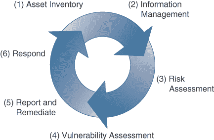

**图 2-19** SANS 漏洞管理建议

> **注意**
>
> 即使 `NAC` 解决方案是与组织共享的资源，SOC 也必须管理自己的访问控制策略。可能会出现由 SOC 主导取证调查等情况，要求控制某些数据。在取证调查的情况下，只有 SOC 的取证团队应有权访问该数据。

### 加密

SOC 与客户之间以及 SOC 内部各段之间的流量都需要得到保护。对于通过无线网络发送的流量尤其如此，因为处于 SOC 范围内的任何人都可能访问这些流量；对于远程用户通过不受信网络发送到 SOC 网络的流量也是如此。可用于保护网络流量机密性和完整性的加密级别各不相同，其中一些比另一些更可靠。例如，不建议使用 `WEP` 加密 SOC 的无线网络。`WEP` 非常古老，可通过已知的利用手段轻松破解。`WPA2` 和 `WPA3` 基于其提供的功能和安全能力，是更安全的选择。某些无线设备可能无法支持 `WPA3`，因此 `WPA2` 将是最佳选择。表 2-7 总结了不同类型的无线加密选项。

**表 2-7** 对比不同无线加密类型

| | WEP | WPA | WPA2 | WPA3 |
| --- | --- | --- | --- | --- |
| **简要说明** | 确保无线网络中的有线等效隐私 | 基于 802.11i，无需新硬件 | 所有强制性 802.11i 特性及新硬件 | 提供更个性化的加密和 WPA3-Enterprise，增强传输敏感数据网络的加密强度。 |
| **加密** | RC4 | TKIP + RC4 | CCMP/AES | GCMP-256 |
| **认证** | WEP-Open/WEP-Shared | WPA-PSK/WPA-Enterprise | WPA2-Personal/WPA2-Enterprise | WPA3-Personal/WPA3-Enterprise |
| **数据完整性** | CRC-32 | MIC 算法 | 密码分组链消息认证码（基于 AES） | 256 位广播/组播完整性协议 Galois 消息认证码 (BIP-GMAC-256) |
| **密钥管理** | 无 | 四次握手 | 四次握手 | 椭圆曲线 Diffie-Hellman (ECDH) 交换和椭圆曲线数字签名算法 (ECDSA) |

### LAN 加密

局域网（LAN）也可以使用加密技术，这可以通过隧道技术实现，例如主机与服务器之间或位于网络不同部分之间的特定硬件加密设备之间的 `IPsec` 或 `SSL` 加密。加密选项之间的差异包括以下几点：

*   加密强度
*   加密密钥的管理和交换方式
*   使用的接口、协议和端口
*   它们运行在哪个 OSI 层
*   部署的难易程度
*   速度

站点到站点 VPN 可用于将两个位置连接在一起。SOC 可以在分支机构和总部之间使用站点到站点 VPN，以保护流量在不可信网络上跨位置移动时的安全。类似的概念可用于主机设备与 SOC 网络之间，这非常适合需要远程访问 SOC 网络的 SOC 员工。我建议与您网络设备的供应商沟通，以了解有哪些可用的加密选项。本章前面的表 2-1 提供了站点到站点 VPN 和远程访问 VPN 的快速总结。

### 内部安全工具

SOC 安全工具必须考虑攻击者为攻陷 SOC 及其用户将采取的所有步骤。请回顾第 1 章中关于不同威胁模型的讨论。威胁模型是一种常见的方法，用于理解攻击者在尝试利用漏洞、投放恶意软件和执行恶意操作时可能采取的步骤。第 1 章中介绍的一个威胁模型示例是网络攻击链，如图 2-20 所示。

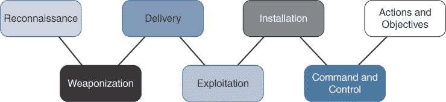

**图 2-20** 网络攻击链

这一特定的威胁模型用于评估攻击者为在网络上建立立足点可采取的不同步骤，并展示了对不同类型安全能力的需求，以防止攻击者的步骤成功发生。例如，利用阶段的防御能力专门寻找用于利用漏洞的攻击行为，并试图阻止漏洞利用生效。安装步骤假设攻击者的漏洞利用已成功，因此此攻击阶段的预防安全能力有所不同，通常称为入侵检测能力。入侵检测能力旨在检测内部人员的存在，向 SOC 发出警报并防止进一步向网络内部扩散。利用防御和入侵检测都具有检测和预防能力，但它们的设计功能不同，基于它们预期防御的攻击类型。

防御者的目标是尽可能在网络攻击链的早期阶段阻止攻击。通过结合用于网络攻击链不同部分的防御措施，SOC 创建了不同安全能力的层，作为其纵深防御策略的一部分。

本节其余部分将介绍成熟 SOC 中常见的常用安全能力。我将在很大程度上保持供应商中立的语言，并专注于设备类型类别中常见的能力。

> **注意**
>
> SOC 必须控制用于保护 SOC 的所有安全工具的策略，即使使用的是由组织共享的技术。

### 入侵检测与预防

监控内部流量的一种选择是使用部署在监控端口上的入侵检测系统（`IDS`），并结合监控网段间流量的入侵防御系统（`IPS`）。推荐的做法是调整这些工具，使其通过与漏洞扫描器集成，了解其保护资产中潜在的漏洞，并执行定期规则评估以最大化其有效性。例如，SOC 可以经常运行漏洞扫描以识别并响应已知弱点。当这些弱点暴露时，`IDS` 和 `IPS` 可以调整为启用防御签名，直到负责修复漏洞的相关方能够执行该工作。将漏洞评估工具与安全工具集成有助于加快这一过程。可将其视为针对网络攻击链中“利用”阶段的防御。

### 网络流量与抓包

基线工具可用于 SOC 网络中，当它们检测到与正常活动的异常偏差时发出警报。例如，允许 `IoT` 设备访问互联网，但如果发现该设备有异常大量的流量，SOC 应予以关注。流量的增加可能表明正在安装大型固件更新，也可能表明攻击者找到了一种方法，利用 `IoT` 设备作为进入 SOC 网络的入口点！使用 `NetFlow` 是检测此类活动的一种方法。许多常见网络工具（如网络交换机）都支持 `NetFlow`。本质上，`NetFlow` 将网络转变为多个安全检测点，持续监控异常活动。与在网络中部署特定安全工具相比，这极大地提高了可见性。

> **注意**
>
> 并非所有 `NetFlow` 工具都是一样的！许多 `NetFlow` 工具仅关注流量峰值和低谷，这意味着它们无法判断活动是否恶意。

#### NetFlow 技术

根据供应商和启用的版本不同，有不同类型的网络流量技术选项。例如包括采样流（`sFlow`）和 Juniper Networks 的 `J-Flow`，仅举几例。对比采样流（如 `sFlow`）与数据丰富选项（如 `NetFlow 9`）的价值，可能意味着只知道过去 24 小时内发生过事件（`sFlow`），还是知道特定设备在特定时间于网络特定部分执行了特定操作（`NetFlow`）的区别。造成这种差异的原因是 `sFlow` 使用基于时间的采样计数器，而 `NetFlow` 使用生成它的硬件中的缓存流条目。

`NetFlow` 工具可根据工具对收集到的流数据的处理能力提供不同的功能。许多流量工具可针对异常流量模式发出警报，使网络技术人员能够确定路由问题或性能不佳的区域。这对于检测网络拥塞很有用，以便进行替代路由或其他调整以提高整体网络性能。使用 `NetFlow` 提高网络性能固然有用；然而，许多此类工具没有算法来检测端口扫描或蠕虫活动。`Cisco Stealthwatch` 和 `Plixer Scrutinizer` 等产品能够将流数据转换为安全事件。安全事件的示例包括端口扫描、蠕虫传播、数据渗漏和拒绝服务。

> **注意**
>
> 要查看 `Cisco Stealthwatch` 可检测的安全事件的综合列表和说明，请在网络上搜索“Stealthwatch Security Events and Alarm Categories”（撰写时的当前版本为 7.3 版）。

NetFlow 基于单向通信，这意味着用户连接到服务器以及服务器响应的动作将等同于多个 NetFlow 会话，因为连接的每一步都将是一条单独的 NetFlow 记录。将用户持续使用网络时创建的每条单独 NetFlow 日志乘以任何给定时间网络上的用户数量，你将获得大量需要搜索的 NetFlow 记录。如果 NetFlow 工具仅收集 NetFlow 记录，该工具将迅速填满数据，其数量将超过分析师的审查能力。为了解决此问题，具有去重和拼接功能的 NetFlow 工具可以删除重复记录并将整个会话拼接在一起，以简化大量 NetFlow 数据的挖掘。一个用户访问服务器可能会创建多条 NetFlow 记录，但在所有这些 NetFlow 记录拼接在一起后，可以记录为单个事件。

### 基于网络的应用识别 (NBAR)


# 基于网络的应用识别 (NBAR)

基于网络的应用识别 (NBAR) 是另一种网络协议，它为网络基础设施提供智能网络分类。NBAR 能够识别多种应用程序，包括基于 Web 的应用程序以及动态分配 TCP 和 UDP 端口号的客户端/服务器应用程序。应用程序分类后，安全技术可以对其进行监控，也可以通过各种基于网络策略的工具为其提供特定带宽。思科、SolarWinds 和 Plixer 等供应商的许多 NetFlow 工具还提供消化 NBAR 的功能，其结果可补充 NetFlow 数据中发现的内容。

使用 NetFlow 和 NBAR 价值巨大；然而，这些数据监控方法无法提供与数据包捕获技术相同级别的细节。可将 NetFlow 方法的价值视为提供安全事件的“标题”。这包括提供元数据时间戳、发送方和接收方的 IP 地址、使用的端口、会话时长以及传输的数据量。事件响应等 SOC 服务需要事件的准确细节，而 NetFlow 和 NBAR 无法提供这些细节。当这种需求出现时，SOC 必须使用提供更多细节的其他来源。

## 数据包捕获技术

数据包捕获提供完整的故事，能准确重建究竟发生了什么以及何时发生。分析流量与分析数据包捕获的区别，类似于查看拨打的电话列表（流量）与录制实际通话并聆听（数据包捕获）的区别。

数据包捕获必须存储流量，并必须使用工具来分析捕获的内容。这需要大型存储系统，从而导致更高的成本。流量可以帮助你确定在哪里查找，但许多基于流的工具缺乏事件是否真实的证据，这意味着你知道某 IP 地址违反了策略，但如果没有数据包级别的活动捕获，你就没有实际发生了什么的细节。数据包捕获包含而流量方法不包含的细节示例是在安全事件期间从网络导出的具体文件。拥有这种级别的细节将确定丢失文件的价值，为 SOC 提供应用适当事件响应所需的具体信息。如果数据被分类或受法律保护，SOC 将被要求向公众发布丢失的内容。理想情况下，应使用流量方法查看网络威胁，并使用数据包捕获方法调查威胁，但这只有在资金允许同时获取这两类工具时才可能。任一方法都适合监控内部网络威胁，但成本可能导致你最初仅投资其中一种。好消息是，任一方法的供应商都开始提供混合选项，这些选项将使用流量为网络建立基线，并在发现事件时启动数据包捕获。

> **Note**
>
> 会出现需要数据包捕获技术相关细节的情况。流量技术无法满足这些要求。例如，在取证调查中证明安全事件期间丢失了特定类型的数据。

## 变更管理

进入和离开每个 SOC 网络的流量，以及跨越 SOC 网络段的流量，需要使用应用层防火墙或代理等工具进行控制，因为这些工具能看到所有类型的流量。你可以配置策略以阻止特定流量类型，但也应包含一个流程，允许用户请求为其所需的特定服务解除流量阻止。为阻止的流量制定例外的流程需要成为 SOC 变更管理流程的一部分，要求变更请求中至少包含以下项目：

*   Requestor（请求者）
*   Purpose（目的）
*   Impacted systems（受影响的系统）
*   Creation and expiry dates（创建和过期日期）
*   Change management approval reference number（变更管理批准参考编号）

最佳实践是包含协助跟踪请求并自动发送提醒以响应临时授予的例外过期的变更管理工具。许多组织未能使用提醒来移除防火墙例外，导致临时策略在配置中丢失，从而削弱防火墙，并使管理员不确定他们需要允许或拒绝哪些流量。编排技术越来越流行，可协助变更管理工具使用预先设计的剧本自动修复过期请求。

> **Note**
>
> 随着时间推移，糟糕的例外管理实践会导致安全失败。例如，组织在处理过期访问请求时举步维艰。不处理过期访问请求会导致例外无法被禁用，因为例外的原始目的未记录在案。随着时间的推移，涉及该例外的各方不再在场解释该例外的必要性。无人处理，该例外便成为永久配置的一部分。

## 主机系统

主机系统和服务器必须包含提供系统级防御的安全产品。计算机有不同的部分需要不同类型的安全能力。安全能力必须保护固件、操作系统、Internet 浏览器，甚至浏览器内的插件。标准的基于特征的防病毒软件是一个好的起点，但不能是安装在主机系统上的唯一安全能力。当前的恶意软件可以通过多种方式躲避防病毒软件，例如使用在内存中运行而非作为可被传统防病毒解决方案扫描的文件的战术。

Figure 2-21 提供了主机层的示例以及如何应用安全性。在此示例中，防火墙和 IPS 提供边缘防御；但请注意反恶意软件检测位于系统内部以监控主机上的活动。设想一个防病毒软件未标记为恶意的包含恶意软件的 PDF 文件，现在用户正尝试打开它。理想情况下，反恶意软件技术能够注意到该 PDF 不是已知威胁，但其行为不正常且令人担忧。我建议你询问任何潜在的主机安全供应商，其解决方案如何防御 Figure 2-21 中所示的不同主机层，包括主机防火墙和 IPS 选项以及反恶意软件能力。此外，请务必询问该软件如何通过配置管理、监控和其他管理工具得到支持，以避免陷入孤立的管理系统。

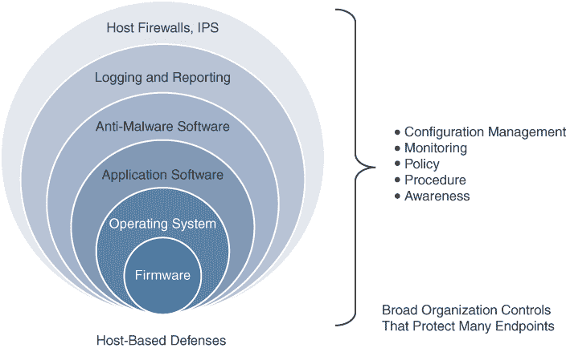

**图 2-21** 用于端点防护的纵深防御

## 保护 SOC 网络的准则和建议

还有其他安全功能值得考虑，它们可以为 SOC 的纵深防御方法提供更多层次。蜜罐可部署在整个网络中，旨在引诱已突破 SOC 网络的威胁。沙箱可用于在允许外部文件进入受保护的 SOC 网段或关键系统之前对其进行分析。漏洞扫描器可配置为主动扫描网络，识别 SOC 需要根据前述 SANS 漏洞管理最佳实践建议进行修补和防护的任何潜在弱点。主机可安装代理，以补充前面介绍的安全技术，例如防病毒软件或代理中的漏洞扫描功能，或向网络流量收集器提供主机流数据的代理。正如第 1 章和本章前面所述，有许多来源（如标准、准则、程序和顾问）可供您参考，以获得保护 SOC 网络的最佳建议。

> **注意**
>
> 利用蜜罐和沙箱存在风险。错误配置或误用这些技术可能导致被攻破。请务必使用可信来源的指导来进行配置和正确使用这些技术。

### 工具协作

无论您选择哪种安全技术，所有这些工具都需要一个地方来发送数据，以便 SOC 能够对其进行监控和分析。许多 SOC 用于此目的的一种流行工具是 SIEM 解决方案。通过开发 SOC 流程构建的剧本可以使用编排工具实现自动化，并与 SIEM 解决方案的跟踪系统相结合。这提供了一种方法，可根据 SOC 剧本的指示对 SIEM 解决方案识别的事件强制执行操作，从而简化 SOC 提供的事件响应能力。其中许多主题将在本书后面更详细地介绍，因为 SOC 使用它们来监控其负责保护的网络。关键在于，您考虑用于保护 SOC 网络的工具，应与 SOC 用于保护其负责的网络的工具相同。

有一些通用的行业准则展示了这些安全工具中的许多如何协同工作。这包括将网络安全工具、主机工具和管理工具关联到组织的不同部分。一个示例准则是图 2-22 中所示的美国海军 CND 纵深防御战略。此示例为每个防御段列出了不同的能力，从主机层开始，逐步延伸到最外层的网络边缘。将此战略应用于 SOC 网络设计的一种方法是：用 SOC 的内部网络替换海军图中的 LAN，用受 SOC 保护的组织网络替换外部网络。该图中的外层可被视为包含 DMZ 和其他面向外部资源的外部网络。

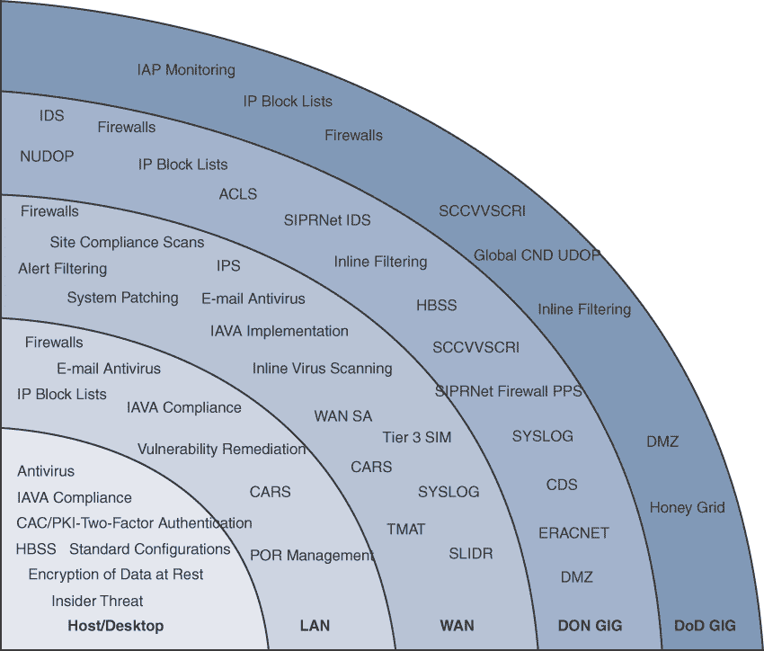

**图 2-22** 美国海军纵深防御战略

> **注意**
>
> 如果您不确定选择哪些技术，请回顾第 1 章中的“SOC 能力评估”部分，作为开发以 SOC 为中心的能力图谱的方法。您可以使用行业准则来帮助填充 SOC 能力图谱中应存在的每项能力。选择用于保护组织的安全能力时，也可采用同样的方法，这将生成一个不同于用于展示如何保护 SOC 的能力图谱。

在图 2-17 示例 SOC 网络设计图的基础上，图 2-23 展示了 SOC 如何应用本节介绍的各种安全工具。图 2-23 增加了 NetFlow、IDS 设备和数据包捕获工具，以分析网段之间的流量；增加了应用层防火墙和 IPS 设备，以保护各网段之间传输的流量；在支持该技术的主机系统上增加了防病毒和反恶意软件；并在恶意软件测试网段中增加了沙箱，以协助此类工作。这似乎涉及大量安全措施，但正如本节开头所述，SOC 的安全必须是重中之重。

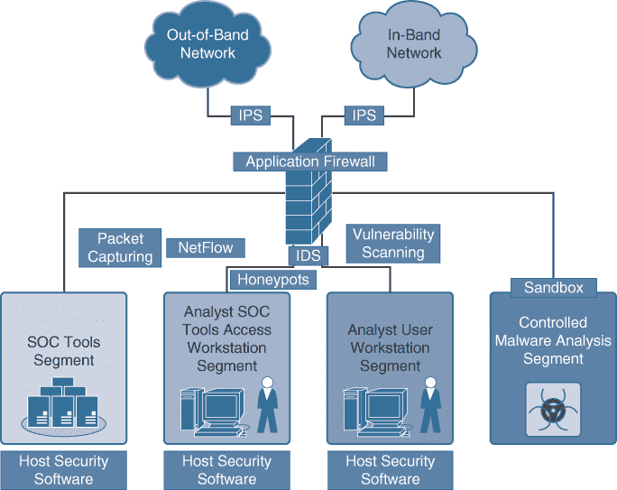

**图 2-23** 具有安全防护的逻辑 SOC 网络分段

# SOC 工具

许多 SOC 程序需要使用特定工具。我已在本章前面介绍了用于保护 SOC 的工具。SOC 需要这些相同的工具来保护 SOC 的客户并提供 SOC 服务，尽管 SOC 部署工具的方式可能不同，或对工具的期望也可能不同。基于 SOC 成员的角色和工具内的数据类型，对工具的访问可能会受到限制。例如，负责保障 SOC 安全的成员应只能查看内部 SOC 数据，而负责客户行为的分析师则无法查看同事 SOC 分析师的活动。大多数安全工具根据为访问工具管理界面而创建的账户类型，提供不同的数据视图。此功能通常称为 `role-based access control`（基于角色的访问控制），因为每个工作角色只能查看该角色所需的数据。最佳实践是使用基于角色的访问控制，将用户看到的数据限制在最小权限范围内，而不是授予任何用户管理访问权限。

## 报告和仪表板

报告和仪表板是大多数 SOC 工具中另外可用的重要功能。我建议为各方（包括高管和其他关键成员）创建报告和仪表板，以向他们清晰地展示 SOC 的价值。负责监控安全事件的分析师将收到报告，并拥有专为分析师角色设计的仪表板，包括 IPS 日志、Windows 安全事件以及属于分析师职责范围内的其他安全工具。面向高管的仪表板和报告将不同于分析师的仪表板，包括员工如何使用互联网、网络连接了何种类型的设备，或者某些人如何使用网络等。大量此类数据可从下一代防火墙、NAC 和其他安全工具中获取，这些技术中的报告和仪表板选项可针对其目标受众进行定制，仅在仪表板中呈现所需数据。可创建特定于 SOC 的仪表板并显示在 SOC 大屏上，而特定分析师将根据其工作角色，在其自己的定制仪表板和报告中获得额外数据。例如，一级分析师不需要访问移交给高级支持团队的案例。

> **注意**
>
> 报告是将结果与 SOC 职能中的成功标准对齐的绝佳方式。第 1 章介绍了使用成熟度模型来衡量 SOC 服务执行效果的方法。较高成熟度的一部分是提供可重复的行动。为证明行动可重复，可使用仪表板和报告来展示可重复成功的历史记录。

> **注意**
>
> 我强烈建议为组织的关键成员创建报告，包括赞助 SOC 的成员。这将迅速为 SOC 赢得尊重和支持。让 SOC 赞助商了解情况，可以带来更多预算、对 SOC 决策的支持，以及对安全和策略意识的支持。最佳实践是采访关键高管成员和 SOC 赞助商，了解他们希望获得哪类数据，并建立系统按周或月交付这些数据。例如，与合规官会面，目标是协助其获取合规报告所需的数据。

## 吞吐量与存储

影响设备能否被 SOC 使用的其他因素，是设备必须消费和存储的数据量。在安全领域，工具所接收的数据量称为 `events per second (EPS)`（每秒事件数）。事件数据可以是多种内容，包括告警、日志消息和每秒流量。第 5 章“数据集中化”将深入探讨理解和调优工具以适应不同类型的 `EPS` 值，但就调整 SOC 工具规模而言，需考虑的因素是存储事件所需的存储量，以及 `ESP` 如何影响许可证。产生大量 `EPS` 的“话痨”设备会迅速耗尽安全系统的存储空间。图 2-24 展示了可能发送给 SOC 工具的不同类型数据示例，这些数据会被消化并转换为分析师可审查的事件。

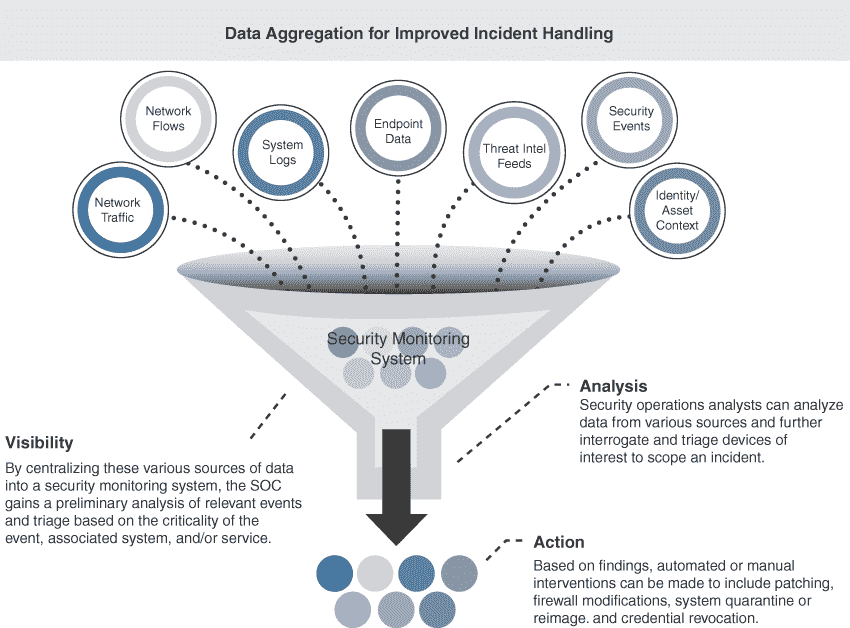

**图 2-24** 监控系统消化的事件

> **注意**
>
> 将网络上的设备数量纳入考量，并不一定能提供准确的预期 `EPS` 规模估算方法。例如，10 个非常“话痨”的系统产生的数据量，可能与 100 个不“话痨”的系统相当，所需存储量也相同。有关如何正确规划 `EPS` 需求的更多详情，请参阅第 5 章。如果对 `ESP` 数值存疑，请按更大规模进行规划，以适应额外的 `EPS` 和未来增长。

### 降低每秒事件数

为减少“话痨”设备的影响，可以实施调优和存储策略来降低 `ESP`。您可以调整设备，使其根据事件类型生成日志。调试设备时，可为每个单一事件启用日志记录；监控设备时，可将日志记录限制为仅在遇到关键操作时触发。图 2-25 展示了某些 Cisco 产品中可用的告警级别示例。

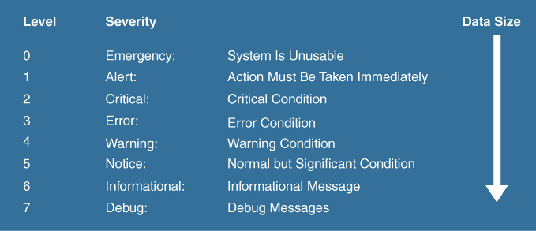

**图 2-25** Cisco 告警级别示例

降低 `EPS` 影响的另一种方法是调整事件中包含的数据量。在事件中包含更多细节有助于分析师理解事件发生的原因，但也会增加存储此类事件的需求。建议将事件详细程度降低至分析师理解事件所需的最低水平。也可使用元数据代替完整日志消息，从而减小日志消息的大小。某些数据字段可能不提供价值，此时可配置生成日志的工具，使其不包含这些字段的数据。在调整工具生成事件的方式时，请考虑所有这些因素。这将节省调优时间，通过准确规划监控产品规模来省钱，并提高被分析数据的质量。

> **注意**
>
> 并非所有设备都需配置为相同的严重级别和日志详细程度。例如，您可以让边缘安全工具触发较低严重性的告警，而内部工具触发较高严重性的日志，反之亦然。最佳实践是根据每个生成日志的工具所期望的价值来做出这些决策。

### 存储与数据保留

另一个需要为 SOC 工具考虑的规模概念是所需存储和数据保留要求。例如，如果必须在清除记录前存储三年份的日志数据，您将需要评估 `EPS` 对可用存储的影响并相应地进行规模调整。有时，数据保留要求在设备上线可用性需求与将数据加密存储在设备外部（以备未来调查所需）方面有所不同。这可能基于能力目标，或由法规要求，例如《萨班斯-奥克斯利法案》（`SOX`）或北美电力可靠性公司关键基础设施保护标准（`NERC CIP`），仅举几个美国特有的例子。安全工具（如 `SIEMs`）通常保留一到三年的数据，并将更早的详细信息以压缩格式导出到单独的存储系统以节省空间。如果需要较旧的数据，有一套流程用于识别记录、解压并将其上传回 `SIEM` 解决方案。某些安全工具（如 `NGFWs`）可能仅在本地存储数据很短一段时间，之后就需要设备外部存储选项。与您所选产品的供应商探讨数据保留选项，并确保其满足您 SOC 的要求，这一点很重要。

总体成本也可能是决定保留哪些数据在设备上、何时将数据导出到外部存储系统的因素。组织通常要求至少一年份的日志数据可随时访问，而将更早的数据导出到外部系统。请知悉，将数据保留在设备上的成本高于外部存储。好消息是，随着技术进步，存储成本持续下降。根据《Computerworld》2017 年 3 月发表的一篇文章，“1967 年，一个 1 兆字节的硬盘售价高达 100 万美元。如今，硬盘驱动器（`HDD`）上同等容量的成本约为 2 美分。” 将数据导出到外部存储系统前的具体保留时长，将基于您 SOC 的业务目标。坏消息是，更多设备正在产生更大量的数据，增加了对更多存储的需求。`IoT` 的增长正对网络造成重大影响，包括增加 `EPS`。此外，不同存储选项成本不同。闪存成本高于磁带或光盘；然而，闪存可能值得更高的成本，因为它性能更快，在请求数据时能更快地提供存储数据。

> **注意**
>
> SOC 数据必须受到保护。我建议尽可能将 SOC 数据存储与组织的数据存储分开。如果使用共享存储源，必须将 SOC 数据与组织数据隔离开。

## 集中式数据管理

大多数 SOC 都有一个用于消化事件的集中式工具。最常用于此目的的工具是安全信息和事件管理解决方案。`SIEMs` 专门存储事件，以便对其进行挖掘和分析；然而，并非所有 `SIEMs` 都是平等创建的。依我经验，一些 `SIEMs` 侧重于 `SIM`，意味着它们提供多种方式来管理日志和挖掘数据。`Splunk` 是一款流行的 `SIEM` 解决方案，具有非常先进的日志管理和挖掘能力。图 2-26 展示了 `Splunk` 主搜索字段的示例。您几乎可以找到任何想要的内容，并利用结果创建各类仪表板和报告。

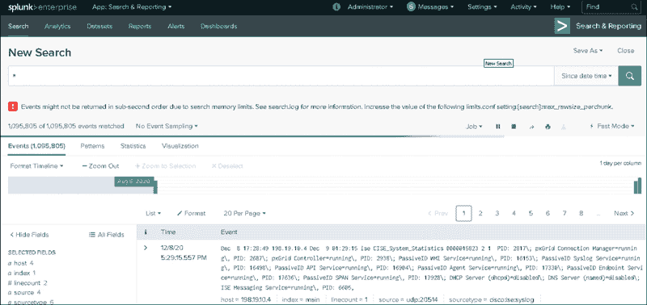

**图 2-26** Splunk 仪表板示例

其他 SIEM 专注于 SEM，这意味着它们提供各种事件管理和事件分析功能。`IBM QRadar` 就是一个拥有大量 SEM 功能的 SIEM 示例。QRadar 事件功能的示例包括开发各种类型仪表板的能力、识别网络上的每个资产，甚至直接从仪表板启动原生或第三方漏洞扫描器。需要明确的是，`Splunk` 具备 SEM 功能，而 `QRadar` 可作为 SIM 用于挖掘数据，但这两个系统在满足这些特定需求时的体验截然不同。图 2-27 是一个名为 `Pulse` 的 QRadar 应用程序仪表板示例。第 5 章 将更详细地介绍 SIEM 和数据管理。

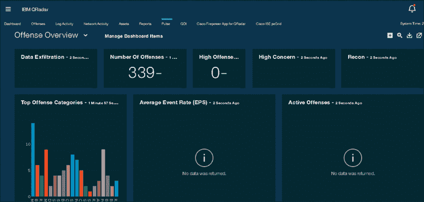

**图 2-27** QRadar 仪表板示例

一些 SIEM 不提供对事件采取行动的能力。行动的一个示例可以是阻止 SIEM 解决方案识别出的事件。如果无法采取行动，分析师将使用 SIEM 产品进行事件感知，同时使用其他方法采取行动。采取行动的程序可以记录下来并转化为剧本，随后可以实现自动化。这被称为 `orchestration`（编排），这正成为 SIEM 适配或与其他供应商合作以作为组合解决方案提供的一项功能。我们将在 第 10 章 “数据编排” 中更深入地探讨编排。


SIEM 还可以包含不同的事件跟踪方法。一种流行的方法是工单系统。工单系统可以是 SIEM 或编排平台的一部分，也可以是专门为此目的而设的。`BMC’s Helix ITSM` 和 `ServiceNow Security Operations` 就是可用于此目的的事件跟踪平台示例。优秀的工单工具包含协作功能，例如用于搜索过去发生的类似案例的 Wiki。`Tiki Wiki CMS Groupware` 和 `MediaWiki` 等工具也是此方面的选项。我建议在评估用于管理 SOC 将负责监控和处理的所有数据的解决方案时，考虑所有这些需求。

> **注意**
>
> SOC 拥有自己的 SIEM、SOAR 和/或 XDR 以保护 SOC，而不是共享用于保护组织的系统，这是理想的。如果使用共享系统，则必须在 SOC 网络和组织网络之间对管理权限进行分段。

### 总结

本章重点介绍了如何建立一个新的 SOC 以及如何提高现有 SOC 的成熟度。首先介绍的概念是如何制定使命和范围声明。这些构成了所有 SOC 策略和程序的基石，也是 SOC 存在的基础。接下来介绍的概念是 SOC 策略和程序的重要性，它们构成了 SOC 将提供的服务的基石。随后本章介绍了安全工具概念，这些是 SOC 不仅用于保护其负责的组织，而且用于保护 SOC 自身免受攻击的工具。

本章剩余主题涵盖了在规划和建设安全运营中心时需要解决的具体细节。主题涵盖了从如何定制 SOC 设施到需要何种类型的容量和吞吐量来支持 SOC 服务的所有内容。许多这些规划概念也适用于构建和保护组织，但本章的重点是开发 SOC，其中包括将 SOC 相关数据与组织数据分段并加以保护。

到目前为止，我提供了建设 SOC 的高层概述。在接下来的章节中，我们将更深入地探讨使 SOC 成功的要素。第 3 章 概述了现代 SOC 提供的各种服务。这包括使用内部资源提供的服务以及外包服务。我强烈建议每个 SOC 至少拥有下一章介绍的每项 SOC 服务的最小版本，或者至少有外包资源可用。最糟糕的情况是组织需要一项 SOC 未提供的安全服务，却不知道去哪里寻找合同支持来弥补这项缺失的服务。

### 参考文献

Bodwell, D. J. (1996, June 23). Team Charter. High Performance Teams. [`www.highperformanceteams.org/hpt_chtr.htm`](http://www.highperformanceteams.org/hpt_chtr.htm)

Cisco. Data Center Power and Cooling White Paper. [`www.cisco.com/c/en/us/solutions/collateral/data-center-virtualization/unified-computing/white_paper_c11-680202.html`](https://www.cisco.com/c/en/us/solutions/collateral/data-center-virtualization/unified-computing/white_paper_c11-680202.html)

Conway, B. (2017, May 12). Office Building. Whole Building Design Guide. [`www.wbdg.org/building-types/office-building`](https://www.wbdg.org/building-types/office-building)

Ferrill, P. (2018, January 8). The Best Mobile Device Management (MDM) Solutions for 2020. *PC Magazine*. [`www.pcmag.com/article/342695/the-best-mobile-device-management-mdm-software`](https://www.pcmag.com/article/342695/the-best-mobile-device-management-mdm-software)

International Organization for Standardization. (2004, May). ISO 17624:2004: Acoustics – Guidelines for noise control in offices and workrooms by means of acoustical screens. ISO. [`www.iso.org/standard/33148.html`](https://www.iso.org/standard/33148.html)

International Organization for Standardization. (2011, March). ISO/IEC 27031:2011: Information technology – Security techniques – Guidelines for information and communication technology readiness for business continuity. ISO. [`www.iso.org/standard/44374.html`](https://www.iso.org/standard/44374.html)

International Organization for Standardization. (2012, November). ISO 22311:2012: Societal security – Video surveillance – Export interoperability. ISO. [`www.iso.org/standard/53467.html`](https://www.iso.org/standard/53467.html)

ISACA. (2019). COBIT 2019 Framework (various publications). ISACA. [`www.isaca.org/resources/cobit`](https://www.isaca.org/resources/cobit)

Jones, C.P. (2017, June 9). Flood Resistance of the Building Envelope. Whole Building Design Guide. [`www.wbdg.org/resources/flood-resistance-building-envelope`](https://www.wbdg.org/resources/flood-resistance-building-envelope)

Key, T.S., & and Martzloff, F. D. (1986, September). A Consensus on Powering and Grounding Sensitive Electronic Equipment. Conference Record, IEEE/IAS Annual Meeting. [`www.nist.gov/system/files/documents/pml/div684/Consensus.pdf`](https://www.nist.gov/system/files/documents/pml/div684/Consensus.pdf)

Kosutic, D. (2015, September 21). Understanding IT Disaster Recovery According to ISO 27031. Advisera. [`advisera.com/27001academy/blog/2015/09/21/understanding-it-disaster-recovery-according-to-iso-27031/`](https://advisera.com/27001academy/blog/2015/09/21/understanding-it-disaster-recovery-according-to-iso-27031/)

McCarthy, K., & Avelar, V. (n.d.). Comparing UPS System Design Configurations. Schneider Electric – Data Center Science Center. Retrieved from [`www.apc.com/salestools/SADE-5TPL8X/SADE-5TPL8X_R3_EN.pdf`](https://www.apc.com/salestools/SADE-5TPL8X/SADE-5TPL8X_R3_EN.pdf)

Mearian, L. (2017, March 23). CW@50: Data Storage Goes from $1M to 2 Cents Per Gigabyte. Computerworld. [`www.computerworld.com/article/3182207/cw50-data-storage-goes-from-1m-to-2-cents-per-gigabyte.html`](https://www.computerworld.com/article/3182207/cw50-data-storage-goes-from-1m-to-2-cents-per-gigabyte.html)

National Security Agency. (2010). Defense in Depth. NSA. [`citadel-information.com/wp-content/uploads/2010/12/nsa-defense-in-depth.pdf`](https://citadel-information.com/wp-content/uploads/2010/12/nsa-defense-in-depth.pdf)

Peters, O.S. (1918, June 20). Technologic Papers of the Bureau of Standards: No. 108. Ground Connections for Electrical Systems. Department of Commerce. [`nvlpubs.nist.gov/nistpubs/nbstechnologic/nbstechnologicpaperT108.pdf`](https://nvlpubs.nist.gov/nistpubs/nbstechnologic/nbstechnologicpaperT108.pdf)

Spitzner, L. (2016, December 14). Mobile Device Security. SANS Security Awareness. [`www.sans.org/security-awareness-training/blog/mobile-device-security`](https://www.sans.org/security-awareness-training/blog/mobile-device-security)

Think Tech Advisors. (2017). PCs vs. Thin Client Devices. Think Tech Advisors. [`thinktechadvisors.com/2020/05/pros-cons-of-thin-client-devices/`](https://thinktechadvisors.com/2020/05/pros-cons-of-thin-client-devices/)

# 第 3 章

## SOC 服务

> *设计是个有趣的词。有人认为设计就是外观。但当然，如果你深挖下去，它实际上是关于如何运作的。*
>
> ——史蒂夫·乔布斯

什么是 SOC 服务？简单来说，`SOC services` 是一个宽泛的术语，指代 SOC 为整个组织提供的价值。一些公司提供 SOC-as-a-Service（SOC 即服务）产品。这些服务提供商接收你的日志，监控变更管理，并告知你组织中可能发生的潜在事件。一些组织使用 SOC 服务提供商，而另一些组织则利用内部资源开发自己的 SOC 能力。SOC 如何提供服务并不重要，重要的是这些服务在实现 SOC 所服务组织的目标方面有多有效。有效性可以用 SOC 及其服务的成熟度来表示，这将是本章的核心主题。

### 基础 SOC 服务

本章重点介绍全球组织中常见的 SOC 服务。所有成熟的 SOC 都以某种形式提供这些基础 SOC 服务，无论是主动提供、按需提供，还是通过合作伙伴关系提供。本书涵盖的核心 SOC 服务包括以下内容：

*   **风险管理：** 识别并做出决策以应对组织风险。这涉及管理任何类型的风险，从物理保护资产到修补软件中存在的数字漏洞。这也适用于补救薄弱的政策以及组织成员缺乏安全意识教育的问题。

*   **漏洞管理：** 识别并管理源自技术漏洞的风险。这通常涉及针对服务器、笔记本电脑和 IoT 设备上软件中的漏洞。大多数 SOC 使用漏洞扫描器和外部威胁情报来识别漏洞。

*   **事件管理：** 响应安全相关事件。这涵盖了当特定事件发生时 SOC 采取的行动，例如隔离系统、通知团队成员，以及实施补救步骤以解决问题。归属于事件管理的其他子类别包括事件响应、事件调查和其他事件相关主题。编排工具、人工智能和剧本等技术正变得极其流行，以帮助 SOC 完成事件响应服务。

*   **分析：** 分析各类工件。这包括识别特征、逆向工程、漏洞/利用分析、根因分析、补救和缓解分析。专注于分析的分析师与专注于事件响应的分析师的区别在于所需技能的类型。分析使用诸如 `IDA Pro` 之类的工具来反汇编恶意软件并理解其功能。分析工程师可以通过在沙箱中运行文件来了解其行为，从而回答“该文件是否恶意？”这一问题。这些技能不同于响应潜在入侵的 SOC 分析师所需的技能。

*   **合规：** 评估并维护组织合规要求。这可以包括法律强制要求，如 `HIPAA` 和 `PCI DSS` 合规，以及组织驱动的目标，如满足 `NIST` 或 `ISO` 标准——这些虽非法律强制，但可能被组织或其客户视为必需政策。合规服务还为组织的评估做准备，并协助收集外部方验证组织合规性所需的信息。

*   **数字取证：** 事件发生后收集证据以确定事件原因并为法律行动做准备。数字取证、事件响应和分析技能集之间存在一些重叠，因为这三者都包含某种形式的理解恶意软件或恶意方的行为。区分数字取证的是关于如何收集证据的法律层面。例如，如果你在调查过程中操作了文件，就会毁掉在法庭上使用该证据的任何机会（基于证据污染的概念）。第 8 章“威胁狩猎与事件响应”将更详细地探讨数字取证概念。

*   **态势感知与安全意识：** 为组织提供其运营环境和潜在威胁的感知。这包括关于可能影响组织目标的关键要素、潜在威胁，以及降低运营风险和威胁的行动的教育。

*   **研究与开发：** 研究不断演变的威胁形势，开发新工具和技术，并修改现有工具以提高有效性。

稍后在本章“服务成熟度：如果你建立了，他们就会来”部分，我将更深入地探讨这些服务中的每一项，同时在本书剩余章节中涵盖所有这些服务的基本概念。这些服务有许多子集，并且许多服务之间存在协同效应，我称之为 SOC 服务领域——我将很快介绍这个主题。SOC 内的团队成员也可以提供不止一项服务，而且许多 SOC 并不完全按照我列出的方式给服务贴标签。当然，每个组织都不同，我采取的方法是将我在成熟 SOC 中看到的情况与预期 SOC 服务的行业指南相结合。

如果你想了解 SOC 如何解释其服务，请查看 SOC 的使命声明和范围声明。正如第 2 章“建立安全运营中心”中所述，使命声明定义了 SOC 的宗旨，而范围声明提供了更多细节，包括提供哪些服务。你的 SOC 的目标是扩大范围，以包含前面列表中的所有基础服务，并使这些服务成熟。如果另一个部门处理其中一项服务，你的 SOC 应该与该部门协调以保持一定的参与度。例如，如果另一个团队处理漏洞管理，SOC 至少应该了解活跃漏洞的状态。了解这一点将有助于 SOC 提供其他服务，如事件响应，其中一部分就是知道漏洞何时被利用。

即使是最小的 SOC 也应致力于拥有某种形式的所有基础 SOC 服务，即使这些服务是外包的或仅按需报价使用。小型组织中通常不具备的一种常见 SOC 服务是数字取证。是的，配备专职的数字取证专家可能大材小用；然而，当组织内部发生网络犯罪时，能够迅速招募到一位专家将至关重要。关于数字取证，时机和初始响应的执行方式将决定整个服务的成败。如果证据被篡改，基于潜在污染的可能性，大多数法庭将不予采纳，无论证据显示了什么。因此，你应该主动了解联系谁及其相关费用，而不是等到需要立即寻找数字取证专家时才行动。在时机至关重要的情况下获取这些信息远非理想。这就是我建议拥有某种形式的所有基础 SOC 服务的众多原因之一，即使它们是按需的，意味着你只需在需要时知道联系谁。

建立 SOC 服务并非易事。它需要合适的人员、流程和技术。在着手开发新的 SOC 服务之前，你需要了解在开发 SOC 服务过程中预期要克服的一些挑战。你最不想做的就是投资一项新服务，却因上线流程中未预料到的瓶颈而无法上线。

#### SOC 挑战

在了解 SOC 中常见的服务之前，你必须首先理解在开发并最终上线新的 SOC 服务时将面临的一些挑战。我发现推出新服务的 SOC 将经历以下一项或多项挑战。

##### 挑战 1：人员


# 第 3 章 开发 SOC 服务

## 面临的挑战

### 挑战 1：寻找合适的人员

第一个挑战将是`寻找合适的人员`。根据 (ISC)² 进行的网络安全劳动力调查，题为“(ISC)2 Finds the Cybersecurity Workforce Needs to Grow 145% to Close Skills Gap and Better Defend Organizations Worldwide”，填补技能缺口所需的额外受训人员估计达 407 万名专业人士。这意味着美国市场的网络安全劳动力需增长 62%。导致这一技能缺口的原因多种多样，这是第 4 章“人员与流程”的主题，但请知悉，数字取证、恶意软件分析和威胁狩猎等 SOC 服务专用技能将极难寻觅。(ISC)² 的研究涉及具备通用网络安全技能的专业人士，即未考虑具备 SOC 服务专用技能和经验的安全专业人员子集。我认为当今市场上此类专业人士甚至更少，这使得为你的 SOC 招募合适的人员极具挑战性。第 4 章还涵盖了如何招募和留住合适的人才。

### 挑战 2：成熟度低

推出 SOC 服务的另一个挑战是在`极低成熟度`级别下进行，导致初始性能不佳。正如第 1 章“安全运营与 SOC 简介”所述，低成熟度意味着拥有临时性能力，或拥有提供服务的工具但缺乏明确的流程，以确保每次需要 SOC 服务时都采取适当步骤。如果新的 SOC 服务不能展现价值，最终将被关闭并由其他选项（如外包）取代，或移交给组织内 SOC 之外的另一个团队。我的建议是暂缓 SOC 服务或将其作为测试运行（通常称为 Beta 版），以确定服务是否在全负荷运行。另一种选择是随着 SOC 开发服务而外包该服务，并逐步将责任从外部方过渡到 SOC。使用外部服务使 SOC 能够从更成熟的服务中学习，并在 SOC 准备好处理时承担责任。

### 挑战 3：工具有限

第三个挑战可能是`能见度和工具有限，无法妥善提供服务`。有限能见度的一个例子是因缺乏管理工具或流程而无法追踪成功。另一个例子是事件响应等服务缺乏全网络能见度或对特定系统的能见度，导致提供服务的团队存在盲区。这两个例子都是由于缺乏适当工具造成的。

缺乏适当工具的例子包括：某些设备因不支持该技术而未启用网络准入控制（`NAC`），缺乏用于恶意软件分析的合适沙箱，以及缺乏支持应用可见性和控制的防火墙，导致第 7 层流量能见度有限。工具有限的问题很棘手，因为组织总能从最新、最好的工具中受益，但通常不得不凭借现有工具应对。每个新的 SOC 服务都会缺少一些工具，因此你必须决定是否拥有启动新服务所需的基础技术，还是应该等待，以避免过早推出服务导致即时负面反馈。

### 挑战 4：缺乏经验

我将强调的第四个也是最后一个挑战是`知道如何构建新的 SOC 服务`。行业指南有助于设计 SOC 服务，但指南并非针对你的具体业务。此外，专注于 SOC 服务的指南通常不考虑成本，也不比较商业和开源选项，导致团队在构建服务时对 SOC 应做什么感到困惑。例如，数字取证的概念有许多指南推荐昂贵的实验室和大量培训。对于开发新取证服务的 SOC 分析师来说，很难决定是投资昂贵的企业级工具还是利用开源选项。某些 SOC 服务将要求就能力或功能做出决策，这些决策在服务上线并面对真实数据之前很难做出。我的建议是，如果你不知道如何启动一项服务，要么咨询外部专家协助，要么外包并向另一家更有资质的服务提供商学习。

在本章中，我将通过流程和方法论来应对这些挑战。我将建议与 `FIRST Computer Security Incident Response Team (CSIRT) Services Framework` 和 `NIST Cybersecurity Framework (CSF)` 保持一致。我还将引用为中小企业和财富 500 强组织执行的研究和咨询工作。

> **注意**
>
> 学习过程的一部分可以是在上线前咨询具有 SOC 服务经验的外部方。如果可能，我建议与其他 SOC 交流，了解他们如何建立并当前运行其服务。可考虑的会议包括 RSA、Blackhat、DEFCON、BSides、ShmooCon、SecureWorld 和 SANS。

现在你已经了解了开发新 SOC 服务时将面临的一些挑战，是时候看看开发 SOC 服务的流程了。我将首先回顾一种建立任何类型新 SOC 服务的方法论，这需要支持 SOC 的基础 SOC 服务，以便 SOC 能够提供服务。我称关于 SOC 在提供任何价值之前所需条件的方法论为`SOC 基础支持服务的三大支柱`。

## SOC 基础支持服务的三大支柱

### 基础 SOC 支持服务

在规划 SOC 提供的服务开发之前，您的组织必须首先确保所有 SOC 支持服务均已到位。我将这些必需的支持服务分为三大支柱，如图 3-1 所示。这三大支柱中的任何一个出现故障都将导致所有 SOC 服务失效，因为这些因素是维持 SOC 运行所必需的。

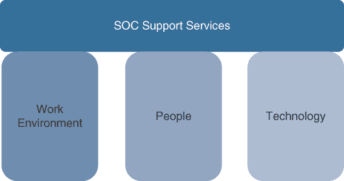

**图 3-1** 基础 SOC 支持服务

#### 支柱 1：工作环境

第 2 章的部分内容重点介绍了如何构建 SOC 工作环境，包括物理和逻辑设计考量以及安全考量。在提供 SOC 服务之前，必须建立 SOC 工作环境，以便其能够支持负责 SOC 服务的人员和技术。显而易见，员工需要一个工作场所，因此真正的问题是新 SOC 服务的成员*应该*在哪里工作？有些服务团队能够有效地远程工作，而另一些则需要聚集在特定地点共同办公。

新 SOC 服务的工作环境可以包括物理位置的一个或多个指定物理空间、容纳所需技术的空间，以及远程办公的安排（如允许）。例如，如果 SOC 将建立新的漏洞管理服务，漏洞管理团队可能需要 SOC 内的一个工作区，该区域有空间供团队成员就近而坐以便更好地协作，组织或 SOC 数据中心内的空间以托管漏洞管理设备，以及安装在将远程支持该服务的工作人员电脑上的 VPN 代理。可能还需要更多空间用于其他漏洞管理需求，例如建立用于测试漏洞的实验室，或在不同位置预留空间以托管漏洞管理服务器。第 9 章“漏洞管理”提供了分布式漏洞评估架构的示例，其中包括在每个位置部署本地漏洞扫描器、使用通过云连接的客户端，或使用云交付的扫描解决方案。

##### 规划工作环境

请知悉，在规划工作环境时有许多备选方案可供考虑。在漏洞管理服务示例中，漏洞服务器的物理空间可以替换为使用基础设施即服务 (`IaaS`) 或完整的软件即服务 (`SaaS`) 在云中托管服务器。SOC 团队成员可以在不同于组织园区的地点办公，也可以完全在家虚拟办公。请务必考虑工作环境的所有选项，包括混合模式，而不要只关注 SOC 运作的单一模式。COVID-19 疫情让许多原本认为远程办公行不通的组织相信，远程办公不仅可行，甚至比要求员工去办公室上班效果更好！

一些 SOC 允许负责某项服务的部分或所有人员远程工作。这样做减少了为 SOC 人员专门分配设施空间的需求。一些 SOC 将在本地管理提供服务所需的技术，而另一些则将使用云服务，这同样减少了数据中心对物理机架空间以及维护需求的占用。如果当前正在使用物理空间或计划将来使用，您的 SOC 需要提前说明这些需求并规划增长。第 2 章关于设施规模讨论中的一个关键点是：初期规模预留大一些并逐渐填满空间，比规模预留小了导致空间不足要便宜。前述云用例也可以作为应对增长的选项，但最好同时规划云和物理设施两种增长方案，以免因缺乏设施空间而被迫使用云服务。

以下是在规划工作环境（支柱 1）时需要考虑的通用清单：

*   提供服务的团队成员将从哪里工作？
*   需要哪些设施要求？
*   是否需要在设施为技术供电和维护？
*   是否允许远程工作？
*   团队是否需要开会，如果需要将在哪里开会？
*   团队是否需要访问共享的 SOC 设施，如作战室？
*   该服务是否需要在任何设施增加物理安全措施？
*   是否存在远程工作限制，例如数据主权要求不允许数据离开本国？

#### 支柱 2：人员

基础 SOC 服务的第二大支柱聚焦于人员。组织或 SOC 必须决定由什么类型的技能和经验丰富的人员来运营尚不存在的 SOC 服务。这对许多 SOC 来说是一项艰巨的任务。SOC 经理在尚未确定谁将管理服务之前，试图为未来将提供的服务创建文档，这让他们感到困难。这意味着他们不知道谁将管理日常任务、这些日常任务将涉及什么，以及这些任务如何随时间变化。这一概念是开发新服务迄今为止最大的挑战。如果没有员工担任该角色并反馈特定 SOC 及其支持组织中的技能和经验期望，就很难理解新 SOC 服务将如何日常运作。不了解服务会导致在招聘过程中不了解所需的具体技能。这导致寻找错误的人选，并在面试潜在候选人时提出错误的问题。

##### 寻找合适的人员

我的建议是 SOC 应投资于那些理解通用网络安全概念、懂得如何使用 SOC 将使用的基本工具和技术、具备强大解决问题能力，并了解组织文化的人员。您希望员工在分析 SOC 将提供的服务及交付所需技能*之前*，先了解组织的业务及其达成目标的方式。这就是为什么许多 SOC 从简单的日志监控服务起步。一旦该基础服务投入运行，SOC 就可以在该基础服务之上构建更复杂的服务，最终目标是提供本章开头列出的八大基本 SOC 服务的某种形式。这种方法使团队成员能在承担更复杂的任务之前，先学习组织的基本情况。

当我与 SOC 经理交谈新 SOC 服务的招聘挑战时，我常听到诸如“我不知道该雇佣谁，因为我还没有这项服务。我必须先有服务，才知道雇佣什么类型的人来运营它。”之类的说法。好消息是，有可用资源能提供与工作角色相关的技能组合的大致概念。第 4 章解释了如何根据匹配类似工作的公开档案来制定招聘画像，并提供了其他技巧，以帮助克服为尚未交付的服务招聘人员的挑战。

以下是在规划支柱 2 时需要考虑的通用清单：

*   该服务需要哪些工作角色？
*   每个工作角色的预估薪资范围是多少？
*   每个工作角色关联哪些技能组合？
*   可以且将使用哪类员工或承包商（全职员工、兼职员工、全职承包商、托管服务员工等）？
*   谁来管理团队？

##### 人员可以从哪里招募？

##### 是否允许远程工作？

##### 某些角色是否要求靠近特定地点？

例如，团队成员是否需要在合理的驾驶距离内，以便参加现场会议？数据中心管理员是否需要在关键服务运行地点的合理驾驶距离内？

##### 每个角色的差旅要求是什么？

##### 每个角色的职业发展路径是什么？

#### 支柱 3：技术

技术是基础 SOC 支持服务的第三大支柱。许多安全框架完全避免提及具体技术，因为组织往往拥有截然不同的技术概况、偏好、预算和需求。一个例子是提供网络访问控制的指南。每个现代行业指南都强调了 NAC 的必要性。NAC 技术交付的细节可能包括交换机内的功能、控制交换机的外部 NAC 技术，或控制访问的主机产品，这意味着主机上的软件就是 NAC 技术。在所有这三个示例中，都使用了不同的技术和方法来实现 NAC，但它们最终都提供了相同的高层目标。这就是为什么引用 NAC 的行业指南不列出具体的 NAC 技术，而是阐述技术所期望的结果。您将在本节和全书中发现针对这些建议采用的相同方法。

关于基础 SOC 支持服务，所有技术都将需要其自己的策略、人员和程序，独立于用于支持 SOC 提供的服务的技术之外。新建 SOC 在 SOC 支持服务方面遇到的一个常见挑战的典型例子是：分配管理 SOC 数据中心的责任。一些 SOC 要求其数据中心由 SOC 成员负责保护，而其他组织则将所有权移交给组织的数据中心保管人。对于这个例子，影响 SOC 管理其数据中心决策的因素包括预算、SOC 服务要求、可用资源、人员配备和企业策略，因此每个组织的 SOC 处理此功能的方式都不同。

##### 保护 SOC 技术

无论技术如何托管或管理，都必须将所有 SOC 技术的数据和对 SOC 工具的管理访问，在物理或逻辑上与组织的其余部分隔离开来。某些 SOC 服务甚至需要比其他 SOC 数据进一步隔离，例如数字取证，它要求隔离涉及活跃调查的数据。加密也可用于保护离开 SOC 网络的数据。

用于保护 SOC 的具体技术概念，与用于保护组织的概念相同。第 1 章 描述了纵深防御概念，包括如何执行 SOC 安全能力评估。同样的纵深防御方法也需要应用于 SOC 自身的保护。我的建议是，如果可能的话，在 SOC 安全能力评估中排除组织的防御措施，这样如果组织遭到入侵，该威胁就不会影响 SOC 本身。

以下是在规划支柱 3 时需要考虑的通用清单：

*   需要哪些安全工具来保护 SOC 和新增的服务？
*   新增服务还需要哪些额外技术（路由、存储等）？
*   新服务所需技术的总成本（获取、安装技术和培训）是多少？
*   针对技术的流量分段和/或隔离策略是什么？
*   除了内部 SOC 相关安全实践包含的内容外，新 SOC 服务是否需要额外的安全或访问限制？
*   技术需要多长时间才能投入运行？
*   存在哪些冗余要求？
*   必须考虑哪些合规性和策略要求？

#### 评估基础 SOC 支持服务的三大支柱

如前所述，所需的基础 SOC 支持服务是支持 SOC 本身的。如果基本的 SOC 基础尚未就绪，另一种选择是使用服务提供商，直到内部 SOC 准备好承担与服务相关的责任。在考虑如何处理基础 SOC 支持服务的三大支柱时，SOC 需要考虑其目前能提供哪些服务（如使命声明和范围声明中所定义），以及它计划最终提供哪些服务。当确定一项新的 SOC 服务时，需要规划三大支柱的要求，包括这些要求是否会给支持现有 SOC 服务的 SOC 支持服务资源带来压力。您绝不希望尝试添加一项新服务，导致所有现有 SOC 服务都面临资源约束！

以下是关于新 SOC 服务对支持 SOC 的三大支柱影响的一些通用问题，您需要予以解答。请记住，如果这三大支柱中的任何一个得不到正确支持，或者在您部署新 SOC 服务后受到负面影响，您将体验到整体 SOC 自身的性能低下。

*   需要哪些额外的人员、流程和技术？
*   新增服务将如何影响现有的 SOC 服务？
*   目前的工作空间考量以及未来预期的工作空间需求是什么？
*   云能力和/或远程工作选项能否帮助减少工作空间的物理需求？
*   新服务在任何阶段是否需要外包服务？
*   所需的技能组合和人数是多少？
*   基于新服务，SOC 员工是否有职业发展路径？
*   新服务的策略、合规性和数据分段要求是什么？

## SOC 服务领域

在 SOC 决定向其服务范围添加新服务后，SOC 需要定义服务领域。服务领域是一种通过定义服务将涵盖的具体内容，将 SOC 服务组织为更详细、更有意义数据的方式。例如，如果 SOC 将提供事件响应服务，该服务的一部分将包括威胁监控。否则，将无法识别潜在攻击何时发生。威胁监控包括摄入日志，以便在发现安全日志违规时进行事件分析。这意味着日志收集和分析是 SOC 事件管理服务的一个子集，因此也是支持事件管理的服务领域的一部分。

SOC 服务领域及每个领域所使用的技术可能跨越不同的 SOC 服务。日志采集、事件分析、Windows 主机日志监控、Web 过滤日志采集、IPS 日志采集以及其他特定项目，都可以成为 SOC 的风险管理、漏洞管理和应急响应计划的一部分；因此，当 SOC 为其核心服务产品定义 SOC 服务领域时，这些技术和 SOC 服务领域可能会被引用不止一次。SOC 使命宣言提供了 SOC 基础服务产品的高层概览；然而，SOC 服务领域文档必须更加细致，以避免对具体将提供什么服务及其与 SOC 其他部分的关系产生混淆。这就是为什么 SOC 服务领域不在 SOC 使命宣言或范围声明中提及的原因。再次以 SOC 内部的日志采集为例，每个 SOC 服务的 SOC 服务领域文档都需要定义是否包含日志采集、该服务使用日志采集的目的，以及负责该 SOC 服务的哪些团队依赖这项技术。这些细节将包含在与 SOC 基础服务相关的程序中。

### FIRST 的 CSIRT

图 3-2 来自 FIRST 的计算机安全应急响应小组（`CSIRT`）服务框架，描绘了 SOC 可以提供的服务领域和服务。请注意，其中一些服务的标签与我为所有 SOC 都应提供的八项基础服务所用的标签不同。例如，态势感知和安全意识在图 3-2 中被称为知识转移。此外，我推荐的研发等服务未包含在该示例模型中。尽管如此，图 3-2 提供了一个如何开发服务领域以代表支持核心 SOC 服务的示例。


**图 3-2** FIRST CSIRT 服务和服务领域

> **注意**
>
> 请记住，大多数行业指南对其 SOC 服务模型使用不同的术语。无论如何，我发现这些概念有重叠，这就是为什么我将继续指出我的八项基础 SOC 服务如何与其他 SOC 服务指南相关联。这样做能为您提供多个关于 SOC 服务最佳实践的视角。

### 开发 SOC 服务领域

图 3-3 展示了 SOC 支持服务的概念、八项推荐的 SOC 基础服务以及 SOC 服务领域三者如何关联。工作环境、人员和技术是 SOC 运作所必需的。这些是 SOC 支持服务的要素。有了这些要素，SOC 就能提供一项或多项八项基础 SOC 服务。最后，有多个 SOC 服务领域组成各种服务、技术和实践，它们可以成为一项或多项 SOC 基础服务的一部分。前面我举了一个日志汇总服务的例子，该服务为分析师收集日志以供审查。该服务领域对多项 SOC 基础服务都很有用，包括应急响应、分析和风险管理。


**图 3-3** 在基础支持服务之上构建基础 SOC 服务并添加 SOC 服务领域池

请注意，图 3-3 还展示了八项基础 SOC 服务如果没有基础 SOC 支持服务就无法存在。还要注意，SOC 服务领域不应被特定的 SOC 服务直接引用，而应被多个 SOC 服务引用。关于您的 SOC 范围和使命宣言，我建议您仅引用八项基础服务。您可以在其他更详细的文档（如程序）中包含有关 SOC 服务领域服务的详细信息。

> **注意**


> SOC 服务领域的文档记录对于为规划目的建立或记录现有 SOC 服务至关重要。当您准备面向公众的高层文档（如使命宣言、范围声明和策略）时，我建议您仅引用八项基础 SOC 服务（而非服务领域），以保持语言的高层次性和结果导向。

以下服务列表是规划基本 SOC 服务的一个示例，我将其标记为一个 SOC 服务领域。此示例的列表并不完整；然而，这是初始阶段的正常开发流程。随着人员为服务领域招募到位且理解了更多需求，SOC 可以最终确定其服务领域实施计划，包括对服务列表进行必要的调整。另请注意，此示例侧重于一个基本服务领域，它将成为基础 SOC 服务（如应急响应服务或分析服务）的一个子类别。因此，此示例服务领域不提供数据收集之外的任何成果，其他 SOC 服务将依赖这些数据才能正常运行。我有时会看到新建 SOC 将此类服务领域作为通向未来更成熟服务的垫脚石。

**SOC 服务领域：从安全设备采集日志数据**

*   **目标：** 从已识别设备采集持续的实时日志流。
*   **成果：** 日志可供 SOC 分析师或其他安全工具查询、分析、归档或检查。
*   **依赖项：** 服务存在所需的一切
    *   日志收集工具
    *   存储
    *   用于存储和为技术供电的设施
    *   支持人员
*   **成功标准：** 安全地收集、聚合并提供长达 90 天的事件数据摘要。
    *   将较旧数据归档长达 2 年
    *   经 SOC 分析师验证的高质量数据
    *   分析师可在 10 分钟或更短时间内提取所需数据
*   **需求：**
    *   确定支持日志收集所需的技能和 SOC 人员
    *   确定支持日志收集所需的工作量
    *   确定将生成待收集日志的安全设备
    *   制定 SOC 计划接受的日志格式要求
    *   确定是否需要在中央服务器上进行日志中继以将日志发送到其他设备
    *   标准化日志的日期和时间，并确保能满足时区、NTP 和其他时间同步协议策略
    *   确定将使用什么工具收集日志
    *   确定所需的任何网络、防火墙或路由配置
    *   了解内部策略、合规性和其他要求的日志保留要求
    *   确保日志传输按预期工作

#### 内部服务与外部服务

随着 SOC 开发和评估服务，它需要决定的一个重要问题是：SOC 是内部提供服务，还是外包给第三方。这个问题的答案来自于上一节介绍的服务评估流程。内部和外包两种方法各有优劣。

我在第 1 章的“内部与外包”一节中介绍了内部服务与外部服务的价值与劣势对比。表 3-1 总结了采用这两种方法的优势。

> **注意**
>
> 部分内部、部分外部的工作人员可被视为在 SOC 内部工作的承包商。

**表 3-1** 内部服务与外部服务的优势

#### 内部服务与外部服务的优势与劣势对比

| 内部服务优势 | 外部服务优势 |
| --- | --- |
| 了解业务 | 可分摊的运营支出 (`OPEX`) 成本 |
| 数据内部存储 | 无利益冲突 |
| 跨部门关联 | 可扩展性和灵活性 |
| 定制化需求 | 利用其他客户趋势 |

表 3-2 总结了劣势。

**表 3-2** 内部服务与外部服务的劣势

| 内部服务劣势 | 外部服务劣势 |
| --- | --- |
| 成本 | 业务知识有限 |
| 人员（招聘/维护） | 外部工具和数据流 |
| 潜在利益冲突 | 缺乏沟通 |
| ROI（投资回报率）顾虑 | 通常不被察觉的人员 |
| | 定制化受限 |
| | 服务因成本而受限（例如：分级的黄金、白银和青铜服务） |

许多开发新 SOC 服务的组织会在建设自己的内部服务时首先使用外部服务。其思路是跟随（shadow）服务提供商，并逐步减少外包，直到不再需要外部服务。例如，聘请几位内部专家担任项目负责人，在内部团队建设期间将所有一级任务外包给外部机构。该策略旨在平衡内部和外部 SOC 方法的优势。如果您认为您的 SOC 尚未准备好妥善提供基础 SOC 服务，请将其外包，直到您具备相应能力。

##### 合同制与正式员工职位

无论是内部还是外包状态，所有 SOC 服务都必须明确列出并填补特定职位，这一点至关重要。例如，如果您的 SOC 负责提供取证和事件响应服务，您需要确保设有专门职位来服务于这些服务范围内的角色。如果您的 SOC 将这些角色外包，您仍然需要一个具备相应技能的内部角色来与第三方服务提供商进行交互。定义角色不仅是为了让服务提供商了解该角色的技能要求，也是为了给内部员工提供发展这些技能的机会，以便最终接管该角色。推荐的做法是制定一份组织架构图，展示 SOC 内的所有角色，包括外包的角色。

当今 SOC 中另一种相当常见的选择是混合模式。这种方法将外包和内部资源结合起来运行 SOC 服务。例如，团队负责人可以是内部员工，分析师团队则由外包承包商和 SOC 团队的正式员工共同组成。这效果很好，因为例如，既有受组织内部政治影响的内部员工分析师，也有带来独特无偏见经验的外部分析师。然而，我的建议是确保由 SOC 正式员工对承包商职位负责。

我记得以前有个职位，我作为承包商资源担任政府机构的团队负责人。我诚实地讲，在缺乏制衡的情况下，我拥有过大的权力，包括为政府机构内的其他承包商角色编写职位描述，以及负责选择政府机构采购何种技术。什么能阻止我为只有我的真实雇主——承包商公司——能填补的特殊角色创建职位？什么能阻止我只选择我的真实雇主——承包商公司——在销售的工具？当然是我的职业道德阻止了我采取此类行动，但承包商的职业道德标准参差不齐。这就是为什么我强调即使使用承包商资源，也必须包含 SOC 正式员工的原因。

### SOC 服务职位目标

在 SOC 确定服务和角色后，下一步是为每个角色定义目标。目标不包含具体任务，具体任务在相关的程序文档中解释。相反，目标是对服务范围内何为成功的高层级总结。例如，SOC 中的漏洞分析师将负责确保漏洞管理软件已安装、保持最新并在端点上运行，评估扫描结果，调优漏洞管理解决方案，并与正确的 IT 团队协作修补漏洞或制定其他缓解计划。该情况下的分析师将需要工具、软件许可证、培训、访问不同团队的权限，以及执行漏洞管理企业策略的权限。第 4 章 回顾了本章涵盖的每种 SOC 服务中角色常见的职责。您组织架构图中列出的每个职位都应包含成功范围内任务的摘要，如图 3-4 所示，该图描绘了 SOC 中典型的角色和职责。第 4 章 将更深入地探讨 SOC 角色，但图 3-4 是了解不同 SOC 服务相关角色类型的良好参考点。


**图 3-4** SOC 角色与职责示例

#### 资源规划

另一个职位任务是资源规划，即确定应有多少人填补某个职位。根据 SOC 的规模和所规划服务的复杂程度，新 SOC 服务的资源规划可能非常具有挑战性，也可能非常简单。资源估算涉及确保 SOC 拥有适当数量的人员，不仅要应对威胁量，还要通过职位冗余来应对休假、关键人员流失或其他轮岗流程。SOC 必须避免这样一种场景：一个人运行一项 SOC 服务并决定离开组织，导致该服务在该人员被替换前无法运行。您也不希望用过多的资源饱和 SOC 服务，因为配置角色和保持员工满意度涉及高昂成本。

许多 SOC 依赖技术来帮助解决资源有限的问题，利用自动化减少对人工任务的需求。例如，员工没有无限的时间来筛选大量警报并持续采取适当行动，因此 SOC 实施技术来帮助优先处理需要人工审查的事件，使流程更高效，并最大限度地减少支持 SOC 所需的人数。第 10 章 “数据编排” 将更深入地探讨自动化和编排概念。请知悉，技术永远不会取代人。相反，技术将减少琐碎和重复性的任务，以便 SOC 分析师将时间用在更复杂的工作上。

不幸的是，没有简单的公式可以根据影响 SOC 处理服务需求的所有因素，计算应有多少人填补某个职位。推荐的做法是规划预估人数加一（用于冗余），运行服务，然后在强制性的经验教训复盘会议上评估服务提供的成功情况。经验教训会议评估服务的成功，重点关注哪些已识别问题可被分析以进行潜在的缓解调整（包括招聘更多人员），并考虑调整流程或获取包含自动化能力的技术的方法。

> **注意**
>
> 我发现，当 SOC（安全运营中心）在某项 SOC 服务上人员过剩时，总会有其他 SOC 服务需要更多帮助。相反，我经常听到 SOC 团队感到人手不足、工作繁重。基于这些观察，如果你有能力为某项 SOC 服务招聘更多人员，我建议你趁机招聘。这比日后需要更多人却无人可用要好得多！

### 服务成熟度：如果你建设了，他们就会来

成熟度是 SOC 服务的关键组成部分。SOC 不仅仅是获得一项服务，而是利用内部或外包资源来构建它。例如，如果我建议某组织开发漏洞管理服务，这不仅仅是购买一台漏洞扫描器那么简单。图 3-5 是一个取自 ISACA COBIT 2019 指南的成熟度模型示例。没有漏洞管理服务意味着该 SOC 服务的成熟度等级为零级。获得漏洞扫描器将支持临时扫描，将漏洞管理服务的成熟度提升至一级。随着可重复流程的建立，成熟度也会随之提高。


**图 3-5** 成熟度分级示例

使用成熟度衡量体系对任何 SOC 服务的成功至关重要，原因如下：

*   你可以向非技术决策者解释为何需要持续投资才能使服务成功。这有助于反驳“我们已经买给你所需的工具了”这类言论。
*   你可以制定改进目标，其中可包含达成目标时的奖励机制。奖励机制能促进职业成长，增强员工对 SOC 使命的奉献精神。
*   成熟度模型能为提升服务质量提供潜在路线图。
*   成熟度模型凸显了人员、流程和技术对服务的重要影响，因为三者缺一不可，共同支撑更高级别的成熟度类别。

随着你开发 SOC 服务，你需要评估它们处于何种成熟度级别。你可以与 SOC 发起人验证结果，设定服务改进目标，并规划人员、流程和技术方面的需求以实现这些改进。采用这种方法，能让所有技术和非技术相关方了解 SOC 服务的当前状态和潜在未来状态。第 1 章介绍了如何评估 SOC 成熟度。

接下来，让我们回顾成熟 SOC 实践的八项基本服务。

### SOC 服务 1：风险管理

风险管理存在于世界上大多数 SOC 中，是一项基本服务，因为它处理所有形式的风险。这意味着其他服务本质上都是风险管理的子集。例如，漏洞管理仅处理技术漏洞，而风险管理涵盖所有形式的风险，包括非技术漏洞，如社会工程学攻击风险和物理安全漏洞风险。

#### 对风险的四种应对

每个组织都面临各种形式的风险。风险管理团队的职责是为遇到的风险提供应对方案。组织在应对风险时，基本上有四种选择：

> **注意**
>
> 还有其他类似的风险模型，包含我所提供的用于应对风险的五个选项。第 9 章重点介绍了 ISO 27005-2018 如何建议使用类似的语言提出四种风险应对选项：风险保留、风险规避、风险修正和风险分担。与所有指南一样，措辞可能不同，但概念是相同的。

*   **降低：** 应用服务、工具或其他对策来降低风险
*   **接受：** 认定风险在可接受范围内，不采取行动
*   **拒绝：** 认定风险不可接受，但仍不采取行动
*   **转移：** 分担或外包风险

> **注意**
>
> 接受风险和拒绝风险很相似，但有关键区别。*拒绝* 不同意或接受该风险，但不采取任何行动；而 *接受* 风险意味着风险在可接受边界内，因此无需采取行动。

*降低* 风险可能是你对风险应对的预期。降低风险可以是任何类型的人员、流程或技术变更，以降低风险水平。理想情况下，你希望通过诸如修补易受攻击的服务器等措施来消除风险。如果补丁不可用，你可以在易受攻击的系统前部署安全设备，从根本上防止任何外部威胁利用该漏洞。另一种选择是指派团队监控易受攻击服务器的流量，从而在系统被利用时能被及时发现，从而降低风险。第 9 章回顾了如何选择解决漏洞的最佳方案。

*接受* 风险意味着风险处于可容忍水平。一个例子是为位于无地震区（如佛罗里达州）的建筑不购买地震保险。是的，佛罗里达州也可能发生地震，但多年未发生，短期内也极不可能发生。

*拒绝* 风险意味着事件不可接受，但缓解措施不值得付出努力。回到地震例子，假设你的办公室位于地震频发地区（如加利福尼亚州）。你的 SOC 必须决定是否值得缓解地震损坏风险，考虑到保护建筑所需的一切，成本可能极高。如果保护建筑免受地震损害的成本是其价值的三倍，可能会决定拒绝该风险，即你不接受其在容忍范围内，但不值得缓解，因此你的 SOC 将在威胁发生时处理潜在损失。

延续地震例子，许多组织在面对降低自然灾害风险时，选择通过购买保险来*转移*风险。组织无需加固建筑，而是购买保险，在事件发生时赔偿损失，从而将威胁担忧转移给另一方（即保险公司）。

> **注意**
>
> 我经常被问及对网络保险的看法。就我个人而言，我认为大多数没有网络保险的组织最终都会购买。我持这一观点的主要原因是，没有组织的 C 级高管愿意在重大网络事件发生后承认他们不认为需要保险。C 级高管宁愿说“是的，我们有合作伙伴提供该服务”，因为在公众眼中，网络泄露的责任全在 C 级团队身上。每个组织现在都有网络保险吗？当然不是；但我看到的趋势是，随着组织了解网络保险这一选项，网络保单的签发呈现爆发式增长。第 9 章将更深入地探讨评估网络保险的最佳实践。

#### 降低风险

降低风险并非总是易如反掌，因为根据变更内容的不同，可能会引入新的风险。此外，每个风险降低选项都会有相关成本。如果成本超过修复收益，则不值得缓解该风险，从而导致选择风险拒绝。风险也不是非此即彼的度量。有不同的模型可用于计算风险量。一个例子是预期货币价值（`EMV`）分析。`EMV` 分析是一种统计技术，用于计算未来包含可能发生也可能不发生的场景时的平均结果。`EMV` 分析获取每种可能结果的价值，并将其乘以其发生概率。随后将可能结果的概率加权值相加。这种方法极具价值，因为你不仅能看到所有风险均被利用时的总成本，还能在考虑多种情况时生成一个更切合实际的总体风险美元价值，这更为真实。

#### EMV 方法

让我们通过一个示例来演练如何使用 `EMV` 方法进行风险分析。在此示例中，假设有八种不同的风险需要你的 `SOC` 决定如何处理。你的 `SOC` 发起人希望了解与所有风险相关的美元价值。你可以创建一个包含所有八个风险项的 `EMV` 图表。你可以估算每种风险发生的概率，以及风险被利用时的成本。更重要的是理解成本与风险实际发生的对比。假设在此示例中，核算所有八种风险后，所需的风险预算为 118,000 美元。对于许多组织而言，这一巨额美元价值在风险应急预算方面可能是一个巨大的要求；然而，计算出的风险现实（即 `风险应急储备`）为 33,500 美元，考虑到并非所有事件都会发生，这可能更为合理。更有可能的是发生少数事件，例如事件 C 和事件 E 发生，这将意味着需要 28,000 美元。使用 `EVM` 预算，这 28,000 美元将从 33,500 美元的计划预算中支取。以这种方式使用 `EVM` 可为非技术领导者需要理解的合理风险应急预算提供依据。表 3-3 显示了此示例中的数字。

**表 3-3** EMV 计算示例

| 风险 | 风险概率 | 成本影响 | 风险应急储备 |
| --- | --- | --- | --- |
| **A** | 80% | $10,000 | $8,000 |
| **B** | 30% | $30,000 | $9,000 |
| **C** | 50% | $8,000 | $4,000 |
| **D** | 10% | $40,000 | $4,000 |
| **E** | 30% | $20,000 | $6,000 |
| **F** | 25% | $10,000 | $2,500 |
| **总计** | | **$118,000** | **$33,500** |

#### 风险文档记录

另一种风险管理技术是妥善记录每个风险，以便对相关影响进行估算和决策。表 3-4 是一个示例格式，可用于确保风险管理团队记录组织需要处理的每个风险。资产所有者和安全工程师需要共同协作，就录入该表单的内容达成一致，以确保计算结果准确。如果输入不准确，使用 `EMV` 技术等风险计算将无法提供有用的结果。还需指出，空白 表 3-4 模板的预期输入内容可能长达数页。

**表 3-4** 风险文档记录模板

| 风险名称 | 描述 | 来源（含说明） | 发生可能性（含理由） | 影响严重性（含理由） | 可控性（含理由） |
| --- | --- | --- | --- | --- | --- |
| 1. | | | | | |
| 2. | | | | | |
| 3. | | | | | |
| 4. | | | | | |
| 5. | | | | | |
| 6. | | | | | |
| 7. | | | | | |
| 8. | | | | | |

每个风险必须在风险管理响应流程的生命周期内进行跟踪。这可以通过 `风险登记册` 系统来完成，该系统记录每个已识别风险的基本信息。创建 `风险登记册` 时需要考虑不同的因素。请使用以下模板作为你需要捕获并成功跟踪风险事件的最低内容要求：

*   跟踪编号/日期
*   指派工程师
*   描述
*   起因
*   影响
*   严重性和可能性
*   风险响应
*   根本原因

##### 应对风险

下一个风险管理概念是应对风险。对于漏洞管理，缓解过程将是技术性的，这可能包括补丁或引入安全工具以保护易受攻击的系统。风险管理缓解措施的范围可能更广，因为风险可以是从环境到物理等任何性质。为了适应这一广泛的潜在缓解选项范围，风险管理团队必须能够定义业务应急计划和相应的实施计划。

许多因素都可能影响这两个计划，具体取决于风险类型、其直接和间接影响的对象、合规性考量、健康因素及其他因素。以下两个列表是风险管理团队成员可用来收集信息的模板示例，这些信息将用于风险管理团队做出适当的响应。请注意，这些文档比风险文档记录模板中收集的内容详细得多。风险文档记录模板和业务应急文档都有许多变体，可根据所应对的风险进行调整和使用。

**业务应急计划**

*   战略性事件前变更
    *   敏感数据
    *   常规数据保护
    *   中断期间数据保护
    *   数据道德使用
    *   客户记录
    *   常规安全措施


*   中断期间安全措施
*   道德使用保护
*   沟通计划
*   利益相关者
*   利益相关者沟通
*   运营恢复

**应急计划实施**

*   战略性事件中变更
    *   应急计划沟通
    *   应急计划的监控与测试
    *   应急计划的调整
    *   变更沟通

#### 风险热力图

量化风险的一种流行方法是使用热力图，它提供了事件潜在影响的简化视图。一种方法是使用图 3-6 所示的风险热力图模板。该模板将事件发生的概率与严重性进行对比，这两个关键因素有助于理解风险的真实威胁。例如，一种极其罕见的灾难性风险虽令人担忧，但因其不太可能发生，可被视为中等风险。更详尽的热力图可包含影响和缓解的相关美元成本，利用 `EMV` 方法计算估算风险，以进行持续规划。


**图 3-6** 风险热力图示例

还有更多属于风险管理范畴的主题有待涵盖，包括应对和从风险中恢复的预期。第 6 章“降低风险并超越合规”专门讨论风险应对和风险恢复。

### SOC 服务 2：漏洞管理

攻击者利用漏洞来发现安全工具以及这些工具旨在保护的系统中的薄弱环节。如果不存在漏洞，攻击者就无从下手。不幸的是，每个组织通常都存在某种形式的漏洞，无论是由于缺少软件更新、IT 系统设计缺陷、系统协作方式的弱点，还是许多其他因素中的任何一个。组织通常专注于大型、显眼的系统，而忽视了那些拥有类似重要数据访问权限的辅助支持系统，这种情况很常见。基于系统的价值和潜在风险，对组织内的所有系统进行漏洞评估至关重要。此外，遵守《萨班斯-奥克斯利法案》、PCI DSS 等法规可能要求您的 SOC 定期评估所有系统的漏洞。

#### 漏洞管理最佳实践

SOC 需要同时具备预防和检测能力，以防止漏洞被引入组织，并检测已存在的漏洞。漏洞管理计划侧重于技术漏洞，即 IT 系统内部的弱点。这本质上是风险管理的一个子集，因为只有与 IT 相关的漏洞才在范围之内。要开发可重复的漏洞管理服务，SOC 必须采取以下具体步骤，如图 3-7 所示：

1.  **资产清单：** 确定漏洞管理服务评估范围内的所有资产。
2.  **信息管理：** 收集有关资产的信息，包括资产归属、其对组织的价值以及其在网络中的位置。
3.  **风险评估：** 优先评估对组织价值最高的设备，而非价值较低的系统。例如，先评估数据中心，再评估用户桌面。还要考虑某个系统是否与优先级更高的系统相连，一旦被攻破可能导致更大规模的泄露。
4.  **漏洞评估：** 评估设备是否存在漏洞。
5.  **报告与修复：** 在适用时执行缓解措施。
6.  **响应：** 与资产所有者跟进，更新并关闭工单。

正如图 3-7 所示，这些步骤是循环进行的。在整个流程重复之前，有一个设定的时间窗口用于执行缓解措施，未解决的漏洞将被加回“待修复”列表。


**图 3-7** 漏洞管理最佳实践

识别 IT 系统漏洞的方法有多种，如图 3-7 步骤 4 所示。最常用的方法是漏洞扫描，这在很大程度上依赖漏洞扫描工具。漏洞扫描仅是对系统是否真正易受攻击的**最佳猜测**。评估系统漏洞的一种更深入的方法是执行渗透测试。渗透测试的好处是能获得更准确的漏洞数据；然而，测试所需的时间成本、对被测系统的风险，以及正确执行渗透测试所需的技能，都可能给 SOC 带来沉重负担。漏洞扫描通常每天或每周执行，而渗透测试通常频率较低，例如每季度或每半年一次。

接下来的章节将深入探讨漏洞扫描和渗透测试的具体内容。我将从漏洞扫描开始，因为它是识别 IT 系统漏洞更常用的服务。为了更好地了解漏洞扫描的内容，我首先需要介绍漏洞扫描工具。

#### 漏洞扫描工具

SOC 通常在其组织中运行执行漏洞扫描和审计的应用程序，以了解技术系统中弱点的所在位置。这种方法基于潜在漏洞与易受攻击资产对组织价值的组合，让 SOC 大致了解组织中风险最大的区域在哪里。如果 SOC 无法与应用程序和系统所有者合作以遵守策略，他们仍可通过将易受攻击的系统隔离到不受信任的网络区域，或部署安全工具来保护易受攻击的系统免受攻击，从而降低风险。只要可能，消除漏洞总是理想的选择，而不是在漏洞周围构建防护，消除漏洞通常通过向存在漏洞的系统应用补丁或其他修复程序来完成。在某些情况下补丁可能不可用，此时也必须考虑`残余风险`，即与未打补丁系统相关的潜在风险。最佳实践是先在上线前测试任何补丁。如果测试显示结果不可靠或补丁不可用，在系统周围部署安全防护（如在系统前部署 IPS 等安全工具）将是次优选择。

有多种工具和应用程序可帮助 SOC 跟踪漏洞。工具范围涵盖网络准入控制技术（可在设备连接时识别和评估设备）、网络扫描器（执行基于网络或基于主机的扫描）以及被动扫描工具（将现有设备数据与已知漏洞数据库进行比对）。推荐商业工具有点像宗教辩论，意味着没有绝对的赢家或最佳工具。无论您采用何种方法，我的建议是选择具备以下能力的漏洞管理解决方案：

*   自动化并确保连接到网络的任何设备都被纳入管理
*   在设备连接时扫描漏洞
*   定期从网络视角扫描设备
*   定期从主机或客户端视角扫描设备
*   在整个漏洞生命周期中跟踪所有易受攻击的系统

第 9 章将更详细地介绍所有这些建议。大多数现代漏洞管理解决方案都包含实现上述所有建议的能力。Tenable 的 `tenable.sc`、Rapid7 的 `Nexpose` 和 Qualys `VMDR` 都是提供基于网络和基于主机的漏洞扫描以及工单跟踪系统的漏洞管理套件示例。图 3-8 展示了 `tenable.sc` 中一个定制的仪表板，用于跟踪漏洞和变更。


**图 3-8** Tenable.sc 漏洞跟踪

##### 开源选项：OpenVAS

如果您正在寻找开源漏洞扫描器，OpenVAS 是一个热门选择。OpenVAS 技术上是一个软件框架，由多个软件包和工具组成。它具有开放的插件架构，允许扩展其功能。插件语言支持 Nessus 攻击脚本语言（`NASL`），这在安全专业人员中非常流行，用于检测攻击。OpenVAS 拥有许多与商业供应商相同的扫描和漏洞检测基本功能，但它缺乏商业产品中常见的一些配置管理功能，这些功能用于跟踪变更。然而，该软件的开源特性使其具有极高的可定制性。图 3-9 展示了使用 Greenbone GUI 管理界面的 OpenVAS 输出。


**图 3-9** OpenVAS GUI 示例

##### 漏洞跟踪

我继续强调在漏洞管理计划中包含跟踪的重要性，因为维护网络设备、安全设备和主要系统在漏洞缓解前后的配置文档至关重要。此外，维护变更文档、变更发生的时间及原因也很重要。必须在安全的备份位置存档所有先前的工作配置，以便在部署任何类型的缓解流程之前，在紧急情况下使用。成熟的组织都有管控变更发生速率和变更执行人的政策。

无论漏洞管理服务使用何种工具来跟踪变更，以下列表涵盖了请求、评估和实施变更的流程。我发现成熟的漏洞管理服务将这些步骤作为缓解漏洞相关变更流程的一部分。

1.  请求变更，并提供所有必需的文档。请求可能源自最终用户、服务台人员或 IT 管理层。
2.  将变更请求记录到跟踪系统中。此操作正式将请求纳入变更控制流程。
3.  评估拟议变更对受影响信息系统、组织安全性及任何相关系统的影响。如果可能，这可能涉及在开发环境中进行测试。
4.  批准或拒绝变更。此步骤通常由漏洞工程师或同等权威人员执行。无论决定如何，都应记录决定及其理由。
5.  实施变更（如获批准）。测试并验证变更是否产生了预期效果，且未对其他系统或其自身安全性产生意外影响（即残留风险）。
6.  更新工单系统和配置备份解决方案以反映所做的变更。这是最关键的一步，因为包含过时信息的工单系统可以说比完全没有工单系统还要糟糕。

第 9 章涵盖了所有这些主题，范围从漏洞管理到从漏洞缓解中恢复。希望本主题的介绍能表明，SOC 漏洞管理计划远比仅仅获取一台漏洞扫描器要复杂得多！

#### 渗透测试

渗透测试是漏洞管理计划中一个更聚焦、更深入、更专业的子集。漏洞扫描只会给你一份潜在漏洞清单，但不会实际尝试利用这些漏洞。渗透测试会执行攻击者针对漏洞可能使用的相同利用代码，以验证该漏洞是真实存在的。由于涉及利用漏洞，渗透测试比漏洞扫描具有更高的系统损坏风险。在执行任何形式的渗透测试之前，必须获得资产所有者的授权，业界称为“免死金牌”，因为如果出现问题，根据测试前达成的协议，你不承担责任。

##### NIST 800-115

根据 `NIST 800-115` *Technical Guide to Information Security Testing and Assessment*（信息安全测试与评估技术指南），渗透测试由四个阶段组成，如图 3-10 所示。


**图 3-10** NIST 800-115 渗透测试阶段

`NIST 800-115` 渗透测试指南的第一阶段是规划渗透测试的实施方式。此阶段可包括确定测试范围内外的内容、确定成功标准、获取授权，以及在实际渗透测试步骤之前进行的其他活动。如果您使用外部方，这些规划步骤将成为您的工作说明书的一部分，该文件定义了外部方将如何被指导执行渗透测试。如果您使用内部资源，这将是您的渗透测试计划。

以下是您需要回答的规划或工作说明书渗透测试问题清单：

*   **目标系统：** 哪些系统在范围内？
*   **时间框架：** 测试将持续多久？
*   **评估方法：** 哪些战术在范围内（交战规则）？
*   **工具和软件：** 将使用什么工具？
*   **通知方：** 相关方是否会被告知测试，还是蒙在鼓里？
*   **初始访问级别：** 渗透从何处开始？（您可以位于网络外部，或假设攻击者已获得网络某部分的访问权限。）
*   **授权：** 给予攻击者什么授权权限？
*   **风险/关键运营领域：** 测试有哪些风险，哪些运营领域必须排除在范围外以避免对业务产生负面影响？
*   **目标空间：** 哪个网络空间是范围的一部分？是特定子网吗？
*   **定义标志：** 攻击何时停止，即渗透测试人员何时可认为已获胜？本质上，什么被视为成功标准？
*   **交付物：** 您希望从渗透测试中获得什么输出？
*   **预期修复：** 如果出现故障或发现漏洞，您是否希望进行任何修复？
*   **假设：** 测试前可以假设什么？此问题的答案意味着测试前提供多少关于目标的信息，也称为白盒、黑盒或灰盒测试。

发现是 NIST 渗透测试指南的第二阶段。此阶段侧重于侦察，包括了解目标环境和相关目标。发现阶段往往需要最多的时间和精力，因为您了解目标的数据越多，就越有可能确定最佳攻击点。我建议不要让渗透测试人员从零知识开始测试目标，这通常被称为*黑盒测试*。我推荐此做法的原因是，您网络和主机的某些方面已经公开可用。您可以选择花费大量资金请人告诉您已知的信息（假设您正在支付渗透测试服务费用），或者直接将该信息提供给渗透测试人员，以减少外部侦察研究所花费的时间。这种渗透测试方法通常称为*灰盒测试*，即您向渗透测试人员提供一些环境信息，但仅限于您假设攻击者可通过公开来源轻易找到的信息。这减少了侦察所花费的时间。

NIST 渗透测试指南的第三阶段是攻击，执行实际的渗透测试。从发现阶段获得的高质量数据将带来更有效的攻击结果。如果在发现阶段识别出关键漏洞，攻击阶段可能在几秒钟内发生，从而快速捕获标志。然而，有效的攻击通常会导致边界防御被突破，这意味着渗透测试人员必须退回到内部网络的发现阶段，然后才能发起另一次攻击。这在图 3-10 中表示为额外的发现，当渗透测试人员在目标环境中导航时，这可能会发生多次。

###### 报告阶段

报告是 NIST 渗透测试指南的最后阶段（一个重复阶段）。渗透测试的全部意义在于了解目标环境中真实存在的漏洞。管理层将想要知道漏洞在哪里、它们是如何被利用的、哪些系统受到影响、测试期间是否有其他系统受到影响，以及漏洞被利用的可能性，或者是否已经发生过利用。无论发现了什么，质量低劣的渗透测试报告都会导致整体渗透体验不佳，这就是为什么报告是所有阶段中最重要的。

根据 NIST 800-115，报告阶段与渗透测试的其他三个阶段同时进行。这使得文档不仅能包含发现了什么，还能包含是如何发现的。包含此类细节极其重要，因为它代表了支持渗透测试结果的证据。在渗透发生和报告交付之间，许多事情都可能发生变化，包括安全性的改进。记录过程可以揭示在补丁或渗透测试后实施的变更生效之前就已存在的漏洞。此外，被发现系统遭入侵的系统所有者可能会试图反驳结果，此时渗透测试人员将希望通过展示所用渗透测试过程的文档来证明自己的观点。

> **注意**
>
> 我建议在规划阶段确定所有将阅读渗透测试报告的相关方。如果包含非技术人员，请确保报告的核心部分（通常称为执行摘要）不使用技术术语。您可以包含技术细节，但我建议在执行摘要之后提供技术细节，以便对技术细节感兴趣的相关方可以获取这些信息，而无论技术水平如何，所有人都能从报告的执行摘要中受益。

第 6 章和第 9 章将更深入地探讨这些渗透测试概念。接下来，我将简要介绍一些渗透测试工具，以帮助展示渗透测试如何执行。

#### 渗透测试工具

我最喜欢的 SOC 将漏洞攻击作为渗透测试人员进行运营化的方法之一是使用 MITRE ATT&CK 框架，该框架已在第 1 章中介绍过。根据 MITRE 网站（[`attack.mitre.org/`](https://attack.mitre.org/)）的说法，“MITRE ATT&CK 是一个基于真实观察的、全球可访问的对手战术和技术知识库。”MITRE ATT&CK 是一种通用语言，威胁猎人可以用它来讨论真实对手使用的攻击技术和战术。MITRE ATT&CK 由多个矩阵组成。图 3-11 展示了企业 ATT&CK 矩阵中 macOS 矩阵的示例（Windows 和 Linux 矩阵也可用）。SOC 实施 MITRE ATT&CK 的原因之一是它们可以测试内部流程，以确定是否能检测到常见攻击。无论您是新手还是经验丰富的渗透测试人员，ATT&CK 都是一个很好的指导方针。


**图 3-11** MITRE ATT&CK 框架

测试 SOC 对抗攻击的有效性以及测试 SOC 运营化 MITRE ATT&CK 能力的标准方法是使用 Atomic Red Team 测试。图 3-12 展示了 Atomic Red Team 网站（[`atomicredteam.io/`](https://atomicredteam.io/)）的用例页面。


**图 3-12** Atomic Red Team 网站

Atomic Red Team 是攻击者使用的开源技术集合，可单独针对 MITRE ATT&CK 的攻击阶段进行测试。测试按操作系统划分，支持 Windows、macOS 和 Linux 操作系统。测试可在 Red Canary 的 Atomic Red Team GitHub 页面获取，地址为 [`github.com/redcanaryco/atomic-red-team`](https://github.com/redcanaryco/atomic-red-team)。SOC 团队需要能够测试其技术控制，不仅要确定能否检测到攻击，还要确定能否防止攻击发生。

当攻击确实发生时，SOC 团队需要确保在需要时能收集取证证据，并将系统恢复到工作状态。Atomic Red Team 测试提供了一种方法，可在开源、公开可用的格式中实现这些目标。图 3-13 显示了可用于 Windows 的开源测试部分。测试和技术通过社区驱动的方式进行更新。许多使用 Atomic Red Team 测试的 SOC 会在其自己的环境中使用 Atomic Red Team 战术时发现缺陷后，用新技术更新测试或对测试进行修正。


**图 3-13** 适用于 Windows 的 Atomic Red Team 示例

有一些预防和检测工具正在结合基于 MITRE ATT&CK 和 Atomic Red Team 测试的软件产品。我最喜欢的商业工具之一托管检测与响应（MDR）来自 Atomic Red Team 的创建者 Red Canary。其产品旨在与端点检测与响应（EDR）解决方案集成，例如来自 Carbon Black 的解决方案。MDR 将从 EDR 解决方案接收的攻击、日志和警报数据映射到 MITRE ATT&CK。此外，MDR 允许 SOC 操作员针对特定的单个 Atomic Red Team 测试审核端点，以确定其解决方案在阻止攻击方面的有效性。

> **注意**
>
> Red Canary 拥有其软件的开源版本 Surveyor，可在 [`redcanary.com/surveyor/`](https://redcanary.com/surveyor/) 获取。

#### 使用 Kali Linux 和 Metasploit 进行渗透测试

对于偏爱开源工具的人来说，最流行的开源渗透平台之一是 Kali Linux，这是一个基于 Debian 的发行版，旨在进行高级渗透测试和安全审计。Kali Linux 拥有数百种工具，涵盖利用、侦察、取证、漏洞评估、密码破解、模糊测试等各种主题。图 3-14 显示了带有所有工具类别且展开“利用工具”类别的 Kali Linux 主仪表板。


**图 3-14** Kali Linux 工具类别


# Kali Linux 中的 Metasploit 框架

Kali Linux 中可用的一个关键渗透测试工具（也可作为独立安装）是 Metasploit 框架。Metasploit 是一个框架，网络犯罪分子和道德黑客都用它来探测网络和服务器上的系统性漏洞。渗透测试人员可以使用漏洞扫描器识别系统中的潜在弱点，随后使用 Metasploit 将识别出的弱点与利用代码匹配。例如，如果您在某个版本的 Adobe 中发现了漏洞，可以搜索 Metasploit 以查看是否有针对该感兴趣漏洞的武器化利用代码。图 3-15 展示了在 Metasploit 中搜索 Adobe 相关漏洞的示例。


**图 3-15** 在 Metasploit 中搜索 Adobe 漏洞

渗透测试本身可以成为一本书的主题，并且有许多认证可供追求和获取以掌握这些技能。第 6 章、第 9 章 以及本书的其他部分将涉及渗透概念；然而，我对漏洞管理的关注点将放在识别和响应漏洞的最佳实践上，而不是利用技术。

## SOC 服务 3：合规

合规是大多数组织都具备的一项服务，被视为一项基础 SOC 服务。合规的核心意味着达到某些既定目标。这些目标可能来自组织的领导层，例如企业强制政策、法律义务，或仅仅是转化为要求的通用建议。不遵守政府要求的政策会导致罚款和潜在后果，例如投资者信心丧失。不遵守行业建议会导致安全实践中的差距。差距会演变为安全失效。合规是许多组织将行业推荐指南和政府要求的政策纳入其强制性企业政策的原因。强制执行良好的安全实践可降低风险。

在涵盖了所有合规理由之后，让我明确指出：**合规不等于安全**。合规要么是法律标准，要么是法规要求，要么是企业强制政策。尽管合规是 SOC 的一项基础服务，但维持对强制性要求的合规应被视为保护组织的**最低水平**，因为合规要求针对的是行业或业务板块的通用标准，而非特定于个别组织。换句话说，安全合规确保组织实施了达到既定安全要求的最小能力集；它**并不**确保你已经审视了整个组织的所有安全威胁并考虑了所有可能的风险领域。合规有助于改善安全；然而，合规本身不应成为你验证安全能力和响应质量的唯一方法。

将合规纳入 SOC 可在现有的 SOC 实践中增加对合规要求的监控和报告。例如，使用 `PCI DSS` 数据保护系统的合规要求，可以用 SOC 为其漏洞管理服务所使用的相同工具进行评估。在不同 SOC 服务间共享目标，允许合并预算并减少每项服务所需的工作量。

### 通过审计满足合规

进行审计是 SOC 可为组织提供的一项服务，旨在验证组织是否满足合规要求。组织经常问我，内部 SOC 是否应负责提供审计，还是应聘请外部方进行审计。只要审计员对审计结果没有既得利益，或在发现上不存在潜在偏见，这两种方法都可以。某些合规审计要求必须由外部方执行；不过，我建议纳入内部工作，以确保组织在审计前或审计期间满足强制性审计的要求，从而降低违规风险。也有产品可用于协助审计各类合规。

审计不是安全服务，但可以作为与特定目标（如满足合规标准）相关的报告，构建到安全评估中。必须明确的是，妥善提供审计服务所需的工作量不仅仅是清点设备清单并根据建议设置审查配置。审计还包括了解业务流程和程序，以及系统提供的价值。了解这一层面细节的目标是确保组织在其投资的技术上获得最佳的投资回报率（`ROI`）。审计系统的价值与安全无关，但通常会将检查所需配置设置同时用于满足安全要求和验证是否使用了系统的最佳版本。诸如 `ISO/IEC 27000:2018` 之类的指南（即信息安全管理体系 `ISMS` 的标准），可用于帮助了解常见 IT 系统的最佳版本是什么。我建议使用 `Plan-Do-Check-Act (PDCA)` 循环，这是 `ISO/IEC 27000:2018` 和其他指南中推荐的实施安全的生命周期。

`ISO/IEC 27000:2018` 对 `PDCA` 循环的描述如下：

*   **Plan（建立 ISMS）：** 制定政策、`ISMS` 目标、与风险管理和信息安全改进相关的流程和程序，以提供符合组织整体政策和目标的结果。
*   **Do（实施和运行 ISMS）：** 实施并应用 `ISMS` 政策、控制措施、流程和程序。
*   **Check（监控和评审 ISMS）：** 根据政策、目标和实际经验评估并在适用时衡量流程绩效，并将结果报告给管理层以供评审。
*   **Act（更新和改进 ISMS）：** 基于 `ISMS` 内部审计结果和管理评审，或其他相关信息，采取纠正和预防措施，持续改进上述体系。

`PDCA` 生命周期建议组织评估如何实施技术以及期望的结果是什么（Do 阶段）。设立 Check 阶段是为了确保相关技术满足服务范围的目标。这种方法在技术投入运行并能衡量其价值之前，不会衡量该技术是否成功。最后，Act 阶段建议组织在技术的目标和期望结果未达成时进行调整。组织应在此阶段重新配置或调优其技术产品。只有当此阶段失败、组织无法调优产品以达到期望结果，或需要新的结果时，组织才应考虑新的或不同的产品。我的建议是确保审计包含类似 `PDCA` 方法的绩效评估来衡量成功，同时结合满足合规要求等安全目标。第 6 章 将更详细地介绍合规主题。

## SOC 服务 4：事件管理

SOC 需要假设预防能力在某个时刻会失效，且组织将被恶意方攻陷或经历意外事件。当系统被攻陷时，SOC 需要能够快速识别什么被攻陷了，以及发生了什么类型的修改。不同的行业泄露报告显示，组织检测攻陷的平均时间可能从几周到几个月不等，这给了攻击者大量时间来了解环境并执行恶意操作。

图 3-16 总结了 Verizon 2020 数据泄露调查报告的发现。请注意，大多数泄露与有组织犯罪相关的外部行为者有关，且他们利用黑客手段实施了泄露。


**图 3-16** Verizon 2020 数据泄露调查报告发现摘要

### NIST 特别出版物 800-61 修订版 2

当 SOC 发现发生了违规事件时，会立即启动事件响应流程，或召集负责事件响应服务的团队。事件响应服务涵盖团队如何准备、检测、响应和从事件中恢复。在每一个领域，SOC 都必须对为取得成功所需发生的步骤有充分记录在案的理解。NIST 特别出版物 800-61 修订版 2《计算机安全事件处理指南》将事件响应计划描述为具有以下阶段的生命周期（参见图 3-17）：

*   准备
*   检测与分析
*   遏制、根除与恢复
*   事件后活动


**图 3-17** NIST SP 800-61 修订版 2 事件响应流程

#### 步骤 1：准备

*准备*被认为是计划中最重要的阶段。准备不仅涵盖组织在事件发生时如何响应，还包括组织如何通过保护网络和应用程序来防止事件发生。当组织准备处理事件时，需要基本策略来明确将采取什么行动以及所需的资源，例如联系人和呼叫名单；定义的跟踪系统；消息传递协议；取证软件的访问权限；以及对作战室和建筑物的物理访问权限。事件响应团队需要访问多个 IT 团队，以及关于如何联络法务、高层管理和公关团队的程序。

> **注意**
>
> 准备的一个关键部分是防止攻击发生。这通过风险评估、用户安全意识培训、漏洞测试、主机安全和其他方法来实现。

#### 步骤 2：检测与分析

*检测与分析*阶段使组织能够从不同的威胁面检测各种不同的网络攻击。检测通过从网络设备、主机、安全工具以及监控这些工具的人员收集数据来进行。检测失败意味着威胁可以在网络、系统或服务中不被察觉地运行。

分析有几个目的。首先，SOC 必须利用分析来验证检测到的任何事件是真正的威胁还是其他情况。SOC 可以对事件分析做出四种不同的判定：

*   **误报：** 当检测工具错误地识别出 SOC 需要关注的安全事件时
*   **真报：** 当检测工具正确地识别出 SOC 需要关注的安全事件时
*   **漏报：** 当安全工具错误地未就 SOC 需要关注的事件向 SOC 发出警报时
*   **真负：** 当安全工具正确地不对 SOC 无需关注的事件发出警报时

成熟的事件响应计划将具备强大的分析能力，从而减少由误报构成的噪音。成熟的事件响应计划还将具备强大的检测能力，从而减少漏报的数量。

#### 步骤 3：遏制、根除与恢复

*遏制*侧重于阻止攻击扩散。NIST SP 800-61 修订版 2 经常将遏制阶段称为“决策制定”。例如，在数据中心遭遇入侵时，SOC 需要决定是关闭服务器以防止攻击者访问数据，还是让服务器继续运行以避免让攻击者察觉 SOC 已知晓其存在，从而使 SOC 能够研究攻击者的手法并收集证据。这引出了一个关于保留攻击证据与将攻击者潜在破坏系统或窃取数据的风险降至最低之间的权衡问题。换句话说，如果组织允许攻击者继续攻击系统，组织可能会更多地了解攻击者、其手法和动机。然而，这伴随着攻击者破坏系统、在组织内获得更强立足点（可能不被察觉）以及窃取或破坏数据的风险。此类问题的答案需要根据具体情况逐案解决。我将在第 8 章“威胁狩猎与事件响应”中帮助您了解如何就何时允许攻击发生以进行研究做出最佳决策。

根除侧重于响应所有受影响方。只有执行了适当的遏制，根除才能奏效。如果威胁未被遏制，就无法被根除，因为在根除被认定为受威胁影响的系统时，威胁可能仍在不断扩散到新系统。根除可以通过多种方式执行，具体取决于所处理的威胁类型。在某些情况下，高级威胁极难清除，此时最佳行动是彻底擦除系统并重建。其他时候，根除只需移除威胁，而不会对受感染系统造成负面影响。根除也可以包含遏制步骤，例如在根除过程中关闭服务。这样做是为了确保遏制那些在检测到自己被根除时会改变行为的威胁。

在根除完成之前，恢复无法进行，因为恢复基于将事物恢复到事件发生前的运行状态这一概念。通常，遏制和根除包括限制服务以防止威胁扩散。在恢复阶段，前几步实施的安全措施被移除，并对系统进行监控以确保威胁已被完全根除。如果发现任何威胁迹象，将从检测与分析开始重复整个流程，直到恢复步骤显示无已识别威胁的迹象。

#### 步骤 4：事件后活动

*事件后活动*包括经验教训会议。事件期间发生了什么？哪些控制措施奏效了，为什么？哪些控制措施失效了，为什么？需要做出哪些改变，才能使整个组织更安全、响应更迅速？这些问题的答案被收集起来，用于事件响应计划的第一阶段，以改善组织对未来威胁的准备。事件后活动使组织能够从经验中学习，并将该知识融入到更好地保护组织中。

图 3-18 展示了一个流程图，表示 SOC 如何在事件中进行导航。图 3-18 是 NIST 800-61 修订版 2 标准的修改版，其中包含关于如何在每个阶段推进以及将涉及哪些流程的指导。您应该预期，贵组织实施事件响应计划的方法可能与已发布的标准略有不同。


**图 3-18** 事件响应流程

### 事件响应规划

一个成功的事件响应计划需要文档化、经过测试，并且能够由 SOC 中的安全工程师重复执行。它应允许对事件的所有响应和发现进行记录、解决和报告。换句话说，它应该建立一条适当的通信指挥链。很多时候，当事件或数据泄露发生时，组织会面临必须解决的技术、业务和政治问题。作为事件响应指挥中心，SOC 需要关于何时以及如何沟通的既定准则。根据 NIST SP 800-61 Rev. 2，“与其他内部群体（如人力资源、法务部门）以及外部群体（如其他事件响应团队、执法部门）建立关系并建立合适的沟通渠道也至关重要。”当事件涉及内部员工时，沟通可能会很棘手。例如，面对员工、关闭其访问权限或对其采取行动，可能并非一个选项，具体取决于其角色和当前情况。在极少数情况下，如果组织采取的行动侵犯了法律权利，组织实际上可能会面临来自员工的法律责任。这只是为什么预先建立的沟通机制需要开发并成为事件响应计划一部分的一个例子。

事件响应计划的另一个关键组成部分是开发一种向事件响应团队报告事件的方法。组织内的任何人，甚至组织外部的人员，都必须有能力报告事件。SOC 需要建立一种报告方式，以确保通信安全进行，因为对话内容将包含敏感信息，例如关键系统被利用的情况。安全通信方法的一个示例是对外部来源使用 Pretty Good Privacy (PGP) 密钥，以及为内部员工建立既定的沟通程序。避免使用任何易于访问的公开留言板或网站，除非用于展示案例跟踪数据。

#### 事件影响

领导层询问关于事件的首要问题之一是其对组织的影响。影响可以通过威胁的严重性来衡量，了解这一点对于部署适当的响应至关重要。确定特定事件的严重性，使 SOC 能够分配并投入正确的资源以适当地响应事件。低严重性事件可能只需要审查文档和操作程序。高严重性事件要求 SOC 调查威胁*可能交互过*的系统和应用程序。

> **注意**
>
> 我强调*可能交互过*，因为许多法规要求组织报告威胁*可能*交互过的记录数量，这可能远高于威胁*实际*影响的记录数量。一个数字膨胀的例子是：威胁拥有存放 400 万条记录的数据中心的两分钟内部访问权限。威胁极不可能与所有 400 万条记录交互；然而，由于存在“潜在访问”，组织将不得不报告 400 万条记录受影响！

SOC 在高严重性事件发生时，被迫重新确定资源优先级并从现有项目中抽调人员的情况并不罕见。确定严重性归根结底是确定对组织的损害。ISACA 的 COBIT 指南对如何通过查看漏洞严重性和威胁主体接触并利用该漏洞的可能性来识别威胁可能性提供了很好的建议。图 3-19 显示了一个 COBIT 严重性模型示例。该模型不仅考虑了漏洞被发现和利用的难易程度，还考虑了动机、技能水平和其他因素。


**图 3-19** COBIT 严重性模型

## 剧本

安全运营中心使用安全框架不仅是为了根据行业最佳实践测试和审计系统，也是为了开发针对特定威胁的响应程序。事件响应联盟是 SOC 可用来创建剧本的绝佳资源，指导如何响应针对其组织的特定威胁。SOC 可以拥有涵盖如何发现恶意软件爆发、如何响应网络钓鱼攻击、如何处理权限提升以及如何应对许多其他威胁的剧本。图 3-20 显示了事件响应联盟网站（`https://www.incidentresponse.com/playbooks/`）上免费提供的预定义剧本库。图 3-21 显示了恶意软件爆发剧本的下载页面。


**图 3-20** 事件响应联盟剧本


**图 3-21** 恶意软件爆发剧本

剧本需要涵盖如何准备、检测、分析、遏制和从事件中恢复的技术和业务方面。剧本还需要包含哪些工作角色负责哪些任务，并定义执行什么任务。剧本可以包含关于所用工具的颗粒度细节，所有这些细节都记录在 SOC 事件响应程序中。本质上，剧本是程序文档的自动化形式。随着 SOC 利用 SOAR 市场提供的工具将现有程序转换为剧本，安全编排、自动化和响应 (SOAR) 市场正在经历巨大增长。SOAR 解决方案的示例包括 `RSA NetWitness Orchestrator`、`Splunk Phantom` 和 `IBM Resilient`。这些行业趋势也导致了对一种特定类型编程的需求，即 DevOps，它专注于如何使工具与其他工具协同工作。

第 8 章涵盖更多事件响应概念，包括策略、工具和行业指南的建议。第 10 章深入探讨自动化和编排的世界，包括如何将 SOC 程序转换为剧本，以及稍后如何自动化剧本中的步骤。

## SOC 服务 5：分析

SOC 承担分析数据和文件的职责是很常见的。一种情况是需要了解文件是什么并确定它是否构成风险。例如，用户可能会看到一个名为 `evil.doc` 的文件，它看起来像是一个 Microsoft Office 文档。当 SOC 使用合适的工具（如 `TrIDNET`）分析该文件时，会发现该文件有一个隐藏扩展名，揭示实际文件为 `evil.doc.exe`。恶意软件作者使用此类战术诱使用户运行可执行文件，从而导致系统受损。与文件关联的图标可以更改为代表 Word 文件，且 `.exe` 扩展名可以被隐藏，只显示 `.doc` 扩展名。在未受过训练的眼睛看来，该文件似乎是一个 Word 文档，而实际上它是一个可执行文件！图 3-22 展示了如何在 Windows 中查看隐藏文件扩展名、`.doc` 文件如何实际为 `doc.exe` 以及 `TrIDNET` 的主界面。


**图 3-22** 关于隐藏扩展名的图示

> **注意**
>
> 你可以在 `https://mark0.net/soft-tridnet-e.html` 找到 `TrIDNET`。

### 静态分析

#### 文件分析类型

主要有两种不同类型的文件分析，用于判断文件是否为恶意文件。

#### 静态分析

第一种类型是**静态分析**，即在不运行文件的情况下对其进行分析。静态分析可以简单到使用防病毒程序扫描文件，查看其是否与恶意软件数据库中的已知恶意文件匹配。这种策略仅在防病毒软件拥有匹配威胁的正确特征码时才有效，这意味着如果特征码未匹配，则无法识别威胁。

恶意软件作者非常了解防病毒技术，并使用各种技术改变恶意软件的外观，使其在安全工具评估时不被检测到。隐藏恶意软件最常用的技术之一是使用**加壳器**，它会加密程序的核心部分。当恶意软件被加壳时，只能在文件头中看到某些细节。需要一个**解压存根**来解压文件并查看其内容。图 3-23 展示了文件加壳概念的高层图示。


**图 3-23** 文件加壳


有可用的工具使您能够读取加壳文件，目的是了解其是否构成风险，而无论您是否能够解壳文件并查看其核心内容。图 3-24 展示了运行一个名为 `Peframe`（`https://github.com/guelfoweb/peframe`）的开源工具的示例，它允许分析师收集有关加壳文件的详细信息，以确定其是否使用加壳进行加密以及其他感兴趣的属性。`Peframe` 可能发现的恶意文件指标包括对 `LoadLibrary` 和 `GetProcAddress` 的函数调用（恶意软件中常见）、异常入口点、极少的导入函数、具有 WRE 权限的内存等，这些内容在第 8 章中有更详细的介绍。


**图 3-24** Peframe 分析加壳文件

> **注意**
>
> 并非所有加壳文件都是恶意的。任何想要隐藏文件内容的人都可以使用加壳。加壳的一个常见合法用途是软件开发人员隐藏其工作成果，以防止未经授权的人员复制。

静态分析的一个更深层形式是**逆向工程**文件。该概念的工作原理首先在于理解：恶意软件作者将使用编程语言开发恶意软件。作为分析师，您无法访问源代码，因为程序必须经过编译才能在计算机上运行。通过编译源代码，程序被转换为仅计算机可读的**机器码**。要将编译后的代码转换为可供您分析的内容，您需要使用**反汇编器**，它将机器码/编译代码转换为可用于逆向工程程序逻辑的低级语言。图 3-25 展示了此过程工作原理的示例。在该示例中，程序员使用 C 语言创建了经典的“Hello World 程序”，当在计算机上编译并执行时，它会在屏幕上打印“Hello World”。该代码被编译为机器码并发送给他人使用。在某个时刻，分析师捕获编译后的代码并使用反汇编器将其转换为低级代码。


**图 3-25** 程序与反汇编器概述

恶意软件作者会引入许多挑战，以防止分析师反汇编代码。如果编译后的代码被加壳，则在解壳之前无法反汇编该文件。其他反反汇编技术包括添加垃圾代码和其他语句，旨在欺骗反汇编器，使其无法正确反汇编文件。恶意软件创建者会研究流行的反汇编器，并开发策略，在其恶意软件被反汇编时导致错误和其他混乱。第 8 章更详细地介绍了许多此类主题。

## 动态分析

动态分析包含运行文件并从其行为中学习。动态分析可能有风险，因为您允许恶意软件运行，且许多形式的恶意软件具有反检测能力。安全运行恶意软件最常见的方法是使用**沙箱**。一个非常简单且免费的选项是 `Joe Sandbox`（`https://www.joesandbox.com`）。分析师只需上传任何可疑文件，允许 `Joe Sandbox` 运行并报告发现的内容。如果您没有任何分析能力，请创建一个 `Joe Sandbox` 免费帐户，以便至少拥有一个临时的分析能力。

执行动态分析的另一个选项是使用企业级或开源选项构建您自己的沙箱。正确配置的沙箱可以提供大量价值，包括检测恶意行为的能力、模拟人类活动以欺骗恶意软件使其相信已感染真实系统、以及模拟网络服务以了解恶意软件想要与什么通信。沙箱的缺点包括有限的主机环境，以及缺少通过创建自己的虚拟系统所能获得的某些能力。如果您可以接受使用为测试构建的标准操作系统，沙箱将是最佳选择。但是，如果您希望测试环境镜像您的某个定制系统，则可能必须构建自己的类沙箱环境。第 8 章介绍了如何构建和使用沙箱。

其他形式的分析包括读取安全日志以了解环境中发生的事件，这可以被视为动态分析的另一种形式，因为您正在监控其他系统的行为。日志可能来自各种类型的设备，包括防火墙、IPS/IDS 系统、主机系统、网络工具，甚至外部来源，如威胁情报。如果分析师无法根据所见内容进行理解和响应，收集日志价值不大，这导致了需要一个集中化的地方来查看来自所有系统的日志。用于此目的的工具称为**安全信息和事件管理（SIEM）解决方案**。第 5 章“数据集中化”探讨了分析师可能遇到的不同类型的数据，以及如何将收集到的内容运营化，以使事件响应等服务更具影响力。

## SOC 服务 6：数字取证

另一种更专注的分析形式是**数字取证**。数字取证发生在事件发生后，旨在了解发生了什么，以及收集证据以证明关于发生了什么的假设。证据允许将证据用于关键决策和法律行动。数字取证服务可预期的关键交付成果包括恢复数据的能力、确定文件是什么以及谁启动了它、逆向工程文件、理解威胁数据，并将所有这些转化为一个故事线。

> **注意**
>
> SOC 必须决定执行事件响应还是数字取证调查。这两种选项采用完全不同的方法来处理事件。事件响应会修改受影响的系统，导致取证证据丢失。数字取证响应将专注于保存证据，而不是将系统恢复到正常状态。在开发 SOC 服务时请记住这一点。

### 数字取证流程

数字取证必须在事件的整个生命周期内正确执行，否则证据将被污染。被污染的证据将产生不可靠的数据，这对法律行动没有用处，且若依赖其做出关键决策则风险极大。以下步骤基于我的个人经验，从宏观层面列出了法医调查期间必须发生的事项。诸如 `NIST SP 800-86`、*将取证技术整合到事件响应中的指南* 等准则，对于获取所提供步骤的更多细节极为有用，因为我的步骤基于此类准则中发现的行业最佳实践。

1.  **识别犯罪或事件：** 识别取证需求即启动调查流程。
2.  **收集初步证据：** 初步证据包括记录犯罪现场，并收集任何能证明可能已发生犯罪的信息。
3.  **如需，获取法庭搜查/扣押令：** 在采取行动前，取证调查员必须确保已获得授权以与任何证据进行交互。每个国家关于调查启动前所需条件均有不同的法律法规。对于美国境内的犯罪，可能需要搜查令，该搜查令授权开展调查。
4.  **执行第一响应者程序：** 一旦取证工程师获授权继续收集证据，他或她将在不做任何修改的前提下收集各类证据。处于通电状态的证据将保持通电，除非无法在通电状态下收集该证据。在收集任何证据前，会对犯罪现场进行记录，以确保在调查开始前了解犯罪现场的原貌。
5.  **在犯罪现场扣押证据：** 证据被收集并妥善保管以防污染。每件证据均贴标签并记录在案，注明其收集地点和方式。
6.  **将证据运送至取证实验室：** 证据以安全方式运输。运输过程中的每一步均有记录，以便对整个运输过程负责。所有证据在非运输状态时均得到妥善保管。妥善保管意味着使用保险柜，而非将其锁在容易被未授权人员打开的抽屉里。
7.  **制作证据副本：** 创建原始证据的比特级副本，且仅对副本进行调查。原始证据被妥善保管，绝不被篡改。
8.  **生成镜像并检查证据：** 对证据副本进行调查，直到形成假设。
9.  **采取行动：** 基于调查得出的假设，采取包括法律、纪律处分和缓解措施在内的行动。
10. **归还证据：** 将原始证据归还给所有者。

> **注意**
>
> `NIST SP 800-86` 取证流程为数字取证流程提供了更简短的解释，将其列为数据收集、检查、分析和报告。

在取证调查中调查恶意软件所用的技能，与分析团队为判断制品是否为恶意所做的工作，二者技能有重叠。在两种情况下，关于制品提出假设都面临挑战。首个挑战是数字数据极易失效，难以保持其原始形式。例如分析 U 盘，其具有持续格式化驱动器以最大化可用空间的修剪算法。取证调查员使用哈希值作为验证文件未被修改的手段，这在证明证据未被污染时至关重要。如果 U 盘允许修剪，驱动器会修改数据，导致与任何数据副本不匹配，从而被假定为损坏！第 8 章 涵盖了如何处理调查各类证据、哈希的工作原理，以及执行数字取证的其他最佳实践。

> **注意**
>
> 由于您必须遵守的法律取决于犯罪发生地或事件发生地，本书将仅提供有限的数字取证法律概念。我强烈建议在考虑执行任何可能违反法律（如隐私或人权相关法律）的步骤前，利用熟悉当地法律的法律顾问。

## SOC 服务 7：态势感知与安全意识

正如 Angela Horneman 在文章“网络安全态势感知：简介”中所述：

> 态势感知 (SA) 有助于组织中的决策者在工作过程中拥有做出良好决策所需的信息和理解。它可以专门侧重于帮助人员和组织保护其在网络空间中的资产，也可以具有更广泛的意义。SA 使得从整个组织获取相关信息、整合这些信息并加以传播成为可能，从而帮助人们做出更好的决策。

从本质上讲，Horneman 的解释意味着：告知员工信息有助于他们通过培训做出更好的决策。

人员将是您安全防御策略中最薄弱的环节。您无法像修补技术漏洞那样给人员“打补丁”来降低风险。您无法在人员身上安装防火墙或杀毒软件。您实际上只有两个选项来降低人员带来的风险。选项一是提供培训和意识教育，帮助人员避免高风险行为。选项二是自动化防御，例如当用户尝试执行高风险操作时，自动拦截高风险网站。第二个选项的挑战在于，如果人们不相信安全措施是在保护他们，他们将继续寻找方法绕过安全控制。一位在大型 SOC 工作的朋友曾告诉我，他曾收到其组织内一位客户的工单，抱怨无法访问一个被标记为恶意的网站。在工单中，该客户不仅抱怨被拒绝访问，还解释了为“试图使其工作”所采取的所有步骤，即尝试绕过安全控制。该客户并未意识到网站被拦截是为了保护他/她，因为客户未接受过为何被拦截的教育。我听过数百个类似的故事。

### 用户培训

SOC 负责组织的安全，因此也必须参与用户培训。培训计划需要反映近期发生或可能影响组织的真实事件。作为培训计划的一部分，您必须教育用户了解一些非常常见的威胁，根据我的研究和经验，社会工程学、恶意文件和数据机密性是针对人员的顶级流行攻击手段。网络钓鱼和社会工程学攻击的目的是诱骗或胁迫用户采取其原本不会采取的行动。您的培训计划需要教育用户如何识别和质疑任何潜在威胁，即假设所有通信都可能是网络钓鱼或社会工程学攻击。`Confense` 等供应商提供网络钓鱼教育计划，包括协助以受控方式发起网络钓鱼攻击以帮助教育用户。您也可以使用开源工具，如 `TrustedSec` 的 `Social-Engineer Toolkit (SET)` 来克隆受信任的网站，并发送邮件诱导人们登录该网站。图 3-26 展示了使用 `SET` 克隆 `accounts.google.com`（即 Gmail 登录界面）的过程。


**图 3-26** 使用 SET 克隆 Gmail

图 3-27 展示了克隆的 Gmail 登录页面。请注意，`198.18.133.6` 是托管虚假 Gmail 登录页面的攻击服务器网址。在真实的网络钓鱼攻击中，攻击者可能会购买一个类似于 Gmail 的网站，或使用网站隐藏技术（如 TinyURL ([`tinyurl.com/`](https://tinyurl.com/))）来隐藏用户点击超链接后将跳转到何处。一封简单的网络钓鱼邮件可能会声称某人的密码已泄露，他们需要登录以验证是谁登录了账户。指向该虚假网站的链接可能被隐藏在网络钓鱼邮件植入的一个图标中，图标上写着“点击立即访问 Gmail”，从而将受害者引导至虚假的 Gmail 网站。


**图 3-27** 克隆的 Gmail 网站

我建议定期执行模拟网络钓鱼攻击，以便用户学会质疑所提供的 Gmail 网络钓鱼示例此类邮件。您需要公开活动的成效，但不要羞辱那些上当受骗的人。您的目标是持续定期开展网络钓鱼攻击演练并展示改进成果，即上当受骗的人越来越少。我还建议在组织内张贴海报，并定期发送关于这些威胁的邮件，让每个人都了解针对他们的威胁。我发现的一个有效示例是某组织在休息室张贴悲伤小猫的照片，标语是“每当你点击一封网络钓鱼邮件，某处就会有一只猫死去。”虽然这听起来很奇怪，但我发现休息室里的人们都注意到了这个标语并议论纷纷。我还被告知，当安全运营中心（SOC）发起的网络钓鱼演练欺骗了一些员工时，客户听到有人大喊“哎呀，我害死一只小猫了！”这个例子的重点是将您的安全理念融入适合您文化的事物中。尽量避免使用陈旧、听起来人造的声明或纯文本警告。在如何吸引人们注意力方面要富有创意，否则您的信息将被忽视。第 4 章将深入探讨更多培训概念。

> **注意**
>
> 我建议以安全的方式公布网络钓鱼活动的成效。宣称您的用户容易上当受骗不会有好结果，并会对组织产生负面影响。

## SOC 服务 8：研究与开发

最后一个需要回顾的基本 SOC 服务是研究与开发（R&D）。研究涵盖 SOC 需要了解的一切内容。研究的一个重点将是新技术和流程。假设 SOC 需要改进其 SIEM 技术。需要进行研究以了解有哪些可用且优秀的供应商、解决方案生命周期（安装、培训、维护等）的潜在成本是多少，以及谁应该接受新技术培训。可以要求供应商提供大量此类细节，但最终决定权在组织手中，组织将依赖研究来做出最佳选择。技术在不断变化，因此至关重要的是，SOC 内部要有一个专门的团队，通过持续研究最新的攻防趋势，跟上最新的红队和蓝队战术。

研究的另一个重点是收集威胁情报。内部威胁情报虽有用，但仅限于已影响您组织的威胁。了解其他组织正在经历什么，以及监控外部资源以了解潜在的即将到来的威胁行为体，具有巨大优势。第 7 章“威胁情报”将更深入地探讨四种不同类型的威胁情报，此处摘要如下：

*   **非技术情报：** 这种形式的威胁情报旨在帮助组织领导者做出决策。它也被称为*战略威胁情报*。
*   **战术情报：** 这种形式的威胁情报关注威胁行为体的战术、技术和程序，以便 SOC 了解威胁活动。
*   **运营威胁情报：** 这种形式的威胁情报着眼于特定的攻击活动，从包括社交媒体、开源情报和行业专家博客在内的各种来源提取数据。
*   **技术威胁情报：** 当被问及威胁情报时，大多数 SOC 认为的就是第四种类型，即恶意来源的 IP 地址、代表恶意软件的哈希文件和其他特定数据。我发现这种形式的威胁情报常用于增强安全工具中的黑名单。

必须正确使用这四种不同类型的威胁情报才能获得收益，否则它们就会变成噪音。SOC 内的研究团队需要管理使用哪些来源以及如何在组织内利用它们。如果没有集中控制，您的组织最终将拥有随机的、无目的的威胁源，导致产生额外的噪音而非价值。

SOC 还可被指派执行的其他类型研究包括：获取 SOC 服务的运营成本，审查其他服务的经验教训数据以识别改进领域，与其他 SOC 或顾问会面以制定改进策略，进行法律研究，或研究 SOC 需要更多了解的任何其他内容。强烈建议指定 SOC 的一个分支负责研究工作，否则研究任务将成为有其他职责的员工的临时额外工作，导致研究结果质量低下。研究非常耗时，必须被视为 SOC 内的一项工作，以便该工作获得应有的关注度。

开发涉及创建新工具、战术、程序或其他有用事物（如训练实验室）以造福 SOC。开发项目可能极其耗时且资源需求巨大，如果这些项目要产生价值，SOC 就需要准备好分配资源给新项目。开发通常与研究相辅相成，因为 SOC 在开发新概念之前，需要了解有哪些可用资源以及如何使用它们。第 10 章介绍了构建新工具或使用现有开源工具时需要考虑的事项。在某些情况下，这些选项能为 SOC 提供巨大价值；但也有时将工具开发外包给供应商更合理。

## 总结

在本章中，您了解了现代成熟 SOC 提供的基本服务：风险管理、漏洞管理、事件管理、分析、合规、数字取证、态势感知与安全意识，以及研究与开发。这些 SOC 服务是 SOC 在日常运营中执行的关键服务。您还了解了基础 SOC 支持服务（SOC 运营所必需）和 SOC 服务领域（与一个或多个基本 SOC 服务相关的服务子集）。本章接下来介绍了如何开发新服务，包括何时使用外部资源与内部开发 SOC 服务。本章后几节概述了每项关键 SOC 服务。SOC 服务与公司的业务和技术层面紧密相连，涵盖了网络安全生命周期的所有方面。

您需要致力于开发所有这些服务的某种形式，并持续提升每项服务的成熟度，以便跟上不断变化的威胁形势。在接下来的章节中，我将更深入地探讨这些 SOC 服务中的每一项，并为您提供启动、交付和改进每项服务的各种方法。为了继续这段旅程，我将重点转移到 第 4 章 中的人员与流程上。

## 参考文献

Cichonski, P., Millar, T., Grance, T., & Scarfone, K. (2012, August). Computer Security Incident Handling Guide. Computer Security Resource Center. [`csrc.nist.gov/publications/detail/sp/800-61/rev-2/final`](https://csrc.nist.gov/publications/detail/sp/800-61/rev-2/final)

Endsley, M. (2000, January). Theoretical Underpinnings of Situation Awareness: A Critical Review. In Endsley, M. R. and Garland D. J (Eds.), *Situation Awareness Analysis and Measurement* (pp. 1–24). Lawrence Erlbaum Associates. [`www.researchgate.net/publication/230745477_theoretical_underpinnings_of_situation_awareness_a_critical_review`](https://www.researchgate.net/publication/230745477_theoretical_underpinnings_of_situation_awareness_a_critical_review)

Forum of Incident Response and Security Teams. (2020). Computer Security Incident Response Team (CSIRT) Services Framework: Version 2.1. FIRST. [`www.first.org/standards/frameworks/csirts/csirt_services_framework_v2.1`](https://www.first.org/standards/frameworks/csirts/csirt_services_framework_v2.1)


# 第 4 章

## 人员与流程

> 永远不要忘记你是谁。世界其他人不会忘记。将其像盔甲一样穿在身上，它就永远无法被用来伤害你。
>
> —— “提利昂·兰尼斯特”，《权力的游戏》（乔治·R·R·马丁）

本章重点关注 SOC 的人为因素。这些人员负责交付第 3 章 “SOC 服务” 中涵盖的服务，也是运营 SOC 成本最高的部分。根据企业战略集团 (ESG) 于 2018 年对 620 名 IT 和网络安全专业人员进行的一项调查，ESG 高级首席分析师 Jon Oltsik 总结道：“网络安全是受访者组织中**技能短缺问题最严重**的领域。”这不仅意味着优秀人才难觅，更难留住，因为科技行业的职位空缺多于可用人员。本章将探讨不同 SOC 岗位所需的推荐技能、如何招募合适的人才，以及让这些人才对成为您 SOC 一员保持热情的策略。如果没有合适的人员、流程和技术，您的 SOC 将面临服务失效的风险。此外，请回顾第 3 章 的内容：人员是基础 SOC 支撑服务的三大支柱之一（另外两个是工作环境和技术），这些支撑服务必须在任何 SOC 服务启动前就已到位。现在，让我们用一整章的篇幅来关注您的人员。

### 职业与工作

我母亲常说，工作与职业的区别在于从事工作的人的视角——即这个人有多认真地对待这份工作。例如，许多青少年找工作只是为了攒够钱买想要的东西。他们不在乎工作上的晋升，因为他们只是为了一份薪水而工作，通常甚至不知道或不在乎他们所在组织的使命。相比之下，职业驱动型人员不仅仅是为了一份薪水而出现。他们还渴望职业晋升、希望通过培训提升技能，并从从事自己喜欢的工作中获得满足感。

本章的目标是帮助您不仅规划招募职业驱动型人才，还能开发和留住人才，因为人员将是您 SOC 最重要的资产。

### 制定岗位角色

许多不同的岗位角色都归属于“网络安全”和“信息技术”类别。在这些通用类别中，有负责售前、服务交付、日常运营等各方面的角色。您的 SOC 将拥有归属于网络安全和信息技术类别的角色；然而，您的 SOC 角色将根据 SOC 提供的服务，要求特定的技能、知识和经验。有时技能、知识和/或经验可以在工作中习得，而有时它们是员工承担相关岗位职责的先决条件。成功的组织会明确定义岗位角色、薪酬范围、职责以及职业发展路径，因为这些要素是吸引和留住优质人才的关键。

#### 在第 1 章中，我介绍了成熟 SOC 中发现的八大核心服务。

每项服务都有不同类型的工作角色，其中一些可应用于多项服务，而另一些则非常特定于单一服务。您需要为所提供的服务招募并留住合适的人才，在当今竞争激烈的网络安全就业市场中，这仍然是一项极具挑战性的任务。不仅难以找到合适的人才，而且有经验的人才成本高昂。您必须决定何时可以培养内部员工担任某个角色，或者何时需要寻求外部人才来填补空缺。

影响这些决策的一个主要因素是用于招募人才的可用预算。领导层需要一个大致数字，了解填补一个 SOC 职位的成本是多少。确定填补 SOC 职位的大概成本的最佳方法是使用公开可用的薪酬标准。通用职级薪酬表就是此类资源的一个例子。

### 通用职级薪酬表

美国联邦政府使用基于系列和等级的标准来对工作进行分类和定义。系列是用于将相似职业分组的编号系统。例如，计算机工程师属于 `0854` 系列，而护士属于 `0610` 系列。等级是指通用职级（`GS`）薪酬等级，代表该工作的薪酬水平。`GS` 等级较高的工作角色将拥有较高的薪酬范围。拥有高中学历且经验较少的员工归属于 `GS-5` 及以下范围，而有工作经验的人员预期至少处于 `GS-7` 级别。拥有硕士学位和特殊经验的员工将期望获得 `GS-9` 或更高级别的工作角色。寻求为美国联邦政府工作的人员可以使用该系统快速了解任何可用的美国联邦职位申请的薪酬范围。候选人还可以参考 `GS` 薪酬等级工作的标准化语言，询问现有角色如何随着候选人在该角色中积累经验而晋升到更高的 `GS` 等级。

> **注意**
>
> 美国薪酬标准只是等级薪酬表格式的一个例子。我认为等级薪酬表的概念有助于更好地理解薪酬范围以及工作所涉及的内容。我认为等级薪酬表比职位名称更能准确地代表工作角色的职责。根据我的经验，我曾与一些人共事，他们编造了花哨的职位名称，而他们在组织内正式记录在案的官方头衔却不同。例如，一名负责东北部销售的销售人员可能会使用“东北部销售总监”的头衔，即使他或她并未履行行业公认的总监职责。我发现，那些责任没有增加的人往往最终会创造自己的虚构职位名称。最常见的例子是使用“资深”等术语来代表资历而非责任的增加。资历并不会自动提高员工的等级薪酬。

#### 正式化薪酬标准

`GS` 薪酬标准只是您可以用来标准化组织内各工作角色薪酬分配的薪酬标准的一个例子。您希望将正式薪酬标准应用于您的 SOC 角色，以设定与您的职位相关的薪酬范围预期。您还需要具体说明每个角色涉及的技能和其他要求，以确保潜在候选人了解获得该角色资格所需的条件。这也适用于角色晋升。例如，随着 SOC 分析师积累经验，其头衔应该发生变化。SOC 分析师可以从 1 级分析师做起。一旦该分析师满足特定的时间、技能和经验要求，该分析师可以申请晋升为 2 级，这将拥有更高的薪酬范围。在技能获取过程中，应提供处于特定薪酬范围内的加薪。在某个时刻，候选人将达到薪酬范围的顶端，必须晋升到另一个薪酬范围，才能获得进一步的加薪。

正式化薪酬标准使员工能够了解随着他们等级薪酬的提升或角色的转换（这将有其自身分配的等级薪酬），其薪酬将如何变化。某些工作系列比其他系列更快达到顶峰，如果员工渴望更高的薪酬标准，这会鼓励他们转换角色。分析师系列可能最高达到“分析师 5 级”角色，而分析师 5 级的薪酬类似于“架构师 2 级”角色。在这个例子中，分析师无法获得与架构师 3 级或更高级别相同的收入，这会激励分析师如果想要获得分析师薪酬标准所能提供的更高薪酬标准，则转换角色。某些工作系列的最高薪酬标准低于其他工作系列并非坏事。开发一种工作角色结构，使某些工作薪酬标准最高点低于其他工作，可以鼓励以高级职位为目标的职业发展。那些不鼓励职业成长、仅按年提供标准加薪的公司，不会鼓励员工投入时间发展技能或职业生涯。结果，员工将缺乏动力并成为流失风险。

> **注意**
>
> 请访问 [`www.opm.gov/policy-data-oversight/pay-leave/salaries-wages/2019/general-schedule/`](https://www.opm.gov/policy-data-oversight/pay-leave/salaries-wages/2019/general-schedule/) 了解有关 `GS` 薪酬标准的更多信息。

### IT 行业工作角色

工作角色需要明确定义，以确定基线职责以及技能和经验预期。下一节将回顾各种工作类型及其预期的相关技能。由您的组织负责定制并解释与职位名称相关的通用技能如何关联到具体工作角色，以及潜在候选人被考虑所需的其他技能和经验。

根据招聘网站 Indeed ([`www.indeed.com`](https://www.indeed.com))，基本职位名称需要包含以下项目。请确保在发布的任何招聘广告中引出对这些类别的回应。

*   **工作角色：** 使用有针对性的语言，而非通用头衔。避免贵组织内部独有的行话。
*   **工作摘要：** 以引人注目的摘要推销您的职位。包含确切的工作地点，包括是否提供远程工作选项。
*   **职责和义务：** 概述核心职责。突出日常活动。明确该职位在组织和 SOC 中的定位。
*   **资格和技能：** 提供硬技能和软技能列表。保持列表简洁。

为了更好地理解工作角色，让我们回顾常见的职位名称及其相关技能。

### 常见 IT 工作角色

#### IT 行业常见职位角色回顾

在专注于您组织所需的 SOC 专用角色之前，回顾 IT 市场中存在的常见职位角色是一个很好的切入点。您可以使用以下 IT 行业职位角色列表，更好地了解常见 IT 职称所关联的技能类型，并确定该角色是否适用于您想要填补的 SOC 角色。某些角色与创收相关，称为售前角色；而其他角色则以各种方式支持组织。某些职位角色（如 PCI DSS 合规官）与特定任务相关，而其他角色（如网络工程师）则更为通用。技能的广度和深度也因角色而异。售前工程师可能拥有丰富的技术实操经验，也可能没有，这取决于候选人在之前的角色中如何使用该技术。最好在面试过程中核实任何技能，并通过背景调查验证经验。

> **Note**
>
> 在回顾这些职位角色时，您可能会想知道它们与 SOC 有何关系。正如我在本书中多次提到的，安全行业缺乏足够的合格人才来填补所有空缺职位。这一现象对于拥有 SOC 经验的人员尤为明显。我发现许多组织不得不在内部培养 SOC 技能，或将搜索范围扩大到更通用的 IT 技能，以寻找可用人员。我稍后将介绍 SOC 职位角色，但了解行业职称也极其宝贵。您可能需要从其他 IT 领域挖掘候选人，为您的 SOC 服务寻找合适人选。

*   **客户经理：** 客户经理在企业的销售和市场部门工作，负责管理客户账户。该职位要求极少的技术知识，但需要成熟的软技能以及达成或超额完成销售目标的驱动力。
*   **售前工程师：** 售前工程师将技术知识与销售技能相结合（硬技能与软技能的结合）。由于许多客户经理缺乏技术知识，他们需要工程师来处理技术相关任务。这些任务包括理解客户的技术需求、解释这些需求所代表的技术或服务、提供技术演示，甚至可能安装技术以证明其能实现预期目标，从而达成销售。售前工程师必须能够将技术概念转化为非技术人员能理解的术语。
*   **市场工程师：** 销售产品或服务的组织设有专门团队，致力于开发如何向客户推销这些产品。一些市场团队需要具有技术背景的创意人员，来解释所提供解决方案的价值，并验证市场推广工作是否满足目标客户的期望。市场工程师职位所需的技术和软技能水平，将取决于所提供的产品和服务类型，以及市场工程师的具体用途。
*   **安装/售后工程师：** 该角色通过交付已售予客户的产品和服务来支持售前团队。服务可以是短期或长期合同，并有各种差旅要求。例如，安装工程师可能经常前往新客户现场进行短期项目，或参与跨越多个地点的长期部署。
*   **合规官：** 许多组织必须满足合规要求，以提供特定类型的服务，并避免因不满足强制性合规而产生的负面影响（如罚款）。合规官负责监控组织当前的合规状态、获取合规达标的证明、监控合规变更，并执行其他合规相关任务。
*   **经理：** 经理负责解决员工需求。满足这些需求可能包括运营要求（如提供执行工作所需的工具和支持），或提供情感支持以鼓励积极的工作环境。优秀的经理帮助员工达成目标，并指导他们提升技能、获得成就感。当员工面临挑战时，经理负责代表他们的需求。经理应具备强大的软技能和管理人员的经验。
*   **桌面支持：** 桌面支持团队专注于管理主机相关服务。这包括对台式机、笔记本电脑、移动设备，有时还包括服务器的支持。桌面支持可能负责发放设备、在设备中强制执行安全策略，并通过更新或员工请求的软件来支持设备。桌面支持还可以制定终端策略，并支持 SOC 落实安全策略。技能范围因经验水平而异，涉及操作系统类型和工具。
*   **服务台：** 服务台团队负责支持员工及其设备的一切相关事务。该角色通常是组织内部服务的第一线支持。常见的服务台职责包括重置密码、配置硬件和软件，以及响应安全事件（如用户报告其计算机可能感染了病毒）。桌面支持角色和服务台角色可以是同一角色，也可以由不同团队分担职责。SOC 可以包含服务台服务，以协助响应安全事件并支持 SOC 团队成员的技术需求。
*   **数据库/云工程师：** 组织产生数据并需要存储场所。数据可以存储在本地服务器上，或云存储服务提供商的服务器上。数据库或云工程师充当数据管家，确保数据受到保护，并执行数据所有者制定的策略。技术技能包括设置关系型数据库、设计查询和报表以访问数据库中的信息，以及管理备份和恢复程序。
*   **网络工程师：** 网络工程师部署和管理组织的网络。每个组织都有某种形式的网络服务，如 LAN、VPN 和无线网络。即使以云服务为主的组织，也需要网络让员工访问云。网络工程师技能涵盖配置、监控和排查各类网络设备故障。
*   **软件工程师：** 计算机程序是由软件工程师创建的计算机代码。随着 IoT 和其他技术的普及，对可编程性和应用程序的需求增加了对软件工程师的需求。许多 SOC 利用软件工程师构建的定制应用程序，或利用开源工具，这些工具可借助可编程工具修改工具工作方式或工具对数据的使用方式。软件工程师通过设计、开发和安装软件解决方案来开发信息系统。

> **Note**

### SOC 工作角色


任何 SOC 工作角色的预期职业路径将取决于组织如何为工作角色分配职责和薪资等级。网络、软件开发、系统工程和安全情报等领域的角色可以通向初级 SOC 相关工作。初级 SOC 工作角色（如初级分析师、顾问或测试员）随着职责和薪资等级的提升，可以通向高级架构师或安全管理员等职位名称。请知悉，对于工作角色或角色如何衔接并没有既定标准，这意味着某组织的分析师角色可能要求与另一组织的架构师角色相同的经验。一家组织可能要求特定的认证、学位或经验来满足工作角色的要求，而同一工作角色在另一家组织可能有不同的要求。在制定您的 SOC 招聘策略时，请考虑行业和 SOC 工作角色、薪资等级以及预期经验。

以下章节涵盖的工作角色构成了常见的 SOC 相关职业路径。这些角色范围从初级到高级职位名称。工作的具体细节将取决于 SOC 提供的服务类型。我将尝试根据我在世界各地 SOC 中遇到的情况，对相似的工作角色进行分组并解释技能。请将列出的推荐技能和认证作为参考点，了解如果您从事这些工作角色之一，可以追求哪些培训和认证。

> **注意**
>
> 我将在本节后跟进一个名为 NICE 框架的工作角色行业指南，它比我接下来涵盖的通用列表详细得多。我不会列出 NICE 框架中的所有内容，而是向您展示如何访问和使用该资源来研究职业路径数据。

## 安全分析师

安全分析师角色负责评估各类数据，并规划和实施安全措施以保护计算机系统、网络和数据。审查数据可能意味着评估实时网络流量，或评估证据副本，例如由安全和网络工具生成的事件日志。就安全运营中心而言，SOC 分析师可能负责审查安全日志并根据 SOC 提供的服务响应事件。与安全分析师相关的技能包括：从各类工具读取日志和事件数据、对安全工具实施更改（如配置防火墙规则）、根据疑似事件响应事件，以及为组织开发剧本以标准化其对不同事件的响应。

表 4-1 概述了与安全分析师角色相关的职责、技能和认证。安全分析师角色非常适合事件管理 SOC 服务，但也可以是漏洞管理和研发 (R&D) 服务的一部分。相似的职位名称包括安全工程师、安全管理员、安全专家和安全顾问。

### 表 4-1：安全分析师职责、技能和认证

| 职责 | 技能 | 认证 |
| :--- | :--- | :--- |
| 评估安全措施和控制的漏洞 | 渗透和漏洞测试、信息安全知识 | CEH：认证道德黑客<br>Offensive Security 的 OSCP 和 PEN-200<br>CPT：认证渗透测试员<br>CEPT：认证专家级渗透测试员<br>GPEN：GIAC 认证渗透测试员<br>CISM：认证信息安全经理 |
| 制定计划和协议以保护数字文件和信息系统免遭未经授权的访问、修改或破坏 | 主机安全工具（防病毒、反恶意软件、VPN）、数据丢失防护技术、加密概念、身份管理、访问控制 | ECSA：EC-Council 认证安全分析师<br>厂商 NAC 认证<br>厂商数据丢失防护认证<br>身份管理认证（如 Microsoft Active Directory） |
| 维护数据并监控安全访问 | TCP/IP、计算机网络、路由和交换 | GSEC：GIAC 安全基础<br>GCIH：GIAC 认证事件处理员<br>GCIA：GIAC 认证入侵分析师<br>CISM：认证信息安全经理 |
| 执行安全评估并推荐安全控制 | 防火墙和入侵检测/预防协议 | CISSP：认证信息系统安全专家<br>厂商产品认证 |
| 预判安全警报、事件和灾难并降低其发生可能性 | Windows、UNIX、macOS 和 Linux 操作系统 | 操作系统认证 |
| 管理网络和安全系统 | 网络协议和数据包分析工具。Windows、UNIX、macOS 和 Linux 操作系统 | 厂商网络认证（如 Cisco CCNA/CCNP/CCIE）<br>操作系统认证 |
| 分析安全漏洞以确定其根本原因和受影响方 | 数字取证和威胁狩猎 | EC Council 计算机黑客取证调查员认证 |
| 推荐并安装工具和对策 | 了解行业框架、安全工具和安全流程 | ISC2 CISSP<br>CompTIA CySA+ |
| 为员工提供安全意识和程序培训 | 开发培训计划 | SANS 安全意识专业人员 (SSAP) |

## 渗透测试员

渗透测试员的角色专注于识别漏洞并测试这些漏洞，其方式类似于攻击者的手法。评估官员和其他负责识别漏洞的人员倾向于利用自动化工具，专注于识别潜在漏洞，但不验证漏洞的实际可行性。渗透测试员投入额外时间，使用攻击者所用的相同工具来验证漏洞是否存在。渗透测试员尝试利用漏洞，然后记录结果。渗透测试员必须精通如何识别漏洞，以及用于利用漏洞以达到潜在攻击者可能获得的相同结果的常见战术。这种技能组合通常被称为红队技能。

表 4-2 概述了与渗透测试员角色相关的职责、技能和认证。渗透测试员非常适合漏洞管理 SOC 服务，但也可以在合规、风险管理和研发服务中工作。类似的职位名称包括安全分析师、安全工程师、威胁研究员、道德黑客、红队成员和测试员。

### 表 4-2 渗透测试员职责、技能和认证

| 职责 | 技能 | 认证 |
| --- | --- | --- |
| 对基于 Web 的应用程序、网络和计算机系统执行渗透测试和评估 | 利用、评估和审计技能集；技术写作；法律和合规理解 | CEH：认证道德黑客<br>OSCP 和 PEN-200（Offensive Security）<br>CPT：认证渗透测试员<br>CEPT：认证专家渗透测试员<br>GPEN：GIAC 认证渗透测试员 |
| 对服务器、系统和网络进行物理安全评估 | 漏洞和物理安全评估能力；开锁技术 | A+ 和其他硬件认证 |
| 为渗透测试和评估设计和创建新工具和测试 | 网络服务器、网络工具、安全工具和产品 | OSCP 和 PEN-200（Offensive Security）<br>CEPT：认证专家渗透测试员 |
| 探测目标并确定攻击者可能用来利用弱点和逻辑缺陷的方法 | 计算机硬件和软件系统；漏洞管理和利用战术 | GPEN：GIAC 认证渗透测试员<br>CEH：认证道德黑客<br>OSCP 和 PEN-200（Offensive Security）<br>CPT：认证渗透测试员<br>CEPT：认证专家渗透测试员 |
| 采用社会工程学挖掘安全漏洞 | 基于 Web 的应用程序和行为科学 | OSCP：Offensive Security 认证专业人员 |
| 将业务目标纳入安全策略和政策制定 | 安全框架（如 ISO 27001/27002、NIST 网络安全框架等） | CISSP：认证信息系统安全专家<br>CISM：认证信息安全经理 |
| 与管理层和 IT 团队研究、记录和审查安全发现 | 漏洞分析和逆向工程 | CCFE：认证计算机取证检查员 |
| 改进安全服务，包括持续增强现有方法论材料和支持资产 | 安全框架（如 ISO 27001/27002、NIST 网络安全框架等） | CISSP：认证信息系统安全专家 |
| 在组织修复安全问题时提供反馈、支持和验证 | 沟通和写作 | 大学学位 |

## 评估官员

评估官员负责识别企业政策、合规要求或流行框架中定义的通用安全最佳实践中的潜在漏洞或差距。与渗透测试员不同，评估官员在政策、合规或框架定义的特定范围内工作，这意味着他或她必须了解最新要求，并持续验证组织是否满足这些要求。超出此类要求范围的漏洞将被评估官员忽略，因为评估官员的重点是审计，而不是通用的安全验证。评估官员的技能侧重于业务和运营，并深入了解与组织网络安全相关的行业框架、合规和法律。

表 4-3 概述了与评估官员角色相关的职责、技能和认证。评估官员非常适合合规和风险管理服务，但也可以在漏洞管理服务中工作，或协助事件管理和研发等其他服务。类似的职位名称包括合规官员、政策官员、安全官员和信息安全官员。

### 表 4-3 评估官员职责、技能和认证

| 职责 | 技能 | 认证 |
| --- | --- | --- |
| 将业务目标纳入安全策略和政策制定 | 安全框架（如 ISO 27001/27002、NIST 网络安全框架等） | CISSP：认证信息系统安全专家<br>CISM：认证信息安全经理 |
| 对服务器、系统和网络进行物理安全评估 | 漏洞和物理安全评估能力；开锁技术 | GPEN：GIAC 认证渗透测试员<br>CEH：认证道德黑客<br>OSCP 和 PEN-200（Offensive Security）<br>CPT：认证渗透测试员<br>CEPT：认证专家渗透测试员 |
| 面谈员工、获取技术信息并评估审计结果 | 管理和强沟通技巧 | 大学学位或专业沟通技巧培训<br>CISM：认证信息安全经理 |
| 了解行业数据安全法规 | 了解 HIPAA、PCI DSS 等 | 特定行业数据安全认证和经验 |
| 根据被审计的法规开发和执行测试 | 批判性思维技能 | 大学学位和/或编程认证 |
| 与管理层和 IT 团队研究、记录和审查安全发现 | 批判性思维技能 | 大学学位和/或编程认证 |
| 了解组织政策和程序 | 批判性思维技能和 SOC 政策及程序经验 | 大学学位 |
| 在组织修复安全问题时提供反馈、支持和验证 | 批判性思维、项目管理和沟通技巧 | 大学学位 |

## 事件响应员

事件响应员是网络安全第一响应者或更高层级资源，负责响应安全事件。该角色涉及对组织面临的 IT 安全威胁、事件和网络攻击提供快速的初始响应。该角色还可能包括一些渗透和漏洞测试、网络管理、入侵检测、安全审计、网络取证以及 IT 安全系统的维护。主要职责可能是监控流量中的任何异常活动或未经授权的访问尝试，并在识别出潜在事件时启动适当的响应。响应措施可以包括修补系统、启动分段、隔离系统、通知所有相关方，以及协助将受影响的系统恢复到运行状态。事件响应员可以贯穿事件的整个生命周期工作，也可以处理事件的某一部分，而由更高层级的响应员或其他团队接管职责，具体取决于事件的严重程度以及 SOC 如何运行事件管理实践。

表 4-4 概述了与事件响应员角色相关的职责、技能和认证。事件响应员非常适合事件管理服务，但也可以在态势感知和安全意识服务或漏洞管理服务中工作。类似的职位名称包括事件响应工程师、计算机网络防御、IT 网络防御、事件分析师、入侵检测专家和网络入侵分析师。

### 表 4-4 事件响应员职责、技能和认证

| 职责 | 技能 | 认证 |
| --- | --- | --- |
| 主动监控系统和网络中的入侵行为 | Windows、UNIX、macOS 和 Linux 操作系统 | 操作系统认证<br>`CompTIA CySA+` |
| 识别安全缺陷和漏洞 | 计算机硬件和软件系统；漏洞管理和利用战术 | `GPEN`：GIAC 认证渗透测试员<br>`CEH`：认证道德黑客<br>`OSCP` 和 `PEN-200` 来自 Offensive Security<br>`CPT`：认证渗透测试员<br>`CEPT`：认证专家级渗透测试员 |
| 执行安全审计、风险分析、网络取证和渗透测试 | 利用、评估和审计技能集；技术写作；法律和合规理解；基于 TCP/IP 的网络通信 | `GCFE`：GIAC 认证取证检查员<br>`GPEN`：GIAC 认证渗透测试员<br>`CEH`：认证道德黑客<br>`OSCP` 和 `PEN-200` 来自 Offensive Security<br>`CPT`：认证渗透测试员<br>`CEPT`：认证专家级渗透测试员 |
| 执行桌面安全评估并更新/修补潜在漏洞 | 计算机硬件和软件系统；漏洞评估 | `GPEN`：GIAC 认证渗透测试员<br>`CEH`：认证道德黑客 |
| 制定针对安全问题的程序化响应集 | 操作系统安装、修补和配置 | `CISSP`：认证信息系统安全专家<br>`CISM`：认证信息安全经理 |
| 建立组织内部沟通协议以及安全事件期间与执法部门打交道的协议 | 批判性思维、项目管理和沟通技巧 | 大学学位 |
| 制定包含安全差距评估、策略、程序、剧本、培训和桌面演练的计划开发方案 | 安全框架（例如 `ISO 27001/27002`、`NIST 网络安全框架` 等）；批判性思维、项目管理和沟通技巧 | `CISSP`：认证信息系统安全专家<br>大学学位 |
| 为管理层、管理员和最终用户生成详细的事件报告和技术简报 | 批判性思维、项目管理和沟通技巧 | 大学学位 |
| 与其他网络威胁分析实体联络 | 批判性思维、项目管理和沟通技巧 | 大学学位 |
| 处理事件的案例管理职责，并参与事后经验总结会议 | 案例管理经验和工具 | `CompTIA CySA+`<br>`CISM`：认证信息安全经理<br>大学学位 |

## 系统分析师

系统分析师负责监控和解读不同形式的数据。数据可以包括来自安全工具的日志、来自网络设备的警报或其他事件数据。系统分析师可能还负责分析各种类型的工件，包括文件和程序，目标是确定组织是否存在任何潜在风险，并发现工件的目的（即创建它的原因）。例如，Word 文档可能包含 Rootkit，因此该文档的目的是诱骗用户运行它并安装 Rootkit。

在事件管理服务中工作的系统分析师会花费时间监控 `SIEM/SOAR/XDR` 系统，在成千上万个事件数据点中寻找潜在威胁。系统分析师要么直接处理事件，要么将其传递给事件管理服务组的成员。在分析服务中工作的系统分析师拥有隔离实验室，专门用于包含潜在威胁工件并了解工件的行为。参与分析服务的分析师的常见职责包括执行静态分析，例如扫描或反汇编工件，以及执行动态分析，例如在沙箱中运行工件以了解其行为。

表 4-5 概述了与系统分析师角色相关的职责、技能和认证。系统分析师非常适合分析服务或事件管理服务，但也可以在数字取证和风险管理服务中工作。类似的职位名称包括运营分析师、业务系统分析师、商业智能分析师和数据分析师。

### 表 4-5 系统分析师职责、技能和认证

| 职责 | 技能 | 认证 |
| --- | --- | --- |
| 主动监控系统和网络中的入侵行为 | Windows、UNIX、macOS 和 Linux 操作系统 | `CCE`：认证计算机检查员 |
| 识别安全缺陷和漏洞 | 计算机硬件和软件系统；漏洞管理和利用战术 | `GPEN`：GIAC 认证渗透测试员<br>`CEH`：认证道德黑客<br>`OSCP` 和 `PEN-200` 来自 Offensive Security<br>`CPT`：认证渗透测试员<br>`CEPT`：认证专家级渗透测试员 |
| 执行安全审计、风险分析、网络取证和渗透测试 | 计算机硬件和软件系统；漏洞管理和利用战术<br>基于 TCP/IP 的网络通信 | `GPEN`：GIAC 认证渗透测试员<br>`CEH`：认证道德黑客<br>`OSCP` 和 `PEN-200` 来自 Offensive Security<br>`CPT`：认证渗透测试员<br>`CEPT`：认证专家级渗透测试员 |
| 执行恶意软件分析和逆向工程 | 计算机硬件和软件系统 | `GCFA`：GIAC 认证取证分析师 |
| 具有使用 SIEM 和 SOAR 编排与自动化的经验 | DevOps 和剧本技能 | DevOps 认证 |
| 逆向工程/反汇编恶意软件和其他工件 | 反汇编器、调试器和其他静态分析工具 | GIAC 逆向工程恶意软件 (`GREM`) |
| 开发沙箱并分析软件行为 | 沙箱和其他动态分析工具 | GIAC 逆向工程恶意软件 (`GREM`) |
| 分析日志和其他数据源 | 安全工具日志（防火墙、`IDS/IPS` 等）、`SIEM` 和 `SOAR` | `CCNA Cyber Ops`、`CompTIA Cybersecurity Analyst (CySA+)` |

## 安全管理员

安全管理员负责管理公司内部与 IT 相关的安全问题。任务可能包括制定政策和程序，以及监督员工遵守政策的情况。安全管理员还负责监督实施防范网络威胁、保护数据机密性、完整性和可用性的解决方案。任务包括管理安全控制措施，以降低与潜在漏洞相关的风险。

表 4-6 概述了与安全管理员角色相关的职责、技能和认证。安全管理员非常适合从事合规、风险管理以及态势感知和安全意识服务。类似的职位名称包括安全经理、信息安全经理、网络安全管理员、系统安全管理员、信息系统安全官和 IT 安全管理员。

### 表 4-6 安全管理员职责、技能和认证

| 职责 | 技能 | 认证 |
|---|---|---|
| 防止系统遭受未经授权的访问、修改和/或破坏 | Windows、UNIX 和 Linux 操作系统；系统安全功能 | CompTIA Security+（流行的基础级安全认证） |
| 执行漏洞和网络扫描 | 计算机硬件和软件系统；漏洞管理和利用战术；基于 TCP/IP 的网络通信 | CCNA：思科认证网络工程师；CEH：认证道德黑客 |
| 监控网络流量中的异常或恶意活动 | 深刻理解防火墙技术 | ECSA：EC-Council 认证安全分析师；CompTIA CySA+ |
| 配置和支持安全工具，如防火墙、防病毒软件和补丁管理系统 | TCP/IP、计算机网络、路由和交换 | CISSP：认证信息系统安全专家 |
| 实施网络安全策略、应用安全、访问控制和企业数据保护措施 | 网络协议和数据包分析工具 | CISM：认证信息安全经理；CISSP：认证信息系统安全专家 |
| 对员工进行安全意识和程序培训 | 批判性思维、项目管理和沟通技巧 | 大学学位 |
| 执行安全审计并提出政策建议 | 中级到专家级的 IDS/IPS 知识；漏洞评估；安全框架（如 ISO 27001/27002、NIST 网络安全框架等） | CISSP：认证信息系统安全专家；大学学位 |
| 制定和更新业务连续性和灾难恢复协议 | 安全框架（如 ISO 27001/27002、NIST 网络安全框架等）；批判性思维、项目管理和沟通技巧 | 大学学位 |

## 安全工程师

该角色与安全分析师类似，职责包括执行安全监控、安全和数据/日志分析以及取证分析。该角色的目标是检测安全事件并启动响应。安全工程师还可能负责确定组织使用哪些安全技术、维护现有安全技术、制定和维护安全策略，以及开发改进策略的方法。


表 4-7 概述了与安全工程师角色相关的职责、技能和认证。根据工程师获得的具体技能和经验，安全工程师可以在事件管理、分析、数字取证和研发服务领域工作。类似的职位名称包括安全分析师、安全管理员、安全架构师、安全专家和安全顾问。

**表 4-7** 安全工程师职责、技能和认证

| 职责 | 技能 | 认证 |
|---|---|---|
| 配置和安装防火墙及入侵检测/防御系统 | IDS/IPS、渗透测试和漏洞测试 | CISM：认证信息安全经理；CISSP：认证信息系统安全专家；CEH：认证道德黑客 |
| 执行漏洞测试、风险分析和安全评估 | 防火墙和入侵检测/防御协议 | CCNP Security：思科认证网络专业版安全；CEH：认证道德黑客 |
| 开发或使用自动化脚本来处理和跟踪事件 | 安全编码实践、道德黑客和威胁建模 | GSEC：安全基础；GCIH：GIAC 认证事件处理者；GCIA：GIAC 认证入侵分析师 |
| 调查入侵事件、进行取证调查并启动事件响应 | Windows、UNIX、macOS 和 Linux 操作系统 | CISSP：认证信息系统安全专家；CompTIA CySA+；CCFE：认证计算机取证检查员 |
| 与同事协作开展认证、授权和加密解决方案 | 批判性思维、项目管理和沟通技巧；加密技术概念 | 系统安全专家；大学学位 |
| 评估增强安全能力的新技术和流程 | 批判性思维、项目管理和沟通技巧 | 大学学位 |
| 提交测试结果的技术报告和正式文档 | 沟通和技术写作技巧 | 大学学位 |
| 监督软件、硬件、设施、电信和用户需求的变更 | 批判性思维、项目管理和沟通技巧 | 大学学位 |
| 定义、实施和维护企业安全策略 | 安全框架（如 ISO 27001/27002、NIST 网络安全框架等）；批判性思维、项目管理和沟通技巧 | CISSP：认证信息；大学学位 |
| 分析新安全技术和项目合规性并提供建议 | 批判性思维、项目管理和沟通技巧 | 大学学位 |
| 就影响 IT 安全的法律、技术和监管领域的修改提出建议 | 安全框架（如 ISO 27001/27002、NIST 网络安全框架等）；批判性思维、项目管理和沟通技巧 | CISSP：认证信息；CISM：认证信息安全经理；系统安全专家；大学学位 |

#### 安全培训师

安全培训师负责根据组织的政策和当前的威胁形势实施标准化培训计划。安全培训师根据对领导层和员工的访谈反馈，制定和安排培训需求。职责包括开发培训材料、协调和监控报名、日程、成本和设备，并向领导层提供培训指标。其他职责包括研究行业培训理念、培训人员讲授培训内容，以及根据需要更新内容。

#### 安全培训师

表 4-8 概述了与安全培训师角色相关的职责、技能和认证。安全培训师非常适合情境和安全意识服务，但也可以在风险管理和研发服务组工作。类似的职位名称包括培训讲师、信息保障分析师、培训分析师、安全服务培训经理和安全培训与开发经理。

**表 4-8** 安全培训师职责、技能和认证

| 职责 | 技能 | 认证 |
|---|---|---|
| 制定计划以评估培训需求 | 具有教学手册和教学平台的技术及最佳实践经验 | 人才与培训协会认证 |
| 确保严格遵守公司理念/使命声明/销售目标 | 了解政策、程序、行业指南、标准和框架 | CISSP：注册信息系统安全专家 |
| 向客户或其他培训师提供培训 | 优秀的口头和书面沟通技巧 | 大学学位 |
| 基于威胁研究管理安全意识项目 | 具备监督多个项目能力的强大项目管理技能 | 大学学位 |
| 提交关于测试发现的技术报告和正式文档 | 身份与访问管理原则 | 大学学位 |
| 测试和审查创建的材料 | 批判性思维、项目管理和沟通技巧 | 大学学位 |
| 维护所有培训材料的数据库 | 基本的数据库和项目管理技能 | 大学学位 |

#### 安全架构师

安全架构师负责监督组织网络和计算机安全的实施。该角色通常由高级员工担任，负责创建安全架构、防御体系以及安全事件响应机制。其他职责可能包括提供技术指导、评估成本和风险，以及为组织建立安全策略和程序。

表 4-9 概述了与安全架构师角色相关的职责、技能和认证。安全架构师非常适合风险管理服务，但也可以成为其他服务的一部分，如合规、情境和安全意识，以及研发。类似的职位名称包括信息安全架构师、IT 安全架构师和高级安全分析师。

**表 4-9** 安全架构师职责、技能和认证

| 职责 | 技能 | 认证 |
|---|---|---|
| 为任何 IT 项目规划、研究和设计稳健的安全架构 | 风险评估程序、策略制定、基于角色的授权方法、认证技术和安全攻击概念 | CISSP：注册信息系统安全专家 |
| 执行漏洞测试、风险分析和安全评估 | 计算机硬件和软件系统；漏洞管理和利用战术 | GPEN：GIAC 认证渗透测试员<br>CEH：认证道德黑客<br>Offensive Security 的 OSCP 和 PEN-200<br>CPT：认证渗透测试员<br>CEPT：认证专家级渗透测试员 |
| 研究安全标准、安全系统和认证协议 | 安全框架（如 ISO 27001/27002、NIST 网络安全框架等）；批判性思维、项目管理和沟通技巧 | CISM：认证信息安全经理<br>CISSP：注册信息系统安全专家 |
| 制定局域网、广域网、VPN、路由器、防火墙及相关网络设备的需求 | 防火墙、IDS/IPS、网络访问控制和网络分段等安全控制 | CISM：认证信息安全经理 |
| 设计公钥基础设施 (PKI)，包括证书颁发机构 (CA) 和数字签名的使用 | 安全和加密技术 | CISM：认证信息安全经理<br>EC-Council 认证加密专家 (ECES) |
| 审查并批准防火墙、VPN、路由器、IDS/IPS 扫描技术和服务器的安装 | 与 DNS、路由、认证、VPN、代理服务和 DDoS 缓解技术相关的安全概念 | GSEC：GIAC 安全基础<br>GCIH：GIAC 认证事件处理员<br>GCIA：GIAC 认证入侵分析师 |
| 为安全团队提供技术监督 | 批判性思维和沟通技巧 | 大学学位 |
| 定义、实施和维护企业安全策略和程序 | 网络安全架构开发和定义 | CISSP：注册信息系统安全专家<br>大学学位 |
| 监督安全意识项目和教育工作 | 批判性思维和沟通技巧 | 大学学位 |
| 根据需要更新和升级安全系统 | Windows、UNIX、macOS 和 Linux 操作系统 | A+ Security<br>CISSP：注册信息系统安全专家 |

#### 密码学家/密码分析师

使用加密来保护信息或构建系统的 SOC 会将这些要求分配给密码学家。密码学家研究并开发更强大的加密算法。密码学家还可能负责分析恶意软件中的加密信息，以确定该软件的目的和功能。

表 4-10 概述了与密码学家/密码分析师角色相关的职责、技能和认证。密码学家非常适合数字取证和分析服务，但也可以根据实施、理解或识别加密的需求在其他服务中工作。

**表 4-10** 密码学家/密码分析师职责、技能和认证

| 职责 | 技能 | 认证 |
|---|---|---|
| 保护信息免遭拦截、复制、修改和/或删除 | 计算机体系结构、数据结构和算法 | 密码学领域尚新，目前仅在大学和特殊学习项目中设有相关课程。认证项目包含密码学方面的内容，但目前尚无专门的认证。 |
| 评估、分析并针对密码安全系统和算法的弱点 | 线性/矩阵代数和/或离散数学 | EC-Council 认证加密专家 (ECES) |
| 开发统计和数学模型以分析数据并解决安全问题 | 概率论、信息论、复杂性理论和数论 | EC-Council 认证加密专家 (ECES)<br>数学大学学位和密码学家认证 |
| 调查、研究和测试新的密码学理论和应用 | 对称密码学和非对称密码学原理 | EC-Council 认证加密专家 (ECES)<br>数学大学学位和密码学家认证 |
| 探测通信线路中的弱点 | 对称密码学和非对称密码学原理 | EC-Council 认证加密专家 (ECES)<br>数学大学学位和密码学家认证 |
| 确保财务数据安全加密且仅授权用户可访问 | 网络访问控制概念<br>数据防泄漏技术、加密概念、身份管理、访问控制 | 操作系统认证<br>供应商安全认证<br>认证供应商认证 |

#### 取证工程师

许多组织都会遭遇安全漏洞，并且需要了解漏洞是如何发生的。数字取证是收集与安全事件相关证据的技艺。证据可用于法律诉讼、修复导致漏洞的弱点，或作为经验教训总结的一部分。取证工程师需要特定的技能组合，专注于在不改变收集对象的前提下收集数据。这些工程师可能还具备法律知识，以协助引发法律诉讼的调查。

表 4-11 概述了与取证工程师角色相关的职责、技能和认证。该角色非常适合数字取证服务，但也可以在分析和事件管理服务中工作。类似的职位名称包括取证科学家、取证顾问和数字取证工程师。

**表 4-11** 取证工程师职责、技能和认证

| 职责 | 技能 | 认证 |
|---|---|---|
| 确保消息传输数据在传输过程中未被非法访问或篡改 | 对称密码学和非对称密码学原理 | EC-Council 认证加密专家 (ECES)<br>数学学位和密码学家认证 |
| 为军事、政治和/或执法机构解码神秘消息和编码系统 | 对称密码学和非对称密码学原理 | EC-Council 计算机黑客取证调查员认证<br>数学学位和密码学家认证 |
| 就密码学/数学方法和应用向同事和研究人员提供建议 | 对称密码学和非对称密码学原理 | 数学学位和密码学家认证 |
| 进行数据泄露和安全事件调查 | 网络技能，包括基于 TCP/IP 的网络通信 | CCE：认证计算机检查员 |
| 从计算机和电子存储设备中恢复和检查数据 | Windows、UNIX 和 Linux 操作系统 | CEH：认证道德黑客 |
| 拆解并重建受损系统以恢复丢失数据 | Windows、UNIX、macOS 和 Linux 操作系统；数字取证概念 | EnCE：EnCase 认证检查员 |
| 识别遭受网络攻击入侵的系统/网络 | 计算机硬件和软件系统 | GCFE：GIAC 认证取证检查员 |
| 为法律案件整理证据 | 操作系统安装、打补丁和配置 | GCFA：GIAC 认证取证分析师 |
| 起草技术报告、撰写陈述书并准备庭审证据 | 备份和归档技术；技术写作 | GCIH：GIAC 认证事件处理员 |
| 就案件中的电子证据向律师提供专家咨询 | 密码学原理；法律经验；数字取证经验；强大的沟通技巧 | CCFE：认证计算机取证检查员 |
| 就获取数据的可信度向执法部门提供建议 | 电子取证工具；强大的沟通技巧 | CPT：认证渗透测试员 |
| 在法庭程序中提供专家证词 | 取证软件应用（如 EnCase、FTK、Helix、Cellebrite、XRY 等） | CREA：认证逆向工程分析师 |
| 保持在取证、响应和逆向工程方面的熟练度 | 电子披露环境中的数据处理技能 | CCFE：认证计算机取证检查员<br>大学学位 |

#### 首席信息安全官

也称为 CISO，该角色属于高层管理人员，定位为负责组织整个信息安全部门的人员。CISO 负责根据组织的信息安全策略，对客户、业务合作伙伴、员工和业务信息的可用性、完整性和机密性相关的所有保障活动负责。CISO 与高管团队合作，确定组织可接受的风险水平。

表 4-12 概述了与 CISO 角色相关的职责、技能和认证。CISO 通常负责风险管理服务，但也可以监督所有其他 SOC 服务。

**表 4-12** 首席信息安全官职责、技能和认证

| 职责 | 技能 | 认证 |
|---|---|---|
| 任命并指导 IT 安全专家团队 | IT 战略、企业架构和安全架构的实践与方法 | CISA：认证信息系统审计师 |
| 制定信息安全技术部署和项目增强的战略规划 | 安全概念；批判性思维和沟通技巧 | CISM：认证信息安全经理 |
| 监督企业安全策略、标准和程序的制定 | ISO 27002、ITIL 和 COBIT 框架 | GSLC：GIAC 安全领导力<br>大学学位 |
| 将 IT 系统开发与安全策略和信息保护战略相结合 | PCI DSS、HIPAA、NIST、GLBA 和 SOX 合规性评估 | CCISO：认证首席信息安全官 |
| 与关键利益相关者合作建立 IT 安全风险管理计划 | 网络安全架构开发和定义 | CGEIT：企业 IT 治理认证专家 |
| 预判新的安全威胁并随不断演进的基础设施保持同步 | 第三方审计和云风险评估方法论知识 | CISSP：认证信息系统安全专家 |
| 制定处理安全事件的策略并协调调查活动 | 批判性思维和沟通技巧 | CISSP-ISSMP：CISSP 信息系统安全管理专家 |
| 作为 IT 安全调查的焦点联系人 | 批判性思维和沟通技巧 | CISSP：认证信息系统安全专家<br>大学学位 |
| 正确高效地确定安全资源优先级并分配资源 | 批判性思维和沟通技巧 | 大学学位 |
| 为安全运营编制财务预测，并为安全资产提供适当的维护保障 | 批判性思维和沟通技巧；合同经验 | 大学学位 |
| 与高级管理层合作，确保 IT 安全保护策略得到有效实施、审查、维护和治理 | 安全框架（如 ISO 27001/27002、NIST 网络安全框架等）；批判性思维、项目管理和沟通技巧 | 大学学位 |

您招聘的每个职位都将有一个相关的学习曲线，以使员工融入您的 SOC 环境。每个 SOC 都有其独特的网络、流程和能力，这些只能在工作岗位上教授。下一节将探讨角色层级，以更好地理解随着员工获得经验和知识，职位名称如何变化。

我在这一节开始时提醒过，类似的工作角色有各种不同的名称。例如，您认为安全分析师所做的工作，可能与其他人认为该角色包含的内容不同。为了帮助标准化工作角色概念，接下来我将介绍一份关于网络安全行业工作职责的美国政府指南。

### NICE 网络安全人员框架

上一节定义了全球 SOC 中常见的 SOC 角色。探索这些角色及其替代名称的另一种方法（在众多方法中）是美国政府资源——国家网络安全教育计划（NICE）网络安全劳动力框架（NICE 框架）。我引用此参考资料作为我眼中 SOC 内职位角色的一种替代视角，因为不同的人会对职位名称有不同的解读。

NICE 框架是网络安全和基础设施安全局（CISA）国家网络安全职业与研究计划（NICCS）的一部分，在 NICCS 网站上被描述为“一个国家层面的重点资源，建立了分类法和通用词汇来描述网络安全工作及工作者，无论工作在何处执行、为谁执行。”你可以利用 NICE 框架来制定招聘的职位要求、准备面试潜在候选人的问题，以及了解常见网络安全职位名称所关联的技能。本节其余部分将介绍如何在 NICE 框架网页 `https://niccs.cisa.gov/workforce-development/cyber-security-workforce-framework` 上深入挖掘具体的职位角色。

#### NICE 框架组成部分

NICE 框架由以下组成部分构成：

*   七大类别，代表常见网络安全功能的高层分组
*   三十三个专业领域，代表网络安全工作的不同领域
*   五十二个工作角色，代表网络安全工作的最详细分组，由执行工作角色任务所需的特定知识、技能和能力（KSA）组成

图 4-1 展示了 NICCS 网站上呈现的 NICE 框架七大类别。请注意，每个类别的描述都侧重于从高层面出发，根据在该类别关注领域工作的人员所具备的技能组合来界定工作类型。之所以这样编写描述，是为了适应可能归属于更通用类别下的多种具体技能组合。例如，假设我需要一名分析师加入我的事件管理 SOC 服务，并希望确定具体的招聘职位要求。我会从“保护与防御”类别入手，根据其描述“识别、分析并缓解针对内部信息技术（IT）系统和/或网络的威胁”，表明该类别人员具备基于安全日志或其他事件日志评估和响应事件的技能，这正是事件管理的核心。类别侧重于成果，即工作领域，因此我需要进一步深入挖掘以确定相关的职位角色。


**图 4-1** NICE 框架七大类别

为了更好地了解“保护与防御”类别中的职位技能，我可以点击该类别的“专业领域”按钮。图 4-2 展示了“保护与防御”类别及其四个专业领域。因为我正在寻找事件管理服务分析师的技能描述，所以可以根据描述将专业领域从四个缩小到两个：网络防御分析和事件响应。我认为“漏洞评估与管理”专业领域也可能有用，但它与漏洞管理服务的相关性更大，而非我需要招聘分析师的事件管理服务。事件响应角色将是最佳选择，但基于与事件响应职位角色相似的技能数量，网络防御分析也能胜任。为了查看与职位角色关联的具体技能，我需要点击进入该角色。


**图 4-2** NICE 框架“保护与防御”类别及其四个专业领域

接下来，我将选择我的首选：事件响应专业领域。要查看专业领域的详细信息，我点击该专业领域以调出工作角色详情。图 4-3 展示了网络防御事件响应人员工作角色的部分详情，包括角色描述和所需能力。正如图 4-3 所示，可以通过点击下拉箭头显示有关网络防御事件响应人员的知识、技能和任务的详细信息。NICE 用于解释职位角色的语言更加具体，从而能更好地了解这类员工需要掌握哪些任务。


**图 4-3** NICE 框架网络防御事件响应人员工作角色详情

点击事件响应人员职位角色中的“知识”选项卡，会显示大量知识概念，如图 4-4 所示。在为计划招聘的候选人创建职位画像时，这些概念极具参考价值。在第 3 章中，我指出许多负责启动新 SOC 服务的 SOC 经理，直到服务上线前都不知道需要什么技能，这使得在服务存在之前制定职位画像变得极具挑战性。使用 NICE 框架不仅可以帮助你根据行业趋势制定职位角色要求，还能根据 NICE 框架列出的与职位名称关联的预期技能，为你应寻找的职位名称类型提供一个验证基准。


**图 4-4** NICE 框架网络防御事件响应人员知识选项卡详情

如果你不清楚一个人需要具备什么类型的技能才能为你的 SOC 服务工作，我强烈建议使用 NICE 框架。同样的概念也适用于你为潜在候选人开发面试问题时。

### 角色层级

每个 SOC 服务内的角色可细分为不同的层级或技能等级，这代表了相应的职责。例如，一级 SOC 分析师可能负责检测、识别和排查进入 SOC 的安全事件。通常这一层级负责与受影响方沟通。职责包括事件的检测、分类和升级。二级分析师可能对一级 SOC 分析师升级的任何事件拥有缓解职责。如果事件需要进一步支持，经验更丰富的三级分析师可能会介入以修复局面。三级分析师还可能构建工具和流程以提升 SOC 内的能力，包括优化低级别分析师遵循的流程。高层级角色薪酬更高，但要求更深厚的技术技能和经验。同样的分层方法也可应用于 SOC 服务中的其他职位角色，例如一级开发人员处理基础编码，而高级开发人员则负责项目方向。

## SOC 职位角色与服务

### 职位层级结构与薪资体系

您为 SOC 创建的每个职位角色都应包含层级结构，以促进职业成长。同时应为每个职位角色的每个层级分配薪资范围，以告知员工与特定职位角色相关的预期薪酬区间。发布的特定职位要求（包含关联层级）可以引用较低层级的要求，并增加担任更高层级职位所需的额外经验和技能。采用这种结构不仅能筛选出不具备所需职位层级技能的候选人，还能为这些候选人敞开大门，让他们考虑同一职位中更适合其技能和经验水平的较低层级。

例如，SOC 可能会发布不同层级的多个分析师职位。面试第 3 层级分析师职位的候选人可能会被告知不符合该职位资格，但应考虑申请第 1 或 2 层级分析师职位，目标是最终积累经验晋升为第 3 层级分析师。这种方法将为职业成长提供方向，扩大招聘候选人范围，并让所有员工对招聘和晋升的期望保持清晰认知。

验证行业薪资范围和经验期望与您创建的任何职位角色及其关联层级是否匹配至关重要。随着网上公开的薪资范围资源增多，求职者对特定职位名称有预期的薪资范围。同样的期望也适用于职位名称关联的层级。例如，招聘网站 Glassdoor 估算第 1 层级分析师的平均基本薪资为每年 77,665 美元，而资深分析师的薪资范围上涨至每年 99,898 美元。使薪资范围与行业趋势保持一致，将降低因招聘广告中未公布可接受薪资范围而无法吸引优质候选人的风险。您应对技能和经验期望进行类似调研。Glassdoor 和 Monster 等在线就业资源不仅提供职位角色的预期薪资范围，还建议该角色所需的工作年限和通用的预期技能视图。在列出职位角色所需的技能和经验要求时，请参考这些期望，同时请记住：您的职位角色将基于 SOC 提供的服务，因此会有别于行业对职位名称及关联经验层级的通用解释。

> **Note**
>
> 其他因素（如地理位置）也会影响职位角色的薪资。例如，旧金山职位的候选人预期薪资将远高于得梅因市第 1 层级分析师候选人的预期。

### SOC 服务与关联职位角色

SOC 的角色和职位技能要求取决于 SOC 负责向客户交付的不同服务。无论使用何种技术，任何 SOC 服务都需要人员。即使是人工智能等高级安全分析的价值，归根结底也取决于 SOC 如何使用该技术。软件无法直接给出 SOC 面临问题的答案；它提供发现答案所需的工具和数据。从本质上讲，需要人员来运行技术并解读 SOC 中所用工具的结果。

以下章节回顾人员与 SOC 可提供的不同服务之间的关系。每项服务将由前文所述的一个或多个职位角色组成。

#### 风险管理服务

风险管理服务负责管理组织风险的各个方面。这包括分析风险、计算风险潜在影响，并根据组织的风险偏好做出决策。负责风险管理的员工必须具备出色的沟通技巧，不仅要确保组织中的每个人都了解任何重大风险，还要能够解释组织的风险管理策略。从事风险管理服务还要求扎实理解业务，因为该服务的决策将影响组织的各种内部和外部要素。成功的风险管理人员擅长谈判和外交，能在压力下工作，并能根据改变组织当前风险状态的各种因素调整策略。

可能的职位名称包括：首席信息经理、首席信息安全官、安全官、风险管理分析师和分析师。

#### 漏洞管理服务

成功的漏洞管理人员在网络和计算机安全方面拥有经验和理解。他们能够分析硬件、软件、网络和通信，以发现并解决漏洞。参与漏洞管理的 SOC 成员具备扎实的沟通技巧，以便解释已识别的漏洞，并与各方（包括第三方供应商和其他外部专家）协作验证发现。漏洞管理人员注重细节，具备强大的问题解决能力，并能根据不断变化的威胁形势调整漏洞管理方法。

可能的职位名称包括：渗透测试员、漏洞工程师、白帽黑客、红队测试员、安全分析师和安全工程师。

#### 事件管理服务

负责事件管理的 SOC 员工主动监控系统和网络以发现入侵。事件管理团队制定一套针对安全问题的程序化响应方案并监督执行。该团队还负责在事件发生后尽快恢复服务至正常状态，同时将对业务运营的影响降至最低。需要沟通和外交技巧来编写事件报告，并以得体的方式向各方提供有关事件的技术简报。员工需要能在压力下工作，同时协调执行、监控和报告事件管理流程所需的所有活动。

可能的职位名称包括：事件响应员、安全分析师、计算机网络防御、IT 网络防御、事件分析师、入侵检测专家和网络入侵分析师。

#### 分析服务

安全分析师负责检测和防范组织面临的网络威胁。分析团队成员审查各类设备的安全日志，并在威胁得到确认时与事件管理团队协作。除了处理实时威胁，当没有专门的漏洞管理团队时，分析团队还会分析和响应未披露的硬件和软件漏洞。分析团队还可承担安全顾问职责，基于采集和分析的数据制定安全策略。分析团队成员必须具备分析能力和注重细节的特质，并拥有理解设备如何生成日志以及如何使用生成日志的网络和安全工具的特定技能。分析工程师还可能负责分析和逆向工程各类工件，这需要不同于处理安全日志的分析师所需的分析和技术技能。分析工程师技术性强、注重细节，且专精于其负责分析的数据类型。

可能的职位名称包括安全分析师、安全工程师、安全管理员、安全专家、安全顾问、网络工程师、运营分析师、商业智能分析师和数据分析师。

#### 合规服务

负责合规工作的员工最基本的技能是处理风险和冲突管理的能力。合规官使用特定因素对风险进行评分，这将基于所强制执行的合规类型的要求。合规官会遇到需要向内部员工以及监管机构等外部机构解释和捍卫其观点的情况。沟通能力和分析性思维对该角色至关重要，学习意愿也同样重要，因为合规领域在持续变化。合规团队成功成员的其他相关技能包括注重细节、具备解读数据的能力以及拥有强大的问题解决能力。

可能的职位名称包括合规官、评估官、政策官和信息安全官。

#### 数字取证服务

数字取证岗位以技术为核心，要求有学习意愿、深厚的分析技能，以及使用从台式电脑到移动设备等各种技术的能力。数字取证要求对细节有敏锐的关注力，并理解网络安全基础知识。沟通技巧以及对法律和刑事调查的理解非常重要，因为取证调查的结果可能会在法庭上使用，届时调查人员将需要为其工作进行辩护。数字取证要求与从法律到技术的不同群体合作，同时还要有容忍度，以应对调查过程中可能发现的令人不安的材料。成功的数字取证工程师在与网络安全相关的法律和技术事务方面均有经验。

可能的职位名称包括取证工程师、取证科学家、取证顾问和数字取证工程师。

#### 态势与安全意识服务

该服务的关键目的是解决安全中的人为因素。态势与安全意识团队的工作目标是改变员工行为，使其在操作时具备安全意识，从而降低其对组织的风险。职责包括与安全意识相关的一切事项以及开发教育计划。负责态势与安全意识的角色需要具备出色的书面和口头沟通技巧。该角色的成员必须能够解读所有行业法规、标准和合规要求，并确保每个人都理解组织的风险管理策略。成功的态势与安全意识官员能够采用积极且引人入胜的方法实现这些目标，其中包括创建一个能有效衡量计划成果的指标框架。

可能的职位名称包括安全培训师、培训讲师、信息保障分析师、培训分析师、安全服务培训经理和开发经理。

#### 研发服务

研发服务的 SOC 成员负责为组织研究、规划和实施新计划和协议。职责包括市场调研、跟踪创建新计划和协议的相关成本，以及决定哪些项目值得投资。该小组还负责验证当前使用的计划、程序和技术是否符合当前和先进的行业标准。该角色的成员具备项目管理经验，能够管理预算，且注重细节、富有创造力。

可能的职位名称包括研究员、威胁研究员、威胁分析师、分析师、安全分析师、程序员、软件开发人员和 DevOps 工程师。

## 软技能

必须包含在职位角色中的另一个重要要素是所需软技能（或非技术能力）的描述。软技能不同于执行工作角色所需的技术能力，在考察 SOC 候选人时，软技能与技术技能同等重要。让我们更深入地探讨软技能的概念。

软技能是人际技能、社交技能、沟通技巧、性格特质、职业素养、情商以及其他基于人为因素的组合。为任何职位角色确定理想候选人，必须同时考虑该职位的软技能和预期的技术技能（也称为“硬技能”），以确保成功匹配。例如，如果一名员工害羞且不善沟通，他或她将不适合需要该职责的角色。我见过许多公司犯这样的错误：仅因为某人在公司投入了很多年资历，或在其当前职位上是顶尖表现者，就将其提拔为经理或团队负责人。与经理相关的软技能是独特的，需要领导力素质，而有些员工基于其个性和社交技能并不具备这些素质。在招聘新员工或提拔员工时不考虑软技能，将导致 SOC 表现不佳。

SOC 中的某些职位角色需要成熟的软技能。任何涉及与高管、公共关系或法律方沟通的角色，都要求在数字和面对面沟通中都能简练清晰地表达。软技能还必须包括根据沟通对目标受众可能产生的影响来调整沟通内容。与高管打交道的 SOC 角色，其软技能还必须包括在必要时提供尊重的反驳和建设性反馈。

SOC 中的某些角色负责制定事件的升级程序，并在事件发生时执行这些程序。这类 SOC 角色需要软技能进行沟通，以确保升级过程中所提供数据的准确性。软技能还包括决定何时升级事件、事件应升级多频次，以及如何识别事件的严重程度。沟通失误可能导致升级流程崩溃，范围从忽视严重事件到在非严重事件上浪费资源。

### 评估软技能

### 招聘 SOC 人员应关注的软技能

根据 Lou Adler 在 LinkedIn 文章“Hiring Without These Critical ‘Soft Skills’ Is a Recipe for Disaster”中的观点，他是 Performance-based Hiring 方法论的创建者，有几个与技术或软技能无关的关键招聘错误会导致失败。

#### 管理风格匹配

第一个错误是管理者的风格与新员工对管理和指导的需求不匹配。一些员工渴望指导，如果被独自留下会感到孤立；而另一些员工则将指导视为微观管理，不会赞同被持续监控和管理。招聘经理解释其管理风格，并确认候选人是否适应该环境非常重要。一个可以用来识别候选人期望管理风格的简单问题是：“你更习惯亲力亲为的管理者，还是放手让干的管理者？”本质上，你是在询问潜在新员工是更倾向于与直属管理者进行定期互动，还是持续互动。经验丰富的管理者能够根据下属希望与管理者沟通的方式调整管理风格，这些期望可以在面试过程中提前设定。

#### 组织节奏与激励因素

招聘经理应与潜在候选人讨论的另一个软技能话题是组织的工作节奏以及完成任务所需的激励因素。组织运作速度各异，有时会施加压力要求员工满足特定时间表，或鼓励员工加班。例如，某些组织可能声称朝九晚五，但如果工作进度落后，会对准时下班的人表示不满。招聘经理应在面试中坦诚地说明工作时间表的执行力度。

#### 沟通风格与期望

人们习惯于不同类型的沟通风格和期望。管理者与员工之间沟通期望的不匹配会导致误解和团队表现不佳。例如，有人将短信视为需要即时回复的实时对话，而另一些人则将短信视同邮件，在有空时回复。在前一种情况下，期望实时回复的人可能会将未收到及时回复解读为被忽视或对方不愿回复，而现实可能是接收者认为短信应像其他沟通形式一样，根据重要性确定优先级。招聘经理与候选人应确认沟通风格，包括沟通频率和应传达的细节类型。员工需向直属管理者提交的报告和数据示例，是与潜在候选人探讨的绝佳项目，以确定其是否具备完成任务所需的软技能。

#### SOC 软技能

SOC 中的特定角色有相应的软技能期望，其中许多在本章前面描述人们如何沟通和工作的技能时已提及。我指出过，某些角色对组织和运营技能有很强要求；一些角色需要批判性思维和解决问题的能力；涉及与团队成员互动的角色需要协作能力；创建报告或开发培训的角色需要技术写作技能。这些技能大多不是通过技术培训培养的，而是通过工作经验或通识教育获得，或仅仅是个人性格或天生能力的一部分。

我交谈过的许多 SOC 经理和总监，不太关心新成员对特定工具的了解。SOC 领导者希望新成员理解底层功能、系统、网络和流程，并能融入 SOC 文化。除了强烈的职业道德（下一节讨论），软技能是许多 SOC 角色的关键评估点。对于许多角色而言，软技能比技术技能更重要。

以下是我认为无论提供哪种服务，SOC 成员普遍具备的软技能清单。我建议在招聘时将这些软技能纳入职位描述：

*   **问题解决：** 行业和市场知识
*   **分析技能：** 复杂问题排查
*   **沟通：** 业务理解
*   **谈判与外交：** 压力下工作
*   **注重细节：** 组织技能
*   **团队合作：** 文档编写与演示

## 安全许可要求

除了前面讨论的硬技能和软技能要求，制定职位描述时还需考虑另一个因素：SOC 中的某些角色可能需要特定级别的安全许可，以便访问特定内容。安全许可可能由组织和/或法律强制要求，是由机构、部门负责人或联邦政府分支机构颁发的许可证。许多美国联邦雇员和私营部门雇员都需要获得安全许可。根据 Security Degree Hub（`https://www.securitydegreehub.com`）的数据，获得美国安全许可平均需要 6 个月到 1 年。在许可评估期间，会核实候选人的各个方面，包括身份、出生地、居住地、同住人员、过往或当前的财务困难，或任何其他可能构成风险、影响授予特定许可级别所需信任度的因素。

安全许可分为不同级别，授予对机密内容的特定访问权限。关于美国联邦政府的许可阶段，共有三个级别，对应该级别数据丢失可能对政府及相关方造成的潜在影响：

*   **绝密：** 最高级别。泄露将造成“极其严重的危害”。
*   **机密：** 第二高级别。泄露将造成“严重危害”。
*   **秘密：** 最低级别。泄露将造成“损害”。

需要指出的是，美国联邦政府在机密领域使用额外的语言和分级体系。部分“绝密”许可表明员工已通过单一范围背景调查（SSBI）。这意味着员工需要“绝密”许可并能访问敏感隔间信息（SCI）才能开展工作。此许可不同于被授予“绝密 SCI”许可的员工，后者代表由特定机构运行的 SCI 计划。SCI 计划可在筛选过程中要求额外验证（包括测谎检查），但假定所有“绝密 SCI”员工均已进行测谎或除“绝密”许可要求外的额外验证是不准确的。SCI 计划的要求针对其所属的特定机构，这意味着即使你拥有“绝密”许可，除非获得特定 SCI 计划背后机构授予的 SCI 访问权限，否则无法访问任何被视为“绝密 SCI”的材料。如果某 SCI 计划授予员工访问其机构 SCI 的“绝密 SCI”许可，并不授予该员工访问任何其他机构 SCI 的“绝密 SCI”许可。

> **Note**
>
> 详细了解美国安全许可计划，请访问 [`www.state.gov/m/ds/clearances/c10978.htm`](https://www.state.gov/m/ds/clearances/c10978.htm)。

欧盟（EU）国家使用名为欧盟机密信息（EUCI）系统的类似分级体系。EUCI 将机密信息分为四个级别。与美国分级体系类似，每个级别均基于数据丢失可能对政府及其他相关方造成的潜在影响。

*   **Très Secret UE/EU Top Secret（欧盟绝密）：** 此类信息未经授权披露可能对欧盟或一个或多个成员国的根本利益造成极其严重的损害。
*   **Secret UE/EU Secret（欧盟机密）：** 此类信息未经授权披露可能严重损害欧盟或一个或多个成员国的根本利益。
*   **Confidentiel UE/EU Confidential（欧盟秘密）：** 此类信息未经授权披露可能损害欧盟或一个或多个成员国的根本利益。
*   **Restreint UE/EU Restricted（欧盟限制）：** 此类信息未经授权披露可能对欧盟或一个或多个成员国的利益不利。

某些群体（如理事会总秘书处 GSC）提供批准清单，规定可用于特定 EUCI 机密数据级别的加密产品类型。相同的政策适用于与欧盟机密信息相关的人员、流程和技术。详细了解欧盟分级体系，请访问 [`www.consilium.europa.eu/en/`](https://www.consilium.europa.eu/en/)。

你的 SOC 或受保护组织所需的许可类型将取决于管辖组织的法律及其关联的数据。在某些情况下，可在许可办理过程中授予内容访问权限，称为“临时状态”；其他情况下，必须完成许可流程后才能授予受保护内容访问权限。大多数安全计划要求在特定时间后进行定期复查，许可级别越高，复查间隔越短。在考虑为员工提供专业许可前，需与安全许可专家（如安全许可官员）核实许可要求。

### 面试前筛选

至此，我已介绍如何创建职位角色、行业现有的角色类型、SOC 服务相关的职位角色，以及如何为职位角色考量软技能、技术技能（或许还有安全许可）。你可利用这些因素，在启动新 SOC 服务或扩展现有 SOC 服务时，制定所需职位的招聘需求。现在，我们将探讨如何通过执行成功的面试流程，为 SOC 职位招募合适人选。

你需要建立筛选系统，避免在不合格候选人身上浪费面试时间。根据 ISACA 一项研究，57% 的受访者指出，他们招聘的一半候选人缺乏资质。这意味着 ISACA 调查中看到的一半候选人，在面试过程中被发现无法执行其简历上宣称的技能！资质认证是面试流程的关键步骤，凡是岗位所需技能均须认证。候选人简历上会列举从任职时长到工作类型的各类信息，但由你负责尽早通过预筛选流程（包含一道或多道淘汰性问题）核实信息真伪，筛除不合格候选人。


候选人可通过认证和学位证明技能，但这些可能并非最新、有效或已完成。只要掌握候选人全名、认证编号及毕业日期（如适用），访问提供方网站或使用验证服务即可轻松核实行业认可的认证和正规大学学位。例如，可查询国家学生信息中心（`www.studentclearinghouse.org/`）核实候选人是否获得正规学校学位。认证和学位验证也可作为淘汰流程的一部分。

> **Note**
>
> **认证不代表具备技能！** 认证仅表明技能在特定时间点通过了验证。技能必须持续练习，否则会退化。许多再认证计划的严谨度不如初始认证，因此再认证日期不代表持有与初始认证时相同的技能。部分认证可通过“题库”作弊，题库会发布考取认证所需考试的答案。基于以上原因，必须使用自己的验证体系核实技能是否存在，而非依赖外部认证计划。

核实工作经验的挑战性更大，取决于提供的参考依据。随时间推移，候选人共事者的状态及其任职组织的状态均会变化，有时导致参考人不再可用。部分候选人还会要求在提供录用通知前不得联系现任雇主，从而无法验证其当前技能。若无法联系候选人现任直属经理，可询问候选人能否联系同事或其他可验证你所需技能的相关方。

> **Note**
>
> 须谨记：最优秀的候选人往往通过工作经历在简历中体现技能，而非通过教育或认证计划。我曾与无高中学历或认证但能力极强的工程师共事；也遇到过简历列出几十项认证和多年经验却不合格的候选人。务必使用自己的技能评估流程验证技能。

### 面试与入职流程

#### 面试

##### 避免歧视性语言

在任何职位发布或现场面试中，避免使用包含对特定性别、种族、年龄、宗教或其他此类身份偏好的语言。例如，发布“我们正在寻找一名*年轻*且*精力充沛*的团队成员”，基于使用了“年轻”和“精力充沛”，这将暗示年龄歧视。您可以通过声明您是“平等机会雇主”，或在职位发布和现场面试中说明“职位发布或描述中的任何内容均不应被解释为就业录用或录用保证”，从外部突出您组织提供无偏见招聘流程的观点。保持招聘流程无偏见不仅能吸引多元化的候选人库，还有助于避免因侵犯人权而导致的不必要的法律纠纷。

##### 面试流程

一旦您为待填补的 SOC 角色创建并发布了要求，您将需要评估潜在候选人。初步交谈可以是电话、视频会议或网络聊天。首轮面试的重点是交换招聘人员和潜在候选人双方提供的信息，以查看是否存在潜在匹配。据 Monster 统计，招聘经理常犯的一个错误是花费过多时间描述或“推销”该职位。同样重要的是要花时间倾听候选人，以便您评估他们的资格、技能和个人特征。不这样做会导致在后续面试中浪费时间，面对那些对机会感兴趣但不合格或不适合该角色的候选人。理想情况下，应让拥有该职位空缺的团队成员参与面试流程，不仅有助于验证候选人的技能是否匹配，还能观察潜在的团队默契。候选人关于特定资格或技能的回答应由这些领域的专家进行评估，以确保候选人得到适当的评价。最后，确保提前涵盖与该角色相关的任何特殊限制，例如所需的差旅或潜在的加班。

###### 面试提纲

一种可用于标准化面试中提问问题的工具是针对特定职位的面试提纲模板。提纲中的问题可由内部团队成员和相关技术专家在提纲使用前开发和验证。专家也可在稍后用于审查候选人在现场面试中提供的回答。

面试提纲模板可包含关于以下内容的问题：

*   通用技能
*   特定技术技能
*   教育背景
*   工作年限及工作内容
*   过往项目和职位的详细情况
*   候选人喜欢和不喜欢参与的工作
*   职业和个人目标
*   限制和约束，包括薪资和加班可用性
*   如果在职，离开当前职位并考虑该职位的原因
*   入职时间
*   角色描述
*   职位概述
*   团队介绍
*   公司业务和文化
*   公司福利
*   薪酬体系
*   相关项目和期望

> **注意**
>
> 最后七个问题侧重于推销 SOC 职位，而前面的问题旨在了解候选人。

面试提纲模板对于组织问题非常有帮助，但不要求必须按提纲中列出的特定顺序提问。面试通常以面试官提供机会概述开始，然后随着面试官或面试者提问，话题自然地从一个流向另一个。面试官可以勾选提纲上的项目，以确保无论以何种顺序获得答案，都能在面试时段内涵盖所有主题。提纲还通过任务勾选流程，帮助确保面试官在分配的面试时间内涵盖所需主题。

###### 面试后

首轮面试结束后，合格的候选人可能会被邀请参加面对面的后续面试。二轮面试的目的包括：让候选人与团队成员或直属经理会面；允许候选人评估如果被录用将要工作的环境；并让候选人进行额外的技能测试。技能测试可以包括工具或应用程序的实际操作、逻辑考试，或其他验证预期知识和技能是否满足职位要求的方法。如果双方在二轮面试后仍感兴趣，招聘经理应提供一个正式决定的目标日期，以确定是否向候选人提供职位。录用通知也可以在二轮面试结束时口头发出，如果需要时间起草正式的录用函草案。可能还有其他情况会推迟正式录用，例如在正式提供职位前确保候选人满足药物测试要求。

制定正式录用函时，请确保所有细节都明确界定。这包括职位、预期任务、总薪酬包和入职日期。录用函应包含新员工直属经理的姓名以及首日必须携带的任何其他文件。通常的做法是由人力资源部门起草并提供录用函给新员工，而不是由招聘人员或招聘经理提供。

提供录用函后，招聘流程的下一阶段是新员工入职。

#### 新员工入职

一旦职位填补完毕，招聘经理将需要准备将新员工引入该职位。此过程也称为新员工*入职*。妥善准备新员工至关重要，既要确保新员工的时间不会在指定入职日之后被浪费在等待上，也要确保新员工对新工作有积极的第一印象。如果新员工首日准备好开始工作，却没有分配到工作空间和计算机——这些本应在新员工到达前准备好的基本必需品——新员工会感到沮丧。以下是招聘经理在新员工到达前需要准备的要求清单。这些项目的配置可以由其他团队成员（如桌面支持和人力资源）完成，但确保这些项目在新员工到达前可用，是招聘经理的总体责任。

*   设施内分配的物理空间，如适用于该角色的工位和椅子
*   预期的办公用品
*   计算设备
*   员工识别和凭证，如电话号码、用户 ID 和密码
*   特殊软件或工具
*   教育安排或职位概述（如有必要）
*   与职位相关的流程、政策、方法论和其他项目的印刷或电子文档

招聘经理还需要为新员工的到来准备其他内部团队成员。应与直接团队分享新员工的背景等信息。如果新员工在入职前授权披露这些细节，还可以分享个人兴趣等额外信息，以促进积极的团队氛围。应与直接团队分享并验证与工作角色相关的技能和职责，以便让所有人都清楚对新员工的期望。

##### 入职要求

某些 SOC 角色将有特定的入职要求。这些要求可能包括获得访问敏感资源的授权、学习现有流程、参加新员工培训以及签署所需的合规文件。某些培训可能涉及跟随资深员工工作，目标是随着新员工学习技能和流程，从监督角色转变为互动角色。例如，新员工可能会被指派在入职第一个月监控事件处理程序，或在负责处理真实事件之前先处理模拟事件。资深团队成员可以审查新员工如何处理模拟事件，并在新员工过渡到运营角色时提供指导和程序参考。

遵循行业指南的 SOC 应让新员工学习与其工作角色相关的指南。例如，让作为事件响应计划一部分的新员工首先阅读 NIST 800-61（Rev. 2）《计算机安全事件处理指南》或 FIRST PSIRT 服务框架（分别见第 1 章和第 3 章介绍）。必读材料也可在新员工入职前提供，招聘经理可引用这些材料，甚至在新员工入职第一周对其进行测验，以确保达成学习目标。随着招聘经理制定新员工入职前几周的日程安排，对这些材料的期望可作为预期入职流程的一部分进行分享。

确保新员工顺利过渡到岗位至关重要。最初的几周将决定候选人是否适合该角色，以及是否能胜任相关职责。创造欢迎员工的环境的一部分是妥善设定职业期望。

### 管理人员

未能妥善管理人员将导致 SOC 员工成为流失风险，一旦有更好的机会就会跳槽到其他组织。当前 IT 市场火热，留住顶尖人才需要付出努力。优秀的管理者了解驱动下属的因素，并充当这些目标的推动者。职业驱动型人员不仅关注薪资。**表 4-13** 列出了让员工在工作中感到快乐的前五大因素，以及员工不开心并最终离职的前五大原因。这些数据来自 Monster 和 BioSpace。

**表 4-13** 什么造就了快乐或不满的员工

| 快乐 | 不满 |
| --- | --- |
| 感到成就感 | 缺乏投入 |
| 获得积极激励 | 压力过大 |
| 喜欢同事 | 消极心态 |
| 拥有一定自主权 | 与管理者和同事关系差 |
| 为所参与的事物感到自豪 | 智力或优势未得到充分发挥 |

作为 SOC 经理，您需要确定是什么激励着每一位 SOC 员工，并帮助引导他们以何种未来职位和目标为理想追求。这包括识别员工是否正处于垫脚石岗位，目标是在获得适当技能和经验后承担更高级的角色。目标应记录在员工发展计划中，且必须使组织和员工双方受益。在为员工设定目标前，请考虑业务目标以及该员工如何与短期和长期业务目标保持一致。务必考虑未来是否需要填补某些角色，如果是，该员工是否可被培养为该所需角色的人选。将业务目标与员工目标对齐，有助于证明在培训和经验上的投资是合理的，使双方都能从晋升中受益。

一旦确定了业务目标与潜在员工目标的对齐，请与员工沟通并确认其职业抱负。当员工确认的职业目标与业务目标一致时，通过向员工提出以下问题来评估其承担该角色的潜力和准备情况：

*   您能否获得该角色所需的技能？
*   您目前拥有或缺乏该角色所需的哪些技能和经验？

查看准备情况评估中的差距，并制定实现这些缺失技能和经验的潜在时间表。此练习的结果将提供一个发展计划，通向实现对员工和组织都有利的目标。

可能成为激励因素或阻碍员工在特定工作角色中工作的常见因素如下：

*   收入
*   地理位置
*   差旅
*   工作/生活平衡
*   工作类型（技术型、社交型、销售驱动型等）
*   福利
*   培训和经验机会

在制定发展计划以确保满足员工个人目标和职业目标时，识别这些因素中的每一个如何影响每位员工非常重要。例如，某个职位薪资较高但需要更多差旅，这会给特定员工带来不想要的工作与生活失衡。另一份工作薪资可能较低，但提供在员工期望居住地生活的机会并提供远程办公选项，这对特定员工来说可能比更高的薪资更重要。忽视个人目标可能导致员工被安排到对其个人生活产生负面影响的角色，无论晋升福利如何，都会导致员工离职。在为员工制定发展计划时，请考虑这些个人因素。

### 工作留任

通常，“竞争性职场”一词指的是现有员工之间的竞争。这种观点意味着员工难以将自己与其他所有争夺管理层关注以获得晋升的职业驱动型员工区分开来。在网络安全领域，局势已向员工倾斜。现在竞争存在于组织和企业层面，由于对人才的巨大需求，组织正在其他组织中寻觅人才。拥有适当经验和技能的员工将每天收到大量工作邀约，这使得在所有 SOC 职位上保持工作留任变得极其困难。您需要专注于工作留任，否则您在寻找合适员工上投入的所有时间最终都将使挖角他们的人受益！

#### 员工保留福利与培训计划

##### 职位保留福利

Salary.com 建议了一些您可以提供给员工以提高职位保留率的福利。提供其中某些项目可能并非对每位员工都可行或具有成本效益，但在可能的情况下提供它们是理想之选。

##### 健康保障

首项福利是为所有员工（包括兼职员工）提供良好的健康保障。良好的医疗保健包括健康福利，如健身房会员资格、健康零食，以及其他让员工保持健康强壮的方式，此外还包括传统的医疗服务。医疗服务包含预防性福利，涵盖身体健康、牙科护理和视力护理的各个方面。医疗保健还包括自我关怀福利，如协助处理个人事务的法律服务、折扣计划和心理健康服务。所有这些都将有助于减少个人干扰，让员工保持愉悦。

##### 远程办公与灵活工时

Salary.com 还建议在职位角色允许的情况下，提供远程办公机会和灵活工时。这些福利可以小剂量提供，例如每周一次或更频繁，具体取决于该角色的员工能否提供与在固定时间表下在办公室工作同等的价值。提供远程办公和灵活工时还能扩大招聘的地域范围，并留住那些必须搬迁但仍希望留在 SOC 的员工，因为他们可以从新的居住地继续工作。SOC 的工时和可用性要求以及地点要求等因素将影响这些福利的提供。

##### 培训与发展

Salary.com 建议的另一项福利是鼓励员工培训、研讨会和其他形式的教育。提供培训机会不仅能发展组织内部的人才，还能激励员工留下来并提升能力。完成培训可作为加薪和其他奖励的里程碑，为员工指明如何推进职业生涯的清晰方向。请务必考虑所有类型的培训和发展，范围涵盖从正式的课堂培训到按需在线课程。培训之外的其他发展选项包括跟随资深成员进行过肩培训、一对一辅导和指导、本地社交团体，以及让成员参与超出其正常职责范围的特殊项目。如果特定技能或认证可应用于多名员工，还可考虑团体费率以节省培训成本。

##### 培训保留协议

一些组织利用其在培训上的投资来保留员工，方式是提出支付培训费用，前提是员工承诺在其岗位上任职或在组织任职特定时长。这种方法的好处是阻碍员工离职，因为他们将失去组织支付其培训费用的资格。这种方法的缺点是可能会因员工不愿签署保留协议而阻碍部分员工追求培训。培训保留协议的一种替代方案是以股票或分期发放薪酬的形式提供薪酬奖励，发放周期基于员工留在某个岗位或组织内的特定时长。这种方法也鼓励那些不想承诺保留协议的员工去接受培训。

### 培训

培训是教授特定技能或行为类型的行动。SOC 员工需要接受培训，以便能够胜任其工作，并跟上不断变化的威胁和 IT 格局。发生事件时，常见的纠正措施是加强培训。我已经介绍了公司如何利用培训来留住顶尖人才。考虑到投资培训的所有这些原因，培训成本可能迅速变得高昂，且如果未定义具体目标，培训结果很难衡量。以下是在为任何 SOC 员工制定培训计划时的推荐步骤和考量因素：

#### 步骤 1：创建商业论证

该培训将如何影响 SOC 及参加培训的员工？培训是针对特定的 SOC 服务需求，还是为了职业发展？可能需要进行成本效益分析来证明所请求培训的合理性。

#### 步骤 2：定义目标与学习成果

描述通过培训应获得何种知识，以及如何判断学习目标是否达成。这可以通过多种方式实现，例如让员工获得认证或展示新技能。

#### 步骤 3：选择培训方式

有多种培训交付方式。传统的面授课程可能比在线培训更有效，但实时课程在时间和金钱上成本更高。使用录播将降低培训交付成本，但学员将无法与培训师进行讨论，可能会降低培训质量。请考虑所有选项，包括过肩培训、视频、视频会议和实时课程。

#### 步骤 4：确定资源

谁将提供培训？是内部资源还是外部资源？是否有资质要求以确保某人能妥善交付培训？某些认证计划要求由认证监考人交付内容，这限制了可用于提供培训的资源。

#### 步骤 5：开发培训材料

确保所开发的内容符合为培训商业论证确定的培训目标。这包括满足所有学习目标，以便完成培训的候选人能被妥善认定为成功受训。

#### 步骤 6：交付培训并评估有效性

交付培训并包含获取反馈的方式。反馈应同时来自培训师和受训者，以最好地了解双方对课程的体验。

#### 步骤 7：改进培训

最后一步是评估受训者达成学习目标的程度，以及回顾培训师和受训者的反馈。利用这些结果调整课程，使其更加有效。

一个走完此流程的示例是考虑针对使用特定工具的培训。商业论证可以基于用户受过妥善培训后，该工具对 SOC 服务将产生的影响。培训成果可以是工具供应商的认证，以及受训者展示其如何使用该工具的能力。培训方式可以是由供应商培训资源交付的实时训练营，或其他能达成预期培训成果的方式。资源和材料可由供应商提供，但 SOC 发起人也可参与协助开展课程和获取反馈。可计算这一整个过程的成本，并将其与成果价值权衡，以便在进行任何投资前妥善证明培训的合理性。

#### 培训方法

培训有多种变体，其结果质量将受所用方法影响。许多网络安全概念需要通过实际操作潜在非法工具来获得经验。美国军方的某些部门，如美国网络司令部（`USCYBERCOM`），要求承包培训包含在真实场景中工作，这些场景复制了组织可能遇到的实际挑战。预期 `USCYBERCOM` 候选人将具备处理真实恶意软件和防御真实利用战术的经验。`USCYBERCOM` 不仅要求真实场景，还将持久性作为其成功标准的一部分设定了预期。持久性意味着培训必须定期安排，有时甚至不打招呼，以持续磨练技能。

### 培训与认证

培训可能不针对特定项目。SOC 员工可能希望承担不同的角色，而这些角色有特定的培训要求才能胜任。鼓励职业成长是与员工建立关系的关键，这能提高员工留存率，并节省内部晋升成本，避免因员工流失而产生的替换成本。促进职业成长不仅可以通过正式培训实现，还可以通过非正式的“过肩学习”其他员工来实现。这种方法不仅节省培训成本，还能为技能组合和关键人员建立冗余备份。正式培训也可以提供，并可与协议挂钩：受训者同意在组织内任职一段时间，以换取组织支付培训费用。违反协议可能要求受训者偿还培训费，从而降低员工在协议期内离职的可能性。晋升和其他奖励也可以与培训里程碑挂钩，这些里程碑可与组织内定义的高级职位所需技能相对应。将培训与职业路径对齐将提高员工留存率，因为员工将有除薪水之外的理由留在组织中。

另一个培训考量是开发**网络靶场**，其目的是模拟真实环境以及分析师可能遇到的威胁类型。网络靶场可能不绑定特定的学习目标，但可被视为练习场，帮助成员测试 SOC 运行中会出现的各种场景，以及基于特定学习目标的定制场景。网络靶场应让学员利用工具在类似 SOC 真实网络的环境中实时解决挑战。网络靶场应与真实网络隔离，提供一个安全、合法的环境，让人员获得 SOC 使用的工具和预期遇到情况的实操技能。许多指南（包括国家网络安全教育倡议 `NICE`）都为网络靶场定义了建议。一句军事谚语突显了利用网络靶场积累网络威胁经验的重要性：“战场是你最后想第一次遇见敌人的地方。”在靶场中失败总比在 SOC 中失败要好。

我建议基于真实场景进行培训，并纳入持久性标准，以确保员工不仅学会技能，还能保持技能。候选人持有特定技能认证，却因长期未使用而无法执行这些技能，这种情况并不罕见。这引出了一个重要概念，即理解认证与培训之间的关系。

##### 认证


# IT 认证与 SOC 人员管理

## IT 认证

IT 认证验证持证专业人员在技术特定领域具备胜任力。每个认证项目都有自己的验证方法，范围从选择题测试到动手实操练习。候选人技能通过项目评估流程验证后，项目会颁发证书，标明该人员满足项目要求及证书颁发日期。许多项目要求在初次认证后一定时期内进行再认证评估。再认证要求因项目而异，可能涉及执行初次认证所需的相同技能、使用精简版测试系统，或仅缴纳费用（通常用于资助会员计划）。**不要假设认证能验证一个人的当前技能水平**；应考虑个人认证时间、获证过程及再认证频率。验证任何技能的最佳方法是让该人员在你自己的真实场景中执行该技能。

SOC 经理常面临的一个挑战是确定哪种认证最适合其员工。我的建议是将认证项目的目的与寻求认证的 SOC 职位相对齐。某些认证和培训是为特定职位设计的。例如，`CompTIA CySA+` 面向网络安全分析师，而 `EC-Council Certified Penetration Tester` 显然针对渗透测试市场。本章前面已为与 SOC 工作相关的各职位列出了建议认证。

培训不应局限于个人学习或技术知识。SOC 还应作为一个整体进行培训以提升服务。一种流行的 SOC 培训方法是进行桌面推演。

## 公司文化

鼓励或阻碍员工留任的一个关键因素——超出员工直接经理的控制范围——是公司文化。公司文化是公司的个性，融合了工作环境、公司使命、道德规范和价值观等要素。一些组织运作随意，另一些则执行严格规章。The Balance Careers（`https://www.thebalancecareers.com`）指出，当员工需求和价值观与工作场所一致时，他们会享受工作。这能促进同事关系并提高生产力。The Balance Careers 还指出，若不融入公司文化，工作乐趣会大打折扣。强迫喜欢独立工作的员工在团队环境中工作，不会造就快乐的员工。

我见过组织试图创建、有时甚至强制员工参与领导层认为“有趣且受欢迎”的活动，这有时效果很好，但往往适得其反。例如，组织可能投资团建活动而非培训，或提供免费午餐而非增加带薪休假。一些组织可能试图通过改变工作描述语言来推行文化概念，如将呼叫中心更名为“客户满意中心”。一些组织可能开发销售或服务竞赛，如让销售团队向团队成员推销以争夺最佳推销奖。所有这些流程旨在影响人员以改善组织文化。只要这些行动与可衡量的业务目标对齐，我强烈推荐采取。若举办团建或销售竞赛，务必设定活动后可衡量的目标。若提供免费午餐，投资回报率是多少？更重要的是，这是否达到预期影响？若是，这是否是实现该影响的最佳选择？请结合本书前面介绍的业务战略对齐技术与员工调查，制定能带来优秀文化的流程和活动。不要为了文化而强制活动，否则会让员工不满，并在无积极影响的工作上浪费时间和金钱。

## 总结

### 第 4 章 总结

本章首先强调了 SOC 内部人员的重要性。您了解了行业工作角色，以便根据常见职位名称了解预期技能。接下来，您了解了不同的 SOC 服务，并重点关注提供这些服务的人员所需的预期技能。另一个涵盖的重要主题是软技能的概念，以及在为 SOC 招聘员工时应如何考虑这些技能。您还了解了安全许可要求。所有这些数据旨在制定工作要求，以便在启动或成熟不同的 SOC 服务时，为您的 SOC 配备合适的人员。

本章的第二部分提供了制定面试计划的建议，包括使用面试提示器以确保在正式面试期间涵盖所有问题。还涵盖了面试后需要发生的许多主题，包括将新员工引入组织的建议以及确保留住顶尖人才的管理最佳实践。本章以对培训、证书和公司文化的展望结束，这些都影响着顶尖人才的保留。

接下来是 第 5 章，将回顾 SOC 将生成的所有类型的数据，以及如何集中管理并从这些结果中受益。

## 参考资料

- Adler, L. (2019, April 29). Hiring Without These Critical “Soft Skills” Is a Recipe for Disaster. LinkedIn. [`www.linkedin.com/pulse/hiring-without-critical-soft-skills-recipe-disaster-lou-adler/?trk=eml-email_feed_ecosystem_digest_01-recommended_articles-5-Unknown&midToken=AQGIjIs7uSiggQ&fromEmail=fromEmail&ut=2DzrO73wb7TUI1`](https://www.linkedin.com/pulse/hiring-without-critical-soft-skills-recipe-disaster-lou-adler/?trk=eml-email_feed_ecosystem_digest_01-recommended_articles-5-Unknown&midToken=AQGIjIs7uSiggQ&fromEmail=fromEmail&ut=2DzrO73wb7TUI1)

- BDC. (n.d.). How to Hire the Right People for Your Business. BDC. [`www.bdc.ca/en/articles-tools/employees/recruit/pages/7-steps-recruiting-right-people.aspx`](https://www.bdc.ca/en/articles-tools/employees/recruit/pages/7-steps-recruiting-right-people.aspx)

- Berkowitz, M. (n.d.). Think Before You Hire: Maintain a Legal Hiring Process. Monster. [`hiring.monster.com/hr/hr-best-practices/recruiting-hiring-advice/acquiring-job-candidates/legal-hiring-process.aspx`](https://hiring.monster.com/hr/hr-best-practices/recruiting-hiring-advice/acquiring-job-candidates/legal-hiring-process.aspx)

- Cotter, T. (n.d.). Evaluate Candidates with a Pre-employment Assessment Test. Workable. [`resources.workable.com/blog/skills-assessment`](https://resources.workable.com/blog/skills-assessment)

- GetEducated. (n.d.). 13 Highest Paying Technology Careers. GetEducated. [`www.geteducated.com/careers/highest-paying-technology-careers`](https://www.geteducated.com/careers/highest-paying-technology-careers)

- Indeed. (n.d.). How to Write a Job Description. Indeed. [`www.indeed.com/hire/how-to-write-a-job-description`](https://www.indeed.com/hire/how-to-write-a-job-description)

- Jones, G. (2014, June 16). 8 Key Elements of an Effective training Program: Design, Measurement, Continuous Improvement Important. Canadian Occupational Safety. [`www.thesafetymag.com/ca/news/opinion/8-key-elements-of-an-effective-training-program/187061`](https://www.thesafetymag.com/ca/news/opinion/8-key-elements-of-an-effective-training-program/187061)

- Mayhew, R. (n.d.). Legal Requirements of Job Descriptions. Chron. [`work.chron.com/legal-requirements-job-descriptions-20506.html`](https://work.chron.com/legal-requirements-job-descriptions-20506.html)

- Monster. (n.d.). How to Write a Job Description. Monster. [`hiring.monster.com/employer-resources/recruiting-strategies/talent-acquisition/writing-job-descriptions/`](https://hiring.monster.com/employer-resources/recruiting-strategies/talent-acquisition/writing-job-descriptions/)

- Monster. (n.d.). Keep the Interview Legal. Monster. [`hiring.monster.com/employer-resources/recruiting-strategies/interviewing-candidates/legal-job-interview-questions/`](https://hiring.monster.com/employer-resources/recruiting-strategies/interviewing-candidates/legal-job-interview-questions/)

- Oltsik, J. (2018, January 11). Research Suggests Cybersecurity Skills Shortage Is Getting Worse. CSO. [`www.csoonline.com/article/3247708/security/research-suggests-cybersecurity-skills-shortage-is-getting-worse.html`](https://www.csoonline.com/article/3247708/security/research-suggests-cybersecurity-skills-shortage-is-getting-worse.html)

- Pingboard. (n.d.). 10 Ways to Encourage a Healthy Work-Life Balance for Employees. Pingboard. [`pingboard.com/work-life-balance/`](https://pingboard.com/work-life-balance/)

- Security Degree Hub. (n.d.). What Is a Security Clearance? Security Degree Hub. [`www.securitydegreehub.com/what-is-a-security-clearance/`](https://www.securitydegreehub.com/what-is-a-security-clearance/)

- ISACA. (2020, February 24). ISACA’s Cybersecurity Study Reveals Struggles with Hiring and Retention Persist, More Diversity Progress Needed. [`www.isaca.org/why-isaca/about-us/newsroom/press-releases/2020/isacas-cybersecurity-study-reveals-struggles-with-hiring-and-retention-persist-more`](https://www.isaca.org/why-isaca/about-us/newsroom/press-releases/2020/isacas-cybersecurity-study-reveals-struggles-with-hiring-and-retention-persist-more)

# 第 5 章

## 集中管理数据

> *在拥有数据之前进行理论推演是一个致命的错误。*
>
> ——夏洛克·福尔摩斯（阿瑟·柯南·道尔）

数据是我们在 IT 领域所做一切的基础。根据 Bernard Marr 在 2018 年《福布斯》文章“令人震惊的统计数据，人人必读”所述，每天创建 2.5 亿亿字节的数据，随着 IoT 的增长，这一速度正在加快。Marr 提供了大量统计数据来支持这一庞大数字，例如（截至 2018 年 5 月）Google 每天处理 35 亿次搜索，每分钟人们发送 1600 万条短信和 1.56 亿封电子邮件，Snapchat 用户分享近 60 万张照片，Tinder 用户滑动近 100 万次。您可能会想，“人们生成了大量数据”，这绝对正确！此外，全球数据产量逐年增加。业界将处理大到无法存储在数据库中的海量数据称为“处理大数据”。大数据已成为许多领域的共同基础，包括网络威胁研究。2018 年 Cisco Talos 白皮书“Talos Intelligence”指出，Cisco Talos 每天可洞察超过 170 亿次 Web 请求——而 Web 请求只是该文件中列为其研究一部分的众多数据源之一。

大数据引发了许多关于数据如何被使用以及在收集如此多数据的过程中隐私是否受到侵犯的担忧。Google 和 Facebook 等组织正面临政府对其如何使用每个人数据的审查；事实上，2019 年，美国联邦贸易委员会 (FTC) 因隐私违规对 Facebook 处以 50 亿美元罚款。有人可能会争辩说，您的整个数字足迹都存储在搜索引擎和社交媒体服务提供商拥有的数据库中。基于他们收集的关于您的数据，他们知道您喜欢什么、认识谁、做过什么，以及您以某种方式思考的可能性有多大。知识就是力量，搜索引擎和社交媒体服务提供商拥有并从这些数据中获利，而我们所有人都将这些数据交给他们，以换取他们提供的“免费”服务。

这将引出一个关于你可以控制的事物的讨论，即你如何使用你的数据（我不会进一步谈论其他人如何使用你的数据，因为这是一个敏感话题，且超出了本书的范围）。本章的要点在于，数据的价值不在于*存储了什么*，而在于*如何使用它*。当你考虑到来自外部来源的海量可用数据时，例如威胁情报与你环境中各种产生日志资源的混合，你会迅速意识到，手动查看并理解你所控制的所有产生日志内容已无任何可能。我们已处于信息技术的一个关键节点，此时你必须制定一套策略，以控制收集什么、妥善管理数据，以及如何使用数据，从而成功利用 SOC 可用的数据。

本章将探讨你可以收集的不同数据类型、调整数据发送和接收的各种方法，以及筛选所需数据以避免处理无用数据的方式。你将学习收集数据后如何对其进行管理，以及如何将其应用于 SOC 内的各种服务。你还将了解一些集中式数据管理的最佳实践，这将为你提供一个有用的数据基础，可用于后续章节探讨的概念，包括第 10 章“数据编排”，该章介绍如何基于数据实现动作自动化。请记住，如果你无法正确收集数据，任何使用该数据的服务也将随之失败。我曾用更简单的方式对我的客户说过：“垃圾进，垃圾出！”

> **注意**
>
> 许多安全编排、自动化和响应 (SOAR) 工具都需要安全信息和事件管理 (SIEM) 解决方案作为其数据源。在阅读第 10 章之前，你需要理解本章内容。

### SOC 中的数据

数据讲述了一个故事，并助你做出决策。数据利用的成败取决于 SOC 能否在合理的时间内将数据转化为可执行的情报。这意味着，基于分析师所支持服务的使命，有意识地收集数据并将其提供给分析师至关重要。有意识的做法会导致对不同数据类型进行分类，并将收集的内容与期望的上下文相匹配。一位分析师可能想了解恶意软件，而另一位分析师可能更关注运营风险。妥善利用数据的成果应当是非常具体、经过筛选精简的数据，特定用户能在合理时间内消化理解。未能妥善筛选数据会导致分析师被海量信息淹没，产生大量误报，并导致许多关键事件被埋没在数据噪音中。例如，回顾 Target 2013 年遭遇的大规模泄露事件，尽管其安全工具记录下了泄露的发生，但 Target 的 SOC 却未采取任何行动，正是因为它未能妥善利用其安全相关数据。

第 1 章“安全运营与 SOC 简介”提出了威胁模型的话题。威胁模型用于理解对手如何发动攻击，以及 SOC 可以采取哪些措施来降低此类攻击的风险。像 MITRE ATT&CK 这样的威胁模型引用了攻击的不同方面，包括了解发动攻击的对手，这代表了安全漏洞的全貌；事件响应团队将需要战术细节，以便在遏制、根除和从漏洞中恢复时知道要寻找什么。然而，事件响应团队使用的匹配恶意软件哈希值列表等战术细节，并不能帮助风险管理团队确定还可能有哪些威胁与该漏洞相关。风险管理团队将需要一组不同的数据，包括威胁来自何处、如何传播，以及使用相似战术入侵组织的威胁行为者的趋势。第 7 章“威胁情报”将更深入地探讨威胁情报，包括识别和使用战略及战术数据的方法。

> **注意**
>
> 在第 7 章中，我介绍了四种类型的威胁情报。每种类型都包含战略和战术数据点，因为这些是威胁情报中数据的基本要素。例如，运营威胁情报源既可以提供关于攻击者的静态细节，也可以提供关于其攻击方法的战术细节。


关于数据的主要启示是，存在多种数据类型，不同场景需要特定数据。你不能只是收集任何与安全相关的东西就扔给 SOC 分析师去审查，或者把所有东西都发送给 SIEM 等安全工具，就指望工具能为 SOC 所需的众多用例提供正确的数据。我见过很多次这种错误，导致 SOC 服务失败。我前文提到了 Target 泄露事件。SOC 未看到泄露警报可能有很多原因，但我猜测这与负责监控安全事件的分析师未获得正确数据有关。当分析师因安全工具未针对特定需求筛选数据而导致数据过载时，就会发生这种情况。

## 数据结构

所有数据都具有某种形式的结构。决定你是否将其视为结构化数据的标准，在于该数据是否拥有预定义的数据模型，并以你的工具能够利用的预定义方式进行组织。任何不具备你的工具所支持结构的数据，在你的 SOC 眼中本质上都被视为非结构化数据。这意味着对数据进行分类的第一种方式是将其归为以下类型：

### 数据类型

#### 结构化数据

**结构化数据：** 位于记录或文件中固定字段内的数据。结构化数据的可预测性意味着你可以开发流程和程序来存储、处理和访问数据，因为你利用的工具知道在记录或日志文件中何处查找所需内容。例如，包含编程语言（如 `SQL`）可根据变量类别（如 `Day`）读写的数据文件，后跟对该类别的响应（如 `Monday`）。

#### 非结构化数据

**非结构化数据：** 无法简单地放入类别供工具理解的数据。示例包括照片、视频和 PowerPoint 演示文稿，它们都包含数据，但不是以 `SQL` 程序等能轻松消化和修改的方式进行结构化的。

#### 半结构化数据

**半结构化数据：** 部分数据可被工具识别，而其他部分则不能。例如使用 `SQL` 从非结构化数据源（如 PowerPoint 演示文稿的作者）提取元数据，但其余数据无法抽象，因此属于非结构化数据。如果你正在调查几百个 PowerPoint 文件并想筛选出与案件无关的文件，这会很有用。通过使用工具提取元数据，你可以快速对文档作者的详细信息进行分类，并将调查列表缩减至仅包含相关文件。之后，你必须手动调查每个文件，因为 PowerPoint 数据是非结构化的，意味着你无法使用工具在图像、视频和其他非结构化数据类型中识别目标内容。

> **注意**
>
> 非结构化数据*可以*有用；但必须区别于结构化数据对待。

#### 数据类型详解

你的 SOC 将遇到各种形式的结构化和非结构化数据。在这些类别中存在称为*基本数据类型*的基本数据类型，它们服务于特定目的。许多消化数据的程序和安全工具包含识别基本数据类型并在必要时在它们之间转换的方法，以便程序和工具为其预期目的正确使用数据类型。当你利用新的安全工具和数据源时，请注意某些工具可能无法正确转换所有基本数据类型，导致预期结果出现错位。常见示例是利用 `SIEM` 软件消化来自多个工具的数据。如果 `SIEM` 的解析引擎误解了数据类型，将为分析师产生错误结果。想象一下，`SIEM` 工具期望变量 `Day` 的值是七天之一，但却将 `Day` 的结果与人名对齐。另一个常见示例是使用脚本或其他程序读取数据。如果数据类型不正确，会发生不良后果。黑客（指寻求导致系统执行非预期操作的人）会故意向应用程序引入错误的数据类型，这就是为什么输入验证是保护此类应用程序输入的关键步骤。本章后面将展示安全工具误解数据的几个示例，并介绍一些调整数据以修复问题的建议。

##### 数据类型示例

以下是常见基本数据类型的示例：

*   **`byte`：** `byte` 数据类型是 8 位有符号二进制补码整数。最小值为 –128，最大值为 127（含）。`byte` 数据可用于在内存节省至关重要的大型数组中节省内存。`byte` 数据也可用于替代 `int` 数据，其限制有助于阐明代码。
*   **`short`：** `short` 数据类型是 16 位有符号二进制补码整数。最小值为 –32,768，最大值为 32,767（含）。在内存节省至关重要的情况下，可使用 `short` 在大型数组中节省内存，类似于 `byte`。
*   **`int`：** 默认情况下，`int` 数据类型是 32 位有符号二进制补码整数，最小值为 –2³¹，最大值为 2³¹ – 1。使用 `Integer` 类将 `int` 数据类型作为无符号整数使用。
*   **`long`：** `long` 数据类型是 64 位二进制补码整数。有符号 `long` 的最小值为 –2⁶³，最大值为 2⁶³ – 1。在 `Java SE 8` 及更高版本中，可使用 `long` 数据类型表示无符号 64 位 `long`，最小值为 0，最大值为 2⁶⁴ – 1. 当需要比 `int` 提供的更宽数值范围时使用此数据类型。
*   **`float`：** `float` 数据类型是单精度 32 位 `IEEE 754` 浮点数。同 `byte` 和 `short` 的建议一样，如果需要在浮点数的大型数组中节省内存，请使用 `float`。此数据类型绝不应用于精确值（如货币）。
*   **`double`：** `double` 数据类型是双精度 64 位 `IEEE 754` 浮点数。对于十进制值，此数据类型通常是默认选择。此数据类型绝不应用于精确值（如货币）。
*   **`boolean`：** `boolean` 数据类型只有两个可能的值：`true` 和 `false`。用于跟踪真/假条件的简单标志。此数据类型代表一位信息，但其“大小”并非精确定义。
*   **`char`：** `char` 数据类型是单个 16 位 `Unicode` 字符。最小值为 `'\u0000'`（或 0），最大值为 `'\uffff'`（或 65,535 含）。

### 数据上下文

基本数据本身不提供太多价值。关键在于其上下文。拥有值 `true` 无意义，除非你知道什么为真。这让人联想到《银河系漫游指南》的情节：超级计算机发现“生命、宇宙以及一切终极问题的答案”是数字 42，但没人知道问题是什么，因此数百万年的研究付诸东流。为安全运营中的数据添加有用上下文称为*数据充实*。数据充实将原始数据转化为有意义的洞察。在众多数据充实可能性中，数据可通过以下来源获得上下文信息充实：用户目录（回答谁与数据相关）；资产清单（揭示哪些设备链接到数据）；地理定位工具（回答数据在何处生成）；第三方威胁情报数据库（提供数据如何与其他组织关联的洞察）。许多 SOC 通过与数据源的集成和消费，使用数据充实技术来调整其安全工具，以提供更好的威胁检测、威胁狩猎和事件响应服务。以下是 SOC 安全工具中常用的数据上下文和充实增强示例：

*   **身份上下文：** 将数据链接到用户有助于将资产所有者链接到生成数据的系统。为数据添加身份上下文的常见来源包括身份与访问管理（`IAM`）系统、目录、企业资源规划（`ERP`）系统和 `Microsoft Active Directory`（`AD`）。
*   **资产信息：** 添加资产信息可提供关于设备的更多详情，如所有者是谁、位于何处、运行何种软件版本。资产详情可从配置管理数据库（`CMDB`）等工具获取（存储已知资产的详细信息），或网络准入控制（`NAC`）工具获取（在连接网络时或使用网络时收集资产信息）。

#### 数据上下文类型

*   **访问权限：** `NAC` 等技术基于用户和设备权限实施访问控制。与用户和系统数据关联的访问权限通常存储在身份数据库中，例如 `Active Directory` 组成员身份。一些较新的 `NAC` 概念，如安全组标记（`SGT`），将访问权限与设备发送的每个数据包关联起来，因此网络上的任何网络或安全设备都能够根据预定义条件评估标记在数据上的访问权限，从而允许或拒绝该数据包。`SGT` 实质上可以将访问权限的执行细化到数据包级别。
*   **非技术数据源：** 存在许多非技术数据丰富资源，如背景调查、时间或门禁数据，它们可以改变数据的上下文。例如，员工访问大楼可能是合规的，但如果门禁数据显示在凌晨 3 点访问，那可能意味着完全不同的情况。非技术数据既可以作为工具的一部分，也可以通过转换技术转化为技术数据。例如，第 7 章 介绍了如何抓取社交媒体数据并将其转化为威胁情报资源。
*   **漏洞上下文：** 漏洞管理和风险管理是 SOC 提供的两项常见服务。标记与已知漏洞相关的数据有助于更有效地提供这些服务。漏洞扫描报告和漏洞数据库等资源是获取系统漏洞上下文的常用来源。
*   **社交与在线上下文：** 绝大多数使用互联网的人，无论年龄，都有社交媒体足迹，这能提供关于他们是谁、做什么的大量有趣上下文。许多用户将社交媒体视为获取当前新闻的唯一资源，并仅通过在线聊天与部分朋友互动。第 7 章 介绍了如何在 SOC 中使用这种极其宝贵的数据形式。
*   **网络拓扑与地理位置：** 数据的产生地、发送地及经过地，都是能够丰富数据价值的上下文点。例如，组织通常会阻止或标记来自其不开展业务的地区的数据为高风险网络攻击。内部网络分类或跨境分析能为数据提供大量上下文价值。
*   **流程与运营上下文：** “如何”做事可能是暗示潜在违规状况的关键价值点，这些状况通常不易被发现。此数据上下文类别也有助于将其他数据上下文细节关联起来。例如，同一登录发生在两个地理位置截然不同的地方，或物联网设备开始与用户交互。上下文可能不明确指向威胁，但数据源在组织内如何被使用、获取和流转，能反映出导致新结论的行为特征。

> **注意**
>
> 在 第 7 章 中，我将进一步阐述数据丰富如何用于将威胁数据转化为威胁情报。

总结数据上下文的概念，数据的价值取决于**如何使用**，而非其**代表什么**。要妥善利用数据，你需要理解其适用的上下文。基于对该上下文的理解，你才能做出决策。在利用消费数据的工具时请牢记这一点。如果你无法从该资源获得预期价值，可能是发送了错误的数据、工具无法理解所发送的内容，或工具未配置为提供你想要的结果。本章的目标是解决这三个方面的问题。

当我受邀为客户提供咨询并评估数据使用情况时，在建立对环境的基线理解之前，我无法直接判断是否存在数据发送、接收问题，或工具使用数据的问题。收集改善数据使用所需信息的一个有效策略是执行**以数据为中心的评估**。

## 以数据为中心的评估

我将在本章中反复强调一个简单事实：你从数据中获得的价值取决于**如何**使用它，即你在什么上下文中应用数据。在评估 SOC 工具时请牢记这一点。尽管这个概念听起来很简单，但我发现许多人在评估工具时会跳过“为什么”，直接关注“是什么”，即关注工具*能做什么*，而不是*为什么需要工具做这件事*。回顾 第 1 章，你学习了如何执行能力评估，以评估你拥有、缺失及可替换的能力。图 5-1 展示了可用于执行网络和端点安全最佳实践能力映射的示例。第 1 章 侧重于工具能力，现在让我们从不同视角审视评估能力的同一方法。因为每个工具或能力都基于其设计评估信息流的方式生成结构化数据，所以你可以从工具检查的信息类型、将要得出的结构化信息及/或特定动作（及其产生的数据）角度评估每个工具。本质上，本节演示如何评估现有或期望工具可获取的数据类型。


**图 5-1** 安全能力评估示例图

在评估 SOC 服务中使用哪些工具时，你需要考虑每个工具能产生什么数据，以及该数据的上下文如何补充 SOC 管理工具已知的信息。这样做的价值在于：它允许你过滤掉不必要的数据源、整合数据重叠之处、识别期望数据的缺口、并规划未来投资。作为顾问，我发现许多 SOC 缺乏对其所有数据源利用情况的理解，只是不知道如何调优技术，因为他们不知道哪些数据源是需要的、哪些不是。与其猜测或通过开关某功能观察结果，不如进行以数据为中心的评估，在做出任何更改前获得更清晰的认识。

### 数据评估示例：防病毒软件

让我们通过一个评估典型防病毒工具的示例进行说明。本示例不涉及任何供应商细节，假设该工具仅提供防病毒功能，而非主机安全套件。在此示例中，组织使用由云管理系统管理的基于主机的防病毒工具，也称为软件即服务（`SaaS`）防病毒产品。该组织有意在其 `SIEM` 解决方案中利用防病毒产品产生的数据，但尚未调研这是否可行，若可行，能从防病毒工具提取何种类型的数据。

调研防病毒工具后，该工具的以数据为中心的评估如下：

*   防病毒软件在识别到基于主机的威胁时产生告警。
    *   主机事件由主机防病毒代理创建并发送至云管理工具。
    *   终端上启用了恶意软件自动清除功能。
*   主机事件由云管理器管理。
    *   主机告警基于严重级别，根据严重级别数据标签采取不同措施。
*   可查询的详细信息有限，例如正在运行的杀毒软件版本和主机名。
*   数据导出通过 `API` 完成。目前不提供行业标准的日志导出，例如 `syslog`。
*   组织的 `SIEM` 解决方案可以接收标准日志格式。
    *   借助杀毒软件数据，`SIEM` 解决方案可以在 SOC 仪表板中生成一个部件来监控杀毒软件事件。这使得分析师无需登录杀毒软件解决方案的管理控制台即可监控杀毒软件事件。
    *   主机签名威胁数据提供了对主机态势和近期威胁活动的可见性。
    *   主机杀毒代理可以远程更新，并可被指派验证某个签名是否在主机系统上已启用。

需要关注的关键数据点是：杀毒工具可以提供对主机系统安全态势的可见性。详细信息仅限于安全能力范围，而非对端点的通用评估。这是一个需要理解的重要概念。如果杀毒工具拦截了互联网上指向恶意广告（*malvertizing*）的链接，这并不意味着系统已被攻陷或未被攻陷。你仅仅是收到了杀毒工具视角的警报，即它所能识别为恶意的内容。该恶意广告网站可能使用了多种漏洞利用，而杀毒软件仅拦截了其中一种；然而，另一种漏洞利用可能使用了不同的战术成功攻陷了系统。这就是为什么摄入多数据源对于全面了解态势至关重要。不这样做可能会基于你接收到的关于态势的有限数据，产生虚假的安全感。

简而言之，可以从杀毒工具中提取以下数据点：

*   基于签名的主机事件
*   有限的主机详细信息（已安装/运行杀毒软件、杀毒软件版本、系统主机名）
*   是否已对某软件采取行动（如隔离）
*   搜索主机上已启用和未启用的签名

### 威胁映射数据

一旦你对某项安全能力完成了数据评估，下一个问题就是回答其数据*为何*对 SOC 很重要。再次回顾 第 1 章 中的威胁模型，回顾威胁模型的价值在于评估对手针对你的能力所使用的战术、技术和程序（`TTP`）。这包括考虑攻击活动期间使用的 `TTP` 组合，而不仅仅是考虑对手可能使用的每种特定攻击技术。我合作过的许多不够成熟的安全团队都陷入了近视的事件分析陷阱——他们将每个条件视为独特且互斥的条件。对手使用链式漏洞利用技术来达成目标，这意味着你需要整体地查看事件，而不是单独地查看。

我基于 TeslaCrypt 勒索软件构建了一个模拟勒索软件实验室，它使用 EternalBlue 漏洞利用攻陷系统，然后使用 Mimikatz 漏洞利用从该系统捕获域密码。一旦捕获域密码，勒索软件就可以传播到其他系统，无论其他系统是否容易受到 EternalBlue 或 Mimikatz 的攻击。某些杀毒工具可能能够检测 EternalBlue；然而，Mimikatz 在内存中运行，这一特性可以规避许多仅评估文件的杀毒产品。杀毒软件无法看到勒索软件传播到其他系统时的横向移动，并且当勒索软件的恶意软件部分加密文件时，会有与外部源的通信。为了正确识别此攻击活动，SOC 的数据应包括针对主机的漏洞利用行为、主机内检测到的异常、主机间异常的横向通信、主机到外部资源的异常通信，以及域账户的异常使用。如果将所有这些数据点结合起来，就可以识别出攻击活动；然而，单独查看每个数据点可能会让埋首于大量待调查安全警报的分析师团队毫无察觉。

我模拟的勒索软件的威胁模型将建议 SOC 获取我作为安全能力评估一部分所涵盖的数据点。杀毒软件仅占建议数据点的一部分，这将导致需要额外的能力来满足针对我的威胁进行建模的要求。其他威胁模型（如 `MITRE ATT&CK`）可用于帮助将安全能力及其产生的数据可见性应用于抵御现代威胁的理想状态。

### 将数据评估应用于 SOC 服务

数据评估和威胁映射的另一个用途是识别能力产生的数据如何有益于基本的 SOC 服务。再次审视我的威胁模型，我建议至少有两项 SOC 服务应将杀毒软件数据作为其日常监控任务的一部分：

*   **漏洞管理：** 识别主机系统签名防御，包括防止已知漏洞被利用。例如，如果 SOC 发现新恶意软件，任何相关的推荐签名都可部署到未受保护的系统。搜索也可以验证是否已存在签名以保护主机免受该恶意软件侵害。
*   **事件响应/分析：** 杀毒软件可以自动移除已识别的恶意软件。事件响应团队可以向主机推送新签名以防御当前的恶意软件。

通用的杀毒解决方案绝非完美，但确实为 SOC 提供了价值。随着攻击变得更加复杂，传统杀毒软件的价值一直在下降，这促使主机安全供应商提供更多功能，也意味着它们产生的数据类型有更多可能性。这就是为什么必须有意识地决定 SOC 内谁接收杀毒软件数据很重要；一些不需要该数据的团队会将杀毒软件警报视为干扰。

回顾我模拟的勒索软件示例，组织在评估杀毒工具时应考虑一些缺失的数据点和能力。这些缺失的能力可以通过使用另一种工具（如反恶意软件工具）来补充杀毒软件，或通过增加杀毒软件供应商的功能来获取（假设供应商以额外成本提供更多功能）。将这些期望的数据点和能力与现有工具进行比较，可以为符合 SOC 业务目标的未来投资提供变更理由：

*   **漏洞管理：** 包含基于主机的漏洞评估能力。这将提供主机级漏洞评估数据，使 SOC 的漏洞管理计划能够主动识别和解决漏洞。这样做将减少利用签名来防范已修复漏洞的需求。
*   **事件响应、分析、数字取证、研究与开发：** 包含查询主机系统以了解安装了什么软件以及正在运行什么进程的能力，从而更深入地了解主机系统上运行的内容。这将使响应团队能够搜索主机上感兴趣工件的哈希值（如已知恶意文件），识别已部署的防御措施，并更好地了解主机系统的状态。
*   **合规性：** 包含收集资产更多详细信息的能力。还包括可能的数据丢失防护（`DLP`）功能，以识别敏感数据是否存在于系统上。


使用以数据为中心的评估将明确确定 SOC 需要特定工具的原因，以及需要哪些额外的数据元素来提高每项 SOC 服务的成熟度。以数据为中心的评估还允许 SOC 确定哪些团队应接收来自工具的特定数据，从而更好地预先过滤安全工具产生的警报和其他日志。将数据评估与威胁模型相结合，可以更好地理解安全能力如何提供纵深防御方法来降低被利用的风险，以及 SOC 应如何预期查看来自工具组合的数据。这极其重要，因为拥有工具只是解决方案的一部分。您的 SOC 必须采取行动，否则您可能会像 Target 遭受攻击那样，工具拥有数据却无人查看或响应事件！

这些评估和建模概念在规划安全能力方面适用于高层；然而，在评估单个工具时，您会发现其向 SOC 数据管理工具交付数据的方式存在局限性。回顾防病毒软件的示例，该防病毒软件的云管理系统并未指定其所见事件如何导出，仅提供 API。未来该系统是否会提供通用接受的日志导出方法，还是说您需要利用 API 或专用工具来获取其数据？我将在以下主题中介绍从常见安全工具获取数据的这三种方法。

首先，让我们关注业界称为 `log` 的、用于导出数据的最通用接受结构之一。

## 日志

几乎每个计算系统都会生成日志。在计算领域，日志代表记录发生事件的文件，范围涵盖从操作系统正在做什么到系统如何被使用。日志是设计为机器可读（通常也可人工可读）且易于解析的结构化数据。如果主机系统上发生事件，主机系统日志可以包含关于主机、事件时间、发生的事件类型、事件严重性以及事件详情的信息。

从日志中抽象上下文对于成功处理大量日志数据至关重要。消化日志的工具可以将详细信息解析为表格，并根据解析字段中的特定数据点采取某些操作。如果组织每隔几小时收到 30,000 条日志，逐条审查将极具挑战性。相反，可以使用 `Severity` 等字段对所有日志进行排序，以便将最严重的事件呈现在 SOC 分析师面前，使他们能够通过仅审查更关键的日志来最大化时间利用率。组织永远不会审查其工具生成的每一条日志，因此调整发送和接收日志的内容，以及通过不同的去重和过滤技术决定最终呈现在分析师面前的内容，显得尤为重要。

### 日志类型

组织内的各种类型的系统都可以生成日志。我之前介绍的数据评估方法将允许您对不同系统的预期数据进行分类，其结果可用于决定哪些数据适合发送到您的数据收集工具。以下是您将在组织中发现的常见日志类别。使用类别分组方法对日志类型进行细分将帮助您比较和对比特定数据类别的所有可能来源。回顾我基于主机的防病毒软件示例，您可能会发现还有其他四个终端日志来源，其中其他来源可能拥有比防病毒软件云管理工具更多与您的 SOC 服务相关的数据。例如，主机管理工具或反恶意软件工具可能包含防病毒软件工具中未发现的许多所需数据点。此类评估的结果可能会导致决定不从防病毒软件管理系统拉取数据，或将拉取范围限制为仅特定严重级别的特定防病毒事件，而不是防病毒软件管理平台看到的所有事件。

以下是通用日志数据类别列表：

*   **终端日志：** 终端从其软件栈的不同层级生成多种类型的日志，范围从操作系统到已安装的应用程序。终端日志有助于了解设备状态及其涉及的活动。终端范围可从移动设备到用户桌面，允许存在各种数据格式。终端日志最常见的来源之一是 `Windows` 事件日志。

*   **网络设备日志：** 网络骨干由路由、交换和负载均衡组件组成。这些设备生成的日志提供关于流量流向的关键数据，包括使用网络的设备的源和目标 IP 地址。这些日志中的详细信息包括用户、使用的协议、流量卷以及关于环境中发生情况的其他有用详情。

*   **应用程序事件日志：** 应用程序在服务器上运行并生成自己的日志，这与使用应用程序的终端生成的日志不同。例如，`Windows` 操作系统提供集中式事件日志，收集正在运行的应用程序的启动、关闭、心跳和运行时错误事件。`Linux` 在 `/var/log` 文件夹中发布类似数据。这些类型的日志可以包含关于应用程序性能及其提供的服务的信息，包括电子邮件、Web 或数据库服务器服务。

*   **IoT 日志：** IoT 日志是不断增长的日志数据来源。一些 IoT 设备日志根据安装的操作系统类型和 IoT 设备的使用方式，类似于终端或应用程序日志。其他 IoT 设备要么不提供日志记录，要么需要从云管理系统记录事件。在此云示例中，如果云管理系统与 IoT 设备之间发生断开连接，日志事件将会丢失。IoT 日志的预期格式会根据 IoT 设备解决的广泛用例而有所不同。

*   **安全工具日志：** 防火墙、IDS/IPS、沙箱和蜜罐等安全产品都会生成日志。这些日志对于维护整个组织的安全态势感知至关重要。虽然安全工具拥有自己的管理界面，但将日志导出到集中式工具是理想选择，这样 SOC 分析师就有一个地方可以查看来自所有工具的安全事件。

*   **目录服务日志：** 用户权限管理通常使用集中式身份管理工具执行。该工具作为 AAA 框架审计方面的一部分，生成认证和授权日志。

*   **DNS 服务器日志：** 域名服务器将 IP 地址链接到网站，这对 SOC 非常有用，原因有很多。安全团队想知道何时引用了恶意来源，调查团队想查看事件期间访问了哪些资源。DNS 服务器日志可以提供这些详细信息。

*   **复制日志：** 备份系统、数据和服务以确保业务弹性是常见做法。参与备份过程的系统将生成日志，需要对其进行监控以确保弹性得以维持。

### 日志格式

计算系统会生成日志；但是，它们生成日志的格式可能各不相同。供应商遵循一些行业标准格式，以便不同工具能够协同工作。设计用于收集日志的安全工具支持常见的日志格式，例如逗号分隔值 (CSV)、syslog 和 JSON。使用不同的格式意味着数据字段会位于不同的位置，但相同的数据仍然会存在。一种格式可能包含 Time 等类别，后跟数字时间值。类别和值可以用逗号、破折号、斜杠、空格或其他方法分隔。这完全取决于所使用的日志格式。

当工具尝试读取日志时，它会使用某种方法来验证正在使用哪种日志格式，例如查看标头，并尝试根据其预期的数据格式来解析数据。如果预期日志文件中用逗号分隔值和结果，工具就会以这种方式解析数据。这是一个重要的概念，在工具无法正确解析日志数据进行故障排查时需要了解。图 5-2 展示了一个 Cisco 高级恶意软件防护 (AMP) 日志的示例，该日志未被 SIEM 解决方案 Splunk 正确解析。此数据样本提供了大量有用的工件；然而，Splunk 并未正确对数据进行分类。结果，无法抽象数据上下文，导致从该数据源获得的价值极低。所有这些数据中埋藏着 IP 地址、系统状态、端口和协议等详细信息；然而，大多数这些数据没有可预测且可引用的字段，因此，除了搜索特定关键词外，你无法找到想要的内容。此外，许多字段（如 `user_agent`）等于零，这意味着要么不包含任何内容，要么错误的数据解析导致变量指向了错误的关联数据。解决此问题的方法可能是调整日志的收集方式，或调整生成日志的工具在将其导出到 Splunk 之前对日志进行格式化的方式。我们将在本章后面的“SIEM 日志记录故障排查”一节中介绍 SIEM 解决方案中的日志解析故障排查。


**图 5-2** Splunk 中解析不佳的日志

在深入探讨工具之前，你首先需要了解大多数设计用于消化外部日志数据的安全工具所使用的通用日志类型。日志类型太多，无法涵盖所有可能的格式，因此我将介绍几种最流行的：syslog、JSON、Windows 事件日志、通用事件格式、通用日志格式和扩展日志格式。

#### Syslog

几十年来，在 IT 界用于生成数据的最常见且被普遍接受的协议之一是 syslog 协议。Syslog 是一种将消息从设备传输到日志记录服务器（称为 syslog 服务器）的方式。Syslog 服务器提供了一种整合来自多个来源日志的方法。Syslog 服务器具有旨在接收日志的侦听器组件，以及用于存储和检索所收集内容的数据库。

Syslog 在 macOS、Windows、Linux 和 UNIX 等主流操作系统上均受支持，你的 SOC 工具的操作系统即基于这些系统。Syslog 消息由以下三个元素组成：

*   **标头：** 包含版本、时间戳、主机名、优先级、应用程序、进程和消息 ID。

*   **结构化数据：** 数据采用 8 位 Unicode 转换格式进行结构化。

*   **消息：** 内容可以是几乎任何东西，这也是 syslog 流行的原因。

Syslog 在可收集的内容方面存在局限性。你无法像使用简单网络管理协议 (SNMP) 等其他协议那样，使用 syslog 对网络设备执行相同的操作。Syslog 仅支持在特定事件发生时将消息发送到指定位置的功能。此外，syslog 的灵活性意味着它没有针对消息内容的定义标准格式，导致消息格式有无穷多种可能。关于 syslog 的另一个担忧是，它不包含保证消息送达的机制，存在丢失部分日志消息的可能性。关于 syslog 的最后一个担忧是它缺乏安全功能，为来自未授权源的消息敞开了大门。尽管存在这些限制，syslog 仍然是一种极其流行的日志记录选项。

示例 5-1 演示了默认的 syslogd 服务。

**示例 5-1** 默认 syslogd 服务

```
# Options to syslogd
# -m 0 disables 'MARK' messages.
# -r enables logging from remote machines
# -x disables DNS lookups on messages received with -r
# See syslogd(8) for more details
SYSLOGD_OPTIONS="-m 0"
# Options to klogd
# -2 prints all kernel oops messages twice; once for klogd to decode, and
#    once for processing with 'ksymoops'
# -x disables all klogd processing of oops messages entirely
# See klogd(8) for more details
KLOGD_OPTIONS="-x"
#
SYSLOG_UMASK=077
# set this to a umask value to use for all log files as in umask(1).
# By default, all permissions are removed for "group" and "other".
```

#### JSON

JavaScript 对象表示法 (JSON) 格式是一种高度可读的数据交换格式，也是结构化日志记录的另一个标准。基于紧凑轻量的格式，JSON 便于人和机器阅读。几乎所有编程语言和安全工具都能解析 JSON 格式的日志，包括基于 Windows、macOS 和 Linux 的工具。JSON 日志比大多数其他日志格式更丰富，并且可以轻松通过额外的上下文和元数据进一步丰富。一个示例用例是让工具搜索“ERROR”一词，以查找与特定系统关联的任何错误。与 syslog 类似，JSON 的一个缺点是由于其灵活性，其内容几乎可以包含任何东西，并且随着大量日志生成时包含的数据增多，日志大小会迅速增长。

**示例 5-2** JSON 日志

```
{ "timestamp": "2020-05-24 22:19:41", "id": 0, "class": "audit", "event": "startup", ...
{ "timestamp": "2020-05-24 22:19:45", "id": 0, "class": "connection", "event": "connect", ...
{ "timestamp": "2020-05-24 22:19:45", "id": 1, "class": "connection", "event": "disconnect", ...
{ "timestamp": "2020-05-24 22:19:47", "id": 0, "class": "connection", "event": "connect", ...
{ "timestamp": "2020-05-24 22:19:47", "id": 1, "class": "general", "event": "status", ...
{ "timestamp": "2020-05-24 22:19:47", "id": 2, "class": "connection", "event": "disconnect", ...
{ "timestamp": "2020-05-24 22:19:53", "id": 0, "class": "audit", "event": "shutdown", ...
```

#### Windows 事件日志

Windows 在终端和服务器市场占据很大份额，使其成为需要收集日志的重要系统之一。Windows 事件日志提供操作系统、应用程序和安全性的详细记录以及事件通知。日志由 Windows 捕获并存储，系统管理员可以查看这些日志以诊断潜在问题或预防未来问题。Windows 日志文件可以跟踪应用程序安装、系统安装操作、错误和安全问题等事件，包括核心操作系统以及正在运行的应用程序的详细信息。

Windows 事件日志包含以下数据点（此列表包括系统事件、安装事件、安全事件、应用程序事件和转发事件）：

* 事件发生的日期
* 事件发生的时间
* 事件发生时登录到计算机的用户的用户名
* 计算机名称
* 事件 ID，这是一个 Windows 标识号，用于指定事件类型
* 来源，即导致事件的程序或组件
* 事件类型，包括信息、警告、错误、安全成功审核或安全失败审核

图 5-3 演示了一个 Windows 事件日志。


**图 5-3** Windows 事件日志

#### CEF 格式

通用事件格式（`CEF`）是由 ArcSight 创建的一种开放日志记录和审计格式。`CEF` 是一种基于文本的格式，包含事件信息。`CEF` 因其人类可读和机器可读的格式而广受欢迎。`CEF` 格式的最初目的是使各种供应商安全工具能够将数据发送到 ArcSight，但许多工具利用 `CEF` 的用途已超出 ArcSight 范围，或用于与 ArcSight 配合工作。`CEF` 是在系统之间传递信息的另一种传输机制。

`CEF` 使用 UTF-8 Unicode 编码方法，这意味着整条消息必须经过 UTF-8 编码。`CEF` 格式包含一个标准头部和一个由若干以键值对形式记录的字段组成的可变扩展部分。所有 `CEF` 消息都有一个包含日期和主机名的头部，例如“Dec 21 11:06:34 host message”。数据字段使用由字符分隔的字段组成的通用前缀进行格式化，如以下示例所示：

```
CEF:Version|Device Vendor|Device Product|Device Version|Signature ID|Name|Severity|Extension
```

`CEF` 消息的扩展部分充当附加字段的占位符，允许在包含内容方面具有极大的灵活性。

#### 通用日志格式

NCSA 通用日志格式是 Web 服务器在生成服务器日志文件时使用的一种固定日志格式。该格式以 `NCSA_HTTPd` 命名，这是一款已停止开发的 Web 服务器软件，但至今仍被许多管理员使用。通用日志格式中的每一行都使用以下标准化语法存储：

```
host ident authuser date request status bytes
```

以下是使用通用日志格式的示例。

```
192.168.2.1 user-identifier joey [15/Oct/2019:21:54:12 -0700] "GET /apache_pb.gif HTTP/1.0" 200 4782
```

#### 扩展日志格式

扩展日志格式（`ELF`）类似于通用日志格式，但 `ELF` 文件更灵活，可以包含更多信息。示例 5-3 演示了一个 `ELF` 文件。

**示例 5-3** ELF 文件

```
#Version: 1.0
#Date: 20-Jan-2020 00:00:00
#Fields: time cs-method cs-uri
00:34:23 GET /foo/bar.html
11:21:16 GET /foo/bar.html
11:45:52 GET /foo/bar.html
11:58:34 GET /foo/bar.htm
```

#### 其他日志格式

在使用计算系统的过程中，你还会遇到其他日志格式。其他格式也可能被视为通用接受的格式，从而允许轻松解析数据。一些供应商对其日志记录使用专有格式，这正成为一种禁忌特征，因为它可能导致供应商锁定。过去，客户会容忍供应商使用专有日志记录（旨在控制供应商工具的使用方式）。如今，许多供应商将通用日志记录作为卖点，以对抗任何无法在供应商共享格式中运行的系统。每当你评估计划从中导入数据的安全工具时，*我强烈建议*你询问该工具生成日志的难易程度、日志中可以包含哪些数据，以及是否提供通用接受的日志格式。即使你目前没有集中式日志管理解决方案，这也同样适用。你将来可能会发现收集日志或支持供应商集成的需求，而你不希望发现自己陷入了供应商锁定的困境。

我在本章中多次提到集中式日志收集工具，但尚未指出具体的技术类别。既然我已经介绍了常见的日志格式及其包含的数据，现在是时候来看看用于集中安全日志的最通用工具，即 `SIEM` 解决方案。本书已经根据 `SIEM` 提供的价值定义了该术语，但我尚未深入剖析 `SIEM` 解决方案是如何配置以提供这种期望价值的。在下一节中，我将介绍 `SIEM` 解决方案如何收集数据并将其转化为可操作的情报。了解 `SIEM` 中单个日志的影响很有用；然而，日志记录更重要的用途是跨多个日志应用标准化和关联等概念，这是使用 `SIEM` 解决方案等集中式安全工具获得的价值之一。

## 安全信息和事件管理


# 安全信息和事件管理（SIEM）

安全信息和事件管理（`SIEM`）是一类工具，用于收集组织基础设施中 IT 系统、安全设备和应用程序生成的日志和事件数据。`SIEM` 工具集中收集数据、对其进行标准化、分类和分析，目标是为分析师提供可操作的情报。对安全信息管理（`SIM`）的关注意味着提供快速搜索大量信息的能力，也称为*数据挖掘*。想象一下，需要在包含大量数据的数千个系统日志文件中，仅查找执行特定操作的系统的详细信息。对安全事件管理（`SEM`）的关注则更多地与处理与事件响应服务相关的事件有关。我发现并非所有 `SIEM` 解决方案都是平等创建的——有些更适合 `SIM` 功能，而另一些则更擅长 `SEM`。例如，`Splunk` 和 `QRadar` 在提供 `SIEM` 解决方案功能的方法上截然不同。两者都提供 `SIEM` 解决方案，但在我看来，`Splunk` 更偏向 `SIM`，而 `QRadar` 更偏向 `SEM`。

## SIEM 数据处理

### SIEM 数据处理工作流

不同的 SIEM 解决方案在数据挖掘和事件管理方面的方法各异；然而，它们在收集和消化数据方面都遵循相似的流程。理解这一流程至关重要，不仅在于配置 SIEM 以消化数据，还在于当 SIEM 返回的收集数据结果不符合数据分析师预期时，需要对其进行故障排查。SIEM 解决方案数据处理生命周期的任何环节都可能出现错误。我发现，在 SIEM 使用生命周期早期修正常见错误最为容易，这意味着应调整数据发送方式或修改 SIEM 解析数据的方式，而不是试图用糟糕的数据产生良好的结果。请记住本章开头我提到的原则：垃圾进，垃圾出。你应始终首先确保正确的数据被发送到 SIEM 解决方案，然后确保系统知道如何根据其可接受的数据格式来处理这些数据。

让我们梳理一个通用的 SIEM 解决方案数据处理工作流：

#### 步骤 1. 数据解析

当 SIEM 解决方案开始接收数据时，它首先会尝试识别数据格式。识别格式使 SIEM 解决方案能够解析数据字段并关联相关值，即数值字段将具有关联的数字值。数据发送方使用的格式将根据系统类型和导出数据的可用选项而有所不同，如果 SIEM 解决方案无法确定数据导出的结构，就会导致问题。

SIEM 解决方案包含一个日志解析器，可将导入的数据转换为工具可理解的结构化数据格式。许多 SIEM 解决方案为常见数据源提供解析支持；但有时必须自定义解析，以便将数据转换为 SIEM 解决方案可处理的正确结构。

#### 步骤 2. 数据标准化与分类

标准化过程将包含不同数据元素的事件合并为一致的格式，该格式仅包含通用且有用的事件属性。事件属性包括时间、网络地址、执行的操作等。分类过程涉及向事件添加上下文。这可包括系统事件、认证数据、本地操作等。例如，SIEM 解决方案可根据数据分析方式，将主机数据、网络设备数据和安全工具详情分组到不同的存储桶中。这一排序过程对于将数据转化为可操作的情报至关重要。

#### 步骤 3. 数据富化

SIEM 解决方案应用额外信息使数据更有用。数据富化示例包括将数据关联到已知恶意源、标记数据的异常使用时间，或基于 SIEM 解决方案之前遇到的任意数量因素调整正在处理的新数据。

#### 步骤 4. 数据索引

本章开头我解释了组织如何产生海量数据。为了提供数据挖掘功能，SIEM 解决方案需要一种方法来建立跨所有收集数据的通用属性索引。数据索引使 SIEM 解决方案能够搜索关键词并快速收集关联结果，而无需扫描所有原始数据。这种能力对于 SIEM 解决方案在合理时间范围内搜索内容至关重要。如果 SIEM 解决方案挖掘数据耗时过长，很可能是索引不正确或不提供索引功能。

#### 步骤 5. 数据存储

数据建立索引后会被存储，以便 SIEM 解决方案访问。传统存储意味着将所有事件在特定时间段内存储在集中式系统上，并归档超过该时间点的数据。如今，组织正利用数据湖技术（如 `Amazon Simple Storage Service (Amazon S3)`）实现云端数据存储和更灵活的数据备份。数据保留要求将决定数据存储时长、存储格式及存储位置。

上一节介绍了 IT 系统可能使用的不同日志格式。大多数设计用于导入日志的安全工具（如 SIEM）支持通用接受的格式，如 `CSV`、`JSON` 或 `Common Event Format (CEF)`。无论使用何种格式，SIEM 解决方案都需要识别特定数据项的字段，如日志时间和与日志关联的 IP 地址。有时格式是变量后跟结果，有时则相反。例如，`CSV` 日志可将事件发生的日期和时间显示为 `3/31/20 9:40:55 EST`，表示为日期、时间和时区。如果 SIEM 解决方案预期这三项顺序不同，可能会显示错误详情、导致错误消息或产生其他负面影响。请记住，许多格式提供灵活的消息传递，这意味着你必须按正确格式自定义数据，否则会得到糟糕的结果。

时间格式不当的示例代表了一个可能导致严重后果的问题。时间对 SIEM 解决方案利用日志数据有重大影响。如果攻击者能更改与日志关联的时间，攻击者的数字足迹可能不被察觉甚至被完全抹除。想象攻击者将日志时间篡改为几年前，显示过去几小时发生的事件实际发生在几年前。SIEM 解决方案会区别对待这些日志，这包括基于其认为是旧数据而归档或彻底删除日志！数据解析不当也会导致类似情况：SIEM 解决方案配置为仅存储当前日志；它可能将日志中时间字段内的日期解读为旧数据并删除日志。遵循正确的故障排查步骤将确保你在设置新数据源使用时捕获此类情况。

## 数据关联

数据建立索引后，SIEM 将执行额外操作以帮助分析师从收集的数据中获取价值。SIEM 解决方案在索引后执行数据去重和事件合并。此步骤的目标是减少分析师运行报告或监控实时仪表盘小部件时接收的数据量。这对重复性数据（如重复告警）特别有帮助。SIEM 解决方案通常不会将相同的告警日志发送到仪表盘，而是将多个告警转换为单个事件，并包含告警被触发次数的计数器。

> **注意**
>
> 在某些情况下，你**不**希望 SIEM 系统利用去重功能，例如取证分析场景。

### SIEM 解决方案中的事件关联与数据丰富

SIEM 解决方案还会对数据应用**事件关联**，这涉及将事件与其他事件数据进行比较，以识别更大的事件。事件关联通过基于特定标准（如 IP 地址、UserID 或时间窗口）聚合来自单一来源或多个来源的多个事件来工作。SIEM 解决方案使用事件关联规则，基于一组聚合数据或事件流中特定条件的序列来辅助决策过程。许多关联规则是使用 if/then 逻辑创建的，这意味着如果发生某些事件，则将其标记为关联事件。例如，如果端口扫描和数据外泄警报与同一个 IP 地址相关联，则这两个事件可能都是更大事件的一部分，该事件将被标记为更高的风险严重性，因为当这两个事件结合在一起时，代表了网络入侵。这个示例关联规则可以编码为“如果在相同数据中看到了端口扫描标志和数据外泄标志，则产生一个名为关联事件的新警报”。事件关联是从在 SIEM 解决方案中集中数据获得的关键价值。我之前提到过，不成熟的安全组织犯的一个巨大错误是对单个安全事件持孤立的看法。事件关联试图自动化跨多个事件查看的过程，从而向分析师提供更好的事件数据。

为了让您更好地了解关联规则如何在 SIEM 解决方案中发挥作用，以下是几个特定于防火墙事件日志的关联规则示例：

*   **流氓名称服务器：** 最佳实践是让组织将其用户的端点配置为利用内部企业 DNS 服务器。SIEM 解决方案中的关联规则可以设置为监控 UDP/TCP 端口 53 或 DNS 应用程序，并在目标不是内部 DNS 服务器时向 SOC 发出警报。
*   **流氓代理服务器：** 边界/网关安全工具应包含控制措施，以过滤试图连接到恶意位置或违反企业策略的内容的流量。最终用户可以使用 Web 代理绕过网关安全，使组织面临风险。可以设置关联规则，通过监控具有已知代理资源的出站流量来查找流氓代理通信行为。
*   **垃圾邮件机器人：** 所有企业电子邮件必须通过企业 SMTP 中继投递，除非您的组织正在使用 SaaS 服务。可以设置关联规则来查找来自不同 SMTP 服务器的 SMTP 流量。看到这种行为可能表明电子邮件泄露，应由 SOC 进行调查。
*   **服务器入侵：** 客户端/服务器技术允许客户端使用 1024–65535 的源端口连接到高达 TCP 1024 端口的服务器。可以设置关联规则来监控使用 1024–65535 并连接到 TCP 80 或 443 的客户端，目的是识别利用不常用端口的内部资源的恶意方。需要调整以适应安装和更新，但监控此活动无害。

#### 数据丰富

除了上下文规则和数据整合之外，某些 SIEM 解决方案可以对处理的数据应用更多的数据丰富。合规性检查是某些 SIEM 产品提供的专业关联示例。例如，SIEM 解决方案可以包含在处理来自各种系统的数据时，验证一组数字是否与用于美国驾驶执照的算法匹配的能力。在此示例中，SIEM 解决方案不仅仅是在进行模式匹配；它使用模式匹配作为初始检查，但一旦一组潜在的数字看起来类似于美国驾驶执照号码，SIEM 解决方案就会根据每个州用于生成驾驶执照号码的特殊算法，验证该号码是否可能作为该州之一的驾驶执照存在。在合规性检查功能中包含这种粒度级别对于避免因误报而使分析师不堪重负非常重要。在数据丢失防护或静态数据技术等工具中发现的常见合规性验证规则包括对《健康保险流通与责任法案》（HIPAA）、《通用数据保护条例》（GDPR）和《支付卡行业数据安全标准》（PCI DSS）合规性的检查，以及对信用卡号、社会安全号和配置为搜索的自定义数据标签的更具体检查。

图 5-4 表示 SIEM 解决方案处理数据的通用概览。请注意，最初收集的日志数量与处理完成后呈现给分析师的内容相比。如果没有 SIEM 解决方案将数据减少到可消化的工作量，分析师将无法查看来自安全工具的数据量。SIEM 解决方案处理数据的任何问题都可能导致向分析师桌面呈现过多事件；重要事件被从最终结果中过滤掉；关联规则未触发，导致事件遗漏；或 SIEM 解决方案的整体报告质量差。


**图 5-4** SIEM 数据消化流程

## SIEM 解决方案规划

成功从 SIEM 工具中抽象价值的关键是让最佳结果最终出现在图 5-4 所示倒金字塔的底部。什么是最佳结果？这取决于您使用 SIEM 解决方案的原因。如果您没有计划，就没有办法量化 SIEM 解决方案提供的价值。虽然这听起来很简单，但我遇到过一些组织对其 SIEM 解决方案只有非常笼统的目标，这导致难以量化其价值，因为他们无法确定使用 SIEM 的目的，更不用说该工具是否实现了该目的。更好的方法是将 SIEM 项目的重点限制在几个可以轻松衡量价值的具体目标上。应该指派一个团队负责 SIEM 项目，该团队将制定目标并确保其完成。

每个 SIEM 项目都应遵循以下步骤以确保项目成功：

**步骤 1. 指派团队：** 该团队拥有实现以下步骤的责任。

**步骤 2. 定义明确的目标、用例和需求：** 与任何工具一样，团队需要回答*为什么*需要 SIEM 解决方案。这包括运行、管理和使用 SIEM 解决方案的计划。范围应在获取 SIEM 解决方案之前创建。

**步骤 3. 确定几个用例：** 不要试图在使用 SIEM 解决方案的早期阶段完成太多事情。团队应该选择几个特定的用例，并根据这些用例的结果范围来确定项目范围。

**步骤 4. 定义数据收集、保留和报告：** 团队应确定什么将向 SIEM 解决方案发送数据，数据收集后将存储在何处以及存储多长时间，以及 SIEM 解决方案将产生什么类型的报告。团队应指定发送数据的设备数量，以及 SIEM 解决方案在每秒事件数、存储和计算能力方面应如何扩展。团队还应确保数据结构正确，并且数据针对其预期的特定目标用例。

**步骤 5. 制定初始 6 至 12 个月路线图：** 路线图解释了 SIEM 解决方案在每个实施阶段的目标，结果是在 12 个月时完成五到七个用例。

### 步骤 6. 遵循以输出为导向的模型

团队应制定一份计划，明确数据经 SIEM 解决方案处理后结果将呈现何种形态，以及它将如何影响使用该结果的服务。简单来说，SOC 是否从结果中获得了预期价值？如果是，原因是什么？需要哪些数据才能获得该价值？有时，在 SIEM 解决方案投入运行且分析师看到结果之前，无法回答这个问题。无论如何，你都需要大致了解自己试图产出什么，并让分析师在你调优 SIEM 解决方案的过程中提供反馈。

> **注意**
>
> 我经常收到的一个常见问题是如何正确地为 SIEM 解决方案进行规模估算。这没有通用的标准答案，因为 SIEM 是基于事件数量而非易于追踪的指标（如发送数据的设备数量）来构建的。这意味着你不能说拥有 1000 台设备的组织永远需要比拥有 100 台设备的组织更大规模的 SIEM 解决方案。如果拥有 100 台设备的组织产生的事件比拥有 1000 台设备的组织多，前者将需要更大规模的 SIEM 解决方案。更准确地回答“每秒事件数”问题的方法是部署一个能够准确测量每秒事件数的工具。我建议与 SIEM 解决方案供应商合作并运行概念验证；如果你使用的是开源选项，则应准备好根据测试期间捕获的每秒事件数进行扩容或缩容。此外，务必预留未来事件增长的空间，这应在你认为目前适合组织的数字基础上，至少预留 25%–50% 的增长弹性。

## SIEM 调优

另一项重要实践是定期评估 SIEM 解决方案的运行状况，即使 SOC 分析师报告称他们产出的结果是可以接受的。SIEM 解决方案实现相同结果的方式有很多，其中一些方法更有利于最大化你的 SIEM 解决方案投资。调优 SIEM 解决方案可产生更干净的结果并降低所需处理能力，从而提升 SIEM 性能。此外，清理 SIEM 解决方案中冗余且结构不佳的规则，将在报表和仪表盘需要修改时提供更大的灵活性。我见过这样一种情况：客户若不重新构建长期以来拼凑在一起的所有自定义规则，就无法更改其 SIEM 仪表盘的外观。

以下是无论 SIEM 解决方案产出结果质量如何，都应考虑的四个基础调优要点。在通过评估哪些工具向 SIEM 解决方案发送数据以及接收何种类型的数据来调优 SIEM 解决方案时，请牢记这些要点。

*   **关键调优点 1：** 许多 SIEM 解决方案供应商根据每秒事件数或存储数据量计费。这一概念意味着你发送给 SIEM 解决方案的数据越多，使用它的成本就越高。SIEM 厂商在提供内容方面可能有点“狡猾”，他们通过提供低成本硬件和几乎零成本的各种功能来吸引客户将所有数据发送给其 SIEM 解决方案。通过这种方式，SIEM 厂商能够根据接收的数据量增加 SIEM 账单或许可证成本。随着公司对 SIEM 解决方案的依赖加深，它们发送更多数据，SIEM 解决方案账单也随之持续增加。

    当 SIEM 厂商采用这种计费方式时，调优发送内容可为你节省大量资金。考虑执行数据评估，限制发送给按事件数或数据大小计费的 SIEM 产品的数据量。另一种选择是使用其他工具执行类似的处理和数据缩减，使你仅将有用数据发送给按数据负载计费的 SIEM 工具。回顾图 5-4，如果你有一个工具能免费执行捕获和过滤任务，将结果发送给 SIEM 解决方案将大幅降低 SIEM 解决方案的开销以及你的使用成本！例如，基于 NetFlow 的安全工具（如 `Plixer` 和 `Cisco Secure Network Analytics`（前身为 `Stealthwatch`））均提供数据去重功能。与其发送原始 NetFlow 数据给 SIEM 解决方案并由其执行去重（这会增加每秒事件数），不如使用专用 NetFlow 安全工具在数据发送给 SIEM 解决方案前进行清理，从而大幅减轻 SIEM 解决方案的每秒事件数负载。

*   **关键调优点 2：** 手动调优和调整 SIEM 解决方案耗时且有时需要专业技能。我发现一些 SOC 使用复杂的自定义脚本和组件将数据过滤为可操作的情报，这虽能产生良好结果；然而，任何数据源的变更或数据处理方式的修改都将极其痛苦。与其通过将所有数据发送给 SIEM 解决方案并使用复杂逻辑过滤掉不需要的数据来过度复杂化流程，不如在连接时或发送数据前调优数据过滤方式，从而减少 SIEM 解决方案处理层面所需的过滤工作，这要容易得多。我见过许多 SIEM 解决方案管理员经历的噩梦——数据接收方式发生变化，所有 SIEM 解决方案的显示和报表瞬间变得毫无用处！遵循此关键调优点也能解决 SIEM 解决方案过载的问题，过载会导致除超额计费之外的其他问题。

*   **关键调优点 3：** 仅使用供应商提供的默认关联规则无法最大化 SIEM 解决方案投资。`IBM QRadar` 等供应商提供超过 500 条默认关联规则，这些规则虽好，但都适用于通用用例。与关键调优点 2 形成对比的是，你确实需要花时间培养技能来定制关联规则以满足需求（但不要过度复杂化）。关键调优点 2 和 3 的结合意味着你在调优进入 SIEM 解决方案的数据，同时调整数据处理方式，以最大化投资回报。你不希望大量误报和其他噪音存在于最终结果中，也不应满足于基于默认关联规则产出的平庸结果。如果出现这种情况，你需要自定义关联规则，以获得与 SOC 需求相关的可操作情报。

*   **关键调优点 4：** 评估并重新评估结果。我发现，一个月内进行几百次威胁调查的组织，通常在 SIEM 解决方案中使用一组通用数据。这组通用数据往往占据一定比例，如果在 30%–40% 范围内，意味着 SIEM 解决方案中绝大多数数据从未被使用。通过持续重新评估 SIEM 解决方案的结果，SOC 可以确定正在收集的某些数据是否与所提供的服务相关。此外，作为评估过程的一部分，可以考虑并引入新数据类型，在一系列重新评估周期中逐步改善 SIEM 与 SOC 服务目标的契合度。

请在评估新安装的 SIEM 解决方案或调优现有 SIEM 部署时，牢记这四个关键调优点。

总结利用这四个关键调优点的简短方法是：*运行、观察、调优和重新评估*。这意味着你选择一个用例，让数据通过 SIEM 解决方案运行，并观察结果是否满足你的业务目标。获得结果后，你进行必要的调整，然后重复该过程。调优涵盖本节讨论的所有概念，范围从调整数据如何发送到 SIEM 解决方案，到 SIEM 如何处理数据。如果所有努力都导致不良结果，你将需要进行故障排除或寻求供应商帮助。这引出了如何应对 SIEM 解决方案产生错误数据这一主题。

## SIEM 日志记录故障排除


最令人沮丧的情况之一是投入时间和金钱构建 SIEM 解决方案，却发现它产生不良结果。不良结果可能意味着有太多误报，导致 SOC 基于“SIEM 解决方案未提供关于真实问题的警报”这一认知而忽略警报。我在为其提供咨询的 SOC 中见过这种情况。客户会指着其 SIEM 仪表板上的警报说：“哦，那老是发生……没事儿。”对于 SOC 为何要花时间展示对其毫无意义的数据，我感到困惑。被忽略的警报能提供什么价值？我还见过类似的情况，即 SIEM 解决方案仪表板上显示了太多通用警报，使分析师因事件数据过载而无法采取任何行动。如果发生数据过载问题，在调优能将结果降低到合理水平之前，SOC 最好别用 SIEM 解决方案。SIEM 解决方案成了干扰项，几乎毫无价值。

然而，我在与组织会面时遇到的一个更糟糕的问题是 SIEM 解决方案产生不准确的结果。我听过大型组织的高管声称，基于其 SIEM 解决方案报告的事件数据低趋势，他们对安全事件有很好的掌控。这种低趋势背后的真相通常是以下几种可能性之一：SIEM 解决方案未从组织的所有安全工具中收集数据，SIEM 解决方案内的解析配置错误，或组织的某些部分没有可用的安全工具为 SIEM 生成数据，这代表了 SIEM 对组织安全态势感知视野中的盲区。我评估过的一位客户，其配置错误的 SIEM 解决方案未能正确解析数据，导致重要事件被遗漏甚至完全丢弃。这种情况对攻击者有利，因为被攻击的组织将拥有虚假的安全态势感知。这些 SIEM 情况中的任何一种都对组织不利，且需要处理。

### SIEM 故障排除第 1 部分：数据输入

SIEM 解决方案不良结果的故障排除，始于确定你遇到的问题类型。你看到的是错误结果，还是完全没有数据？让我们先解决在 SIEM 解决方案中完全看不到任何数据的情况。每当遇到缺乏数据时，你都需要从排查数据发送方和数据接收方之间的基本连通性开始。我共事过的每位工程师都有这样的故事：他们在意识到是物理线缆或断电导致的问题前，花了数小时进行技术故障排除，而如果先测试基本连通性，几分钟内就能发现。首先通过验证能否 `ping` 通每个设备，以及最近是否发生过可能影响数据发送方与 SIEM 解决方案间连接的新安全或网络变更，来开始故障排除。这包括防火墙和 IPS 等工具的配置变更，它们可能允许 `ping` 但会阻止工具用于向 SIEM 解决方案发送数据的其他协议。确保数据发送方与 SIEM 解决方案间正在进行通信的一个重要测试，是在 SIEM 解决方案中搜索原始日志并按数据发送方的 IP 地址进行过滤，以确保有数据被接收。如果没有，你可能有网络问题、发送数据的工具出了问题，或导致 SIEM 解决方案不再接受发送方数据的问题。如果你在 SIEM 中看到了来自发送方的任何数据，就可以排除网络问题，开始检查发送了什么数据。

验证连通性后，在 SIEM 解决方案中排查不良结果的下一步是评估发送到 SIEM 解决方案的数据是什么。大多数可导出日志的工具都包含以通用接受格式导出的步骤。即使使用专有格式的工具，通常也包含通用接受选项，以适配 SIEM 等第三方工具。将工具宣传为能为 SIEM 增加价值的安全工具供应商，通常不仅解释如何做，还包含向市场领先的 SIEM 供应商（如 `Splunk`、`IBM QRadar`、`LogRhythm` 和 `ArcSight`）发送日志的配置示例。如果工具供应商未提供该信息，我发现通过搜索 Google 和 YouTube，总能找到配置执行方法及常见问题排查示例。这一概念引出了在 SIEM 解决方案中排查不良结果的第二步如何开始：进行一些研究，了解发送工具中有哪些可用格式、如何配置 SIEM 解决方案接受该格式，以及所选工具配置为向你正在使用的 SIEM 解决方案发送数据的示例。研究也可以包括联系供应商，如果问题似乎比研究揭示的情况更复杂。我仅通过在互联网上找到他人的研究和变通方法，就节省了无数小时的 SIEM 配置故障排除时间。

研究将有助于回答诸如：有哪些格式可用于将数据发送到你的 SIEM 解决方案、这些格式应如何调整、如何配置 SIEM 解决方案接受数据、以及如何解决任何常见问题等问题。回顾一下关于数据如何格式化的讨论，许多通用接受格式（如 `syslog`）允许发送方按需传递消息。如果 SIEM 解决方案不理解日志数据的格式，这种灵活性也可能导致不良结果。你需要在研究期间验证是否有数据模板可用，以帮助满足 SIEM 解决方案接收数据的预期。不要假设发送工具提供的模板就是配置工具向你选择的 SIEM 解决方案发送数据的最佳选项。你必须测试并调优任何模板。我发现许多安全工具模板在未经一些定制和调优的情况下，在其发送数据的 SIEM 解决方案中往往效果不佳。稍后在本节中，我将展示一个我曾为客户排查的真实案例。请记住，在努力将 SIEM 解决方案中的数据转化为可操作情报时，要*运行、观察、调优和重新评估*。

### SIEM 故障排除第 2 部分：数据处理和验证

验证 SIEM 解决方案正常收集数据后，需确认数据解析方式，并验证数据是否按预期分发给相关方。查看数据解析情况的一种方法是：仅搜索特定发送者的数据，观察 SIEM 如何解析和索引变量。正确解析和索引的数据集会将关键数据点妥善分离并可搜索，从而使上下文规则、仪表盘组件、报表等对 SOC 更具价值。若数据使用结果不正确，尝试评估规则、组件和报表的配置。也可能需要回溯上一步，确认数据格式为 SIEM 支持的格式。SIEM 配置修改、代码更新或数据变更可能导致配置背后的逻辑失效。

常见情况：曾经有效的现有规则、组件或报表开始产生不良结果。这通常源于使用的自定义规则依赖极易变更的特定因素。排查时，需打开生成期望结果的搜索，验证其是否仍按预期过滤数据。

数据流程排查的第二部分是结果验证。前述高度特定的自定义过滤规则在数据集变更时会引发问题，但这不代表定制和过滤是坏事。SIEM 的价值取决于数据如何被使用。因此需验证正确的接收方获取了预期数据。新部署 SIEM 时，可能发现正确数据虽已发送，但夹杂大量额外数据，导致分析师需手动过滤噪音。验证过程需包含为 SIEM 处理数据添加定制和过滤，以提升交付给分析师的数据质量。长期调优可使 SIEM 更快地仅交付分析师任务所需数据，从而体现价值。

组织在过滤数据时常担心：当前无用的数据未来可能有用。这种心态无可厚非，但分析师不应在日常任务中手动过滤未使用的数据。可选方案：为特定分析师交付的数据设置定制过滤器，同时使用“全捕获”仪表盘展示通用数据。这允许分析师在特定任务数据和通用数据集间切换。这是常见做法，能快速适应同一大数据集的不同视图。

图 5-5 展示了我为虚构医院 hackMDs 的 SOC 构建的实验室项目仪表盘。该仪表盘显示 NetFlow 数据，但过滤掉了 SOC 分析师监控职责范围外的所有 IP 地址。可另建仪表盘包含所有医院 IP，或让分析师点击“搜索与报表”搜索所有网络，以查看示例仪表盘预过滤范围外的 NetFlow。此例中，分析师可从按任务过滤的仪表盘开始调查，也可在操作任务需要时跳出仪表盘搜索。


**图 5-5** Splunk 定制仪表盘示例

以下步骤总结了 SIEM 解决方案中排查不良结果的流程：

**步骤 1.** 测试数据发送者与 SIEM 解决方案间的基本连通性。

**步骤 2.** 验证 SIEM 是否从数据发送者接收到某种形式的数据。

**步骤 3.** 调研 SIEM 解决方案支持的数据格式。

**步骤 4.** 验证数据发送者发送的数据格式是否为 SIEM 支持的格式。

**步骤 5.** 在 SIEM 解决方案中验证数据的解析和索引方式。

**步骤 6.** 聚焦功能异常的规则、组件或报表，验证用于生成结果的搜索逻辑。

**步骤 7.** 验证结果是否符合数据使用意图。

**步骤 8.** 针对前述问题做出一切可能的调整。

**步骤 9.** 若仍无法生成期望结果，联系厂商获取额外支持。

#### SIEM 故障排查示例

理解上述 SIEM 排查步骤的最佳方式是通过实例演练。本节演示如何在两款市场领先的 SIEM 解决方案 `Splunk` 和 `IBM QRadar` 中添加数据并排查数据问题。选择这两家厂商是因为我认为它们对 SIEM 市场的切入点不同：`Splunk` 倾向于 SIM 方法，重社区应用；`QRadar` 侧重 SEM，尤其重 IT 运维，含优秀的资产管理功能。声明：这是个人观点，我两者皆赞赏，力求保持厂商中立。数据发送者示例使用 `Cisco Stealthwatch`，基于我为客户搭建和排查的配置。请关注排查过程而非特定技术细节。尽管您的部署可能不同，但通用排查流程应高度相似。

##### SIEM 故障排查示例：数据存储

首先看 SIEM 如何接收并存储不同系统的日志数据。以 `Splunk` 为例，流程始于识别关注的数据源，`Splunk` 视其为数据输入。`Splunk` 索引接收到的所有内容，并根据部署将其保存在本地、远程或云端。若计划在远程或云系统存储 SIEM 数据，需 `Splunk forwarder` 将数据送回 `Splunk`。从连通性排查角度，务必核实数据存储位置，并在评估数据丢失问题时验证该存储位置运行正常。`Splunk SmartStore` 是 `Splunk` 用户常用的数据管理选项，提供计算和存储弹性（即按需调整存储）。数据可存储在本地，或使用 `AWS S3` 或兼容 `S3 API` 的对象存储。图 5-6 高层展示了 SmartStore 架构。


**图 5-6** Splunk SmartStore 架构图

部署中可能有其他形式的远程存储，关键在于确保数据能往返于远程存储选项。`Splunk` 排查时，检查事件日志可洞察通信情况。若排查 `SmartStore` 设置，以下列表提供可基于记录事件验证连通性的特定日志示例：

*   调查 `splunkd.log`：
    *   `S3Client`：与 S3 的通信
*   **StorageInterface**：外部存储活动（层级高于 `S3Client`）
*   **CacheManager**：缓存管理器组件的活动
*   **CacheManagerHandler**：缓存管理器 REST 端点活动（服务端和客户端）
*   调查 **search.log**：
    *   **CacheManagerHandler**：与缓存管理器 REST 端点活动相关的存储桶操作
    *   **S2BucketCache**： 搜索时的存储桶管理（打开、关闭等）
    *   **BatchSearch, CursoredSearch, IndexScopedSearch, ISearchOperator**：与存储桶相关的搜索活动
*   调查 **audit.log**：包含存储桶操作信息，如上传、下载、驱逐等
*   调查 **metrics.log**：包含外部存储操作的指标
*   调查 **splunkd_access.log**：包含针对缓存管理器 REST 端点的搜索进程活动轨迹

> **Note**
>
> 请参阅 [docs.splunk.com](http://docs.splunk.com) 社区，了解有关排查此特定问题的更多详细信息。

类似的远程存储排查方法也可应用于其他 SIEM 厂商。`IBM QRadar` 提供光纤通道、iSCSI 和 NFS 存储以及云外部存储选项。排查工作涉及验证 `/store`、`/store/arieal` 和 `/store/backup` 文件系统之间的通信和数据传输是否正常发生。详情请参阅 `IBM QRadar` 文档。如果您的 SIEM 未审查数据，请验证基本连通性以及使用外部存储时数据的存储方式。

##### SIEM 故障排查示例：数据输入

在确定数据存储和连接方法并验证其正常运行后，您需要设置 SIEM 接收所需数据输入的方式。以 `Splunk` 为例，`Splunk` 将数据输入分为文件和目录、网络事件、Windows 源或其他源。这些数据源在 `Splunk` 中配置为输入。某些系统可能需要根据发送的数据类型配置多个输入。您必须与发送数据的工具供应商确认，SIEM 需要开放哪些数据端口才能从该工具收集数据。如前所述，您可以通过搜索 SIEM 解决方案和工具名称（例如“Splunk Cisco Stealthwatch Configuration”）来查找这些详细信息。请务必在开始配置前做好调研，以免因使用错误的配置或数据格式而浪费时间！图 5-7 显示了我示例 `Splunk` 部署中可能的输入选项截图。


**图 5-7** Splunk 数据输入选项

配置和排查输入的第一步是将数据源与配置的输入类型进行匹配。在下一个设置和排查示例中，我将介绍如何配置 `Cisco Stealthwatch` 向 `Splunk` 发送 `syslog` 事件。`Cisco Stealthwatch` 从各种工具收集 NetFlow，使网络有效地成为安全传感器。`Stealthwatch Management Console (SMC)` 是可向 `Splunk` 导出日志的集中管理器。虽然还有其他数据导出选项，但我将重点关注此特定的 `syslog` 用例。

执行和排查此类配置分为两部分：验证数据发送方，以及检查数据接收方接收数据的情况。首先，让我们看看设置发送数据的工具。我将总结这些步骤，重点关注许多工具通用的方面，而非深入探讨如何设置 `Cisco Secure Network Analytics`（原 `Stealthwatch`）导出数据的具体细节。

> **Note**
>
> 我强烈建议根据数据评估结果，调整工具仅发送所需数据。这可以节省大量解析数据的调优时间，节省 SIEM 处理能力，并可能降低 SIEM 成本。请在部署前而非部署后完成此工作。

以下列表总结了配置 `Cisco Stealthwatch` 向 `Splunk` 发送 `syslog` 数据的过程。此示例的主要目的是让您大致了解许多工具配置向 SIEM 解决方案发送 `syslog` 数据的基本方式。

**步骤 1.** 登录 SMC Java 小程序。

**步骤 2.** 导航至 **Configuration > Response Management**（配置 > 响应管理）。

**步骤 3.** 单击 **Syslog Formats**（Syslog 格式）。

**步骤 4.** 填写以下必填字段以设置导出器：

*   Name: `Splunk`
*   Enabled: `Yes`
*   Facility: `16 - Local Use 0 (local0)`
*   Severity: `6 - Informational: Informational Messages`
*   MSG Part: `Use the message format needed for the add-on`

**步骤 5.** 单击 **OK**。

**步骤 6.** 单击 **Actions**。

**步骤 7.** 填写以下必填字段以进行配置：

*   Name: `Splunk`
*   Enabled: `Yes`
*   IP Address: `198.19.10.15`
*   Port: `514`
*   Format: `Splunk`

**步骤 8.** 单击 **OK**。

**步骤 9.** 单击 **Rules**。

**步骤 10.** 更改规则的操作并添加 Splunk。

图 5-8 是在 `Cisco Stealthwatch` 中构建此示例配置的截图。该截图中的一个关键点是我选择的名为 `Splunk_New` 的格式，这是我在此前必须配置好的，否则不会出现在选项中。此外，请注意 Format 下拉菜单下的 **Syslog Formats** 按钮，单击它可以创建新的或修改现有的 syslog 格式。您需要特别关注这一点。


**图 5-8** Cisco Stealthwatch 配置向 Splunk 发送 Syslog 数据

正确配置 **Format** 字段对数据成功发送至 SIEM 解决方案等工具至关重要。请记住，`syslog` 是一种通用接受的格式，允许您根据需要调整内容。这利于灵活性，但不利于尝试适应各种 `syslog` 数据发送方式的 SIEM 解决方案等工具。IT 市场通过提供模板来解决 `syslog` 格式问题。这就是为什么您应该始终调研数据应如何从工具发送，而不应假设默认模板适用于您正在设置的任何 SIEM 解决方案。关于此 `Cisco Stealthwatch` 配置示例，有可用于构建 `syslog` 模板的默认模板项。查看 图 5-9，右侧有可供解析的数据选项，您可以选择并使用 `<-` 按钮复制到左侧。这种方法试图控制 `syslog` 的格式，但并非总是奏效。在一次我受合同委托的部署中，我使用此方法将 `syslog` 数据发送到 `Splunk`，结果导致 `syslog` 格式错误，进而导致 SIEM 输出不佳。图 5-9 展示了使用默认 `Cisco Stealthwatch` 解析模板错误操作的示例。如果您高亮右侧的所有内容，单击 `<-` 按钮将其添加过来并使用该格式，`Splunk` 等 SIEM 解决方案将无法处理这些数据。


**图 5-9** 在 SMC 中使用默认解析模板

##### SIEM 故障排除示例：验证结果


图 5-10 显示了我使用 SMC 默认 syslog 格式时发生的情况。虽然 Splunk 能看到数据，但无法正确解析数据，因此我无法将这些数据用于任何规则、小组件或报表。图 5-10 中的箭头标识了原始数据中的有用数据，但 SIEM 解决方案并未将这些重要项目视为数据点。在排查存在数据索引问题的 SIEM 解决方案时，请牢记这一关键概念。与其创建复杂的自定义解析器来适应格式不良的数据集，不如首先尝试调整数据的发送格式，以便 SIEM 解决方案能够使用其默认的数据索引和解析功能来接受数据。此时，我至少可以验证连接正在发生，且数据正被 SIEM 解决方案接收。但是，我需要修复 SIEM 解决方案处理来自 SMC 数据的方式。


**图 5-10** 格式不良的 Syslog 产生的结果

解决此问题的最佳方法是确定 Splunk 期望如何接受 syslog 数据。通过研究 Splunk 和其他 SIEM 厂商支持页面上关于 syslog 应如何格式化的内容，我发现有可用的 syslog 模板，且曾遇到相同问题的各类客户均推荐使用这些模板。具有讽刺意味的是，我在 IBM QRadar 支持页面上发现了一个非常有用的模板，它在 Splunk 中也能很好地工作，如图 5-11 所示。我复制了该模板并将其粘贴到 SMC Syslog Format 的左侧部分，而不是使用 SMC 默认模板工具。


**图 5-11** 在 SMC 中使用自定义 Syslog 模板

使用错误与正确的 syslog 格式之间的差异，导致 SIEM 解决方案能够在无需自定义数据接收方式的情况下，将数据转化为报表和小组件，如图 5-12 所示。使用正确的 syslog 格式后，Splunk 能够识别关键术语，我可以轻松搜索这些术语并将其转换为小组件。查看图 5-12，我通过搜索从 SMC 发送的数据中的 Recon（侦察）、Data hording（数据囤积）、Exfiltration（数据渗漏）和 Concern（关注项）等术语创建了这些小组件。如果由于不良的 syslog 格式导致相同数据未被正确索引，要创建这些小组件将是一场绝对的噩梦。此外，SMC 发送数据方式的任何变更都可能破坏自定义解析和搜索规则背后的逻辑，导致这些小组件停止显示有用数据。


**图 5-12** 将 Syslog 数据转换为报表和小组件

当规则、小组件和报表未显示正确数据时，始终要通过验证数据的发送和接收方式来开始故障排除。如果你发现数据虽被检测到，但未被 SIEM 解决方案正确解析或索引，请尝试调整数据发送到 SIEM 解决方案的方式，然后再修改或自定义接收端。

### SIEM 故障排除示例：验证结果

除上一节涵盖的情况外，还可能发生其他问题。例如，数据发送方或 SIEM 解决方案可能选择了错误的端口或协议，导致收集到异常数据。此外，SIEM 解决方案发送和接收数据的功能可能正常，但发送的数据本身可能是错误的。任何时候配置似乎都正常但结果不佳时，请务必验证原始日志，确保发送的数据是应该发送的数据。我曾受邀排查一个报表产生错误数据的情况。经过一些故障排除，我发现不同工具的 IP 地址在重启期间发生了切换，导致 SIEM 解决方案对其接收的预期数据感到“困惑”。我还发现一个工具停止发送日志，转而向 SIEM 解决方案发送错误数据，导致相关报表显示随机字符。验证原始日志的最佳方法是首先查看发送方发送的日志，并将其与 SIEM 解决方案收集并索引后看到的相同数据进行比较。图 5-13 显示了 IBM QRadar 中的“日志活动”页面。我可以在此处使用“快速筛选”选项或执行更高级的搜索，来查找 SIEM 解决方案接收的数据。


**图 5-13** IBM QRadar 搜索屏幕

如果我想查看数据是否从某台设备传到了 SIEM，我会首先搜索来自特定 IP 地址的任何数据。接下来，我会将时间范围限制在最近 10 分钟，并缩小范围，聚焦于我成功标准所需的感兴趣数据项。如果我的目标是识别来自 SMC 日志的数据渗漏活动，我会搜索可能包含该值的术语，即“exfiltration”（渗漏）。图 5-14 显示了搜索 SMC 的 IP 地址并将“exfiltration”作为搜索一部分的结果。如果基于此搜索未看到任何结果，我会恢复为搜索来自 SMC IP 地址的所有数据，并查看数据是如何被索引的，以及根据 IBM QRadar 对 SMC 数据中发现的数据变量进行分类，有哪些关键术语可供我搜索。


**图 5-14** 在 IBM QRadar 中搜索数据渗漏

### SIEM 故障排除示例：可操作情报

将工具发送到 SIEM 解决方案的数据转换为可操作情报，是设置和排查数据发送的最后阶段。对许多 SIEM 解决方案而言，这意味着创建小组件和报表，根据将数据发送到 SIEM 解决方案的安全工具，按 SOC 分析师的需求进行筛选。可以创建包含多个小组件的仪表板。这些数据可以导出为报表、显示在监视器上，并通过电子邮件发送给分析师，以提供环境状态的更新。图 5-15 显示了在 IBM QRadar 中创建一些简单小组件的示例，专注于安全事件的分析师将从中受益。每个小组件代表使用特定筛选标准的结果。如果这些小组件中的任何一个停止产生有用数据，分析师可以单击“编辑”按钮，查看搜索结果以验证一切是否仍在正常工作。也许某些东西已经改变，或者也许在应用筛选后，搜索没有任何结果填充。


**图 5-15** IBM QRadar 仪表板示例

大多数现代 SIEM 解决方案提供开发小组件、仪表板和报表的类似方法。作为该仪表板工作原理的一个示例，在图 5-16 中，我可以单击标记为“High Concern”（高关注）的小组件，并选择打开列出的 31 个项目中的一个，将其用作专用搜索。请注意，对于标记为“High Concern”的小组件之一，我可以单击进入并选择打开该小组件中使用的数据作为专用搜索。该示例展示了仪表板本质上就是一堆显示在一个屏幕上的过滤搜索。


**图 5-16** Splunk 仪表板示例

## 其他 SIEM 功能

### SIEM 解决方案与 API

SIEM 解决方案形式多样，除基本的数据汇总与显示外，还提供许多特殊功能。Splunk 就是一个重点关注应用的 SIEM 解决方案示例。图 5-17 展示了在 Splunk 中使用的 Cisco Network Security Analytics（原 Stealthwatch）应用。该应用使分析师无需登录 SMC，即可在 Splunk 中查看类似于 SMC 仪表板的视图。使用此类应用不仅因为无需在工具间来回切换即可获取可操作情报而节省了分析师的时间，还因为能够在应用内自定义从发送数据的工具接收哪些数据，而无需自定义工具本身。应用故障排除涉及查看与应用相关的文档，因为安装方法会因供应商而异。如果您将 SIEM 应用作为部署的一部分，则需要将应用的设置和故障排除纳入研究流程。


**图 5-17** Splunk 中的 Stealthwatch 应用

IBM QRadar 中另一个有用功能示例是管理资产和漏洞的能力。QRadar 可以收集资产数据并对其应用漏洞扫描。漏洞数据既可以通过使用 QRadar 内部的漏洞扫描功能获取，也可以通过与外部漏洞扫描器集成来获取。图 5-18 展示了 IBM QRadar 通过与 Rapid7 漏洞扫描器 Nexpose 集成，识别不同资产及其关联漏洞的情况。这又是一个专注于 SEM 的 SIEM 解决方案提供专用功能的示例。


**图 5-18** IBM QRadar 资产与漏洞管理示例

我展示图 5-18 中的功能，是为了演示 SIEM 不仅通过拉取日志数据提供价值，还通过与其他工具集成提供价值。集成意味着 SIEM 解决方案能够与其他工具交互，例如 QRadar 从 Nexpose 拉取漏洞数据，如图 5-18 所示。其他 SIEM 厂商使用不同的方法来集成第三方工具。一种常见方法是使用 API，下文将对此进行描述。

#### API

应用程序编程接口（API）是一种软件中介，使两个应用程序能够相互通信。API 定义了可用的特定功能，这些功能独立于其各自的实现。优秀的 API 通过提供功能性强且实用的构建模块来简化编程，这些模块旨在完成原本需要更多工作量的任务。开发人员可以使用这些构建模块开发复杂流程，而只需编写极少量的新代码。使用 API 最大的好处是程序员不必“重复造轮子”，也就是说，他们不必为现有功能开发代码，而是直接调用它。

API 过程的一个类比是在餐厅点餐。您不是自己烹饪食物，而是通过服务员发送指令，服务员将指令传达给厨师。厨师通过烹饪您的餐点来处理这些指令，然后服务员将餐点端给您。在这个例子中，服务员充当了 API 的角色。如果服务员正确理解并传达了您的指令，您最终会得到想要的餐点。如果服务员误解了您的指令或传达不正确，您收到的餐点将与您点的不同，或者您的订单会被厨师拒绝。

一个涉及 IBM QRadar SIEM 和 Rapid7 Nexpose 漏洞扫描器集成的 API 技术示例是：Rapid7 使用 API 指令将漏洞数据发送给 IBM QRadar。这些指令指定了数据发送的时间、频率、数据格式，以及双方正确完成数据共享所需的任何其他要求。如果指令不被接受，IBM QRadar 将产生错误消息、不显示任何漏洞数据，或显示错误数据。图 5-19 展示了该示例集成工作原理的高层图解。


**图 5-19** Rapid7 Nexpose 与 IBM QRadar 集成图解

##### 利用 API

从高层来看，利用 API 似乎很简单，但在使用 API 之前，必须评估许多重要因素。首先，考虑 API 的使用方式。基于系统的 API 允许一个系统访问另一个系统的数据。在安全领域，我经常看到这种类型的 API 用于从 Active Directory 系统拉取用户信息、在系统数据库之间共享漏洞数据，以及从系统拉取安全警报。面向流程的 API 与单个系统内或跨系统的数据进行交互并对其进行整理，目的是将数据分解为数据孤岛。这种方法常用于创建报表，报表可以使用不同的 API 来收集和修改数据。有时会应用过滤 API，意味着 API 的目的是将数据缩减为特定格式，以便系统消化或查看，例如客户门户。API 采用的方法将由供应商定义，包括预期使用 API 完成的任务。图 5-19 中的 API 从 Nexpose 拉取 XML 输出并将其发送给 QRadar。

关于 API 要考虑的另一个因素是 API 是在内部还是外部运行和访问。某些 API 仅对系统开发人员可用，这意味着系统投入生产上线后，系统用户将无法利用该 API。外部可用 API 是指在系统生产使用期间，可由任何用户和系统调用的 API。图 5-19 展示的是一个外部 API，因为活跃的生产系统正在使用该 API 进行相互通信。极其重要的是要意识到与内部和外部 API 相关的风险，以免攻击者滥用它们。如果某些 API 被暴露且未加保护，恶意方可能会以非预期的方式修改系统。

##### API 架构

业界使用通用的 API 架构风格，以帮助简化工具与其他系统互操作需求的预期。以下是 IT 市场中一些最常见的 API 架构：

*   **表述性状态传递：** REST 是一种架构方法，它依赖于内置于底层网络协议中的命令，将 API 使用者与 API 提供者分离开来。客户端使用特定的链接和表单来执行读取、更新、共享或审批等操作。HTML 常使用 REST API，因为它在支持 JSON 和 XML 等数据格式方面很灵活。许多基于 HTTP 的图形用户界面（GUI）都具有 REST API 选项，这些选项仅限于其他第三方工具可调用的特定功能。

*   **远程过程调用：** RPC 使开发人员能够在另一个系统或网络上执行特定代码块，而无需了解网络的细节。RPC 用于调用远程系统上的其他进程，类似于本地系统之间的通信方式。RPC 使用客户端/服务器模型来实现这一点。在 RPC 模型中，请求程序是客户端，提供服务的程序是服务器。

*   **事件驱动/流：** 这些 API 不会等待 API 使用者调用它们来提供响应。相反，响应是由事件的发生触发的。客户端订阅以在服务值发生变化时接收更新。这种 API 风格有几种变体，包括响应式、发布/订阅、事件通知以及命令查询职责分离 (CQRS)。

##### API 示例

在 IBM QRadar 和 Rapid7 Nexpose 集成示例中，使用的是 REST API。当你选择添加第三方漏洞扫描器时，QRadar 会简化实现此通信所需的复杂工作。通过执行此操作，将使用预定义的 API 调用来允许 QRadar 和 Rapid7 Nexpose 之间的通信。

以下列表根据 Rapid7 文档总结了此配置的外观：

1.  Nexpose 执行安全评估。
2.  生成包含漏洞发现的 XML 报告。
3.  Nexpose 作为 VA 扫描器添加到 QRadar 中。
4.  创建计划任务以定期拉取数据。
5.  生成包含最新漏洞数据的 XML 报告。
6.  数据自动导入并在 QRadar 中标准化。

此集成的结果可能如图 5-20 所示，显示 QRadar 表示使用 Rapid7 发现的漏洞数据。


**图 5-20** QRadar 显示 Rapid7 漏洞数据

一个类似的示例是让下一代防火墙（如 Cisco Firepower）利用 API 将上一个示例中 QRadar 使用的相同漏洞数据拉取到 Cisco Firepower 中。在此示例中，Cisco Firepower 提供了一个添加第三方漏洞扫描器的选项。通过执行此操作，将利用预构建的 API 来允许 Firepower 和 Rapid7 漏洞扫描器之间进行通信。根据 Rapid7 的规定，执行此配置的步骤如下：

1.  Rapid7 InsightVM 执行安全评估。
2.  生成包含最新漏洞发现的 XML 报告。
3.  InsightVM 连接器连接到 Cisco FireSIGHT Management Center 并推送包含最新漏洞和资产详细信息的 CSV 文件。
4.  FireSIGHT Management Center 将相应的漏洞添加到其主机映射数据库中，并将其推送到每个传感器。
5.  可以启用规则以阻止相应的攻击。

此集成的结果允许 Cisco Firepower 利用 Rapid7 漏洞扫描器捕获的漏洞数据，如图 5-21 所示。


**图 5-21** Firepower 利用 Rapid7 漏洞数据

使用 API 的好处为许多额外的用例打开了大门，如果不允许不同工具之间进行集成，这些用例将无法实现。就像设置任何其他功能一样，你应该首先研究如何使用供应商的 API 并制定具体目标，然后再尝试设置 API 集成。你还需要验证任何相关风险，并制定成功基准，以确保 API 的使用能够实现业务目标。

另一个有用的集成是引入数据源。一种非常常见的数据源形式是利用大数据。

## 大数据

在整个章节中，我描述了如何从各种数据源中提取价值。所有主题都假设所收集的数据在产生数据的系统类型以及 SIEM 解决方案或其他工具接收的数据量方面具有特定的限制。在实践中，有数百万个系统在产生数据，某些系统产生的数据量可能比迄今为止假设的数量大出数万亿倍。我在本章开头提到了业界所谓的“大数据”，但现在我想针对在 SOC 中使用大数据来讨论这个话题。

首先，让我们回顾一下本章开头介绍的大数据示例。回想一下，Cisco Talos 白皮书“Talos Intelligence”报告称，Cisco Talos 每天可洞察超过 170 亿次 Web 请求。同一白皮书指出，Talos 检查的其他数据源包括每天超过 3000 亿封电子邮件。如果你想象一下 Talos 在这两个示例之上使用的数据源数量，我猜测这些数据源包括来自 Cisco 产品的数据、来自安全研究的数据、来自蜜网等工具的数据、来自暗网和深网的数据，以及来自 Cisco 客户的数据，然后将所有这些数据源的总数据量相加，我谈论的数字大到我无法写下来，除非我搜索如何表达一个在十亿后面有许多零的数字。到目前为止，你应该已经了解我所说的“大”有多大了。大数据是你无法赋予具体数值的数据，因为它大得无法用数字衡量。


如果你将大数据指向普通的安全工具（如 `SIEM` 解决方案），将会因数据量而使工具瘫痪。此外，大数据的很大一部分是非结构化的，这意味着你的工具将无法理解如何解析和索引数据中包含的内容。这就引出了一个问题：`SOC` 如何处理大数据？大数据是一个专注于分析方法、系统地从中提取信息或以其他方式处理那些太大或太复杂、无法用传统数据处理解决方案处理的数据集的领域。这个概念讲得通；然而，像 `SIEM` 解决方案这样的安全工具如何处理它无法直接消费的数据？答案是使用能够处理大数据的工具。业界用于消费大数据的最常用工具之一是 `Hadoop`。

## Hadoop

Apache Hadoop ([`hadoop.apache.org/`](https://hadoop.apache.org/)) 是一个开源的、基于 Java 的框架，用于存储和处理大数据。Hadoop 基于其分布式文件系统（支持并发处理和容错）而成为一个流行的选择。Hadoop 相对于传统数据库提供的关键价值在于*速度*和*容量*，这是基于跨多台服务器执行任务和存储数据实现的。对于大数据而言，Hadoop 至关重要，因为它以一种方式收集、存储和组织数据，使安全工具能够从数据中提取有意义的模式，而无需处理整个数据负载。基于其开源框架，Hadoop 能够以低成本容纳大数据预期的非结构化数据多样性。

Hadoop 是一个由组件生态系统组成的框架。首先，Hadoop 分布式文件系统 (`HDFS`) 组件维护分布式文件系统。`HDFS` 允许 Hadoop 跨多个系统存储和复制数据，使其成为该框架的基础。另一种资源协商器 (`YARN`) 管理和调度资源，并决定每个节点内应发生什么。`MapReduce` 是允许 Hadoop 将数据拆分为较小集合的编程模型。`MapReduce` 对于以合理的方式消化大量数据至关重要。这些是 Hadoop 的核心组件。图 5-22 提供了显示 Hadoop 2.0 和 `YARN` 的高级架构图。


**图 5-22** Hadoop 架构高级图

还有许多其他补充性的 Apache 组件可为 Hadoop 提供价值，例如用于数据仓库的 `Hive` 或 `Pig`、用于数据摄取的 `Flume` 以及用于协调分布式应用程序的 `ZooKeeper`。`Apache Kafka` 和 `Apache Spark` 是可帮助 Hadoop 加快工作速度的选项，因为它们可以使用内存数据存储（这是 `MapReduce` 的一项局限性）来适应实时数据。围绕 Hadoop 的开源社区庞大且非常支持，使您能够通过研究发现许多用例。

## Hadoop 挑战

关于使用 Hadoop 的较大挑战之一是解决安全顾虑，这需要的工作量超出了补充性插件所能提供的范围。Hadoop 确实有一些安全选项，但它们是碎片化的，因为供应商和开源软件社区不得不将安全功能改装到一个在设计之初未考虑安全性的 Apache 框架中。大数据正成为许多组织的关键资源，使其成为网络攻击的高价值目标而备受瞩目。为了更好地了解大数据的安全挑战，云安全联盟（`CSA`）大数据安全工作组在 `CSA` 2012 年的出版物《十大大数据安全与隐私挑战》中列出了以下需要克服的十大安全和隐私挑战：

1.  分布式编程框架中的安全计算
2.  非关系型数据存储的安全最佳实践
3.  安全的数据存储和事务日志
4.  端点输入验证/过滤
5.  实时安全/合规监控
6.  可扩展且可组合的隐私保护数据挖掘与分析
7.  密码学强制的访问控制和安全通信
8.  细粒度访问控制
9.  细粒度审计
10. 数据溯源

Ajit Gaddam 在 2015 年美国黑帽大会上发表了其白皮书《保护您的大数据环境》，针对上述关注列表提出了建议。Gaddam 的白皮书提出了一个大数据安全框架，如图 5-23 所示。我发现这些安全建议中的许多都与 `NIST` 和 `ISO` 等流行指南中的主题一致。


**图 5-23** 大数据安全框架

关于该框架如何应用于保护 Hadoop 的总结可分为五个重点领域：

*   **数据管理：** 解决如何收集和识别大数据，以确保对保护范围的内容进行适当的评估和理解。
*   **身份和访问管理：** 侧重于如何控制谁可以访问组织收集的大数据的哪些方面。此重点领域还包括验证大数据来自授权来源，以避免包含被修改或不需要的数据。
*   **数据保护和隐私：** 保护所收集的数据，并确保解决任何隐私顾虑。
*   **网络安全：** 旨在保护数据在收集过程中以及在属于或利用 Hadoop 基础设施的系统之间移动时的安全。
*   **基础设施安全和完整性：** 解决其框架内 Hadoop 组件的安全问题。

## 保护 Hadoop

Hadoop 包含不同的安全选项，例如 `Kerberos`、`HDFS` 内的加密、`HDFS` 文件权限、使用 `Apache Knox` 的边界安全，以及诸如 `Apache Ranger` 之类的授权应用程序，以解决数据保护、网络安全和基础设施安全顾虑。我在本书中涵盖了许多这些安全主题，我的建议是利用大数据安全框架作为参考点，类似于使用任何流行指南，来解决该框架中提出的顾虑。要评估当前的 Hadoop 设置，您可以执行能力评估，以确保包含纵深防御方法，这在第 1 章中已介绍。

大多数现代 `SIEM` 解决方案都有用于与 Hadoop 或类似技术协作的配置选项。例如，`Splunk` 使用 `Splunk Hadoop Connect` 应用程序来简化 Hadoop 和 Splunk 之间的集成过程。通过此应用，Splunk 可以将事件转发到 Hadoop 进行长期归档和额外的批量分析。`Splunk Hadoop Connect` 提供的功能简要总结为导出、探索和导入大数据的能力。Hadoop 实时收集和索引海量机器数据流，并允许 Splunk 从 `Splunk Hadoop Connect` 用户界面导航和检查 `HDFS` 目录。`Splunk Hadoop Connect` 用户界面还可以将 Hadoop 数据导入并索引到 Splunk 中，使这些数据可用于搜索、报告、分析和可视化，而无需编写 `MapReduce` 代码的限制。图 5-24 显示了 Splunk、Hadoop 和 `Splunk Hadoop Connect` 应用程序之间关系的图示。


**图 5-24** Splunk、Hadoop 和 Splunk Hadoop Connect 应用程序图示

## 大数据威胁情报源

另一个常见用例是供应商提供给其安全工具的威胁情报源。对于此用例示例，作为客户的您不必处理大数据如何被使用的管理工作。相反，供应商拥有自己的基础设施来收集大数据，目的是为供应商的产品和客户生成可操作的情报。回顾 `Cisco Talos` 示例，作为研究资源列出的大数据源转化为不同类型的情报，并汇集到 Cisco 产品中。作为一个研究团队，Talos 正在提取关于实时攻击行为的海量数据；然而，作为客户，您将只看到 Talos 研究的结果，例如 IP 地址如何与恶意行为相关联。图 5-25 是此类大数据研究结果在 `Cisco Umbrella` 中显示的示例。图 5-25 显示了基于 `Cisco Talos` 执行的大数据研究，`17ebook.com` 网站为何恶意的摘要，包括该网站被访问的频率、系统访问该网站时会发生什么、谁拥有该网站、该网站是否与其他恶意网站相关联，以及关于该网站相关风险的实时更新。`Cisco Talos` 是使 `Cisco Umbrella` 等 Cisco 安全工具发挥作用的研究人员。


**图 5-25** Cisco Umbrella 大数据结果示例

大多数安全厂商利用自身研究或第三方大数据研究工具，实现在其产品中提供可操作情报的目标。`VirusTotal` 是一个利用专注于恶意软件的大数据的流行工具，许多工具会将工件与之对比，以获得对文件关联风险的实时验证。成功的关键在于专注于利用大数据生成可操作情报，这意味着将大数据中看到的趋势转化为 `SOC` 可以作为响应采取的行动。面对查看大数据时可利用的众多不同类型数据，这如何实现？不可能有手动方式来筛选大数据——分析师既不查看大数据，也不创建工具来寻找特定事物。如果你认为自动化查找有用数据是正确答案，那在某种程度上是对的；然而，大数据最大的价值之一在于识别关于“你不知道什么”的模式，而非标记已知事物。编程自动化以识别某事物，必须有识别已知事物的方式，这意味着你默认忽略了未被识别为该已知事物的任何内容。大数据未知价值问题的答案是行业依赖机器学习。

## 机器学习

机器学习使用统计学在大数据中寻找模式。使用互联网时，你可能未察觉，但你正在见证机器学习的影响。回想上次使用 Google 等搜索引擎的经历。搜索时，搜索引擎会根据为你定制的最佳响应提出建议。如果你我都在搜索引擎中输入“voting”，我们将获得基于各自过往浏览历史而有所不同的结果。当你在社交媒体网站上、广告迎合你的口味时，同一概念也适用。社交媒体网站发布引起你兴趣的广告并非偶然。社交媒体服务持续收集关于你的数据，并在其海量大数据集中将你与其他所有人对比，以了解你的独特之处，从而迎合你的特定品味。所有这些都是使用机器学习完成的——其算法基于对你的了解，为你生成定制内容。若想测试此概念，可尝试使用在线代理（如 ProxyScrape：`https://proxyscrape.com`）访问这些来源。你会发现广告和推荐与使用可追踪访问时看到的不同。这是由于代理被多人使用，导致追踪算法看到随机数据。

## 网络安全中的机器学习

机器学习（`ML`）也可用于受益你的 `SOC`。机器学习技术可帮助安全工具在无预先定义、规则或攻击签名的情况下，以更高准确性识别模式和威胁。正如社交媒体平台使用 `ML` 从所有其他用户中唯一识别你一样，安全工具使用 `ML` 从代表正常行为的所有其他数据中唯一识别恶意活动。这就是为什么大数据是 `ML` 成功的关键组成部分。如果没有足够的关于什么被视为正常、什么被视为恶意的数据，`ML` 很难准确标记潜在威胁。

为什么 `ML` 在网络安全方面很重要？传统安全工具受限于必须被喂入信息（通常是攻击签名），了解它们设计防御的威胁。一种方法是拥有已知威胁的攻击签名（更常称为签名），用于对比以期望找到匹配。如果威胁不匹配签名，威胁就不被检测到。数据管理工具（如 `SIEM` 解决方案）使用关联规则；然而，这些也是寻找事件序列的预定义规则，意味着你必须知道在找什么。未知威胁（也称为零日攻击）可绕过传统安全方法，因为无法建立系统来寻找未知事物。

机器学习可通过解决未知问题来填补传统安全能力的空白。`ML` 模型采取不同方法，从识别异常入手，而非考虑并构建针对已知恶意事物的防御。机器学习首先创建用户和网络流量正常行为的模型。威胁检测基于以下组合：将收集的关于潜在威胁的数据与从外部大数据资源拉取的威胁数据（恶意二进制文件的哈希、已知恶意 `URL` 等）、从外部大数据资源拉取的威胁特征（在其他网络上看到的攻击行为），以及与正常流量或行为相比的异常行为进行比较。概念上，为逃避 `ML`，威胁必须：不被大数据资源知晓、不表现为大数据资源所见的已知威胁、并在其入侵的环境中表现得像正常用户和网络流量，以保持未被检测。如果威胁尝试在网络外通信，`ML` 会评估传出通信、上传或下载的文件及其他因素的已知行为，且随着新数据收集持续进行。正如你所见，恶意方极难保持未被检测，因为所有行为都在根据正常行为及从大数据资源获得的威胁数据接受审视。此方法对大规模利用（如全球网络钓鱼活动或针对各种组织的漏洞利用）极为有效。

## 人工智能

为什么过去 5、10 或 20 年机器学习未在安全市场大量使用？大数据源一直可用；然而，挑战在于机器引擎如何消费和分析大数据集。人工智能（`AI`）一词（意指具有自动化任务的认知能力）是使 `ML` 成为可能的发展之一。`ML` 需在获得数据时持续变“聪明”——必须从经验中学习，否则无法从查看大数据集中受益。`ML` 的 `AI` 组件使安全能跟上坏人。

我发现产品营销团队过度使用人工智能一词，常用其推销实际上不具备任何 `AI` 能力的工具。正如 Stuart Russell 和 Peter Norvig 在其著作《人工智能：现代方法》中所述：“`AI` 需能处理未知环境/情况以实现其目标，并以易于添加新学习/信息的方式呈现知识。”评估厂商是否在特定解决方案中使用 `AI` 的好方法是：询问其解决方案如何在不知寻找什么的情况下识别正/负匹配，然后追问解决方案如何处理该新信息。如果其答案与监控任何预定义事物相关，则其解决方案在寻找已建立的项目，这不是 `AI`。相反，他们引用的是旨在寻找已知行为的高级模式匹配。

## 机器学习模型

机器学习在网络安全领域使用不同的模型。第一种是**监督式机器学习**方法。监督式学习意味着工具从包含输入和已知输出的数据集中学习。这转化为安全工具分析新行为，并判断其是否类似于先前已知的良性或恶意行为。另一种模型是**无监督式机器学习**，它处理仅包含输入变量的数据。这种方法意味着没有预设的正确答案，从而能够发现数据中的新模式。无监督式 `ML` 在安全领域非常重要，因为它允许捕获未知/零日威胁。第三种方法是**深度学习**，它针对非结构化数据，提取较小的数据片段以构建对整体更好的理解。基于事物出现的频率，可以在各个数据点之间建立隐藏的洞察，并将其归类为感兴趣的类别。理解深度学习的一个好方法是将其置于评估大量社交媒体的背景下。例如，从数百个与威胁研究人员相关的 Twitter 账户的语言模式中发现，这些账户正在覆盖一个特定术语，从而推断出正在对一个尚未完全向公众披露的特定威胁进行研究，仅在社交媒体上发布了零星片段。

机器学习不是你可以为 `SOC` 直接购买的产品。然而，它是你可以在安全工具中寻求的一种能力。如果你正考虑通过使用 Hadoop 或类似工具添加大数据，你会发现存在诸如 `Spark` 等选项，它们在运行 `ML` 应用程序（如朴素贝叶斯和 k-means）时比 `MapReduce` 更合适。你需要进行研究，以确保应用程序确实满足产品目标，并具备 `ML` 能力。对于任何声称利用大数据和 `ML` 功能的供应商解决方案，也将采用类似的评估方法。有两种模型可用于评估 `ML`：留出法和交叉验证法。

## 留出法模型

留出法模型测试的数据与解决方案训练时使用的数据不同。要执行此类评估，你需要三个要素：

*   提供一个**训练集**，代表用于构建预测模型的数据集。
*   使用一个**验证集**，系统在训练阶段利用它建立理解/学习方法。可能不需要验证数据，即系统可能不需要训练。
*   提供解决方案未遇到过的**测试数据**，以评估解决方案将如何响应。

留出法是一种快速且简单的方法，用于开发针对机器学习的测试环境。这种方法的一个示例是给安全工具提供攻击数据的 `PCAP` 文件，使其了解环境。学习过程完成后，你提供不同的攻击数据，并查看该工具是否能应对具有不同特征的威胁，这些特征不同于学习过程中提供的数据。如果学习过程未使用无文件攻击，新的攻击数据集是否也能识别出这些攻击？如果改变攻击利用隐蔽性或时机的方式呢？只有当验证集和测试集完全不同，且未向使用机器学习的技术提供两个数据集之间的任何预设解释时，留出法才有效。这样做会让解决方案通过拥有某种背景知识而“作弊”，知道它将期望看到什么。

## 交叉验证模型

交叉验证建模机器学习的方法涉及将原始观测数据集划分为用于训练工具的**训练集**。然后，使用一组完全独立的数据来评估分析。交付交叉验证模型的常用方法是使用 **`k`-fold cross-validation**（`k` 折交叉验证）。此方法的工作原理如下：

1.  取 `k` 个大小相等的数据集。
2.  重复测试 `k` 次。
3.  每一轮，`k` 个子集中的一个用作测试集，其余 `k` 个子集合并作为训练集。

使用此方法的一个示例是获取一个 `PCAP` 并将其分解为较小的数据子集。在第一轮中，你将第一个 `PCAP` 作为验证集，而其余 `PCAP` 合并为训练集。你将重复此过程四次，更换验证子集 `PCAP`，直到每个子集都有机会充当验证集。结果是每个子集都有机会成为一次测试集，并成为 `k` – 1 次训练集的一部分。这种方法的价值在于它显著减少了偏差和方差，因为大部分数据既被用作训练集也被用作测试集。

如果你想对解决方案的 `ML` 能力进行真实评估，留出法和交叉验证模型都很有用。如果你的 `SOC` 没有能力使用这些方法进行彻底测试，请尝试让供应商回答我之前提到的关于 `ML` 标准的问题，并研究该解决方案是否利用了流行的 `ML` 软件。流行的 `ML` 软件示例包括 `scikit-learn`、`PyTorch`、`TensorFlow`、`Weka`、`KNIME`、`Google Colab`、`Apache Mahout` 和 `Accord.NET`。当你确定可能使用 `ML` 时，请关注它提供的价值以及你希望它解决的问题。使用 第 1 章 中提供的能力评估技术将有助于将 `ML` 的价值与你现有的安全能力对齐。

## 总结

本章的重点是将来自各种来源的安全数据集中化。第一步是了解可用的不同数据类型，以及哪些工具可以利用这些数据来实现特定目标。我回顾了以数据为中心的评估如何帮助你界定可用数据的范围，并制定计划构建一个最大化可用数据价值的 `SOC`。你学习了如何利用各种类型的日志、数据最常见的格式，以及如何在安全工具中利用日志。

本章重点介绍了使用 `SIEM` 解决方案来集中安全数据。我回顾了现代 `SIEM` 如何收集数据，并提供了这些步骤的回顾，包括当 `SIEM` 解决方案未产生预期结果时如何进行故障排除。我还介绍了 `SIEM` 解决方案和其他安全工具如何通过利用 `API` 与第三方工具协同工作。最后的主题涉及大数据和机器学习的当前趋势，以及如何利用海量数据获取安全价值。


此时，我已经涵盖了关于如何收集数据并将其转化为可操作情报的许多角度，但我只是略微涉及了大数据与威胁情报的关系，这将是第 7 章的重点。我还没有介绍可以对收集的数据采取哪些行动，这将是第 10 章的重点。如果你想知道 SOAR 和 XDR 等主题在哪里发挥作用，它们将在 第 10 章 中解决。请记住，第 10 章 涵盖的主题依赖于本章，这意味着如果你采取行动的数据不好，就无法采取适当的行动。

在对数据采取任何行动之前，你必须了解需要解决的风险和控制措施，这将是下一章的重点。

### 参考文献

Cisco Talos. (2018.) Talos Intelligence. Cisco Talos. [`www.cisco.com/c/dam/m/en_us/offers/pdfs/talos-group-whitepaper.pdf`](https://www.cisco.com/c/dam/m/en_us/offers/pdfs/talos-group-whitepaper.pdf)

# 第 6 章：降低风险与超越合规

> 我只希望在合理讨论后，能遵从我的意愿。
>
> ——温斯顿·丘吉尔

本章重点关注各种形式的合规。**合规** 根据定义，是指满足管理监管或合同要求。要求可能来自组织的领导层，例如企业强制规定的政策，这将被视为基于企业合规的政策。另一种可能的要求是履行法律义务，这将属于基于政府的法规或法定合规。最后，合规要求可以是行业合规，即领导层设定目标以满足通用建议。不遵守政府要求的政策将导致罚款，甚至可能面临牢狱之灾。不遵守行业建议将导致安全实践出现缺口。缺口将演变为安全失效。这就是为什么许多组织将行业推荐指南和政府要求的政策纳入其强制性企业政策中的原因。强制执行良好的安全实践可降低风险。

> **注意**
>
> 合规不等于安全。安全是实施有效技术控制以保护资产的实践，而合规*仅*关注满足管理、监管或合同要求。这些要求之外的任何内容均不在考虑范围内，这就是为什么安全运营中心（SOC）在制定安全标准基线时需要超越合规——这也是本章标题写明“超越合规”的原因。要超越合规，你的安全基线必须专注于安全性本身！

第 1 章 “安全运营与 SOC 简介” 强调，安全最佳实践由*人员*、*流程*和*技术*的正确组合构成。以人员为中心的最佳实践示例可在行业认证项目中找到，例如 CISSP 传授正确的安全实践。以流程为导向的最佳实践资源示例是指南，例如 NIST 发布的指南。以技术为中心的资源示例是通用准则，这是一项计算机安全认证的国际标准。当我为客户提供咨询时，通常发现他们已部署安全技术，并有负责该技术的人员，这意味着客户在*人员*和*技术*方面已具备一定水平。许多组织的一个常见薄弱环节是缺乏流程，或流程非常薄弱，由过时的程序或政策组成。如果没有最新的政策和程序，就会出现这样的情况：安全事件虽被现有技术捕获，但关于技术正确使用的程序未被遵循，导致事件被忽视。过时的政策和程序会导致组织安全实践出现漏洞，成为被利用的最薄弱环节。

本章介绍如何制定和维护强有力的政策和程序，并介绍标准、框架和指南中针对政策和程序的行业建议。政策和程序是由组织内部制定并强制执行的要求。标准、框架和指南并非法律强制要求遵循，通常由组织领导层外部引用，例如某一主题的行业最佳实践，但也可以是内部开发的最佳实践。许多组织将标准、框架和指南作为创建政策和程序的模板，我将在本章中介绍如何操作。政策和程序的成功应用将取决于组织的业务目标、当地和联邦政府机构的要求，以及可能影响业务的威胁。本章还涵盖基于政府或服务要求的常见强制性合规。

## 为何要超越合规

### 超越合规

我在本章标题中使用了“超越合规”这一术语，尽管合规只能是达成或未达成。我编写本章的意图是介绍如何利用行业标准、框架和指南来制定强有力的政策和程序，从而为安全奠定坚实基线的一部分。你安全基线的其余部分将通过以安全为中心的服务来解决，例如桌面推演、评估和渗透测试，这些也是我将涵盖的主题。在你的安全实践中构建合规性和以安全为中心的能力相结合，将大幅降低未来你的人员、流程和技术被利用的风险，就强制合规的实体而言。

> **注意**
>
> 许多组织可以在不遵守内部政策或外部法律法规的情况下运营，只要它们有一个最终实现合规的计划。有时允许的整改时间长达数月甚至数年！

### 政策

政策是组织制定的高层级强制性规则。可以将政策视为安全目标的目的。政策的通用措辞使用诸如“可接受使用”之类的术语，意指哪些行为是被接受的，哪些是不被接受的。因为政策是一个目标，所以其制定初衷是不常变更。任何具体细节都应省略，例如指定特定技术、人员或任务执行方式，因为随着组织随时间演变，这些都可能发生变化。政策的细节非常适合开发成程序，稍后在本章中将介绍。

一个政策声明的示例是“仅允许使用员工发放的设备接入员工网络。”在这个示例中，陈述了愿景；然而，如何强制执行该政策等细节被省略了。该政策能够经受住人员、流程和技术的变化，因为它是一个缺乏具体细节的目标。另一个示例是“所有员工必须使用多因素认证才能访问企业网络。”同样，关于哪些认证因素符合资格、使用哪些技术以及如何强制执行该政策的细节被省略了，所有这些细节更适合在程序中解决。

> **注意**
>
> SANS 在 <https://www.sans.org/security-resources/policies> 提供了优秀的政策模板资源。

让我们通过一个示例来分解如何正确构建政策。该政策示例的不同部分也将类似于制定其他正式文件（如标准和程序）所包含的内容。这些步骤均非强制要求，但强烈建议并鼓励将它们包含在你的政策文档中。如果某些部分涵盖的详细信息在其他部分中已有，则可能不需要这些部分。不过，我建议使用专门的概念部分（更常称为索引），以简化查找政策中涵盖的每个主题的位置。这使读者能够快速识别政策中感兴趣的领域，这在引入将引起员工担忧的重大影响的新政策时尤为重要。员工需要一种引用政策并更好地理解其如何影响他们的方式，否则他们不会接受该变更。当我讨论部署新政策或更改现有政策时必须完成的任务时，我将更多地谈论这一概念。

#### 政策概览

政策以概览开始。概览可以说明政策的历史或政策确立前的情况、政策的范围——如何以及适用于谁或什么、政策何时适用、预期审阅政策的受众，以及理解政策含义所需的先决条件或其他详细信息。如果政策的其他部分涵盖了该主题，其中一些项目可以省略，例如专门描述文档历史的部分。然而，一个概念在政策中可能会陈述多次——概览可能包含稍后在政策中重复的项目，因为概览旨在作为政策主题的介绍，这可能要求读者在继续阅读政策中的任何其他主题之前了解某些细节。开发概览有很大的灵活性，但请记住，作为政策的第一部分，概览为整个文档定下了基调。还请记住，概览可能是某些人审阅的政策的唯一部分。

##### 政策概览示例

以下是一个政策概览示例。

**概览**

> **<公司>** 或 **<安全团队>** 发布 **<政策>** 的意图，并非要施加与 **<公司>** 既定的开放、信任和诚信文化相悖的限制。**<公司>** 或 **<安全团队>** 致力于保护员工、合作伙伴和 **<公司>** 免受个人故意或无意的非法或有害行为的侵害。
>
> 与互联网/内联网/外联网相关的系统，包括但不限于计算机设备、移动设备、软件、操作系统、存储介质、提供电子邮件的网络账户、WWW 使用和文件传输，均为 **<公司>** 的财产。这些系统旨在正常运营过程中为公司和客户的利益服务于业务目的。请查阅人力资源政策以获取更多详情。
>
> 有效的安全是一项团队工作，需要每一位处理信息和/或信息系统的 **<公司>** 员工和关联方的参与和支持。每一位 **<公司>** 用户都有责任了解这些指南，并据此开展活动。

该示例政策概览的第一部分强调了政策的意图。在本例中，政策旨在保护员工、合作伙伴和公司免受非法或有害行为的侵害。概览的第一部分还强调安全团队设计该政策并非为了影响组织文化。这两点为该政策的开发思维过程奠定了基准。

该政策概览的第二部分定义了与各种技术类型和技术使用相关的范围。该部分没有解释每种技术的细节，而是引用了另一份人力资源政策，以获取关于何为“为公司和客户利益服务的业务目的”的更多详情。以这种方式交叉引用其他政策是常见做法。

该政策概览的最后一部分不仅解释了谁需要遵守该政策，还解释了遵守该政策如何影响组织中的每个人。政策要求所有用户了解与该政策影响的系统相关的指南。最后一句话引用的是指南而非另一份政策，指南不同于政策，包含更多细节。引用行业指南也是常见做法，引用程序等其他更详细的来源也是如此。例如，政策可能要求双因素认证，并引用一份程序，该程序提供关于如何执行政策的细节，就应使用哪些技术、人员和步骤来满足政策要求而言。

#### 策略目的

策略的目的解释了策略存在的原因。有时，策略的存在是为了满足强制性要求。例如，强制执行 HIPAA 要求以保护用户隐私的策略、实现业务目标（如降低运营成本）的策略，甚至满足另一个策略要求的策略。其他时候，策略的目的是降低风险，这意味着遵守该策略将降低发生某些不受欢迎行为的可能性。一个例子是禁止使用 USB 驱动器，以防止公司、其合作伙伴和客户的机密数据泄露。策略目的至关重要，因为它回答了为什么必须满足该策略的问题。

##### 策略目的示例

以下声明是策略目的的一个示例。

**目的**

本策略的目的是概述在 `<COMPANY>` 可接受使用 `<SOMETHING>` 的规定。制定这些规则是为了保护员工、客户和 `<COMPANY>`。不当使用会使 `<COMPANY>` 面临风险，包括网络攻击、恶意软件以及系统和服务受损，其中任何一种都可能导致法律问题。

该示例目的解释了该策略的原因是保护用户、客户和公司免受各类威胁。另一种方法可以采取满足合规要求的途径，这也将实现类似的风险降低目标。例如，目的可以说明旨在遵守指南，如互联网安全中心（CIS）前 20 项关键安全控制。CIS 前 20 项关键安全控制的目的是保护系统免受网络威胁，这与本策略目的示例中所述保护用户免受各类威胁的目的相同。指定目的或引用具有相同目的的其他来源（如指南）都是策略目的部分中常见的语言实践。

#### 策略范围

策略的范围定义了策略覆盖范围内包含和不包含的内容。范围可以包括人员类型、技术和行为，以及与这些项目中的每一项相关的内容。一个例子是列出员工以及与员工互动的人员。对于此示例范围声明，除非访客与员工有过互动，否则覆盖范围不包括访客，但包括员工和承包商。范围应采用白名单格式制定，这意味着策略必须仅指定涵盖的内容，并假定其他任何内容均不在覆盖范围内。不建议使用黑名单方法，例如“所有非员工资产”，因为非员工资产几乎可以是任何东西。最好尽可能指定更具体的类别，例如“非员工移动设备、平板电脑或 IT 设备”。

##### 策略范围示例

以下是一个策略范围示例。

**范围**

本策略适用于 `<COMPANY>` 内的员工、承包商、顾问、访客和其他用户，包括与第三方有关联的所有人员。本策略适用于此类人员使用的、由 `<COMPANY>` 拥有或租赁的所有设备。

#### 策略声明

策略声明是解释策略细节（核心内容）的地方。策略声明以高层格式编写，可以引用其他来源（如程序），作为解释为妥善满足策略目标所需内容的一种方式。策略可以陈述多个项目，并根据相似概念对内容进行分组。例如，所有涉及保护信息的主题都可以归入“安全与专有信息”标题下的一个章节。在策略中对概念进行分组效果很好；然而，推荐的做法是，如果需要太多类别才能妥善覆盖策略概念，则应将策略拆分为更聚焦的策略。

##### 策略声明示例

以下是“安全与专有信息”策略的一个示例。此示例仅显示策略中的一个组，包含第 1.1.0–1.1.4 节。如果策略有其他组，它们可以作为第 1.2.0–1.2*X*、1.3.0–1.3.*X* 节等呈现。

**策略：安全与专有信息**

**1.1.0.** 所有连接到 `<COMPANY>` 托管内部网络的计算设备必须遵守 `<COMPANY>` 访问策略。

**1.1.1.** 系统级和用户密码必须遵守 `<COMPANY>` 密码策略。禁止向他人提供密码访问权限。

**1.1.2.** 所有计算系统必须使用受密码保护的屏幕保护程序进行保护，并将自动激活功能设置为 5 分钟或更短。

**1.1.3.** `<COMPANY>` 员工在外部或内部媒体上的任何发帖必须包含免责声明，声明所表达的观点纯属个人观点，不代表 `<COMPANY>`，除非获准代表 `<COMPANY>` 发言。

**1.1.4.** 员工打开未知发件人的电子邮件附件时必须谨慎。

此策略示例有一个专注于信息安全的主题组，它本身可以是完整的策略，也可以是大型策略中的一个主题组。请注意，该策略的任何部分均未提供关于如何满足要求的细节。此外，请注意，随着组织的变化，这些声明都不太可能需要修改，因为这些概念足够宽泛，能够适应变化。最后，请注意，不满足该策略的后果未列在本节中。后果在下一节“策略合规”中。

与前述涵盖允许行为的策略声明示例不同，策略声明也可以针对未经授权的行为编写。例如，“公司资产不可接受使用”策略将列出违反公司策略的各种活动。涵盖不良行为的策略部分可以规定，任何员工永远不得从事非法活动。策略中可包含的选项是无限的，应基于由领导层支持的特定总体目标。

政策声明可以非常宽泛，也可以非常具体。宽泛的政策适合提供指导并适应许多不同的可能情况，而具体的政策更直接，但任何超出具体定义标准之外的行为都不算违规。我建议分层使用这两种类型，这样当具体政策未能捕捉到违规行为时，更宽泛的政策可以介入发挥作用。例如，具体政策可以规定“用户必须每 180 天更改一次密码。”宽泛的政策可以规定“本组织的政策是保护所有资产的凭证信息，防止未经授权的使用或泄露。”具体政策要求用户采取特定行动以降低密码泄露的风险，但它并未涵盖用户为保护密码必须或不得采取的所有行动。例如，如果用户与外部人员共享密码，这不会违反上述具体政策示例，但会违反涵盖危及凭证信息安全的任何行为（包括共享密码的行为）的宽泛政策。禁止共享密码可能会在单独的具体政策中涵盖，但如果政策撰写者疏忽未包含该条款，宽泛政策就会填补这一空白。

> **注意**
>
> 我建议请法律专业人士审查政策声明，以确保其中不包含任何可能被解释为在贵组织运营所在国家违法的语言。某些旨在保护组织安全的政策限制或要求，也可能被视为（例如）侵犯员工隐私权。

#### 政策合规

政策合规部分说明了如何验证政策、政策的潜在例外情况以及不遵守政策可能导致的后果。该部分不仅对于解释政策验证流程很重要，而且对于明确谁负责验证合规性以及向何处申请例外也很重要。是由信息安全团队使用检测工具、监控技术等来强制验证政策，还是由用户自行负责？是否有特定群体有权批准政策例外？本部分应回答这些问题，但不应指定执行政策的具体个人或联系方式。这些细节经常变动，因此应包含在可被政策引用的程序文档中。示例资源可以是“IT 安全部”或“安全运营中心”，两者都足够通用，可适应这些群体内部的变化。如果必须包含具体联系方式，最好使用通用的联系方式，例如 `itsupport@company.com`，该方式关联到 IT 安全团队中的当前团队。

政策合规还必须说明不满足政策要求时将会发生什么。针对不合规行为的良好措辞示例可以是“任何被发现违反本政策的员工可能会受到纪律处分，直至并包括终止雇佣关系。”此示例为政策违规者的管理者和/或人力资源部门提供了在政策未被满足时确定具体结果的机会。

#### 相关标准、政策、指南和流程

此部分非常适合引用与政策相关的其他来源。来源可以包括与本政策目标一致的其他政策、本政策中引用的来源（如另一项更宏观的政策）、相关程序（将更详细地定义执行本政策所需的内容）、相关的纪律和法律细节，或任何其他与本政策关联合理的内容。

#### 定义和术语

在定义和术语部分，包含有助于读者理解政策的任何定义和参考。例如，如果政策涵盖网络钓鱼主题，则应在本部分包含网络钓鱼定义的参考，这不仅是为了解释什么是网络钓鱼，也是为了解释该术语在本政策中的使用方式。某些概念可能有不同的解读，本部分有助于澄清引用的是哪一定义。例如，如果政策涉及拒绝服务（DoS）概念，则可能需要在本部分解释该拒绝服务示例是利用大量系统（称为容量型 DoS 攻击）还是利用协议中的漏洞导致系统不可用（这是另一种类型的 DoS 攻击）。最佳实践是考虑政策的受众，并为读者可能不熟悉的术语或需要更多清晰度以理解其用法的术语提供定义。可以在政策中任何术语旁放置参考符号（如 `*`），以便读者在本部分查找更多说明。

#### 修订历史

此部分列出文档创建时间及任何更新时间。最好包含变更日期、变更人员和变更摘要。这三项信息对于验证变更频率以及确定就任何变更应咨询谁都很重要。推荐的做法是更改政策版本号，并在本部分跟踪版本更新，包括新版本中所做的更改。

> **注意**
>
> 我建议在制定政策时寻找模板并进行咨询，而不是从头开始制定政策细节。使用可信参考不仅能为所执行的内容提供外部制衡，还能降低制定出无效流程的可能性，而这些无效流程不会被受影响方很好地接受。如果可用，我还建议交叉引用来源，例如“详见 `<指南>`”或“符合 `<指南>`”，关于声明目的的相关内容。

### 启动新政策

前八节涵盖了制定政策的实用布局。任何特定政策包含的具体章节将取决于政策类型和目标受众。无论选择何种格式，至关重要的是所有政策都必须获得领导层支持，以确保它们得到适当的支持和执行。赞助政策的领导层最好是 C 级团队成员，即 CEO、CSO 或其他拥有足够权力提供所需支持以正确执行政策并强制执行违反政策时发生的任何纪律处分的职位。支持可以包括人员、流程和技术的预算。

在启动新政策之前，请务必确定维持新政策所需的先决条件（如预算），以避免出现预期结果无法实现的情况。例如，如果政策要求对门禁物理访问使用多因素认证，但现有门禁没有提供多因素认证的方法，这将是一个显而易见的政策失败，并且将持续失败，直到预算和资源可用以采购并部署每个物理门的认证技术。政策启动时预期组织当前状态不满足要求的情况很常见；但是，应在将任何违规行为视为违规之前，提供一段设定的时间来纠正缺失的政策要素。我见过许多客户基于他们被要求在特定日期（如年底）前执行的政策而发出的提案请求。

#### 启动新政策的步骤

### 启动新政策

启动新政策应包含以下三个通用步骤，以便将与新政策相关的变更告知组织：

1.  **分发政策。** 为了使政策在与员工的关系中具有法律强制力，雇主必须让所有员工知晓该政策。每位受政策影响的员工都应获得一份政策副本，形式可以是电子版、纸质版或两者兼有。员工需要能够方便地获取任何影响他们的政策，同样可以是电子形式（如内网资源）或纸质形式（如部门政策手册）。


## 获取收据确认

让每位受影响的员工在确认书上签字并注明日期非常重要，确认书内容声明他们已收到、阅读并理解该政策，且已获得提问机会。将确认书副本归档至员工的人事档案中，以备将来需要时使用。总会有少数员工不愿（或拒绝）签署此类确认书；在这些情况下，两名管理层成员可以自行签署确认书，声明他们已向“该人员”提供了一份政策副本，但“该人员”拒绝在确认书上签字。

## 提供预先通知

如果新政策或变更后的政策显著影响或改变任何雇佣权利或福利（如休假权利），则需要向员工提前通知政策实施事宜，并给予变更生效的宽限期。否则，该变更可能构成“变相解雇”。当雇主单方面变更雇佣的基本条款或条件，实际上违反了雇佣合同，即构成变相解雇。员工可以选择接受变更（实质上同意新合同），或拒绝接受变更、接受雇主终止合同的行为，并以非法解雇为由起诉雇主。究竟何为根本性变更以及所需预先通知的期限长短，取决于具体情况。但总体而言，变更越重大，或员工工龄越长，所需的变更预先通知期就越长。

这三项行动中的每一项如何执行，将取决于政策对相关方的影响程度。与重大政策变更或影响重大的新政策相比，轻微的政策变更或影响轻微的新政策需要的预先通知少得多。我发现，对于轻微的政策变更或影响轻微的新政策，通常会在年度政策提醒会议、培训或通知中分发电子或纸质文档，这些会议或通知会将各种轻微变更组合在一起，而不是因每一项轻微政策变更或轻微影响的新政策都去打扰员工。收据确认可以作为政策提醒会议、培训或通知后的必选行动项，从而允许一次性接受所有政策变更以及任何新政策。

## 政策执行

另一个重要的政策概念是：必须对政策进行监控，以验证政策是否得到遵守；否则，政策违规行为将不被察觉。我记得曾在一家政府机构工作，该机构有一项政策规定：“所有承包商笔记本电脑在接入网络前必须接受扫描。” 该政策张贴在办公室周围的实体标牌上；然而，通知安保人员承包商设备需要扫描的责任在于承包商本人或其担保人。这种不良做法导致许多承包商笔记本电脑在未扫描的情况下连接到了网络，因为该组织对该政策的监控和执行非常松散。我也不记得如果发现承包商未对笔记本电脑进行扫描，除了被视为“不被提倡”之外，是否存在任何后果，这进一步助长了忽视该政策的行为。这个例子说明了为什么强烈建议在政策模板中包含政策合规章节，明确规定谁负责监控和执行政策，以及不遵守政策的后果。

虽然政策合规章节规定了如何验证政策，但这并不能解决政策生效后如何确保其得到执行的问题。谁负责查找违规行为？当发现违规行为时，由谁来判定该行为是否构成明确的政策违规？回顾我之前关于宽泛政策的例子：“本组织的政策是保护所有资产的凭证信息，防止未经授权的使用或泄露”，我举了员工共享密码作为违规的例子。假设员工将密码提供给了一名在涉嫌违规当天被授权访问系统的承包商。员工可以辩称，在那天向该承包商提供密码是经过授权的，因此不构成政策违规。雇主可以辩称，这属于违规，因为承包商在被授权访问系统的日期之后仍然知晓密码。如果没有另一项政策要求为承包商提供临时密码，那么员工在承包商被授权期间共享密码，从技术上讲可能并不违反政策。哪种论点是正确的？这取决于您的组织如何执行政策。

执行政策始于赋予负责验证政策的人员适当的权限和培训。这些人通常是管理受影响员工的经理和主管，但也可以是第三方验证者。培训需要包括如何处理违规行为。发生违规时，必须一致地施加适当的纪律处罚，并就未来的违规行为发出后果警告。

政策违规需要进行跟踪。第 8 章“威胁狩猎和事件响应”涵盖了案例管理概念。案例管理也适用于跟踪政策违规。目标是记录违规发生的时间，以了解政策执行的成效，验证是否因过度违规而需要进行变更，并跟踪涉事方以便可能采取纪律处分。如果跟踪显示某项政策有大量豁免请求，风险管理团队将需要根据记录的反馈调整政策。如果发现某员工有政策违规历史，将需要采取行动以减少未来的违规行为。所有这些结果都需要一个跟踪系统来记录并适应政策违规。

另一种更正式的执行和调整政策的方法是使用官方的认证和认可计划。

### 认证和认可

正式执行政策的一种方式是通过认证和认可流程。认证方是负责评估政策要素是否得到满足的一方。这种做法常用于满足正式认证计划（如本章稍后讨论的 `PCI DSS`），但也可以作为执行组织驱动型政策的流程的一部分。对于认证计划，组织将使用第三方认证方来验证流程、系统、产品、事件或技能是否符合某些现有标准。对于通用政策，组织可以授权内部的一名或多名人员来认证政策是否得到满足。该团队通常是合规团队的一部分。

#### 认证

认证是指认证机构正式声明其审查的对象符合所有要求。如果组织希望满足正式认证计划的要求，一旦组织通过认证机构的所有检查，该组织即可被认证为合规。宣布认证的实体不仅确认组织已满足所有要求，还对其认证的一切承担全部责任。如果在认证后发现违规行为，认证机构可能需要承担责任，具体取决于情况。同一概念也适用于组织内部合规团队给出的认证。

#### 认可

关于通用策略，当策略得到满足时，需要有权威人士能够宣布认证。例如，如果在服务器被允许连接到网络之前必须满足最低安全要求，则需要有人知道如何验证这些安全控制措施是否到位（代表认证机构），并且需要有人正式批准系统已准备好上线（代表认证授予方）。如果没有这两个流程，策略将无法得到执行，因为没人知道如何根据策略进行验证，也没人会担心违反策略，因为没有建立正式的验证机制。

> **注意**
>
> 使用认证和授证计划获得的一个极其重要的价值是它能解决风险问题。安全策略旨在降低威胁风险。如果认证机构发现某项策略未被遵循，认证机构可以找出原因并推荐能够强制执行策略合规性的控制措施。尽管合规性并不考虑所有风险，但强制执行策略的认证和授证将涵盖与任何正在验证的策略相关的所有风险。

说到策略的成功与否，确定组织*如何*执行该策略至关重要。*程序*填补了策略中缺失的细节。这引出了程序这一主题。

## 程序

程序是支持策略旨在实现目标的详细措施。程序比策略更具体，并会随着人员、流程和技术适应业务变化而变更。可将程序视为实现策略所需的分步要求。回顾前面的策略场景，与策略“员工仅允许在公司网络上使用公司发放的设备”相匹配的示例程序将解释什么被视为员工发放设备的详细信息。在此示例中，假设员工发放的设备仅指由雇主提供且运行已批准软件的设备。程序文档将定义这一点，并解释如何验证员工发放的设备，方法是验证隐藏证书，或将设备的 MAC 地址添加到包含所有公司资产 MAC 地址的白名单中。程序文档还需要解释诸如如何分发可接受的设备、它们连接到网络并在网络中使用时如何验证、谁应接收例外请求以及发现违规时将发生什么等细节。请注意，此示例程序文档中的许多细节可能会发生变化，这使得程序文档的维护过程与其最初的创建同样关键。程序的变更应记录在相关程序的更新版本中，而所支持的策略应保持不变。我发现，当组织在流程上出现故障时，原因通常不在于文档是如何创建的，而在于文档维护和培训的失败。

### 程序文档

只要包含正确执行所有必需任务所需的步骤，程序文档的格式可以多种多样。程序文档中包含的主题应涵盖程序的目的、执行所需任务的要求、任务应在何时执行、谁负责任务，以及正确执行程序所必须执行的任何其他必需步骤。让我们看一个注册网站的示例程序文档。

**`<COMPANY>` 网站注册员程序：**

网站注册员必须记录以下信息，并在启动新网站后 30 天内将结果提供给 `register@Company.org`。服务提供商将向提供的电子邮件发送关于请求状态的通知。

*   所有已注册域名的列表
*   每个域名的续费日期
*   所有托管服务的名称
*   任何随到期日期一起到期的服务
*   相关费用和负责部门
*   请求者的姓名和职位
*   请求者的电子邮件
*   网站用途

注册请求者负责已注册网站的所有维护工作。**`<COMPANY>`** 的网络服务部门应在网站注册到期前 90 天向请求者发送到期日期通知，此后请求者有责任在到期日期前续费网站。任何过期的网站，其所有者必须提交新的网站注册请求。

此示例程序文档列出了在公司内注册网站所需的具体细节。所有详细信息都必须发送至 `register@company.org`，该邮箱将在请求处理过程中回复状态更新。文档列出了请求者和组织双方的责任，包括关于网站到期通知的期望以及谁应负责续费网站。本文档提供的步骤足够清晰，任何想要在组织内注册网站的员工都可以遵循该程序正确提交请求。其他程序部分可能也会包含在此示例程序部分中，包括部署网站内容的程序、保护网站的程序以及执行其他网站相关任务的程序。所有这些主题可以归入一份用于在公司部署网站的大型程序文档下，或者每个主题可以是一份单独的程序文档，在用户需要请求、搭建和维护公司网站时相互引用其他文档。此外，所有这些程序都可能归属于一项或多项策略之下，例如“在 `<COMPANY>` 部署网站”的策略。

我一直强调的一个主题是，制定策略和程序没有固定的规则。虽然这种灵活性有利于适应创造力和组织内发现的许多动态因素，但建立流程文档的开放式格式可能会在组织尝试构建和验证经过深思熟虑的策略和程序时造成困惑。我发现许多组织不知道如何验证其新的或现有的策略和程序，也无法识别差距，因此不确定其策略和程序是否有效。测试组织策略和程序的一种推荐方法是进行桌面演练。在下一节中，我将指导您开发并执行一次成功的桌面演练。这将使您能够验证和改进您的流程。

## 桌面演练

### Tabletop Exercises

Tabletop exercises are scenario-based exercises used to demonstrate how an organization would respond to a security incident. The purpose is to conceptually test people, processes, and technology without requiring those resources to execute an actual response. When a real-world test of policies is needed, other services such as penetration testing are more ideal.

An example of a tabletop exercise is testing how an organization would respond to a ransomware outbreak. Ransomware does not just appear on an endpoint, so a tabletop exercise considers all aspects from response to recovery. For this scenario, the team executing the tabletop exercise may be asked the following example questions:

* Who is responsible for receiving notification from end users about malware discovered on their systems?
* What endpoint applications exist that can identify and alert IT to malware such as ransomware?
* What tools exist that can be used to determine the type of malware identified?
* Which team monitors endpoints, and how does that team respond to incidents?
* How is scoping and containment handled when malware is discovered?
* What remediation steps will be taken, and who will execute those steps?
* What forensic steps will be taken to determine how the malware was installed on the endpoint?
* What vulnerability and security assessment actions will be taken to ensure other systems are not affected by the malware or vulnerability that led to the malware infection?
* Who is responsible for releasing information externally or internally explaining the impact of the malware?
* Which specific team members will be part of the response team? Who are their backups?
* What kind of response times and results would be considered a success or a failure?
* How does the organization's current expected response compare to the desired successful response?
* What gaps in people, processes, and technology exist that would affect a successful response to this threat?
* Which members of HR, management, and legal teams would be involved due to any necessary disciplinary actions resulting from the incident?

From the list of example questions, you can see that a tabletop exercise can be very complex and take hours to properly execute. You should also note that members from different departments of the organization need to be involved so that the people, processes, and technology to be evaluated can be thoroughly validated during the tabletop exercise. This begs the question: who should be involved in a tabletop exercise? The short answer is: it depends. The following sections outline the different options for delivering a tabletop exercise, which require different people to be involved in the exercise.

### Tabletop Exercise Options

There are different approaches to executing a tabletop exercise. One approach is to run the same scenario for different groups within the organization, meaning multiple smaller tabletop exercises are executed. Using the ransomware example, an organization could first work with the desktop support team to understand how they would respond to a ransomware situation. Next, the organization could meet with the cybersecurity team to run the same ransomware scenario but focus on their impact on the overall incident response. This small group approach helps keep the exercise focused, reduces the number of participants, and can alleviate concerns about other teams influencing or disrupting how a specific team would respond in the tabletop exercise.


Another approach to delivering a tabletop exercise is to involve managers from the various departments and get input from all departments in the same meeting. This approach allows each department to contribute input as the scenario is covered, without requiring the team delivering the tabletop exercise to consolidate responses from all the individual group exercises into a single tabletop exercise results document. This also allows for real-time debate when analyzing current and potential future responses based on changes that occur after the tabletop exercise. Some concerns with involving all teams in the organization include the size of the meeting, the time required to hear feedback from all participating members in the tabletop exercise, and potential inter-departmental conflicts. Limiting the tabletop exercise to department managers can alleviate these and other issues; however, department managers may not know the specific details needed to answer questions during the tabletop exercise. For example, a manager may not know the specific technology that will be used but will know which member of their team would be able to answer such a question. A manager-led tabletop exercise format will require managers to take unanswered questions back to their teams and provide answers later.

#### Tabletop Exercise Execution

The best format for a tabletop exercise often depends on the scenario being tested. However, the following tips generally apply to executing a successful tabletop exercise, adapted from the CSO article "6 Tips for Effective Security Tabletop Testing" by Bob Violino:

* **Take time to prepare the exercise:** Invest time in defining objectives and scope, and selecting the right participants. Planning is often the most time-consuming phase but pays off in the success of the exercise. Improper participants or a scope that is too narrow or too broad will not only produce poor results but will cause participants to feel their time was wasted, leading to a lack of buy-in for any recommended adjustments post-tabletop exercise.

* **Involve multiple parties from different departments:** Security is everyone's responsibility in an organization. This means incident response will impact many different departments. The best tabletop exercise results come from involving all stakeholders who will be affected and who may provide value or cause trouble during an incident response.

* **Establish ground rules beforehand:** Tabletop exercises represent exercised stressful situations. Some people may want to speak openly regardless of the topic being positive or negative, while others may not want to participate unless called upon. Not addressing different personalities in the meeting will lead to frustration and loss of support for the exercise results. Be sure to set expectations beforehand for necessary participation, what can and cannot be discussed during the exercise, what can and cannot be discussed after the meeting, and any other ground rules to ensure everyone's time is successfully utilized.

* **Utilize outside resources if available:** Many organizations have used tabletop exercise services, and best practice documentation is available. Hiring a consultant who provides tabletop exercise services can be valuable, as the consultant provides an outside, unbiased voice and has experience executing successful tabletop exercises. If your team has never delivered a tabletop exercise, it is recommended to seek outside support and learn from others' best practices before executing your own internal exercises.

#### 更宽泛的讨论可能更好

讨论某些桌面推演主题时，既可以深入细节，也可以保持宽泛。除非参与桌面推演的团队认为所涉及的主题需要具体细节，否则保持讨论宽泛可能更好。对于大多数桌面推演，细节可以由专家在推演后记录，这样既能让所有主题保持宽泛，又能让所有团队成员都参与进来（避免只听到特定专家意见的风险）。保持对话宽泛还能缩短桌面推演的时长，因为细节要等到会后才处理。

#### 使用现实场景

桌面推演的目的是评估对潜在未来情况的响应。所有场景都需要尽可能真实，以便产生真实的结果。

#### 桌面推演格式

建议在桌面推演文档中包含某些主题，该文档在推演期间使用并在推演后参考。首先，引言应解释推演的目的。应包含目标部分（或在引言部分中列出目标），以便明确预期结果。会议的所有细节都需要记录在案，包括日期、主持人和所有参与者。所有被评估的流程也应列出，包括可能尚不存在但计划开发的期望策略和程序，并注明当前状态。桌面推演记录员需要记录每个场景，包括被测试的目标能力、推演目标，以及如果情况发生组织将如何响应的详细信息。根据桌面推演的目的仅是评估流程，还是也包含纠正措施，推荐补救措施的文档可能包含也可能不包含。所有这些都需要包含在桌面推演事后文档中。

我经常被问到哪些桌面推演场景最适合组织运行。同样，我的回答是取决于您的业务，因为没有单一的威胁清单适合所有组织。运行在线业务的组织的桌面推演场景清单将与学校的截然不同。如果您需要场景的通用指南，我强烈建议考虑使用剧本模板。第 8 章“威胁狩猎和事件响应”和第 10 章“数据编排”都深入介绍了剧本。在这两章中，我将演示事件响应联盟（IRC）在 [`www.incidentresponse.com/playbooks/`](https://www.incidentresponse.com/playbooks/) 提供的不同剧本示例。图 6-1 展示了 IRC 提供的免费剧本库，其中包含针对响应特定威胁不同部分的推荐步骤。剧本模板是构建桌面推演模板的绝佳资源，但我强烈建议优先考虑您预期会影响组织的威胁，而不是随机运行剧本模板。


**图 6-1** 事件响应联盟剧本选项

#### 桌面推演模板示例

本节提供一个桌面推演模板示例。如果您决定使用剧本模板来开发桌面推演模板，可以使用此示例作为一种方式，根据剧本模板中推荐的步骤来构建您将提出的问题。例如，如果恶意软件爆发剧本建议通知 IT 部门有关情况，您将包含一个问题，例如“当识别出恶意软件爆发事件时，谁会被通知？”当您根据桌面推演评估您的 SOC 服务剧本时，同样的过程也适用。剧本将在第 8 章和第 10 章中更详细地介绍。

以下是一个包含许多建议部分的灾难规划桌面推演模板示例。

##### <COMPANY> 灾难规划指南

本论坛用于设计和促进桌面推演 (TTX)，以及在推演期间提供适当的绩效和发现文档。

TTX 涉及行政人员、管理层和其他关键人员，以非正式小组讨论的形式聚焦于假设情况。

TTX 的目的是评估现有计划、策略和程序，而无需承担部署和测试实际资源所需的巨大成本和时间投入。TTX 允许参与者在受控环境中，在压缩或模拟时间内解决问题，而无需承受基于操作的演练的压力。

建议针对 SOC 和领导层识别出的潜在威胁，定期完成 TTX。

**目标：**

TTX 参与者将：

*   识别优势和改进机会
*   增强对新概念的理解
*   改变态度和观点

**实施特点：**

*   需要经验丰富的人员来主持 TTX
*   促进深入讨论
*   涉及在模拟/压缩时间内缓慢进行的问题解决

**日期/主持人/参与者：**

**TTX 期间参考的计划、策略、程序：**

**场景 1：**

*   概述
*   发生时间和受影响系统
*   运营周期的既定目标
*   为实现目标需要执行的既定任务
*   团队成员关于当前能力的响应

**场景 2（重复）：**

**桌面推演评估：**

*   识别出的优势领域
*   识别出的改进机会
*   识别出的客户在 TTX 中的角色
*   识别出可能因 TTX 而产生的任何变更

> **注意**
>
> 互联网安全中心 (CIS) 提供桌面推演模板。一个示例可在 [`www.cisecurity.org/wp-content/uploads/2018/10/Six-tabletop-exercises-FINAL.pdf`](https://www.cisecurity.org/wp-content/uploads/2018/10/Six-tabletop-exercises-FINAL.pdf) 找到。

在执行桌面推演之外，验证策略和程序的另一种方法是将组织将要执行的操作与被视为行业最佳实践的操作进行比较。这引出了标准、指南和框架的话题，所有这些都可以作为组织策略和程序中应包含内容的参考点。标准、指南和框架对于参考桌面推演期间应采取的步骤也很有用，以便将现有策略和程序与行业建议在应对场景时应采取的措施进行比较。

> **注意**
>
> 许多组织将标准、指南和框架纳入其策略和程序中，而不是从头开始构建策略和程序。

### 标准、指南和框架

#### 第 1 章介绍了标准、指南和框架的概念

尽管组织没有法律义务遵循标准、指南和框架，但许多都被强烈推荐作为安全最佳实践，并常被用作制定政策和程序以及满足各种形式合规性的模板。有许多资源提供了他们对最佳实践的解读，这在寻求改进组织安全性的建议时可能会造成困惑。在考虑特定资源的优劣时，建议评估创建该资源的组织的声誉、开发标准、指南或框架时考虑了哪些因素、资源的目标受众、资源的创建时间，以及是否有文档记录了与该资源使用相关的漏洞或其他问题。验证资源实用性的常见做法包括与同行业其他组织的对应人员交谈以获取他们的意见，以及调查提供该资源的公司。

> **Note**
>
> 在某些情况下，组织的领导层可能会采用某个特定的标准、指南或框架作为政策，这意味着无论该标准、指南或框架是否过时或可能不再相关，都必须遵循。这可能会导致问题并引入漏洞，具体取决于所要求的内容。例如，如果政策要求遵循一个仅批准系统上使用旧版软件的资源，那么更新或修补该系统上的软件可能会违反政策并使系统面临风险！我建议组织领导层与技术专家讨论变更的潜在影响，以降低政策对组织造成负面影响的风险。

接下来我将回顾一些最常用的安全标准、指南和框架，这些内容均已在前几章中介绍过。这些资源中的许多都会有重叠的概念，这在意料之中，因为它们都试图为各种安全主题提供行业最佳实践。请记住，人员、流程和技术的变化通常比外部资源（如下文所述）的适应速度更快，即使遵循了推荐的资源，也可能导致漏洞的引入。这就是为什么你应该在利用资源之前，验证资源的创建和维护日期，以及该资源与组织目标的相关性。开发引用外部来源的政策和程序时，同样的概念也适用。经过适当验证后，标准、指南和框架可以成为协助制定政策和程序的优秀资源。请记住，满足合规性并不意味着你满足了安全基线的最佳实践。你需要通过更全面的安全视角来超越合规要求。

#### NIST 网络安全框架

[NIST 网络安全框架](https://www.nist.gov/cyberframework)（CSF）在第 1 章中介绍，是最流行的框架之一，由用于应对网络安全相关风险的标准、指南和最佳实践组成。第 1 章还介绍了 NIST 框架核心和五大框架功能，如图 6-2 所示。


**图 6-2** NIST 网络安全框架核心结构

回顾第 1 章的内容，NIST 框架核心的五大功能各自从高层视角关注安全的一个方面。`Identify`（识别）功能下的内容代表用于管理系统、人员、资产、数据和能力风险的步骤。`Protect`（防护）功能涵盖开发和实施人员、流程和技术以主动降低风险并确保关键服务交付的主题。`Recover`（恢复）功能涵盖事件发生后的响应性风险恢复主题，包括如何恢复和抵御未来妥协的主题。`Detect`（检测）和 `Respond`（响应）功能涵盖组织如何识别和响应事件的主题。

##### 使用 NIST 网络安全框架

CSF 层级提供了组织如何看待网络安全风险以及管理该风险的现有流程的背景信息。NIST CSF 对主题的分组方法使组织能够选择感兴趣的领域，并查看有针对性的建议，以最好地了解 NIST 认为在人员、流程和技术方面的最佳实践。层级涵盖了网络安全风险管理实践中严格性和复杂性不断增加的程度。层级方法有助于确定网络安全风险管理在多大程度上受业务需求驱动，并融入组织的整体风险管理实践。这种方法还考虑了组织当前的风险管理实践、威胁环境、法律和法规要求、信息共享实践、业务/使命目标、供应链网络安全要求以及组织约束。理解推荐的成熟度不仅对于识别组织的当前能力至关重要，而且对于根据 NIST 的建议设定目标和里程碑以改进相关的人员、流程和技术也至关重要。

可以通过首先确定你想要评估的能力，将其与 NIST 视为的行业最佳实践进行对比，来使用 NIST CSF。你可以使用 NIST 能力评估流程，基于能力当前的成熟度了解其现状，并根据评估过程中发现的差距确定改进目标。NIST CSF 使用层级模型对不同成熟度等级的能力进行分类，其中第四层代表最成熟的能力。理想情况下，应以达到 NIST 最高层级成熟度为目标，但某些能力可能不需要达到此级别。在这些情况下，可以在评估过程中将较低层级设置为目标配置文件。

##### NIST 层级

以下列表细分了 NIST 网络安全框架的每个层级。每个较高层级假设具备前一层级的能力并增加额外的改进。你的某些能力可能介于两个层级之间，这需要根据 NIST 建议自行判断将能力记录在哪个层级。

> **Note**
>
> 由审查者自行决定组织当前能力应归类于哪个层级。如果在确定当前能力层级排名时判断力不佳，这可能导致错误的安全感或误报。

*   **Partial（第 1 层）：** 组织的网络安全风险管理流程未正式化，风险以临时和有时被动的方式进行管理。组织层面对网络安全风险的认识非常有限。组织不了解其在更大生态系统中的角色，特别是在与外部资源协作或接收信息方面。


*   **Risk Informed（第 2 层）：** 风险管理实践经管理层批准，但可能未建立为全组织范围的政策。组织层面对网络安全风险有一定认识，但尚未建立全组织范围的网络安全风险管理方法。通过接收和共享安全信息与外部来源有一定协作；然而，这种协作有限且不可重复。

### NIST CSF 实施层级

#### 可重复（第三层级）

组织的风险管理实践已正式批准并以政策形式表达。网络安全实践根据业务/任务需求以及不断变化的威胁和技术环境定期更新。组织采取全组织范围的方法来管理网络安全风险。这包括定义明确的政策和程序，并定期进行审查和更新。组织通过建立的协作关系利用外部资源并为其做出贡献。这使得组织能够基于行业标准、指南和框架，了解其对现有风险的理解情况。

#### 自适应（第四层级）

组织根据以往和当前的网络安全活动（包括经验教训和预测指标）调整其网络安全实践。通过一个包含先进网络安全技术和实践的持续改进过程，组织主动适应不断变化的威胁和技术环境，并及时有效地应对不断演变的复杂威胁。组织与网络安全目标之间的关系已明确定义、理解，并在决策时予以考量。组织已建立对理解当前威胁形势和做出响应决策至关重要的外部合作伙伴关系。

### NIST CSF 能力评估

组织可以将 NIST 网络安全框架作为其识别、评估和管理网络安全风险系统性流程的一部分。最佳方法是将现有能力与 NIST 的建议进行对比，并确定组织当前能力应处于哪个层级。评估某项能力时，需考虑该能力的整个生命周期，包括其如何被规划、设计、部署、运行和退役。在能力的生命周期内，可随时根据 NIST 层级结构评估其成熟度等级，以更好地了解其当前的成熟度状态。例如，随着你规划新能力、部署它，并最终对其进行调优以提供最大价值，该能力的层级应随之提升。在此例中，你应持续更新该能力层级或成熟度的记录方式，而非仅在规划阶段记录一次，随后随着其上线并为组织提供更多价值却从未调整其感知成熟度。

NIST CSF 层级是理解能力成熟度的一种方式。然而，必须对能力进行评估，以了解其处于哪个 NIST 层级。你不能假设所有能力都处于最高成熟度，即 NIST CSF 的第四层级。你必须以提高其成熟度为目标持续评估能力，成熟度的提升表现为 NIST CSF 层级状态的提高。使用 NIST CSF 评估组织能力，不仅能使组织将每项能力映射到某个 NIST 层级，从而更好地了解组织当前的优势和劣势，还能为组织提供改进路线图。

### 框架实施步骤

以下步骤说明了组织如何利用框架创建新的网络安全计划或改进现有计划：

#### 步骤 1. 确定优先级和范围

在此步骤中，组织必须确定组织或任务目标以及高层组织优先级。NIST 提供了许多供组织遵循的建议，其中一些与你的组织关联性更强。由评审人员根据与组织相关的各种业务和技术因素，决定按何种顺序对人员、流程和技术进行 NIST 评估。

#### 步骤 2. 定向

识别所有相关系统和资产、法规要求，以及对被评估对象的整体风险应对方法。

#### 步骤 3. 创建当前概况

记录当前已达成的 NIST 框架核心类别和子类别（见第 1 章介绍）。

#### 步骤 4. 实施风险评估

评估现有能力，以确定已识别为已达成与缺失项目之间的差距。执行评估的主题将在本章后面的“风险评估”部分介绍。

#### 步骤 5. 创建目标概况

创建一个侧重于 CSF 类别和子类别评估的目标概况，描述期望的网络安全成果。

#### 步骤 6. 确定、分析和优先处理差距

将当前概况与目标概况进行对比，确定人员、流程和技术方面的哪些变更将有助于组织达成期望的目标概况。

#### 步骤 7. 实施行动计划

确定优先级并执行达成目标概况所需的行动。

### 关键考量

请记住，NIST CSF 层级方法是衡量能力成熟度的一种方式，评估过程将每项能力置于某个层级内。由组织决定被评估能力应在何种期望层级运行，并将该层级设定为目标概况。并非所有能力都需要以第四层级“自适应”作为目标概况，但任何关键能力最好都能达到第四层级的性能。

利用 NIST CSF 验证行业最佳实践的一个示例是查看 `Identify (ID)`（识别）功能、`Asset Management`（资产管理）类别，以及 `ID.AM-2` 子类别，该子类别规定“组织内的软件平台和应用程序已建立清单”。NIST CSF 之所以成为一个有价值的选择，还因为它引用了其他行业指南来支持其建议。例如，NIST CSF `ID.AM-2` 子类别的“参考资料”栏指向了与该建议一致的以下行业指南：`CIS CSC 2`；`COBIT 5 BAI09.01`、`BAI09.02`、`BAI09.05`；`ISA 62443-2-1:2009 4.2.3.4`；`ISA 62443-3-3:2013 SR 7.8`；`ISO/IEC 27001:2013 A.8.1.1`、`A.8.1.2`、`A.12.5.1`；以及 `NIST SP 800-53 Rev. 4 CM-8`、`PM-5`。我建议查看任何 NIST CSF 最佳实践“参考资料”部分中的其他建议，通过查看多个指南对同一主题的观点，更好地理解安全控制。在评估 NIST CSF `ID.AM-2` 时，你需确定哪个层级（1 至 4）代表了组织管理其软件平台和应用程序清单的能力。请查阅完整的 NIST CSF，以审查可用于评估人员、流程和技术安全能力的各种主题。

> **注意**
>
> NIST 网络安全框架可在 <https://doi.org/10.6028/NIST.CSWP.04162018> 免费获取。

### ISO/IEC 27005

国际标准化组织（ISO）制定的文件提供了要求、规范、指南或特性，可用于始终如一地确保材料、产品、流程和服务适合其用途。ISO 价值的一部分在于其标准系列，为各种网络安全概念提供了最佳实践。

#### ISO/IEC 27005

一份广受欢迎的出版物是 ISO/IEC 27005 *信息技术——安全技术——信息安全风险管理*，它为信息安全风险管理提供了指导方针。如图 6-3 所示，ISO/IEC 27005 管理信息安全风险的步骤包括：建立背景；通过识别、分析和评估风险来进行风险评估；然后处理风险。这些步骤中的持续活动包括沟通、协商、监控和审查。任何组织都可以利用 ISO/IEC 27005 中提供的细节，通过根据 ISO 建议进行审计，或执行桌面演练并将 ISO 建议作为对比现有实践的基准，来帮助改进其处理信息安全风险管理的方式。


**图 6-3** ISO/IEC 27005 信息安全风险管理过程

ISO/IEC 27005 出版物中的一个示例用例是“背景建立”下的第 7.2 节，该节侧重于建议的信息安全风险管理方法。ISO 建议使用适当的风险管理方法，以解决基本标准，如风险评估标准、影响标准和风险接受标准。此外，ISO 建议资源应能够执行风险评估、制定风险处理计划、定义和实施政策与程序、监控控制措施，并监控信息安全风险管理过程。第 7.2 节保持在高层面，使其成为制定风险管理政策的理想资源。ISO/IEC 27005 的其他章节提供了更多细节，可帮助组织为新政策或现有政策制定支持性程序；然而，程序应始终包含与贵组织相关的具体细节。

ISO 指南涵盖了许多其他信息安全主题。例如，ISO/IEC 27034 为指定、设计和编程或采购、实施和使用应用系统的人员提供信息安全指导。应用系统通常由用户界面、业务逻辑和某种数据库组成。ISO/IEC 27002 非常流行，是一项国际公认的信息安全控制实践标准准则。ISO 提供了数百份涵盖各种 IT 主题的文件，您可以在 [`www.iso.org`](https://www.iso.org) 上搜索浏览。

> **注意**
>
> 了解更多 ISO 安全指南的另一个优秀资源是 [`www.iso27001security.com`](https://www.iso27001security.com)。

### CIS Controls

互联网安全中心 (CIS) 为网络防御提供最佳实践解决方案，并建立和领导行业小组，以在网络安全社区内营造信任环境。一项极受欢迎的 CIS 资源是 CIS Controls，这是提供具体且可操作方法来降低被利用风险的安全最佳实践。CIS Controls 源自领先威胁报告中强调的最常见攻击模式，并经由广泛的行业安全专业人士社区审核把关。参与 CIS Controls 审核的成员包括 NSA 红蓝队、美国能源部核能实验室以及各种执法机构，这些都为该资源增添了公信力。

CIS Controls 细分为以下三个类别，如图 6-4 所示（基于撰写时的当前版本 CIS Controls Version 7.1）：

*   **基本 CIS Controls：** 任何基础性措施都应被视为安全的“入场券”，意味着所有组织都应以某种形式将基本类别中的建议应用于其流程中。基本建议类别示例包括识别网络上的资产以及处理漏洞。
*   **基础 CIS Controls：** 针对恶意软件防御或保护组织 DMZ 或网络边界等威胁类别的防御措施。
*   **组织 CIS Controls：** 影响整个组织的控制措施，如事件响应。


**图 6-4** CIS Controls Version 7.1

CIS 在考虑其建议适用的组织类型时，会根据组织的规模和预期资金进行划分。例如，一家小型餐厅不太可能投资昂贵的漏洞管理工具来评估其业务中使用的少数终端。CIS 采用三层分组系统来确定哪类组织应考虑所提供的建议。图 6-5 展示了 CIS 如何定义其系统，以对预期使用 CIS Controls 资源的不同类型组织进行分组。


**图 6-5** CIS Controls 组织分组

CIS Controls 的一个示例用法是参考 CIS 子控制 2.2，其内容为“确保软件受供应商支持”。该建议被归类为“识别”安全功能，并适用于所有三个组织分组，这意味着任何规模的组织都应遵循此建议。该子控制的解释部分进一步将此建议定义为：仅根据供应商要求使用授权软件，并将任何未经授权的软件列为不受支持且潜在风险。

任何规模的组织都能从参考 CIS Controls 中受益。它们简短、战术性强，且经由行业专家充分审核把关。

> **注意**
>
> 您可以在 [`learn.cisecurity.org/cis-controls-download`](https://learn.cisecurity.org/cis-controls-download) 下载 CIS Controls。

### ISACA COBIT 2019

ISACA 是一个独立、非营利的全球性协会，致力于制定信息系统最佳实践指南。其最受欢迎的产品之一是 COBIT 2019 企业 IT 治理与管理业务框架。COBIT 2019 提供了详细的赋能指南，侧重于治理和管理最佳实践。COBIT 2019 还拥有针对实施、信息安全最佳实践、保证指导、风险管理及其他安全主题的专业指南。COBIT 2019 仅对会员开放，需支付少量费用。请访问 [`www.isaca.org`](https://www.isaca.org) 了解更多关于 COBIT 2019 和其他 ISACA 产品的信息。

### FIRST CSIRT 服务框架

事件响应与安全团队论坛 (FIRST) 是全球事件响应与安全团队的论坛。FIRST 提供各种标准、出版物和最佳实践指南，旨在为各种网络安全概念提供最佳实践。FIRST 一项广受欢迎的产品是计算机安全事件响应团队 (CSIRT) 服务框架。CSIRT 服务框架是一份高层级文档，描述了一系列网络安全服务及相关职能，供其他安全团队学习借鉴。CSIRT 服务框架本质上是一份事件响应最佳实践指南。

#### CSIRT 服务框架 2.1 版

CSIRT 服务框架 2.1 版由四个要素组成：服务领域、服务、职能和子职能。这五个服务领域分别是：信息安全事件管理、信息安全事故管理、漏洞管理、态势感知和知识转移。每个服务领域包含若干服务，每个服务又包含不同的职能和子职能。例如，信息安全事故管理服务领域包含一项名为“工件与取证证据分析”的服务，该服务包含四个职能：介质或表面分析、逆向工程、运行时和/或动态分析以及比较分析。每个服务、职能和子职能都有三个描述部分：定义（是什么）、目的和成果（实施后的可衡量结果）。每个职能还有一份子职能清单（如适用）。例如，职能 6.3.2“逆向工程”包含四个子职能：静态分析、代码逆向工程、潜在行为分析与描述以及潜在特征签名设计。

CSIRT 服务框架 2.1 版能帮助您根据每个服务领域及其相关主题所列的最佳实践，审查您的策略和程序，从而提供价值。您可以从 [`www.first.org/standards/frameworks/`](https://www.first.org/standards/frameworks/) 下载该框架的最新版本。

> **注意**
>
> FIRST 还为产品安全事故响应团队（PSIRT）提供了优秀的框架资源；详见 [`www.first.org/standards/frameworks/`](https://www.first.org/standards/frameworks/)。

## 超越合规

通常的做法是将前文讨论的各种标准、指南和框架（以及其他资源）作为参考点，用于开发和测试人员、流程与技术，并作为构建策略和程序的模板。利用桌面推演等资源，或借助标准、指南和框架固然很好，但可能无法提供足够的细节来帮助您生成具体的改进领域，或充分了解您的特定需求。

正如本章开头所述，重要的是要理解合规是一个要么达标要么不达标的二元状态。同样重要的是要理解合规并不涵盖安全的所有方面，这意味着任何超出合规范围的风险在合规审计中都不会被考虑。这就是为什么您必须建立一个超越满足合规要求的安全基线。为此，您首先需要通过一种称为审计的正式测试流程来满足合规要求。一旦您的组织通过了审计，您就可以通过评估和渗透测试来识别组织在合规范围之外可能仍存在的风险。接下来，让我们看看如何通过审计来满足合规要求。

### 审计

审计是验证策略是否得到妥善执行的过程。策略将涵盖从法规到组织领导层认为必要要求的所有内容。单靠审计并非旨在评估组织的安全态势。审计仅关注满足合规范围内的内容，旨在具有战术性而非通用性。例如，针对特定策略（如禁止将未经授权的设备连接到网络的策略）进行合规审计。该审计将仅测试未经授权的设备，而不考虑任何其他漏洞。保持审计的聚焦可简化执行和预期结果，从而快速获得服务收益。保持审计范围有限且聚焦的缺点在于可能会忽略其他漏洞。即使满足了审计标准，这也可能导致错误的安全感。

在评估组织的整体安全性时，应使用评估和渗透测试等其他服务。将审计保留用于更具战术性的评估，例如满足特定策略的合规性。审计使用的格式取决于被评估的内容。

#### 审计示例

您应利用任何列出满足审计对象所需要求的文档（如目标策略），并评估能力是否达标。在某些情况下，采用通过/失败的方法可能比较合理，而在其他情况下可能需要更详细的信息。以下是一个可用于防火墙审计的示例模板。

**防火墙审计**

1.  组织应部署防火墙或同等设备，以保护其内部网络和设备免受未经授权的访问。[**完全 / 部分 / 无**]
2.  防火墙上的密码应从默认设置更改为备选强密码。[**已更改 / 未更改**]
3.  防火墙密码应满足以下要求：
    *   长度为 8 个字符或更长 [**通过 / 失败**]
    *   不得与用户名相同 [**通过 / 失败**]
    *   不得包含相邻的相同字符 [**通过 / 失败**]
    *   不得仅由字典单词组成 [**通过 / 失败**]
    *   包含大小写字母以及至少三个数字或特殊字符 [**通过 / 失败**]
    *   在预定时间段内未被重复使用 [**通过 / 失败**]
    *   不得包含制造商名称 [**通过 / 失败**]
4.  防火墙上的每个规则集必须经过授权人员批准并记录在案，包括对该规则业务需求的解释。[**通过 / 失败**]
5.  未经批准或存在漏洞的服务应在网关防火墙处被阻断。[**通过 / 失败**]
6.  不再需要的宽松防火墙规则应被禁用。[**通过 / 失败**]
7.  所有防火墙规则例外必须有书面记录的过期日期。所有超过过期日期的例外必须被移除。[**通过 / 失败**]
8.  防火墙的管理设置不应可从互联网访问。[**通过 / 失败**]

上述审计示例展示了对防火墙进行审计的清单式方法。每个问题都为审计员提供了回答选项，以确定适当的响应。该文档的另一种响应格式方法是为每个问题提供一个开放式响应部分，允许审计员在从预定义选项中选择的基础上，提供关于其发现的更详细响应。该文档的另一种方法是使用评分系统，每个问题具有特定分值，然后审计员将所有分值相加生成总分。只要结果能成功建立对被审计的人员、流程和技术的可重复评估，这些方法均可行。

#### 内部审计

审计通常用于验证组织内部是否满足特定策略、推荐标准、指南或框架。审计还用于验证是否满足所需的行业法规，如 `PCI DSS` 或 `HIPAA`（详见本章后文）。负责执行审计的团队可能是 `SOC` 的一部分、专门的合规团队的一部分，或多个团体之间的合作关系。许多组织都有专门的审计团队，由首席合规官（`CCO`）领导，`CCO` 负责监督组织内的合规性，并确保遵守法律、法规要求、策略和程序。`CCO` 被视为主题专家，负责建立标准和实施程序，以确保合规计划能有效识别、检测和纠正适用于组织的法律法规方面的不合规行为。由于 `CCO` 在董事会任职，他或她必须向其他高级管理层保证合规性得到满足，并为任何合规相关的问题制定策略和应对措施。这通过结合审计服务和其他评估工具来实现。

> **注意**
>
> 强烈建议寻求 `CCO` 对 `SOC` 计划的支持，并将 `CCO` 的目标纳入 `SOC` 目标中。`CCO` 的支持将使 `SOC` 在高管层面获得可见性，并允许 `SOC` 利用与组织合规目标相关的预算。

#### 外部审计员


# 审计与评估

大多数要求的行业合规都会有一个外部团队，代表强制要求合规的政府或行业服务，负责验证您的组织是否符合合规要求。外部审计员可能会收取费用，并要求定期审计，以便您的组织获得使用某项服务或特定类型数据的授权。您可以聘请自己的外部审计员，在计划的外部审计前验证当前能力，或使用内部服务进行审计准备。例如，如果您的组织接受信用卡作为支付方式，则必须遵守 `PCI DSS`。有公司可以协助您准备官方的 `PCI DSS` 审计，强烈建议您仅使用经 `PCI Security Standards Council` 批准的外部审计员，以确保 `PCI DSS` 审计的服务质量。对于寻求任何其他类型合规的审计服务，同样适用这一概念。您需要确保服务提供商是您想要评估主题的授权审计员。

在考虑外部审计服务时，评估潜在审计服务提供商时应询问以下一些通用问题：

* 您的服务如何验证其满足所审计主题的最新版本？
* 如果另一审计员发现某被视为合规的主题实际上不合规，您的服务提供什么保证？
* 您的服务范围和成本是多少？
* 您的服务包含哪些技术和步骤？
* 您的服务执行需要哪些资源和访问权限？
* 使用您的服务有何风险？
* 组织应等待多久再进行一次审计？
* 对于审计不合格的项目，您是否提供整改建议或补救服务？

## 审计工具

您还可以利用云端或本地部署的审计工具来审计各类合规。审计工具可为内部审计员提供问题模板以执行审计服务，或提供扫描功能以收集和评估合规目标。例如，使用 `LogicGate` 的风险管理工具，其提供合规审计功能，包括 `PCI DSS` 评估。某些网络和安全工具可能也提供合规小部件或报表，以协助收集合规数据；例如，防火墙可能包含 `NIST` 标准的合规报表。您还可以询问值得信赖的技术供应商，他们是否提供到流行标准、指南和框架的映射。图 6-6 展示了将 `Cisco` 安全产品映射到 `NIST` 网络安全框架的示例。与审计服务一样，推荐的做法是验证该工具作为审计相关主题的可接受来源，以避免结果不准确。某些供应商可能声称满足审计要求，但如果由授权服务提供商审计，实际上可能仅部分满足或完全不满足。


**FIGURE 6-6** Mapping of Cisco Security Products to the NIST Cybersecurity Framework

审计仅关注所评估主题中发现的特定子主题。无论潜在漏洞是否与组织的合规要求相关，您都需要考虑评估整个组织的漏洞。这就是超越合规的方式：解决合规要求之外的风险。用于评估所有漏洞和风险的过程是执行评估和渗透测试。首先，让我们回顾评估的概念。

## 评估

评估超越了审计的评估范围，会考虑评估范围内发现的任何漏洞。例如，针对识别连接到网络的未授权系统的策略进行的审计，只会验证连接到网络的内容。而对连接到网络的设备进行评估，将进一步评估每个设备相关的风险，例如设备是否存在潜在漏洞、每个设备对组织构成何种风险，以及与连接到网络的设备相关的人员、流程和技术中的其他漏洞。

> **Note**
>
> 评估侧重于安全，而审计侧重于合规。最佳实践是两者结合使用，通过确保满足合规要求并解决合规要求之外的风险，从而超越合规。

### 评估类型

可以执行不同类型的评估。

#### 威胁评估

**威胁评估** 会查看任何可能导致正常服务和运营中断的因素。以下是威胁评估报告的示例格式。

**Threat Assessment**

| Threat | Caused by Human/Nature | Strength of Threat | Motivation Factor |
| --- | --- | --- | --- |
| Disgruntled employee | Human | Medium | High |

#### 漏洞评估

**漏洞评估** 侧重于识别、量化和评估系统中的弱点或差距。以下是漏洞评估报告的示例格式。

**Vulnerability Assessment**

| Asset | Vulnerability | Severity | Exposure | Rating |
| --- | --- | --- | --- | --- |
| Website | Incomplete SQL code | High | High | 5 |

#### 风险评估

**风险评估** 侧重于衡量安全漏洞发生的概率和风险的程度。这种方法可以提供定性视图（高、中、低）或定量视图（如 1 到 5 的评分）。以下是风险评估报告的示例格式。

**Risk Assessment**

| Risk | Likelihood of Occurrence | Existing Controls | Proposed Mitigation Measures |
| --- | --- | --- | --- |
| Virus attack | High | Antivirus | Improve Internet usage policy. Install anti-malware that is based on behavior and anomaly detection capabilities. |

#### 影响评估

*影响评估*用于识别您的业务将如何以及在何种程度上受到安全漏洞的影响。以下是影响评估报告的示例格式。

| 风险 | 业务影响 | 客户影响 | 财务影响 | 合规影响 |
| --- | --- | --- | --- | --- |
| 病毒攻击 | 高 | 中 | 高 | 低 |

建议使用所有四种评估方法来评估您的人员、流程和技术。评估报告可以将数据细分为侧重于这四种评估类型的章节，或者包含涵盖每种评估方法结果的不同列。前面的示例可以合并为一份大型报告，或成为涵盖所有相关主题的电子表格的一部分。

> **注意**
>
> 美国联邦风险和授权管理计划 (FedRAMP) 为开发安全评估报告提供了极佳的资源，请访问 <https://www.fedramp.gov/developing-a-securityassessment-report/>。

评估的范围通常比审计广泛得多，且评估的执行频率通常高于审计。评估可以包含各种类型的人员、流程和技术，执行评估通常是 SOC 提供的服务之一。第 3 章 “SOC 服务” 涵盖了不同类型的 SOC 服务，包括执行评估。

### 评估结果

评估结果用于制定漏洞报告，其中包含潜在漏洞列表及每个漏洞的详细信息。常见的详细信息是与潜在漏洞相关的估计风险，以帮助组织确定优先处理哪个风险。漏洞报告中用于帮助组织对已识别漏洞的相关风险进行排序的最常用方法是 FIRST 发布的通用漏洞评分系统 (CVSS)。从本质上讲，CVSS 评分提供了一种捕获漏洞主要特征并生成反映其严重程度的数值评分的方法。CVSS 在安全行业被广泛接受，流行的安全评估解决方案提供商（如 Rapid7、Core Security 和 Tenable）在其产品中提供相同的 CVSS 评分参考。您可以通过参考 CVSS 手动计算漏洞的相关风险；但是，大多数安全解决方案会为您完成计算，并使用评分或颜色编码系统对漏洞进行排序。表 6-1 提供了一个示例漏洞报告，其中包含对网站、USB 设备和服务器进行评估的结果。第 9 章 “漏洞管理” 将更详细地介绍 CVSS。

> **注意**
>
> 您可以访问 <https://www.first.org/cvss/specificationdocument> 了解有关 CVSS 评分生成方式的更多信息。

**表 6-1** 漏洞报告示例

| 资产 | 漏洞 | 严重性 | 暴露程度 | 评级 |
| --- | --- | --- | --- | --- |
| 网站 | 自由职业网页设计师留下的不完整 SQL 代码导致 SQL 注入攻击 | 高 | 高 | 5 |
| USB 设备 | 默认操作系统配置允许所有程序自动运行 | 高 | 中 | 4 |
| 服务器 | 缺失补丁允许未经身份验证的命令提示符访问 | 高 | 中 | 4 |

### 评估模板

不同的评估在结果报告的关注点上会有所不同。漏洞评估报告将关注发现的不同漏洞及其相关严重性，如 表 6-1 所示。风险评估报告可以包含漏洞数据，但报告将更侧重于总体风险，包括定量和定性计算。威胁评估报告可以包含风险和漏洞数据，但重点将在于特定类型的威胁以及它们如何可能影响组织。影响评估报告将关注组织的资产和业务，并解释如果发生特定类型的事件会有什么后果。根据评估服务的预期结果，可能会包含许多具体细节。我的建议是参考行业指南，了解您打算执行的评估报告类型应包含的内容。指南的一个示例是 MITRE 威胁评估与补救分析 (TARA)，请访问 <https://www.mitre.org/sites/default/files/pdf/pr-11-4982-tara-methodology-description-version-1.pdf>，这是以威胁为中心的评估的绝佳参考点。

除了所交付评估类型的具体细节外，最终评估报告还应包含通用主题，包括执行摘要、目的、使用的技术列表、参与人员列表以及发现摘要。下一节是一个以风险为中心的评估示例模板。许多章节是所有评估报告通用的，无论其关注点如何。请将此模板作为开发评估报告的参考。我已将每个章节的示例输入留空，而是包含了关于如何填写每个章节的说明。

#### 执行摘要

> [简要总结风险评估的范围和结果。重点强调高风险发现，并对所需的管理行动发表评论。]

#### 详细评估

##### 1. 简介

> [提供项目概述及已执行的工作。这将使读者做好准备，以理解后续的所有内容。这不是完整的总结，例如执行摘要中所做的那样。]

###### 1.1 目的

> [描述风险评估在组织整体安全计划背景下的目的。]

###### 1.2 本次风险评估的范围

> [描述风险评估的范围，包括系统组件、要素、用户、现场站点位置（如有）以及关于待评估系统的任何其他详细信息。]

##### 2. 风险评估方法

> [描述评估期间采取的步骤。]

###### 2.1 参与人员

| 角色 | 参与者 |
| --- | --- |
| 系统所有者 | |
| 系统保管员 | |
| 安全管理员 | |
| 数据库管理员 | |
| 网络经理 | |
| 风险评估团队 | |

###### 2.2 使用的技术

| 技术 | 描述 |
| --- | --- |
| [列出使用的技术；例如：问卷、工具。] | [描述所用技术及其如何协助执行风险评估。] |

###### 2.3 风险模型

> [描述执行风险评估时使用的风险模型。有关示例风险模型，请参阅 NIST SP 800-30 Rev 1。]

##### 3. 系统表征

> [描述接受评估的技术。]

###### 3.1 技术组件

| 组件 | 描述 |
| --- | --- |
| 应用程序 | [描述关键技术组件，包括商业软件。] |
| 数据库 | |
| 操作系统 | |
| 网络 | |
| 互连 | |
| 协议 | |

###### 3.2 物理位置

| 位置 | 描述 |
| --- | --- |
| [包含范围内的位置。] | |

###### 3.3 系统使用的数据

| 数据 | 描述 |
| --- | --- |
| [详细说明范围内的数据元素] | [描述数据元素的特征] |

###### 3.4 用户

| 用户 | 描述 |
| --- | --- |
| [用户类别详情。] | [描述用户如何访问系统及其预期的系统用途。] |

###### 3.5 流程图

[提供连接图或系统输入输出流程图，以界定本次风险评估工作的范围。]

##### 4. 脆弱性声明

[汇编并列出适用于被评估系统的潜在脆弱性。]

| 脆弱性 | 描述 |
| --- | --- |
| [列出脆弱性。] | [描述脆弱性及其影响。] |

##### 5. 威胁声明

[汇编并列出适用于被评估系统的潜在威胁来源。]

| 威胁来源 | 威胁行为 |
| --- | --- |
| [列出威胁来源。] | [列出和/或描述威胁来源可采取的行为；例如：身份盗窃、欺骗、系统入侵。] |

##### 6. 风险评估结果

[列出观察结果（脆弱性/威胁来源对）。每个观察结果应包含

* 观察编号及简要描述（例如：观察 1：用户系统密码可被猜测或破解）
* 威胁来源与脆弱性组合的讨论
* 现有缓解安全控制的识别
* 可能性讨论与评估（例如：高、中或低可能性）
* 影响分析讨论与评估（例如：高、中或低影响）
* 基于风险等级矩阵的风险评级（例如：高、中或低风险等级）
* 降低风险的推荐控制措施或替代方案]

| 项目编号 | 观察结果 | 威胁来源/脆弱性 | 现有控制 | 可能性 | 影响 | 风险评级 | 推荐控制 |
| --- | --- | --- | --- | --- | --- | --- | --- |
| | | | | | | | |

## 脆弱性扫描器

用于评估脆弱性的最常用工具之一是脆弱性扫描器。由于脆弱性代表潜在的攻击向量，因此所有类型的评估报告都将包含脆弱性。您需要将脆弱性扫描作为评估流程的一部分。根据使用方式，脆弱性扫描器可实现自动化，以执行定期或按需评估。结果的质量将取决于许多因素，包括扫描器看到的数据以及扫描器如何评估目标。例如，基于凭据的脆弱性扫描器能够登录到端点设备并对其进行评估，其结果不会受到端点设备已启用的安全工具（如主机防火墙）的影响。非基于凭据的扫描器将无法登录到端点，这将其结果限制在已启用的安全工具（如主机防火墙）所能看到且未被阻挡的内容。第 9 章更详细地介绍了脆弱性管理最佳实践，包括如何使用脆弱性扫描器应对风险以及如何理解扫描器生成的数据。使用第 9 章中的步骤，将脆弱性扫描器作为评估流程的一部分加以利用。

> **注意**
>
> 最佳实践要求在评估设备时同时使用基于凭据和非基于凭据的扫描。基于凭据的评估提供更准确的结果，但非基于凭据的评估更接近潜在攻击者的访问权限。这两种方法各有其价值，应同等利用。

## 评估计划弱点

关于评估的一个重要概念是，它们缺乏对结果的验证。它们显示的是“潜在”风险，而非实际验证过的风险。基于评估的执行方式，结果被视为潜在风险。很多时候，评估所用的工具捕获数据并将其与已知脆弱性列表进行比对，而非实际尝试利用该脆弱性。这种方法可能导致假阴性，因为其他未被评估但对真正理解潜在脆弱性本质至关重要的要素被忽略了。例如，脆弱性扫描可能发现一台服务器存在许多脆弱性；然而，该服务器可能位于隔离的实验室环境中，并不对组织构成真实威胁，又或者发现的脆弱性可能基于评估工具捕获的有限数据，这是由于服务器现有的已启用安全措施限制了评估工具可评估的内容。测试任何潜在脆弱性以确保其真正是一种风险的最佳方法是尝试利用它。利用潜在脆弱性是渗透测试服务的一部分。

> **注意**
>
> 评估和渗透测试是帮助您的组织考虑超出满足合规要求所解决范围之外的风险的服务。

## 渗透测试

渗透测试（也称为 pentest）通过执行对手利用已识别脆弱性所采取的相同步骤，超越了评估的范围。由于两种方法验证目标的方式不同，评估报告的潜在脆弱性通常比同等范围的渗透测试实际发现的要多得多。通过遵循攻击者使用的步骤，渗透测试真正确定目标是否容易受到真实攻击，以及如果易受攻击，其程度如何。渗透测试通常比评估具有更高的成本和更多的风险，但渗透测试往往能产生更准确的结果。我特意使用“往往能产生更准确的结果”这一措辞，因为实际收到的结果将取决于范围界定和预期目标。我见过组织在渗透测试服务上投入数千美元，却导致极少的可执行成果。本节的目标是解决一些导致渗透测试结果不佳的陷阱。

> **注意**
>
> 您应首先执行评估并应用风险降低步骤，然后再执行渗透测试，这有助于最大化渗透测试的价值。

### NIST 特别出版物 800-115

第 3 章 中介绍的 NIST SP 800-115 确定了渗透测试的四个阶段：规划、发现、攻击和报告。以下是这些阶段的摘要。

> **注意**
>
> NIST SP 800-115《信息安全测试与评估技术指南》可在 [`nvlpubs.nist.gov/nistpubs/Legacy/SP/nistspecialpublication800-115.pdf`](https://nvlpubs.nist.gov/nistpubs/Legacy/SP/nistspecialpublication800-115.pdf) 获取。我建议至少浏览一下目录，以发现其为渗透测试和评估提供的完整范围。

#### 阶段 1：规划

规划阶段涉及建立渗透测试的规则和范围，并在执行渗透测试前获得必要的批准。强烈建议获得最高层领导的批准，以确保所有步骤均已授权，以防出现意外。我见过这样的情况：经理批准了一项高层领导不知情的渗透测试，导致渗透测试引发系统故障。尽管渗透测试人员在商定的工作范围内执行服务，但经理和服务提供商仍因系统中断而受到指责。在业界，拥有此授权被称为“免死金牌”。请确保您的“免死金牌”由 C 级高管签署！

#### 阶段 2：发现

##### 发现阶段

发现阶段由两部分组成。首先，识别所有落在范围内的网络端口和服务，以制定潜在目标列表。也可能使用其他技术，例如垃圾箱搜寻，目的是收集信息并建立潜在目标列表。这些数据收集步骤属于 `目标侦察` 类别，是最耗时但也是最有价值的工作。发现并收集的关于目标的高质量数据越多，识别可利用的潜在目标的能力就越强。您可以用来进行目标侦察的一些示例工具包括：用于执行端口扫描的 `NMAP` 和 `masscan`；用于研究面向 Web 的资源（如网站、网络摄像头和支持网络的 IoT 设备）的 `Shodan`；以及搜索 `LinkedIn` 和 `Facebook` 等社交媒体来源，以获取目标网络内工作人员的详细信息。


发现阶段的第二部分是分析潜在目标的漏洞。漏洞分析通常通过将潜在目标的服务、应用程序和操作系统与漏洞数据库进行比较，或利用测试人员自身的漏洞知识来执行。来自 `Rapid7` 的 `Metasploit` 等工具提供了一个已知漏洞利用的数据库，您只需输入一个已识别的漏洞，即可找到与该弱点相关的各种武器化漏洞利用代码。图 6-7 展示了在 `Metasploit` 中搜索 Apache Struts 漏洞的示例。请注意可用漏洞利用代码的数量如何超出了屏幕的显示范围！


**图 6-7** Metasploit 中的各种 Apache Struts 漏洞利用代码

### 第 3 阶段：攻击

一旦确认目标，实际的利用将在攻击阶段发生。请记住，利用并不一定意味着坏事已经发生。利用可能为恶意行为打开道路，例如将远程访问工具 (RAT)、勒索软件或其他形式的恶意软件推送到系统中。利用的一个示例可能是针对易受 Struts 漏洞利用的系统运行 `Armitage`/`Metasploit` 武器化攻击，如图 6-8 所示。该示例显示系统有一个开放的 Shell，意味着攻击者拥有对受损系统的完全访问权限。从这一点开始，攻击者可以执行许多操作，包括将此受损系统用作进入网络的网关，以对内部系统发起新的攻击。在该示例中，攻击者通过运行 `whoami` 命令展示了其访问级别。


**图 6-8** 使用 Armitage 利用 Struts 漏洞

在其他情况下，利用行为会导致负面结果，例如利用网站使其下线，称为拒绝服务攻击。另一个示例可能是使交换机的内存过载，导致其退回到类似集线器的状态，从而允许攻击者查看该设备内的所有流量。从渗透测试的角度来看，使用 `网络攻击链` 是查看利用目标并投放载荷所涉及步骤的好方法，这些步骤也是渗透测试人员和真实攻击者针对目标所使用的步骤。作为第 1 章的复习，图 6-9 描绘了 `网络攻击链`。`NIST` 渗透测试流程的攻击阶段对应于 `网络攻击链` 的投放、利用、安装以及命令与控制阶段。


**图 6-9** 网络攻击链攻击生命周期

> **注意**
>
> `Kali Linux` 和 `BackBox` 是很棒的免费渗透测试操作系统构建版本，您可以下载并用于渗透测试工作。`Metasploit` 是一个很棒的资源，您可以在免费合法的方式下针对它测试您的攻击。

### 第 4 阶段：报告

攻击阶段的结果记录在最后阶段，即报告阶段。报告还应包含其他阶段的步骤，以便记录整个渗透测试过程。报告中使用的语言极其重要，这意味着您必须了解您的目标受众，并考虑基于谁审查报告而产生的影响。我见过人们因对其工作的负面反馈或因渗透测试演习的结果被指责而失去工作。我建议您的渗透测试报告至少应包含以下信息：

*   **漏洞：** 渗透测试期间发现了什么？列出所有漏洞及其详细详情。
*   **影响：** 如果真正的攻击者利用渗透测试演习中发现的漏洞，可能会发生什么潜在的负面影响？
*   **可能性：** 利用已识别的漏洞有多难？是否需要 root 访问权限或内部网络连接，还是说任何人都可以从任何地方访问并利用该漏洞？
*   **风险评估：** 已识别的漏洞如何影响整体业务？
*   **建议：** 针对降低已识别漏洞的风险，有何建议？
*   **参考人员：** 谁参与了渗透测试演习？
*   **其他详细信息：** 请务必包含任何附录、词汇表项目、使用的工具和其他有助于读者理解渗透测试报告的详细信息。

> **注意**
>
> `SANS` 在 [`pen-testing.sans.org/resources/downloads`](https://pen-testing.sans.org/resources/downloads) 提供了很棒的渗透测试报告模板资源。

图 6-10 展示了 `NIST SP 800-115` 四阶段渗透测试方法论的图表，这是执行渗透测试演习的高层视图。


**图 6-10** NIST 800-115 四阶段渗透测试方法论

#### NIST SP 800-115 的其他指导

随着您深入阅读文档，`NIST SP 800-115` 提供了更多细节。例如，`NIST` 四阶段渗透测试方法论的攻击阶段进一步细分为四个步骤，如图 6-11 所示。第一步是获取对目标的访问权限，也称为建立立足点。基于访问的实现方式，当前权限级别可能会受到限制，因此下一步将是尝试提升权限到更高级别，例如管理员级访问。一旦达到最高级别的系统访问权限，第三步是浏览系统以发现获取对其他系统访问权限的机制。最后一步代表漏洞利用的结果，这可能包括安装后门、移除数据（或记录执行此操作的可能性），或针对其他内部系统重复该过程。此循环将重复进行，直到生成足够的结果，以便在 `NIST` 渗透测试方法论的报告阶段进行记录。


**图 6-11** NIST 800-115 渗透测试攻击阶段详情

> **注意**
>
> 还有许多其他渗透测试资源可用，包括培训和测试核心渗透测试技能的热门认证计划，例如 `EC-Council` 提供的 `认证道德黑客 (CEH)` 认证计划和 `Offensive Security Certified Professional (OSCP)` 认证计划。

### 渗透测试类型

可用的渗透测试服务类型各不相同，其区别在于商定的测试范围。通常的做法是在已知环境、未知环境或部分已知环境中确定渗透测试的范围（过去称为白盒、黑盒或灰盒形式）。以下是每种方法的定义：

*   **已知环境：** 目标的所有信息均提供给渗透测试人员。这包括其 IP 地址、正在运行的软件、谁访问该系统以及其他相关信息。白盒范围的渗透测试通常由对其系统安全负责的系统所有者执行。
*   **未知环境：** 目标的任何信息均不提供给渗透测试人员。渗透测试人员需自行研究范围内的任何内容，发现任何潜在目标，并使用服务范围内的任何方法攻击目标。
*   **部分已知环境：** 目标的部分信息提供给渗透测试人员，而其他细节则不提供。通常会提供攻击者若对目标执行侦察所能发现的详细信息，以减少渗透测试的时间和成本。几乎不可能阻止对手利用某些来源进行侦察以收集关于您组织的情报，因此应预期会有一定的数据泄露。

我建议在使用外部付费资源时利用灰盒渗透测试服务。您可以假设并预期对手有能力研究您的组织。在黑盒范围的渗透测试中，付费让渗透测试服务研究您的组织，会迅速增加服务成本，同时提供的价值有限。

### 渗透测试规划

除了考虑要进行的渗透测试类型外，渗透测试规划还包括其他需要考虑的方面。以下列表提供了在您计划执行渗透测试或请求外部渗透测试服务时需要回答的问题。这些问题也需要在任何渗透测试服务的工作说明书中得到解答。

*   渗透测试的范围是什么？
*   渗透测试的优先级是什么？
*   谁被授权进行渗透测试？
*   数据处理要求是什么？
*   渗透测试的后勤安排是什么？
*   渗透测试将是内部还是外部？
*   敏感数据应如何处理？
*   发生事件时应如何处理？

我的建议是制定您的渗透测试需求，并确定潜在的服务提供商或组建内部团队来提供服务。为确保服务满足您的范围，您需要召开范围界定会议，与渗透测试团队会面并审查工作范围，以确保所有各方都了解需要做什么，以及什么被视为成功的服务交付。

服务最重要的方面是交付成果，通常称为渗透测试报告。为确保最终渗透测试报告包含您期望从服务提供商处获得的所有内容，您需要在工作范围中指定需要包含的所有内容。工作范围对于确定渗透测试团队的预期职责至关重要。

#### 渗透测试范围模板

与评估报告非常相似，渗透测试报告应基于服务的重点。针对 Web 应用程序的渗透测试报告将不同于针对社会工程学的渗透测试报告。针对各种形式的渗透测试服务，其交付报告都有行业指南。Offensive Security（Kali Linux 的创建者）在 `https://www.offensive-security.com/reports/sample-penetration-testing-report.pdf` 提供了一个很好的渗透测试报告示例。

在本章前面，我指出过渗透测试的价值取决于工作范围的质量。绝对关键的是要确保范围与预期结果相匹配，否则您将无法从服务中获得预期结果。例如，我曾交付过一次渗透测试，我利用社会工程学获得了目标网络的访问权限，这意味着我攻击了人们的信任，诱骗他们提供敏感信息。然而，该组织期望的是技术渗透测试，意味着他们只关心面向互联网技术的威胁。渗透测试工作范围未指定组织的预期结果，导致我的服务虽然满足了范围要求，但结果却未能让客户满意。

为帮助您避免从渗透测试中获得意外结果，我提供了一个工作范围模板。将此模板作为一种方法来总结我在本章“渗透测试规划”部分提供的问题；同时也请注意我包含在渗透测试范围模板中的附加信息。您包含的关于期望从服务中获得什么的细节越多，假设渗透测试团队满足您在范围声明中的要求，您获得的结果就会越好。

**渗透测试范围声明**

`[提供服务请求目的和预期结果的概述。]`

**渗透测试前期规划**

`[提供渗透测试前需要完成的事项详情。需要通知谁？需要哪些技术可用？在渗透测试开始前还需要采取哪些其他行动？]`

| 团队位置 | 组织位置 | 知晓测试的客户人员 | 提供给渗透测试团队的资源 | 使用的渗透测试技术 |
| --- | --- | --- | --- | --- |
| `[Response]` | `[Response]` | `[Response]` | `[Response]` | `[Response]` |
| `[Response]` | `[Response]` | `[Response]` | `[Response]` | `[Response]` |

**高层工作计划：项目范围**

| 工作描述/渗透测试边界 | 假设和约束 |
| --- | --- |
| 测试什么？社会工程学测试的边界是什么？什么是可接受的？物理安全测试的边界是什么？对侵入式渗透测试攻击有何限制？哪些企业政策会影响您的测试？ `[Response]` | `[Response]` |

| 里程碑 | 截止日期 |
| --- | --- |
| `[Response]` | `[Response]` |

| ID | 活动 | 资源 | 人工 | 材料 | 总成本 |
| --- | --- | --- | --- | --- | --- |
| | | | 工时 | 费率 | 总计 | 单位 | 成本 | 总计 |

**适当授权（包括第三方授权）**

`[列出所有被授权执行渗透测试的人员。除这些人之外的任何人均视为未经授权，并将被视为对组织的真实威胁。]`

| 姓名 | 职称/组织 | 授权和同意描述（标识参考文档） |
| --- | --- | --- |
| `[Response]` | `[Response]` | `[Response]` |
| `[Response]` | `[Response]` | `[Response]` |
| `[Response]` | `[Response]` | `[Response]` |

**侦察渗透测试活动**

`[提供侦察活动的任何要求。对于灰盒或白盒渗透测试，某些侦察行动项目可以移除，并将结果提供给渗透测试团队。基于某些侦察细节对真实威胁公开可用这一假设，这将降低服务成本。]`

#### 渗透测试扫描活动

`[提供评估目标的任何要求。]`

| 扫描测试交付物名称 | 扫描测试交付物描述 |
| --- | --- |
| `[Response]` | `[Response]` |
| `[Response]` | `[Response]` |

#### 获取访问权限活动

`[提供一旦获得目标访问权限后允许执行的操作。]`

| 获取访问权限活动名称 | 获取访问权限活动描述 |
| --- | --- |
| `[Response]` | `[Response]` |
| `[Response]` | `[Response]` |

#### 维持访问权限活动

`[提供允许在目标上维持访问权限的操作，通常称为建立立足点。]`

| 维持访问权限活动名称 | 维持访问权限活动描述 |
| --- | --- |
| `[Response]` | `[Response]` |
| `[Response]` | `[Response]` |

#### 清除痕迹活动

`[提供在之前的利用步骤中造成的足迹清除方面，什么属于范围内。]`

| 清除痕迹活动名称 | 清除痕迹活动描述 |
| --- | --- |
| `[Response]` | `[Response]` |
| `[Response]` | `[Response]` |

#### 渗透测试分析与报告规划

`[提供关于渗透测试最终报告中需要包含的结果和细节的说明。包括是否需要风险降低建议、执行任务的屏幕截图，或关于什么将使您的组织能够利用报告改善其安全性的任何其他细节。]`

| 描述分析和报告渗透测试结果的计划 |
| --- |
| `[Response]` |

迄今为止本章涵盖的所有合规概念均基于政策和程序，也称为组织的*流程*。流程由组织自行决定制定，并根据任何支持性程序文档中的细节，使其成为必须遵守的强制性规则或政策。无论组织是否制定政策来强制执行，都存在某些强制性的合规要求。未能满足某些类型的行业强制合规要求可能导致罚款和其他负面后果。本章的最后一个主题是审查行业强制合规要求。

## 行业合规

大多数行业都需要遵守由立法机构、政府机构或行业监管机构强制规定的特定法律、标准和/或法规。违反政府要求被视为违法，后果从罚款到监禁不等。政府强制执法的原因是为了保护与受保护对象相关联的人员，这是一件好事。例如，`HIPAA` 保护人们的隐私，特别是他们的健康信息。如果医疗行业的公司未能保护其客户的隐私，政府可以强制执行 `HIPAA` 要求，如果不遵守将面临严厉后果，从而迫使建立适当的安全控制。

行业服务也有强制执行要求的类似目标。行业监管机构没有权力施加法律处罚；然而，他们有其他方法来鼓励遵守其政策，包括减少允许的服务，以及在服务恢复前要求通过审计。例如，大多数人都有信用卡，如果被盗将意味着其受保护数据被访问。当人们使用信用卡购物时，他们希望确信自己的数据不会被不当使用。如果公司未能保护客户的信用卡数据，面临风险的是购买者，因为受影响的是他们的财务和其他个人数据。

诸如 `HIPAA` 的法律以及诸如 `PCI DSS` 的行业服务要求，迫使任何受影响的组织实施安全最佳实践，以保护可能因违规而受影响的人员，在 `PCI DSS` 的例子中是使用信用卡与供应商交易的客户，而在 `HIPAA` 中则是客户的隐私。如果没有这些要求，组织将使用安全性较低的方法来保护信用卡和隐私数据，导致数据盗窃增加，并降低客户对信用卡网络和包含私人数据的医疗服务的信任。

### 合规要求

根据您的业务领域，您的组织需要了解一些政府强制执行的法律和行业要求。了解其他组织何时必须满足行业合规要求也很有好处。回顾 `PCI DSS` 的例子，我曾在一家餐厅收到信用卡收据，发现我的完整信用卡号印在上面，这违反了 `PCI DSS`。我本可以向信用卡公司举报该违规行为，但我选择告知经理该问题。根据 `PCI DSS`，餐厅应该只在收据上打印信用卡号的后四位数字，这足以让我确认被扣款的信用卡号是我使用的那张；然而，其余数据受到保护。我建议在考虑与谁开展业务时，将其是否满足行业强制合规要求纳入考量。

> **注意**
>
> 组织宣传其满足各种类型的行业合规要求是常见做法，目的是获得潜在客户的信心。例如，组织可能会在其网站上宣称，在创建产品时遵循安全供应链或软件开发最佳实践。

以下是您的组织或您合作的组织可能需要遵守的一些最常见的行业强制合规标准和法律：

*   **PCI：** `PCI` 数据安全标准有助于保护该数据的安全。它们为接受或处理支付交易的组织，以及用于这些交易的应用程序和设备的软件开发人员和制造商，设定了运营和技术要求。

> **注意**
>
> 请访问 <https://www.pcisecuritystandards.org/pci_security/maintaining_payment_security> 了解更多关于 `PCI` 的信息。

### HIPAA

**HIPAA：** 1996 年《健康保险流通与责任法案》制定了保护健康信息隐私和安全的法规。该规则适用于健康计划、医疗保健信息交换中心，以及以电子形式传输健康信息的任何医疗保健提供者，包括业务关联方。HIPAA 安全规则分为多个保障类别。技术保障评估与 HIPAA 受保护数据接触的技术。HIPAA 在其技术保障中还引用了其他指南，例如各种 NIST 标准中关于其认为可接受的加密标准的内容。物理保障针对物理访问 HIPAA 受保护数据和包含 HIPAA 数据的系统的风险。主题包括硬件清单和物理安全概念。管理保障解决政策和程序问题，并将隐私规则和安全规则结合起来。例如，开展风险评估可使组织解决物理和技术系统中的漏洞。其他管理主题包括根据行业推荐的最佳实践制定政策和程序。

美国卫生与公众服务部在 `HHS.gov` 上提供各种清单，供您用于审核组织的 HIPAA 合规性。您的组织有责任验证并满足 HIPAA 合规要求，以避免罚款和其他负面后果。

> **注意**


> 您可以在 [`www.hhs.gov/sites/default/files/ocr/privacy/hipaa/understanding/summary/privacysummary.pdf`](https://www.hhs.gov/sites/default/files/ocr/privacy/hipaa/understanding/summary/privacysummary.pdf) 下载 HHS 的 HIPAA 隐私规则摘要。

## SOX

**SOX：** 2002 年《萨班斯-奥克斯利法案》，通常称为 SOX，通过要求所有上市公司实施内部制衡机制和财务报告程序，重点打击企业欺诈。CEO 和 CFO 直接负责所有财务报告的准确性、文档记录和提交，无论是否故意，未能合规均可能受到处罚。SOX 还包含数据安全要求，包括使用符合 SOX 要求的软件。您的组织有责任确定是否承担 SOX 义务，如果有，则满足合规要求。

## FISMA

**FISMA：** 2014 年《联邦信息安全现代化法案》保护美国政府数据，所有美国联邦机构以及希望与美国联邦机构开展业务的承包商均必须遵守。为遵守 FISMA，组织必须遵循 `FIPS 199`、`FIPS 200` 和 `NIST 800` 系列指南。必须满足的重点领域如下：维护信息系统清单；基于风险对系统进行分类；制定并维护安全计划；遵守 `NIST SP 800-53` 安全控制；根据 `NIST SP 800-30` 进行风险评估；以及系统的年度认证和授权。未能合规的处罚可能包括国会谴责、联邦资金削减和声誉受损。如果您为美国政府工作或计划与美国政府实体开展业务，必须遵守 FISMA 合规要求。

> **注意**
>
> 请访问 [`www.dhs.gov/cisa/federal-information-security-modernization-act`](https://www.dhs.gov/cisa/federal-information-security-modernization-act) 了解有关 FISMA 的更多信息。

## FedRAMP

**FedRAMP：** 联邦风险和授权管理计划是另一个美国政府范围的计划，任何利用云技术的政府机构都必须遵守。FedRAMP 提供了执行安全评估、授权以及云产品和服务持续监控的步骤。与 FISMA 一样，FedRAMP 使用 `NIST SP 800-53` 安全控制作为其蓝图。云服务必须经过安全评估，并获得机构运行授权 (ATO) 或临时运行授权 (P-ATO)，才能被政府机构接受，除非获得特别豁免。如果您为美国政府机构工作或计划使用基于云的技术与政府机构开展业务，则需要遵守 FedRAMP 要求。

> **注意**
>
> 您可以在 [`www.fedramp.gov/faqs/`](https://www.fedramp.gov/faqs/) 了解有关 FedRAMP 的更多信息。

## 数据主权法律

**数据主权法律：** 数据主权是特定国家的要求，强制规定数据受其收集或处理所在国家法律的管辖，且必须保留在其国境之内。许多国家已实施数据主权法律数十年；然而，新的隐私法使数据主权要求更加公开化。俄罗斯、中国、德国、法国、印度尼西亚和越南等国家要求其公民的数据必须存储在该国境内的物理服务器上，这意味着数据不能存在于该物理国家境外的云服务中。这些法律的原因在于，各国担心数据一旦离开国境就会被滥用，因为从技术上讲，它们不再有法律能力保护此类数据。数据主权发挥作用的一个例子是拥有遍布全球数据仓库的云服务。必须满足其政府数据主权要求的组织，将需要提供证据证明其数据将仅存储在其本国境内的数据仓库中，否则将不被允许使用该云服务。组织有责任识别并遵守任何数据主权要求，这些要求因国家而异。

## 特定行业合规要求

**特定行业合规要求：** 您的组织可能需要遵守一项或多项特定于其行业的要求。作为能源行业特定合规要求的一个示例，我将简要提及 NERC CIP。北美电力可靠性公司 (NERC) 自 1960 年代初以来一直负责维护大容量电力系统（通常称为电网）的运营和功能。2008 年，NERC 制定了关键基础设施保护 (CIP) 合规框架，由 11 个控制系列组成，旨在缓解针对电网的网络安全攻击。其中既有通用的有益建议，也有针对大容量电力系统安全的具体要求。该框架可在 [`www.nerc.com/pa/Stand/Pages/CIPStandards.aspx`](https://www.nerc.com/pa/Stand/Pages/CIPStandards.aspx) 找到。

> **注意**
>
> 我将 NERC CIP 作为一个非常具体的行业合规要求示例。制造、教育和政府等行业也有特定行业的认证。PCI DSS 是一项特定服务要求，意味着只有涉及信用卡服务时才需遵循 PCI DSS。如果您不清楚组织有义务遵守的所有合规要求，我建议咨询合规专家。

# 总结

# 会议合规性

会议合规性是任何成功网络安全计划的关键。本章首先介绍了如何制定和维护政策与程序，它们是组织流程的要素。接着，介绍了如何通过桌面演练来评估现有的政策和程序。随后，您将了解标准、指南和框架是组织可用来构建或调整政策和程序的资源；尽管遵循这些资源并非强制要求，但它们通常代表了行业最佳实践。接下来，本章探讨了如何通过审计满足合规要求，以及如何通过关注所有风险、利用评估和渗透测试来超越合规要求。最后，本章概述了几种常见的法律和行业合规要求，根据组织运营的性质，这些要求可能适用于您的组织。

请记住，合规性只能从强制执行合规的实体角度来判断是否满足；然而，满足合规并不意味着您就是安全的。许多组织将在不合规的情况下继续运营，只要它们制定了最终实现合规的计划，这不仅增加了被攻破的风险，也表明缺乏对满足安全所需最低限度努力的关注。超越合规不仅意味着满足合规，还意味着评估所有风险，专注于真正保护组织安全。请确保在建立安全基线时，将满足合规和安全目标都纳入考量。这将使您的组织不仅超越合规要求，还能降低人员、流程和技术未来被攻破的风险。

第 7 章将深入探讨一种极其有用的资源，用于保护组织免受攻击，即威胁情报。

# 参考资料

*   Archieve360 Team. (2019, February 14). Data Sovereignty and the GDPR; Do You Know Where Your Data Is? Archive360. [`www.archive360.com/blog/data-sovereignty-and-the-gdpr-do-you-know-where-your-data-is`](https://www.archive360.com/blog/data-sovereignty-and-the-gdpr-do-you-know-where-your-data-is)

*   California Association of Health facilities. (n.d.). Discussion Based Tabletop Exercise: Design Template & Documentation. CAHF. [`www.ndltca.org/image/cache/Tabletop_Exercise_Template.pdf`](http://www.ndltca.org/image/cache/Tabletop_Exercise_Template.pdf)

*   CIS. (2018, October 18). Tabletop Exercises: Six Scenarios to Help Prepare Your Cybersecurity Team. CIS. [`www.cisecurity.org/wp-content/uploads/2018/10/Six-tabletop-exercises-FINAL.pdf`](https://www.cisecurity.org/wp-content/uploads/2018/10/Six-tabletop-exercises-FINAL.pdf)

*   FIRST.org, Inc. (2019, November). Computer Security Incident Response Team (CSIRT) Services Framework Version 2.1.0. FIRST.org, Inc. [`www.first.org/standards/frameworks/csirts/FIRST_CSIRT_Services_Framework_v2.1.0.pdf`](https://www.first.org/standards/frameworks/csirts/FIRST_CSIRT_Services_Framework_v2.1.0.pdf)

*   Gitanjali, M. (2018, May 2). A Security Assessment Template for Small Businesses: Evaluate Your IT Security. GetApp. [`lab.getapp.com/security-assessment-template-for-small-businesses/`](https://lab.getapp.com/security-assessment-template-for-small-businesses/)

*   LaBoissonnière, L. (2018, February 2). Be Diligent: 5 Practical Steps to Enforceable Workplace Policies. McInnes Cooper. [`www.mcinnescooper.com/publications/be-diligent-5-practical-steps-to-enforceable-workplace-policies/`](https://www.mcinnescooper.com/publications/be-diligent-5-practical-steps-to-enforceable-workplace-policies/)

*   National Institute of Standards and Technology. (2018, April 16) Framework for Improving Critical Infrastructure Cybersecurity, Version 1.1. NIST. [`nvlpubs.nist.gov/nistpubs/CSWP/NIST.CSWP.04162018.pdf`](https://nvlpubs.nist.gov/nistpubs/CSWP/NIST.CSWP.04162018.pdf)

*   North American Electric Reliability Corporation. Critical Infrastructure Protection (CIP) Standards. NERC. [`www.nerc.com/pa/Stand/Pages/CIPStandards.aspx`](https://www.nerc.com/pa/Stand/Pages/CIPStandards.aspx)

*   Oltsik, J. (2018, January 11). Research Suggests Cybersecurity Skills Shortage Is Getting Worse. CSO. [`www.csoonline.com/article/3247708/security/research-suggests-cybersecurity-skills-shortage-is-getting-worse.html`](https://www.csoonline.com/article/3247708/security/research-suggests-cybersecurity-skills-shortage-is-getting-worse.html)

*   SANS. (2020). Security Policy Templates. SANS. [`www.sans.org/information-security-policy/`](https://www.sans.org/information-security-policy/)

*   Vlallno, B. (2014, October 27). 6 Tips for Effective Security Tabletop Testing. CSO. [`www.csoonline.com/article/2838365/planning-for-a-security-emergency-from-the-tabletop-down.html`](https://www.csoonline.com/article/2838365/planning-for-a-security-emergency-from-the-tabletop-down.html)

# 第 7 章

## 威胁情报

> *聪明的地狱胜过愚蠢的天堂。*
>
> —维克多·雨果

知识是最强大的货币之一。甚至有人认为它是终极货币。您对局势的反应取决于您对该局势掌握知识的多少。想象一下，在股市崩盘前预知这一消息，与在事件已全面展开后才毫不知情，两者的区别。如果您在股票上投入巨资，这一信息可能意味着财富保值与破产的区别。类似的对比也适用于网络安全领域。掌握威胁知识可让您准备应对措施，而不是等到威胁造成冲击后才被迫应对，那时已为时过晚。这就是威胁情报成为并将继续成为成功安全运营中心 (SOC) 关键组件的原因。

本章深入探讨威胁情报的世界。首先，您将了解通用威胁数据及其如何转化为威胁情报。随后，您将了解不同类型的威胁情报以及每种类型如何在您的 SOC 中发挥作用。本章将不同类型的威胁情报归纳为四类：

*   战略威胁情报
*   战术威胁情报
*   作战威胁情报
*   技术威胁情报

情报不仅仅是您收集的数据。情报是您对这些数据的利用，或是其提供的感知。这也是为什么在描述网络安全威胁情报数据时，常使用*可操作情报*这一术语。可操作情报为选择最佳行动提供指导。您将学习如何利用外部资源获取情报，包括如何评估投资回报率。您会发现，并非所有威胁情报数据都能造福您的 SOC，在某些情况下，引入错误的数据会淹没 SOC 分析师，并对安全工具产生负面影响。

让我们从威胁情报的概述及如何规划威胁情报项目开始本章。

> **注意**
>
> 随着 SOC 实践致力于成熟其服务，最终都会纳入威胁情报。我坚信威胁情报是改进 SOC 决策方式的必要要素，如果使用得当，可以显著提升威胁检测的方式和时机。

### 威胁情报概述

#### 威胁情报与威胁数据

想象一下，拥有能让你在网络攻击发生前就将其阻止的知识。有人可能会把这比作某种算命骗局的推销话术，但如果你拥有正确的数据，这其实是一个非常现实的场景。究竟什么是“正确的数据”？在许多情况下，它是关于攻击者行为举止的信息、攻击者产生的网络流量和模式、攻击者拥有的能力，以及攻击者利用的系统通用漏洞。这些关于攻击、攻击者及其动机的信息类型提供了安全上下文。威胁情报的一个简单定义就是 `上下文`。上下文可能包括用于匹配文件的哈希值、需留意的行为模式、需知晓的威胁行为体，以及许多其他有助于你就如何应对攻击做出明智决策的项目。Gartner 对威胁情报有一个略有不同的定义，如下所示：

> 威胁情报是基于证据的知识，包括上下文、机制、指标、影响和可操作的建议，关于对资产构成的现有或新出现的威胁或危害，可用于为主体针对该威胁或危害的响应决策提供参考。

Gartner 将威胁情报总结为基于证据的知识，这意味着你可以依赖它来就如何应对威胁做出明智决策。这意味着，如果我给你一堆 IP 地址却不提供上下文（例如网站上发布的预警列表），你将无法理解它们的含义——那些 IP 地址只是数据。如果我只告诉你这些 IP 地址是恶意的，但不解释原因，你对这些 IP 地址只有一种特定用途，即阻断它们。这属于威胁数据，根据使用方式，它可以是一种形式的威胁情报，但它本身不是威胁情报。许多人对威胁数据存在误解，所以在深入探讨威胁情报这一主题之前，让我们先解决这个问题。

### 威胁数据

并非所有与威胁相关的数据都是威胁情报。许多安全工具由特定类型的威胁数据驱动，但这并不意味着提供给工具的数据能给你（用户）带来任何价值。你可以拥有全球最好的数据包解析器和分析器，但如果你无法告诉该工具要查找什么，那么该工具对你的 SOC 就几乎没有用处。许多安全供应商将交付给其工具的数据称为“威胁情报”，如果你理解这些数据是什么以及它们如何适用于你的目标，这可能是真的。如果你完全不知道供应商的工具接收了什么数据，那么本质上该供应商的工具接收的就是威胁数据，这与威胁情报无关。

#### 威胁数据示例

这里有一个对比威胁数据和威胁情报的非技术示例。我有两个孩子。小的是一岁的男孩，大的是女孩。男孩会砸碎他能接触到的任何东西。如果我女儿想搭一个乐高城堡，就存在她弟弟会把它砸碎的威胁。如果我只告诉女儿她的城堡可能会被砸碎，这个信息并没有让她了解具体的威胁（她弟弟）。它只是指出了城堡被砸碎的风险。凭借这个知识，她无法做出任何新决定，除了也许加固城堡的坚固度。但我没有告诉她威胁是什么，即无论她花多少精力加固，她弟弟都会毁掉她建的任何城堡。反之，如果我告诉女儿，她需要在弟弟够不着的地方搭城堡，否则他会看到并过来砸碎它，她不仅理解了威胁，还理解了如何降低城堡被毁的风险。她明白威胁是什么（她弟弟）。她明白威胁如何识别她的城堡（他能看到它）。她明白加固城堡不是正确的降低风险策略。相反，她明白她最好的下一步是将城堡移至弟弟视线之外，这是针对“弟弟看到城堡并将其毁掉”这一风险的响应。这是一个威胁情报的示例，因为她能理解威胁，并根据我告知她的威胁信息（她弟弟）采取行动。

#### 威胁数据的价值


威胁数据对于增强安全工具极其有用。在过去，安全工具的原生能力足以挫败恶意方使用的大多数战术；然而，如今威胁形势正在快速演变和扩展，已超出任何工具本地防御能力的范围。有效的安全工具现在必须包含一种`适应变化`的方式，这基于以威胁数据形式呈现的持续学习。这就是 `IPS`、防病毒软件和沙箱等工具保持相关性的方式。安全供应商不断以签名和行为分析的形式，用新的检测能力更新其工具，以适应威胁研究的结果。这就是为什么威胁数据在安全供应商领域极其重要。

> **注意**
>
> 有些安全供应商声称他们的工具使用机器学习和人工智能来阻止攻击，而无需签名。然而，这些机器学习和人工智能训练集仍然需要不断更新和训练，以理解攻击者在更新其技术时实施的新逻辑和能力。如果没有这些调整，现有能力将迅速过时且几乎失去价值。第 5 章“数据集中化”更详细地介绍了机器学习。

为了明确威胁数据的概念，获取现有安全产品的更新不一定是业界所指的威胁情报。安全工具更新仅适用于工具的更新能力，省略了技术威胁情报源所包含的关于威胁载体的许多其他细节。消费者视角中被省略的这些具体差异，区分了供应商提供的馈送给安全工具的威胁数据，与你向工具馈送外部威胁情报源。当你使用威胁情报提供威胁情报源时，你了解其包含的内容，并能控制情报如何影响工具的功能。例如，基本的防病毒校验和更新仅包含用于针对文件进行模式匹配的最新威胁哈希匹配。任何防病毒产品的更新都不会包含关于威胁的任何其他上下文，例如谁是目标、威胁源自何处，以及其他可供你的 `SOC` 用来更好地理解、检测和响应威胁的细节。请记住，`SOC` 有许多角色，包括不专注于哈希值等技术细节的非技术职责，这些角色需要与威胁数据相关的上下文，以便利用它做出除阻断匹配项之外的决策。可以从威胁情报中提取一些细节，例如与威胁相关的风险，这与安全产品用于阻断高风险资源的技术威胁数据源无关。许多发送给安全工具的威胁数据源中缺失的这些数据，是一种非常有用的威胁情报类型，可以帮助 `SOC` 做出如何应对局势的决策。威胁情报关乎利用与数据相关的所有上下文。

### 威胁数据的局限性

#### 供应商威胁数据的局限性

影响网络或安全产品供应商提供的情报质量的一个重要限制因素是**供应商将其产品销售给多个客户**。每个客户的网络都不同，那么供应商如何能提供一个既涵盖针对中小企业的威胁，又涵盖针对大型企业组织威胁的列表呢？请记住，安全工具不能只是检查所有内容——那将意味着数十亿种可能的威胁。安全供应商必须考虑其所有客户，并开发一种足够通用以便对所有人都有用，但仍能防范许多常见威胁的威胁数据源。诚然，许多供应商都有自己的专长，并尝试与不同行业和业务板块合作，但它们仍必须采取“适应所有类型业务”的方法。这可能导致威胁数据源不仅无法覆盖将影响**您**组织的所有威胁，还会用与您业务毫无关系的额外数据填充您的工具。

例如，供应商的 `IPS` 默认安全源可能会提供一份可被利用的漏洞列表；然而，您的组织可能并不拥有与该漏洞相关的产品。因此，`IPS` 正在浪费资源寻找永远不可能在您的系统上发生的攻击。同样的概念也适用于 `IPS` 未接收到关于贵组织特有但不属于默认签名更新一部分的工具的签名。结果是，在 `IPS` 被手动调整以保护这些设备之前，某些资源将暴露在攻击之下。在这两种情况下，供应商的威胁数据更新都会在您的安全能力中留下空白，并可能导致错误的安全感。

理解供应商威胁数据更新局限性的关键在于认识到需要填补的威胁数据空白。这就是为什么理解什么是威胁情报以及它如何填补许多安全工具中存在此空白至关重要。填补这一空白使组织及其工具能够对安全做出更快、更明智的决策。**必须清楚的是，启用供应商更新并不意味着您正在获取威胁情报。** 您只是在接收所有其他客户都在接收的供应商通用威胁数据。此外，重要的是要指出，**威胁情报并不总是关于威胁的技术细节**，例如恶意域名、IP 地址或恶意工件的哈希值。恶意域名、文件哈希和 IP 地址通常是业界所谓的**入侵指标（`IOC`）**。只有当 `IOC` 与上下文结合时，才被视为威胁情报。我发现这些是业界对威胁情报最常见的一些误解。

### 威胁情报类别

现在您已经了解了什么是威胁数据，以及它如何与威胁情报混淆，是时候转到威胁情报的话题了。再次参考 `Gartner` 对威胁情报的定义，它是**基于证据的知识**，这意味着您可以根据数据提供的证据得出的结论采取行动。有多种形式的数据可以为您的 `SOC` 提供威胁情报。可能是社交媒体，可能是供应商的威胁数据源，也可能是另一个组织警告您有关威胁。正如章节介绍中提到的，我将所有与威胁情报相关的数据组织为四个类别，这是本章剩余部分的重点。

**表 7-1** 四类威胁情报摘要

| 类别 | 说明 |
| :--- | :--- |
| **战略威胁情报** | 非技术性威胁情报，严重依赖风险，供高层决策者使用 |
| **战术威胁情报** | 提供威胁行为者战术、技术和程序（`TTP`）的详细信息 |
| **作战威胁情报** | 揭示关于特定即将到来的攻击的可操作信息 |
| **技术威胁情报** | 关于威胁指标的技术细节，如恶意 IP 地址和恶意工件的哈希值 |

每个类别包含不同类型的情报，可根据威胁情报源提供的上下文，帮助 `SOC` 更好地了解当前态势。威胁情报可以帮助领导层根据潜在威胁做出决策，但数据的上下文必须采用他们能够理解并受益的格式，否则最终将沦为无用数据。例如，如果 `CEO` 需要决定组织是否应在另一个国家开设新办事处，告诉 `CEO` 来自该国家的攻击者使用的具体技术攻击技术将无助于通知或影响 `CEO` 的决策。`CEO` 需要的是关于开设新办事处的风险、风险发生的可能性以及事件发生时的影响的**战略威胁情报**。这就是为什么了解您拥有哪种类型的威胁情报并确保将其交付给适当的受众非常重要，以便接收者能够从其上下文中受益。

让我们更仔细地看看每个威胁情报类别，以更好地了解不同数据类型如何使您的安全运营中心的不同部分受益。

#### 战略威胁情报

**战略威胁情报** 从高层角度审视威胁数据，而不包含诸如涉及哪个威胁行为者或恶意软件的特定哈希值等技术细节。战略威胁情报的目的是通过让高管广泛了解可能影响其组织的威胁，帮助他们做出战略决策。理解这一情报类别的最简单方法是想象一个充满 `C` 级高管的董事会正在进行关于安全的对话。对话将围绕组织风险和对运营的影响展开，并以结果为导向。具体细节，如使用哪些工具、威胁如何执行以及其他“深入细节”类型的信息，将在运营层面处理。

战略威胁情报通常以报告或简报形式提供（通常在执行摘要中总结）。详细信息可以来自民族国家创建的政策文件、各种媒体形式、近期出版物、专家活动、白皮书、行业指南和研究报告。`Gartner` 和 `Forrester` 等组织可受聘开发按需战略报告，也可获取更通用的报告。

战略威胁情报的一个挑战是获取价值。许多来源饱和了原始数据，有时隐藏着目的或带有偏见数据。如果资源利用不当，筛选战略威胁情报可能是一个手动的、耗时的过程。最佳实践是将战略威胁情报请求视为一个包含请求者和分析师之间持续反馈循环的项目，以确保获得更准确的结果。我将在本章后面更深入地探讨这一概念。

#### 战术威胁情报

**战术威胁情报** 提供关于威胁行为者使用的战术、技术和程序（`TTP`）的详细信息。这一情报类别的目的是更好地了解威胁将如何执行攻击，以便防御者能更好地准备响应。响应措施可能包括改进安全工具、识别能力差距以及修改负责响应攻击的人员和流程。

战术威胁情报旨在供负责组织防御的技术角色使用。职位可能包括系统架构师、管理员和其他安全人员。高管角色倾向于依赖其技术人员利用战术威胁情报，而高管们则寻找以战略威胁情报报告形式呈现的非技术性摘要。战术威胁情报的来源包括开源工具、蜜罐、暗网上的数据收集器、扫描技术、恶意软件分析师、闭源网络和技术专家。战术威胁情报中预期包含的细节包括潜在攻击目标、攻击载体（如网络钓鱼或某种恶意软件类型），以及攻击者使用的工具或技术基础设施。一个例子可能是关于勒索软件如何利用不同类型的漏洞感染主机的数据。了解这些细节将使 `SOC` 能够评估其防御勒索软件的能力，并为未来的攻击做好更充分的准备。战术威胁情报并不关注某个特定的勒索软件活动，后者可能包含特定威胁行为者独有的战术组合和定制化。战术威胁情报的范围更广。

#### 作战威胁情报

虽然战术威胁情报涵盖了攻击行为的细节，但它并不关注某个特定的攻击或活动。攻击者倾向于使用一组漏洞利用，称为 `chained exploitation`（链式利用），从活动的角度来看，这可以被指纹识别、监控，有时还能关联到某个威胁行为者。了解特定活动使防御者能够追踪与该活动相关的影响和风险，并验证其是否改变战术或可能以其组织为目标。作为战术威胁情报与作战威胁情报区别的一个例子，针对勒索软件的战术威胁情报会关注勒索软件的一般类别，而作战威胁情报则会关注针对特定 Apache Struts 漏洞的当前勒索软件活动，并可能将其关联到位于世界特定地区的威胁行为者。

作战威胁情报的来源包括拥有威胁活动数据访问权限的现场级资源。例如，一组白帽黑客可能拦截或攻破了某个威胁组织的通信或基础设施。示例包括：潜入讨论威胁活动的聊天室的资源、识别出售来自威胁活动的受害者信息的暗网论坛的资源，或者可能看到出于政治或社会原因宣传攻击的组织的广告或通信，例如黑客活动家发起有针对性的攻击活动。Twitter 和 Facebook 等社交媒体来源也可能包含作战威胁情报。诸如 FBI 的 InfraGard 计划等资源可以向订阅者发出警报，告知由为此威胁情报计划做贡献的组织所遇到的当前活动。许多供应商研究部门和威胁情报团队，如 Cisco Talos (`https://talosintelligence.com/`) 和 Fortinet 的 FortiGuard Labs (`https://www.fortinet.com/fortiguard/labs`)，会在博客和其他公共媒体上提供关于活跃恶意活动的更新。

> **注意**
>
> 一个重要的旁注是，获取某些形式的作战威胁情报可能涉及可疑或非法行为。在评估此类资源时，您可能需要向威胁情报提供商询问关于如何获取作战威胁情报的法律和道德问题。

#### 技术威胁情报

技术威胁情报专门指威胁行为者的工具和基础设施。这种形式的情报比战术威胁情报更具体、更详细，侧重于妥协指标，即 `IOC`。使用聚焦的技术威胁情报（通常输入安全工具）的目的是提供对威胁的快速分发和响应。理解技术威胁情报的一个简单方法是：它是指示妥协的任何工件或行为，需要立即关注。

技术威胁情报可以是供应商更新的一部分，其相关局限性我之前已介绍过。技术威胁情报也可以是通用源，包含恶意软件哈希列表、注册密钥或与恶意软件相关的其他文件工件、与网络钓鱼活动相关的电子邮件特征、恶意 URL 或域名，以及与恶意行为相关的 IP 地址，如已知的命令与控制 (C&C) 基础设施或漏洞利用工具包。如果这些数据点提供的上下文能帮助您的 `SOC` 做出更好的决策，它们将被视为威胁情报；然而，如果这些数据点只是未知的源，例如被归类为“坏”的数据在没有任何上下文的情况下被泵入工具，那么它们将代表威胁数据。

技术威胁情报的生命周期通常比其他类型的威胁情报短，并由各种类型的安全工具大量消费，以帮助这些工具了解近期的攻击指标。安全工具从其供应商处接收威胁数据是常见的；然而，通过更符合组织需求的第三方威胁情报源，可以增强工具的能力。例如，一所学校可能会购买一个威胁情报源，其中包含许多针对学校的 `IOC` 的具体技术细节，这使得学校的 `SOC` 能够知道学校何时被特定威胁行为者盯上，并有助于在供应商提供的通用威胁数据之外调整其安全工具。这些数据需要持续更新，因为 `IOC` 在不断变化。

### 威胁情报上下文

理解与威胁数据相关的上下文是使其成为威胁情报的关键价值。威胁情报可以在内部和外部获取。第 5 章 介绍了安全工具如何生成事件数据，这些数据可以被整合并转化为行动。我称这些数据为 `internal threat intelligence`（内部威胁情报）。将供应商更新提供的情报、您在本地网络中看到的事件以及通过外部威胁情报源看到的威胁相结合，可提供一个平衡的数据系统，使您的组织能够为未来事件做好最佳准备。成功的关键在于如何平衡外部和内部情报，这将根据所解决用例的预期结果而有所不同。图 7-1 代表了恰当利用内部和外部威胁情报的概念。


**图 7-1** 内部与外部威胁情报的平衡

### 外部威胁情报源

外部威胁情报源有多种形式。免费的威胁情报源很可能仅使用开源数据进行收集。相比之下，需要付费的商业威胁情报源通常提供更独特的数据，这些数据可以针对特定市场细分领域，并从封闭源收集，例如地下犯罪市场，或植入各类网络中的安全/数据收集工具。**必须清楚的是，威胁情报源是商业的并不意味着它比免费源更好**。事实上，一些商业源实际上只是开源源的聚合。例如，我见过完全由编译的开源工具组成的付费服务。我曾问过这样一家服务：“如果你们只使用开源源，我到底在为什么付费”？对方告诉我，我是在为运行开源工具收集器的精力付费，这让我能从一个地方收集多个开源源的数据，同时也为整合和“清洗”后的数据付费。这个例子说明了质疑你在为什么付费有多么重要。对某些组织而言，经过清洗的开源数据值得付费，因为构建此类源的时间和支持成本很高；而许多其他组织期望付费服务包含无法从免费开源服务获得的独特数据和价值。此外，还有组织提供高度专业化的威胁情报源，例如识别来自暗网和网络犯罪市场威胁的源、专门针对零日漏洞信息的源，以及提供针对关键基础设施、医疗行业或其他特定行业的威胁的行业特定背景信息的源。

> **注意**
>
> 除非你没有时间自己进行策展，否则不要在聚合的开源源上浪费钱。有更好的选择可用。

#### 威胁背景

关于威胁背景有几个具体因素非常有用。关于利用与威胁情报相关的背景，一个重要概念是**普遍性**。了解威胁的普遍程度有助于判断该威胁是广泛传播还是孤立事件。想象这样一种情况：你在组织内发现了恶意软件。如果研究显示该特定恶意软件的普遍性极低，你应该警惕这是否是针对性攻击或新型威胁。如果威胁情报指出该威胁非常普遍，与该威胁相关的背景信息可以帮助你了解行业是如何应对该威胁的。许多供应商的威胁情报源提供关于已识别威胁普遍程度的指标，以帮助客户理解从威胁普遍性中提取的背景信息。图 7-2 展示了 Sophos 如何在其产品中使用威胁普遍性概念的示例。


**图 7-2** Sophos 威胁普遍性用法示例

另一个背景数据点是数据的时效性。例如，几个月前被认为是恶意的 URL 现在可能完全合法。也许一个受信任的网站曾被攻陷，并在一段时间内被用于投放恶意软件。一旦网站所有者修复了漏洞，该 URL 就不再构成威胁。威胁情报的时效性可以帮助你根据威胁是全新的、可能不再构成威胁、还是可能是误报来调整响应。这就是为什么我强烈建议你验证免费威胁情报源相关数据的质量。我发现许多免费源包含非常陈旧的数据，由于已识别的威胁已发生变化，这些数据可能不再提供太多价值。

你希望从威胁情报中收集的其他重要背景信息包括潜在影响、潜在受害者、攻击趋势，以及任何有助于 `SOC` 更好地理解需要应对的威胁的信息。这引出了下一个话题：如何通过适当的威胁情报评估流程，确定哪种背景信息最适合你的 `SOC`。

#### 评估威胁情报

无论你选择哪种类型的外部威胁情报源，它都将提供一个非优先级排序的数据列表，其中不包含任何关于对你特定组织影响的背景信息。你的组织必须明确自身需求，以避免被提供更多危害而非价值的无用数据所淹没。要获得最大价值，你必须选择能被预期受益方正确使用的源。你还必须评估该源是否**可靠**，即威胁情报提供的数据是否**准确**、**相关**且**及时**。如果这三个关键因素中的任何一个缺失，你应该认为该源不可靠，不应使用它。

在考虑评估威胁情报源之前，你首先需要了解自己对威胁情报的需求。你必须评估使用外部威胁数据希望达到的目的和影响。在评估外部威胁情报源时，请考虑以下一系列问题：

*   威胁情报的受众是谁？
*   你组织所在行业有哪些独特的风险？
*   你组织的网络基础设施和安全能力现状如何，它们如何能从额外情报中受益？
*   哪些安全能力或流程能从威胁情报中受益？
*   所考虑的威胁情报是否受你 `SOC` 现有技术的支持？这包括可用格式、数据交付方式、数据安全方式等。
*   该提供商是否有提供准确及时数据的良好历史记录？
*   数据更新频率如何？每 30 天更新一次的数据可能不如频繁更新的数据有用。
*   是否已有其他可用选项，而非增加新的或更多威胁情报？
*   有哪些可用的预算和资源可用于处理威胁情报并将其应用于你的实践中？

通过这些问题，你想要捕捉一些关键要素。首先，你要考虑威胁情报的受益者。其次，你要收集与你行业相关的数据。例如，如果你在银行工作，你想了解影响银行业的威胁。是的，了解针对其他行业的威胁无伤大雅；然而，如果威胁情报源的重点更具体地针对你的业务领域，效果会更好。在某些情况下，不使用相关数据可能弊大于利。

> **注意**
>
> 有方法可以调整威胁情报源以剔除无关数据；然而，最佳实践是将精力集中在与你业务领域相关的威胁情报源上，而不是收集所有数据源。在威胁情报源方面，更多并不总是更好！

评估的另一部分是通过询问前面列出的建议问题来审查您的网络环境和安全能力。本章后面的“收集和处理情报”一节回顾了不同的技术类别，这些类别以消化外部威胁情报源并从中受益而闻名，同时也介绍了不同团队如何将情报运营化。例如，如果您拥有的可使用技术威胁数据的工具有限，那么您能消化的任何额外数据都会受到限制。最佳做法是：在您已完全部署现有工具并准备好调整其功能后，再投资外部情报。

所提供问题的下一部分侧重于实现收益的成本。如前所述，一些威胁情报源是免费的，而另一些则需要付费。您还了解到，一些威胁情报源（技术或非技术威胁数据）可能混杂了大量噪音，这使得难以提炼出预期的收益。

#### 威胁情报清单

一旦您回答了关于威胁情报规划的问题，就可以制定一个预评估清单，帮助您为组织目标选购最佳的威胁情报资源。**表 7-2** 是此初始评估结果可能呈现样子的示例清单。拥有这些数据后，您将能够快速缩小范围，确定哪种类型的威胁情报源最适合您进行评估。

**表 7-2** 威胁情报请求示例清单

| 类型 | 内容 |
| --- | --- |
| 情报类型 | 战术型 |
| 目标受众 | 安全工具管理员 |


| 支持威胁情报的工具 | `SIEM`、邮件安全 |
| 支持的格式 | `STIX` |
| 预期收益 | 通过增加更多上下文改进 `SIEM` 事件关联；改进邮件中的恶意软件检测 |
| 行业关注点 | 银行业、`PCI DSS`、金融业 |
| 潜在预算 | 每年 50,000 美元 |

## 内容质量

评估威胁情报的另一个重要部分是了解外部数据的质量。当您选购威胁情报服务时，会发现所提供内容的巨大差异，成本从免费到数千美元不等。通过制定威胁情报清单，您将缩小可能适合您目标的产品范围，从而在研究和试用过程中节省时间。

### 关键内容质量因素

您的 `SOC` 必须根据相同的关键要素来衡量任何威胁情报资源的质量。您必须判断数据是否**准确**、**相关**和**及时**，以确保其能提供价值。**准确**意味着数据代表真实威胁，而非包含许多会造成干扰而非收益的虚假警报。**相关**关乎威胁影响您组织的可能性。获取与您市场细分领域一致的威胁数据，将比通用来源使该数据更具相关性。**及时**意味着数据足够新，使您响应潜在威胁的行动能让您为真实的潜在攻击做好准备。为过时的攻击做准备价值甚微，还会给您一种虚假的安全感，因为您没有更可能攻击您资源的当前威胁数据。在开始收集之前，请使用这三个因素来衡量威胁情报的质量。

### 内容质量清单

确定威胁情报资源对 `SOC` 的准确性、相关性和及时性的最佳方法是向服务提供商提出正确的问题。一旦您准备好考虑潜在候选者，以下是您应在威胁情报源评估过程中包含的一些基本问题：

* 威胁情报的数据来源是什么？
* 唯一数据的百分比是多少？
* 数据的相关时长有多长？
* 威胁情报的可靠性如何？
* 是否有门户或其他资源可用于获取源中发现的事件的更多信息？
* 威胁情报结果的准确性如何？
* 投资回报率是多少？
* 使用此服务的总成本是多少？
* 这是否为订阅制？是否有试用期以及获取威胁情报所需的最低合同期限？
* 是否存在需要考虑的道德、法律或合规违规风险？

向威胁数据提供商询问的第一个问题是其数据来源。这将快速揭示提供商是使用开源工具、私有数据源，还是两者的结合。接下来，询问唯一数据的百分比有助于您确定从利用多个来源数据的威胁情报源中将接收到多少重叠数据。例如，如果一个源包含来自三个银行来源的提供相似数据的数据，该源看起来将像是依赖单一数据源，而非三个唯一数据源。重叠在表明威胁跨多个收集源普遍存在方面是有价值的，但如果您定期接收大量重叠数据，去除重复数据后，您可能是在为宣传规模大于实际接收服务的服务买单。

本章前面曾举例说明技术威胁情报源如何用于更新 `IPS` 检测数据库。使用旧的或通用的开源技术威胁情报资源将限制工具，使其只能查找非当前的威胁。考虑到浪费的资源，这造成的危害大于价值。同样的担忧也适用于威胁情报资源可靠性的问题。这对于运营威胁情报极为重要，因为预期其中包含威胁行为者的详细信息。不可靠的数据会迅速导致大量误报，在 `SOC` 中造成的麻烦大于价值，还会触发错误的操作。例如，威胁情报将特定域标记为恶意，尽管后续研究可能表明该域名要么被欺骗，要么被用作攻击的代理。再次强调，外部威胁数据资源必须准确、相关且及时。

现实中，许多 `SOC` 在实施威胁情报后往往不评估其有效性。有时直到合同续签时才会审查威胁情报的有效性。我建议持续评估特定供应商或源的威胁情报有多有效且可操作。如果它无效或导致误报或漏报，将浪费 `SOC` 的时间，并可能使 `SOC` 面临更大的错过攻击风险。前面的问题列表还包括一项关于服务是否提供门户以验证发现的问题，因为询问为何某事被标记为恶意是常见的。识别威胁固然好，但更重要的是知道被识别的内容为何是威胁！

## 测试威胁情报

## 规划威胁情报项目

我将在本章中反复强调，使用任何形式威胁情报的成功与否，取决于它**如何被使用**以及你**从中理解了什么**，而非收集了什么。为了妥善使用任何形式的外部数据，你必须首先以一种能够针对特定目标实现运营化的方式对其进行收集和处理。在这样做之前，你需要确定你试图达成的目标。随后，你可以将该目标与应收集的内容和应过滤的内容相匹配，并进行测试以查看目标是否达成。一旦达成，随着你对新数据资源越发熟悉，便可做出相应调整。

一些消化威胁数据的工具支持多种格式，而其他工具在可接受的数据格式上则有所限制。一些工具在收集数据时具备将不符合要求的数据操纵转换为可接受格式的方法（称为解析），而其他工具则要求数据源必须满足特定的格式要求才能进行处理。一些数据源会包含大量你的 `SOC` 团队认为无用的数据，这些数据围绕着有用信息，使得在噪音中寻找价值变得困难。本节将介绍如何应对所有这些场景。

让我们看看你的 `SOC` 需要对四大类威胁情报持有的数据预期，首先从评估战略威胁情报开始。

### 战略威胁情报的数据预期

战略威胁情报与其他形式的威胁情报不同，因为它通常由高管层级提出请求，并由非技术人员使用。这意味着受众不一定了解请求涉及的细节，可能会请求不存在或无法获取的数据。例如，请求“近期攻击责任人的名单”或“攻击者下一次将袭击我们的地点”。攻击背后的细节很可能无法获得，且无法预知下一次将在何处遭受袭击。同样重要的是要指出，掌握地球上某处恶意方的姓名，对你组织的安全态势**绝无任何价值**。试图预测具体攻击也无济于事，因为攻击可能来自任何地方、发生在任何时间点。你最好是评估自身漏洞，并假设暴露的漏洞将成为下一个攻击点，从而修补这些弱点。

规划战略威胁情报项目始于*提出正确的问题*。这种对话应在情报请求方（领导层）与将开发最终交付成果的 `SOC` 分析师或研究员之间进行。例如，请求了解组织内部变更相关的风险，例如投资云安全服务、拓展新业务线或提供新服务，所有这些都需要人员、流程和技术的变更，并伴随与变更相关的安全风险。以一个议程明确但需要研究以获得最佳答案的主题提出请求，将有助于分析师理解请求的范围，并交付可用于帮助解决议程中概述挑战的产品。在团队开发战略威胁情报项目的过程中，你需要保持开放的沟通和强有力的反馈循环，而不是预先提供所有项目细节，却指望在没有进一步沟通或向分析师反馈的情况下，研究后能获得最佳结果。随着分析师开展研究，许多方面都可能发生变化，分析师应能够就这些变化提问，以确保其研究符合项目目标。

战略威胁情报报告的结果不会针对所涉及的每一项都给出具体的“是”或“否”建议。相反，通常会使用*风险*或*置信度评分*，因为必须考虑许多不可预测的因素（如经济或意外风险），但无法以 100% 的准确性确认它们。当可以提供具体的“是”或“否”建议时，存在例外情况。例如，询问是否可以验证对某事物的支持将需要一个“是”或“否”的答案，例如“该工具是否能在云环境中运行？”。然而，非技术报告中的主题更常见的是使用基于风险或置信度评分系统的事件发生可能性来回答。诸如 `(ISC)²` 的 `CISSP` 等认证项目建议使用类似的语言，并提供计算风险、可能性和潜在影响的公式，这些计算通常包含在非技术威胁情报报告中。

一旦起草报告被请求非技术威胁情报的 C 级高管或 `SOC` 成员收到，应根据以下几个因素衡量成功：

* 报告是否按照范围产出？
* 结果是否有助于其设计协助的决策？
* 是否包含适当级别的技术和非技术细节？
* 数据是否可靠、相关且及时？

### 战术威胁情报的数据预期

战术威胁情报比战略威胁情报更具体，涉及您预期收集的内容及其用途。结果的目的是了解威胁行为者使用的战术、技术和程序（TTP），以改善组织的防御。战术威胁情报可进一步细化为以下四类：

* **攻击向量：** 正在使用的攻击类型。示例包括网络钓鱼活动或将文档与恶意软件捆绑。收集此类情报的目标是了解恶意方使用的向量，以便更好地为预期攻击做准备。如果您发现网络钓鱼攻击在您的市场领域内频率增加，您可以验证您的反钓鱼技术是否为最新，发布全公司范围的警告，并提供培训以更好地让 `SOC` 团队应对当前威胁。

    您希望包含在战术威胁数据源中的攻击向量要素包括：

    * 目标是如何被选定的？
    * 哪些漏洞被作为目标？
    * 需要什么级别的权限，是否可能获得更高权限？
    * 攻击的目的是什么（财务、破坏等）？
    * 应寻找哪些模式？

* **工具：** 攻击者使用的任何特定工具。例如，用于攻击一系列漏洞的特定类型漏洞利用工具包，或利用通信协议使服务瘫痪的特定类型分布式拒绝服务（`DDoS`）工具。了解攻击者工具的详细信息将使防御者能够理解工具的运作方式，并验证组织是否容易受到潜在攻击。

* **基础设施：** 攻击者如何通信、窃取的数据传输到何处、如果使用任何形式的勒索软件则如何支付赎金，以及在利用和渗透过程中使用何种加密类型。了解这些细节使防御者能够监控类似通信，关闭运行业务不需要的与威胁相关的端口或协议，并在识别出恶意活动时更好地准备响应。关闭端口的一个示例是：如果战术数据显示通过 `Tor` 网络通信的勒索软件攻击风险很高，则过滤掉与 `Tor` 网络的通信。

* **隐蔽策略：** 威胁如何避免检测或绕过安全能力。示例包括使用信标或其他随机通信，或分解恶意软件组件并在入侵后重新组装。攻击也可能被识别为加密载荷或将数据隐藏在特定文件中（如在 `PDF` 中嵌入文本），使 `SOC` 更加警觉并准备好检查组织中存在的类似文件。

拥有提供这四类要素的战术威胁数据资源，使 `SOC` 能够更广泛地了解潜在威胁，从向量和工具到基础设施和策略。`SOC` 首先可以验证现有安全能力是否能检测和预防潜在威胁，如果对任何工具的有效性存疑，则进行调整。然后 `SOC` 可以评估人员和流程，以查看在发生攻击时是否能启动适当的响应。可以制定并测试事件响应计划，以确保组织做好应对潜在威胁的准备。结合这些工作将使 `SOC` 对当前威胁更有效。

> **Note**
>
> 您的战术威胁数据必须与您的市场细分领域保持一致。您不希望在不太可能影响您业务的威胁上浪费精力。

决定哪种战术数据适合您的项目，必须基于本章前面涵盖的相同关键要素。您必须判断数据是否准确、相关且及时，以确保其提供价值。请记住，在开始收集之前，使用这三个因素来衡量威胁数据的质量。

### 运营威胁情报的数据预期

运营威胁情报专注于特定攻击，而战术威胁情报则更广泛。运营威胁情报项目的预期更加具体且注重细节。某些威胁数据源将提供战术和运营数据的混合，这意味着某些 TTP 将包含关于攻击活动的非常具体的细节，使您能够准备应对特定威胁的实施方式。例如，您可能会发现与网络钓鱼活动相关的 TTP，其中包含显示邮件与居住在世界特定地区的特定攻击者群体相关的运营数据。运营数据还可以说明攻击者针对受害者的最新趋势，使您不仅能准备工具，还能预测何时会发生攻击，包括网络钓鱼邮件的格式。

运营威胁情报的一个示例基于几年前发生的一个真实勒索软件活动，该活动是针对微软以缓慢推出的方式向其操作系统推送更新而做出的响应。微软会联系组织，通知他们何时轮到接收新的软件更新。一组特定的攻击者得知这一做法后，开发了一个网络钓鱼活动，针对尚未收到更新的公司。攻击者假冒微软向组织提供承诺的更新，但该“更新”是用于勒索攻击受害者的勒索软件。在此示例中，战术威胁数据将识别所使用的勒索软件和网络钓鱼攻击；运营威胁数据将提供关于谁在实施攻击以及攻击原因的背景信息，使组织更好地为此活动使用的诡计做好准备。在此示例中，您可以提醒员工验证任何微软通信，并在将更新文件应用于关键系统之前评估其是否包含恶意软件。

#### 运营威胁数据陷阱

关于运营威胁数据存在一些陷阱，您必须予以考量。在评估运营数据时，以下常见挑战极有可能出现，必须在收集运营数据*之前*加以考虑，以避免采集到无法转化为可执行情报的数据。

* 许多威胁行为体并非位于英语国家，这意味着通信内容将需要翻译。没有翻译人员，您将无法提炼价值。
* 如果提供运营威胁情报的聊天室或其他资源被关闭，或者您的访问权限被撤销，数据可能会突然变得不可用。请考虑资源的可靠性，以及其可用时间是否足够长以获取价值。
* 如果从聊天室或留言板获取，运营数据将是原始的，且包含大量噪音，需要人工监控和过滤才能获得价值。您必须自问：即使数据免费且可用，收集有价值数据的精力是否值得？本章稍后在标题为**“抓取器”**的部分中，我将提供一个利用 `Twitter` 数据流获取运营数据的示例。
* 如果使用混淆战术（如使用代号指代攻击），详细的运营威胁情报可能难以利用。当资源公开可用时（如社交媒体通信渠道），这种情况很常见。
* 运营数据可能经过设计故意不准确，并由机器人发布，以在威胁执行时充当干扰项。随着机器人技术成熟（包含人工智能元素），验证机器人流量的难度持续增加。机器人还能迅速蔓延至所有社交媒体渠道，淹没真实数据。

如果采用恰当的流程引入外部威胁数据，许多此类挑战是可以克服的。克服这些挑战后，您必须再次采用评估战术数据的相同方法来判断数据。这意味着要评估数据是否准确、相关且及时。因为运营数据将包含更多上下文并与战术数据重叠，您必须考虑是否有办法处理战术数据之外的额外上下文，以免遗漏许多攻击工具无法理解但 `SOC` 内部人员能从中受益的上下文。我将在即将到来的“收集和处理情报”一节中探讨这一概念。

### 技术威胁情报的数据预期

技术威胁数据专注于威胁行为体的工具和基础设施，而不包含任何额外上下文。这种聚焦的目的是收集情报以提升检测和预防能力。评估技术威胁数据时，有许多技术威胁情报工件需要考量。至少，我建议在决定将某技术威胁数据源纳入项目之前，评估时寻找以下项目。这些是我发现在任何 `SOC` 对技术威胁数据的需求中最常见的用例。

* 可疑或已知的恶意域名/注册 URL
* 与恶意活动关联的 IP 地址
* 最新的恶意软件哈希值
* 恶意软件样本的文件工件
* 与网络钓鱼活动关联的邮件主题或邮件内容

收集恶意域名列表是开发黑名单以阻断当前远程威胁访问的简便方法。类似的方法是使用与恶意活动关联的 IP 地址。主机和网关安全工具能快速消化并调整其黑名单，使数据收集以实施防御流程变得简单。您可能面临的一个挑战是触及 IP 地址存储上限，无法存储所有 IP 地址或域名。另一个挑战是所提供数据中的误报。误报可能由多种因素导致，包括恶意源克隆安全网站、攻击者使用代理、`Tor` 网络或其他欺骗和隐匿战术。IP 地址甚至更难验证，因为它们极易被克隆和篡改。可能需要应用测试和过滤，以减少待处理数据的规模并移除不可靠数据。

获取恶意软件哈希值和工件是收集和实施威胁数据的另一种相对简便的方法。许多模式匹配工具（如防病毒软件和沙箱）会将可疑工件与已知恶意哈希值列表进行比对。安全工具供应商会提供自己的数据源；然而，用特定行业的威胁数据补充供应商更新提供的数据，有助于使您的安全工具在检测对您组织至关重要的威胁方面更加有效。我发现许多安全工具供应商正通过支持采用 `STIX` 和 `TAXII` 格式的数据源来增加这一能力，这是我将在“技术处理”一节中很快介绍的主题。

监控与网络钓鱼相关的邮件内容，是提升对已识别网络钓鱼活动检测能力的另一种简单有效的方法。这种方法的价值将取决于网络钓鱼语言和内容变更的频率，以及攻击者是否使用邮件安全规避技术。结合使用运营和技术数据源将帮助您的 `SOC` 适应最新的网络钓鱼趋势。

技术威胁情报看似只需消费即可受益，但我必须再次提醒您注意前面的例子：用与您组织无关的威胁和漏洞细节填充工具。这样做会降低这些工具的有效性，而非带来任何益处。为避免此陷阱，您需要确保技术数据与您的业务领域相关，且可被您的技术处理，以确保数据符合您的特定需求。盲目推送大量随机的开源技术威胁情报源将造成危害大于价值。大多数因额外但无价值的威胁情报源而负面影响其工具的组织，并不知情。当被问及价值时，典型回答是“越多越好，对吧？”这意味着他们未考虑添加了什么，以及该数据源本应服务的目的。在即将到来的章节中，我将解释如何避免这一错误。

除了业务相关性，您如何收集数据对于工具如何从数据源中的细节受益至关重要。这引出了下一个主题：您将如何收集和处理已识别出的有用威胁数据资源。如果无法妥善收集和处理威胁数据，就无法将威胁数据转化为威胁情报。

## 收集和处理情报

### 处理威胁情报数据

在规划威胁情报项目时，您需要明确的具体成果，这将作为您的成功标准。威胁情报服务提供商的威胁数据产品中可能包含您所需的一切；但是，您可能会在从其余数据中提炼有价值内容时遇到问题。问题可能包括您的工具支持何种格式、数据质量如何，或数据中噪音过大。例如，假设您获得了一个操作类数据源，如讨论当前网络攻击行为的公共论坛源；然而，大多数通信隐藏在秘密代码中，并混杂在非安全对话里。您可能会投入资源收集这些威胁数据，但如果无法找到一种快速提炼所需内容的方法，就无法将收集到的内容转化为可操作的情报。另一个例子可能是某技术威胁情报源包含您想要的内容，但以您的安全工具无法接受或理解的格式提供源数据。我在尝试在安全信息和事件管理（`SIEM`）解决方案中摄取源数据时就遇到过这种情况。图 7-3 展示了使用 `Splunk` 从安全工具拉取数据的示例；然而，`Splunk` 无法正确解析摄取的数据。当我尝试在 `Splunk` 中查看安全工具采取的操作时，`Splunk` 只能识别被允许的事件。在目前状态下，该安全工具的数据在 `Splunk` 中几乎不提供价值；因此，它只是威胁数据，而非威胁情报。


**图 7-3** Splunk 未正确处理威胁数据的示例

> **注意**
>
> 图 7-3 中呈现的问题可能由多种因素引起，包括发送数据的工具、接收数据的工具或数据传输方式。排查这些情况将因具体案例而异，并取决于涉及的工具和数据类型。图 7-3 中的问题是数据发送方式导致的，修复后使 `Splunk` 能够以易于搜索的格式正确显示大量详细信息。

关于克服工具不支持威胁数据源格式，或报告、公共网站等资源充斥着不需要的噪音这类情况，有一个好消息。有方法可以将数据调整为可接受的格式，并采用处理技术过滤掉不需要的内容。（我发现大多数数据格式问题可以通过使用 `Google` 进行少量研究，或与处理数据的供应商沟通来解决。）本节首先介绍确保非技术威胁数据转化为有用威胁情报格式的最佳实践。然后介绍从社交媒体和其他 Web 相关操作数据资源收集和处理情报的技术，包括使用数据抓取和使用监控工具在关键词被使用时发出警报，以便您在噪音中找到价值。最后，针对技术资源，本节将探讨各种数据格式以及适配不遵循通用数据格式的威胁数据。请记住，有许多组织会为您的组织自动收集这些信息，并以易于消化的格式提供给您。


首先，让我们介绍确保非技术威胁数据转化为有用威胁情报格式的最佳实践。

### 处理非技术数据

本章前面，我解释了战略威胁情报（即非技术威胁数据）的概念。我指出，这种形式的情报通常以报告或简报的形式交付，这是基于必须做出的项目或决策而请求的。为了获得最佳结果，我介绍了请求非技术情报的 C 级高管或 `SOC` 成员如何向指派的分析师提出正确的问题，使分析师能够研究正确的主题，从而产出有用的报告。如果 C 级高管或 `SOC` 成员提出过多开放式问题，负责研究的分析师将返回非常笼统的答案，导致报告毫无用处。这个过程不应是一次性任务。请求者不应向分析师倾倒一堆需求，就指望稍后交付最终报告。执行战略威胁情报项目的一个最佳实践是采用基于反馈的工作流。这是确保分析师理解 C 级高管或 `SOC` 成员需求的最佳方式，如果早期结果无法产出有助于未来行动的交付物，还可进行调整。

#### 修改后的瀑布模型

我为理解基于反馈的工作流而修改的一种流行工程模型是瀑布模型，如图 7-4 所示。在此示例中，我调整了瀑布模型的语言，以满足典型战略威胁情报项目生命周期的需求。请注意，每个箭头都代表一个检查点，即利益相关者与分析师之间的一次对话。


**图 7-4** 用于基于反馈的工作流的修改后瀑布模型

解释我创建的模型最好的方式是通过一个示例进行演练。假设一家制造商的 C 级高管有兴趣在另一个国家建立新数据中心，但担心安全风险和潜在威胁。该高管请求一份报告，重点介绍潜在风险及其对应的关注等级，并提供对抗措施的预估成本。流程将按如下方式进行：

1.  该项目的启动会议将为 CEO 确定所需数据类型的范围，包括数据中心可建设的地点、可使用的系统类型，以及数据中心内可能涉及的数据类型。
2.  分析师将首先验证上述各项，以确保在进行研究前，分析师对需求的理解是清晰的。
3.  在研究请求项目时，分析师将收集大量数据；然而，只有特定主题对 C 级高管有用，而其他内容无法帮助其做出关于数据中心的未来决策。
4.  分析师将展示可用数据类型的总体评估，并确认哪些数据资源有价值，然后再着手起草。
5.  初稿完成后，将进行另一次检查点，以确保 C 级高管所需的所有主题均已覆盖。
6.  随着初稿转化为最终报告，可能会发生更多检查点，允许在研究和数据为最终报告做准备时进行调整。这些检查点允许持续调整研究和写作过程，降低分析师包含过多噪音或未捕获最终报告有用性所需内容的风险。

这种方法也可用于其他形式的非技术报告开发。您可能会认为此流程大材小用，接触点过多，并担心加入这些接触点会增加完成工作的成本和时间。我强烈建议花费额外的时间和金钱，以确保结果提供最大价值。不这样做很可能会因结果不准确而付出更大代价，导致整个项目成为所有相关方的时间和资源浪费。

> **注意**
>
> 您可能会想知道，为什么 `SOC`（安全运营中心）会参与协助 C 级高管了解新数据中心相关的风险。请记住，第 3 章“SOC 服务”中涵盖的风险管理服务可负责组织面临的**任何**风险。`SOC` 内部成熟的风险管理团队将被组织视为所有安全风险的**可信赖顾问**！

### 运营数据与 Web 处理

我之前解释过，某些威胁数据将聚焦于特定的威胁活动。您需要 `SOC` 监控攻击行为的趋势，并监控您的市场领域内何时发生活跃的攻击活动。获取这些数据可能需要从各种来源收集数据，包括社交媒体、博客和其他论坛，这些来源夹杂着大量由无关对话和主题组成的噪音。

从公共资源中寻找有用数据并无简单方法，因为威胁情报的很大一部分在于了解您未曾知晓的概念和事件——您不知道该搜索什么。不过，您可以利用一些策略，在您认为潜在威胁数据有用且值得调查时发出警报。一种方法是启用 Web 警报，当提及特定类型的对话时触发通知。`Google Alerts`（Google 警报）就是一个免费工具示例，可用于在公共论坛上出现特定术语或对话时接收警报。其他示例包括 `BuzzBundle`、`Mention`、`Talkwalker Alerts` 和 `Hootsuite`。图 7-5 展示了设置 `Google Alerts` 以获取 Ryuk 勒索软件详情的示例。提供的细节越多，例如哈希值或威胁行为者的数据，获得的结果就越好。您的 `SOC` 可能会捕风捉影地得知某个攻击活动，并针对该活动的特定特征设置 `Google Alerts`，以此监控互联网上研究人员发布的关于该活动的更新。这比每次出现感兴趣话题时手动搜索 Google 要有效得多。


**图 7-5** Google Alerts 示例

识别新威胁数据的另一种选择是利用社交媒体和其他资源，关注那些发布重要时事的安全专业人士和影响力人物。网络安全行业重要影响力人物的示例包括 Bruce Schneier、Brian Krebs、Jeff Moss 和 Dan Kaminsky。您还可以关注漏洞和风险咨询源/博客以了解行业趋势。示例包括美国计算机应急响应小组（`US-CERT`）、国家漏洞数据库（`NVD`）和 SANS 互联网风暴中心。其他值得考虑的源和报告包括分析师报告，例如来自 `Dragos` 和 `Cisco Talos` 的威胁报告，以及备受推崇的 Verizon（数据泄露报告）、`Gartner` 和 `Forester` 的研究报告。请记住，许多此类来源的受众非常广泛，因此投资定制的战略威胁情报可能比手动处理公开可用信息更有价值。

#### 爬虫

当您收到包含威胁数据的基于 Web 资源的警报时，将面临的另一个挑战是从噪音中识别出有用的信息。您可能也拥有能将特定细节（如 `IOC`）转化为行动的工具，但这些细节可能混杂在大量需要移除的无用细节中。这就是爬虫派上用场的地方。爬虫可配置为识别关键术语，复制它们，并将其粘贴到有用的格式中，例如 `.csv` 文件。示例可以是设置爬虫收集与恶意行为相关的哈希值或 IP 地址，这些数据可被解析为安全工具能够转化为报告或行动的单元格。爬虫示例包括 `Import.io`、`Dexi.io`、`Scrapinghub` 和 `ParseHub`。

您可以使用的一款免费但功能有限的爬虫是 `Scraper Chrome extension`（Scraper Chrome 扩展程序）。只需安装 `Chrome Scraper extension`，找到包含感兴趣数据的页面，然后高亮即可抓取类似数据。图 7-6 展示了从 `Cisco Talos` 博客抓取哈希值的示例，该博客讨论了各类网络威胁。这些哈希值可输入 `SIEM` 解决方案或其他安全工具，以扫描模式匹配。


**图 7-6** Google Chrome Scraper 从 Cisco Talos 博客收集哈希值

#### 社交媒体

如果利用得当，社交媒体也可用于威胁数据。让我们以 Twitter 为例用例。Twitter 不仅仅是一个用于推广或分享个人事件的个人平台。有许多机器人分享海量数据，包括最近的 `IOC` 和威胁检测规则。有些 Twitter 机器人配置为监控物联网（`IoT`）设备。还有开源蜜罐将其发现记录在 Twitter 上。图 7-7 展示了一些从 Twitter 获取的此类行为示例。


**图 7-7** Twitter 威胁数据行为示例

为什么您应该关注 Twitter 威胁数据？请考虑 Twitter 等资源上信息发布的速度。有价值数据的三大关键要素之一是**及时性**，这正是 Twitter 可作为新威胁通知的有用工具所在。同样的价值适用于识别新漏洞。您更有可能在社交媒体圈子中捕捉到极新的漏洞，而不是等待供应商提供更新或等待漏洞登上国家级新闻。就态势感知最佳实践而言，您希望在弱点被全国性广播之前就知情，因为那意味着该漏洞已存在一段时间，并在组织中造成了足够多的问题，才会成为大新闻。Twitter 可以帮助您感知新兴威胁。

您利用 Twitter 等资源的挑战在于提取相关且可靠的数据。这可以通过爬虫技术再次实现。您将无法使用我之前介绍的爬虫，因为它们无法理解 Twitter 的运作方式。一款您可以使用的 Twitter 友好型爬虫是 `Twint` ([`github.com/twintproject/twint`](https://github.com/twintproject/twint))。`Twint` 与其他 Twitter 友好型爬虫不同，因为它不使用 Twitter 的 API，后者对可抓取的内容有很多限制。相反，`Twint` 使用 Python，允许您在规避 API 限制的同时抓取用户的关注者、关注列表、推文等。使用 `Twint`，您可以搜索特定关键词，如“0-day”、“CVE-”、“CVE-2020-\*”和“bugbounty”。收集数据时，您可以使用额外的 CVE 相关标签深入挖掘结果并过滤噪音。一个示例是搜索“Github”和“CVE”，以识别包含近期漏洞概念验证的 GitHub 仓库。诸如“ThreatHunting”之类的标签可以收集数据并填充 `SIEM` 解决方案中的组件，以在近期网络犯罪活动在 Twitter 上被讨论时发出警报。利用 Twitter 这种始终流动的数据源获取近期事件，有数百种用例。

##### 社交媒体示例

Trend Micro 团队发布了一个实际应用此方法的案例，该团队负责监控 `CVE-2019-3396` 中解释的 Confluence 漏洞。通过将包含“confluence”一词和 `CVE-2019-3396` 的 Twitter 对话进行关联，Trend Micro 团队开发出了图 7-8 所示的内容，展示了谈论同一个 DDoS 僵尸网络的不同 Twitter 账号，该僵尸网络编写脚本攻击了上述 CVE 中提到的漏洞。


**图 7-8** 将 Twitter 数据采集转化为威胁情报的示例

这些用例和示例展示了巨大的价值；然而，你将会遇到本章前面提到的关于运营威胁数据的挑战。Twitter 充斥着机器人账号，它们可以迅速跨多个账号传播虚假新闻，污染你从 Twitter 抓取的结果。不幸的是，没有简单的解决方案来克服虚假新闻。提供上述示例的 Trend Micro 团队警告称，在某些情况下，机器人流量会淹没真实用户流量，其目的是制造对虚假事件的恐慌。Trend Micro 的研究还表明，如果你尝试跨 Facebook、YouTube 或 Telegram 等多个平台验证事件，同样的机器人也在这些及其他社交资源上活跃，进一步传播虚假新闻，并淹没了包含事实和其他有用数据的文章。

Twitter 等社交媒体资源也可被用作投放攻击的平台，这使得该数据成为对你的工具和环境的风险。一个例子是 Anubis 安卓银行恶意软件，它将 Twitter 和 Telegram 作为其 C&C 基础设施的一部分。此外，恶意代码和其他元素不必通过 Twitter 文本共享。数据可隐藏在图像中，即所谓的 `steganography`（隐写术），或者指向恶意源的链接可通过使用代理或 URL 修改技术（如 `Tinyurl.com` 或二维码）进行伪装。某些形式的恶意软件会将其最终载荷隐藏在图像中，并可能利用社交媒体作为一种方式，让载荷在你的抓取过程中被捕获，从而绕过你的安全过滤器。

网络安全是一个持续变化的领域。Facebook 和 Twitter 等资源已成为许多人日常生活的一部分，如果使用得当且安全，它们成为运营数据源的理想候选者。通过一些研究，你可以为每个流行的社交媒体资源找到抓取工具。例如，Ultimate Facebook Scraper（`https://github.com/harismuneer/Ultimate-Facebook-Scraper`）是执行类似我使用 Twitter 所演示的数据抽象的可行选择。我建议尝试一种资源并设定具体目标，随着你发现价值，逐步增加你的社交媒体威胁数据输入。

### 技术处理

收集和处理数据的另一面是支持技术威胁数据。这通常用于通过提供更多 IOC（指标）来增强现有安全工具，这些 IOC 可在网络和云的各个部分被识别。挑战在于具备以自动化方式处理有用数据的能力，且该方式可被多个供应商平台接受。每个供应商都有一套可接受的格式和限制。好消息是，存在供应商被鼓励支持的行业标准。有远见的供应商正在增加对开放标准的支持，而随着行业对威胁数据资源的依赖日益加深，专有产品正变得越来越无关紧要。

本节介绍可供各类工具利用技术威胁情报的标准。你收集和处理威胁数据的目标是以最少的工作量捕获并抽象关键数据元素。然后你希望将这些数据交付给安全工具，以增强其现有能力。

#### XML

可扩展标记语言（`XML`）是一种基于 HTML 的语言，它定义了一组规则，用于以人类和机器均可读的格式对文档进行编码。简单来说，`XML` 用于描述数据。`XML` 标准是创建信息格式和电子共享结构化数据的灵活方式。`XML` 是许多用于共享数据的流行格式的基础，许多工具可直接接受 `XML` 格式的数据。基于向屏幕显示“Hello, world!”这一通用首个程序，一个简单的 `XML` 文档可能如下所示：

单击此处查看代码图像

```xml
<?xml version="1.0" standalone="yes"?>
<conversation>
<greeting>Hello, world!</greeting>
<response>Stop the planet, I want to get off!</response>
</conversation>
```

#### JSON

从本质上讲，JavaScript 对象表示法（`JSON`）是一种用于存储和传输数据的轻量级格式。`JSON` 常用于服务器到网页的通信，但也是 MISP 和 `STIX 2.x` 等其他数据共享标准的基础。`JSON` 使用人类可读的文本传输由属性-值对组成的数据对象。例如，一个 `JSON` 属性-值对可能如下所示：

单击此处查看代码图像

```json
{Date:03/01/2020, DayofTheWeek:Tuesday, Event:Phishing}
```

`JSON` 是一种低开销的格式，可与 `XML` 竞争，且不使用 `XML` 文件中的结束标签。由于 `JSON` 是一种简单的纯文本格式，它可以轻松被操作，例如使用 JavaScript 脚本将 `JSON` 格式化为 JavaScript 对象。这允许安全工具或其他中间件应用程序被用来自动格式化和提取重要表达式。

#### OpenIOC

`OpenIOC` 是一种用于以机器可消化格式共享威胁情报的开放框架。`OpenIOC` 是一种可扩展的 `XML` 模式，允许你描述识别已知威胁、攻击者方法论或其他妥协证据的技术特征。`OpenIOC` 随附 Mandiant 提供的一组基础 IOC。这些 IOC 描述了用于追踪攻击者的 500 多个环境侧面，并经过了 Mandiant 研究团队的审核。有免费的开源编辑器允许你创建或添加自己的 IOC 集并扩展 `OpenIOC`。Splunk 等 SIEM 接受 `OpenIOC` 作为提供威胁情报数据的一种方法。

#### STIX

结构化威胁信息表达（`STIX`）是由 MITRE 开发的一种语言，它提供了一种表示结构化网络威胁信息的方式。可以将 `STIX` 视为一种对威胁情报建模的方式，以便工具能够理解它。它允许数据的自动化、共享和分析。`STIX` 是 OASIS 的国际标准，开源，并在安全行业内极受欢迎。

`STIX` 语言拥有一些称为 STIX 领域对象（`SDOs`）的构造或组件，包括以下内容：

*   **Campaign（战役）：** 相关 TTP、指标、事件和利用目标的集合。
*   **Course of Action (COA)（应对措施）：** 针对威胁的防御行动（预防、补救、缓解）。
*   **Indicator（指标）：** 带有上下文的可观测对象。指标还可包含时间范围、信息源、入侵检测系统规则和其他详细信息。
*   **Observable（可观测对象）：** 动态事件或有状态属性，以 CybOX 表示。
*   **Threat Actor（威胁主体）：** 网络对手。
*   **Vulnerability（漏洞）：** 可能被利用的对象。
*   加上最新 `STIX 2.1` 版本发布的更多内容！

#### STIX 关系与示例

`STIX` 充当一个指标列表，根据可用的详细信息，涵盖整个攻击活动的不同方面。安全工具可以解析并抽象每个类别，从而简化威胁情报的运营化。例如，检测工具（如 IPS）会抽象并监控攻击的特征。图 7-9 表示了 STIX 关系的概念。


**图 7-9** STIX 关系图

下一个代码片段是一个以 JSON 表示的 STIX 2.1 活动对象示例。请注意，此示例类型显示它是一个活动，`spec_version` 代表 STIX 2.1，以及在每个“ ”之间标识的其他构造，它们提供相关的数据项。

单击此处查看代码图像

```json
{
   "type": "campaign",
   "id": "campaign--8e2e2d2b-17d4-4cbf-938f-98ee46b3cd3f",
   "spec_version": "2.1",
   "created": "2016-04-06T20:03:00.000Z",
   "modified": "2016-04-06T20:03:23.000Z",
   "name": "Green Group Attacks Against Finance",
   "description": "Campaign by Green Group against targets in the financial services sector."
}
```

#### TAXII


# 可信自动化威胁情报交换（TAXII）

可信自动化威胁情报交换（TAXII）定义了一组服务和消息交换，支持跨组织、产品和服务共享威胁情报。TAXII 作为一种应用层协议，以简单且可扩展的方式通信网络威胁信息。威胁情报通过 HTTPS 使用 RESTful API 进行交换，该 API 符合流行的共享模型。TAXII 专门设计用于交换以 STIX 表示的威胁情报，使其成为共享 STIX 数据的通用方法。

TAXII 通过使用 TAXII 客户端和服务器来运作。有两种主要服务支持不同的共享模型：Collection（集合）和 Channel（频道）。Collection 是一个接口，指向由 TAXII 服务器提供的威胁情报对象的逻辑存储库，它允许生产者托管一组可由消费者请求的威胁情报数据。这是 TAXII 客户端和服务器以请求-响应模型交换信息的方式。图 7-10 是 TAXII Collection 共享模型的一个示例。


**图 7-10** TAXII Collection 模型

另一种共享模型是 Channel 模型。Channel 允许生产者向多个消费者推送数据，并允许消费者从多个生产者接收数据。TAXII 客户端以发布-订阅模型与其他 TAXII 客户端交换信息。图 7-11 显示了 Channel 模型的一个示例。


**图 7-11** TAXII Channel 模型

TAXII Collections 和 Channels 可以以不同方式组织。TAXII 服务器可以支持一个或多个 API Roots（API 根），它们是 TAXII Channels 和 Collections 的逻辑分组。API Roots 是位于不同 URL 的 TAXII API 实例，每个 API Root 都是该特定 TAXII API 实例的“根” URL。

TAXII 尽可能依赖现有协议。除内容协商和认证（通过 HTTP 进行）外，TAXII 使用 HTTPS 作为所有通信的传输层。TAXII 专门设计用于支持交换以 STIX 表示的威胁情报，但也可用于传输其他数据格式。常见的情况是发现同时支持 TAXII 和 STIX 的安全工具。

STIX 和 TAXII 的结合正成为大型组织和网络安全供应商之间共享威胁情报的一种非常流行的格式。

> **注意**
>
> STIX 和 TAXII 是为相互支持而开发的，但它们是独立的标准。STIX 是一种用于建模和表示网络威胁情报的语言，而 TAXII 是一种用于交换网络威胁情报的协议。例如，TAXII 也可用于共享 STIX 以外格式的数据。要了解有关规范的更多信息，请访问 [`oasis-open.github.io/cti-documentation/`](https://oasis-open.github.io/cti-documentation/)。

## CSV

逗号分隔值（CSV）文件是一种使用逗号分隔值的定界文本文件。文件的每一行都是一个数据记录。CSV 文件中的每条记录由一个或多个字段组成，字段之间也由逗号分隔。CSV 文件通常以纯文本形式存储表格数据，在这种情况下，每行将具有相同数量的字段。基本的 CSV 文件可能如下例所示，它使用 `data,time,engine,signature` 格式：

单击此处查看代码图像

```text
2020-01-03,03.06.41,Ad-Aware,trojan.genericKD.3164632
2020-01-03,02:23:26,AegisLab,Uds.Dangerousobject
```

## 正则表达式

正则表达式是一种描述搜索模式的文本字符串格式。正则表达式由常量（表示一组字符串）和运算符符号（表示对这些集合的操作）组成。许多编程语言都包含正则表达式搜索模式，许多安全工具也可以接受这种格式。简单理解正则表达式，可以将其视为功能丰富得多的通配符版本。正则表达式字符的一些示例包括：使用反斜杠（`\\`）赋予其后字符特殊含义，使用句点（`.`）匹配任意单个字符（换行符除外），以及使用括号 `()` 将字符分组。

正则表达式功能强大，自 1950 年代以来一直被用于推进计算概念。许多路由协议、搜索查询和数据丢失防护系统都使用正则表达式解析数据。许多 SOC 分析师在其职业生涯的某个阶段都需要熟悉正则表达式，以便编写查询来查找无法使用其他方法找到的数据。正则表达式可能会大量消耗处理器和 CPU 资源，使用它们需要练习；然而，作为一名安全专业人员，你会庆幸自己投入时间学习了正则表达式结构和用法的至少基础知识。

## 技术威胁情报资源

有许多技术威胁情报提供商可供考虑，它们使用上述格式的变体。以下列表涵盖了几个流行的免费选项。你可以使用这些选项来测试如何收集和处理不同的威胁情报源和格式。然而，正如本章前面所解释的，我并不建议你仅为了收集数据而简单地添加所有这些源。

*   **Emerging Threats Rule Server（新兴威胁规则服务器）：** 流行的开源威胁情报选项，可对新兴威胁的 IP 地址进行分类，追踪与恶意活动相关的域名地址，并追踪近期活动。该源为 IP 和 URL 维护 40 个不同类别，以及持续更新的置信度评分。请访问 [`rules.emergingthreats.net/`](https://rules.emergingthreats.net/)。

*   **FBI InfraGard：** FBI 与私营部门之间共享威胁情报的合作项目。网络安全和基础设施安全局（CISA）确定了 16 个特定的基础设施类别，包括通信、能源和核电、化工、医疗、IT、交通、应急服务、制造业和金融业。请访问 [`www.infragard.org`](https://www.infragard.org)。

*   **Dan.me.uk:** 提供一系列工具。可从该资源获取的一些有用情报包括 IP 地址的 TOR 状态、DNS 黑名单、针对自治系统的 IP 地址检查以及节点列表。请参阅 <https://www.dan.me.uk>。

*   **CINS Score:** 根据 IP 地址的可信度对其进行评分。一个有用的资源是“CINS Army List”（CINS 军团名单），它代表了一个恶意 IP 地址列表，可轻松添加到安全产品的黑名单中。请参阅 <https://cinsscore.com/>。

*   **Blocklist.de:** 专注于来自 SSH、FTP、电子邮件和 Web 服务器来源的服务器攻击。Blocklist.de 声称：“我们每 12 小时实时报告超过 70,000 次攻击，利用 Whois（abuse-mailbox、abuse@、security@、email、remarks）、Ripe-Abuse-Finder 以及 abusix.org 的联系人数据库，以便我们能找到分配给违规主机的滥用地址。”请参阅 <https://www.blocklist.de/en/>。

*   **AlienVault Open Threat Exchange (OTX):** 免费的社区驱动项目，按信誉监控并排名 IP。在该网站上，您将找到称为“浏览脉搏”的警报源，可将其手动录入系统，以按各种恶意软件来源为攻击建立索引。大多数脉搏由 API 自动生成，并通过 OTX Python SDK 提交。图 7-12 展示了一个涵盖 SSH 暴力破解日志的脉搏示例。请参阅 <https://otx.alienvault.com/browse/pulses>。

    

    **图 7-12** SSH 暴力破解日志示例

*   **Abuse.ch Feodo Tracker:** 专注于僵尸网络和命令与控制基础设施。可用的封锁列表是多个封锁列表的组合，特别关注 Heodo 和 Dridex 恶意软件僵尸程序（该源的名称反映了一个名为 Feodo 的旧特洛伊木马病毒）。撰写本文时，共有 5,374 条记录。请参阅 <https://feodotracker.abuse.ch/>。

*   **Abuse.ch URLhaus:** 提供一个与恶意软件分发相关的恶意域名存储库。可通过 API 访问该数据库，从而下载被标记 URL 的 CSV 集合、各网站的相应状态、与网站关联的威胁类型等更多信息。数据可追溯至 30 天前。请参阅 <https://urlhaus.abuse.ch/>。

*   **IBM X-Force Exchange:** 拥有许多免费提供给访客和注册用户的功能。它提供按威胁和威胁行为者标记的 IOC。该网站确实需要付费访问某些高级功能，如威胁报告和 API 访问。请参阅 <https://exchange.xforce.ibmcloud.com/>。

*   **来自 FortiGuard Labs 的网络威胁系统:** 允许威胁研究人员查看和共享威胁情报及 IOC，与 Fortinet 的 FortiGuard Labs 协作。该系统对所有注册用户免费。它允许用户通过威胁、威胁行为者、加密货币访问以及数十种其他 IOC 进行搜索。API 免费提供给任何用户，以帮助自动化信息交换。请参阅 <https://cts.fortiguard.com>。

至此，您已能够妥善收集和处理威胁数据。这意味着您现在拥有一堆威胁数据，但这并不意味着您拥有威胁情报，因为您尚未设置任何待执行的操作，也未评估数据的上下文。请记住，审查数据上下文以便采取行动，正是将威胁数据与威胁情报区分开来的关键！下一步是弄清楚如何将数据转化为行动，这是衡量威胁情报项目价值的真正标准。我称之为创建*可操作情报*。

# 可操作情报

一旦您收集并处理了威胁数据，下一阶段就是将这些数据转化为行动。正如本章前面所述，威胁情报的价值不在于收集了什么，而在于如何使用和理解它。将捕获的数据转化为可操作情报可分为三个步骤：

**步骤 1.** 根据您添加威胁情报的目标执行分析。如果未达到目标，请调整或移除该情报。

**步骤 2.** 向利益相关者总结这些结果，以确保结果可接受，这称为传播阶段。

**步骤 3.** 收集任何反馈并调整威胁数据的使用方式，因为这三个步骤会不断重复，以持续改进利用威胁数据资源所产生的影响。

图 7-13 提供了一个简单的流程图，展示了这一过程，从收集数据开始，以接收反馈结束，以便对数据的使用方式进行调整。


**图 7-13** 可操作情报流程图

下一节介绍一些利用威胁数据的流行安全工具。我将指出可以影响哪些能力，以及通过利用外部数据并基于可从威胁来源提取的常见属性，可以获得什么价值以及如何产生影响。使这些行动生效的具体配置和调优将因数据源类型和所用技术而异。

## 安全工具与威胁情报

SOC 通常利用技术威胁数据来提升安全工具的检测和预防能力。为了更好地理解这些用例，我将回顾安全工具的一般类别，并解释威胁情报如何增强其功能。这些工具大多依赖技术威胁情报，但也有一些可能利用战术和运营威胁情报的要素，这也将一并强调。

一般来说，威胁数据将帮助安全工具回答那些若无威胁态势的外部视角便无法回答的问题。您希望通过使用威胁数据来回答的示例问题包括以下内容（大多数问题无法使用内部生成的事件数据来回答）：

*   谁在攻击该组织？
*   攻击者的动机是什么？
*   他们的目标是什么？
*   正在使用什么战术、技术和过程 (TTP)？
*   SOC 工具应寻找哪些妥协指标 (IOC)？
*   SOC 可以采取哪些行动来降低被利用的风险？

当 SOC 将威胁数据馈送到安全工具时，无论威胁情报源中包含何种数据，SOC 都将分阶段投入使用。第一步是监控与攻击者相关的 IOC 或工件的提及情况。这将允许进行测试，以验证数据是否被正确处理，以及结果是否满足添加威胁数据的目标。本章前面我提供了一个 Splunk 消费数据的示例；然而，该数据未被妥善处理，这意味着无法采取行动。您将需要验证安全工具是否在测试任何行动之前正确读取和使用了数据。

在 SOC 验证安全工具正确消费威胁数据后，下一步是尝试对比添加威胁数据前后的结果。SOC 的目标是确认数据正在被使用，并对系统功能产生积极影响。一些安全工具（如 SIEM）拥有实时部件和报表，如果外部威胁数据在收集时未被妥善利用和过滤，可能会因错误的数据元素而损坏或受污染。

SOC 将希望调整数据收集方式，并根据系统的配置选项进行其他调整以修改结果，直到 SOC 获得最符合 SOC 和组织业务目标的最佳结果。回顾之前 Splunk 未能正确处理来自安全工具的数据的示例，我必须调整系统格式化该系统数据的方式，直到 Splunk 能够正确地对事件进行分类。此时，我发现 Splunk 将提供许多新变量供我访问，这些变量基于从威胁数据中获得的各种 IOC。某些项目（如时间戳）略有偏差，需要调整 Splunk 中收集器的配置方式，但最终我让数据得到了正确处理，从而能够快速识别我需要查找的内容。

一旦威胁数据的集成配置正确并经过测试，最后一步是通过分析将结果添加到 SOC 的运营中。SIEM 等工具将允许 SOC 创建组件，这些组件将持续收集并显示从威胁情报源提取的结果，例如当前威胁或在野恶意软件的顶级哈希值。分析阶段本质上是 SOC 将收集的威胁数据转化为威胁情报的时刻，因为现在正根据新数据输入的结果开发行动。SOC 还可以开发和测试剧本，这是一个与 SOAR 相关的主题，稍后将予以探讨。图 7-14 展示了将威胁数据运营化为威胁情报的步骤图。


**FIGURE 7-14** 将威胁数据运营化的步骤

为了更好地理解这种转换是如何发生的，让我们回顾一下威胁数据如何被流行的安全产品使用。我将从回顾对 SIEM 技术的影响开始。

### Security Information and Event Management

安全行业常讨论的一个话题是将来自多个工具的数据集中化。有时，这被称为拥有“单一视窗”。目标是通过提供一个调查场所，并具备关联来自不同工具的数据的能力，从而更好地了解影响组织的威胁，以减少调查事件所需的时间。正如我之前在本书中所述，SIEM 技术试图通过充当事件数据的中心点来解决这一挑战。根据 Gartner 等来源，SIEM 解决方案的市场领导者包括 Splunk、QRadar 和 LogRhythm。考虑到这一点，使用 SIEM 解决方案的目标是改进攻击检测、加快事件处理、集中报告，并提供衡量合规性的资源。考虑到这些，威胁情报适合在哪里发挥作用？

SIEM 解决方案通常会消化并关联内部遥测数据（如防火墙和 DNS 日志）的发现结果。这使您能够将潜在攻击与收集到的外部数据进行匹配。SIEM 解决方案的价值取决于它接收的数据。如果您发送有限的数据，将获得有限的结果。如果发送的数据质量不高，输出也不会好。另一种说法是“垃圾进，垃圾出”。如果您不将其配置为以所需格式呈现信息，最终将得到仪表板，提醒您数百个您永远无法处理的事件，业界称为“虫斑”。SIEM 仪表板向分析师抛出数千个警报只会让他们不堪重负，导致关键警报被遗漏，SIEM 也几乎不提供价值。这使我们看到了威胁情报对 SIEM 的优缺点。我将从缺点开始。

向 SIEM 工具添加威胁数据似乎是一个简单的过程，但并非如此。SIEM 工具的目的是将所有事物拼凑在一起（因此才有单一视窗，对吧？）。如果您混入了错误的外部威胁数据，将导致 SIEM 工具内置逻辑中产生大量误解，因为 SIEM 工具将无法确定什么是内部的、什么是外部的，迫使 SOC 要么重新设计一切，要么寻找隔离外部数据的方法，从而导致数据关联的局限性。我发现一些 SOC 会启用威胁情报，被大量无法采取行动的新警报淹没，随后不久就禁用威胁数据。这是由于误报增加、关联数据矛盾，以及需要查看的事物变多所致。

我见过的另一个缺点是完全相反的情况，即添加威胁情报源后，SIEM 解决方案未产生任何新警报。如果威胁数据未正确应用，要么被遗忘，要么 SOC 未发现重大变化并认为该源无价值，就会发生这种情况。当这种情况发生时，我倾向于发现未设定范围或目标，意味着没有设定成功标准来衡量。SOC 只是启用了该源，并希望获得感觉“更好”的结果。这是测试威胁情报时的常见错误。SOC 不应只是添加威胁情报源，然后笼统地寻找某个未知的重大事件弹出。在现实世界中，仅将威胁情报源自动添加到 SIEM 中不会自动实现这一点。

### Adding Threat Intelligence to a SIEM

考虑到仅将威胁数据倾倒进 SIEM 工具会造成更多问题而非价值，这是否意味着威胁情报不适合在 SIEM 工具中使用？答案是否定的——前提是您以特定目标和预期结果应用数据。我介绍了如何评估威胁数据，重点是确保数据可靠、及时、准确，且与您的业务线相关。还有一些额外的检查点有助于威胁数据与 SIEM 工具的集成。在为您的 SIEM 解决方案评估威胁数据时，请考虑以下项目：

*   验证威胁数据是否采用所选 SIEM 解决方案接受的格式。如果不是，需要多少精力来操作该源以使其被接受？
*   这个新数据源会增加每月/每年的 SIEM 账单吗？许多 SIEM 提供商按使用量计费周期收费，意味着使用的数据越多，使用 SIEM 解决方案的成本越高。您可以通过仅筛选与您组织相关的内容并使用其他调优技巧来减轻影响。如果您由 SIEM 提供商计费，请考虑添加更多数据的影响。
*   您计划解决的主要威胁是什么？回答这个问题可让您将威胁数据的结果聚焦于对您的 SOC 重要的特定目标。例如，您是否是国家级攻击的目标？网络钓鱼是主要关注点吗？您可以使用 SIEM 工具开发报告和实时显示，消化威胁数据并回答这些问题。特别是，您会发现某些威胁更适合使用外部威胁数据来解决，而其他威胁则更容易使用内部安全和网络工具的数据来检测。前面提到的网络钓鱼和国家级攻击关注点这两个例子，都更适合使用外部威胁数据。
*   SIEM 工具是否提供捕获事件额外上下文的方法？这正是对战术和运营数据的支持极其方便的地方，允许您将攻击数据与关于攻击者、内容、时间、地点和方式的额外细节关联起来。拥有上下文将使关于采取什么行动的决策变得简单得多。这对于 SOAR 以及 SOAR/SIEM 集成尤其如此。


*   SIEM 工具中有哪些可用的过滤器，它们能否应用于威胁数据？您越能聚焦于与您特定需求相关的内容，威胁数据就越有用。

威胁情报是否能提升现有检测能力的置信度？这是一个巨大的问题，因为 SIEM 工具从各种内部安全和网络工具中拉取数据。正如前面指出的，如果添加外部数据削弱了 SIEM 工具的决策过程，这将降低 SIEM 对生成警报的置信度，导致其提供的价值崩塌。一种常见的克服方法是有选择地决定 SIEM 工具中的哪些检查点/小部件使用外部威胁数据。坏消息是，如果在报表和小部件最初创建时未设置关于添加或移除外部事件数据的过滤器，这将需要对某些小部件和报表进行重新设计。

如果以计划且有意义的方式添加，威胁数据可以通过 SIEM 解决方案转化为威胁情报。遵循可靠的推出计划至关重要，以确保在最大化收益的同时，避免因添加数据源而造成损失。如果在添加威胁数据前，没有设定目标或考虑 SIEM 解决方案的当前使用方式，部署过程中就会遇到问题。

总之，你的推出计划应包含以下步骤。其中许多步骤遵循了本章介绍的最佳实践。

**步骤 1.** 设定使用威胁数据的目标。你的成功衡量标准是什么？

**步骤 2.** 配置 SIEM 解决方案以接收数据源。

**步骤 3.** 监控数据是否被正确收集。

**步骤 4.** 确定现有报表和实时小部件是否受到负面影响。如果是，添加过滤器以从现有报表和小部件中移除外部数据。

**步骤 5.** 尝试使用包含新威胁数据的过滤器，针对实时数据源识别目标。

**步骤 6.** 调整数据处理方式并排查收集问题，直到能够识别你的目标。

**步骤 7.** 将发现运用到小部件和报表中。

**步骤 8.** 将新用例构建到你的 SOC 实践和 SOAR 解决方案中。

### 安全编排、自动化与响应

SIEM 解决方案的一个主要缺点是其可针对事件采取的行动有限。这就是安全编排、自动化与响应（SOAR）解决方案发挥作用的地方。SOAR 解决方案可提供案例管理、标准化、工作流和分析，所有这些都能使 SOC 的工作效率大幅提升。没有 SOAR 工具，SOC 将面对大量警报，不得不手动调查和跟踪事件处理过程。

将威胁数据用于 SOAR 工具的益处与用于 SIEM 工具略有不同。其中一项益处是对剧本使用的影响。拥有外部数据对此极为有用。剧本可以包含受威胁数据影响的额外触发器，使 SOC 能在野外发现攻击活动时采取更主动的措施。许多 SOAR 提供商提供利用内部和外部威胁数据的剧本模板；不接入威胁情报源将限制此类剧本的使用。外部威胁数据还可通过增加必须在剧本启动前发生的额外上下文或检查点，增强剧本触发时的置信度。

将外部威胁数据与 SOAR 工具结合使用的其他益处，类似于将其与 SIEM 工具结合使用的益处。这些益处包括改进仪表板和报表，以及改进事件管理和响应。但前提是必须像我在 SIEM 部分介绍的那样，对选择哪些数据及如何使用数据做出相同考量。与 SIEM 工具一样，你必须遵循分阶段引入的方法将威胁情报添加到 SOAR 工具，否则你的能力将失效，SOAR 工具内的数据将被误报污染，SOAR 工具的整体价值将受到负面影响。

我强烈建议遵循与向 SIEM 工具添加威胁情报相同的推出计划，向 SOAR 工具添加威胁情报。唯一的区别在于：识别出任何为利用威胁情报而设计的默认剧本或其他 SOAR 能力，并将其加入评估计划以简化最终结果。许多 SOAR 可能拥有与你的目标相似的默认剧本，让你有个起点，而非从头开发每个剧本。我建议首先测试为利用外部威胁数据而构建的默认剧本，然后再创建自己的剧本。一旦这些默认剧本能正确消化数据，再尝试修改模板或自行构建，此时已知威胁数据被正确捕获且在 SOAR 工具中可用。

我建议在向 SOAR 解决方案添加威胁数据时，选取少量测试标准。这些测试标准应归属于三类：剧本、仪表板和报表。我还建议先测试数据在 SOAR 仪表板中的影响，然后再尝试与剧本、报表或其他自动化任务相关的项目。具体的测试执行方式将取决于 SOAR 解决方案、其他安全工具及你的业务目标。我在第 10 章“数据编排”中更详细地介绍了 SOAR 技术和剧本等概念。

### 邮件安全

电子邮件仍然是投放网络攻击的头号平台。许多威胁（如垃圾邮件）是电子邮件独有的，邮件安全网关平台对于妥善保护邮件流量至关重要。解决方案可作为设备或云服务交付，旨在评估进出组织的邮件流量。

邮件安全解决方案的价值基于其提供的能力。常见功能包括：

*   **反垃圾邮件：** 查看邮件趋势和邮件内的特征以判断是否为垃圾邮件
*   **防病毒：** 扫描附件中的恶意软件
*   **疫情防控：** 识别并防止不需要的邮件爆发
*   **URL 分析：** 评估可能将用户引向恶意 Web 资源的 URL
*   **策略执行：** 评估邮件的语言和上下文
*   **数据丢失：** 验证合规性未被违反，例如发送敏感信息或违反合规的信息

如果正确提供外部威胁数据，许多功能都能受益。防病毒功能可通过拥有额外的工件和哈希值来验证邮件而受益。垃圾邮件、URL 和疫情防控能力可通过获取超出供应商更新范围的恶意 Web 资源黑名单而受益。任何益处都将取决于威胁数据的质量以及供应商处理它的能力。

#### Cisco Email Security Appliance (ESA)

一个示例用例是使用基于 AsyncOS 12 的 `Cisco Email Security Appliance (ESA)`，它支持使用 `STIX` 和 `TAXII` 的外部威胁情报。Cisco 列出的益处包括：

*   主动应对恶意软件、勒索软件、网络钓鱼攻击和定向攻击等网络威胁
*   订阅本地和第三方威胁情报源
*   提高 `Cisco Email Security Appliance` 的功效

这些益处是通过该软件版本中 `Cisco ESA` 支持的特定 `STIX` 入侵指标获得的。所有其他 `STIX` 数据均不受支持，也不被此版本使用。这些 `STIX IOC` 包括以下内容：

*   **文件哈希观察列表**（描述一组疑似恶意文件的哈希值）
*   **IP 观察列表**（描述一组疑似恶意 IP 地址）
*   **域名观察列表**（描述一组疑似恶意域名）
*   **URL 观察列表**（描述一组疑似恶意 URL）

Proofpoint 和 Mimecast 等其他市场领先的电子邮件安全技术也提供类似支持。支持的方式和内容将因所选供应商使用的型号和代码版本而异。大多数利用威胁数据进行电子邮件安全防护的功能都是基于黑名单和检测的，这意味着这些增强功能将提高威胁的检测和阻断能力。

#### 部署电子邮件安全威胁情报

将威胁情报增强功能推广到电子邮件安全工具的最佳方式是，专门关注您计划影响的功能，并在添加威胁情报前后评估其有效性。您还应利用样本威胁数据进行测试，查看是否会触发与威胁情报源中包含的内容相匹配的警报，例如发送匹配威胁数据电子邮件工件的邮件，或附加应触发反恶意软件功能的文件。可将列入黑名单的 URL 添加到电子邮件中并发送，以查看威胁情报源是否已更新电子邮件安全技术，使其能识别出邮件中包含恶意 URL。如果不正确测试威胁情报源的影响，您将无法知道该源对电子邮件安全技术产生了什么影响。

> **注意**
>
> 我发现许多客户花费时间和金钱向其电子邮件安全解决方案添加威胁情报，却不测试其影响。他们假设反馈成功上传就意味着获得了价值。我始终建议测试以验证价值是否真实存在。

许多其他安全工具（如反恶意软件、入侵防御和沙箱分析解决方案）都开始增加利用外部威胁数据的选项。其目标是通过增加关于威胁的额外上下文、添加被列入黑名单的外部资源，以及在检查流量以查找威胁时包含更多 IOC，来提高检测和预防能力。您的 SOC 支持威胁情报的目标应包括：具备消化行业推荐格式（如 `STIX`）的能力；在安全工具触发事件时，具备深入了解该事件的能力；以及评估威胁数据对技术内部能力影响的能力。

### 反馈

威胁情报项目的最后一步是评估添加威胁数据的结果。这就是将投资回报率（`ROI`）与获取威胁情报资源的成本进行权衡，以确定是否看到了价值，或者威胁情报项目是否应终止。仅仅说“SOC 发现了更多威胁”不足以在决策者心中证明增加资金和人力资源投入的合理性。

回顾四种威胁情报类型（战略、战术、作战和技术），不同因素将适用于技术和非技术 `ROI`。对于非技术威胁数据，我指出了非技术威胁情报通常以报告或演示文稿形式交付这一常见现象。这些报告和演示文稿是按需开发的，如果待决策事项受到报告影响，则可据此权衡 `ROI`。本章介绍的反馈循环方法极大地增加了产出有影响力交付物的机会，因为请求者在战略威胁情报报告的研究和开发过程中，有许多机会调整分析师采取的方法。

技术威胁情报更侧重于结果，并可与特定用例挂钩。`ROI` 可通过以下方面判断：用例是否通过新数据实现、维护源所需的工作量，以及实现用例目标带来的价值。以下是在判断向实践中添加技术威胁情报的 `ROI` 时可使用的一些检查点：

*   您是否看到包含新数据的警报？现在是否阻断了新威胁？您是否已测试以确保此类威胁会被阻断？如果此类威胁未被阻断，会发生什么？对组织的成本会是多少？
*   阻断之外获得了什么额外上下文？该上下文是否来自新的威胁情报源？如果是，它是否有价值？
*   新源是否改善了您的事件响应计划？如果没有该源能否实现这些改进？您是否在添加源前后测试过响应？
*   SOC 和工具是否更主动、更了解近期事件？
*   由于添加威胁情报，是否有新剧本等新功能可用？

这些问题可让您为新源定价，从而衡量其投资回报率。您始终要质疑数据的准确性、相关性和及时性，以确保添加的是高质量数据。在扩大威胁情报使用范围时，您还想识别重叠部分，以确保保持数据的多样性。随着在一个团队中发现成功，通过与 SOC 内的其他团队会面并尝试用新威胁数据满足他们的需求，可以获得更多价值。例如，分析师最初可能获取威胁数据用于更新安全工具，但事件响应团队可能发现将威胁情报添加到他们的工具中也很有价值。扩大价值可增加需求，进而增加威胁情报项目的可用资金。这一概念同样适用于增强提供给非技术领导层的报告。您获得的认可越多，项目获得的支持就越多。

### 总结

本章重点在于了解威胁情报的四大类别以及如何从中受益：战略威胁情报、战术威胁情报、作战威胁情报和技术威胁情报。本章首先解释了威胁数据与威胁情报的区别，因为这是一个常被误解的概念。接着，本章回顾了技术和非技术威胁情报的生命周期，从如何规划和评估不同的威胁情报选项开始。随后，您了解了如何从所选提供商收集和处理威胁情报，然后通过改进流行安全工具中的能力和数据来将结果运营化。本章最后介绍了调整和改进所收集数据的方法，以最大化威胁情报的效益。

下一章将探讨威胁狩猎和事件响应的最佳实践。

### 参考资料

*   Kropotov, V., Yarochkin, F. (2019, July 30). *Hunting Threats on Twitter: How Social Media Can Be Used to Gather Actionable Threat Intelligence*. Trend Micro. [`www.trendmicro.com/vinfo/us/security/news/cybercrime-and-digital-threats/hunting-threats-on-twitter`](https://www.trendmicro.com/vinfo/us/security/news/cybercrime-and-digital-threats/hunting-threats-on-twitter)
*   McMillan, R. (2013, May 16). *Definition: Threat Intelligence*. Gartner. [`www.gartner.com/en/documents/2487216/definition-threat-intelligence`](https://www.gartner.com/en/documents/2487216/definition-threat-intelligence)
*   MISP. (n.d.). *MISP – Open Source Threat Intelligencer Platform & Open Standards for Threat Information Sharing*. MISP Project. [`www.misp-project.org/datamodels/`](https://www.misp-project.org/datamodels/)

# 第 8 章：威胁狩猎与事件响应

> *如果有些动物擅长狩猎，而另一些适合被猎杀，那么众神必定对狩猎报以微笑。*
>
> ——亚里士多德

事件响应是全球成熟安全运营中心（SOC）提供的核心服务之一。每个组织都期望 SOC 在发生网络安全事件时迅速采取行动。发现恶意软件时找谁？SOC！识别出网络钓鱼攻击时找谁？SOC！数据被窃取时找谁？SOC！SOC 是组织抵御网络威胁的防线。SOC 启动事件响应服务能否成功，关键在于确保遵循正确的流程，因为每起事件都需要不同的步骤来提供恰当的响应。

本章探讨成熟 SOC 如何提供事件响应服务。响应事件包含完整的流程：识别威胁、确认威胁真实性、决定启动哪个剧本、遏制并根除威胁、从事件中恢复，以及执行事件后响应步骤（如召开经验教训总结会）。例如，响应恶意软件感染不仅仅是擦除受影响的系统；还需要确定一个或多个系统是如何被感染的，以及其他系统是否也可能被感染。响应网络钓鱼邮件不仅仅意味着阻止恶意邮件的发件人——下一波网络钓鱼活动将来自另一地点、以不同方式运作，如果你不从之前的攻击中吸取教训，它就可能绕过你的防御。即使你对某次安全事件做出了强有力的响应，也不意味着同样的响应下次仍然有效，这凸显了为何在每次事件后始终执行经验教训回顾以寻求改进至关重要。

本章涵盖如何提供端到端的事件响应服务，包括如何识别、遏制和修复最高级的持续性威胁（APT）。本章还涵盖当响应措施预期包含法律行动时所涉及的内容，这将需要数字取证调查。内容丰富，让我们先明确“安全事件”这一术语在 SOC 运营中的实际含义，以此为基础开启这趟事件响应之旅。

## 安全事件

*安全事件*是指导致违反组织安全策略、并使敏感数据面临泄露风险的事件。数据泄露是一种安全事件。恶意软件爆发是安全事件。破坏服务器是安全事件。利用拒绝服务（`DoS`）攻击阻止系统访问是安全事件。安全事件不一定是故意行为。例如，管理员错误配置网络设备导致部分网络瘫痪，这就是一起安全事件。甚至美国国土安全部（`DHS`）定义的隐私违规也被视为安全事件，这使得所有与隐私相关的事件均属于安全事件。所有这些情况都需要上报给 SOC，以便其启动相应的事件响应。

安全事件的结果*通常*（但不总是）是安全漏洞（安全失陷）。反之，安全漏洞*总是*安全事件的结果。一个不一定导致安全漏洞的安全事件示例是拒绝服务攻击，因为 `DoS` 攻击本身并不突破系统或网络（尽管它可能是更广泛攻击的一部分，利用服务中断来突破系统或网络）。我指出“安全事件”与“安全漏洞”的区别，是为了明确 SOC 必须将所有安全事件视为潜在的安全漏洞处理，但不应假设漏洞一定会发生或已发生。识别并理解与安全漏洞相关的所有安全事件也至关重要。安全漏洞的成因通常是多个不同的安全事件串联而成。不了解导致漏洞的所有安全事件，会留下隐患：某些被安全事件利用的漏洞可能在事件响应过程中未被发现，从而仍暴露在未来的潜在攻击之下。

> **注意**
>
> 阅读新闻中关于安全漏洞的报道时，请留意措辞。通常会发现多个与不同攻击或安全失效相关的安全事件，它们共同导致了更大规模的漏洞。如果其中任何一个安全事件被阻止，更大的漏洞可能就不会发生！

## 事件响应生命周期

关于事件响应最佳实践有许多指南，它们提出了相似的生命周期模型，但往往使用不同的术语来定义生命周期阶段。为本章起见，我将介绍 `NIST SP 800-61 Rev. 2`《计算机安全事件处理指南》中提供的广受认可、业界尊重的事件响应生命周期。你应该能将本章呈现的材料适配到 SOC 可能选择作为指导的任何其他类似事件响应生命周期模型中。图 8-1 展示了 `NIST` 的事件响应生命周期模型，其四个阶段分别为：准备；检测与分析；遏制、根除与恢复；以及事件后活动。


**图 8-1** NIST SP 800-61 Rev. 2 事件响应生命周期

本章其余部分将引导你了解这四个生命周期阶段各自相关的细节。请注意图 8-1 中这些阶段是相互关联的，箭头表明了 SOC 如何在阶段间来回移动。准备阶段涉及启动事件响应服务前执行的所有步骤。检测与分析阶段涉及寻找安全事件，而遏制、根除与恢复阶段涉及 SOC 对威胁做出响应。如果存在更多威胁的可能性，SOC 将返回进行更多检测与分析。一旦所有事件被根除，将开展事件后活动，目标是从经验中学习并制定计划以改进整体事件响应计划。这些建议将反馈并纳入准备阶段，正如从事件后活动阶段指向准备阶段的箭头所表示的那样。

以下各节将更深入地探讨事件响应生命周期的各个阶段，以及如何将该生命周期融入 SOC 的事件响应计划中。

### 阶段 1：准备

#### 阅读本章属于事件准备阶段

阅读本章属于准备应对事件的工作，因为您正在学习构建事件响应程序。准备被定义为开发 SOC 的事件响应能力，包括确定所需的人员、流程和技术，并制定它们在事件期间如何运作。准备还涉及所有旨在降低安全事件风险的工作，本质上是主动响应潜在的安全事件。此类工作的示例包括 SOC 在漏洞管理、实施安全工具、执行强安全策略以及采取任何其他措施以减少 SOC 需要响应事件的可能性方面所做的工作。随着事件响应程序的成熟，可以在准备阶段投入更多时间，从而部署和调整培训以及主动安全措施。准备是一项持续的任务，并考虑到事件发生后在事件后活动阶段制定的经验教训报告中获得的内容。

#### 使用剧本分配任务


SOC 为应对事件做准备的第一步是确定谁负责服务的哪一部分。正如第 3 章 “SOC 服务” 中所介绍的，事件响应联盟（IRC）提供免费的剧本模板（`www.incidentresponse.com/playbooks/`），这是了解响应不同类型事件所涉及的不同步骤的绝佳基准。剧本代表事件期间执行的每个步骤。剧本也称为 SOC 的程序文档。我将在本章中引用 IRC 的模板。

IRC 提供的剧本按事件响应服务的以下不同阶段构建：

> **注意**
>
> IRC 的剧本阶段基于 NIST 事件响应流程

1.  **准备：** 如何准备事件响应服务
2.  **检测：** 如何检测事件
3.  **分析：** 如何分析威胁并验证它是否确实构成威胁
4.  **遏制：** 如何防止事件进一步扩散
5.  **根除：** 如何清除威胁
6.  **恢复：** 如何将系统恢复到运行状态
7.  **事件后处理：** 从事件中学到了什么以及如何改进未来对类似事件的响应

第 10 章 “数据编排” 包含有关增强剧本的更多详细信息，包括如何应用自动化和其他脚本功能以改进剧本的执行方式。图 8-2 显示了 IRC 恶意软件爆发剧本模板，用于应对恶意软件爆发的准备阶段。


**图 8-2** 事件响应联盟恶意软件爆发剧本示例

恶意软件爆发剧本总结了应对恶意软件的准备阶段，内容如下：

1.  确定核心运营团队并定义其角色。
2.  确定所有扩展团队成员并定义其角色。
3.  定义升级路径，即不同层级的支持将如何运作。
4.  制定关于内部和外部事件升级如何流转的策略。
5.  记录所有策略。

IRC 所描述的准备阶段快速总结为：首先根据填补与管理相关的关键职位，确定谁将领导事件响应实践。一旦这些角色到位，团队负责人角色需要得到填补，从而完善整个事件响应领导团队。团队建立后，需要为内部和外部资源建立升级路径，以便在 SOC 事件响应服务中工作或与之协作的每个人都知道他们的职责，以及在处理事件的整个生命周期时如何推进案件。

将应对事件的职责顺序划分为层级格式是常见的做法。业界称之为**分级支持模型**。

### 分级支持

恶意软件爆发准备阶段模板提供了推荐的职位名称；请参阅第 4 章 “人员与流程”，以更好地了解与这些职位名称相关的技能和经验。升级路径代表案件将如何在不同团队之间传递，这些团队可能根据处理事件所需的服务而具有不同的职位名称和职责。某些事件将需要数字取证服务，而其他事件则需要高级恶意软件分析。这就是为什么我建议始终拥有第 3 章中概述的所有八项关键 SOC 服务的某种形式，无论这些是内部 SOC 服务还是第三方服务，以确保您的 SOC 事件响应服务拥有处理任何类型安全事件的可用选项。

### 四层模型

SOC 通常使用三层或四层模型来响应事件。某些职位角色将归属于每一层。这些层级可以定义如下：

*   **第 1 层（分诊）：** 第 1 层代表上报安全事件的第一线。此级别的支持侧重于审查潜在威胁并分配紧急程度。SOC 初级到低级成员通常从支持第 1 层开始其职业生涯。为弥补技能和经验的不足，会强制执行剧本和其他编排概念。
*   **第 2 层（事件响应）：** 第 2 层分析师处理第 1 层创建的工单；因此，取决于第 1 层是否有除开立案件外的其他职责，第 2 层可以是调查的起点。一些 SOC 会让第 1 层在升级前对工单进行资格审查，而另一些则让第 2 层审查所有内容，这意味着第 2 层的起点将根据 SOC 的事件响应流程而有所不同。第 2 层分析师利用安全控制、策略和情报来确定攻击的范围和来源。第 2 层执行缓解、恢复和修复任务是常见做法。
*   **第 3 层（主动网络防御）：** 第 3 层承担与主动措施相关的任务，并在需要高级威胁狩猎时被调用。主动措施包括寻找漏洞和网络入口点，目标是预防未来的攻击。第 3 层还会在安全事件发生前、期间和之后，验证是否满足法规遵从性、治理和审计要求。第 3 层成员通常是多个 SOC 服务的一部分，包括合规和漏洞管理团队。高级威胁狩猎可能包括需要更高权限访问某些工具、需要专业经验，或需要高级分析或取证技能等额外服务。
*   **第 4 层（运营、控制和管理）：** 顶层代表根据事件前文档中定义的管理和团队负责人角色，负责事件响应服务的人员。这些成员监督主动、活跃和事件后流程的所有方面。重大危机将提请该层级关注，包括可能影响整个业务或大量客户的事件。例如，如果发现重大数据泄露，第 4 层将参与处理从内部/外部消息传递到整个事件响应计划如何调整流程以减少未来类似事件风险的所有事宜。

事件响应团队还将根据特定事件所需的资源以及升级流程的编写情况（如前文所述的三级支持描述及成员可能属于其他 SOC 服务所暗示的），联合其他团队共同工作。事件响应可能需要取证专家的介入，该专家可能存在于 SOC 的数字取证服务团队内部，也可能是在事件发生期间引入的外部第三方。在构建总体事件响应计划的流程，以及稍后基于不同事件类型的特定剧本时，你需要考虑所有这些关系。这就是为什么每个 SOC 都必须具备第 3 章中描述的某种形式的 SOC 服务！

### 沟通

正如你从前面的剧本示例中所见，事件响应服务涉及多方参与，以妥善处理不同类型的事件。组织不仅需要多条沟通渠道来联络事件响应团队，还需要在事件响应过程中与内部和外部资源进行沟通。这种沟通必须是安全的，因为讨论的许多主题将涉及组织内部的弱点，如果这些弱点的存在暴露给无关人员，就可能被利用。第 2 章 “建立安全运营中心” 涵盖了开发安全通信形式的不同方式。

你必须制定的另一个沟通策略是：当内部或外部人员发现潜在事件时，如何联系事件响应团队。不能假设事件发生时，受影响的人员能够利用计算机技术联系 SOC，因此传统的联系方式（如电话号码或公开可用的留言板）与内部可访问的网页一样有用。设想一下，员工的笔记本电脑在事件中损毁，该员工没有任何数字方式向 SOC 报告该事件。与 SOC 沟通的备选方案可以包括电话号码、电子邮件地址、在线表单和安全即时通讯系统。

> **关键点**
>
> 至少必须有一种通信方式允许匿名报警。如果没有这种选择，一些涉及事件的人可能不会报告事件，从而导致事件遗漏。例如，SOC 可以提供一个用于提交潜在事件的网站，并包含匿名选项。

贵企业可能需要考虑的一个主动的、以安全为重点的沟通渠道，是设立一个专门的地方，用于指出贵组织提供的产品和服务中的缺陷和漏洞。漏洞赏金计划鼓励外部方在公众知晓之前发现漏洞，防止大规模滥用事件的发生，同时奖励外部研究人员对潜在漏洞采取道德负责的响应方式。不提供漏洞赏金计划，不仅会鼓励发现缺陷的人在贵组织不知情的情况下共享这些缺陷，还会将研究和改进安全性的资源限制在内部。我坚信允许外部人员协助提升安全能力的价值。为了鼓励这种行为，我强烈建议提供漏洞赏金计划，其中包含如何将漏洞提交给 SOC 进行审查的流程。

### 第三方交互

SOC 的事件响应团队应做好准备，在事件响应生命周期中与外部第三方进行交互。这些外部方包括客户、媒体、其他事件响应团队（非 SOC 组织资源）、事件报告人、执法机构、互联网服务提供商和供应商，如 NIST SP 800-61 Rev. 2 中的图 8-3 所示。


**图 8-3** 事件响应期间潜在的外部第三方通信

事件响应程序文档需要涵盖所有这些第三方资源。只有授权人员才应与外部资源接触，以避免传达关于事件的错误或不一致的信息。负责与事件报告人或任何新闻媒体渠道互动的人员，通常需要先接受培训，重点学习如何将披露的信息限制在仅必要且对组织最有利的范围内。你肯定不希望某个随机员工的“这里一切都乱套了！”这种言论出现在国家新闻中。

供应商的外部支持非常有用，但也可能伴随相关成本。你应该明确拥有的技术包含哪些支持服务，以及在需要时如何快速获取额外服务。许多安全服务提供商提供的套餐包含主动安全评估服务与被动事件响应服务的组合。我强烈建议寻找这样一种被动服务：如果未被使用，可以转化为主动服务，如评估渗透测试或调优服务。

SOC 与非 SOC 团队之间的责任界限，需要在事件前准备阶段预先确立。你不希望在事件发生期间对职责产生混淆，如果非 SOC 团队在活跃事件期间与受影响方互动，就会出现问题。一个严重问题的例子是：SOC 认定某事件可能涉及法律诉讼，但在采取适当的取证步骤之前，非 SOC 的桌面支持代表却重装了受影响的系统。这类责任脱节将导致事件响应服务质量的崩塌。

### 执法机构

关于执法机构，我强烈建议你的 SOC 现在就与所有可能需要联络的机构进行协调，而不是等到准备阶段规划之后。如果你不知道如何联系支持你 SOC 的执法机构，则需要在真实事件发生前建立这些沟通渠道。致电当地执法部门并询问以下问题：

*   如果我们组织发生网络安全事件，应该联系谁？
*   我们团队联系该人的最佳方式是什么？
*   如果我们联络贵机构，将承担哪些法律义务？
*   如果我们联络贵机构，应该预期会有哪些相关费用？
*   哪些类型的事件会在贵机构内部升级到更高级别的支持？
*   我们提交给贵机构的任何事件中，我们的客户和其他相关方将如何被联络或卷入？
*   我们应该注意哪些合规要求或其他交战规则？

对你的服务提供商、供应商支持以及自己组织内的其他团队采取相同的方法。这些细节可以开发成一个剧本，你将在第 10 章中了解更多相关内容。

#### 执法机构风险

关于执法机构这一话题，你的 SOC 在使用该资源前应解决特定考量。让我们更仔细地审视在事件响应中引入执法机构所关联的价值与风险。

正如所述，事件响应团队针对某些类型的事件将做出的一个关键决策是是否以及何时联络执法部门。这样做或不这样做有不同的原因。在某些情况下，您必须联络执法部门，例如法律要求您这样做时；在某些情况下，您可以联络执法部门但非必须；而在某些情况下，您不希望联络执法部门，因为存在相关风险。

为什么不针对事件联络执法部门？以下是一些需要考虑的因素：

*   执法部门更关心法律而非您的业务。
*   执法部门可能会扣押计算机设备（例如作为证据），而不管您的业务是否需要这些设备来运营。
*   该事件可能不涉及潜在犯罪，因此不需要联络执法部门。
*   联络执法部门可能会拖慢事件响应流程。
*   联络执法部门会将事件暴露在公众视野中。

另一方面，联络执法部门也有好处，例如：

*   如果能签发搜查令，执法部门可以要求访问受限资源。
*   执法部门拥有额外的工具和资源来协助您的调查。
*   如果造成犯罪的当事人被识别，他们可被绳之以法，从而预防未来的犯罪。
*   某些保险计划和法律要求规定，根据事件类型，必须联络执法部门。
*   如果每个人都联络执法部门，基于被抓获的风险，罪犯可能会因威慑而不敢犯罪。

### 事件与犯罪

在您的 SOC 考虑联系执法部门之前，必须确立的一件关键事情是：犯罪已经发生。违法行为*通常*（但不总是）源于安全漏洞，而非安全事件。请记住，拒绝服务攻击不是漏洞，但它是一种安全事件，且针对组织实施此类攻击属于违法行为。

美国司法部（DOJ）对事件和漏洞的概念区分如下：

*   **事件：** 实际或潜在地危及信息系统的机密性、完整性或可用性，或危及系统处理、存储或传输的信息，或构成对安全策略、安全程序、可接受使用策略或标准计算机安全实践的违反或迫在眉睫的违反威胁的发生。
*   **漏洞：** 丧失控制、妥协、未经授权的披露、未经授权的获取、未经授权的访问，或任何类似术语，指除授权用户以外的人员出于除授权目的以外的任何目的而拥有对信息（无论是物理还是电子）的访问权或潜在访问权的情况。它包括入侵（来自组织外部）和滥用（来自组织内部）。

得克萨斯州 Scheef & Stone 律师事务所的律师 Shawn Tuma 专攻网络安全法，他根据漏洞类型提供了关于何时联络执法部门的以下指导：

> 导致漏洞事件的主要原因有两个：（1）故意不当行为，例如外部“黑客”渗透网络并窃取信息，或……员工故意访问并窃取禁用信息供自己使用，这两者通常均被视为犯罪行为；或（2）粗心大意或疏忽，例如公司内部人员遗失包含 PII 信息的未加密 USB 闪存驱动器。
>
> 事件是否被视为漏洞取决于事件的性质，而非导致它的原因。事件是否被视为犯罪或疏忽取决于导致事件的行为。某些事件将是犯罪但非漏洞；某些漏洞将是疏忽但非犯罪。上述两种情况均属于漏洞，尽管第一种是由犯罪行为引起的，第二种是疏忽导致的。
>
> 犯罪行为应向执法部门报告。在某些情况下，基于疏忽的情况可能需要向执法部门报告，但这将根据具体情况逐案确定。

从本质上讲，Tuma 建议组织需要尽快向执法部门报告属于犯罪行为的网络安全事件或漏洞，极少数特殊情况除外。可能导致网络安全事件的犯罪行为与有人在街上被抢劫并无不同，应予以同等对待。我部分同意这一思维过程，个人认为您可能会发现某些情况下，联络执法部门的风险足以构成不这样做的理由。我曾与一些组织交谈，它们在发生网络漏洞后选择不联络执法部门，这基于受影响的系统及其认为威胁已通过内部事件响应服务得到遏制的信念。它们认为执法部门能提供的额外价值（例如识别关于攻击者的更多细节）并不超过执法部门调查所需的额外周期和资源。与 Tuma 不同，我不是律师，因此我将这一决定留给您和您组织的法律顾问。我还强烈建议您评估前文提到的关于使用当地执法部门的潜在风险，并在联络执法部门之前考虑这些风险。

无论您是否以及何时计划联络执法部门，重要的是要有一个关于如何联络执法部门的计划，并且该计划应包含在您的事件响应流程文档中。

> **注意**
>
> 我强烈建议主动联络执法部门，以确定所有联络点并更好地了解联络规则，而不是让您第一次致电执法部门就涉及真实事件！

#### 工单系统

成熟的事件响应团队将工单跟踪系统作为通信流程的一部分。此功能通常在案例管理软件中可用。第 10 章将展示一个使用 Splunk 的热门安全编排、自动化和响应（SOAR）工具 Phantom 进行案例管理的示例。另一个 SOAR 能力的示例是使用 Cisco SecureX 案例管理功能，我将在接下来的几个示例中使用它。无论您使用哪种案例管理工具，您都需要能够为每个事件创建可跟踪的报告。图 8-4 展示了为潜在恶意软件爆发创建新事件工单的过程。


**图 8-4** 在 Cisco SecureX 中打开新事件工单

案例开立后（通常由一级人员完成），将遵循记录在案的响应流程，通常称为剧本（本章前面已展示示例）。剧本包含诸如通知谁、审查什么系统、采取什么行动以及任何其他手动或自动化工作的说明。随着步骤的执行，案例管理系统需要更新，以便跟踪所有内容。这使得所有参与案例的人员都能知道已经发生了什么以及未完成的行动项是什么。图 8-5 展示了为恶意软件爆发示例创建的新案例。


**图 8-5** 新案例示例

随着可能受影响的目标被识别出来，您需要将它们列出，以帮助界定事态范围。您还需要记录发现发生的时间和日期，因为在调查过程中情况会发生变化。随着其他人员的介入，您将把他们添加到案例中。如果您有笔记或图表，大多数案例管理技术都允许您上传或链接这些数据。所有这些数据不仅有助于让处理案例的团队了解当前状态，还能让事件响应管理团队快速掌握所有活动案例的情况，从而对工作负载和其他资源进行调整。第 10 章将更深入地探讨剧本和编排的工作原理。

> **注意**
>
> 如果事件具有潜在的法律影响，可能需要一种具有取证跟踪功能的不同案例管理工具。

#### 其他事件响应规划模板

您可以通过在线搜索找到许多事件响应模板示例。了解其他组织如何规划事件响应项目，是获取思路并验证您未遗漏任何关键点的绝佳途径。

以下是我在网上搜索到的一些事件响应计划模板示例：

*   **TechTarget 的事件响应计划模板**（14 页）包含范围、规划场景和恢复目标；事件响应的逻辑事件序列以及团队角色和职责；通知、升级和声明程序；以及事件响应检查清单。
    `cdn.ttgtmedia.com/searchDisasterRecovery/downloads/SearchDisasterRecovery_Incident_Response_Plan_Template.doc` （自动下载）
*   **Thycotic 的事件响应模板**（19 页）包含角色、职责和联系信息；威胁分类；事件响应期间采取的行动；特定行业和地域相关的法规；响应流程；以及如何根据您的特定需求自定义模板的说明。
    `thycotic.com/solutions/free-it-tools/free-privileged-account-incident-response-policy-template/` （需注册下载）
*   **Sysnet 的安全事件响应计划模板**（11 页）包含如何识别事件；角色和职责；外部联系人；初始响应步骤；以及针对几种常见事件类型（如恶意软件和未经授权的无线访问）的响应说明。
    `sysnetgs.com/security-incident-response-plan-template/` （需注册下载）
*   **加利福尼亚州政府技术部门事件响应计划示例**（4 页）包含供事件团队成员遵循的 17 步检查清单，并参考了针对特定类型事件的更详细程序。


[`cdt.ca.gov/wp-content/uploads/2017/03/templates_incident_response_plan.doc`](https://cdt.ca.gov/wp-content/uploads/2017/03/templates_incident_response_plan.doc) （自动下载）

## 第 1 阶段：准备总结

以下列表总结了事件响应生命周期准备阶段需要牢记的关键点：

*   确定将负责该服务的事件响应经理和团队负责人
*   确定与内部和外部各方的沟通方式
*   调研所有现有支持联系人，并与供应商和服务提供商建立任何所需的事件前和事件后响应服务合同
*   为事件响应服务和第三方资源沟通提供所需的任何培训
*   识别所有第三方资源并建立沟通，包括执法部门和其他第三方资源
*   制定针对支持不同类型事件的各层级职责的程序，以及事件升级将如何进行
*   获取启动事件响应项目或根据经验教训反馈强制实施变更所需的任何缺失技术或人员

## 第 2 阶段：检测与分析

一旦您根据所有准备任务建立了事件响应项目，您的事件响应服务就可以“上线”了，这意味着团队已准备好开始检测安全事件并做出响应。`NIST SP 800-61 Rev. 2` 将此阶段称为检测与分析；*检测* 是指 SOC 对潜在事件进行监控，而 *分析* 是指 SOC 对任何可能构成事件的情况进行评估，即由第 1 层或第 2 层完成的工作，以确定是否需要开立案例，或者该情况是否并非 SOC 应关注的事件。

事件被检测到的方式有几种。一种方式是员工或外部方使用前面提到的通信方法之一来通知 SOC 潜在事件。SOC 中创建事件的另一种方式是 SOC 使用检测技术发现了可能的威胁。

> **注意**
>
> 还可能发生网络攻击之外的其他事件，例如因配置错误导致网络中断；不过，本章重点关注基于网络威胁的事件。

### 事件检测

在 SOC 能够搜寻威胁之前，它必须具备使用不同检测技术检测威胁活动的能力，或者能够制定关于要寻找什么的假设并针对该假设进行监控。该假设基于制定计划以检测不同类型的攻击向量。在第 1 章中，我介绍了如何基于行业指南开发安全能力图谱，这些指南涵盖了最常见的攻击向量，如电子邮件、网关和主机。

在能力图谱中检测威胁是通过使用检测技术来实现的。第 1 章介绍了检测技术的概念，即用于检测网络和系统中恶意行为的工具。业界通常将这一防御领域称为 *入侵防御工具*。入侵防御工具的重点不在于防范威胁，而是假设您的防范技术（如防火墙）已经失效，威胁已突破您的网络。请记住，并非所有事件都是入侵，但所有入侵都是事件！

### 核心安全能力

第 1 章介绍了三种核心安全能力：特征检测、行为检测和异常检测，如图 8-6 所示。我强烈建议将重点放在行为检测和异常检测能力的组合上，用于您的入侵检测功能。特征检测虽有帮助；然而，通过防病毒措施或边缘入侵防御系统 (`IPS`) 进行的特征检测更适合用于防范。通过结合行为和异常检测能力，攻击者/恶意软件必须隐藏任何恶意行为，同时还要表现得像正常行为。如果威胁试图隐藏得非常好，与其他不隐藏的事物相比，它将表现为巨大的异常。如果威胁隐藏得不够好，您入侵检测工具中的恶意行为检测引擎应该能识别出它。有关这些概念的更多详细信息，请参阅第 1 章中的安全能力部分。


**图 8-6** 核心安全能力

以下是入侵防御的常用选项：

### Detection and Analysis

#### Detection Capabilities

Perform a SOC security capability assessment (see Chapter 1) to ensure you have one or more of the following intrusion detection capabilities:

*   Connect internal Intrusion Detection Systems (`IDS`) to SPAN/port mirrors to monitor internal traffic
*   Monitor data within network devices, such as NetFlow
*   Set up honeypots to lure threats to attack the honeypot instead of real targets
*   Use tools to monitor outbound traffic looking for communication with high-risk resources such as the dark web, Tor, or known malicious resources
*   Capture and analyze packets inside the network
*   Your staff and their systems alert you to possible incidents

> **Note**: When I say have one or more capabilities, it does not mean your end users should be your only detection capability!

Chapter 5, "Data Centralization," covers how to pull logs from security tools into a centralized tool and turn that data into actionable intelligence. Use those concepts to build incident response procedure documentation that covers who should monitor the centralized data tool, how incidents turn into cases when applicable, and how all of this works in your SOC tiered support model.

As possible incidents are detected by your SOC or external parties, the second half of the detection and analysis phase kicks in, where your incident response procedures will analyze what was detected. At this point, your incident response team's goal is to determine if the threat is real, and if so, what the appropriate response is. This practice is commonly referred to as **threat analysis**.

#### Threat Analysis

The SOC incident response team will encounter situations where there is a potential threat but requires further analysis to determine if the threat is real. For example:

*   An employee may report "my computer is acting weird since I ran this file" and ask if the file contains malware.
*   A user may complain about a received email being flagged, with the attachment removed and placed in a sandbox. The user may ask why the file was removed, and the threat analysis team must be able to prove the file posed a risk.
*   A user may complain about an external resource being blocked and want the SOC to approve allowing access to the resource. The threat analysis team needs to explain the risk behind the blocked resource through threat analysis research based on why the resource was blocked.

In all these cases, the SOC needs to determine the risk associated with the artifacts and resources before taking any action, such as executing incident response or notifying the end user that no risk exists.

Analysis services involve a specific skill set for investigating artifacts and researching malware. As stated in Chapter 3, analysis services answer questions about what an artifact is and its intended purpose (malicious or safe). The overall comparison of the incident response analyst versus malware analyst skill sets lies in how each handles malware:

*   **Incident Response Analyst**: Wants to understand the overall risk associated with the artifact and is responsible for responding to the threat.
*   **Malware Analyst**: Knows how to identify if an artifact is malicious, isolate the artifact, research its properties to better understand its functionality, look for signatures of all variants of the threat, and potentially build steps to lower the risk of similar threats attacking in the future.

The typical incident response analyst does not know how to disassemble malware or read assembly language, which is why analysis services include SOC staff with very specific and specialized analysis skills. See Chapter 4 for more on the skill sets associated with analysis experts.

##### Detecting Malware Behavior

Malware developers know that security tools and SOCs like yours exist. Teams I have worked with and friends in the security industry have dismantled threat actors and found they have research labs containing every security tool in the industry. Malware developers typically have popular vendor firewall models, `IPS` tools, various sandboxes, most modern antivirus products, and any other tools your organization and others use to defend against cyber threats. Keep this in mind when analyzing artifacts, and expect to encounter anti-detection, anti-disassembly, and anti-debugging tactics designed to obfuscate you and the tools you use to understand the threat.

##### Infected Systems

Once malware is installed on an affected system, you should expect it to perform many actions. The following is a partial list of common malware behaviors you may encounter:

*   Create new files and/or modify existing files
*   Move or copy malicious files to known locations (such as Windows system folders); the malware here can run with user privileges
*   Malware may not generate an executable but instead generate a DLL or batch script
*   Delete temporary files it created
*   Create registry keys (may also control network adapters)
*   Create unique identifiers that are harmless in themselves but are great for detecting malware families
*   Disable security tools such as Windows Firewall
*   "Call back" to malicious sources

With experience, your team of SOC analysts will learn to identify these malware behaviors and many more; however, you do not have to have experience looking for malware behaviors to analyze malware. The good news is that many of the industry tools I will cover do the detection and analysis work for you! Figure 8-7 shows an analysis report generated by Cisco Advanced Malware Protection (`AMP`) (an Endpoint Detection and Response (`EDR`) program) showing all the indicators that led to the artifact being deemed malware. An analyst of any skill level can perform malware analysis, but more skilled professionals will be able to work beyond the data provided by security tools. I highly recommend your SOC leverage industry certifications and training programs to upskill the people responsible for analyzing artifacts, as this field is highly specialized and difficult to hire for.


**Figure 8-7** Cisco AMP Indicators of Compromise Example

##### Analyzing Artifacts


The first important takeaway for analyzing artifacts is that **there is no single way to analyze**. I highly recommend you always keep this concept in mind when investigating artifacts. If one method does not work, try another. Do not get hung up on a failed tactic because there is likely another way to achieve the same result, which is determining if the artifact poses a threat and what it does.

Different tools excel at different jobs and can provide different perspectives on the same thing. A simple example is using different web browsers to analyze an external resource. For this, I have Firefox, Chrome, and Safari installed on my Mac. Sometimes something will not work in one browser but will magically work when I switch browsers. Remember, if one tool fails, try another.

# 文档分析与恶意软件识别指南

## 核心建议：明确调查目标

我能提供的最重要建议是：**明确执行调查的目标**。

- **目标：判断风险** —— 研究直到确认答案，然后停止。若仅计划移除恶意制品，无需耗费数小时做高级分析。
- **目标：了解威胁影响** —— 需分析制品功能运作方式，投入更多研究。
- **目标：识别特征以阻断同类恶意软件** —— 可能需完整反汇编与调试，耗时最长。

选择分析结果时，请综合考量所需时间与资源。

## 推荐分析流程

终点目标决定你在以下列表的哪一步停止，因为每一步都需要额外时间和资源：

**步骤 1** 回顾与制品相关的现有工具、日志及其他来源。

**步骤 2** 使用快速、简单的静态分析技术。

**步骤 3** 使用快速、简单的动态分析技术。

**步骤 4** 执行更深度的静态与动态分析。

**步骤 5** 执行深度分析，包含完整反汇编与调试。

大多数事件将在**步骤 1** 后停止，因为现有工具已提供足够信息判定制品为恶意。若步骤 1 证据不足，则进入步骤 2 做快速静态分析；静态分析细节不够再转步骤 3 动态分析。若事件响应流程要求追踪威胁传播方式，则需更深入研究，可能要投入大量时间搭建安全环境交互、反汇编制品。

我认为前三步适合事件响应分析师执行；更深层分析应升级给专门分析制品的专家。

## 识别制品类型

制品外表可能具有欺骗性。恶意软件创作者伪装制品，诱使用户或系统执行操作。例如，名为 `evil.doc` 的 Word 文件实为 `evil.doc.exe`，运行后会在目标系统执行恶意行为。图 8-8 展示了导致用户不知扩展名被隐藏的 Windows 设置。


**图 8-8** 隐藏扩展名示例

### 魔数

每个文件都有**魔数**标识其类型。验证文件的绝对方法是查看该数值。例如识别 GIF 文件，可在数据包层分析文件开头是否为 `47 49 46 39` 或包含 `GIF89`。许多安全工具采用此技术识别 PDF、GIF、JPEG 等类型。图 8-9 展示我为 Snort 编写的 IDS 规则，检测流量中的 `47 49 46 39` 或 `GIF8`，匹配则触发日志“GIF file detected in network”。


**图 8-9** 魔数示例：识别 GIF 文件类型

> **注意**
>
> 详细了解文件魔数：<https://asecuritysite.com/forensics/magic>

### 文件识别工具

更简便的验证方法是使用文件识别工具，它们自动完成魔数分析，并常提供额外信息（如文件是否被加壳——恶意软件常见特征）。图 8-10 为免费开源工具 **TrIDNET** 示例：点击“浏览”上传文件即可分析。类似工具还有 **PEiD**。


**图 8-10** TrIDNET 免费文件分析工具

> **注意**
>
> - TrIDNET：<https://mark0.net/soft-tridnet-e.html>
> - PEiD：<https://www.softpedia.com/get/Programming/Packers-Crypters-Protectors/PEiD-updated.shtml>

## 文件加壳

现代恶意软件多以**加壳文件**形式出现。开发者利用此技术对抗反汇编（及后续清除），因为安全工具可对未加壳恶意软件反汇编以学习其基本特征，供防御工具识别拦截。本质上，加壳即**可执行文件压缩**，发生在恶意程序生成并转为可执行文件之后。

图 8-11 对比了未加壳程序（左）与加壳程序（右）。头部包含程序详情；程序调用的其他程序与资源均有标签；最后是实际程序代码。程序编译为可执行文件后转为机器码，研究人员可用工具逆向工程还原功能。为防止此情况，加壳会压缩并加密程序相关代码，阻碍恶意软件功能研究。


**图 8-11** 未加壳与加壳可执行文件概念对比

打包是通过使用打包算法来完成的。如果分析师能够确定用于打包可执行文件的是哪种算法，那么分析师就有很大可能使用同一种算法来解包该文件。这就是为什么使用像 `TrIDNET` 这样的文件识别程序会很有帮助，因为这类工具以及许多类似工具都包含识别打包算法指纹的功能。常见的商业打包程序包括 `UPX`、`PECompact`、`ASPack`、`Petite`、`WinUnpack` 和 `Themida`；然而，许多恶意软件作者使用定制的打包器，以避免打包算法被检测到并用于解包恶意软件文件。如果无法识别用于打包文件的算法，解包可执行文件的另一种选择是定位存根文件。这样做可能极其繁琐，并且需要只有经验丰富的逆向恶意软件分析师才具备的特定技能组合。

即使工件被打包了，也不意味着一切都完了。可以从未加密的部分了解到有用的数据点，例如文件头中的数据，以及通过分析打包后文件的外观。这些分析步骤是通过静态分析执行的。

## 基础静态分析

*静态分析*涉及在不执行威胁的情况下对其进行调查。你的目标是通过识别各种特征，并将这些特征与你或行业已知的现有威胁进行匹配，来了解该工件。用于匹配工件的最明显特征是已知的威胁签名。防病毒软件是静态分析工具的一个常见示例，它尝试将数千个已知威胁签名与系统上的任何工件进行匹配，目的是快速识别并阻止恶意文件运行。

还有其他特征可以快速扫描以了解风险概况。可以使用静态分析技术获得的感兴趣特征示例包括以下内容：

*   工件是否被打包，如果是，打包文件所用的算法类型
*   可移植可执行文件（`PE`）数据
*   字符串提取与分析
*   导入表数据
*   资源数据
*   嵌入对象

这些数据点中的每一个都有助于更好地了解工件的设计意图。字符串提取可能会导致识别出一份 `SMTP` 服务器列表，从而支持该工件旨在发送垃圾邮件或其他无用消息的结论。`PE` 头可以显示工件执行所需的库、例程代码的位置（通常称为入口点），甚至工件的创建时间。资源数据可以显示执行后是否应在系统上释放其他配置数据或文件。嵌入对象可能代表未被打包的其他工件，或通过其自身的静态分析提供额外细节，从而得出关于与工件相关风险的总体结论。

### 常见打包文件属性

以下列表列出了分析打包工件时应关注的一些常见特征。其中任何一项都意味着你很可能正在处理一段恶意软件。

*   打包和混淆的代码至少会包含诸如 `LoadLibrary` 和 `GetProcAddress` 之类的函数，恶意软件使用这些函数来加载并获取对其他函数的访问权限。这是你正在处理恶意软件的明确信号。
*   打包器签名，可根据检测到的打包器类型得出恶意软件的结论。
*   异常的入口点/节（示例 `PE` 中的 `.test` 节）。
*   具有读和写权限的节或内存。这是恶意软件的一个显著特征，因为编译器出于安全原因不会这样做。
*   程序的物理大小和运行时大小之间存在巨大差异。
*   根据同类文件类型的预期，数据大小过大（可能包含可执行文件或文件扩展名不准确）。
*   根据同类工件的预期，导入函数太少。

### Peframe

`Peframe` 是可用于对感兴趣工件执行快速静态分析的众多开源工具之一。`Peframe` 可以提取我之前提到的许多数据元素，还可以创建工件的不同哈希值，推测文件是如何被修改的，甚至查询 `VirusTotal` 以查看工件是否被标记为恶意。图 8-12 是对感兴趣工件运行 `peframe` 后部分结果的屏幕截图。请注意，结果有不同的部分，例如可能用于修改文件的行为以及 `sha256` 哈希值。`Peframe` 通常只需几分钟即可运行完毕，即使是最复杂的工件也能进行快速分析。


**图 8-12** Peframe 分析工件示例

## 高级静态分析

如果基础静态分析无法生成决策所需的信息，或者需要关于工件的更多信息，你的 `SOC` 可以将调查升级给具备执行高级静态分析技术能力的分析师团队。高级静态分析涉及用于理解恶意软件设计原理的步骤。步骤可以包括将恶意软件反汇编到其基础代码，并逆向工程代码不同部分之间的关联。

正如本节前面所述，恶意软件开发者是程序员。他们使用 `C++` 或 `Python` 等编程语言开发恶意程序。程序准备好使用后，会被编译成机器码，通常称为*可执行文件*。机器码可执行文件极难被人类理解。虽然安全研究人员无法访问可执行文件的源代码，但他们可以使用反汇编器将可执行文件转换为一种称为*汇编语言*的低级语言。图 8-13 表示了恶意软件从开发到被安全研究人员分析的生命周期。


**图 8-13** 编程到反汇编概念图

新软件开发者学习的最基础程序之一是在计算机屏幕上打印“Hello, world!”。编译后，打印简单“Hello, world!”的程序看起来会像随机的机器码。图 8-14 展示了一个用 `C` 编写的基本“Hello, world!”程序转换成汇编语言后的样子。请注意，其中有 `mov` 语句，表示数据在计算机存储区域（如寄存器和 `RAM`）之间移动。理解汇编语言需要同时具备汇编语言结构知识和程序执行时计算机移动数据方式的知识。重要的是要重申，只有接受过恶意软件分析专业培训的分析师才具备这些必需的技能组合。


**图 8-14** 未打包与打包文件概念对比

### IDA Pro

#### 反汇编与恶意软件分析

全球恶意软件分析师最常用的反汇编工具之一是 `IDA Pro`。图 8-15 展示了使用 `IDA Pro` 反汇编程序的示例。该示例演示了学习如何反汇编程序时最常见的训练练习之一。在此示例中，我的目标是强制程序跳转到一个显示“密码正确”的函数。左下角命令行界面所示函数显示“Congratulations”，右下角命令行界面所示函数显示错误消息。本练习的目标是找出作为决策点的函数，该函数决定跳转到正确消息函数还是错误消息函数。通过识别该决策函数，我可以修改逻辑，例如允许密码为空或 `1=1`（即一恒等于一），强制程序始终跳转到“Congratulations”函数。这是研究人员从软件中移除密码要求时的常见行为，也称为破解软件，这很可能是非法的。


**图 8-15** 理解反汇编代码概念示例

我指出此例是为了演示逆向工程制品背后的思维过程。该过程极其耗时，因为你可能需要审查数百行代码、克服反反汇编技术，并调试那些未被理解或表现异常的程序方面。这都假设你能正确查看内容。图 8-16 展示了使用 `UPX` 加壳的可执行文件反汇编后的样子。注意左侧显示了 `UPX` 标签，且显示的数据极少。研究人员从反汇编加壳文件中几乎无法获取任何信息。如果文件无法脱壳，基础静态分析将是收集制品信息的最佳方法。


**图 8-16** 使用 UPX 加壳并反汇编的可执行文件

#### 恶意软件分析案例：WannaCry 杀伤开关

`WannaCry` 是一场发生于 2017 年 5 月的勒索软件攻击，波及全球系统。恶意软件研究员 `Marcus Hutchins`（网名 `MalwareTech`）反汇编了 `WannaCry`，发现了一个有趣的 URL。他研究该 URL 后发现其未被注册。出于好奇，他注册了该 URL 以观察 `WannaCry` 恶意软件在 URL 可用时的反应。令他惊讶的是，恶意软件连接该 URL，验证其存在后，关闭了 `WannaCry` 勒索软件进程。本质上，`MalwareTech` 无意中发现了一个内置的杀伤开关，从而在全球范围内遏制了 `WannaCry`。这一举动瞬间让 `MalwareTech` 成为网络安全英雄（尽管后来因其过往工作陷入麻烦）。图 8-17 展示了使用名为 `Ghidra` 的反汇编工具反汇编并查看 `WannaCry` 勒索软件中臭名昭著的杀伤开关的示例。杀伤开关即包含 `www` 的代码。


**图 8-17** Ghidra 反汇编器查看 WannaCry 勒索软件杀伤开关

## 动态分析

了解制品的另一种方法是在受控环境中执行它并研究其行为。这样可以展示程序执行时的行为、通信目标及执行意图。**切勿**在具有网络或公共互联网访问权限的系统上测试恶意软件，因为这会将你的组织和其他组织暴露于被研究制品攻陷的威胁之下。相反，你需要一个容器来工作，可以是隔离系统或沙箱。

### 隔离系统与沙箱

使用隔离系统和使用沙箱是有区别的。沙箱专为研究制品而设计，大多数包含许多工具和检测机制，可在制品执行时用于了解其情况。大多数现代沙箱还包含反检测工具，可用于欺骗恶意软件，使其相信已找到易受攻击的主机。反检测能力很重要，因为许多恶意软件作者设计恶意软件仅在识别到特定人类特征和行为时才执行，目的是避开沙箱和其他安全工具。沙箱可以模拟鼠标移动并提供虚假网络资源，所有这些都是为了让制品相信它找到了真正的攻击目标。沙箱构建于通用操作系统之上，因此你找不到为旧版或定制系统构建的沙箱。如果你的用例有可用的沙箱选项，我强烈建议利用它。

隔离系统只是一个测试制品的安全场所。这意味着你必须执行所有测试，并能识别何时发生恶意行为，因为隔离系统没有沙箱提供的那些工具和检测机制。这允许对测试环境进行更深度的定制；然而，这也需要更多的工作和技能来构建一个能够正确识别制品显示的所有行为的系统。一个例子是我和一位同事为 `Windows 3` 和 `OS2` 创建隔离虚拟镜像，目的是观察当前勒索软件在旧系统上如何执行。我们找不到公开可用的 `Windows 3` 或 `OS2` 沙箱，不得不使用非常有限的监控工具来尝试理解勒索软件样本在这些环境中运行时的行为。如果我们能使用现代沙箱，耗费数周研究获得的结果本可在几分钟内得到。

### Joe Sandbox

一个可用于制品动态分析的免费在线沙箱是 `Joe Sandbox`（[`www.joesandbox.com`](https://www.joesandbox.com)）。注册 [Joesandbox.com](http://Joesandbox.com) 后，你可以上传任意制品，让 `Joe Sandbox` 的研究人员在其沙箱中运行该制品（每月限 15 次分析/每天 5 次）。几分钟内，你将收到一封包含研究结果的电子邮件，包括该制品是否为恶意，甚至包含在系统上运行该制品的视频。将 `Joe Sandbox` 纳入你的 SOC 实践，你可以声称拥有基本的动态分析能力，且组织零成本！图 8-18 展示了在 `Joe Sandbox` 中运行制品并接收裁决的示例，包括支持该裁决的视频。


**图 8-18** 使用 Joe Sandbox 进行恶意软件分析的示例

> **注意**
>
> `Joe Sandbox` 免费版会公开发布制品的分析结果供任何人访问。如果你需要隐私，则需升级 `Joe Sandbox` 账户。

### 其他沙箱

还有许多更高级的沙箱可在云端或本地环境中运行。如果你是该领域的新手，我强烈建议使用企业版沙箱。恶意软件始终存在突破沙箱并导致安全事件的风险。企业版通常包含支持和培训，旨在帮助你更好地准备恶意软件研究工作。


开源沙箱也可用。最流行的选项之一是 Cuckoo（[`cuckoosandbox.org/`](https://cuckoosandbox.org/)），它功能强大但也很复杂。我个人没有找到构建 Cuckoo 沙箱的优质资源，也发现许多 YouTube 视频错误配置 Cuckoo 沙箱，这可能导致威胁逃逸出沙箱。因此，我强烈建议您在使用沙箱时务必小心，并倾向于谨慎行事，例如尽可能使用 Joe Sandbox 等云选项，将风险从您的组织转移到云端。

#### 第 2 阶段：检测与分析总结

以下列表总结了事件响应生命周期中检测与分析阶段需牢记的关键点：

*   事件检测基于报告的事件或来自违规检测能力的警报，这些能力由使用特征、行为或异常特征的工具组成。
*   威胁分析确定与事件相关的工件是否为实际威胁，如果是，则确定威胁类型。
*   静态分析涉及在不运行工件的情况下了解其情况。
*   动态分析涉及在受控环境中运行威胁以了解其行为。
*   大多数现代恶意软件都经过打包，因此难以反汇编。
*   工件可能看起来像特定格式，但实际却是其他东西（例如，带有 `.pdf` 扩展名的可执行文件）。因此，必须验证所有工件格式以确认其真实格式类型。

### 第 3 阶段：遏制、根除与恢复

一旦发现事件并确认为真实威胁，事件响应计划的第三阶段就是启动应对威胁的步骤。这些步骤应记录在案并转化为不同的剧本，以确保在事件响应服务从不同已解决事件中学习时，能执行可重复的流程。

事件响应服务将执行的响应类型取决于多种因素。通常，团队需要做出的第一个决定是事件响应后是否可能需要采取法律行动。该决定对确定后续所有事件响应行动至关重要；涉及潜在法律行动的事件需要基于数字取证的响应，而不涉及潜在法律行动的事件可采用“尽快修复”的响应。基于数字取证的响应也可包含修复步骤，但事件响应团队首先必须仔细考虑如何处理潜在证据，这可能需要数字取证 SOC 服务中不同的技能组合。一个简单的例子是：如果感染恶意软件的系统需要保持当前状态以作为潜在法律行动的证据，响应可能包括隔离系统、不关闭电源，并复制其硬盘以便取证专业人员分析副本。如果法律行动不是问题，桌面支持人员可被授权重装系统。重装系统可将系统恢复到运行状态；然而，该操作也会移除取证调查中本可使用的任何数字证据。您将在本章后面了解更多数字取证概念。

如果事件响应团队确定不需要数字取证，下一步就是专注于遏制威胁。遏制意味着查找并隔离所有受威胁影响的系统。如果无法遏制威胁，就无法解决影响，因为威胁会继续扩散并造成混乱。识别受威胁影响的所有系统的过程通常称为威胁狩猎。这带我们进入事件响应流程第三阶段的第一部分：遏制。

#### 遏制

**遏制**意味着防止威胁影响其他系统。遏制需要一种识别所有威胁的方法，否则无法正确实施遏制。要识别威胁，您需要执行威胁狩猎。**威胁狩猎**有时在测试实验室中称为**蓝队演练**，意味着在您受保护的环境中搜索攻击行为和恶意工件。我指出“蓝队演练”一词，是因为在攻防实验室中，红队负责发起攻击，而蓝队负责寻找红队的行为。在真实组织中，SOC 负责在 SOC 事件响应服务范围内的所有领域狩猎威胁。这可能包括组织内部系统、远程用户和云服务，具体取决于 SOC 事件响应服务的范围。

威胁狩猎在识别事件范围方面必须非常彻底。如果您无法识别事件范围，就永远无法遏制它。这对高级持续性威胁（APT）尤其如此。正如第 6 章所述，更高级的威胁模型包含一个称为“建立立足点”的步骤，即获取网络访问权限。恶意软件通常会在受感染网络中扩散立足点的数量，以便如果移除一个立足点，攻击者仍可使用另一个立足点访问网络。作为威胁猎人，您需要在得出真正确定整个事件范围的结论之前识别所有立足点。在识别所有受影响系统之前关闭事件响应，不仅会让攻击者保留对网络的访问权限以继续不被察觉的攻击，还会给您的 SOC 和组织带来虚假的安全感。

要了解如何确定事件范围，您需要知道如何查找威胁。下一个重点主题是理解恶意软件行为。

#### 响应恶意软件

本章前面您了解了静态和动态分析技术，可用于获知工件执行时的预期行为。您分析恶意软件的目标是开发指纹，用于狩猎包含相同特征的其他受影响系统。狩猎恶意软件的一种方法是基于研究时了解的行为模式、其他工具提供的特征、威胁情报，或对感兴趣工件执行动态分析来开发行为特征。

> **注意**
>
> 没有通用的恶意软件命名系统。恶意软件通常由首次发现并发布其详细信息的人命名。Code Red 或 WannaCry 等名称是编造的，没有实际含义。Code Red 这个名字源自发现它的研究人员爱喝的一种 Mountain Dew（冲锋）口味。

##### 恶意软件类别

恶意软件根据其利用的漏洞及其行为所属的恶意软件类别进行识别。以下是最常见的恶意软件类别及其行为特征描述：

*   **下载器和启动器：** 下载其他软件的恶意软件。此类恶意软件通常用于目标的初始入侵。
*   **广告软件：** 向用户展示不需要广告的恶意软件。此类恶意软件通常包含在免费软件和浏览器工具栏中。
*   **后门：** 允许攻击者连接到受感染系统，有时甚至远程控制系统的恶意软件。
*   **Rootkit：** 旨在隐藏其他恶意软件存在的恶意软件。Rootkit 通常隐藏后门。

##### 恶意软件类型

*   **僵尸网络：** 一个由受远程控制的私人计算机组成的网络，这些计算机植入了后门，并由命令与控制（C&C）服务器控制。僵尸网络通常发送垃圾邮件，并对目标执行分布式拒绝服务攻击。
*   **勒索软件和恐吓软件：** 通过恐吓受害者使其购买产品或支付赎金的恶意软件。恐吓软件通常勒索受害者，而勒索软件通常加密受害者的数据。
*   **蠕虫：** 通过自我复制传播到其他系统的恶意软件。
*   **病毒：** 通过将自身复制到其他应用程序、文件甚至引导扇区中进行传播的恶意软件。病毒可能破坏计算机、窃取数据或执行其他有害操作。
*   **垃圾邮件恶意软件：** 从受感染系统发送垃圾邮件的恶意软件。垃圾邮件恶意软件通常是僵尸网络的一部分，也可能执行 DDoS 攻击，或利用受感染系统的资源进行加密货币挖掘。
*   **键盘记录器/数据窃取恶意软件：** 旨在捕获特定数据的恶意软件，例如用于密码的按键记录、信用卡号、银行账号和其他个人数据。

##### 回连通信

每类恶意软件都有与其运作方式相关的特定行为。本章前面介绍了常见的恶意软件行为。勒索软件的一个常见行为示例是向恶意资源回连。当勒索软件使用非对称加密（也称为公钥/私钥共享）时，就会发生这种情况。为了使加密过程得以进行，勒索软件需要与目标网络外部的攻击者系统执行密钥交换。通过识别这种通信是如何发生的，你可以使用检测工具寻找类似通信的任何迹象，以此识别受勒索软件影响的系统。这个勒索软件示例并非应对勒索软件的理想方法，但其启示在于：大多数现代恶意软件都具有某种形式的出站通信，这可能是提醒攻击者端口已打开的后门、下载部分载荷的病毒，或许多其他行为之一。

##### 端口扫描

现代恶意软件的另一种常见行为是端口扫描。当恶意软件试图了解其已入侵的环境，以便寻找其他系统和网络进行传播时，就会发生这种情况。许多基于行为的安全工具会监控未经授权的端口扫描，旨在识别已被恶意软件入侵的系统。图 8-19 展示了一个基于 NetFlow 的安全工具 Cisco Stealthwatch 的示例，该工具根据端口扫描行为绘制出受感染系统的分布图。重要的是要指出，示例中的 `198.19.10.3` IP 地址被命名为“scanner”，应从本报告中移除，因为它是 SOC 使用的漏洞扫描器！


**图 8-19** Cisco Stealthwatch 基于 NetFlow 识别威胁

##### 哈希匹配

威胁狩猎的第三种常见方法是将哈希值与恶意工件进行匹配。哈希可用作文件的数字指纹，可使用端点检测和响应工具或其他端点工具进行搜索，以查找恶意工件的痕迹。网络工具（如应用层防火墙）也可用于通过针对网络活动扫描哈希值来搜索工件痕迹。威胁猎人在恶意软件的静态或动态分析过程中发现威胁后，提取其哈希值并在各种安全工具中搜索模式匹配，这是一种非常常见的做法。这也是本章前面演示的许多工件分析示例包含生成 SHA 哈希文件的原因。本章后面的“数字取证”部分将更详细地描述哈希。

#### 威胁狩猎技术

在开始威胁狩猎前获得的检测细节中，有一份通用的清单，列出了可用于基于行为识别威胁的具体技术：

*   与事件相关的事件数量，按严重程度排名。
*   发现的任何事件的驻留时间，即威胁已活跃多长时间。
*   填补的检测缺口数量，即有多少来源证实该威胁真实存在。
*   识别出的日志记录缺口，以了解可能未知的情况。这对于在开始研究前了解可用数据中的潜在缺口非常重要。
*   识别出的漏洞。
*   识别出的不安全做法，应予以纠正。
*   随着研究的进行，转化为新分析的狩猎数量。
*   转化狩猎的误报率。
*   关于事件获得的任何新可见性。

##### 执行威胁狩猎

在执行威胁狩猎时，你需要将一些特定技术纳入流程。第一种技术是对所有可能的数据执行搜索和挖掘，称为数据挖掘。可用数据越多，结果越好。随着数据量增加，你需要依赖聚类技术，这通常由机器学习执行。聚类在大型数据集中根据特定特征寻找相似的数据点，并消除冗余，将数据集缩减为仅需分析以了解事件的内容。

**分组** 是另一种减少威胁猎人分析工作量的方法。分组根据特定标准将多个唯一工件集关联起来。分组与聚类的主要区别在于：分组的输入是一组已知感兴趣的显式项目，而聚类用于你不知道要找什么的情况。在研究中发现分组可导致识别出对手使用的工具或战术、技术和过程（TTP）。

**堆栈计数** 是调查假设的威胁猎人常用的一种技术。该方法通过建立假设，统计发现的发生次数以及任何异常值来工作。这种方法不适用于大型和/或多样化的数据集，但在应用适当的过滤以帮助锁定感兴趣的数据点时，效果极佳。

通过使用上述技术和可用数据，你将旨在回答关于事件的以下问题：

*   攻击者或恶意软件如何在你的网络中横向移动？
*   有多少系统受到了影响？
*   需要解决哪些漏洞以避免未来事件？
*   攻击者如何利用其工具？
*   攻击者如何确定其行进方向？
*   恶意软件能否在重启或简单的修复步骤后存活？
*   攻击者是否窃取了任何数据？如果是，哪些数据受到了影响？

威胁狩猎的结果将基于可用数据、猎人的经验以及威胁猎人可利用的工具类型。随着这三者的改善，你的威胁狩猎计划的成熟度将提高。图 8-20 表示一个概念成熟度模型，描绘了成熟威胁狩猎实践的相关要素。到第 4 级时，可基于前面介绍的技术快速评估海量数据集。这种强有力的实践基于获得的许多因素得出强有力的结论，这些因素回答了威胁猎人旨在解决的问题。


**图 8-20** 威胁狩猎成熟度模型

###### 威胁狩猎示例

让我们通过一个简短的示例来演示如何使用挖掘、聚类、分组和堆栈计数进行威胁狩猎。在本例中，我的任务是调查一个名为 `success20.hopto.org` 的潜在恶意域名（警告：该网站具有恶意，除非您拥有合适的测试工具，请勿尝试访问！）。本示例中我使用 Cisco Threat Response 对可疑域名执行威胁分析，但也有类似的工具可用，例如 Sqrrl。图 8-21 展示了使用 Cisco Threat Response 研究 `success20.hopto.org` 的过程。


**图 8-21** Cisco Threat Response 分析 success20.hopto.org

挖掘由调查可疑域名所提取的所有数据点表示。我可以看到不同的恶意文件、域名和 SHA，它们都与 `success20.hopto.org` 存在某种关联，被表示为“分组”，因为每个分组都基于一个共享的数据点。图 8-22 展示了通过同一域名所有者与 `success20.hopto.org` 关联的其他域名的分组情况。这对于了解与潜在恶意域名关联的所有域名非常有用，以便阻止该域名所有者拥有的所有内容。恶意域名的所有者拥有多个恶意域名是非常常见的。这使得他们能够在域名被标记为恶意并被安全工具阻止时，轮换使用不同的域名。


**图 8-22** 与 success20.hopto.org 关联的其他域名

如果我想使用堆栈计数，我可以搜索特定内容，例如统计有多少个域名与 `success20.hopto.org` 的域名所有者相关联。如果我在寻找与该域名所有者相关的其他可疑域名，我会创建一个堆栈，这将找出 图 8-22 中显示的其他八个 URL。当在大型数据集中搜索且预期会有多次命中时，堆栈更为有用。

聚类将表现为在更大的数据集中搜索相似的数据点，以查看是否能建立新的关联，并减少威胁猎手需要查找的内容。图 8-23 展示了在我的 SOC 可用的不同安全工具和威胁情报数据中搜索与 `success20.hopto.org` 的交互，以查看识别出了多少次发现。基于发现次数和判定（风险评分）显示 `success20.hopto.org` 为恶意，我可以快速确定该网站及其关联工件均为恶意，从而快速验证并总结 SOC 需要阻止的内容。


**图 8-23** 跨多个资源搜索 success20.hopto.org

这只是一个简单的示例，说明关于可疑域名的不同数据点如何帮助威胁猎手得出关于研究对象的结论。这些技术还有助于识别其他关联风险，从而对需要分析的工件、域名或其他主题的所有潜在风险进行完整分析。安全工具可以让研究变得简单，而对于大数据等超大型数据集，则需要数据聚合和关联。第 6 章介绍了如何处理大数据。

> **注意**
>
> 像恶意域名列表（[`www.malwaredomainlist.com/mdl.php`](http://www.malwaredomainlist.com/mdl.php)）和互联网风暴中心（[`isc.sans.edu/suspicious_domains.html`](https://isc.sans.edu/suspicious_domains.html)）这样的网站是提供妥协指标（IOC）的资源，您可以将其用于研究目的。使用这些及类似资源时请务必小心，因为它们包含真实的恶意域名！

#### 根除

一旦您的事件响应团队通过威胁狩猎以及对受影响系统的分割/隔离遏制了威胁，就该执行步骤以根除威胁的各个方面。威胁的各个方面包括所有受影响的系统，以及用于发起入侵和传播威胁的所有漏洞。例如，特定漏洞利用可用于访问一台系统，但另一个漏洞利用可能在同一系统上用于获取域登录权限，从而允许恶意软件传播到其他系统。在本例中，根除将包括清除恶意软件、更改域密码，以及针对允许初始访问首个受害者（通常称为“零号病人”）的漏洞以及导致大规模入侵的漏洞提供响应。根除步骤假设您已经遏制了威胁。

##### 系统顺序

执行根除步骤时，您应从直接受影响的系统开始。这些是确认已被入侵的系统，必须优先处理以降低威胁进一步扩散的风险。接下来，必须评估所有正在或可能与任何受影响系统联系的系统，以确保它们未被入侵。通过确认所有在受感染系统触及范围内的系统均未被入侵，您的事件响应团队正在验证入侵的*可能*范围。

我特别指出您是在“可能”界定入侵范围，因为恶意软件可以在系统间跳转，在大规模爆发期间并不一定会感染接触到的每个系统。许多形式的恶意软件会在发起攻击前寻找特定指标，其目的是避免欺骗技术（如蜜罐），并将暴露限制在只有高成功率的系统上，即仅攻击那些极有可能被攻破的系统。我在本章前面回顾动态分析技术时解释过这一概念。考虑到这一概念，在验证所有与任何受感染系统有联系的系统后，您将需要针对事件响应期间发现的任何威胁运行全网范围的扫描。您可以使用前面介绍的哈希搜索技术，或在分析相关恶意软件时开发的行为特征来实现这一点。图 8-24 表示事件响应期间响应受影响系统的推荐方法。


**图 8-24** 待处理系统的顺序

遏制需要包含防止威胁扩散的方法。第 2 章介绍了不同类型的分割技术。如果可能，我建议完全隔离，因为同一网段上的系统可以传播恶意软件。还应强制隔离网络资源，以防止恶意软件将数据发送到网络外部。此操作可能会提醒对手其恶意软件已被识别，这意味着您希望迅速执行对所有威胁的遏制，以避免对手根据恶意软件正被遏制这一警报调整其攻击计划。

##### 根除行动手册

#### 根除

根除威胁所涉及的步骤将取决于威胁的类型及其造成的损害。回到本章前面介绍的 IRC 恶意软件爆发剧本模板，图 8-25 展示了 IRC 对恶意软件爆发根除工作的看法。防止扩散包括禁用服务、限制资源访问、调整防火墙规则、使用防病毒软件阻止服务和文件，以及修补系统。恶意软件爆发剧本的“根除”步骤还包括各种形式的沟通，这些沟通需要与受威胁影响的所有相关方进行，以便他们在补救措施应用到其系统时知道会发生什么。该剧本有四个具体步骤来根除恶意软件，包括使用防病毒软件清理或隔离恶意软件、使用恶意软件清除工具，或进行人工干预。


**图 8-25** IRC 恶意软件爆发剧本根除步骤

另一个 IRC 剧本示例是数据窃取剧本的根除步骤，如图 8-26 所示。该剧本示例首先侧重于了解事件是如何发生的并确认已知信息。沟通再次成为剧本的一部分，通知对数据泄露负责或受其影响的人员。最后，根除任何恶意软件，并监控网络是否持续发生数据丢失，以确保补救步骤后没有更多数据被窃取。


## 图 8-26 IRC 数据窃取剧本根除步骤

一般来说，根除必须包括一种消除威胁的方法、联系所有受影响方，并确保采取的措施完全消除威胁的所有方面，以避免进一步的妥协和损害。SOC 事件响应团队应预期与其他 SOC 团队合作，以执行不同类型事件所需的各种补救措施。事件响应联盟（Incident Response Consortium）提供的剧本模板等是一个有用的起点，但必须根据组织内的实际业务用法进行定制。其他指南，如 `NIST SP 800-83 Rev. 1`（将在下一节介绍），可以成为根除模板的绝佳资源。

## 恢复

从违规中恢复意味着将所有受影响的系统恢复到运行状态，并移除任何临时遏制措施。这可以包括从重新制作被恶意软件损坏的系统镜像，到重建丢失的数据以及从备份或其他资源恢复已恢复的数据。在遏制和根除阶段实施的临时安全措施可以包括隔离系统、关闭服务和限制权限。随着威胁被根除，这些安全措施可能会也可能不会被移除，具体取决于它们对业务的影响以及威胁未被完全遏制的可能性。

在执行恢复阶段时需要解决的问题如下：

*   何时可以将系统投入生产？
*   系统是否已打补丁、加固并经过测试？
*   系统能否从受信任的备份中恢复？
*   受影响的系统将被监控多长时间，监控的范围是什么？
*   将使用什么工具（例如文件完整性监控、`IDS/IPS` 等）来确保类似攻击不再发生？

移除临时遏制措施（如暂停的服务或连接）的决定，只能在确认遏制和根除之后才能做出。根据违规的严重程度和威胁的复杂性，可能需要额外的验证，包括监控受影响系统的时间。移除遏制措施的决定是一个艰难的决定，因为你不想重新连接系统并导致另一次爆发。作为一种安全措施，以防仍存在潜伏威胁，我建议事件响应团队在不造成重大运营中断（超出事件发生后已发生的中断）的前提下，尽可能长时间地保留任何遏制措施。

### 恢复剧本

恢复阶段涉及的步骤将取决于事件的类型，这是决定你应该遵循哪个剧本的决定性因素。再次回到 IRC 恶意软件爆发剧本，图 8-27 展示了该剧本的恢复步骤。请注意，此模板包含一些侧重于受恶意软件影响的 IT 系统的恢复步骤，以及一个专门用于移除临时遏制措施的步骤。恢复过程完成后，恢复的数据将返回系统，并执行事件补救步骤。这些步骤包括 `NIST SP 800-83` 中的一些类似建议，包括更新安全工具和安全策略。


**图 8-27** IRC 恶意软件爆发剧本恢复步骤

本节重点介绍了遏制、根除和从安全事件中恢复。擦除系统等步骤是清除恶意软件的理想选择；然而，这也会删除任何恶意软件的证据。当可能采取法律行动时，不应采取之前的事件响应步骤。相反，你将需要对事件响应执行基于数字取证的方法。

## 数字取证

正如本节前面所述，如果事件可能涉及潜在的法律行动，你的遏制、根除和恢复方法将完全不同，在这种情况下，需要采用基于数字取证的方法。具体方法将基于你组织运营所在司法管辖区的法律体系。许多法律体系中的证据规则要求以特定方式保护数字证据，以使其具有可采性。这些规则通常非常严格，因为数字证据被认为极其易失，意味着它很容易被篡改。即使存在数字证据被篡改的可能性，大多数法院也会认定证据受到污染，因此在案件中不可采信。因此，如果你的 SOC 确定事件可能需要法律行动，立即对事件响应实施基于数字取证的方法至关重要。这种方法需要与标准事件响应不同的剧本。

> **注意**
>
> 你可能想知道 SOC 如何决定何时使用数字取证与启动标准事件响应。某些情况很明显，例如当个人身份信息（`PII`）被盗并需要通知执法部门时。对于不明显的情况，我的建议是问一个问题：你认为是否可能需要法律行动，这将需要可在法庭上使用的证据？如果答案是肯定的，你就需要使用数字取证。

标准响应与基于数字取证的事件响应之间差异的一个例子是后者对**保管链**（chain of custody）的关注（本章稍后将详细解释）。如果在任何时刻证据的保管情况未被记录（例如在运输或存储期间），法庭将假定其面临污染风险，并判定其不可采信。我曾作为专家参与过网络犯罪诉讼的双方，当我为辩方工作时，我会寻找保管链中的错误以使证据被排除在案件之外。我参与过一个案件，证据被锁起来了，但那把锁只是办公楼内非常基础的门锁。我的团队成功辩称本应使用更安全的方法，例如使用保险柜来保管证据，以证明保管链的完整性。没有证据证明在证据存储期间办公室一直上锁，这引发了这样一种可能性：有人可能进入办公室，篡改证据，然后反锁门离开。也存在这样一种可能性：有人可能向清洁人员要钥匙进入，或用基本的撬锁工具打开锁。正如你所见，如果能提出有力的论据来质疑证据的安全性，关键证据可能就会变得毫无用处。

保管链只是执行以数字取证为重点的事件响应所涉及的关键要求之一。接下来，我将介绍我认为所有数字取证工作都应包含的内容。

### 数字取证流程

数字取证流程不同于传统的事件响应流程。数字取证流程的每一步都必须正确执行，否则整个流程可能导致证据被污染。以下是我对正确执行的数字取证流程的高层概述：

**步骤 1.** 确认可能发生了犯罪。

**步骤 2.** 收集初步证据。

**步骤 3.** 如有必要，申请法庭搜查令以扣押证据。

**步骤 4.** 执行第一响应人程序。

**步骤 5.** 在犯罪现场扣押证据。

**步骤 6.** 将证据运输至取证实验室。

**步骤 7.** 制作证据副本。

**步骤 8.** 生成镜像并对其进行检查以获取证据。

第一步是确认犯罪。然后你需要通过收集初步证据来验证犯罪是否真实且值得调查。你还将根据物理或法律限制确定你能访问什么、不能访问什么。许多国家都有保护人们隐私的特定法律，如果你侵犯了这些权利，不仅你的证据将无效，你自己也可能因侵犯隐私而被指控犯罪。在美国的一个违规示例是：未经所有者授权进入某人的办公室或查看某台计算机。这些行为需要搜查令，除非当事人已放弃其隐私权。为什么有人会放弃隐私权？许多组织向员工提供公司发放的设备；然而，员工在使用设备时必须同意放弃部分隐私权。假设当地法律如此，这种假设情况将允许组织在未经员工许可的情况下调查公司发放的设备。

> **Note**
>
> 我不是律师，我建议你在决定实施或采取任何可能侵犯隐私权的行动之前，请咨询授权的法律专业人士，审查你当地的和联邦的法律。

初步证据可用于申请搜查令的正当性。搜查令有不同类型，签发搜查令的理由也不同。有些搜查令是出于担心关键证据在采取适当法律行动前被销毁而签发的。有些搜查令是因为隐私问题阻碍了调查而签发的。法律搜查令的概念超出了本书的范围，但这是一个你需要了解的概念，涉及你的法律体系以及何时应使用搜查令。我的建议是，如果你认为可能需要搜查令，请寻求法律建议或联系执法部门。

一旦你获得授权接触证据，你就执行第一响应人程序，这可以保护任何潜在证据免受污染，并允许正确地收集证据。证据被移至取证实验室制作副本，调查的仅是副本而非原件。证据被收集并生成报告，确定发现了什么。该报告可用于法律行动，也可用于更好地了解安全事件及其影响。

所有步骤必须正确且按顺序执行，证据才具有法律采信力。依我的经验，最关键的一步，也是我发现组织犯错最多的一步，是第一响应人步骤。

### 第一响应人

第一响应人是最先真正接触事件的人。第一响应人的工作是根据所有初步证据判断是否发生了犯罪，决定是否聘请内部专家、第三方合同专家或执法部门介入，并防止任何未经授权的人员接触犯罪现场。这包括拉起警戒线隔离与犯罪相关的区域，并防止任何人触碰任何东西。第一响应人可能就是收集初步证据的同一个人，也可能是在另一个团队被告知犯罪并确定存在法律行动的可能性（从而将情况转变为取证调查）后才被聘请的。

> **Note**
>
> 我概述的取证流程的前两步属于通用事件响应计划的一部分，而不总是被视为以取证为重点的响应。一旦根据初步证据认为法律行动成为可能，事件响应流程就会转变为取证流程，并聘请取证专家执行第一响应人步骤。

第一响应人记录犯罪现场的当前状态，代表了正式取证调查开始前犯罪现场的状态。通常使用相机为受威胁影响的设备及其周围区域的所有内容拍照。执行此操作至关重要，以避免被告辩护团队成功主张：物品在取证调查员记录范围之外的调查过程中被更改或移除。

所有获授权收集的证据均在不改变其状态的前提下收集，除非没有其他收集方式。至关重要的是，已通电的系统必须保持通电状态，而未通电的系统绝不能开机。这样做会改变系统状态，并被视为一种污染形式。行业中有专业工具可用于在将系统从墙壁电源移动到移动电源时保持其通电状态。在业内，这部分调查的术语是“装袋贴签”，即将发现的物品放入袋中，封存该袋，并贴上标签。此时，收集到的任何东西都成为取证团队的责任，直到归还给所有者。所有物品必须始终被记录、保管和监控，以维护证据的保管链。

### 保管链

*证据保管链* 是取证实践中使用的一个术语，指记录法律案件中物理或电子证据的保管、控制、移交、分析和处置的逻辑序列。记录证据保管链中的每一步至关重要，因为如果无法证明保管过程未被中断，该证据可能会被判定为不可采信。这意味着证据保管链从收集点开始，一直维持到物品归还给所有者为止。

证据保管链流程的第一个关键部分是确定可以收集什么。**不应** 收集你无权收集的证据，或与你正在构建的案件无关的证据。对于你无法收集但可能适用于案件的证据，你需要向适当的法律机关申请搜查令以收集该物品。对于不相关的物品，你需要在你的准备/提取清单中将其标记为已处理且不相关。这样做可确保在提取过程开始时不会收集它们，同时也将它们的存在纳入了第一响应者的文物收集流程中。准备/提取清单是第一响应者用来报告犯罪现场内存在的所有事物的文档，以明确界定什么需要收集、什么不需要收集。

所有相关的内容都需要记录在相关数据清单中。记录必须包括照片、描述和其他记录，以便对将要调查的物品有一个完整的了解。如果有可用的取证案件管理工具，最好将所有这些文档上传到该工具中。随着关于某件物品的数据被收集，很有可能会发现新的物品或指向新的感兴趣物品的线索。例如，你可以识别出一台计算机，并发现其他设备（如手机）连接在其上，从而发现新的潜在证据。现在你需要重复记录流程，并将手机作为一个新项目，拥有其自己的相关数据清单。整个流程将重复进行，直到没有更多物品需要处理。图 8-28 显示了从犯罪现场提取物品之前采取的步骤。


**图 8-28** 证据保管链记录袋示例

#### 证据保管链流程

证据保管链贯穿整个取证调查过程，可分解为以下四个步骤：

1.  **收集：** 记录、收集并妥善保管物品，直到它们能被运送到检查场所。
2.  **检查：** 检查物品可以采取不同的方法。整个检查过程必须记录在案，以便能清楚地回答关于为寻找证据执行了哪些操作的任何问题。
3.  **分析：** 分析是检查的总体结果。分析旨在回答特定案件中提出的问题。
4.  **报告：** 最后一步是汇总收集、检查和分析过程的所有文档摘要。报告必须包括所用的所有工具、涉及人员及其角色，以及整个过程中发生的任何问题。

在收集阶段保护物品通常使用带有为数字取证设计的标签的密封袋，如图 8-29 所示。与密封物品的任何交互都记录在标签上，包括将其运送到新位置或提取以进行检查。未被使用的密封物品必须存放在安全的地方（如保险柜），且该安全地点必须有访问日志，记录对该地点的所有访问详情。


**图 8-29** 证据保管链记录袋示例

> **注意**
>
> `NIST SP 800-86`《将取证技术整合到事件响应中的指南》提供了一个证据保管链跟踪表单样本，你可以下载并将其作为跟踪物品的模板。

物品的检查需要包含各种形式的文档，包括视频录制、操作步骤的照片，以及详细说明由谁做了什么的书面报告。参与检查的任何人都应准备好出庭，如果辩方需要对检查过程或取证过程分析阶段如何得出结论进行解释的话。所有这些细节都将包含在最终报告中；然而，在报告提供并用于法庭后，可能仍需要进行现场质询。

为了证明证据保管链，所有检查人员都需要准备好回答以下问题：

*   发现证据的证明在哪里？
*   你是如何获取证据的？
*   证据是什么时候收集的？
*   谁处理过证据？
*   证据在未被处理时是如何保管的？
*   为什么由那个特定的人处理证据？
*   在监控或保管证据方面是否存在任何空白？

关于案件细节会提出更详细的问题；然而，前述问题示例说明了可能向证人提出的、用以确定是否维持了适当的证据保管链的一般问题类型。关键在于执行并记录适当的证据保管链，以确保所有证据在法庭上均可采信。

#### 处理证据

证据可以是任何有助于证明案件的东西。任何具有数据存储或内存形式的技术设备都可能包含证据。这包括计算机、移动设备、答录机、内存驱动器、数码相机、打印机、网络硬件、服务器和物联网设备。

在处理电子证据时，必须始终遵循一些基本原则。任何时候当你处理可能用于法律行动的证据时，请务必遵循以下所有要点：

*   绝不直接操作原件
*   制作一份或多份位级副本
*   使用哈希验证将副本与原件进行验证
*   妥善保管原件和副本
*   调查证据副本时启用写保护（不允许编辑文件的能力）
*   记录一切

最后一点对于反驳取证团队非法获取证据或在调查过程中处理证据不当的任何指控至关重要。大多数专业人士使用软件记录整个取证过程，从而可以简单地访问所采取的任何步骤，包括一个用于保存笔记、图像和在取证调查该步骤中获得的其他细节的地方。

一个用于记录取证过程的流行开源选项是 `Autopsy`。`Autopsy` 可在 `Kali Linux` 中使用，通过转到 **应用程序 > 取证** 并选择 **Autopsy** 即可访问。`Autopsy` 运行后，你只需访问 `http://localhost:9999/autopsy` 即可进入主 GUI，如图 8-30 所示。


**图 8-30** Autopsy 主页

从主页，你可以打开现有案例或创建新案例。在本例中，我将创建一个新案例并开始调查一台计算机。一旦我为该计算机创建了主机条目，我就可以上传图像、记录我对计算机所做操作的笔记、上传哈希值以验证我在调查计算机副本时未更改任何内容，并添加任何其他备注。图 8-31 显示了 `Autopsy` 中的一些选项。


**图 8-31** Autopsy 使用示例

`Autopsy` 是一款相当基础的取证文档程序；不过，如果你没有预算购买企业级方案，它也能胜任。企业级方案包含更多功能，例如哈希计算、各种位级数据复制能力、协作工具以及其他 `Autopsy` 不具备的实用工具。我强烈建议将某种形式的取证案件管理软件应用作为取证流程的一部分。

#### 复制证据

如果你直接处理任何原始证据，就会使整个调查面临污染风险。相反，应制作位级副本，这与备份不同。备份仅复制特定数据，不会复制存储在隐藏簇或系统判定为无用空间中的数据。恶意软件作者设计恶意软件以利用这些隐藏空间来隐藏自身，这就是为什么你需要使用证据的位级副本来复制所有内容的原因。此外，备份会修改数据，这意味着证据可能发生变化，从而可能导致其不被采纳。

有几十种免费工具可用于制作工件的位级副本。以下是一些常用选项：

*   **Linux `dd` 命令：** `dd if=<source> of=<destination> bs=<byte size>`
*   **Linux `dcfldd` 命令：** `dcfldd if=/dev/sda hash=md5 of=/media/diskimage.dd bs=512 noerror`
*   **GNU `ddrescue`：** `ddrescue [option(s)] <input file> <output file> [log file]`
*   **Netcat（用于复制到远程位置）：** `dd if=<source> of=<destination> bs=<byte size> | netcat <remote location IP> <port>`

大多数用于调查工件的现代数字取证平台都包含复制、哈希计算和检查证据副本的能力。流行平台的示例包括 OpenText 的 EnCase（原 Guidance Software）和开源的数字取证框架（DFF）。

#### 哈希值

你需要使用哈希值验证你制作的任何工件副本，以证明在复制和检查过程中没有发生任何修改。*哈希*意味着你拥有一个单向算法，它不会为两个不同的事物产生相同的结果。哈希值也是随机的，这意味着你无法在生成之前预测哈希值。如果文件发生任何变化，将在相同长度内生成一个完全不同的新哈希值。例如，“What’s up”的哈希值和“Hi, how are you”的哈希值长度相同，但数值不同。甚至“What’s up”和“What’s Up”也会生成长度相同但数值完全不同的哈希值。如果违反上述任何规则，该哈希将不再被视为安全可用。

这些基本的哈希概念可以总结为以下三条规则：

1.  你无法预测文件的哈希值。
2.  两个哈希值不可能相同，通常称为哈希碰撞。
3.  如果被哈希的源数据发生任何变化，哈希值必须改变。

两种最常见的哈希算法是消息摘要算法 5（MD5）和安全哈希算法（SHA）家族。许多专业人士建议使用强哈希算法，如 SHA-512，因为包括 MD5 在内的旧哈希算法已被证明会产生碰撞，如果你使用有漏洞的哈希验证证据，会使你的案件面临风险。使用更强的哈希计算哈希值所需时间稍长，且会产生更长的哈希值，但这种付出值得，以确保你的验证过程被视为安全。


## 创建文件哈希值的选项示例之一是 Linux 内置的选项集

在你完成对文件、硬盘驱动器或正在调查的任何其他内容的复制后，可以使用 `sha256sum` 命令创建 SHA-256 哈希值，或使用 `sha512sum` 命令创建 SHA-512 哈希值来验证它，如图 8-32 所示。该图还显示，我在运行哈希命令后打开了用于生成两个哈希值的 `data.txt` 文件，更改了一个字符，保存文件，然后再次运行两个哈希命令。请注意，在 `nano` 命令之后生成的哈希值因整个文件中一个字符的更改而完全不同。


**图 8-32** SHA-256 和 SHA-512 哈希示例

此示例展示了如何使用哈希来验证文件是否被更改，这对于证明你的调查在使用证据证明案件时未修改证据至关重要。如果有人质疑你的证据，你需要能够展示原始证据的哈希值和你用于查找证据的副本的哈希值相匹配。取证案件管理工具是存储哈希验证副本的绝佳场所，你应该在调查相关工件副本的过程中持续执行哈希验证。

> **注意**
>
> 在某些情况下，你将无法控制证据的变化。一个典型例子是遇到固态硬盘，其包含旨在通过数据移动/清理来延长驱动器寿命的固件。在哈希验证驱动器时，这些变化将表现为证据的变化，即使它们只是硬盘执行内置过程的结果。有方法可以解决这个问题，包括专注于包含证据的硬盘部分；不过，此主题超出了本书的范围。请查阅此论文以了解更多关于处理固态硬盘的信息：[`commons.erau.edu/cgi/viewcontent.cgi?article=1445&context=jdfsl`](https://commons.erau.edu/cgi/viewcontent.cgi?article=1445&context=jdfsl)。

## 取证静态分析

数字取证中的静态分析是指研究未通电的目标。这意味着所有数据已被保存。不要给目标系统通电，因为系统启动会改变硬盘和系统的状态。如果你制作系统硬盘的哈希级副本，给它通电，然后再制作一个哈希值，你会发现哈希值不匹配。这种微小的变化可能导致证据因潜在污染而被法庭判定为不可采纳。

无论数据被标记为垃圾还是隐藏在不寻常的地方，你都需要研究硬盘位级副本上的任何内容。例如，一个不容忽视的地方是*松散空间*，即当计算机文件不需要操作系统分配给它的所有空间时，计算机硬盘上存在的剩余存储空间。恶意软件编写者可利用该剩余空间来隐藏工件。许多取证调查应用程序（如 EnCase）包含收集所有松散空间并检查其中是否有额外隐藏数据的功能。这仅在你拥有被调查系统的完整位级副本时才有效。

调查系统时要寻找的另一个数据点是*元数据*，即关于数据的数据。元数据对于识别文件创建者、创建时间、最后访问时间以及许多其他细节非常重要，这些细节使调查人员能够更好地理解证据与案件的关联。我曾参与调查一名员工的数据中心共享驱动器，其中包含不当内容。该员工声称不是他将相关内容放在驱动器上的，通过查看元数据得以确认；元数据显示某外部方已获得服务器访问权限，并利用它存储不当内容。如果没有在元数据中发现的细节，该员工可能会面临严重的法律麻烦，因为存储在其共享驱动器上的内容是非法且非常令人不安的。

### 关键点

我强烈建议在检查证据时始终启用写保护。这可以防止你在调查过程中进行更改。请记住，即使是最细微的更改也会改变你正在调查的证据的哈希值！

既然你已经对静态分析有了一定了解，接下来让我们看看如何从断电系统中恢复数据。

### 恢复数据

数字取证调查最基本的目标是恢复数据。计算机用户中存在一个常见的误解，认为删除数据后，数据就会从计算机中擦除且无法恢复；实际上，他们只是告知计算机被删除数据所占用的空间现已可用，只有当新数据写入覆盖时，原数据才会真正被移除。许多硬盘采用先进后出的方式，这意味着在所有其他空间用完之前，已删除的数据不会被覆盖。因此，旧数据可能在新数据写入覆盖之前滞留长达数年之久。我曾在自己多年前使用的旧 USB 驱动器上运行恢复软件，恢复出了数百个我多年前删除的文件。

几年前，我曾在 DEFCON 大会上就这一主题的研究发表过演讲。我将各组织中 HR 员工公开发布的社交媒体账号与 eBay 上卖家的账号进行了匹配。我的假设是：HR 员工在 eBay 上出售存有极其敏感数据的二手电脑，却未遵循正确的数据删除协议，导致买家获得系统后能够恢复敏感数据。每当我发现这些 eBay 卖家挂牌出售硬盘或带硬盘的打印机时，我都会购买它们，旨在调查能否从中恢复极其敏感的信息。果不其然，我从打印机硬盘、扫描仪硬盘和外部存储介质中收集到了驾照信息、护照详情、标记为机密的文档等大量数据，这些设备全都是在 eBay 上售出的。请思考一下：用于扫描敏感数据的扫描仪、收集用户数据的物联网设备、用于会议通话或安防的摄像头、与员工共享的 USB 驱动器，以及所有其他收集过数据的驱动器——它们都能揭示关于其环境及关联用户的各种细节。

恢复数据的一个简单方法是使用一款名为 Foremost 的免费开源工具。Foremost 一个很棒的功能是，它会自动识别目标位置内的所有文件，并按文件类型进行组织。你可以对连接到取证笔记本电脑的任何硬盘运行命令 `foremost -t all -t -I <扫描位置> -o <结果输出位置>` 来使用 Foremost。图 8-33 展示了在 `/dev/sdb1` 处发现的 USB 驱动器上运行 Foremost 并将结果输出到位于 `/root/Desktop/recover/` 的文件夹中的示例。


**图 8-33** 运行 Foremost 示例

图 8-34 显示了上一次运行命令的输出。注意那些整齐的文件夹；任何匹配的文件格式都会被放置在其对应的文件夹中。许多商业程序做同样的事情，但包含花哨的 GUI，并作为误删文件需要恢复时的解决方案进行营销。我的建议是直接使用像 Foremost 这样的免费选项，它能出色地定位任何丢失的数据，并将其整理在一个漂亮的文件库中。


**图 8-34** Foremost 输出示例

> **注意**
>
> 要正确删除或销毁硬盘上的数据，要么物理销毁硬盘（推荐方法），要么使用写入程序用 0 和 1 覆盖整个硬盘。

## 取证动态分析

数字取证中的*动态分析*是指分析正在运行（通电）的目标系统。不要关闭已通电的目标系统；不仅因为这会改变系统的状态，还因为你会丢失所有易失性数据。*易失性数据*是指未保存但在系统运行时使用的数据。常见的易失性数据位置包括注册表、缓存和内存（RAM）。为什么要关心易失性数据？请记住，即使是加密数据，在被系统处理之前，也必须在某个时刻被解密。还要考虑一下系统如何记住你的用户历史以让你的生活更“轻松”。这种数据就处于易失状态，可以通过正确的工具和技术进行收集。

你可以在运行中的系统上找到（且如果关闭系统就会丢失）的易失性数据示例包括以下内容：

*   正在运行的进程
*   未加密的数据
*   明文密码
*   登录用户
*   即时消息
*   已连接设备
*   已执行的控制台命令
*   系统信息
*   IP 地址
*   注册表信息
*   特洛伊木马
*   开放端口和监听应用程序

### Volatility

可用于查看内存中易失性数据的工具之一是 Volatility。你首先需要从运行中的系统转储内存——像 DumpIT 这样的程序允许你转储正在运行的 Windows 内存副本。如果你不知道正在处理的内存类型，可以使用命令 `volatility-2.5.standalone.exe –f <内存转储文件.raw> imageinfo` 来获取你正在处理的数据类型的指纹。你需要找出内存的偏移量，可以通过运行命令 `volatility-2.5.standalone.exe –f <内存转储文件.raw> --profile= <建议的配置文件> kdbgscan` 来查找。有了偏移量，你就可以使用命令 `volatility-2.5.standalone.exe –f <内存转储文件.raw> --profile= <建议的配置文件> --kdbg= <偏移量> pslist` 来识别系统上正在运行的进程，如图 8-35 所示。


**图 8-35** 使用 Volatility 在内存中查找进程

你也可以使用 Volatility 恢复哈希转储以查看密码哈希，如图 8-36 所示。这对于针对彩虹表运行以恢复密码非常有用。


**图 8-36** 使用 Volatility 转储哈希

如果你能访问终端服务器的内存，运行 `cmdscan` 选项允许你查看所有已运行的命令。想象一下，通过那个历史文件你能恢复多少敏感信息，包括管理员密码、关键 IP 地址等等！图 8-37 展示了运行 Volatility 访问此信息的示例。


**图 8-37** 使用 Volatility 转储命令行历史

最后一个 Volatility 示例是提取已访问网站的历史记录，无论使用的是哪种浏览器。该命令以 `iehistory` 结尾，但它会转储所有浏览器的使用历史，而不仅仅是 Internet Explorer。图 8-38 展示了该命令在 Volatility 中的样子。


**图 8-38** 使用 Volatility 转储浏览器历史

### 数字取证总结

前几节展示的示例仅提供了从运行中系统可以提取内容的一瞥；如果你能在调查过程中保持活动系统通电，它们就是一座金矿。你不想直接调查实时系统；但是，你可以提取实时数据的转储，标记转储时间，并在不影响原始系统的情况下调查该转储。

## 第三阶段：遏制、根除与恢复总结

以下列表总结了在事件响应生命周期的遏制、根除和恢复阶段需要牢记的关键点：

*   正确的事件响应方法取决于该事件是否可能引发法律诉讼。
*   如果事件具有潜在的法律后果，调查必须立即转向以数字取证为重点的剧本。
*   威胁狩猎是指创建威胁的指纹，并在所有系统和网络中搜索该指纹。
*   威胁狩猎阶段使用的指纹是在分析阶段开发的，其中包括行为指纹和恶意工件的哈希值。
*   事件必须先被遏制，然后才能被根除。
*   根除包括处理所有受影响的系统。某些受影响的系统可能不显示感染迹象，因为许多形式的恶意软件会保持休眠状态，直到检测到特定的操作或进程。
*   恢复包括将所有受影响的系统恢复到功能状态所需的所有步骤。
*   数字取证要求所有步骤都正确执行并保持证据保管链，否则证据将被视为受污染。
*   在数字取证调查期间，切勿处理原始证据。应使用副本并记录所有内容。
*   在执行数字取证调查时，切勿更改系统状态。如果必须更改状态，应以造成最小变更的方式进行，例如硬关机。

> **注意**
>
> 切勿关闭系统电源，否则所有易失性数据将丢失，且系统状态会在执行关机过程中发生改变。如果必须关闭系统，请执行硬关机，即在不允许关机程序执行的情况下切断电源。你的目标是最大程度地减少因你与系统交互而导致的状态变更。

> **注意**
>
> 数字取证是一个庞大的主题。有专门的书籍论述此主题（包括我为 Cisco Press 合著的《Investigating the Cyber Breach》）。该领域设有专门的认证，例如 EC-Council 认证数字取证调查员项目。本节对数字取证的简要介绍旨在作为入门指南，涵盖运行有效的数字取证实践所需了解的常规主题。请利用其他资源获取更多关于开发数字取证能力的指导。

> **注意**
>
> NIST SP 800-83（当前为 Rev. 1）是针对恶意软件事件开展数字取证响应的优秀指南：[`nvlpubs.nist.gov/nistpubs/SpecialPublications/NIST.SP.800-83r1.pdf`](https://nvlpubs.nist.gov/nistpubs/SpecialPublications/NIST.SP.800-83r1.pdf)。

## 第四阶段：事件后活动

任何形式的事件响应的最后阶段都是执行事件后活动。此阶段要等到所有受影响的系统均已恢复到运行状态时才会发生，这意味着整个事件已处理完毕，案件已准备好结案。在结案之前，事件后的活动侧重于回顾和记录 SOC 如何处理该事件，目标是从中吸取教训并加以改进。强制执行事件后活动是 SOC 服务较高成熟度级别的特征。关于 SOC 表现如何的讨论发生在经验教训会议期间。

当我谈论事件后活动时，我不仅仅是建议你召开一次会议来复盘事件然后继续其他职责。事件后活动需要是一个结构化的过程，才能获得真正的收益。否则，经验教训会议将变成一场充满抱怨和推卸责任的自由讨论，导致 SOC 的状况比不开会时更糟。安全事件意味着安全防护的失败，SOC 最糟糕的做法就是羞辱任何涉及该失败的人员。

> **注意**
>
> 在经验教训会议期间，强制执行改进而非指责的心态绝对至关重要，因为关于事件发生过程的对话很容易变得激烈。我亲自参加过激烈的经验教训会议，并目睹消极对话如何迅速变得有毒，导致员工之间出现重大裂痕，并直接影响 SOC 后续的运作。我见过有人因过于激动而提交辞职信。我的建议是：会议伊始即明确重点在于改进而非指责，如果对话显示出任何变得有毒的迹象，请迅速重申这一点。

### 事件后响应流程

事件后响应流程应包含五个关键步骤：识别、记录、分析、存储和检索，如图 8-39 所示。


**图 8-39** 事件后响应流程

总而言之，SOC 领导层首先必须识别 SOC 在事件期间的表现。该反馈将被记录、分析和存储，以便随时检索，从而了解 SOC 如何响应之前的事件。让我们从识别步骤开始，更仔细地看看这些步骤中的每一个。

#### 步骤 1：识别

识别步骤旨在收集有关事件期间发生了什么的信息。事件后调查可以由 SOC 管理层或专门从事事件后响应反馈的外部机构执行。执行事件后调查的任何人都必须对内部政治保持中立立场，仅记录发生了什么，并根据什么能改进未来的响应提出建议。作为信息收集过程的一部分，需要解决以下关于 SOC 响应的一般性问题：

*   发生了什么，何时发生的？
*   SOC 处理该事件的效果如何？
*   事件响应计划在哪些方面可以改进？
*   哪些信息需要更早获取？
*   同类事件是否有再次发生的可能性？
*   事件造成的估计损失是多少？
*   需要对安全进行哪些更改？
*   员工培训应如何调整？
*   入侵利用了什么弱点？
*   如何确保类似的入侵不再发生？
*   是否采取了法律行动，结果如何？

根据这些问题的答案，可以推荐不同的更改来调整 SOC 对发生的类似事件的响应方式，例如改进 SOC 的剧本和组织的整体安全实践。可能需要更多培训。可能需要采购新的安全工具。可能需要增加 SOC 人员，或调整现有 SOC 人员的日常任务。NIST SP 800-83 Rev. 1 根据事件后响应活动的结果，提供了针对恶意软件事件可以做出的可能更改的以下示例：

*   **安全策略更改：** 安全策略可能会被修改，以防止事件响应计划处理的类似事件再次发生。例如，如果将个人移动设备连接到组织笔记本电脑导致严重感染，修改组织策略以保护、限制或禁止此类设备连接可能是明智之举。
*   **安全意识计划更改：** 面向用户的安全意识培训可能会被更改，以减少感染数量，或改进用户报告事件和协助处理其自身主机上事件的行动。

#### 事件后活动：变更与文档记录

*   **重新配置：** 可能需要更改网络设备、操作系统或应用程序设置，以支持安全策略变更或实现对现有策略的合规性。
*   **恶意软件检测部署：** 如果主机通过未受防病毒软件或其他恶意软件检测工具保护的传输机制被感染，事件可能提供充分理由来购买和部署额外的软件或安全工具。
*   **恶意软件检测软件重新配置：** 检测工具可能需要以多种方式重新配置，例如：
    *   增加软件和签名更新的频率
    *   提高检测准确性
    *   扩大监控范围
    *   更改检测到恶意软件时自动执行的操作
    *   提高更新分发的效率

所有这些变更都将在经验教训会议期间讨论，随后作为分析和响应经验教训报告中记录内容的一部分进行评估。本质上，关于变更的对话将发生在事件后活动的第二步和第三步。

#### 步骤 2：文档记录

事件后响应活动的成败取决于经验教训会议的质量。此会议是对事件收集的所有数据进行辩论和记录的地方。NIST SP 800-61 Rev. 2 建议在经验教训会议*之前*收集所有相关方的反馈，以确保在会议前识别出所有议题和参与者需求，避免意外情况。只有参与响应且被授权访问会议讨论主题的相关方才应参与。许多主题将涉及人员、流程和技术方面的失败，并伴有必须解决的相应敏感性顾虑。如果需要就允许和不允许讨论的内容进行不同层级的对话，可能需要召开多次经验教训会议。例如，包含客户或普通员工的会议，其议程将与仅涉及 SOC 的会议大不相同。

##### 经验教训会议发言人

NIST 对经验教训会议的另一项建议是引入一位擅长团队引导的主持人，以帮助引导对话并确保听取所有相关方的反馈。尽管 NIST 未规定主持人应为组织内部人员还是外部顾问，但我认为外部主持人是理想选择，可保持其观点中立、专注于安全，而不受内部政治影响。极有可能会指出某些人的表现不佳，由外部资源传达此类信息会更容易。当对话变得恶劣（如某团队在会议上公开羞辱另一人或团队）时，外部主持人也有助于控制局面。

> **注意**
>
> 必须确保经验教训会议期间的所有对话保持私密且安全，防止外部泄露。会议可能涉及许多敏感话题，包括员工是否需受到惩戒、组织安全架构的弱点以及敏感数据的潜在丢失。


我学到并建议 SOC 团队负责人纳入会前准备活动的一项最佳实践是：制定会议议程并由 SOC 赞助人验证。NIST SP 800-61 Rev. 2 也指出，此类会议的成败取决于议程。会前收集参与者的期望和需求，能增加满足参与者需求的可能性。简而言之，议程对经验教训会议的成功至关重要。

我还建议由 SOC 赞助人开启会议。根据会前收集的数据，可能预测到存在冲突，引入 SOC 赞助人可在会议伊始利用领导层的声音化解这些冲突。我发现，当 C 级高管通过解决预期顾虑（如是否会有人被解雇）来开启会议时，能显著降低紧张情绪和担忧。例如，如果 SOC 赞助人开场时声明：“我知道情况很糟糕，但已经结束了，我要向大家保证没人会被开除。相反，我们需要弄清楚如何避免未来再次发生这种情况，这正是我们开会的原因”，这将为会议其余部分定下正确基调。团队负责人传达相同信息也有效，但我发现来自领导层的信息影响力大得多。

> **注意**
>
> 我建议让 SOC 赞助人介绍经验教训会议的主持人。这表明主持人拥有领导层支持，有助于主持人在对话变得恶劣时做出强硬表态或进行干预。

## 会议议程

与 SOC 赞助人验证经验教训会议议程，对于确认谁应或不应参会至关重要。如果涉及员工权益，可能需要人力资源部代表参会。如果预期其员工需回答棘手问题，可能需要特定管理者参会。根据预测对话包含必须处理但也必须对未授权人员保密的敏感细节，可能需要排除特定人员。为避免未授权人员入场或遗漏应参会人员，我强烈建议与领导层验证议程及相关人员，这不仅有助于规划正确的人员名单，也能保护会议策划者免受“邀请未授权人员”的指责。

图 8-40 展示了一个通用的会议议程模板。请注意，它包含主持人、与会者等关键角色。它列出了讨论主题，并提供了一个名为“其他信息”的部分，用于放置与会者会前应知晓的图表、屏幕截图或其他工件。可将这些视为会议议程应包含的最低要素。


**图 8-40** 经验教训会议议程模板示例

### 步骤 3：事件响应分析

分析 SOC 如何响应事件，是在经验教训会议讨论期间以及会后审阅所有经验教训文档时进行的。文档记录的质量取决于经验教训会议期间提出和讨论的问题，这使得会议大纲至关重要。

图 8-41 展示了一个可在会议期间使用的通用经验教训会议议程示例。问题应根据会前收集的数据以及图 8-41 中列出的一些通用问题来制定。


**图 8-41** 经验教训会议议程示例

讨论每个问题时提出的关键点应记录在“Observation”（或类似）部分中。图 8-41 所示的模板在 Observation 部分没有任何行，因为许多答案会重叠，这意味着由问题讨论产生的关键点不会与问题一一对应。所有观察结果都需要验证是否记录正确，并应标注任何有争议的项目。观察结果将被整理并记录在最终的 Lessons Learned 报告中。

### Lessons Learned 报告

Lessons Learned 报告的详细内容包括在 lessons learned 会议期间收集的数据，以及未能参加会议的参与者提供的任何额外意见。重要的是要注明反馈是否来自未参加 lessons learned 会议的人员，因为该反馈来自未听取与会者现场讨论的人，其观点在会议期间不一定被考虑。我建议要求未参与现场会议的人员先查看 Lessons Learned 报告，然后再提交反馈，随后允许参加现场会议的人员审查并回应该反馈。

Lessons learned 会议的主持人应向所有与会者提供 Lessons Learned 报告的草稿，并预留时间收集反馈，以确保报告的准确性。报告定稿后，整个项目团队都应收到一份副本，即使是未参与 lessons learned 会议的成员（除非报告包含他们无权查看的敏感细节）。最终报告应与其他项目文档一起存储，并应向 SOC 赞助商提供一份副本，以便 SOC 赞助商了解因响应而计划采取的行动项，并能支持实现这些建议所需的资源。

Lessons Learned 报告的格式将取决于您的 SOC 提供的服务类型以及预期的报告读者。一般来说，以下是您的 Lessons Learned 报告模板中应包含的优秀章节：

*   **Parties Involved（相关方）：** 提供关于事件响应中涉及人员的信息。模板可参考 图 8-42。

    

    **图 8-42** 记录相关方的模板

*   **Executive Investigation Summary（高管调查摘要）：** 这是事件及 SOC 响应方式的摘要。这应保持在高层级，面向需要了解事件快速事实的人员。

*   **Affected Stakeholders（受影响的利益相关者）：** 所有受影响方都需要列出，包括他们受影响的方式。这包括客户、员工和其他方。

*   **Report Management（报告管理）：** 事件期间收集的所有数据都需要被记录在案，以防需要进行额外调查。本节应列出所用数据的获取途径。

*   **Detailed Incident Overview（详细事件概述）：** 需要更详细的解释，供需要了解事件技术细节的人员参考。提供这些细节的章节以发生了什么的概述开始，并包含以下子章节：

    *   **Incident Types（事件类型）：** 涉及哪些事件类别？

    *   **Incident Symptoms（事件症状）：** 检测到了什么以确定事件发生？

    *   **Accessed（受影响范围）：** 哪些系统受到了影响？影响有多广泛？

    *   **Intelligence（情报）：** 收集了关于事件的哪些数据？是否有与事件相关的哈希值、签名、漏洞或其他特征？

*   **Response（响应）：** 报告应包含关于响应如何执行的详细概述。子主题包括：

    *   **Initial Response（初始响应）：** 采取了哪些初始行动？使用了哪个 Playbook？

    *   **Temporary Security Controls（临时安全控制）：** 在遏制阶段启动了哪些临时安全控制？

    *   **Eradication（根除）：** 如何根除了所有威胁？

    *   **Remediation and Recover（修复与恢复）：** 执行了哪些恢复步骤将受影响的系统恢复到运行状态？

*   **Post Incident Recommendations（事后建议）：** 需要列出关于 SOC 如何改进其响应以及组织如何降低未来妥协风险的建议。

*   **Appendix（附录）：** 列出可能需要引用的任何其他详细信息，包括定义、屏幕截图和证据。

#### Final Steps: Store and Retrieve

事后响应活动的最后步骤是采取 Lessons Learned 报告中建议的行动。同样，重要的是将 Lessons Learned 报告的副本交付给 SOC 赞助商，以获得对所需变更的高管支持。涉及相关成本的变更将要求 SOC 赞助商获得或分配适当的预算，或决定选择替代路径。某些建议将需要招募更多 SOC 员工，这同样需要 SOC 赞助商分配预算或调整人员以支持新任务。某些变更将需要修改政策和程序，这需要领导层发布指令以确保立即遵循。所有这些变更最好在 SOC 赞助商的支持下处理。

随着变更的实施，可能需要项目经理来监控每项建议的状态。在建议实施期间和之后，Lessons Learned 报告需要得到保护。请记住，Lessons Learned 报告将包含敏感信息，绝不应成为公开文档！

## Phase 4: Post-Incident Response Summary

以下列表总结了在事件响应生命周期的事后响应阶段需要牢记的关键点：

*   事后响应活动需要在每次事件后都有条不紊且强制进行。

*   Lessons learned 会议是一个用于审查 SOC 如何响应并制定 Lessons Learned 报告的聚会。只有参与事件或将从事件中吸取教训受益的人员才应参加会议。

*   Lessons Learned 报告包含关于事件期间发生的事情以及应实施哪些建议以改进 SOC 对未来类似事件响应的详细信息。只有授权人员（如 SOC 管理层）才能访问最终报告。

*   除非涉及安全或其他顾虑，事件中的所有相关方都应在 Lessons Learned 报告中拥有发言权。

*   SOC 赞助商应收到最终 Lessons Learned 报告的副本，并就是否执行每项建议做出决定。

*   Lessons Learned 报告需要存储在安全的地方，以便在执行建议时可以参考。

# Incident Response Guidelines

本章涵盖了许多主题，其中许多都有专门的书籍、标准和认证计划，并需要专业的经验和技能才能正确执行。示例主题包括恶意软件分析、数字取证、威胁狩猎和事件响应。我全章引用了一些行业指南作为资源，帮助您的 SOC 构建和交付事件响应计划。对于 Playbook 模板，我参考了 Incident Response Consortium。对于指南，我参考了 NIST SP 800-83 Rev. 1 和 NIST SP 800-61 Rev. 2。

我最后推荐的可用于事件响应指导的可靠资源是 FIRST.org 服务框架，该框架已在前几章中介绍过。

## FIRST 服务框架

FIRST.org 是安全最佳实践指南的绝佳参考。FIRST 提供两个服务框架，即 `PSIRT` 和 `CSIRT`。这两个框架均由安全行业内的专家基于其 `SOC` 运营经验开发而成。专家来自 Cisco、Microsoft 等公司以及其他组织，这些组织负责数十亿美元的资产、数千名员工，并遵循 `ISO` 等行业认证标准。所有这些专家经验以及如何最好地处理事件的知识都反映在这些指南中。

### PSIRT

产品安全事件响应团队 (`PSIRT`) 服务框架侧重于如何响应涉及组织交付产品的安全事件。如果防火墙供应商发现其产品中存在潜在漏洞，该供应商必须通过验证漏洞是否真实来进行响应，如果属实，则评估潜在风险、如何修复产品以供未来交付、如何协助受影响的客户降低因漏洞带来的风险、发布哪些关于漏洞的信息，以及如何避免产品未来版本出现类似漏洞。如果 `SOC` 开发组织使用的应用程序或工具，则 `SOC` 将需要 `PSIRT` 来负责这些产品的安全。如果没有 `PSIRT`，被识别出漏洞的 `SOC` 自建工具将无法获得适当的支持，以处理应对漏洞并使系统在事件后恢复运行状态所需的所有任务。

> **注意**
>
> `SOC` 内的 `PSIRT` 服务是事件响应服务的一个子集。它必须拥有自己的成熟度等级，以确保不被忽视。如果 `SOC` 工具的开发人员无法提供适当的 `PSIRT` 支持，我建议迁移到能够提供此类支持的第三方供应商。

### CSIRT

计算机安全事件响应团队 (`CSIRT`) 服务框架侧重于涉及计算机和网络事件管理的服务及相关职能。FIRST 指出，`CSIRT` 服务框架是由特别工作组 `CSIRT` 社区和国际电信联盟 (`ITU`) 协作开发的，使该框架在提供事件响应服务方面具有广泛和国际化的视角。

> **注意**
>
> 重要的是要认识到 `PSIRT` 和 `CSIRT` 之间存在协同效应。这些团队不是独立运作的。例如，当 `CSIRT` 根据其连接的网络宣布漏洞时，但由于该漏洞影响产品，`PSIRT` 也会参与其中。

该 `CSIRT` 服务框架将事件响应分解为四个关键领域：

*   **服务领域：** 服务领域将与共同方面相关的服务分组。例如，一个服务领域侧重于监控和检测，意味着该主题范围内的任何内容都适用于此服务领域。

*   **服务：** 服务是一组可识别的、连贯的职能，旨在实现特定结果。属于监控和检测服务领域的服务包括日志和传感器管理、检测用例管理以及上下文数据管理，因为这三者都是监控和检测服务的一部分。

*   **职能：** 职能是旨在实现特定服务目的的活动或活动集。监控和检测有三项服务，职能构成了这些服务中的每一项。这意味着检测用例管理将具有一项或多项与提供检测用例管理服务相关的职能。

*   **子职能：** 子职能是旨在实现特定职能目的的活动或活动集。监控和检测服务将拥有服务，每个服务都有自己的职能。有时这些职能的子集将作为子职能存在。对于监控和检测，不存在子职能。

`CSIRT` 服务框架包含五个服务领域。图 8-43 是 `CSIRT` 服务框架中不同服务领域及其关联服务的高层图示。我强烈建议下载此指南，并将其作为模板用于开发您的事件响应剧本。


**图 8-43** FIRST CSIRT 服务与服务领域

> **注意**
>
> FIRST `PSIRT` 和 `CSIRT` 服务框架可在 <https://www.first.org/standards/frameworks/> 获取。

# 总结

本章为开发事件响应服务的不同方面提供了指导。首先解释了事件与泄露的区别、该区别对 `SOC` 的意义，以及为何事件响应服务需要以有组织的方式开发。接下来介绍了 NIST SP 800-61 Rev. 2 的四阶段生命周期用于执行事件响应，并将其作为本章的框架。对应第一阶段的部分侧重于如何建立事件响应计划并准备上线。接着，在对应第二阶段的部分中，您学习了如何发现和分析事件，以验证其是否为真实威胁，并收集执行适当响应所需的信息。

我将 NIST 事件响应生命周期的第三阶段（遏制、根除和恢复）分为两条不同的路径。对于不涉及潜在法律行动的事件，我采用了传统的 NIST 方法，即遏制、根除威胁并恢复。对于可能导致法律行动的事件，我提供了一个专门的部分，介绍如何提供数字取证响应，这与专注于根除威胁不同，因为数字取证侧重于保存证据和了解威胁，而不仅仅是清除它。本章以第四阶段的事件后响应活动以及帮助您构建强大事件响应服务的其他参考资料作为结语。

既然您现在应该已牢固掌握事件响应，第 9 章将侧重于主动安全措施，以管理漏洞并从安全事件中恢复。

# 参考文献

24By7Security, Inc. (2020, February 25). How to Ensure Chain of Custody After a Cybersecurity Incident. 24By7Security, Inc. <https://blog.24by7security.com/chain-of-custody-and-digital-evidence-in-forensics>

Atlantic Digital Forensics. (2017, December 18). Admissibility of Digital Evidence in Court. Atlantic Digital Forensics. <https://www.atlanticdf.com/blog/2017/12/18/admissibility-of-digital-evidence-in-court/>

Buchanan, W. (2020). Digital Forensics Magic Numbers. Asecuritysite. <https://asecuritysite.com/forensics/magic>

Cichonski, P., Millar, T., Grance, T., & Scarfone, K. (2012, August). Computer Security Incident Handling Guide. Computer Security Resource Center. <https://nvlpubs.nist.gov/nistpubs/SpecialPublications/NIST.SP.800-61r2.pdf>

### 参考文献

Sqrrl. (n.d.). *Hunt Evil: Your Practical Guide to Threat Hunting*. Sqrrl. [`www.threathunting.net/files/hunt-evil-practical-guide-threat-hunting.pdf`](https://www.threathunting.net/files/hunt-evil-practical-guide-threat-hunting.pdf)

Souppaya, M., & Scarfone, K. (2013, July). *NIST Special Publication 800-83, Revision 1: Guide to Malware Incident Prevention and Handling for Desktops and Laptops*. NIST. [`nvlpubs.nist.gov/nistpubs/SpecialPublications/NIST.SP.800-83r1.pdf`](https://nvlpubs.nist.gov/nistpubs/SpecialPublications/NIST.SP.800-83r1.pdf)

Teague, R., & Black, M. (2017). Evidence Verification Complications with Solid-State Drives. *Journal of Digital Forensics, Security and Law*, Vol. 12, Article 7. [`commons.erau.edu/jdfsl/vol12/iss4/7/`](https://commons.erau.edu/jdfsl/vol12/iss4/7/)


Tuma, S. (n.d.). *Guide to Responding to Data Breaches and Reporting Cybersecurity Incidents to Law Enforcement and Governmental Agencies*. Business Cyber Risk. [`shawnetuma.com/cyber-law-resources/guide-reporting-cybersecurity-incidents-law-enforcement-governmental-regulatory-agencies/#_Toc465982655`](https://shawnetuma.com/cyber-law-resources/guide-reporting-cybersecurity-incidents-law-enforcement-governmental-regulatory-agencies/#_Toc465982655)

# 第 9 章

## 漏洞管理

> **Cobra Kai is about strength. If you're not strong on the inside, you can't be strong on the outside.**
>
> —Sensei Johnny Lawrence

本章重点介绍漏洞管理。正如第 1 章“安全运营与 SOC 简介”所述，成功的 SOC 所提供的关键服务之一是*漏洞管理*，该服务负责通过解决已识别的漏洞来降低组织风险。该服务的质量直接影响 SOC 的运作效能。网络攻击以漏洞为目标，旨在通过漏洞投放恶意软件。如果不存在可利用的漏洞，攻击就无法发生。组织中存在的漏洞越多，预期遭受的攻击就越多，因为可供利用的潜在目标更多。成功的漏洞管理计划能减少漏洞数量，从而缩小组织的攻击面，减少可能的攻击目标。

> **注意**
>
> 安全专业人员常说无法消除所有漏洞。这可能是事实，但组织环境越接近零漏洞状态，攻击者的攻击成本就越高，这会使组织成为吸引力极低的目标，从而大大降低攻击发生的可能性。攻击者更倾向于转向更脆弱的目标。

事件恢复也是漏洞管理计划的关键组成部分。如果攻击结果（如恶意软件感染主机）由 SOC 修复，则当下的事件可能已得到处理，这是好事。问题在于，如果攻击者用于投放恶意软件的漏洞在修复步骤中未得到解决，该漏洞仍可能存在。忽视问题根源会为未来的利用和更多恶意软件的投放留下隐患。如果仅处理攻击结果而不解决被利用的漏洞，SOC 实际上就是在为另一次攻击敞开大门。因此，漏洞管理团队需要参与所有安全事件。

就事件响应而言，漏洞管理团队的职责是确定目标是如何被利用的，并尝试通过解决活跃漏洞来降低未来攻击的风险。事件响应团队还必须考虑执行修复步骤带来的残留风险，以避免修复措施引发更多问题。修复漏洞并不总是像安装补丁或关闭服务那样简单。可能存在各种依赖关系，如果中断一项服务，可能会干扰其他服务，导致的问题比解决漏洞前更严重。

应对事件的另一个挑战是妥善修复高级持续性威胁。攻击者或恶意软件极少会主动离开系统，这意味着针对复杂恶意软件的清理过程可能极其繁琐且难以妥善处理。某些版本的恶意软件能检测到修复正在发生，并触发不必要的响应，例如将操作重点转移到向其他系统传播自身，或进入隐身模式，从而降低 SOC 妥善修复所有受影响系统的几率。因此，仅清理、替换或重装受损系统不足以保护组织，因为恶意软件工件可能遗留在系统中，或传播到其他系统以规避 SOC 在根除过程中实施的步骤。事件响应团队不仅要了解事件发生时组织是如何被攻破的、哪些系统受影响、哪些漏洞被利用、攻击后遗留了什么，还要了解计划中的漏洞和威胁修复工作所涉及的任何风险。这些主题是本章的重点。

本章探讨漏洞管理的最佳实践。主题包括如何准备扫描内容、如何检测和确定漏洞优先级，以及如何在可行且不弊大于利的情况下强制执行适当的修复。这些最佳实践将通过成功 SOC 中的人员、流程和技术三个维度来审视漏洞管理方法论。

在深入探讨如何运行漏洞管理服务之前，下一节将概述核心漏洞管理概念。

### 漏洞管理

SOC 在漏洞管理上投入的精力越多，就越能为未来事件做好准备。漏洞管理的核心目标是识别潜在弱点并做出响应。根据 `ISO/IEC 27005:2018`《信息技术——安全技术——信息安全风险管理》，漏洞可能与组织、流程和程序、管理惯例、人员、物理安全、IT 系统或对这些项目的任何依赖有关。本章重点关注识别*技术漏洞*——即信息技术中的弱点。与 IT 无关的漏洞（如物理安全缺口或用户培训不足）属于风险管理范畴，而漏洞管理专门针对 IT 相关漏洞。

漏洞管理能力有限或几乎为零的组织（除拥有扫描工具并零星运行漏洞评估外）通常会问：“面对海量漏洞无法全部解决时，从何处着手修复最好？”另一个常见问题是：“漏洞管理实践应包含哪些内容，才能妥善实现漏洞处理的运营化？”这两个问题的答案都是：基于漏洞管理生命周期建立可重复的流程，如图 9-1 所示。


**图 9-1** 漏洞管理最佳实践

第 3 章“SOC 服务”在介绍 SOC 漏洞管理服务的背景下简要介绍了此漏洞管理生命周期。以下各节将更详细地描述相关概念。

#### 阶段 1：资产清单

图 9-1 中所示的模型始于识别漏洞管理服务评估范围内的所有资产。换句话说，网络上有什么？如果你不知道网络上有什么，就无法正确评估所有可能存在漏洞的内容。有一整类软件产品专门致力于解决大型组织资产清单的挑战。其中一些产品效果很好，而另一些则拥有出色的营销策略，但在发现网络上的资产方面却表现不佳。

> **注意**
>
> 我曾为一位客户提供咨询，该客户在完成资产清单和发现项目后，成功大幅降低了多个软件包的许可成本，该项目发现该组织高估了其环境中活跃计算机工作站的数量。这只是运行强大的资产清单项目所能获得的众多收益中的一个例子。

良好的资产清单意味着你不仅要对终端进行画像，还要对每一个网络连接（有线和无线）进行画像，因为许多设备（如 IoT 设备）不会登录到集中式管理或身份验证服务器。

##### 选项 1：自动化网络准入控制

有多种方法可以强制执行正确的资产清单实践。了解网络上有谁和什么的行业标准是利用基于通用准则（如 `NIST SP 800-53`《信息系统和组织的安全和隐私控制》）的网络准入控制 (NAC)。通过跨 LAN、无线网络和 VPN 自动化访问控制，当设备连接到网络时，你可以确信自己知晓该设备。第 2 章“开发安全运营中心”介绍了 NAC 如何与资产管理相关联；本章将在“网络扫描器和网络准入控制”一节中进一步深入探讨自动化 NAC 概念。

在与客户交谈时，我发现 NAC 解决方案面临的最大挑战是当 NAC 未在所有网络端口上强制执行时会遗漏什么；例如，仅将 NAC 用于无线网络，或未启用每个端口由 NAC 解决方案监控。未启用 NAC 的任何端口都无法追踪资产，导致需要验证漏洞的资产列表出现潜在盲区。此问题可能导致对网络连接设备的安全感知产生虚假安全感，进而导致漏洞管理项目出现问题。

##### 选项 2：手动网络准入控制

利用 NAC 自动化优势的替代方案是逐端口强制执行安全性，例如使用粘滞 MAC，并从网络交换机数据库手动收集资产信息。粘滞 MAC 允许交换机收集受信任系统的 MAC 地址，并将一个端口专用于该系统。如果另一个系统尝试连接到该端口，该端口将关闭。

这种方法的一个主要缺陷在于端口通过检查 MAC 地址来进行验证。如果攻击者能够伪造受信任系统的 MAC 地址，攻击者就能绕过端口安全，欺骗交换机认为白名单上的系统已连接。此外，端口安全在其方法上具有与 NAC 相同的“遗漏”缺陷。未启用端口安全的端口将允许设备连接且不被追踪，再次在你的资产收集策略中造成盲区。

##### 选项 3：网络扫描器

使用网络扫描器是收集网络上设备信息的另一种选择。扫描器可以识别网络上已有的设备并生成资产列表。这种方法面临的挑战包括工具运行的频率、工具是否有权访问整个网络，以及工具如何进行扫描。

将网络扫描器与手动或自动 NAC 选项相结合是一种推荐做法。这种方法允许在设备连接时收集设备，并通过定期网络扫描验证所有设备是否已被纳入管理，二者结合相得益彰。用于识别网络上设备的最流行的开源工具之一是 Nmap ([`nmap.org/`](https://nmap.org/))。图 9-2 展示了 Nmap 扫描网段以查找资产的示例。


**图 9-2** Nmap 扫描网络以查找资产

Nmap 和其他网络映射工具很有帮助；然而，大多数现代漏洞扫描器都包含扫描新设备的功能。通常会发现 NAC、NAC 画像和网络扫描器通常是由多种技术和解决方案组成的资产清单整体策略的一部分。网络规模越大、地理分布越广，完整准确的资产清单就越复杂。最佳实践要求利用 NAC 技术以及网络扫描器，并将收集到的信息集成到漏洞管理技术中。本章后面的“网络扫描器和网络准入控制”一节将更详细地介绍这一概念。

#### 第 2 阶段：信息管理

漏洞管理模型的下一阶段是信息管理。信息管理包括收集关于你通过端口扫描和访问控制数据创建的资产清单上所有设备的信息。诸如系统上安装并运行的应用程序、部署的补丁级别以及其他因素等信息，都允许 SOC 识别系统中的潜在漏洞。服务器本身可能没有漏洞，但安装的应用程序可能不安全，攻击者可利用该应用程序访问已打补丁的服务器。我经常看到这种情况发生在易受攻击的 Internet 浏览器插件上，它们允许已打补丁且运行最新 Internet 浏览软件的服务器被利用。

回顾 NAC 概念，大多数现代 NAC 解决方案都提供收集访问网络的系统信息的功能。此功能的一些示例包括 Cisco ISE Profiling 功能、Fortinet 的 FortiNAC Profiling 功能以及 Forescout 的 eyeSight 功能。对于包括 Cisco、Fortinet 和 Forescout 在内的大多数 NAC 厂商，都会使用 DHCP、DNS、ARP 和 Linkup traps 等各种协议，在设备连接和使用网络时对其进行指纹识别。大多数现代 NAC 解决方案还可以使用代理或 Java 在主机防火墙后进行更深度的扫描，从而实现对系统的完全可见性。漏洞扫描器也具备查看端口和协议以对设备进行指纹识别的功能。许多 NAC 系统结合了自己的扫描器，或提供与主流行业认可扫描器的集成。一个流行的示例再次是使用 Nmap，但这次是启动 `nmap -A target` 命令。该命令将对目标进行指纹识别，如图 9-3 所示。


**图 9-3** Nmap 对目标系统进行指纹识别

信息管理阶段的一部分是为漏洞管理项目的下一阶段（即风险评估）做准备，在该阶段你需要识别潜在风险。理解资产的详细信息以及数据是如何收集的至关重要。最强大的清单追踪包括安装的操作系统信息（精确到补丁级别）、应用程序（包括安装的扩展）、安装的库、操作系统内配置的数据以及资产上运行的服务。缺少这些细节将导致风险评估结果不够准确。

资产信息的收集方式将决定你所收集的资产信息的准确性。行业普遍认为漏洞扫描器是收集资产信息最有效的工具。许多因素会影响漏洞扫描器结果的质量，包括访问系统是否属于收集过程的一部分，还是仅从网络进行扫描，以及什么工具或其他因素限制了漏洞扫描器收集的数据。使用能够访问系统并了解其状态的工具，是收集真实漏洞数据的最佳方式，因为这些工具可以绕过个人防火墙等安全工具。企业 NAC 产品等安全工具包含在终端安装代理的选项，以便快速准确地对终端进行分析和状态评估。JAMF Pro 等设备管理平台也可以访问资产并获取关于资产的非常详细的信息。某些设备（如 IoT 设备）由于对可安装和可访问内容的限制，将给收集资产详细信息带来挑战。

#### 第 3 阶段：风险评估

收集完资产数据后，漏洞管理模型的下一阶段将解决全球许多 SOC 面临的挑战。SOC 将扫描漏洞，却发现有太多易受攻击的系统，无法在合理的时间内响应。想象一下运行漏洞评估，结果显示报告中有 1000 多个潜在漏洞。最大的问题是：“我该从哪里开始？”答案是对每个资产对组织的价值进行排序，并首先针对最关键的系统。这可以通过风险评估来实现。

> **注意**
>
> 风险评估的价值基于所用信息的质量。这就是为什么必须确保漏洞管理计划的前两个阶段得到正确执行的关键原因。

风险评估允许 SOC 为每个相关资产分配一个价值。这样，关键资源中发现的漏洞将在处理其他漏洞之前得到解决。举个简单的例子，假设在两个系统中发现了漏洞：组织的核心数据中心和一个演示实验室。核心数据中心的漏洞被认为风险中等，而演示实验室的漏洞被认为是关键级。你应该先处理哪一个？如果你只看漏洞报告，会发现演示中心的漏洞在报告中排名更高；然而，核心数据中心对组织来说重要得多，因此相关漏洞应优先于演示实验室的漏洞得到处理。风险评估允许 SOC 确定响应优先级，确保首先处理关键系统，而不仅仅是按漏洞评估报告的顺序从上往下处理。风险评估也可以外包给承包商，以获得对潜在风险的客观看法。

风险评估过程的一部分是确定应对风险的最佳方法，这也回到了为什么漏洞管理团队必须也是事件响应计划的一部分。假设你发现了一个跨越数千个资产的常见高优先级风险。受影响资产数量与风险的结合会增加漏洞的风险等级，从而提高其修复优先级。这也会增加残留风险以及执行修复的成本，如果成本过高，会降低执行修复操作的优先级。如果修复需要数小时的人工劳动，在 20,000 个资产上执行修复将产生巨大成本，且可能需要非常长的时间，导致风险长期暴露，成为一项不可能完成的任务。风险评估团队可以建议不同的应对风险方法，以便重新调整修复优先级。与其处理每个资产，不如启用一两条 IPS 规则来应对这 20,000 个资产上的风险，从而大幅减少修复时间和成本，并让更有可能实现的任务移至 SOC 待办事项列表的顶部。

#### 第 4 阶段：漏洞评估

一旦建立了与所有资产相关的风险，你必须确定要处理哪些漏洞。高风险系统组将成为你修复的首要目标。你将处理完这些漏洞，然后再转移到价值较低的系统，依此类推，直到没有资源来处理已识别的漏洞。大多数组织永远不会处理*所有*漏洞，因为当资产收集和风险评估持续执行时，已知漏洞列表最终会成为一个移动的目标。只要所有漏洞最终都能根据其优先级和在队列中的时间得到处理，这是可以接受的。

漏洞管理最佳实践要求使用案例管理系统来跟踪漏洞的处理情况，以确保不会忽略某些漏洞。即使在非关键系统上忽略一个漏洞，也可能让攻击者利用该漏洞获得访问权限，并最终转移到关键资源所在的位置。你要避免低优先级漏洞持续从待办事项列表中被剔除，否则它们最终将永远得不到处理。在队列中的时间需要作为评估漏洞的一个因素。随着漏洞在队列中等待，它们会因处理延迟而获得更高的优先级。许多案例管理应用程序都包含监控事件长时间延迟处理的功能。

#### 第 5 阶段：报告与修复

修复漏洞可能是一个简单的修复，也可能不是。修复漏洞所需的工作可能会破坏某些应用程序，需要重启系统导致系统离线，或以其他方式影响系统，从而导致必须在应用修复前考虑的影响。这就是为什么漏洞管理生命周期的第 3 步包括评估这些类型的风险并考虑关于修复如何发生的所有选项。例如，在易受攻击的系统和防止利用的安全工具之间放置一个安全工具，可能比尝试修复漏洞是一种更好的方法。或者，也许可以将受影响的系统移动到网络上一个与潜在威胁隔离的位置。在采取任何行动之前，必须考虑修复的所有方面。

在这个漏洞管理过程阶段，SOC 需要考虑关于漏洞风险的所有数据点以及修复所需的条件，并选择接受风险或采取行动。在采取行动之前，SOC 需要报告识别出的内容、建议的行动以及提出建议的原因。文档将用于跟踪漏洞，并在任何经验总结回顾工作中被引用。你可以在“Vulnerability Response”一节中了解更多关于理解漏洞的信息，包括在适用时如何正确修复。

#### 第 6 阶段：响应与重复

漏洞管理模型的最后阶段是执行计划的响应，直到到了重复周期的时候。响应范围可以从部署补丁到实施降低漏洞被利用风险的安全措施。我将在本章后面介绍响应漏洞的最佳实践。

SOC 可以在周一开始漏洞管理周期，到周四时某些系统已得到处理，而许多其他系统仍在等待评估以进行修复。下周一到来时，SOC 将重复该周期，这将验证未处理的漏洞仍然存在，并识别任何新漏洞。来自前一周的重复漏洞不会被新数据替换，而是标记为结转项目，以免它们数周未被处理。如果一切顺利，新漏洞与现有漏洞的总数应会减少，直到每个周期中剩余待处理事件的数量变得可控。这取决于处理漏洞所需的工作量、维护窗口变更规则及其他因素，详见本章后文“漏洞响应”一节。

响应与重复阶段的一个额外方面，包括采取主动措施降低重复性漏洞在网络中出现的风险。类似于经验教训会议，需要纳入经验教训回顾，以便 SOC 根据所见情况及响应有效性调整漏洞管理计划。在 SOC 识别出已知漏洞后，可调整其扫描和态势强制工具以自动化漏洞修复，前提是修复已被证明有效且包含低残留风险。漏洞管理生命周期计划的步骤可根据有效与无效的做法进行调整。例如，人工工作最终可实现自动化，如资产信息的收集方式，或漏洞与风险信息的评估方式。最终，SOC 可开发剧本并应用编排，这是第 10 章“数据编排”的重点。

从宏观角度看，漏洞管理模型是管理漏洞的绝佳方法，也是验证实践的指南。在深入探讨如何管理漏洞前，必须首先理解什么是漏洞以及行业如何共享漏洞数据。这引出了下一个主题：深入了解安全行业如何识别漏洞。

### 度量漏洞

本章开头对漏洞进行了总体解释。`ISO/IEC 27000:2018`将*漏洞*定义为“资产或控制的弱点，可被一个或多个威胁利用。”但如何在设备未被无关人员攻破的情况下，知晓其是否易受攻击？谁应有权确定漏洞严重性，以便所有供应商、组织和研究人员拥有标准化的漏洞语言？如何对比被攻破系统获取网络访问权限的潜在威胁，与导致服务器瘫痪的攻击威胁，二者属于完全不同的弱点？第 1 章在关于使用通用漏洞披露及通用漏洞评分系统（`CVSS`）评分体系度量漏洞指标的内容中回答了这些问题。让我们回顾这些选项以更好地理解漏洞。

#### 通用漏洞披露


查找漏洞的一个常用资源是通用漏洞披露（`CVE`），它代表由`MITRE`维护的公开披露漏洞和暴露列表。`CVE`包含`CVE ID`、描述、日期和注释。图 9-4 展示了一个 Apache Struts 2 通告示例，包含`CVE`编号`CVE-2017-9793`，使行业能有一个统一参考点。通过搜索`CVE-2017-9793`，可调出该特定漏洞的详情。`CVSS`或`CVE`系统远非完美，且有替代方法捕获漏洞特征，但`CVSS`和`CVE`是追踪漏洞信息最广泛使用的方法，并受多供应商和工具支持。


**图 9-4** Struts 漏洞示例

### 通用漏洞评分系统

`CVSS`提供了一种捕获漏洞主要特征并生成反映其严重性数值评分的方法。`CVSS`是由`FIRST`（[`www.first.org`](https://www.first.org)）管理的开放框架，并由国家漏洞数据库（`NVD`）（[`nvd.nist.gov/`](https://nvd.nist.gov/)）支持。`CVSS`包含三个指标组：基础、时效和环境。

*   **基础：** 基础组代表漏洞随时间推移和跨用户环境不变的内在特性。
*   **时效：** 时效组反映漏洞随时间变化的特性。
*   **环境：** 环境组代表漏洞针对用户环境的独特特性。

基础指标生成 0 到 10 的评分，随后可通过对时效和环境指标评分进行修改。`NVD`仅为所示漏洞提供计算出的基础评分；但它提供计算器用于添加时效和环境条件，需手动输入。

`CVSS`不仅被包含任何形式漏洞管理功能的大多数行业安全工具使用，也是需要准确一致的漏洞严重性评分的行业、组织和政府的标准。

> **注意**
>
> `CVSS`与`CVE`系统的区别在于：`CVSS`代表分配给漏洞的总体评分。`CVE`仅是公开披露漏洞的列表。`CVSS`评分不在`CVE`列表中报告。必须使用`NVD`查找分配的`CVSS`评分。

### CVSS 标准

`NVD`提供两个`CVSS`评分标准：`CVSS`版本 2.0 和`CVSS`版本 3.1。`NVD`上提供的基础评分可转化为基准威胁，即代表*每个漏洞的固有特征*。这一点很重要，因为`NVD`不随漏洞风险变化调整评分，其值仅为估算风险。`NVD`确实为`CVSS v2`和`v3`提供了计算器，允许添加时效和环境评分数据，这会考虑漏洞风险的变化。即使有这些数据，仍有特定于您组织的因素需要核算，以真正了解相关风险；然而，`CVSS`是一个极佳的供应商和组织中立的起点。

> **注意**
>
> `CVSS v2`和`v3`计算器均可在[`nvd.nist.gov/vuln-metrics/cvss`](https://nvd.nist.gov/vuln-metrics/cvss)找到。

漏洞严重性在使用三个区间评分`CVSS v2`的不同指标中权衡。评分 0–3.9 的漏洞视为低危，4.0–6.9 视为中危，7.0–10 视为高危。`CVSS v3.1`使用增加了更多颗粒度的区间来权衡漏洞。这些区间为：无、低、中、高和严重。

#### CVSS 评分标准与版本详解

表 9-1 列出了 CVSS 2.0 和 3.1 漏洞严重性各等级的评分范围。指标可以是度量值，例如攻击向量是否被使用，或数据机密性是否可能被破坏。NVD 会审视漏洞并考虑其对指标的潜在影响，从而得出严重性权重。如果攻击向量可能来自互联网上的任何位置，该因素将代表极高的严重性。如果攻击向量必须位于系统本地的网络内，该特定指标的严重性会降低，因为攻击者难以获得该级别的访问权限来发起攻击。如果漏洞允许完全破坏受影响系统的机密性，该特定指标的严重性将很高。如果漏洞不破坏受影响系统的机密性，机密性指标将非常低。拒绝服务攻击可代表攻击向量的高指标，因为它可在任何地方发起，但机密性指标会很低，因为使系统瘫痪并不破坏其机密性。CVSS 最终评分代表所有指标组合计算的结果。

##### 表 9-1 CVSS v2 和 v3 评级对照表

| CVSS v2.0 评级 | | CVSS v3.1 评级 | |
| :--- | :--- | :--- | :--- |
| 严重性 | 基础评分范围 | 严重性 | 基础评分范围 |
| | | None | 0.0 |
| Low | 0.0–3.9 | Low | 0.1–3.9 |
| Medium | 4.0–6.9 | Medium | 4.0–6.9 |
| High | 7.0–10.0 | High | 7.0–8.9 |
| | | Critical | 9.0–10.0 |

让我们分别查看每个 CVSS 版本，以更好地理解评估严重性所关联的因素。

#### CVSS 版本 2

要更好地理解 CVSS v2，可以使用位于 <https://nvd.nist.gov/vuln-metrics/cvss/v2-calculator> 的 v2 计算器。基础评分计算器允许你为六个不同指标选择三种不同的严重性选项（即每个指标的低、中、高）。三个指标归类为“可利用性”，意味着攻击向量、访问复杂性和身份认证都与攻击者利用漏洞的难易程度有关。另外三个指标归类为“影响”，意味着如果漏洞被利用，机密性、完整性和可用性都会影响目标系统。图 9-5 展示了基础评分计算器，你可以在其中为六个不同指标选择三种严重性选项之一，计算器会组合结果以计算漏洞的总体潜在严重性。


**图 9-5** CVSS v2 基础评分计算器

以下详细解释了基础评分计算器中包含的每个 CVSS v2 指标：

*   **攻击向量 (AV):** 这是漏洞被访问和利用的方式。共有三种可能的攻击向量：
    *   **本地 (L):** 攻击者必须拥有对易受攻击系统的物理访问权限，或拥有提供此类访问权限的本地账户。本地代表低严重性评分，因为大多数攻击者在利用漏洞前不会获得对系统的本地级访问权限。
    *   **相邻网络 (A):** 攻击者必须拥有对易受攻击系统的广播域或冲突域的访问权限，例如使用 ARP 欺骗或蓝牙攻击。
    *   **网络 (N):** 攻击者可以远程访问易受攻击的系统。此选项具有最高值，因为攻击者可以从任何地方访问该漏洞。

*   **访问复杂性 (AC):** 复杂性是指利用漏洞的难易程度。共有三个级别：高 (H)、中 (M) 和低 (L)。低代表最高值，意味着利用该漏洞不需要复杂的攻击。

*   **身份认证 (Au):** 此度量涵盖攻击者为利用漏洞而必须向目标进行身份认证的次数。例如，需要多因素认证才能访问漏洞。访问网络等其他要素不在考虑范围内——重点仅在于身份认证。三个值分别为：多次 (M)，即攻击者必须认证两次或以上才能利用漏洞；单次 (S)；以及无。无具有最高值，因为这意味着利用漏洞不需要身份认证。

    接下来的三个指标是影响指标，涵盖了几乎所有安全认证项目中确定的核心安全防御概念，即机密性、完整性和可用性（通常称为 CIA 三要素）。作为安全专业人员，你的工作是保护数据的这三个方面。与这些方面对应的三个指标都有三个等级：无 (N)、部分 (P) 和完全 (C)。完全具有最高值，代表数据机密性、完整性或可用性的完全丧失。

*   **机密性影响 (C):** 如果漏洞被利用，此因素考虑对系统处理的数据机密性的影响。
*   **完整性影响 (I):** 如果漏洞被攻破，此因素涉及被利用系统和数据的完整性。
*   **可用性影响 (A):** 可用性涉及漏洞被利用时对可用资源的影响。例如，如果网络带宽被耗尽、进程被耗尽或其他资源受到负面影响，将不再允许访问数据。

##### 时间和环境指标

CVSS 非常适合理解漏洞的潜在风险，但如果情况发生变化怎么办？一旦 NVD 发布关于漏洞的信息，该数据将保持静态。例如，NVD 可以给新漏洞分配极高的值，但随着行业通过修复步骤响应漏洞并更好地理解漏洞的利用方式，该值需要降低。NVD 不会持续调整变化，但它确实提供了时间和环境指标来适应变化。

时间指标适应漏洞生命周期内已演变的特性。这种额外的计算允许 SOC 适应可能发生并影响漏洞真实严重性的各种变化。变化的例子包括：漏洞利用是否已被证实、当前是否有修复程序可用，以及该漏洞是真实弱点而非误报的总体置信度。所有这些方面都会随着漏洞为人所知并被行业处理而发生变化。

环境指标考虑特定的实现或环境，这也会影响严重性。对某些环境而言，如果漏洞被利用，将发生极其严重的附带损害；而对于拥有演示环境中受影响系统的其他环境，如果这些有漏洞的系统被利用，对组织几乎没有影响。图 9-6 展示了 CVSS v2 时间和环境评分指标，其中包含了调整漏洞严重性评分时考虑的其他因素。与基础评分系统一样，你选择因素，CVSS 计算器会将你的输入应用于漏洞严重性的计算。


**图 9-6** CVSS 时间和环境计算器

##### 理解 CVSS 简写

FIRST 并不指望你手动计算每个 CVSS 值，因为那将极其繁琐。漏洞的严重程度已经根据所有指标值计算为风险评分，而指标则使用一种简写形式进行汇总。在 NVD 中提供指标的评分和简写，是为了展示风险值是如何计算的，以便你更好地理解威胁，并明白评分为何呈现为该数值，而不是使用计算器生成你自己的评分。

为了简化对风险评分所考虑的指标权重的理解，CVSS v2 使用每个评分的简短摘要来表示 CVSS 评分是如何计算的。请注意，每个显示的指标和权重都包含括号 `()`，括号内有简短的短语。括号内的简短短语后跟冒号 `:`，用于表示为特定指标选择了哪个选项。例如，`AV` 用于表示攻击向量，`L` 用于表示本地。这在 CVSS 简写中将表示为 `AV:L`。反斜杠 `/` 用于分隔下一个因子，因为所有大小因子都作为漏洞风险因素的一个简写说明显示。另一个例子是继续使用 `AC` 表示访问复杂性，这是紧随攻击向量之后的因子。一个完整的 CVSS 2.0 状态可能如 `AV:N/AC:L/Au:N/C:P/I:P/A:C`。如果你回顾 图 9-5，你会注意到 `AV:N/AC:L/Au:N/C:P/I:P/A:C` 与 CVSS 计算器中选定的简写值相匹配。

为了将这些整合在一起，图 9-7 显示了基于 CVSS 2.0 版本的 Apache Struts 漏洞 `CVE-2017-9793`（前文提及）的 NVD 页面中的严重性部分。这显示了一个 5.0 的基础评分，并使用 CVSS v2 简写解释了该评分是如何计算的。


**图 9-7** Struts CVSS v2 示例

#### CVSS 3 版本

CVSS v2 仍然是行业标准；然而，它也受到了供应商和客户的一些批评。为了解决这些问题，FIRST 开发了 CVSS v3，旨在为供应商提供一种更好地分析安全漏洞影响的方法，同时允许客户提供更多细节，以便他们确定响应漏洞所需的紧迫程度。行业专家 Omar Santos（恰好是我的好友）在 Cisco Blogs 上发表了一篇文章（[`blogs.cisco.com/security/cvssv3-study`](https://blogs.cisco.com/security/cvssv3-study)），解释了他关于 CVSS v2 和 CVSS v3 之间变化的研究，包括他发现使用新系统计算时，CVSS v3 会导致许多漏洞的基础评分增加。关注程度的轻微增加可能会导致 SOC 运作方式的重大变化，包括触发不同的工作编排，并导致客户处理漏洞的顺序发生变化。

2019 年 6 月，FIRST 发布了一个小版本更新 CVSS v3.1，旨在在不引入新指标或指标值的情况下，澄清并进一步改进 3.0 标准。图 9-8 说明了 CVSS v3 基础评分系统相较于先前在 图 9-5 中显示的 CVSS v2 系统的变化。一个变化的例子是攻击向量现在包含物理 (`AV:P`) 组件。


**图 9-8** CVSS v3 基础评分指标

NVD 为 CVSS 3 的两个版本 3.0 和 3.1 提供了一个统一的计算器，称为 3.x 计算器，网址为 [`nvd.nist.gov/vuln-metrics/cvss/v3-calculator`](https://nvd.nist.gov/vuln-metrics/cvss/v3-calculator)。其用法与 v2 计算器类似，包括用于理解严重性评分如何计算的简写摘要。图 9-9 显示了同一个 Struts 漏洞，CVE 编号为 `CVE-2017-9793`，在 v3 评分系统中的表示。请注意，向量简写结果更长，以适应版本 3.x 新增的因子。使用版本 3.x 计算器的结果基础评分为 7.5，而使用版本 2.0 计算器显示为 5.0。


**图 9-9** Struts CVSS v3 示例

当你在 NVD 中查找漏洞时，不仅能看到基础评分，还能看到其他一些重要信息。在列出严重性评分的下方，有参考建议、解决方案和工具。参考建议是受影响技术制造商以及其他安全咨询组织关于该漏洞的正式警告。图 9-10 显示了 `CVE-2017-9793` Struts 漏洞的参考建议、解决方案和工具，来源涵盖从安全追踪器到 Apache 自己的针对该问题的建议和补丁形式的解决方案。每个资源都有标签并包含超链接。


**图 9-10** Struts CVE-2017-9793 资源示例

> **注意**
>
> 你应高度重视通过供应商验证任何漏洞，以获取最新信息，包括供应商建议的修复相关风险的步骤。

NVD 中包含的另一个关键信息是所有受影响系统的列表。对于 Struts 示例，已知受影响软件配置部分列出了许多版本的 Apache Struts，包括 `cpe:2.3:a:apache:struts:2.3.7:*:*:*:*:*:*`、`cpe:2.3:a:apache:struts:2.3.8:*:*:*:*:*:*` 等。我再次强烈建议直接与供应商验证你的特定系统和软件是否会受到影响，以确保 NVD 没有不准确地列出或遗漏你的系统或软件作为潜在易受攻击对象。

大多数安全工具供应商在引用漏洞时，其产品中使用 CVSS 两种评分系统中的一种或两种。图 9-11 是 Rapid7 Nexpose 中显示的 Struts 漏洞示例。请注意，同时显示了 CVSS v2 和 v3 的简写，以及两个版本的 CVSS 评分差异。在该示例中，CVSS v2 评分 (9.3) 远高于 v3 评分 (8.1)。


**图 9-11** Rapid7 Nexpose 中显示的 Struts 漏洞

## 漏洞技术

现在你已经了解了计算漏洞严重程度的构成要素，是时候将这些知识应用到实践中了。为此，你的 SOC 需要一些关键工具，包括识别网络上资产的能力、扫描网络漏洞的能力，以及进行某种形式的案例管理以确保所有漏洞都得到跟踪和处理。以下各节涵盖的类别可用于满足这些需求。

### 漏洞扫描器

最重要的工具，也是首先要使用的是漏洞扫描器。优秀的漏洞扫描器能够评估目标的潜在漏洞，并为发现的任何漏洞分配相应的 CVSS 评分。研究机构（如 Gartner）将 Tenable、Rapid7、Qualys 和 Beyond Security 列为漏洞管理领域的顶级供应商。也有开源选项，例如 Open Vulnerability Assessment Scanner (OpenVAS)，但它们缺乏企业级产品所包含的某些功能。OpenVAS 拥有许多拥护者，我认为它作为辅助工具能增强 SOC 的能力；不过，我发现大多数组织都需要企业级的商业工具。图 9-12 展示了 Rapid7 Nexpose 中基于 CVSS 评分（左）和基于利用漏洞所需技能水平（右）的漏洞汇总结果示例。


**图 9-12** Rapid7 Nexpose 仪表板

#### 主动扫描

漏洞扫描可分为两种主动扫描实践：网络扫描和主机扫描。**网络扫描**是指漏洞扫描器通过网络评估目标，从外部向内识别潜在漏洞。这种方法的优点包括：无需获得扫描目标的许可，且能收集到业界所谓的“攻击者视角”。这意味着扫描器看到的漏洞与任何外部实体（包括寻求利用漏洞的攻击者）看到的一致。网络扫描的缺点包括：由于不允许主机级访问，无法真实评估漏洞，主机安全工具会阻挡对某些漏洞的可见性。另一个缺点是扫描需要消耗网络资源，可能给网络带来压力。网络扫描还可能触发安全工具，甚至损害被评估的系统。我曾遇到过漏洞扫描器导致老旧打印机脱机、引起客户不满的情况。

另一种主动扫描是**主机扫描**，即允许漏洞扫描器访问主机级详细信息，包括潜在漏洞。这种方法最大的优点是提供非常准确的数据，因为数据是在主机防火墙等安全工具“内部”收集的，这些工具能阻止外部方识别漏洞。主机安全工具能防止扫描器看到其漏洞，这是合情合理的；如果外部人员能轻易识别主机如何容易受到攻击，那将是很糟糕的。

同时使用网络扫描和主机扫描是推荐的做法，因为两者都提供独特的价值。主机级详细信息将成为所有漏洞的基准，因为数据直接来自系统级别。然而，网络漏洞发现结果能影响 SOC 的响应，因为真实对手更倾向于攻击网络扫描结果中发现的漏洞，而不是受主机安全能力保护的漏洞。

> **注意**
>
> 请记住，漏洞扫描器未检测到漏洞并不意味着主机受到保护！扫描质量取决于扫描器的调优方式。我将在下一主题介绍漏洞扫描器的调优。

#### 被动扫描


第三种扫描类型是**被动扫描**，即漏洞扫描器在监控流量时收集系统数据，并将这些数据与漏洞数据库进行比对。这种方法的优点是无需额外扫描即可获取系统的漏洞信息。最大的局限是被动扫描器只能看到经过其路径的流量。如果系统从未产生经过该工具的流量，该系统就永远不会被扫描。应用层防火墙等安全工具具备这种能力。

要发现未被被动扫描工具验证的系统上的漏洞，需要使用传统漏洞扫描工具提供的主动扫描，针对网络的特定部分进行扫描以查找存在的任何漏洞。图 9-13 展示了 Cisco 下一代防火墙使用被动漏洞评估识别出的漏洞列表示例，这意味着如果流量未经过该安全设备，这些漏洞就不会被发现。


**图 9-13** 被动漏洞扫描示例

### 时效性与覆盖范围

无论使用哪种方法扫描漏洞，都需要考虑所用漏洞数据的时效性，以及覆盖模型包含哪些技术。如果漏洞扫描器通过定期更新保持最新，你的漏洞管理计划必须强制执行更新。不这样做会使结果大打折扣，因为漏洞数据在持续变化。如果 SOC 要提供全面的漏洞管理服务，所有设备类型和漏洞类型都必须纳入覆盖范围。评估漏洞评估技术时，应考虑所有系统类型，包括移动设备、应用程序、基于云的技术和安全工具，这些都可能阻止漏洞数据的收集。

如果想使用免费选项测试漏洞扫描，两个不错的候选是 `Nmap` 和 `OpenVAS`。`OpenVAS` 可在 [`www.openvas.org/`](https://www.openvas.org/) 找到。图 9-14 是 `OpenVAS` 在 Kali Linux 上运行的屏幕截图。Tenable 也提供其 `Nessus` 扫描器的免费版本，撰写本文时允许扫描多达 16 个 IP 地址。


**图 9-14** OpenVAS 示例

### 调优漏洞扫描器

另一个需要涵盖的关键概念是漏洞技术的调优。就预期结果而言，漏洞评估解决方案与其他安全产品一样。工具的质量、允许的扫描时间以及漏洞扫描器的调优方式（即配置其查找的内容）将决定该工具识别漏洞的有效性。安全工具遗漏漏洞的原因有很多。例如，漏洞数据库可能不包含某个漏洞的详细信息；识别漏洞所需的预期流量和数据可能不可用；扫描发生的时间；确保所有系统都可用于扫描；以及系统内的漏洞是否能通过漏洞扫描器被识别。

Rapid7（Nexpose 的创建者）解释说，调优漏洞扫描器时需考虑三个因数，如图 9-15 所示，并在下列列表中描述。


**图 9-15** 漏洞扫描器调优三角

*   **准确性：** 收集多少数据用于评估（质量重要，而非数量）
*   **时间：** 允许扫描器收集数据的时间长度
*   **资源：** 可用于扫描的资源数量

正如图 9-15 所示，Rapid7 使用一个三角形来表示每一边作为一个类别，您可以在调优时将其作为重点。在该示例中，Rapid7 解释说三角形的一两条边可以延长，代表对重点的投入，但三条边不能同时成为重点。在改进其他方面时，必须牺牲某一个方面。

为了更好地理解三角形调优的概念，请考虑一个示例用例：某组织在全球各地设有分支机构，希望其 SOC 扫描其数据中心。有三个调优因素需要考虑：

*   **准确性：** 如果 SOC 想要准确的结果，则需要执行全面扫描。
*   **资源：** 执行全面扫描将占用数据中心服务器的资源，如果执行网络扫描，可能会对网络产生负面影响；如果由客户端/代理执行扫描，则可能对服务器本身产生负面影响。
*   **时间：** SOC 希望以何种频率推送此扫描以及可以扫描多长时间。如果扫描窗口仅在下班后，则意味着扫描必须暂停并重新启用，从而增加收集所需数据所需的时间。

对于此示例以及任何涉及调优漏洞扫描器的情况，必须根据以下两个关键目标决定改进这三个因素中的哪一个：

*   您调优漏洞扫描器的目标和优先级是什么？
*   您愿意在漏洞调优三角形的哪些因素上做出妥协？

有多种方法可以改进漏洞调优三角形的三个因素。对于此示例，以下列表提供了针对该用例改进每个因素的几种方法。

*   **提高准确性：**
    *   增加专用于扫描的时间
    *   为漏洞扫描器分配更多扫描线程
    *   增加被扫描的端口和协议
*   **改进时间：**
    *   增加同时扫描的资产数量
    *   添加扫描引擎
    *   使用不那么详尽的扫描模板
*   **改进资源：**
    *   在非运营时间进行扫描
    *   使用不那么详尽的扫描模板
    *   增加扫描资源，如果网络资源令人担忧，则部署本地扫描器

如果组织想要通过增加扫描内容来提高准确性，则需要更多时间来进行扫描，这将损害时间因素。此外，如果在正常工作时间进行扫描，资源也会受到影响。提高准确性会对时间和资源产生负面影响。如果时间和资源至关重要，可以使用不那么详尽的模板，并在非工作时间进行扫描；然而，准确性和时间会受到负面影响。由于使用了不那么详尽的扫描模板，时间因素受到的冲击不会像准确性因素那么大；然而，准确性会遭受更大的打击。正如您所见，无法同时改进所有三个因素，因此需要根据什么最重要做出决策，并尝试在这三个因素之间取得平衡。调整这三个因素的选项将取决于所选供应商、可用资源和业务目标。

大多数漏洞管理解决方案提供模板，并支持针对网络的不同部分运行不同的模板。这将允许您针对适用于网络不同部分的不同作业来平衡调优。一个示例是在工作时间对关键系统使用不那么详尽的模板，但在周末或非工作时间使用更准确的扫描模板。结合不同的模板，可以让一个具有特定重点的扫描填补另一种扫描类型的空白，从而清晰地了解组织内的所有漏洞。

> **注意**
>
> 如果您难以决定准确性、时间还是资源是调优的最关键重点，请根据您的使命声明评估您的调优策略。如果 SOC 的使命声明深度聚焦于维持服务，则资源将是您的重点。如果使命声明聚焦于防护，则准确性和时间将更为重要。

#### 利用工具

漏洞评估识别潜在漏洞，而渗透测试则通过以恶意方相同的方式利用漏洞来进一步评估漏洞。渗透测试的结果列表将比漏洞评估发现的要短得多，因为漏洞扫描器是在没有任何验证的情况下，笼统地假设某物存在漏洞。渗透测试的结果是经过验证的漏洞，应由 SOC 优先处理。

渗透测试人员使用工具来简化渗透测试期间的利用评估过程。利用工具可以是攻击者使用的相同工具，也可以是旨在复制真实世界利用战术的商业工具。用于识别和执行漏洞利用的最流行的开源框架之一是 Rapid7 的 Metasploit 项目 ([`www.metasploit.com/`](https://www.metasploit.com/))。Metasploit 的一个基本功能是其针对已知漏洞的武器化漏洞利用搜索引擎。如果您的 SOC 需要评估某个漏洞（例如本章前面使用的 Struts 示例），您可以搜索 Struts、Apache 甚至 CVE 编号 `CVE-2017-9793` 等关键词。在 Metasploit 中搜索这些术语将列出针对具有 Struts 弱点的系统可能执行的潜在漏洞利用。

> **注意**
>
> 大多数渗透测试工具使用的漏洞报告来源，其研究披露和覆盖范围基于应用程序的使用情况，即在组织中销售和常用的应用程序。如果组织使用内部应用程序开发流程，由于工具供应商没有定制应用程序的数据，漏洞数据很可能不会包含在企业利用工具中。

图 9-16 显示了 Metasploit 列出针对 `CVE-2017-9793` 的可能漏洞利用的示例。


**图 9-16** Metasploit 针对 CVE-2017-9793 的漏洞利用

> **注意**
>
> 为了讲得一清二楚，获取利用工具*并不*会使您成为一名渗透测试人员。专业渗透测试人员使用自定义脚本和许多渗透测试工具之外的其他战术；然而，利用漏洞利用工具来简化流程，是评估漏洞的一个良好基准。

使用利用工具并非漏洞管理实践的必需步骤；然而，以下几大优势使利用工具成为一项值得的投资：

*   您可以在利用工具中搜索漏洞扫描过程中发现的任何潜在漏洞，以查看渗透测试行业发现并提供给开源社区的漏洞利用有哪些。
*   您有一种方法可以测试被标记为易受攻击的系统，以正确判断该漏洞是真实威胁还是误报。
*   您有能力（在资产所有者授权时）执行漏洞利用，以证明如果不解决该漏洞可能导致的后果，并证明漏洞管理计划的价值。

> **注意**
>
> 我曾有一位客户告诉我，尽管他的 SOC 团队标记了系统中的漏洞，但桌面支持团队却持续忽视这些漏洞。为了证明这些漏洞确实存在，该客户克隆了受影响的系统，制作了一段克隆系统被利用的短视频，并将该视频提供给管理层，以展示他能够获取 root 权限。作为对这一演示的回应，管理层要求修补那些先前被忽视的漏洞。

#### 资产管理与合规工具

行业最佳实践（如 CIS Controls，参见第 6 章“降低风险与超越合规”）指出了标准化主机系统配置对于保护主机系统的重要性。通过这样做，桌面支持团队可以制定有关应安装和运行什么内容的策略和标准，并建立一条基线，以界定什么被视为可接受。当系统偏离基线中指定的标准化构建而不合规时，桌面支持团队可以部署控制措施。如果没有标准化，主机系统可能安装任何形式的操作系统、更新和安全工具，这使得极难了解与主机系统相关的当前风险。缺乏标准化也使得难以适应所有不同类型的系统及其保持安全的独特需求。标准化有助于漏洞扫描，因为它明确了关于应安装和评估内容的预期。我建议在标准构建中包含漏洞扫描代理，以简化漏洞扫描流程。

资产管理平台不仅帮助桌面团队了解正在运行哪些主机系统，还赋予他们强制标准化的能力，并在发现合规违规时推送修复步骤。资产管理工具还可以包含资产漏洞评估工具和漏洞评估功能。这些评估的结果提供了一份需要扫描的资产清单，以及扫描后与其关联的漏洞。资产管理工具的示例包括 `BMC Helix ITSM`、`Certero` 和 `Snow Software Asset Management`。图 9-17 展示了 `Certero` 仪表板的示例。


**图 9-17** Certero 仪表板示例

#### 网络扫描器与网络准入控制

收集网络上资产清单的另一种选择是使用网络准入控制（`NAC`）解决方案（本章前面已介绍）。`NAC` 解决方案可以收集许多详细信息，包括硬件地址、IP 地址、用户信息以及安装了哪些应用程序，并将这些详细信息导出到漏洞扫描器。某些 `NAC` 解决方案还可以配置为对连接到网络的设备发起漏洞扫描。在漏洞管理计划中纳入此 `NAC` 设置，可确保在授予网络访问权限之前对新设备进行扫描，这是我见过组织在其策略中包含但因缺乏 `NAC` 工具提供的自动化而难以执行的要求。该保证仅适用于启用了 `NAC` 的网络。图 9-18 展示了 Cisco `NAC` 解决方案列出网络上设备的示例。


**图 9-18** 网络准入控制资产清单示例

> **注意**
>
> `NAC` 技术和资产清单管理工具相互补充。`NAC` 工具可以充当资产清单管理工具，但不会提供那么多细节。`NAC` 工具非常适合验证资产清单管理工具收集的内容。

网络设备也可以使用简单的扫描技术（如 `Nmap`、`Angry IP` 或 `Zenmap`）来识别。这种方法的弱点包括：扫描间隔期间遗漏设备、运行扫描器时对网络的影响，以及取决于影响漏洞扫描器的类似因素（时间、准确性和资源）的扫描调优要求。图 9-19 是 `Zenmap` 进行端口扫描的示例。


**图 9-19** Zenmap

`NAC` 只能在网络上启用的地方强制执行安全性，如果 `NAC` 未在局域网、VPN 或无线网络上启用，则可能存在威胁访问网络的可能性。结合 `NAC` 和网络扫描器，可以让网络扫描器验证 `NAC` 技术是否已识别出所有已连接到网络的设备。

大多数现代漏洞扫描器都包含网络扫描器，减少了对专用工具或额外扫描的需求。资产管理解决方案、`NAC` 解决方案和专用扫描器是可以向漏洞扫描器提供资产清单的其他选项，有助于制定漏洞扫描计划，并设定漏洞管理解决方案将评估的资产类型的预期。推荐的做法是集成拥有资产清单和漏洞数据的工具，以最大化投资回报，并确保所有系统都拥有关于资产的最新数据。

#### 威胁检测工具

一些威胁检测工具将漏洞评估功能作为其工具包的一部分，以防御组织中的网络弱点。例如，入侵防御系统（`IPS`）旨在防止针对已知漏洞的利用。调优 `IPS` 的最佳方式是将其配置的防护对象与网络中存在的漏洞相匹配。这很合理，也解释了为什么 `IPS` 厂商正在增加漏洞评估功能，以此了解其解决方案应防护的内容。

图 9-20 展示了 Cisco 下一代防火墙（`Firepower`）如何利用其应用防火墙功能被动收集的漏洞数据，以及从 Rapid7 `Nexpose` 漏洞扫描器拉取的额外漏洞数据，来调优 `Firepower` `IPS`。所有漏洞数据均用于识别网络中的漏洞，以便 `IPS` 关闭匹配网络中不存在资产的特征码，并启用特征码以防御当前未受保护的内容。


**图 9-20** 利用漏洞数据调优 Cisco Firepower

漏洞扫描器、资产管理工具、安全设备和网络准入控制技术都是能为您的漏洞管理实践提供价值的工具示例。随着技术向云端转移，这些工具的变体正变得流行。专注于 Web 应用程序的扫描器正成为客户要求的热门功能。此外，渗透测试工具正在增加违规模拟测试，以加快渗透测试流程，这意味着测试可以在不攻击任何实时系统的情况下执行。违规模拟基于持续更新的云端情报源，这些情报源代表当前的攻击活动，使组织能够基于真实世界的威胁数据更好地了解其风险暴露情况。第 11 章“SOC 的未来”将回顾这些及其他云趋势，并对其他安全概念进行未来展望。

在涵盖了漏洞概念和工具之后，接下来将探讨如何提供漏洞管理服务。

### 漏洞管理服务

#### 漏洞管理实践

漏洞管理实践不仅仅局限于执行漏洞扫描。顾名思义，漏洞管理涵盖了管理漏洞的方方面面，包括识别、跟踪、修复和恢复。本节将引导您了解开发和运行成熟的漏洞管理服务所需掌握的知识，这是所有 SOC 都需要提供的八大基础服务之一。

您可以将漏洞管理视为一个围绕漏洞扫描计划并专注于 IT 漏洞的过程。基于此，漏洞管理服务的首要关注点是扫描。

##### 扫描服务

扫描可以在不同的时间点和网络的不同位置进行。一种选择是**接入时扫描**，即每当设备连接到网络时，都会立即对其进行漏洞评估。这种方法的好处是能识别出存在漏洞的系统，并且如果使用了 NAC 解决方案，可以立即强制执行修复等操作。这种方法的缺点是设备在接入网络后可能变得脆弱，而这会发生在 NAC 解决方案评估之后。解决这一缺点的一种变通方法是让 NAC 解决方案定期对系统进行重新认证和重新评估；然而，即使采用这种方法，仍会留下一段时间的空窗期，系统可能在此期间变得脆弱并成为组织的隐患。

识别漏洞的第二种方法是**定期扫描**网络中的设备。大多数漏洞扫描技术都提供设置频繁扫描计划的功能。计划可以通过使用不同类型的模板进行调整，以适应业务运营，例如在工作时间使用侵入性较小的扫描技术。在设备接入网络时对其进行扫描的一个好处是能捕获连接网络后出现新漏洞的系统。另一个好处是它提供了一种方法，在修复工作完成前后检查存在漏洞的系统状态。理想情况下，应用修复步骤后漏洞不应复存在；然而，修复可能导致残留漏洞，这是我稍后将讨论的一个话题。

定期扫描网络和主机的潜在缺点取决于您的扫描计划执行的频率。无论扫描频率如何，扫描完成后都可能发生变化。对于较小的网络，很容易持续扫描设备；然而，由于必须统计的设备数量较多，较大的网络在重复扫描之前会有较长的时间间隙。图 9-21 展示了一个表示计划扫描中间隙的图表，这是定期扫描的一个弱点。这个间隙的大小不一。有些组织执行年度扫描，这意味着扫描之间的间隙至少为 365 天。


**图 9-21** 扫描间隙漏洞

> **注意**
>
> NAC 技术和资产管理工具可以帮助解决漏洞扫描中间隙带来的挑战，因为它们旨在跟踪系统在连接和使用网络时的状态。

理想情况下，您不希望扫描周期之间有较大的间隙。如果您有大量设备需要统计，一种选择是频繁执行轻量级扫描，而较低频率地执行深度扫描。其他因素，如系统的价值，可能决定应进行何种级别的扫描。例如，连接到办公室端口的设备可能不像包含关键数据的数据中心服务器那样频繁被扫描。通过调优（前文已介绍）调整扫描，有助于在业务目标与扫描时间间隔方面的风险偏好之间取得平衡。

通过扫描捕获的数据，除非有人将其运营化，否则价值不大。这引出了漏洞管理计划中的关键人员。

##### 漏洞管理服务角色

某些角色是漏洞管理计划成功的关键。有时这些角色由同一人承担；但更常见的情况是，每个角色由组织内不同的团队承担。角色包括负责受漏洞影响系统的人员、识别和验证漏洞的人员、运行漏洞计划的人员，以及维护系统间网络的人员。成功 SOC 中漏洞管理计划的角色和职责如下：

*   **安全官：** 漏洞管理计划的负责人。此人不一定在 SOC 工作。通常，安全官是支持 SOC 使命并制定政策（这对 SOC 至关重要）的高管发起人，但安全官也可能是在 SOC 工作并管理日常活动的人员。无论哪种方式，安全官都对漏洞管理计划负责。
*   **安全工程师：** 处理漏洞。任务包括运行扫描、选择要处理的漏洞、与其他团队协作修复漏洞，以及记录漏洞的整个生命周期。


## IT 团队

负责构成网络的系统，这些网络托管着被评估漏洞的资产。IT 将在安全计划中扮演多种不同角色，包括估算和报告漏洞管理计划对网络的影响、协助漏洞检测工具的正常运行，以及协助处理资产所有者相关事宜。

## 资产所有者

在确定非安全团队拥有的系统中发现的漏洞能否或不能被解决、何时解决以及如何解决方面发挥作用。资产所有者拥有的决策权级别基于几个因素，包括他们在组织中的角色、组织关于解决漏洞的政策、资源对组织的影响、解决漏洞所需的工作量，以及许多其他逐案分析的情况。

图 9-22 展示了一个包含这四个角色的通用漏洞管理计划示例。扫描过程始于安全工程师启动扫描。IT 监控扫描下系统的稳定性和性能，并监控扫描以发现任何检测到的问题。如果检测到问题，将向安全工程师报告。扫描完成后，结果发送给安全工程师。安全工程师将结果副本发送给任何受影响的资产所有者以处理缓解措施，并向安全官发送摘要。


**图 9-22** 漏洞管理计划图

为了更好地理解涉及图 9-22 的细节，下一个主题将深入探讨评估漏洞的过程。

### 漏洞评估程序

漏洞管理实践由人员、流程和技术组成，本章前面已在高层进行了演示，并描绘在图 9-1 中。关于漏洞评估最佳实践的更详细解释可参考行业指南，例如 `ISO 27002 A.12.6.1`。以下是对这些建议的总结。

#### Technical Vulnerability Management

##### Responsibilities and Resource Definition

*   Define responsibilities, including vulnerability monitoring, vulnerability risk assessment, asset patch management, asset tracking, and any necessary coordination responsibilities
*   Define resources for identifying relevant technical vulnerabilities and improving security awareness
*   Define timelines for responding to potentially relevant technical vulnerabilities
*   Define the organization responsible for identifying relevant risks and taking action when potential technical weaknesses are discovered; these actions may include patching compromised systems or implementing other controls
*   Handle vulnerabilities through defined procedures. High-risk systems should be prioritized
*   Measure the risk of installing patches or other remedial measures
*   Define reference sources used to measure vulnerabilities
*   Establish an asset inventory
*   Create records for post-incident analysis

To ensure its efficiency and effectiveness, the technical vulnerability management process should be regularly monitored and evaluated.

##### Standard Guidelines and Policy Formulation

`ISO 27002 A.12.6.1` is a reliable guideline, but the steps it contains may not all be applicable, depending on the focus of the vulnerability management service you provide. Regardless of the type of vulnerability management service you plan to provide, policies and procedures need to be formulated. Policies ensure project objectives are achieved, while procedures explain what needs to be done to meet all expectations set by the policy. `ISO 27002 A.12.6.1` contains many actions that need to be incorporated into vulnerability management policies and procedures, including defining who is responsible for what, how to handle vulnerabilities and the risks associated with remediation, how to identify assets, the priority order for handling vulnerabilities, and explicit recommendations for documenting everything in the vulnerability management lifecycle.

Figure 9-1 outlines the steps that can be taken to assess vulnerabilities, and next I will delve deeper into the mature vulnerability management service delivery procedure I recommend. For example, I noted that you need to collect assets, but how should you collect them? What tools and procedures should be used? The next section provides these details.

I divide the recommendations into four steps, which integrate guidelines such as `ISO 27002 A.12.6.1`:

**Step 1.** Asset Collection

**Step 2.** Planning and Asset Assessment

**Step 3.** Initiate Scanning

**Step 4.** Corrective Action or Risk Acceptance

My recommended vulnerability management service delivery procedure is briefly described as follows: First, collect information about what must be assessed. Next, use this data to formulate a plan, determining which systems, networks, or applications to prioritize and how to handle these targets. Once the plan is formulated, begin scanning through the target list for assessment. Based on the results, either take corrective action or accept the risk of not taking corrective action.

Let's take a closer look at what each of these four steps entails.

##### Step 1: Asset Collection

Reviewing Figure 9-1, which represents vulnerability management best practices, and my recommended vulnerability management service delivery procedure, the first step focuses on collecting asset information. Before you begin executing any form of assessment service, you need to know what needs to be assessed. Having a complete and reliable asset inventory will simplify the entire vulnerability management project. *The most common reason for vulnerability management project failure is the gap between what is in the assessment scope and what actually exists on the network*.

Common tools introduced earlier in this chapter for establishing an asset inventory include:

*   **Network Scanners:** Run scans on network subnets and collect a list of identified devices
*   **Network Access Control:** Collect device lists as devices connect to the network
*   **Asset Management Tools:** Extract asset lists from tools that have already collected asset details

Many organizations use segmentation as a method to track assets and provide different scanning processes based on asset value in organizational subnets. For example, critical servers in a data center can be placed on a separate network segment, scanned more frequently than the general network. Engineers can often determine what a system is and where it is located by its IP address, based on how the network is segmented and how systems obtain IP addresses.

Throughout this book, you have seen examples of best practices for segmentation strategies based on device type. IoT devices and the like are associated with high risk and should be placed on a different network than systems containing sensitive data. Scanning the "IoT network segment" makes asset identification and collection expectations simpler and allows for additional detection, as rules can be formulated to respond to devices outside specific network ranges. A common example in organizations is dedicating a segment for IP phones. This is done to ensure segment resources are dedicated to IP phones, simplify phone traffic management, ensure the segment has appropriate bandwidth, and identify when non-phone devices connect to that segment. Investing in a robust and well-planned segmentation strategy yields many benefits, including simplified asset management and improved incident response for unauthorized devices.

###### Asset Collection Best Practices

Summarizing best practices for asset identification, consider the following:

*   Use a NAC solution to monitor who and what connects to the network. This enables the SOC to collect new device information as devices connect to the network
*   If using a NAC solution, ensure the NAC technology is enabled in all parts of the network, including LAN, VPN, and wireless networks
*   If using a NAC solution, configure it to interpret unauthorized hubs, switches, and routers—that is, take actions such as blocking or moving them to another network when such devices are detected. Failure to do so will allow devices to connect without being identified by the NAC technology
*   If using a NAC solution, configure it to re-evaluate devices that have been connected to the network for a specific duration. The re-evaluation process can occur when a device forces a network reconnection, or by using a network scanner that does not require a network reconnection
*   Segment devices by device type and value to the organization. Examples include providing separate networks for mobile devices, IP phones, printers, servers, and IoT devices
*   If using a NAC solution, configure it to monitor devices attempting to connect to a network segment that do not conform to the expected device type
*   Regularly use network scanning to identify devices connected to the network, even if you are using NAC technology
*   Ensure network scanning covers all parts of the network and is performed regularly on a fixed schedule, so that scanning intervals between network segments are not too long
*   Use a centralized master list to consolidate information for all collected assets


*   Ensure any deduplication steps performed on the device master list do not remove assets that appear similar but are actually different
*   定期测试资产收集工具并手动评估结果，以确保所有资产收集均正确执行。
*   备份所有结果。理想情况下，备份应发送到与主数据库不同的位置，例如云存储选项或异地位置，这样如果发生自然灾害，该位置不会遭受与主数据库类似的影响。

### 资产收集挑战

前述建议的最佳实践旨在确保您能捕获连接到网络的任何新设备，并评估已获批网络访问权限的授权设备。以下是设备可能存在于网络中却不在 NAC 资产列表中的众多原因中的一些：

*   用于提供访问的端口上未启用 NAC 技术。
*   集线器或交换机等额外设备隐藏了该设备。
*   授权设备在连接状态下被修改。
*   设备在 NAC 技术启用前已连接，或设备在 NAC 技术未正常运行时连接。

您之前还了解到，大多数 NAC 技术在设备连接到网络后不会对其进行评估。这一概念给设备收集带来了潜在的盲区，只要扫描足够频繁且覆盖整个网络，网络扫描器就能解决这一问题。

### 资产收集价值

正如下一节所述，漏洞管理服务最佳实践的第 2 步包括规划如何评估已识别资产的漏洞。该过程的一部分是制定一个列表，显示在第 1 步中识别出的资产的评估顺序。该顺序基于资产对组织的价值。了解资产价值可使关键系统在评估和缓解方法方面获得优先级。如果在资产收集步骤中未识别资产价值，则无法进行适当的规划。

大多数资产的价值可以在一定范围内进行概括，使 SOC 能够根据风险评估快速确定资产应处于何种位置。计算事件价值的一个常用公式是使用单次损失期望值（`SLE`）。`SLE` 衡量为资产价值（`AV`，或 $）乘以风险暴露因子（`EF`）。`EF` 衡量为如果资产丢失将产生的负面影响或冲击。因此，本质上，您将资产价值乘以其风险暴露程度以获得预期价值，显示为 `SLE = $ × EF`。价值最高的系统在已识别漏洞的修复方面将具有最高重要性。第 3 章涵盖了作为 SOC 服务的风险管理以及识别风险和估算资产价值的步骤。

### 资产收集主列表

最后要强调的一点是如何管理资产主列表。使用不同的工具将生成单独的资产列表，这些列表将包含重叠数据。为了解决这个问题，使用一个能够适应数据去重、保护资产列表、跟踪资产上次评估时间，并管理设备识别时间、所有者等详细信息的资产管理平台，不仅对于拥有最新且准确的资产列表至关重要，还将协助漏洞管理流程中的其他步骤。步骤包括理解关联资产的风险和价值、满足合规要求，以及监控缓解过程的状态（如适用）。主列表的冗余和数据备份同样重要，可防止数据丢失，否则将导致漏洞管理计划无法正常运行。

## 第 2 步：规划和资产评估

拥有可靠的资产列表很重要，但知道如何使用该列表同样重要。对于较小的网络，SOC 可以快速设置定期网络和漏洞扫描以获得可接受的结果。健身房或家庭网络等小型企业通常网络上有少于 20 个设备，这意味着关于扫描什么几乎不需要规划。对于较大的网络，可以采取许多不同的方法，但无论选择哪种方法，您都必须制定一个可重复的流程，以确保所有设备都被纳入核算，并识别出执行扫描的潜在障碍。

您需要考虑以下将影响漏洞扫描计划开发的因素：

*   网段数量
*   可用带宽
*   扫描相关风险
*   网络访问（远程、云、所需 VPN/路由等）
*   运营时间
*   峰值工作负载时间
*   扫描所需合规性
*   资产对组织的价值
*   资产评估方法

### 访问资产

在评估上述因素列表时，首要关注的数据点是资产的可用性。较小的网络由少量网络子网组成，使您的漏洞扫描设计变得简单。然而，较大的网络可能拥有分布在全球的数千个子网，这带来了必须解决的多重挑战，以完成对网络的完整扫描。因此，拥有准确的资产列表至关重要。资产列表可用于绘制资产位置图。通过了解资产位置，SOC 可以与支持相关网络的 IT 团队合作，探讨如何获得对设备的访问权限，以便对设备进行适当扫描。

如前所述，扫描设备有三种可能的选择：主机扫描、网络扫描和被动扫描。每种方法都有部署考量，以及基于所用供应商的限制。从主机扫描开始，此方法要么使用安装在待评估端点上的软件，要么向漏洞扫描器提供访问权限（应为只读），以便其登录设备并收集数据。无论选择哪种选项，漏洞管理系统都必须能够从端点收集结果。如果您选择基于代理的选项，还需要考虑代理如何安装在端点上。如果安装软件需要管理权限，则必须授予这些权限。此外，还必须考虑资产所有者的任何抵制。

> **注意**
>
> 许多资产管理工具包含评估资产漏洞的功能。此功能通常是一种被动漏洞扫描形式，因为收集的数据是与已知漏洞数据库进行比对（而不是主动评估特定资产）。例外情况是资产管理工具内置了主动主机漏洞扫描器。

网络扫描也必须能够访问系统才能执行其分析。这意味着无论您的扫描方法（主机或网络）如何，您都可能会遇到必须克服的网络潜在障碍。一些需要规划的常见网络障碍如下：

*   **应用层防火墙：** 应用层防火墙极有可能在允许路由之前检查每个数据包，除非配置了特殊例外。典型的漏洞扫描可在短时间内生成数千个连接，这可能会使应用层防火墙的状态表或状态跟踪机制过载。
    **变通方法：** 将扫描器置于防火墙后方并使用主机扫描，或尽可能为授权扫描器的扫描流量配置允许列表。

### 网络障碍与变通方法

*   **入侵检测/防御系统 (IDS/IPS)：** 通过 IDS/IPS 执行漏洞扫描可能会使设备过载，或产生过多不需要的警报。IDS/IPS 可能会丢弃数据包，导致漏洞扫描结果丢失，或掩盖目标的真实特征（例如将被阻断的端口显示为开放），这是欺骗防御技术的一部分。
    **变通方法：** 在 IDS/IPS 后部署扫描器，使用主机扫描，或在扫描窗口期间禁用安全工具。

*   **网络地址转换 (NAT)：** NAT 可能导致漏洞扫描变慢，因为强制执行 NAT 的安全工具可能成为扫描器与目标之间流量的瓶颈，限制每秒数据包数量。NAT 还可能混淆网络扫描数据，导致漏洞数据与被扫描主机不对齐。
    **变通方法：** 在 NAT 环境内部署扫描器，或使用主机扫描。

*   **虚拟专用网络 (VPN)：** 即使使用高带宽 VPN 连接，跨 VPN 扫描也会降低速度。延迟是由漏洞扫描期间的连接尝试次数引起的，VPN 在执行加密和解密过程时可能成为瓶颈。请记住，VPN 技术旨在通过加密保护流量，这意味着同样的工作将应用于漏洞扫描器发送和接收的每个数据包。
    **变通方法：** 在网络内部署扫描器而非跨 VPN 扫描，使用云扫描，或使用主机扫描。

*   **网络分段：** 许多网络使用防火墙、门户、容器、VLAN 和访问控制列表 (ACL) 来分段网络。跨子网扫描可能违反企业安全策略，必须受到控制和监控。网络分区间的安全性可能受到严格限制，导致扫描变慢。跨分段扫描还可能限制端口和协议，降低漏洞扫描结果的质量。
    **变通方法：** 在网络分段内部署扫描器，或使用主机扫描。

*   **距离：** 跨越数千英里扫描会降低扫描速度。跨越不同国家和服务提供商扫描可能引入不同的法律挑战，以及自动阻止特定端口和协议的策略。
    **变通方法：** 在更靠近端点的位置部署扫描器，使用云扫描，或使用主机扫描。

*   **边界网络 (DMZ)：** DMZ 内的系统被视为暴露在外，是攻击的首要目标。
    **变通方法：** 使用额外的扫描器，包括网络和主机扫描，以适应对这些系统的额外关注。

### 克服资产访问障碍

漏洞扫描供应商提供不同的选项来克服网络挑战。一种选择是使用分布式部署，如图 9-23 所示，该图描绘了网络和主机扫描选项的混合部署，放置在安全工具和其他可能导致扫描干扰的系统之后。在此示例中，漏洞扫描供应商提供设备——一个专用于 DMZ，一个专用于内部网络。对于数据中心，示例使用通过 SSL/TLS 从位于另一网络上的扫描器进行的网络扫描。此示例假设已做出安排，允许网络扫描在 SSL/TLS 上以最佳级别执行。另一种选择是在数据中心网络分段内放置网络扫描器，或使用主机扫描。示例中显示的另一种扫描器类型是云扫描器，用于对远程设备执行网络扫描。并非所有供应商都支持所有这些功能；然而，大多数企业级供应商可以支持类似的架构。


**图 9-23** 漏洞部署示例

### 扫描模板

最后的规划步骤涉及所使用的扫描类型。如前所述，扫描调优概念包括根据被评估的风险类型和设备利用不同的扫描模板。在工作时间或针对如果执行激进扫描可能面临负面影响风险的系统，可以使用不那么激进的模板。相同的概念适用于主机和网络扫描。在两种情况下，网络或主机资源都可能受到影响，选择扫描模板时必须考虑这一点。您需要避免在正常工作时间从关键系统（如数据中心服务器）消耗过多主机资源。如果网络和主机扫描都会对系统的可用性和性能产生负面影响，则有限扫描或在非工作时间扫描可能是唯一可行的选择。请记住考虑漏洞管理调优的三个关键点：准确性、时间和资源。

### 资产优先级排序

规划的一部分是决定评估系统、网络和应用程序的顺序。如前所述，此列表是根据每个资产对组织的价值创建的。然而，需要考虑的一个额外潜在因素是漏洞对其他资产构成的风险类型。假设您有一个具有严重漏洞的低优先级系统和一个具有轻微漏洞的关键系统。如果您根据资产价值确定优先级，具有轻微漏洞的关键系统将成为起点；但是，如果低优先级系统容易被利用作为跳板攻击其他系统（包括关键系统）呢？这将显著提高响应该低关键性系统的重要性，以避免该系统被用作大规模攻击的起点。

图 9-24 表示基于每个资产对组织的价值及其使组织面临严重违规风险的潜力来对系统进行评级的概念。


**图 9-24** 评估资产对组织的风险

### 规划与资产评估总结

总结规划和资产评估阶段，您需要执行以下操作：

*   确认需要多少扫描引擎、扫描引擎的放置位置以及要执行的扫描类型。
*   考虑网络上的潜在障碍、扫描时对主机的预期影响，以及工作时间内外的可用资源。
*   如果在资产评估前有任何内部政治或合规顾虑需要解决，请与相关资产所有者沟通。
*   制定待评估目标列表，包括基于其价值和潜在违规风险的评估顺序。
*   执行最终的事务性工作，包括为工具获取最新的漏洞威胁情报，以及漏洞基础设施所需的任何部署或更新。
*   考虑如何汇总所有扫描结果。当执行多种类型的扫描时，资产管理工具是实现此目的的理想选择。

完成所有这些工作后，即可启动漏洞扫描。

## 步骤 3：启动扫描

一旦你妥善规划了漏洞管理基础设施和扫描策略，就该开始评估资产的漏洞了。最佳实践是使用漏洞管理工具或编排工具自动化扫描流程，此类工具既能管理扫描计划，也能管理所使用的扫描模板类型。你之前已了解如何使用和调整不同的扫描模板以满足业务需求。例如，在工作时间使用侵入性较小的扫描模板，而在网络利用率不高时使用侵入性更强的模板。使用集中式系统可对完成时间进行估算，因为所有任务及任何中断都可纳入核算。

启动漏洞扫描时，你应优先安排针对最关键系统或暴露率高的系统的扫描，然后按优先级列表依次往下进行。使用漏洞管理工具，你可以基于构成当前全网评估的多个任务，构建自动化扫描计划。

在制定扫描顺序时，以下因素会提高扫描优先级：

*   资产对组织的机密性、完整性和可用性的**关键程度**。
*   资产是否属于所需标准（如 `PCI DSS`）的范围内。
*   依赖该系统的其他系统数量，例如用于管理多个其他系统的 `Active Directory`。
*   利用该资产是否会使其他高价值资产暴露并面临攻击风险。
*   某些补偿控制（如加密）是否已就位并需纳入考量。
*   是否需要登录系统，若需要，你是否已获授权。
*   处理扫描目标系统或网络可能引发的潜在中断有多困难。例如，扫描网关路由器可能导致其瘫痪，进而引发网络中断。

### 扫描最佳实践

扫描时，你应首先实现对扫描任务的自动化，且应尽量减少对人员的干扰。这意味着优先扫描不太可能受扫描影响的系统、不需要资产所有者特殊权限的系统，以及易于访问的系统。图 9-25 展示了 Rapid7 Nexpose 漏洞扫描器“自动操作”配置屏幕的示例。在此示例中，我可以选择在发现新资产时触发扫描器动作。常见的动作是启动特定的扫描模板，例如在工作时间扫描包含用户桌面的网络子网时，使用侵入性较小的模板。另请注意，有一个日历功能，允许安排动作仅在特定时间发生。扫描工作时间配置的一种可能方式是仅扫描先前未被识别和扫描的新资产。自动扫描动作可适应此类场景。


**图 9-25** Rapid7 Nexpose 自动操作配置示例

另一项扫描最佳实践是，如果需要用户登录，则根据所需的登录凭据将扫描分组。不需要主机扫描的网络扫描，应与需要使用只读账户登录的主机扫描分开。如果需要不同的只读账户，建议将这些扫描分离，以简化登录失败时的故障排查。你还应在资产清单中包含资产所有者联系信息，并在扫描无法访问系统时生成的任何工单中提取此类信息。这将使 `SOC` 能够追踪资产所有者，并排查扫描器无法登录资产的原因。最常见的原因通常是资产不可用或密码错误。

扫描很可能会发现不在你资产清单中的系统。大多数企业级漏洞扫描器都包含识别和发现新系统服务的能力，方法是扫描网络子网以查找任何连接的设备。发现阶段使用高速 Ping 系统来识别系统；然而，发现新系统将需要更多时间，因为扫描器会尝试连接各个端口。某些属性需要配置，扫描器可调整以适应这些配置。目标是尽可能准确地识别新资产的更多信息，以便进行适当的漏洞分析。图 9-26 展示了 Rapid7 Nexpose 资产仪表板的示例。请注意，系统按发现情况、操作系统和潜在风险类型细分。使用此类仪表板可让安全工程师快速识别任何不在原始资产清单中的设备。


**图 9-26** Nexpose 资产仪表板

## 步骤 4：选择修正措施或接受风险

扫描结果出现在漏洞管理解决方案中后，你将获得结果列表，以及因扫描未完成或未正常执行而生成的工单。必须处理扫描未完成的相关工单。扫描失败可能由多种因素导致，包括不可预测的网络干扰、主机登录凭据不正确或环境变更。其余工单将与已识别的漏洞相关。

专用工单系统对于确保所有扫描正确启动并完成，以及跟踪任何发现的漏洞如何得到缓解至关重要。基于漏洞对组织的风险，某些系统有预定义的修复时限。工单系统可设置为优先处理与高风险系统相关的工单。最佳实践是使用工单系统，但不应简单地为每个漏洞实例创建一个工单，否则你将迅速被过多的工单淹没。工单系统需要基于漏洞分组创建工单，这意味着识别跨多个系统的同一漏洞，并为所有相关系统类型估算补丁或缓解措施。这将使你更切实际地了解有多少系统受漏洞影响，以及系统级缓解所需的步骤。

在查看工单时，你需要决定采取何种行动。是尝试缓解风险，还是缓解过程所需工作量过大，不值得实施？这一决策值得进一步深入探讨，这引出了下一节，专门讨论漏洞响应。

### 漏洞响应

正如上一节所述，交付漏洞管理实践的第四步聚焦于 `SOC` 对已识别漏洞的响应。并非所有漏洞都应或将会被修复。如果修复成本超过资产保持脆弱状态的风险，则不应采取行动。如果漏洞风险极高，则需考虑一种不使组织面临风险的不同修复方法。我将在本节介绍这些概念，但首先我将介绍如何确认已识别漏洞相关的真实风险。

#### 漏洞准确性

##### 响应漏洞

在决定如何应对漏洞之前，SOC 需要对漏洞进行适当的资质认定。好消息是，大多数企业漏洞检测工具都会为你完成这项工作。请记住，除非你针对该漏洞执行了渗透测试，否则结果仅是最佳推测。例如，漏洞扫描器会显示系统是否存在漏洞，但该识别结果基于扫描器“认为”看到的软件版本，以及扫描器“认为”识别出的端口和协议。如果这些数据点中的任何一个未被正确收集，结果就会不同。简单来说，漏洞扫描器结果的质量取决于正在处理的数据的准确性与当前漏洞情报质量的对比。如果数据的准确性或漏洞数据库的质量不佳，识别出的漏洞将不准确。

有许多因素可能会降低漏洞扫描的准确性。安全工具在被外部工具扫描时，旨在隐藏或显示错误信息，因为其目的是防止受保护对象被利用。此外，端口的常规用法可能会被更改为不遵循关联服务的行业标准。预期可以从端口 25 或 110 看到未加密的电子邮件服务，但这并不意味着电子邮件不能在其他端口上运行。某些协议可能未在网络中使用，从而减少了漏洞扫描器可收集的可用内容。这些类型的更改和工具的使用将导致与漏洞的匹配不准确，从而产生误报。在评估漏洞扫描结果时，请牢记这些概念。

> **注意**
>
> 不要假设漏洞扫描器报告的内容就是真实风险！

在评估漏洞时，请在规划任何行动之前回答以下问题：

*   **该漏洞是真阳性还是假阳性？**
    你对该决定有多大把握？请记住不要假设扫描器是准确的！
*   **该漏洞的可访问性如何？**
    更重要的是，攻击者能否直接从互联网利用此漏洞？
*   **利用该漏洞的难度如何？**
    更重要的是，能否针对其运行脚本化利用代码？如果可以，该利用代码是否为公开已知/已发布？
*   **如果该漏洞被利用，会对业务造成什么影响？**
*   **是否有其他安全控制措施降低了该漏洞被利用的可能性和/或影响？**
    示例包括保护受影响系统的防火墙、IPS 或防病毒/反恶意软件。
*   **该漏洞存在多久了/在网络中存在多久了？**
*   **如果修补设备上的漏洞，会对业务/系统造成什么影响？**
*   **该漏洞是否违反任何强制性合规性或法规要求？**
    这会导致你面临罚款风险，或导致你的网络保险不合规吗？


这些问题中的许多都可以在 CVSS 中找到答案。通过 CVSS 简写，示例 `AV:N/AC:L/Au:N/C:P/I:P/A:C`（本章前面已介绍）表明访问向量为网络（`AV:N`）、访问复杂性低（`AC:L`）且无需身份验证（`Au:N`），所有这些都是非常重要的信息。请务必将这些结果包含在你的工单系统中，以便漏洞的风险评分与其潜在影响具有相关性。特别是要重点标注 `AV:N`（访问向量为网络）、`AC:L`（访问复杂性低）和 `Au:N`（无需身份验证）的情况。

了解是否已针对某漏洞发布了利用代码可能需要额外研究。使用诸如 `Metasploit` 之类的利用工具作为已发布利用代码的搜索引擎非常有帮助。只要保持更新，渗透测试工具会收集针对最新漏洞的武器化利用代码。此外，在互联网上搜索与漏洞相关的关键词也能找到可能的利用代码。关键词可以包括代表该漏洞的 CVE 编号或漏洞的具体细节。对于 Apache Struts 漏洞，在互联网上搜索“Apache Struts Vulnerability”将找到许多包含已发布利用代码详细信息的文档。

### 响应漏洞

一旦你对漏洞进行了资质认定，就需要决定你的响应方式。根据 ISO/IEC 27005:2018，在应对与漏洞相关的风险时，你有四个选项：

*   **风险保留：** 此选项意味着你接受存在风险但不采取任何行动。此决定通常基于风险处于组织风险承受能力可接受水平的判断。设想风险是演示实验室可能被利用。如果你不在乎是否发生，你可以接受该风险并保留现状。

*   **风险规避：** 规避风险与风险保留类似，均不采取行动。区别在于，规避风险是发现了一个组织无法容忍的风险。然而，由于成本或剩余风险等因素，修复该风险的行动并不合适。这意味着你不接受该风险，这与风险保留不同。在这种情况下，你认为降低风险不值得，但会将其记录为真实风险。

*   **风险修正：** 修正风险意味着应用防护措施和补丁、更改控制措施，或采取其他措施应对风险，直到剩余风险达到可接受程度。

*   **风险转移/分担：** 转移风险意味着将风险推给另一方。在大多数情况下，这通过保险实现。网络保险是一种用于保护企业或用户免受信息技术相关风险的保险产品。资产也可能拥有自己的保险政策，可在事件发生时使用。

图 9-27 描绘了风险响应流程。首先，你获得风险评估结果，即漏洞扫描器识别出的一般警告。接下来是风险决策点 1，即安全工程师审查工单并通过回答前一节“漏洞准确性”中涵盖的问题来对漏洞进行资质认定。工程师对漏洞进行资质认定后，将启动第二个风险决策过程——风险处理，即决定采取哪种行动。将审查处理选项以了解可采取的选择，包括任何补丁、安全工具或其他修改。一旦确定了修复选项，就会采取前面列表中的四个行动选项之一，这将导致某种形式的剩余风险。最后，重新评估漏洞，查看处理是否将风险降低到令人满意的水平，或者剩余风险是否引入了关闭工单前需要考虑的新因素（显示为剩余风险）。一旦确定了令人满意的处理方式，即予以应用。


**图 9-27** 风险响应流程图

### 风险接受与处理策略

有时接受风险是正确的决定。这样做意味着不会产生新的残留风险，因为没有应用任何变更。接受风险意味着现有风险在可容忍范围内，从而允许关闭工单。

例如，假设在一个系统中修复漏洞的潜在残留风险可能会导致该系统瘫痪（取决于修复系统所需的条件）。如果不采取任何措施，该系统将继续带来当前风险：如果攻击者利用该系统持有的漏洞，少量非关键数据可能会泄露。丢失非关键数据的风险与丢失整个系统的风险相比，将导致决定放弃修复。

另一个例子可能是所需成本超过损失。假设修复漏洞的唯一方法是获取一个成本高于受影响系统的工具。此时，这将不具备成本效益，假设还有其他更紧迫的需求可以使用可用预算。

> **Note**
>
> 接受风险和规避风险之间存在逻辑差异。接受风险意味着你已识别出漏洞，并确定如果被利用，你不担心其影响，因为风险处于可接受水平内。规避风险意味着你**不**接受漏洞风险造成的影响；然而，你确定缓解措施的代价超过了处理该风险的代价。识别何时选择了上述任一选项，并记录决策原因以及评估后的潜在影响，这绝对至关重要。这将使在未来评估中将漏洞重新纳入评估时能够做出更好的响应。

理想情况下，你将尝试修复已识别的漏洞，使其不再被利用。防止访问漏洞的一个例子是修补易受攻击的应用程序，使漏洞不再存在。然而，降低风险的另一种选择是防止访问或使用易受攻击的应用程序。防止访问易受攻击应用程序的一个例子是在易受攻击的系统前部署安全工具，以防止对该系统的利用。漏洞仍然可能被利用，但安全工具会阻止利用行为。这两种选择都能防止漏洞被利用，从而降低风险。

处理风险的最后一个选项是风险转移或分担。这比较棘手，通常通过购买网络保险来实现。

#### 网络保险

根据 Nationwide 的说法：“网络保险通常涵盖您企业因涉及敏感客户信息的数据泄露而承担的责任，例如社会安全号、信用卡号、账号、驾照号和健康记录。” 您的标准商业保险政策涵盖这些吗？在大多数情况下，答案是否定的。网络保险专门针对网络相关事件造成的损失。除了法律费用和开支外，网络保险通常还协助处理：

*   通知客户数据泄露事宜
*   恢复受影响客户的个人身份
*   恢复受损数据
*   修复受损计算机系统

具体涵盖的损失类型将因保险提供商而异；不过，网络保险有一些通用类别：

*   **数据保护：** 此类保险包括信用监控和其他监控数据丢失的服务，例如公司商业机密的丢失。此类别通常标记为“数据泄露保护”或“媒体责任”。
*   **身份保护：** 此类保险的重点是识别欺诈和恢复信用记录。也称为“隐私责任”，此类别在组织和个人中都很受欢迎。许多银行和信用卡公司为其客户提供此项保护。
*   **网络概念：** 此类保险涵盖妥协后恢复 IT 系统和重建数据的成本。这可能称为“网络业务中断”，或更通用的“网络安全保险”。

网络安全保险计划通常涵盖这三个类别，因为网络泄露可能导致数据丢失、用户身份被盗和 IT 系统损坏。一些保险提供商可能会将这些类别进一步细分为子类别，例如针对特定技术标记为“网络安全”的保护。具体保障范围将取决于您的保险提供商如何编写保单。

许多组织质疑网络保险是否值得投资。当一个组织没有保险且继续更加依赖技术时，最终将需要考虑网络保险。从领导层的角度来看，如果发生网络事件，组织领导者对于网络保险是否值得投资这个问题有两种回答。一种是“是的，我们有合作伙伴且受到保护”，另一种是“对不起，但我当时不认为它重要”。大多数领导者不愿说后者，这就是为什么我继续看到领导者对网络保险感兴趣。网络保险的其他理由包括对被攻破的日益担忧以及网络保险市场的增长，这意味着平均每个组织拥有更多需要保护的技术，从而导致网络保险投资增加。

一个绝对关键的结论是：**网络保险不能替代安全计划**！网络保险只是安全失效时的一种保护计划。需要牢记以下几点：

*   网络保险只能帮助恢复损失的某些方面。声誉/品牌损失、事件响应中投入的时间和金钱、客户信任只是保险无法帮助的几个方面。
*   如果保险公司发现您的组织按行业标准被视为不安全或违反了保单要求，它们将不会提供保障。您找不到一份没有最低安全要求的保单。
*   您可以通过健康的安全计划降低网络保险成本。有时安全投资因节省网络保险费用而自我偿付。
*   许多强制性合规政策和法规不允许将保险作为降低违规风险的选项。如果需要保险，它必须与其他已启用的安全控制相结合。

##### 网络保险陷阱

您可能想知道保险提供商如何能够拒绝理赔。想象一下，您购买了汽车保险，随后发生了车祸。随之而来的是对事件的调查。该调查确定责任，并导致保险提供商做出响应。如果您有责任，将调用不同的保险政策，在某些情况下，保险不会赔付。如果相关行为不在保障范围内，保险提供商将拒绝您的索赔。如果您违反了保障要求（例如酒后驾驶），保险提供商将拒绝您的索赔。类似的概念适用于网络保险。如果您的组织遭遇数据泄露，且保险公司的调查结论是：泄露发生的原因是您的组织缺乏最低安全措施，或以其他方式违反了保险保单，保险公司将拒绝您的索赔。责任认定可能导致保障减少或完全丧失。

避免保险公司因网络入侵而拒绝向您的组织提供赔付的最佳方法，是确保您理解并已满足保单中规定的所有要求。保险公司会列入非常具体的要求，旨在降低在被保险人未采取合理措施保护自身时，保单提供赔付的可能性。例如，如果网络保险保单要求您的组织部署数据包捕获技术来监控网络，一旦发生入侵，您最好能拿出证据证明您当时正在使用该技术，否则保险公司可能会拒绝赔付。切勿忽视网络保险保单中的任何要求；要制定一种方法，定期验证您当前是否合规。如果您组织的网络保险保单要求使用特定类型的技术，您的组织拥有该技术但未保持其开启运行，则很可能不合规。例如，如果保单要求使用数据包捕获工具，而入侵发生时该工具处于离线状态，保险公司很可能会拒绝赔付。

##### 选购网络保险

务必在评估和购买网络保险的早期阶段就让您的安全团队参与进来。关于购买网络保险的讨论通常由非技术领导层发起，即使领导层并不完全了解受保系统的技术功能。不要让保险提供商在未经安全团队审查的情况下填写技术要求或赔付条款，因为所有保险提供商的目标都是为了自身利益而限制赔付范围。最佳实践是将领导层的业务目标与需要保护的内容相结合，并咨询资产所有者和负责保护资产的团队，以确保资产的各个方面都在保险覆盖范围内。这些方面包括系统成本、系统遭入侵导致数据不可用时给业务造成的损失，以及丢失数据的恢复。

选购网络保险保单时，请确保领导层和技术人员评估 `meet and maintain` 保单所有合规要求的成本。要求通常涉及额外的硬件和人员，这有时可能超过保险本身的价值，尤其是当还需要额外的托管服务合同时。保险提供商可能会在提供草拟保单前，要求对您的安全状况进行审计或评估。通过建立成熟的安全计划，评估结果将降低您拟议的网络保险成本。保险公司审计员通常会寻找特定的安全技术和实践，作为成熟安全计划的指标，从而降低保险保单的成本。请务必向您的保险提供商索要这些指标清单及潜在的节省成本。您可能会发现，相关的节省足以支付满足缺失技术或实践所需的工作量。

> **注意**
>
> 我曾有一位客户，仅通过为现有硬件启用 IPS 许可证，就将网络保险成本降低了 25%。启用 IPS 许可证获得的成本节省是获取 IPS 许可证成本的 20 倍。

正如全书所建议的，您应该实施定期的安全评估和渗透测试。这些工作的结果在网络保险方面可以发挥几个作用。首先，积极的结果有助于证明降低网络保险成本的合理性。当由无偏见的第三方承包商而非内部评估执行服务时，这一点尤其成立。其次，结果可作为证据，证明您的组织已尽到应有的勤勉义务，投资于业界推荐的网络攻击对策。如果保险公司以您的组织在入侵发生时不安全且应承担责任为由拒绝理赔，手头有这些证据将至关重要。如果索赔上法庭，同时拥有入侵时安全工具已启用的证据，以及第三方证明您组织拥有业界可接受的安全态势的结果，将是理想的局面。

#### 系统补丁管理

如前所述，缓解漏洞的最理想方法是采取一种能降低风险的行动，而不是在保持系统脆弱的同时，在其周围部署安全工具。修复脆弱系统的常用方法是应用 `patch`（补丁），即一种旨在更新计算机程序或数据以修复或改进它的软件。打补丁不一定意味着修复漏洞，但补丁通常包含安全漏洞的修复。有时补丁侧重于添加或增强功能。这些细节包含在补丁说明中。`Patch management`（补丁管理）是识别、获取、安装和验证产品及系统补丁的过程。

##### 补丁管理挑战

部署补丁的工程师首先研究部署补丁的潜在影响至关重要。大多数补丁包含发行说明，阐述补丁的作用、部署方法和潜在风险。许多供应商还会包含解决补丁问题的公开案例链接，工程师必须审查这些链接，以识别适用于正在打补丁的特定系统的潜在问题。

根据 `NIST SP 800-40 Rev.3`《企业补丁管理技术指南》，在部署补丁之前，必须克服补丁管理中的一些挑战。这些挑战包括时机、优先级和测试。时机挑战包括补丁何时可用、系统何时可以打补丁，以及部署补丁需要多少时间。漏洞管理实践有许多任务要处理，这留给部署补丁的时间有限。这导致了第二个挑战，即补丁的优先级排序。其他系统的优先级可能导致某些补丁未被处理。最后，最佳实践是测试补丁以验证其不会引入残留风险；然而，这再次需要时间和其他资源，如测试实验室。您应该预料到，补丁管理实践会发现补丁的时机、优先级和测试要求经常会发生冲突。

一些额外的挑战来自负责补丁的供应商。供应商将补丁捆绑在一起很常见，这能节省您团队在打补丁过程中的时间；然而，捆绑也使得拆分和测试特定补丁变得困难。一些捆绑补丁的供应商按月或按季度发布，这意味着会有一段时间漏洞补丁不可用。如果攻击者在补丁可用前发现漏洞，您唯一的防线将是系统周围的安全措施。此外，供应商可能提供多种获取补丁的方式，这可能导致冲突。补丁可能会被自动应用，从而绕过补丁管理计划。

当资产未受管、不在办公室或为非标准 IT 组件时，会出现更多挑战。所有这些情况都需要纳入考量，随着挑战的出现，需要考虑补丁的时机、优先级和测试。

##### 无可用补丁

在某些情况下，补丁可能不可用。如果遇到这种情况，请务必联系供应商，询问是否有已识别的漏洞。供应商可能有尚未发布的补丁，或者能就最佳行动方案提供建议。如果某个漏洞没有可用的补丁，你的缓解选项是保护漏洞周边环境。网络分段、防火墙、IPS 和防病毒软件都是可以保护易受攻击的系统免遭入侵的安全解决方案示例。如果你使用的是基于特征的安全工具，请验证你是否已下载并启用了与该漏洞相关的适当特征。图 9-28 展示了 Cisco Firepower 中针对本章前面提到的 Apache Struts 漏洞的可用特征示例。如果特征不可用，你应该联系安全工具供应商，请求针对相关漏洞的防护。


**图 9-28** Cisco Firepower Apache Struts Rules

安全工具在重大漏洞新闻登上头条时，不显示新漏洞或利用代码的特征是常见现象。原因在于安全供应商不愿在有足够时间发布补丁之前，让攻击者知晓防御特征的工作原理。

> **注意**
>
> 你可以通过直接与供应商沟通来了解更多关于隐藏特征的信息。对于从未发布补丁的设备，展示特征可能会进一步延迟。我发现这在 IoT 设备中经常发生。

你的 SOC 可能无法在互联网或安全工具中找到有关如何修复漏洞的详细信息，主要有以下三个原因：

*   **行业或供应商研究人员不知情。** 当构建定制的内部应用程序时，外部供应商无法访问这些应用，因此也无法发布相关漏洞数据，这种情况很常见。这可被视为“零日”漏洞；不过，行业通常将通用技术中的漏洞称为“零日”，而非仅被特定组织使用、从未经过行业研究人员测试的定制工具中的漏洞。在这两种情况下，由于没有商业供应商介入，补丁都不可用。
*   **研究人员知情但决定暂不披露。** 扣留信息的原因有很多，包括在补丁可用前避免向攻击者暴露防御措施，以及遵守合同保密协议。
*   **真正的零日漏洞。** 即威胁行为者在行业和供应商知情前就已掌握漏洞。这类漏洞往往在黑市发布，且基于广泛使用的技术，而非特定的定制工具。

即使没有关于漏洞或相关威胁的数据，也不必绝望。第 1 章 重点阐述了每个组织采用纵深防御方法抵御网络威胁的重要性。该方法的一部分是使用行为和异常检测，二者旨在检测绕过基于特征的安全工具的威胁。当发现绕过安全工具的新威胁时，理解工具失效的原因至关重要。可能需要调优，也可能基于前文所述原因没有可用特征。最佳实践要求与失效产品的供应商共同应对成功的攻击，以便更好地了解失败原因以及如何预防未来故障。

##### 残留风险

进行修补系统或实施新安全控制等更改将带来一定程度的残留风险，即现有或新的问题。补丁可能需要重启系统，从而导致残留风险。补丁可能升级某些系统，导致其他程序（如 Java）无法正常运行。重启导致的常见问题包括：未保存的配置丢失、与其他系统的集成中断，或非技术问题（如客户或员工抱怨系统不可用）。部署新安全工具可能阻止某些工具运行，再次导致计划外停机，直到部署变通方案。请记住，妥善的补丁管理是 SOC 的主要职责。攻击者知道组织修补缓慢；因此，他们会等待补丁发布，并尝试利用相关漏洞，因为他们知道组织将花费数周或数月才能修补关键系统。

在做出是否实施缓解措施的最终决定前，漏洞缓解文档必须包含与预期残留风险相关的详细信息。如果残留风险未知，必须执行测试，或联系受影响的供应商以验证预期的残留风险。残留风险评估不仅要考虑供应商特定的风险，还要考虑运营风险。运营风险包括备份数据、保存当前配置以及受影响系统的所有依赖关系。残留风险是在批准或拒绝修复步骤前评估的一个主要组成部分。

##### 修复审批

批准修复需要有一个可重复的程序，以确保以受控方式处理所有漏洞。实现可重复实践的第一步是确定已批准的缓解措施的实施频率。实施缓解措施的周期通常称为 `维护窗口`。维护窗口通常发生在非工作时间和周末，此时系统利用率较低。关于维护窗口应多久存在一次，没有固定规则。一些组织每周末安排一次窗口，而其他组织则每季度甚至每年只安排一次较大的窗口。最佳实践建议至少每月安排一次定期窗口，以避免因关键补丁而需要多次例外处理，并适应行业目前发布更新的频率。

以下是关于获取和交付补丁或其他缓解措施的最佳实践：

*   安装前验证补丁的完整性。这通常通过使用 `校验和` 来完成。
*   确保补丁从下载到交付全程安全，且从经验证的源交付。
*   修补过程中加密网络通信。
*   部署前测试补丁。
*   验证所有残留风险，包括因重启或补丁后系统其他更改导致的运营影响。
*   确定预期停机时间并通知所有受影响方。
*   确保获得资产所有者的许可。
*   在批准的维护窗口期间交付补丁。
*   确保补丁失败时有备用计划。

### 补丁管理与漏洞管理流程

#### 补丁管理策略


你的目标是通过流程效率来缩短审批时间，因为你将拥有有限的维护窗口来应用补丁。使用经过适当验证的批量软件更新将允许你避免多次更新并将停机时间降至最低。某些补丁将需要所谓的“热补丁”，这意味着只有服务宕机而非整个系统宕机。另一种理想情况是在冗余系统打补丁时，因为一台系统可以保持运行，而其备份系统正在打补丁。此场景通过允许备份充当主系统，而主系统正在打补丁来工作。然后切换该过程，限制停机时间并降低残留负面影响的风险。如果存在冗余系统，则可以缩短审批时间。最后一个补丁选项是`rolling patches`（滚动补丁），即将补丁放入补丁队列并在多天内自动推出。在将补丁放入队列之前，可以完成对补丁的所有风险评估，从而缩短交付补丁的时间。上述任何方法都有助于改进补丁的审批和交付时间。

### 验证与回滚

补丁完成后，负责工单的安全工程师必须重新扫描系统，以验证漏洞已得到缓解且系统运行正常。如果发现问题，下一步将由资产所有者决定。选项可以包括使用备份数据实施回滚计划、重试缓解措施，或咨询供应商以获取进一步说明。如果漏洞仍然存在但运营已恢复到可接受的水平，工单将移回决策流程，以决定缓解措施应如何进行。在漏洞工单中包含所采取的所有步骤非常重要，以避免重复导致不满意结果的相同步骤。

> **注意**
>
> 请务必咨询受补丁负面影响的系统的供应商。当供应商对负面影响负责时，他们有动力开发定制补丁并帮助排查补丁问题。

### 报告

NIST SP 800-40 Rev. 3 建议组织为补丁管理审批建立可重复的指标。这使 SOC 能够展示实施安全计划的进展，意味着 SOC 可以通过补丁管理降低组织风险来展示改进。展示进展有助于获得领导层更多的支持，建立奖励制度的基线，并提供以成熟度指标为目标的能力，从而获得更多资金和支持。拥有指标使 SOC 能够证明当前的投资正在达到预期结果，这对于展示健康的 SOC 计划至关重要。

关于 SOC 如何制定补丁管理计划的指标，有以下选项。SOC 可以跟踪补丁管理计划覆盖的台式机和笔记本电脑的百分比。指标可以包括已识别和已修复漏洞的趋势，以展示 SOC 对主机系统风险降低的影响。类似的策略可以应用于其他系统，例如数据中心中的系统。此类指标的报告应包括：主机/系统检查缺失更新的频率、应用更新的频率、缓解主机系统的平均时间、以及补丁发布到交付给主机系统之间的平均时间。报告还必须包含影响指标，以展示 SOC 补丁管理工作的结果。影响可以包括成本节约、估算的风险降低，以及随着 SOC 改进其漏洞管理计划而产生的成本趋势。趋势应显示成本降低和增长，随着 SOC 的漏洞管理计划利用自动化和剧本成熟，并在缓解已识别漏洞方面得到改进。

> **注意**
>
> 切勿忽视报告指标的价值。包括领导层在内的非技术团队成员将需要此信息来证明对漏洞管理计划投资的合理性。

### 例外处理

在某些情况下，组织面临的风险足以要求违反政策。一个例子是在批准的维护窗口之前，发现系统中存在需要打补丁的关键漏洞。对于这些情况，需要调用例外策略。没有策略将导致零星且未受监控的例外发生，以及例外存在的时间远超所需。

例外计划始于一种请求例外的方法。任何人都可以请求例外，但并非所有例外都会被批准。请求可以通过电子邮件、电话或其他通信机制提出，所有这些都会导致创建一个例外工单。建议使用表单将请求限制在特定的数据点和类别中。这样做将允许开发剧本，从而实现自动化和高效响应。

接收例外请求的团队将有以下任务：

*   评估例外造成的风险
*   评估潜在替代方案
*   提供建议
*   确定适当的部门以及（如适用）资产保管人的批准

由负责事件工单的 SOC 成员交付响应，无论接受还是拒绝，都必须包含某些细节。负责工单的人接受例外的响应需要包含时间限制，以确保例外在需要例外的任务完成后尽快终止。一个常见的例子是例外开放防火墙端口以允许通常被拒绝的流量，例如开放端口以下载补丁到易受攻击的系统。如果未设置时间线，该端口可能会保持开放，使组织面临不必要的风险。接受将包括关于接受内容的详细信息、是否需要协助、在使用例外之前必须满足的权限或其他要求，以及例外的过期时间。例外必须通过安全团队进行。普通管理者不得创建例外。他们也必须向安全团队提交请求，以确保统一和受控的例外实践。

所有例外都必须记录在案。文档必须包含以下要素：

*   涉及的个人或系统
*   例外的范围
*   例外的限制
*   所需的缓解控制
*   日期/时间
*   例外原因
*   批准

如果未批准例外，将返回一条消息，解释未批准的原因并提供替代方案。未批准例外的常见原因是存在可行的替代方案，或者风险超过了允许例外的预期收益。为避免重复请求，一些组织规定在一段时间内不能针对受影响的系统提交另一个请求；这通常不是必需的，除非重复请求成为一个问题。

#### 漏洞管理流程总结

Figure 9-29 展示了基于本章前面涉及的工作角色的漏洞管理流程摘要。资产所有者将收到漏洞通知，因为他/她最接近系统，也是评估其相关性的最佳人选。资产所有者可以决定是接受风险，还是指定实施其他行动（如风险降低）。安全官将收到通知，以便在整个缓解过程中跟踪漏洞状态。安全官还可以就潜在的风险降低步骤提供意见。IT 团队也将收到通知，以确定漏洞对网络的影响。IT 团队和安全官都可以提供网络或安全工具选项，在不对设备进行更改的情况下降低风险。所有意见将被汇总，并转化为纠正措施或接受风险的豁免。


**FIGURE 9-29** Summarizing Vulnerability Management Process

### Summary

本章涵盖了漏洞管理计划生命周期的方方面面。您学习了如何识别资产，并评估其价值及对组织其他部门的潜在风险。您了解了可用于漏洞管理计划的不同工具。我介绍了开发和运行漏洞管理服务所需的所有要素。您学习了调整现有扫描实践的不同方法，以及在何种情况下需要特殊例外处理。本章最后探讨了如何以及何时部署漏洞修复，以及潜在风险。

Chapter 10 将重点关注数据编排，这有助于改进许多 SOC 服务，包括漏洞管理。依我经验，凡是处理大量事件的组织，都在大力投资自动化和编排，这使得 Chapter 10 成为负责中大型组织的 SOC 专业人员的必读章节。

### References

Joint Task Force. (2020, September). NIST Special Publication 800-53, Revision 5: Security and Privacy Controls for Information Systems and Organizations. NIST. [`nvlpubs.nist.gov/nistpubs/SpecialPublications/NIST.SP.800-53r5.pdf`](https://nvlpubs.nist.gov/nistpubs/SpecialPublications/NIST.SP.800-53r5.pdf)

Nationwide. (n.d.). What Is Cyber Insurance? Nationwide. [`www.nationwide.com/lc/resources/small-business/articles/what-is-cyber-insurance`](https://www.nationwide.com/lc/resources/small-business/articles/what-is-cyber-insurance)

NIST Information Technology Laboratory. (n.d.). Vulnerability Metrics. NIST. [`nvd.nist.gov/vuln-metrics/cvss`](https://nvd.nist.gov/vuln-metrics/cvss)

Rapid7. (n.d.). Working with Scan Templates and Tuning Scan Performance. Rapid7. [`docs.rapid7.com/nexpose/working-with-scan-templates-and-tuning-scan-performance#section-keep-the-triangle-in-mind-when-you-tune`](https://docs.rapid7.com/nexpose/working-with-scan-templates-and-tuning-scan-performance#section-keep-the-triangle-in-mind-when-you-tune)

Risk Based Security. (2017, May 2). CVSSv3: When Every Vulnerability Appears to Be High Priority. Risk Based Security. [`www.riskbasedsecurity.com/2017/05/02/cvssv3-when-every-vulnerability-appears-to-be-high-priority/`](https://www.riskbasedsecurity.com/2017/05/02/cvssv3-when-every-vulnerability-appears-to-be-high-priority/)

Santos, O. (2016, October 31). The Evolution of Scoring Security Vulnerabilities: The Sequel. Cisco Blogs. [`blogs.cisco.com/security/cvssv3-study`](https://blogs.cisco.com/security/cvssv3-study)

Shakeel, I. (2019, July 5). Risk Management Concepts and the CISSP (Part 1). Infosec Resources. [`resources.infosecinstitute.com/category/certifications-training/cissp/domains/security-and-risk-management/cissp-risk-management-concepts/#gref`](https://resources.infosecinstitute.com/category/certifications-training/cissp/domains/security-and-risk-management/cissp-risk-management-concepts/#gref)

Souppaya, M., & Scarfone, K. (2013, July). NIST Special Publication 800-40, Revision 3: Guide to Enterprise Patch Management Technologies. NIST. [`nvlpubs.nist.gov/nistpubs/SpecialPublications/NIST.SP.800-40r3.pdf`](https://nvlpubs.nist.gov/nistpubs/SpecialPublications/NIST.SP.800-40r3.pdf)

# Chapter 10

## Data Orchestration

*I always try not to overload my music with orchestration and to use only those instruments that are absolutely necessary.*

—Abel Korzeniowski

术语 `data orchestration` 在许多群体中越来越流行，包括处理大量数据的云和数据中心专家。`data orchestration` 备受青睐，是因为随着数据量和速度的增加而出现了挑战。其中一个挑战是指望分析师能够查看并理解大量数据。即使是安全信息和事件管理 (`SIEM`) 等工具，也会迅速用事件数据淹没分析师，而这些事件数据代表的警报是合并后的事件，需要时间来调查。另一个挑战是在需要考虑许多因素、且过多事件同时发生并需要及时关注的情况下，选择对事件的最佳响应。随着公共云和威胁情报资源引入 `SOC`，调优数据需要付出更多努力，导致基于技术维护的工作增加。这类挑战导致 `SOCs` 生产力下降，应对之策是大力投资 `data orchestration`。

Chapter 5 "Centralizing Data" 涵盖了 `SOCs` 可利用的各类数据，以及如何集中这些数据以简化跨多工具的可见性。Chapter 5 未涵盖的是如何基于这些数据采取行动。本章重点介绍如何通过自动化和编排来利用数据。安全行业称之为 `security orchestration, automation, and response (SOAR)`，它整合了 Chapter 5 涵盖的数据收集概念和 Chapter 8 "Threat Hunting and Incident Response" 涵盖的事件响应概念，并专注于通过编排实现自动化。本章还涵盖了利用 `SOAR` 技术（如剧本和 `DevOps`）所需的概念和技能。`SOAR` 技术涉及内容繁多，本章将其分解为更易消化的模块。

> **Note**
>
> 本章还将介绍跨层检测与响应 (`XDR`)，它提供了许多与 `SOAR` 技术相同的功能。

### Introduction to Data Orchestration

#### SOAR 和 XDR 解决方案概述

从 第 5 章 和 第 7 章“威胁情报”中可以得出的一个关键结论是：数据的价值取决于它如何被使用和理解。数据的使用和理解基于其情境上下文。John Boyd 的 OODA 循环是这一概念的一个基本示例，它是一种响应事件的策略。OODA 循环指出：观察、调整、决策和行动基于反馈，在本书的示例中，这意味着 SOC 如何响应某种情况。OODA 循环中提到的反馈，意味着应用接收到的新数据的上下文来调整响应，这可以理解为查看来自安全工具、威胁情报以及 SOC 分析师输入的可用数据。简单来说，SOC 需要获取正确的数据，以便正确理解并响应情况。图 10-1 展示了一个简单的 OODA 循环图。


**图 10-1** OODA 循环图

第 5 章 介绍了如何使用各种类型的数据，包括利用 SIEM 解决方案作为数据的集中视图。第 5 章 未涵盖的是如何基于反馈采取行动——即 OODA 循环中的“行动”部分。许多 SOC 发现，其收集和解释数据的流程无法有效应对其负责的案件数量，导致对请求的响应非常缓慢，对事件的反应也有延迟。由于这个问题，SOC 正在寻求解决方案，以通过提供更快、更有效的响应来提高其 SOC 服务的效率。这种对提高事件响应能力的需求，催生了 SOAR 市场。

为了进一步解释 SOAR 市场的由来，并揭开可归属于编排类解决方案集的不同行业工具的神秘面纱，你需要了解 SIEM、SOAR 和 XDR 之间的区别。许多供应商在其营销活动中混淆使用 SIEM、SOAR 和 XDR 这些术语，导致人们对其解决方案应具备哪些能力产生了很多困惑。为了揭示真正的 SOAR 解决方案应包含哪些不同的行业工具，并进一步解释 SOAR 市场兴起的原因，后续章节将使用与供应商无关的语言来阐述这些行业术语。

##### SIEM 与 SOAR 的对比

SOAR 市场实际上是一个专注于 SIEM 和 SOAR 解决方案组合所产生价值的市场的子集。这有几个原因。首先，SIEM 技术早于 SOAR 技术——SOAR 的诞生是为了响应 SIEM 解决方案的不足。SIEM 解决方案允许 SOC 集中管理数据，而添加 SOAR 解决方案则扩展了 SIEM 解决方案的功能。添加 SOAR 解决方案提供的功能包括案例管理、编排、自动化和响应。大多数 SOAR 产品不存储数据，这意味着它们需要 SIEM 解决方案作为存储和检索数据的场所，通常称为“数据湖”。

总结 SIEM 和 SOAR 解决方案的区别：SIEM 解决方案的主要重点是收集和分析数据，主要以日志的形式存储在数据湖中，供 SOC 分析师访问。SIEM 解决方案还基于模式解释数据、建立行为基线，并拥有机器学习训练集，有助于简化数据搜索。SOAR 解决方案侧重于对来自 SIEM 解决方案的现有数据进行分组，并将告警转换为单个案例，通过 Playbook 概念进行处理，并利用自动化和编排加以改进。表 10-1 重点列出了 SIEM 和 SOAR 解决方案的常见功能和关注领域。

**表 10-1** SIEM 和 SOAR 解决方案常见功能

| SIEM | SOAR |
| --- | --- |
| 收集日志 | 在案例中整合入侵指标 (IOC) |
| 基于 Syslog | 专注于告警和 IOC |
| 自动化命令 | 自动化 Playbook（如 Ansible 和 Puppet） |
| 优化真实和原始事件搜索 | 适合搜寻可疑活动 |
| 集成漏洞扫描 | 集成第三方威胁情报源 |
| 结合用户行为分析 | 自动化测试误报的流程 |

许多组织正在投资 SIEM/SOAR 解决方案组合，以获得结合这些技术的价值。为了响应市场需求，许多 SIEM 解决方案供应商收购或开发了 SOAR 解决方案能力。Splunk 收购了 Phantom 作为其 SOAR 解决方案。IBM 增加了名为 Security Resilient 的 SOAR 解决方案平台，以补充其称为 QRadar 的 SIEM 解决方案。在以上两个例子中，SIEM 解决方案是 SOAR 技术运行所必需的。Exabeam 是一个不需要此要求的产品示例——一个解决方案同时具备两者功能。SIEM/SOAR 解决方案能力的具体提供方式将因供应商而异。

##### XDR 的崛起


随着对 SIEM/SOAR 解决方案组合的市场需求增加，另一个安全市场加入了竞争。一些专注于端点的安全工具供应商发现，基于威胁特征的模式匹配等防病毒功能无法检测复杂的恶意软件。此外，这些专注于端点的安全供应商还发现，响应防病毒事件的能力需要改进。随着时间的推移，端点检测和响应 (EDR) 市场应运而生，它代表了 SIEM/SOAR 解决方案市场的功能，但仅从端点视角出发。通过 EDR 产品，SOC 可以收集端点日志，监控端点的三大关键安全检测能力（特征、行为和异常），并通过 EDR 端点客户端使用编排和自动化进行响应。

为了响应对 SIEM/SOAR 解决方案组合日益增长的需求，一些 EDR 供应商开始增加端点之外的功能——在邮件、应用程序、网络以及其他可扩展能力的地方执行 EDR。最终，一些 EDR 工具通过将 EDR 扩展到其他系统，能够提供与 SIEM/SOAR 解决方案组合相似的价值。这些供应商将其产品从 EDR 重新品牌化为“扩展”检测和响应，更常被称为跨层检测和响应 (XDR)。

每个供应商的具体能力略有不同。当供应商声称提供 XDR 时，是指提供类似于 SIEM 和 SOAR 解决方案所能提供的能力，包括：

*   收集日志和其他数据，用于数据的集中显示
*   事件去重和关联
*   利用案例管理能力在案例中整合 IOC
*   支持多种系统类型
*   自动化和编排
*   多种响应方式

SIEM 供应商已调整其产品营销，以强调 SIEM/SOAR 价值或 XDR 价值。例如，LogRhythm 在 SIEM 市场占有相当大的份额，但如今将其多款产品作为 XDR 解决方案进行营销。其他 SIEM 解决方案市场份额领导者，如 Splunk，则专注于 SIEM/SOAR 解决方案组合的价值，这从能力视角来看与 XDR 解决方案的营销方式非常相似。

以上是 SOAR 解决方案在数据收集和事件响应市场中定位的高层解释。下一节将深入探讨 SOAR，随后是涵盖 EDR/XDR 的章节。你将了解与 SOAR 和 XDR 解决方案市场中常见功能相关的流行企业级产品示例。你可以在 `第 5 章` 中找到关于 SIEM 的更多介绍。

## 安全编排、自动化与响应

SOAR 解决方案建立在 Gartner 定义的四大引擎之上：

*   工作流与协作
*   工单与案例管理
*   编排与自动化
*   威胁情报管理

这些能力的融合通过整合人员、流程和技术，提高了 SOC 的生产力和事件响应时间。因此，这些引擎也为强大的安全技术栈提供了理想的基础。

数据编排是 SOAR 解决方案的基础，被定义为从端到端自动化数据驱动的流程，包括准备数据、基于该数据做出决策以及基于这些决策采取行动。自动化确实引出了一些有趣的问题，例如：

*   你对事件响应的各个方面都能实现自动化吗？
*   自动化会导致 SOC 内部岗位的减少吗？
*   机器人会接管世界吗？

对上述所有问题的回答都是坚定的**否**。人员对于处理复杂决策至关重要。

自动化非常适合简单重复的任务——它可以腾出分析师的时间来处理其他工作。自动化也只是成功响应事件的一个环节。编排将结构良好的流程（通常称为剧本）与自动化相结合，以实现更快、更有效的响应结果。在整体编排中，某些任务可以自动化，而其他需要人工操作的任务则不会自动化。

利用编排技术具有巨大价值，这也是许多 SOC 在这一技术领域大力投资的原因。SOAR 类工具提供的具体技术价值点总结如下（这些主题是本章的重点）：

*   **剧本自动化：** 使用一个或多个工具自动化一系列任务
*   **上下文丰富：** 将来自不同工具的数据汇聚到有用的上下文中
*   **增强调查：** 查看安全源如何与事件相关联
*   **关键绩效指标 (KPI) 业务智能：** 捕捉趋势以证明安全工具、流程和人员的投资回报率 (ROI)
*   **案例管理：** 确保事件的生命周期得到妥善管理
*   **协作：** 允许 SOC 内部和外部的不同团队之间进行协作

所有这些价值点都依赖于现有的扎实 SOC 流程基础。如果 SOC 的服务不成熟且运作零散，编排将无法提供任何价值。编排的现实是它将利用一切可用资源，包括现有问题，这意味着除非先解决这些问题，否则编排可能会通过自动化你的问题而使事情变得更无效。

> **注意**
>
> 如果你的数据集存在问题，编排只会将这些问题自动化！你必须先确保流程有效，然后再尝试加速它。

### SOAR 示例：Phantom

理解 SOAR 概念的最佳方式是通过探索 SOAR 产品作为示例。本节使用 Splunk 的 Phantom 来更好地解释每个概念。请知悉，SOAR 解决方案市场上的许多行业领导者提供类似的功能，但具体细节因供应商而异。同时也请知悉，许多商业 SOAR 功能可以通过使用开源选项来开发；然而，商业 SOAR 解决方案更加用户友好，具有更简单的即插即用配置，并提供开源选项无法提供的各级供应商支持。

Splunk 是 SIEM 解决方案的市场领导者，高度专注于其自主开发的应用社区。Splunk 看到了增加 SOAR 功能的必要性，于 2018 年收购了 Phantom。与许多 SOAR 产品一样，Phantom 作为 SOAR 需要 SIEM 解决方案为其提供数据，这意味着希望增加 SOAR 能力的 Splunk 客户必须部署一套独立的 Phantom 系统。

> **注意**
>
> 并非所有 SOAR 产品都需要 SIEM；不过，这是行业中非常常见的设计。在评估供应商的产品时，请务必考虑需要部署多少系统来实现 SIEM 和 SOAR 功能。

最好的切入点是探索 Phantom 主仪表板。图 10-2 显示了 Splunk Phantom 仪表板。


**图 10-2** Splunk Phantom 主仪表板示例

Phantom 仪表板顶部的控件聚焦于核心 SOAR 解决方案功能。“已解决事件”代表已由剧本或分析师处理的任何事件。紧随其后的是关于案例解决速度的统计数据，因为 SOAR 解决方案的重点是加快并改进事件的解决方式。统计数据涵盖从时间到 SOAR 解决方案节省的资金等各方面。正如你所见，Phantom 的重点不是识别事件（这正如你对 SIEM 解决方案的预期）；相反，该 SOAR 解决方案高度聚焦于案例管理，并通过编排和自动化节省资金。

#### 使用 Phantom 进行案例管理示例

案例管理意味着处理事件的整个生命周期，从识别事件发生、跟踪事件处理过程，到剧本的所有步骤成功执行完毕后结案。如果发现多个事件与某个事件相关，SOAR 案例管理功能需要添加这些事件，以确保在案例管理过程中处理完整个事件。案例管理还可以包括其他形式的数据丰富，旨在帮助分配给该案例的分析师更有效地响应事件。

图 10-3 显示了 Splunk Phantom 案例管理仪表板。顶部控件聚焦于事件数量、事件严重级别、哪些案例是新建、打开或关闭状态，以及案例负责人是谁。为了更好地浏览组织处理的案例，搜索功能使 SOC 经理能够调取以往案例、跟踪案例管理情况，并搜索与 Splunk Phantom 中已处理或正在处理的内容相关的其他关键术语。


**图 10-3** Splunk Phantom 案例管理仪表板示例

#### 使用 Phantom 进行剧本示例

需要理解的一个重要概念是*剧本*（本章后续将更详细地介绍）。企业级 SOAR 解决方案通常包含大量剧本模板，以帮助组织将常见的可自动化任务与预构建模板匹配。Phantom 拥有许多可以且应该为你的 SOC 用途进行定制的模板。新剧本也可以上传或从头构建。图 10-4 显示了 Phantom 中用于查看可用剧本模板的搜索区域。


**图 10-4** Splunk Phantom 剧本模板列表示例

图 10-5 显示了打开 Phantom 剧本时的示例外观。在此示例中，我点击了一个专注于响应邮件泄露的剧本模板。Phantom 使用行业标准的工作流符号，包括开始图标、决策菱形和代表采取行动的矩形。这种格式使任何技能水平的 SOC 分析师都能轻松查看和理解针对邮件泄露应采取的响应步骤。本章后面的“剧本组件”一节将更深入地介绍这些符号。


**图 10-5** Splunk Phantom 高级剧本示例

图 10-6 展示了针对邮件泄露的 Phantom 剧本模板第一部分的放大视图。带有橙色边框的方框表示未正确配置的步骤，这意味着在解决这些项目之前，无法运行此剧本。根据此工作流设计用于处理特定组织对邮件泄露的响应这一特点，这很合理。您的 SOC 必须确定一些仅与您的组织相关的特定数据点，例如谁应该接收警报、发现潜在邮件泄露时应采取什么措施，以及什么构成了邮件泄露。


**图 10-6** 放大的 Phantom 剧本示例

在本例中，需要完成的一个领域是确定谁负责调查邮件泄露。如果留空，工作流的逻辑就无法识别事件发生时谁应接收警报，这就是为什么在剧本生效前必须建立这一强制步骤的原因。Phantom 提供工作流向导，引导分析师完成剧本模板的设置步骤，解释必需步骤需要什么以及为什么需要这些步骤，从而大大降低创建损坏剧本的可能性。

### 使用 Phantom 的 DevOps 示例

商业 SOAR 简化了剧本创建过程；但这并不意味着完全移除了编程。企业 SOAR 解决方案通常通过使用模板、向导和可调用的预构建函数来帮助简化剧本创建；然而，为了创建工作流，必须进行一种称为 DevOps 的特定类型编程。图 10-7 展示了在 Phantom 邮件泄露剧本模板中点击“创建工单”函数的示例。


**图 10-7** Phantom DevOps 编码示例

请注意，Phantom 会调出与生成工单相关的代码；向导和其他内置工具可以帮助分析师快速调整代码以满足组织需求。与大多数编程语言一样，Phantom 包含一个调试器（`Playbook Debugger`），它会标记剧本代码中发现的错误，并尝试高亮显示导致问题的代码行。此示例强调了为什么 DevOps 技能组合的需求日益增加，以及为什么 DevOps 技能被视为不同于 C++ 或 Pearl 等编程语言的通用编程经验的技能组合。这种编程技能组合的重点是理解工作流目标，并编写代码以使用最高效、最准确的方法实现这些目标。换一种说法，这种编程结合了 IT 运维和软件开发的目标。本章后面的“DevOps 编程”一节将更详细地探讨这种类型的编程。

前面的示例仅涉及 SOC 使用 Splunk Phantom 等企业 SOAR 解决方案所能做的事情的皮毛。从此用例中得出的关键点如下：

*   SOAR 解决方案专注于案例管理和节省时间等概念。
*   剧本可以是手动的，但 SOAR 的价值在于在适当的时候实现步骤自动化。
*   可以使用模板和向导实现自动化；但仍需要一些编程。
*   SOAR 解决方案中的编程是一种不同类型的编程，专注于让技术与其他技术协同工作，而不是创造新事物。
*   SOAR 解决方案不像 SIEM 解决方案那样专注于数据挖掘或事件管理，但非常适合事件整合，这可以成为剧本的一部分。例如，当发生特定事件时，SOC 可以启动剧本操作。

接下来要更仔细研究的主题是 EDR 和 XDR 解决方案，因为它们提供的价值与 SIEM/SOAR 解决方案组合类似。您将近距离了解 EDR 市场的领导者，以体会 XDR 的由来。

## 端点检测与响应

到目前为止，SIEM 和 SOAR 解决方案概念的讨论使用了网络层自动化的示例，重点关注剧本的工作流。自动化也可以关联到端点和软件。美国国家标准与技术研究院 (NIST) 发布了 NIST 机构间报告 (NISTIR) 8011《安全控制评估的自动化支持》，详细介绍了如何测试和自动化解决软件自动化相关网络安全问题的特定方法论。换句话说，NISTIR 8011 解决了关于如何审计自动化软件的问题。表 10-2 列出了 NISTIR 8011 中记录的一些常见攻击方法及相应的缓解流程。

**表 10-2** NISTIR 8011 攻击方法论

| 攻击方法 | 缓解流程 |
| --- | --- |
| 内部入侵 | 阻止本地访问：限制管理员访问权限和软件安装特权 |
| 内部攻击 | 减少并禁止软件运行，除非事先授权 |
| 获立足点 | 限制软件安装 |
| 横向扩展 | 减少系统上的现有漏洞并强制执行网络间的隔离。 |

端点安全供应商已接受挑战，以类似于 SOAR 市场的方式解决这些问题，包括提供案例管理、剧本、自动化和编排，通常归类为端点检测与响应 (EDR)。与 SOAR 剧本一样，EDR 剧本考虑事件的整个生命周期，包括谁负责执行什么操作，以及在结案前应完成什么。

### EDR 示例：CrowdStrike

一种流行的 EDR 企业解决方案示例来自 CrowdStrike，称为 Falcon。Falcon 是一种云交付的 EDR 解决方案，利用安装在端点上的代理。CrowdStrike Falcon 提供端点防病毒功能，结合事件管理的自动化和编排；利用各种形式的数据丰富和威胁情报进行高级威胁防护；以及一些端点设备控制功能，所有这些均基于购买的许可证类型和系统配置方式。

图 10-8 展示了 CrowdStrike Falcon 仪表板的示例。第一个需要注意的关键数据点是高度关注事件检测。有涵盖所有累积事件感染的端点数量、已识别恶意软件相关的安全哈希算法 (SHA)、恶意软件使用的战术类型以及最近事件的控件。就事件而言，EDR 的运作方式类似于 SIEM 解决方案；不同之处在于 EDR 解决方案的范围仅限于端点。


**图 10-8** CrowdStrike Falcon 仪表板示例

Falcon 以图形格式显示事件，以便分析师跟踪事件从开始到修复的生命周期。图 10-9 展示了 Falcon 中一个事件的示例，该事件始于 Microsoft Outlook 并通过 `notepad.exe` 启动。攻击的每一步都可以被分析，以帮助 SOC 分析师了解发生了什么、为什么该操作是恶意的，以及应采取什么措施防止威胁采取进一步行动——换句话说，防止爆发。在 EDR 解决方案平台中，这种开发恶意软件在事件期间采取的每一步的图形视图的方法非常常见。


**图 10-9** Falcon 事件图示例

可以利用安装在端点上的 Falcon 代理采取行动，包括推送脚本、手动推送命令或执行程序。从图 10-9 所示的界面中，您可以通过点击攻击时间线中的标注，查看某个步骤被判定为潜在恶意的原因详情。图 10-10 展示了一个点击查看文件被识别为恶意原因详情的示例，包括将其关联到已知的威胁行为者。企业级 EDR 解决方案提供的威胁详情通常比基于主机的防病毒产品丰富得多，因为 EDR 解决方案供应商在其解决方案中包含的功能远多于基于特征的模式匹配。


**图 10-10** CrowdStrike Falcon 事件详情示例

响应端点威胁很重要，但 EDR 产品仅限于端点。这就是为什么许多 EDR 供应商已将目光投向端点之外，以满足市场对 SIEM/SOAR 解决方案组合所提供能力的需求。如前所述，这种能够支持除端点之外更多对象的新型 EDR 解决方案，即扩展检测与响应（XDR）解决方案市场领域。从能力角度来看，XDR 解决方案具有与前文介绍的 SIEM 和 SOAR 解决方案非常相似的能力，因此我在此不包含 XDR 解决方案演示。换句话说，XDR 解决方案提供的通用功能与 SIEM/SOAR 解决方案组合相同。

至此，您应该根据提供的技术示例，理解了什么是 SIEM、SOAR、EDR 和 XDR 解决方案，以及它们能做什么。本章其余部分将介绍适用于 SOAR 和 XDR 解决方案的概念。这些技术能为您的 SOC 提供的一项重要价值，是开发和实施针对特定事件的可重复响应的能力。要构建可重复的响应，您需要创建剧本。

## 剧本

每个拥有事件响应服务的 SOC，在发生可能影响其所保护组织的事件时，都会有某种形式的预案响应。该预案可能非常基础且被动，例如派遣专家去调查情况。更成熟的预案涵盖从如何识别潜在事件、通知谁、如何跟踪新案例、根据事件类型应采取什么行动，到恢复需要什么等所有内容。与任何 SOC 服务一样，高成熟度服务拥有可重复的流程，使组织所有成员在安全事件发生前、中、后都清楚了解自己的职责。简而言之，剧本是标准化 SOC 流程的一种表现形式。

剧本是为成功响应特定事件类型和威胁而遵循的、线性风格的必需步骤和行动清单。剧本不仅支持自动化的实施，还有助于保持事件响应计划的一致性、可预测性和可衡量性，从而使组织能够满足并遵守 NIST SP 800-61 R2 或欧盟《通用数据保护条例》（GDPR）等监管框架的要求。剧本的内容是可通过自动化完成的任务与人工及系统执行的手动任务的结合。基本上，剧本就是对事件的完整端到端响应。这就是我指出自动化是编排子集的原因：编排涉及剧本中的所有内容。

### 剧本组件

安全行业在开发和表现剧本时，使用通用的组件或符号。剧本的组件作为工作流图的各个部分来表示，以便任何人都能理解工作流从开始到结束应如何进行。以下列表解释了每个剧本组件。请注意，不同剧本创建者的组件可能略有差异。

*   **启动条件：** 触发剧本开始的事件。启动条件是知道何时启动剧本所必需的。


## 处理步骤与结束状态

*   **处理步骤：** 剧本每个步骤中执行的操作。步骤可以包括生成响应、授权响应和隔离对象等，仅举几个常见例子。必须至少有一个处理步骤，否则剧本不提供任何价值。
*   **结束状态：** 剧本的最终目标和最后一步。结束状态代表基于已满足的预定义条件所达到的预期结果。

工作流图使用图 10-11 所示符号的某种变体。开始和结束状态用椭圆表示，而矩形和菱形构成处理步骤。步骤由箭头连接，显示工作流应如何进行。菱形代表决策，例如对是非问题的回答，而矩形是必须在进入下一步之前完成的具体步骤。


**图 10-11** 工作流符号定义

## 构建剧本

精心构建的剧本适应所有情况，包括步骤失败时将工作流送回上一步，直到完成所有步骤以继续前进。图 10-12 是一个剧本示例。


**图 10-12** 剧本工作流示例

如图 10-12 所示，底部菱形中的问题询问“操作是否生效？”. 回答“是”将工作流推进到下一个任务，而回答“否”将工作流导向另一个问题“收到响应了吗？”，该问题又有一组“是”和“否”选项。工作流可以有多个开始状态和结束状态，也可以有无限循环。作为多个结束状态的一个例子，图 10-12 显示工作流可以导致联系 IT 支持或继续下一个任务这两种结束状态。无限循环的一个例子是“等待 5 分钟并重试”；在收到响应之前，工作流会在等待周期中持续循环。图 10-12 中图表的操作可以概括为：您执行某个操作，如果生效，则执行下一个任务；如果操作失败且收到响应，则联系支持；如果操作失败且未收到响应，则等待直到收到错误消息，一旦获得该消息，则联系支持。

## 事件响应联盟

事件响应联盟（`IRC`），网址为 [`www.incidentresponse.com`](https://www.incidentresponse.com)，是您可以用来查找剧本模板的众多资源之一，也是我将用来教授您剧本最佳实践的绝佳资源。我在第 3 章、第 6 章和第 8 章中已引用过 `IRC`。`IRC` 开发剧本的方法基于响应特定类型事件的生命周期的不同部分。以下是 `IRC` 剧本生命周期步骤的摘要。这些是开发和交付 `SOC` 服务生命周期中的常见步骤。

1.  **准备：** 为应对某类事件而采取的准备 `SOC` 的行动
2.  **检测：** 为检测某类事件而设置的行动和工具
3.  **分析：** 用于分析潜在事件类型的行动
4.  **遏制：** 为防止事件扩散或爆发而实施的行动
5.  **根除：** 涉及消除与特定事件相关的风险/负面影响的行动
6.  **恢复：** 部署的行动旨在在事件发生后将组织恢复到正常运营状态。
7.  **事件后处理：** 关于吸取教训以改进剧本的步骤。

## 剧本示例：恶意软件爆发

让我们回顾一下 `IRC` 建议中用于处理恶意软件爆发的几个剧本。图 10-13 展示了取自 `IRC` 模板的恶意软件事件“准备”剧本。这不仅是学习开发剧本的绝佳起点，也有助于理解针对恶意软件爆发的剧本所期望的内容。根据 `IRC` 的格式，恶意软件生命周期的其他阶段（如检测和分析恶意软件）有不同的剧本；然而，`IRC` 建议您首先遵循以“准备”为重点的剧本，让 `SOC` 做好应对恶意软件的准备。这意味着在恶意软件响应生命周期的这个阶段，您的 `SOC` 内尚未建立相关服务，将遵循此准备剧本，基于 `IRC` 推荐的流程开发恶意软件响应服务。


**图 10-13** IRC 的恶意软件爆发准备剧本

查看恶意软件准备剧本，它从任务**确定核心运营团队并定义角色**开始，其中 `SOC` 指派一名漏洞经理、一名威胁经理和一名风险经理。您必须在继续之前完成此步骤。首先采取这一步是合理的，因为 `SOC` 服务需要负责人才能采取进一步行动。该剧本强制执行这一概念。接下来，剧本要求 `SOC` **确定扩展团队并定义角色**，同样必须在 `SOC` 继续前进之前完成。该任务认识到：第一个任务中确定的每个服务的经理，都需要组织中其他部门的支持和代表，以帮助制定针对恶意软件爆发的协调响应。接下来，剧本要求 `SOC` 定义升级路径，这将利用前面任务中构建的团队。总之，该剧本指出：准备升级文档是恶意软件爆发剧本“准备”步骤的重点。这些文档将确定谁参与恶意软件爆发项目，以及他们的升级路径是什么样的——换句话说，就是确定在恶意软件爆发剧本进一步开发时，何时引入各方及其分配的角色。`IRC` 基本上是在说：在采取任何其他行动之前，必须分配并记录角色。

接下来，让我们在恶意软件生命周期剧本列表中向前推进时间，深入了解**分析恶意软件爆发剧本**，如图 10-14 所示。


**图 10-14** IRC 的恶意软件爆发分析剧本

分析剧本的第一步是执行前一个涵盖如何检测潜在威胁的剧本。这意味着假设您已检测到可能的恶意软件爆发，现在启动此剧本以开始分析过程，确定它是真实威胁还是误报。该剧本从一个菱形判断框开始，要求分析师定义与检测到的威胁相关的风险因素。左侧是需考虑的标准行业因素，而右侧是该剧本所谓的“自定义”检查，可基于运营、行业或合规等特定因素。请记住，风险评估过程可以手动计算，也可以使用自动化来加快进程。无论采用哪种方法，此分析剧本都定义了在允许分析师进入下一个剧本（即 `SOC` 如何通过遏制威胁进行响应）之前，必须考虑和计算哪些因素。

> **关键点**
>
> 请访问 <https://www.incidentresponse.com/playbooks/> 查看 `IRC` 提供的更多剧本模板。

除了 `IRC` 等剧本资源外，某些安全工具中也提供剧本模板。无论来源如何，没有任何模板能涵盖您特定需求的所有方面。您需要根据独特的技术、架构、可用技能、策略和程序来定制模板。

剧本是自动化的关键前提。最初，所有剧本步骤均为手动操作，应经过充分验证，以确保流程持续产出预期结果。`IRC` 在恶意软件爆发剧本类别中包含一个最终剧本，称为**事件后处理**，其重点是基于经验教训改进先前的剧本，针对投入使用的剧本发现什么有效、什么无效。也许可以对检测剧本中使用的步骤进行调整。也许清除剧本需要新工具来改进。没有剧本是完美的，但随着反复看到成功，该剧本将准备好考虑应用自动化。

> **注意**
>
> 成熟的 `SOC` 可能拥有数十个剧本，因为程序被正式化、转化为剧本，并作为 `SOC` 服务的一部分实施。我建议从为基础服务创建剧本开始，例如响应常见事件，因为您的 `SOC` 拥有处理该事件的经验，能够概述剧本的样子。示例包括响应恶意软件爆发、响应密码窃取以及处理未经授权的设备访问网络。

## 自动化

剧本可以手动实施；然而，开发剧本的真正价值在于在适用时应用自动化。基于安全的自动化可定义为：为检测、调查和修复网络威胁而执行的一系列操作，可有人工干预，也可无人工干预。成功应用自动化的结果是，它让 `SOC` 人员从繁琐琐碎的任务中解脱出来，从而将时间优先用于更复杂的任务。自动化还能缩短响应时间，并保证对特定事件采取行动。例如，如果系统连接到网络，自动响应可包括对该系统发起漏洞扫描，若发现严重漏洞，则拒绝或限制该系统的网络访问，并向 `SOC` 发送警报。如果没有自动化，手动执行剧本将要求 `SOC` 成员识别新系统正在连接网络、为其提供受限访问、手动启动漏洞扫描流程，若发现漏洞，则将漏洞警报传递给漏洞管理服务并等待其响应，所有这些都会延迟新系统获得完全网络访问权限。

我回想起职业生涯早期在一家美国政府机构工作时，该机构规定“所有新设备必须由 IT 扫描”；然而，IT 只有在识别出这些系统时，或新系统所有者致电 IT 要求扫描设备时，才会进行扫描。由于缺乏自动化强制执行，许多新系统会连接网络却未被扫描。自动化免除了 `SOC` 监控新连接设备、对这些系统发起漏洞扫描、并根据漏洞扫描结果应用网络访问控制的负担。图 10-15 以剧本形式展示了此示例工作流，以适应新系统连接网络的场景。红色图标代表本示例中正在自动化的内容。请注意，在该示例中大多数步骤均可自动化，从而节省大量时间！


**图 10-15** 漏洞合规强制执行自动化剧本示例

### 剧本自动化

针对图 10-15 剧本中所示的每个步骤，都有不同的自动化方法。配置访问权限通常使用网络准入控制（`NAC`）技术来实现自动化。漏洞扫描可由设备连接网络的事件触发，该事件通过监控交换机连接状态（如利用链路启动陷阱）识别，或通过与 `NAC` 技术的直接集成来识别。`SIEM`、漏洞扫描器和 `NAC` 技术可配置为基于上述任意操作生成警报，这些警报可包括通知负责提供该剧本所描述服务的相关方。

图 10-16 展示了此配置的一个示例，即 Cisco Identity Services Engine（`ISE`，一种 `NAC` 技术）与 Rapid7 的漏洞扫描器 Nexpose 协同工作。图 10-16 显示了一条 Cisco `ISE` 策略：如果某系统连接到网络，且 Rapid7 Nexpose 识别出其拥有 `CVSS` 评分大于 7 的威胁，则强制执行隔离策略。隔离策略可能意味着将该系统移至其他网络、应用访问控制列表以限制该系统可连接的目标，甚至将该系统从网络中移除。此设置实现了对系统存在漏洞时的响应自动化，从而节省 `SOC` 时间，并确保每当出现此情况时都发出相同的响应。


**图 10-16** Cisco ISE 与 Rapid7 Nexpose 配置示例

另一个示例是使用同一种 Cisco `ISE` 网络准入控制技术，自动响应内部 `IDS/IPS` 发现的威胁。图 10-17 展示了 Cisco Firepower（一款具备 `IPS` 功能的下一代防火墙）中的规则，这些规则配置为由 Cisco `ISE` 自动强制执行。图 10-17 显示 Cisco Firepower 设置为查找恶意软件，若发生恶意软件事件，则自动指示 Cisco `ISE` 将相关端点移至隔离策略。`SOC` 再次通过自动化此响应节省了时间，并可确信无论何时，响应都是可重复的。这确保了始终如一地交付相同的响应。


**图 10-17** Cisco Firepower 配置规则示例

### 自动化的常见目标

几乎每项任务都可以根据其可重复性和复杂程度采取某种形式的自动化。事实上，许多厂商不再将自动化局限于必须由其构建和维护的特定功能，而是提供应用程序编程接口（`APIs`）和其他开放平台，支持通过称为 `DevOps` 的专业编程实现几乎任何类型的自动化。（`DevOps` 此前在 `SOAR` 的背景下已作介绍，将在后文的“DevOps 编程”一节中详细讨论。）然而，有几项常见任务是自动化的理想候选对象。

以下任务是自动化的主要目标：

*   身份与访问管理
*   补丁管理
*   非复杂恶意软件检测
*   数据保护
*   信誉查询
*   风险评分
*   阻断用户
*   报告阈值
*   通知与任务分配
*   启动修复工具
*   自动化特定响应，如阻断或关闭服务

### 自动化陷阱

与上述列表相反，有些任务是不宜自动化的。那些需要基于人类行为做决策的更复杂任务，或普遍复杂的任务，将拥有太多变量而无法映射到剧本中。例如响应社会工程学攻击。虽然某些防御机制可以自动化；但社会工程学基于欺骗，难以预测。社会工程学攻击可能针对电子邮件、社交媒体，甚至通过电话发生。渗透测试是另一个根据攻击者侦察获得的数据持续调整的任务示例，它必须同时考虑目标的技术和人为因素，导致数百个无法预测的潜在变量。

我的建议是在考虑自动化之前，尝试为某个流程创建剧本图。根据剧本中需要涵盖的内容所要求的结果数量，你将很快发现某个工作流是否过于复杂而不适合自动化。回顾 `IRC` 剧本，你应该采用它们规定的相同方法，将复杂的剧本分解为更小、更专注的剧本。通过采用这种方法，即使是最复杂的任务也能被隔离到更小、更易消化的剧本中。

## 剧本工作流

构建自动化基于工作流。*工作流* 是多项任务的组合，而*自动化* 是以更高效的方式执行这些任务。将工作流概念与剧本联系起来，可将工作流视为所有任务（无论是否自动化）的执行方式，确保剧本得到正确遵循，从而产生可重复的结果。工作流中每个步骤的自动化可使用原始脚本实现；不过，一些 `SOAR` 工具提供拖放式、基于模板的方法。你也可以利用现有集成，如前文所述的 Cisco `ISE`、Rapid7 Nexpose 和 Cisco Firepower 示例。许多 `SOAR` 和 `XDR` 产品中提供的拖放模板可为工作流提供简单的可视化，使分析师能够选择工作流中哪些步骤可以自动化。

### 工作流示例 1：Cisco SecureX

此示例介绍在 Cisco SecureX 中构建工作流。Cisco SecureX 提供 `SOAR` 功能，包括开发和自动化剧本。图 10-18 左侧显示了一个剧本的工作流，其目的是将 `URL` 发送至云安全沙箱服务 Cisco Secure Malware Analytics（原 Cisco Threat Grid）进行评估。


**图 10-18** Cisco SecureX 编排示例

此工作流始于验证提交的数据是否为 `URL`。如果是，工作流继续执行下一步。如果提供的 `URL` 不是 `URL`，则启动逻辑完成步骤，终止该工作流。分析师将此配置为输入错误数据类型时的响应，以避免工作流崩溃或导致意外响应。在审查工作流开发时请记住此概念。在每一步添加错误输入检查可能显得繁琐，但最终结果将是一个更健壮、更有效的工作流。

如果提供了正确的数据（本例中为 `URL`），该 `URL` 将使用授权账户信息提交给 Cisco Secure Malware Analytics（思科安全恶意软件分析系统）。可以将此步骤视为将 `SOC` 分析师复制 `URL`、登录 Cisco Secure Malware Analytics、导航到 `URL` 输入评估处、粘贴该 `URL` 并提交评估这一任务实现自动化。整个过程完全可以手动完成，但如果可以自动化，确保每次都产生相同的响应，为什么还要手动操作呢？自动化不仅能加快流程，还能消除分析师在提交 `URL` 时输错 `URL`、登录 Cisco Secure Malware Analytics 时输错登录信息，或在尝试寻找提交位置时点错选项的可能性。自动化让这一整个流程变得更轻松！

最后，`URL` 提交后，结果会被拉取并发送到 `SOC` 社交空间，例如专门用于监控告警的留言板或仪表板。同样，这种自动化节省了分析师等待响应、从 Cisco Secure Malware Analytics 复制结果、打开 `SOC` 社交空间并将结果粘贴到该空间的时间。这些较小的任务单独看可能不像是巨大的工作量，但试想一下一天内要执行 500 次的情况。如果考虑到所有步骤和可能发生的问题（无论多么微小），自动化这一整个流程累计起来可节省数小时时间，从而实现更高效的 `SOC` 服务。一个更重要的结果是将这些繁琐的任务从分析师的工作量中移除，这不仅让分析师的工作更愉快，还能让分析师专注于需要人工干预的更复杂任务。我发现随着时间的推移，许多不开心的 `SOC` 分析师不喜欢工作的原因在于，他们的大部分任务都是重复且枯燥乏味的！

图 10-18 右侧是工作流步骤“TG Submit URL”的配置，展示了如何配置并使提交 `URL` 到 Cisco Secure Malware Analytics 的过程正常运行。为使此步骤生效，需要正确执行一些操作，例如登录 Cisco Threat Grid 系统以证明你有权提交 `URL`。这可以通过使用 `API` 来实现，该 `API` 自动化了证明你的 `SOC` 拥有商业查询服务订阅的过程。另一个必须发生的操作是访问正确的 Web 来源并提交待查询的 `URL`。企业 `SOAR` 产品中工作流组件的配置选项正是以这种方式构建的，旨在简化使用正常运行的逻辑来创建剧本步骤的自动化。类似于编程代码，供应商开发包含输入验证的工作流模板，以降低工作流无法提供预期结果的几率。如果没有这些检查，在此示例工作流中输入非 `URL` 的内容会导致不良结果。

图 10-19 展示了在 Cisco SecureX 中验证工作流配置是否正确的选项示例。


**图 10-19** 工作流验证和运行选项示例

### 工作流示例 2：Splunk Phantom

剧本工作流按特定顺序运行。剧本的每一步必须按正确顺序启动，否则将无法获得预期结果。很多时候，工作流中的变量依赖于某些项目在变量生效前已被执行。回顾上一个工作流示例，如果在输入待研究的 `URL` 之前先将登录凭据发送给 Cisco Secure Malware Analytics，远程源（Cisco Secure Malware Analytics）将无法识别该登录，会将该请求视为来自未授权方，从而导致错误消息。

图 10-20 展示了 Splunk Phantom 运行剧本时的工作流用法。请注意该剧本底部的时间轴，它显示了工作流步骤在剧本中的执行时间。当一个工作流步骤完成时，会添加一个勾号，表明该步骤的数据可被访问以查看结果，并可供剧本中的未来步骤使用。


**图 10-20** Splunk Phantom 工作流执行示例


许多提供基于模板的工作流编程的企业级工具，其设计目标都是简化开源的、业界公认的编程语言。这引出了实现工作流的另一种方法：从头构建自动化，或使用可用的代码修改现有的工作流模板。要使用这种方法，你需要了解工作流编程（使用编程语言配置服务器的能力）。

如果你指望编排技术能消除对编码技能的需求，那你会失望的，因为编排市场正在鼓励未来的 IT 专业人员具备更多编程能力。这引出了关于 DevOps 的话题。

## DevOps 编程

开发应用程序有许多编程语言可供选择。根据 Applitools (`applitools.com`) 的数据，构建简单脚本的五种最常用编程语言是 Java、Python、JavaScript、C/C++ 和 Perl。这些语言中的任何一种都可用于开发脚本，以自动化现有步骤或添加新功能来改进剧本中的步骤。通过搜索互联网，你可以找到数百个教程、程序片段，甚至拖放式工具，它们都能简化编程过程，旨在帮助你开发程序。

> **注意**
>
> 我个人认为，如果你的目标是在 SOC 中运用技能自动化安全工具，Python 是最适合入门学习的流行编程语言。无论你选择学习哪种语言，其底层概念都适用于所有语言。

传统编程语言的重点是构建程序。这与 IT 运维希望通过编程实现的目标不同。IT 运维关注配置管理——利用编程自动化工作流，使工具能以更流畅的方式协同工作。这就是为什么业界创建了一个独立的实践，专注于编排，即软件开发和 IT 运维的结合，通常称为 DevOps。

DevOps 弥合了开发与运维之间的鸿沟，这是改进剧本的关键。可以将 DevOps 视为运用编程技能在剧本步骤之间应用自动化，以改进该剧本的工作流。这意味着你想利用工具中已有的 `API` 和其他功能，而不是从头编写程序，后者会导致完全不同的编码技能和软件开发生命周期要求。

在 DevOps 领域，`Puppet` 和 `Ansible` 等工具比使用传统编程语言编写程序更适合创建自动化。还有一些平台（如 Wiki）从头构建时就考虑了工作流，比从头开发类似平台好得多。DevOps 旨在为你的需求定制已有的成果（而非从头创建），并改进数据管理流程。这一重点解决了传统数据管理流程中一些最大的挑战，传统流程往往缓慢且孤立。让我们更仔细地看看这些挑战。

### 数据管理

数据管理是摄取、存储、组织和维护组织创建和收集的数据的过程。第 5 章介绍了不同的数据格式、如何收集数据以及如何针对 SOC 进行优化。有效的数据管理是成功运行 SOC 的关键环节。妥善数据管理的目标是使数据准确、可用，并让所有相关方均可访问。

图 10-21 展示了一种强有力的数据管理实践。首先，SOC 必须确定其服务所需的数据。SOC 可使用的这些数据的组合可视为 SOC 的数据架构（对 SOC 有用的所有期望数据）。SOC 使用数据模型来映射数据集中的工作流和关系，以便组织信息以满足 SOC 的需求。随着 SOC 生成或收集数据，这些数据会被处理并存储在数据库中。存放 SOC 数据的数据库可以安装在 SOC 内部，也可以通过云存储进行配置。随着 SOC 收集和存储更多数据，数据会由 SOC 工具进行集成，从而允许 SOC 跨多个数据集执行分析。为确保数据准确性，SOC 必须检查错误或不一致之处，以便通过数据清理任务解决任何问题。最后，应用 SOC 制定的任何数据治理策略，以确保数据的存储和使用符合任何要求，并在各系统间保持一致。


**图 10-21** 数据管理模型示例

由于用于共享数据的协议以及不同工具共享数据的有限能力，传统的数据存储和共享方法往往较慢。当今的数据往往不是同构的，这意味着它不容易适应基于表格行的关系模式。现代应用程序必须处理包含记录、文档、视频、文本和语义三元组的数据，格式多样，包括 `XML`、`JSON`、`txt` 和 `binary`。SOC 需要一种方法来克服数据格式挑战，并快速抽象手头任务所需的内容。数据还需要更快、更频繁地共享，以允许多个系统共享其对事件的洞察。

DevOps 将敏捷运营引入 SOC，这可以极大地改善数据分析过程中的数据检索阶段。数据模型可以使用数据建模语言来强制执行，该语言允许将任何数据类型转换为可理解的文本文件格式。通过让工具之间相互共享数据，而不是强制要求所有数据在检索前必须集中存储，可以显著改善数据集成。自动化可用于消除收集、处理、存储和共享步骤中的环节，这累积起来减少了管理大型数据集所涉及的数据管控任务。因此，SOC 可以更快地处理更大的数据集，从而提供更高效的 SOC 服务。

有几个基本的 DevOps 概念是你需要熟悉的，以便正确理解 DevOps 的价值。首先，你需要知道 DevOps 如何处理不同的数据集。这包括理解文件格式和数据建模语言。你还需要知道如何利用自动化让工具与其他工具共享数据，以及如何在收集、处理、存储和共享数据时减少手动步骤。在后续章节中，你将学习如何构建自己的 DevOps 实验室，并查阅许多 DevOps 资源，以更好地理解 DevOps 如何改善你的 SOC。

你需要了解的第一个基本 DevOps 主题是文本文件格式。DevOps 的核心在于使用现有工具，这意味着你将在工具之间共享数据和命令。你必须理解如何与另一个工具通信，以便接收工具理解所说的内容。这使得文本文件格式成为 DevOps 编程的基本要素。

#### 文本文件格式

DevOps 需要具有开放平台的工具，这意味着这些工具基于开放标准，因此可以与其他基于这些标准的工具集成。过去，许多安全供应商不支持开放平台，意味着他们的工具无法与任何第三方工具协同工作。封闭平台在安全社区中变得极不受欢迎，因为每个组织都需要利用多个安全供应商来满足其所有安全需求。SOC 期望安全工具支持开放平台，并将开放平台支持作为采购要求之一。

为了使工具开放，它们必须理解如何相互通信。技术行业为此制定了标准，使供应商知道要支持什么才能被接受为一个可以在 DevOps 社区中运行的开放平台。其中一类标准规定了数据必须如何格式化，以便工具能够通信。数据格式顾名思义，就是特定形状的数据字段排列。假设我想向女儿展示一个快速总结本书的文件。该文件格式可能如下所示，这很容易让女儿阅读和理解：

```
The book ID is 1

The author is Joey Muniz

The title is The Modern Security Operations Center

It is a technology book

A summary of the book is a technical journey to understanding a SOC
```

这种文件格式便于任何人类阅读，但计算机呢？计算机会考虑空白字符、字符大小写以及人类不关心的许多其他因素。这些数据可能导致计算机对该文件的理解与预期不同。这就是为什么理解所用数据格式很重要的原因。通过理解格式，系统将知道如何处理从文本到空白字符的所有内容，以及对特定关键字和字符有预期。

接下来，让我们看看 DevOps 环境中使用最常见的数据格式。

#### 常见数据格式

在 DevOps 领域，计算机可理解的三种常见数据格式是 `XML`、`JSON` 和 `YAML`。只要相关系统支持，使用哪种选项并不重要。如果系统同时支持这三种格式，那么该使用哪种格式的决定取决于你最习惯使用哪一种。没有最佳选项——在 `XML`、`JSON` 和 `YAML` 之间的选择取决于所用系统是否支持该格式以及你决定使用哪种。

无论你选择哪种数据格式，都将看到以下概念：

*   **对象：** 对象代表你所引用事物的特征。例如，一个对象可以是这本书，其特征是它是一本技术书，作者是 Joey Muniz。
*   **键/值：** 键标记值的类型，而值本身是数据。例如术语 `time`，其值可以是 `4:20`。
*   **数组（或列表表示法）：** 数组是一个选项列表。例如，苹果派的食谱可以是一个包含糖、苹果、面粉、黄油、肉桂和派皮的配料列表。

以下各节回顾这些常见数据格式中的每一种。

##### XML

###### 可扩展标记语言 (XML)

可扩展标记语言 (XML) 是一种非常流行的数据格式化方法。顾名思义，XML 的设计初衷是可扩展的，意味着它足够通用，可适用于各种各样的应用程序。XML 的外观和风格会让你联想到网页设计，因为这正是 XML 创建时的初衷。XML 在一定程度上具有可读性，且易于创建。`< >` 标签告诉操作系统在 XML 中打开一个区段，而 `</>` 标签则表示关闭一个区段。XML 是为 `API` 编码数据的常用方式，这使得能够阅读 XML 对于致力于掌握自动化的 IT 专业人员非常有用。

以下代码将我为女儿创建的纯文本文件示例转换为 XML 数据格式。请注意，列表概念在 XML 中表示为用 `<tag>` 开始列表，用 `</>` 结束列表。

```xml
<? xml version="1.0" encoding="UTF-8" ?>
   <books>
      <book bookID="1">
         <lead>Joey Muniz</lead>
         <title>The Modern Security Operations Center</title>
         <genre>Technology</genre>
         <desc>A technical journey to understanding a SOC</desc>
      </book>
   </books>
```

##### JSON

###### JavaScript 对象表示法 (JSON)

JavaScript 对象表示法 (JSON) 是编码 `API` 数据的一种流行选项。如果你使用 HTTP(S) 查询 RESTful `API`，看到的响应很可能采用 JSON 格式。尽管 JSON 名称中包含“JavaScript”，但 JSON 可与多种语言和应用程序配合使用。JSON 的格式不同于 XML，但同样采用人类可读的格式编写。JSON 大量使用花括号 (`{ }`)，而非 XML 中使用的尖括号 (`< >`)，但整体数据结构与 XML 非常相似。JSON 也具有一定的可读性，且易于理解和格式化。

下一段代码是上一节中相同的文件示例，但现在采用 JSON 格式。请注意键值如何使用 `:` 标签，以及列表在 JSON 中如何用方括号 (`[ ]`) 表示。

```json
{
   "books":{
      "book":[
      "author":"Joey Muniz",
      "title":"The Modern Security Operations Center",
      "genre":"Technology",
      "desc":"A technical journey to understanding a SOC",
      "_bookID":"1"
      ]
   }
}
```

##### YAML

YAML（代表递归首字母缩略词“YAML Ain’t Markup Language”，即 YAML 不是一种标记语言）是一种对人类更友好的数据序列化标准，适用于所有编程语言，基于其他语言的各种组成要素。这意味着 YAML 可以与其他编程语言一起使用，通常用于编写配置文件。YAML 是 JSON 的超集，意味着它能做 JSON 能做的一切。要分解 YAML 与其他流行编程语言的关系，YAML 基于 Perl 中的用法使用标量、列表和关联数组。YAML 使用文档分隔符 `---`，这也用于多用途互联网邮件扩展 (MIME) 标准。YAML 转义序列类似于 C 语言，空白字符包装的处理方式与 HTML 完全相同。由于与流行编程语言存在这些重叠特性，YAML 可用于几乎任何需要传输和存储数据的应用程序。

下一段代码将之前的 XML 和 JSON 示例代码转换为 YAML。

```yaml
---
- books:
      book:
- author:Joey Muniz
- title:The Modern Security Operations Center
- genre:Technology
- desc:A technical journey to understanding a SOC
- bookID:1
```

我将根据 Ansible 的使用方式进一步解释 YAML，Ansible 是一款稍后在“Ansible”部分介绍的工具。关于 YAML 的第一个核心概念是其核心组件。YAML 文件的内容定义了一个由嵌套节点组成的单一数据结构，这意味着空白字符很重要。你需要了解的 YAML 中最常见的特殊字符如下：

*   `:` 用于键/值对之间
*   `-` 表示序列条目，即列表项
*   `#` 开启注释

> **注意**
>
> YAML 中还有其他你需要注意的特殊字符，以免错误输入导致 YAML 无法解析你的数据。有关 YAML 特殊字符的更多信息，请参阅 `www.tutorialspoint.com/yaml/yaml_syntax_characters.htm`。

YAML 文件的基本结构是哈希映射，这是一种实现关联数组（一种可将键映射到值的结构）的数据结构。这种哈希映射/键值系统的一个例子是将 Jenny 映射到值 8675309。当我引用 Jenny 时，我可以抽象出值 8675309，使 8675309 成为 Jenny 的一个特征。这一概念适用于大多数数据格式，包括 XML 和 JSON。

与 Python 等其他编程语言非常相似，YAML 使用缩进来表示作用域层级的变化，这使得空白字符具有重要意义。你可以在之前的 XML 和 JSON 示例中看到类似的特征，即子集概念，例如书名缩进了空白字符，而主题（books）没有缩进，从而让人理解书名是书籍概念的一部分。

以下是第二个 YAML 代码片段示例，演示了这些基本的 YAML 编程概念。请注意 `-` 表示序列条目，`:` 用于键值之间以及启动 `do` 语句，`#` 用于注释以解释代码各部分的功能。

```yaml
#This program will divide one number by another
- divider:
    do:
      divide:
        - dividend: ${input1}
        - divisor: ${input2}
    publish:
      - answer: ${quotient} #Answer represents the result of the division
    navigate: [{ILLEGAL: FAILURE}, {SUCCESS: printer}]
```

让我们看第三个可在 Ansible 中运行的 YAML 文件示例，以更好地理解 YAML 编程逻辑，并查看一个更复杂的 YAML 程序。此 YAML 程序代表一个包含两部分的剧本。第一部分侧重于更新 Web 服务器，而第二部分更新数据库服务器。

```yaml
---
- name: Update web servers
  hosts: webservers
  remote_user: root
 
  tasks:
  - name: Ensure apache is at the latest version
    ansible.builtin.yum:
      name: httpd
      state: latest
  - name: Write the apache config file
    ansible.builtin.template:
      src: /srv/httpd.j2
      dest: /etc/httpd.conf
 
- name: Update db servers
  hosts: databases
  remote_user: root
 
  tasks:
  - name: Ensure postgresql is at the latest version
    ansible.builtin.yum:
      name: postgresql
      state: latest
  - name: Ensure that postgresql is started
    ansible.builtin.service:
      name: postgresql
      state: started
```

请注意 `---` 启动程序。下一部分调用变量，也称为哈希映射。例如，当引用 `remote_user` 信息时，会提取值“root”。tasks 部分告诉程序该做什么。在本章稍后我带你了解如何设置 Ansible 环境后，请随意将此程序加载到 Ansible 中。

如果您想运行此 YAML 示例或 Ansible 中的任何 Playbook，您需要使用命令 `ansible-playbook playbook.yml -f 10`。我建议在尝试开发自己的代码之前，先查看 YAML 教程并尝试非常简单的程序示例。在本章后面，您将学习如何使用 Ansible 构建您自己的 SOAR 实验室。Ansible 基于 YAML，这意味着它是一个在您使用时构建 YAML 文件的应用程序。这也意味着如果您计划使用 Ansible，则需要能够用 YAML 编程。

> **注意**
>
> Ansible 在 `docs.ansible.com/ansible/latest/reference_appendices/YAMLSyntax.html` 提供了了解 YAML 的教程。


目前理解此 YAML 程序或前面示例的细节并不重要。这三个 YAML 示例旨在向您展示，无论您的编程背景如何，YAML 都易于阅读和理解；让您大致了解 YAML 的结构；并使您能够识别 YAML 代码，因为随着您对 DevOps 了解的深入，您很可能会遇到 YAML 代码。

> **注意**
>
> 互联网上有许多优秀的免费 YAML 编程教程。例如 Tutorials Point 的教程，网址为 [`www.tutorialspoint.com/yaml/index.htm`](https://www.tutorialspoint.com/yaml/index.htm)。

## 数据建模

另一个重要的 DevOps 概念是数据建模，这不同于 YAML、JSON 和 XML 作为数据格式所提供的内容。YANG 被视为一种数据建模语言，用于对配置数据和状态数据进行建模。这意味着 YANG 定义了 JSON 或 XML 必须遵循的数据模式。可以将 YANG 视为护栏以及设定允许规则并将允许内容转换为可理解格式的翻译器。任何超出护栏范围的内容都将被拒绝，从而强制仅翻译、发送或接收经过批准格式的数据。这对于 SOC 适应其在利用不同内部和外部数据库数据时将遇到的各种数据格式至关重要。

当使用支持 YANG 数据存储的设备时，特定的 XML 或 JSON 编码消息将根据 YANG 模型被视为有效或无效。YANG 可与其他协议一起使用；但是，它最常与网络配置协议 (NETCONF) 一起使用。原因在于 YANG 提供了一种展示配置如何建模的方法，而 NETCONF 是一种可以修改配置的协议。

图 10-22 提供了 YANG 序列化器将任意结构编码和解码为 XML 或 JSON 等格式的数据流示例。对于解码，YANG 将数据拉入内存并将其解码为数据节点。一旦数据准备好进行编码，它就会从数据节点编码回数据流，例如 XML 或 JSON。正如您从该示例中所见，数据建模允许将数据转换为所需的数据格式，如 JSON 或 XML。


**图 10-22** YANG 序列化器流程图

### NETCONF

为了最好地解释 NETCONF，首先考虑简单网络管理协议 (SNMP)，它一直是网络管理员用于监控和修改配置的传统方法。使用 SNMP 的一个示例是从运行中的设备拉取状态，或推送更改（如更改接口 VLAN）。某些旧版 NAC 技术版本会使用 SNMP 作为向交换机端口推送更改的方式。SNMP 短期内不会消失；但是，SNMP 未针对自动化进行优化，这导致网络管理员想要探索 DevOps 概念时，需要一个更可编程的 SNMP 版本。NETCONF 基于简单、基于标准且稳健的 API 提供可编程性，用于读取和修改配置，非常适合编排。

NETCONF 遵循使用远程过程调用 (RPC) 的传统客户端/服务器模型。服务器配置存储在遵循 YANG 定义的数据格式的 NETCONF 配置数据存储中。要查询或修改数据，客户端通过受支持的安全传输方法之一发送基于 XML 的 RPC，服务器使用 XML 编码的数据进行回复。您可以参考 RFC 6241 以更好地了解由 YANG 定义的 NETCONF 操作。图 10-23 表示 YANG NETCONF 过程。


**图 10-23** 使用 YANG 和 NETCONF 进行 DevOps 通信的示例

### RESTCONF

一种类似于 NETCONF（而非替代品）的协议是 RESTCONF。RESTCONF 使用 RESTful HTTP 接口，可用于查询和配置具有 NETCONF 配置数据存储的设备。RESTCONF 是一种基于 HTTP 的协议，支持 JSON 和 XML，而 NETCONF 仅使用 XML。当您利用 Python 等脚本语言配合 RESTCONF 时，可以自动执行各种网络管理任务。

要查看配合 YANG 使用 NETCONF 和 RESTCONF 的示例，请查看 Cisco DevNet GitHub：[`github.com/CiscoDevNet`](https://github.com/CiscoDevNet)。其中一个示例是一个脚本，可在连接到上游交换机并使用 802.1Q 中继的现有接口上配置或删除 VLAN 接口。（您可以在 [`github.com/CiscoDevNet/restconf-examples/tree/master/restconf-samplecode/vlans`](https://github.com/CiscoDevNet/restconf-examples/tree/master/restconf-samplecode/vlans) 找到此示例脚本。）

## DevOps 工具

到目前为止，您已经学习了许多通用的 DevOps 基本概念，包括文件格式和数据建模。现在让我们看看不同类型的 DevOps 工具，它们可帮助您在 SOC 服务中创建编排和自动化。DevOps 是实现 SOAR 能力的基本组成部分。

通常，开始 DevOps 之旅的常见方式是创建 Playbook，并根据期望的结果将各种 DevOps 技术应用于工作流的不同步骤。也许您希望在事件发生时向交换机推送更改。也许您希望在安全工具识别出潜在恶意软件爆发时向特定团队成员发送警报。您如何利用 DevOps 开发 SOAR 能力（从案例管理到自动响应）取决于您拥有什么工具，以及什么选项最适合适应您的工作流。

### DevOps 目标

以下列表重点介绍了 Playbook 中适合应用第 9 章涵盖的 DevOps 概念的方面。还有许多其他好的用例；但是，这些用例是将 DevOps 编程应用于简化常见工作流程元素的非常常见的领域。

*   **代码和配置分析：** 分析代码或配置，以便团队能够快速识别潜在漏洞或问题
*   **提交更改：** 允许任何人提交更改以提高生产力，同时确保所有更改均符合合规性要求
*   **监控合规性：** 持续验证 SOC 是否遵循所有策略和程序，并在需要时收集数据以证明合规性
*   **调查威胁：** 收集分析师或自动化系统为事件提供最快且最有效响应所需的信息
*   **漏洞管理：** 识别和管理组织中的 IT 相关漏洞
*   **培训和强制执行安全性：** 确保执行安全实践，并提供通知以鼓励更安全的行为

#### 从 DevOps 中交付价值

从 DevOps 中交付价值并不总是需要创建新工具或编写脚本。假设当事件发生时，你需要更改交换机的交换机端口。SOC 可以首先手动使用端口安全方法，随后要么利用供应商工具（如 NAC），要么依赖程序员创建一个在特定事件发生时触发的程序。该程序可以是 SOAR 平台中执行的脚本的一部分，代表了剧本中步骤的自动化。该程序也可以是一个专用工具，由 SOAR 调用以对交换机执行更改。这完全取决于你的 SOC 拥有哪些可用工具，以及什么方法最适合实现每个 SOC 服务目标。

DevOps 工具基本上可以分为两类不同功能——手动工具和自动化工具。请记住，手动工具和自动化工具都是为了提供配置管理和改进剧本工作流而设计的，但它们采用不同的方法来实现这一目标。这两种工具选项也都可以与 SOAR 配合工作，或成为 SOAR 功能集的一部分。

### 手动 DevOps

手动 DevOps 工具可以为 SOC 提供三个主要价值领域。第一是知识管理——创建可访问的知识库并使其可搜索的能力。这样做可以让积累的智慧复制到其他团队，从而支持对类似情况做出更有效的响应。尽管这个概念听起来很棒，但你需要合适的工具才能从这种知识共享方法中受益。我见过知识管理工具未被妥善利用，导致形成庞大的数据论坛，用户需要花费数小时爬取才能找到他们想要的内容。我强烈建议评估创建的内容是如何组织和引用的。稍后本章将介绍的 ChatOps，通过让你能通过语音快速引用资料，使这一概念变得更加有趣。SOC 分析师只需调取信息，而无需接触键盘。

手动 DevOps 工具可以提供的第二个关键价值领域是简化 SOC 的事件管理服务。第一个价值点（知识管理）会影响这一点，因为一个构建良好的知识管理系统将改善 SOC 根据其既定事件管理流程执行剧本的方式。我强烈建议任何拥有事件响应管理服务的 SOC 将剧本转换为知识管理系统，这是全球成熟 SOC 中非常常见的做法。

手动 DevOps 工具的第三个价值是它们利用自动化的能力。我使用“利用”一词是因为手动 DevOps 工具不提供自动化能力，例如我在本章讨论构建自动化时所提到的那些。手动 DevOps 工具启动现有的自动化脚本，例如要求 ChatOps 工具运行某项任务，而不是花时间在 ChatOps 工具中编写自动化脚本。

让手动 DevOps 工具启动脚本具有很大价值。自动化带来可重复的结果，并能控制自动化的启动方式，从而保持工作流正常运行。例如，如果某个常见情况在 Wiki 中被报告，DevOps 程序员可以编写一个脚本来自动化建议的响应，并在 Wiki 中发布一个链接，以便其他人在遇到相同情况时受益。Wiki 工具不会用于创建脚本，而是作为建议响应的一部分托管指向脚本的链接。

DevOps 手动工具类别中的 Wiki 和 ChatOps 都基于手动流程，但正如以下章节所述，它们以略微不同的方式增强剧本的工作流。

#### Wiki

Wiki 是由协作编辑组成的超文本出版物，并通过 Web 浏览器由其受众自行管理。当 SOC 开发剧本并应用 Wiki 工具时，步骤不仅可以记录针对预测问题的响应，还可以在剧本付诸实施时进行调整，从而实现持续改进。Wiki 专注于流程管理和信息流，贯穿于为 SOC 分析师设计的、在执行剧本时供其参考的行动过程，类似于介绍如何使用工具的手册。

无论你选择哪个平台，都必须对 Wiki 进行编程和维护，以防止随着剧本各个方面随时间变化，响应变得过时。图 10-24 是 MediaWiki 全新安装的屏幕截图，展示了基础平台的样子。例如，要了解在 Linux 上安装 MediaWiki 涉及哪些内容，请查看 <https://www.linuxtechi.com/install-mediawiki-on-linux/> 上的配置指南。


**图 10-24** MediaWiki 全新安装

以下列表是为你的 SOC 考虑的热门 Wiki 平台选项：

*   **MediaWiki：** 维基百科基于其构建的免费工具。MediaWiki 便于有效管理各种信息类型，提供易于插入和编辑的选项，可使用任何数据库，如 Oracle、PostgreSQL、SQLite 或 MySQL。
*   **Confluence：** 一种商业 Wiki 选项，通过托管工单功能提供任务管理。SOC 分析师可以使用 Confluence 工具创建、编辑、分配和跟踪任务。
*   **TikiWiki：** 一个专注于业务的平台，用于开发博客、论坛、Wiki 和日历。
*   **DokuWiki：** 一个用于文档管理的免费选项，你可以将文档作为文件保存，而不是保存在数据库中。这意味着文档是纯文本格式，允许各种读取和创建选项。

#### ChatOps

ChatOps 工具旨在通过简化沟通来增加协作，这与 Wiki 类似，但其重点在于沟通，而非基于在 Wiki 论坛记录步骤来创建动态工作流。ChatOps 系统提供即时消息选项，以及记录和引用对话的方式，允许基于日常活动持续改进流程。与配置工作流的 Wiki 不同，ChatOps 工作流是基于发生的沟通构建的。全球各地的 SOC 都发现 ChatOps 是改善沟通和增加剧本工作流文档记录的必备工具。

ChatOps 通过准智能的对话式界面查询信息并启动执行重复任务的脚本来实现任务自动化。一个具有类似功能的绝佳例子是 Amazon Alexa。使用语音激活系统，你可以启动任务到连接的设备，包括开关家庭报警系统、开关灯光和播放音乐。当你使用 Amazon Alexa 时，它会学习你的行为，并能根据你的所作所为推荐事项，这代表了一种机器学习形式。

有一些业界公认的免费和商业 ChatOps 选项可供考虑。以下是一些较受欢迎的选项：

*   **Cisco Webex Teams：** Cisco 版本的 ChatOps，汇集了消息传递、文件共享、视频会议、白板、通话和其他旨在改善团队协作的工具。
*   **Microsoft Teams：** 微软面向企业的沟通与协作平台。工具包括消息传递、文件共享、视频会议和其他协作工具。
*   **HipChat：** 基于工单的聊天系统，允许创建群组以便于协作。HipChat 提供公共或私有房间、文件交换和 URL，以简化团队协作。提供免费和付费选项。
*   **Slack：** 一款广受欢迎的平台，便于团队对话，同时支持创建私有或公共频道。Slack 提供付费和免费两种选项。

### 自动化 DevOps

构建自动化引出了 DevOps 工具的另一个主要类别，即那些旨在创建自动化而非仅引用现有自动化的工具。自动化工具有许多变体，但在 DevOps 领域，最流行的工具提供配置管理功能，这意味着它们旨在部署、配置和管理服务器。所有应用程序都有某种形式的设置菜单用于配置管理，因此配置服务器的概念对你来说不应陌生。DevOps 的特别之处在于，它提供跨供应商的自动化，以改进剧本的工作流。

就 DevOps 自动化工具的市场份额而言，`Ansible`、`Puppet`、`Chef`、`Jenkins`、`SaltStack` 和 `Microsoft Endpoint Configuration Manager` 都是热门选项。许多 DevOps 培训项目利用 `Ansible`，它往往位列组织中使用的前五大 DevOps 自动化选项之内，且属于开源软件，这使其易于获取以用于测试目的。

下一节将向你展示如何构建一个基本的 `Ansible` 环境来练习 DevOps 配置。企业级产品通常更易于使用，并通常提供更多功能，包括向导和即插即用编程；然而，`Ansible` 因其开源特性而更具灵活性，也是学习 `SOAR` 运作方式的绝佳工具。

以下简要总结了 `Ansible` 和其他流行的 DevOps 自动化工具：

*   **Ansible：** `Ansible` 是一款开源的软件供给、配置管理和应用部署工具，支持基础设施即代码。`Ansible` 可在大多数 Unix 系统上运行，但可配置 Unix 和 Microsoft 系统。你将在下一节学习如何在 Linux 系统上配置 `Ansible`。
*   **Chef：** `Chef` 是另一款流行的开源自动化软件，它使用构建块来配置系统，类似于食谱中的菜谱，这也是其名称的由来。`Chef` 用于基础设施自动化，有助于减少基础设施管理中的手动和重复性任务。
*   **Jenkins：** `Jenkins` 是一款专为持续集成目的构建的开源自动化工具。`Jenkins` 提供数百个插件，支持大多数项目的构建、部署和自动化。
*   **SaltStack：** `SaltStack` 是一款配置管理和编排工具，有助于动态应用程序及其运行所在的通用基础设施的部署。
*   **Puppet：** `Puppet` 是另一款开源配置管理和部署工具。`Puppet` 的价值在于其将自动化推广至整个组织的能力。

学习概念的最佳方式是通过动手实践亲眼见证其运作。接下来，我将指导你如何构建一个基本的 `Ansible` 设置。我还将展示自动化示例，并提供进一步学习的资源。让我们开始吧！

#### 使用 Ansible 的 DevOps 实验

将我涵盖的关于剧本、工作流自动化和编程工作流的所有主题串联起来的一个好方法是通过动手实践。一个可用于此目的的非常流行的自动化工具是 `Ansible`。`Ansible` 自称是一种用于开发可重复剧本的通用语言。`Ansible` 以无代理模式运行，使用 `Secure Shell (SSH)` 和网络流量；然而，某些特定的软件和硬件制造商提供插件增强，但这些是可选的。

`Ansible` 允许 SOC 团队创建 `Ansible` 剧本。`Ansible` 剧本本质上是 `Ansible` 的配置文件，采用 `YAML` 编写，包含一系列任务、设备设置和配置，这些按剧本创建者指定的顺序执行，因此构成了一个工作流。剧本可以是简单的任务，例如备份配置；也可以像设置多个网络设备、服务器、`VLAN` 和防火墙规则那样复杂。因为 `Ansible` 剧本中的步骤是自动化的，所以改进了工作流，为 SOC 分析师节省了时间，同时确保了可重复的交付得以执行并由 `Ansible` 追踪。

> **注意**
>
> 请访问 [`www.ansible.com/`](https://www.ansible.com/) 了解 `Ansible` 为您的 SOC 提供的更多功能详情。

##### 安装 Ansible

为你的 `SOAR` 实验室做的第一件事是安装 `Ansible`。你可以在多种操作系统上运行 `Ansible`，但我遇到的大多数 SOC 都在 Linux 系统上运行它。为举例说明，我将解释如何在 Ubuntu Linux 上安装 `Ansible`。你在任何最新版本的 Ubuntu 上运行 `Ansible` 都不应有问题，但我建议在 [`docs.ansible.com`](https://docs.ansible.com) 验证最低所需规格。

`Ansible` 安装的第一步是对系统进行基本的维护清理。对于 Linux，你可以通过在 Ubuntu 系统上运行 `update` 和 `upgrade` 命令来实现。最快的方法是运行命令 `sudo app-get update -y && sudo apt-get upgrade -y`。更新完成后，你需要检查系统上是否已安装 `Ansible`。你可以通过在终端发出命令 `ansible --version` 来做到这一点。你应该会收到一条提示程序未安装的消息。


接下来，运行命令 `sudo apt-get install software-properties-common`，这将安装 `Ansible` 使用的一些标准库和共享软件。你为准备系统而运行的更新可能已经更新并安装了此软件，因此如果运行 `software-properties-common` 命令后没有任何内容需要更新或运行，请勿担心。

接下来，通过发出命令 `sudo apt-add-repository ppa:ansible/ansible` 将 `Ansible` 存储库添加到你的操作系统。系统可能会提示你接受用户协议，你必须接受才能继续。最后一步是通过发出命令 `sudo apt-get install ansible` 来安装 `Ansible` 软件。你可以使用命令 `ansible --version` 验证安装是否完成。

安装步骤摘要如下：

```
sudo app-get update -y && sudo apt-get upgrade -y
ansible --version
sudo apt-get install software-properties-common
sudo apt-add-repository ppa:ansible/ansible
sudo apt-get install ansible
ansible --version
```

### 设置 Ansible

默认情况下，`Ansible` 安装在 `/etc/ansible` 下。你将检查的第一个文件是 `Ansible` 的 hosts 文件。`Ansible` hosts 文件的工作方式与系统 OS 文件完全相同，这意味着它将 `Ansible` 交互的主机名解析为其 IP 地址。即使你的系统上有 `DNS` 或预定义的 hosts 文件，你仍然需要设置 `Ansible` hosts 文件。可将 `Ansible` hosts 文件视为 `Ansible` 可访问并配置的可用系统清单。图 10-25 显示了我的主机文件。


**图 10-25** Ansible Hosts 文件

对于这个示例，我为路由器创建了一个组，并将该组命名为 `GNS-3_Routers`（如果可能，你应该避免在名称中使用空格）。我在名为 `GNS-3_Routers` 的组下还有两个不同的条目。Ansible 以其扩展功能而闻名，这是其实现该功能的方式之一。任何由 Ansible 调用并使用我在 hosts 文件中定义的这些特定组名的 playbook 都将知道要引用哪些系统。在我的示例中，我只有两个主机，但 Ansible 组包含数千个主机的情况并不少见。此时，你的基本 Ansible 安装已完成，你已准备好创建第一个 playbook。

#### Ansible Playbooks

填充 Ansible hosts 文件后，你就可以创建第一个 Ansible playbook 了。请记住，Ansible playbook 是一个采用 YAML 格式的配置文件，表示你想要执行的一组任务。自动化工作流所需的第一个也是最常见的任务是访问系统。SOC 通常会为 Ansible 设置 SSH 数字证书，以便在自动化工作流步骤中向其访问的设备进行身份验证。你也可以使用用户名和密码，但证书更常见。这可以利用 YAML 编程语言来实现。

为了了解其工作原理，让我们检查一个基本的 Ansible playbook，它允许我备份我在示例 Ansible hosts 文件中已定义的 Cisco 路由器。以下代码是实现此目标的 playbook 示例。如果 YAML 格式看起来令人困惑，难以理解或遵循，请回顾本章前面我对 YAML 的简要概述，其中解释了 YAML 文件中核心组件的预期内容。

```
---
- hosts: Router1
  gather_facts: true
  connection: local
  tasks:
   - name: show run 
     ios_command:
       commands:
         - show run 
         host: "{{ ansible_host }}"
         username: admin
         password: cisco
         register: config
     
   - name: save output to /etc/ansible/router_backups/
     copy: 
       content: "{{ config.stdout[0] }}"
       dest: "/etc/ansible/router_backups/show_run_{{ inventory_hostname }}.txt"
```

查看此示例，首先要注意到的是文件以三个破折号开头。请记住，每个 YAML 文件都以三个破折号开头，以告知计算机这是一个 YAML 文件。接下来是一个破折号，后跟一个空格和单词 `hosts`。这是输入 Ansible 清单中引用的主机名称的地方。`connection: local` 行表示 SSH 连接从此服务器发起，即运行 Ansible 的服务器。当你运行更大规模的 Ansible 部署时，你可能希望从不同的地理区域发起连接以提高效率。这是一个关键点。回想本章前面的内容，SOAR 的一个关键价值是通过利用更有效的搜索来减少任务开销。这是通过内置于自动化中的战术设备访问来节省时间的一个示例。

前一个配置文件中的 `tasks` 和 `commands` 部分是配置文件最关键的部分，因为它包含我想要运行的实际命令。当你看到括号或双括号中的内容时，它们代表变量。你可以用你要连接的系统名称替换这些变量。例如，你可能决定在一百个主机上运行此 playbook，但希望 Ansible 自动将备份配置文件命名为与正在评估的主机相同的名称。图 10-26 显示了 Nano 文本编辑器中的示例 playbook 文件。


**图 10-26** 执行的 Ansible Playbook 示例

有许多资源可供你访问以获取更多 Ansible playbook 示例。演练 Ansible 的目的是让你熟悉使用开源 SOAR 设置和开发基本 playbook，以自动化备份路由器配置等简单任务。如果你需要复习 YAML 编程技能，请回顾本章中的 YAML 部分，其中提供了 Ansible 创建者提供的 YAML 教程参考。

> **注意**
>
> Colin McCarthy 在他的 GitHub 存储库 [`github.com/colin-mccarthy/ansible-playbooks-for-cisco-ios`](https://github.com/colin-mccarthy/ansible-playbooks-for-cisco-ios) 上提供了许多有用的 Ansible playbook 示例。

现在你有了一个可用于练习 DevOps 概念的 SOAR 实验室，你需要一个要自动化的任务。一个非常流行的自动化任务是蓝图化端点，即提取关于端点的详细信息。此任务对于各种 SOC 服务极其有用，包括漏洞管理（以便你知道要扫描哪些漏洞）以及事件响应（以便你知道受事件影响的系统上发生了什么）。接下来，我将讲解如何使用 Osquery 执行端点蓝图化。你可以使用你的 Ansible 实验室来自动化此过程。

### 使用 Osquery 进行蓝图化

诸如 NIST 800-53 Rev4 CM-11 之类的指南概述了识别组织内系统上安装和运行内容的必要性。识别主机系统上安装和运行的内容有时被称为建立该系统的蓝图。蓝图查询你环境中的硬件和软件，并尝试了解与收集内容相关的功能。这与本书前面提到的*基线化* 概念略有不同，后者旨在建立对什么被视为正常的理解，并寻找异常值。编译组织托管端点的蓝图使 SOC 能够深入了解端点，从而可以监控和强制执行对安全标准的合规性。

蓝图化的目标是识别不符合企业安全标准的系统，主动解决漏洞，了解环境中运行的内容（包括系统上安装的应用程序），并梳理出与组织内连接内容相关的风险概览。安全工具（如漏洞扫描器、SIEM/SOAR 和 NAC 技术）通常包含蓝图功能的变体。

本节中的用例介绍了 Osquery，这是一个用于调查端点元数据的开源工具。如果你想查询某个操作（例如特定的 PowerShell 命令），Osquery 允许你构建预定义规则来搜索此类功能。许多 EDR 产品提供类似的功能。Osquery 提供的价值包括其可定制性、可扩展性选项、通用语言的使用以及行业支持。

为了使 Osquery 能够运行，组织必须控制网络上的系统，包括拥有管理权限并有能力安装软件。组织通常使用编排工具（如 Ansible、Puppet 和 Chef）来推送和部署 Osquery，这使得 Osquery 成为一个很棒的用例，可以用你的 Ansible 实验室来理解和测试。Osquery 可以提供事件信息，例如系统上新建的账户、登录失败事件、文件创建以及正在运行的进程。然而，Osquery 可见性的真正力量在于将所见内容归类为潜在风险，例如在执行 Excel 文件后启动 PowerShell 时进行标记。接下来，我将演示一个简单的 Osquery 安装，以便你可以将此工具添加到你的实验室中。

> **注意**
>
> 网站 [`osquery.io/schema/`](https://osquery.io/schema/) 列出了每个 Osquery 版本支持的架构。这让你了解从端点收集的所有数据。

#### 运行 Osquery

安装和运行 Osquery 有两种不同的方法。一种选择是部署集中式管理和报告方法。另一种选择是独立方法。为求简单，我将演示在 Ubuntu 上的独立安装选项。第一步是访问 Osquery 网站 [`osquery.io/`](https://osquery.io/)，然后点击“下载”菜单。在下载页面，你可以选择要下载的版本。请务必始终使用最新的可用版本。

> **注意**
>
> “发布类型”选项提供正式版或调试版的选择。调试版面向软件开发人员。

接下来，选择下载选项之一：macOS、Linux、RPM、Debian 或 Windows。为了本示例的目的，我下载了 Osquery 的 Debian 版本。要安装下载的内容，我打开一个终端，导航到下载 Osquery 包的文件夹，并使用命令 `dpkg -i osquery`，如图 10-27 所示。


**图 10-27** 在 Ubuntu 上安装 Osquery

要从命令行开始使用 Osquery，请输入 `osqueryi`。此时，你可以发出 Osquery 支持的任何 SQL 命令。图 10-28 显示了运行 `select * from uptime;` 查看运行时间以及运行 `select * from logged_in_users` 查看已登录用户的示例。


**图 10-28** Osquery 运行时间和已登录用户

我强烈建议查看 [`osquery.io/schema`](https://osquery.io/schema) 以更好地了解可以使用 Osquery 运行哪些查询。SOC 使用的两个常见 Osquery 用例是搜索配置设置，或在磁盘加密、软件、防火墙设置的设置发生更改时发出警报，或查询用户名。图 10-29 显示了 Osquery 在 macOS 上运行一个简单的 SQL 命令以显示系统上的所有用户名。


**图 10-29** macOS 用户查询

Apple 设备所有者（如使用 MacBook Pro 的用户）可能会惊讶地发现，其 Apple 设备随标准操作系统安装包含数十个默认用户名。要查看详细信息，请执行 SQL 查询以准确了解设备有多少用户名。如图 10-30 所示，根据 Osquery，示例系统有 101 个不同的用户名！令人惊讶的是，对于由一个人使用的标准 macOS 安装，这是预期的。


**图 10-30** Osquery 用户名计数

Osquery 提供的可见性功能非常有用，但其真正价值来自于其自动化能力的潜力。例如，在针对全网事件进行修复时，Osquery 可以将修复推送到所有系统，而不需要 SOC 事件响应团队单独处理每个系统。类似的概念适用于在 SIEM 解决方案中开发小部件，根据 Osquery 从端点系统收集的数据，通过持续评估来监控与端点相关的风险。我建议尝试使用 Ansible 自动化一些简单的 Osquery 任务，以更好地了解 SOAR 如何利用像 Osquery 这样的工具。

还有其他形式的 DevOps，包括专注于网络和云的。这引出了下一个主题，即专注于网络的 DevOps。

## 网络可编程性

网络可编程性（业内许多人称之为 NetDevOps）将软件开发的 DevOps 原则应用于网络编程。用于监控和配置网络的旧工具（如 SNMP、syslog 和 ping）虽然有效，但有更有效的方法来实现相同的结果。用于识别安全异常的 NetFlow、机器学习和流式遥测等技术概念开启了新的网络管理概念，从而实现自动化且更有效的网络管理。

思考“网络”的概念及其对你和你的组织的意义。如今，网络不再仅仅意味着路由和交换网络。网络可以包括托管应用程序的云技术，本地用户将需要一种方式来访问这些基于云的应用程序。本地数据中心也将拥有异地用户需要访问的应用程序。网络将始终存在于应用程序之间，SOC 需要一种方法来配置和监控该网络。传统网络管理严重依赖 SNMP 和 syslog；然而，需要一种更好的方法来跟上自动化的当前趋势，以及网络架构师和 IT 运营人员之间的协作要求，从而实现更流畅的网络运行和保护，无论网络在何处。

组织中不同团队之间的这些协作挑战让许多组织感到痛苦。以将服务器添加到网络的步骤为例。数据中心团队了解如何配置服务器，但他们需要 IT 运营提供网络访问，并需要安全团队打开防火墙和其他安全工具，以允许进出服务器的流量。DevOps 带来的价值在于大幅减少完成任务所需的手动孤岛式步骤。通过允许工具协同工作，跨团队任务可以实现自动化。

### 学习 NetDevOps

网络设备制造商（如 Cisco）已调整其教育和认证计划，以适应遵循 DevOps 趋势管理网络的行为变化。例如，图 10-31 显示了 Cisco 工程和软件开发认证计划的概览，表明软件计划以 NetDevOps 为重点，旨在培养 DevOps 技能，即如何让网络与其他工具协同工作。Cisco 期望认证候选人展示使用 Python、NETCONF 和 YAML 管理和修改现有网络的技能，而不是如何构建新的 Cisco 网络。


**图 10-31** Cisco 工程和软件认证计划

另一家网络市场领导者 Juniper Networks 基于助理和专家 DevOps 计划提供自己的 DevOps 认证风格（参见 [`www.juniper.net/us/en/training/certification/certification-tracks/devops?tab=jnciadevops`](https://www.juniper.net/us/en/training/certification/certification-tracks/devops?tab=jnciadevops)）。Juniper 的计划包括精通 Juniper 以及 Python 和 Ansible 等开源 DevOps 工具。基于使用最新 DevOps 概念管理网络的驱动力，整个行业开始提供类似的计划。简而言之，如果你希望管理 IT 网络，DevOps 是一个你现在或最终都需要掌握的主题。

DevOps 认证项目要求学习编程概念，但也非常重视应用程序编程接口（API），它们使机器能够与机器对话。在 DevOps 领域，这意味着允许 Ansible 等工具拥有访问权限，以网络管理员相同的方式对网络交换机进行更改。API 附带一组要求，规定了一个应用程序如何与另一个应用程序对话，这就是 YANG 等工具存在的原因，它们旨在确保满足 API 规范。许多供应商遵循行业规范，使 API 支持能够跨多个供应商产品工作。一个很好的类比是考虑电源插头。理论上，您家的电源插座可以塑造插头上的孔的形状或调整输送的电量；然而，插头的制造商决定这对其用途没有用处。相反，对于插头上孔的外观和产生的电量，存在普遍预期的通用标准。供应商 API 规则非常相似，因为它们可以按供应商认为合适的方式设计，但通常遵循行业对支持内容的预期。这对开发人员来说非常好，因为通用的 API 结构意味着脚本和编程可以跨许多供应商平台工作。

#### API

在非 DevOps 世界中，网络管理员使用图形用户界面（GUI）或通过命令行界面（CLI）连接到系统来与网络设备通信。为了简化任务，网络运维经理可以使用脚本通过 CLI 传递多行配置。从本质上讲，这是将 CLI 当作 API 使用，但它是用户推送代码，而不是一个系统将配置推送到另一个系统。关于 GUI，SOAP 是一种为 Web 服务执行类 API 命令的方式；然而，后来开发了表述性状态传递（REST）标准，以提供一种基于类 API 概念构建 Web 服务的更简单方法。SOAP 和 REST 专注于 HTTP，而 XML 和 JSON 具有远程过程调用（RPC）API 功能，意味着一个系统请求另一个系统执行某项操作并返回值。对于以网络为中心的任务，可以使用 SNMP，但更新且更适合 DevOps 的选择是 NETCONF 和 RESTCONF，它们提供与网络的类 REST API 接口。这些本质上是您可以用来允许工具相互通信的不同类 API 协议示例。

#### NetDevOps 示例


为了将使用 API 自动执行任务的概念联系起来，我将使用 Cisco 提供的免费实验室 DevNet Sandbox（`https://developer.cisco.com/site/sandbox`）向您展示如何测试 API 的工作原理。如果 API 概念对您来说是新的，我鼓励您执行相同的练习。当您访问 Cisco DevNet Sandbox 实验室资源中心时，您会发现它提供许多始终开放和预留实验室，允许您测试本章中的许多概念。图 10-32 是 Cisco DevNet Sandbox 实验室目录的屏幕截图。带有“Reserve”按钮的实验室要求您安排实验室时间，而带有“Always On”按钮的实验室可立即使用。请注意，“always on”意味着实验室是只读的，因为任何人都可以随时访问它，而预留实验室允许您进行配置，如果您愿意，甚至可以“破坏”环境。


**图 10-32** Cisco DevNet Sandbox 免费实验室目录

下一个练习演示名为“Cisco IOS XE on CSR Latest Code AlwaysOn”的始终开放实验室。该实验室提供对运行 IOS XE 代码的 Cisco 云服务路由器（CSR）的访问权限，这意味着我可以尝试使用 API 调用向该系统推送配置更改。为了简化发送 API 命令，我将使用 Postman。

> **注意**
>
> 您可以从 `https://www.postman.com/downloads/` 下载 Postman。提供免费版和商业版。您需要创建一个帐户，这将是安装过程的一部分。

### NetDevOps 示例第 1 部分：使用 Postman

Postman 是一种工具，可让您向任何类型的端点发送 REST API 调用。Postman 还允许您保存调用，称为 Postman 集合，它们代表您经常使用并想要加书签的示例 API 调用。API 请求基于 GET、POST、PATCH、PUT 和 DELETE 等 HTTP 方法。图 10-33 显示了在 Mac 上运行的 Postman 界面。您可以使用 Postman 将命令从本地设备推送到外部 DevNet 实验室环境，这代表了 SOC 管理员如何从世界任何地方向其组织的网络设备推送命令。


**图 10-33** Postman 仪表板

在 DevOps 环境中，包含等待我发送 API 命令的 Cisco CSR 路由器的详细信息。以下信息来自始终开放实验室，展示了如何访问 Cisco CSR 路由器。

#### 访问详情

开发人员和网络工程师使用以下信息直接访问“Cisco IOS XE on CSR Latest Code Always On Sandbox”：

*   **CSR1000V 主机**：`ios-xe-mgmt-latest.cisco.com`
    *   **SSH 端口**：`8181`
    *   **NETCONF 端口**：`10000`
    *   **RESTCONF 端口**：`9443` (HTTPS)
*   **用户名**：`developer`
*   **密码**：`C1sco12345`

### NetDevOps 示例第 2 部分：捕获配置

此练习使用 Postman 通过 RESTCONF 捕获 Cisco CSR 路由器的配置。首先转到 Postman 并单击左上角的“New”按钮（如图 10-34 所示）以打开新工作区。在工作区中，“GET”字段是您输入要让 Postman 通信的设备地址和接口的地方。由于 Cisco 路由器位于 `ios-xe-mgmt-latest.cisco.com`，您将需要使用 HTTPS、Cisco 路由器的地址、`:9443`（因为这是为 RESTCONF 开放的端口）以及 `restconf/data/ietf-interfaces:interfaces`。您还需要单击“Authorization”选项卡并输入用户名和密码。然后，单击“Send”以收集配置。图 10-34 显示了在 Postman 中的样子。


**图 10-34** 配置 Postman 以与 Cisco 路由器通信

成功运行的结果将显示在您运行命令的窗口下方的配置中。请注意，您可以通过单击格式下拉菜单来更改格式；图 10-35 显示了我以 JSON 格式拉取的配置。因为这是一个共享实验室，您会发现其他人推送并标记的各种配置更改。唯一不能更改的配置是接口的配置（如图 10-35 中的“DON'T TOUCH ME”所示），因为这是 Cisco 路由器公开可用所必需的。修改它可能会为所有人关闭实验室。


**图 10-35** 拉取到 Postman 的配置示例

这个免费的 DevOps 实验室非常适合练习如何利用我所涵盖的主题（包括 NETCONF、RESTCONF 和 YANG）来与各种类型的网络、服务器和安全产品进行交互。你可以下载 YANG 模型，练习使用 Python 开发脚本，并拥有可在线供你交互的系统。如果你有兴趣进一步了解 NetDevOps，Cisco 在 [`developer.cisco.com/`](https://developer.cisco.com/) 提供免费课程，以补充现有的免费 DevOps 实验室。我强烈建议利用这些及其他在线免费资源，获得 DevOps 概念的实操经验，以便最终将这些技能转化为在 SOAR 平台（如 Ansible 或 Phantom）中构建价值的能力。

> **注意**
>
> 你可以在 [`github.com/YangModels/yang/tree/master/vendor/cisco`](https://github.com/YangModels/yang/tree/master/vendor/cisco) 找到 Cisco YANG 模型。

## 云可编程性

SOC 关注的另一个领域是实现云服务配置和管理的自动化。云中可访问的内容取决于所考虑的云服务类型。图 10-36 显示了将传统本地数据中心与不同版本的云服务进行比较的摘要。理解此图的最简单方法是查看作为“客户”的你负责什么，以及云服务提供商 (CSP) 负责什么。在传统数据中心中，CSP 不参与其中，因此你需要对所有事项负责。


**图 10-36** 云服务与本地服务的比较

*基础设施即服务* 代表将物理职责移交给 CSP，同时保持对安装内容及技术配置方式的控制。外包给 CSP 的物理职责包括为服务器供电、机架安装与设备堆叠，以及物理保护硬件。其他一切仍然是你作为客户的责任。

外包责任的下一层级是 *平台即服务*，在这种模式下，你不仅外包基础设施，还外包安装的内容，包括操作系统和中间件。例如，如果你不想处理通用 Linux 系统的安装或升级，可以使用 PaaS 交付预构建的 Linux 服务器，让你只需处理安装的应用程序。PaaS 非常适合想要标准操作系统构建且无需担心软件更新的人员；然而，如果你的 SOC 需要定制化系统，你将需要使用 IaaS。

将服务外包给云的最终选项是 *软件即服务*，在这种模式下，所有内容都外包给 CSP。在 SaaS 环境中，作为客户的你责任有限，仅包括数据以及服务的使用方式，但从安装内容到运行位置的所有事项均由 CSP 处理。使用 SaaS 时，你无法安装任何东西，因为你没有应用程序的任何后端访问权限。这种方法的好处是你无需构建解决方案，CSP 处理维护的所有方面。

我在解释不同云服务及客户选择各选项的原因时，喜欢用的一个类比是将选择云服务比作选择晚餐吃什么。你的本地选项是自己规划膳食、种植自己的食材，并按自己选择的时间烹饪和进食。这种方法的缺点是自己做所有事情所需的时间和工作量。你将不得不花费数月种植所有食材、准备膳食并清理一切。这类似于运行你自己的数据中心。

你晚餐的另一个选择是去杂货店买食材，但自己烹饪。通过购买食材而非种植，你节省了大量时间，但食材质量可能不如自己种植的好，除非你为高品质食材支付高价。你仍然可以用购买的食材定制膳食，这意味着你仍承担膳食的大部分责任，而且事后还必须清理一切。第二个例子代表 IaaS，因为你将种植食材外包给了杂货店（及其供应链）。

一种日益流行的晚餐选择是 Hello Fresh 或 Blue Apron 等提供的餐盒套餐。你会获得一箱食材和制作膳食的说明；不过，你可以根据自己的想法使用这些食材。这种选择的成本通常低于去餐厅，但高于自己去杂货店买食材。你通过获得基于你每天选择的膳食目标所需的烹饪材料来节省时间。这种方法类似于 PaaS，即 CSP 为你提供可用于任何目的的操作系统，但该操作系统通常是为特定需求调整规模的。

最后，你可以直接去餐厅点餐。这种方法是获取一顿饭最高效的方式；然而，它也是最昂贵且无法修改的选项。饭后你也不必清理，这非常不错。最后这个例子代表 SaaS，即你将所有事务外包给餐厅。

在每个例子中，外包越多，膳食成本越高，你对膳食的控制越少，这根据你愿意支付的费用，也可能意味着质量的降低或提高。这与选择云服务的逻辑非常相似。组织根据想要的控制级别、不想处理的责任、被允许外包的内容以及负担能力来选择服务。

### 云中的编排

你的 SOC 正在或即将使用不同的云服务来实现 SOC 服务中的目标。应用程序将从内部网迁移到 IaaS 环境，或直接被可比拟的 SaaS 产品取代。无论技术或数据位于何处，你的 SOC 都需要能够继续利用编排和自动化来改进服务。你不能让云迁移破坏你的编排能力。

仔细观察 图 10-36，不同的外包层级也代表了作为客户的你可以配置的内容。配置选项的限制也可能意味着自动化和编排的限制，具体取决于 CSP 和你想要完成的目标。第 1 章 已经在保护不同云服务（如 Amazon IaaS 与 Dropbox 等 SaaS 服务）的背景下，涵盖了应对其中一些限制的内容。对于 IaaS，我介绍了可以安装的各种工具，而 SaaS 环境则局限于云访问安全代理 (CASB) 和访问控制技术。

配置安全性不同于配置 DevOps。关于云中 DevOps 概念的好消息是，主要 CSP 正在大力投资推动 DevOps 能力，旨在鼓励客户将其用于编排。CSP 这样做是基于组织在利用编排和自动化处理外包给云的服务时所看到的成本节约。随着 CSP 提供的成本节约和能力不断改进并向客户展示价值，将有更多客户愿意将责任移交给 CSP，从而产生更多对云 DevOps 服务的需求；因此，CSP 利润增加，使以云为中心的 DevOps 成为一个蓬勃发展的市场。

#### Amazon DevOps

##### 云 DevOps 和 SOAR 概要

###### 云 DevOps 选项

领先供应商提供的云 DevOps 选项之一是亚马逊在 <https://aws.amazon.com/devops/> 提供的服务。亚马逊将 DevOps 定义为“文化理念、实践和工具的结合，可提高组织以高速交付应用程序和服务的能力：比使用传统软件开发和基础设施管理流程的组织更快地改进和优化产品。” 总结这一解释的更简短方式是：亚马逊将 DevOps 视为一种改进您从云端提供服务方式的方法。

作为 SOC，您提供各种安全服务，利用云服务可以增加价值，例如通过应用程序的按需付费模式将资本支出转化为运营成本、服务的可扩展性和弹性，以及外包某些职责，从而实现更灵活的 SOC 服务。弹性是巨大的增值点，意味着如果发生重大事件，您始终可以扩容；当服务未被使用时，则可以缩容。考虑到亚马逊的规模，您的 SOC 可以提供无限容量，并仅为任务所需的资源付费。

亚马逊将其面向 DevOps 的工具归类为以下几组：

*   **持续集成和持续交付：** 这些工具允许您安全地存储源代码，并自动构建、测试和部署应用程序。工具包括用于发布软件、代码测试、部署自动化的工作流，甚至还有一个亚马逊称为 `AWS CodeStar` 的用户友好界面，使整个流程更加精简。
*   **微服务：** 容器和无服务器计算是一个大规模增长的领域，支持开发更具体的工作流和应用程序。亚马逊提供对 `Docker` 和 `AWS Lambda` 的支持以满足此类需求。
*   **基础设施即代码：** 对于不想重复造轮子的客户，亚马逊提供可利用的代码模板，以快速实现监控自动化和强制执行基础设施配置。
*   **监控和日志记录：** 亚马逊提供针对基于云的网络和应用程序监控的特定服务。服务包括 `Amazon CloudWatch` 和 `AWS X-Ray`。
*   **平台即服务：** 亚马逊提供部署 Web 应用程序的选项，无需预置和管理基础设施及应用程序堆栈。
*   **版本控制：** 客户可以使用亚马逊在云端托管安全、高度可扩展的 `Git` 代码库。

许多此类服务面向 IaaS；然而，诸如 `AWS Elastic Beanstalk` 之类的服务专注于寻求 PaaS 产品中 DevOps 能力的客户。`Elastic Beanstalk` 的自动化功能可以预置所需平台的部署，包括考虑所需容量、负载均衡以及启用应用程序运行状况监控，所有这些均基于您上传到亚马逊的代码。详细了解请访问 <https://aws.amazon.com/elasticbeanstalk/>。

###### SaaS DevOps

SaaS 正成为交付 SOC 服务的一个极受欢迎的选项。然而，SaaS 在实现 DevOps 目标方面可能存在一些局限性。

基于 SaaS 的 DevOps 将受到很大限制，具体取决于可用的 API 和服务的用途。典型的 CSP 服务级别协议 (SLA) 不仅解释了服务提供商的责任，还包括允许或不允许不同 DevOps 功能的责任。请知悉，作为云客户，您可以与 CSP 协商任何事项，但您对 CSP 的要求越多，其服务成本就越高。

通常有三类 CSP 服务级别协议：

*   **单客户 SLA：** 此类 SLA 针对特定客户的单项服务。如果您为三个部门（如人力资源、行政和市场）提供服务，单客户 SLA 将对这三个部门应用相同的准则。
*   **客户级 SLA：** 此类 SLA 更符合与面向大众营销服务的 CSP 签订合同的情况。由于这些 CSP 向成千上万的不同客户提供类似服务，它们依赖通用的 SLA，无需为每个客户量身定制。所提供的每项服务将在 SLA 中有单独的章节。
*   **多层级 SLA：** 此类 SLA 是单客户协议和客户级协议的结合。当大型组织外包 IT 服务时，这种协议类型更为常见，例如一家拥有数百名员工、需要创建和存储数据场所的大型制造商。此协议类型涵盖组织中每个客户的服务。

在评估 SLA 时，我强调的建议与我在第 9 章关于网络保险的建议相同，即务必让技术人员参与合同条款的谈判。最成功的 SLA 具有简单、可衡量、可达成、相关和有时限的特点。*简单*意味着语言清晰，明确了 CSP 和您（客户）双方的期望。*可衡量*允许您跟踪服务使用情况，使账单可预测。*可达成*意味着您基于可通过服务实现的目标制定了 SLA。可衡量性也与可达成性相关，因为您必须能够衡量实现目标的成功率。*相关*验证服务提供的价值足以证明投资的合理性。*有时限*确保您在某个时间点重新评估服务。

在与 CSP 评估潜在 SLA 时，请记住这些要点。除了让技术人员参与以帮助定义需求外，还应引入法律专家，以验证语言准确描述了您希望实现的目标。评估云服务提供商时，请始终记住：几乎一切皆有可能，但要付出代价！

###### 概要

安全编排、自动化和响应 (SOAR) 使 SOC 工程师能够专注于其环境中有意义的任务、问题和调查，并依靠自动化脚本处理更多重复性任务。然而，SOAR 不仅仅是自动执行重复性任务。SOAR 的威力在于，它通过创建基于标准的技术部署，大幅减少了组织的攻击面。人为错误被消除，部署基于经过测试的剧本，使 SOC 更加安全。基于标准的部署也使 SOC 更容易发现潜在的易受攻击软件和服务，以及可能针对其组织的威胁行为者。实施 SOAR 概念不仅是任何安全运营中心的重要组成部分，也是 SOC 必须建立在其上的支柱之一。

本章涵盖了 SOAR 的各个方面。首先，您了解了 SOAR 市场空间以及 SIEM、SOAR、EDR 和 XDR 平台之间的差异。您还看到了企业级 SOAR 的示例，并了解了 SOAR 和 XDR 产品的通用功能。您还通过深入研究 DevOps 编程，了解了 SOAR 如何执行编排和自动化。您了解了文件格式、如何强制执行数据建模，以及 DevOps 如何应用于您 SOC 的服务，无论它们使用数据中心、网络还是云中的工具。您还学习了如何设置一个名为 `Ansible` 的开源 SOAR，以及如何使用该实验室通过 `Osquery` 自动执行蓝图构建。本章还引用了许多 SOAR 和 DevOps 概念的资源，包括免费实验室和培训指南，可帮助您的 SOC 最大化发挥 SOAR 的能力。

在本书的这个阶段，你应该已牢固掌握规划、建设、资助和维护成熟 SOC 环境的关键概念。剩下的唯一主题是你应该对你的 SOC 以及其他 SOC 的未来抱有何种期待。第 11 章将展望 SOC 的未来，为本书画上句号。

## 参考文献

Ansible Project. (2019). Installing Ansible. In *Ansible Installation Guide*. Red Hat, Inc. [`docs.ansible.com/ansible/latest/installation_guide/intro_installation.html`](https://docs.ansible.com/ansible/latest/installation_guide/intro_installation.html)

Amazon Web Services (AWS). (n.d.). What Is DevOps? AWS. [`aws.amazon.com/devops/what-is-devops/`](https://aws.amazon.com/devops/what-is-devops/)


# 参考文献

- Creately. (2020, December 1). *Ultimate Flowchart Tutorial (Complete Flowchart Guide with Examples)*. Creately Blog. [`creately.com/blog/diagrams/flowchart-guide-flowchart-tutorial/`](https://creately.com/blog/diagrams/flowchart-guide-flowchart-tutorial/)
- Incident Response Consortium (IRC). *Playbook – Virus Outbreak*. IRC. [`www.incidentresponse.com/playbooks/virus-outbreak`](https://www.incidentresponse.com/playbooks/virus-outbreak)
- ISACA. (n.d.). *COBIT 2019 Framework (various publications)*. ISACA. [`www.isaca.org/resources/cobit`](https://www.isaca.org/resources/cobit)
- Oren Ben-Kiki, O., Evans, C., & döt Net, I. (2009, October 1). *YAML Ain’t Markup Language (YAML) Version 1.2*. YAML.org. [`yaml.org/spec/1.2/spec.html`](https://yaml.org/spec/1.2/spec.html)
- Vertis. (n.d.). *DevOps Automation Tools: Configuration Tools for Continuous Deployment*. Vertis. [`www.veritis.com/solutions/devops/made-easier-with-devops-tools/`](https://www.veritis.com/solutions/devops/made-easier-with-devops-tools/)
- W3Schools. (n.d.). *Introduction to XML*. Refsnes Data. [`www.w3schools.com/xml/xml_whatis.asp`](https://www.w3schools.com/xml/xml_whatis.asp)
- W3Schools. (n.d.). *JSON – Introduction*. Refsnes Data. [`www.w3schools.com/js/js_json_intro.asp`](https://www.w3schools.com/js/js_json_intro.asp)
- Yuan, S. (2019, May 22). *The Anatomy of NetDevOps*. Cisco Blogs. [`blogs.cisco.com/developer/anatomy-of-netdevops`](https://blogs.cisco.com/developer/anatomy-of-netdevops)
- Eric Ahlm, Augusto Barros, Michael Clark. *SOAR: Assessing Readiness Through Use-Case Analysis*. [`www.gartner.com/en/documents/3981938/soar-assessing-readiness-through-use-case-analysis`](https://www.gartner.com/en/documents/3981938/soar-assessing-readiness-through-use-case-analysis)

# 第 11 章：SOC 的未来

> *预测未来的最好方式是创造未来。*
>
> ——亚伯拉罕·林肯

欢迎来到这趟深入 SOC 之旅的最后一章。本书涵盖的主题范围广泛，从如何建设 SOC 到成熟 SOC 通行的实践类型。你已探索了当今成熟 SOC 中行之有效的做法，但这留下了一个最后的开放性话题，即你应该期待在未来的 SOC 中看到什么。技术正在飞速变化，网络犯罪分子使用的战术也是如此。应对这些变化需要调整你的 SOC 实践，否则最终你将遭遇妥协（安全失陷）。安全是一场旅程，而非终点。你不会一劳永逸地变得安全然后转战另一个项目。相反，你会像 `OODA` 循环（详见第 10 章“数据编排”）所述那样，持续观察和调整。

本最后一章概述了安全行业趋势，以及我认为未来 SOC 成功的关键要素。这些主题基于行业分析师对安全行业的预测、对技术如何改进的预期，以及我从行业会议、客户会面和分析师对未来算力预期中所获取的行业动态。请思考这些概念，在规划下一个 SOC 项目时，推动你自己和 SOC 保持前瞻性思维。随着你成熟 SOC 服务，保持前瞻性思维至关重要。

## 所有目光聚焦 SD-WAN 和 SASE

第一个概念是自 2020 年初以来每个组织的 C 级高管都在谈论的，即如何应对对新型网络架构方法的需求，该方法被 Gartner 称为*安全访问服务边缘*，即 **SASE**（读作“sassy”）。**SASE** 代表将 WAN 和安全技术融合为单一的云交付服务。疯狂的是，在 Gartner 于 2019 年首次定义 **SASE** 时，没有任何单一供应商提供 **SASE**，但自 2019 年底以来，几乎每个安全供应商都声称能够提供 **SASE**。现实是，许多供应商仅提供 **SASE** 承诺功能的一部分，导致不准确的营销宣传泛滥，且没有具体参考 Gartner 关于供应商和服务提供商应如何提供 **SASE** 的解释。这自 Gartner 推出 **SASE** 以来造成了大量困惑，这也是为什么它是本章需要首先清晰阐述的面向未来的主题，因为它将影响你当下和未来的 SOC。

如果你想保持前瞻性，你需要制定 **SASE** 战略。接下来，我将解释为什么这样做对你的 SOC 未来至关重要。

### VoIP 采用作为 SD-WAN 采用的序章

要理解 **SASE**，让我们先退一步，回顾一个技术趋势，它对 IT 行业产生了类似的变革性影响，但侧重于组织如何运行其电话系统。在 **IP 语音 (VoIP)** 出现之前，组织由电话公司提供电话服务，由 ISP 提供互联网服务。电话系统技术非常基础，仅提供拨号音和有限的通话功能。20 世纪 90 年代某个时候，**VoIP** 开始作为一种将电话服务和互联网服务合并为单一套餐的方式被引入，为组织节省了大量资金。除了节省成本，组织还能使用前沿的 **VoIP** 电话，其中包括具有简化用户界面的集中管理系统和其他很酷的功能，极大地提高了最终用户满意度。

**VoIP** 的所有优势导致组织对语音通信需求的看法发生重大转变。到 2000 年，**VoIP** 已被视为组织中的常见技术。从零售店到大型企业，都拥有基于计算机的电话系统。**VoIP** 是一种颠覆行业的技术，导致许多擅长部署和管理模拟电话系统的工程师不得不转向数字电话系统，否则将面临失业。如今，很少见到企业还在使用模拟电话系统。

#### VoIP 优势总结

**VoIP** 改变 IT 市场格局的一些原因可总结如下：

- 合并互联网账单和电话账单，从而节省成本
- 提供前沿技术：
  - 新型 IP 电话
  - 集中管理
  - 个性化铃声和保持音乐等前沿功能
  - 更好的性能监控以了解投资回报率
  - 更多安全选项
- 成为人人争相投资的趋势
- 被视为提供竞争优势

### SD-WAN 简介

2018 年左右，一种新的变革性技术被引入，它在所提供的价值以及组织对采用该技术感兴趣的原因方面，具有与 **VoIP** 相似的特征：**软件定义广域网**，更常被称为 **SD-WAN**。

传统托管多个办公室的方式是使用网络协议，通过 WAN 链路连接将每个分支机构连接起来。早期使用点对点或帧中继线路；然而，这些技术已被**多协议标签交换 (MPLS)** 取代。

使用 **MPLS** 时，组织需要为每个分支机构位置支付一家服务提供商的费用，并且必须从连接到服务提供商 **MPLS** 连接的路由器管理流量，以便办公室之间进行通信。服务提供商控制吞吐量，本质上是组织网络管理员所管理的分支机构之间的一个盲点，因为组织只能通过服务提供商的连接发送和接收流量，但组织的网络管理员无法看到流量进入服务提供商网络时发生的情况。管理多个分支机构意味着组织必须管理多个为服务提供商网络提供 **MPLS** 连接的路由器。如果 **MPLS** 连接任一侧的路由器出现问题，除非部署了高可用性链路，否则整个站点将失去连接，这会因额外的 **MPLS** 服务而使组织成本进一步增加。图 11-1 展示了传统的 **MPLS** 网络设计。


**图 11-1** 不同分支机构位置之间的传统 WAN 连接

#### 传统 WAN 面临的挑战

过去，传统网络流量是可预测的，关于保护对数据中心关键资源的访问，安全需求很容易理解。绝大多数基于数据中心的流量是内部流量，而需要发送到组织外部的其余流量会被强制通过一个称为网络网关的集中点，该网关包含一套安全功能，可保护流量免受网络攻击。网关安全栈通常包含防火墙、`IPS`，以及可能用于在沙箱中运行文件以更好地了解其意图，或将其发送给云团队进行分析的额外文件分析技术。任何远程用户都需要使用 `VPN` 才能访问数据中心，如果流量是基于通过 `VPN` 隧道发送回内部网络的内容进出站，则所有远程流量都将被强制通过安全栈。图 11-2 展示了数据中心传统网络和安全架构的高级视图。


**图 11-2** 传统网络和数据中心架构

随着时间的推移，为了维持运营，需要做出多项例外处理，从而带来了新的挑战。首先，数据中心的流量需要更多的外部互联网访问，内部与外部每日流量的比例从 80/20 转变为 20/80。外部流量的增加给网关带来了压力，导致性能瓶颈。随着远程用户流量被强制通过网关，瓶颈问题加剧，导致整个组织出现性能问题。`VPN` 过载催生了**分隧道** 的需求，它将普通用户流量与需要通过 `VPN` 的流量分离开来。分隧道减轻了网关的压力；然而，它也使用户流量面临攻击风险，因为流量不再受网关中安全工具的保护。除了所有这些挑战之外，软件即服务 (`SaaS`) 和基础设施即服务 (`IaaS`) 等云技术开始在不受控制的情况下被使用。这创造了一个组织安全团队无法看到的未知数据共享和运营空间（这个空间有时被称为**暗操作**，就是这个原因）。图 11-3 展示了这些挑战应用于传统数据中心和网络架构的高级视图。


**图 11-3** 传统网络、数据中心和漫游用户面临的挑战

#### SD-WAN 来拯救

**SD-WAN** 通过允许组织在分支机构之间需要更可靠的连接时，除 **MPLS** 外，还使用长期演进 (`LTE`) 和数字用户线路 (`DSL`) 等其他协议，改变了连接分支机构和管理数据中心南北向流量的旧模式。允许使用其他协议意味着为组织节省大量资金，并允许根据所访问的应用程序选择最佳路径。**SD-WAN** 价值的关键在于，由组织（而非服务提供商）管理的 **SD-WAN** 服务控制带宽分配。此外，**SD-WAN** 支持大幅改进的高可用性，因为它允许多条线路以主动/主动类型的架构运行——如果一条线路中断，另一条线路可以接管工作负载。回顾我关于传统 **MPLS** 连接可能出现问题的真实案例，如果使用 **SD-WAN**，当清洁人员碰到办公室间的连接线缆导致分支机构瘫痪时，该分支机构本可以自动故障切换到另一条线路（如成本低得多的 `DSL` 线路），保持网络运行，直到运维人员在更合理的时间返回工作。**SD-WAN** 免除了值班技术人员深夜赶往现场的必要！图 11-4 展示了 **SD-WAN** 在分支机构、数据中心和漫游用户访问云资源方式上带来的变革性变化。这种方法通过不强制流量通过集中式网关，消除了可怕的瓶颈。


**图 11-4** SD-WAN 连接方法

### SD-WAN 优势

与 **MPLS** 相比，**SD-WAN** 提供了好得多的管理技术，包括在站点间连接出现潜在问题时衡量性能和改善响应时间的选项。拥有更多可见性意味着 IT 对问题有更好的理解。回顾我的例子，如果发生连接问题，IT 可以确定问题是应用层问题、分支机构侧连接问题、WAN 连接上传输流量的问题，还是用户问题；而在前述真实的 **MPLS** 场景中，我必须亲自到现场才能弄清问题。如前所述，**SD-WAN** 降低了值班工程师被叫醒的可能性，因为该技术能更好地理解问题，并在问题发生时提供自动修正。图 11-5 展示了 `Cisco vManage` **SD-WAN** 管理仪表板的示例，汇总了各种 WAN 性能统计数据。此类 **SD-WAN** 仪表板提供的信息比传统 WAN 管理平台多得多。


**图 11-5** Cisco SD-WAN 仪表板示例

总结 **SD-WAN** 的价值，投资 **SD-WAN** 可获得以下五大核心价值：

### SD-WAN 优势

- 软件智能存在于网络虚拟环境中，通过 Web 门户配置提供敏捷性和灵活性，而非管理路由器和流量监控 Tap 设备。
- **SD-WAN** 利用互联网连接，其成本远低于 **MPLS** 专线；不过，在需要专用线路时仍可使用 **MPLS**。
- **SD-WAN** 是一种中立技术，允许您为业务选择合适的连接方式，无论是互联网、**MPLS** 还是其他服务。
- **SD-WAN** 能够终止来自任何源的任何连接，并根据网络状况应用安全、负载均衡和本地流量整形。
- **SD-WAN** 构建于传统 WAN 路由器之上，正在彻底改变电信市场。

如果对比组织投资或将投资 **VoIP** 技术和 **SD-WAN** 技术的原因，您会发现这两种技术提供相似的价值点，且均被视为对 IT 服务产生重大颠覆影响的颠覆性技术。两者均通过减少组织必须支付给外部服务提供商的费用，提供巨大的成本节约；且两者均将现代技术作为迁移计划的一部分，包括更好的管理、故障排除，以及为最终用户和 IT 管理者提供整体更好的体验。然而，与 **VoIP** 不同的是，**SD-WAN** 运营面临的一个主要障碍导致许多组织不敢进行全面的 **SD-WAN** 投资。阻碍 **SD-WAN** 成功的主要路障是安全性！

#### SASE 解决 SD-WAN 问题

图 11-4 展示了 **SD-WAN** 架构的总体概念，其本质是通过互联网连接分支网络，而不使用服务提供商的网络。任何安全专业人员都会指出，这种连接办公室的方法存在一个主要隐患：过去通过私有服务提供商网络某种程度上隐藏的内容，现在被 **SD-WAN** 暴露在公共互联网上，使得 **SD-WAN** 流量面临来自世界任何地方的攻击风险。试想一个组织，传统上将全球多个位置的所有流量通过服务提供商网络传输，仅需关注少数几个网关点的互联网流量；而现在，每个分支机构都代表一个必须加以保护的网络网关。当我与对 **SD-WAN** 感到兴奋的组织会面，并提及将保护每个网络节点作为部署一部分的概念时，常见的反应是：“等等，现在我们需要在每个分支机构部署防火墙和 `IPS`？”；“等等，现在每个分支机构都可能遭到互联网上某处恶意方的攻击？”；“等等，现在我们暴露在一种我们无法监控、也无法准备防御的利用风险中？”这些担忧是真实存在的，这也是为什么每次 **SD-WAN** 对话都必须同时是安全对话。安全必须纳入其中，**SD-WAN** 才能在运营层面行之有效，这也是 Gartner 创造“安全访问服务边缘”这一术语的原因。

**SASE** 将网络安全功能与 WAN 能力相结合，以支持组织将每个分支及其用户暴露于互联网相关风险时的动态安全访问需求。组织的安全需求还必须延伸至分支之外，Gartner 的 **SASE** 愿景也是如此，这意味着必须包含云安全的所有方面。**SASE** 包括云间连接、基础设施即服务 (`IaaS`)、平台即服务 (`PaaS`)、软件即服务 (`SaaS`) 的使用，甚至包括远程工作者通过蜂窝网络从移动设备访问互联网的场景。在 WAN 能力方面，Gartner 的 **SASE** 模型利用 **SD-WAN** 提供的价值，包括性能、故障排除和网络管理，并结合 ISO 和 NIST 等发布的流行行业指南中推荐的安全最佳实践。**SASE** 考量了未来员工如何从办公室或云端访问应用，这意味着流量可能永远不会穿越雇主拥有的连接，但仍需保持安全。正如 Gartner 所定义，真正的端到端 **SASE** 产品将所有这些呈现为统一的服务。

> **Note**
>
> 我曾被问及安全 **SD-WAN** 和 **SASE** 是否为同一事物。我的回答是否定的。保护 **SD-WAN** 只是 **SASE** 故事的一部分。保护 `SaaS` 使用（如 Dropbox 或 Box）就是一个与 **SD-WAN** 无关的云问题，但它属于 Gartner **SASE** 愿景的一部分。另一个例子是 Gartner 的 **SASE** 模型包含数据防泄漏概念。我认为保护 **SD-WAN** 是 **SASE** 的一个子集，但要成为 **SASE** 产品，仅保护 **SD-WAN** 是远远不够的。

##### Gartner 发出 SASE 警示信号！

Gartner 的 **SASE** 预测向 IT 行业发出了即将发生重大颠覆的警告。云采用将以前所未有的速度发生。**SD-WAN** 将像今天的 **VoIP** 一样，在大多数组织中变得普遍。解决 **SASE** 所解决的安全挑战将成为对 IT 提供商的常规期望。那些看不见 Gartner 发出的警示信号的人将错过巨大的市场转变，并极有可能无法生存。Gartner 通过以下陈述为其 **SASE** 预测提供了巨大的数据支撑：


到 2023 年，20% 的企业将从同一供应商处采用安全 Web 网关（SWG）、云访问安全代理（CASB）、零信任网络访问（ZTNA）和分支机构防火墙即服务（FWaaS）能力，而 2019 年这一比例不足 5%。

到 2024 年，至少 40% 的企业将制定明确的 SASE 采用策略，而 2018 年底这一比例不足 1%。

到 2025 年，至少一家领先的 IaaS 提供商将提供具有竞争力的 SASE 能力套件。

明确来说，40% 的企业代表着数十亿美元的潜在业务。此外，这些预测显示客户将更多投资于单一供应商，这意味着拥有最佳 SASE 产品的供应商有可能从防火墙和分支服务提供商手中夺取许多安全和网络业务领域。这就是为什么许多专家警告说，如果 IT 公司不适应 SASE 模式，将变得过时并被未来的业务拒之门外。因此，2020 年发生了多起专注于 SASE 的收购，包括：

*   Palo Alto Networks 收购 CloudGenix
*   Fortinet 收购 OPAQ
*   VMware 收购 Nyansa
*   McAfee 收购 Light Point Security
*   Zscaler 收购 Edgewise Networks
*   Cloudflare 收购 S2 Systems

所有这些组织通过收购试图达成什么目标？请继续阅读以了解详情。

## SASE 定义

图 11-6 总结了从“连接它”一方（即 SD-WAN）和“保护它”一方（通过安全能力）汇聚到 SASE 概念中的不同能力。正如 Gartner 指出的，实现这一目标的挑战在于：许多安全解决方案提供商不提供 SD-WAN 或缺乏提供网络服务的经验，而许多 SD-WAN 服务提供商并未按照 Gartner SASE 模型的描述将安全内置到其产品中，而是必须采用与第三方捆绑安全的方式。这也是为什么 Gartner 在 2019 年声称没有供应商目前将 SASE 作为单一服务提供。一些组织在 2020 年距离这一目标更近了一步，所有计划在提供图 11-6 所列能力的同时继续生存的安全供应商，都在持续调整其策略以适应预期的 SASE 对 IT 市场的颠覆。Gartner 视图 11-6 中的所有组件为单一服务、单一成本，Gartner 认为这才是真正的 SASE 服务。


**图 11-6** 组合形成 SASE 的服务

## SASE 的未来


基于我与世界各地企业高管的交谈，我确定了未来 SOC 中将存在的核心基本 SASE 能力和方法论，其中一些可能已经存在于您的 SOC 中。以下各节中的数据点是从 SASE 颠覆中吸取的教训，以及我对 SASE 如何影响未来 SOC 的预测。在规划 SOC 时，保持前瞻性思维非常重要，需考虑 SASE 等云主题将如何塑造技术，以及组织将如何在未来利用 IT 服务。

### 预测：网络与安全一体化

组织将倾向于采购包含安全功能的 SD-WAN，而不是将安全作为一项专门的支出和需要管理的技术。组织已经认识到 SD-WAN 是降低服务成本的一种方式，但它们不希望在保护 SD-WAN 上的花费超过通过切换到 SD-WAN 架构所能节省的费用。如果 SD-WAN 是安全的（即 SASE 所描述的），并且在完成采购和部署后仍能提供成本节约，组织更有可能投资 SD-WAN。再次以 VoIP 采用为例，在业界意识到切换到 VoIP 具有极短的投资回报周期（即整个系统将在三到五年内收回成本）后，VoIP 迁移迅速加速。如果 SASE 产品能展示出包含安全功能的类似快速投资回报，组织将迅速采纳该产品。组织也不希望在保护 SD-WAN 产品上的花费超过通过切换到 SD-WAN 架构所能节省的费用。

> **注意**
>
> 在我作为受信任顾问的角色中，服务对象涵盖从财富 500 强企业到联邦政府机构，我会与有意购买 SD-WAN 的客户会面。我发现，当受信任顾问介绍 SD-WAN 而未涉及安全问题时，成功率要低得多，因为这给成功部署所需解决的问题留下了巨大缺口。根据以往基于胜率百分比追踪的销售历史，我告知我的销售团队：如果在前期解决了安全问题，客户采用 SD-WAN 的可能性最高可增加 80%。这基于我与各类组织打交道的个人经验。

### 预测：SaaS 是安全的未来

软件即服务 (SaaS) 将继续增长，并需要使用云访问安全代理 (CASB) 和访问控制等技术进行保护。尽管 SaaS 意味着您将大部分责任外包给服务提供商，但您仍需对自己的数据负责。我指出在 SaaS 环境中保护数据的概念，是因为您必须利用有限的可用技术来保护数据，而安全的其他方面则由 SaaS 提供商负责。未来的 SaaS 将把 CASB 等安全功能作为产品的一部分，这代表了一种 SASE 的形式，即以单一成本或作为 SaaS 服务级别协议中的一个选项，将服务与安全结合在一起。这很合理，因为 CASB 是一种安全工具，充当用户和云服务提供商之间的中介，允许用户所在组织强制执行所需的安全策略并监控 SaaS 的使用情况。我预测 CASB 产品将成为其他服务的一部分，不再是一个独立的解决方案，因为将其与许多 SaaS 服务结合在一起是顺理成章的。

### 预测：动态用户/设备指纹

识别用户和/或设备目前并将继续基于多种因素，包括用户/设备所在位置、用户使用的系统类型，以及用户/设备被允许访问的应用程序。用户/设备指纹识别的结果可以动态决定其将被授予何种访问权限，无论其身处何地，这意味着工作场所可以是世界上任何地方、任何时间。此类技术目前已存在；但它将继续变得更好。改进领域包括：与用户/设备相关的准确性和细节、潜在风险、将用户/设备与历史数据关联、将用户/设备与全球范围内发现的具有相似行为和属性的用户/设备进行比较，以及持续适应变化。我在电影中见过描绘此类未来功能的场景，例如设备从房间另一端扫描用户的眼睛以在办公室配置各种服务，或自动语音在顾客走进零售店时叫出其名字，并根据以往的购买习惯推荐商品。我已经在现实世界中看到了这些功能的某些方面，协作技术利用大数据趋势，结合抓取社交媒体账户和面部识别技术。

### 预测：OPEX 取代 CAPEX

组织将增加对基于订阅技术的投资，目标是将 CAPEX（资本性支出，即购买资产）转变为 OPEX（运营性支出，即运营成本），从而减少采购和管理技术的需求。许多 IT 硬件提供商已经完成了这一转变，未来成功的技术提供商取决于经常性收入商业模式。例如，过去大多数漏洞扫描提供商仅将其扫描器作为软件出售，供您下载、安装和管理 (CAPEX)。如今，漏洞扫描提供商更常见地从云端以订阅服务的形式提供相同技术 (OPEX)。从客户角度来看，客户无需处理产品的设置或更新，并且可以从任何有互联网接入的地方访问其扫描管理。从漏洞扫描服务提供商角度来看，供应商可以快速添加新功能、引导客户上线并排查工单，从而为客户提供更好的体验。SaaS 还能遏制软件盗版，并允许更好地控制客户如何通过基于云的概念验证方法来试用其解决方案。

### 预测：办公室无处不在！

用户性能需求和对灵活性的要求将持续增加，迫使组织将安全移至应用程序和主机，而不是要求流量通过安全栈进行隧道传输。在较旧的网络设计中，组织会在网络网关构建纵深防御设计，并在前端放置 VPN 集中器。任何需要访问内部资源的 VPN 用户都必须通过 VPN 将流量发送回其组织的 VPN 集中器，迫使流量通过网关内的安全栈。吞吐量需求已经迫使许多组织利用分隧道——仅将需要发往组织的请求通过 VPN 发送，而将所有其他流量分离并通过互联网发送。我之前解释过，如何与瓶颈问题作斗争——即强制过多流量通过一堆安全解决方案——从而成为 SD-WAN 的主要驱动力。

通过网关安全栈的用户流量因 SSL/TLS 加密而变得更难以检查，因为数据隐私权要求某些流量必须保持加密状态，即使有解密选项可用。**安全互联网网关（SIG）** 是一种 SASE 概念，它通过强制用户流量经过基于云的安全栈来解决这一设计问题，从而免除了组织将流量强制通过其企业自有安全栈的责任。SIG 的普及度日益提高，并将成为保护不在企业办公室实体办公的员工流量的标准方式。从本质上讲，安全将跟随用户、设备和数据，而不是让所有人都必须根据网络设计来适应限制。加密需求不会消失，但 **VPN 即服务** 将比组织自有 VPN 集中器托管的传统 VPN 成为更常见的加密方式。COVID-19 大流行促使许多组织采用“随处办公”思维，以适应员工必须在家办公的现状。自大流行开始以来，我交谈过的许多组织正在开发“随处办公”架构，这不仅是为了提高工作效率，也是为了应对未来可能迫使员工在家办公的任何事件。一些组织甚至宣布永久采用在家办公模式，因为这在大流行期间已被证明行之有效。

### 预测：数据防泄漏需求增加

随着技术选项的部署和管理变得更加容易，数据丢失防护和静态数据保护的需求将持续增加。零信任等框架在概念上极受欢迎，但难以落地实施。理论上，将重要数据加密作为一项要求很容易陈述；然而，最大的障碍在于确定哪些数据被视为重要并需要保护。

预定义数据（如信用卡号和社会安全号）易于设置监控；然而，基于什么可被视为重要以及数据变化的速度，自动将组织的数据标记为足够重要以进行加密则难得多。基于机器学习和人工智能的技术进步，使得关于数据重要性的决策能更快、更准确地做出，这可转化为更精准、更自动化的数据丢失防护和静态数据保护技术。现代 SOC 的未来将把自动化的数据丢失防护和静态数据保护技术作为其安全实践的骨干，这类似于今天防病毒软件的使用方式。

### 预测：告别一级支持

在大多数组织中，一级支持代表负责处理基本客户问题的团队。当员工有技术需求时，他们被视为第一响应者。我预测未来 SOC 中服务的一级支持将实现全面自动化。随着 SD-WAN 采用率的提高，组织将获得关于其服务运行状况的更多详细信息。这些详细信息将为在发现服务问题时的自动响应，以及在发生潜在安全事件时的自动响应打开大门。

通过自动化对这些情况的响应，一级支持将不再需要，因为网络将知晓问题或攻击何时发生，并能自行解决，或在其自动响应无法修复情况时将事件数据直接发送给高级支持。由于 SASE 是一种基于云的服务，一级服务的支持将转移给服务提供商，从而免除了 SOC 提供任何低级支持服务的必要性。自动化一级支持已通过自动化协助在企业中普遍使用，它尝试解决您的问题，而不是将您转接给人工。

### 预测：自动化升级

有了 SASE，软件升级将自动发生，而不再是 SOC 的责任。SASE 意味着服务由云服务提供商提供，这意味着服务提供商始终拥有管理工具的访问权限。如果需要新功能，整个配置和升级过程可在无需通知最终用户的情况下发生，因为备份系统可在主系统升级时使用，从而在升级过程中实现零停机。这一切都将在云端发生，且客户无感知，从而将技术维护要求从 SOC 的职责清单中移除。特斯拉提供了这一概念的绝佳示例。特斯拉车主同意接收更新，其停放的车辆会通知驾驶员有更新可用，并将在不使用车时安装。特斯拉车主无需做任何操作，只需等待更新从云端推送到其车辆。SASE 允许采用相同的更新策略。我指出此例是因为技术持续融入所有行业，导致 SASE 的影响远不止我们的计算机。

另一个将影响自动化升级的软件开发概念是敏捷软件开发方法论。敏捷软件开发意味着程序的较小模块被更频繁地开发和发布。采用这种方法还允许随软件发布推送升级和补丁，提供比等待并将多个变更合并为一个大版本发布更平滑的升级体验。云补充了敏捷软件开发，因为云服务提供商可以持续推送较小的更新，且对客户影响的风险极小。

### SASE 预测总结

SASE 对 SOC 的潜在价值包括将某些服务的责任转移给云，从而腾出时间让 SOC 分析师专注于不同的任务。SASE 技术还解决了 SOC 面临的一些挑战，减少甚至彻底消除了当今 SOC 必须应对的某些风险。

请关注 SASE 趋势，因为它影响整个 IT 领域。随着 SASE 成熟，有许多资源可供跟进。我建议采用混合方式：阅读 Gartner 等行业机构的出版物、监控 IT 供应商的收购趋势，并与其他组织交流其云采用路线图。如果您目前还没有 SASE 策略，现在是开始规划如何将云技术采纳到 SOC 实践中的好时机。

关于 SOC 未来的下一个话题是它目前提供的服务将如何在未来发生变化。任何具有前瞻性的 SOC 不仅要考虑组织当前需要 SOC 提供什么服务，还要考虑这些服务及其他服务将如何随时间演变。

## SOC 提供的 IT 服务

另一个持续变化的概念是如何向客户提供服务。“客户”一词可以指从组织购买产品的人、需要组织服务以完成工作的员工，或需要来自 SOC 的安全服务的整个组织。关于为员工提供服务，组织应提供一系列通用服务，使员工能够高效工作。对于许多组织而言，它们提供给员工的常见服务包括以下内容：

*   安全的互联网连接
*   台式机和手机
*   团队协作工具
*   企业数据访问权限
*   个人数据访问权限
*   托管应用程序的计算能力
*   安全使用第三方服务的方式
*   工作流和销售跟踪技术

> **注意**
>
> 此列表是员工期望从雇主处获得的 IT 服务的概览。这些服务中有许多与 SOC 的职责无关，这正是我即将做出预测的切入点！

### IT 运维定义

过去的组织将前述所有服务指定为“IT 运维”的职责，这是一个在组织实体总部运作的团队。随着过去组织的发展，它需要更多的实体办公空间，需要配置更多设备，因此需要更多负责支持 IT 运维的员工。如果远程工作者需要外部访问企业网络来完成工作，IT 运维会配置 VPN 等隧道技术，使他们能够安全地访问所需服务。最终用户设备由 IT 运维在公司办公室配置，然后寄送给员工或在公司办公室提供领取。过去，SOC 并非执行 IT 运维职责的团队的一部分，但有时 SOC 会就 IT 运维管理的资产的安全策略提供建议。这些策略包括主机安全标准、VPN 要求、密码策略和 Web 策略。

如果 SOC 不处理 IT 运维，IT 服务的概念如何与 SOC 关联？随着 SASE（安全访问服务边缘）趋势的增长，重点是“连接它”与“保护它”的融合（如前文图 11-6 所示），即将 IT 运维与安全融合在一起。随着这一过程的发生，SOC 将需要参与 IT 运维，因为网络连接和其他 IT 服务将把安全作为套餐的一部分，意味着它将成为单一服务。如果 SOC 不参与基于 SASE 的 IT 服务，将出现盲点，导致 SOC 服务功能失调。

以下是将 IT 运维与 SOC 未来需要负责的潜在安全能力对齐的一些示例：

*   **安全的互联网连接：** 基于 SASE 统一服务概念，安全可见性和控制将包含在许多网络服务中。SOC 将需要访问所有安全统计数据，并管理安全策略，例如可访问的内容和作为潜在威胁需要阻止的内容。事件数据将导出到 SOC 的日志管理工具。所有这些控制旨在为最终用户提供更安全的互联网连接。

*   **桌面和手机：** 协作技术持续从硬件向云提供的服务转移。`Chromebook` 是依赖云获取许多服务的硬件示例。大多数 `Chromebook` 功能在没有互联网接入的情况下不可用。另一个例子是 `Cisco Meraki`，它使用云来管理物理硬件。如果硬件与互联网断开连接，就无法配置或更新，有时甚至可能无法工作。如果桌面和手机成为基于服务的技术，SOC 将必须参与以确保这些服务的安全。SOC 实施安全的唯一途径是参与对这些设备的策略控制。

*   **团队协作工具：** 随着随地办公方法日益流行（或出于必要性），协作工具的重要性将增加。这种方法也可能基于可共享数据的敏感性导致严重的数据丢失担忧。由于数据丢失风险，未来的 SOC 将需要监管共享的内容。趋势显示协作工具以 SaaS 格式被消费；因此，未来的 SOC 可能拥有保护协作工具内数据安全的责任，而外部服务提供商处理所有其他管理任务。

*   **访问企业和个人数据：** 数据隐私已成为并将继续是员工和客户的巨大担忧。挑战在于，强制执行安全（允许安全工具评估数据）与维护隐私（不授予数据访问权）之间存在持续的博弈，因为维护隐私可能导致流量未被安全工具评估，从而产生安全漏洞。这一挑战证明了 SOC 持续参与数据丢失和隐私策略的合理性。我预测数据丢失防护将继续在复杂性和重要性上增长，最终演变为未来 SOC 提供的专用服务。

*   **托管应用程序的计算能力以及安全使用第三方服务的方式：** 我在 第 10 章 中指出，`DevOps` 是一个基于配置技术以协同工作需求而快速增长的专业领域。部分需求是托管有助于完成组织使命的技术。随着组织更多地依赖员工搭建的应用程序，网络犯罪分子针对这些应用程序的风险将增加。SOC 需要将此风险作为其风险管理服务的一部分。同样的概念适用于利用第三方应用程序和服务，即组织外包所需应用程序。

*   **工作流和销售跟踪技术：** 大多数组织的皇冠上的明珠是其数据。对于涉及销售和技术开发的组织，跟踪对于理解业务运作至关重要；因此，跟踪系统必须免受网络攻击。SOC 需要负责任地保护此类跟踪系统。

正如您根据技术趋势所见，未来的 SOC 将比当今普通 SOC 拥有更多的 IT 运维职责。许多组织将 IT 运维和 SOC 团队孤立开来，但云和 SASE 采用等技术趋势正在强制计算、网络和安全融合。我预测，随着这些技术趋势的持续，每个组织都将被迫重新调整他们对 IT 运维和 SOC 职责的看法。要成为一个前瞻性的 SOC，您需要考虑如何纳入 IT 服务，因为这最终将成为 SOC 职责的一部分（如果尚未分配给 SOC）。

IT 运维与安全的融合将导致新的攻击向量。几年前，我的好友 `Aamir Lakhani` 和我执行了一次针对 IT 服务的渗透测试。我们目标组织中的 IT 服务不属于 SOC，且极易受到社会工程学攻击。此用例证明了保护 IT 运维至关重要。下一节概述了该研究，展示了将 IT 运维与安全分离的危险。

### 攻击 IT 服务


早在 2013 年，`Aamir Lakhani` 和我在 `RSA Europe Conference` 上演讲，分享了我们的研究，该研究揭示了向员工配置 IT 服务的传统模式中的缺陷。我们利用社交媒体资源创建了一个名为 `Emily Williams` 的虚构人物。她并非真实存在；然而，我们使用了一位允许我们使用其照片的真实人物的照片，在社交媒体圈子中创建了一个全新的身份。我们为“Emily Williams”创建了 `Facebook` 账户和 `LinkedIn` 账户，显示她是某组织的新员工，该组织的领导授权我们在 IT 员工不知情的情况下，对该组织的安全能力和 IT 运维进行渗透测试。

## Hello World, Meet Emily Williams

扮演 Emily 的角色，我们通过社交媒体与目标组织的关键成员建立了联系。几天内，该组织 170 多名员工将我们的虚假账号添加为数字好友。在 LinkedIn 上，Emily Williams 收到了对其虚假认证的背书。在 Facebook 上，人们祝贺她新工作，并在她开始虚假角色时提供帮助。短时间内，Emily Williams 作为寻求与同事建立联系的新员工，被欢迎进入社交媒体圈子。图 11-7 显示了 Emily 认证的 LinkedIn 背书。其中一些背书在我们创建她账号两小时内出现。


**图 11-7** Emily Williams 的 LinkedIn 背书

在使用 Facebook 进行初步接触目标时，目标组织的一位 IT 管理员在收到我发送的好友请求后，询问“Emily”他是否认识她，如图 11-8 所示。我迅速查看了他的 Facebook 个人资料，发现他在 10 年前曾在 Hungry Howie's Pizza 工作，于是我立即抓住这个话题，回复说我（“Emily”）是从那时认识他的。我的策略基于一个假设：这个人很难记住 10 年前他认识的人的女朋友。该策略要求找到另一个他 10 年前认识的人作为 Emily 的前男友。我点击了目标的 Facebook 好友，发现他有一个叫 Derrick 的朋友，在同一时期也在 Hungry Howie's 工作。Derrick 的 Facebook 页面显示他目前住在纽约，这让我能迅速编造一个故事：我是 10 年前 Derrick 的女朋友，最近在纽约偶遇了 Derrick。我解释说 Derrick 告诉我，我正在交谈的这位 IT 员工在 Emily 刚入职的组织工作；因此才发送了 Facebook 好友请求。此人不仅接受了我的好友请求，还提供了关于该组织 IT 运营内部运作的宝贵信息。


**图 11-8** Facebook 社会工程学攻击示例

### Emily Williams 的影响

渗透测试的结果使我的团队能够进行进一步的社会工程学攻击，结果在未踏入组织的情况下，获得了一部手机、一台电脑和对目标网络的访问权限（所有设备均已发货给我们并预先配置好）。在领导层明确授权下，我们利用了服务分发方式中的漏洞，导致该组织完全沦陷。

沦陷不仅通过接收组织设备发生，还通过从 Facebook 发起的社会工程学攻击发生，这使我的团队能够使用一种名为浏览器利用框架（`BeEF`）的社会工程学渗透工具，收集远程工作者 VPN 账户的登录凭证。我们在 RSA Europe 2013 演讲的目标是展示社交媒体的漏洞以及人类信任的弱点，包括负责向员工提供服务的人员：IT 运营。图 11-9 是报道我们研究结果的众多文章之一。


**图 11-9** 关于“Emily Williams”渗透测试的文章

这项研究的关键启示是不保障 IT 运营安全的潜在危险。我预测 IT 运营和安全将会融合，成为 SOC 的一部分，因为我们的研究项目暴露了此类风险。每个具有前瞻性的 SOC 都必须考虑保障 IT 服务安全，这意味着 SOC 必须参与 IT 服务安全。

自从我们进行 Emily Williams 研究以来，IT 运营已发生变化，COVID-19 等事件加速了某些趋势，例如随处办公的概念。接下来，让我们看看最近的 IT 服务趋势。

# IT 服务的演变

近年来，向员工提供 IT 服务的传统模式正在瓦解。最剧烈的变化是组织和 SOC 正在取消物理边界要求。2020 年 COVID-19 大流行期间，我与数十位 CEO 交谈，反复听到同一句话：“我们以为如果每个人都必须在家办公，业务就会停摆。我们惊讶地发现自己错了，更惊讶地发现业务的许多部分实际上效率更高！”一些组织（如 Google）宣布了短期强制远程工作计划，在 COVID-19 担忧不再相关时到期。其他组织（如 Twitter 和 Facebook）承诺员工可以选择远程工作，为期不限。物理边界的消除使得以旧方式交付服务在操作上具有挑战性，并极大地增加了被利用的风险，正如我的团队在 2013 年通过 Emily Williams 渗透测试所展示的那样。

## SASE 与 IT 服务

正如本章前面所述，未来的 SOC 服务将包含 SASE 组件。推动这一转变的主要驱动力是适应随处办公架构的需求。使用云服务意味着技术无需发货给员工，且除保护所用数据外，被攻破的风险可以共享或完全移交给服务提供商。即使 SASE 成为常态，数据安全仍将继续是 SOC 的基本职责。

云技术提供了更大的灵活性，使员工能够获得所需的服务，而不是接收可能用也可能不用的工具。我个人过去 15 年一直远程工作，很少使用雇主提供的 VoIP 电话。要使用物理 VoIP 电话，我必须将其插入家庭网络并作为桌面电话使用；然而，我的工作不需要那种服务。相反，我更喜欢使用软电话或手机，这使得公司在我的物理 VoIP 电话上的投资成为 IT 资源的浪费。在大公司中，如果将不使用公司配置的 VoIP 电话的远程员工数量乘以配置和管理未使用 VoIP 电话的费用，总和将是一大笔浪费的钱。云计算的一大好处是将 CAPEX 转换为 OPEX，这比在只需要软电话时自动配置物理电话要理想得多。

# IT 服务的未来


我再次有一些影响未来 SOC 的预测。这次我的预测是关于未来如何提供 IT 服务。许多预测涉及已提供的服务，但针对不同行业和特定用例，而非普通 SOC。由于未来 SOC 将承担 IT 运营职责，你应该了解这些趋势，因为它们将成为 SOC 内部正常 IT 运营的一部分。每个具有前瞻性的 SOC 都需要有计划地纳入保障 IT 服务安全的职责。

## 预测：3D 打印资源

未来 SOC 内的 IT 运维职能将提供一份服务目录，供员工按需请求，而非作为一组固定服务进行预配置。例如，3D 打印技术引入了一个有趣的概念，即允许员工打印由外部方创建的物品。我预测未来如果员工需要一部 VoIP 电话，他们将收到一份 3D 图像的邮件，并获授权打印自己的电话，从而省去了运输设备的需求。电话的服务将自动配置完成，从而创建一个极其高效的服务预配流程。

当资产不再需要时，该设备的服务将自动终止，并指示用户销毁资产或将其邮寄给负责资产销毁的第三方。以 VoIP 电话为例，未来的 3D 打印机还可以提供回收材料的选项，即将电话熔化回可用于打印未来资产的材料。一些制造商已经为其产品提供替换零件的 3D 草图。客户无需购买替换零件，只需下载 3D 图纸并打印所需内容即可。

## 预测：虚拟化计算机

另一个正在向云端转移的服务模型是如何向员工提供算力。如今，组织为员工提供用于日常工作的计算机。如果需要更高的算力，组织要么升级员工的计算机，要么在企业自有的数据中心预配置对高端服务器的访问权限。这种预配置资源的方法需要与多个部门交互，包括数据中心管理员创建账户和服务、网络管理员将系统连接到网络、安全管理员在现有安全工具中开放所需服务。由于涉及多方，服务调整难以执行，导致安全例外在服务生命周期结束后依然存在，且因请求超出实际所需（以避免未来再次走流程）而造成服务浪费。

未来的算力预配置将基于业务需求从云端提供。当用户需要特定类型或规模的计算资源时，该用户将能够访问一个系统，快速使所需资源可用。当资源不再需要或在一定时期内未被主动使用时，它将动态缩减或被删除。我预测甚至个人电脑也将以这种方式运行。每个人都将拥有类似 Chromebook 模式的模板硬件；然而，组织将决定该硬件可访问何种资源。未来甚至可能允许模板硬件与供应商无关，这意味着员工受雇于一家公司时可能使用 Windows，但后来根据新公司发送的不同计算服务，在其个人拥有的硬件模板上将软件切换到 Linux。员工只需提供其 MAC 地址，雇主就能发送从操作系统到已安装应用的所有内容。

使用云计算的另一个巨大价值是当需求增加时调整服务的灵活性。Microsoft 将动态应对 IT 需求高峰的能力定义为 `cloud bursting`。根据 Microsoft 的说法，Azure 始终通过云爆发为客户提供额外资源，客户仅为额外使用的服务付费。这种预配置服务的方法允许组织提供近乎无限的服务（暂不考虑组织相关的成本问题）。云爆发的概念是服务预配置的未来，它消除了传统方法中为适应未来需求或有限的高使用率计划而购买超出所需服务的做法。我可以想象未来的 SOC 分析师需要运行一项需要大量算力的任务，其笔记本电脑能够动态拉取所需资源。例如，需要使用暴力破解技术解密数据包，如果能为此短暂访问一台超级计算机，速度将快得多。

## 预测：云管理平台

IT 运维和安全产品的管理平台正在向云端转移。这是合理的，因为拥有用于技术管理的硬件平台除支持不允许互联网访问的网络环境外，别无裨益。将管理平台移至云端的好处包括：

*   随时随地轻松访问
*   无硬件维护、电力成本或更新人工成本
*   供应商轻松访问以提供支持和故障排除
*   简化与其他工具的集成，因为管理已在云端
*   CAPEX（资本支出）转为 OPEX（运营支出）
*   更加稳健的高可用性

许多供应商已开始转向此模式。某些不允许管理工具访问互联网的客户将需要硬件选项；然而，我预测未来 SOC 使用的绝大多数 IT 和安全工具将从云端进行管理。这包括防火墙、IPS、路由器、交换机、蜜罐和沙箱。

## IT 服务预测总结

在所有预测中，我关于 IT 运维最大的预测是它将成为安全的一部分，因此成为未来 SOC 的职责。IT 运维的其他预测与我关于 SASE 对 SOC 影响的预测一致。一级支持将消失。更新将自动进行。办公室将是员工能工作的任何地方。云服务将成为交付 IT 运维的标准。许多预测从今天开始发生，其他可能在您的组织中已经发生。确保您的 SOC 有计划纳入 IT 服务，因为所有迹象表明这将成为 SOC 内的常态做法。

关于未来 SOC 的第三个深入探讨主题是员工将如何接受培训。请记住，安全涉及人、流程和技术。我预测在人员培训方式以及未来 SOC 所需培训内容方面将发生重大变化。我会见的每一位组织领导者都将培训作为其成熟 SOC 议程的一部分。

# 培训的未来

人是组织最大的资产。最熟练、表现最好的人员需要获得具有竞争力的工作环境，包括职业晋升机会，否则他们将去其他提供理想未来角色的地方。非熟练和新员工需要接受培训以支持熟练和最佳表现者，以便他们最终能接管其他熟练员工的任务。这样做为资深员工在组织内晋升到更高职级、承担新的更具挑战性的责任创造了可能性。员工发展的整个生命周期要求为员工提供高质量培训，以便他们学习新任务并最终增加职责。本节重点关注当今的培训趋势，以及未来 SOC 的培训可能是什么样子。由于培训是改善 SOC 的关键要素，任何具有前瞻性的 SOC 都将关注培训趋势，以利用最新的培训产品。

## 培训挑战

组织中的领导团队普遍致力于改进培训交付方式。我经常从不同组织的领导者那里听到，他们最关心的问题是如何寻找并留住合适的人才。

根据 Karen Greenbaum（Association of Executive Search and Leadership Consultants [AESC] 总裁兼 CEO）在其文章“The Five Top Talent Challenges of Today’s C-Level Executives”（*Forbes*，2017）中所述，一项针对高管的调查得出了以下五大主要人才挑战：

*   缺乏多样性
*   缺乏关键领导继任者
*   人才竞争
*   现有人才与未来战略不匹配
*   需要数字化经验

培训是解决这五大挑战的关键组成部分。缺乏多样性意味着组织未能支持特定群体将职业发展为领导角色。造成这种情况的原因有很多，其中之一是未为低层级人员提供合适的培训，使其无法胜任更高层级的领导工作。合适的培训不仅包括如何成为领导者，还提供与领导层互动的机会，因为业务关系是晋升为高管角色的因素之一。

关于缺乏培训导致无领导继任者的问题，同理可证。如果不培训人员使其具备领导层级的绩效能力，当领导者转岗或离职时，组织就不会有现成的继任者。表现优异的员工渴望提升能力并晋升到更高职级，这需要强劲的绩效记录和培训相结合。不提供培训会导致其他组织通过提供更高职级、更优薪酬的角色挖走你的员工。员工离职有其原因，并不总是单纯为了涨薪。员工渴望职业成长机会，若在贵组织找不到，他们就会另谋高就。

技术持续变革，培训是跟上步伐的必要条件。没有培训，SOC 将缺乏运行最新技术的人员，导致 SOC 能力受限。运行安全编排、自动化和响应所需的技能之一是 DevOps，我发现一些 SOC 员工缺乏这项技能。了解 DevOps 只是代表管理当前 SOC 技术所需数字化经验的技能之一。

> **Note**
>
> 有些组织在解决领导角色缺乏多样性的挑战方面取得了巨大进展。我在 Cisco 工作时，因被认定为表现优异且拥有拉丁裔血统，受邀加入一个 Cisco 内部小组。该小组旨在让成员接触高层领导，并提供特殊的辅导/领导力培训，帮助具有拉丁裔血统的优秀员工获得领导角色。Cisco 内部还成立了其他类似小组，如“IT 领域的女性”。我认为这类投资不仅表明组织领导层致力于解决多样性问题，还能增强员工对组织的忠诚度。

## 当今的培训

组织向员工提供培训的方式多种多样。一种选择是与外部培训服务签约开设课程，如果报名人数足够，可享受每位员工的折扣价。另一种选择是组织承担员工申请的外部培训费用，这通常包括参加认证训练营、厂商产品培训或特定技能培训（如编程语言）。另一种培训选择是在线按需课程，因不限班级规模，通常比实时课程便宜。

> **Note**
>
> 有些组织提出支付员工外部培训费用，前提是员工签署合同，约定若在特定期限内不继续为组织工作，须向组织偿还培训费用。组织这样做是为了留住人才，避免在昂贵培训上投资后，员工在组织受益前离职的情况。

SOC 还可以开发自己的“过肩培训”选项，让员工共享技能。SOC 的情境和安全意识职责可以包括开展安全培训，以及为非 SOC 员工提供跟随不同 SOC 团队成员轮岗的机会。这不仅能让 SOC 识别组织内有潜力转岗到 SOC 角色的员工，还能识别出展现领导力的 SOC 成员。有时组织会要求接受过外部培训的员工根据所学内容开发课程并培训同事。这些内部培训选项大多具有优势，因为除员工用于轮岗或开发培训材料的时间外，没有额外成本。

### 当今培训小结

为了总结当今的培训情况，我参考了 Corey Bleich（EdgePoint Learning CEO，一家员工培训服务提供商）的文章“Top 10 Types of Employee Training Methods”，文中列出了组织提供培训的十大方式：

1.  讲师指导培训
2.  电子学习
3.  模拟员工培训
4.  实操培训
5.  辅导或指导
6.  讲座
7.  小组讨论和活动
8.  角色扮演
9.  管理层专项活动
10. 案例研究或其他必读材料

当我询问组织领导层如何向员工提供培训时，典型回答是他们混合使用这些选项。根据我的经验，组织最常用的选项是讲师指导培训、电子学习和实操培训，这三者通常都外包给认证项目的厂商或与认证项目对齐的第三方。

接下来，我将简要描述当我需要培训时，会使用上述列表中的哪些方法。

### 案例研究：我目前使用的培训

就我个人经验而言，我倾向于混合使用多种培训资源。我的培训包括来自免费资源的电子学习、行业会议的讲座、案例研究、与特定主题专家的交流，以及大量的实操培训（使用雇主提供的实验室以及我自建的实验室）。当我需要大幅缩短学习行业认证考试所需材料的时间时，我会在阅读相关书籍后，参加讲师指导的训练营式课程；我也会大量练习考题，以确保掌握所有必考概念。如果我需要弄清楚如何让某样东西工作，我总是先搜索互联网，看是否有短视频或文章能提供足够细节以达成目标。如果我需要了解行业概念或近期威胁，我会从特定博客和书签资源入手，而不是搜索互联网，因为我更信任我关注的专家观点，而非匿名网络博文。我也有技术知识可靠的朋友，有时会打电话请教我需要更好理解的概念。简而言之，我利用大量不同资源进行培训。

以下是我个人用于培训的资源摘要：

*   **讲师指导培训：** 备考特定认证时参加的训练营
*   **在线学习：** 我使用 Google 和 YouTube 来研究概念
*   **模拟员工培训：** 当雇主要求我进行强制性培训，如道德培训时
*   **实操培训：** 我搭建的实验室，或雇主提供的实验室
*   **讲座：** YouTube 或训练营
*   **小组讨论与活动：** 行业内的朋友
*   **案例研究或其他必读材料：** 互联网研究

每个人都有自己的学习方式，而我对所用资源的个人案例研究显示了多种培训选项的融合。我可以从 Corey Bleich 的十大培训方法中占据七席。其中一些资源的成本高达数千美元，而另一些则是免费的在线选项（或我信任的人免费提供的建议，我可以向他们提问，我也会回报）。有时我依赖免费资源，而有时投资专业资源在节省时间和内容质量方面更合理。你应该预期你所有的 SOC 员工都会有类似的混合培训需求。

### 免费培训


一个可以帮助节省组织培训预算的生活窍门是向产品供应商索要免费培训。供应商希望客户试用他们的产品，并最终从他们那里购买。这有助于消除客户担心使用供应商产品需要陡峭的学习曲线。我发现许多供应商提供非常优质的免费培训以促进销售，其质量可与付费的第三方培训媲美。考虑在销售前的概念验证中包含培训，或将培训与采购捆绑，以避免未来必须投资培训。

在线免费资源也非常扎实。许多大学发布完整教育项目的免费版本，例如计算机科学或密码学的硕士学位，供任何人访问和学习。YouTube 等资源持续扩充其按需内容库，让任何对学习某个主题感兴趣的人都能即时调取资料。我无法计算有多少次我需要弄清楚某事，立即搜索 YouTube 并遵循专家的指示。在验证你个人的培训需求案例研究或 SOC 员工需求将包含什么时，请考虑所有这些因素。

> **注意**
>
> 我有一个关于分享你对工作角色知识的重要建议。在职业生涯早期，我雇主的 CEO 给了我一条我至今奉行的宝贵建议：分享你的知识，并把工作做得如此出色，以至于你的雇主可以替换你，因为不再需要你了。这样做不仅能让你获得晋升，还能在组织内部面试更好的职位时指定你的继任者。那些囤积知识且职位离不开他们的人，将被困在该职位上，直到他们被技术或新流程取代，永远得不到晋升，因为雇主需要他们继续留在当前职位上。下次你要求晋升时尝试这个策略。当你申请新职责时，不仅要解释你培训的人可以做你的工作，还要具体点出几个已准备好接任你角色的员工。这将增加你晋升的机会，因为你的经理不必担心填补你的空缺。你也通过提出填补现任职位的解决方案展示了领导力。

#### 学习游戏化

一种日益流行的有趣学习风格是将内容游戏化。学习并不总是有趣的，当它与日常工作和个人责任结合时，甚至会让人不知所措。学习管理应用领域正在增长，即学习管理系统（`LMSs`），其目标是通过互动将学习变成游戏，从而激发学习兴趣。Juan Burguillo 的一篇论文《利用博弈论和基于竞争的学习激发学生动机和表现》描述了一项研究，该研究比较了使用游戏化教学方法与传统教学方法教授主题的效果。结果显示，使用游戏化方法的学生动机强得多，对体验感到满意，并且对主题有更好的理解。

成功的电子游戏通过在玩家通关过程中提供微小的成就感，满足了基本的人类需求。“升级”的概念让人上瘾，并鼓励玩家继续游戏，即使升级需要非常枯燥和重复的任务。通过利用升级的渴望，如果学生能看到花费时间带来的成功，培训就变成了一项看似不难的挑战。

##### 学习管理系统

学习管理系统将游戏概念应用于复杂内容的学习，旨在激励学生完成任务。一个流行的 `LMS` 示例是 Moodle（`https://moodle.org/`）。我在思科运行一个实验室，该实验室有一份包含 300 多页步骤的实验指南，用于执行所有任务。我实验室的旧版本要求学生下载实验指南，并按照一个巨大的 PDF 文件中列出的所有任务执行。我无法知道学生在实验中进行到了哪一步，他们在哪里遇到问题（除非他们联系我），他们觉得哪些领域最有趣和最无趣（除非我通过调查询问），以及他们在哪里花费了最多时间。因此，我很难确定如何以及在哪里改进实验室以鼓励学生想要完成实验。我也无法激励学生克服具有挑战性的任务。本质上说，我对实验室的使用情况一无所知。

`LMS` 技术（在我的案例中是 Moodle）通过允许我的团队将完成步骤与积分关联，改变了团队交付实验的方式。我可以看到每个步骤花费了多少时间，哪些主题被认为有趣，以及普通人能在实验中进行到何种程度。我能够根据 Moodle 显示的跟踪进度的真实反馈调整实验指南。我发现当学生遇到问题时，如果他们离获得数字徽章所需的积分很近，他们更有可能坚持下去。学生对这种新的实验交付方式的反馈非常积极。图 11-10 是我将实验指南转换为 Moodle 平台后的截图。`LMS` 并没有替换任何与实际实验室配置有关的内容；`LMS` 替换的是实验指南。


**图 11-10** 实验指南转换为 Moodle

图 11-10 中需要注意的第一个关键点是右上角的完成进度条。`LMSs` 包含这种进度指示器，以向学生展示他们在学习目标中的进度，并提供点击访问的方式，让学生在稍后需要回到任务时，通过点击进度条步骤继续未完成的工作。注意图 11-10 右侧的“您的分数”区域，显示了排名系统、排行榜和其他游戏策略，旨在鼓励学生继续学习。实验指南发布在一个基于互联网的平台上，该平台提供语言翻译插件，无需翻译实验指南的步骤即可向更多人开放内容。

我预测 LMS（学习管理系统）将成为技术内容学习的未来。LMS 方法以一种方式将开发者与学生连接起来，允许交付内容与最终用户感知之间进行更具互动性的协作，从而带来更好的结果。LMS 方法还通过各种奖励选项和排名系统，推动学生完成内容并鼓励更好的表现。如果你开始发现更多学习平台摆脱静态 PDF 并变得更具互动性，不要感到惊讶。

### 按需与个性化学习

我预测将成为行业标准的另一个趋势是按需学习。正如我之前提到的利用 YouTube 实现的“即时专家”概念，按需学习是一种快速获取教育的方式。YouTube 非常适合获取小块知识；然而，存在更明确的学习课程，允许学生按自己的节奏进行。我在攻读网络安全与信息保障硕士学位时，在工作和照顾家庭的同时，就采用了这种学习方式的一种版本。按需方法与传统教育模式相悖，后者基于特定的上课和考试时间表。传统方法面临的挑战包括：必须在授课时间有空、提供现场教学的相关成本，以及调整适应个别学生个人学习风格的能力有限。传统学习方法基于“适应或淘汰”的交付模式。

根据 [`news.fit.edu/archive/the-7-benefits-of-delivering-on-demand-training/`](https://news.fit.edu/archive/the-7-benefits-of-delivering-on-demand-training/)，转向按需教学方法的主要优势如下：

*   便利性带来合规性
*   质量一致性
*   易于更新
*   降低成本
*   培养独立性
*   允许与专家合作
*   改进数据收集

仔细审视这份清单，便利性的概念对许多有其他义务的人至关重要。此外，灵活性使个别学生能够在其精神状态最佳的时段上课。质量一致性是另一个有趣的观点。教师的质量将成就或毁掉一门课。我 11 岁的女儿最近告诉我她最喜欢的课是化学。当我进一步追问原因时，她的回答是喜欢这位老师，这使她在该课程中表现非常出色。易于更新是按需学习的另一大优势。回顾上一节中我使用 `Moodle` 交付实验的例子，我发现每次发布新内容时，说明中都会有几个 Bug 被学生指出。按需系统允许教师快速调整存储在云端的内容，这样学生不仅能从变更中受益，还能看到他们的反馈迅速转化为行动。我在 `Moodle` 例子中也指出了收集学生如何使用学习平台统计数据的价值。

我想重点关注的 news.fit.edu 文章中的最后一点是按需学习带来的成本节约。按需意味着顶尖人才教师可以录制内容并与成千上万的学生分享。教师通过面向更大规模的受众可以获得更可观的利润，而学生可以向评分最高的教师学习，而不必局限于本地可用的教师或特定时间段的教师。问题和实验也可以在任何节点注入，从而改变教学风格以保持内容的趣味性。过去需要数千美元的教育，现在可以通过这种按需方法以低得多的成本从任何地方获得。

#### 按需学习示例：可汗学院

一个极好的按需学习示例是可汗学院，它提供免费的幼儿园到大学教育。可汗学院使用的按需学习的一个具体功能是个性化学习。个性化学习意味着内容会适应学生；当学生掌握主题后，内容将根据学生需要学习的概念调整接下来的覆盖范围。此外，如果某学科的评估显示需要更多改进，内容将调整并持续聚焦于该主题，直到学生展示出对内容有牢固的理解。个性化学习结合 24/7 全天候访问，意味着学生可以在他们想学的时候学习，并最大化利用时间，使这种方法极其有效。图 11-11 展示了一个可汗学院仪表盘示例，提供计算机编程、早期数学和语法课程。


**图 11-11** 可汗学院仪表盘

### 培训的未来


我预测培训的未来将转向按需平台。当 SOC 分析师需要掌握编程等技能时，他们只需注册课程并在有时间时完成。关于培训未来的其他预测，本节代表了几个前瞻性的培训观点。这些预测基于技术趋势和预期的未来培训需求。我鼓励任何有前瞻性的 SOC 将其培训策略从传统的线下培训转变为按需选项，这些选项允许“随地学习”交付、引入来自世界各地的外部行业专家，并与 LMS 类平台进行更多互动。以下各节提供了一些进一步支持我这一变革主张的预测。

#### 培训的未来：按需专家

我是一名房东，但我从未接受过正规培训来学习如何维修出租屋里的东西。相反，YouTube 为我提供了非常有经验的顾问。如果我需要安装一个新水槽，我可以按照 YouTube 视频中列出的材料购买，跟随视频步骤进行安装，并在没有任何先前经验的情况下完成项目。我预测按需培训将继续增长，并成为学习如何完成技术项目的标准，就像它帮助我成为自己的维修工一样。这一趋势将导致工程师不需要培训即可完成某些任务，例如设置某物或执行特定任务，因为他们可以实时学习。

未来的 SOC 将依赖向导与按需学习的结合来完成任务，预期工具将教会人们，而不是期望人们知道如何使用工具。例如，新分析师将能够口头询问工具如何做某事，工具的向导将向分析师解释并协同完成工作。这也将导致不同的技能组合要求，如 DevOps 和编程，意味着理解如何创建或构建事物，而不是需要管理现有工具的技能组合，因为那些任务可以通过遵循向导来完成。

我体验了一个配置向导的版本，它能理解语音命令，并在设置 HP Pavilion Windows 10 笔记本电脑时解释复杂任务。开机时，一个机械语音向我提问，并详细解释了让笔记本电脑准备就绪所需的内容。我不需要桌面支持专家来帮助我设置，因为按需虚拟向导清楚地解释了我需要什么。如果向导没有清楚地解释我需要完成什么，我还看到了一个链接，可以打开聊天窗口与按需在线专家交流。向导不仅解释了 Windows 多因素身份验证等功能，还解释了为什么要使用它们以及如何设置它们。我预测按需支持最终将只提供人工智能支持，类似于 Wiki，根据其使用情况进行学习和适应。

### 未来培训：通用语言

我预测未来的技术将消除人们为了交流而必须说同一种语言的需求，这意味着未来的 SOC 将允许所有员工使用母语交流，语言翻译将实时发生。2020 年 1 月，Apple 在其软件中增加了语言翻译功能，允许在语言之间快速翻译。描绘未来的电影展示了这项技术更先进的版本，一个简单的耳机就能按需理解并翻译任何语言，这离成为现实已经不远了。未来的 SOC 应用程序将提供显示界面以支持任何语言，随着通过 IP 语音技术进行的对话，语音将被实时翻译。语言障碍的消除将使 SOC 能够从世界各地招聘人才，并关注某人懂什么，而不是他们是否能与其他团队成员有效沟通。我预测语言培训将被文化培训取代，帮助人们理解其他文化，因为这是一个用技术手段更难解决的概念。

### 未来培训：DevOps

我在第 10 章中介绍了 DevOps 的概念，我指出这是 SOC 中 IT 专业人员的未来。我解释了当今组织如何向能够产成果的技术投入巨资，包括 SOAR 和 XDR。面向结果的编程，如自动化和编排，越来越受欢迎，并将成为未来 SOC 分析师的必备技能。未来的互联网将提供数百种服务，可以利用 DevOps 概念加以利用，从而取代从头开始任何项目的需求。未来的 SOC 不会购买工具或构建新东西，而只会获取一个通用模板，从可用配置中选择所需内容，并根据需要调整配置。如果需要服务或数据（如威胁数据），这些数据将通过 API 从其他系统中提取。我预测未来的 SIEM、SOAR 和 XDR 将只是一个平台，从各种来源汇集功能和数据，代表一个真正的厂商中立的 SOC 数据中心点。

Wonder Workshop 的 Cue Robot 是一个结合了使用预构建可编程模板概念的玩具示例。我女儿有一个 Wonder Workshop 机器人，她可以为其下载可定制的预构建模板，让机器人做不同的事情。我女儿在机器人操作中的角色是从不同的可用应用程序中选择并进行修改，直到她对机器人的响应方式感到满意。她不必制造机器人或为机器人配置软件。相反，她只需选择现有的软件模板，如 `move forward` 或 `turn the headlamp red`，并修改该软件的工作方式，从而节省时间，无需重新创建 Wonder Workshop 社区其他人在线发布的供她利用的内容。例如，她可以下载一个名为 `Joey’s cool dance` 的程序，机器人将根据 Joey 配置和保存程序的方式开始移动并发出声音。

许多视频游戏（如 Minecraft）的设计重点在于修改游戏运行所依赖的代码。玩家可以复制他们喜欢的环境的代码并进行修改，以便其他人可以享受由同伴构建的新世界。面向对象编程（OOP）使用较小的程序或“对象”，它们包含可被调用的代码或数据，OOP 因教授儿童编程而流行。Minecraft 和 Wonder Workshop 社区都使用 `move` 命令来移动某物，这代表了一组隐藏在 move 对象中的命令。我预测未来典型的 SOC 分析师将严重依赖 OOP，而不必理解复杂的代码。DevOps 通过调用 API 来启用预构建任务，大量使用 OOP。DevOps 工程师很少从头开始构建事物；相反，他们学习如何创建代码使事物协同工作或更新现有代码。

### IT 培训预测总结

人员是 SOC 最关键的资产，随着世界各地的 SOC 争夺最优秀的人才，员工保留将继续充满挑战。良好的培训计划不仅有助于留住最优秀的 SOC 员工，还能帮助其他员工成为最优秀的人才。组织内部的领导层意识到了这一点，并将继续大力投资于易于获取和交付且影响力最好的培训方案。这将推动我对 IT 培训所做的许多预测，包括培训成为一项任何人都可以从世界任何地方访问的服务。我强烈建议确保您的 SOC 跟上最新的培训趋势，并考虑从传统的面对面培训迁移到包含最新培训技术的按需选项。

我对未来 SOC 技术的下一个关注点是自动化。第 10 章深入探讨了这一主题；然而，我认为大多数 SOC 才刚刚触及自动化和编排概念潜力的表面，这使得该主题成为一个面向未来的概念。任何面向未来的 SOC 都将采用包含机器学习概念的自动化。

## 结合机器学习的全面自动化

近年来一个流行的愿景是利用 SOAR 等技术自动化繁琐和重复的任务。存在一些技术限制，不允许完全自动化；然而，技术在理解人类行为方面正在不断改进。自动化面临的近期挑战与只有人类才能执行的极其复杂的任务有关。例如，识别和防范网络钓鱼攻击极其复杂，所有安全供应商都警告说，这目前不是自动化的有效用例。我相信未来将解决这一挑战，我预测未来的 SOC 将实现甚至最复杂任务的全面自动化。谁能想到汽车能够自动驾驶？Elon Musk 就是相信这会发生的人之一，而今天，我可以用智能手机召唤我的特斯拉汽车为我驾驶并自动泊车。Musk 预测他的汽车将在不久的将来成为无人驾驶出租车。如果汽车能自动驾驶，为什么 SOC 不能？

在深入探讨自动化的未来之前，我必须强调自动化永远不会完全取代 SOC 对人的需求。任何行业安全专业人员和认证计划都会反复强调安全的基本要素是人、流程和技术。自动化已经并将继续改善这三个要素的运作。人员将处理更复杂的任务，而可重复的流程将自动执行。自动化还意味着更高效地使用技术，例如自动响应和共享数据。第 10 章介绍了自动化当前的工作原理。

### 自动化的未来将把 SOC 带向何方？

让我们首先看一个正在改变自动化工作方式的基础概念，即机器学习。

#### 机器学习

机器学习基于计算机从大量数据中学习模式。消费和分析大量数据需要持续跟踪并关联跨多个端点的数百万个外部和内部数据点，这无法通过人工完成，因此需要自动化。

> **注意**
>
> 当供应商声称其研究团队审查了数千或数百万个事件时，指的是利用机器学习和自动化处理大数据。分析师看到的只是基于这些数据的综合结果和预测输出。

机器学习在安全领域通过以机器速度在海量数据集中识别模式和预测威胁行为来发挥作用。机器学习负责查看极大数据集的原始数据分析，并将这些数据简化为更小、可消化的数据集，总结出人类分析师需要查看的重要内容。这使分析师能够根据机器学习算法判定的重要内容做出更好的决策。

据思杰工程师 TK Keanini 介绍，机器学习可以使用以下学习技术为 SOC 提供价值：

*   **检测网络上的隐蔽攻击者：** 机器学习可以检测行为异常，以发现内部攻击者或使用被盗凭证登录的攻击者。
*   **预测网上的“危险社区”：** 通过学习互联网活动模式，机器学习可以自动识别正在部署以发起下一次威胁的攻击者基础设施。
*   **通过新颖性和离群值检测攻击：** 机器学习能发现人类难以轻易察觉的攻击模式，例如网络上新出现的对等关系，涉及本不该或无法通信的主机之间进行通信。
*   **发现可疑的云用户行为：** 分析技术可揭示可疑用户行为，这些行为表明云账户遭到入侵，意在窃取数据或执行恶意操作。
*   **利用现代恶意软件检测：** 机器学习在检测多态恶意软件方面很有价值，它通过分解威胁属性来更好地阻止新出现的和重新设计的多态威胁。

#### 机器学习的障碍

当机器学习运行良好时，它能提供巨大价值。然而，必须解决一些主要障碍才能从机器学习中获得价值。首先，它必须提供高质量的结果，否则你将对错误的建议做出响应。如果自动化依赖于机器学习提供的糟糕反馈结果，这可能会成为一个巨大问题，导致 SOC 流程完全崩溃。从宏观角度来看，错误的建议意味着产生误报或漏报，导致 SOC 要么错过关键事件，要么增加分析师的工作量却无法产生任何实际价值。

机器学习的另一个主要障碍是应对技术和 SOC 内部的变化。我在本书中反复指出，威胁形势是一个持续变化的战场。这种变化的一部分是攻击者调整战术以规避阻碍其达成目标的防御措施。如果发现某种机器学习战术非常成功，恶意方将尝试逆向工程该成功防御的工作原理，并调整策略直到不被检测到。在使用机器学习时克服这一障碍的最佳方法是，持续重新训练机器学习训练周期中所学的内容，以确保纳入新的数据元素。


# 机器学习的最后一个障碍

机器学习的最后一个障碍是向普通人解释结果是如何得出的。回答“如何得出”对于支持机器学习算法提出的任何建议至关重要，当自动化应用于响应时，了解结果是如何得出的也至关重要。简单地说“真”或“模式匹配”无法为结论的得出提供足够的证据。克服这一障碍比看起来难得多，因为机器学习算法做出决策的原因可能基于数百万个较小的事件。这可能意味着，要正确解释算法如何得出决策，需要基于不断变化的事件提供数页数据。等到分析师审查决策原因时，相关因素可能已经改变！

## 机器学习的应用

SOC 今天何时应该使用机器学习？如果你发现某个领域是静态的、已被充分理解且变异性有限，机器学习将不合适；事实上，这属于过度设计。同样的概念也适用于提供应被阻断域名的战术威胁情报源。当你知道某东西是坏的且应被阻断时，不需要复杂的决策制定。只需使用模式匹配技术，匹配发生时即进行阻断。

机器学习更适用于那些不断演变、变异性大且未被充分理解的领域。使用机器学习的目标是更好地理解感兴趣的领域，以便像处理静态领域一样对其风险做出决策，但机器学习填补了做出最佳决策所需的缺失数据。这使得机器学习成为一种互补技术，而非用于安全的特定工具。简而言之，机器学习非常适合以下条件：

* 高级威胁在演变而非静态
* 相关数据集非常大，包括容易被忽视的那 1%
* 需要将多方意见整合为更易理解的视图
* 需要支持其他安全工具以便它们做出更好的决策

制定应用机器学习计划的最佳方法是完成以下三个步骤：

**步骤 1.** 确定你希望看到的结果。结果应根据目标受众进行调整；例如，使用结果的是事件响应人员、威胁猎人、取证专家还是普通网络工程师？

**步骤 2.** 确定用于获得预期结果的遥测数据。机器学习应只是所用的多分析方法之一，因为机器学习是一种互补技术。可将机器学习视为 `N+1`，其中 `N` 代表分析数据的所有可能方式，1 代表机器学习。以下是可用于常见安全相关结果的潜在数据集：

* 实体建模
* 统计分析
* 预测分析
* 机器学习
* 无监督学习
* 有监督学习
* 强化学习
* 人工智能

**步骤 3.** 确定将要分析的数据，也称为 `遥测数据`。第 5 章“数据集中化”介绍了可用于生成预期结果的各种可能数据集类型。

图 11-12 展示了一个简单的图表，解释了利用机器学习的三个关键概念。解决这三个关键点的最佳方法是从左到右依次进行。


**图 11-12** 使用机器学习的关键要素

## 训练机器学习

我提到了教授和重新训练机器学习；然而，这到底意味着什么，又是如何应用的？在安全领域，训练机器主要有三种通用方法：

### 机器学习方法

* **监督学习：** 当你已知问题并希望机器回答该问题时，会使用此方法。要使用监督学习，你必须能够明确指出：“我们知道这个概念是正确的，但希望机器学习能针对我们已知正确的内容回答更多问题。”

* **无监督学习：** 此方法基于对结构外观的未知，使用较少的结构来寻找目标。简单来说，你不知道该问什么问题，但知道有一个问题需要解决。当你不知道答案，或不完全理解应该问什么问题时，无监督学习是理想选择。本质上，无监督学习关注的是理解状态各要素之间的相互关系，而非回答特定问题。

* **强化学习：** 第三种方法是采用试错策略以达成预期结果。强化学习允许机器帮助形式化所要解决的问题，从而得出关于如何解决那些你未曾意识到需要解决的问题的结论。简而言之，当你知道问题是什么，并尝试用不同方法去回答它时，就会采用这种方法，因此称为试错法。

### 训练机器

训练机器可分为几个步骤。首先，你拥有训练数据，将其应用于机器学习算法。随着机器学会如何响应，你将从学习阶段过渡到实时阶段，在该阶段应用真实数据。机器学习引擎将对感兴趣的事物进行分类并生成预测。持续应用训练数据，以便根据变化进行调整。图 11-13 展示了一个表示此概念的简单示意图。


**图 11-13** 如何训练机器学习分类工具

## 机器学习的未来


随着这些技术领域的改进，机器学习和自动化提供了大量潜在收益。有许多趋势和指标解释了机器学习的未来将如何影响 SOC。以下章节将基于这些趋势概述我的一些预测。我交谈过的每一位安全技术供应商都指出这些概念是 IT 安全的未来。

### 机器学习的未来：自动适应威胁

人类行为复杂，但有了足够的数据，它就变得可预测。Daniel Negreanu 是一位著名的世界扑克冠军，被认为拥有预测其他玩家手中牌的能力。曾有影像记录他大喊：“你拿的是花色不同的 K Q！”结果众人惊讶地发现他说对了（有时）。Negreanu 先生解释说，他所做的不是魔法，而是基于通向结论的各种数据点。他还解释说，最细微的人类手势能决定某人将如何回应他的行动，使他能通过自己的言语和下注方式控制其他玩家。

像 Daniel Negreanu 这样的扑克冠军的策略正被收集并通过扑克软件实现自动化。此类软件结合行为学习和数学，判断哪些牌该打或不该打，以及打出某些牌时特定结果的可能性。我认为相同的概念适用于安全领域，这也是为什么人工智能等安全概念在工具预测攻击行为方面变得越来越相关。我预测未来的安全工具将严重依赖各种大数据学习机制，这些机制不仅考虑威胁如何运作，还考虑通用的人类决策模式，从而使工具既能预测攻击，又能识别攻击者及其意图。如今，许多安全工具能识别攻击，但鲜有工具能判断是谁发动了攻击或为什么发动。通过了解这些额外细节，可以执行更全面的响应，包括通过直接应对威胁来预防未来攻击。

一个有趣的例子是几年前我在一次安全会议上看到的一个 Web 应用防火墙 (WAF)。演示的功能之一是：当 WAF 通过匹配攻击行为识别出某种类型的 Web 应用攻击时，WAF 会向攻击者显示经典的 Clippy 回形针，提示：“看起来你正试图发动某种类型的攻击。你可以在此了解更多关于你正在做的事情。”我预测机器学习的未来将包含这种级别的响应，例如：“你好，位于（*家庭住址*）的 Joey Muniz，看起来你正试图对我的客户发动跨站脚本攻击。这属于违法行为，我已记录你的所作所为。这是在派遣执法部门到你所在位置前的最后警告。” 要实现这种类型的响应，需要大量证据且准确性明确；不过，我相信我们距离收集这种级别详细信息所需的技术已经不远了。

### 机器学习的未来：聊天机器人接管

聊天机器人是对人机对话的自动化响应。你很可能在网站上见过询问你是否有问题的聊天机器人。当你提问时，聊天机器人会尝试通过限制可能的响应并要求你在其响应目录范围内操作来控制对话。如果聊天机器人无法回答你的问题，将提供替代选项，包括联系真人支持代表。

我预测未来的技术将允许人机之间进行高度个性化的对话。我将能指示像 Amazon Alexa 这样的聊天机器人：“我看到这些细节；向我解释正在发生哪种类型的攻击”，并获得一个非常具体的答案，识别出攻击类型及其对我的组织的影响。我以 Amazon Alexa 为例，是因为我还预测目前仅在 SOC 中使用的安全数据类型未来将对任何人随时可得。

我见过的此类对话的最佳例子是在《钢铁侠》电影中，钢铁侠（小罗伯特·唐尼饰）与 J.A.R.V.I.S.（Just A Rather Very Intelligent System 的缩写）就实时事件进行对话。钢铁侠让 J.A.R.V.I.S. 基于数百个因素预测采取的最佳行动。让 J.A.R.V.I.S. 理解什么是威胁并导致其结果发生改变所需的想法和技术目前尚不存在，但它正在到来，因为计算机 AI 旨在模仿人类行为。我预测未来的 SOC 将拥有一个类 J.A.R.V.I.S. 的系统，每个人都将像与 SOC 员工交谈一样与它交谈。这种 AI 与员工的协作在以飞船船员与飞船计算机系统互动为特色的电影中也非常常见。

### 机器学习的未来：自我配置

安全领域的自动化意味着机器自动进行人类会做出的更改。许多组织对部署可能导致严重负面后果的自动化响应持极度谨慎态度。当技术证明负面影响风险极低时，我预测自动化安全将在 SOC 中变得普遍，意味着自动化响应将成为所有 SOC 程序的一部分。自动化响应将包括调整工具配置、记录采取的所有行动，并向 SOC 及受事件影响的人员提供事后说明。我在本章前面提到过，我预测管理任务将实现自动化。这将因机器学习的改进而发生，从而建立起对人工智能自动化响应的信任。

电影《我，机器人》中有一个有趣的场景，描绘了未来人类对机器的信任：Spooner（威尔·史密斯饰）手动驾驶汽车。在《我，机器人》的未来世界里，所有汽车都由机器驾驶。手动驾驶被视为巨大的风险，并违反保险条款，因为世界对机器驾驶的信任胜过人类。我预测这种心态最终将适用于 SOC 中 AI 工具做出的决策。想象这样一个场景：分析师做出了一个预测，但被 SOC 的其他成员驳回，因为他们相信来自 AI 工具的另一个预测。依我之见，这就是 AI 在 SOC 中的未来！

自配置和自动响应将减少与执行此类任务相关的职位。我之前说过，并再次预测：涉及资产管理任务的工作将在未来的 SOC 中实现完全自动化。好消息是，对专门从事机器学习的工程师的需求将增加。这些未来工程师的任务包括开发训练数据、调整机器学习算法中的分类器，以及调优自配置任务的处理方式。

### 机器学习的未来：机器人大战！

正如我之前的预测所示，我预见自动响应将成为 SOC 中的常态活动。我预测攻击者也将利用相同的技术，导致 AI 对抗 AI 的网络威胁格局。一些未来的网络将变得如此敌对，以至于人工交互无法跟上响应速度，只能使用 AI 来实现“tables stake performance”（意指只有 AI 能跟上基于 AI 的攻击）。变得过于敌对而无法监控的未来环境，将因缺乏控制以及与自动化 AI 混乱相关的未知因素，成为组织的头号关注点。我无法预测 AI 对抗 AI 会变成多大的问题，但我的直觉告诉我，这将成为一个无法通过增加更多技术来解决的主要问题。更多的技术只会助长问题。

### 机器学习预测总结

安全行业对机器学习的炒作持续升温，且有充分理由。随着 SOC 需要处理的事件数量增加，自动化将成为跟上工作量的必要手段。机器学习也将成为匹配威胁格局未来变化速度的必要条件，这也是为什么领先的安全厂商大力投资机器学习能力的原因。这也是为什么我的许多机器学习预测都集中在安全工具如何融入机器学习以提升能力和响应时间。每个具有前瞻性的 SOC 都将把自动化和编排作为其成熟度路线图的一部分。自动化和编排的未来取决于机器学习。

最后要讨论的主题是如何预测你的 SOC 未来将如何运作。我将尝试应用本书中的许多概念，希望这些概念能积极影响你未来 SOC 的前景。

# 你的 SOC 的未来：统筹全局

本章最后要回顾的未来主题是：你应该预期你的 SOC 在一年、三年、五年甚至十年后处于什么状态。对于新建或现有的 SOC，一切始于拥有一个准确且有意义的使命宣言。第 2 章“开发安全运营中心”介绍了将安全团队转变为正式 SOC 所需做的工作。每个 SOC 都需要一个使命宣言，它必须与组织的目标保持一致。如果组织调整了重心，SOC 也需要验证当前需求是否与 SOC 使命宣言匹配，如果不匹配，则需相应调整。

每个 SOC 都需要高管赞助，这可以也将随时间变化，但必须始终被识别出来，以确保为 SOC 的使命提供适当的支持。随着更多服务的引入或为满足组织需求而进行调整，SOC 的范围也会发生变化。我的建议是定期与你的执行赞助商一起评估 SOC 的使命宣言和范围声明。你也可以起草新声明，并在规划新服务时提交给组织领导层审核，以确保你继续获得适当的支持，并与领导层保持一致的愿景。每当领导层或 SOC 赞助商发生变化时，你都必须验证 SOC 的使命宣言，以确保与执行赞助商保持一致。不要假设你的执行赞助商已经认同 SOC。这可能导致失去关键支持，进而导致 SOC 缺乏权力和资金。

> **Future SOC Key Point**
>
> 与 SOC 的执行赞助商一起审查并更新使命宣言和范围声明。如果赞助商发生变更，必须与新赞助商进行审查。

## 你未来的设施与能力

因为设施将发生变化，你提供安全能力的方式也将随之改变。第 1 章“安全运营与 SOC 简介”介绍了评估安全能力的不同方法。对于技术能力，你学习了如何执行 SOC 能力评估，以厂商无关的方式记录你拥有的能力。我还建议你利用行业指南来验证什么被视为最佳实践，并将这些能力纳入其中，即使它们目前缺失。我建议创建一个热力图，标识出你拥有什么以及缺少什么，以对照行业最佳实践。图 11-14 是针对端点和网络安全能力执行此类评估的示例。


**图 11-14** 能力评估示例

### 评估访问数据中心

正如本章所述，未来许多设施服务将转移到云端。你需要调整 SOC 能力评估以适应这些变化。图 11-15 是一个 SOC 能力评估示例，从端点开始，逐步涵盖网络安全能力，直到数据中心的服务器。该图不包含端点，而是专注于网络中的安全能力和数据中心中的服务器。


**图 11-15** 以服务器为中心的能力评估示例

### 评估远程用户

另一个当前存在且未来将继续存在的场景是保护远程用户。VPN 技术短期内不会消失，因为数据隐私是重中之重，加密是保护传输中数据的行业标准。未来，我预测作为服务的远程访问 VPN（VPNaaS）将比通过称为 VPN 集中器的硬件部署的传统 VPN 更常见；然而，关于安全能力的概念是相同的。图 11-16 是创建一个专注于 VPN 的 SOC 能力评估的示例。此示例使用传统的 VPN 集中器提供 VPN 服务，但 VPN 服务的预置方式不是一种安全能力，这就是为什么 VPN 服务提供商显示为未标记的图标，因为它无关紧要。


**图 11-16** 以 VPN 为中心的能力评估示例

> **Future SOC Key Point**
>
> 审查并更新您的安全能力，涵盖您的 SOC 负责保护的组织各个部分。这将包括物理、虚拟和云技术，并由多张 SOC 安全能力图谱组成。

基于技术趋势的变化，您未来 SOC 的设施需求将不同于今天。本章前面我曾谈到，办公室的概念正从物理位置转变为允许 SOC 成员随时随地办公的模式。第 2 章中涵盖的许多设施规划概念将转变为向 SOC 团队成员所在的任何位置交付的服务和技术。协作技术对于保持物理分离的 SOC 同步至关重要。随着 SOC 完成从专用设施的过渡，减少设施开支所节省的资金可用于支持更先进的协作技术。

图 11-16 与 图 11-15 中所示的以服务器为中心的能力评估相比，在网络访问控制的执行方式上有一个具体变化。我用 `TrustSec/segmentation` 替换了 `NAC`，用于网络访问的配置。`TrustSec` 基于上下文身份而非 IP 地址对流量进行分类。`TrustSec` 代表组标签的概念，这引出了关于您未来 SOC 的下一个话题。该话题聚焦于使用分段概念，这些概念将取代传统的 `VLANs` 和 `ACLs`。

## 组标签

随着趋势显示从以网络为中心的分段策略转向以应用为中心的分段策略，您的 SOC 今天应用分段的方式将发生改变。图 11-17 展示了可使用的不同分段类型的概览（正如第 2 章所涵盖的）。以应用为中心的分段在数据包层面运作，意味着数据包是按应用被允许或拒绝，而不是控制它们可以在网络的何处流动，这在图 11-17 底部有所展示。


**图 11-17** 不同的分段选项

我未在本书前面介绍组标记的概念，因为它不像 `VLANs` 和 `ACLs` 那样常用于分段；然而，我预测组标记等概念将在不久的将来成为行业标准。这一预测的主要原因是，数据包级分段允许在配置资源访问权限时移除不同的职责。例如，如果今天需要在普通数据中心上线一台新服务器，数据中心专家负责配置服务器，网络专家分配网络服务（如使用哪个 IP 地址、`VLAN` 或 `ACL`），安全专家则仅在防火墙中开放服务器正常运行所需的端口。组标签为网络和安全工具所理解，因此所有设备都知道某人何时有权访问服务器；因此，无需更改网络。只需一个组标签即可告知整个网络谁或什么可以访问什么。未来的 SOC 可以将服务器放置在网络上并分配访问策略，其余网络和安全工具将能理解该策略。

### 组标签详解

组标签的工作原理是在用户向网络进行身份验证时被分配。该用户被分配到一个组，例如 `PCI` 组，在本例中该组被配置为允许访问 `PCI` 资源。如果数据包未分配 `PCI` 组标签，则不授予任何访问权限。当用户访问网络上的资源时，该第 2 层标签得以保留，这意味着整个网络必须支持组标记，此模型才能生效。

如今，大多数现代网络和安全工具都支持组标记，这曾是组织因使用老旧设备且无法投资全网升级而受阻的主要原因之一。随着组织更新其老旧网络设备，它们最终将能够支持组标签类技术，这将使从 `VLANs` 和 `ACLs` 切换到标记的论证变得容易得多。

图 11-18 展示了一个用户连接到网络的示例，思科的 `NAC` 解决方案 `Identity Services Engine (ISE)` 提供了安全组标签 (`SGT`) 分类 5。当用户尝试访问 HR 服务器时，因没有正确的访问权限 (`SGT` 级别 10) 而被拒绝。防火墙和交换机均拒绝此访问。该图还显示了一个带有 `SGT` 4 的财务服务器尝试访问 HR 服务器，再次因缺乏适当授权而被交换机拒绝。关键点在于，整个网络成为 `SGTs` 的执行点，从而允许在整个网络范围内强制执行更简单的安全策略。我预测拥有数千条 `ACLs` 和 `VLANs` 的当前模型将被一个全网通用的集中式组标签策略矩阵所取代。


**图 11-18** 不同的分段选项

> **未来 SOC 关键点**
>
> 审查您的组织当前如何实施分段，并考虑在技术支持的情况下（或当技术支持时）转向以应用为中心的第 2 层分段风格。

## 您未来的 SOC 员工


本章前面，我对技术如何改变您未来 SOC 中的工作角色提出了预测。我推测产品配置和技术管理角色将实现自动化，并被 `DevOps` 和数据建模角色所取代。战术任务将通过向导处理或彻底自动化。无论发生何种变化，您的 SOC 服务的最终结果必须继续提供价值并随时间改进。

第 4 章“人员与流程”涵盖了当今 SOC 中的不同工作角色，以及如何招募和留住人才。随着您 SOC 中的工作角色和流程发生变化，您将需要持续评估人员和流程在实现 SOC 目标方面的有效性。最佳方法是使用桌面推演后跟渗透测试来评估您的 SOC 人员和流程。`NIST SP 800-84` 是涵盖桌面推演实施步骤的众多行业指南之一，这也是第 6 章涵盖的主题。

#### NIST 桌面推演

`NIST SP 800-84`《IT 计划与能力的测试、培训与演练 (TT&E) 计划指南》指出，在执行桌面推演之前，您的组织需要考虑组织的总体目标。该指南还假设您的组织拥有 `TT&E` 计划。这些目标可以通过以下问题进行评估：

*   将参与桌面推演的人员是否已接受过计划中其角色和职责的培训？如果人员尚未受训，`TT&E`（测试、培训和演练）计划协调员应考虑在桌面推演前举办培训活动，以便人员能更有效地参与桌面推演，增加其收益。
*   组织上一次为该计划进行桌面推演是什么时候？
*   近期是否发生可能影响计划内容的组织变更？
*   是否发布了可能影响计划内容的新 `TT&E` 指南？

您的 SOC 应定期执行桌面推演，以适应变化并评估 SOC 当前的成熟度等级。第 1 章介绍了评估各项 SOC 服务成熟度以及 SOC 整体成熟度的不同方法。图 11-19 展示了 ISACA 评估 SOC 中人员、流程和技术成熟度等级的示例。建立对 SOC 及相关服务成熟度的理解至关重要，以便制定路线图，明确提升能力所需的工作。


**图 11-19** ISACA 标准化成熟度定义

### 未来 SOC 关键点

定期执行桌面推演，以评估现有 SOC 服务和成熟度等级。

### 审计、评估和渗透测试

用于评估组织网络和端点相关风险的常见服务包括审计、评估和渗透测试。第 3 章“SOC 服务”解释了这些服务各自的根本差异，以及它们与成熟 SOC 所提供服务的关系。第 3 章的一个关键点是，所有这些服务都是风险管理的子集，后者会考量与组织相关的所有风险。审计、评估和渗透测试并非 SOC 服务，而是核心 SOC 服务的一部分流程。

第 6 章“降低风险与超越合规”详细阐述了审计、评估和渗透测试与 SOC 服务的关联。务必牢记：**审计并不会让您的组织更安全**。审计旨在确保满足特定法规（如 `PCI DSS` 或 `HIPAA`）的合规要求，但不考虑评估范围之外的风险。审计可以与第 6 章涵盖的行业指南保持一致，但其范围有限，更侧重于合规而非安全。

#### 选择哪种服务？

评估是对潜在风险的总体评价。第 9 章“漏洞管理”专注于识别和响应 IT 漏洞。我介绍了使用基于网络和基于客户端技术执行 IT 系统评估的各种方法，这些方法产出潜在漏洞。我还指出了发现误报的风险，因为评估不会尝试利用目标来验证风险是否真实存在。第 6 章解释了渗透测试是一种更彻底但风险更高、投入更大的服务，用于评估人员、流程和技术的漏洞。渗透测试尝试利用目标，以提供对潜在风险更现实的评估，从而得出更准确的结果。鉴于风险和预期服务的增加，我建议妥善规划渗透测试的执行方式。作为第 6 章的复习，图 11-20 展示了 NIST SP 800-115 四阶段渗透测试方法论的高层图解。


**图 11-20** NIST SP 800-115 四阶段渗透测试方法论

您当前和未来的 SOC 服务必须根据业务需求采用审计、评估和渗透测试服务。这三项服务都是维护成熟风险管理服务的基础，且适用于不同的用例。我在本书前面指出过，当您已知存在漏洞时不应执行渗透测试，因为那会浪费资源去告知您已知的信息。您应先执行评估并应用最佳控制措施来降低被利用的风险，然后再实施渗透测试，这意味着渗透测试将评估您对评估中发现问题的响应效果。审计应指派给必要的合规性工作，并与评估和渗透测试的执行方式分开，因为审计的设计初衷并非让组织更安全。

### 未来 SOC 关键点

将审计、评估和渗透测试作为风险管理计划的一部分定期执行。了解何时使用审计、评估和渗透测试，因为每种服务具有不同的价值和相关成本。

### 对您服务的未来影响

本书中的某些概念可能在当前的 SOC 中不存在，但它们将成为未来 SOC 的组成部分。许多 SOC 缺失的一个常见概念是使用各类威胁情报。第 7 章“威胁情报”将威胁情报细分为四类：

*   **战略情报：** 非技术性情报，严重依赖风险，供高层决策者使用
*   **战术情报：** 提供威胁行为者战术、技术和流程（`TTPs`）的详细信息
*   **作战情报：** 揭示关于特定即将到来的攻击的可操作信息
*   **技术情报：** 关于威胁指标的技术细节，如恶意 IP 地址和恶意工件的哈希值

目前 SOC 普遍利用技术威胁情报，但随着大数据技术（如机器学习和人工智能）日益普及，利用战术和作战情报在未来 SOC 中将变得同样普遍。在第 7 章中，我介绍了如何利用不同形式的威胁情报，包括抓取社交媒体网站并将安全新闻转化为可操作的情报。我强烈建议您的 SOC 立即开始利用公开可用的资源，以便日后能更平滑地过渡到利用大数据工具。

第 10 章解释了 `SIEM`、`SOAR` 和 `XDR` 的区别。全球许多 SOC 正在使用这些技术，但鲜有机构能充分发挥其在自动化和编排方面的全部能力。您的未来 SOC 将变得更加自动化，要求 SOC 分析师具备 `DevOps` 技能，并依赖大数据技术进行决策，通过自动化阻断或配置变更进行响应。我强烈建议您的 SOC 开始采用第 10 章的概念，因为它们将成为标准实践。

采用第 10 章概念的第一步是开发剧本。如果您的 SOC 尚未将流程正式转化为剧本，现在是投入精力的大好时机。剧本能带来更成熟的 SOC 服务，因为它们提供可重复的步骤以产生预期结果。随着 SOC 规范化并利用剧本，可以自动化剧本中的步骤，减少 SOC 分析师执行枯燥重复任务的数量。我强烈建议在将所有 SOC 流程转化为剧本时，使用图 11-21 所示的行业标准工作流符号。


**图 11-21** 剧本行业符号

#### 学习 DevOps

从手动流程跨越到 Playbook 中的自动化和编排，最好的方法是积累 DevOps 经验。我在第 10 章中介绍了许多核心 DevOps 概念，但精通 DevOps 将需要更多的阅读和实践经验。我推荐 Cisco 的免费实验室（位于 [`developer.cisco.com/site/sandbox`](https://developer.cisco.com/site/sandbox)），作为 SOC 分析师现在免费获得实践 DevOps 培训的绝佳起点。此外还有行业认证计划，SOC 分析师可以致力于此，这将帮助他们获得技能和信心，将 SOC Playbook 中的步骤转化为自动化和更高效的流程，从而提供更优质的 SOC 服务。图 11-22 显示了 Cisco DevNet Sandbox 实验室目录中众多免费实验室的一些截图，这些实验室专注于安全领域。


**图 11-22** Cisco DevNet Sandbox 免费 DevOps 实验室目录

> **未来 SOC 关键点**
>
> 将所有 SOC 流程转化为 Playbook。通过桌面推演测试您的 Playbook。投资 DevOps，学习如何将自动化和编排应用到您的 Playbook 中。这是所有 SOC 服务的未来。

### 狩猎未来的威胁

需要考虑的最后一个未来 SOC 概念是应对未来的威胁。第 8 章“威胁狩猎和事件响应”提供了一个识别和响应安全事件的框架，以及如何制定假设并进行狩猎。随着 SASE 和其他 IT 趋势成为未来 SOC 服务的一部分，涵盖的一些概念将会发生变化。然而，基本概念保持不变。您的 SOC 必须调整其威胁检测方式，在纵深防御方法中使用三大核心安全能力，以确保无论使用何种战术，任何威胁都能在合理的时间范围内被检测到，从而避免长期暴露于恶意方。图 11-23 是一个表示所有安全工具使用的三大核心安全检测能力的图表。


**图 11-23** 安全检测能力

这三大核心检测能力必须成为您 SOC 纵深防御方法的一部分，用于识别威胁。特征检测代表模式匹配。我见过一些言论称基于特征的安全是一种过时的技术，但我完全不同意这种评估。特征是识别大多数已知威胁的快速简便方法，极大地降低了需要由其他检测能力评估的风险量。我同意组织可以在没有基于特征的检测的情况下运作，但这种方法会给其他能力带来很大压力。此外，许多补充特征工具的威胁情报资源将变得无用。我预测您的未来 SOC 将使用特征检测，它将成为基于大数据的安全的基础，后者提供潜在威胁的预测。这些预测将被转化为特征，以便快速评估。

第二种检测能力是基于行为的检测。我认为在三种检测能力中，未来 SOC 将看到这种检测形式发生最大的变化和使用。随着技术的进步和人工智能成为所有安全工具的一部分，技术将能够判断某事物是否构成风险并自动化响应，从而印证了我之前关于未来将出现 AI 对抗 AI 战斗的预测。

最后一种检测能力是异常检测，它建立正常行为的基线并判断是否存在异常值。我预测未来 SOC 将在其异常检测能力中大量利用大数据。作为这种能力的一个例子，请考虑 McAfee，它拥有庞大的消费级产品市场份额，包括使用 McAfee 杀毒解决方案的电视和终端。这个庞大的杀毒代理网络开启了这样一种潜力：根据该文件在全球数百万其他终端上的表现基线，将某个文件与相同文件格式的表现进行对比评估，从而识别出文件何时以异常方式运行。我相信未来的安全将包含将制品与数百万其他制品进行比较的能力，在将其与已知拒绝列表进行比较的同时评估其行为，这三种能力将成为未来 SOC 检测威胁的行业标准公式。

#### 响应威胁

一旦检测到威胁，事件响应便开始了。第 8 章介绍了执行事件响应的最佳实践。您的 SOC 今天如何响应事件，在未来将实现自动化或外包给云服务。诸如 `NIST SP 800-61` 之类的指南提供了关于如何处理事件以及谁应该参与的建议。我在第 8 章中还指出，诸如 `FIRST.org` 之类的组织拥有针对 `PSIRT` 和 `CSIRT` 的详尽文档指南，所有这些都可以帮助您开发成熟的事件响应 Playbook。

技术可能会改变，但处理威胁的基本方法将保持不变。第 8 章中的一个关键点补充了这一想法：您必须为已知和未知做计划。在开发和启动响应时，您应该为从未见过的攻击技术做好准备，并了解潜在风险、法律顾虑和成本。在某些情况下，您将需要利用外部资源，如执法部门或取证专家。其他时候，您将依赖您的 SOC 工具和分析师将受影响的系统恢复正常运行。再次强烈建议执行不同的评估服务，范围从桌面推演到渗透测试，以确保您的 SOC 分析师和您开发的 Playbook 能够应对当今遇到的威胁以及明天试图攻击您组织的威胁。

> **未来 SOC 关键点**
>
> 确保您的 SOC 在业务的所有部分利用三大核心安全检测能力。基于常见攻击类别制定事件响应 Playbook，并持续测试事件响应计划的有效性。

### 总结

本最后一章提供了关于未来 SOC 如何运作的预测。我首先介绍了安全访问服务边缘（SASE）及其对技术的影响。SASE 持续作为一项变革性技术，将改变您未来 SOC 提供服务的方式。接下来，基于 SASE 和云服务的影响趋势，我做出了一个大胆的预测：IT 运维将成为 SOC 职责的一部分。第三是培训的未来，这将改变 SOC 招聘和维护人才的方式。随后我介绍了机器学习和自动化概念，这些将深刻影响每个 SOC 的未来。最后，我通过总结本书旨在帮助您改善未来 SOC 的概念来结束本章。每个具有前瞻性的 SOC 都将在其成熟度路线图中内置一项或多项这些概念。我认为每个 SOC 了解这些趋势非常重要。

我在第 1 章中指出，安全是一场旅程，而非终点。这同样适用于您的 SOC 服务以及 SOC 提供这些服务的方式。不要害怕变革。要拥抱它，因为未来的 SOC 将迎来许多令人兴奋的事物。同时也要意识到，这些相同的技术进步也将被您的对手利用。您必须持续适应，否则将落后于威胁行为者的能力，从而导致网络泄露事件。

我写这本书的原因是为了分享我在与世界各地各类组织合作改善其安全态势过程中积累的经验和知识。SOC 是一个庞大的话题，适用于 SOC 的概念（如渗透测试和合规性）都有其专门的书籍和认证。我希望本书能为我所涵盖的所有概念提供一个入门指南，并将许多技术和概念与 SOC 联系起来。我不指望这本书能完全改变您当下运营 SOC 的方式，但我希望您的 SOC 能应用其中一些概念来改进 SOC 及其服务。即使这些改进微乎其微，随着时间的推移，一系列微小的改进将产生巨大的积极影响。托尼·达马托（阿尔·帕西诺饰）在电影《*任何给定的周日*》中说得最好：“你会发现人生就是这场寸土必争的游戏，橄榄球也是。因为在这两场游戏中——无论是人生还是橄榄球——容错空间都极小。我是说，慢半步或快半步，你都不太能成功。”安全也是一场寸土必争的游戏。每一个微小的改进都至关重要。

希望您喜欢这本书。编写它是一段旅程，我这样做的唯一原因就是为了帮助您——SOC 专业人士！

### 参考文献

Bleich, C. (n.d.). Top 10 Types of Employee Training Methods. EdgePoint Learning. [`www.edgepointlearning.com/blog/top-10-types-of-employee-training/`](https://www.edgepointlearning.com/blog/top-10-types-of-employee-training/)

Burguillo, J. (2010, September). Using Game Theory and Competition-based Learning to Stimulate Student Motivation and Performance. Computers & Education, 55(2), 566–575. [`doi.org/10.1016/j.compedu.2010.02.018`](https://doi.org/10.1016/j.compedu.2010.02.018)

Grance, T., et al. (2006, September). NIST Special Publication 800-84: Guide to Test, Training, and Exercise Programs for IT Plans and Capabilities. NIST. [`nvlpubs.nist.gov/nistpubs/Legacy/SP/nistspecialpublication800-84.pdf`](https://nvlpubs.nist.gov/nistpubs/Legacy/SP/nistspecialpublication800-84.pdf)

Greenbaum, K. (2017, July 3). The Five Top Talent Challenges of Today’s C-Level Executives. Forbes. [`www.forbes.com/sites/forbeshumanresourcescouncil/2017/07/03/the-five-top-talent-challenges-of-todays-c-level-executives/?sh=7611aa25f185`](https://www.forbes.com/sites/forbeshumanresourcescouncil/2017/07/03/the-five-top-talent-challenges-of-todays-c-level-executives/?sh=7611aa25f185)

Keanini, TK. (n.d.). Machine Learning and Security: Hope or Hype? Marsh & McLennan. [`www.mmc.com/insights/publications/2018/sep/machine-learning-and-security-hope-or-hype.html`](https://www.mmc.com/insights/publications/2018/sep/machine-learning-and-security-hope-or-hype.html)

Lerner, A. (December 30, 2019). Say Hello to SASE (Secure Access Service Edge). Gartner. [`blogs.gartner.com/andrew-lerner/2019/12/23/say-hello-sase-secure-access-service-edge/`](https://blogs.gartner.com/andrew-lerner/2019/12/23/say-hello-sase-secure-access-service-edge/)


# 参考文献

Marsala, F. (2019, September 13). The Future of Network Security Is in the Cloud. Gartner. [`www.gartner.com/en/documents/3957375/invest-implications-the-future-of-network-security-is-in`](https://www.gartner.com/en/documents/3957375/invest-implications-the-future-of-network-security-is-in)

Microsoft Azure. (n.d.). What Is Cloud Bursting? Microsoft. [`azure.microsoft.com/en-us/overview/what-is-cloud-bursting/`](https://azure.microsoft.com/en-us/overview/what-is-cloud-bursting/)

SD-WAN-Experts. (n.d.). Welcome to the Ultimate SD-WAN Guide. SD-WAN-Experts. [`www.sd-wan-experts.com/the-ultimate-sd-wan-guide/`](https://www.sd-wan-experts.com/the-ultimate-sd-wan-guide/)

Florida Tech. The 7 Benefits of Delivering On-Demand Training. [`news.fit.edu/archive/the-7-benefits-of-delivering-on-demand-training/`](https://news.fit.edu/archive/the-7-benefits-of-delivering-on-demand-training/)

# 索引

## 数字

**3D 打印**, 638

## A

**Abuse.ch Feodo Tracker**, 412

**访问**

- ACL, 分段, 117
- 机房, 访问控制, 113
- 数据中心, 661–662
- NAC
  - 自动化 NAC, 501
  - 手动 NAC, 501
- 画像分析, 128
- SOC 建设, 92, 128–130
- 值, 129–130
- 权限, 265
- RBAC, 140

**认证策略**, 331–332

**ACL, 分段**, 117

**声学, 设施设计**, 104

**可执行情报**, 378, 392

- 流程图, 414
- 数据处理, 414

**主动漏洞扫描**, 86–87, 515–516

**活动-攻击图**, 34–35

**活动线程**, 33

**行为体, 威胁**, 5

- 网络恐怖分子, 7
- 黑客活动家, 5–6
- 内部威胁, 7
- 动机, 7
- 国家资助行为体, 6–7

**AD, 分段**, 119–120

**应对风险**, 172–173

- 业务应急规划, 173
- 风险热力图, 173–174

**高级静态分析**, 448–451

**广告软件**, 456

**美学, SOC 内部设计**, 105

**AI (人工智能)**, 315

**气流, 机房**, 108–109

**通道, 冷/热通道设计**, 108–109

**Cisco 产品中的告警级别**, 142–143

**AlienVault OTX (开放威胁交换)**, 412–413

**AM (客户经理)**, 214

**Amazon DevOps**, 612–613

**分析服务**, 45, 151

- 动态分析, 200
- 隐藏扩展图, 197
- 工作角色, 240
- 静态分析, 197–200
- TrIDNET, 197

**分析枢转**, 30–31

**异常检测**, 15–16

**Ansible**

- 自动化 DevOps, 596
- ### DevOps 实验室, 596–598
  - hosts 文件, 597–598
  - 安装, 597
  - 剧本, 598–600
  - 设置, 597–598

**防病毒数据评估示例**, 267–269

**API（应用程序编程接口）**, 303–304

- 架构, 304–305
- 示例, 305–307
- 事件驱动/流, 305
- IBM QRadar 仪表板, 303–306
- 利用, 303–304
- 网络可编程性, NetDevOps, 605
- Rapid7 Nexpose, 303–307
- REST, 304
- RPC, 305

**应用程序**

- 事件日志, 273
- 防火墙, 534
- NBAR 和 SOC 开发, 93

**架构, API**, 304–305

**工件, 事件响应**

- 分析, 442–443
- 文件识别工具, 445
- 识别工件类型, 443–444
- 文件识别工具, 445
- 魔数, 443–444
- 魔数, 443–444

**ASHRAE, 机房温度/湿度**, 108–109

**评估官员**, 220–221

**评估**, 355

- 能力评估, 60–65
- 数据, 267
  - 防病毒数据评估示例, 267–269
- SOC 服务, 270–272
- 高管摘要, 357–360
- FedRAMP 安全评估报告, 356
- 未来展望, 667–668
- 目标评估, 53
  - 定义目标, 54–55
  - 目标排序, 56–58
  - 总结, 60
- 影响评估, 356
- 结果, 357
- 风险评估阶段, 漏洞管理, 504
- 风险评估, 356
- 模板, 357–360
- 威胁评估, 355
- 类型, 355–356
- 漏洞
  - 评估, 355–356, 505
  - 扫描, 360–361
  - 弱点, 361

**资产清单阶段, 漏洞管理**, 500–502

**资产**, 265

- 漏洞评估
  - 资产收集, 529–532
  - 资产优先级排序, 536
  - 漏洞管理, 522, 527

**将任务分配给事件响应剧本**, 427–430

**信息保障**, 9

**Atomic Red Team, 渗透测试**, 182–185

**ATT&CK 模型**, 35

- 串联攻击行为, 36–38
- PRE-ATT&CK 侦察, 36–37
- 使用, 38

**攻击图**

- 活动-攻击图, 34–35
- 钻石模型攻击图, 34–35

**攻击向量, 战术威胁情报**, 394–395

**审计**, 351

- 合规服务, 188–189
- 示例, 351–352
- 外部审计员, 353–354
- 防火墙审计示例, 351–352
- 未来展望, 667–668
- 内部审计, 352–353
- PDCA 循环, 188–189
- 工具, 354–355

**认证扫描**, 86

**自动化**

- DevOps, 595–596
- ML, 651
- NAC, 501
- 剧本, 575–578
- 升级, SASE, 630

**规避风险**, 542

## B

**后门**, 456

**基线安全, 建立**, 11, 94, 133–135

**行为检测**, 15

**最佳组合能力**, 17

**大数据, 集中式数据管理**, 307–308

- Hadoop, 308
- 挑战, 309–311
- 安全保护, 311–312
- 威胁源, 312

**黑盒测试**, 181

**拦截页面, 信誉安全**, 89–90

**Blocklist.de**, 412

**蓝图编制**, 600–601

**蓝队演练. 参见 威胁狩猎**

**布尔数据类型**, 265

**僵尸网络**, 457

**分支网络, 能力图谱**, 64–65

**违规**

- 防御工具, 439–440
- 影响, 9–10
- Verizon 2020 数据泄露调查报告, 189–190

**业务挑战, SOC**, 40–41

**业务应急计划**, 173

**字节**, 264

## C

**能力评估**, 60

- 能力图谱, 61, 68–69
- 分支网络, 64–65
- 端点安全, 61–63
- 差距分析, 66–68
- 网络安全, 63–64

## G

**差距分析**, 66–68

## N

**NIST CSF**, 344–345

## C

**容量规划, SOC 建设**, 95–96, 99

**职业与工作**, 210–211

**案例管理, Phantom**, 562–563

**CEF 格式, 日志**, 278

**集中式数据管理**, 144–146, 260–261, 263

**Certero 仪表板, 漏洞管理**, 522

**认证**, 255–256, 331–332

**证据保管链, 数字取证**, 470–474

**串联攻击行为, ATT&CK 模型**, 36–37

**服务面临的挑战**, 152

- 缺乏经验, 154
- 工具受限, 153
- 成熟度低, 153
- 人员, 152

**变更**

- 作为网络威胁, 8
- 影响, 11–13
- 管理, SOC 建设, 135–136

**char 数据类型**, 265

**聊天机器人**, 657

**ChatOps 工具**, 594–595

**检查清单**

- 内容质量, 390–391
- 威胁情报, 389–390

**Chef, 自动化 DevOps**, 596

**选择**

- 分段, 117–118
- 威胁模型, 38–39

**CINS 评分**, 412

**CIS 控制**, 347–349

**思科产品, 告警级别**, 142–143

**Cisco Webex Teams, ChatOps**, 595

**CISO（首席信息安全官）**, 231–233

**洁净室, 设施设计**, 106

**客户端/服务端分段**, 118–119

**克隆 Gmail**, 203–204

**云可编程性**

- DevOps, 609–612
- IT 服务, 639
- 云中编排, 611–612

**云/数据库工程师**, 215

**COBIT（信息及相关技术控制目标）**

- 能力评分, 49–51
- ISACA COBIT 5 流程评估模型, 49–51
- ISACA COBIT 2019, 349
- 严重性模型, 事件的影响, 195

**协作工具, SOC 建设**, 138–140

**收集/处理威胁情报**, 399–400

- 可执行情报, 414
- 运营威胁情报数据, 402
  - Google Alerts, 402–403
  - 爬虫, 403–404
  - 社交媒体, 404–407
- 战略威胁情报数据, 400–402

## A

**API**, 303–307

- 架构, 304–305
- 利用, 303–304
- 大数据, 307–308
  - Hadoop, 308–312
- 威胁源, 312

## D

**数据评估**, 267

- 杀毒软件数据评估示例, 267–269
- SOC 服务, 270–272

**数据上下文**, 265–267

- 访问权限, 265
- 资产信息, 265
- 身份上下文, 265
- 网络拓扑和地理位置, 266
- 非技术源, 266
- 流程和运营上下文, 266
- 社交和在线上下文, 266
- 漏洞上下文, 266

**数据类型**

- 布尔值, 265
- 字节, 264
- 字符, 265
- 双精度浮点数, 264
- 单精度浮点数, 264
- 整型, 264
- 长整型, 264
- 基本数据类型, 263–265
- 短整型, 264

**日志**, 272, 279

- 应用程序事件日志, 273
- CEF 格式, 278
- 通用日志格式, 278
- 目录服务日志, 273
- DNS 服务器日志, 273
- ELF, 278
- 端点日志, 272
- 格式, 274–279
- IoT 日志, 273
- JSON, 276
- 网络设备日志, 273
- 复制日志, 273
- 安全工具日志, 273
- syslog, 275
- 类型, 272–274
- Windows 事件日志, 277

**ML**, 313

- AI, 315
- 交叉验证模型, 316–317
- 网络安全, 314
- 留出法模型, 316
- 模型, 315–317

**半结构化数据**, 263

**SIEM**, 279

**数据摘要流**, 283

**数据关联**, 281–282

**数据丰富**, 283

**数据处理**, 280–281

**IBM QRadar 仪表板**, 299–302

**解决方案规划**, 284–285

**Splunk 仪表板**, 291–300, 311–312

**故障排除**, 287–301

**调优**, 285–287

**战略数据**, 262

**结构化数据**, 263

**战术数据**, 262

**威胁映射**, 270

**非结构化数据**, 263

# 技术威胁情报数据

- Abuse.ch Feodo Tracker
- AlienVault OTX
- Blocklist.de
- CINS Score
- CSV
- FortiGuard 实验室网络威胁系统
- Dan.me.uk
- Emerging Threats 规则服务器
- FBI InfraGard
- IBM X-Force Exchange
- JSON
- OpenIOC
- Regex
- SSH 暴力破解日志
- STIX
- TAXII
- XML

# 常见日志格式

# 企业文化

# 竞争型职场

# 合规

#### 评估

- 高管摘要
- FedRAMP 安全评估报告
- 影响评估
- 结果
- 风险评估
- 模板
- 威胁评估
- 类型
- 漏洞评估
- 漏洞扫描
- 弱点

#### 审计

- 示例
- 外部审计员
- 防火墙审计示例
- 内部审计
- 工具

## CIS 控制

### 超越合规

#### FIRST CSIRT 服务框架

## 框架

## 指南

#### 行业合规

#### ISACA COBIT 2019

#### ISO/IEC 27005

## NIST CSF

- 能力评估
- 将 Cisco 安全产品映射到 CSF
- 层级

## 负责人

#### 渗透测试

- 已知环境
- NIST 特别出版物 800-115
- 部分已知环境
- 规划
- 范围声明
- 类型
- 未知环境

## 策略

- 认证
- 认证资质
- 定义和术语
- 执行
- 历史
- 启动
- 概述
- 程序
- 目的
- 范围
- 声明
- 桌面推演

## 服务

- 审计
- 职位角色
- SOC 设计考量
- 标准
- 工具, 漏洞管理

# 妥协指标 (IOC)

# 机房

- 访问控制
- 气流
- 设备机架
- 消防安全
- 防洪保护
- 接地
- 冷热通道设计
- 湿度/温度
- 照明
- 锁具
- 监控
- 电力需求
- 高功率密度设备
- 架空地板
- 冗余规划
- 温度/湿度
- 视频监控

# 连接性（内联）, 网络考量

#### 遏制

## 根除和恢复阶段

## 事件响应, 威胁狩猎

- 示例
- 分组
- 成熟度模型
- 执行
- 堆栈计数
- 技术

# 内容质量, 威胁情报

- 清单
- 关键因素

# 上下文

## 数据

- 访问权限
- 资产信息
- 身份上下文
- 网络拓扑和地理位置
- 非技术情报源
- 流程和运营上下文
- 社交和在线上下文
- 漏洞上下文

## 威胁情报

## D

**Dan.me.uk**, 412

**仪表板**

- Certero 仪表板, 漏洞管理, 522
- CrowdStrike Falcon 仪表板, EDR, 566–569
- IBM QRadar 仪表板
  - API, 303–306
  - SIEM 故障排除, 299–302
- Khan Academy, 647–648
- QRadar 仪表板, 集中式数据管理, 144–145
- SD-WAN, 622–623
- SOC 建设, 140–141
- Splunk 仪表板
  - 集中式数据管理, 144–145
  - Hadoop, 311–312
  - SIEM 故障排除, 291–300

**数据**

- 评估, 267
  - 杀毒软件数据评估示例, 267–269
  - SOC 服务, 270–272
- 静态/动态, SOC 建设, 92–93
- 泄露
  - 影响, 9–10
  - Verizon 2020 数据泄露调查报告, 189–190
- 上下文, 265, 266–267
  - 访问权限, 265
  - 资产信息, 265
  - 身份上下文, 265
  - 网络拓扑和地理位置, 266
  - 非技术情报源, 266
  - 流程和运营上下文, 266
  - 社交和在线上下文, 266
  - 漏洞上下文, 266
- 关联, SIEM, 281–282
- 摘要流, SIEM, 283
- 日志, 272, 279
  - 应用程序事件日志, 273
  - CEF 格式, 278
  - 通用日志格式, 278
  - 目录服务日志, 273
  - DNS 服务器日志, 273
  - ELF, 278
  - 端点日志, 272
  - 格式, 274–279
  - IoT 日志, 273
  - JSON, 276
  - 网络设备日志, 273
  - 复制日志, 273


# 索引

## 数据上下文

- 访问权限，265
- 资产信息，265
- 身份上下文，265
- 网络地图和地理定位，266
- 非技术源，266
- 流程和运营上下文，266
- 社交和在线上下文，266
- 漏洞上下文，266

## 数据类型

- 布尔值，265
- 字节，264
- 字符，265
- 双精度浮点数，264
- 单精度浮点数，264
- 整型，264
- 长整型，264
- 基本数据类型，263–265
- 短整型，264

## 日志

- 应用程序事件日志，273
- CEF 格式，278
- 通用日志格式，278
- 目录服务日志，273
- DNS 服务器日志，273
- ELF，278
- 端点日志，272
- 格式，274–279
- IoT 日志，273
- JSON，276
- 网络设备日志，273
- 复制日志，273
- 安全工具日志，273
- Syslog，275
- 类型，272–274
- Windows 事件日志，277

## ML（机器学习）

- AI，315
- 交叉验证模型，316–317
- 网络安全，314
- 留出法模型，316
- 模型，315–317

## 其他条目

- 恢复，数字取证，479–480
- 半结构化数据，263
- SIEM，279
- 数据摘要流，283
- 数据关联，281–282
- 数据丰富，283
- 数据处理，280–281
- IBM QRadar 仪表板，299–302
- 解决方案规划，284–285
- Splunk 仪表板，291–300，311–312
- 故障排除，287–301
- 调优，285–287
- 数据主权法，374
- 窃取软件/键盘记录器，457
- 战略数据，262
- 结构化数据，263
- 战术数据，262
- 威胁映射，270
- 非结构化数据，263

## 数据编排

- 蓝图设计，600–601
- DevOps，582
  - Amazon DevOps，612–613
  - Ansible 和 DevOps 实验，596–598
  - 自动化 DevOps，595–596
  - 云可编程性，609–612
  - 常用数据格式，585–589
  - 数据管理，583–584
  - 数据建模，589–590
  - IaaS DevOps，610
  - JSON，586
  - 手动 DevOps，592–595
  - NETCONF，590–591
  - NetDevOps，604–609
  - PaaS DevOps，610
  - RESTCONF，591
  - SaaS DevOps，610，613–614
  - 目标，592
  - 文本文件格式，584–585
  - 工具，591
  - XML，585–586
  - YAML，586–589
  - YANG 序列化器，589–590

## EDR

- CrowdStrike Falcon 仪表板，566–569
- NISTIR 8011 攻击方法论，566
- 网络可编程性，NetDevOps，604–605
  - API，605
  - 示例，606–609
- OODA 循环图，557–558
- 剧本，569
  - 自动化，575–578
  - 组件，569–570
  - IRC，571–572
  - 恶意软件爆发剧本，196，572–575
  - 工作流，570–571
  - 工作流示例，579–582
- SIEM、SOAR 对比，558
- SOAR，556–558，560–561
  - Phantom，案例管理，562–563
  - Phantom，DevOps 使用示例，564–566
  - Phantom，示例，561–562
  - Phantom，剧本，563–564
  - SIEM 对比，558
- XDR，559–560

## 重点术语

- `数据库/云工程师`，215
- `数据中心，访问`，661–662
- `纵深防御策略`，9，17，136–137
- `定义目标，SOC 目标评估`，54–55

## 设计

- SOC 内部设计，103–105
- 程序，83–84
- SOC 设施
  - 计算机机房，107–113
  - 内部服务与外包，102–103
  - 内部设计，103–105
  - 布局，113–114
  - 选址，103
  - 物理 SOC 与虚拟 SOC，102–103
  - 机房，106–113
  - WBDG，101–102
- `桌面支持，IT 工作角色`，215
- `检测/预防`

# 检测与分析阶段

**事件响应生命周期**，438–454

## 检测

13–14

- 异常检测，15–16
- 基线，94
- 行为检测，15
- 最佳单品能力，17
- 深度防御策略，17
- 评估安全技术，17–18
- 蜜罐，94
- 入侵，133
- NBAR，93
- NetFlow，93，133–134
- 调研安全技术，18–19
- 特征检测，14
- SOC 建设，93–94

### 开发 SOC

- 基线工具，133–135
- 集中式数据管理，144–146
- 变更管理，135–136
- 合规性，127–128
- 仪表板，140–141
- 数据保留与，143–144
- 检测技术，93
  - 基线，94
  - 蜜罐，94
  - NBAR，93
  - NetFlow，93，133–134
- 加密，130–131
- 评估漏洞
  - 主动漏洞扫描，86–87
  - CVSS，86
  - 被动漏洞扫描，87–88
- 设施设计
  - 机房，107–113
  - 自建服务与外包对比，102–103
  - 内部设计，103–105
  - 布局，113–114
  - 选址，103
  - 物理 SOC 与虚拟 SOC，102–103
  - 房间，106–113
  - WBDG，101–102
- 主机系统，136–137
- 内部安全工具，132
- 入侵检测/防御，133
- 移动设备安全顾虑，94–95
- NAC，128–130
- NetFlow，133–134
- 网络考量，114–115
  - 灾难恢复，125–126
  - 串联连接，123
  - 冗余，风险降低，124–125
  - 分段，115–120
  - 吞吐量，120–121
- 网络安全准则，137–138
- 报文捕获，133–134
- 开发阶段，80–82
- 规划，95
  - 容量规划，95–96，99
  - 目标对齐，96
  - 增长规划，96–97
  - 冗余规划，98
  - 资源规划，98
  - 技术规划，97–98
- 预防技术，88–89
  - 静态/动态数据，92–93
  - 防火墙，89
  - NAC，92，128–130
  - 信誉安全，89–91
  - VPN，91–92
- 程序，83–85
- 报告，140–141
- 安全
  - 考量因素，126–127
  - 工具，85
- 存储
  - 数据保留与，143–144
  - 吞吐量与，141–144
  - 吞吐量，141–144
- 工具协作，138–140

## SOC 开发里程碑

69–70

## 设备指纹，SASE

628

## DevOps

582

- Amazon DevOps，612–613
- Ansible 与 DevOps 实验室，596–598
- 自动化 DevOps，595–596
- 云可编程性，609–612
- 常见数据格式，585–589
- 数据管理，583–584
- 数据建模，589–590
- IaaS DevOps，610
- JSON，586
- 学习，670–671
- 手动 DevOps，592–593
  - ChatOps 工具，594–595
  - Wiki，593–594
- NETCONF，590–591
- NetDevOps，604–609
- PaaS DevOps，610
- Phantom 使用示例，564–566
- RESTCONF，591
- SaaS DevOps，610，613–614
- 目标，592
- 文本文件格式，584–585
- 工具，591
- 培训，未来展望，650
- XML，585–586
- YAML，586–589
- YANG 序列化器，589–590

#### 钻石模型

30–31

- 攻击图，34–35
- 事件管理钻石模型，32–33
- 扩展钻石模型，31

#### 数字取证

- 事件响应，467–468，482–483
- 保管链，470–474
- 数据恢复，479–480
- 动态分析，480–482

# 索引

evidence, 474–476
first responders, 470
hashing, 476–478
process of, 468–469
static analysis, 478–479
volatile data, 480–482
labs, facility design, 106
services, 46, 151, 200–202, 240–241
**目录服务日志**, 273
**灾难恢复, 网络考量**, 125–126
**处置 (安全), 设施设计**, 104
**反汇编器, 静态分析**, 199–200
**距离, 网络**, 534–535
**DLP, SASE**, 629
**DMZ, IDS/IPS**, 534–535
**DNS 服务器日志**, 273
**文档, 风险文档**, 171–172
**double 数据类型**, 264
**下载器**, 456
**DRP (灾难恢复规划)**, 125–126
**复制证据, 数字取证**, 474–476
**动态分析**
分析服务, 200, 452
隔离系统, 453
沙箱, 453–454
取证动态分析, 480–482
**动态用户/设备指纹, SASE**, 628
**机能失调的 SOC, 因素**, 3–4

## E

**EDR (端点检测与响应)**
CrowdStrike Falcon 仪表板, 566–569
NISTIR 8011 攻击方法论, 566
**ELF (扩展日志格式)**, 278
**电子邮件**
ESA, 420–421
威胁情报安全, 420
部署电子邮件安全, 421
ESA, 420–421
**Emerging Threats 规则服务器**, 412
**Emily Williams 黑客案例, IT 服务**, 633–636
**员工**
认证, 255–256
公司文化, 247
工作角色, 165
管理, 250–252
入职, 249–250
培训, 253–255
**EMV (预期货币价值)**, 170–171
**编码文件, 恶意软件**, 14
**加密**
LAN, 131
SOC 建设, 130–131
**端点日志**, 272
**端点安全**
能力图谱, 61–63
纵深防御策略, 136–137
**强制执行策略**, 330–331
**数据丰富, SIEM**, 283
**EPS (每秒事件数)**
由监控系统处理, 141–142
降低, 142–143
**设备机架, 计算机机房**, 109
**根除阶段, 事件响应**, 462
根除剧本, 464–465
系统顺序, 463
**ESA (电子邮件安全设备)**, 420–421
**评估**
安全技术, 17–18
软技能, 242–243
威胁情报, 388–389
三大基础 SOC 支持服务支柱, 159
漏洞, SOC 建设
主动漏洞扫描, 86–87
CVSS, 86
被动漏洞扫描, 87–88
**评估程序, 漏洞管理**, 528–539
资产收集, 529–532
选择纠正措施, 539
启动扫描, 537–539
**事件驱动/流, API**, 305
**证据, 数字取证**, 474–476
**超越合规**, 321, 350–351
**例外, 漏洞管理**, 552–553
**执行摘要, 评估模板**, 357–360
**经验 (缺乏), 服务面临的挑战**, 154
**利用工具, 漏洞管理**, 520–521
**扩展钻石模型**, 31
**扩展图, 隐藏**, 197
**外部审计员**, 353–354
**外部 SOC 服务**, 164
**外部威胁情报**, 385–386

## F

**Facebook, Emily Williams 社会工程学攻击案例**, 634–635
**设施设计**
计算机机房, 107–113
未来展望, 659–661
内部服务 vs. 外包, 102–103
内部设计, 103–105
布局, 113–114
选址, 103
物理 vs. 虚拟 SOC, 102–103
机房, 106–113
WBDG, 101–102
**Falcon 仪表板 (CrowdStrike), EDR**, 566–569
**误报, 异常检测**, 16
**FBI InfraGard**, 412
**FedRAMP (联邦风险和授权管理计划)**
行业合规, 374
安全评估报告, 356
**反馈, 威胁情报**, 421–422
**文件识别工具, 制品识别**, 445

# 索引

## F

**寻找服务人员**, 152, 157
**指纹**
- 设备指纹, SASE, 628
- Nmap, 503
**消防安全, 机房**, 112
**Firepower 被动漏洞扫描**, 87–88, 306–307
**防火墙**
- 应用层防火墙, 534
- 审计示例, 351–352
- SOC 建设, 89
**第一代 SOC**, 51
**首批响应人员, 数字取证**, 470
**FIRST 服务框架**, 493
- CSIRT, 23, 160–161, 350, 493–494
- PSIRT, 23–24, 493
**FISMA (联邦信息安全现代化法案)**, 373–374
**float 数据类型**, 264
**防洪保护, 机房**, 112
**楼层布局, 设施设计**, 113–114
**Foremost 数据恢复**, 479–480
**取证 (数字)**
- 事件响应, 467–468, 482–483
- 保管链, 470–474
- 数据恢复, 479–480
- 动态分析, 480–482
- 证据, 474–476
- 首批响应人员, 470
- 哈希, 476–478
- 流程, 468–469
- 静态分析, 478–479
- 易失性数据, 480–482
- 实验室, 设施设计, 106
- 服务, 46, 151, 200–202, 240–241
**取证动态分析**, 480–482
**取证工程师**, 230–231
**取证静态分析**, 478–479
**薪资等级正式化**, 212–213
**基础 SOC 支持服务**, 154–155
- 评估, 159
- 人员, 156–157
- 技术, 158–159
**第四代 SOC**, 52
**框架核心, CSF**, 21–22
**框架**
- 合规/风险降低, 340–350
- NIST CSF, 342–344
- 安全, 19–20
- 应用, 24–25
- CSF, 11, 20–22
- FIRST 服务框架, 23–24, 350
**免费培训**, 644
**基本安全能力**, 13
- 异常检测, 15–16
- 行为检测, 15
- 最佳单品能力, 17
- 深度防御策略, 17
- 评估安全技术, 17–18
- 研究安全技术, 18–19
- 特征检测, 14
**基本 SOC 服务**, 150–152

## G

**学习游戏化**, 644–645
**SOC 能力差距分析**, 66–68


# 索引

## G

**地理定位和网络地图**, 266

**Gmail, 克隆**, 203–204

**目标**

- 对齐, SOC 建设, 96
- 评估, SOC, 53
- 定义目标, 54–55
- 目标排序, 56–58
- 威胁排序, 58–59
- 总结, 60
- 服务岗位角色, 165–166

**Google**

- Google Alerts, 运营威胁情报数据, 402–403
- 信誉警告横幅, 90–91

**治理参考, SOC 范围声明**, 80

**灰盒测试**, 181

**接地, 机房**, 111

**组标签**, 664–665

**分组, 威胁狩猎**, 459

**增长规划, SOC 建设**, 96–97

**GS 薪资等级**, 211–213

**指南**

- 合规/风险降低, 340–350
- 安全, 19–20
- ISO 3100:2018, 22–23
- NIST, 22
- SOC 网络安全, 137–138

## H

**黑客活动家**, 5–6

**Hadoop**, 308

- 挑战, 309–311
- 安全加固, 311–312

**哈希匹配**, 458

**哈希, 数字取证**, 476–478

**热力图, 风险**, 173–174

**服务台, IT 岗位角色**, 215

**隐藏扩展图**, 197

**HIPAA (健康保险流通与责任法案)**, 373

**HipChat, ChatOps**, 595

**留出模型, ML**, 316

**蜜罐**, 29, 94

**主机扫描**, 516, 534

**主机系统, SOC 建设**, 136–137

**冷/热通道设计, 机房**, 108–109

**湿度/温度, 机房**, 108–109

**狩猎威胁, 事件响应**, 424, 455–456

- 联盟剧本, 196

**hybrid services**, 44

## I

**IaaS, DevOps**, 610

**IBM QRadar 仪表板**

- API, 303–306
- SIEM troubleshooting, 299–302

**IBM X-Force Exchange**, 413

**identity context**, 265

**IDS/IPS (入侵检测/防御系统)**, 534

**impact assessments**, 356

**impact of incidents, incident management services**, 194–195

**incident management**

- Diamond Model for Incident Management, 32–33
- services, 45, 151
- COBIT severity model, 195
- impact of incidents, 194–195
- incident response planning, 194
- job roles, 239–240
- NIST Special Publication 800–61 Revision 2, 190–193
- playbooks, 195
- Verizon 2020 Data Breach Investigations Report, 189–190

**incident response**, 424

- artifacts
  - analyzing, 442–443
  - identifying artifact types, 443–445
- breach defense tools, 439–440
- communication, 430–431
- containment phase, threat hunting
  - example of, 460–462
  - grouping, 455–456
  - maturity models, 460–462
  - performing, 459–460
  - stack counting, 459
  - techniques, 458–459
- core security capabilities, 439–440
- detecting malware behavior, 441
- digital forensics, 467–468, 482–483
  - chain of custody, 470–474
  - data recovery, 479–480
  - dynamic analysis, 480–482
  - evidence, 474–476
  - first responders, 470
  - hashing, 476–478
  - process of, 468–469
  - static analysis, 478–479
  - volatile data, 480–482
- dynamic analysis, 452
- isolated systems, 453
- sandboxes, 453–454
- eradication phase, 462
- eradication playbooks, 464–465
- system order, 463
- FIRST service frameworks, 493
  - CSIRT, 493–494
  - PSIRT, 493
- guidelines, 492–494
- incident detection, 438–439
- incidents, defining, 425
- infected systems, 441–442
- law enforcement, 432–435
- Lessons Learned reports, 489–492
- lifecycle of, 425–426
  - containment, eradication and recovery phase, 426–438
  - detection and analysis phase, 438–454
  - post-incident activity phase, 484–492
  - preparation phase, 426–438
- malware
  - categories of, 456–457
  - threat hunting, 455–456, 458–462
  - packing files, 445–447
- planning, 194
- planning templates, 437
- playbooks
  - consortium playbooks, 196
  - eradication playbooks, 464–465
  - recovery playbooks, 466
  - task assignments, 427–430
- recovery phase, 466
- SOC job roles, 221–222
- static analysis, 446–447
  - advanced static analysis, 448–451
  - Pframe, 448
  - WannaCry kill switch malware analysis, 451–452
- third-party interactions, 431–432
- threat analysis, 440
- threat hunting, 455–456
  - example of, 460–462
  - grouping, 455–456
  - maturity models, 460–462
  - performing, 459–460
  - stack counting, 459
  - techniques, 458–459
- ticketing systems, 435–436

**industry compliance**, 371–372

- data sovereignty laws, 374
- FedRAMP, 374
- FISMA, 373–374
- HIPAA, 373
- SOX, 373

**industry threat models**, 25

- ATT&CK Model, 35–38
  - chaining together attack behaviors, 38
  - PRE-ATT&CK 研究, 36–37
  - 使用, 38
  - 选择, 38–39
- 网络攻击链模型, 25–29
- 钻石模型, 30–31
- 攻击图, 34–35
- 事件管理钻石模型, 32–33
  - 扩展钻石模型, 31
- 社会政治元特征, 31
- 技术元特征, 31
- 受感染系统, 事件响应, 441–442
- 信息保障, 9
- 信息管理阶段, 漏洞管理, 502–503
- 从安全设备采集日志数据, 服务领域, 162–163
- 内部 SOC 服务, 42, 102–103, 164
  - 优势, 42–43
  - 劣势, 43–44
- 内联连接, 网络考量, 123
- 内部威胁, 7
- 安装/售后工程师, 214
- int 数据类型, 264
- SOC 内部设计, 103–105
  - 内部审计, 352–353
- 内部安全工具
  - 网络攻击链, 132
  - SOC 建设, 132
- 内部威胁情报, 385–386
- 面试, 岗位角色, 247
  - 面试提示者, 247–248
  - 面试后流程, 249
- 入侵检测/防护, SOC 建设, 133
- 安全投资
  - 纵深防御策略, 9
  - 信息保障, 9
  - NSA 信息保障和纵深防御战略, 8–9
- 投资回报率 (ROI), 投资回报, 421–422
- IOC (失陷指标), 382, 408
- IoT 日志, 273
- IRC 剧本, 571–572
- ISACA COBIT 5 过程评估模型, 49–51
  - ISACA COBIT 2019, 349
- ISO (国际标准化组织)
  - ISO 3100:2018, 22–23
  - ISO/IEC 27005, 345–347
- 隔离系统, 动态分析, 453
- IT 岗位角色, 213–214, 216
  - AM, 214
  - 合规官, 214
  - 数据库/云工程师, 215
  - 桌面支持, 215
  - 服务台, 215
  - 安装/售后工程师, 214
  - 经理, 215
  - 营销工程师, 214
  - 网络工程师, 215
  - SE, 214
  - 软件工程师, 215
- IT 服务, 631, 639–640
  - 3D 打印, 638
  - 云可编程性, 639
  - 黑客攻击, Emily Williams 案例, 633–636
  - IT 运营, 定义, 631–633
  - IT 服务, IT 运营定义, 631–633
  - SASE, 637
  - 培训, 640–651
  - 虚拟化计算机, 638–639
- IT 团队, 漏洞管理, 527

## J

**Jenkins, 自动化 DevOps**, 596

**工作留任**, 252–253

**岗位角色**, 206, 210–211

- 分析服务, 240
- 职业与工作, 210–211
- 认证, 255–256
- 公司文化, 247
- 竞争性工作场所, 252
- 合规服务, 240
- 开发, 211–213
- 数字取证服务, 240–241
- 事件管理服务, 239–240
- 面试, 247
  - 面试提示者, 247–248
  - 面试后流程, 249
- IT 岗位角色, 213–214, 216
  - AM, 214
  - 合规官, 214
  - 数据库/云工程师, 215
  - 桌面支持, 215
  - 服务台, 215
  - 安装/售后工程师, 214
  - 经理, 215
  - 营销工程师, 214
  - 网络工程师, 215
  - SE, 214
  - 软件工程师, 215
- 管理员工, 250–252
- NICE 框架, 233–237
- 员工入职, 249–250
- 薪酬等级
  - 正式化, 212–213
  - GS 薪酬等级, 211–213
- 面试前, 246–247
- 研发服务, 241
- 留任, 252–253
- 风险管理服务, 239
- 安全许可, 244–245
- 服务
  - 合同制与正式员工岗位角色, 165
  - 目标, 165–166
  - 资源规划, 166–167
- 态势感知与安全意识服务, 241
- SOC 岗位角色, 216–217, 231–233
  - 评估官, 220–221
  - 密码学家/密码分析师, 229–230
  - 取证工程师, 230–231
  - 索引条目
    - **事件响应人员**, 221–222
    - **渗透测试人员**, 218–219
    - **安全管理员**, 224–225
    - **安全分析师**, 217–218
    - **安全架构师**, 227–229
    - **安全工程师**, 225–226
    - **安全培训师**, 227
    - **系统分析师**, 222–224
  - SOC 服务及相关职位角色, 238–241
  - 软技能, 241–242
  - 评估, 242–243
  - SOC 软技能, 243–244
  - 层级, 237–238
  - 员工培训, 253–255
  - 漏洞管理服务, 239

**Joe Sandbox, 动态分析**, 453–454

**JSON (JavaScript Object Notation)**, 276

- DevOps, 586
- 处理技术威胁情报数据, 407–408

## K

**Kali Linux, 渗透测试**, 186

**键盘记录器/数据窃取软件**, 457

**Khan Academy, 按需/个性化学习**, 647–648

**已知环境渗透测试**, 367

## L

**缺乏经验, 服务面临的挑战**, 154

**局域网, 加密**, 131

**启动器**, 456

**启动策略**, 328–329

**执法部门, 事件响应**, 432–435

**布局, 设施设计**, 113–114

**学习**

- DevOps, 670–671
- 游戏化, 644–645
- LMS, 645
- 按需学习, 646–648
- 个性化学习, 646–648

**经验教训报告**, 489–492

**照明**

- 计算机机房, 110
- 设施设计, 104

**工具受限, 服务面临的挑战**, 153

**LinkedIn, Emily Williams 黑客案例**, 634

**Linux (Kali), 渗透测试**, 186

**LMS (学习管理系统)**, 645

**SOC 设施选址**, 103

**储物柜, 设施设计**, 105

**门锁, 计算机机房**, 113

**逻辑分段**, 116–118

**日志**, 272, 279

- 应用程序事件日志, 273
- CEF 格式, 278
- 通用日志格式, 278
- 数据（安全设备）, 为服务领域摄入, 162–163
- 目录服务日志, 273
- DNS 服务器日志, 273
- ELF, 278
- 端点日志, 272
- 格式, 274–279
- 物联网日志, 273
- JSON, 276
- 网络设备日志, 273
- 复制日志, 273
- 安全工具日志, 273
- SSH 暴力破解日志, 412–413
- syslog, 275
- 类型, 272–274
- Windows 事件日志, 277

**长整型数据类型**, 264

**低成熟度, 服务**, 153

## M

**魔数**, 443–444

**恶意软件**

- 广告软件, 456
- 后门, 456
- 僵尸网络, 457
- 类别, 456–457
- 检测行为, 441
- 下载器, 456
- 编码文件, 14
- 键盘记录器/数据窃取软件, 457
- 启动器, 456
- 匹配哈希值, 458
- 爆发剧本, 196, 572–575
- 文件加壳, 分析服务, 445–447
- 回连, 457
- 端口扫描, 457–458
- 勒索软件, 457
- Rootkit, 456
- 恐吓软件, 457
- 特征检测, 14
- 垃圾邮件, 457
- 威胁狩猎, 455–456
  - 示例, 460–462
  - 分组, 455–456
  - 成熟度模型, 460–462
  - 执行, 459–460
  - 堆栈计数, 459
  - 技术, 458–459
- 病毒, 457
- WannaCry 杀毒开关恶意软件分析, 451–452
- 蠕虫, 457

**管理人员, IT 职位角色**, 215

**经理办公室, 设施设计**, 106

**管理**

- 分析服务, 职位角色, 240
- 资产管理, 漏洞, 522
- 变更, SOC 建设, 135–136
- 合规服务, 职位角色, 240
- 数据管理（集中式）, 144–146, 260–261
- API, 303–307
- 大数据, 307–313
- 数据评估, 267–272
- 数据上下文, 265–267


# 索引条目

## 数据结构
- **数据结构**, 263

## 数据类型
- **数据类型**, 263–265

## Hadoop
- **Hadoop**, 308–312

## 日志
- **日志**, 272–279

## 机器学习
- **机器学习**, 314–317

## 半结构化数据
- **半结构化数据**, 263

## SIEM
- **SIEM**, 279–302

## 战略数据
- **战略数据**, 262

## 结构化数据
- **结构化数据**, 263

## 战术数据
- **战术数据**, 262

### 威胁映射数据
- **威胁映射数据**, 270

### 非结构化数据
- **非结构化数据**, 263

#### 数字取证服务
- **数字取证服务**, 职位角色, 240–241

#### 事件管理服务
- **事件管理服务**, 45, 151

### COBIT 严重性模型
- **COBIT 严重性模型**, 195

#### 事件影响
- **事件影响**, 194–195

#### 事件响应规划
- **事件响应规划**, 194

### 职位角色
- **职位角色**, 239–240

#### NIST 特别出版物 800-61 修订版 2
- **NIST 特别出版物 800–61 修订版 2**, 190–193

### 剧本
- **剧本**, 195

### Verizon 2020 数据泄露调查报告
- **Verizon 2020 数据泄露调查报告**, 189–190

### 信息管理阶段
- **信息管理阶段**, 漏洞管理, 502–503

### MDM (移动设备管理)
- **MDM**, 94–95

### Nmap 扫描
- **Nmap 扫描**, 501–502

### 人员
- **人员**, 250–252

## 电源

### 电源密集型设备
- **电源密集型设备**, 机房, 109

### UPS
- **UPS**, 机房, 110–111

#### 研发服务
- **研发服务**, 职位角色, 241

#### 风险管理服务
- **风险管理服务**, 45, 150, 169
  - **应对风险**, 172–174
  - **风险的四种响应**, 169–170
  - **职位角色**, 239
  - **降低风险**, 169–172

### 态势感知与安全意识服务
- **态势感知与安全意识服务**, 职位角色, 241

## 漏洞管理
- **漏洞管理**, 498–499, 501
  - **准确性**, 540–541
  - **资产访问**, 535
  - **资产清单阶段**, 500–502
  - **资产管理**, 522
  - **最佳实践**, 499–500
  - **Certero 仪表板**, 522
  - **CVSS**, 507–514
  - **网络保险**, 544–547
  - **部署示例**, 535
  - **评估程序**, 528–539
  - **例外**, 552–553
  - **利用工具**, 520–521
  - **主机扫描**, 516
  - **信息管理阶段**, 502–503
  - **漏洞测量**, 506
  - **NAC**, 501, 522–524
  - **网络扫描器**, 501–502, 515
  - **系统打补丁**, 547–549
  - **流程摘要**, 554–555
  - **项目图表**, 527–528
  - **修复审批**, 550–551
  - **报告与修复阶段**, 505
  - **报告**, 552
  - **响应与重复阶段**, 506
  - **响应**, 540, 542–544
  - **风险评估阶段**, 504
  - **简写**, 511–512
  - **Struts 漏洞示例**, 507, 512–514
  - **时间/环境度量**, 511
  - **威胁检测工具**, 524–525
  - **漏洞评估**, 505
  - **漏洞扫描**, 515–520

### 漏洞管理服务
- **漏洞管理服务**, 45, 150, 175, 525
  - **最佳实践**, 175–176
  - **职位角色**, 239
  - **OpenVAS**, 178
  - **渗透测试**, 179–187
  - **角色**, 527–528
  - **扫描服务**, 525–527
  - **Tenable.sc 漏洞跟踪**, 177
  - **漏洞跟踪**, 179

#### 手动 DevOps
- **手动 DevOps**, 592–593

## ChatOps 工具
- **ChatOps 工具**, 594–595

## 维基
- **维基**, 593–594

## 手动 NAC (网络访问控制)
- **手动 NAC (网络访问控制)**, 501

## 映射

### 能力映射
- **能力映射**, 61, 68–69

### 分支网络
- **分支网络**, 64–65

### 端点安全
- **端点安全**, 61–63

### 差距分析
- **差距分析**, 66–68

### 网络安全
- **网络安全**, 63–64

## 数据威胁
- **数据, 威胁**, 270

#### 风险热力图
- **风险热力图**, 173–174

## 市场营销工程师
- **市场营销工程师**, 214

##### 哈希匹配
- **哈希匹配**, 458

## 成熟度 (低)
- **成熟度 (低), 服务**, 153

## 成熟度模型
- **成熟度模型**, 47
  - **评估**, 47–48
  - **ISACA COBIT 5 流程评估模型**, 49–51
  - **项目成熟度**, 51–53
  - **服务**, 167–168
  - **SOC-CMM 模型**, 49
  - **威胁狩猎, 事件响应**, 460–462

## MDM (移动设备管理)
- **MDM (移动设备管理)**, 94–95

## 测量漏洞
- **测量漏洞**, 506

## Metasploit
- **Metasploit**, 渗透测试, 14, 186–187

## Microsoft Teams
- **Microsoft Teams**, ChatOps, 595

## 使命宣言
- **使命宣言**, 74–75
  - **制定**, 75–76
  - **示例声明**, 76–77

#### MITRE ATT&CK 模型
- **MITRE ATT&CK 模型**, 35–38
  - **串联攻击行为**, 36–37
  - **渗透测试**, 182
  - **PRE-ATT&CK 研究**, 36–37
  - **使用**, 38

## ML (机器学习)
- **ML (机器学习)**, 313, 651–652
  - **AI**, 315
  - **应用**, 653–654
  - **自动化**, 651
  - **聊天机器人**, 657
  - **交叉验证模型**, 316–317
  - **网络安全**, 314
  - **未来**, 656–659

## M

**留存模型**, 316

**障碍**, 652–653

**模型**, 315–317

**训练**, 655

**移动设备**

**MDM**, 94–95

**安全顾虑，SOC 开发**, 94–95

**修改的瀑布模型，处理威胁情报**, 400–402

**监控，机房**, 112

**监控系统，EPS，消化**, 141–142

**Moodle，LMS**, 645

**威胁行为体的动机**, 7

## N

**NAC（网络准入控制）**, 12
- 自动化 NAC, 501
- 剖析, 128
- SOC 开发, 92, 128–130
- 值, 129–130
- 漏洞管理, 522–524

**名称服务器，流氓**, 282

**NAT（网络地址转换）**, 534

**NBAR（基于网络的应用识别）**, 93

**NERC CIP（北美电力可靠性公司，关键基础设施保护）**, 375

**NETCONF**, 590–591

**NetDevOps**, 604–605
- API, 605
- 示例, 606–609

**NetFlow**, 93, 133–134

**网络扫描器**, 501–502
- 应用层防火墙, 534
- 距离，网络, 534–535
- IDS/IPS, 534
- NAC, 522–524
- 网络扫描器, 515
- 边界网络（DMZ）, 535
- 分段, 534–535
- 模板, 534, 536
- VPN, 534

**网络**
- 分支网络，能力图谱, 64–65
- 连通性，内联连通性, 123
- 设备日志, 273
- 灾难恢复, 125–126
- 距离, 534–535
- 工程师, 215
- LAN，加密, 131
- 地图和地理定位, 266
- 边界网络（DMZ）, 535
- 可编程性，NetDevOps, 601–604
  - API, 605
  - 示例, 606–609
- 冗余，风险降低, 124–125
- SD-WAN, 618–622
  - 优势, 622–623
  - 仪表板示例, 622–623
  - DLP, 629
  - 一级支持, 629–630
- 安全，能力图谱, 63–64
- 分段, 115–116
  - ACL, 117
  - AD 分段, 119–120
  - 选择, 117–118
  - 客户端/服务器分段, 118–119
  - 逻辑分段, 116–118
  - 服务器分段, 118–119
- SOC 设计考量, 114–115
- 网络安全准则, 137–138
- 分段, 115–120
- 吞吐量, 120–121
- 吞吐量, 120–121
- 要求, 121–123
- VPN, 534
- SASE, 628–629
- SOC 开发, 91–92
- WAN, 618–620

**Nexpose 漏洞扫描器**, 86–87

**NICE 框架**, 233–237

**NIST（美国国家标准与技术研究院）**
- CSF, 11, 20–21, 342
- 能力评估, 344–345
- 框架核心, 21–22
- 将 Cisco 安全产品映射到 CSF, 354
- 层级, 343–344
- 准则, 22
- SP 800–61 Rev. 2 事件响应生命周期, 425–426
- 遏制、根除和恢复阶段, 426–438
- 事件管理, 190–193
- 准备阶段, 426–454, 484–492
- SP 800-84，SOC 员工的未来, 666–667
- SP 800-86，数字取证服务, 201–202
- SP 800-115，渗透测试, 180–182, 362–367

**NISTIR 8011 攻击方法论**, 566

**Nmap**
- 指纹识别, 503
- 扫描, 501–502

**非技术源**, 266

**非技术情报。参见 战略威胁情报**

**NSA 信息保障和纵深防御战略**, 8–9

## O

**员工入职**, 249–250

**按需专家，培训的未来**, 649

**按需学习**, 646–648

**在线和社交数据上下文**, 266

**OODA 循环图**, 557–558

**OpenIOC，处理技术威胁情报数据**, 408

**OpenVAS，漏洞扫描**, 178

**运营威胁情报**, 205, 382, 384–385
- 数据预期, 396–397
- 处理数据, 402

### Google Alerts
- 403–404

#### 爬虫
- 403–404

#### 社交媒体
- 404–407

### 运营室，设施设计
- 106

### OPEX（运营费用）
- 628

# 编排数据

## 蓝图设计
- 600–601

## DevOps
- 582

### Amazon DevOps
- 612–613

### Ansible 和 DevOps 实验室
- 596–598

#### 自动化 DevOps
- 595–596

### 云可编程性
- 609–612

###### 常见数据格式
- 585–589

##### 数据管理
- 583–584

###### 数据建模
- 589–590

### IaaS DevOps
- 610

####### JSON
- 586

#### 手动 DevOps
- 592–595

####### NETCONF
- 590–591

### NetDevOps
- 604–609

### PaaS DevOps
- 610

####### RESTCONF
- 591

###### SaaS DevOps
- 610, 613–614

### 目标
- 592

###### 文本文件格式
- 584–585

### 工具
- 591

####### XML
- 585–586

####### YAML
- 586–589

### YANG 序列化器
- 589–590

# EDR

## CrowdStrike Falcon 仪表板
- 566–569

## NISTIR 8011 攻击方法论
- 566

## 网络可编程性，NetDevOps
- 604–605

##### API
- 605

### 示例
- 606–609

## OODA 循环图
- 557–558

### 剧本
- 569

### 自动化
- 575–578

### 组件
- 569–570

### IRC
- 571–572

### 恶意软件爆发剧本
- 196, 572–575

### 工作流
- 570–571, 579–582

## SIEM、SOAR 对比
- 558

## SOAR
- 556–558, 560–561

### Phantom，案例管理
- 562–563

### Phantom，DevOps 使用示例
- 564–566

### Phantom，示例
- 561–562

### Phantom，剧本
- 563–564

### SIEM 对比
- 558

## XDR
- 559–560

# Osquery

## 蓝图设计
- 600–601

## 运行
- 601–604

# 外包服务
- 42, 102–103

## P

## PaaS，DevOps
- 610

## 打包文件

######### Peframe
- 198–199

##### 静态分析
- 197–199

## 数据包捕获，SOC 开发
- 135

## 文件加壳，分析服务
- 445–447

## 部分已知环境渗透测试
- 367

##### 被动漏洞扫描
- 87–88, 516–517

## 系统打补丁，漏洞管理
- 547–549

## 薪资标准

### 正式确立
- 212–213

### GS 薪资标准
- 211–213

## PDCA 循环，审计
- 188–189

## Peframe 打包文件分析
- 198–199

#### 渗透测试
- 179, 361–362

### Atomic Red Team
- 182–185

### 黑盒测试
- 181

### Emily Williams 案例，攻击 IT 服务
- 635–636

### 未来展望
- 667–668

### 灰盒测试
- 181

### Kali Linux
- 186

### 已知环境
- 367

### Metasploit
- 14, 186–187

#### MITRE ATT&CK 模型
- 182

### NIST SP 800–115
- 180–182, 362–367

### 部分已知环境
- 367

### 规划
- 368–371

### 范围声明
- 369–371

### SOC 职位角色
- 218–219

### Surveyor
- 185

### 类型
- 367

### 未知环境
- 367

## 人员

### 寻找服务人员
- 152, 157

### 管理
- 250–252

### 基础 SOC 支持服务的三大支柱
- 156–157

## 边界网络（DMZ）
- 535

## 个性化学习
- 646–648

## Pframe，静态分析
- 448

## Phantom

### 案例管理
- 562–563

### DevOps 使用示例
- 564–566

### 剧本
- 563–564

### SOAR 示例
- 561–562

## SOC 开发阶段
- 80–82

## 回连，恶意软件
- 457

## 物理 SOC，设施设计
- 102–103

## 横向移动，分析
- 30–31

## 规划

### 业务应急规划
- 173

### DRP
- 125–126

### 应急响应规划
- 194

### 应急响应规划模板
- 437

#### 渗透测试
- 368–371

### 冗余规划，机房
- 110–111

### 资源规划，服务职位角色
- 166–167

### SOC
- 95

# 索引

## P

**playbooks**（剧本/剧本手册）, 569
- Ansible, 598–600
- automation（自动化）, 575–578
- components of（组成部分）, 569–570
- eradication playbooks（根除剧本）, 464–465
- incident management services（事件管理服务）, 195
- incident response（事件响应）
  - consortium playbooks（联盟剧本）, 196
  - eradication playbooks（根除剧本）, 464–465
  - IRC, 571–572
  - malware outbreak playbooks（恶意软件爆发剧本）, 196, 572–575
  - Phantom usage example（Phantom 使用示例）, 563–564
  - recovery playbooks（恢复剧本）, 466


# 索引

## A

- **ACL**, 117
- **AD 分段**, 119–120
- **异常检测**, 15–16
- **工件分析**, 442–443
- **审计**, 188–189

## B

- **行为检测**, 15
- **最佳组合能力**, 17
- **阻断页面**, 89–90
- **违规防御工具**, 439–440

## C

- **选择** (分段), 117–118

## P

### policies（策略/政策）

- **policies**（策略/政策）, 322
  - accreditation（认证）, 331–332
  - certifications（资质认证）, 331–332
  - compliance（合规性）, 327
  - definitions and terms（定义和术语）, 327
  - enforcing（执行/强制执行）, 330–331
  - history of（历史）, 328
  - launching（启动/发布）, 328–329
  - overview（概述）, 322–324
  - procedures（程序/流程）, 332–333
  - purpose of（目的）, 324
  - scope of（范围）, 325
  - statements（声明/条款）, 325–327
  - tabletop exercises（桌面演练）, 334–335
    - example of（示例）, 337–340
    - executing（执行）, 336–337
    - format of（格式）, 337–338
    - options（选项）, 334–335

### port scanning（端口扫描）

- **port scanning**（端口扫描）, 457–458

### post interview process（面试后流程）

- **post interview process**（面试后流程）, 249

### post-incident activity phase, incident response lifecycle（事件响应生命周期中的事件后活动阶段）

- **post-incident activity phase, incident response lifecycle**（事件响应生命周期中的事件后活动阶段）, 484–492

### post-sales/installation engineers（售后/安装工程师）

- **post-sales/installation engineers**（售后/安装工程师）, 214

### power management（电源管理）

- **power management**（电源管理）
  - power-dense equipment（高功率密度设备）, computer rooms（机房）, 109
  - UPS, computer rooms（机房）, 110–111

### power requirements, computer rooms（机房电力需求）

- **power requirements, computer rooms**（机房电力需求）, 107–108

### power-dense equipment, computer rooms（机房高功率密度设备）

- **power-dense equipment, computer rooms**（机房高功率密度设备）, 109

### PRE-ATT&CK research（PRE-ATT&CK 研究）

- **PRE-ATT&CK research**（PRE-ATT&CK 研究）, 36–37

### pre-interviewing, job roles（面试前准备, 岗位角色）

- **pre-interviewing, job roles**（面试前准备, 岗位角色）, 246–247

### preparation phase, incident response lifecycle（事件响应生命周期中的准备阶段）

- **preparation phase, incident response lifecycle**（事件响应生命周期中的准备阶段）, 426–438

### prevalence, threat intelligence（流行度/普遍性, 威胁情报）

- **prevalence, threat intelligence**（流行度/普遍性, 威胁情报）, 387

### preventing intrusions, SOC development（防止入侵, SOC 建设）

- **preventing intrusions, SOC development**（防止入侵, SOC 建设）, 133

### preventive technologies（预防技术）

- **preventive technologies**（预防技术）
  - data at rest/in motion（静态/动态数据）, SOC development（SOC 建设）, 2–93
  - firewalls（防火墙）, SOC development（SOC 建设）, 89
  - NAC
    - profiling（画像/分析）, 128
    - SOC development（SOC 建设）, 92, 128–130
    - values（价值）, 129–130
  - reputation security（信誉安全）, SOC development（SOC 建设）, 89–91
  - SOC development（SOC 建设）, 88–93
  - VPN, SOC development（SOC 建设）, 91–92

### primitive data types（基本数据类型）

- **primitive data types**（基本数据类型）, 263–265

### prioritizing assets, vulnerability evaluation（资产优先级排序, 漏洞评估）

- **prioritizing assets, vulnerability evaluation**（资产优先级排序, 漏洞评估）, 536

### procedures（程序/流程）

- **procedures**（程序/流程）, 82
  - designing（设计）, 83–84
  - examples of（示例）, 84–85
  - policies（策略）, 332–333

### process and operational context（流程和操作上下文）

- **process and operational context**（流程和操作上下文）, 266

### processing data, SIEM（数据处理, SIEM）

- **processing data, SIEM**（数据处理, SIEM）, 280–281

### processing threat intelligence（处理威胁情报）

- **processing threat intelligence**（处理威胁情报）, 399–400
  - actionable intelligence（可操作情报）, 414
  - operational threat intelligence data（运营威胁情报数据）, 402
    - Google Alerts（Google 警报）, 402–403
    - scrapers（抓取器/爬虫）, 403–404
    - social media（社交媒体）, 404–407
  - strategic threat intelligence data（战略威胁情报数据）, 400–402
  - technical threat intelligence data（技术威胁情报数据）, 407
    - Abuse.ch Feodo Tracker, 412
    - AlienVault OTX, 412–413
    - Blocklist.de, 412
    - CINS Score, 412
    - CSV, 411
    - Cyber Threat System from FortiGuard Labs（来自 FortiGuard 实验室的网络威胁系统）, 413
    - Dan.me.uk, 412
    - Emerging Threats Rule Server（新兴威胁规则服务器）, 412
    - FBI InfraGard, 412
    - IBM X-Force Exchange, 413
    - JSON, 407–408
    - OpenIOC, 408
    - Regex, 411
    - SSH Bruteforce logs（SSH 暴力破解日志）, 412–413
    - STIX, 408–409
    - TAXII, 409–411
    - XML, 407

### profiling NAC（NAC 画像/分析）

- **profiling NAC**（NAC 画像/分析）, 128

### proxy servers, rogue（代理服务器, 伪造/流氓）

- **proxy servers, rogue**（代理服务器, 伪造/流氓）, 282

### PSIRT (Product Incident Response Teams)（产品安全事件响应团队）

- **PSIRT (Product Incident Response Teams)**（产品安全事件响应团队）, 23–24, 493

### Puppet, automated DevOps（Puppet, 自动化 DevOps）

- **Puppet, automated DevOps**（Puppet, 自动化 DevOps）, 596

## Q

### QRadar dashboard, centralized data management（QRadar 仪表板, 集中式数据管理）

- **QRadar dashboard, centralized data management**（QRadar 仪表板, 集中式数据管理）, 144–145

### quality of content, threat intelligence（内容质量, 威胁情报）

- **quality of content, threat intelligence**（内容质量, 威胁情报）, 390
  - checklists（检查表）, 390–391
  - key factors（关键因素）, 390

## R

### raised floors, computer rooms（架空地板, 机房）

- **raised floors, computer rooms**（架空地板, 机房）, 111

### ranking（排序/评级）

- **ranking**（排序/评级）
  - SOC goals（SOC 目标）, 56–58
  - threats（威胁）, 58–59

### ransomware（勒索软件）

- **ransomware**（勒索软件）, 457

### Rapid7 Nexpose

- **Rapid7 Nexpose**

## S

### SaaS（软件即服务）

- **SaaS（软件即服务）**
  - DevOps, 610, 613–614
  - 未来, 627

### SaltStack, automated DevOps（SaltStack, 自动化 DevOps）

- **SaltStack, automated DevOps**（SaltStack, 自动化 DevOps）, 596

### sandbox, dynamic analysis（沙箱, 动态分析）

- **sandbox, dynamic analysis**（沙箱, 动态分析）, 453–454

### SANS, vulnerability management best practices（SANS, 漏洞管理最佳实践）

- **SANS, vulnerability management best practices**（SANS, 漏洞管理最佳实践）, 12

### SASE（安全访问服务边缘）

- **SASE（安全访问服务边缘）**, 616–617, 623–625
  - 自动升级, 630
  - 定义, 625–626
  - 动态用户/设备指纹, 628
  - 未来, 627–631
  - IT 服务, 637
  - OPEX, 628
  - SaaS, 627
  - VPN, 628–629

### vulnerability scanning（漏洞扫描）

- **漏洞扫描**, 12, 176–177
  - 主动漏洞扫描, 86–87
  - 评估, 360–361
  - 认证扫描, 86
  - Firepower, 87–88, 306–307
  - Nexpose 漏洞扫描器, 86–87
  - 被动漏洞扫描, 87–88
  - 非认证扫描, 86

### scanning services, vulnerability management（扫描服务, 漏洞管理）

- **扫描服务, 漏洞管理**, 525–527

### ransomware/scareware（勒索软件/欺诈软件）

- **勒索软件/欺诈软件**, 457

### SCIF（敏感隔离信息设施）

- **SCIF（敏感隔离信息设施）**, 106

### scope of policy（策略范围）

- **策略范围**, 325

### scope statement（范围声明）

- **范围声明**, 74–75
  - 挑战, 79–80
  - 制定, 77–78
  - 治理参考, 80
  - 渗透测试, 369–371
  - 风险管理参考, 80
  - 示例声明, 78–79

### scrapers, operational threat intelligence data（抓取器, 运营威胁情报数据）

- **抓取器, 运营威胁情报数据**, 403–404

### SD-WAN（软件定义广域网）

- **SD-WAN（软件定义广域网）**, 618–622
  - 优势, 622–623
  - 仪表板示例, 622–623
  - DLP, 629
  - 一级支持, 629–630

### SE (Sales Engineers)（销售工程师）

- **SE (Sales Engineers)**（销售工程师）, 214

### second-generation SOC（第二代 SOC）

- **second-generation SOC**（第二代 SOC）, 51

### security（安全）

- **安全**
  - 管理员, 224–225
  - 分析师, 217–218
  - 架构师, 227–229
  - 基线, 建立, 11, 94
  - 违规, 影响, 9–10
  - 变更, 影响, 11–13
  - 安全许可, 职位角色, 244–245
  - 检测能力, 13–14
    - 异常检测, 15–16
    - 行为检测, 15
    - 优选能力, 17
    - 深度防御策略, 17
    - 评估安全技术, 17–18

### workflows（工作流）

- **workflows**（工作流）
  - examples（示例）, 579–582
  - sample workflow（示例工作流）, 570–571
  - symbols（符号）, 570


# 索引

## A

- **检测技术**, 93–94
- **加密**, 130–131
- **评估漏洞**, 86–88

## B

- **客户端/服务端分段**, 118–119
- **合规服务**, 45, 151, 187–188
- **联盟剧本**, 196
- **遏制、根除和恢复阶段**, 426–438
- **核心安全能力**, 439–440
- **CSF**, 11, 20–22
- **CSIRT**, 23
- **网络攻击链**, 132

## D

- **数据评估**, 270–272
- **纵深防御策略**, 9, 17
- **检测恶意软件行为**, 441
- **数字取证服务**, 46, 151, 200–202, 240–241
- **动态分析**, 200
- **开发里程碑**, 69–70
- **功能失调的 SOC，影响因素**, 3–4

## E

- **邮件安全**, 420–421
- **端点安全**, 136–137
- **工程师**, 225–226, 527
- **评估安全技术**, 17–18

## F

- **设施设计**, 101–114
    - **计算机机房**, 107–113
    - **未来展望**, 659–661
    - **内部服务与外包**, 102–103
    - **内部设计**, 103–105
    - **布局**, 113–114
    - **选址**, 103
    - **物理 SOC 与虚拟 SOC**, 102–103
    - **机房**, 106–113
    - **WBDG**, 101–102
- **FIRST CSIRT 服务/服务领域**, 160–161
- **FIRST 服务框架**, 23–24
- **框架**, 19–20
    - **应用**, 24–25

## G

- **Google 信誉警告横幅**, 90–91
- **指南**, 19–20
- **第一代 SOC**, 51
- **第四代 SOC**, 52
- **未来展望**, 659
- **目标评估**, 53
    - **定义目标**, 54–55
    - **目标排序**, 56–58
    - **威胁排序**, 58–59
    - **总结**, 60

## H

- **主机系统**, 136–137

## I

- **事件响应**, 424
    - **工件分析**, 442–443
    - **违规防御工具**, 439–440
    - **沟通**, 430–431
    - **核心安全能力**, 439–440
    - **检测恶意软件行为**, 441
    - **识别工件类型**, 443–445
    - **定义事件**, 425
    - **检测事件**, 438–439
    - **受感染系统**, 441–442
    - **执法部门**, 432–435
    - **生命周期**, 425–426
        - **遏制、根除和恢复阶段**, 426–438
        - **检测和分析阶段**, 438–454
        - **事件后活动阶段**, 484–492
        - **准备阶段**, 426–438
    - **打包文件**, 445–447
    - **规划**, 194
    - **规划模板**, 437
    - **剧本**, 196, 427–430
    - **SOC 岗位角色**, 221–222
    - **静态分析**, 446–448
    - **第三方交互**, 431–432
    - **威胁分析**, 440
    - **工单系统**, 435–436
- **信息保障**, 9
- **内部安全工具**, 132
- **ISO 3100:2018**, 22–23
- **入侵检测/防御**, 133
- **内部服务**, 42, 102–103, 164
    - 优势, 42–43
    - 劣势, 43–44
    - **事件管理服务**, 45, 151

## J

- **岗位角色**
    - **分析服务**, 240
    - **合规服务**, 240
    - **数字取证服务**, 240–241
    - **SOC**, 221–222
- **工作角色**, 216–217, 231–233
    - **分析服务**, 240
    - **评估官员**, 220–221
    - **认证**, 255–256
    - **企业文化**, 247
    - **竞争性职场**, 252
    - **合规服务**, 240
    - **密码学家/密码分析学家**, 229–230
    - **数字取证服务**, 240–241
    - **取证工程师**, 230–231
    - **事件管理服务**, 239–240
    - **事件响应人员**, 221–222
    - **面试**, 247–249
    - **管理员工**, 250–252
    - **新员工入职**, 249–250
    - **渗透测试人员**, 218–219
    - **面试前准备**, 246–247
    - **研发服务**, 241
    - **留任工作**, 252–253
    - **风险管理服务**, 239
    - **安全管理员**, 224–225
    - **安全分析师**, 217–218
    - **安全架构师**, 227–229
    - **安全许可**, 244–245
    - **安全工程师**, 225–226
    - **安全培训师**, 227
    - **态势感知与安全意识服务**, 241
    - **SOC 服务及相关工作角色**, 238–241
    - **软技能**, 241–244
    - **系统分析师**, 222–224
    - **层级**, 237–238
    - **培训员工**, 253–255
    - **漏洞管理服务**, 239
- **职位角色**, 239–240
- **职位角色详情**
    - **合同制与正式员工职位角色**, 165
    - **目标**, 165–166
        - **资源规划**, 166–167
    - **SOC 服务及相关职位角色**, 238–241
    - **层级**, 237–238

## L

- **缺乏经验**, 154
- **执法部门**, 432–435
- **工具有限**, 153
- **为服务领域摄入来自安全设备的日志数据**, 162–163
- **日志**, 273
- **低成熟度**, 153

## M

- **移动设备**, 94–95
- **移动设备安全顾虑**, 94–95
- **成熟度模型**, 47, 167–168
    - **评估**, 47–48
    - **ISACA COBIT 5 流程评估模型**, 49–51
    - **项目成熟度**, 51–53
    - **SOC-CMM 模型**, 49
- **使命声明**, 74–75
    - **制定**, 75–76
    - **示例声明**, 76–77

## N

- **NAC**, 128–130
- **NetFlow**, 133–134
- **NIST**, 22
- **NIST Special Publication 800–61 Revision 2**, 190–193
    - **剧本**, 195
- **NSA 信息保障和纵深防御战略**, 8–9
- **网络考量因素**, 114–125
    - **灾难恢复**, 125–126
    - **内联连接**, 123
    - **冗余，风险降低**, 124–125
    - **分段**, 115–120
    - **吞吐量**, 120–121
- **网络安全准则**, 137–138

## O

- **主管** (漏洞管理), 527

## P

- **数据包捕获**, 133–134
- **打包文件**, 445–447
- **人员** (挑战), 152
- **剧本**, 196, 427–430, 563–564
- **事件后活动阶段**, 484–492
- **准备阶段**, 426–438
- **PSIRT**, 23–24
- **开发阶段**, 80–82
- **规划 SOC**, 95–99
    - **容量规划**, 95–96, 99
    - **目标对齐**, 96
    - **增长规划**, 96–97
    - **冗余规划**, 98
    - **资源规划**, 98
    - **技术规划**, 97–98
- **预防技术**, 88–93
- **程序**, 83–85
    - **设计**, 83–84
    - **示例**, 84–85
- **物理 SOC 与虚拟 SOC**, 102–103

## R

- **信誉安全**, 89–91
- **研究安全技术**, 18–19
- **流氓名称服务器**, 282
- **流氓代理服务器**, 282
- **报告**, 140–141
- **风险**, 39–40
- **研发服务**, 46, 151, 205–206, 241
- **风险管理服务**, 45, 150, 169
    - **应对风险**, 172–174
    - **四种风险响应**, 169–170
    - **职位角色**, 239
    - **降低风险**, 169, 170–172

## S

- **分段**, 115–116, 534
    - **ACL**, 117
    - **AD 分段**, 119–120
    - **选择**, 117–118
    - **客户端/服务端分段**, 118–119
    - **组标签**, 664–665
    - **逻辑分段**, 116–118
    - **服务器分段**, 118–119
- **服务器分段**, 118–119
- **服务器**
    - **妥协**, 282
    - **流氓名称服务器**, 282
    - **流氓代理服务器**, 282
    - **分段**, 118–119
- **服务领域**, 160
    - **开发**, 161–163
    - **FIRST CSIRT 服务/服务领域**, 160–161
    - **摄入来自安全设备的日志数据**, 162–163
- **服务**, 46, 150
    - **分析服务**, 45, 151
        - **动态分析**, 200
        - **隐藏扩展图**, 197
        - **岗位角色**, 240
        - **静态分析**, 197–200
        - **TrIDNET**, 197
    - **挑战**, 152
        - **缺乏经验**, 154
        - **工具有限**, 153
        - **低成熟度**, 153
        - **人员**, 152
    - **合规服务**, 45, 151, 187–188
        - **审计**, 188–189
        - **岗位角色**, 240
        - **SOC 设计考量**, 127–128
    - **数据评估**, 270–272
    - **数字取证服务**, 46, 151, 200–202, 240–241
- **SIEM**, 416–419
- **SOC 设计考量**, 126–127
- **SOC 建设**, 85, 132
- **SOC 岗位角色**, 221–222
- **SOC 技术**, 158–159
- **标准**, 19–20
- **静态分析**, 197–200, 446–448
- **安全考量因素**, 126–127
- **安全工具**, 85
- **范围声明**, 74–75
    - **挑战**, 79–80
    - **制定**, 77–78
    - **治理参考**, 80
    - **风险管理参考**, 80
    - **示例声明**, 78–79
- **扫描服务，漏洞管理**, 525–527
- **态势感知与安全意识服务**, 46, 151, 202–203
    - **克隆 Gmail, SET**, 203–205
    - **职位角色**, 241
    - **用户培训**, 203–205
- **基础 SOC 支持服务的三大支柱**, 154–155
    - **评估**, 159
    - **人员**, 156–157
    - **技术**, 158–159
- **漏洞管理服务**, 45, 150, 175, 525
    - **最佳实践**, 175–176
    - **职位角色**, 239
    - **OpenVAS**, 178
    - **渗透测试**, 179–187
    - **角色**, 527–528
    - **Tenable.sc 漏洞跟踪**, 177
    - **漏洞跟踪**, 179
- **SET，克隆 Gmail**, 203–204
- **short 数据类型**, 264
- **SIEM (Security Information and Event Management)**, 279
    - **数据摘要流**, 283
    - **数据关联**, 281–282
    - **数据丰富化**, 283
    - **数据处理**, 280–281
    - **IBM QRadar 仪表板**, 299–306
    - **SOAR 对比**, 558
    - **解决方案规划**, 284–285
    - **Splunk 仪表板**, 291–300, 311–312
    - **威胁情报安全**, 416–419
    - **故障排除**, 287, 291
    - **可操作情报**, 300–301
    - **数据输入**, 288, 293–299
    - **数据处理**, 289–291
    - **数据存储**, 291–293
    - **IBM QRadar 仪表板**, 299–302
    - **Splunk 仪表板**, 291–300, 311–312
    - **验证结果**, 299–300
    - **调优**, 285–287
- **签名检测**, 14
- **态势室，设施设计**, 106
- **Slack，ChatOps**, 595
- **SOAR (Security Orchestration, Automation and Response)**, 557–558, 560–561
    - **Phantom**
        - **案例管理**, 562–563
        - **DevOps 使用示例**, 564–566
        - **示例**, 561–562
        - **剧本**, 563–564
        - **SIEM 对比**, 558
- **SOC (Security Operations Center)**, 2–3
    - **业务挑战**, 40–41
    - **能力评估**, 60
    - **能力图谱**, 61–65
    - **差距分析**, 68–69
    - **开发**
        - **基线工具**, 133–135
        - **集中式数据管理**, 144–146
        - **变更管理**, 135–136
        - **合规性**, 127–128
        - **仪表板**, 140–141
        - **数据保留**, 143–144
- **吞吐量**, 141–144
- **工具协作**, 138–140

## T

- **威胁情报安全工具**, 414–416
    - **邮件安全**, 420–421
    - **SIEM**, 416–419
- **培训师**, 227
- **TrIDNET**, 197

## V

- **漏洞管理**, 527
- **Verizon 2020 数据泄露调查报告**, 189–190

## 外部 SOC 服务

- **外部 SOC 服务**, 164

## FIRST CSIRT 服务/服务领域

- **FIRST CSIRT 服务/服务领域**, 160–161

## 基础服务

- **基础服务**, 150–152

## 未来影响

- **未来影响**, 669–671

## COBIT 严重性模型

- **COBIT 严重性模型**, 195
    - **事件影响**, 194–195
    - **事件响应规划**, 194

## IT 服务

- **IT 服务**, 631, 639–640
    - **3D 打印**, 638
    - **云可编程性**, 639
    - **黑客攻击, Emily Williams 示例**, 633–636
    - **SASE**, 637
    - **培训**, 640–651
    - **虚拟化计算机**, 638–639

## 成熟度模型

- **成熟度模型**, 167–168

## 外包服务

- **外包服务**, 42, 102–103

## 索引条目


- **第二代 SOC**，51

### 首要 CSIRT 服务/服务领域

- 160–161
- 从安全设备摄取日志数据，162–163
- 服务，46
- 分析服务，45，151，197–200，240
- 相关工作角色，238–241
- 挑战，152–154
- 合规服务，45，151，187–189，240
- 数据评估，270–272
- 数字取证服务，46，151，200–202，240–241
- 外部 SOC 服务，164
- 基础服务，150–152
- 内部服务，42–44，102–103
- 内部 SOC 服务，164
- 混合服务，44
- 事件管理服务，45，151，189–195，239–240
- 工作角色，层级，237–238
- 成熟度模型，167–168
- 外包服务，42，102–103
- 研发服务，46，151，205–206，241
- 风险管理服务，45，150，169–174，239
- 态势感知与安全意识服务，46，151，202–205，241
- 基础 SOC 支持服务的三大支柱，154–159
- 漏洞管理服务，45，150，175–187，239

### 人员

- 未来展望，666–667

### 第三代 SOC

- 52

### 漏洞

- 39–40

### SOC-CMM 成熟度模型

- 49

### 社交与在线数据上下文

- 266

### 社会工程学

- 攻击示例，入侵 IT 服务，634–635
- SET，克隆 Gmail，203–204

#### 社交媒体

- 运营威胁情报数据，404–407

### 社会政治元特征

- 31

### 软技能，工作角色

- 241–242
- 评估，242–243
- SOC 软技能，243–244

### 软件

- 工程师，215
- SaaS，610，613–614，627

### 解决方案规划，SIEM

- 284–285

### 数据主权

- 374

### SOX（萨班斯-奥克斯利法案）

- 373

### 垃圾邮件机器人

- 282

### 垃圾邮件恶意软件

- 457

### Splunk

#### 仪表板

- 集中式数据管理，144–145
- Hadoop，311–312
- SIEM 故障排除，291–300

#### Phantom

- 案例管理，562–563
- DevOps 使用示例，564–566
- 剧本，563–564
- SOAR 示例，561–562

### SSH 暴力破解日志

- 412–413

### 堆栈计数，威胁狩猎

- 459

### 标准

- 合规/风险降低，340–350
- 安全，19–20

### 国家资助的行为体

- 6–7

#### 静态分析

- 分析服务，446–447
- 高级静态分析，448–451
- 反汇编器，199–200
- 加壳文件，197–199
- Pframe，448
- 逆向工程文件，199–200
- WannaCry 杀毒开关恶意软件分析，451–452
- 取证动态分析，480–482
- 取证静态分析，478–479

### 隐蔽策略，战术威胁情报

- 395

### STIX，处理技术威胁情报数据

- 408–409

#### 存储

- 数据保留与，143–144
- 设施设计，104
- SOC 开发
  - 数据保留与，143–144
  - 吞吐量与，141–144
- 吞吐量与，141–144

### 战略数据

- 262

#### 战略威胁情报

- 205，382–383
- 数据预期，393
- 处理数据，400–402

### 打击包

- 18–19

#### 数据结构

- 263
- 半结构化数据，263
- 结构化数据，263
- 非结构化数据，263

### 监控（视频），机房

- 113

### 勘测员，渗透测试

- 185

#### Syslog

- 275

### 系统秩序，根除阶段（事件响应）

- 463

#### 系统分析师

- 222–224

## T

#### 桌面推演，策略

- 334–335
- 示例，337–340
- 执行，336–337
- 格式，337–338
- 选项，335

#### 战术数据

- 262

# 索引

## T

**战术威胁情报**, 205, 382–384

- 攻击向量, 394–395
- 数据预期, 394–396
- 基础设施, 395
- 隐蔽策略, 395
- 工具, 395

**任务分配给事件响应剧本**, 427–430

**TAXII, 处理技术威胁情报数据**, 409–411

**技术威胁情报**, 206, 382, 385

- Abuse.ch Feodo Tracker, 412
- AlienVault OTX, 412–413
- Blocklist.de, 412
- CINS Score, 412
- FortiGuard Labs 网络威胁系统, 413
- Dan.me.uk, 412
- 数据预期, 397–398
- Emerging Threats 规则服务器, 412
- FBI InfraGard, 412
- IBM X-Force Exchange, 413
- 处理数据, 407
  - CSV, 411
  - JSON, 407–408
  - OpenIOC, 408
  - 正则表达式, 411
  - STIX, 408–409
  - TAXII, 409–411
  - XML, 407
- SSH 暴力破解日志, 412–413

**技术**

- 领域, 35
- 元特性, 31
- 规划, SOC 建设, 97–98
- SOC 技术安全防护, 158–159
- 基础 SOC 支撑服务的三大支柱, 158–159

**温度/湿度, 机房**, 108–109

**Tenable.sc 漏洞跟踪**, 177

**测试, 威胁情报**, 392

**文本文件格式, DevOps**, 584–585

**第三代 SOC**, 52

**威胁行为体**, 4–5, 6–7

- 网络恐怖分子, 7
- 黑客活动家, 5–6
- 内部威胁, 7
- 动机, 7

**威胁狩猎, 事件响应**, 424, 455–456

- 联盟剧本, 196
- 示例, 460–462
- 分组, 455–456
- 事件, 定义, 425
- 生命周期, 425–426
  - 遏制、根除和恢复阶段, 426–438
  - 检测和分析阶段, 438–454
  - 事件后活动阶段, 484–492
  - 准备阶段, 426–438
- 成熟度模型, 460–462
- 执行, 459–460
- 规划, 194
- SOC 职位角色, 221–222
- 堆栈计数, 459
- 技术, 458–459

**威胁情报**, 205, 262, 378–379

- 可操作情报, 378, 392
- 流程图, 414
- 处理数据, 414
- 类别, 382–385
- 检查清单, 389–390
- 收集/处理, 399–400
  - 运营威胁情报数据, 402–407
  - 战略威胁情报数据, 400–402
- 内容质量, 390
  - 检查清单, 390–391
  - 关键因素, 390
- 背景/上下文, 379, 385–388
  - 评估, 388–389
  - 外部威胁情报, 385–386
  - 反馈, 421–422
  - 内部威胁情报, 385–386
- IOC, 382
- 非技术情报. *参见* 战略威胁情报
- 运营威胁情报, 205, 382, 384–385
  - 数据预期, 396–397
  - 处理数据, 402–407
- 概述, 379
- 规划, 393–398
- 普遍性/流行度, 387
- ROI, 421–422
- 安全工具, 414–416
  - 邮件安全, 420–421
  - SIEM, 416–419
- 战略威胁情报, 205, 382–383
  - 数据预期, 393
  - 处理数据, 400–402
- 战术威胁情报, 205, 382–384
  - 攻击向量, 394–395
  - 数据预期, 394–396
  - 基础设施, 395
  - 隐蔽策略, 395
  - 工具, 395
- 技术威胁情报, 206, 382, 385
  - 数据预期, 397–398
  - 处理数据, 407–413
- 测试, 392
- 威胁数据, 380
  - 示例, 380
  - 局限性, 381–382
  - 价值, 380–381

**威胁模型**, 25

- ATT&CK 模型, 35–38
  - 串联攻击行为, 38
  - ATT&CK 攻击前研究, 36–37
  - 使用, 38

# 索引

## C

- **choosing**, 38–39
- **网络攻击链模型**, 25–29

## D

- **钻石模型**, 30–31
- **攻击图谱**, 34–35
- **事件管理钻石模型**, 32–33
- **扩展钻石模型**, 31
- **社会政治元特征**, 31
- **技术元特征**, 31

## T

### threats 威胁

- **assessments 评估**, 355
- **data 数据**, 380
- **example of 示例**, 380
- **limitations 局限性**, 381–382
- **value of 价值**, 380–381
- **detection tools, vulnerability 漏洞检测工具**, 524–525
- **feeds, big data 大数据威胁情报源**, 312
- **future of 未来展望**, 671–673
- **mapping data 威胁数据映射**, 270
- **ranking 威胁排序**, 58–59
- **response to future threats 应对未来威胁**, 673
- **zero-day threats 零日威胁**, 7

### Three Pillars of Foundational SOC Support Services, The SOC 基础支撑服务的三大支柱

- **evaluating 评估**, 159
- **people 人员**, 156–157
- **technology 技术**, 158–159

### throughput 吞吐量

- **requirements 需求**, 121–123
- **SOC development SOC 建设**, 141–144
- **storage and 存储与**, 141–144

### ticketing systems, incident response 工单系统，事件响应

- 435–436

### tools 工具

- **collaboration, SOC development 协作，SOC 建设**, 138–140
- **limited tools, challenges for services 工具受限，服务面临的挑战**, 153

### tracking vulnerabilities 漏洞跟踪

- 179

### training 培训

- **case study 案例研究**, 643–644
- **challenges of 面临的挑战**, 640–641
- **DevOps**, 650
- **employees 员工**, 253–255
- **free training 免费培训**, 644
- **future of 未来展望**
  - **on-demand experts 按需专家**, 649
  - **universal language/language translation 通用语言/语言翻译**, 649
- **learning 学习**
  - **on-demand learning 按需学习**, 646–648
  - **gamifying 游戏化**, 644–645
  - **LMS 学习管理系统**, 645
  - **personalized learning 个性化学习**, 646–648
  - **ML 机器学习**, 655
- **today's training 当前的培训**, 641–643

### TrIDNET analysis service TrIDNET 分析服务

- 197

### troubleshooting SIEM SIEM 故障排查

- 287, 291
- **actionable intelligence 可操作情报**, 300–301
- **data input 数据输入**, 288, 293–299
- **data processing 数据处理**, 289–291
- **data storage 数据存储**, 291–293
- **validating results 验证结果**, 299–300

### tuning SIEM SIEM 调优

- 285–287

### types of data 数据类型

- **booleans 布尔值**, 265
- **bytes 字节**, 264
- **chars 字符**, 265
- **doubles 双精度浮点数**, 264
- **floats 单精度浮点数**, 264
- **int 整型**, 264
- **longs 长整型**, 264
- **primitive data types 基本数据类型**, 263–265
- **shorts 短整型**, 264

## U

- **unauthenticated scanning 未认证扫描**, 86
- **unknown environment penetration testing 未知环境渗透测试**, 367
- **unstructured data 非结构化数据**, 263
- **upgrades (automated), SASE 升级（自动化），SASE**, 630
- **UPS, computer rooms UPS，机房**, 110–111

## V

- **Verizon 2020 Data Breach Investigations Report Verizon 2020 数据泄露调查报告**, 189–190
- **video surveillance, computer rooms 视频监控，机房**, 113
- **video walls, facility design 视频墙，设施设计**, 104–105
- **virtualized computers 虚拟化计算机**, 638–639
- **viruses 病毒**, 457
- **VirusTotal**, 14
- **VoIP (Voice over IP) VoIP（IP 语音）**, 617–618
- **volatile data, digital forensics 易失性数据，数字取证**, 480–482
- **VPN (Virtual Private Networks) VPN（虚拟专用网络）**, 534
  - **SASE**, 628–629
  - **SOC development SOC 建设**, 91–92

### vulnerabilities 漏洞

- 39–40
- **active vulnerability scanning 主动漏洞扫描**, 86–87
- **assessments 评估**, 355–356, 505
- **authenticated scanning 认证扫描**, 86
- **context 上下文**, 266
- **CVSS**, 86
- **evaluating, SOC development 评估，SOC 建设**
  - **active vulnerability scanning 主动漏洞扫描**, 86–87
  - **CVSS**, 86
  - **passive vulnerability scanning 被动漏洞扫描**, 87–88
- **Nexpose vulnerability scanner Nexpose 漏洞扫描器**, 86–87
- **passive vulnerability scanning 被动漏洞扫描**, 87–88
- **SANS vulnerability management, best practices SANS 漏洞管理，最佳实践**, 12
- **scanning 扫描**, 12, 176–177
- **tracking 跟踪**, 179
- **unauthenticated scanning 未认证扫描**, 86

### vulnerability management 漏洞管理

- 498–499
- **accuracy 准确性**, 540–541
- **assessments 评估**, 505
- **assets 资产**
  - **access 访问**, 535
  - **inventory phase 资产清点阶段**, 500–502
  - **management 管理**, 522
- **best practices 最佳实践**, 499–500
- **Certero dashboard Certero 仪表盘**, 522
- **compliance tools 合规工具**, 522
- **CVSS**, 507–508


- **CVSS v2**, 508–512
- **CVSS v3**, 508–512
- **cyber insurance 网络保险**, 544–547
- **deployment example 部署示例**, 535
- **evaluation procedures 评估程序**, 528–529
  - **asset collection 资产收集**, 529–532
  - **choosing corrective actions 选择纠正措施**, 539
  - **launch scanning 启动扫描**, 537–539
  - **planning 规划**, 532–537
  - **prioritizing assets 资产优先级排序**, 536
- **exceptions 例外**, 552–553

# 索引

## V

- **利用工具**, 520–521
- **主机扫描**, 516
- **信息管理阶段**, 502–503
- **管理服务**, 45、150、175
  - **最佳实践**, 175–176
  - **职位角色**, 239
  - **OpenVAS**, 178
  - **渗透测试**, 179–187
  - **角色**, 527–528
  - **Tenable.sc 漏洞跟踪**, 177
  - **漏洞跟踪**, 179、525
- **衡量漏洞**, 506
- **NAC**, 522–524
  - **自动化 NAC**, 501
  - **手动 NAC**, 501
- **网络扫描器**, 501–502、515
- **Nmap**
  - **指纹识别**, 503
  - **扫描**, 501–502
- **修补系统**, 547–549
- **规划**, 532–537
- **流程摘要**, 554–555
- **项目图表**, 527–528
- **修复审批**, 550–551
- **报告和修复阶段**, 505
- **报告**, 552
- **响应和重复阶段**, 506
- **响应**, 540、542–544
- **风险评估阶段**, 504
- **扫描**, 515–520
  - **主动扫描**, 515–516
  - **评估**, 360–361
  - **Firepower**, 87–88、306–307
  - **被动扫描**, 516–517
  - **服务**, 525–527
  - **简写**, 511–512
  - **Struts 漏洞示例**, 507
  - **CVSS v2**, 512
  - **CVSS v3**, 513–514
  - **时间/环境度量**, 511
- **威胁检测工具**, 524–525
- **跟踪**, 179、525

## W

- **WAN（广域网）**, 618–620。*另请参阅* SD-WAN
- **WannaCry 杀毒开关恶意软件分析**, 451–452
- **作战室，设施设计**, 106
- **瀑布模型（修改版），处理威胁情报**, 400–402
- **WBDG（整体建筑设计指南），SOC 设施设计**, 101–102
- **Webex Teams，ChatOps**, 595
- **维基，手动 DevOps**, 593–594
- **Windows 事件日志**, 277
- **工作环境**
  - **规划**, 155–156
  - **SOC 基础支持服务的三大支柱**, 155–156
- **工作流，剧本**
  - **示例**, 579–582
  - **示例工作流**, 570–571
  - **符号**, 570
- **职场，竞争性**, 252
- **工作站，设施设计**, 105
- **蠕虫**, 457

## X

- **XDR（跨层检测与响应）**, 559–560
- **XML（可扩展标记语言）**
  - **DevOps**, 585–586
  - **处理技术威胁情报数据**, 407

## Y

- **YAML，DevOps**, 586–589
- **YANG 序列化器，DevOps**, 589–590

## Z

- **Zenmap，NAC**, 523–524
- **零日威胁**, 7


## 代码片段

许多标题包含编程代码或配置示例。为了优化这些元素的呈现，请在单栏横向模式下查看电子书，并将字体大小调整为最小设置。除了以可重排文本格式呈现代码和配置外，我们还包含了模仿印刷书籍呈现效果的代码图像；因此，当可重排格式可能损害代码清单的呈现时，您将看到一个“点击此处查看代码图像”链接。点击该链接可查看高保真印刷版代码图像。要返回之前查看的页面，请点击设备或应用上的“返回”按钮。

              

# 目录

1.  封面页
2.  关于此电子书
3.  扉页
4.  版权页
5.  献词
6.  目录
7.  前言
    1.  愿景
    2.  谁应该阅读本书？
    3.  本书的组织结构
    4.  书籍结构
8.  我们想听听您的意见！
9.  读者服务
10. 致谢
11. 作者简介
12. 图片致谢
13. 第 1 章 安全运营与 SOC 简介
    1.  SOC 简介
    2.  导致 SOC 失灵的因素
    3.  网络威胁
    4.  安全投资
    5.  违规的影响
    6.  建立基线
    7.  基本安全能力
    8.  标准、指南和框架
    9.  行业威胁模型

# 目录

## 第 1 章. 安全运营中心概述

1. 漏洞与风险
2. 业务挑战
3. 内建与外包
4. SOC 服务
5. SOC 成熟度模型
6. SOC 目标评估
7. SOC 能力评估
8. SOC 发展里程碑
9. 总结
10. 参考资料

## 第 2 章. 建设安全运营中心

1. 使命声明与范围声明
2. 开发 SOC
3. SOC 程序
4. 安全工具
5. 规划 SOC
6. 设计 SOC 设施
7. 网络考量
8. 灾难恢复
9. 安全考量
10. 内部安全工具
11. 保护 SOC 网络的指南与建议
12. SOC 工具
13. 总结
14. 参考资料

## 第 3 章. SOC 服务

1. 基础 SOC 服务
2. 基础 SOC 支持服务的三大支柱
3. SOC 服务领域
4. SOC 服务工作目标
5. 服务成熟度：搭建舞台，服务自来
6. SOC 服务 1：风险管理
7. SOC 服务 2：漏洞管理
8. SOC 服务 3：合规
9. SOC 服务 4：事件管理
10. SOC 服务 5：分析
11. SOC 服务 6：数字取证
12. SOC 服务 7：态势感知与安全意识
13. SOC 服务 8：研发
14. 总结
15. 参考资料

## 第 4 章. 人员与流程

1. 职业与工作
2. 开发工作角色
3. SOC 工作角色
4. NICE 网络安全人才框架
5. 角色层级
6. SOC 服务与关联工作角色
7. 软技能
8. 安全许可要求
9. 面试前准备
10. 面试
11. 员工入职
12. 人员管理
13. 员工留任
14. 培训
15. 认证
16. 企业文化
17. 总结
18. 参考资料

## 第 5 章. 数据集中化

1. SOC 中的数据
2. 以数据为中心的评估
3. 日志
4. 安全信息与事件管理
5. SIEM 日志故障排除
6. API
7. 大数据
8. 机器学习
9. 总结
10. 参考资料

## 第 6 章. 降低风险与超越合规

1. 为何要超越合规
2. 策略
3. 发布新策略
4. 策略执行
5. 程序
6. 桌面推演
7. 标准、指南与框架
8. 审计
9. 评估
10. 渗透测试
11. 行业合规
12. 总结
13. 参考资料

## 第 7 章. 威胁情报

1. 威胁情报概述
2. 威胁情报类别
3. 威胁情报背景
4. 评估威胁情报
5. 规划威胁情报项目
6. 收集与处理情报
7. 可执行情报
8. 反馈
9. 总结
10. 参考资料

## 第 8 章. 威胁狩猎与事件响应

1. 安全事件
2. 事件响应生命周期
3. 阶段 1：准备
4. 阶段 2：检测与分析
5. 阶段 3：遏制、根除与恢复
6. 数字取证
7. 阶段 4：事件后活动
8. 事件响应指南
9. 总结
10. 参考资料

## 第 9 章. 漏洞管理

1. 漏洞管理
2. 衡量漏洞
3. 漏洞技术
4. 漏洞管理服务
5. 漏洞响应
6. 漏洞管理流程总结
7. 总结
8. 参考资料

## 第 10 章. 数据编排

1. 数据编排简介
2. 安全编排、自动化与响应
3. 端点检测与响应
4. 剧本
5. 自动化
6. DevOps 编程
7. DevOps 工具
8. 使用 Osquery 进行蓝图编制
9. 网络可编程性
10. 云可编程性
11. 总结
12. 参考资料

## 23. 第 11 章 SOC 的未来

1. 所有目光聚焦 SD-WAN 和 SASE
2. SOC 提供的 IT 服务
3. 培训的未来
4. 利用机器学习实现全自动化
5. 您的 SOC 的未来：统筹全局
6. 总结
7. 参考资料

## 24. 索引

## 前言页

1.  i
2.  ii
3.  iii
4.  iv
5.  v
6.  vi
7.  vii
8.  viii
9.  ix
10.  x
11.  xi
12.  xii
13.  xiii
14.  xiv
15.  xv
16.  xvi
17.  xvii
18.  xviii
19.  xix
20.  xx
21.  xxi
22.  xxii
23.  xxiii
24.  xxiv
25.  xxv
26.  xxvi
27.  xxvii
28.  xxviii
29.  xxix
30.  xxx
31.  xxxi
32.  xxxii
33.  xxxiii
34.  xxxiv
35.  xxxv

## 第 1 章 页码

36.  2
37.  3
38.  4
39.  5
40.  6
41.  7
42.  8
43.  9
44.  10
45.  11
46.  12
47.  13
48.  14
49.  15
50.  16
51.  17
52.  18
53.  19
54.  20
55.  21
56.  22
57.  23
58.  24
59.  25
60.  26
61.  27
62.  28
63.  29
64.  30
65.  31
66.  32
67.  33
68.  34
69.  35
70.  36
71.  37
72.  38
73.  39
74.  40
75.  41
76.  42
77.  43
78.  44
79.  45
80.  46
81.  47
82.  48
83.  49
84.  50
85.  51
86.  52
87.  53
88.  54
89.  55
90.  56
91.  57
92.  58
93.  59
94.  60
95.  61
96.  62
97.  63
98.  64
99.  65
100.  66
101.  67
102.  68
103.  69
104.  70
105.  71
106.  72
107.  73

## 第 2 章 页码

108.  74
109.  75
110.  76
111.  77
112.  78
113.  79
114.  80
115.  81
116.  82
117.  83
118.  84
119.  85
120.  86
121.  87
122.  88
123.  89
124.  90
125.  91
126.  92
127.  93
128.  94
129.  95
130.  96
131.  97
132.  98
133.  99
134.  100
135.  101
136.  102
137.  103
138.  104
139.  105
140.  106
141.  107
142.  108
143.  109
144.  110
145.  111
146.  112
147.  113
148.  114
149.  115
150.  116
151.  117
152.  118
153.  119
154.  120
155.  121
156.  122
157.  123
158.  124
159.  125
160.  126
161.  127
162.  128
163.  129
164.  130
165.  131
166.  132
167.  133
168.  134
169.  135
170.  136
171.  137
172.  138
173.  139
174.  140
175.  141
176.  142
177.  143
178.  144
179.  145
180.  146
181.  147
182.  148
183.  149

## 第 3 章 页码

184.  150
185.  151
186.  152
187.  153
188.  154

这是一个页码索引列表，包含从第 155 页到第 359 页的内部链接引用，跨越了第 3 章到第 6 章的内容。


## 页码索引列表

这是一个页码索引列表，包含从第 360 页到第 564 页的交叉引用链接，涵盖 `ch06.xhtml` 到 `ch10.xhtml` 多个章节文件。

这是一个页码索引列表，包含从第 599 条到第 752 条的页面引用链接，涵盖 `ch10.xhtml`、`ch11.xhtml`、`index.xhtml` 和 `app01.xhtml` 四个文件。

| 条目编号 | 页面链接 |
| :--- | :--- |
| 599 | 565 |
| 600 | 566 |
| 601 | 567 |
| 602 | 568 |
| 603 | 569 |
| 604 | 570 |
| 605 | 571 |
| 606 | 572 |
| 607 | 573 |
| 608 | 574 |
| 609 | 575 |
| 610 | 576 |
| 611 | 577 |
| 612 | 578 |
| 613 | 579 |
| 614 | 580 |
| 615 | 581 |
| 616 | 582 |
| 617 | 583 |
| 618 | 584 |
| 619 | 585 |
| 620 | 586 |
| 621 | 587 |
| 622 | 588 |
| 623 | 589 |
| 624 | 590 |
| 625 | 591 |
| 626 | 592 |
| 627 | 593 |
| 628 | 594 |
| 629 | 595 |
| 630 | 596 |
| 631 | 597 |
| 632 | 598 |
| 633 | 599 |
| 634 | 600 |
| 635 | 601 |
| 636 | 602 |
| 637 | 603 |
| 638 | 604 |
| 639 | 605 |
| 640 | 606 |
| 641 | 607 |
| 642 | 608 |
| 643 | 609 |
| 644 | 610 |
| 645 | 611 |
| 646 | 612 |
| 647 | 613 |
| 648 | 614 |
| 649 | 615 |
| 650 | 616 |
| 651 | 617 |
| 652 | 618 |
| 653 | 619 |
| 654 | 620 |
| 655 | 621 |
| 656 | 622 |
| 657 | 623 |
| 658 | 624 |
| 659 | 625 |
| 660 | 626 |
| 661 | 627 |
| 662 | 628 |
| 663 | 629 |
| 664 | 630 |
| 665 | 631 |
| 666 | 632 |
| 667 | 633 |
| 668 | 634 |
| 669 | 635 |
| 670 | 636 |
| 671 | 637 |
| 672 | 638 |
| 673 | 639 |
| 674 | 640 |
| 675 | 641 |
| 676 | 642 |
| 677 | 643 |
| 678 | 644 |
| 679 | 645 |
| 680 | 646 |
| 681 | 647 |
| 682 | 648 |
| 683 | 649 |
| 684 | 650 |
| 685 | 651 |
| 686 | 652 |
| 687 | 653 |
| 688 | 654 |
| 689 | 655 |
| 690 | 656 |
| 691 | 657 |
| 692 | 658 |
| 693 | 659 |
| 694 | 660 |
| 695 | 661 |
| 696 | 662 |
| 697 | 663 |
| 698 | 664 |
| 699 | 665 |
| 700 | 666 |
| 701 | 667 |
| 702 | 668 |
| 703 | 669 |
| 704 | 670 |
| 705 | 671 |
| 706 | 672 |
| 707 | 673 |
| 708 | 674 |
| 709 | 675 |
| 710 | 676 |
| 711 | 677 |
| 712 | 678 |
| 713 | 679 |
| 714 | 680 |
| 715 | 681 |
| 716 | 682 |
| 717 | 683 |
| 718 | 684 |
| 719 | 685 |
| 720 | 686 |
| 721 | 687 |
| 722 | 688 |
| 723 | 689 |
| 724 | 690 |
| 725 | 691 |
| 726 | 692 |
| 727 | 693 |
| 728 | 694 |
| 729 | 695 |
| 730 | 696 |
| 731 | 697 |
| 732 | 698 |
| 733 | 699 |
| 734 | 700 |
| 735 | 701 |
| 736 | 702 |
| 737 | 703 |
| 738 | 704 |
| 739 | 705 |
| 740 | 706 |
| 741 | 707 |
| 742 | 708 |
| 743 | 709 |
| 744 | 710 |
| 745 | 711 |
| 746 | 712 |
| 747 | 713 |
| 748 | 714 |
| 749 | 715 |
| 750 | 716 |
| 751 | 717 |
| 752 | 718 |
