# 生命之网：进化新视角

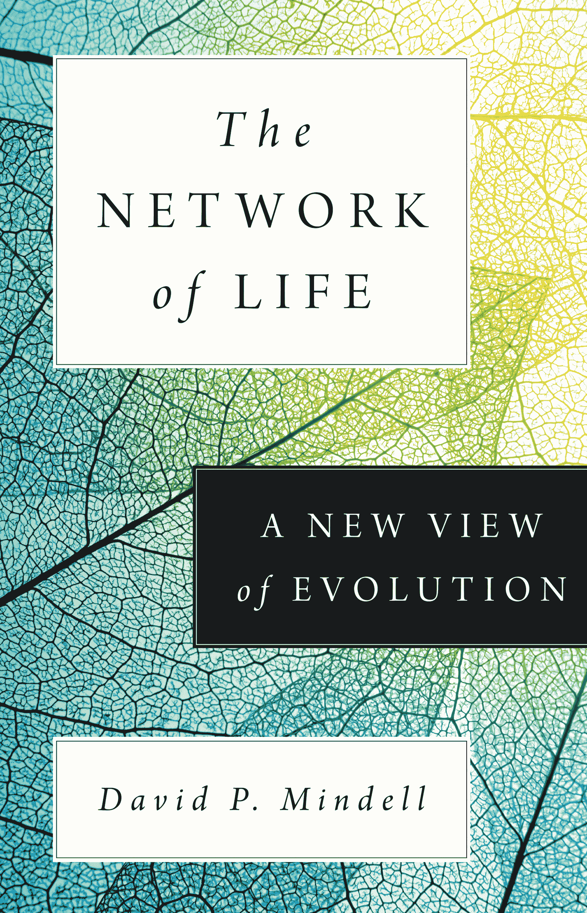

# 前言

进化科学推动了我们对地球上生命漫长而惊人历史的思考。增加观察和事实能改善我们的理解，但不一定能揭示连接它们的模式或趋势。为此，我们需要叙事。看到一只潜水甲虫在水下抓住一个气泡，并不能告诉我们更多信息，直到我们加入关于甲虫如何呼吸的叙事。叙事将观察和事实置于更广阔、更有意义的语境中。它们帮助我们大致描绘自然世界的运作方式。

描述地球上生命形式繁衍的主要叙事和变化模式是困难的。生命已有 38 亿年历史，其时间跨度超越了人类的体验。我们很难产生共鸣。请试着想象生命 38 亿年的时间跨度。尽管试试看会发生什么。我怀疑你会一片空白。人类平均寿命仅 73 年，几分钟的交通拥堵就能触发我们的不耐烦。所以，让我们试个类比。如果普通人 73 年的寿命等同于生命存在的 38 亿年估算值，那么十个月的妊娠将持续 3900 万年。而十秒钟的性高潮将持续整整 16 年。那是漫长的十秒钟。

进化“事件”也可能出人意料地漫长。新物种的诞生可能需要一百万年甚至更久，一些大规模灭绝事件跨度达 2000 万年。在此视角下，生物物种进化的影响因素似乎难以捉摸，也就不足为奇了。是的，许多进化事件确实在人类时间尺度上运作，例如细菌抗生素耐药性的进化和病毒逃避人类免疫系统的进化。这些快速变化确实让我们能够研究并推断更长时间尺度上的此类变化。然而，我们在领会生命在漫长岁月中变化与增长的异乎寻常的节奏、近乎无限且未被看见的影响方面，依然显得力不从心。即使那段历史和叙事包含了我们自身。我们自身的进化从未推动我们去构想数千年，更不用说数十亿年的时间尺度。我们有点像仰望满月的蚂蚁。然而，我们对进化漫长叙事的惊奇与探索是不可抗拒的，我们拥有的事实和观察比以往任何时候都多。

为什么我想讲述这个关于进化叙事的故事？首先，作为一名博物学家和生物学家，我发现进化极具启发性，并感到有责任分享这种体验和思想。进化让原始元素和化学物质演化出了生命的秩序。它在漫长岁月中创造并塑造了生命的多样形式，大规模并行地创造并打磨从细胞、基因到人类爱的能力、治疗疾病、为人工智能编程的一切。尽管地球环境发生了剧变，这种生命秩序仍以一种或另一种形式持续存在。对我来说，进化始终是*最*引人入胜的故事。这是我们自己的惊悚大片。我们嵌入其中，它也嵌入我们。关于情节的新知应被揭示，以便我们更好地理解自己和世界。其次，我长期以来一直对现有的进化通俗叙事与关于水平进化的最新发现（简单定义见表 1.1）之间的脱节感到困扰。对于像我这样研究生命形式之间系统发育——即谱系——的人来说，这种脱节尤为强烈。生命谱系的整体模式比我们所承认的要复杂得多，也绚丽得多。现有叙事与新知之间巨鸿沟需要审视和修正。

让生命故事更好地与进化事实相符，这本身就是充分的理由，因为真理本身就是奖赏。然而，赌注不仅关乎生命历史的准确性。叙事及其隐喻为绘制观察和思想的心智坐标提供了参照。通过重新定向我们的思维，新的叙事，尤其是科学叙事，能够开拓思维、挑战假设，并揭示解决问题的新途径。在此视角下，我认为进化的新叙事对我们理解进化创新和健康（包括人类健康和环境健康）等宏大主题具有关键意义。

当然，除了我强调的亲缘关系模式和水平进化之外，还有许多进化方面影响着宏大叙事，涵盖所有方面超出了本书范围。例如，我们对非遗传继承的理解——涉及环境、行为和文化对进化的影响——近年来也有了巨大增长，本书仅简要讨论。我建议读者参考其他学者关于非遗传继承及相关主题的优秀且全面的综述。^(1)

我衷心感谢阅读过本书章节或全稿的同事们。他们的见解、耐心和深思熟虑的评论极大地改进了本书。其中包括 Ford Doolittle、Axel Meyer、David Morrison、Greg Gibson、James McInerny、Maureen Kearney、Mary Ellen Hannibal、Peter Alpert、Matt Kane、Jack Sites、Ed Braun、Dan Graur 以及两位匿名审稿人。我还要感谢此处未具名的许多朋友和同事，他们通过长时间的交谈、通信或著作帮助我完善思考。写作和阅读是时光旅行的宝贵替代品，让我们栖居并向久已离去的思想者学习。

我感谢 John Megahan 在图表上的艺术创作与合作。他将粗略描述转化为插图的用心与才华，我深表赞赏。我感谢普林斯顿大学出版社的编辑 Alison Kalett 和 Hallie Schaeffer 的指导与建议。

本书是一个长期项目，我谨向以下给予支持的机构表示感谢：东京统计数理研究所；拉德克利夫高等研究院；哈佛大学比较动物学博物馆；加州大学伯克利分校脊椎动物博物馆；密歇根大学生态与进化生物学系及动物博物馆；以及旧金山加州科学院。

最后，我要感谢我的家人给予的爱与坚定的鼓励。

## 1 进化的新叙事

> 最显而易见的现实，往往是最难被看见和谈论的。
>
> ——大卫·福斯特·华莱士，《这是水》

人类是讲故事的动物。我们利用观察编织叙事，以解释社会趋势、经济趋势、世界历史以及人们一生的轨迹。如果做得好，叙事能提供一个理解的现实框架，告诉我们的远比孤立的事实多得多。当然，科学家也使用叙事。科学叙事是紧凑的总结，常使用隐喻，概括了我们的理解，并塑造了我们关于自然世界如何运作的思维。

本书的关键前提是：可追溯至查尔斯·达尔文的当前通行进化叙事已然过时。我绝非怀疑进化这一事实——即全生命共同起源。我要说的是，然而，关于共同起源或共同祖先的通行叙事，未能跟上关于进化诸多迥异路径的新知识与新发现。本书旨在解释为何通行观点已过时，描绘一幅新叙事，并探讨为何这新叙事至关重要。

通行叙事的简短版本将生命描述为一个通过共同祖先联系在一起的大家庭。我们所有人，从细菌到海带、秃鹰再到人类，都是时光中的同路人，共享着最深远、最古老的根基。在该叙事中，共同祖先的路径是一系列蔓延的分裂事件。单一物种分裂为 2 个，这 2 个变为 4 个，继而为 8、16、32 个，以此类推，分叉的枝干承载着数百万物种，撑起了生命进化树宽广的树冠。这一叙事与树隐喻反映了达尔文的论述：“同一纲所有生物的亲缘关系有时可用一棵大树来表示。我相信这一比喻在很大程度上道出了真理。”^(1) 在此观点下，共同祖先的进程被绘制为一棵树，分叉的枝干代表物种，并与自然选择过程相联系，后者青睐那些享有更大繁殖成功率的个体和群体。凭借达尔文对自然界物种的敏锐观察、对自然选择作为进化变化机制的有力阐述，以及关于生物间变化的详尽叙事，进化成为了生命繁衍的解释。分支树状图早已被自然学家用于分类工作，将相似类群的生物归为一组，但自然选择进化论最终提供了产生这些关系的自然机制，填补了长期以来的空白。^(2)

尽管这种基于分支树的观点对进化理解颇有裨益，但科学叙事是动态的，一旦出现重大新发现，就必须随之改变。转变我们对进化叙事的理解，时机已至。我在此主张的进化叙事变革，强调不同物种间遗传物质的更多共享，以及物种对彼此遗传变化施加影响的更大作用。我使用“水平进化”作为一个宽泛的统称，涵盖生命形态间这种遗传整合的各种过程。

在垂直进化中，遗传物质从亲代传给子代。相比之下，水平进化往往涉及*非*亲代到子代的基因转移。水平进化在不同物种间、不同时期以可变频率发生。尽管我们都熟知人类父母将基因传给后代，但我们中大多数人对水平进化的大量证据知之甚少，即便是在我们自己的过去中。这些证据埋藏在我们的基因组中，源于从病毒的古老水平基因转移到不同 *Homo* 物种间相对近期的杂交等事件。我们经验的偏见使我们容易忽略水平进化编织进涵盖所有物种（包括我们自身）的变化叙事中的那些激情的情节反转。

通过同时纳入水平与垂直进化，我们能更好地理解全生命的系统发育、基谱的整体模式，不再仅仅视为一棵树，而是一个网络——生命网络。^(3) 该网络类似于我们从通行进化模型中熟知的树，但它在枝干间增加了水平连接。该网络包含物种间的分歧与整合，提供了更详尽的进化视角。

生物学拥有大量专业术语。因此，我在表 1.1 中提供了一份速查表，给出了快速简明的定义。有几个常用术语值得在此提及。“物种”是我用来表示不同类型生物的概念。然而，不存在单一的物种定义能轻松适用于所有生命形态。^(4) 我用“谱系”表示生物群体的时间序列。例如，我们可以讨论包含一万年来所有个体的人类谱系，或将其祖先追溯得更远，包含一千万年前灵长类祖先在内的所有个体。“类群”（复数：“类群”）是一个通用术语，可应用于任何生物群体，无论该群体是种群、物种、属，还是更包容的类别。

## 表 1.1 术语简明定义

| 术语 | 定义 |
| :--- | :--- |
| 分支 | 系统发育图中表示生物或基因谱系的线条 |
| 类群/演化支 | 包含共同祖先及其所有后代、且不含其他生物的系统发育群体 |
| 分类 | 基于性状对物种或其他类群进行的分组 |
| 协同进化 | 因物种间相互影响而导致的可遗传变化 |
| 核心基因组 | 一个物种或群体中所有个体共享的基因组集（见全基因组） |
| 去中心化 | 移除中央控制或影响；增强整合与网络效应（在本书中，遗传力不限于来自亲代的遗传） |
| DNA | 由核苷酸组成的双链分子，携带遗传信息 |
| 内共生 | 共生生物之一生活在另一共生生物体内的共生现象 |
| 表观遗传学 | 研究环境和行为如何影响基因工作方式的学科，如细胞内环境影响基因表达 |
| 基因组 | 生物体完整的遗传物质集合 |
| 全生物体 | 包括宿主及所有生活在其体内和体表生物的物种组合 |
| 全基因组 | 全生物体中所有物种的所有基因组 |
| 水平进化 | 非亲代到子代的基因传递；可能涉及合并、杂交、重组和水平基因转移等过程 |
| 水平基因转移 | 不同物种间的遗传交换 |
| 杂交 | 不同有性物种个体间的交配；类似于无性物种中的重组 |
| 个体 | 单一实体；可适用于细胞、生物体、类群、全生物体 |

| 术语 | 定义 |
| :--- | :--- |
| 基因渗入 | 因杂交导致的物种间基因转移 |
| 谱系 | 由连续的世系连接的一系列生物（或基因或分类单元） |
| 合并 | 两个物种融合为一个；可能由杂交和内共生引起 |
| 可移动遗传元件 (MGEs) | 可在基因组内或物种间移动的遗传物质；通常介导其自身的移动（见 框 4.2） |
| 突变 | 生物体 DNA 序列的改变 |
| 自然选择 | 因可遗传变异导致的个体差异生存与繁殖 |
| 网络 | 基于谱系分裂与合并的系统发育 |
| 生命网络 | 基于所有生命谱系分裂与合并的系统发育 |
| 泛基因组 | 一个物种或群体中存在的完整基因集，无论其在任何单个个体中是否缺失 |
| 系统发育 | 显示基因、物种或其他分类单元间关系的谱系图 |
| 质粒 | 在细胞中独立于其他 DNA 复制的 DNA 分子 |
| 原核生物 | 缺乏细胞核和其他膜结合结构的单细胞生物 |
| 重组 | 不同无性生物间的 DNA 交换；类似于有性物种间的杂交 |
| 复制子 | 能自行或在帮助下自我复制的 DNA 或 RNA 分子 |
| 网状进化 | 水平进化的另一术语 |
| RNA | 由核苷酸组成的单链分子，不同于 DNA，携带遗传信息 |
| RNA 世界 | 生命早期演化的一个假设阶段，RNA 分子出现在 DNA 和蛋白质之前 |
| 物种形成 | 产生新物种的过程或事件 |
| 物种 | 包含同类所有生物的分类单元，能够交换基因；没有简单的定义能适用于所有生命形式 |
| 物种辐射 | 从单一祖先物种快速起源出多个物种 |
| 置换 | DNA 序列中一个核苷酸被另一个核苷酸取代 |
| 共生起源 | 因长期稳定的共生导致的演化变化 |
| 共生体 | 与另一生物共生的生物 |
| 共生 | 生活在紧密联系中的生物间的关系 |
| 分类单元/分类群 | 生物分类中使用的任何单位（种、属、科、目、界）；均为人为建构 |
| 技术 | 应用科学知识 |
| 树 | 基于谱系分裂的系统发育 |
| 垂直进化 | 基因从亲代传给子代 |
| 病毒 | 一种可移动遗传元件（见上文），编码包裹其自身基因组的结构蛋白 |

### 回顾

既然我已阐述了本书的目的，让我们稍微退后一步。我们的观点和叙事发生了怎样的变化？演化是关于地球生命的终极故事，而好奇可以说是我们最古老的习惯之一。存在哪些生命？为什么？它们做什么？如何做？新形式会出现吗？如果会，如何出现？人类如何融入这幅图景？我们是如何走到达尔文的总体叙事的？这是一个宏大的主题，我将仅探访几个里程碑。

关于人类对生命多样性认知的一个迷人早期视角来自奥兹，也被称为蒂罗尔冰人。奥兹出生于约 5300 年前，显然是被谋杀，死时 45 岁。他留着花白的棕色头发和稀疏胡须，身高五英尺四英寸、体重 110 磅的身体在冰川中冻结并保存完好达数千年之久。1991 年，随着冰层融化，徒步旅行者在意大利和奥地利边境的高山上发现了他。

奥兹一生在奥茨塔尔阿尔卑斯山郁郁葱葱的山谷和崎岖的高山地带狩猎和放牧。出于必要，他拥有专家级的自然知识。从他的随身物品和衣物来看，他为生存做了巧妙的装备，这源于他的文化传承、天生智慧以及人类经历的数百万年自然选择。我们不了解奥兹对生命历史的看法，但我们可以合理推测，这一话题曾在篝火旁及其他场合被提及，且超自然力量至少偶尔会被援引。然而，我们可以通过奥兹与生命多样性的互动，来窥见他对生物世界的实用观点。总结来说就是：我将运用我的智慧和自然世界知识来生存，并或许抚养家庭。

奥兹及其同时代人擅长繁育驯化动植物，延续了始于约 12500 年前的农业革命。他们根据性状和活力选择个体动植物用于未来育种。这常被称为人工选择，实则是掌握在人类手中的自然选择。奥兹的护腿由山羊皮制成，外套和腰布是用扭曲的肌腱条缝合在一起的羊皮拼片。他的帽子是一块合身的棕熊皮，毛朝外穿。他的鞋子近乎防水，鞋面用獐皮，鞋底用棕熊皮，鞋带用牛皮。他携带一个用几种不同树种的韧皮纤维（称作韧皮）制成的轻便网，用于捕捉小动物。

奥兹在两条窄皮带上系着大量干燥的白桦多孔菌，`Piptoporus betulinus`。食用这种真菌会引起腹泻，并具有一定的抗生素和抗炎特性。毫无疑问，奥兹认为他携带的真菌有某种益处，他可能一直在用这些真菌自我治疗其严重的鞭虫感染。

随着冰层融化，在奥兹尸体上或附近发现的这些古老残片，揭示了他对如今所谓生物多样性的广泛认知，这对他的生存至关重要。他依赖其他物种获取食物、衣物、住所和药物，并规划在恶劣环境中生存。贯穿人类历史始终如此。我们不了解他的超自然信仰，但似乎他清楚地理解到，他的生命与其他各种物种的生命交织在一起。

让我们向前跨越约三千年，来到公元前 340 年，看看希腊博物学家兼通才亚里士多德。他是第一个为了生命多样性本身而进行探究，并留下研究记录的人。亚里士多德的大多数著作呈现为非正式笔记，学者估计这些仅代表他实际著作的 20%，其余已失传。尽管存在错误并包含一些民间传说和非科学内容，亚里士多德的开创性努力树立了极高的标准。高到一千多年里再未出现过具有可比洞见和范围的著作。

亚里士多德的工作以野外直接观察和动物解剖为中心。根据他的著作，他至少解剖了 110 种不同的物种，包括蝙蝠、章鱼、海豚和变色龙。他利用这些详细解剖和比较获得的大量事实，来更好地理解独特的生命类型、它们的形态及功能。^(5)

多年的研究使亚里士多德看到了物种（或形式）间的相似性和差异的渐变。他认为生物和非生物实体可以按活力、运动性以及某些物种基于发育的潜力沿一个尺度排序。他写道：“大自然一点一点地从无生命的事物过渡到动物生命，以至于无法确定确切的分界线。……在无生命事物之上，按等级向上是植物，一种植物与另一种植物在表现活力的程度上有所不同；……在植物中观察到一个向动物持续上升的等级。……在整个动物等级中，活力的程度和运动能力都呈现出渐变的分化。”^(6)

# 亚里士多德的生命阶梯概念

亚里士多德的生命阶梯概念既模糊又大胆。该阶梯没有度量标准，也没有活力或机动性程度的单位。但将所有生命形式作为共同主线上的变体相关联的想法，却是全新的。这也打破了同时代人在生物学之外的数学、天文学和哲学等课题上所使用的先前分类方法。这仅以口头形式勾勒，但他的愿景足够详细、足够合乎逻辑，随着时间的推移获得了强大的追随者。

亚里士多德在著作中提到了约 230 种不同动物的名称。虽然他没有明确将它们全部分配到阶梯上的位置，但我们可以凭借一点想象力，通过将某些物种放入一个粗略的序列中来描绘他的愿景，从他所认为的“植物状”无脊椎动物开始，并从那里继续。这不是一条直线，而是之字形的，有时剧烈地之字形，勾勒出一条复杂性和组织性广义进展的弧线。

利用亚里士多德自己的研究物种，我们可以从海葵和海绵开始，依次过渡到有帽贝和贻贝的硬壳动物、有螃蟹和龙虾的软壳动物、有乌贼和章鱼的软体动物、有蚂蚁和蝴蝶的昆虫、有鰕虎鱼和鹦嘴鱼的鱼类、有水蛇和蝰蛇的蛇类、有陆龟和变色龙的产卵四足动物、有蜂虎和渡鸦的鸟类，以及有水獭和人类的哺乳动物。

亚里士多德关于自然实体的粗略阶梯，从矿物到植物再到动物，最终催生了“自然阶梯”（*scala naturae*），即存在的大链条，这成为了理解生物多样性近两千年来的主导组织概念。^(7) *scala naturae* 常被认为是按完美度或复杂性递增的顺序排列物种，人类位于动物阶梯的顶端，仅次于神灵，尽管将 *scala naturae* 的阶梯延伸至天堂绝非亚里士多德的初衷。亚里士多德致力于基于自然原因解释自然世界，而不诉诸超自然。这种承诺未被许多追随者所坚守，尤其是掌权者，这有助于解释为何随后几年生物多样性研究的进展如此缓慢。

# 卡尔·林奈与分类学

我们现在跳跃到十八世纪植物学家卡尔·林奈。像亚里士多德一样，林奈想要描述和组织所有已知的生命形式。他倡导在分类学中使用双名法，由属名和种名组成。就我们而言，即 *Homo sapiens*。在林奈之前，物种名称是试图作为诊断依据的、充满行话的描述性字符串。例如，拉丁植物物种名称 *Plantago foliis ovato-lanceolatis pubescentibus, spica cylindrica, scapo tereti*（英文：“具有柔毛卵状披针形叶、圆柱形穗和圆柱形花梗的车前草”）在林奈的处理下变成了简单的 *Plantago media*。他理解到，考虑到新物种发现的速度，名称不能作为物种识别指南。

1735 年至 1766 年间，他的著作 *Systema naturae* 经历了 12 个版本，其中他分类了约 9,000 种植物和 4,400 种动物。原本只有 12 页的薄册变成了 2,400 页的三卷本系列。现代分类学仍以他的著作为起点，类、目、属等分级类别的思想仍在广泛使用，尽管并非没有争议。

当时，解释生命多样性的主导叙事是上帝的圣经创造论，物种的数量及其形式不变。尽管林奈是创造论者和虔诚的自然神论者，但他对种内和种间变异的敏锐观察使他在晚年对这一观点产生了怀疑。他在广泛的园艺实验中见证了通过杂交（不同物种间的杂交）产生新植物物种的起源。他和他的学生看到了许多形态介于已知物种之间的野生植物，并认为它们是杂交起源的新物种。*Systema naturae* 第 12 版省略了林奈在早期版本中提出的主张：即新物种不形成。这隐含地允许了自然过程导致新物种起源的可能性。因此，虽然他是创造论者，但他也理解自创世以来一些新物种已自然产生。

# 达尔文、华莱士与自然选择

在这个关于进化叙事变迁的选择性回顾中，下一位是查尔斯·达尔文，他出生于林奈去世 31 年后。达尔文作为进化生物学的奠基人而广为人知。鲜为人知的是，英国博物学家阿尔弗雷德·拉塞尔·华莱士独立于达尔文研究并发展其思想，是自然选择的共同发现者。两人都将自然选择的概念和过程与生物随时间的变化联系起来，在其大量著作中提供了解锁现代生命进化观的关键机制——自然选择。华莱士甚至表达了与达尔文分支树相似的观点，将物种间的关系描述为涉及“亲缘线的分支，错综复杂如多节橡树的嫩枝”。^(8) 虽然他们于 1858 年共同发表，但达尔文 1837 年的笔记本显示，他早在 21 年前就已发展出核心思想。达尔文将人类进化视为物质过程和变化的另一个实例。然而，华莱士认为，人类的许多精神和心智能力归功于“一个看不见的宇宙——一个精神世界……物质世界完全从属于它”，而非自然选择。^(9)

如前所述，达尔文阐述的当前进化科学叙事的简短版本，将生命描述为一个家族，所有物种通过分裂或分支事件相关联。这种达尔文式的进化树观反映了早期生物学家（至少可追溯至亚里士多德）使用的物种分类。即，仅基于相似性的植物和动物的预存分类，获得了进化这一令人信服的解释。这一关于自然过程的叙事，带来了地球生命历史的一种新的动态且统一的愿景。

达尔文关于人类起源叙事的文化影响——即包括人类在内的所有生命拥有共同祖先这一思想——是即时的，直击非科学的人类故事叙事的核心。尽管在某些圈子中争议持续，但包括人类在内的所有生命拥有共同祖先这一事实，自达尔文时代起就不再是科学争议。这并不意味着我们的知识是完整的。远非如此。生命进化的许多方面仍有待发现、重新考虑并整合到我们不断增长的知识中。

# 二十世纪中叶的进化论视角

二十世纪中叶的进化论者主要研究动物，其次是植物，他们发现的过程被置于进化宏大叙事的核心位置。传统叙事长期强调新物种通过从其他物种分支而产生。这是达尔文的一项基础性洞见：物种形成作为分支过程的早期例子，即一个物种分裂成两个，或在物种辐射的情况下分裂成两个以上，包括达尔文在加拉帕戈斯群岛研究的嘲鸫和达尔文雀。^(10)

# 传统进化叙事的一个关键局限性

传统进化叙事的一个关键局限性在于其固有的中心化视角。在传统方法中，每个新物种从单一亲本物种——一个中心化来源——接收其所有基因以及这些基因编码的所有特征。基于分支树图（展示进化亲缘关系或谱系）的叙事将中心化烙印其中。这些系统发育树展示了单一物种一次又一次地分裂成两个。然而，自达尔文以来，我们对进化的认知已显著进步，揭示了大量水平进化现象。但即使对于许多知晓非常规、去中心化事件（如物种间的基因交换，即水平基因转移）有时会发生的人来说，进化的总体叙事依然是传统的。

## 新叙事有何不同？

进化的新叙事将所有生命物种的共同起源描绘为一个更加去中心化的网络，其中分支既可以分裂也可以融合。稍加想像，所有生命的新叙事和网络可被设想为一个巨大的纠缠流系统，它们时而分流、时而汇合、时而蜿蜒、时而再次分流，携带并整合着物种及其基因穿越时光，后代通过遗传的洋流与网络相连。这些网络机制的相对频率及后果将在后续章节中描述。表 1.2 强调了进化的传统叙事与新叙事之间的差异。

过去，有人试图将进化概括为两步过程：首先是突变，其次是自然选择青睐有益突变。这些仍是关键特征，但与进化新叙事相符的一对更宏观的过程是分化与整合，突变与选择在两者中均发挥作用。在可视化生命谱系的基本图示时，我们需要同时看到分化与整合。两者皆真实存在，且可在生物群体中共存。

### 表 1.2 进化的传统叙事与新叙事趋势对比

| | 传统叙事 | 新叙事 |
| --- | --- | --- |
| 谱系模式（系统发育） | 进化树中分支的分裂 | 进化网络中分支的融合与分裂 |
| 谱系模式适用于 | 主要是生物物种 | 生物物种、基因组、基因家族、基因、移动遗传元件 (MGEs)、内共生、杂交、重组、水平基因转移事件 |
| 叙事简略描述 | “同一纲所有生物的亲缘关系有时可用一棵大树来表示。我相信这个比喻在很大程度上讲出了真理”（达尔文） | 生命的进化可被表示为一个纠缠的流系统，它们时而分流、时而汇合、时而再次分流，携带生物谱系及其遗传物质穿越时光，后代通过遗传的洋流相连 |
| 进化速率 | 大多渐进，罕见间歇 | 常渐进，常间歇；与单碱基突变和垂直进化相比，水平进化能实现更快、影响更大的变化 |
| 遗传物质 | 中心化，意指基因仅或几乎仅从亲本处接收 | 去中心化，意指基因从亲本处接收，并可能从许多其他生物体接收 |
| 获得性状的遗传性？ | 无或极微 | 常见，视物种而定 |
| 关键机制 | 垂直进化和自然选择作用于个体间 DNA 序列突变的变异 | 同传统观点，外加水平进化（物种间杂交、内共生、水平基因转移、细菌和古菌间的重组） |

这种新叙事的必要性，并非源于某次单一的近期发现或个人/团队的“尤里卡时刻”，而是源于关于生物多样性功能与进化的众多发现的累积分量与综合，其中一些可追溯至 19 世纪，许多其他则基于当前科学。近年鉴于这些新发现，要求改变传统观点的呼声日增。进化与分子生物学家 W. Ford Doolittle 早早指出了该问题：“如果嵌合体或侧向基因转移不能被视为微不足道或仅限于特定基因类别，那么生命史就无法用树来恰当表示。”^(11) 通过将水平进化与垂直进化一并纳入考量，使进化新叙事的大纲更好地与当前科学对齐，这改善了我们对生命过去及未来（包括我们自身）的思考。

## 水平进化的途径

水平进化沿着一个连续谱发生。这范围从不同物种间遗传物质的直接共享（处于更物质化的一端），到物种间相互的遗传影响（即通过自然选择的协同进化，处于较非物质化的一端）。直接共享的三种主要途径为：(1) 有性物种间的杂交与微生物间的重组，(2) 物种的融合或合并，以及 (3) 水平基因转移。

为直观呈现此点，让我们在系统发育网络上标绘垂直进化与这三种水平进化过程，时间自底向上推进（图 1.1）。图 1.1*A* 展示了树上两次谱系分裂事件（垂直进化），物种 2 和 3 关系最近。图 1.1*B* 展示了底部物种 1 与 3 的谱系分裂，随后是水平基因转移（虚线），而后物种 1 与 3 间的水平进化产生了物种 2。后一种水平进化在图 1.1*C* 中被绘制为融合或杂交两种形式。表 1.1 中的术语速查表提供了有用的定义。

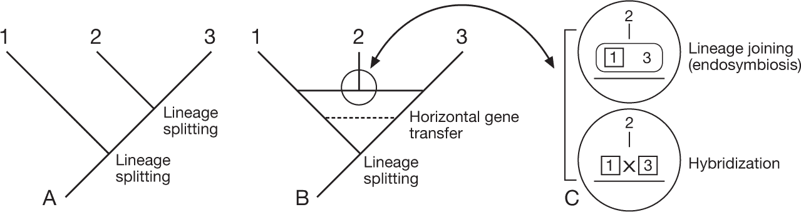

**图 1.1.** 从 (*A*) 树和 (*B*) 网络读取进化（系统发育）关系。时间自底向上推进，最接近底部的分裂最为古老。在 *A* 中，物种 2 和 3 是最近亲（姐妹群）。在 *B* 中，物种 2 源自两种可能情景。水平基因转移显示为物种 1 和 3 间的水平虚线。*C* 显示了 *B* 中物种 2 基部圆圈内的两种可能情景，要么是谱系融合（*上*——物种 1 的个体被物种 3 的个体吞噬），要么是物种杂交（*下*——物种 1 的个体与物种 3 的个体杂交）。定义见表 1.1。

# 水平演化过程

让我们按上述顺序考虑相同的三个水平演化过程。

## 杂交

当不同有性生殖物种的个体发生异种交配时，就会出现**杂交**。这导致物种间的基因混合，称为**基因渗入**。近年来，对大规模基因组数据集的研究表明，基因渗入比以前认为的要普遍得多。农作物提供了杂交实际应用的清晰例子。图 1.2 展示了一些柑橘树物种杂交的结果。许多现代栽培品种是有意杂交后，针对口味、耐寒性和抗病性等性状的变异进行选择的结果。细菌和古菌内部及之间的重组类似于有性生殖和杂交，将在第 2 章和第 3 章中讨论。

## 物种融合

**物种融合**始于不同物种个体间的相互作用，包括共生关系，这些关系随时间变为强制性并实现遗传整合。物种谱系融合的主要机制是**内共生**。当一个共生体生活在另一个共生体内部时，就会发生这种情况。融合与杂交的区别如图 1.1*C*所示。生命 38 亿年历史中一些最重大的创新，源于通过内共生融合了先前不同的谱系。这包括细胞两个基本组成部分的起源：存在于所有动物、植物和真菌中的**线粒体**，以及存在于植物中的**叶绿体**。

## 水平基因转移

第三个过程是**水平基因转移**。这是生物体之间遗传物质的移动，发生在亲代与子代之间的垂直传递之外。过去 50 年来对水平基因转移的发现，为我们近期对演化的理解带来了最大的变革之一，现在它被公认为微生物演化的一种主要模式。^(12) 所有细菌和古菌（最古老、最包容的单细胞生命类群）基因组中的绝大多数甚至所有基因，在其过去都经历过水平基因转移。水平基因转移在植物、真菌和动物中相对罕见；然而，人们在它们身上发现此类现象的频率正在增加。鉴于所有多细胞生命形式的早期谱系都是在细菌和古菌水平基因转移的帮助下出现的，水平基因转移堪称生命演化的一个关键特征，也是新叙事的重要组成部分。要快速且部分地了解水平基因转移的普遍性，请参见图 1.3 和图 1.4。前者展示了水平基因转移进入植物的实例，后者展示了选定细菌物种间的水平基因转移，这是由称为质粒的小 DNA 分子转移导致的。

## 水平演化的后果

这三个过程——物种杂交、物种融合和水平基因转移——导致了遗传物质的**去中心化**。去中心化是演化新叙事的一个关键原则。许多物种能够且确实从一个或多个不同物种获取其基因。这与传统观点不同，传统观点认为新物种从单一的、中心的亲本物种获取其遗传物质。水平演化强大的去中心化力量，无论是过去还是现在，远非微不足道的细节。其模式与传统分支模式相反且互补。其在叙事中的后果至少有两方面。水平演化可以催化物种内部的变化，以及物种的大量增殖。它并不包含传统叙事，而是表明传统叙事是不充分的。现代化演化的叙事能更好地代表当前的科学，并使从叙事中得出的理解更加丰富和准确。

## 图 1.4

无根系统发育网络，其中的线条表示细菌物种间的水平基因转移，点代表物种。此处的水平基因转移事件由质粒介导，质粒是在细菌细胞内独立复制的小 DNA 分子。每个点代表变形菌门这一大类细菌中的一个独立物种，该类群包括 `Escherichia`、`Salmonella`、`Vibrio`、`Helicobacter` 等属。点的阴影差异表示不同的分类纲。 ¶ 图片改编自 Redondo-Salvo, S., Fernández-López, R., Ruiz, R., Vielva, L., de Toro, M., Rocha, E. P., Garcillán-Barcia, M. P., and de la Cruz, F., 2020, “Pathways for Horizontal Gene Transfer in Bacteria Revealed by a Global Map of Their Plasmids,” *Nature Communications*, 11(1):1–13.

去中心化作为一个概念，已被证明有助于理解治理、经济和技术领域中各种策略的相对成败。而将其应用于生物多样性的演化，特别是其潜在的适应性和非适应性特征，将在第 2 章中展开。要直观了解这种遗传的去中心化，请参阅图 1.1*B*中的示例系统发育网络。它不同于系统发育树，因为谱系与不止一个其他物种存在谱系学联系。

水平演化框架下的第四个过程是物种间通过自然选择进行的协同演化。这会随时间发生，例如在花朵与其传粉者之间、捕食者与其猎物之间，以及病原体与其宿主之间。因此，更深的花蜜腺会筛选出蜂鸟更长的喙，而病原体更强的毒力会筛选出其宿主更强的抗性。图 1.5 提供了更多示例。根据定义，协同演化会随时间在物种间产生可遗传的遗传变化，从长远来看，这与上述直接的基因共享机制相似。

所有物种都或多或少受到协同演化的影响；然而，其在推动生命演化中的作用常被低估。强调遗传物质整合的演化新叙事必须包含协同演化，因为它必要地揭示了协同演化这一过程：物种的生态和行为相互作用如何导致其形态和功能上相互的、可遗传的遗传变化。因此，协同演化在概念上与水平演化框架下的其他过程保持一致。协同演化是本书第二部分的主要主题，该部分探讨了演化新叙事为何重要。

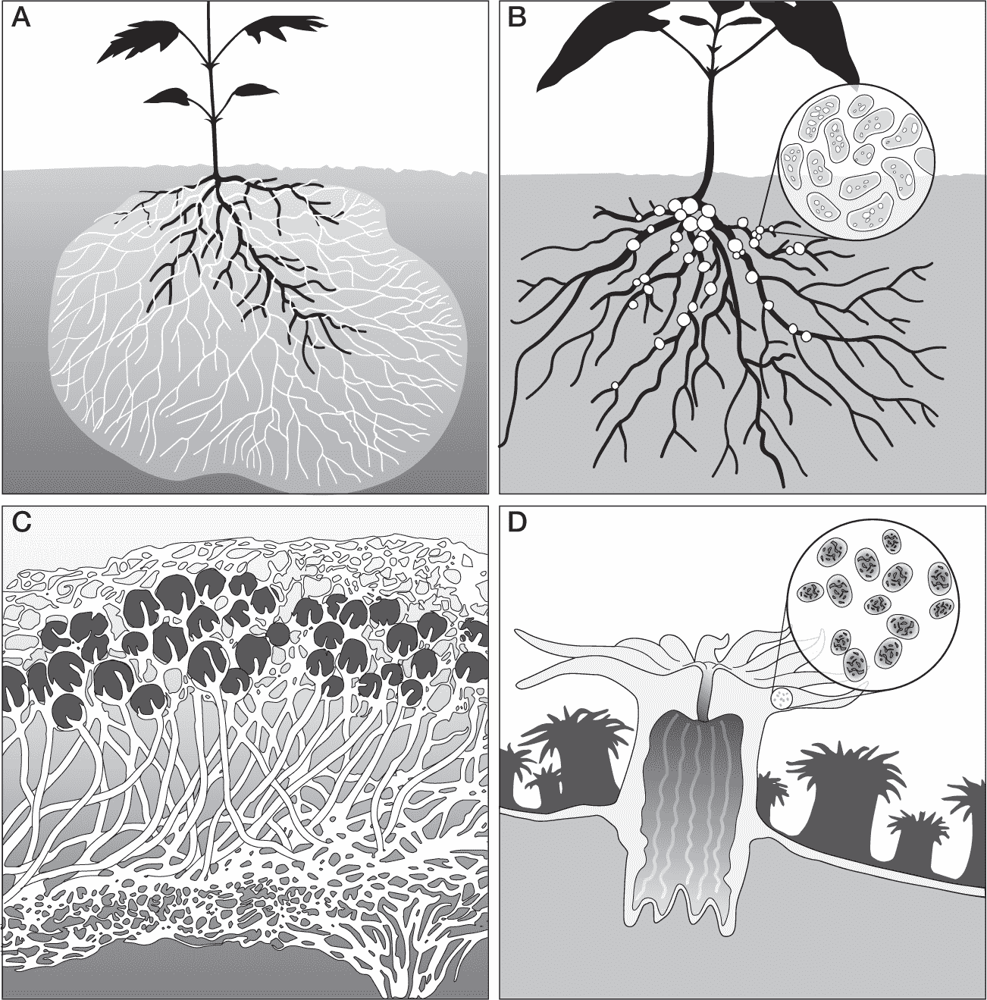

**图 1.5.** 不同物种协同演化的示例。`A`，真菌与植物根系的相互影响产生菌根（白色），有助于植物营养；`B`，细菌与植物根系产生根瘤，容纳固氮细菌；`C`，真菌与细菌或藻类产生地衣；`D`，藻类与被称为水母虫的小动物，它们构建珊瑚。示例 `B`–`D` 也是内共生，即一个物种生活在另一个物种内部。

### 生命网络

生命故事的简化图示——物种的起源与演化——如图 1.6 所示。编织的溪流代表以 DNA 形式存在的可遗传信息，它们贯穿并流经所有生物的世代更迭。细菌和古菌是单细胞微生物（原核生物）的两种形式，并演化出了真核生物，后者包含所有其他已知生物。没有任何图表能展示生命历史的全貌。要做到这一点，需要追踪无数个体生物和基因在时间中的繁衍努力。此外，专家估计灭绝已夺走曾经存在过的所有物种中超过 99% 的生命，抹去了大部分分子记录。但尽管如此，通过比较现存物种基因组所解锁的变化记录依然详尽丰富，这些主要类群间显示的关系也日益得到有力支持。^(13)

图 1.6 中命名的类群在表 1.3 中列出，该表给出了这些类群现存物种的估计数量，以及该谱系因杂交、融合和水平基因转移而发生水平演化的相对程度。高、中、低的标记表示其在该类群多样化中的相对重要性和作用。所有展示的主要类群都深受水平演化的影响。它们的生活方式、身体结构和基因组都深受其整合机制的影响。当然，有些类群影响更大，某些时期影响也更大。

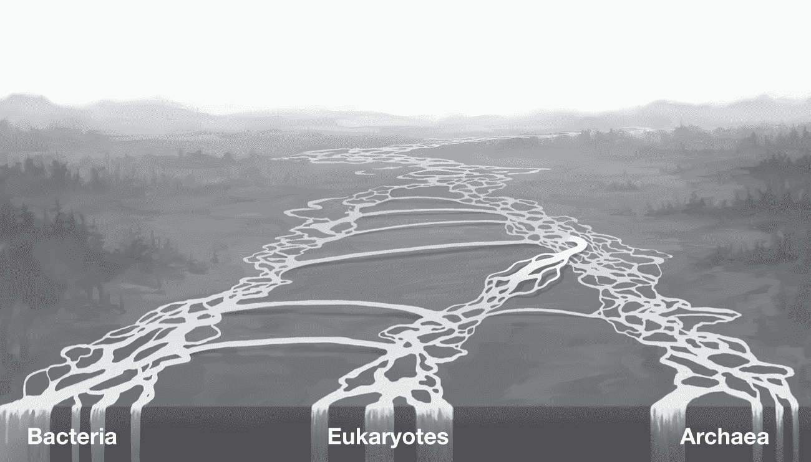

**图 1.6.** 生命的系统发育网络，表现为一套纠缠的溪流系统，它们时而分叉、时而汇合、时而再次分叉，携带生物谱系及其遗传物质穿越时间，后代通过遗传的洪流相连。时间从背景向前景流逝。注意真核生物源于古菌内部。

垂直演化和传统的分支模式仍是新叙事的关键，尤其是在动物中，但它们完全不足以解释生命完整的谱系网络。新叙事要与当前研究发现保持一致，就需要新的重点：强调遗传和生物体层面的整合。同时看到垂直演化和水平演化的图示，就像凝视教室墙上国界和州界清晰标注的世界地图，然后再叠加一张显示跨越国界和海洋的高速公路、航线、铁路和航线的地图。这是一张更丰富、更互联的地图。

### 表 1.3

生物谱系间现存物种估计数量及过往水平演化相对程度的比较

| 类群 | 现存物种估计数量（占非病毒总数的百分比）¹ | 有性杂交或无性重组的相对程度 | 融合的相对程度/关键益处 | 水平基因转移的相对程度 |
| :--- | :--- | :--- | :--- | :--- |
| 细菌和古菌 | 17.46 亿 (78%) | 高 | 低 | 高 |
| 动物 | 1.632 亿 (7%) | 低 | 低/细胞能量 | 低到中等 |
| 植物 | 34.0 万 (<0.5%) | 中等 | 低/细胞能量和光合作用 | 中等 |
| 真菌 | 1.656 亿 (7%) | 中等 | 低/细胞能量 | ? |
| 原生生物 | 1.632 亿 (7%) | 中等 | 低到中等/多样的细胞能量和光合作用 | 中等 |
| (病毒)² | 1.87 亿 | 高 | 低 | 高 |

| *Sources*: Larsen, B. B., Miller, E. C., Rhodes, M. K., and Wiens, J. J., 2017, “Inordinate Fondness Multiplied and Redistributed: The Number of Species on Earth and the New Pie of Life,” *Quarterly Review of Biology*, 92(3):229–65; Locey, K. J., and Lennon, J. T., 2016, “Scaling Laws Predict Global Microbial Diversity,” *Proceedings of the National Academy of Sciences of the USA*, 113(21):5970–75; Lefkowitz, E. J., Dempsey, D. M., Hendrickson, R. C., Orton, R. J., Siddell, S. G., and Smith, D. B., 2018, “Virus Taxonomy: The Database of the International Committee on Taxonomy of Viruses (ICTV).” *Nucleic Acids Research*, 46(D1):D708–17; Rohwer, F., 2003, “Global Phage Diversity,” *Cell*, 113(2):141; Geoghegan, J. L., and Holmes, E. C., 2017, “Predicting Virus Emergence amid Evolutionary Noise,” *Open Biology*, 7(10):170189. |

| 1. 估算地球上的物种数量十分困难，需要依赖假设和外推。本表遵循 Larsen 等人（“偏爱过度”）对动物、植物、真菌和细菌的估算，总计 22.38 亿个物种。近期对古菌的估算为 20,000 个物种（Tahon, G., Geesink, P., and Ettema, T. J., “Expanding Archaeal Diversity and Phylogeny: Past, Present, and Future,” *Annual Review of Microbiology*, 75 [2021]:359–81），这并未显著增加单独针对细菌的估算值。Locey 和 Lennon 的论文（“缩放定律”）利用缩放法预测微生物物种数量约为 1 万亿（包括细菌、古菌和微小真菌），这一估算未显示在本表中。尽管估算值存在差异，但一个共同的发现是：微生物的数量远远超过动物、植物和非微小真菌。 |

| 2. 目前没有适合所有病毒群体的物种数量估算。国际病毒分类委员会目前认可 6,950 个物种（Lefkowitz 等人，“病毒分类学”）；然而，绝大多数病毒多样性仍未被描述。Rohwer（“全球噬菌体多样性”）估算噬菌体病毒（一种感染细菌和古菌的病毒群）约有 1 亿个物种。Geoghegan 和 Holmes（“预测病毒出现”）估算感染真核生物的病毒物种有 8,700 万个。Locey 和 Lennon（“缩放定律”）利用缩放定律预测有 1,000 亿个“微生物”物种（仅限细菌、古菌和微小真菌，不包括病毒或微小真核生物）。 |

科学进步在揭示生命进化故事的几乎每一步，都伴随着对额外复杂性的发现。我们对生命网络的理解将永远是一个进行中的工作。因为我们的数据和分析正在改进。而且因为网络是动态的、不断生长和变化的，甚至就在你阅读这句话的时候。新谱系总是在不断出现或消失，一些基因也总是在被转移到别处。这在病毒和细菌中比在脊椎动物中普遍得多，但网络依然在进化。大多数初生的生物谱系和基因转移很可能是短暂的，但有些可能会持续下去，要么是偶然，要么是自然选择青睐适应性。

新叙事使用网络或网状结构的隐喻作为关系模式，因为这些比严格分支的树更适合描述进化。系统发育树的分析和描述更适合某些物种（大多数真核生物），而不太适合其他物种（细菌和古菌），因为在这些生物中水平进化更为常见。进化树将永远有用，且深深植根于进化论述中。但对于宏大的叙事而言，结合垂直进化和水平进化的网络要准确得多。正如我稍后将讨论的，新叙事也能更好地指导对环境、健康和保护的思考。表 1.4 概述了与进化和系统发育相关的各种流行误区。它们相应的“更佳概念”往往也反映了进化的新叙事。

### 表 1.4. 关于进化、系统发育树和生命的常见误区

| 误区 | 更佳概念 |
| --- | --- |
| 系统发育树和有根网络显示进化进程，通常从左侧物种进阶到右侧物种 | 顶端的排序不代表进程含义；所有代表现存物种的顶端相对于共同祖先而言年龄相等 |
| 物种仅通过分裂产生，一变为二 | 物种也可以通过融合产生，二合为一 |
| 某些现存物种是其他现存物种的祖先 | 现存物种是堂亲关系，而非祖先关系 |
| 物种定义一致且清晰 | 在许多情况下，指定物种很困难 |
| 进化从原始形式进阶到高级形式 | 进化既可产生复杂性增加，也可产生复杂性减少 |
| 我们已发现地球上大多数或所有独特的生命形式（生物物种） | 新生命形式和变体的发现率依然很高，很大程度上归功于分子测序工作 |
| 病毒不是生命 | 病毒会繁殖、携带遗传指令并进化，许多生物学家确实认为病毒是活着的或处于灰色地带；生命是一个过程（见第 4 章） |
| 获得性状遗传不存在 | 获得性状遗传是水平进化的组成部分，在较小程度上也是免疫系统进化的组成部分；该术语带有历史包袱 |
| 所有生物包括人类都是智能设计的 | 生物通过进化过程随时间改变，且常包含低效特征 |

系统发育学估算谱系的方法依然至关重要，因为它们对于评估垂直进化是必需的，并藉此揭示水平进化。纠缠的关系网络发生在生物组织的几个层面：物种之间、个体生物之间，以及它们的基因和整个基因组之间。尽管恢复这些关系网络需要日益庞大的数据集（主要是分子数据）和分析工具，但研究发现所解释的远不止关系本身。它们描绘了生命形式之间古老且持续进行的整合图谱。

最后，我想引起大家对新旧叙事对生命演化启示的另外两点差异的关注（见表 1.2）。首先，认识到水平演化的重要性，使关注点重新聚焦于演化节奏的间歇性本质。与常规设想中更恒定、更小规模、单个 DNA 碱基替换的情景相比，融合事件和水平基因转移相对突然。其次，水平演化意味着个体一生中获得的特征可以遗传。单个细菌获得的水平基因转移可以被其后代继承。这让人联想到，但又截然不同于拉马克遗传的旧有历史概念，即生物体在其生命周期中获得的物理特征可以被后代继承。当拉马克和达尔文等生物学家探讨获得性状遗传时，基因及其遗传机制尚不为人知。人们也不了解体细胞与生殖细胞（精子、卵子）之间关键差异的详细情况。无论我们如何称呼它，许多获得性状变得可遗传这一现实现在已很清晰。这不仅源于此处讨论的杂交、融合和水平基因转移机制，还源于表观遗传学（基因表达水平的变化）、免疫系统能力以及生物体自身进行的基因组编辑相关的机制。^(14) 尽管详细回顾这些研究领域各自的发现超出了本书的范围，但它们与演化的新叙事比与常规叙事更契合。

### 为何花费了如此漫长的时间？

为何演化的新叙事在非专家、公众甚至许多生物学家中获得认可花费了如此漫长的时间？关于水平演化的关键发现早已显而易见，隐藏在显眼之处很长一段时间了。达尔文在首次使用“伟大的树”这一隐喻来形容不同生命形式的演化时，就知道存在例外。像达尔文这位鸽子爱好者一样的动物育种者，以及热衷园艺的人都知道，物种间的杂交能产生新形式。同样，许多现代生物学家通过自己的研究也已看出，树的隐喻及其伴随的连续分支叙事作为演化的描述符是不充分的，甚至是误导性的。我在此的论点在许多方面都是一种事后补救和亡羊补牢的行动，旨在解决叙事问题。

当然，延迟的原因有很多。一些可能的原因源于不同学科科学进步的时机和步伐的差异。还有一些原因涉及科学界内外文化变革的障碍。生命共同祖先这一持久的事实，或许帮助掩护了一个过时的叙事。在达尔文和华莱士之后的第一个世纪里，大多数演化学家研究动物和植物，在他们身上观察到的变化机制被视为可以外推到所有生命形式演化的例子。但事后看来，那是错误的。微观单细胞生物的巨大多样性和普遍存在性尚待发现。

我们也喜欢在包含我们自己的任何故事中将自己视为主角。但请考虑一下，我们的物种与生命多样性中一个普通的、有代表性的物种相距多远。我们只是数百万甚至数十亿个物种中的一个（取决于物种如何定义），极少有物种像我们。即使是完整的脊椎动物物种集合，约有 66,000 种，也仅占生命多样性的一小部分。绝大多数物种和生物，无论现在还是跨越时间，都是单细胞微生物。正是它们多样的变化和增殖模式，在生命 38 亿年的历史中按频率占据了主导地位。

我们人类对微生物的关注，即使在今天，仍主要集中在我们与病原体或工业用菌种的关系上。绝大多数微生物未被看见，也未被命名。眼不见，心不烦。尽管事实上，微生物在氧化地球大气层、使其适合我们这类生物生存，以及演化出促进所有生命的基本分子和遗传机制方面发挥了先驱作用。这包括复制 DNA 并从中组装蛋白质。正如牛顿所言，我们可能站在巨人的肩膀上取得科学进步，但我们站在大量微小、无名微生物的肩膀上，才拥有了生存和传递基因的演化能力。

我认为，单细胞生物这一英雄角色的普遍不可见性，是缺乏对其频繁且重要的水平演化给予赞赏的根本原因。因此，它们对演化叙事的影响一直滞后。即使在科学家中，对叙事的看法往往也是主观的，反映了他们特定的、往往狭窄的兴趣。如果一个叙事适用于他们研究的受限生物群，可能就没有急于改变的动力，而且直到最近，常规叙事对于研究人类和其他动物的生物学家来说一直足够用。

两个额外因素导致了延迟。物种间常规的分支模式——一个物种产生两个——长期以来（且通常仍是）计算机算法在估算和绘制物种关系分析中唯一可用的选项。只能生成分支树，而非网络。同时评估物种和基因的垂直与水平关系很复杂，用于这种方法的计算机技术发展相对较晚。同样重要的是，分支树提供了物种间的亲缘关系模式作为一种层级结构，这正是建立分类系统的生物学家所精确需要的。物种可归入属，属归入科，以此类推，形成目、纲、界。系统发育网络不太容易转换为生物分类，因为远缘生物间遗传物质的移动会模糊层级关系。

新叙事是对现有知识的重新构想，更聚焦地照亮了生物物种间遗传整合的机制和事实。新叙事更好地构建了我们的思维框架。它更好地服务于我们对生命故事和生命潜力的想象。这种潜力包括我们人类的未来。叙事在最好的情况下，能解放我们的思想，使我们超越琐碎细节，进行外推并获得启发。

艾米莉·狄金森的诗《大脑比天空更宽广》的开篇诗句，指向了我们心智理解那些尺度超出我们自身生活的事物的能力。

> 大脑——比天空更宽广——
>
> 因为——将它们并排放置——
>
> 这一个将包含那一个
>
> 轻而易举——连你——在旁——^(15)

就我们的目的而言，这种理解包括那些真实但难以看见的事物，如地质时间跨度以及在其中展开的许多自然力量，包括水平演化、分子突变、自然选择和物种间整合。演化的新叙事能增强我们对演化如何发生以及未来可能如何发生的看法。

### 前路漫漫

# 主题与章节概览

本书剩余部分的主题与章节概览如下。第 2 章至第 4 章构成第 1 部分，将为进化的新叙事建立框架。在第 2 章中，我将关于生命多样化的新叙事置于中心化（树状）与去中心化（网络状）系统的一般背景，特别是生命网络的具体背景之中。这需要综合生命的谱系，以及中心化与去中心化遗传在主要类群（细菌、古菌、真核生物）中的相对作用。中心化与去中心化的概念一直被认为对于理解治理、经济、金融市场、信息技术以及社会和文化演化中的复杂系统至关重要。然而，进化生物学家很少考虑这些概念，而它们在生物多样性演化中的相对优劣势所蕴含的新见解潜力值得探讨。

第 3 章探讨了与水平进化和去中心化机制相关的早期发现历史，这些发现支撑着新的进化叙事。本章将深入探讨物质水平进化的过程：物种间的杂交、合并或融合，以及水平基因转移。我重点指出了这些发现的含义与传统进化叙事之间的错位。

第 4 章探讨了定义生命叙事核心实体（如个体、物种、病毒和生命本身）的困难，即它们模糊的边界。近期研究表明，病毒在生命的水平进化中扮演了特别重要的角色，对病毒自然史的新认知正促使生物学家重新审视生物与非生物系统的整合，以及病毒作为生命网络一部分的地位。对所有这些实体的当前理解进一步证明了生命深度且反复整合这一主题。

在确立了这一新叙事的框架后，第 II 部分探讨了为何发展进化的新叙事至关重要。第 5 章和第 6 章分别聚焦于新叙事对理解人类健康和环境需求的启示。这些章节将物种整合的概念从谱系延伸至自然选择和协同进化，即物种随时间推移彼此施加的可遗传变化。人类健康和环境健康深受其他生命形式活动的影响，并与之协同进化。

第 7 章展望了生物多样性的未来。我讨论了数据充足时各类物种的现状，以及某些物种如何适应人为环境变化。我们正目睹生物多样性的丧失与重新分布，以及伴随气候变化而来的、通过杂交产生的令人惊讶的物种增加。我探讨了掌握在人类手中的水平进化在物种保护中的作用，以及合成生命这一相对较新领域的发展，包括创造新生命形式（主要是微生物）和大规模编辑其他生物的基因组。

在第 8 章中，我将在技术背景下探讨我们自身物种的未来。我考察技术如何增强我们的身体、延长寿命并极大地拓展脑力。我认为人类技术与生命系统有着强烈的相似性，并论证人类正在与技术协同进化。这种文化协同进化符合进化的新叙事，因为由群体间分享（教学与学习）驱动的文化进化，也是水平进化。了解水平进化的机制与后果将提供实用的经验教训，助我们应对未来的健康与环境挑战。

## 2 去中心化与创新

> 去中心化可被视为一种反脆弱形式：一种不仅能抵御冲击和干扰，而且能从中获益的系统。
>
> ——阿尔温德·纳拉亚南 等，《比特币与加密货币技术》

随着成功系统的老化，它们面临过时的风险。曾经崭新大胆的理念与实施可能变得僵化低效，与不断变化的条件脱节。这可能发生在政府、商业、通信及无数其他系统中，其中控制派系与特征未能随时间创新与适应。正如《创新如何运作》作者马特·里德利所言：“历史的一个奇特特征是帝国不善创新。尽管它们拥有富有且受过教育的精英，帝制政权往往主管着发明创造的逐渐衰退，这导致了它们最终的瓦解。埃及、波斯、罗马、拜占庭、汉、阿兹特克、印加、哈布斯堡、明、奥斯曼、俄罗斯和大英帝国无不印证了这一点。”相反，“意大利最富创造力的发明时期是文艺复兴时期，当时是由商人统治的小城邦推动了创新：热那亚、佛罗伦萨、威尼斯、卢卡、锡耶纳和米兰。分裂的政体优于统一的政体。古希腊传授了相同的教训。”^(1)

失败的系统可以通过更去中心化和创新的方法得以挽救，而非被埋葬。关键控制权的去中心化，往往不为既得权力者所欢迎，却能绕过控制权力，孕育新思想与活力。约翰内斯·古腾堡在 15 世纪中叶用拉丁文印刷《圣经》即是一例。他打破了神职人员和希伯来语、希腊语学者对圣典的垄断获取权，将其提供给普通读者。同理，16 世纪初马丁·路德《九十五条论纲》的印刷与传播，进一步削弱了教会的权力，进而促成了新教改革。

民主是另一种创新且去中心化的力量。它始于古希腊，允许所有公民在立法机构中发言和投票，由此开启了一种旨在更好服务全球人类利益的模式。它可以消除或削弱威权集团的控制。在公众支持和资助下，教育、卫生和商业项目可以蓬勃发展。然而，民主作为一种社会创新，完全依赖法治，且容易受到那些寻求通过其他手段获取权力者的攻击。

或许更多时候，去中心化源于技术创新。过去一个世纪，医疗保健、能源生产、农业、商业和交通领域的创新，极大地提升了人类生活水平。改善范围涵盖婴儿死亡率降低、寿命延长、健康状况改善，到贫困减少、清洁水源获取增加和住房条件舒适度提高。这并非说现状已臻完善，只是比过去更好。

# 疫苗接种与创新

疫苗接种是一组不断变化的技术创新，在 450 年的历程中挽救了数百万生命。1570 年代来自中国的一份报告描述了人们将微量的人类天花痂皮放入鼻中，以预防该疾病。类似的方法在 18 世纪早期和中期被应用于土耳其和印度，其接种制剂的制备、储存和给药方法各有不同。在爱德华·詹纳 1798 年的实验和出版物之后，利用牛痘痂皮接种预防天花的方法变得普遍。事实上，英语单词“vaccination”（疫苗接种）源自拉丁语 *vaccinus*（来自牛）。这种听起来疯狂的创新——感染自己以保护自己——肯定是在其科学原理被理解之前很久，就由不同的人在不同地点、不同时间有意或无意地发现和改进，随后被提炼并作为民间智慧流传下来。

最近的疫苗创新建立在早期使用含病毒痂皮和脓液的基础上，数千项现代创新使得病毒中对免疫力发育至关重要的精确基因片段能够进行分子层面的生产和递送。相关创新包括电力、用于数据分析的计算机芯片和软件，以及所有应用于从化学品中制造特定基因的专用设备和理念。针对 COVID-19 最广泛使用的一组新型疫苗，是全球数百个科学家团队在实验室中激烈竞争的结果，他们尝试能找到的最佳想法，无论新旧。一种广泛使用的单针疫苗利用一种无害病毒作为载体，携带一种工程基因，该基因被受体细胞复制，从而刺激抗体产生。另外两种疫苗则直接将工程化的信使 RNA（化学指令）递送至细胞，无需任何载体，随后细胞制造病毒蛋白以刺激抗体产生。这些方法的先驱是 20 世纪中叶通过强迫病毒在缺乏关键营养的环境中生长来减毒，然后将其用于疫苗。通过这些方式及其他方式，以感染换取保护的古老实践已通过连续不断的创新得以改良。

## 智能手机作为组合式创新

考虑一种完全不同形式的技术，无处不在的智能手机也并非单一发明。它是预存技术的一种创新且令人眼花缭乱的组合，包括电话、相机、时钟、计算器、地图、GPS 服务、计步器、血压监测仪、电子邮件、短信、社交媒体、触摸屏、应用程序、视频、人脸识别、支付系统和互联网搜索。

推动文明发展的创新，从疫苗到法律、语言、望远镜、货币、计算机和 DNA 测序，极少（如果有的话）是从零开始、完全成型地实施的。相反，它们源于思想的混合、机缘巧合和偶然性。里德利这样表述：创新“发生在思想能够相遇交配时，发生在实验受到鼓励时，发生在人员和商品能够自由流动时。”^(2)

正如我将在本章中论证的那样，水平进化是一种去中心化力量，它擅长实验和创新，基因及其编码的特征在生物群体间移动并在新的组合中相遇。我首先考虑两个非生命系统，在这两个系统中，去中心化被明确寻求并作为创新过程的一部分加以实施。这将帮助我们看到其一些优势（框 2.1）。第一个系统是通信；第二个是货币。随后，我追溯水平进化和去中心化在生命主要类群（细菌、古菌和真核生物）进化中的作用。在此过程中，我回顾了生命进化史上受水平进化导致的去中心化影响的一些重大创新。该讨论遵循进化时间线，从生命起源讲到真核生物利用氧气和阳光、多细胞生活以及有性生殖的创新。我将阐明，基因的去中心化和中心化程度随时间和物种而广泛变化。它们存在于一个连续谱上。

# 通信

1959 年，30 岁的电气工程师保罗·巴兰受加利福尼亚州兰德公司之托，开发一种能在核攻击中幸存的通信系统。这是冷战时期的一个迫切关切。在构想通信网络的可能性时，他确定了三种一般形式（图 2.1）。完全中心化的版本极易受到攻击，因为它只有一个通信枢纽。一系列通过单线相连的枢纽在一定程度上是去中心化的，但仍然脆弱。对巴兰而言，最不脆弱的结构本质上是一种网状结构——称为分布式网络——拥有足够的替代路径供节点间通信，即使部分节点被摧毁。他的见解和分布式通信网络协议当时基本被兰德的军方资助方忽视。然而，在 1960 年代末，美国高级研究计划局（ARPA）在寻求用于不同地点研究计算机的安全连接时，独立地重新发现了这些成果。ARPA 的计算机网络（ARPANET）最终催生了我们现在所说的互联网。其当前结构远非最优的分布式设计；然而，保罗·巴兰首创的一些网络通信协议得到了成功实施。

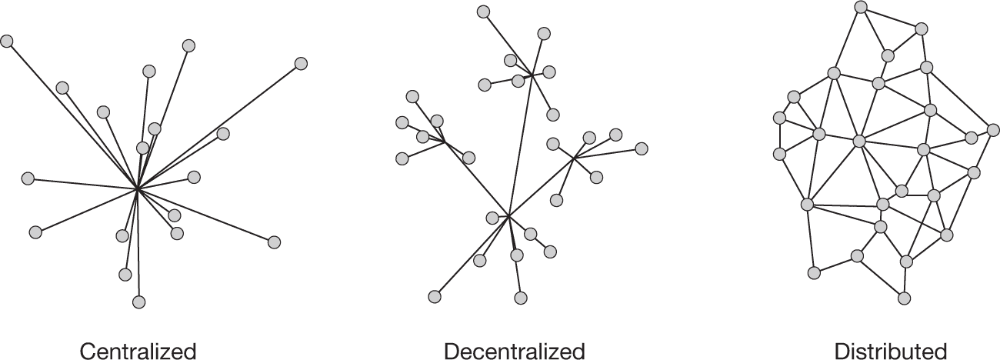

**图 2.1.** 保罗·巴兰于 1959 年确定的三种一般网络形式，展示了从左（最低）到右（最高）的去中心化程度。

互联网创新现已重塑全球通信和交易。据估计，地球上现存所有信息的约 95% 已数字化，其中大部分可在互联网上获取。^(3) 报纸出版商、广播电台和电视台曾充当新闻、观点及相关信息的把关人，只有掌握控制权或渠道的人才能讲述他们想讲的故事。然而，互联网让许多人得以绕过 20 世纪的控制权力。但结果好坏参半，因为它也传播了误解信息和困惑。消费者可以选择他们偏好的新闻，无论其真实性如何。不可避免地，互联网也导致某些服务的再中心化，因为亚马逊、Facebook 和谷歌主导了商业和信息服务的某些方面。

去中心化可能解决一些问题，同时引入另一些问题。而这些新问题可能需要进一步的去中心化。2020 年，敏感在线数据在一次大规模单一事件中被黑客攻击并窃取，波及全球数千个组织，包括美国财政部和商务部以及美国国家电信和信息管理局。^(4) 国土安全部（DHS）发言人早先曾指出：“我们的对手利用了我们网络基础设施中的一种根本不对称性：虽然我们几乎所有的系统和网络都在全球范围内互联，但我们的防御能力却并非如此。”^(5) 作为回应，国土安全部正在开发一个网络的网络，以连接美国联邦、州和地方机构；执法部门；以及运营国家大量关键网络基础设施的私营公司。官方将这项工作称为构建网络免疫系统。去中心化网络需要去中心化的防御。

# 将互联网的去中心化方法延伸至国际商业与政治

安妮-玛丽·斯劳特阐述了创新网络方法在解决问题方面的高价值。^6 她认为，个别国家不应成为政策关注的唯一焦点，仿佛个别国家或机构正在进行一对一的国际象棋博弈。相反，正是国家之间的联系网络、它们彼此间的链接，要求我们将关注点放在理解政策变化后果的过程中。机构间更多的链接能提供更强的韧性，在出现局部问题时，为共同成功提供更多替代路径。从这个角度看，采取开放态度、建立关系和政策网络而非严格等级制的政府、经济体和社会，将能最有效地竞争并取得成功。

## 货币

2008 年，一份标题为“比特币：一种点对点的电子现金系统”的白皮书，以中本聪的化名被私下通过电子邮件发送给一小群密码学家——即对保障通信网络安全感兴趣的人。^7 这份文件解决了一个保护计算机网络免受攻击的长期难题，即拜占庭将军问题。从本质上讲，该问题在于：网络中的所有计算机节点，如同军队中的将军，必须就协同策略达成一致，尽管其中一些将军或其信使可能已被攻破。中本聪论文中的解决方案涉及通信安全的多项创新，包括不可伪造的数字签名、大规模冗余，以及一种称为工作量证明的、针对攻击的经济抑制机制。

受 2007-2009 年全球经济衰退（即大衰退）的推动，以及其根源——美国及其他地区过度的高风险和不透明的中心化银行业务——比特币作为一种新兴的去中心化货币系统应运而生。在美国，大衰退导致房价和股市损失约 11.5 万亿美元，约 860 万人失业，失业率于 2009 年 10 月升至 10%。^8 可以说，美国乃至世界的传统货币和经济体系——因为美元充当世界储备货币——已被腐蚀。

比特币的吸引力在于：它是一种没有政府、没有 CEO、没有中央银行的货币。没有任何团体拥有或控制它，至关重要的是，没有任何团体或个人可以通过印制更多来弥补预算赤字、减税、管理不善或战争开支。总供应量上限为 2100 万枚比特币。它运行在一个去中心化的计算机网络（节点）上，该网络在一个称为区块链的开放数字账本上验证并记录所有交易。可以将比特币的网络和区块链想象为维护一张巨大的公共电子表格，只有当所有节点（拜占庭将军）对每一笔交易达成一致时，才能添加内容，目前此类节点约有 12,000 个。

最初，比特币吸引了一小群由解决问题驱动的密码学家和计算机科学家，但很快便吸引了一批技术专家、自由意志主义者、企业家、投资者和围观者，他们认识到这是一个对严重有缺陷的经济体系的创新替代方案。首笔已知的比特币交易发生在 2010 年，用 10,000 枚比特币购买了两个披萨。按最近每枚 23,000 美元的价格计算，该成本约为 2.3 亿美元。所有比特币的当前市值约为 4320 亿美元。这大约相当于世界黄金储备当前价值的十分之一。然而，在过去十年中，随着比特币日益成为主流，其价值增长速度比黄金快了一个数量级。

比特币波动极大，曾多次出现 80% 以上的价格跌幅，仍属于高风险投机。许多批评者将其视为对政府的威胁，因为政府的权力与其对货币供应的控制挂钩。然而，支持者认为这种去中心化的货币创新具有显著优势。^9 与所有国家（法定）货币不同，它无法通过增发而被稀释，也无法被伪造。比特币本身（不同于某些中心化交易所和托管方）从未被黑客攻破。银行或其他金融机构收取的存取和汇款手续费（摩擦成本）被消除或降低，跨国家和国际司法管辖区的转账速度以秒或分钟计，而非天或周。其价值随时间增长，而非像法定货币那样贬值，因为正如支持者所言，它基于稀缺性，而稀缺性只会随需求增加而加剧。据说，生活在本地货币危机国家（如萨尔瓦多、委内瑞拉、土耳其、阿根廷、巴西）的人们，只要在参与比特币网络方面不存在政治或社会障碍，就拥有一种维持储蓄的选择。

## 生命

“中心化”和“去中心化”这两个术语最常用于治理、经济或技术系统，以描述控制形式。

将其应用于生命演化尚属罕见；然而，这带来了一个新的概念框架，并有可能为那些更常使用这些术语的其他系统提供洞见和比较依据。*中心化*意味着控制权局限于一或少数权威。*去中心化*系统中，控制权在众多实体间共享。由一人做出所有重要决策的政府是中心化的；由地方官员自行决策的政府则是去中心化的。在此，我将去中心化概念用于生命的系统发育——即其演化关系——以补充“网络”这一术语。说生命的系统发育是网络化的，因此在一定程度上是去中心化的，我是在强调遗传物质在父母及其后代范围之外的共享。例如，植物演化的去中心化，通过来自非植物的水平基因转移进入植物，如图 1.3 所示。

生物体无论近期还是远古，只要经历了水平演化的任何机制，就至少在一定程度上体现了生命遗传物质的去中心化。反之，未经历水平演化的生物体，其谱系则更中心化、更等级化。这些并非生物体及其基因组的二元、非此即彼的条件。生物群类和物种处于更或少中心化的连续谱上。且这些特征可能因个体和时间而异。

去中心化的水平演化为生命形式带来了创新潜力，这与上文提及的非生物实体（如通信和货币，见框 2.1）类似。没有水平演化，物种内的遗传变异仅限于现有变异加上繁殖和 DNA 复制相关的渐进突变。无性繁殖是克隆的，在缺乏水平演化的情况下，对变异的限制甚至更大。中心化与去中心化系统的趋势在人类组织和遗传继承性方面的对比见表 2.1。

### 表 2.1. 层级制与网络化组织及生物遗传特征趋势的对比

| 层级制 | | 网络化 |
| --- | --- | --- |
| **人类组织** | | |
| 在稳定环境中表现更好 难以改变；适应较慢 安全更易维护 单位：国家、企业、部门 | | 在多变环境中表现更好 易于改变；适应更快 安全更难维护 单位：个人 |
| **生物遗传** | | |

| 遗传信息更稳定，跨代变异较小 基因组变化和进化创新的步伐较慢 基因组完整性和功能更易维持 单位：物种、其他分类单元 | 遗传信息稳定性较低，跨代变异较大 基因组变化和进化创新的步伐较快 基因组完整性和功能较难维持 单位：基因、功能 |

横向进化加速了 DNA 及其编码或影响的一切事物的传递。这包括蛋白质、免疫力、身体部位、行为等。横向进化事件属于突变，众所周知，大多数突变会以无益的方式干扰早已被自然选择打磨过的生物体的生活。但其中一些突变可能因偶然性或环境改变而具有优势，从而被自然选择保留并随时间推移而成功。与垂直的亲代到子代变化相比，横向进化还带来了后果更重大的遗传变异潜力。这包括引入比受体物种拥有的基因和功能更具差异性，甚至干脆完全缺失的基因和功能。可遗传物质及其影响性状的横向共享，为生物体变化增添了速度和不可预测性的要素，超越了从亲代到子代的垂直进化的局限。

在许多方面和许多类群中，生物世界比以前想象的更加流动。里德利指出：“通向创新的秘诀是自由。交换、实验、想象、投资和失败的自由。”^(10) 在遗传性的语境下，横向进化的机制可以成为那种自由和创新的秘诀。

#### 突变与创造力

这里存在一个有趣的悖论。横向进化可以成为创新的秘诀。然而，横向进化事件始于突变，而突变也被称为复制遗传物质时的错误。这虽非吉兆，却也是进化运作的方式。生命近乎无限的创新皆始于突变。翅膀、大脑、免疫系统、性、多细胞性和真社会性（如拥有不育工蜂的蜜蜂）——所有这些的起源都可追溯到 DNA 序列在从亲代传给子代或从供体传给受体过程中，复制和转移时的错误。突变对生物体的影响通常是中性或有害的。让已功能正常的基因和生物体变坏的途径数不胜数，而让它们变好的途径相对很少。然而，没有突变，自然选择驱动的变化就会受阻。没有突变的生命将陷入 38 亿年的循环，那是电影《土拨鼠之日》的一个糟糕版本。所以，让我们承认，突变也是好的。

鉴于其与错误的关联，突变作为进化中的创造性力量，受到的关注远少于自然选择。达尔文和华莱士在 19 世纪的开创性著作专注于论证自然选择的力量，即从海量微小变异中塑造自然的辉煌。但他们当时并不知晓分子生物学，也看不见基因组及其快速且后果深远变化的潜力。细菌研究才刚刚起步，跨差异巨大的物种实现可遗传物质的互操作性是无法预见的。

进化生物学中最古老且持续至今的争议之一，是进化主要由选择驱动还是由突变驱动。就我个人而言，我认为这场争议更多是想象出来的而非真实存在。几乎所有人都同意，在进化的流动中，两者都很重要且相互依赖。然而，当讨论的突变是小尺度突变（通常是 DNA 串中单个核苷酸位置的变化）时，选择常被视为主要因素。但随着我们对发生的突变全范围，以及生物体表现出的突变偏好范围了解得更多，突变作为进化创造性力量的概念也在扩展。我们现在知道有无数种 DNA 重复，从单个核苷酸到基因片段再到全基因组。还有 DNA 插入和缺失，以及染色体结构突变需要应对，再加上所有源自横向进化物质机制（杂交、微生物重组、内共生和横向基因转移）的突变——这些正是本书的重点。将突变视为单纯的错误过于狭隘。突变也是无意的实验，其中 DNA 序列的改变可能演化为维持创新和适应性的因素。

进化遗传学先驱根井正利认为，大多数功能基因受到约束——它们无法改变，否则会丧失功能——而罕见的打破约束的突变才是进化的真正驱动力，其作用大于选择。此外，他指出适宜栖息地却无物种存在、适应性差的物种以及物种灭绝的存在，反驳了自然选择和小突变（DNA 序列内的单核苷酸变化）能够成就进化所造就一切的观点。^(11)

横向进化一旦持续发生，其破坏性往往大于单个 DNA 序列位置的变化。横向进化过程在不同且更大的尺度上运作。杂交可以混合不同物种的全套基因。融合可以增加整个基因组，产生复合分类单元，而横向基因转移可以为物种带来全新的完整基因和基因组。这不仅导致新基因的出现和潜力，还产生新的基因组合。关系疏远的物种可以共享遗传物质，并以此方式实现整合。

通过横向进化获得的基因组，可能在其先前的宿主中已被自然选择塑造为协同工作。这也意味着创新可以发生得更快。获得光合作用比单核苷酸替换是更大、更快的变化。尽管这些特征可能降低横向接受遗传物质生物体的功能稳定性，但它们也可能偶然提供有用且适应性的变异，或许正是在环境多变时。这种变异可能包括异常天气或新的竞争者、捕食者、寄生虫和病原体。将突变的范围和速度的认知扩展至横向进化事件，赋予了其比曾经认为更大、更具创造性的进化角色。想象一下，你日常的一些错误产生了辉煌、意想不到的后果。你走错了机场航站楼，错过了航班，然后在咒骂和打发时间的过程中遇到了此生挚爱。

### 横向进化的四十亿年

为了领会横向进化贯穿生命历史全程的范围和意义，让我们沿着进化时间线来审视横向进化事件。这包括生命起源以及两大主要生物类群——细菌和古菌，及其共同的分支——真核生物中横向进化的概况。我将着重指出横向进化对生命史上被视为重大转型的几项创新的影响。^(12) 这些转型包括向多细胞性的过渡、氧气和阳光的利用，以及有性生殖。我的目的在于为进化的新叙事提供佐证。

#### 生命起源与早期进化

# 生命的起源与早期演化

生命大约在 38 亿年前出现，此前经历了数亿年的化学相互作用，其中碳化合物和水是关键参与者。化学物质的自然属性与物理学的约束相结合，导致了自我复制化合物的出现，以及由脂质构成的、即将成为细胞膜的结构的出现，重要的是，脂质不溶于水。这些特征使得作为所有物种祖先的单细胞生命得以自然演化。尽管许多细节和问题仍有待解决，但这一生命起源过程的许多步骤已在自然界和实验室实验中均有观察到。^13

微生物学家卡尔·伍斯首先提出了这样一种情景：在生命演化的这个最早时期，即古菌、细菌和真核生物分化之前，横向基因转移占据了主导地位。他提出，这些主要谱系的祖先“是群体性的，一个松散结合的、多样化的原始细胞聚合体，作为一个单元进行演化。…… [任]何演化出获取或表达外源基因屏障的谱系，都将在向现代生命演化的进程中被抛在后面。这种横向基因转移……将完全主导原始的演化动态。”^14 他创造了“达尔文阈限”这一术语，指代生命从以广泛共享基因为主的横向演化，过渡到以更多或大多数基因在单细胞亲代及其后代间垂直传递为主的垂直演化的时刻，这是因为细胞设计变得更加复杂且灵活性降低。^15 虽然这一观点似乎合理，但没有证据支持它，这也是意料之中的。由于这种“聚合体”具有短暂的性质，任何具有足够永久性以留下谱系痕迹的物种，都不可能存在于任何此类阈限的早期一侧。我们留下了一个合理但目前至少无法检验的假设。横向演化和去中心化在生命起源中的重要作用，以及病毒的参与，将在第 4 章中更详细地探讨。

## 细菌和古菌

生命最早的分化产生了我们最大的两类单细胞生物——细菌和古菌，时间跨度在 35 亿至 40 亿年前之间。^16 这两类群合计约占当今地球物种的 78%（不包括病毒；见表 1.3）。它们无处不在，遍布地球的陆地和水域，包括一些极端环境，如温泉、热液喷口、地壳深处（海底以下一英里多）、以及极端的盐度、干旱、寒冷和放射性环境。它们还构成了驻留在个体人类及所有其他真核生物体内的微生物组。甚至有一些细菌生活在其他细菌体内。^17 毫无疑问，它们在多样化和适应地球的诸多机遇方面取得了巨大的成功。

细菌和古菌是无性繁殖的。没有生殖细胞（如卵子或精子），也没有个体被视为雄性或雌性。但这是否意味着微生物以某种方式被剥夺了性的益处？它们必须放弃雄性和雌性将差异贡献给后代所带来的遗传多样性吗？限制多样性的克隆繁殖是它们唯一的选择吗？当然不是。遗传重组发生在所有生命形式中，但在细菌和古菌（以及病毒）中尤为频繁，这类似于真核生物中的有性生殖，以及潜在的杂交。我们只是不称之为“性”。细菌和古菌重组有三种基本机制，但它们在基因混合方面的影响相似。它们分别是：（1）转化，从环境中导入 DNA；（2）转导，由病毒在细菌间转移 DNA；以及（3）接合，通过细胞间接触转移 DNA。所有形式的重组都增加了这些群体内的遗传多样性。

根据相关基因的估计年龄，细菌和古菌的重组历史估计几乎与这些群体本身一样古老。^18 这将广泛的横向演化置于生命演化的早期阶段。早期微生物生命形式共享、重组、错误复制并再次共享其遗传物质（包括为完成特定功能而磨练出的基因套件）的潜力，构成了一个强大的创新引擎。这可能导致具有新能力的新物种出现。当生物体发现自己处于改变的环境中，或面临新竞争者和病原体威胁其种群时，新的遗传物质和基因新组合可能对其大有裨益。重组在细菌和古菌的近亲之间也很常见。

与重组一样，横向基因转移在细菌内部和古菌内部贯穿了它们整个演化史。细菌物种 *Mesotoga infera*（中温热球菌）很好地例证了可以在活体个体中识别出的广泛横向基因转移和遗传物质的去中心化。通过将 *M. infera* 的基因组与所有主要细菌群的代表进行比较，来识别横向基因转移。随着时间的推移，通过横向基因转移向 *M. infera* 提供基因副本的个体，跨越了细菌的全部多样性，正如图 2.2 中的箭头所示。^19 请细细品味这一点。一个粗略的类比是：如果发现人类基因组拥有来自不同真核生物的独特基因，包括一系列动物、植物和真菌。

*Mesotoga infera* 基因组内这些多样化的基因来源，表明其基因组在细菌内部随时间发生了去中心化。但细菌物种基因组去中心化的平均程度是多少？另一项近期研究估计，平均 30% 至 50% 的细菌基因组源自横向基因转移事件。^20 这些横向转移的基因及其代表的潜在创新，在其细菌受体的日常生活中具有功能重要性。它们编码用于代谢食物、将 DNA 复制和翻译成蛋白质的基因；以及细菌细胞的防御、信号传导和运动。这些转移的基因及其蕴含的创新至关重要。随着工具的改进和更多基因组被测序，基因组中横向基因转移量的估计会发生变化。但遗传物质有意义的去中心化及由此产生的不同细菌群体间的整合是显而易见的。

**图 2.2.** 厌氧细菌物种*中温热球菌*，属于热球菌目，生活在中等温度下，已通过横向基因转移（HGT）从广泛多样的细菌物种接收基因副本，如箭头所示。 ¶ 系统发育树修改自 Khaledian, E., Brayton, K. A., and Broschat, S. L., 2020, “A Systematic Approach to Bacterial Phylogeny Using Order Level Sampling and Identification of HGT using Network Science,” *Microorganisms*, 8(2):312。

古菌在水平进化的频率上表现出与细菌相似的趋势。跨不同类群的古菌基因和基因组比较显示，平均有 12% 到 22% 的基因是过去水平基因转移事件的结果（图 2.3）。与细菌一样，这些针对古菌的估算涵盖了基因功能和创新的重要类别，表明它们在活体古菌个体的结构和维持中发挥着不可或缺的作用。^(21)

图 2.3. 经历过水平基因转移的古菌基因组内基因比例。纵轴的转移比率是水平转移占所有传递事件的比例。横轴的 ArCOG 代表“古菌同源基因簇”，字母表示具有相似功能的基因组。例如，平均跨基因组来看，基因功能类别 K 中约 13% 的古菌基因经历过水平基因转移。 ¶ 图片改编自 Williams, T. A., Szöllősi, G. J., Spang, A., Foster, P. G., Heaps, S. E., Boussau, B., Ettema, T. J., and Embley, T. M., 2017, “Integrative Modeling of Gene and Genome Evolution Roots the Archaeal Tree of Life,” *Proceedings of the National Academy of Sciences of the USA*, 114(23):E4602–11, see supplement, fig. S19.

### 真核生物

在地球生命主要类群分化的序列中，接下来是古菌内部的分化，它在约 15 亿年前产生了真核生物。古菌和真核生物都从它们最初的分化一直延续到最近，保持着与细菌一定程度的基因共享。真核生物是我们所属的类群，包含地球物种总数估计的 22%。它们包括动物、植物、真菌、原生生物及其直系祖先。

真核生物内部的多样化始于微小生物，这些生物早已灭绝，我们会将它们视为原生生物——即非动物、非植物、非真菌的真核生物的统称。尽管仍有争议，一些专家认为早期分化的原生生物“几乎可以肯定”是单细胞捕食者，能够吞噬单个细菌或古菌。^(22) 这种摄取有机物质作为食物的能力是真核生物的标志，将它们与细菌和古菌区分开来。三种正在捕食的真核原生生物如图 2.4 所示。对原生生物捕食行为的显微观察是相对近期的事，随着受到审视的原生生物增多，捕食行为被发现比想象中更为普遍。

#### 利用氧气和阳光

对真核生物而言，最具深远后果的谱系融合事件之一是约 18 亿年前产生线粒体的内共生（一个生物生活在另一个生物体内）。融合的谱系分别是真核生物的祖先古菌物种，以及一个来自物种丰富类群——α-变形菌的细菌物种。^(23) 为铺垫背景，由于光合细菌的活动，地球大气中的氧气含量一直在增加。当时的大多数生命形式是厌氧的，无法应对不断上升的氧气水平。然而，一些古老的 α-变形菌进化出了代谢氧气的能力，将其分解并创造出有用的能量来源（三磷酸腺苷，即 ATP）。随着时间的推移，吞噬并与早期氧气代谢者结合的厌氧古菌将成为进化的赢家，从而产生含有并由线粒体供能的真核细胞。^(24) 这种产生线粒体的原始内共生，对几乎所有真核物种的进化具有根本重要性，帮助它们多样化并殖民于富氧的地球。

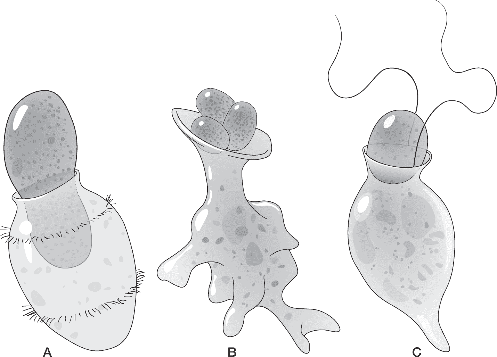

图 2.4. 正在进食的捕食性原生生物。*A*，纤毛虫属 *Didinium* 的一种正在捕捉并吞食纤毛虫属 *Paramecium* 的一种。两者都利用附肢（有些有毒）相互搏斗。*B*，变形虫正在吞食数个细菌。*C*，含有叶绿体的淡水鞭毛虫属 *Rapaza* 的一种正在吞食绿藻属 *Tetraselmis* 的一种。图片基于 Leander, B. S., 2020, “Predatory Protists,” *Current Biology*, 30(10):R510–16 中的照片绘制。

![图 2.5. 这张系统发育树展示了真核生物通过内共生（一个谱系被另一个谱系吞噬）进行谱系融合的部分历史。系统发育树上的点、星和菱形分别代表原始、次级和三级吞噬事件的宿主谱系。顶部的俄罗斯套娃图示说明了从原始到次级再到三级吞噬事件的连续过程（从左到右）。某些谱系中内共生体的偶尔丢失解释了重复的原始事件。这是一个活跃的研究领域，部分估算事件仍存争议。选定的生物名称及其大致的系统发育位置提供了背景信息。 ¶ 树图改绘自 Burki, F., Roger, A. J., Brown, M. W., and Simpson, A. G., 2020, “The New Tree of Eukaryotes,” *Trends in Ecology & Evolution*, 35(1):43–55; He, D., Fiz-Palacios, O., Fu, C. J., Fehling, J., Tsai, C. C., and Baldauf, S. L., 2014, “An Alternative Root for the Eukaryote Tree of Life,” *Current Biology*, 24(4):465–70. 内共生事件（吞噬）的系统发育位置细节来自 Gentil, J., Hempel, F., Moog, D., Zauner, S., and Maier, U. G., 2017, “Origin of Complex Algae by Secondary Endosymbiosis: A Journey through Time,” *Protoplasma*, 254(5):1835–43; Oborník, M., 2018, “The Birth of Red Complex Plastids: One, Three, or Four Times?,” *Trends in Parasitology*, 34(11):923–25; Sibbald, S. J., and Archibald, J. M., 2020, “Genomic Insights into Plastid Evolution,” *Genome Biology and Evolution*, 12(7):978–90; Roger, A. J., Muñoz-Gómez, S. A., and Kamikawa, R., 2017, “The Origin and Diversification of Mitochondria,” *Current Biology*, 27(21):R1177–92; Oborník, M., 2019, “Endosymbiotic Evolution of Algae, Secondary Heterotrophy and Parasitism,” *Biomolecules*, 9(7):266.](img/Mindell_Evolu_Fig_2_5.png)

图 2.5. 这张系统发育树展示了真核生物中通过内共生（一个谱系吞噬另一个谱系）发生谱系融合的部分历史。系统发育树上的点、星号和菱形分别代表初级、次级和三级吞噬事件的宿主谱系。顶部的俄罗斯套娃图示了从初级到次级再到三级吞噬事件的连续演进过程（从左到右）。某些谱系中内共生体的偶尔丢失解释了为何会反复发生初级事件。这是一个活跃的研究领域，部分推测事件仍存争议。文中列举了部分生物名称及其大致的系统发育位置，以提供背景信息。¶ 系统发育树根据 Burki, F., Roger, A. J., Brown, M. W., and Simpson, A. G., 2020, “The New Tree of Eukaryotes,” *Trends in Ecology & Evolution*, 35(1):43–55; He, D., Fiz-Palacios, O., Fu, C. J., Fehling, J., Tsai, C. C., and Baldauf, S. L., 2014, “An Alternative Root for the Eukaryote Tree of Life,” *Current Biology*, 24(4):465–70 重绘。关于内共生事件（吞噬）的系统发育位置细节来源于 Gentil, J., Hempel, F., Moog, D., Zauner, S., and Maier, U. G., 2017, “Origin of Complex Algae by Secondary Endosymbiosis: A Journey through Time,” *Protoplasma*, 254(5):1835–43; Oborník, M., 2018, “The Birth of Red Complex Plastids: One, Three, or Four Times?,” *Trends in Parasitology*, 34(11):923–25; Sibbald, S. J., and Archibald, J. M., 2020, “Genomic Insights into Plastid Evolution,” *Genome Biology and Evolution*, 12(7):978–90; Roger, A. J., Muñoz-Gómez, S. A., and Kamikawa, R., 2017, “The Origin and Diversification of Mitochondria,” *Current Biology*, 27(21):R1177–92; Oborník, M., 2019, “Endosymbiotic Evolution of Algae, Secondary Heterotrophy and Parasitism,” *Biomolecules*, 9(7):266.

同样，在约 15 亿年前，古老的原生生物以光合蓝细菌为食，导致了另一次谱系融合。这一次内共生体是蓝细菌，最终演变成了叶绿体。由此产生的原生生物同时拥有了线粒体和叶绿体。反过来，这些原生生物演化出了三个不同的光合作用类群：（1）所有陆生植物和绿藻，（2）红藻，以及（3）灰藻，一类虽小但独特的淡水藻类。

在各种原生生物中，发生了一系列次级、三级及更高阶的内共生，即拥有叶绿体的原生生物被另一个原生生物吞噬，后者有时也拥有叶绿体，并被再下一个吞噬，以此类推，呈俄罗斯套娃式的模式。这些高阶内共生似乎涉及绿藻内共生体的两次事件，以及涉及红藻作为内共生体的两次或更多次事件。图 2.5 直观地展示了真核生物从远古至今发生的一些连续融合事件。这是一个活跃的研究领域，这些及类似事件的细节仍在评估中。

研究人员最近提出，在叶绿体内共生起源的故事中，存在着水平进化的额外层叠。支持这一观点的证据是来自衣原体菌群细菌向初始叶绿体真核宿主细胞核基因组的大量水平基因转移。这些基因的代谢功能可能是后来内共生蓝细菌取得成功的关键前兆。如果这一观点站得住脚，那么一种水平进化将促成另一种水平进化（谱系融合）。^(25) 衣原体菌群的细菌物种已被证明极具适应性，且是原生生物无处不在的共生体。不幸的是，该群体中的物种会导致衣原体感染，一种性传播疾病。

回顾起来，使光合作用（叶绿体）和氧代谢（线粒体）成为可能的物种融合事件，似乎是地球生命的必然结果。充足的阳光和氧气为创新提供了绝佳机会。突变、选择和时间自然而然地发现了它们。所有植物的起源都源于赋予其标志性特征——进行光合作用的叶绿体——的谱系融合事件。植物形态和功能的所有创新，从参天红杉到匍匐藤本和微小无花苔藓，都依赖并衍生自利用阳光制造食物的早期创新。所有真核生物的多样性同样与线粒体的内共生起源相关。线粒体提供的将氧气转化为能量的创新能力是其生存的必要条件。已知唯一没有线粒体的真核生物是单细胞鞭毛虫 *Monocercomonoides* 属，它们源自拥有线粒体的类群。仅产生叶绿体和线粒体的古老谱系融合事件，就表明了水平进化的催化力量在所有真核生物中回响。

### 多细胞性

多细胞生物从单细胞生物进化而来，是生命的重大转型之一。它使得不同细胞中不同功能的专业化成为可能，同时也使生物体的体型和寿命得以增加。而且这种转型在多个场合独立发生过。关于发生次数的估计取决于如何定义多细胞性。如果我们将多细胞性限定为具有细胞间通讯与协作的生物体，则可以数出 11 个独立的起源。黏菌（属于原生生物）和动物各一次；真菌三次；以及主要光合类群中的每一个两次：植物、红藻和不等鞭毛类，后者也属于原生生物，包括鞭毛虫和硅藻。^(26)

多细胞性的起源涉及许多复杂特征的进化，不同生物群体似乎走过了多种不同的路径才达到这一地步。关于哪些机制在多细胞性的多次起源中最为重要，并无广泛共识，关于水平进化潜在作用的论述也相对较少。在众多可能的影响因素中，一些研究者认为，上文讨论的原生生物的捕食行为——该行为导致了内共生和叶绿体的形成——很可能也是多细胞性多次起源的一个影响因素。近期的实验室实验表明，可怕的单细胞原生生物 *Paramecium tetraurelia*（草履虫）捕食单细胞藻类群体，反复导致了多细胞藻类的协同进化，多细胞猎物体型更大、更难吞噬。^(27) 其他研究者指出，单细胞宿主与病原体之间的水平协同进化可能是一个关键影响因素，因为基于计算机的竞争性宿主-病原体“军备竞赛”模拟显示，多细胞比单细胞更具优势。^(28)

### 有性生殖

# 性也是去中心化的

无论是植物、动物、真菌还是原生生物，雄性和雌性都各自贡献一半基因给胚胎。这些基因随后在胚胎中重组，从而产生新的基因组合供自然选择发挥作用。考虑到个体传递基因的生物学必要性，以及无性繁殖（捐赠全部基因）而非有性繁殖（仅捐赠一半基因）这一替代方案的存在，有性繁殖竟如此普遍，实属奇妙。而它确实很普遍，尤其是在脊椎动物物种中。脊椎动物中无性繁殖物种相对较少，且出现的无性物种比有性物种更容易灭绝。专家将有性脊椎动物物种的相对丰富归因于它们创造更大遗传多样性的益处。这种遗传多样性为适应性变化提供了更大潜力，尤其是在多变的环境中。有性繁殖还提供了一个机会，用以选择并清除存在于亲本贡献中的有害突变。无性繁殖者不存在这种机会。

有性重组并非像杂交、谱系融合和水平基因转移那样，在同一意义上或同一规模上属于水平进化。然而，它促进了种群间新基因组合的产生，并与后代从单一亲本接收所有基因的集中式无性繁殖过程有着本质区别。进化倾向于青睐高繁殖率生物群体（如细菌）的无性繁殖，因为这些生物对单个后代的投入较少。

## 水平基因转移

真核生物之间及内部的水平基因转移，最初被认为不存在，随后被认为罕见，而现在，随着数据库的增长，仅被认为“不常见”。真核生物的水平基因转移倾向于发生在其微观群体中，其发生频率比细菌和古菌低约 80%。目前的估计表明，微生物真核生物的基因组中有 0.04% 至 6.49% 的基因经历过水平基因转移，尽管随着更多调查的开展，这些数字可能会发生变化。^[29] 研究人员 Julia Van Etten 和 Debashish Bhattacharya 指出：“水平基因转移是微生物真核生物进化中一个虽小但显著的参与者”，并提供了水平基因转移促进适应性功能获得的例子，在某些情况下甚至支撑了主要的生活方式转型。这包括向温泉和冰川等极端环境的适应，以及生物从海水向淡水环境的迁移。^[30]

但也发生了相当数量的从细菌向非微生物真核生物的水平基因转移。各种昆虫、软体动物、海葵和真菌能够利用获得的细菌防御基因（可破坏细胞壁）来抵御细菌入侵者。一些昆虫、粘菌和硅藻获得了细菌基因，使其能够合成维生素和螯合铁。某些真菌、陆生植物、硅藻和藻类获得并整合了细菌基因，帮助它们应对极端的环境毒性和胁迫。^[31] 植物间的水平基因转移被强烈暗示参与了某些寄生植物的进化，寄生物种从其宿主处获得了基因。^[32]

请记住，水平基因转移并不容易识别。它要求在实验室和计算机分析中都极为严谨。已有不少水平基因转移的报告最终被证实为假阳性，原因是实验室样本污染或基因组分析与组装中的问题。然而，随着时间的推移，科学具有自我纠错能力，错误会被识别，且已知水平基因转移的范围仍在持续扩大。^[33]

水平进化事件导致系统发育网络中出现连接单一物种——或基因——的多条线路。我们对这些网络的形状和复杂性了解多少？网络连接的幂律分布描述了这样一种情况：少数节点（单个物种或基因）作为枢纽拥有大部分网络连接，而大多数节点连接相对较少。幂律分布的例子包括互联网的大部分结构、许多社交网络以及传染病的传播者。^[34] 所有这些都显示出少数枢纽承担了比大多数其他网络参与者更多的流量。幂律分布显示出连接丰富的节点倾向于变得更加丰富。

关于不同生物系统发育网络的方向性和连通性，仍有许多有待探索。然而，随着来自生物体的全基因组数据库不断增长，专家们已在生命多样性中识别出一些总体趋势。跨细菌基因组的系统发育水平基因转移网络似乎呈枢纽主导，符合幂律分布。例如，对生活在人类消化道内的细菌基因组间水平基因转移的分析均显示幂律分布（常称为无标度分布），某些细菌基因在水平基因转移网络中作为枢纽，相对于其他转移频率较低或根本不转移的基因而言。同样，一项针对大量病毒基因组间水平基因转移的研究显示，相对较少的基因作为枢纽，在水平基因转移网络中移动最频繁。^[35]

## 地衣作为创新

地衣值得特别提及。它们本身就是基于多物种活动涌现出的创新。你可能认识它们为贴附在岩石和倒木上的扁平、皱褶的植物状生物，或是散布在苔原上的矮小、珊瑚状的形态。但“植物状”并不足以概括其本质。

地衣是复合体。或者，如果你愿意，可以称它们为超生物，甚至是物种伙伴的生态系统。单个地衣体内栖息着两个或更多不同的物种，它们共生并共同构建地衣的主体，即叶状体。通常，一种是真菌（菌 symbiont/菌共生体），另一种是藻类或细菌（光共生体）。在某些地衣中，存在不止一种贡献的光共生体和/或菌共生体物种。除了主要共生体外，还有一些真菌、藻类和非光合细菌物种，均存在于地衣叶状体内。这些额外的物种构成了地衣微生物组，即其栖息微生物的完整集合。^[36]

构成这一复杂超生物（常称为全生物体）的物种的功能及其遗传整合的程度尚不完全清楚。已知栖息于地衣内的许多细菌物种有助于为菌共生体提供营养、产生激素以及抵抗病原体。^[37] 然而，许多地衣共生体保留了独立生活的能力。

地衣的总体创新在于结合其组成物种的生活方式，成为地球上分布最广的真核生物，定居在藻类或真菌单独无法生存的地方。真菌从藻类光合作用中获得糖分作为食物，而藻类获得庇护、防止干燥的保护，以及通过真菌消化食物获取矿物质营养。但除了谁为谁做什么以及为什么这样做的冷酷计算之外，个体结合它们的生活，仅仅是因为它们能够这样做。为什么不呢？许多地衣物种在没有土壤的情况下茁壮成长，并能耐受极端的高温和脱水。被带入实验室的南极地衣轻松存活了一个月的模拟火星环境暴露。地衣本身就证明了共生和水平进化创造具有新能力和适应性的新生命形式的惊人力量。发现一些地衣真菌共生体能够杂交，更增加了它们水平进化的复合狂欢。^(38)

正如我们将在下一章看到的，地衣作为具有多物种的创新复合体的发现最初被视为笑谈而被驳回。对超出一小部分物种的更大意义的早期驳回或忽视，对于水平进化的其他机制也很常见。但支持新叙事的证据一直隐藏在显而易见之处。

## 3 变革的种子

> 过去从未逝去。它甚至不是过去。

> 

> ——威廉·福克纳，《一位修女的安魂曲》

水平进化隐藏在显而易见之处已有很长时间。物种杂交、谱系融合和水平基因转移的存在已为人所知一个多世纪。然而，它们在各生命形式中的机制和频率长期以来知之甚少，并且不被视为像我们现在这样对生命进化具有重大后果。最初的观察和发现在首次报告时被低估，甚至被嘲笑和彻底拒绝。在本章中，我追溯了关于水平进化的早期思想史。我旨在表明，进化的新叙事是将我们目前的理解作为对传统叙事的补充，而不是基于全新的机制或想法。

### 物种间的杂交

卡尔·林奈因其命名、描述和分类所有生物物种的努力而闻名。这一至今仍在使用的系统，分配属名和种加词作为独特的双词拉丁名。在一群环游世界的学生和专职通讯员的帮助下，他是该系统的主要开发者和推广者。他根据相似性将所有物种分类为嵌套群——首先分为属，然后是纲和目。1735 年至 1766 年间，他的著作《自然系统》（*Systema naturae*）历经 12 个版本。在这三十年里，他分类了约 9000 种植物和 4400 种动物。原本只有 12 页的薄册变成了 2400 页的三卷本系列。1758 年《自然系统》第 10 版被视为动物命名法的正式开端，而他 1753 年出版的《植物种志》（*Species plantarum*）则是现代植物命名法的正式起点。他的初恋是植物学，他是一位热衷的园丁，尝试培育本地和外来植物。

林奈出生比达尔文早 98 年，并宣称坚定信仰上帝创造物种；然而，他对野外植物变异的敏锐观察和园艺杂交实验使他在 1760 年指出：“不可能怀疑通过杂交产生新物种……并且似乎可以得出结论，同一属中的许多植物物种最初不可能不是一种植物，并且是从这种杂交产生中产生的。”^(1) 林奈《自然系统》第 12 版省略了他在早期版本中提出的“新物种不形成”的主张，隐含地允许了近期物种形成的可能性。因此，尽管他是创造论者，但他也理解基于自然过程，一些新物种自创世以来已经出现。

但林奈不是进化论者。他没有像达尔文那样主张所有新物种都是自然选择和适应的结果。林奈认为，通过杂交产生新物种只是填补上帝预先计划中预存细节的一种自然手段。尽管如此，在林奈时代，也不是达尔文时代，野外不同物种间的杂交都未被接受作为新物种起源的机制。缺乏直接观察，且在可能的竞争和与亲本形式回交的潜力下，维持杂交独特性的机制未知。骡子等杂交个体无法繁殖的例子也反驳了这一点。林奈关于新物种具有杂交起源的主张在当时基本被忽视。他对失望并不陌生。他曾试图用咖啡、茶、大米等非本土农作物来振兴瑞典经济，但未成功。这还是在物种地理分布范围及其原因的极限被了解之前。

达尔文很清楚植物和动物物种间的杂交现象。他在 1859 年著作中写了一章“杂交论”，引用了自己的观察和与他人的大量通信。通信表明，物种间的杂交在许多自然学家和动植物育种者中是常识。讨论的在其群体内进行杂交的植物物种包括矮牵牛、杜鹃花、柳树、葫芦、玄参和烟草。他讨论的在其群体内杂交的动物包括鹿、雉、蛾、鹅、狗和牛。

达尔文的主要关注点在于展示“物种与其变种之间的本质区别”，即不同物种的杂交通常产生不育后代，而同一物种不同变种间的杂交后代则育。他努力理解为什么某些种间杂交的后代不育而其他的却不是。他警告说，后代的育性或不育性本身不足以区分物种及其变种。^(2) 他没有将物种间的杂交视为生命多样化的重要力量。

1866 年，奥地利生物学家、数学家和修道士格雷戈尔·孟德尔在布尔诺自然历史学会会刊上发表了一系列关于豌豆杂交的详细实验。他表明，信息以离散单位（后来称为基因）从亲代传给子代，这些单位成对存在（后来称为等位基因），每个亲代各贡献一个。他创造了“显性”和“隐性”术语来描述等位基因在后代中是表达还是被掩盖。他的实验打破了进化中混合遗传的概念障碍，即后代的所有性状都介于亲代之间。如果混合遗传为真，物种内个体间的变异将被均质化，不留任何变异供自然选择过程作用。发表时鲜有人读。

然而，在 1900 年该出版物被重新发现后，其发现为现代遗传学的发展提供了框架，包括杂交研究在了解进化和性状遗传性方面的重要作用。当时，根本无法衡量杂交在产生跨生命形式的物种多样性方面的影响。关注点集中在其他问题上，例如孟德尔的发现是否以及如何与达尔文关于物种起源的观点相冲突。^(3)

我们现在有能力通过比较许多物种的整个基因组来评估过去杂交事件的频率。研究人员发现，物种间的杂交比以前认为的要普遍得多，这在植物和动物中均是如此。最近的估计显示，世界上大约 25% 的被子植物物种和 10% 的动物物种是通过杂交产生的。^(4) 虽然杂交起源在动物中较少见，但最近的发现包括昆虫、慈鲷鱼和鸟类中的例子，其中之一是加拉帕戈斯群岛的一种达尔文雀。

进一步印证了物种间广泛融合的叙事，杂交具有连锁效应，称为基因渗入，即使没有产生新物种，这种效应仍会继续物种间的基因混合。当杂交个体保持了与一个或两个亲本物种，或与近缘物种繁殖的能力时，就会出现这种情况。迄今为止，利用全基因组规模数据评估的所有有性生殖物种辐射（见表 1.1）中均发现了杂交基因渗入，包括对刺鱼、`Heliconius` 蝴蝶和 `Anolis` 蜥蜴的研究。其他许多基因渗入的例子也为人所知，例如郊狼与灰狼之间、北极熊与棕熊之间。这两种熊的基因混合可以追溯到约 20,000 年前的最后一次冰期极大期，当时北极熊和棕熊的分布范围更广泛地重叠。随着揭示基因渗入的方法不断改进，其频率估计肯定会增加。^(5)

所有杂交现象，包括基因渗入，都属于水平进化，因为遗传物质是在不同物种之间交换，而不是在亲代和子代之间，后者是垂直进化的路径。它们代表的是网络化而非分支化。

## 重组与水平基因转移

上述关于杂交的讨论适用于有性生殖的植物、真菌和动物。然而，正如第 2 章所述，细菌谱系间的重组实现了类似于杂交的基因混合。三种主要机制（转化、转导、接合）也是水平基因转移的形式，因此重组和水平基因转移的早期历史是共享的。

它们共享历史的开端与任何时代最具影响力的生物学发现之一紧密相连，即 DNA 是遗传物质的发现。我们可以从 1928 年开始，当时英国微生物学家弗雷德里克·格里菲斯（图 3.1）发表了一组令人振奋的实验结果。他利用小鼠和 `Streptococcus pneumoniae`（肺炎链球菌，引起肺炎的细菌），证明了非毒力细菌菌株可以被“转化”为毒力菌株。他通过在小鼠体内混合这两种菌株来实现这一点。混合前，毒力菌株已被煮沸杀死，但它仍设法将活的良性菌株转化为活的毒力菌株。格里菲斯于 1941 年在德国空袭伦敦期间死于实验室。同年，纽约洛克菲勒研究所的研究员奥斯瓦尔德·艾弗里接手了格里菲斯的工作，致力于鉴定被杀死的毒力 `Streptococcus` 菌株中的转化物质。

艾弗里和两位同事科林·麦克劳德和麦克林·麦卡蒂随后证明，并于 1944 年发表了 DNA 是神秘的转化因子，更广泛地说，DNA 是遗传物质。艾弗里写信给他的兄弟，暗示了转化的水平性质：“核酸[DNA]……能在细胞中诱导可预测的遗传性改变。听起来像病毒——可能是一个基因。”^(6) 但细菌转化，即一个细菌直接摄取另一个细菌的遗传物质，直到几十年后才被认作一种水平基因转移形式。或许必须先理解 DNA 在垂直、亲代到子代遗传中的作用。尽管如此，细菌中水平基因转移的最早证据已发表并被重视，这远早于人们理解其对其他微生物和生命形式进化的后果。

图 3.1. 弗雷德里克·格里菲斯是一位英国细菌学家，也是最早展示 DNA（当时尚未命名）在遗传中核心作用的人之一。一种细菌菌株转化为另一种菌株，是他对 `Streptococcus pneumoniae`（肺炎链球菌，肺炎的病因）研究的核心，直到他在 1941 年去世几十年后，这才被理解为一种水平基因转移形式。 ¶ 1936 年拍摄的照片由美国国家医学图书馆提供，约书亚·莱德伯格惠赠。

水平基因转移的另一种机制于 1951 年被发现，当时西雅图华盛顿大学的微生物学家维克多·弗里曼发现，他可以利用病毒感染并携带基因，将一种非毒力细菌菌株变为毒力菌株。涉及的细菌 `Corynebacterium diphtheriae` 是白喉的病因，该研究的目的是了解控制传染病的可能方法。同样，1952 年，津德和约书亚·莱德伯格在威斯康星大学工作时，发现了由病毒介导的 `Salmonella`（沙门氏菌，可引起肠胃炎）细菌间遗传交换的证据，并为此创造了“转导”术语。这些作者意识到他们观察到的是一种不同于垂直、亲代到子代模式的遗传机制。直到 1950 年代，随着细菌对抗生素耐药性的快速全球传播，横向基因转移在细菌进化中的频率和速度才被认识到。尽管如此，水平基因转移在生命进化中的作用直到更多物种及其基因组得到探索后，仍知之甚少。

## 谱系的融合

西蒙·施文德纳发现了端倪（图 3.2）。而且他无法知道这有多大。他只是知道，在 1860 年代通过显微镜观察地衣时所看到的一切，违背了专家们的认知。就专家们而言，地衣是植物，一种地衣就是一种植物。相反，这位 28 岁的瑞士植物学家看到了藻类和来自微小真菌的令人困惑的线状丝团。如果地衣是植物，这说不通。经过数月数年艰苦细致的观察，使用我们现在认为原始的设备，他观察到称为菌丝的线状真菌丝独立于聚集在表面的藻类发育。他观察到菌丝首先包围藻类，然后刺激它们繁殖。他不懈努力增强光学显微镜的能力并重复实验，以消除他最初对观察结果的怀疑。最终，他确信他的地衣是由两种不同的生命形式——藻类和真菌——之间的相互作用产生的，且不涉及植物。他不仅违背了植物专家，还反驳了达尔文所解释的物种起源传统观点，即新物种通过从其他物种分裂而进化，而不是通过融合它们。

# 共生起源的发现

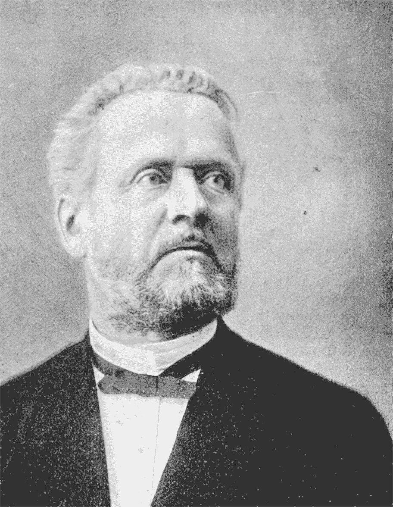

**图 3.2.** 瑞士植物学家西蒙·施文德纳于 1867 年、38 岁时发表假说，认为地衣是由两个独立物种——一种真菌和一种藻类——结合而成的。这与达尔文的物种起源观不一致。当时他的假说被广泛拒绝，但最终于 1877 年被其他人证实为真，他们证明了地衣可以在实验室中由真菌和藻类成分的结合培育而成。照片摄于 1905 年。

1867 年，施文德纳在瑞士自然学家俱乐部发表了他的发现，指出地衣是群落，由数千个藻类个体和一种或多种控制性真菌组成。他分别将真菌和藻类成分比作蜘蛛和猎物，认为真菌刺激被困在其菌丝网中的藻类，而非以它们为食。听众深表怀疑。一些专家说施文德纳的想象力过于丰富。其他人干脆称他为蠢才。没有人能通过结合藻类和真菌来产生地衣。

另一位年轻的植物学家安德烈亚斯·施因佩尔（图 3.3）也被迫质疑正统观点。1882 年，这位 27 岁的青年透过显微镜观察到一系列微小的绿色球体在单个孤立的植物细胞内漂浮并繁殖。一个球体变成两个，反复进行。他因其绿色色素叶绿素，将它们命名为“chloroplastiden”，英文为“chloroplasts”（叶绿体）。施因佩尔对这种复杂性的进化感到困惑，指出如果不是因为它们被限制在植物细胞内，叶绿体可能会被误认为是独立的生物体。他在 1883 年发表了一份手稿，指出分裂的叶绿体与自由生活、分裂的蓝细菌有着强烈的相似性。施因佩尔在脚注中随意地陈述，如果植物生殖细胞包含叶绿体，那将支持一个荒谬的观点：绿色植物起源于叶绿体与其他生物体之间的共生关系。虽然还有其他几位植物学家注意到了叶绿体与某些细菌之间的相似性，但他的推测被忽视了。当时不知道植物与其他生物体之间存在任何共生现象（物种共同生活），这本可以给这个想法增加一点可信度。施因佩尔也没有追究这个想法，而是继续进行他的叶绿体和植物生态学研究。

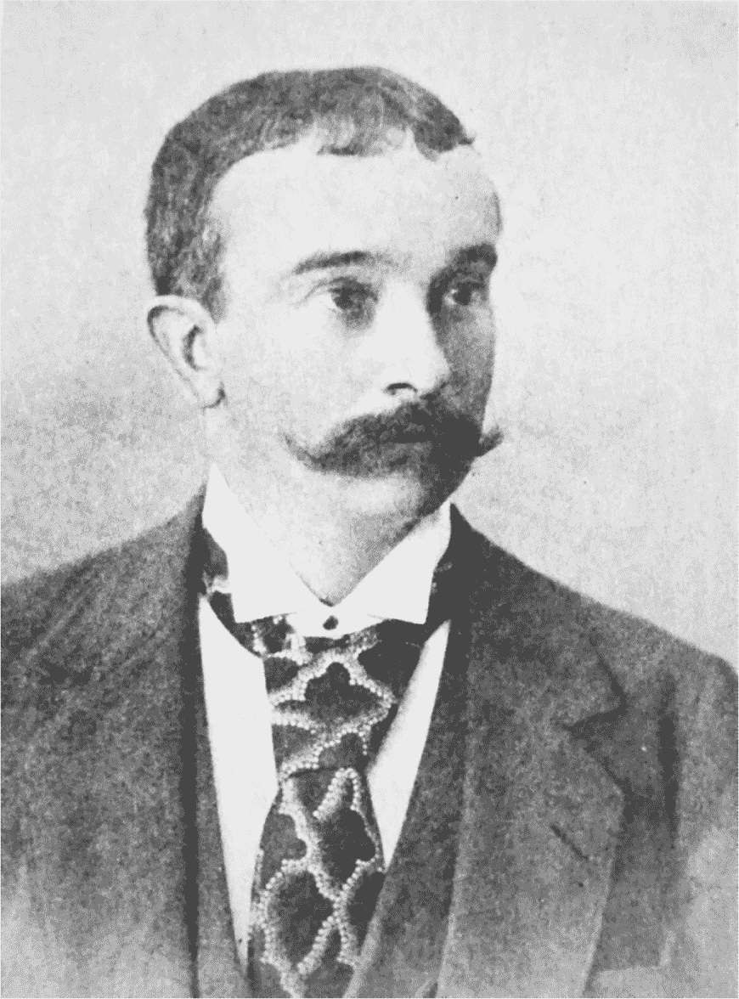

**图 3.3.** 德国植物学家安德烈亚斯·施因佩尔于 1882 年透过显微镜观察到微小的绿色球体（他称之为“chloroplastiden”）在单个植物细胞内繁殖。他在 1883 年发表了观察结果，指出叶绿体与蓝细菌有着强烈的相似性，推测绿色植物可能起源于叶绿体与其他生物体之间的共生关系。照片摄于 1890 年左右。

约 20 年后，俄罗斯生物学家康斯坦丁·梅列日科夫斯基注意到了施因佩尔这个大胆的想法。他在 1905 年至 1918 年间的出版物中，收集了支持复杂细胞进化更详细场景的证据，其中叶绿体和线粒体均通过共生关系产生。他深知共生的力量，既是地衣的研究者，也是水螅的研究者，水螅是常与藻类共同生活的小型淡水无脊椎动物。与施文德纳和施因佩尔不同，梅列日科夫斯基明确拒绝了达尔文的观点，即自然选择可以解释全部甚至大部分的生物新奇性，这使他倾向于将细胞的进化视为一个共生过程，而非个体生物体之间微小、渐进变异的选择。

但细胞内叶绿体和线粒体的共生起源观点，与公认的 20 世纪中叶观点直接冲突，后者认为细胞核中的染色体是生物体遗传物质的主要（如果不是唯一）来源。认为叶绿体和线粒体从细胞核内已有的物质逐渐进化而来的观点，与达尔文自然选择作为进化变化催化剂的理论更为吻合。进化通常不被视为像施文德纳、施因佩尔和梅列日科夫斯基所概述的那样通过共生来推进。梅列日科夫斯基尤其感到自己被科学界边缘化。他是一个深受折磨的人，最终自杀身亡。

今天我们回顾过去，可以看到施文德纳、施因佩尔、梅列日科夫斯基、格里菲斯、林奈以及许多其他先驱所研究和描述的谱系融合现象的关键特征，不仅得到了证实，而且得到了极大的扩展。在施文德纳于 1867 年在瑞士自然学家俱乐部发表演讲后，科学家们一致认为，如果能在实验室中用真菌和藻类的混合物实验性地产生地衣，就能为地衣的双重本质提供令人信服的证据。在经历多次失败后，由德国植物学家克里斯蒂安·恩斯特·施塔尔领导的一个小组于 1877 年找到了合适的条件，成功地从真菌和藻类成分中培育出了地衣。快进到现在，一些地衣已知包含十几种或更多的藻类和真菌伙伴物种。最早于 19 世纪中叶窥见的地衣进化的双重本质，现已扩展为容纳一个真正的物种群落。

以前独立物种之间的专性共生已在许多生命形式中被发现。珊瑚和水母等无脊椎动物依赖藻类共生体。固氮细菌与许多植物物种的根部共生很常见，且对植物生存至关重要。称为菌根的真菌结构源于真菌与植物的共生关系，它们增强了植物根系吸收土壤养分的能力。这些共生现象已在接受检查的 90% 以上的植物科中被发现，包括约 4 亿年前的化石植物。昆虫与协助消化食物和抵御病原体的细菌之间经常存在共生关系。在令人惊讶的发现中，我们自己的免疫系统，以及所有多细胞生物的免疫系统，都是由与病毒的共生塑造而成的。共生采取多种形式，从专性到偶发，有或没有基因整合。然而，它们的进化后果却跨越物种，深远而广泛。

# 历史视角下的内共生与水平进化

## 早期假说与林恩·马古利斯的贡献

Schimper 于 1883 年和 Mereschkowski 于 1905 年提出的关于叶绿体起源的早期假说，直到 20 世纪 70 年代才得到证据的有力支持。即便如此，进化很少被视为通过合作而推进的。内共生作为复杂细胞进化的解释，在 20 世纪大半时间里都处于边缘地位。美国生物学家 **Lynn Margulis** 在复兴和拓展这些观点方面发挥了关键作用（图 3.4）。

1967 年，在遭到多家期刊拒稿后，她以 **Lynn Sagan** 的名义在 *Journal of Theoretical Biology* 上发表了一篇论文。该论文大胆综合了关于叶绿体和线粒体微生物起源的新旧观点。她主张它们的微生物起源这一观点，解释了从缺乏内部结构的单细胞生物（如细菌）向拥有重要内部结构的复杂多细胞生物（如植物和动物）这一重大进化转型的关键方面。^(7)

**图 3.4.** 美国生物学家 Lynn Margulis 于 1967 年提出了大胆的观点综合和新数据，支持内共生是从单细胞向多细胞生物进化转型中的关键事件。这包括来自电子显微镜、生物化学、古生物学和系统发育分析的证据。¶ 照片来源：John Feldmann。

Margulis 指出，作为光合生物，特别是蓝细菌，向环境中释放氧气，导致古老的厌氧生命形式无法生存，除非它们以某种方式适应。它们需要一种代谢氧气的途径，而这可以通过采纳氧气代谢细菌来获得，后者可能演变成了线粒体。同样，早期生命形式可以通过摄入光合蓝细菌（后者演变成了叶绿体）作为制造食物的手段而受益。

Margulis 的思想深受瑞士裔细胞生物学家 **Hans Ris** 的影响，后者是她在威斯康星大学读研究生时的导师。她极具说服力且坚持不懈地论证，复兴了 Schimper、Mereschkowski 等人早已被遗忘的观点。而且她的时机恰到好处。她能够调动新的支持性证据：电子显微镜显示微生物与细胞器之间存在更多结构相似性；生物化学显示细胞器拥有自己的 DNA；古生物学显示已知最古老的生命形式是单细胞细菌，早于具有细胞器的细胞起源。她乘着支持叶绿体和线粒体微生物起源的高涨浪潮，其中包括美国微生物学家 **Carl Woese** 通过开创性分析得出的明确遗传亲缘证据。她乐于这场斗争，证明了当前进化观的某些方面是错误的，需要修正。合作与共生可能比作用于微小遗传变异的竞争与选择更强大。进化变化可能突然发生。生命历史的大部分模式是网状的，不同于树枝只会分叉的树。用她的话说：“生命不是通过战斗占领全球的，而是通过网络。”^(8)

## 拉马克

**Jean-Baptiste Lamarck**（1744–1829）是一位多产且有影响力的法国动物学家。尽管他的观点与 Darwin 的截然不同，但 Lamarck 比 Darwin 早约 50 年发表了关于生命自然进化和随时间变化的理论。Lamarck 的进化概念缺乏 Darwin 所发展并有效用于说服同行接受进化现实的自然选择这一引人入胜的机制。Lamarck 的名字奇异地与一个被其许多前辈视为常识的概念联系在一起。最初，“拉马克主义”或“拉马克式遗传”代表基于身体部位用进废退，后代继承父母获得性状的观点。用 Lamarck 的话说，“自然法则使新个体获得其父母一生中在身体组织方面所获得的一切……这一事实证据确凿，以至于没有观察者无法使自己相信其真实性。”他强调了环境和行为在动物身体和器官随时间塑造中的作用，并首次将获得性状的遗传与“导致动物惊人多样性的原因”联系起来。^(9) 在 Lamarck 看来，环境诱发行为，行为可导致身体的可遗传变化。甚至 Darwin 也支持身体特征在行为中的用进废退可能对进化有影响这一观点。

随着 20 世纪初孟德尔遗传学的出现和植物遗传性实验的开展，拉马克式遗传开始失去支持。并在 20 世纪被生物学家基本放弃了其最初的表述。然而，随着新方法和分子工具的发展，支持某些获得性状遗传的证据不断增加。例如，发育中胚胎化学环境的获得性变化可以影响其基因表达，进而影响体形。这属于表观遗传学领域，该领域致力于理解环境和行为如何影响基因运作。这里的重要区别在于基因表达的变化不同于基因本身 DNA 序列的变化。获得性状遗传的其他新证据来自疾病免疫研究。例如，一些细菌能将一段外源 DNA 插入自身基因组，从而获得对疾病感染的可遗传抗性。重要的是，细菌获取的外源 DNA 来自其环境。^(10)

直接水平进化的机制——即物种杂交、融合和水平基因转移——也导致获得性状的可遗传性。它们很少从这个角度被考虑，但它们可以或应该被这样考虑，因为这就是现实。通过水平进化获得基因的个体会将它们传给后代。拉马克式遗传长期以来被视为并作为一种历史错误来教授。不出所料，Lamarck 自己的描述模糊且缺乏详细的机制证据。他在 Darwin、Alfred Russel Wallace、Mendel 等人洞察之前写作，对作为遗传物质的 DNA 一无所知。因此，“拉马克主义”和“拉马克式遗传”这两个术语带有强烈的负面含义，大多数专家避免用它们作为水平进化的描述符。然而，获得性状的字面遗传确实会发生。它与水平进化一致，并作为常规垂直进化中父母性状遗传的补充。我在此努力更新进化的宏大叙事，赋予水平进化更大且关键的作用，这也意味着承认获得性状遗传在生命进化中具有更大且关键的作用，无论是否使用过时的描述符“拉马克式”。

## 人类与水平进化

让我们通过将问题个人化来结束这一历史章节，考虑我们自己过去发生的众多水平进化事件中的几个。我们将看到，这些事件在我们的消化、起源、繁殖和呼吸等方面发挥了关键作用。水平进化是我们人类故事中的关键要素。

# 许多人爱吃寿司

但由于水平进化，有些人比其他人更能消化它。一种消化酶的编码通过水平基因转移，从海洋细菌转移到了日本人群的肠道细菌中。寿司外层深色的海苔，对大多数人来说难以消化，甚至无法消化，因为其碳水化合物包含陆生植物中不存在的硬化分子。这个故事的发现源于科学家在研究能够消化海苔的海洋细菌酶时，在日本人的肠道细菌中发现了相同的酶之一，而该酶在北美人的肠道细菌中却不存在。^11 这些海洋细菇很可能随海苔被摄入体内，从而实现了水平基因转移，并随之带来了对人类的消化益处。但水平进化与人类消化的完整故事远不止于此。我们肠道中大多数必需的碳水化合物消化酶都是由细菌提供的。相对较少的酶直接编码在人类基因组中，这维系着消化协作。

# 继续前行

从基因角度来说，近期人类历史中没有任何“纯粹”可言。直到现代人（智人 *Homo sapiens*）的最近亲属从化石记录中消失之前，现代人一直在与它们偶尔进行杂交（图 3.5）。从已灭绝生物遗骸中获取的遗传数据表明，我们的谱系直到约 6 万年前还在与尼安德特人（*H. neanderthalensis*）杂交，约 3 万年前还在与丹尼索瓦人（*H. denisova*）杂交。后两个独特群体究竟应被指定为现代人的亚种还是独立物种尚有争议，但不同群体间存在杂交和水平进化这一观点依然成立。这种杂交显然为我们提供了一些有益性状。提供高海拔适应性的突变被追溯到西伯利亚丹尼索瓦人，而增强角蛋白、改善皮肤和头发耐久性的突变则来自尼安德特人。当前的基因组研究证明，早期那种认为现代人种是单一祖先群体走出非洲后各自分支整齐形成的传统观点，是过于简化且错误的。相反，现代人种是各群体融合的产物，这些群体的个体拥有漫长的地理迁徙史和偶尔的杂交史。^12

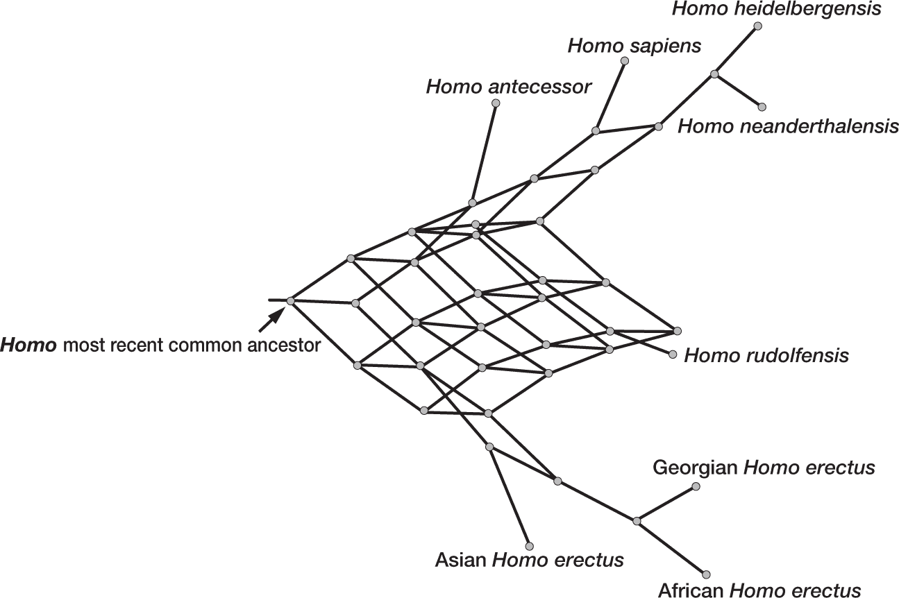

**图 3.5.** 部分 *Homo* 物种的系统发育网络。¶ 重绘自 Caparros, M., and Prat, S., 2021, “A Phylogenetic Networks Perspective on Reticulate Human Evolution,” *Iscience*, 24(4):102359。

# 妊娠与胎生

妊娠与胎生是人类的基本体验。它们也是水平进化的产物。它们的进化需要中和母亲的免疫系统，后者本会将胚胎视为抗原——一组不同于母体自身的外来细胞——并发起攻击。这种免疫系统的中和，一直是且仍在由胎盘哺乳动物（包括人类）与逆转录病毒之间一组令人难以置信的关系所塑造。人类基因组中约 30 亿个碱基中的 46% 源自先前的逆转录病毒感染。这包括被称为 HERV（人类内源性逆转录病毒）的序列。我们仍在了解它们的多种功能，但目前的证据表明，它们在调节母亲免疫系统对胎儿的反应以及胎盘发育中发挥着关键作用。除了哺乳动物内部妊娠的运作机制外，利用人类细胞的实验还显示 HERV 在神经元生长及其在大脑中功能维持方面也发挥着作用。^13 我们对 HERV 及其水平基因转移的“债务”可能更深远。

# 我们“上瘾”于氧气

我们“上瘾”于氧气。它可能是致命的，但我们能成功代谢它，归功于古老的水平进化。关键事件如前所述，是约 18 亿年前一种古菌吞噬了一种细菌的内共生关系，不妨称之为“吞噬”。该细菌存活下来并繁殖，随着时间的推移，其后代适应了古菌体内的生活。最终，该细菌演化出了线粒体。被吞噬的细菌此前已进化出将氧气和糖转化为能量（以 ATP，即三磷酸腺苷形式）的能力。其古菌宿主缺乏这种能力，成为了受益者。这两个谱系与其他许多谱系结合，产生了真核生物。这个早期的物种融合事件不仅是人类进化的一部分，更关乎我们的生存。

# 传染病

我们正以痛苦的方式领悟：传染病将永远伴随我们。人口增长、与微生物的频繁接触以及全球旅行，为传染病的快速传播创造了条件。特别是当病原体通过空气传播时更是如此。我们的免疫系统虽在复杂性和反应速度上令人惊叹，却可能不堪重负。为什么？因为微生物病原体在进化和逃避我们免疫防御的能力上同样迅速。导致人类流感的病毒会在彼此之间常规性地交换基因片段。这是一种重组和水平进化，使它们能够逃避免疫防御以及针对几个月前早期毒株开发的疫苗。这就是流感成为常年难题的原因。导致 COVID-19 的 SARS-CoV-2 冠状病毒展示了一种不同的、频率较低的重组和水平进化。但这些病毒的重组结合基因的快速突变，意味着免疫靶点可以迅速转移。

# 观鸟者的联系

最后，唤醒你远古博物学家的本能，思考观鸟者与水平进化的联系。认真观鸟能强迫你集中注意力。屏蔽人类的喧嚣。搜寻天空，聆听风下的鸟鸣，将物种与地形联系起来，感受季节更替。鸟类物种间的杂交（通常是最近亲）难以察觉，但比以前认为的要普遍得多。基于数据和方法的改进，鸟类物种杂交比例的估算已从 1992 年的 9.2% 上升至 2015 年的 16%。^14 后者肯定是低估，因为杂交的分子分析具有比专业观鸟者更强的辨别力，才刚刚开始。所有主要鸟类群体中均发现杂交物种（物种成员相对较少的群体除外），从信天翁到猫头鹰再到蜂鸟。杂交物种包括加拉帕戈斯群岛的各种达尔文雀、巴布亚新几内亚和澳大利亚的天堂鸟、北美和中美洲的蓝翅林莺和金翅林莺，仅举几例。^15 这对保护工作具有重要意义，因为某些物种可能因杂交而消失。尽管我们对水平进化的理解已大幅提高，仍有更多东西隐藏在显而易见之处，等待我们发现。

# 4 生命的边缘

> 进化的整个进程……在很大程度上是由这些[所有]生物与包括病毒、转座子在内的遗传寄生物的协同进化所塑造的。
>
> ——尤金·库宁，《机遇的逻辑》

# 传统叙事中的空白：病毒与生命起源

生命演化的传统叙事在病毒和生命起源这两个话题上基本保持沉默。这种沉默表明传统叙事已过时。自 19 世纪末被发现以来，病毒就被排除在生命之外。作为理解不深、结构极简（仅有一小组 DNA 或 RNA）的专性寄生生物，它们很容易被排除在生命范畴，进而被排除在演化叙事之外。病毒仅被视为无意义历史和极少基因的流氓化学微粒。但随着我们对病毒的古老性、复杂生命周期及行为的认知加深，这一观点正在改变。

同样，生命演化的叙事始于生命已从非生命中涌现之后。从化学世界向有生命生物世界的过渡也被置于叙事之外。这可以理解：最早阶段不够“生物学”而无法纳入叙事，更重要的是，关于这一过渡的方式和历史的许多问题仍未解决。但在这里，我们的理解也在增长。

病毒起源和全生命起源这两个话题同时缺席传统叙事并非巧合。鉴于它们起始的极端古老性和对地球早期环境的持续不确定性，这些话题的知识一直且仍然难以获取。但正在取得进展，而且这两个话题似乎联系紧密。本章将讨论的一些关于病毒和生命起源的当前观点仍属推测和待检验的假设。然而，当前证据支持对其进行严肃考量，我将它们纳入演化的新叙事。它们是生命历史的基本特征，太重要而不能忽视。病毒在生命演化过程中（包括生命起源）一直是生命形式间整合的强大推动者。我还将探讨生命与非生命之间的模糊边界，以及全生物体概念——即包含宿主及其共生体的个体。

## 什么是生命？

对于生命的定义没有共识。不存在其有无能明确区分生命与非生命的物理组分或物质。惊讶吗？我们的生活经验似乎让我们成为专家。我们整天都在对什么是活的、什么不是活的做出瞬间判断。推门而不是推门边的人。踩砾石而不是踩蛇。但学习的很大一部分在于克服自我，认识到经验的局限。大多数生命形式对我们来说是不可见、无形、无声、无味的。除非我们通过显微镜观察或阅读相关资料并信任来源，否则我们不知道什么自然地生活在我们皮肤上或体内。我们也不知道我们与其他生命共享而与非生命不共享的是什么。确实，繁殖和遗传是所有生命的共同特征，但它们并非生命独有，质粒、转座子、叶绿体以及你的每个单个细胞等各种非生命实体也具备这些特征。随着关注点转向边界情况，定义生命的难度从容易变得令人望而生畏。

然而，广泛认同的是生命是一个过程、一个随时间演化的系统（**Box 4.1**）。生物学家倾向于关注生物体层面的过程和系统，如新陈代谢、生长、遗传、繁殖、自然选择和演化来描述生命。而化学家和物理学家常采取更普遍的自持化学系统视角。当我们将生物体还原为其组成化学元素时，这些观点是兼容的。抛开希望和梦想，你我 99%由氧、氢、氮、碳、钙、磷组成，并含微量硫、钾、钠、氯、镁。若非生命那惊人的自持过程和系统，我们将如石头般毫无生气。

将生命视为由过程和系统而非物理实体构成的观点尚未成为主流，但正在接近。物种和生物体是短暂的，而过程随时间持续。过程和系统更基础，且被所有生命多样性独特地共享，这与任何特定的物理性状或物质不同。生物体本身包含从发育到代谢和繁殖的过程和系统，最好在此背景下理解。例如，理解一只个体青蛙需要理解其生命周期变化，从发育中的胚胎到蝌蚪再到成蛙。仅理解成蛙是对生物体的不完整视角。这一视角在理解病毒方面变得重要，如下所述。

所有已知生命都围绕能自我复制的 DNA 或 RNA 分子为中心。这些是携带遗传信息的复制子。此类复制子的完整集合包括所有熟悉的真核生物（如我们）、古菌和细菌等生命形式。但也包括一系列听起来神秘的实体，称为可移动遗传元件（MGEs）。MGEs 通常编码介导其自身在基因组内或不同个体甚至不同物种基因组间移动的蛋白质，也能介导其他 DNA 的移动。MGEs 具有不同程度的自主复制和繁殖能力。这包括产生复制和组装后代所需的核苷酸和氨基酸（资源）能力的差异。因此，并非所有复制子都能自主繁殖，那些不能的被视为非生命和寄生性。

演化学家 Koonin 和 Starokadomskyy 提出了一种范式来理解和组织这些复制遗传元件的多样性。**Box 4.2**描述了各种复制子和 MGEs，**Figure 4.1**展示了其自主性两个指标的变化。纵轴表示其产生复制和组装后代所需核苷酸和氨基酸资源的相对能力。横轴表示基于载体存在与否及载体类型（病毒或细胞）的 MGEs 移动自主性。载体促进资源获取和后代传播。细胞器包括线粒体和叶绿体。

我们对 MGEs 及其作为水平演化推动者（在生物个体和物种间移动 DNA）的工作的日益深入了解，表明它们在强调整合的演化新叙事中的角色。例如，许多个体生物的基因组已知基因数少于其种群整体。即，一个物种或微生物菌株内发现的并非所有基因都存在于所有个体中。一个物种或菌株的完整基因集称为其泛基因组，所有个体共享的基因子集称为核心基因组。泛基因组规模更大、包容性更强，部分源于 MGEs 在不同个体中运作方式不同，导致基因差异性获得或丢失。早期泛基因组研究必然聚焦于基因组相对较小的细菌和病毒。然而近期工作显示真核生物中也存在泛基因组。**Table 4.1**展示了各类群核心基因组大小（占泛基因组百分比）的已知范围。例如，人类和其他哺乳动物常见肠道细菌大肠杆菌的核心基因组仅包含泛基因组的 8%。总体而言，细菌的核心基因对生物体生命至关重要，而非核心基因常与毒力、防御反应和通讯相关。

**图 4.1.** 复制子、其载体及其为繁殖制造核酸和氨基酸的能力的多样性。复制子是能够自行或在帮助下自我复制的 DNA 或 RNA 分子。例如，逆转录元件没有载体协助其转运，也不能自行复制。然而，叶绿体等细胞器由细胞携带，且只需相对较少的帮助即可自我复制。本图旨在展示复制子种类和能力方面存在的广泛变异。 ¶ 修改自 Koonin, E. V., and Starokadomskyy, P., 2016, “Are Viruses Alive? The Replicator Paradigm Sheds Decisive Light on an Old but Misguided Question,” *Studies in History and Philosophy of Biological and Biomedical Sciences*, 59:125–34。

| 表 4.1. 部分物种核心基因组大小范围的比较 |
| --- |
| 物种 | 采样个体数 | 核心基因组大小（泛基因组的百分比） |
| **细菌** | | |
| *Chlamydia trachomatis*（沙眼衣原体） | 85 | 80 |
| *Rickettsia prowazekii*（普氏立克次体） | 10 | 8 |
| *Escherichia coli*（大肠杆菌） | 633 | 8 |
| **真菌** | | |
| *Candida albicans*（白色念珠菌） | 34 | 91 |
| *Parastagonospora* spp. | 33 | 40 |
| **原生生物** | | |
| *Emiliania huxleyi*（埃米利亚尼胡克斯石藻） | 14 | <70 |
| **植物** | | |
| 水稻 | 3 | 92 |
| 筒苜蓿 | 15 | 33 |
| **动物** | | |
| 贻贝 | 16 | 75 |
| 人类 | 185 | 97 |
| *来源*：Golicz, A. A., Bayer, P. E., Bhalla, P. L., Batley, J., and Edwards, D., 2020, “Pangenomics Comes of Age: From Bacteria to Plant and Animal Applications,” *Trends in Genetics*, 36(2):132–45。 |
| 核心基因组大小偏离 100% 是水平基因转移、MGE 活动以及基因获得/丢失的结果。 |

从这些信息中可以得出三个关键点。首先，核心基因组与泛基因组之间的关系受 MGE 活动影响，特别是自主性降低的复制子，如转座子和病毒（图 4.2）。这些 MGE 活动补充了第 2 章中关于水平基因转移频率和功能意义的证据，促进了生物形态间的遗传整合，这正是进化新叙事所强调的。

其次，复制子在其自主程度（为复制生产资源的能力，以及与运动载体的关联）这两个指标上存在一个连续谱。该连续谱范围从我们认定为生物体的完全自主性，到质粒和逆转录元件的无自主性。在这两个复制子极端之间存在不同种类的病毒。这一连续谱与生命具有模糊、不精确边界的观点一致。这反过来又与生命作为一个动态进化过程的观点一致。我们预期会看到实体具有不同程度的自主性，作为生命从非生命起源过程的一部分。另一种不太可能的情况是，生命的复杂过程从一开始就已完全形成，或近乎完全形成。基于基因，不带载体的复制子（如质粒）与病毒之间也存在进化关系网络。这表明，从一种类型的复制子向另一种类型的转变在漫长的进化过程中可能发生过，且很可能发生过多次。^(4) 我将在下文进一步讨论这一点。

第三，作为能够在个体内部和个体之间移动的非生命遗传寄生者，此类复制子的存在在进化系统中似乎是不可避免的。寄生复制子存在于所有已知生物形态中，并且在生命进化的计算机模拟中被发现会反复出现并持续存在。^(5) 这表明，寄生复制子及其水平移动遗传物质的能力，从一开始（或接近开始），即 38 亿多年前，就是生命进化不可或缺的一部分。

**图 4.2.** 早期生命进化阶段的假说，包括病毒的参与。阶段始于约 42 亿年前的 RNA 世界。 ¶ 事件顺序遵循 Domingo, E., and Perales, C., 2019, “Virus Evolution,” in *Encyclopedia of Microbiology* (4th ed.), edited by Schmidt, T.M., 558–68, Amsterdam: Elsevier. 系统发育遵循 Spang, A., Mahendrarajah, T. A., Offre, P. and Stairs, C. W., 2022, “Evolving Perspective on the Origin and Diversification of Cellular Life and the Virosphere,” *Genome Biology and Evolution*, 14(6):p.evac034。

### 什么是病毒？

病毒也难以定义，尽管我们都将其体验为肉眼不可见的感染性因子。^(6) 当你在脑海中构想出一个包裹着基因的尖刺球体形象时，你想到的是病毒颗粒。那只是病毒更大生命周期中的一个阶段。总的来说，病毒物种呈现出巨大的系统和生活方式多样性。一个通用的病毒生命周期包括：附着于细胞、进入细胞、去除病毒颗粒的蛋白质外壳、潜在插入宿主基因组、基因复制与表达、子代组装、以及通过空气或水释放和传播子代，或在表面潜伏以被新宿主无意摄取。在宿主体内，病毒可能会寻找其独特适应感染的特定组织类型的细胞。

当然，这些阶段中的每一个都包含许多步骤，且其时序因病毒和宿主而异。SARS-CoV-2 可能在短短一两天内完成大部分这些步骤，即在 COVID-19 症状发作前。导致艾滋病的 HIV 可在宿主细胞的 DNA 中整合潜伏 15 年或更久，随后重新激活并产生子代。仅观察潜伏期的整合 HIV 基因会错过其完整的生命周期过程，就像只观察成年青蛙会错过其生命周期一样。在其细胞内阶段，病毒巧妙地挪用宿主的细胞机制和基因，将其与病毒自身的基因结合使用，生成成千上万的病毒子代。

## 病毒的普遍性与丰度

病毒不仅无处不在，而且数量极其庞大（Box 4.3）。科学家们仍处于评估病毒在生态系统和生命进化中所扮演角色的早期阶段。病毒拥有七种不同的基因组类型，控制着它们的复制和表达策略。这一观察结果促成了 1971 年巴尔的摩分类法的建立，该分类法将病毒分为七个不同的类别（三类 DNA 病毒和四类 RNA 病毒）。然而，用于主要病毒群体间比较的大规模分子数据集直到最近才变得可用，这些数据表明巴尔的摩分类法并不能准确追踪病毒的进化。相反，分析显示病毒拥有一套复杂的关系网络，无法用简单的树状谱系线来表示。这听起来熟悉吗？病毒基因的水平进化和垂直进化都很丰富，跨越了病毒类别的界限，大致类似于第 2 章中讨论的细菌和古菌基因的情况。

一组功能重要且相对缓慢演变的基因（标志基因）表明，来自五个巴尔的摩类别的病毒在多个独立场合下发生了进化。也就是说，病毒具有多个独特的起源。此外，分析显示，巴尔的摩分类中的一类——单链 DNA 病毒——包含独立进化的群体，这是病毒与称为质粒的非病毒实体之间多次独立重组事件的结果（见 Box 4.2）。总体而言，病毒之间关系网络和水平进化的主要机制是重组和水平基因转移。

快速的遗传进化（包括垂直和水平方向）覆盖并模糊了许多病毒群体间进化关系的记录。然而，足够多的分子记录得以保留，特别是对于病毒标志基因，使我们能够“回溯到遗传元件的原始库。特别是原始 RNA 复制子（自我复制分子），包括类似于现存 II 类内含子的逆转录复制子。”^(7) 这为下文将讨论的生命起源提供了关联。

病毒长期以来在我们的集体意识中处于灰色地带，横跨有生命和无生命的世界。起初，它们似乎小得不可思议且无实体，其自然历史和巨大多样性的细节未为人知。随着对病毒的理解加深，它们仍被视为局外人，因作为专性寄生体、无法自主繁殖而被排除在生命之外。但阻碍其被接受的壁垒正在迅速消失，因为曾用于排除病毒的特征现在在细菌物种中也已发现。例如，多种病毒（包括 `Pithovirus sibericum`，其宽度约为蜘蛛丝的一半）拥有比许多细菌更大的个体，而细菌中的专性寄生现象现在也广为人知，包括 `Rickettsia` 和 `Chlamydia` 属中的病原体。

但我们对病毒复杂生命周期阶段和活动套件的认识正在增长。了解越多，病毒系统看起来就越像有生命。接受上述观点——即生命包含自维持的系统和过程——病毒将符合有生命和生物体的资格。^(8) 无论它们最终是否被共识认定为有生命，理解其变化和潜力的唯一途径都是置于生物进化的背景中。它们感染所有生命形式，并长期参与生命的进化。如果它们是活的（正如我的观点），它们是共生体；如果不是，它们是拥有类生命系统的分子寄生体。无论哪种方式，病毒都是生命进化中有影响力的主体，以更强调水平进化和生命形式间整合的方式，阐释了进化的新叙事。

### 病毒作为共生体的参与一瞥

要窥见病毒作为共生体的参与，请考虑这样一个阶段：许多病毒能够通过一种称为内源化的过程，将自己的基因组与宿主的基因组融合。病毒感染宿主的卵细胞或精子细胞，将其基因组的全部或部分整合到宿主基因组中，内源化的病毒基因随后可在宿主间垂直遗传数百万年。此类内源化病毒元件（EVE）的清单日益增长，包括内源性逆转录病毒（ERV），它们在宿主的功能生活中扮演重要角色。最迷人的 EVE 之一发现于一群寄生毛虫的姬蜂中。该 EVE 起源于裸病毒群，现作为必要的递送载体，传递确保姬蜂成功寄生的基因。^(9) 该特定 EVE 在一亿多年的进化中，促成了新姬蜂物种的进化及其对不同宿主物种的适应。表 4.2 描述了另外七个在昆虫宿主中具有适应性功能的 EVE。其中之一，源自逆转录病毒的 HERV `syncytin` 基因，功能在于人类胎盘的形成，已在第 3 章中提及。其他 EVE 通过激活饱和宿主细胞进入受体的基因并阻断感染，协助宿主进行免疫应答。随着对宿主和内源病毒的调查力度增加，此类具有有益功能的 EVE 数量将会增长。

| 表 4.2. 具有已知功能的内源性病毒元件示例 |
| :--- | :--- | :--- | :--- |
| 内源性病毒元件 | 病毒起源 | 宿主 | 在宿主中的功能 |
| `Syncytin` | 逆转录病毒 `env` 基因 | 哺乳动物 | 胎盘形成；内部妊娠的关键 |
| 内源性 Jaagsiekte 羊逆转录病毒 | Beta 逆转录病毒 `env` 基因 | 羊 | 协助免疫应答 |
| 内源性猫白血病病毒 | 逆转录病毒 `env` 基因 | 猫 | 协助免疫应答 |
| 内源性逆转录病毒长末端重复序列 | 逆转录病毒长末端重复序列 | 人类 | 唾液淀粉酶表达；协助消化 |
| `Gypsy` | 逆转录病毒 `gag`、`pol`、`env` 基因 | 果蝇 | 协助免疫应答 |
| `Lyc` 内源性副逆转录病毒 | 副逆转录病毒 | 番茄 | 协助免疫应答 |
| Tf1 长末端重复逆转座子 | 不确定 | 酵母 | 调节抗压基因 |
| **来源**：Roossinck, M. J., and Bazán, E. R., 2017, “Symbiosis: Viruses as Intimate Partners,” *Annual Review of Virology*, 4:123–39. |
| **更多示例见**：Chuong, E. B., Elde, N. C., and Feschotte, C., 2016, “Regulatory Evolution of Innate Immunity through Co-option of Endogenous Retroviruses,” *Science*, 351(6277):1083–87; Arnold, M. L., and Kunte, K., 2017, “Adaptive Genetic Exchange: A Tangled History of Admixture and Evolutionary Innovation,” *Trends in Ecology & Evolution*, 32(8):601–11; Ryan, F., 2020, “Viral Symbiosis in the Origins and Evolution of Life with a Particular Focus on the Placental Mammals,” in *Symbiosis: Cellular, Molecular, Medical and Evolutionary Aspects*, edited by Kloc, M., 2–24, Cham, Switzerland: Springer. |

## 生命的诞生

生命源于非生命，这在科学家中并无争议。但确切的方式和事件序列仍有待厘清。相关的化学关联未留下化石或其他记录供我们分析，且对 40 多亿年前地球早期环境的不确定性，使得预测环境的作用变得不精确。然而，广泛共识认为，自我复制分子（包括病毒）在生命起源中发挥了重要作用。这是因为我们可以轻易观察到它们中 RNA 和 DNA 的自我复制现象，以及分子（包括脂质膜）的自我组装，展示了生命起源某些基本步骤的可行性。

病毒和其他移动遗传元件（MGEs）的古老性也日益受到认知，它们早于 38 亿年前所有生命的最近共同祖先（MRCA）。这反过来又支持了这样的观点：病毒和 MGEs 是生命起源和进化不可或缺的一部分。相关证据包括以下几点。一组协助复制的聚合酶基因存在于主要病毒类群中，但在任何传统生命形式中均未发现，尽管已进行了全面搜索。这表明某些病毒在过去可能并非专性寄生生物。

病毒还拥有地球上绝大部分的遗传多样性，这符合作为地球最古老生命形式的预期，它们拥有充足的时间积累这种多样性。相应地，病毒和其他 MGEs 无处不在，与所有生命形式建立共生或寄生关系。有关某个生物体或物种缺乏病毒的报道，更可能反映的是搜索不足，而非真正的缺失。病毒已知能在非病毒生物间轻易介导水平基因转移，并或多或少地影响了所有或几乎所有生物及其基因组的进化。此外，复制子间进化的计算机模拟通常会导致类似病毒和 MGEs 的寄生或自私复制子作为一种基本特征出现。从博弈论角度来看，无寄生虫条件下的生命进化是不稳定的。^(10)

认识到某些病毒谱系与生命一样古老甚至更古老，且某些病毒谱系从一开始就与生物生命共同进化，生命起源的问题与病毒起源的问题便变得紧密交织。我在此使用“病毒谱系”一词，是为了适应某些病毒明显源自早期复制子这一事实，这些早期复制子缺乏典型的病毒蛋白外壳（即衣壳）。专家们最常讨论关于病毒谱系与生命早期相互作用的三种大致情景。一种假设病毒谱系最先出现，最终产生了细胞生命形式。第二种观点假设病毒是早期寄生细胞的后代，其基因组和体积已缩减。第三种假设病毒是从早期生命形式的逃逸基因进化而来。依我之见，目前的证据最支持病毒谱系最先出现的情景；不过，这三种观点并非互斥。^(11)

图 4.2 更详细地展示了病毒最先出现的情景。该情景始于图底，向上经历以下阶段：(1) RNA 世界中自然发生的 RNA 化学链；(2) 多样化的自我复制分子（复制子）起源，包括病毒谱系；(3) 同时存在 RNA 和 DNA 链的世界，DNA 提供了更高的稳定性；(4) RNA 和 DNA 复制子（包括早期病毒）间频繁的水平基因转移；(5) 区室化和早期基于 DNA 的细胞；(6) MGEs、病毒和细胞生命形式（包括基于 DNA 的细胞生命的最近共同祖先）间的水平基因转移与多样化。对我们而言，其意义在于水平基因转移和水平进化始终贯穿于生命进化之中，包括其形成初期。这将水平进化和垂直进化均引入了进化新叙事中关于生命起源及病毒角色的新兴部分。

### 什么是个体和全生物体？

语言并不完美，但我们没有更好的工具来传达自然的细节。“我的语言的界限意味着我的世界的界限，”哲学家路德维希·维特根斯坦如是说。^(12) 我们用来解析生物世界的许多术语和单位都很模糊。如果它们曾显得精确，时间和更多的知识可能已使它们变得不再精确。如上所示，判断什么是活的、什么是非活的现在变得困难。同样，物种的概念以及某个群体是否符合物种资格也引发了激烈争论。个体的概念也比初看起来更复杂。

识别生物个体就像在满屋镜子中寻找自己。你无处不在。而在自然界中，个体无处不在，且嵌套至消失点。我们可以轻易识别个体生物（如斑马）、生物群体（如家族和群落）以及生物的个体部分（如器官、细胞、基因组、基因和核苷酸）。同一实体从一个角度看可代表一个整体，从另一个角度看则代表一部分。一匹完整的斑马有许多身体部位，而同一匹斑马只是群落的一部分。

将这些变化的视角应用于我们自己，让我们承认我们并非完全是我们自以为的那样。真核生物（包括我们）通过两个不同谱系的内共生结合而产生，我们拥有两个基因组以此为证。因此，我们每个人基于这些基因组都具有双重本质。某个基因组是否更关键、更占主导地位，以某种方式抵消了另一个基因组和我们的双重本质？并非如此，两者都至关重要。我们线粒体基因组相比细胞核基因组的较小体积，并不改变其对生存的本质性作用。仅仅因为基因组相对较小，就否定谱系和功能的现实是不可能的。此外，我们每个人体内外都栖息着许多不同种类的细菌大军。其中一些对我们的健康和生存也至关重要。我们每个人都是许多物种的许多个体持续进行的协作或合作体。这使我们在物质上和历史上都是一个复合体，并表明我们的个体性取决于视角。

同样，水平进化导致的广泛谱系网络（详见前几章）表明，谱系、物种和基因组的个体性是一种简化。你是一个个体，没错，但这掩盖了一个基因汪洋，这些基因的个体进化史在某种程度上彼此不同。这并非说生物个体不真实。它们是真实的。而是说边界是相对的，反映了关注的焦点。水平进化——包括内共生、杂交、重组和水平基因转移——构成了个体的纠缠机制。

采用面向过程和系统的视角来定义个体在此很有用，正如它在上文定义生命时一样。生物个体可被定义为一个功能整合的系统，其组分因自然选择和随机事件而共享系统的进化命运。^(13) 例如，包含宿主及所有生活在其内外物种的组合被称为全生物体。^(14) 对全生物体的认知，即是对宿主及其微生物作为一个整合的功能单元的认知。你和你所有的微生物构成一个功能单元。偶尔的功能障碍和由此导致的疾病便证明了这一点。全生物体成员间的共同进化和水平基因转移并不罕见。个体生物仍是研究的关键焦点，但可被视为更大整体——全生物体——的一部分。这类似于蚁群包含个体蚂蚁、团队包含足球队员，甚至国家包含州。

# 举个引人入胜的例子，请看最著名的全生物体系统之一——夏威夷短尾乌贼及其微生物伙伴（图 4.3）

这是一种夜行性、核桃大小的乌贼，以虾为食。夏威夷短尾乌贼自身容易受到鳗鱼、海豹和鱼类等捕食者的威胁，它们拥有一种精巧的适应性结构——发光器，嵌在墨囊中，帮助它们避免被发现。发光器内密布着单一细菌物种——*费氏弧菌*。在条件适宜时，它们集体发光，模拟漫射的星光和月光。这种光线有助于抵消乌贼的影子，使其免受捕食者侵害。但这个全生物体及其整合程度远不止于此。

雌性夏威夷短尾乌贼拥有另一组共生关系，伙伴是栖息在第二个器官——副卵巢腺（ANG）中的多种细菌。研究发现，ANG 中的细菌能在乌贼胚胎发育期间提供抗病原体防御。乌贼与栖息在发光器和 ANG 中的细菌共生体之间的复杂相互作用，都是乌贼生命过程以及至少部分涉及的细菌物种生命过程所必需的。^(15) 与宿主紧密关联但不栖息于这两个腺体中的其他微生物物种也是全生物体的一部分。夏威夷短尾乌贼全生物体比乌贼单独存在时是一个更全面、更包容的个体。全生物体也是演化新叙事及个体间整合的更好例证。我在此讨论全生物体，因为它们也是演化新叙事近期涌现的一个领域，就像病毒和生命起源一样，包含水平演化和垂直演化。

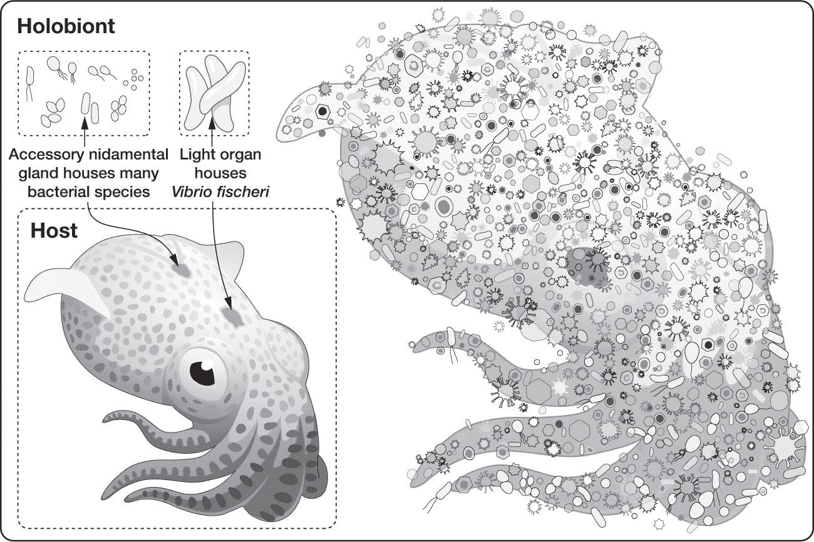

**图 4.3.** 夏威夷短尾乌贼全生物体。全生物体包括乌贼宿主及其微生物组构成的所有微生物物种。这包括栖息在乌贼发光器中的微生物；栖息在乌贼卵巢腺（参与卵囊分泌）中的微生物；以及在乌贼体内和体表其他部位发现的微生物。微生物组物种可能是细菌、古菌、真核生物或病毒。

对全生物体和作为功能单位的个体的讨论，与下一章特别相关，下一章将聚焦共生微生物对我们健康的影响。全生物体对健康的重要程度，是演化新叙事的另一个后果。

# 第二部分 为什么这很重要
## 5 生物多样性与人类健康

> 你不是大海中的一滴水。你是一滴水中的整片大海。
>
> ——鲁米，《鲁米精选》，科尔曼·巴克斯 译

为什么要关心地球生命历史的叙事？为什么要更多地关照水平演化的作用以及物种间深度且持续的整合？对许多人来说，让生命故事更好地符合演化事实就足够了：真理本身就是奖赏。我同意。新叙事无需额外理由。然而，赌注远不止于生命历史的准确性。叙事及其隐喻为绘制观察和思想的图谱提供了心智坐标。当心智坐标改变时，思想间的语境和对齐方式也会随之改变。通过重新定向我们的思维，新叙事，尤其是科学叙事，能够开拓思维、挑战假设，并揭示解决问题的新途径。在此视角下，我认为演化的新叙事对我们理解健康这一广泛主题具有关键意义。这包括人类健康和环境健康这两个重叠的领域。强调物种间整合的新叙事，已可见于许多研究人员、医生、流行病学家和环境科学家的工作中，且预计会随时间增加。此外，让公众更好地了解健康与其他物种活动之间的联系，有助于在需要知情公众采纳专家建议的地方发挥作用。

第 5 章和第 6 章将分别聚焦演化叙事与人类健康、环境健康的交汇点。我将论证人类健康取决于我们与许多其他物种的关系。我们与其他物种共同演化，其中许多是维持我们生命和所需环境资源的重要支持系统。我称之为健康共生理论（表 5.1）。这与广为接受、众所周知的疾病病菌理论互补，后者将特定微生物与特定疾病联系起来。病菌理论关注其他生物和物种在传染病中的短期作用，而健康共生理论则考虑其他物种在人类健康和福祉中的短期和长期作用。

这并非说我们与其他物种的所有关系都是有益的，也非说关系的性质和涉及的特定物种是恒定的。两者皆非。我是说，作为我们与它们长期水平共同演化的结果，以及我们管理关系变化的能力（无论是减轻危害还是促进益处），人类健康深受我们与其他物种关系的影响。

| 表 5.1. 两种理论的比较 |
| --- |
| 疾病病菌理论 | 健康共生理论 |
| 关注人类疾病 | 关注人类和环境健康 |
| 部分人类疾病源于特定微生物（病原体或病菌）感染 | 人类健康源于从疾病和损伤中恢复、并随时间适应变化的能力；同时考虑传染性和人类微生物组物种 |
| 不直接关注环境健康 | 环境健康源于环境长期维持人类和其他生命形式的能力，并与人类和其他物种适应变化的能力相关 |
| 关注人类与其他物种在传染病中的短期关系；非显性演化视角 | 关注其他生物和物种在人类和环境健康中的短期和长期共同演化关系；物种关系在全球范围内展开，从当下回溯至生命起源 |

任何有价值的理论都可以通过评估其预测来进行检验。那么，共生健康理论会产生哪些预测呢？以下是三个值得在第 5 章和第 6 章中考虑的预测。

首先，多样化的、本地共同进化的人类微生物组比那些物种未直接与特定人类群体共同进化、多样性较低的微生物组更能促进健康。预测这些共同进化的人类微生物群落更擅长抵御常见感染，并能更好地执行微生物组协助宿主新陈代谢和免疫系统的常规功能。

其次，我们与地球上其他物种共生关系性质的重大变化，包括它们的衰退、灭绝或分布转移，会显著影响人类健康。

第三，共生关系的性质不存在静态的最优解，因为这些关系在不断演化，无论是定性上还是定量上。

这些预测宽泛且难以检验。然而，它们确实为评估观点提供了一个初步框架。下文回顾的现有证据支持这些预测，尽管仍需更多证据，且随着我们对所涉及复杂系统的了解加深，预计会出现例外情况。

但首先要搞清楚：我们所说的健康是什么意思？人类健康常被误认为仅仅是没有疾病。这种观点在短时间尺度上可能行得通。但从更长的时间跨度来看，健康与疾病并非互斥的状态。对流感病毒产生发烧、关节酸痛、恶心和淋巴结肿大等经典疾病症状的反应，是健康的表现，体现了免疫系统的健全。疾病与健康共存，漫长的一生包含许多受伤和生病的时期，随后是康复。应对身体局限性问题的个体仍能过上其他方面健康且富有成效的生活。衰老本身，以及它带来的身体和心理变化，都是健康生活的一部分。至少目前是这样。我们没有抗衰老的良药；然而，寿命在延长，一些研究人员正致力于进一步延缓甚至阻止衰老的损害效应。

遭受高水平疾病和死亡率折磨的人类群体，可以通过某种方式管理对病原体的易感性，从而得以持续，并在未来经历疾病水平的降低。由于健康和疾病随时间变化，因此不存在狭义或统计学定义的“正常”或“异常”状态来界定这些条件。环境健康同样具有动态性。在所有层面上，健康更多关乎韧性、对创伤的适应能力以及随时间的持久性，而非单纯的无病状态。认识到生命形式在时间上相互整合，物种相互塑造彼此的环境和演化，有助于我们理解并促进人类和环境健康。

这一话题上一位极具前瞻性的作家是法国哲学家兼医生乔治·康吉莱姆。他在 1940 年代撰文指出，疾病和健康无法用精确的定义来界定。他写道：“不存在‘正常’的生物学科学。存在的是一门被称为‘正常’的生物学情境和条件的科学。人之所以健康，是因为他相对于环境的波动而言是‘规范的’（意指功能正常或可存活的）。” 他还指出：“多样性不是疾病；异常不是病理。”^(1) 这意在说明健康不是一种固定的状态。健康是生病并康复的能力。它是通过韧性和适应变化，在一段时间内满足个体功能需求的能力。

康吉莱姆是在反对他那个时代对健康和规范的狭隘定义。他并未用明确的演化术语来讨论健康，但他的长远观点与演化新叙事中聚焦的物种间整合非常契合。健康包括对频繁微生物感染的适应。正如我们将看到的，这些适应范围涵盖从增强免疫系统到寄宿具有重要功能（我们才刚开始感知）的微生物。我们可以将快速水平演化的独特事件视为康吉莱姆意义上的“规范”。也就是说，它们能提供功能性替代方案，有助于各类生物体的长期韧性、适应性和健康。

到目前为止，我已勾勒出一个观点：共生健康理论，它概括了演化新叙事与健康的关联。我还讨论了健康的含义。在回顾展示物种关系影响人类健康的案例之前，让我们先看看我们对健康和传染病认知的发展历史。这有助于我们理解这一理解历程的漫长与艰难。

早在公元前 1 世纪，罗马学者马库斯·瓦罗就推测存在“微小生物……肉眼无法辨别……它们通过口鼻进入人体并引起严重疾病。”^(2)

14 世纪 30 年代，蒙古军队在围攻黑海港口城市卡法时，将死于鼠疫的受害者尸体用投石机抛过城墙，展示了对鼠疫（现归因于细菌`Yersinia pestis`）人传人传播的残酷理解。

更人道的是，14 世纪 70 年代的记录显示，一些爱琴海港口要求新来者在近海岛屿上隔离检疫 30 天，观察是否出现鼠疫症状，然后才允许他们与当地人混居。

16 世纪意大利医生兼将军吉罗拉莫·弗拉卡斯托罗治疗过许多腺鼠疫、天花、斑疹伤寒和梅毒患者，被公认为首位提出类似现代疾病病菌理论来解释人类疾病的人。这一荣誉基于他的著作《梅毒即法国病》（`Syphilis sive morbus gallicus`）和《论传染》（`De contagione`），分别出版于 1530 年和 1546 年。弗拉卡斯托罗明确假设存在传染性的生命实体，他称之为“种子”（`seminaria`），作为疾病的物理病因，不同类型的种子导致不同的疾病。尽管他的观点因缺乏种子或病菌的物理证据而当时被驳回，但他极大地推动了对自然病因的探索，并反对涉及神秘学的解释。

将可观测生物体与人类疾病联系起来的进步需要新技术。这始于 1590 年代首台显微镜的发明，并在 17 世纪中叶由荷兰布商安东尼·范·列文虎克推向新高度。通过创新的玻璃加工制作微小球面透镜，他发现微小生命形式无处不在。他是第一个观察并描述栖息在湖水、雨水、唾液以及蛙和人粪便样本中的单细胞生物的人。他将发现的生物称为“微小动物”（`animalcules`），尽管我们现在称它们为细菌和原生动物物种。列文虎克的同时代人阿塔纳修斯·基歇尔检查了鼠疫受害者的血液，推测他看到的微小动物导致了该疾病，尽管他看到的可能是红细胞而非鼠疫的实际细菌病因。基于鼠疫在受害者间传播的显而易见的能力，基歇尔提出了合理的建议，包括隔离病人、焚烧他们的衣物、佩戴面具以防止看不见的传染性因子扩散。

在十八世纪，植物学家兼医生卡尔·林奈也对解释传染病感兴趣。他在与学生合作的过程中，在一部名为《*Amoenitates academicae*》（学术乐趣）的著作中，提供了一些关于此的初步实验和推测。或许最相关的是他的学生约翰·尼扬德的论文《*Exanthemata viva*》（大致翻译为“活的皮疹”），明确提出微小动物是多种疾病（包括麻疹、天花、瘟疫和梅毒）的传染媒介。尽管如此，病原体的直接物理证据仍然缺乏。

十九世纪末，得益于显微镜技术的改进——包括对细菌进行染色和可视化的能力，以及从感染者体内分离和培养细菌的能力——生物学家终于提供了证明细菌理论的确凿证据。罗伯特·科赫及其同事发挥了关键作用，他们证明了炭疽是由*芽孢杆菌*感染引起的，并将六种不同的传染病分别与六种不同的细菌联系起来。随着细菌理论在最大限度减少病原体在人们日常生活中存在方面的成功应用，该理论迅速获得了广泛认可。在短短几十年内，婴儿死亡率下降，平均寿命延长。

这些成功灌输了一个基本教训：微生物是坏的。这一观点不断通过关于致命病毒爆发和细菌超级细菌的电影、小说和新闻报道得到强化。当然，传染病仍在肆虐。但正如我们将看到的，这种观点需要修正，因为微生物并不全是坏的。

我们依赖体内细菌的帮助来消化食物、吸收营养、产生维生素、代谢药物、调节免疫系统和炎症，以及抵御其他微生物的感染。这些过程都是复杂系统，受到人类与各种微生物共同进化的影响。可以将它们视为身体功能的生态系统，而我们对它们的理解远未完全。考虑到它们在抗体发育和我们免疫系统长期进化中的重要性，微生物正如霍默·辛普森评价啤酒那样，是我们许多麻烦的**成因**，也是**解药**。

虽然微生物物种与疾病之间经典的一对一对应关系在某些情况下仍然成立，但在其他情况下，疾病源于多种微生物物种及其宿主的相对丰度和相互作用的变化。身体生态系统的概念在此同样适用，因为微生物组成分之间的相互作用、宿主的遗传学特征以及环境都参与其中。

### 全生物体与健康

所有人，就像所有动物一样，一生都伴随着一群微生物。不仅是现在，而是贯穿其物种的进化历史。这些是长期的进化关系。微生物已经定殖并适应了人体的许多空间，就像鸟类可能定殖并适应大陆上的不同环境一样。它们安家在我们的肠道、泌尿道、肺部和口腔中，以及从头皮到脚底的皮肤表面。生活在特定宿主体内和体表的所有微生物的总体被称为微生物组，它包括细菌、古菌、真菌和病毒。人类微生物组总体拥有的不同基因数量约为宿主基因组的 200 倍，重量大约五磅。我们直到最近才意识到微生物组内物种多样性的巨大、它们随时间变化的存在和丰度，以及它们对人类健康的影响。我们的知识还很初步，但越来越多的明确证据表明，人类健康的各个方面与微生物组的活动和变化之间存在相关性，甚至因果关系。

正如第 4 章所述，宿主及其微生物组的组合被称为全生物体。对于人类全生物体而言，这将人类及其所有微生物纳入一个单一的、包容性的实体，可以独立进行研究（图 5.1）。对全生物体的认知，即是对宿主及其微生物（包括它们潜在的共同进化）整合的认知。个体生物体仍然是研究的关键焦点，但它们可以被视为一个更大整体——全生物体——的一部分。在健康背景下，认识和研究全生物体是扩展我们对微生物组物种对宿主健康影响认知的重要一步。

进化生物学家之间有一场迷人的辩论，关于全生物体作为独立于个体生物体的单位，在多大程度上受到自然选择的作用。^(3) 鉴于自然选择在多个组织层面（基因、个体生物体和生物体群体）运作的认知日益增强，我认为全生物体概念确实反映并增强了我们对进化的理解。确定选择单位一直具有挑战性，因为当仔细审视时，单位的整齐定义会变得模糊。基因通常被视为自然选择的靶标，但很难定义和分离作为潜在靶标。有些编码蛋白质，有些不编码。有些是连续的 DNA 串，其他的则是不连续但协同工作的。相对较少的基因在没有协助的情况下控制单一性状或功能（这曾是基因定义的一部分）。个体生物体同样难以定义，尽管这乍看之下似乎违反直觉。我们能认出一只独狼，却难以识别一棵单一的颤杨树，它通过无性繁殖生长，可拥有数百个树干。将全生物体视为进化的靶标可能甚至更困难，它包含一个可变的集合，由许多不同物种的个体微生物及其基因组成，所有这些都是自然选择的潜在对象。

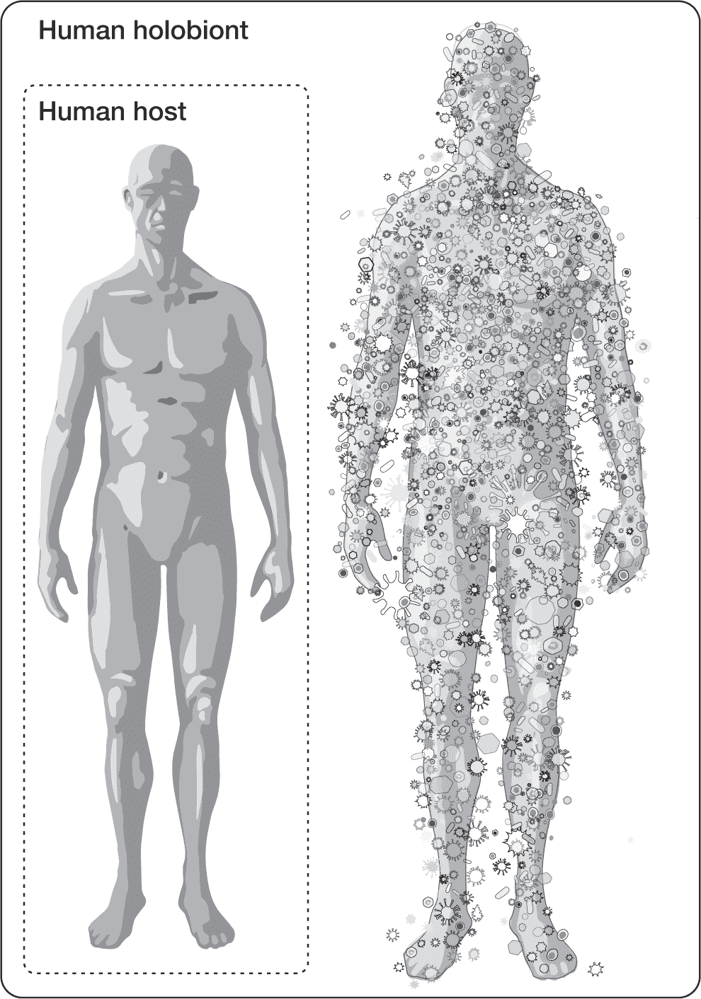

图 5.1. 人类全生物体包括人类宿主及其完整的微生物组，无论这些生物体位于人体内部或表面的何处。微生物组物种可能是细菌、古菌、真核生物或病毒。认识和研究全生物体及其组成物种的共同进化，是扩展我们关于微生物组物种对人类健康影响认知的重要一步。

研究人员福特·杜利特尔和安德鲁·英克彭提供了一种替代方法。他们建议，“微生物群落的集体功能”，而非微生物物种本身（单独或集体），可能是全生物体的选择单位，促进其随时间持续存在。他们称这一理论为“重要的是歌，而非歌手”，即 ITSNTS。^(4) 也就是说，微生物的代谢活动——对宿主的健康和生存至关重要——可能是自然选择的靶标。无论结果如何，全生物体内生物体和物种之间的联系对宿主健康都很重要，就我们的目的而言，这一概念是恰当的。

# 人类微生物组与健康

## 微生物组在宿主生命中的核心作用

构成人类微生物组的微生物深度参与了宿主的生命活动。其中一些对于消化食物至关重要。其他的则产生关键营养素、调节免疫系统、分泌毒素以抵御病原体，甚至影响心理健康。生命实质上是一场团队协作，即使参与者都未察觉这更大规模协作及其错综复杂的细节。正如“见森林不见树木”，将全生物体视为一个团队而非孤立物种，是医疗保健诸多层面的关键。认识到宿主与微生物组物种早已作为一个功能整体融合在一起，能增强我们理解健康与疾病关键影响因素的能力，也提供了构想和评估健康恢复治疗方案所需的思维模式。

## 失调与疾病的关联

越来越多的证据表明，某些疾病与微生物组物种组成和活动的变化（即**失调**）存在相关性。这些疾病包括类风湿性关节炎、肥胖症、糖尿病、炎症性肠病、肌营养不良症、多发性硬化症，以及纤维肌痛的普遍疲劳和肌肉疼痛。令人惊讶的是，这些疾病似乎是随微生物组一同遗传的，而非随宿主的 DNA 遗传。^(5)

## 肥胖与肠道微生物组

全球肥胖率自 1980 年代以来已翻倍多；目前有超过 1 亿儿童和 6 亿成人受影响。肥胖或超重（体重指数分别超过 30 或 25）明显与心脏病、2 型糖尿病和癌症相关，这些是可预防死亡的主要原因。肥胖有多种诱因，主要风险因素包括行为、遗传、环境，以及令许多人最初惊讶的肠道微生物组失衡，即前文所述的失调。

在一项关于泰国移民赴美的微生物组研究中，移民抵达后其肠道微生物组发生了变化。^(6) 微生物物种多样性开始下降。部分物种流失，并被一组多样性较低、略有不同的细菌取代，这组细菌典型地存在于美国人群中。移民居住时间越长，其微生物组物种组成的变化越大。饮食改变、抗生素使用、过度或“过分”卫生习惯均被牵涉到物种多样性较低的微生物组中，尽管这些相互作用如何及为何发生仍知之甚少。在泰国移民研究中，首代在美国出生者的微生物组变化甚至更大，且与肥胖增加以及胃癌、肝癌和肾癌发病率上升相关。^(7)

针对肥胖与肠道微生物组失调关联的证据表明，通过调节肠道菌群可能治疗肥胖。关于如何操作存在活跃争论。然而研究人员发现，在某些情况下，补充植物纤维以刺激有益肠道细菌生长（**益生元**）有助于肥胖儿童，通过增加多种有益细菌种群、降低脂肪沉积和体重。^(8)

## 微生物组对行为的影响

微生物组失调也会影响行为。肠道细菌产生的化学化合物进入血液循环，进而刺激神经系统和大脑，影响宿主的情绪和行为。将不同物种组成的微生物组移植给小鼠的繁殖实验发现，宿主基因与宿主肠道细菌基因协同调节焦虑和癫痫。这些宿主行为此前被认为仅由宿主基因控制。虽然小鼠涉及的遗传系统与人类不完全相同，但二者相似，寻找人类类似证据的工作正在进行。小鼠实验还表明，恢复特定微生物物种（`Lactobacillus reuteri`）可逆转部分焦虑和癫痫行为。^(9)

## 微生物活动与哺乳动物大脑功能

除微生物组物种组成外，微生物活动与哺乳动物大脑功能的其他关联也日益明确。实验（主要在小鼠中）展示了微生物组可能参与人类帕金森病的方式。肠道细菌 `Escherichia coli` 产生一种名为 `curli` 的蛋白质，可诱导其他蛋白质（包括 `alpha-synuclein`）错误折叠。这影响重大，因为错误折叠改变蛋白质的三维结构，可严重破坏蛋白质功能。部分研究者发现证据表明，错误折叠的 `alpha-synuclein` 蛋白质将错误传递至大脑，而大脑中的错误折叠 `alpha-synuclein` 似乎与帕金森病症状相关。未来，鉴定此类影响人类脑部疾病的微生物活动，可能带来靶向微生物组的治疗选择。^(10)

## 免疫系统与微生物的共同进化

人类与所有动物一样，拥有免疫系统，这是对病原体演化出的必要应对。之所以说必要，是因为对世界上的感染性细菌、原生生物和病毒而言，人类是其繁衍的丰富资源。我们提供便利的循环营养、丰富的占据表面和腔隙，并聚集成密集群落，为它们的后代提供诱人的传播机会。我们绝对依赖免疫系统进行防御。为证实这一点，患有罕见遗传病严重联合免疫缺陷（`SCID`）的儿童缺乏功能性免疫系统，若无早期干预，通常在出生第一年内因反复感染性疾病（包括中耳炎、肺炎和慢性腹泻）而死亡。

部分免疫系统成分出生时即存在；其他成分（包括脊椎动物的适应性免疫系统）则随时间发育或习得。适应性免疫系统包含记忆特定病原体并产生特异性保护性蛋白质（抗体）以在必要时识别并消除它们的能力。适应性免疫系统需要一定的感染性生物体接触经验才能成熟。其中大部分经验来自早期生活，或通过子宫内继承母亲的微生物，或来自环境。

我们制作疫苗与适应性免疫系统协作，提前刺激抗体产生以应对未来的感染遭遇。微生物虽能致死，但也是我们宝贵免疫系统演化与持续维持的驱动力。人类免疫系统清楚地证明了我们与其他物种的融合与共同进化。在许多方面，管理人类健康关乎管理人类与微生物的关系。

## 过敏：一个启示性的例子

以过敏为例。过敏是部分人免疫系统对通常对他人无害物质（如特定食物和植物花粉）的过度反应。过敏属于自身免疫性疾病。受害者的免疫防御错误地攻击自身组织。过敏在全球范围内呈上升趋势，发达国家尤甚。有估计称过去 20 年全球增长了 50%。目前美国约 15% 人口经历某种过敏。^(11) 研究指向生活方式和环境的变化（尤其是幼儿早期）为主因。这包括接触微生物和其他抗原（触发免疫系统反应的物质）、饮食、抗生素使用、断奶和分娩方式的改变，及其对人类微生物组的累积影响。

## 进化与健康：过敏、免疫与基因工程

自 19 世纪 60 年代以来，人们就已认识到过敏与不同环境暴露之间的关联，当时在英国，花粉热被描述为“几乎完全局限于社会上层”，而在农民中很少见。^12 病因未知，但怀疑的焦点正确地集中在干草地等环境上，这些环境为一群人所经历，而另一群人则不然。发达国家中微生物暴露减少与过敏增加之间的相关性被引用为支持**卫生假说**的证据。该假说认为，抗原暴露减少导致抗体产生减少，从而对无害物质产生更多的过敏性过度反应。这一观点讲得通，但还需考虑影响过敏的其他因素，如城市化和污染。许多人认为“卫生假说”这个名称给人一种错误印象，即卫生本身是问题所在。确实，卫生可能过犹不及，生活在近乎无菌的环境中并非好事。然而，基本个人卫生依然重要。卫生假说也被称为“**老朋友假说**”和“**生物群耗竭假说**”，均指寄生虫的丧失及其对抗体产生的刺激，而人类直到近代才与之共同进化。其中包括某些有益多细胞寄生虫的丧失，如蠕虫。一些蠕虫已与人类共同进化为持久的肠道寄生虫，其在发达国家人群中患病率下降与炎症性和自身免疫性疾病增加相关。免疫系统对寄生蠕虫的进化反应有助于抑制炎症，而这一益处已丧失。

你明白了吧。我们的免疫系统在发育抗体和抗原耐受性以增强人类健康方面，对其他物种具有共同进化的依赖性。^13 我们与特定微生物的关系可能随时间变化：在抗体发育前具有致病性，发育后变为良性，若微生物进化并逃避现有抗体，则可能再次变为致病性。尽管常被描述为病原体与免疫系统之间的军备竞赛，但我们与感染性微生物的关系更应被视为随时间沿连续体变化。^14 鉴于我们许多共生体和微生物组物种对人类健康的益处，在人类免疫系统的进化中，调节和管理有益微生物可能与对抗有害微生物同样重要。进化的新叙事帮助科学家和公众认识到，健康受我们与其他物种共同进化的影响。

### 管理健康

认识到我们的生命通过进化与其他物种融为一体，是了解我们免疫系统优势和劣势的重要一步。我们可能将某些病原体推向灭绝，如天花病毒，或近乎灭绝，如脊髓灰质炎病毒。但我们对传染病现象的脆弱性将长期存在，这是病原体可变性和创新性的另一面。其高繁殖率加上频繁突变，常使病原体占据优势。某些病毒每个宿主细胞可产生多达 100,000 个后代，感染后仅八小时即开始。这使得后代在不冒亲代整体繁殖失败风险的情况下，拥有大量变异和新颖性。我们最能通过了解病原体的进化起源和习性，并尽量减少其传播机会、增强我们对它们的免疫力来降低脆弱性。这正是行为改变和疫苗的作用。

宿主-病原体共同进化的现实有助于解释消除特定传染病的困难。病原体可能呈现移动靶标，而疫苗的开发和应用需要时间。由于部分人选择不遵守最佳公共卫生实践，在人类群体内和跨物种建立免疫力面临风险。病原体的可进化性和人类行为的多变性是预测病原体传播和毒力的挑战所在。病原体的未来进化取决于突变的随机事件及其宿主群体的反应（**图 5.2**）。

**图 5.2.** 希波克拉底检查病童的画像。病原体与人类免疫系统自我们物种起源以来一直在共同进化，并将根据病原体突变的随机事件和人类宿主群体的反应继续下去。 ¶ 罗伯特·汤姆绘于 1952 年左右（*Hippocrates: Medicine Becomes a Science*），经密歇根医学院藏品许可，辉瑞公司赠予。

世界的物种多样性提供了一个庞大的分子和基因工程成果库。随着我们阅读和比较越来越多物种的基因组“书籍”，我们通过弄清其组分的进化起源和功能，获得了更强的逆向工程基因组和生物体的能力。我们可以看到 DNA 在个体和物种间广泛地共享、编辑、添加、减少和适应。我们已基本理解了设计变更所用的过程和材料。

我们也是执着的工具开发者，一直在从案例库中发现并借用、改进基因工具和材料，以自行进行一些工程实践。将来自不同个体和物种的基因组合视为基因工程的核心，自 20 世纪 70 年代以来，我们一直在磨练模仿自然水平进化的方法，旨在通过实验改善健康。从这个角度看，生物多样性——我们的工程案例库——和水平进化对改善人类健康的价值已清晰且显著，且必将增长。

我们利用基因工程尝试用有效基因替换缺陷基因，以治疗帕金森病、某些白血病和几种免疫疾病。我们将编码药物的基因插入细菌以生产胰岛素、不育治疗药物、生长激素和用于对抗传染病的单克隆抗体。利用小鼠或其他动物作为人类的基因工程替身，对于了解许多疾病和测试潜在治疗方法至关重要。这包括针对 SARS-CoV-2、HIV/AIDS、流感和带状疱疹等疫苗的开发，以及治疗癌症、疟疾、糖尿病、心理健康障碍、衰老症状和预防移植器官排斥反应药物的开发。其他应用包括开发再生神经元疗法治疗脊髓损伤；利用能分化为多种细胞类型的干细胞治疗癌症和阿尔茨海默病的疗法；以及从关节置换到心脏缺陷修复的外科技术开发。其中一些人类健康进展也已应用于其他物种，特别是宠物、工作动物和动物园动物。所有这些都源于对水平进化各方面的学习和模仿。

微生物物种参与疾病过程这一事实，暗示微生物可能在疾病治疗中发挥作用。可以添加有益微生物，去除或减少有害微生物的数量。但情况极少如此简单，迄今为止，沿此方向的努力仅取得了有限的成功。然而，研究正在深入进行，我们对其中涉及的复杂机制还有很多需要了解。

感染细菌`Clostridioides difficile`可导致严重腹泻、发烧和胃痛。这通常发生在使用抗生素之后，抗生素会破坏肠道微生物群，导致菌群失调。它已被确认为住院患者医疗相关感染和死亡最常见的原因之一。^(15) 多项研究显示，一种称为粪菌移植（FMT）或粪便移植的治疗`C. difficile`感染的方法颇具前景，该方法利用药丸将健康个体粪便中的细菌转移给患者。在一项针对九名儿童的研究中，七名在 FMT 后两周内缓解并康复。一项针对肠易激综合征（更准确地称为痉挛性肠病）的 FMT 治疗研究发现，治疗后 14 名成人患者的生活质量有所改善。^(16) 但请勿在家尝试。FMT 仍属于实验性、不可靠的程序。

维持健康微生物组的其他方法包括膳食补充益生元和益生菌。益生元是不可消化的化合物，如纤维状菊苣根，可促进有益微生物的生长。益生菌是含有活微生物的食物，最常见的是发酵乳制品，如酸奶和开菲尔。尽管前景广阔，但目前尚无充分证据确定其健康益处。鉴于目前已知与微生物组相关的疾病范围广泛，从脑部和肠道疾病到肥胖和癌症，通过治疗微生物组及其物种组成获益的潜力巨大。

我之前提到过肠道蠕虫在减轻人类炎症和自身免疫性疾病方面的益处。另一种可能是，与人类共同进化的蠕虫及其他共生体的丧失，导致了与衰老相关的炎症，即“炎性衰老”。实验发现，用寄生蠕虫分泌的一种糖蛋白（ES-62）治疗小鼠，可减轻炎症并减缓其衰老过程。这极具诱惑力，但仅是开发延长人类寿命治疗方法的初步一步。^(17)

如果寄生蠕虫能减轻人类的炎性衰老，那么在蠕虫感染流行的地区，类风湿性关节炎等相关疾病的发病率应较低。确实有一些证据支持这一点。在印度东部一个蠕虫感染率高的地区，207 名关节炎患者均未检测出蠕虫阳性，而同地区随机抽样的 222 名健康居民中有 40% 显示有蠕虫感染证据。近期实验证据也表明，蠕虫蛋白治疗可降低人类类风湿性关节炎的发病率，这与上述流行病学发现相吻合。^(18)

认识到其他物种在人类健康中的关键作用，源于一系列近期的科学进展。过去 40 年里，生物学家发现了大量新型生物。每年约有 20,000 个新物种在出版物中被正式描述，还有更多被发现但未正式命名描述。新发现的物种大多为细菌、古菌、原生生物或病毒，它们存在于几乎所有经过调查的栖息地中，从深海到沙漠、山顶、冰冻湖泊再到动物体腔。我们仍在探索它们在栖息生态系统中的功能范围和机制。土壤、空气、水和宿主生物都富含微生物物种，尽管调查数量不断增加，新物种的发现仍在持续。

这种新微生物的发现，反过来又是由分子生物学、DNA 测序和生物信息学领域的进步所驱动，后者包括用于分析日益庞大的分子数据集的统计方法和软件工具的开发。尽管许多新发现的微生物仅通过 DNA 序列为人所知，但关于它们分布位置和遗传信息的资料有助于我们理解其进化和生活史的某些方面。

理解人类健康与其他物种关系的关联，要求我们认识到人类是自然的一部分，而非凌驾于自然之上或置身自然之外。但这远不止于此。认识到我们是自然的一部分，是通往这样一个认知的大门：我们的身体、行为、免疫防御和脆弱性，都是长期与其他物种共同进化的结果。我们越能理解将我们带到此处的物种关系，在关系发生变化时，就越能更好地管理我们的健康。获得这种理解是我们面临的挑战。

科学总体上，特别是进化科学，旨在解释人类无法直接体验的现象。没有人能直接观察亚原子粒子或驱动其行为的力量。没有人能观察和体验遗传信息在所有生物间跨越地质时间尺度的流动。这种不可见性同样适用于塑造人类健康和疾病易感性的古老、稠密的长期物种关系网络。现代科学让我们能比以往任何时候都更深入地窥探过去，更透彻地穿透这片丛林。我们可以追踪基因及其功能在物种内部和之间的移动。我们可以通过实验揭示感染性生命形式的利弊，并理解随着我们自身饮食、行为和环境的改变，失去或获得特定微生物所带来的后果。

我们与其他物种关系的重要性远远超出了微生物组物种对个体人类的作用。正如我们将在下一章看到的，其他物种对于维持人类赖以生存的健康环境也至关重要。

## 6 生物多样性与环境健康

> 自然不是一个供人游览的地方。它是家园。
>
> ——加里·斯奈德，《野性的实践》

进化的新叙事阐明了物种关系对健康环境的重要性。这凸显了共生健康理论的第二个组成部分。第一个组成部分在前一章中阐述，认为人类与其他物种（特别是微生物组）的进化整合是人类健康的重要组成部分。第二个组成部分同样强调物种关系的重要性，但将其置于环境健康的背景下。后者被定义为环境长期维持人类和其他生命形式的能力。这种能力与人类和其他物种适应变化的能力相关（见表 5.1）。在本章和前一章中，我将物种间的共同进化和相互作用视为一种间接的水平进化形式，这正是进化新叙事所强调的。我将我们的物种置于背景中，作为数百万共享祖先、共享环境的物种之一。确实，这些数百万物种（包括我们自己）构成了我们的环境，并帮助塑造它。

但对许多人来说，这种背景并不那么显而易见。我们大多数人都与自然环境隔绝，依靠技术获取食物、住所、药物和交通。我们被剥离了技术的基本生存技能已经退化，而且我们生活在无法依赖狩猎和采集为生的区域和密度中。从非人类的角度考虑环境健康，能帮助我们更清晰地看到漫长的协同进化、当下的联系，以及其他物种在为任何关注物种创造健康、有利环境方面所扮演的重要角色。那么，让我们来看看这壮丽的游隼。它靠土地生存，以我们物种曾经但现在已无法做到的方式。作为一名曾经的驯鹰人，这种猛禽是我最喜爱的物种之一，我对它有着直接的了解。

## 生活在自然中

游隼需要大量的其他物种作为食物。虽然它们专捕小型鸣禽，但全球现存的 10,000 种鸟类中，超过五分之一都曾在其全球分布范围内的某处被记录为游隼的猎物，种类从蜂鸟到大灰鸮不等，这些猎物在无意中帮助维持了游隼这个物种的生存（图 6.1）。对于它们在适宜条件下捕食的蝙蝠、田鼠、鼩鼱、野兔等较小型哺乳动物，以及爬行动物、两栖动物和昆虫，这一情况同样适用。

游隼还需要那些支持其猎物生存的任何生物和事物。因此，在加利福尼亚北部风吹日晒的海岸悬崖上抚育幼鸟的一对游隼，不仅需要数百只个体的绿燕、崖沙燕、橙冠莺、矮滨鹬和肉桂鸭来喂养幼鸟，还需要维持所有这些多样化猎物的摄食关系及支持这些猎物的物种。如果我们仅顺着肉桂鸭这一猎物的摄食关系追溯，会发现游隼通过肉桂鸭，还依赖于蜻蜓、豆娘、蚋、甲虫、摇蚊等昆虫，以及数十种海洋和淡水蜗牛、蛞蝓和蛤蜊，还有许多肉桂鸭食用的植物物种的部分，包括眼子菜、香蒲、莎草和盐草。

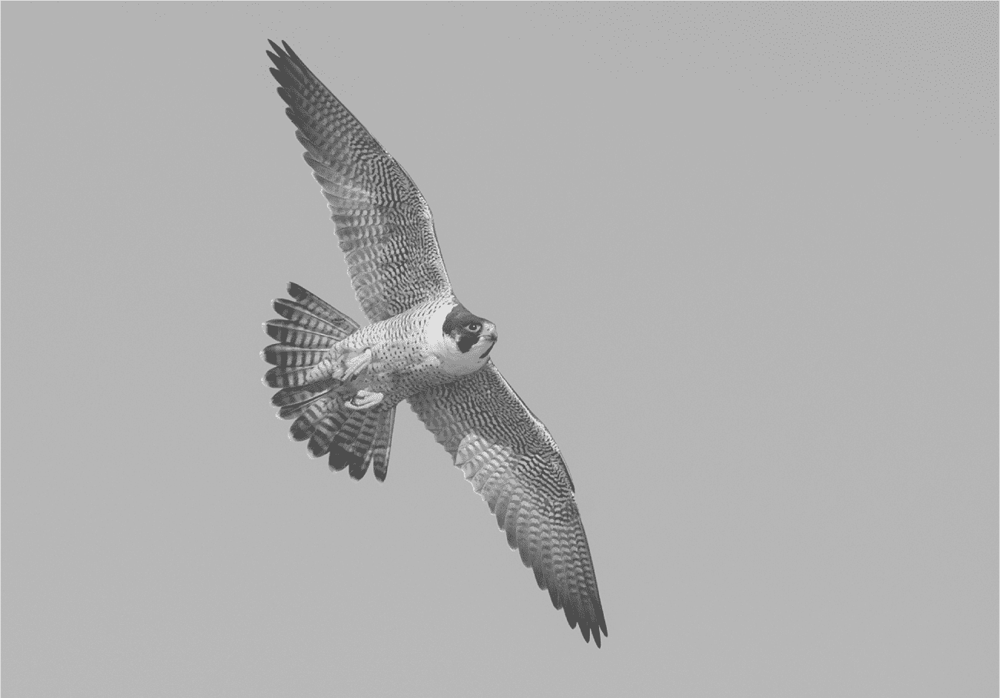

**图 6.1.** 符合进化新叙事的环境健康观认为，健康的环境能够长期维持人类和其他生命形式。游隼（图中所示）是其他生命形式中的典范，它们依赖成千上万个其他物种以及维持这些物种的环境。在这种观点中，环境健康随时间变化，与人类和其他物种协同进化和适应变化的能力相关。 ¶ Dreamstime / © Harry Collins.

对这些物种的依赖——它们构成了游隼其中一种猎物的食物——仍仅是食物网的一小部分，后者还包括更多“被捕食者吃什么”的例子，比如蜻蜓吃蚊子吃烂水果。还有对分解者物种为植物提供土壤养分的依赖。如果我们仅考虑为肉桂鸭食谱中的香蒲提供新养分的分解细菌，仅在一把池塘淤泥中就能发现数亿个个体细菌，代表着数百个物种。

要扩展这些摄食关系的范围，将仅一种猎物——肉桂鸭——的这些局部关系，乘以游隼数千种其他猎物，不仅限于加利福尼亚的繁殖季节，而是遍及游隼全年的分布范围，从阿拉斯加到塔斯马尼亚。这能让我们对游隼当前支持关系的数量和多样性有个概念。

而变化是常态。游隼猎物物种数量的下降，以及支持这些猎物的物种数量下降，都能且确实会影响游隼种群的分布、繁殖和整体健康。同样，游隼衰退与恢复的故事，也展示了环境毒素通过其摄食关系网络移动所产生的影响。人类从 20 世纪 40 年代起施用含有毒性化学物质（DDT 和 DDE）的杀虫剂，旨在提高美洲的农作物产量。但毒素在毒杀昆虫后，进入了食虫鸣禽，再从鸣禽进入以鸣禽为食的游隼体内。在游隼体内，毒素阻碍了钙代谢，导致蛋壳变薄、繁殖成功率降低，并在 20 世纪 60 年代至 80 年代导致繁殖种群局部灭绝。随后，随着杀虫剂使用的减少、对残存种群的保护以及人工繁育游隼的重新引入，种群得以恢复。

我们的摄食关系曾经像游隼一样，在生物多样性方面十分丰富。尽管这对少数狩猎采集人类群体可能仍然适用，但人类主要依赖的却是技术和少量的驯化动植物。我们对其他物种的体验和认知因此减弱。这助长了一种观念，即我们以某种方式超脱于自然，不再需要生物多样性来维持生存。这也让我们自以为是地球生命的始作俑者和终结者。但这些观点是错误的，我将在下文论证。

正如上一章我们需要阐明“人类健康”的含义，这里我们也需要探讨“环境健康”的含义。对于许多关注环境健康的机构和个人，包括世界卫生组织，环境在人类健康中的作用主要从人类接触化学毒素、辐射和病原体的角度来考量。大多数政府机构采纳的环境健康法规，都试图将接触这些环境危害降至最低。但关于环境健康，除了人类暴露风险，还有更多值得考量的因素。

一个更好的环境健康概念，能更好地契合进化的新叙事，即：环境维持人类和其他生命形式的能力。在这种观点中，环境健康随时间变化，因为它与人类和其他物种协同进化和适应变化的能力相关。这仍与公共卫生专业人士对该术语的使用一致，并增加了人类与其他生命形式之间的关系作为健康的关键组成部分。这些物种间的关系在全球范围内展开，跨越从当下回溯到 38 亿年前生命起源的进化时间尺度，并包含所有物种，无论其大小、生活方式或分布如何。

是的，只有相对少数的物种对人类健康具有直接且至关重要的重要性。然而，我之所以主张广泛纳入所有其他物种，是因为我们对任何特定物种对其他物种的间接影响知之甚少，且那些具有直接影响的物种会随时间和地理位置而变化。上述更好的概念承认仍以人类为中心。最不偏不倚或非物种主义的概念，不应仅以人类的健康环境为中心。非物种主义的环境健康观值得推崇，虽未被广泛接受。或许下文的探讨能帮助说服读者，所有生命个体和集体都具有内在价值。

物种关系对环境健康的影响这一观点并非新鲜事物，但长期以来被低估。这种影响往往隐蔽、间接，且深深融入我们对世界的认知之中，导致我们难以察觉物种间随时间推移的关联。我们可以在德国博物学家亚历山大·冯·洪堡的著作中，找到强调物种间整合与相互影响这一新叙事的一些根源。他将自然视为一个有机整体，致力于理解环境如何影响动植物。

1796 年，32 岁的洪堡与三位同伴启程攀登钦博拉索山——一座位于厄瓜多尔安第斯山脉、海拔 20,000 多英尺的冰封死火山。他计划尽可能多地测量和描述生物学、地质学及气候特征，以更好地理解自然界中生物与非生物力量是如何交织在一起的。因伤病与风暴，他们未能登顶；但他们创下了当时欧洲探险家到达的最高海拔纪录（19,413 英尺）。更重要的是，钦博拉索山之行结合他多年游历和在多样栖息地采集生物的经历，帮助他形成了自然的统一愿景。

洪堡以全新的视角看待许多物种的分布模式与界限。他在安第斯山脉高处发现的植物属和种，与他在瑞士和芬兰高海拔地区发现的相似甚至相同。杜鹃花类植物在委内瑞拉、瑞士和美洲环境相似的地区均很常见。松树和橡树可在墨西哥和美洲的相似纬度找到。但在其他情况下，非常相似的植物物种却可在不同的海拔和温度带中发现。

于是，洪堡着手绘制一幅发人深省的地图，基于钦博拉索山及其周边地区的草图，按海拔详细标注动植物物种的分布。数百个属和种的学名被仔细标注，侧边栏指示了温度、湿度、大气压和海拔区域。出版版的钦博拉索地图展开后达 2 英尺乘 3 英尺，便于与世界各地山峰和景观的观测结果进行比较。他在地图上绘制连线，连接平均温度相同的地点，创造了“等温线”这一术语，并将物种分布范围绘制在其上，开创了理解物种环境习性的强大新方法。洪堡利用这张及其他新工具，开创了生物地理学和生态学学科，它们是理解塑造生物多样性力量的关键组成部分。

洪堡将自然视为有机整体的宏大愿景还有另一创新之处：它包含了人类。他考察并记录了人与自然的现实关系，这是极少前人做到的。在鲜有人关注树木和渔业等自然资源被掠夺的时代，洪堡凭借其全球视野指出：“大型人类群体的躁动不安的活动逐渐掠夺了地球的面貌”，并指出“地球的产物实际上是永久富裕的唯一基础”。^(1) 洪堡用华丽的十九世纪散文抒发对自然的热爱，许多游人也是如此。然而，他在实证和先见上认识到生物多样性因人类活动而面临风险，而人类也因此面临风险。洪堡理解人类对其他物种的自然依赖。基于实地观察和标本研究，他是物种可变论的早期支持者——即物种可变、一种可转化为另一种的总体观点。洪堡于 1859 年去世，同年达尔文出版了《物种起源》，但若他重返人间，我想他绝不会对物种对其环境、其他物种生存能力及环境承载人类能力的关键影响细节感到惊讶。

说到人与环境，有些东西我们离不开，土壤、空气和水位居榜首。它们一直是人类生活的基础。许多人未曾意识到，*生物体*本身是土壤、空气和水的形成、质量及维持的关键。然而这是事实；没有生物体的活动和副产物，我们就不会拥有我们所认识和需要的这些基本资源。若无它们，地球将更像月球，同样不适合我们物种生存。

为提高公众对自然界物种依赖性的认识，生物学家等常将生物体在维持健康环境中的有益作用称为“自然收益”或“生态系统服务”。这在某些人看来过于唯物，但在经济驱动的社会中，讨论自然收益能更好地揭示生物体在健康环境中的价值。我们的长期健康取决于它们的健康。接下来让我们考虑鲜为人知的再保险行业对自然的务实、唯物主义估值。

再保险是为保险公司提供的保险。2020 年，总部位于苏黎世的世界最大再保险公司——瑞士再保险公司，对全球层面的一系列自然收益作出了以下年度价值估算：海草的养分循环价值 1.9 万亿美元，动物为农作物授粉价值 2,350 亿至 5,770 亿美元，渔业首次销售价值 3,620 亿美元，珊瑚礁旅游价值 360 亿美元。国家层面的年度价值估算包括：加拿大海洋和淡水渔业价值 34 亿加元；法国森林生态系统休闲收益 85 亿欧元；德国休闲渔业收入 64 亿欧元；美国树木和森林的空气净化价值 68 亿美元；日本沼泽和滩涂的水质净化价值 6,740 亿日元；英国自然的身心健康收益 20 亿英镑。^(2) 制定这些年度估算是一个复杂过程，在一定程度上带有主观性。但可以肯定的是，当保险公司为自己投保时，他们看重准确性。这仅是收益的部分核算，未涉及气候调节或非渔业食品、建筑和服装材料、能源产品及药物的提供。然而，它已清楚地显示出自然收益和健康生态系统所具有的高经济价值。

近年来，研究者将全球约 40% 的人类死亡与因污染及土壤、空气、水质变化导致的环境退化联系起来。同样，世界卫生组织将母亲和儿童营养不良及受污染水源列为全球死亡和疾病的主要风险因素。健康物种种群提供的生态系统服务退化和人口增长是这些问题的根本驱动力。然而，生物体在生态系统服务和环境健康中的作用虽关键，却易被忽视。

大多数参与其中的生物都很微小，只有当来自数千个物种的数十亿个体在漫长的时间里共同作用时，它们的行为才会产生影响。参与其中的众多物种之间动态的关系导致了复杂的联系，我们才刚刚开始辨识这些联系。而且这些联系在不同的地点、不同时间，甚至不同的地质年代都各不相同。认识到这些联系，并理解其他物种对环境健康所做出的贡献，需要一种既长远（即进化的）又全面（考虑所有现存和已灭绝的生命形式）的视角。

在以下章节中，我将点名道姓地提及少数特定物种，试图将它们在环境健康中的角色具体化。如果我们不知道与谁打交道，就无法理解我们之间的关系。也许通过揭开某些物种活动的面纱，并铭记漫长的进化历程，我们能更好地掌握我们与其他物种共享的重要关系和共同进化历史。让我们先来考虑一些参与土壤形成和维持的代表性物种。

## 土壤

土壤是矿物质和有机材料与水、空气的混合物。矿物质部分由岩石缓慢风化提供，其中包括酸性地衣对矿物质的提取。有机材料由生物的废物和腐烂的身体部分提供（**图 6.2**）。水和空气由生物混合进去，它们穿透碎屑层并创造开放空间。这是动物挖掘洞穴、植物根系和真菌菌丝生长以及微生物形成微小孔隙的成果。土壤是循环中心，腐烂的生物依次为后代提供养分并被其取代。差异很大，科学家现在根据母岩物质、年龄、居住生物的活动以及气候和地形特征，识别出十几个不同的类别。

认为土壤是永恒元素的观点是错误的，因为它忽略了生物进化和生态学以及地球历史的关键作用。如果你在 38 亿年前生命首次在地球上进化时在场，你找不到肥沃的土壤，因为那时还没有腐烂的生物体与风化的岩石颗粒混合。如果你在 1.8 万年前冰川退去后再次出现在纽约州北部，你也找不到今天的肥沃土壤，因为那些现存的土壤已被冰川刮走带离。肥沃的土壤富含有机化合物，它们随时间形成和消失，其形成和维持需要物种多样性和极大的耐心。

**图 6.2.** 肥沃的土壤是环境健康的关键特征。它们需要极大的生物多样性，如细菌、原生动物、真菌、线虫、节肢动物和蚯蚓，并且随时间形成和消失。 ¶ Dreamstime / © Ivica Milevski.

除了腐烂躯体的直接贡献外，对土壤特别重要的物种群包括细菌、原生动物（我们之前遇到的单细胞真核生物）、真菌、线虫、节肢动物和蚯蚓。事实上，大多数生物群类都包含为肥沃土壤做贡献的代表物种。让我们来看这些群类中的例子，详述它们对土壤健康的关键贡献，以及鉴于我们对土壤的需求，它们对人类的贡献。

### 细菌

`Ensifer meliloti`（以前称为 `Sinorhizobium meliloti`）是一种栖息在世界各地土壤中的细菌物种，既可独立生活，也可生活在豌豆和豆类等豆科植物的特化根部结构——根瘤中（**图 6.3**）。`E. meliloti` 个体侵入寄主植物的微小根毛，在其中繁殖，并通过一系列巧妙的生化反应诱导根瘤住所的形成。对植物而言，`E. meliloti` 是理想的合作伙伴，因为它能将植物无法利用的大气氮气转化为可利用的氨。`E. meliloti` 和其他细菌固定的氮对植物至关重要，因为氮是 DNA、蛋白质、叶绿素分子和光合作用过程的关键成分。尽管氮气占地球大气的 78% 以上，但可利用的氮在局部可能很稀缺，在某些地区它是限制植物生长的关键因素。已知约有 90 种不同的细菌和古菌具备固氮能力，像 `E. meliloti` 一样，这些微生物总共估计负责了地球上 90% 以上的固氮作用。这使它们不仅对健康的土壤和生态系统，而且对人类和整个生命都至关重要。对可利用氮的需求与 DNA 和蛋白质本身一样古老，多细胞生物在其整个 10 亿年的历史中都依赖固氮微生物。

但土壤细菌的作用远不止让氮对植物可用。死亡生物及其部分的分解也需要多种细菌物种产生酶来分解碳化合物，并将碳转化为二氧化碳或甲烷。其他土壤细菌在磷循环中很重要，磷是维持生命的营养素，还有一些能抑制植物病原体。例如，`Pseudomonas` 属的细菌物种与抑制甜菜和水稻一种经济上毁灭性的真菌病害的土壤密切相关。`Pseudomonas` 细菌抑制真菌竞争对手是为了追求自身的繁殖利益，但对植物最终对人类的益处依然存在。

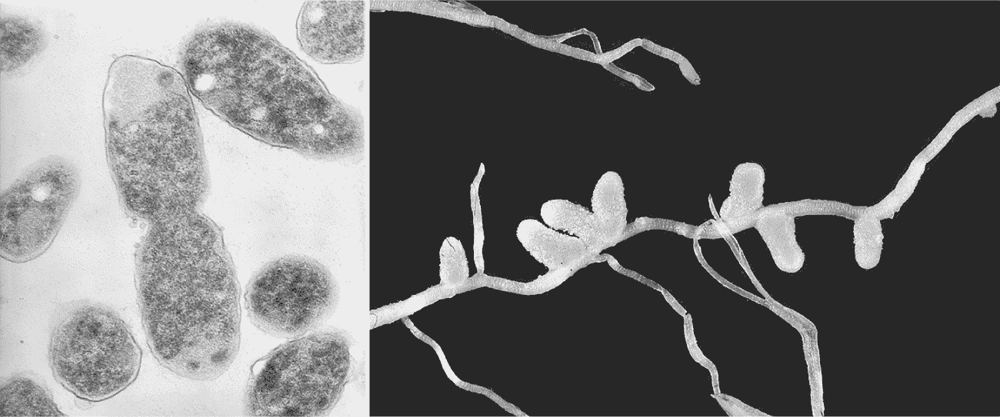

**图 6.3.** 细菌物种 `Ensifer meliloti`（左侧显示个体）栖息在世界各地的土壤中，对健康环境至关重要。它侵入寄主的根毛，在其中繁殖并诱导根瘤形成（右侧显示）。这种细菌是理想的合作伙伴，因为它使氮可用，而植物需要氮来合成 DNA、蛋白质和叶绿素以进行光合作用。 ¶ 根瘤照片由 Wikimedia 用户 Ninjatacoshell 提供，CC-SA 3.0。

我们对少数土壤细菌与植物之间有益关系的日益增长的认识，以及随后对人类的认识，暴露了我们对土壤细菌多样性的普遍无知，以及未知多样性可能发挥的未知功能。一项针对荷兰农田土壤微生物的最新调查印证了这一点，该调查基于一种常用的遗传标记——16S 核糖体 RNA 基因的变异，鉴定出了 33,000 多种不同的细菌和古菌分类单元^(3)，其中约 20%的分类单元此前未被科学界所知。尽管我们距离全面了解细菌多样性还有很长的路要走，但我们知道人类种群依赖于其中的许多细菌。

#### 原生动物

*`Colpoda steinii*` 是一种典型的原生动物物种。 *`C. steinii`* 拥有毛发状的纤毛，用于移动、摄食和感知环境，其栖息地通常是湿润的土壤。 *`C. steinii`* 是细菌的贪婪捕食者，在状态良好的一天能吞噬五百万或更多的细菌。一茶匙肥沃的土壤中就能发现数千个与 *`C. steinii`* 相似的个体原生动物。这意味着 *`C. steinii`* 及其同类原生动物在调节细菌种群数量方面发挥着关键作用，往往还能增加其数量，因为许多细菌会因种群稀疏而以更快的速度增长。反过来，这可以通过增加固氮细菌的净活性，以及增加更多原生动物排泄并释放出细菌细胞本身所束缚的大量营养物质的活性，来提升土壤养分。所有这些使得原生动物对土壤生产力至关重要。在某些地区，据估计原生动物提供了土壤氮矿化作用的 40%。原生动物也是其他土栖物种的重要食物来源，并且像某些细菌一样，已知能通过与病原线虫竞争或捕食它们来抑制植物病害。因此， *`C. steinii`* 像许多其他原生动物一样，通过其对细菌种群、土壤混合与矿化以及对植物生长的支持，对土壤生产力做出了重大贡献，并帮助维持了人类的生存。

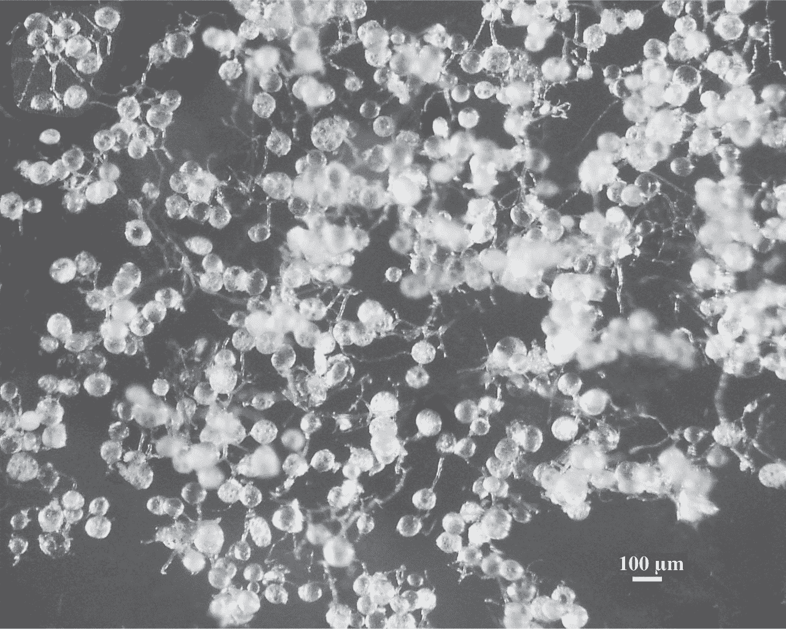

**图 6.4.** 像 *`Rhizophagus intraradices`* 这样的丛枝菌根真菌物种已经与植物共同进化，对环境健康也至关重要。它们形成称为菌丝的分支结构，从土壤中捕获磷、硫、氮和水，并将它们带入根细胞。超过 90%的植物物种依赖于它们与丛枝菌根真菌的共同进化关系。 ¶ 摄影：Joseph Morton，国际（囊泡）丛枝菌根真菌收藏。

#### 真菌

*`Rhizophagus intraradices`* 是一种广泛分布的土栖真菌，已经进化为与植物根系紧密共生（图 6.4）。 *`R. intraradices`* 的生殖细胞在土壤中以微小丝状体生长，直到接触到植物根系，此时它们会穿透根系定居下来。一旦进入根内， *`R. intraradices`* 会形成称为菌丝的分支结构，作为与寄主植物进行养分交换的场所。 *`R. intraradices`* 从土壤中捕获磷、硫、氮和水并将它们带入根细胞，作为回报获得食物，通常以糖的形式。许多不同种类的土壤真菌以类似的专性共生方式与植物共生，这些真菌被称为菌根真菌（见 图 1.5）。由于体型小得多，菌根网络探测的土壤体积比典型的植物根系和根毛多达 20%。像细菌一样，真菌是宝贵的有机物分解者，能够将氮、磷等营养物质转化并储存为可利用的形式。超过 90%的植物物种绝对依赖这些菌根关系生存——别忘了我们依赖植物获取食物和空气。如果土壤要支持植物和其他生命，就必须支持多种真菌物种。尽管有人估计存在超过 1.65 亿种真菌（见 表 1.2），但目前仅描述了约 15 万种。

#### 线虫

*`Caenorhabditis elegans`* 是一种线虫，平均长度为一毫米，常见于土壤和堆肥堆中。虽然 *`C. elegans`* 是遗传学和发育研究的明星及主要模式生物，但其野外习性知之甚少。大约已描述了 20,000 种线虫，但这被认为仅占现存总数的 1%。像 *`C. elegans`* 这样的线虫在土壤中很有价值，它们通过转化其猎物（细菌、真菌和其他线虫）的有机物质，使养分可被植物利用。与纤毛原生动物类似，线虫通过摄食可以刺激细菌种群增长，进一步增加其他生物可利用的土壤养分。它们还为土栖昆虫、蜘蛛和蜈蚣提供食物。线虫通过在消化道内或体表携带活的或休眠的细菌形式，帮助在土壤中分布细菌和真菌。

#### 节肢动物

*`Atta sexdens`* 是一种切叶蚁，分布范围从美国南部到阿根廷北部（图 6.5）。个体切割并搬运鲜叶、草和花进入其巨大的多室地下巢穴，群体成员将植被咀嚼成浆，用排泄物施肥，并精心照料作为花园，在其中移栽并培育选定的真菌——它们的主要食物来源。一些栽培真菌的蚂蚁甚至在自身共生细菌的帮助下，利用其产生的抗生素保护作物免受微生物感染。 *`A. sexdens`* 在土壤生产力方面发挥着重要作用：在消化植被的过程中循环利用并增加必需土壤养分，增强土壤中真菌和细菌的种群；通过挖掘巢穴移动和疏松土壤，改善其排水性和凝聚力；并将植物种子传播到新的肥沃土壤中。 *`A. sexdens`* 只是约 12,000 种已描述蚂蚁物种中的一种，许多蚂蚁对土壤并最终对人类有着类似的益处。

#### 蚯蚓

蚯蚓，包括*Lumbricus terrestris*（即许多人熟知的夜行蚯蚓或钓饵蚯蚓），对土壤和生命同样有益。它们通过取食习性帮助将枯叶等有机物转化为肥沃的腐殖质，使养分重新为植物所利用，并通过挖掘活动将空气泵入和泵出土壤。蚯蚓将食物研磨成细糊状，随后在肠道中进一步消化。研究发现，当这些物质排出体外时，其钾、氮、磷酸盐等养分含量比周围表层土壤中的含量高出五到十倍。查尔斯·达尔文自幼便对这种“默默无闻”的蚯蚓着迷，他抓紧完成了最后一本书——该书专门论述蚯蚓——以期“在他加入它们之前”完成。他估计自己在英格兰的庄园里，每英亩土地上就有 53,767 条蚯蚓在辛勤工作，循环有机物。较新的估算表明，肥沃的农田每英亩可能多达 175 万条。无论估算数字如何，达尔文的推测依然成立：由于它们在改造地球表层部分方面付出的努力，“蚯蚓在世界历史上所扮演的重要角色，远超大多数人最初的想象。”^(4)

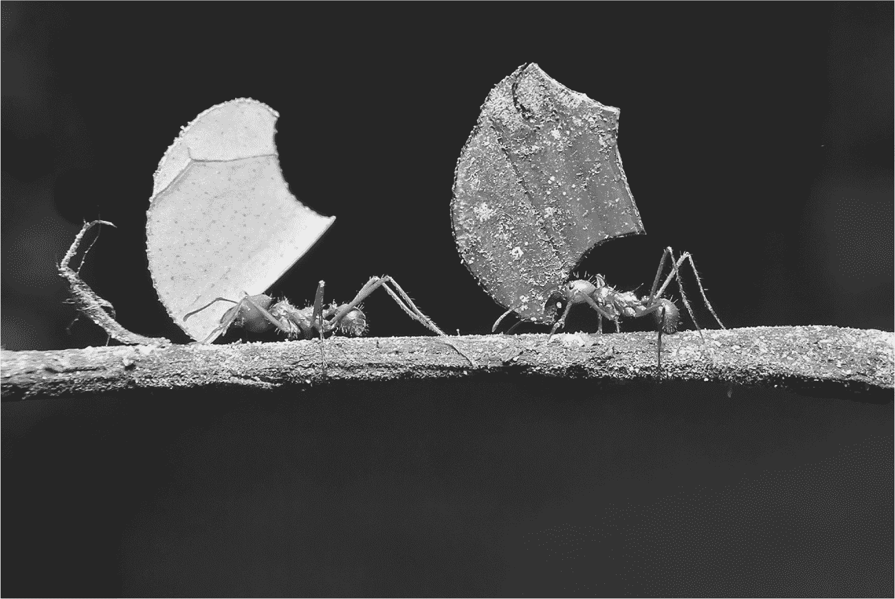

**图 6.5.** 切叶蚁（如*Atta sexdens*）利用切下并搬运的树叶培育真菌，以此为食。它们通过循环并增加土壤必需养分、增强土壤中真菌和细菌的种群数量、疏松土壤并改善排水，在土壤生产力方面发挥着重要作用。 ¶ Dreamstime / © Wrangel.

### 古菌

古菌最为人所知的身份是极端环境（如温泉和盐池）中的单细胞居民。然而，越来越多的非极端嗜好菌正被发现。*Nitrososphaera viennensis* 是一种新近发现的古菌物种，源自非极端土壤环境，能够将氨氧化为亚硝酸盐。这使得该物种和古菌类群成为新的关注焦点，因为如前所述，氨氧化为亚硝酸盐对植物氮素的有效性有重大影响。目前尚不清楚*N*. *viennensis* 和其他新发现的土栖古菌是否在全球氮循环和碳循环中扮演重要角色，但越来越多的证据表明确实如此。关于哪些物种在维持健康土壤中执行哪些功能，我们仍有许多需要了解的地方。

地球生机勃勃的土壤是矿物质、生物体及其分解碎屑的丰富混合物。它们也是一张活的苗床，生命在此循环、繁衍并自我维持。如果没有上述细菌、古菌、真菌、原生动物、节肢动物和蚯蚓等生物，我们赖以生存的土壤将不过是矿物尘埃——而我们也将不复存在。

## 空气

你坐着阅读时，每分钟大约呼吸 12 次；而在未来 24 小时内，你将消耗约 145 加仑（约合 10 个啤酒桶的体积）的纯氧。氧气至关重要、免费且无处不在——只要你停留在海拔 12,000 英尺以下。极少数例外之外，所有其他动物也呼吸氧气。这助长了一种普遍认知：氧气向来随手可得，从未成为地球物种的限制因素。但事实并非如此。实际上，生命先于氧气存在，氧气是地球生命的结果，而非先决条件。

约 38 亿年前生命诞生时，大气中几乎没有氧气。光合细菌和古菌约在 24 亿年前出现，但它们产生的所有氧气最初都被海洋中溶解的铁和有机物吸收，生物无法利用。直到约 8.5 亿年前，在各种氧汇达到饱和之后，氧气才开始在大气中积累。氧气首次达到目前约 20% 的水平大约是在 3.5 亿年前。按此推算，氧气以当前水平（作为最低值）存在的时间，仅占地球生命存续时间的约 9%。

正如预期的那样，大气氧含量的增加对生命进化产生了重大影响。它导致许多无法在氧气毒性下生存的厌氧生命灭绝。对于其他生命形式而言，氧气的增加提供了适应的动力，这从细胞呼吸的进化中可见一斑。这是一个巧妙的过程，细胞利用氧气制造运作所需的能量。这不仅仅是生存的手段。与厌氧生物利用的发酵相比，细胞呼吸作为能量生产方式的效率高出近 20 倍（以每分子葡萄糖产出的三磷酸腺苷——ATP——分子数衡量）。这种能量生产的更高效率，使得氧气代谢生物能够长得更大、发育更快、活动更积极，并最终主宰地球上许多栖息地。^(5) 细胞呼吸进化的一个关键特征，是真核（有核）细胞拥有叶绿体和线粒体，并发生了共生协同进化。如前所述，这些细胞内细胞器是曾经自由生活的需氧细菌的后代，分别具备光合作用和氧气代谢能力。它们的存在使携带它们的生物能在含氧环境中繁衍昌盛。通过这种方式，氧气刺激了植物和动物等多细胞生物的进化，它们的首次出现晚于大气氧的早期积累。最后，氧气的可获得性与动物许多需要氧气丰富的适应性创新相关，包括恒温、透气性蛋壳和像你我一样的胎生。

大气氧含量的增加也显著改变了地球环境。它通过保持热量（温室效应的一部分）和减少昼夜温差来温暖地表。氧气在紫外线（UV）或闪电作用下形成臭氧，位于地表上空 10–50 千米处的臭氧层，过滤掉比氧气单独作用更多的有害紫外线。未被吸收的紫外线会导致人类晒伤，并可能造成生物体 DNA 损伤。通过这些方式，生命促进了自身的进化。

你的每一次呼吸，都展示了我们远古祖先与其光合细菌表亲的协同进化。这些细菌氧气生产者通过自然选择塑造了我们的生活方式，并帮助设定且当前维持着适宜人类健康的最佳大气条件。早期氧气生产者的后代，包括叶绿体，无处不在，但它们的多样性和我们对它们的依赖却常被忽视。据估计，按当前光合作用速率，再生大气中所有氧气大约需要 2000 年。

让我们来考察三种现存光合物种的性质与作用，它们构成了我们生命支持系统的一部分：一种单细胞海洋蓝细菌、一种淡水藻类和一种陆生植物。将展示这三种产氧物种彼此截然不同，却通过一系列共生关系相互联系，并与其群落相连。

### 海洋光合细菌

*Prochlorococcus marinus* 是一种微小的光合作用海洋细菌，其集体产氧量惊人（图 6.6）。这些蓝细菌的平均宽度为 0.7 微米，仅为人类头发直径的百分之一，甚至比某些病毒还要小。个体仅拥有 1,800 个左右的基因，而人类则有 20,000 个。但它们在海洋中的广泛分布，以及在海洋贫营养区生存的独特能力，使它们数量极其庞大。据估计，它们提供了公海中超过 50% 的光合作用产量，粗略计算，你每呼吸五口氧气，就有一口来自它们。它们的丰度以及光合作用过程中对二氧化碳的利用，也使它们成为全球碳循环中的关键参与者。遗憾的是，海洋贫营养区目前正在扩大，*Prochlorococcus* 对全球氧气供应和碳循环的相对贡献极有可能随时间推移而增加。

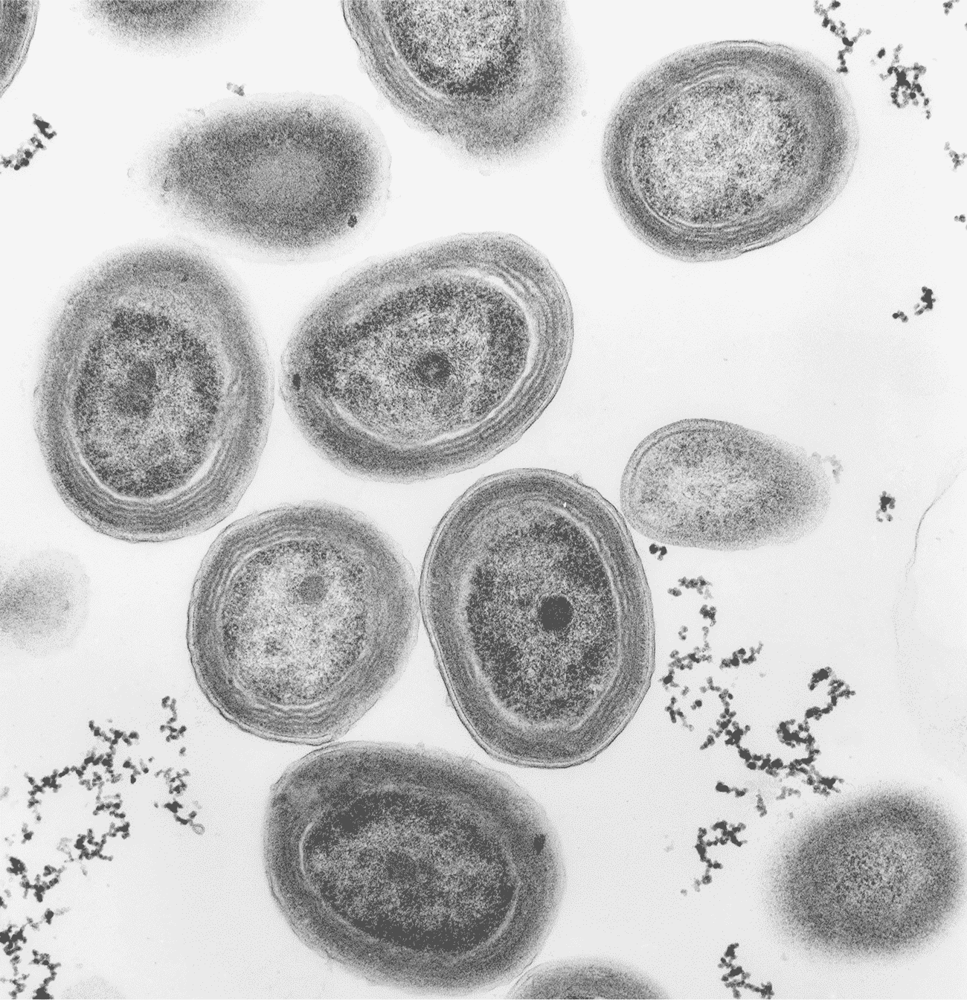

图 6.6. *Prochlorococcus marinus* 是一种微小的光合作用海洋蓝细菌。它在产氧和全球碳循环中均扮演重要角色。它对其他物种的后续重要性使其成为环境健康不可或缺的一部分。

鉴别并命名无性克隆繁殖的细菌离散物种，比在鸟类或哺乳动物等有性繁殖群体中进行此项工作更具主观性，因为在后者中生殖隔离有助于物种的划分。目前，仅识别出单一的 *Prochlorococcus* 物种（*P*. *marinus*）；然而，越来越多的生态型（独特适应局部环境的种群）正被识别出来。^(6) *Prochlorococcus* 生态型包括栖息于具有各种光照（深度）水平和营养水平组合的海洋层中的种群。*Prochlorococcus* 成功的关键之一在于其栖息于竞争对手难以生存之地的能力，且越来越多的证据表明，微小的细胞和基因组大小是 *Prochlorococcus* 在贫营养水域中的适应性优势。小基因组可以更快、以更低的代谢成本完成复制。它们也可以被包装在更小的细胞中，拥有更大的单位体积表面积，这反过来又能优化光吸收。

考虑到我们的目标是考察几个我们赖以获取氧气的物种，让我们更进一步，看看 *Prochlorococcus* 的进化是如何得到某些病毒帮助的。*Prochlorococcus* 的基因组大小平均约为 200 万个碱基（2 Mb），包含上述 1,800 个基因。这属于蓝细菌中基因组最小的行列，蓝细菌的基因组大小可达 9.1 Mb。*Prochlorococcus* 及其近缘种被认为接近光合微生物的最小可能基因组大小。演化出小基因组的风险之一是基因和遗传变异的丢失，而这些对于在不同和变化的环境中生存至关重要。然而，紧凑的 *Prochlorococcus* 基因组已知受益于感染蓝细菌的病毒（称为蓝噬菌体）介导的基因水平转移。这包括光合作用相关基因在 *Prochlorococcus* 种群之间，以及 *Prochlorococcus* 种群与某些自身保留光合作用基因的蓝噬菌体之间的水平转移。通过提供增加新基因和基因变异的机制，蓝噬菌体介导的水平基因转移帮助 *Prochlorococcus* 实现适应性进化，形成适应海洋中不断变化的光照和营养制度的特化类型。这种通过海洋病毒进行的水平基因转移，又将蓝噬菌体这一生物群体纳入了支持全球氧气供应的网络中。这也是水平进化的重要性和速度的又一例证。进化论的新叙事包含并强调了这些水平连接的模式。

### 绿藻

*Volvox carteri* 是一种单细胞、含叶绿体的淡水藻类，也是另一种令人印象深刻的产氧者（图 6.7）。它因能跨越单细胞和多细胞生活方式而为生物学家熟知，成千上万个 *Volvox* 个体可以聚集形成一个透明的群体球体，在每个个体尾状鞭毛的协调摆动下滚动旋转。群体游动寻找光照进行光合作用，偶尔还会成对共舞并进行异交受精。*Volvox* 群体包含两种细胞类型，众多体细胞形成球体，少数生殖细胞包含在球体内。鉴于其作为既能单细胞又能多细胞生活的生物的过渡性生活方式，*Volvox* 已成为研究多细胞性进化的模式生物。这种特定的向多细胞性过渡所涉及的分子和发育变化相对较少，并发生在 *Volvox* 进化的早期，约 2 亿年前。^(7)

*V*. *carteri* 是 22,000 种左右绿藻中的一种，绿藻的形态从单细胞鞭毛体到大型多细胞海藻和巨藻不等。作为一个群体，绿藻数量丰富，为许多淡水和海水生物提供初级食物来源，并对全球氧气供应做出显著贡献。这也是其祖先演化出产氧陆生植物的类群。谱系融合在地球生物圈氧化中的作用无处不在，蓝细菌与各种绿藻、红藻、陆生植物和灰藻谱系之间发生了多次独立的融合或结合事件（见图 2.5）。

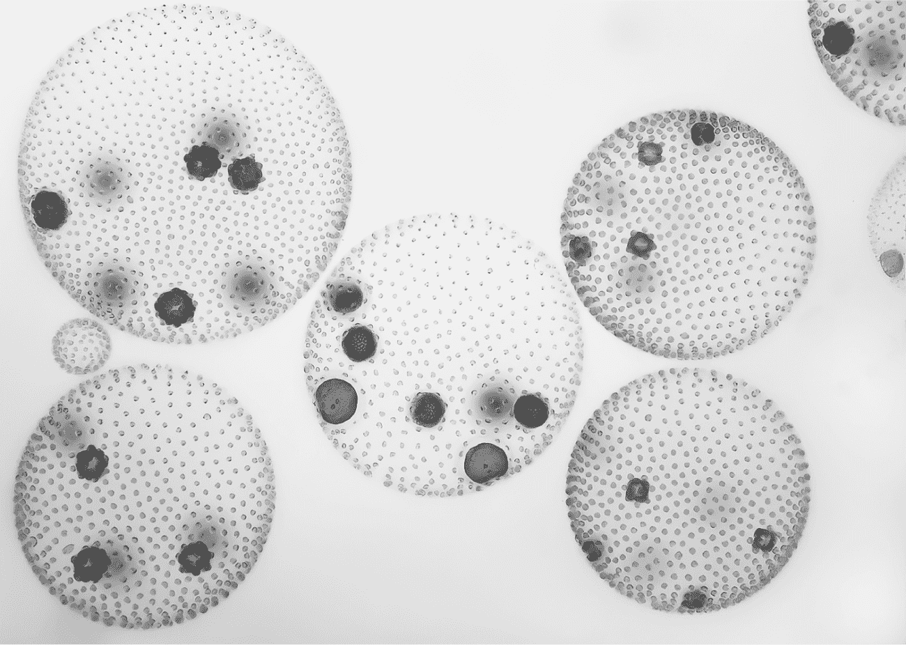

图 6.7. *Volvox carteri* 是一种单细胞、含叶绿体的淡水绿藻，也是另一种丰富的产氧者。成千上万个 *Volvox* 个体可以聚集形成透明的群体球体，它们移动以寻找光照进行光合作用。总的来说，绿藻是许多生物的初级食物来源，并对全球氧气供应做出显著贡献。 ¶ 照片由 Frank Fox / [www.mikro\-foto.de,](http://www.mikro-foto.de) 提供，CC-SA 3.0。

### 陆生植物

颤杨（*Populus tremuloides*）是北美分布最广的本土树种，分布范围从阿拉斯加和加拿大东北部，向南经落基山脉延伸至墨西哥。像所有光合生物一样，颤杨树将氧气作为副产品释放，将氧气从二氧化碳分子中的碳中分离出来。树木释放的氧气量因树种、个体大小和环境而异，但粗略估计，一名成年人的氧气消耗量大约可以由 10 到 20 棵树的活动来抵消。

# 颤杨与水在生命中的作用

颤杨的繁殖方式独特，既通过有性生殖，也通过根蘖进行无性繁殖。它们的种子缺乏保护层和贮藏养分，因此存活期相对较短，其在繁殖中的作用有限，尤其是在北美西部干旱地区。在犹他州有一个巨大的颤杨个体——一个克隆群落，由基因完全相同的树木（或茎干）通过单一根系相连，覆盖面积达 105 英亩，重达 6.6 吨，估计年龄至少 8 万年。按单一植物贡献的氧气量计算，该个体必定名列前茅。

正是像颤杨这样的陆生植物能够适应并殖民地球上从沙漠到热带、苔原等多样化的栖息地，在光合细菌进化之后，为大气增氧提供了第二次重要推动力。陆地殖民始于约 4.75 亿年前，远在氧气首次达到目前 20% 的水平之前，并导致了物种形式的大量繁衍，包括估计现存的 43.5 万种陆生植物。

## 水

所有已知生命形式都需要水，正如我们一样。对水的需求不仅关乎解渴，甚至不仅关乎种植食物。水提供了必需的溶剂，使碳、氮、氧能够发生反应并形成 `DNA` 和蛋白质等结构。这反过来又使个体生物得以存在并进行新陈代谢，这是繁衍和生存所必需的。没有水作为化学溶剂，我们的细胞就无法产生能量。生命对水的需求是根本性的。目前尚无已知替代品。

地球的水是如何产生的？与大气氧气或土壤不同，地球的水不是生命的副产品。相反，证据表明，水（现在观察到在宇宙气体云中普遍存在）是恒星形成的副产品，极有可能是由小行星带到地球的。地球内部过程，如岩石中含水矿物的渗漏，也可能有所贡献。物种在水资源维护中发挥的重要作用，在于通过去除沉积物和污染物来净化水质，以及帮助调节全球水流，包括缓解洪水。我们将简要以摇蚊幼虫和红树植物为例进行探讨。

### 水生昆虫幼虫

灰旗摇蚊（*Hydropsyche pellucidula*）是专属水生的昆虫目 `Trichoptera`（毛翅目）中 15,000 种摇蚊之一（图 6.8）。成虫外形酷似小型窄翅飞蛾，触角异常细长，在陆地上仅存活几周或几个月，仅吸食液体。然而，水生幼虫以碎屑为食，它们通过在淡水溪流中用自己设计的精密网进行拖网来收集食物。它们利用特化唾液腺产生的丝吐丝结网，并根据需要添加沙粒、卵石和树枝。收集并食用的碎屑包括小型藻类、植物和动物材料，以及它们的许多真菌和细菌分解者。*H. pellucidula* 和其他摇蚊的相对丰度是水质良好的积极指标，因为幼虫会迅速累积水体污染物并遭受其影响，同时也受低氧水平的影响。虽然单个摇蚊对水质净化的影响微乎其微，但大量种群的累积效应却显著。摇蚊专家估计全球可能多达 60,000 种，尽管对它们的调查一直有限。

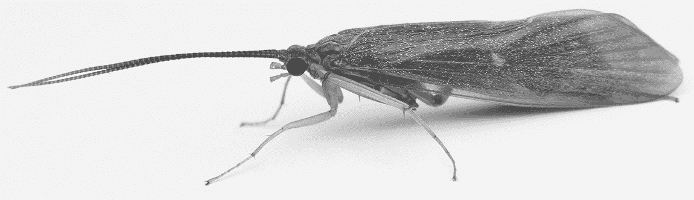

**图 6.8.** 灰旗摇蚊（*Hydropsyche pellucidula*）是 `Trichoptera` 目中 15,000 种摇蚊之一，有助于净化淡水溪流和湖泊。窄翅成虫生活在陆地上，幼虫水生，以腐烂的细菌、真菌、植物和动物材料为食，这些食物是它们用自己的丝吐丝结网收集的。摇蚊物种的出现和多样性是水质的有用指标。 ¶ Dreamstime / © EPhotocorp.

### 红树林

红树（*Rhizophora mangle*）分布于世界各地的热带河口（图 6.9）。像所有 110 种已知的红树树种一样，红树适应于在缺氧、高盐度、频繁潮汐的水浸土壤中生长。极少有其他植物能在这样的环境中生存。其适应性包括根部具有橡胶状涂层以阻挡盐分，以及支柱根将树干支撑在高潮线以上，并通过根和树干上的特化气孔帮助通气。

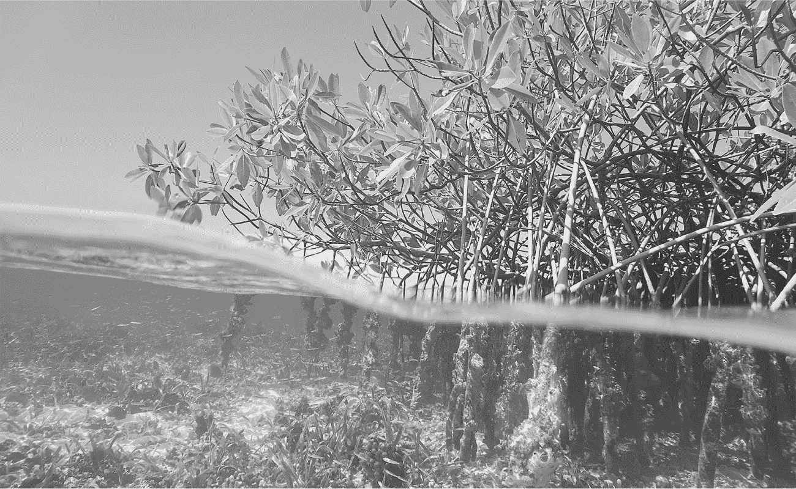

**图 6.9.** 红树（*Rhizophora mangle*）分布于世界各地的热带河口，适应于在低氧、高盐度、频繁潮汐的土壤中生长。其根系通过截留有机碎屑和促进细粒沉积层沉积来帮助净化水质，这两者都倾向于结合重金属和其他污染物。 ¶ Dreamstime / © Seadam.

与许多其他植物一样，红树在将水蒸气返还大气时，会在叶片表面去除一些水体污染物。红树根系通过减缓流经河口的淡水径流、截留有机碎屑、促进细粒沉积层沉积来帮助净化水质。分解的有机物和细粒沉积物都具有很强的结合重金属和其他污染物的能力，这使得红树林在保护附近水体免受此类毒素侵害方面非常有效。然而，红树林的消失会导致这些相同污染物的释放。

红树及其相关的土壤细菌还可以通过消耗农田径流中过量的氮、磷等营养物质，进一步改善河口水质。如果不加控制，过量营养物质会导致海洋藻类迅速生长，耗尽水中氧气供应，形成沿海死区，极少生物能在其中生存。

红树林为许多其他物种提供了至关重要的栖息地，如海绵、藤壶和牡蛎，但对鱼类尤为重要。最近的估算显示，红树林仅占世界陆地总面积的 0.12%，却在鱼类生命周期的某个阶段支持着全球 80% 的渔获量，提供食物、栖息地或两者兼具。

红树林还有助于缓冲海岸线，抵御波浪和潮汐引起的土壤侵蚀，并可能抵御风暴和海啸的毁灭性影响。它们保护海岸线的功效因地而异，取决于其分布范围和地形地貌。然而，毫无疑问，充足的沿海和潮间带植被带有助于消散由飓风驱动的大浪的能量，这些大浪会冲刷土壤、破坏财产并威胁人类生命。印度孟加拉湾沿岸的小村庄 Naluvedapathi 及其造林受益的故事现在已广为人知。2002 年 12 月 4 日，人们在海与村庄之间一条 20 公顷宽的地带上种植了 80,000 多棵树苗，主要是铁木（`Casuarina equisetifolia`），这是一种耐盐性较弱但常与红树林共生的树种。显然，这是为了祈求雨神帮助这个旱灾频发的地区，同时也为了创造吉尼斯世界纪录。然而仅仅两年后，海啸袭击了该地区海岸，毁坏了邻近村庄，但 Naluvedapathi 村在很大程度上受到了树木的保护。

### 病毒

最后，让我们考虑一下一种未被充分重视的病毒群体——噬菌体在维持健康海洋方面的作用（图 6.10）。它们的名字暗示它们是“细菌食者”。然而，更准确的说法是它们是感染并破坏细菌的病毒。而这仅仅是其影响的开始。世界海洋中存在着惊人的数量的噬菌体，表层海水每茶匙平均就有 5000 万个个体。一个典型的物种是弧菌噬菌体 VP06，最初被发现感染海洋细菌`Vibrio parahaemolyticus`。像我们一样，这种噬菌体拥有双链 DNA 基因组。与我们不同的是，它将其 DNA 注入宿主，并劫持宿主的分子机器进行复制。在至少某些情况下，这一分子劫持宿主的过程是由病毒通过水平基因转移从细菌处获得的基因所促进的。病毒后代随后破裂宿主的细胞壁，将细菌的碎片溢散入海洋。

单个弧菌噬菌体 VP06 执行这一过程的动作是难以察觉的。但放大到每茶匙 5000 万个成功感染宿主的噬菌体时，其影响就是显著的。细菌碎片提供了营养物质和溶解性有机物，它们通过供需关系调节浮游植物的生长，而浮游植物（由细菌、藻类和原生生物组成）构成了支撑所有海洋生物的食物网的基本成分。作为这一过程的一部分，碳被循环利用到新生物体中，氮被循环利用供浮游植物及其捕食者使用。^(8)

**图 6.10.** 弧菌噬菌体 VP06 是一种噬菌体。噬菌体是感染并破坏细菌的病毒，在此过程中发挥着未被充分重视的维持健康海洋的作用。被破坏的细菌碎片提供营养物质和溶解性有机物，调节细菌、藻类和原生生物的生长，这些是食物网的基本成分，有助于支持所有海洋生物。作为这一过程的一部分，碳和氮都被循环利用。 ¶ 图片来源：Wong, H. C., Wang, T. Y., Yang, C. W., Tang, C. T., Ying, C., Wang, C. H., and Chang, W. H., 2019, “Characterization of a Lytic Vibriophage VP06 of `Vibrio parahaemolyticus`,” `Research in Microbiology`, 170(1):13–23.

放眼更远，噬菌体共同刺激了从大气中去除二氧化碳和将碳封存在海底。它们通过促进光合生物数量的增长来实现这一点，光合生物将二氧化碳转化为氧气和糖类，随后这些生物体（或其捕食者）死亡，其富含碳的残骸沉降入海底沉积物。增加大气二氧化碳的去除量——主要温室气体之一——是缓解全球气候变化的重要手段。噬菌体每年约造成 30 亿吨碳的去除。

***

上述所有典型物种关系都说明了生物多样性如何促进土壤、空气和水的起源或维持。它们引出了一个更大的问题。为什么人类与其他物种之间这些至关重要的联系会存在？为什么我们需要由大量蠕虫、真菌和细菌产生的肥沃土壤来种植食物？为什么我们需要由海洋蓝细菌`Prochlorococcus marinus`、运动绿藻`Volvox carteri`和颤杨`Populus tremuloides`产生的氧气？为什么我们需要经过数十亿无脊椎碎屑食者和植物的过滤活动、清除有机碎屑和重金属后的水？简单来说，我们现在需要这些生物，是因为我们过去一直需要它们。我们的祖先及其祖先共同进化，在发现和改变共享环境的过程中适应环境。这是对一个务实问题的务实回答。当然，进化本可以以不同的方式进行，但事实并非如此，我们关心的是解释我们实际观察到的生命形式之间的那些至关重要的联系。

我们作为有感知的生物来到了当下，依赖氧气、水和土壤，这归功于那些始终在生命形式之间深度整合的进化过程。这种整合体现了进化的新叙事：从基因共享到环境的相互塑造，再到通过协同进化施加自然选择的力量。跨越数十亿年的进化时间尺度，加深了这种整合，使其成为一个基本的、决定性的组成部分。人类形态和功能的方方面面，无一不是从生命整合的熔炉中产生的。我们的能力、脆弱性、改变的潜力以及在地球上生存的适应性，都植根于这段历史。

我们往往处于否认状态，或者更善意地说是毫无察觉，这表现得显而易见。其他时候，我们似乎无法根据对自身长远最佳利益的理解采取行动。这引出了下一章的主题。我们能对生命的未来做出何种推测？能否从进化的新叙事中获得任何洞见？

## 7 生命的前景

> 认为我们有能力导致自然的终结是一种极大的傲慢，因为这意味着忘记了无处不在、内外兼备的野性。
>
>
> — 威廉·克罗农，《荒野的麻烦；或，回到错误的自然》

# 未来生命的不确定性与脊椎动物保护现状

人类将如何应对即将到来的气候和生物多样性变化？这些应对又将产生何种影响？我们能否在追求经济增长的同时将环境破坏降至最低？哪些物种将灭绝，哪些将繁衍生息？当今热带地区拥有约 78% 的动植物物种多样性，它们将继续保持最高的多样性吗？还是说正如部分观点所言，热带将变得过于炎热潮湿，导致大多数物种无法生存？针对这些问题，某些预测比其他预测更可靠，但生命的未来——无论是 300 年后还是 3000 年后——在很大程度上仍是未知的。

不过，我可以冒着极小的风险断言：除非发生毁灭性的天体事件，否则生命将延续。细菌和古菌包含极其顽强的生命形式，能耐受极端温度、干燥、毒性甚至辐射。考虑到它们极短的世代时间，它们也能极快地适应环境。人类的生存前景则不那么乐观，因为我们的生理耐受范围较窄。我们的技术固然让我们在生存竞赛中占据优势，但我们必须审慎对待技术的应用，因为这把双刃剑切两边，技术本身也蕴藏着危险。尽管如此，押注人类会失败将是一个错误，考虑到我们独特的学习、规划和生存能力。尤其是在过去 5 万年里，我们从缺乏复杂语言的灵长类进化为能够破译生命共同进化奥秘、并向恒星发送数据采集探测器的灵长类。

无论哪些物种存活下来，生命都将在有或没有人类的情况下继续进化。自然选择和随机事件仍将导致生物繁殖成功率的差异。横向进化的机制将继续作为生命故事的重要组成部分，在生物群体间更广泛地（尽管频率较低）共享遗传变异，这区别于亲代与子代间垂直传递的遗传。在本章中，我将讨论脊椎动物及其他少数数据充分类群的当前保护现状、物种适应人为环境变化的案例，以及人类设计新生命形式或重构现有生命形式的合成生物学领域。

## 脊椎动物现状

估算物种的当前现状及丰度变化颇具挑战。即使聚焦于肉眼可见的大型物种，物种种群数量的数据也只是对现实的静态、有限采样。一个名为 **IPBES**（生物多样性与生态系统服务政府间科学政策平台，`Intergovernmental Science-Policy Platform on Biodiversity and Ecosystem Services`）的科学家与专家国际合作项目于 2010 年成立，旨在综合地球生物多样性现状信息，以更好地为政府保护工作提供决策支持。其范围类似于 1988 年成立的 **IPCC**（政府间气候变化专门委员会，`Intergovernmental Panel on Climate Change`），后者综合数据并展望地球气候变化。

最新的 IPBES 报告发现，77% 的无冰陆地和 87% 的海洋区域已因人类活动的直接影响而被改变。这些活动包括农业、自然资源开采和人类基础设施建设，以满足社会需求与欲望。IPBES 估计，过去 150 年这些改造导致地球上野生哺乳动物质量（按重量计）损失了 83%，野生植物质量损失了约 41%。目前，人类及我们的家养动物构成了地球哺乳动物总质量惊人的 96%。相应地，过去几百年来物种灭绝率远高于人类大规模改造地球之前。**IUCN**（国际自然保护联盟，`International Union for Conservation of Nature`）估计，过去 500 年约有 900 种脊椎动物灭绝，主要是两栖类、哺乳类和鱼类。其还估计，目前 41% 的两栖类、26% 的哺乳类和 14% 的鸟类面临灭绝威胁。我们缺乏对绝大多数物种做出类似估算所需的基础知识。[¹]

一项针对全球 239 个生物多样性时间序列研究的最新综述，追踪了两个关键指标随时间的变化：现存物种总数和局部物种组合的构成。[²] 这些指标在多个时间点尽可能一致地记录。许多研究的物种清单数据始于 20 世纪 60 年代末，同一地点的采样年限长达 10 年以上。由于时间和方法的差异，这些数据难以收集和比较。但就我所知，这是迄今为止最大规模的时间序列研究汇编。令一些人惊讶的是，研究结果并未显示过去 60 年来物种大规模消失，尽管特定地点发生了一些变化。特别是关于热带物种消失的预测并未得到证实。比现存物种数量的损益更明显的是局部物种组合构成的变化，且各地区差异显著。海洋栖息地的快速组合变化速度几乎是陆地栖息地的两倍。持续监测并查明局部物种组合变化的原因是重要的后续步骤。

通过观察因种群规模小而濒临灭绝的物种数量，我们至少可以对近期未来的灭绝情况获得一些洞见。最新分析表明，在拥有 IUCN 种群规模估计的 29,374 种陆生脊椎动物中，有 515 种（1.75%）的个体数少于 1,000 只（表 7.1），面临灭绝风险。这 515 种中，47% 分布于大陆，53% 分布于岛屿。大多数来自南美洲（30%），其次是大洋洲（21%）、亚洲（21%）、非洲（16%）、北美和中美洲（11%）以及欧洲（1%）。此外，对于濒临灭绝的 77 种鸟类和哺乳类物种，其种群数量自 1900 年以来已损失约 94%。在某个时刻，物种丰度可能变得极低，以至于不再能发挥其维持生态系统的原有功能，沦为“生态僵尸”。[³]

### 表 7.1 易灭绝物种统计

| 纲 | 个体数 < 1,000 的物种数 | 评估物种总数 | 受威胁物种百分比 |
| :--- | :---: | :---: | :---: |
| 哺乳纲 | 74 | 5,459 | 1.36% |
| 鸟纲 | 335 | 10,423 | 3.21% |
| 爬行纲 | 41 | 6,861 | 0.60% |
| 两栖纲 | 65 | 6,631 | 0.98% |
| **总计** | **515** | **29,374** | **1.75%** |

*来源：Ceballos, G., Ehrlich, P. R., and Raven, P. H., 2020, “Vertebrates on the Brink as Indicators of Biological Annihilation and the Sixth Mass Extinction,” *Proceedings of the National Academy of Sciences of the USA*, 117(24):13596–602.*

*物种由国际自然保护联盟（IUCN）评估以确定其保护现状。*

[¹]: 注释 1
[²]: 注释 2
[³]: 注释 3

# We Are Radically Altering the Earth's Environment

We are radically altering the Earth's environment and the conditions for survival of its living inhabitants, including ourselves. There is no doubt. The data above focus on vertebrates because we know so little about species diversity and trends for other life forms. Our environmental impact is an unintentional experiment that bodes ill for many other species and for our vision of a sustainable, healthy planet. Despite more than a century of deliberation by policymakers and conservation groups, the two major threats to biodiversity—habitat loss and climate change—persist, as a human population nearing 8 billion struggles for survival and higher living standards. We should prioritize conservation and do our best to save what we can before the opportunity is lost.

But we should also acknowledge that we do not know how things will play out. Our strong emotional attachment to the natural world, including favored species and landscapes, makes their loss feel personal and profound. With it comes a sense of imminent existential threat that leaves us despairing or engaged in a doomed fight against change. We know that extinction waves have occurred in the past, that species and ecosystems are inherently mutable, and that over long time spans, extinction is the norm for species—survival is the exception. But this provides little comfort. This time, we bear the responsibility. The cause is not an external, uncontrollable event like an asteroid impact or climate change unrelated to humans. The current losses are rapid and stem from the activities of a single, technology-driven species—us. This compels us to do everything we can to mitigate and minimize the losses, whether our reasons stem from ethics, aesthetics, self-interest, or a combination.

We are glimpsing large-scale forces at work that will test our own capacity to cope and adapt. We know that the species that survive will be those that are either lucky or adept at adapting to changing environments. Because we cannot guarantee our own survival, we will need to marshal our best efforts—scientific, social, and political—to anticipate and respond to the changes to come^4. If our conservation efforts are strengthened and we are lucky, they can have a positive, lasting impact. We do not know how other species and ecosystems will respond over time to ongoing environmental change, but evolution is a story of resilience.

## The Adaptation of Species

In the current era, dubbed the "Anthropocene," humans have become the dominant influence on the Earth's environment. As emphasized by the new narrative of evolution, frequent horizontal evolution among organisms is expected to occur in the Anthropocene alongside other changes. The same human activities driving climate change and biodiversity loss are forcing some geographically separated species to live together. This new proximity stems from the intentional or unintentional movement of species by humans, and from human-driven habitat changes driving species migrations. This new physical proximity provides more opportunities for horizontal evolutionary mechanisms: hybridization, recombination, horizontal gene transfer, and co-evolution, depending on the species.

For example, Asian sika deer introduced to Scotland from Japan in 1893 have hybridized with the native Scottish red deer, even though the two species diverged from a common ancestor roughly 6 million years ago. Similar cases of hybridization resulting from other vertebrates introduced for hunting or angling have occurred in chamois, antelopes, gazelles, pheasants, partridges, freshwater whitefish, perch, trout, tilapia, salmon, and cichlids. Habitat changes (rather than introductions) leading to hybridization of fish species with related species include various perch, herring, shad, loaches, and smelt.

Hybridization brings the potential for rapid change, incorporating novel genetic material into organisms and species whose environments and geographic distributions are changing. This novel genetic material includes genes and genomes already honed by natural selection in other organisms, and it often has a larger and more immediate impact than the single DNA base mutations differing between parent and offspring in vertical evolution.

Hybridization among plants is widespread, particularly well-known in Britain thanks to a long-standing local interest in horticulture and natural history. In a series of fascinating examples, conservation biologist Chris Thomas describes how plant hybridization has been known to produce 7 or 8 new species since 1700. This number may seem small, but even without counting potentially missed species, this rate of plant speciation is roughly 100 times faster than the norm in their evolutionary past^6.

This includes at least 3 new species of ragwort (genus *Senecio*, Asteraceae), derived from Oxford ragwort (*Senecio squalidus*) introduced to Britain from southern Italy in the early 18th century. Once in Britain, it spread and hybridized with several pre-existing ragwort species. The new hybrids thrived in disturbed habitats such as construction sites, roadsides, and railway verges. These hybrids evolved differences that prevented them from backcrossing with the parent species. Cordgrass provides another example, where distinct species from North America and Britain hybridized in Britain. The resulting *Sporobolus anglicus* spread along the British coast and was later introduced to other estuaries in North America, Asia, and Australia.

The evolution and success of hybrids can pose problems for existing species. For instance, *S. anglicus* was once viewed as beneficial for erosion control, but as it spread globally, it has displaced some native marsh species. Similarly, on two separate occasions, two different monkey flowers—one from North America, one from South America—escaped from British gardens to produce genetically distinct hybrids that colonized streamside habitats. The hybrid origins of garden species are relatively easy to identify; however, hybrid origins are not limited to garden species. British survey work has identified over 900 distinct hybrid combinations among countryside plant species^7.

New hybrids may outcompete existing species in some cases, posing thorny questions for conservationists. Should endangered species be protected from overwhelming hybridization? How? For how long? Evolution is dynamic, and we now know that hybridization is a natural part of the evolution of many or most vertebrates. We ourselves carry the genetic remnants of hybridization with other archaic human species, including Neanderthals and Denisovans. From a biological standpoint, there is no such thing as genetic purity for a species. Species and populations change their genetic makeup over time due to mutation, chance, and selection. Enforcing hybridization barriers long-term makes little sense and is difficult or impossible to sustain. Sadly, many species are and will be lost. Yet the Anthropocene, characterized by environmental change and interspecific hybridization, "may be the period of most rapid evolutionary diversification in the past 500 million years," in Thomas's words^8. This is speculative and deliberately provocative, I suspect, but it does draw attention to the fact that environmental change works both ways—causing both losses and gains in biodiversity—and the gains are currently greater than many people expect. Knowledge of more species and regions is needed to identify long-term trends.

---

# 微生物病原体适应人类影响的实例

让我们转向微生物病原体适应人类影响的实例。我们可以预期，持续的气候变化将增加许多人接触病原体的机会，而病原体的适应性反应将包括通过重组和水平基因转移进行的水平进化。随着动物宿主与人类接触的增加，一些非人类病毒将有更多机会感染人类。蝙蝠携带的病毒特别有可能增加与人类的接触。许多蝙蝠物种已经因应气候变化而改变分布范围，它们在哺乳动物中独有的长距离扩散能力将使它们与人类种群产生新的接触。^9 当常规宿主种群的数量和分布范围减小时，一些病毒也将面临更大的选择压力，以扩大宿主范围至人类。

世界许多地区日益加剧的城市化，有利于传播寨卡、登革热和黄热病等病毒性疾病的蚊子。当城市化淹没了将污水与供水分离的控制措施时，各种肠道疾病会迅速传播。气温升高能够并将会改变携带病原体的媒介物种（如蜗牛、蚊子和其他昆虫）的分布范围。亚洲的森林砍伐被牵连到增加了人类与蝙蝠的接触，并助长了尼帕病毒、亨德拉病毒、埃博拉病毒和 SARS-CoV-1（2003 年首次报告）等病毒的传播。森林砍伐还与利什曼病的扩散有关，这是一种由称为锥虫的单细胞真核生物引起、并通过叮咬的白蛉传播的疾病。^10

COVID-19 大流行因城市化和频繁旅行而得以在人类中传播空气传播的 SARS-CoV-2 病毒。自 2019 年底首次检测到 SARS-CoV-2 以来，已追踪到数十万个不同的谱系，这是基于对其 RNA 基因组进行测序，因为它们在人类帮助下适应并散布到全球。SARS-CoV-2 通过空气传播，其传播速度和范围之广堪称已知病原体之最。这种能力及我们追踪它的能力源于其快速进化。这种快速变化涉及以重组和水平基因转移形式频繁发生的水平进化。这些过程混合来自不同 SARS-CoV-2 谱系的基因，并可能来自其他冠状病毒。具有新型基因组合的 SARS-CoV-2 谱系有可能催生独特的新变体，改变其可感染的宿主物种和组织类型，改变感染成功率，并增强其逃避疫苗的能力，这一点我们已痛切体会。

SARS-CoV-2 刺突蛋白使病毒能够结合宿主细胞表面的受体，是决定病毒可感染哪种宿主物种以及病毒从轻度致病向高度致病转变潜力的关键。研究人员发现，编码刺突蛋白的 SARS-CoV-2 基因组区域特别容易发生重组事件，这解释了随着病毒种群激增和传播，其快速进化变化的一些原因。这凸显了理解 SARS-CoV-2 重组对于识别其潜在进化以设计未来疫苗的重要性。

SARS-CoV-2 的起源尚不确定，当然也备受争议。一种可能是病毒在重组事件的帮助下，从另一种动物宿主物种传播给人类。这种情况被称为人畜共患起源。另一种可能是实验室起源，常被称为实验室泄漏假说。在这种情况下，病毒从中国武汉的一家冠状病毒研究实验室逃逸。这两种假设均站得住脚。无论哪种情况正确，水平进化在 SARS-CoV-2 的早期进化和在人类中的快速传播中都发挥了关键作用。^11

在其他病原体中也能看到水平进化与快速传播之间的类似联系。HIV（人类免疫缺陷病毒）和艾滋病的出现，已被证实与涉及 SIVcpz（黑猩猩猴免疫缺陷病毒）的重组事件有关。在其出现后，据报道 HIV 重组的频率与表征垂直进化的单核苷酸变化（点替换）一样频繁。^12

流感病毒会在多种鸟类和哺乳动物（包括人类）中引起流感。症状通常较轻，但自 19 世纪晚期以来，每 10-50 年就会在人类中发生严重的全球性大流行。最致命的大流行发生在 1918-1920 年，在疫苗问世前夺走了约 5000 万人的生命。这些流感大流行均由新型流感病毒变体引起，源于重组——一种被称为抗原转移或重配的水平进化形式。当两个或多个变体感染同一宿主细胞并交换基因时，就会发生这种情况。当病毒从一个宿主物种跳跃到另一个宿主物种时，这些流感重组体的形成会得到促进。人类最容易感染来自家禽和养猪场的新型流感毒株。人类因野生鸟类中流行的流感病毒而感染的情况虽罕见但也可能发生。如果来自农场或其他地方的新型流感重组体在人类中易于传播，缺乏免疫力的稠密人类种群将面临风险。将其置于未来进化的背景下，气温升高可以改变鸟类迁徙的时间和模式，改变物种组合和接触率。这反过来又改变了流感病毒在鸟类宿主间传播和重配的机会。^13

疟疾提供了病原体物种通过水平进化适应的最后一个例子。疟原虫属（*Plasmodium*）引起疟疾的寄生虫之间的基因重组，已知有助于它们在应对气候变化时的进化成功，使疟疾成为一种祸害。据估计，2020 年疟疾导致 627,000 人死亡，其中大多数是非洲儿童。^14 人类病原体的未来进化注定将是快速且间歇性剧烈的。持续警惕以尽量减少爆发，以及主动的控制措施，将永远是必不可少的。

# 物种保护与辅助进化

生命未来进化的另一个组成部分，将源于我们在环境变化面前直接管理生态系统和物种的努力。我们采取多种策略，从物种和公园的法律保护、繁育和重新引入计划、将物种送回其原有分布范围的部分区域，到为潜在未来用途冷冻植物种子。最全面的方法是大规模保护生态系统和栖息地，因为其规模广泛且包含多样的物种。

贯穿全书，我一直在强调水平进化在分散遗传物质继承和加速变化方面的力量。生命进化的新叙事将在我们未来保护生态系统和物种的努力中上演吗？水平进化能否应用于生存系统环境发生变化的情况？我认为可以。

珊瑚礁是地球上生物多样性最丰富的生态系统之一，为超过 25% 的海洋物种提供栖息地，包括藻类、海草、海洋被子植物、鱼类、甲壳类、软体动物、蠕虫、海葵、水母、被囊动物、海绵和大量微生物。珊瑚礁以珊瑚无脊椎动物群落命名，它们坚硬的骨骼形成了礁石。它们为超过 10 亿人提供食物，保护数千英里海岸线免受海洋侵蚀，并提供抗癌、心脏病和艾滋病药物的来源。

# 珊瑚礁与辅助进化

珊瑚礁也因海洋温度上升和水体化学性质改变而面临风险。这些因素对其微小的单细胞内共生体——甲藻可能是致命的，而珊瑚依赖甲藻进行光合作用和获取食物。值得注意的是，栖息在珊瑚宿主体内的这些甲藻内共生体，在更早的时期本身就被光合作用内共生体定殖过，这增加了水平进化影响的复杂性。过去 70 年里，世界上大约一半的珊瑚礁已经消失。如果必须挑选一个需要紧急护理的单一生态系统，珊瑚礁将是一个很好的候选者。

研究人员已启动努力帮助珊瑚礁应对，采用一种称为**辅助进化**的方法（图 7.1）。其中一项措施是通过替换珊瑚的内共生体物种来模拟水平进化。这可以通过用替代内共生体物种接种早期生长阶段的珊瑚来实现，这些替代物种要么是天然的，要么是经过基因工程改造，能更耐受压力。辅助进化的其他组成部分涉及筛选内共生体和宿主中基因调控或耐受压力方面的有利变化。辅助水平进化的另一组成部分是在实验室中杂交不同种类的珊瑚，并在模拟未来温度和水体化学条件的胁迫环境中监测其成活情况。加勒比海的一种天然杂交珊瑚在繁殖方面比其亲本物种表现出略微更大的成功率，表明了该方法的潜力。辅助进化的其他组成部分涉及不进行内共生体宿主转换或杂交的实验性育种选择。^(15)

除了上述针对珊瑚保护的应用外，微生物内共生体的替换在公共卫生方面也有应用。以*Wolbachia*属细菌为例。它们是昆虫常见的内共生体；然而，它们并不自然存在于*埃及伊蚊*（*Aedes aegypti*）体内，后者是携带并传播导致人类登革热、黄热病和基孔肯雅热病毒的蚊子。当*埃及伊蚊*在实验室中感染*W. pipientis*后，蚊子传播病毒的能力显著降低。在澳大利亚凯恩斯周边地区，*W. pipientis*感染*埃及伊蚊*八年后，登革热病例减少了 96%。在印度尼西亚日惹周边地区，感染两年后，登革热减少了约 77%；在巴西尼泰罗伊，登革热发病率降低了 69%，基孔肯雅热降低了 56%，尽管蚊子携带*Wolbachia*的感染率随时间在 40% 到 80% 之间变化。^(16) 在这些例子中，应用不同物种整合自身能力的知识造福了人类种群和公共卫生。

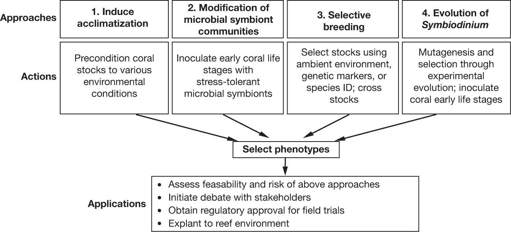

**图 7.1.** 为珊瑚保护提出的四种辅助进化方法的基本原理和步骤总结。¶ 图片改编自 Van Oppen, M. J., Oliver, J. K., Putnam, H. M., and Gates, R. D., 2015, “Building Coral Reef Resilience through Assisted Evolution,” *Proceedings of the National Academy of Sciences of the USA*, 112(8):2307–13.

# 基因拯救

另一种模拟水平进化的方法称为**基因拯救**，它有可能拯救因遗传多样性低和过度近亲繁殖而面临风险的物种或种群。基因拯救旨在通过引入具有互补遗传变异的新个体或新种群，来增加遗传多样性和种群增长。许多物种已经从基因拯救中受益，包括佛罗里达豹、黑足雪貂、北极狐、灰狼、各种虾、牡蛎、黑麦草和猪笼草等。^(17)

# CRISPR-Cas9 与基因驱动

一种称为 **CRISPR-Cas9** 的基因组编辑工具（源自细菌）也充满希望。这种编辑工具可能有助于保护物种，并潜在地保护那些需要快速进化变化以匹配快速环境变化的生态系统。^(18) 利用这种方法，可以插入、删除、替换或修改基因，针对特定功能同时保留理想性状，适用于任何生物体。这类似于水平基因转移，但掌握在人类手中。然而，仅在一个或少数个体中成功编辑或重编码基因组，在有性生殖物种中不会迅速传播。这是因为后代从每个父母那里各继承一半基因。不过，可以使用一种称为**基因驱动**的技术来加速基因组编辑的传播。

基因驱动增加了特定基因或基因组被遗传和传播的概率，潜在高达 100%。这是通过将新的基因编辑与 CRISPR-Cas9 基因本身结合来实现的。结果是，被驱动的基因和编辑机制的基因全部被插入。插入位点是关键，它迫使细胞的修复系统将编辑机制添加到生物体的所有生殖细胞（精子或卵子）中。^(19)

基因驱动正在积极开发中，尚未广泛部署。它们引发了需要仔细考虑的安全和伦理问题。一些潜在应用仅用于加速实验室研究。另一些则针对自然界中的物种或种群，为保护以及农作物和疾病管理带来新机遇。基因驱动可用于破坏入侵害虫物种的繁殖，包括人类无意中引入岛屿的捕食者，如老鼠和蛇。在一个臭名昭著的案例中，1935 年，来自南美和中美洲的甘蔗蟾蜍（*Rhinella marina*）被引入澳大利亚以控制攻击甘蔗作物的甲虫。但外来甘蔗蟾蜍种群迅速增长并扩大了分布范围。蟾蜍天然产生的毒素无意中杀死了许多寻求食物的掠食性鸟类和爬行动物，包括几种大型巨蜥和澳大利亚淡水鳄。实施基因驱动以阻止甘蔗蟾蜍产生毒素，有助于澳大利亚本地物种生存。这比使用毒药更安全，后者会影响甘蔗蟾蜍以外的物种。

基因驱动的其他应用可能击败传播疟疾寄生虫（*Plasmodium falciparum*）以及寨卡和登革热病毒的蚊子。有人称，仅对 1% 的野生蚊子种群应用基因驱动，就能在一年内消除其相关的疟疾。^(20) 未来工程化抗病性似乎也成为可能，因为可以插入破坏病毒或细菌病原体的基因。基因组编辑或重编码已被用于各种家养动植物以增强理想性状。^(21)

### 合成生命

人类利用分子、化学品以及令人眼花缭乱的各种技术和生物模板创造的生命被称为**合成生命**。合成生命曾局限于神话和科幻小说的领域，如今已成为现实。它激发了人们的想象力并成为新闻话题；然而，并未引起大肆宣扬，也未导致生存威胁或恐慌。相反，针对合成微生物在协助我们制造药物、设计新食品、创造用于检测感染和癌症的生物传感器、生产能源、解毒受污染的土地和水源、帮助维持生态系统（如上文讨论的珊瑚）、或检验关于自然生命起源的观点等方面潜力的研究正蓬勃发展。^(23)

合成生命是**合成生物学**的一个组成部分，后者是创造各类新型生物系统的研究与实践。合成生物学包括上文讨论的基因驱动开发和内共生体物种替换等内容。合成生物学要创造或重塑的生物系统范围涵盖从单个基因和基因组到细胞及完整生物体。它融合了分子生物学、生物技术、化学工程、计算机工程和进化科学。

在未来 100 年里，人类将向现有的生物多样性中引入针对特定应用的新生命形式。这些生物体将如何融入全生命的进化叙事？我们如何将合成生命形式与生命的谱系联系起来？合成生命将类似于驯化作物和动物物种，因为它将经历人类为期望性状进行的选择。但其起源有所不同。驯化物种是野生祖先的后代。鸡源自野生红原鸡，牛源自已灭绝的野牛。相比之下，合成生命将是合成组件的组装与一个或多个祖先的编辑部分或整体的混合体。合成生命的起源更多是生命形式间的整合与网络化，而驯化物种（不考虑杂交）则更多是单一谱系的延续。

这种起源差异的意义在于，合成生命形式**将更具可塑性，且速度更快**。无论组件来源如何，对其精确控制也将允许前所未有的定制化水平。正如我们所见，成功整合不同特征的水平进化，比基于亲代与后代差异选择的常规进化能更快产生剧烈变化。在许多方面，合成生命也是掌握在人类手中的水平进化。水平进化特有的遗传去中心化正在发挥作用，但受制于人类的选择。

首个合成细菌于 2010 年诞生，当时感染奶牛的`Mycoplasma mycoides`基因组由机器合成，并转移至一种相关细菌的清空细胞中，该细胞随后成功自我复制。2016 年，这一工作利用一组缩减的 473 个基因得以延伸，创造了名为`Mycoplasma laboratorium`或`Synthia`的新生命形式。^(24) 2017 年，一个国际团队生成了首个真核生物——经过修饰的面包酵母`Saccharomyces cerevisiae`——的完整合成基因组。^(25) 2019 年，研究人员利用修订的遗传密码，创造了细菌`Escherichia coli`的全合成基因组及变体。修订的遗传密码使得自然生物未编码的氨基酸（非规范氨基酸）得以使用，从而生产种类更丰富的蛋白质产物。^(26) 如上所述，`CRISPR-Cas9`编辑和重编码现有基因组，而非从头合成完整基因组。`CRISPR-Cas9`的使用始于 2012 年，其持续的发展和高效性使其成为许多合成生物学项目的首选方法，极大地加速了进展和应用。无论采用何种方法，技术挑战和安全问题依然棘手且艰巨。

在农业领域，合成生物学有潜力提高粮食作物的营养密度及其对不断增长的人口的可获得性。开发具有合成基因组的树木可增强碳封存速率，有助于缓解二氧化碳排放和气候变化。合成微生物已在开发中，用于辅助诊断和治疗肠易激综合征等疾病、使病原体失活，以及生产具有新功能的新型蛋白质。^(27) 存在天然电活性细菌，它们通过移动电子进出细胞进行通讯和协作。利用基因组编辑，这种能力已被用于制造`E. coli`的新型合成电活性形式，以初步尝试生产可持续能源。^(28) 另一组称为**定向内共生**的方法，可合成具有新型合成细胞器的新型生物体。该方法大致模拟真核生物中叶绿体和线粒体的起源。合成细胞器可用于替换患有多种线粒体疾病的人类的缺陷线粒体，或提高植物固氮等生物过程的效率（图 7.2）。合成生物学和合成生命已催生出制造药物、化学品、活体传感器、化肥、纺织品、食品和电力的数十亿美元产业。无人谈论这一点，但人们可以梦想个性化的叶绿体帮助你以阳光为食。

借助合成生物学，我们获得了此前被视为超人类的力量。我们可以近似、定制并加速水平进化一些最强大的机制，以实现快速而剧烈的变化。我们可以模拟进化新叙事关注的水平进化机制，并放大其对生命未来的影响。我们可以在生命的多样形式中发现的特征中进行选择并尝试组合，即使我们对这类复杂生命系统如何运作的理解尚不完整。这更凸显了谨慎的必要性。进一步的成功，即使缓慢且受限，似乎也是不可避免的。人类的想象力有了施展的空间。

* * *

## 未来进化的延伸思考

将这种对未来进化的考量延伸开来，如果一些个体（无论是人类还是其他物种）离开地球并在别处定居，会怎样？预期会持续发生垂直和水平进化吗？会的。为什么不会呢？生命只需具备三个特征，就能通过自然选择进化：遗传性、个体间的变异、以及与该变异相关的差异繁殖成功率。这是达尔文的基本洞见。它适用于地球的所有环境，没有理由认为这一真理不适用于地球之外，即使人类成为了选择的仲裁者。

**图 7.2. 合成线粒体和叶绿体（细胞器）在研究中的潜在应用。** 利用合成或改良的叶绿体和线粒体，可能开发出光合作用和细胞呼吸更高效的生物体。合成线粒体可用于治疗与线粒体问题相关的人类疾病。合成细胞器也可用于研究需要区室化的生物过程，例如固氮作用。¶ 图表改编自 Meaney, R. S., Hamadache, S., Soltysiak, M. P., and Karas, B. J., 2020, “Designer Endosymbionts: Converting Free-Living Bacteria into Organelles,” *Current Opinion in Systems Biology*, 24:41–50.

如果地外生命已经存在呢？地球上具有影响力的水平进化现实真的是普遍的吗？我们会预期外星生命形式是由以前不同的实体整合而成的吗？正如我一直指出的地球生命那样？在这里，我认为答案也是肯定的，基于上述三个基本特征。自然选择可以随时间增加（或减少）生命形式的功能和复杂性，而个体的组合——无论是完整生物体、生物体部位、基因组还是基因——是数十亿年来增加复杂性的经过验证的途径。看看你自己：目前拥有两个基因组，有与其他人种或谱系杂交的历史，以及许多源自古老水平基因转移事件的基因。前文概述的谱系融合和内共生事件，在自然选择和偶然性的作用下，给予足够的时间，很可能发生在任何和所有生命系统中。^(29)

### 展望

目前的所有分析都表明，地球物种面临着艰难的时代。随着气候变暖、栖息地改变、海平面上升、野火频发和人类激增，物种灭绝正在加速。对于所有深切关心生物世界的人来说，目睹生物多样性和自然景观的丧失是痛苦的。许多人感到有道德义务防止由人类活动导致的灭绝，认为这本质上是错误的。物种是自然力量在数百万年间创造的独特生命形式。在自然中与物种互动，让我们与比自身更伟大的事物相连，那是超越且短暂的。我们可以将其他物种视为单一、古老且惊人的生命发展及其变迁历史中截然不同却同源的部分。它们的历史是我们历史的重要组成部分。我们相互影响，或直接或间接，并继续共同进化，只要我们持续存在。接受权利是人类的建构，我们对其他物种的义务，归根结底，源于对我们自身的义务。

然而，认为我们必须保护自然维持其近期的状态，否则将危及我们自身的生存，这种观点是错误的。它低估了我们的适应能力。它也忽视了一个事实：自然世界的变化是不可避免的，无论原因和结果如何。假设我们能控制全球范围内恢复到早期的条件和物种组成，将是极端傲慢的表现。当环境变化迅速时，物种间成功的适应性反应也必须迅速。记者 Elizabeth Kolbert 回顾了我们改变自然和试图拯救自然的方式，指出：“选择不在于过去是什么和现在是什么之间，而在于现在是什么和未来将是什么之间。”^(30)

认为人类破坏自然世界是新事物，这也是错误的。我们的祖先也极大地改变了他们栖息地区的动植物群。早在两百万年前，*Homo* 物种就与大型非洲哺乳动物在分布范围重叠区减少三分之二有关。这包括将 12 种不同的大象物种减少到两种。在公元前 1500 年前的 100,000 年里，研究人员估计全球哺乳动物物种中有超过 10% 因人类狩猎压力和栖息地改造而消失。同样，最近存在的鸟类物种中超过 10% 的灭绝与早期人类占据太平洋岛屿有关。在 3,000 到 10,000 年前，人类猎手导致了更新世巨型动物群的广泛灭绝，包括猛犸象、乳齿象、地懒和剑齿虎，以及北美和其他地区的数十个其他物种。许多幸存的巨型动物物种，其活动、分布范围和种群规模都发生了显著改变。虽然大多数巨型动物物种是过去一亿年的幸存者，但它们没有准备好应对足智多谋的人类和当时的环境变化。早期人类在偏好地点运输和栽培喜爱的植物，并反复焚烧大片栖息地，重构生态系统。这些变化反过来影响了自然选择的力量，以及卷入人类种群扩张中的许多其他物种的进化。^(31)

保护工作在寻求最大限度减少损失和保持功能性生态系统方面仍然至关重要。然而，功能性、健康的生态系统可能呈现多种形式，鉴于即将到来的气候和生物多样性分布变化，未来的生态系统将不同于今天的。我们不知道这些变化的长期影响会是什么。虽然很少有人会选择，但没有理由假设我们的物种无法在物种较少或不同的世界中生存，这取决于哪些物种消失。承担责任并寻求避免灾难性的生物多样性变化，需要科学家和决策者之间的合作，尽管在这一领域过去的进展有限。

新的进化叙事强调，实质性变化可以通过水平进化迅速发生，如前面的许多例子所示。水平进化机制在促进适应性变化方面取得成功的很大一部分，在于其遗传的去中心化。它们扩大了遗传变异的库。个体不再局限于从直系父母那里垂直继承，一些个体通过水平方式接收不同遗传物质的新组合，为选择提供了更多且不同尺度的变异供其作用。

我们已经看到，随着气候变化改变物种的分布，物种杂交的现象在增加。病原体在与潜在新宿主物种接触时，无意中成为了重组和选择的实验室，这源于人类改变环境。基因组编辑很可能会被更多地用于促进物种和生态系统的保护。合成生物学可以被视为掌握在人类手中的水平进化，它将在我们的未来发挥越来越重要的作用，并因我们的统治地位，在其他生命形式的未来中也是如此。即使人类消失后，去中心化的水平遗传仍将继续成为进化未来叙事中一股强大的力量。

## 8 未来人类

> 我们人类正在改变。我们已经与我们创造的事物紧密交织在一起，以至于我们不再与它们分离。
>
> —丹尼·希利斯，《回到未来（1994 年的未来）》

再想想冰人奥兹，我们 5300 年前的前辈，把他看作一位技术专家。他的斧头、弓箭、防寒服、雪靴、来自家养动物的干肉、胃里的农作物谷粒、串起来的干药用蘑菇、生火工具包，甚至他所处的高海拔山口位置，都无声地见证了一种语言、教学、学习和实验的文化。他和他的社区应用于日常生活的集体知识至关重要。这些知识可以轻松共享和积累。他们的技术是他们健康、文化和生存的关键。

如今，技术通常与无处不在的电脑和智能设备屏幕、社交媒体上错误信息的分裂效应联系在一起。一些人认为技术让人失去人性。私人个人信息在网上被骗子和企业营销算法获取。一些人有意义的面对面体验在减少，年轻人的自尊心可能因匿名批评者和频繁与虚假资料比较而受损。部落激情容易被操纵。聊天机器人轻松胜过人类，能写出对复杂问题雄辩的回答，如果被要求，还会详述暗中欺骗或报复的计划。

是的，技术可能有害，一如既往。然而，技术也是人类的标志性特征。广义上讲，技术是用于解决问题和发明工具的任何知识。技术的融合伴随了我们作为`Homo sapiens`的每一步。它是由学习和文化变迁驱动和传播的，而不是基因传递。它是水平进化，因为遗传不限于父母和后代，但它可以持续通过时间。我们大多数人已经失去了与奥兹技术的联系，但我们追求和应用技术的目标与他相似：在不确定的世界中寻求健康、安全和知识。我们开发技术的天赋和执着是我们作为一个物种进化成功的很大一部分。它对我们的文化至关重要。

在本章中，我将延伸进化的新叙事，重点关注我们与技术的融合。我将探讨技术对我们身体、大脑、思想和文化的影响。我将论证我们正处于、且长期以来一直处于与技术的一种相互依存、协同进化的关系中，因为学习加速了我们物种的文化和身体进化。

### 人类与技术

人类并非唯一培育技术的物种。黑猩猩制造长矛猎捕小型哺乳动物。黑鸢，一种鸟类掠食者，叼起并投下燃烧的树枝来蔓延大火并惊动猎物。一些蜜蜂通过舞蹈向亲属传达食物的方向和距离。在一种称为群体感应的过程中，一些细菌、古菌和病毒利用分子信号来评估其种群规模，并管理其行为和生命周期变化。但我们人类在技术的意图性、复杂性和变化速度上是独一无二的。至少我们喜欢这么认为。自奥兹时代以来，在我们最好的一面，我们开发了养活和庇护数十亿人、减少疾病、延长寿命、快速全球通讯以及陆地和行星旅行的技术。通过学习传播和改变人类文化的速度，比单靠遗传学的生物进化快得多。然而，尽管自奥兹时代以来我们取得了技术进步，我们的外貌和身体能力仍然与他的社区相似。

我们人类与技术的关系也是生命有意识地与技术建立关系的高点。生命花费了约 38 亿年才破译自己的 DNA 编码指令，将探测器送上火星，并制造出功能强大的口袋大小的计算机，用于打电话、拍电影和炒股。我们是这个有意识地加速其与技术融合、以至于产生依赖的物种。在缺乏电力、计算机和化石燃料炼厂等关键技术的情况下，大多数社会将迅速瓦解。没有水泵或运输进行送水。没有冷藏保存食物。没有通讯进行商贸、旅行、医疗或紧急服务。始于便利的事物已变成强制性的——或近乎如此。

技术在我们现在的生活中以及可能在我们物种未来进化中的作用是强大的，值得我们关注。根据想要强调的特征，有许多思考技术在人类进化中作用的方式。但简单起见，让我们确定三个大阶段：生物学、文化和技术阶段。^(1) 第一阶段（生物学）跨越了前人类进化，包括我们的灵长类遗产。它大致在 30 万到 35 万年前随着现代人类`Homo sapiens`的起源而结束。这一估计基于摩洛哥的化石头骨碎片和相关的石刮削器。^(2) 这一第一阶段的进化主要是生物学和遗传学的。身体和行为随时间变化，受环境、偶然突变和自然选择的影响。我们有意识的技术发展，以语言的开端和原始工具使用为特征，处于非常早期的阶段。估计人类语言起源的时间颇具争议；然而，最近的研究表明，带有对比元音的语言起源比以前认为的要古老得多。研究人类将口语起源追溯到我们的灵长类祖先，远至 2000 万年前。^(3) 从这个角度看，人类以及我们的一些表亲，一直都是技术专家。

第二阶段（文化）对应于人类初萌的技术加速其人口增长并遍布全球的时期。这一阶段始于`Homo sapiens`的起源，终于 1500 年（大致对应印刷机的发明），其特征是更大规模社会、农业、书面语言和印刷机的发展。

第三阶段（技术）正在顺利进行中，因为我们的技术让我们能进一步超越生物学的极限。我们的身体和思想可以通过既成熟又正在探索的方式得到增强。我们可以增强或替换有缺陷或磨损的人体部件（图 8.1）。我们可以恢复甚至改善听力和视力。我们的记忆通过在线搜索得到增强，不断扩展的公共知识库由维基百科等资源策划。我们可以操纵我们自己的基因组和其他物种的基因组。我们能而且确实在为了好坏而极大地改变我们的环境。我们可以利用人工智能（AI）增强分析能力，并有意创造新生命形式或改变现有生命形式，如第 7 章所述。

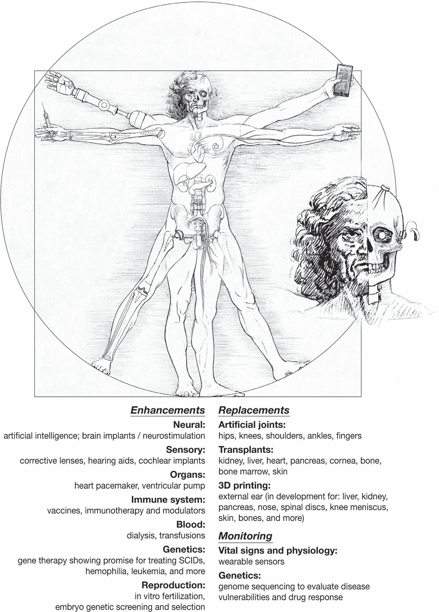

**图 8.1.** 技术让我们能够增强身体、智力和寿命，因为我们持续超越先前的生物极限。

我们物种所获得并应用的知识，在地球生命 38 亿年的历史中是独一无二的。尽管其他物种（包括各种蚂蚁和蜜蜂、裸鼹鼠、猫鼬，以及像松鸦这样的少数鸟类）也进化出了复杂的社会和行为，如合作抚育后代，但第二和第三阶段（文化和技术）将我们与其他生命形式区分开来。我们所处的轨迹是新颖的，其走向难以预测。

我们与技术处于一段长期关系中。即使我们想分手，也分不了手。当然，我们可以放弃一些个人便利。如果失去网络接入，我会乐意更频繁地光顾本地商店，甚至阅读纸质报纸。但我们与技术的关系远不止便利。我们的治理、国防、商业、医疗、旅行、金融、通信和学习机构，都依赖于连卢德分子都不太可能放弃的技术。别忘了我们对公用事业和政府提供的技术服务的基本依赖，包括配水、供电、家庭供暖、制冷、冷藏和照明。2021 年德克萨斯州的一场冬季风暴瘫痪了一个主要电网，仅在 42 小时内就造成至少 700 人死亡。^(4) 我们的生活甚至文明都依赖于持续的技术。

### 仿生身体与更长的寿命

#### 身体

人类与技术的融合，曾经是幻想，如今正成为不断增长的现实。爱伦·坡在 1850 年写过一篇名为《被用废的人》的文章，讲述一位虚构的将军在战斗中受重伤，需要用惰性部件组装而成。达斯·维达、钢铁侠、终结者和女终结者都是虚构的赛博格（控制论有机体），结合了人类与机器或类机器特性。在《奇点临近》一书中，未来学家雷·库兹韦尔提到了假设性技术，也许有一天能替换身体部位，包括取代大脑的软件。他在二十一世纪之交预测，“技术奇点”正在逼近，届时机器智能将超越人类智能，技术增长将变得不可控。他将这些发展归因于计算机科学、信息处理、遗传学、工程学和机器人学等技术的指数级增长。^(5) 我们在人类与技术的持续融合进程中目前处于什么阶段？

医生可以替换受损和疼痛的关节。髋、膝、踝、肩和手指可用钛、钴铬合金、锆、镍或陶瓷制成的假体重建。如果一切顺利，住院时间仅为一至数天（见图 8.1）。这些手术费用高昂，当然任何手术都不无风险。尽管如此，其频率正在增长。通常可使用 15 年以上，美国每年进行超过一百万例髋关节和膝关节置换手术，预计到 2030 年随着人口老龄化将扩大到每年四百万例。

器官移植也在以越来越高的成功率实施，尤其是肾脏、肝脏和心脏。不太常见的移植包括肺、胰腺和肠。骨髓可移植作为对抗癌症的手段。输血在受伤失血和治疗贫血时至关重要。通过替换受损角膜可恢复视力。牙齿修复和替换是常规操作，某些情况下需要骨移植以加固牙槽，材料可来自受体本人、他人，甚至牛。

研究人员还在开发肝脏、肾脏和心脏的 3D 打印方法。这些合成器官将使用受体自身的细胞，以最大限度减少替换后的免疫排斥反应。3D 打印器官有望挽救等待名单上那些人的生命，因为可用的捐赠器官数量很少。这些方法仍在开发中；然而，打印的器官碎片目前已用于药物测试。我们已经在利用人体细胞进行 3D 打印，为烧伤和意外受害者重建耳朵和鼻子。

脑机接口正在开发中。脑植入物通常通过颅骨上的一个小孔连接到大脑表面，可为中风或头部受伤后受损的大脑区域建立功能性的替代方案。其他植入物刺激大脑区域以缓解帕金森病和抑郁症的症状。有潜力解决瘫痪、失明和失聪问题，尽管这些仍属假设。基因疗法旨在通过修复或替换致病基因来治疗疾病。这很复杂，尤其是与相对直接的关节置换相比。原因之一是基因递送和摄取的困难。另一个原因是大多数疾病有多个致病基因，而许多基因也有多重效应。基因疗法始于 20 世纪 80 年代，最近因先进基因编辑工具的引入而得到加强。到目前为止，只有少数疗法获得监管机构批准。其中一种从患者体内提取免疫细胞，在实验室中操控其靶向特定癌细胞，再回输给患者。另一种治疗遗传性失明，利用病毒递送基因，在眼睛中产生缺失的酶，从而改善视网膜和视力。数百种更多基因疗法正在开发中，靶向血液癌症、皮肤癌和心血管疾病等。似乎只是坚持不懈的时间问题，可治疗疾病的目录就会不断增长。

然而，这些程序仅影响接受者个体。替换的身体部位，包括导入血细胞等体细胞的基因，不会传给后代。这些替换不会直接影响我们的进化。它们可能通过影响个体繁殖率，间接影响那些本可能被淘汰的基因的维持。但这很可能是极小的影响，特别是考虑到此类手术的低发生率。

可遗传的基因疗法将针对性细胞（卵子或精子）或胚胎。尽管理论上使用 `CRISPR-Cas9` 是可能的，并曾在一个有争议的案例中尝试用于阻断 HIV 感染，但这引发了关于直接干预人类设计的伦理问题及其潜在的意外后果。胚胎基因疗法目前在许多但并非所有国家被禁止，而科学家和政府官员之间的国际努力正在寻求监管共识。尽管减少遗传性疾病是可取的，但关于可能改变哪些遗传性状、谁能获得此类治疗，以及父母是否有权基因编辑其后代，伦理问题依然挥之不去。我将在下文重访编辑性细胞这一话题。

## 寿命

许多人都知道人类平均寿命正在延长。但鲜有人意识到，最大年龄（约 125 岁）自 5000 年前石器时代结束以来变化不大。^[6] 变化的是预期寿命——即个体的平均生存时间——以及达到 100 岁等里程碑的人数频率（图 8.2）。预期寿命的延长源于婴儿死亡率的大幅下降、卫生条件的改善、公共卫生措施的实施以及医学的进步。这些反过来又是以下因素的结果：关于健康生活方式、用于疾病早期预警的基因标记和监测以及医学改进的知识和技术得到提升。关于饮食方面，近期研究证实了延年益寿的著名建议：在不营养不良的前提下限制热量摄入；在感到撑饱前停止进食；减少进食频率；偶尔进行 12–16 小时的断食。希波克拉底 2400 年前就知晓其中大部分道理，但知易行难。

关于衰老过程（衰老）的最新研究令人振奋，研究表明，衰老是由我们体内 DNA 损伤与修复过程之间不断变化的平衡所驱动的（图 8.3）。^[7] 我们所有细胞中的 DNA 随时间自然会受到损伤，因为它们在复制过程中会暴露于毒素、致癌物和辐射中。我们的细胞拥有令人印象深刻的天生能力来修复这些受损的 DNA。然而，当损伤速率超过修复速率时——迟早会发生这种情况——损伤就会累积。这种损伤导致整体衰老，其特征是 DNA 修复水平下降、清除异常细胞的能力减弱，而这正是称为凋亡（程序性细胞死亡）的重要过程的一部分。DNA 修复和凋亡出现的这些问题导致老年疾病增加：癌症、痴呆症、心脏病、呼吸系统疾病等。

让我们看看几个关于衰老机制及其潜在控制的当前研究项目。去乙酰化酶（Sirtuins）是一类影响重要细胞功能的蛋白质家族。这些功能包括 DNA 修复、应对感染的健康炎症反应，以及上文提到的清除异常细胞的凋亡过程。当凋亡失效时，衰老、癌变和病毒感染的细胞会增殖。由于其重要功能，去乙酰化酶受损或过度使用及压力会加速衰老。目前尚不清楚如何将这些知识应用于减缓人类衰老过程。然而，在小鼠中刺激去乙酰化酶的产生已显著改善了 DNA 修复、记忆力和身体耐力，这些是衰老的大致替代指标。

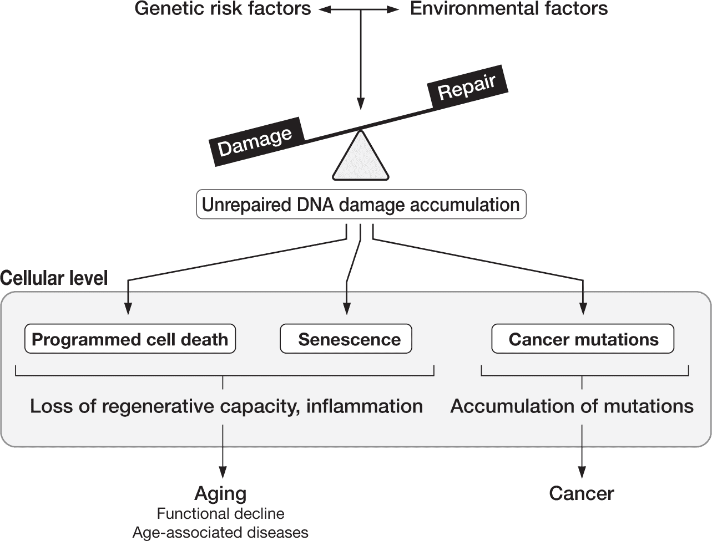

**图 8.3.** 人类衰老的主要影响因素和机制总结。 ¶ 图片改编自 Melzer, D., Pilling, L. C., and Ferrucci, L., 2020, “The Genetics of Human Ageing,” *Nature Reviews Genetics*, 21(2):88–101。

mTOR 是另一组与衰老有关的蛋白质。与去乙酰化酶类似，mTOR 在人体内也参与 DNA 修复和旧蛋白质的消化。但当 mTOR 过度表达和过度活跃时，其正常功能可能会受损。对非哺乳动物的研究发现，降低某些相同蛋白质的活性——称为 TOR，去掉了代表“哺乳动物”的“m”——可延长酵母、线虫和果蝇的寿命。在小鼠中，mTOR 抑制剂雷帕霉素也能延长寿命。在人体中进行的类雷帕霉素药物试验显示免疫系统功能改善、感染减少，但对长寿的潜在影响仍未可知。^[8]

自然生物学压力会损伤细胞，导致不健康的炎症、复制失败，以及与去乙酰化酶和 mTOR 一样，对凋亡和清除异常细胞产生抵抗。针对能靶向并清除受损细胞（称为清老药）的药物研究正在进行中。小鼠试验显示这些药物能逆转衰老的几个特征。人体初步试验显示出希望。^[9] 基于迄今为止的进展，未来几十年有望在减少 DNA 损伤、增强 DNA 修复的知识和技术方面取得进展，从而减缓衰老过程。

关于平均寿命延长和人口增长有许多担忧。额外延长的岁月能否在健康的身体和健全的精神中度过？社会、家庭和经济将如何适应超级百岁老人（指活到 110 岁的人）数量的增加？这将如何影响我们已经沉重的自然资源消耗和随之而来的环境问题？人类会停止尝试在健康状态下延长平均寿命吗？我认为不会。只要人们爱并关心他们的家人、朋友和他人，延长生命的渴望就不会消失。此外，减缓衰老过程的科学挑战极具吸引力，且至少在渐进意义上是触手可及的。我们已经取得了良好进展（见图 8.2），这还是在目前对 DNA 损伤和修复分子机制的理解之前取得的。

衰老及其相关的身体和精神衰退是不可避免的，或者至少目前看起来是这样。但其速度可以减缓，我们似乎注定能找到负责的分子机制。俗话说，死容易，活才难。人类倾向于做难事。往往借助技术。

### 拓展我们的大脑

大脑协调我们身体机能和运动的能力令人印象深刻。我们物种植根于抽象思维的智力成就——如开发本讨论核心的技术——同样令人赞叹。这些成就将我们物种与其他物种区分开来。然而，你的大脑是最优的吗？你对信息和事件有完美的回忆吗？你的判断无偏见且明智吗？你的思维可靠地富有创造力或专注吗？我猜答案都是否定的。我们的大脑在许多方面为我们服务良好，但作为进化的产物，它们受限于我们从早期脊椎动物继承的遗产、对先前环境中成功的选择，以及现有材料的限制。

我们在与大脑的局限作斗争。我们会遗忘。我们会忽视和发呆。我们会误解和否认。我们非理性地抱有希望而非制定计划。我们的偏见经过情绪和人格的过滤，既迷人又令人谦卑。^[10] 赌徒谬误描述了我们倾向于假设未来的可能性反映过去事件的偏见。例如，如果你连续输了九次抛硬币，你会觉得第十次赢的概率超过 50%。其实不应该。在群体思维中，我们为避免冲突而做出非理性决策。有时——好吧，常常是——我们对某个主题了解越少，对自己关于它的观点就越确信。这是达克效应。也许最隐蔽的是，确认偏误指我们倾向于寻找并放大支持我们信念的证据，而忽视不和谐的事实。

# 技术拓展人类能力

至此，在许多方面，我们的技术已超越了大脑与生俱来的能力。技术拓展了我们的感官，使我们能看到 130 亿光年之外、距离地球最远的已知星系。我们能探测到电子的运动，电子的大小是质子的 1/1000，而质子的直径约为 1/25 万亿英寸。我们的机器拥有大得多的记忆容量，以及收集和分析信息的能力，增强了我们大脑在解决问题和预测方面的能力。

## 人工智能（AI）与机器学习

利用计算机模拟人类智能以获取和应用知识，被称为**人工智能（AI）**。AI 无处不在，融入了数亿人的日常生活。它是大多数商业计算和在线活动的核心。它被用于利用 `Chat GPT` 解答复杂问题、像 `Google` 这样的网络搜索算法、像 `Facebook` 和 `Netflix` 这样的推荐系统、定向广告、语言翻译、语音和人脸识别、自动化资产交易、自动驾驶汽车、天气预测、导航、配对匹配和游戏。

**机器学习**是 AI 的一个子集，其中计算机被编程为递归地使用数据以改进其分析。例如，机器学习在识别垃圾邮件方面发挥作用，当获得反馈以促进学习时效果最佳。更广泛地说，机器学习基于软件自身的表现，提供了重新编程和改进软件的循环。

## AI 效应与未来轨迹

专家们一致认为，AI 在理性和分析方面的能力将超越我们最聪明个体的智力，如果尚未发生的话。事实上，这一进程已经持续了一段时间，导致了所谓的**AI 效应**。这指的是：一旦 AI 解决并自动化了某项工作，原本被认为需要智力的任务就不再被视为需要智力。正如认知科学家道格拉斯·霍夫施塔特所言，AI 就是那些尚未完成的事情。这或许只是为了保全颜面，是我们维持自身在解决各类问题过程中角色的方式。尽管我们可能会移动“何为智力”的门槛，但利用软硬件增强大脑的时代正在快速推进。

`Chat GPT4` 现已免费向任何拥有互联网连接的人开放，具备人类水平的智力，并能在许多工作中胜过人类。它编写和调试计算机代码的速度比我们快，还能在标准化考试中取得优异成绩，包括撰写论文，用于评估有意向的法律、商业和医学专业的学生。许多 AI 专家敦促暂停进一步开发“具有涌现能力的不可预测黑箱模型”，质疑我们是否应急于开发“最终可能超过人类在数量、智力上胜过人类、使人类过时并取代人类的非人类思维”。^[11] 暂停期可用于制定并实施由独立专家审计和监督的安全协议。针对人类克隆、人类生殖细胞编辑（如上文所述）以及针对病原体的功能增益研究，暂停或停止技术发展的努力已被实施或尝试；然而，这些技术比开放获取的 AI 应用更难接触。无论强大 AI 系统的开发是否暂停（这似乎难以强制执行，因此不太可能发生），我们都应主动寻求并应用智慧，而非被动应对。开发 AI 所需的监管和治理体系将需要数年时间，在此期间，我们面临的生存风险似乎真实存在却又扑朔迷离。AI 被比作火、互联网和核裂变技术，因其对人类生活和社会的潜在影响。那些技术都有利有弊，我想 AI 也将如此。它无法被“撤销发明”。

## 大脑复制的局限性

用工程物理设备重建大脑或其部分可能有助于推进发展，但这种方法受到大脑设计中进化历史遗留问题的阻碍。这包括其利用 DNA 编码的蛋白质进行构建。我们的大脑带领我们走到了今天，但自然选择并未针对我们常需的、且高等计算可提供的那些分析和理性类型对其进行优化。

## 近期收益：交通与虚拟助手

从近期来看，安全的自动驾驶汽车、卡车和公交车有望减少每年全球因车祸造成的 120 万死亡人数。相应地，在城市地区从私家车转向自动驾驶共享出行，可降低许多人的交通成本，同时减少交通拥堵和停车占用的空间。目前的虚拟助手如 `Siri` 和 `Alexa` 容易出错（我：“Alexa，报警！”Alexa：“为您随机播放 The Police 乐队的歌曲。”），但正在改进。拥有增强的背景知识和用户详细情况信息的未来虚拟助手，将在管理和整合日历、旅行预订、购物、支付、税务、投资决策、健康膳食、相关无偏见新闻、以及与亲友沟通方面表现得好得多。如果这些功能在一个可信赖的系统中得到良好实现（这绝非易事），个人将能在一个复杂且有时充满敌意的世界中更有效地行动。

## 医疗保健中的 AI

AI 正深入医疗保健的核心。这建立在大数据集的增长与应用基础上，用于训练计算机程序改进自身及其推理。这就是机器学习。进步或许最容易在那些依赖影像进行诊断的医学专科中看到。存在一个不断扩大的比较影像数据核心，来源包括 `MRI`（磁共振成像）、`CT`（计算机断层扫描）、`EKG`（心电图）、超声波等。计算机可以学习影像内的模式，并将其与专业人士做出的诊断联系起来，只需相对较少的人工监督，即可回顾数十万甚至数百万例患者病例。机器学习在医学影像上的应用仍处于早期，但正如心脏病专家兼作家埃里克·托波尔所言，这项技术有潜力“诊断某些类型的皮肤癌，其水平与甚至可能优于经过认证的皮肤科医生；识别特定心律失常，水平堪比心脏病专家；解读医学扫描或病理切片，水平堪比资深、高度合格的放射科医生和病理科医生；诊断各种眼病，水平堪比眼科医生；预测自杀，水平优于心理健康专业人士。”^[12]

当然，AI 在医学中的影响将远不止模式识别。通过将数百万患者的全基因组测序与特定症状、疾病及特定治疗结果相关联，蕴藏着巨大的学习潜力。AI 驱动的计算机程序不会因过度工作而疲劳或分心。这绝不意味着医生能被或将被取代。恰恰相反，情况应当相反。正如托波尔所言，AI 计算机可以支持更人性化、更具同理心的医疗，让医生和其他医护人员拥有更多时间进行面对面的、富有同理心的患者护理。

# 超越服务：AI 与大规模挑战

除了所有这些服务之外，AI 或许可以被用于应对人类面临的大规模挑战。计算机科学家斯图尔特·拉塞尔指出：“我们的智能造就了我们的文明。借助更强大的智能，我们可以拥有更伟大——也许是好得多——的文明。”他概述了在 AI 的帮助下，通过实现全球 GDP（国内生产总值）即人均商品和服务产量十倍增长，来提高地球上每个人生活水平的挑战。“所假设的 GDP 十倍增长……并非建立在进一步的革命性技术之上，而是建立在 AI 系统能够更有效、更大规模地利用我们已有资源的能力之上。”^(13) 一小群想要在社区建设医院、学校或废物处理设施的人，将能获取我们物种所有最好的知识和技能，并在 AI 驱动的设计、材料选择、预算编制、物流、实体机器人（包括工业级 3D 打印）和许可审批的帮助下完成建设。当如此多人因获得必要知识而被赋能时，潜在项目的丰富性代表了人们追求的 GDP 净增长。这听起来极具野心？是的。那又为何不呢？这是一个值得追求的目标，当然可以循序渐进地实现。关键在于，对于 AI 可能实现的成就，存在着一个积极的愿景。

然而，AI 走错路的可能性似乎真实存在。毕竟，如果我们创造出拥有比我们更强大智能的实体，如何确保它们不会利用那种力量来控制我们？它们会以某种方式产生能动性吗？AI 机器将能在午餐前读完所有曾经写过的书籍和手册，并在晚餐前消化掉全球所有的监控摄像头视频、电话记录、社交媒体、电视和广播节目。它对我们世界和态度的理解可能超越我们自己。斯图尔特的解决方案是改变 AI 系统的激励机制。与其训练 AI 系统完成固定目标，不如利用一种称为 `inverse reinforcement learning`（逆强化学习）的技术来训练它们，使其与人类目标保持一致，致力于了解人类真正想要什么，并保持开放态度，以便在必要时被重新引导或关闭。这听起来很合理。理想情况下，我们可以在人类与技术的适应性协同进化过程中筛选出这种一致性。但这万无一失吗？太多东西取决于人类真正想要什么的反复无常。AI 和任何其他技术本身都不是邪恶的。但人类可能是，正如以往一样，那似乎才是更大的威胁。^(14)

## 类生命技术

技术与生命实体有着迷人的相似之处。正如第 4 章所述，多年来，生命被认为具有的一组共同特性包括：生长、繁殖、新陈代谢、可遗传特征、细胞构成、对环境的反应以及稳态（维持内部条件稳定的能力）。技术拥有许多相同的特性。机器学习作为 AI 的一个分支，可以生长和繁殖计算机代码，响应关于其环境的变化数据，从而提供新一代算法，准备好进行下一轮评估和变更。新陈代谢是我们身体将食物转化为能量的方式，而在人类协助下，技术也可以通过利用核反应、太阳能和风能或化石燃料燃烧来产生自己的能量。

技术在需要协助方面，类似于生命中许多专性寄生生物，它们无法在没有另一个物种提供的资源的情况下繁殖。在所有主要的真核生物群体中都存在专性寄生生物，因此这种现象在生命形式中并不罕见。我们可以承认，定义生命是困难的，且可以说具有主观性，因为存在大量灰色地带，如病毒和质粒。但我们也可以承认，仅因为某物不是生物学的——换句话说，因为它还不是生命的一部分——就将其排除在生命之外，这种做法具有循环论证的性质。重新审视第 4 章提出的问题，一些哲学家和生物学家认为生命不是离散的物理实体，而是过程。这些生命过程发生在不同的时间和组织尺度上，范围从基因复制、细胞分化、生物体发育、生命周期变化、物种形成，到水平进化的机制。

例如，与其将生物世界视为由具有明确边界的独立物种组成，不如视为由具有模糊边界的相互依存物种组成。这种将生命视为过程的观点，在考虑水平进化时更为贴切，因为水平进化的过程支撑着物种间广泛的整合与相互作用。杜普雷和尼科尔森指出：“世界——至少就生物而言——不是由实质性的粒子或事物组成的，正如哲学家们绝大多数所假设的那样，而是由……一个在不同时间尺度上稳定并主动维持的过程层级组成的。”他们指出，物种间的关系和相互依存——想想我们与我们微生物组的关系——对于将自然世界理解为由离散实体而非过程组成，构成了一个主要问题。^(15)

当然，技术在应用于人类时，很大程度上就是过程。在应用之前它是惰性的，如未运行的代码和未植入的植入体，而当技术在为我们服务时被激活，提供分析、预测、解决方案等，它便在隐喻意义上“活”了过来。

想象一个人集成了极高程度的技术。假设这个虚构的人是在体外受孕、通过剖腹产出生、接受了六个人工关节、三个金属心脏支架、两个猪心脏瓣膜、一个硅基脑植入体、半个 3D 打印耳朵、眼镜、两个助听器和假牙。此外，他们多次因及时使用抗生素、疫苗、胰岛素注射、输血、抗抑郁药，以及在 `Match` 网上相识并相爱的配偶的照料而获救。在你想象的那一刻，他们正驾驶直升机（尽管因显而易见的原因吊销了执照）仪表飞行穿越湍流，前往南海一个人工岛上的着陆直升机停机坪，直升机租赁费用以 `bitcoin` 支付，同时收听巴赫大提琴组曲播客。

将此视为人类技术从奥茨时代及更早时期（当时工具使用、语言和农业开始出现）的现代延伸。无论当前生活方式如何，否认我们对技术的专性依赖似乎既吝啬又不可能。当然，个别人类可以在一定程度上、在一段时间内放弃许多技术，但并非所有技术。但对于我们物种整体而言，我们与技术的关系已成为一种生理和心理上的共生依赖。机器应用 Alexa 永远不会有生命。我们至少目前保留这一称号，留给与我们共享进化和共同祖先的数十亿表亲，无论其形式如何。然而，我们的技术正变得越来越像生命，并像真正的灵魂伴侣一样，完善了我们。

未来学家兼计算机科学家汉斯·莫拉维克推测，可能会有那么一天，每个人类都将拥有不朽的化身。^(16) 那时，你大脑中 860 亿个神经元将能被精确地一一重建为晶体管，并适当地连接到机器人头部的其他晶体管上。随着每个神经元被重建，你自身对应的神经元便会被移除。你的大脑始终与机器人的大脑保持连接，意识在整个转移过程中得以维持。最终，你的意识由机器承载，你感受着机器人经历的一切，可以透过机器人的眼睛回望你曾经的躯体。当然，除了为你的意识提供动力的晶体管大脑，机器人还能访问最新的 AI 技术。

这就引出了一个问题：这个化身真的是你吗？请记住，化身将拥有你完全相同的记忆、习惯和性格。因此，答案会因你如何定义“你”而异。

## 我们的协同进化

我们的技术触及生活的方方面面、每一个时刻。然而，它却有一种隐形性。我们习以为常那些尘世间的奇迹。一位喜剧演员描述人们抱怨飞机饮料服务延迟，却身“坐在椅子上——在天空中！”“像鸟一样飞翔！”^(17) 我们最清晰地看到的是最新的技术。我们挑战它们的极限，向朋友展示它们。然后我们焦急地等待下一个版本，匮乏感与日俱增。我们忘记了那小袋椒盐卷饼背后的农业革命。

现实是，数千年来，我们的技术一直是人类文化进化的主要影响因素。而且其步伐正在加快。我们塑造技术，技术塑造我们的文化和思想。技术可以水平共享，并由遥远的亲戚或群体应用，而无需任何基因的物理转移。这种在人类群体和个体间的技术传播——他们随后可以改变和适应该技术——是一种协同进化形式，因此也是一种水平进化形式。

我之前讨论过物种间的协同进化，其中不同物种相互影响彼此的基因变化，如捕食者与猎物之间。而在技术与人类的协同进化中，相互影响发生的不是不同物种之间，而是我们的物种与我们的技术之间。无论可见与否，技术渗透我们的文化，且是我们多样生活方式的关键。尽管机制和时间尺度不同，人类和技术都随时间进化。除了包裹所有生命的自然环境，我们还栖息在一个丰富的人类文化环境中。

如果文化和技术变革能提高个体人类的繁殖成功率，自然选择就会青睐它们。当变革受到个体偏好或通过偶然事件被放大时，也会受到青睐。我们开发和适应文化与技术的能力，一直是我们作为物种进化成功的关键特征。在许多方面，文化就是我们的操作系统。进化生物学家凯文·兰达尔指出：“人类文化能力并非孤立进化，而是与认知和行为的核心方面错综复杂地协同进化，包括我们的语言、教学、智力、换位思考、计算能力、合作倾向、工具使用、记忆和对环境的控制。” 生物学家描述了一个称为“文化驱动”的正反馈循环，其中更强的认知能力，特别是社会学习和适应性行为的传递，可以加速生物进化。简单来说，这个反馈循环可描述为：认知改善 → 更多行为创新 → 更丰富的文化 → 更多待学技能 → 新的认知挑战 → 认知和创新的进一步改善。^(18)

加速的生物进化反映在过去 320 万年里我们谱系中脑容量的增加（无论是绝对值还是相对于体重的比例）。从露西——化石 *Australopithecus afarensis*（南方古猿阿法种）的 450 cm³，到过去 1.5 万年里人类约 1,400 cm³，脑容量大约扩大了三倍。^(19) 人类的多种其他身体变化也与文化变革有关。成年人对牛奶的耐受性进化始于约 1 万年前，紧随家畜驯化之后。深色皮肤色素的流失增强了阳光下维生素 D 的生成，这发生在从非洲迁徙到阳光较少、更寒冷的北方气候之后。最近，伴随营养和卫生条件的改善，各人口群体的平均身高增加了约 10 厘米，寿命延长了 20 年。适应性使得在氧气稀薄的高海拔地区定居的小规模人类群体（在西藏、埃塞俄比亚和安第斯山脉）能实现更高效的氧气代谢。

我们有望让基因在未来的进化中扮演更重要的角色，这取决于我们的选择和追求技术的成果。数千项基因疗法试验已在进行中。尽管大多数旨在改善健康，但这些方法有潜力增强其他特征，如体型、力量和智力。我们用于地球外旅行和生活的技术也有潜力影响我们的生物进化。低重力和高辐射的地外环境将施加其自身的选择压力，关于通过基因编辑和植入物对未来太空任务进行人类增强的讨论已经开始。^(20)

人类的繁殖率和成功，比起过去对基因的依赖较少，更契合当地的文化趋势和经济。尽管存在上述某些关联，但技术变革的速度远快于人类的身体进化，后者需要许多代。请看看几项技术变革：在人类衰老但未在身体上进化的期间，卡尔·本茨于 1886 年为第一辆汽车申请专利，人类于 1969 年登月，而私营公司的太空旅游在 2023 年已全面展开。1960 年至 2018 年间，全球小麦、水稻和玉米的农场生产力分别增长了 214%、150% 和 205%，^(21) 这至少部分归功于种子遗传学的改进（如抗虫性增强）、畜禽遗传学、设备和天气预报的进步。智能手机于 1992 年出现，到 2023 年，估计全球 84% 的人口是用户。Facebook 于 2004 年推出，如今约 40% 的人类至少偶尔使用社交媒体。快速的技术变革似乎与身体进化脱钩。至少目前是这样。

尽管技术指数级增长对生物学的长期影响未知，但我们与技术的共生关系是不可逆转的。尽管人类智力及其衍生的技术有缺陷，但它们是我们进化过去和未来不可或缺的一部分。我们理应寻求更好的技术以尽量减少环境破坏和资源消耗，但几乎没人（如果有的话）会喜欢一个没有药物或电力的世界。

# 与技术的共同进化

## 技术对社会的深远影响

新技术将持续颠覆旧技术，随着世界人口从 2023 年的 79 亿增至 2050 年预测的 97 亿，前所未有的能源需求使得开发新的可持续能源以及提高现有能源技术效率变得至关重要，且这种需求还将持续增长。

数字医疗服务日益普及，包括虚拟急诊室和医生咨询、无线设备健康数据的远程监测，以及 MRI 扫描等数字记录在专家和诊所间的快速共享。Invitae 等私营公司提供的基因检测服务旨在分析基因，以识别个体患各类遗传性癌症、心脏疾病、神经系统疾病和生殖健康问题的特定潜力。这些信息可促成早期干预和生活方式改变以预防疾病。

公民教育受益于免费在线课程平台（如 Khan Academy 和 Coursera）的日益普及，以及电子教材和学习播客的出现。这种教育潜力需要学生付出努力，并具备辨别可靠信息与错误信息的能力。然而，随着高等教育成本飙升，在线教育资源和选项正变得越来越流行和高效。

机器人技术、制造业、销售、航运和银行业的技术驱动变革正对劳动力市场产生深远影响，自动化和数字化将劳动力需求从传统技能转向更专业的分析性、技术性和管理技能。

约会应用等技术形式在伴侣和配偶选择中的使用频率日益增加。坠入爱河似乎超出我们的控制，但我们可以通过 AI 根据候选人对生活方式和政治等常规问题的多项选择回答来预先筛选候选人，从而在缺乏浪漫色彩的情况下提高找到爱情关系的可能性。2020 年皮尤研究中心对 4860 名美国成年人的研究发现，48% 的 18-29 岁和 38% 的 30-49 岁成年人曾使用过约会网站或应用。此外，23% 的成年人曾与通过约会应用首次认识的人约会，12% 与之结婚或建立了承诺关系。^(22)

## 技术的双刃剑效应

技术始终是一把双刃剑，其负面影响真实存在。火药研发始于公元前 8 世纪，中国炼金术士寻求健康长生的灵丹妙药。但加热硫磺、硝石和草药混合物产生了烟雾、火焰和枪炮，而非永生。现代武器技术发展既助长了战时破坏，也带来了民用效益。弹道导弹技术实现了网络卫星发射和太空探索。核技术衍生出核能和核医学（如器官成像技术）。正如未来学家 Alvin 和 Heidi Toffler 所言：“我们发动战争的方式反映了我们创造财富的方式。”^(23)

偏向高糖和植物油加工食品的现代饮食与肥胖、糖尿病和心脏病发病率上升相关。久坐不动和过度使用社交媒体与抑郁和焦虑相关，青少年群体尤甚。利用软件机器人的社交媒体虚假信息运动放大了我们最坏的本能和偏见，给客观真理蒙上阴影，导致社区愤怒和分裂。尽管存在这些问题，放弃技术很少是我们的解决方案。相反，我们寻求通过开发更好的技术和更明智地使用它们来获得缓解。

## 人类与技术的共同进化机制

我们与技术共同进化的机制是什么？它们是否不同于维持所有生命进化的机制？机制确实大体相同。然而，在我们与技术的共同进化中，人类是主要的选择主体，以类似于我们驯化动植物的方式塑造技术。我们根据偏好创造并选择传播某些形式而非其他形式。算盘让位于电子计算器。生火做饭的燧石和钢铁让位于电磁感应炉灶。例如，花卉育种者可能选择随机突变来改善外观或香气，而在软硬件中则被有意的、定向的变更所取代。

我们与技术的共同进化还不同于传统共同进化，因为共同进化的参与者之一——技术——仅具有“类生命”特征而非“生命”本身。但这是文化进化的本质。生物间的自然选择倾向于增加繁殖成功率的变化，无论是在共同进化关系内部还是外部。技术不像生物那样繁殖。然而，技术随时间持续存在为其繁殖成功提供了合理的类比。那些迭代版本持续存在的技术，是那些继续进化、被人们选择的技术。技术持久性的例子无处不在，从特定口语到 AI 和动力飞行。

## 基因、生物体与环境的相互影响

另一个支持人类与技术共同进化和融合概念的因素是基因、生物体和环境的相互影响及其整体性。从各自活动来看，它们并非完全独立的实体。这种相互影响可见于胚胎发育。胚胎细胞环境的变化可改变基因表达，进而改变胚胎形态。基因、生物体和环境的这种相互影响是一个长期热门话题，常被错误地框架为“先天与后天”的对立。这现在已知是一个错误的二分法。“先天与后天的结合”更为准确。因此存在上述相互影响。

让我们尝试用胚胎发育的相同公式来阐述人类与技术的关系。我们文化和技术环境的变化可改变我们遗传变异上的选择压力，进而改变我们的身体和大脑。随着相关数据积累，这究竟如何以及为何发生仍将存有争议。遗传学家 Richard Lewontin 在《三重螺旋》中提出了这一普遍观点：“生物体和环境相互影响，建立一个反馈回路。生物体可以影响其外部环境，环境再反过来影响生物体。在共同进化过程中，生物体和环境既可以作为原因，也可以作为结果。”^(24)

生物体改变和被环境改变的能力与生命一样古老。生命向大气中增加氧气，催化了包括你我在内的呼吸空气生命形式的进化。切叶蚁种植真菌作为食物，促进了群落生活和具有不同身体形态、分工专业化的个体社会的进化。金刚鹦鹉等鸟类吃水果，传播种子，从而分散它们赖以生存的植物。海狸是经典例子，它们筑坝形成池塘，最终形成湿地草甸，通过选择影响自身形态和行为。海狸也产生连锁效应，改变湿地植物、鱼类和鱼鹰等生物的环境。

也许我们与技术共同进化最极端的形式，莫过于编辑我们的性细胞（卵子和精子），从而主导我们自身未来的进化。正如前文所述，我们凭借 `CRISPR-Cas9` 已具备这种能力，尽管该做法在许多国家被禁止。我们已经以一种温和的方式主导自身的进化，即选择外貌、性格、行为和健康状况令我们倾心的配偶。我们也已经在筛选胚胎的遗传疾病。但假设性细胞编辑不加限制地推行下去，我们就能改变人类的遗传遗产。包括政治学家弗朗西斯·福山在内的许多人认为，这是世界上最危险的想法之一，极可能加剧人与人之间的不平等并动摇民主根基。若加上殖民其他星球和足够的时间，这也可能实际上导致新形式或新人类物种的出现，它们的基因可能会被定制，以适应太阳系中大气、温度和重力各异的不同环境。

这只是科幻小说的情节。但请设想，未来的人类四散离去，成为星际航行者和居民。这将是我们永不止息的技术创新，以及过去 200,000 年来我们在地球表面进行探索和扩散活动的自然延伸。于是可以想象，源自地球生命（我们自己，或许还有其他物种）的智慧生物，能够进化出多种多样的形态，将生命带遍银河系。在这个虽属虚构却着眼长远和进化的视角中，我们现在并非处于人类或生命统治的最后一章，而是站在新机遇的门槛上。

技术渗透我们的生活——以及我们可能的未来。从来如此。人类从未在没有技术的情况下存在过。此时，我们的生活方式、人口规模和分布，受技术和政治的影响，远强于作用于我们物种内部遗传变异的自然选择。分配清洁水和电力的技术，在现代促进人类健康和人口增长方面的作用，胜过任何特定的基因创新。

当然，我们的基因依然是我们存在和基本繁衍成功的根本。我们承载着一段可追溯至生命起源的进化奇迹遗产。这份遗产成就了我们的运动能力、艺术创造和智力。然而，古老的遗产也带来了限制。又怎能不然？事后诸葛亮地看，我们似乎存在设计缺陷。产道相对于婴儿巨大的头颅显得狭窄。男性排尿管道穿过前列腺，而前列腺会随年龄增大肿胀。我们的基因组散布着过往病毒感染和 DNA 复制错误留下的碎片。突变本身虽赋能进化创新，却是无方向的，且其效应多为有害或中性。我们的情感虽至关重要，却常遮蔽判断，并可能导致衰弱的抑郁。

在最好的情况下，我们的技术提供着曾为科幻小说保留的力量。我们能翻新身体、拓展大脑、延长寿命、编辑基因指令、创造新生命形式、前往甚至生活在地球之外。现在，人类基因组未来的变化，可能更多归功于基因工程，而非随机突变和自然选择。工具在改进，但关于伦理和最佳实践的讨论与共识却滞后。我们不知道技术带来的环境变化将如何影响我们未来的身体进化，但技术对我们文化和生活方式进化的巨大影响显而易见。

驱动我们文化进化的技术在人类间共享和水平传播，这解释了其扩散的迅速。我们创造、改变和传播技术，而技术反过来又渲染并构成了我们的文化环境。即使我们努力控制技术，它也增强了我们在生命形式中的力量和影响力。

知识和技术作为我们的文化遗产，提供了最后一个聚焦于人类的例证，说明了水平进化在生命进化中的重要作用。物种间的杂交与重组机制、内共生、水平基因转移、协同进化和文化遗传，共同支撑了一个宏大的进化叙事，新的重点在于跨越生命形式辐射式延伸的相互影响与整合模式。

# 注释

## 前言注释

1.  1. Jablonka, E., and Lamb, M. J., 2014, *Evolution in Four Dimensions: Genetic, Epigenetic, Behavioral, and Symbolic Variation in the History of Life*, Cambridge, MA: MIT Press; Laland, K. N., 2017, *Darwin’s Unfinished Symphony*, Princeton, NJ: Princeton University Press; Bonduriansky, R., and Day, T., 2018, *Extended Heredity*, Princeton, NJ: Princeton University Press.

## 第 1 章

1.  1. Darwin, C., 1859, *On the Origin of Species by Means of Natural Selection, or, The Preservation of Favoured Races in the Struggle for Life* (1st ed.), London: John Murray (quote at 129).

2.  2. 有关展示生物早期分类和进化关系的树状图图解史，请见：Pietsch, T. W., 2012, *Trees of Life: A Visual History of Evolution*, Baltimore, MD: Johns Hopkins University Press.

3.  3. Huson, D. H., and Bryant, D., 2006, “Application of Phylogenetic Networks in Evolutionary Studies,” *Molecular Biology and Evolution*, 23(2):254–67; Blais, C., and Archibald, J. M., 2021, “The Past, Present and Future of the Tree of Life,” *Current Biology*, 31(7):R314–21.

4.  4. 有关物种定义的综合讨论，请见：De Queiroz, K., 2007, “Species Concepts and Species Delimitation,” *Systematic Biology*, 56(6):879–86; Wilkins, J. S., 2018, *Species: The Evolution of the Idea*, Boca Raton, FL: CRC.

5.  5. 关于亚里士多德的解剖、贡献和错误的讨论，可见于 Armand Leroi 的 *The Lagoon: How Aristotle Invented Science* (2014, London: Bloomsbury)。

6.  6. Aristotle, 2002, *Historia animalium: Volume 1, Books I–X: Text*, translated and edited by D. M. Balme, edited by A. Gotthelf, Cambridge Classical Texts and Commentaries 38, Cambridge, Cambridge University Press.

7.  7. See Lovejoy, A.O., 1964, *The Great Chain of Being*, Cambridge, MA: Harvard University Press.

8.  8. Wallace, A. R., 1855, “XVIII.—On the Law Which Has Regulated the Introduction of New Species,” *Annals and Magazine of Natural History*, 16(93):184–96 (quote at 187).

9.  9. 他们的联合论文：Darwin, C., and Wallace, A. R., 1858, “On the Tendency of Species to Form Varieties; and on the Perpetuation of Varieties and Species by Natural Means of Selection,” *Zoological Journal of the Linnean Society*, 3(9):46–62. 达尔文已知最早描绘物种关系的树状图源自 1837 年的“笔记本 B”，现藏于剑桥大学图书馆。他们的个人详细著作：Darwin, *Origin of Species*; Wallace, A. R., 1889, *Darwinism, an Exponent of the Theory of Natural Selection, with Some of Its Applications*, London: Macmillan (quote at 476)。

## 第 1 章（续）

10. 10. 达尔文指出：“看到这一小群紧密相关的鸟类中喙部结构的这种渐变和多样性，人们不禁会推想，最初这群岛上鸟类稀少，一种鸟被带来并为了不同的目的而被改造了”（Darwin, C., 1845, *Journal of Researches into the Natural History and Geology of the Countries Visited during the Voyage of H.M.S. Beagle round the World, under the Command of Capt. Fitz Roy, R.N.* [2nd. ed.], London: John Murray, 875）。

11. 11. Doolittle, W. F., 1999, “Phylogenetic Classification and the Universal Tree,” *Science*, 284(5423):2124–28（引文见第 2124 页）。另见 Koonin, E. V., and Wolf, Y. I., 2012, “Evolution of Microbes and Viruses: A Paradigm Shift in Evolutionary Biology?,” *Frontiers in Cellular and Infection Microbiology*, 2:119。

12. 12. 综述见：McInerney, J. O., Whelan, F. J., Domingo-Sananes, M. R., McNally, A., and O’Connell, M. J., 2020, “Pangenomes and Selection: The Public Goods Hypothesis,” in *The Pangenome: Diversity, Dynamics and Evolution of Genomes*, edited by Tettelin, H., and Medini, D., 151–67, Cham, Switzerland: Springer; Schonknecht, G., Weber, A. P., and Lercher, M. J., 2014, “Horizontal Gene Acquisitions by Eukaryotes as Drivers of Adaptive Evolution,” *Bioessays*, 36(1):9–20; Dagan, T., and Martin, W., 2007, “Ancestral Genome Sizes Specify the Minimum Rate of Lateral Gene Transfer during Prokaryote Evolution,” *Proceedings of the National Academy of Sciences of the USA*, 104:870–75。

13. 13. 全书使用以下文献作为系统发育关系的来源。

14. **古菌**：Williams, T. A., Cox, C. J., Foster, P. G., Szöllősi, G. J., and Embley, T. M., 2020, “Phylogenomics Provides Robust Support for a Two-Domains Tree of Life,” *Nature Ecology & Evolution*, 4(1):138–47; Doolittle, W. F., 2020, “Evolution: Two Domains of Life or Three?,” *Current Biology*, 30(4):R177–79。

15. **细菌**：Zhu, Q., Mai, U., Pfeiffer, W., Janssen, S., Asnicar, F., Sanders, J. G., Belda-Ferre, P., Al-Ghalith, G. A., Kopylova, E., McDonald, D., and Kosciolek, T., 2019, “Phylogenomics of 10,575 Genomes Reveals Evolutionary Proximity between Domains Bacteria and Archaea,” *Nature Communications*, 10(1):5477; Castelle, C. J., and Banfield, J. F., 2018, “Major New Microbial Groups Expand Diversity and Alter Our Understanding of the Tree of Life,” *Cell*, 172:1181–97。

16. **原生生物**：Brown, M. W., Heiss, A. A., Kamikawa, R., Inagaki, Y., Yabuki, A., Tice, A. K., Shiratori, T., Ishida, K. I., Hashimoto, T., Simpson, A. G., and Roger, A. J., 2018, “Phylogenomics Places Orphan Protistan Lineages in a Novel Eukaryotic Super-Group,” *Genome Biology and Evolution*, 10(2):427–33。

17. **真核生物**：Burki, F., Roger, A. J., Brown, M. W., and Simpson, A. G., 2020, “The New Tree of Eukaryotes,” *Trends in Ecology & Evolution*, 35(1):43–55; He, D., Fiz-Palacios, O., Fu, C. J., Fehling, J., Tsai, C. C., and Baldauf, S. L., 2014, “An Alternative Root for the Eukaryote Tree of Life,” *Current Biology*, 24(4):465–70。

18. **动物**：Laumer, C. E., Fernández, R., Lemer, S., Combosch, D., Kocot, K. M., Riesgo, A., Andrade, S. C., Sterrer, W., Sørensen, M. V., and Giribet, G., 2019, “Revisiting Metazoan Phylogeny with Genomic Sampling of All Phyla,” *Proceedings of the Royal Society B*, 286:20190831。

19. **真菌**：Li, Y., Steenwyk, J. L., Chang, Y., Wang, Y., James, T. Y., Stajich, J. E., Spatafora, J. W., Groenewald, M., Dunn, C.W., Hittinger, C. T., and Shen, X. X., 2020, “A Genome-Scale Phylogeny of Fungi: Insights into Early Evolution, Radiations, and the Relationship between Taxonomy and Phylogeny,” *bioRxiv*, [`doi.org/10.1101/2020.08.23.262857;`](https://doi.org/10.1101/2020.08.23.262857) Naranjo-Ortiz, M. A., and Gabaldón, T., 2019, “Fungal Evolution: Diversity, Taxonomy and Phylogeny of the Fungi,” *Biological Reviews*, 94(6):2101–37。

20. **植物**：Smith, S. A., and Brown, J. W., 2018, “Constructing a Broadly Inclusive Seed Plant Phylogeny,” *American Journal of Botany*, 105(3):302–14; Ran, J. H., Shen, T. T., Wang, M. M., and Wang, X. Q., 2018, “Phylogenomics Resolves the Deep Phylogeny of Seed Plants and Indicates Partial Convergent or Homoplastic Evolution between Gnetales and Angiosperms,” *Proceedings of the Royal Society B*, 285(1881):20181012。

21. 14. 关于获得性状遗传的证据日益增多，来自表观遗传学、免疫学和分子生物学领域。综述见：Jablonka, E., 2017, “The Evolutionary Implications of Epigenetic Inheritance,” *Interface Focus*, 7:20160135; Müller, V., De Boer, R. J., Bonhoeffer, S., and Szathmáry, E., 2018, “An Evolutionary Perspective on the Systems of Adaptive Immunity,” *Biological Reviews*, 93(1):505–28; Koonin, E. V., 2018, “CRISPR: A New Principle of Genome Engineering Linked to Conceptual Shifts in Evolutionary Biology,” *Biology & Philosophy*, 34(1):9。

22. 15. Dickinson, E., 1998, *The Poems of Emily Dickinson*, edited by T. H. Johnson, Cambridge, MA: Harvard University Press。

## 第 2 章

1. 1. Ridley, M., 2020, *How Innovation Works: And Why It Flourishes in Freedom*, New York: Harper（引文见第 264 页）。

2. 2. Ridley, *How Innovation Works*, 371。

3. 3. Hilbert, M., and López, P., 2011, “The World’s Technological Capacity to Store, Communicate, and Compute Information,” *Science*, 332(6025):60–65。

4. 4. Sanger, D. E., Perlroth, N., and Schmitt, E., 2020, “Scope of Russian Hack Becomes Clear: Multiple U.S. Agencies Were Hit,” *New York Times*, December 15, 2020。

5. 5. DHS, 2015, “Written Testimony of NPPD Under Secretary Suzanne Spaulding and NPPD Deputy Under Secretary for Cybersecurity Communications Phyllis Schneck for a House Committee on Homeland Security Hearing Titled, Examining the President’s Cybersecurity Information Sharing Proposal,” February 25, 2015。

6. 6. Slaughter, A. M., 2017, *The Chessboard and the Web: Strategies of Connection in a Networked World*, New Haven, CT: Yale University Press。

7. 7. Nakamoto, S., 2008, “Bitcoin: A Peer-to-Peer Electronic Cash System,” GitHub, October 31, 2008, [`git.dhimmel.com/bitcoin-whitepaper/`](https://git.dhimmel.com/bitcoin-whitepaper/)。

8. 8. McLean, B., and Nocera, J., 2011, *All the Devils Are Here: The Hidden History of the Financial Crisis*, New York: Portfolio/Penguin; Blinder, A. S., 2013, *After the Music Stopped: The Financial Crisis, the Response, and the Work Ahead*, New York: Penguin Books。

9. 9. Antonopoulos, A. M., 2014, *Mastering Bitcoin: Unlocking Digital Cryptocurrencies*, Sebastopol, CA: O’Reilly Media; Ammous, S., 2018, *The Bitcoin Standard: The Decentralized Alternative to Central Banking*, Hoboken, NJ: John Wiley and Sons。

10. 10. Ridley, *How Innovation Works*, 359。

11. 11. Nei, M., 2013, *Mutation-Driven Evolution*, Oxford: Oxford University Press; Margulis, L., and Sagan, D., 2002, *Acquiring Genomes: A Theory of the Origin of Species*, New York: Basic Books。

12. 12. Smith, J. M., and Szathmary, E., 1995, *The Major Transitions in Evolution*, Oxford: Oxford University Press。

### 参考文献

13. Woese, C. R., 2002, “On the Evolution of Cells,” *Proceedings of the National Academy of Sciences of the USA*, 99(13):8742–47; Kauffman, S. A., 2019, *A World Beyond Physics: The Emergence and Evolution of Life*, Oxford: Oxford University Press; Damer, B., and Deamer, D., 2020, “The Hot Spring Hypothesis for an Origin of Life,” *Astrobiology*, 20(4):429–52.

14. Woese, C. R., 1998, “The Universal Ancestor,” *Proceedings of the National Academy of Sciences of the USA*, 95(12):6858.

15. Woese, “Evolution of cells.”

16. 随着更多数据和分析的出现，生物群体的年龄估算也在不断改进。此处，我使用了 TimeTree (Kumar, S., Stecher, G., Suleski, M., and Hedges, S. B., 2017, “TimeTree: A Resource for Timelines, Timetrees, and Divergence Times,” *Molecular Biology and Evolution*, 34(7):1812–19, `http://www.timetree.org/`)。

17. Husnik, F., Nikoh, N., Koga, R., Ross, L., Duncan, R. P., Fujie, M., Tanaka, M., Satoh, N., Bachtrog, D., Wilson, A. C., and Von Dohlen, C. D., 2013, “Horizontal Gene Transfer from Diverse Bacteria to an Insect Genome Enables a Tripartite Nested Mealybug Symbiosis,” *Cell*, 153(7):1567–78.

18. Cavalier-Smith, T., 2002, “Origins of the Machinery of Recombination and Sex,” *Heredity*, 88(2):125–41.

19. Khaledian, E., Brayton, K. A., and Broschat, S. L., 2020, “A Systematic Approach to Bacterial Phylogeny Using Order Level Sampling and Identification of HGT Using Network Science,” *Microorganisms*, 8(2):312.

20. Coleman, G. A., Davín, A. A., Mahendrarajah, T. A., Szánthó, L. L., Spang, A., Hugenholtz, P., Szöllősi, G. J., and Williams, T. A., 2021, “A Rooted Phylogeny Resolves Early Bacterial Evolution,” *Science*, 372(6542):0511.

21. Williams, T. A., Szöllősi, G. J., Spang, A., Foster, P. G., Heaps, S. E., Boussau, B., Ettema, T. J., and Embley, T. M., 2017, “Integrative Modeling of Gene and Genome Evolution Roots the Archaeal Tree of Life,” *Proceedings of the National Academy of Sciences of the USA*, 114(23):E4602–11, see supplement, fig. S19.

22. Leander, B. S., 2020, “Predatory Protists,” *Current Biology*, 30(10):R510–16. 关于真核生物起源的捕食性原生生物假说的替代观点：López-García, P., and Moreira, D., 2020, “The Syntrophy Hypothesis for the Origin of Eukaryotes Revisited,” *Nature Microbiology*, 5(5):655–67。

23. Fan, L., Wu, D., Goremykin, V., Xiao, J., Xu, Y., Garg, S., Zhang, C., Martin, W. F., and Zhu, R., 2020, “Phylogenetic Analyses with Systematic Taxon Sampling Show that Mitochondria Branch within Alphaproteobacteria,” *Nature Ecology & Evolution*, 4(9):1213–19.

24. 目前的证据表明，线粒体的演化始于厌氧条件，这种条件有利于古菌宿主与α-变形菌共生体之间的氢交换，正如氢假说所预测的那样 (Martin, W., and Müller, M., 1998, “The Hydrogen Hypothesis for the First Eukaryote,” *Nature* 392:37–41; Mills, D. B., Boyle, R. A., Daines, S. J., Sperling, E. A., Pisani, D., Donoghue, P. C., and Lenton, T. M., 2022, “Eukaryogenesis and Oxygen in Earth History,” *Nature Ecology & Evolution*, 6(5):520–32)。氧代谢及其益处是后来才出现的。

25. Moustafa, A., Reyes-Prieto, A., and Bhattacharya, D., 2008, “Chlamydiae Has Contributed at Least 55 Genes to Plantae with Predominantly Plastid Functions,” *PLoS One*, 3(5):2205; Cenci, U., Bhattacharya, D., Weber, A. P., Colleoni, C., Subtil, A., and Ball, S. G., 2017, “Biotic Host–Pathogen Interactions as Major Drivers of Plastid Endosymbiosis,” *Trends in Plant Science*, 22(4):316–28. 反对观点见：Domman, D., Horn, M., Embley, T. M., and Williams, T. A., 2015, “Plastid Establishment Did Not Require a Chlamydial Partner,” *Nature Communications*, 6(1):6421; Martin, W. F., 2017, “Too Much Eukaryote LGT,” *BioEssays*, 39(12):1700115。

26. Niklas, K. J., and Newman, S. A., 2020, “The Many Roads to and from Multicellularity,” *Journal of Experimental Botany*, 71(11):3247–53; Tikhonenkov, D. V., Hehenberger, E., Esaulov, A. S., Belyakova, O. I., Mazei, Y. A., Mylnikov, A. P., and Keeling, P. J., 2020, “Insights into the Origin of Metazoan Multicellularity from Predatory Unicellular Relatives of Animals,” *BMC Biology*, 18:1–24。

27. Niklas, K. J., 2014, “The Evolutionary-Developmental Origins of Multicellularity,” *American Journal of Botany*, 101(1):6–25; Herron, M. D., Borin, J. M., Boswell, J. C., Walker, J., Chen, I.C.K., Knox, C. A., Boyd, M., Rosenzweig, F., and Ratcliff, W. C., 2019, “De Novo Origins of Multicellularity in Response to Predation,” *Scientific Reports*, 9(1):1–9。

28. Koonin, E. V., 2016, “Viruses and Mobile Elements as Drivers of Evolutionary Transitions,” *Philosophical Transactions of the Royal Society B*, 371(1701):20150442。

29. Schönknecht, G., Chen, W. H., Ternes, C. M., Barbier, G. G., Shrestha, R. P., Stanke, M., Bräutigam, A., Baker, B. J., Banfield, J. F., Garavito, R. M., and Carr, K., 2013, “Gene Transfer from Bacteria and Archaea Facilitated Evolution of an Extremophilic Eukaryote,” *Science*, 339(6124):1207–10; Qiu, H., Price, D. C., Weber, A. P., Reeb, V., Yang, E. C., Lee, J. M., Kim, S. Y., Yoon, H. S., and Bhattacharya, D., 2013, “Adaptation through Horizontal Gene Transfer in the Cryptoendolithic Red Alga *Galdieria phlegrea*,” *Current Biology*, 23(19):R865–66; Rossoni, A. W., Price, D. C., Seger, M., Lyska, D., Lammers, P., Bhattacharya, D., and Weber, A. P., 2019, “The Genomes of Polyextremophilic Cyanidiales Contain 1% Horizontally Transferred Genes with Diverse Adaptive Functions,” *Elife*, 8:45017; Hoham, R. W., and Remias, D., 2020, “Snow and Glacial Algae: A Review,” *Journal of Phycology*, 56:264–82。

30. Van Etten, J., and Bhattacharya, D., 2020, “Horizontal Gene Transfer in Eukaryotes: Not If, but How Much?,” *Trends in Genetics*, 36(12):915–25。

31. 综述见：Husnik, F., and McCutcheon, J. P., 2018, “Functional Horizontal Gene Transfer from Bacteria to Eukaryotes,” *Nature Reviews Microbiology*, 16(2):67。

32. Wickell, D. A., and Li, F., 2020, “On the Evolutionary Significance of Horizontal Gene Transfers in Plants,” *New Phytologist*, 225:113–17。

33. Koutsovoulos, G., Kumar, S., Laetsch, D. R., Stevens, L., Daub, J., Conlon, C., Maroon, H., Thomas, F., Aboobaker, A. A., and Blaxter, M., 2016, “No Evidence for Extensive Horizontal Gene Transfer in the Genome of the Tardigrade *Hypsibius dujardini*,” *Proceedings of the National Academy of Sciences of the USA*, 113:5053–58。

34. Pastor-Satorras, R., Castellano, C., Van Mieghem, P., and Vespignani, A., 2015, “Epidemic Processes in complex Networks,” *Reviews of Modern Physics*, 87(3):925; Hu, Y., Ji, S., Jin, Y., Feng, L., Stanley, H. E., and Havlin, S., 2018, “Local Structure Can Identify and Quantify Influential Global Spreaders in Large Scale Social Networks,” *Proceedings of the National Academy of Sciences of the USA*, 115(29):7468–72。

## 第 2 章 参考文献（续）

35.  35. Iranzo, J., Krupovic, M., and Koonin, E. V., 2016, “The Double-Stranded DNA Virosphere as a Modular Hierarchical Network of Gene Sharing,” *MBio*, 7(4):e00978-16; Li, C., Chen, J., and Li, S. C., 2020, “Understanding Horizontal Gene Transfer Network in Human Gut Microbiota,” *Gut Pathogens*, 12(1):1–20.

36.  36. Casano, L. M., Del Campo, E. M., Garcıa-Breijo, F. J., Reig-Arminana, J., Gasulla, F., Del Hoyo, A., Guera, A., and Barreno, E., 2011, “Two *Trebouxia* Algae with Different Physiological Performances Are Ever-Present in Lichen Thalli of *Ramalina farinacea*: Coexistence versus Competition?,” *Environmental Microbiology*, 13:806–18; Bates, S. T., Cropsey, G. W., Caporaso, J. G., Knight, R., and Fierer, N., 2011, “Bacterial Communities Associated with the Lichen Symbiosis,” *Applied and Environmental Microbiology*, 77(4):1309–14; Aschenbrenner, I. A., Cernava, T., Berg, G., and Grube, M., 2016, “Understanding Microbial Multi-species Symbioses,” *Frontiers in Microbiology*, 7:180; Spribille, T., Tuovinen, V., Resl, P., Vanderpool, D., Wolinski, H., Aime, M. C., Schneider, K., Stabentheiner, E., Toome-Heller, M., Thor, G., and Mayrhofer, H., 2016, “Basidiomycete Yeasts in the Cortex of Ascomycete Macrolichens,” *Science*, 353(6298):488–92; Hawksworth, D. L., and Grube, M., 2020, “Lichens Redefined as Complex Ecosystems,” *New Phytologist*, 227(5):1281.

37.  37. Grube, M., Cernava, T., Soh, J., Fuchs, S., Aschenbrenner, I., Lassek, C., Wegner, U., Becher, D., Riedel, K., Sensen, C. W., and Berg, G., 2015, “Exploring Functional Contexts of Symbiotic Sustain within lichen-Associated Bacteria by Comparative Omics,” *ISME Journal*, 9(2):412–24.

38.  38. Keuler, R., Garretson, A., Saunders, T., Erickson, R. J., Andre, N. S., Grewe, F., Smith, H., Lumbsch, H. T., Huang, J. P., Clair, L.L.S., and Leavitt, S. D., 2020, “Genome-Scale Data Reveal the Role of Hybridization in Lichen-Forming Fungi,” *Scientific Reports*, 10(1):1–14.

## 第 3 章

1.  1. Linnaeus, C., 1760, *Disquisitio de sexu plantarum*, in *Amoenitates academicae*, vol. 10, 100–131; translated in Grant, V. 1981, *Plant Speciation* (2nd ed.), New York: Columbia University Press, quote at 245.

2.  2. Darwin, C., 1859, *On the Origin of Species by Means of Natural Selection, or, The Preservation of Favoured Races in the Struggle for Life* (1st ed.), London: John Murray (quote at 226).

3.  3. Sapp, J., 2003, *Genesis: The Evolution of Biology*, Oxford: Oxford University Press.

4.  4. Mallet, J., 2007, “Hybrid Speciation,” *Nature*, 446(7133):279–83; Mallet, J., Besansky, N., and Hahn, M. W., 2016, “How Reticulated Are Species?,” *BioEssays*, 38(2):140–49.

5.  5. For summaries: Berner, D., and Salzburger, W., 2015, “The Genomics of Organismal Diversification Illuminated by Adaptive Radiations,” *Trends in Genetics*, 31(9):491–99; Lamichhaney, S., Han, F., Webster, M. T., Andersson, L., Grant, B. R., and Grant, P. R., 2018, “Rapid Hybrid Speciation in Darwin’s Finches,” *Science*, 359(6372):224–28; Taylor, S. A., and Larson, E. L., 2019, “Insights from Genomes into the Evolutionary Importance and Prevalence of Hybridization in Nature,” *Nature Ecology & Evolution*, 3(2):170–77.

6.  6. Sapp, *Genesis*, 190.

7.  7. Sagan, L., 1967, “On the Origin of Mitosing Cells,” *Journal of Theoretical Biology*, 14:225–74.

8.  8. Margulis L., and Sagan, D., 1986, *Microcosmos*, New York: Summit Books, 29.

9.  9. Lamarck, J. B., 1815, *Histoire naturelle des animaux sans vertèbres, présentant les caractères généraux et particuliers de ces animaux, leur distribution, leurs classes, leurs familles, leurs genres, et la citation des principales espèces qui s’y rapportent*, vol. 1, Paris: Déterville; quotes in Burkhardt, R. W., Jr., 2013, “Lamarck, Evolution, and the Inheritance of Acquired Characters,” *Genetics*, 194(4):793–805.

10.  10. Koonin, E. V., and Wolf, Y. I., 2009, “Is Evolution Darwinian or/and Lamarckian?,” *Biology Direct*, 4:1–14; Koonin, E. V., and Wolf, Y. I., 2016, “Just How Lamarckian is CRISPR-Cas Immunity: The Continuum of Evolvability Mechanisms,” *Biology Direct* 11:9; Skinner, M. K., and Nilsson, E. E., 2021, “Role of Environmentally Induced Epigenetic Transgenerational Inheritance in Evolutionary Biology: Unified Evolution Theory,” *Environmental Epigenetics*, 7(1):dvab012.

11.  11. Hehemann, J. H., Correc, G., Barbeyron, T., Helbert, W., Czjzek, M., and Michel, G., 2010, “Transfer of Carbohydrate-Active Enzymes from Marine Bacteria to Japanese Gut Microbiota,” *Nature*, 464(7290):908–12; Pudlo, N. A., Pereira, G. V., Parnami, J., Cid, M., Markert, S., Tingley, J. P., Unfried, F., Ali, A., Varghese, N. J., Kim, K. S., and Campbell, A., 2022, “Diverse Events Have Transferred Genes for Edible Seaweed Digestion from Marine to Human Gut Bacteria,” *Cell Host & Microbe*, 30(3):314–28.

12.  12. For summaries of modern and ancestral human evolution: Reich, D., 2018, *Who We Are and How We Got Here: Ancient DNA and the New Science of the Human Past*, Oxford: Oxford University Press; Chen, L., Wolf, A. B., Fu, W., Li, L., and Akey, J. M., 2020, “Identifying and Interpreting Apparent Neanderthal Ancestry in African Individuals,” *Cell*, 180(4):677–87; Skov, L., Macià, M. C., Sveinbjörnsson, G., Mafessoni, F., Lucotte, E. A., Einarsdóttir, M. S., Jonsson, H., Halldorsson, B., Gudbjartsson, D. F., Helgason, A., and Schierup, M. H., 2020, “The Nature of Neanderthal Introgression Revealed by 27,566 Icelandic Genomes,” *Nature*, 582(7810):78–83; Gokcumen, O., 2020, “Archaic Hominin Introgression into Modern Human Genomes,” *American Journal of Physical Anthropology*, 171:60–73.

13.  13. Weiss, R. A., 2016, “Human Endogenous Retroviruses: Friend or Foe?,” *Apmis*, 124(1–2):4–10; Villarreal, L. P., 2016, “Viruses and the Placenta: The Essential Virus First View,” *Apmis*, 124(1–2):20–30; Luganini, A., and Gribaudo, G., 2020, “Retroviruses of the Human Virobiota: The Recycling of Viral Genes and the Resulting Advantages for Human Hosts during Evolution,” *Frontiers in Microbiology*, 11:1140.

14.  14. Grant, P. R., and Grant, B. R., 1992, “Hybridization of Bird Species,” *Science*, 256(5054):193–97; Ottenburghs, J., Ydenberg, R. C., Van Hooft, W. F., Van Wieren, S. E., and Prins, H. H., 2015, “The Avian Hybrids Project: Gathering the Scientific Literature on Avian Hybridization,” *Ibis*, 157(4):892–94.

15.  15. Frith, C. B., and Beehler, B. M., 1998, *The Birds of Paradise, Paradisaeidae*, Oxford: Oxford University Press; Vallender, R., Friesen, V. L., and Robertson, R. J., 2007, “Paternity and Performance of Golden-winged Warblers (*Vermivora chrysoptera*) and Golden-Winged X Blue-Winged Warbler (*V. pinus*) Hybrids at the Leading Edge of a Hybrid Zone,” *Behavioral Ecology and Sociobiology*, 61:1797–1807; Lamichhaney et al., “Rapid Hybrid Speciation.”

## 第 4 章

1.  1. Nicholson, D. J., and Dupré, J., 2018, *Everything Flows: Towards a Processual Philosophy of Biology*, Oxford: Oxford University Press.

2.  2. Koonin, E. V., and Starokadomskyy, P., 2016, “Are Viruses Alive? The Replicator Paradigm Sheds Decisive Light on an Old but Misguided Question,” *Studies in History and Philosophy of Biological and Biomedical Sciences*, 59:125–34.

## 参考文献

3.  3. Doron, S., Melamed, S., Ofir, G., Leavitt, A., Lopatina, A., Keren, M., Amitai, G., and Sorek, R., 2018, “Systematic Discovery of Antiphage Defense Systems in the Microbial Pangenome,” *Science*, 359(6379):4120; Zou, Y., Xue, W., Luo, G., Deng, Z., Qin, P., Guo, R., Sun, H., Xia, Y., Liang, S., Dai, Y., and Wan, D., 2019, “1,520 Reference Genomes from Cultivated Human Gut Bacteria Enable Functional Microbiome Analyses,” *Nature Biotechnology*, 37(2):179–85.

4.  4. Koonin, E. V., and Dolja, V. V., 2014, “Virus World as an Evolutionary Network of Viruses and Capsidless Selfish Elements,” *Microbiology and Molecular Biology Reviews*, 78(2):278–303; Koonin, E. V., Dolja, V. V., and Krupovic, M., 2015, “Origins and Evolution of Viruses of Eukaryotes: The Ultimate Modularity,” *Virology*, 479:2–25.

5.  5. Koonin, E. V., Wolf, Y. I., and Katsnelson, M. I., 2017, “Inevitability of the Emergence and Persistence of Genetic Parasites Caused by Evolutionary Instability of Parasite-Free States,” *Biology Direct*, 12(1):1–12.

6.  6. 随着对病毒认知的加深，其定义也在变化。最近有人提出了一个简单的定义：“编码包裹自身基因组的结构蛋白的复制子”，其中“复制子”是移动遗传元件的另一个术语（Koonin, E. V., Dolja, V. V., Krupovic, M., and Kuhn, J. H., 2021, “Viruses Defined by the Position of the Virosphere within the Replicator Space,” *Microbiology and Molecular Biology Reviews*, 85(4):e00193-20）。

7.  7. Koonin, E. V., Dolja, V.V., Krupovic, M., Varsani, A., Wolf, Y. I., Yutin, N., Zerbini, F. M., and Kuhn, J. H., 2020, “Global Organization and Proposed Megataxonomy of the Virus World,” *Microbiology and Molecular Biology Reviews*, 84(2):e00061-19（引文见第 25 页）。

8.  8. Dupré, J., and Guttinger, S., 2016, “Viruses as Living Processes,” *Studies in History and Philosophy of Biological and Biomedical Sciences* 59:109–16。另见 Koonin et al., “Viruses Defined.”

9.  9. Whitfield, J. B., 2002, “Estimating the Age of the Polydnavirus/Braconid Wasp Symbiosis,” *Proceedings of the National Academy of Sciences of the USA*, 99(11):7508–13; Strand, M. R., and Burke, G. R., 2015, “Polydnaviruses: From Discovery to Current Insights,” *Virology* 479:393–402.

10.  10. Forterre, P., and Prangishvili, D., 2009, “The Great Billion-Year War between Ribosome- and Capsid-Encoding Organisms (Cells and Viruses) as the Major Source of Evolutionary Novelties,” *Annals of the New York Academy of Sciences*, 1178:65–77; Takeuchi, N., and Hogeweg, P., 2012, “Evolutionary Dynamics of RNA-like Replicator Systems: A Bioinformatic Approach to the Origin of Life,” *Physics of Life Reviews*, 9:219–63; Koonin et al., “Inevitability of the Emergence”; Krupovic, M., Dolja, V. V., and Koonin, E. V., 2019, “Origin of Viruses: Primordial Replicators Recruiting Capsids from Hosts,” *Nature Reviews Microbiology*, 17(7):449–58。

11.  11. Domingo, E., and Perales, C., 2019, “Virus Evolution,” in *Encyclopedia of Microbiology* (4th ed.), edited by Schmidt, T.M., 558–68, Amsterdam: Elsevier; Domingo, E., 2020, “Introduction to Virus Origins and Their Role in Biological Evolution,” in *Virus as Populations: Composition, Complexity, Quasispecies, Dynamics, and Biological Implications*, edited by Domingo, E., 1–33, Amsterdam: Elsevier; Krupovic, M., Dolja, V. V., and Koonin, E. V., 2020, “The LUCA and Its Complex Virome,” *Nature Reviews Microbiology*, 18(11):661–70; Pan, D., 2021, “Virus Origins and the Origin of Life,” in *Prebiotic Chemistry and the Origin of Life*, edited by Neubeck, A., and McMahon, S., 183–203, Cham, Switzerland: Springer International; Zayed, A. A., Wainaina, J. M., Dominguez-Huerta, G., Pelletier, E., Guo, J., Mohssen, M., Tian, F., Pratama, A. A., Bolduc, B., Zablocki, O., and Cronin, D., 2022, “Cryptic and Abundant Marine Viruses at the Evolutionary Origins of Earth’s RNA Virome,” *Science*, 376(6589):156–62。

12.  12. Wittgenstein, L., 2013, *Tractatus logico-philosophicus*, with a foreword by R. Monk, London: Routledge, 45.

13.  13. Wilson, D. S., and Sober, E., 1989, “Reviving the Superorganism,” *Journal of Theoretical Biology*, 136(3):337–56; Nicholson and Dupré, *Everything Flows*。

14.  14. Meyer-Abich 引入了全生物体概念，用以指代由共生伙伴组成的实体（Meyer-Abich, A., 1950, *Beiträge zur Theorie der Evolution der Organismen*. *II. Typensynthese durch Holobiose* [有机体进化论贡献，II：通过全生命合成的类型综合], Bibliotheca Biotheoretica 5, Leiden: E. J. Brill; Baedke, J., Fábregas-Tejeda, A., and Nieves Delgado, A., 2020, “The Holobiont Concept before Margulis,” *Journal of Experimental Zoology B*, 334(3):149–55）。这一术语以及大多数物种具有整合的、复合本质这一概念曾长期被忽视，直到 20 世纪 90 年代（见 Margulis, L., 1991, “Symbiogenesis and Symbionticism,” in *Symbiosis as a Source of Evolutionary Innovation: Speciation and Morphogenesis*, edited by Margulis, L. and Fester, R., 1–14, Cambridge, MA: MIT Press; Mindell, D. P., 1992, “Phylogenetic Consequences of Symbioses: Eukarya and Eubacteria Are Not Monophyletic Taxa,” *Biosystems*, 27:53–62）。随后，“全生物体”一词的含义变得更为狭窄，通常指宿主及其所有共生微生物，潜在包括细菌、古菌、真核微生物和病毒（Rohwer, F., Seguritan, V., Azam, F., and Knowlton, N., 2002, “Diversity and Distribution of Coral-Associated Bacteria,” *Marine Ecology Progress Series*, 243:1–10; Zilber-Rosenberg, I., and Rosenberg, E., 2021, “Microbial-Driven Genetic Variation in Holobionts,” *FEMS Microbiology Reviews*, 45(6):p.fuab022）。

15.  15. Nyholm, S. V., and McFall-Ngai, M. J., 2021, “A Lasting Symbiosis: How the Hawaiian Bobtail Squid Finds and Keeps Its Bioluminescent Bacterial Partner,” *Nature Reviews Microbiology*, 19(10):666–79。

## 第 5 章

1.  1. Canguilhem, G., 1991, *The Normal and the Pathological*, New York: Zone Books（引文分别见第 228 页和第 137 页）。

2.  2. Varro, M. T., 1800, *The Three Books of M. Terentius Varro concerning Agriculture*, translated by the Reverend T. Owen, Oxford: Oxford University Press, 59。

3.  3. 关于全生物体概念及其在进化论中作用的另类观点：Douglas, A. E., and Werren, J. H., 2016, “Holes in the Hologenome: Why Host-Microbe Symbioses Are Not Holobionts,” *MBio*, 7(2):e02099-15; Theis, K. R., Dheilly, N. M., Klassen, J. L., Brucker, R. M., Baines, J. F., Bosch, T. C., Cryan, J. F., Gilbert, S. F., Goodnight, C. J., Lloyd, E. A., and Sapp, J., 2016, “Getting the Hologenome Concept Right: An Eco-Evolutionary Framework for Hosts and Their Microbiomes,” *Msystems*, 1(2):e00028-16; Mindell, D. P., and Scheiner, S. M., 2020, “The Theory of Evolution,” in *The Theory of Evolution: Principles, Concepts, and Assumptions*, edited by Mindell and Scheiner, 1–22, Chicago: University of Chicago Press。

4.  4. Doolittle, W. F., and Inkpen, S. A., 2018, “Processes and Patterns of Interaction as Units of Selection: An Introduction to ITSNTS Thinking,” *Proceedings of the National Academy of Sciences of the USA*, 115(16):4006–14（引文见第 4006 页）。

## 第 5 章

1.  5. 关于人类微生物组与健康之间联系的总结：Zmora, N., Zeevi, D., Korem, T., Segal, E., and Elinav, E., 2016, “Taking It Personally: Personalized Utilization of the Human Microbiome in Health and Disease,” *Cell Host & Microbe*, 19(1):12–20.

2.  6. Vangay, P., Johnson, A. J., Ward, T. L., Al-Ghalith, G. A., Shields-Cutler, R. R., Hillmann, B. M., Lucas, S. K., Beura, L. K., Thompson, E. A., Till, L. M., and Batres, R., 2018, “US Immigration Westernizes the Human Gut Microbiome,” *Cell*, 175(4):962–72.

3.  7. 关于饮食对微生物组多样性影响的讨论：David, L. A., Maurice, C. F., Carmody, R. N., Gootenberg, D. B., Button, J. E., Wolfe, B. E., Ling, A. V., Devlin, A. S., Varma, Y., Fischbach, M. A., and Biddinger, S. B., 2014, “Diet Rapidly and Reproducibly Alters the Human Gut Microbiome,” *Nature*, 505(7484):559–63. 关于微生物组与癌症的综述：Xavier, J. B., Young, V. B., Skufca, J., Ginty, F., Testerman, T., Pearson, A. T., Macklin, P., Mitchell, A., Shmulevich, I., Xie, L., and Caporaso, J. G., 2020, “The Cancer Microbiome: Distinguishing Direct and Indirect Effects Requires a Systemic View,” *Trends in Cancer*, 6(3):192–204; Helmink, B. A., Khan, M. W., Hermann, A., Gopalakrishnan, V., and Wargo, J. A., 2019, “The Microbiome, Cancer, and Cancer Therapy,” *Nature Medicine*, 25(3):377–88.

4.  8. Nicolucci, A. C., Hume, M. P., Martínez, I., Mayengbam, S., Walter, J., and Reimer, R. A., 2017, “Prebiotics Reduce Body Fat and Alter Intestinal Microbiota in Children Who Are Overweight or with Obesity,” *Gastroenterology*, 153(3):711–22; Cerdó, T., García-Santos, J. A., G. Bermúdez, M., and Campoy, C., 2019, “The Role of Probiotics and Prebiotics in the Prevention and Treatment of Obesity,” *Nutrients*, 11(3):635.

5.  9. Morais, L. H., Schreiber, H. L., and Mazmanian, S. K., 2021, “The Gut Microbiota–Brain Axis in Behaviour and Brain Disorders,” *Nature Reviews Microbiology*, 19(4):241–55.

6.  10. Buffington, S. A., Dooling, S. W., Sgritta, M., Noecker, C., Murillo, O. D., Felice, D. F., Turnbaugh, P. J., and Costa-Mattioli, M., 2021, “Dissecting the Contribution of Host Genetics and the Microbiome in Complex Behaviors,” *Cell*, 184(7):1740–56; Morais, Schreiber, and Mazmanian, “Gut Microbiota–Brain Axis.”

7.  11. 参见美国疾病控制与预防中心和美国哮喘与过敏基金会的总结：CDC, “Allergies,” FastStats, last reviewed February 1, 2023, <https://www.cdc.gov/nchs/fastats/allergies.htm>; AAFA, “Allergy Facts,” Allergies, n.d., <https://www.aafa.org/allergy-facts/>.

8.  12. Blackley, C. H., 1873, *Experimental Researches on the Causes and Nature of Catarrhus Aestivus (Hay-Fever or Hay-Asthma)*, Paris: Baillière, Tindall and Cox (quote at 7).

9.  13. 关于卫生假说及其名称的综述：Scudellari, M., 2017, “Cleaning Up the Hygiene Hypothesis,” *Proceedings of the National Academy of Sciences of the USA*, 114(7):1433–36; Alexandre-Silva, G. M., Brito-Souza, P. A., Oliveira, A. C., Cerni, F. A., Zottich, U., and Pucca, M. B., 2018, “The Hygiene Hypothesis at a Glance: Early Exposures, Immune Mechanism and Novel Therapies,” *Acta tropica*, 188:16–26. 关于寄生蠕虫及其在减轻炎症中作用的讨论：Cruz, A. A., Cooper, P. J., Figueiredo, C. A., Alcantara-Neves, N. M., Rodrigues, L. C., and Barreto, M. L., 2017, “Global Issues in Allergy and Immunology: Parasitic Infections and Allergy,” *Journal of Allergy and Clinical Immunology*, 140(5):1217–28.

10.  14. Eberl, G. 2010. A New Vision of Immunity: Homeostasis of the Superorganism. *Mucosal immunology*, 3(5):450–460.

11.  15. McDonald, L. C., Gerding, D. N., Johnson, S., Bakken, J. S., Carroll, K. C., Coffin, S. E., Dubberke, E. R., Garey, K. W., Gould, C. V., Kelly, C., and Loo, V., 2018, “Clinical Practice Guidelines for *Clostridium difficile* Infection in Adults and Children: 2017 Update by the Infectious Diseases Society of America (IDSA) and Society for Healthcare Epidemiology of America (SHEA),” *Clinical Infectious Diseases*, 66(7):e1-e48.

12.  16. Suskind, D. L., Brittnacher, M. J., Wahbeh, G., Shaffer, M. L., Hayden, H. S., Qin, X., Singh, N., Damman, C. J., Hager, K. R., Nielson, H., and Miller, S. I., 2015, “Fecal Microbial Transplant Effect on Clinical Outcomes and Fecal Microbiome in Active Crohn’s Disease,” *Inflammatory Bowel Diseases*, 21(3):556–63; Wei, Y., Zhu, W., Gong, J., Guo, D., Gu, L., Li, N., and Li, J., 2015, “Fecal Microbiota Transplantation Improves the Quality of Life in Patients with Inflammatory Bowel Disease,” *Gastroenterology Research and Practice*, 2015:517597; Weinstein, N., Garten, B., Vainer, J., Minaya, D., and Czaja, K., 2021, “Managing the Microbiome: How the Gut Influences Development and Disease,” *Nutrients*, 13(1):74.

13.  17. Crowe, J., Lumb, F. E., Doonan, J., Broussard, M., Tarafdar, A., Pineda, M. A., Landabaso, C., Mulvey, L., Hoskisson, P. A., Babayan, S. A., and Selman, C., 2020, “The Parasitic Worm Product ES-62 Promotes Health- and life-Span in a High Calorie Diet–Accelerated Mouse Model of Ageing,” *PLoS Pathogens*, 16(3):e1008391.

14.  18. Panda, A. K., Ravindran, B., and Das, B. K., 2013, “Rheumatoid Arthritis Patients Are Free of Filarial Infection in an Area where Filariasis Is Endemic: Comment on the Article by Pineda et al.,” *Arthritis & Rheumatology*, 65(5):1402–3; Langdon, K., Phie, J., Thapa, C. B., Biros, E., Loukas, A., and Haleagrahara, N., 2019, “Helminth-Based Therapies for Rheumatoid Arthritis: A Systematic Review and Meta-analysis,” *International Immunopharmacology*, 66:366–72.

## 第 6 章

1.  1. Humboldt, A., 1843, *Asie centrale: Recherches sur les chaines des montagnes et la climatologie comparée*, vol. 2, Gide, quoted in Wulf, A., 2015, *The Invention of Nature: Alexander von Humboldt’s New World*, New York: Knopf, 288.

2.  2. Retsa, A., Schelske, O., Wilke, B., Rutherford-Liske, G., and de Jong, R., 2020, *Biodiversity and Ecosystem Services: A Business Case for Re/insurance*, Zurich: Swiss Reinsurance Company.

3.  3. Cordovez, V., Carrion, V. J., Etalo, D. W., Mumm, R., Zhu, H., Van Wezel, G. P., and Raaijmakers, J. M., 2015, “Diversity and Functions of Volatile Organic Compounds Produced by *Streptomyces* from a Disease-Suppressive Soil,” *Frontiers in Microbiology*, 6:1081.

4.  4. Darwin, C., 1892, *The Formation of Vegetable Mould, through the Action of Worms: With Observations on Their Habits*, London: J. Murray (quotes at 308).

5.  5. Berner, R. A., VandenBrooks, J. M., and Ward, P. D., 2007, “Oxygen and Evolution,” *Science*, 316(5824):557–58.

6.  6. Partensky, F., and Garczarek, L., 2010, “*Prochlorococcus*: Advantages and Limits of Minimalism,” *Annual Review of Marine Science*, 2(1):305–31; Vincent, F., Ibarbalz, F. M., and Bowler, C., 2021, “Global Marine Phytoplankton Revealed by the Tara Oceans Expedition,” in *Advances in Phytoplankton Ecology*, edited by Clementson, L., Eriksen, R., and Willis, A., 531–61, Amsterdam: Elsevier.

## 第 7 章

1.  1. Pörtner, H. O., Scholes, R. J., Agard, J., Archer, E., Arneth, A., Bai, X., Barnes, D., Burrows, M., Chan, L., Cheung, W. L., Diamond, S., et al., 2021, “IPBES-IPCC Co-sponsored Workshop Report on Biodiversity and Climate Change,” IPBES and IPCC, 28; Vaidyanathan, G., 2021, “The World’s Species Are Playing Musical Chairs: How Will It End?,” *Nature*, 596(7870):22–25; IUCN, 2022, The IUCN Red List of Threatened Species, version 2021–3, [`www.iucnredlist.org`](https://www.iucnredlist.org).

2.  2. Blowes, S. A., Supp, S. R., Antão, L. H., Bates, A., Bruelheide, H., Chase, J. M., Moyes, F., Magurran, A., McGill, B., Myers-Smith, I. H., and Winter, M., 2019, “The Geography of Biodiversity Change in Marine and Terrestrial Assemblages,” *Science*, 366(6463):339–45.

3.  3. Janzen, D. H., 2013, “Latent Extinctions: The Living Dead,” in *Encyclopedia of Biodiversity*, vol. 3, edited by Levin, S. A., 689–99, Amsterdam: Elsevier; Ceballos, G., Ehrlich, P. R., and Raven, P. H., 2020, “Vertebrates on the Brink as Indicators of Biological Annihilation and the Sixth Mass Extinction,” *Proceedings of the National Academy of Sciences of the USA*, 117(24):13596–602.

4.  4. Sterner, T., Barbier, E. B., Bateman, I., Van den Bijgaart, I., Crépin, A. S., Edenhofer, O., Fischer, C., Habla, W., Hassler, J., Johansson-Stenman, O., and Lange, A., 2019, “Policy Design for the Anthropocene,” *Nature Sustainability*, 2(1):14–21.

5.  5. Ottenburghs, J., 2021, “The Genic View of Hybridization in the Anthropocene,” *Evolutionary Applications*, 14(10):2342–60.

6.  6. Thomas, C. D., 2015, “Rapid Acceleration of Plant Speciation during the Anthropocene,” *Trends in Ecology & Evolution*, 30(8):448–55.

7.  7. Thomas, C.D., 2017, *Inheritors of the Earth: How Nature Is Thriving in an Age of Extinction*, New York: PublicAffairs (p. 197).

8.  8. Thomas, *Inheritors of the Earth* (quote at 197).

9.  9. Carlson, C. J., Albery, G. F., Merow, C., Trisos, C. H., Zipfel, C. M., Eskew, E. A., Olival, K. J., Ross, N., and Bansal, S., 2022, “Climate Change Increases Cross-Species Viral Transmission Risk,” *Nature*, 607(7919):555–62.

10.  10. Chaves, L. F., Cohen, J. M., Pascual, M., and Wilson, M. L., 2008, “Social Exclusion Modifies Climate and Deforestation Impacts on a Vector-Borne Disease,” *PLOS Neglected Tropical Diseases*, 2(2):p.e176; Bausch, D. G., and Schwarz, L., 2014, “Outbreak of Ebola Virus Disease in Guinea: Where Ecology Meets Economy,” *PLoS Neglected Tropical Diseases*, 8(7):p.e3056; Hotez, P. J., 2016, “Neglected Tropical Diseases in the Anthropocene: The Cases of Zika, Ebola, and Other Infections,” *PLoS Neglected Tropical Diseases*, 10(4):p.e0004648.

11.  11. Nikolaidis, M., Markoulatos, P., Van de Peer, Y., Oliver, S. G., and Amoutzias, G. D., 2022, “The Neighborhood of the Spike Gene Is a Hotspot for Modular Intertypic Homologous and Nonhomologous Recombination in Coronavirus Genomes,” *Molecular Biology and Evolution*, 39(1):p.msab292; Amoutzias, G. D., Nikolaidis, M., Tryfonopoulou, E., Chlichlia, K., Markoulatos, P., and Oliver, S. G., 2022, “The remarkable Evolutionary Plasticity of Coronaviruses by Mutation and Recombination: Insights for the Covid-19 Pandemic and the Future Evolutionary Paths of SARS-CoV-2,” *Viruses*, 14(1):78.

12.  12. Patiño-Galindo, J. Á., Filip, I., and Rabadan, R., 2021, “Global Patterns of Recombination across Human Viruses,” *Molecular Biology and Evolution*, 38(6):2520–31.

13.  13. Morin, C. W., Stoner-Duncan, B., Winker, K., Scotch, M., Hess, J. J., Meschke, J. S., Ebi, K. L., and Rabinowitz, P. M., 2018, “Avian Influenza Virus Ecology and Evolution through a Climatic Lens,” *Environment International*, 119:241–49.

14.  14. Neafsey, D. E., Taylor, A. R., and MacInnis, B. L., 2021, “Advances and Opportunities in Malaria Population Genomics,” *Nature Reviews Genetics*, 22(8):502–17.

15.  15. Van Oppen, M. J., Oliver, J. K., Putnam, H. M., and Gates, R. D., 2015, “Building Coral Reef Resilience through Assisted Evolution,” *Proceedings of the National Academy of Sciences of the USA*, 112(8):2307–13.

16.  16. Ryan, P. A., Turley, A. P., Wilson, G., Hurst, T. P., Retzki, K., Brown-Kenyon, J., Hodgson, L., Kenny, N., Cook, H., Montgomery, B. L., and Paton, C. J., 2019, “Establishment of wMel *Wolbachia* in *Aedes aegypti* Mosquitoes and Reduction of Local Dengue Transmission in Cairns and Surrounding Locations in Northern Queensland, Australia,” *Gates Open Research*, 3:1547; Utarini, A., Indriani, C., Ahmad, R. A., Tantowijoyo, W., Arguni, E., Ansari, M. R., Supriyati, E., Wardana, D. S., Meitika, Y., Ernesia, I., and Nurhayati, I., 2021, “Efficacy of *Wolbachia*\-Infected Mosquito Deployments for the Control of Dengue,” *New England Journal of Medicine*, 384(23):2177–86; Pinto, S. B., Riback, T. I., Sylvestre, G., Costa, G., Peixoto, J., Dias, F. B., Tanamas, S. K., Simmons, C. P., Dufault, S. M., Ryan, P. A., and O’Neill, S. L., 2021, “Effectiveness of *Wolbachia*\-Infected Mosquito Deployments in Reducing the Incidence of Dengue and Other *Aedes*\-Borne Diseases in Niterói, Brazil: A Quasi-experimental Study,” *PLoS Neglected Tropical Diseases*, 15(7):p.e0009556.

17.  17. Frankham, R., 2015, “Genetic Rescue of Small Inbred Populations: Meta-analysis Reveals Large and Consistent Benefits of Gene Flow,” *Molecular Ecology*, 24:2610–18; Bell, D. A., Robinson, Z. L., Funk, W. C., Fitzpatrick, S. W., Allendorf, F. W., Tallmon, D. A., and Whiteley, A. R., 2019, “The Exciting Potential and Remaining Uncertainties of Genetic Rescue,” *Trends in Ecology & Evolution*, 34(12):1070–79.

18.  18. Breed, M. F., Harrison, P. A., Blyth, C., Byrne, M., Gaget, V., Gellie, N. J., Groom, S. V., Hodgson, R., Mills, J. G., Prowse, T. A., and Steane, D. A., 2019, “The Potential of Genomics for Restoring Ecosystems and Biodiversity,” *Nature Reviews Genetics*, 20(10):615–28.

19.  19. Wedell, N., Price, T.A.R., and Lindholm, A. K., 2019, “Gene Drive: Progress and Prospects,” *Proceedings of the Royal Society B*, 286(1917):20192709.

## 第 7 章 参考文献（续）

20.  20. Nolan, T., 2021, “Control of Malaria-Transmitting Mosquitoes Using Gene Drives,” *Philosophical Transactions of the Royal Society B*, 376(1818):20190803. 另见 Powell, J. R., 2022, “Modifying Mosquitoes to Suppress Disease Transmission: Is the Long Wait Over?,” *Genetics*, 221(3):p.iyac072（摘要及参考文献）。

21.  21. Zhang, Y., Pribil, M., Palmgren, M., and Gao, C., 2020, “A CRISPR Way for Accelerating Improvement of Food Crops,” *Nature Food*, 1(4):200–205; Georges, M., Charlier, C., and Hayes, B., 2019, “Harnessing Genomic Information for Livestock Improvement,” *Nature Reviews Genetics*, 20(3):135–56。

22.  22. Novak, B. J., 2018, “De-extinction,” *Genes*, 9(11):548; Robert, A., Thévenin, C., Princé, K., Sarrazin, F., and Clavel, J., 2017, “De-extinction and Evolution,” *Functional Ecology*, 31(5):1021–31。

23.  23. 关于合成生命及其应用的综述：Church, G., and Regis, E., 2012, *Regenesis*, New York: Basic Books; Li, J., Zhao, H., Zheng, L., and An, W., 2021, “Advances in Synthetic Biology and Biosafety Governance,” *Frontiers in Bioengineering and Biotechnology*, 9:173; Power, M. E., 2021, “Synthetic Threads through the Web of Life,” *Proceedings of the National Academy of Sciences of the USA*, 118(22):p.e2004833118。

24.  24. Gibson, D. G., Glass, J. I., Lartigue, C., Noskov, V. N., Chuang, R. Y., Algire, M. A., Benders, G. A., Montague, M. G., Ma, L., Moodie, M. M., and Merryman, C., 2010, “Creation of a Bacterial Cell Controlled by a Chemically Synthesized Genome,” *Science*, 329(5987):52–56; Callaway, E., 2016, “ ‘Minimal’ Cell Raises Stakes in Race to Harness Synthetic Life,” *Nature*, 531(7596):557–59。

25.  25. Richardson, S. M., Mitchell, L. A., Stracquadanio, G., Yang, K., Dymond, J. S., DiCarlo, J. E., Lee, D., Huang, C.L.V., Chandrasegaran, S., Cai, Y., and Boeke, J. D., 2017, “Design of a Synthetic Yeast Genome,” *Science*, 355(6329):1040–44。

26.  26. Lajoie, M. J., Rovner, A. J., Goodman, D. B., Aerni, H. R., Haimovich, A. D., Kuznetsov, G., Mercer, J. A., Wang, H. H., Carr, P. A., Mosberg, J. A., and Rohland, N., 2013, “Genomically Recoded Organisms Expand Biological Functions,” *Science*, 342(6156):357–60; Fredens, J., Wang, K., de la Torre, D., Funke, L. F., Robertson, W. E., Christova, Y., Chia, T., Schmied, W. H., Dunkelmann, D. L., Beránek, V., and Uttamapinant, C., 2019, “Total Synthesis of *Escherichia coli* with a Recoded Genome,” *Nature*, 569(7757):514–18。

27.  27. Zhou, Z., Chen, X., Sheng, H., Shen, X., Sun, X., Yan, Y., Wang, J., and Yuan, Q., 2020, “Engineering Probiotics as Living Diagnostics and Therapeutics for Improving Human Health,” *Microbial Cell Factories*, 19(1):1–12; Ostrov, N., Beal, J., Ellis, T., Gordon, D. B., Karas, B. J., Lee, H. H., Lenaghan, S. C., Schloss, J. A., Stracquadanio, G., Trefzer, A., and Bader, J. S., 2019, “Technological Challenges and Milestones for Writing Genomes,” *Science*, 366(6463):310–12; Ostrov, N., Nyerges, A., Chiappino-Pepe, A., Rudolph, A., Baas-Thomas, M., and Church, G. M., 2020, “Synthetic Genomes with Altered Genetic Codes,” *Current Opinion in Systems Biology*, 24:32–40。

28.  28. Tender, L. M., Reimers, C. E., Stecher, H. A., III, Holmes, D. E., Bond, D. R., Lowy, D. A., Pilobello, K., Fertig, S. J., and Lovley, D. R., 2002, “Harnessing Microbially Generated Power on the Seafloor,” *Nature Biotechnology*, 20(8):821–25; Bird, L. J., Kundu, B. B., Tschirhart, T., Corts, A. D., Su, L., Gralnick, J. A., Ajo-Franklin, C. M., and Glaven, S. M., 2021, “Engineering Wired Life: Synthetic Biology for Electroactive Bacteria,” *ACS Synthetic Biology*, 10(11):2808–23。

29.  29. Levin, S. R., Scott, T. W., Cooper, H. S., and West, S. A., 2019, “Darwin’s Aliens,” *International Journal of Astrobiology*, 18(1):1–9。

30.  30. Kolbert, E., 2021, *Under a White Sky: The Nature of the Future*, New York: Crown（引文见第 137 页）。

31.  31. Johnson, C. N., Balmford, A., Brook, B. W., Buettel, J. C., Galetti, M., Guangchun, L., and Wilmshurst, J. M., 2017, “Biodiversity Losses and Conservation Responses in the Anthropocene,” *Science*, 356(6335):270–75; Galetti, M., Moleón, M., Jordano, P., Pires, M. M., Guimaraes P. R., Jr., Pape, T., Nichols, E., Hansen, D., Olesen, J. M., Munk, M., and de Mattos, J. S., 2018, “Ecological and Evolutionary Legacy of Megafauna Extinctions,” *Biological Reviews*, 93(2):845–62; Rohwer, Y., and Marris, E., 2021, “Ecosystem Integrity Is Neither Real Nor Valuable,” *Conservation Science and Practice*, 3(4):p.e411。

## 第 8 章

1.  1. 其他人也以类似方式划分了人类进化的阶段。K. N. Laland（2017, *Darwin’s Unfinished Symphony*, Princeton, NJ: Princeton University Press）将人类进化阶段确定为基因阶段、基因-文化阶段和文化阶段。M. Tegmark（2018, *Life 3.0: Being Human in the Age of Artificial Intelligence*, New York: Vintage Books）将生命 1.0、2.0 和 3.0 分别对应于：（1）生命进化其硬件和软件，（2）生命进化其硬件但通过文化设计其大部分软件，（3）生命通过技术设计其硬件和软件。E. A. Lee（2020, *The Coevolution: The Entwined Futures of Humans and Machines*, Cambridge, MA: MIT Press）在 Laland 的设想中增加了第四个“合成”阶段，其特征是基于硅而非碳的新生命形式的出现。

2.  2. Hublin, J. J., Ben-Ncer, A., Bailey, S. E., Freidline, S. E., Neubauer, S., Skinner, M. M., Bergmann, I., Le Cabec, A., Benazzi, S., Harvati, K., and Gunz, P., 2017, “New Fossils from Jebel Irhoud, Morocco, and the Pan-African Origin of *Homo sapiens*,” *Nature*, 546(7657):289–92; Richter, D., Grün, R., Joannes-Boyau, R., Steele, T. E., Amani, F., Rué, M., Fernandes, P., Raynal, J. P., Geraads, D., Ben-Ncer, A., and Hublin, J. J., 2017, “The Age of the Hominin Fossils from Jebel Irhoud, Morocco, and the Origins of the Middle Stone Age,” *Nature*, 546(7657):293–96。

3.  3. Boë, L. J., Sawallis, T. R., Fagot, J., Badin, P., Barbier, G., Captier, G., Ménard, L., Heim, J. L., and Schwartz, J. L., 2019, “Which Way to the Dawn of Speech? Reanalyzing Half a Century of Debates and Data in Light of Speech Science,” *Science Advances*, 5(12):p.eaaw3916。

4.  4. 参见 Aldhous, P., Lee, S. M., and Hirji, Z., 2021, “The Texas Winter Storm and Power Outages Killed Hundreds More People than the State Says,” *BuzzFeed News*, 2021 年 5 月 26 日，[`www.buzzfeednews.com/article/peteraldhous/texas-winter-storm-power-outage-death-toll`](https://www.buzzfeednews.com/article/peteraldhous/texas-winter-storm-power-outage-death-toll)。

5.  5. Kurzweil, R., 2005, *The Singularity Is Near: When Humans Transcend Biology*, New York: Penguin Books。

6.  6. Weon, B. M., and Je, J. H., 2009, “Theoretical Estimation of Maximum Human Lifespan,” *Biogerontology*, 10:65–71。

7.  7. Melzer, D., Pilling, L. C., and Ferrucci, L., 2020, “The Genetics of Human Ageing,” *Nature Reviews Genetics*, 21(2):88–101。

## 注释

8.  8. 关于去乙酰化酶和 mTOR 及其在衰老中的作用的讨论：Kapahi, P., Zid, B. M., Harper, T., Koslover, D., Sapin, V., and Benzer, S., 2004, “Regulation of Lifespan in *Drosophila* by Modulation of Genes in the TOR Signaling Pathway,” *Current Biology*, 14(10):885–90; Powers, R. W., Kaeberlein, M., Caldwell, S. D., Kennedy, B. K., and Fields, S., 2006, “Extension of Chronological Life Span in Yeast by Decreased TOR Pathway Signaling,” *Genes & Development*, 20(2):174–84; Sinclair, D. A., and LaPlante, M. D., 2019, *Lifespan: Why We Age and Why We Don’t Have To*, New York: Atria Books; Melzer et al., “Genetics of Human Ageing.”

9.  9. 这项转基因小鼠模型研究首次表明，从成年动物体内清除衰老细胞可延长寿命并改善健康的某些方面：Baker, D. J., Childs, B. G., Durik, M., Wijers, M. E., Sieben, C. J., Zhong, J., Saltness, R. A., Jeganathan, K. B., Verzosa, G. C., Pezeshki, A., and Khazaie, K., 2016, “Naturally Occurring p16 Ink4a-Positive Cells Shorten Healthy Lifespan,” *Nature*, 530(7589):184–89. 关于近期综述：Di Micco, R., Krizhanovsky, V., Baker, D., and Di Fagagna, F.D.A., 2021, “Cellular Senescence in Ageing: From Mechanisms to Therapeutic Opportunities,” *Nature Reviews Molecular Cell Biology*, 22(2):75–95.

10.  10. 关于大脑局限性的讨论：Barrett, L. F., 2020, *Seven and a Half Lessons about the Brain*, Boston, MA: Houghton Mifflin Harcourt; Buonomano, D., 2011, *Brain Bugs: How the Brain’s Flaws Shape Our Lives*, New York: W. W. Norton.

11.  11. 参见“暂停巨型 AI 实验：一封公开信”，生命未来研究所，2023 年 3 月 22 日，<https://futureoflife.org/open-letter/pause-giant-ai-experiments/>。该信件有许多著名人工智能研究人员的签名。

12.  12. Topol, E., 2019, *Deep Medicine: How Artificial Intelligence Can Make Healthcare Human Again*, New York: Basic Books（引文见第 11 页）。

13.  13. Russell, S., 2019, *Human Compatible: Artificial Intelligence and the Problem of Control*, London: Penguin，（引文见第 100 页）。

14.  14. 关于 AI 危险的另类观点：Tegmark, *Life 3.0*, 30–37; Pinker, S., 2019, “Tech Prophecy and the Underappreciated Causal Power of Ideas,” in *Possible Minds: Twenty-Five Ways of Looking at AI*, edited by Brockman, J., 100–112, New York: Penguin; Lee, *Coevolution*, 253–79.

15.  15. Dupré, J., and Nicholson, D. J., 2018, “A Manifesto for a Processual Philosophy of Biology,” chapter 1 in *Everything Flows: Towards a Processual Philosophy of Biology*, edited by Nicholson and Dupré, Oxford: Oxford University Press（引文见第 3 页）。

16.  16. 关于 Hans Moravec 的评论：Kaku, M., 2018, *The Future of Humanity: Terraforming Mars, Interstellar Travel, Immortality, and Our Destiny beyond Earth*, New York: Doubleday, 204–5.

17.  17. Louis C. K. 在《Conan O’Brien 深夜秀》上的表演，由 Lisa Zielinski 上传至 YouTube，2016 年 11 月 16 日，<https://www.youtube.com/watch?v=nUBtKNzoKZ4>。

18.  18. Laland, *Darwin’s Unfinished Symphony*（引文见第 321 页）。支持文化驱动的计算机模拟及大脑容量变化估算：Markov, A. V., and Markov, M. A., 2020, “Runaway Brain-Culture Coevolution as a Reason for Larger Brains: Exploring the ‘Cultural Drive’ Hypothesis by Computer Modeling,” *Ecology and Evolution*, 10(12):6059–77。

19.  19. J. M. Stibel (2021, “Decreases in Brain Size and Encephalization in Anatomically Modern Humans,” *Brain, Behavior and Evolution*, 96(2):64–77) 提供了相关测量数据。以脑化指数 (EQ) 表示的相对身体大小的大脑尺寸在过去 50,000 年中实际上有所下降。然而，当 EQ 经过瘦体重校正后，这种下降便消失了。

20.  20. Szocik, K., Shelhamer, M., Braddock, M., Cucinotta, F. A., Impey, C., Worden, P., Peters, T., Ćirković, M. M., Smith, K. C., Tachibana, K., and Reiss, M. J., 2021, “Future Space Missions and Human Enhancement: Medical and Ethical Challenges,” *Futures*, 133:102819。

21.  21. Ritchie, H., and Roser, M., 2013–18, “Crop Yields,” Our World In Data, <https://ourworldindata.org/grapher/key-crop-yields>。

22.  22. Anderson, M., Vogels, E. A., and Turner, E., 2020, “The Virtues and Downsides of Online Dating,” Pew Research Center, February 6, 2020, <https://www.pewresearch.org/internet/wp-content/uploads/sites/9/2020/02/PI_2020.02.06_online-dating_REPORT.pdf>。

23.  23. Toffler, A., and Toffler, H., 1995, *War and Anti-War: Survival at the Dawn of the 21st Century*, New York: Warner Books（引文见第 57 页）。

24.  24. Lewontin, R. C., 2001 *The Triple Helix: Gene, Organism, and Environment*, Cambridge, MA: Harvard University Press（引文见第 126 页）。

## 索引

页码为*斜体*者指代图表和表格。

*   *埃及伊蚊*， 187, 188

*   衰老， 210–13

*   藻类， 24, *60–61*, 63, 65, 67–68, 163–*64*, 169–71, 186; 与 Schwendener 的关系， 76–78, 80–81

*   过敏， 129–30

*   α-变形菌， 56, 58

*   动物， 33, *60*; 亚里士多德的生命阶梯与， 11; 作为传染媒介， 121; 核心基因组大小， *98*; 物种估计数量与水平进化程度， *27*; 水平基因转移与， *21*; 杂交与， 71–73; 多细胞性与， 63, 159; 土壤维护与， 148

*   *Anolis* 蜥蜴（安乐蜥）， 73

*   人类世， 179, 182

*   古菌， *26*, 52–60, 88–89, 136, 150, 158; 物种估计数量与水平进化程度， *27*; 水平基因转移与， 20, *21*, 65; 在生命早期演化中， *100*; 重组在， 20; 维持土壤与， 157

*   亚里士多德， 10–12, 233n5. *另见* *scala naturae*

*   军备竞赛， 64, 130

*   人工智能， *204–5*, 214, 218–19, 228; 存在性风险与， 215, 218; 在医疗保健中， 216–17

*   人工选择， 9

*   颤杨，颤杨（*Populus tremuloides*），125，164–65
*   辅助进化，186–*88*
*   艾弗里，奥斯瓦尔德，74
*   细菌，25，*26*，28，50，52–62，64–67，85–86，89，95，121–*24*，126–28，134，141，155，189；与噬菌体，170；核心基因组大小，*98*–99；在 DNA 发现中的作用，74；物种估计数量及水平进化程度，*27*；在基因工程中，133；鉴定物种，161–62；在生命早期进化中，*100*；植物根系与，*24*，81；重组与，19–20，*21*，22；维持海洋与，170，172；维持土壤与，148–52；合成，193；无根网络，*22.* 另见 *Aedes aegypti*；蓝细菌；*Ensifer meliloti*；夏威夷短尾乌贼；*Mycoplasma mycoides*；*Prochlorococcus marinus*
*   巴兰，保罗，42–43
*   熊，73
*   巴塔查里亚，德巴希什，65
*   生物多样性：进化，23，35，198；威胁，178
*   桦树多孔菌（*Piptoporus botulinus*），8
*   比特币，*41*，44–46，221
*   混合遗传，72
*   分支，4，15，*16*；定义，*6*
*   分支树图，4，15，*18*
*   拜占庭将军问题，45
*   灰旗蚤蛾（*Hydropsyche pellucidula*），166–*67*
*   昂吉昂，乔治，119
*   集中化，22，34–35，42，*43*，45–48，64；组织与遗传性中的特征，*48*；与去中心化对比，*41*；在进化传统叙事中的作用，14–1*6*
*   *衣原体*，*62*，*98*，104
*   叶绿体，20，*59*，61–63，80–83，93，95，*97*，159–60，163–*64*，194–*95*；发现，78–79
*   慈鲷鱼，73，180
*   纤毛虫，*59*，*60*，154
*   柑橘树，19
*   分类，7，11；定义，*6*；达尔文之前，14；病毒分类，102
*   气候变化，36，172，176，178–79，182，185，193
*   协同进化，91，*117*，131，136，139，159，228；定义，*6*；作为水平进化，17，23–25，116，138，180；水平基因转移与，110；人类与技术的，201，219，222–31；多细胞藻类的，63；健康共生理论与，*117*，122–*24*；被低估的影响，23
*   *Colpoda steinii*，152
*   复杂性，11–12，28–2*9*，66，*94*，196，202
*   保护，28，36，90，176，178–81，186–90，198–99
*   合作，81，83，205
*   珊瑚礁，186–*88*
*   核心基因组 97，*98*，99；定义，*6*
*   *白喉棒状杆菌*，76
*   COVID-19，39，89，101，183
*   CRISPR-Cas9，189–90，193，208，229
*   文化驱动，223
*   文化进化，35–36，201，203，205，222–24，227–28，231
*   蓝细菌，*56*，61–62，78，83，160，162，164
*   蓝噬菌体，162–63
*   达尔文，3，4，8，13–15，*16*，31–32，50，*77*，78，80，84–85，145，156–57，196，234n10；物种杂交与，71–72
*   达尔文雀，73，90
*   达尔文阈值，53

*   去中心化，23，35，38，47；组织和遗传性中的特征，*48*；与集中化相比，*41*；定义，*6*；程度，*43*；进化的新叙事与，21，35；遗传性的，23，47–48，55–56，193，199；创新与，38，40；有性生殖与，64；

*   灭绝物种复活，190–91

*   民主，作为创新，38

*   丹尼索瓦人，*87*，182

*   设计缺陷，人类，230

*   硅藻，60，63，65

*   狄金森，艾米莉，34

*   甲藻，*60*，186–87

*   杜利特尔，W. 福特，17，125

*   杜普雷，约翰，220

*   失调，126–27，134

*   生态系统服务，146–47

*   内源性病毒元件，104，*105*，106

*   内共生，18，20，*24*，50，*60*，61，81–8*2*，109，196；定义，*6*；为合成细胞器定向，194；在进化的新叙事中，*16*，21，35，48；创新与，38，40；在利用阳光和氧气中的作用，58–59。*另见* 合并

*   *Ensifer meliloti*，150，151

*   环境健康，*117*–19，138–39，142–43

*   表观遗传学，31，85；定义，*6*

*   *大肠杆菌*，98，128，193–94

*   伦理学，179，189，191，208，231

*   真核域，35，42

*   真核生物，25，*26*，28，30，42，52–53，55，57，*60*，68，89，95，98，*100*，219；首个合成基因组，193；水平进化与，57–62，65，109

*   进化，*16*，25–26；关于进化的常见迷思，*29*；在生命定义中，*94*；早期阶段，*100*；包括人类在内的哺乳动物活产的进化，88；多细胞性的进化，63–64；突变作为进化的驱动力，51；病毒的作用，106–8；作为一个两步过程，15。*另见* 协同进化；文化进化；去中心化；水平进化；垂直进化

*   进化的叙事。*见* 叙事

*   灭绝，25，64，117，131，141，158，177，*178*，179，196，198；速率，176

*   粪菌移植，134

*   鞭毛虫，*59*，62–63，163

*   弗里曼，维克多，75

*   福山，弗朗西斯，229

*   真菌：协同进化与，*24*；核心基因组大小，*98*；估计物种数量和水平进化程度，*27*；水平进化与，*21*，*60*，63，65，67–68，77–78，80–81；冰人奥兹与，9；在维持土壤中，149，153–57，172

*   未来进化，132，185–86，194，202，224–25，229

*   基因驱动，189–90，192

*   基因治疗，*204*，207–8，224

*   疾病病菌说，116，*117*，120–21

*   *贾第虫*，*60*

*   灰藻，*21*，61，164

*   格里菲斯，弗雷德里克，74，*75*，80

*   夏威夷短尾乌贼，110–*11*

*   *Heliconius* 蝴蝶，73

*   寄生蠕虫，130，135

*   全生物体，67，92，243n14；协同进化与，110，112；定义，*6*；人类，*124*；夏威夷短尾乌贼，*111*；自然选择在其中，123，125–26

*   *Homo* 属，5，12，86，197，201，203；系统发育网络，*87*

*   **水平进化**，5，*6–7*，15，*16*，*27*，28，*29*，30–31，33–34，53，62；与适应的关系，182，198–99；应用，186；与协同进化的关系，17，23，36，138–39，222；在保护生物学中，187–89；作为一个连续体，17；作为一种去中心化力量，40，*41*，42，47–54；在未来，194，196；与获得性状遗传的关系，85；与人类进化的关系，86–90；与个体的关系，109；手段，17–25，50；在多细胞起源中的可能作用，63；在早期进化中的作用，54–55；在合成生物学中，193–94，199；作为人类健康工具，133–34；与病毒的关系，102–4，183–85

*   **水平基因转移**，15，17，20–21，47，51，53，55–57，65–67；在人科动物中，182；与叶绿体起源的关联，61–62；定义，*6*；人类消化紫菜的酶与之相关，86；在古菌中的频率，56，*57*；HERVs 与之相关，88；发现史，73–76；与获得性状遗传的关系，85；进化新叙事与之相关，*16*，30，231；系统发育图，*18*，*21*，*22*，*26*；从非植物到植物的转移，*21*；质粒与之相关，*96*；跨生物的相对程度，*27*；SARS-CoV-2 与之相关，183；与病毒的关系，103，107–8，170。*另见* *Mesotoga infera*

*   **人类内源性逆转录病毒序列**，88，105

*   **人类健康**，116–*17*，118–19，123–*24*，129–31，135–37，142，160

*   **人类免疫系统**，进化，*29*，81，88–89，122，128–32，136

*   **洪堡，亚历山大**，143–45

*   **杂交**，17–20，51，72–73；在鸟类中，89–90；在柑橘树中，*19*；在*Homo*物种中，5，86，*87*，88；在地衣菌生物中，68；类似于无性物种间的重组，*7*，19–20，*27*，73；与辅助进化的关系，187；与气候变化的关系，199；达尔文对其的认知，31，71–72；与去中心化的关系，21；定义，*6*；鸟类和被子植物中频率的估计，72–73，89–90；发现史，69–73；与获得性状遗传的关系，85；林奈关于其在物种形成中作用的观点，13，70–71；孟德尔的杂交实验，72；与进化新叙事的关系，*16*，231；系统发育图，*18*，*19*，*26*，*87*；近期案例，180–82；跨生物的相对程度，*27.* *另见* 基因渗入

*   **卫生假说**，127，130

*   **个体** *7*，125；概念与识别，108–12；定义，*6*；全生物体与个体，123

*   **炎性老化**，135

*   **获得性状遗传**，*16*，*29*，30–31，84–87，235n14

*   **创新**，37–43，45，47，49，51–52，55，62；地衣作为创新，67–68，131，159，229–30；行为创新，223；层级制与网络中的创新步伐，*48*。*另见* 技术

*   **智能设计**，*29*

*   **互联网**，40，*41*，42–44，66，215

*   **基因渗入**，18，73；定义 *6*

*   **内含子**，*96–97*，103

*   **IPBES（生物多样性与生态系统服务政府间科学政策平台）**，176

*   **“重要的是歌而不是歌手”（ITSNTS）**，理论，125

*   **IUCN（国际自然保护联盟）**，176–77

*   **谱系融合**：*见* 谱系合并

*   **科尔伯特，伊丽莎白**，197

*   **库宁，尤金**，91，95

*   **库兹韦尔，雷**，206

*   **拉兰德，凯文**，223，251n1

*   **拉马克，让-巴蒂斯特**，31，84–86

*   **拉马克式遗传**，31，84–86。*另见* 获得性状遗传

*   **卢温廷，理查德**，228

*   **地衣**，*24*，67–68，76–78，80–81，148

*   **生命**，4，*7*，8–11，20，83，202，228–31；关于其的常见迷思，*29*；的去中心化，47–49；定义，92–93，*94*，95，99，219–20；地外，196；起源与早期演化，52–54，91–92，*100–101*，106–8；氧气作为其结果，158–60；的系统发育网络，*26*；作为一个过程，220–21；*另见* 生命网络；*自然阶梯*；合成生命

*   **寿命**，209，224，230

*   **谱系**，8；定义，*6*

*   **林奈，卡尔**，12–13；分类与，70；新物种与；71；物种命名与，12。*另见* 杂交

*   **长寿**，63，135，204，212

*   **疟疾**，133，185，190

*   **红树植物**，166–69

*   **马古利斯，林恩**，81–83

*   **孟德尔，格雷戈尔**，72，84–85

*   **梅列日科夫斯基，康斯坦丁**，79–81，83

*   **合并**：谱系的，58；定义 *6*；在真核生物中的历史，*59*，*60*，61–62；作为水平演化，17，20，62，163–64。*另见* 内共生

*   ***中间球菌***，55–5*6*

*   **隐喻**，3–4，28，115；树的，4，13，31

*   **微生物组**，67，*111*，*117*，122–29，131，134–35，137–38；在健康共生理论中，117–18

*   **线粒体**，20，*21*，58–59，61–62，80–83，89，95，109，159；合成，194，*195*

*   **可移动遗传元件 (MGEs)**，*16*，95，*96–9*9，106–8；定义 *6*

*   **货币**，40–4*1*，44–47

*   ***单纤毛虫***，62

*   **莫拉维克，汉斯**，221

*   **多细胞性**，52，63，163

*   **突变**，15–16，34，62，230；癌症与，211；创造力与，49–52；定义 *6*；在水平演化中，48–52；集中式与去中心化遗传系统中的规模，*41*

*   **菌根**，*24*，81，153–54

*   **迷思**，关于演化的，*29*

*   **叙事，传统**，3–4，14–15，*16*，17，22–23，30，78，91

*   **叙事，新**，4，15，*16*，17，20，22，23，26，28，30–31，34，52，69，92，99，104，108，111–12，115–16，119，138，*140*，142–43，172，179，186，194，198，201

*   **自然选择**，4，13，15，34–35，48，50–51，71–72，80，84，93，*94*，110，160，172，175，180，182，196，198，203，216，227；定义，*7*；在协同演化中，17，23，229；在文化演化中，223；在演化叙事中，*16*；全生物体与，123，125；在人类中，9，227，230–31

*   **尼安德特人**，*87*，182

*   **内，正敏**，51

*   **线虫**，*149*，152，154

*   **网络**，5，6，*16*，*18*；与层级的比较，*48*；复杂性，66–67；作为去中心化，47；定义，*7*；一般形式，*42*；病毒间关系的，102–3

*   **生命网络**，5，25–30；定义，*7*；图示，*26*

*   **尼科尔森，丹尼尔**，220

*   **细胞器**，83，95，*97*，159，194–*95*

*   **冰人奥兹**，8–10，200–202，221

*   **氧代谢**，62，159，224

*   **泛基因组**，97，*98*，99；定义 *7*

*   ***草履虫***，*59*，63

## 索引

*   **寄生虫**，51，*60*，91，*96*，99，107，130，185，190，219；**作为病毒**，103–5

*   **病原体**，*21*，23，32，51，55，63–64，67，81，89，110，*117*，118，122，125，128，130–32，142，151–52，190，193，199，215；**适应人类影响**，182–85

*   **游隼**，139–42

*   **光合作用**，*21*，*27*，51，62，68，150–*51*，159–60，162–*64*，186，*195*

*   **系统发育**：**去中心化与**，47；**定义**，*7*；**在进化的传统叙事与新叙事中**，*16*；**展示内共生的部分历史**，*60*。另见 网络

*   ***Pithovirus sibericum*（西伯利亚坑病毒）**，103

*   **质粒**，21，93，*96*，*97*，99，103，219；**定义** *7*

*   **植物**，9，12–13，20，32，58，*60*，61，78–79，81，174，176，189；**在亚里士多德的生命阶梯中**，10–11；**核心基因组大小**，*98*；**物种估计数量与水平进化程度**，*27*；**水平基因转移与**，*21*，*24*，65；**洪堡与**，143–44；**杂交与**，70–73，180–81；**林奈与**，70–71；**合并与**，60–63；**产氧与**，164–65；**土壤维护与**，148–57

*   ***Plasmodium*（疟原虫）**，185，190

*   **Poe, Edgar Allan（爱伦·坡）**，206

*   **种群**，8，55，141；**在定义生命中**，*94*；**作为生态型**，182；**灭绝与小种群规模**，177；**基因拯救与**，188–89；**增长与感染**，89；**缺乏遗传纯度**，182；**人类肥胖与**，127；**种群中的有性重组**，64

*   **幂律分布**，66

*   **捕食者**，23，51，58–5*9*，63，110，152，190，201，222。另见 游隼

*   **妊娠，人类**，88

*   ***Prochlorococcus marinus*（海洋绿球藻）**，160–62，172

*   **原核生物**，25；**定义**，*7*

*   **原生生物**，*27*，58，*59*，61–63，128，136，170；**核心基因组大小**，*98*

*   ***Pseudomonas*（假单胞菌）**，151

*   **群体感应**，202

*   **颤杨** (*Populus tremuloides*)，164–65，172

*   **重组**，*6*；**适应与**，179–80，182；**病毒与质粒之间**，103；**气候变化与**，199；**个体概念与**，109；**定义**，*7*；**在进化的新叙事中**，*16*，231；**发现历史**，74–76；**在 HIV 中**，184；**在水平进化中**，17，73–74；**在流感和 SARS-CoV-2 中**，89；**在致疟疾寄生虫中（疟原虫属 *Plasmodium*）**，185；**在细菌和古菌中的机制**，54–55；**在生物群体中的相对程度**，*27*；**在 SARS-CoV-2 中**，183–84；**有性**，64

*   **复制子**，95，*99*，107；**定义** *7*；**多样性**，*96*，*97*；**在生命进化中的作用**，*100*，101，107–8

*   **逆转录病毒**，88，*105*

*   ***Rhizophagus intraradices*（根生根内菌）**，153

*   ***Rickettsia*（立克次体）**，98，104

*   **Ridley, Matt（马特·里德利）**，37，40，49

*   **RNA 世界**，*100*，107；**定义**，*7*

*   **Russell, Stuart（斯图尔特·拉塞尔）**，217

*   **俄罗斯套娃**，*60–61*

*   ***Saccharomyces cerevisiae*（酿酒酵母）**，193

*   ***Salmonella*（沙门氏菌）**，*22*，76

*   **SARS-CoV-2**，89，101，133，183–84

*   ***scala naturae*（自然阶梯）** 11–12

*   **Schimper, Andreas（安德烈亚斯·辛普尔）**，78–81，83

*   **Schwendener, Simon（西蒙·施文德纳）**，76–78，80

*   **奇点**，206

*   **去乙酰化酶**，210–12，251n8

*   **Slaughter, Anne-Marie（安妮-玛丽·斯劳特）**，44

*   **智能手机**，40，225

*   **物种形成**：**作为分支过程**，14；**定义**，*7*；**林奈与**，70；**作为生命过程的一部分**，220

## 索引

*   **物种**：在人类世中的适应，179–85；关于物种的常见迷思，29；地衣内部的群落，67–68，81；物种的概念，5，108；物种的保护，186–91；定义，*7*，8；被亚里士多德解剖，10；主要生物类群中现存物种的数量，*27*；脊椎动物的灭绝脆弱性，*178*；命名的历史，12–13；在水的维持与调节中的作用，165–69；每年新描述物种的数量，136；在水平进化过程中的作用，17–25；在空气生成中的作用，158–65；在土壤形成中的作用，148–57；物种的分裂，4，14–15，*18*，33，78。*另见* 杂交

*   ***植物志***，70

*   **物种辐射**，14，73，定义 *7*

*   **施塔尔，克里斯蒂安·恩斯特**，81

*   **斯塔罗卡多姆斯基，彼得罗**，95

*   **刺鱼**，73

*   **不等鞭毛类**，63

*   ***肺炎链球菌***，74

*   **寿司**，86

*   **共生体**，92，131，237n24；在辅助进化中，*188*；在珊瑚和水母中，81；定义，*7*；内源性病毒元件作为，*105*；在地衣中，67；在谱系合并中，20；病毒作为，104。*另见* 内共生；夏威夷短尾乌贼

*   **共生**，6；定义，*7*。*另见* 内共生

*   **健康共生理论**，116，*117*，119，138

*   **合成生物学**，175，192–94，199

*   **合成生命**，191–94

*   ***自然系统***，12–13；70

*   **分类单元/分类群**，6，8，*48*，152；作为复合体，51；定义，*7*

*   **技术**，23，35，47，120；去中心化与技术，38–40；定义，*7*；人类的发展，203，*204*，205–6；延伸大脑与技术，213–19；作为有害与有益，200–201；人类与技术的协同进化，222–31；人类对技术的依赖，139，142，202–3，220–21；长寿与技术，210，213；在非人类中的应用，201–2；冰人奥兹与技术，200，221；作为过程，220；与生命实体的相似性，219–21；疫苗接种作为技术，39–40

*   **热原体目**，*56*

*   **托马斯，克里斯**，180，182

*   **托夫勒，阿尔文和海迪**，227

*   **托普尔，埃里克**，217

*   **转座子**，91，93，*96–97*，99

*   **树**：作为中心化的，14–15，23，33–34；关于树的常见迷思，*29*；达尔文与树，13–15，31，234n9；定义 7；不足以展示病毒关系，102；在传统进化叙事中的作用，*16*，17，28，33，83；展示早期分类，233n2；作为展示谱系，*18*。*另见* 隐喻

*   **锥虫**，183

*   **疫苗**，89，129，131，133，184–85，*204*，221；作为创新，39–40

*   **范埃滕，朱莉娅**，65

*   **垂直进化**，5，定义，*7*，*16*，17–18，26，28，30，33，*41*，53，85；在病毒中，102–4

*   ***费氏弧菌***，110–*11*

*   **弧菌噬菌体**，170–*71*

*   **病毒**，*27*，28，95，*102*，112，128，136；在传统进化叙事中缺失，91–92；水平基因转移的媒介，162–63；作为生命体，*29*，104；古老性，107–8；分类，102–3；关于病毒的常见迷思，*29*；定义，*7*，101，242n6；复制子的多样性与病毒，*96*，*97*，99；灭绝，131；一般生活史，101–2，104；水平基因转移与病毒，67，74–76；在流感中，89，118；微生物组与病毒，*111*，123，*124*；感染人类的机会，182–85；泛基因组与病毒，98；快速进化，103，183–85；重组与病毒，54，76，89；在生命起源和早期进化中的作用，92，*100*，106–8；在维持海洋健康中的作用，170，172；作为共生体，104；共生与病毒，81；疫苗与病毒，39–40。*另见* 内源性病毒元件；基因疗法；逆转录病毒

*   ***沃尔沃克斯车轮藻***，163–*64*，172

*   华莱士，阿尔弗雷德·拉塞尔，13，32，50，85
*   维特根斯坦，路德维希，108
*   沃斯，53，83
*   *沃尔巴克氏体*，187–88
*   狼，73
