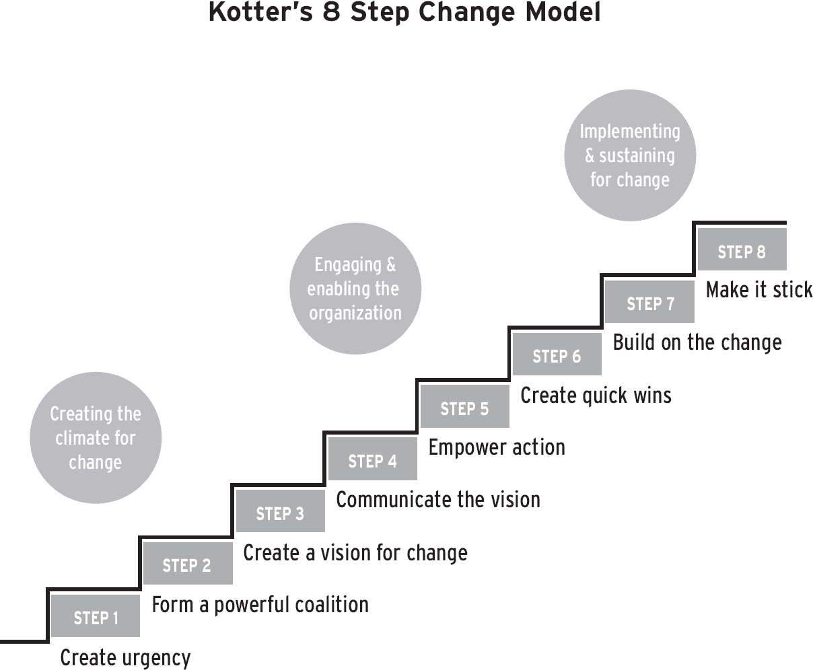
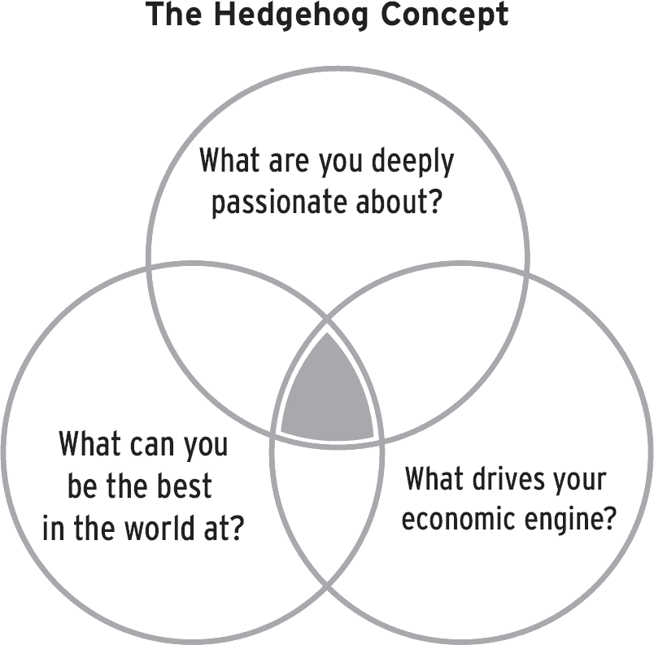
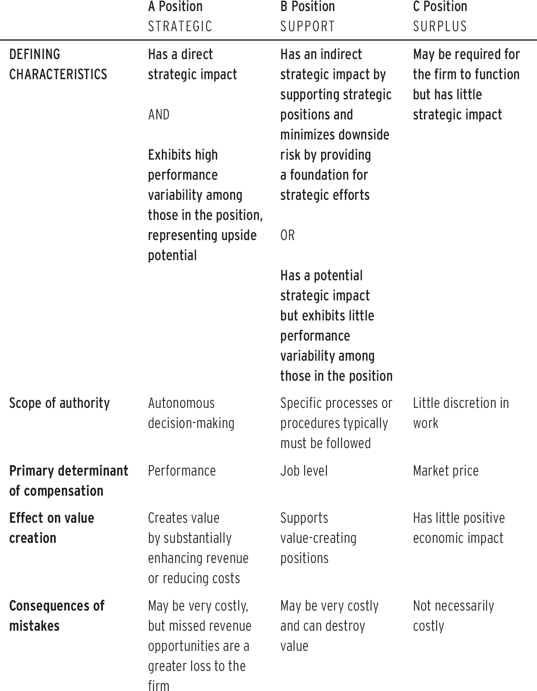

# 动量新科学：顶级教练与领导者如何点星成火


*Jeanette, Will, and Maddie:*

*你们进入我的生活，带给了我无法想象的动力。感谢你们这个让一切成为可能并让这段旅程值得的团队！*

DY

*我将这本书献给这些年来一直激励我的家人、朋友和同事。*

BBB


19. 关于作者


# 引言

在 2017 年 2 月的超级碗 5 决赛（Super Bowl LI）第一节，尼尔森公司估计全球有两亿观众正盯着电视，准备观看当年最受关注的体育赛事。到了第三节，近一半的观众已经离开了。亚特兰大法鹰队正肆情击着热门的新英人队，除了佐治亚州首府之外，很少有人想看一场一边倒的比赛。

在整个上半场，法鹰队的一切都顺风顺利。相反，新英人的表现并不好看看，四分卫 `Tom Brady` 被多次擒杀，向空旷的接手员传传球，这对一支由 `Bill Belichick` 带领的球队来说是噩梦——他们犯了一些愚蠢的错误，例如在传球给跑锋 `LeGarrette Blount` 时掉落球，法鹰队随后便将其转化为得分。即使法鹰队在半场最后七分钟出现失误，那支可怜的爱人队也只得到了一个射球得分。三分分。这就是火力十足的新英人进攻组在比赛的前三十分内获得的所有得分。

“在橄榄球赛中，你总是为了我们所谓的‘下半场转折’而战，”新英人队的角卫 `Devin McCourty` 在本书的采访中说道，“你希望在半场结束前拿到球并得分，然后在下半场开始时再次拿到球并得分。你掌控了比赛的势头，另一支球队觉得他们完蛋了。对于我们那场比赛来说，情况完全反相反。”

法鹰队从更衣室出来后再次得分，在第三节中段以 28 比 3 领先新英人队。“如果你是新英人队的球迷，这不是你想看到的，”解说员 `Joe Buck` 说道，此时镜头推向了坐在场场边面无表情的 `Belichick`。

不，那不是。

“我坐在场场边，心里对自己说：你们正被丢得不成脸，”`Brady` 多年后回忆道，“出去做点什么吧。让我们至少拿一个达阵得分。”

随后，新英人队获得了一个小胜利。在第三档需要 8 码的情况下，`Brady` 被迫离开口袋——这对于新英人的球迷来说总是个不安的时刻——但他灵活地冲跑获得了一码首攻。几次进攻之后，他将短传传给跑锋 `James White` 获得达阵得分，比分追为 28 比 9。观众欢呼起来，但此时看来，结果似乎已定局。新英人队错失了额外得分，但至少比分看起来体面了一些。

“一旦我们得分，我要求防守组只要守住一次，就只要一次，”`Brady` 说。“他们做到了，然后我们推进了球场并踢了一个射球得分。”当时比赛还剩 9 分 44 秒。“我看着比分板说，只差两个回合。”

仅仅一多分钟后，在亚特兰大队 28 比 12 领先的情况下，法鹰队的四分卫 `Matt Ryan` 后撤准备传球，被新英人的线卫 `Dont’a Hightower` 擒杀，导致 `Ryan` 掉球。新英人队在法鹰队的 25 码处抢回了球。

“`Dont’a` 的那次掉球擒杀是你可以感觉到局面转折的时刻，”`McCourty` 说，“在那个时刻，我们互相看着彼此说：‘我们能赢这场比赛。’攻防两端的球员开始发力，源于我们从那次进攻中获得的能量以及站在我们边的信念。”

“你感受到了，”`Brady` 说，“我们有了劲头。那些小小的胜利正像雪球一样滚越越大。”


不久后，布雷迪在端区找到了丹尼·阿门多拉并达阵得分。贝利奇克立即举起两个手指，示意他的球队要尝试两分。他们通过一次经典的贝利奇克式欺骗获得了这两分：球直接传给了 `White`（而不是 `Brady`），由他完成了达分。比分瞬间变为 28–20，在距离比赛结束不到六分钟的情况下，这场看似不可触及的比赛变成了任何人都有机会的较量。那时，观察双方球员的肢体语言，可以发现一种显而易见的变化。麦考考蒂总结道：“当我们只落后一个达阵时，他们的球员……他们的眼睛开始变大。他们知道我们要上了。他们知道我们有`Tom Brady`，如果他在对面，没人想处在一个一分之差的比赛中。而我们的眼睛开始收紧。我们全神贯注。这是对前三半回合的完全反转。他们有一名特种球员，在比赛的大部分时间里都在我们场边叫叫，在每次开球后都挑衅。当我们只落后一分时，你可以看到他在开球后静静地转身走下场。而现在，我们才是那个尖叫的人。人们没有意识到，开球时有这么多防守球员，当他们的进攻方上场时，能量会直接流入下一次进攻。双方都清楚这一点。你们双方都能感受到。这几乎像是一种出体体验。”

比赛还剩四分钟时，亚特兰大将球推进到了新英队的 22 码线，这个距离足够进行一次射门，足以让新英队很难再有反比可能。但爱足人队的防守再次做出了回应。麦考蒂铲倒了猎鹰队的持球者造成损失，随后 `Trey Flower` 在 40 码线附近围擒了 `Ryan`。在下一次进攻中，新英队的防守压力迫使一名亚特兰大锋球员犯规，将球又推得更远。鹰队确实在推进球……问题是他们正朝着错误的方向推进。

爱足人队迫使鹰队弃踢，并在自己的 10 码线内抢回了球。他们还有三多分钟的时间来完成 90 码达阵，之后他们必须再次尝试两分。`Brady` 连续向三个不同的球员传了三次球。其中一人在跑路线时绊倒摔地，站起来后仍然接住了球。另一个人，`Julian Edelman`，传球在他面前被挡了一下，导致球落到了至少三名鹰队球员伸出的手手中，他们向球聚拢而去。

比赛结束。

但并没有结束。不知怎么，`Edelman` 在他们之中穿梭并抓住了球，回放显示他的注意力是如此绝对，以至于你可以看到他将球抵在对手的腿上以防止球落地，如果落地的话，球会被判为未完成。

比赛还剩一分钟时，`White` 冲球达阵，使新英队与猎鹰队仅差两分。在两分转换期间，一名猎鹰队锋线球员越位抢断，但仍未能阻止 `Edelman` 接住一个短平传球并将球压过球门线。此时，观战比赛的人们正在见证史以来最伟大的超级碗碗赛逆转。

“能量完全在新英队这边，”艾克曼说，“这是两场完全不同的比赛。我不知道鹰队在加赛中如何应对。”

他们没有得到机会。爱足人队赢得了掷硬币并选择先接球。现在，在进攻线的良好保护下，`Brady` 继续拆解猎鹰队的防守，并在一名鹰队防守球员在端区被判传球干扰后，带领新英队进入一分达区。两次进攻后，`White` 再次冲球达阵，赢得了新英队的又超级碗胜利。

当纸屑像雪一样落在球员和冲入场地的人群身上时，一位国家广播播音员总结道：“加赛最终比分 34–28，新英爱足队今晚重新定义了‘势头’这个词。”

第二天早上，这本书诞生了。当时一位体育作家在佛罗里达州聚集了一个团队，面对一块巨大的白板，写下了文字`一个团队如何将一个瞬间转化为势头？` 在接下来的七多年里，这个项目发展到包括一位退休的陆军将（他的最后一次职务是担任西点美国军事学院行为科学与领导力系主任）；一位来自学术界备受尊敬的研究科学家；以及公共舆论和政治领域最优秀的数据分析师之一。白板上的问题列表不断增加：你如何准备“那个瞬间”？势头可以产生吗？它能被延伸吗？如果它反过来对你该怎么办？

在过去的几年里，对世界知名专家、冠军教练、军事领袖、政治竞选策略师和企业领袖进行的数百次采访和数千次调查，引导我们得到了你今天手中的这些文字。

有一点变得清晰：对于我们所寻求学习的人来说，势头是真实的。如何准备、操纵、延伸或反转它成了我们的任务。这本书将为你提供一个恰恰可以做到这些的模型。

所以，利用这句话的能量来推动你进入下一章。走吧！

## 前提：从心流到势头

当米哈雅·契克森特米哈赖开始探索他的“心流”理论时，他被称为疯子、怪胎。这位受人尊敬的教授和研究人员坚信，处于“心流”状态的人能够保持长时间的注意力，因此能够成就更大的事业。他知道自己在写作时感受过这种感觉。他知道自己在那些似乎处于百发不中状态的运动员身上见过这种感觉。但当他提出“心流”是一种“状态”且应该被追求的观点时，他的专业同事最初对此嗤以鼻。三十年后，契克森特米哈赖的开创性著作`心流：最优体验心理学`不仅被广泛接受，而且是一本畅销书，被誉为表现心理学领域影响最大的理论之一。我们很幸运在他 2021 年去世之前，与他进行了一次长时间的晚餐采访，期间他分享了对“心流”演变的看法，并与我们讨论了这一概念与势头之间的交集——无论是在个人经历还是团队层面。

心流状态近期引起了极大关注，因为生物黑客正在寻找方法进入这种高强度的创造力和生产力状态，特别是对于那些寻求表现最大化的个人而言。正如运动员长期以来所称的“进入状态（being in the zone）”，心流状态现在被广泛认为这种现象绝不局限于运动，而是一种近乎狂喜的可能性感和成就感，且几乎没有时间、限制或现实约束的感觉。

    心流状态对团队和个人都有深远影响。新兴科学开始证明长期以来被假设的：`镜像神经元`的存在，它们似乎是人类同理心和直觉的基础。这些是化学信使，传输预期动作并引发我们周围的自动反应。一个简单的例子：你有多少次在看到一两个人打哈欠后自己也想打哈欠？但从更大的意义上说`镜像神经元`似乎是任何集体情绪——兴奋、歇斯、势头——在群体中有机传播的关键。


能量传递是物理学中产生动能的关键属性之一；它也是建立团队动能的秘密。但这一过程是如何发生的呢？镜像神经元可能是其中一种可能。当一个团队成员开始体验成功时，他们队友的镜像神经元就开始将这些成就视为他们自己的。结合程序性适应和对肢体语言的理解，镜像神经元的接受性可以帮助让动能具有传染性——并且几乎不可阻挡。

我们对神经科学家马可·雅科波尼（Marco Iacoboni）和海梅·皮内达（Jaime Pineda）的访谈详细描述了这样一个过程：当一个人取得积极成果时，部落认同感（“你是是我小组的一员，这意味着你和我相似，并且与我的目标一致”）的心理影响会触发队友中一种可验证的生物学心理反应。如果队友之间达成了适当的一，他们的镜像神经元对胜利的反应就像他们自己成功完成了任务一样。这在大脑中创造了一种“心理肌肉记忆”，引发了整个小组内部不断增长的信心和成就感。正是这种传染性的成功构成了动能。

契克森特米哈赖（Csikszentmihalyi）将我们的动能模型视为个人“流”状态的延伸，该模型侧重于组织如何营造环境，使动能能够容易从一个人传递给另一个人。

“领导者或教练的角色是保持警觉，了解这群人的优势是什么，并识别出在你们共同进行的活动中利用这些优势的机会，”契克森特米哈赖告诉我们，他同意“心流”的体验在组织成员之间是可以传递的，“如果他们处于同步状态并相互支持。而且，像信念这样的东西非常重要。”

### 经验采样法 (ESM)

契克森特米哈赖进行了广泛的研究，以开发《心流》（*Flow*）书中提出的观点。他的研究方法严谨且创新，特别是在从参与者那里收集数据方面。他使用的关键方法之一是经验采样法（`ESM`），这涉及让参与者对全天的经历记录详细的每日日志。参与者被提供传真机或其他设备（在随后的研究中，他们使用了手机），这些设备会在全天的随机时间提醒他们。当信号发出时，参与者被要求停止手头的工作并填写一份简短的调查问卷或日记。在这些记录中，参与者记录了他们那一刻在做什么、感觉如何、专注程度，以及对该活动的整体参与感或满意度。这种方法让契克森特米哈赖能够收集关于人们经历的实时数据，而不是依赖于回顾性的描述。

除了实时采样，参与者有时被要求对经历记录更详细的日志，特别是那些涉及深度专注或享受的经历，以帮助识别心流发生的模式。契克森特米哈赖分析了这些日志和日记的数据，以识别促进心流状态的共同条件。他发现，当个体参与具有挑战性但可实现的活动，当他们有明确的目标和即时反馈，并且全神投入当前任务时，心流体验经常发生。

从这些详细日志中获得的洞察对塑造“心流”的概念至关重要。契克森特米哈赖能够将心流定义为一种个体沉浸于某项活动以至于忘记时间和自我意识，并在过程本身中获得深层满足的状态。这种 `ESM` 方法不仅在开发契克森特米哈赖的“心流”理论中起了作用，此以后还广泛应用于心理学、教育、体育和许多其他领域。

### 关于动能的研究

我们为这本书的研究还通过三种替代方法征求了人们对个人和团队动能的想法、感受和经历：深度访谈；对商业、政治、体育和军事领域领导者的针对性调查；以及对普通公众的大规模科学调查。

在所有这些调查和访谈中，我们都问：“动能存在吗？”数量惊人的人说，确实存在。对于调查的 2500 多名美国人，有 91%的人给出了这个答案。对于我们调查的千名教练、商业领袖和国家战争学院的军官，这一比例更高，达到了 99%。当然，也有少数异类意见——包括一位 ESPN 的统计学家，他言辞地辩证动能只是一种伪像或谬误，而非一种真实的现象。尽管如此，我们的研究发现，一个人加入过的群体或团队越多，就越倾向于相信动能的真实性。这一点稍后讨论。目前，显然我们接触的几乎每个人都认为自己在某些背景下经历过动能，并且可能受过它的影响。然而，如果要求在感觉之外定义动能，并没有出现统一的描述。我们的受访者提供了多样化的描述，其中这四个领域（政治、体育、军事和商业）的专业人士对这一现象的描述非常有色彩。

### 关于动能的观点

佛罗州大学助理篮球教练斯坦·琼斯（Stan Jones）向我们描述动能为一种“竞争的海啸”，一种推动团队向前的强大浪涌，使其表现超出预期。在与著名领导力专家约翰·马克斯韦（John Maxwell）的交谈中，他将动能描述为“放大器”，放大了现有的趋势并强化了其影响。可能最形象的是，NBA 冠军助理教练凯文·伊斯特曼（Kevin Eastman）告诉我们，他认为动能是一种“力量倍增器”——动能是“能量的力量、热情的力量，以及*我们正来*的力量”。


然而，最能说明问题的是，人们对动量的信念与对其构成因素的自信理解之间存在巨大的鸿沟。在我们的调查中，近九十成的受访者表示，他们相信某些条件有助于产生动量或使其更容易发生；但当被要求详述这些条件可能是什么时，大多数人表示他们并不确定。

本书探索了这些条件以及如何建立它们。但首先，重要的是从基础开始：动量的科学基础和定义、与动量相关但又不同的概念，以及对在社会背景下“捕捉”或衡量“动量（Mo）”的一些尝试探索。

# 动量的定义

“尝试定义它。”

试着定义爱或色情。最高法院法官波特·斯图尔特（Potter Stewart）曾尝试定义后者，但最终用了一句成为美国法律史上广为人知的短语：“我看到它时就知道它是了。”

动量加入了这一类比描述更容易被感知的现象的列表。而且它被描述得……非常多。

想想那些暗示动量的成语吧：“保持球的运转（keep the ball rolling）”、“积蓄势头（gather steam）”、“进入状态（hit one’s stride）”、“全力进行（in full swing）”、“获得牵引（gain traction）”、“乘浪而行（ride the wave）”、“雪球效应（snowball effect）”、“顺势推进（run with it）。”

当然，还有各种围绕着同一概念的陈词滥调：“热打铁铁（strike while the iron is hot）”、“滚石不动（a rolling stone gathers no moss）”、“做得越多能力越多（the more you do, the more you can do）”、“保持心流（stay in the flow）”、“成功造成功（success breeds success）”。因此，大多数人相信——也许甚至在没有意识地考虑过这个问题——动量是真实存在的。

大多数人在学习描述这种体验的词汇之前，就已经理解了动量。事实上，当你自己感受过这种感觉时，这个概念会变得容易解释得多——更重要的是，当你被赋予工具在它发生时识别出它，并为那个时刻做好准备时。

在物理学中，动量——即转移的能量——是运动物体的一种属性，定义为质量与速度的乘积。它是一个矢量，意味着它既有大小又有方向。动量的公式为：

`Momentum = Mass × Velocity`

以下是每个部分的含义：

- `Momentum`: 这告诉我们物体在运动时具有多大的“推力”。如果某个东西的动量越大，意味着它越难停止。
- `Mass`: 这是物体中物质的量，比如它的重量。物体质量越大，它拥有的动量就越大。
- `Velocity`: 这是物体运动的速度和方向。物体运动得越快，它的动量就越大。

换句话之，在物理学中，动量取决于物体的质量和速度。质量更大或速度更高的物体将更大的动量。例如，一辆高速行驶的卡车的动量将大于相同速度行驶的自行车。除了质量和速度之外，还有其他变量也可以预测或描述运动。这些包括：

- `Vectors`: 既有大小又有方向的量。矢量用于表示力、位移等物理量。例如，一个力矢量可以被描述为“向右十牛顿”，其中十牛顿是大小，“向右”是方向。
- `Direction`: 物体运动、指向或瞄准的直线或路径。例如，方向告诉你矢量指向哪里，如“北方”、“向上”或“北偏东三十度”。
- `Magnitude`: 某物的大小或数量。例如，速度矢量的大小告诉你物体运动得有多快，而力矢量的大小告诉你力有多大。

正是这些元素的结合，创造了能够产生和维持动量的条件。这些元素也为科学家和外行提供了多次观察和衡量动量的机会——在物理世界中探测它，并探索它可能如何在那些处于其中的人们的心理体验中显现出来。

## 科学中的动量历史

我们的意图并不是让这本书成为一本教科书。然而，多年年来，许多科学家研究了动量科学的重要元素，将他们的见解整合进来对我们的工作至关重要。

动量的概念已被研究了数千年。但现代对动量的科学理解始于 16 世纪和 17 世纪，随着伽利略·伽利略（Galileo Galilei）、约翰内·开普勒（Johannes Kepler）和艾萨克·牛顿（Isaac Newton）等科学家的工作而形成。伽利略被认为首次描述了惯性概念，惯性是物质抵抗运动状态改变的属性。他在斜面上滚球的实验证明，只要没有外力作用，运动物体的速度就会保持恒定。

开普勒的行星运动定律是他基于对行星运动的观测而发展的，这对现代动量理解的发展做出了贡献。他的定律描述了行星在绕太阳运行时速度与位置之间的关系。

艾萨克·牛顿的运动定律于 1687 年在其著作《自然哲学数学原理》（*Philosophiæ Naturalis Principia Mathematica* (*Mathematical Principles of Natural Philosophy*)）中发表，代表了动量理解的一个重要里程碑。牛顿定律指出，除非受到外力作用，物体将保持静止或匀速直线运动，并且作用在物体上的力与其质量乘以加速度成比。

这些定律为理解运动物体提供了框架，包括动量和动能。

此后的几代科学家进行了实验并取得了发现，有助于完善动量概念。一些著名的例子包括 19 世纪中叶詹姆斯·焦耳（James Joule）的工作，他证明了热与能量之间的关系；以及 20 世纪初阿尔伯特·爱因斯坦（Albert Einstein）的实验，这导致了相对论的发展。

来自物理学领域的现代科学家仍在特定条件下研究和探索动量概念。例如，朱强（Steven Chu）在原子水平研究动量；沃尔夫·凯特勒（Wolfgang Ketterle）在微观系统中研究动量；威廉·菲利普（William Phillips）、克洛德·科恩坦努吉（Claude Cohen-Tannoudji）和埃里克·科纳尔（Eric Cornell）都在极低温度下的原子研究动量。这些诺贝尔奖获得者正在以牛顿和开普勒无法想象的方向推进动量的研究。

## 动量及其惯性与成功

有一些与动量相关但有时被混淆的概念：惯性和成功。虽然惯性和动量在物理和生活中都是相关概念，但它们有不同的含义和应用。

惯性是物质抵抗其运动状态改变的属性。它与牛顿第一定律有关，该定律规定除非受到外力作用，静止物体将保持静止，运动物体将保持匀速直线运动。惯性与物体的质量直接相关。


同样地——至少从“动能”这一流行概念来说，“成功”是一个相关的术语。动能与成功确实有联系，是的——但它们在几个重要方面也是相互不同的。成功指的是实现目标或预期的结果，通常是努力工作、天赋、技能或这些因素共同作用的结果。成功可以是一个单次事件，例如赢得冠军或达成一笔重大的业务交易，也可以是一个持续的状态，例如成功的职业生涯或蓬勃发展的业务。另一方面，动能更多是指由于一系列成功的结果或积极事件随时间推移而建立起来的感觉或心态。它让人感觉到事情正朝着积极的方向发展，并且成功（或更多的成功）指在可握。

思考动能与成功差异的一种方法，是考虑一位获得过重大冠军的运动员。这位运动员取得了成功，但他们可能也可能没有动能的感觉。如果运动员觉得自己的胜利是偶然，或者是自己运气好，那么在进入下一场比赛时，他们可能就没有动能了。

最后，重要的是考虑到动能是有时间限制且脆弱的。即使是单次挫折或失败也可能打破产生动能的正反馈循环，导致信心的能量的流失。这就是为什么动能经常被描述为一种“转瞬即逝”或“短暂”的状态。

动能的时间性被许多科学家和实践者共同关注到。在我们的采访中，不同的人注意到动能不是（也不应该是）无限持续的，而是像波动一样而来的力量。通过各种模型将动能视觉化，苏·塞姆劳（Sue Semrau）教练将动能视为一条 S 型曲线，而伯尼·班克斯（Bernie Banks）将军则将其类比为耶克斯-多德森（Yerkes-Dodson）曲线描述的水平与表现之间的关系。


在这两个模型中，成功贯穿其中，而动能则起伏波动。

我们将动能视为一个循环——它不能也不应该是恒定的目标。我们并不是说如果你顺了势它就会永远持续。问题是——如何让它多持续五个回合、多持续五分钟、多持续一个季度。

### 衡量动能 (Measuring Mo)

要衡量某种东西，它必须是可感知的。虽然对动能的感知范围很大，但毫无疑问，它是能感受到的。而且人们确实会为自己的动能投入真金。


大规模数据研究表明，职业赌徒在他们认为具有动能的团队身上下注更多，而不仅仅是多一点点。一项研究分析了德国足球某主要博彩公司的高频数据集，发现，赌徒在他们认为具有动能的团队身上的下注，比在刚输掉比赛的身上高出约 40%。

尽管这项分析也没有发现证据表明感知的动能对比赛结果有平均影响，而且似乎与博彩公司提供更有利的赔率无关，但对动能的感知仍然影响了赌博行为。

另一项针对 NBA 体育赌博的研究同样发现了“动能效应”的存在，即赌徒会将对动能的信念纳入他们的赌注中。这些研究说明，体育赌博者信任动能是一个影响未来结果的重要变量，但同时他们似乎夸大了它相对于其他因素的影响。

事实上，人们认为动能对结果的相对影响力的程度上存在一个光谱——有时取决于他们是处于动能的给予的一方还是接受的一方。

在社会心理学中，有各种关于人们将成功或失败归因于何种或什么的概念。由于归因偏差（attribution bias），人们倾向于根据个人特征解释他人的行为，而不是考虑外部因素。例如——假设一个努力找工作的人是懒惰，而不是相信那个人的生活处境让他们处于了困难的劣地。相反的概念“自利偏差”（self-serving bias）反转了这些假设。在这里，一个人可能会将自己的成功归因于个人特征或努力，而不是其周围的环境。延续之前的类比，一个获得高薪工作的年轻人可能将这次录用归功于自己的能力，而不是与公司领导层的关系。

但有时，动能甚至在结果发生之前就能感受到——在制胜球得分之前，或在占领战场之前。人们自我报告了他们或整个人群是如何在动能即将发生时识别出它的——这不仅是对成功的回顾性解释，更是作为其临近时的定性感受。

那么，该如何衡量动能呢？

### 寻找正确的指标和工具 (Finding the Right Indicators and Tools)

动能的问题并不是一种“眼见为实”类型的问题。因为人们确实相信它存在，并且相信他们看过了它。相反，挑战在于找到足够敏感的科学工具，以在社会背景下衡量动能——例如在军事、体育、商业或政治领域。

与可以精确测量质量和速度的控物理实验不同，日常生活中的动能可能缺乏清晰、客观的指标。

虽然所有动能实例都涉及运动或进展的激增，但实际上并非所有进展的情况都是动能。我们知道成功本身并不是动能。需要多少进展或多少成功，才能使事物达到“重大”（momentous）的阈值？它是进展的数量，还是对进展的感受？

这类问题在因变量本身不确定的情况下，在硬科学中可能会令人不适，但并非不可能。科学方法要求研究者证伪一个假设，即观察到的结果仅仅是偶然巧合的。在某些研究中，因变量（结果）和自变量（可能影响它的因素）是易于测量的并且彼此截然不同。

例如，一项关于光在不同条件下传播的研究。零假设可以是类似于“光在真空和水中的速度没有区别”。数据将通过客观工具收集，零假设最终会被拒绝——经过反复测试，将证明光在不同介质中的传播速度确实不同。

其他问题涉及某种程度的主观性，例如药物治疗有效性的药物试验。例如，“零假设”可能是“药物 A 和安慰剂在缓解疼痛方面没有区别”。在受控试验中，研究人员可能会发现服用药物 A 的患者和接受安慰剂的患者在自述疼痛水平上统计上基本相同。在这种情况下，零假设无法被拒绝，治疗组和安慰剂组之间的任何差异都可以用纯属偶然来解释。

最后，有些问题涉及大量的变量、高水平的主观性或两者兼有。这正是社会情境下动能研究经常的情况。在一个经典的社会动能实验中，研究人员的任务是证伪这样一个假设：即持续的性能激增处于可以用偶然解释的范围内。


最近，威斯康星大学密尔沃基分校 Paul Roebber 的一项研究发现，足球中的动能是真实的，并且可以提高球队的胜率。他的研究将动能定义为：在至少三次连续的控球转换中，胜率发生了持续变化。结果显示，动能爆发的发生频率比随机预测的要高。Roebber 研究发现了动能的生理基础，被称为“胜利者效应”（winner effect），即成功会导致睾酮水平增加和压力荷尔蒙减少。这为动能如何体现提供了生物学解释。

这些努力在很大程度上是为了证明动能的存在或影响，它们是一个极佳的起点。但我们最感兴趣的是另一组问题：在加时赛获胜的势头良好球队与未获胜的势头良好球队之间有什么区别？是什么区分了能够在季度之间保持动能的组织与不能的组织？小组成员之间什么样的沟通方式能最大化地增强凝聚力并减少摩擦——摩擦是动能的头号敌人？

我们从这样一个假设开始：动能是存在的，并且可以通过刻意的准备类型和组织结构来操纵。我们给出了以下定义：

动能是一种协同力量，影响着团队的进展、韧性和专注力；它对团队心态的影响（无论积极还是消极）是可以被操纵和延伸的。

从这里开始，本书将探索相关研究，为领导者和团队提供信息，告知哪些元素将放大他们准备动能、抓住增长势头并将其转化为持续动能的机会。

这就是我们的模型所提供的，我们期待与你一起迈向这一程。

# 动能模型概述

传奇的社会心理学家 Kurt Lewin 曾说：“没有什么事比良好的理论更实用的了。”当领导者利用严谨的模型、框架和理论时，他们可以增加产生成功结果的概率，因为他们能更整体地思考自己的方法。最近利用这种方法的一个例子是 Satya Nadella 领导下的微软公司。

Steve Ballmer 在 2000 年至 2014 年期间担任微软首席执行官。在他任期间，公司收入增长了 300%，利润增长了 200%。然而，当他离开时，公司股价比他接手时低。为什么？投资者认为公司过度依赖传统产品，并抵制主导新兴机会（例如，开源计算和智能手机）。相反，苹果公司的股价在同一时期从 50 美元飙升至 500 美元。微软董事会显然公司需要产生积极的动能，而 Satya Nadella 是他们实现这一目标的人选。

Nadella 于 1992 年加入微软并在公司内部不断晋升，最终在云服务和企业集团担任执行副总裁，直到 2014 年 2 月 4 日宣布他将成为公司第三任首席执行官。在随后的几年里，Nadella 及其团队执行了一次精妙的战略转型，这种转型依赖于通过公司内部产生积极的创新动能，同时使用了一些知名的变革框架。

对 Nadella（及其团队）早期对公司进行重新定位的简要检查发现，他们坚定地遵循了 John Kotter 和 Kurt Lewin 著名的变革模型，以及 Edgar Schein 的文化变革机制。最重要的是，Nadella 意识到产生积极动能的必要性，并在担任 CEO 职位后不久便宣布，是时候“重新发现微软的灵魂，我们存在的意义了”。

一旦就任 CEO 职位，Nadella 立即寻求在“解冻”组织的同时建立“紧迫感”。他通过强调技术格局的不断变化以及为什么与云优先的公司（例如，谷歌和亚马逊）竞争至关重要，来“诱发焦虑”。Nadella 利用数据展示了微软现状的现实，同时向员工强调他是他们的一员。他采取了所有上述行动，为了让人们从舒适区中震惊出来。

两个行动体现了 Nadella 对建立核心变革领导者小组的承诺。首先，他指令邀请 2013 年微软收购的每家公司的前首席执行官和首席技术官（CTO）参加组织宝贵的高管静讨会（高管静讨会通常是将公司前 150 名领导者带到豪华的场外地点进行高层讨论）。这次峰会邀请引人注目，因为许多人在收购后的职位责任不足以获得参加此类闭门会议的资格。此外，受邀小组的经理职位也低于编码的邀请资格标准。Nadella 采取这种方法是在挑战传统和文化。但他致力于将不同的视角作为一种强制性功能。

其次是决定由高层领导者对公司不同部门的客户进行走访。这项命令同样不寻常。许多领导者反对进行此类走访。抵抗的暗流源于一种观点，即客户负责人非常了解如何最好服务他们的客户。因此，没有必要从公司其他地方带来领导者走访。然而，Nadella 要求人们切实执行他的指令。随后的互动促进了各业务部门之间更有效的对齐，并揭示了可以通过文化修正解决的摩擦点。

20 世纪 70 年代中期，Bill Gates 确立了微软的任务是“每个办公桌和每个家庭都有一电脑”。2014 年的现实是，公司在发达和工业化国家实际上实现了这一使命。因此，这一陈述不再是显著增长和创新的动力。Nadella 意识到需要重新构想并“沟通公司愿景”，作为重新建立其动能努力的一部分。最终，Nadella 的团队将“赋能地球上的每个人和每个组织成就更多”确定为凝聚的愿景，并在客户走访和公司聚会期间开始分享它。

释放组织内部潜能的能力与“赋能他人行动”高度相关。在 Nadella 任期之前，软件开发团队不能在公司内部共享代码。他迅速取消了这一限制，作为一种赋能行为。Nadella 还鼓励公司的员工更有针对地探索新兴技术，无论这些技术与 Windows 有何感知关联。他希望通过放宽对他们的限制，让优秀的人才去发现如何实现伟大的可能。

产生动能的能力可以通过利用展示性成就的短期胜利来获得。


最后，纳德拉（Nadella）继续深化各项倡议并维持变革的势头，同时积极改进了公司文化。他重组了公司，将高管奖金与人才目标挂钩，并植入了“学习通一切”（learn it all）的准则。通过这些努力，公司的市值从 2014 年的约 3000 亿美元增长到 2024 年的 3.1 万亿美元！值的爆炸式增长在很大程度上得益于动能的重新建立和持续维持。

正如纳德拉创造了一个在微软内部进行大胆变革的模型一样，我们也通过对数百位领导者的访谈，提炼出一个模型，供那些希望乘上动能浪潮的团队和领导者参考。在本章，我们将分享这一模型，并让你快速了解其中的每个元素。

## 为什么是模型而不是公式？
如果你拿起了这本书，很可能你读过其他关于领导力、商业理论或团队建设的著作。你可能也见过一些提供“成功配方”或“行动蓝图”的指南，这些指南向领导者承诺：只要他们遵循特定的剧本，就能获得特定的结果。

事实上，这正是大多数公式所承诺的：你代入自己的内容，这些输入就会产生预期的结果。

在从数学科学到经济和工程的各个领域，`formula`（公式）和`model`（模型）这两个词被频繁使用。尽管这些词初看起来似乎是可以互换的——在口语中也经常如此——但在分析、解释和理解复杂系统时，它们代表了不同的概念并服务于不同的目的。

公式在科学和工程领域无处不在。例如在物理学中，牛顿第二运动定律表示为 `F = ma`，其中 `F` 代表力，`m` 代表质量，`a` 代表加速度。这个公式精确量化了加速给定质量物体需要多大的力。公式通常更直接，一次只关注一种关系。

与此相反，模型从根本上是对现实世界系统、过程或概念的简化表示。它是一种用于解释、预测或理解系统不同组件之间如何相互作用的工具。其主要目的是通过将复杂现象分解为更易于管理的组件，帮助从业者理解这些现象。

例如，在经济学中，一个模型可以代表市场中供需之间的关系。这个模型可能包括价格、消费者行为和生产成本等各种因素，所有因素都以复杂的方式相互作用。通过将这些关系简化为模型，经济学家可以预测其中一个变量（如价格上涨）的变化如何影响整体市场。

没有任何一个模型是现实的完美表示；相反，它是一个实用的近似，帮助我们在现实世界中进行导航并做出决策。

模型为理解复杂系统提供了广泛的框架。它们不像公式那样可以即插即用，而且它们在设计上是一种可以应用于多种情况的过度概括。

我们的动能模型正是如此。

在我们研究的早期，通过数百小时的访谈、原始调查以及对团队动态文献的深度挖掘，我们注意到在不同领域中出现了一种模式——无论是在商业、军事行动、政治还是体育领域。每个领域的领导者和战略家在优化团队表现、营造积极氛围和实现其目标方面，时，都面临着类似的挑战。尽管背景存在明显差异，但有效团队合作和领导力的底层原理似乎具有惊人的相似性。

这一观察引导我们思考一个问题：是否存在一个可以应用于这些不同领域的可行模型，一个能够适应不同性质、规模和结构的模型？由此产生的模型既灵活又稳健，能够在应对任何背景的独特需求的同时，维持驱动成功的核心原则集。

但即使是一个伟大的模型——一个能解释其他团队表现并能推动你自己的取得成功的模型——也不意味着只要你执行了 `a`、`b` 和 `c`，就能保证获得动能。一个好的模型让你开始做准备。一个伟大的模型能让许多人创造行动。

公式非常棒——用于烘焙、化学家以及预测物理物体在空间中的路径。但在涉及人际互动和群体动态时，公式有其局限性。相反，我们将模型视为自己的指南。

我们分享的关于在萨提亚·纳德拉领导下微软转型的故事，凸显了一个组织创新的过程，这一过程部分得益于约翰·P·科特（John P. Kotter）的研究以及他在 1995 年管理经典《引领变革》（*Leading Change*）以及 2014 年的后续《加速：为快速变化的世界构建战略敏捷》（*Accelerate: Building Strategic Agility for a Faster Moving World*）。正如科特的模型帮助指导了纳德拉的行动，它也启发了我们产生组织动能的探索。

我们的动能模型借鉴了吉姆·柯林斯（Jim Collins）《从优秀到》（*Good to Great*）中的飞轮概念；它是关于成功公司如何实现持续增长的强大概念模型。科特的模型更具线性——一组通常从一步到下一个八个步骤；而柯林斯的模型则更具循环性或动态性，代表了随着时间推移持续努力和战略决策的积累效应，最终导致突破。



科特的模型从紧迫感、建立联盟和形成战略愿景开始。从那里，领导者将招募“志愿者军”，并通过消除变革障碍来实现行动。最后，在科特的模型中，将产生并利用短期胜利来维持加速，并最终实施更持久的变革。

柯林斯的“飞轮”包含了一些类似的元素，例如领导者培养一支具有纪律思维和行动的团队。他的模型从动能的建立开始，他将其描述为启动飞轮旋转的力量。随后，柯林斯详细说明了一个名为“刺猬圈”（Hedgehog Concept）的概念，以帮助人们在飞轮过程中理解引导组织能量的最佳方向。该概念寻求确保行动集中在三个问题的交汇点：（1）你深切热爱什么？（2）你可以在世界上哪方面做到最好？（3）什么最能驱动你的经济或资源引擎？遵循刺猬圈产生了推动飞轮的能量。启动这一可能需要巨大的努力，但通过持续的努力，你最终可以达到“突破点”，此时轮子可以自己移动——带有它自己的动能。



我们的动能模型融合了科特和柯林斯想法元素：一个事件序列，包含一系列重复的输入，从而促进进步。换句话说，我们的模型既是线性的循环的，它可以被视为柯林斯飞轮的前驱或前传——一个聚焦于如何启动第一个元素——动能的模型。


# 引言
正如吉姆·柯林斯（Jim Collins）和约翰·科特（John Kotter）在领导力与组织变革领域提供基础框架一样，我们的研究建立了一个用于理解和产生团队及组织动能全面模型。通过广泛的访谈、严谨的数据分析以及对现有文献的详尽回顾，我们确定了优化动能至关重要的九个关联元素：领导力、文化、招聘、准备、火花、领导者沟通、团队氛围、信念与心态，以及结果与反馈。这些元素不仅共同工作以使动能的积极影响最大化，还可以在组织陷入困境时作为扭转颓势的工具。接下来的章节将深入探讨这些每一个因素，为您提供具有操作意义的见解和策略。


在进入具体章节之前，我们想向您提供一个关于这些组件如何相互作用并加强的清晰概述。通过考虑它们在你自己的组织中是如何体现，你可以开始评估动能火花可能在何时产生，以及你如何利用它们来驱动持续的成功。动能不仅仅是利用有利时刻——它还关乎如何为这些时刻做准备、积极创造它们、塑造它们，甚至在事情看起来违背你团队时如何与其抗争。


## 领导力
“领导者带领人们去他们想去的地方。伟大的领导者带领人们去他们未必想去、但应该去的地方。”

——罗莎琳·卡特（ROSALYNN CARTER）

对于本模型而言，重点在于领导者在多个领域采取的行动，旨在有效建立在良好时刻的基础上。领导力是一种在个人、群体和组织分析层面被研究的现象。无数人试图将与有效领导者相关的知识、技能和属性规范化。

在接下来的章节中，你将听到我们为本书访谈的著名领导者的分享，包括大卫·佩特瑞斯将军（General David Petraeus），他们将分享理论和战术技巧，指导如何构建领导力以使其对该模型的其他所有元素的影响最大化：领导者负责招聘；领导者塑造文化；领导者驱动准备，以及团队成员识别火花各种形式和形状的能力；领导者与团队沟通以便在火花发生时采取行动；领导者为团队氛围定调；领导者培养信念和心态。最后，领导者提供并接受来自主要结果和过程性结果的反馈，处理这些输入并利用它们指导下一次行动——下一次招聘、准备、沟通等。

## 文化
“领导者所做的唯一真正的事情就是创造和管理文化。如果你不管理文化，文化就会管理你，你可能甚至意识不到这种现象发生的程度。”

——埃德加·谢因（EDGAR SCHEIN）

在《领导者企业文化指南》中，波瑞斯·格罗伊斯伯格（Boris Groysberg）、杰米里亚·李（Jeremiah Lee）、杰西·普莱斯（Jesse Price）和 J·约-朱德·程（J. Yo-Jud Cheng）将文化描述为“一种组织的默契社会秩序，它以持久的方式塑造态度和行为”。埃德加·谢因（Edgar Schein）的核心文章《理解与改变文化的问题》将文化定义为“一种基本假设的模式——由特定群体在学习应对问题、外部适应和内部整合的过程中发明、发现或开发——这种模式运行得良好，以至于被认为是有效的，并因此作为新新成员感知、思考和感受这些问题的正确方式被传授”。用最简单的话说，文化关乎规范、价值观和信念。

## 招聘
团队要捕捉动能，需要几乎所有团队成员都愿意做最有利的事。团队的成功必须比个人的成功具有优先级。在这一过程中，一种“我们”而非“我”的文化是至关重要的。

在招聘章节中，你将有机会识别哪些元素或特质可能使动能机会最大化。我们将讨论各个支柱中的元素，并以人际动态和潜在的评估工具结束，这些工具有助于识别和招聘“团队合作者”并培养“动能文化”。

你还将听到我们对体育、政府管理和商业领域少数领导者的原始访谈，包括篮球教练苏·塞姆劳（Sue Semrau）、世界大赛冠军大卫·罗斯（David Ross）、首席执行官鲍勃·麦克当纳（Bob McDonald）以及首席执行官艾米·豪（Amy Howe）。虽然招聘、文化和准备在一个没有等级的圆环上共享空间，但我们把招聘放在顶部是有原因的。

## 准备
准备可能是最受研究和认可的成功投入：约翰·伍迪（John Wooden）、文斯·兰姆巴迪（Vince Lombardi）、彼得·德鲁克（Peter Drucker）、吉姆·柯林斯以及许多其他人推广了准备和练习对成功的深远意义。但在我们的模型中，准备意味着更多：不仅为了最佳地履行你的角色，还为了识别并对动能、火花做出反应。

具体来说，如何准备去捕捉时刻？

如果你只有在动能发生后才对其做出反应，你就已经处于劣势——无论你是处于这一现象的积极面还是消极面。通过与英伟达联合创始人克里斯·马拉科夫斯基（Chris Malachowsky）、教练 Buzz·威廉姆斯（Buzz Williams）以及著名政治顾问詹姆斯·卡维尔（James Carville）和约翰·麦克劳林（John McLaughlin）的对话，你在这里探索在潮起开始之前为准备和产生动能所需的元素，并为让自己能够接受动能的实现所触发的心理和生理过程奠定基础。

### 火花
“在获得第一次胜利之前，动能并不存在。在那之前，它只是动力。”

——约翰·马克斯韦（JOHN MAXWELL）

胜利并不总是最终的胜利。在军事背景下，存在战斗，它们距离决定战争结果还很远。动能不是静态的。动能从定义上来说就是运动。如果招聘了正确的团队，他们正在沟通并做好了准备，火花就可以引发运动。


在本章中，我们将继续与英达的 `Chris Malachowsky` 等人对话，以定义并充实存在且可以利用的各种形式的“火花”（spark）。在每场竞争中，总会有机会时刻——尽管有时这取决于你是否知道要寻找什么。准备不充分的团队可能会完全错失火花，或者未能对其做出反应。这时，机会就流逝了。在运动中，他们将这些称为“突发变化状况”。这些是必须立即做出反应的事件，例如拦截拦截或掉球。在政治领域，我们都见过候选人错失了对事件或对手弱点做出反应或回应的机会。在商业领域，未能捕捉火花最确定的方法之一，就是指派一个委员会来评估问题，而不是采取果断的行动。

你将感受到火花的各种形状、大小和感觉——并借此具备发现它的能力……而且更重要的是，能够与你的团队一起对其付诸行动。

## 领导者沟通

火花出现了！催化剂——团队等待已久的机会近在咫尺。现在该怎么办？本章探讨了教练、首席执行官和其他领导者的工具性作用，他们为团队的势能做好准备，然后必须向团队传达*现在*就是时刻。你将从与 `David Petraeus 将军`、蓝十字首席执行官 `Pat Geraghty` 以及多产科技高管 `Rohan Chandran` 的对话中学习可以开发和部署的工具，以最大化你的团队对火花和领导者输入的反应；你还将获得一份具体的指南，教你如何在多个领导者必须协同沟通的动态导航。

## 团队氛围

“信任源于亲密，领导者必须建立这种亲密感，然后你必须取得这些快速的胜利。”

—**BOB McDonald**

能量传递是创造势能的关键属性之一。它也是在团队内部建立势能的秘密。但这一过程是如何发生的呢？在这里，你将探索多种现象，包括组织或团队成员之间的模仿、镜像和“情感感染”。

本章还结合了我们从 WD-40 首席执行官 `Garry Ridge` 和神经科学家 `Marco Iacoboni` 访谈中学习的知识，关于团队内部竞争和其他相关动态的作用；你将获得来自不同领域领导者的实用建议，教你如何加强团队成员之间的联系。

## 信念与心态

信念是个人和组织所认为的事实。心态是思考或与这些共享信念建立联系的方式。至少，信念和心态是互补的概念，但在操纵势能时，我们的模型建议两者都是必关重要的。团队成员可以相信势能是真实的。但如果他们不共享一种关于如何应对势能的共同心态或信条，机会将很快流失。

本章结合了我们与篮球教练 `Cori Close`、研究员 `John Hollenbeck` 以及神经科学家 `Jaime Pineda` 讨论的见解，深入探讨了大脑如何处理信息并反过来塑造行为、表现和结果。通过科学证据和轶事探索，你将审视共享信念系统和共享心态如何被开发和精炼，以感知势能信号并增强团队凝聚性做出反应的能力。

## 结果与反馈

产生或维持势能（Mo）的一个要素与反馈有关。反馈是心理学研究中一个被广泛的主题，也是人们在思考自己的生活经历时最有共感的概念之一。涉及到势能时，这部分文献具有重要的应用价值。你将获得广泛的背景，来理解反馈在各种环境中如何运作，更具体地，正反馈如何驱动势能的产生过程。

通过对蓝龙海军队长 `Alexander Armatas` 的访谈以及对反馈科学的深度回顾，你将学习如何在自己的组织中观察反馈，以及如何建立接收和应对反馈的新渠道，以能够产生并维持团队势能的方式。

## 领导力

势能可能感觉容易体验，但定义起来却异常地困难；领导力可能面临相反的困扰：关于它的描述太多了。在 Goodreads 上，仅领导力类别就有数万本书；在 Amazon 上也有许多触及该主题的书籍。有关于经典管理理论的书，也有对数字环境下领导力的探索。搜索佛罗里达州立大学统一系统显示，有 256 份与之相关的期刊；620,001 篇学术文章；181,773 篇报纸文章；176,339 篇杂志文章；112,344 篇论文以及 103,836 个书籍章节。这还没有包括政府文件、会议论文等——这一切都说明，领导力有很多话可说。

回溯领导力定义的历史，我们来到了 1950 年的 `Ralph Stogdill`，他将领导力定义为引导小组活动成就的过程——这种定义强调了领导力的关系和目标导向方面。随后是 1978 年的 `James MacGregor Burns`，他的变革型与交易型领导力理论提出了观点：变革型领导者激励和激励员工实现更高水平的表现和道德发展，而交易型领导者侧重于交换和奖励。这种区分对随后的领导力研究产生了深远影响，促成了 `Bernard Bass` 和 `Bruce Avolio` (1995) 开发的多因素领导力问卷。


需要注意的是，持续且有效的领导力需要领导者与追随者之间高度的信任。因此，我们将领导力作为动能驱动力时，包含了对信任重要性的理解。大卫·迈斯特（David Maister）、查尔斯·格林（Charles Green）和罗伯特·加尔福德（Robert Galford）提出的“信任方程式”是一个强调信赖度四个关键要素（信誉、可靠、亲密和自我导向）的模型。


### 信赖度的要素

**信誉**（Credibility）涉及他人对我们知识、技能和过往业绩的信任。它是通过展示我们的能力和分享相关经验建立的。如果人们认为领导者不合格或缺乏经验，信任就很难建立。
**可靠性**（Reliability）关乎符合预期并一如既往履行承诺。守信用、履行承诺非常重要。表现出可靠性的领导者会培养人们对其能力的信任和信心。

通过情感安全（`intimacy`），我们并不是意味着我们需要与某人建立深层次的个人关系。建立亲密感可以创造理解、熟悉和安全感。它利用了同理心、积极倾听以及对他兴趣的真实关注。

**自我导向**（Self-orientation）考察了领导者（或领导者们）在多大程度上将自身利益放在他人利益之上。领导者的自我倾向越强，看起来就越不可信。表现出对他人利益的真实关注是非常重要的。

### 领导力与动能

诺斯（Northouse）还为我们提供了最直观的领导力定义——一个我们在本书以及许多其他书中都可以作为领导力实践起点的定义：“个人影响一个群体以实现共同目标的过程。”

这就是为什么领导力不是我们模型中的单一要素，甚至不是模型中某一个轮子。相反，它是动能的主要驱动力，是一种几乎持续地影响几乎每一个其他输入因素的力量。领导力在这个动能模型中的卓越地位，不仅得到了学术研究的支持，也得到了数千名普通人的认可。在我们对公众的某些调查中，我们询问了各种因素对团队产生动能可能的影响有多大。在包含九个因素（包括我们模型中描述的许多因素）的列表中，“领导力”和“领导者的沟通”脱颖而出，成为影响力最大的两个。

那么，从这些文献中可以看出，什么是一个优秀的领导者？

为此，我们转向我们的朋友兼贡献者詹姆斯·柯林斯（James Collins），他 2001 年的著作《从优秀到卓越：有些公司为何飞跃……而另一些没有》（*Good to Great*）已成为各行业商业界的读物。若干大规模数据研究探索了领导力对组织绩效的影响，而《从优秀到卓越》中的研究自那时以后一直在领导力必读清单上占据常青之地。

在五年里，柯林斯试图识别让优秀公司转型为伟大因素，并研究了那些实现了这种飞跃并保持了至少十五年表现的公司。研究团队在四十年的时间里分析了 1435 家财富 500 强公司，最终将焦点缩小到 11 家公司。柯林斯发现了让这些公司脱颖而出的七个条件，意外的是，领导力位居首位。在柯林斯看来，“第五级领导者”体现了个人谦逊与专业意志的独特结合。他们通常很谦虚、内敛，但有着强烈的决心，不惜一切努力让公司取得成功。重要的是，这些第五级领导者更多地关注组织的成功，而非个人的认可。

### 军事语境下的领导力

在商业、学术研究和理论之外，“为了动能而领导（leading for Mo）”是什么样子的？

运动中的得分显而易见——进了更多的球或跑了更多码数。政治中的得分显而易见——民意调查中的领先或选举日投出的更多票。商业中的得分显而易见——转化了更多客户或股票价值的飙升。但在军事领域，赢得或失去的一分可能意味着一个人的生命。赌码不同，分量更重——尽管如此，往往往往不那么清晰且更加复杂。也许这是因为规模也更大。一支运动队可能只有几个或几十个队友和几十个竞争对手。一个政治候选人在初选中可能只需要击败几个人，或者在投票时需要说服几十名委员会成员。企业的员工人数从几个人到几千人不等，但该公司的宇宙是被定义的，竞争对手通常是已知的且有限的。军事冲突的规模要大出许多数量级，影响结果的环境、社会和政治因素也同样。此外，不同于 90 分钟的体育比赛、政治竞选周期或业务季度末报告，军事行动不是相互预先计划的。结局可能取决于一个决定，而非决定性的胜利，而计分板可能需要几年、甚至几代人才能完全评估。

虽然这些变量可能使得将其他领域的教训应用到军事领域变得困难，但也意味着在军事语境下学到的教训对其他领域的人来说特别有价值。如果一个流程在极风险、高复杂性的军事语境下有效，那么它在其他地方的应用可能会证明是非常强大的。

平民领导者可以从那些准备、驱动并执行改变游戏决定的军事领导者身上学到什么？当衡量标准是人类生命或国家权力转移时，动能看起来是什么、意味着什么？组织如何利用从战场中学到的经验来提高自己的敏捷性、准备工作和应对能力？


布什对伊拉克日益加剧的混乱感到沮丧，这种局面不仅对人类生命，也对他自己的政治遗产构成了威胁。因此，他被由佩特鲁斯执掌的“新道路”的承诺所打动。总统向美国民众一次又一次强调了这一点。根据一份报告，在佩特鲁斯开始指挥的前六个月里，布什在演讲和新闻发布会上提到佩特鲁斯的名字超过了 150 次。

佩特鲁斯本人敦促人们保持耐心和信任。挑战将是巨大的，但这位将军拥有一套战略方法，他认为只要坚持下去，就能证明其具有变革性。他成为了反叛行动的公众脸面，以以前所未有的程度直接与美国民众及其士兵进行交流。幸运的是，佩特鲁斯深受士兵和政治家的高度信任，他利用这种信任创造了“战略性耐心”。

佩特鲁斯此前的经历赋予了他极高的“信任方程式”分值。最重要的是，由于他的学术背景和对反叛行动的深刻理解，他被认为非常有能力。例如，在之前的项任务中，佩特鲁斯曾与海军陆战队中将詹姆斯·F·阿莫斯共同监督了陆军《野战手册 3-4 反叛行动》的制定。此外，他曾成功领导第 101 空降师团在伊拉克摩苏尔行动，利用了国家建设和反叛行动准则。佩特鲁斯的能力、他在以往高可见度指挥任务中的记录，以及对国家指挥权威利益的清晰理解，都贡献了他的信任水平和威望。

通常情况下，政治家任命负责问题公关的人至少会“给猪涂上口红（粉饰太平）”。但佩特鲁斯采取的做法恰恰相反。2007 年 5 月，佩特鲁斯告诉《华盛顿邮报：“这是一个在变得容易之前变得困难的时期。”佩特鲁斯并没有错。在他领导的前几个月里，用这位西点军校的话来说是“极其痛苦的”。轰炸在增加，死亡人数也随之增加。仅巴格达的暴力事件中，每天就有超过五十人死亡。氯气等化学武器首次投入，并在三个城市发生爆炸。在那段时间，平均每天发生一次汽车炸弹。要求美国从伊拉克撤出的声音日益高涨。

### 增援 (The Surge)

然后情况发生了变化。那种变化就是“增援”。

2007 年 2 月 10 日，佩特鲁斯发表了指挥 `MNF-I` 后的首次演讲。这是他在伊拉克的第三次任期，也是第二十八个月。但他那天说的话与他迄今所看到的一切完全反转。他向我们回忆那一刻时依然敏锐，仿佛他几分钟前还握着麦克风。

“你接过指挥权，将旗帜交给士官，走向讲台，我说：‘我们要与民众生活在一起并保护他们，因为这是我们实现目标的唯一途径’”佩特鲁斯回忆道。“但这与我们之前所做的完全相反。在此之前，我们一直在从社区撤出，向大型基地集结，并将安全责任交给伊拉克安全部队，但由于暴力程度已经变得如此糟糕，他们已无法应对了。”

对于他的士兵来说，佩特鲁斯刚刚传达了“以人口为中心”的战略，他们被要求深度融入伊拉克社区。

用佩特鲁斯的话说，他们之前的做法和现在开始做的事之间有着“180 度的差异”。这没有比这更大的差异了，”他反思道，并注意到自己对新战略方向周围的怀疑态度是何其敏锐。国会尤为怀疑。在佩特鲁斯的确认听证会期间，他被要求同意在六个月后回来汇报结果。而这恰恰是许多人开始看到增援影响所耗费的时间。

佩特鲁斯承诺，在汇报进展时会“对事实守信”——他将“抢在坏人抢占头条新闻之前，但仅限于已知真实、准确的信息”。不会有粉饰太平（给猪涂口红）。

### 清除、稳固、重建 (Clear, Hold, Build)

但进展确实出现了。

这种战略的转变被俗称为“清除、稳固、重建”——即美国将首先清除某个区域的叛乱分子并确保其安全，然后维持持续存在以稳固该地区，最后投入资源重建基础设施、基本服务和地方治理。

然而，所有这些步骤都需要美国处理伊拉克的方式发生重大转变，首先是从美军人数的大幅增加开始。又部署了约三万名士兵，特别是在巴格达和安巴尔省。目标是让士兵饱和这些地区——在社区内创造肉眼可见的存在，保护民众，与当地领袖接触，并最终赢得伊拉克人的信任。

饱和这些城市和社区并非易事。佩特鲁斯在所有能触及的地方建立了战斗哨所和巡逻基地，将大部分注意力集中在暴力活动最核心的区域。他们将每个哨所围起来以控制人员流动，并利用了当时可以想象的一切手段——生物识别卡、爆炸物探测犬、X 射线等。

社区的暴力越少，建立的信任就越多。美国及其盟友重建了诊所、市场和电网，每项行动都强化了上升而非下降的趋势。

这一行动的核心特征是美军获得了当地逊尼部落领袖的合作，这些人反过来将帮助对抗基地基组织和其他极端组织。在某些情况下，这让以前的叛乱分子变成了盟友，并涉及对其他可能成为恐怖分子个人的康复。佩特鲁斯的团队会对伊拉克俘俘进行评估，识别出极极端成员，将他们转移到独立的最高安全设施中，然后与其他人合作说服他们改造。佩特鲁斯知道，虽然加强伊拉克安全部队的培训和能力需要巨大的努力，但最终，这将为安全责任移交给伊拉克当局铺平道路。


### 确立核心理念

任何成功战略的核心在于制定“正确的宏大理念”。佩特雷斯（Petraeus）强调了将这些理念根于现实并保持其活力的重要性。“这是形成动能的基础，”佩特雷斯说，并强调到目前为止这项任务是最困难的。“如果你从一开始就没有做对这些理念，我不在乎你有多优秀。其他所有任务，你可以成为最才华、最有魅力、最有说服力的沟通者，你可以树立最好的榜样，提供灵感、能量、监督以及所有其他支持，甚至对如何完善这些大理念有一个良好的计划。但如果你从一开始就没做对大理念，坦率地说，如果你不保持它们的更新，如果你不让它们不断刷新、更新、调整和完善——其他一切都不重要。”

目标和目的的清晰度至关重要，它使能够根据预期结果来衡量成果。`Intel` 前首席执行官安迪·格鲁夫（Andy Grove）使用 `OKR` 框架（目标与关键结果）来强调需要明确组织意图要实现什么目标。

### 传达核心理念；拒绝粉饰

一旦确立了正确的核心理念，有效的沟通就至关重要。佩特雷斯理解，包括伊拉克人民在内的所有利益相关者的支持是必不可少的。他指出：“每个人都必须理解我们正在做什么，以及为什么要这种方式进行”，而且“我们想要尽可能地获得共识和支持。”他对透明、基于事实的沟通的坚持，对于维持其方法的信誉至关重要。这意味着在最初，既要沟通失败也要沟通成功。虽然传播好消息比坏消息容易，但“你必须传达真相，”佩特雷斯坚持认为，“不要试图粉饰，因为一旦你粉饰，你就会损害组织和领导者的声誉，然后你的沟通努力就会面临风险，通常情况下它们将不再那么有效。”

佩特雷斯传达真相的策略并不总是让他自己人的某些人接受。佩特雷斯的一位导师曾来找他，对他所描述的将军的“公关问题”感到担忧。佩特雷斯的回答非常犀利：“先生，这不是公关问题。这是一个现实问题。一旦现实情况真的发生了可衡量的好转，我们的沟通挑战将减少得多，并最终它会消失。”

### 领导执行并追求卓越

成功的领导力不仅限于构思和传达理念，它还延伸到监督理念的执行。对于佩特雷斯来说，这意味着领导者要“成为榜样、能量和灵感……追踪优秀人才，持续培养他们，并允许那些不达标的人去其他领域。”佩特雷斯通过为他的团队提供手指导、严密跟踪指标并在需要时调整策略来体现了这一点。“我们有些活动每周会进行几次，和伊拉克某地的一个部队一起巡逻，每周至少两次，”他说，“所以我实际上可以在前线亲眼看到情况，坦率地说，这通过与那些与伊拉克安全部队伙伴并肩作战、努力确保伊拉克安全并服务伊拉克人民的士兵分担风险和艰辛，增加了额外的公信力。”

换句话说，佩特雷斯不仅要求他的部队与伊拉克人民融合；他自己也这样做。这有助于佩特雷斯与其部属建立个人关系，并使他能够更有意义地理解他们的战略地位，并根据需要跟踪和调整方向。

但对于每一次成功的执行，必须先进行充分的培训。在军队中，有一种结构化且制度化的职业发展方法。“这不是可选的，”佩特雷斯在解释所有级别军事人员必须接受的强制性培训时解释道，包括基础训练、专业培训、高级课程以及令人印象深刻的顺序性的专业计划。佩特雷斯意识到，很少有政府或民用组织在培训方面能达到军队对其人员的要求，而且规模较小的组织在分配资源方面尤为挣扎。虽然佩特雷斯赞扬了正式学习对培养领导者的益处，但他意识到这并非所有组织都能提供。“你可以通过非常广泛的自学来弥补这种正式学习的不足，”他说，“通过阅读那些走在你和你的专业领域之前的人，其他领域的人，以及在任何主要领导职位上的人——你你知道的，传记、历史等等。”

研究支持了这一观点。例如，大卫·莫伊尼汉（David Moynihan）、桑杰伊·潘迪（Sanjay Pandey）和布拉德利·莱特（Bradley Wright）得出结论：当领导者从组织和个人员工实践两个方面清晰地阐述行为预期，并坚持高水平绩效以实现组织目标（且目标清晰地传达了高但合理的绩效预期）时，员工对工作的理解和信心会有衡量的增长。

### 收集数据并通过反馈完善

这引向最后一项任务，对佩特雷斯来说这经常被忽视：完善核心理念。佩特雷斯将这项任务解释为“有时添加新的大理念，有时丢弃一些，有时进行修改或调整……然后你一遍又一遍地这样做。”这种持续的完善过程确保了战略保持敏捷并对变化的情况做出反应。佩特雷斯是如何完善的？通过仔细监控客观的关键词指标，例如高可见度的攻击、教派暴力以及由于此类暴力导致的平民伤亡。通过坚持地关注这些指标并据此调整策略，他开始看到进展的迹象。“为了让动能具有意义，”佩特雷斯说，“它必须是真实的，必须是基于事实的，必须通过客观、严谨的指标展示出来。”

陆军《兵种出版物 3-0，作战》（OperationsOperations）阐述了夺取、保持和利用作战主动权的概念，这是军队获得动能的重点。概念的一部分强调了“有效的信息管理以快速处理信息对于留在敌方决策循环内部至关重要。结合有效的计划，信息管理有助于指挥官预测敌方行动并制定分支、后续或调整。”

佩特雷斯意识到，单靠军事努力无法为伊拉克带来持久稳定。他致力于促进伊拉克不同教派和民族群体之间的政治和解，特别是什亚派和逊尼派民兵之间的和解。而且在这一切过程中，他履行了对世界观众前前未有的透明度的承诺。

“到六个月时，我们的伤亡现在正在大幅下降。伊拉克人的伤亡也在下降。但衡量成功的主要指标，即这场运动增长的动能，确实非常清晰。这些指标再次是总攻击次数、教派暴力数据，”佩特雷斯说。他请了来自各个情报机构的数据专家来支持指标收集、挑战所收集的数据并解决差异。暴力减少了 90%以上。伊拉克人能够实现自我治理看起来不仅是可能的，而且很有可能。”


彼得休斯领导了 MNF-I 军十九个月。他到达时，情况很少有人认为会、或能够变得大好起来。对大多数美国人来说，在伊拉克的参与充其量是“另一个越南”，而对伊拉克人来说，内战似乎是不可避免的。彼得休斯被要求“拯救一场失败的战争”，尽管他被被称为“地球上最有竞争力的男人”，但很少有人认为他能实现这一目标。但他做到了。彼得休斯离开时，伊拉克正走向自给自足和自治。

毫无疑问，彼得休斯作为战略领导者的四项任务在军事背景和跨领域领域都是至关重要且具有高度相关性的。在领导者对动力的作用方面，还可以从这位伟大将军的方法中汲取其他教训。我们希望彼得休斯能允许我们在他的模型中增加最后两点——这些从他的描述中得出的教训，领导者在制定领导行动（Mo）方法时应当特别注意。

## 赋能你的“现场指挥官”

赋予个人更大的权限，根据他们对当地状况的理解做出战术决策。这允许更大的灵活性和适应性——同时对结果和指标保持严格的监督。彼得休斯并非仅仅在旁旁观，尽管领导者往往没有选择留在场外。彼得休斯本人经常会随部队巡逻，以亲身体验他们所看到的一切——但没有领导者能随时随地出现在每一个“现场”。

这些观察帮助彼得休斯为现场指挥官提供了清晰简洁的文件，概述了整体任务、预期的终状态以及他们的集体意图或目的——然后他就会不再干涉他们。这非常重要。提供这种清晰的“领导者意图”（即目的、关键任务、终状态）可以促进建立和加速动力的能力，因为下属领导者可以做出决策以推进意图的实现。当他们制定实现意图的计划（如何做）时，他们可以不断在成功的基础上取得进展，以更接近目标终状态。

清晰的领导者意图提供了方向，并可用于促进对齐（创意领导力中心领导力模型中相关的三个要素中的两个）。彼得休斯期望他的下属指挥官将其行动与这一意图保持一致，同时赋予他们灵活性以适应快速变化的情况。这种类型的授权延伸到了资源分配、部队移动以及与当地领导者接触的决策。现场指挥官被鼓励追求创造性的解决方案并相互分享最佳实践。

## 积累微小胜利，并确保你的团队成员注意到它们

彼得休斯将军可能最大的启示是，动力——无论是动力的火花还是结果——是如何通过积累微小胜利而产生的。换句话说，对彼得休斯来说，伊拉克的动力不是某个宏大事件的结果，而是许多小胜利的结晶。在反思这一转变建立时，彼得休斯指出：“那是许多小胜利，许多进步的指标。”这些胜利并不是孤立的事件，而是一个大趋势的一部分，这种趋势正在将负面动力逐渐转向更积极的轨迹。

这种效果是累积的。

“一旦人们开始相信你的策略，一旦你的部队开始相信，一旦国会开始理解并看到它实际上可以取得成效，突然之间，拨款和授权的问题就大大减少了。最初相当大的阻力消失了，”他解释道。

换句话说，小胜利的影响力不仅在于它们赢得的阵地，还在于它们减少的阻力。然而，仅仅将胜利记录在某些隐藏的统计表上是不够的。这些微小胜利的力量源于团队成员知道它们的发生——观察、感受并相信它们。

在伊拉克，彼得休斯进入时面临着来自各方的阻力，其中最少的是来自自己国家团队的成员。但无疑，通过为动力做准备、在胜利到来时抓住它们并通过对反馈的异常关注进行调整，阻力减轻了，动力转向了对他以及我们所有人的有利方向。

# 领导者行动

彼得·G·诺斯斯的《领导力：理论与实践》（2018 年）强调了各种领导力构想中四个要素的显著性：领导力是一个过程，领导力涉及影响，领导力发生在群体中，领导力涉及共同目标。因此，领导者为培养动力应采取的行动必须对上述要素产生积极影响。

### 行动 1：

确保你的团队对其目的和任务有清晰的理解。

推进共同目标的能力始于确保共同理解。有许多个人和团队缺乏对他们真正应该完成的任务的清晰理解。某些团队成员可能个人利益置于集体利益之上。因此，领导者必须设定明确的预期以对齐团队的行动。

### 行动 2：

增强信任以放大影响。

当存在高度信任时，有效领导的能力会被放大。迈斯泰、格林林和加尔福德的“信任方程”强调了四个要素：信誉、可靠性、亲密感和自我中心主义（感知的利益对齐）。当领导者要求他人采取可能产生某种程度焦虑的行为时，跟随者在选择履行领导者的请求之前，无疑会进行信任评估。

### 行动 3：

树立理想的行为。

吉姆·库泽斯和巴里·波斯纳的作品《领导力挑战》确定了领导力的五项典范实践。“以身作则”是一项关于领导者“就人们如何对待他人（包括成员、同伴、同事和客户）的方式以及他们追求目标的方式确立原则”的实践。领导者创造了卓越的标准并为他人树立了榜样。”

行为主义心理学领域的观点是，所有行为都是通过条件反射学习的，这是一个强化和惩罚的过程。当领导者效法他们期望他人表现的行为，并要求他们对通过`操作性条件反射`（一种通过与结果联系来改变行为的学习类型）接纳这些规范负责时，他们就可以为寻求创造动力树立正确的榜样。


# 柯尔对金州勇士队的文化转型

柯尔担任主教练后的第一步是评估勇士队现有的文化。他发现这支球队很有潜力，但缺乏一种强调团队合作和创新的凝聚性文化。相反，当时的文化是个人主义的，关注核心球员的天赋，而不是培养集体认同。柯尔知道这必须发生改变。

柯尔将团队的策略和实践与预期的文化变化保持一致。他引入了一套强调球权移动、无私比赛、快节奏风格以及其他在大多数教练清单上没有的特质：快乐。“这应该是趣的，”柯尔会告诉他的球员们。他建立了一套四项核心价值观：快乐、竞争、同情和正念。柯尔说，在这些中，“快乐或许是最容易理解、识别和传授的。”

关于教练策略的路线图有很多，但关于如何教授快乐的寥寥无几——甚至没有。然而对柯尔来说，那是最容易的部分。他在训练期间播放音乐，这与他描述的许多其他教练所持有的“教官士心态”有所不同，他很快就注意到音乐如何帮助球员感到“放松且充满活力”。其次，柯尔通过幽默来促进快乐。“这在我们日常的视频会议中最为明显，当我们回顾比赛录像时。团队有一位很棒的视频剪辑师，我和员工经常请他加入一些幽默元素，无论是来自电影、体育媒体或其他来源。有时这只是随机的趣事，但很多时候是与我们有关的——也许是某人做过或说过的微尴尬的事——目的是让我们对自己和彼此大笑出来。”

对于同情，柯尔知道彼此之间真正的关怀是无法制造的——但他看到了建立这种关怀的机会。他会邀请球员的父母、孩子和最亲近的人在客场期间加入团队共进晚餐并乘坐球队飞机。他希望球员们能够在彼此身上看到自己的挣扎、脆弱和共同的人类经验。柯尔用来培养同情的一些技巧也通过他对正念的关注而加强：瑜伽、呼吸练习和冥想。他会请外来人才指导这些课程，目标都是培养联系以及进入“心流状态”的能力。

## 执行与领导力

这种方法需要所有球员的参与，而不仅仅是巨星，共同努力并将团队成功置于个人成就之上。为了传达预期的文化，柯尔不断强化团队合作、协作以及比赛中快乐的原则。他利用团队会议、训练课程和一对一会话来强调这些价值观。柯尔还鼓励球员进行开放式交流和投入，培养了对文化转型的主翁感和参与感。

柯尔以身作则，体现了新的文化价值观。他展现出一种协作且具有包容性的领导风格，重视所有团队成员和员工的贡献。柯尔的平易近人和乐于倾听为整个组织设定了标准。也许更重要的是，他通过认可和奖励符合团队价值观的行为来强化这种新文化。表现出无私比赛、、强职业职业道德和团队合作精神的球员受到了赞誉。组织还投入了球员发展和健康计划，进一步支持了文化中对全面成功的强调。

柯尔理解到文化变化是一个渐进的过程。他既耐心又坚持，在多个赛季中不断强化新的文化准则和价值观。勇士队文化的演变涉及持续的调整和完善，以保持与预期价值的一致。而结果是惊人的。

## 结果与影响

柯尔在勇士队的首赛季取得了 67 胜 15 负的战绩。他们的防守排名 NBA 第一，进攻第二。到 2015-16 赛季，勇士队取得了 NBA 历史上最好的常规赛战绩：73 胜 9 负，超越了 1995-96 芝加哥公牛队的 72 胜纪录，该记录一直保持至今。勇士队随后获得了 2016-17 和 2017-18 赛季冠军。尽管反响极其积极，但一些批评者对勇士队转型和比赛风格的可持续性表示怀疑，特别是他们对三分球的高度依赖。但持续的成功和冠军让大多数怀疑者闭了嘴。这种可持续性已经得到了证明。

金州勇士队在 2022 年历史上首次登上《福布斯》NBA 球队年度估值榜首，随后在 2023 年再次登顶，价值达 77 亿美元。他们 2022-23 赛季产生了 7.65 亿美元的收入，比任何其他 NBA 团队多近 50%。看来球员的快乐也能转化为粉丝的快乐。柯尔领导下的文化转型为个人球员的发展和成功以及团队的整体表现带来了卓越成果。他的方法不仅带来了冠军，还彻底改变了 NBA 的比赛风格，使勇士队成为现代最成功、最具影响力的球队之一。

# 理论框架：埃德加·申恩（Edgar Schein）

黄勋（Jensen Huang）和史蒂·柯尔（Steve Kerr）在性格上可能完全不同，他们可能从未读过埃德加·申恩的作品，这位组织心理学家开发了关于组织文化及其管理的极具影响的。但黄勋对英伟达（Nvidia）的转型和柯尔对金州勇士队的转型相互映照，两者都反映了申恩理论在实践中的原则。

事实上，申恩学术研究对管理理论和实践的影响是无处不在的，以至于很难区分哪些是有意识受到其工作启发的，哪些是各行业领导者自发或直觉上产生的。申恩的模型对于理解文化如何影响组织动态和表现做出了巨大贡献。

对申恩来说，领导力的核心功能是管理文化。对黄勋来说，“伟大的想法可以来自任何人、任何地方。关键在于创造一个让这些想法蓬勃发展的环境。”对柯尔来说，文化管理是“领导者做的唯一真正的事情。”

## 什么是文化？

在《组织文化与领导力》中，埃德加·申恩将`文化` 定义为“组织成员共享的深层假设和信念，这些假设在无意识中运作，并以一种‘理所当然’的方式定义组织对自身及其环境的看法”（第 5 版，2016）。简单来说，申恩认为组织的文化早期由其创始人和领导者塑造。他们的行为和信念通过共同经验、以身作则以及奖励符合价值观的行为来设定基调。换句话说，领导者通过仪式、故事和传统等方式为群体成员提供联系的机会来创造文化。他们作为榜样，用自己的行为为所有人设定标准，同时奖励和强化他们希望看到的更多行为。


-   **底层假设：** 这些是驱动组织内部行为的潜意识的、理所当然的信念、感知、想法和感受。底层假设根深蒂固且难以改变，但它们构成了文化的本质。

谢因曾说：“文化不是一种表面现象；它是我们的核心。”这的真正含义是，领导者必须在塑造高效、有效执行战略所需的文化规范方面发挥积极作用。此外，他们必须建立一种让组织能够快速适应机会或在挑战出现时进行应对的文化。


谢因还指出，文化对于帮助组织适应周围世界并保持强有内部一致性至关重要。它是告诉人们如何应对挑战、做出决策以及顺畅合作的指南手册。在外部，文化塑造了公司与客户、竞争对手和监管机构的互动方式。它影响着帮助公司在环境中成功的战略、目标和实践。在内部，它通过建立共同的语言、规范和价值观创造了凝聚力。简单来说，文化帮助人们理解自己的角色、解决冲突并更有效地进行协作。

如果你正试图建立动能，嵌入促进敏捷性的文化规范可能会改变游戏规则。盖普对美国和欧洲公司的员工进行的一项期五年的研究确定了影响组织响应业务需求快慢的八个因素——这些就是盖普所谓的“敏捷 8”。


盖普的研究还强调了中层经理在塑造员工体验中的核心作用。2018 年盖普的一篇文章中的一个核心结论是：“全球范围内只有一半的员工知道工作对他们的期望是什么。”当员工不知道自己的责任是什么时，很难做出快速反应。文章还指出了几种支持“敏捷 8”文化规范的关键领导力行为，例如投入员工工作投入、积极管理绩效、辅导和培养团队成员，以及与其他经理进行良好协作。这些行为与我们“动能模型”（Momentum Model）的元素紧密契合。

那么，你组织的文化目前处于什么位置？你可以采取哪些步骤来改变或改进它？

谢因相信，“组织文化是由领导者创造的，领导力最具决定性的功能之一可能就是文化的创造、管理以及——在必要时——对文化的破坏。”但他意识到这并非易事。“改变一个群体的文化非常困难，不是因为人们有意识地抵制新方法，而是因为他们所持有的未经检验的假设以及这些假设提供的共享意义带来的舒适感。”

为了维持和加强文化，谢因强调必须通过“组织内的每一次人际互动”来强化。他概述了领导者可以有效管理和转型文化的几个步骤：

-   **评估：** 领导者必须通过识别人工制品、宣榜价值观和底层假设来评估当前文化。
-   **对齐：** 领导者应该将组织结构、流程和实践与目标文化对齐。
-   **沟通：** 通过故事、符号和仪式对目标文化进行持续沟通至关重要。
-   **榜样：** 领导者需要通过他们的行动和决策来体现目标文化。
-   **强化：** 奖励制度和认可应当强化与目标文化相符的行为。
-   **演变：** 意识到文化变化是一个渐进的过程，领导者在努力过程中必须保持耐心和坚持。

“文化吃掉战略早餐，”管理学大师彼得·德鲁克曾说。事实确实是如此。你可以拥有最好的战术手册、最有天赋的球员，但如果他们不认同这种文化，一切都将无法运作。

2024 年，英伟达在 Indiggo 的“领导力回报”得分中排名第一，这主要归功于公司在战略清晰度、领导力对齐和专注行动方面的高分——这些因素反映了谢因的研究，并为动能创造了最肥沃的土壤或势能。

领导力影响团队的方向、对齐程度和投入水平。但文化是人们选择行为的载体。领导者必须强化与目标文化一致的行为（例如设定可衡量的子目标），同时消除导致负面动能持续的行为（例如允许缺乏问责制）。将正确的人放在关键位置并对他们的团队行为负责，是建立支持性文化的方式（而不是让动能向错误方向发展）。

在执教金州勇队之前，史夫·柯尔（Steve Kerr）曾是一名球员。到 2003 年，他已经在六支不同的 NBA 球队为六位不同的教练效力。因此，虽然他从未执过过，但他对各种风格和方法并不陌生。他无疑对哪些方法有效、哪些无效有了见解，并为团队带来了一种在赛场上非凡且持续的动能，以及在此过程中显而易见的快乐。

你们组织中的快乐文化会是什么样的？

Burke-Litwin 变革模型研究了影响个人和组织绩效的十一个因素。他们的模型的一个组成部分是组织文化。Burke 和 Litwin 确定了在识别社会系统底层相对持久的价值观和规范时应该探索的几个问题。以下五个问题是模型相关的示例：

1. 你的组织是否具有独特的、明显的、易于识别的文化？如果是，你会用哪些词来描述它？
2. 是什么在驱动这个组织的人（或是什么持续吸引人们注意力）？
3. 组织成员对“我们是如何工作的”的清楚程度如何？
4. 成员受到尊重和尊严对待的如何？
5. 冲突是被揭露并管理，还是被回避？

# 领导者行动

埃德加·谢因曾说：“领导者所做的唯一重要的事情就是创造和管理文化。”谢因的工作将五件事（即主要机制）分类为修改文化时可以利用的最强大驱动因素。这五项分别是：领导者关注、衡量和控制的内容；领导者对关键事件和组织危机的反应；刻意的榜样作用、教学和辅导；奖励和地位分配的标准；组织设计和结构。在采取以下与培养动能相关的行动时，使用这些行为将是关键。

### 行动 1：

```
确保你的团队定期回顾他们的行动。
```


决策、反思与完善的过程是一个共生关系，它们在持续的循环中相互影响。为了学得更快更高效，团队必须定期妥善利用经过证明的反思技术。例如，美军在整个活动过程中会进行“进行中审查与行动后回顾”（`IPR/AAR`），以培养更有效的决策。`IPR/AAR` 通常考察四个问题：本应该发生什么？实际发生了什么？什么解释了这些发生的事变故？下一次我们可以改变什么？`IPR/AAR` 的目的不是为了评估成功或失败，而是为了识别改进领域和可以保持的优势。

### 行动 2：将敏捷行为融入你的文化中

抓住势头（或扭转势头）需要挑战现状。有些文化重视稳定，而另一些文化则推崇敏捷。如果你想抓住动态环境中提供的机遇，那么建立推崇敏捷相关行为的规范（例如：协作、决策速度、对尝试的容忍）是至关重要的。

### 行动 3：确保你的文化重视责任制。

`accountability`（责任制）一词在许多组织中带有负面含义。在最高效组织中，`accountability` 是核心词汇。抓住势头需要坚定地坚持投入指定的行为中。Peter Bregman 在 2016 年 1 月份为《哈佛商业评论》写的一篇文章发表了关于管理文献的精彩贡献，讨论了责任制的话。文章阐述了培养责任制所需的五个行动：建立明确的预期、创造清晰的能力、确保明确的衡量、提供清晰的反馈以及确保明确的后果。领导者强化这五种行为非常重要。

## 招募

通常当一支球队在最后一秒赢得一场关键比赛时，赛后更衣室充满了无约束的能量。但 1994 年 5 月 13 日并非如此。在芝加哥公牛在芝加哥体育馆举行的东部半决赛第三场比赛中，戏剧性地击败纽约尼克斯队后，获胜方的更衣室气氛阴冷沉重。尽管比赛的最后几秒确保了公牛队的胜利，但它暴露了团队内部的摩擦，这种摩擦让那支球队从此再也没有能恢复。

当系列赛比分平为 1-1，常规时间还剩 1.8 秒时比分平为 102-102，“禅师”教练菲尔·杰克逊请求暂停布置最后一次进攻。大家都预料这个战术是为 NBA 历史上最好的全能球员之一斯卡蒂·皮宾（Scottie Pippen）设计的，让他完成最后的投篮并作为英雄终结。但杰克逊——他因佛教哲学和比赛策略同样闻名——他选择了不同的。他选择为托尼·库科克（Toni Kukoc）设计战术，这位才华横溢的克罗地亚球员在那个赛季加入了公牛队，并擅长关键球。皮宾在战术设计中被用作诱饵。

对杰克逊的决定感到冷落和不尊重，皮宾拒绝重新回到比赛中。他拒绝下场参与战术。这是一个令人震惊的举，尤其是考虑到如此高的代价。尽管皮宾并不是战术的焦点，但他不在场上的缺席无疑会从各个方面损害杰克逊策略的成功——最轻的一点是坐在场边的皮宾可能会为对手提供线索。

但由于皮宾坐在替补席上，战术仍按计划进行。托尼·库科接接到皮特·迈尔斯的传球，投中了一记不可赞叹的绝杀跳投，帮助公牛队以 104-102 获胜。但胜利的欢呼被皮宾自私的反抗行为所掩盖。每个人都感受到了——球员、粉丝、媒体。皮宾的队友们大发雷霆，其中比尔·卡特赖（Bill Cartwright）最为愤怒，他是球队的资深领袖之一。卡特赖不是那种会大声或频繁表达情感的人，但他那天在公牛队更衣室里发表的自发演讲将留在听过的人记忆中，持续了几十年。

卡特赖泪水流着脸颊，将球队召聚在一起。他不能让皮宾在关键时刻放弃队友的决定不回应——无疑，这不能成为常态，也不能被视为他人效仿的榜样。他对皮宾的行为表达了深深的失望，这违背了他对团队文化的理念——即球员之间可以相互依靠，胜利是共享的，无论任何个人球员承担什么角色。他对于皮宾对杰克逊表现出的不尊重，以及对队友们的不尊重感到同样愤怒，并敦促皮宾向团队和教练道歉。杰克逊也处理了发生的事情，承认了皮宾对团队的价值，但强调了每位球员信任并遵循教练决定的必要性。皮宾最终道歉了，尽管许多人感觉到这并非出自真心，这件事给他的传奇留下了持久的印记。

尽管当时系列赛以 2-1 领先，公牛队在季后赛中最终输给了尼克斯队。

这是迈克尔·乔丹首次从公牛队退休后的第一个赛季，球队失去了它标志性的领袖。斯卡蒂·皮宾公开表达了他打算如何填补那个角色。作为乔丹的助手，皮宾以其多功能化、防守能力以及组织进攻的能力而闻名。他是七次 NBA 全明星，NBA 50 周年历史最佳阵容成员，也是公牛队在 20 世纪获得六次冠军的关键人物。但当他被视为“领袖”时，皮宾的个人伟大与团队动态产生了冲突。他那以自我为中心的风格和对认可的渴望导致了团队内部的摩擦。

篮球界的许多人在之后再也没有以同样的眼光看待皮宾。

是否可能既是伟大的明星又是伟大的队友？对于寻找这种组合的教练来说——即那种个人极其卓越又能庆祝他人胜利的球员——寻找那类“独角兽”对于建立所谓的“团队势头”至关重要。


但这不仅仅关于在团队中拥有优秀人才——更关于在正确的位置上拥有正确的人。这正是事情真正产生联系的地方。Mark Huselid、Dick Beatty 和 Brian Becker 在 2005 年发表于《哈佛商业评论》（*Harvard Business Review*）的一篇题为《“A 人才”还是“A 级职位”？劳动力管理的战略逻辑》的文章建立了一个框架，用于精准定位对推动组织战略至关重要的职位。他们将这些称为“A 级职位”。

虽然用 A 类人才填满整个团队可能很具吸引力，但很少有组织是以这种方式构建的。相反，Huselid 和他的合著者建议，领导者应该专注于有战略性地将顶尖人才放在这些关键的 A 职位上，这些职位对你的成功的影响最大。因此，他们对领导者在人才方面应该努力实现的目标提出了以下建议：

尽管常识可能认为人才最多的公司会获胜，但我们认为，考虑到吸引、选择、培养和留住高表现者所需的财务和管理资源，公司根本无法负担在所有职位上都配备 A 类人才。相反，我们认为拥有合适人才的公司会获胜。企业需要对劳动力管理采取组合方法，将最好的员工放在战略位置上，将表现良好的员工放在支持位置上，并淘汰不佳员工以及不产生价值的职位。

下面的图表强调了需要 A 类人才的 A 职位之间的区别。



如果你在 2012 年大联盟棒球赛季之前就知道大卫·罗斯（David Ross）的名字，那证明你是这项运动的伟大铁迷之一。尽管罗斯随后拥有了十五年的 MLB 职业生涯，但在那段时间里除了两个赛季外，他一直在几个球队之间奔波担任替补捕手。但罗斯成为了这个招聘模块的典范。

在职业生涯的中期，他赢得了辛辛那提红队的先发位置。当红队更换教练，聘请达斯蒂·贝克（Dusty Baker）担任领导时，贝克注意到罗斯身上的一点让他感到不舒服。他觉得他的捕手对个人统计数据的关注超过了对团队成功的关注。为了说明这一点，他在比赛中途将罗斯换下场，换上了他的替补。这一举动在赛后引发了一场激烈的对话，罗斯要求给出解释。

结果是：贝克在赛季结束几周就把罗斯踢出了球队。

罗斯在波士红袜队短暂停留过，但当球队的季后赛征程在未进入总决赛的情况下过早结束时，总经理西奥·埃普斯坦（Theo Epstein）私下告诉罗斯，明年将不会邀请他回来。然后，他提供了一个大多数领导者不会给予离职员工的时刻。“你应该知道，”埃普斯坦开始说，“当我们考虑把你带到这里时，我们联系了辛辛那提。我们得到的消息是，不应该让你加入球队，因为你是一个糟糕的队友。这并不是我们在过去几周内看到的，但那就是你的名声。在这个行业里，名声是很难消灭的。”

罗斯离开会议时大为震惊。但他并没有指责他的前教练，而是着手改变自己的名声。当他加盟亚特兰大大勇士队时，他开始要求更衣室里的每位球员告诉他他们合作过的最好的队友是谁，并用三个词来描述那位队友。他列出了一份特征清单——鼓励性的、指导性的、诚实的以及全心投入的等等，并每天将这些特质带到球场。

在接下来的四年里，当亚特兰大作为替补上场时，他完全改变了他人看待他的方式。他总是站在休息席的最高台阶上赞扬队友的出色表现。这让他成为一个年轻人才向他请教建议的球员。当他在亚特兰大的合同到期后，棒球界有一半的球队都排队与他签合同。他是一个替补……但他是一个能将团队凝聚的胶水。

他回到了波士，在那里他帮助红袜队赢得了 2013 年冠军。然后他去了芝加哥，帮助小熊队在 2016 年取得了同样的成就。当 2016 年的赛季结束时，这位被队友们视为依靠的球员——替补捕手大卫·罗斯。

“在这段旅程中我学了很多，”罗斯在书中说道，“每支球队都需要人才。但他们还需要那些通过自己的言行就能让别人变得更好的球员。”

罗斯在小熊队担任了教练，他表示自己一直在寻找具有无私精神的球员。

• •

苏·塞劳（Sue Semrau）沉默了。这是一个小时来第一次关于势头的对话陷入中断。塞劳教练——她曾将佛罗里达州立大学女队变成了一支强大的力量，带领球队多次进入锦标赛并多次获得 ACC 年度最佳教练奖——似乎在脑海中演练了各种回答，其中有些彼此相互矛盾，最后选择用一个问题回答：“在一个没有限制的理想世界里？当然。我们希望为性格招募。”


Semrau 的职业生涯证明了她的哲学理念。当她在 `1997` 年接手 `FSU` 女篮计划时，该项目正处于困境之中。但她在别人看到问题的地方看到了潜力。她的招募方法是全面的。她不仅仅是在寻找才华横溢的球员，还在寻找那些对团队文化做出积极贡献的个人。

在她的领导下，红豆人队（Seminoles）不仅因球场上的技术闻名，更因其场外的团结和韧性而著称。她建立了定期的团队建设活动，鼓励开放沟通，并在球员之间培养了家庭感。这种信任和相互尊重的文化是他们成功的关键。

Semrau 教练分享了一些关于招募者的故事：这些人最初从数据和表现来看似乎非常契合，但却难以适应团队文化。相反，也有一些人可能不是最受追捧的招募对象，但在 Semrau 培养的充满支持且纪律的环境中蓬勃发展。Semrau 的成功不仅体现在胜负统计上，更体现在她对球员产生的深远影响。她的许多前运动员在篮球及其他领域都取得了成功的职业生涯，并带着她在她指导下学到的教训。

当 Semrau 反思她的招募策略以及使这一过程特别具有挑战性的巨大变量时，显而看出，她在讨论开始时的沉默并非源于轻视的犹豫，而是反映了她对招募这一角色的深度尊重，以及让其做正确变得至关重要的局限性。

### 招募的本质

在考虑招募时，很容易关注领导者对团队的初始组建——从零开始引入人员形成一个团队，甚至让大家在同一时间集合。然而在实践中，招募是一项持续的工作。并非所有领导者都有机会从零开始创建一个团队。相反，大多数人继承的是已经入职的球员、士兵、候选人或员工。许多领导者在吸引新鲜血液方面受到极大的限制，并且对选择池中人员的特征几乎没有控制力。因此，挑战在于如何通过留心的、具战略性的招募和准备，在团队内部创造性格与技能的最优平衡。招募也适用于长期存在的团队或组织，在这些组织中没有引入“新”成员，但领导者会根据大计划，识别或选择负责特定任务的人员。

### 大规模招募

大学和军队面临着一次招募成千上万人的巨大任务。例如，大学每年必须填满新生班级，吸引来自不同背景和学术成就的学生。他们招募的申请者越多，在筛选人选时就可以越挑剔。同样，军队每年招募大量人员以维持和增强其兵伍力量。一旦招募者符合入伍的基本标准，严格的身体、学术和性格测试将帮助军队决定谁在何种情况下做什么工作。但在第一阶段，对于这些巨型组织来说，招募是一场数字游戏，大量的数量都可以入选。

公司通常一次招募十个或更多职位，重点关注其组织内部的特定角色。与大规模招募相比，这种有针对性的招募需要一种更精细的方法，但有多种渠道可以实现：猎头、招聘板、职业网站、人脉活动以及他们自己的平台——更不用说还有许多可能成长为最初并非担任该职位的现有员工。

还有一些规模较小的企业或运动队，每个职位只有一个或几个空额。这些团队具有极高的选择性，因为机会有限。招募必须是具战略且个性化的。

### 招募的理论框架

为了理解招募如何运作以及为何运作，我们参考学术模型。

### 个人与组织匹配 (P-O Fit)
`Person-Organization Fit` 模型由各种工业和组织心理学家提出并获得了广泛关注。它强调个人价值观、信仰和性格与组织文化及价值观之间的一致性。Aguinis 和 Boyle 在 2012 年发表于 `Personal Psychology` 上的一项研究调查了不同领域的六十万人。他们的研究得出结论：高绩效者的生产率是平均者的 400%。

### 吸引-选择-流失 (ASA)
`Person-Organization Fit` 模型被用作一个更进阶的概念的基础——由 Benjamin Schneider 提出的“吸引-选择-流失”框架。该模型认为，组织吸引具有相似价值观和性格的人（吸引），选择符合组织文化的人（选择），并导致那些不适应的人离开组织（流失）。

### 行业洞察

Sandy Ogg 是 `Unilever` 的首席人力资源官，曾任 `Blackstone Group` 的运营合伙人，她在 2018 年的《麦肯锡季度》文章中分享了见解。Ogg 指出，在他在 `Blackstone` 期间，出现了一个明显的趋势：立即关注将“正确人才”匹配到关键角色的公司，80% 都达成了第一年的所有目标。此外，这些公司的平均投资回报率是 2.5 倍。Ogg 的发现是，成功的投资组合公司都是通过将关键角色与其所需的价值联系起来来做出人才决策的。


其他的招聘模型更多地关注组织的职能需求。资源基础观（Resource-Based View）认为，组织应该招聘能够提供独特技能和能力的个人，这些能力具有价值、稀缺、不可模仿且不可替代。这些资源有助于形成持续竞争优势。同样，人力资本理论和基于胜任能力的招聘模型都专注于招聘具备工作所需的知识、技能和能力（或特定胜任能力）这不仅包括技术技能，还包括沟通、团队合作和领导力等行为属性。

吉姆·柯林斯（Jim Collins）在《优秀到卓越》（*Good to Great*）书中提出的“让对的人上车”概念与 P-O 匹配模型和 ASA 框架的多个方面密切契合。柯林斯强调了拥有与组织核心价值观和愿景一致的人才的重要性。这与 P-O 匹配模型强调的个人价值观、信念和性格与组织文化及价值观之间的匹配。柯林斯指出，伟大的公司关注“先人，后事”，这意味着他们先让对的人上车（进入组织）并让错误的人下车，然后再考虑车往哪里开（战略方向）。

柯林斯认为，对的人是指那些不仅有能力，而且对组织使命充满热情的人，这与 ASA 框架相平行。根据 ASA 模型，组织会吸引、选择并留住与其文化契合的人员，而不契合的人往往会离开。柯林斯强调根据性格和内在能力而非特定的知识或技能进行招聘，这与 P-O 匹配模型对价值和文化一致性的关注产生共鸣。对文化契合而非特定工作相关技能的强调同时符合 P-O 匹配和 ASA 模型，因为融入组织文化对于长期成功和投入至关重要。柯林斯关于持续评估团队成员是否仍然适合“上车”的想法，也反映了 ASA 模型中的流失概念，即不契合的人自然会离开组织。

### 军事背景

你可能对美国陆军的“做你所能的一切”（Be All You Can Be）和海军陆战队的“少数精兵”（The Few. The Proud）非常熟悉。这些口号是美国军事多方面招聘理论的一部分，该理论整合了各种招聘和人力资源管理模型的元素，并特别强调了战略、心理和实践方面的考量。

军队寻求那些被军事服务的价值观和生活方式所吸引，并符合严格身体和心理标准的人。在商业或体育环境中，流失可能是逐渐发生或随时间推移的，而军队则尽可能将流失前置。基础训练既是对军事生活的介绍，也是进一步的筛选过程，从中识别出那些不适合军事服务的人员。换句话说，军队试图快速识别不契合的人并让他们尽早离开。

评估中心实践的应用提高了军队巩固招募留存成功率的能力。例如，`Armed Services Vocational Aptitude Battery Test`（武装部队职业能力倾向测试）评估了候选人在语言、数学、科学、技术和空间领域的能力。体检、体能测试和安全背景检查是军队以全面方式采用的其他前置实践示例，旨在让“正确”的人进入其行列。除了可衡量的技能外，军队还寻求招募多元化的劳动力，以反映其所服务的社会，并从广泛的观点和技能中获益——这对其文化产生了巨大助推。

从这里，军队将招募人员视为宝贵的资产。军队提供培训和教育，确保人员能够满足需求。

### 政治背景

政治招聘是一个复杂的过程，一直是重要研究的话题。在理论上，它涉及根据各种特质识别、吸引和选择候选人。

但在实践中，政治招聘更为混乱。政党经常使用民意调查和焦点小组来衡量公众意见。广泛的审查（理想情况下）确保候选人能够经受监督，但审查几乎总是不完全，提供的仅是已经发生的情况。

### 德怀特·D·艾森豪的案例

也许历史上最著名的不情愿候选人是 `Dwight D. Eisenhower`，他成为了美国第 34 任总统。艾森豪拥有卓越的军官职业生涯。他于 1915 年毕业于 `West Point`（西点军校），并在军中晋升。第二次世界大战期间，艾森豪担任欧洲盟军远征军总司令官，领导了成功的诺曼底登陆（`D-Day`），并在击败纳粹德国中发挥了关键作用。尽管在军事上取得了成功，艾森豪并没有政治经验，最初对政治职业兴趣不大。他在二战期间的领导力使他成为民族英雄，受到公众和政治领袖的尊重。


# “艾豪威尔征草运动”

尽管艾豪威尔本人并不情愿，或许部分也是因为如此，一场名为“征草艾豪威尔”的基层运动开始获得动力。来自各行各业的公民包括退伍军人、商业领袖和普通美国人，认为艾豪威尔是领导国家度过战后复杂时代的理想候选人。他们相信，他的领导能力、正直人格和无党派立场使他成为统一国家的独特人。几位影响力人物在“征草艾豪威尔”运动中发挥了至关重要的作用。其中包括著名的政治家，如参议员亨利·卡伯特·洛奇二爵，他认为艾豪威尔是共和党在 1952 年选举手中击败民主党的最佳希望。洛奇与其他人一起组织了委员会和集会，为艾豪威尔的竞选争取广泛支持。

## 基层动员与支持

激烈的基层动员开始了。支持者在全国范围内成立了“艾豪威尔竞总统”俱乐部，收集签名并组织集会以展示广泛的公众支持。尽管艾豪威尔对竞选缺乏兴趣，但报纸、广播节目和杂志仍被用来推销他作为候选人，强调他在第二次世界大战期间的领导作用以及为国家带来稳定与繁荣的潜力。富有影响力的政治家和公众公开支持艾豪威尔，为这一征草运动增加了信誉和动力。

## 艾豪威尔的决定

艾豪威尔开始将总统职位视为他对国家服务的延续。他坚信，需要他的领导力来应对冷战、对抗共产主义并处理国内挑战。这种广泛的使命号召引起了他的爱国主义共鸣。共和党领导层向艾豪威尔保证他在执政期间拥有巨大的自主权，并获得实施其国家愿景所需的支持。

1952 年 1 月，在经过亲信顾问和家人的反复考虑与鼓励后，艾豪威尔最终同意竞选总统。他宣布了自己的竞选并进入共和党初选，最终获得了提名。

“征草艾豪威尔”的努力是实践中动力的非凡范例——这是一个罕见的案例，动力 `preceded` 了政治胜利，即通过说服合适的候选人加入战斗，而不是像通常那样由个人自愿加入并希望动力推行其竞选活动。

# 退伍军人事务部的危机

当鲍勃·麦克纳德在 2014 年接任退伍军人事务部（VA）部长时，他继承了一个深陷丑闻和功能失调的机构。VA 一直受到广泛管理不善和系统性失败报告的困扰，最显著的体现在退伍军人接受医疗护理的严重延误。有些人已经等待了几个月，甚至几年才能获得治疗。这种情况在 2014 年 4 月达到，举报人揭露了菲尼克斯退伍军人医院的退伍军人在等待治疗期间去世，且 VA 员工通过操纵记录来掩盖漫长的等待时间。这并非涉及一个或少数坏人的孤立问题，而是通过伪造记录以使等待时间看起来比实际短的做法是普遍存在的。这种不诚实行为源于一种缺乏问责制或后果意识的文化。

这些发现引发了巨大的公众和政治抗议。退伍军人团体、立法者和普通民众要求立即改革，VA 面临国会的严厉审查，并举行了多次听证会来调查问题并确定责任。媒体持续关注 VA 的失败，确保改革压力一直保持在高水平。而在麦克纳德掌政期间，这种聚光灯从未如此明亮。

# 鲍勃·麦克纳德的崛起

鲍勃·麦克纳德并非直接跃升到高层领导职位——无论在宝洁工作的三十三年里，还是在美国陆军中都不是如此。相反，麦克纳德是一个层层晋升的典范，在被赋予应对下一个挑战之前，通过深度参与学习每一个角色。麦克纳德的职业生涯始于西点美国军事学院的学，，于 1975 年毕业并获得工程学学位。

麦克纳德在西点担任军官期间足够努力，获得了许多荣誉，并以班级前 2%的成绩毕业，但他第一份工作——陆军空游兵仍然是从基层做起的。他以中尉身份进入第 82 空降师。最终，他成为一个营的副作战官，在北极圈附近领导战斗训练。他在带领部队的同时成功获得了了 `MBA`，在离开军队后，他在开始商业生涯时再次从最低职位做起。

他于 1980 年加入宝洁，担任 `Tide`（汰灵）的品牌助理，这是一个入门级职位，让他获得了市场营销和广告活动的经验，随后被晋升为品牌经理，负责研究和管理市场表现。后来，麦克纳德被派往菲律宾，然后是日本。他在这些市场担任副总裁和总经理，在每个地区的挑战中承担了重要的领导职责。他回到美国担任全球织物护理总裁，随后被任命为机构首席运营官，接着是总裁兼首席执行官，最后成为董事主席。在他的领导下，宝洁的全球客户群增加了近十亿，在他担任 CEO 的四年里，股价上涨了 60%。

# 领导风格与改革

换句话说，麦克纳德不仅领导过机构，而且工作在组织的每一个层面——这一特点在巴拉克·奥巴马总统任命麦克纳德负责其政府内最大的混乱的机构之一时，具有极大的吸引力。事实上，当麦克纳德到达 VA 时，那里显然严重人手不足，特别是在医疗护理和行政支持领域。麦克纳德还注意到许多 VA 设施存在严重的领导真空，导致它们效率低下或陷入混乱。在最高层，也缺乏被授权的领导力来解决系统性问题并实施必要的改革。麦克纳德的第一步是开启“倾听之旅”，访问全国的 VA 设施，直接从退伍军人和 VA 员工那里了解他们面临的问题。同时，麦克纳德强调问责制和透明度，承诺解雇任何被发现参与不当行为或失职的员工。

他是实打的“仆人型领导者”模范，一种走在前方的领导者。麦克纳德建立这种领导力所需的信任的众多方法之一是公布他的私人电话。

“当我成为 VA 的领导时，我需要建立信任。在危机中，领导者必须更加易于接触，”麦克纳德说，“有一个周末，一位退伍军人给我打电话，我把他推荐给了我们的自杀预防热线。据我记得，他们干预了，那位退伍军人现在还活着。我没有换过那个号码。我现在仍然接听。”


这是一项极其艰巨的任务。据估计，麦当纳（McDonald）在他执职的前两年内，就提议裁减九百多名员工。这包括更换退伍军人事务部（VA）内部的高层领导，并为一些问题最严重的退伍军人设施任命新的总监。招聘这些职位——无论是大规模招聘还是针对特定的利基岗位——都不是易事。虽然引入了许多才华横溢的新人，但其中一位新员工令麦当纳尤为深刻：大卫·舒尔金（David Shulkin），他被招募担任健康事务助理部长，这是一个负责监督退伍军人健康管理局的关键职位。舒尔金是一位医生，拥有丰富的医疗保健管理经验——被描述为“以患者为中心护理”的“大祭司”之一，是那种会在夜班期间巡视医院楼层、以确保患者得到妥善服务的执行型高管。

麦当纳在舒尔金身上看到了让他成为帮助转型组织文化理想人选的质。首先，舒尔金具有协作风格，并且能够与不同类型的人有效工作的卓越能力，包括医疗专业人士、政策制定者以及退伍军人本人。麦当纳看到了舒尔金的谦逊和怜悯——这种延伸到退伍军人及其家庭的同情。他会付出额外努力去理解个人的关注点和需求，并且非常看重个人行为以及决策过程中的透明度。尽管职位很高，舒尔金依然平易近人且脚踏实地。他注重实践，而且和麦当纳一样，是一个团队合作者。

招聘继任者可能是职业谦逊的最高伟大举动之一，而在麦当纳选择舒尔金时，事实也确实如此。舒尔金后来成为了退伍军人事务部部长，延续了麦当纳的传奇。

“生命是一系列的重新开始，”麦当纳告诉我们，“生命是一系列的篇章，而你作为一个个体，必须对自己充满信心，不要害怕重新开始。”

FanDuel 首席执行官艾米·豪伊（Amy Howe）或许在我们关于领导力和动能的访谈中说得最到位。“对我来说，最重要的是确保我可以在周围建立一支最棒的领导团队，”豪伊分享道，描述了她如何从公司内部选拔人才——其中许多人在体育博彩合法之前就在那里工作了——同时寻找哪里需要为组织引入一些新人才。“无论我个人有多优秀，我都无法通过个人力量实现规模化扩张。”

# 领导者行动

帕累托法则（也称为 80/20 法则）是一种现象，指出大约 80% 的结果源于 20% 的原因。通常，该法则是在理解自己最重要的客户及其提供的收入的背景下讨论的。然而，有大量研究表明，80/20 法则对组织人才也有影响。找到具备所需能力并认同你原则的“正确”的人是至关重要的。这些人将驱动培养和抓住动能所需的组织行动。**

### 行动 1

识别你最关键的职位，并确保让正确的人担任这些职位。

2017 年麦肯锡洞察（McKinsey Insight）的文章鼓励领导者“专注于交付 95% 价值的 5% 的人”。某些职位在产生组织成功方面的作用远大于其他许多职位。以下是麦肯锡文章中这一概念的例子：“让我们考虑美国橄榄球。如果你问谁是球队中薪最高的球员，他们会正确地说是四卫，这是绝大多数比赛中的关键人物。人们可能会说第二高薪球员是跑动锋卫或外接球手，因为他们直接与四卫协作推进球。这些观点是错误的。是那个相对不被注意的左截锋，保护了右撇手四卫的盲区，使其免受他看不见且可能导致他受伤的威胁。”

### 行动 2

确保你的入职流程是全面的，并围绕实际要执行的工作展开。

优秀的入职流程可以帮助你的新团队成员了解公司文化并为他们的工作做准备。它还包括一份他们前几个月的绩效预期计划，这有助于他们在特定的岗位上专注于工作并创造动能。

### 行动 3

定期评估你招聘流程的有效性。

不断寻求完善你的团队寻找合适人才的能力至关重要。仅仅模仿其他组织招聘人才的行为并不能为你的团队带来良好的结果。对你的流程进行常规和严格的检查将极大地有助于提升它。

## 准备

当我们周三早上 9 点拨打给巴斯·威廉姆斯（Buzz Williams）的电话时，对于这位著名的篮球教练来说，已经是正午了。他已经完成了周三版本的日常训练计划——即那些从户外开始的日子。这是他在马奎律大学（Marquette）担任教练第二年开始遵循的习惯，当时他在赛季结束后刚让自己在梅奥医学中心（Mayo Clinic）留了三天。一系列测试显示威廉斯的身体没有特别特定的问题——只是睡眠不佳、饮食不当和处理压力压力造成的复合影响。

他开始找出什么方法有效，等到被任命为弗吉尼亚理工大学（Virginia Tech）主教练时，这套健康管理方案已经完全完善了。

“我每天早上 5 点都会出现在这里，”威廉姆斯告诉他的球员和员工关于健身房的情况，然后告诉我们是如何兑现那个承诺的。“我没有错过任何一天。无论多年，无论发生什么，无论如何，我都不会错过一天。当我们出差时，晚上住在酒店。第二天早上，我们会去当地的私立健身房。然后进行训练。那是我们的‘变强小组’。我们会拍照片并发布在社交媒体上。所以，我们创造了一些关于健康、关于健身的传统。我认为球员们知道这对我我是认真的，因为我做的和他们做的一样。我在健身房里的循环和他们一样。所以我对他们的身体感受感觉非常清楚。”

从这种自律水平来看，那么并不意外，巴斯·威廉姆斯对待团队训练和准备的方式很少教练能做到。罕见的是，威廉姆斯将动能的概念明确织入他的团队训练中，这一特征反映了他不仅相信动能是真实的、具体的，而且是可以被准备的——甚至是准备可以促使其发生。

威廉姆斯创造了自己的`时间、分数、动能`(TSM) 模型，并向我们解释了它是如何运作的。

“时间”主要指的是比赛时间的管理。这包括策略性地使用暂停和换人，以提高比赛期间的效率和效果，并且需要根据情况、对手和节奏理解何时加快或减慢比赛。

“分数”意味着时刻意识到分数，并利用这些数据影响决策。这包括知道何时该采取激进或保守的策略，识别并利用高概率得分的机会，同时尽量减少低概率投篮。

最后，“动能”要求球员识别比赛中能量变化的能力，并采取战略举措来维持积极动能或遏制负面波动。这要求球员在整个比赛过程中保持高度专注，特别是在关键时刻保持心理上的投入和韧性。


后者可能是最耗费精力去学习的部分。因为时间和分数是比较容易被衡量或观察的定量元素，而“势头”是一种定性的体验。球员之间对势头的感知可能存在差异，如果他们真的能感应到的话。让整个团队在势头的样貌和感觉上达成共识，是一项威廉斯（Williams）决心解决的挑战。以下是他的做法。

除了包括基本训练、比赛情景模拟和大量体能训练的常规训练外，威廉斯还以新的方式引入了视频分析。在过程中，球员观看自己的表现视频，以识别优点和改进空间——在此期间，威廉斯鼓励他们进行自我批判和反思。这还包括对手分析，即对对手运作和表现进行严谨审查。在这些课程中，威廉斯会暂停并回放，要求球员分享他们观察到的内容，并识别导致势头之前的条件。

“我停止视频的次数比实际播放的次数要多，因为我想看到每个人是如何实时处理信息的，特别是当他们第一次看到时，”威廉斯分享道。一个球员对关键时刻的观察可能会影响其他人对同一现象的看法，通过大量的观看、暂停、讨论和重复，团队成员之间会形成一种共同的感知。这种视频工作也不局限于篮球。威廉斯还会向球员展示其他运动的片段。为什么？因为他们的心态会更开放。

“在其他运动中使用 TSM（势头管理）可能对我们的兄弟们更有意义，”威廉斯解释道，“你知道的，如果我给孩子们看一段 NBA 球队的片段，他们知道自己在社交媒体上关注那个人，对吧？噢，他们穿着他的鞋。他们不喜欢他。他是个爱哭鬼。所以他们的观点会很局限。是的，主见会产生影响。但如果我给他们看俄勒冈州立大学或阿肯基州的棒球赛，就更容易问————你们看到了什么？那个改变一切的指尖触碰、火花是什么？”

威廉斯一次又一次、一遍又一遍让他的球员观看自己和他人的片段，仅仅是为了寻找那个火花。“我们必须创造一个能够识别火花的环境，”他说，“如果你感觉不到火花，那里就没有火花。所以我训练他们去观察并说：‘让我们去场上找找感觉。看看我们能否找到那个火花。’”

“用我自己不逻辑的方式来说，这就是我认为的势头，”篮球教练凯文·伊斯特曼（Kevin Eastman）沉思道，“就是当练习和准备接近完美时所发生的激增。”

与巴斯·威廉斯（Buzz Williams）类似，伊斯特曼对训练的关注在于其细密的规划、对心理素质的强调以及数据支持。他创建了球员在比赛中可能遇到的特定情景的模拟，例如节末进攻、防守姿态和快速攻机会。但最重要的是，伊斯特曼的罕见之处在于他关注比赛的细节，如步法、跑位和时机。他严谨地研究对手，拆解他们的策略、优缺点，以制定详细的比赛计划。

顶尖组织理解为关键时刻做好准备的重要性。从我们的采访和对话中得出的一个令人惊讶的见解是，竟然有多少人认为成功仅仅是等待机会出现。但如果你在没有准备的情况下等待，当机会发生时，你将无法处于最佳的利用位置。在体育和军事领域，大部分工作围绕着为各种情况做好准备，但这一概念让商界的一些人感到措手不及。

成功的关键不仅在于对机会制定计划，更在于培养把握机会的正确心态。像巴斯·威廉斯这样的教练通过模拟高压情境的训练来强调这一点，例如在时钟仅剩几秒且落后的情况下。这既关于比赛计划，也关乎在球员心中灌输信念：即使在最艰难的情况下，良好的结果也是可能的。这种心态让个人在时刻到来时做好心理准备，发挥最佳水平。

军事概念“夺取主动权”（设定并决定行动条款）在`Army Doctrine Publication 3-0, Unified Land Operations`（陆军条例）中有所阐述。它基于这样观点：陆军部队“夺取、保持并利用主动权”，同时接受明智的风险以获得相对于对手的优势地位。陆军部队定期进行严谨的准备性演习，旨在提高他们在时机成熟时夺取主动权的能力。演习涵盖了从最可能的行动方案到最危险方案的一系列场景。还会进行预演以梳理主要决策点，同时强化确保组织一致性所需的条件。在军事中，正如在商业、体育和政治中一样，首选的操作模式是处于进攻方并由你掌控节奏。理想情况下，你希望竞争对手在对你做出反应，而不是相反。建立一个组织有效完成行动的能力与组织心理学构建中的“任务凝聚力”有关（即群体成员有效合作工作以实现共同目标的程度）。严密的准备会增强任务凝聚力（这会增加对对手或局势施加意志的可能性）。

同样，在商业领域，时机可以决定一切。例如，`Lyft` 的高管预测到 `Uber` 的毒性文化最终会崩溃。他们预计当 `Uber` 因负面原因登上新闻时，将为 `Lyft` 创造机会。因此他们策略性地做好了准备。当 `Uber` 的头条争议不断堆积时，`Lyft` 已准备好发起活动，提醒人们网约车仍然可以是安全的积极体验。他们准备好在对手失误时夺取机会。

### 如何准备好把握时刻？

“对手研究”是竞选准备工作的基石——涉及对对手和自身的弱点及漏洞进行严格审查。资深政治顾问和民意调查员约翰·麦克拉格（John McLaughlin）对此深有体会，他经常发现自己处于向候选人介绍其研究团队挖掘出的“衣柜里的骨头”的地位。这并不总是受到欢迎。

“大多数时候，我们的内部研究发现的比候选人透露的多得多，”麦克拉格分享道，“有时这很重要，有时不是。但你必须这样做。有时，当你是候选人时，很难想到那里会有什么——即使聪明的候选人也会忽略自己的漏洞。”

其他情况下，候选人知道可能会被挖掘出什么，但认为并不重要。例如，他们可能认为一份有争议的离婚文件是密封的，结果发现某人偷 own 了一份。但对于政治顾问来说，这些发现决定了是否接手某个客户或比赛——或者退出——或者如何建议候选人最好处理这些包袱。

“你必须预料意外。所以要准备。我发现，大多数情况下，诚实是最佳选择。如果你发现了一个错误，且对方愿意认错，你可能会对候选人说：‘省省你的时间和金钱吧——别费劲了’”


在麦克劳林（McLaughlin）三十五年的政治咨询生涯中，他曾为国家和世界领导人效力——罗纳德·里根、本杰明·内塔尼亚胡、阿诺德·施瓦辛格、以及唐纳德·特朗普等。但尽管他见证并参与过规模宏大的事务，对于一名数学学生的麦克劳林来说，政治策略的基本目标非常简单：货币是民意；通而言之（尽管并不总是），你需要获得 51%的选票，而且你需要动力来到达那里。

对麦克劳林来说，在政治中准备动能有点像微积分。“你有界限——上限和下限。你在这些界限内运行。民意在获取信息时，会像曲线一样加速和减速。我不认为它是直线移动的；我认为它是像曲线一样移动。而且还有拐点。当有足够的信息传出来，且它没有改变民意时，你就必须找到下一个拐点，”他告诉我们，“所以当我们人们做调查时，我们会尽可能告诉他们我们发现的信息。显然，每个人都想知道自己的获胜机会，只有在那之后才会询问他们的优缺点。他们想知道能带他们选票的关键问题。对于顾问来说，这转化为识别能够创造多数联盟的关键选民群体，然后你必须弄清楚如何利用媒体最有效地传递信息。”

通过所有这些变动环节——这些数据驱动的准备——政治动能需要使用任何可用的测量标准持续跟踪进度：捐款金额、捐赠者人数、集会出席人数、社交媒体互动、民调、网络流量，甚至——是的——院子牌。

“你必须跟踪进度，”麦克劳林说，“你总是必须不断向多数迈进。”

• • •

在约翰·麦克劳林（John McLaughlin）象征意义上的对面，以及与我们隔着一间真实的、生动的客厅，詹姆斯·卡维尔（James Carville）望向俯瞰谢南德伊谷（Shenandoah Valley）的景观窗。那里俯瞰着历史本身。

传说某些重大的创伤性事件（如战争中的战斗）会在环境中留下能量印记，这种残留能量会在原始事件平息很久后随着时间的推移不断播放和重演。令谢南德伊谷的访客感到惊讶或不安的是，像贝尔格罗夫（Belle Grove）那样的内战冲突似乎仍在继续——由幽灵进行——让现代见证者在 160 年后依然能近距离感受炮声和士兵的呐喊，拥有了超自然的座位。

毫无疑问，内战的恐怖给国家留下了深刻的心理印记，可能没有哪个地方像西弗吉尼亚州西部那样深刻——那里是联邦军和邦联军领土的交汇处，也是关键战役重塑我们今日所知的美国之面貌的地方。贝尔格罗夫战役是 1864 年更广泛的谢南德伊谷战役的一部分。它始于一场看起来是邦联军稳胜的战斗。这些由朱巴尔·厄尔利（Jubal Early）中将领导的部队，在黎明前的浓雾中袭击了正在睡觉的联邦军士兵。他们俘获了 1200 多名联邦军士兵和 20 多门火炮，同时迫使多个联邦军师撤退。

联邦军少将菲利普·谢里登（Philip Sheridan）从华盛顿特区的一次会议回来回到这一场景。他赶往战场——他的到来既安抚了也振奋了他的部队。联邦军从那时开始从容应对；他们并没有冲进去。谢里登的团队采访了俘虏，得知在邦联军进攻的表面下是饥饿、疲惫的士兵。他们协调了一个计划并重新组织了。联邦军的反击在下午 4:00 左右开始，右侧有 G·A·C·库斯特（G. A. Custer）将军的第一旅团，左侧有托马斯·德文（Thomas Devin）校的第二旅团加入。

邦联军陷入了恐慌和混乱。激烈的战斗导致了联邦军的胜利，永远削弱了邦联军在谢南德伊谷的地位——那是他们严重依赖物资供应的地区。由于拥有丰富的农业资产——小麦、苹果和家禽，这个山谷被认为是“邦联军的粮仓”。它的位置核心，提供了极佳的掩护。但在贝尔格罗夫战役之后，邦联军再也无法沿着山谷机动并威胁联邦军首都是华盛顿特区。

动能已经转移。并非偶然，而是通过策略和准备。通过准备、看到并推进一个火花。

虽然该地区的民间传说鬼魂偶尔会重演该山谷过去的惨烈战斗，但在另一种类型的战场——政治战场上，卡维尔对动能有自己的见解。很少有人像卡维尔在他自己的领域那样，剧烈地改变格局——无论何种性质的格局。

卡维尔邀请我们去家中接受采访，这与其常态非常不符，嗯，考虑到这个主题，你所预料的那样。那里没有安静的角落，而是玛丽（Mary）和他们的朋友、以及朋友们孩子们发出的友好、持续不断的嗡嗡声。无论是卡维尔和马塔林（Matalin）融合能量的体现，尽管如此，气氛无疑充满了期待。

我把录音机放在卡维尔旁边的茶几上，这已经尽可能近了。我不想漏掉任何词，但知道我会漏掉。我们没有讲述他的个人故事，但我已经熟悉了基础。在卡维尔独特的性格、敏锐的幽默感和对客户的直率让他成为美国政治领域中最具知名和影响力的人物之前很久。

卡维尔高中后就读了路斯安那州立大学（LSU），但他自己的话写，他是一个“不留心的学生”，“得了 56 个不及格分”，直到他退学并加入美国海军陆战队服了两年役。随后，卡维尔回到 LSU，完成了本科和法律学位，在担任高中老师和律师的工作后，转向了他真正的激情——政治——那里的“军衔”和规则从不像军队中那样清晰，而且客户几乎总是难以对付。

但这恰恰是卡维尔这种罕见人格生存的领域。

正如我们对这一主题发起的数百次采访一样，我请卡维尔定义动能。他的回答与寻常有所不同。对于卡维尔来说，政治动能很大程度上取决于谁拥有它，谁没有。或者说，谁拥有过然后失去了。

乔治·H·W·布什（George H. W. Bush）以前谈论“大势”（Big Mo），因为他们在会议上告诉他“你有动能，”卡维尔在对话开始后的几分钟内说道，“如果你回顾一下，他实际上是我认识的少数会经常讨论这个问题的政治家之一。”

确实，布什总统有过高动能的时期，但这在很大程度上是由卡维尔本人阻断的。

卡维尔和比尔·克林顿（Bill Clinton）1992 年总统竞选团队是如何击败了一个在一年前支持率还高得不可信（90%以上）的现任总统的呢？对于那些了解卡维尔风格和方法的人来说，这种胜利始于文字并不令人意外。实际上，始于三个短句：

1. 变革对比现状的延续。
2. 经济，蠢货。
3. 不要忘记医疗保健。

列表中的第二项——“经济，蠢货”变得尤为显著，出现在广告牌、按钮、衬衫、杯子、白板、电视广告、广播广告、书封、漫画、辩论舞台以及……嗯，到处都是。三十后，卡维尔的口号演变成它自己的梗图世界，每个梗都有作者创作的“它是填空，蠢货”内容。


但这条标语最初并不是一个面向公众的口号。相反，`Carville` 将这三条陈述作为一份内部备忘录，挂在 `Clinton` 的小罗石总部，以帮助员工保持口径一致。可以说，这是竞选团队的私人策略手册——一套组织中每个成员都会同意并围绕之展开的要点。

它起效了。`Clinton` 竞选团队那凝聚力的信息不断涌现，正如一个组织找到了其内部节奏时所发生的那样。

“它开始产生连锁反应，”`Carville` 告诉我们。

• • •

### 政治舞台 vs. 竞争

在继续之前，让我们后退一步，看看政治舞台与其他形式的竞争有何不同，或者在哪些方面是相似的。将政治视为一项团队运动并不难——显而易见，在每位候选人周围都有一个竞选结构，而在该竞选周围，是各种程度对齐的组织：国家政党及其地方分支、倡导团体、在特定问题上达成共的选民群体、捐赠者等。

虽然人们倾向于将候选人视为竞选组织的四卫球员或首席执行官，但这并不一定是最准确的类比。也许在地方选举或选举周期的早期，候选人确实承担了这一角色——但在总统政治层面，候选人只是一个庞大机器中的一个（尽管非常重要）零件。在某种意义上，候选人可能更像吉祥物——一个象征团队的物体，在球场上推进，承担着几乎所有的最终责任，并在吸引旁观者的全部注意力，而镜头外充满动作的世界则推助着每一次进攻。

同样有助于我们的是，政治竞选周围的组织在组织程度上远不如军事部队或真正的运动队那样有组织。总统竞选有多个经理指导各州的运作，实地团队由由薪职员工和志愿者组成，而在那个层面的控制力要少得多。这些行动受到利益集团和捐赠者偏好的包围和影响，而这些人的背后往往具有竞争性的动机或政策目标。这里有大量的投入，而且并不总是完美的金字塔结构。

### 衡量政治中的动能

此外，虽然在运动场上的前进是显而易见的，但政治上的进展并不总是如此确定。在某种程度上，这是因为在政治中衡量“动能”的能力（除选举当天的结果外）依赖于不完美的工具：如民意调查、集会出席人数和捐赠额等仪器。这些是成功的指标，但其中任何一项单独来看都不是成功的完美预测因素。

这是因为国家政治的成功不仅取决于个体行动者的态度和情感感受，还取决于他们的行为。竞选团队可以以非凡的团结、流畅和灵敏进行运作——可以做好准备、保持专注并彼此契合——但如果人们没有被促使采取独立行动（表现为投票），竞选的目标就失败了。这意味着，政治顾问的工作很大程度上取决于直觉、本能和动力——正是这些特征让 `James Carville` 能够那样脱颖而出。

### 认可的力量

从他今天的视角来看，`Carville` 的观点包含了他自己之外的许多成功。

“2020 年 `Joe Biden` 是最伟大的动能之一，”`Carville` 在描述民主党初选时说道，“他在 `爱荷华` 和 `新罕布什尔` 的表现非常糟糕，在 `内华达` 稍微好了一点，然后他去了 `南卡罗来纳` 并横扫了那里，所有人都一起说：‘妈的，这事儿完了。’接着他在 `弗吉尼亚` 和其他所有地方都席卷了一片。所以他在二十四秒、二十三秒，最后两秒的时间内从零飙到了六十。这是选民对他给予认可引起的。”

`Carville` 概述了“`弗吉尼亚` 的郊区妇女看到了 `南卡罗来纳` 黑人的投票情况，她们说：‘好吧，这是我们的人。’。当他们看到每个人都压倒性地愿意给他投票时，整个政党都改变了主意。”

也许 `Carville` 最近的动能经历发生在初选阶段，这并不意外。`Carville` 认为，那里确实是行动发生的地方，至少在影响更大范围选民的动态方面如此。“在大选举中，我们极化非常严重。你并没有像初选那样有那么多可以改变主意的可用选民，”他说。

对 `Carville` 来说，其他选民的认可是政治动能的关键要素——选民看到其他人如何回应候选人，并想：“嗯，既然他们觉得他行，那我也觉得他或她行。”而这似乎就是 `Joe Biden` 在 `南卡罗来纳` 身上发生的事。他的竞选在当时正陷入困境。他在早期初选州的表现并不理想，并且正在关闭 `加利福尼亚` 的办事处，因为竞选没钱了。

“他们没有任何资金，”`Carville` 说，“在 `Jim Clyburn` 介入之前，一切都是虚无。我从未见过那种景象。他们没有总部。他们什么都没有。他们只是在 `南卡罗来纳` 到处闲逛，而在那个周四，他直接落下了重锤。”

### 南卡罗来纳的转折点

`Carville` 并没有夸张。众议院多数党鞭 `Jim Clyburn` 是国会中地位最高的非洲裔民主党人，在 `南卡罗来纳` 民主党初选几天前，他通过对 `Biden` 背书，独自为这位前副总统的竞选扭转了局势。`Biden` 的政治生涯在到处都处于生命维持状态，包括 `南卡罗来纳`。他的民调领先优势是个位数，而对手（包括亿万翁 `Tom Steyer` 和 `Bernie Sanders`）正在取得巨大进展。`Clyburn` 看出了这一点，并告诉 `CNN`，民调在“接近选举时通常会‘收紧’。”比赛中的每位候选人都想要 `Clyburn` 的背书，但 `Biden` 得到了。

“一旦他那样做了——加速。完全是。理解一下——从那时起，他以总票数的 63% 赢得了[南卡罗来纳]初选，”`Carville` 说，“那是黑人选民、郊区选民，是这一切。而且这很重要。一旦那个晚上降临，一切都结束了。就在瞬间，结束了。我的意思是，这真的很了。”

随后的连锁反应是意义巨大的。`Biden` 在 `南卡罗来纳` 的决定性胜利导致多位温和派对手退出竞争，包括 `Pete Buttigieg` 和 `Amy Klobuchar`。在一种显然的链反应中，其他各种备受青的背书，例如参议院民主党领袖 `Harry Reid`、`Barack Obama` 的美国大使 `Susan Rice` 以及前候选人 `BetoRourke`，都支持了 `Biden`。

`南卡罗来纳` 选民的认可似乎比高知名背书更有意义。“这次胜利似乎引发了南部州民主人和少数族裔支持的骨牌效应。在周二的 14 场初选中，`Biden` 赢得了每一个南部州。根据出口民调，`Biden` 在这些关键州的胜利很大程度上归功于少数族裔的强力支持，”`Daniel Strauss` 2020 年 3 月 4 日写于《卫报》。

比赛中最后一位温和派民主党人 `Michael Bloomberg` 很快也退出了竞争，并将背书给了 `Biden`。毫无疑问，`Jim Clyburn` 为 `Biden` 的竞选点燃了火柴。但如果下面没有引燃并维持火焰的燃料，结果将是转瞬即逝的。在 `Biden` 的运作表面下，某些东西准备就绪，迎接着动能。


政治动力通常集中在候选人和议题政治上。但社会变革背后的组织也面临着类似的动态。在过去的几十年里，美国大麻的获取途径经历了了巨大的变化。最初只是在少数几个州对医疗用途或低 THC 产品的有限许可，现在已演变为全国性的转变，目前有超过三分之二的州允许使用医疗大麻，近一半的州允许娱乐使用。截至 2024 年，已有 23 个州实现了成人娱乐大麻合法化，与 2012 年率先开展娱乐合法化的两个州——`Colorado` 和 `Washington` 相比，这代表了重大的扩张。这种快速变化反映了不断变化的公众态度、对大麻用于治疗和娱乐目的接受度的日益提高，以及对其经济潜力的日益认可。这种扩张引发了关于监管、公共健康和合法化社会影响的重要问题，为未来大麻可能在联邦范围内合法化铺定了道路。

这种转变从远处看可能是自然形成的，但很大程度上是朝向变革共同努力的结果。我们的朋友、健康政策顾问 `Tamara Demko` 的研究为我们提供了一个独特的视角，让我们看到佛罗里达州（`Florida`）的倡导者如何准备并实现了大麻政策的转型转变。

### 立法改革之路之路

在佛罗里达州 2014 年医疗大麻立法（`SB 1030`）通过之前的几年里，大麻改革倡导者一直在努力——有时勤奋，有时混乱——为机会时刻的到来做准备。试错与坚韧并存，随着时间的推移，大麻倡导者基于强大的领导力和战略性沟通奠定了有效的基础，将该问题定位为一旦“火花”来临，便已准备就绪。

`Demko` 是一位受过哈佛大学教育的健康政策律师兼注册护士，拥有公共卫生学博士学位。作为佛罗里达州政治进程中的专业人士，以及通过包括大量知情人访谈、调查问、文献综述和数据分析的学术研究，她亲眼见证了这一过程的展开。

“在 2014 年之前，人们为了放宽佛罗里达州当时极受限制的大麻法律出的努力并不少，但处处都是障碍，”她告诉我们，“大麻改革倡导者早就观察到，公众对医疗大麻的观点无论在全国还是在佛罗里达州内部都在发生变化，但对于合法的政策改革还没有清晰的路径。”

### 组织与招募

作为回应，倡导者开始组织起来，从志同道合的人和组织组成的松散联盟转变为更有结构的实体。他们意识到，通向大变革的第一步可能会以渐进进展的形式出现，并开始关注与有同情心的利益相关者和医疗大麻的支持者建立联盟——特别是针对癫癫症等严重疾病的治疗——这有望产生更广泛的吸引力。他们招募了立法者——关键的立法领军人物——他们可以引导该问题通过该州的政治机器。

在商业、体育和军事领域，是领导者（首席执行官、教练、军官）招募团队成员；而在政治努力中，情况往往相反。在政治中，倡导小组和其他联盟必须招募领导者——法案发起人、立法盟友，甚至是政治候选人——来推动他们的诉求。

“在佛罗里达州，医疗大麻运动必须找到合适的人，即关键的立法领军人物，他们能够引导该问题通过该州的政治机器，”`Demko` 分享道。这些领导不仅必须来自执政党，还必须来自该州的关键地区，不仅在立法机构内部，而且与行政部门也保持着稳固的关系。毕竟，美国没有哪个立法机构可以免受行政否决的影响，即使是极其成功的立法努力也面临这种风险。

### 领导力与战略沟通

“强大的领导力对于推动这种动力至关重要，”`Demko` 解释道，“运动中的关键人物，包括来自两个党的立法者，都投身这项事业。共和党立法者如 `Rob Bradley` 参议员和 `Matt Gaetz` 代表员（他们都是佛罗里达州保守政治领域的知名人物）脱颖而出，成为医疗大麻法案的支持者。他们对 `SB 1030` 的发起对推动法案进展起了关键作用，因为他们的领导力让立法机构更加犹豫的成员相信，该法案在政治上是可行的，在道德上也是正确的。”

在确定领导者后，针对不同利益相关者的针对性沟通开始，包括针对立法者、医疗保健人员和公众。民意调查（其中一些信息测试实验）为倡导者提供了反馈，告知他们哪些叙事在说服反大麻选民改变主意方面有效，哪些无效。通过这种反馈和其他方式，倡导者将该问题构建为一个同情的问题，强调了如 `Charlotte Figi` 的案例，她是一个患有癫痫的孩子，她的发作通过一种低 THC 大麻得到了缓解。这种叙事对于产生共情和减少反对至关重要，因为它将对话从娱乐大麻转向了弱势儿童的健康和福祉。

### 转折点

佛罗里达州大麻改革的真正转折点出现在 2014 年，当时一项关于医疗大麻的宪法修正案被提于 11 月投票。这项修正案如果通过，将重塑佛罗里达州的政治格局，特别是在一场预计将竞争激烈的州长竞选中动员民主党选民。担心潜在选举影响的共和党立法者将通过 `SB 1030` 视为在满足日益增长的医疗大麻改革需求的同时，保持对该问题控制权的方法。

倡导者已经为这一时刻做好了准备。他们已经与立法领军人物奠定了基础，建立了联盟，并以一种引起公众和政策制定者共鸣的方式构建了他们的信息。当宪法修正案的威胁出现时，他们能够利用这种政治紧迫性来推进他们的法案。通过将 `SB 1030` 定位为比更广泛的宪法修正案更受控、重点更窄的替代方案，倡导者能够说服立法者，通过他们的法案是在应对公众需求的同时保留对该问题立法控制权的最佳方式。


`SB 1030` 的通过凸显了倡导准备工作的重要性。倡导者们早已预料到医疗大麻将成为一个政治上可行的议题的时刻，他们招募了正确的领导者，并建立了在机会出现时采取行动所需的联系、叙事和联盟。他们的准备工作使他们能够利用外部因素（例如拟议的宪法修正案和媒体关注）带来的动能，同时保持对改革方向的控制。

“这个案例研究表明，有效的倡导不仅在于应对政治转变，更在于创造让这些转变成为可能的条件，”德姆科说道，“佛罗里达州的大麻改革倡导者之所以能将一次政治火花转化为立法成功，是因为他们在火花出现很久以前就已经建立了坚实的基础。他们的准备确保了当动能出现时，他们不仅已经准备就绪，而且处于可以顺势而为并引领潮流的位置。”

最终，`SB 1030` 的通过不仅仅是为了抓住时机，更是为了在时刻到来时做好好准备。这种准备将一个潜在的威胁——宪法修正案——转化为战略优势，让倡导者实现了多年以来一直取得的立法胜利。

### 火花与慢燃

火花变成了持久的燃烧。在佛罗里达州批准使用低 THC 医疗大麻后不久，该州还扩大了对其他 THC 品种的许可，尽管这是通过医生的建议。

“它*本该*是，”黄仁勋在 2024 年 5 月接受《60 分钟》节目采访时说，此前他听到自己公司 `Nvidia` 的员工描述公司文化，更具体地说，描述黄的领导风格为一名“要求极高的完美主义者”，而且“并不好相处”。这位六十岁的首席执行官从一个在餐馆里“被无情欺凌”、洗碗和刷厕的青少年，变成了净资产超过 1000 亿美元的世界第十三富豪，他经营公司的方式就像他公司制造的机器一样。大多数首席执行官大约有十个直接下属，而黄有五十个。就像佩特瑞斯将军带领部队巡逻一样（很少有他级别的人会做的事），黄认为这种结构对于避免阻碍透明度和减慢进展的非必要管理层至关重要。他在 `Nvidia` 的任期与其他硅谷首席执行官相比也显得不成比例——掌舵三十载——尽管 `Nvidia` 的员工有充分的机会去其他地方施展才华，但该公司的员工流失率也异常低。。

不知为何，尽管直接下属人数是其他主要首席执行官的五倍，黄仁勋仍被批评对员工缺乏人情味。但黄仁勋并不是唯一的领导者，`Nvidia` 的故事也不是他一个人的。

### Nvidia 的早期结构

在本书中，我们主要将领导者视为团队或部门顶端的一个个人——无疑，许多领导者是以自治模式运作的，或者在顶端只有少数人的层级制度中运作。但创立 `Nvidia` 的团队看起来不同，起步方式也更加不同。整个早期运营都是在一个间没有空调的小型公寓内进行的，团队结构就像空间本身一样扁平。没有扩张的组织架构图，没有层层中间管理——只有三位远见卓识的领导者分担责任，每个人都贡献自己的独特特长来推动这家初创公司向前发展。

### 愿景家
黄作为充满活力且雄心勃勃的首席执行官，是公司的驱动力。他的角色不仅是指导战略方向，还要让公司与一个大胆的愿景保持一致：成为世界上最重要的科技公司。虽然黄仁勋最初可能没有深度参与技术细节，但他从基础层面上理解技术，并且对于理解业务与技术如何交汇拥有无与伦比的天赋。在许多方面，黄仁勋是 `Nvidia` 的对外门面，是那个能够推销他们理念和未来的人。

### 工程师
工程师克里斯斯·马拉科夫斯基（Chris Malachowsky）是那个几乎可以建造任何东西的人。在早期组织中，马拉科夫斯基负责将 `Nvidia` 的想法变为现实。他专注于解决在行业本身仍处于起步阶段时创造尖端图形技术所带来的复杂技术问题。他的角色是实战型且深度技术性的；他是那个确保 `Nvidia` 的创新不仅仅是概念的人——它们是切实有效的。

### 架构师
然后是系统架构师柯蒂斯·普里姆（Curtis Priem）。普里姆是整体设计的主谋，他能够洞察 `Nvidia` 试图实现的全部范围，并找到他人无法看到的解决方案。他填补了马拉科夫斯基的工程与黄宏大愿景之间的空白，确保技术能够无缝运行并具有长期潜力。虽然马拉科夫斯基可以建造它，但普里姆是那个弄清楚“它”需要是什么样的人，将公司的目标转化为能够改变行业的产品。

这三位创始人共同构成了 `Nvidia` 第一个也是唯一真正的“组织架构”。这里没有严格的角色——每个人都以经常重叠的方式为业务做出贡献，他们的共同焦点是生存和最终的成功。尽管他们的起点没有受到官僚主义条条框的影响，但这三个人一直在为增长做准备。

### 为增长做准备

与克里斯·马拉科夫斯基坐下交流是一个难得且宝贵的机会，可以从个人角度观察这三人是如何成长为今天 `Nvidia` 样貌的，以及他们如何为推动公司如彗星般崛起的火花做好准备的，马拉科夫斯基在时间上非常慷慨。

“我认为这在初创企业中是非常独特的：我们的目标是成为世界上最重要的科技公司，”马拉科夫斯基分享道，“我们三个人待在一间没有空调的公寓里，但我们拥有那个目标。这并不是说我们很自私，而是我们在所做的事情上是独立且卓越的。我是工程师，我觉得我可以建造任何东西，并欢迎柯蒂斯为我们定义需要什么。柯蒂斯可以搞定从细微到宏大的任何问题，然后告诉你：‘我们需要一个锅’。而黄仁勋就是一个拥有所有社交技巧的天才。我们这样独立地做着自己的事。”

在 `Nvidia` 1995 年发布首款产品后，只有视频游戏玩家真正听说过它。是视频游戏爱好者、PC 制造商和街机开发者最先熟悉了这个品牌——被其创新的多媒体加速卡所吸引。


`GPU` 通过复杂的数学计算，将 2D 和 3D 数据转换为可以在屏幕上显示的图像。这涉及着色、纹理映射和多边形渲染等任务。与为串行处理设计的 `CPUs` 不同，`GPUs` 擅长并行处理。这意味着它们可以同时处理成千上万的操作，使其成为图形渲染和其他数据密集型任务的理想选择。科学模拟和数据分析受益于这种同时进行许多计算的能力，从而加速了研发进程。

黄（Huang）、Malachowsky 和 Priem 清楚地看到，`GPU` 在工程建模、大数据、医学突破和人工智能领域可能会产生变革性的影响。`GPUs` 的并行处理能力使其成为机器学习和深度神经网络训练的理想工具，因为这些领域的任务需要巨大的计算资源来处理大型数据集和复杂的计算。

你可能还记得高中物理中的“势能”概念：被储存起来直到释放时刻才释放的能量。想象一个被拉伸的弹簧、一个尚未划燃的火柴，或者一个处于山顶的球——它们尚未运动，但一旦被触发，就会释放出显著的能量。换句话说，势能不是单个实体的特征，而是系统的属性。它产生于组织内部，基于不同部分之间相互施加力的方式：例如与地球的引力，或者在混合时会发生成分相互改变的化学元素。

在 `Nvidia` 的案例中，势能是通过安静、耐心且不懈的研究不断积累的。2013 年，`Nvidia` 将收入的四分之一以上投入到 `R&D` 中，远超其最大的竞争对手 `Intel`，并比行业平均水平高出 80%。他们通过投资在为未来到来的时刻做准备。例如，三星（`Samsung`）在 2013 年的 `R&D` 投入仅占收入的 8.2%，东（`Toshiba`）为 17.1%。

是内部的员工首先观察到了 AI 的潜力。Malachowsky 的研究人员之一 Bryan Cantanzaro 在早期 AI 领域做过一些开创性的工作，并为团队带来了一些想法。“当时，我正领导着我们的高级研究小组，”Malachowsky 说。“Jensen 的领导力以及我们执行层的一点在于，我们尊重这里有很多优秀人才且他们有很多绝佳的想法这一事实，我们应该在文化上鼓励他们追求这些想法的最优方案，你懂的，支持他们，让他们完善这些想法。”他将这种方法比作孵化器的概念，创新可以在墙内发生，人们不必离开公司就能尝试新事物。

“这种情况有很多，”他继续道，“我们总是关注这些才华横溢的人何时何时对某事产生非常强烈的感觉。Bryan 显然觉得 AI 是一件大事。Jensen 抓住了它，并学习了大量相关知识。正是这些优秀的人推动了进程，将这项技术从学术和实验室带出现，并开启了 AI 革命。”Malachowsky 说，黄精准地捕捉到了这一机会，并调整了 `Nvidia` 的战略，使其在这一领域占据了独特的地位。他们没有等待市场来决定自己的路径，而是利用他们的并行计算能力，专注于 AI 的潜力。`Nvidia` 的研究人员意识到，他们的 `GPUs`——最初是为图形渲染设计的——也非常适合 AI 和深度学习所需的并行处理。他们致力于开发足够强大且敏捷的计算能力，以满足 AI 合作伙伴和深度学习任务的复杂需求。

当那些竞争对手已经是家喻户晓时，他们可能看到过 `Nvidia` 研究投入的报告，但可能对其意义并不太以为意。那些看起来像是绝望或幻觉的行为，实际上是 `Nvidia` 审慎的准备，为注定要保密近十年的项目奠定了基础。竞争对手并不知道 `Nvidia` 的 `R&D` 努力不仅是为了增强用于游戏的 `GPUs`（这是一个他们已经主导的市场），还为了深耕 AI、自动驾驶和深度学习。它的策略是耐心：等待完美的市场条件出现后，再发布突破性技术。

在“AI 热潮”席卷大众市场很久以前，这些项目已经在 `Nvidia` 内部平静地以快速速度推进。他们的工程师和科学家正在不断突破技术所能实现的边界，为未来——即他们的创新将彻底改变多个行业——铺平道路。换句话说，`Nvidia` 不仅仅是在应对当前的市场需求；它是在为未来的转变做准备，确保在时机成熟时，他们准备好用尖端技术冲锋，填补消费者刚刚意识到自己的需求。

`Nvidia` 继续准备，继续招募最优秀的人才，并保持尽可能扁平的架构。他们正在为一次火花做准备。

### 编辑者注

当本书准备付印时，推动 `Nvidia` 成为最有价值公司之一的投资界收到了震惊的消息。一家名为 `DeepSeek` 的中国公司声称构建了一个名为 `R1` 的开源模型，可与 `ChatGPT` 媲美。但 `DeepSeek` 表示他们仅花费了 600 万美元，这只是大客户在这些模型上花费金额的一小部分。一夜之间，Nvidia 股价下跌了 17%，公司蒸水了 6000 亿美元，这是市场历史上单家公司最大的单日跌幅。一些专家宣布 `DeepSeek` 的发布是“Nvidia 的终结”。有人认为 `Nvidia` 背后的火花已被熄灭。唯一没有恐慌的人是 Jensen Huang 和他的团队。他们知道，是他们自己产品的一个较旧版本让这家公司构建了该模型。Huang 沉默了几天，但最终给出了回应，表示投资者“错了”，而且像 `DeepSeek` 这样的产品的出现只会增加世界对更多 AI 模型的渴望。Huang 说：“太令人兴奋了。R1 开源给全球带来的能量——不可置信。”华尔街并没有花长时间才听到并相信 Nvidia 的信息。公司在几周内就收回了几乎所有的损失价值。


军界有句言：“训练如战斗，战斗如训练。”这句格言指导着一种哲学，即创建模拟战斗环境的训练场景，让士兵为应对这些压力做好准备。此类场景（例如特种部队、两分钟演习、红区进攻、足球任意射门）被经常地整合到实践中，并在运动队中精准执行。所有领域的领导者都必须例行地让他们的人经历某些体验，帮助他们在火花出现时抓住机会（或在扭转时把握）。

### 行动 3：培养团队承担明智风险的能力。

动态环境经常会揭示理解或能力上的缺口。为了抓住势头，团队必须频繁承担风险。鼓励你的团队评估风险的潜在后果，以便他们能够对是否继续做出明智的决策。明智风险是指那些如果引导得当就能推动事物前进，并且在未成功时可以承受的风险。相反，愚蠢风险则是那些一旦未实现目标就无法挽回的风险。伟大的组织通常为明智风险提供担保，而从不为愚蠢风险提供担保。

### 火花

当 Nvidia 研究团队正在进行重大但低调的行动，设计能够为 AI 和深度学习需求提供独特强大的处理器时，有一家新公司正在寻找这样的技术。OpenAI 成立于 2015 年，目标是以有利于人类的方式推进 AImap，他们很快意识到训练大型 AI 模型对计算的需求是巨大的。OpenAI 从一开始就需要高度可扩展的计算能力来实现其雄心勃勃的目标，而 `Nvidia` 的 GPU 是自然之选——很少有替代方案可以比拟 `Nvidia` 在 AI 训练方面的硬件能力。OpenAI 的 AI 模型复杂性增加，并越来越多地转向 `Nvidia` 的 GPU，因为它们在处理训练所需的海量数据集方面具有无可比拟的性能。

`Nvidia` 准备的结果在近十年后以旋风之出现，当时 ChatGPT 推入公众视野，对 `Nvidia` GPU 及其他芯片的需求随之飙升。在发布后的两个月内，ChatGPT 聚集了一亿用户，这是历史上任何平台最快的采用速度。2019 年，`Nvidia` 的市值约为 1000 亿美元。从 ChatGPT 发布到 2024 年 3 月 12 日，`Nvidia` 的股价上涨了 428%。到 2023 年年中，`Nvidia` 的估值首次突破了 1 万亿美元。截至本文，其价值已超过 3 万亿美元，使 `Nvidia` 成为拥有此类价值的三家公司之一。

ChatGPT——`Nvidia` 准备工作的火花——点燃了一场仍在燃烧的火。

对于某些观察者来说，`Nvidia` 自 2022 年以来的产品爆发是该公司开发创新并非常非常快地将其推向市场的证据。但观察者看来突然获得的势头，实际上是刻意且枯燥准备的结果。黄（Huang）和 Malachowsky 就像弓箭手，在公司的弓上将整束箭拉得越来越远，他们开启了一场很少其他公司能经历的势头展示。`Nvidia` 的势头在那些观察市场的人看来可能是突然的，但实际上它是通过多年的密集研究和战略性耐心建立的，这将他们推向了技术进步的前沿。

火花（AI 产品的规模公开采用）绝不会单独让 `Nvidia` 成为今天的力量。我们“势头模型”中的其他元素奠定了基础。例如，黄的领导力要求一种文化，即高级高管被要求独立运营、不懈努力并瞄准目标。而且，Malachowsky 与我们分享道，`Nvidia` 有一套具体的、刻意的招聘方法。Malachowsky 分享了一个对于其他团队来说可能不利于复制的教训：如果他们找不到合适的人才，他们就完全不招聘。

“我们承诺只雇佣最好的，不招佣平庸的。我们只会等。也许会人手不足，但我们会雇佣最好的，”他解释道，“我们有一支不会因为人手不足而退缩的。。实际上认为这是实力的勋章。我觉得贫乏可能不是正确的词，但处于匮乏状态能让人保持清醒，它让你变得深思熟虑，你知道，这有助于你，帮助你制定策略。”

`Nvidia` 的创始人还意识到他们的业务在工作量上容易起伏。Malachowsky 分享道，在半导体世界，没有哪个成功故事能持续一两个季度。“我们想要度过那个时期，”他说，“所以我们会雇佣火箭科学家并让他去扫地。我宁愿让他做这件事，也不愿要一个唯一只会做这件事的人，因为明天，麻烦就会来临，我们会要求你回去去搞火箭科学。”换句话说，Malachowsky 说，“我想给你们一个认可，即为了一个我尚未预见的未来，我暂时低利用了你们。”

一旦 `Nvidia` 招到了合适的人，重点就转向了履行对已加入人员的义务并培养积极的团队氛围。“你必须公正地对待他们，给他们成功的机会，”Malachowsky 说，“我们想雇佣聪明人，然后听取他们的意见。用优秀的人包围他们。我们告诉经理们，‘你想成为房间里最笨的那一个。’这样做是令人兴奋的。这具有激励性。”

即使 `Nvidia` 在增长，其组织结构仍保持尽可能扁化——许多人将其归功于其非凡的崛起和持续的势头。三位创始人乐于全员上命的方法，人们可以根据需要从一个领域调动到另一个领域。这赋予了 `Nvidia` 一种不常的转型能力。

“我知道这听起来有点过时，但我以前告诉跟我工作的人，如果有人来找你请求帮助某项优先事项，你尽管去做；晚点告诉我就好。我不在乎，”Malachowsky 解释了一个很少经理会提供的流程，“人力资源部通常是最后一个知道人们在花什么时间的。你知道，甚至你的经理可能都不知道。你知道你在做什么。我们不是要求你请求许可。如果你做错了选择，让我们拉回来，但要快速转型。去吧，去做。不要纠结。”

然而，转型的能力如果能与在机会出现时具备敏锐直觉相结合，或许会获益最大。`Nvidia` 的领导者看到了 OpenAI 中的火花，并建立了自己的套独特且经过测试的领导力、文化、招聘和准备方法。

势头根据其定义，需要一个时刻。某些事情发生并开始推动事物，最好是朝着你的方向。我们选择将那个时刻称为“火花”。有时火花是显而易见的：一项你拥有独特优势帮助增长的改变规则技术的发布（如 `ChatGPT`）；一个你转化为得分的掉球（如红者人队在 2017 年超级决赛中所做）；或者在政治竞选中意外的背书（正如克莱本代表在 2020 年民主党总统初选期间搂住陷入困境的乔·拜登肩膀那样）。有时火花是缓慢燃烧的：聘请了合适的教练或领导者，他们的行动静静累积并改变了氛围；或者在一个反对性性骚扰的运动中加入了几个勇敢的声音。


最终，火花是信念体系开始转变的地方。动力是一种心态。它既关乎你的信念体系，也关乎结果。该模型中这一环节的关键在于，领导者如何训练他们的团队去看到火花。你希望团队能以积极的态度看待它，尽管这并不总是自然发生的。团队中的某些人可能看到火花后反应道：“如果这件事发生了，意味着我们要多做很多工作。”但当领导能够帮助进行积极的定性时，团队应该认为：“看，我们将会获得多少机会吧！”

要做到这一点，需要能够在火花出现时洞察它的能力，并帮助以这种方式助长火焰，使动力的之焰变得不可阻挡。

### 领导者的准备活动

领导可以通过多种方式准备其团队识别火花。以下是三个准备活动的示例。

首先，他们必须努力确保团队内部对于组织目标以及相关的潜在结果有清晰的认知。有研究得出，只要团队成员致力于目标，当流程和目标的清晰度很高时，工作表现就会增强。

其次，领导者必须有效分享信息，为他们的团队抓住机会做好准备。信息权力是约翰·R·P·弗兰奇（John R. P. French）和伯特拉·拉文（Bertram Raven）在《社会权力的基础》中定义的六权力基础之一。这种权力专注于控制完成任务所需信息流的能力。信息权力是三个基础之一，如果利用得当，可能会带来更大的投入。（总而言之，有六种权力基础可能会带来三种结果之一：投入、服从或抵抗。）

最后，领导者必须教他们的团队协作。大量的研究详细阐述了组织如何从有效协作中受益。莱达·格拉顿和塔玛·J·埃里克森在 2007 年发表于*哈佛商业评论*上的文章《建立协作团队的八种方法》，详细说明了领导者应不断加强的以下准备行动，以增强协作：
- 投资标志性的关系实践（例如，获取先进的团队协作软件）；
- 高级领导者示范协作行为；
- 创建“馈赠”文化（即对各个级别的人员进行定期指导和辅导）；
- 确保必要的技能（例如，通过培训让员工理解他们可以建立关系、良好地沟通并创造性地解决冲突）；
- 支持强烈的社区感；
- 分配以任务和关系为导向的团队领导；
- 建立“传承”关系（即在团队中安排至少几位以前合作过的人员）；
- 并且确保个人角色被清晰界定，并授权团队自行决定如何完成其任务。

### 悲剧的角色

成功可以提供火花，悲剧也是如此。讨论这些话题通常让人感到不适，我们确实在苦结如何描绘那些从可怕事件开始的积极动力故事。并不是每一场灾难都能带来走向积极变化的动力。但这种情况确实会发生，它代表了一种火花——尽管令人不适——也不应被忽视。

在政治和公共政策领域，这种潜力并不罕见：社会变革的火花往往源于特别恶劣的错误或疏忽。公共政策在理想状态下预测自己的缺陷并在灾难发生前进行调整，但现实中，政策改变需要巨大的努力，并且不遵循任何既定的日程。有时，某些问题的倡导者感觉自己像向黑洞大叫，希望他们的声音能提高人们对问题的意识；而有时，这些声音在可怕的事情发生之前无人问津。我们在这里选择的插图特别具有戏剧性，不仅是因为代表火花的灾难规模巨大，还因为它所导致的变化是如此直接。它恰恰具有毁灭性的现实意义。

• • •

### 案例研究：三角衬衫工厂火灾

1911 年 3 月 25 日（星期六），纽约市三角衬衫工厂的工作日即将结束。午后的阳光穿过肮脏的窗户，缝纫机的嗡嗡声充斥着空气。工厂位于纽约市阿什大楼的顶三层，像一个由狭窄过道组成的迷宫，挤满了排桌子、布料碎片和大约五百名年轻女性——大多是移民，有些只有十四岁——她们正弯腰工作。

那场蔓延并迅速吞噬建筑的大火被认为是从一个丢弃的烟头或火柴点燃了一桶棉屑。在火花出现的几分钟内——无论那是什么——火焰在工厂内迅速蔓延，吞噬随处散落的布料和纸样。工人陷入了恐慌。他们向出口冲去，但逃生受到了几个因素的阻碍，包括工厂主为了防止盗窃和擅自离工而锁上门和楼梯这一残酷但常见的做法。工厂变成了一个死阱。

耶塔·卢比茨（Yetta Lubitz）是这场火灾的幸存者，她后来作证了这段痛苦的经历。她描述了淹没工厂的混乱和绝望。她回忆道，没有时间思考——烟雾让人窒息，妇女们几乎无法透视。由于主出口被堵，工人寻找其他出路。有些人试图使用逃生梯，但脆弱的结构在逃生工人的重量下坍塌，导致许多人坠楼身。另一些人为了逃离火焰从窗户跳下，结果却在下方的地面上遭遇了悲剧性的终结。像耶塔这样的人通过逃到屋顶幸存了下来，在那里被邻近建筑的员工救起并帮助他们安全到达。消防员很快到达，但他们的设备不足。他们的梯子只能够到六层，远低于正在燃烧的工厂楼层。街道上的目证者惊恐地看着大火吞噬建筑，工人跳楼自。

灾难发生后确认有 146 名工人死亡。火灾后引发的公众愤怒是巨大的。它引发了一股席卷整个城市的哀悼和愤怒浪潮。人们举行守夜和抗议，为丧失的生命争取正义。这场悲剧揭露了工业劳动的残酷现实，并引发了一场变革运动，事实上，它激励了改善工作条件的现有努力。

火灾的一位目证者是弗朗西斯·珀金斯（Frances Perkins）。她正和附近的朋友喝茶，听到动静后赶往现场。她看到了工人从燃烧的建筑跳楼和在内部窒息的惨状。珀金斯对改革的需求并不陌生。她已经深度参与了劳动倡导——与纽约消费者联盟等组织合作，其目的是改善劳动条件，特别是妇女和儿童的条件。在她倡导缩短工作时间、更安全的条件和更好的工资时，她亲眼看到了可能是对她担忧最悲剧性的证明。从那以后，她的参与程度进一步增加——她被任命为纽约市安全委员会成员，并最终被总统富兰克林··罗斯福任命为美国首位女性劳部长。


“三角衬衫工厂的火灾是新政开始的一天，” 珀金斯后来回忆道。纽约州立法会成立了`工厂调查委员会`，这导致了三十多项监管劳动条件的新法律，这些法律远远超了火灾安全领域，涵盖了现代工人可以赖以保护的领域——工作时间、建筑检查、卫生等。这场火灾及随后的改革为未来的劳工运动奠定了基础，包括 $1970$ 年`职业安全与健康管理局`的建立。

对对许多人来说——包括一些历史书籍中的观点——`三角衬衫工厂火灾`似乎是引发随后的抗议和后续立法变革的唯一原因。但争取工人保护的组织化努力早已持续了很久。`国际女装工人工会`成立于 $1900$ 年，并已经组织了大规模活动，包括 $1909$ 年一场多达两万人参加的罢工；而成立于 1903$ 年的`妇女贸易工会联盟`也一直积极支持此类努力，包括为被捕的罢工者和组织者提供保释。工厂火灾引起了人们对此类努力的关注——激励了更多的人加入，并为一场运动推动了动力，这场运动的领导层已准备在悲剧之后进行倡导。

一旦人类掌握了如何创造和控制火，人类对这种元素的依赖从根本上改变了从基本生存、饮食、文化、技术，甚至是进化的一切。火在寒冷气候下提供了温暖、免受掠食者的保护，以及烹饪食物的方法，这使得营养更容易消化并减少了携带疾病的可能性。火还将人类的活动延伸到了夜晚，促进了社交互动，并促进了语言和故事的发展。直到今天，营火依然具有这种作用。考古证据揭示了早期人类用来生火的各种技术。最早已知的方法可能是利用自然火源，例如雷击——从灌木丛火灾甚至是岩浆流的余烬中捕捉火源，并采取巨大措施保存这些能量。但人类很快也开发了了自己的生火技术。最老的方法之一是基于摩擦的生火技术，以`手钻`和`弓钻`为代表。另一种方法是`火犁`，涉及将木棒在`火板`的槽中摩擦，以产生可点燃的热尘。击打法，如用`燧石`撞击`黄铁石`或`钢`也被使用。

今天，大多数人认为火是理所当然的。但如果要求从零开始生火，大多数人也会失败。对于点燃动力所需的条件，也是如此，甚至更为如此——与物理火花不同，点燃动力的火花可能并不容易被发现。此外，如果没有人类的观察或感知，这些点燃动力的火花可能根本不存在。

“如果一棵树在森林里倒下而没有人在那里听，它会发出声音吗？”这个思想实验引发了关于观察、现实以及物理学本身的问题。从科学角度来看，声音是机械波，由于`空气`、水或固体等介质中质子的振动而产生。当一棵树倒下时，它在空气中产生振动并以声波的形式传播。因此，从科学上来说，无论是否有人在听，树的倒下必须且确实产生了声波。但对于在 18 世纪提出这个问题的爱尔兰哲学家`乔治·贝克莱`来说，这个问题实际上是一个更深层次的问题，深入了感知和现实的本质。对于`贝克莱`来说，这种沉思直击`主观唯心主义`的核心——即现实仅作为它被心灵感知到的而存在。`贝克莱`认为，某物若要存在，就必须被感知。在他看来，如果没有人在那里感知声音，那么它就不存在。这一观点强调了观察者在现象存在中的作用：如果没有我们的意识，一切无复存在。换句话说，物体或事件在人类感知之外并没有客观存在。

在很少有背景能让这个概念比点燃团队动力的火花存在时那样真实或重要了：在大多数情况下，这些火花只有在有人看到它们时才存在。火花——那个时刻、机会、闪电或第一缕微弱的烟——只有在有人那里观察*并且*看清它的本质时才有意义。某些火花，或者可能甚至是许多火花，可能是破坏性的。而且有时，这种破坏——对社会规范、竞争对手的连胜或敌人的进步——对某些人来说是值得期待的。但对于所有类型的火花，当涉及到启动动力潜力时，它们共同具有必要性：必须有人注意到并采取行动。为了让火焰燃烧起来，必须做好一些准备工作——通过准备、组织以及为变革做好准备的环境。

一个伟大的领导者会通过意识到真正的动力是由一个事件驱动的（这个事件开始改变一个一直准备好利用机会的团队的心态和氛围），从而放大这闪火花。

有时，火花是巨大的。而有时，它是两个致力于带来积极改变的领导者之间诚实对话的结果。

`福特汽车公司`在 $2000$ 年初损失了大量资金。`威廉（比尔）·克莱·福特二世`于 $2001$ 年 $10$ 月接任了公司的`CEO`职位（此外还担任主席职位），在随后的五年里，公司到 $2006$ 年 $7$ 月为止损失了约 $91$ 亿美元。`比尔·福特`和董事会知道需要改变。因此，他们着寻找一位领导者，在可能成为全球经济衰退的开端复兴公司的运。。

`比尔·福特`全心投入拯救公司和他的家族遗产。当两家美国主要的汽车制造商面临破产的可能性时，美国汽车业正处于绝境。因此，`福特`指定了三位董事成员（`爱尔文·O·霍凯戴`，巧马牌集团的前`CEO`；`约翰·L·索尔顿`，高盛集团的前总裁兼`首席运营官`；以及`约尔马·奥里拉`，诺基亚的前主席兼`CEO`）来领导 CEO 选拔委员会。

最终，选拔委员会确定优秀的候选人将具备多种属性。理想人选必须在高层中展现出卓越的成就。此外，该个人必须具备复杂的制造和运营的丰富经验。理想候选人将对技术（现有和新兴技术）及其对不同动力装置（`内燃机`、电力驱动和混合动力）的影响有深入理解。最后，理想候选人需要具有非凡的力和解决问题的导向。最终，索尔顿建议董事会考虑艾兰·穆拉（波音商业飞机公司总裁兼`CEO`）。


比尔·福特（Bill Ford）深信穆拉利（Mulally）正是福特所需的“火花”，以至于他甚至如果为了达成交易有必要，愿意放弃董事长职位。最初，董事会通过共同介绍人（大陆航空前主席兼首席执行官戈登·贝休恩）与穆拉利建立联系。但福特与穆拉利之间的多次私下会话，最终奠定了后者出任 CEO 职位的基础。

穆拉利曾说：“领导力就是拥有引人注目的愿景、周密的计划、不懈的执行以及优秀人才共同努力。”创造出这四项成果并非易事。福特汽车在 2006 年亏损了 127 亿美元，2006 年至 2008 年间总亏损达 300 亿美元。然而，到 2009 年，它重新实现了盈利，并彻底革新了其产品阵容。该公司也是唯一一家拒绝政府救助资金（问题资产纾困计划）的大型本土汽车制造商。穆拉利的招聘和领导帮助重塑了公司文化，并改变了他们准备竞争和获胜的方式。那么，他是如何做到的呢？穆拉利利用十一项原则，通过其每周的“业务计划审查”（BPR）驱动的有效沟通，驱动信念并创造了绩效文化。

BPR 涉及利润中心领导者和十二个职能部门负责人。由于公司长期存在的部门孤岛（源于大量分散的品牌）以及内耗斗争的声誉，最初将 BPR 整合到组织流程中非常困难。此外，领导者们并不习惯在沟通中强调缺点。

穆拉利的 BPR 要求领导团队的每位成员都要简述其主要项目的状态（绿色表示“按计划进行”，黄色表示“需要注意”，红色表示“紧急情况”）。所有的 BPR 项目都与运营目标挂钩，这些目标对促进盈利增长起着作用。任何产生、延迟或增加公司盈利增长成本的因素都会衡量并分配到一个颜色标记的状态图中。但在启动该流程后的几个月里，领导者在汇报状态时并不十分坦诚。尽管公司存在众周知的缺点，每个人仍然汇报自己的状态为“绿色”。穆拉利知道他必须建立信任，因此在这种掩瞒行为发生时，他表现出了耐心。

随后，一位领导者汇报其状态为黄色，BPR 与会者发出了清晰的吸气声。穆拉利的回答只是：“好的，我们如何处理这种情况呢？”穆拉利接着补充：“我无法独自解决它，但电话里的这些人可以。”那一刻就是让人们认同这一过程的火花，正如人们所说，剩下的就是历史了。比尔·福特对艾兰·穆拉利能力和人格的信任，使得他在给一个行业之外、他信任能完成工作的人机会时，这道火花成为了可能。

# 领导者行动

当 `spark`（火花）作为动词使用时，它的意思是“刺激戏剧性的事件或过程”。动力领导者（Momentum leaders）致力于创造积极的火花，以激发人们的动力（一种影响方向、努力和坚持的力量），促使采取推进团队目标的行动。

### 行动 1

通过建立明确的任务宣言和支持其实现的 SMART 目标来培养清晰度。

乔治·T·多兰（George T. Doran）的 SMART 目标框架（即特定的、可衡量的、实现的、相关的、有时的）是提高动力和绩效的工具。领导者必须创建一个让所有团队成员都能清晰理解的任务宣言。随后，他们必须制定支持任务完成的计划和目标。确保你的员工能够建立任务与火花之间的联系，可以增强他们加强对 SMART 目标的追求意愿。埃德温·洛克（Edwin Locke）和加里·P·莱姆（Gary P. Latham）的研究强调了目标设定中五个要素（清晰、挑战、接受、反馈、复杂）的重要性，我们建议的领导者行动直接关联清晰度和挑战。

### 行动 2

增强团队有效协作的能力。

2017 年《哈佛商业评论》（Harvard Business Review）的一项研究报告引用了协作遭遇障碍的几个原因。被引用的前三个原因是“部门孤岛（67%）、领导者缺乏协作愿景（32%）以及高级管理人员不想放弃控制权（32%）”。有效应对火花需要团队的协调行动。如果要在火花出现时采取果断且有效的行动，增强团队的协作敏锐度至关重要。帕特里克·伦西奥（Patrick Lencioni）的《团队的五朵障碍》（Five Dysfunctions of a Team）识别了团队在寻求“共同成长”时经常经历的挑战。扭转这五种障碍是加强协作的良方：建立信任、制定处理冲突的实践、做出团队承诺、对团队成员的行为负责并关注集体结果。

### 行动 3

创造共同理解。

信息就是力量。美国陆军创建高绩效团队的框架（即任务指挥）将“共同理解”作为其核心原则之一。共同理解是“多个人利用共同知识来达成共同目标的能力。它基于这样观点：理解是一种能力，人们可以修改自己的想法和行动来达成目标。”杰西卡·R·梅斯梅-马格努斯（Jessica R. Mesmer-Magnus）和莱斯利·A·德丘（Leslie A. DeChurch）在《应用心理学杂志》（Journal of Applied Psychology）上发表的元分析发现，信息共享正预测团队预测、凝聚力、知识整合和成员满意度。

## 领导者沟通

我们认为领导力关乎语言。激励人心的语言。鼓励的语言。指导的语言。在不性的迷雾中带来清晰度的语言。但事实是：领导者的沟通很少关乎你说的话。它关乎你*所做的事*。

想想。最强大的领导者不仅仅是说说。他们行动。他们通过每一个动作都在发出信号。有时是在紧要时刻，他们一言不发地介入并改变了整个局势的轨迹。其他时候，一个点头、一个眼神，甚至是沉默，都比任何演讲所表达的信息更多。还有一些时刻，沟通已经融入了准备工作之中——投入大量时间进行准备，以便在时刻到来时，无需一语信息依然清晰：*这就是我们训练过的。*

语言确实重要。但行动才是真正的对话。它们将优秀的领导者与少数能够激发动力并扭转局势的人区分开来。领导沟通是一种持续的脉动，是一种贯穿每一次决策、每一个姿态、每一次停顿的交流。

帕·格特（Pat Geraghty）是 GuideWell 和佛罗里达蓝的总裁兼首席执行官，他从小被培养承担这种角色。童年的早晨，格特的父亲会用一句话问候他，这句话潜移默化而地塑造了他对领导力和生活的理解：“去过美好的一天吧。”与更常见的“祝你有过美好的一天”不同，这句话包含了一个强大的信息，并成为格特在普鲁信金融、新泽西州蓝十字蓝、明尼苏达达州蓝十字蓝以及最终执掌这家美国最大的医疗计划之一时，领导力哲学的基石。从被动到主动的转变，概括了一种主人翁意识、责任感和积极参与的心态。


“当你小时候听到‘让今天成为过棒的一天’这种话时，起初你会翻白眼，”Geraghty 向我们分享道。“但随着时间的推移，你慢慢会明白‘让今天成为过棒的一天’意味着你每天都有影响力，你有能力影响发生在你身上的事情，或者起码，你有能力影响你对所发生事情的反应，以及你——如果这么说的话——如何内化这些教训。我父亲总是这样说。这也是我对自己团队使用的原则。我认为这在这里确实产生了影响。”

## 通过存在与行动展现领导力

当 Geraghty 初步 `GuideWell` 和 `Florida Blue` 时，显而易见的是客户和团队成员方面存在问题。Geraghty 并不仅要求提供关于呼叫量或问题的报告，而是特意花时间在一线工作，坐在呼叫中心听取客户服务电话。这不仅仅是一个象征性的姿态，更是为了理解客户体验以及员工在服务客户时所面临挑战的刻意努力。这一行动的影响在整个组织中回响，传出了一个明确的信息：领导层并非脱离业务的日常。

在“后方”，Geraghty 同样在倾听。他没有建立委员会并等待官僚式的建议。他征求意见，然后付诸行动，用行动本身说明一切。例如，Geraghty 在收到员工建议后的二十四小时内就取消了高管停车权限。这一微小但重要的改变传达了一个信息：组织中没有人凌驾于众人，它打破了领导层与员工之间感知到的障碍。这些行动不仅关乎改变本身，更关乎它们所代表的意义——对更加平等、包容和快速响应的组织文化的承诺。

## 辩论与辩论的力量

`Listening` 确实是另一种形式的沟通。年轻时 Pat Geraghty 的家庭在这个领域也给了他准备。他告诉我们，家里“充满了辩论”氛围，晚餐期间的对话是关于时热事件的热烈讨论，每个人（包括孩子在内）都被要求带着事实和有理的论据来准备。这种环境培养了对观点的欣赏，并让人们意识到分歧只要以尊重的方式处理，就能带来更好的决策。

“我们的父母鼓励我们对世界上正在发生的事情进行积极、活泼、投入的讨论，”他告诉我们。“而且，你知道，对我来说，从中产生的基本点之一就是，我完全不介意被挑战。事实上，我鼓励这种挑战，我喜欢别人准备充分并对自己的立场经过深思熟虑。事实上，到头来，如果他们有更好的论据或对当前状况有更好的描述，我不采纳他们的建议就是愚蠢了。所以它创造了一个环境，让人们认为自己是可以做出贡献的。因为这不是一个自上而下的环境。它是一个基于绩效的环境，最好的想法会占据主导地位。”

## 冷静与脆弱性

Geraghty 还通过一种冷静感进行沟通——他将这种风格部分归功于从著名篮球教练 `John Wooden` 那里的启发。

“我生命中伟伟大的榜样之一是 `John Wooden`，那个手里拿着卷好的计划书的 `John Wooden`，”他说。“但你没见过他大大大叫。你知道，他很有目标感。他计划得很周；他做了所有的准备。在那个时刻，他能保持冷静。所以对我来说，他是一个值得思考的榜样。很多人会影响你的领导风格，你会尝试从他们身上汲取某些东西。”

在职业生涯早期，Geraghty 学到试图塑造完美的形象不仅不可持续，而且是适得其反的。通过承认错误和展现脆弱性，他创造了一种让团队感到安全并同样事的文化。这种开放性营造了一个更加诚实透明的工作环境，在这里，挑战被直面应对，持续改进被接受。在转型和重组期间，对脆弱性的面前变得尤为重要。Geraghty 愿意承认变化涉及的困难并分享自己的不确定性，这帮助他的团队建立了信任和韧性。通过展现脆弱来领导，他不仅模仿了他期望团队具备的行为，还创造了一个协作和集体解决问题可以蓬勃发展的环境。

## 作为工具的故事讲述

Geraghty 明白，作为领导者，最有效的沟通方式之一是通过故事讲述。事实和数据很重要，但它们往往无法激励人心。相反，一个讲得好的故事可以打动人心、改变心态并推动行动。Geraghty 使用故事讲述来突出成功、阐明挑战，并强化他组织的价值观和使命。

“我相信故事讲述的力量。我认为叙事实际上能移动心态，”他说。“所以，当你能以叙事的形式呈现你所成就的时，这对人们来说是非常有力的。你可以给人们堆一堆统计数据，他们只会……你知道的，厌烦；但一个精彩的故事——会让人铭记。所以我们对故事讲述非常有意图。我们的沟通团队非常擅长故事讲述和对领导者进行定位——不仅是我，而是整个领导团队——让他们成为故事讲述者，确保我们正在强化那些信息以及影响我们客户的事情。”

## 结论

Geraghty 的例子强调了领导者沟通可以、且理想情况下应该采取的多种形式：他的沟通形式为刻意、辩论、冷静、故事讲述，而且最重要的是，行动。

在 Geraghty 的领导下，这种组合为 `GuideWell` 带来了强有力的推动。作为 `Florida Blue` 的控股公司，`GuideWell` 成为医疗行业第一个转型为互持控股的公司。当他们开始这一过程时，他们州只有另外两公司做过类似的事情，但两者都属于财险业，而且花费了十八到二十四个月。然而，`GuideWell` 仅用六个月就实现了这一转型，比以前任何时候都快得多。这一快速成功挑战了人们对公司缓慢且脱节的认知，证明了他们跨部门高效工作的能力。


如果你将领导力视为一个过程，它实际上关乎如何利用影响力。关键点在于——影响他人的能力与你的沟通水平密切相关。如果你想放大一点星火花，你就必须能够传达出星火花所带来的机会以及它的现实。这在实践中意味着什么？这意味着要对三件事有清晰的认识：我们现在在哪里？我们想去哪里？以及我们如何利用这一时刻？

有大量的研究支持这一观点。多项研究表明，在塑造追者的态度和意图方面，领导者的沟通至关重要。例如，领导者的沟通方式可以增强追者完成任务的动力，提高他们的乐观水平，甚至加强他们的组织支持感。

大卫·彼得鲁斯（David Petraeus）在伊拉克期间曾试图强调他们取得进展的方式：我们理解这将是一段艰难的旅程，以下这些可以帮助我们理解我们所采取的行动将如何影响我们的最终目标。无论是在体育、商业还是政治领域，正是这种有效沟通的能力放大了有效产生影响的能力。

## 领导力在动能中的作用

我们正试图帮助领导者理解他们如何放大影响他人的能力，使其做出符合组织利益的事情。我们如何让他们认同任何需要完成的工作呢？并不是每个人都能看到相同的东西，因此领导者的职责是搭建舞台并定义他们正在经历的内容。

在彼得鲁斯的案例中，关键在于传达“小胜”的重要性——不仅是告诉他的下属他们正在赢，而且要以公信力去这样做——因为在此之前，无论顺境还是逆境，他都在说真话。

严格谈论动能，领导者说的话非常重要。领导者是那些为星火点加燃料（或泼水）的人。

有时，领导者实际上会放大负面影响。在某些这些情况下，领导者的沟通会扼杀生产力并阻碍动能。有时，损失厌恶是机会的敌人。

## 数据驱动策略

当茶占师（tasseographer）试图从茶杯残渣的图案中阐释意义时，商业分析师则试图通过大小数据来追踪和预测市场及表现。读茶叶法其实是一种娱乐，而不是科学。但对于未受过分析训练的观众来说，大数据的洞察力可能也看起来如此。如果没有追踪、衡量或预测的方法，动能就更容易被浪漫化为一种魔法力量，在没有准备或干预的情况下形成不可阻挡的雪球效应。但对于 Guild 首席执行官罗汉·钱德兰（Rohan Chandran）来说，很显然动能不是可以乘的波浪，而是你必须主动创造和培养的东西。对于钱德兰来说，领导者的角色是在关键时刻沟通这种潜力。

钱德兰对对此非常了解——无论是在企业生活中，还是作为体育场指标的深度观察者。他在经济学和计算机科学方面的学术训练促使其在各大型公司担任职务，这些公司都通过钱德兰将数据应用于策略实现了转型性增长。

## 红队对抗与雅虎人时代

在现代企业版图中，“红队对抗（red teaming）”起着至关重要的作用。这种策略方法涉及采用敌人的思维，以识别并解决公司运营中的漏洞。公司通过红队对抗来加强防御，确保他们已对潜在威胁做好准备。这是一种主动措施，在实际敌人利用弱点之前就将其暴露。这种形式的安全活动是不可或缺的，因为它让公司保持警惕，并引入了刻意的摩擦以避免非人为的错误。这类似于有一个持续的“魔鬼代言人”在挑战假设并暴露盲点。

但警惕与偏执之间只有一线之隔。钱德兰在雅虎（Yahoo）担任高管期间，亲眼目睹了可能是自我保护意识中最大的错误之一。他告诉我们关于组织内部一个特殊团队的故事——“偏执小组（The Paranoids）”——这是公司内的一支传奇团队，在互联网早期对安全和创新的奉献而闻名。该团队的名称源于他们对安全的高度关注，通常对对雅虎基础设施和服务的潜在威胁采取一种“偏执”的心态。“偏执小组”形成于 20 世纪 90 年中期，任务是保护雅虎快速增长的 Web 服务。随着雅虎的扩张，安全挑战的复杂性也随之增加，从保护用户数据到确保公司各种平台的完整性不一。“偏执小组”处于开发和实施安全措施的前沿，以防止新兴的网络威胁。他们在这方面非常出色。

“偏执小组”以其严谨的安全方法闻名，利用创新的实践来预测和减轻风险。他们的文化是主动防御，其中像攻击者一样思考是建立稳健防御的关键。这种心态导致了许多领先于时代的创新安全实践的发展。“偏执小组”实施了最早形式的网络安全协议，包括加密和身份验证方法，这些方法后来成为了行业标准。他们开发了全面的事件响应策略，使雅虎能够快速有效地处理安全泄露事件。该团队还参与了教育雅虎用户安全最佳实践，帮助提高人们对网络安全的意识。

但尽管“偏执小组”在雅虎留下的遗产意义重大，因为他们为当今行业所使用的许多安全实践奠定了基础，但这个团队可能扼杀的创新却给公司本身留下了最深刻的印记。与其抓住机会并加倍创新星火，“偏执小组”的投入往往因为恐惧而停滞了进展。钱德兰反思了这段，指出雅虎如何因为过于谨慎而削弱了动能。

“雅虎拥有潜力；它拥有一切，”钱德兰告诉我们，“谷歌（Google）加上 Meta 的结合体应该是雅虎本可以也应该成为的样子。我们拥有人才、数据以及通往那里的一切。”

但是，尽管拥有主导地位的资源，雅虎却变得自满，满足于成为这些崛起巨头的亚军。这种妥协的心态导致了机会的错失，并最终导致公司从昔日的辉走向衰落。雅虎的方法——对“偏执”而非创新的顺从——是一个教训故事。在公司本可以向前推进并拥抱快速发展的数字格局的时代，他们对维持现状感到过度满足。钱德兰记得听到过诸如“在整个市场中第二并不是坏事”之的话，这概括了导致停滞的心态。

钱德兰对动能的哲学追溯到物理学中对这一现象的定义：动能等于质量乘以速度。“在商业中，你可能无法立即改变公司的质量或分量，但你可以控制你运作的速度，”钱德兰解释道，“这种速度在有目的地地引导时，就会产生动能。”


Chandran 通过他在 Cricinfo 工作期间的这段故事阐明了这一点。当他们看到 Web 的潜力时，他们并没有仅仅坐而旁观，而是投入其中，快速地进行实验和创新。他们为原本以文本为主的网站添加了视觉效果，并创建了互联网上首个实时体育比分表。他们行动迅速，创造了势头。这与 Yahoo 的那些“偏执狂”们为了避免错误而刻意、设计地减慢速度形成鲜明对比；Cricinfo 则不顾一切风险，向着未知领域勇军直进。这一决定与 Chandran 认为的板球比赛中队长所扮演的角色相契合。

“在板球场上，你可能等上一整天才能掉一个三门，”他解释道，“场场上有两名击球手。他们已经打了很久，你知道的，这是一场为期五天的比赛，他们已经打了六小时了。你就在想，这里会发生什么呢？然后一个时刻发生了，因为其中一名击球手有点累了，出现了一个非受迫性失误；这么说吧，这并不是专业的板球术语，但可以理解。那个时刻本身并没有创造势头。创造势头的是你作为当时防守方队长在那一刻做出的决策——一扇门被打开了，但你是否会采取行动？体育领域最优秀的领导者会敏捷地做出反应：‘噢，出现了一个火花——我该如何抓住它？我能利用那个局面吗？’在板球比赛中，你会看到最好的领导者在那些时刻改变策略——防守位置发生变化，你的王投手回到场，他们说：‘我现在能创造势头吗？’所以我我想说的点是，势头是一种刻意的行为，你必须参与其中去创造，而不是仅仅坐着等候它的发生。”

这种类比适用于商业领导力。领导者必须警觉机会，并准备好迅速行动以利用它们。这关乎看到火花，并拥有勇气和策略去采取行动——向团队传达这就是时机，然后共同将其转化为熊熊烈火。

# 领导者行动

俗句说：“在你告诉我听到了什么之前，我并不知道我说了什么。”良好的领导能力与沟通的有效性高度相关。领导者熟练提供目标、方向和动力的能力是通过他们的沟通传递的。

有效的沟通要求使用共同符号从发送者向接收者传递信息，目标是让接收者准确理解信息。势头的培养部分是通过通过书面、口头和非语言媒介实现的。确保你的沟通能够积极驱动所需的团队行为至关重要。

### 行动 1

清晰地强调重大事实的重要性。

各种关键的沟通框架详细说明了产生清晰度的重要性。势头是实体事件联系在一起的函数。然而，领导者可能会错误认为某些事情是显而易见的。领导者必须确保人们理解正在发生的事情的意义。

### 行动 2

清晰地阐述前进之路。

建立明确的预期是创造责任制的第一步。为了让团队在之前事件的基础上构建（或扭转），领导者必须对必须发生的事情设定预期。军使用一种被称为“领导者意图”的框架作为说明未来的手段。该框架提供了：
1. `why` – 为什么很重要。
2. `what` – 必须发生什么。
3. `how` – 成功标准。

### 行动 3

始终确保双向沟通。

领导者必须有力地传达和接收信息。双向沟通可以增强信任和一致性。通过减少摩擦，领导者可以实现更好的决策。


Ridge 开始在 WD-40 实施文化要求，以避免停滞、困惑和怨恨的再次发生。“我们在公司内部制定了权限和‘疯狂誓言’，这赋予了人们单方面的权限。而且我们都付诸行动，每天都如此践，”Ridge 解释道。事实上，员工们知道这一誓言，任何深入浏览 `WD-40` 网站的人也知道。

“我负责采取行动、提问、获取答案并做出决策，”誓言中这样写道。“我不会等别人来告诉我。如果我需要知道，我有责任去问。我没有权利因为自己‘没有更早发现这件事’而感到被冒犯。如果我正在做其他人应该知道，我有责任告诉他们。”Ridge 解释道，“‘疯狂誓言’关乎行动的诚实和沟通的诚实。”

`WD-40` 的文化是一种无畏的文化，员工感到可以安全承担风险、犯错并从中学习，而不必担心报复。Ridge 意识到，为了让公司创新和成长，员工需要感到被授权和支持。而且，这些人不仅仅是同事，他们还构成了一个真正的“部落”。

对 Ridge 来说，当一群人作为一个比他们更大的事物的一部分聚集在一起时，动力的可能性就会被增强。

“一群朝着相同方向前进的人，比一群向不同方向奔跑的个体拥有更多动力，对吧？”Ridge 与说是提问不如说是陈述。“当我们谈论部落时，我们谈论的是人类初期存在的部落行为。现在，真正非常强大、对我非常有帮助的一点是，作为部落首领，首要责任是成为学习者和老师。因此，我们整个关于教练、教学和学习的概念都围绕着：我们如何帮助那些我们有幸领导的人成长为更好的自己？现在，你知道的，如果我带你回到几千年前我的家乡澳大利亚，而我们正在观察一群澳大利亚原住民，部落首领会做什么呢？他会教较年轻的部落成员投掷回镖。为什么？因为回镖是生存的工具。如果没有对回镖的掌握，这个部落将无法生存。所以这整个部落现象，再次，它回到了人们对归属感的渴望。他们想知道自己是比自身更大的事物的一部分。”

`WD-40` 部落成员了解公司的价值观，了解公司的领导，并享有归属感和目标感。就像他们卖的让合页和其他表面不那么粘稠的润滑剂一样，`WD-40` 的团队氛围是减少摩擦并驱动成功的公式。

### 早期纽带的科学

从几乎出生那一刻起，婴儿的大脑就对母亲的声音、脸庞和气味进行了精细的调节。你可能已经通过观察知道了这一点——但我们不再需要质疑母子之间观察到的纽带是否是想象出来的。通过先进的成像技术和生物识别技术，研究人员可以直观地观察并测量个体之间强有力纽带在生理上的表现。利用功能性磁磁共振成像进行的研究表明，听到母亲的声音比任何其他声音都能更强烈地激活婴儿大脑的特定区域。这对于亲生孩子和收养孩子同样。

`Abrams 等人 (2016)` 的一项研究发现，当婴儿听到母亲的声音时，大脑中与情感奖励处理相关的区域（如`杏仁核`和`腹侧盖区`）活动会增强。这种反应明显比婴儿接触陌生女性声音时要强得多。这表明母亲的声音不仅能安抚安慰，而且通过激活与纽带和依恋相关的神经回路，在情感和社会发展中起着关键作用。

母亲的脸庞是婴儿大脑的另一个强力刺激。`Bushnell 等人 (1989)` 的研究及后续研究显示，仅有几天大大的婴儿就能区分母亲的脸和其他女性的脸。通过使用眼动追踪技术和电生理测量，科学家观察到婴儿在母亲脸部停留的时间更长，且视觉皮层的神经激活更强。除了单纯识别之外，`Haan 和 Nelson (1997)` 发现，当婴儿看着母亲的脸时，`梭状回`的活动会增加，这是一个面部识别的关键区域。嗅觉在母子纽带中也起着重要作用。`Porter 等人 (1992)` 采用嗅觉测试显示，婴儿接触母亲穿过的乳垫和其他女性穿过的乳垫时，表现出不同的行为偏好和生理反应。

此外，使用近红外光谱法的研究发现，当婴儿接触到母亲的气味时，大脑的嗅觉区域变得更加活跃。这种偏好性的激活表明，母亲独特的气味不仅能安慰婴儿，还能刺激与识别和记忆相关的脑区，从而加强情感联系。因此，意不奇，同时接触母亲的声音和脸庞会让婴儿大脑的神经同步得到进一步增强。

### 扩展连接的圈

这种纽带不仅限于母亲。关于新生对父亲和兄弟姐妹反应的研究显示了类似的模式。而且彼此之间的神经生理反应是双向的。从字面上说，这些新的基础关系改变了大脑的功能。例如，向父亲身份转变涉及大脑活动的显著变化，以支持纽带建立和照顾。`Narcis A. Marshall 等人 (2022)` 发表在《社会神经科学》上的一项研究检查了新手父亲脑连接。在研究期间，准父亲在伴侣怀孕期间和孩子出生六个月后接受了功能性 MRI 扫描。他们发现，`内侧前额皮层`和`外侧枕叶`等区域之间更大的静息态功能连接与同理心的增强和更强的父子纽带有关。这种连接也与更有支持且有效的育儿行为有关。


团队凝聚力的核心是人际吸引力这一简单而深刻的现象。当团队成员之间真地喜欢并尊重彼此时，凝聚力自然随之产生。Casey-Campbell 和 Martens (2009) 强调团队内部积极的人际关系与其凝聚力直接相关。将凝聚力视为将团队成员结合在一起的社交胶水，它培养了忠诚感和相互支持感。

## 团队凝聚力的驱动因素
研究强调，群体凝聚力的几个关键驱动因素，包括相互尊重、共同的目标感、有效的沟通和参与式领导力。当团队成员被共同目标和集体愿景团结在一起时，他们对团队的投入程度会增加。Beal 等人 (2003) 发现，目标一致能培养统一感和方向感，使成员更容易同步工作。这种一致性确保了每个成员都清楚自己在大局中的角色，并理解自己的贡献如何帮助实现目标。

## 有效沟通与领导力
有效沟通是团队凝聚力的生命线。开放、诚实且频繁的沟通有助于建立信任，并确保每个人意见一致。Chiocchio 和 Essiembre (2009) 指出，信息和反馈的持续流动创造了一个凝聚力蓬勃发展的环境。在凝聚性团队中，成员可以很地表达意见、提出疑虑并共同集思广益解决方案。

领导力在促进团队凝聚力方面的作用不言喻。实践参与和支持性领导风格的领导者会显著增强团队凝聚力。Grossman 等人 (2015) 注意，让团队成员参与决策过程并提供必要支持的领导者培养了信任和相互尊重的环境。这不仅加强了成员之间的纽带，还使他们的努力与团队目标一致。

## 团队建设干预措施
你可能很快就能想象出销售团队参加绳索课程的画面。但尽管面对怀疑者偶尔的白眼，此类外活动之所以持续被安排是有原因的。学术文献明确表明，团队成员在通常工作背景之外参与活动的结构化干预措施，对增强凝聚力起着重要作用。Santoro 等人 (2015) 发现，团队建设活动有助于打破障碍、改善沟通并培养同谊感。身体上的挑战和共同经历建立了信任与合作，这些经历会转化回职场中。在娱乐环境中共同克服障碍的团队成员，在高压力时期更有可能相互支持。

## 对绩效和生产力的影响
凝聚力对团队表现的影响是深远的。凝聚性团队在各个维度上往往优于非凝聚性团队，并表现出更高水平的生产力和效率。Vanhove 和 Herian (2015) 证明，凝聚性团队内部强大的社交纽带和共同目标驱动成员“多走一步”，确保任务以更高的效率和质量完成。这在职业体育队中尤尤为明显，场外关系紧密的球员在比赛中通常表现得更好，利用他们的信任和理解来执行复杂的战术。

## 工作满意度与留存
凝聚性团队的成员报告更高的工作满意度和动力。归属感和相互支持提升了个人士气。Maynard 等人 (2015) 发现，当团队成员感到联系和被重视时，他们对团队目标的参与度和投入度会增加。在企业环境中，这意味着流失率较低，员工留存率较高，因为满意的员工不太可能寻找其他机会。

## 适应能力与弹性
凝聚性团队在面对变化和挑战时表现出更好的适应能力。这些团队内部稳健的关系和有效的沟通网络允许对干扰做出更快、更有效的反应。Santoro 等人 (2015) 观察到凝聚性团队更有弹性，能够应对不确定性并保持专注。Grossman 等人 (2015) 注意，凝聚性团队中的信任和相互尊重促进了建设性的冲突解决，确保分歧不会偏离进度，而是成为成长的机会。在高压力环境下，凝聚性团队可以有效管理这些冲突。

## 衡量凝聚力
理解什么让团队具有凝聚力以及凝聚力如何影响绩效是一项复杂的任务。首先，重要的是理解虽然凝聚力是人与之间的感受，但它是可以衡量的——有时是精确的，有时是主观的。这些衡量为研究人员提供了一种了解哪些因素促进凝聚力以及它如何影响的方法。

### 自评测量法
已经开发并验证了各种方法来衡量凝聚力构构。最常见的方法之一是通过问卷调查和自评测量。这些工具旨在捕捉个人在不同维度对凝聚力的感知。

例如，`Erlangen Team Cohesion at Work Scale` 是为了衡量工作环境（特别是医疗保健）中的团队凝聚力而开发的。该量表评估了团队凝聚力的各个方面，包括工作支持、反馈、社区感和感知的社会支持 (`BMC Psychology`, 2023)。同样，`Perceived Cohesion Scale` 是一种由六项组成的简洁衡量标准，用于评估感知凝聚力，而 `Copenhagen Psychosocial Questionnaire` 则是一个更广泛的工具，包含了子量表来衡量与团队凝聚力相关的方面，如工作支持和社区感 (`BMC Psychology`, 2023)。

### 观察和行为测量法
除了自评问卷外，观察和行为测量提供了外部评估者对团队凝聚力的观点。这种方法可能耗费时间，但能对团队凝聚力的动态方面提供宝贵的见解，独立研究人员观察团队互动来评估指示凝聚力的行为，如协作、沟通模式和相互支持。

有时，在这种方法中，当团队被赋予需要协作的特定任务时，会收集`基于任务的测量`，并分析他们的表现以推断凝聚力水平。这些任务通常包括解决问题的活动、模拟或合作游戏，允许研究人员观察团队成员合作得有多好 (`Journal of Business and Psychology` 2012)。

### 生理和神经学测量
衡量凝聚力的最后方法在方法论和结果解释上都变得更加复杂。最近的进展允许使用生理和神经学测量来评估团队凝聚力，为驱动其并产生凝聚力的底层生物学机制提供了见解。


# 生物识别与团队动力学

生物识别技术（如心率变异性、皮肤电导和脑电图）已被用于研究团队动力学。这些衡量指标提供了团队成员之间生理同步性的洞察，而这是团队凝聚力的关键组成部分。例如，一项针对运动团队的心率变异性研究发现，在竞争任务期间，较高的凝聚力水平与更强的生理同步性相关。高凝聚力团队表现出更同步的心率，表明他们对压力和兴奋有共同的生理反应（Kwon et al., 2024）。这种同步性被认为可以增强沟通与协作，从而带来更好的表现。

特别是脑电图（EEG）研究，为团队成员的神经同步性提供了宝贵的见解。在一次实验中，EEG 数据显示，与非凝聚团队相比，凝聚团队成员在合作任务期间具有更同步的脑波模式。这种神经同步性被认为有助于更好的沟通与协调，实现更有效的团队合作（`Smithsonian Magazine`, 2020）。

## 功能性磁共成像研究与大脑活动

功能性磁共成像（fMRI）研究进一步深化了我们对团队凝聚力如何影响大脑活动的理解。一项显著的研究检查了在合作任务期间凝聚团队与非凝聚团队的大脑活动。来自高度凝聚力团队的参与者在与社会认知相关的脑区域（如内侧额叶皮层和颞顶交界）表现出更强的激活。这些区域对于理解他人的意图和协调共同行动至关重要（Santoro et al., 2015）。

另一项使用功能 MRI 的研究探索了团队凝聚力如何影响对社会排斥的反应。凝聚团队成员在前扣回皮层中的活动较少，该区域与社会排斥的情绪痛苦有关。这表明，凝聚团队提供了一种应对排斥负面影响的缓冲，增强了情感韧性（Maynard et al., 2015）。

## 解释中的挑战

解释结果的复杂之处在于，很难将凝聚力的产生原因与其结果隔离开来。例如，在证明凝聚团队在与社会认知和协作相关的脑区域显示出更强激活的 fMRI 研究中，这种增强的大脑活动不仅是凝聚力的衡量标准，也是其结果。

从实践上来说，大多数企业、运动队、军事单位或其他组织无法获得功能 MRI 技术来定期（如果有的话）评估成员的大脑如何相互反应。但通过使用定期发布的问卷以及对协作进行独立观察，可以赋予领导者衡量和基准其内部凝聚力的能力。

## 氛围与文化

氛围（Climate）与文化（Culture）之间存在重要区别。团队氛围可能随着一个人的改变而改变，但文化更加无处不在——改变一种文化可能需要多年。不出意料，氛围更像天气——反映了根据文化规范执行情况的当前工作环境状态。在 2017 年的一篇 Medium 文章中，Jason Cummins 详细介绍了氛围与文化之间的七种区别。以下是他提到的关于氛围与文化差异的一些关键要点和警告：

1. 氛围是浅层且反复的。文化是深层且持久的。氛围衡量组织的当前温度；文化则调节组织的温度。
2. 氛围依赖于现状。文化能够抵御现状。
3. 积极的氛围随成功之后。积极的文化能经受住成功。
4. 氛围的变化更容易且可以快速发生。文化的改变很困难，耗时比我们预期的要长。
5. 氛围是团队对当前事件和情况的反应。文化使团队能够应对不可预见的事件并在困境中坚持下去。
6. 氛围领导者天生是反应性的，倾向于选择基于短期的快速解决方案。文化领导者天生是有意图，并愿意选择艰难的道路。
7. 积极的氛围可以带来信任、创新和参与感，而消极的氛围可能导致冲突和糟糕的结果。

## 认可的角色

考虑到氛围的直接性和影响，领导者必须理解建立良好氛围需要什么。认可和庆祝成功等关键因素都有帮助。Quantum Workplace 的研究得出结论：如果员工仅仅相信他们会获得认可，他们高度投入的可能性将是原来的 2.7 倍。2.7 倍的倍数并不是什么小事。这是每小时行驶 60 英里与 162 英里之间的区别。或者这是获得 20% 选票与赢得选举的 54% 选票之间的区别。这是在一个季度赚取 2.7 亿美元与 1 亿美元的区别。或者，用一个更直接的投入例子来说，团队成员投入了接近 100% 的精力。

Quantum 进一步发现，52.5% 的受访者希望从直属经理获得更多认可，41% 的人希望从同事和伙伴获得更多认可。当团队成员得到适当认可时，对于建立积极氛围大有裨益。

## 镜像神经元的发现

加州大学洛杉矶分校的 Marco Iacoboni 教授并不是为了研究镜像神经元——这种在执行动作以及观察他人执行相同动作时都会触发的特殊脑细胞。相反，当被誉为镜像神经元发现者的科学家 Giacomo Rizzatti 接触他时，Iacoboni 起初不同意就人类这一现象的研究进行合作。Iacoboni 用自己的话说，对这种想法是“不可置信”的，并假设镜像神经元虽然在概念上极其有趣，但太神奇了而不可能是真实的，而是某种人为产物。

对于这位医生兼博士学神经科学家来说，产生这种程度的怀疑是合理的。事实上，镜像神经元的发现对于那些首次记录它们的人来说确实是一个惊喜——如果可以的话，是一次偶然的发现。科学家一直在观察猴子的大脑以理解什么控制抓取动作。令他们惊讶的是，当猴子自己抓取物体时“亮起”的大脑区域，在猴子休息观察另一个体抓取物体时也会触发。

Rizzatti 坚持招募 Iacoboni 加入他的研究团队，而且他引起了 Iacoboni 足够的兴趣，使后者同意访问位于意大利帕马的实验室以了解更多。从那时起，一切发生了变化。Iacoboni 观察了这项发现的研究、结果和解剖结构，这项发现彻底改变了我们对人类相互作用的理解。它也将改变 Iacoboni 的职业生涯。


20 世纪 90 年代后期，Iacoboni 及其在加州大学洛杉矶分校（UCLA）团队进行了突破性的实验，为人类镜像神经元提供了首次证据。这些发现发表在他 1999 年的开创性论文《人类模仿的皮层机制》中，为社会认知和共情的研究开辟了新途径。这一发现的影响是巨大的。镜像神经元表明，我们的大脑天生共情并理解他人的能力，为古老的格言“设身处地”提供了神经学基础。这种神经镜像过程使人类能够理解他人的行为、意图和情感，从根本上塑造了我们的社交互动和文化发展。

Iacoboni 的工作证实，镜像神经元不仅关乎模仿动作，还关乎理解背后的意图（《用自己的镜像神经元系统理解他人的意图》，2005 年），以及这些神经元如何影响从学习、语言发展到共情和社交纽带的方方面面，这些神经元在人类体验中的核心地位提供了有说服力的论证（《镜像他人：我们与他人建立联系的新科学》，2008 年）。

我们非常激动，Iacoboni 在项目初期就接受了我们的采访。我们通过同事了解了 Iacoboni，他们描述他既在智力上严谨，又富有共情力，这种结合恰恰反映了他的研究方法以及研究本身的主题。比任何时候都更想听听 Iacoboni 对于镜像神经元与群体动能之间是否存在关系的问题的真实想法。

“模仿是团队中自下而上建立信任和共情的一种方式，”Iacoboni 与分享道，“在不同的实践中这很容易做到。你可以进行个人练习，也可以构建一种实践，使团队成员之间产生大量模仿，从而产生更强的归属感。”

Iacoboni 在回答中融入了哲学思考——引用了罗马皇帝马可·奥勒留的话，并强调了斯多葛派思维的核心原则：“真正重要的不是发生在你身上的事，而是你如何反应，”Iacoboni 告诉我们，团队成员之间的共情甚至可以帮助个体免受错误后负面循环的影响。这并不是镜像神经元影响群体动能（或产生动能的可能性）的唯一方式。镜像神经元与组织动的其他许多方面有关。

*   **领导者的榜样作用：** 组织中的领导者往往通过他们的行为、工作道德和态度来立标。当领导者表现出高能量、投入和战略愿景时，员工的镜像神经元会引导他们模仿这些行为，在整个组织中产生积极行动和态度的连锁。
*   **情绪感染：** 镜像神经元在情绪感染中起着至关重要的作用，一个人的情感可以被他人镜像和分享。在组织中，当关键个人或群体表现出积极情绪（如热情和乐观），这些情绪可以蔓到整个组织，增强士气和集体动力。
*   **共同目标和愿景：** 镜像神经元帮助个体理解并内化他人的意图和目标。在组织背景下，当领导者和经理有效沟通清晰且具有吸引力的愿景时，员工更有可能将自己的目标与这一愿景对齐，创造朝组织目标的统一动能。

*   **努力协调：** 有效的协作和团队工作通常依赖预测和响应他人行动的能力。镜像神经元增强了这种能力，使团队成员能够同步努力。

# 领导者行动

亨利·福特曾说：“聚集是一个开始，坚持下去是进步，共同合作是成功。”团队氛围可以影响一切。以下是领导者可以采取的三项行动：

### 1. 增强心理安全感。
在《心理安全感的四个阶段》书中，Timothy R. Clark 描述了四个关键“阶段”：
*   **包容：** 人们感到被接纳。
*   **学习：** 团队成员感到提问、犯错和提供反馈是安全的。
*   **贡献：** 团队成员对做出自己的贡献感到自信和舒适。
*   **挑战：** 团队成员感到他们可以提出质疑或批评。

### 2. 通常认可符合预期的团队成员。
领导者必须奖励成就以激励团队成员。Jack Zenger 和 Joseph Folkman 在 2022 年《哈佛商业评论》上的一篇文章中引用了一项针对数万份 360 度评估的研究。认可度排名前 10%的领导者其平均投入度百分比为`69.8`。相反，排名后 10%的领导者其平均投入度百分比仅为`27.4`。

### 3. 通常寻求反馈。
为了让领导者理解他们的行为如何被接收，他们必须获得反馈。Sheila Heen 和 Douglas Stone 所著的感谢反馈：接收反馈的科学与艺术》书中详述了一种可以增加获得反馈概率的简单做法。他们鼓励人们不要寻求宽泛、开放式的反馈。相反，他们的研究得出，向人们询问“一件事”更有效。例如，这样的问题可以是：`你鼓励我们继续做的一件事是什么？`获得有效的反馈可以帮助领导者更有效地服务于团队。


“我从他们的眼里看到了，”克洛斯（Close）在一年后告诉我们，“他们眼神中充满了期待，仿佛他们知道我们的时刻即将到来。”这不仅仅是一个教练的痴人说梦。球员们的神态具有感染力，这是一种超越言语的确定性的无交流。即使克洛斯自己的神经已经紧绷，她的团队依然保持冷静，信念动摇，而这种心态通过他们的肢体语言得到了共享和强化。

到半场结束时，不可能似乎突然变得可能。加州大学洛杉矶分校（UCLA）将领先缩小到八分，与此前双方二十分的差距相比，这是一个巨大的转变。这种势头是可感的，空气中弥漫着克洛斯几乎能触碰到的转变。棕人队队得了半场的最后六分，随着每一次进球，场馆内的噪音发生了变化。喧闹的主场观众变得安静了，鸭子队的肢体语言也变得更加紧张。

在更衣室里，克洛斯看到团队的冷静不仅仅是装出来的。他们他们聚在一起，对话反映出他们对自己的时刻已到的共同信念。“我们的语言从未改变，”克洛斯指出，“即使在我们落后时，他们说话的样子也就像我们会赢一样。这太了了。”这种共同的心态在他们的行动和举止中显而易见；这是一种集体信念。下半场这种心态的证明。UCLA 的表现不仅是为了追分，更是为了获胜。势头已经转变，克洛斯看到它如何影响了一切——噪音水平、对手的冷静程度，以及比赛的整体氛围。曾经占据主导地位的鸭子队现在似乎变得畏畏缩缩，他们的信心被对手持续的进攻所击碎。

比赛还剩大约一半时间时，克洛斯知道她的球员们为了维持反超已经精疲力竭。她本想请求暂停并喘口气，但她的助理教练另有打算。“他比我更有智慧，”克洛斯思考道，“他说：‘你知道的，我们在这里必须抓住势头。’他是对的。”随着终场哨声响起，是 UCLA 队得了胜利。他们让俄勒冈大学遭遇了本赛季唯一一次主场失利，这一成就在短短小时前似乎是不可能的。克洛斯认为那个夜晚是一个定义性的时刻，不仅是因为那场胜利，更是因为发生的方式。“我们保持了期待，”她说道，赞叹于信念的力量。

这场比赛不仅仅是一次反超；它是一堂关于心态力量的课程。克洛斯将带着这堂教训，意识到信念的力量和冷静期待的肢体语言确实可以以她以前未充分意识的方式影响结果。她的球员之间共同的心态，通过他们移动、站立和观察彼此的方式传达，扭转了局势并使其有利，同时也强调了集体信念的深远影响。

### 理解信念

信念是个人和组织认为真实的事物，例如对某物存在的坚信或接受。信念可能基于证据、信仰、个人经验或文化和社会影响。信念可以是关于世界的实体方面，例如相信重力的存在，也可以是关于无形方面，例如相信公平或正义。但总来说，信念的范围往往相当具体。

例如，耶尔大学管理学院的长期教授维克多·鲁姆（Victor Vroom）开发了一个动机框架（期望理论），解释了人们如何根据对结果的预期来选择行动。该理论研究了个人对某事发生概率的信念的三种关系：

1. **期望（Expectancy）**：`如果我尝试，我能做到吗？`
2. **工具性（Instrumentality）**：`如果我做了，我会得到奖励吗？`
3. **效用性（Valence）**：`如果我得到了奖励，我会看重它吗？`

### 心态的作用

虽然信念是某些事物的基础，但另一方面，心态是一种影响行为的思维或关联方式。心态更宽泛，涵盖了决定方法的各种信念。因此，信念比心态更容易改变也并不奇奇。得益于斯坦福大学心理学家卡罗尔·德韦克（Carol Dweck）推进并普及的研究，心态可以大体上归为两类：

-   **成长型心态（Growth Mindset）**：拥有成长型心态的人倾向于相信能力和智能可以通过努力和坚持随着推移而发展和提高。他们将挑战视为机会，将努力视为通精精的道路，并认为失败是宝贵的学习经验。
- **固定型心态（Fixed Mindset）**：拥有固定型心态的人倾向于相信能力和智能是静态的特质，无法被。他们回避挑战，在面对障碍时容易放弃，并认为如果没有天赋，努力就是徒劳的。

成长型心态的人欢迎反馈，而固定型心态的人更有可能产生防御性或忽视。成长型心态拥抱挑战，倾向于坚持并适应不断变化的计划，并认为努力与成功相关。

至少，信念和心态是互补的概念，但在操纵势头时，我们的模型建议两者都是至关重要的。团队成员可以相信势头是真实的。但如果他们不分享如何应对势头的共同心态或特质，机会将迅速流失。信念和心态——势头中的“我相信”——其重要性怎么强调都不为。事情进展得不太顺利时，有些人会感到恐慌。但如果团队成员相信他们已经做了我们到为止所说的所有事情——他们做好了准备，他们引入了正确的人，正确的文化已经到位，火花已经产生，领导者正在放大它，他们集体上形成了极佳的团队氛围——那么，是的，他们会产生一种“我们可以办成”的感觉。

阿尔伯特·班杜拉（Albert Bandura）于 1925 年 12 月 4 日出生在加拿大阿尔伯塔省的小镇蒙达尔（Mundare）。在农村社区长大，班杜拉培养了强烈的好奇心和自力性，作为六个孩子中最小的一个，班杜拉花了大量时间观察和从兄姐姐那里学习。这些特质和经验最终塑造了班杜拉在他著名的心理学职业中将研究的内容。在不列颠哥比亚大学完成本科学习后，班杜拉在爱荷华大学攻读临床心理学博士，在那里他受到了行为主义传统的影响，但也开始探索理解人类思想和行动的新方法。


# 社会学习与自我效能感

班杜拉在 20 世纪 60 年代的突破性研究向世界引入了社会学习理论这一概念，该理论认为人们通过观察、模仿和建模来学习行为。他最著名的研究之一——波波娃娃实验，生动地说明了这一理论。在这项研究中，孩子们观察一个成年人模型对一个波波娃娃（一种大型充气玩具）采取攻击性行为。成年人击打、踢并用言语攻击娃娃。当孩子们随后被给机会玩波波娃娃时，他们模仿了观察到的攻击性动作，往往会复制完全相同的行为，甚至发明了攻击娃娃的新方法。这一实验证明，儿童仅仅通过观察他人就能学习并复制攻击行为，而无需任何直接的强化。

## 理解自我效能感

在社会学习工作的基础上，班杜拉开发了自我效能感的概念，并在后后的研究中对其详尽阐述。自我效能感是指个体对自己执行实现目标所需行为的能力的信念。班杜拉关于自我效能感的研究的一个重要发现是其对动机和韧性的影响。例如，班杜拉发现，高自我效能感的人更有可能设定挑战性目标，在困难中坚持下去，并从挫折中快速恢复。与低自我效能感的人相比，他们面对任务时更有自信，且在面对逆境时更具韧性，而后者可能会怀疑自己的能力并更容易放弃。

### 自我效能感的四个来源

影响人们如何构想自我效能感的四个主要信息来源如下：
1. **掌握经验**——在某任务中取得成功可以帮助建立自信心；
2. **替代经验**——将他人的经验视为我们自己的经验，有助于估算在类似情况下成功或失败的概率；
3. **社会说服**——与他人对话可以影响自我感知；
4. **生理和情感状态**——我们如何解释自己的情绪和生理反应会影响自我效能感。

## 社区中的集体效能感

20 世纪 90 年代，社会学家罗伯特·桑普森（Robert Sampson）、斯蒂芬·劳登布什（Stephen Raudenbush）和费尔顿·厄尔斯（Felton Earls）在班杜拉研究的基础上进行了一项里程碑式的研究，强调了社区环境中集体效能感的重要性。他们的设计以芝加哥社区为中心，发现高集体效能感地区（其特征是邻里间相互信任，并共同愿意为了公共利益进行干预）的暴力和犯罪率显著较低。这一发现凸显了集体效能感的重要性。


# 对动能的信念与体验

首先，超过十分之九（91%）的受访者表示，在涉及体育、商业、政治或军事等群体体验时，他们相信动能是“真实”的。但关键的一点是，这种观点在某种组织化群体的成员（93%）中持有的比例远高于非成员（74%）。特别是，在军事（98%）、体育团体（97%）、政治团体（96%）、商业团体（94%）和宗教团体（94%）的成员中，认为动能是真实的比例也更高。这是一个巨大的发现，因为在其他类型的人口群体中，我们发现几乎没有或完全没有差异。对动能真实性的信念在统计学上，于男性与女性、白人种与非白人种、内向者与外向者、民主党人与共和党人、已婚、离婚或单身人士，以及所有性取向的人群中相等。换句话之，在相信动能方面，真正的区别在于是否曾是团队的一员。一个人报告参与过的团队越多，他们相信动能真实性的可能性就越大。

## 动能的感知体验

在个人生活中对动能的感知体验至少在总体上同样广泛。超过十分之九（92%）的受访者表示，他们在生活中至少在一个领域经历过（或更重要的是，见证过）他们认为是动能的，无论是在人际关系（62%）、体育（55%）、健身或健康（47%）、商业或金融（46%）、政治（39%）、宗教或精神领域（36%），还是军事行动（30%）。这种认为在生活中至少一个领域经历或见证过动能的信念，在很大程度上跨越了人口群体和个人身份，所有年龄段、民主党人与共和党人、已婚、单身和离婚人士、同性恋与异性恋、白人与非白人之间的回答比例大致相等。

尽管如此，个人动能的感知体验体现在少数几类身上。具体而言，男性（95%）报告过动能的个人经历的比例高于女性（90%），外向者（98%）高于内向者（92%），年收入在 5 万美元或以上的家庭成员（95%）高于年收入低于 5 万美元的家庭成员（89%），以及某种团队的成员（96%）高于非成员（69%）。后者的这一特征——团队或群体成员身份——再次证明了在动能体验上最深刻的差异。几类群体成员报告了最高的感知动能率：服过兵役的人（99%）、参加过运动队的人（98%）、参加过政治组织的人（98%）、从事商业的人（97%）以及参加过宗教组织的人（96%），都对动能触及过他们的生活表现出更强的信念，而未参与过这些类型群体的人。

## 条件与自我效能

此外，整整十分之九（90%）的人认为某些条件可以帮助创造动能，或让团队或组织更容易体验到动能，而有 10%的人认为动能主要是随机的，无法受到影响。这种认为可以通过某些条件培养动能的观点，同样在群体成员（92%）中持有的比例远高于非成员（83%）。这个问题是我们对自我效能最接近的衡量，`Bandura`和`Hollenbeck`都将其描述为对自己影响个人或群体结果的能力的信念。

群体成员是非常普遍的，至少按照我们的定义：在我们调查的受访者中，有十分之七的人表示他们至少属于一种定期聚会并追求共同目标的组织。然而，即使在这些属于群体并相信动能可以受某些条件影响的个体中，也只有四分之一（25%）的人表示他们经常与其他群体成员讨论动能，而同一比例的人（26%）则表示他们从未这样做过。更仔细地观察某些群体的成员，对动能缺乏定期讨论的现象变得更加显著。例如，在军事团队成员中，98%的人认为动能是真实的，99%的人认为他们在自己的生活中经历过，95%的人认为某些条件可以帮助群体创造动能——但只有 35%的人表示他们经常与所属部队讨论动能。同样，在商业群体中，94%的人认为动能是真实的，97%的人认为他们在自己的生活中经历过，93%的人认为某些条件可以帮助群体创造动能——但只有 30%的人表示他们经常与所属单位讨论动能。这种模式在运动员和政治专业人士身上同样适用：对动能的真实性存在广泛信念，有亲身经历，并相信群体可以创造让动能更有可能的条件——但极少有人在讨论他们究竟如何做到这一点。

这可能意味着他们对于从何处开始这种对话缺乏理解。但总的来说，这些发现说明了人们对动能的广泛信念，特别是在那些参与了某种团队的人中，这反映了高自我效能的集体心态——这为这类对话的开展提供了肥沃的起点。

## 影响动能的因素

当我们具体观察人们认为哪些因素可以增加团队体验动能的可能性时，我们的发现变得更具启发性。我们要求受访者告诉我们他们认为哪些因素（即我们模型中的组成部分）对团队产生动能可能的影响最大。两个竞争头位置的因素是群体领导力和群体化学反应（氛围）。在独立评分时，同等比例的人（均为 86%）认为群体领导力和团队氛围对组织产生动能的可能性都有强力影响。团队氛围被认为对三十岁以下的人尤为重要，而领导力被 30 岁及以上的人认为相对更重要。

也许从元心理学角度来看，最有趣的是，关于信念和心态对群体动能体验具有重要影响的这种程度异常高。超过十分之八（82%）的人表示信念和心态强烈影响群体动能——与正或负面反馈的影响（82%）并列。这超过了模型中的其他因素，包括群体文化（80%）、识别外部动能火花的能力（75%）、动能的准备（69%）以及群体成员的招募（66%）。但在其他术语中，只有 18%的人认为信念和心态几乎没有影响。

## 结论

也许在某些方面，对于动能而言，相信即是看到。

可能不需要团队的每位成员在火花之初就相信动能是真实的或动能正在发生，才能使其潜力发挥。但组织中`某些`成员相信这一点并共享这种感知，似乎确实很重要。


情绪感染对团队表现的影响是深远的，并且可能涉及积极和负面情绪。积极的情绪感染可以增强团队凝聚力，并导致更高水平的合作、更好的问题解决能力以及动机动力。这在组织环境中尤为相关，因为领导者营造的情绪和情感基调会渗透并影响整个团队的表现（Hennig-Thurau et al., 2006）。例如，在关于职场动态的研究中发现，领导者表达的积极情绪可以显著提高团队的士气和表现（Hennig-Thurau et al., 2006）。另一方面，负面情绪感染会导致压力增加和生产力下降。如果不加控制，负面情绪感染可能导致冲突、动力下降以及整体生产力削弱。临床环境的研究表明，负面情绪的传播会加剧患者和护理人员抑郁、焦虑等心理健康问题（*Journal of Business and Psychology* 2011）。

## 情绪感染的机制

情绪感染通过几种机制促进。其中关键之一是一种被称为`mimicry`（模仿）的过程，个体无意识地模仿他人的情感表达，从而导致共同的情感体验。有趣的地方在于：这个过程在很大程度上是自动的，可以在没有意识的情况下发生。研究表明，当人们观察他人表达情绪时，他们倾向于模仿这些表情，这随后会在体内触发类似的情感状态（Hatfield, Cacioppo & Rapson 1994）。

几个因素会影响群体内部情绪感染发生的程度。情绪表达的强度和频率起着至关重要的作用。更强烈、更频繁的情绪展示更容易具有传染性。社会背景和个体之间的关系关系。在关系紧密的群体或团队中，由于成员之间存在更强的人际纽带和更大的共情能力，情绪感染更加显著（*PNAS* 2014）。有趣的是，沟通媒介也会影响情绪感染。虽然传统研究集中于面对面的互动，但研究表明，情绪感染也可以发生在在线环境中。例如，对 Facebook 等社交媒体平台的大规模研究证明，状态更新中表达的情绪可以影响他情绪，即使没有直接的物理互动（*PNAS* 2014）。

## 个体敏感性

对情绪感染的敏感性在个体之间也存在差异。某些人天生比其他人更容易敏感，这并不意外，研究已经阐明某些人格特质会使个体更容易受到情绪感染。例如，高水平共情能力的人或对社交线更敏感的人通常更容易受到。相反，具有反社会人格等特征（以低共情为特征）的个体不太经历情绪感染（*PLOS ONE* 2021）。

## 对 Jaime Pineda 的采访

在马可·伊亚科波尼（Marco Iacoboni）南方约两小时四十分钟的地方，神经科学家 Jaime Pineda 坐在加州大学圣地亚哥分区的办公室里。与 Iacoboni 一样，Pineda 的研究对镜像神经元、意识和共情的理解做出了巨大贡献，这两位科学家甚至合作过了一些研究。我们想要进一步了解情绪感染，特别是共同的情感体验如何影响团队表现。Pineda 不确定自己能为我们提供什么内容。

“我不确定能和你们分享多少，或者什么东西是有用的，但我乐意这样做。”当我们按下`RECORD` 开始采访时，Pineda 这样说道。他的谦逊令人钦佩，但他的预测完全失误了——在短短二十三分钟内，Pineda 提供了很多发人深省的内容，并且可以进一步付诸行动。

如果你记得，当个体执行一个动作以及观察他人执行相同动作时，镜像神经元都会激活。这种镜像机制是共情和社会纽带的基础，因为它允许个体对他人的情感产生共鸣。根据 Pineda 的说法，镜像神经元对社会和环境的线索非常敏感。我们询问镜像神经元在观察朋友或同事取得成功，与观察另一个团队的成员或电视上的人之间之间是否有所区别，Pineda 认为确实如此。

“证据表明，镜像神经元确实根据熟悉程度而不同，”他说，“如果你熟悉某人，你倾向于比面对陌生人更多地模仿他们。通常，文献显示，对于任何和你一样、和你相似的人，我们倾向于比模仿那些不像我们的人更多。”

## 镜像神经元与 mu 波抑制

镜像神经元的活动可以通过被称为`mu suppression`（mu 波抑制）的过程来测量。`mu`节律是一种脑电波，当个体参与或观察运动时幅度会降低，为镜像神经元的活动提供了生物标志物。研究表明，`mu suppression` 与镜像神经元的激活有关，因此是研究情绪感染的可靠指标。当个体参与共同任务时，这些脑节律会同步，表明存在有效的沟通与协作。

Pineda 解释说，同步的大脑活动对于工作记忆和注意力等认知功能至关重要，在团队动态的背景下，团队成员之间同步的大脑活动可以增强合作和集体表现。例如，研究显示，神经同步水平较高的团队在需要严密协调和沟通的任务中表现更好。

“当大脑变得同步时，可以这样类比，即这两个大脑正以某种我们还完全不知道的方式以某种方式进行交流，”Pineda 详细解释道，“我们的研究显示，工作记忆等事物会受到大脑某些部分同步程度的影响，例如`frontal cortex`（额叶皮层）需要同步才能拥有更好的工作记忆。”

## 心理动力与领导力

显而易见，情绪感染会导致团队内部产生心理动力。这种动力的特征是集体效能感和动力，它推动团队实现目标。Pineda 向我们强调，营造积极的情绪环境对于触发这种动力至关重要。领导者和团队成员通过展示热情、支持和共情来促进积极情绪感染，反过来也能激励整个群体。此外，他分享说社交连接的渴望在情绪感染中起着重要作用。当个体渴望与他人联系并共情时，他们更有可能参与模仿行为。这种社会纽带可以放大群体内的积极情绪，导致动力和表现的自我增强循环。

这些发现建议了几种利用情绪感染建立团队动力的实用方法。这些包括：

*   设定积极预期：建立积极的愿景和明确的目标可以激励团队成员并培养共同目标感。
*   促进好奇心和共情：鼓励团队成员彼此保持好奇和共情可以加强社会纽带并增强情绪感染。
*   利用神经反馈：实施神经反馈技术可以帮助个体同步大脑活动，从而改善认知功能和情绪调节。
*   鼓励冥想：冥想等活动可以诱导同步的大脑状态，促进团队放松并减轻压力。

# 领导者行动


韧性、乐观态度、动力以及团队生活的其他方面都受到信念和心态的影响。在心理学中，`belief`（信念）是一种与特定反应相关的心理状态或倾向，而 `motivation`（动力）则是驱动人们采取行动并追求特定目标或目的的力量。我们可以通过两个问题来刻画信念与动力之间的区别：“你认为我们具备成功所需的条件吗？”以及“你是否倾向于采取成功所需的行动？” 领导者必须利用团队中信念的力量，并创造一种能够维持人们工作动的心态。

### 行动 1：以积极的方式进行框架设定

积极框架是一种技术，涉及以影响人们如何感知和接收信息的方式来呈现信息。使用这种做法有许多方法。以下是三个示例：(1) 关注收益——强调你的信息中的处和机会，而不是成本和风险。你还可以提供背景和对比，使你的信息处于有利光地；(2) 使用积极词汇——使用传达乐观、自信和热情的词汇和短语；(3) 举例——提供具体的例子来来说明你的信息的积极影响。

### 行动 2：确保你的团队具有高预期

心理学家维多·弗鲁姆（Victor Vroom）的动力理论最初研究的是个人的动机因素。但后来的研究得出，该结构也适用于团队。该理论认为，行为是由预期的结果或后果驱动的，而主体的工作强度是由他们的努力将导致预期结果的感知驱动的。该理论的三个主要组成部分研究了任务行为、绩效结果和奖励价值之间的关系。最重要的是，任务行为与绩效结果之间的关系被称为“预期”。在许多情况下，这种关系的特征是“我是否相信如果我尝试，我就能做到？”这一提问。当预期关系较弱时，动力就会降低。确保你的团队具有强预期可以通过多种手段实现（例如，提供培训和资源、创造支持性环境、设定明确预期、提供定期反馈）。

### 行动 3：鼓励成长型心态

这一概念由斯坦福大学心理学家卡罗·德韦克（Carol Dweck）开发。它涉及将挑战和反馈视为成长和改进的机会。你可以通过接受、寻求寻求以及从错误中学习来树立榜。当萨提亚·纳德拉（Satya Nadella）于 2014 年接管微软时，他强制要求高级领导团队阅读德韦克的书籍 `Mindset.`（心态）。最终，他要求公司里的每个人都负责从“无知一切心态”转变为“学一切心态”。随之的心态和文化转变对微软成功转型为一家服务公司的能力发挥了巨大作用（并在此过程中在十年内释放了超过 2.75 万亿美元的市场价值）。

## 成果与反馈

每个人都知道，要成为美国军的一名战斗机飞行员，你需要良好的视力。这只是个开始。你需要一个学士学位，最好是工程或数学等领域的，并且拥有卓越的心血管健康状况以应对极端的 G 力。你需要在推理、问题解决、机械系统、阅读、特殊感知、以及航空和海军原则的一系列测试中表现优异。你需要在关于压力管理、领导力和决策能力的一系列人格评估中获得高排名。而这一切是在战斗训练开始之前的。

飞行员不仅对自己的生命和肢体，以及他们被部署保护的部队或平民的安全负责，还要负责他们所控制的价值约 1 亿美元的飞机。责任巨大，风险很高，而且这些职位的招募经过精细调整，以确保团队获得最好的成功机会。

对于极少数精英战斗机飞行员来说，加入“蓝天使”（Blue Angels）飞行表演中队是更高的荣誉和责任。被录取“蓝天使”计划是海军或陆战队飞行员可以收到的最受推崇的任务之一。竞争极其激烈，只有最有技能和最有经验的飞行员会被选中。这些飞行员拥有大量的飞行小时（通常是在战斗环境中），并在复杂的特技飞行中展现出近距离编行的卓越技巧。他们必须具备航母资质，这意味着他们有在航空母上着陆的经验，而且他们的军衔几乎都是中校或少佐。这些飞行员被期望担任海军和陆战队的大使，向公众展示这些服务的专业水平和能力。在这种情况下，“蓝天使”不仅飞行，还被期望与社区互动，激励年轻人，并在全国各地的活动中代表美国武装部队。

“蓝天使”的招募包括一个在军事——或实际上，在大多数——语境下并不常见的元素：同伴选拔。在此过程中，蓝天使的现有成员在选择新团队成员方面发挥着重要作用。

“蓝天使”在一个信任和凝聚力至关重要的环境中运行。同伴选拔过程旨在确保每个成员都能完全依靠彼此，这对于他们高风险表演的安全和成功至关重要。蓝天使的候选人在训练期间受到密切观察。现有团队成员会评估候选人在压力下的表现、他们对团队特定飞行风格的适应能力，以及他们学习和执行所需精确动作的能力。团队不仅看申请人的飞行技巧，还看他们的性格、与其他人的合作良好程度，以及他们是否符合团队的紧密文化。这确保了被选中的飞行员不仅有能力，而且与团队的文化和动态完美契合。

值得注意的是，关于选出谁的最终决定是由蓝天使团队现有成员通过投票过程做出的。团队中的每位飞行员都有发言权，且候选人被录取通常需要一致通过。相比之下，虽然进入绿熊队（Green Berets）或海军海豹突队（Navy SEALs）等其他精英军事团队包括对候选人与同伴协作表现的观察和评估，但录取的最终决定是由教官做出的。

这并不是“蓝天使”流程中唯一一个在运营上异常扁坦化或民主化（而非等级制度）方面。他们的反馈机制也是如此。这是一个不分职级的、直率的过程，要求潜在的蓝天使飞行员不仅要展现上述卓越的视力、耐力、专注、知识和团队合作精神。他们必须具备极其厚的脸皮。


当我们第一次与亚历山大·P·阿马塔斯（Alexander P. Armatas）指挥官坐谈时，他是 2023 年和 2024 年飞行表演季节蓝角队的指挥官。阿马塔斯来自纽约州斯卡特勒斯，在海军航空领域拥有卓越成就。他于 2002 年毕业于美国海军学院，获得航空航天工程学位，并于 2005 年获得飞行。在指挥蓝角队之前，阿马塔斯曾担任第 105 战斗机中队（`VFA-105`）指挥官，该队被称为“枪手”。他的领导经验包括多次在航母上部署以支持各种行动，例如“自由哨兵行动”。在我们交谈时，阿马塔斯已经积累了超过四千小时的飞行时间和九百多次航母着陆。除了这些飞行小时之外——这也是我们讨论团队动态和动力时特别感兴趣的——阿马塔斯还领导并参与了与团队无数次的复盘会议，即每场表演后的反馈环节。这些复盘会议的持续时间往往比被汇报的活动还要长。蓝角队的表演可能持续四十五分钟，但复盘持续时间从一小时到七小时不等。虽然地面上的欢呼观众对他们刚刚观察到的伟大壮举给予了几乎一致的正面反馈，但蓝角队的反馈会议几乎完全集中在出了问题上。

“这就是我们的运作方式，”阿马塔斯告诉我们，“我们没有时间互相拍肩膀并谈论所有的好事。而且我们犯的错足够多，光是这些错就会花费大量时间。所以这就是我们的关注点；我们专注于改进做错的事，并接受我们做对的事将会再次做对，这同样重要。”

阿马塔斯知道这些情况也会发生——在某场表演中表现良好的，在下一次表演中可能会很糟糕。容错空间如此小，因此反馈必须同样清晰。毕竟，这些飞行员在高速冲刺期间，机翼末端之间的距离仅为 18 英寸，速度高达七百英里小时。

“你必须建立一种向他人反馈而不涉及人身攻击的能力，”他说，“所以你需要能够对某人提供反馈——建设性批评、负面反馈，无论你如何称呼它。你需要在一个我们彼此信任、并且都知道这是为了组织的利益且绝非针对个人的环境中做到这一点。”

虽然这些会议引发了极度坦诚、不加过滤的反馈，但阿马塔斯也强调了技巧和表达方式的重要性。他提到一个常见的陷阱，即某些性格特别强硬的人可能会说他们不在乎别人怎么想，并以只要他们觉得是真实的就想说什么就说什么为自豪。

“我认为这是一个陷阱，”阿马塔斯说，“我认为你可以没错，我经常对我的孩子说这句话。我告诉他们，如果没有人在听，即使你是对也没用。我不是说你必须是世界上最友好、最受人喜欢的人，但如果你不能很好地用正确的方式表达某事，那么因为人们对你的表达方式感到不快而不听，反馈的价值就会大打折扣。”

蓝角队确保在复盘期间获得最客观、最坦诚反馈的一种方法是在过程中移除军衔。当团队成员开始工作时，是的，阿马塔斯指挥官是老板。但当他们进入反馈室进行“事后报告”时，每个人都会摘下手臂上的军衔。没有人是将军，没有人是上校——每个人都是平等的。对于阿马塔斯和他的蓝角队前任来说，这对于进行每个人都能参与的、充满力的力的对话至关重要。这不仅仅是领导者做出评判；也可能是领导者在被评判。

“一切都被剖析了，每个人都被其他人批评，”他告诉我们，“一旦你在组织内部建立了这种信任，一旦我们确定了这一切都不是针对个人的，我们都在为了同一个共同目标而努力，那么你就可以对人们进行复盘。你需要成为一名才华横溢的飞行员和海军陆战队的优秀代表。这仅仅是让你进入大门。你面对糟糕一天并从容应对的能力（正如我教练以前说的那样），这才是让你留在这里。这让团队能够到达它需要去的地方。”

我们希望动力带我们去往某处。如果一切运作良好，动力将帮助我们走向成功。但动力是有期限的。仅仅因为有连胜，并不意味着它会以同样的速度持续下去。在整个竞争过程中都有结果——而不仅仅是在比赛结束或季度结束时。

正因为这个原因，我们在这一章感到很挣扎。说动力带领团队达到了某个位置是很容易的——但事实是，有许多位置、许多比赛、许多交易、许多战斗、许多选举。你不仅仅是想多活一天，而是要做出一些改变组织的转型。我们最初认为这一章是关于一个单一的“结果（outcome）”。但很快我们发现，“结果”这个词既太窄也太绝对了。我们讨论了其他各种构思它的方式——例如“目的地”或“结论”。但我们还是回到了复数的“结果（outcomes）”，承认个人和团队在通共同目标的途中收集的无数数据点、结果和投入。

但在“结果”的核心——驱动“结果”对团队意味着何种意义的引擎——是他们提供的许多供反馈做出反应的机会。换句话说，反馈是让结果在动力背景下产生意义的关键。这使得反馈成为个人和团队发展中最关键的要素之一，作为改进、激励和绩效评估的引导力量。反馈有多种形式，每种都有其独特的特征和对接收的影响。


# 反馈的类型

非语言反馈涵盖了广泛的线索，包括面部表情、手势、姿态和眼神。这种反馈通常与口头交流相结合，也可以作为一种强大的表达形式独立存在。非语言反馈尤为重要，因为它可以强化或反驳语言信息，从而影响反馈如何被感知和内化。例如，当团队成员发言时，团队领导点头赞同，这传达了认可和鼓励，即使他们口头上没有说任何话。相反，交叉双臂或缺乏眼神交流可能表示不感兴趣或不同意，即使口头反馈是积极的。研究表明，非语言沟通是人际互动的一个关键方面，某些研究甚至认为在特定情境下它占了沟通效率的 93% (Mehrabian, 1971)。

动觉反馈（也称为触觉或物理反馈）涉及身体感觉和动作。这种反馈在体育、舞蹈和其他体力活动中为相关，在这些活动中，身体对动作的反应为表演者提供了即时反馈。例如，体操运动员在过程中可能会感到平衡移动，从而立即纠正姿态。动觉反馈通常是无意识的，但对于培养运动技能和身体表现至关重要。它允许个体根据从身体接收到的感觉信息实时调整动作。运动学习研究表明，动觉反馈在获取新技能和完善现有技能方面起着至关重要的作用 (Schmidt & Lee, 2019)。

数据驱动反馈在数字时代变得日益突出，企业、政治组织、军事单位和运动员团队都在使用。这种反馈源于定量数据，如性能指标、分析和其他可衡量的指标。数据驱动反馈在职场和个人背景下都很常见，从业务绩效仪表板到健身追踪器无都有。对于团队而言，数据驱动反馈可以为评估表现和识别改进领域提供客观依据。例如，销售团队可能通过每周报告接收其表现反馈，报告显示了销售额、客户满意度得分和其他关键绩效指标。这种反馈允许团队做出基于数据的决策，并随时间跟踪进度。数据驱动反馈之所以有价值，是因为它提供了其他形式反馈可能缺乏的客观性。但确保数据准确、相关，并以易于理解和具有操作性的方式呈现至关重要 (Pfeffer & Sutton, 2006)。此外，将数据驱动反馈与口头和非语言线索相结合，可以通过提供背景和意义来增强其有效性。

环境反馈指的是周围环境提供的线索和信息。这种反馈通常是微妙的，但可以显著影响行为和表现。例如，工作空间的布局、噪音水平或资源的可用性都可以提供关于组织内部优先级和预期的反馈。例如，杂乱无章的工作空间可能意味着对细节的关注不足或组织标准较低，而维护良好且美观的环境可能鼓励生产力和创造力。可以通过策略性管理环境反馈，以创建支持预期行为和结果的环境 (Oldham & Fried, 1987)。

# 领导的角色

成功的领导会为团队提供收集数据的机会，并培训团队识别、接收、给予和处理各种形式的反馈。如果不经常给予和接收反馈，你就无法进行有效的领导。

在推动组织绩效时，领导比任何其他工具更依赖一个关键工具：影响力。但影响力并非真空。为了让领导知道自己的行动是否引导组织向正确的方向发展，他们需要细节。他们需要反馈。

反馈的影响不言而喻。分析巨头 Gallup 在 2022 年进行的一项研究显示了反馈是有多么重要。他们的研究发现，与其只收到一次反馈的员工相比，每天从经理那里获得反馈的员工产生卓越工作动机的可能性高出 3.6 倍。这是一个令人震惊的数字，它凸显了表现与反馈频率和质量之间的联系有多么紧密。

但也有另一面。在 2021 年的 Gallup 民意中，只有 26%的员工强烈同意他们收到的反馈实际上改进了工作。这告诉我们一个至关重要的点：虽然反馈具有转化的潜力，但它往往未能达到预期。

# 有效反馈类型

Megan Medvedeff、Jane B.Gregory 和 Paul E. Levy 的一项研究提供了一个答案。他们发现两种类型的反馈对人们改进的动力受影响最大：正面结果反馈（positive outcome feedback，本质上是对成功完成任务的表扬）和负面过程反馈（negative process feedback，即在某人仍在任务中间时告诉他们哪些地方不起作用）。这两种反馈产生了最大的动力提升，鼓励人们积极寻求更多的绩效评估。

这正是他们的发现真正产生意义的地方。无论你是试图建立势头还是扭转下降趋势，人们在知道自己已经达标或在需要即时纠正方向时，反应最强烈。正是这些形式的反馈可以帮助创造出改变势头的火花。

这里的启示很简单：反馈不是一次性事件。它是一个持续的、进行的过程，可以推动组织向前发展——或防止其后退。如果没有反馈，产生或扭转势头将成为一项不可能的任务。因此，领导必须将反馈不仅视为一种工具，而是将其视为组织生活的根本部分。

# 竞后分析

竞后检尸报告（也称为事后分析）在政党选举选后的运营中起着至关重要的作用。这些报告是对竞选表现的全面评估，分析了哪些做法有效、哪些无效以及在未来选举中可以改进之处。它们评估了竞选策略、信息传递、选民接触和资源分配的有效性。一份报告还将包含对选民数据、投票模式和调查结果的详细分析，以识别影响选举结果的趋势和人口变化。

这些报告还提供了一种让竞选工作人员、顾问和领导对竞选期间的决策和行动负责机制。这可能导致人员变动或策略转变。在某些情况下，特别是强调基层参与的案例，这些报告可能会与党员或公众分享，以保持透明度并建立信任。根据所获得的见解，政党可以调整其长期战略，包括候选人选择、政策重点和沟通方法。这些报告的见解还用于培训未来的候选人、竞选经理和工作人员，确保政党不断进化并改进其竞选技术。


2012 年，共和党在米特·罗姆尼败于巴拉克·奥巴马后发布了一份备受关注的竞选分析报告；2016 年，民主党在希拉里·克林顿败给唐纳德·特朗普后也发布了另一份。共和党国家委员会 2012 年的“增长与机会计划”是一次为了理解失败原因的全面回顾。该报告强调了该党需要吸引更广泛的人口群体，包括少数族、女性和年轻选民。它批评了政党的讯传递方式，并要求改变沟通策略，特别是在与拉丁裔选民互动方面。报告还强调了竞选基础设施和技术现代化的重要性。

同样，民主党国家委员会（DNC）的选后分析了一系列问题，包括过度依赖数据分析而非传统的竞选策略、未能充分解决关键摇摆州的经济焦虑，以及选民投票率的挑战。报告还对政党的信息传递和外联工作进行了批评，特别是在中西部地区。这些发现引发了民主内部关于其方向、信息传递和策略的激烈辩论，并促成了随后的 2018 年中期选举领导层和方法的转变——而且结果非常成功。

DNC 2016 年的尸检报告直接促进了该党对基层工作的投入，特别是在各州的摇摆地区。这包括扩大选民外联、建立当地竞选基础设施以及与社区进行更直接的互动。当时，他们大力推动激发和动员志愿者，这有助于提高 2018 年中期选举的投票率和参与度。对基层组织的强调是夺回许多共和党持有选区的关键因素。

此外，报告强调该党需要更好地传达其经济信息，并解决工人阶级选民的关注，特别是在中西部。在 2018 年中期选举中，民主党完善了围绕医疗保健、经济和追究特朗普政府责任的信息，这引起了更广泛选民基础的共鸣。特别是对医疗健康的关注被证明是一个统一议题，帮助民主党赢得关键地区的选民。

最后，2016 年的报告指出了该党在使用技术和数据分析方面的不足。作为回应，DNC 投资升级了其技术基础设施，改进了选民数据管理，并聘用更先进的数据分析进行目标定位和动员。这种技术的助力帮助各级竞选运行得更高效、更有效，为选民参与提供了更好的工具，包括更具针对性的数字广告和更高效的选民外联工作。

该党对选后分析的投入——以及他们接受高度批评性反馈的意愿获得了回报。2018 年，民主党成功从共和党手中夺回了 41 个众院席位，重新获得了众议院控制权。

# 领导者行动

道格拉斯·斯通（Douglas Stone）和希拉·希恩（Sheila Heen）的书《感谢反馈》（*Thanks for the Feedback*）将反馈描述为“互动中的一种双向流动”。随后，他们确定了流动中涉及三种主要的反馈类型：感谢、教练和评估。在寻求培养动力时，领导者必须提供这三种类型的反馈，并接受这些反馈。最重要的是，建议领导者不要将提供反馈视为一种“常识”做法。学习如何正确交付和接收反馈是一项重要的技能。反馈通过增强学习或强化/修改行为，影响培养动力的能力。

### 行动 1

有针对性地提供反馈。

“以终为始”非常重要。你打算提供什么类型的反馈？你想要影响什么？

### 行动 2

带着同理心和慈悲提供反馈。

良好地处理挑战性局面可能的（也是重要的）。记住，你管理的是事务，领导的是人。尊重他们是基础。当你试图产生正向动力或扭转负向动力时，情况通常具有高于平均水平的焦虑。有效的领导者利用情绪智能的组成部分（即自我意识、自我调节、动力、同理心和社会技能）来管理自己并建立良好的习惯。

### 行动 3

在接收反馈时，理解反馈的“触发因素”。

领导者在寻求培养动力时会吸收压力。此外，他们并不总是接受团队提供的非确认性反馈是有效的。斯通和希恩详细说明了三个否定我们接受反馈意愿的原因（或“触发因素”）：

- **真相触发因素（Truth triggers）**：由反馈本身触发，例如当内容不真实、无帮助或错误时。作为回应，人们可能会感到沮丧、委屈或愤愤。
- **关系触发因素（Relationship triggers）**：由提供反馈的人以及接收者与他们之间的关系触发。例如，人们对喜欢的人提供的反馈可能会有不同的反应。
- **身份触发因素（Identity triggers）**：当某人感到受到威胁时触发。

领导者有多种技术可以用来克服这些触发因素（例如：要求澄清、关注内容、管理你的情绪以及从系统角度审视情况）。

## 13

# 当动量（Mo）与你对时

你经历过那些时刻，尽管很少有人记得它们。那些墙壁正在逼近、一切都在螺旋式下降的时刻。这种感觉与轻盈、*流（*、动力的感觉相反——相反，它是动量正在反对你或你的团队时的那种锐利感。在这些时刻，空气变得浓稠，无论你移动得多快，脚步都感到沉重。失败的重量从四面八方压过来，你可能会质疑自己每一个决定。那个陌生又熟悉的失败声音在你耳边低语，有时听起来像你自己的声音，怀疑云罩了你的思想。地平线变得越来越远。

这些是转机出现可能最难以想象的时刻。然而——根据一个可能比任何人都更懂转局的人来说，这些时刻正是解决问题路径最*容易*的时刻。

“我总是喜欢承担那些真正从根本上坏掉的任务，”格雷格·布雷内曼（Greg Brenneman）在一次关于应对‘动量（Mo）’怪物的深度访谈中告诉我们。布雷内曼是一位带领过大陆航空和汉堡王等公司从困境中走出来的转危专家，他比任何人都更了解这一点。“需要转危的组织比表现尚可的组织要容易得多，”他向我们分享道，很快，几分钟前还显得矛盾的观点现在变得清晰了，“因为在真正的危机中，每个人都会承认问题，而且对改变没有抵制。”

在大陆航空，延误、丢失行李和糟糕的服务是常态，布雷内曼进入了一个大家都知道那里很糟糕的局面——而那正是他的用武之地，这意味着变革的大门敞开了。


Brenneman 承认，转型的复杂性可能会让人无所从心，但他至少在某种层面上通过一份聚焦的单页计划来应对这种局面。对于进入困境环境的领导者来说，Brenneman 的第一条建议是创建一个简单且可执行的计划。“你可以用 14 号字体写出一份单页计划，”他建议道，将复杂的策略提炼为聚焦的行动。对于 Brenneman 来说，这并不是要将公司的问题浓缩为过度简单的要点，而是要识别需要关注的四个五个关键领域，并创建一个聚焦的、可执行的路线图。这份单页计划的精妙之处在于它的易读性——组织中的每个人都能理解它、认同它并采取行动。

在大陆航空（Continental），Brenneman 没有用数据或复杂的策略淹没他的团队，而是单页计划将注意力集中在四个关键领域：市场、财务、产品和人员。在每个类别下，Brenneman 都列出了几个具体目标，以引导公司重回正轨。

## 计划的四个关键领域

计划中的市场部分被命名为“飞行获胜”（Fly to Win），提醒人们只关注盈利的路线。“我们为什么要每天从格林斯伯勒（Greensboro）飞往格林维尔（Greenville）八次，而这两个客户都在第一班飞机上？”他问道。这种方法的简单性使他的团队能够迅速就资源投入方向做出决策。

在财务方面，Brenneman 知道大陆航空需要整顿内部。“资助未来”（Fund the Future）成为了战斗口号，承诺在管理成本的同时，进行有利于航空公司长期获得成功的投资。产品部分——“让可靠性成为现实”（Make Reliability a Reality）——是 Brenneman 告诉公司回归本：准时将客户送往目的地，带上行李并提供一顿好餐。

但 Brenneman 知道，如果员工不配合，这些改变都将无法维持。因此，计划的最后一个象限是“共同努力”（Work Together）——呼召长期以来因信任和内部冲突而分裂的员工实现团结。这不仅仅关乎口号，更关乎具体的行动。他甚至引入了准点奖金，为员工关注航空公司的成功创造直接激励。

## 创造小胜利

为了实现这一目标，Brenneman 向我们强调了早期创造小胜利的重要性。在大陆航空，他最著名的倡议之一就是准点奖金。该公司在航班准时起飞方面一直排名垫底，因此 Brenneman 为员工提供了现金奖金——排名第三获得六十五美元，第一获得一百美元。结果几乎是立竿见的：“到了第三个月，我们排了第三，到了第五个月，我们是第一，”Brenneman 向我们回忆道。这不仅为公司节省了数百万的运营成本，还改变了员工的士气，给每个人提供了切实的证明，成功是可能的。一个简单的计划几乎立即带来了结果。

Brenneman 单页计划的优之处不仅在于其简洁，更在于其清晰。从高管到一线员工，每个人都确切知道需要做什么。这些计划没有被埋在办公桌抽屉里；它们是活的文档，引导决策并激励行动。“只要你说出比这页纸上的内容更重要的东西，我就会从这一页上划掉一样东西并把它放在那里，”Brenneman 解释道，强调了他对真正重要事情的无情聚焦。

## 参与与动能

扭转动能另一个关键要素是与员工直接互动。Brenneman 并不只是坐在高管办公室里；他花时间在第一线。“每个周五下午，我都会去机场在飞行员休息室、机械师休息室待一会儿，”他回忆道。与员工建立信任使他能够打破管理层与员工之间的墙墙，培养一种合作而非分裂的文化。

但也许 Brenneman 最深刻的洞察是，动能（无论是正面的还是负面的）都是强大的。他将其比作推着轮胎上山：“一旦让它滚起来，你只需要偶尔敲击一下，但绝对的，事是环环相扣的。”正向动能产生成功，而负面动能——如果不加控制——会导致进一步衰落。“如果你不相信自己能阻止它，失败就会导致失败，”他警告道。秘诀在于识别变化的微小信号，利用早期的胜利，并对改进保持持续无情的关注。

对于任何面临看似不可能完成的转型的人来说，Brenneman 提供了一份路线图：面对残酷事实，简化你的策略，并让你的员工参与解决方案。路线图通常意味着顺序——一个接一个。但当被问及领导者和团队应该先做什么时，他的回答并没有提供线性的解决方案。例如在大陆航空，Brenneman 的团队会问他们应该先处理什么——餐食、航站楼的地毯、行李问题还是别的。

“我会告诉他们，你们必须立即并同时完成，因为它们都是某种累积性的。……但我总是告诉人们，从五个 F 开始：信仰（faith）、家庭（family）、朋友（friends）、健身（fitness）和财务（finance），对吧？”

动能永远不是静态的——它要么随你一起移动，要么反对你。正如 Brenneman 的职业生涯证明的那样，当情况最糟糕时，可能正是领导者带着清晰、信念和对成功触手可及的信念介入的最佳时机。

• • •

也许体育历史上没有哪支球队比像贝勒大学（Baylor University）男篮那样迫切需要扭转动能。2003 年夏天，这支球队因为所有错误的原因成为了全国新闻。他们的一名球员帕特里克·丹尼（Patrick Dennehy）失踪了，他的队友 Carlos Dotson 最终被捕并指控谋杀 Dennehy。在那场悲剧之后，贝勒大学的教练戴夫·布利斯（Dave Bliss）被秘密录音，鼓励教练们对调查人员关于 Dennehy 的情况撒谎，以掩盖布利斯向一些球员支付的非法资金。那年 8 月，布利斯和学校体育主任因羞愧辞职。

该球队面临着严厉的处罚，甚至可能面临最严厉的裁决：终止该项目。历史上上是一支表现不佳的球队，贝勒的这份工作对于任何有资历的教练来说都是“毒药”。但对于刚刚在印第安纳州的中游院校瓦帕莱索（Valparaiso）完成首个赛季主教练工作的斯科特·德鲁（Scott Drew）来说，这是一生一次的机会。


他就在那里，一位只有一年主教练经验、且完全没有顶级大学联赛经验的教练，接手了美国最不不愿待的一份工作，并宣布了终极愿景。斯科特·德鲁（Scott Drew）和贝勒大学（Baylor）可能在多年后才登顶顶峰，但那段冠军之旅的第一步，始于他所说和他所描绘的愿景。

### 他们从第一天起就传扬价值观

当他接手一个支离破碎的团队时，德鲁在贝勒大学做的第一件事之一是在每场主场赛前举行团队崇拜活动。球队随队牧从未被要求过此类活动，但德鲁坚决认为，团队不仅需要关于如何在场上表现和改进的常规指导，在场外他们也需要引导和灵感。

贝勒大学面临的问题之一是物质滥用，这在某种程度上源于贝勒大学历史上倾向于使用虚假药物检测结果来维持球员的参赛资格。德鲁和他的员工告诉球员，他们对非法药物零容忍。但他们也说不能使用脏话，任何违反该规则的行为都将受到俯卧撑起的惩罚。他们还表示，作为工作人员，他们将以同样的标准要求自己。

在赛季对阵俄拉荷马州的最后比赛中，斯科特·德鲁正试图激发他的团队，以匹配对手的身体对抗。“我们需要让他们屁股离开篮板，”一向著名的“合唱团男孩”般清净的德鲁大喊道，“为此我会做俯卧撑起！”他的团队疯狂了。

当晚，他们以一场惜败结束了赛季，但信息已经传达，文化正在发生转变。

### 他们庆祝胜利，无论多么微小

贝勒大学在第一个赛季输了了——而且输得很惨。但斯科特·德鲁和他的员工在局势开始好时仍然创造并庆祝了时刻。在比赛后期，他们落后于强队堪萨斯大学 40 分，斯科特·德鲁挑战他的球员赢得最后的四分钟。当贝勒大学在最后几秒通过一次拼抢得分完成目标时，德鲁告诉我们：“我们在替补席上的庆祝就像我们刚刚获得了全国总冠军一样。”观众觉得我们疯了。但我们正在成就某些事业。”

全队整个赛季只赢了三场联盟比赛，但教练们坚持了每一场。他们在更衣室里有一块大白板，当他们赢得第一场 Big12 联盟比赛时，他们在上面画了一个巨大的“1”。当他们击败德克萨斯斯 A&M 大学获得赛季第二场胜利时，教练们大张旗旗地擦掉了它，并写了一个“2”。等他们赢得赛季第三场也是最后一场联盟比赛时，球员们已经接管了记号笔职责。球员们不仅在庆祝胜利，还在参与教练们创造的文化实践。

NCAA 对德鲁在韦科执的前几年延长了对贝勒大学的后季赛制裁。但通过持久的乐观、持续的努力以及对他们第一天设定的价值观和愿景的纪律遵守，德鲁在最初的新发布会上宣扬的预言最终变成了现实。

温斯顿·丘尔（Winston Churchill）曾说：“成功不是终点，失败不是致命，坚持下去的勇气才重要。”势头（momentum）也是如此。根据其定义，势头是暂时的——它实际上只能相对于停滞、稳定或在某些情况下是衰落的时期背景来衡量。

换句话说，起伏是相对于平坦道路或低谷来衡量的，痛苦是相对于个人某些舒适基准来衡量的。对于处于行业危机之中的公司来说，成功也可能是一个相对术语。对于 Lumen 公司的首席执行官凯特·约翰逊（Kate Johnson）来说——她被请来在所有科技公司面临共同威胁的时期转型这家公司——她的初始目标是改变目标本身。

在节奏快且无情的科技和电信世界里，Lumen 科技（Lumen Technologies）发现自己处于一个关键关口。Lumen 曾是行业巨头，以其广泛的网络基础设施和创新解决方案而闻名，但它面临着一个严峻的现实：公司正在失去竞争优势。市场份额在流失，客户满意度在下降，曾经不可阻挡的势头已经彻底停滞。Lumen 的困境并非突然发生，而是一种缓慢而痛苦的下降。这家以前名为 CenturyLink 的公司通过收购迅速扩张，包括在 2017 年备受瞩地收购了 Level 3 Communications 以及 2011 年收购了 Qwest Communications。虽然这些举措最初增强了 Lumen 的网络能力和市场地位，但也带来了重大的整合挑战。合并不同系统和文化的巨大规模被证明是难以承受的。

在内部，士气低落。员工们对不断的重组感到幻灭，缺乏统一的愿景导致了效率低下。在外部，客户感到沮丧。服务中断变得司空常常，曾经可靠和创新的卓越声誉受损。AT&T 和 Verizon 等竞争对手利用了这一机会，利用它们的灵活性在关键市场中胜过 Lumen。公司最美好的时代似乎已经过去。

当约翰逊被聘用时，Lumen 一直按照“你想做最后输的人”的原则运营，她告诉我们。“在一个衰退的市场中，你面临着结构性的逆风，所有人旧旧铜[线缆]基础上的收入都在下降，而你又想继续支付股息。你想做最后输的人。你想成为最后留存的公司。”但这并不是约翰逊所想的。

“那不是我的任务，”约翰逊明确地表示，“2022 年 11 月，Lumen 董事会聘请我来转型这家公司。我们同意了。唯一的方法就是转向增长。我们必须削减股息，必须建立新的使命、新的策略、新的运营计划以及一个全新的领导团队，以便从我们知道即将到来的光纤网络中获得价值。我们看到了一些对我们有利的顺风，但你知道，当你考虑到我如何领导公司与前几届相比时，这完全是苹果和橘的区别。”

约翰逊的任命标志着一个关键时刻。约翰逊的方法包括“城市巡回”，她会前往 Lumen 各地，沉浸在当地运营中，并与员工、客户、分析师和合作伙伴见面，以了解他们的挑战和观点。“这非常公式化，”约翰逊解释道，“就是几天时间。就是这些沉浸。”


她还会花时间在总部举办员工论坛，在那里她会分层地与领导层交流。“告诉我一切，”她会说，“你们是怎么看待我的加入的？你们是怎么看待我们的新使命的？你们是怎么看待我们现在处境的？”而团队会让约翰逊通过他们各自的视角看到问题。“你必须贯穿整个总监层、经理层和个人贡献者群体，才能获得完整的故事。她告诉我们，我初是从很小组开始的，六到十个人，”最终她建立了一次包含三十到五十名员工的论坛。

约翰逊也会在这些会议上发言，部分是为了展现脆弱性，以建立舒适感和信任。“起初，当你作为一个新 CEO 上任，面对……你知道的，六到十名总监时，他们的想法是：‘我不会告诉她真实在想什么，这太可怕了，’”她说，“但你要以身作则。你知道的，你要进入正确的状态；保持好奇心。你分享自己犯过的错误，承认它们，并试图创造一个鼓励勇气的空间，一种敢于告诉你真相、勇于向权力说真话的勇气。”这并不总是容易的，约翰逊知道这种做法——对员工来说不容易，对她自己也不总是容易。

“他们非常勇敢，在进去之前，我总是得像是喝下一大杯乐观主义，因为我会得到真相。而真相是残酷的。你知道的，我们的系统还没有到位。我们的流程还没有到位。我们正处于历史上最复杂的企业转型之一之中。我内心深处相信我们会赢的，但这很难。你必须愿意倾听那些残酷的真相。尽管你知道 `X`、`Y` 和 `Z` 运行良好良好，但 `P`、`D` 和 `Q` 仍然不行。你必须深吸气，一次说一件事。‘坚持下去，伙计们，你们我们会解决这些问题的。’当他们看到一方的进展，他们就会把下一个问题带给你勇气。但你知道这可能会、可能会有点疲惫，可能会有点精疲力竭，对吧？但我就是这么做的。我有这些论坛来开展深度交流。”

在经历了最初和持续的深度交流以不断理解、规划和解读挑战之后，约翰逊向我们分享了她转型策略的后续要素。

1. **提供简洁的反馈**：约翰逊的个人生活——她的婚姻和运动——引导了她的管理方法。她从不会一次给某人超过三项改进建议。“我不认为你一次能处理超过三件事，”她与我们分享道，“尽管如此，如果我的高级领导团队在这里，他们会说：‘好吧，那么，我们为什么要处理五个优先事项呢？’ 这是一个很好的问题，很合理。但我们必须做这五件事。所以，是的，我认为三是改变自身状态的魔数字。如果你采取五个或七个优先事项，无论数字是多少，并把它们散落在公司各处，我希望没有人会这样做。”

2. **保持脆弱与乐观**：约翰逊也会在这些会议上发言，部分是为了展现脆弱性，以建立舒适感和信任。“起初，当你作为一个新 CEO 上任，面对……你知道的，六到十名总监时，他们的想法是：‘我不会告诉她真实在想什么，这太可怕了，’”她说，“，“但你要以身作则。你知道的，你要进入正确的状态；保持好奇心。你分享自己犯过的错误，承认它们，并试图创造一个鼓励勇气的空间，一种敢于告诉你真相、勇于向权力说真话的勇气。”这并不总是容易的，约翰逊知道这种做法——对员工来说不容易，对她自己也不总是容易。

3. **接近真相**：“他们非常勇敢，在进去之前，我总是得像是喝下一大杯乐观主义，因为我会得到真相。而真相是残酷的。你知道的，我们的系统还没有到位。我们的流程还没有到位。我们正处于历史上最复杂的企业转型之一之中。我内心深处相信我们会赢的，但这很难。你必须愿意倾听那些残酷的真相。尽管你知道 `X`、`Y` 和 `Z` 运行良好，但 `P`、`D` 和 `Q` 仍然不行。你必须深吸气，一次说一件事。‘坚持下去，伙计们，你们我们会解决这些问题的。’当他们看到一方的进展，他们就会把下一个问题带给你勇气。但你知道这可能会、可能会有点疲惫，可能会有点精疲力竭，对吧？但我就是这么做的。我有这些论坛来开展深度交流。”

4. **通过幽默消解防备**：“我很喜欢滑板车，对吧？我在办公室里放了几辆滑板车，用它们来消解人们的防备。我会问：‘嘿，想去办公室里滑滑滑板车吗？’，然后人们会想：‘她疯了吗？’不。实际上，我确实有一点疯，但当你骑在滑板车上时，你几乎不可能再表现得太严肃。这就是秘诀所在，对吧？”


# 5. 跨界授粉

约翰逊将人员分配到跨职能小组，并坚持为团队成员留出时间互相认识。“我的领导团队是全新的，这其实是一件重大的事。为了加速需要时间建立的关系，我们分配时间每月面对面交流，并在这些会议中专门花时间进行关系发展。”约翰逊发起了性格测试，让团队成员分享结果，并谈论家庭、偏好和生活。“每个人的生活中都有这些疯狂的事情。我们腾出空间，让他们以任何他们感到舒适的方式将这些事带进来。我们并不强制要求你必须透露某种秘密。你可以设定自己的边界，但让我们了解你的人生和旅程正处于什么阶段。”约翰逊分享了她如何与团队成员交流：“‘你为什么来 Lumen？这又是如何契合你的人生故事的？告诉我们一件超级有趣的事。’”

尽管这个词被提到过多次，而且这种主题贯穿始终，但直到对话快结束时，我们才问凯特关于“动能”（momentum）的问题。

“它是真实的吗？”我们问道。

“这是一个非常肯定的答案，”约翰逊毫不犹豫地回答道，“首先，我有电气工程学位。我上过很多物理课。我热爱物理。它解释了宇宙是如何运作的。在转型中，惯性和动能是至关重要的。你知道，就像牛顿运动定律：运动的物体保持运动，静止的物体保持静止，除非有外力作用。我的信念是，这些定律在美国企业界的转化是：获胜的公司将一直获胜，失败的公司将一直失败，除非有某种外力，而在我们所在的行业中，Lumen 的外力就是我们的转型。我们正在获得人才；我们正在进行系统刷新。我们正在重新设计我们的流程。我们正在重新设计带给客户的价值。这就是第一号外力。二号外力是地面互联网需求的前所未有的激增。现在我们已经准备好捕捉这一机会。动能等于质量乘以速度。我们需要更大的速度，而我们是一家拥有两万五千人的公司。他们必须和我一起投入，这样我们才能增加这个并跑得更快。”

没有什么比弱者逆袭故事的快感或不可思议的反转更令体育迷着迷。竞技场内的能量变得触处可见，观众对即将到来的胜利的信念激增，关于“动能”的叙事占据了中心。这种现象并不仅限于体育；它在政治、军事历史和商业界也有回响，在那里命运的突然反转通常被视为不可阻挡动能的结果。

一个处于失败边缘的团队，是如何变成令观察者震惊并全速冲刺胜利的的？我们承认，在我们读过的数千篇关于这一主题的期刊中，科学一直难以识别那些让动能变得更容易或更小的变量。以色列研究人员在《经济心理学杂志》上发表的一项 2019 年的研究尤为引人注目。他们想知道，在常规时间内追平比分的 NBA 球队，在加赛中获胜的概率是否更高。换句话说，导致进入加赛的最后时刻平局是否产生了心理动能，从而推动这支落后追分的球队获胜？他们的统计模型并没有发现情况如此。但他们的结果确实揭示了多种驱动成功的变量：例如，主场优势，观众的能量贡献了团队的动力；以及团队的赛季战绩，持续的高水平表现不断累积。他们的研究还作为一项值得跟进的研究脱颖而出——这项研究不使用最终比分获胜作为感兴趣的因变量，而是观察导致失败方获得足够反转并最终进入加赛的因素。

在本书中，我们承认最终比分很重要，但同样重要的是，我们关注的是那些让失败方实现足够反转以进入加赛的因素。


`BERNIE BANKS` 是莱斯大学 Doerr 新领导力学院（Doerr Institute for New Leaders）的院长，同时担任该大学 Jesse H. Jones 学院商学院的领导力实践教授。

Bernie 于 2016 年从美国陆军退役，享将衔。在最后一个职位中，他成功领导了西点军学院的行为科学与领导力部门。他曾领导过多个规模从十人到三千人的等的军事单位。此外，Bernie 还与全球各机构就其领导力培养工作进行了广泛交流。
