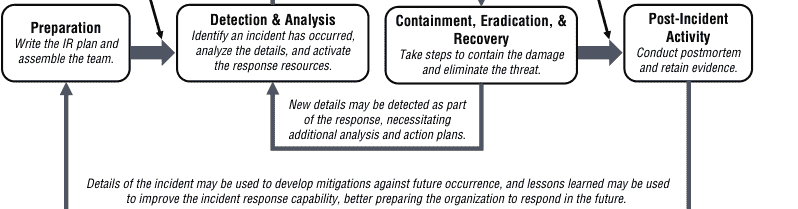
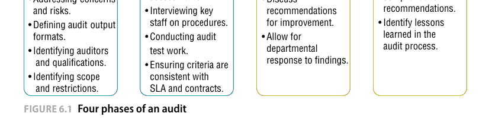

# 官方(ISC)2 CCSP CBK参考：CCSP认证云安全专家

## 致谢

首先，我们最深切地感谢我们的配偶、子女和家人。
他们在漫长的写作和审阅期间给予的支持和理解，为我们创作本书提供了必要的时间。如果没有我们美好的家庭，本书就不可能完成。

我们还要对 (ISC)² 提供的 CCSP 认证以及这些认证准备材料表示感谢。我们很高兴能参与当今世界安全云计算的变革性增长和发展。

我们还要感谢 John Wiley & Sons 以及副出版人 Jim Minatel 委托我们创建这本学习指南。我们希望感谢 Aaron Kraus 对其他章节工作的审阅和意见，以及我们的技术编辑 Raven Sims，她的细致关注使本书变得更好。感谢项目编辑 Kelly Talbot、内容精炼专家 Saravanan Dakshinamurthy、校对编辑 Kim Wimpsett 以及 Wiley 整个团队在制作本书过程中给予的指导和帮助。我们还要感谢在撰写本书期间与我们咨询的所有同事和专家。你们太多无法在此一一列出，但我们对你们的建议和贡献表示感激。

最重要的是，我们想感谢我们的读者。我们感谢你们信任我们帮助你们备考。

—作者

## 关于作者

**Leslie D. Fife**，CISSP-ISSMP、CCSP、C|CISO、CISA、CISM、CRISC、GDAT、GCED、CBCP、CIPM（以及 20 多项其他认证），在信息技术、网络安全和风险管理方面拥有超过 40 年的经验。他目前是耶稣基督后期圣徒教会的网络安全风险经理，南伊利诺伊大学卡本代尔分校的实践助理教授，以及犹他大学的兼职教师。他还是 ABET 计算认证委员会的委员。他的职业生涯包括美国海军潜艇服役，国防工业和石油天然气现场服务行业的软件开发，金融服务领域的事件响应和业务连续性，以及 22 年的计算机科学教授经历。他拥有俄克拉荷马大学计算机科学博士学位。

**Aaron Kraus**，CCSP、CISSP，是一名信息安全专业人士，在安全风险管理、审计和信息安全主题教学方面拥有超过 15 年的经验。他曾在包括美国联邦政府民用机构、金融服务和科技初创企业在内的多个行业担任安全和合规职位，目前是网络风险保险科技公司 Coalition, Inc. 的安全参与经理。他的经验包括通过评估每个组织面临的独特威胁态势和每个组织追求的独特目标，在安全团队与其支持的组织之间建立一致性，以提供平衡的风险为基础的安全控制计划。作为一家金融服务公司的顾问，他设计、执行并完善了第三方供应商审计计划，以监督关键合规举措，并领导全球审计团队进行涵盖物理安全、逻辑安全和监管合规的审查。Aaron 在 Learning Tree International 拥有超过 13 年的经验，担任课程作者、讲师和网络安全课程院长，最近教授了官方 (ISC)² CISSP CBK 复习研讨会。他曾担任多本 Wiley 出版物的技术编辑，包括 *(ISC)² CCSP 认证云安全专业人员官方学习指南，第二版*；*CCSP 官方 (ISC)² 练习测试，第一版*；*官方 (ISC)² CISSP CBK 参考指南，第五版*；和 *(ISC)² CISSP 认证信息系统安全专业人员官方练习测试，第二版*。

## 代理

代理是一个系统，它利用大语言模型来推理问题、制定计划并通过使用工具执行计划以解决问题。

## 大语言模型 (LLM)

帮助代理决定做什么以及如何做的推理引擎。它是代理的核心。

## 工具

代理可用于与世界交互的工具，例如搜索、计算器、代码解释器等。

## 规划

代理将大型任务分解为较小的可管理子任务，并为每个子任务制定解决方案方法。

## 记忆

记忆帮助代理存储和回忆信息，并从过去的经验中学习以改进未来的决策。

## 第三版前言

学习全球认可的 CCSP® 云安全认证是提升职业生涯并更好地保护云中关键资产的可靠途径。无论您是拿起这本书来补充考试准备，还是您是现有的 CCSP 将其用作桌面参考，您都会发现《Official (ISC)² Guide to the CCSP CBK》是了解 CCSP CBK 中涵盖的云安全主题的完美入门读物。

云计算安全是当今 IT 领域需求最旺盛的技能之一。CCSP 的认证 instantly 向业内所有人传达您拥有使用 (ISC)² 网络安全专家制定的最佳实践、政策和程序来设计、管理和保护云中数据、应用程序和基础设施的先进技术技能和知识。

作为信息安全教育和认证领域的公认领导者，(ISC)² 推动着全球信息安全专业人员的发展。作为拥有 (ISC)² 会员所有权益的 CCSP，您是全球超过 157,000 名认证专业人士网络的一员，他们致力于打造安全可靠的网络世界。

CCSP CBK 汲取自全面、最新的全球知识体系，为您提供在组织可能使用的不同数字平台上实施云安全的宝贵见解。

如果您是有经验的 CCSP，您会发现本版 CCSP CBK 是关于最佳实践的不可或缺的参考资料。如果您仍在积累加入 CCSP 行列所需的经验和知识，CCSP CBK 是一项可用于补充学习的深入研究。

作为全球最大的认证信息安全专业人员非营利会员组织，(ISC)² 认识到有必要不仅识别和验证信息安全能力，还要验证在管理和迁移云内外数据时将多个云安全领域知识联系起来的能力。CCSP 代表云安全架构、设计、运营和服务编排方面的先进知识和能力。

对于敬业的专业人士来说，打造有意义的职业生涯并在组织中发挥影响力的机会从未如此之大。CCSP CBK 将成为您保护和保障组织关键数据资产的常伴伙伴，为您服务多年。

谨启，

Clar Rosso  
首席执行官, (ISC)²

# 第 1 域：云概念、架构和设计

理解云计算始于云服务的构建模块，而云概念、架构和设计域介绍了这些基础概念。这包括两个重要参与者：云服务提供商和云消费者，以及用于交付云服务的参考架构，如基础设施即服务（IaaS）、平台即服务（PaaS）和软件即服务（SaaS）。这些相对较新的 IT 资源访问方式提供了有趣的业务优势，例如将支出从资本支出（CapEx）转移到运营支出（OpEx）。这改变了组织为运营业务所需的 IT 资源进行预算和支付的方式，因此财务领导者推动云服务采用的情况并不少见。然而，新的 IT 服务模式带来了新的信息安全风险形式，必须对其进行评估和权衡，以便组织在成本（以风险形式存在）与收益（以降低 IT 支出形式存在）之间实现最佳平衡。这将推动关于采用哪种云部署模型的决策，如公有云或私有云，以及在迁移到和管理云计算时的关键内部治理举措。

# 第 2 域：云数据安全

信息安全从根本上关注的是保护数据的保密性、完整性和可用性。尽管云计算颠覆了许多传统 IT 模型和实践，但信息系统的安全风险仍然存在。云数据安全域确实引入了新的概念，如云数据生命周期，以及云特有的考虑因素，如数据分散和对存储介质的物理控制丧失，这需要对数据处置采取独特的方法。云安全从业人员必须了解如何实施对云中存储或处理的数据进行审计和问责的控制，以及创建清单等关键监督任务，如数据发现。本域介绍了旨在管理云中存储的敏感数据的积极保障措施，如屏蔽、令牌化、数据丢失防护（DLP）和数据分类。云特有的考虑因素和传统控制的调整是主要关注点，因为云服务移除了传统能力，如物理销毁磁盘驱动器，同时增加了新的能力，如即时全球数据复制。

# 第 3 域：云平台和基础设施安全

云平台和基础设施安全域涉及两种视角。云提供商需要熟练的安全从业人员来设计、部署和维护物理和逻辑上安全的环境。这包括提供云服务所需的建筑、设施和公用设施，以及像 hypervisors、存储区域网络（SANs）和软件定义网络（SDN）基础设施等软件系统的配置和管理。一个关键关注点是云消费者存储的数据的安全性，特别是正确隔离租户数据以避免云租户之间的数据泄露。从云消费者的角度来看，传统的安全控制需要针对云环境进行调整，例如使用虚拟化硬件安全模块（HSM）来生成和管理加密密钥，以及额外的加密层以降低放弃存储介质物理控制相关的风险。审计机制如日志收集在云环境中通常存在，但由于多租户数据问题，诸如数据包捕获和分析等功能可能无法使用。灾难恢复和业务连续性也在本域中介绍；虽然许多云服务固有的高可用性对组织有益，但需要正确配置以利用这些功能。

# 第 4 域：云应用安全

在云计算环境中工作的安全从业人员面临着更快速部署的挑战，同时更多用户可以相对轻松地开发复杂的云应用程序。同样，这些对业务有利，但可能以牺牲安全为代价，因此云应用安全域提出了关键要求，以在不引入不可接受风险的情况下认识到云应用程序提供的优势。这些始于关注在整个组织中培养对常见云安全基础的认识的重要性，以及针对云应用开发人员进行的关于漏洞、陷阱和避免策略的具体培训。介绍了对软件开发生命周期（SDLC）的修改，以帮助适应云特定风险带来的变化，例如旨在避免供应商锁定而设计的架构以及针对云平台广泛可访问性特点的威胁建模。由于许多云计算服务由第三方提供，本域介绍了针对缺乏对所获 IT 服务和应用程序的直接控制而量身定制的安全保证、验证和测试方法。它还介绍了云环境的常见应用程序安全控制及其实施细节，如 Web 应用防火墙（WAF）、沙箱和可扩展标记语言（XML）网关。许多云服务严重依赖通过应用程序编程接口（API）提供的功能，因此安全从业人员必须了解数据如何通过 API 进行交换、处理和保护至关重要。

# 第 5 域：云安全运营

云安全运营域是云平台和基础设施安全域中介绍的许多概念的补充。它处理的问题包括

实施、构建、运营和管理云环境所需的物理和逻辑基础设施。由于重点在云服务提供商的视角，所以此领域中的概念对于某些仅作为消费者来保护云服务安全的安全从业人员来说可能较为陌生。这些概念与传统的本地部署安全在很大程度上类似，比如 BIOS 的安全配置、使用可信平台模块（TPM）实现硬件安全、部署虚拟化管理工具，以及配置远程维护功能以允许远程管理任务。云环境特有的考虑因素包括：配置隔离功能需要更高的严格性，以防止跨租户的数据访问；以及管理容量、可用性和监控遍布多国的超大规模数据中心所带来的更大需求。传统安全运营（SecOps）也是云环境中安全从业人员的重点关注事项，例如漏洞与补丁管理计划的管理、网络访问与安全控制，以及配置与变更管理计划。该领域涵盖的其他 SecOps 活动还包括：在发生安全事件时支持事件响应和数字取证，以及传统安全运营中心（SOC）对网络安全、日志采集与分析和服务事件管理的监督与监测功能。这些任务也从云消费者的视角进行了介绍，因为许多云服务和安全工具都会提供必须经过分析以支持策略执行和事件检测的日志数据。

# 第 6 域：法律、风险与合规

法律与监管要求是许多信息安全专业人员所做工作的重要驱动力，而云计算因其固有的全球性特征使这项工作变得更加复杂。法律、风险与合规领域详细介绍了组织在使用云服务时会遇到的相互冲突的国际法律和法规。这些冲突会带来财务风险、额外的合规义务和风险，以及诸如验证云应用和服务是否按照合规要求进行配置等技术挑战。一个特别重要的关注领域是隐私立法；由于许多国家和地方都出台了严格的隐私数据保护要求，使用云的组织必须在云迁移的财务收益与违反这些法律可能面临的罚款之间进行权衡。围绕跨国云服务的司法管辖也出现了新的挑战：对于一家在新加坡运营云数据中心、处理属于瑞士公民数据的美国公司，你如何确定司法管辖权？三种不同的法律可能在这种场景下产生重叠。该领域还涵盖了审计、鉴证和报告流程，因为安全从业人员必须理解并能够实施内部监督机制（如差距分析和审计计划），同时还要为诸如服务组织控制（SOC）审计报告等标准选择并支持外部审计师。一些组织甚至可能发现自己处于像医疗保健或国防这样监管极为严格的行业，以至于云计算的潜在风险超过了任何成本节省。这类决策必须以坚实的风险管理原则为驱动，而这些原则要求具备充分的评估和缓解技术。由于云服务提供商是不受组织直接控制的第三方，因此必须利用合同设计和服务水平协议（SLA）等供应商风险管理实践来执行所选择的风险管理策略。

## 云概念、架构与设计

领域 1 中的信息是**理解和使用云及云计算的基础**。这些信息对云计算的所有其他主题都是基础性的。一套通用的定义、架构标准和设计模式，将使每个人在讨论这些概念以及有效、高效地使用云时，都能处于同一水平。

### 理解云计算概念

第一个任务是定义常见概念。在接下来的小节中，我们将提供云计算术语的常见定义，并讨论云计算生态系统中的各类参与者。我们还将讨论云计算的特征，回答“什么是云计算？”这一问题。我们还将审视那些使云计算成为可能的技术。

### 云计算定义

云计算的基本概念、服务模型和部署模型构成了云计算实践的基础。理解其中的每一个概念都至关重要。

### 云计算

在 NIST SP 800-145 中，云计算被定义为“一种支持普遍、便捷、按需网络访问可配置计算资源共享池的模型……该资源池可以通过最少的管理工作或与服务提供商的交互而快速配置和释放。”

云计算不仅仅是分布式计算或并行计算，即使是在网络（局域网或互联网）上进行的也不例外。它是一种以简单、自助驱动的方式访问计算资源的理念。如果一个人必须致电供应商并协商固定服务的合同，那可能就不是云计算。同样，一家公司可以在云环境中协商费率和服务。但是，服务的提供不能要求供应商持续参与。

云计算需要网络来提供对基础设施、开发工具和软件解决方案的广泛访问。它需要某种形式的自助服务，以允许用户在方便的时间和方式下预留和访问这些资源。

资源提供需要自动化，从而限制人工参与。任何用户都应该能够访问自己的账户，并自行购买额外资源或减少当前资源水平。

一个例子是 Dropbox，这是一个基于云的文件存储系统。个人创建账户，选择自己想要或需要的服务级别，提供支付信息，然后服务和存储空间立即可用。公司可能会协商比普通消费者更优惠的合同费率。但是，一旦合同就位，员工访问此资源的方式与使用该服务的个人用户基本相同。

### 服务模型

有三种服务模型：软件即服务（SaaS）、平台即服务（PaaS）和基础设施即服务（IaaS）。这些模型决定了云服务设计所面向的用户类型：最终用户、开发人员或系统管理员。

不同的服务模型也决定了在软件应用、操作系统、网络和其他组件上的控制级别。在 SaaS 模型中，最终用户拥有最少的控制权，如果存在基本配置控制的话，也仅限于此。最终用户拥有最大控制权的是 IaaS 模型，其中操作系统选择和配置、补丁、软件工具和应用程序都在最终用户控制之下。

当服务提供给公司时，这种区别可能不太明显。尽管 PaaS 可能面向开发人员使用，但可能需要对其中进行一些管理。

公司同样提供服务。事实上，当一家公司与云提供商建立业务关系，但大部分配置和管理工作都由公司内部完成时，两者之间的界限往往变得模糊。

例如，Office 365 可以被视为一种 SaaS 解决方案，对于个人消费者来说，几乎没有或完全没有管理开销。但是，如果一家公司签约使用 Office 365，他们实际上可能负责管理系统，包括监督账户配置、系统监控以及其他属于开发人员和管理人员职责范围的任务。

## 部署模型

部署模型有四种：公有云、私有云、社区云和混合云。这些模型定义了谁拥有并控制云服务的底层基础设施，以及谁可以访问特定的云服务。

公有云部署使任何选择创建账户并购买服务访问权限的人都能使用这些资源。像 Dropbox 这样的服务可以作为公有 SaaS 部署供公众使用。Amazon Web Services (AWS)、Google 和 IBM Cloud 等各种云服务提供商上的账户也是服务的公有部署。

私有云部署由一组供单一组织（企业、非营利组织等）使用的云资源组成。该云可以部署在组织数据中心的本地，也可以位于由云服务提供商（CSP）提供的单租户云环境中。这些服务（SaaS、PaaS 或 IaaS）仅对该组织可用。你可以获得云的诸多优势，例如按需资源和最少的管理工作。然而，公司仍然拥有基础设施。对于过于敏感、不能放在公有云上的文件和数据，这可以提供云计算的优势。

社区云与公有云最为相似。它是为相关公司或个人群体提供的云部署，例如大学联盟或地方或州政府群体。该云可以在其中一个组织内实施，并向所有成员提供服务。或者，也可以在类似 AWS 或 Google 的基础设施上实施。然而，只有该群体的成员才能访问云资源。

混合云是上述类型的任意组合。公司可能拥有私有云，并为其某些功能使用公有云资源。混合云允许以对组织最有意义的方式来组织云资源。个人通常不参与混合云部署。这是因为很少有个人拥有自己的私有云，或以个人身份加入社区云。

这些概念将在本章后面的“云部署模型”一节中进一步讨论。

安全责任变得更加复杂。由于客户拥有其数据和流程，他们有责任审查 CSP 的安全政策和程序，以及多个 CSP 和数据中心之间可能存在的联合责任。

## 云服务合作伙伴

云服务合作伙伴是使用其关联的 CSP 提供各种基于云的服务的第三方（基础设施、存储和应用服务，以及平台服务）。AWS 云服务合作伙伴使用 AWS 来提供服务。云服务合作伙伴可以提供定制化接口、负载均衡和各种服务。这可能是进入云计算领域的更便捷途径，因为现有的客户供应商可能已经是云服务合作伙伴。合作伙伴对底层 CSP 有丰富经验，能够更轻松地将客户引入云。

云合作伙伴网络也是扩展 CSP 覆盖范围的一种方式。云服务合作伙伴会将其与 CSP 的合作关系品牌化。一些合作伙伴与多个 CSP 建立合作关系，为客户提供很大的灵活性。

一些合作伙伴提供自己的或大部分自己的基础设施，并通过合作伙伴关系扩展其可覆盖的服务区域。例如，Dropbox 通过与 AWS 的持续合作，将其覆盖范围扩展到自身没有基础设施的服务区域。这也使 Dropbox 能够扩展到其当前自有基础设施所能处理的规模之外。

## 云服务经纪商

云服务经纪商（CSB）与任何行业中的经纪人相似。公司利用经纪商为其云计算需求寻找解决方案。经纪商将以有利于客户的方式打包服务。这可能涉及多个 CSP 的服务。经纪商是一种增值服务，也是公司开始向云迁移的一种简便方式。经纪商通过聚合多方服务、将服务与公司现有基础设施集成，以及定制化 CSP 不能或不愿提供的服务来增加价值。

在这两种情况下，或者在使用数十个其他 CSB 中的某一个时，重要的是要像审查任何新供应商一样对 CSB 进行全面审查。每个 CSB 都服务于特定市场，利用不同的云技术。所选择的 CSB 必须适合客户组织及其云战略，这一点很重要。

## 云计算的关键特征

NIST 对云计算的定义描述了云所共有的一些特征。并非每个第三方解决方案都是云解决方案。了解云计算的关键特征将使你能够区分云解决方案和非云解决方案。这很重要，因为这些特征会带来非云解决方案可能不会遇到的某些安全挑战。

## 按需自助服务

NIST 对云计算的定义将按需服务确定为“能够以最少的管理工作或服务提供商交互进行快速配置和释放”的服务。这意味着用户必须在需要时能够简单轻松地配置这些服务。如果你需要 Dropbox 账户，只需创建一个账户并为你想要的存储空间付费，你几乎可以立即获得该存储容量。如果你已有账户，只需支付更多费用即可扩展所需空间。存储空间的访问是按需的。无论是创建账户还是扩展可用存储量，都不需要除客户以外的人员参与。这种访问是自动化的，并通过仪表盘或其他简单界面提供。

这可能会助长通常被称为影子 IT 的不良做法。服务配置的便捷性使个人、团队或部门很容易绕过公司处理 IT 服务配置和控制的政策和流程。想要协作的团队可能会选择 OneDrive、Dropbox、SharePoint 或其他服务来促进协作。这可能导致敏感数据被存储在不遵守公司控制要求的位置，使数据被放到整个企业不知道且无法充分保护的地方。

这些服务的定价可能低于公司的支出限额，而如果超出该限额，就会触发供应商管理办公室（VMO）和信息安全的介入；它们可能只是用采购卡支付，而不是通过发票和供应商合同。如果没有 VMO 的参与，公司总服务协议将不会生效。

如果允许这种行为蔓延，组织可能会失去对其敏感数据和流程的控制。例如，保险公司的精算部门可能会决定在多个可用服务之一上创建文件共享账户。由于信息安全部门没有参与，公司的政策、流程、风险管理和控制计划都未得到遵守。由于安全运营中心（SOC）不会对此进行监控，数据泄露可能不会被发现，而给公司带来竞争优势的数据可能被窃取、篡改或删除。

## 广泛的网络接入

云服务以网络的存在为前提。对于公有云和社区云，这个网络就是互联网。对于私有云，它可能是公司网络——通常是基于 IP 的网络。无论哪种情况，云服务都不是存储在……上的本地解决方案

你的个人计算机。它们是存在于网络上的解决方案——在云中。如果没有广泛且无处不在的网络访问，云将变得无法访问且不再有用。

并非所有基于 IP 的网络上的协议和服务都是安全的。实施安全云解决方案的策略之一是选择安全的协议和服务。例如，超文本传输协议（HTTP）和文件传输协议（FTP）不应用于在云服务之间传输数据，因为它们以明文形式传输数据。应使用 HTTP 安全（HTTPS）、安全 FTP（SFTP）以及其他基于加密的传输方式，以便在传输中的数据可能被拦截但无法读取。

如果你能够访问云服务并在世界任何地方获取对数据的访问权限，其他人也可以做到。在这种面向公众的环境中，身份识别和身份验证的要求变得更加重要。可以通过多种方式提高通过互联网访问云服务的安全性，包括改进密码、多因素身份验证（MFA）、虚拟专用网络（VPN）等。在网络上可用的系统且安全性由 CSP 和客户共同承担的情况下，增加了安全需求，这使得这些额外步骤变得更加重要。

## 多租户

实现云计算改进效率的一种方式是通过共享基础设施。服务器可能有多个公司购买其资源的访问权限。这些资源由租户共享。就像公寓楼一样，这些租户共享资源和服务，但拥有各自专用的空间。虚拟化使多租户情况下呈现出单租户的外观。每个租户的数据保持私有和安全，就像公寓楼中你的物品（数据）保持安全且与邻居的物品（数据）隔离一样。

然而，由于建筑是共享的，每个租户仍有责任谨慎维护其自身数据的完整性和保密性。如果门未得到妥善保护，邻居很容易进入并拿走你的东西。还必须考虑数据的可用性，因为另一个租户的行为可能导致你的数据在一段时间内无法访问，而这与你无关。在我们的示例中，如果另一个租户涉及非法活动，整个建筑可能会被关闭。或者，如果另一个租户损坏了建筑，你的访问可能会减少或被消除。多租户环境增加了灾难恢复（DR）和业务连续性（BC）规划的重要性。

## 快速弹性和可扩展性

在传统的计算模式中，公司需要购买满足任何未来、潜在或预期增长所需的基础设施。如果估计不准确，他们要么会有大量过剩的容量，要么会用完空间。两种情况都不是最佳的。在云解决方案中，随着客户需求的变化，所需要的空间会相应增减。如果使用量或资源需求出现峰值，服务会随需求增长。当需求消失时，所使用的资源会减少。这支持按需付费模式，客户只需为所需且使用的资源付费。

对于 CSP 来说，这带来了挑战。CSP 必须拥有足够的过剩容量来为所有客户服务，而无需承担全部可能资源使用量的成本。他们必须有效地估计需要多少过剩容量来为所有客户服务。如果估计不准确，客户会受损，CSP 的客户群可能会减少。

然而，维持这种过剩容量是有成本的。该成本必须纳入成本模型。这样，所有客户共同承担 CSP 维持一定水平过剩容量的成本。在银行业，银行必须保留一定比例的现金储备，以便满足客户的取款需求。但如果每个客户同时想要全部资金，银行就会用完手头的现金。同样，如果每个客户的潜在峰值使用量同时发生，CSP 就会用完资源，客户将被限制（并且不满意）。

客户在设置内部资源使用限制时也必须谨慎。扩展资源使用的便捷性可能导致消耗超出实际需要的资源。与清理并归还不再需要的资源相比，轻松启动更多资源很容易。如果不注意设置限制，客户可能会发现自己为“使用”的资源支付了大量不必要的费用。

## 资源池化

在许多方面，这是云计算的核心。多个客户共享一组资源，包括服务器、存储、应用程序服务等。他们不必各自购买提供其 IT 需求所需的基础设施。相反，他们通过 CSP 的编排共享这些资源。每个人为自己需要和使用的资源付费。目标是客户群体高效使用资源。

这种资源池化给网络安全专业人员带来了一些挑战。当资源被池化时，可能导致多租户。竞争对手或对手可能共享相同的物理硬件。如果系统，尤其是超visor，被攻破，敏感数据可能会暴露。

资源池化还意味着资源会根据需要进行分配和释放。无法确保数据擦除可能意味着敏感文件的残留可能存在于分配给另一用户的存储中。这增加了数据加密和密钥管理的重要性。

## 计量服务

计量服务使用允许 CSP 对使用的资源收费。在私有云中，这可以让组织根据各部门对云的使用情况向其收费。对于公有云，它允许每个客户为使用的或消耗的资源付费。采用计量服务后，每个人都按其份额支付成本。

对于资源需求有峰值或使用周期性变化的组织而言，云尤其具有优势。例如，美国的税务准备者在年初使用更多资源，4 月 15 日达到峰值。许多行业都有销售日期：阵亡将士纪念日、总统日、黑色星期五、网络星期一、植树节等。好吧，也许不是植树节。这些时候资源需求达到峰值。公司可以为这些高峰时期的计量服务付费，而不是全年维持最大资源水平。在内部维持最大资源既昂贵又浪费资源。

## 构建块技术

这些技术是使云计算成为可能的要素。没有虚拟化，就不会有资源池化。网络的进步实现了无处不在的访问。存储和数据库的改进实现了共享资源池中的远程虚拟存储。编排将所有组件组合在一起。这些技术的结合提高了资源利用率并改善了技术的成本结构。通过这些技术也可以在本地提供相同的资源，但在许多情况下资源利用率更低，成本更高。当云计算未降低成本时，可以提出本地资源的理由。

## 虚拟化

虚拟化允许共享服务器。虚拟化并非云计算所独有，可用于在多个进程和服务之间共享企业资源。例如，一项服务可以安装 VMware，并在同一物理硬件上在一个虚拟机（VM）上运行邮件服务器，在另一个 VM 上运行 Web 服务器。这是资源共享。

云计算将这一想法扩展到大多数公司所能做到的范围之外。CSP 在大量服务和客户（也称为租户）之间共享资源。每个租户都可以完全使用其环境，而不知道其他租户的存在。这显著提高了资源的使用效率。

此外，CSP 可能拥有多个位置。这使得服务和数据能够在位置之间无缝移动，从而提高 CSP 的资源使用率。服务和

数据可以轻松位于多个位置，从而提高业务连续性和容错能力。CSP 可以利用虚拟化带来的数据和服务移动的便利性，利用无论位于何处的可用空间和剩余容量。

这可能会在数据无法自由跨境流动或存在管辖权问题时引发一些安全和合规方面的担忧。这些问题最好在合同谈判期间处理。另一个担忧是如果 hypervisor 被攻破，因为它控制着机器上的所有 VM。如果 hypervisor 被攻破，所有数据都可能被攻破。hypervisor 的安全性由 CSP 负责。

## Storage

多种存储解决方案使云计算得以运行。其中两种是存储区域网络（SANs）和网络附加存储（NAS）。这些以及存储领域的其他进步使 CSP 能够提供灵活且可扩展的存储能力。

SAN 在特定客户域内的多台计算机之间提供安全存储。对客户而言，SAN 看起来像一块单一磁盘，而存储则分布在多个位置。这是跨网络工作的一种共享存储类型。

另一种网络存储类型是 NAS。这种网络存储解决方案使用 TCP/IP 并允许文件级访问。对客户而言，NAS 看起来像一个单一文件系统。这是在云计算环境中运行良好的解决方案。

选择存储技术的责任在于 CSP，并且随着新技术的引入而随时间变化。这些变化应对客户透明。CSP 对共享存储资源的安全性负责。

共享存储可能会带来安全挑战，如果文件片段在从一个客户释放后分配给另一个客户时仍保留在磁盘上。客户无法安全地擦除正在使用的驱动器，因为客户不控制物理硬件。然而，使用加密粉碎可以使这些片段在被恢复时无法使用。

## Networking

由于云环境中的所有资源都是通过网络访问的，因此可靠且可用的网络是必不可少的要素。互联网是公共云和社区云以及许多私有云所使用的网络。该网络已被证明具有广泛的可用性和广泛的功能。互联网已在社会中无处不在，使基于云的服务得以扩展。

基于 IP 的网络只是云计算所需的一部分。低延迟、高带宽和相对无差错的传输使云计算成为可能。使用公共网络也会带来一些安全问题。如果访问云

## Describe Cloud Reference Architecture

参考架构（RA）的目的是使各种云厂商和服务能够互操作。RA 创建了一个框架或映射，将云计算活动和云能力映射起来，以便不同厂商的服务可以被映射并更无缝地协同工作。这种方法的一个例子是网络的七层开放系统互连（OSI）模型，该模型用于讨论许多网络协议。随着企业采用来自多个厂商的各种云解决方案，互操作性变得越来越重要，而参考架构有助于更轻松地实现这一点。

国家标准与技术研究院（NIST）在 SP 500-292 中提供了云计算参考架构，其他组织也是如此。一些模型，如 NIST，是基于角色的。其他 RA，如 IBM 概念参考模型，是基于层的。NIST RA 旨在厂商中立，并定义了五个角色：云消费者、云提供商、云审计员、云经纪商和云运营商。

### Cloud Computing Activities

云计算活动在 RA 中取决于 RA 是基于角色还是基于层。作为示例，将使用基于角色的 NIST RA 来描述云计算活动。对于基于层的模型也可以做出类似的描述。在基于角色的 RA 中，云计算活动是每个角色的活动。NIST 模型包括五个角色，具有以下类型的活动：

- **云消费者**：云服务的采购和使用。这涉及审查可用服务、请求服务、设置账户并执行合同以及使用服务。活动的构成取决于云服务模型。对于 SaaS 消费者，活动是典型的终端用户活动，例如电子邮件、社交网络和协作工具。PaaS 客户的活动集中在开发活动、商业智能和应用程序部署方面。IaaS 客户专注于业务连续性和灾难恢复、存储和计算等活动。
- **云提供商**：提供服务的实体。这些活动包括服务部署、编排和管理以及安全和隐私。
- **云审计员**：能够独立检查和评估云服务控制的实体。这些活动对于具有合同或监管合规义务的实体尤其重要。审计通常侧重于合规性、安全或隐私。
- **云经纪商**：该实体涉及三个主要活动：从一个或多个 CSP 聚合服务、与现有基础设施（云和非云）集成以及服务定制。
- **云运营商**：提供网络或电信连接以允许交付和使用云服务的实体。

### Cloud Service Capabilities

能力类型是查看云服务模型的另一种方式。在这种观点下，我们查看每个模型提供的能力。我们的三种服务模型是 SaaS、PaaS 和 IaaS。每种都为客户提供不同级别和类型的服务。共享安全责任也因类型而异。

### Application Capability Types

应用程序能力包括从多个设备和多个位置通过网络访问应用程序的能力。应用程序访问可以通过 Web 界面、瘦客户端或以其他方式进行。由于应用程序和数据存储在云中，因此用户从其连接的任何设备都可以访问相同的数据。根据最终用户，界面的外观可能不同。

用户没有控制或修改底层云基础设施的能力，尽管他们可能能够自定义云解决方案的界面。用户获得的是在笔记本电脑或手机上工作时的良好体验。组织无需担心其组织中使用的不同类型的终端（与云服务访问相关）。支持所有不同类型的设备是应用程序服务提供商的责任。

### Platform Capability Types

平台具有通过云开发和部署解决方案的能力。这些解决方案可以用可用工具开发，也可能是通过云交付的已购解决方案，或是在交付前已购并定制的解决方案。平台服务的用户可以修改他们部署的解决方案，特别是他们开发和定制的解决方案。然而，用户没有修改底层基础设施的能力。

用户在平台服务中获得的是专门针对云环境定制的工具。此外，用户可以尝试各种平台工具、方法和方法，以确定什么最适合特定组织或开发环境，而无需承担获取所有这些工具和的费用

底层基础设施成本。它以低于完全内部自建的成本提供一个开发沙箱。

## 基础设施能力类型

基础设施客户无法控制底层硬件，但可以控制操作系统、已安装的工具、已部署的解决方案，以及基础设施计算、存储、网络和其他计算资源的配置。

这种能力使客户能够快速创建一个环境。该环境可能只需要使用数小时或数天。母组织无需为此基础设施购买硬件或物理空间，也无需为使用高峰、临时需求甚至定期使用周期支付设置和持续维护费用。

## 云服务类别

云服务主要有三大类别：SaaS、PaaS 和 IaaS。此外，有时还会提出其他服务类别，例如存储即服务（STaaS）、数据库即服务（DBaaS），甚至一切即服务（XaaS）。然而，这些都可以用三种基本类型来描述，并且尚未在普遍使用中流行起来。它们最常用于市场营销。

系统和数据的安全是客户与服务提供商之间的共同责任。服务提供商的责任结束与客户的责任开始的分界点取决于服务类别。

在讨论 SaaS、PaaS 或 IaaS 解决方案时，我们必须明确所讨论的是哪种服务模型。接下来将逐一详细讨论。你所指的是哪种模型，部分取决于你在整个流程中所处的位置。

如果你是最终用户，你很可能使用的是 SaaS 解决方案。如果你是开发人员，你提供的 SaaS 解决方案可能是内部开发的，也可能是通过使用 PaaS 开发环境开发的。你提供的云服务也可能是开发环境，因此你在 IaaS 服务之上提供了 PaaS 服务。有些客户在三个层级上都有涉及。他们使用 IaaS 服务构建开发环境，以创建 SaaS 解决方案。在任何一种情况下，安全责任都由客户和 CSP 共同承担，这一点在其他地方已有描述。然而，如果客户在不同服务级别上使用多种服务，这种共同责任可能会变得相当复杂。

### 软件即服务（SaaS）

SaaS 是大多数人最常接触的云服务。在这里我们看到的是最终用户，有时就是我们每个人。如果你曾通过 Google Docs 共享文件、将文件存储在 Dropbox 上、使用 DocuSign 签署文档，或使用 Office 365 创建文档，那么你就已经使用过 SaaS 解决方案了。它们通常是基于订阅的服务，易于设置和使用。企业通常会协商并购买站点许可证。对安全的控制程度因 CSP 和合同规模而异。

### 平台即服务（PaaS）

PaaS 是开发人员的领域。使用 PaaS 解决方案时，服务提供商负责基础设施、网络、虚拟化、计算、存储和操作系统。在此之上构建的一切都由开发人员及其所在组织负责。许多 PaaS 服务提供商提供可供开发人员用来创建自己应用程序的工具。如何使用和配置这些工具则由开发人员及其所在组织负责。

借助 PaaS 解决方案，开发人员可以在任何有互联网连接的地方工作。开发人员所在组织不再需要提供所需的服务器和其他昂贵的基础设施。这在测试新解决方案和开发实验性想法时尤其有用。此外，CSP 为其提供的所有服务进行补丁和更新。主要的 CSP 都提供 PaaS 解决方案。

### 基础设施即服务（IaaS）

IaaS 是系统管理员（SysAdmins）的领域。在典型的 IaaS 服务中，IaaS 服务提供商负责硬件、网络和存储的配置，以及创建 IaaS 环境所需的任何虚拟化。系统管理员负责在此之上构建的一切，包括操作系统、开发人员工具以及所需的最终用户应用程序。

IaaS 服务可用于处理资源激增需求、为分布式 DevOps 团队创建开发环境，甚至用于开发和提供 SaaS 产品。

## 云部署模型

云部署模型有四种：三种基本模型和一种混合模型。混合模型是任意两种或多种其他部署模型的组合。每种部署模型都有优点和缺点。云部署模型告诉你谁拥有云、谁可以访问云，或者至少是谁控制着对云的访问。部署模型还可以让你了解云的规模。

### 公有云

在公有云中，任何能够访问互联网的人都可以访问所提供的资源，通常通过基于订阅的服务。资源和应用服务由第三方服务提供商提供，系统和数据驻留在第三方服务器上。例如，Dropbox 向最终用户提供文件存储产品。Dropbox 如何提供这项服务的细节由该企业自行决定。对于客户来说，它只是一种公开可用的云服务。

公有云存在隐私和安全方面的担忧。尽管过去可能确实如此，但公有云在隐私和安全方面已经取得了长足进步。数据隐私和安全的双重责任仍然由数据所有者（客户）承担。对可靠性的担忧有时可以通过使用服务级别协议（SLA）在合同层面加以解决。然而，对于许多公有云服务，个人和企业账户的合同条款都是固定的。

如果服务提供商倒闭或遭到入侵，还存在供应商锁定和数据访问方面的担忧。最大的缺点可能在于定制化。公有云只提供它认为有利可图的服务和工具，客户通常必须从所提供的选项中进行选择。每个云服务提供商都有不同的工具集。

### 私有云

从架构上讲，私有云的构建方式与公有云相同。区别在于所有权。私有云属于单一公司，包含供该公司使用的数据和服务。它不向公众提供订阅服务。在这种情况下，基础设施可以内部构建，也可以托管在第三方服务器上。

私有云通常更具可定制性，公司控制访问、安全和隐私。私有云通常也更昂贵。没有其他客户来分摊基础设施成本。由于没有其他客户，提供多余容量的成本也无法分摊。

私有云可能无法节省基础设施成本，但它以更可控、更安全的方式为公司的员工提供云服务。主要的云供应商既提供公有云，也提供让组织构建私有云环境的能力。

私有云的主要优势是安全性。由于对环境的控制更强，且只有单一客户，因此更容易避免多租户带来的安全问题。当云位于组织内部时，对硬件进行安全擦除也成为可能。

### 社区云

社区云介于公有云和私有云之间。这种云是为同一行业内的多个组织的需求而构建的。这些常见行业可能是银行；也可能是政府，例如一组州；或者是地方、县（或教区）和州政府之间共享的资源。大学经常为研究建立联盟，这可以通过社区云来促进。与公有云和私有云一样，基础设施可以由社区合作伙伴之一或第三方托管。访问仅限于社区成员，并且可能基于订阅。

虽然社区云可以促进相似实体之间的数据共享，但每个实体仍然保持独立，并对自身与他人共享的内容负责。与任何其他模型一样，数据所有者仍然对其隐私和安全负责，只在适当的时候共享适当的内容。

### 混合云

混合云可以是任何其他云部署模型的组合，但通常是私有云和公有云部署模型的组合，可以在必要时增强安全性，同时提供可扩展性和灵活性。

当组织拥有高度敏感的信息时，私有云的额外成本是值得的。私有云以更安全的方式提供云部署的访问、资源池化和其他优势。

然而，组织也会拥有不太敏感的信息（例如电子邮件、备忘录和报告）。在大多数情况下，这类数据的数量要大得多。对于这些不太敏感的数据，公有云可以以经济高效的方式提供云计算的优势。由于组织的大部分数据通常属于不太敏感的类型，因此在私有云中保护更敏感数据的同时，使用公有云可以节省大量成本。总体成本节省依然存在，云计算的优势得以实现。

在混合模型中，每种云部署类型的优缺点仍然适用于采用该部署模型的那部分云。可以使用云编排来使这种混合云保持易于管理，方便员工使用。

## 云的共同考量

所有云客户和 CSP 都面临一系列共同的关注点或考量。如今，并非所有公司都只使用单一的 CSP 或 SaaS 供应商。事实上，大公司在提供服务时可能会使用多个供应商和两个或更多的 CSP。业务选择是针对特定用途使用最佳服务（最佳服务的定义由客户基于功能、成本或可用性来决定）。接下来的章节将讨论一些主要的考量因素，这些因素使得使用多个 CSP 和供应商成为可能，以支持当前存在的复杂云环境。

## 互操作性

出于对供应商锁定的担忧，互操作性成为首要考虑因素。互操作性的实现，使人们能够在多个平台之间，以及在不同供应商提供的传统服务与云服务之间进行通信和共享数据。避免供应商锁定，可以让客户根据成本、功能集或特定服务的可用性来做决策，而无需考虑该服务由哪家供应商提供。互操作性带来了更丰富的替代方案和更多的定价选择。

## 可移植性

可移植性可以指数据可移植性或架构可移植性。数据可移植性侧重于在传统服务与云服务之间，或在不同云服务之间移动数据的能力，且无需采用困难且有损的方式移植数据，也无需对任一服务进行重大更改或丢失元数据。

对于采用多云策略的组织来说，数据可移植性非常重要，因为数据会在不同供应商之间流动。每次迁移都不能成为一次数据移植工程，否则迁移过程就不是无缝的，也没有实际意义。这在云爆发场景中也很重要，即峰值用量扩展到云环境中，然后再收缩回原有的非云规模。这必须是无缝衔接的，才能使该策略有效。数据备份越来越倾向于云端，而恢复到本地服务器也必须能够轻松处理。

架构可移植性关注的是从各种运行不同操作系统的设备上访问和运行云服务的能力。这使得使用 Windows 笔记本电脑和 MacBook Pro 的用户能够使用相同的应用程序服务、共享相同的数据，并轻松协作。

## 可逆性

可逆性衡量的是云服务能够在多大程度上从一个云环境迁移到另一个云环境。这包括在云环境与本地传统环境之间迁移。环境之间的迁移必须简单且自动化。如今，公司会在多云环境中、以及进行云爆发时，往返于云端和本地，或在不同云之间移动。

环境之间的迁移需要保证安全，否则迁移就既不简单，成本也不低。可逆性还能降低供应商锁定风险，因为解决方案需要能够在不同云服务提供商（CSP）之间移动，并且能够往返于云端。随着应用软件和数据最终将驻留在不同位置，成熟的云环境将不再关心这些，这一点将变得日益重要。

## 可用性

可用性有两个组成部分。第一个组成部分是 CIA 三元组中的一条。在双方约定的服务级别协议（SLA）约束下，CSP 必须向客户提供所购买的服务以及公司或个人的数据。如果未满足 SLA，合同将规定可用的处罚或补救措施。例如，如果客户已经为 Dropbox 付费，但尝试访问该服务时却发现服务不可用，则服务可用性失败。如果该失败不在 SLA 的要求范围内，客户就有权向服务提供商索赔。

可用性的第二个组成部分涉及云服务的弹性和可扩展性。如果 CSP 没有适当地规划扩展，客户可能需要扩大其对所签约服务的使用量，而此时资源可能不可用。以 Dropbox 这样的服务为例，如果客户付费购买了 2TB 的存储空间，但在需要时该存储空间不可用，即使对已存储在该服务中的文件的访问仍在继续提供，该服务在可用性方面也是失败的。

## 安全性

云安全是一项极具挑战性的工作。毋庸置疑，大型 CSP 会投入资源并专注于构建安全的环境。同样毋庸置疑的是，大型 CSP 也是一个庞大的目标，而且云计算的一些方面（如多租户）也会给安全带来新的复杂性。

各国法律（如欧盟的《通用数据保护条例》）中涉及的一个问题是跨境数据传输的限制。在物理硬件可能位于任何地方的环境中，了解你的数据驻留在哪里是一项重要的考量。当涉及执法问题时，数据的位置也可能构成司法管辖方面的挑战。

无论使用了哪些云服务或非云服务，数据所有者最终都要对数据安全负责。云安全不仅仅涉及保护数据，还包括应用程序和基础设施。

## 隐私

在非本地（离场）的情况下，第三方提供商的参与给数据保护和隐私带来了挑战。最终用户并不总能确定有哪些控制措施来保护其数据的隐私，因此必须依靠隐私实践文档和其他报告来判断是否信任第三方来保护其数据隐私。

隐私问题包括合同期间和合同结束时对数据的访问，以及在客户要求或合同要求时对数据的擦除或销毁。监管和合同要求（如 HIPAA 和 PCI）也是关键关注点。对数据访问和修改的监控与日志记录，以及数据存储的位置，也都是额外的隐私关注点。

## 弹性

弹性是指在不利或意外条件下继续运行的能力。这同时涉及业务连续性和灾难恢复的规划与实施。业务连续性可能要求客户将数据存储在多个区域，这样某个区域的服务中断不会妨碍持续运营。

当客户遭受严重事件（如天气灾害、设施损坏、恐怖主义、公民骚乱或类似事件）时，云还能提供弹性。云策略使公司能够在这些事件期间及之后继续运营。该计划可能需要人员转移或在新地点聘用合同人员。云策略能够处理数据和流程，因为只要存在网络连接，这些数据和流程就始终可用。

主要的 CSP 会使用多个区域和冗余来提高恢复能力。许多组织会规划一个包括内部资源和云端能力的弹性策略。

## 性能

性能通过 SLA 来衡量。由于主流 CSP 会在其系统中构建冗余，云服务的性能通常相当高。主要的性能问题是网络可用性和带宽。网络是云服务的硬性要求，如果网络中断，服务就不可用。此外，如果你处于带宽有限的区域，性能也会受到影响。

## 治理

云治理使用与本地 IT 解决方案治理相同的机制。这包括策略、流程和控制。控制包括加密、访问控制列表（ACL）以及身份和访问管理。由于许多组织的云服务来自多个供应商，因此云治理框架和应用可以使云治理的维护和自动化变得易于管理。这可能是另一个云解决方案。

有各种治理解决方案（其中一些基于云）可以支持这一需求。如果没有治理，云解决方案很容易增长到难以管理的程度。例如，公司可能希望治理 CSP 账户的数量、服务器实例的数量、使用的存储量、数据库的大小以及其他存储工具。这些每一个都会增加云计算的成本。跟踪使用情况和相关成本的工具将帮助组织高效地使用云，并将其使用保持在预算之内。

## 维护与版本管理

云环境中的维护与版本管理有利有弊。每一方都负责其所在云栈部分的维护和版本管理。在 SaaS 解决方案中，从硬件到 SaaS 解决方案的所有部分的维护和版本管理都由 CSP 负责。在 PaaS 解决方案中，客户负责其所获取和开发的应用的维护和版本管理。平台、平台提供的工具以及底层基础设施则均由 CSP 负责。在 IaaS 解决方案中，CSP 负责硬件、网络、存储和虚拟化软件的维护与版本管理。其余部分的维护和版本管理由客户负责。

从实际角度来看，这意味着在 SaaS 或 PaaS 环境中，更新和补丁可能会在客户不知情的情况下发生。如果在部署前经过了适当测试，客户甚至不会注意到。更新或补丁后仍有可能出现某些问题，因为不可能测试客户云环境中可能存在的所有变化。这在传统的本地环境中也是如此。在 IaaS 环境中，客户对补丁和更新的测试与部署拥有更大的控制权。

从积极的方面来看，不会存在那些遍布于每个组织中、从不更新且运行着较旧、不安全甚至可能未授权软件版本的终端了。在 SaaS 解决方案中，客户连接到云服务时，使用的将始终是最新、最安全的解决方案版本。

在 PaaS 或 IaaS 环境中，客户负责部分维护和版本管理。然而，连接到 PaaS 和 IaaS 环境的每个客户访问的都是所提供的最新版本。通过将维护和版本管理限制在云环境中，维护和版本管理工作得以简化。无需更新运行特定软件的每个终端。所有连接到云端的用户运行的都是同一版本，即使该版本较旧且未更新过。

## 服务等级和服务等级协议

在合同上，SLA 指定了解决方案所需的性能参数。这种谈判会影响价格，因为更严格的要求可能更昂贵。例如，如果你需要 24 小时支持，这比 4 小时支持便宜。一些 CSP 会提供预定义的 SLA 集合，客户选择所需的服务等级。客户可以是个人或组织。对于与 CSP 签约的客户而言，这是一种直接的方法。CSP 公布其性能选项及各自的价格，客户选择最符合其需求和资源的一项。

在其他情况下，客户指定其要求，CSP 会提供价格。如果 CSP 无法按指定水平提供服务，或价格超出客户愿意支付的范围，谈判将继续。一旦达成一致，SLA 成为合同的一部分。这通常仅适用于大型客户。谈判和定制 SLA 及其相关环境的成本对于小型合同和个人而言通常不具成本效益。

## 可审计性

云解决方案需要可审计。这是对云服务控制的独立审查，并就其相对于其目的的功能发表意见。控制是否已正确实施？控制是否运行并实现其目标？这些是审计员的问题。

CSP 很少允许客户对其控制进行审计。相反，独立第三方会进行评估并提供给客户。一些评估需要签署保密协议（NDA），而其他评估则公开可得。这些包括 SOC 报告、漏洞扫描和渗透测试。

## 监管

对 CSP 的适当监督和审计使监管合规更易管理。监管环境是指原则或规则控制或管理组织的环境。监管环境的治理是实施政策、程序和控制措施，以帮助组织满足监管要求。

一种形式的法规是具有法律效力的政府要求。《健康保险流通与责任法》（HIPAA）、《格雷姆-里奇-比利法》（GLBA）、美国的《萨班斯-奥克斯利法》（SOX）以及欧盟的《通用数据保护条例》（GDPR）都是通过法规实施并具有法律效力的法律的例子。如果其中任何一项适用于某个组织，治理将建立框架以确保遵守这些法规。

另一种形式的法规是通过合同要求设立的。SLA 采取合同义务的形式，信用卡和借记卡相关的规则通过支付卡行业数据安全标准（PCI DSS）也是如此。合同规则的执行可以通过管辖合同的民事法院进行。治理必须再次建立框架以确保合规。

第三种形式的法规来自国际标准化组织（ISO）和 NIST 等标准机构，以及云安全联盟和互联网安全中心等非政府组织。这些组织在安全和风险治理方面提出建议并提供最佳实践。这些有助于改进安全和风险管理。

虽然这种形式的监管通常不具有法律效力，但组织或行业可能会自愿选择受特定指南的监管。例如，美国联邦机构必须遵循 NIST 要求。如果组织或行业选择遵循 ISO、NIST 或其他团体下的指南集，他们必须建立治理框架以确保合规。虽然通常是自愿的，但一旦组织选择遵循这些指南，治理流程就会确保组织遵守这些法规。

## 相关技术的影响

本节中的技术可称为变革性技术。没有它们，云计算仍然可以工作并保留其优势。这些变革性技术要么提升你在云中的能力，要么扩展云计算的能力和优势。在以下各节中，将描述该技术的具体用例。

### 机器学习

机器学习（ML）是人工智能（AI）的关键组成部分，并在云中得到更广泛的应用。机器学习使解决方案能够在无需额外编程的情况下学习和改进。许多 CSP 提供 ML 工具。当 ML 在无人参与的情况下对个人做出决策时，会引起一些担忧和监管动向。

大量廉价数据存储的可用性加上庞大的计算能力提高了 ML 的有效性。数据仓库，甚至数据湖，可以容纳以前难以处理的海量数据。ML 工具可以挖掘这些数据以回答以前因所需计算能力而无法提出的问题。这种能力有可能改变我们使用数据的方式以及我们可以从数据中提取的答案。

安全问题涉及数据和处理两个方面。如果所有数据都存储在一个大型数据湖中，对数据的访问必须严格控制。如果你的数据存储被入侵，你的所有数据都将面临风险。保护静态数据和对该数据的访问的控制对于使此功能安全使用至关重要。

另一个担忧是数据的使用方式。更具体地说，它将如何影响数据存储中个人数据的隐私？是否会提出问题，其答案可用于对具有昂贵特征的人群进行歧视？当其整个家族的健康史表明他们比传统上认为的风险更大时，保险公司可能会拒绝承保个人吗？

政府机构和非政府组织（NGOs）正在一定程度上解决这些问题。例如，欧盟 GDPR 第 22 条禁止在决策对个人产生重大影响且该决策在无人干预的情况下做出时进行自动化决策，而这通常涉及 ML。例如，抵押贷款的决定可能涉及 ML。最终贷款决定不能由 ML 解决方案做出。人类必须审查信息并做出最终决定。

### 人工智能

机器学习不是唯一的 AI 技术。AI 的目标是创建具有人类能力和无法与人类区分的机器。AI 可能创建在线智能代理，这些代理无法与人类代理区分。这有可能影响劳动力，特别是低技能领域。也有人担心代理如何被操纵以影响消费者行为和选择。不道德的个人可能会使用这些工具来影响人类。需要在技术中设置保障措施并提供法律保护以保护客户。

随着云中大量数据的存在，AI 的使用除了 ML 的数据挖掘和决策之外，还带来了安全和隐私问题。通过 AI 研究创建的工具对数据进行聚合和操纵的更大能力，引发了对该数据的安全性和隐私性以及将为该数据设计用途的不断增长的担忧。

这些问题和趋势在未来几年将继续重要。

### 区块链

区块链与云计算相似，但存在一些显著差异。区块链是双方之间（通常为金融）交易的开放式分布式账本。该交易以永久且可验证的方式记录。记录或区块通过密码学链接，并在由各种实体拥有的计算机集合中分发。

区块链提供了一种安全的方式来进行匿名交易，同时保持不可否认性。将一组记录安全地存储在多个服务器上（可能在不同的 CSP 或本地部署）的能力，可能会带来新的、强大的存储方法。任何数据交易都会被提交到链上，并且是可验证和安全的。区块链技术以支持安全分布式计算的方式推动了密码学研究的发展。

在云计算中，数据可能由单一实体拥有。但是，跨 CSP 安全存储这些数据的能力将开启新的存储方法，并减少供应商锁定。每个数据节点都可以位于任何位置、任何服务器、任何 CSP 内或本地部署，数据链中的每个节点并不重要。虽然云中的每条记录并非都是金融交易的结果，但所有数据记录都是某种交易的结果。

在加密技术以不可变方式链接记录方面的其他改进，或用于跨多个服务器分发记录的技术改进，将同时惠及区块链和云计算。

## 物联网

随着物联网（IoT）的发展，大量数据正在生成和存储。云是存储这些数据的自然方式。特别是对于大型组织而言，借助恒温器、摄像头、灌溉控制器等物联网设备，从任何有网络连接的地点，在云中存储、聚合和挖掘这些数据的能力非常有益。

许多物联网设备的制造商甚至不考虑这些设备的网络安全方面。对于暖通空调公司来说，智能恒温器可能只是一个恒温器。这些设备可能服役多年，从不更新固件。补丁和安全更新根本没有安装，这些设备仍然脆弱。

目标并不总是设备上的数据。设备可能成为僵尸网络的一部分，并被用于 DDoS 攻击。摄像头和麦克风可被用来监视个人。受物联网设备控制的过程可能被以损害设备（例如震网病毒 Stuxnet）或声誉的方式中断。

很少有组织足够成熟，能够真正保护物联网设备。这使这些设备更加危险，因为它们很少受到监控。云提供了从中心位置监控和控制大量设备的能力。对于某些设备，如恒温器，这可能是一个小而可接受的风险。然而，音频和视频输入引发了必须解决的隐私、安全和安保问题。

## 容器

虚拟化是云计算的核心技术。它实现了资源池化、多租户和其他重要特性。容器是虚拟化的一种方法。在传统的虚拟化环境中，虚拟机监控程序（hypervisor）位于宿主机操作系统之上。虚拟机（VM）位于虚拟机监控程序之上。虚拟机包含客户机操作系统以及该虚拟机所需的所有文件和应用程序。一台机器可以有多个虚拟机，每个虚拟机运行不同的操作系统。

在容器化中，没有虚拟机监控程序，也没有客户机操作系统。容器运行时位于宿主机操作系统之上，然后每个容器使用容器运行时访问所需的系统资源。容器包含运行所需的文件和数据，但没有客户机操作系统。虚拟化发生在堆栈中较高的位置，通常更小，启动更快。它还通过在虚拟空间中不需要额外的操作系统来使用更少的资源。容器镜像的规模更小和开销低，是容器相对于传统虚拟化的主要优势。

容器为开发人员提供了一个可预测的环境，并且可以部署到任何提供容器运行时的地方。与 Java 虚拟机类似，运行时可用于常见的操作系统和环境。容器可以广泛部署。这允许容器从一个 CSP 移动到另一个 CSP，从而提高了可移植性。只要容器运行时保持最新，底层基础设施的版本管理和维护不会影响容器。

容器本身被视为特权用户，这产生了必须解决的安全问题。存在解决这些安全问题的技术和服务，例如云访问安全代理（CASB）。安全问题存在，必须谨慎管理。所有主要的 CSP 都支持某种形式的容器化。

## 量子计算

量子计算机利用量子物理学构建极其强大的计算机。当这些计算机与云连接时，就变成了量子云计算。IBM、AWS 和 Azure 都为特定客户提供量子计算服务。量子计算机的强大能力与云的使用相结合，可能使 AI 和 ML 更加强大，并允许以前所未有的规模对复杂系统进行建模。量子云计算有能力改变医学研究、人工智能和通信技术。

量子计算的一个担忧是，由于云的强大能力与量子计算相结合，使得搜索空间更易于管理，传统的加密/解密方法可能会过时。这将有效地破坏当前的密码方法。需要新的量子加密方法，或者采用不受量子计算影响的方法。

## 理解与云计算相关的安全概念

云计算的安全概念与本地部署的安全概念相同，但有一些差异。这些差异大多与客户无法访问物理硬件和存储介质有关。这些概念和关注点将在以下章节中讨论。

### 密码学与密钥管理

密码学在云中对于支持安全和隐私至关重要。由于多租户以及无法安全擦除 CSP 数据中心使用的物理驱动器，信息安全和数据隐私更具挑战性，而主要解决方案就是密码学。

静态数据和动态数据都必须进行安全加密。客户需要能够确定 VM 或容器在部署后是否未被更改，这需要加密工具。在 CSP 之间以及本地用户之间移动数据和进程时，安全通信至关重要。同样，密码学是解决方案。

密码学一直以来的挑战之一是密钥管理。随着许多组织采用多云策略，密钥管理变得更加具有挑战性。需要回答的问题是：

- 密钥存储在哪里？
- 谁管理密钥（客户还是 CSP）？
- 是否应使用密钥管理服务？

在多云环境中，还有其他问题：

- 密钥管理如何实现自动化？
- 如何审计和监控密钥管理？
- 如何执行密钥管理策略？

密钥管理服务（KMS）的强大之处在于，这些问题中的许多都能得到解答。

KMS 将密钥与数据分开存储。静态数据加密的一个好处是，许多数据泄露法律规定，如果数据被安全加密，则可以豁免。如果加密/解密密钥与数据存储在一起，这种好处就消失了。因此，如果密钥存储在云中，它们必须与数据分开存储。将密钥管理外包的好处是能将该专业知识引入组织。然而，与任何外包安排一样，你不能把它交给 KMS 就再也不管了。仍然需要有人监督 KMS。

使用 KMS 并不意味着你将密钥交给另一个组织，就像使用云文件存储库不会将你的数据交给存储文件的服务一样。你应选择适合你组织和需求的 KMS 服务水平。

最后三个问题——自动化、监控与审计以及策略执行——是在评估各种可用 KMS 时需要牢记的问题。与任何其他服务一样，功能和价格各不相同，每个组织都必须根据自身情况选择最佳服务。许多 CSP 提供加密 KMS。这种 KMS 使多云环境具有可扩展性。

### 访问控制

访问控制有三种类型：物理访问控制、技术访问控制和行政访问控制。在共享安全模型中，CSP 和客户承担不同的责任。

物理访问控制是指对存储云客户数据和进程的服务器和数据中心的实际物理访问。物理访问完全由 CSP 负责。CSP 拥有物理基础设施和容纳这些基础设施的设施。只有它们才能提供物理安全。

行政访问控制是指公司用于规范和监控访问的策略和程序。这些策略包括谁可以授权访问系统、系统访问如何记录和监控，以及访问多久审查一次。客户负责制定策略，并执行与用户访问的预配/取消预配程序以及访问审批审查相关的策略。

技术访问控制是共享责任的主要领域。虽然 CSP 负责保护物理环境，公司负责制定和执行策略，但客户和 CSP 都承担技术访问控制的责任。

例如，CSP 可能愿意与组织的身份和访问管理（IAM）系统联合。然后，CSP 负责 IAM 系统的集成，而客户负责系统的维护。如果使用云 IAM 系统（由 CSP 或第三方提供），客户负责系统中用户的预配和取消预配，并确定

access levels and system authorizations while the CSP or third-party maintains the IAM system.

Logging system access and reviewing the logs for unusual activity can also be shared responsibility, with the CSP or third-party IAM provider logging access and the customer reviewing the logs or with the CSP providing both services. Either choice requires coordination between the customer and the CSP. Access attempts can come from a variety of devices and locations throughout the world, making IAM an essential function.

## Data and Media Sanitization

Internally, it is possible to sanitize storage media as you have physical access to the media. You determine the manner of sanitization to include physical destruction of the storage media. You also determine the schedule for data deletion and media sanitization.

In the cloud this becomes more challenging. The data storage is shared and distributed, and access to the physical media is not provided. The CSP will not allow you access to the physical disks and will certainly not allow their destruction. In addition, data in the cloud is regularly moved and backed up. It may be impossible to determine if all copies of a data item have been deleted. This is a security and privacy concern. The customer will never have the level of control for data and media sanitization that they had when they had physical access and ownership of the storage hardware.

While some CSPs provide access to wipeable volumes, there is no guarantee that the wipe will be done to the level possible with physical access. Encrypted storage of data and crypto-shredding are discussed in the following sections. While not the same as physical access and secure wipe, they provide a reasonable level of security. If, after review, this level of security is not adequate for an organization’s most sensitive data, this data should be retained on-premise in customer data centers or on storage media under the direct physical control of the customer.

### Overwriting

Overwriting of deleted data occurs in cloud storage over time. Deleted data areas are marked for reuse, and eventually this area will be allocated to and used by the same or another customer, overwriting the data that is there. There is no specific timetable for overwriting, and the data or fragments may continue to exist for some time. Encryption is key in keeping your data secure and the information private. Encrypting all data stored in the cloud works only if the cryptographic keys are inaccessible or securely deleted.

### Cryptographic Erase

Cryptographic erasure is an additional way to prevent the disclosure of data. In this process, the cryptographic keys are destroyed (crypto-shredding), eliminating the key necessary for decryption of the data. Like data and media sanitization and overwriting, encryption is an essential step in keeping your data private and secure. Secure deletion of cryptographic keys makes data retrieval nearly impossible.

## Network Security

Broad network access is a key component of cloud computing. However, if you have access to cloud resources over the network, bad actors can also have access. Bad actors threaten the security of the cloud service you are using and can threaten the privacy and security of your data.

There are a number of ways to provide network security. This list is not exhaustive, and the concepts are not mutually exclusive. Network security starts with controlling access to cloud resources through IAM, discussed previously. By controlling access to the cloud resources, we limit their exposure. We may also limit their exposure to the public Internet through VPNs and cloud gateways. The use of VPNs for Internet security is common. Cloud gateways, ingress and egress monitoring, network security groups, and contextual-based security are discussed next. These are major topics within cloud network security, but are not exhaustive in their coverage. New methods are regularly developed to improve network security as vulnerabilities and threats are constantly changing.

### Network Security Groups

Security remains an important concern in cloud computing. A network security group (NSG) is one way of protecting a group of cloud resources. The NSG provides a set of security rules or virtual firewall for those resources. The NSG can apply to an individual VM, a network interface card (NIC) for that VM, or even a subnet. The NSG is essentially a layer around the VM, subnet, or other cloud resource, as part of a layered defense strategy. This gives the customer some additional control over security.

### Cloud Gateways

A cloud gateway provides a level of security by keeping communication between the customer and the CSP off the public Internet. AWS regions can be connected and the traffic can be routed to any region while staying within the CSP environment.

### Contextual-Based Security

Contextual-based security uses context to help secure the enterprise and, in the case of cloud computing, the cloud resources. Context includes things such as identity, determined through the IAM system, location, time of day, or endpoint type. This is more than the heuristics used to determine if unusual behavior is occurring. The context can determine the level of access and what resources may be accessed. For example, connecting from the corporate network, through a VPN or from public WiFi may provide different levels of access. If a user attempts to access with an endpoint device that is not registered to that use, access may be blocked entirely.

### Ingress and Egress Monitoring

Cloud ingress and egress must be carefully monitored. Security is provided by limiting the number of ingress/egress points available to access resources and then monitoring them. This is similar to a castle with a single entrance. It is easier to control access and prevent access by bad actors when the way in and out is carefully defined and controlled.

Ingress controls can block all or some external access attempts from the public Internet. Inbound connections can be limited to those that are in response to a request initiated from within the cloud resource. This limits connections to the Internet to only those requests initiated in the cloud environment or wanted by the cloud environment.

Egress controls are a way to prevent internal resources from connecting to unapproved and potentially dangerous locations on the Internet. If infected, egress monitoring may prevent malware from contacting their command and control locations. Monitoring what data leaves the environment can assist only in data loss prevention.

## Virtualization Security

Virtualization is an important technology in cloud computing. It allows for resource sharing and multitenancy. With these benefits come security concerns. Security of the virtualization method is crucial. The two primary methods of virtualization are VMs created and managed through a hypervisor and virtualization through containers.

### Hypervisor Security

A hypervisor, such as Hyper-V or vSphere, packages resources into a VM. Creating and managing the VM are both done through the hypervisor. For this reason, it is important that the hypervisor be secure. Hypervisors such as Hyper-V, VMware ESXi, or Citrix XenServer are type I hypervisors or native hypervisors that run on the host’s hardware.

A type I hypervisor is faster and more secure but is more difficult to set up than type II hypervisors, such as VMware or VirtualBox, which sit on top of the operating system. These are easier to set up but less secure.

A hypervisor is a natural target of malicious users as they control all the resources used by each VM. If a hacker compromises another tenant on the server you are on and can compromise the hypervisor, they may be able to attack other customers through the hypervisor. Hypervisor vendors are continually working to make their products more secure.

For the customer, security is enhanced by controlling admin access to the virtualization solution, designing security into your virtualization solution, and securing the hypervisor. All access to the hypervisor should be logged and audited. Access to the network should be limited for the hypervisor to only the necessary access. This traffic should be logged and audited. Finally, the hypervisor must remain current, with all security patches and updates applied as soon as is reasonable. More detailed security recommendations are published in NIST SP 800-125A Rev 1 and by hypervisor vendors.

### Container Security

Containerization, such as through Docker or LXC, has many benefits and some vulnerabilities. These include resource efficiency, portability, easier scaling, and agile development. Containerization also improves security by isolating the cloud solution and the host system. Security risks occur through inadequate identity and access management and through misconfigured containers. Software bugs in the container software can also be an issue. The isolation of the container from the host system does not mean that security of the host system can be ignored.

The security issues of containerization must first be addressed through education and training. Traditional DevOps practices and methodologies do not always translate to secure containerization. The use of specialized container operating systems is also beneficial as it limits the capabilities of the underlying OS to those functions a container may need. Much like disabling network ports that are unused, limiting OS functionality decreases the attack surface. Finally, all management and security tools used must be designed for containers. A number of cloud-based security services are available.

There are many containerization solutions provided by major CSPs. One can easily find articles that extol the virtues of one solution over another. As with other areas of technology, which is best is often a matter of who you ask. Determining which solution is best for your organization requires comparing costs and features.

## Common Threats

Previous sections dealt with threats that are related to the specific technologies that are key parts of cloud computing, such as virtualization, media sanitization, and network security. However, all other threats that may attack traditional services are also of concern. Controls that are used to protect access to software solutions, data transfer and storage, and identity and access control in a traditional environment must be considered in a cloud environment as well.

## 理解安全云计算的设计原则

随着流程和数据迁移到云端，考虑该业务决策的安全影响是理所当然的。云计算的安全性取决于其配置的安全性。通过仔细审查 CSP 和云服务，以及履行客户对云安全所承担的共同责任，云的优势可以得到安全地获取。以下各节讨论的方法和要求有助于客户在云环境中安全工作。

### 云安全数据生命周期

如同所有开发工作一样，最好的安全是设计到系统中的安全。云安全数据生命周期可以分解为六个步骤或阶段。

- **创建：** 这是新内容的创建或现有内容的修改。
- **存储：** 这通常发生在创建时。这涉及将新内容存储在某些数据存储库中，例如数据库或文件系统。
- **使用：** 这包括所有典型的数据活动，如查看、处理和更改。
- **共享：** 这是两个实体或系统之间的数据交换。
- **归档：** 数据不再使用但仍在存储。
- **销毁：** 数据已达到其生命周期终点，如数据保留政策或类似指导所述。它将被永久销毁。

在数据生命周期的每个步骤中，都存在数据泄露或数据泄漏的可能性。防止这些的通用工具是加密和数据丢失防护 (DLP) 工具的使用。

### 基于云的灾难恢复和业务连续性规划

业务连续性计划 (BCP) 专注于在天气、民众骚乱、恐怖主义、火灾等灾难后保持业务运行。BCP 可能会专注于在灾难恢复进行时保持业务运营所需的关键业务流程。灾难恢复计划 (DRP) 专注于恢复正常业务运营。这可能是一个漫长的过程。两个计划协同工作。

在 BCP 中，业务运营必须继续，但它们通常从替代位置继续。因此，BCP 的需求包括空间、人员、技术、流程和数据。云可以支持组织满足其中许多需求。云解决方案提供保持业务运营所需的 技术基础设施、流程和数据。

区域中的可用区是独立的数据中心，可保护客户免受数据中心故障的影响。像 AWS、Azure 和 Google 这样的大型 CSP 定义区域。在区域内，延迟很低。然而，重大的灾难可能会影响该区域内的所有数据中心并消除该区域内的所有可用区。客户可以设置其计划以在单个区域内使用多个可用区实现冗余，或在多个区域之间实现冗余，以提供必要的技术、流程和数据最大可能的可用性。

多区域计划的一个缺点是成本迅速增长。因此，许多组织只将最关键的数据——它们无法运营业务的核心系统——跨两个或多个区域放置，但较不关键的流程和数据可能存储在单个区域中。本地部署的功能和数据也可能利用云备份。但它们可能无法像基于云的解决方案那样快速启动并运行。业务继续运营，尽管并非所有业务流程都可能启用。

DRP 严重依赖数据备份。DRP 是关于恢复正常运营。而将数据返回到本地部署环境也是其中的一部分。在本地部署基础设施重建、重新配置或恢复后，必须返回数据。

许多 DRP 的一个失败之处是缺乏异地备份或快速访问该数据备份的能力。在云中，数据备份存在于您指定的位置（区域或可用区）中，并且只要网络访问可用即可从任何地方访问。基于云的备份只有在您具有网络访问权限和足够带宽来访问该数据时才有效。这必须是 DRP 的一部分，以及异地数据备份。物理本地备份也可能有益。并非每一次灾难都会摧毁工作场所。

### 成本效益分析

云计算并不总是正确的解决方案。哪个是正确解决方案是一个由成本效益分析指导的业务决策。云计算的好处包括资本成本降低，因为单个客户不再需要购买 CSP 提供的硬件和系统软件。降低的资本支出被更高的运营成本抵消，因为客户必须为所使用的服务付费。

在许多国家，资本支出和运营支出在税务目的上被非常不同地对待。例如，资本支出可能在若干年内冲销或折旧。要冲销购买并在本地部署安装的新基础设施的全部成本可能需要多年。运营支出，例如云计算的成本，通常可以在费用发生当年作为业务费用冲销。

企业必须了解迁移到云或投资本地部署基础设施的成本和税务影响，以便做出对企业最有利的选择。迁移到云可能与技术原因一样多（或更多）出于财务原因。只有当收益证明成本合理或收益降低成本时，才应考虑这种迁移。

### 功能安全要求

功能安全要求可以使迁移到云计算或云计算的治理对客户的信息和流程更安全。然而，云计算仍存在一些挑战，包括可移植性、互操作性和供应商锁定。

这些挑战可以通过使用供应商管理流程来减轻，以确保标准功能，明确各方职责并视情况制定 SLA。对于复杂或昂贵的系统，可以利用 RFP 流程来明确客户要求。安全要求应作为 RFP 中指定的要求的一部分，并且可以成为选择供应商的过程的一部分。无法满足客户安全需求的供应商可以及早被淘汰。

### 可移植性

一次性迁移是指客户迁移到云平台，且无再次迁移的意图。这并不常见。在现代环境中，云的进出以及云服务和 CSP 之间的迁移更为常见。这些迁移不仅仅是举起一些本地部署解决方案和数据并将其放入云账户的操作。每家 CSP 使用不同的工具和模板。因此，从一家 CSP 迁移到另一家需要映射到另一家并进行相关的数据清理。从自己的基础设施迁移到 CSP 也有同样的挑战。

CSP 之间以及 CSP 与自己的基础设施之间的频繁迁移要困难得多，数据可能在过程中丢失或被修改，从而违反可用性和完整性规则。可移植性意味着环境之间的迁移是可能的。可移植的迁移将无缝移动服务和数据，并且可能被自动化。

软件产品之间的数据移动并不是新问题。在云中，它可能因在移植到新产品时仍需为旧服务付费而变得复杂。这给移植带来了时间压力。

### 互操作性

随着客户使用来自不同供应商的各种云服务，互操作性是一个重要的考虑因素。此外，某些情况可能需要私有云与本地部署解决方案共享数据。能够在工具和云环境之间以及云与企业基础设施之间共享数据非常重要。一个问题是安全工具和控制集在 CSP 之间不同。可能会出现安全差距。仔细规划至关重要，云经纪商的服务也可能有必要。

改善情况的一种方法是使用应用程序编程接口 (API)。如果设计得当，API 可以弥合服务之间的安全差距，并允许在多个平台之间共享数据和流程。例如，如果使用 SaaS 工具构建数据清单并支持企业数据/系统分类方案，则可以构建 API 以安全地将该信息与治理、风险管理、合规 (GRC) 或系统清单工具共享。这创建了数据的单一来源，将其与相关系统共享，并消除了在不同系统中进行多次数据分类的可能性。

### 供应商锁定

解决互操作性和可移植性挑战将极大地有助于结束供应商锁定。这发生在客户被绑定到特定 CSP 时，迁移将产生包括财务、技术和法律在内的重大成本。供应商锁定仍然是云计算的一个重大问题。虚拟化持续进步、可移植性和互操作性的改进以及在参考架构内的谨慎设计已减少了这一问题。

另一个担忧是使用 CSP 特定服务。如果使用这些服务构建功能，迁移到新的 CSP 也会影响此附加功能。这类似于在开发过程中使用编译器的非标准功能。它使您锁定在该开发环境中。

一个例子是使用 AWS CloudTrail。CloudTrail 允许审计您的 AWS 账户，以支持治理、风险管理、合规。如果决定远离 AWS，GRC 功能将不得不使用新服务重建，无论是与新的 CSP 还是其他供应商。

随着进一步改进和谨慎的架构，供应商锁定应成为过去的问题。在此之前，云计算的一般安全挑战，特别是可移植性和互操作性，仍然存在。

### 不同云类别的安全考虑

在云环境中，安全责任在服务提供商和客户之间共享。在 SaaS 模型中，客户的责任最少，并且在

在 IaaS 模型中，客户承担最多的责任。在 PaaS 中，责任分配更为均衡。

云服务的共享责任模型通常由主要厂商提出，其内容大体相似。存在一个架构栈。栈中的某些项目由 CSP 负责，某些由客户负责。中间存在责任不一的区域。有时，这一中间区域由 CSP 负责，有时由客户负责，有时两者皆有。客户了解其责任至关重要，尤其是在这一中间区域。

一个典型的架构栈如下所示：

- 数据
- API
- 应用/解决方案
- 中间件
- 操作系统
- 虚拟化（虚拟机、虚拟局域网）
- 超visor
- 计算和内存
- 数据存储
- 网络
- 物理设施/数据中心

通常认为，在所有交付模型中，CSP 负责列表中最后五项。然而，超出该范围后，客户与 CSP 之间的界限所在会有所不同。

具体划分和层级名称因厂商而异，但总体原则保持不变。CSP 和客户各自承担一定的安全责任，在两者交界处，各方可能都承担部分安全责任。各交付模型的界限在以下章节中进行说明。

## Software as a Service

从安全角度来看，使用 SaaS 解决方案时可用的安全选项有限。大多数安全选项由 SaaS 提供商提供。SaaS 提供商负责其服务上信息的基础设施、操作系统、应用程序、网络和存储的安全。

在共享责任模型中，客户负责其数据，并可能对 API 承担部分责任。所有其他层级均由 CSP 负责。

SaaS 解决方案的用户也负有责任。当组织或个人订阅某项服务时，尽可能了解 SaaS 提供商的安全策略和流程非常重要。此外，用户决定信息如何传输到 SaaS 提供商，并可通过端到端加密安全地进行传输。SaaS 用户负责确定数据如何共享。最后，用户可通过正确使用登录凭证、安全密码以及在可用时使用多因素认证来提供访问安全。

## Platform as a Service

在 PaaS 解决方案中，底层基础设施（包括服务器、操作系统、虚拟化、存储和网络）的安全仍由 PaaS 服务提供商负责。开发人员负责其所开发的任何解决方案的安全性，以及应用程序所使用的数据，以及关于用户访问和使用所开发解决方案的 SaaS 应用的用户责任。

在共享责任模型中，这意味着客户负责数据、API 和应用程序，可能还承担部分中间件责任。

## Infrastructure as a Service

IaaS 安全将大部分安全责任留给客户。IaaS 服务提供商对其负责的部分进行安全保护。这些区域包括服务器、虚拟化、存储和网络。IaaS 客户负责操作系统的安全以及其上构建的一切，包括 PaaS 和 SaaS 实现的责任。

在共享责任模型中，客户负责超visor 之上的所有内容。与其他交付模型一样，这一界线上的具体责任可能在 CSP 和客户之间有所变化，必须在每种情况下明确理解。

## EVALUATE CLOUD SERVICE PROVIDERS

评估 CSP 是通过客观标准进行的。如果这些标准是已知标准，则会变得更简单。对某些而言标准是自愿的，对另一些而言则是强制性的。然而，使用标准可使产品和服务之间的比较更直接。

例如，FIPS 140-2、联邦信息安全管理法案（FISMA）和 NIST 标准是与美国联邦政府合作者所必需的。PCI DSS 由接受信用卡支付者合同要求。

联邦信息处理标准（FIPS）、FISMA 和 NIST 可能在某些行业中被选为标准，但对其他人而言是建议和指南。国际上，通用准则和 ISO 标准已被一些组织、行业和国家选为强制性标准，并为其他人提供建议和指南。

## Verification against Criteria

不同组织已发布合规标准。对于云计算而言，这些目前是监管或自愿标准。国际标准化组织/国际电工委员会（ISO/IEC）标准是自愿的，但在世界某些地区工作时可能必需，即使不是强制性也可能带来优势。PCI DSS 是合同要求。支付卡行业（PCI）安全标准委员会发布了如果您是希望接受信用卡支付的供应商所需遵守的标准。

## International Organization for Standardization/International Electrotechnical Commission

ISO/IEC 27017 和 27018 为云安全实施和个人身份信息（PII）保护提供指导。27017 在原始 ISO 文件中增加了 35 项补充控制并扩展了七项现有控制。大多数 CSP 已符合这些额外控制或可轻松添加。符合这一新标准相对直接。

ISO/IEC 27018 是 ISO 27002 的补充，专门针对 PII 处理者。与 27017 一样，这些原则是建议而非要求。27018 增加了 14 项补充控制并扩展了 25 项其他控制。作为国际标准，遵守该标准将帮助组织应对从欧盟 GDPR 到俄罗斯、巴西、菲律宾以及全球其他地方标准等广泛且不断变化的数据保护和隐私环境。

虽然这些是建议而非要求，但许多国际公司力求符合 ISO 标准。在这种情况下，ISO/IEC 提供的标准成为组织的治理原则，包括参考框架、云服务模型（其中有七种，而不仅仅是 SaaS、PaaS 和 IaaS）以及从批准的控制集实施控制。审计控制并进行风险评估应有助于确定哪些控制最能解决已识别的风险。

ISO 标准对国际市场中的公司很重要。这些标准在全球范围内得到广泛接受。这些标准还为开发云服务提供了极佳的框架。由于其广泛的网络访问，云服务比许多传统 IT 服务更具国际性。国际标准是一个重要考虑因素。

## Payment Card Industry Data Security Standard

支付卡行业数据安全标准于 2020 年发布了 PCI DSS 3.2.1 版。PCI 是主要信用卡公司与供应商之间的合同合规。所有接受信用卡的云客户必须遵守全部 12 项要求。

在 12 项要求中，云仅在某处被提及，并引用了共享托管要求的附录。这些要求可概括如下：

- 确保客户的流程只能访问其数据环境。
- 限制客户对其数据环境的访问和权限。
- 启用对每个环境唯一的日志记录和审计跟踪，与要求 10 一致。
- 提供支持取证调查的流程。

除这些要求外，云环境的总体可审计性将有利于确保符合 PCI DSS 3.2.1。

## System/Subsystem Product Certifications

以下为系统/子系统产品认证。

## Common Criteria

通用准则（CC）是一套国际指南和规范，用于评估信息安全产品。CC 有两个部分：

- **保护概况**：为特定产品类型（如网络防火墙）定义一套标准安全要求。这为比较同类产品创建了一致的标准集。
- **评估保证等级**：从 1 级到 7 级评分，7 级为最高。这衡量对产品进行的测试量。应注意，7 级产品并不自动比 5 级产品更安全。它只是经过了更多测试。客户仍需决定何种测试级别足够。并非所有产品都进行 7 级测试的一个原因是成本问题。

测试由批准名单中的独立实验室执行。成功完成此认证可允许产品销售给政府机构和

## 云数据安全

云安全许多要素的责任由云服务提供商（CSP）和云消费者共同承担，同时各方对某些要素保留专属控制权。例如，CSP始终负责基础设施的物理安全，而消费者则保留对其应用程序和服务的身份和访问管理问题的控制权。谈到保护存储在云中的数据时，最重要的是要记住消费者始终承担最终责任，这意味着他们不仅必须采取措施保护数据，还必须确保 CSP 实施了充分的安全实践。

## 描述云数据概念

数据对大多数现代组织而言至关重要，因此配置和保护存储、处理和传输数据的系统流程至关重要。大多数组织的云战略将包括不同角色的各类人员，从最高层 C 级高管或其他执行管理层一直到负责日常职能（如数据输入和处理）的运营人员。为了提供充分的安全性，必须拥有一个理解数据在云环境中如何创建、存储和使用的模型，例如云数据生命周期。

在文档页眉/页脚中。在其他情况下，数据的分类可能由系统所有者完成。在这种情况下，用户不做出分类决策，但系统中存储的所有数据将被同等分类并由系统级控制保护。

- **存储：** 存储是将数据保存到可检索位置的行为，例如固态硬盘（SSD）、应用程序数据库或纸质记录。在许多情况下，存储阶段可能与创建同时发生；例如，用户将新文档上传到文件共享。
  - **存储阶段控制：** 正在存储的数据可能需要在传输过程中得到保护，尤其是在云服务中，数据必须跨越公共网络到达组织的云应用。这些保护措施包括使用传输层安全（TLS）、虚拟专用网络（VPN）、安全外壳（SSH）或其他安全数据传输控制。实际存储数据的行为应由政策和程序管理，例如对不同分类级别数据可存储位置的限制、访问控制和授权程序，以及技术控制，例如对高度敏感数据默认实施的加密。存储后，数据应使用适当的访问控制和加密管理来保护保密性，以及足够的备份来保护完整性和可用性。

- **使用：** 使用阶段包括访问、查看和处理数据，有时统称为 *处理*。数据可以通过多种方式处理，例如访问 Web 应用程序、读取和操作文件，或通过 API 获取数据。
  - **使用阶段控制：** 使用阶段通常是数据生命周期的最长阶段——正如系统在被积极使用时的大部分生命周期都处于运营和维护阶段。控制措施的数量与之相称，例如使用数据丢失防护（DLP）、信息权限管理（IRM）、系统访问控制（如授权和访问审查）、网络监控工具等来管理数据流。问责控制在此阶段也至关重要，这需要对访问进行充分的记录和监控。请注意，数据状态，即使用中的数据、传输中的数据和静态数据，与此数据生命周期阶段没有直接关系。公司正在“使用”的数据可能存储在笔记本电脑硬盘上（静态数据）或发送到 Web 应用进行处理（传输中数据）。使用阶段仅指数据正在被主动访问或处理的时间。

- **共享：** 共享阶段相对不言自明：向需要访问数据的其他用户或实体授予数据访问权限。并非所有数据都会被共享，也并非所有共享决策都会明确做出。高度机密的数据可能严格限制仅少数关键人员访问，而较不敏感的数据可能因存储在协作应用等共享系统中而被共享。
  - **共享阶段控制：** 在共享阶段，访问控制将构成大部分安全保障措施，既包括主动的也包括被动的。主动访问控制包括基于角色的访问授权和访问授予程序。诸如 DLP、IRM 和访问审查等被动控制措施可以检测未经授权的共享发生，并在某些情况下防止共享数据离开组织控制。

- **归档：** 数据可能已达到其使用寿命的终点，但仍需出于各种原因保留，例如正在进行的法律诉讼或合规要求。归档数据是将数据放入长期可检索存储的行为。这可能取决于您处理的组织和数据类型，例如财务或医疗保健数据，具有强制性的保留要求。归档也是运营成本优势，因为它将非活跃使用的数据转移到更便宜（尽管可能更慢）的存储中。
  - **归档阶段控制：** 归档阶段的数据控制与存储阶段相似，因为归档只是存储的一种特殊类型。由于归档存储的时间跨度很长，可能存在与加密相关的额外问题。具体来说，加密密钥可能会定期轮换。当密钥轮换时，用其加密的数据除非可以访问旧密钥否则将无法读取；这导致了诸如密钥托管或繁琐的解密旧数据并用新密钥重新加密的过程等解决方案。此外，存储格式可能变得过时，导致归档数据无法读取，或归档介质可能随时间推移而退化，导致完整性或可用性损失。

- **销毁：** 不再有用且不再受保留要求约束的数据应被安全销毁。销毁方法范围从低安全性（如简单删除文件系统指向数据的指针并重复使用磁盘）到更安全的方法，如覆盖磁盘、物理销毁存储介质，或使用加密擦除或 *加密粉碎*，即数据被加密且密钥材料被安全擦除。数据销毁对云安全从业者来说可能是一个特别的挑战，因为 CSP 对介质具有物理控制，阻止了使用物理销毁等选项。此外，诸如平台即服务（PaaS）和软件即服务（SaaS）等云服务通常不提供对底层存储的访问以执行覆盖等任务。
  - **销毁阶段控制：** 选择适当的销毁方法应在两个主要问题之间取得平衡：被销毁数据的值以及云服务环境中可用的选项。低敏感性数据例如

- **卷：** 卷存储的行为类似于连接到计算机的传统驱动器，但在云数据存储中，计算机和驱动器都是虚拟化的。卷存储可能以预定大小的块存储数据，可用于实现数据分散。由于磁盘是虚拟化的，数据实际上可能以块的形式存储在多个物理磁盘上，并附带在某些块丢失时重建数据所需的擦除编码。
- **对象：** 对象存储类似于在网络上访问 Unix 共享点或 Windows 文件服务器。数据以对象的形式存储和检索，通常以文件的形式存在，用户能够使用文件浏览器与数据对象进行交互。

## 平台即服务

某些 PaaS 方案提供连接 IaaS 存储类型的能力，例如将卷连接到 PaaS 虚拟机以提供用于存储和访问数据的虚拟磁盘。然而，PaaS 也有独特的存储类型，包括以下内容：

- **磁盘：** 这是一个可以附加到 PaaS 实例的虚拟磁盘，可能采用卷或对象存储的形式，具体取决于 CSP 方案和消费者需求。许多 PaaS 方案仅提供与 PaaS 实例连接的存储参数，例如 I/O 操作的速度和量或数据持久性，CSP 根据消费者指定的配置提供适当的存储空间。
- **数据库：** 这既是一种存储类型也是 PaaS 方案。可作为服务交付的平台包括流行的数据库软件，如 Microsoft SQL Server 和 Oracle 数据库，以及 CSP 特定方案，如 AWS 关系数据库（RDS）或 Microsoft Azure 数据库。在大多数情况下，这些数据库将以多租户模式提供，客户端之间进行逻辑分离，数据通过 API 调用访问数据库。
- **二进制大对象（blob）：** Blob 是非结构化数据；也就是说，数据不遵循特定数据模型，如数据库中的列。这些通常是文本文件、图像或由允许用户生成自由形式内容的应用程序生成的其他二进制文件；可以应用一些松散的组织。这类似于手动将文件组织到文件夹中，例如按写作日期组织文字处理文件或按度假目的地组织照片。诸如 AWS 简单存储服务（S3）和 Azure Blob 存储等 Blob 存储服务将这些概念应用于大量 blob 数据，并通常通过 URL 使其可供应用程序或用户使用。

某些类型的存储平台或存储类型可能特定于特定 CSP 的方案。示例包括 Microsoft Azure 中用于非结构化数据的 blob 存储，以及 AWS 中提供的各种队列服务，支持向用户或服务进行短期存储、排队和消息传递。

## SaaS

SaaS 产品是最抽象的服务模式，云服务提供商（CSP）几乎保留所有控制权，包括数据存储架构。在某些情况下，存储类型被设计为支持基于 Web 的应用程序，允许用户存储和检索数据；而其他存储类型本身就是实际的 SaaS 产品，例如以下：

- **信息存储与管理**：这种存储类型允许用户通过 Web GUI 输入数据并对其进行操作。数据存储在由 CSP 管理的数据库中，通常存在于多租户环境中，所有细节对用户都是抽象的。
- **内容和文件存储**：数据以文件形式存储在 SaaS 应用中，用户可以创建和操作这些文件。示例包括文件共享和协作应用，以及允许用户上传或附加文档的自定义应用（如工单系统）。
- **内容分发网络（CDN）**：CDN 提供地理分布式的对象存储，使组织能够将内容存储得尽可能靠近用户。这具有减少带宽使用的优势，并且通常为最终用户提供更低的延迟，因为他们可以从物理位置更近的服务器拉取内容。

大多数云数据存储类型的一个特性是可通过应用程序编程接口（API）进行访问。用于云服务的虚拟化技术创建了到存储资源池的虚拟连接，取代了物理线缆连接。这些 API 意味着存储类型可以跨多个服务模型进行访问；例如，如果发出适当的 API 调用，则可以从 PaaS 或 SaaS 环境访问对象存储。许多 CSP 已专门将其存储 API 设计为可广泛使用，例如 Amazon 的 Simple Storage Service（S3），这是一种可通过 REST API 访问的对象存储类型。这使得 IaaS、PaaS、SaaS、本地系统甚至带 Web 浏览器的用户都能访问它。

## 存储类型的威胁

无论数据位于何处（包括本地或传统环境、本地工作站存储以及云服务），静态数据（存储中）都面临普遍威胁。这些威胁会影响机密性、完整性、可用性（CIA）三元组的全部三个要素：未经授权的访问是对机密性的威胁；不当修改是对完整性的威胁；存储设备丢失或连接丢失是对可用性的威胁。适用于本地环境的工具可能无法在分布式云环境中工作，因此 CCSP 应了解这些威胁如何影响云存储以及相应的对策。

- **未经授权的访问：** 任何未经适当授权访问数据存储的用户都会带来明显的安全隐患。消费者需要实施适当的访问控制，以确保只有经过正确识别和授权的内部用户才能访问存储在云服务中的数据。由于云存储的多租户特性，CSP 必须提供充分的逻辑隔离，以确保云消费者无法访问或篡改不属于他们的数据。

- **未经授权的资源开通：** 这主要是一个成本和运营问题。与传统的本地基础设施相比，云服务易于配置是其卖点之一。这种易用性可能导致非官方或影子 IT，从而推动云服务及相关成本的无限制增长。就安全性而言，未经授权的存储也可能成为盲点；如果安全团队不知道组织将数据存储在何处，就无法采取适当措施保护这些数据。

- **监管不合规：** 某些云服务产品可能无法满足组织的所有合规要求，这会引发两个安全问题。首先是违规的后果，例如罚款或暂停业务运营。其次，合规要求的初衷是保护数据。诸如使用特定加密算法之类的要求通常是出于保护数据的需求；不符合合规目标的云服务也不太可能为所存储的受监管数据提供足够的安全性。

- **司法管辖区问题：** 主要的 CSP 是全球性实体，提供高可用性服务，其中许多服务依赖于全球冗余和故障转移能力。不幸的是，在国家之间传输数据的能力可能会违反法律要求，尤其是禁止将数据传输到缺乏足够隐私保护国家的隐私法规。特定云存储服务的功能可能默认支持全局复制，因此 CCSP 有责任了解其组织的法律要求以及 CSP 环境中可用的配置选项。

- **拒绝服务：** 云服务普遍可通过网络访问，这意味着它们需要保持有效的网络连接才能访问。如果用户和 CSP 之间的任何网络连接中断，存储中的数据将不可用。诸如分布式拒绝服务（DDoS）之类的定向攻击也可能造成问题，尽管顶级 CSP 已采取强有力的缓解措施，并且即使在攻击期间通常也能维持一定水平的服务。

- **数据损坏或破坏：** 这不是云数据存储独有的问题。数据录入中的人为错误、恶意内部人员篡改数据、硬件和软件故障或自然灾害等问题都可能使数据或存储介质无法使用。

- **盗窃或介质丢失：** 这种威胁更多地适用于容易访问和被盗的设备，例如笔记本电脑和通用串行总线（USB）驱动器；然而，硬盘等云数据存储资产也存在被盗风险。CSP 有责任通过适当的物理安全控制来防止物理介质丢失。消费者可以通过确保对存储在云中的所有数据使用足够的加密来降低这种风险，这会使被盗数据毫无用处，除非攻击者同时拥有密钥。

- **恶意软件和勒索软件：** 任何具有数据存储和处理能力的位置都面临恶意软件（尤其是勒索软件）的风险。攻击者在编写勒索软件时变得越来越复杂，因此它不仅能加密存储在本地连接驱动器上的数据，还会寻找常见的云存储位置，如知名的协作 SaaS 应用。适当的访问控制和反恶意软件工具可以预防或检测恶意软件活动。

- **不当处置：** 与物理驱动器丢失一样，CSP 在硬件处置方面承担主要责任。确保已到达使用寿命终点的硬件以无法恢复数据的方式得到妥善处置，必须是 CSP 服务的一部分。消费者可以通过确保数据在存储到云服务之前已加密，并且加密密钥与数据分开安全存储来保护数据。

## 设计并应用数据安全技术与策略

云中的数据安全包含各种工具和技术。根据主要 CSP 发布的共享责任模型，消费者负责保护自己的数据。在大多数隐私法规下，数据所有者（通常是云消费者）最终对数据泄露负责并承担法律上的责任。然而，要充分保护数据，需要云消费者和 CSP 共同采取行动，以适当地保护硬件基础设施和物理设施等要素。

## 加密和密钥管理

加密是对数据应用数学变换以使其不可读的过程。它通常需要使用密钥或加密变量（cryptovariable），即密码系统用来变换数据的数据字符串。实现变换所采取的步骤称为*算法*。

现代加密算法如 Rijndael（它是高级加密标准 AES 的一部分）可为数据提供保护，破解可能需要数千或数百万年。尝试算法中每一种可能的密钥和置换步骤组合所需的时间和资源会超过大多数攻击者所能获得的，但如果知道密钥，加密和解密过程相对较短。加密是现代数据安全的基础要素，尤其是在云环境中，数据存储在组织直接控制之外时。

由于加密的重要性，组织应重点关注正确实施和管理加密系统。特别关注的一个领域是管理加密密钥。荷兰密码学家奥古斯特·克尔克霍夫斯定义了一个支撑密钥管理的简单原则：即使系统的一切，除了密钥之外都是公开知识，密码系统也应是安全的。被称为克尔克霍夫斯原则，这一简单准则通过强调保护密钥来指导加密系统中的安全。

密钥应按照组织内可用的最高数据分类级别进行分类，并像其他高价值资产一样受到保护。实施涵盖所有类别的控制是合适的，包括创建和管理密钥的政策、保护和使用密钥的操作程序，以及处理密钥的工具和系统。作为一种数据资产，密钥应在整个生命周期每个阶段都受到保护，包括以下内容：

- 使用密码学上可靠的输入（如随机数）创建强随机密钥
- 以安全方式存储密钥，无论是加密存储在密钥库中还是存储在物理设备上，并处理存储副本以便在密钥丢失时检索的过程（称为密钥托管）
- 安全使用密钥，主要侧重于访问控制和问责
- 由于其高度敏感的性质，共享密钥并不常见，但应存在用于共享公钥、安全地将对称密钥传输给通信伙伴以及向密钥托管代理分发密钥的设施
- 归档不再需要日常使用但可能需要用于先前加密数据的密钥
- 安全销毁不再需要或已被泄露的密钥

FIPS 140-3 为美国政府机构提供了一个依赖于经过验证的加密模块和系统的方案，尽管它已成为全球公认的框架，因为许多工具为加密提供联邦信息处理标准（FIPS）验证模式。截至 2020 年，该标准正在逐步推广以取代其前身 FIPS 140-2。FIPS 140-3 建立了一个框架和测试方案，用于验证加密模块提供的保护强度，并为此类模块定义了保护级别，包括物理防篡改硬件安全模块（HSM）。有关该标准的详细信息可在此处找到：csrc.nist.gov/publications/detail/fips/140/3/final。

云安全从业人员需要了解加密可以在何处部署以保护其组织的数据和系统。许多 CSP 提供经过 FIPS 140-2 标准验证的虚拟化 HSM，可用于安全地生成、存储和控制对加密密钥的访问。这些虚拟 HSM 设计为只能由消费者访问，而 CSP 永远无法访问，并且通常易于集成到同一 CSP 的其他云服务中。

如果您的组织使用多个云提供商或需要保留对密钥生成的物理控制，您的应用程序应设计为允许采用自带密钥策略。这对组织来说技术上更具挑战性，因为托管任何本地系统需要更多技能和资源，但它提供了对加密配置和使用的更多控制，以及对 HSM 的物理控制。

云服务中的加密可以在从面向用户的应用程序到物理存储设备的各种层级实现。保护数据的目标，例如抵御物理盗窃威胁或云服务其他租户访问数据，将驱动关于哪种类型的加密适合组织的决策。一些示例包括以下内容：

- **存储级加密**在数据写入存储时提供加密，使用由 CSP 控制的密钥。在物理盗窃情况下很有用，因为数据对攻击者应不可读，但 CSP 人员仍可能查看数据，因为他们控制密钥。
- **卷级加密**对连接到特定 VM 实例的卷上写入的数据提供加密，使用由消费者控制的密钥。它可以在被盗情况下提供保护并防止 CSP 人员或其他租户读取数据，但如果攻击者获得对实例的访问权限，仍会受到攻击。
- **对象级加密**可以在所有对象写入存储时进行，在这种情况下 CSP 很可能控制密钥并可能访问数据。对于高价值数据，建议所有对象在存储前由消费者使用其控制的密钥进行加密。
- **文件级加密**通常在客户端应用程序中实现，例如 Microsoft Word 和 Adobe Acrobat 等文字处理或协作应用。这些应用允许在访问文件时使用用户控制的密钥进行加密和解密，从而防止 CSP 人员或其他云租户读取数据。所需的密钥可能由人工管理，例如用户必须输入的密码，或通过 IRM 自动进行，IRM 可以验证用户访问特定文件的授权并根据用户提供的凭据对其进行解密。
- **应用级加密**通常使用对象存储在应用程序中实现。用户输入或创建的数据在存储前由应用加密。许多 SaaS 平台提供自带密钥功能，允许组织防止 CSP 人员或其他云租户访问存储在云中的数据。
- **数据库级加密**可以通过加密数据库文件在文件级别执行，或可利用透明加密，这是数据库管理系统（DBMS）提供的功能，用于加密特定列、整个表或整个数据库。使用的密钥通常即使在 PaaS 环境中也在消费者控制之下，防止 CSP 人员或其他租户访问数据，且加密数据在物理盗窃方面也是安全的，除非攻击者还获得对数据库实例的访问权限以检索密钥。

## 哈希

哈希，有时也称为 *单向加密*，是一种主要与 CIA 三元组中的完整性原则相关联的工具。完整性涉及防止、检测和纠正数据发生非预期或未经授权的更改，无论是恶意的还是意外的。称为 *哈希函数* 的加密算法可对任意输入长度的数据执行数学运算以创建唯一的哈希值。此过程可在将来再次执行并比较两个哈希值；如果输入数据已更改，不匹配的哈希值证明数据已被篡改。

哈希构成了数字签名不可或缺的一部分，数字签名使用户能够验证消息、文件或其他数据（如应用）的完整性和来源。签名方计算哈希并使用其私钥加密哈希值。接收方（可能是接收消息的用户、下载应用或从存储库获取软件的用户）计算接收数据的哈希值，然后使用发送方的公钥解密发送方的数字签名。如果两个哈希值匹配，可以认为数据是原始的，因为没有其他用户能够更改数据、计算哈希并使用原始发送方的私钥创建数字签名。CCSP 应了解数字签名作为验证云环境中使用的消息和应用的方法，尤其是在集成第三方软件时。

哈希可以在云环境中提供多种安全服务。它们可以验证数据副本（如备份）的准确性，并可用于验证电子邮件等消息的完整性。它们也被广泛应用于许多安全工具中作为检测更改的方式，而更改可能表明系统被入侵。文件完整性监控被一些反恶意软件和入侵检测系统用于识别关键系统文件的更改，并且高度安全的系统可能会创建有关系统硬件数据的哈希

例如制造商、连接的设备或型号。在这两种情况下，这些项目预期不应改变；将当前哈希与先前计算的哈希进行比较，可以识别出不希望发生的更改。

在实现哈希函数时，选择一种抗碰撞的强函数非常重要。当两个不同的输入产生相同的哈希值作为输出时，就会发生碰撞。在这种情况下，无法依靠哈希函数来证明完整性。与信息安全的许多方面一样，美国联邦政府也制定了与哈希相关的标准。FIPS 180-4《安全哈希标准》（SHS）为安全哈希算法（SHA-3）提供了指导。与 FIPS 140-2 和 140-3 加密标准类似，许多流行的工具和平台都为哈希算法提供符合 FIPS 的模式。有关 SHS 的更多详细信息可在此处找到：csrc.nist.gov/publications/detail/fips/180/4/final。

## 数据掩码

数据掩码类似于本章后面讨论的混淆，两者都用于防止敏感数据的泄露。数据掩码涉及在某些用例中隐藏特定的数据元素，主要是在数据需要被某些（但不是所有）用户或进程检索的情况下。例如，企业人力资源（HR）系统可能需要存储用户的社会安全号码（SSN）以用于薪资和税务目的。日常访问 HR 系统的用户无需查看完整的 SSN，因此系统改为显示 XXX-XX-1234，因为最后四位数字用于验证用户身份。

通过限制显示的数据量，数据掩码有助于防止意外泄露。这是对最小必要访问权限的非常细粒度的实现。虽然用户可能被授权查看完整的 SSN 信息，但在管理员工记录的日常使用场景中，他们并不需要查看完整信息。

非结构化数据会给数据掩码以及令牌化、混淆和去标识化带来问题。当数据在数据库中以结构化方式存在时，识别和应用这些技术都很容易。非结构化数据可以存储在文件中、数据库中的自由格式文本或注释字段中，或者存储在存储无结构数据对象的应用程序中。例如，识别并掩码一个名为“社会安全号码”的数据库列相当简单，但如果某些记录将该数据连同其他数据放在注释字段中，那么这些记录显然不会被掩码。数据处理和系统使用策略应规定信息的适当使用方式，包括敏感数据元素的存储位置。如果组织使用非结构化存储或格式，则还必须选择能够处理非结构化数据类型的数据安全工具。

## 令牌化

令牌化是一种创建并使用敏感数据的非敏感表示形式（即令牌）的过程。该令牌是用于替代信用卡号等更敏感数据的替代品，这类数据通常称为主账号（PAN）。由于 PAN 具有价值，存储和使用 PAN 存在风险，因此可以使用令牌来代替。

令牌可以通过向令牌化服务发出适当请求而追溯到原始信息，该服务通常实施访问控制以验证用户身份和查看敏感数据的授权。许多存储信用卡号的在线支付系统都实现了令牌化；信用卡号实际上并未存储在应用程序中，而是被令牌化了。当用户进行购买时，应用程序将令牌连同用户身份信息一起提供给令牌化服务器，如果服务器接受所提供的信息，则访问相关信用卡数据并将其提供给应用程序以完成交易。

使用令牌代替实际数据，消除了应用程序所需的敏感数据，从而降低了风险。一个包含真实信用卡 PAN 的数据库对窃贼来说价值极高，他们可以用这些卡进行购物。而同样装满令牌的数据库则几乎一文不值。令牌化系统显然是高价值目标，但由于其专业化功能，与通用应用程序相比，可以对其进行更强健的保护。

尽管令牌化广泛用于信用卡处理交易，并且是支付卡行业数据安全标准（PCI DSS）合规所建议的控制措施，但任何敏感数据都可以通过令牌化来降低风险。实现方式各不相同，但数据令牌化的过程通常遵循以下基本步骤：
- 1. 当用户输入敏感信息时，应用程序收集该信息。
- 2. 应用程序通常使用加密来保护敏感数据，并将其发送到令牌化服务。
- 3. 敏感数据存储在令牌数据库中，同时生成代表该数据的令牌，并与敏感数据一起存储在令牌数据库中。
- 4. 令牌返回给原始应用程序，后者将其代替原始敏感数据进行存储。
- 5. 只要需要敏感数据，就可以使用令牌和适当的凭据来访问它。否则，敏感数据永远不会被透露，因为令牌化服务应受到严格的访问控制。

## 数据防泄漏（DLP）

DLP，有时也称为数据泄漏防护，是指一种旨在识别、清点和控制组织认为敏感的数据使用的技术系统。它涵盖了几类控制措施，包括检测性控制（识别敏感数据的存储位置和使用位置）、预防性控制（对敏感数据的存储和共享执行策略要求）以及纠正性控制（向用户显示警报，告知其违反策略，并阻止不适当的操作，例如通过电子邮件发送敏感数据）。

由于 DLP 具有多种用途，许多组织一次只会实施其中部分功能。组织不太可能在数据离开特定机器时成功进行传输中监控（例如在发送电子邮件之前扫描邮件内容和附件以识别策略违规）。这种类型的 DLP 必须放置在适当的位置，以便能够监控未加密的数据；否则，用户可以建立加密隧道，DLP 将无法扫描正在发送的数据。基于工作站代理（agent）或代理服务器（proxy）的工具可以通过在数据通过加密连接发送之前扫描数据来防止此问题。

- **静态监控**针对存储中的数据执行，通常由部署在存储设备上的代理执行，不过一些基于网络的 DLP 在具备适当凭据的情况下也能对存储位置进行扫描。这些监控可以发现策略违规行为，例如将敏感信息存储在规定列之外，比如用户将信用卡或 PII 输入到未加密的备注/注释字段，而不是输入到已应用加密、令牌化或其他控制的字段。对于基于代理的 DLP 解决方案，兼容性尤其值得关注，因为组织的存储解决方案必须得到支持，DLP 才能有效。
- **使用中监控**通常称为端点或基于代理的 DLP，它依赖于部署在特定网络端点上的软件代理。这些代理对于监控用户在工作站或其他设备上与数据交互，以及对这些端点的使用实施策略要求，特别有用。兼容性是这些代理的主要关注点，因为 DLP 必须支持正在使用的设备和操作系统。大多数 DLP 解决方案都支持流行的企业操作系统，但对某些平台（如 macOS 以及 iOS 和 Android 等移动操作系统）的支持可能有限。
- **执行：** DLP 根据监控结果应用规则以强制实施安全策略。例如，运行在用户工作站上的 DLP 代理可以生成警报，或阻止用户将敏感信息保存到可移动 USB 驱动器，或将其附加到电子邮件中。基于网络的 DLP 可以通过分析进入或离开网络（如虚拟私有云）的流量来查找信息，或监控发送到特定主机以及从特定主机发送的信息。如果 DLP 检测到敏感数据未被妥善处理，例如未加密的信用卡信息，它可以阻止该流量或生成警报。DLP 发出的警报和采取的强制执行措施应酌情予以监控和调查，并且是安全事件检测的重要来源。

在云环境中部署 DLP 可能是一项特别的挑战，尤其是在 SaaS 或 PaaS 服务模型中，组织缺乏安装软件的能力，或者这些模型不允许进行诸如 DLP 发现之类的扫描。有许多云原生 DLP 工具，CCSP 必须确保清楚地了解组织的系统需求，特别是必须支持哪些操作系统和云环境。DLP 可能会产生运营开销，因为扫描网络流量需要时间和资源。

原始数据集经过处理后可以被解密并重新整合，然而同态加密在很大程度上仍处于实验阶段，因此并未得到广泛使用。

混淆和去标识化数据通常会结合规则，以确保输出数据保持真实感。例如，信用卡号符合已知的格式模式——通常是分为四组的16位数字——因此替换真实信用卡信息时只能使用纯数字。其他一些信息可能还需要能够与外部来源进行验证。例如，邮政编码和电话号码区号指示地理位置，因此对包含地址、邮编和电话号码的数据集进行修改时，可能需要符合这些编号系统的规则或数据本身隐含的关系。如果你的业务不服务美国本土以外的客户，那么在进行替换时，不应允许使用加拿大、阿拉斯加和夏威夷的邮政编码。

一种被称为伪匿名化或假名化（由于出现在欧盟GDPR中且欧洲译者常使用英式拼写，因此常写作“pseudonymisation”）的过程，是一种以日后可逆转混淆为特定目标的数据混淆方法。这种做法通常是为了降低数据泄露风险，由数据所有者或控制者在将数据发送给处理者之前执行。例如，如果一个组织希望将大量客户采购订单存储在云服务中（那里的存储更便宜且更持久），他们可以先移除个人身份信息（PII），并在上传前用索引值替换。当数据被取回时，可以通过内部数据库查找该索引值，并将正确的PII插入记录中。由于数据量较小，存储该PII索引的成本会很低，同时通过避免在云中存储PII，也最大限度地降低了云数据泄露的风险。

## 数据去标识化

去标识化数据主要用于数据包含PII（即直接标识符），或包含可与其他数据结合以唯一识别个体的信息（即间接标识符）的情况。直接标识符包括姓名和金融账号等信息，而间接标识符通常是人口统计信息（如年龄）或个人行为细节（如购物历史）。移除这些标识符使数据变得匿名而非可识别；因此，这个过程通常被称为匿名化。这与假名化不同，假名化的目标是允许数据重新识别，而匿名化则是旨在永久性地去除可识别性。

大多数隐私法规要求，任何在实时生产环境之外使用PII的场景都必须进行数据匿名化或去标识化。例如，受美国《健康保险可携性和责任法案》（HIPAA）约束的医疗保健实体，在将医疗记录信息用于患者治疗以外的任何目的（如研究）时，必须对其进行去标识化。必须移除或替换可能用于具体识别患者身份的细节，例如全名、地理位置信息、支付信息、比年份更具体的日期、电子邮件地址、健康计划信息等。

移除间接标识符可能更具挑战性，首先要确定哪些信息可能具有唯一可识别性。诸如在线购物网站中频繁浏览的产品类别等趋势信息，可以与用户在社交媒体上的帖子交叉参照，从而以相对较高的确定性识别用户身份。如果在线零售商移除所有直接标识符并发布其销售趋势数据，仍有可能唯一识别用户。结合多种混淆和匿名化技术有助于应对这一威胁，例如删除姓名、替换邮政编码、对行进行乱序排列，从而使购买历史和地理位置不再关联。

## 实施数据发现

在信息安全语境下，数据发现有两个主要含义。发现环境中存储的数据是DLP解决方案的职责范围，它有助于构建组织需要保护的关键数据资产清单。这与法律电子取证（eDiscovery）不同，后者涉及在法律情境中收集证据，但两者利用了许多相同的原理。

发现数据中的趋势和有价值的情报是第二个含义，而这不太属于安全部门的专门关注范畴。分析数据以揭示趋势或进行预测，例如哪些产品可能需求旺盛或某个特定客户可能对购物感兴趣，可以推动有意义的业务改进，比如确保充足的货物库存。在这些情况下，安全并非数据发现的首要关注点，但商业智能（BI）本身就是一种有价值的知识产权（IP）数据资产，需要与其价值相称的安全保护。用于分析的支撑要素（如算法或专有数据模型）也可能是宝贵知识产权，应纳入组织的安全风险管理计划中。

许多安全工具，尤其是那些监控大规模用户工作站、服务器和云应用部署的工具，都会利用数据发现。分析工具可用于推动安全运营，通过识别需要调查的可疑事件（如系统漏洞、错误配置、入侵企图或可疑网络行为）来发挥作用。这些包含组织漏洞细节的数据显然是一种值得保护的资产，因为对攻击者来说很有用。安全从业者必须理解这些工具在支持安全运营方面的价值，以及如何充分保护它们，这一点非常重要。

数据发现和商业智能有许多重要相关术语，包括以下内容：

- **数据湖和数据仓库**：这两个术语相似但并不相同。两者都旨在整合大量数据，通常来自公司内外的不同来源，以支持BI和分析工作为目标。数据湖是一种非结构化的数据存储机制，数据通常以文件或二进制大对象（blob）形式存储，而数据仓库则是结构化存储，其中数据已被规范化以符合定义好的数据模型。

- *规范化*是处理不同格式数据的过程——例如一个系统存储MM-DD-YYYY格式，另一个使用YYYY-MM-DD格式——并将其转换为统一格式。这通常被称为*提取、转换、加载*（ETL），因为数据从数据库或应用程序等源中提取，经过转换以满足数据仓库的数据模型，然后加载到仓库存储中。规范化数据可以提高可搜索性。

- **数据集市**：数据集市包含已经过仓库化、分析并对特定用途（如某个业务部门）可用的数据。数据集市通常通过主动收集所需数据并进行分析来支持特定业务功能，常用于驱动报告和决策制定。

- **数据挖掘**：挖掘数据涉及发现、分析和提取数据中的模式。这些模式在某种程度上是有价值的，就像从地下开采出来的矿物一样；它们可以支持业务决策，或增强人们从大量数据中识别重要趋势、模式和知识的能力。即使是只有少量用户和系统的小型组织也会产生海量的安全日志数据，而数据挖掘工具可用于从正常流量中隔离可疑事件。

- **在线分析处理（OLAP）**：顾名思义，OLAP为用户提供对数据源的分析处理能力。OLAP由聚合（consolidation）、钻取（drill-down）和切片切块（slice-and-dice）功能组成。聚合将多维数据集汇总到数据立方体中，例如按地区、时间和销售人员的销售额。钻取和切片切块允许用户分析数据立方体的子集，例如所有地区按季度的销售额，或特定产品在所有销售人员中的销售情况。需要取证分析的安全事件通常利用OLAP从日志文件中提取相关信息。

- **ML/AI训练数据**：机器学习（ML）和人工智能（AI）是数据科学中新兴的领域。机器学习关注通过经验改进计算机算法，例如要求计算机识别狗的照片，然后由人工验证哪些照片确实包含狗，哪些包含其他动物。计算机算法会学习并优化未来的搜索；这些算法可广泛应用于各种场景，例如通过观察哪些邮件被用户标记为垃圾邮件来过滤不受欢迎的邮件，并且它们被广泛实现在旨在学习和适应的安全工具中。

以适应组织的独特环境。人工智能是计算机科学的一个领域，其目标是设计能够展现智能思维或问题解决能力的计算机系统，尽管该术语常被用来描述那些仅模仿人类任务的系统，比如玩策略类棋盘游戏或操作自动驾驶汽车。AI 和 ML 都需要大量数据来进行学习，并且存在众多安全和隐私问题，尤其是当数据集包含用于训练 ML 面部识别的照片等个人信息时。

作为云服务的使用者，CCSP 应意识到其组织仍负有保护数据的责任，包括通过数据发现流程来识别和盘点敏感数据。CSP 可能受合同义务约束，需要实施特定的数据保护措施，但它们并非数据所有者，因此在大多数隐私和安全法律下，它们不对数据泄露承担法律责任。充分的敏感数据清单是安全风险评估和缓解的重要输入，因此 CCSP 必须认识到数据发现的能力，并利用这些能力来支持其组织的安全风险管理流程。

## 结构化数据

结构化数据是指以一种一致的方式格式化过的数据。它通常采用数据库的形式，其中所有记录都符合已知结构：数据被分成列，每一行在同一位置包含相同类型的信息。独立数据也可以使用 XML 或 JSON 等标记语言进行结构化，这类语言利用标签为数据提供上下文，例如 <AcctNumber>123456</AcctNumber>。

数据发现借助结构化数据得以简化，因为该过程只需理解数据的上下文和属性，即可识别敏感数据的存在位置，如 PII、医疗保健数据、交易信息等。列和数据属性通常以不言自明的方式命名，从而简化了敏感或有价值数据的识别。许多安全信息和事件管理（SIEM）工具还提供从多个来源摄取数据并对其应用结构的功能，这有助于对不同来源的数据进行分析。例如，SIEM 工具可能会将来自多个操作系统的日志数据规范化，使日志文件包含人类可读的用户名，而不是数字形式的全局用户 ID 值。

结构化数据通常附带一个描述其格式的说明，称为数据模型或模式（schema），它是系统中数据格式的抽象视图。以元素、行或元组（尤其是在关系数据库中）形式结构化的数据，由模型或模式赋予上下文。例如，可以使用模式中定义的标签将特定字符串定义为用户 ID。要了解用户属于特定业务单元的关系，可以通过特定列中的数据来实现；例如，用户的业务单元标识出现在“Bus. Unit”列中。

以及可用性。每个分类级别都应有相应的一组控制预期。例如，分类为“公开”的数据在传输中不需要加密，而分类为“仅限内部使用”的数据必须在静态和传输中均进行加密。这些要求是对数据或系统给组织带来的风险的缓解措施，正如保密性、完整性和/或可用性丧失所造成的运营影响所描述的那样。

数据分类是组织提供统一控制措施和预期的一种方式，也是加快安全决策的一种方法。创建诸如低、中、高之类的分类方案，使组织能够将安全控制预期整合在一起，并简化确定所需操作的过程。当新系统上线时，安全从业人员无需进行详尽的研究来确定需要满足的安全要求。分类方案提供了一套清晰的、基于风险的安全控制和预期，旨在加快这一过程。

数据分类级别和方案受数据的多个方面驱动。它们可能由外部实体（如监管机构或政府机构）规定，也可能由纯粹的内部风险管理要求驱动。以下是一些示例：

- **数据类型：** 不同类型的数据受不同规则监管，例如医疗保健、敏感 PII、金融、教育或法律数据。基于数据类型的数据分类方案通常指向一组外部要求；如果系统或数据集包含该数据类型，则必须满足这些要求。

- **法律约束：** 如果位于另一国家的公司收集了欧盟公民的数据，那么该公司可能必须实施与欧盟 GDPR 类似的隐私保护，或者位于一个隐私法律被欧盟认可为与 GDPR 等效的国家。理解法律约束属性使组织能够做出诸如应用程序架构地理定位之类的决策。

- **所有权：** 许多组织使用由业务合作伙伴、客户或共享来源共享的数据，这些数据都可能施加要求，例如不将数据共享给第三方，或在指定保留期后安全销毁数据。

- **价值/关键性：** 某些数据的价值极其依赖具体情境。餐厅供应商的联系方式数据库对 IT 服务公司而言价值不大，但同一数据库对经营连锁餐厅的公司而言则至关重要。数据分类方案必须考虑数据对组织的价值和关键程度，通常通过衡量数据丢失对运营的影响来评估。

由于数据分类策略提供了这些信息，它通常是组织安全计划的基础文档。分类标签不是为每个系统单独指定一长串系统特定的安全要求（如批准的加密方式或数据保留计划），而是提供了一种通用词汇，以便以一致的方式传达安全需求。其他信息安全策略应规定不同分类级别下数据或系统的适当控制措施，例如经批准的加密模块、访问控制程序、数据保留期限和销毁要求。

## 数据映射

数据映射包含数据科学整体实践中的多项活动——即应用科学方法和算法从数据集中识别知识或有用信息。与数据映射相关的一项特定实践与安全从业人员的角色相关：识别数据的位置。

识别并映射组织内数据的位置是一项关键的盘点任务，而这项任务反过来又是风险评估的关键输入。确定哪些内容需要保护——属于组织的系统和数据资产——以及它们位于何处，对于确保安全计划设计得当至关重要。许多 DLP 工具通过扫描网络、域或其他由组织控制的资源集来识别数据存储位置，从而提供这一功能。这种映射还可以通过识别元数据（例如资产所有权，如人员、角色或组织单位）进一步扩展，从而为组织提供有关安全流程责任与问责的关键信息。

## 标记

一旦数据集或系统完成分类，就必须以某种方式传达分类级别，以便用户、管理员和其他利益相关者知道如何保护它。同样，使用标签可以简化这一过程。无需强迫用户记住哪些系统可以打印数据、哪些系统禁止打印，而是指导用户：标记为“内部”的系统允许打印，而标记为“绝密”的系统不允许打印。

标记数据可能比较棘手，因为我们通常从物理角度来考虑标签，但显然无法在一堆数字 0 和 1 上贴标签。针对不同类型的资产有多种标记方法，例如：

- **硬拷贝材料**，主要是打印在纸张上的信息，可以通过打印水印、图章或文件夹、盒子等物理容器进行标记。硬拷贝材料是最容易附加标签的，因为它们是物理对象且不经常变化。

- **物理资产**，包括服务器、工作站、磁盘驱动器、光盘和可移动介质，这些资产可以通过贴纸或徽章进行物理标记。为这些设备打标签有些棘手，因为其上的信息很容易变化。识别和标记已发现的物理资产也可能更具挑战性，因为用户需要具备适当的设备来读取资产上的数据；同时，插入已发现的介质还可能带来安全问题，因为存在引入恶意软件的可能性。
- **数字文件**，可能来自常见的协作工具、数据库或其他程序，通常可以通过元数据进行标记。这可能包括文档内部的内容，如数字水印或签名，甚至包括文档页脚中印有分类级别的文本。文件元数据（如文件名或存储在数据库中的文档属性）也可用于应用分类标签。
- **某些复杂或共享的系统及数据集**可能具备可标记的子组件，但整体系统无法标记。在这种情况下，对组件进行标记并辅以支持性程序（例如面向用户的培训和参考资料，或组织范围内的系统总清单）可能有助于确保用户了解他们必须满足的保护要求。

在标记数据集时，有许多最佳实践有助于利用分类级别来确保应用充分的保护。首先，要确保标签适用于系统内使用的所有类型的介质；例如，如果同时使用数字文件和纸质文档，那么在打印文档时也显示的数字水印有助于确保数据标签在所有介质状态下都可见。标签应提供信息而不泄露过多——在文件夹上盖上“绝密”印章，合法用户和恶意行为者都能轻易识别！标签可以仅包含所有者或资产编号，以便在数据丢失时用于确定数据的敏感性。最后，当发现介质时，应将其归类为组织支持的最高级别，直到检查证明并非如此，从而确保敏感数据不被泄露。

组织的DLP工具可能是数据标签的重要消费者，因为许多DLP工具允许在执行数据识别和分类时使用组织定义的标签。如果正在使用DLP，则应以一致且可访问的方式应用标签，例如在文件中标识分类级别的文本或常见的文件名约定，以促进发现过程。

## 敏感数据

组织的数据分类策略应涵盖数据处理的多项要求，其中许多将由外部法律法规驱动。这些外部义务通常为处理以下敏感信息类别提供指导：

- **个人身份信息（PII）：** 全球范围内受隐私法管辖，并通常受特定行业的法律或法规约束，涵盖PII的收集、使用和处理。例如欧盟GDPR和加拿大《个人信息保护和电子文件法》（PIPEDA），它们广泛涵盖PII；美国《格雷姆-里奇-比利雷法案》（GLBA），涵盖银行业对PII的使用。
- **受保护的健康信息（PHI）：** 主要由美国HIPAA定义和管辖，尽管个人健康记录在大多数全球隐私法（如GDPR）中被视为PII。
- **持卡人数据（通常称为*持卡人数据环境*，或CDE）：** 由PCI DSS定义和监管，为处理、加工和有限允许存储与信用卡、借记卡及交易相关的信息提供指导。

数据保护应针对所有已发现的敏感数据加以规定，可能是前述各种法律中定义的要求与组织自身风险管理目标的组合。适合在数据分类策略中规定的一些要素包括：

- **各分类级别固有的合规要求：** 虽然这对普通用户来说可能过于复杂，但它可确保关键的安全要求不会被忽视。作为最佳实践，应在此策略中确定擅长管理敏感数据的联系人，以便用户按需寻求帮助。
- **数据保留和处置要求：** 许多数据保护法规定了保留期限，例如客户记录必须在客户仍然活跃期间无限期保留，之后还需保留五年。分类和保留策略及程序应紧密配合，并为已到达保留期限的数据提供经批准的处置或销毁方法的指导。
- **哪些数据被视为敏感或受监管数据：** 一些法规对各种情况规定了例外，而未经培训的个人可能无法完全理解微妙差异，例如医疗数据何时被视为PHI。分类策略应就哪些数据被视为敏感或受监管提供明确指导，并明确说明可能适用的任何例外。

IRM通常用于控制对设计为可共享但不可自由分发数据的访问。这包括与可信合作伙伴共享而非向全世界公开的敏感商业信息、用户已购买访问权限但无权共享的受版权保护的材料，以及根据规定该信息使用或传播限制的许可证共享的任何信息。

## 目标

大多数IRM解决方案设计为使用数字文件的访问控制列表（ACL）来运行，该列表指定用户及授权操作，如读取、修改、打印甚至继续共享。许多流行的文件共享SaaS平台将这些概念实现为共享选项，允许文档所有者指定哪些用户可以查看、编辑、下载、共享等。

IRM系统理想情况下应具备多项属性，包括：

- **持久性：** ACL和实施限制的能力必须随数据而转移。有些工具允许用户设置打开文档所需的密码，但这些工具也允许其他用户禁用这种基于密码的访问控制，这违背了目的。
- **动态策略控制：** IRM解决方案必须提供更新限制的方法，即使在文档已共享之后。如果用户不再需要访问权限，IRM解决方案必须为文档所有者提供一种撤销权限的方法，并在文档下次打开时强制执行，无论其位于何处。这带来了一个关键的可操作性挑战，因为IRM工具通常要求用户具有活动的网络连接，以便在授予访问权限之前验证策略。
- **过期：** IRM工具通常用于对数据实施限时访问，作为一种访问控制形式，这减少了恶意行为者利用其已获得未授权访问的文档的时间。虽然这可以是动态策略控制的一个要素，需要具备查询IRM服务器的能力，但也可以通过计算和监控与文件关联的本地时间来实现。一个例子是，用户首次开始播放租借的数字电影时启动计时器，并将用户播放电影的能力限制在该初始开始时间后的24小时内。
- **持续审计跟踪：** 访问控制要求能够追究用户对数据访问和使用的责任。IRM解决方案必须确保受保护文档在用户与受保护文档交互时生成审计跟踪，以支持问责制的访问控制目标。
- **互操作性：** 不同组织和用户将拥有各种工具，如电子邮件客户端和服务器、数据库以及操作系统。IRM解决方案必须为跨这些不同系统类型的用户提供支持。基于文档

## 规划并实施数据保留、删除和归档策略

数据遵循一个生命周期，从创建开始，到组织不再需要时结束。描述这一生命周期末期阶段的术语有很多，包括处置、保留、归档和删除。虽然有时被互换使用，但它们是独特的做法，CCSP 必须了解要求强制使用特定选项的规定。

数据处置最常与数据的销毁或删除相关，尽管该术语也可能用于表示处置，这意味着数据的存放位置发生变化，例如将其从活跃生产环境移至备份环境。在数据仍需供组织使用或必须保留一段时间以满足监管或合规目标时，将采用 *数据保留* 的做法。一旦数据不再被组织需要且不受任何保留合规要求的约束，就必须使用与其价值相称的工具和流程将其删除。

*数据归档* 是保留的一个子集，通常侧重于对不需要进行主动处理或具有历史价值的数据进行长期存储，因此可能对完整性有较高要求。数据保留、归档和销毁策略高度相互关联，所需的做法甚至可能记录在单一策略或一套程序中，以规范数据的用途、长期存储和安全销毁。

## 数据保留策略

数据保留由两个主要目标驱动：运营需求（数据必须可用以支持组织的运营）和合规要求，后者特别适用于敏感受监管数据，如 PII、医疗保健和金融信息。许多监管文件将数据称为记录；因此，术语 *记录保留* 常常被互换使用。数据保留策略应为组织定义若干关键实践，并在可用性、合规性以及成本等运营目标等组织需求之间取得平衡。

CCSP 应认识到与备份相关的云服务有几种用例，这些用例通常是与可用性相关的数据保留实践的关键子集。云备份可以取代传统的备份解决方案，如发送到异地存储的磁带驱动器。这提供了更频繁备份且开销更低的好处，因为通过网络发送数据通常比让快递员取走物理驱动器更便宜，但组织的网络连接会成为单点故障。

云备份可以被设计为单纯的数据存储位置，或者一套完整的云服务可以作为热站点，在本地环境故障时接管处理。对于无法将云用作主要处理站点但又不想承担完整热站点成本的组织而言，此方案可能具有成本效益。将云临时用作应急措施有助于在成本和安全性之间取得平衡。

云服务，特别是 SaaS 和 PaaS 部署，可能提供固有的数据保留功能。大多数云存储服务为写入环境中的数据提供高可用性或高耐久性，这使组织能够保留关键数据以满足运营需求。一些服务还提供以合规为重点的保留功能，旨在识别存储的数据或记录并确保履行合规义务。在所有情况下，CCSP 都需要了解可用的功能，并确保其组织正确设计或配置服务以满足内部和合规义务。

## 存储成本和访问要求

数据保留会产生相关的存储成本，这必须与访问速度的要求相平衡。在许多情况下，较旧的数据，如旧电子邮件或归档文档，访问频率较低。这些数据可能根本不会用于日常业务事项，而仅在存档研究或法律诉讼等特殊情况下才需要，在这些情况下等待几个小时检索文件是可以接受的。组织还可能有合规或监管义务，要求在数据对日常运营不再有用很长时间后仍保留数据。相关存储成本可能非常可观，因此 CSP 提供多种存储服务，在成本和检索速度之间取得平衡；通常解决方案提供低价/检索速度慢或高价且检索快速的组合。例如，亚马逊简单存储服务（S3）提供价格较高的 S3 Standard，检索为实时，或价格较低的 S3 Glacier，检索时间范围为 1 分钟至 12 小时。同样，微软的 Azure Blob Storage 提供 Hot、Cool 和 Archive 三个层级，按从高成本/检索速度到低成本/速度的顺序排列。

为了模拟这种成本效益分析，请考虑 Alice’s Blob Cloud（ABC），它提供以下存储服务级别（货币为每千兆字节的美元）：

- **Rabbit Storage:** $0.5, 实时访问（>50 毫秒）
  - 存储 5TB 数据（5000GB）每月费用为 $2,500 或每年 $30,000。
- **Turtle Storage:** $0.005, 访问时间 1 至 12 小时
  - 存储 5TB 数据（5000GB）每月费用为 $25 或每年 $300。

使用 Turtle 的成本节省非常可观：在此有限示例中每年可节省 $29,700。大多数组织会产生远超 5TB 的数据。如果数据使用频率较低，例如每季度一次，数据保留策略应指定适当的存储选项以在成本与访问速度要求之间取得平衡。这可能是记录保留计划的一部分（例如，所有超过 12 个月的数据都移至 Turtle）或作为数据分类策略的一部分（例如，实时生产数据在静态加密后存储在 Rabbit 中，而归档生产数据在加密后存储在 Turtle 中）。

## 指定的法律和监管保留期限

所有组织都应保留数据，只要其在功能上仍然有用；否则，组织将面临可用性丧失。这可能以明显的里程碑为标志，例如客户关系或项目的结束，此后数据对组织不再有价值，可以删除。处理 PII 等受监管数据的任何组织也可能有外部数据保留义务，这些义务通常具有法律约束力。外部法规的一些示例包括以下内容：

- **HIPAA:** 适用于所有美国居民，并规定与 HIPAA 合规计划相关的文件（如政策和程序）的保留期限为六年。患者医疗数据的保留在 HIPAA 中未直接提及，但许多州级法律规定医疗记录需在患者活跃期间保留，并在其后保留一段时间。
- **EU GDPR:** 适用于欧盟公民的数据；它没有设定具体的保留期限，而是规定只要数据主体已同意且组织对数据有合法需求，就可无限期保留。如果同意被撤回或组织必须通过删除、销毁或匿名化数据来响应撤回。

## 数据保留实践

组织的数据保留策略应明确规定保留哪些数据以及原因。还应记录程序以说明如何实现这些保留目标，包括以下方面的详细信息：

- **Schedules:** 数据和记录保留通常指保留期限，即数据必须保存的时间。这些通常包含在数据标签中，以便发现不再需要且可以销毁的数据。
- **Integrity checking:** 每当数据被复制时，都可能出现问题，存储的数据也可能因高温或湿度等环境问题而受损，从而损坏存储介质。应建立完整性检查程序，以在数据写入时以及此后定期验证数据，确保其可读且完整。
- **Retrieval procedures:** 数据在不同环境中的访问要求可能不同。通常，实时生产环境中会有更多用户被授权访问数据，因为它需要支持运营，而归档中的数据可能仅需由有限的用户访问，例如在应对诉讼时由法务部门或审查监管合规的审计员访问。检索程序应包括适当的授权凭证，如已批准的访问请求，并强制执行数据使用的问责制。

- **数据格式：** 数据的格式以及读写该数据所需的程序、应用和硬件都需要考虑。随着时间推移，文件格式和硬件会发生变化，因此虚拟化遗留环境、采购过时设备的储备，或将数据转换为新格式等做法可能是合适的。

## 数据安全与发现

保留的数据将面临独特的安全挑战，特别是由于其长期存在，且随着威胁状况随时间变化，可能难以访问或操作。例如，数据加密标准变化相当频繁，因此当今最先进的密码学可能几年后就会被轻易破解。将档案中保留的数据解密，并使用更强健的密码学重新加密，在技术上或财务上可能都不可行。安全从业者应考虑纵深防御策略，例如高度安全的密钥存储和对档案数据严格限制的访问控制，以此作为对较弱的旧版加密标准的补偿性控制。同样，在生产环境中不再主动用于加密数据的密钥，可能需要安全存储，以便授予对档案数据的访问权限。

数据保留通常是为了支持事后调查，例如法律诉讼和监管机构审查。数据保留方法应支持按需发现和提取数据的能力，以满足这些合规义务。对于法律诉讼，必须考虑电子发现（eDiscovery）的要求。eDiscovery 在领域6：法律、风险与合规中有详细介绍，简而言之，它是指能够查询数据以获取与特定法律诉讼相关的证据，例如在涉嫌欺诈活动的特定时间段内的所有记录。

## 数据删除流程与机制

当数据不再用于运营需求，并且已按法定合规期限完成保留时，即可进行处置。然而，这些数据可能仍然是敏感的，例如某患者不再在特定机构接受治疗，但仍然在世，且依法享有其医疗数据的隐私保护。在这种情况下，仅通过出售旧硬盘或将纸质文件扔进垃圾桶来处置数据，会使组织和患者面临风险，因此必须实施适当的控制措施，确保销毁过程中信息的机密性得到保护。

NIST SP 800-88，*《媒体清理指南》*，是一份广泛可用的标准，说明如何在不再需要时安全地从信息系统中移除数据。它为各种类型的媒体定义了三类删除操作，以实现*可辩护的销毁*——即证明已采取充分审慎措施以防止数据机密性遭破坏所需的步骤。这些类别按其提供的保护级别从高到低排列如下：

- **清除：** 使用工具从用户可寻址存储中移除或清理数据。清除可能包括标准的操作系统功能，例如从回收站中删除数据，这只是使数据不可见，但可以使用常用工具恢复。这些选项通常速度最快、成本最低，但不适合非常敏感的数据。

- **净化：** 使用专用工具，例如用虚拟数据覆盖驱动器、磁性消磁等物理状态改变，或内置的基于硬件的、旨在提供数据安全销毁的数据清理功能。经过净化的介质通常可以重复使用，这可能是一个需要考虑的成本因素，但执行净化操作（例如在现代大容量硬盘上写入35遍虚拟数据）所需的时间可能使其不可行。净化还可能缩短介质的使用寿命，甚至使其剩余可用寿命变得微不足道。使用高度专门的工具和实验室技术可以从已净化的介质中恢复数据，因此对于不存在有充分资源且意志坚决的攻击者的中等风险数据，净化可能是适当的。

- *加密擦除*或*加密粉碎*是一种净化形式，利用加密和安全销毁加密密钥来使数据不可读。这实际上是一种主动的拒绝服务攻击，并且通常是基于云的环境唯一可用的选择，因为存储介质失去了物理控制、用于存储的SSD无法被可靠覆盖，而且数据在云环境中是分散的。使用云的组织可以使用组织控制的密钥加密所有数据，这些密钥可以被安全销毁，从而使得存储在云中的数据在经济上无法恢复。现代智能手机、平板电脑和工作站操作系统也通过Apple FileVault或Microsoft BitLocker等技术实现了此功能，这些技术节省了净化成本并延长了存储介质的使用寿命。

- **销毁：** 最彻底的选择，使存储介质在物理上无法使用，并且使用任何已知方法都无法恢复数据。销毁技术包括物理手段，如分解、粉碎、熔化、焚烧和撕碎。云服务提供商（CSP）不太可能为云消费者提供物理销毁介质的能力，但这可能是CSP应对包含敏感客户数据但不再需要的信息系统组件实施的一项适当控制。

数据删除程序的选择应以成本效益分析为驱动。成本包括介质更换、如果发生数据泄露的罚款或法律和解，以及实际执行销毁的成本，所有这些都必须考虑在内。例如，包含高敏感性信息的硬盘，如果要在同一环境中重复使用，且数据泄露风险较低，则可能只需清除；但如果它们将脱离组织控制，则可能会被物理销毁。涵盖数据销毁及相关风险因素的完整NIST SP 800-88文档可在此处找到：csrc.nist.gov/publications/detail/sp/800-88/rev-1/final。

## 数据归档流程与机制

数据归档是指将数据置于长期存储中以实现多种目的：优化生产环境中的存储资源以及满足组织的保留要求都是例子。数据从实时系统移入归档时，需要确保现有流程和机制为数据提供充分的安全控制，而归档环境可能在访问控制与密码学方面实施显著不同的控制措施。

生产环境的访问控制通常比归档环境更复杂，但这并不意味着归档可以不用同样严格。归档管理员或保留专员可能是唯一被授权常规访问归档数据的用户，因此应制定相应流程来请求、批准和监控对数据的访问。管理生产环境与归档之间交接的流程也应记录在案，以确保所指定的人员充分理解职责的变更。

密码学在归档数据中与其他环境一样扮演着多个重要角色。传输至归档的数据需要同时保护其机密性和完整性；对于基于云的系统或备份工具，这意味着在数据于本地环境与云环境之间移动时，对传输中的数据进行加密以保护机密性，并验证复制到云环境的数据的完整性。

对于具有高完整性要求的数据，哈希可能是合适的。在日后从归档中访问数据时可以对其进行哈希，并将值与数据首次存储时的初始哈希值进行比较。这将识别是否发生了更改。在某些情况下，也可以通过将备份数据加载到类似生产的环境中来验证完整性，以确认其可读且符合预期。这尤其适用于需要快速故障转移的云热备站点。

除了法定的保留期限外，安全从业者还必须了解其法律和监管义务所要求的数据格式。对于高敏感性数据，尤其是在金融服务行业，可能要求数据以不可变的方式存储；也就是说，以无法更改的格式存储。数据的完整性对于支持对金融交易等受监管活动的调查是必要的，这将决定存储数据的地点和方式。一旦数据被写入，还需要充分的物理和环境保护，以防止盗窃、篡改或退化。

## 设计并实现数据事件的审计性、可追溯性与责任性

迄今为止讨论的所有主题都属于数据治理和数据管理的广泛范畴。与其他任何有价值的资产一样，组织必须确定管理、使用和保护数据的战略目标与要求。尽管尽最大努力保护这些资产，但有时仍需收集证据并调查可能支持不当行为指控的活动。收集这些数字证据需要日志或其他来源中存在相关数据，以及识别、收集、保存和分析数据的能力。如果组织对这些活动毫无准备，将会发现难以甚至无法进行调查，安全从业人员应确保其组织不会陷入无法开展调查、无法追究不良行为者责任的情况。

### 事件源的定义与身份归属的要求

IT服务管理以及安全事件响应中都有对事件的正式定义。一般来说，事件是发生的任何可观察动作，例如用户登录系统或部署新的虚拟服务器。大多数IT系统都支持将这类事件作为过往活动的运行日志进行捕获的能力，尽管基于云的系统可能会带来一些CCSP应当注意的挑战。

云服务中信息事件源的主要关注点在于数据的可访问性，这取决于所使用的云服务模型。IaaS显然会提供最多的事件数据，因为消费者可以访问来自网络、操作系统和应用数据源的详细日志；而在SaaS中，消费者可能仅能访问与其应用前端相关的事件数据，无法访问基础设施、操作系统或网络日志。这种控制权的丧失是组织在权衡迁移到云的优势时应考虑的成本因素之一，并且可以通过合同要求在数据泄露等异常情况下扩大数据访问权限来部分抵消。

开放式Web应用程序安全项目（OWASP）发布了一系列名为“速查表”的指南，其中包括一份关于日志记录的指南。该指南涵盖了多种场景和最佳实践，也重点指出了CCSP在使用云服务时可能面临的挑战，特别是无法控制、监控或提取组织直接控制之外资源中的数据。其中一些场景包括：

- **在所有服务器和设备之间同步时间：** 日志中事件的时间戳对于建立特定用户执行的活动链至关重要。如果云服务托管在不同时区并生成日志，而用户工作站的时区不同，则追踪事件将需要大量的脑力开销。

- **不同的分类方案：** 不同的应用和平台会使用不同的元数据对事件进行分类。例如，某个操作系统可能将用户登录标识为“信息”事件，而运行在该操作系统上的应用则将相同活动记录为“用户事件”。在此类多样化的数据上构建查询将会十分困难。

- **身份归属：** 归根结底，日志应能回答“谁在何时做了什么？”这一基本问题。足够的用户ID归属需要易于识别；否则，可能无法明确断言某个特定用户执行了某项操作。组织的身份与访问管理系统或许能够跨多个服务使用单一身份，但许多云服务强制执行自己的用户管理，从而使事件归属到具体用户变得复杂。

- **特定于应用的日志：** 应用可能提供生成日志的能力，但与操作系统或Web服务器软件等广泛标准化的工具不同，它们可能以独特的格式记录信息。SaaS平台可能提供更少的配置选项，因为事件日志配置等内部功能不会向最终用户开放。将此类数据与其他来源（例如某个应用对用户使用数字ID值，而其他应用使用电子邮件地址）关联起来进行理解，可能颇具挑战。

- **日志文件的完整性：** 应用和操作系统的日志文件通常与生成日志的软件位于同一主机上，因此任何拥有该主机特权访问权限的人都可以篡改这些文件。如果用户拥有管理员权限，他们不仅可能执行未经授权的操作，还可以通过修改或删除日志文件来掩盖证据。

完整的日志记录速查表可在此处获取：cheatsheetseries.owasp.org/cheatsheets/Logging_Cheat_Sheet.html。

### 数据事件的日志记录、存储与分析

日志只有经过审查才有价值；换句话说，只有组织利用日志来识别未经授权或具有危害性的活动时，它们才有价值。由于生成的日志数据量巨大，对于比单一应用更复杂的任何计算环境，人类都不太可能手动执行日志审查。

SIEM工具（在域5：云安全运营中有详细介绍）可以通过提供以下关键功能来帮助解决其中一些问题：

- **日志集中与聚合：** SIEM平台不是将日志数据分散在环境中的各个主机上，而是可以从操作系统、应用程序、网络设备、用户工作站等收集日志数据，为调查提供一个集中位置。从各主机向SIEM发送日志文件的角度来看，这通常被称为日志转发。

- **数据完整性：** SIEM平台应位于独立主机上，并拥有与环境其余部分不同的访问权限，以防止任何单个用户篡改数据。系统管理员可能能够篡改其有权访问的系统上的日志，但应被拒绝写入存储在SIEM平台上的日志数据。

- **标准化：** 同一数据片段通常可以以多种方式格式化，例如日期写作YYYY/MM/DD、DD/MM/YYYY，甚至Unix格式（即自1970年1月1日起的秒数计数）。SIEM可以规范化传入数据，以确保相同数据以一致方式呈现；例如，所有时间戳均转换为使用UTC而非源系统所在时区。

- **自动化或持续监控：** 有时也称为关联，SIEM使用算法评估数据并识别潜在攻击或入侵。这些通常可以与入侵检测系统（IDS）和防火墙等其他安全工具集成，以关联信息，例如用户在访问某个特定网站后出现大量登录失败。这表明用户可能已落入网络钓鱼陷阱，攻击者正试图使用这些凭据。至关重要的是，这种监控可以自动化并持续执行，从而缩短检测到入侵的时间。

- **告警：** SIEM可以在根据对传入日志数据的分析需要采取行动时，自动生成电子邮件或工单等告警。一些SIEM还提供更高级的功能，如IPS，可以在检测到攻击时自动采取措施，例如暂停用户帐户或阻止与特定主机的流量。当然，这种自动化功能会出现误报，但与人工接到警报并进行调查相比，其执行速度要快得多。

- **调查性监控：** 当需要手动调查时，SIEM应提供支持能力，例如查询日志文件、生成历史活动报告，甚至提供支持攻击或不当行为断言的具体事件的简明证据；例如，可以从登录、访问敏感数据，到执行复制数据并将其发送到组织外部等未经授权的操作，对特定用户的活动进行明确追踪。

## 监管链与不可否认性

为支持调查而收集的数据在完整性方面有着独特要求，尤其是在需要提起民事或刑事诉讼的情况下。建立监管链（chain of custody）——即一份关于证据从收集到呈堂期间如何处理、由谁处理的可辩护记录——至关重要。如果数据在收集后被篡改，被告方可能会辩称自己是清白的，因为证据被篡改是为了让他们看起来有罪。

监管链和证据完整性并不意味着数据自收集以来未发生任何变化，而是提供有说服力的证明，表明数据并未以损害其可靠性的方式被篡改。例如，当从用户处收集工作站时，用户工作站上的数据在物理位置上会发生变化，并且数据可能会被复制用于取证分析。这些操作由经过适当培训的专业人员执行时，并不会改变所呈现的基本事实或证据的可信度。然而，如果工作站从用户处取走后被无人看管地放在桌上，那么用户就可以声称数据被篡改并导致其被定罪，因此证据不再可靠。

不可否认性（nonrepudiation）可能是一个具有挑战性的术语，因为它是在证明一个否定性命题。否认一个行为意味着拒绝为特定行为承担责任，因此不可否认性是一种特性，凭借该特性，你可以明确地让某个特定用户对某一特定行为负责。用非技术的话说，很难让任何人为喝掉共享咖啡机里最后一杯办公室咖啡而负责；每个人都可以否认自己喝完了咖啡而没有再煮。如果要求用户输入 PIN 码才能解锁咖啡机，那么当咖啡壶被发现空了时，就有可能确凿地证明最后使用其代码的人就是罪魁祸首。

信息系统通过在日志文件中包含充分证据（包括唯一用户标识和时间戳）来部分地强制执行不可否认性。系统架构和局限性可能带来挑战，例如共享用户账户关联到一组用户而非单个用户，以及代表用户运行的进程会掩盖用户身份。不可否认性不仅关乎数据事件日志记录，还涉及访问控制和系统架构。安全从业人员必须确保其访问控制、日志记录和监控功能支持不可否认性。

关于监管链和不可否认性的最后一点说明：数字犯罪调查的过程可能相当复杂，最好交由具备适当技能和经验的专业人员来处理。诸如插入驱动器这样的简单操作都可能导致不可逆的数据丢失或损坏，而破坏证据可能会限制组织在发生犯罪时寻求法律救济的能力。虽然 CCSP 应当熟悉这些实践，但同样重要的是要知道何时需要专业专家介入。

## 总结

云服务为访问、管理和处理对现代业务运营至关重要的数据提供了许多好处，但并非没有风险。云数据生命周期提供了一个便捷的框架，用于识别确保数据安全所需的活动类型、风险以及适当的安全控制措施。结合对不同云服务模型中可用存储架构的理解，CCSP 能够设计和应用适当的安全防护措施，例如数据发现、加密和令牌化，以及 DLP 等对策。正确的云数据安全要求组织了解其处理的数据类型和数据存储位置，并部署足够的策略、流程和技术控制，以确保云环境的业务优势不会被增加的信息安全风险所抵消。

## 云平台与基础设施安全

云安全专业人员必须了解每种云交付模式的云基础设施。基础设施包括云的物理组件、它们提供的服务，以及使我们能够连接到云的通信基础设施。基础设施的每个部分都有特定的安全需求和共享的安全责任。

在云计算的安全共享模型中，人们很容易错误地认为安全是云服务提供商（CSP）的专属责任。云安全专业人员需要了解云环境的独特安全需求以及实现云的技术（如虚拟化）。安全专业人员必须了解影响云安全的细微差别，包括安全的哪一部分由 CSP 负责，哪一部分由客户负责。安全专业人员必须清楚 CSP 和客户提供的安全如何协同工作，以保护客户的流程和数据。

最后，云安全专业人员必须了解云如何支持业务。云不仅支持日常运营，还提供了重要工具来支持业务连续性和灾难恢复。在这一角色中，云更多地成为一种业务连续性和弹性工具。

### 理解云基础设施组件

所有云基础设施都有共同的组件。这些组件在物理上均位于 CSP 处，但许多可通过网络访问。在安全共享责任模型中，客户和 CSP 共同承担云环境的安全责任。这些责任将结合每个组件进行讨论。

### 物理环境

物理环境由服务器机房、数据中心以及 CSP 的其他物理场所组成。CSP 的身份可能因不同的云安全模型而异，如下所示：

- 私有云通常由公司在本地构建。如果发生这种情况，公司/客户即为 CSP。如果私有云是使用商业供应商（如 AWS 或 Azure）构建的，则商业供应商为 CSP。
- 在社区云中，社区成员通常提供所需的空间和设备。托管该云的社区成员即为 CSP。如果社区云是使用商业云服务（如 AWS 或 Azure）构建的，则商业供应商为 CSP。
- 在公有云中，CSP 是提供服务的公司，例如 AWS、Microsoft、Google、IBM 等。该商业供应商即为 CSP。

物理环境完全由 CSP 控制。CSP 提供所有物理安全。他们还负责监控、审计和维护安全环境。安全风险是所有数据中心共有的，无论它们是本地部署还是由第三方提供。这些风险包括设备的物理安全、身份与访问管理、数据完整性和机密性等。

CSP 使用典型方法来应对这些风险。对于物理安全，这些措施包括锁具、安保人员、照明、围栏等。身份与访问管理（IAM）将使用诸如 SAML 或 OAuth2 之类的工具，或者可能使用诸如 Okta 之类的云供应商来

- 在 IaaS 服务模型中，客户负责配置环境以及在系统使用中执行公司策略，就像系统位于本地一样，同时负责与 CSP 的连接。CSP 对所提供的技术负责，但不对其使用方式负责。
- 在 PaaS 模型中，CSP 负责物理组件、内部网络以及所提供的工具。客户负责正确使用这些工具以及与 CSP 的连接。
- 在 SaaS 模型中，客户仍需以安全方式访问云服务——使用适当的技术安全地连接服务并与服务之间传输数据。

### 计算

计算资源是提供虚拟机（VM）、磁盘、处理器、内存和网络资源的基础设施组件。这些资源归 CSP 所有并受其直接控制。在云环境中，这些资源的安全问题与本地部署相同，但增加了多租户这一额外挑战。

在任何交付和服务模型中，CSP 都负责物理组件的维护和安全。这些组件由 CSP 拥有和支持。在任何交付和服务模型中，客户都对其数据和用户负责。在物理组件之间，还有大量的软件和其他组件。其余各个部分由谁负责，因服务模型和交付模型而异，有时也因 CSP 而异。客户与 CSP 之间的合同应明确说明云环境各部分的责任。下文将介绍每种服务模型（IaaS、PaaS 和 SaaS）的典型责任。

在 IaaS 环境中，CSP 提供硬件组件，并可能提供网络、虚拟化和操作系统。CSP 提供的物理组件的安全由互联网服务提供商（ISP）负责。当 CSP 提供虚拟化和操作系统（OS）软件等软件组件时，其负责这些组件的版本管理和安全性。

当 CSP 提供虚拟化和操作系统软件时，部分软件配置可能留给客户。在这种情况下，客户要为自己选择的配置所涉及的安全影响负责。在 IaaS 服务模型中，客户承担的安全责任最大。除了所提供的硬件组件和系统软件之外，客户仍需对其安装的工具、开发的软件以及所有身份与访问管理、客户记录和其他数据承担所有其他安全责任。这些责任包括对用户安装或开发的软件进行修补和版本管理，以及保护静态数据和传输中数据的安全。

在 PaaS 环境中，云服务提供商（CSP）负责其在 IaaS 服务模型中负责的所有组件和系统的安全与维护。此外，CSP 还负责其提供的所有附加服务。这些服务可包括存储、转换和分析以及众多其他服务。虽然客户可能对这些服务有一定的配置能力，但 CSP 提供的所有服务通常由 CSP 维护，包括补丁和版本管理。客户负责配置和使用 CSP 提供的所有系统和服务，以及负责客户安装或开发的所有软件的补丁和版本管理。客户始终负责其数据和用户的安全。与 CSP 签订的合同应涉及这些问题。

在 SaaS 环境中，客户通常负责 SaaS 服务的定制化，以及其用户和服务使用或产生的数据的安全。CSP 负责所有其他计算资源的安全。

## 虚拟化

有两种类型的虚拟机监控程序提供虚拟化。分别是类型 1 虚拟机监控程序（也称为*裸机虚拟机监控程序*）和类型 2 虚拟机监控程序（也称为*托管虚拟机监控程序*）。在主要 CSP 中，类型 1 虚拟机监控程序更为常见。其中包括 AWS 提供的 Xen 虚拟机监控程序版本和 Azure 中提供的 Hyper-V 虚拟机监控程序。

在类型 1 虚拟机监控程序中，虚拟机监控程序位于物理服务器及其相关硬件组件之上。类型 1 虚拟机监控程序不位于操作系统之上。相反，虚拟机监控程序提供操作系统功能。虚拟机位于虚拟机监控程序之上。您可以使用独立于虚拟机监控程序的管理控制台来管理虚拟环境。在类型 1 环境中，虚拟机可以在物理机之间移动。如果操作得当，这对最终用户是不可见的。除了 Hyper-V 和 Xen Server（现称为 Citrix）虚拟机监控程序之外，其他常见的类型 1 虚拟机监控程序还包括带有 ESX/ESXi 的 VMware vSphere 和 Oracle VM。

在类型 2 虚拟机监控程序中，虚拟化部分通常有三层。最底层是主机操作系统，例如 Windows、macOS 或 Linux。下一层是虚拟机监控程序本身。示例包括 Oracle VM VirtualBox、VMware Workstation Pro/VMware Fusion 和 Windows Virtual PC。这些通常不用于企业解决方案，而是用于个人需求和测试环境。最顶层由各个虚拟机组成。虚拟机的管理内置于类型 2 虚拟机监控程序中。

虚拟机监控程序的安全始终由 CSP 负责。虚拟网络和虚拟机可能由 CSP 或客户负责，具体取决于前面“计算”部分中所述的云服务模型。

虚拟机监控程序的安全至关重要。如果实现了对虚拟机监控程序的未授权访问，攻击者可以访问系统上的每个虚拟机，并可能获取存储在

## 存储

云存储存在许多潜在的安全问题。这些责任由客户和 CSP 共同承担。在基本层面上，CSP 负责数据中心物理保护，客户负责数据和客户信息的安全与隐私。CSP 负责其提供的存储技术和其他数据服务（例如 AWS S3 存储桶）的安全补丁和维护。客户负责安全地使用这些存储工具。

CSP 提供的这些工具将提供一组用于安全存储的控制措施。客户负责评估这些控制措施的充分性，并正确配置和使用可用的控制措施。这些控制措施可以包括数据如何访问（例如通过公共互联网或通过 VPN）以及数据在静态和传输中如何保护。例如，CSP 可能提供加密静态数据的能力和安全传输数据的方法。客户有责任使用这些控制措施来保护其数据。未能使用可用控制措施正确配置安全存储是客户的过失。

在云环境中，您失去了对数据存储物理介质的控制，同时仍要对该数据的安全和隐私负责。这些挑战包括无法安全擦除物理存储，以及某个租户可能被分配您曾经分配到的存储空间。这可能导致您的数据文件碎片存在于另一个租户的已分配存储空间上。您仍然对此数据负责，不能依赖 CSP 来安全擦除物理存储区域。

针对缺乏物理控制存储介质的补偿控制措施包括：仅以加密方式存储数据，以及在不再需要数据时采用加密粉碎。这些控制措施将防止数据碎片被恢复。

## 管理平面

管理平面提供了配置、监控和控制云环境所需的工具（Web 界面和 API）。它独立于控制平面和数据平面，并与它们协同工作。如果您控制了管理平面，您就控制了云环境。

控制管理平面至关重要，首先要限制和控制对管理平面的访问。如果失去对管理平面的控制，您将不再控制您的云环境。

需要保护的最重要账户是 root 账户或任何具有管理员/超级用户功能的有名账户。这种保护的第一步是强制执行强密码策略。强密码的定义是一个不断演变的问题，NIST 最近在 SP 800-63《数字身份指南》中对此进行了阐述。归根结底，越长越好，而且密码短语易于记忆且难以猜测。

强密码策略需要与其他措施相结合，以保护关键的 root 账户和管理员账户。可以说，他们掌握着王国的钥匙。还应实施多因素身份验证（MFA）。最好的方法是妥善存储的硬件令牌。但其他方法也能改进基本的密码保护，包括个人持有的硬件令牌，甚至短信。一般来说，软件解决方案增加了一些保护，但不如硬件解决方案。随着时间的推移，某些方法已经或将被证明不如其他方法安全。在可能的情况下，不太安全的方法应被更安全的方法补充或替代。

基于角色的访问控制（RBAC）或访问组是限制对这些敏感账户访问的其他方法。使用 RBAC 或访问组使得这些组和权限的管理变得重要。如果员工调岗或离职时未删除权限，访问权限可能会很快变得过于宽泛。另一个措施是限制本地用户访问，或者如果需要远程工作，则通过 VPN 访问。

另一种限制访问的方法是使用基于属性的访问控制（ABAC），也称为基于策略的访问控制。使用此方法，可以将各种属性与复杂的布尔表达式结合使用来确定访问权限。可以使用诸如用户名之类的典型属性，也可以使用诸如地理和时间限制之类的非典型属性。例如，如果在下班后访问账户，您必须位于连接到公司网络的本地公司终端上。

这些方法中的每一种都可以使合法用户和恶意用户访问关键的 root 账户或管理员账户变得更加困难。您对这些账户的锁定程度与云中的信息和流程对您的业务的价值成正比。这需要取得平衡，在尽可能提高安全性的同时保持合理的业务访问。

root 账户和管理员账户通常是唯一可以访问管理平面的账户。最终用户通常对服务提供的用于配置、配置和管理资源的工具拥有一定的有限访问权限。控制程度由每个企业决定。最终用户通常被限制访问管理平面。管理功能与其他工作用途的分离，使得为开发、测试和生产创建单独账户成为一种重要的控制方法。

在客户与 CSP 共享管理功能的情况下，必须仔细分离这些功能，以提供适当的授权和控制。在 Cisco 云环境中，可以使用管理平面保护（MPP）工具。AWS 提供 AWS 管理控制台。

这些是可以用来保护云管理平面的一些方法。分层防御非常重要，而用于保护管理平面的工作量最终是一项业务决策。云安全专业人员必须了解可用的保护方法，才能在此事上成为企业值得信赖的顾问。

## 设计安全的数据中心

设计安全的数据中心可能面临物理选址、环境、逻辑和物理控制以及通信需求等方面的挑战。在云环境中，许多这类传统问题由CSP或云供应商负责，因为他们拥有数据中心的物理控制权和所有权以及物理基础设施。在某些有限情况下，客户可以审查供应商底层基础设施的物理、环境和逻辑控制。

如果供应商使用谷歌、亚马逊或IBM等CSP来满足其基础设施需求，这在操作上就变得不可能，因为每家CSP都拥有60多个数据中心，分布在全球四个区域：北美；亚太（APAC）；欧洲、中东和非洲（EMEA）；以及拉丁美洲。

云客户能够创建逻辑数据中心。逻辑数据中心是一种构造，很像容器，客户在其云服务实例中设计服务、数据存储和连接。然而，这种设计到底层架构的物理映射并不像本地数据中心那样由客户控制。

### 逻辑设计

数据中心的逻辑设计是一种抽象。在设计逻辑数据中心时，客户利用CSP提供的软件和服务。如果安全地加以使用，逻辑设计可以提供安全的数据中心。数据中心的需求包括访问管理、合规性和监管要求监控、补丁管理、日志捕获与分析，以及所有服务的配置。

在逻辑数据中心设计中，需要使用IAM建立边界，并监控所有访问数据的尝试。访问控制可以通过各种IAM方法实现，包括身份验证和授权、安全组、VPC、管理控制台等。可以实施CSP提供的相当于软件防火墙、流量监控和类似服务的功能，以监控数据中心活动并针对潜在恶意行为发出警报。

所有使用的服务都应有标准配置。该配置由企业确定，规定了每个已批准云服务的配置方式和使用方式。使用标准模式/配置可使云服务的管理和维护更简单，而且通常更安全。对每个企业批准的模式进行变更，应通过包含变更风险的例外流程予以批准。安全基线配置可以为数据中心提供更安全的环境。可以监控这些云服务的配置，变更可以被阻止，或被告警并记录。

与逻辑数据中心的进出连接必须使用VPN、传输层安全（TLS）或其他安全传输方法来保障。随着远程和移动工作人员日益增多，访问数据中心的需求变得更加重要。精心设计的逻辑设计有助于确保在云中实现安全数据中心。

### 租户分区

多租户模式使云计算更经济实惠，但也带来了一些安全和隐私问题。如果租户之间的隔离被打破，你的数据就面临风险。多租户并不是一个新概念。许多商业中心在物理上容纳多个租户。这些商业中心可能会提供一些大楼访问控制和其他一般安全服务。但是，如果另一个租户、管理员或其他服务供应商进入你的办公室，那么你的数据就可能面临风险。如果数据写在白板上，散落在各张桌子上，或放在不安全的计算系统中，那它就面临风险。

类似地，多个客户在云环境中共享计算资源。供应商提供一些基本安全服务以及维护和其他服务。然而，如果你让数据“乱放”，那么你的数据仍可能面临风险并被泄露。但是，如果你监控访问、提供强大的IAM服务，并加密传输中和静态数据，风险就会大大降低。

在我们物理商业中心的例子中，如果你锁好了服务器和所有数据，但把钥匙留在抽屉里或交给商业中心业主，安全性就会降低。同样，如果客户在云供应商外部安全地维护自己的加密密钥，加密提供的安全性也会得到提升。

### 访问控制

在创建逻辑数据中心时，一个主要关注点是访问。单一访问点使访问控制更简单，监控也更好。如果你有一个带多扇门窗的物理数据中心，保护这个数据中心就更困难。逻辑数据中心也是如此。

有时，当有法律原因阻止数据跨境时，客户必须将数据保留在本地，除非CSP合同能够满足这一要求。其他客户可能拥有足够敏感的数据，一旦泄露可能使个人处于危险之中。如果企业没有必须留在本地的数据，那么只要能够为迁移提供商业理由，所有数据都可以迁移到云端。

对于许多业务流程，云计算在成本、可用性和可扩展性方面提供了显著优势。但云计算并不总是所有业务流程和数据的最佳方法。

### 环境设计

与数据中心的物理位置一样，环境设计也是CSP或云供应商的责任，私有云除外。环境设计会影响云资源的可用性。对于云客户来说，审查供应商或CSP的环境设计基本方案，可以成为供应商风险分析的一部分。

### 供暖、通风和空调

电力服务显然是任何计算设施所关心的问题，已在其他部分讨论过。同样重要的是为设施提供适当的供暖、通风和空调（HVAC）支持的能力。这可以通过设施的物理选址和建设来部分缓解。位于加拿大的设施需要比空调（AC）更仔细地考虑供暖和通风。同样，靠近赤道的数据中心更关注空调而非供热。

无论如何，在为本地数据中心选择地点或审查潜在云供应商时，都应仔细考虑HVAC问题。HVAC故障对计算资源的影响与电力或通信中断一样确定。由于HVAC在CSP数据中心中的重要性，对CSP的审查必须包括HVAC系统的容量和冗余度，以及必要时在数据中心之间迁移的流程。这包括CSP数据中心的地理位置。夏威夷的数据中心可能更需要关注通风和湿度。得克萨斯州奥斯汀的数据中心需要重点关注空调，而加拿大埃德蒙顿的数据中心则需要关注供暖。

一些文档可以帮助评估HVAC问题。CSP的SOC-2报告应包含一个关于可用性及其控制措施的部分，这部分应包括环境系统。SOC-2报告可能难以获取，并且可能需要签署保密协议（NDA）。其他可能有助于判断CSP环境设计充分性的文档包括业务连续性和灾难恢复计划。

### 多供应商路径连接

在云计算环境中，连接至关重要。客户保持与所有云资源连接的能力需要规划。问题很少出在互联网本身，而是出在客户或CSP与互联网的连接上。解决方案通常需要使用多个ISP或多个提供连接的供应商。

这两个问题是客户到互联网的连接以及CSP到互联网的连接。关注点相似但相互独立。客户端的通信故障只会影响该单个租户，而供应商和其他所有租户不受影响。

云客户应考虑与云供应商通信的多条路径。在员工日益分散、且通常在与企业网络不同的地点办公的时代，必须制定并测试保持员工与互联网和云供应商连接的战略。解决方案通常需要多个供应商。

供应商也必须制定多种连接策略。如果供应商无法访问互联网，那么即使所有租户都能访问也无济于事，因为他们将无法访问自己的云资源。客户还需要一个在供应商不可用时的应对策略。客户将如何继续执行关键业务功能？一种方法是为关键功能配备多个供应商。

例如，如果让分散的员工能够沟通和协作是一项关键业务功能，那么可以开发和测试多种方法。一个简单的例子是在线会议。

## 分析与云基础设施相关的风险

任何数据中心或云基础设施都有风险，无论是本地部署还是由第三方托管。许多组织正在从本地基础设施迁移到基于云的基础设施，必须适当考虑与此迁移相关的风险。基于云的基础设施并非风险更小，而是风险有所不同。迁移到云必须考虑

评估这些风险并进行成本效益分析，以确保上云是正确之举。最终，在分析风险之后，许多组织将采用混合环境，即为某些流程/解决方案保留部分本地基础设施，并为其他流程/解决方案使用一个或多个云环境。

## 风险评估与分析

对任何云服务提供商（CSP）或云解决方案的风险分析涉及多个部门，包括业务部门、供应商管理、隐私和信息安全。云解决方案带来的新风险主要与隐私和信息安全相关。在对CSP或云解决方案进行风险评估时，存在一些关键问题。下面将讨论其中一些主要问题。

身份验证是一个关键问题。云解决方案是自行提供身份验证服务，还是由客户对云解决方案进行身份验证？如果使用云解决方案的身份验证，则无法确认云提供商的身份验证是否安全。由于用户倾向于重复使用密码，云服务身份验证服务器一旦遭到入侵，也可能为入侵你的本地系统提供必要信息。

如果客户提供自己的身份与访问管理（IAM）系统，可以通过SaaS IAM解决方案实现，或通过与客户本地的IAM管理器进行联合身份验证来实现。每种解决方案各有利弊。例如，如果使用SaaS IAM系统，用户很可能在云和本地IAM系统中使用相同的用户名和密码。然而，SaaS IAM是为云和云安全需求而设计的。如果将云服务联合到本地系统，两个环境之间的交叉连接也可能带来安全隐患。无论哪种情况，用户教育都是云IAM策略的重要组成部分。

数据安全是一个令人担忧的问题。供应商如何加密静态数据十分重要。此外，还必须调查向供应商传输数据、从供应商处传输数据，以及供应商与其使用的任何第三方服务之间传输数据所采用的方法。即便数据存储在供应商的系统中，其责任仍然由客户承担。

评估供应商的政策和流程所带来的任何风险非常重要。这些包括供应商的隐私政策、事件响应流程、Cookie政策、信息安全政策等。你不再仅仅评估自己组织的政策，还要评估与你开展业务的组织的政策。

对于某些关键系统，评估事件响应方面的支持非常重要。这包括评估日志支持、对供应商的漏洞扫描、应用程序漏洞扫描，以及对正在考虑或正在使用的供应商进行外部评估。

许多提供服务的供应商都会出具SOC-2或SOC-3报告。其中首选SOC-2 Type-2报告。如有可能获取该报告，通常需要签署保密协议（NDA）。不过，这类报告所能提供的保证值得签署NDA。其他有用的认证包括ISO 27017（云安全）和ISO 27018（隐私），以及更广泛的ISO 2700X系列认证、FISMA和FEDRAMP。请仔细阅读第三方评估机构提供的封面说明，以了解报告中任何影响调查结果的特殊情况。

## 云漏洞、威胁与攻击

云的主要漏洞在于它是一种基于互联网的模式。任何能访问互联网的人都可能攻击你的CSP、你的云提供商或你本人。例如，如果你是一家跨国企业，或从事在全球范围内不受欢迎的业务（即使你的业务在你经营所在国是合法的），你可能成为攻击目标，从而可能导致数据泄露和/或拒绝服务（DoS）。

对你的CSP或云供应商的攻击可能与你无关，因此你所准备的典型威胁可能无法覆盖全部潜在威胁。威胁可能针对供应商，可能针对云提供商的其他租户，也可能与云数据中心所在地理位置的威胁相关。这些攻击可能来自世界任何地方。你可能仅仅是附带损害。无论如何，最终结果可能是拒绝服务（DoS）——即使你不是预定目标。

其他风险来自其他租户。如果用于隔离客户数据的保护措施失效，你的数据可能会暴露给另一个租户。该租户可能是竞争对手或其他恶意行为者。加密可能是最佳保护方式，由客户自行管理其加密密钥。客户也可以考虑不将其最敏感的数据存储在云中。

云供应商还可能带来额外风险。已知云供应商的员工会为自身目的窃取客户数据。一旦发现，合同条款可能成为唯一的补救措施。预防才是最好的防御。与其他租户的情况一样，由客户自行管理其密钥（独立于云）进行加密可防止数据泄露。

## 虚拟化风险

虚拟化是一种强大的工具，因此也具有特定的风险。在共享安全模型中，虚拟机监控程序（hypervisor）由CSP控制。如果虚拟机监控程序遭到入侵，其上所有虚拟机（VM）都可能受到威胁。因此，CSP保护虚拟机监控程序的任务至关重要。

虚拟机蔓延（VM sprawl）也是一种风险。工作人员可能会为项目创建虚拟机，并在完成后忘记关闭它们。虚拟机蔓延会扩大攻击面，因为这些未使用的虚拟机可能不会得到主动监控，因此恶意使用可能不被注意。虚拟机总数的增加还可能意外地导致组织成本急剧膨胀。

虚拟机的另一个风险与每台虚拟机中存储的数据有关。除非谨慎管理和监控哪些数据可能被使用以及存储在何处，否则每台虚拟机中可能都存在敏感数据及不同信任级别的数据。与虚拟机蔓延和敏感数据存储相关的风险属于管理问题。如果监控和管理不当，组织很容易失去对其所拥有虚拟机的控制，从而使数据和预算面临风险。

## 应对策略

有多种方法可以降低云环境中的风险。安全始于对CSP的选择。这是在选择过程中履行应有的审慎义务。对CSP进行仔细的风险评估和分析，将淘汰云领域中一些风险较高的参与者。

使用可信的CSP是一个良好的开端。下一步是系统设计。每一步都应将安全性设计在内。使用云服务时，每个服务的配置都是一项重要的设计步骤，以确保采用最安全的配置。

下一个应对措施是加密。应为所有静态数据和动态数据启用加密。CSP提供加密服务。有时唯一缺失的就是客户启用加密。传输中的数据必须使用TLS、IP安全（IPSec）、VPN或其他加密传输方法进行保护。此外，限制每个云服务中的入口/出口点可以增强监控。

每个主要的CSP都提供管理安全配置、监控云服务变更和跟踪使用情况的能力。例如，AWS提供了Inspector、CloudWatch、CloudTrail和其他工具，以协助你管理云环境。然而，如果没有定期且一致的日志审查，再好的监控也毫无价值。

## 设计和规划安全控制

通过适当选择控制措施，可以降低与云计算相关的风险。这与传统风险管理中针对云计算相关风险所采用的方法相同。

### 物理和环境防护

云环境中物理服务器所在的位置必须考虑物理和环境控制。对于公有云或其他第三方云，这可能由CSP负责。对于私有云，则可能由使用云的公司负责。

站点位置对物理防护和环境防护都有影响。在经常遭受飓风的滨水地区，或经常发生龙卷风、洪水或可能发生地震的地区建立数据中心，可能是不明智的，也可能促使采用多数据中心异地冗余策略。如果每个数据中心具有不同的风险状况，则它们能为可用性提供更高的保证。

其他物理和环境要求在所有数据中心（包括物理云数据中心）中都是典型的。这些要求包括限制物理访问的能力、可靠的电力和其他公用设施，以及充足人力的可用性。

云数据中心还有大量的网络能力需求。所有数据中心都需要网络能力。但是，由于CSP可能在地理范围（可能覆盖全球）内为大量客户提供服务，因此云数据中心在这些方面的需求可能比本地单租户数据中心更为显著。在许多场景下，使用一个以上的ISP可以提高连接冗余。

除了位于本地的私有云外，客户无法控制云数据中心的物理选址。但这并不能免除客户在这方面的责任；只是改变了客户的责任。客户应尽可能审查云数据中心的位置，并了解云供应商的业务连续性和灾难恢复计划。云供应商或CSP应对灾难的能力直接影响云客户服务其自身客户的能力。

### 系统和通信保护

有大量可用于系统和通信保护的控制措施。控制措施的一个来源是NIST特别出版物800-53：《信息系统和组织的安全和隐私控制》；特别是第3.18节“系统和通信保护”（SC）。类似的控制措施也可见于ISO和其他控制集。SC控制集包含51项具体控制措施。其中一些主要控制措施包括：

- **政策与程序：** 这是一项主要控制措施。政策和程序（P&P）是所有安全领域的主要基础。P&P通过设定目的、范围、角色和职责，为所有安全行动提供基础。

- **用户功能与系统功能的分离**：这是一项核心控制。职责分离是一项基本安全原则，可防止用户篡改系统和通信流程或对其进行错误配置。
- **安全功能隔离**：正如我们希望将用户功能与系统功能分开一样，将安全功能与非安全功能分开，可以实现更清晰的接口，并保持安全功能的可维护性。
- **拒绝服务保护**：DoS 攻击是所有通信系统面临的主要威胁。防范 DoS 攻击需要处理带宽和容量问题、检测攻击，并降低跳板风险，以防止一个系统攻击另一个系统。
- **边界保护**：这包括阻止恶意流量进入网络，同时防止恶意流量离开您的网络、防止数据丢失（泄露），以及满足组织的其他边界需求。

这些只是 SC 控制集中的一小部分控制项。如前所述，NIST 出版物中针对系统和通信保护列出了 51 项可能的控制。并不期望组织全部实施这 51 项控制。这更像是一组可供审查和考虑潜在控制项的集合。

云计算采用共享安全模型，应仔细审查并理解哪些控制项由 CSP 负责，哪些由客户负责。例如，CSP 应制定策略，确保在数据中心灾难和通信中断（包括 DoS 攻击）时业务持续运行。

除了上述控制项外，客户还应确保在 ISP 发生故障时仍能保持通信，通过备用方式与 CSP 联系。这可以通过双 ISP 或类似策略来实现，以确保在通信中断时仍能与供应商取得联系。

业务数据的保护始终是一个关键问题。必须提供并采用保护传输中数据的控制措施。数据动态（传输中）保护的主要控制措施是使用 TLS、IPSec 或 VPN 等协议/工具进行加密。该控制措施由强大的身份识别与认证系统以及授权机制提供支持，这些机制对系统、流程和数据强制执行访问控制。

## 虚拟化系统保护

对 VM 和虚拟化系统的控制始于安全的 IAM。仅靠 IAM 本身不足以完全保护您的虚拟机。然而，控制对 VM 的访问是您最重要的一项控制。如果 IAM 配置不当，其他控制的效果就会减弱。特权访问必须严格限制，并应强制执行最小权限和职责分离控制。

为组织中的虚拟机使用制定标准配置也有助于保护它们。多变性会增加复杂性，使监控未经授权的使用变得更加困难。如果组织使用标准模式，识别恶意行为和强制执行配置策略就会简单得多。

配置指南可以为云服务的使用提供指导。这将帮助刚接触云计算的员工创建安全的解决方案。例如，一个 S3 存储桶有许多配置选项。可以解释哪些选项是推荐或必需的，以及应如何设置这些选项。然后，云工具可以强制执行配置，防止偏离业务指南的更改或发出警报。

云环境中还有其他控制措施，用于协助监控性能、识别恶意行为，以及强制执行策略或识别与策略的偏差。有许多工具可提供这些控制措施，包括与主要 CSP 集成的工具，以及可添加到客户云环境中的工具。

例如，Amazon 提供了 CloudWatch。该工具可以监控 EC2 实例和其他数据存储系统。CloudWatch 还可以设置警报、存储日志、查看图表，并对 AWS 资源的变化做出响应。该工具提供的早期预警可以防止小变化演变成大问题，并可能提醒您注意攻击、资源滥用以及客户批准配置的偏差。

Azure 在 Microsoft Cloud Monitoring（MCM）中提供了类似工具。该工具将监控 Azure 应用程序、分析日志文件，并向客户发出潜在威胁警报。与 CloudWatch 一样，MCM 也会监控利用率、性能和工作负载。在这两种情况下，该软件都已内置在每个 CSP 提供的服务中。其他 CSP 也提供类似工具。

最后，从多个位置运行多个 VM 的能力必须在安全性和可用性之间找到平衡。如果管理不当，VM 的使用可能会失控。如果 VM 使用未得到精心管理，组织的攻击面实际上可能会随着时间推移而扩大。

## 云基础设施中的身份识别、认证与授权

许多组织希望将其当前的 IAM 系统扩展到云中。他们也可能选择 SaaS IAM，并将其同时用于云环境和本地环境。他们还可以在本地维护传统 IAM，同时为云服务使用单独的 SaaS IAM。这实际上是一个业务决策。为员工提供 SSO 环境通常是可取的，但可能无法实现。

另一种选择是为每个云资源使用供应商的 IAM 系统。使用供应商的 IAM 系统会带来多种风险。首先，供应商 IAM 系统的安全性未知。如果您依赖供应商来提供对业务数据的访问，您就应该对其 IAM 系统有信心。对于某些云服务，这

## 数据包捕获

要解决许多安全问题并真正了解网络内部发生的情况，数据包捕获是必要的。然而，在云供应商或 CSP 上使用 Wireshark 等传统工具进行数据包捕获通常是不可能的。这种数据包捕获需要访问供应商的内部网络，这超出了允许的范围。供应商必须保护所有租户的数据，允许一个或多个租户执行数据包捕获可能会将其他租户置于风险之中。供应商可能会执行数据包捕获，并在某些情况下将其用于事件响应或审计目的。但这不应被视为理所当然，并且需要在供应商合同中明确约定。

为了解决这一安全问题（普遍缺乏数据包捕获能力），一些 CSP 提供了在一定程度上实现数据包捕获功能的工具。下面将讨论 AWS 和 Azure 的两个示例。如果客户使用混合云，即部分系统位于客户网络或客户数据中心内，则可以使用传统工具捕获这些部分的数据包。

Amazon 提供了 AWS VPC Traffic Monitoring。该工具允许客户镜像其在 VPC 中创建的任何 AWS 网络接口的流量，并捕获该流量供客户安全团队分析。这可以直接在 AWS 中使用 CloudShark 对数据包捕获执行网络分析。该工具本质上创建了一个虚拟分路器。通过这种方式，客户可以监控其 VPC 中的所有网络流量。

Microsoft 通过 Azure Network Watcher 提供了类似功能。该工具允许捕获客户虚拟机进出流量的数据包。数据包捕获可以通过多种方式启动。一个对安全目的非常有用的功能是，在满足某些条件时触发数据包捕获。

可用的具体工具及其使用方式会随着时间推移而变化。出于安全目的，在客户使用的云服务中捕获数据包的能力非常重要。在迁移到云时，这是一个应充分调研的领域。

## 规划灾难恢复和业务连续性

云改变了灾难恢复（DR）和业务连续性（BC），因为它提供了在地理上分散的位置运行的能力，并提供了更强的硬件和数据冗余。所有这些都使恢复时间目标（RTO）和恢复点目标（RPO）降低，而成本是企业在自有环境中无法实现的。DR 和 BC 可以预先规划到系统中，而不是事后试图以大多不尽人意的方式硬性附加。

## 与云环境相关的风险

云计算存在风险。人们通常首先想到的是，企业不再拥有或无法完全控制系统硬件资产。计算从资本支出（CAPEX）转变为运营支出（OPEX）。这种所有权和控制权的改变让许多人感到不安。然而，通过仔细选择 CSP 并制定 SLA 以及其他合同协议，可以解决这些问题。此外，所使用的服务模型会影响保留的控制量。例如，在 IaaS 环境中，企业保留了大量控制权。可以确定，企业想要的控制权并非确保业务连续性和应对潜在灾难所必需。DR 和 BC 成本的降低也可能意味着更强的灾难应对能力。

CSP 数据中心的地理分散也可能意味着灾难风险概况对客户来说未知，且可能与其自身大不相同。例如，CSP 数据中心可能位于飓风多发区，而客户位于远离海岸的地区。这种风险要求云客户审查 CSP 应对与其位置相关的灾难的能力。使用拥有多个区域的大型 CSP 的一个重要原因是，每个区域的风险概况会不同，从而提供更大的连续性优势。一个 CSP 数据中心可能位于冰暴多发区，另一个则位于气候更为温和的地区。这使得 CSP 在合同允许的情况下，能够在某一地区比另一地区更可能发生自然灾害时，将客户从一个区域迁移到另一个区域。

停机是企业关心的问题，基于互联网的 CSP 也不例外。这也是可能影响未使用云的公司的問題。如果互联网中断，许多公司将无法开展业务。CSP 可以利用可用区和自动故障转移构建容错能力。如果担心 ISP 连接性，主要 CSP 提供直接访问，例如 AWS Direct Connect 或 Azure ExpressRoute。如果容错设计在公司提供的服务中，本地化的连接故障只会影响受影响区域的客户，而不会影响其他区域的客户。

合规性可能是云环境中的另一个风险。某些法规对 PII、PHI 以及其他敏感信息可以存储的位置有严格规定。如果公司不谨慎，可能违反这些限制。这是合同必须解决的领域。幸运的是，CSP 有许多客户，法律要求在它们之间是共通的。CSP 需要为其许多或所有客户解决合规性问题。跨境数据传输在许多地区尤其令人担忧，例如受《通用数据保护条例》（GDPR）覆盖的欧盟（EU）国家。

另一个合规性问题可能是数据的可用性。在灾难场景中，即使系统宕机，公司仍可能需要访问关键业务流程和数据。必须规划并定期测试通过替代方式（而非通过 CSP）访问这些数据的程序。无论发生何种灾难，数据的责任仍在客户，因此需要仔细选择 CSP 和替代访问方法。

也有一些担忧，即在灾难场景中如果安全措施失效，多租户边界可能被突破、API 可能被利用、超visor 可能被入侵。灾难影响的不仅是可用性，还可能影响完整性和保密性。这些问题会影响企业的运作能力。每个问题都必须得到解决。BC 和 DR 计划不能简单地将每一次潜在中断都指向云。相反，仍然需要全面计划并进行开发和测试。

使云对 BC 和 DR 特别有益的一个降低风险的特性是，互联网和地理分散意味着客户流程可广泛访问，从而形成高度可用的架构。之所以高度可用，一是因为网络是全球性的，二是因为大型 CSP 的所有可用区不会同时受到同一场灾难的直接影响。诸如风暴、恐怖袭击和其他基础设施故障等灾难通常具有地理局限性。

## 业务需求

业务关键系统需要比使用本地资源和企业数据中心在不耗费巨大资源的情况下通常所能实现的更高的可恢复性。云环境提供了支持高可用性、可扩展计算以及可靠数据保留和数据存储的选项。我们衡量业务能力有三种方式：RTO，即停机多长时间；RPO，即可能丢失多少数据；以及恢复服务级别（RSL），它衡量灾难期间生产系统所需的计算能力（0 到 100%）。这通常不包括开发、测试或其他环境的计算需求。这些环境在灾难期间通常是非必要的。

## 恢复时间目标

RTO 是业务流程必须恢复到特定服务级别所需的时间。错过 RTO 可能导致合同违约和业务后果。RTO 通常以分钟或小时为单位衡量。然而，对于某些业务流程，RTO 可能是数天。本书的一位作者曾在一家公司工作，该公司对网络备份和数据备份恢复的 RTO 为 72 小时。显然，这家客户没有亚马逊或 eBay 类型业务的交易负载，并且可以在合理的时间内追赶上来。该公司在 72 小时内采用手动流程，然后在备份恢复后手动录入交易。

## 恢复服务级别

RSL 衡量灾难期间保持生产环境运行所需的计算资源。该指标（0 到 100%）表明生产环境使用的计算量，相对于灾难期间可以关闭的开发、测试和其他环境而言。在灾难期间，重点是保持关键生产系统和业务流程运行，直到灾难基本解决，其他活动可以恢复到灾前水平。

## 业务连续性/灾难恢复策略

业务连续性计划（BCP）与灾难恢复计划（DRP）之间的差异将决定策略。BCP 可能在未达到灾难程度的事件后执行。BCP 将始终在灾难后启动。BCP 的目的是在事件发生后，尤其是灾难后，保持业务运行。BCP 可能使用不同的位置或使用不同的系统或流程。

例如，BCP 可能在公用事业服务非计划中断后启动。如果电力公用事业必须为非计划升级而关闭设施，BCP 可以指导企业如何继续。作者曾工作过的一家公司在公用事业接入点存在电气系统故障。该公司与公用事业提供商安排在方便的时间进行维修。然而，系统在计划维护前完全故障，导致启动 BCP。BCP 的目的是在电力恢复前，在另一地点或使用不同的系统或流程保持业务运行。在本章中，BCP 将是应对灾难的一部分。

虽然 BCP 在灾难后保持业务运营，但 DRP 则致力于将业务运营恢复正常。例如，龙卷风可能使设施无法使用。BCP 将把运营转移到备用站点。在云环境中，这可能意味着启用额外的可用区以确保高可用性。它还可能涉及关键人员的重新安置以及为员工使用冷/暖/热站点。

DRP 的目的是在被毁建筑或新的永久设施中恢复运营。一旦系统恢复到其原始设施或新设施，灾难恢复工作就结束了。系统恢复包括正常运营、新开发、定期维护和其他支持功能。

另一种看法是，BCP 关注关键业务流程并保持其运行。DRP 专注于将运营恢复正常，其中包括基础设施和设施。在云环境中，正常运营被定义为恢复到灾前功能水平，而不仅仅是关键业务功能的持续。

云支持 BCP/DRP 策略。云服务的高度可用性提供了强大的业务连续性，可作为 BCP 策略的核心部分。实际上，云允许业务在客户业务设施受灾的情况下继续运营。云服务的高度可用性也影响 DRP 策略。由于云能够以有吸引力的价格提供弹性服务，公司可能会更侧重于能够在灾难中幸存的弹性服务，而非从灾难中恢复的过程。

## 创建、实施和计划测试

任何成功的 BCP/DRP 都包含三个部分。每个部分对组织的成功都至关重要。这些包括计划的创建、实施以及持续维护和测试。

由于其固有的差异，BCP 在企业内部承担不同的职责。有时 BCP 被视为 DRP 的一部分。然而，它实际上是一个独立的计划，支持 DRP。如果业务不能继续运行，这是 BCP 的职责，就没有理由制定 DRP，因为将无物可恢复正常。BCP 支持 DRP。

计划应在其相互了解的基础上制定，因为它们必须协同工作。这些计划将包括许多相同的员工。但它们是独立的计划。

## 计划创建

任何全面的 BCP 的第一步是进行业务影响分析（BIA）。BIA 识别流程/系统中断的影响，并有助于确定时间敏感活动和流程依赖关系。BIA 识别关键业务流程及其支持的系统、数据和基础设施。BIA 对于确定实现业务连续性所需 RTO 和 RPO 的要求和资源至关重要。

系统可以按多种方式分组。一种方法是识别关键流程、重要流程和支持流程，以及支持这些流程的系统和数据。关键业务流程是指影响公司持续存在的流程。例如，电子邮件很少是关键业务流程。对于亚马逊这样的公司，库存、采购和付款可能是关键流程。关键流程的选择是业务决策。

与关键流程的选择相伴的是系统的优先级排序。如果一次只能启动一个系统，哪个先启动？某些流程要等到其他流程恢复在线后才能工作。在这种情况下，它们在所依赖的流程之后才被优先考虑。如果流程无法在其他流程可用之前运行，则将其上线毫无意义。正因如此，识别和身份验证服务通常是最先恢复的流程之一。所有关键流程必须优先于其他流程。

关键流程之后是其他重要流程。这些是增值流程，可能对业务盈利能力产生影响。同样，这些流程也必须有优先级或顺序。

重要流程上线后，其他有用且有益的流程将被恢复上线。如果某些流程对业务不关键，业务决策可能会选择在恢复正常运营之前不恢复这些流程。

基于遗留系统的流程可能难以恢复到灾前配置。除非对业务至关重要，否则继续运行遗留系统所产生的技术债务可能使其成为可有可无的。如果存在此类系统，值得在紧急情况发生前考虑替换和淘汰它们。遗留系统通常具有灾后难以恢复的遗留硬件和软件要求。遗留系统还可能存在最好避免的信息安全风险。如果遗留系统支持关键业务流程，则替换遗留系统的需求可能很紧迫。

云 BCP/DRP 的一个优势是对现代且最新的基础设施的期望。虽然遗留系统有可能托管在云中，但转向云端可能提供现代化改造的机会。

DRP 的创建通常在 BCP 之后进行。了解关键业务流程和支持基础设施可为系统恢复到灾前运营提供路线图。

BCP 和 DRP 的创建都应考虑一系列潜在灾难。历史是环境灾难的良好起点。FEMA 等政府机构以及 InfraGard 等公私合作伙伴也可提供有关任何地理位置需要考虑的可能灾难的指导。

CSP 也是 BCP/DRP 规划的来源。有关应对特定业务中断并恢复正常运营的建议和解决方案将由亚马逊、谷歌、IBM 等大型 CSP 提供。

创建和实施 DRP 或 BCP 是一个漫长的过程。在开始计划开发之前确定系统关键性和优先级可简化该过程。业务流程、系统和数据的识别、关键性和优先级是创建完整且功能性计划的必要第一步。如果省略此先决条件步骤，计划的创建可能会造成干扰。经常，每

有一些基本场景适用于大多数甚至所有企业。每年测试所有这些场景并非必要。但一个健全的计划应随着时间的推移测试所有可能场景。一个经过充分测试的计划即使在意外灾难中也能发挥作用。常见的灾难场景包括以下内容：

- 数据泄露
- 数据丢失
- 停电或其他公用事业中断
- 网络故障
- 环境（例如火灾、洪水、龙卷风、飓风或地震）
- 民众骚乱或恐怖主义
- 大流行病

计划应测试可能发生的场景，并且可以通过多种方式进行测试。计划的成熟度以及实施计划的人员将决定测试的类型。存在多种标准测试方法。

测试应既有计划的也有意外的。特别是对于新计划以及在 BCP/DRP 领域不够成熟的组织，有计划的测试可确保关键人员可用，并开始成熟过程。可能造成很大干扰的测试也应安排在计划内以最大限度减少干扰。

最终，一些测试应是意外的。意外测试并不意味着未安排。相反，只有高层批准和少数关键个人知道即将进行的测试，以便以更现实的方式测试组织。高层批准对于发生一定程度的意外业务中断至关重要。执行批准包括对潜在中断和收益的审查，以便负责业务的人员做出业务决策。参与测试计划的关键人员可以在测试前提前就位，以便监控绩效指标。

最简单的测试方法是桌面演练。桌面演练通常在会议室或其他“桌子”周围的地点进行。关键人员被提供一个场景，然后口头演练计划。这通常是新计划的第一步。它可识别计划中缺失的部分或需要更多细节的步骤。下一步可能是实地演练，关键人员前往相应地点并口头验证步骤，有时甚至执行计划的一部分。在制定计划时，定期的桌面演练和实地演练可以帮助完善更健全的计划。桌面演练或实地演练对于团队新成员也很有用，可帮助他们明确在计划中的职责。

更实质性的测试是模拟。像消防演习或就地避难活动一样，模拟一场灾难。在正常运营继续的同时演练计划。更

比演练（walk-through）更健壮和详细，执行特定步骤的人员参与模拟他们对灾难的响应。

下一级别的测试是并行测试。如果可能的话，必须注意不要干扰正常的业务运营。在并行测试中，关键人员和员工执行灾难发生时所需的步骤。他们不仅仅是模拟这些步骤，而是实际执行这些步骤，以确保如果现有系统因灾难中断，他们仍然能够完成关键业务流程。之所以称为并行测试，是因为关键系统继续运行，同时部分或全部数据也在备用站点运行。这样就可以将备用方法的结果与关键系统的结果进行比较，以确定能力上的差距。

最健壮的测试级别是完全切换测试。在该测试中，灾难被完整模拟。主系统断开连接，业务尝试运行关键功能。这是一项高风险测试，因为关键功能可能会失败。只有最成熟的组织和计划才应尝试完全切换测试。

## 摘要

迁移到云端是一项业务决策。迁移到云端将资本支出转变为运营支出，并以对各种类型企业都具有吸引力的价格增加高可用性和弹性。它还提供了并非所有企业都能获得的能力。要实现这些好处，客户必须了解云环境的关键基础设施组件。客户还必须了解云服务提供商（CSP）与客户之间的共享安全责任。最后，客户必须了解如何正确配置和使用他们购买的云资源，以确保采取适当的控制措施来保护流程和数据的安全。

## 云开发基础

根据云安全联盟（CSA）和 SAFECode 的说法，在构建具有安全意识的应用开发计划时，集体责任的发展至关重要且具有挑战性。这项工作可以分为以下三个部分：

- **设计安全：** 这意味着安全是流程中每一步的一部分。安全不是在应用发布后或针对安全缺陷而附加的，而是从应用可行性到退出的整个过程的一部分。
- **共享安全责任：** 这个理念是，安全是团队中从最基层成员到高级管理层的每个人的责任。没有人可以说安全不是他们的责任。事实上，安全是个人责任和信任的结果。
- **安全作为业务目标：** 安全不是我们工作的附加项。相反，安全计算就是我们的工作。安全是所有业务目标的一部分。

这些基本概念中的每一个都需要对组织文化、安全漏洞以及组织愿景和目标有清晰的理解。

### 常见陷阱

第一个陷阱是未能获得高级管理层最初及持续的支持。除非高层领导支持这些工作——通过批准和遵守安全策略，以及为作为组织目标一部分的安全计划提供资金和人员配置——否则灌输安全文化的努力不太可能成功。

下一个陷阱是未能理解组织文化。即使是同一行业的公司，其文化也截然不同。建立和维持安全文化需要周密的规划，这些规划要认识到组织的文化，然后设计在该文化中有效的项目级工作。此外，必须定期审查项目级工作，以确保它们与业务目标和文化现实保持一致性。

另一个陷阱是人员配置。组织的规模可能会限制安全专家的数量。这些专家可能会作为多个开发流程的资源，而不是作为一个团队的成员。如果组织规模很大，开发团队可能会利用安全专家作为资源，或者将安全专家纳入团队成员。无论哪种情况，确保组织内安全感知应用程序的开发保持一致都可能具有挑战性。

没有安全软件开发的框架也会带来困难。成熟的组织会有一个明确定义的流程，将安全作为每一步的一部分。缺乏框架或流程会导致临时性的安全保障，而不支持具有安全意识的组织。

## OWASP Top 10

OWASP Top 10（owasp.org）是一个定期更新的列表，列出了 Web 应用程序安全中的主要威胁。最新版本是 2017 年的，上一版本是 2013 年的。这 10 大安全风险会导致各种问题，包括数据泄露、数据完整性和拒绝服务（DoS）。从根本上说，CIA 三元组中的每一项都可能受到这些风险中的一个或多个影响。以下是 2017 年的前四名：

- 注入缺陷，包括 SQL、NoSQL、OS 和 LDAP 注入
- 失效的身份验证
- 敏感数据泄露
- XML 外部实体

这份清单最令人不安的是，清单上的项目很少改变。有时改变的只是顺序。例如，2013 年的第 1 和第 2 名与 2017 年的第 1 和第 2 名相同。四年来，主要风险没有变化。2013 年的第 3 名在 2017 年降至第 7 名，而第 6 名则升至第 3 名。

我们知道风险是什么。诸如 CSA 和 OWASP 之类的组织发布了这些风险。不出所料，这些清单之间的重叠率很高。现在，解决这些风险是安全专业人员的责任。

## 描述安全软件开发生命周期过程

软件开发生命周期（SDLC）已被人们理解多年。SSDLC 增强了 SDLC 流程。SDLC 有几个阶段，这些步骤是需求、设计、开发、测试、部署以及运营和维护（O&M）。在 SSDLC 中，这些阶段被增强，加入了特定的安全相关步骤，以实现安全设计。实施 SSDLC 有许多资源，包括 Microsoft SDL 和 NIST SP 800-160《系统安全工程》。本节将讨论的两个资源是 NIST 安全软件开发框架和 OWASP 软件保证成熟度模型（SAMM）。本节还将探讨与 SSDLC 相关的业务需求、阶段和方法论。

## NIST 安全软件开发框架

与流行的 NIST 网络安全框架（CSF）类似，NIST 安全软件开发框架（SSDF）定义并描述了安全软件开发实践（`nvlpubs.nist.gov/nistpubs/CSWP/NIST.CSWP.04232020.pdf`）。

这是整体解决方案的重要组成部分。遵循这些步骤可以形成一致且可重复的流程。这些阶段在较旧的开发方法（如瀑布模型和螺旋模型）以及较现代的方法（如敏捷和 DevSecOps）中都得到支持。

### 应用安全软件开发生命周期

SSDLC 是一组最佳实践，专注于将安全添加到标准的 SDLC 中。应用 SSDLC 流程需要在 SDLC 的每个阶段（从需求收集到部署和维护）投入专门的精力。SSDLC 要求开发团队改变思维方式，在项目的每个阶段关注安全，而不仅仅关注功能。

尽早识别安全问题有助于降低在开发过程后期才发现安全漏洞的风险，并在发现这些问题时将其影响降至最低。

只有在被一致地实施和使用，并且不消除传统安全测试（如渗透测试）的情况下，SSDLC 才是有益的。相反，它使开发人员能够从项目一开始就构建安全的应用程序。此外，一些标准和法规，如通用数据保护条例（GDPR）、支付卡行业（PCI）、ISO27001 等，要求在开发过程中纳入安全（数据保护）措施。

### 避免开发过程中的常见漏洞

常见漏洞和风险在许多地方都有列出。也许基于 Web 的开发中最常见的风险列表是 OWASP Top 10。这些列表会定期更新，以确保开发人员了解最常见的风险。通过学习这份列表，开发人员可以主动设计和开发漏洞更少的系统。最新的 OWASP Top 10 2017 列表在“常见云漏洞”一节中讨论。以下是最新的前五个漏洞：

- **注入：** SQL、NoSQL、LDAP 和 OS 注入错误允许攻击者运行非预期命令并在未经授权的情况下访问数据。
- **失效的身份验证：** 当身份验证和会话管理实现不正确时，会导致密码、密钥和令牌遭到破坏。
- **敏感数据泄露：** 当未使用加密时，Web 应用程序和 API 可能无法很好地保护静态和传输中的敏感数据。

- **XML 外部实体：** 在 XML 文档中评估外部实体可能会泄露内部文件、允许远程代码执行并导致 DoS 攻击。
- **破坏访问控制：** 访问控制不善可能会允许已认证用户查看未经授权且敏感的数据、执行未经授权的功能、更改访问权限等等。

此 OWASP Top 10 列表在每次发布时变化不大，具有一些共同主题。这包括配置错误、工具使用不当以及输入验证不佳。每种情况都可能导致数据泄露、账户接管以及敏感数据披露。牢记此列表有助于识别安全漏洞并开发漏洞更少的代码。这进而将导致更安全软件和系统的开发。

## 云特定风险

有许多额外风险专门适用于云计算。CSA（cloudsecurityalliance.org）提供的 Egregious 11 中提供了有关云特定风险或安全问题的具体信息。Egregious 11 包括以下内容：

- 1. 数据泄露
- 2. 配置错误和变更控制不足
- 3. 缺乏云安全架构和策略
- 4. 身份、凭证、访问和密钥管理不足
- 5. 账户劫持
- 6. 内部威胁
- 7. 不安全的接口和 API
- 8. 弱控制平面
- 9. 元结构和应用结构故障
- 10. 有限的云使用可见性
- 11. 云服务的滥用和恶意使用

CSA 的 Egregious 11 识别出的云特定漏洞可能导致违反保密性、完整性和可用性这三要素 CIA 的一项或多项要求。数据泄露、被破坏和敏感数据暴露的风险可能导致违反 HIPAA 等法规，并可能导致罚款和其他处罚。至少，备受关注的数据泄露会导致声誉受损，并可能导致业务和市场份额损失。数据完整性和可用性丧失有类似后果。

CSA 讨论之外的风险将存在于不同安全成熟度、不同行业和不同地理位置的特定公司中。每个组织都必须了解其特定的额外要求。

前几个 CSA Egregious 11 安全问题将为我们的讨论提供框架。每个组织都应根据相关情况审查所有 CSA 安全问题以及地理、行业和监管要求。

### CSA 安全问题 1：数据泄露

机密和受限数据是黑客的主要目标。它可能导致商业秘密和其他知识产权（IP）、战略流程和客户数据丢失。这会损害组织的声誉，导致监管罚款，并使公司面临法律和合同责任。

在需求收集阶段，会考虑需要保护的数据以及需要访问的用户。在此阶段，安全架构师的参与会有所帮助。

在设计和开发阶段，可以制定保护数据的具体策略，例如数据加密以及身份验证和授权方法。利用现有基础设施提供这些服务可利用现有公司资产。

在测试期间，必须执行每个需求，包括安全需求。传统测试可以通过渗透测试和漏洞扫描来扩展，以努力开发安全软件和系统。

在部署期间，系统中的默认设置必须设置为最高安全性。任何部署的默认状态必须是安全状态。在运维期间，组织可能会修改默认设置并引入漏洞。这种可能性必须得到监控和报告，以确保系统保持安全状态，并且任何更改都在充分了解潜在风险的情况下进行。此外，监控新漏洞、威胁以及由此产生的风险是运维过程的一部分。事件响应和定期 IAM 审查也成为运维过程的一部分。

### CSA 安全问题 2：配置错误和变更控制不足

在部署期间和运维期间，安全开发的软件可能会变得不安全。需要关注的领域是数据存储和传输、过度权限、默认凭证和设置，以及标准安全控制被禁用。

存储将在需求、设计、开发和测试阶段考虑。但在部署和运维时，实际的存储、软件和系统必须配置和监控。默认配置必须安全。对默认配置的任何更改都必须进行监控，并在更改时向用户发出警告。云环境应配置为强制执行这些配置。

该问题因云环境的可见性降低而变得更加严重。当所有组件都在本地时，基础设施是已知的，并且易于重新配置、监控和维护。在云中，部分可见性和控制权转移到云服务提供商（CSP）。必须采取额外步骤使用云服务以尽可能保持可见性和控制。

许多开发人员对云环境不熟悉，即使是经验丰富的开发人员也可能在配置上犯错，从而使系统和数据暴露给未经授权的用户。这种暴露在云环境中发生时，可能导致敏感数据在全球范围内暴露。对云资源的持续自动扫描可以实时防止或减轻更改。

变更控制是防止使系统安全性降低的配置更改的关键部分。变更控制委员会上的安全专业知识是安全软件流程中的重要一步。除了引入新漏洞外，变更控制还可防止之前已纠正的漏洞重新引入。

### CSA 安全问题 3：缺乏云安全架构和策略

公司正以越来越快的速度转向云。经常迁移速度超过组织对云部署的能力和准备。建议暂停并确保组织在云开发和迁移开始之前已建立以安全为重点的架构并制定了云策略。如果在云开发或迁移后才确定策略和架构，类似于向已部署的应用添加安全措施，保护软件和系统并使其合规的能力将更昂贵且效果更差。

组织规模不会影响此问题。所有规模的组织都需要云安全架构和策略，以安全可靠地在云中迁移、开发和运营。不这样做可能带来严重的运营和财务后果。此控制存在于 SSDLC 阶段之前，并将影响每个阶段，要求所有阶段都符合组织的安全架构和策略政策。

### CSA 安全问题 4：身份、凭证、访问和密钥管理不足

此问题包括多个关注点，例如可扩展的 IAM 系统、多因素身份验证的使用、加密密钥的保护和轮换、凭证的保护以及密码策略的执行。

解决此问题始于需求阶段。在这里，首先解决数据和 IAM 考虑因素。对强密码、加密保护、多因素身份验证等的需要应成为需求的一部分。设计阶段通过确保所有需求都成为

- 2. **创建应用概览。** 在此步骤中，我们查看应用架构、应用特征以及系统用户，以便更轻松地识别威胁。
- 3. **识别威胁。** 当我们了解应用的特征和安全需求时，威胁识别更容易完成。
- 4. **缓解威胁。** 一旦识别出威胁，我们就可以开始识别有助于威胁缓解的控制措施。
- 5. **验证威胁缓解。** 监控和审查控制措施很重要，以确保它们充分解决已识别的威胁并将威胁降低到组织的风险承受范围以下。

在 SSDLC 的五个阶段中，这五个步骤不断完善。识别安全需求的一种方法是使用威胁模型，例如 STRIDE 模型。STRIDE 是 Spoofing、Tampering、Repudiation、Information disclosure、DoS 和 Elevation of privilege 的缩写。这些是此过程中需要考虑的常见威胁类别。见表 4.1。

**表 4.1 STRIDE 模型**

| 字母 | 威胁 | 违反的属性 | 定义 |
|---|---|---|---|
| S | 伪造身份 | 身份验证 | 假装成他人或某物 |
| T | 篡改数据 | 完整性 | 修改数据或内存 |
| R | 否认 | 不可否认性 | 声称未执行某操作 |
| I | 信息泄露 | 保密性 | 向未经授权的各方提供信息 |
| D | 拒绝服务 | 可用性 | 耗尽服务所需的资源 |
| E | 权限提升 | 授权 | 允许某人执行未经授权的任务 |

## 软件配置管理与版本控制

软件配置管理（SCM）和版本控制的目的是管理软件资产。这具有挑战性，因为软件几乎总是在团队环境中开发。这些团队可能地理分散并且可能在多个时区工作。多人可能同时对配置和源代码文件进行更改。管理所有这些对于确保更改是最新的和准确的至关重要。

并遵循组织的架构安全策略运行。该测试的目标是判断软件是否安全。同样，这是对部署前开发的软件系统安全性的一种置信度。

## 功能测试

功能测试用于验证系统是否满足与系统需求关联的功能规格。执行一套与功能需求关联的健壮测试用例，将建立软件按预期运行的信心。

测试软件的方法有很多。但有一些常见的测试会持续地进行，直至功能测试。通向功能测试的主要测试类别包括单元测试、集成测试和可用性测试。

-   **单元测试：** 由开发人员对作为更大系统一部分而开发的模块进行测试。模块的所有路径都需要被测试。
-   **集成测试：** 当模块被组合时，集成测试确保模块能够协同工作。随着更多模块被添加，我们越来越接近功能测试。
-   **可用性测试：** 这种测试让客户在类似生产的环境中使用系统，以获取用户与系统之间交互的反馈。

随着模块经过测试、集成（并测试），以及用户反馈被获取并纳入系统，我们就到了准备对整个系统执行功能测试的阶段。在进行功能测试时，需要考虑以下重要事项：

-   **测试必须真实：** 许多开发机构设有 Dev、Test、Stage 和 Prod 环境。这些环境在一些组织被称为 *lanes*。Dev 或开发环境可以根据开发者的需求来设置。然而，为获得最大的保证，Test 和 Stage 环境应尽可能设置得与 Prod 环境相近。在许多情况下，Test 和 Stage 环境会包含实时数据或较旧的实时数据副本，以确保满足功能需求。开发完成后，应用程序进入 Test 环境进行测试。测试成功通过后，应用程序将进入 Stage 环境进行配置管理，并可能进行额外的测试。一旦下一个发布周期到来，Stage 环境中的软件将进入生产环境。任何包含实时数据（当前或较旧的）的环境都必须像 Prod 环境一样受到保护，以防止数据丢失。
-   **验收：** 测试必须足以保证应用服务满足客户和组织（有时二者是同一方）的需求。这意味着测试必须被设计用来覆盖所有需求。

一旦有可测试数量的代码可用，就可以在 SSDLC 的后续步骤中运行，直至部署。

-   **动态应用安全测试（DAST）：** 此工具主要用作 Web 应用漏洞扫描器。它是一种黑盒测试形式。DAST 以风险覆盖差、报告不清晰和性能缓慢而闻名。因此，它不应是唯一使用的测试工具。使用时，应尽可能在开发过程的早期使用。一旦应用程序部署，DAST 并非最佳选择。
-   **交互式应用安全测试（IAST）：** IAST 比 SAST 和 DAST 更新，提供了一种灰盒测试方法。IAST 在应用程序内部提供一个代理，对实时流量应用性能进行实时分析，检测潜在的安全问题。它还可以用于分析代码以及运行时行为、HTTP/HTTPS 流量、框架、组件和后端连接。IAST 可以用于 SSDLC 的每个阶段。

另一个常与 SAST、DAST 和 IAST 一起讨论的工具是运行时应用自我保护（RASP）。RASP 与其说是一种测试，不如说是一种安全工具。RASP 运行在服务器上，只要应用程序在运行，它就会工作。RASP 拦截进出应用的所有调用，并验证所有数据请求。应用程序可以被 RASP 包裹，从而提供额外的系统安全性。在分层防御中，这是一个额外的层，不应取代安全的开发和测试。

安全测试提供了软件已被安全开发的保证。虽然 SAST 和 DAST 各有其用武之地，但如果只能选择一种安全测试工具，IAST 将是最好的选择。然而，新的方法论总是在不断发展，随着新工具变得稳定和可用，应当审慎考虑和使用它们，以改进您的安全保证测试。

## 使用经过验证的安全软件

安全意识强的组织应使用的唯一软件类型是已被验证为安全的软件。验证通常来自第三方，他们将对软件执行测试，并确认其没有可识别的漏洞。当没有经过验证的安全选项时，客户必须自行尽职调查以确保安全。在本节中，我们将讨论安全软件的一些主要组成部分。

### 经批准的应用程序编程接口

自定义应用程序中的 API 开发和部署需要与其它软件开发项目相同的 SSDLC。需求可以规定 API 中用于监控访问的方法。API 访问监控通常通过身份验证或密钥来完成。

如果未安全开发，自定义 API 可能容易受到攻击，导致其所防护的系统受损。部署应专注于 API 配置，并自动化监控该配置。

API 可以控制对 SaaS 解决方案中软件或应用服务的访问、PaaS 解决方案中对后端服务的访问，甚至 IaaS 解决方案中对计算、存储和其它基础设施组件的访问。对于每一种情况，经批准的 API 对于确保我们正在交互的系统组件的安全性都非常重要。此外，在可能的情况下，强制使用 API 以创建最少数量的访问应用服务的方法，可以简化对这些应用服务的监控和保护。

CSP 或其它供应商将提供 API 或允许使用 API 的服务。按照定义使用 API 并仔细配置它们非常重要。组织可以为客户组织内常用 API 制定批准的配置，并且策略可以强制使用这些标准配置。

此外，API 漏洞扫描可以测试对标准的遵守情况，并确保不存在已知漏洞。当然，要确保不存在像零日漏洞这样的未知漏洞是不可能的。

## 供应链管理

供应链管理有两部分。首先，它可能指 CSP 以及潜在客户使用第三方提供服务的需求。例如，CSP 可能依赖其它供应商来提供服务给他们的客户。管理这条供应链是供应商风险管理的一种形式。在与这些供应商建立关系时，应同时处理运营和安全方面的关切。

此外，传统的供应链管理正日益向云端转移。由于许多组织的生命与其供应链管理紧密相连，云计算的风险也必须考虑。然而，随着供应链日益全球化，以及需要主要和次要来源的货物采购，云计算扩大了供应链管理的覆盖范围和效益。云计算可以优化基础设施，以提供运营和财务效益。

近年来，供应链风险已成为一个日益普遍的主题。一个国家的地震会影响另一个国家资源的可用性。像 SolarWinds 黑客攻击这样的大规模网络攻击可能影响关键基础设施。全球大流行病导致全球短缺。甚至一个简单的问题，如一艘船堵塞苏伊士运河，都可能以不可预见的方式中断全球供应。

因此，供应链管理包含一系列复杂的风险，包括云计算。云计算无法克服大流行病或船只搁浅在苏伊士运河的风险。但是，保护云中的供应链管理软件，并通过云服务安全地连接全球供应商，可以降低与 IT 相关的风险。

## 第三方软件管理

使用第三方软件会带来额外的风险。第三方可能对您的系统拥有有限的访问权限，但通常可以直接访问您的部分数据。如果这些是敏感数据，则必须进行仔细审查，如果您的组织设有供应商管理办公室（VMO），则应由其参与。关于安全的特定条款应成为每份供应商合同的一部分。

通常需要解决的问题包括：

-   软件在云中的何处运行？是在知名的云服务提供商（CSP）上，还是提供商使用自己的云服务？
-   数据在静态存储和传输过程中是否加密，使用了何种加密技术？
-   访问管理是如何处理的？
-   您可以接收哪些事件日志？
-   存在哪些审计选项？

除了基本的安全问题外，审查第三方的 SOC-2 报告、最近的安全漏洞扫描和渗透测试、以及安全和隐私政策，将有助于评估该组织的安全成熟度，以及您是否应将其敏感数据委托给他们。虽然您可以委派某些流程，但您不能委派对数据所负的责任。

与某些第三方供应商合作时可能出现的另一个风险是第四方风险。第四方指的是第三方的第三方，例如，您的供应商使用另一个独立的供应商为您提供服务。例如，当一个 SaaS 解决方案使用独立的 CSP 来满足部分存储需求时，您的风险既包括与 SaaS 解决方案相关的风险，也包括其使用的 CSP 所带来的任何额外风险。实质上，您的基础设施（计算、存储等）托管在互联网上，这些方使用的任何服务都会扩大必须考虑的风险范围。

使用第三方服务有其优势。当内部缺乏专业知识时，第三方可以提供软件来满足内部需求。第三方解决方案还能带来成本及税务方面的优势。然而，这些资源必须像内部应用解决方案一样得到充分理解和管理。

## 经验证的开源软件

所有软件，包括开源软件（OSS），都必须在业务环境中进行验证。有些人认为开源软件更安全，因为源代码可供审查，而且有很多人在关注它。然而，大型且复杂的解决方案并非易于审查。因此，需要通过沙盒测试、漏洞扫描和第三方验证来对其进行验证。

云原生架构可以在 DevOps 和 CI/CD 流程中部署，并且可以使用微服务和容器。

无服务器环境采用事件驱动架构。事件在解耦的服务之间触发和通信。由于采用无服务器架构，这些架构可以使用表述性状态转移（REST）API 或事件触发器进行良好扩展。

基于云的架构非常适合构建和部署 Web 应用程序。使用 API 网关，安全的 API 是 Web 应用程序的前门，提供对数据和业务逻辑的访问。

考虑到这些云架构，有许多工具和服务可以支持新软件解决方案和遗留设备的安全需求。这些服务提供了增强的安全性，并直接处理常见的安全问题。这些服务可以是补充服务，用于保护应用程序架构的特定部分；加密服务，保护静态或传输中的数据以确保数据机密性；安全测试方法；以及将这些服务、Web 服务和应用程序服务连接在一起的服务。

## 补充安全组件

补充安全组件为您的云环境提供服务，以解决特定的安全问题。例如，数据库监控用于确保数据库的完整性，而 XML 防火墙则通过 XML 消息支持应用程序服务。每个补充安全服务都会说明该服务解决的问题。

### Web 应用程序防火墙

Web 应用程序防火墙（WAF）保护 HTTP/HTTPS 应用程序免受常见攻击。通常，WAF 保护面向互联网的应用程序，但它也可以在内部网内部使用。WAF 可以是硬件设备、软件设备或两者兼有。WAF 监控 GET 和 POST 请求。然后，将请求与配置的规则进行比较。WAF 可以查找特定签名或应用启发式方法。

通过过滤 HTTP/HTTPS 流量，WAF 有助于防御 SQL 注入、跨站脚本（XSS）和跨站伪造以及其他攻击。WAF 专门针对应用程序服务和外部来源的攻击。

WAF 与入侵检测系统（IDS）不同，后者监控网络上的特定流量模式。WAF 在应用程序级别工作，专注于特定的 Web 应用程序流量，并且通常用作代理，一个或多个网站或 Web 应用程序受保护在 WAF 后面。CSP 和第三方供应商提供了许多 WAF 选项。

### 数据库活动监控

数据库活动监控（DAM）指的是一组工具，用于支持识别和报告应用程序服务所使用的数据库中的欺诈或可疑行为。这种实时监控可以使用本机数据库管理系统（DBMS）功能，但也独立于它们。

## 应用程序编程接口网关

API 网关允许流量到达您的应用程序后端服务。API 网关提供的服务包括速率限制、访问日志记录和授权执行。为了安全计算，进入您的应用程序服务的入口应该受到限制。例如，一些 SaaS 提供商提供 API，允许您从 PC、Apple 设备或 Android 设备访问您的账户。这些网关控制用户访问 SaaS 解决方案并与之交互的方式，并允许保护此流量及对其进行监控。API 网关提供身份验证和密钥验证服务，以控制谁可以访问服务，确保数据机密性。

Amazon Web Services（AWS）通过 Amazon API Gateway 提供此服务。AWS 同时为无服务器计算提供 RESTful API，并为实时通信提供 WebSocket API。Google Cloud 为 REST API 提供 API 网关，以提供无服务器计算和一致、可扩展的接口。Azure API 管理为遗留系统提供基于 REST 的 API。实质上，所有 CSP 都提供 API，允许客户监控和控制员工、合作伙伴和客户对数据和服务的访问，从而提供了一层保护和访问控制。

## 密码学

密码学是加密和保护云中敏感数据的关键技术。加密是数据机密性的第一道防线。加密需要使用密钥。密钥的管理是一个关键的安全漏洞。加密有三个主要部分：静态数据、传输中数据和密钥管理。

静态数据加密是所有敏感信息的标准做法。许多 CSP 服务将加密作为标准选项。一些 CSP 提供标准 API，允许将加密添加到任何 CSP 服务或客户应用程序中。CSP 通常也为其存储和数据库服务提供加密选项。自然，加密工具是所有大型 CSP 中的标准配置。

传输中数据加密通过标准方式实现，包括 TLS、HTTPS 和 VPN。所有成熟的 CSP 都提供了使用标准安全数据传输方法的能力。此外，较大的 CSP 可以实现在软件解决方案之间共享数据，甚至在多个区域之间共享，而无需经过公共互联网。然而，这种不经过互联网的承诺并不一定意味着数据经过的是可信网络。即使不经过互联网，也应预期会进行加密数据传输。

有了所有这些加密，就需要管理加密密钥。主要的 CSP 都提供密钥管理服务（KMS），一些第三方供应商也提供。第一个决定是谁来管理密钥。存在允许供应商管理密钥的解决方案。但是，对于敏感数据，为了提高密钥安全性，客户最好使用商业 KMS 而不是供应商的解决方案。这在管理加密数据的服务和管理加密密钥的服务之间提供了职责分离。

The orchestration software must also be patched and configured following secure computing policy and standards set by the organization.

Cloud orchestration allows a customer to manage their cloud resources centrally in an efficient and cost-effective manner. This is especially important in a multicloud environment. Management of the complexity of corporate cloud needs will only increase as the move to the cloud accelerates. Orchestration allows the automation of workflows and management of accounts, and the deployment of cloud applications, containerized applications, and services in a way that manages cost and enforces corporate policy in the cloud.

## 设计适当的身份和访问管理解决方案

Identity and access management solutions encompass a range of activities. The IAM solution properly begins with the provisioning of users. Provisioning includes the creation of credentials as well as authorization for the systems to which a user needs access. IAM solutions also include the ongoing maintenance of access, such as adding and deleting access to systems as user roles change within the organization. Finally, an IAM solution includes the deprovisioning of a user when an account is no longer needed.

IAM solutions also perform the identification and validation of users and provide access to systems. Once an IAM solution identifies and authenticates a user, it can perform authorization. Authorization determines which resources an authenticated user can access. Authentication can use role-based, attribute-based, or any other form of authentication. In addition, many IAM providers also support password management, while other solutions can be integrated with a customer’s current on-premise authentication systems.

There are a variety of options for cloud-based IAM. This section will discuss the methods of authentication available and the security issues that exist with each of these.

A variety of protocols are available to IAM solutions, to include OAuth2, SAML, LDAP, etc. Each protocol provides different capabilities. For example, OAuth2 was developed to provide authorization with web applications and mobile devices. SAML is an XML-based authentication service well-suited for authentication between the identity provider and a service provider. LDAP is designed to work well with directory services, like Active Directory (AD). Which protocol is used varies by authentication provider and use and is a choice determined by each business.

### 联合身份

Federated identity is related to single sign-on (SSO). In a federated identity, a particular digital ID allows access across multiple systems. With federated identity, a digital ID can access applications across CSPs (a multicloud) and on-premise resources.

SSO is extended through the use of federation. Federation allows SSO for resources across multiple IAM systems, such as multiple cloud and on-premise environments. This increases the risk caused by a compromised identity as the number of systems that may be compromised is greater. This increases substantially the importance of monitoring for and responding to malicious activity.

### 多因素认证

Multifactor authentication (MFA) adds a level of security to standard user IDs and passwords when used appropriately. Two-factor authentication (2FA) and MFA are often used interchangeably. There is a subtle difference. 2FA refers to using two factors. MFA may use two or more factors. 2FA is a subset of MFA.

Authentication factors are as follows:
- **你所知道的：** This includes answers to security questions and identification of previously selected photos/pictures, PINs, and passwords.
- **你所拥有的：** Examples include a hardware token, smartphone, or a card, such as a debit card or smart card.
- **你所是的：** This category generally refers to biometrics. This is generally fingerprint, facial recognition, or iris scans. Of the three, these are the most challenging to do reliably and at a reasonable cost.

Often what is described as MFA is simply multiple instances of the same factor. An example is when a system requires a user ID, a password, and the answer to a security question—these are all things you know. This is single-factor authentication masquerading as MFA.

One use of MFA is to limit the potential damage caused by a compromised account in an SSO or federated system. If, when moving from one federated system to another or one federated resource to another, a token is required from something you have, then the ease of SSO or federation is decreased slightly while increasing security. The method chosen will be a balanced decision based on available options, the cost of available options, the value of the asset being protected, and the organization’s risk tolerance.

Another approach would be to simply require a token from a device periodically throughout the day; for example, every two hours. This limits the time a compromised identity can be used. The additional burden of authenticating two to three times a day may be an acceptable price to pay to limit the damage of a compromised identity in a federated or SSO environment.

### 云访问安全代理

A CASB is an important addition to cloud security. A CASB sits between the cloud application or server and the customer. This service, which may be software or hardware-based, monitors activity, enforces corporate security policies, and mitigates security events through identification, notification, and prevention. A part of a layered security strategy, a CASB is not meant to replace firewalls, IDS/IPS systems, or similar security systems. Instead, a CASB is meant to enhance the security provided by these other devices.

A CASB that provides security must be in the path of user activity with the application. These CASBs may be agent-based or agentless. In either case, they are inline. There are also out-of-band CASBs that receive all cloud traffic for security analysis. These are somewhat analogous to an IPS and an IDS. The inline CASB enforces policy. The API-based CASB monitors for violation and analyzes cloud traffic broadly. In this section, we discuss inline CASBs.

Agent-based CASBs face friction from users when a bring your own device (BYOD) policy is in place. When the customer owns the device, it may not be possible to install an agent on the devices. Even with customer permission, the wide variety of mobile devices may be more extensive than available agents. So, there may not be a compatible agent. In addition, an agent-based CASB may severely impact the performance of a customer's mobile device. When the organization owns the devices, an agent-based approach can be more effective.

An agentless CASB uses an API on the cloud resources to inspect all traffic to and from that resource to perform its responsibilities. This allows access to all cloud resources to be monitored regardless of endpoint ownership. It always can limit inspection to organizational data, eliminating some privacy concerns. The other advantage is that agentless CASBs can be quickly deployed and more easily maintained.

## 摘要

Cloud application security requires many things working together. The first step is to choose to develop secure applications by policy. All other decisions flow from this one decision. Once this decision is made, an SSDLC must be adopted with training on secure software development and the tools and processes used in this approach to application development. An SSDLC must be implemented, with development leading to assurance and validation activities to ensure that developed solutions are secure. The next step is to develop mechanisms to ensure verified software is distributed securely and that modified software can be detected to prevent the insertion of malicious code in your securely developed software solutions. Finally, the software solutions must be deployed using the architected secure solution. This approach implements secure API gateways, XML firewalls, web application firewalls, DAM, IAM, CASB, and other tools as necessary. These tools monitor the applications in use, with the ability to respond to potentially malicious behavior and potentially prevent malicious use.

## 云安全运营

云安全运营融合了新旧实践，用于理解、缓解和监控组织云环境中的安全风险。旧实践包括适用于传统或本地IT的标准活动，例如法律和法规合规管理，以及诸如通过编写虚拟机（VM）定义而非物理安装新硬件和软件来编排云基础设施等新颖活动。

云安全运营的关键在于云计算中的两个主要角色：云服务提供商（CSP）和云消费者。CSP和消费者分别承担安全运营云和使用云的责任，并且需要在合同和服务水平协议（SLA）中记录明确界定、经双方同意的目标。

### 为云环境实施并构建物理和逻辑基础设施

务必牢记，安全云运营的许多方面将由CSP处理，因此对于云消费者来说，这些方面可能在很大程度上是不可见的。作为安全专业人士，理解提供商和消费者这两个角色的重要性至关重要；尤其重要的是，在第三方安全风险管理活动中纳入对CSP的充分监督。从CSP的角度来看，由于云的多租户特性，适当的隔离控制至关重要，同时还需要适当的容量、冗余和弹性，以确保云服务满足客户对可用性的要求。

### 硬件特定的安全配置要求

在公共云部署中，硬件配置将由CSP而非云消费者负责处理。显然，私有云和社区云将要求安全从业者正确配置和保护硬件，而在某些情况下，公共云可能会提供虚拟私有云（VPC）选项，其中部分元素可由消费者配置。在云环境中*加固*或安全配置系统的规则与本地系统相同，尽管方法可能不同。

加固硬件有几个目标，包括以下内容：

- **基本输入输出系统（BIOS）**：BIOS是一种固件，也就是说，它是控制和为处理器等底层硬件组件提供交互能力的软件。它通常存储在只读存储器中，尽管确实存在可升级或可“刷写”的BIOS。BIOS负责关键任务，例如验证预期硬件的正确配置和存在性，执行功能自检，以及在初始化后将系统控制权移交给虚拟机监控程序或操作系统。
- BIOS对于安全启动操作至关重要，在允许操作系统或应用程序运行之前，会先验证系统的硬件和固件配置。为实现这一点，需要执行检查，将已安装的硬件和固件与已知的良好配置进行比较，通常使用哈希或数字签名软件等指纹技术。
- 如果缺乏适当的安全措施，BIOS可能会被欺骗，接受添加到系统中的非预期硬件或对BIOS软件的修改，从而使攻击者获得对系统和正在使用的数据的高度特权访问。
- BIOS安全的主要关注领域包括：利用BIOS原始设备制造商（OEM）的数字签名对更新进行身份验证，对BIOS软件进行完整性保护以确保不发生非预期的更改，以及不可绕过功能，例如阻止未经授权访问的硬件或软件。
- NIST SP 800-147B，*《服务器BIOS保护指南》*，为服务器实施安全的BIOS配置提供了指导和详细信息。它详细介绍了BIOS的四个安全特性，包括身份验证更新、安全本地更新、固件完整性和不可绕过性要求。
- **TPM：**可信平台模块（TPM）是计算系统中包含的专用模块，具有专门的密码学功能，有时被称为*密码协处理器*。它拥有专用组件，包括处理器、持久性存储和用于执行密码学处理的易失性存储器，用于支持密码学功能并为计算系统建立信任。
- TPM通常提供多种与密码学相关的服务，包括随机或伪随机数生成器、非对称密钥生成和哈希生成器。TPM还常用于对有限数据进行高度安全的存储，例如Microsoft BitLocker等全盘加密解决方案中使用的加密密钥。
- TPM通常用于构建信任根，因为它们高度专用且安全。例如，如果系统中所安装硬件组件版本的哈希由TPM进行数字签名，则该哈希就是可信的。可以将此哈希与当前系统状态的哈希进行比较，以确定是否发生了任何更改，从而验证系统的硬件完整性。
- TPM以多种形态规格实现。专用硬件可用于提供防篡改或篡改证据功能。集成式和固件TPM可以作为另一芯片组的一部分包含在内，或在特定芯片的专用可信执行环境中运行，但通常防篡改能力较弱。
- 虚拟TPM是虚拟机监控程序的一部分，提供给在虚拟化平台上运行的虚拟机。由于这是一种软件解决方案，它无法实现与基于硬件的TPM相同的防篡改级别。虚拟机监控程序负责提供一个隔离或沙盒化环境，供TPM在其中执行，该环境与特定虚拟机内部运行的软件是分离的。此隔离环境必须实施强大的访问控制，以阻止对TPM的不当访问。
- ISO/IEC 11889中提供了TPM的定义，该标准规定了如何实现各种密码学技术和架构元素。它由四个部分组成，包括TPM的概述和架构、设计原则、命令以及支持例程（代码）。一个名为可信计算组的行业联盟发布了TPM规范，目前版本为2.0。

### 存储控制器

存储控制器，顾名思义，是以硬件形式实现、用于控制存储设备的。这可能涉及多种功能，包括访问控制、为满足请求而进行的数据组装（例如，重建一个被分解为多个数据块并存储在不同磁盘上的文件），以及为用户或应用程序提供存储服务接口。存在多种标准，包括iSCSI和光纤通道/以太网光纤通道（FCoE）。这些是存储区域网络（SAN）技术，可为数据存储和检索创建专用网络。SAN的安全问题与常规网络服务基本类似，包括适当的访问控制、对传输中或静态数据的加密，以及充分的隔离/分段，以兼顾可用性和机密性。

### 网络配置

对于公共云消费者而言，大部分网络配置可能是在软件定义网络（SDN）管理控制台中完成的，而非通过基于硬件的网络设备配置。CSP负责管理底层物理硬件，包括交换机和网络接口卡（NIC）等网络控制器设备。此物理硬件的关注点包括以下内容：

- 为设施的入口和出口点（例如建立ISP连接的网络接入点（POP）机房）提供充分的物理和环境安全。这包括锁具等物理访问控制设备、充足且冗余的电力供应，以及适当的环境控制措施，例如用于处理这些设备所产生的热量的冷却系统。
- 由于云环境对虚拟化的高度依赖，设计具有弹性和冗余性的网络基础设施至关重要。一条网络电缆被拔出或切断就可能导致数千台主机失去连接。虚拟化的明显优势在于冗余网络连接也是共享的，因此双NIC和ISP连接可以轻松地被成百上千台主机共享。执行单点故障（SPOF）分析对于CSP确保满足可用性要求至关重要。
- 建立灵活且可扩展的网络架构是关键。在物理层面，创建LAN需要将用户物理互连到单个交换机。在SDN中，需要在无需物理更改任何设备连接的情况下实现相同的功能。CSP的网络必须提供足够的物理连接，并通过使用802.1Q VLAN标签支持软件定义的虚拟局域网（VLAN）。
- CSP必须为虚拟化和分布式环境提供适当的安全能力。许多传统安全工具依赖于通过交换端口分析器（SPAN）或镜像端口监控流量的技术，该技术会将所有流量的副本发送到监控设备。虚拟化主机上的虚拟机间网络通信通常不会离开物理硬件，也不会穿越网络连接，因此可能会绕过监控工具

依赖镜像。存在虚拟机专用工具来克服这一限制，并且必须强制执行虚拟机监控程序的安全配置，以确保它们提供适当的监控能力。

- 云服务提供商（CSP）可能有业务驱动因素，允许客户管理网络安全控制。许多公有云提供虚拟私有云（VPC），它本质上是在更大的公有云中划出的一个沙箱区域，专供特定客户使用。这些 VPC 采用面向特定用户组织的专用 VLAN 形式，这意味着其他云租户无法访问 VPC 中的资源，因为它们不属于同一 VLAN。

## 虚拟化管理工具的安装与配置

虚拟化管理工具需要特殊的安全和监管措施，因为它们对云计算至关重要。如果没有这些措施，破坏单个管理工具可能会导致数百或数千台虚拟机和数据进一步受到破坏。属于此类别的工具包括 VMware vSphere，以及许多云服务提供商（CSP）提供的、供用户配置和管理云环境的管理控制台。

这些工具的最佳实践显然在很大程度上取决于所使用的虚拟化平台，并与其他高关键性基于服务器的资产所采用的实践紧密一致。应始终遵循供应商推荐的安装和加固说明，并可能辅以外部加固标准，例如互联网安全中心（CIS）基准或国防信息系统局（DISA）安全技术实施指南（STIG）。其他最佳实践包括以下内容：

- **冗余：** 任何至关重要的工具都可能成为单点故障（SPOF），因此应进行充分的冗余规划。由于这些工具的性质，高可用性和冗余架构很可能是合适的。
- **计划性停机与维护：** 补丁安装对虚拟化管理工具至关重要，例行维护也同样重要。停机可能无法接受，因此这些工具可以按轮换计划进行修补或离线维护，并迁移正在运行的虚拟机以防止服务中断。
- **隔离网络与强健的访问控制：** 对虚拟化管理工具的访问应受到严格控制，充分执行需知限制和最小权限原则，以确保授权不超过用户的工作职能范围。在可能的情况下，应使用隔离网络、通信通道或加密，例如 VPN 或专用管理网络。
- **配置管理与变更管理：** 这些工具及其支持基础设施应纳入配置管理，以确保它们保持已知且加固的状态。当需要进行变更时，应采用正式的变更管理，以确保任何变更的影响得到充分理解，并有效缓解新风险。
- **日志记录与监控：** 日志记录活动会产生额外开销，这可能并不适合所有系统。像虚拟化管理工具这样的高关键性资产很可能值得承担额外的运维开销，并应配置为记录所有活动。

## 虚拟硬件特定的安全配置要求

云对虚拟化和多租户的高度依赖带来了新的数据泄露风险，因为多个用户共享同一物理硬件。在非虚拟化环境中，系统之间的数据泄露相对困难，但一台虚拟机与可能数百台其他机器共享物理硬件。

与虚拟硬件安全相关的最大问题在于，虚拟机监控程序需要对运行于同一主机上的各客户操作系统实施严格隔离。虚拟机监控程序通过调解各客户机对其所运行硬件的物理资源的访问（在某些情况下还包括虚拟机间的网络通信），起到一种引用监视器的作用。由于大多数虚拟机监控程序是专有的、由软件供应商生产，CCSP 应了解以下两种主要控制形式：

- **配置：** 确保虚拟机监控程序已正确配置，以提供最低限度的必要功能，例如在不需要时禁止虚拟机间的网络通信，或确保客户虚拟机快照等虚拟化工具已加密。
- **修补：** 此控制适用于任何软件。监控已披露的、影响贵组织所用虚拟化工具的漏洞，并确保所有补丁及时应用。

虚拟硬件具有高度可配置性，尤其是在平台即服务（PaaS）或基础设施即服务（IaaS）等通用型公有云产品中，默认情况下可能不会为安全而配置。云消费者有责任正确配置云环境以满足其特定需求，例如划分网络、配置网络访问控制，仅允许适当的主机间通信。

虚拟网络安全控制需要特别关注的问题包括以下内容：

- **虚拟私有云（VPC）：** 这本质上是从公有云中划分出的一个区域，专供特定客户使用。类似于 VPN 在公共互联网上创建虚拟连接的方式，VPC 为客户提供了更高层次的控制，包括管理私有不可路由的 IP 地址以及控制虚拟机间通信，例如仅允许中间件 VPC 中的特定主机通过特定端口与数据库 VPC 中的数据库通信。VPC 本质上是公有云和私有云模型的混合体，旨在平衡公有云的成本节约与私有云的更高安全性。
- **安全组：** 在云中，安全组类似于用于网络访问的访问控制列表（ACL）。可以配置安全组以控制对云环境各个元素的访问，然后新实例化的虚拟机将应用该安全组来管理其网络访问。

与虚拟硬件配置相关的一个安全问题是所配置的虚拟硬件数量。许多工具允许用户指定数量，例如内存容量、速度、处理核心数，以及虚拟机的存储类型等其他属性。可用性显然是一个问题——必须提供足够的这些虚拟资源以支持预期的工作负载。然而，从业务角度来看，这些虚拟资源也不应过度配置，因为它们确实具有相关成本。

云环境中一个新兴趋势是使用定义文件配置硬件，这被称为*基础设施即代码*。云服务提供商（CSP）读取这些定义文件，并用于指定虚拟硬件参数和配置，从而简化环境设置和配置过程。在许多组织中，这改变了开发人员编写代码、运维人员配置主机的旧范式，因为开发人员可以将基础设施定义与应用程序代码打包在一起。这要求对开发人员进行充分培训，以确保他们理解业务需求、安全要求以及可供其使用的配置选项。

使用定义文件部署基础设施的能力使云计算的一项功能成为可能，即*自动伸缩*。可以监控云环境中已部署资源的利用率，当资源达到极限时，会自动添加额外资源。例如，当名人代言某产品时，托管在线订购应用的 Web 服务器可能会面临更大的流量；在自动伸缩的云环境中，Web 服务器的新实例会自动启动以应对增加的流量。*无服务器计算*是云计算的另一项功能

这可以支持可用性。像 Azure Functions 和 AWS Lambda 这样的无服务器环境允许开发人员部署其应用程序代码，而无需指定所需的服务器资源。当应用程序运行时——例如，客户想要下订单——云服务提供商（CSP）会提供足够的资源来处理该需求，从而支持可用性。云消费者仅在运行特定应用程序时才为这些资源付费，从而节省成本。

## 安装来宾操作系统虚拟化工具集

存在可以为各种来宾操作系统（包括 Unix、Linux 和 Microsoft Windows）提供扩展功能的工具集。这些工具集为特定操作系统（OS）提供特定或增强的功能，例如支持额外设备、驱动软件或增强的交互性。在公有云中，这些工具集通常由 CSP 提供；如果客户需要依赖于特定操作系统工具集的功能，则在使用该提供商的云之前，客户有责任验证 CSP 是否能够支持该功能。

在管理自己的虚拟化环境时，安装这些工具集应遵循最小必要功能的原则。如果虚拟化集群不会运行虚拟 Windows 服务器，则无需安装 Windows 操作系统工具集。负责虚拟化集群的人员需要了解业务需求并相应地构建解决方案。

## 运营云环境的物理和逻辑基础设施

云计算已将许多管理物理和逻辑基础设施的责任从相应服务的用户身上转移开来。当组织自行托管其基础设施时，必须具备足够的流程来评估风险并提供足够的安全控制措施来缓解风险，但在云中，这些任务中的许多由云提供商负责。然而，消费者仍然必须意识到使用云所固有的风险。对于 CCSP 来说，理解这些事项以充分评估云服务至关重要，如果组织正在提供云服务，则更为重要。对于私有云托管方或在 CSP 工作的安全从业者而言，这些控制措施将直接处于组织的管辖范围内。

### 为本地和远程访问配置访问控制

在大多数情况下，对云资源的访问将通过远程方式进行，因此必须在用于支持这些功能的远程管理工具中实施足够的安全控制。CCSP 应熟悉的用于支持远程管理的协议如下：

- **安全外壳（SSH）：** 顾名思义，该标准为管理员访问和操作远程系统提供了一种安全方式。这通常通过与本地的命令行界面（CLI）交互来实现，CLI 将命令发送到远程主机执行。SSH 可以配置为使用对称（共享密钥）或非对称（公钥/私钥对）密码术来实施加密。在这两种情况下，密码术既用于通过加密保护数据，也用于用户身份验证，其前提是用户已保持对其密钥的控制。只有拥有相应密钥的用户才能被授予访问权限。

- **远程桌面协议（RDP）：** RDP 最初是 Microsoft Windows 特有的技术，但现在广泛适用于 Windows、macOS、Linux 以及包括 iOS 和 Android 在内的移动操作系统。典型的会话需要 RDP 服务器（提供对其所在机器的远程访问和控制）和 RDP 客户端（用户通过它与远程机器交互）。RDP 可用的安全功能包括传输中数据加密、用户身份验证和带宽管理，以确保远程桌面共享和交互足以支持用户交互。作为 Windows 操作系统和远程访问的关键要素，RDP 功能经常成为黑客的攻击目标，因此在补丁管理中保持最新版本至关重要。

  可以通过多种方式控制对 RDP 的访问。作为 Microsoft 标准，Active Directory 通常用于识别和身份验证，RDP 标准也支持智能卡身份验证。

- **虚拟网络计算（VNC）：** 这可以被视为与 RDP 类似，通常用于对基于 Unix 或 Linux 的系统进行远程访问和控制，而 RDP 在这些系统中并非原生支持。

在执行本地管理的情况下，可以使用安全键盘、视频和鼠标（KVM）切换器。该设备允许使用一套人机接口外围设备（如键盘、鼠标和显示器）访问多个主机——用户无需在桌面上为不同的计算机分别连接多个键盘。

基本的 KVM 允许用户切换其外围设备以与各种计算机交互；安全的 KVM 则为高度安全的环境增加了额外的保护，主要解决各个相连系统之间潜在的数据泄漏问题。安全 KVM 的属性包括以下内容：

- **隔离的数据端口：** 物理结构确保每个连接的系统与其他系统进行物理隔离。

- **防篡改或抗篡改设计：** 安全 KVM 的制造工艺可使物理篡改极其困难，或在不破坏关键硬件（如永久焊接的电路板或组件）的情况下无法进行篡改。它们还可能使用防篡改贴纸/标签，一旦 KVM 被打开，贴纸就会撕裂，从而让人一目了然。

- **安全存储：** KVM 可以实现缓冲区来存储数据，但在切换所连接的系统时，缓冲区中的任何数据都会被擦除。此外，缓冲区可能只有有限的容量，这降低了实用性，但也减少了可能泄漏的数据量。

- **安全的固件：** KVM 运行所需的软件通常是固定的——除非使设备无法运行，否则无法更改——或者需要原始制造商签名的固件更新。两者都旨在防止篡改。

- **物理断开：** KVM 正面通常包含按钮，允许用户在各个相连系统之间切换。当按下新系统的按钮时，物理断开会在物理层面切断当前系统与下一个系统之间的连接，防止数据从当前连接的系统泄漏到下一个要连接的系统。

- **USB 端口和设备限制：** KVM 通常提供用于连接共享外围设备的 USB 端口。高度安全的 KVM 可能会对所连接的 USB 设备类型实施限制，例如允许键盘和鼠标但阻止大容量存储设备，以此限制恶意用户获得物理访问后所能进行的操作。

所有 CSP 都通过管理控制台向云用户提供远程管理访问。在 AWS 中称为管理控制台（Management Console），在 Azure 中称为门户（Portal），在 Google Cloud 中称为云控制台（Cloud Console）。三者都提供可视化用户界面（UI）进行交互，允许创建和管理资源，包括用户账户、虚拟机、云服务（如计算或存储）以及网络配置。这些功能也可以通过 CLI 工具使用，其中大多数工具调用 API 手动执行这些相同的管理功能，并支持自动化，例如根据基础设施即代码定义文件创建资源。

CSP 负责确保对这些控制台的访问仅限于经过适当身份验证的用户，并且在许多情况下，CSP 完全限制对消费者资源的访问。例如，Azure 用户可以创建一个虚拟机并移除其所有网络访问权限，从而实际上也将自己锁在外面。即使是 Microsoft 也无法重新配置该虚拟机，因为允许对消费者资源进行这种级别的访问是极其危险的。相比之下，云消费者负责根据访问管理策略、角色和规则，为其成员实施适当的授权和访问控制。由于这些控制台的高度敏感性及其所授予的能力，它们应被严格隔离和保护，理想情况下应采用多因素身份验证。管理控制台的所有使用都应被记录，并应作为持续监控能力的关键要素进行例行审查。访问 UI 或 CLI 功能是人员安全和访问控制策略的一个关键领域，类似于本地环境中的任何系统或数据库管理员职位。

### 网络安全配置

云服务的一个方面是其广泛的网络可访问性，因此几乎不可能找到一种与安全网络连接无关的云安全问题。有几种协议和概念对于理解如何保护网络和传输的数据非常重要。

### 虚拟局域网

VLAN 最初的设计目标是通过减少共享通信线路上的争用来支持可用性。它们通过将流量隔离到网络主机的子集来实现这一点，因此连接到 VLAN 的所有主机彼此之间广播通信，但不会向更广泛的网络广播。与其他 VLAN 或子网的通信必须经过某种控制设备，通常是防火墙，通过实施网络级访问控制提供机密性和完整性保护。例如，在多层应用程序架构中，Web 服务器传统上会与数据库服务器隔离在不同的 VLAN 中，而数据库层将实施更加严格的访问控制。

VLAN 网络流量由发送设备使用 VLAN 标签标识，该标签在 IEEE 802.1Q 标准中规定。该标签标识特定数据帧所属的 VLAN，网络设备利用它来确定帧将被分发到哪里。例如，交换机不会将标记为 VLAN1 的帧广播到连接到 VLAN2 的设备，从而缓解拥塞。存在于两个 VLAN 之间的防火墙可以根据指定允许或拒绝的端口、协议或发送方/接收方地址的规则来决定允许或丢弃流量。

专门针对云计算环境的 VLAN 技术扩展是虚拟可扩展局域网（VXLAN）框架。其旨在提供将第 2 层协议用于 VLAN 设计并映射到第 3 层的方法；有效地，它允许创建可在不同数据中心或云环境中存在的虚拟局域网。由于 VLAN 可包含的设备数量限制，以及支持第 2 层设备可用性的协议（如生成树协议 STP）的限制，VXLAN 比 VLAN 更适合复杂、分布式和虚拟化环境。它在 RFC 7348 中有规范。

从云消费者的角度来看，网络安全组（NSG）也是提供安全网络服务的重要工具，并提供类似防火墙的网络流量隔离和过滤的混合功能。NSG 根据源 IP、目标 IP、协议和端口号等规则列表允许或拒绝网络流量访问。虚拟资源可以根据应用于它们的 NSG 彼此分段（隔离）。例如，开发环境可能仅允许来自组织 IP 地址的入站流量通过广泛的端口范围，而生产环境可能允许来自任何 IP 地址的访问，但仅限于 80/443 端口的 Web 流量。开发环境中的资源也可以被阻止与生产环境中的任何资源通信，以防止攻击者横向移动。

## Transport Layer Security
传输层安全

传输层安全（TLS）是一组为传输中数据提供加密的密码协议，它取代了之前称为安全套接层（SSL）的协议。TLS 的当前版本是 1.3；低于此版本的版本要么被认为安全性较低，要么已显示出被攻破的情况。TLS 提供了可用于保护通信的支持的密码算法和密钥长度框架，这种灵活性确保了与各种设备和系统的广泛兼容性。这也意味着安全从业人员必须仔细配置其受 TLS 保护的系统，仅支持已知安全的密码算法，并在被攻破时禁用旧选项。

TLS 在两个方建立加密通信通道时规定了一个握手协议。这包括三个步骤：

- 1. 客户端使用 ClientHello 消息发起请求。这提供了其支持的密码套件列表和 TLS 版本。
- 2. 服务器（如果配置正确）选择最高支持的 TLS 版本和密码套件，并连同包含公钥的服务器证书一起将该选择告知客户端。
- 3. 根据所选的密码套件，客户端和服务器随后可能会交换其他数据，包括用于协商会话密钥的预主密钥。会话密钥用于加密所有要共享的数据。

TLS 可用于提供数据的加密以及身份验证/来源证明，因为它依赖于数字证书和公钥密码学。在许多情况下，例如公开的 Web 应用，会使用单向身份验证，让客户端浏览器验证其连接的服务器，例如在线银行应用。在 *相互身份验证* 中，客户端和服务器（或服务器与服务器）都需要交换证书。如果双方都信任证书的颁发者，则可以相互验证身份。一些高安全或高完整性环境要求在传输数据之前进行相互身份验证，但开销使其在所有 TLS 加密中基本不可行（想象一下为验证每个互联网用户、Web 应用和物联网设备所需的 PKI）。

## Dynamic Host Configuration Protocol
动态主机配置协议

动态主机配置协议（DHCP）通过为动态加入和离开网络的主机提供 IP 地址来启用计算机网络通信。动态分配 IP 地址的过程如下：

- 1. 运行在网络上的 DHCP 服务器监听客户端。
- 2. 当新客户端机器加入网络时，它在 UDP 端口 67 上发送 DHCPDISCOVER 请求，DHCP 服务器在端口 68 上以 DHCPOFFER 进行响应。
- 3. 客户端以 DHCPREQUEST 进行响应，表示将使用分配的地址，服务器以 DHCPACK 确认。

记住此 DHCP 过程的一个简单助记符是 DORA，即 Discover、Offer、Request、Acknowledge。与许多网络协议一样，安全性最初并不是 DHCP 设计的一部分。当前的 DHCP 版本 6 规定了如何利用 IPSec 对 DHCP 请求进行身份验证和加密。配置不当的 DHCP 服务器如果分配了错误的 IP 地址可能导致拒绝服务，更糟糕的是，可被用于中间人攻击以误导流量。

## Domain Name System and DNS Security Extensions
域名系统和 DNS 安全扩展

想象一下如果必须记住每个公司和每个人的 IP 地址才能向他们发送数据会有多困难。可读的地址如

托管在该网络上并受益于现有的安全控制。这种安全通过在连接主机与想要加入的网络之间设置安全隧道或加密通信通道来实现。在目标网络上，通常有一个 VPN 设备或服务器对连接的用户进行身份验证并调解其对网络的访问。

VPN 通常用于为远程工作人员提供访问办公室网络资源的能力，在云架构中也可以用于在办公室、云环境或其他网络之间安全共享数据。这些通常在网络边缘实现，以允许连接网络上的任何主机之间进行安全通信，被称为 *站点到站点或网关到网关 VPN*。

CCSP 应该熟悉的 VPN 协议和实现有多种，例如以下：

- **OpenVPN:** 这是一个基于 OpenSSL 项目中加密构建的开源 VPN，可部署并在您自己的基础设施上运行，也可选择商业服务。这些由可轻松部署在云环境中作为虚拟 VPN 服务器的软件包组成。OpenVPN 可用于建立站点到站点 VPN 连接，并在各种 Linux 和 Unix 操作系统以及多个版本的 Windows 和 macOS 操作系统上提供客户端-服务器功能。详细信息可在 openvpn.net 找到。
- **Internet Key Exchange v2 and IPSec (IKEv2/IPSec):** 该协议利用 IPSec 的安全关联（SA）功能来建立加密通信通道。公钥被交换，Diffie–Hellman 用于独立计算共享会话密钥。它广泛内置于 Microsoft 产品和 Apple iOS 设备中，这可能简化部署，因为无需额外软件。
- **SSL VPN:** 尽管 SSL 的使用在很大程度上已被 TLS 取代，但这些仍常被称为 SSL VPN。这些通常在浏览器中实现，因为 TLS 加密得到普遍支持，并且可以在无需安装额外软件的情况下为用户提供远程连接。这种普遍性也是一个潜在的缺点，因为用户可能从任何互联网连接的机器连接，该机器可能缺乏标准安全软件、缺少补丁或已安装恶意软件。在这种情况下，可能需要补偿性控制措施，例如对 SSL VPN 用户进行严格限制的访问或某种形式的网络访问控制（NAC）。

## Software-Defined Perimeter
软件定义边界

软件定义边界（SDP）是一个新兴概念，由云应用和服务的去中心化特性驱动，这颠覆了具有边界（安全边界）网络的传统模式。由于云应用可能位于世界各地的任何数据中心，用户也可能从世界任何地方连接，因此不再可能定义边界。

- 1. 创建一个或多个 SDP 控制器，它们连接到身份验证服务以强制执行访问控制。
- 2. 接受 SDP 主机上线并向 SDP 控制器进行身份验证。默认情况下，接受主机不接受来自任何其他主机的通信。
- 3. 发起 SDP 主机连接到 SDP 控制器进行身份验证，并可请求访问接受主机上的资源。SDP 控制器做出授权决策并向发起和接受主机提供详细信息。这些详细信息包括用于建立 VPN 的授权和加密策略。
- 4. 发起主机与接受主机之间建立相互 VPN，用户能够与资源交互。

如需进一步参考，请参阅 CSA SDP 网站：`cloudsecurityalliance.org/research/working-groups/software-defined-perimeter`。

## Operating System Hardening through the Application of Baselines
通过基线应用进行操作系统加固

加固是将机器配置为安全状态的过程。常见的加固实践包括更改默认凭据、锁定/禁用不需要的默认账户、安装安全工具如反恶意软件、配置操作系统中可用的安全设置，以及删除或禁用不需要的应用程序、服务和功能。

在虚拟化之前，加固操作系统的过程通常是手动任务；一旦系统硬件安装完成，管理员必须手动安装和配置操作系统和任何应用程序软件。虚拟化的出现引入了机器映像，本质上是构建 VM 的模板。从同一映像创建的所有 VM 都将应用相同的设置，这提供了效率和安全的双重好处。当然，映像不能保持静态——必须对映像应用补丁和其他安全更新，以确保新 VM 保持安全。现有 VM 也必须独立于映像进行更新，这是补丁和配置管理学科关注的问题。

现代操作系统有数千个配置选项，因此为了加快速度，组织可能会选择创建或使用基线配置。基线只是信息系统的记录标准状态，例如需要访问控制的

多因素认证、禁用易受攻击的服务（如文件传输协议（FTP）），以及删除非必要服务（如 Windows Media Player）。这些配置选项中的每一项都应与风险缓解（安全控制目标）相匹配。

该基线及相应的文档可以通过多种方式实现。

-   **客户自定义虚拟机镜像：** 客户启动一台虚拟机并按照其规范进行配置。虚拟化工具允许您从现有机器创建镜像，此后该镜像可用于创建安全的虚拟机。此选项也可以基于此列表中的其他选项之一构建。例如，组织可以使用 CIS 基准作为起点，根据其特定需求进行调整，并从中创建镜像。这类似于允许您从现有文档创建模板的文字处理软件。
-   **CSP 定义的镜像：** CSP 可能提供以下一种或多种作为 PaaS 解决方案：流行的操作系统（如 Microsoft Windows 和各种 Linux 发行版）、数据库和大数据工具，或虚拟化平台（如 Hyper-V 和 VMware）。这些镜像通常包含最新补丁，并且可能已应用了一些安全配置，但始终应根据组织自身的安全需求评估其适用性，并在需要时进行调整。
-   **供应商提供的基线：** Microsoft、VMware 和一些 Linux 发行商为其产品提供配置指南，指出特定的安全选项和推荐设置。与任何外部来源一样，组织必须根据自身需求评估这些建议。
-   **DISA STIG：** 美国国防信息系统局（DISA）制定被称为安全技术实施指南（STIG）的基线文档。这些文档为高安全环境中使用的系统提供加固指导，因此可能包含对许多组织而言过于严格的配置。它们免费提供，显然可以根据需要进行调整，并且还涵盖广泛的操作系统和应用软件。许多配置和漏洞管理工具会结合 STIG 中的加固指导来执行检查。

  STIG 及更多信息可在此处找到：`public.cyber.mil/stigs/downloads`。

-   **NIST 检查表：** 美国国家标准与技术研究院（NIST）维护着一个面向各种操作系统和应用软件的配置检查表存储库。这是一个免费资源。

  NIST 检查表存储库（其中还包括对 DISA STIG 的访问）可在此处找到：`nvd.nist.gov/ncp/repository`。

-   **CIS 基准：** 互联网安全中心（CIS）发布针对各种操作系统、应用程序和设备的基线指南，其中包含许多安全最佳实践。任何组织都可以在适当调整后使用这些指南，并且它们也被内置到许多安全工具（如漏洞扫描器）中。

  更多信息可在此处找到：www.cisecurity.org/cis-benchmarks。

## 独立主机的可用性

独立主机是隔离的、专用于单一租户的主机。这些主机通常因合同或监管原因而被需要，例如处理高度敏感的数据（如医疗保健信息）。使用非共享资源会带来明显的成本后果。CSP 可以提供类似于托管服务的安全专用托管，由于共享资源（包括物理设施以及电力和公用设施等共享资源），这仍然可以为消费者节省成本。CCSP 需要收集和分析组织的需求，以确定独立托管的成本是否合理。在某些 CSP 中，使用虚拟私有资源可能是可接受的、成本更低的替代方案，因为使用的是共享物理基础设施，并与其他租户实现强逻辑隔离。

## 集群主机的可用性

集群是一组资源，带有某种协调元素，通常是一个软件代理，用于促进集群内的通信、资源共享和任务路由。集群主机可以提供多项优势，包括通过冗余实现高可用性、通过分布式工作负载优化性能，以及通过向集群添加或移除主机来扩展资源而不会中断处理的能力。集群是资源池化的关键组成部分，而资源池化是云计算的基础；在现代计算系统所需的大多数资源（包括处理、存储、网络流量处理和应用程序托管）中，集群都以某种方式得到实现。

集群管理代理（通常是虚拟机监控程序或负载均衡软件的一部分）负责协调对集群中共享资源的访问。预留（Reservations）是对指定虚拟机可用的特定最低资源水平的保证。虚拟化工具集或 CSP 控制台通常可以进行配置，例如分配给 VM 的特定计算核心数或 RAM 量。限制（limit）是最大分配量，而份额（share）是给予特定 VM 的权重，用于在出现争用时计算对池化资源的基于百分比的访问。

维护模式是指围绕集群主机日常维护活动的相关做法。虽然将系统离线主要影响可用性，但以层级表示的物理和环境冗余规范是组织可以用来实现高可用性（HA）的。

-   第 1 级不涉及冗余，并且在发生计划外维护或中断时停机时间最长。
-   第 2 级提供部分冗余，这意味着计划外中断不一定会导致停机。
-   第 3 级和第 4 级提供 N+1 和 2N+1 级冗余，从而提高可用性。第 3 级允许在不中断的情况下进行计划内维护活动，但计划外故障仍可能导致停机。第 4 级被称为容错，意味着它可以承受计划内或计划外活动而不影响可用性。这是通过消除所有单点故障来实现的，并且需要完全冗余的基础设施，例如双路商业电源和双备份发电机。这种冗余提供了非常高的可用性，但成本也更高。

## 分布式资源调度

分布式资源调度（DRS）是 VMware ESXi 主机集群中的协调元素，它协调对物理资源的访问，并提供支持高可用性和管理的附加功能。它是一个软件组件，负责管理特定集群可用的资源、集群上运行 VM 的预留和限制，以及维护功能。

DRS 的维护功能包括能够在不中断最终用户的情况下，将运行中的 VM 从一台物理硬件组件动态迁移到另一台；如果需要对硬件执行维护，或者向集群添加额外容量并需要重新平衡工作负载，这显然非常有用。这通过在客户端需求变化时自动动态创建和释放资源，支持了云中快速弹性和自助服务供应的要素。

DRS 还可以处理物理硬件中的能源管理，以在处理需求较低时降低能源消耗，并在需要时重新启动资源。这为 CSP 和消费者节省了成本，因为未主动使用的硬件不会消耗能源。

## Microsoft 虚拟机管理器与动态优化

与 VMware 的 DRS 类似，Microsoft 的虚拟机管理器（VMM）软件负责电源管理、实时 VM 迁移以及存储和计算资源的优化。主机（服务器）和存储容量可以分组为一个集群；VMM 控制台中可配置的选项包括在主机之间移动 VM 和虚拟硬盘，以在可用资源之间平衡工作负载。

## 存储集群

存储集群创建了一个存储池，目标是提供可靠性、提高性能或可能增加容量。它们还可以通过使数据可供任何地方运行的服务访问来支持动态系统可用性——如果国内某个地区的数据中心发生故障且 Web 主机迁移到另一个数据中心，它们可以连接到同一个存储集群而无需重新配置。存储集群主要有两种架构：

- 紧耦合集群中的组件通常都由同一制造商提供，更新或扩展也必须来自该制造商。紧耦合集群的优势通常是性能更好，这得益于数据被划分为确定性块。当文件写入此类存储集群时，它会被分解为块，这些块比整个文件更快地读写到磁盘上。这在数据需要镜像时尤其相关，因为写入长文件的多个副本所需的时间比复制块更长，而且块可以同时写入多个节点或磁盘。
- 松耦合存储在牺牲性能的情况下提供了更大的灵活性和更低的成本。组件通常可以使用任何现成部件添加，但使用文件级存储意味着操作会更慢。

## 客户操作系统可用性

在 CSP 环境中，客户操作系统的可用性通常由消费者负责，因为 CSP 仅提供基础镜像。一旦在 IaaS 中创建了 VM，CSP 就不再直接控制操作系统，而在 PaaS 中 CSP 仍保持控制。在软件即服务（SaaS）模式下，消费者只需规划其组织输入到应用程序中的数据的可用性。

确保云环境中客户操作系统的可用性可能涉及备份和恢复的规划，这将类似于传统的本地备份和恢复规划，也可能涉及利用云特定功能在系统中设计弹性。以下是这两种方法的详细说明：

- **备份和恢复**：这是一种更传统的方法，假设系统将被构建，可能被中断，然后需要恢复。在虚拟化云基础设施中，这可能涉及使用快照，这些快照由虚拟化工具集提供。快照通常捕获 VM 的主存储、随机访问内存（RAM）和软件配置的状态，可用于在另一个物理主机上重新创建 VM——在快照点。显然，这种方法可能涉及快照创建与故障之间的数据丢失，以及手动创建新的 VM 实例所需的时间。

与所有备份和恢复活动一样，存在涉及 CIA 三要素的所有方面的担忧。备份完整性应定期测试以确保恢复，并且备份不应存储在与主要系统相同的物理硬件上，因为这个单点故障可能会影响可用性。快照将包含与其来源系统相同敏感级别的数据，因此需要充分的访问控制和其他措施来强制执行保密性。

- **弹性：** 构建弹性是通过从一开始就设计系统以处理故障来实现的，而不需要恢复。一个例子是使用具有实时迁移的集群架构；在这种情况下，如果检测到物理硬件故障，所有正在运行的 VM 都会转移到另一个物理主机，对用户几乎没有或没有中断。

  许多云服务还内置了弹性选项，例如全球数据复制和可用区或区域，这些可以在故障发生时透明地转移正在运行的应用程序或服务。云消费者负责选择和配置这些弹性选项，在某些情况下需要做出权衡。例如，一些 CSP 提供使数据复制更难执行的数据库加密。在传统的本地架构中，构建如此弹性的应用程序对除最大组织外的所有组织来说都是成本过高的，但云计算的固有结构使这种类型的弹性得到广泛应用。

## 管理云环境的物理和逻辑基础设施

尽管云环境中物理和逻辑基础设施的许多元素将处于 CSP 的直接控制之下，但云消费者和 CCSP 从业者了解这些实践至关重要。在某些情况下，双方都需要承担共享责任，而在其他情况下，消费者必须充分了解这些实践并进行监督活动，如 SLA 审查，以确保安全目标得到满足。

### 远程访问的访问控制

远程管理是大多数来自 CSP 和消费者方面的云管理员的默认设置。包括主要用于 Windows 系统的远程桌面协议（RDP）和主要用于 Unix 和 Linux 系统的安全 Shell（SSH）在内的工具必须配置以支持此远程管理。

安全的远程访问在许多安全框架中都是最高优先级，原因在于其所涉及的操作高度敏感且固有地暴露于攻击。远程访问通常依赖于不受信任的网络段传输数据，而在云环境中，这将涉及用户通过互联网连接。数据中心中可防止未经授权访问的物理控制在云中也大多缺失；并非 CSP 忽视物理安全控制，而是云固有的网络可访问性意味着大多数管理功能必须暴露，因此容易受到基于网络的威胁。

应解决一些问题以降低与远程访问相关的风险，包括以下内容：

- **会话加密：** 远程访问始终需要额外的安全保障，因为它发生在组织边界之外，而基于云的应用程序通常完全取消了安全边界。远程访问会话中传输的数据必须使用强协议（如 TLS 1.3）加密，并应实施密码学最佳实践，例如会话特定的加密密钥，这可以降低重放攻击的可能性。
- **强身份验证：** 执行远程管理的用户对组织构成更高风险，因此这些用户需要更强大的身份验证。这可以与密码学控制相结合，例如 SSH 的共享密钥，前提是用户对其密钥保持控制，以及使用两个或更多身份验证因素进行多因素身份验证（MFA），例如一次性代码或硬件密钥。
- **分离特权和非特权账户：** 管理用户的一般最佳实践是为敏感功能使用专用管理员账户，为日常功能（如日常网页浏览或电子邮件）使用标准用户账户。这种方法有两个好处：首先，它通过降低用户管理员账户凭据被窃取的可能性来减少与钓鱼相关的威胁；其次，它允许组织在管理员账户上实施更严格的控制，而不会为用户的日常业务账户造成不必要的负担。在许多云环境中，这默认实现，因为用户登录云管理控制台的凭据与其主要电子邮件或计算机登录是分开的。
- **增强日志记录和审查：** 这也是一个通用的最佳实践，不特定于云远程访问。所有管理员账户都应接受额外的活动日志记录和审查，以及更频繁的权限审查。

- **使用身份和访问管理工具：** 许多云服务提供商（CSP）针对其环境提供特定的身份和访问管理工具，同时也存在第三方身份即服务（IDaaS）提供商，它们提供跨云和本地应用程序管理逻辑访问控制的能力。其中许多工具可以方便地管理先前讨论的管理员账户控制措施，例如增强的日志记录或更严格的密码要求。IDaaS 工具的示例包括 Okta、Microsoft Azure AD、Ping 和 Auth0 等公司提供的产品。
- **单点登录（SSO）：** 两大主流云服务提供商还提供生产力软件：Google Workspace 和微软的 365 产品线（以前称为 Office 365）。这两个平台都允许用户使用其公司账户登录其他服务，类似于许多消费服务中支持使用 Facebook 或 Gmail 账户登录的选项。这减轻了用户记忆密码的负担，并通过减少账户数量简化了用户访问管理。许多 IDaaS 解决方案还提供充当 SSO 提供商的能力。

## 操作系统基线合规性监控与修复

加固的操作系统实现了组织风险承受能力所要求的许多安全控制措施，也可能实施了旨在满足组织合规义务的安全配置。然而，一旦构建完成，这些系统确实需要受到监控以确保其保持加固状态。对任何不合规系统的持续监控和修复必须成为组织配置管理流程的一部分，该流程旨在确保不进行未经授权的更改，识别并回滚任何未经授权的更改，并通过变更控制流程正确批准和应用更改。

可以通过多种方式实现针对基线的操作系统配置监控和管理。其中一些与传统的本地技术类似，同时也在涌现出更新的方法，包括以下内容：

- **使用配置管理数据库（CMDB）和配置管理审计：** 组织的 CMDB 应捕获所有已置于配置管理下的配置项（CI）。该数据库可用于手动审计以及自动扫描，以识别已偏离已知安全状态的系统。例如，执行手动审计的审计员可以从一批 Windows 服务器样本中提取注册表文件，并将条目与配置基线值进行比较。除非存在已记录的例外情况，否则任何偏离基线的系统都应重新配置。自动化配置和漏洞扫描器也可以更常规地执行此任务，扫描中的任何发现都应通过标准漏洞管理流程处理。
- **组织范围内的漏洞扫描：** 针对特定系统的漏洞和配置扫描应辅以组织更广泛的漏洞管理策略。例如，FTP 等不安全服务可能被禁止在组织的所有系统上使用，而漏洞扫描器可以轻松识别出响应 FTP 请求的服务器。这种漏洞表明系统不符合基线配置，需要立即采取修复措施。
- **不可变架构：** 这是针对系统随时间推移可能偏离基线配置这一问题的不断演进的解决方案。不可变架构是不可更改但生命周期短暂的。在云环境中，可以拆除旧版本软件使用的所有虚拟基础设施元素，并相当简单地部署新的虚拟基础设施；而在传统架构中，这一过程将更加困难和耗时。不可变架构可以通过限制主机处于不合规状态的时间来解决基线监控和合规性问题；下一次部署应用程序时，旧主机被拆除，新的虚拟机（VM）从标准基线镜像构建而成。

## 补丁管理

遗憾的是，维持已知的良好状态并非一项静态活动。今天的加固系统可能成为明天极易受攻击的目标，因为新漏洞会被发现、报告并被攻击者武器化。补丁管理涉及识别环境中的漏洞、应用适当的补丁或软件更新，并验证补丁已修复漏洞，同时没有破坏任何功能或产生新的漏洞。

实施补丁管理所需的信息可以来自多种来源，但主要来源包括供应商发布的补丁通知（例如微软的补丁星期二），以及对环境进行的漏洞扫描。补丁管理流程将根据您使用的云服务模式而有所不同。

- 对于 SaaS 环境，消费者几乎没有任何责任，因为应用补丁属于 CSP 的职责范围。对于消费者组织而言，验证补丁是否按照既定的服务水平协议（SLA）得到应用是一项推荐做法，并且保持对该指标的监督非常重要。此外，一些 SaaS 产品提供错峰或自定计划的补丁应用方式，尤其是针对自定义软件。在这些模式中，消费者可以选择立即应用补丁/更新，或应用于一小部分用户进行测试。在这种情况下，消费者必须理解共同责任并采取适当行动。
- 对于 IaaS 和 PaaS，消费者通常对现有基础设施应用补丁负有专属责任。基于硬件的补丁可能由 CSP 处理，CSP 也可能维护用于 PaaS 虚拟机的最新模板。一旦消费者从 PaaS 模板创建虚拟机，CSP 保留修补操作系统的责任，而消费者负责修补虚拟机中安装的任何应用程序。

存在一些补丁管理工具，可以帮助识别已知的软件漏洞以及整个组织系统的补丁状态，例如 Windows Server 更新服务（WSUS）。这些工具还可用于编排和自动化补丁应用，但在某些情况下，如果补丁会产生操作性影响，自动化可能并非理想之选。许多来自大公司的补丁和更新在安装时引发了未知问题，包括将原本功能正常的硬件变成“砖块”！通用的补丁管理流程应包含以下内容：

- **漏洞检测：** 这可以由安全研究人员、客户或供应商完成。可利用的软件缺陷、错误或其他问题驱动了对补丁的需求。
- **补丁发布：** 供应商通过标准更新机制或临时通信（如新闻稿、向信息共享与分析中心（ISAC）分发详细信息或其他方式）提供通知。消费组织应订阅与其行业和基础设施相关的信息来源。换句话说，如果某个组织专门使用 Red Hat Linux，IT 和安全团队应订阅 Red Hat 的相关数据源，以便接收漏洞和补丁通知。
- **评估补丁适用性：** 并非所有软件用户都需要应用所有补丁。在某些情况下，组织可能未使用某些特性或功能，这意味着被修补的漏洞没有实际影响。作为一种通用最佳实践，所有适用的补丁都应被应用，除非已知该补丁存在功能性问题。
- **测试：** 大多数补丁应在有限环境中进行测试，以在大范围部署之前发现任何潜在的功能性问题；旨在修复高危漏洞的补丁可被视为例外情况，因为它们所修复的漏洞比潜在的停机风险更大。
- **应用与跟踪：** 假设某个补丁确实有负面的功能影响，组织必须确定所有需要该补丁的系统，然后计划并

跟踪部署以确保其应用于所有系统。在许多组织中，会有一个值得跟踪的关键安全指标。补丁应根据其严重程度设定应用时间框架；例如，关键补丁必须在发布后七天内应用。这一服务水平有助于组织衡量和跟踪风险及相关的补救工作。

> **注意** 虚拟机对补丁工作构成特殊挑战。如前所述，许多虚拟化工具的一项功能是在不需要时关闭 VM，但这可能导致系统未打补丁的意外后果。组织应有补偿性控制措施，例如在部署补丁时启动所有 VM，或在 VM 首次开机时执行检查以检测并应用任何缺失的补丁。

- **如有需要回滚：** 并非所有补丁都顺利进行，因此回滚计划至关重要。虚拟化使此操作变得非常容易，因为可以在应用补丁前创建快照，但该步骤必须是部署流程的一部分。
- **记录：** 已修补的软件代表系统基线的变更；新的、已修补的软件版本是新的已知良好状态。用于跟踪此信息的系统，例如 CMDB，需要更新以记录此官方变更和新的预期配置。

演进中的云架构正在引入新的补丁管理方式，如果正确应用，可提供显著优势。

- 使用基础设施即代码，其中系统架构记录在 CSP 用于启动虚拟基础设施的定义文件中，为组织利用 CSP 的已修补模板文件提供了一种方式。这些定义文件通常用于在 PaaS 环境中创建虚拟基础设施，并且应始终使用所涉平台的最新修补版本。
- 不可变架构，每次部署系统时创建，并在下一次部署时拆除，也有助于防止未修补软件的老旧系统扩散。这依赖于基础设施即代码，并且应配置为始终使用最新的、已修补的基础设施组件。
- 软件组成分析（SCA）是使用开源软件组件构建的应用程序所关注的问题，其中许多组件提供了现代应用程序的高可重用元素，例如数据表单或代码库。由于此类软件包含在许多应用程序中，SCA 工具会识别这些包含在应用程序中的部分的缺陷/漏洞。这代表了应用安全与补丁管理的融合，并且是应用开发中安全自动化的关键点。识别这些包含功能的漏洞并确保应用程序中使用的是最新、已修补的版本，是开发流程和补丁管理的重要组成部分。

## ✓ Equifax 数据泄露

2017 年，信用监控公司 Equifax 遭受了一次大规模数据泄露，影响了超过 1.4 亿人，主要在美国，但在其他国家也有影响。该公司维护着用于财务决策的高度敏感的个人信息，而这些信息因 Web 应用服务器中未修补的软件缺陷而被泄露。该漏洞已被公布，软件供应商提供了补丁，但并未在 Equifax 环境中得到妥善应用。此未修补的软件漏洞使攻击者得以入侵并窃取数据；与此次泄露相关的成本估计超过 10 亿美元，包括罚款、诉讼以及公司信息安全计划的全面整改！

来源: www.bankinfosecurity.com/equifaxs-data-breach-costs-hit-14-billion-a-12473

## Performance and Capacity Monitoring

监控是云计算中所有各方的关键关注点。CSP 应实施监控以确保能够满足客户需求和承诺的容量，而消费者需要进行监控以确保服务提供商履行其义务，并且组织的系统对用户保持可用。

大多数监控任务将支持可用性目标，尽管也可能揭示攻击或滥用的指标，例如可能由加密货币挖矿恶意软件引起的处理器利用率激增。应根据既定阈值生成警报，并在事件或中断发生时启动适当的行动计划。然而，监控不一定旨在检测事件。对于 CSP 来说，衡量客户使用的服务量也很重要，以便准确计费。

应监控的基础设施元素包括以下内容：

- **网络：** 云计算按设计可通过网络访问，因此监控其性能和可用性至关重要。带宽利用率、链路状态（正常或中断）以及丢弃数据包数量是可能捕获的指标示例。
- **计算：** 虽然传统上定义为 CPU 利用率，通常以核心数或操作次数衡量，但计算还可包括其他形式的处理，例如 GPU、现场可编程门阵列（FPGAs），甚至对 API 或微服务架构的服务调用，其中服务是根据发出的请求数量计费。
- **存储和内存：** 数据存储和内存通常以使用的总容量衡量，但也存在其他衡量方式，例如读写次数（输入/输出操作，或 IOPS），以及数据访问速度。速度对于许多基于数据检索定价的云服务而言是关键指标，使云消费者能够通过将不常需要的数据存储在较慢的环境中来节省成本，同时将关键数据更快速地保存在更昂贵的环境中以便快速访问。

无论监控什么内容以及由谁执行，充足的人员配置对于使监控有效至关重要。正如审查使日志文件产生影响一样，性能数据的适当使用者也至关重要。如果捕获了指标但云消费者从未审查它，他们就面临服务在没有预警的情况下不可用或为实际上不可用的服务付费的风险。如果服务不能常规可用，CSP 还面临客户投诉、客户拒绝付款以及声誉受损的风险。

## Hardware Monitoring

尽管云计算严重依赖虚拟化，但最终仍需要物理硬件来提供所有服务。监控这些物理硬件至关重要，尤其对于可用性而言，因为硬件故障在虚拟化中可能产生不成比例的影响，因为多个 VM 依赖于同一套硬件。

存在各种工具可执行物理监控，选择取决于所使用的硬件以及组织业务需求。与容量监控类似，所有受监控硬件都应具有警报阈值和响应措施，如果指标超出预期值，例如从故障硬件自动迁移 VM 或发出警报以调查和更换故障组件。监控的硬件目标可能包括以下内容：

- **计算硬件及支持基础设施：** CPU、RAM、风扇、磁盘驱动器、网络设备以及基础设施的其他物理组件在热量和电力方面具有运行容差。监控这些设备以确保其在容差范围内是确保可用性的关键方面；过热的 CPU 或输出功率过高的电源可能会缩短组件的使用寿命或导致其完全失效。风扇速度也可作为工作负载的指标；系统工作越努力，产生的热量越多，导致风扇转速更快。

一些设备还包括内置监控，例如支持自监控、分析和报告技术（SMART）的硬盘。SMART 驱动器监控与驱动器健康相关的多个因素，并可识别故障即将发生的情况。许多 SSD 在特定数量的扇区失效时也会提供报告，这意味着驱动器已接近使用寿命终点。

尤其是在大型环境中，存储区域网络（SAN）等存储工具会包含自身的健康与诊断工具；来自这些工具的信息应纳入组织的持续监控策略。

- **环境：** 所有计算组件都会产生热量，且通常不设计用于非常潮湿的环境或直接接触水。监控包括热量、湿度和是否存在水等环境条件，对于及早发现问题可能至关重要。

使用的监控工具类型将取决于多种因素。SAN 控制器或虚拟化集群等云级硬件的许多供应商都会提供诊断和监控工具。如果组织的测量需求需要未被采集的数据，这些内置工具的作用可能受限，在这种情况下，可能需要第三方工具。

一般来说，硬件监控将由 CSP（云服务提供商）而非消费者负责，因为 CSP 很可能保留对硬件的物理控制。数据中心设计和基础设施管理是完整的专业领域，在很大程度上超出了 CCSP 的范围，但 CSP 拥有技能合适的团队成员显然很重要。Uptime Institute（uptimeinstitute.com/tiers）是提供基础设施设计和管理指导与教育的资源之一；另一个是国际数据中心管理局（www.idc-a.org）。

## 宿主机与客户机操作系统备份和恢复功能的配置

在云环境中配置、测试和管理备份与恢复功能时，CSP 与消费者之间有明确的责任划分。在 SaaS（软件即服务）云模型中，CSP 保留对备份和恢复的完全控制，并且通常会受到 SLA 承诺的约束，以保证在发生事件或中断时进行恢复。

在 PaaS（平台即服务）模型中，消费者和 CSP 都承担备份和恢复责任，尤其是对于虚拟机。CSP 负责维护宿主机操作系统和任何虚拟机监控程序软件的备份与恢复，并确保系统按照约定的服务水平可用。

在 IaaS（基础设施即服务）中，单个虚拟机的备份和恢复由消费者负责，可以通过多种方式完成。这可能包括完整备份、快照或用于基础设施即代码部署的定义文件。无论使用哪种备份方法，都应考虑许多安全因素。

- 敏感数据可能存储在备份中，尤其是快照功能，它不支持与其来源操作系统相同的访问控制或加密。在这种情况下，设计备份计划时必须考虑对快照的访问权限和需知原则。
- 快照和备份可能与运行中的虚拟机位于同一物理硬件上，这违反了数据备份的核心原则：物理分离。作为最佳实践，应将它们存储在不同的硬件上（如果可能）或存储在不同的可用区中，以确保影响主环境的事件不会同时影响备份数据。
- 应定期验证所有备份的完整性，以确保它们可用。快照或备份还应在系统发生变化时更新，尤其是补丁或重大配置变更。

弹性功能的配置（例如使用自动数据复制、在 CSP 提供的可用区之间进行故障转移，或使用网络负载均衡）始终是消费者的责任。CSP 负责维护支持这些选项的功能，但消费者必须适当地设计其云环境、基础设施和应用程序，以满足自身的弹性目标。

## 网络安全控制

云环境本质上可通过网络访问，因此消费者与 CSP 之间传输中的数据安全是一个关键问题，双方共同负责构建安全网络。CSP 必须确保其充分支持在云服务环境中提供的网络，而在某些云服务模型中，消费者负责结合使用自己的工具和 CSP 提供的工具来构建自己的安全网络。

与网络安全相关的一个主要问题是，某些工具在云范式中运行的能力。虚拟化早期给许多依赖在流量流经交换机时捕获网络流量的安全工具带来了挑战；这些设备连接到交换机上的 SPAN 或镜像端口，并接收所有流量的副本以供分析。运行在同一物理主机上的虚拟机无需将流量发送到主机外部即可通信，这使得在交换机上监听流量的工具变得毫无用处。跨越全球多个数据中心的复杂软件定义网络（SDN）可能需要更先进的解决方案，安全从业人员必须意识到这些挑战。

## 防火墙

防火墙最宽泛的定义是一种安全工具，旨在隔离和控制网络网段之间的访问，无论是内部网络与公共互联网之间，还是环境之间（例如具有高度敏感数据的应用程序与其他内部应用之间）。防火墙通过检查流量并决定是转发流量（允许）还是丢弃流量（拒绝）来运行，通常用于通过控制允许在网段之间流动的网络流量来隔离或分段网络。防火墙有多种类型。

- **静态包过滤或无状态防火墙：** 这是最初类型的防火墙，旨在检查网络数据包并将其与规则集进行比较。例如，防火墙可能会在数据包头部看到 TCP 目标端口 23（Telnet），并决定丢弃该数据包，因为 Telnet 是不安全协议。静态防火墙运行速度快，但在处理复杂情况时可能遇到困难，例如 IP 语音（VoIP）和视频会议，其中呼叫在一个端口上发起，但实际呼叫流量在与该通信会话协商的不同端口上交换。
- **有状态防火墙：** 这是静态防火墙的演进，使防火墙能够理解有关通信的一些上下文（称为*状态*）。例如，防火墙可能允许来自特定主机的随机高端口流量，如果它之前曾看到端口 20/21（FTP）上的流量。由于 FTP 客户端通常会协商用于特定文件传输的自定义端口，因此在先前流量的上下文中，此流量是有意义的；如果没有端口 20 上的先前流量，防火墙将阻止高端口上的流量。在这种情况下，防火墙拥有更多智能和灵活性来做出决策，但处理开销和成本更高。
- **Web 应用防火墙（WAF）和 API 网关：** 这些是高度专业化的网络访问控制设备形式，旨在处理特定类型的流量，不同于可以处理任何网络流量的通用防火墙。WAF 和 API 网关允许分析专门发往 Web 应用程序或应用程序 API 的流量，并且有助于检测更复杂的攻击，例如 SQL 注入，这些攻击无法通过查看原始网络流量来识别。这些设备将一组规则应用于 HTTP 会话，并查找与应用程序的异常交互。
- **安全组：** 在 SDN 中，可能很难或无法定位网络的特定基础设施元素。例如，全局负载均衡的应用程序可能存在于世界各地的多个数据中心，在每个数据中心的网络边缘放置防火墙将是一件令人头疼的事情。安全组（也称为*网络安全组*，即 NSG）是一个抽象层，允许消费者定义所需保护，而 CSP 的基础设施根据需要部署适当的虚拟化资源。在前面的示例中，云消费者为应用程序定义一组允许的流量，CSP 的硬件和软件将为每个数据中心进行独特配置，以实现这些规则。这类似于基础设施即代码的概念，不同数据中心之间的硬件差异被抽象出来，并以虚拟化、自助的方式呈现给消费者。

-   **下一代防火墙 (NGFW)**：虽然更像是一个营销术语而非一种独特的防火墙类型，但 NGFW 将多种防火墙功能集成到单一设备中，例如状态防火墙和应用网关。许多 NGFW 还包括其他网络安全保护措施，如入侵检测或 VPN 服务。

防火墙可能是传统上由 CSP 部署的硬件设备，或可由云消费者作为 VM 部署的虚拟设备。基于主机的防火墙是软件型的，在分层防御模型中也常被视为最佳实践。如果主网络防火墙失效，每个主机仍能对恶意流量提供一定保护，尽管所有设备显然都需要正确配置。

与防火墙部署和配置相关的云特定注意事项有很多，例如使用安全组管理网络层流量，同时结合基于主机的防火墙来过滤流向特定主机的流量。这种方法是一个 *微分段* 的例子，其本质是在细粒度上控制流量——通常在单个主机的级别。在云环境中，NSG 可能会阻止特定端口的流量进入 DMZ，然后主机防火墙会进一步根据端口或协议限制到达主机的流量。传统的防火墙规则在云环境中也可能无效，这就需要这些新方法。在自动扩展环境中，会上线新主机并动态分配 IP 地址。传统防火墙需要更新其规则集以允许流向这些新主机的流量；否则，它们将完全无法处理流量。新建的资源可以自动放置到适当的安全组中，无需额外配置。

## 入侵检测/入侵防御系统 (IDS/IPS)

顾名思义，入侵检测系统 (IDS) 的设计目的是在入侵发生时检测到系统入侵。然而，入侵防御系统 (IPS) 这个名称有点名不副实——它在检测到入侵后起作用以限制损害。在这两种情况下的目标都是限制入侵的影响，要么通过向人员发出入侵警报以便他们采取补救措施，要么通过自动关闭企图攻击来阻止。

IDS 是一种被动设备，它分析流量，并在检测到匹配模式的流量时生成警报，例如大量未完成的 TCP 握手。IPS 则更进一步，通过采取行动阻止攻击，例如使用防火墙规则阻止来自恶意主机的流量、禁用产生不需要流量的用户账户，甚至关闭遭到攻击的应用程序或服务器。

IDS 和 IPS 都可以以两种方式部署，部署方式和位置的选择至关重要，以确保设备能够看到其有效运行所需的所有流量。

基于网络的入侵检测系统/入侵防御系统 (NIDS/NIPS) 部署在网络上，可观察所有流量，通常部署在网络边缘以获得最佳可见性。然而，与防火墙类似，NIDS/NIPS 在虚拟化环境中可能会遇到挑战，在这种环境中 VM 之间的网络流量永远不会经过交换机。基于主机的入侵检测系统/入侵防御系统 (HIDS/HIPS) 部署在特定主机上以监控流量。虽然这有助于克服与不可见网络流量相关的问题，但所需代理会带来处理开销，可能需要许可费用，并且可能不适用于组织使用的所有平台。

## 蜜罐和蜜网

如果使用得当，蜜罐和蜜网可以是有用的监控工具。它们应设计用于检测或收集未经授权访问数据和信息系统的企图的有关信息，通常通过伪装成有价值的资源来实现。实际上，它们不包含任何敏感数据，但试图访问它们的攻击者可能会被分散注意力或从高价值目标上转移，或泄露有关自己的信息，例如 IP 地址。

在大多数司法管辖区，使用蜜罐或蜜网存在重大的法律问题，核心是诱捕的概念。这一法律概念描述了代理诱导某人犯罪的情况，这可能被犯罪者用作辩护理由，从而使任何起诉企图无效。因此，至关重要的是，这些设备绝不能以吸引目标为明确目的设置，或设计用于“抓住坏人”。

## 漏洞评估

漏洞评估应作为更广泛的漏洞管理计划的一部分，目标是在攻击者发现之前检测到漏洞。许多组织有监管或合规义务进行漏洞评估，这将决定评估的时间安排和形式。

需要年度 PCI 评估的组织应检查与持卡人数据相关的必需配置和漏洞，而医疗组织应检查与受保护健康信息相关的必需控制措施和漏洞。

漏洞扫描器是进行漏洞评估时常用的工具，可以配置为以相对频繁的频率扫描，作为侦测控制。也可以利用人工漏洞评估，例如内部审计职能或标准审查，如访问和配置管理检查。甚至对设施进行实地巡查以识别未遵守清洁桌面或工作站锁定策略的用户，也能发现漏洞，这些漏洞应被视为风险并进行补救。

组织可能进行的更高级形式的评估是渗透或渗透测试，通常涉及人工测试人员尝试利用已识别的任何漏洞。漏洞扫描器通常会识别并报告软件或配置漏洞，但在复杂环境中很难确定特定软件漏洞是否实际可被利用。漏洞扫描器和渗透测试人员的使用可能受 CSP 服务条款的限制，因此 CCSP 的一个关键关注点是了解允许的测试类型和频率。

## 管理平面

管理平面主要由 CSP 使用，并提供与传统数据中心提供的物理管理选项类似的虚拟管理选项，例如打开和关闭 VM 或为 VM 配置虚拟基础设施，如 RAM 和存储。管理平面也将是管理员用于在执行硬件维护前将正在运行的 VM 迁移到不同物理硬件等任务的工具。

由于其提供的功能，管理平面需要适当的日志记录、监控和访问控制，类似于数据中心中的 raised floor 空间或访问域管理员功能。根据虚拟化工具集的不同，管理平面可用于对虚拟化软件本身进行修补和维护。管理平面的功能通常通过 API 暴露，管理员可通过命令行或图形界面进行控制。

与管理平面相关的关键概念是编排，即资源的自动化配置和管理。管理平面可以自动化此过程，而无需管理员在应用补丁前单独将 VM 从集群迁移出去。管理员安排补丁部署，管理平面组成的软件协调将所有 VM 移出集群，防止启动新 VM，然后进入维护模式以应用补丁。

云管理控制台经常与云管理平面混淆，实际上，它们执行类似的功能且可能密切相关。管理控制台通常是供云消费者用于配置和管理其云服务的基于 Web 的控制台，尽管它也可能作为 API 暴露，供客户从其他程序或命令行使用。它可能会利用管理平面的 API 来启动/停止 VM 或配置 VM 资源，如 RAM 和网络访问，但不应给予云消费者完全控制权

整个 CSP 基础设施。管理平面的访问控制必须强制执行最小必要授权，以确保每个消费者能够管理自己的基础设施，而不能管理其他客户的基础设施。

## 实施运营控制和标准

IT 服务管理（ITSM）框架由运营控制组成，旨在帮助组织以一致的方式设计、实施和改进 IT 运营。

它们有助于加快 IT 交付任务，提供更一致的监督，并且对于实施安全风险管理要素的过程也至关重要。变更管理就是一个例子；它有助于组织维护满足用户需求的一致 IT 环境，并实施诸如变更控制委员会等安全控制，以便充分研究和解决变更的安全影响。

CCSP 应该熟悉的两个标准包括 ISO 20000-1（不要与 ISO 27001 混淆）和 ITIL（以前是信息技术基础设施库的缩写）。

这两个框架都侧重于向组织交付 IT 服务的流程驱动方面，例如远程协作服务，而不仅仅是交付像 Exchange 服务器这样的 IT 系统。在 ITIL 中，可用服务的集合称为 *服务目录*，其中包括组织可用的所有服务。

这两个框架都始于制定规范 ITSM 流程的政策的需求，这些政策应得到记录、被组织相关成员充分理解，并保持最新以反映不断变化的需求和要求。ISO 20000-1 和 ITIL 强调需要深入了解用户需求，并注重收集反馈以实现持续服务改进。换句话说，负责 IT 服务的人员应与 IT 系统用户保持密切联系，并努力不断改进；在这一点上，它与敏捷开发方法类似。

### 变更管理

变更管理关注的是在需要变更时仍保持组织的有效运行，例如修改现有服务、增加新服务或淘汰旧服务。为此，组织必须实施一套主动的正式活动和流程，以请求、审查、实施和记录所有变更。

许多组织利用票据系统来记录变更所需的所有步骤。第一步是以变更请求的形式启动，其中应记录详细信息，例如拟议变更的目的、负责人、所需资源以及已识别的任何影响，例如实施变更所需的停机时间或对组织风险态势的影响。

然后变更进入审查阶段，通常由变更控制委员会或变更咨询委员会（CCB 或 CAB）进行。此审查旨在验证拟议变更是否提供与其相关成本相称的业务效益/价值，了解变更的影响并确保其不会引入不可接受的风险水平，并且理想情况下确认变更已得到妥善规划，并在不成功时可以逆转或回滚。此步骤可能涉及测试和决策分析等额外流程，如果变更委员会需要请求者提供更多信息，则可能需要迭代。

一旦变更获得批准，负责人即可执行相应的计划来实施它。由于许多变更会导致新硬件、软件或 IT 服务的采购，因此在变更的同时会出现一些安全问题，包括采购安全管理、安全测试，以及如果变更足够大，则使用组织的认证和认可流程。如果变更不成功，则需要计划回退、回滚或其他恢复操作，以防止可用性丧失。

并非所有变更都将得到相同处理，许多组织将根据变更类别实施不同的程序。

- **低风险：** 这些是被认为不太可能产生负面影响的变更，因此预先授权以减少运营开销。示例包括应用标准补丁、添加标准资产以解决容量问题（例如，部署标准服务器构建以提供额外的处理能力），或安装已批准但不属于标准基线的软件，但特定工作职能所需的软件。
- **常规变更：** 这些变更需要完整的变更管理请求-审查-实施流程。它们通常会根据变更委员会的会议安排遵循常规时间表。

> **自动化变更管理**
>
> 在持续集成/持续部署（CI/CD）软件开发环境中，当新代码准备部署时，变更审查可以实现自动化，特别是诸如代码分析等安全测试。
> 此自动化的目标是在仍然充分管理与变更相关的风险（在这种情况下为新软件）的同时减少运营开销。

- **紧急变更：** 事情会出乎意料地发生，请求、测试和获得变更批准的过程可能需要太多时间。对于需要解决事件或关键安全问题而进行的变更，应利用正式程序根据需要实施变更以解决事件并记录与变更相关的所有细节。根据组织的不同，可以使用更快或不那么繁琐的变更控制决策流程；例如，只需要一名 CCB 成员批准，或变更可以事后审查和批准。

### 连续性管理

连续性关注的是 CIA 三元组中的可用性方面，对于云客户和提供商而言都是一个关键考虑因素。连续性管理解决了这样一个现实：尽管尽了最大努力并采取了缓解措施，有时仍会出现不利事件。组织如何应对应提前规划并确定充足的资源，业务连续性政策、计划和其他文档应随时可用，以便在中断期间支持组织成员。

对于云客户和提供商来说，以下事项至关重要：

- **识别关键业务功能和资源。** 这通常通过进行业务影响评估（BIA）来实现，有助于组织了解其关键资产和流程。对于客户而言，这可能是业务关键型应用程序，而对于提供商而言，则是交付云服务所需的基础设施和其他资源。BIA 是一种结构化方法，用于识别关键业务功能中断对组织造成的影响，以及恢复最低功能水平所需的资源。
- **优先恢复。** 并非所有系统或资产都能同时恢复，因此组织必须制定关键流程的优先级，这些流程对其运营的持续运行至关重要，并确定对这些流程至关重要的资产。有序步骤的集合也应记录下来，以确保依赖关系得到记录并按正确顺序恢复；例如，在设施中的任何信息系统运行之前，必须先恢复设施的电力。
- **规划连续性。** 这将涉及识别诸如自动故障转移等连续性能力，以及了解相关的云服务及其使用方式。在某些情况下，云将作为组织本地基础设施的备份，而在其他情况下，则会利用云的可用性功能，例如世界各地的不同可用性区域，

将数据自动复制到多个站点等。云客户有责任了解其所选云提供商的可用性功能，并正确设计其云应用程序以满足连续性要求。

- **记录计划和流程。** 导致可用性丧失的问题往往是高压力的情境，例如自然灾害。在这些情况下，最好让员工按照事先准备好的指令集工作，而不是试图临时思考和应对。决策者和标准流程/工具可能不可用，因此应记录适当的替代方案。

**注意** 培训在高压力的连续性情境中也至关重要。承担关键职责的成员应接受培训，以确保他们了解在紧急情况下需要做什么，而不是在胁迫下做出关键决策。

有多种与连续性管理相关的标准；这些标准可能有助于组织进行规划、测试和准备应急情况。许多法律和监管框架根据组织的行业或所在地要求使用特定标准。CCSP 应了解其行业的相关框架；以下是一些关键框架：

- **NIST风险管理框架和ISO 27000：** 由于这两个框架都侧重于信息安全问题，因此它们都涉及业务连续性和灾难恢复（BCDR），这些术语属于*连续性管理*的更广泛范畴。在NIST框架中，根据系统的风险概况指定了一组名为应急规划的控件，而ISO 27002框架则规定了业务连续性管理的信息安全方面。
- **健康保险携带和责任法案（HIPAA）：** 美国的医疗数据受该标准管辖，该标准要求进行充分的数据备份、灾难恢复规划，以及在系统中断时对医疗数据的紧急访问。
- **ISO 22301:2019 安全与韧性——业务连续性管理体系：** 该标准规定了组织规划、实施和运营以及持续改进连续性能力所需的要求。这包括组织内部领导层的充分支持、用于管理连续性的规划资源，以及实施/运营该计划的步骤，例如进行BIA、演练应急计划以及监控该能力的有效性。

## 信息安全管理

信息安全管理体系（ISMS）的目标是确保以一致的组织方法来管理信息安全风险；换句话说，它是组织为保护正在使用的系统和数据的机密性、完整性、可用性（CIA三元组）所采取的总体方法。ISMS 的运营方面包括以安全控制形式（如加密）进行的标准安全风险管理活动，以及组织为实现风险管理目标所需的支持性业务功能，如管理层的正式支持和认可、技能和培训，以及充分的监督和绩效评估。

存在各种标准和框架来帮助组织实施、管理，在某些情况下还用于审计或认证其ISMS。大多数都包含为支持CIA三元组目标而必须满足的要求，以及实施的最佳实践和有关正确使用和操作框架的指导。虽然存在许多安全控制框架，但并非所有框架都侧重于实施ISMS这一更大的运营任务。例如，支付卡行业数据安全标准（PCI DSS）特别关注保护组织正在处理的持卡人数据。既关注安全控制又关注整体ISMS功能的框架包括以下内容：

- **ISO 27000系列：** ISO 27001标准为组织的ISMS提供了一套要求。由于27002控件集作为27001的附录包含在内，它经常与ISO 27002（信息安全控制操作规范）混淆。两者相互关联，因为27001规定了组织为领导、规划、实施和运营ISMS而必须满足的高层要求。
- ISO 27002提供了一套控件和实施指南，按资产管理、密码学等域划分。27001和27002为组织提供了了解其安全风险态势并实施适当安全控制以缓解和管理这些风险的路线图。
- 还有其他ISO标准为在云特定环境中实施和管理安全控制提供指导。ISO 27017是“基于ISO/IEC 27002的云服务信息安全控制操作规范”，ISO 27018是“作为PII处理者的公共云中个人身份信息（PII）保护操作规范”。这两份文件都增强/扩展了ISO 27002控件中提供的指导，以应对云实施中的特定安全风险挑战。
- ISO 27701也适用于处理个人身份信息（PII）的云安全环境。27701扩展了27001中的ISMS指导，通过实施和管理隐私信息管理体系（PIMS）来管理与隐私相关的风险。由于许多隐私法规要求安全控制和风险管理，该标准将与组织作为数据所有者或处理者的CCSP相关。
- **NIST RMF、SP 800-53和CSF：** 尽管使用了不同的术语，但特别出版物（SP）800-37中规定的NIST风险管理框架（RMF）*《信息系统和组织的风险管理框架：安全与隐私的系统生命周期方法》*与ISO定义的ISMS具有相同的目标：识别信息安全风险并应用适当的安全控制形式的风险缓解措施。SP 800-37提供了创建组织风险管理框架的指导，并指向NIST SP 800-53*《联邦信息系统和组织的安全与隐私控制》*以获取控制要求和实施指南。

虽然NIST RMF和SP 800-53标准被强制要求在美国联邦政府的许多部门使用，但任何组织都可以免费使用。NIST网络安全框架（CSF）最初旨在帮助私营部门的关键基础设施提供商设计和实施信息安全计划；然而，其免费使用和相对轻量级的方法使其成为许多非政府组织流行的ISMS工具。
- **AICPA SOC 2：** 服务组织控制（SOC 2）框架已在云服务提供商中得到广泛采用，原因多种多样，主要是它提供了相对轻量级的方法，以及使用第三方进行审计，这为业务伙伴和客户提供了更高的保证。虽然不如ISO和NIST框架那么健壮，但SOC 2包含信任服务标准（TSC），涵盖组织方面，包括安全、可用性、处理完整性、保密性和隐私。通用标准适用于所有组织，并包含与其他框架类似的要求：高管支持和认可、风险评估和处理、控制监控以及实施指导。其他TSC（如可用性）可由组织自行决定实施；通常，组织的服务产品将决定选择哪些TSC。

## 持续服务改进管理

大多数ITSM模型都包含某种形式的监控能力，利用内部审计、外部审计和报告或安全指标生成等功能。

通过这些指标对流程进行管理监督。组织的 IT 服务（包括 ISMS 及所有相关流程）应被监控其有效性，并纳入持续改进的循环中。该持续改进计划的目标应有二：一是确保 IT 服务（包括安全服务）满足组织业务目标，二是确保组织的安全风险得到充分缓解。

持续服务改进的一个关键要素包括监控和度量要素，这些通常以安全指标的形式出现。指标可能难以收集，特别是如果需要向各种受众展示时。业务领导者可能对深入的技术主题兴趣不大，这意味着指标应用于汇总信息并以易于理解、可操作的方式呈现。

例如，与其报告已处理的补丁和通用漏洞和暴露（CVE）清单（无疑是安全风险管理的重要方面），更合适的指标可能是按补丁关键程度定义的时限内完成修补的机器百分比；例如，90% 的机器在发布后七天内完成修补。还应定义可接受的值，以便报告关键绩效指标（KPI）。

在此示例中，如果组织的目标是在发布后七天内完成 99% 的补丁部署，则 KPI 可能是红色（不良）——这明确表明管理层需要关注某些问题。

改进机会信息的其他来源还包括审计和实际事件。审计可以内部或外部进行，其发现可视为改进机会。实际事件，例如业务中断或大规模恶意软件爆发，应以经验教训或事后分析结束，这提供了另一个改进机会来源。事件的根本原因以及在恢复期间做出的任何观察都可用于改进组织的 IT 安全服务。

## Incident Management

了解事件和事故之间的正式区别对于事故管理的基础至关重要。

- **事件** 是任何可观察的项目，包括例行操作，例如用户成功登录系统、文件被访问，或系统在计划维护窗口期间不可用。许多例行事件会被记录，但不需要任何额外操作。
- **事故** 相比之下，是既非计划且对组织产生不利影响的事件。事故通常需要 IT、运营和安全人员中的某些组合进行调查和补救措施。事故示例包括系统意外重启、勒索软件阻止用户访问系统，或对云服务的网络连接丢失。

所有事故都应根据需要进行调查和补救，以尽快恢复组织的正常运营并最大程度减少对组织的不利影响，例如生产力或收入损失。恢复正常服务是事故管理的首要目标。

并非所有事故都需要安全团队参与。例如，营销活动上线后，应用程序的新用户流量激增导致可用性部分丧失，这是一个运营问题而非安全问题。然而，由外国国家发起的有组织的拒绝服务攻击，则是一起需要 IT 和安全人员共同参与才能成功补救的事故。

所有组织都需要一定程度的事故管理能力；即识别、分类和补救事故影响所需的工具和资源。该能力将围绕事故管理计划展开，该计划应记录以下内容：

- 事故类型的定义，例如内部运营事故、安全事故和云提供商事故。
- 事故响应团队（IRT）人员。请注意，该团队的组成将取决于事故类型，但应始终任命事故响应协调员以评估情况并按事故确定所需团队成员。
- 各事故类型中 IRT 人员的角色和职责。这应包括组织内部的角色，以及外部利益相关者的职责，例如执法机构、业务合作伙伴或客户，以及如果事故可能影响他们的云提供商。
- 所需资源，例如运营或安全管理工具以促进检测和响应，例如安全信息和事件管理（SIEM）或入侵检测系统（IDS），以及所需人员。
- 事故管理流程遵循从事故检测到响应再到恢复正常服务的逻辑生命周期。响应协调员应确定相关的响应要求，包括以下内容：
  - 针对特定事故的适当沟通，内部和外部均可，利益相关者包括客户、员工、高级管理层、执法机构、监管机构以及可能媒体
  - 如果事故涉及个人身份信息（PII）或其他受监管数据，则任何所需的泄露或隐私法通知

存在多种标准来支持组织开发事故响应能力，包括 ITIL 框架、NIST 特刊 800-61 *计算机安全事故处理指南*，以及 ISO 27035、*安全事故管理*。所有标准都采用生命周期方法来管理事故，从事故发生前的规划开始，激活响应并遵循记录的步骤，最后报告结果和任何经验教训，以帮助组织更好地减轻或应对未来此类事故。图 5.1 显示了 NIST SP 800-61 生命周期示例及其活动描述。

图 5.1 NIST 事故响应生命周期阶段

CCSP 在开发该能力方面的角色显然是安全事故所需的响应，而来自 IT 或运营的其他利益相关者将提供与其职责相关的输入。所有事故响应框架都强调提前为事故做计划的重要性，通过识别可能发生的场景并在事故发生前制定响应策略，因为事故可能是一个高压情况，而临时响应不如预先计划、演练过的响应更可取。

与云服务使用的所有方面一样，CSP 和消费者在响应事故时存在共同责任。对于许多事故，CSP 不会参与；例如，消费者组织内部用户违反政策滥用公司数据。这不会影响 CSP；然而，一些事故需要协调，例如针对一个消费者的拒绝服务攻击，可能通过耗尽资源影响其他消费者。CSP 也可能发生事故，例如设施停机或硬件资源被盗，这必须向消费者组织报告并可能触发其事故管理程序。主要的 CSP 拥有专门的事故管理团队来协调事故响应，包括旨在向消费者提供通知的资源，例如状态页面或专用客户经理。您的事故计划必须包括与 CSP 的协调，并且您应了解哪些能力可用以及哪些不可用。许多 CSP 在事故响应期间禁止物理访问其资源，除非已遵循有效的执法程序，例如获得搜查令。

组织事故管理能力的另一个重要方面是根据影响和关键性对事故进行适当的分类和优先级排序。事故管理旨在尽快恢复正常运营，因此对事故和恢复步骤进行优先级排序至关重要。这与风险评估过程类似，其中风险根据其影响和可能性进行分析；然而，由于事故已经发生，它们通过以下方式进行衡量：

- **关键性/影响：** 事故对组织的影响，通常衡量为低/中/高/关键。
- **紧迫性：** 为避免不想要的影响，事故必须在其中解决的时间范围。例如，不影响生命、健康或安全的不可用系统总是比影响这些因素的系统紧迫性更低；因此，在解决时应优先级别更低。

许多组织使用 P 分数（P0–P5）来对事故进行分类。事故响应团队成员使用此分数来确定解决事故所需工作的优先级。例如，P5 或低优先级项目可在时间允许时处理，而 P0 等同于运营完全中断，要求暂停所有其他工作。在许多组织中，特定的优先级评级也可能是其他组织能力的触发因素，例如如果事故对正常运营造成足够大的破坏，则启动业务连续性或灾难恢复计划。

## Problem Management

在 ITIL 框架中，问题是事故或不利事件的原因，而问题管理的实践旨在改进组织对这些事故的处理。问题本质上是事故的根本原因，因此问题管理利用根本原因分析来识别导致事故的潜在问题，并寻求最大程度地减少未来事故发生的可能性或影响；因此它是一种风险管理形式。

已识别的问题作为一种共同知识进行跟踪，通常在已知问题或已知错误数据库中。这些记录了组织已知的已识别根本原因，以及关于如何修复或避免它们的任何共享知识。示例可能包括在排查特定系统时应遵循的一组程序步骤，或 *变通方法*，即事故的临时修复。变通方法并不能降低问题发生的可能性，但确实提供了快速修复，

支持事件管理的目标，即尽快恢复正常服务。问题是对组织的风险，如果临时解决方案无法提供足够的风险缓解，则组织应调查更永久的解决方案以解决根本原因。

## 发布管理

过去几年，由于敏捷开发方法论的广泛采用，传统的发布管理实践发生了巨大转变。主要变化是由于持续集成/持续交付中开发活动的速度加快而导致的发布频率，通常被称为 CI/CD 流水线。在此模式下，开发人员在小的代码单元上工作，并在完成后尽快将其合并回应用程序代码的主分支。

CI/CD 流水线中固有的概念是自动化测试，其设计目的是更快速地以更易于解决的方式识别问题。通过仅对正在集成的少量代码单元运行测试，开发人员更容易识别问题所在以及如何修复。从用户角度来看，他们可以比等待单体发布更快地访问新功能，并且理想情况下，由于自动化测试为开发人员提供的更快反馈而获得更少的错误。

发布管理活动通常包括发布变更软件或服务所需的后勤工作，可能包括识别服务的相关组件、安排发布以及实施后审查，以确保变更按预期实施，即新软件或服务按预期运行。该过程与变更管理流程有明显的重叠。

在敏捷方法中，发布管理流程可能不涉及手动调度，而是依赖于组织的标准每周、每月或每季度发布计划。对于使用其他开发方法论的组织，安排部署的过程可能需要在服务提供商和消费者之间进行协调，以减轻与停机相关的风险，或者部署可能安排在之前预留的维护窗口期间，在此期间客户访问将不可用。

安排好后，发布经理必须执行各种任务，包括确定所有待发布变更是否已成功通过所需的自动化测试以及任何手动测试要求。其他手动流程，例如更新文档和编写发布说明，也可能是组织发布管理活动的一部分。一旦所有步骤完成，发布即可部署并测试，准备供用户使用。

## 部署管理

在更成熟的组织中，CI/CD 中的 CD 代表持续部署，它通过自动化发布管理流程来实现真正自动化的 CI/CD 流水线。一旦开发人员编写代码并将其签入，就会触发自动化流程来测试代码，如果所有测试都通过，则会自动集成并部署给用户。这具有快速将更新的软件和服务部署给用户的优势，同时也提供安全优势。例如，自动化测试通常比手动测试成本更低，使得可以进行更多测试并提高频率，以补充组织的 manual 测试计划。

即使拥有持续部署的组织也可能需要一些部署管理流程来处理无法自动化的部署，例如新硬件或软件。在这种情况下，发布管理流程应制定一套部署步骤，包括所有必需的资源、依赖项和部署顺序，以确保部署过程成功。

支持这种更频繁部署趋势的一个近期技术发展是容器化，它将应用程序代码和应用程序所需的非操作系统软件打包到容器中。只要有 Docker Engine 等容器软件可用，容器就可以在任何计算平台上运行，而不管底层硬件或操作系统如何。容器软件在容器化应用程序运行时，根据其需求提供计算环境资源，类似于虚拟化为虚拟化客户机操作系统提供硬件资源的方式。

容器具有可移植性的优势。换句话说，只要有容器软件，它们就可以在任何操作系统和硬件平台上运行，并且由于运行所需软件更少，与传统基础设施相比具有可用性优势。持续部署流水线经常使用容器，因为它们提供更大的灵活性并可以加快开发速度。

对于非连续环境，部署调度可能遵循固定的时间表，例如常规维护窗口，或采用分阶段方法，其中一小部分用户接收新部署。这种分阶段方法对于风险较大的部署（如大型操作系统更新）具有优势，因为可能会遇到意外的错误或问题。通过向用户群的子集推出，可以减少这些错误的影响，并且组织有更多机会找到并纠正它们。组织也可以选择不推送部署，而是允许用户按自己的时间表拉取更新的软件/服务。这是许多消费类操作系统遵循的模式，其中更新可用，用户可以自行决定接受或延迟更新。这对正常运行时间有利，因为用户可能不希望在重要任务中间重启机器，尽管这会导致软件从未更新的问题，这意味着该更新修复的漏洞也未得到解决。

## ✓ 不可变基础设施

云服务显著改变了许多组织构建信息系统环境的方式。在传统模式中，必须建造具有公用设施的物理位置，安装服务器和路由器等适当设备，然后在该硬件之上安装操作系统和应用程序软件。安装后，软件进入运维周期，其中安装新补丁或功能，但由于时间和成本原因，基本基础设施通常多年未触及。你不会为了应用一个小补丁而去建造一个全新的数据中心！这导致有时会出现“陈旧”的资源，例如未更新或偏离安全配置的硬件或软件，这可能引入重大漏洞。

在云环境中，所有资源都以虚拟池存在，构建虚拟基础设施、拆除和重建的限制更少。这催生了不可变架构的理念，它按需构建，在其（相对较短）的使用寿命期间保持与已验证映像一致的状态，然后在系统下次部署时被销毁并由新版本取代。这有助于克服资源陈旧的问题，通过确保始终部署带有最新补丁的系统并阻止基础设施被更改来实现，这就是为什么它被称为 *immutable*，意为不可更改。

## 配置管理

配置管理（CM，不要与同样缩写为 CM 的变更管理混淆）包括旨在维护已知良好配置的实践、活动和流程。*配置项*（CIs）是置于配置控制下的事物，可能包括源代码、操作系统、文档等资源，甚至整个信息系统。

对 CIs 的更改通常需要经过正式的变更流程，以确保变更不会造成不可接受的风险情况，例如引入

一个易受攻击的应用程序或架构。变更管理过程的一部分必须包括更新CMDB，以反映变更执行后服务或组件的新状态。例如，如果某台主机运行的是操作系统的Service Pack 1（SP1），并执行了升级到SP2的重大更新，则变更成功完成后必须更新CMDB。

IT服务CM可能包括硬件、软件或消费组织使用的云服务和配置，而CSP还需要包括服务基础设施的配置以及用于提供服务的供应链。

在许多组织中，会使用正式的CMDB来跟踪所有CI，作为一个记录系统，可以将当前配置与预期配置进行比较，以检测那些偏离预期配置的系统。CMDB也可用于识别漏洞。作为组织内运行的系统和软件版本的真相来源，可以通过查询CMDB来识别组织内运行的存在新披露漏洞的软件。此外，CMDB还可以作为总体数据来源来支持审计，使审计人员能够选择一部分系统进行审查。如果在变更后没有更新CMDB，组织很可能会因未能正确遵循流程而被审计发现问题。

由于CMDB中包含的信息类型，如版本号、供应商信息、硬件组件等，它也可以用作组织的资产清单。许多提供CMDB功能的工具还可用于自动检测和盘点系统，例如通过监控网络记录来识别新系统何时加入，或通过与云管理工具集成并将任何已调用的新云服务添加到CMDB。

在讨论CM时，经常会提到检查清单或基线，主要作为特定系统类型所需安全配置的起点或指导。配置检查清单通常由行业或区域组织发布，其中包含针对Windows、macOS和各种Linux发行版等操作系统加固的具体指导，以及针对Microsoft Office和协作工具等流行应用加固的指导。在许多情况下，供应商自身也会发布安全检查清单，说明其产品的各种安全设置如何进行配置。在所有这些情况下，这些检查清单通常是组织CM流程的输入，应根据组织自身的独特需求进行定制。

## 基础设施即代码

与不可变架构类似（不可变架构通过防止不想要的变更来支持云消费者的配置管理安全目标），基础设施即代码可以帮助组织确保已部署的是已知良好的基础设施版本。这可能包括经过特别加固的操作系统或应用程序、网络配置或其他基础设施元素。

基础设施即代码是虚拟化的一种形式，其中系统配置信息被写为定义文件，云服务可以使用该文件来创建具有特定设置的机器，而不是手动进行硬件和软件配置。通过这种方式，开发人员可以指定其应用程序所需的基础设施，所有实例都将根据该定义进行配置，从而确保经过适当修补和配置的系统能够自动部署，无需人工干预。虽然编写定义文件时可能出现人为错误，但与构建和部署服务器这类单调重复的任务中出现错误相比，可能性更低。

## 服务水平管理

在ITSM将IT视为一组服务（包括信息安全）的视角中，存在一项用于定义、测量和纠正与服务交付相关问题的职能。换句话说，性能管理是ITSM的关键组成部分。这与持续服务改进的过程密切相关，事实上，组织很可能会使用相同的指标来确定服务是否达到其既定目标。

服务水平管理依赖于组织对服务的既定需求。许多云组织遇到的最常见的服务水平是可用性，通常表示为系统可被访问和使用的时长百分比，例如99.9%。一个可用性水平为99.9%的服务每年必须大约有364.64天可被访问；换句话说，系统每年只能宕机不到24小时。可能管理的其他服务水平示例包括：系统支持的并发用户数、数据持久性、客户支持请求的响应时间、发生中断时的恢复时间，以及根据关键性确定的补丁部署时间范围。

管理服务水平的一个关键工具是服务水平协议（SLA），它是一种类似于合同的正式协议，但侧重于所提供服务可衡量的结果。正是这种可衡量性使得SLA成为云消费者安全风险缓解计划的关键要素，因为它允许他们定义、衡量并要求云提供商对所消费的服务负责。

有些服务产品提供自动将数据复制到全球多个数据中心，或在多个数据中心并发托管应用等功能，从而使一个数据中心的故障不会导致服务不可访问。

云消费者在可用性管理中也发挥着作用。显然，IaaS消费者对其云环境的可用性承担最大责任，因为他们几乎对所有内容（物理设施除外）负责。PaaS和SaaS用户需要正确架构其云解决方案，以利用其提供商的可用性选项。例如，一些云提供商为云托管数据库提供自动数据复制，但可能需要更改配置才能启用此功能。还可能存在其他问题，例如数据驻留或加密的使用，这些都可能使可用性复杂化；云消费者需要收集并理解这些要求，并适当配置其云服务。

## 容量管理

在ITSM中，可用性的一个核心关注点是可用服务容量与已订阅容量之间的比较。举个简单的例子，如果某项服务有100个活跃用户，但只有50个可用许可证，这意味着该服务已超容量，50个用户将面临拒绝服务的情况。在这个简单示例中，该服务被过度订阅，即用户数超过了容量。服务提供商必须能够预测、衡量和规划足够的容量以履行其义务；否则，可能会因SLA执行而受到经济处罚。

作为用户，我们深知系统资源不足所带来的负面影响——例如桌面电脑RAM容量超限时出现的旋转沙漏或沙滩球等令人恼火的情况。虽然对个人用户来说这只是小烦恼，但对于依赖云服务提供商基础设施的企业而言，这种情况可能代价高昂。任何正在被消费的服务都应可测量，无论是网络带宽、存储空间、处理能力还是应用程序的可用性。测量服务是云计算的核心要素之一，因此说明服务需求的指标相对容易识别。

云服务提供商必须采取适当措施来确定其需要提供的服务容量。这些措施可能包括分析过去的增长趋势以预测未来容量，识别SLA中约定的容量，甚至分析外部因素，例如了解假日季节会导致某些客户（如在线零售商）的需求激增。监控当前服务（包括利用率和需求）也应是分析和预测模型的一部分。

在某些情况下，云服务提供商及其客户可能愿意接受一定程度的过度订阅，特别是因为这可以节省成本。为了进一步扩展

在前面的示例中，假设服务提供商提供 50 个许可证，而企业有 100 名用户，分布在美国和印度。考虑到两国之间的时区差异，所有 100 名用户同时尝试访问系统的可能性不大，因此超额订阅不会构成问题。

如果消费者确实需要所有 100 名用户同时访问，那么他们必须将其作为 SLA 要求加以明确。提供商随后应利用其容量管理流程，确保配置足够的容量以满足预期需求。

## 支持数字取证

数字取证，广义上是指将科学技术应用于数字数据的收集、检查和解释。取证中最主要的问题在于数据的完整性，这一点通过监管链得以体现。数字取证是一个需要非常特殊技能的领域，通常外包给训练有素的专业人员，但 CCSP 在架构支持取证的系统时必须了解数字取证需求，并知道如何在需要时获取适当技能以响应安全事件。

云环境中的数字取证受到多种因素的干扰；云服务的某些优势在取证方面恰恰也是重大劣势。例如，高可用性和数据复制意味着数据同时存储在世界多个地点，这使得单一犯罪现场的识别变得复杂。大多数云服务的多租户模型也带来了挑战，因为环境中的人员更多，必须将他们逐一排除为嫌疑人。共享责任模型同样影响云中的数字取证。如前所述，大多数 CSP 不允许消费者物理访问硬件或设施，即使有法院令状（如搜查令），CSP 也可能设有相应程序，使调查、收集和保存信息变得更加困难。这并非为了阻挠执法，而是多租户模型造成的困境；允许调查一个消费者的数据可能会无意中暴露属于其他消费者的数据。作为规则，对一个安全事件的调查不应成为其他安全漏洞的起因！

## 取证数据收集方法

在法律术语中，发现（discovery）是指检查与法律诉讼相关的信息。电子发现（e-discovery）是其数字对应物，包括识别、收集、保存、分析和审查电子信息的步骤。CCSP 应熟悉与电子发现相关的两个重要标准。

- **ISO 27050：** ISO 27050 是更广泛的 ISO 27000 信息安全标准系列中的一个四部分标准。
- 第 1 部分，《概述和概念》，定义了组织在规划和实施数字取证以支持电子发现时需要考虑的术语和要求。
- 第 2 部分，《电子发现治理和管理指南》，提供了一个指导和维护电子发现项目的框架，并与 27000 框架中用于管理信息安全的其他要素相关联。
- 第 3 部分，《电子发现实践规范》，提供了与该标准一致地实现电子发现目标的详细要求，包括证据管理和分析。
- 第 4 部分，《技术准备》，截至 2020 年仍在制定中，旨在为启用各种系统和架构以支持数字取证提供更具体的指导。
- **云安全联盟（CSA）安全指南领域 3：法律问题：合同与电子发现：** 该标准是 CSA 免费提供的与云安全相关的指南的一部分，涵盖法律问题、合同要求以及电子发现引发的特殊问题。
- 法律问题部分详细说明了与隐私和数据保护相关的关切，以及将数据迁移到云如何会使组织的法律义务复杂化。示例包括数据驻留（法律可能限制数据存储的地理位置），以及当 CSP 作为数据处理者时的责任问题。
- 合同考虑因素部分列出了处理与安全和隐私相关的常见合同问题的关切和建议。这些包括对任何 CSP 供应商及其做法进行充分的尽职调查，确保合同义务得到恰当记录，并对 CSP 和服务进行持续监控，以确保其不超过组织不断变化的风险承受能力。
- 电子发现引发的特殊问题部分详细说明了 CSP 和消费者在选择和架构云解决方案时必须考虑的一系列关键关切。这些包括数据的占有、保管和控制；简言之，将数据处理外包给 CSP 并不能免除云消费者对该数据安全的法律责任。其他问题包括与发现本身相关的挑战，因为数据可能存在于多个位置或多个片段中（数据分散），以及如果某个租户受到法律诉讼，多租户环境中的隐私问题。此外，可能存在位逐位分析或数据复制等工具在云环境中无法使用的情况，因为这些工具利用了虚拟化云环境中不存在的硬件特性。
- 完整文档可在此处访问：cloudsecurityalliance.org/artifacts/csa-security-guidance-domain-3-legal-issues-contracts-and-electronic-discovery。

当采取法律行动时，通常有必要暂停某些常规操作，例如按既定时间表定期销毁数据或记录。在这种情况下，将使用称为*法律保留*（legal hold）的程序，即在法律行动完成之前保留数据。法律保留的规定，例如额外的存储空间和适当的处理程序，必须是合同和 SLA 的一部分，并且在法律诉讼期间，云消费者应能轻松联系到 CSP 的相应联络点，以促进电子发现或其他执法要求。

收集证据的过程通常是由专家执行的专业活动，但安全从业人员应了解一些步骤，尤其是在取证专家介入之前执行的那些步骤。

- 日志至关重要。所有活动都应记录，包括时间、执行活动的人员、使用的工具、检查的系统或数据以及结果。
- 记录所有内容，包括物理或逻辑系统状态、正在运行的应用程序以及任何适当的硬件物理配置。
- 某些数据是易失性的，需要特殊处理。在传统计算机系统中，RAM 通常是取证中特别关注的对象，因为它需要持续供电才能保留数据。在云架构中，虚拟机可能按需启动，或微服务仅在执行特定任务所需的时间内运行，识别任何临时数据或服务并加以保存可能至关重要。
- 只要可能，请处理数据副本或系统映像，因为打开文件夹或文件等简单操作可能会覆盖或更改证据的关键元素，导致完整性丧失，甚至可能破坏证据。
- 经常验证完整性并遵循标准程序。事件响应计划通常是导致需要证据的调查的第一步，它们应包含对证据完整性和处理（如哈希和验证物理保管记录）的检查。

## 收集、获取和保存数字证据

数字证据处理有四个一般阶段：收集、检查、分析和报告。第一阶段（收集）中有许多问题对 CCSP 至关重要。证据可能作为标准事件响应过程的一部分在确定需要取证调查和刑事起诉之前就已获取，因此事件响应团队需要妥善处理证据，以备需要证明监管链。适当的证据处理和决策应成为事件响应程序的一部分，并纳入执行响应活动的团队成员的培训中。

云环境中证据收集存在许多挑战，包括以下内容：

- **控制：** 使用云服务意味着失去部分控制，不同的服务模型提供不同级别的访问权限。SaaS 模型通常在消费者的数据或应用实例之外几乎不提供可见性，因此调查网络安全故障可能无法进行，因为 CSP 不会披露这些信息。另一方面，IaaS 使组织能够完全控制其虚拟化网络安全，但可能无法提供可能与调查相关的任何物理网络数据。无法访问的证据显然对调查构成挑战；应与任何 CSP 签订适当的合同条款，以支持组织可能的调查需求。
- **多租户和共享资源：** 在多租户环境中，调查安全事件时收集的证据如果包含不属于调查组织的信息，可能会无意中成为另一次数据泄露。这也可能导致归因问题——某个特定事件是由恶意攻击者引起的，还是由另一个租户的意外行为引起的？
- **数据易变性和分散性：** 云环境支持数据的高可用性，这通常需要新颖的数据存储技术，如*分片*（sharding），即将数据分解为更小的片段，并将每个片段的多个副本存储在不同的数据中心。重建这些数据可能是一个易出错的过程，降低证据呈现时的可信度，并且当数据存储在不同国家时，可能涉及多个法律框架和司法管辖区问题。云计算的其他积极特性，如虚拟机实时迁移，也会使证据收集复杂化。当虚拟机几乎可以在瞬间移动到世界任何地方时，可能很难证明特定人员在特定地点执行了特定操作，导致证据无法用于起诉。

## 证据收集准备

组织在事件发生前应采取若干重要步骤，以支持调查和取证工作。这些步骤可以整合到组织为其他安全目标而可能执行的多个流程中，包括以下内容：

- **日志记录和监控：** 所有应用程序、系统和基础设施都应生成审计跟踪，并将其转发到安全的集中式日志工具，例如 syslog 服务器或 SIEM 平台。这些工具应具有独特的访问控制，以便内部人员无法通过删除或篡改日志轻易掩盖其行为，这也增加了攻击者的工作量，因为实施攻击并掩盖证据需要多套被攻破的凭证。应定期审查日志是否存在可疑活动，或进行自动关联和告警，以识别潜在的可疑活动。
- **备份和存储：** 证据通常需要与基线进行比较，以显示恶意活动如何导致更改。适当的备份有助于显示事件发生前系统的配置情况，以证明特定活动是事件的原因。
- **基线和文件完整性监控：** 系统的已知良好状态对于调查人员在尝试确定是否发生恶意活动时，与现有系统进行比较非常有用。偏离基线或已被更改的文件可能是攻击的指标，也可能是变更管理和配置管理实践实施不善的迹象。如果组织所做的所有有意更改都得到妥善记录，那么发现非预期或恶意更改会变得容易得多。
- **数据和记录保留：** 大多数组织都有保留记录一段特定时间的要求，该时间由业务需求或法律/监管要求决定。这些记录在调查中可能是有用的信息来源。在保留期结束时，数据通常会被销毁，但保留政策还应对对可能相关的记录采取法律保留的明确要求和程序，以防止在调查完成前将其销毁。

## 证据收集最佳实践

尽管取证专家可能会执行大量的证据收集工作，但安全从业人员必须了解一些最佳实践，包括以下内容：

- 在收集证据时，尽可能使用原始物理介质为最佳选择，因为副本可能会无意中导致完整性丢失。请注意，这仅适用于收集；分析的最佳实践始终是使用经过验证的副本以保留原始证据。如前所述，收集物理证据
- **阻止干扰：** 计算系统可以访问多种无线通信媒介，包括蓝牙和 WiFi，并且还可能通过有线连接尝试与外界通信。取证分析师和证据处理人员需要充分隔离包含证据的设备，以防止此类干扰。为在分析期间阻止无线通信，使用法拉第笼是一种最佳实践，法拉第笼可阻挡电磁信号。对于运输移动设备，建议使用法拉第袋；在这两种情况下，都可以防止这些设备被远程擦除或重置。工作站和其他设备应使用物理隔离网络进行分析，以防止类似活动。
- **从副本工作：** 与证据收集中优先使用原件不同，检查和分析活动应尽可能在数据和设备的副本上进行，并频繁进行完整性比较，以确保正在分析的副本与原件相匹配。虚拟化等工具在此很有用，因为它们可以创建系统的精确副本（镜像）以供分析。在无法获得副本的情况下，应使用写入阻止器等工具；这些设备允许以只读方式访问设备并防止写入。即使将驱动器连接到现代操作系统这样简单的操作也会导致诸如搜索索引之类的文件被写入，这可能会破坏或损坏调查人员所需的数据。
- **记录一切：** 请记住，证据保管链并不意味着数据或系统完全未被更改，而是可辩护地记录更改的谁、何事、如何、为何以及何时。办理证据外出进行分析、计算哈希值进行比较以及制作分析副本都是应记录的行动示例。

## 管理与相关方的沟通

与各种利益相关者进行充分协调对于任何 IT 运营都至关重要，而利用云计算资源以及日益受监管且分散的供应链的趋势进一步提高了管理这些关系的重要性。沟通是这种管理的基石；提供充分且及时的信息至关重要。虽然这可能是项目经理而非安全从业人员的基本技能，但了解有效沟通的重要性并在可能的情况下予以支持是值得的。

有效沟通应具备若干品质。通信的内容、性质和交付方式将驱动许多决策，这些决策可通过关于要传达信息的系列问题来引出。

- **谁？** 预期受众将决定通信的内容，例如包含的技术细节水平或信息量。在安全事件中，面向公众的通信可能会由组织的法律部门审查，以避免承认过错或泄露敏感信息。
- **什么？** 通信的目标必须通过其内容来实现。例如，向投资者和业务合作伙伴的报告将包含不同细节集，因为合作伙伴可能受 NDA 约束而公众不受。如果信息没有清楚地回答“那么怎样？”这个问题，受众可能不会觉得它非常有用。
- **为什么？** 通信的目的应明确，预期受众应能够立即使用它。我们都很熟悉技术错误消息，它们提供了特定寄存器地址的内部内存错误等不太有帮助的细节，但这并不能帮助普通用户继续工作。
- **何时？** 通信及时吗？如果数据泄露发生在两年前，组织知道但未报告，信息可能毫无用处，因为用户早已被针对身份盗窃诈骗。此外，通信可能会造成声誉损害，因为组织可能被指控掩盖事件而非及时报告。

组织可能需要就 IT 服务、组织新闻和动态以及紧急信息与若干利益相关者或相关方进行沟通。建立此类通信的明确方法、渠道和格式至关重要。

### 供应商

很少有组织孤立存在；现代供应链遍及全球，监管监督已开始对供应链实施更严格的监督。因此，组织及其安全从业人员必须了解供应链并建立充分的沟通。

与供应商建立沟通的第一步是对组织所依赖的关键第三方进行盘点。该盘点将以两种关键方式推动第三方或供应商风险管理活动。首先，一些供应商可能对组织的持续运行至关重要，例如组织已采用其架构的 CSP。其次，一些商品和服务供应商可能为组织提供关键投入，如支持组织为其商品或服务收取资金的支付卡处理商。

与关键供应商的沟通应类似于内部沟通，因为这些供应商在业务中发挥关键作用。如果供应商事件可能影响组织的运营，组织应建立完善的沟通协议，以尽可能提前收到通知。如果消费者注意到供应商服务可用性丧失等事件，应有充分的报告机制来提出问题并尽快解决。

许多供应商通信受合同和 SLA 条款约束。当 CSP 是关键供应商时，应有足够的双向沟通渠道来处理与服务相关的任何问题，例如客户通知任何计划中的停机或停机时间、非计划停机的紧急通知，以及客户报告服务停机或增强。在许多情况下，这将通过客户支持渠道以及票务系统进行，后者可创建可追踪的问题通知，使所有各方能够监控其进展。

### 客户

作为云消费者，大多数组织将是其所选 CSP 通信的接收方。虽然这可能意味着除了被动接收信息和向 CSP 报告问题外没有其他责任，但消费者确实有一个关键的问责：定义 SLA 条款。来自 CSP 的通信服务水平应由双方定义和同意，例如确认和分诊事件的速度、通知计划停机或维护的所需时间表、支持资源可用的日期/时间，甚至报告服务性能的时间框架和基准。SLA 可能是为 CSP 的所有客户通用的标准化通用条款，也可能是针对每个客户高度具体且谈判确定的，后者提供更多灵活性，但通常成本更高。

### 共享责任模型

CSP 及其客户之间需要传达的关键信息来源是服务各个安全要素的责任。CSP 完全负责数据中心内环境控制等运营问题，以及物理访问控制等安全问题。使用云服务的客户负责实施适当的数据安全控制，如加密，以适应其在云中存储和处理的 数据类型。某些领域需要提供商和客户双方采取行动，因此对于 CCSP 来说，了解组织使用的是哪些云服务模型以及各方必须解决的安全领域至关重要。这通常被称为共享

诸如 ISO 27001、SOC 2 和 PCI DSS 等框架。然而，同样的通用规则适用：客户数据安全始终是客户的责任，物理安全始终是谷歌的责任，而某些项目则根据所使用的服务产品共同负责。

更多信息可在以下网址找到：cloud.google.com/security。

## 合作伙伴

合作伙伴通常拥有与组织自身员工类似级别的组织系统访问权限，但不受组织直接控制。与合作伙伴的沟通将类似于与员工的沟通，在建立新关系时需要执行初始步骤，在整个合作过程中进行持续的维护活动，以及在合作结束时进行终止活动。这些阶段中的每一个都应明确传达安全要求方面的期望。

- **接入：** 在接入阶段，合作伙伴被引入组织，必须执行两个重要流程：在共享数据或授予访问权限之前，进行第三方或供应商尽职调查活动以评估合作伙伴；以及通过合同、SLA 或其他文档传达安全要求。组织的安全计划要素（如安全政策和培训）可以与合作伙伴共享。
- **管理：** 一旦合作伙伴完成接入，组织持续的安全工作必须涵盖所有合作伙伴活动。这应包括管理访问权限、审计和监督活动，以及诸如事件响应和灾难恢复测试等流程。
- **退出：** 当合作关系结束时，组织必须遵循程序终止访问权限，并传达与终止相关的任何安全要求，例如提醒保密要求和归还合作伙伴可能拥有的任何资产。

## 监管机构

有大量监管机构对信息安全进行监管，其中大多数已制定了针对云服务合规使用的云特定指导。在云计算早期，安全从业者在迁移到云时常常面临重大未知因素，但随着云变得无处不在，监管机构提供了明确的指导，云服务提供商（CSP）迅速采取行动，提供针对这些合规要求量身定制的云解决方案。CCSP 仍然有责任确保其云环境符合适用于其组织的所有监管义务。

有关云的监管沟通的主要组成部分是监测传入的云监管要求信息。例如，欧盟（EU）最近实施的《通用数据保护条例》（GDPR）已导致许多组织就其云应用程序做出架构决策。GDPR 对数据离开欧盟地理边界的限制意味着许多组织需要实施额外的隐私控制，以允许数据转移或在位于欧盟的数据中心托管应用程序。CCSP 应订阅信息源，并了解影响其组织使用云的监管变化。

与监测传入的云要求类似，CCSP 也可能需要向监管机构报告有关其组织合规状态的信息。例如，具有 GDPR 隐私要求的美国公司可能需要向美国商务部通报其在美国隐私盾框架下的隐私合规状态。CCSP 应了解适用于其组织的监管报告要求，并确保及时传达所需的文档、工件、审计等。

## 其他利益相关者

沟通可能不是 CCSP 的主要工作职责，但安全风险管理工作的关键细节可能需要共享。与组织中的适当人员合作至关重要，以确保信息及时传达，并针对每个受众提供相关细节，例如：

- **公众：** 安全事件的细节是最明显的类别，特别是如果泄密可能影响安全或隐私。在这种情况下，应咨询训练有素的公共关系（PR）专业人士以及法律人员，他们可以在安全团队的指导下处理沟通。
- **安全研究人员：** 越来越多的安全专家正在对特定组织的应用程序和服务进行研究，目的是在攻击者利用这些发现之前负责任地披露它们。组织应该有一种接收和回应此类沟通的方法，通常是通过公开记录的安全电子邮件地址。从研究人员那里获取细节，如果需要更多信息则进行跟进，在某些情况下为发现的漏洞支付赏金，这些都可能是需要处理的持续沟通。
- **投资者：** 在许多国家，与投资者的正式沟通是定期要求的，例如季度业务申报、年度财务报表或合并等异常业务活动。安全态势、事件和合规性可能与一些投资者相关，并且由于法律要求，可能需要某些安全细节。
- **危机沟通：** 造成重大中断或干扰的事件（如自然灾害）可能需要同时与多个利益相关者群体进行沟通。内部员工、业务合作伙伴、投资者和公众都可能受到业务中断的影响；在这种情况下，组织的沟通人员应有书面程序，安全从业者应向这些人员寻求关于可能需要哪些信息的指导。

## 管理安全运营

安全运营是组织在监控、维护和总体运行其安全计划方面开展的所有活动。这可能包括持续监督安全系统以识别异常或事件，以及设立一个组织单位来处理与事件响应和业务连续性等安全流程相关的事务。很大一部分安全流程和程序文档都将归入此职能，这些流程也应该是持续改进工作的目标。

与许多安全主题一样，存在一个可能对执行安全运营的安全从业者有用的 ISO 标准：ISO 18788，*私人安全运营管理体系——使用指南及要求*。提醒一句：该文档包含大量不适用于网络安全或信息安全问题的内容，其编号可能会造成误解（它不是 27000 系列的一部分）。其中一个额外的话题是实施和管理一支有权使用武力的私人保安队伍；然而，它也提供了一个业务管理框架，用于理解组织的需求，指导设计运营安全计划的战略和战术计划，并应用风险管理方法。它还建议采用标准的计划、执行、检查、行动框架来实施和改进安全运营。

### 安全运营中心

安全运营中心（SOC）是一个组织单位，旨在将各种安全任务和人员集中到组织的战术（中期）和运营（日常）层面。虽然安全策略可能依赖于高层领导的意见，如董事会、部门部长或 C 级高管，但 SOC 人员负责实施实现该策略所需的步骤并维持日常运营。在传统的全本地环境中构建和运行 SOC 基本上是为 IT 基础设施构建监控和响应功能。将这些概念扩展到云可能需要一些权衡，因为 CSP 不会提供与本地环境相同级别的监控访问权限。

还需要注意的是，云环境中将至少涉及两个 SOC。CSP 应运行和管理自己的 SOC，专注于他们在共享责任模型下控制的元素，如基础设施和物理安全；而消费者应针对其责任领域（主要是使用云时的数据安全）运行自己的 SOC。

安全作者 Rafeeq Rehman 发布的 CISO 思维导图（可在 rafeeqrehman.com/?s=mindmap 找到）提供了比 ISO 18788 更以信息安全为中心的安全运营视角。该思维导图每年更新，详细列出了 CISO 角色应涵盖的项目；工作职责中最大的部分是安全运营，它分为三个主要类别。这为 SOC 应承担的责任提供了一个强有力的框架，包括以下内容：

- **威胁预防**：该子类别包括旨在降低事件发生可能性的预防性控制和风险缓解措施。这些措施包括足够的网络安全、漏洞和补丁管理程序、应用程序安全（appsec）、信息系统加固，以及 PKI 等常见安全工具的维护活动。

  云中的威胁预防将涉及类似的活动，例如维护适当的资产清单，并利用它检测漏洞并通过修补加以修复，尤其是在使用 IaaS 时。在部分 PaaS 和几乎所有 SaaS 中，漏洞和补丁管理将由 CSP 负责。在云中实施网络安全需要正确选择并部署适合云的防火墙和入侵检测工具等；许多传统工具在虚拟化网络中无法工作，或依赖于从交换机上的 SPAN 端口镜像网络流量以检查流量等功能，而这些功能在虚拟云网络中不可用。SOC 运营需要能够访问这些数据并将其与监控工具集成，通常通过使用 API 来实现。

- **威胁检测**：检测威胁需要工具、流程和程序，例如日志捕获/分析/关联，这通常通过 SIEM 工具实现。其他能力包括实时监控工具，如数据丢失/泄漏防护（DLP）工具，以及 IDS/IPS、反恶意软件和防火墙等网络安全解决方案。一些安全测试流程也属于此类别，例如红队（进攻）和蓝队（防御）演练。

- 明确指出的另一项威胁是近年来增长的一项：勒索软件。攻击者利用加密技术将用户锁定在信息系统之外，直到支付赎金，因此准备或预防此类攻击至关重要。预防措施可包括文件完整性监控，旨在检测不受欢迎的更改，例如勒索软件加密文件或甚至恶意软件被安装。事先规划恢复也至关重要，其中适当的业务连续性、灾难恢复和备份计划是勒索软件恢复的主要实施措施。

- 如本章事件管理部分所述，CSP 与消费者之间的协调对于事件响应和处理至关重要，并且是与本地环境的关键区别。

SOC 通常由安全分析师组成，其工作涉及接收传入数据并提取有用信息，以及能够保持运营顺畅的安全工程师。可能与运营人员存在重叠，在某些组织中，SOC 可能会与其他运营职能合并。SOC 中可能执行的常见职能如下：

- **持续监控和报告：** 组织实施的所有安全工具至少需要一定程度的人工持续监督。SOC 通常会将相关数据集中到仪表板中，该仪表板可能在 SOC 实体办公室的大屏幕上投影，或作为网页提供，以便所有成员都能看到重要信息。除了 SOC 成员外，某些信息还可能以指标或事件报告的形式报告给组织的其他成员。

- **数据安全：** SOC 应具备在敏感数据被存储、处理或传输的任何环境中执行监控的能力。这可用于确保数据在其生命周期各个阶段的各种状态下得到充分保护。SOC 中的威胁搜寻和漏洞管理职能应查找数据风险，例如配置不当的云存储环境或用户连接 SaaS 应用时不安全的数据传输。

- **警报优先级排序：** 并非所有警报都是关键的、需要立即关注的，或代表对组织的迫在眉睫的危害。SOC 与日志管理相关的职能应包括定义，以帮助对来自各种来源（如监控工具）的警报进行优先级排序，以及对警报采取行动的既定程序。

设施的商业电力中断是一个值得监控的警报，但如果有备用电源并且电力可能很快恢复，则可能不是重大事件。如果组织正在经历异常运营，例如在主要节假日期间的零售业务，则组织可能会选择预先宣布业务中断并将处理转移到备用设施。检测和分诊事件，包括宣布中断或灾难，是 SOC 可执行的逻辑职能，因为他们处理的数据类型。

- **事件响应：** SOC 人员能够独特地检测和响应中断或事件等异常活动，因此通常是事件响应团队的核心组成部分。数字取证等技能和专业知识，无论是团队内部还是通过第三方服务，也可能适合该团队。此外，在事件响应结束时，该团队也非常适合进行根本原因分析并推荐补救措施。

- **合规管理：** SOC 很可能拥有对管理组织合规态势至关重要信息。虽然合规职能可能在组织其他地方实施以避免利益冲突，但 SOC 监控的关键信息可能很有用，例如服务器配置、常规漏洞扫描结果以及业务连续性等关键风险管理活动。

与以往一样，SOC 有两个关键视角。CSP 很可能需要具备 24×7×365 环境监控的强大 SOC 功能。虽然这种能力成本高昂，但成本可能因云消费者要求而得到证明，并且可以在该大群体之间分摊。云消费者可能会为其自身运营运营 SOC，其中包括任何本地 IT 服务以及其云服务和环境。这可能需要使用部署到更传统云服务（如 IaaS 或 PaaS）的一些传统工具、设计用于监控 SaaS 服务（如访问管理或加密工具）的新工具，甚至使用 CSP 提供的监控功能。

例如，主要 CSP 提供安全事件报告服务，如果事件影响到他们，客户可以登录。它们还提供以下公共状态页面，列出面向公众服务的运营信息：

- **AWS 服务健康仪表板：** `status.aws.amazon.com`
- **Microsoft Azure 状态：** `status.azure.com/en-us/status`
- **Google Cloud 状态仪表板：** `status.cloud.google.com`

设计 SOC 时必须做出的一项关键决策是使用内部资源还是外包该职能（自建与购买）。如前所述，CSP 可能由于客户之间的成本分摊以及客户施加的要求而证明强大的 SOC 资源成本合理。仅具有基于云架构的小型组织可能会决定外包其安全运营和监控，因为许多服务以低于内部构建相同职能的成本为特定云平台提供专用支持。这些被称为托管安全服务提供商（MSSP）。与大多数商业决策一样，这将在控制与成本之间进行权衡，应由业务领导者在安全从业人员的意见下做出。CCSP 应了解云架构并传达组织通过使用第三方 SOC 可能承担的任何风险。

## 安全控制的监控

安全控制的监控过去曾与正式审计密切相关，而正式审计相对不频繁，有时一年一次，甚至每三年一次。较新的概念被称为 *持续监控*，在 NIST SP 800-37 风险管理框架（RMF）中描述为“保持持续的认知以支持组织风险决策。”一年多前进行的审计所提供的信息并非持续认知。相反，RMF 规定创建持续监控策略以获取接近实时的风险信息。

关于安全控制的实时或接近实时信息包含两个关键要素：控制的状态以及它们产生的任何警报或可操作信息。网络资源面临攻击风险，因此部署了诸如 IDS 之类的网络安全控制。对 IDS 的正常运行时间进行持续监控对于确保风险得到充分缓解至关重要。能够查看设备生成的任何警报的设施，以及响应这些警报的人员和流程，对于组织降低安全风险的目标也至关重要；如果 IDS 识别出恶意网络活动但未采取行动阻止它，则该控制无效。

监控安全控制和风险管理的长期问题是当前工具集的适用性。随着组织的发展，其基础设施可能会发生变化，从而使现有工具失效。SOC 应负责确保其能够监控组织的当前技术堆栈，并且代表应参与变更管理或变更控制流程。将业务系统从本地托管迁移到 SaaS 模式可能会对监控所需工具的安全性产生影响，变更委员会应确保该风险作为变更的一部分得到规划。

总体而言，SOC 应在所有物理和逻辑基础设施上具备一定的监控能力，尽管某些系统的详细监控可能由另一组执行。例如，物理访问控制系统仪表板最好由能够在警报时进行适当调查的安全警卫进行监控 if an alarm is

触发。部分组织运行网络运营中心（NOC）来监控网络健康状况，NOC 工程师最适合管理电信设备和 ISP 供应商。然而，这两个系统中的任一运营事件，例如入侵或 ISP 连接中断，都可能是 SOC 事件管理功能的输入。以下几项控制措施可能对 SOC 监控尤为重要：

- **Network security controls:** 这包括传统设备（或其虚拟等价物），例如网络防火墙、Web 应用防火墙（WAF）以及 IDS/IPS。SOC 应该能够查看设备是否正常运行、诸如可疑活动或问题之类的警报，以及诸如防火墙上丢弃数据包的量或蜜罐系统上的活动之类的趋势。这些可能是潜在攻击的指标，最好主动处理。服务也可能纳入 SOC 监控范围，特别是如果用于实现关键风险缓解目标，如身份管理（ID as a service，或 IDaaS）或通过 Kubernetes 等平台进行云应用编排。

- **Performance and capacity:** 所有 IT 服务都有性能要求和容量限制。虽然云理论上可以在两者方面提供好处，但该过程可能并非完全自动化。一些云服务提供商只是传统服务的基于云的虚拟化版本。在这些情况下，如果组织的使用量增长，可能会出现容量限制；例如，随着使用量的增长，PaaS 数据库可能会用完存储空间。核心服务如存储、网络带宽和计算容量应被监控。其中许多也是组织应监控的 SLA 指标，因此该功能可以实现两个目标。

- **Vulnerability assessments:** 漏洞扫描器可以配置为按定义的频率运行，可以基于时间或基于触发。与过去的审计框架不同，过去的审计框架在审计期间每年进行一次漏洞扫描，实施持续监控的组织应寻求定义更频繁的扫描计划。基于时间的计划应制定以平衡任何运营开销，例如系统性能下降，与用户需求——通常通过在正常工作时间之外运行扫描来实现。基于触发的扫描可以设置在某些活动发生时进行扫描，例如新版本的应用程序部署到生产环境。这些通常有助于实现实时风险可见性，因为扫描是在创建新的攻击面时进行的。漏洞评估可以从内部或外部角度进行，以模拟受信任的内部人员或恶意外部人员可能找到并利用的漏洞。

*Correlation* 指发现两个或多个事件之间的关系；在此示例中，如果用户突然从新位置登录、访问电子邮件并开始下载文件，则可能表明泄露的凭证被用于窃取数据。这也可能表明用户正在参加会议，并在会议之间进行一些工作，但组织仍应执行检查以进行验证。如果旅行是常见情况，组织还可能整合来自人力资源或旅行预订系统的数据，将特定用户的旅行记录与其从特定国家访问数据的活动相关联。如果用户已知不在该国家旅行，则该活动高度可疑。

其他信息来源可能包括外部信息，如威胁情报或 CSP 状态 feed，这在调查异常并将其归类为事件时可能相关。主要 CSP 也在其平台中提供监控功能，这些数据对于调查异常可能至关重要。

- **Alerting:** 一旦检测到可疑活动，SIEM 应生成警报，SOC 分析师应遵循有文档记录的流程审查并对警报采取行动。许多 SOC 将利用系统来处理此流程，例如 IT 工单系统，该系统为分析师生成待处理的工单队列以便采取行动。与每个工单相关的活动连同详细信息一起被捕获，例如正在处理的人员、采取的步骤以及来自流程的工件，如调查日志。

PaaS 和 SaaS 特别是可能对日志记录和监控构成问题，因为日志本身可能对消费者不可见。CSP 通常不会与消费者共享内部日志，由于无意中泄露客户详情的风险，因此这些服务可能是组织监控策略中的黑洞。已设计出可以解决此问题的解决方案，例如云访问安全代理（CASB），它旨在记录和监控用户对云服务的访问。这些可以部署在用户连接到云服务的内联中，或通过 API 与云服务收集信息。CASB 可以监控对应用程序的访问和交互；例如，用户 Alice Doe 在 12:30 登录 Dropbox，并在 12:32 上传文件 `Super Secret Marketing Data.xlsx`。作为 CSP 的 Dropbox 可能不会与消费者共享此数据，但 CASB 可以帮助克服这一盲点。

## Log Management

NIST SP 800-92 详细说明了安全管理日志数据的关键要求，例如定义标准流程和管理用于存储和分析日志的系统。

由于其在支持事件调查方面的关键作用，日志通常是高度关键的数据资产，值得采用强大的安全机制。可能包括以下内容：

- 高完整性存储介质，例如一次写入多次读取（WORM），允许数据的确定性副本仅写入一次。这可以防止日志文件在写入磁盘后被篡改，但允许进行分析。
- 仅限制 SOC 人员访问，因为日志可能包含高度敏感信息。这可能包括内部系统配置的详细信息，以及如果应用程序或数据库错误包含敏感数据的片段，则正在处理的敏感信息。
- 容量监控和轮换以确保足够的存储空间。日志增长速度相当快，为日志分配足够的空间至关重要。保持所有数据随时可用可能成本过高，因此如果合适，一些日志文件可以离线存储或在设定期限后轮换（覆盖）。
- 保留和安全删除不再需要的日志。日志文件应是组织保留计划的一部分，应符合适用的法律和监管义务，并且对于根据事件调查需要重建历史事件也至关重要。由于存在高度敏感数据的可能性，应为日志数据定义安全销毁方法。
- 在所有系统上正确配置日志记录功能。许多系统和应用程序提供配置选项，用于根据信息价值确定写入日志文件的数据。诸如服务器与时间服务器同步时钟之类的信息警报可能价值不大。诸如用户成功登录、输入错误凭据或更改密码之类的事件更有价值，因为它们提供了组织访问控制运行的证据。日志级别定义哪些事件类别被写入日志，哪些不被写入，例如用户身份验证事件、信息系统通知或系统重启。
- 测试和验证日志数据以确保完整性不受损害。收集的日志数据，特别是集中工具（如 SIEM）上的日志数据，应定期与原始数据进行验证，以确保其在传输过程中未被更改。不应可能更改转发到集中平台的数据，任何篡改或禁用转发功能的行为都应导致警报，以便采取纠正措施。

还应建立专门的通信协议，例如电话树或即时通讯群组，以便他们及时接收事件信息。

- **根本原因分析：** 事件解决后，IRT 应进行根本原因分析，记录这些发现，并提出防止事件再次发生的建议。某些事件，例如自然灾害，可能无法避免，但组织可能能够实施积极措施以减少其影响，例如在可预测的自然灾害前转移员工。事件响应计划和程序也应根据需要进行更新，以帮助组织在未来更好地应对类似性质的事件。

## 事件分类

为确保事件得到正确处理，确定其严重程度并适当优先处理响应非常重要。每个组织可能对事件进行不同的分类，但通用方案将紧迫性与影响进行对照。这些值被指定为低、中或高，优先级为高的事件首先处理。以下是这些标准的描述和示例：

- **影响：** 事件在多大程度上或多显著地降低了 IT 服务？身份管理方面的问题迫使用户在成功访问系统前多次尝试登录，这令人恼火但对运营的影响很小。由于网络电缆被切断导致数据中心完全无法访问，则意味着业务功能的完全丧失，应在其他问题之前处理。
- **紧迫性：** 组织需要多快解决？内部员工社交信息系统（如团队体育赛事）的停机不太可能至关重要，如果任务关键系统也出现停机，可以等待恢复。

事件分类标准和示例应记录以便查阅。IRP 应包含此信息，并且建议将其包含在任何支持系统（如事件跟踪器或票务系统）中。这些评级是主观的，并且可能在事件调查过程中发生变化，因此 IR 协调员应确保将优先级等关键信息传达给团队。

## 事件响应阶段

组织的 IRP 应包括按阶段划分的详细步骤。从高层次来看，在事件发生前和发生后需要开展活动；即规划 IR 能力以及在实际执行响应时

在检测到事件后的一定时间内通知当局。IRT 可能需要法律顾问或公共关系人员等适当的沟通资源来处理这些事件。

### 响应
一旦组织被告知事件，其 IR 能力将被激活，并且必须制定适当的补救措施。在大多数事件中，响应阶段的首要关注点应是遏制事件；也就是说，防止其造成进一步损害。在某些情况下，可能需要收集有关攻击的信息，在此期间事件仍在继续；在这种情况下，所获得的额外信息必须比持续攻击造成的损害更有价值。

一旦收集到足够的信息，就必须制定并实施遏制策略。这应尽可能遵循 IRP 中记录的基于场景的响应；例如，通过隔离受影响的机器并努力确定恶意软件是如何安装的来应对勒索软件攻击。一旦查明，部署防止其他机器受影响的技术可能比恢复已被入侵机器上的数据更重要。这类决策应由具备尽可能多信息的合格人员做出。

通知通常作为事件检测的一部分进行，而正式报告是一项持续进行的任务，从初始通知后开始。在简单情况下，报告可能在事件解决时由一份包含具体情况的单一文件组成，而在其他情况下，则需要对动态情况进行持续报告。正如您可能在公共组织的重大数据泄露事件中看到的那样，初始报告是在当时可用的信息（即使是估计的）下对事件进行的。随着调查的进行，会提供更新的报告以传达新信息。IR 协调员连同 IRT 上的适当沟通资源，负责向相关利益相关者创建和分发所有所需的报告。

在响应阶段，应收集并记录有关事件的额外信息。这可能包括任何可能负责的外部攻击者或恶意内部人员的详细信息，并且应按照先前讨论的数字证据处理进行。

### 恢复
该阶段实际上可能在检测阶段开始，并持续到事件原因被完全根除且正常运营恢复为止。诸如为响应钓鱼邮件的用户更改密码或遵循重启服务器以应对意外应用行为等记录的程序之类的操作可以是恢复操作。

根除根本原因也是恢复的关键要素。这可能包括更换故障硬件、阻止特定 IP 地址或用户访问资源，或从已知良好的镜像重建受损系统等操作。遏制可防止事件进一步扩散，而根除则消除事件的直接原因。可能出现的情况是两者都无法防止问题在未来再次发生，这属于事件后活动的一部分。

恢复和根除在组织恢复正常运营时结束。这被定义为使用标准程序提供的事件前服务水平。

- **事件后：** 一旦正常运营恢复，IRT 应确保所有事件文档得到妥善创建和存储。应收集响应过程中获得的经验教训，并用于改进事件响应流程本身。最后，组织应进行根本原因分析，以确定任何潜在原因并采取适当的措施防止事件再次发生。

事件响应旨在帮助组织快速恢复正常运营，但在某些情况下这是不可能的。在这些情况下，事件可能需要升级为中断，即影响足以破坏组织实现其目标或使命能力的事件。少数工作站出现恶意软件感染的用户是一个事件，很可能由正常的 IT 资源处理，但影响所有关键系统和大量用户的爆发很可能需要更多资源。

在这种情况下，IR 协调员可能有权宣布中断或灾难，这会启动 BCDR 等流程。与 IR 类似，应制定明确的计划来指导组织的响应，例如紧急授权在正常采购流程之外购买新设备，或启动使用第三方处理信息等替代程序。IR 协调员应了解其在这些计划中的角色和职责，包括宣布并通知 BCDR 团队的适当成员接管的流程。

## 云特定事件管理

如前所述，迁移到第三方 CSP 可能会给组织带来额外的复杂性。在规划事件管理时，必须将 CSP 视为关键利益相关者。应记录适当的联系人，并在事件发生时能够联系到他们，例如可以

- **ISO 27035：** 与所有 ISO 标准一样，该标准包含多份文档，包括 *第 1 部分：事件管理原则*、*第 2 部分：事件响应规划和准备指南* 以及 *第 3 部分：ICT 事件响应操作指南*。该标准与其他框架类似，采用分阶段方法，分为事件前、事件中和事件后步骤。与其他框架不同，这些文档并非免费获取。这些步骤与 ISO 27000 标准其余部分所述的安全控制框架和实施方法最为一致。

## 摘要

云安全运营与其他所有安全实践一样，必须锚定两个关键原则：运营必须由组织的业务目标或使命驱动，并且必须保护云中数据和系统的机密性、完整性和可用性。运营是一个涉及面很广的主题，涵盖物理和逻辑基础设施的选择、实施和监控，以及旨在应对云计算所带来风险的安全控制。

有多种标准可帮助 CCSP 实施或管理云环境的安全控制。这些标准涵盖主要目标，如访问控制、保护网络活动、设计运营控制程序和处理通信。选择正确的标准将取决于每个组织的地理位置、行业，以及可能涉及的各种标准相关成本。所有已实施的项目都应具备反馈机制，以便在风险演变时持续改进安全性。

理解共享责任模型同样关键。云服务提供商（CSP）将承担大部分与物理基础设施相关的工作，但云消费者可能需要为连接其与云计算的物理基础设施提供物理安全。逻辑基础设施则更多地是共同责任：在非 SaaS 模型中，CSP 运行底层基础设施，但消费者在保护其云虚拟分区中的逻辑基础设施方面承担关键责任。

## 法律、风险与合规

云让公司和个人得以获得海量计算能力，其规模经济效益只有通过分布式架构才能实现。然而，这些分布式架构也会因云服务的地理分布给公司带来一系列独特的风险和法律挑战。在互联网的驱动下，云自由地跨越国界流动，信息存储在世界各地的数据中心并传遍全球。确定哪些法律适用于云计算环境是一个持续的挑战，因为在许多情况下，公司可能总部位于一个国家，在另一个国家托管服务，并服务全球客户。此外，云提供的便利性和可扩展性也要求接受因依赖第三方提供商而带来的额外风险。

### 阐明云环境中的法律要求和独特风险

云计算带来的一个无可争议的事实是，计算的法律和合规工作变得更加复杂和耗时。随着数据和计算能力分布在不同国家和各大洲，国际争端急剧增加。几乎每天都有关于侵犯知识产权、版权侵权和数据泄露等相关冲突的新闻报道。这些类型的争端在云计算崛起之前就已存在，但无疑变得更加普遍和代价高昂。在很多方面，正是云计算服务跨越司法管辖区的这种简单性，导致合规复杂性显著增加。为了应对这些挑战，云安全专业人员必须了解云计算架构所带来的法律要求和独特风险。

### 相互冲突的国际立法

云技术天然具有跨越国家和大陆分布计算的能力。虽然确实可以通过配置或策略在本地或区域范围内使用云，但许多云客户会跨区域和司法管辖区使用云服务，以在拥挤的互联网上提供冗余和更近的服务交付。那么，当公司的服务器、客户和物理位置实际上可能受完全不同的法律管辖时，他们该如何应对？这是一个持续存在的挑战，要求云安全从业人员熟悉多套法律及其可能适用的场景。以欧盟（EU，一个由 27 个欧洲国家组成的集团，共享一套共同的法律和经济政策）的法律为例。欧盟受称为《通用数据保护条例》（GDPR）的数据隐私法管辖，我们将在本章后面介绍该法规。这些法律是否适用于在欧盟经营业务或与欧盟公民做生意的美国公司？如果欧盟法律与美国州和联邦法律冲突，又该怎么办？由于云服务和客户的国际性，云从业人员必须了解多套法律和法规，以及跨司法管辖区立法冲突带来的风险。这些冲突可能包括：

- 版权和知识产权法，特别是公司为保护和执行其知识产权而需要应对的司法管辖区（本地与国际）
- 隐私合规所需的保障措施和安全控制，特别是数据驻留或数据跨国移动能力的细节，以及不同司法管辖区对谨慎注意义务的不同要求
- 数据泄露及其后果，特别是泄露通知
- 国际进出口法律，特别是根据各种国际协议可能敏感或非法的技术

微软研究与战略部门前负责人克雷格·蒙迪（Craig Mundie）这样解释：

> *人们仍在谈论石油的地缘政治。但现在，我们必须谈论技术的地缘政治。技术正在创造一种具有地缘政治规模和重要性的新型互动……我们正试图改造一个源于地理边界的治理结构。但我们生活在一个无边界的世界中。*

简而言之，云安全从业人员在评估与云计算环境相关的风险时，必须熟悉多个法律领域。跨多个国家和法律域配置计算和存储能力既简单又成本低廉，这导致法律和合规问题的复杂性大幅增加。

### 云计算特有法律风险评估

云提供了几十年前闻所未闻的交付和灾难恢复可能性。云服务提供商可以提供内容交付选项，将数据托管在几乎地球上任何人的几百英里范围之内。客户在访问云服务提供商的服务时不受政治边界的限制。然而，通过互联网扩展到数百个地点的能力，给利用这些服务的公司带来了一系列新的风险。在多个外国存储数据会带来法律和监管挑战。云计算客户可能受到以下一项或多项立法事项的影响：

- 不同的法律要求；例如，美国各州法律要求数据泄露通知，但时限和报告机构因州而异，而国际层面则由国家级报告机构处理。
- 不同国家有不同的法律体系和框架，例如成文法与判例法/先例。注册云安全专家（CCSP）不应无所不精，而应寻求称职法律顾问的意见。
- 法律冲突带来的挑战，例如欧盟 GDPR 和美国《云法案》（CLOUD Act），前者要求隐私保护，后者强制披露。CCSP 需要意识到这些相互竞争的利益存在，并可能需要利用它们来推动业务决策（例如，采用公司结构以避免冲突）。

### 影响云计算的法律框架和准则

云安全从业人员应清楚认识到可能影响其维护的云计算环境的一系列法律框架。以下框架是跨国组织共同合作的成果，旨在确定信息系统安全和数据隐私方面的关键优先事项。

## 经济合作与发展组织

经济合作与发展组织（OECD）指南制定了隐私和安全指南。（参见 www.oecd.org/sti/economy/privacy-guidelines.htm。）OECD 指南在许多情况下在欧洲隐私法中得到体现。OECD 中隐私的基本原则包括以下内容：

- **收集限制原则**：个人数据的收集应有限制，且需获得数据主体同意。
- **数据质量原则**：个人数据应准确、完整并保持最新。
- **目的明确原则**：数据收集的目的应明确，且数据使用应限于这些声明的目的。
- **使用限制原则**：未经数据主体同意或法律授权，不得使用或披露数据。
- **安全保障原则**：个人数据必须通过合理的安全保障措施受到保护，以防止未经授权的访问、破坏、使用或披露。
- **公开原则**：关于个人数据的政策和做法应自由公开，包括数据控制者的身份。
- **个人参与原则**：个人有权知道是否对其收集数据，访问可能收集的任何个人数据，并在需要时获取或销毁个人数据。
- **问责原则**：数据控制者应对遵守所有措施和原则负责。

除隐私基本原则外，OECD 还体现了两个总体主题：首先，关注使用风险管理方法来保护隐私，其次，隐私具有全球维度这一概念，必须通过国际合作和互操作性来解决。OECD理事会在2015年9月通过了指南，提供以下指导：

- **国家隐私战略**：隐私需要由政府最高层协调的国家战略。CCSP 应了解基于 OECD 建议的国家隐私战略的共同要素，并努力帮助其组织设计可在多个司法管辖区使用的隐私计划。此外，CCSP 应准备好帮助其组织使用能够带来良好成本效益结果的业务需求来设计隐私战略。
- **数据安全泄露通知**：相关当局和受影响个人必须被通知数据泄露。CCSP 应意识到通知可能涉及多个当局，且通知当局和个人的义务由数据控制者承担。
- **隐私管理计划：** 这些是实施隐私保护的操作机制。CCSP 应熟悉 OECD 指南中定义的计划。

## 亚太经济合作隐私框架

亚太经济合作隐私框架（APEC）是一个由环太平洋21个成员经济体组成的政府间论坛。（参见 www.aicpa.org/content/dam/aicpa/interestareas/informationtechnology/resources/privacy/downloadabledocuments/10252-346-records-management-pro.pdf。）该框架的目标是促进信息隐私保护方法的一致性。该框架基于九项原则。

- **防止伤害：** 个人对隐私有合理的期望，信息保护应旨在防止个人信息的滥用。
- **收集限制：** 个人数据的收集应限于收集的预期目的，并应通过合法和公平的方式获得，且需通知个人并征得其同意。例如，开展营销活动的组织不应收集社会安全号或国家身份号码，因为发送营销材料不需要这些信息。
- **通知：** 信息控制者应就其正在收集的个人数据以及数据使用相关的政策提供清晰明确的说明。此通知应在收集时提供。你无疑熟悉许多网站上使用的横幅和弹出窗口，用于通知用户正在收集哪些数据。
- **个人信息使用：** 收集的个人信息仅应用于履行收集目的以及其他兼容或相关目的，除非：a) 经收集个人信息个人的同意；b) 为向个人提供其请求的服务或产品所必需；或 c) 根据法律和其他具有法律效力的法律文书、公告和声明。
- **个人信息完整性：** 个人信息应准确、完整，并在使用目的所需范围内保持最新。
- **选择和同意：** 在适当情况下，应为个人提供清晰、突出、易于理解、可访问且负担得起的机制，以便其就个人信息的收集、使用和披露行使选择权。

**注意** 请记住，隐私不等于数据安全，有时两者理想会冲突。

GDPR 是一套庞大的法规，涵盖近90页的细节，对许多组织来说是一个令人望而生畏的挑战。CCSP 应熟悉该法律的广泛领域，但最终组织应咨询律师以确保运营合规。GDPR 涵盖以下主要领域：

- **数据保护原则：** 如果公司处理数据，必须根据七项保护和问责原则进行。
  - **合法性、公平性和透明度：** 处理必须对数据主体合法、公平且透明。
  - **目的限制：** 组织必须为在收集时明确告知数据主体的合法目的处理数据。
  - **数据最小化：** 组织应仅收集和处理为指定目的绝对必要的数据量。
  - **准确性：** 组织必须保持个人数据的准确性和最新性。
  - **存储限制：** 组织只能在为指定目的所必需的时间内存储可识别个人身份的数据。
  - **完整性和保密性：** 处理必须以确保适当的安全性、完整性和保密性（例如，通过使用加密）的方式进行。
  - **问责制：** 数据控制者有责任能够证明其遵守所有这些原则的 GDPR 合规性。
- **数据安全：** 公司必须通过实施适当的 technical 措施来安全处理数据，并在任何新产品或活动中将数据保护作为考虑因素。
- **数据处理：** GDPR 限制了实际处理用户数据的合法时间。法律下允许这样做的情形非常具体。
- **同意：** 已制定严格规则，规定如何通知用户正在收集数据。
- **个人隐私：** GDPR 为数据主体实施了大量隐私权利，使个人对其数据拥有远大于公司收集的权利。这包括被告知、访问、更正、限制、获取的权利，以及备受推崇的“被遗忘权”，该权利允许终端用户请求删除所有个人数据。

## 其他法律控制

云服务提供商也显著复杂化了法律控制方面的法律环境。基础设施、平台或软件即服务的提供商必须作为额外方进行评估，以考虑合规性。如果云提供商对法律控制的违规负责，公司仍可能对法律后果负责。这适用于以下法律和合同控制：

- **健康保险流通与责任法案（HIPAA）**：这项1996年的美国法律规范健康信息数据的隐私和控制。
- **支付卡行业数据安全标准（PCI DSS）**：当前标准版本3.2影响接受、处理或接收电子支付的公司。
- **隐私盾**：这提供了一个自愿的隐私合规框架，通过该框架，公司可以遵守 GDPR 的部分内容，以便由美国公司促进欧盟公民数据进入美国。请注意，该协议在欧盟面临法律挑战。
- **萨班斯-奥克斯利法案（SOX）**：该法律于2002年颁布，为美国上市公司在存储和使用金融数据时设定要求。其目的是保护公司股东以及公众免受企业内部的会计错误或欺诈。该法案专门适用于上市公司，并由证券交易委员会（SEC）执行。它对云从业者尤其适用，因为它规定了必须存储哪些记录以及存储多长时间、内部控制报告和正式数据安全政策。
- **格雷姆-里奇-布莱利法案（GBLA）**：美国联邦法律，要求金融机构说明其如何共享和保护客户的私人信息。

## 法律和法规

云代表一个动态变化的环境，监控/审查法律要求对于保持合规至关重要。承包商、合作伙伴、法务团队和第三方对合同义务和要求的接受应定期审查。就合规而言，词语具有实际意义。你（以及 Microsoft Word 的同义词库）可能会认为法律和法规这两个术语可以互换，但在数据隐私问题上，如果不满足它们，可能会产生截然不同的结果。了解贵公司所受合规类型的种类对 CCSP 至关重要。不合规的结果可能差异很大，包括监禁、罚款、诉讼、合同损失或其组合

这些。为了理解这一格局，CCSP 必须首先认识到受法律法规保护的数据与受合同保护的数据之间的区别。

- **法规要求** 是法律规定的。
  - 美国联邦法律，例如上一节中所述的 HIPAA、GLBA 和 SOX
  - 另外的联邦法律，例如《家庭教育权利和隐私法案》（FERPA），该法案涉及学生的隐私权，以及《联邦信息安全管理法》（FISMA），该法案保护联邦数据隐私
  - 各州数据隐私法律，目前在全部 50 个州以及美国领土均已存在
  - 国际法律，我们将在后面介绍国家特定法律的部分中讨论

- **监管要求** 也可能依法要求，但指的是由政府机构任命的监管机构发布的规则。
  - 在美国，存在许多监管示例，主要涉及承包商合规以与政府开展业务。例如，由 NIST 概述的安全要求，用于处理政府数据（如 NIST 800-171）。
  - 在州一级，多个州使用监管机构实施其网络安全要求。一个例子是纽约州金融服务部（NY DFS）针对金融行业的网络安全框架（23 NYCRR 500）。
  - 存在许多涉及云法律要求的国际要求（包括 APEC 和 GDPR）。

**合同要求** 由私人主体之间的法律合同要求。这些不是法律，违反这些要求不会导致监禁（但可能导致经济处罚、诉讼和合同终止）。常见的合同合规要求包括以下内容：

- 支付卡行业数据安全标准（PCI DSS）
- 金融业监管局（FINRA）
- 服务组织控制（SOC）
- 一般公认的隐私原则（GAPP）
- 因特网安全中心（CIS）关键安全控制（CSC）
- 云安全联盟（CSA）云控制矩阵（CCM）

任何调查？执法机构能否强迫你提供存放在另一个国家的数据？所有这些问题都使云 eDiscovery 成为一个独特的挑战。

## eDiscovery 考量

当你考虑云服务提供商时，eDiscovery 应在任何合同谈判阶段予以考虑。如果你想想今天的云服务提供商，你能回忆起你可能与他们的支持团队进行过多少次对话吗？如果需要调查，你会知道联系谁吗？

再提一个问题，你真的知道数据物理存放在哪里吗？许多公司利用现代云的惊人复制和故障转移技术，但这意味着在调查启动时，数据可能位于不同的时区、国家或大陆。正如我们所述，一个国家或州的法律实际上可能与另一个国家的法律冲突或相抵触。在调查开始之前，云安全专业人员有责任尽到审慎和勤勉义务，尽其所能记录和理解与调查相关的相关法律和法规。

在某些情况下，主动的架构决策可以简化未来的问题。例如，如果一家公司选择在其法律定义的司法管辖区内存放客户数据（例如，欧盟公民数据始终存放在欧盟境内的云服务器上），它可以简化可能出现的任何调查或管辖权争议。

## 进行 eDiscovery 调查

在技术上存在问题时，通常会有解决方案，随着云服务提供商使用的爆炸式增长，eDiscovery 工具的市场也相应增长。有相当数量的供应商专门从事这一领域。对于 CCSP 来说，在评估合同和服务水平协议（SLAs）以确定允许的 eDiscovery 形式时，了解 eDiscovery 参与者非常重要。这些是主要类型的调查方法：

- **基于 SaaS 的 eDiscovery：** 为什么不使用云来对云执行 eDiscovery？这些来自各种供应商的工具被调查人员和律师事务所用于收集、保存和审查数据。
- **托管 eDiscovery：** 在此方法中，你的主机提供商在合同义务中包含 eDiscovery 服务，可在必要时行使。这可能会将客户限制在预先选择的取证解决方案列表中，因为 CSP 通常对客户提供的工具持谨慎态度，因为在处理过程中可能会影响其他云客户。
- **第三方 eDiscovery：** 当合同中没有义务时，第三方可能会被聘用执行 eDiscovery 操作。在此模式下，CCSP 必须与第三方特别紧密合作，以提供对云中必要资源的适当访问。

## 云取证与标准

正如你所见，许多法律控制的取证和 eDiscovery 要求因云环境而变得复杂。与本地系统不同，对云资源（如存储或硬盘）进行物理搜索和扣押可能很困难或不可能。国际标准化组织（ISO）/国际电工委员会（IEC）和云安全联盟（CSA）等机构制定的标准为云安全从业人员提供了在云环境中收集数字证据和进行取证调查的最佳实践指导。CCSP 应熟悉以下标准：

- **云安全联盟：** CSA 安全指南领域 3：法律问题：合同和电子发现强调了云计算引发的一些法律方面。对 CCSP 特别重要的是关于与云服务提供商就 eDiscovery、可搜索性和数据保存进行合同谈判的指导。
- **ISO/IEC 27037:2012：** 这提供了数字证据处理的指南，包括与特定案件相关的识别、收集、获取和保存数据。
- **ISO/IEC 27041:2014-01：** 这提供了确保用于调查信息安全事件的方法和流程“适合目的”的机制的指导。CCSP 应特别注意有关如何使用供应商和第三方测试来协助保证流程的部分。
- **ISO/IEC 27042:2014-01：** 该标准是数字证据分析和解释的指南。CCSP 可以使用这些方法来证明与调查团队的熟练程度和能力。
- **ISO/IEC 27043：** 安全技术文件涵盖了事件调查原则和流程。这可以帮助 CCSP 作为许多类型事件的“剧本”，包括未经授权的访问、数据损坏、系统崩溃、信息安全漏洞和其他数字调查。
- **ISO/IEC 27050-1：** 该标准涵盖电子发现，即在调查中发现相关电子存储信息的过程。

## 了解隐私问题

互联网时代带来了前所未有的信息流动。知识（和猫视频）每天以光速在全球范围内由数十亿互联网连接的人类共享。然而，信息流动是双向的，

法规由政府和政府授权机构制定，以保护实体和个人免受风险。此外，它们迫使提供者和处理者采取适当措施确保保护措施到位，同时对程序和流程的疏漏确定处罚。

合同隐私数据与受监管隐私数据之间的主要区别之一在于泄露报告。受监管数据的泄露（或通过盗窃或疏忽导致的数据机密性意外丧失）在美国受到众多州和联邦法律的管辖。现在所有 50 个州都制定了涵盖个人身份信息（PII）的数据隐私法律，立法变化每年都在发生。一些州对数据隐私违规的经济处罚低至 500 美元，而另一些州的罚款则高达数十万美元，并对公司官员处以监禁。数据隐私泄露的最大州罚款给予了 Uber，因其 2016 年的泄露事件，总计向加利福尼亚州支付了超过 1.48 亿美元的罚款。

## 合同组成部分

正如我们所详细说明的，将服务外包给云服务提供商绝不会将风险外包给作为数据所有者的公司。CCSP 在与云服务提供商签订合同时必须熟悉关键概念，以确保双方在涉及私人数据时了解范围和条款。关键合同领域包括以下内容：

- **数据处理范围：** 提供商必须对允许的数据处理形式有明确定义。例如，为云客户收集的用户交互数据不应被 CSP 用于指导新的界面设计。
- **分包商：** 必须确切知道所有处理、传输、存储和使用数据的位置，以及流程的任何部分是否可能由云服务提供商的分包商承担。如果在数据处理的任何阶段使用分包商，则必须以合同方式通知客户这一发展。
- **数据删除：** 如何从云服务提供商处删除或删除数据很重要，有助于防止意外数据披露。在过去，数据通常被物理销毁（用螺丝刀穿过硬盘）。在云环境中，这几乎不可能，因此合同必须明确规定数据应如何从任何环境（以及分包商环境）中安全删除。一个例子是加密粉碎，即通过加密方法使数据无法访问。
- **数据安全控制：** 如果数据在处理、存储或传输时需要一定级别的安全控制，则必须确保相同级别的安全控制

在与云服务提供商签订合同中。理想情况下，数据安全控制的水平应超过所需标准（这在云服务提供商中经常如此）。典型的安全控制包括传输中和静止时的加密、访问控制和审计、分层安全方法以及纵深防御措施。

- **数据物理位置：** 了解数据存储和处理（以及在某些情况下传输）的物理位置对于确保符合法律和监管要求至关重要。合同中明确数据存储和处理（以及故障转移/备份）可接受的地理位置，可以保护公司免受非预期法律后果的影响。除了数据位置外，还应考虑云服务提供商办公室以及所使用任何分包商办公室的位置。
- **归还或交出数据：** 如何与云服务提供商分手？他们了解你很多，并且拥有你的数据。任何合同中都应包含终止协议，其中应规定数据如何以及多快归还给数据所有者。此外，合同应说明如何确保归还的数据从云服务提供商的基础设施中删除。签订合同时应确定云数据销毁标准，以确保在数据归还或销毁时方法标准化并有记录。
- **审计：** 应包含审计权条款，以允许数据所有者或独立顾问对前面确定的任何领域进行合规性审计。实际上，大多数 CSP 会同意受 SOC 2 或 ISO 27001 等标准化审计报告约束，并且大多数合同规定了这些报告必须产生的频率。

## 与私人数据相关的国家特定立法

如果到目前为止你已经感觉到数据隐私是一个复杂的问题，那么它即将得到强化。个人的隐私权（因此其数据以安全和保密方式处理的权利）在不同国家和文化之间差异很大。因此，围绕数据隐私的法律和监管义务因数据主体的国籍、数据存储位置、数据处理者的管辖权，甚至可能要求应政府实体要求披露数据的多边协议而大不相同。

世界各国对隐私的态度和期望各不相同。在一些更具威权主义的政体中，个人的数据隐私权几乎不存在。在其他社会中，数据隐私被视为基本权利。让我们环顾世界，考察全球数据隐私的一些差异。

### 欧洲联盟（GDPR）

27 个成员国的欧盟是发达世界个人隐私的风向标。个人和数据隐私权在欧洲受到相对严格的监管并得到积极执行，并且以多种方式载入欧洲法律。在《欧洲人权公约》（ECHR）第 8 条中，个人有权对其“私人生活和家庭生活、住所和通信”得到尊重，但有某些例外。GDPR 下的一些额外类型的私人数据包括种族或民族出身、政治派别或观点、宗教或哲学信仰以及有关个人性生活或性取向的信息。

在欧洲联盟，PII 涵盖关于个人的事实和观点。个人作为数据主体享有某些隐私权。GDPR 第 3 章（见 `gdpr.eu/tag/chapter-3`）的重要领域包括以下关于数据主体隐私权的内容：

- 被告知权
- 访问权
- 更正权
- 删除权（所谓的“被遗忘权”）
- 限制处理权
- 数据可携权
- 反对权
- 与自动化决策和画像相关的权利

### 澳大利亚

澳大利亚隐私法于 2014 年进行了改革，更加关注 PII 的国际转移。（见 `www.oaic.gov.au/privacy/australian-privacy-principles`。）

根据《澳大利亚隐私法》，澳大利亚现行法律允许数据外包，但要求转移实体（数据处理者）确保数据接收方按照澳大利亚隐私法的原则持有和处理数据。如前一节所述，这通常通过要求接收方保持或超过隐私标准的合同来实现。澳大利亚隐私法下的一个重要后果是，将数据从澳大利亚转移出去的实体仍需对接收方实体直接或代表其造成的任何数据泄露负责，这意味着在现行规则下在澳大利亚开展业务的任何公司都可能面临重大潜在责任。

### 美国

美国的数据隐私法通常可以追溯到由卫生与公众服务部（HHS）前身制定的公平信息实践准则。（见 Ware, Willis H. (1973, August). “Records, Computers and the Rights of Citizens,” Rand. Retrieved from www.rand.org/content/dam/rand/pubs/papers/2008/P5077.pdf.）这些原则包括以下概念：

- 所有收集的数据都应有明确的目的。
- 未经法律明确授权或个人同意，不得向其他组织或个人披露从个人收集的信息。
- 保存在个人上的记录应准确且最新。
- 应为个人提供审查其数据的机制，以确保准确性。这可能包括定期报告。
- 当数据不再需要用于所述目的时，应将其删除。
- 禁止将个人信息传输到无法确保“同等”个人数据保护的地点。
- 除非有极端情况（如性取向或宗教），某些数据过于敏感而不应被收集。

美国数据隐私法的决定性特征是其碎片化。美国没有统管数据保护的总体法律。事实上，“隐私”一词并未包含在美国宪法中。然而，目前美国 50 个州以及美国领地均已制定数据隐私法。

对 PII 或 PHI 从美国转移出境的限制很少，这一事实使得公司相对容易聘用云提供商并将数据存储在其他国家。联邦贸易委员会（FTC）和其他监管机构确实会追究公司在数据离开美国物理管辖范围后仍须遵守美国法律和法规的责任。受美国监管的公司需对以下事项承担责任：

- 从美国出口的个人数据
- 由海外分包商处理的个人数据
- 数据离开美国时由分包商处理的数据

若干重要的国际协议和美国联邦法规涉及 PII。Privacy Shield 协议是一个框架，规范美国与欧洲联盟之间为商业目的跨大西洋转移 PII。值得审查的联邦法律包括 HIPAA、GLBA、SOX 和《存储通信法》，它们都影响美国如何监管隐私和数据。在州一级，值得审查的是加州消费者隐私法案（CCPA），它是全国最强有力的州隐私法。

### Privacy Shield

与 GDPR 不同，GDPR 是一套适用于在欧盟开展业务或与欧盟公民交易的公司的法规，而 Privacy Shield 是美国与欧洲联盟之间的一项国际协议，允许美国公司将个人数据从欧洲经济区（EEA）转移到美国。（见 www.impact-advisors.com/security/eu-us-privacy-shield-framework/ 和 iapp.org/media/pdf/resource_center/Comparison-of-Privacy-Shield-and-the-Controller-Processor-Model.pdf.）该协议取代了此前在 2015 年 10 月被欧洲法院宣布无效的 Safe Harbor 协议。截至 2020 年 7 月，Privacy Shield 协议目前在欧盟法院面临法律挑战。遵守 Privacy Shield 并不会使美国公司符合 GDPR。相反，它允许公司将个人数据从 EEA 转移到托管在美国的基础设施中。

为了从 EEA 转移数据，美国组织可以向商务部进行自我认证并公开承诺遵守该协议的七项原则。这七项原则如下：

- **通知：** 组织必须发布隐私声明，其中包含有关其参与 Privacy Shield 框架的具体信息；其隐私实践；以及欧盟居民数据的用途、收集和与第三方共享。
- **选择：** 组织必须为个人提供选择退出机制，以防止个人信息向第三方披露或用于提供时以外的不同目的。与第三方共享敏感信息或将其用于新目的需要选择加入同意。
- **对后续转移的问责：** 组织必须与将代表组织处理个人数据的第三方或代理签订合同，要求其以符合 Privacy Shield 原则的方式处理或转移个人数据。
- **安全：** 组织必须采取合理且适当的措施保护个人数据免遭丢失、滥用、未经授权的访问、披露、篡改和销毁，同时考虑所涉及的风险和个人数据的性质。
- **数据完整性和目的限制：** 组织必须采取合理步骤将处理限制在收集目的范围内，并确保个人数据准确、完整且最新。
- **访问：** 组织必须提供一种方法，使数据主体能够请求访问组织持有的关于他们的信息并对其进行更正、修改或删除。

-   **救济、执行和责任：** 该原则涉及受不合规影响的个人的救济、对组织不合规的后果以及合规验证。

## 1996 年《健康保险流通与责任法案》

1996 年的 HIPAA 立法规定了个人健康信息的构成，强制要求电子健康记录保存的国家标准，并为提供者、保险公司和雇主建立了国家标识符。在 HIPAA 下，PHI 可以由云服务提供商存储，前提是数据得到充分保护。

## 1999 年《格雷姆-里奇-布莱利法案》（GLBA）

该美国联邦法律要求金融机构说明其如何共享和保护客户的私人信息。GLBA 被广泛认为是最健全的联邦信息隐私和安全法律之一。该法案包含三个主要部分：

-   金融隐私规则，规范私人金融信息的收集和披露
-   安全保障规则，规定金融机构必须实施安全程序以保护此类信息
-   伪装条款，禁止伪装行为（使用虚假借口获取私人信息）

该法案还要求金融机构向客户提供书面隐私通知，解释其信息共享做法。GLBA 明确指出了诸如访问控制、加密、职责分离、监控、培训以及安全控制测试等安全措施。

## 1986 年《存储通信法》

《存储通信法》（SCA）作为《电子通信隐私法》第二章颁布，为存储在互联网上的电子通信（如电子邮件或其他数字通信）创建了隐私保护。在许多方面，该法案将美国宪法第四修正案——人民有权“在人身、房屋、文件和财产方面免受不合理的搜查和扣押”——延伸到了电子领域。它概述了私人数据免受未经授权的访问或拦截（由私人或政府进行）的保护。

## 2018 年《加州消费者隐私法案》

在国际隐私保护的背景下谈论州隐私法似乎很奇怪，但加州消费者隐私法案（CCPA）目前是美国最强的数据隐私法。该法案旨在根据州法保护加州公民的以下权利：

-   知道关于他们的哪些个人数据正在被收集
-   知道其个人数据是否被出售或披露以及披露对象
-   选择退出个人数据的出售
-   访问其个人数据
-   请求企业删除有关消费者收集的任何个人信息（被遗忘权）
-   在行使隐私权时免受歧视（服务或价格）

CCPA 概述了需要遵守法律的实体、法律条款的责任和问责制，以及违反法律可能被施加的制裁和罚款。这些罚款可在每起数据事件每位消费者 100 美元至 750 美元之间浮动（或实际损害赔偿，以较大者为准），这使得 CCPA 成为美国最严格的隐私法。

## 数据隐私的管辖权差异

正如您所见，对不同地点、管辖区以及保护私人数据的法律要求的简要回顾，展示了在使用全球云计算资源的同时保持合规的挑战。不同的法律和法规可能适用，具体取决于数据主体、数据收集者、云服务提供商、处理数据的分包商以及所涉任何实体的公司总部的所在地。CCSP 应始终了解这些领域的问题，并在构建任何基于云的服务合同期间咨询法律专业人士。

法律问题可能阻止云服务提供商的使用，增加成本和上市时间，并显著复杂化交付服务所需的 技术架构。尽管如此，在评估服务时，绝不能用便利取代合规至关重要。2020 年，视频会议服务 Zoom 被发现存在将视频通话通过中国服务器路由的做法，即使通话参与者并不在那里。此事揭露后在用户社区引起轩然大波，导致许多客户因隐私问题而放弃该平台。（参见 www.theguardian.com/uk-news/2020/apr/24/uk-government-told-not-to-use-zoom-because-of-china-fears。）在这个例子中，客户大量放弃该平台，因为他们的数据在中国肯定不会享有与大多数自由民主国家预期相同的隐私保护。

## 标准隐私要求

鉴于众多担忧以及隐私违规可能造成的危害，将数据托付给任何云提供商对许多公司来说都令人望而生畏。幸运的是，已有行业标准来解决客户云计算的隐私方面问题。国际组织如 ISO/IEC 已为云制定了隐私控制。ISO 27018 于 2014 年 7 月作为 ISO 27001 标准的一部分发布，最近于 2019 年更新。CCSP 可以将 ISO 27000 合规认证作为遵守关键隐私原则的保证。微软、谷歌和亚马逊等主要云服务提供商保持 ISO 27000 合规，其中包括以下关键原则：

-   **同意：** CSP 获得的个人数据未经数据主体明确许可不得用于营销目的。客户应被允许在无需此同意的情况下使用服务。
-   **控制：** 客户应对其自身数据以及 CSP 如何使用该数据拥有明确的控制权。
-   **透明度：** CSP 必须告知客户其数据存储位置以及可能处理个人数据的任何分包商。
-   **沟通：** 应建立审计机制，任何事件都应通知客户。
-   **审计：** 公司必须每年接受独立审计。

ISO 27018 概述的隐私要求使云客户能够信任其提供商。CCSP 应在任何潜在的云服务提供商中寻找 ISO 27018 合规性。

## 一般公认的隐私原则

一般公认的隐私原则（GAPP）由美国注册会计师协会（AICPA）制定的 10 项隐私原则组成。（参见 www.aicpa.org/content/dam/aicpa/interestareas/informationtechnology/resources/privacy/downloadabledocuments/10252-346-records-management-pro.pdf。）GAPP 是一套强有力的标准，用于适当保护和管理个人数据。10 项主要隐私原则组如下：

-   **管理：** 组织定义、记录、传达其隐私政策和程序，并分配问责。
-   **通知：** 组织提供其隐私政策和程序的通知。组织确定收集、使用和保留个人信息的用途。
-   **选择和同意：** 组织描述个人可用的选择。组织就个人数据的收集、使用和披露获得隐含或明确的同意。
-   **收集：** 仅为通知中确定的目的收集个人信息（参见列表中之前的“通知”）。
-   **使用、保留和处置：** 个人信息仅限于个人同意的通知中确定的目的。组织仅在履行目的所需的时间或法律要求的范围内保留个人信息。之后，信息将被适当且永久地处置。
-   **访问：** 组织为个人提供访问其个人信息以供审查或更新的权限。
-   **向第三方披露：** 仅为确定的目的并在个人隐含或明确同意的情况下向第三方披露个人信息。
-   **隐私安全：** 个人信息免受物理和逻辑未经授权的访问的保护。
-   **质量：** 组织维护准确、完整且相关的个人信息，以满足确定的目的所需。
-   **监控和执行：** 组织监控其隐私政策和程序的合规性。它还设有程序来处理与隐私相关的投诉和纠纷。

## GDPR 下的标准隐私权

在欧盟，GDPR 规范了任何数据收集者或处理者必须遵守的数据主体的特定权利。这些权利在 GDPR 第 3 章（数据主体权利）中概述，由 12 条文章详细说明这些权利：

-   透明的信息、沟通以及行使数据主体权利的方式
-   在从数据主体收集个人数据时应提供的信息
-   在未从数据主体获取个人数据时应提供的信息
-   数据主体的访问权
-   更正权
-   删除权（“被遗忘权”）

## 内部和外部审计控制

内部审计和合规在帮助管理并评估云客户和提供商的风险方面发挥着关键作用。组织可以选择将内部审计职能保留在公司内部，或将此职能外包给顾问或外部机构。

内部审计是组织的重要防线。许多时候，审计会发现安全或治理实践方面的问题，这些问题可在更严重问题出现前得到纠正。

内部审计师在组织承担新风险时充当“值得信赖的顾问”。通常，此角色与 IT 合作，提供兼顾咨询和保证服务的积极主动方法。内部审计师可以与相关利益相关者合作，教育客户了解云计算风险（例如安全、隐私、合同清晰度、业务连续性规划（BCP）和灾难恢复规划（DRP）以及法律和管辖问题的合规性）。内部审计还通过检查云架构来帮助降低风险，从而深入了解组织的云治理、数据分类、身份和访问管理有效性、监管合规性、隐私合规性以及对云环境的网络威胁。

希望内部审计师保持对云客户和云提供商的独立性。审计师不是“团队的一员”，而是一个独立实体，可以在不受报复或政治反弹恐惧的情况下提供事实。除咨询角色外，内部审计师通常会以传统意义上执行审计，确保云系统符合合同和监管要求，并且安全和隐私工作有效。

安全控制也可能由外部审计师评估。外部审计师被定义为不为被审计公司工作的人员。外部审计可能因各种财务立法以及信息安全标准（如 ISO 27001）而被要求。外部审计师专注于确保合规，因此不承担“值得信赖的顾问”角色，而更像是具有惩罚能力的监管者。

## 审计要求的影響

进行审计的要求可能对公司产生很大的程序性和财务影响。在云计算环境中，所要求的审计类型主要受公司业务部门、收集和处理的数据类型以及这些业务活动使公司受制于的各种法律法规的影响。一些实体在监管严格的行业运营，需接受大量审计要求（如银行或化工公司）。其他可能是国际数据主体的数据经纪人（如 Facebook、Google 和 Microsoft 等大型科技公司）。

在云关系中，通常由云服务提供商负责设计用于降低风险的安全控制。对云服务提供商的审计可以识别合同中规定的内容与提供商实际控制措施之间的差距。

## 服务组织控制

美国注册会计师协会（AICPA）提供了一套产品，可用于报告服务组织提供的服务，客户可利用这些报告来应对外包服务相关的风险。请参阅表 6.2。

## 表 6.2 AICPA 服务组织控制报告

| 报告 | 用户 | 关注事项 | 所需详情 |
|---|---|---|---|
| SOC 1 | 用户实体和审计其财务报表的注册会计师 | 服务组织控制对用户实体财务报表的影响 | 服务审计师执行的系统、控制和测试以及测试结果。 |
| SOC 2 | 需要详细信息和控制保证的广泛用户 | 服务组织用于处理用户数据的系统的安全性、可用性和处理完整性，以及这些系统处理的信息的保密性和隐私性 | 服务审计师执行的系统、控制和测试以及测试结果。 |
| SOC 3 | 需要详细信息和控制保证但不需要或没有知识有效使用 SOC 2 报告的广泛用户 | 服务组织用于处理用户数据的系统的安全性、可用性和处理完整性，以及这些系统处理的信息的保密性和隐私性 | 被称为“信任服务报告”，SOC 3 报告通常被使用并且可以自由分发。 |

表来源：www.aicpa.org

SOC 报告之间的差异如下：

- **服务组织控制 1（SOC 1）**：这些报告主要涉及财务控制，旨在主要由审计实体财务报表的注册会计师使用。

（SSAE 18）于 2017 年 5 月生效，并增加了额外的章节和控制措施，以进一步增强 SOC 报告的内容和质量。

AICPA 的国际对应机构国际审计与鉴证准则理事会发布国际鉴证业务准则（ISAE）。两者之间存在一些差异，安全专业人员应始终咨询相关业务部门，以确定在评估云系统时将使用哪些审计报告。

## 云安全联盟

云安全联盟（CSA）提供安全信任保证和风险（STAR）认证，可供云服务提供商、云客户或审计师和顾问使用，以确保达到期望的保证水平。（请参阅 downloads .cloudsecurityalliance.org/assets/research/security-guidance/security-guidance-v4-FINAL.pdf。）STAR 包括三个认证级别：

- **级别 1：** 自我评估是免费提供的服务，用于记录各种云计算产品提供的<|message|> 安全控制，帮助用户评估当前使用或考虑使用的云提供商的安全性。
- **级别 2：** 证明是 CSA 与 AICPA 之间的合作，为注册会计师提供指南，使用 AICPA 的标准（信任服务原则、AT 101）和 CSA 云控制矩阵进行 SOC 2 业务。STAR 证明为云提供商提供严格的第三方独立评估。
- **级别 3：** 通过自动化流程进行持续监控，确保安全控制始终得到监控和验证。

## 审计范围声明的限制

审计是确保合规并防止有时灾难性的安全失败后果的事实。虽然没有员工喜欢接受审计的想法，但它们在某种程度上是确保风险得到充分控制并满足合规要求的必要之恶。任何审计都必须适当界定范围，以确保客户和审计师都了解审计范围内的内容和范围外的内容。这几乎总是由准备的报告类型驱动。审计范围声明通常包括以下内容：

- 目的和目标声明
- 审计范围和明确排除项
- 审计类型
- 安全评估要求
- 评估标准和评级标准
- 接受标准
- 预期交付成果
- 分类（例如，机密、绝密、公开等）

任何审计都必须设定参数，以确保工作集中在可以有效审计的相关领域。为审计设定这些参数通常被称为 *审计范围限制*。为什么要限制审计范围？审计是昂贵的活动，可能涉及高度训练（且薪酬高）的专业内容专家。此外，系统的审计可能会影响系统性能，在某些情况下需要停用生产系统。

范围限制对安全专业人员尤其重要。它们可以详细说明审计的运营组成部分，例如可接受的时间和时间段（例如一周中的天数和小时）以及可以对哪些系统进行哪些类型的测试。仔细制定范围限制可以确保生产系统不会因审计员的活动而受到不利影响。此外，审计范围声明可用于明确定义受审计约束的系统。例如，对 HIPAA 合规性的审计仅包括处理和存储 PHI 的系统。

## 缺口分析

作为正式审计流程的前奏，公司可能会进行缺口分析，以帮助识别需要关注的潜在问题领域。缺口分析是将公司的实践与指定框架进行比较，并识别两者之间的“差距”。这类分析几乎总是由外部机构或第三方进行，以确保客观进行而不受潜在偏见影响。一些行业合规标准（如 HIPAA 或 PCI）可能要求外部实体执行此类分析。其理由是外部顾问通常能够发现日常工作在该领域的人员不会明显注意到的差距。

如果对业务职能进行缺口分析，第一步是确定相关行业标准框架以供比较。在信息安全领域，这通常意味着与标准（如 ISO/IEC 27002（信息安全管理最佳实践建议））进行比较。另一个常用的网络安全基准比较框架是 NIST 网络安全框架。

缺口分析可以针对几乎任何业务职能进行，从战略和人员配备到信息安全。常见步骤通常包括以下内容：

- 确立分析的必要性并获得管理层对工作的支持。
- 定义范围、目标和相关框架。

-   识别部门或领域的当前状态（这涉及对部门的评估以了解当前状态，通常包括调研和员工访谈）。
-   审查证据和支持性文件，包括核实陈述和数据。
-   识别框架与现实之间的“差距”。这凸显了组织面临的风险。
-   撰写详细说明调查结果的报告，并获得公司相关领导的批准。

由于差距分析能提供可衡量的缺陷，并且在某些情况下需要高层领导签字批准，因此它可以成为组织识别其合规工作中薄弱环节的有力工具。

## 审计规划

任何审计，无论是与财务报告、合规性还是云计算相关，都必须经过仔细规划和组织，以确保审计结果与目标相关。审计通常包括四个阶段，如图6.1所示。

## 审计流程

图6.1 审计的四个阶段

审计的四个阶段包括以下内容：

- **审计规划**
  - 审计目标的文档化和定义。这一过程需要协作努力，以确定所衡量的标准。

## ISMS 的好处

尽管ISMS的功能因行业而异，但实施ISMS在所有行业中都存在一些共同的好处。

- **多种形式的数据安全**：ISMS将帮助保护各种形式的数据，无论是纸质、数字还是基于云的数据。
- **网络攻击**：通过在整个运营过程中实施安全最佳实践，ISMS将使组织对网络攻击更具韧性。
- **集中式信息管理**：ISMS将建立集中的信息管理框架，减少影子系统，并减轻数据保护的负担。
- **风险管理**：制定一套成文的流程和程序将降低多个领域的运营风险，包括信息安全、业务连续性以及适应不断变化的安全威胁。

与任何重要的组织要素一样，ISMS需要公司领导层的支持才能有效运作。在云计算环境中，ISMS在要求详细记录云提供商环境和变更日志方面极具价值。

## 内部信息安全控制系统

正如我们在本节中多次详述的，国际标准组织（ISO）在其 ISO 27001:2013 信息安全标准中为安全专业人员提供了宝贵的资源。（参见 www.iso.org/obp/ui/#iso:std:iso-iec:27001:ed-2:v1:en.）。云安全专业人员应深入了解 ISO 27001 控制项，这些控制项可映射到审计、ISMS或其他合规措施的要求。ISO 27001 附录 A 的 14 个控制集如下：

- **A.5 信息安全策略**：策略的编写和审查方式
- **A.6 信息安全组织**：特定任务的职责分配
- **A.7 人力资源安全**：确保员工在入职前以及离职或变更角色后理解其职责
- **A.8 资产管理**：识别信息资产并确定适当的保护责任
- **A.9 访问控制**：确保员工只能查看与其工作角色相关的信息
- **A.10 密码学**：敏感信息的加密和密钥管理
- **A.11 物理和环境安全**：保护组织的场所和设备
- **A.12 运营安全**：确保信息处理设施的安全
- **A.13 通信安全**：如何保护网络中的信息
- **A.14 系统获取、开发和维护**：确保信息安全是组织系统的核心部分
- **A.15 供应商关系**：与第三方签订合同中的协议，以及如何衡量这些协议是否得到遵守
- **A.16 信息安全事件管理**：如何报告中断和违规行为，以及谁负责某些活动
- **A.17 业务连续性管理的信息安全方面**：如何处理业务中断
- **A.18 合规性**：如何识别适用于组织的法律和法规

此外，美国的云安全专业人员应熟悉国家标准与技术研究院（NIST）网络安全框架（v1.1）。该框架在以下五个广泛领域确定了控制项：

- 识别
- 保护
- 检测
- 响应
- 恢复

记住 NIST CSF 控制领域的一个常用助记短语是“在公共场合，理性、负责任地饮酒”。详情请访问以下网站：www.nist.gov/cyberframework/online-learning/five-functions。

## 策略

策略是任何数据安全策略的关键组成部分。没有策略，就无法以任何系统性的方式强制实施要求。策略确保员工和管理层了解对他们的期望以及他们的责任所在。策略是组织标准化实践的重要一环。

从云计算的角度来看，策略可以成为防止活动孤岛化的重要工具（即避免对存储在某个云提供商中的数据采取与其他数据完全不同的处理方式）。策略还提供了一种方式，让领导层指定云服务的适当用途，以确保组织在实现业务收益的同时不会承担额外的业务风险。

## 组织策略

公司使用策略和程序来概述规则，并制定应对问题的行动方案。组织使用策略让员工了解组织在特定问题上的观点和价值观，以及如果不遵守这些策略将会产生什么后果。在组织层面，策略用于降低以下风险的可能性：

- 财务损失
- 数据丢失
- 声誉损害
- 法定和监管合规问题
- 对计算系统和资源的滥用或误用

## 职能策略

职能策略是为员工提供的一套标准化定义，描述他们应如何使用系统或数据。职能策略通常指导对组织至关重要的特定活动，例如适当的数据处理、漏洞管理等。这些通常被编入运营ISMS中，可能包括以下内容（并非详尽列表）：

- **数据分类策略**：识别数据类型以及应如何处理每种类型
- **网络服务策略**：如何处理远程访问和网络安全等问题
- **漏洞扫描策略**：内部扫描和渗透测试的常规操作和限制
- **补丁管理策略**：设备按何种时间表进行修补
- **可接受使用策略**：在公司硬件和网络上哪些行为可接受，哪些不可接受
- **电子邮件使用策略**：在公司电子邮件帐户上哪些行为可接受，哪些不可接受
- **密码策略**：密码复杂性、有效期、重用
- **事件响应策略**：如何处理事件

## 云计算策略

员工自行开通的云服务可能带来重大的数据管理风险，并且这些风险可能在有通知或无通知的情况下发生变化。几乎所有云服务都要求个人用户接受点击协议（这些协议很少被仔细阅读）。协议不允许用户协商或澄清条款，通常对服务和保障措施提供模糊的描述，并且通常可能在无通知的情况下更改。

云服务不应被排除在组织策略的适用范围之外。这些策略将定义用户为使用这些服务而必须遵守的要求。由于云服务的开通非常容易，许多组织都制定了特定的策略，以阻止或禁止个人在中央IT监管之外使用云服务。

在采用云服务时，安全专业人员应密切关注以下事项：

- **密码策略**：如果组织有关于密码长度、复杂性、有效期或多因素认证（MFA）的密码策略，务必确保云服务提供商也满足这些相同的要求。
- **远程访问**：对云提供商的远程访问必须达到与本地服务相同的水准。这可能包括及时修补、硬盘加密或MFA等项目。
- **加密**：关于加密强度以及何时需要加密的策略。密钥托管可能是策略中的一个重要关注点（例如，谁拥有解密密钥？）。
- **数据备份和故障转移**：关于数据保留和备份的策略必须在云提供商处执行。如果存在关于备份和数据冗余存放位置的策略，那么这些策略也必须在CSP上执行。
- **第三方访问**：哪些第三方可能访问存储在CSP上的数据？这种访问能否被记录和审计？
- **职责分离**：云提供商能否强制执行和维护关键角色分离的控制措施？
- **事件响应**：响应中必需的步骤有哪些，包括各种事件应联系谁？

在某些情况下，云服务提供商可能无法在遵守特定策略方面满足公司的要求。如果发生这种情况，务必考虑使用该提供商的风险，并且任何偏离策略的情况都应被仔细记录。

## 相关利益相关者的识别和参与

在云计算资源的提供过程中，一个关键挑战是识别所有需要参与决策过程的公司利益相关者。通常，

云的优势可以迅速且轻松地超越许多公司的财务层面。分布式劳动力的普及、可靠性和可扩展性、全球范围的服务交付以及备份和恢复能力，只是推动云采用覆盖无数行业的众多优势中的一部分。正因如此，迁移到云计算的重视程度和意愿可能来自公司内部的许多不同部门。协调可能受云项目影响的多个部门之间的沟通至关重要。

## 高度监管行业的特殊合规要求

正如我们在本参考书中多次详述的那样，遵守任何相关法规的责任最终由公司（而非云服务提供商）承担。对于受到额外监管的公司也是如此（例如，医疗保健提供商的HIPAA、信用卡处理商的PCI、上市金融公司的GLBA，以及电力或水务等关键基础设施供应商的北美电力可靠性公司关键基础设施保护[NERC/CIP]）。在某些情况下，这些特殊要求会使利用云变得更加困难。公司应始终识别任何地域或司法管辖区特定的法规（例如HIPAA可能要求受保护健康信息[PHI]实际存储在美国境内），并将其纳入任何云计算评估中。此外，当法规要求超出一般行业标准的可靠性水平时，应对云服务提供商进行特别审查。

## 分布式信息技术模型的影响

随着全球供应商更容易提供互联服务，分布式信息技术（IT）模型变得越来越普遍。分布式模型的一个例子是将网络运营中心等服务外包给全球各地的第三方。在许多方面，云计算使分布式IT变得更加简单，因为云可以跨越国家和大陆为IT提供服务，而无需昂贵的企业内部数据中心连接及相关硬件和人员。

云安全专业人员应了解分布式IT模型引起的常见问题以及如何缓解这些问题。

### 沟通

在传统IT模型中，团队通常熟悉不同人员所担任的角色和职能。视公司不同，他们可能彼此直呼其名（甚至可能一起参加公司垒球队）。分布式IT意味着这些角色和职能可能在地理上分离，所有通信都通过技术进行。在某些情况下，不太正式的流程（例如，“当需要在系统中添加客户端访问许可证[CAL]时，我打电话给网络部门的Jim”）会转向使用标准化流程的更具结构化的交互（例如，“我在ServiceNow中提交了为新的CAL进行配置的工单”）。

从安全角度来看，这被认为是一种改进，尽管快速完成IT职能所需增加的精力可能会带来潜在的业务影响。使用正式的工单系统和流程意味着变更更有可能被记录下来，从而增强了对变更管理控制的整体遵守。

### 活动协调

技术项目管理是任何IT部门成功的关键组成部分。成功的项目经理使用项目管理方法和专业知识监督硬件和软件项目的实施，这在任何公司中都是一项关键技能，尤其是在IT组织中。

分布式IT模型（和云服务产品）的专业性意味着组织内部不太可能拥有具备成功实施项目所需专业知识的人员。因此，在实施项目中考虑引入外部专家非常重要。这种常见做法具有明显的优势，即让主题专家参与新服务或产品的推广或部署。此外，这也减轻了组织IT团队在学习和配置他们可能完全不熟悉的新系统以及协调相关工作的部分负担。咨询协议通常允许提供商按照客户要求提供服务，并由公司代表进行充分的问责和监督。

### 活动治理

有效的治理在分布式IT环境中可能需要额外的步骤。当IT职能分散在多个提供商、国家或大洲时，可能需要付出更多努力来整合项目管理、风险管理、审计、合规和法律职能所需的信息。此外，这些IT职能分布在可能适用不同法规和监管要求的司法管辖区，可能会增加确保有效治理所需的总体工作。

选择沟通有效且响应及时的IT服务提供商是建立可重复治理模型的关键。许多供应商专门为治理目的实现信息收集自动化，这有助于简化来自分布式提供商的信息收集流程。

分布式IT模型意味着有效的治理将需要从多个来源收集信息。协调这些工作应包括预先确定如何管理这些流程，以实现组织的共同目标。

## 理解云对企业风险管理的影响

如果将二十年前IT服务的提供方式与今天的做法进行比较，你会看到完全不同的景象。在互联网泡沫时代，配置系统需要专家花费数天或数周来搭建硬件、操作系统和应用程序。公司花费数百万美元购买物理硬件以支持其计算工作、广域网和数据中心。今天，任何持有信用卡的人（甚至在免费服务上无需信用卡）都可以在几分钟内配置一个多层Web应用程序。在某些情况下，服务在几秒钟内即可启动。

IT服务提供方式的这种转变对组织风险而言并非微不足道。过去，“意外”在另一个国家或法律管辖区配置服务器的想法是不可想象的（而且极有可能是不可能的）。如今，云管理员只需几次错误的点击，就可能使组织面临二十年前无法想象的风险。

云客户和云服务提供商都必须理解风险以及可以采用哪些策略进行风险缓解，这一点至关重要。在任何迁移到云环境的项目中都必须考虑风险，在某些情况下，公司传统上用于管理风险的方法可能需要发展以反映云的现实。无论如何，云客户和云提供商在政策和程序上尽可能保持一致至关重要，以便在它们之间分担风险管理的负担。

### 评估提供商的风险管理计划

在与云提供商建立关系之前，云客户需要分析与为特定系统采用基于云的解决方案相关的风险，并规划缓解和控制这些风险的策略。云客户应执行几个步骤来评估任何云服务提供商的风险管理能力（控制措施、方法论和实践）（见图6.2）。这些步骤概述于NIST特别出版物800-37修订版2（csrc.nist.gov/publications/detail/sp/800-37/rev-2/final），包括以下内容：

- 执行风险评估
- 确定最匹配的云架构
- 选择最合适的云服务
- 获得对云产品的必要可见性
- 在最终确定SLA并进行云迁移之前，确定并协商必要的风险及风险控制缓解措施

## 风险概况

企业的风险概况通常由两个因素组成。第一个是对组织所面临威胁类型的量化衡量。不同公司和行业领域差异很大，因为金融公司面临的威胁可能完全不同于园林绿化服务提供商。第二个因素是公司接受风险的意愿（风险容忍度）。在成熟企业中，这可以用数值来表示，以帮助量化计算。将这些因素与每种风险发生时的潜在成本相结合，就可以得到一个非主观的风险概况。

风险概况可以帮助企业确定其愿意接受的风险水平。这一概况由整个组织中的众多利益相关者协作制定，例如业务领导者、数据所有者、企业风险管理、内部和外部审计、法律及合规官员。

## 风险偏好

风险偏好正如其名：公司接受风险的胃口。每家公司在这一领域都有所不同，而且其风险偏好直接受到特定行业法规和法定要求的影响。如果一家公司的成功在很大程度上取决于上市时间，其风险偏好可能会显著更高。他们可能愿意在云计算领域承担更大的风险，以实现可扩展性，或利用云技术将产品覆盖到更多地理区域的消费者。

## 数据所有者/控制者与数据保管者/处理者之间的区别

在数据领域，一个重要的区别是数据所有者（数据控制者）与数据保管者（数据处理者）之间的差异。让我们先看一些定义：

- 数据主体是作为个人数据主体的个人或实体。
- 数据控制者是决定个人数据处理目的和方式的个人（或公司）。
- 数据处理者是代表数据控制者处理个人数据的任何人。

例如，假设一家销售牛油果的公司在线获取个人数据以完成订单。他们使用云服务提供商 AWS 托管网站，并使用在线支付供应商 PayPal 处理交易。在这种情况下，任何客户都是数据主体，牛油果公司是数据控制者，而 AWS 和 PayPal 都是数据处理者（因为两者都代表牛油果公司处理个人数据）。

这些区别在监管和法律方面很重要。数据处理者负责按照业务协议对数据进行安全、私密的保管、传输和存储。根据大多数国际法律，数据所有者对数据的安全和隐私负有法律责任（和赔偿责任）。

## 监管透明度要求

云安全专业人员应了解美国和世界各地的各种法规对数据控制者施加的透明度要求。以下是一些公司作为数据所有者应考虑的透明度要求的简短（且不全面）描述。

### 数据泄露通知

如本节前面所述，所有50个州、若干联邦法规以及众多国际法律都要求通知数据泄露事件。实际上，地球上几乎每个人都熟悉这些法律，因为许多公司都曾就其私人数据丢失向他们发出过通知。在所有情况下（包括云计算环境），数据控制者依法负责将个人数据丢失的情况通知相应主管机构以及数据主体。许多州和国际法律都有及时告知要求，当个人数据丢失时，公司必须履行这些要求。

### 萨班斯-奥克斯利法案

如果一家公司在美国公开上市，则须遵守 2002 年《萨班斯-奥克斯利法案》(SOX) 的透明度要求。具体而言，作为数据所有者，这些公司应考虑以下事项：

- **第 802 条：** 销毁、更改或隐藏文件以阻止其在官方法律程序中使用属于犯罪行为。
- **第 804 条：** 公司必须将与审计相关的记录至少保留五年。

在上市公司中，数据泄露和勒索软件事件经常引发 SOX 合规问题。因外部行为者造成的合规相关数据丢失，并不能使公司免于承担法律义务。

### GDPR 与透明度

对于在欧盟或与欧盟公民开展业务的公司，GDPR 第 12 条规定了透明度要求（参见 gdpr-info.eu/art-12-gdpr）。确切措辞规定，数据控制者（数据所有者）“必须能够证明个人数据是以对数据主体透明的方式处理的。”透明义务始于数据收集阶段，并适用于“整个处理生命周期”。

GDPR 规定，与数据主体的沟通必须“简洁、透明、易懂且易于访问，并使用清晰明确的语言。”沟通方式也有明确界定。信息必须以“书面或电子方式”提供给数据主体，或应要求口头提供。所有这些信息都必须免费提供，且不得以购买服务或交出信息为条件。

实际上，这意味着必须使用通俗易懂的语言来解释为何收集数据以及数据将用于何种用途。类似的语言也包含在现行的一些法规（如 CCPA）及即将出台的州法规中。

## 风险处置

根据定义，风险处置是“选择并实施措施以改变风险的过程。”风险处置措施可以包括规避、改变、分担或保留风险。风险处置措施可以从公司信息安全管理体系（ISMS）中使用的安全控制措施中进行选择。

缓解风险将降低潜在的风险暴露或风险影响。如果规避风险，欧盟以外的组织可能会选择停止、推迟或取消带来该风险的活动。例如，公司可以通过不处理欧盟境内数据主体的个人数据来避免被 GDPR 起诉的风险。如果改变风险，公司可能会努力降低该风险对公司的影响（例如，采用纵深防御策略来防止数据丢失）或降低其发生的可能性。分担风险是保险的典型应用场景。通过购买网络泄露保险，公司将风险与所有面临相同风险的客户共同分担。保留风险，则是接受风险作为业务运营过程的一部分。

本章详述的许多策略（如控制措施、审计、合规等）其核心都是风险处置。云安全与所有信息安全一样，本质上都是关于风险管理。在任何情况下，风险处置都不会将公司的风险降至零。任何商业活动都存在固有风险，公司保留的风险称为剩余风险。

## 风险框架

公司可以使用多种风险框架来帮助管理组织内的风险。风险管理是一个影响企业各个方面的业务流程。在云计算领域，云安全专业人员应熟悉 ISO 31000:2018 指导标准、欧洲网络与信息安全机构（ENISA）的云计算风险评估工具，以及 NIST 标准，如 800-146（云计算概要和建议）和 800-37（信息系统风险管理框架）。

- **隔离失败**：云客户端之间在存储、内存和其他硬件方面缺乏隔离而导致的潜在故障。
- **合规风险**：CSP 为实现认证带来了新的挑战。
- **管理接口受损**：云环境的管理接口提供了额外的攻击向量。
- **数据保护**：CSP 如何以合法方式处理数据。
- **不安全的数据删除**：云的分布式特性使安全删除变得复杂。
- **恶意内部人员**：CSP 的加入增加了高风险访问权限的人员，他们可能破坏云架构和数据。

### 美国国家标准与技术研究院（NIST）

美国国家标准与技术研究院（NIST）凭借800-146《云计算概要和建议》（参见 csrc.nist.gov/publications/detail/sp/800-146/final）再次跻身优秀标准之列。该风险框架发布于 2012 年，是一份关于 SaaS、PaaS 和 IaaS 云环境相关收益和风险的综合性指南。该指南还就管理、数据治理、安全与可靠性、虚拟机以及软件和应用程序提出了建议。另一个有用的参考资料（尽管是专门为美国联邦政府编写的）是 NIST 800-37，这是一个面向信息系统的通用风险管理框架，其中详细记录了在 IT 环境中控制风险的方法。

## 风险管理指标

公司可以跟踪一些关键的网络安全指标，以向公司利益相关者提供可衡量的数据。其中部分指标的不完整列表如下：

- **补丁水平**：你的云网络中有多少设备已完全修补并保持最新状态？
- **入侵企图**：未知行为者尝试入侵你的云系统多少次？
- **平均检测时间（MTTD）**：安全团队需要多长时间才能意识到潜在的安全事件？
- **平均遏制时间（MTTC）**：需要多长时间才能遏制已识别的攻击向量？
- **平均解决时间（MTTR）**：需要多长时间才能最终解决安全威胁？

- **补丁修复天数：** 安全团队完全修补云系统需要多长时间？
- **访问管理：** 多少用户拥有管理访问权限？

风险登记册是一种便于理解和消化风险信息的良好方法。如你所见，风险可以通过威胁可能性乘以影响程度来进行定量表示。

**风险** = 威胁可能性 × 影响程度

风险登记册是任何事件响应计划的关键组成部分，提供了一种清晰直观的方式来查看风险及其潜在影响。风险登记册可包含以下内容（见图 6.3）：

- 风险描述
- 相关事件发生时的预期影响
- 事件发生的概率
- 缓解风险的步骤
- 事件发生时应采取的步骤
- 风险的等级

## 风险评估

| 风险编号 | 风险状态 | 识别日期 | 风险描述 | 影响（1–4） | 概率（1–4） | 风险系数（I × P） | 缓解策略/状态 | 负责人 | 下次审查或预期缓解日期 |
|---|---|---:|---:|---:|---|---|---|---|
| 1 | 已撤销 | 22-Jul-15 | 安全泄露在 7 月 31 日前公开——在缓解措施与 Microsoft 和 Mandiant 完成最终确定和验证之前。 | 4 | 3 | 12 | 打地鼠式应对并密切监控。尽快引入 Mandiant 和 Microsoft。（我们今天还没有准备好仓促补救！） |  | 13-Aug-15 |
| 2 | 已撤销 | 22-Jul-15 | 安全泄露在 7 月 31 日后公开——在缓解措施完成之后、计划沟通日期/时间之前。 | 1 | 2 | 2 | 保持沉默，并在开始执行沟通计划前进行深入审查。（8 月 3 日之后，情况应逐渐改善，风险将随之降低。） |  | 14-Aug-15 |

**图 6.3** 风险登记册

风险并非一门精确科学，计算/分类风险是一项困难的工作，需要经常重新审视。风险登记册可以成为决策者的重要工具，使其清晰了解哪些风险可以被规避、调整、分担或保留。

## 风险环境评估

随着云日益成为许多公司关键运营组成部分，对于任何使用云服务的公司而言，识别和理解云服务提供商所带来的风险至关重要。云提供商可能面临商业模式变更、被收购，甚至破产和停业。在考虑云服务、供应商或基础设施提供商时，需要考虑一系列问题。

- 该提供商是否可能被接管或收购？
- 该提供商的财务稳定性如何？
- 提供商办事处的法律司法管辖区位于何处？
- 是否存在针对该提供商的未决诉讼？
- 对于签约的服务，有哪些价格保护措施？
- 提供商将如何满足任何监管或法律合规要求？
- 提供商的故障转移、备份和恢复方案是什么样的？

诸如此类，不胜枚举。对于任何云客户而言，对其提供商进行尽职调查可能是一项艰巨的挑战。但由于公司作为数据控制者承担所有法律和监管义务，尽职调查是任何供应商选择的重要环节。幸运的是，有一些行业认证可以帮助公司做出明智的选择并降低风险。

### ISO 15408-1:2009：通用准则

信息技术安全评估通用准则是信息安全认证的国际标准。评估过程旨在通过质量保证流程，对产品或平台的安全特性建立一定程度的信任。这一过程经由测试实验室对产品或平台进行评估来完成。

大多数云服务提供商并未进行通用准则评估，但许多基于云的产品确实进行了评估。与 CCSP 相关的一个常见例子是设计用于虚拟环境部署的安全工具。

通用准则评估是否意味着产品是安全的？未必。尽管 Windows 操作系统已在该计划下获得认证，但后来仍被发现存在重大安全缺陷。此外，CC 并不包括对生产该产品或平台的公司管理或业务流程的任何考察；它仅仅是对平台本身技术优点的评估。最新认证产品列表可在 www.commoncriteriaportal.org/products 查看。

### 云安全联盟（CSA）STAR

值得再次关注 CSA 提供的安全、信任与保证注册中心（STAR）（cloudsecurityalliance.org/star/levels），它是展示云服务提供商透明度和保证的重要工具。CSA STAR 采用云控制矩阵 4.0 版。STAR 包含三个认证级别。

- 第 1 级，自我评估，是一项免费服务，记录各种云计算产品提供的安全控制措施，帮助用户评估其当前使用或正在考虑使用的云提供商的安全性。
- 第 2 级，鉴证，是 CSA 与美国注册会计师协会（AICPA）的合作，为注册会计师使用 AICPA 的标准（信任服务原则，AT 101）和 CSA 云控制矩阵进行 SOC 2 业务提供指南。STAR 鉴证为云提供商提供严格的第三方独立评估。
- 第 3 级，持续审计，包括通过自动化流程进行监控，确保安全控制措施始终受到监控和验证。

由于认证提供商的注册信息是公开可用的，STAR 计划使企业能够轻松评估提供商的相对风险，在评估任何新 CSP 时当然应予以参考。

## ENISA 云认证方案列表与元框架

ENISA 提供了另一项资源，云安全专业人员可用来评估云服务提供商的相对风险。（参见 `resilience.enisa.europa.eu/cloud-computing-certification`。）云认证方案列表（CCSL）提供了可能与云计算相关的现有认证方案的最新摘要。截至 2020 年的列表如下：

- 认证云服务，TÜV Rheinland
- CSA 鉴证，OCF 第 2 级
- CSA 认证，OCF 第 2 级
- CSA 自我评估，OCF 第 1 级
- EuroCloud 自我评估
- EuroCloud Star 审计认证
- ISO/IEC 27001 认证
- 支付卡行业数据安全标准 v3
- Leet 安全评级指南
- 服务组织控制（SOC）1
- 服务组织控制（SOC）2
- 服务组织控制（SOC）3
- 云行业论坛业务规范

ENISA 将云认证方案元框架（CCSM）描述为 CCSL 的扩展。（见图 6.4。）它是一个云认证方案的元框架。元框架的目标是提供从客户的网络和信息安全需求到现有云认证方案中安全目标的中立高层映射，从而便于在采购过程中使用现有认证方案。该机构还提供了一个在线工具，可以选择 27 种不同的安全目标，查看各相关认证的比较情况。

| CCSM 安全目标 | 认证云服务 - TÜV Rheinland | CSA 鉴证 - OCF 第 2 级 | CSA 认证 - OCF 第 2 级 | CSA 自我评估 - OCF 第 1 级 | EuroCloud 自我评估 | EuroCloud Star 审计认证 | ISO/IEC 27001 认证 | Leet 安全评级指南 | 服务组织控制（SOC）2 | 服务组织控制（SOC）3 | 云行业论坛业务规范 |
|---|---|---|---|---|---|---|---|---|---|---|---|
| 信息安全策略 | • | • | • | • | • | • | • | • | • | • | • |
| 风险管理 | • | • | • | • | • | • |  | • | • | • | • |
| 安全角色 | • | • | • | • | • | • | • | • | • | • | • |
| 供应商关系安全 | • | • | • | • | • | • | • | • | • | • | • |
| 背景调查 | • |  | • | • |  | • | • | • | • | • |  |
| 安全知识与培训 | • | • | • | • |  | • | • | • | • | • | • |
| 人员变动 | • | • | • | • |  | • | • | • | • | • | • |
| 物理与环境安全 | • | • | • | • | • | • | • | • | • | • | • |
| 支持性公用设施安全 | • | • | • | • |  | • | • | • | • | • | • |
| 网络与信息系统访问控制 | • | • | • | • | • | • | • | • | • | • | • |
| 网络与信息系统完整性 | • | • | • | • | • |  | • | • | • |  | • |
| 操作流程 | • | • | • | • |  | • | • | • | • | • | • |

**图 6.4** CSA CCSM 在线工具

## 理解外包与云合同设计

外包的定义是“聘请公司外部的一方来执行服务和创造商品，而这些服务和商品传统上由公司自己的员工和工作人员在内部完成。”（参见 www.investopedia.com/terms/o/outsourcing.asp。）传统上，外包是企业为削减成本或利用外部专业知识或专长而采取的做法。随着这种做法日益受到青睐，它影响了从客户支持到制造业再到后台办公等广泛的工作岗位。

那么，云计算除了外包还能是什么呢？各公司正在利用专业技能和更低成本来改进其商业模式，并且正以每年数十亿美元且逐年增长的方式开展。云安全专业人士若能理解关键的合同条款，就能确保其公司在与云提供商合作时，数据和钱包都安然无恙。

## 业务需求

在与云服务提供商签订合同之前，任何企业都必须充分了解自身的业务需求以及这些需求将如何得到满足。云的发展意味着每年都有越来越多的 IT 功能可以使用云技术。一旦企业决定某项功能已适合上云，并能将系统的需求明确化，就可以与云服务提供商进行协商。在法律术语中，云客户和云服务提供商签订主服务协议（MSA），该协议定义为两方或多方作为服务协议签订的任何合同。

但与云服务提供商签订的合同中究竟应包含哪些内容？云标准客户委员会（CSCC）在其《云服务协议实用指南》中为任何合同提供了一个良好的起点。（参见 www.omg.org/cloud/deliverables/CSCC-Practical-Guide-to-Cloud-Service-Agreements.pdf。）该文档提供了一份参考资料，帮助企业的信息技术和业务决策者分析来自不同云服务提供商的云服务协议。他们将云合同分为三个主要部分：

- 协议中的“客户协议”部分描述了客户与云提供商之间的整体关系。角色、职责和执行流程的定义需要明确确定并正式达成一致。此部分可能概述沟通流程和人员安排。
- 可接受使用政策（AUP）几乎总是包含在云合同中。AUP 定义并禁止提供商认为对其服务构成不当使用或完全非法使用的活动。在涉及 AUP 时，各云提供商之间存在相当大的一致性。尽管具体细节在云提供商之间可能略有不同，但这些政策的范围和效力通常相似，而且这些条款通常引起最少的担忧或阻力。
- 云合同中的服务水平协议（SLA）使用各种属性和指标（如可用性、可维护性、性能）来描述服务级别。SLA 规定了阈值、经济处罚以及谁负责监控这些阈值的违反情况。设计良好的 SLA 可以大大有助于避免未来的冲突，并在问题升级为争议之前促进其解决。

## 关键的 SLA 要求

合同签订后，服务水平协议可能是避免潜在问题的关键因素。服务指标（如正常运行时间或服务质量）可以包含在合同的这一部分。99% 的正常运行时间看似足够，但该允许停机水平相当于每年 87.6 小时！服务水平协议通常包含以下各个部分：

- 正常运行时间保证
- SLA 违约处罚
- SLA 违约处罚的豁免和限制
- 服务暂停条款
- 提供商责任
- 数据保护和管理
- 灾难恢复和恢复点目标
- 安全和隐私通知及时间期限

## 供应商管理

迁移到云在很大程度上减轻了 IT 部门和 IT 高管维护内部技术栈的职责。这已将 IT 专业人员在供应商管理中的角色，从主要是某个时间点的采购流程（购买硬件或软件），转变为与云供应商持续的长期管理关系。这种重新定义的关系要求与供应商之间建立高度的信任和沟通。云专业人士需要强大的项目和人员管理技能。管理云供应商关系应侧重于多个方面。

- **初始合同谈判：** 在签署合同之前需要解决许多问题，包括 SLA、人员（公司和供应商双方的对接人）、分工、进入和退出策略，以及潜在的验证环境。
- **服务水平协议监控和项目协调：** 谁负责监控 SLA 指标并发出警报？随着项目需求的发展，这些指标多久调整一次？
- **用户社区沟通：** 公司 IT 和云供应商不应向用户社区传达不同的信息。仔细协调由谁向用户发送信息是这种关系的关键部分。
- **安全和业务流程：** 安全需求和业务流程集成的协调是 IT 和云服务提供商共同承担的紧密责任。双方应共同努力，确保持续从各自的角度考虑需求。
- **升级：** 云不是静态环境。云产品经常变化并提供新功能。管理这些变化并确保以高效和一致的方式应用这些变化，需要双方在增强功能方面密切合作。

## 合同管理

云合同的管理是一项核心业务活动，也是与云服务提供商保持任何持续关系的核心。公司必须采用充分的治理结构来监控合同条款和履行情况，并随时了解中断情况以及任何违反既定协议的行为。CSCC 提供了一系列规范化的步骤，云客户应采取这些步骤来评估其云合同，以比较多个云提供商，或监控和评估与所选提供商的合同。以下步骤值得详细讨论（www.omg.org/cloud/deliverables/CSCC-Practical-Guide-to-Cloud-Service-Agreements.pdf）：

- **理解角色和职责：** 明确谁负责哪些活动，可确保不存在可能导致使用云服务时出现问题的空白。
- **评估业务级政策：** 公司必须考虑政策要求以及云提供商如何满足这些要求。云提供商的数据策略可能是最关键的业务级政策。
- **理解服务与部署模型的差异：** 为提高效率，合同的具体组成部分应以可衡量的术语加以说明，并应包括要执行的服务和结果期望、关键绩效指标（KPI）、服务的衡量方式以及报告要求。
- **确定关键性能目标：** 云客户必须决定哪些指标对其特定云环境最为关键，并确保这些指标包含在 SLA 中。
- **评估安全和隐私要求：** 这包括安全控制、数据分类、审计和违规通知等信息。
- **确定服务管理要求：** 这可能包括组成应用性能管理的内部控制、管理、自动化和自愈能力。
- **准备服务故障管理：** 服务故障管理概述了当云服务的预期交付未实现时会发生什么。服务故障时会发生什么？
- **理解灾难恢复计划：** “没有云，只有别人的计算机”是 IT 专业人员中流行的口号，常见于 IT 部门的 T 恤和贴纸上。企业将平台外包给云服务提供商，并不意味着它们就可以不再需要严肃的灾难规划。
- **制定有效的治理流程：** 治理流程应包括对外部提供商（云服务提供商）的控制和监督，以及对每个云服务的合同和实际使用情况进行定期持续审查。
- **理解退出流程：** 退出条款应成为每份云协议的一部分，并描述退出流程的细节，包括在关系提前终止或其他情况下云提供商和消费者的责任。数据所有权、可转移性和销毁应清楚且突出地加以明确。

## 网络风险保险

网络风险保险旨在帮助组织通过保单与他人分担网络事件的风险来调整风险，该保单可能会抵消网络相关安全事件（如数据泄露）发生后与恢复相关的成本。这是一个不断增长的领域，越来越多的公司选择针对事件的损害威胁进行赔偿。网络风险保险通常覆盖与以下方面相关的成本：

- **调查：** 与取证调查相关的成本，以确定事件的范围。这通常包括第三方调查人员的费用。
- **直接业务损失：** 与停机或数据恢复、员工加班以及通常对公司声誉造成的损害相关的直接金钱损失。
- **法律通知：** 与相关法律要求的隐私和违规通知相关的成本。
- **诉讼：** 保单可以涵盖网络事件后针对公司的集体诉讼或其他诉讼所造成的损失和赔付。
- **勒索：** 用于支付勒索软件赎金的保险越来越受欢迎。这可能包括为确保数据私密性或公司可访问性而进行的直接支付。

## 供应链管理

想象一下，如果你是一家美国大型企业的高度成功的首席执行官，正监督着公司第六年的增长。你的薪酬 package 高达数千万美元。现在想象一下，因为公司 HVAC 供应商缺乏安全控制而被迫离开你的职位，这导致了有史以来（当时）最大的私人数据泄露事件之一。这就是 2014 年 Target 首席执行官 Gregg Steinhafel 的故事，发生在该百货商店 2013 年假日季 POS 攻击之后。

这只是众多高调案例之一，说明安全链中最薄弱的环节如何导致灾难性后果。云计算可能会增加或降低公司面临的风险，具体取决于公司如何实施云战略。在任何云战略中，了解组织对云服务提供商的依赖程度以及为 CSP 本身提供支持和使能的第三方都非常重要。

供应链应始终在任何业务连续性或灾难恢复规划中予以考虑。将理解依赖关系、识别单点故障以及优先恢复服务等概念应用于整个供应链非常重要。这包括公司为提供其服务而可能采用的云服务以及使该云提供商得以运行的相关第三方。全面了解 CSP 供应链可能带来的潜在风险后，公司可以选择规避、修改、分担或保留这些风险，与之前讨论的其他风险评估类似。

## ISO 27036：供应商关系的信息安全

正如我们在之前标准中所看到的，ISO 提供了一个框架，用于评估和处理从供应商处获取货物和服务所涉及的信息风险。（参见 www.iso.org/obp/ui/#iso:std:iso-iec:27036:-4:ed-1:v1:en。）这是一个四部分标准，其中第四部分（2016 年）“云服务安全指南”为理解和减轻云供应链风险提供了极佳的指导。根据 ISO，应用该标准应产生以下结果：

- 对云服务中信息安全的理解和定义增强
- 客户对与云服务相关的风险的理解增强，以提升信息安全要求的规范
- 云服务提供商向客户提供保证的能力增强，即他们已识别其服务及其相关供应链中的风险并已采取措施管理这些风险

ISO 27036 目前尚未免费提供，但为理解云环境中的供应链风险提供了强有力的参考。值得审阅的额外资源包括草案 NISTIR 8276（网络供应链风险管理中的关键实践：来自行业的观察）、NIST SP800-161（联邦信息系统和组织的供应链风险管理实践）以及 2015 年 ENISA 关于供应链完整性的出版物。

## 摘要

云安全专业人员必须不断关注将系统迁移到云中并在云中维护系统的法律和合规问题。了解法律要求、隐私问题、审计挑战以及它们如何与风险和与云提供商的合同相关联，是任何利用云服务的公司必须具备的。云安全专业人员还必须熟悉 ENISA、NIST、ISO 和 CSA 等专业组织提供的框架。所有信息安全本质上都是业务风险，了解和减轻公司面临的风险对任何业务战略都至关重要。任何云安全专业人员都应了解 IT 在这一大局中的作用，并具备沟通和人际交往技能，以便让公司内部合适的业务、法律和风险决策者参与进来。

## B
- 裸金属超visor，91
- BC（业务连续性），7，107–116
- BCP（业务连续性计划），33–34
- BCP/DRP（业务连续性计划/灾难恢复计划），111–116
- BIOS（基本输入输出系统），146
- blob（二进制大对象）存储，49
- 区块链，24–25

## C
- 容量管理，196–197
- 容量监控，172–173
- CAPEX（资本支出），108
- CASB（云访问安全代理），26，142–143
- CC（通用准则），40–41
- CCSM（云认证方案元框架），276
- CDE（持卡人数据环境），70
- CDNs（内容分发网络），50
- 互联网安全中心，23
- 监管链，84
- 变更管理，180–182
- 速查表，81
- CI/CD（持续集成/持续部署），181
- CIA（保密性、完整性、可用性），50，163
- CIS（互联网安全中心），基准，162
- CISO 思维导图，211
- Citrix Xen-Server，31
- 云审计员，12
- 云经纪商，13
- 云运营商，13
- 云计算
  - 应用能力，13
  - 可审计性，22
  - 可用性，19
  - 成本效益分析，34–35
  - CSB（云服务经纪商），5
  - CSC（云服务客户），4
  - CSP（云服务合作伙伴），5
  - CSP（云服务提供商），4
  - 数据库，11
  - 定义，2
  - 部署模型，3
  - Dropbox，2
  - 弹性，7–8
  - 文件存储，2
  - 治理，20–21
  - IaaS（基础设施即服务），2
  - 基础设施能力，14
  - 互操作性，18
  - 关键特性，5–9
  - 维护，21
  - 计量服务，9
  - 多租户，7
  - 网络访问，6–7
  - 网络，10–11
  - 按需自助服务，6
  - 编排，11
  - PaaS（平台即服务），2
  - 性能，20
  - 平台能力，13–14
  - 可移植性，18
  - 隐私，19–20
  - 监管，22–23
  - 弹性，20
  - 资源池化，8
  - 可逆性，18
  - 角色，4–5
  - SaaS（软件即服务），2
  - 可扩展性，7–8
  - 安全，19
  - 服务模型，2–3
  - SLAs（服务等级协议），22
  - 存储，10
  - 版本控制，21
  - 虚拟化，9–10
- 云计算策略，261–262
- 云消费者，12
- 云环境，风险，108
- 云网关，30
- 云提供商，12
- 云安全数据生命周期，33，44–47
- 云安全联盟，23
- CloudWatch，105
- 集群主机，162–164
- CM（配置管理），192–194
- CMDB（配置管理数据库），129，168，192–193
- 碰撞，56
- 通信管理，204–210
- 通信保护，103–104
- 通信，89–90
- 社区云，3，16–17
- 计算资源，90–91
- 容器化编排，139–140
- 容器，25–26，32
- 内容和文件存储，50
- 基于上下文的安全，30–31
- 持续服务改进管理，185–186
- 连续性管理，182–183
- 合同，241，276–282
- 合同私有数据，239–242
- 合同要求，235–236
- 相关性，83
- 成本效益分析，34–35
- 对策，102
- 云数据生命周期的创建阶段，44–45
- 加密粉碎，29，78
- 加密擦除，78
- 密码学，27–28。*另请参阅* 加密
  - 应用架构，138
  - 与数据归档，79
  - 擦除，29
  - Kerckhoffs 原则，53
  - 密钥，加密粉碎，29
  - Rijndael，53
- CSA（云安全联盟），118，255
  - 对云计算的威胁，119
- CSB（云服务经纪商），5
- CSC（云服务客户），4
- CSP（云安全从业者），87，91–92
- CSP（云服务合作伙伴），5
- CSP（云服务提供商），4
  - 弹性，7–8
  - 可扩展性，7–8
- 客户沟通，206

## D
- DAC（自主访问控制）模型，73
- DAM（数据库活动监控），136–137
- DAST（动态应用安全测试），132
- 数据归档，74，79–80
- 数据分类，66–67
- 数据中心设计，95–99
- 数据分类，66–67
- 数据损坏，50
- 数据删除，77–79
- 数据销毁，50
- 数据发现，62–66
- 数据分散，47
- 数据事件，81–83
- 数据完整性，83
- 数据标记，68–69
- 数据标签，65
- 数据湖，62–63
- 数据生命周期，云安全数据生命周期，33
- 数据映射，68
- 数据集市，63
- 数据挖掘，63
- 数据模型，64
- 数据保留，70，74–77，80
- 数据清理，29–30。*另请参阅* 清理
- 数据存储架构，48–52
- 数据仓库，62–63
- 数据库存储，49
- 数据库，11
- DDoS（分布式拒绝服务），50
- 去标识化，61–62
- 可辩护的销毁，77–78
- 消磁，78
- 删除，60
- 部署管理，191–192
- 部署模型，3，15–17
- SDLC 的部署阶段，122
- SDLC 的设计阶段，122
- 云数据生命周期的销毁阶段，46–47
- SDLC 的开发阶段，122–124
- DevOps，QA 和，127
- DevSecOps，117
- 数字取证，197–204
- 直接标识符，61
- DISA（国防信息系统局），161
- 灾难恢复，33–34
- 磁盘存储，49
- 处置，不当，51
- DLP（数据丢失防护），33，57–60
- DoS（拒绝服务），50，103
- DR（灾难恢复），7，107–116
- DRM（数字版权管理），71–73

- Dropbox, 2
- DRP (灾难恢复计划), 33–34, 111
- DRS (分布式资源调度), 164

- FTP (文件传输协议), 7
- 功能策略, 261
- 功能安全需求, 35–36
- 功能测试, 130–131

## E
- 电子发现, 236–237
- 出口监控, 31
- 弹性, 7–8
- 加密, 52–55. *另见密码学*
  - AES (高级加密标准), 53
  - 应用层, 55
  - 传输中数据, 138
  - 数据库级, 55
  - 文件级, 54
  - 哈希, 55–56
  - 同态, 60
  - 混淆, 60
  - 对象级, 54
  - 单向, 55
  - 远程访问, 167
  - 存储级, 54
  - 卷级, 54
- ENISA (欧洲网络与信息安全局), 271
- ENISA 云认证, 275–276
- 环境设计, 数据中心, 98–99
- 环境保护, 103
- 临时存储, 48
- Equifax 数据泄露, 172
- 纠删码, 47
- ETL (提取、转换、加载), 63
- 事件驱动架构, 136
- 费用
  - CAPEX (资本支出), 108
  - OPEX (运营支出), 108

## F
- FaaS (防火墙即服务), 138
- 联合身份, 140–141
- FIPS (联邦信息处理标准), 39
- FIPS 140-2, 41
- 防火墙, 175–177
- FISMA (联邦信息安全管理法案), 39
- 取证, 238

## G
- 差距分析, 256–257
- GBLA (格雷姆-里奇-比利雷法案), 234
- GDPR (通用数据保护条例), 123, 232–233
  - 数据保留, 76
  - 透明性, 269
- GLBA (格雷姆-里奇-比利雷法案), 22
- Google, 3
- GRC (治理、风险管理和合规), 36
- 客户机操作系统, 165–166

## H
- HA (高可用性), 163–164
- 硬件, 147–149
- 哈希, 55–56, 66, 79
- HIPAA (健康保险携带和责任法案), 22, 76, 234
- 同态加密, 60
- 蜜网, 178
- 蜜罐, 178
- 托管型虚拟机监控程序, 91
- 主机
  - 群集, 162–164
  - 独立, 162
- HTTP (超文本传输协议), 7
- HTTPS (安全超文本传输协议), 7
- HVAC, 数据中心设计, 98–99
- 混合云, 17
- 混合云部署, 3
- Hyper-V, 31
- Hyper-V 虚拟机监控程序, 91
- 虚拟机监控程序安全, 31–32
- 虚拟机监控程序, 91–92

## I
- IaaS (基础设施即服务), 2, 15
  - 安全, 38
  - 存储, 48–49
IAM (身份和访问管理)
  系统, 28–29
  CASB (云访问安全代理), 142–143
  设计解决方案, 140–143
  联合身份, 140–141
  身份提供方, 141
  基础设施, 105–106
  MFA (多因素认证), 142
  远程访问, 168
  SSO (单点登录), 141–142
IAST (交互式应用安全测试), 132
IBM Cloud, 3
IBM Cloud Orchestrator, 11
ICS (工业控制系统), 121
IDaaS (身份即服务), 97
IDS/IPS (入侵检测/入侵防御系统), 177–178
不可变基础设施, 192
事件管理, 186–189, 212–213, 220–226
间接标识符, 61
信息存储与管理, 50
基础设施
  访问控制, 153–155, 166–168
  审计机制, 106–107
  备份和恢复配置, 174–175
  基线合规, 168–169
  BC (业务连续性)
    规划, 107–116
  容量监控, 172–173
  通信保护, 103–104
  通信, 89–90
  计算资源, 90–91
  对策策略, 102
  DHCP (动态主机配置协议), 157
  DNS (域名系统), 157–158
  DR (灾难恢复) 规划, 107–116
  客户机操作系统, 165–166
  硬件监控, 173–174
  主机, 162–164
  IAM (系统), 105–106
  不可变, 192
  逻辑环境, 145–152
  管理平面, 93–95
网络, 89–90
  管理平面, 179–180
  安全控制, 175–179
  VLAN, 155–156
操作系统加固, 160–162
补丁管理, 169–172
性能监控, 172–173
物理环境, 88–89, 145–152
修复, 168–169
风险分析/评估, 100–102
SDP (软件定义边界), 159–160
安全控制, 102–107
存储, 93
存储集群, 165
系统保护, 103–104
TLS (传输层安全), 156–157
虚拟化, 91–92
VPN (虚拟专用网络), 158–159
基础设施即代码, 194
基础设施能力类型, 14
入口监控, 31
集成测试, 130
互操作性与安全, 36
IoT (物联网), 25
基于 IP 的网络, 10
IRM (信息权限管理), 71–73
ISMS (信息安全管理体系), 184–185, 258–259
ISO (国际标准化组织), 23
ISO 27017 (云安全), 101
ISO 27018 (隐私), 101
ISO/IEC (国际标准化组织/国际电工委员会), 39
IT, 影子 IT, 6
ITIL (信息技术基础设施库), 180
ITSM (IT 服务管理) 框架, 180
## J–K
- 管辖问题, 50
- 柯克霍夫原则, 53
- KMS (密钥管理服务), 27–28, 52–55, 138

## P
- 外包, 276–282
- 覆写, 29
- OWASP (开放 Web 应用程序安全项目), 81–82, 120–121
- P&P (政策和程序), 103
- PaaS (平台即服务), 2, 15
  - 安全, 38
  - 存储, 49
- 数据包捕获, 107
- PAN (主账号), 56–57
- 密码策略, 94
- 补丁管理, 169–172
- 模式匹配, 65–66
- PCI (支付卡行业), 123
- PCI DSS (支付卡行业数据安全标准), 23, 40, 234
- 性能监控, 172–173
- PHI (受保护的健康信息), 70, 239
- 物理设计, 数据中心, 97–98
- 物理环境, 88–89
- 物理基础设施, 145–152
- 物理保护, 103
- PII (个人身份信息), 70, 239
- 平台能力类型, 13–14
- 政策, 261–262
- 可移植性与安全, 36
- 隐私问题
  - 合同, 239–242
  - GAPP (公认隐私原则), 248–249
  - GDPR (通用数据保护条例), 249–250
  - 管辖区域, 247
  - 受监管, 239–242
  - 标准要求, 248–250
- 私有云, 16
- 私有云部署, 3
- 问题管理, 189–190
- 产品认证, 40–41
- 资源配置, 未授权, 50
- 假名化, 60
- 公有云, 15–16
- 公有云部署, 3

## Q
- QA (质量保证), 127
- 量子计算, 26

## R
- RA (参考架构), 12–23
- 勒索软件, 51
- RASP (运行时应用自我保护), 132
- 原始存储, 48
- RBAC (基于角色的访问控制), 94
- RDM (原始设备映射), 48
- 记录保留, 74
- 受监管的私人数据, 239–242
- 监管机构沟通, 208–209
- 监管不合规, 50
- 监管要求, 235
- 发布管理, 190
- 远程访问, 167–168
- SDLC 需求阶段, 122
- 资源池化, 8
- Rijndael, 53
- 风险评估/分析, 100–102
- 风险管理
  - 评估项目, 266–268
  - 数据托管方/处理方, 268–269
  - 数据所有者/控制者, 268–269
  - 框架, 267
  - 度量, 272–273
  - 监管透明性, 269–270
  - 风险环境, 273–276
  - 风险框架, 270–272
  - 风险登记册, 273
  - 风险处置, 270
- RPOs (恢复点目标), 107
- RTOs (恢复时间目标), 107

## S
- SaaS (服务即服务)
  - 电子发现, 237
  - 存储, 49
- SaaS (软件即服务), 2, 14–15
  - 安全, 37–38
- SaaS IAM (SaaS 提供的 IAM), 97, 100
- SAFECode (软件卓越代码保障论坛), 117

SAMM (软件保证安全模型), 121
sandboxing, 139
sanitization, 29–30
SANs (存储区域网络), 10
SAST (静态应用程序安全测试), 131
SC (系统和通信保护), 103–104
scalability, 7–8
SCM (软件配置管理), 128–129
SDLC (软件开发生命周期), 120–122
SDN (软件定义网络), 148

## 安全
-   访问控制, 28–29
-   密码学, 27–28
-   数据消毒, 29–30
-   DLP (数据丢失防护), 33
-   功能性安全需求, 35–36
-   IaaS (基础设施即服务), 38
-   互操作性, 36
-   密钥管理, 27–28
-   介质消毒, 29–30
-   网络安全, 30–31
-   PaaS (平台即服务), 38
-   可移植性, 35
-   SaaS (软件即服务), 37–38
-   共享责任模型, 37
-   威胁, 32
-   供应商锁定, 36
-   虚拟化安全, 31–32

## 安全控制
-   环境保护, 103
-   监控, 215–216
-   物理保护, 103

semantics, 65
sensitive data, 69–71
serverless environments, 136
service level management, 194–195
service models in cloud computing, 2–3
SFTP (安全 FTP), 7
SHA (安全哈希算法), 56
shadow IT, 6
share phase of cloud data lifecycle, 45–46
shared responsibility model, 37, 206–208
SHS (安全哈希标准), 56

shuffling, 60

## SIEM (安全信息和事件管理), 64
-   工具, 82–83

SLAs (服务等级协议), 277–278
SOC (安全运营中心), 6, 210–215
SOC-2 report, 101
SOC-3 report, 101
software assurance, 129–132
SOX (萨班斯-奥克斯利法案), 22, 234, 269
SPAN (交换端口分析仪), 148
SSDF (软件开发框架), 120–121
SSDLC (安全软件开发生命周期), 117, 121, 123–129

## SSO (单点登录), 141–142, 168
-   联邦身份, 140–141

stakeholder communication, 209–210
stakeholders, policies and, 262–264
STAR (安全、信任和保证注册表), 274
statutory requirements, 235
STIGs (安全技术实施指南), 161

## 存储, 10, 93
-   blob (二进制大对象), 49
-   CDNs (内容分发网络), 50
-   content and file storage, 50
-   成本, 75
-   数据库, 49
-   磁盘, 49
-   临时数据, 48
-   IaaS (基础设施即服务), 48–49
-   信息存储和管理, 50
-   基础设施, 93
-   长期, 48
-   NAS (网络附加存储), 10
-   PaaS (平台即服务), 49
-   原始, 48
-   SaaS (软件即服务), 50
-   SANs (存储区域网络), 10
-   威胁, 50–52

store phase of cloud data lifecycle, 45
STRIDE model, 128
structured data, data discovery and, 64–65
supply chain management, 133, 281–282
system protection, 103–104

