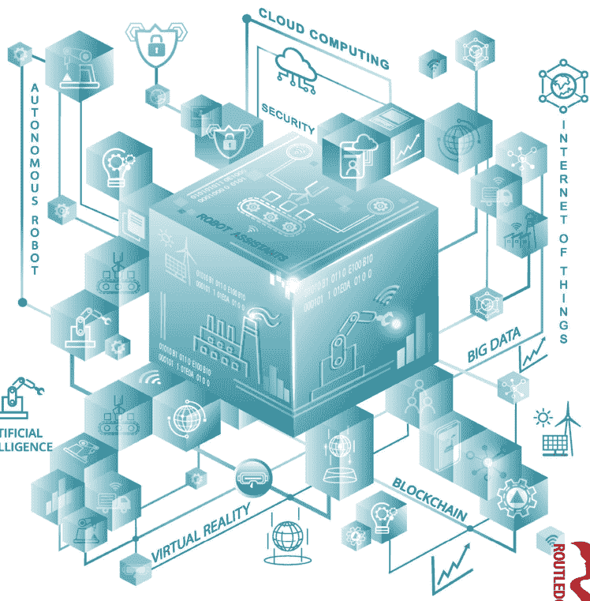
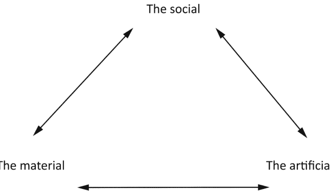
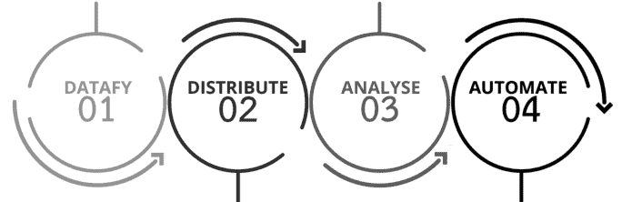
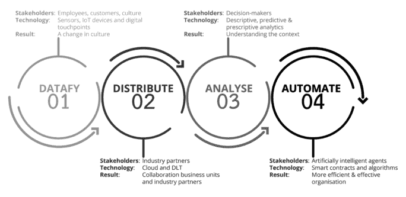

# 未来组织：AI、区块链和数据分析如何将您的业务转变为数据组织 第1版

**马克·范·里德纳姆博士** 是Datafloq和Imagin的创始人。他是一位备受追捧的国际演讲者，大数据、区块链和AI策略家，并撰写了三本管理类书籍。

## 致谢

本书是我攻读博士学位的成果，我在2016年至2019年期间于悉尼科技大学（UTS）进行了该研究。攻读博士学位是一段旅程，将我的学术论文转化为一本（希望是）易于理解的书籍本身也是一段旅程。若无众多人士的帮助，攻读博士学位并将其转化为这本商业书籍是不可能的，我要感谢他们为书籍所付出的辛勤工作、贡献、讨论和审阅。没有他们，本书也不会成为现在的样子。

因此，首先，我要感谢我的主要导师Jochen Schweitzer，感谢他在智力上对我提出挑战并拓展我的视野。感谢你对我所创作的工作给予直接且尖锐的反馈，同时也支持我赋予自己的智力旅程。多亏了你宝贵且不懈的投入，我才能以这样的方式撰写论文，并随后将其转化为这本书。没有你的投入，这将是不可能的。我也要感谢我的其他导师，Mary-Anne Williams和Danielle Logue，感谢你们对我所撰写的工作和论文提出的投入和反馈。在需要的时候，你们的反馈帮助我改进工作并从不同角度看待事物。

书籍写作完成后，得益于Christian R. Meier、Glen Hendriks、Maksym Koghut、Pieter Bos、Stephan Janssens以及我第二本书的合著者Philippa Ryan提供的宝贵反馈，我能够改进手稿的初版。没有你们的反馈，我无法改进这本书。非常感谢大家！

# 欢迎来到指数时代

我们生活在指数时代。我们正经历一场范式转移，其中企业和技术以指数级速度变化和增长，导致深刻的社会和经济变革。组织当前所处的快速变化、不确定和模糊的环境要求它们重新思考内部业务流程和客户接触点。上一次发生如此快速的变化是互联网的出现。互联网促使组织彻底重新思考其业务，并使得拥抱新范式的组织（包括Amazon、Google、Facebook和WeChat）在创纪录的时间内成为垄断者。现在，由于大数据分析、区块链和人工智能（AI）等新兴信息技术（EIT）以及物联网（IoT）等趋势，我们正在经历另一次变革。1 这些技术使初创公司更容易与现有组织竞争。因此，由于缺乏旧系统，这些初创公司比财富1000强公司更具灵活性和敏捷性。在短时间内，如果不给予应有的重视，初创公司可能成为重大威胁。因此，仅仅关注日常运营已远远不够。如果组织希望保持相关性和竞争力，就必须变得创新并适应变化。新技术可以帮助实现这一转变。当大数据分析、区块链和AI相结合时，将改变个人、组织和事物之间的协作。当正确实施时，这些技术可以显著提升客户参与度、增加透明度、降低成本并提高生产效率或服务交付。得益于这些技术，我们从“计算机辅助工作”转向“人工辅助工作”，特别是当人与人之间的互动越来越多地被人与机器的互动，然后是机器与机器之间的互动所取代时。当这些技术融合时，它使组织能够设计更智能的业务，并在组织内部融合这些技术变得前所未有地容易。

然而，正如已退休的加拿大宇航员、工程师和前皇家加拿大空军战斗机飞行员Chris Hadfield指挥官在2018年主题演讲中所言，“智慧只有在你将其运用于……

it”。你可以拥有世上所有的技术，但关键在于你将如何使用这些新工具。你会如何让（现有或新的）技术发挥作用，又将如何带着一个想法去改变你自己和组织？在当今世界，这不再仅仅是收集尽可能多的数据，仅仅是因为收集数据已经变得太容易了。更多的是要用数据做出明智的事情，同时确保隐私和安全。要实现这一点，你需要人类智能与人工智能无缝协作。组织现在可以利用数据，并将学习融入每一个流程。这可以赋予人们各种形式的智能，并“让智慧发挥作用”。我们现在正迎来有史以来最伟大的机遇，迫使组织为未来押注重注，并敢于思考不可能之事。¹ 组织应该采取进攻姿态并颠覆其所在行业，如果他们想要在这个快速变化、竞争激烈的世界中生存的话。新兴信息技术正在快速改变我们的工作和生活方式。组织必须适应这些新技术，如果他们希望在未来保持相关性。

本书旨在通过清晰地阐述这些技术是什么、它们如何协同工作以及它们将如何改变你的业务，帮助组织理解这些快速变化的时代。只有当你理解这些新的颠覆性技术时，才能将它们融入你的组织。因此，本书也将关注这些新兴信息技术的负面影响，以及组织应当采取什么措施来防止消费者成为日益数据驱动世界的受害者。

## 1.1 数据的重要性

在不断变化的环境中，组织不仅要专注于日常业务运营的卓越，还要具有创新性并适应变化，才能保持竞争力。² 归功于新兴信息技术，新进入者在传统封闭市场中竞争变得更加容易。³ 这意味着，如果组织希望保持竞争力，应对、反应以及预判行业颠覆的能力变得至关重要。检测、预判并应对颠覆性变化，同时展现行业领导力并管理利益相关者不断变化的行为，这被称为“组织两栖性”。⁴，⁵ 在面对快速变化和不确定的环境时，这被认为尤为重要。⁶，⁷ 希望实现这种两栖性的组织应将数据作为业务的关键资源，并发展数据驱动的商业模式。⁸ 这要求组织使用各种内部和外部数据来源。对这些数据应用各种活动，包括处理、分析和可视化，并利用这些活动产生的洞察，在正确的时机、以正确的价格，针对正确的客户开发新产品和服务。⁸ 对于许多人来说，这需要一种不同的思维方式，因为许多组织仍然基于经验和直觉而非数据分析来做决策。⁹⁻¹¹

威胁你现有业务的初创公司已经习惯了这种新的、数据驱动的方法。它们利用新技术并尝试新方法。这使它们能够从不断变化的全球市场中可用的机会中获益。此类初创公司（有时会实现指数级增长）通常以所谓的“平台方法”进行组织设计为特征。平台组织是一种元组织，其成员在保持独立的同时从规模经济中受益。¹² 著名的例子包括 Uber，世界上最大的出租车公司却不拥有任何出租车；Airbnb，世界上最大的住宿提供商却不拥有任何酒店；或 Facebook，世界上最大的媒体公司却不创建任何内容。¹³ 组织设计的另一种新兴方法是去中心化自治组织（DAO）。这种全新的组织形式利用区块链技术和智能合约建立没有管理层或员工的治理，完全由计算机代码运行¹⁴（其中 If This Then That 语句部署在区块链上，但第 4 章将详细介绍）。这些方法从根本上挑战了现有行业的做法。几乎所有新技术都会产生大量数据，这些数据可以使用算法进行分析，以帮助得出行动并改进决策。因此，这些公司首先是数据公司，碰巧提供某种服务，例如连接人们（WhatsApp）、将人们从 A 地移动到 B 地（Uber），或让消费者体验当地住宿（Airbnb）。

将你的组织视为数据组织，将彻底改变你的所有流程和客户接触点。这是一个艰难的改变，但如果你希望能够与自成立起就一直这样做的初创公司竞争，这是必需的。当你将组织视为数据组织时，会发生一种“格式塔转换”；突然间，你将从不同的角度看待你的组织。例如，一家汽车公司不应再将自己视为汽车制造商，而应视为一家从事帮助人们从 A 地到达 B 地业务的软件公司。它应该审视公司如何以最可靠、最舒适和最安全的方式做到这一点。一旦思维方式改变，组织就可以问自己是否要生产汽车、飞行出租车，或开发“类 Uber”应用程序。银行也是如此。银行不再是一家金融机构，而是一个使人们能够存储价值并进行安全交易的数据组织。是否使用加密货币、作为仅移动端银行或存储数字身份数据，都成了可以提出的问题。如今，任何组织，无论其所属行业，都应将自己视为数据组织。这样做时，它可以消除阻碍业务以最高效、最有效且最客户友好的方式交付产品或服务的任何障碍。在数字世界中，一切皆有可能，尽管可能需要一些时间来弄清楚。

## 1.2 数据的负面影响

当今社会数据的泛滥也存在负面影响。谷歌、亚马逊、Facebook、微软、腾讯和阿里巴巴等当今科技巨头早已认识到数据是一项宝贵资产。他们从一开始就一直以“免费”服务为交换，聚合海量数据。不幸的是，“免费”服务的问题在于，你和你的数据才是实际产品。这导致了网络的集中化，少数几家组织主导并控制着网络。¹⁵ ¹⁶ 这造成了真相和信任方面的问题——例如假新闻、点击诱饵、网络喷子、垃圾邮件、缺乏隐私以及缺乏问责制。因此，本书不仅将帮助你将组织转变为数据组织，还将帮助你以正确的方式做到这一点。

这种集中化，即互联网最终落入少数几家非常强大的公司手中，并非万维网最初设想的样子。正如蒂姆·伯纳斯-李爵士在2016年去中心化网络峰会上所说：¹⁷

> 网络的设计初衷是去中心化的，让每个人都可以拥有自己的域名和自己的Web服务器来参与，但情况并非如此。相反，我们现在面临的情况是，个人个人数据被锁定在这些数据孤岛中。

这些集中化的互联网公司极其强大。他们可以访问用户的大量数据，并利用和滥用这些数据在网络上追踪（潜在）客户。他们常常忽视现有的隐私惯例。¹⁵ ¹⁸ 科技巨头利用其巨大的数据孤岛通过广告赚钱（据摩根士丹利分析师 Brian Nowak 称，85% 的在线广告支出流向谷歌和 Facebook¹⁹）。他们随心所欲地使用数据，通常未能正确地让消费者参与或告知消费者。²⁰ 此外，虽然一些组织非常重视数据安全，但许多组织并不重视。因此，许多消费者成为了每年发生的数百起数据泄露事件的受害者。他们的信息落入不法分子之手，给组织、个人和整个社会带来巨大成本。²¹

2018年发生的最大丑闻和隐私泄露事件之一是，当时揭露了多少消费者的Facebook数据被剑桥分析公司窃取和滥用。剑桥分析公司是一家数据挖掘和数据分析公司，在2016年美国总统大选、英国退欧公投以及其他一些最近的政治竞选中发挥了关键作用。该公司背后的关键人物支持特朗普总统，包括特朗普的前战略顾问史蒂夫·班农，以及（讽刺地命名为）政府问责研究所的创始人罗伯特·默瑟，该研究所使用暗网和机器人来诋毁政治对手。2014年，该公司使用未经这些用户授权获得的个人信息来开发

一个高效系统，用于定位个别美国选民。以学术研究为名，他们未经被收集数据者的知情同意，收集了8700万个个人资料。剑桥分析公司随后利用这些数据影响美国大选。这是一次前所未有的规模的隐私泄露事件。它表明Facebook保护其用户的努力并未奏效。Facebook已经在其平台上面临着巨大的假新闻问题。这次大规模数据泄露表明，是时候重新思考我们如何处理数据了。网络的中心化导致消费者对这些垄断企业日益依赖，因此，我们互联网用户对自己的数据没有控制权。相反，Facebook、Twitter和Google等公司收集我们的数据，并用于广告目的，赚取数十亿美元。不幸的是，逃脱这些公司的权力相当困难。即使你没有Facebook个人资料，该公司也能通过所谓的“影子档案”来追踪你。22 这些影子档案之所以可能，是因为Facebook的“赞”按钮几乎出现在每个网站上。这使该组织能够通过收集你的位置、计算机ID、IP地址、浏览行为和其他有价值的数据来源等分散数据，来追踪互联网用户。通过这些实时捕获，他们在连接这些数据时，可以发现其中的模式。在2018年关于剑桥分析丑闻的国会听证会上，马克·扎克伯格声称对这些影子档案一无所知。这一惊人且令人不信的言论，因为该问题最早于2013年由Packet Storm Security的研究人员曝光。23

仿佛这些影子档案还不够，2018年，人们发现谷歌与万事达卡达成了一笔秘密协议，使其能够获取数百万消费者的消费模式。谷歌向万事达卡支付了数百万美元，以便能够将其广告点击与实际的线上和线下购买关联起来，以了解广告效果。利用万事达卡的数据，谷歌可以将你的广告点击与你的（离线）交易关联起来，即使该点击并未转化为即时销售。凭借你的谷歌电子邮件地址和万事达卡的数据，谷歌可以获取你的收据数字副本，以确切知道你在购买什么、何时购买以及花费多少。随后，这些信息会共享给一组特定的谷歌广告商，他们可以利用这些数据来改进广告，并且很可能增加广告支出。奇怪的是，尽管万事达卡的客户本应被告知此事——因为这直接影响他们的隐私——但许多两亿万事达卡持卡人并未被告知这笔交易。24

这两个例子表明，数据有显著的负面影响。特别是当数据仅由那些不对其数据收集、共享和处理行为负责的中心化公司控制时。多年来，一个分布式节点网络的目标——让每个人都能为了人类的福祉而参与——已经丧失。这就是蒂姆·伯纳斯-李爵士及其同事最初设计网络的方式。如今，我们有许多中心化公司提供中心化服务，这些服务剥夺了消费者数据所有权、隐私和安全等基本自由。消费者往往成为大型组织不当行为的受害者，这些组织不妥善保管客户数据，使其客户处于脆弱状态。此外，一些政府利用这个中心化网络审查言论自由。各国经常封锁维基百科、Twitter或Telegram等重要网站，仅仅因为它们托管了某些不喜欢的文章或帖子。由此可见，我们所熟知的互联网存在问题。如果我们想要构建明天的组织，我们也需要修复互联网。

现有的互联网已经削弱了个人与组织之间的信任。中心化网络以及可以匿名（但不承担责任）的可能性，导致了一系列负面行为。然而，一种完全负责任的数字社会，如中国目前正在使用芝麻信用社会信用评分系统所构建的，也不是解决方案。（芝麻信用在第4章中详细讨论。）芝麻信用针对在线匿名问题所提出的解决方案，导致隐私缺失（从西方的“隐私”角度来看），同时由于网络的进一步中心化，使得完全的政府监控和控制成为可能。因此，我们面临信任问题，或者如皮尤研究中心互联网与技术主任李·雷尼所言：25

> 信任是一种社会、经济和政治的粘合剂。关于信任和社会资本的大量研究文献记录了信任与福祉、集体问题解决、经济发展和社会凝聚力之间的联系。信任是友谊和照顾的命脉。当信任缺失时，各种社会弊病便会展开，包括暴力、混乱和瘫痪式的风险规避。人们普遍担忧，人们使用互联网的方式正在破坏信任。信任与真相的命运亟待把握。

问题在于网络和互联网的开发方式。当互联网被创建时，原始设计师做了很多出色的事情。他们创建了TCP/IP、DNS、HTTP等标准。然而，不幸的是，他们也遗漏了两个重要标准：一个身份协议，用于在线上使用你的离线身份并完全控制自己的数据；以及一个声誉协议，允许用户在线上具有声誉并承担责任，即使他们是匿名的。他们遗漏了这一点，仅仅是因为当网络开始时，只有受信任的参与者才能访问网络，这些协议根本不必要。因此，为了构建明天的组织，我们需要恢复这种（在线）信任。我们需要恢复网络的原始设计，并用声誉系统取代网络目前的匿名性，以允许（伪）匿名实体在整个互联网上具有声誉和可问责性。此外，我们需要一个网络，限制中心化组织使用和滥用消费者数据的影响力和权力，从而无视他们的隐私。相反，我们应该给予消费者对其数据的完全控制权。换句话说，我们需要一种自主身份（将在第5章中详细探讨）。

除了数据的中心化控制和所有权，或缺乏身份和声誉协议之外，有偏差的数据也会造成巨大问题，我将在第6章中讨论这一点。鉴于所有这些问题，新兴信息技术似乎对社会有许多负面影响。然而，也有希望。越来越多的组织（尤其是初创公司）和监管机构认识到数据治理、伦理和隐私的重要性。像欧盟通用数据保护条例（GDPR）这样的法规旨在保护消费者，而像伯纳斯-李的Inrupt这样的初创公司旨在将控制权交还给消费者。2018年，蒂姆·伯纳斯-李爵士揭示了他的新愿景：互联网再次去中心化，正如他最初设想的那样。他的技术被称为Solid POD（个人在线数据存储），由他的公司Inrupt开发。Solid POD将允许每个互联网用户存储自己的数据，无论是视频、文章、可穿戴追踪数据还是评论，并与任何已连接到Solid生态系统的人或任何网站共享。使用Solid POD，用户将始终完全控制自己的数据，以及谁有权访问、谁无权访问。这是一个伟大的新举措，希望能让我们更接近一个去中心化的社会，在那里数据由创建者拥有，隐私受到保护，安全是理所当然的，分布式账本技术将使个人、组织和事物之间能够进行无需信任的交易。

近年来，媒体对数据问题的关注也日益增加。因此，消费者对科技公司掌握的数据所带来的后果有了更多认识。他们越来越多地要求改变，或自行采取行动。随着技术社区和学术界讨论的不断深入，需要一种新型组织，并且幸运的是，这种组织也正在涌现。16, 26 这种类型的组织应用分析、区块链和AI等技术，为创造更美好的社会做出贡献，它体现了网络的初始价值：一个尊重用户隐私和安全的组织；一个将公平地奖励用户的工作，并将内容和数据的控制权交还给用户的组织。在这本书中，我将讨论如何构建这种组织，即明天的组织。我将从消费者的视角，而非股东的视角（这常常是情况）来做到这一点。毕竟，如果你照顾好你的客户，你的客户就会照顾好你的股东。

## 1.3 协作的变迁

新兴信息技术正在改变组织。这些技术如何改变一个组织，不仅取决于技术本身，还取决于回应该技术的人们的社会行动。27 作为人类

与技术在不同情境下进行交互，会改变他们的行为，进而改变组织的行为。28 因此，组织变革需要打破旧有习惯和价值观，同时改变高影响力的系统，例如决策能力和治理实践。29 技术初创公司早已理解这一点，并已发展出吸收能力和整体创新能力。30 他们重视收集和分析数据的机会，并创建更敏捷、更灵活的组织。初创公司熟悉构建以数据为业务核心的数字化组织。31, 32 随着数据驱动型业务的到来，出现了新的利益相关者或参与者，导致这些参与者之间产生新的协作方式。此类变革伴随着采用不同思维模式的需求，以解决当前涉及消费者数据的问题。对许多人来说，这需要进行根本性变革。33-35

为了了解数据驱动型组织中参与者之间的协作如何变化，我将在下一章中更深入地探讨组织与技术如何交互。当新的人工参与者加入时，交互方式会如何改变？组织是社会实体，由于环境、规模和所采用的技术等情境变量，它们对变革需求的响应各不相同。有些组织会表现出重定向行为，而另一些则会展现出失败的举动，还有些则不愿改变。28, 36 例如，在线电影发行、数码摄影和在线图书零售等领域，出现了 Blockbuster、柯达和 Borders 等企业，成为曾经成功的公司缺乏应对新兴技术变革所需创新思维或意愿的著名案例。37 成功的组织会不断适应并利用更新、更先进的技术以求生存。38 新进入者，如 Facebook、Amazon、Apple、Netflix 和 Google（负责所谓的 FAANG 股票）或阿里巴巴、百度和腾讯，已表现出此类重定向行为，以利用被其他公司忽视或疏忽的（技术）机会。39 因此，为了避免在 2010 年代中期被称为“柯达时刻”的情况，培养及时检测、预判并应对市场变化和竞争压力的能力至关重要。

这种数据驱动方法的结果是权力与授权之间平衡的转变。40 因此，这在涉及的组织利益相关者之间创造了协作的转变。它通过以下方式实现：（1）纳先前被排除的参与者，例如客户或竞争对手；41 以及（2）从纯粹的人与人交互转向人与机器交互；而且越来越多的是机器与机器交互。42, 43 这需要整个组织内部具备创新思维。他们需要重新思考内部流程、客户接触点和结构，并从传统的产品模式转向协作服务模式和生态系统。如果成功实施，这些利益相关者（包括人类和人工）之间的新型合作方式将确保生产力持续增长。44, 45 要成功融入新兴信息技术，组织需要像软件公司一样思考；将自己视为数据组织。11

这些组织必须将现有的模拟流程转换为可分析的数字流程，并构建数字平台以发展组织。开发数字平台不仅提供新的收入流和持续的增长机会，还允许公司与先前被排除的合作伙伴建立新的合作伙伴关系。此类协作社区中，组织共享知识，与行业合作伙伴甚至竞争对手建立协作关系，并推动创新，其核心是数据。41, 46 数据和新兴信息技术将使这些组织不仅能够与行业合作伙伴，还能够与任何先前被排除的利益相关者（无论是人类还是机器）建立联系。其结果是组织活动的新方式，最极端的组织设计形式是 DAO。此类组织使用区块链技术和智能合约结合 AI 来建立没有管理层或员工的治理，完全由计算机代码运行。14

尽管组织中涉及的参与者类型从未局限于人类参与者，但新技术导致的网络结合了社会参与和基于机器的计算。47–50 在此类组织中，人类与机器相互交互，以产生不断演进的协同效应。社会交互变得更加重要，交互变得不那么苛刻，而机器–人类交互则更加突出。43 因此，大数据分析、区块链和 AI 在涉及的参与者之间产生了新的协作模式，各自对协作提供了不同的视角。大数据分析为客户和员工提供洞察和信息。当更多人能够获取信息和知识时，授权成为可能。40, 51 因此，当组织使用分析向更多人提供信息和知识访问权限时，权力会得到更平等的分配。这将使整个组织实现授权，并导致分散化的决策。52–55 相反，区块链通过创建由全球分布的点对点参与者网络所创造的分布式价值，实现点对点协作，这些参与者轻松协作并实时共同为网络中所有参与者创造价值。56, 57 它由密码学、共识机制和智能合约管理，实现无信任的交易交换。58 AI 关乎自动化操作，使人类与机器之间出现新的交互形式，从而产生不同强度和参与度的交互。43 因此，组织参与人类与机器之间的各种交互，导致意想不到的技术、社会和伦理影响，需要复杂的策略来应对。59

## 1.4 结论

特别是技术初创公司似乎重视收集和分析数据以创建新组织的可能性。这些新进入者通常采用不同的组织设计方法，因此，其业务模式比现有组织更敏捷、更成功。32 他们比现有公司更能够利用新技术并尝试新方法。他们从不断变化的全球市场中产生的机会中受益。了解这些初创公司如何做到这一点，可以帮助现有企业在面临新的数字平台组织和颠覆性技术的挑战时保持竞争力。因此，在接下来的章节中，我将讨论大数据分析、区块链和 AI 等新兴信息技术如何改变您的组织。数据在其中处于核心地位，因为所有新技术现在都会生成数据。要从该数据中获得洞察，需要分析。无论数据的体量、速度或多样性如何，分析都用于解释数据。区块链受到审视，是因为其有可能从根本上改变我们处理数据的方式，并且分布式账本技术中使用的密码学显著影响组织设计、决策能力和现有权力结构。42, 60 最后，AI 受到讨论，是因为构成算法的数学公式依赖数据来自动化和加速决策并改善业务，从而形成算法驱动的业务，AI 成为业务的重要组成部分，而算法在无需人类干预的情况下运行组织的多个方面以理解数据。61, 62 在第 7 章中，我将解释组织应采取什么措施为数据驱动的未来做好准备，使用 D^2 + A^2 模型。我将为组织提供一条清晰的路线图，以便在快速变化的运营世界中保持相关性和竞争力。但在此之前，让我们先探讨技术将如何改变明天的组织，以及组织应如何应对。

## 注记

i 本书遵循行业惯例，在书写 Bitcoin 与 bitcoin 以及 Blockchain 与 blockchain 时加以区分。当写作 Bitcoin 时，指的是技术；而当写作 bitcoin 时，指的是加密货币。Blockchain 亦然，它指代技术/趋势的整体，而 blockchain 指一个或多个区块链；即分布式账本数据库。

# 技术如何改变组织

要理解技术将如何影响明天的组织，我们首先要回到过去，看看技术如何影响过去的组织。组织过去对新技术的响应经验，可以帮助你为明天的组织做好准备。下一节可能稍微有些理论性，但请耐心阅读，因为这将帮助你更好地理解影响你组织的力量。

技术如何影响组织的问题已被研究数十年。最早的研究可以追溯到20世纪50年代，当时人们考察了制造技术对管理和决策的挑战及影响。63 在一项著名的研究中，探讨了组织结构与组织绩效之间的关系。该研究表明，特定类型的技术与特定的组织设计相关联。换句话说，所使用的制造技术类型影响了组织的设计，如果两者同步，就会带来卓越的绩效。64 例如，基于标准流程生产标准化产品的大规模生产公司（如汽车制造商）体现机械式结构，而同时利用技术生产一种或多种产品的组织则体现有机式结构。20世纪50年代和60年代的这些早期研究侧重于技术如何影响组织结构和生产流程，尤其是与制造技术相关的方面。64-67 这些早期研究的核心观点是：社会层面（管理层、员工和客户）与技术层面（机器和设备）是组织结构中同等重要的组成部分，两者都被视为组织成功的关键。68, 69

在那时，技术被认为对组织具有可预测的影响，其中技术的设计决定了影响。38, 70, 71 随着技术从传统的“离线”技术（如制造设备）演变为信息技术（IT）（如计算机和电子表格），研究人员开始将技术视为组织的物质要素，以理解IT对组织的影响。12, 38, 72, 73 这形成了这样一种观点：人类利益相关者是关注的焦点，用于理解个人如何创造社会世界，同时制度属性影响人类行为和社会关系。也就是说，人类塑造世界以及周围的技术，而世界也塑造着人类。74 人类互动由意义、权力和道德框架的结构构成。如果你希望分析人类互动，应该分析这些结构。这项在20世纪80年代发展起来的理论，结合了人类如何解释行为、如何实现意图以及什么是适当行为。75 由此产生了这样一种观点：技术既是物理对象也是社会产品。技术是行动与结构之间的推动者。76 因此，人类如何使用技术可能改变组织结构。因此，技术可以改变行动，进而导致组织结构发生变化（如集权化或决策制定）。

20世纪90年代先进IT的出现，改变了组织设计、智能、管理和决策的性质。38 其理念是，这些技术增加了利益相关者之间的沟通，从而缩减了组织的广度、深度和宽度，赋予员工权力，减少面对面会议的次数，使组织的决策过程更加高效和有效。当然，20世纪90年代曾被视为先进IT的东西，我们现在不再将其视为先进IT，而视为早期的信息技术。尽管如此，20世纪90年代组织采用IT的经验教训可以应用于当今的组织。技术与社会互动被视为相关，其中社会结构是规范决策能力的规范和行为。77 技术被认为能够提供新的可负担性或重新配置组织结构。然而，技术的影响因技术所能提供的可负担性而异。因此，有时会促进活动，有时会限制活动。78 技术既被视为促进社会行动，也被视为限制社会行动。人类行为者可以不断塑造IT，使其保持灵活，而不会成为固定的约束。长期以来，IT的开发和部署一直被视为一种社会现象，其中社会和物质维度影响组织。这种视角有助于理解IT在组织内是如何被使用和制度化的。重要的是，IT被视为人类行动的产物和人类行动的媒介，它只能“只能制约而不能决定社会实践”。75 尽管，随着IT能力的增强，这一论点变得越来越模糊，如我们在接下来的章节中将看到的那样。

越来越多地，IT被视为时间和背景的产物。人们如何使用技术决定了组织结构，而不是技术本身改变组织结构。因此，人们如何使用IT很重要，而且往往是组织的管理层决定了技术将如何在组织内使用。然而，技术具有不同程度的解释灵活性，意味着人们在设计、使用和解释技术方面存在灵活性。因此，员工可以无视管理层的指示，这将导致组织结构发生变化。79 这种灵活性由技术的物质可负担性、制度背景（如权力或知识）、人类利益相关者的利益以及时间决定。因为技术倾向于在组织内变得常规化。借助当今新兴信息技术的“通用且无限的物质性”，这一概念变得越来越重要，因为越来越多的技术有能力改变制度背景。80

随着技术多年来变得越来越先进，这些观点发生了变化。技术如何被使用和组合会创造特定的（组织）结构，从而使技术具有更具社会化的视角。28 然而，这种方法也因过于社会化而受到批评，其中技术“是用户随心所欲摆布的”，暗示用户可以按自己认为合适的方式应用技术。81 因此，技术越来越多地被视为一种结构属性。焦点转向将技术视为物质，其中技术存在于“结构领域”，而技术使用存在于“行动领域”。81 这意味着技术本身被视为组织的一部分。技术如何被应用和使用取决于组织内人员采取的行动。这种观点的结果是，技术不具有能动性，而是人们在使用技术时将能动性归因于技术。82 换句话说，技术没有自己的意图或自由意志。相反，人类如何使用技术决定了结果。这一立场的核心组成部分是执行性的概念。执行性展示了技术与人类之间的关系和边界如何在实践中被执行，因此并非固定或预先给定的。当某事物有助于创造其所描述的现实时，它就是执行性的。例如，执行性可以应用于理解算法交易：描述期权定价世界的模型后来被用于算法中，从而执行那个世界。换句话说，该理论被用来构建其所描述的市场。因此，这些模型促进了其最初描述的现实的发展。它可以被视为一种催化剂，帮助启动一个过程，或中介用户参与，以实现某个目标，或者理解并参与不断变化的环境。83

这种方法帮助研究人员讨论对象的物质性（即对象的物理或数字特征）。它促使引入了社会物质性概念，从而从技术制品和使用中的技术转向社会与物质，并更加强调技术的作用。84 社会物质性是一个理论概念，帮助研究人员理解技术与组织如何相互作用。然而，它也可以帮助管理人员更好地理解未来技术将如何影响他们的组织，以及需要采取何种回应才能成功融入这些新技术并保持竞争力。因此，请再耐心一下，让我解释

社会物质性概念以及学者们持有的不同论点，所有这些将在本章末变得清晰。

## 2.1 社会物质性概念

组织由“人类行动和互动的物质形式和空间”创建。84 当人们相互交互时，这会影响技术。因此，技术影响人们如何相互交互。它们是构成性地纠缠在一起的。84

这意味着，社会（管理层或员工，即组织）与物质（如椅子或计算机等技术）是纠缠在一起且不可分割地相关。社会塑造技术的物质性，而物质性存在于每一个被视为社会的现象中。27，84

基本上，这意味着技术影响人们和组织。

人们如何使用这些技术然后影响该技术的结果，进而再次影响组织，如此循环。

因此，在纠缠中，物质影响社会，反之亦然。

所有组织方面都受物质约束。

在处理在线（社交）媒体时，这一现象变得可见，技术既促进又限制媒体用户的行为。85

例如，最初，Instagram上的网红仅使用照片通过社交媒体网络与粉丝联系。

他们收到的点赞数量影响了他们的受欢迎程度，而他们的受欢迎程度可能影响他们如何使用Instagram。

当Instagram于2013年引入上传视频的可能性，从而改变了网络的技术可负担性时，网红们立即调整了行为，并开始专门为Instagram制作视频。

然而，这些视频仅限于60秒，从而再次限制媒体用户的行为，等等。

社会物质性概念将分析从技术发展转向物质的使用。

技术本身不是社会物质性的，但其嵌入的实践是。86

社会和物质能动性变得相互锁合，并产生技术和组织。

一些研究人员甚至用社会与物质不可分离性的概念来扩展这一观念。

他们声称，物质没有属性，只有在积极参与网络时才存在。87

社会物质性将物质和社会视为组织活动的内在部分，这就是为什么一些人主张在处理信息技术时社会与物质的纠缠。86

随着组织日益受到多种、新兴的、变化的和相互依赖的（信息）技术的影响，物质性成为日常生活不可或缺的一部分。84

正如互联网在当今世界如此普及，以至于我们常常不再意识到自己正在使用它，并且在日常生活中完全依赖它。

当这种情况发生时，它会改变组织内部现有的关系和权力平衡。88，89

要准确理解这一点，让我们先讨论社会和物质能动性的概念，因为这将帮助你掌握从这个角度审视组织的重要性。

在这个语境下，社会能动性指人类如何定义和使用技术。

人们如何应用（新）技术来实现他们的目标。

而物质能动性是非人类行为者在没有人类干预的情况下行动的能力。90

因此，社会和物质能动性都涉及行动，但意图不同。

社会能动性是一项为实现特定目标而进行的协调行动。

物质行为者通过执行性来行使能动性；也就是说，非人类行为者没有固有意图，也不采取行动来实现自身目标，因为非人类行为者并非自行设定目标。82，91，92

相反，当人们使用物体和技术并与其交互时，他们会将能动性归因于对象和技术。

人们可以自由地以他们认为必要的方式实施技术，因此技术处于人类行为者的自由裁量权之下。82，93

正如我们将看到的，在处理新兴信息技术时，这一观点不再适用。

从这个立场来看，在处理人们如何实现目标时，不应优先考虑人类或物质能动性，因为“两者对塑造对方的贡献是平等的”。59，90，94

因此，人类和技术通过相互渗透而获得形式、能力和属性。

社会和物质是不可分离的。59，94

物质人工制品是什么很重要，因为人工制品不仅仅是组织的表象。

当用户与技术交互并对该组织形成新理解时，技术也有助于创建组织。95

随后，物质人工制品中介并塑造交互，影响内部权力关系。

既然在制定战略时社会和物质与权力直接相关，因此将权力概念纳入社会物质性非常重要。96，97

权力维度在改变或维持特定组织模式中发挥作用。

一些行为者在技术的使用上比其他行为者有更大影响，从而强化现有权力结构。

例如，管理者通常决定新技术应在组织内如何使用。36，98

然而，新技术的采用也可能导致冲突并改变现有的权力分配、社会秩序以及群体中既定的互动模式，因为新技术通常会导致行为者能够获取新信息或此前被排除的信息，正如我们将在第3章中看到的那样。30，75，96，99

能够获取新的和更多信息改变了人们的行为方式、他们执行的任务，以及人们之间的沟通方式，正如我们看到电子邮件最初引入组织时所见；它彻底改变了人们的工作和沟通方式。

这可能引发互动模式和工作角色的变化。27，100

因此，技术变革可能导致政治变革、社会秩序变化和/或组织内部现有权力平衡的转变。76

不同的新兴信息技术将产生不同的影响，并引发现有互动中的不同变化。

因此，要了解新技术如何影响现有组织模式，理解所实施技术的复杂性非常重要。

例如，大数据分析可以带来赋权，因为“员工知道的内容与管理者知道的内容之间的界限越模糊，他们之间任何传统的支配与服从关系就变得越脆弱和毫无意义”。101

因此，在接下来的章节中，我将讨论大数据分析、区块链和AI的复杂性，以提供关于它们将如何影响您业务的见解。

当人们在处理技术时如果需要，会灵活改变自己的日常惯例，因此，技术可能导致人与人之间的关系变得不那么等级化、更加协作。90，102

因此，与EIT相关的社会物质安排导致某些变化的权力关系；那些此前被排除在信息之外的人，可以通过数字化，获得宝贵见解和信息的访问权。

因此，数字化从根本上转移了社会与物质之间的权力平衡，从而改变了现有关系和决策过程。38，76，88，103

换句话说，能动性是人类和非人类行为者实现的一种能力。

它是网络中那些人类和非人类能动性之间的关系和互动的结果。104

因此，当社会和物质代理相互作用时，他们的能动性会发生转移，并且他们会发展出复杂的社会物质性网络。86

理解社会和物质能动性之间的区别，有助于理解新兴信息技术将如何与您的组织交互。

理解原因的关键首先要清晰地理解和定义什么是技术。

因此，在下一节中，我将探讨在EIT背景下什么是技术。

## 2.2 组织中的技术概念

在20世纪90年代，IT被定义为“一种增强理性的技术，它传输、操纵、分析或利用数字信息，从而促进更容易、更便宜、更受控的沟通和信息转移，这将增强组织智能并减少决策中的管理层级”。38

尽管技术取得了进步，这一定义仍然站得住脚。

信息技术由三个方面组成：机械系统（硬件）、人类系统（技能和人力）和知识系统（抽象意义和概念）。

技术是描述性的（组织内技术的类型和角色）以及关系性的（技术与结构之间的关系）。105

因此，当人们使用技术时，它影响他们的行为，而行为又影响他们如何使用技术。

它常被视为推动组织内部变化的外部力量。28，73

因此，技术并非中立，而是构成某一现象不可或缺的物质组成部分。73

它是人类、行动、选择、社会历史的持续互动的结果，

以及制度背景。其物质制品被社会定义、生产，并且仅对参与其中的人有相关性。73 技术曾用于对组织产生某些可识别的影响。然而，随着技术迅速变得更加复杂，理解或预测技术对组织的影响变得越来越困难。73 因此，我们需要一种新的思维方式来思考技术与组织如何相互影响。91. 103 由于我们目前经历的技术指数级变化，IT仅拥有人类行为构建的社会和物质实践这一原始观点可能不再适用。因此，从纯粹的社会和物质视角看待技术可能已不再充分。因此，当我们谈论数字技术时，什么定义了物质，以及IT是否可以被视为物质性，已变得不清楚。

亚里士多德早已将物质性称为可感知的（可以被感知的）和可理解的（不能被感知的）。108 椅子、桌子、书籍、建筑物、钢笔、数据或计算机等物质性可以被视为技术，栏目、记录、数字或算法亦是如此。因此，一方面，数字技术可以被定义为物质的，因为人们可以直接与二进制信号交互，因此它可以被感知。27 数字技术发展速度如此之快，以至于形式和功能越来越与物质分离，例如量子计算的例子。它们是从以前不可想象的颗粒水平材料中开发出来的。然而，这并不意味着它们不再是物质的，因为二进制信号甚至原子对所有用户都以相同的形式存在。虽然它们可能无法直接观察到（你是否真正观察过0和1？），但它们仍然有物质后果，因此可以被视为物质。91 因此，只要数字技术的物质条件和特征跨越地点和时间差异而持续存在，它就可以被视为物质。然而，另一方面，数字制品在无法被限制的情况下不断变化和演变。103 数字元素没有重量且缺乏任何空间存在方式，因此应被视为非物质的（2011年估计，当今互联网上存在的所有数据重量约为50克，或相当于一个中等大小的鸡蛋）。84, 88, 89, 109, 110 这将意味着数字技术不能具有与其相关的任何物质能动性。尽管它们在物质世界中扮演着积极角色，并产生重大后果，但没有“事物”，因此数字技术不是物质的。111 信息技术是否是物质的似乎可能是一个不重要的语义讨论，但当我们开始谈论这如何与新兴信息技术相关时，它就变得重要了。

IT可以在组织中重新分配知识、资源和惯例，但今天，IT也可以（重新）创造新知识和新信息技术。我当然是在谈论人工智能。AI越来越多地使用神经网络和深度学习算法，这些算法并非由人类训练。相反，它们接触海量数据集、数百万个视频/图像/文章等，算法必须自己弄清楚如何识别不同对象、句子、图像等。结果，它可以想出人类无法想到的解决方案。例如，2016年，Google的研究人员创建了一组算法，这些算法需要相互通信，并防止第三个算法窃听他们的对话。结果，这些算法开发了一种成功做到这一点的加密方法。然而，所创建的加密方法使用了人类永远不会使用的模式，因此人类已无法解密它。¹¹² 这在封闭环境中效果很好，但如果投入野外使用可能会变得相当可怕。此外，普遍观点认为技术会随着时间稳定下来。人类行为不再完善和修改技术，而在使用增强反馈回路的自学习算法的世界中，情况已不再如此。²⁸ 此外，解释人们如何处理和与技术交互的“技术实践”概念也无济于事，因为它假设只有人类处理技术。技术可以用某些材料和假设构建，但只有当人类行为使用它时，它才会结构这些行为。当行为体决定使用一种技术时，行为体也决定如何与之交互，这些交互随时间可能不同（例如，在不同国家和不同规则下驾驶汽车）。然而，物理属性导致如何使用制品的边界条件，并且它越集成到系统中（如组织），其替代用途就越窄。不幸的是，这些概念在处理新兴信息技术时都没有提供任何指导；例如，在AI和区块链中，非人类行为结构化技术行为，技术甚至创造新技术，同时也采用和使用该技术。例如，美联社等组织使用算法以每分钟2,000篇的速度撰写财务报告。当然，这些不是深度获奖文章，而是与业务相关的故事，如季度收益，涉及股票市场表现和企业利润。然而，这些故事过去是由人类撰写的。金融界的另一个例子是风险投资（VC）公司Deep Knowledge Ventures。2014年，这家香港风险投资基金将一项算法任命为其董事会成员。该算法有权投票决定是否对某家公司进行投资。该风险投资基金专注于生命科学和年龄相关疾病项目，该算法名为VITAL，分析来自多个来源的数据，包括临床试验、财务细节、之前的融资轮次、知识产权等。虽然该算法尚未独立运行风险投资基金，但它是风险投资公司处理投资方式的一大飞跃。那么Lapetus呢？一家初创公司，利用人工智能分析你的自拍照，以确定你是否会在两分钟内被接受人寿保险。越来越多地，此类技术嵌入组织中，从而改变社会与物质之间的交互。

技术的使用也受用户理解的影响。²⁸ 当使用技术时，人类受技术的物质性和特征影响，这些特征由设计师和先前用户刻入。在这种情况下，先前的使用影响技术如何被使用。即使这可能不是设计师所意图的方式，人类行为体也可能继续以这种方式使用它（例如，由于企业压力、人员不可用、用户期望或因为他们对技术变得更加了解）。然而，当处理先进技术时，尤其是在处理AI时，情况已不再如此。人造行为体不受企业压力或人员不可用的约束，就像机器人不需要午餐休息或不能罢工一样。如果不成功的行为没有助于实现其最终目标，AI将移除该行为。¹¹³

技术并非社会物质，但其嵌入和实践的实践是“社会和物质纠缠的空间”。⁷³ 然而，在这个实践中，当没有社会参与时，如AI的情况，这种纠缠是否仍然存在？当没有社会参与，而是由技术本身创造的智能行为体时，我们如何概念化这种交互？在接下来的部分中，我将探讨我们对AI的理解及其与新兴的社会物质性概念的关系，以开始把握新兴信息技术如何影响组织。

## 2.3 人工的引入

随着AI的快速发展，组织越来越多地面对（智能）人造行为体。这需要一种不同的方法，因为AI与人类智能根本不同。¹¹⁴ 智能是“一套复杂原则的复杂表达”，由各种相互依赖的子系统共同连接而成。¹¹⁵ 智能之所以存在，是因为进化，它使人类能够建模、预测和操纵现实。这种独特能力使我们能够从心理图像向前和向后推理，并对可能（不）期望的未来结果进行推理。进化创造了我们的智能，但进化本质上是一个愚蠢的过程。它通过试错实现目标，并不具备我们人类拥有的远见能力。事实上，进化这一非智能过程导致了人类智能的缺陷。¹¹⁶ 由于各种限制，例如食物可用性、与其他器官和生物材料的权衡，我们的大脑可能并未以最优化的方式进化。¹¹⁷ 而人工智能则将由（人工的）智能生物/事物开发，它们具备进化所缺乏的远见能力。因此，它更能理解哪些材料和哪些过程最适合智能。它可以运用他人的知识来改进（初始）设计，并从而改进其智能。¹¹⁷ 因此，人工智能将

以当今人类不熟悉的方式观察和行动，因此需要一种不同的方法。

诸如人工智能等不断发展的技术导致组织流程不断演变。特别是，因为计算系统的基本元素——数据和算法——已成为日常生活的核心。理解这些基本知识（一种已称为*计算到人类和物质能动性*的研究流）。它是社会性的，因为它由人类开发；它又不是社会性的，因为越来越多的人工智能产物是由人工智能产物创造的，没有任何人类参与（为了使事情复杂化，这并不意味着在未来的某个时刻人工智能不能成为社会“存在”）。¹²⁰ 此外，它在与人类互动或不与人类互动时表现不同，并且正在迅速变得比人类更聪明，尽管目前仅限于狭窄领域。人工通用智能（AGI）——即与人类一样聪明的人工智能——距离实现还有几十年。¹¹³ 除此之外，它是物质性的，因为它由人类可感知的二进制组成，但这些物质特性会随时间以出人意料的方式改变，“由大量、多样且不协调的受众驱动”。¹²¹ 一旦被设计，人工物就将继续发展和演变，而它所做的事情可以保持不变，尽管会随着时间变得更好。此外，人工能动性可以自主行动；它展现智能行为，有目标，能够推理并监控其行为。¹¹³ 它甚至可以在无需人类行动的情况下自我复制和演化。这的最佳例证是 AlphaGo Zero，即 Google DeepMind 于 2017 年开发的 AlphaGo 算法的改进版本。虽然之前的 AlphaGo 版本是使用人类数据训练的，但该算法版本完全是自我训练的，没有人类干预或历史数据。一个令人震惊的特点，尤其是因为在自我学习下棋三天内，它就击败了 2016 年击败李世石的版本。它通过应用一种新的强化学习形式做到了这一点，算法成为了自己的老师。它与自身对弈，因此总是拥有实力相当的对手，并从每一步棋中学习。虽然击败李世石的旧版本已用他从未见过或想过的着法让世界冠军惊讶，但新版本应用了完全陌生、由其自身学习的策略。结果，40 天后，它超越了所有之前的 AlphaGo 版本，可以说成为了世界最佳围棋选手。AlphaGo Zero 开发的此类出人意料的着法和策略开始越来越多地出现在 AI 开发中。2017 年，Google 的 AI 开发者构建了必须争夺稀缺资源的算法，从而产生了越来越先进的策略来击败该组件。¹²² 2016 年，Google Brain 的另一个项目开发了算法，创造了前所未有的、人类从未开发过的新加密方法，以保护信息免受其他神经网络的侵害。最后，2017 年，Facebook 开发了两种算法，它们自行创造了一种秘密语言，并使用先进策略来达到目的。因此，Facebook 不得不关闭其算法。¹¹²，¹²³ 正如这些例子所示，人工能动性与物质能动性根本不同，因此确实需要一门新的人工科学。¹⁰³，¹²⁴

在组织研究中开发处理人工物的新方式至关重要，因为人工物正以多种、出人意料的方式影响组织。到目前为止，人工物一直被视为影响组织的技术的一部分（例如椅子、建筑物、书籍、笔、数据计算机）。然而，由于 AI 与人类智能根本不同，人工代理独立于人类运行，人工物正在深刻改变组织。因此，需要在组织中采用新方法来处理它，并且需要定义人工代理和人工能动性。在过去，社会能动性被定义为“部分响应对技术物质能动性感知而形成的协调人类意图性”，物质能动性被定义为“技术物质性的作用方式。当人类怀特定意图接近技术并决定在特定时间使用其物质性的哪些元素时，物质能动性被激活”。⁹¹ 这两个定义对人工物都不充分。因此，我将人工代理定义为“除了人类干预之外仍有能力自主行动的人工智能行为者”。作为人工实体，它们可以通过其行事能力来行使能动性；也就是说，通过做出用户或其他人工或人类代理无法控制的事情。因此，人工能动性是“部分响应对人类能动性和物质能动性感知而形成的协调人工可理解的意图性”。了解人工代理是什么以及它们如何行使能动性，有助于将新兴信息技术（尤其是人工智能）纳入明天的组织中。

## 2.4 迈向社会物质性的三分法分析

迄今讨论的社会物质性概念未能探索数字（由人类制造）和人工（由 AI 制造）产物的生成性和构成性规则。¹⁰³ 社会与物质的纠缠引发了

关于后果、责任和问责的伦理问题。¹⁰⁶ 这需要进一步讨论，尤其是在引入人工智能代理时。人工代理变得越来越重要，因为AI不断有突破，这得益于“计算能力、算法设计和通信技术”的提升。¹²⁵ 既然技术制品现在可以由人工智能行为者创建，社会物质性中“技术制品由社会行动创建，进而塑造人类行为”这一重要特征不再适用。因此，“所有信息技术都是由人创造并是社会过程的结果”这一说法不再成立。⁸¹ 因此，我们需要在社会物质性概念中增加一个额外的人工代理。它可以在行动中与社会和物质纠缠。在这个扩展的社会物质性概念中，时间在与人工的关系中变得重要。AI会随着时间不断变化，并根据其持续接收的新输入进行改进，从而改变其物质性，但不改变其社会用途（其目标或目的）。这引导我们采用一种新的社会物质性方法，其中不仅社会和物质通过行动纠缠，而且人工似乎也通过行动与社会和物质纠缠，如图2.1所示。

在这个三分体中，社会、物质和人工似乎会随着时间的推移并通过其代理的行使而相互交织。社会、物质和人工是独立的实体，当它们通过人类、物质或人工代理相互建立关系时会发生纠缠。有必要将人工与物质分开，因为它结合了物质和社会的特征，但又两者都不是。

图2.1 社会物质性三分体

因此，将人工视为独立行为者，有助于更好地理解新兴信息技术将如何影响您的组织，以及在模棱两可和不确定的时代，您应该采取什么措施来确保持续的竞争优势。

在对社会物质性的三分体分析中，社会创造物质和人工，而物质和人工影响社会。物质创造人工，而人工影响、创造或改变物质。关注点在于社会、物质和人工代理如何相互影响，以及它们如何通过相互渗透获得形式、能力和属性，以及它们如何相互作用。社会、物质和人工之间的关系和边界是在实践中实现的，并非固定或预先给定的；也就是说，情境很重要。由于人工对组织的影响在增长，管理者在组织活动时需要理解社会物质性的（重新）配置。在对社会物质性的三分体分析中，执行性的概念对于理解人工代理时代的组织设计仍然具有相关性。这些人工代理通常在某个框架内并基于某些模型开发，当它们被释放到组织中时，会影响该组织以及行为者如何互动。因此，对社会物质性的三分体分析将帮助您理解人类、技术和AI如何相互关联，以及它们如何在行动中相互影响，我们将在后续章节中看到这一点。

## 2.5 结论

那么，您可能会好奇，这一切意味着什么？为何区分社会（人类）、物质（技术）和人工（AI）的概念很重要？在本较为理论的章节中，我的目标是帮助您理解人工智能代理在组织中出现将如何改变组织的运作方式。从社会、物质和人工的视角审视您的组织，可能是定义组织的一种新方式。这样做将有助于您更好地对齐战略目标，因为明天的组织将因新兴信息技术的出现和不断演变而面临新挑战。尤其是智能人工代理的引入，它将接替人类目前承担的许多工作，并将显著影响您的组织。那些能够融合人工代理并将其与其他先进信息技术结合的组织，最有可能在真正的数据驱动未来中保持竞争力。更重要的是，当大数据分析、区块链和人工智能结合并集成时，组织可以转变为去中心化自治组织。这些组织将其流程数据化，通过云或使用分布式账本技术分发数据，使用描述性或预测性分析分析数据以感知和抓住机遇，并利用AI自动化决策。

在当今世界，数据驱动型组织离不开人类，因为组织始终是社会实体，但组织越是转型为DAO，AI和机器人接管的工作就越多。126, 127 然而，几乎可以肯定的是，大多数现有组织永远不会转变为完全的DAO，即没有管理和员工、完全由自主代码运行的组织。因此，组织中仍然存在人类元素，因此，*社会、物质和人工*应保持协调并相互作用，而不相互产生负面影响。这意味着人工应遵循社会所重视的伦理（这本身就是一个挑战，我们将在第6章中看到），物质受到我们社会的规范和原则以及组织内部文化的约束，而社会不应从属于物质和人工。三者应相互平衡存在，忽视商业中人类一面的组织可能会面临困难。

在接下来的章节中，我将讨论大数据分析、区块链和人工智能将如何挑战现有的组织实践，并要求您重新思考战略优先级。尤其是当这些新兴信息技术融合时，对您组织的影响将是显著的，并将影响您的利益相关者（无论是人类还是人工）如何相互协作。

在第3章中，我将讨论，适应环境变化是一个涉及不同组织层级上广泛利益相关者的复杂社会过程。128 组织是整合且动态的实体，与技术、结构和流程相关的战略管理选择决定了公司如何应对环境变化。因此，不仅环境变化，战略管理选择也决定了组织的行为和文化。除了利用合适的技术、流程和结构来响应环境变化的组织灵活性之外，组织还需要发展理解环境的能力。128 这些所谓的动态能力包括使用分析来理解环境和客户需求，开发匹配这些需求的产品或服务，并相应调整组织。这些组件可以根据不断变化的内部或外部情况进行整合、开发或重新配置，我将讨论物质（大数据分析）如何影响社会（组织、管理层和员工）。129

在第4章中，我将讨论什么是区块链，它对组织设计的潜在影响，以及它如何可能导致人类和人工代理之间协作方式的新模式。这将有助于理解物质（分布式账本技术）如何影响社会（组织内部的信任和决策），以及人工（通过智能合约实现的自动化决策）如何影响物质和社会。这

区块链技术（尤其是智能合约）的出现似乎正在重新定义两种组织设计形式：*去中心化*组织和*自治*组织。这些组织使用分布式账本技术和密码学来消除对中介的需求，并实现点对点交易。在这些分布式组织形式中，技术正在发挥越来越重要的作用，从而产生新的组织设计和行为形式。42, 130–132 区块链和智能合约使组织能够控制和减少投机行为，同时自动化决策，这对组织设计和组织间关系产生直接影响。133, 134

在第5章中，我将深入探讨大数据分析与区块链的融合。当组织能够将这两项新兴信息技术整合到其业务中时，将发生重大变化，从而带来持续的竞争优势。有人认为，区块链对价值的作用就像互联网对信息的作用一样：在无需中介的情况下促进无需信任的点对点交易。135 区块链是一个分布式账本，记录在其上的数据是不可更改的、可验证的和可追溯的。数据的这些新特性将帮助组织解决与数据共享、数据治理、数据溯源、安全性、数据所有权和隐私相关的问题。因此，大数据分析与区块链的融合将极大地影响组织应如何对待数据以及如何从中获取洞察。本章探讨了这些应用，并介绍了正在开发解决方案以确保数据溯源、隐私、安全性和数据所有权的初创公司。

第6章将深入探讨人工智能及其如何用于自动化您的业务。本章将帮助您理解AI的影响、相应的风险以及可以采取哪些措施来控制它。高度互联的人机网络应被视为彼此之间具有多维关系的节点。43 由于我们正在处理相互作用和协作的人类、非人类和人造行为体，我不仅将讨论AI是什么，以及它将如何自动化您组织中的某些部门（例如客户服务部门），还将讨论我们如何确保AI按照我们的意图行事。我们如何最大限度地减少对相关行为体的伤害，即如何让社会控制人工智能。AI并非没有风险，正如我们将看到的，组织正确且负责任地开发AI至关重要。

在第7章中，我将将所有内容整合起来，并解释组织如何使用$D^2 + A^2$模型应用本书的经验教训。该模型将为您提供工具和路线图，以确保您的组织在日益数据驱动和快速变化的未来中保持竞争优势。我将讨论行为体在面对大数据分析、区块链或AI时，如何在不断变化的网络中相互作用。然后，我将以关于数字化世界中全球化重要性的论述来结束本书。

# 使用大数据分析理解上下文

组织面临着不断变化的环境，那些希望在这种模糊且不确定的环境中保持竞争力的组织应专注于检测、预测和应对颠覆性变化。136, 137 采纳这些变化是一个包括技术和社会两个维度的复杂过程。它涉及不同组织层级的各种利益相关者。128 组织是整合且动态的实体，与技术、结构和流程相关的战略选择决定了公司如何应对环境变化。不仅环境变化，这些战略选择也决定了组织的行为。128 因此，组织需要发展正确的能力来理解快速变化的环境并保持竞争力。面对日益增加的不确定性，领导者需要对上下文有深入的理解，这可以通过使用正确的分析来实现。在本章中，我们将看到物质层面（数据和分析）如何影响社会层面（组织、管理层和员工），以及社会层面因此如何发生变化。

当代（商业）环境本质上是模糊且不确定的。模糊性是指未知情况，组织在此类情况下面临未识别的风险，这些风险可能会被不同地解读。不确定性是指组织缺乏确定变化原因所需信息的变化环境。7 能够获得足够数据和分析工具的组织能更好地理解变化的原因和影响，并能预见环境风险。此类组织更能应对模糊且不确定的环境。138, 139 通常，这些环境的特征是初创公司能够利用更少的资源创造更好的产品和服务，因为它们利用了新兴（信息）技术。这些初创公司通常起源于被专注于最有利可图客户的既有企业忽视的低端市场。140 能够在市场低端立足，并由于应用更先进技术而变得盈利的初创公司往往会颠覆既有企业。由于这些初创公司比既有企业更敏捷，能够更快地响应环境中的持续变化，因此它们更有机会保持相关性和竞争力。3 例如，Borders、Blockbuster和Kodak等公司曾是成功的组织，但缺乏敏捷性来应对环境中的技术变化，例如在线图书零售、在线电影发行和数码摄影。37 另一方面，Amazon、Netflix和Instagram等初创公司能够利用并从既有企业忽视或未注意到的新兴信息技术中获益。39 因此，为了避免“柯达时刻”，组织不仅要发展快速检测和预测环境变化的能力，更重要的是还要能够应对市场颠覆和竞争威胁。141

在复杂且快速变化的环境中检测技术市场颠覆是困难的。142 颠覆性初创公司常常在为时已晚之前都未被发现。143 著名学者和散文家Nicholas Taleb将此类颠覆称为“黑天鹅”——即未知的未知。144 黑天鹅是偏离预期的事件，具有极端影响，并且尽管难以预测，但具有事后可预测性。此外，它们在首次被发现时不受重视，因此常常被忽视并被贴上“昙花一现”或“无关紧要”的标签。非预期的结果和意外事件不仅源于环境力量，还源于管理层刻意选择所导致的非预期后果。选择、机会和环境环境相互作用，产生正面和负面后果，以最意想不到的方式影响组织。这些事件就是所谓的黑天鹅；不太可能发生但一旦发生就会产生重大且持久影响的异常值。一个著名的黑天鹅是2007年和2008年的金融危机。那些在有史以来最大的信用泡沫即将破裂之前发现它的人赚得盆满钵满，而数百万其他人则损失了巨额资金。这个故事已被改编成一部获奖电影——《大空头》，清楚地展示了黑天鹅对消费者、组织和社会的影响。

令组织感到惊讶的黑天鹅是基于不断变化的环境所做的一系列决策所产生的许多（非预期）后果的结果，而当时缺乏足够的信息来真正理解这些决策的影响。145 例如，天文学家Clifford Stoll曾臭名昭著地预测互联网是一种“昙花一现”；146 然而，事后看来，我们都知道互联网是多么具有颠覆性，以及它如何改变了我们的世界。目前正在展开的一个黑天鹅是向去中心化社会的转变；它对全球经济和组织的影响仍然未知，许多人称其为“昙花一现”并认为它永远不会发生。然而，预测称它将严重扰乱经济和组织。

希望保持相关性的组织面临着准确且及时检测环境变化并做出正确回应的挑战。

对这些变化。研究表明，数据和分析可以帮助识别和应对黑天鹅。138, 139 已经，对于许多组织，数据在检测和理解环境模糊性和不确定性方面的作用变得越来越重要（对冲基金经理迈克尔·伯里只有通过彻底分析美国的住房市场和相应的次级贷款，才能看到住房危机的到来并从其崩溃中获益）。147, 148 当数据驱动型组织拥有灵活的、授权的、互联的和去中心化的组织以及跨越时空进行创新的技术能力时，它们在应对环境模糊性和不确定性方面处于有利地位。52, 149, 150 采用数据驱动方法的公司通常发现，他们不得不改变组织的设计。52 对数据的分析以及在内部共享这些信息会转移内部权力结构。将权力从多年经验的领导者转移到那些能够访问数据并拥有分析手段以制定战略决策的员工。40, 55 虽然访问数据可能防止组织被市场上的颠覆性变化所惊讶，但仅有信息访问权是不够的。相反，组织应该在组织内实施正确的决策流程，不仅在检测到行业颠覆时能够预见，还能做出反应。144, 145 因此，那些预见环境变化的组织不会被随机性所愚弄。151 相反，他们已经发展了正确的能力和结构，以便能够处理模糊性和不确定性。6, 7 这些能力使他们能够利用机会并保持相关性和竞争力。152 在本章中，我将讨论这些能力是什么。

黑天鹅并非无法识别。我们只需知道在哪里寻找，愿意预料更多意外事件，并在黑天鹅发生时迅速而果断地行动。这需要更快的决策流程（多个相互依赖的各方需要达成共识）、更好的天线来扫描地平线，以及更好的解释弱信号的能力。153 组织面临的战略挑战是不断调整其战略以适应不断、快速且不可预测变化的环境。这需要战略敏感性、长期方法、开放的心态和灵活的决策流程。137 最重要的是，它需要一种数据驱动的方法。

## 3.1 数据化你的业务

想象一下，是周五下午，在工作了一整周后，你和同事决定去酒吧喝一杯凉爽的啤酒来放松和提神。你去了你最喜欢的酒吧，一到吧台就点了几品脱啤酒。然而，调酒师没有递给你心爱的啤酒，而是递给你一张塑料卡，并告诉你从现在起，你可以随意倒自己想要的啤酒，倒你想要的次数。当然，如果你愿意，调酒师仍然可以为你服务，但有了新系统，你可以尝试任何你想要的啤酒，想喝多少就喝多少，想喝多少就喝多少。你想尝试新的美式淡色艾尔，但只想要一小杯，因为你不确定自己是否会喜欢？请便。如果你更想喝一品脱的夏季艾尔，那全由你决定。新系统会自动计算你消耗的啤酒量。晚上结束时你付账，一如既往。随着晚上的推进，你和同事尝试了各种新型啤酒，而你通常永远不会点这些啤酒，因为你被限制购买半品脱或更大的杯子。最终，你的账单比平时高，但你度过了一个美好的夜晚。154

这听起来可能像是一个遥远的场景，但实际上已经是可能的。它正好展示了分析的巨大可能性。以色列公司WeissBeerger开发了一种系统，使酒吧业主能够在啤酒桶上安装传感器，以数据化他们的啤酒倒注活动。该系统使顾客能够自己倒啤酒并仅为其消费量付费。它还使酒吧业主能够准确知道哪些啤酒在何时、在一天中的什么时间、卖给谁。154 这对酒吧业主来说是宝贵的信息，因为它使酒吧业主能够在正确的时间订购新桶啤酒，因为他们确切知道何时消耗了多少哪种啤酒。然而，它还显示了哪些调酒师在免费赠送啤酒、为自己倒啤酒饮用，或者生啤酒倒注有多不准确。对许多酿酒厂和酒吧业主来说，这些信息将是啤酒倒注的圣杯。特别是，因为酿酒厂经常在营销活动和市场研究上花费大量资金，但在信息的“最后一英里”方面却一无所知。公司WeissBeerger的研究表明，安装其系统的酒吧不仅了解谁在何时消费了什么，还帮助他们采取简单的纠正措施来应对“大方的调酒师”。安装自助服务系统的酒吧，其消费量惊人地增长了30%。155

WeissBeerger的传感器技术和消费分析展示了大数据分析的力量。提供相关洞察可以有助于改善你的组织并增加你的收入。它表明，仅拥有数据访问权是不够的。只有当你能够对从数据中得出的洞察采取行动时，你才能真正为你的客户和股东带来改变。尽管如此，当然，这一切始于数据，只有当你能够访问数据时，你才能对其进行分析以获得洞察。因此，未来的组织只有在将每一个或至少大多数的想法、流程和客户接触点都数字化和数据化后，才能成功。

需要注意的是，数字化与数据化之间的区别很重要。数字化是指将信息转换为数字格式。例如，将音乐转换为MP3文件，照片转换为JPEG，文本转换为HTML，模拟视频转换为YouTube视频。这样做将指数级增加你可用的数据。因此，数字化意味着以数字形式捕获人类思想，用于传输、操作、重复使用和分析。¹⁵⁶ 另一方面，数据化是指将模拟流程和客户接触点转变为数字流程和数字客户接触点。这意味着收集组织内每个部分的数据：HR数据、财务数据、社交媒体数据、销售数据、客户数据，甚至来自你连接到互联网的设备的数据。物联网（IoT），即连接到互联网的互联产品和设备网络，是这一过程的推动者。互联设备使你能够分析组织内各种流程。你可以想想人们如何在办公室中移动（劳动力分析）。司机在道路上的行为（交通分析）。或者不同产品是如何被使用的（产品行为分析）。数据化你业务的可能性是无限的。基本上，任何流程、设备、基础设施或客户接触点都可以通过包含连接到互联网的传感器变得智能。而且，随着可用互联设备数量的指数级增长，这比以往任何时候都更容易。在不久的将来，传感器和互联设备将带来智能家居、智能办公室和智慧城市。目前，大约有100亿台互联设备，到2022年数量将达到290亿至420亿台，到2025年将达到750亿台。到2030年，我们将拥有超过100万亿个互联传感器。到2035年，预测是我们将每18秒与一个互联设备交互一次，即每天4800次。¹⁵⁷⁻¹⁶¹ 无论这些数字是否正确，事实是，在未来几年，互联设备的数量将呈指数级增长。随之而来的，我们每年将产生的数据量将爆炸式增长，轻易地将我们带入巨兆字节（10²⁷字节）时代，并使你能够真正地数据化你的业务。一旦你在组织内增加数据量，你的分析将变得更加有意义，并为你提供更多更好的洞察。

构建未来组织的第一步是对你的组织进行数据化。在此过程中，你会发现这远不止是一个技术挑战。数据化过程涉及组织内的方方面面，包括业务工作流程、战略流程、数据治理、隐私方面、安全性和公司文化。当你想要对业务进行数据化时，所有这些方面都应予以考虑，这并非易事。

## 3.2 从数据到信息再到智慧

在当今的数字时代，原始数据非常丰富。当今约90%的在线数据代表仅在过去几年内生成的数据汇编。¹⁶² 消费者通过即时通讯应用程序和社交网络网站（例如Facebook、Twitter或WeChat）创建数十亿条消息。我们每天在移动设备和桌面上产生超过60亿个Google查询。此外，所有来自the的数据

物联网只会进一步增长可用数据。然而，这些原始数据本身并不会创造价值。必须以一种能为你的组织提供有价值洞察的方式对其进行处理，才能使其发挥作用。经过分析的原始数据，让你能够识别模式、基于这些模式构建模型，并做出数据驱动的预测以解决业务问题。

近年来，对组织而言，这一点变得越来越重要，许多财富500强公司已开发并实施了大数据战略。147, 148

一旦你在组织内创建、存储并开始使用数据——这一过程统称为大数据，且自2001163以来一直存在——你就迈出了为组织迎接未来数据驱动世界的第一步。164 一旦你开始在组织内引入大数据，它将改变组织的管理方式、组织的设计方式、你的文化和身份，以及决策的制定方式。138, 139 目前，对于许多企业来说，创造竞争优势最可能的路径是使用大数据并对其进行（高级）分析。165 因此，不仅 Airbnb、Netflix 和 Amazon 等新晋企业可以从数据驱动方法中受益。13 无论大小公司，都可以获益，正如我们在酒吧示例中所见。大数据分析通过使用描述性、预测性或指令性分析等工具，从非结构化数据中提取结构化信息，从而提供洞察。166 事实上，有人认为分析已成为理解商业环境并保持竞争力的先决条件。167, 168 分析实践有多个层次，每个层次在复杂性和所创造价值上都有所增加：描述性分析、诊断性分析、预测性分析和指令性分析。让我们简要讨论一下每一项。

描述性分析和诊断性分析全都关注过去和现在。描述性分析关注的是发生了什么，而诊断性分析关注的是为什么某事会发生。它们通过提供对组织内部和外部环境中所发生之事的洞察（从一秒前到几十年前），帮助组织感知、筛选、塑造、学习和校准机会。169, 170 描述性分析和诊断性分析就像查看汽车的后视镜。通过使用多个结构化数据源和统计方法，你可以获得关于已发生之事的洞察。171 描述性分析也称为商业智能，它仅提供对过去的洞察。它不提供关于如何前进的建议。一个著名的示例是 Google Analytics，许多组织使用它来分析其网络流量。它提供清晰的图表，帮助你了解网站发生了什么，但不提供关于如何修改网站以产生更多流量的建议。诊断性分析关注的是某事发生的原因，它比标准商业智能更进一步。它涉及提出正确的问题，以了解过去为什么会发生某事、数据中的模式和趋势是什么，以及你可以从中得出哪些洞察。

另一方面，预测性分析完全关注未来和预测将要发生的事情。171 它使用机器学习和算法，在多个非结构化和结构化数据源中发现模式并捕捉关系，以创建远见。172 预测性分析允许你基于历史数据和当前数据做出未来预测。有许多不同的提供商提供预测性分析解决方案，包括 KNIME、Sisense、GoodData、Dataiku 或 TIBCO Spotfire。预测性分析使你能够使用已知的原始数据并对其进行处理，从而对你不知道的信息做出预测。172 因此，预测性分析有助于改善整个组织的决策过程。173 它关注未来和预测将要发生的事情。171 它就像你汽车的导航系统，指引你绕过交通堵塞选择最快路线。假设是，使用预测性分析的组织将获得竞争优势，因为他们可以预见未来。174 然而，数据不足以及算法和数据中的缺陷或偏见可能会对组织及其客户造成重大危害，这就是数据治理如此重要的原因。175 我将在第5章中详细讨论数据治理。

理解业务的最终阶段是指令性分析。在给定一套复杂的需求、目标和约束的情况下，它关注的是现在做什么以及为什么要这么做。它不仅提供关于如何根据预测采取行动以利用这些预测并相应转型组织的建议，还可以基于这些建议自主做出决策。它利用预测性分析和描述性分析来推导理想结果或解决方案。指令性分析帮助你基于持续分析各种（非）结构化数据源所获得的远见来解决业务问题。176 指令性分析不仅让你能够理解原始数据，还让你能够确定现在要采取的行动。它利用机器学习、模拟、数学公式以及优化和数据建模技术，帮助企业领导者做出更加明智的、数据驱动的决策。177 它是理解业务的最终阶段，为你提供对环境的深入理解以改善业务绩效。177 当有多个选项可供选择时，指令性分析有助于基于已知限制和场景识别最佳结果或解决方案。176 它关注场景规划，以确定（自主）决策者的最佳选项，从而减少不确定性。6 它比预测性分析更进一步，不仅帮助你决定做出什么业务决策，甚至可以代表你做出该决策，通常是自主的。延续汽车比喻，它是一辆可以接你并送你到达目的地的自动驾驶、自主车辆。

面对大数据时，指令性分析带来多种好处，例如提高资源利用率，并加深对消费者模式和习惯的洞察。它还为组织提供关于新技术或新技巧影响的更好洞察。178 例如，你可以使用指令性分析来确定要采取的最佳社交媒体互动机会。Lithium Reach 公司通过推荐在社交媒体渠道发布内容的最佳时间，帮助组织实现这一目标。179 指令性分析对一线员工也很有用。例如，它可以用于确定最佳个性化选项，从而提升客户体验。例如，Wine.com 使用指令性技术鼓励客户与葡萄酒专家进行聊天会话，以提高客户忠诚度。180 此外，指令性分析实现了工业级数据分析，使企业能够扩展内部决策流程。181 指令性分析正在各种企业中成功应用。通用电气（GE）和 Pitney Bowes 结成联盟，利用 Pitney Bowes 邮寄机和生产邮寄产生的数据来发挥指令性分析的作用。182 GE 使用其 Pedix 软件平台为 Pitney Bowes 开发了用于资产性能管理（APM）的定制应用程序。这使 Pitney Bowes 能够向其企业客户提供准确的作业调度功能以及生产力和客户服务。生活方式媒体公司 PopSugar 也使用指令性分析来制作读者会觉得相关且有价值的吸引人的内容。该公司使用指令性分析来更好地了解其受众和业务价值驱动因素。例如，PopSugar 能够从 231,000 次社交分享和七百万次浏览中确定，童年怀旧和可识别的产品名称有助于增加社交分享和读者数量。183

在不久的将来，指令性分析将进一步促进自动化分析的发展，在其中用自动化决策取代对人工决策的需求。184 自动化分析将使组织能够选择向客户发送的最佳营销电子邮件，而不需要营销总监来做出此决定。指令性分析市场也在呈指数级增长，预计到2019年将达到11亿美元。185 此外，预计到2020年，它将被集成到商业分析软件中。186 这意味着分析越来越成为组织能力的一部分。然而，为了让大数据分析发挥最大效果，它需要成为一种动态能力。

## 3.3 分析用例

描述性、诊断性、预测性和指令性分析各自都可以为业务提供洞察，从而改进和优化你的绩效并提升竞争优势。描述性分析和诊断性分析通过提供关于环境中已发生之事的洞察，使组织能够学习、感知、筛选、塑造和校准机会。187 这将使你的组织比竞争对手更好地感知机会。预测性分析可以改善你整个组织的决策，以帮助你了解哪些机会最值得抓住

取决于其未来结果。187 例如，预测分析可以基于详细的客户画像来预测未来的客户需求，如果执行得当，这将建立忠诚度和承诺。当预测分析成功融入您的组织时，您可以开始预测更多内容，包括：

- 1 客户流失：您的客户何时即将离开您，原因是什么？了解这些信息将使您能够采取主动行动，防止客户最终离开您。

- 2 情感分析：您的客户对您的新产品、服务、活动或广告有什么看法？了解这些信息使您能够在发布前或发布后不久进行更改，以确保其符合客户的需求。

- 3 客户支持：您何时可以预料到客户支持量的增加，客户会寻求什么？了解客户如何使用您的产品，如果您发现产品存在故障，就能预测客户服务请求。这些信息肯定会改善您的客户服务。

- 4 客户终身价值（CLV）：当您对客户有详细的了解时，您就能更好地预测其CLV。更好地理解CLV将使您能够更多或更少地投资于合适的客户。

最后，指令性分析能够转变组织，并可被视为理解您业务的最终阶段。它能够基于对广泛结构化和非结构化数据源进行持续分析所获得的前瞻性洞察，实现对有形和无形资产的连续、实时对齐与重新对齐，这正是检测黑天鹅所必需的。136, 137, 153, 187

使用分析来改善组织有许多不同的用例。这可能看起来令人生畏，但一般来说，这些机会可以分为三个不同支柱下的九个用例（参见表3.1）：您的客户、您的产品和您的组织。

| 您的客户 | 您的产品 | 您的组织 |
|---|---|---|
| 构建360度客户视图 | 个性化网站/产品 | 降低风险/欺诈 |
| 了解市场 | 改善您的服务 | 更好地组织活动 |
| 寻找新市场 | 共同创造和创新 | 了解竞争对手 |

- **构建360度客户视图：** 为每个组织构建完整的客户视图至关重要，因为它有助于了解您的客户想要什么、他们的需求和偏好是什么，以及应该如何接触客户。当您将内部数据源（如CRM数据、销售数据或呼叫中心数据）与外部来源（如社交媒体数据或新闻数据）相结合并分析时，您就能创建1对1的细分群体，这意味着您了解每个客户就像了解您的朋友一样，即使您有数百万客户。

- **了解市场：** 当您混合销售数据、市场新闻数据和社交媒体数据等不同数据集时，您可以获得市场对您产品的实时看法，并且在您例如推出新广告时，您可以实时了解其被如何看待。

- **寻找新市场：** 分析网络统计和社交媒体等各种数据来源可以帮助您发现新市场或具有您未曾察觉的潜在需求的客户。使用自然语言处理（NLP）或机器学习等技术，您将能够更好地预测（潜在）客户正在寻找什么，这可能会导致发现全新的市场。

- **个性化网站/产品：** 今天的关键在于相关性，即通过正确的渠道在正确的时间以正确的价格向正确的人提供正确的产品/服务。Google会根据您的个人资料个性化搜索结果，Amazon则为几乎每位访问者提供不同的主页，展示不同的产品。这回归于通过结合不同数据源完全了解您的客户，以真正了解他们正在寻找什么。

- **改善您的服务：** 使用分析，您可以优化客户服务，从而让客户更满意。这种做法的一个伟大例子是西南航空；它使用语音分析从员工与客户之间实时录音的交互中提取深刻且有意义的信息。这些数据与客户档案、航班信息和社交媒体数据等其他来源相结合，使其能够提供始终如一的高质量服务。

- **共同创造和创新：** 分析不仅能为您提供关于客户的洞察，还能为您提供关于产品及其使用方式的信息。当您能够通过传感器和车联网监控产品使用情况时，您就能深入了解如何改进产品。这使您能够与客户共同创造和创新。此外，使用大量数据和超级计算机的模拟分析将使您能够大大加快产品创新。

- **降低风险/欺诈：** 分析可以帮助您检测异常和离群值。这些异常和离群值可能表明欺诈行为。它还可以降低您面临的风险。当您更好地了解客户时，您就能更好地确定其风险概况（无论是寻求信贷、抵押贷款或保险的客户还是企业）。

- **更好地组织活动：** 员工在办公室可以产生大量数据。安装在办公家具和整个办公室的传感器可以提供员工在工作中如何行为的洞察。这些洞察可以用于更好地组织工作场所。您还可以监控所有非结构化数据（如电子邮件、文档和会议），以了解哪位员工了解哪个主题以及哪些员工彼此互动（当然要考虑隐私）。这不应被视为监视您的员工，而将帮助员工更快、更高效地找到所需信息。

- **了解竞争对手：** 您可以为自己的组织所做的，多少也可以为竞争对手做。当您监控竞争对手的定价策略时，分析可以在实时中通知您他们何时调整定价，从而使您能够更快地做出反应。当然，这种策略并非完全没有风险，因为当两个算法开始相互作用时，奇怪的事情可能会发生；例如，一本关于苍蝇的书以超过2300万美元的价格出售，如我们在第6章中将看到。

## 3.4 感知、抓取与转换

在当今竞争激烈的世界中，为您的组织开发正确的能力至关重要。组织不应只关注普通能力，而应关注动态能力。普通能力就像一种最佳实践，在一个或多个行业的所有组织中都很常见。它们始于一两家公司，随着时间的推移，被其他组织复制。一个例子是丰田的高效生产系统，随着时间的推移，已被所有汽车制造商采用。普通能力可以通过参加工程或管理课程来教授。它们是当今经营企业的基本要求。然而，如果您的组织希望发展持续的竞争优势，那么您不仅应该关注普通能力，还应特别注意开发所谓的动态能力。这些是独特的能力。它们是组织特有的，通常需要数年时间才能开发，但根植于组织中。动态能力是区分成功组织和不成功组织的关键。

动态能力最初被描述为使组织能够根据不断变化的市场环境开发新产品和新服务的能力。188 组织应根据不断变化的内部或外部情况整合、开发或重新配置不同的组件。129 动态能力在高速、快速变化的市场中尤其重要。189 背景、经验和时机的

动态能力决定了在快速变化的环境中可以实现的可持续竞争优势的水平。¹⁹⁰ 动态能力一旦成功发展，就能为组织提供感知和塑造机会与威胁的能力。抓住所感知的机会。通过增强、组合、保护和重组有形及无形公司资产来保持竞争力。动态能力能够实现高度适应性的行为和组织敏捷性，以应对深层不确定性，并且动态能力与变化环境中的卓越绩效之间存在直接联系。⁶, ¹⁹¹, ¹⁹²

成功将分析转化为动态能力的组织例如巴塞罗那市。它分析用户生成的内容以了解游客画像。¹⁹³ 通过分析到访过巴塞罗那的游客撰写的100,000份旅游博客和评论，该市获得了关于其“客户”的宝贵洞察，从而得出访问巴塞罗那的人群的详细画像。¹⁹³ 因此，巴塞罗那采用描述性分析来获取关于旅游行为变化的洞察，以识别新市场和客户趋势。¹⁸⁷ 另一方面，印度工业公司拉姆科水泥有限公司（Ramco Cements Limited, RCL）分析运营数据和企业资源计划（ERP）数据，以实现“更智能的商业决策”。¹⁹⁴ 该公司采用各种数据可视化技术和预测能力，分析不同的数据源，例如卡车地理数据、工厂数据或客户数据，以优化流程并改善决策。¹⁹⁴ 因此，RCL实施的预测分析是一种动态能力，因为它为公司提供竞争优势，因为它可以改进其流程、做出更好的决策，并更快地响应环境变化。¹⁴¹, ¹⁹⁵, ¹⁹⁶

尽管公司需要专注于发展动态能力，但高管们往往依赖经验和常规来发展普通能力，例如制造和营销等领域的职能和运营流程，以创造竞争优势。¹⁹⁷ 然而，对这样难以复制资产的获取和所有权对于组织来说已不再足够。只有那些能提供对市场和环境变化理解的动态能力才能带来竞争优势。¹⁸⁷ 它们通过从错误中学习、反复实践和经验来创造。¹⁸⁹ 动态能力对于在国际、全球和开放环境中运营的网络组织尤其重要，这些环境已充分发展用于交换商品和服务，面临快速的技术变革，组织需要结合多种创新来满足客户需求，但交换技术和管理知识却很困难。¹⁸⁷ 特别是那些在多个国家运营并跨越多个司法管辖区和领土的组织，即所谓的跨国企业（MNEs），在那里技术、基础设施、市场和客户需求等变量各不相同，动态能力必须得到放大。¹⁹⁸ 因此，大数据分析可以被视为一种动态能力。它有助于理解环境，使管理人员能够采取行动，并从而为组织提供持续的卓越表现和竞争优势。

更具体地说，动态能力是那些感知和抓住机会，随后转变和重新调整组织资产的能力。感知是指在市场、技术和客户之间扫描、搜索和探索的能力，以了解客户需求、最新的技术可能性、市场和行业的演变，或供应商和竞争对手可能的反应。感知与理解影响变化的约束（包括法律和伦理）有关，并包括寻找新技术的研发活动、了解供应商创新的流程以及识别新市场和客户需求的流程等元素。这些是帮助组织了解利益相关者和组织背景的活动。190 感知可以通过传统市场研究来完成，但更好的做法是开始结合和分析不同的数据源，例如社交媒体数据、（潜在）客户需求、地缘政治趋势、市场价格等。使用Tableau、ClearStory Data、Qlik或Sisense等商业智能工具，你可以准备这些数据源并将其结合起来，找到可能指示重要市场动态的模式。这有助于理解环境，并发现客户行为或市场趋势中的模式。因此，分析可以使组织在模糊和不确定时期检测机会。它提供了检测指示环境变化和客户行为变化的微弱信号所需的“触角”。153, 190, 199

当你了解客户和市场趋势，从而能够更好地检测黑天鹅时，你应该为业务做好准备，以抓住所感知的机会。187 这需要投资于活动的开发和商业化，以确保有正确的结构、流程、设计和激励措施来抓住机会。187 抓住机会的活动包括选择决策协议、设计产品和收入架构、改进流程和管理活动，如领导力、沟通和组织文化。196 简而言之，这意味着改进并准备组织以抓住所感知的机会。这些活动帮助组织预期被检测到的黑天鹅，并为潜在响应做好准备。Netflix公司特别擅长使用预测分析和使用详细客户信息来“提高会员保留率、减少取消、实现长期忠诚度，并为其产品获得正面满意度评分”。200 Netflix应用预测分析来提供产品推荐并促进客户决策，例如在Netflix的情况中，观看什么内容。200 通过分析海量数据，Netflix能够基于对客户偏好的深刻理解来抓住机会。

感知和抓住机会，或者检测和预期环境变化，使组织为盈利增长和竞争优势做好准备。187, 191 然而，持续竞争优势的关键是根据不断变化的市场环境开发新产品和服务的能力，即对黑天鹅的响应。152, 188 这需要对（有形/无形）资产进行持续的（重新）协调，并包括拥抱创新所涉及的要素。187, 201 它确保你的组织能够构建增值产品开发或知识管理技能，以应对颠覆性创新。202 目标是（共）创造和创新与所感知和抓住的机会相匹配的新产品和服务。然而，目前，不多组织应用规范性分析来转变其业务或（重新）协调其资产。这可能是因为规范性分析是一种新兴技术，仅被少数组织（例如Facebook和Google）应用。此外，尽管规范性分析可能为组织提供最大的利益，但缺乏可用软件、高质量且无偏差的数据以及计算要求可能阻止组织应用规范性分析。176 面对行业颠覆时，发展了动态能力的公司在寻找未知未知，而应用大数据分析来增强其动态能力的组织可以创造额外价值。203–207 支撑感知、抓住和转变的常规、技能和能力相结合，使组织在不确定和变化的环境中获得竞争优势。187 如第7章所述，我将解释D² + A²模型，分析策略支撑并促进动态能力，以响应动态环境中的变化。206, 208, 209 但首先，让我们讨论大数据分析将如何改变你组织内部的权力平衡，并实现一种新的制定策略的方式。

## 3.5 授权与开放式战略制定

尽管大数据是指大量数据的创建、存储和使用，但分析可以从任何类型的数据中提供洞察，无论数据的容量、速度、多样性、变异性或真实性如何（当然，前提是数据无偏差且质量高）。163, 164 各种类型的分析使组织能够在模糊和不确定的商业环境中战略性地检测、预期和响应。166, 173, 177, 210–212 通过这样做，分析改变了组织的管理方式、组织的设计方式、其文化和身份，以及决策方式。138, 139 获得此类知识和信息不仅能更好地理解背景并改善决策能力，还会导致组织内部权力的转移。35, 52, 55 然而，转变组织内部的权力平衡需要一种不同的工作方式

和公司文化的变革。传统上，组织内部制定（战略）决策的权力掌握在那些经验最丰富、处于层级顶端的领导者手中。领导者之所以拥有决策权，是因为他们可以获取组织中其他任何地方都无法获得的有限、有形资源和知识。毕竟，知识是一种权力形式，而知识可以通过权力获得。51 然而，通过观察，可以创造新知识，因此，当数据及数据洞察能够广泛实时获取时，权力的中心发生了转变。在面临颠覆且数据日益重要的组织中，数据改变了企业内部的权力结构。它将权力从拥有多年经验的领导者转移到任何拥有数据访问权并能够分析数据以获取可理解洞察、从而制定（战略）决策并创造新机会的人手中。35, 52, 55 当更多人能够获取知识时，赋能成为可能。51 那些赋能员工和客户，并与先前被排除的参与者（无论是人还是机器）建立伙伴关系的组织，不太可能对环境变化措手不及。129, 187 因此，越来越多的组织应采用开放战略方法，即在先前被排除的内部和外部参与者之间分散战略制定。213 开放战略得益于大数据分析，并显著改变了社会之间的互动方式。

传统上，组织专注于拥有和控制（无）形资产以实现竞争优势。然而，资源所有权已不再是成功的关键。213 由于新技术的兴起，数据无处不在，并可用于推动创新。拥抱外部思想和知识，并将其与内部研发相结合，将使组织能够创造新的商业模式和机会，并在数字时代保持竞争力。214 与新参与者合作越来越被接受，这要归功于通信成本的大幅下降、数字化产物的可用性以及安全共享专有数据的可能性，如第5章所述。 213, 215 这使组织能够利用群体智慧创造更好的解决方案、改进创新并做出更好的决策。216, 217

这被称为开放战略，已有20多年历史。它是开放创新的延伸，后者专注于发现、探索和利用创新机会。218–220 开放战略采纳开放式方法的优势来创造价值，而非设置障碍。213 因此，它比开放创新更进一步。它允许先前被排除的利益相关者（如员工、客户、供应商、连接设备，甚至竞争对手）加入战略制定过程，为组织创造更大价值。开放战略通过提供新的内部和外部数据源，使组织能够更好地了解快速变化的环境，这些数据在正确分析后，可能带来新的战略机会。

开放战略制定包含两个重要原则：包容性和透明度。221 包容性是指让先前被排除的参与者参与战略制定过程，而透明度是指在与这些参与者沟通时保持透明。215, 219, 221–224 这两个原则之所以可能，仅仅因为数据和分析的可用性。它使组织在战略制定过程中能够积极纳入先前被排除参与者的意见，而这些参与者必须积极地相互参与和互动，因为“理解发生在互动对话中”。23, 225 因此，在协作决策中，透明度和包容性很重要。包容性确保参与者能够积极参与决策过程，而透明度确保所有参与者保持一致。223 虽然开放战略制定通过赋能员工和客户改变了人与人网络中的协作方式，但由于需要消化大量信息，也可能导致额外的工作负担。这就是大数据分析发挥作用的地方。226–230 大数据通过收集和汇总想法（当然，仅在利益相关者完全同意的情况下）实现包容性，而分析通过总结对话并在数据中检测可操作的想法（使用自然语言处理和文本分析）来实现透明度。这可能为组织带来新的业务线或战略方向。220, 231–234

最早成功的开放战略项目之一是IBM的年度创新大赛（Annual Innovation Jam），这是2001年开发出的一种理念，旨在团结组织并了解组织中存在哪些想法。组织中的每个人都可以贡献想法，并通过博弈论，选出十个最佳想法，这些想法将获得资助以进一步开发。经过一段时间后，这十个想法将被评估。有些将被进一步开发，而另一些将被叫停。IBM的连麦会议（Jamming Sessions）表明，组织内许多人拥有重要的战略想法。通常，在封闭式战略过程中，这些想法不会被使用，因为战略制定发生在组织高层。然而，连麦会议汇集了许多想法。这已催生许多新的重大产品线或为更大想法做出贡献的小型想法。IBM的连麦会议还表明，人们希望参与进来。他们希望与更广泛的受众分享自己的想法，即使这些想法不会引起多少关注。自2001年以来，IBM的创新大赛已发展成为一款IBM产品，数十家组织成功应用该产品，以便在战略制定过程中纳入员工、客户甚至竞争对手。

因此，大数据分析不仅能提供更好地解读快速变化环境和改进决策能力所需的洞察，还能改变人们在组织活动中的协作方式，这一点在物质与人工的支持下成为可能。虽然开放战略制定是数据和数据相关技术实现的一种协作形式，但在这个时代变迁中，组织还应了解更多协作形式，尤其是当社会与物质与区块链和人工智能相互关联时，如第4章和第6章所述。首先，让我们关注与数据和分析相关的风险，因为如果不能正确管理，你所有的工作都可能白费。

## 3.6 安全与隐私

在一个越来越围绕数据运转的世界中，安全至关重要。不幸的是，组织往往不够重视安全。就如2018年12月，全球连锁酒店Marriott确认Starwood数据遭黑客攻击，5亿客户档案和信用卡信息被盗。几天后，Quora承认1亿用户档案被黑。此外，即使是Facebook等大型科技巨头，也允许像Cambridge Analytica这样的公司窃取8700万用户档案。而且，普通物联网设备极易被黑客攻击，连孩子都能做到，即使它本应是一个高度安全的加密钱包。235 在未来几年，数据的重要性和价值只会增加。随着这种趋势，黑客窃取数据或攻击你的产品、服务或服务器的行为也将增多。比以往任何时候都更甚，如果我们想从数据中获益，数据安全至关重要。这是未来组织的关键要求，因为一次黑客攻击就可能毁掉你的组织（2011年，荷兰公司DigiNotar，一家商业证书颁发机构，在遭受黑客攻击后被宣布破产）。数据安全有多种形式，大致可分为三种不同的类别：

- 流程和组织解决方案；
- 技术和硬件解决方案；
- 数据和软件解决方案。

让我们简要讨论第一点，这对我们每个人来说现在应该都显而易见，并深入探讨第二和第三种流派。

### 流程和组织解决方案

安全流程和组织解决方案非常直接，或者至少应该如此。到目前为止，每个组织都应强制使用难以猜测的密码，防止用户和员工使用123456或qwertyui等密码，遗憾的是，这种情况仍在发生。确保不同服务使用困难且不同密码的最佳方法是使用密码管理器，例如1Password或LastPass。这些服务可以生成和存储复杂密码（超出了过时的“至少8个字符、一个大写字母和一个数字”的要求），让你的生活更轻松、更安全。其他实用解决方案包括教育员工不要使用在某个地方随便找到的USB闪存盘，强制执行清理桌面

policies 以及在贵组织内实施和执行安全政策。流程和组织解决方案简单明了，每个组织都应遵守。不幸的是，情况仍然并非如此。

### 技术和硬件解决方案

为了提升安全性，您不仅应拥有组织解决方案，还应拥有安全的硬件解决方案以及安全的连接设备。连接设备存在漏洞，这一点在2016年10月21日的DDoS攻击中得到了体现，该攻击使DNS提供商Dyn瘫痪。Etsy、Twitter、PayPal、Verizon、Comcast和Reddit等大型网站在该次攻击中几乎无法使用。黑客转而利用未受保护的物联网设备创建一个大规模僵尸网络，从而能够发送足够流量使Dyn瘫痪。尽管这是由物联网安全问题引发的最大攻击，但绝非首次。在更多高调攻击完全抵消该连接技术为您组织带来的益处之前，物联网市场需要找到一种方法来妥善保护这些设备。特别是，因为物联网设备为组织增加了无数潜在攻击面，无论您是否有官方政策，或者人们是否在自带设备。连接到您网络的每个设备都可能为攻击者提供直接进入您基础设施的入口。

基于硬件的安全性有助于防止黑客访问您的服务器。例如，使用dongle结合安全令牌可能是访问特定服务或服务器的必要条件。dongle可以包含生物识别技术，以防止除所有者以外的任何人使用它。如果没有所需的dongle和正确的生物识别信息，黑客就不可能获得安全数据的访问权限。当然，如果硬件本身包含后门或在安装前被篡改，则不适用此情况。这对于物联网设备尤其重要，这类设备通常使用许多不同供应商的许多不同产品开发而成。尽管正在出现几个涵盖物联网安全标准的统一平台，例如MIDAS、Unify IoT和Universal Internet of Things Platform，但您可能要面对几十个供应商没有实施相同保护措施的设备。过时的固件和软件也可能使您的物联网技术容易被利用并作为攻击点。形状外形、操作系统、功能集和供应商的大量多样性引入了您当前的IT安全资源可能无法覆盖的复杂性。因此，当您对组织进行数据化并在组织中引入连接设备或为客户开发连接设备时，全面重新评估您的IT安全策略和人员思维至关重要。您不希望您的连接设备成为导致下一次DDoS攻击并再次使互联网瘫痪的“责任方”。因此，您的员工需要了解，每个正在开发或集成到您组织中的连接设备都可能代表一个漏洞点。

易受攻击的物联网设备可能会带来严重后果，并对您的组织和客户造成巨大伤害，甚至可能导致潜在的危及生命的情况。考虑用于制造应用的智能设备。如果物联网安全传感器被攻破，可能会导致您的员工或客户处于不安全的境地，从而造成伤害或死亡。在医疗领域尤其如此，该领域正在采用各种专用物联网设备来改善患者护理。如果监测设备对糖尿病患者报告了错误的血糖水平，他们可能会陷入昏迷。或者，即使是像恒温器这样简单的东西，如果被攻破，也可能对公司产生长期影响。如果供暖或制冷以低效水平运行，运营成本可能会慢慢开始侵蚀您的预算。冷却系统遭到恶意控制的数据中心可能会失去调节热量的能力，甚至导致硬件故障。随着物联网在未来几年继续快速扩张，这一问题只会越来越严重。不幸的是，许多组织尚未准备好应对它们带来的安全问题。然而，与其他任何技术一样，物联网不会因为这个而停止，因此，组织必须采取行动以确保连接设备的安全。

### 数据和软件解决方案

即使您拥有所有人都遵守的最佳安全政策，并且已实施所有可能的硬件安全解决方案，您的组织仍然可能被黑客攻击。每个组织都可能被黑客攻击，如果您还没有被攻击，那只是因为您还不够重要。因此，您组织的起点应该是：黑客将获得对您数据的访问权限。即使您已实施了正确的组织程序和硬件预防措施。

那么，如果您知道黑客将获得您的数据，应该采取什么措施？当然：加密！如果黑客可以访问您的数据，但因为没有正确的加密密钥而无法读取您的数据，那么被盗数据对黑客来说仍然无用。然而，不幸的是，许多组织没有加密，即使有，也没有端到端加密。2015年的一项调查表明，在被调查的组织中，只有44%使用了广泛的数据加密技术。²³⁶ 根据该调查，组织不实施加密的主要障碍是缺乏预算（37%）、性能顾虑（31%）和缺乏知识（28%）。1%的受访者认为加密在保护其数据方面无效，在我看来，这首先表明他们缺乏对加密的理解。那些不确保加密的公司在发生数据泄露时会使其数据处于脆弱状态。

这样一来，您侵犯了客户的隐私，这可能会使您承担责任，尤其是根据GDPR。

但是，即使您已实施加密，随着量子计算的出现，您仍然可能面临问题。当我们拥有可用的量子计算机时，大多数现有加密最终将变得无用。现有密码学的问题在于，功率足够强大的量子计算机可以轻松解决当前大多数加密算法所使用的数学问题。如果发生这种情况，目前使用这些算法加密的任何数据都将对能够访问此类量子计算的人开放。因此，情报机构很可能已经在存储目前无法破解的截获数据，希望量子计算能让他们获得访问权限。一旦黑客获得量子计算的访问权限，您的加密数据就绝非安全。因此，尽管量子计算为解决世界上一些最大的问题提供了巨大的机遇，但它也是最大的安全风险之一。

因此，组织应采用抗量子计算加密，也称为后量子密码学或抗量子密码学。幸运的是，它正在获得研究人员和组织越来越多的关注。然而，开发新的抗量子密码学需要时间，而量子计算领域的发展正在加速。2018年，Google揭示了一种基于72个量子比特的门式超导系统，使我们迅速接近量子霸权（即量子计算机性能超过世界上最快超级计算机）。当您阅读本书时，量子霸权可能已经实现。

抗量子计算的端到端加密在不久的将来将变得非常重要。因此，明天希望保护其数据、保护客户数据并因此遵守GDPR等法规的组织，应确保其数据在现在和即将到来的量子计算机时代始终保持安全。幸运的是，抗量子加密不是组织可以采取的保障自身安全的唯一措施。另一种选择是开始使用安全分析。

### 3.6.1 安全分析

安全分析可以帮助您了解公司内部发生的事情，并在最需要时帮助您采取行动。保护您的组织免受（潜在）黑客攻击是困难的。许多组织认为，安全管理在过去几年中变得更加困难。安全管理变得更加困难的原因有几个，包括需要更复杂的IT系统以及可用于开发安全措施的人才有限。此外，威胁形势已变得严重得多，更加复杂和成功的黑客攻击正在实施

在过去几年中。原因之一是，组织尚未在其组织中采用安全分析，而仍依赖于近乎过时的流程和技术。通常，监控仍然过度依赖许多未相互集成的手动流程和工具，导致整体图景不完整。因此，组织面临大量误报，因为缺乏智能分析而产生过多噪音。很少有组织能够正确保护其业务，更不用说正确存储敏感文档或密码了。在2014年索尼被黑事件中，黑客在服务器上发现一个包含未加密密码的文件夹。更糟糕的是，该文件夹名为 passwords.237

是时候让组织直面现实，开始保护自身及其客户了。安全分析可以帮助你处理复杂的数据环境，特别是对于拥有大型数据中心、数千名使用自有设备的员工，以及员工和客户使用易受攻击的连接设备的组织。借助安全分析，你可以获得保护 IT 资源所需的数据和洞察。该领域运营的几个供应商包括 NetSentries 和 Argyle Data。安全分析可以识别通常先于违规或攻击的危险信号。你可以发现正在与未经授权的系统或网络通信的设备或硬件，并在有人利用该设备进入你的基础架构之前将其锁定。IT 安全专家可以使用安全分析解决方案超越基于边界的保护，并根据他们所看到的网络流量确定是否需要采取行动。部署安全分析后，你将有可能在零日攻击（黑客发现的、开发者未知的软件漏洞）使你的组织瘫痪或导致昂贵数据泄露之前将其挫败。机器学习在自动化这一过程的至少部分方面发挥着重要作用。它将防止你的 IT 安全人员被需要查看的海量信息压垮。随着你的组织抵御与硬件和连接设备相关的攻击，并发现更多潜在漏洞标记，安全分析解决方案可以利用这些数据处理低优先级问题。你的 IT 安全分析师随后可以将注意力集中在需要亲力亲为的复杂漏洞利用和其他问题上。安全分析正在成为未来组织的必备条件，但仅靠安全分析是不够的。特别是在大型组织中，是时候引入首席信息安全官（CISO）了。

### 3.6.2 首席信息安全官

首席信息安全官不仅负责你的安全分析，还对任何与数据相关的事务负责。CISO 应该是董事会中的重要角色，并应着眼于应对持续性威胁，并降低公司 IT 系统遭受（大规模）网络攻击的风险。CISO 应该专注于减少业务流程中的欺诈可能性、防止公司网络上的黑客活动以及识别内部威胁。CISO 应该创建一个能够处理大量数据的安全环境。安全分析涉及 TB 级或 PB 级的数据，原因是监控网络的日志信息、数据库信息、身份信息以及各种其他系统数据，这些数据需要实时分析以了解正在发生的事情。在真正的安全分析环境中，组织应该能够将安全情报与业务事务数据以及电子邮件等非结构化公司数据相结合，以获取正在发生的事情的完整图景。这将使你能够发现各种独特的模式和异常，这些模式和异常实际上可能是，例如，一个移动非常缓慢的攻击，最终可能会造成很大危害。

引入首席信息安全官只是个开始。数字安全世界正在快速变化，组织也应该随之发展。网络犯罪分子不断改变策略，寻找攻击公司的新方法。如果一家公司拒绝与时俱进，那几乎就是自找被黑客攻击。这一新现实要求采取新的安全方法。保护你的公司应侧重于预防、检测和响应。一方面，你应该让犯罪分子尽可能难以入侵你的系统并利用你的数据。加密你的数据，尤其是密码，并使用防火墙保护你的系统免受外部入侵者的侵害。另一方面，应侧重于监控和检测，了解你的网络和公司内部正在发生的事情。结合不同的实时自动化工具，发现可能暴露入侵者的模式和异常，识别违规行为以及发现需要你关注的安全事件。消除任何手动活动，使用分析深层内部和外部安全情报的自动化智能流程。一旦检测到安全威胁，你就应侧重于响应，以尽量减少可能的损害。

安全分析是一个困难的领域，涉及大量数据、智能算法和广泛加密。应使用最聪明的人才和/或智能软件工具。它应成为每家公司的首要议程。对许多组织来说，这将是一笔昂贵的投资，但不这样做可能会花费更多。

## 3.7 结论

大数据常被誉为下一轮“管理革命”、第四次工业革命，或“创新、竞争和生产力的下一个前沿”。34, 170, 238 虽然仅仅几年前，组织仍在努力理解这些趋势对其业务的影响，但大数据现在已成为企业标准。167 大数据分析影响所有组织，无论大小，对全球每个行业都有影响，并且是未来组织的关键特征。64 尤其是在这些模糊不确定的时代，分析使组织能够洞察机会。使用大量结构化和非结构化数据并将其应用于高级分析，使组织能够了解其环境并抓住机会，从而保持竞争力。当数据分析被概念化为动态能力时，它可以帮助解释业务环境，使管理者能够采取行动，并带来持续的卓越绩效和竞争优势。因此，引入描述性分析、预测性分析和指导性分析意味着，基于经验和专业知识的传统决策方式正在被数据驱动的决策方式取代。当组织让更多人获取知识时，权力会得到更平等的分配，从而实现组织内部的员工赋能。这种权力转移对于充分受益于大数据分析是必要的。

成为数据组织的一个绝佳例子是凯撒压缩机公司。该公司曾经是一家非常传统的公司，销售空气压缩机。大量销售，用于工业场景。正如 SAP Leonardo 副总裁 David Judge 向我解释的那样，凯撒压缩机公司成功从一家成立于 1919 年的传统产品公司，转型为向客户提供“按需空气”服务的服务公司。2015 年，利用传感器和智能物联网技术，它能够将产品转变为服务，并最终发展成为一个平台。毕竟，当你能够将产品作为服务销售时，就意味着你可以基于它创建数据。当你将产品数据化后，就会出现新的可能性，例如出售新鲜空气订阅服务、提供预测性维护计划和其他分析。此外，你还可以开始应用机器学习和 AI，为客户提供额外的智能。

过去，凯撒将空气压缩机销售给公司，并且维护它们是收入来源。现在，凯撒按立方米出售空气。它仍然是空气压缩机的所有者，维护包含在价格中。它使用预测分析功能来降低维护成本，同时客户为其机器获得有保证的新鲜空气供应。从那以后，凯撒将其云解决方案扩展了人工智能和机器学习功能。这使其能够处理实时数据，并将空气压缩机显示为数字孪生，以确保其在线且可运行。数字孪生（包括文档和所有历史重要事件）对凯撒、客户和相关行业合作伙伴可见。这是一家传统产品公司如何转型为照顾客户的数据公司的绝佳示例。

将大数据分析作为组织内部的动态能力进行开发和应用需要时间来成熟。尤其是，因为文化变革需要时间。希望实现这一点的组织，应首先就分析对其组织的意义达成共识，以便在孤立环境中进行初始投资，即 Proof of

概念。一旦企业认识到开发分析能力的重要性，组织就可以将这些能力（包括数据治理实践和安全分析）更广泛地应用于各地理区域和业务部门。分析成熟度的下一步是监控和控制业务中的多种分析类型，并实施正确的数据治理，直到描述性、诊断性、预测性和指令性分析在整个组织中完全集成并并行用于决策、制定战略和创造持续的竞争优势。组织在进入下一级分析之前，很可能会经历这五个分析成熟度阶段（理解、投资、采用、控制和集成）。组织越成熟，就越会雇佣各种角色的员工，例如数据科学家、数据工程师、首席数据官和首席信息安全官，这些员工负责处理数据驱动的实时决策。因此，分析可以成为一种动态能力，为明天的组织带来竞争优势。

# 利用区块链实现组织分布式

当25多年前万维网被开发出来时，当时存在的技术显著降低了建立全球公司的成本。多亏了互联网，仅仅坐在电脑前就有可能触及全球大部分人口。那些最先理解万维网力量，并且成功执行其愿景的公司，如今就是我们耳熟能详的领先全球垄断企业：我们使用Google或Baidu查找信息，使用Facebook或WeChat进行社交活动，使用Amazon或Alibaba购物，以及使用Apple或Huawei获取硬件，等等。多年来，这些公司一直明白数据是金矿。从创立之初，这些公司就严谨地收集和存储数据。这不仅使它们成为强大的垄断企业，还导致了万维网的集中化。这种集中化与Sir Tim Berners-Lee对去中心化万维网的愿景形成鲜明对比，在他的愿景中，每个人都参与其中，并对自己的数据和所创建的内容拥有完全控制权。在过去的几年里，万维网的集中化似乎是一种新现实，我们对此似乎也无能为力。但是，当2008年一篇论文在一小群密码学爱好者中传播时，事情发生了变化。239 该论文的作者是中本聪——一个不知名个人或团体的化名——他描述了一种名为比特币的加密货币概念，解决了数字资金长期存在的重复支付问题。240, 241 起初，这篇论文的影响并不立即清晰，尽管比特币早期的参与者立即看到了其潜力。在世界正处于数十年来最大金融危机之中时——这场危机由集中化组织和缺乏监管所造成——第一个真正去中心化的加密货币诞生了。比特币的故事、其底层技术区块链，以及它在过去十年中的发展，读起来像一部惊悚小说。集中化组织（如银行和政府）与视比特币为解决许多（如果不是全部）问题之道的自由意志主义者相对立。然而，比特币只是区块链的一个应用，正如我们稍后将看到的，我不认为比特币有光明的未来。但是，区块链确实有光明的未来，有些人甚至认为它比互联网或蒸汽机更伟大的发明，我对此表示同意。区块链是一个共享的、去中心化的公共或私有分类账，描述了所有权的单一事实版本。它是一种分布式分类账，使用数据库技术记录并无限期维护一个不断增长的数据记录列表，这些记录不可更改、可验证且可追溯。最初，这些数据记录是比特币交易。今天，应用已扩展到跨行业的任何类型的在线交易。区块链不仅为我们提供了修复许多由于万维网集中化而存在的问题的机会，还使我们能够接管互联网力所不及的领域。但是首先，为了了解区块链对您组织的影响，让我们先讨论组织是如何变化的，以便您能欣赏区块链可能产生的影响。然后，我将讨论区块链究竟是什么，因为理解这一点对于看到其巨大潜力至关重要。为此，我将转述我与菲利帕·赖恩博士合著的最新书籍《区块链：改变你的业务和我们的世界》第二章的部分内容。²⁴² 如果您读过那本书，可以跳过章节4.2.1–4.2.6。如果您在读完本章后相信想了解更多关于区块链的知识，我强烈建议您阅读那本书，因为它将告知您区块链如何用于社会公益。区块链如何有助于实现一些联合国可持续发展目标，并解决身份盗窃、贫困、气候变化、欺诈、审查、民主和公平贸易等棘手问题。在讨论区块链是什么之后，我将讨论加密货币和代币经济学的复杂性，区块链对隐私和声誉的影响。我将以讨论区块链将如何影响多个行业作为结尾。

## 4.1 引言

20世纪初的组织被视为理性实体。它们根据经济产出进行评估，并拥有严格的权力等级。权力分配不均。只有组织顶层的少数人做出所有决策。这些被称为官僚体系，官僚制被认为是创建组织最有效的方式。²⁴³ 封闭的官僚体系导致权威型组织，其中权威和责任由管理层拥有。²⁴⁴ 到20世纪30年代，这演变为被视为自然系统的组织。官僚制不再是主导范式，但人被视为组织的核心，并被认为是最重要的资源。在这些组织中，重点在于团队合作、协作和积极性，组织中的员工追求多重利益。员工之间形成的非正式结构比组织的正式结构更重要。²⁴⁵

20世纪60年代，作为开放系统的组织出现，其重点在于组织与环境之间的互动。²⁴⁵, ²⁴⁶ 开放系统组织必须对环境变化保持灵活和适应性。管理层促进利益相关者之间的互动，而不是强加行为规则。²⁴⁵, ²⁴⁶ 在这些组织中，员工获得授权，可以根据环境需求实时调整自己的行为。例如，销售人员可以根据客户调整其演示风格和时长，而不必坚持管理层定义的格式。在过去几十年中，这又演变为开放网络组织。这些组织专注于与行业合作伙伴和客户的协作。他们使用技术进行创新、与内部和外部利益相关者建立联系并适应他们。⁴¹, ²⁴⁷ 特别是网络组织，即跨国企业（MNE），在当今数据驱动的世界中已变得至关重要，该世界要求组织灵活和适应，而技术使组织能够做到这一点。MNEs最常见的行政结构是去中心化的网络组织。²⁴⁸ 它们通过一套对市场敏感、自我组织的业务单元网络运作，这些单元在垂直或水平方向上集成。²⁴⁹-²⁵¹ 尤其是在当今快节奏的商业环境中，涉及全球市场和竞争，网络组织对市场和技术发展更具接受性，因此能更好地预见和应对颠覆。¹²⁹ 开放系统组织通常围绕民主设计构建，各级员工都参与实现组织战略。网络系统组织导致代理组织，即自治团队，它们不向领导汇报以实现公司战略。²⁴⁷, ²⁵² 最近，我们看到围绕协作社区构建的组织，希望成功的组织分享知识，并与行业合作伙伴建立协作关系以推动创新。⁴¹ 这样的组织的一个绝佳例子是耐克。过去，耐克从供应商处采购材料，这些供应商通常与耐克相隔2-3个环节。结果，耐克不了解谁参与了哪些材料，其供应链也没有得到优化。因此，它开始收集所采购所有材料的数据，对材料进行生命周期分析，并将其全部汇总到中央数据库中。但随后，耐克决定将这些数据与行业和供应链的其余部分共享。这使整个供应链能够填充材料数据库，从而使供应链中的每个人都能做出更好的决策。²⁵³ 最近，全权制也被加入到可能的组织设计领域中，这对于面临快速变化并利用技术使分散参与者能够协作的组织尤其相关。²⁵⁴ 全权制是一种权力在组织内分散的组织形式，使自我管理和授权成为可能。它采用去中心化的管理和组织治理，权威和决策通过自我组织的团队进行分配和授权。

在这些组织设计中的每一个，技术都在扮演越来越重要的角色。得益于新兴信息技术，未来的组织设计形式将越来越转向委托式的组织设计和决策风格。组织内部分布式账本技术的可用性使自治行动者能够创造价值。正如我们将在本章中看到的那样，区块链技术（即分布式账本技术的一种）可以通过使遍布全球的对等行动者网络能够轻松协作并实时协作，为网络中的所有行动者创造价值。56, 57 在这个“价值互联网”中，矿工通过验证交易创造价值，智能合约通过自动执行某些任务创造价值，组织通过提高供应链效率从而为整个社会创造更多价值。132 当被极端实施时，分布式账本技术的技术特征可以产生与以往任何形式都不同的全新组织设计形式，从而影响组织及组织间关系。42, 130–132 此类组织使用分布式账本技术和密码学来消除对中介的需求并实现对等交易。区块链和智能合约使组织能够控制并减少机会主义行为，同时自动化决策。要理解区块链对组织的影响，让我们先解释一下它是什么。

## 4.2 什么是区块链？

自从中本聪的论文发表以来，分布式账本技术（也称为区块链技术）迅速获得了流行度。尽管账本已经存在了几千年，但在历史上第一次，它们可以同时在多个组织和计算机网络中更新。这一功能显著降低了“操纵”系统的可能性。也就是说，分布式账本技术的分布式和去中心化特性防止任何单一方控制和操纵账本。底层的密码学确保了一个“无信任”系统。这消除了对中介来管理风险的需求。这是一个真正的范式转变。这也是为什么如此多的组织正在探索区块链的潜力，以改进其跟踪和审计系统。尽管区块链技术只出现了十年，但企业、政府组织和财团都已对此现代现象进行了大量投资。241

区块链可以作为社会的记录保存者，包括登记任何类型的文件或财产。42 数据记录按时间顺序存储在密码学链接在一起的区块中。网络中的每个节点都有一个区块副本，并且要将交易添加到链中，网络中的节点必须达成共识。目前，存在多种分布式账本技术，范围从“传统”的比特币区块链（通常称为区块链1.0）到专注于智能合约的区块链（以太坊，通常被称为区块链2.0），再到根本不是区块链而是使用有向无环图的区块链（IOTA，被视为区块链3.0），或者使用委托共识机制的区块链（EOS，也称为区块链4.0）。为了论证方便，我将其他分布式账本技术的变体也归类为区块链（尽管从技术上讲，这些变体当然有所不同，有时甚至有很大差异）。否则，你可能会被本章末尾的巨大可能性弄迷糊。这项新技术的结果是对等交易成为可能。不再需要认证机构，比如通常会收取少量佣金来完成工作的银行。第三方的移除以及组织和消费者几乎即时执行对等交易的能力是一个真正的范式转变。这正是区块链技术重要的原因。

区块链有不同类型。所选用的区块链类型决定了网络中的参与者如何相互交互。有公有链和私有链，以及许可链和非许可链，每种都有不同的特征、规则和参与者。最著名的公共非许可区块链是比特币区块链。任何人都可以通过将计算机连接到网络、下载区块链并开始处理交易来加入公共非许可区块链。任何想要加入网络的人都可以这样做。不需要批准，也不需要与账本有先前的关系。没有人控制或拥有区块链，任何人都可以随时贡献。系统内的信任是通过博弈论激励和密码学创建的。另一方面，私有链不需要这些人工激励，因为网络中的所有参与者彼此都已知晓。私有链从定义上讲就是许可链。如果你想加入，必须得到网络中现有参与者的批准。这使交易验证更加灵活高效。58 私有链通常被希望保留共享账本以进行交易结算的组织使用，例如，在金融服务行业或作为供链的一部分。它们由一组组织拥有和运营，交易仅对网络成员可见。私有链的一个例子是由11家最大的全球银行开发的公用结算代币（Utility Settlement Coin，USC），由瑞士银行UBS牵头。255 USC是各主要货币的数字对应物，由中央银行支持。其目标是开发一个以（接近）实时而非数天处理交易的结算系统。该项目旨在使全球银行能够在定制构建的区块链上使用抵押资产相互进行各种交易，并使金融市场更加高效。256 2019年5月，已知参与USC的公司又向该项目投资了另外5000万美元。随着技术的进步和越来越多的组织看到行业合作伙伴之间共享账本的好处，更多的企业级区块链解决方案正在开发中，包括马士基、英国航空和UPS。

### 马士基：简化并保障国际货运

早在2017年3月，世界上最大的航运公司开发了其首个区块链概念验证。它与荷兰海关和美国国土安全部一起，探讨如何利用区块链远程访问货物数据以加快海关流程。首次测试使用了IBM的Hyperledger Fabric框架构建。目标是简化全球贸易交易的结算。平均而言，使用集装箱运输涉及30个人和组织，产生超过200次交互，每次都需要单独的文件。257 改进空间很大。2018年，马士基推出了用于全球供应链的IBM-马士基区块链平台。该计划名为TradeLens，迅速增长到92名参与者，包括20个港口和各种海关当局。258 2018年，该平台简化了超过1.54亿次航运事件，并且每天仍以一百万次航运事件的速度增长。259 TradeLens中的每个参与者都有自己的节点参与区块链，使参与者每笔交易可以省去多达五个中间商。

### 英国航空：解决航班信息问题

2017年，英国航空与三个机场（伦敦、日内瓦和迈阿密）以及SITA（一家专注于航空业的IT公司）一起，创建了一个小型概念验证，以测试在多个利益相关者之间同步运营航班数据。260 FlightChain项目确保参与航班运营的所有利益相关者都可以使用重要航班数据的单一真实版本。在测试中，网络中的每个利益相关者都将自己的数据发布到区块链。例如，出发机场发布出发登机门，而到达机场发布到达登机门。总计，超过两百万次航班变更被处理并存储在许可区块链上。261 由于网络中的每个人都可以访问相同的数据，这允许更简化的流程。智能合约将在去中心化航班信息生态系统中发挥重要作用，私有链的性能、韧性和可扩展性可以成为改善航空运输业的有用工具。

### UPS：跟踪全球航运数据

马士基不是唯一一家利用区块链技术改进其业务流程的物流公司。另一家公司是UPS，该公司已经

长期以来一直利用数据和分析优化其业务流程。早在 2017 年，UPS 就加入了一个面向运输行业的区块链联盟，为货运行业制定区块链标准。2018 年，它提交了一项关于使用区块链跟踪全球包裹的专利。262, 263 很明显，UPS 希望在发展全球智能物流网络中发挥关键作用。与马士基一样，UPS 也明白航运物流涉及数十个不同的利益相关方和大量交易。使这些交互数据不可篡改、可验证且可追溯，将显著提高全球物流行业的效率。UPS 旨在通过开发一个系统来做出贡献，该系统可自主路由包裹，穿越不同的物流服务提供商，并在利益相关方之间（几乎）即时结算交易。264 虽然这仍处于早期阶段，但这样的去中心化系统将显著有助于改善全球物流行业。

### Kellogg's：食品质量和安全第一

食品供应链很复杂，这使得快速响应产品召回变得困难。但是，据 Paige Cox 称，每十个人中就有一个人每年因食品质量差而生病，每年有 420,000 人死于食源性疾病。此外，30% 的粮食产量损失或浪费，而许多人仍然营养不良。食品行业需要改进，这就是为什么 SAP 与十家客户共同发起了从农场到消费者的区块链倡议，以改善材料溯源和可追溯性。Kellogg's 是一家美国跨国食品制造公司，是这些公司之一。它旨在实现食品行业的完全透明。通过创建食品（及其各个成分）不可否认且不可篡改的历史，Kellogg's 希望改善食品安全和保障。根据 Kellogg's 高级 IT 主管 Ramesh Kollepara 的说法，区块链有可能改善产品从农场到餐桌的流动方式，提供上游和下游的溯源和血缘。这种溯源将使行业合作伙伴之间能够在没有中介的情况下进行点对点协作，并得益于自动化供应链可追溯性来改善食品安全。通过在食品供应链中集成区块链，Kellogg's 证明它可以解决与食品相关的实际问题。

正如这些例子所示，区块链在优化供应链方面具有巨大潜力。尤其是，因为全球供应链是复杂的过程。不同公司，怀有各自不同的目标，正在合作实现共同目标：将某物从 A 点运到 B 点。供应链要运转，合作伙伴必须互相信任。为了做到这一点，存在多种制衡、大量文件和不同的检查点，它们都在官僚流程的网络中相互作用。现有的流程耗时且昂贵，而且并不总能防止假冒产品、数据碎片化和篡改、缺乏透明度、结算时间过长以及储存条件不当等日益严重的问题。考虑到从农场到餐桌运送产品所需的文书工作数量、流程数量和利益相关方数量，我们能够发展全球供应链确实值得称道。

不过，得益于新技术的普及，供应链已经在转型。批发公司越来越多地直接向消费者销售。电子商务公司正在从当日配送转向当小时配送（Amazon），实物库存越来越多地被数字库存取代（得益于 3D 打印）。而且，组织正在从产品转向解决方案（凯萨压缩机公司的例子，该公司曾从销售空气压缩机转向现在销售即服务空气）。似乎，全球供应链中的平衡和角色正在转移，使它们比以往任何时候都更加复杂。这需要新技术来确保不同地理位置的数据和产品溯源。幸运的是，区块链技术使组织能够开发能显著改善供应链的新应用程序。突然间，透明度、数据和产品溯源以及无缝信任变得可行，从而降低成本、建立更有效的供应链并让客户更满意。以更可信的方式共享数据可以促进协作改进。这将使组织能够开发基于网络的高效商业模式。区块链被吹捧为下一件大事，但对于供应链行业来说，它将真正具有变革性。毕竟，去中心化是关于弹性架构，这样网络就不会被瘫痪，问题也可以轻松追踪，无论是计算机网络还是全球供应链。一旦存在产品和数据溯源，使用不可篡改的数据记录，就有可能在行业合作伙伴之间创建有效且高效的无信任交易。因此，企业区块链解决方案的主要应用之一位于全球供应链中。区块链可以帮助减少运输过程中的文书工作，提高食品安全、保障和可追溯性，同时减少从农场到餐桌的食物浪费，并在出现问题时实现快速有效的召回。随着越来越多的企业尝试区块链解决方案，区块链正在迅速成为任何供应链的金标准。

组织可以选择的区块链类型取决于组织的目标以及需要在区块链上存储的交易类型。某些交易，例如金融交易，不应向普通公众可见，而其他交易，例如（数字）商品和土地所有权，更受益于公共区块链。265 无论区块链类型如何，由于区块链的四个关键组件，存储的数据都会变得不可篡改、可验证且可追溯。每种分布式账本技术都使用加密原语，例如公共密钥基础设施 (PKI) 和哈希算法、时间戳以及共识机制。这些特征有可能显著改变组织内部及跨组织的决策。

### 4.2.1 加密原语

密码学是任何区块链系统的关键组成部分。除其他外，它由两个重要功能组成：数字签名和哈希算法。

### 数字签名

数字签名基于公钥密码学，也称为非对称密码学。非对称密码学意味着两个密钥（一个公钥和一个私钥）在数学上相互关联。这种关系意味着，由一个密钥（公钥）加密的任何数据只能由另一个密钥（私钥）解密，反之亦然。不可能使用公钥加密数据，然后使用另一个公钥来解密该数据。266 因此，您可以使用密钥对来识别特定数字资产的所有者。由于公钥是公开可用的，使用相关私钥加密的任何数据只能由相应的公钥解密。它的工作原理就像邮箱一样，每个人都有一把钥匙可以将信件投放到该邮箱中，但只有一个人有打开邮箱并取出邮件的正确钥匙。公钥基础设施此后已被广泛部署。几乎所有在线事物都使用 PKI，从发送电子邮件到访问网站（如果网站有 SSL 证书并显示 https，则该网站使用 PKI 加密）。这意味着我们可以确定在您和服务器之间发送的数据不会被中断。PKI 还用于确保特定文档的真实性，这是通过哈希算法完成的。

### 哈希算法

区块链上的每个数据块都会接收一个作为数据库键的哈希 ID，由安全哈希算法计算。块哈希是固定的。换句话说，分配给块的哈希 ID 永不更改。哈希算法用于区块链技术的各种组件中。其中之一就是哈希 ID，它是与每个块中的数据相关联的由 64 个数字和字母组成的唯一字符串。美国国家安全局 (NSA) 设计了一种称为安全哈希算法 2 的第二代加密哈希函数。它包括 SHA-256，这是一种高效的安全哈希算法，为每条数据创建唯一的哈希 ID。如果数据相同，哈希算法会生成相同的哈希。267 只需更改数据中的一个比特，就会生成全新的哈希 ID。添加到区块链的块的哈希 ID 是下一个块的起始数据，因此块被链接在一起。这意味着，如果块中的数据更改，它将更改该块的哈希，进而更改后续块中的哈希，以此类推。要篡改数据，块就必须被

经共识重新验证。这不会发生，因为网络中的其他节点没有动力去处理链中“旧”区块。此外，区块链在不断增长，因此重新验证旧区块需要大量的计算能力，这根本不划算。268

哈希算法也用于检查某个文档是否被篡改。例如，如果一份详细说明某件艺术品所有权的文档的哈希值在区块链上，你可以通过在文档上运行哈希算法来随时检查该文档是否被篡改。如果哈希值与区块链上的匹配，则该文档未被篡改。哈希值使区块链上的数据不可更改，并可验证其随时间未被更改。

### 4.2.2 共识机制

共识决策已被人类使用多年。269 尽管它最初作为一种应用于政治和社会的概念，但已成为计算机科学的重要组成部分。270 共识算法确保连接的机器可以独立协作，而无需相互信任，并且即使网络中的某些成员出现故障，也能继续工作。270, 271 有许多不同的共识算法，它们采用不同的方法来对区块链上的值和交易进行身份验证和验证。共识机制是任何区块链的关键。得益于共识算法，不再需要信任对方。因此，可以在无需中央权威机构的情况下创建、实施和评估决策。42, 134, 271 其结果是无中介交易，无论是人与人、人与机器还是机器与机器之间。42

由于缺乏可信的中介，网络参与者在区块链部署之前必须就治理区块链的规则以及如何应用这些规则达成一致。网络中的节点执行商定的算法，预定义的多数必须同意结果。共识算法使用密码学来验证交易（从而验证决策），并解决了长期存在的双重花费问题。双重花费是指行为者试图多次花费同一代币来欺骗系统。在法定货币中，该问题通过使用中央权威机构（银行）来解决。在没有中央权威机构的去中心化系统中，可以通过共识来解决。为了理解这个问题，提出了一个思想实验：拜占庭将军问题。272 这个思想实验是关于一群将军，他们各自指挥拜占庭军队的不同部分，需要就进攻和征服敌方城市的计划达成一致。将军们只能通过信使通信，但问题是至少有一个将军是叛徒。问题是军队可以有多少个叛徒，同时仍能作为一个整体运作？每个共识算法都是拜占庭将军问题的解决方案。第一个解决拜占庭将军问题的算法是PBFT算法。273 从那以后，在比特币推出之前，已开发出许多PBFT算法。PBFT算法可以应用于去中心化、许可网络。PBFT算法的一个核心方面是需要成员资格，必须由中央权威机构批准。工作量证明（PoW）算法解决了这个问题。241, 271 该共识算法在没有中央权威机构的去中心化网络中运行。它假设大多数行为者是“诚实”的行为者，并降低了不诚实行为者的风险。

### 工作量证明

PoW算法解决了对中央权威机构的需求。通常，中央权威机构是控制网络状态的一方。例如，银行会记录谁拥有多少钱。作为一个社会，我们已经同意信任银行，通常这工作良好。作为回报，银行会收取费用。PoW共识算法的技术创新在于，不再需要中央权威机构来控制网络状态。PoW算法用于公共或无许可区块链，其中行为者不必相互认识或信任。当没有中央权威机构时，网络中的所有参与者都必须就网络状态达成共识。然而，拥有数百万参与者时，这不可行。这就是共识算法发挥作用的地方。PoW共识算法要求参与行为者解决一个困难的计算问题。验证使用密码学进行，这意味着行为者必须找到不等式的解，这需要大量的计算能力（和能源）。当一个解被提出时，立即可以看出它是正确的。这可以比作填字游戏，解决起来可能很困难，但一旦完成，你就立即知道它做得正确。第一个解方程的节点可以确定网络状态。网络的其余部分同意新状态。最先解方程的节点会因其努力而获得认可。例如，在比特币区块链中，行为者会获得一定数量的比特币（这也是覆盖运行计算所需能源成本所必需的）。

### 权益证明

权益证明（PoS）是另一种常见的共识算法，采用不同的方法。在PoS中，与在PoW中一样，验证者被随机选择。然而，与在PoW中计算能力越强被选中的机会越大不同，在PoS中，成员持有的金额（即代币数量或加密货币数量）决定了被选中的可能性。274 一旦区块被生成，交易费会支付给该验证者，签署者将区块提交到区块链（即网络状态）。这些签署者可以是网络中的所有节点，也可以是随机选定的一组节点，为整个网络进行签名。为了“激励”节点持有更大的份额，节点在网络中拥有的份额越多，节点需要解决的难题就越不复杂。结果，已经拥有大量份额的节点可以轻松变得更大。PoS仍然需要就网络当前状态达成共识协议，但行为者拥有的代币越多，他们在区块链成功中所拥有的份额就越高。结果，PoS需要的CPU计算量少得多，因此更节能。275 PoS背后的假设很简单：如果行为者在系统中拥有更高的份额，他们就有更高的动力确保网络安全和正确。毕竟，当加密货币的价格和声誉受损时（由于试图操纵系统的尝试），行为者感受到的痛苦会随着其拥有的代币数量而增加。预计以太坊网络将在2019年实施PoS共识机制。

### 其他共识机制

工作量证明和权益证明不是唯一的共识机制。近年来，可用共识算法的数量激增。似乎每个区块链都在开发自己的共识机制。以下是现有机制的概述：276

- 委托权益证明：与权益证明相同，但你拥有的代币数量决定谁可以投票和选举见证人。
- 租赁权益证明：用户可以开发自己的代币，并用于改善其服务器农场的安全性。
- 经过时间证明：类似于工作量证明算法，但区别在于该算法更关注计算的持续时间。
- 简化拜占庭容错：有一个验证器可以将多个交易捆绑以创建新区块。
- 委托拜占庭容错：这种共识机制使用博弈论在专业矿工之间验证区块。
- 有向无环图：它们没有区块链结构，但通常要求用户在添加一笔交易时验证两笔交易。此验证可以使用简化的工作量证明算法。
- 活动证明：工作量证明和权益证明的结合，以确保作为奖励提供的代币按时发放。
- 重要性证明：你在区块链上发送和接收的交易越多，你将获得的代币就越多。
- 容量证明：特别用于去中心化存储，因为它利用用户驱动器上的存储空间的可用性和容量。

- 权益销毁（Proof-of-Burn）：矿工必须出示销毁代币的证明，这意味着将其发送到可验证的不可花费地址。

- 权重证明（Proof-of-Weight）：类似于权益证明（Proof of Stake），但它取决于各种其他变量，称为“权重”，基本上意味着结合各种共识算法的各种特性。

当你读到这本书时，上述列表可能已经更新，仅仅是因为某些算法不再使用，并且已经开发出了新的共识机制。共识机制在不断演变，哪种共识机制最适合你的应用取决于许多不同的变量。

### 时间戳

共识机制实现了一个时间戳服务，确保添加到区块链上的每个区块都带有时间戳，以证明不同事件之间的时间关系。241, 277 时间戳确认某项交易在某个时间点发生在区块链上。如果行为人试图欺骗系统并再次提供相同的交易，节点会根据时间戳检查该交易。如果该交易在之前的区块中被发现，网络中的节点将达成共识，认为该交易无效。此外，时间戳功能与哈希结合，使用户能够在任何时刻证明某份文件在某个时刻由特定用户拥有，并且自那时起该文件未被篡改。它使数据完全可追溯。

### 4.2.3 交易

区块链实现了无中介交易，因为它消除了对可信的集中化第三方（通常会为验证交易收取佣金）的需求。去除中介完全改变了行为体之间的交互方式，以及决策的制定、实施和评估方式。275 比特币交易可能是记录在区块链上的第一笔交易，但自那以后，许多其他交易也成为可能。任何与数字货币、金融合约或硬资产和软资产相关的金融交易都可以记录在区块链上。42 事实上，无论是与数字商品还是实物商品相关的任何类型交易，都可以记录在区块链上。这包括土地登记、供应链中商品的追踪、物联网设备之间的交易、身份、声誉、自然资源，以及点对点交换（如乘车或家庭共享）。14, 132, 265, 278, 279 列表无穷无尽，完整概览可以在 Ledra Capital 的网站上查看，该公司一直在持续收集区块链的广泛潜在用途。280

2016 年，两家跨国组织之间首次发生了一笔交易，该交易使用区块链和智能合约支付。281 澳大利亚联邦银行和美国的富国银行使用区块链（据它们称）完成了独立银行之间的首笔全球贸易交易，运送一批从美国得克萨斯州运往中国青岛的棉花。此外，在 2017 年 12 月，荷兰农业贸易公司路易达孚公司（Louis Dreyfus Co.）与荷兰银行 ING 和 ABN AMRO 以及法国银行 Société Générale SA 合作，使用区块链平台将一船美国大豆出售给中国。数字化文档能够实时匹配数据。这防止了重复，并将整个交易所需时间缩短了一半。282 2018 年，世界银行宣布推出 bond-i：一种基于区块链运行的新型债务工具。它与澳大利亚联邦银行共同开发了世界上第一种通过区块链在其整个生命周期内创建、分配、转让和管理的债券。283 它使用以太坊区块链向七名投资者出售了一份价值 1.1 亿澳元的两年期债券。在未来几年中，我们可能会看到更多此类金融产品。

当所有者通过转移附加于该资产的私钥来出售其资产（例如艺术品）时，实物产品的所有权也可以转移并存储在区块链上。42 当使用智能合约自动完成此操作时，这被称为智能财产。智能合约是可存储在区块链上的交易的一个特殊分支，例如使用以太坊或 NEO 区块链。130 智能合约对组织设计和决策产生重大影响。42, 130, 132

### 4.2.4 智能合约和里卡第合约

“智能合约”这一术语最初被定义为“执行合同条款的计算机化协议”。284 它可以被视为一种传统协议，由代码自动定义和执行，不留任何自由裁量空间。42 智能合约类似于处理交易和/或决策的脚本。它们运行在区块链上，被认为是“加密货币世界的杀手级应用”。285 随着部署在区块链上的智能合约的出现，什么是组织以及组织如何获得竞争优势的概念发生了根本性的变化。

智能合约可以被视为 If This Then That 语句，编译为代码（虽然要复杂得多）。它们是软件程序，会执行由两个或多个行为体同意的某些交易或决策。133 它们是通过选择事件或前提条件，并提供当这些前提条件满足时需要发生什么来创建的。然后将协议记录在区块链上。一旦部署在区块链上，这些脚本就无法再更改，并且一旦满足前提条件就会始终执行。286

智能合约具有三个独特的特征：它们是自主的（在部署到区块链后将无法再更改），它们是自给自足的（它们可以随时间积累和花费价值），并且它们是去中心化的（它们分布在网络中的多个节点上）。42, 131

一旦智能合约上链，它就是最终的，无法更改（从技术上讲这并不正确；如果网络大多数同意，智能合约可以被更改。在公共无许可区块链中，这很难实现；在私有区块链中，这更容易，因为参与者较少）。但是，只有在原始代码允许的情况下，某些参数才能被更改。因此，组织必须确保代码 100% 正确，并且在智能合约上链时不存在任何漏洞或错误。错误可能代价高昂，正如我们在 The DAO 黑客事件中所见，该事件因智能合约中的错误损失了 5000 万美元。287 修复已部署智能合约中漏洞的唯一方法是通过区块链上的硬分叉。硬分叉是对协议的根本性更改，并使任何先前的交易无效。它基本上在链中创建一个分叉，并要求所有节点开始在新路径上工作。The DAO 发生的情况正是如此。然而，不要指望每当组织部署有缺陷的智能合约时，区块链都会创建一个硬分叉。

智能合约不仅影响合同法，更广泛地还影响社会和组织中的社会契约。这是因为智能合约是自动和自主执行的，从而消除了对人类判断的需求并最大限度地减少了对信任的需求。42 此外，智能合约消除了管理层或员工在决策制定、实施或评估方面的需求。当多个智能合约与人工智能和分析相结合时，就有可能实现决策能力的自动化。42, 130 这将导致组织活动的完全新范式，可能产生完全由计算机代码运行的新组织设计，即所谓的去中心化自治组织（DAOs）。42, 58, 130 但是，现有智能合约存在一个问题：它们不具备法律约束力。因此，2018 年，人们重新对里卡第合约（Ricardian Contracts）产生了兴趣。这类合约与智能合约的区别在于，它们具有法律约束力，并以人类可读和机器可读的文本记录多方之间的协议（而智能合约仅执行协议中定义的内容）。288 这意味着它是一份法律合同，人人都能轻松阅读和理解，而不仅仅是你的律师或开发人员。

里卡第合约最初由金融密码学领域的最早先驱之一 Ian Grigg 于 1995 年提出。里卡第合约使用密码学签名将不同方约束为法律协议。当满足某些预先条件时，它们将自动执行。里卡第合约不仅定义意图，还自动执行指令。

里卡第合约（Ricardian contract）的主要优势在于，如果各方当事人发生争议，案件可以在法院裁决。智能合约无法做到这一点，智能合约仅基于协议中定义的内容提供指令。如果出了问题，在法院证明诈骗或欺诈是困难的，因为智能合约不是具有法律约束力的协议。里卡第合约的另一个好处是，一旦人类可读的协议被转换为机器可读的协议，就可以对其进行哈希处理。然后可以将哈希值存储在区块链上。这样可以确保文档的每个部分都可以通过其哈希值唯一标识，并且在其他各方不知情的情况下，不可能更改原始协议。因此，里卡第合约非常安全。

需要注意的是，智能合约没有法律框架。因此，如果发生意外事件，智能合约缺乏演变能力，因为没有关于如何继续进行的指南。另一方面，里卡第合约自带法律框架，这为所有利益相关方提供了清晰度。这意味着，与智能合约相反，创建和部署里卡第合约需要律师。

智能合约可能看起来很有革命性，但它们并非新事物，并且已经存在很长时间了。智能合约在大多数现代办公大楼中已经投入使用。例如，确定您是否被允许进入某个区域的门禁卡是由一段代码预定义并链接到数据库的。289 因此，智能合约早已存在很长时间。唯一的区别是，当它们部署在区块链上时，它们将长期可访问，并且在满足某些条件时将执行其预定义的任务。智能合约为组织提供了巨大的机遇。部署智能合约以促进组织间交易的组织会彼此更紧密地连接，因为它们跨越时间和空间共享同一数据库。在未来几年中，我们可能会看到大量使用智能合约的应用程序，这些应用程序将改变我们工作、开展业务和管理日常生活的方式。这将越来越多地消除中间人、经理和员工。

采用区块链技术的组织可以被视为人机网络（HMNs），其中人和机器的组合相互交互。在这里，社会与物质共同协作以产生协同效应。43 组织越是向DAO设计转变，它就会变得越高效、越自治。最终，组织可以使用区块链、智能合约组合、连接设备和分析完全独立地运行。130 参与者之间的交互将完全由自主软件算法指导，这增加了DAO股东谨慎在区块链上部署智能合约的需求。14, 42, 131 DAO由不可更改的代码运行，由一套不可逆的业务规则唯一控制。131 DAO将拥有与当今组织不同的参与者。它需要广泛的数据治理流程，以确保数据的可靠性和准确性。这将导致根本不同的组织结构。42, 290–292 DAO是一个自组织框架，它使用基于共识的自动化决策，参与者之间相互交互而无需相互信任。在DAO中，没有传统的组织层级，因为层级由所有权决定（即参与者的可信度以及该参与者因行为而获得的优点）。组织结构的这种变化影响了权力平衡。在传统组织中，权力要么由层级分布，要么由知识分布。通常这两者是相关的；层级越高，您掌握的信息越多，在组织中拥有的权力也就越多。51 在DAO中，运作方式不同。权力由参与者拥有的代币数量、参与者的信任级别及其获得的优点决定。这将把组织内部的权力平衡从层级结构转移到分布式结构，从而影响治理结构。293

使用智能合约、大数据分析、人工智能、机器学习和物联网完全自动化公司的过程可以在任何部门实现。294 在DAO中，多个参与者（包括人类和非人类）必须独立合作。在这样的系统中，冲突与协作的数学模型可以激励参与者为系统整体的最佳利益行事。DAO是重新设计我们社会和商业方式的一个令人兴奋的机遇，并可以创建更高效的组织，以更低的价格提供更好的产品和服务。

### 4.2.5 去中心化生态系统

尽管我们已经看到了分布式账本技术的许多变体，但仍有大量工作要做。区块链仍是一项初创技术，为了实现大规模采用，必须发展去中心化生态系统。为了实现去中心化社会，需要建设更多组件，这需要全球标准和大量投资。我的估计是，生态系统在另3–5年后才能准备好进行全面的企业级采用。除了需要开发的不同行业层之外，我们还将继续看到新的区块链被创建。为了使区块链对明天的组织有用，需要满足几个标准。因此，如果您打算开发自己的区块链技术或计划实施现有的区块链技术，请寻找以下四个标准。

### 零或极低交易费用

要使区块链取得成功，理应实现免手续费交易或至少非常低的交易成本，这似乎显而易见。代币的优点在于，您可以将其分割成极小的部分，例如聪（Satoshi），即比特币的一百万分之一。但是，如果转移如此小的金额伴随任何交易费用，无论多么微小，都将变得不可行。尤其是在未来，连接设备将能够交换数据片段，交易费用是不切实际的。尽管对于大额交易，微小的费用问题不大。

### 无限可扩展性

Visa每秒可处理2,000笔交易，峰值可达56,000笔交易。任何处理交易量低于此的区块链都不适合取代传统支付方式。在万物互联并相互交易的未来，无限可扩展性是一项必要条件，因为未来我们可以预期每秒将有数百万笔交易。

### 完全去中心化

分布式账本技术的主要优势在于其去中心化，即没有政府或中央银行控制产品、服务或代币。它完全由供需的市场经济治理。显然，政府不喜欢这一点，因此我们将看到政府开发自己的加密货币，例如加密欧元或加密美元，这些将与其他加密货币竞争。2018年，瑞典宣布引进e-krona，即克朗的加密版本，以实现无现金社会。但是，为了让区块链在政府无法中断或阻止它的情况下运行，它应该是完全去中心化的。这意味着比特币不是合适的解决方案，因为比特币并非真正去中心化。比特币刚启动时，其优势在于它是去中心化的。没有任何一个中心化利益相关方可以控制网络。不幸的是，情况已不再如此。目前，比特币70%的综合哈希率（即算力）由矿池控制（矿池是一组合作的矿工，他们同意按其贡献的采矿哈希算力比例共享区块奖励）。四大矿池控制了网络综合哈希率的50%以上。采矿的这种中心化是协议开发方式的逻辑结果。它奖励规模经济。因此，比特币不再是开发时本应是的那个去中心化网络。只要矿池值得信赖并有动力做正确的事，这未必是个问题。但是，如果情况发生变化，这种集中化可能对区块链的未来构成真正的威胁。

### 无或极低生态足迹

比特币的生态足迹完全不可持续，即使它只使用可再生能源。工作量证明共识机制

需要大量的算力。一笔比特币交易消耗的电力大约足以为1.57个美国家庭供电一天，这大约需要2.55吉瓦的能量来运行比特币软件。295, 296 这导致估计年能源消耗量约为22太瓦时。相比之下，谷歌2015年的年能源消耗量约为5.7太瓦时，而CERN每年大约使用1.3太瓦时来为大强子对撞器供电。297, 298 这几乎是Visa能源消耗量的30,000倍（Visa碰巧在2016年处理了823亿笔交易，而2016年比特币交易大约为1亿笔。299, 300）。任何将被数百万甚至数十亿人和事物使用的加密货币或区块链都应该具有最小的生态足迹。因此，任何使用工作量证明共识机制的区块链（需要大量算力）都无法运行。幸运的是，有很多新的共识机制，其中许多不需要大量算力。

开发一个可无限扩展、交易费用极低或为零、每秒可处理数百万笔交易且环保的区块链是困难的。然而，如果我们想让区块链主流化，别无选择。这就是为什么我不相信比特币长远有未来。除非上述挑战得到解决，且比特币社区能够完全改变现有协议，否则比特币没有未来，最终将失败。它将成为加密货币世界的Myspace；为新的未来铺平道路，但最终不会是我们所寻求的解决方案。

### 4.2.6 改变组织设计

基于区块链的产品和服务通常被称为去中心化应用，或DApps。一个DApp至少有两个显著特征：（1）对DApp协议的任何更改都必须经过共识批准；（2）该应用程序必须使用加密代币或加密货币，该代币或加密货币根据一组算法生成。42 去中心化产品和服务的发展改变了组织设计。区块链不需要中央机构进行维护，因为数据库存储在数百万台去中心化计算机上。其去中心化基础设施确保单一管理失误导致的故障点不会影响整个网络。60 在没有中央管理机构的情况下，区块链消除了对信任的需求。因此，任何开发DApps的组织都应高度关注数据治理。毕竟，只能确保数据的真实性；可靠性和准确性无法保证。借助区块链，将数据治理直接嵌入网络、将代码带到数据所在之处成为可能。60 法律和法规可以编程到区块链本身中，以便

| | 传统去中心化组织 | 新去中心化自治组织 |
|---|---|---|
| 信任 | 经验和关系 | 密码学 |
| 决策 | 专业知识和资历 | 自动使用智能合约 |
| 治理 | 由董事会设立 | 嵌入代码中 |

这样它们会自动执行，使治理更加容易。301 因此，账本可以作为数据的法律证据，并提高数据所有权、数据透明度和可审计性的重要性。得益于所有这些特性，我们将看到区块链技术和智能合约将显著影响组织设计，创建去中心化和/或自治组织。这些形式与过去关于去中心化和自治组织的讨论不同（参见表4.1），过去的讨论中，去中心化和自治是通过重新组织人际互动和决策来实现的。302–304 在传统的去中心化和自治组织中，信任是通过经验和建立关系创建的，决策基于专业知识和资历，治理由董事会设立。302–306 得益于区块链和智能合约，去中心化组织可以定义为使用共识机制和加密原语来确保参与者之间信任的组织，这些参与者分布在不同时间和空间。134 自治组织是完全由不可更改代码运行的组织，其中决策通过智能合约自动化，治理嵌入代码中。42, 60, 134 去中心化组织不必是自治组织，但自治组织必须是去中心化的。

既然你对区块链是什么及其工作原理有了更好的了解，让我们讨论区块链最著名的应用：加密货币。

## 4.3 加密货币和代币经济学

当大多数人想到加密货币时，首先想到的可能是比特币。然而，比特币只是其中之一。在撰写本文时（2019年6月），有超过2200种加密货币，总市值超过2500亿美元。每种可用代币都提供不同的价值和优势。美元和欧元等传统货币无论在何处、以何种方式使用都有固定价值。然而，不同类型的加密货币和代币在不同平台上的表现各不相同。每种代币都是为解决数字世界中的不同问题和挑战而设计的。当前的加密货币市场常被比作“西部荒野”，每日和每月都有巨大波动。2017年4月，加密货币市场总市值为250亿美元。九个月后，即2018年1月8日，市值达到最高点8130亿美元。仅九个月就增长了惊人的3252%。然而，一个月后，即2018年2月6日，市值下跌至3080亿美元。仅一个月就下跌了62%。2018年11月底，市值跌至1220亿美元，自2018年2月以来又下跌了60%。很明显，在撰写本文时，加密货币市场仍处于萌芽阶段。因此，不幸的是，市场上存在大量操纵行为，这至少部分导致了波动。当然，任何新技术都会伴随着大量投机行为。加密货币市场也是如此。这并非新鲜事。十九世纪中叶，当在新地点发现黄金时，也出现了淘金热和快速获利的投机行为。在未来几年，市场将因监管、对技术的更好理解以及对某些加密货币实际价值的认可而趋于稳定。因此，在未来几年，有缺陷的产品和ICO诈骗将变得不那么频繁。正如我们在20世纪90年代互联网泡沫中所看到的那样。就像当时一样，我们需要一些时间才能清除害群之马，并且我们可能永远无法完全清除它们。这同样并非新鲜事。只要互联网存在，就有黑客和罪犯试图从无辜公民和组织那里窃取资金和数据。

经过深思熟虑的全球监管和教育是市场所需要的。监管者应关注首次代币发行（ICO），因为更精简的ICO流程可以防止诈骗和庞氏骗局。类似于我们现有的首次公开募股（IPO）监管，ICO应遵守某些法规以保护投资者并让创始人承担责任。在2017年进行ICO的近50%的公司在几个月内就已经失败，尽管它们筹集了超过1.04亿美元，因此这一需求显而易见。307 这些法规可能包括以下要求：

- 1. 在进行ICO之前披露财务、会计、税务和其他商业信息，并使这些信息易于获取和理解；
- 2. 使用智能合约实现托管功能，确保资金仅在达到某些里程碑时才会释放。当这些里程碑未达成时，资金将自动退还；
- 3. 设立一个积极参与公司、了解市场并能控制那些突然拥有数百万美元的创始人的顾问委员会；
- 4. 要求想要进行ICO的组织拥有招股说明书，向潜在投资者说明ICO涉及的风险。

当然，这些法规对想要进行ICO的组织来说需要额外的工作。最终，它不仅保护投资者，也保护公司的创始人和员工。然而，由于我们正在处理

对于不受传统国界限制的产品，此类法规只有在全球采纳时才能生效。

明天的组织无论是进行公开ICO、私募ICO，还是根本不进行ICO，加密货币（或代币）在未来对各类组织来说很可能都将司空见惯。无论行业、地点、所提供的产品和服务有何不同，明天的组织都有一个共同点：它们都使用某种代币作为平台的关键推动因素。组织在选择加密代币类型时有多种选择。它们选择的代币经济学会影响组织成功的可能性。代币是去中心化经济的燃料，William Mougayar，《商业区块链》作者、JM3 Capital管理合伙人兼首席投资官，将代币描述为：³⁰⁸

> 组织为自我治理其商业模式而创建的价值单位，并赋能其用户与其产品进行交互，同时促进向所有利益相关者分配和分享奖励和利益。

虽然存在超过2,100种不同的代币，但代币主要有三种类型：货币代币、实用代币和证券代币。特别是证券代币为融资和投资提供了一种全新的方法。

### 4.3.1 货币代币

货币代币是最著名的代币，仅仅是因为第一个加密代币比特币就是一种货币代币。货币代币是价值交换的媒介。代币的价值由供需决定。与由黄金支持的法币不同，货币代币仅由市场的需求和信任支持。因此，新的货币代币面临“鸡生蛋、蛋生鸡”的问题；要让大量人使用货币代币，该代币需要具备价值和高流动性。然而，要拥有高流动性和价值，需要大量用户。因此，比特币和以太币花费了大量时间才实现价值增长。货币代币越多，克服这一问题就越困难。因此，未来只有少数几种主导性货币代币会存在。

或许其中一种加密货币将是Libra Coin。2019年6月，Facebook推出了他们的Libra Coin。他们称其为“由区块链技术驱动的新全球货币”。它将以移动设备为主，并可通过入门级智能手机和数据连接访问。与现有加密货币不同，其目标是实现价格波动最小化。为了实现这一目标，Libra由一篮子低风险资产（如银行存款和短期政府证券）作为储备支持。Libra旨在成为一种全球加密货币，从而为互联网用户提供开放的生态系统产品和服务。但是，不要指望Libra成为一种在世界各地都可用的“纯粹加密货币”。制裁可能会阻止其在伊朗运营，Libra协会理事会很可能在必要时可以阻止交易。尽管如此，鉴于创始成员包括Spotify、Booking.com、Vodafone、Uber、Lyft、Visa、Mastercard和eBay等公司，将会有即时需求。毕竟，似乎在推出后，互联网用户可以使用Libra支付这些公司提供的服务。这是一项有趣的举措，由声誉良好的公司支持，尽管最初立即遭到了欧洲和美国政府的反对。Libra能否成功开发出真正无需许可、可信赖的区块链和全球加密货币？还有很多有待观察，但看到大型跨国公司正在采用区块链和加密货币，令人欣喜。有一点可以肯定：Libra将受到政府、组织和互联网用户的密切审查。只有通过完全透明地运营，它们才能获得实现这一目标所急需的信任。

“鸡生蛋、蛋生鸡”的问题不适用于政府支持的货币代币，例如假设的加密欧元、加密美元或e-krona，因为政府可以简单地强制使用货币代币，从而自动创造需求。

### 4.3.2 实用代币

第二种代币是实用代币。这是一种由某种资产支持的代币。它是一种具有用例且并非作为投资开发的代币。当今大多数区块链初创公司都旨在将其代币开发为实用代币。尽管这些代币并非作为投资设计，但如果关联平台或服务的需求增加，它们仍可能增值。因此，实用代币提供未来对产品或服务的访问权限，最好将其比作礼品卡或积分点。313 实用代币的示例是以太币（ETH），它在以太坊区块链上使用，允许你运行智能合约和交易。实用代币允许你做事情。314

### 4.3.3 证券代币

证券代币是一种允许代币所有者在公司或其他资产（如画作、汽车或建筑物）中拥有（未来）股份的代币，无论其形式是股息、收益还是价格增值。309 它构成投资合同，因此引起证券交易委员会（SEC）的关注。2018年11月，SEC宣布指控两家区块链初创公司进行非法数字代币销售，这一消息在加密社区引起轩然大波。这两家公司Airfox和Paragon并未构成欺诈，它们只是未向SEC注册其代币（这与2015–2018年绝大多数代币销售的情况相同）。310 根据SEC的说法，大多数代币可被视为证券，因此受监管。311 证券代币为买家提供某些权利和义务。为了确定代币是否为证券代币，SEC使用豪威测试（于1946年开发）。312 豪威测试归结为四个问题，当所有问题均回答“是”时，意味着该代币是证券代币：313

- 1. 该代币是否作为带有盈利预期的投资出售？换句话说，购买代币是因为预期价值会增加，还是因为购买者会获得某种产品或服务作为回报？
- 2. 投资者是否依赖某个人？换句话说，任何利润是否都来自发起人或第三方的努力，并且不在投资者的控制范围内？
- 3. 这是否是资金或其他资产的投资？
- 4. 这是否是对共同企业的投资？

大多数加密初创公司旨在避免成为证券代币，因为这意味着将接受SEC的额外审查。然而，大多数加密初创公司在拥有产品之前就出售了其代币，因此交易价值取决于他人未来的工作。312 因此，这些代币在ICO期间可被视为投资合同，日后可转变为实用代币。

### 证券代币发行

ICO于2013年出现，当时Mastercoin项目在首次ICO中筹集了500万美元。一年后，以太坊为以太坊的进一步开发筹集了1500万美元。不幸的是，随着加密货币价值的上升，我们也看到试图快速致富的骗子显著增加。这些骗子对许多诚实的初创公司产生了负面影响，这些初创公司将首次代币发行视为为其项目筹集资金的一种相对简单的方式。但是，由于ICO的性质，投资者没有保护，导致许多政府制定ICO法规以更好地保护他们。不幸的是，这些法规在全球各地有所不同，而由于ICO是一种全球产品，初创公司必须遵守各种各样的法规。此外，ICO需要举办路演来推广ICO，这增加了成本。因此，进行首次代币发行现在非常昂贵，最好将这些资金用于实际产品或平台的开发。因此，我认为ICO时代（有时也称为代币生成事件TGE）已经结束。然而，使用代币筹集资金的想法具有许多好处。通过ICO，这些好处主要有利于初创公司：无需放弃任何股权或投票权即可获得大笔资金。另一方面，投资者只能希望初创公司创始人遵守他们的承诺，因为

零投资者保护。这解释了为什么投资者现在对它失去了兴趣，这是市场成熟的一个迹象。因此，出现一种新的资金模式并不奇怪。一种不仅有利于公司，也有利于投资者的模式。如果执行得当，明天的组织在推出安全代币时可以吸引大量价值。

安全代币的分发是在安全代币发行（STO）期间进行的。根据 STO 的结构，它可以给投资者带来许多好处，例如通过投票发表意见的能力、基于对基础资产或公司按比例所有权获得股息和其他权利。然而，STO 不仅有利于投资者，也为发行人以及监管机构等其他利益相关者带来显著好处。

安全代币涉及多个利益相关者，包括发行人、买家、监管机构和交易所。传统上，只有最大的公司才能将公共市场作为资金来源，但通过 STO，较小的公司现在也可以瞄准公共市场进行融资。它为投资者提供了超越投机的工具，为监管机构提供透明度，并为（加密）交易所提供新的商业模式。总体而言，与传统证券相比，STO 有五大主要优势：

- 1. 安全代币是可编程的：安全代币相对于传统金融证券的主要优势在于它们是可编程的。这意味着您可以在安全代币中纳入某些自动应用的规则。这些规则可能与股息发放（持有代币时间越长，获得的股息越多）、投票权（持有代币时间越长、数量越多，获得的投票权越多）或其他特权相关。这些规则随后可以成为激励所有权和确保价格稳定的有效方式。

- 2. 24/7 全流动性：当前证券仅可在工作日上午 9 点至下午 5 点交易。此外，证券通常需要几天时间才能结算。使用区块链技术，代币可以即时或在几分钟内结算。因此，实用代币的结算速度远快于传统证券，这将改变我们所知的流动性概念。截至今天，房地产、收藏品和艺术品一直被视为非流动资产，但随着安全代币的出现，这可能会发生剧烈变化。当这些资产被代币化并在全球销售时，它们有可能变得高度流动。这将导致流动资产的涌入，可能显著改变全球市场。然而，安全代币本身并不是流动资产。首先，我们需要合适的基础设施，因为即使是代币，如果我们无法将其卖给他人，仍然是非流动的。只有当安全代币可以在二级市场轻松交易时，它才变得流动。并且只有当安全代币有足够的需求时才行。毕竟，没有人想要购买的代币仍然是非流动的。简而言之，要使安全代币成为流动资产，需要基础设施，也需要需求。基础设施不仅仅是拥有安全代币的（去）中心化交易所，例如 tZero（于 2019 年 1 月底推出）、OpenFinance 或即将推出的马耳他安全代币交易所。它还需要对当前项目进行清晰披露，以及获批的流动性协议，以实现安全代币的可编程性（可以说是安全代币最大的优势）。根据 Invector Labs 的董事总经理 Jesus Rodriguez 所说，安全生态系统还应包括 P2P-Swap 交易协议、债务代币、托管、期货及其他衍生品，作为解锁安全代币流动性的基础模块。一旦安全代币生态系统建立，就有可能使非流动资产变得流动。得益于分布式账本技术和智能合约，资产所有权转移可以自动化，同时遵守全球/本地私人证券法律。如果您是代币化建筑物的 25% 所有者，您可以决定在早上出售，并在喝完一杯咖啡之前拿到现金。这将彻底改变金融市场和世界经济。交易（非）流动资产通常涉及的所有管理工作都可以使用区块链技术完成，从而显著降低成本并提高效率。毕竟，所需的步骤，例如 KYC/AML 检查、投资者资格检查以及买卖双方所在司法管辖区的合规检查，都可以“在链上”完成。

- 3. 全球市场可达性：每当组织决定发起首次公募（IPO）时，都必须决定在哪里进行 IPO。这可以是公司总部所在的国家，也可以是根据法规、市场需求或其他原因选择的另一个国家。然而，通过 IPO，组织永远无法向全球提供其股份。安全代币则不同。

  正如我们在 ICO 中所见，区块链技术不关心国界，初创公司已从世界各地筹集资金。例如，Origin Protocol 公司从 50 个国家的 1800 多名投资者那里筹集了 660 万美元。STO 也是如此。突然间，组织可以向全球市场提供其证券，从而大大提高成功的机会。此外，在多个市场推出 IPO 通常需要向不同市场的银行和顾问支付大量费用。在 STO 中情况并非如此，从而降低了筹资费用。

- 4. 完全可追踪且内嵌合规：监管合规对安全代币至关重要。然而，法规因投资者类型、资产类型或司法管辖区而异。将它们全部纳入通常会很麻烦。然而，由于安全代币是可编程的，法规可以嵌入代码中。这意味着一旦系统设置完成，法规就会变得指数级更容易且自动化。此外，安全代币是完全可追踪的，类似于实用代币。使用任何加密货币，都始终可以追踪代币多年来的流转情况，查看谁拥有它以及拥有多久。这将为市场和相关利益相关者带来透明度。

- 5. 分割所有权：最后但同样重要的是分割所有权的可能性。投资者喜欢通过分散投资来对冲风险。然而，在当前情况下，处理房地产或艺术品等高价值资产时，分割所有权非常复杂。使用安全代币，就有可能拥有城镇一侧建筑物的一小部分，以及不同区域另一栋建筑物的另一部分。与其将所有资金花在一栋建筑上（从而增加风险），您现在可以将资金分散到多个房产中。这将大大降低您的风险。由于这些资产现在也具有高度流动性，它为投资者提供了更多选择。安全代币承诺从根本上改变目前非流动资产的交易。这将要求投资者完全重新思考其投资组合，因为他们获得了更多降低风险并从中获益的机会。如果‘突然间’，数万亿美元变得流动，这将对世界经济产生重大影响。

### 4.3.4 代币经济学

尽管存在三种不同类型的代币，但它们都遵循代币经济学。代币经济学是一个新兴领域，研究代币化生态系统。随着代币的快速采用，这是一个变得越来越重要的领域。在未来几年中，许多大学很可能开始提供专业学位，以帮助未来的领导者理解代币的经济学。代币经济学全在于代币推出后您的代币将如何运作。每个想要推出新代币的组织都必须确定其代币的经济模型。新代币的经济学应遵循若干法则。这些法则最初由 WorkCoin 首席执行官 Fred Krueger 制定，总结起来，这些法则包括：315

- 1 您的代币应具有较高的“代币持有时间”，以确保代币的长期需求。仅短期使用的代币（例如用于购买门票）没有意义；不需要这种代币。

- 2 您的持有时间应高于交易时间。购买您代币的交易时间应低于人们持有代币的时间。如果正好相反，就没有购买代币的动力，因为加入游戏的时间太长了。

- 3 交易量比率应较低；这意味着交易量应显著低于代币市值，以确保对代币价格的上行压力。

- 4 人们需要有购买代币的理由，而不仅仅是获得代币，尽管情况并非总是如此。代币应提供一定价值，并应增加网络效应，即它应在其所在的生态系统中提供实用性。代币流动速度是关键

将影响长期非投机价值的特征。这关系到人们是否会持有加密货币，因为它可能会增值，或者他们会立即出售。任何不提供价值的加密货币都没有未来。³¹⁶

- 5. 生态系统中被持有的代币比例越高越好，因为任何新增长都将转化为价格飙升。

- 6. 增长非常重要。非常重要。其他条件相同，交易增长会带来价格增长。交易中或由参与者持有的代币越多，价格就会上涨。

- 7. 你需要一个卖家和买家的生态系统；各方都需要同时是买家和卖家，以确保你的代币有较长的持有时间和使用场景。

正如弗雷德·克鲁格所提到的，对你的代币进行建模并开发代币经济学是困难的。有许多不同的利益相关方参与其中，以及许多需要考虑的因素。威廉·穆加亚甚至提供了 20 个问题，任何加密初创公司在开发其代币时都应该自问。³⁰⁸ 问题包括：

- 1. 代币是否与产品使用挂钩，即是否为用户提供专属访问权，或提供与产品交互的权利？

- 2. 代币是否会基于用户的行动（主动工作）产生可货币化的奖励？

- 3. 运行智能合约或为预言机提供资金是否需要代币？

代币是去中心化经济的燃料。没有代币，区块链初创公司将无法运行其平台并提供其服务和产品。代币已成为明日组织的重要特征。然而，至关重要的是代币必须有其存在的理由，否则可能被视为骗局或欺诈。只有当代币有真实用例，并且遵守现有法规和代币经济学的规律时，它才有可行的机会取得成功。

到现在，应该已经清楚，将区块链纳入你的组织并不像建立网站那样简单直接。有很多不同的组件需要考虑。有一个尤其重要，特别是当数据变得不可更改、可验证且可永久追溯时：GDPR。

## 4.4 区块链与隐私法规

在数据隐私日益受到关注的时代，区块链技术正朝着更透明、更可验证的安全模式发展。区块链是一个去中心化的数据库，其中存储的任何数据都是可读可写且不可编辑的。这使得区块链与 2018 年 5 月 25 日生效的《通用数据保护条例》（GDPR）直接对立。随着法规推动个人对个人数据拥有更多控制权，区块链技术能否在这个新框架内运作？绝对可以，但不能像当前处理数据的方式那样。当然，全球有许多不同的隐私法规，但下一节基于在撰写时全球蓬勃发展的 GDPR。GDPR 的设计目的是让个人对其个人可识别信息拥有更大控制权。特定于欧盟，新规则要求数据存储执行诸如以下的消费者权利：

- 当存储个人数据的需求到期时擦除个人数据，例如，当你撤销存储同意或继续处理该数据不再合法时。
- 对不正确的数据进行更正。
- 在数据存在争议、等待修订或你撤销许可时限制处理。

“擦除”一词直接与区块链相对立。根据这些新规则，所有存储个人可识别数据的公司必须提供所需级别的控制。他们必须聘任一名欧盟代表来处理数据删除和控制请求。即使公司在欧盟没有实体位置，也需要当地代表。未能遵守这些规则可能会导致对数据控制者和处理者处以高额罚款。这些罚款由各个国家管理。罚款金额取决于十个标准，包括侵权性质、为减轻任何损害采取的措施或以前侵权的历史。每当公司违反多个标准时，罚款将根据最严重的侵权行为确定。因此，明日组织必须仔细考虑如何处理其所有数据。

虽然隐私保护是一个值得称赞的目标，但法规变化继续落后于技术现实，GDPR 亦是如此。信任区块链系统的能力来自于这样的认知：一旦信息被输入，就是永久的。按需删除与当今存在的区块链不兼容。在区块链上，所有交易对拥有区块链访问权限的人来说都清晰可见且高度透明。因此，在同时使用区块链技术时，遵循 GDPR 规则变得棘手。虽然 GDPR 的设计旨在与平台无关，但数据删除和数据编辑的要求似乎与技术的运作方式直接矛盾。此外，GDPR 根本不适用于去中心化系统。该法规假设单一控制实体可以删除存储的数据。去中心化生态系统的整个理念是没有中央实体来接管控制权。没有公司或单个个人可以影响整个账本，使得在这些类型的网络上删除数据成为不可能。即使是将数据添加到区块链的个人、组织或事物也无法删除或编辑数据。因此，对于将数据添加到公共区块链的实体进行追责变得困难，甚至不可能。私有区块链提供更多控制权和一个可以指责的对象，但擦除信息仍然棘手。

鉴于区块链的性质，很明显，现行的 GDPR 将与现有的区块链用例不兼容。这并不意味着没有折衷方案。虽然你无法从区块链删除数据并保持当前的安全级别，但你可以隔离存储在链上的数据类型。例如，区块链可以保留合同和更改的记录，并带有引用包含个人身份信息的哈希。例如，如果你使用 Voise（一个面向音乐家、支持直面消费者销售的 P2P 平台）购买一首歌曲，交易细节将存储在区块链上。你的个人信息（支付详情、姓名、地址等）将通过第三方处理。该第三方将控制你的音乐访问权限和歌曲库。通过分离数据类型并将个人信息放在集中式系统上，区块链即可合规。事情现在并非如此运作，但数据隔离是可行的。当然，通过隔离，你的数据突然变得更易访问且更安全，对吗？嗯，不完全是。GDPR 让你对数据拥有更多控制权，但并未提高安全性。如在第 3 章中所讨论，数据安全在数据驱动型组织中至关重要，区块链确实对此有所贡献，因为在区块链上，信息经过高度加密、去中心化且安全。将个人数据集中化以实现擦除，并从而遵守 GDPR，移除了这种额外的安全性。那么，如何实现呢？

GDPR 不做的一件事是定义“擦除”。虽然擦除数据的含义似乎很明确，但肯定存在一些灰色地带。即使是“已擦除”的数据也通常可恢复。如果数据不可访问，即使对于提供存储的实体也是如此，这算作擦除吗？如果是，区块链技术可以通过简单销毁与特定信息关联的加密密钥来迅速应对这一挑战。数据仍然存在，但将无法读取。该方案保留了账本的完整性，并提供了对公开共享信息的更高个人控制级别。然而，应确保加密密钥是抗量子的。已加密且加密密钥已删除的数据现在可能被视为“已擦除”，但未来可能再次可见。因此，通过删除加密密钥在区块链上擦除数据只有在所使用的加密是抗量子计算的时才有效。

虽然区块链技术在使用非抗量子加密擦除数据方面似乎与 GDPR 不兼容，但这是一个值得的折衷；区块链提供了更高的数据来源、透明度、隐私和安全性，相较于现有的集中式技术，为消费者提供了更好的保护。因此，希望监管机构和开发人员能就如何将隐私控制与透明交易相结合达成共识，并将 GDPR 的精神带入区块链，反之亦然。GDPR 还与商业中的另一个重要概念紧密相关：信任。

## 4.5 无需信任的交易

区块链有望彻底改变我们利用信任的方式，乃至我们思考信任的方式。信任是一种基本的公共产品，虽然在很大程度上是无形的，却是社会中几乎每一项有意义的互动得以运作的关键。我们倾向于将信任与商业、银行业、人际关系和金融联系起来，因为在这些领域信任的必要性显而易见且不可否认。事实上，没有信任，任何交易都无法进行。哪怕是最简单的谈判，没有它也变得不太可能。没有信任，法律将沦为暴政，商业将沦为海盗行为。目前，信任已被分散到各个系统中。我们拥有自己的信贷体系、各种制衡机制、法律法规，以及所实施的各项安全措施。我们向信任的人和组织提供信贷。为了建立这种信任，我们依赖声誉、可靠性的验证记录以及其他模糊的概念。这使我们能够与不一定相识的人进行交易。但我们的系统中仍存在漏洞，安全方面也存在缺陷，使不法分子能够实施欺诈、盗窃、伪证等行为。

区块链技术有望改变信任的本质。不仅在数字化交易中，在日常生活中也是如此。传统上，信任和信用几乎是同义词。然而，信任也有一个受害者，即隐私。要彼此信任，我们不得不放弃部分隐私。因此，信任与你的身份密切相关。如果我要信任你，我需要知道你是谁。用一个简单的例子，这个问题就变得非常清晰；如果你想购买酒精饮料，商店或酒吧需要知道你是否被法律允许这样做。由于商店或酒吧老板不认识你，如果你只是声称自己年龄足够，他/她就不会信任你。这很合理，因为你可能在撒谎。为了解决这个问题，你被要求出示政府签发的身份证，上面注明了你的出生日期。不幸的是，它还注明了你的姓名、身份证号以及一大堆其他私人信息。购买酒精饮料时，你的姓名对于确定你是否被法律允许购买酒精饮料其实并不重要。事实上，对卖家来说，你的出生日期也无关紧要：他们只需要知道你是否年龄足够，只需要一个二元的是/否答案。不幸的是，此前从未可能在不揭露其他（可能敏感的）信息作为附带损害的情况下，提供一种证明你年龄足够的信任层级。直到现在。

零知识证明（ZKP）是一种用于密码学的方法，用于在不泄露该知识内容的情况下证明对某特定知识的所有权。换句话说，你可以不泄露你是谁、何时出生的情况下购买酒精饮料，只需提供你年龄足够购买酒精饮料的证明。ZKP 确保数据可以在不泄露个人信息的情况下共享。一方可以在不泄露个人信息的情况下证明某个事实，从而创造出进行交易所需的信任。

ZKP 使用数学创建保护用户隐私的交易。因此，ZKP 改进了验证流程，以至于一方可以向另一方证明某个给定陈述为真，而无需泄露该陈述的任何信息。它提供一种统计（概率上）可检验的证明。要使 ZKP 稳健且完整，必须具备三个特性：完备性、可靠性和零知识。

- **完备性：** 假设陈述为真，一个忠实且正确遵循协议的诚实验证者，会因诚实证明者忠实且正确遵循协议的行为而正确相信所寻求的事实。
- **可靠性：** 证明者的伪造必须是不可能的。不应有任何方法让证明者伪造知识并错误地让验证者相信。也就是说，在 ZKP 的参数下，验证者不会被欺骗。
- **真零知识：** 如果陈述为真，验证者除陈述的真实性之外，一无所获。在上述示例中，验证者（商店或酒吧）可以得知证明者（客户）年龄足够购买酒精饮料，而无需泄露包括出生日期在内的任何信息。如果验证者得知除了证明者年龄足够这一事实之外的任何信息，零知识条件将被违反，你就不再拥有真正的 ZKP。

目前，大多数现有区块链技术仅具备假名性。用户的身份可以通过将区块链交易与网络地址上的真实姓名关联起来，追溯到其交易（例如，当用户使用比特币在线购买商品并将商品送到他/她家时）。尽管区块链作为完美网络安全解决方案享有盛誉，但行内人士都知道这一弱点。事实上，全球各地的执法机构一直在利用这一漏洞抓捕罪犯，例如臭名昭著的在线黑市丝绸之路的所有者。但 ZKP 可以填补某些分布式账本技术所提供的有缺陷的匿名性所留下的漏洞。ZKP 提高了密码学中确定性的标准，因为真正的零知识证明在理论上是不可破解的。它将信任这一基本商品从相当于“抱着侥幸心理且缺乏隐私”，转变为一种真实、不可破解、100% 私有的虚拟商品。

ZKP 仍有许多（技术）挑战需要克服。其中不少与文化有关。不必出示政府签发的身份证来证明年龄，将需要许多人适应。起初，许多人将持怀疑态度。不过，使用 ZKP 创建信任的社会将是一个更私密的社会。它将把隐私控制权交还给消费者，而非留在组织手中。因此，启用 ZKP 的交易将改善你的隐私。当区块链遇上大数据时，信任和隐私将变得更加重要，我将在下一章中讨论这一点。

## 4.6 区块链与声誉

谈及信任时，过渡到声誉只是一小步。毕竟，声誉对于成功协作至关重要。在过去，当你需要完成某项工作时，会找当地的工匠来做。你确信可以信任那个工匠，因为那是一个小村庄。他或她的任何背叛都会导致业务损失。另一方面，工匠知道他或她可以信任你，因为如果你背叛工匠，村里就没有人愿意再为你工作了。这是一个运行良好的系统。不幸的是，随着互联网将世界变成一个小全球村庄，该系统基本上已经消失。因此，信任不认识的人变得越来越困难。要了解我们在声誉方面面临的挑战，了解声誉是什么以及它是如何创建的很重要。声誉是对某人、某公司或某设备的一种看法。声誉是基于一套标准随时间建立的。它是社会中以及日益在联网设备之间的一种控制机制。重要的是要知道，声誉存在于多个层面，从个人、组织、社区到国家和文化。如今，即使是联网设备也在发展声誉，这能提供关于其可信度的见解。

声誉不仅由你的行为、工作质量以及你或某个实体是否信守承诺来形成，还由我称之为“影子声誉”的概念所决定。影子声誉指的是你所交往对象的声誉（你网络中的人员、公司和机器）。与可信实体打交道会提高你的声誉。反之亦然，与不可信实体打交道，例如罪犯或被黑客攻击的设备，会对你的声誉产生负面影响。你可以将其比作“交错了朋友”。当你与“错误的朋友”联系过于紧密时，这将直接影响人们对你的看法，从而影响你的声誉。这种影子声誉与你是谁以及他人如何识别你密切相关。242 这引出了自主身份的概念；即由创建它的个人或设备拥有和控制的身份。在自主身份中，用户不仅控制自己的声誉和影子声誉，还控制自己的属性。毕竟，身份由许多不同的属性组成，这些属性在优先级和持久性方面不断变化和演变。一些属性，如出生日期、出生地、亲生父母和社会安全号码，会伴随一个人终生。其他属性，如员工号、学生号、地址或电话号码，可能会定期变化。还有其他一些属性可能非常短暂，例如论坛上的用户名或

website. 每个这些属性都有不同的、可唯一标识的特征，它们的组合构成了个人或设备的身份（尽管个人可能有不同的看法）。自主身份可以通过 5P's 来定义，因为它是个人的（关乎你），可携带的（意味着你可以将身份和数据从一个平台转移到另一个平台），私密的（你控制你的身份和数据），持久的（未经你同意它不会改变），和受保护的（你的身份不会被盗窃）。换句话说，自主身份是当今身份系统的一次范式转移，它将极大地改变组织处理客户数据的方式。

除了自主身份，由于我们生活在全球村中，声誉和影子声誉也变得越来越重要。然而，信任互联网上你不认识的人或设备已变得臭名昭著地困难。这真是一件遗憾的事，因为这限制了做生意并从我们创造的这个全球村中获益的机会。因此，我们需要一个新系统，我们已经看到了这种系统的首批示例；即评分和评论。到目前为止，我们大多数人都熟悉评分，无论是你的 Uber 评分、Airbnb 评分、eBay 评分还是 Amazon 评分。在过去几年里，几乎所有大型互联网平台都引入了评分和评论，该系统至少给了我们一些信心。然而，这种集中式声誉系统也存在大量问题：

- 1. 平台是集中式的，因此无论是黑客还是管理员，都可以轻点一下按钮就调整评分和评论。
- 2. 进行欺诈非常容易，让你的朋友给你好评或给你的敌人差评，即使你没有使用过他们的服务。
- 3. 评分不可携带：如果你在 eBay 上有五星评分，然后想在 Amazon 上开展业务，你必须从头开始。
- 4. 评分只能给你一定程度的信心；它们与任何收入潜力都不相关。然而，在离线世界中，如果你是一位五星艺术家，你可能可以为你的作品要更多钱，而不是如果你是一位三星艺术家。在线上，情况并非如此。

随着物联网的到来，声誉尤其重要。就像人类应该能够互相信任一样，如果联网设备想要进行交易，它们也必须相互信任。毕竟，与受恶意软件感染的联网设备进行交易对生意不利。因此，就像人类一样，联网设备和传感器也拥有身份。该身份由属性组成。属性是该设备的特征或功能。每个这些属性都有不同的、可唯一标识的特征，它们的组合构成了设备的身份。IoT 设备也有声誉：该设备有多可靠，它是否确实做了它应该做的事情。最后，IoT 设备也有影子声誉。这涉及同一网络中的其他设备及其声誉。与包含恶意软件的另一台设备相连的联网设备价值较低。因此，联网设备或机器的身份也可以通过 5P's 来定义。它是 *personal*（关于该特定设备或机器），*portable*（意味着数据可以以安全的方式轻松与其他设备共享），*private*（设备控制身份和数据），*persistent*（未经同意它不会改变），和 *protected*（身份和数据不会被盗窃）。确保 IoT 设备遵守身份的 5P's 是保持物联网安全的关键要求。但是，你如何确定并确保联网设备的声誉？此外，我们如何创建一个包含声誉所有方面的系统，而又不侵犯我们的隐私？

上述问题的一个解决方案可能是简单地构建一个元声誉平台，监控你所做的一切并计算一个独特的分数，该分数将影响你的线上和线下活动。听起来可怕？可能是吧，但这正是中国正在开发的东西：芝麻信用，一种社会信用分，将以多种方式剧烈影响中国社会并侵入中国公民的日常生活。这是一个系统，它将使社会（线上）信任成为中国公民的一个重要方面，因为一个人所做的每一件事都会对社会分数产生正面或负面的贡献。一个人的社会分数将直接影响其与政府或企业的线上和线下交易。317 因此，正面分数可能导致优惠待遇，例如在医院跳过长队或获得贷款。然而，它也会因违背社会信任和不遵守“良好行为”（由政府决定）而导致惩罚，例如拒绝考虑公职或失去福利和社会保障。尽管芝麻信用无疑会创造一个更可信的社会，但它也是一种大规模的隐私侵犯，并且仍然是一项集中式服务。如果中国政府想要降低一个公民的等级，它可以简单地更改分数，而该公民将面临所有相应的问题。

### Box 4.1 芝麻信用对社会和隐私的影响

向客户在线提供产品和服务需要企业评估风险。当可靠的在线声誉系统几乎不存在时，这种风险评估变得困难。这就是中国新兴信用报告和评分行业面临的问题。318 在蚂蚁金服（Alibaba 的支付附属机构）等大型私营组织的帮助下，他们开发了芝麻信用。这种社会评分系统将以多种方式剧烈影响社会并侵入中国公民的日常生活。

2014 年，阿里巴巴是中国中央银行批准的八家技术公司之一，用于开发基于社会信任的在线和电子商务评分系统。319 蚂蚁金服开发并将芝麻信用集成到支付宝，并向同意使用信用评分服务的支付宝用户分配了社会信用分。320 芝麻信用可以利用阿里巴巴强大的数据库，结合其他因素，例如在线交易记录、税务缴纳记录和交通违章记录，来确定个人的可信度。321 因此，芝麻信用正在成为一个包含社会评分的全国性信用评分系统。317 它是一个前所未有的声誉系统。它根据线上和线下购物习惯计算信用分数。例如，购买尿布的人可能比花钱在娱乐上的人得分更高，因为尿布交易会被视为更负责任。芝麻信用将影响社会，因为信用评分和报告的使用被融入中国人的日常生活。该计划将帮助中国推动全国性社会信用体系的发展。然而，它也伴随着关于隐私和信息透明度的担忧。

当服务最初开始时，许多人并不知道芝麻信用正在给他们评分。322 这引起了担忧，尤其是因为该系统缺乏 100% 的准确性。中国将使用人工智能不断改进系统，利用系统收集的海量数据。芝麻信用不仅根据个人与企业的交易分配社会分数，还根据他们线上和线下的社交互动进行评分。分数还考虑了你网络中其他人的行为。如果一个朋友抢银行，这会对你产生负面影响，即使你与之无关。然而，中国政府并没有止步于此。最近，它宣布所有汽车都将被要求安装 RFID 芯片，以监控汽车的确切行踪。323 虽然政府表示这仅用于缓解交通拥堵，但它可能被用于加强监控。加上已经部署的 1.7 亿个 CCTV 摄像头，其中许多是智能摄像头，以及人脸识别技术的快速发展；中国公民越来越多的线下行为也很可能会对其社会信用分产生正面或负面的贡献。324-326

由于社会信用分是一个由政府控制的集中式系统，它赋予了政府巨大的权力，奖励表现良好的公民（根据中国政府的标准），并因违背社会信任而惩罚他们。目标是加强市场经济监管，并对不良行为的人和企业进行处罚，例如销售有毒食品或行贿受贿。中国政府计划在 2020 年之前全面实施这些措施。327

缺乏在线信任的解决方案（如果我们不想要像芝麻信用这样的解决方案）是开发一个去中心化的声誉系统，使用区块链或另一种分布式账本技术。这种基于区块链的声誉系统将解决之前提到的所有四个问题：

- 1. 它是去中心化的，这意味着一个人的声誉变得不可篡改、可验证且可追溯。结果，声誉的来源变得可见且透明，任何人都可以理解如何

某种声誉便由此产生。此外，由于其不可更改，没有中央管治机构可以调整你的声誉。

- 2. 只有使用过你的服务或从你这里购买过产品的用户才能留下评论。此类已验证的评论在 Amazon 上已经司空见惯，它们与其他评论标记不同，但 Amazon 仍然是一个中心化平台。

- 3. 声誉变得可携带，并由个人、组织或事物所有。由于声誉是去中心化且不可更改的，但由用户控制，因此有可能将你的声誉从一个平台带到另一个平台。突然间，你可以将你的 Uber 声誉带到 Lyft 并直接获得公平的收益。

- 4. 声誉可以与你赚取收益的能力挂钩。声誉越高，你提供的产品或服务质量越高，你就能为该服务索取更多费用。五星级 Airbnb 房东可能比四星级 Airbnb 房东赚更多钱，由智能合约管理，以便用户有金钱激励表现得更好。

你可能会争辩说上述做法会像芝麻信用一样侵犯隐私。然而，去中心化声誉系统并非如此。毕竟，如果开发得当，得益于自主身份，用户将保持完全控制。因此，用户、组织或设备可以确定谁可以访问声誉评分，谁不可以。一个基于声誉的去中心化社会非常有意义。尽管互联网为我们带来了所有积极的事物，但它也显著降低了个人、组织和连接设备之间的信任水平。在过去，个人关系足够牢固，足以创建一个好行为得到奖励、坏行为受到惩罚的系统。随着互联网的出现，该系统不再如应有地运作。然而，分布式账本技术为我们提供了一个彻底解决声誉问题的机会。在我们开发出去中心化声誉系统之前还需要一些时间，但值得等待。一个更值得信赖、更美好的社会，将允许个人、组织和事物之间进行更可靠的协作。

## 4.7 区块链如何改变跨行业协作

除了如第 3 章所述，通过收集和分析数据来获得竞争优势外，与行业合作伙伴协作也能带来竞争优势。41 随着区块链的发展，这样做从未像现在这样容易。不可更改、可验证且可追溯的去中心化账本的特性，导致了去中心化组织的出现，在这些组织中，分散分布的参与者之间通过密码学建立信任。134 它还实现了自治组织，在这些组织中，决策通过智能合约自动化，治理嵌入代码中。42, 60, 134 去中心化和/或自治组织通过人类对人类、人类对机器甚至机器对机器网络中的点对点交易得以实现。当两者在去中心化自治组织中结合时，复杂的机制相互作用，自动且自主地组织活动，无需管理层或员工。¹⁴ 这些新的颠覆性组织设计形式在很大程度上依赖于授权式领导风格和先进的信息技术，使分散的团队能够在没有做出决策的中央权力的情况下协作，因此它们对传统的中心化组织构成潜在威胁。³²⁸, ³²⁹ 区块链要求超出组织边界的协作，从而产生点对点协作蓬勃发展的组织。人类和/或机器之间无需信任的点对点协作，其中（战略）决策自动化且治理嵌入代码中，这是一种范式转变。⁴² 首次，机器可以自动甚至自主地与其他机器甚至人类协作，同时确保结果与事先达成的协议一致。人类开发去中心化和/或自治组织，该组织将随后与其他人类和人工参与者交互，可能甚至是自主地。因此，得益于区块链技术，社会、物质和人工变得越来越交织，甚至可能纠缠在一起。³³⁰ 然而，它们这样做越多，人类对机器和机器对机器的协作越普遍，组织就越需要人工智能来治理这些交互。这本身也需要治理，正如我们将在第 6 章中看到的。但首先，让我们看看区块链如何已经应用于金融服务业、零售业、电信业、制造业，最后是内容行业。

### 4.7.1 金融服务业

传统上，金融服务业以其遗留系统而闻名，一些银行拥有大量遗留系统，其中有些已有 30–40 年的历史。因此，金融服务业采用区块链技术来改进其许多过时的系统，并在此过程中节省大量资金（这不足为奇，可能是它们采用区块链的主要原因），也不足为奇。使用分布式账本，银行可以更快、更便宜地交易，变得更加高效。一些益处如下。

#### 即时结算

交易可以在几分钟或几秒钟内完成，而目前，结算可能需要长达一周的时间。使用区块链技术，结算变得针对用户优化，这将为双方节省大量时间和金钱。区块链将消除对大量中后台员工的需求。许多银行正在试验即时结算，包括加拿大银行，它在 2018 年与多伦多交易所运营商 TMX Group 以及非营利组织 Payments Canada 一起进行了一项测试。测试表明，使用区块链可以实现自动化的即时证券结算。该测试实现了从买家到卖家的直接现金交换，从而实现即时结算。331 当交易近乎即时结算时，它消除了很大一部分对手方无法履行其义务的风险，这可能对银行来说是一笔巨大的开支。

#### 改善资本优化

区块链的主要特征之一是，它消除了对可信中介的需求，并使点对点交易成为可能。当区块链应用于金融服务业时，它可能使收取费用的中介（如托管银行（在不同银行之间转账的银行）或清算机构（为对手方的信用状况做担保的机构））变得毫无用处。因此，区块链提供了更好的资本优化，因为银行的运营成本大幅降低。此外，当银行共享一个区块链时，该区块链及其周围生态系统的总成本可能高于银行单独管理交易的成本。然而，成本在所有参与银行之间共享，因此存在显著的成本降低。

#### 由于智能合约而改善的合同履约

当银行和金融机构使用智能合同时，合同条款履约将得到改善，因为合同在满足某些预设条件后会自动执行。重要的是，这些智能合同必须扎根于法律并遵守跨司法管辖区的任何法规。正因为如此，区块链初创公司 R3 必须在其开源的 Corda 区块链内定制智能合同。特别是复杂的金融资产交易可以从区块链技术中受益，因为在不可腐化的业务规则控制下，使用智能合约进行自动结算。

#### 危机期间的金融解决方案增加

由于新金融产品的出现，危机期间的金融解决方案选择增加了。2016 年，最大的加密货币交易所之一 Bitfinex 遭到黑客攻击，120,000 枚比特币被盗。当 Bitfinex 黑客攻击发生时，它开发的解决方案是，用可交易的恢复权代币（RRT）补偿所有平等分担损失的客户。每个代币估值为 1 美元的损失，每个代币都可以视为 IOU。客户可以按市场价格交易该代币（如果 they

不相信Bitfinex能够恢复（或者即使相信并想要获利），他们可以将其兑换为股权（这发生在近半数代币的情况下），或者在未来某个时间由Bitfinex以1美元回购。这是一个创新金融方案的有趣例子。很可能如果没有它，Bitfinex早已破产，所有客户都将损失资金。

## 减少错误处理并提高透明度

任何记录在区块链上的数据都可以实时追踪，留下非常详细的审计痕迹。因此，它消除了错误处理和对账。此外，它提高了整个行业的透明度。这可能会导致中央银行改进监管报告和监控，特别是当监管机构也能访问区块链时。

大多数银行目前都在以各种方式试验区块链。他们不仅关注比特币，还关注多种网络和加密货币，以了解哪种技术能为改进的金融行业提供最佳解决方案。对于金融服务行业来说，创新和调研新技术以改进其产品和服务至关重要。如果现有机构不改变其产品并进行创新，新来者将会颠覆他们的业务，正如我们已经看到的各种FinTech初创公司所做的那样，它们正在构建处理你财务的新方式。

不幸的是，虽然大多数银行正在调研区块链，但大多数银行并不太喜欢与加密货币初创公司合作。其中大多数银行简单拒绝任何与加密货币有关的公司，无论你是一家交易公司还是在进行ICO。这些银行宁愿远离加密货币，害怕洗钱等犯罪活动。只有少数几家传统银行允许加密货币公司与其开立银行账户，而开立此类账户的过程很容易需要六个月到一年。此外，这些银行收取的费用通常比普通账户高得多。虽然你可以争辩说加密货币初创公司的全部意义在于不需要银行账户，但几乎总是仍然需要银行账户，例如，用于缴纳税款或支付员工工资。幸运的是，市场上也有一些颠覆者欢迎加密货币初创公司：

- Change，一家位于爱沙尼亚和新加坡的加密货币银行，其目标是彻底改变银行业务。它提供加密货币钱包和加密货币信用卡，用于ATM取款和付款。
- Revolut，一家总部位于英国的FinTech公司，最近涉足加密货币领域。它允许您购买、交换和持有比特币、以太币、莱特币、比特币现金和瑞波币。但是，它不接受加密货币公司作为客户。
- Bitwala，一家德国银行，旨在提供加密货币优先的活期账户。它还曾短期通过Visa提供比特币借记卡，但该卡后来再次被Visa屏蔽。

你可能会想，银行拒绝与提供加密货币的公司合作，是不是在自掘坟墓？与加密货币合作的FinTech初创公司通常比传统的、缓慢的、官僚的银行提供好得多的服务。

## 4.7.2 零售行业

在过去的几十年中，零售行业变得越来越复杂。产品在世界某一部分制造，在另一部分组装，并在第三部分销售，无论是食品、衣物还是花卉。由于这种复杂性，透明度变得具有挑战性。消费者并不总是清楚产品如何以及在供应链中流动。在从农场到餐桌追踪产品时，顾客往往被蒙在鼓里。即使是Fair Trade（公平贸易），透明度是前提条件，也常常难以验证公平贸易产品是否确实公平。这种缺乏透明度的情况越来越成为消费者不满的来源，他们想知道自己购买了什么、所采购的材料以及是否遵守了法规。然而，零售商了解其产品如何通过供应链流动也是必要的。不仅对于非食品，而且尤其是对于易腐货物，确定例如运输过程中的温度是否保持在一定限度内至关重要。因此，产品的溯源变得越来越重要，而这正是区块链可以贡献的地方。区块链技术对零售行业的潜力巨大，因为它可以消除全球复杂供应链中通常发生的错误。区块链可以帮助零售行业的几种方式如下。

### 创建透明度

区块链使任何有权限的人都可以检查区块链上记录的任何内容的来源。这使得区块链技术对零售行业如此有价值，因为一旦所有供应链合作伙伴都参与去中心化的解决方案，所有利益相关者就都能实现完全透明。更重要的是，所有利益相关者都可以确信数据是正确的且未被篡改。这种透明度使得更容易验证产品是否以正确的方式生产、谁参与其中以及产品是如何被处理的。当产品出问题时，这尤其有用，因为它允许监管机构快速确定出了什么问题。

### 提高供应链效率

不仅可以实现透明度，而且在使用智能合同时，效率还可以提高。智能合约可以在货物到达后自动结算交易，并且当某些预定义规则未被遵循时可以自动采取行动。例如，当冷藏集装箱中的温度过高时，买家支付的价格会自动降低，因为货物可能已损坏。这将节省大量文书工作，并确保为在运输过程中可能已损坏的产品支付公平价格。区块链是希望更有效、更高效地协作的行业合作伙伴的天然合作伙伴。

### 保修

保修可以轻松转换并存储在区块链上，消费者如果决定出售产品，可以轻松转让保修。Warrantee公司帮助零售商将保修迁移到云端并上链至区块链，使零售商能够保持保修的最新、可验证和可转让。

### 减少假冒产品

奢侈手袋、钻石或电子产品等产品可以轻松放置到区块链上，只需在产品上添加标签并将该标签的详细信息存储在区块链上，即可验证和追踪单个产品。消费者因此可以轻松验证其产品是正品还是赝品，零售商可以在整个供应链中跟踪其产品。这将使他们能够快速确定产品是否从原始供应链中被转移。Block Verify公司提供此类解决方案，旨在减少假冒产品的数量。

### 零售区块链应用的两个示例

区块链对零售行业的潜力巨大，有各种各样的初创公司正在开展零售解决方案，涵盖透明度、真实性、溯源、支付和交易等方面。Provenance和Everledger两家公司都是区块链在供应链管理方面所能实现的绝佳示例。Provenance公司使组织能够获得详细的交易记录，追踪生产过程中的每一个重要事件，从部件下线到最终交付给客户。通过展示生产背后的故事，消费者得到一个可以信赖且与广告完全一致的产品。担心公平贸易吗？Provenance使验证公平贸易声明、有机认证等变得容易得多。另一方面，Everledger公司专注于保护高价值资产，从生产商一直到最终客户。它最初从钻石开始，a

小巧且极具价值的资产，近年来因血钻而备受指责。借助 *Everledger*，可以将钻石的数十种独特特征记录在区块链上，从而能够在整个供应链中追踪特定钻石。但远不止于此。通过引入智能合约，Everledger 实现了资产的无摩擦转移，有助于保护销售中涉及的每一方。不仅初创公司正在为零售行业开发解决方案，老牌企业也在采用这项技术。

### 沃尔玛：从芒果和猪肉到巧克力

不出所料，这家数字化原生组织沃尔玛（在任何人听说过“大数据”这个术语之前就已开始使用大数据）是最早采用区块链技术的公司之一。起初，它尝试用芒果来追踪芒果片的产地，并追踪中国猪肉在中国的流动，以防止与食物相关的疾病爆发。如今，它与其他八家食品巨头及 IBM 联手，将区块链引入其食品供应链。³³²，³³³ 区块链不仅能让其改进数据管理系统并提升供应链效率，更重要的是，它可以通过将食源性疾病调查从数周缩短至数秒，帮助防止传染病变得致命。一旦确定来源，就能立即采取行动。

除了将识别受污染源所需的时间缩短至几秒之外，其智能追踪计划还旨在端到端收集环境数据。某些产品需要持续冷藏。当温度过高时，可能会影响质量。借助区块链技术，买家可以追踪整个旅程，并为实际收到的质量付款，所有流程均通过智能合约和追踪自动处理。如果没有完全的供应链透明度，这些流程通常并不简单，在某些情况下几乎不可能。³³⁴

### 阿里巴巴：应对食品欺诈

阿里巴巴正与 AusPost、PwC、Blackmores 和 Forterra 合作，开发一项区块链解决方案，以帮助这家零售巨头打击食品欺诈。³³⁵ 其旨在开发“食品信任框架”，以在完整性和可追溯性方面改进阿里巴巴的供应链。食品欺诈是指将低质量食品包装成高质量食品标签，且难以追踪。（提示：在 Netflix 上观看引人入胜的纪录片 *酸葡萄*，了解此类欺诈的规模。）通过与维生素和补充剂制造商 Blackmores 以及乳制品品牌 Forterra 合作，阿里巴巴希望为消费者提供这些产品产地的完全透明度，从而增强消费者信心。³³⁶ 通过给产品贴上二维码标签，消费者可以对产品进行身份验证和核实，而零售商则可以轻松监控整个供应链中的产品。

区块链是零售行业的天然合作伙伴，通过提供急需的透明度，降低假冒产品的可能性，从而保护消费者。它可以使供应链更高效、更有效，并能通过例如区块链上的保修等方式为客户提供更好的服务。然而，将全球供应链提升到新水平将是一项挑战，因为这需要来自全球的众多不同利益相关方相互协作。幸运的是，沃尔玛和阿里巴巴等开发的试点项目展示了潜力，更多零售商很快将效仿。

## 4.7.3 电信行业

电信行业以不断自我重塑而闻名。在电信早期，固定电话是电信运营商的关键产品，而随着手机的出现，这转移到了移动订阅和庞大的现金牛短信上。然而，近年来，许多电信组织的主要收入不再是通话，而是数据，这要求它们再次改变商业模式。随着每个组织都转变为数据组织，电信行业有巨大的机会再次自我重塑。

由于电话普及率极高，电信行业规模庞大且常常复杂，拥有超过 2,000 家移动网络运营商。众多不同参与者以及数十亿消费者和设备交替使用各种网络。此外，物联网将向全球电信网络添加数以十亿计的设备，为电信行业提供巨大机遇。所有这些连接和数以十亿计的交易都需要管理，而区块链技术可以做到这一点。区块链使数据不可篡改、可验证且可追溯的核心属性，使电信行业能够创建一个生态系统，在该系统中消费者拥有完全控制权，并且参与生态系统中存在信任、安全性和透明度。337 其结果是消费者成本降低、网络更好，所有利益相关者的整体体验得到改善。在一个拥有数十亿笔交易的生态系统中，可能存在众多应用，以下是我认为将对全球电信行业产生最大影响的三个应用。

### 5G 支持与定制数据套餐

5G 正在全球范围内快速开发。与 4G 相比，5G 的优势显著。5G 不仅能提供高达 10Gbps 的网络速度，还能实现更低的通信延迟——高达 1 毫秒。高速与如此低延迟的结合将实现当前不可能的新产品、应用和服务。简单来说，因为目前数据在设备与数据中心（数据处理所在地）之间传输需要太长时间。5G 还将支持物联网预期带来的联网设备大幅增加。这些功能对物联网为什么重要？只需考虑一辆自动驾驶汽车；如果延迟为 100 毫秒，以每小时 100 公里行驶的汽车在刹车前会多行驶 2.7 米。显然，这将是不可接受的。游戏、无人机以及许多其他（工业）应用也是如此。

为了为数十亿设备实现跨网络的无处不在接入，电信组织，即通信服务提供商（CSPs），需要确保多种接入节点和机制。338 每个电信组织当然可以集中式地完成此操作，但这往往会导致延迟和无缝配置不足。一个更可靠、更高效的解决方案是使用由 CSPs 访问的私有区块链来完成此操作。

在私有区块链中，各个 CSPs 之间的规则和协议可以编码在智能合约中，这些智能合约存储在私有区块链上。想要连接到网络的设备会向去中心化网络广播其身份。根据智能合约中的参数，用户会相应收费。虽然智能合约不可篡改，但如果需要，参数可以轻松更改，从而为任何设备提供灵活可靠的服务。

### 从通信服务提供商到身份服务提供商

在线身份是下一个大趋势，众多组织正在为个人、组织和事物开发自主身份。未来，每个数据位也可能拥有自己的身份（或元信息），从而实现消费者和组织之间轻松可靠的数据共享。自主身份将完全控制权交还给最终用户来管理其身份，并为电信行业提供一种新的收入模式。

CSPs 可以提供虚拟 SIM 卡，即 eSIM（嵌入式 SIM），为设备、数据或用户提供虚拟身份。339 然后可以使用这种虚拟身份在用户、组织和联网设备之间执行交易，例如登录社交网络或在线购买商品。虚拟身份可以提供许多好处，这些好处仅受限于 CSP 可以引入系统的合作伙伴数量。338 这种“身份即服务”可能成为电信组织的重要新收入模式。

### 物联网：智能家居、智慧城市和万物互联

到 2035 年，普通人将平均每 18 秒与一台联网设备交互一次，实际上在数字化记录每一次移动、查询、购买、计划和交易。物联网为 CSPs 提供了一种重要的新收入模式，因为数十亿设备之间发生的所有这些数以十亿计的交易都需要安全管理。CSPs 可以先通过在每个中程基站添加区块链节点来建立区块链网络，这可以以相对较低的成本完成。338 这样的由多个 CSPs 运营的去中心化网络随后可用于提供自管理的点对点网络，从而实现联网设备之间的高度安全交易。当然，IOTA 等组织也在致力于构建物联网基础设施。

得益于物联网（Internet of Things）预计将为全球经济增加19万亿美元的增值，CSPs有充足的机会通过去中心化物联网服务增加收入。澳大利亚电信组织Telstra已经在探索其中的几个机会。

### Box 4.2 Telstra 利用区块链解决技术问题

据Telstra首席安全专家Katherine Robins介绍，Telstra计划利用区块链保护智能家居的物联网生态系统。340 该公司已在Ripple、Apache Hyperledger和Ethereum等多种分布式账本上测试了其物联网智能家居系统。这促使其探索将区块链技术应用于物联网的可行性，作为一种安全增强解决方案，适用于仅能存储少量数据的设备。341 最初，这些测试仅限于ADSL-T Gateway路由器，但后来扩展到了其他家用设备，包括交换机和摄像头。342

随着物联网设备数量的增加，交易数量也将随之增加。跟上这些交易会增加计算需求，Telstra将其视为一项严峻挑战。此外，过多的流量会使物联网设备面临其他安全问题，例如分布式拒绝服务（DDoS）攻击。此类攻击可能导致整个企业服务器瘫痪，并中断对数百万客户的服务交付。Telstra计划通过引入区块链技术，将设备固件的加密哈希存储在私有区块链上，并缩短验证交易所需的时间，以缓解这些问题。342

Telstra将区块链技术提供的安全性进行扩展，并将其与生物特征功能（如语音和面部识别）相结合。这些数据以加密形式存储在区块链上，使其不可篡改、可验证且可追溯。342, 343 区块链的使用使物联网安全性大幅提高且更具成本效益，而这种额外的安全性有助于减少欺诈交易，并防止未经授权的用户访问智能设备或网络。它将通过让消费者安心（知道他们的数据安全，并且他们可以控制谁有权访问他们的信息）来提升客户体验。

随着区块链技术的出现，CSPs应从电信组织转型为数字服务推动者。T-Mobile似乎理解这一新范式，因为早在2018年，它就开始悄悄构建一种去中心化的企业区块链解决方案，以对用户执行交易的权限进行代币化。344 同样在2018年，全球第三大手机制造商华为（Huawei）开始与Sirin Labs合作开发一款支持区块链的手机。345 其构想是在手机上加入冷存储钱包，并配备一种能够自动将法定货币转换为加密货币的系统。此外，华为还在构建一个面向保险解决方案的支持区块链的平台，从而清楚地展示了其向数字服务推动者转型的方向。346

电信组织的未来绝非一片黯淡。随着大量新兴数字服务的开发，以及数十亿甚至数万亿笔交易有待处理，全球电信行业有着巨大的创新空间和机遇。

## 4.7.4 制造业

在制造业中，不可篡改的数据痕迹在涵盖供应链管理、物流到生产等各种功能中都具有价值。随着传感器成为每个制造工厂的组成部分，收集、理解、处理和利用这些数据对于供应链生产端的相关方而言，蕴含着巨大的潜在价值。生产车间上的每个传感器都会收集大量数据，这些数据有助于构建未来组织的数据化进程。然而，在数据被汇总和解释之前，它只是数据存储的一项额外支出。传感器对制造业拥有巨大的潜力，但前提是有一个随时可用且能够吸收这些信息，并使其可用、可靠、可追溯和可验证的平台。

区块链正是在此处发挥作用，Factom Iris和Super Computing Systems等服务便是例证。Factom Iris会单独识别所有连接的设备，因此你不仅知道产生了什么数据，而且（往往更重要的是）知道数据来自哪里。这并不意味着能立即收到生产线停机的通知，而是意味着你不必担心错误的身份识别。通过构建设备档案（就像公司为个人所做的那样），Factom Iris验证设备的身份，确保数据来自声明的来源。Super Computing Systems公司又增加了一层验证，可用于解决工厂内的物理问题以及进行数字验证：当传感器倾倒数据时，数据会带有时间戳，以显示确切发生了什么。在查找减缓生产的障碍或试图找出事故原因时，这一点至关重要。

透明的供应链为制造商带来诸多显著好处，尤其是在一些生产商提供保证正常运行时间和基于订阅的服务的时代。借助传感器和去中心化的数据收集系统，企业可以从全球发运的设备中获取信息，使用预测分析来确定可能的故障点，并采取主动措施以避免任何设备停机。当你可以宣传一台永不故障的建筑设备，或一家在生产线停机前自行发出维修请求的制造工厂时，你就拥有一种能够永远改变制造业面貌的产品，而这正是区块链初创公司Syncron为未来所提出的设想。

通过融合物联网和区块链等技术，制造商拥有了新的成本节约和控制机遇，并能够为客户提供更好的服务。随着该技术成熟并走出初创阶段，其应用预计将扩展至全球最大企业之外。数据意味着更深入的业务洞察，而获取优质数据的途径可能取决于区块链。更好的安全性、可扩展的平台和不可篡改的历史记录，使制造业与区块链成为一种协同增效的组合。

## 4.7.5 内容行业

25多年前Web诞生之初，当时的技术显著降低了分享视频、音乐和文章等内容的成本。多亏了互联网，仅凭一台电脑就能接触到全球大部分人口。那些最初理解Web力量并正确实施愿景的公司，如今已成为我们熟悉的领先全球垄断企业：我们使用Google查找信息，使用Facebook或WeChat进行社交活动，使用Spotify听音乐，使用YouTube观看视频，等等。然而，近年来，在这些平台的推动下，假新闻、点击诱饵、垃圾邮件和版权侵权行为有所增加。本书也很可能出现在其他网站上，在那里它可以被非法下载，而我或我的出版商对此无能为力。从YouTube上提取视频极其容易，而像海盗湾（the Pirate Bay）这样的网站继续存在，从而损害了内容创作者的利益。即使是医学期刊也在经历假新闻问题。允许互联网将高质量研究分布给更广泛受众的开放获取系统，已让不可靠的内容混入其中。347 垃圾邮件也仍然是一个问题，因为人们继续上当。由于发送垃圾邮件成本极低，只有数百万人中的少数几个人上当，就足以让发送变得值得。在过去几年中，打击垃圾邮件的最佳方法是试图依法关闭发送垃圾邮件者，并创建更好的垃圾邮件过滤器。

随着媒体对这些问题的关注日益增加，人们越来越意识到新兴技术在上述科技组织手中所产生的影响；低质量内容有所增加，但更重要的是，真正的内容创作者不再掌控其创作内容的分发和报酬。相反，大型（在线）出版商和分销商拥有所有权利，而原始内容创作者只能获得一小部分比例（YouTube上为55%，图书出版商为10%–15%，Facebook上的任何内容为0%）。这不仅适用于用户生成的内容，大型新闻出版商也蒙受损失；62%的美国人在Facebook上获取新闻，而Facebook上的出版商每天仅获得100美元的报酬。348, 349

### 想象时代

其结果是，无论是创建书面内容（如调查性新闻报道、学术文章或博客）、视频、音乐或其他

创造力形式，几乎不给创作者带来任何收入，除了极少数赚取数百万美元的在线超级明星外。这是一个赢家通吃的概念，使绝大多数内容创作者几乎空手而归，而收入则归属于上述科技巨头、分销商或其他中间人。这正是一个问题。是时候改变了。是时候迎来想象力时代了。

“想象力时代”最初由设计师兼作家Charlie Magee于1993年提出。它是信息时代之后的一个理论时期，届时创造力和想象力将成为经济价值的主要驱动力。350 区块链和人工智能等技术将在实现想象力时代中发挥关键作用。它们不仅能赋能内容创作者，使其能够立即获得公平回报，还能帮助创作者开发更好的内容并获得更高收入。例如，区块链可以让我们将内容所有权归还给内容创作者。在区块链上记录元数据和版权信息，是让内容创作者更多掌控权的第一步，因为它无可争议地确立了谁在何时创建了什么内容。Proof of Existence公司是一项融合区块链的在线服务。它涉及将内容认证并打上时间戳写入比特币区块链，提供加密记录。这是一个公开记录，证明你拥有内容，而无需实际泄露信息或你本人。当你在区块链上添加内容元数据时，就可以随时验证你是原始创作者。如果有人侵犯你的版权，这些信息可以用来夺回控制权，但目前还不足以完全夺回控制权。事实上，2018年，中国最高法院裁定区块链证据具有法律约束力的证据效力。法院裁定，该国互联网法院必须承认“作为证据提交的数字数据，如果相关方通过带有数字签名、可靠时间戳和哈希值验证的区块链收集和存储了这些数据，或通过数字存证平台，并能证明所使用技术的真实性”。351

要在全球范围内实现这样的系统，我们还需要建立一个去中心化基础设施，让内容创作者知道他们的内容由谁在网络上分发。如果这些信息可以实时获取，下一步应该允许内容创作者出于任何理由拒绝通过某些渠道分发内容。将控制权归还给创作者的最终阶段是内容被消费时的实时支付，直接从消费者到创作者，无需中间人截取收入。此外，那些以正确方式帮助分发内容的人应因增加内容的传播范围而获得奖励。多家初创公司正在致力于此，包括Akasha、Steem.it和Decent。这需要加密货币，以及使用智能合约进行实时支付和收入分发。因此，区块链为内容创作者提供了夺回控制权并公平、即时获得回报的可能性。

在没有任何个人或组织维护或控制数据库的情况下，区块链最终将改变内容的创建、共享、消费和维护方式。未来，即使是Facebook和Google也可能失去其目前拥有的权力，隐私和自主权将通过自主身份恢复给个人。Spotify和YouTube等提供商目前抽取艺术家和作者产品的高额比例。希望，去中心化生态系统将打破现状，为内容创作者提供一种更简单、更有效的方式来保留更多收入。中心化、商业拥有的内容时代可能最终会像马车一样成为过去。随着分布式账本技术不断改进和进步，内容创作者最终将重新掌控自己的内容，并能公平地从中获利。

## 4.8 结论

我们几乎已经读完了这个非常长的章节，它展示了被称为比互联网更伟大发明的技术有多么复杂。了解什么是区块链以及它如何帮助改善你的组织和供应链是一回事；而了解如何制定区块链策略则是完全不同的事情。因此，我尝试为你提供各种方式，说明区块链如何以及将如何影响你的组织。区块链，尤其是在与其他技术配合使用时，为组织提供了重新思考其内部和外部流程、消除低效率、提高透明度和可追溯性，并总体上构建更好组织的机会，如我在第7章中将向你展示。然而，在大型流程导向组织中，将中心化业务转变为去中心化组织——其中密码学用于创建信任，智能合约自动化决策，治理嵌入代码中——可能是一项艰巨的任务。特别是，当数据变得不可更改、可验证且可追溯时，它会影响隐私、安全性和所有权等其他重要概念。因此，我的建议是开始与行业伙伴合作，看看区块链如何成为你组织的一部分。区块链不同于任何其他新兴技术，因为它通常要求组织与行业伙伴、客户甚至竞争对手合作。只有通过与利益相关者的去中心化协作，区块链技术的好处才会真正显现。然而，同样重要的是要了解你组织中哪些问题最适合采用区块链解决方案，哪些不适合。并非所有问题都需要去中心化解决方案、加密货币或智能合约。区块链应该是实现目的的手段，而非反之，如我们在第7章中将看到。在决定要求代币时，要清楚理解你需要代币的原因以及何种类型的代币。最后，确保你遵守现有和未来的法规，因为尽管区块链可能会显著帮助你改善业务，但它仍然需要遵守法规。

# 大数据分析与区块链的融合

自2001年“大数据”一词首次提出以来，可用数据量呈指数级增长。与2012年相比，2017年业务互联网流量几乎翻了三倍，并将继续以每年21%的复合增长率（CAGR）增长至2021年。全球消费者互联网流量预计未来五年以每年24%的复合增长率增长。随着物联网的发展，世界总数据量将在2025年增长到每年163 ZB，比2016年增长十倍。到2030年，普通人将每隔18秒左右就与一台联网设备进行一次交互。实际上，这相当于以极其详细的方式数字化记录每一次行动、查询、购买、计划和沟通，以至于如果这个人无法控制对其数字足迹的访问，隐私将失去意义，安全性也将无法保障。[161, 352, 353] 数据可用性的这种增加显著改变了组织在战略、设计、文化和运营方面的模样。[138, 139] 如在第3章中讨论的，大数据已成为企业标准，而数据分析是保持竞争力的先决条件。1 然而，多年来，专家、顾问和研究人员告诉组织，从大数据中学习的最佳方法是集中所有可用数据，包括客户、产品和运营数据。因此，全球各地的组织已用运行大数据应用的数据湖取代了大型关系数据库，创造了一个每年价值超过1000亿美元的市场。[54] 然而，由于这些庞大的中心化数据库，组织和消费者都出现了不少问题和挑战。如果我们想要构建明天的组织，就需要解决这些问题。[355]

首先，大型和跨国组织横跨多个司法管辖区和领地，其中技术、基础设施、市场、客户需求和消费者保护法等变量各不相同。因此，每个业务单元通常会开发自己的数据基础设施方案。通常带有自己的标准和自己的数据孤岛，导致跨数据湖汇总数据时出现技术问题。其次，不同部门通常持有同一数据源的多个副本。组织如何知道哪个副本是主副本，或者是最新的？第三，跨公司共享数据则更具挑战性。虽然

像 DataStreamX 和 DataMarket 这样的公司促进了信息的全球交换，但与竞争对手共享数据通常很棘手，即使这可能带来巨大利益。

此外，数据安全仍然是一个大问题。任何组织都可能被攻击。Equifax（这家消费者信用报告机构在 2017 年 6 月和 7 月泄露了约 1.43 亿美国人的个人数据）的数据泄露事件是对消费者影响最大的重大黑客攻击事件之一。迄今为止，Equifax 泄露事件已给该公司造成 40 亿美元的损失。³⁵⁶ 该公司首席执行官因黑客攻击辞职，其首席信息官和首席安全官也辞职了。³⁵⁷ 联邦贸易委员会、消费者金融保护局、证券交易委员会、几个州总检察长以及英国和加拿大的其他机构调查了此次黑客攻击是否可以预防，以及几位高管在公开泄露信息之前是否故意抛售股票。³⁵⁸，³⁵⁹ 同样令人担忧的是，在 2016 年 10 月，黑客劫持了大量未受保护的物联网设备进行 DDoS 攻击，导致网站大面积中断。这些连接设备可能通过其广为人知的默认密码被攻破。³⁶⁰ 连接设备存在各种漏洞，几乎任何智能设备都是易受攻击的设备。³⁶¹ 安全问题包括技术问题（过时的软件、不安全的数据传输等）和人为问题（简单和默认密码、公共 Wi-Fi 等）。随着越来越多的设备连接到互联网和彼此，如果没有安全解决方案，物联网将变成易受攻击的物联网。³⁶² 如果组织的防火墙可以通过物联网设备如此轻易地被攻破，它如何防止有价值的私人数据被传播？

更糟的是，社会日益的数据化与消费者之间产生了紧张关系。越来越多的消费者认为隐私不复存在。谷歌、Facebook、微软和 Experian 等组织收集大量数据，以在网络上提供个性化广告、服务和产品。¹⁶ 不仅商业组织收集大量个人数据，政府也试图利用数据来了解和控制其公民。数据被越多地链接、共享或出售给其他公司，消费者隐私就被越多地侵犯。³⁶³ 长期以来，消费者一直将数据交给公司，而这些公司作为回报提供“免费”服务，如电子邮件或社交媒体。这些公司根据其“非用即弃”的服务条款使用和滥用数据，就像我们在 Facebook/Cambridge Analytica 丑闻中看到的那样。虽然企业创造数据，但大公司却从中赚取数十亿美元。大公司对数据所有权的这种集中控制对消费者有害。它甚至可能威胁民主，就像我们在 Brexit 运动和 2016 年美国大选期间看到的 Facebook 影响力一样。¹⁶ 消费者越来越要求对其数据拥有更多控制权，这可能会影响组织收集、存储和应用客户数据的方式。因此，出现了将数据所有权和控制权恢复给消费者的趋势。这将要求组织重新思考其对待数据的方式。

幸运的是，可以解决消费者对当今数据实践所提出问题的技术，也能解决公司面临的组织挑战。有人认为区块链将为价值做的事情，就像互联网为信息所做的那样。如我们所见，记录在区块链上的数据是不可更改的、可验证的和可追溯的。数据的这些新特征将帮助组织解决与数据相关的问题。大数据与区块链的融合将极大地影响组织应如何对待数据，以及他们如何从中获取洞察。本章讨论了这些应用程序，旨在帮助组织开发解决方案，以确保适当的数据共享、数据治理、隐私、安全性和数据所有权。

## 5.1 数据共享

对于大多数组织而言，数据共享的重要性和优势是显而易见的，多年来一直如此。364 结合各种内部和外部数据（即所谓的混合数据）为组织提供了额外的洞察，这些洞察可以显著有益于组织。164 在地理分散的业务单元之间共享数据可能会因不同的标准、格式或数据孤岛而具有挑战性。然而，由于机密数据，与竞争对手共享数据几乎是不可能的。毕竟，你为什么要把你组织最宝贵的资产之一与你的竞争对手共享呢？但是，将这些数据与行业合作伙伴共享可以使所有利益相关者获益。为此，组织需要一种准确、可靠且能够保留数据的技术。虽然 DataStreamX 或 DataMarket 等现有公司提供了创新解决方案，但它们都无法提供共享可信且私有数据的好处。然而，区块链使组织在与行业合作伙伴共享数据时能够保持对其专有和机密数据的控制。数据将留在组织内部，只是在特定条件下向行业合作伙伴提供访问权限。它使组织能够按需分段数据，将每个段存储在金库中，并完全控制谁有权访问这些金库，由非对称加密和智能合约管理。因此，据 Comcast Cable 广告总裁 Marciën Jenckes 称，组织“永远不会提供你无法或不想提供的任何东西”，Comcast 将于 2019 年推出一款数据共享解决方案。365 得益于去中心化加密的使用，Comcast 开发的区块链解决方案比传统解决方案更安全，传统解决方案通常允许通过逆向工程数据来获取任何缺失的信息。Comcast 正在与多个组织合作，包括 NBC Universal、Disney、Altice USA、Cox Communications、法国的 TF1 Group、英国的 Channel 4 和 Mediaset Italia，以研究系统应该如何运作。

目前正在为企业数据共享开发的另一种解决方案是富士通数据交换网络。它允许组织与行业合作伙伴和竞争对手安全快速地共享数据，而无需披露机密信息。额外的优势是，组织将为第三方使用的每一位元获得报酬。³⁶⁰ 它使用基于 Hyperledger 的框架，为组织提供对其分布式数据的完全控制。其目标是促进各种组织和公司收集的数据的交换。每笔交易都将记录在区块链上。这将帮助组织了解谁在什么时候访问了哪些数据，这些数据是如何被使用的，以及数据产生了多少资金。该平台最大的优势是，组织不再需要将数据交给 Experian 或 Acxiom 等公司。使用分布式账本技术意味着这些中介不再必要。

数据共享对于物联网也将非常有用，在物联网中，独立传感器可以使用微交易甚至纳米交易将其数据出售给出价最高者（无论是另一个传感器还是一个组织）。由于传统支付（甚至当今的比特币）涉及高昂的交易成本，此类交易以前从未可能。未来的加密货币很可能会使传感器或组织能够通过转移分的千分之一或万分之一等极小金额来支付数据费用。这种能力将为在全球范围内安装传感器并将这些传感器收集的数据出售给感兴趣方的组织推动新的商业模式。实现此类数据共享的第一个平台称为 Terbine。它为物联网实现了传感器数据交换。2018 年，Terbine 推出了一个物联网数据交换平台，以防止企业、机构和学术机构之间数千个一对一的数据共享协议的混乱，同时使物联网数据源可由人类和 AI 发现。³⁶⁷ 根据 Terbine 创始人兼首席执行官 David Knight 的说法，Terbine 已索引了所有公开可用的传感器数据并对该数据质量进行评级，从而创建了一个全球无摩擦的物联网市场。

另一方面，IOTA 开发了一种革命性的新区块链技术。它使公司能够在开放市场上实时共享数据，无需支付费用。IOTA 可以通过一个名为 tangle 的无块分布式账本在连接传感器之间实时结算交易，该账本可无限扩展。tangle 是使用所谓的 DAG（即有向无环图）构建的，实际上根本不是区块链。IOTA 为物联网创建了一个去中心化的自调节对等网络，任何人都可以在连接的设备和传感器之间免费共享数据。使用区块链技术（或在 IOTA 的情况下使用 tangle），组织可以验证跨业务单元、组织和事物共享的数据的完整性，并为其付费。2017 年，它推出了一个新的数据市场 data.iota.org，使安全存储、出售和访问数据流成为可能，尤其是面向物联网。2018 年，它宣布了 Qubic 以在 tangle 上实现智能合约。这是一次真正的范式转变，为

organisations，它能够包含之前难以想象的数据来源，从而带来更好的产品和服务。然而，该技术仍在开发中，在该技术准备好供联网设备使用之前，可能还需要一些时间。

## 5.2 数据治理

With a growing amount of data playing an increasingly critical role within organisations，data governance has also grown in importance。368, 369 Although data governance can be seen as a new term，similar approaches，such as (total) data quality management (DQM) or master data management (MDM)，have been around for quite some time。Especially when organisations see data as an asset，monetise it through secure data sharing，and include it on their balance sheet，data governance is very important。370 As a result，how you govern the data should play a critical role in the organisation。368 In fact，data governance has become such a necessity for organisations that they no longer can get away with minimal efforts。371

Data governance is all about creating guidelines and standards to achieve high-quality data，and ensuring compliance with the processes developed around the usage of data。372 It is growing in importance because decades of using and storing data in disparate stores and formats have resulted in many inconsistencies。This makes it difficult for companies to understand their data。373 Improper master data management processes could result in a variety of problems that could harm your business，including operational problems or incorrect customer profiles。Since a blockchain preserves data indefinitely，MDM will only become more important。Resilience and irreversibility are two key attributes of blockchain；once transaction data are added and accepted by the nodes，they become immutable。374 However，blockchain does not magically transform low-quality data into high-quality data in terms of consistency and correctness。Garbage in still means garbage out。If bad or low-quality data are presented in the right way，it will be appended to the blockchain。If a document contains false information but is presented in the right way，it will still end up on a blockchain。277

To respond to the strategic and operational challenges involved with data that is added to a blockchain，organisations require a data-governance framework that combines the business and technical perspectives related to data。372 Such a data-governance framework contains five important domains：data principles，data quality，metadata，data access，and data lifecycle。375 Data principles define how business users can manage and deal with the data available。Data quality refers to the accuracy，timeliness，credibility，and completeness of the data。Metadata is defined as data about data and should provide a description of the data and facilitates the understanding and categorising of data。373, 375 Data access determines who has access to what data within the organisation。Data lifecycle is about how data is used，stored，and organised over time。In addition，data governance is often viewed as the policies，processes，and organisational structures that enable data valuation；accessibility，monitoring，and recovery of data；as well as ownership and stewardship。369, 371 Data stewardship is a data management approach related to the (re)identification of individuals from data and should include processes around acquiring，storing，safeguarding，and using data to prevent (re)identification of data。376 Those companies that can maintain a balance of value creation and risk exposure in relation to data can create a competitive advantage。

Data governance is relevant for any industry。One specific sector can especially benefit from blockchain-enabled data governance because of the sensitive data generated，stored，and shared：the healthcare sector。Already，multiple companies are investigating the potential of combining healthcare data with blockchain，including DeepMind，Google’s subsidiary driven by artificial intelligence。In March 2017，London’s Royal Free Hospital and DeepMind announced plans to develop kidney monitoring software。The long-term objective is to allow hospitals，the National Healthcare Service，and patients to track their health data and to share and combine data securely through distributed ledger technology。377 DeepMind’s co-founder，Mustafa Suleyman，and Ben Laurie，its head of security and transparency，called this a verifiable data audit：whenever an entity interacts with data，it adds an entry to the ledger。The entry indicates which piece of data is used and why。For example，a doctor accessed a patient’s blood test data to check it against the NHS national algorithm for acute kidney injury。Any access and changes made to the patient’s data would be immediately visible。In other words，they are creating an auditing system for health data and thereby ensuring that the data are accurate and that the patient’s privacy and safety is ensured。378

Organisations that want to apply blockchain within their organisation will need to ensure that their data is correct and of the highest standards。If done correctly，blockchain could be a catalyst for better data，resulting in better insights。If done incorrectly，it could haunt you indefinitely as the data will always remain available。High-quality data is data that is complete，accurate and consistent，available，timestamped，and industry standards-based (meaning compatible with other data)。If it has not been created in the right way，it requires cleansing，parsing，or enriching the data。This is difficult and time-consuming。Doing so will result in reduced costs，improved efficiency，better insights，and enables collaboration across verticals and with industry partners。Complete data means that all relevant data for a customer is linked and entered in a database。Often obtaining complete data records is a challenge for organisations。It is only too easy to forget to ask all the required information or customers do not see the benefits of providing all the required details。Accurate and consistent data is all about ensuring that the data is entered correctly，without misspellings，typos，and/or random abbreviations。In addition，the data should be timestamped，which refers to that it is clear when the data was created，changed and/or deleted，and by whom。It should also be sufficiently up-to-date for the task at hand。Finally，it should adhere to industry standards so that it can be exchanged between companies and verticals。These requirements may seem obvious and easy to ensure，as there are sufficient technologies and techniques available in the market that could help。However，the problem is not so much the technology。It is much more a human problem and that makes it a lot more difficult to solve。In the end，if data is not managed correctly and the quality is not ensured，your data can become a risky liability instead of a valuable asset。Any organisation that takes itself seriously should take the quality of data very seriously。Not only because it becomes immutable on a blockchain，but also because data is nowadays used to develop，test，and train algorithms。Low-quality training data can result in significant problems，as we will see in the next chapter。The right high-quality data will result in better and smarter algorithms that will return better insights and results。So，within a data-driven，information-centric organisation everyone should be aware of the importance of high-quality data to ensure a positive contribution of the data at hand，especially when blockchain gets involved。

## 5.3 数据安全

Despite the high market value，the bitcoin blockchain has not yet been hacked。Although it is likely that many hackers are trying，especially with a market capitalisation in the hundreds of billions of US dollars。Although a variety of cryptocurrency exchanges have been hacked，which are centralised platforms，blockchain technology itself offers security on several fronts that are very useful for organisations dealing with big data。Security is vital as we have seen in Chapter 3，and blockchain can contribute positively to it。There are three main areas where blockchain can have a positive effect when it comes to data security：confidentiality，integrity，and availability。379

### 5.3.1 数据保密性

According to the National Institute of Standards and Technology (NIST)，confidentiality refers to “preserving authorised restrictions on information access and disclosure，including means for protecting personal privacy and proprietary information”。380 Confidentiality is increasingly becoming important，especially in its ability to stop identity theft。Identity theft is especially known to harm consumers，although organisations can fall victim to commercial identity theft。This entails using fake identities to obtain information or to bill for services or products that have not been delivered。It happens to all types of organisations，and as recently as April 2017，Facebook and Google disclosed being the victims of a US$100 million commercial phishing scam。381

虽然许多组织使用非对称加密或公钥基础设施（PKI）来保障通信安全，但PKI依赖于一个受信任的中央机构来颁发证书（密钥对），该机构可能会被黑客使用中间人攻击等方式攻破。然而，区块链可以通过创建公开且可审计的PKI来防止此类攻击，从而使证书颁发去中心化。由Guardtime开发的无密钥签名基础设施（KSI）就是这样一种去中心化方法。KSI与PKI方法不同，PKI方法是使用数字签名对数据进行身份验证的标准密码工具集，因为可以在不假设密钥持续保密的情况下可靠地验证签名。382 正如Guardtime联合创始人兼首席执行官Mike Gault（一家拥有数十年经验防御国家级网络攻击的技术公司）所解释：“KSI生成的签名可以用作任何大小和类型数据的封装（或根据数据模型存储为额外元数据），使得签名在密码学上与底层数据相关联。这种密码学关联允许在以后的时间点对数据的时间、完整性和来源做出断言”。383 2016年，该公司使用KSI成功保护了爱沙尼亚所有100万份电子健康记录。384 Danube Tech是另一家旨在开发去中心化PKI并将在线身份控制权恢复给合法所有者的科技公司。第三家公司是由MIT开发的CertCoin，它使用分布式账本来消除颁发认证的中央机构。385

身份盗窃的一种常见方法是非法获取并利用消费者的用户名或密码，有时是通过攻击中心化数据库。组织被要求采取必要的安全措施来防止黑客攻击。然而，如果客户仍然使用传统的用户名和密码，例如123456或password，组织采取的任何安全措施都将徒劳无功。在这种情况下，去中心化（认证）系统可以提供帮助。正如Remme创始人兼首席执行官Alex Momot（一家旨在消除密码的公司）所说，区块链可以将强身份验证的责任从用户转移到组织。384 区块链的完全加密确保数据在通过不受信任的网络传输过程中无法被未经授权的各方访问。此外，区块链固有的数据不可篡改性防止各方非法调整数据以谋取私利。因此，为了确保机密性，区块链对组织来说已成为关键。越来越多的各种解决方案可供选择，例如Guardtime、Danube Tech和CertCoin提供的解决方案。

### 5.3.2 数据完整性

区块链在数据安全方面的第二个贡献是确保完整性，NIST将完整性定义为“防止信息被不当修改或销毁，并包括确保信息不可否认性和真实性”。380 哈希与密码学的结合以及区块链的去中心化特性意味着，没有中央机构或行为者可以为其自身利益调整区块链上的数据。这样做会立即被所有有权访问区块链的其他利益相关者知晓。使用区块链，任何资产只能使用相应的加密密钥来检索或移动。因此，密钥成为其所有者可以变现的资产，因为它由底层资产支持。386 保护私钥至关重要。因此，组织应了解如何处理加密密钥以及如何期望客户处理它们。丢失的私钥可能会阻止对区块链上数据的解密，或者如果落入不法分子手中，可能会使数据对持有私钥的人公开。因此，为了确保完整性，组织需要教育消费者如何处理私钥，因为许多消费者不熟悉私钥和公钥及其工作原理。正如Accenture金融服务管理董事兼区块链负责人David Treat所说：“将加密密钥留在计算机上的软件中，相当于把你的房门钥匙放在门垫下”。386 虽然区块链通过使数据不可变来确保完整性，但组织和消费者仍有责任。

### 5.3.3 数据可用性

区块链对数据安全的第三个贡献是可用性，NIST将其定义为“确保及时和可靠地访问和使用信息”。380 分布式账本技术没有单点故障，这将使DDoS攻击在指数级上更加困难。要使区块链网络瘫痪，网络中的所有节点都应被攻击，这相当于同时抢劫一百万个金库，如果我们抢劫一家银行的话。由于一些去中心化网络包含数百万台计算机，要实现这一点变得极不可能。这就是为什么基于区块链的PKI如此宝贵，因为它没有单点故障（颁发证书的中央机构）。鉴于该技术仍然非常新，尽管区块链有潜力改善数据安全，但必须谨慎行事。在（近）将来，当前未知的安全问题可能会出现，这可能会影响技术的使用和应用方式。此外，许多初创公司正在尝试各种新的区块链技术或密码学实践，如果操作不当，可能会导致潜在的安全漏洞。因此，与任何数字技术一样，安全应成为任何旨在保护消费者、客户、设备和员工的数字战略的关键组成部分。

## 5.4 数据隐私与身份

越来越多地，大数据正在侵入消费者的生活并影响他们的隐私，因为网络已成为一个如此集中的平台。因此，集中式组织收集如此多的消费者数据并用它为用户提供个性化广告，这是一个重大问题。正如Jonathan Taplin在其著作《快速前行与打破事物》中所讨论，那些能够接触到大量数据并利用数据引导消费者行为的组织可能会直接破坏我们的民主。"16 这些集中式组织不会忘记或原谅。尤其是，因为行动（即数据）胜于言语。只要消费者不控制自己的数据，人类就可能被其数据所定义。

解决这些问题以及第4章中讨论的芝麻信用隐私噩梦的方案，可能是纳入自主身份。这是由创建它的人或设备拥有和控制的身份。要开发自主身份，我们需要以不同的方式看待身份。在书籍《区块链：改变你的业务和我们的世界》中，我们详细讨论了如何开发这样的自主身份。简而言之，如第4章所讨论，不仅人类拥有身份，设备和组织也有身份。身份由属性、声誉和影子声誉组成。这些方面的结合构成了用户或设备的身份。虽然我们为人类建立了身份基础设施，但目前我们还没有为事物建立身份基础设施。尽管如此，我们正在匆忙将设备连接到互联网。这可能会带来重大的未来挑战，国际公认的数字身份和数字货币思想领袖David Birch认为。根据Birch的说法，实现这一目标的唯一方法是使用去中心化方案。一个存储关于一切事物一切信息的中央数据库将太危险。"387 如果身份由不断变化的属性组成，自主身份将对这些属性谁有访问权的控制权恢复给消费者或设备。因此，不是由社交媒体公司或政府拥有某人的身份，消费者拥有完全的控制权，并为每次互动确定谁可以访问哪些数据点。属性、声誉和影子声誉共同构成了个人、组织或事物的唯一身份。

如第4章所讨论的，自主身份可以通过5P来定义：它是个人的（关于你），可携带的（意味着你可以将身份和数据从一个平台带到另一个平台），私密的（你控制你的身份和数据），持久的（未经你的同意它不会改变），受保护的（你的身份不会被盗窃）。"242 换句话说，自主身份是相对于当今身份系统的一种范式转变。

然而，构建基础设施可能是一项挑战，当消费者成为与其自主身份关联的私钥安全的唯一责任人时，所需的文化变革也是如此。这就是David Birch认为银行应该负责存储身份信息的原因，因为它们已经拥有处理资金的安全基础设施。Birch认为，在未来，银行作为货币存储所的功能可能会过时，这就是为什么他们应该追求保护

身份和声誉，尽管使用了去中心化的解决方案。387 所以，明天的银行可能与今天的银行完全不同。

由于自我主权身份的出现，消费者将成为组织的“黑箱”，只有消费者自己才能决定与哪些组织共享哪些数据。这将显著改变数据所有权、组织如何处理客户数据以及如何从中获取洞察。

## 5.5 数据所有权

越来越多的消费者关心谁能访问他们的数据。2016年皮尤研究中心的一项调查显示，74%的消费者表示，控制谁可以获取关于他们的信息“非常重要”。388 该研究还发现，数据收集的透明度也是一个问题。通常，消费者甚至没有意识到自己已经允许公司使用他们的数据。389 网站和应用程序是最早大量收集个人数据的渠道之一。390 像Facebook、Google或Amazon这样的集中式组织对消费者数据拥有过多控制权，这种系统已经不再适用。大型企业对数据所有权的这种集中式控制对消费者有害，因为它赋予了集中式组织巨大的权力，并将消费者置于脆弱的地位。它限制了透明度和真实性，因为用户只能看到自己的互动或交易。当第三方供应商或用户所使用的应用程序的合作伙伴能够访问这些信息时，就会变得成问题。尤其是因为公司不一定会让用户轻易知道哪些合作伙伴或关联方购买了权利或能够访问其用户的个人数据。

根据Craig Mundie（微软首席执行官的高级顾问，该公司前首席研究和战略官）的说法，焦点应从数据收集和保留转移到个人数据如何被使用。他建议在数据源头对数据进行标注，并用包含数据可由谁、在什么情况下使用的元数据对其进行“包装”。391 社交物理学一书作者Alex“Sandy”Pentland补充道，消费者应该对自己的数据拥有完全控制权，而保护个人隐私能确保社会的未来成功。392

实现这一目标的一种方法是使用前文讨论过的无密钥签名基础设施（KSI）方法。这将使消费者能够添加一个包含元数据和管理个人数据使用规则的“包装器”。当包装器记录在区块链上并由智能合约管理时，这也有助于保护数据，确保组织在未经消费者知情的情况下无法更改规则。其结果是消费者可以控制和拥有数据，而不是组织。然后可以使用智能合约根据某些预设条件和参数安全地更改规则。因此，借助区块链，数据治理可以与数据本质地相关联，防止操纵并保护消费者。

授予消费者对其数据的完全控制权，使消费者能够决定哪些组织可以使用其数据、如何使用以及何时使用。由于区块链上的数据不可更改、可验证且可追溯，这使得数据来源成为可能。数据来源显示数据随时间发生了怎样的变化，所有权和权限如何随时间变化，数据是如何被创建和使用的，以及谁控制着这些数据。这就像每一位数据都有自己的金库，包括与之关联的智能合约，用于规定谁可以访问数据、访问多久以及访问价格是多少。每笔交易都可以追溯，数据所有者可以实时受益。因此，与其由组织分析所有消费者数据并确定如何从中获益，不如由消费者决定哪些组织能够访问数据。这可能意味着组织必须为数据付费。数据成为一种交换手段，消费者可以将数据免费捐赠给慈善机构以支持其所信仰的事业，在预订航班时提供所需数据，并在数据用于营销活动时要求付费。在明天的组织中，控制权将从组织转移到消费者。同意将不再是一个简单的“我接受条款和条件”，而是技术实现不仅能从用户处获得实时同意，还能为数据使用奖励消费者的解决方案。这种转变将成为组织需要面对的一个重大但并非不可能的技术和文化挑战。如果你觉得这还很遥远，那你就错了。截至2018年，多个组织已经开始致力于将数据控制权交还给消费者。例如，初创公司Blockstack正在使用去中心化应用构建一种新的互联网，用户拥有自己的数据。通过Blockstack，用户获得能够让他们控制数据的数字密钥。他们使用这些密钥在本地登录应用程序，并拥有在互联网上进行活动时产生的任何数据。它将去中心化域名服务器系统与区块链技术相结合，以提供这些功能。如果成功，Blockstack将显著改变组织的游戏规则。

当今的消费者希望在数据方面重新掌握控制权。区块链为我们提供了重获控制权的机会。它将为消费者提供一种货币化其创建数据的手段，同时通过更好的安全性、隐私性和更多控制权来提升客户体验。鑒于此类解决方案面临的技术和文化挑战，组织应从今天开始为这个未来做准备。

## 5.6 结论

大数据与区块链的融合将要求组织、监管机构和个人采取新的解决方案和方法，以确保最终每个人都能从数据中受益。当数据创建者突然完全掌控数据，而非收集数据的组织时，这是一次范式转变。因此，组织需要确保数据隐私和安全，尤其是在涉及个人和事物时，以及当他们希望跨组织共享数据时。如果希望实现这一点，分布式账本技术对组织至关重要。数据共享需要标准，以确保组织和消费者可以轻松跨境和跨组织共享数据，同时保持控制权、保持数据私密，并能够货币化数据。然而，不仅组织需要适应，监管机构和政府也需要确保消费者完全掌控自己的数据，并确保组织认真对待数据安全。自我主权身份将成为新常态，适用于个人、组织和事物，尽管这可能需要一段时间。因此，政府和政策顾问需要了解自我主权身份包含的内容。他们需要起草立法，迫使组织转向自我主权身份系统，并将控制权交还给个人。此外，随着自我主权身份的出现，个人需要意识到掌控自身数据所带来的机遇和责任，例如真正保密私钥。因此，建立对大数据与区块链融合对消费者意味着什么的认识至关重要。这需要长期教育消费者如何处理私钥。

在明天的组织中，数据控制权将转移到负责创建数据的个人、组织或设备。这样一来，消费者数据将成为一个需要技术同意才能访问以及需要金钱回报才能使用的“黑箱”。然而，这也使得行业合作伙伴甚至竞争对手之间能够共享数据，开辟了新的合作方式，以打造更高效、更有效的供应链。数据金库将成为新常态，由智能合约管理，一旦满足某些预设条件即会自动执行。监管机构应确保这些智能合约合乎道德，并在类似情况下公平平等地对待每一位客户。

越来越多的组织将通过应用智能合约和密码学，将治理引入数据和代码，以确保在无信任社会中建立信任。组织内部的治理将从董事会转移到开发人员身上，开发人员将负责将治理融入代码中。大数据与区块链的融合在未来几年不会放缓。恰恰相反，我们生活在一个指数级进步的时代，未来几年将出现大量以客户为中心开发的新解决方案。明天的组织将确保适当的数据所有权、隐私和安全，同时使个人、组织和事物能够共享和货币化其数据。这是一次范式转变，需要所有相关利益方（包括政府、政策制定者和监管机构）采取行动，以确保向这种新范式的转变符合法律，并真正保护消费者。

## 注释

本章是我为多伦多区块链研究院撰写的白皮书的更新、扩展和改写版本：Mark van Rijmenam，“大数据与区块链的融合：颠覆数据分析业务”，序言由Don Tapscott撰写，区块链研究院，2017年12月15日。

# 为组织实现人工智能自动化

明天的组织将围绕数据构建，并需要智能算法来理解所有这些数据。第一步是通过在每个流程和客户接触点收集数据来数据化你的组织。明天组织的第二步是分发这些数据，要么使用云中的中心化数据库，要么使用分布式账本技术的去中心化数据库。第三步是分析所有这些数据并找到有助于理解它们的模式。构建明天组织的最后一步是使用人工智能和智能合约对其进行自动化。这将使组织能够利用数据，并在每个流程和客户接触点中嵌入智能。当你应用智能并将智能付诸实践时，它将赋能你的员工和客户。

人工智能是一门广泛的学科，其目标是开发智能机器。AI包含几个子领域：机器学习（ML），AI的一个子集，使机器能够从数据中学习；强化学习，ML的一个子集，专注于使用试错来改进自身的人工智能体；以及深度学习，也是ML的一个子集，旨在模仿人类大脑以在大型数据集中检测模式并从这些模式中获益。人工智能自20世纪50年代以来就已存在，要归功于艾伦·图灵的工作，他被广泛认为是理论计算机科学和人工智能之父。在那时，艾伦·图灵就已经梦想机器最终将“在所有纯粹智力领域与人类竞争”。393 这种超智能机器将以难以想象的方式改变社会。正如在二战期间与艾伦合作的密码学家Irving John Good所言，这些“机器将被恐惧和尊重，或许甚至被爱”。394 自这些早期声明以来，AI研究数十年来一直允诺过多而交付过少，导致了多次AI寒冬。然而，由于由Google、Facebook、Tencent、百度、Apple、Alibaba、Amazon和Microsoft等科技巨头推动的AI在各个领域的新的成功应用，人们对AI的关注度有所提高。AI不仅被视为一种善的力量，也被视为一种可能的灾难性风险。395 这导致了诸如OpenAI等开源倡议，OpenAI是由Elon Musk发起的一家非营利AI研究公司，其目标是“以最有可能造福全人类的方式推进数字智能”。正如我们在第2章中所见，人工智能与人类智能根本不同，因此，它需要一种与迄今为止任何其他技术都根本不同的方法。不仅是为了确保你的组织能够从AI中获益，也是为了防止AI对人类、动物、组织和整个社会造成任何伤害。换句话说，当我们处理AI时应该问的问题是：社会（组织）和物质（技术）如何确保人工智能按计划行事，以及人工智能如何增强社会和物质？这一点尤其重要，因为AI的发展导致人类与机器日益融合。它导致了社会、技术、政治和伦理方面的影响，其中AI和人类正在相互依赖的网络中交织在一起。396 AI变得越先进，这些网络就越交织。

AI有三种形式，每种形式的智能程度越来越高：狭义AI、通用人工智能（AGI）和超级人工智能（SAI）。狭义AI指的是能够在狭窄领域内的特定任务上超越人类的AI。例如，交易算法或你智能手机上的Google Translate。在狭义AI中，人工智能最常见的应用是关于在海量数据中寻找模式并自主和自动行动。这使公司能够自动化和改进复杂的描述性、预测性和指导性分析任务，并在前所未有的水平上创造价值。AGI指的是具有自主自我控制和自我理解的AI系统，并能够学习新事物以在不同情境中解决各种问题。例如，想象一个既能开车、又能做会计、还能给你做咖啡的应用程序。397 智能的最终阶段是SAI，其智能远超任何人，无论多么聪明。113，394 SAI能够操纵和控制人类以及其他人工智能体并实现主导地位。SAI很可能在（近期）未来开发，尽管我们何时实现SAI尚不明确。113，398，399 它长什么样子仍然未知，但它将与人类智能根本不同。因此，组织和政府今天就开始准备非常重要，即在其运营中融入AI，确保适当的法规和指导方针，防止有偏见的算法和有偏见的数据，并确保AI按计划运行。

SAI很可能作为智能爆炸的一部分开发，届时AGI将由于快速的自我改进和强化学习周期而达到超级智能阶段。394 这种向SAI的过渡可能持续几秒钟、数月或数年。113 人类倾向于拟人化AI，并将AGI视为村里的傻瓜—爱因斯坦的尺度。这严重低估了SAI的潜在影响。上述尺度只是所有可能的智能形式完整尺度上的一个微不足道的点。116 因此，当治理和伦理未融入AI的开发中时，我们可能需要支付的代价可能非常高。400 AI变得越智能，用户对其行为的理解就越不清楚。119 算法是黑盒，特别是超智能算法。在处理SAI时，我们不能做任何假设，除了它将完全访问其源代码，并可以推翻其开发者实现的任何控制机制。113，125 因此，只构建我们完全理解的AI很重要。为了为组织准备它们今天无法想象的情况，设计和流程需要灵活性。并且，为了彻底理解人工智能体如何以及为何会在未来意外场景中做出决策。113，116，401，402 后者加剧了问题，因为构建按照我们期望的方式行事的AI——即所谓的负责任AI——需要考虑未来的设计要求，以防止未来昂贵的修复，例如Y2K计算机错误。116，403 超智能机器可能是人类需要制造的最后一项发明；然而，如果我们做得不正确，那可能是因为它是人类的终结。113，394，404，405

## 6.1 算法组织

超级智能仍然（非常）遥远。起初，我们面临着开发算法组织的挑战，即围绕智能算法构建的组织。在这样的组织中，算法定义公司流程、提供客户服务、在必要时采取行动，并因此定义世界运行的方式。算法将成为消费者、事物、流程和信息之间定义企业价值的智力、互操作性、连接和交流。得益于机器学习和深度学习，算法将能够理解用户和/或设备行为，从用户和/或设备中学习，并据此执行正确操作。算法将优化你的供应链，它们将驱动我们的汽车，它们将监控你的机器人，它们将取代你的呼叫中心，它们将确定正确的营销信息，它们将保护你的公司安全，它们甚至将成为你的老板。算法能够做到这一点，是因为它们能够考虑整个上下文。上下文非常重要，也是真正了解特定流程、业务、设备或变化环境中正在发生什么所必需的。有足够的数据源，每个数据源都讲述其故事的一面，算法就可以根据海量数据点更好地确定正确操作。这就是为什么你的业务的数据化如此重要，因为你需要各种各样的数据源才能具备上下文感知能力。

为了理解上下文的重要性，让我们举自动驾驶汽车的例子。一辆能够自主导航的自动驾驶汽车非常有用，它可以取代人类，并且如果它擅长检测其环境，就可以安全地做到这一点。然而，当一辆自动驾驶汽车能够交互

与其环境交互并从中获取含义后，它会变得安全得多。如果它知道前面的车即将刹车，它可以采取先发制人的行动。或者如果它知道到达时交通灯会是红灯，它可以相应地采取行动。当然，它可以使用传感器“看”到这些信息，但如果它与周围的其他汽车连接，它可以与它们通信。然后它们可以共同为道路上所有用户定义最佳行动，而不仅仅是为自己。

适用于自动驾驶汽车的原则，不仅适用于大多数联网设备，也适用于组织。如果一个组织理解其环境，如果它具有情境感知能力，并能智能地与环境中其他相关参与者通信，它可以基于该情境中的所有不同变量做出更好的决策。要实现这一点，你需要AI。然而，只有当机器学习足够强大，能够发现相关模式、异常或相关性时，组织才能真正从业务中的海量数据来源中获益。AI将使你能够做各种“趣事”，并使你的组织更加高效、有效。让我们看看一些示例：

- 预测性维护：基于联网设备或产品的使用情况，AI可以在设备故障实际发生之前检测出可能的设备故障。这将确保损坏的产品/工具不会损坏网络并对供应链产生负面影响。例如，一家拥有海上风力发电机的能源公司可以使用传感器和预测性维护，知道风力发电机何时需要某种维修，而不是常规地乘坐直升机进行维护检查。这不仅能为组织节省大量资金，还能使产品更安全，因为它们在故障前就被修复了。

- 提高运营效率：机器学习算法揭示的深层洞察可以转化为预测，根据需求和情境来构建你的运营。AI驱动的机器可以自主提高制造流程的效率，考虑循环时间、使用数量、前置时间、温度、停机时间、错误和市场需求，以提高机器的产出，无论这是翻汉堡包的机器人还是太阳能电池板工厂中的先进机器人。例如，通过将AI整合到其数据中心，Google成功将其数据中心的能源账单降低了40%。由于这一结果，2018年Google将数据中心冷却的完全控制权交给了AI。

- 新的收入来源：在海量数据中检测到的模式和洞察可以被拥有联网设备的组织加以利用。这些洞察可以出售给其他能够从中受益的组织。例如，罗罗公司使用AI来检测航空公司如何节省燃油，并将这些洞察出售回给航空公司。⁴⁰⁶

- 更好地预测（健康）风险：可穿戴设备的洞察可以用于检测各种健康问题，这些问题可能指示原本会保持不被发现的潜在致命情况。例如，富士通使用AI通过员工佩戴的可穿戴设备检测压力水平，并基于这些洞察采取行动以改善工作环境。407

- 增强你的员工：AI可以在正确的时机为员工提供正确的信息，使他们更高效、更有效，此外外骨骼也可以增强员工，使重复性的艰苦工作更容易。福特已在全球推广外骨骼技术，以帮助执行重复性头顶作业任务的员工。这样的AI外骨骼可以帮助员工在面对巨大复杂性时实现准确性和精确度。

- 改进和扩大你的营销活动：营销的圣杯是通过正确的渠道，以正确的价格，在正确的时间，向正确的客户提供正确的产品。使用AI，系统现在可以模拟数百甚至数千种可能的生产结果或消费者购买行为。这些场景将帮助组织更好地理解市场需求，并将其与生产结果相匹配，以确保针对可用需求生产正确数量的产品，并且价格合适。然后可以使用这些信息来实现超个性化。这长期以来一直被认为是在消费者每天面临的信息过载中接触到客户的最佳机会。先进的深度学习和机器学习技术现在使组织能够通过在巨大的数据集中发现模式并融入情境来定制正确的信息，从而实现这一点。

- 改进你的决策能力：最好的决策会考虑完整的情境。然而，人类在其决策中能够包含的情境量是有限的。此外，人类受金钱、性别和地位驱动，这些可能会影响他们的决策，而现有的AI仅受逻辑和概率驱动。因此，AI更能够做出独立决策。只要算法没有使用有偏数据进行训练，并且考虑整个情境，AI就能显著改善你的决策流程。

- 改进你的安全性：AI为我们提供了改善（数字）安全性、打击网络攻击和恶意软件的最佳机会，因为它可以包含比人类多得多的数据集和信息，如第3章所讨论。通常，要发现并阻止网络攻击或安全漏洞，情境起着重要作用。微小的异常可以提供关于即将发生的攻击的宝贵信息。AI将使组织能够从被动行为转向预测性行为，在网络攻击和安全漏洞发生之前阻止它们，而不是在事后修复损害。

当然，这些只是AI在明天的组织中能够发挥作用的少数领域。每个流程，如果已经被数据化，都可以使用人工智能进行改进和自动化。算法只是一组定义明确的步骤，被分解为越来越小的步骤，以便计算机可以自动执行任务。归根结底，人工智能就像乐高。要建造漂亮的东西，你需要以正确的方式组合正确的零件，每个算法在大方案中形成一个独特的零件。

让我们再进一步。我们中的大多数人小时候都玩过乐高。我至少是如此，而且我非常喜欢它。我记得我的朋友们和我玩乐高玩了好几个小时，不断创造新结构并建造完整的城市。我们喜欢它，我确信它激发了我的创造力。即使是成年人也还在玩乐高，通常是在团体练习中，以激发一些创造力。乐高是一个奇妙的产品，我要感谢奥勒·柯克·克里斯琴森发明了它。乐高实际上有数千种不同的形状和100种不同的颜色，有了这些，可以建造出最惊人的结构。每个乐高零件只能以少量方式使用（取决于乐高积木的尺寸）。每个零件都与所有其他曾经创建的零件兼容，每个创建的乐高零件都按照精确的精度制造，故障容差仅为10微米。有了正确的零件和足够的创造力，你可以建造任何你希望的东西。甚至可以建造壮丽的布加迪Chiron的真正1:1可运行复制品，它由乐高Technic元素制成，正如2018年所做的那样。人工智能与乐高无异。你希望确保不同的算法彼此兼容。你希望保障算法正确且故障容差最小。最重要的是，你希望开始组合不同的算法，以创建具有巨大潜力的算法业务。不同的算法可以用于不同的应用。每个算法应该真正专注于一件事，并且在该方面极其出色。构建一个擅长一切的通用算法目前尚不可行，并且在至少未来十年内可能仍然如此。因此，如果你希望将人工智能纳入你的组织，你应该以不同的方式开始组合不同的算法来解决问题，并从小处着手。如果你在开始使用AI时试图构建等同于乐高布加迪的东西（设计和建造花费了13,438工时），你无疑会失败。最好是从小处着手，看看可以使用人工智能自动化哪些流程。从那里开始，你可以通过连接和组合不同的算法，慢慢将你的组织转变为算法业务。

但是，当你在开发算法业务并管理这个AI乐高构建过程时，你的组织需要一位首席AI。与乐高一样，如果你希望成功建造出色的东西，预先知道你想要构建什么以及需要哪些零件会有所帮助。AI也是如此；你试图解决哪个业务问题，以及需要哪些技术零件。业务需求应始终是驱动力，否则，你最终会得到错误的拼图零件或一个不同的解决方案。在这两种情况下，你都花费了大量资源

没有满足实际业务需求。因此，组织应防止AI从手段变为目的，而变成目标本身。正如Narrative Science首席科学家、西北大学计算机科学与新闻学教授Kristin Hammond所言，首席AI官不应将“AI的锤子对准摆在面前的所有问题的钉子”。408 特定问题需要特定方案及特定数据要求。为管理这一困难过程，你需要一位首席AI官。他或她应深入了解业务，并结合对技术的深入理解。首席AI官应将对技术的理解与对这些技术在战略层面能为组织带来什么的理解相结合。人工智能服务于业务需求，而非业务为AI需求服务。因此，首席AI官应能够理解业务需求，并将其转化为技术要求，以及调整（现有）AI工具以满足这些需求。首席AI官的职责是在将人工智能融入业务时，始终牢记战略业务目标。因此，首席AI官需要将多项重要职责集中于一身，而非将它们分散到董事会各成员之间。

首先，首席AI官应充当开发人员与战略制定者之间的联络人。他/她应能打造一支团队，使不同成员在相互协作时契合度高，同时又能轻松专注于各自的领域以实现业务需求。构建开发人员与战略制定者保持一致的团队并不容易，因为通常两者使用不同的“语言”。然而，这种一致性是AI项目成功的关键。其次，首席AI官应专注于吸引合适的AI人才。由于首席AI官清晰了解组织的业务目标以及公司内部现有的技术，因此首席AI官应能吸引合适的AI人才。通过了解解决业务需求时缺少哪些拼图碎片，首席AI官处于适合为该职位聘用最佳人才的位置。除了吸引合适的AI人才，首席AI官还应通过提供有趣且具有挑战性的AI项目来留住这些人才。最后，首席AI官应了解贵组织的数据需求。没有数据，就没有人工智能。尤其是深度神经网络需要大量数据来训练算法。然而，这些数据应无偏见且高质量。这要求首席AI官了解数据治理最佳实践，并能将其应用于内部数据流程。在人工智能中，垃圾进就是垃圾出。因此，确保正确的数据治理实践是首席AI官的重要任务。

人工智能就像乐高积木；不同算法可以以不同方式组合，以解决不同问题。不同算法各有优势和劣势。首席AI官应管理用一种算法的优势弥补另一种算法劣势的过程，反之亦然。所以，组织要成为算法驱动型企业，更多是关于人工智能的应用，而非开发新工具和重复造轮子。使用AI就像许多组织近年来经历的向数字化业务模式转型一样，是一种自然演进。AI可以为贵组织带来显著的新价值，客户服务部门就是其中清晰可见的一个领域。特别是在呼叫中心，交互式AI（也称聊天机器人）正在接管此前由呼叫中心客服完成的大部分工作。409

## 6.2 对话式AI

聊天机器人已经存在几年了，并且短期内不会消失。Facebook通过Facebook Messenger聊天机器人推广了聊天机器人，但第一个聊天机器人早在20世纪60年代就已开发出来。MIT教授约瑟夫·魏岑鲍姆开发了一款名为ELIZA的聊天机器人。该聊天机器人旨在展示人类与机器之间沟通的肤浅性。它使用了非常简单的自然语言处理（NLP）。1972年开发了PARRY聊天机器人来模拟偏执型精神分裂症患者，1995年A.L.I.C.E.是一款流行的在线语言处理机器人。

当然，自那时起我们取得了很大进步，如今已能与计算机进行长时间的对话。对话式AI包含一种先进技术，该技术使用NLP使计算机能够理解人类语言。最知名的聊天机器人实际上是个人助理（PA），可以帮助消费者完成各种任务。虚拟个人助理包括Apple的Siri、Amazon的Alexa、Google Assistant或Baidu的DuerOS。

聊天机器人是人类与机器协作实现目标的非常具体的例子。聊天机器人是一种通信界面，帮助个人和组织进行对话，许多组织已经开发了聊天机器人。组织开发聊天机器人有多种原因，包括获得AI经验、与客户互动、减少客户支持所需员工数量、以用户感到舒适的方式传播信息和内容，当然，还有增加销售。聊天机器人为组织提供了许多机会。它们是组织熟悉人工智能的简便方式。

特别是，对话代理本身不一定必须是人工智能驱动的，但AI可以发挥作用。此外，如果开发得当，与之交互也会非常有趣。但是，如何开始使用对话式AI，又如何构建一个优秀且引人入胜的聊天机器人呢？开发聊天机器人并不容易，因为需要考虑许多不同的变量：

- 1 确定聊天机器人的目的；
- 2 创建对话流程；
- 3 构建聊天机器人；
- 4 训练聊天机器人；
- 5 分析对话及其派生的数据；
- 6 根据接收到的分析结果改进聊天机器人。

让我们简要讨论每个步骤。

### (1) 确定目的

首先，重要的是要决定为什么需要聊天机器人。聊天机器人应是达到目的的手段，而非目的本身。它应缓解痛点或提升客户参与度。它目前还无法取代你的整个客户支持部门。了解聊天机器人的目标将有助于定义对话流程，并确定你需要的聊天机器人类型。聊天机器人有多种类型，从简单的FAQ机器人，即所谓的“轨道式”机器人，到允许自由文本输入的聊天机器人。用户越能决定对话方向，聊天机器人的控制力就越小。这决定了你如何使用聊天机器人。

### (2) 创建对话流程

在聊天机器人中设计对话具有挑战性。不仅应开发与品牌个性相匹配的角色形象，对话界面还应简洁，且聊天机器人应致力于提供良好的体验。因此，对话不应由开发人员开发，而应由文案撰写人与营销或传播部门合作完成。为正确目标创建正确的对话流程非常重要。特别是，开放式问题可能会得到很多不同的回答。以一种能得到有限回答集合的方式提问具有挑战性。因此，聊天机器人中使用的所有文本应由文案撰写人而非开发人员编写。这可能会导致围绕输入给聊天机器人的内容建立某种治理结构（尤其是在大型组织中）。特别是，对于某些对话，人们与聊天机器人交流时比与人类交流时更感到自在，你应为此做好准备。例如，一家澳大利亚金融服务公司注意到，客户更愿意与机器取消服务，而不是与人类。在这种情况下，情感分析是一个重要方面。它可以用于确保机器人态度积极，客户获得良好体验。不幸的是，人们也总是会通过提供恶意评论来试图“攻破”聊天机器人。一位澳大利亚聊天机器人开发者曾不得不屏蔽一个13或14岁的孩子，因为他威胁要“杀死”机器人。因此，在开发聊天机器人时，你应该关注

对话策略，并知道平台本身并非独立。它应该与业务的其他所有元素集成。

### (3) 构建聊天机器人

有许多不同的聊天机器人平台，从支持简单 FAQ 聊天机器人的平台到考虑上下文的更高级聊天机器人。一旦决定使用哪个平台，确定是否外包就很重要。外面有许多可以帮助你的聊天机器人开发者，但并非每个开发者都能提供正确的解决方案。调查并确保你与合适的聊天机器人开发者合作很重要。无论如何，尽可能为聊天机器人提供上下文很重要。具备上下文感知能力的聊天机器人可以提供很多附加值，因为它们可以为最终用户提供积极的体验。构建聊天机器人是容易的部分，部分原因是外面有很多平台和开发者。将聊天机器人集成到系统中以纳入上下文要困难得多。例如，当聊天机器人连接到你的 CRM 系统，客户想要更改地址，而聊天机器人可以说：“当然，给我你的新地址，我会为你更新系统”时，可以实现最大附加值。这时你会看到运营效率、满意度和净推荐值（NPS）提升。上下文很重要。例如，一家美国聊天机器人开发商创建了一个具备人员感知能力的聊天机器人，这意味着聊天机器人知道聊天中的人是谁，因为聊天机器人与内部公司系统相连。因此，员工一旦开始对话，机器人就已经知道上下文。因此，它要聪明得多，因为它对上下文有更好的理解，从而为用户提供更好的体验。

### (4) 训练聊天机器人

随着软件和 AI 开发而来的是 bug。这是软件开发的本质。因此，正确训练和测试聊天机器人很重要。训练聊天机器人时，数据量很重要。一百万个事务脚本可能看起来不错，但如果聊天机器人将处理一千万次对话，那就不够。但是，如果你的训练数据是 1000-2000 万次对话，而你只能获得 200-300 万次对话，那么你的基础相对就已奠定。机器人遇到未知响应之前可能需要很多时间。在使用无监督学习时，训练数据应始终远高于预期的实时数据。

最好的方法是让机器和人协同工作，直到对系统输出的决策有足够信心。对于任何用于 AI 的训练数据，确保数据无偏见且高质量很重要。否则，AI 会变得有偏见，因为它不知道得更好。谈话表述或语言陈述会有偏见，不幸的是，无偏见的数据很难自动检测。因此，它需要大量手动工作，例如预处理数据、删除同义词、删除停用词以消除任何偏见。最后，当机器人上线时，训练聊天机器人并不会停止。这是一个持续的过程，你需要分析来做到这一点。

### (5) 分析对话

对话本质上是数据驱动的，并会产生更多数据。这些数据可以被分析，分析得出的洞察可以用于改进聊天机器人的对话流和响应。你需要建立彻底的测试流程，以便输出文本可以再次用于训练聊天机器人。你不希望有偏见的数据进入 AI。由于所有对话都是数据，可以从对话中提取有价值的信息。这可以主动或被动完成，以捕获并将该数据馈送到整体报告机制中。可以在单个用户的单个对话的微观层面上完成。也可以在所有用户提出和回答的问题的宏观层面上完成。这称为对话分析：说了什么，怎么说的，意图是什么，情感是什么，我们是否完成了目标，目标是什么？它在更广泛的上下文中处于什么位置？如果没有对话分析，就不可能开发出引人入胜且成功的聊天机器人。也可以添加跳入并干预任何对话的功能，但这在某种程度上违背了初衷。但是，这可能很有用，因为机器通常仍然无法完全理解上下文，然后可能需要人工干预。

### (6) 改进聊天机器人

当然，所有分析都可以提供有价值的洞察来改进聊天机器人。查看记录并查看聊天机器人未理解人们在问什么的地方，可以帮助构建数据集来改进聊天机器人。或者，你可以查看聊天机器人认为自己做对了但实际上做错了的地方，并纠正这些信息以改进对话。目标应该是持续改进聊天机器人，使其越来越具备上下文感知能力，并更好地理解对话的意图。这种监督学习将改进聊天机器人。这可以防止诸如微软的 Tay 之类的问题，它使用了无监督学习（即用户的数据被用来学习，而这些数据没有经过人工标记）。

2016 年 3 月 23 日，微软在 Twitter 上推出了一款名为 Tay 的 AI 聊天机器人。Tay 的目标是与 Twitter 用户进行对话，从这些互动中学习并改进其对话。但是，仅 16 小时和 96,000 条推文后，微软就将 Tay 下线，因为它发布了不适当、煽动性、冒犯性和种族主义的消息。这一事件不仅给微软带来了公共关系灾难，还引发了全球哗然，并为公众关于 AI 道德的辩论提供了新的推动力。410-412 Tay 案例表明，即使是处理相对简单的 AI（例如聊天机器人），AI 在实际环境中的表现也可能与受控环境下的测试不同。413 它还表明，有偏见的数据可能会对业务结果产生负面影响——在此案例中，导致微软品牌遭受重大损害。410

许多组织使用客户支持的记录数据，或使用聊天机器人对话的数据来进一步训练聊天机器人。为了防止出现 Tay 那样的问题，在开发聊天机器人时需要提供聊天机器人的规则；即它可以做什么和不能做什么，边界是什么，当输入错误数据时应该删除（Tay 的规则之一是它允许被指示重复内容，导致了一些臭名昭著的推文）。聊天机器人需要有可以归类为“禁区”的内容。它需要有一个列表，列出无论用户骚扰并试图突破它，它都不能谈论的内容和话题。当用户谈论这些事情时，它应该自动转到其他话题，并保持积极情绪。

聊天机器人为组织改善业务提供了绝佳的方式。为了提高效率并增加客户体验。但是，如果你想避免出现微软 Twitter 机器人 Tay 这样的例子，重要的是聊天机器人以受监督的方式学习，并受某些规则约束来推动对话。自然语言处理正在变得越来越好，随着时间的推移，与机器进行引人入胜的对话将成为可能。

随着会话 AI 为企业带来的所有好处，会话 AI 将以多种方式改变客户服务。企业将能够更快地服务客户，并将一线员工转移到创造性和战略性角色，例如管理和开发聊天机器人。这一战略举措可以提升客户服务，并帮助企业利用员工的知识和技能，从公司的数字投资中获益。聊天机器人可以通过云访问客户数据，并使用数据快速而准确地审查客户的交易或沟通记录。这使聊天机器人能够为客户创造增强体验，因为它了解情况。可能不如聊天机器人快速分析这些数据的客户服务代表，反而可能让客户等待更久，从而阻碍客户体验。客户的时间很重要。此外，会话 AI 不局限于一个行业。它可以应用于几乎任何行业，包括银行、时尚和酒店业。企业已经开始将会话 AI 技术付诸实践。以下是一些示例。

汇丰银行。汇丰银行已集成语音识别系统，以便客户无需个人识别号码（PIN）和密码即可登录其账户。在创建“语音印记”以替代密码后

或PIN码，客户可以使用声音访问其账户。该系统会交叉核对超过100个独有于客户的身份标识，包括客户说话的速度，甚至包括声道和鼻腔等物理特征。⁴¹⁴

ING. ING正通过投资对话式银行技术来推动开放银行的发展，以改善客户的银行体验并保持竞争力。例如，该公司正在试验名为Ginger和Pepper的类人机器人，得益于NLP技术的进步所实现的语音驱动技术，这些机器人可以教孩子们关于金融的知识。这些机器人也曾在超市中试点使用，面向潜在客户。⁴¹⁵

美国银行。其聊天机器人数字助手Erica通过提供基于客户银行习惯的财务建议（利用认知消息传递、人工智能和预测分析），帮助银行客户做出更好的财务决策。机器人可以建议客户为达到特定财务目标（例如节省100美元用于偿还信用卡账单）可以节省多少钱。机器人还利用预测分析提供建议，以确定零售银行消费者的消费和储蓄习惯。银行客户可以通过短信或移动应用程序使用机器人来提问和获取财务建议。⁴¹⁶

Spring。移动时尚电子商务市场Spring正在Facebook Messenger应用程序中使用其聊天机器人Spring Bot作为客户的现代管家。机器人充当客户的个人购物服务。机器人展示了零售商如何在线上和通过移动设备回答客户问题并推动购买。⁴¹⁷

多邻国。多邻国已将聊天机器人集成到其免费应用的iPhone版本中，以帮助用户学习外语。这些多邻国机器人旨在通过短信与用户自然地进行对话。然而，该公司预计未来将扩展此功能以使用语音识别技术。⁴¹⁸

大阪难波假日酒店。该酒店使用聊天机器人为客人办理入住手续、预订餐厅，并充当酒店管家。借助聊天机器人，客人可以随时了解入住和退房时间以及住宿期间的其他相关细节。这有助于提高运营效率，因为聊天机器人显然不需要休息。⁴¹⁹

万豪。该酒店连锁通过使用Facebook Messenger来雇佣聊天机器人，以优化其与客户的关系并创造额外的互动时刻。Aloft（万豪的一个酒店品牌）也使用其ChatBotlr聊天机器人来帮助客户处理请求。旅客可以通过短信访问ChatBotlr以提出服务请求。⁴²⁰

聊天机器人可以帮助改善您的客户服务，它们是AI为组织带来的潜力的明确示例。然而，Tay的例子也表明，即使在相对简单的AI应用（如聊天机器人）中，仍然存在可能对消费者和组织造成重大伤害的潜在危险。

## 6.3 AI的危险

人工智能通过创建更好、更高效的组织、使用对话式AI改善客户服务以及降低不同行业中广泛的风险，为组织带来诸多优势。尽管我们正处于AI革命的起步阶段，但我们已经可以看到人工智能将对我们的生活产生深远影响，无论是积极还是消极的影响。

2018年，在五个神经网络组成的团队在热门游戏Dota 2中击败了五位全球排名前99.95百分位的人类玩家后，埃隆·马斯克称赞了OpenAI的工作。这五个机器人通过与自身对弈来学习游戏，速度惊人，每天相当于180年。

2019年4月，由五个改进后的机器人组成的OpenAI团队首次击败了一支现任世界冠军电子竞技队伍。经过45,000年的练习，这五个机器人成功应对了困难的战略决策。该游戏要求五名玩家之间有紧密的团队合作，因此这一成就非常引人注目。这更表明AI正在迅速变得更加先进。

然而，就在2018年五个机器人以2-1战胜五个人类之后，马斯克就AI的力量发出了警告，敦促OpenAI应专注于与人类合作而非对抗的AI。421 他的说法与他之前关于AI的警告一致，他认为AI可能导致机器人独裁或超级大国之间的AI军备竞赛，这可能是第三次世界大战的最可能原因。422 因此，我们需要专注于开发负责任的AI，组织需对AI的性能和行为进行严格的控制、监督和监测。

在实现负责任AI方面的失败可以分为两个非互斥的类别：哲学失败和技术失败。116 开发者可能会构建错误的东西，因此即使实现了AGI或SAI，也不会对人类有益。或者，开发者可能试图做正确的事情，但由于缺乏技术专长而失败，这将使我们无法首先实现AGI或SAI。这两种失败之间的界限很模糊，因为“理论上，你应该先说出你想要什么，再想办法如何得到它。在实践中，往往需要深厚的技术理解才能搞清楚你想要什么”。116

并非所有人都相信AI的生存性风险，仅仅因为他们说AGI或SAI不会引起任何问题，或者因为如果生存性风险确实存在，AI本身将解决这些风险。这意味着在两种情况下都不会发生任何事情。423 尽管如此，如果SAI得不到适当控制，它很可能非常强大且危险，仅仅因为AGI和SAI将能够根据其偏好重塑世界。这可能并不符合人类的利益。

不是因为它会仇恨人类，而是因为它不会在意人类。这就好比你行走时可能会特意避免踩到一只蚂蚁，但如果一个大蚁巢恰好位于你计划新建公寓大楼的地点，你可能不会在意它。此外，SAI将能够抵抗任何人类控制。117, 424 因此，AGI和SAI提供了与人类之前面临的任何已知生存性风险（如核战争）不同的风险，并需要一种根本不同的方法。

更糟糕的是，算法极其机械。它们会机械地追求其（最终）目标，只做被告知的事情，而忽略任何其他重要的考量。算法只理解被明确告知的内容。算法目前还不够聪明，也许永远都不够聪明，去知道它们不知道什么。因此，它们可能会错过我们人类可能会自动想到的重要考量。因此，在开发算法时，尽可能多地告诉算法很重要。你告诉（即训练）算法的内容越多，它考量的因素就越多。

此外，在设计算法时，你必须清晰地明确你希望算法做什么和不做什么。算法关注其可访问的数据，而这些数据通常具有短期导向。因此，算法往往关注短期目标。人类（大多数人）理解长期方法的重要性。算法不了解，除非它们被告知关注长期目标。因此，开发者（和经理）应确保算法与在关注领域内设定的任何长期目标保持一致。

这可以通过提供更广泛的数据来源（上下文）以纳入其决策，以及关注所谓的软目标（与他人的行为和态度相关）来实现。使用各种长期和短期导向的数据来源，以及向算法提供软目标和硬目标，将有助于创建稳定的算法。62

算法可以使用混合数据方法来校准不同数据源的相对重要性，从而得到更好的预测和更好的算法。数据源越多、越多样化，算法的预测就越好。因此，AI从环境中学习，并通过深度学习和机器学习随时间改进。AI不受信息过载、复杂和动态的情况、对环境缺乏完整理解（由于未知的未知）或对自身知识或影响力的过度自信所限制。它可以考虑所有可用的数据、信息和知识，并且不受情绪影响。114

尽管这种学习将允许AI重新配线其内部运作，但AI目前还没有感知、认知或自我意识。也就是说，它无法从数据中解释意义。114 AI可能能识别一只猫，但它不知道猫是什么。对AI来说，猫是一组像素强度，而不是一种常作为室内宠物饲养的食肉哺乳动物。114

AI的另一个问题是它们是黑箱。通常，我们不知道算法为何做出某个决策。它们可以在广泛的主题上做出出色的预测，但这并不意味着AI的决策

并非没有错误。恰恰相反，正如我们从 Tay AI 中所见，它“保留了数据集及其底层代码中固有的偏见”，导致可能造成重大损害的有偏见输出。114, 175 此外，如果我们不了解自动化决策背后的推理过程，这些预测又值多少钱？自动化决策在对您或您的组织产生负面结果且您无法更改该决策或至少理解该决策背后的理由之前，都很美好。算法内部发生的事情有时只有使用它的组织才知道，但往往这也超出了他们的理解。因此，在算法中具备可解释性能力非常重要，以了解为什么做出某个决定。

### 6.3.1 可解释人工智能

研究人员和开发人员只能观察 AI 的行为并从此推断策略，但无法看到其背后的推理过程。这就是为什么研究人员正致力于开发可解释人工智能（XAI），以帮助我们了解为何做出某项决定。62, 112–114, 119, 425–429 XAI 是一门新兴的研究领域，致力于让 AI 对人类更易于理解。

该术语最早于 2004 年提出，旨在为 AI 用户提供关于 AI 决策的易于理解的推理链，此案例中尤其适用于模拟游戏。119 XAI 涉及算法中的解释能力，有助于理解为何做出某些决定。62

AI 变得越复杂，其行为对 AI 用户而言就越不明显。随着机器承担更多责任，它们应对自己的行为负责。119, 400, 430 XAI 应该为用户提供关于其决策的易于理解的推理链。119, 426 当 AI 能够在正确时机向自身提出正确的问题以解释某个动作或情况（基本上是在调试其自身代码）时，它可以建立信任并改进整体系统。尤其是当它能够用“人类可理解的概念和术语”（也称为通俗英语）解释其行为时。427, 429 XAI 的目标是确保算法能够解释特定决策背后的依据，并说明该决策的优势或劣势。431 因此，可解释人工智能可以帮助揭示算法不知道的内容，尽管算法本身无法知晓这一点。因此，XAI 可以帮助理解数学模型中缺少哪些数据源，这些数据源可用于改进 AI。通过这样做，XAI 对开发人员创建更好、更可信的算法很有帮助，这最终可能促成负责任的人工智能。

此外，XAI 可以帮助防止所谓的自强化循环。自强化循环是反馈循环的结果，而反馈循环对于不断改进算法至关重要。但是，如果 AI 遗漏了软目标且只关注短期目标，或者因为使用了有限的历史数据和/或有偏见的数据而导致 AI 过于有偏见，这些反馈循环可能会变得有偏见且具有歧视性。因此，应防止自强化循环。2011 年，一本关于苍蝇的书在亚马逊上被标价为 2300 万美元，这便是这种情况发生时可能出错的一个例子。得益于亚马逊的算法定价，亚马逊上的两家图书商开始自动互相竞争。亚马逊供应商可以使用算法定价，根据竞争对手的行为自动调整其定价。得益于这种自动竞价，Peter Lawrence 的书 *制造一只苍蝇* 在算法被停止前被标价为 23,698,655.93 美元。虽然如果售出，图书商本会获得可观利润，但这表明意外错误可能会潜入算法。使用可解释人工智能，研究人员可以理解此类自强化循环出现的原因（就苍蝇书籍而言，是因为缺少定价参数，导致价格不断上涨，直到人工干预），理解为何做出某些决策，从而了解算法不知道什么。一旦知道这一点，就可以通过添加额外的（软）目标和引入不同的数据源来修改算法，以改进其决策能力。

可解释人工智能应成为任何算法的重要方面。当算法能够解释为何做出/将做出某些决策，以及该决策的优势和劣势是什么时，算法就要对其行为负责。就像人类一样。如果算法变得（过于）有偏见或过于机械，则可以对其进行修改和改进，从而为每个人带来更好的 AI。

### 6.3.2 将 AI 伦理融入

伦理 AI 与 XAI 完全不同，实现起来是一项巨大的挑战。创建能够进行道德行为的 AI 存在困难，因为伦理可能是可变的、依赖情境的、复杂的且会变化的。401, 432, 433 300 年前我们所珍视的伦理与当今世界不同。我们今天认为合乎伦理的事情，明天可能就非法。因此，我们不希望 AI 中的伦理是固定不变的，因为这可能会限制其潜力并影响人类。401 AI 伦理是一个难领域，因为如果自我改进的高级形式 AI 在没有提供相关洞察的情况下改变其内部工作原理，其未来行为就难以理解；因此，需要 XAI。因此，伦理应成为当今 AI 设计的一部分，以确保伦理融入代码中。我们应该将伦理带入代码。401 但是，一些研究人员认为，只有具有情感的存在才能做出道德选择，因为道德选择通常由这些情感所驱动。434, 435, 436 早在 1677 年，十七世纪伟大的理性主义者之一斯宾诺莎（Benedictus de Spinoza）就将道德主体定义为“在其他理性行为者的社区中，保护自身身心存在的、由情感驱动的理性行动”。然而，这将如何影响人工代理人？如果将 AI 视为具有感知力和智力的道德事物，AI 伦理将如何改变？当我们考虑在人工环境中应用伦理时，必须小心“不要将中层伦理原则误认为基础的规范性真理”。401 此外，我们在开发 AI 伦理时面临的问题是，它涉及好的和坏的决策。然而，什么是好或坏尚不清楚。对不同时空的每个人来说，它都有不同的含义。在西方世界定义为好的东西，在亚洲文化中可能被视为坏的，反之亦然。此外，机器伦理可能优于人类伦理。首先，因为人类倾向于进行估计，而机器通常可以更精确地计算决策的结果。400 其次，人类不一定会考虑所有选项，可能会偏袒一方，而机器可以考虑所有选项并严格保持公正。第三，机器没有情感，而在人类中，情感可能会限制决策能力（尽管有时，情感在决策中也非常有用）。尽管 AI 伦理可能优于人类伦理，但这仍然遥遥无期。在算法中灌输伦理的技术挑战众多，因为随着其社会影响的增加，伦理问题也随之增加。113, 437 但是，AI 的行为不仅受到构成算法的数学模型的影响，还直接受到算法处理的数据的影响。准备不当或有偏见的数据会导致错误的结果：垃圾进，垃圾出。175 尽管在数学模型中融入道德行为是一项艰巨的任务，但可以通过数据治理更轻松地减少数据中的偏见，正如我们在第 5 章中讨论的那样。

高质量、无偏见的数据，结合确保数字环境中道德行为的正确流程，可以显著有助于能够道德行为的 AI。175 当然，从技术角度来看，伦理不仅仅是使用高质量、无偏见的数据并部署正确的 IT 流程。它还包括向 AI 灌输正确的伦理价值观，这些价值观要足够灵活，以便随时间而变化。为了实现这一点，我们需要考虑尚未发展起来的道德和价值观，并删除那些可能是错误的。为了了解这有多难，让我们看看牛津大学哲学系教授、人类未来研究所创始主任尼克·博斯特罗姆（Nick Bostrom）以及关注自我改进型 AI 的人工智能理论家以利泽·尤德科斯基（Eliezer Yudkowsky）是如何描述实现伦理 AI 的：113

> 一致外推意志（CEV）的理论概念是将人类价值观灌输到 AI 中的最佳选择。如果“我们了解得更多、思考更快、成为我们希望成为的人、一起成长得更远；外推是收敛而非分歧，我们的愿望是一致而非相互干扰；按我们希望的方式进行外推，按我们希望的方式进行解释”，那么 CEV 就是我们构建 AI 的方式。

由此可见 CEV，AI 伦理是一个高度具挑战性的领域，如果我们希望构建负责任的人工智能，则需要给予特别关注。这些利益相关者

### 6.3.3 控制方法与委托-代理问题

参与开发 AGI 和 SAI 的人员应在实现 AI 伦理中发挥关键作用。XAI 和 AI 伦理是实现负责任 AI 的一种方法。实现负责任 AI 的另一种方法是从源头上防止有害人工智能的出现。因此，在开发 AI 时需要控制方法。

人工智能使人类之间产生新的互动形式，从而导致不同强度和参与度的互动。43 涉及某种技术的网络可能会创建涉及意外技术和社会影响的复杂策略。59 这种行为已经在仅由 AI 组成的网络中显现，其中算法开始相互竞争、开发新的加密方法，或在未经请求的情况下创建自己的秘密语言，如我们在第 2 章中所见。112, 122, 123 参与者的行为改变了网络的状态，而网络本身是之前行动的产物。59 结果，自强化反馈回路可能导致意外行为。113 挑战在于理解我们如何防止 AI 代理以不符合开发者意图的方式行为。为了防止这种情况发生，研究人员、开发者和组织应开发控制方法。这些方法可以是技术性的（向 AI 添加紧急关断开关，一旦其做出意外且有害的行为即销毁 AI），也可以是战略性的控制方法（让顾问委员会或受托人建议允许或不允许在哪些领域进行研究）。

人工智能表现出意外行为几乎是必然的。人类有缺陷，因此算法也会有缺陷。我们应该从 Tay 灾难中吸取的两个教训是，算法在真实环境中的行为与在测试环境中不同，而且技术本身并非中立，如在第 2 章中所讨论。技术是某一现象的组成部分，人类如何使用该技术决定了结果是好是坏。锤子既可用于盖房子，也可用于杀人，就像推特机器人既可用于友好交谈，也可用于羞辱他人。因此，有些人出于造成伤害的目的创建人工智能。很好的例子是病毒，以及最近的 _深度伪造_。_深度伪造_是假新闻的最新趋势，它涉及将名人的脸替换到色情表演者的身体上。2017 年，首次揭露一名名为“deepfakes”的 Reddit 用户正在享受他的爱好。然而，从那以后，脸部替换色情内容激增，其影响令人真正恐惧。几周内，AI 辅助的伪造色情内容对任何人来说都变得恐怖地容易。虽然大多数视频仍与色情有关，但越来越多的用户现在正在尝试这项技术，将任何脸放入任何视频中。这是人工智能的一个真正可怕的应用，因为这意味着你可以伪造现实。但情况更糟的是，同年，华盛顿大学的研究人员创建了一个程序，能够通过将音频片段转换为逼真的唇部同步视频来操纵视频。438 将此与 _深度伪造_ 技术结合，你就拥有了一项技术，它能让任何人在视频中说任何话，即使他或她并未如此说，或并未出现在某个地点。这将带来巨大的后果，并在 _深度伪造_ 丑闻后不久首次显现，当时特朗普开始否认他在著名的“Access Hollywood”录音带中的粗俗言论，而他仅几个月前还说这些言论是真实的。439 虽然 _深度伪造_ 可用于改变现实，但病毒旨在对人类和组织造成伤害。不幸的是，_深度伪造_ 并非人工智能可能造成的唯一问题。得益于人工智能，假新闻也变得越来越容易开发且越来越难以检测。2019 年，OpenAI 开发了一个名为 GPT2 的 AI。这种预测文本软件在仅根据几行输入编写文本方面非常高效，以至于 OpenAI 决定不向公众发布全面的研究。GPT2 在八百万个网页的数据集上进行了训练。在大约 18 亿个可用网站中，这是一个相对较小的训练集。尽管如此，该系统已能够 50% 的时间生成合理的样本。出于对该工具被滥用的担忧。GPT2 已被描述为深度伪造的文本版本。

然而，使用人工智能还存在一个额外的问题。即使人工智能出于最善意创建，它仍可能造成伤害。我确信，微软并非有意创建一个种族歧视的聊天机器人。我们在这里面临的是委托-代理问题。这一困境主要在政治科学或经济学中为人所知，但正日益成为计算机科学的重要问题。这意味着委托人（在此情况下为开发者、研究人员或经理）与代理人（在此情况下为 AI 代理）的意图和目标不同。在人工智能中解决委托-代理问题很困难，因为在先进的 AI 中，目标可能会随时间改变，或者 AI 可能无法充分考虑委托人的目标（如果开发不当）。如果发生这种情况，AI 可能会走偏并造成重大混乱。由于人类不可能描述 AI 的所有可能结果，不致力于解决委托-代理问题很容易导致 AI 变坏。

传统上，治理的重点是确保组织内不同利益相关者保持一致。它关注不同群体之间的关系和互动。例如，组织的董事、组织的董事会和组织的所有者，他们都可能有不同的目标和观点。然后可以使用公司治理来更好地协调这些目标和观点，这对组织有益。这通常是通过委托人行使控制（使用战略和财务控制方法，如预算和 KPI）、监控代理人的绩效（例如监控战略实施或规划 CEO 继任）以及监督代理人（通过辅导或指导）来保护委托人利益来实现的。440 当代理人和委托人都是人类时，这些现有的控制、监控和监督公司治理机制效果良好。然而，当代理人是人造的时，战略和财务控制方法、继任计划或金钱奖励，以及辅导或指导不再奏效。简单地说，这是因为 AI 并非由人类动机驱动，而仅由逻辑驱动。114, 441, 442

然而，在处理人造代理人时，控制、监控和监督仍可应用，但这些治理实践应以不同的方式应用（参见表 6.1）。

控制人造代理人可以通过确保代码正确编写且无错误来实现（迄今为止这被证明是不可能的，因为代码总是包含错误）。我们只应使用无偏差的（训练）数据，因此数据治理至关重要，并且我们要理解算法的决策过程。这包括确保存在一套驱动 AI 逻辑的全局规则集，并且 AI 仅限于一项特定任务，就像乐高积木一样。此外，还包括制定国家和超国家级 AI 法规，以防止个人或组织有意开发有害 AI。这意味着政府应效仿 2017 年迪拜的榜样，也任命一位 AI 部长。迪拜这样做是因为它希望成为世界上为 AI 做好最充分准备的国家。如果我们希望保持控制，不被日益先进的 AI 所惊讶，组织和国家应效仿迪拜的榜样，任命一位负责 AI 的高级领导人。这些领导人随后可以成立全局委员会，类似于欧元集团（欧元区财政部长举行非正式会议以对欧元实施政治控制的组织），在 AI 发展方面制定指导方针和政策。虽然此类 AI 监管不应阻碍技术发展，但也应倡导确保安全 AI 的措施，并帮助

表 6.1 人造代理人的治理

| 治理 | 管理 | 人造代理人 |
| :--- | :--- | :--- |
| **控制** | 战略和财务控制方法443–446 | 应用控制方法，例如代码测试，确保驱动对话的全局规则集，将 AI 限定为单一特定任务，并制定 AI 法规 |
| **监控** | 监控活动，例如继任计划、监控战略实施和评估以及高层管理人员的奖励440, 447–450 | 分析，例如对话分析或情感分析，以了解需要改进的地方 |
| **监督** | 对代理人的辅导、指导甚至引导451–453 | 使用监督学习将分析和无偏差的训练数据反馈回系统 |

组织和社会理解根本不同形式的智能的影响。

可以使用分析来监控人工智能体。分析，正如我们在第 2 章中讨论过的，指的是使用数据源和统计方法来了解数字智能体的表现，并获得关于已发生情况的洞察。169-171 组织可以使用多种多样的分析，从对话分析到异常检测，以识别 AI 问题。分析提供了改进 AI 的洞察，并且利用后续洞察，委托人可以监控智能体是否按计划行为，并在需要时采取行动。因此，分析是一种重要的监控工具。454

可以通过将分析洞察反馈回算法并使用无偏训练数据来训练 AI，从而监督数字智能体。这种受监督学习（即人类智能体控制用于训练 AI 的数据）可以帮助 AI 学习。无监督学习（即 AI 使用未经过滤的输入数据进行学习，正如 Tay 的情况一样）可能会产生不想要的后果。至少，只要 AI 还不够智能，无法自行检测和删除偏见数据。455 因此，防止无监督学习有助于解决委托-代理问题，因为输入数据会被预处理、清洗并移除任何偏见，175 从而引导 AI 朝着正确的方向发展。

无缺陷代码、无偏数据以及开发合乎伦理和可解释的 AI 是我们需要克服的三个巨大挑战，如果我们希望将 AI 成为有害力量的风险降到最低。尽管如此，控制、监控和监督似乎是开发人员、管理人员或组织在处理 AI 时降低委托-代理问题影响的合适方法。如果底层代码、假设和目标正确，将更容易引导 AI 朝着正确的方向发展。它们不太可能解决委托-代理问题，就像控制、监控和监督在处理人类智能体时无法解决委托-代理问题一样。然而，由于软件总会有缺陷，通过正确的治理实践可以减少人工智能体的问题。因此，如果我们希望确保 AI 在未来仍然仁慈，我们应该从今天开始，确保所开发的任何 AI 都融入人类价值观，使用无偏数据，并且可理解且无缺陷。一个巨大的挑战，但我们不能忽视。

## 6.4 结论

AI 将在未来的组织中发挥更大的作用。人工层面将和社会层面或物质层面一样重要。特别是那些已经将其流程数据化的组织将能从 AI 中获益最多。他们拥有开发智能算法的前提：数据。有了数据，人工智能体可以迅速变得更加智能。尽管不确定 AI 未来会给我们带来什么，但可以肯定的是，在我们构建负责任的 AI 之前，还会有更多失误。这本质上是人性使然。机器学习存在巨大风险，尽管需要广泛的测试和治理流程，但并非所有组织都会出于各种原因这样做。那些能够实施正确利益相关者管理来判断 AI 是否正轨，并在 AI 偏离时拉紧或收紧 AI 周围参数的组织，将最有可能从 AI 中获益。归根结底，AI 可以为组织带来诸多优势，但它需要正确的监管和控制方法，以防止不良行为者创建糟糕的 AI，并防止出于良好意图的 AI 失控。因此，如果我们能从错误中吸取教训，并在未来几年内制定一套有效的前提条件、控制方法和道德准则，我们或许能确保从人类智能驱动的组织向 AI 驱动的组织顺利过渡。

在未来的组织中，人类与 AI 将共同协作。由此增强人类并消除琐碎的任务。AI 可以颠覆和改进许多现有的公司流程，因此，人类可以更多地关注组织内的人员（您的员工和客户）。在当今的组织中，许多员工不得不处理大量行政任务和官僚流程。未来，此类任务和流程将由 AI 管理。因此，组织不仅会变得更加人性化，而且会更加高效和有效。此外，正如世界经济论坛所预测的，这也将导致我们工作方式的转变。456 工作将远离全职工作，转向更多基于合同的灵活工作。侧重于产出而非投入。这还将需要政府进行适应，以使组织能够雇佣更多灵活用工，而无需向员工提供固定合同，因为对于大多数工作（软件/硬件开发以及基于独特人类特征的工作除外）来说，固定合同将变得稀缺。

因此，人类与机器日益融合将导致社会、技术、政治和伦理影响，其中人工智能和人类正越来越多地交织在相互依赖的网络中。在这些人机网络中，人工和非人工智能体在同一环境中交互，这将显著改变现有组织。组织需要为员工提供终身学习，作为回报，员工也需要灵活性和适应性。因此，只有那些能够管理如此重大转型的组织才能保持竞争力。是时候开始准备了，因为一刻也不能浪费。

# 将您的组织转变为数据组织

我们生活在指数级时代，周围的世界变化前所未有地快速。不断开发的新技术是主要驱动力。这些技术大多有一个共同点：它们会产生数据。当今组织所处的快速变化、不确定和模糊的环境，要求组织重新思考所有内部业务流程和客户接触点：这要求每个组织都像软件公司一样思考和行动，通常这意味着调整组织的宗旨和商业模式。这样做涉及应用某种分析来了解组织环境，并通过解释不同信号来改进决策能力。此外，可以融入区块链，通过实施密码学在相关参与者之间建立信任，并利用智能合约自动化决策来实现自治结构，同时将治理嵌入代码中。组织可以使用智能算法来定义公司流程、提供客户服务、在必要时采取行动，从而定义组织的运作方式。然而，使用 AI 在组织内嵌入智能需要无法嵌入代码中的新治理实践。相反，这涉及彻底测试 AI 的代码、分析人工智能体的行为，并监督其学习能力。当融入大数据分析、区块链和 AI 时，组织就成为数据组织，无论其提供什么产品或服务。Google、Facebook、WeChat 或 Amazon 等公司早就理解了这种范式转变，并自成立起就严格收集数据。这些组织利用技术促进利益相关者之间的协作，并且人与人之间的互动越来越多地被人与机器甚至机器与机器之间的互动所取代。随着越来越多的组织开始理解成为数据公司的必要性，在不久的将来，组织将卷入人与机器之间的众多互动，从而导致复杂的策略和意外的技术、伦理和社会影响。然而，知道这些技术是必需的只是其中一方面

事物，将它们纳入您的组织中并真正成为一家数据驱动型组织是两码事。因此，在本章中，我希望为您提供工具，帮助您立即开始将业务转型为数据驱动型组织。只有那些最有能力整合数据及相关技术的组织，才能在这个数据驱动的未来中拥有保持竞争力的最大机会。

迄今为止，我们已经讨论了构成明天组织的三项主要技术：大数据分析、区块链和人工智能。这些技术各自以不同的方式影响组织。大数据分析能够赋能员工和客户，因为他们将更好地了解自己的环境，进而做出更好的决策。无论分析是应用于改进营销信息、优化生产流程还是创造更好的产品，这些洞察的关键在于拥有足够的数据。区块链和分布式账本技术可以带来更高效、更有效、更透明的供应链、更快的交易结算时间，以及减少欺诈和腐败。行业合作伙伴之间开展新协作的关键在于拥有高质量、不可篡改、可验证且可追溯的数据。人工智能可以帮助自动化组织中的许多流程，这一方面会导致就业市场的变化，但也会对组织内部的新技能提出要求。然而，它确实需要无偏见、清洗良好的无限数据流。

因此，如果您的组织希望成功转型为一家明日依然相关且具竞争力的数据驱动型组织，第一步是拥有无限的完整、高质量、清洗良好、无偏见的数据流，这些数据需在组织内的每一个流程和客户接触点上收集。将组织转型为数据驱动型组织的第二步是分发数据，从而利用分布式账本技术与行业合作伙伴实现新的协作方式，并使用云计算让所有员工无论身处何地都能访问数据。并非所有问题都需要区块链解决方案，但为了实现无缝协作，数据需要在云端可用。一旦公司拥有的数据易于访问并可与内部和外部利益相关者交换，价值链的每一步都将实现更高的效率、透明度、安全性和隐私性。当然，在不久的将来，这将需要针对组织目前拥有的数据（例如客户数据）采取不同的方法。构建明天组织的第三步是利用描述性、预测性和指令性分析对可用数据进行分析，以发现洞察、模式和异常。这将为您提供关于环境的洞察以及改进决策所需的背景。最后一步将是自动化您的内部流程和决策。智能算法将实现自动化，但关键在于您已制定正确的治理实践，以确保负责任的人工智能。这引出了构建明天组织的核心秘诀：

图 7.1 D² + A² 模型

这个 D² + A² 模型由多项行动、利益相关者和所需技术组成，可帮助您为明天做好组织准备。让我们讨论 D² + A² 模型中的每个步骤，以解释其重要性、您如何应对以及哪些技术将使其成为可能。

## 7.1 数据化

将组织转型为数据驱动型组织首先需要数据。为实现这一目标，第一步是对组织进行数据化。数据化是将社会行动转化为量化数据，从而使业务实现数据驱动的过程。它涉及使用 IoT 设备从各种来源和流程收集（新）数据，以及基于所有（数字）客户接触点创建详细的客户画像。对组织进行数据化始于使您的办公室、工作场所、流程和产品变得智能。这将使之前“看不见”的流程变得可追溯，从而可以对其进行监控、分析和优化。得益于传感器成本的降低、低成本带宽的增加、云计算和处理能力的廉价可用性以及大量连接设备，使这些流程变得智能变得更加容易和廉价。它将使您能够跨不同流程、产品和工作场所一致且普遍地捕获数据。然后，可以使用这些数据通过分析创建洞察，或使用智能合同启用操作。当然，在对组织进行数据化时，数据质量至关重要。低质量和有偏见的数据将毫无用处，甚至可能对您的组织和客户造成损害。在查看流程时，从新的角度审视它。您组织的数据化打开了全新的可能性路径，您应该从跳出思维定势的角度来对待它。只有这样，您才能为组织创造真正的附加值。

只要遵守保护员工和客户的法规，对流程和工作场所进行数据化几乎没有限制。然而，使用网站和应用程序对个性进行数据化要困难得多。对隐私和安全的日益关注以及 GDPR 等法规，使得存储敏感客户数据变得越来越困难。传统上，对客户进行数据化的过程是通过收集和存储与客户交互相关的任何数据来完成的。这使得组织可以混合和匹配各种客户数据来源，以获得客户的完整 360 度视图。新的立法已经并且将继续使收集任何类型的客户数据变得更加困难。事实上，客户数据去中心化控制的趋势很明显，正如我们在第 5 章中讨论的那样，消费者完全控制自己的身份和数据。2018 年 10 月，蒂姆·伯纳斯-李爵士（互联网的创始人）揭示了实现这一目标的新方案：Solid 生态系统，由他的新创企业 Inrupt 支持。Solid 生态系统使每个互联网用户都可以决定在哪里存储数据以及如何与他人共享数据。这可以是任何类型的数据，包括文章、图片、视频、日历邀请、可穿戴设备数据、通讯录中的联系人等。用户可以将这些数据存储在 Solid POD（个人在线数据存储）中，该存储可以位于个人服务器上或通过列出的提供商之一。然后，用户可以使用个性化 API 将其 Solid POD 连接到任何平台，从而完全控制自己的数据，而不是由 Facebook 或 Google 等公司控制。当然，这对希望创建 360 度客户画像的组织构成了重大挑战。突然间，他们不再能简单地收集和存储任何类型的客户数据，而是需要请求许可才能访问数据。这是处理客户数据方式的重大变革，将要求明天的组织重新思考其客户数据收集方法。这可能导致客户拒绝向您提供数据，或仅在获得付款的情况下提供数据。因此，从客户角度对组织进行数据化时，必须将客户隐私放在心中，并考虑到您可能无法再获得过去所能获得的所有信息，这一点至关重要。

因此，您可以采取的第一步是确定组织内您希望改进的流程。在评估流程时，调查您需要做什么才能从这些流程中收集数据。您是否需要安装传感器来监控活动，或是否需要收集更多数据来创建详细的客户画像？一旦确定了所需的技术，就开始收集数据。开始对组织进行数据化时，应从小处着手，选择相对容易进行数据化的简单流程。一旦您在对流程进行数据化方面积累了经验，就可以专注于更复杂的流程。对组织进行数据化是转型为数据驱动型组织的第一阶段。此过程中涉及的利益相关者包括您的员工、客户，以及组织和供应链中可用的业务流程。为此所需的技术是智能传感器和 IoT 设备，将用于简化和改进现有业务流程。结果将是重大的

文化变革。如果员工知道其在工作场所的行为受到监控，他们不仅会表现得不同，而且工作也会变得更加轻松，因为他们手头掌握了更多数据。

## 7.2 分发

一旦您在每个流程和客户接触点中收集数据，当然，存储这些数据以供使用非常重要。有两种做法。理想情况下，未来的组织将结合使用这两种技术。首先，如第4章所述，您可以使用分布式账本技术（例如区块链）来分发数据。需要注意的是，分布式账本的分发并非旨在分发数据，而是为了使系统具有韧性。关键是使具有高完整性的数据对多个利益相关者可访问。因此，使用区块链的关键是完整性而非分发，目前，去中心化生态系统由多个层组成。它仍在开发中，新创企业不断涌现又消失：

- 1 基础设施层：旨在创建供其他人在其上开发应用程序的基础设施层的应用程序。公共区块链包括 Ethereum、EOS 和 Nxt，而私有区块链包括 Ripple、Hyperledger、MultiChain 和 Chain。
- 2 共识机制：用于确保网络状态并确定哪个节点可以验证交易。有多种共识算法可用，从工作量证明、权益证明等不等。
- 3 分布式计算：使用分布式账本技术分发计算需求。基本上是云计算，但则是去中心化的计算。示例包括 Golem 和 Sonem。
- 4 分布式存储：当您希望确保数据始终可访问时，分布式数据存储尤为重要，无论某些国家有何限制。示例包括 Storj、IPFS 和 Filecoin。
- 5 隐私与身份：专注于开发自主身份并确保互联网用户数据保持私密和个人化的服务。示例包括 Sovrin、uPort、Civic 和 Blockstack。
- 6 货币交易：如第4章所述，代币有三种不同类型：货币代币、实用代币或证券代币。货币代币，即加密货币，用于进行金融交易，最著名的当然是 Bitcoin。其他包括 ZCash、Bitcoin Cash 或 Monero。
- 7 钱包：当然，所有这些加密货币都需要存放在某个地方。钱包是加密世界的银行账户。您可以拥有热钱包（连接互联网）或冷钱包（未连接互联网）。示例包括 MyEtherWallet、Jaxx、Exodus 或 Trezor。
- 交易所：如同公司股票一样，代币需要交换，因此存在一系列中心化和去中心化的交易所。中心化交易所存在被黑客攻击的风险，而去中心化交易所则不存在此风险。中心化交易所示例包括 Bitfinex、Bitstamp、Coinbase 或 Kraken。去中心化交易所示例包括 0x、bisq、bitshares 或 EtherDelta。

行业应用：每个行业都可以使用 DLT 来改善协作、实现溯源、加快交易结算或实现透明度。各行业示例包括：

- 医疗保健 – hashed health、MedRec、Gem 或 Nebula Genomics。
- 法律 – Integrity Ledger、Aragon 或 Otonomos。
- 媒体 – Steem.it、Akasha、Synereo 或 Backfeed。
- 物联网 – IOTA、Chain of Things、Atonomi 或 IoT Chain。
- 房地产 – Ubiquity、Meridio、ManageGo 或 Atlant。
- 银行 – Change、Bitwala、Bancor 或 Moni。
- 保险 – Etherisc、Immediate、Fidentiel 或 B3i。
- 供应链 – Everledger、Blockverify、Omnichain 或 Provenance。
- 物流 – ShipChain、CargoX、FreshTruf 或 OriginTrail。
- 能源 – LO3 Energy、PowerLedger、Grid Singularity 或 SolarCoin。
- 零售 – Lolli、Shopin、Ripe.io 或 Beam。

当然，上述列表远非确定性列表，并且随着去中心化技术的发展，该列表将不断变化。但是，尽管区块链对所有行业都有益，但这并不意味着每个问题都需要去中心化的解决方案。只有当存在信任问题（通常发生在个人、组织和事物希望跨组织边界或在个人之间协作时）并且正在进行交易时，才需要去中心化的解决方案。如果两者中有其一不存在，区块链就不是解决方案，而应使用云。此外，尽管有很多理由可以使用区块链，如第4章所示，但对于三种特定问题，区块链不是解决方案：

- 区块链不能孤立工作：首先，区块链只有在多个组织需要共同努力以实现共同目标时才有效。当交易需要在单个组织内部进行且不涉及任何外部利益相关者时，（私有）去中心化网络不是解决方案。组织内部的信任可以通过不同方式实现。应用区块链解决方案就像用打桩机敲钉子。智能合约用于自动化决策也是如此。只有涉及外部利益相关者时才有用。否则，您可以直接使用人工智能。

此类交易简单，可以反复重复使用。但是，当两个或多个方之间的交易需要高度定制且不断变化时，情况就不同了。在这种情况下，为每个可能的交易创建智能合约变得过于麻烦。因此，不建议采用区块链解决方案。

- 定制化是区块链的敌人：当多个组织需要相互交易且缺乏信任时，区块链和智能合约可能很有用。例如，如果我向美国的某人发送郁金香，我们可以使用智能合约来确保买家为适当质量的郁金香支付正确价格。如果我们同意郁金香必须保持在 10 至 14 摄氏度之间且容器变热，郁金香的质量将下降。在这种情况下，如果使用不可更改的传感器数据，智能合约可能会自动为买家带来折扣。

- 如果您需要快速性能：区块链技术的关键挑战之一是每秒交易处理速度慢。可扩展性挑战已被反复提及。尽管解决方案即将到来，但如果您需要每秒处理数百万笔交易，区块链目前尚不适用。现有的关系型数据库解决方案已被证明能够在非常短的时间内运行万亿次查询。如果您的组织需要快速性能，即使您需要与多个其他组织协作，区块链也不是合适的解决方案。当然，随着技术的进一步发展，未来（近期）这可能会改变，但目前，最好坚持使用中心化数据库。

在这种情况下，分布式账本技术并不是所需的技术。在这种情况下，您更适合使用云计算技术。云可以特别有助于在组织内部存储、分析、可视化和共享数据，此时是否存在中心化数据库并不重要。当然，这适用于在单个组织内部且不涉及外部利益相关者的交易。

分发您的数据，无论是中心化还是去中心化，都能为您的组织带来多种好处，其中三个最重要的好处是：

- 安全性：如第5章所示，去中心化解决方案非常安全。此外，云计算通常比本地数据存储更安全，因为数据存储并非大多数组织的核心业务流程。
- 质量控制：去中心化解决方案需要极端的数据治理流程，以确保仅存储高质量数据到区块链，而云计算允许您集中存储数据的单一版本，而不是存储在数据孤岛中。因此，分布式数据可能是高质量数据，尽管这并非自动发生。
- 成本节约：供整个组织使用的云端中心化数据库比无法交互的独立数据孤岛更便宜。此外，尽管去中心化解决方案似乎更昂贵（因为每个人都需要存储区块链副本），但例如即时交易结算等好处可以轻松抵消这些额外成本。

分发您的数据，无论是使用去中心化解决方案还是使用云计算，都能实现行业协作。要开始分发您的数据，请确保移除组织内现有的数据孤岛。数据孤岛是数据最佳使用的障碍。此外，类似于对首个流程进行数据化，在分发数据时应从小规模概念验证开始。例如，如果您是一家零售商，可以关注单个产品，并了解整合区块链技术以与各行业合作伙伴建立点对点协作所需的流程。类似于沃尔玛从芒果和中国猪肉入手。因此，参与分发数据流程的利益相关者包括您的供应商、竞争对手以及客户。您使用的技术可以是所描述的不同应用中的任何一种，范围从去中心化数据存储到分布式计算。结果将是不仅内部利益相关者和业务部门能够基于单一数据源协作，还能够实现行业合作伙伴和设备之间的安全可信协作，从而增加协作。这使得与竞争对手共享专有数据成为可能，双方都能受益，且无需泄露任何公司机密。

## 7.3 分析

在每个公司流程和客户接触点收集数据并以分布式方式存储数据后，是时候使用高级分析来分析这些数据了。如第3章所讨论，对于许多企业，创造竞争优势最可能的路径是使用这些“大数据”，并对其进行描述性、诊断性、预测性或指令性分析等（高级）分析。面对不确定性的公司，使用分析来理解环境并更好地把握组织情境已成为先决条件。因此，未来的组织没有全面的分析就无法生存。有必要了解正在发生的事情以及如何应对组织情境中的变化。然而，随着数据日益重要，知识在公司内共享，数据改变了企业内部的权力结构；将其从拥有多年经验的领导者转移到那些能够访问数据并拥有分析数据以获取洞察、做出（战略）决策和创造新机会的员工手中。55 在未来的组织中，信息必须提供给能够理解它和/或面对客户的人。

使用分析，可以从您的数据中获取洞察的方式有多种。每种分析类型都会产生不同的影响或结果。您应该使用的数据挖掘技术取决于您试图解决的业务问题类型。恢复有价值洞察的常见方式之一是通过数据挖掘过程。数据挖掘是一个常被用来描述大数据分析整个范围的热门词汇，包括收集、提取、分析和统计。然而，这过于宽泛，因为数据挖掘是指发现先前未知的模式、异常记录或依赖关系。在制定大数据分析策略时，清楚地了解什么是数据挖掘以及它如何帮助您非常重要。数据挖掘一词最早出现在20世纪90年代，在此之前，统计学家使用“数据捕捞”或“数据挖掘”来指没有先验假设地分析数据。任何数据挖掘过程最重要的目标是在大型数据集中找到易于理解的有用信息。数据挖掘涉及几个重要的任务类别。

### 异常或外围值检测

异常检测是指在数据集中查找不符合预测模式或预期行为的数据项。异常也称为外围值、例外、意外事件或污染物，它们通常提供关键且可操作的信息。外围值是数据集或数据组合中显著偏离一般平均值的对象，它们在检测黑天鹅事件时尤其有用。它在数值上与其余数据相距甚远，因此，外围值表明某事不寻常，需要进一步分析。异常检测用于检测关键系统中的欺诈或风险。异常具有分析师感兴趣的所有特征，分析师应进一步分析以找出实际情况。它可以帮助发现可能表明欺诈行为、有缺陷的流程或某些理论无效的领域的非凡事件。需要注意的是，在大型数据集中，少数外围值很常见。外围值可能表明数据质量差，原因是缺乏数据治理实践，但也可能是由随机变化引起的，或者它们可能表明科学上有趣的事情。在所有情况下，都需要进行额外的研究。

### 关联规则学习

关联规则学习能够发现大型数据库中不同变量之间有趣的关系（相互依赖）。关联规则学习挖掘数据中的隐藏模式，这些模式可用于识别数据中的变量以及出现频率最高的不同变量的共同发生情况。关联规则学习常用于零售行业，以在销售点数据中发现模式。这些模式可用于基于他人之前购买的商品或基于哪些商品是一起购买的，向他人推荐新产品。如果操作正确，它可以帮助组织提高转化率。一个著名的例子是沃尔玛的草莓 Pop-tarts。得益于数据挖掘，沃尔玛早在2004年就发现，飓风来临前草莓 Pop-tarts的销量增加了七倍。自这一发现以来，沃尔玛在飓风即将来临前会将草莓 Pop-tarts放在收银台。

### 聚类分析

聚类分析是识别彼此相似的数据集的过程，以便了解数据中的差异和相似之处。聚类具有某些共同特征，可用于改进目标定位算法。例如，具有相似购买行为的客户聚类可以被定向推送相似的产品和服务，以提高转化率。聚类分析的结果之一是创建用户画像。用户画像是创建的虚构角色，用于代表目标人群、态度和/或行为集中可能以类似方式使用网站、品牌或产品的不同用户类型。编程语言R拥有大量用于执行相关聚类分析的函数，因此尤其适合执行聚类分析。

### 分类分析

分类分析是获取关于数据及元数据（关于数据的数据）的重要且相关信息的系统过程。分类分析有助于识别数据所属的类别。分类分析与聚类分析密切相关，因为分类可以用于对数据进行聚类。您的电子邮件提供商执行分类分析的一个著名示例：他们使用可以将您的电子邮件分类为合法或标记为垃圾邮件的算法。这是基与电子邮件相关联的数据或电子邮件中的信息来完成的，例如，某些词语或指示垃圾邮件的附件。

### 回归分析

回归分析试图定义变量之间的依赖关系。它假设从一个变量到另一个变量响应的单向因果效应。自变量可以相互影响，但这并不意味着这种依赖关系是双向的，如相关性分析的情况。回归分析可以显示一个变量依赖于另一个变量，但反之则不然。回归分析用于确定不同级别的客户满意度、它们如何影响客户忠诚度，以及服务水平如何受例如天气等因素的影响。一个更具体的例子是，回归分析可以帮助您在在线约会网站上找到您的真爱。

应用商业分析工具的组织将能够更好地理解其组织以及模棱两可且充满不确定性的环境。它将改善在正确时刻做出正确决策的能力，从而抓住正确的机会以创造竞争优势。描述性分析使组织能够使用各种

结构化数据源，以获取对已发生事件的洞察；通常称为商业智能。诊断分析帮助你了解某事发生的原因。预测分析使用机器学习和人工智能，从各种非结构化和结构化数据源中发现模式并理解关系，以制定未来的预测。最后，指令性分析在多个层面改变组织，是理解业务的最终阶段。它不仅提供该做什么的预测，还提供如何根据预测采取行动的建议，以利用这些预测，并且通常可以自动采取行动。描述性、诊断性、预测性和指令性分析可以使用上述任何数据挖掘技术，为你提供相关洞察。因此，数据挖掘将帮助未来的组织找到并选择最重要、最相关的信息。然后可以使用这些信息来创建模型，以预测人员或系统将如何根据上下文表现，从而帮助你提升决策能力。当你最初开始引入分析时，确定你想要获得哪些洞察，以及哪些指标或 KPIs 对你很重要。这些是选择合适分析工具的起点。

传统上，决策由组织中经验最丰富且能获取正确信息的经理和领导者做出。重要信息过去仅提供给这些决策者。因此，他们比组织内其他人更有知识。然而，大数据分析的引入改变了这一现状。一旦实施数据驱动、以信息为中心的文化，数据及来自数据的洞察将广泛可访问，实时且覆盖整个组织。你拥有的数据越多，使用数据挖掘技术创建的模型就越好，从而为你的组织创造更多商业价值。因此，你的决策者将是参与分析过程的利益相关者。尤其是，当组织中更多成员能够获取这些洞察时，授权成为一种可能，从而导致权力转移。在数据驱动的企业中，组织内的真正决策者不是高级经理或 C 级高管，而是面对客户或直接参与创建产品或服务的员工。一些领导者可能不愿接受这种权力转移，但只有当所有领导者都接受权力转移时，组织才能真正从大数据分析中获益。在未来的组织中，任何能够获取数据洞察的人都应该能够做出决策，从而形成扁平化组织。

在分发数据并分析以获取洞察的组织中，决策在最具胜任力的点上做出。这通常会导致员工获得授权。为了真正从分析中受益，未来的组织因此应该旨在鼓励这种授权。这将导致由共同愿景和共享道德标准指导的自我授权组织。只有在你组织的每个层面都融入上下文，组织才有最大机会保持竞争力。

## 7.4 自动化

将组织转型为数据组织的最后一步是自动化你的业务流程，并使用人工智能或智能合约增强客户接触点。如果你已完成前三步，人工智能将变得尤其有价值。人工智能需要大量高质量且无偏见的数据。这正是未来组织在对不同业务流程进行数据化，并使用 DLT 或云分发数据后将拥有的。此外，得益于应用分布式账本技术时的数据溯源，可以更好地理解算法为何得出某个决策，因为它提供了收集和使用数据的可追溯概览，从而有助于实现可解释 AI。未来组织的最终目标是开发负责任 AI，使其日益先进，从而提高生产力和效率。那些希望为自动化未来做好准备的组织应深入了解 AI。然而，AI 是一个涵盖多个学科的统称，每个学科以略有不同的方式影响业务。

当我们观察人工智能时，可以将其分为三个不同的领域：

- 1 机器人技术，它涉及物理世界，并可以直接与人类交互。机器人技术可用于多种方式改善我们的工作。包括福特的外骨骼或波士顿动力的辅助机器人。
- 2 认知系统，它涉及人类世界。作为 AI 一部分的认知系统的一个绝佳例子是聊天机器人。聊天机器人是人类和机器协同工作以实现目标的非常具体的例子。聊天机器人是一种通信界面，帮助个人和组织进行对话。
- 3 机器学习，它涉及信息世界。机器使用数据来学习，机器学习旨在从这些数据中推导意义。机器学习使用统计方法，使机器能够自我改进。机器学习的一个子集是深度学习，它能够实现多层神经网络。

在未来几年，人工智能将变得更加先进，尤其是在不受人类知识限制时。在此过程中，它正在采用人类从未见过或想象过的新战术或新策略。如第 2 章中讨论的 AlphaGo Zero 等发展，将消除对人工干预和/或历史数据的需求。这将使算法在自我训练时变得更加强大和高效。因此，我们很可能会看到更多此类发展，使我们越来越接近人工智能的圣杯；通用人工智能。这些 AI 系统具有自主自我控制和自我理解能力，能够使用未知的策略和方法，在不同情境下学习新策略来解决各种问题。AGI 还未在即，关于 AGI 何时准备好的估计各不相同，从 10–15 年到 50 年甚至 100 年不等。我相信，由于人工智能和量子计算的快速进步，我们将在未来 15–20 年内实现 AGI。这两种技术相互积极影响，加速彼此的发展。

实现 AGI 的一个重要组成部分是深度学习。深度学习本质上是将基于 if/then 的静态机器模型转变为能够从经验和获得的反馈中学习的自我改进模型。在深度学习和使其成为可能的神经网络出现之前，所有 AI 实际上只是一套复杂的 if this then that 语句。如果用户输入 A，那么恰当的响应是 B。深度学习让计算机能够跳出思维定式思考。它们可能不再只有两个选项，而是对单个查询有长长的可能响应列表。挑战在于教会机器如何识别何时部署特定解决方案。复杂方程会基于其他标准，为某个方案或另一个方案分配权重。例如，完美的咖啡杯对不同的人来说各不相同。倒这杯咖啡的 AI 可能会查看历史购买数据，以帮助决定添加多少奶油以及客户可能偏好哪种甜味剂。深度学习通过融入上下文，教会你的系统如何处理特定任务。任务越复杂，训练 AI 所需的时间就越长。然而，一旦训练完成，AI 完成手动和重复任务的速度将远快于人类。不借助深度学习模块的优势来训练 AI 意味着大量的手动计算和调整。然而，深度学习确实需要使用大量高质量的训练数据和大量计算能力。

对于应用程序，AI 可以涵盖从应用内客户服务到更好的产品选择，再到自动化贷款服务的所有内容。保险公司可能会使用应用内 AI 系统即时处理索赔，而贷款机构可能会使用它来批准或拒绝贷款。应用程序越智能，技术另一端就越不需要人类来处理操作的最终完成。例如，经过适当训练的保险 AI 可以使用撞毁车辆的图片来确定可能的损坏。然后，理赔员可以处理维持客户满意所需的人际沟通。当 AI 处理琐碎工作时，员工每天可以处理更多案例，从而大幅提高效率。因此，AI 将改变许多类型工作的工作概念。

要开始自动化你的组织，正确的做法是分步骤进行。由于无法从零开始构建一个完全自动化的业务

受人工智能所涉及复杂性的影响。如第 6 章所述，人工智能就像乐高，需要小步构建出精美的事物。特别是，当您还考虑使用智能合约来自动化组织时。虽然人工智能可用于自动化内部业务流程，但智能合约可用于自动化涉及其他利益相关方的外部业务流程。智能合约将使未来组织能够自动执行由两个或多个参与者达成一致的某些交易或决策。133 智能合约因自动执行这些任务而创造价值，并被视为“去中心化世界的杀手级应用”。285 随着在区块链上部署智能合约的到来，定义组织的概念以及组织如何获得竞争优势将发生剧烈变化。智能合约与人工智能相结合，将使您的组织能够自动化许多内部和外部流程，从而使您的组织更接近去中心化自治组织（DAO）。如所讨论，此类组织没有任何管理层或员工，完全由不可变代码运行。虽然现有组织不太可能很快成为 DAO，但在未来组织中，不同的业务流程可以作为去中心化自治流程运行。从而并非自动化整个业务，而仅是其中一部分，这将使其比那些依赖手动流程的组织具有竞争优势。

上述四个步骤共同构成了 $D^2 + A^2$ 模型，如图 7.2 所示。总而言之，要发展未来组织，组织应对其流程和客户接触点进行数据化，确保建立高质量数据和适当的数据治理实践。传感器和物联网设备的引入将导致公司文化发生变化，因为员工和客户需要习惯这些流程的数据化。数据收集后，可以通过使用区块链等分布式账本技术来实现行业合作伙伴之间的无需信任的交易和协作，也可以将数据存储在云端，以便组织内的员工能够访问单一版本的数据。第三步是分析这些数据，并使用各种数据挖掘技术跨多个数据源发现模式，以更好地理解组织的背景。描述性分析将使组织能够更好地感知不断变化的环境中的变化，而预测性分析将通过改进决策能力帮助您把握感知到的机遇。未来组织还将应用规范性分析来相应转化您的有形和无形资产。最后，未来组织将使用人工智能代理，例如不可变的智能（或里卡德）合同和算法，来自动化您的业务流程并增强您的客户接触点，从而形成一个更高效、更有效的组织。遵循这四个步骤的结果是

数据化、分布、分析和自动化带来持续的竞争优势。它将把您的组织转变为一个数据组织，准备好迎接即将到来的数据驱动未来。

## 7.5 隐私说明

本章如果没有一份关于隐私的说明就不算完整，这对于数据组织尤其重要。多年来，谷歌、Facebook 和 亚马逊 等组织一直在构建关于您是谁、您购买/喜欢/阅读了什么以及您偏好的详细档案。作为“免费”服务的交换，这些组织利用详细档案通过跟随您在互联网上浏览的广告来产生收入。在二十一世纪，隐私有了新的含义，但这并不意味着消费者会接受这种情况。正如蒂姆·伯纳斯-李爵士的倡议所显示，是时候让消费者重新掌控自己的数据，并让组织开始尊重客户的隐私了。最好的方法是遵循几项道德准则。164 组织应保持透明，让消费者知道收集的数据今天和未来将如何被使用。他们应保持沟通简单易懂，让每个人（包括数字移民）都明白数据正在如何被使用。这意味着简化条款和条件，确保其不像宪法那样难以阅读。所有数据都应妥善保护并加密。虽然分布式账本技术将实现高度安全的数据，但非去中心化数据仍然易受黑客攻击。在收集数据的地方，黑客将会活跃，任何组织都应假设自己可能且将会被攻击。组织应确保黑客没有机会，即使他们获得了数据访问权限，数据也是无用的。如果您的组织尚未被攻击，那只是因为您还不够重要。如果数据是您最重要的资产（如果您是数据组织，情况便是如此），它应当得到最高度的关注。因此，应对您的数据应用抗量子加密，以保护您的组织在量子计算机时代也免受威胁。接下来，未来组织应尽可能将消费者数据的控制权交还给消费者。如果数据由消费者创建，消费者拥有它并应控制它。最后，隐私应成为 DNA 的一部分，让所有员工了解其重要性。可以设想/期望开发一个质量标志，以确保组织遵守这些准则。

当然，消费者也有责任。如果消费者意识到如何在数据驱动的社会中行事，这当然会对他们有所帮助。客户应了解自己共享了哪些数据，而不应漫不经心地接受会导致共享个人数据的政策声明或条款和条件。他们应谨慎对待所共享的内容，例如在社交网络上。社交网络上的所有内容都是公开信息且可访问。因此，在 Facebook 上共享您信用卡的照片可能不是个好主意。即使在未来，消费者将拥有包含其所有个人数据的 Solid POD，他们仍应谨慎对待如何处理这些数据以及与谁共享。这还包括在手机上下载新应用时要小心。我们中许多人只是下载一个应用，而不加注意或阅读条款和条件，就接受所有访问个人数据（从位置数据到联系信息）的请求。更有意识地处理此事对消费者来说将是一个很好的起点。最后，消费者不应简单接受新交易，而应要求公司妥善处理其个人数据，无论是通过立法还是通过抵制鲁莽的组织。幸运的是，GDPR 等立法有助于更好地保护消费者数据。

未来组织若忽视这些道德准则，将无法长期生存。消费者的转换成本只会降低，尤其是当他们使用 Solid POD 等解决方案时，可以轻松将数据带到新服务。一旦我们达到了去中心化社会，权力将掌握在消费者手中，组织将不得不专注于开发最佳产品和提供最佳服务。

## 7.6 结论

数据收集可以帮助您业务的方方面面，从开发新产品到提高运营效率。使用客户智能的公司拥有更好的营销成果。在客户购买产品后使用所收集数据的组织可以根据使用情况提出推荐。在内部，数据收集可以改善您的供应链或帮助招聘人才。通过收集数百万个数据点，您为您的

业务所需的信息，以推动战略思考并克服内部障碍。你可以收集从拣选和发运订单所需时间到最佳交付路线和客户平均等待时间等各方面的信息。这些信息也可用于评估员工绩效（当然，前提是采取了适当的隐私措施）。数据带来知识，最终驱动决策。

本书的核心观点是，整合大数据分析、区块链和人工智能的数据驱动型组织，在未来保持竞争力的机会最大。当这些新兴信息技术融合时，将发生格式塔转变；突然间，我们可以通过一个不同的、更具技术先进性的视角来看待世界。这就像著名的“兔子-鸭子”错觉——一张模棱两可的图像，可以看到兔子或鸭子——一旦你从看到鸭子切换到看到兔子（或反过来），就很难再看到原来的动物了。在你的组织中实现类似的格式塔转变，将开辟一个全新的视角，即我们将组织和社会视为数据组织。技术的融合将提供新的可能性和解决方案，以改善我们的生活并创造更好的组织和社会，将数据置于核心地位。457 然而，如果没有人类参与，此类数据驱动型组织无法运作，因为组织始终是社会实体。126, 127 即使组织遵循 D2 + A2 模式并朝着去中心化和自治组织发展，大多数组织也永远不会转变为完全的 DAO。因此，组织中仍然存在人类因素，因此，社会层面、物质层面和人工层面应保持协同并相互交互，而不应彼此产生负面影响。这意味着人工应遵循社会所重视的伦理，物质应受社会规范和原则以及组织内部文化的约束，而社会不应从属于物质和人工。三者应保持平衡，忽视商业中人类一面的组织可能会面临困难。因此，要将现有组织转变为数据组织，有大量工作要做。这意味着你应该将流程数据化，通过云或使用分布式账本技术分发数据，使用分析来分析数据以感知和抓住机会，并使用 AI 和智能合约自动化决策。在这些步骤中的每一个，你都应考虑伦理准则，以确保尊重员工和客户的隐私与安全。这样做，你将成为一家准备好迎接快速变化的数据驱动未来的数据组织。

## 注释

- 本概述创建于 2018 年 12 月。当你阅读此内容时，列表可能已发生变化。

## 尾声

### 迈向数据驱动的全球化

明天的组织将与今天的组织根本不同。它将是一个以数据为中心的组织，并将使用技术与其他组织和个人建立更牢固的关系。组织将雇佣机器人和连接设备，这些设备将自主和自动行动，在考虑组织完整上下文的基础上，基于不可更改、高质量的数据。消费者将完全控制自己的数据和隐私，至少在西方国家，这种掌控程度将再次提高。为了实现这一目标，我们需要为个人、组织和事物开发自主身份，并需要创建不可更改的声誉，使匿名性承担责任，并实现人类与机器之间的无信任交易。在这些组织中，人工将成为一个重要的利益相关者，其行为将与人类利益相关者不同。为了防止这些人工代理人造成的任何损害，无论是故意的还是无意的，我们需要提升我们的治理实践。如果社会层面、物质层面和人工层面能够无缝交互，它将培育一个繁荣时代，其中全球化是唯一合理的前进方式。

对许多民族主义者来说，这一信息可能违反直觉。民族主义者担心全球化，并将本国利益置于所有人之上。因此，我们生活在一个日益面临全球化威胁的世界中。最大的威胁来自可能严重损害世界经济的贸易战争。贸易战争的问题在于，在我们生活的这个互联世界中，它们影响着从小企业到大型集团的每个人：这是一场只有输家的战争。

幸运的是，在过去十年中，全球化已经数字化，因此，在这一全球协作中，技术变得越来越重要。结果，全球化更多地关乎数据，而更少关乎实物。458 而在二十世纪，全球化主要关于在全球范围内交易实物商品，在二十一世纪，全球化主要关于交换数据。在我们生活的这个互联数字世界中，国界正在消失，国家法律越来越难以维持。在当今世界，即使是一人公司也可以是跨国公司。在过去几年中，首次代币发行使组织能够从世界任何地方筹集资金，而即将到来的证券代币发行将把筹资提升到下一个（受监管的）水平。当然，全球化仍然关乎交易商品和建立物理连接，例如中国发展的“一带一路”倡议，但全球化越来越多地关乎数字基础设施。数据和新兴信息技术是当今全球化的驱动力。这些技术使跨国界的协作变得高效、有效且安全；大数据分析提供对不断变化的背景的洞察，并帮助在世界任何地方找到合适的合作伙伴。区块链确保信任，并使全球分散的合作伙伴或事物之间能够进行点对点交易。人工智能自动化决策并改善跨国合作伙伴关系，使算法业务能够轻松协作。新数字全球化的关键在于信任。因此，当我们希望跨（数字）国界协作时，仅仅相信某人的话语或蓝眼睛是不够的。尤其是在不确定对方意图时，如“一带一路”倡议所示。不可更改、可验证且可追溯的声誉可以积极促进建立这种信任，以构建持久的关系和协作。这时数字技术就派上用场了。区块链可以对信任的本质产生积极贡献，并且，还可以通过使用智能合约确保有效且高效的协作。大数据分析可以提供对飙升的数据流的洞察，这些数据产生的经济价值超过全球商品贸易，帮助组织了解其运营的背景。最后，人工智能也可以让小企业有机会走向全球，例如通过主动将小公司与世界各地的大合同进行匹配。459 因此，在二十一世纪，你不再需要成为大型企业才能跨国开展业务。

作为全球社会，我们需要拥抱全球协作，但我们需要有正确的手段，因为未知导致不被喜爱。我们需要正确的数字工具，并远离保护主义和民族主义。相反，我们需要采用和拥抱新兴信息技术，不仅要开发明天的组织，还要为个人、组织、社会，乃至借助物联网连接的设备建立不可更改的声誉。在全球化已数字化的世界中，大数据分析、区块链和人工智能的融合正在成为确保个人、公司和连接设备之间值得信赖、有效且高效的全球协作的圣杯。它将改变全球化的运作方式，推动全世界的经济增长和就业创造。在一个你可以信任对方并轻松协作的世界中，繁荣随之而来。因此，让我们建立明天的数据驱动型组织，将客户置于组织中心，拥抱技术，并改变全球化的运作方式，将其扩展到世界的每个角落。

## 词汇表

### 算法
在计算或其他问题求解操作中需要遵循的过程或一组规则，尤其是由计算机遵循的规则。

### 分析
从数据中发现模式，提供洞察并将数据转化为信息的过程。

### 人工代理
在部分响应对人类代理和物质代理的感知而形成的协调人工智能意向性。

### 人工智能体
具有人工智能、能够独立于人类干预自主行动的行为体。

### 人工智能（AI）
构建智能制品的过程。利用计算机借助人工智能增强人类智能，有潜力让文明前所未有地繁荣发展——只要我们能确保技术造福人类，并防止 AI 造成任何损害。

### 大数据
一个用于描述企业日常被海量结构化和非结构化数据淹没的术语。这些数据集规模庞大且复杂，传统数据处理应用程序无法有效处理。

### 比特币
一个创新的支付网络和一种新型货币。它是一种加密货币，也是第一种去中心化的数字货币，因为该系统在没有中央银行或单一管理员的情况下运行。

### 黑天鹅事件
偏离预期、具有极端影响的事件，虽然难以预测，但事后具有可预测性。

### 区块链
一种数字账本，按时间顺序记录比特币或其他加密货币的交易。区块链背后的密码学确保了“无信任”系统，从而消除了中介机构管理风险的需求，使区块链上的数据不可更改、可追溯且可验证。

### 共识机制
去中心化网络中的一项功能，用于确定单个用户（或节点）的偏好并管理整个网络的决策。任何区块链的关键；有了共识算法，就不再需要可信第三方；因此，决策可以在无需中央机构的情况下创建、实施和评估。

### 加密货币
一种设计用作交换媒介的数字资产，使用密码学来保障其交易安全、控制额外单位的创建并验证资产转移。

### 加密货币挖矿
一场竞赛，奖励首先在公共区块链网络上解决密码学难题的计算机节点。通过解决难题，矿工验证区块并创建指向下一个区块的哈希指针。一旦验证，链中的每个区块都变得不可更改。

### 密码学
保护数据免受窃取或篡改，也可用于用户身份验证。早期的密码学实际上等同于加密，但如今密码学主要基于数学理论和计算机科学实践。

### 数据化
将模拟流程和客户接触点转变为数字流程和数字客户接触点。

### 去中心化自治组织
一种通过编码为计算机程序（称为智能合约）的规则来运行的组织。DAO 的财务交易记录和程序规则存储在区块链上。这是一个没有管理层或员工、完全由自主代码运行的组织。

### 去中心化网络
一个多方（或节点）自行做出独立决策的计算环境。在这种系统中，没有单一的中央机构代表所有各方做出决策。

### 描述性分析
通过提供对过去发生在组织内外环境中（从一秒钟前到几十年前）事情的洞察，使组织能够感知、筛选、塑造、学习和校准机会的分析。

### 数字签名
一种数字代码（由公钥加密生成和验证），附加在电子传输的文档上，以验证其内容和发送者身份。数字签名基于公钥密码学，也称为非对称密码学。

### 数字化
将信息转换为数字格式的过程。

### 分布式应用（DAPP）
基于区块链的产品和服务通常被称为去中心化应用，或 DApp。DApp 至少有两个显著特征：（1）对 DApp 协议的任何更改都必须经过共识批准；（2）该应用程序必须使用加密代币或加密货币，并按一套算法生成。比特币可能是最著名的 DApp。

### 分布式账本技术（DLT）
一种用于记录资产交易的数字系统，交易及其详细信息同时记录在多个位置。区块链是一种分布式账本。

### 分布式网络
分布式网络是一种分布式计算网络系统，当计算机编程和待处理数据分布在多台计算机上时，即称为分布式。这通常通过计算机网络实现。分布式网络的参与者能够验证和认证其他用户的交易和交换。因此，社区珍视自身的价值和声誉。

### 双重支付问题
当给定的一组加密代币在多笔交易中被花费时出现的问题。通过解决双重支付问题，数字货币或加密货币现在已成为可行的选择。

### 动态能力
使组织能够根据不断变化的市场环境开发新产品和新服务的能力。

### 新兴信息技术
使用先进计算机程序来存储、检索、处理或传输数据的新型高级信息技术。

### 哈希算法
区块链上的每个数据块都会接收一个哈希 ID（作为数据库键），由安全哈希算法计算得出。这个块哈希是固定的。换句话说，分配给块的哈希 ID 永远不会改变。哈希算法用于区块链技术的各个组件中，其中之一就是哈希 ID，它是与每个块中的数据关联的由 64 个数字和字母组成的唯一字符串。

### 哈希函数
哈希函数是任何可以将任意大小的数据映射到固定大小数据的函数。哈希函数返回的值称为哈希值、哈希码、摘要或简称哈希。

### 不可更改性
随时间不变；且无法更改。

### 首次代币发行（ICO）
通过发行加密代币换取法定货币的集资方式。也称为代币生成事件（TGE）。

### 物联网
通过互联网连接的物理设备网络，传感器可实现高级数据收集以生成洞察。

### 机器学习
一种自动化分析模型构建的数据分析方法。它是人工智能的一个分支，基于系统可以从数据中学习、识别模式并以最少的人工干预做出决策的理念。

### 物质代理
非人类行为体在无需人工干预的情况下自主行动的能力。

### 纳米技术
在分子或纳米尺度（约 1 到 100 纳米）进行的科学、工程和技术。

### 节点
确认网络上发生的交易并在整个系统中维护去中心化共识的计算机。

### 开放战略
允许此前被排除在外的内部和外部利益相关方（如客户、供应商、连接设备、员工甚至竞争对手）参与战略制定过程，为组织创造更大价值。

### 点对点交易
也称为人与人之间的交易（P2P 交易或 P2P 支付），通过应用程序从一个人向另一个人进行的电子资金转账。

### 执行性
执行性展示了技术与人类之间的关系和边界如何在实践中被建构，因此并非固定或预设。当某事物对其所描述的现实的构成做出贡献时，它就是执行性的。

### 实用拜占庭容错（PBFT）
一种依赖节点数量来确认信任的过程。假设网络会遭受恶意攻击，PBFT 提供了否则无法实现的保证和信任水平。

### 预测性分析
使用机器学习和算法在多个非结构化和结构化数据源中发现模式并捕捉关系，以形成前瞻性洞察的分析。

### 规定性分析
理解业务的最终阶段。在复杂的需求、目标和约束条件下，关注现在该做什么以及为什么要这样做。

### 公钥基础设施（PKI）
一套用于创建、管理、分发、使用、存储和撤销数字证书以及管理公钥加密的角色、策略和程序。

### 权益证明（PoS）
一种验证交易并实现分布式共识的方法。它是一种算法，其目的是激励节点确认交易。PoS 使用某人在加密货币中的权益来确保良好行为。

### 工作量证明（PoW）
定义一项昂贵的计算机计算（也称为挖矿）的要求，需要执行该计算才能在分布式账本或区块链上创建新的一组无信任交易（即所谓的区块）。

### 量子计算
极其强大的机器，采用处理信息的新方法。基于量子力学原理构建，它们利用自然界中始终存在但通常隐藏不见的复杂定律。

### 自主身份
一种概念，即个人和企业可以在自己的设备上存储身份数据，并在请求时高效提供。自主身份的关键好处在于：用户只提供提供方所需的信息，提供方只接收和存储必要信息（需经身份所有者明确许可）。

### 智能合约
可编程的应用程序，可在满足某些条件时自动启动。这些条件可包含复杂的条件逻辑。智能合约验证交易各方能否履行承诺，随后技术管理

交换，以便每个承诺同时得到满足，几乎可以肯定地消除交易中所有各方的风险。

### 社会代理
人类如何定义和使用技术，以及人们如何应用（新）技术来实现他们的目标。

### 社会物质性
一种理论概念，帮助研究人员理解技术和组织如何相互作用。

### 时间戳
字符序列或编码信息，用于标识某个事件发生的时间，通常给出日期和一天中的时间，有时精确到一秒的很小一部分。

### 信任协议
一种机制，通过该机制，信任在去中心化网络中由技术管理。信任通过验证或工作量证明建立，并得到该工作不可更改性和所有参与者共识的支持。

- 1. Green, H., IBM Think 2018. 2018, IBM.
- 2. Hajkowicz, H., A. Reeson, L. Rudd, A. Bratanova, L. Hodgers, C. Mason, and N. Boughen, 明天的数字化赋能劳动力. 2016, Brisbane: CSIRO.
- 3. Landis, C. and D. Blacharski, 云计算入门. 2013, Virtual Global, Incorporated.
- 4. O'Reilly, C.A. and M.L. Tushman, 两面手组织. 哈佛商业评论, 2004. 82(4): 74–83.
- 5. Raisch, S., J. Birkinshaw, G. Probst, and M.L. Tushman, 组织两面性：平衡开发与探索以实现持续绩效. 组织科学, 2009. 20(4): 685–695.
- 6. Teece, D., M. Peteraf, and S. Leih, 动态能力与组织敏捷性. 加州管理评论, 2016. 58(4): 13–35.
- 7. Bennett, N. and J. Lemoine, VUCA对你真正意味着什么. 哈佛商业评论, 2014. 92(1/2): 27.
- 8. Hartmann, P.M., et al., 从大数据中捕获价值：初创企业使用的数据驱动商业模式分类. 国际运营与生产管理杂志, 2016. 36(10): 1382–1406.
- 9. Khatri, N. and H.A. Ng, 直觉在战略决策中的作用. 人类关系, 2000. 53(1): 57–86.
- 10. PWC, 抓住信息优势：组织如何从所持信息中释放价值和洞察. 2015. 可从: www.pwc.es/es/publicaciones/tecnologia/assets/Seizing-The-Information-Advantage.pdf, 访问于2019年4月29日.
- 11. Gurbaxani, B., 你不必成为一家软件公司才能像软件公司一样思考. 哈佛商业评论, 2016. 可从: https://hbr.org/2016/04/you-dont-have-to-be-a-software-company-to-think-like-one, 访问于2019年4月29日.
- 12. Ciborra, C.U., 平台组织：重组策略、结构和意外. 组织科学, 1996. 7(2): 103–118.
- 13. Goodwin, T., 战场在于客户界面. 2015. 可从: http://social.techcrunch.com/2015/03/03/in-the-age-of-disintermediation-the-battle-is-all-for-the-customer-interface/, 访问于2017年2月18日.
- 14. Garrrod, J., 分散自治社会的现实世界. triple C: Communication, Capitalism & Critique. Open Access Journal for a Global Sustainable Information Society, 2016. 14(1): 62–77.
- 15. Puschmann, C. and J. Burgess, Twitter数据的政治. 2013. HIIG讨论文件系列第2013-01号. 可从: https://ssrn.com/abstract=2206225/, 访问于2019年4月29日.
- 16. Taplin, J. 快速行动并打破事物. 2017, London: Macmillan.
- 17. Berners-Lee, T., 重新去中心化网络：一些战略问题. 2016. 可从: https://archive.org/details/DWebSummit2016_Keynote_Tim_Berners_Lee, 访问于2017年10月9日.
- 18. Dwyer, C., 谷歌和Facebook时代的隐私. IEEE技术与社会杂志, 2011. 30(3): 58-63.
- 19. Herrman, J. 媒体网站为萎靡的广告收入和流量而战. 2016. 可从: www.nytimes.com/2016/04/18/business/media-websites-battle-faltering-ad-revenue-and-traffic.html, 访问于2017年10月10日.
- 20. Tene, O. and J. Polonetsky, 大数据为所有人：分析时代的隐私与用户控制. 西北大学技术与知识产权杂志, 2012. 11: xxvii.
- 21. Acquisti, A., A. Friedman, and R. Telang, 隐私泄露有代价吗？一项事件研究. ICIS 2006 Proceedings, 2006: 94.
- 22. Morris, K., Facebook影子档案：你需要知道的. 2013. 可从: https://mashable.com/2013/06/26/facebook-shadow-profiles/, 访问于2018年9月2日.
- 23. Blue, V. 公司称：Facebook的影子档案是“可怕”的档案，针对每个人. 2013. 可从: www.zdnet.com/article/firm-facebook-s-shadow-profiles-are-frightening-dossiers-on-everyone/, 访问于2018年9月2日.
- 24. Bergen, M. and J. Surane, Google和Mastercard达成秘密广告交易以追踪零售销售. 2018. 可从: www.bloomberg.com/news/articles/2018-08-30/google-and-mastercard-cut-a-secret-ad-deal-to-track-retail-sales, 访问于2018年9月2日.
- 25. Raine, L., 2030年的生活：专家无法预测的4件事. 2017. 可从: www.weforum.org/agenda/2017/11/life-in-2030-what-experts-cant-predict/, 访问于2018年9月2日.
- 26. The Economist, 世界上最有价值的资源不再是石油，而是数据. 经济学人, 2017. 可从: www.economist.com/news/leaders/21721656-data-economy-demands-new-approach-antitrust-rules-worlds-most-valuable-resource, 访问于2018年10月10日.
- 27. Leonardi, P.M., 物质性、社会物质性和社会技术系统：这些术语是什么意思？它们之间有什么关系？我们需要它们吗？，《物质性与组织：技术世界中的社会互动》. 2012, Oxford: Oxford University Press, 第25–48页.
- 28. Orlikowski, W.J., 使用技术并构建结构：一种研究组织中技术的实践视角，《资源、共同演化与工艺品》. 2000, Springer, 第255–305页.
- 29. Kikulis, L.M., T. Slack, and C. Hinings, 部门特定的组织设计变化模式. 管理学研究杂志, 1995. 32(1): 67–100.
- 30. Assink, M., 颠覆性创新能力的抑制因素：一个概念模型. 欧洲创新管理杂志, 2006. 9(2): 215–233.
- 31. Davis, G.F., 什么可能取代现代公司：乌伯化与网页企业. 西雅图大学法评论, 2015. 39: 501.
- 32. Croll, A. and B. Yoskovitz, *精益分析：利用数据更快构建更好的初创公司*. 2013, O'Reilly Media, Inc.
- 33. Schwab, K. and C. Smadja, 改变高层管理结构：超越结构走向流程. *哈佛商业评论*, 1995. 73(1): 86–96.
- 34. McAfee, A. and E. Brynjolfsson, 大数据：管理革命. *哈佛商业评论*, 2012. 90(10): 61–67.
- 35. Grossman, R. and K. Siegel, 大数据与分析的组织模型. *组织设计杂志*, 2014. 3(1): 20–25.
- 36. Greenwood, R. and C.R. Hinings, 组织设计类型、轨迹与战略变革的动态. *组织研究*, 1988. 9(3): 293–316.
- 37. Anthony, S.D., 柯达的衰落与技术无关. *哈佛商业评论*, 2016. 可从: https://hbr.org/2016/07/kodaks-downfall-wasnt-about-technology, 访问于2016年11月7日.
- 38. Huber, G.P., 先进信息技术对组织设计、智能和决策影响的理论. *管理学院评论*, 1990. 15(1): 第221–254页.
- 39. Garud, R., C. Hardy, and S. Maguire, 制度创业, in *创造力、发明、创新与创业百科全书*, ed. E.G. Carayannis. 2013, New York: Springer, 第1069–1074页.
- 40. Grossman, R. 受数字颠覆最严重的行业. 2016. 可从: https://hbr.org/2016/03/the-industries-that-are-being-disrupted-the-most-by-digital, 访问于2017年7月5日.
- 41. Snow, C.C., Ø.D. Fjeldstad, C. Lettl, and R.E. Miles, 组织持续产品开发与商业化：协作企业共同体模式. *产品创新管理杂志*, 2011. 28(1): 3–16.
- 42. Swan, M., *区块链：新经济蓝图*. 2015, Sebastopol: O'Reilly Media, Inc.
- 43. Tsvetkova, M., T. Yasseri, E.T. Meyer, J.B. Pickering, V. Engen, P. Walland, M. Lüders, A. Folstad, and G. Braavos, 理解人机网络：一项跨学科调查. *ACM计算调查*, 2017. 50(1).
- 44. Schuh, G., T. Potente, R. Varandani, C. Hausberg, and B. Fränken, 协作将生产力推向新水平. *Procedia Cirp*, 2014. 17: 3–8.
- 45. Hoc, J.-M., 从人机交互到人机协作. *人体工程学*, 2000. 43(7): 833–843.
- 46. Kitchin, R., *数据革命：大数据、数据基础设施及其后果*. 2014, Thousand Oaks: Sage.
- 47. Shadbolt, N.R., D.A. Smith, E. Simperl, M. Van Kleek, Y. Yang, and W. Hall, 迈向社会机器分类框架, in *第22届国际万维网会议*. 2013, Rio de Janeiro: ACM.
- 48. Smart, P., E. Simperl, and N. Shadbolt, 社会机器分类框架, in *社会集体智能*. 2014, Springer, 第51–85页.
- 49. Buregio, V., S. Meira, and N. Rosa. 社会机器：描述社交Web导向系统的统一范式, in *第22届国际万维网会议论文集*. 2013, Rio de Janeiro: ACM.
- 50. Latour, B., 关于行动者网络理论：一些澄清. *Soziale welt*, 1996. 369–381.
- 51. Foucault, M., *纪律与惩罚*. New York: Pantheon, 1977.

52. 加尔布雷思，J.R.，基于大数据的组织设计挑战。组织设计期刊，2014。3(1): 2–13。

53. 福索·瓦姆巴，S.，S. 阿克特，A. 爱德华兹，G. 肖潘，和 D. 纳赞苏。“大数据”如何产生重大影响：系统综述和纵向个案研究的发现。生产经济国际期刊，2015。165: 234–246。

54. 普赖特，C.，B. 迪特里希，和 M. 弗莱明。通过分析实现商业领导力。IBM研究与开发期刊，2012。56(6): 1–5。

55. 伯纳，M.，E. 格劳普纳，和 A. 默切。大数据时代的信息潘诺普提康。组织设计期刊，2014。3(1): 14–19。

56. 卡罗尔，J.M. 和 V. 贝洛蒂。共同创造价值：点对点货币与交易新兴设计空间。在第18届ACM计算机支持协作工作与社会计算会议论文集中。2015，温哥华：ACM。

57. 凯恩，G.C.，基于群众的资本主义？共享经济中的企业家赋权。MIT斯隆管理评论，2016。57(4): 3–12。

58. 马蒂拉，J.，区块链现象：分布式共识架构的颠覆潜力。BRIE工作论文 2016-1。

59. 卡隆，M.，技术经济网络与不可逆性。社会学评论，1990。38(S1): 132–161。

60. 舍勒，D.，W. 吴，和 A. 潘特兰。区块链与基础设施（身份、数据安全）。MIT联系科学，2016：1–18。

61. 普伦蒂斯，S.，定义算法业务。加特纳 [研究报告]。2016年3月1日。可从：www.gartner.com/smarterwithgartner/the-arrival-of-algorithmic-business/，2017年3月29日访问。

62. 卢卡，M.，J.O.N. 克莱因伯格，和 S. 穆兰纳坦。算法也需要管理者。哈佛商业评论，2016。94(1): 96–101。

63. 莱维特，H.J. 和 T.L. 惠斯勒。20世纪80年代的管理。哈佛商业评论，1958。36(6): 41–48。

64. 伍德沃德，J.，工业组织：理论与实践。第3卷。1965，伦敦：牛津大学出版社。

65. 汤普森，J.D.，行动中的组织：行政理论的社会科学基础。1967，纽约：麦格罗-希尔。

66. 哈维，E.，技术与组织结构。美国社会学评论，1968。33(2): 247–259。

67. 希克森，D.J.，D.S. 珀，和 D.C. 费希西。运营技术与组织结构：实证重评。行政科学季刊，1969。14(3): 378–397。

68. 埃默里，F.E. 和 E.L. 特里斯特。社会技术系统，载于管理科学、模型与技术，C.W. 川奇等编。1960，伦敦：珀加蒙出版社，第83–97页。

69. 博斯特罗姆，R.P. 和 J.S. 海因。MIS问题与失败：社会技术视角，第二部分：社会技术理论的应用。MIS季刊，1977。1(4): 11–28。

70. 布劳，P.M.，C.M. 法尔贝，W. 麦金利，和 P.K. 特雷西。制造业中的技术与组织。行政科学季刊，1976：20–40。

71. 费弗，J. 和 H. 勒贝莱西。信息技术与组织结构。太平洋社会学评论，1977。20(2): 241–261。

72. 布林约尔夫松，E. 和 L.M. 希特。超越生产率悖论。ACM通讯，1998。41(8): 49–55。

73. 奥利科夫斯基，W.J.，组织生活的社会物质性：管理研究中的技术考量。剑桥经济学杂志，2009。34(1): 125–141。

74. 吉登斯，A.，社会的构成：社会结构理论纲要。1984，伯克利：加州大学出版社。

75. 奥利科夫斯基，W.J. 和 D. 罗比。信息技术与组织的结构化。信息系统研究，1991。2(2): 143–169。

76. 巴利，S.R.，技术作为结构化的机会：CT扫描仪和放射科部门社会秩序观察证据。行政科学季刊，1986。21: 78–108。

77. 德桑克蒂斯，G. 和 M.S. 普尔。捕捉先进技术使用中的复杂性：适应性结构化理论。组织科学，1994。5(2): 121–147。

78. 苏赫曼，A.，社会物质性：走错了弯路？信息与组织，2013。23(1): 28–40。

79. 奥利科夫斯基，W.J.，技术的二重性：重新思考组织中的技术概念。组织科学，1992。3(3): 398–427。

80. 尤，Y.，桌子已经翻转：信息系统领域如何为技术与创新管理研究做出贡献？信息系统协会期刊，2013。14(5): 227。

81. 莱昂纳迪，P.M.，社会物质性研究的理论基础。信息与组织，2013。23(2): 59–76。

82. 巴拉德，K.，后人类主义表演性：朝着理解物质如何变得重要的方向迈进。符号：文化与社会中的女性期刊，2003。28(3): 801–831。

83. 卡隆，M. 和 F. 菲内萨。周边视野：经济市场作为可计算的集体装置。组织研究，2005。26(8): 1229–1250。

84. 奥利科夫斯基，W.J.，社会物质性实践：探索工作中的技术。组织研究，2007。28(9): 1435–1448。

85. 纳波利，P.M.，自动化媒体：算法媒体生产和消费的制度理论视角。传播理论，2014。24(3): 340–360。

86. 奥利科夫斯基，W.J. 和 S.V. 斯科特，10社会物质性：挑战技术、工作和组织的分离。管理学院年鉴，2008。2(1): 433–474。

87. 巴拉德，K.，半途迎接宇宙：量子物理与物质和意义的纠缠。2007，达勒姆，北卡罗来纳州：杜克大学出版社。

88. 杜里什，P. 和 M. 玛扎尼安。媒体作为物质：信息表征作为组织实践的物质基础，载于第三届过程组织研究国际研讨会。2011。

89. 玛扎尼安，M.，M.L. 科恩，和 P. 杜里什。行星探索中的动态重构：社会物质民族志。MIS季刊，2014。38(3): 831–848。

90. 莱昂纳迪，P.M.，当灵活例程遇上灵活技术：可负担性、约束以及人与物质主体的交织。MIS季刊，2011。35(1): 147–167。

91. 莱昂纳迪，P.M.，B.A. 纳迪，和 J. 卡利尼科斯，*物质性与组织：技术世界中的社会互动*。2012，牛津：牛津大学出版社（按需出版）。

92. 泰勒，J.R.，C. 格罗勒，L. 赫顿，和 E. 范埃弗里，*工作的计算机化：一种沟通视角*。2001，千橡市：塞奇。

93. 布多，K.，开放平台策略与创新：授予访问权还是专注控制。*管理科学*，2010。56(10): 1849–1872。

94. 拉图尔，B.，缺失的群众在哪里？几种平凡物品的社会学，载于*塑造技术/建设社会：社会技术变革研究*，W.E. 比克和 J. 劳编。1992，剑桥，马萨诸塞州：麻省理工出版社，第225–258页。

95. 斯塔ング·瓦兰尔德，M. 和 S. 乔治。设计组织变革的社会物质性。*组织变革管理期刊*，2014。27(3): 391–406。

96. 莱昂纳迪，P.M. 和 S.R. 巴利，这里在建造什么？建构主义技术和组织化研究中的社会行动、物质性与权力。*管理学院年鉴*，2010。4(1): 1–51。

97. 巴洛贡，J.，C. 杰可布斯，P. 扎布亚科夫斯基，S. 曼特雷，和 E. 瓦拉。将战略话语置于语境中：社会物质性、理解与权力。*管理学研究*，2014。51(2): 175–201。

98. 奥利科夫斯基，W.J.，J. 叶茨，K. 冈村，和 M. 藤本。塑造电子通信：使用情境中的技术元结构化。*组织科学*，1995。6(4): 423–444。

99. 莱昂纳迪，P.M.，为什么人们拒绝新技术并阻碍他们所赞成的组织变革？探索社会互动与物质性之间的错位。*人类传播研究*，2009。35(3): 407–441。

100. 奥利科夫斯基，W.J.，随时间即兴组织变革：一种情境化变革视角。*信息系统研究*，1996。7(1): 63–92。

101. 祖博夫，S，*智能机器时代：工作与权力的未来*。1988，纽约：基础图书。

102. 埃德蒙森，A.C.，R.M. 波默，和 G.P. 皮萨诺。例程中断：医院中团队学习与新技术实施。*行政科学季刊*，2001。46(4): 685–716。

103. 尤，Y.，数字物质性与人工演化科学的出现，载于*物质性与组织：技术世界中的社会互动*，P.M. 莱昂纳迪，B.A. 纳迪，和 J. 卡利尼科斯编。2012，牛津：牛津大学出版社（按需出版），第134–154页。

104. 拉图尔，B.，重组社会：行为者网络理论导论，载于*重组社会：行为者网络理论导论*。伦敦：牛津大学出版社。

105. 罗伯茨，K.H. 和 M. 格拉博夫斯基。组织、技术与结构化。*管理组织：当前问题*，1999：159–173。

106. 卡莱，P.R.，D. 尼科利尼，A. 兰利，和 H. 斯库卡斯。*物质为何重要：组织研究中的对象、人工物和物质性*。2013，牛津：牛津大学出版社。

107. 斯科特，S.V. 和 W.J. 奥利科夫斯基。重新配置问责关系：旅游业中社交媒体的物质化。*会计、组织与社会*，2012。37(1): 26–40。

- Hassan, N.R., 《社会物质性中材料的简史》，ACM SIGMIS Database: 信息系统进步数据库，2016. 47(4): 10–22.

- Kallinikos, J., 《形式、功能与物质：跨越物质性的边界》，载于《物质性与组织：技术世界中的社会互动》，P.M. Leonardi, B.A. Nardi, 和 J. Kallinikos 编。2012, Oxford: Oxford University Press on Demand, pp. 67–87.

- Faulkner, P. 和 J. Runde, 《论社会物质性》，载于《物质性与组织：技术世界中的社会互动》，P.M. Leonardi, B.A. Nardi, 和 J. Kallinikos 编。2012, Oxford: Oxford University Press on Demand, pp. 49–66.

- Pentland, B.T. 和 H. Singh, 《物质性：后果是什么》，载于《物质性与组织：技术世界中的社会互动》，P.M. Leonardi, B.A. Nardi, 和 J. Kallinikos 编。2012, Oxford: Oxford University Press on Demand, pp. 287–295.

- Abadi, M. 和 D.G. Andersen, 《通过对抗神经密码学学习保护通信》。arXiv预印本 arXiv:1610.06918, 2016.

- Bostrom, N., 《超智能：路径、危险、战略》。2014, Oxford: Oxford University Press.

- Ayoub, K. 和 K. Payne, 《人工智能时代的战略》。战略研究杂志, 2016. 39(5–6): 793–819.

- Yudkowsky, E., 《通用智能中的组织层次》，载于《通用人工智能》，B. Goertzel 和 C. Pennachin 编。2007, Berlin: Springer, pp. 389–501.

- Yudkowsky, E., 《人工智能作为全球风险的积极和消极因素》。全球灾难性风险, 2008. 1: 303.

- Armstrong, S., A. Sandberg, 和 N. Bostrom, 《思维在盒子里：控制和使用预言AI》。心智与机器, 2012. 22(4): 299–324.

- Knight, W., 《科技公司希望AI解决全球变暖》。2016. 可从：www.technologyreview.com/s/545416/could-ai-solve-the-worlds-biggest-problems/ 获取，访问于2017年5月26日.

- Van Lent, M., W. Fisher, 和 M. Mancuso, 《小单位战术行为的可解释人工智能系统》，载于《第19届全国人工智能会议》。2004, San Jose: AAAI.

- Le, Q. 和 B. Zoph, 《使用机器学习探索神经网络架构》。2017, Google研究博客。可从：https://research.googleblog.com/ 获取，访问于2018年11月25日.

- Zittrain, J.L., 《生成性互联网》。哈佛法学评论, 2006: 1974–2040.

- Leibo, J.Z., V. Zambaldi, M. Lanctot, J. Marecki, 和 T. Graepel, 《序列社会困境中的多代理强化学习》，载于《第16届自主代理与多代理系统会议论文集》。2017. São Paulo: 国际自主代理与多代理系统基金会，pp. 464–473.

- Lewis, M., 等人, 《谈判还是不谈判？训练AI机器人进行谈判》。2017. 可从：https://code.facebook.com/posts/1686672014972296/deal-or-no-deal-training-ai-bots-to-negotiate 获取，访问于2017年6月23日.

- Yoo, Y., R.J. Boland, K. Lyytinen, 和 A. Majchrzak, 《数字化世界中的创新组织》。组织科学, 2012. 23(5): 1398–1408.

- Alfonsseca, M., M. Cebrian, A.F. Anta, L. Coviello, A. Abelik, 和 I. Rahwan, 《超智能无法被限制：可计算性理论的教训》。arXiv预印本 arXiv:1607.00913, 2016.

- Daft, R.L., J. Murphy, 和 H. Willmott, 《组织理论与设计》。第10卷。2010, Andover: Cengage Learning EMEA.

- Anderson, C., 《打造数据驱动型组织：一线实战建议》。2015, Sebastopol: O’Reilly Media.

- Miles, R.E., 等人, 《组织战略、结构与流程》。《管理评论》, 1978. 3(3): 546–562.

- Teece, D.J., G. Pisano, 和 A. Shuen, 《动态能力与战略管理》。《战略管理杂志》, 1997. 18(7): 509–533.

- Buterin, V., 《以太坊：下一代智能合约和去中心化应用平台》。2014. 可从：https://github.com/ethereum/wiki/wiki/%5BEnglish%5DWhite-Paper 获取，访问于2017年7月4日.

- Forte, P., D. Romano, 和 G. Schmid, 《超越比特币，第一部分：对基于区块链系统的批判性审视》。IACR密码学ePrint档案 2015.

- Tapscott, D. 和 A. Tapscott, 《区块链革命：比特币背后的技术如何改变金钱、商业和世界》。2016, Penguin.

- Morini, M., 《从“区块链炒作”到金融市场的真实商业案例》。可从SSRN：https://ssrn.com/abstract=2760184 获取，2016.

- Davidson, S., P. De Filippi, 和 J. Potts, 《区块链经济学》，载于《公共选择会议》。2016, Fort Lauderdale.

- Tapscott, D., 《区块链：将记录人类一切有价值事物的账本》。2017. 可从：www.weforum.org/agenda/2017/07/blockchain-in-the-ledger-that-will-record-everything-of-value/ 获取，访问于2018年9月4日.

- De Meyer, A., C.H. Loch, 和 M.T. Pich, 《管理项目不确定性：从变异到混沌》。MIT斯隆管理评论, 2002. 43(2): 60.

- Petrick, I.J. 和 R. Martinelli, 《推动颠覆性创新：在不确定世界中的问题发现与战略制定》。研究-技术管理, 2012. 55(6): 49–57.

- Brown, T., 《设计思维》。哈佛商业评论, 2008. 86(6): 84–92.

- George, G., M.R. Haas, 和 A. Pentland, 《大数据与管理》。《管理学会杂志》, 2014. 57(2): 321–326.

- Christensen, C., M. Raynor, 和 R. McDonald, 《什么是颠覆性创新》。哈佛商业评论, 2015. 93(12): 44–53.

- Van Rijmenam, M., T. Erekhinskaya, J. Schweitzer, 和 M.A. Williams, 《避免成为火鸡：大数据分析如何在模糊和不确定时期改变战略博弈》。长程规划, 2018.

- Paap, J. 和 R. Katz, 《预期颠覆性创新》。研究-技术管理, 2004. 47(5): 13–22.

- Carayannopoulos, S., 《基于技术的新企业如何利用新颖性和小规模来商业化颠覆性技术》。创业理论与实践, 2009. 33(2): 419–438.

- Taleb, N.N., 《黑天鹅：高度不可能事件的影响》。2007, Random House.

- MacKay, R.B. 和 R. Chia, 《战略变革中的选择、偶然与非预期后果：对Northco Automotive兴衰的过程理解》。《管理学会杂志》, 2013. 56(1): 208–230.

- Stoll, C., 《互联网？呸。》。新闻周刊, 1995. 27: 41.

- Garud, R. 和 A. Kumaraswamy, 《知识管理中的恶性循环与良性循环：Infosys Technologies案例》。《管理信息系统季刊》, 2005. 29(1): 9–33.

- Srivastava, A., K.M. Bartol, 和 E.A. Locke, 《管理团队中的授权型领导：对知识共享、效能和绩效的影响》。《管理学会杂志》, 2006. 49(6): 1239–1251.

- Malone, T.W., 《授权只是一种时髦说法吗？控制、决策与IT》。《MIT斯隆管理评论》, 1997. 38(2): 23.

- Merrill, P., 《创新永不停止：创新生成：文化、流程与战略》。2015, ASQ Quality Press.

- Taleb, N., 《随机愚人：生活与市场中机会的隐藏作用》。第1卷。2005, Random House Incorporated.

- Kim, H.E. 和 J.M. Pennings, 《成熟市场中的创新与战略更新：网球拍行业研究》。《组织科学》, 2009. 20(2): 368–383.

- Akkermans, H.A. 和 L.N. Van Wassenvhove, 《寻找灰天鹅：未来50年的生产研究》。《国际生产研究杂志》, 2013. 51(23–24): 6746–6755.

- Lebied, M., 《酒吧、餐厅和赌场中的5个大数据实例》。2017. 可从：www.datapine.com/blog/big-data-examples-in-real-life/ 获取，访问于2018年9月4日.

- Bansal, M., 《利用大数据一品脱一品脱地酿造利润》。2013. 可从：https://blogs.saphana.com/2013/10/04/using-big-data-to-brew-profits-one-pint-at-a-time/ 获取，访问于2018年9月4日.

- Mulligan, C.E.A., 《数据化对战略格局的影响》。2014.

- van der Meulen, R., 《Gartner称2017年将有84亿个联网“事物”在使用，较2016年增长31%》。2017. 可从：www.gartner.com/en/newsroom/press-releases/2017-02-07-gartner-says-8-billion-connected-things-will-be-in-use-in-2017-up-31-percent-from-2016 获取，访问于2018年9月4日.

- Ericsson, 《物联网预测》。2016. 可从：www.ericsson.com/en/mobility-report/internet-of-things-forecast 获取，访问于2018年9月4日.

- Statista, 《2015年至2025年全球物联网（IoT）连接设备安装基数（十亿台）》。2016. 可从：www.statista.com/statistics/471264/iot-number-of-connected-devices-worldwide/ 获取，访问于2018年9月4日.

- Wellers, D., 《将塑造你未来的数字趋势》。2016.

- Reinsel, D.G., J. Gantz, 和 J. Rydning, 《数据时代2025：数据向生命关键的演变》。2017.

- Gorodyansky, D. 和 D. Yang, 《海量数据增长对AI有利（也是个问题）》。2017. 7月6日。可从：https://venturebeat.com/2017/07/06/how-massive-data-growth-is-good-for-ai-and-a-problem/ 获取，访问于2017年10月5日.

- Laney, D., 《3D数据管理：控制数据量、速度和多样性》。《META集团研究备忘录》, 2001. 6: 70.

- Van Rijmenam, M., 《思考更大：为你的企业制定成功的大数据战略》。2014, New York: Amacom.

- Barton, D. 和 D. Court, 《让高级分析为你工作》。《哈佛商业评论》, 2012. 90(10): 78–83.

- 166. Vahn, G.-Y., 大数据时代的商业分析. 《商业战略评论》, 2014. 25(3): 8-9.

- 167. Bean, R., 仅使用大数据已不再足够. 《哈佛商业评论》在线版, 2016.

- 168. Siemens, G. 与 P. Long, 穿透迷雾：学习与教育中的分析. 《EDUCAUSE评论》, 2011. 46(5): 30.

- 169. Chen, D., S.L. Sain 与 K. Guo, 面向在线零售行业的数据挖掘：基于数据挖掘的RFM模型客户细分案例研究. 《数据库营销与客户战略管理杂志》, 2012. 19(3): 197–208.

- 170. Chui, M., B. Brown, J. Bughin, R. Dobbs, C. Roxburgh 与 A.H.B.J. Manyika, 大数据：创新、竞争和生产力的下一个前沿. 麦肯锡全球研究院, 2011.

- 171. Mortenson, M.J., N.F. Doherty 与 S. Robinson, 从泰勒制到太字节级的运筹学：分析时代的研究议程. 《欧洲运筹学杂志》, 2015. 241(3): 583–595.

- 172. Gandomi, A. 与 M. Haider, 超越炒作：大数据概念、方法与分析. 《国际信息管理杂志》, 2015. 35(2): 137–144.

- 173. LaValle, S., E. Lesser, R. Shockley, M.S. Hopkins 与 N. Kruschwitz, 大数据、分析以及从洞察到价值的路径. 《MIT斯隆管理评论》, 2011. 52(2): 21–32.

- 174. R. Koch, 从商业智能到预测分析. 《战略财务》, 2015. 96(7): 56.

- 175. O'Neil, C., 数学毁灭武器：大数据如何加剧不平等并威胁民主. 2016, 纽约：皇冠出版集团.

- 176. Perugini, D. 与 M. Perugini, 基于代理模拟的表征化和个性化预测分析. 《国际数据分析技术与策略杂志》, 2014. 6(3): 209–227.

- 177. Delen, D. 与 H. Demirkan, 数据、信息与分析即服务. 《决策支持系统》, 2013. 55(1): 359–363.

- 178. Hamilton, B. 与 R. Koch, 从预测分析到指令性分析. 2015. 可从以下网址获取：http://sfmagazine.com/post-entry/june-2015-from-predictive-to-perscriptive-analytics/，访问日期：2017年10月5日.

- 179. Wu, M., 指令性分析：让我看你工作，工作，工作. 2016年10月28日. 可从以下网址获取：https://community.lithium.com/t5/Science-of-Social-Blog/Prescriptive-Analytics-Let-Me-See-You-Work-Work-Work/ba-p/255119，访问日期：2017年10月5日.

- 180. Braham, C., A. Cheris 与 L. Sherer, 大数据对客户忠诚度意味着什么. 2016. 可从以下网址获取：www.bain.com/publications/articles/what-big-data-means-for-customer-loyalty.aspx，访问日期：2017年10月5日.

- 181. Davenport, T., 分析3.0. 2013年10月，12月1日. 可从以下网址获取：https://hbr.org/2013/12/analytics-30，访问日期：2017年10月5日.

- 182. Olavsrud, T, 通用电气和皮特尼博斯携手开展预测与指令性分析 | CIO. 2015年7月14日. 可从以下网址获取：www.cio.com/article/2947908/big-data/ge-pitney-bowes-team-up-on-predictive-and-prescriptive-analytics.html，访问日期：2017年10月5日.

- 183. Morgan, L., 使用指令性分析的8种聪明方式. 2016. 可从以下网址获取：www.informationweek.com/cloud/platform-as-a-service/8-smart-ways-to-use-prescriptive-analytics/d/d-id/1326074?image_number=6，访问日期：2017年10月5日.

- 184. Finger, L., 预测分析：私募股权的一个案例？ 2017. 可从以下网址获取：www.forbes.com/sites/lutzfinger/2015/02/10/predictive-analytics-case-for-private-equity/，访问日期：2017年10月5日.

- 185. Columbus, L., 2016年分析、大数据和商业智能预测及市场估计汇总. 2016. 可从以下网址获取：www.forbes.com/sites/louiscolumbus/2016/08/20/roundup-of-analytics-big-data-bi-forecasts-and-market-estimates-2016/，访问日期：2017年4月20日.

- 186. Marr, B., 每个人都应该阅读的关于大数据未来的17项预测. 2016. 可从以下网址获取：www.forbes.com/sites/bernardmarr/2016/03/15/17-predictions-about-the-future-of-big-data-everyone-should-read/，访问日期：2017年10月5日.

- 187. Teece, D.J., 探索动态能力：(可持续)企业绩效的性质及微观基础. 《战略管理杂志》, 2007. 28(13): 1319–1350.

- 188. Teece, D. 与 G. Pisano, 企业的动态能力：导论. 《工业与企业变动》, 1994. 3(3): 537–556.

- 189. Eisenhardt, K.M. 与 J.A. Martin, 动态能力：它们是什么？ 《战略管理杂志》, 2000. 21(10/11): 1105.

- 190. Peteraf, M., G. Di Stefano 与 G. Verona, 动态能力房间里的大象：将两场分歧的对话聚集在一起. 《战略管理杂志》, 2013. 34(12): 1389–1410.

- 191. Zollo, M. 与 S.G. Winter, 有意识的学习与动态能力的演进. 《组织科学》, 2002. 13(3): 339–351.

- 192. Galunic, D.C. 与 K.M. Eisenhardt, 建筑式创新与模块化公司形式. 《管理学院杂志》, 2001. 44(6): 1229–1249.

- 193. Marine-Roig, E. 与 S.A. Clavé, 基于海量用户生成内容的旅游分析：巴塞罗那案例研究. 《目的地营销与管理杂志》, 2015. 4(3): 162–172.

- 194. Dutta, D. 与 I. Bose, 管理大数据项目：Ramco水泥有限公司案例. 《国际生产经济学杂志》, 2015. 165: 293–306.

- 195. Kindström, D., C. Kowalkowski 与 E. Sandberg, 促进服务创新：动态能力方法. 《商业研究杂志》, 2013. 66(8): 1063–1073.

- 196. Kay, N.M., 动态能力作为背景：决策、系统与结构的作用. 《工业与企业变动》, 2010. 19(4): 1205–1223.

- 197. Felin, T., T.C. Powell, D. Teece 与 S. Leih, 为动态能力设计组织. 《加州管理评论》, 即将出版, 2015.

- 198. Teece, D.J., 基于动态能力的跨国企业创业理论. 《国际商务研究杂志》, 2014. 45(1): 8–37.

- 199. Helfat, C.E. 与 M.A. Peteraf, 管理者认知能力与动态能力的微观基础. 《战略管理杂志》, 2015. 36(6): 831–850.

- 200. Fernández-Manzano, E.-P., E. Neira 与 J. Clares-Gavilán, 视听业务中的数据管理：Netflix案例研究. 《信息专业人员》, 2016. 25: 568–576.

- 201. Lawson, B. 与 D. Samson, 在组织中开发创新能力：动态能力方法. 《国际创新管理杂志》, 2001. 5(3): 377–400.

- 202. Ikeda, K. 与 A. Marshall, 成功组织如何推动创新. 《战略与领导力》, 2016. 44(3): 9-19.

- 203. Liao, J.J., J.R. Kickul 与 H. Ma, 组织动态能力与创新：互联网公司的实证研究. 《小企业管理杂志》, 2009. 47(3): 263–286.

- 204. Tellis, G.J., J.C. Prabhu 与 R.K. Chandy, 跨国的激进创新：企业文化的主导地位. 《市场营销杂志》, 2009. 73(1): 3–23.

- 205. Wei, L.-Q. 与 C.-M. Lau, 高绩效工作系统与绩效：适应能力的作用. 《人际关系》, 2010. 63(10): 1487–1511.

- 206. Erevelles, S., N. Fukawa 与 L. Swayne, 大数据消费者分析与营销的转型. 《商业研究杂志》, 2016. 69(2): 897–904.

- 207. Wamba, S.F., A. Gunasekaran, S. Akter, S.J. Ren, R. Dubey 与 S.J. Childe, 大数据分析与企业绩效：动态能力的影响. 《商业研究杂志》, 2017. 70: 356–365.

- 208. Opsensnik, D. 与 M. Taisch, 大数据在服务化中的价值. 《国际生产经济学杂志》, 2015. 165: 174–184.

- 209. Wang, C.L. 与 P.K. Ahmed, 动态能力：综述与研究议程. 《国际管理评论杂志》, 2007. 9(1): 31–51.

- 210. Evans, J.R. 与 C.H. Lindner, 商业分析：决策科学的下一个前沿. 《决策线》, 2012. 43(2): 4-6.

- 211. Kaisler, S., F. Armour, J.A. Espinosa 与 W. Money, 大数据：向前发展中的问题与挑战. 收录于《系统科学(HICSS)第46届夏威夷国际会议论文集》. 2013. IEEE.

- 212. Larson, D. 与 V. Chang, 敏捷、商业智能、分析与数据科学的综述与未来方向. 《国际信息管理杂志》, 2016. 36(5): 700–710.

- 213. Chesbrough, H.W. 与 M.M. Appleyard, 开放创新与战略. 《加州管理评论》, 2007. 50(1): 57–76.

- 214. Chesbrough, H.W., 开放创新时代. 《管理创新与变革》, 2006. 127(3): 34–41.

- 215. Appleyard, M.M. 与 H.W. Chesbrough, 开放战略的动态：从采用到回归. 2016, 《长期规划》.

- 216. Surowiecki, J., 《群众的智慧》. 2005, Anchor.

- 217. Stieger, D., K. Matzler, S. Chatterjee 与 F. Ladstaetter-Fussenegger, 民主化战略. 《加州管理评论》, 2012. 54(4): 44–68.

- 218. Chesbrough, H.W., 开放创新：创造和从技术中获利的新必要. 2003, 波士顿：哈佛商业出版社.

- 219. Dobusch, L., D. Seidl 与 F. Werle, 开放战略制定过程：将开放战略与开放创新进行比较. 苏黎世大学工商管理学院，UZH商业工作论文，2015(359).

- 220. Whittington, R., L. Cailluet 与 B. Yakis-Douglas, 开放战略：一门脆弱职业的演进. 《英国管理杂志》, 2011. 22(3): 531–544.

- 221. Amrollahi, A. 与 A.H. Ghanpchi, 大学中的开放战略规划：一案例研究. 收录于《系统科学(HICSS)2016年第49届夏威夷国际会议论文集》. 2016, IEEE.

- 222. Gegenhuber, T. 与 L. Dobusch, 通过开放性留下印象：新企业演进中开放战略制定实践的变化. 《长期规划》, 2017. 50(3): 337–354.

- 223. Pittz, T.G. and T. Adler, 开放战略的典范：多部门协作中的决策制定. Management Decision, 2016. 54(7): 1595–1614.

- 224. Kennedy, S., G. Whitten, and J. van den Ende, 可持续发展的激进创新：战略与开放创新的力量. 2016, Long Range Planning.

- 225. Taylor, J.R. and E.J. Van Every, 涌现型组织：沟通作为其场所与表面. 1999, Routledge.

- 226. Luedicke, M.K., K.C. Huseman, S. Furnari, and F. Ladstaetter, 极端开放的战略制定：高端可乐集体如何将开放战略推向极致. Long Range Planning, 2017. 50(3): 371–384.

- 227. Stieger, D., K. Matzler, S. Chatterjee, and F. Ladstaetter-Fusenegger, 战略民主化：如何利用众包进行战略对话. California Management Review, 2012. 54(4): 44–68.

- 228. Hautz, J., D. Seidl, and R. Whittington, 开放战略：维度、两难与动态. Long Range Planning, 2017. 50(3): 298–309.

- 229. Korsgaard, M.A., D.M. Schweiger, and H.J. Sapienza, 在战略决策团队中建立承诺、依恋与信任：程序正义的作用. Academy of Management Journal, 1995. 38(1): 60–84.

- 230. Mantere, S. and E. Vaara, 论战略中的参与问题：一种批判性话语视角. Organization Science, 2008. 19(2): 341–358.

- 231. Powley, E.H., R.E. Fry, F.J. Barrett, and D.S. Bright, 对话式民主与命令与控制的相遇：通过赏识探究峰会实现转型. The Academy of Management Executive, 2004. 18(3): 67–80.

- 232. Bjelland, O.M. and R.C. Wood, IBM“创新杰姆”内部视角. MIT Sloan Management Review, 2008. 50(1): 32.

- 233. Johnson, G., S. Prashantham, S.W. Floyd, and N. Bourque, 战略研讨会的仪式化. Organization Studies, 2010. 31(12): 1589–1618.

- 234. Lewin, A.Y., L. Välikangas, and J. Chen, 实现开放创新：来自海尔的经验. International Journal of Innovation Studies, 2017. 1(1): 5–19.

- 235. Biggs, J., 一名15岁少年攻破了安全的Ledger加密钱包. 2018. 可从以下网址获取：https://techcrunch.com/2018/03/21/a-15-year-old-hacked-the-secure-ledger-crypto-wallet/，2018年11月1日访问.

- 236. Bourne, V., 当今加密状态. 2015.

- 237. Curtis, S., 索尼在名为“Password”的文件夹中保存了数千个密码. Telegraph, 2014年5月12日. 可从以下网址获取：www.telegraph.co.uk/technology/sony/11274727/Sony-saved-thousands-of-passwords-in-a-folder-named-Password.html，2018年9月5日访问.

- 238. Löffler, M. and A. Tschiesner, 物联网与制造业的未来. 2013, McKinsey & Company.

- 239. Reid, F. and M. Harrigan, 比特币系统中匿名性分析. 载于《社交网络中的安全与隐私》. 2013, 纽约: Springer, 第197–223页.

- 240. Chaum, D., 无法追踪支付的盲签名：密码学的进展. 1983, 波士顿: Springer.

- 241. Nakamoto, S., 比特币：一种点对点电子现金系统. 2008. 可从以下网址获取：https://bitcoin.org/bitcoin.pdf，2016年12月22日访问.

- 242. Van Rijmenam, M. and P. Ryan, 区块链：改变你的业务和我们的世界. 2019, 伦敦: Routledge.

- 243. Hall, R.H., 官僚制概念：实证评估. American Journal of Sociology, 1963. 69(1): 32–40.

- 244. Weber, M., H.H. Gerth, and C.W. Mills, 马克斯·韦伯选集：社会学论文. 1948, 伦敦: Routledge and Kegan Paul.

- 245. Scott, W.R. and G.F. Davis, 组织与组织化：理性、自然与开放系统视角. 2015, Routledge.

- 246. Katz, D. and R.L. Kahn, 组织社会心理学. 第2卷. 1978, 纽约: Wiley.

- 247. Burnes, B., 复杂性理论与组织变革. International Journal of Management Reviews, 2005. 7(2): 73–90.

- 248. Malecki, E.J., 企业的R&D地点决策与“创意”地区：一项调查. Technovation, 1987. 6(3): 205–222.

- 249. Snow, C.C., R.E. Miles, and H.J. Coleman, 管理21世纪网络组织. Organizational Dynamics, 1992. 20(3): 5–20.

- 250. Miles, R.E., C.S. Snow, J.A. Mathews, G. Miles, and H.J. Coleman, 知识时代的组织化：预期细胞形式. The Academy of Management Executive, 1997. 11(4): 7–20.

- 251. Guoqiang, S., 网络组织的定义、特征及形成因素 [J]. Nankai Business Review, 2001. 4: 008.

- 252. Emery, M., 埃默里开放系统理论的当前版本. Systemic Practice and Action Research, 2000. 13(5): 623–643.

- 253. Osborne, C., 开源大数据如何改善供应链. 2012. 可从以下网址获取：www.zdnet.com/article/how-open-source-big-data-can-improve-supply-chains/，2018年9月5日访问.

- 254. Robertson, B.J., 全权授治：快速变化世界的新型管理系统. 2015, 伦敦: Macmillan.

- 255. Kelly, J., UBS领导银行团队研发区块链结算系统. 2016年8月24日. 可从以下网址获取：www.reuters.com/article/us-banks-blockchain-ub-s-idUSKCN10Z147，2017年2月11日访问.

- 256. Arnold, M., 六家全球银行联手创建数字货币. 2017年8月31日. 可从以下网址获取：www.ft.com/content/20c10d58-8d9c-11e7-a352-e46f43c5825d，2017年9月20日访问.

- 257. del Castillo, M., 世界最大航运公司现在使用区块链追踪货物. 2017. 可从以下网址获取：www.coindesk.com/worlds-largest-shipping-company-tracking-cargo-blockchain/，2018年11月1日访问.

- 258. del Castillo, M., IBM-Maersk区块链平台在全球发布中新增92家客户. 2018. 可从以下网址获取：www.forbes.com/sites/michaeldelcastillo/2018/08/09/ibm-maersk-blockchain-platform-adds-92-clients-as-part-of-global-launch-1/#4b561d4468a4，2018年11月1日访问.

- 259. 马士基. 2018. 可从以下网址获取：www.maersk.com/en/news/2018/06/29/maersk-and-ibm-introduce-tradelens-blockchain-shipping-solution，2019年4月29日访问.

- 260. Simson, M., SITA、英国航空和希思罗机场正在进行运营数据同步的区块链试验. 2017. 可从以下网址获取：https://apex.aero/2017/06/05/sita-british-airways-heathrow-blockchain-trial-operational-data-sync，2018年11月1日访问.

- 261. Baker, J., 区块链：飞行数据管理的未来？ 2018. 可从以下网址获取：www.airport-technology.com/features/blockchain-future-flight-data-management/，2018年11月1日访问.

- 262. UPS, UPS加入顶级联盟以制定物流区块链标准. 2017.

- 263. Baydakova, A., UPS瞄准区块链，试图追踪全球航运数据. 2018. 可从以下网址获取：www.coindesk.com/ups-eyes-blockchain-in-bid-to-track-global-shipping-data/，2018年11月1日访问.

- 264. Staff, UPS区块链专利：通过多家承运商在国际供应链中路由包裹. 2018. 可从以下网址获取：www.supplychain247.com/article/ups_blockchain_patent_to_route_packages_through_international_supply_chains，2018年11月1日访问.

- 265. Pilkington, M., 区块链技术：原理与应用. 载于《数字化转型研究手册》，F. Xavier Olleros和Majlinda Zhegu编. 2016, Edward Elgar.

- 266. Melone, M., PKI基础与历史. 2012. 可从以下网址获取：https://blogs.technet.microsoft.com/option_explicit/2012/03/10/basics-and-history-of-pki/，2017年5月2日访问.

- 267. Ting, K.K., S.C.L. Yuen, K.H. Lee, and P.H.W. Leong, 基于FPGA的SHA-256处理器. 载于《现场可编程逻辑及应用国际会议》. 2002, 蒙彼利埃: Springer.

- 268. Plassaras, N.A., 监管数字货币：将比特币纳入IMF的监管范围. Chicago Journal of International Law, 2013. 14: 377.

- 269. Johansen, B.E., 考察易洛魁联盟的年代. Akwesasne Notes, 1995. 1(4): 62-63.

- 270. Olfati-Saber, R., J.A. Fax, and R.M. Murray, 网络多代理系统中的一致性与合作. Proceedings of the IEEE, 2007. 95(1): 215-233.

- 271. Seibold, S. and G. Samman, 一致性. 2016, 特拉华: KPMG.

- 272. Lamport, L., R. Shostak, and M. Pease, 拜占庭将军问题. ACM Transactions on Programming Languages and Systems (TOPLAS), 1982. 4(3): 382-401.

- 273. Castro, M. and B. Liskov, 实用拜占庭容错. 载于《第三届操作系统设计与实现研讨会》. 1999, 新奥尔良.

- 274. Pirjan, A., et al., 关于比特币和替代币数字货币的研究问题. Journal of Information Systems & Operations Management, 2015. 9(1): 1-14.

- 275. Christidis, K. and M. Devetsikiotis, 物联网的区块链与智能合约. IEEE Access, 2016. 4: 2292-2303.

- 276. Anwar, H., 一致性算法：区块链技术的根源1. 2018. 可从以下网址获取：https://101blockchains.com/consensus-algorithms-blockchain/，2018年9月5日访问.

- 277. Condos, J., W.H. Sorrell, and S.L. Donegan, 区块链技术：机遇与风险. 佛蒙特, 2016.

- 278. Zhang, Y. and J. Wen, 物联网电子商务模式：使用区块链技术实现物联网. Peer-to-Peer Networking and Applications, 2016. 10(4): 983-994.

- 279. O'Dwyer, R., 革命不会（不）去中心化：区块链. Commons Transition, 2015. 11.

- 280. Polemitis, A., 比特币系列24：超级主列区块链清单. 2014. 可从以下网址获取：http://ledracapital.com/blog/2014/3/11/bitcoin-series-24-the-mega-master-blockchain-list，2017年2月11日访问.

- 281. Pash, C., 联邦银行刚刚在一次“全球首个”全球交易中使用了区块链. 2016年10月24日. 可从以下网址获取：www.businessinsider.com.au/the-comm

- 联邦银行首次使用区块链进行全球交易（2016年10月），访问于 2017年2月11日。

- 282. Hoffman, A. 和 R. Munsteran, 德雷福斯与银行合作进行首笔农业区块链交易. 2018年1月22日. 可从以下网址获取：www.bloomberg.com/news/articles/2018-01-22/dreyfus-teams-with-banks-for-first-agriculture-blockchain-trade, 访问于 2018年2月2日.

- 283. 世界银行, 世界银行定价首只全球区块链债券，筹集1.1亿澳元. 2018. 可从以下网址获取：www.worldbank.org/en/news/press-release/2018/08/23/world-bank-prices-first-global-blockchain-bond-raising-a110-million, 访问于 2018年9月5日.

- 284. Szabo, N., 智能合约. 1994. 可从以下网址获取：www.fon.hum.uva.nl/rob/Courses/InformationInSpeech/CDROM/Literature/LOTwinterschool2006/szabo.best.vwh.net/smart.contracts.html, 访问于 2017年7月5日.

- 285. Crosby, M., P. Pattanayak, S. Verma, 和 V. Kalyanaraman, 区块链技术：超越比特币. 应用创新, 2016. 2(6-10): 71.

- 286. Luu, L., D.-H. Chu, H. Olickel, P. Saxena, 和 A. Hobor, 使智能合约更智能. 2016. 密码学电子预印档案，报告.

- 287. Finley, K., 有人刚刚从有史以来最大的众筹项目中窃取了5000万美元（人类不可信）. 2016. 可从以下网址获取：www.wired.com/2016/06/50-million-hack-just-showed-dao-human/, 访问于 2017年2月11日.

- 288. Alam, I., 什么是里卡第合同？完整指南. 2018. 可从以下网址获取：http://101blockchains.com/ricardian-contracts/, 访问于 2018年11月22日.

- 289. Buterin, V., DAO并不可怕，第1部分：自动执行合同与事实法. 以太坊博客. 2014年2月24日. 可从以下网址获取：https://blog.ethereum.org/2014/02/24/daos-are-not-scary-part-1-self-enforcing-contracts-and-factum-law/, 访问于 2017年2月11日.

- 290. Wright, A. 和 P. De Filippi, 去中心化区块链技术与密码法学的兴起. 可在SSRN获取：https://ssrn.com/abstract=2580664, 2015.

- 291. North, A., A.B. Othman, 和 K. Taveter, 受治理的去中心化自治组织协作的冲突解决生命周期. 在《2015年第2届电子治理与开放社会国际会议论文集：欧亚挑战》中. 2015, 圣彼得堡：ACM.

- 292. North, A., 建立分布式治理基础设施以实施跨组织协作. 在《面向服务计算国际会议》中. 2015, 果阿：Springer.

- 293. Kosten, D., 比特币使命宣言：或者说共享经济与分布式信任意味着什么？MPRA论文, 2015.

- 294. Rajesh, M., 日本首家机器人员工酒店内部. 2015年8月14日. 可从以下网址获取：www.theguardian.com/travel/2015/aug/14/japan-henn-na-hotel-staffed-by-robots, 访问于 2017年2月11日.

- 295. Malmo, C., 比特币不可持续. 2017. 可从以下网址获取：https://motherboard.vice.com/en_us/article/ae3p7e/bitcoin-is-unsustainable, 访问于 2017年9月20日.

- 296. de Vries, A., 比特币日益严重的能源问题. 焦耳, 2018. 2(5): 801–805.

- 297. 经济学人, 为什么比特币使用这么多能源. 2018. 可从以下网址获取：www.economist.com/the-economist-explains/2018/07/09/why-bitcoin-uses-so-much-energy, 访问于 2018年9月7日.

- 298. CERN, 为CERN供电. 2017. 可从以下网址获取：http://home.cern/about/engineering/powering-cern, 访问于 2017年9月20日.

- 299. Digiconomist, 比特币能源消耗指数. 2017. 可从以下网址获取：https://digiconomist.net/bitcoin-energy-consumption, 访问于 2017年9月20日.

- 300. VISA, VISA 2016年年度报告. 2016.

- 301. Zyskind, G. 和 O. Nathan, 分散化隐私：使用区块链保护个人数据. 在《2015年IEEE计算机社会安全与隐私研讨会》中. 2015, 圣何塞：IEEE.

- 302. Ruefli, T.W., 分散组织中的行为外部性. 管理科学, 1971. 17(10): B-649-B-657.

- 303. Dewar, R.D. 和 J.E. Dutton, 激进型与渐进型创新的采纳：实证分析. 管理科学, 1986. 32(11): 1422–1433.

- 304. Mintzberg, H., 组织结构. 在《战略管理选读》中. 1989, 伦敦：Palgrave，第322–352页.

- 305. Pacanowsky, M., 授权型组织中的沟通. 国际传播协会年鉴, 1988. 11(1): 356–379.

- 306. Stirkwerda, J., 企业治理的企业家模式：将权力下放给子公司董事会. 公司治理：商业与社会国际期刊, 2003. 3(2): 38–57.

- 307. Sedgwick, K., 去年46%的ICO已经失败. 2018. 可从以下网址获取：https://news.bitcoin.com/46-last-years-icos-failed-already/, 访问于 2018年9月5日.

- 308. Mougayar, W., 代币经济学：代币用途、效用与商业价值指南. 2017. 可从以下网址获取：https://medium.com/@wmougayar/tokenomics-a-business-guide-to-token-usage-utility-and-value-b19242053416, 访问于 2018年9月5日.

- 309. Bonpay, 安全代币与实用代币. 2017. 可从以下网址获取：https://medium.com/@bonpay/security-tokens-vs-utility-tokens-1aa7531aabe8, 访问于 2018年9月5日.

- 310. 美国证券交易委员会, 两家ICO发行人与SEC和解注册指控，同意将代币注册为证券. 2018, SEC.

- 311. SEC, SEC发布调查报告，认定DAO代币（一种数字资产）为证券. 2017, SEC: www.sec.gov.

- 312. BitTrust, 通过Howey测试：如何监管区块链代币. 2017. 可从以下网址获取：https://medium.com/bittrust/passing-the-howey-test-how-to-regulate-blockchain-tokens-d218da93a8b6, 访问于 2018年9月5日.

- 313. Schor, L., 关于安全代币/代币监管需要知道的8件重要事项. 2017. 可从以下网址获取：https://medium.com/@argongroup/8-important-things-to-know-about-security-tokens-token-regulation-3d548a1a6367, 访问于 2018年9月5日.

- 314. Brenn, 傻瓜指南：ICO与代币类型——加密代币购买指南. 2017. 可从以下网址获取：https://hackernoon.com/icos-token-types-for-dummies-a-buyers-guide-to-crypto-tokens-b6edea16776e?gi=a26dae71903, 访问于 2018年9月5日.

- 315. Krueger, F., 如何思考代币经济学. 2017. 可从以下网址获取：https://medium.com/workcoin/how-to-think-about-tokenomics-b3da509444e5, 访问于 2018年9月5日.

- 316. Rosic, A., 99%的ICO将会失败，我来告诉你原因. 2017. 可从以下网址获取：www.linkedin.com/pulse/99-icos-fail-i-tell-you-why-ameer-rosic/, 访问于 2018年9月5日.

- 317. 经济学人, 只要花钱. 2016. 可从以下网址获取：www.economist.com/finance-and-economics/2016/11/17/just-spend, 访问于 2018年9月7日.

- 318. Kapron, Z., 信用评估：百度、阿里巴巴和腾讯可能在Facebook失败的地方成功. 2017. 可从以下网址获取：www.forbes.com/sites/zennonkapron/2016/03/17/measuring-credit-how-baidu-alibaba-and-tencent-may-succeed-where-facebook-failed/, 访问于 2017年9月4日.

- 319. Borak, M., 中国的社会信用体系：AI驱动的全景监狱，还是诚信文化的支离破碎的基础？TechNode, 2017年8月23日. 可从以下网址获取：http://technode.com/2017/08/23/chinas-social-credit-system-ai-driven-panopticon-or-fragmented-foundation-for-a-sincerity-culture/, 访问于 2017年9月4日.

- 320. Ming, C., 中国特色FICO：不错的奖励，但惩罚性的处罚. 2017年3月16日. 可从以下网址获取：www.cnbc.com/2017/03/16/china-social-credit-system-ant-financials-sesame-credit-and-others-give-scores-that-go-beyond-fico.html, 访问于 2017年9月4日.

- 321. Nguyen, C., 中国可能会根据每个公民的可信度创建类似《黑镜》的评分. 2016年10月27日. 可从以下网址获取：www.businessinsider.com.au/china-social-credit-score-like-black-mirror-2016-10, 访问于 2017年9月4日.

- 322. Hatton, C., 中国“社会信用”：北京建立庞大体系. BBC新闻. 2015. 可从以下网址获取：www.bbc.com/news/world-asia-china-34592186, 访问于 2017年9月4日.

- 323. O’Kane, S., 中国计划使用强制性RFID芯片追踪公民汽车. 2018. 可从以下网址获取：www.theverge.com/2018/6/13/17458432/china-surveillance-car-tracking-mandatory-rfid-chips, 访问于 2018年9月7日.

- 324. Russell, J., 中国的CCTV监控网络仅用7分钟就捕获了BBC记者. 2017. 可从以下网址获取：https://techcrunch.com/2017/12/13/china-cctv-bbc-reporter/, 访问于 2018年9月7日.

- 325. Long, Q., 中国瞄准近乎全面的监控，包括人们的家庭. 2018. 可从以下网址获取：www.rfa.org/english/news/china/surveillance-03302018111415.html, 访问于 2018年9月7日.

- 326. BBC, 中国男子在流行音乐会上被人脸识别抓获. 2018. 可从以下网址获取：www.bbc.com/news/world-asia-china-43751276, 访问于 2018年9月7日.

- 327. Dement, D., 中国新的“社会信用”体系：大数据、大规模监控与评判. 2017. 可从以下网址获取：http://thehigherlearning.com/2017/02/22/china-s-new-social-credit-system-big-data-mass-surveillance-and-judgment/, 访问于 2017年9月4日.

- 328. Mendling, J., I. Weber, W. Van Der Aalst, J. Vom Brocke, C. Cabanillas, F. Daniel, 和 S. Debois, 用于业务流程管理的区块链：挑战与机遇. ACM管理信息系统期刊(TMIS), 2018. 9(1): 4.

- 329. Tapscott, A. 和 D. Tapscott, 区块链如何改变金融. 哈佛商业评论, 2017. 1.

- 330. Michelman, P., 看清区块链炒作背后的本质. MIT斯隆管理评论, 2017. 58(4): 17.

- 331. Scuffham, M., 加拿大银行和TMX表示区块链可用于证券结算. 2018. 可从以下网址获取：www.reuters.com/article/us-canada-tech-blockchain/bank-of-canada-tmx-say-blockchain-feasible-for-securities-settlement-idUSKBN1IC18G, 访问于 2018年9月7日.

- 332. 哈克特，R. 大型企业竞相构建区块链。2017年。可从：https://fortune.com/2017/08/22/bitcoin-ethereum-blockchain-cryptocurrency/，访问于2018年9月7日。

- 333. 哈克特，R. 沃尔玛与9家食品巨头联手推进IBM区块链计划。2017年。可从：http://fortune.com/2017/08/22/walmart-blockchain-ibm-food-nestle-unilever-tyson-dole/，访问于2018年9月7日。

- 334. 阿克维德，A. 沃尔玛准备为其生鲜食品业务使用区块链。2018年。可从：https://cointelegraph.com/news/walmart-is-ready-to-use-blockchain-for-its-live-food-business，访问于2018年9月7日。

- 335. 宾迪，T. 阿里巴巴与澳大利亚邮政联手利用区块链打击食品欺诈。2017年。可从：https://www.zdnet.com/article/alibaba-and-auspost-team-up-to-tackle-food-fraud-with-blockchain/，访问于2018年9月7日。

- 336. 诺特，G. Blackmores 和 Fonterra 试用阿里巴巴食品溯源区块链。2018年。可从：www.computerworld.com.au/article/640572/blackmores-fonterra-trial-alibaba-food-provenance-blockchain/，访问于2017年9月7日。

- 337. 范登达姆，R. 电信领域的区块链：从概念到现实。2018年。可从：www.ibm.com/blogs/insights-on-business/telecom-media-entertainment/blockchain-telecom-concept-reality/，访问于2018年9月7日。

- 338. 萨拉巴，M.G. 和米尔科·勒内，电信领域的区块链：区块链如何影响电信行业及其对高管层的重要性。2016年。第22页。可从：www2.deloitte.com/content/dam/Deloitte/za/Documents/technology-media-telecommunications/za_TMT_Blockchain_TelCo.pdf，访问于2019年4月29日。

- 339. 科查尔，R. 电信领域的区块链：炒作还是现实？2018年。可从：www.netmanias.com/en/post/blog/13145/blockchain/blockchain-in-telecom-hype-or-reality，访问于2018年9月7日。

- 340. 迪克森，B. 区块链如何改变物联网的未来。2016年11月20日。可从：https://venturebeat.com/2016/11/20/how-blockchain-can-change-the-future-of-iot/，访问于2017年9月7日。

- 341. 莱歇特，C. 泛世电信推出智能家居设备及定价。ZDNet。2016年。可从：www.zdnet.com/article/telstra-launches-smart-home-devices-and-pricing/，访问于2017年9月7日。

- 342. 莱歇特，C. 泛世电信探索利用区块链和生物识别技术保护智能家居物联网设备。ZDNet。2016年。可从：www.zdnet.com/article/telstra-explores-blockchain-biometrics-to-secure-smart-home-iot-devices/，访问于2017年9月7日。

- 343. 达斯，R. 区块链在医疗保健领域有立足之地吗？2017年。可从：www.forbes.com/sites/reenitadas/2017/05/08/does-blockchain-have-a-place-in-healthcare/，访问于2017年9月7日。

- 344. 德尔卡斯蒂略，M. T-Mobile 的区块链工作正在悄然成形。2018年。可从：www.coindesk.com/t-mobiles-stealth-blockchain-work-quietly-coming-together/，访问于2018年9月7日。

- 345. 卢索，C. 和高，Y. 华为正在商谈构建区块链就绪智能手机。2018年。可从：www.bloomberg.com/news/articles/2018-03-21/huawei-said-to-be-in-talks-to-build-blockchain-ready-smartphone，访问于2018年9月7日。

- 346. 麦克劳林，B. 中国科技周报：华为的区块链举措，共享单车破产，以及更多。2018年。可从：www.forbes.com/sites/baymclaughlin/2018/03/27/this-week-in-china-tech-huaweis-blockchain-move-bike-sharing-goes-bust-and-more/#TdSa797b6af0，访问于2018年9月7日。

- 347. 德雷佩兹，E. 和陈，C. 医学期刊存在假新闻问题。2017年。可从：www.bloomberg.com/news/features/2017-08-29/medical-journals-have-a-fake-news-problem，访问于2018年9月7日。

- 348. 戈特弗里德，J.S. 和希勒，E. 2016年社交媒体平台新闻使用情况。2016年。可从：www.journalism.org/2016/05/26/news-use-across-social-media-platforms-2016/，访问于2018年9月7日。

- 349. 基洛兰，M. 参议院听证：Facebook平均每天向新闻出版商支付100美元以使用内容。2017年。可从：www.news.com.au/finance/business/media/senate-hears-facebook-pays-news-publishers-average-of-100-a-day-to-use-content/news-story/4a98eaf6fd4a94e8210cdc67a429b4b4，访问于2018年9月7日。

- 350. 魏，C. 想象时代，载于第二届国际研讨会：国家安全与国家竞争力：开源解决方案。1993年，论文集。

- 351. 中华人民共和国最高人民法院。2018年。可从：www.court.gov.cn/zixun-xiangqing-116981.html，访问于2019年4月29日。

- 352. 思科，思科可视化网络指数2017。2017年，思科。

- 353. 思科，思科可视化网络指数2012–2017。2017年，思科。

- 354. 戴维斯，J. 大数据与分析销售额将在2019年达到1870亿美元。《信息周刊》，2016年。可从：www.informationweek.com/big-data/big-data-analytics/big-data-analytics-sales-will-reach-$187-billion-by-2019/d/d-id/1325631，访问于2017年8月25日。

- 355. 卡塔尔，A.，M. 瓦齐德，和R. 古达尔，大数据：问题、挑战、工具与最佳实践，载于《当代计算（IC3）》2013年第六届国际会议。2013年，IEEE。

- 356. 林，P. Equifax 的大规模数据泄露迄今已使公司损失40亿美元。2017年。可从：https://time.com/money/4936732/equifaxs-massive-data-breach-has-cost-the-company-4-billion-so-far/，访问于2018年9月7日。

- 357. 苏兰，J.M. 和A. 梅林，Equifax 首席执行官理查德·史密斯在大规模黑客攻击引发公愤后辞职。2017年。可从：www.bloomberg.com/news/articles/2017-09-26/equifax-ceo-smith-resigns-barros-named-interim-chief-after-hack，访问于2018年9月7日。

- 358. 梅林，A. 三名 Equifax 经理在网络攻击披露前抛售股票。2017年。可从：www.bloomberg.com/news/articles/2017-09-07/three-equifax-executives-sold-stock-before-revealing-cyber-hack，访问于2018年9月7日。

- 359. 考利，S. Equifax 面临因数据泄露而不断增加的成本和调查。2017年。可从：www.nytimes.com/2017/11/09/business/equifax-data-breach.html?_r=0，访问于2018年9月7日。

- 360. 科布，S. 关于10月21日物联网DDoS攻击需了解的10件事。2016年10月24日。可从：www.welivesecurity.com/2016/10/24/10-things-know-about-october-21-iot-ddos-attacks/，访问于2017年7月4日。

- 361. 希普佩宁，M. 和L. 奈曼，物联网（易受攻击的事物）：关于希普佩定律、安全工程与物联网立法。《技术创新管理评论》，2017年。7(4): 5–11。

- 362. 普尔纳钱德兰，P.，R. 斯里拉姆，M.R. 克里希南，S. 帕尔，A.U.P. 桑卡尔，和A. 阿肖克，易受攻击的物联网（IoVT）：检测易受攻击的SOHO路由器，载于《信息技术（ICIT）》2015年国际会议。2015年，IEEE。

- 363. 塞西斯，A. 被遗忘权：隐私、数据经纪商与数据无限期保留。《韦克森林法学评论》，2014年。49: 433。

- 364. 芬伯格，S.E.，M.E. 马丁，和M.L. 斯特拉夫，共享研究数据。1985年，国家科学院出版社。

- 365. 乔，R. 即将在2018年：Comcast 希望借助区块链技术推动数据共享。《AdExchanger》，2017年6月20日。可从：https://adexchanger.com/data-exchanges/coming-2018-comcast-hopes-spur-data-sharing-blockchain-technology/，访问于2017年8月31日。

- 366. 富士通，富士通开发基于区块链的安全数据交换网络软件。2017年。可从：www.fujitsu.com/，访问于2018年10月23日。

- 367. Terbine，Terbine 推出基于区块链的物联网数据交换平台，以加速商业和公共机构的信息共享与货币化。2018年。

- 368. 阿尔哈桑，I.，D. 萨蒙，和M. 戴利，数据治理活动：文献分析。《决策系统期刊》，2016年。25(1): 64–75。

- 369. 马利克，P. 大数据治理：原则与实践。《IBM研发期刊》，2013年。57(3/4): 1。

- 370. 帕尼安，Z. 数据治理的一些实际经验。《世界科学、工程与技术管理学院》，2010年。62: 939–946。

- 371. 塔隆，P.P. 大数据的企业治理：关于价值、风险和成本的视角。《计算机》，2013年。46(6): 32–38。

- 372. 温德，K. 数据治理模型：组织数据质量管理的责任。《ACIS 2007论文集》，2007年：80。

- 373. 克莱文，A. 和F. 沃特曼，揭示四种主数据管理方法策略，载于《系统科学（HICSS）》2010年第43届夏威夷国际会议。2010年，IEEE。

- 374. 乌梅，J. 区块链：双重泡沫还是双重麻烦？《ITNOW》，2016年。58(1): 58–61。

- 375. 卡特里，V. 和C.V. 布朗，设计数据治理。《ACM通讯》，2010年。53(1): 148–152。

- 376. 罗森鲍姆，S. 数据治理与管理：设计数据管理实体并推进数据访问。《健康服务研究》，2010年。45(5p2): 1442–1455。

- 377. 赫恩，A. Google DeepMind 计划为医院推行比特币风格的健康记录追踪。2017年3月9日。可从：www.theguardian.com/technology/2017/mar/09/google-deepmind-health-records-tracking-blockchain-nhs-hospitals，访问于2017年5月4日。

- 378. 梅茨，C. Google 致力于让区块链真正有用的“不起眼”布局。2017年。可从：www.wired.com/2017/03/google-deepminds-untrendy-blockchain-play-make-actually-useful/，访问于2017年5月4日。

- 379. 皮西尼，E.，D. 道尔顿，和L. 科霍，区块链与网络安全。让我们来讨论。2017年，德勤。

- 380. 基塞尔，R. 关键信息安全术语表。美国国家标准与技术研究院。

- 381. 麦克劳林，K. Google 和 Facebook 遭遇1亿美元网络钓鱼诈骗。2017年4月28日。可从：www.dailymail.co.uk/~article-4455652/index.html，访问于2017年4月29日。

- 382. Buldas, A., A. Kroonmaa, 和 R. Laanoja, 无密钥签名基础设施：如何构建全球分布式哈希树, 载于安全 IT 系统北欧会议. 2013. Springer.

- 383. Gault, M., [在互联网规模上实施数据治理](https://guardtime.com/blog/implementing-data-governance-at-internet-scale). 2014. 访问于 2017 年 10 月 17 日.

- 384. Barzilay, O., [区块链正在颠覆网络安全的 3 种方式](www.forbes.com/sites/omribarzilay/2017/08/21/3-ways-blockchain-is-revolutionizing-cybersecurity/). 2017. 访问于 2017 年 10 月 18 日.

- 385. Richmond, J., [利用区块链技术推动网络安全发展](www.nasdaq.com/article/advancing-cybersecurity-with-blockchain-technology-cm780007). 2017. 访问于 2018 年 9 月 7 日.

- 386. Treat, D., J. Velissarios, S. Francis, L. Freeman, 和 C. Hyland, [区块链安全简易指南](www.accenture.com/t00010101T000000Z__w__/au-en/_acnmedia/PDF-43/Accenture-Blockchain-POV.pdf). 2017. 访问于 2019 年 4 月 29 日.

- 387. David Birch, 访谈. 2017 年 4 月 24 日.

- 388. Rainie, L., [后斯诺登时代美国的隐私状况](www.pewresearch.org/fact-tank/2016/09/21/the-state-of-privacy-in-america/). 2016 年 9 月 21 日. 访问于 2017 年 10 月 19 日.

- 389. Singer, N., [分享数据，但并不高兴](www.nytimes.com/2015/06/05/technology/consumers-conflicted-over-data-mining-policies-report-findings.html). 2015. 访问于 2017 年 10 月 19 日.

- 390. Morey, T., T. Forbath, 和 A. Schoop, [客户数据：为透明度和信任而设计](https://hbr.org/2015/05/customer-data-designing-for-transparency-and-trust). 2015. 访问于 2018 年 9 月 14 日.

- 391. Mundie, C., [隐私务实主义：关注数据使用而非数据收集](www.foreignaffairs.com/articles/2014-02-12/privacy-pragmatism). 2014. 访问于 2017 年 10 月 17 日.

- 392. Pentland, A., 社会物理学：好思想如何传播——来自一门新科学的教训. 2014, London: Penguin.

- 393. Turing, A.M., 计算机械与智能. Mind, 1950. 59(236): 433-460.

- 394. Good, I.J., 关于第一台超智能机器的推测. Advances in Computers, 1966. 6: 31-88.

- 395. Barrett, A.M. 和 S.D. Baum, 人工超智能灾难路径模型：用于风险与决策分析. Journal of Experimental & Theoretical Artificial Intelligence, 2017. 29(2): 397-414.

- 396. Fleischmann, K.R., 社会技术交互与赛博格-赛博格交互：变革 HCI 的规模与融合. The Information Society, 2009. 25 (4): 227-235.

- 397. Goertzel, B. 和 C. Pennachin, 通用人工智能. 第 2 卷. 2007, Springer.

- 398. Shulman, C. 和 N. Bostrom, 人工智能有多难？进化论证与选择效应. Journal of Consciousness Studies, 2012. 19(7–8): 103–130.

- 399. Moravec, H., 智力中原始算力的作用. 未发表手稿, 1976 年 5 月 12 日: 124-135.

- 400. Anderson, M., S.L. Anderson, 和 C. Armen, 迈向机器伦理, 载于 *代理组织：理论与实践 AAAI-04 研讨会*. 2004, San Jose.

- 401. Bostrom, N. 和 E. Yudkowsky, 人工智能伦理. *人工智能剑桥手册*, 2014: 316–334.

- 402. Soares, N. 和 B. Fallenstein, 迈向理想化决策理论. arXiv 预印本 arXiv:1507.01986, 2015.

- 403. Huang, J.C., S. Newell, 和 S.L. Pan, 全球知识整合过程：一家跨国投资银行千年虫程序的个案研究. *欧洲信息系统杂志*, 2001. 10(3): 161–174.

- 404. Russell, S. 和 P. Norvig, *人工智能：一种现代方法*. 1995, Malaysia: Pearson.

- 405. Bostrom, N., 生存风险. *进化与技术杂志*, 2002. 9(1): 1–31.

- 406. Carey, S., [Rolls-Royce 使用 Microsoft IoT 工具减少发动机故障和燃料成本，并希望将洞察力卖回给航空公司](www.computerworlduk.com/iot/rolls-royce-uses-microsoft-iot-tools-cut-down-on-engine-faults-3648777/). 2016. 访问于 2018 年 9 月 20 日.

- 407. Fujitsu, [Fujitsu 利用基于 AI 的新算法估算工人热应激水平](www.fujitsu.com/global/about/resources/news/press-releases/2017/0712-02.html). 2017. 访问于 2019 年 4 月 29 日.

- 408. Hammond, K., [请不要聘请首席人工智能官](https://hbr.org/2017/03/please-dont-hire-a-chief-artificial-intelligence-officer). 2017. 访问于 2018 年 9 月 21 日.

- 409. Accenture, *随时为您服务：拥抱聊天机器人的颠覆性力量*. [随时为您服务：拥抱聊天机器人的颠覆性力量](www.accenture.com/t20170503T135801Z__w__/us-en/_acnmedia/PDF-47/Accenture-At-Your-Service-Embracing-Chatbots.pdf). 2017. 访问于 2019 年 4 月 29 日.

- 410. Hern, A., [Microsoft 为滥用 AI 机器人 Tay 造成的公关损失补救](www.theguardian.com/technology/2016/mar/24/microsoft-scrambles-limit-pr-damage-over-abusive-ai-bot-tay). 2016 年 3 月 24 日. 访问于 2017 年 6 月 19 日.

- 411. Vincent, J., [Twitter 在不到一天的时间里教会了 Microsoft 友好的 AI 聊天机器人成为种族主义混蛋](www.theverge.com/2016/3/24/11297050/tay-microsoft-chatbot-racist). 2016. 访问于 2017 年 6 月 19 日.

- 412. Murgia, M., [Microsoft 的种族主义机器人表明我们必须教会 AI 友好相处并自我监管](www.telegraph.co.uk/technology/2016/03/25/we-must-teach-ai-machines-to-play-nice-and-police-themselves/). 2016. 访问于 2017 年 6 月 19 日.

- 413. Garcia, M., 机器中的种族主义者：算法偏见的不安含义. *世界政策杂志*, 2016. 33(4): 111–117.

- 414. Peyton, A., [HSBC 在英国推出语音识别和触控安全服务](www.bankingtech.com/2016/02/hsbc-launching-voice-recognition-and-touch-security-services-in-uk/). 2016. 访问于 2018 年 9 月 25 日.

- 415. Eyers, J., [窥探 ING 语音激活开放式银行的未来](www.afr.com/technology/peer-side-ings-future-of-voice-activated-open-banking-20170818-gzxfxa). 2017. 访问于 2018 年 9 月 25 日.

- 416. Taylor, H., [美国银行推出 AI 聊天机器人 Erica：它的功能如下](www.cnbc.com/2016/10/24/bank-of-america-launches-ai-chatbot-erica-heres-what-it-does.html). 2016. 访问于 2018 年 9 月 25 日.

- 417. Milnes, H., [时尚品牌将机器人作为现代礼宾服务](https://digiday.com/marketing/luxury-brands-facebook-messengers-chatbot-can-solve-digital-customer-service/). 2016. 访问于 2018 年 9 月 25 日.

- 418. Steele, B., [使用 Duolingo 的聊天机器人学习新语言](www.engadget.com/2016/10/06/duolingo-language-learning-chatbots/). 2016. 访问于 2018 年 9 月 25 日.

- 419. Campbell, G., [聊天机器人对酒店业的影响](www.hotelspeak.com/2017/06/impact-of-chatbots-hotel-industry/). 2017. 访问于 2018 年 9 月 25 日.

- 420. Acosta, E., [Marriott International 在 Facebook Messenger 和 Slack 上的 AI 聊天机器人，以及 Aloft 的 ChatBotlr，简化了宾客全程的旅行体验](http://news.marriott.com/2017/09/marriott-internationals-ai-powered-chatbots-facebook-messenger-slack-alofts-chatbotlr-simplify-travel-guests-throughout-journey/). 2017, Marriott. 访问于 2019 年 4 月 29 日.

- 421. Andrew, S., [埃隆·马斯克害怕 AI 吗？SpaceX 创始人呼吁科技公司发展人机“共生”](www.newsweek.com/elon-musk-urges-symbiosis-between-man-and-machine-1058900). 2018. 访问于 2018 年 9 月 25 日.

- 422. Thompson, C., [埃隆·马斯克警告称，创造“神一般”的 AI 可能会将人类引向机器人独裁的永恒](www.businessinsider.nl/elon-musk-says-ai-could-lead-to-robot-dictator-2018-4/). 2018. 访问于 2018 年 9 月 25 日.

- 423. Anderson, J., 末日发明. The New Yorker, 2015 年 11 月 15 日.

- 424. Armstrong, S., N. Bostrom, 和 C. Shulman, 赛向悬崖：人工智能发展模型. AI & SOCIETY, 2016. 31(2): 201–206.

- 425. Soares, N., 价值学习问题. 2015, Berkeley: 机器智能研究所.

- 426. Core, M.G., H.C. Lane, M. Van Lent, D. Gomboc, S. Solomon, 和 M. Rosenberg, 构建可解释的人工智能系统. AAAI, 2006: 1766–1773.

- 427. Taylor, G., K. Knudsen, 和 L.S. Holt, 解释代理行为. 载于《第 15 届建模与仿真中行为表征会议 (BRIMS06) 论文集》. 2006.

- 428. Gill, K.S., 人工超智能：超越修辞. AI & SOCIETY, 2016. 31 (2): 137–143.

- 429. Lomas, M., 等, 解释机器人行为, 载于《第七届年度 ACM/IEEE 人机交互国际会议论文集》. 2012, New York: ACM.

- 430. Sotala, K., 安全自主 AI 的概念学习, 载于《人工智能与伦理第 1 届国际研讨会，于第 29 届 AAAI 人工智能会议 (AAAI-2015) 内举行》. 2015, Austin.

- 431. Kaczmarek, S., [商业中下一个重大颠覆性趋势……可解释 AI](https://disruptionhub.com/next-big-disruptive-trend-business-explainable-ai/). 2017. 访问于 2018 年 9 月 25 日.

- 432. Hurtado, M., 超智能伦理. International Journal of Swarm Intelligence and Evol Comput, 2016. 5(137): 2.

- 433. Anderson, M. 和 S.L. Anderson, 机器伦理. 2011, Cambridge: Cambridge University Press.

- 434. de Spinoza, B., 《斯宾诺莎全集》第二卷. 第 2 卷. 2016, Princeton, NJ: Princeton University Press.

- 435. Hume, D., A Treatise of Human Nature. 2003, Courier Corporation.
- 436. Brooks, D., The end of philosophy. New York Times, April 6, 2009.
- 437. Moor, J.H., Why we need better ethics for emerging technologies. Ethics and Information Technology, 2005. 7(3): 111–119.
- 438. Suwajanakorn, S.S., Steven, M., and Kemelmacher-Shlizerman, Ira, Synthesizing Obama: Learning Lip Sync from Audio. 2017.
- 439. Haberman, M.M. and J. Martin, Trump once said the “Access Hollywood” tape was real. Now he’s not sure. New York Times, November 28, 2017.
- 440. Hillman, A.J. and T. Dalziel, Boards of directors and firm performance: Integrating agency and resource dependence perspectives. Academy of Management Review, 2003. 28(3): 383–396.
- 441. Soares, N. and B. Fallenstein, Aligning superintelligence with human interests: A technical research agenda. Machine Intelligence Research Institute (MIRI) Technical Report 8, 2014.
- 442. Fallenstein, B. and N. Soares, Vingean reflection: Reliable reasoning for self-improving agents. Technical Report 2015-2, Machine Intelligence Research Institute, 2015.
- 443. Baysinger, B. and R.E. Hoskisson, The composition of boards of directors and strategic control: Effects on corporate strategy. Academy of Management Review, 1990. 15(1): 72–87.
- 444. Hoskisson, R.E., M.A. Hitt, and C.W. Hill, Managerial incentives and investment in R&D in large multiproduct firms. Organization Science, 1993. 4(2): 325–341.
- 445. Ravenscraft, D.J., Ownership and control: Rethinking corporate governance for the twenty-first century. Journal of Economic Literature, 1996. 34(4): 1971.
- 446. Gupta, A.K., SBU strategies, corporate-SBU relations, and SBU effectiveness in strategy implementation. Academy of Management Journal, 1987. 30(3): 477–500.
- 447. Rindova, V.P., What corporate boards have to do with strategy: A cognitive perspective. Journal of Management Studies, 1999. 36(7): 953–975.
- 448. Pitcher, P., S. Chreim, and V. Kisfalvi, CEO succession research: Methodological bridges over troubled waters. Strategic Management Journal, 2000. 21(6): 625–648.
- 449. Conyon, M.J. and S.I. Peck, Board control, remuneration committees, and top management compensation. Academy of Management Journal, 1998. 41(2): 146–157.
- 450. Boyd, B.K., Board control and CEO compensation. Strategic Management Journal, 1994. 15(5): 335–344.
- 451. Strebel, P., The case for contingent governance. MIT Sloan Management Review, 2004. 45(2): 59.
- 452. Christensen, M., G. Iyer, and D. Soberman, Job satisfaction, job performance, and effort: A reexamination using agency theory. Journal of Marketing, 2006. 70(1): 137–150.
- 453. Hilb, M., New Corporate Governance. 2008, Springer.
- 454. Baesens, B., R. Bapna, J.R. Marsden, J. Vanthienen, and J.L. Zhao, Transformational issues of big data and analytics in networked business. MIS Quarterly, 2014. 38(2): 629–631.
- 455. Hastie, T., R. Tibshirani, and J. Friedman, Unsupervised learning, in The Elements of Statistical Learning. 2009, Springer, pp. 485–585.
- 456. Leopold, T., V. Ratcheva, and S. Zahidi, The Future of Jobs Report. 2018.
- 457. Bourne, J., Mark van Rijmenam: On the “gestalt shift” of big data, blockchain and AI convergence. 2018. Available from: www.cloudcomputing-news.net/news/2018/sep/27/mark-van-rijmenam-gestalt-shift-big-data-blockchain-and-ai-converge/, accessed November 25, 2018.
- 458. Lund, S., J. Manyika, and J. Bughin, Globalization is becoming more about data and less about stuff. 2016. Available from: https://hbr.org/2016/03/globalization-is-becoming-more-about-data-and-less-about-stuff, accessed October 4, 2018.
- 459. Manyika, J., S. Lund, J. Bughin, J. Woetzel, K. Stamenov, and D. Dhingra, Digital Globalization: The New Era of Global Flows. 2016. p. 156. Available from: www.mckinsey.com/business-functions/digital-mckinsey/our-insights/digital-globalization-the-new-era-of-global-flows, accessed April 29, 2019.

## Index

Page numbers in italics refer to figures. Page numbers in bold refer to tables.

- ABN AMRO 64
- “Access Hollywood” tape 134
- ADSL-T Gateway routers 96
- Airbnb 3, 86
- Airfix 73
- Akasha 99
- algorithmic organisation 117–22
- Alibaba 85, 93
- Alipay 85
- Aloor 127
- AlphaGo Zero 21–2, 149
- Amazon 1, 36, 51, 131
- analytics, use of case framework 35
- Annual Innovation Jam 42
- anomaly/outlier detection 146
- Apple 51
- Argyle Data 47
- artificial agents, governance of 135
- artificial general intelligence (AGI) 116, 128–9, 133, 150
- artificial intelligence (AI) 138–9, 149–51, 156; algorithmic organisation 117–22; control methods and principal-agent problem 133–6; conversational 122–8; dangers of 128–36; explainable AI (XAI) 130–1; incorporating ethics 131–3; overview 115–17; technology and organisations 19–22
- asset performance management (APM) 34
- Associated Press 18
- association rule learning 146–7
- asymmetric cryptography see digital signatures
- AusPost 93
- automated analytics 34
- autonomous organisations 26, 70, 87
- Bank of America 127
- Bannon, Steve 4
- Belt and Road initiative 156
- Berners-Lee, Tim 4–5, 7, 51, 141, 152
- big data analytics 138–9, 145–9; business datafication 29–31; empowerment and open strategising 40–3; overview 27–9; security and privacy 43–8; sensing, seizing, and transforming 37–40
- Birch, David 110–11
- bitcoins 51, 55, 63, 68–72
- Bitfinex 89
- Blackmores 93
- Black Swans 28–9, 35, 39–40, 146
- Blockbuster 8
- blockchain 103–13, 138–9, 142–4, 151, 156; changing organisation design 69–70; consensus mechanism 60–3; and content industry 98–100; cryptocurrencies 70–8; cryptographic primitives 59–60; currency tokens 72; decentralised ecosystem 67–9; description 54–8; and financial services industry 88–90; and manufacturing industry 97; overview 51–4; and privacy regulation 78–80; and reputation 82–7; and retail industry 90–3; security tokens 73–6; smart contracts and Ricardian contracts 64–7; and telecom industry 93–6; tokenomics 76–8; transactions 63–4; trustless transactions 80–2; utility tokens 72–3
- Blockchain: Transforming Your Business and Our World 110
- Blockstack 113
- Block Verify 92
- Borders 8
- Bostrom, Nick 132
- British Airways 56
- The Business Blockchain (Mougayar) 72
- business datafication 29–31
- The Byzantine Generals’ Problem 60
- Cambridge Analytica scandal 4–5, 43, 102
- capital optimisation 88–9
- centralised exchanges 142–3
- CERN 69
- CertCoin 108
- ChatBotr 127
- chatbots 122–8
- Chief Information Security Officer (CISO) 47–8
- Christiansen, Ole Kirk 120
- classification analysis 147
- cloud computing 144–5
- clustering analysis 147
- coherent extrapolated volition (CEV) 132
- cold wallets 142
- Comcast 103
- Commonwealth Bank of Australia 64
- Communication Service Providers (CSPs) 94–6
- compound annual growth rate (CAGR) 101
- consensus mechanism 60–3
- Consumer Financial Protection Bureau 102
- content industry, and blockchain 98–100
- context-aware chatbots 124
- control methods, of AI 133–6
- conversational AI 122–8
- conversational analytics 125
- Corda blockchain 89
- Cox, Paige 57
- cryptocurrencies 70–8
- cryptographic primitives 59–60
- currency tokens 72
- customer lifetime value (CLV) 35
- customer privacy 141
- D^2 + A^2 model 40, 140–52, 140, 152; datafication 140–2; distribute 142–5; analyse 145–9; automate 149–52
- Danube Tech 108
- The DAO Hack 65
- data: access 105; availability 109; confidentiality 107–8; distribution 142–5; downside of 4–7; governance 33, 105–7; importance of 2–4; integrity 108–9; lifecycle 105–6; overview 1–2; ownership 111–13; principles 105; provenance 112; quality 105, 140; security 107–9; -sharing 103–5; silos 145; and software solutions 45–6; stewardship 106; vaults 114; see also blockchain
- datafication 140–2
- DataMarket 103
- data mining: anomaly/outlier detection 146; association rule learning 146–7; classification analysis 147; clustering analysis 147; description 145–6; regression analysis 147–8
- data organisation: D^2 + A^2 model 140–52; overview 138–40; and privacy 152–3
- data privacy 152–3; and identity 109–11
- data quality management (DQM) 105
- DataStreamX 103
- DDoS attack 44, 109
- Decent 99
- Decentralised Applications (DApps) 69
- Decentralised Autonomous Organisations (DAOs) 3, 9, 21, 24–5, 65–7, 87, 150
- decentralised ecosystem 67–9, 142
- decentralised exchanges 142–3
- decentralised organisations 25, 70, 87; traditional and new 70
- Decentralised Web Summit 4
- deep fakes 133–4
- Deep Knowledge Ventures 18
- deep learning 115, 150
- DeepMind 106
- descriptive analytics 32, 34, 148
- diagnostic analytics 32, 34, 148
- DigiNotar 43
- digital globalisation 155–6
- digital signatures 59
- digital technologies 17
- directed acyclic graph (DAG) 55, 104
- distributed computing 142
- distributed ledger technologies see blockchain
- distributed storage 142

- 双重花费 60
- Duolingo 机器人 127
- Dyn 44
- 动态能力 37–40
- e-krona 68
- ELIZA 122
- 新兴信息技术 (EIT) 1
- 企业资源计划 (ERP) 38
- Equifax 102
- Erica 127
- eSIM (嵌入式 SIM) 95
- 以太坊区块链 64, 73–4
- 伦理 AI 131–3
- everledger 92
- 可解释 AI (XAI) 130–1, 133
- Facebook 1, 3, 24, 43, 51, 98, 107
- Facebook/剑桥分析丑闻 4–5, 43, 102
- Facebook Messenger 127
- Facebook Messenger 机器人 122
- Factom Iris 97
- 公平贸易产品 91
- 从农场到消费者区块链 57
- 联邦贸易委员会 102
- 5G 94
- 金融服务业与区块链 88–90
- FlightChain 项目 56
- Fonterra 93
- “食品信任框架” 93
- 分权所有权 76
- Fujitsu 数据交换网络 104
- Gault, Mike 108
- 通用数据保护条例 (GDPR) 7, 78–80
- 通用电气 (GE) 34
- Ginger 127
- Good, Irving John 115
- Google 1, 5, 18, 31, 36, 46, 51, 69, 99, 107
- Google Analytics 32
- Google Brain 22
- Google DeepMind 20–1
- 政府问责研究所 4
- GPT2 134
- Grigg, Ian 65
- Guardtime 108
- Hadfield, Chris 1
- Hammond, Kristian 121
- 硬分叉 65
- 哈希算法 59–60
- Hassabis, Demis 20
- 全息制 53
- 大阪难波假日酒店 127
- 热钱包 142
- Howey 测试 73
- 汇丰银行 126
- 华为 96
- 人机网络 (HMNs) 66
- Hyperledger Fabric 框架 56
- 超个性化 119
- IBM 头脑风暴会议 42
- IBM-Maersk 区块链平台 56
- 身份盗用 107–8
- “如果这样则那样”语句 3, 64, 150
- 想象时代 98–9
- 包容性 42
- 基础设施层 142
- ING 64, 127
- 首次代币发行 (ICO) 71, 74, 76, 90
- 首次公开募股 (IPO) 71, 75–6
- Instagram 14
- 物联网 (IoT) 1, 32, 43–4, 84, 95–6, 101, 104
- 易受攻击的物联网 102
- 发明人实验室 75
- IOTA 104
- iPhone 127
- Jenckes, Marcien 103
- JM3 Capital 72
- Judge, David 49
- 凯撒压缩机 49
- Kellogg’s 57
- 无密钥签名基础设施 (KSI) 108, 122
- Knight, David 104
- Kodak 8
- “柯达时刻” 8, 28
- Kollepara, Ramesh 57
- Krueger, Fred 77
- Laurie, Ben 106
- Lawrence, Peter 131
- Ledra Capital 63
- 李世石 21
- Lego 120, 150

- Libra 72
- Lithium Reach 34
- 路易达孚公司 64
- 机器学习 (ML) 36, 47, 115
- Maersk 56–7
- Magee, Charlie 99
- 《制造一只苍蝇》(Lawrence) 131
- 马尔塔证券型代币交易所 75
- 制造业与区块链 97
- Mastercard 5
- Mastercoin 项目 74
- 主数据管理 (MDM) 105
- 物质能动性 14–16, 22
- Mercer, Robert 4
- 元数据 105, 147
- Microsoft 112, 125–6, 134
- 矿工 142
- 混合数据 103
- Momot, Alex 108
- 货币交易 142
- Mougayar, William 72, 77
- 《快速行动，打破事物》(Taplin) 110
- 跨国企业 (MNEs) 38, 53
- Mundie, Craig 112
- Musk, Elon 115, 128
- 弱人工智能 116
- 国家医疗服务体系 106
- 国家标准与技术研究院 (NIST) 107
- 国家安全局 (NSA) 59
- 自然语言处理 (NLP) 36, 42, 122, 126
- NEO 区块链 64
- Netflix 39
- 净推荐值 (NPS) 124
- NetSentries 47
- Nike 53
- 在线身份 95
- “轨道式”机器人 123
- OpenAI 115, 128, 134
- 开放金融 75
- 开放战略 41–2
- 开放系统组织 53
- 普通能力 37–8
- 组织设计与区块链 69–70
- 组织与技术 11–26
- Origin Protocol 76
- 异常值/异常检测 146
- Packet Storm Security 5
- Paragon 73
- PARRY 聊天机器人 122
- PBFT 算法 61
- Pentland, Alex “Sandy” 112
- Pepper 127
- 执行性 13
- 个人助理 (PAs) 122
- 角色 147
- 皮尤研究中心 6
- Pitney Bowes 34
- “平台方法” 3
- 销售点数据 146
- 庞氏骗局 71
- PopSugar 34
- 后量子密码学 46
- 预测分析 33, 35, 39, 148
- 规定性分析 33–5, 40, 148
- 委托-代理问题 133–6
- 隐私与身份 142
- 隐私法规与区块链 78–80
- 私有区块链 55
- 流程与组织解决方案 43–4
- 概念验证 56
- 存在性证明 99
- 权益证明 (PoS) 61–2
- 工作量证明 (PoW) 61, 68–9
- 溯源 92
- 公有区块链 55
- 公钥基础设施 (PKI) 58–9, 108
- PwC 93
- 量子计算 46
- 抗量子密码学 46
- Quora 43
- Rainie, Lee 6
- Ramco Cements Limited (RCL) 38
- 恢复权代币 (RRT) 89
- 回归分析 147–8
- 强化学习 115
- 声誉与区块链 82–7
- 负责任 AI 117, 128, 130, 133
- 零售业与区块链 90–3
- 里卡第合约 64–7
- Robins, Katherine 96
- Rodriguez, Jesus 75
- 皇家自由医院 106

- 中本聪 51, 54, 68
- 安全哈希算法 2 59
- 证券交易委员会 102
- 安全分析 46–7
- 证券交易委员会 (SEC) 73
- 证券型代币发行 (STO) 74
- 证券型代币 73–6
- 自动驾驶汽车 117–18
- 自强化循环 130–1, 133
- 自主身份 83, 87, 95, 110–11, 113
- 感知 39–40
- 芝麻信用 6, 84, 87, 110
- 影子档案 5
- 影子声誉 83
- Sirin Labs 96
- 智能算法 见 人工智能 (AI)
- 智能合约 64–7, 91, 112, 144, 149, 151
- 社会能动性 14–16
- 《社会物理学》(Pentland) 112
- 法国兴业银行 64
- 社会物质性 13–14, 23–4
- Solid 生态系统 141
- Solid POD (个人在线数据存储) 7, 141, 153
- 索尼被黑客攻击事件 47
- 垃圾信息 98
- Spinoza, Benedictus de 131
- Spotify 98, 100
- Spring Bot 127
- Starbow 数据被黑客攻击事件 43
- Stem.it 99
- Stoll, Clifford 28
- 草莓 Pop-tarts 销售量 146–7
- Suleyman, Mustafa 106
- 超人工智能 (SAI) 116, 128–9, 133
- 超级计算系统 97
- Syncron 97
- Taleb, Nicholas 28
- Tangle 104
- Taplin, Jonathan 110
- Tay (聊天机器人) 125–7, 133, 136
- 技术和硬件解决方案 44–5
- 技术与组织 11–26；与 AI 19–22；描述 16–19；概述 11–14；社会物质性 14–16；三方分析 22–4, 23
- 电信业与区块链 93–6
- Telstra 96
- Terbine 104
- 时间戳 63
- T-Mobile 96
- TMX Group 88
- 代币生成事件 (TGE) 74
- 代币经济学 76–8
- 贸易战 155
- 交易与区块链 63–4
- Treat, David 109
- 三方分析 22–4
- 无需信任交易 80–2
- Turing, Alan 115
- Twitter 125
- Uber 3
- 联合国可持续发展目标 52
- 无监督学习 136
- UPS 56–7
- 实用结算代币 (USC) 55
- 实用代币 72–3
- 风险资本 (VC) 18
- 可验证数据审计 106
- 虚拟身份 95
- Visa 68–9
- VITAL (算法) 18
- Walmart 93, 146–7
- 保修 91–2
- WeChat 1, 51, 98
- Weizenbaum, Joseph 122
- 富国银行 64
- WorkCoin 77
- 世界银行 64
- 世界经济论坛 149
- XAI 见 可解释 AI (XAI)
- YouTube 98, 100
- Yudkowsky, Eliezer 132
- 零知识证明 (ZKP) 81–2
- Zuckerberg, Mark 5

