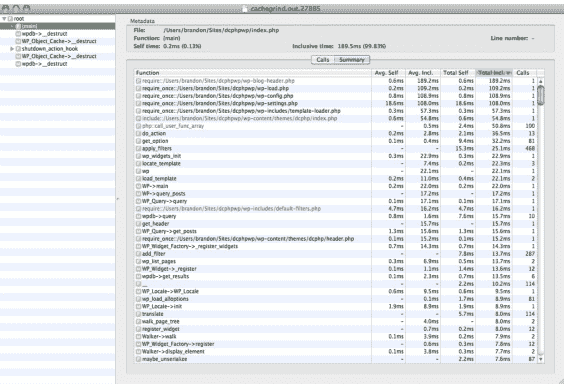

# PHP 攻略书 - php｜architect 指南


| 作者 | Brandon Savage |
|---|---|
| 出版者 | Blue Parabola, LLC. 28 Bombay Ave. Toronto, ON M3H 1B7 Canada (416) 630-6202 / (877) 630-6202 info@phparch.com / www.phparch.com |
| 出版人 | Marco Tabini |
| 技术审校 | Simon Harris |
| 校对编辑 | Lori Ann Pannier |
| 版式与设计 | Arbi Arzoumani |
| 执行编辑 | Elizabeth Tucker Long |
| 财务与资源管理 | Emanuela Corso |

## 致谢

感谢我的母亲给予的爱与支持，以及相信我能完成我下定决心要做的事情。

还要感谢我深爱的妻子 Debbie，在我反复撰写本书的各个部分时她一直忍耐着。

对于他们的指导和参与，特别感谢 Keith Casey、Eli White、Cal Evans、Matthew Turland 以及许多其他人。

感谢 Travis Swicegood 对版本控制章节的审阅和贡献：由于他的建议，本章内容更好。

感谢 Elizabeth Tucker Long 在本书撰写期间的耐心，以及从构思到完成对项目进行编辑和管理所做出的出色工作。

## 引言

世界上最好的学校和编程书籍提供了大量关于如何将代码片段串联成优雅的应用程序和程序的信息。它们讨论宏大的运行理论，在概念和企业级领域谈论设计模式，并教我们语法、怪癖，以及在 PHP 的情况下，语言创建者做出的一些奇怪和不寻常的设计选择。

但它们没有教我们如何编程。
应用开发的科学与应用开发的艺术之间存在明显且不寻常的脱节。来自顶尖计算机科学课程的应届毕业生完全不知道一个开发工作室实际上**运作**的方式，从实际角度来看。而那些为了解决特定问题而学习编程的人，就像我一样，在现实世界中编程是如何进行的方面几乎没有指导。

本书希望帮助回答这些问题中的一些。它并非关于编写代码的细节的书籍，而是关于与团队合作、在软件开发公司内工作以及构建获胜应用策略的关键细节和概念。

全书讨论了重要概念：重构、测试驱动开发、错误跟踪和调试。我们还关注一些 PHP 特定概念，从几种“最差实践”到 Web 应用的缓存和 Web 应用性能。最后，本书以一章关于如何让开发者在工作中更快乐的内容作结。

本书面向初学者和老手 alike，旨在以新的方式处理 PHP 应用的开发。它专注于技巧

开发方法论，而不一定是构成软件应用的特定代码片段。本书旨在作为参考指南，而非小说或其他技术书籍。它不依赖前后文的递进关系；每一章独立成篇，尽管合在一起能构成对 PHP 生态中现代开发的完整理解。

许多开发类书籍以代码为主，但本书代码含量较少，只在适当之处穿插少量代码片段。由于本书关注的是方法本身，而非 PHP 开发者工作的具体手段，因此会在合适的地方给出代码；但大部分内容来自多年经验积累的建议、理念和现实情况。

在我们深入探讨这些主题时，务必要记住，这绝不是什么能解决所有问题的“银弹”，而只是漫长软件开发流程改进道路上的一个路标。事实上，软件开发不存在“涅槃”，也没有那种达到完美的“顿悟状态”。但如果我们持续追求完美，软件开发就会不断变得更好。

# 第 1 章：调试 PHP 项目

### 调试简介

每个开发者都会犯错。现实是，没有哪位开发者是完美的；事实上，有些统计表明某些项目中每七行代码就有一个 bug。这种高得离谱的 bug 发生率不应成为开发者粗心大意的借口，而应提醒他们：bug 确实存在，而且永远无法完全摆脱。

当使用错误的假设编写代码，或对当前任务理解不完整而导致开发出的功能与预期用途不符时，bug 就会出现。Bug 也可能是语法错误或逻辑错误。每个开发者在开发过程中都会遇到各种形态和规模的 bug，从小的语法错误到需要重构才能解决的大段代码。

因此，拥有扎实的工具包对每位开发者都至关重要。能否解决 bug、调试自己的代码，正是平庸程序员与优秀程序员之间的区别。

PHP 开发者相比传统软件开发者有一个优势：他们无需等待代码经过编译器才能发现编程错误。事实上，PHP 开发者能够按需编译代码、即时测试，并在工作中解决 bug。这一点再加上 PHP 的 Xdebug 扩展，意味着 PHP 应用开发者完全有能力在 bug 进入生产环境之前识别并消灭它们。

### Xdebug 简介

本章选择的主要工具是一个名为 Xdebug¹ 的扩展，它免费提供，并由 Derick Rethans 维护。为什么我们选择 Xdebug 作为调试工具？

简单来说，Xdebug 远超当今市场上的任何调试产品。Xdebug 提供了一系列强大的功能，包括输出变量、跟踪函数、分析应用，以及在报错时提供有用的堆栈跟踪信息。

Xdebug 拥有活跃的社区并得到持续维护，这为其提供了可信度，并确保它能够保持实用，且兼容未来版本的 PHP。其全面的配置选项还能帮助开发者根据个人需求进行定制。

### 安装 Xdebug

要使用 Xdebug，必须先安装它。对于大多数用户，Xdebug 可以从源码编译，也可以通过 PECL 包管理器安装（这是安装 Xdebug 的推荐首选方式）。以下是适用于各种操作系统的安装说明：

#### Windows 用户

Windows 用户可以安装预先打包的二进制文件²，并按照 Xdebug 网站³ 上的安装说明进行操作。

#### Linux 和 Mac 用户

Linux 和 Mac 用户应通过 PECL 包管理器安装 Xdebug。

要使用 PECL 包管理器，请确保你是 root 用户（或以 root 身份执行命令）。以下命令将成功安装 Xdebug：

```bash
#### pecl install xdebug
```

PECL 安装完成后，你必须将该扩展添加到 php.ini 文件中。忽略 PECL 提示将 xdebug.so 添加到 INI 文件的操作，因为这样做以后会引发问题；相反，请将以下行添加到你的 php.ini 文件中：

```ini
zend_extension="/usr/local/php/modules/xdebug.so"
```

务必将模块路径改为你系统上的实际路径。

### 从源码安装 Xdebug

对于那些希望从源码配置 Xdebug 的用户，Xdebug 网站⁴ 上提供了相关说明。

### Xdebug 配置选项

Xdebug 提供了大量配置选项，所有这些选项都记录在 Xdebug 网站⁵ 上。这些选项几乎可以控制一切，从 Xdebug 是否重载 `var_dump()` 函数，到打印数组的嵌套层级数量等。

### 变量输出配置选项

`xdebug.overload_var_dump`

默认情况下，Xdebug 会重载 `var_dump()` 函数。如果你确定要关闭 Xdebug 的重载，仍然可以通过一个名为 `xdebug_var_dump()` 的特殊函数来打印 Xdebug 的 `var_dump()` 输出。

`xdebug.var_display_max_children`

此设置控制 `var_dump()` 或类似函数使用期间显示多少个键或属性。默认值为

```text
TRACE START [2009-11-10 11:55:32]
0.0004  623224  -> {main}() /Users/brandon/Sites/skel/branches/wedding/webapp/htdocs/...
0.0006  623656  -> require_once(/Users/brandon/Sites/skel/branches/wedding/webapp/...
0.0008  624096  -> require_once(/Users/brandon/Sites/skel/branches/wedding/webapp/...
0.0008  624336  -> define() /Users/brandon/Sites/skel/branches/wedding/webapp/...
0.0008  624424  -> define() /Users/brandon/Sites/skel/branches/wedding/webapp/...
0.0008  624496  -> define() /Users/brandon/Sites/skel/branches/wedding/webapp/...
0.0010  634120  -> require_once(/Users/brandon/Sites/skel/branches/wedding/webapp/...
0.0011  634240  -> Modus::setIncludePath() /Users/brandon/Sites/skel/branches/wedding/...
0.0011  634472  -> get_include_path() /Users/brandon/Sites/skel/branches/wedding/...
0.0011  634536  -> set_include_path() /Users/brandon/Sites/skel/branches/wedding/...
0.0011  634344  -> Modus::setAutoloader() /Users/brandon/Sites/skel/branches/wedding/...
0.0012  634944  -> spl_autoload_register() /Users/brandon/Sites/skel/branches/...
0.0012  635152  -> Modus::autoload() /Users/brandon/Sites/skel/branches/wedding/...
0.0012  636128  -> include(/Users/brandon/Sites/skel/branches/wedding/lib/mani...
0.0024  1094000 -> include(/Users/brandon/Sites/skel/branches/wedding/webapp/...
0.0024  1105104 -> array_merge() /Users/brandon/Sites/skel/branches/wedding/lib/...
0.0033  1394160 -> require(/Users/brandon/Sites/skel/branches/wedding/lib/modu...
0.0035  1402664 -> require(/Users/brandon/Sites/skel/branches/wedding/lib/mo...
0.0036  1416080 -> require(/Users/brandon/Sites/skel/branches/wedding/lib/mo...
0.0038  1449280 -> require(/Users/brandon/Sites/skel/branches/wedding/lib/mo...
0.0038  1449632 -> spl_autoload_register() /Users/brandon/Sites/skel/branche...
0.0040  1191960 -> Propel::init() /Users/brandon/Sites/skel/branches/wedding/web...
0.0040  1191960 -> Propel::configure() /Users/brandon/Sites/skel/branches/wedd...
0.0041  1192784 -> include(/Users/brandon/Sites/skel/branches/wedding/webapp/...
0.0041  1199488 -> Propel::setConfiguration() /Users/brandon/Sites/skel/branches/...
0.0042  1199536 -> is_array() /Users/brandon/Sites/skel/branches/wedding/...
0.0042  1199488 -> Modus::autoload() /Users/brandon/Sites/skel/branches/wedding/...
0.0042  1199848 -> Propel::autoload() /Users/brandon/Sites/skel/branches/w...
0.0044  1207656 -> require(/Users/brandon/Sites/skel/branches/lib/...
0.0045  1207336 -> PropelConfiguration->__construct() /Users/brandon/Sites/...
0.0045  1207080 -> Propel::initialize() /Users/brandon/Sites/skel/branches/we...
0.0045  1207080 -> Propel::configureLogging() /Users/brandon/Sites/skel/bran...
0.0046  1207160 -> PropelConfiguration->offsetExists() /Users/brandon/Site...
0.0046  1207208 -> array_key_exists() /Users/brandon/Sites/skel/branches/...
0.0046  1207160 -> PropelConfiguration->offsetExists() /Users/brandon/Sites/...
0.0047  1207208 -> array_key_exists() /Users/brandon/Sites/skel/branches/w...
0.0047  1207160 -> PropelConfiguration->offsetGet() /Users/brandon/Sites/sk...
0.0047  1207128 -> is_array() /Users/brandon/Sites/skel/branches/wedding/lib...
0.0048  1207160 -> PropelConfiguration->offsetGet() /Users/brandon/Sites/sk...
0.0048  1207128 -> array_merge() /Users/brandon/Sites/skel/branches/wedding/...
0.0048  1208096 -> Modus::autoload() /Users/brandon/Sites/skel/branches/wedding/...
0.0049  1215640 -> require(/Users/brandon/Sites/skel/branches/wedding/lib/modus/...
0.0050  1214864 -> ModusSession::getSession() /Users/brandon/Sites/skel/branches/...
```

图 1.1


## Xdebug 分析器选项

Xdebug 自带一个分析器，可以生成与 cachegrind 兼容的文件。该文件可用于任意数量的分析器，例如适用于 Mac 或 Windows 的 Kcachegrind。

性能分析与函数追踪略有不同，因为分析必须针对整个 PHP 脚本进行，而不能在脚本中启动（必须通过 INI 设置或指令来完成）。不过，仍有许多配置选项需要你了解并加以利用。

要使用分析器，你必须将 xdebug.profiler_enable 设置为 1。

有时你可能希望追加 cachegrind 文件，而不是完全覆盖它。xdebug.profiler_append 允许追加 cachegrind 文件。

你可以使用 xdebug.profiler_output_name 更改分析器输出文件的名称，以帮助区分你所分析的各种不同脚本。

## 使用函数追踪

能够查看应用程序为呈现结果所经过的路径通常非常有用。由于无法在任意时刻查看堆栈（除非引发错误或抛出异常），因此利用 Xdebug 的函数追踪功能是解决“正在运行什么、何时运行”这类棘手问题的绝佳方法。

函数追踪可以通过两种不同的方式运行：显式调用函数追踪来启动和停止，或者让 Xdebug 在 PHP 被调用时立即启动追踪。

通过手动运行函数追踪并设置其开始和结束位置，开发者能够看到他们原本可能看不到的代码片段。想知道某个特定方法做了什么？函数追踪可以快速快照该方法在获得返回值之前所运行的深度层级。函数追踪还可用于检查某些条件是否满足（通常与查看传递给各个函数的参数这一选项配合使用）。

为了调用函数追踪，开发者可以使用 xdebug_start_trace() 函数；使用 xdebug_stop_trace() 函数可以同样轻松地停止追踪。这两个函数可以在脚本执行期间的任意时间点调用。

有时，开发者可能希望从头到尾查看一个脚本。当开发者想要查看包含了哪些文件（以及处于哪个阶段），或想要查看在应用程序主体被调用之前执行的启动函数时，自动开始追踪的能力非常有用。如果开发者使用了 auto_prepend INI 指令，自动追踪选项也很有用，因为在该文件中没有简便的方法来启动追踪。

函数追踪在很多方面都很有用，但也可能令人困惑。最好以小增量、针对特定目的来使用它们；开发者可能会发现，过度使用会导致信息过载。

开发者还应注意确保追踪文件被写入 Web 服务器可写的目录。Web 服务器通常以 root 身份运行，可能与当前用户具有不同的用户名或组。

## 输出变量

PHP 提供了几种变量输出选项，包括 print_r() 和 var_dump()。默认情况下，var_dump() 的输出看起来像这样：

```
array(6) {
    [0]=>
    string(3) "abc"
    ["mkey"]=>
    bool(true)
    ["auth"]=>
    bool(false)
    [1]=>
    array(3) {
        [0]=>
        string(1) "1"
        [1]=>
        string(1) "2"
        [2]=>
        string(1) "3"
    }
    [2]=>
    array(2) {
        ["key1"]=>
        string(3) "abc"
        ["key2"]=>
        string(3) "def"
```

我们得到的是一个包含格式化数据的文件：

```text
Array
(
    [0] => a
    [1] => b
    [2] => c
    [3] => d
)
```

这些数据也很容易阅读，但所含信息不如 var_dump() 提供的多。不过，它提供了足够的信息，使我们能够理解输出并明白其含义。

Xdebug 还提供了一个高级功能，允许开发者查看变量中存储的 zval 数据。zval 数据是与 PHP 中变量结构相关的数据：其引用计数（refcount）、是否为引用，以及其他数据。

使用我们上一个代码示例，下面是 xdebug_debug_zval() 函数的用法：

```php
$var = array('a', 'b', 'c', 'd');
xdebug_debug_zval('var');
```

```text
var:

(refcount=1, is_ref=0),
array
    0 => (refcount=1, is_ref=0),string 'a' (length=1)
    1 => (refcount=1, is_ref=0),string 'b' (length=1)
    2 => (refcount=1, is_ref=0),string 'c' (length=1)
    3 => (refcount=1, is_ref=0),string 'd' (length=1)),
```

这对于确定变量是否为引用、其引用计数以及其他信息非常有用。这个函数还有一个姊妹函数，将信息发送到标准输出（stdout）；可以通过调用 xdebug_debug_zval_stdout() 来访问它。

Xdebug 还提供了捕获和输出超全局变量信息的能力。Xdebug 包含一个名为 xdebug_dump_superglobals() 的函数，该函数会转储已在 INI 文件中设置为收集的任何超全局变量。你也可以使用 `var_dump($_GET)` 来转储特定的超全局变量，而无需将其添加到 `php.ini` 文件中。

## 使用 PHP 处理错误

任何 PHP 开发者可能犯的最大错误之一，就是不在开启 `display_errors` 的情况下进行开发，并且不将 `error_reporting` 设置为 `E_ALL | E_STRICT`。这两个设置结合起来，可以帮助开发者在对错误进入生产环境或在测试中被发现之前，识别并解决它们。

这些设置都可以在 `php.ini` 文件中设置，或在 `.htaccess` 文件中设置，甚至可以按文件进行设置。然而，为了保持一致性和良好的开发实践，开发者应该在其 `php.ini` 文件中全局设置这些选项。

开发者经常犯的另一个错误是，无论在开发还是生产环境中都不记录错误。当出现问题时，错误日志是至关重要的信息来源；它们通常是快速诊断问题与数小时烦恼和停机之间的差别。描述性错误消息是宝贵的信息来源。

开发者应关注其 `php.ini` 文件中的三个设置：`display_errors`、`error_reporting` 和 `error_log`。`display_errors` 指令在开发期间应设置为 ON，在生产环境中应设置为 OFF。开发者应将 `error_reporting` 设置为 `E_ALL | E_STRICT`，以便查看所有错误，包括通知（notice）和编码标准违规。最后，`error_log` 应指向一个存在可写 PHP 错误日志的位置，该日志将记录错误。

许多开发者开启 `E_ALL | E_STRICT` 后，意识到应用程序中有大量的通知和编码违规，于是迅速将其关闭，认为他们的代码能够运行，所以这些问题显然不需要修正。但这是一个巨大的错误。虽然大多数通知是无害的，但有时有关较大 bug 的关键线索会首先出现在通知中，然后才导致致命错误。关闭此功能而不解决代码中的通知，会导致日后更大的问题，甚至可能加剧现有应用程序中已有的 bug。

一旦代码进入生产环境，开发者应将 `display_errors` 设置为 OFF，这样攻击者就无法从显示的错误中获取关键的服务器和代码信息。然而，这使得记录错误更加重要；我经常为每个虚拟主机使用单独的错误日志。最后，开发者可以放宽他们的 `error_reporting`

不过，可视化确实有其局限性：显然，它无法帮助解决数据库与应用程序之间的问题，而且有时即使将数据可视化，也很难确定引入 bug 的具体位置。此外，在启用输出缓冲时，可视化可能非常难以实现。

## 使用断点

大多数现代 IDE 都支持设置“断点”——应用程序中的特殊位置，当调试器与 IDE 的解析功能一起运行时，会在预定位置停止应用程序，并允许检查该给定点的运行时环境。

无论你是否使用 IDE，都可以轻松地将断点构建到应用程序中，只需使用开发者最好的工具之一：die() 结构。该结构允许开发者结束脚本的处理，并检查在执行该 die() 调用之前的环境。

结合变量输出选项，创建“断点”这一概念帮助开发者追踪代码中引入 bug 的位置。显然，在使用 IDE 时，这变得更加容易，找到 bug 的位置也变得轻而易举。

## 增量开发

开发时，我总是保持打开三样东西：我的 shell 窗口、IDE 和浏览器。为什么是浏览器？因为我是增量开发的——在实现一个功能或一些可疑的逻辑后，我会执行代码（无论是在命令行还是浏览器中），以确认它确实按照我想要的方式运行。

PHP 是一种运行时编译的语言。这提供了一个绝佳的机会，因为开发者能够频繁地运行他们的应用程序。他们无需等待编译应用程序，也无需等到完成应用程序的某个特定方面之后才能测试。相反，他们可以非常快速地构建一个测试，并立即看到逻辑是否有效。

开发者应该充分利用 PHP 的能力，而快速轻松地运行程序的能力是 PHP 相对于编译型语言的一大优势。它使增量开发变得容易，并有助于快速发现和消灭 bug。


# 第 2 章：测试驱动开发
### 测试驱动开发

大多数在软件开发领域待过一段时间的开发者，都听说过“单元测试”这个词，它被用来描述一种针对正在开发中的软件的特定测试方法。他们甚至可能听说过“测试驱动开发”这一原则，简而言之，其理念是在为实际项目编写任何代码之前，先编写测试。

测试的问题在于，它非常像遵守限速规定：每个人都知道应该那么做，但真正去做的人却寥寥无几（而那些坚持要做的人还会惹恼我们其他人）。然而，测试不仅仅是软件开发中一个令人讨厌的障碍：它是软件开发和实现中的关键组成部分。

为什么单元测试如此关键？随着系统变得越来越庞大，会发生两件事：第一，任何单个开发者都不可能完全彻底地掌握当前系统的所有细微之处。第二，随着这种情况的发生，越来越多的开发者在修改和重构现有代码，这几乎注定在某个环节会有人做出改动，导致应用程序以某种方式变得不可用（即回归）。

单元测试可以通过向你展示代码在何处以及为何失败来帮助防止这种情况。虽然单元测试无法修复每一个bug或防止每一次回归，但它们可以在缺陷进入生产环境之前，指出应用程序逻辑或重构策略中的问题。

在我们开始本节之前，必须安装PHPUnit。推荐的安装方法是使用PEAR；通过PEAR安装意味着PHPUnit会自动安装其命令行应用程序，并确保PHPUnit位于include path中（除非我们修改了include path以移除PEAR目录）。此外，通过PEAR安装意味着我们可以轻松地将PHPUnit更新到最新版本，而PHPUnit的作者塞巴斯蒂安·伯格曼正在定期发布PHPUnit的升级和新功能，使得升级非常值得。

按照从PEAR安装PHPUnit¹的说明进行操作。安装PHPUnit之后，有一些术语我们需要熟悉。单元测试是针对特定代码块（通常是函数或方法）运行的测试。该单元测试运行这段代码，然后对代码块应返回的结果进行断言——也就是说，断言运行该代码块后应产生的值、类型或行为。

以下是为PHPUnit编写的完整单元测试：

```
require_once 'PHPUnit/Framework.php';

class ArrayTest extends PHPUnit_Framework_TestCase {
    public function testIsArray() {
        $item = array();
        $item2 = false;
        $item2 = (array) $item2;
        $this->assertType("array", $item);
        $this->assertType("array", $item2);
    }
}
```

在这个测试中，我们需要注意一些事项。首先，类名是`ArrayTest`；这采用了将测试类命名为`*Test`的惯例，如果你在测试一个类（例如名为`Login`的类），你应该将测试命名为`LoginTest`。

我们类中的所有测试方法都命名为`test*`（例如，我们有`testIsArray()`）。PHPUnit就是这样找到测试并执行它们的。没有这些命名，PHPUnit就不会运行我们的单元测试。PHPUnit使用反射来确定要执行哪些方法。

还要注意，测试类继承自`PHPUnit_Framework_TestCase`。这是测试用例类，包含了正确生成和运行测试用例所需的所有方法。

如前所述，在开始编写测试时，人们很容易只编写一个单一的方法来测试唯一的入口点，然后判断整个类是否正常工作。重要的是要避免这样做；那更像是一种“功能测试”——即对功能的测试。我们要测试的是独立的代码单元——即方法本身——这意味着我们要避免编写功能测试，而是测试“单元”，通常是方法。

这个简要介绍应该能作为编写测试的指南；PHPUnit手册更为深入且保持更新。PHPUnit仍在开发中；虽然本书写作时使用的是PHPUnit 3.4版本，但可能会有影响这些指南准确性的变更。

### 当没有时间安排测试时如何测试

因为测试需要额外的时间，许多管理者觉得它不重要，更糟糕的是，可能认为这是妨碍他们按时交付项目的“繁文缛节”。这并不罕见；管理者越不懂技术，就越看不到单元测试的好处。

然而，优秀的开发者仍然可以找到时间编写这些测试。由于开发者在估算过程和bug修复过程中通常有相当程度的影响力，他们可以采用一些策略来提高编写良好单元测试的机会。

### 控制时间估算

大多数开发者都在估算过程中扮演一定角色。即使是在最糟糕的开发环境中，项目经理也必须依靠开发者的判断来合理制定进度，这需要开发者进行估算。

优秀的开发者会利用这一点。他们了解事情需要多长时间，以及在灾难性故障的情况下又需要多长时间，通常会选择一个介于两者之间的数字来让项目经理满意。良好的估算意味着你既能满足管理者，又能以高质量的方式完成工作。

如果估算是你工作的核心组成部分，而且你在估算中拥有100%的自主权，那么你实际上可以把测试时间算进去。到了计算估算的时候，把编写测试的时间算进去，把这个时间留在最终估算中，但不要标注出来是用于单元测试的。

有些人可能会觉得这有点不诚实；事实上，它看起来确实如此。然而，适当的单元测试是完成项目的重要组成部分，无论项目经理是否会试图将其砍掉。单元测试是工作的一部分。

通过正确估算并提供一个包含单元测试时间的估算，你就能在不牺牲成品质量的情况下，自动将单元测试纳入你的进度安排。

### 为每个Bug编写单元测试

web2project团队的家伙们用来提高测试覆盖率的一个策略是：每一个被修复的bug都必须附带一个测试该代码的单元测试。这实现了两件事：第一，它让他们能够以编程的方式展示这个bug（意味着他们对修复有一个前后对比的视图）；第二，它迫使他们为大量产品编写测试覆盖。

论证编写一个能在bug修复时显示结果的测试是很容易的：既然单元测试本质上是对逻辑的测试，断言特定的结果，那么你的单元测试就是bug已解决的有力证据。最终结果是，你最终会得到大量针对代码中特定bug的单元测试，同时也确保你之后做的任何重构不会重新引入那些可能损害应用程序的bug。

大多数时候，你甚至不需要很多时间就能用这种方法编写单元测试。证明代码中存在bug相当容易——如果你断言了预期的结果，却得到了不同的结果，单元测试就会失败。通常这些测试的编写时间不到30分钟（任何单独编写就需要超过30分钟的测试，可能本身也太大了）。

当你有一个缺乏单元测试的大型现有代码库时，这种策略也非常出色。随着你在修复bug时编写测试，你会逐渐提高覆盖率。随着时间的推移，你的覆盖率会不断提高，直到达到或接近100%。


最后，单元测试可以通过减少出现的关键错误数量来节省资金。通过让开发人员编写测试，特别是提前编写，他们可以加入安全测试，这意味着在产品发布前，其代码必须符合安全要求。如果引入了新的安全漏洞，代码将导致单元测试失败，从而在这些漏洞被意外发现或在野外被发现之前提醒你存在可能非常危险的漏洞。

通过采用上一节中的策略，你还可以指出单元测试并不一定需要大量的时间和资金投入才能实现。相反，通过针对你已有的代码库逐步编写单元测试，并针对正在集成的新的功能编写测试，你可以证明单元测试可以立即开始，并纳入未来的产品和版本，而无需为现有应用程序的代码编写测试。

## 单元测试提高软件质量

虽然我们在关于节省资金的部分中简要提到了这一点，但单元测试可以提高软件质量。管理者通常对质量的关注程度几乎与节省资金一样；最终结果是，你应该能够为通过使用单元测试提高软件质量做出有力的论证。

软件质量本质上是两个因素的函数：首先，软件满足用户需求的程度；其次，用户向开发人员报告的错误数量。有些用户报告的错误永远无法通过单元测试捕获。例如，用户界面错误或可用性错误总是会被提交。然而，像“提交表单不会更改值”这样的错误是可以测试并在软件发布前解决的。

人们众所周知，用户讨厌有缺陷的软件产品；他们拒绝使用它们，或无情地嘲笑它们。微软在发布 Microsoft Word 时学到了这一点；该版本糟糕透顶，漏洞百出，用户痛恨它。

当你的产品漏洞百出时，你的用户会讨厌该产品。最终结果是，如果他们能够做到，他们会用其他产品替代它。不要让这种情况发生在你身上。通过在错误报告到来时以及在错误报告到来之前编写单元测试，你将有最好的机会防止错误被构建到你的系统中。你将能够捕获像“存储数据因为你忘记保存它”这样的错误，而不是让客户在生产环境中发现它。

大多数单元测试本身不到十分钟，但会带来代码质量和客户保留率的巨大改善。一个被保留的客户完全值得每一项编写的单元测试的成本；因此，它们对保留客户和提高软件质量具有极大的价值。

单元测试还通过帮助防止回归来提高质量。没有什么比报告一个错误、该错误被修复、然后在产品的下一个版本中再次出现更令人沮丧的了。用户开始认为你无所作为或不知道自己在做什么；通常两者都不是真的，但如果当时你为之前的错误编写了单元测试，这种情况本可以避免。为什么？因为如果你有单元测试到位，它会在产品发布前失败，从而促进修复并防止错误首先被发布。

## 单元测试向高层展示工作正在进行

单元测试是向高级管理人员展示已完成工作量的绝佳方式。虽然已关闭的错误是很好的指标，但有时你会遇到具有多个组件的大错误。如果你有一个开放了两周的功能请求，并且在那两周内它是唯一关闭的工单，看起来团队什么也没做。这就是你的第二个指标发挥作用的地方：单元测试报告。

因为单元测试会生成报告，你可以向高级管理人员展示这份报告并向他们展示正在取得的进展。单元测试显示哪些测试通过了哪些失败了；如果你提前编写它们，你将知道进展如何，因为单元测试会开始通过（如果你在编写任何其他代码之前编写它们，它们都应该失败）。这意味着即使工单开放两周，你也可以展示稳步向完成的进展。

单元测试也是向产品经理展示某些东西尚未准备好发布——或证明某些东西确实已准备好投入生产——的绝佳方式。因为你可以打印出显示失败测试的单元测试报告，你的产品经理可以立即明确地知道产品并不完美。与单元测试报告的输出相比，很难竞争，而且产品

分析是应用程序开发中极其关键的组成部分。如果没有分析，试图优化的应用程序开发人员就像在黑暗中投飞镖，无法看到飞镖落在哪里。换句话说，没有分析的优化几乎毫无用处。

我们在第1章中讨论过分析，当时我们谈到了 Xdebug。一旦你在应用程序上运行了分析器，你将处于更好地理解正在发生的事情以及如何改进的地位。但任何看过 cachegrind.out 文件的开发人员都知道它们对人类来说无法阅读。

为了理解 cachegrind 文件，你需要安装一个为你解释它的应用程序。存在许多应用程序，包括适用于 Linux 的 KCachegrind 和适用于 Mac 的 MacCallGrind（非免费）。这些应用程序通常会创建 cachegrind 文件的可视化表示，显示瓶颈并以生动、直观的方式解释执行花费最多时间的内容。请参阅图 3.1，它是 WordPress 的 cachegrind 输出。



图 3.1

该文件显示了 WordPress 中执行时间最长的项目。根据你自己的 cachegrind 文件，你将能够看到瓶颈所在，并能够形成关于如何解决它们的更清晰的图景。

分析使我们能够确切地知道应用程序的哪些区域是瓶颈。如果不先进行分析，我们就不知道应用程序的哪些区域实际上需要优化。这可能导致大量挫败感、原本不需要进行的重构，以及最坏情况下，由试图优化的人引入错误。分析是制定优化策略的关键组成部分，它帮助我们确切地知道要关注哪些区域，就像外科医生使用诊断测试来确定医疗治疗的重点一样。

当你开始分析你的应用程序时，三个区域可能会成为最大的瓶颈：数据库、在重复块（如循环）中执行的代码，以及一般的代码效率低下。让我们看看如何处理这三者。

## 优化数据库查询

许多开发人员面临着一个始终存在的挑战：他们的应用程序需要是动态的，但数据库更常以瓶颈的形式带来挑战。数据库只能如此快速地处理这么多信息。数据库包含的信息越多，执行即使是简单查询所需的时间也越长。但开发人员可以做一些事情来改善数据库性能。

开发人员对抗数据库缓慢的最有力武器是 EXPLAIN SQL 命令。PHP 开发人员最流行的数据库（Postgres 和 MySQL）都实现了 EXPLAIN；这意味着无论平台如何，开发人员都可以理解他们的 SQL 查询的工作方式。

EXPLAIN 通过显示数据库引擎打算如何解决特定问题来工作。它将显示有关连接、索引、逻辑、效率低下和其他有助于提高性能的重要项目的信息。

想象一下，你正在构建一个使用简单 LEFT JOIN 的应用程序，该连接运行效率低下。你的 SQL 查询如下：

```
SELECT * FROM guests LEFT JOIN record ON record.id = guests.id WHERE guests.
    firstname = "Pete";
```

该查询在你的大表上运行缓慢，你需要弄清楚原因。为了确定查询的执行方式，我们在查询前面加上单词 EXPLAIN：


## 应用优化

```sql
EXPLAIN SELECT * FROM guests LEFT JOIN record ON record.id = guests.id WHERE guests.firstname = "Pete";
```

在我们的命令行 MySQL 实例中，返回的结果集并不包含匹配的记录，而是包含 MySQL 打算如何处理这条查询的方式。参见图 3.2。

```text
mysql> EXPLAIN SELECT * FROM guests LEFT JOIN record ON record.id = guests.id WHERE guests.first_name = "Pete";
ERROR 1054 (42S22): Unknown column 'guests.first_name' in 'where clause'
mysql> EXPLAIN SELECT * FROM guests LEFT JOIN record ON record.id = guests.id WHERE guests.firstname = "Pete";
```

| id | select_type | table | type | possible_keys | key | key_len | ref | rows | Extra |
|---|---|---|---|---|---|---|---|---|---|
| 1 | SIMPLE | guests | ALL | NULL | NULL | NULL | NULL | 4 | Using where |
| 1 | SIMPLE | record | eq_ref | PRIMARY | PRIMARY | 4 | wedding.guests.id | 1 | |

2 rows in set (0.00 sec)

我们立刻获得了关于 MySQL 如何执行此查询的宝贵信息。我们的 LEFT JOIN 看起来很不错：possible_keys 中有 PRIMARY，并且实际使用的也是 key PRIMARY；它只选择了一行，因为它能够利用索引。

另一方面，在我们的第一个查询（即 SELECT * FROM guests 部分）中，我们看到没有可能的键，因此也没有使用任何键。我们还看到它选择了四条记录。这是一个问题，因为没有任何键时，MySQL 无法利用它的索引。

EXPLAIN 已经向我们展示了问题所在：如果我们经常基于 first name 进行查询选择，就需要在该列上添加索引。在该列上添加索引后，EXPLAIN 的结果如图 3.3 所示：

```text
mysql> EXPLAIN SELECT * FROM guests LEFT JOIN record ON record.id = guests.id WHERE guests.firstname = "Pete";
```

| id | select_type | table | type | possible_keys | key | key_len | ref | rows | Extra |
|---|---|---|---|---|---|---|---|---|---|
| 1 | SIMPLE | guests | ref | firstName | firstName | 258 | const | 1 | Using where |
| 1 | SIMPLE | record | eq_ref | PRIMARY | PRIMARY | 4 | wedding.guests.id | 1 | |

2 rows in set (0.00 sec)

在这个例子中，我们看到 EXPLAIN 显示 MySQL 只需要请求一条记录，因为它确切地知道我们要找的记录在哪里。这比逐条搜索每条记录来寻找匹配项要高效得多；这将极大地提升我们的性能。

在不知不觉中，我们无意间接触到了另一种数据库优化技术：在适当的地方使用索引。数据库期望我们定义一个主键——一个标识记录的唯一键——但一般的经验法则是，我们经常在 WHERE 子句中使用的列也应该建立索引。

而且我们应该在适用的情况下使用 WHERE 子句。为什么？WHERE 子句有助于限制结果集，从而减少数据库的数据传输和磁盘读取时间。它大大提升了性能，因为数据库只需要找到我们请求的、符合我们条件的记录；它不需要检索并返回每一行。此外，在参数中明确指定（使用 SELECT column1, column2, . . . FROM table 而不是 SELECT * FROM table）也有助于缩小结果集的大小。

数据库开发者经常忽略的另一个方面是表类型的适当使用，也就是所谓的“存储引擎”。MySQL（以及其他数据库引擎）支持多种表类型。例如，MySQL 支持 MEMORY 表、ARCHIVE 表和 TEMPORARY 表。MEMORY 表，顾名思义，存储在内存中。这些表速度极快，但一旦服务器关闭就会丢失。ARCHIVE 表是为存储海量信息而设计的表。这些表支持 INSERT 和 SELECT 语句，但不支持 DELETE、UPDATE 或 REPLACE。它们的设计目的是为需要归档但从不更新的信息提供快速检索。数据在 INSERT 时被压缩，只有在检索时才解压。TEMPORARY 表适用于存储不需要长期存在的数据，或者用于进行大量数据操作。选择合适的表类型可以极大地提升数据库性能。

数据库优化是每个开发者都必须学习的技能，因为他们会经常面对这一问题。数据库是 PHP 开发世界中持久存在的一部分，并为大多数应用提供后端支持。尽管 NoSQL 的浪潮仍在继续，关系型数据库仍然是商业世界的宠儿，而大多数开发者正是在商业领域工作。

## 发现代码低效之处

一旦开发者对应用程序进行了性能分析，并确定需要调整代码，就会面临一个真正的难题：如何着手解决手头的问题。

由于每个应用程序都不同，我们不可能确切地说“这七个步骤一定有效”。相反，本节旨在提供五种优化策略，这些策略可以在减少代码行数和低效问题的同时提升性能。

### 查找并消除重复信息
开发者经常犯重复相同信息的错误。也许是复制了一个函数的值，然后又第二次重新计算该值；可能是在多个地方存储相同的结果集；也可能是两个变量彼此独立计算，但包含相同的值。

这通常发生在两个或多个开发者处理同一份代码时。一个开发者可能不知道另一个开发者的操作，或者不了解完整的 API，因此重新实现了与第一个开发者已经实现的本质上相同的东西。这导致了重复信息，从而产生了低效。

### 减少每个请求上运行的内容
通常可以减少每个请求上运行的代码量。PHP 的本质是一种“无共享”架构，因此每个请求都意味着初始化并配置网站；但是，并不是每个请求都需要所有资源。

例如，是否可以在静态页面上消除数据库连接？也许可以减少不需要它们的请求所加载的插件数量。将代码优化到只加载必要资源的程度。

很多时候，这可以通过用自动加载器替换 `require()` 和 `include()` 语句来实现。自动加载器“按需”加载类——也就是说，当类被请求时，它们才会被定位、包含并调用。不需要的类永远不会被包含，从而减少了从磁盘读取和实现请求所需的时间。

### 深入理解 PHP 的工作方式——不要重新实现原生功能
有没有编写过一个按字母顺序对数组排序的函数？很多开发者都写过，但许多人不知道的是，PHP 已经实现了 `sort()` 函数，它可以做到


比实例化对象方法更快。然而，将所有对象都转换为静态类和静态方法将是徒劳之举；它违背了面向对象开发的原则，并为后来者带来测试和维护的噩梦。同样，有证据表明像 `isset()` 这样的语言结构比像 `array_key_exists()` 这样的函数运行更快。然而，如果 `array_key_exists()` 是完成该任务的合适工具，那就尽管使用它。

最后，开发者应避免那些实际上无法解决其问题的优化。有时，代码无法被优化。有时“优化”比原始实现更糟。有时类中间存在一个又大又丑的方法，开发者对此无能为力。简单来说，有时优化比瓶颈本身更糟，在这种情况下应避免之。

## 何时不优化

那么开发者何时应该优化，何时应该考虑其他替代方案？有四种情况，开发者应考虑优化以外的替代方案。

当问题是性能时不要优化。优化是一个很棒的工具，但不太可能解决开发者遇到的每一个性能问题。相反，遇到性能问题的开发者应实施能显著提升性能的解决方案，而非优化所承诺的逐点改进。

开发者经常认为所有性能问题都可以通过优化解决。这并不一定正确。开发者当然可以构建一个经过良好优化的产品，但到了一定程度，流量和负载就需要识别并实施优化无法提供的性能增强解决方案。

当代码需要大量重构时避免优化。优化应被视为微调。严重需要重构的代码应进行重构（参见第7章）；不应将其作为解决方案来优化。

这归根结底是选择合适的工具。如果代码混乱、存在性能问题且需要大幅重写，对其进行优化最终只会浪费时间。开发者最好重构代码（presumably）

## 添加数据库服务器

随着 Web 应用的增长，压力最常显现的地方是在数据库层。这有多种原因，包括许多 Web 应用都是数据驱动的，意味着它们是数据库的重度使用者。大多数情况下，数据库是首先需要扩展的部分。

事实上，让 Web 应用拥有两台数据库服务器始终是一个好主意，这可以防止数据丢失并有助于抵御停机。它也有助于开发者确定如何为多于一台数据库服务器编写应用程序，从而使扩展变得更容易。

添加数据库服务器最常见的方法是创建主从配置。在这种设置中，单个主服务器可以支持多个从服务器。主服务器是唯一执行写操作的服务器。更改随后会同步到从服务器，从服务器用于读取数据。此设置很常见且相对容易实现。

然而，开发者需要注意一些注意事项。首先，需要付出努力来确定应写入哪个服务器、从哪个服务器读取。因此开发者应为此任务使用统一的 API。此外，开发者应谨慎编写应用程序，避免依赖数据库即时使其写入的数据可用；因为从服务器需要一点时间（通常不易察觉）来接收复制的数据。如果在此过程中存在任何延迟，数据可能无法使用。

这两个注意事项都需要仔细编程，但在后续添加数据库硬件时能带来好处。一旦主从设置的初始工作完成，开发者就可以自由添加额外的从服务器来处理从数据库读取的负载（这通常是最常见的操作）。

## 添加 Web 服务器

当站点达到单台 Web 服务器有效服务的极限时，可能需要添加额外的 Web 服务器以及负载均衡器。通常这种情况发生在需要额外数据库硬件之后，因为大多数时候并不是代码消耗了大部分处理时间。尽管如此，随着站点的增长，这种需求也在增加。

添加 Web 服务器会增加开发者面临的挑战，原因有几个。首先，他们必须找到一种方式来平衡进入每个 Web 服务器的流量，通常使用一台称为负载均衡器的第三台机器。该机器的唯一目的是将流量分流到特定机器，并且可以以多种方式配置。

然而，在实施负载均衡器时，开发者必须格外小心，尤其是在本地机器文件系统或内存操作方面。例如，如果 Web 服务器上还运行着一个将会话存储在内存中的 Memcached 服务器，在负载均衡环境中无法保证用户在下一次请求时会被重定向回该特定服务器。这同样适用于文件上传和其他影响本地机器内存或磁盘的活动；因此，开发者使用 CDN 或其他方法在服务器之间共享常用文件变得越来越重要。

添加 Web 服务器——尤其是大量服务器——也会增加部署新代码的难度。由于用户在每次请求时都可能被导向不同的 Web 服务器，如果在用户请求时只有一半更新完成，可能导致他们看到完全不同的代码库（或其会话包含针对特定环境的错误信息）。因此，及时解决部署问题非常重要。

尽管如此，添加 Web 服务器也是一种明显的成就标志，因为这意味着站点已发展到需要额外资源的地步。与数据库服务器不同，数据库服务器通常有多于一台，而 Web 服务器并不总是必需的，添加第二台 Web 服务器是任何网站进步的可靠标志。

## 扩展硬件的好处

添加硬件还有一些额外好处。有多台服务器时，如果某台系统宕机，可以实现故障转移。这种冗余是添加额外硬件理念的一部分，只要主数据库服务器不宕机，应用程序就可以顺利继续运行。

当大型组织添加硬件时，他们可能有能力指定该硬件的技术要求。能够要求硬件具备某些技术规格使组织能够根据自身需求定制硬件采购。例如，数据库服务器应配备大量存储空间和非常快的磁盘，而 Memcached 服务器则需要大量 RAM 和相对较少的磁盘空间。Web 服务器应能够处理大量并发连接，并具有足够的处理能力来为 Web 服务器的多个线程提供服务。

根据特定角色定制服务器可以提高每台服务器在完成该任务时的性能，进而有助于减少对额外机器的需求（因为已使用的每台机器都更高效）。

## 扩展硬件的缺点

添加硬件确实会带来一些重大挑战，并非没有缺点。

在添加 Web 服务器时，首先要认识到文件系统不再是存储东西的合适位置，从媒体（图像、上传等）到缓存。因为每台机器的文件系统可能不同，并且根据负载均衡设置，用户在每次请求时可能不会落在同一台机器上；会话是明显的受害者，必须迁移到更稳定的介质，如 Memcached。

额外的硬件也会增加维护成本并降低新产品推出时的便捷性。由于必须在多台机器上推出，规划过程会变长，并且由于有多台机器需要维护，磁盘故障和必要的升级成本也会更高。

最后，添加额外硬件会增加应用程序开发过程的复杂性。随着文件系统作为资源消失，以及多个数据库服务器中的任何一台都可能提供请求的可能性，并发、延迟、从库滞后、缓存数据缺失、同一会话的多个用户标签以及大量其他问题都会出现；这些问题在单台服务器或单台 Web 服务器加数据库主服务器的设置中并不存在。这些问题具有挑战性，并增加了管理应用程序的整体复杂性。


# 第 5 章：缓存技术
## 缓存技术
### 什么是缓存？

作为主要用于 Web 的语言，PHP 的设计采用了“无共享”架构。HTTP 协议是无状态的，这意味着在页面提供时不会保留有关应用程序状态的任何信息。这两者的结合意味着，对于数据驱动的网站，无法内置保留登录信息、检索到的数据、用户信息或其他应在请求之间保持的信息的能力。

因此，自互联网开始以来，开发人员一直在努力解决这个“无状态”问题。大多数开发人员已经通过使用会话（将信息写入服务器并使用密钥访问）、Cookie（通常是会话密钥存储在用户系统上的方式）以及数据库（将应用程序数据保存在物理永久存储中）解决了其中的大部分问题。协同工作，这些项目有助于为未来的请求保留应用程序的“状态”；帮助用户在网络上获得更无缝、更有意义的体验。

当然，这些是相当原始的解决方案，并不总是最高效、最有效的。例如，在每次请求时查询数据库可能是一项困难而费力的任务，尤其对于高流量网站而言。在上一章中我们谈到了提高性能，但没有重点关注如何减少每次请求的负载。本章重点是通过缓存来减少这种负载。

缓存是对经常需要但很少变化的数据以最终或接近最终状态进行存储，以便在应用程序中轻松检索和使用。对该定义的每个部分进行检查，我们发现有三个部分：

第 1 部分：“...经常需要，但很少变化的数据...” 许多应用程序都有大量信息需要在每次请求时使用，但变化并不频繁。这范围从用户的个人信息到博客文章列表。如果信息经常变化，则必须经常刷新，这使得缓存对于减少每次请求的负载变得无效。

第 2 部分：“...数据处于最终或接近最终状态...” 在缓存数据时，我们希望尽可能减少对后续请求的服务器负载。因此，将数据以未完成或需要处理的未完成状态存储会降低缓存的有效性。通常，数据以在缓存中无需任何处理的状态保存，除了显示格式。这对于服务器向用户发送回相对简单。

第 3 部分：“...便于在应用程序中检索和使用。” 缓存应该简单易用。获取缓存数据的方法复杂通常很慢，而且肯定很麻烦，这会阻止团队使用它们。在使用缓存时，开发人员有责任让获取信息、提供服务并继续下一个请求变得容易。

## 缓存规则

在进入缓存类型及其各自优势之前，建立一些缓存的基本规则很重要。有五条至关重要的规则必须在考虑缓存时遵循，以便缓存成为开发人员工具包中的有效工具。

### 仅缓存不经常变化的信息

乍一看，这条规则似乎显而易见，但它提醒我们一个重要点：缓存数据应该保留一段时间。无论该时间段是十分钟、一小时还是一周，缓存数据都意味着要被保留。

一个好的指导原则是，如果数据在仅几次请求后就会失效，最好加载它而不是缓存它。对于许多请求甚至整个用户会话都保持相同的 data 可以安全地缓存。

### 不要缓存可能导致安全问题的信息

在缓存数据时，特别是用户数据时，考虑该缓存选择的安全影响非常重要。例如，如果用户的权限在会话结束前被缓存，则可能用户的权利被撤销，但更改可能不会立即反映出来。这会造成安全问题。

这并不是说用户数据永远不应该被缓存；那将是不切实际且愚蠢的断言。相反，在使用缓存时，每个开发人员都必须确定他们希望采用的安全策略，并且为了保护应用程序的完整性，了解在缓存某些数据时所做的权衡。开发人员可以采用各种技术来保护其应用程序（例如显示“删除用户”页面，但在调用删除行为时仍确认删除另一用户的用户是否仍具有这些权利）。

### 记住缓存有点像黑魔法

Luke Welling 在一条推文中最好地表达了这一点，他说“任何足够复杂的缓存基础设施都与黑魔法无法区分。”他是对的：任何缓存系统都旨在几乎“神奇”地提供数据，在不处理或检查其是否仍然有效的情况下插入信息。

因此，出于这个原因，调试缓存问题可能是一个棘手的过程。因此，开发人员应仔细构建其缓存基础设施，并设计调试工具（例如指示结果集已被缓存的键），以便可以轻松解决与缓存相关的错误。

开发人员还应努力在大部分时间关闭缓存的情况下进行开发，以帮助确保他们的代码实际上能正常运行（而不是他们幸运地缓存了结果）。在打开缓存的情况下开发（包括 APC）可能会在以后造成困难。

### 始终要有备份计划

有时缓存使开发变得太容易，以至于开发人员忘记有一天缓存数据可能不存在。这可能导致灾难性的应用程序故障、奇怪的错误以及大量困难的调试。

缓存数据是暂时的。这意味着开发人员绝不能期望它存在。相反，他们应该希望它存在，但始终要有备份机制来从数据最初存储的任何来源检索该数据。

顺便说一下，由于缓存的临时性质，它们不应被视为永久存储。开发人员应始终使用备份数据存储方法——文件系统、数据库或一些经过验证的存储引擎。一个通用的经验法则是，缓存中的数据绝不应只存在于缓存中；它始终应来自某个稳定的来源。

### 确保缓存具有内置过期日期

缓存数据应该是暂时的，并在定期间隔刷新。显然，某些数据比其他数据更持久，但在最终，所有缓存数据都会在某个时间点过期：因此，缓存也应如此。

旧数据应自动从缓存中删除。许多缓存如 Memcached 和 APC 允许包含“生存时间”（TTL）值，该值设置缓存数据在被清除前应被视为有效的时间。如果超过该 TTL，缓存会自动清除数据并报告它没有请求的信息。

未清除的缓存会导致陈旧数据（稍后会详细介绍），这会造成不一致且不理想的用户体验。

## 基于文件的缓存

将数据存储在文件系统上以便以后检索的最简单方法之一。事实上，会话默认就是这样工作的：用户会收到一个会话 Cookie，其中包含一个密钥，然后该密钥用于加载会话数据，会话数据存储在文件系统上。通常，存储在文件系统上的文件读取速度比重新处理数据快得多。

文件系统上的缓存有许多优点：PHP 带有内置的文件系统函数，无需额外的扩展或模块。所有开发人员对文件系统的工作方式都有切身的了解，这意味着大多数开发人员能够有效地使用文件系统缓存。文件系统易于写入和读取。而且 PHP 的 var_export() 函数和其他工具使包含基于文件系统的缓存文件变得容易。

基于文件的缓存也有一些缺点，最明显的是如果应用程序使用多个服务器，则存储在一个服务器上的文件很难从另一个服务器读取。文件系统缓存还受限于机器本身的 I/O 速度和功能。此外，如果基于文件的缓存要定期写入和读取，则必须使用某种文件锁定机制，以防止两个并发的 PHP 线程尝试写入同一文件。最后，基于文件的缓存不会自动过期（必须从文件系统清除）。

以下列表包含一个示例基于文件的缓存，可轻松用于缓存信息（请注意，它未实现文件锁定）：

```
class FileCache {
    protected $ttl;
    protected $path;

    public function __construct($path, $ttl = 3600) {
        $this->setPath($path); $this->setTTL($ttl);
    }

    public function write($data, $append = false) {
        if(!is_string($data) || strlen($data) < 0) {
            throw new Exception('Data must be a string in FileCache::writeCache()');
        }

        if($append) {
            $arg = FILE_APPEND;
        } else {
            $arg = null;
        }

        $result = file_put_contents($this->path, $data, $arg);
        //Test for (bool)false, which is returned on failure.
        if($result === false) {
            throw new Exception('Writing to cache failed FileCache::writeCache()');
        }
    }
}
```


```php
    return $result;
}

public function read() {
    if(!file_exists($this->path)){
        throw new Exception('The cache file does not exist');
    }

    //Check to see if cache has expired.
    if (filemtime($this->path)+$this->ttl < time()) {
        unlink($this->path);
        return false;
    } else {
        $string = file_get_contents($this->path);
        if($string === false) {
            throw new Exception('Unable to read the contents of ' . $this->path);
        }
        return $string;
    }
}

public function remove() {
    if(file_exists($this->path)) {
        unlink($this->path);
    }

    return true;
}

public function getPath() {
    return $this->path;
}

public function getTTL() {
    return $this->ttl;
}

public function setPath($path) {
    $path = realpath($path);
    if(!is_writable($path) || !is_readable($path)) {
        throw new Exception('Path provided is not readable and/or writable');
    }

    $this->path = $path;
    return true;
}

public function setTTL($ttl) {
    if($ttl <= 0 || !is_int($ttl)) {
        throw new Exception('TTL must be a positive integer greater than 0');
    }

    $this->ttl = $ttl;
    return true;
}
}
```

## 基于内存的缓存

基于内存的缓存是利用系统可用内存的缓存系统。基于文件的缓存和基于内存的缓存有两个核心区别：首先，基于内存的缓存总是需要一个中间组件来访问系统上的 RAM；其次，如果 RAM 断电或 PHP 重新加载（例如通过 Web 服务器重启），基于内存的缓存将丢失。

与其他缓存相比，基于内存的缓存有一些优势；尤其是它们通常非常快（因为 RAM 速度很快），这能提升性能。事实上，其速度优势如此之大，以至于第 4 章已讨论了 Memcached。此外，基于内存的缓存通常不会遇到锁定或文件系统权限问题。

基于内存的缓存的缺点是受限于系统 RAM。这与基于文件的缓存（受硬盘空间限制）没有显著区别，只是大多数机器有数百 GB 的磁盘空间，而只有几十 GB 的可用 RAM。基于内存的缓存会做出逻辑选择，决定使哪些组件失效，而不是让系统进行交换（swap），但这并不一定能防止 Web 服务器或其他机器进程自身进行交换，从而导致性能下降；因此，在使用基于内存的缓存时，开发者必须考虑其影响。

我们将讨论两种流行的内存缓存：APC 和 Memcached。

### 替代 PHP 缓存 (APC)

在第 4 章中，APC 被重点介绍，因为它能够缓存 PHP 编译后的“操作码”以供后续检索，从而避免每个单独请求的编译周期。这被视为 APC 的“操作码缓存”组件。在本章中，我们将讨论 APC 的“用户缓存”功能。

简而言之，APC 的“用户缓存”功能允许将开发者指定的信息存储在机器内存中。这些数据可以在后续请求中快速检索，如果使用得当，有可能大幅提高性能。APC 还是最容易使用的基于内存的缓存之一。

以下是一个基于 APC 的内存缓存示例，类似于我们的文件缓存所使用的接口。注意，代码示例要短得多，因为我们不需要测试写或读权限，如果条目不在缓存中，只需返回 false：

```php
class APCache {
    public function write($key, $data, $ttl = 0, $overwrite = false) {
        if (!$overwrite) {
            return apc_add($key, $data, $ttl);
        }
        else {
            return apc_store($key, $data, $ttl);
        }
    }

    public function read($key) {
        return apc_fetch($key);
    }

    public function remove($key) {
        return apc_delete($key);
    }
}
```

### Memcached

如第 4 章所述，Memcached 是大型 Web 应用和性能提升的事实标准。Memcached 相较 APC 有若干优势，即 Memcached 可以配置一组服务器，Memcached 可以在与应用完全不同的服务器上提供服务（不像 APC 只能写入应用所在机器的内存），并且 Memcached 是为高性能使用而设计的（Facebook、Yahoo、Digg 等都在使用它）。

Memcached 还可以用于在 PHP 中存储会话。要做到这一点，只需更改 php.ini 文件中的以下几行（假设已安装 PHP Memcached 支持）：

```ini
session.save_handler = memcache
session.save_path = "tcp://127.0.0.1:11211"
```

创建一个执行简单缓存操作的 Memcached 缓存类也非常容易。Memcached 已被用于一些极其复杂的缓存场景，甚至包括完全绕过 PHP 来提供整个网页。

请注意，下面的代码中，PHP 的 Memcached 扩展已经是面向对象的。提供包装类是为了演示功能，但开发者也可以直接使用 Memcached 对象（如果更喜欢的话）：

```php
class Memcache_Cache {
    protected $memcacheObj;

    public function __construct($host, $port) {
        $this->memcacheObj = new Memcache();
        $this->addConnection($host, $port);
    }

    public function addConnection($host, $port) {
        $this->memcacheObj->connect($host, $port);
    }

    public function write($key, $data, $expires = 0, $flag = false) {
        return $this->memcacheObj->set($key, $data, $flag, $expires);
    }

    public function read($key, $flags = false) {
        return $this->memcacheObj->get($key, $flags);
    }
}
```

## 避免缓存的陷阱

缓存并非全是阳光与玫瑰：虽然它有益处，也确实能提升应用性能，但它看起来也非常像黑魔法。

开发者在使用缓存时最重要的任务是确保应用运行不依赖于缓存。缓存是我们附加到应用上的可选插件，而不是始终可用的持久存储机制（如数据库）。即使缓存已深深融入应用结构，确保数据可以从其他地方获得也是开发中的关键部分。

开发者还需要确保其缓存的数据是最新的，并尽可能反映应用的状态。过期数据，即已经失去用途而应被丢弃的数据，会损害应用的整体体验。虽然一定程度的过期数据是可以接受的（每个项目都会确定可接受的程度），但对许多开发者来说，让应用显示明显虚假和错误的信息是不可接受的。

如果开发者未能仔细规划其缓存系统，避免这些陷阱可能是一项艰巨的任务。但精心规划的缓存系统将有助于缓解或消除这些问题。

每个开发者可以做三件事来避免缓存的陷阱。

### 集中缓存和检索信息的方法与 API

通过标准化缓存和检索信息的方法，开发者获得了两个明显的优势。第一，他们拥有一个单一、可测试的位置来存储、检索和过期信息。第二，开发者可以轻松地切换后端，因为只要 API 保持一致，访问 API 的代码就能无缝过渡。

由于缓存代码不会散布在应用中，开发者还从中受益，这意味着开发者对应用的缓存活动有更强的控制感。


## 为数据保真度制定书面规则

如果没有一套硬性且明确的数据保真度规则，就无法一致地确定可接受的陈旧程度。制定书面规则能让每位开发者都了解有关数据保真度的规则，并降低出现部分数据陈旧而其他数据未陈旧的情况。

## 考虑在请求前预先缓存数据

使用 cron 任务或其他方法，应用程序可以在数据甚至被请求之前就自动缓存数据以供最终用户使用。Facebook 就采用了这种缓存行为：他们会自动将大量信息放入内存中，使得在实际需要时为最终用户检索数据变得轻而易举。

## 总结

缓存是一个复杂的话题，但值得研究和考虑。谨慎实施时，缓存可以成为应用程序实现的助力，同时提升整体性能并降低服务器负载。开发者需要仔细规划和思考其缓存系统；但一旦实施，缓存就是性能提升的绝佳来源。

# 第 6 章：利用版本控制

当今大多数开发者在应用程序开发过程中都会使用版本控制。许多人无法想象在一个没有版本控制可用的世界中进行开发。有些开发者经历过足够长的时间，使用过 CVS（并发版本系统）这类老牌工具并见证了向 Subversion 的迁移；另一些开发者则是在 Subversion 或 Git 流行后才开始使用。

无论开发者何时开始使用版本控制，大家很快都会发现其组织和改进开发工作流程的神奇力量，几乎就像是从天而降的甘露。

本章讨论什么是版本控制，以及如何使用 Subversion 和 Git（两种最流行的 VCS 或版本控制系统），以及即使你的经理不愿意时如何使用版本控制。

### 什么是版本控制？

版本控制简单来说，就是自动跟踪文件不同版本的一种方式。虽然每个 VCS 都不同，但它们都有相似的目的：跟踪文件随时间的变化，并允许开发者查看历史上任何时间点的文件任意状态。

版本控制还有一个次要优势，即允许不同开发者在同一文件上工作而不会覆盖彼此的更改。版本控制足够智能，能够知道文件的哪些部分被更改，并将这些更改应用到两个版本中，这一过程称为“merging”。有时版本控制会遇到“conflict”，即同一文件在同一位置被两位不同开发者更改，但它仍然足够智能，能够通知开发者并鼓励他们合并更改。

### 为什么版本控制很重要？

版本控制重要有几个原因。首先，它提供源代码的保护，无论是意外还是故意损坏。其次，它使开发者能够识别何时以及谁更改了应用程序的某些方面。它允许开发者在没有管理文件或手动合并的压力下协同工作。最后，它允许开发者进行实验，而不会对开发主线造成不利影响。

版本控制很重要，因为它有助于保持代码安全。有时事故会发生：例如，开发者的硬盘崩溃。也有可能不满的开发者会试图通过删除或更改源代码来损害公司，使其失效。版本控制有助于防止这种情况。通过创建本质上是从历史各个时间点备份的文件系统，开发者可以轻松检出新副本或从特定修订版本的已知良好代码中恢复损坏的代码。

版本控制还有其他原因很重要。在大型项目中，API、组件、模块和结构经常变化，而且变化很快。开发者有时会被架构或 API 的更改措手不及，可能想知道更改发生的时间。版本控制让开发者可以查看代码的历史，看到何时以及如何发生了更改。版本控制还会跟踪每一行以确定谁在何时提交，帮助识别谁引入了 bug 或 bug 何时被引入。

由于版本控制提供了合并两位或多位开发者更改的能力，它有助于促进协作。开发者可以同时在应用程序的相似、相关但不同的组件上工作，而无需讨论谁正在打开特定文件进行写入或谁在做什么。在发生冲突时，没有开发者需要担心自己的更改会被覆盖：版本控制允许手动合并这些冲突，并在工作不重叠时尽力合并文件。

版本控制还允许用户创建“branch”——代码的完整副本——到仓库中用于开发的单独“tree”或区域。该分支可用于实验目的，也可作为开发周期的一部分。在任何时候，开发者都可以选择将分支与主开发线（通常称为“trunk”）合并，而无需手动复制文件并确保文件不会被覆盖。如果开发者决定自己的工作不正确或应位于应用程序的不同区域，也可以删除分支。

### 说服经理接受版本控制

不幸的是，只是让开发变得更容易并不意味着它会被非技术经理接受。许多开发者仍然在没有版本控制的情况下工作，这在更注重开发而非网页设计的创意元素上是常见问题。虽然并非到处都是这样，但在某些地方确实如此。

然而，开发者可以做一些事情来说服经理版本控制既重要又必要。

首先也是最重要的是，版本控制保护了经理在开发上投入的巨大投资。因为版本控制防止一位开发者覆盖另一位开发者的工作，并防止恶意用户试图破坏代码，经理可以安心知道他们的代码受到保护。

此外，经理们会很高兴得知版本控制可以帮助培养问责文化。所有主要版本控制系统都允许 post-commit 和 pre-commit 钩子，可以执行许多重要操作，包括在代码提交时发送电子邮件、写入数据库或向工单跟踪系统添加信息，甚至验证提交的代码不包含语法错误或编码标准违规。

最后，版本控制可以帮助控制成本并节省资金。因为代码可以集中存储和管理，开发者更有可能重用代码。此外，他们能够看到之前已完成的工作，从而减少编写新代码的时间。因为开发者不太可能互相覆盖，所以花费在重做被覆盖工作的时间和金钱更少。

### 你应该使用哪种版本控制？

VCS 的选择确实取决于用户及其偏好。人们对自己的 VCS 非常执着是有原因的：掌握一种系统可能需要一些时间，开发者需要学习它们的工作方式并解决问题。话虽如此，有两种主要 VCS 是 PHP 开发者倾向于使用且我们将重点关注的：Subversion 和 Git。

### Subversion

Subversion 版本控制系统是多年前的 CVS 系统的“下一代”迭代。它在 CVS 基础上提供了显著的增强和功能，尤其是在分支和合并方面。

Subversion 目前在版本控制领域几乎无处不在。大多数开发者都使用过它，并且非常熟悉它。它目前正在积极开发中，未来还有许多新功能计划。它很健壮，拥有自己的 TCP 协议，可以与 Apache 集成或通过 SSH 隧道访问。

Subversion 的核心特性是仓库集中托管在单台服务器上的自定义文件系统中。开发者检出当前工作副本的副本（或工作副本的子集），并能够进行修改然后检入文件。Subversion 跟踪文件之间的差异（diff）并像补丁一样应用它们。

这种系统的好处是所有工作都集中提交，这意味着数据丢失的可能性很小（只要开发者定期提交且服务器已备份）。明显的缺点是，如果服务器崩溃或仓库损坏，仓库可能会丢失，因为它的完整副本不存在于集中服务器之外的地方。

Subversion 在 GUI 工具数量方面也有显著优势，Windows、Mac OS X 和 Linux 上有大量工具可供选择。其中一些工具是免费开源的，而另一些则需要付费（有些非常昂贵）。


## Subversion 基本语法

Subversion 拥有许多关键命令，可帮助开发者正确使用它。对于每位使用 Subversion 的开发者而言，这些为数不多的命令都是必不可少的。

需要特别注意的是，在 Subversion 中，所有命令都以 `svn` 可执行文件名作为前缀。此外，开发者可以通过输入 `svn help` 获取帮助，也可以通过输入 `svn help <command>` 获取特定命令的帮助。

### 获取工作副本

为了获取工作副本，开发者会使用 checkout 命令。Subversion 通过创建当前修订版（或指定修订版）的本地副本来工作。要获取最新修订版的副本，请使用最基本形式的 checkout：

```text
svn checkout svn://path/to/repository
```

开发者可以通过添加一个可选的第二个参数来指定 checkout 的路径。如果省略第二个参数，Subversion 将在当前工作目录中创建工作副本。此外，如果没有在仓库路径末尾添加尾部斜杠，则存放所有文件的目录名称将与仓库中的最后一个目录名称相同。要将仓库检出到特定路径，请使用以下命令：

```text
svn checkout svn://path/to/repository /local/path/to/working/copy
```

最后，开发者可以通过在末尾添加 `@REV` 选项来从特定修订版检出仓库：

```text
svn checkout svn://path/to/repository@123
```

上面的命令会将第 123 修订版检出到本地工作目录。

### 保持工作副本更新

有时，其他开发者对仓库所做的修改可能不会反映到您的工作副本中。为了保持工作副本最新，应使用 update 命令：

```text
svn update
```

`svn help update` 命令将显示许多选项，包括更新到特定修订版，或仅更新工作副本的特定部分。

### 管理工作副本的文件结构

Subversion 会跟踪单个文件的更改：因此，在移动或更改文件和目录时，必须告诉 Subversion 已执行了什么操作，以便 Subversion 能将历史记录与该移动关联起来。Subversion 通过提供 `copy`、`mv`、`rm` 和 `mkdir` 命令来模拟 Linux 和 UNIX 上的文件系统命令。

每个命令的工作方式与 UNIX 中的对应命令类似，并且会更改工作副本的变更历史，这些更改将在您下次提交时一并提交。

### 将更改提交到仓库

您已经对工作副本做了一些更改，太棒了！这些更改已经可以上线了。我们如何确保所做的更改被提交呢？可以使用 `status`、`add` 和 `commit` 命令。

当工作副本中有未跟踪的文件时，它们旁边会显示问号：

```text
$ svn status
?        example.txt
```

要将此文件提交到仓库，我们需要指示 Subversion 添加此文件：

```text
$ svn add example.txt
A        example.txt
```

请注意，现在 example.txt 文件旁边出现了一个“A”。这表示该文件已暂存待提交。接下来，我们可以提交此文件：

```text
$ svn commit -m "Initial commit."
Adding        example.txt
Transmitting file data .
Committed revision 1.
```

请注意，我向此仓库提交了第一个修订版。还要注意我在提交时使用的 `-m` 标志：它向 Subversion 表明我们要添加一条提交信息。开发者应始终在提交时附带提交信息。对于大多数仓库，如果没有提供提交信息，系统会提示您在自己选择的编辑器中设置一条。

现在假设我们对 example.txt 文件做了一系列更改，然后再次运行 `svn status`：

```text
$ svn status
M           example.txt
```

现在文件旁边有一个“M”，表示自上次提交以来它已被更改。我们不再需要运行 `svn add` 命令。由于该文件受 Subversion 跟踪，它将在我们下次提交时自动被提交。

假设对 example.txt 所做的更改并不合适或存在错误。我们不必提交这些更改，而是可以使用 `svn revert` 将其回滚：

```text
$ svn revert example.txt
Reverted 'example.txt'
```

现在执行 `svn status` 命令会显示一个干净的工作副本：

```text
$ svn status
$
```

可以将文件恢复到特定修订版。有关此操作方式的更多文档，请参阅 `svn help revert` 命令。

### 查看历史记录

开发者有时希望查看针对仓库进行了哪些提交。开发者可以使用 `svn log` 命令查看提交历史：

```text
$ svn log
------------------------------------------------------------------------
r70 | brandon | 2009-11-30 20:32:40 -0500 (Mon, 30 Nov 2009) | 1 line

Moving everything into trunk.
------------------------------------------------------------------------
r69 | brandon | 2009-11-30 20:29:12 -0500 (Mon, 30 Nov 2009) | 1 line

Removing lib; it’s an external and should not have been moved.
------------------------------------------------------------------------
r68 | brandon | 2009-11-30 20:27:26 -0500 (Mon, 30 Nov 2009) | 1 line

Updating the repo.
------------------------------------------------------------------------
r67 | brandon | 2009-11-30 20:25:28 -0500 (Mon, 30 Nov 2009) | 1 line

Adding trunk directory.
------------------------------------------------------------------------
```

`svn log` 命令有助于查看提交信息，并且具有许多实用功能，例如限制修订版号和查看大量附加数据：

```text
$ svn log -l 1 -v
------------------------------------------------------------------------
r70 | brandon | 2009-11-30 20:32:40 -0500 (Mon, 30 Nov 2009) | 1 line
Changed paths:
   M /financials
   D /financials/files
   D /financials/install
   D /financials/logs
   M /financials/trunk
   A /financials/trunk/webapp (from /financials/webapp:69)
   D /financials/webapp

Moving everything into trunk.
------------------------------------------------------------------------
```

例如，在上述命令中，我们将输出限制为一个条目（即最后一个修订版），并要求其详细输出，从而列出该特定提交中更改的文件。

Subversion 还使得查看*谁*更改了文件，以及实际上*哪些行*被更改变得很容易。此命令有几个别名：`blame`、`praise` 和 `annotate`。其目的是显示文件的每一行，以及负责编辑该行的用户。

```text
$ svn annotate example.txt
    2    brandon Lots of new changes.
```

这表明在第 2 修订版中，用户 “brandon”（就是我）将第一行更改为了 “Lots of new changes.”。这对于确定代码中 bug 的引入时间、位置和责任人，或逐行查看用户所做的更改非常有用。

## Git 基本语法

与 Subversion 一样，Git 也有许多命令可帮助开发者正确使用它。

### 设置新的 Git 仓库

获取新的 Git 仓库有两种方式：克隆现有的 Git 仓库，或在当前目录中初始化一个仓库。

要克隆仓库，我们使用 `git clone` 命令：

```text
$ git clone git@github.com:brandonsavage/developersplaybook.git
Initialized empty Git repository in /Users/brandon/developersplaybook/.git/
remote: Counting objects: 56, done.
remote: Compressing objects: 100% (53/53), done.
remote: Total 56 (delta 21), reused 0 (delta 0)
Receiving objects: 100% (56/56), 653.13 KiB | 799 KiB/s, done.
Resolving deltas: 100% (21/21), done.
```

Git 会在与所克隆仓库同名的目录中初始化一个空仓库，然后将对象下载到该目录中。如果


如果我们想将克隆的仓库放在不同的位置，我们可以添加一个可选的文件路径作为第四个参数。

开发者也可能想要创建一个空仓库，或在已有文件的目录中创建仓库。完成此任务很简单：开发者只需初始化仓库即可：

```
$ git init sample
Initialized empty Git repository in /Users/brandon/sample/.git/
```

这将创建目录和一个空的 Git 仓库。或者，如果你想在当前工作目录中创建 Git 仓库，只需调用 git init，仓库就会在当前工作目录中创建。

当然，使用初始化命令时 Git 假定开发者打算在目录中实际放置文件；因此它会创建一个名为 .git 的隐藏目录，并将仓库文件放在其中。然而，有时开发者可能只想初始化一个裸仓库——一个不包含文件的仓库。这在仓库仅用于推送和拉取的情况中很有用。要做到这一点，我们使用一个标志：

```
$ git init --bare sample.git
Initialized empty Git repository in /Users/brandon/sample.git/
```

请注意，隐藏的 .git 目录并未创建。检查文件系统会显示出与我们初始化的仓库不同的布局。

## 使用远程仓库

除非存储在其中的信息可以共享，否则 Git 并没有那么有用。为此，开发者设计了一套系统，可以从远程源“推送”和“拉取”提交，例如其他开发者、类似 Subversion 的中央服务器设置，甚至是名为 GitHub 的网络服务。不管怎样，使用远程仓库是一项关键技能。

要使用远程仓库，首先必须将其添加为远程位置。为此，我们使用 git remote 命令：

```bash
$ git remote add origin /path/to/remote
```

这里的语法很简单：我们告诉 remote 命令添加一个名为 `origin` 的别名，其文件路径为 `/path/to/remote`，这是一个远程仓库。

一旦我们做了更改（稍后会详细介绍如何更改），我们就可以将这些更改“推送”到我们的远程仓库。我们使用 `git push` 命令：

```text
$ git push origin master
Counting objects: 3, done.
Writing objects: 100% (3/3), 219 bytes, done.
Total 3 (delta 0), reused 0 (delta 0)
Unpacking objects: 100% (3/3), done.
To /Users/brandon/remote
 * [new branch]      master -> master
```

这里的语法也很简单：我们指示 Git 将 `origin` 别名推送分支“master”中的所有内容，输出的是 Git 正在执行的操作日志。它最后会告诉我们它在远程仓库中创建了一个名为“master”的新分支。

随着开发者在自己的仓库上工作并推送更改，Git 最终会要求我们在推送额外更改之前先拉取这些更改。我们使用 `git pull` 请求来执行此操作：

```text
$ git pull origin master
remote: Counting objects: 5, done.
remote: Total 3 (delta 0), reused 0 (delta 0)
Unpacking objects: 100% (3/3), done.
From /Users/brandon/remote
 * branch            master     -> FETCH_HEAD
Updating bb2e6b4..78a9bd1
Fast-forward
 example.txt |   1 +
 1 files changed, 1 insertions(+), 0 deletions(-)
```

语法与推送请求完全相同。

创建像“origin”这样的别名时需要注意的是，虽然按惯例，“origin”是上游仓库的别名名称，但你可以给别名命名任何名称。这在你想要

有时我们可能想查看哪些文件被跟踪、未跟踪和已暂存。我们可以使用 git status 命令来做到这一点：

```
$ git status
#### On branch master
#### Changes to be committed:
####   (use "git reset HEAD <file>..." to unstage)
#
#### modified:  example.txt
#
#### Changed but not updated:
####   (use "git add <file>..." to update what will be committed)
####   (use "git checkout -- <file>..." to discard changes in working directory)
#
#### modified:  unstaged.txt
#
#### Untracked files:
####   (use "git add <file>..." to include in what will be committed)
#
#### untracked.txt
```

这里我们看到 example.txt 已暂存以便提交。unstaged.txt 未暂存，但已被跟踪；它也被列出。最后，我们有一个未跟踪的文件，列在“Untracked files”下。

Git 在这里的输出也非常有帮助：它会准确告诉我们如果不想提交或更改文件该如何修复。我们可以使用 `git reset HEAD <file>` 来取消暂存文件，并可以使用

## 分支仓库

开发者经常同时处理多个错误，但不一定希望这些组件在稍后日期之前相互作用。为了更好地促进这一点，Git 拥有一个非常强大的分支模型，可用于改进工作流程。分支是将版本控制系统指示为基本上复制当前文件结构的过程，以便可以在不影响主开发线或其他开发者的情况下添加或删除功能。分支可以即时创建，并且不一定会被推送到 master 仓库；分支可以是匿名的，也可以包含在提交中。

要创建分支，用户可以使用 git branch 命令：

## 稍后暂存更改

有时，我们可能还不准备将更改提交到仓库，但可能需要从其他用户那里拉取额外的更改，无论是从 Subversion 还是从另一个仓库。或者，我们可能正在 master 上工作，需要将其恢复到已知状态，同时仍为将来保留我们的更改。

Git 提供了一个名为 stash 的功能，允许我们将文件暂存到临时存储中，并在以后检索它们。

```
$ git stash
Saved working directory and index state WIP on master: 0adce2e Adding new content.
HEAD is now at 0adce2e Adding new content.
```

Git 现在已将工作副本的更改暂存，并将目录恢复到 0adce2e 提交。我们现在可以自由地进行更改，并在准备好时查看已存在的暂存：

```
$ git stash list
stash@{0}: WIP on master: 0adce2e Adding new content.
```

这显示了我们可用的所有暂存。有多种方法可以访问暂存：我们可以弹出暂存或应用它。如果我们“弹出”暂存，我们会将其从列表中移除并应用更改；如果我们只是“应用”暂存，我们会应用更改同时保留暂存在暂存列表中。或者，我们也可以指示它应用特定的暂存（如果我们有多个）。

```
$ git stash pop
#### On branch master
#### Changed but not updated:
#### (use "git add <file>..." to update what will be committed)
#### (use "git checkout -- <file>..." to discard changes in working directory)
#
#### modified:  example.txt
#
no changes added to commit (use "git add" and/or "git commit -a")
Dropped refs/stash@{0} (a79efc499ea8fd6cec59adb5acb4ae2caa768ef3)
```

此命令应用了更改，然后向我们显示了工作目录的当前状态，并告诉我们暂存已被丢弃（因为我们使用了 `git stash pop`）。

## 查看历史记录

开发者经常想要查看提交日志或查看谁在哪个修订版中更改了什么。Git 在 `git log` 命令中提供了查看修订历史的强大功能：

```
commit 0adce2e0c892950bdc39c91eddc6ef3f245cd00
Author: Brandon Savage <brandon@brandonsavage.net>
Date:   Sat May 1 08:14:23 2010 -0400

    Adding new content.

commit fa4022d6c421cbcddba73fb982b0a2be8f237976
Author: Brandon Savage <brandon@brandonsavage.net>
Date:   Sat May 1 08:10:58 2010 -0400

    Making some changes.

commit dbb00cf3947228349d6e1ea5f649dc2e003be0b2
Author: Brandon Savage <brandon@brandonsavage.net>
Date:   Sat May 1 08:06:21 2010 -0400

    Removing unstaged.

commit d14d9078db6d55176a4dcf608cd8d093398ab68f
Author: Brandon Savage <brandon@brandonsavage.net>
Date:   Sat May 1 08:02:17 2010 -0400

    Adding unstaged.txt for demonstration.
```

这里我们有几个提交。请注意与 Subversion 不同的一些事项：首先，Git 不使用顺序修订号。这是因为 Git 设计为协作使用。因此，顺序修订号会增加修订号冲突的可能性。Git 改用 SHA1 哈希，其冲突的几率几乎为零。


该命令接受多个参数，可用于限制提交历史的搜索范围。由于组合数量庞大，难以在此全部列出，但使用 `git help log` 命令会显示 `git log` 的所有组合。

Git 还提供了一种逐行查看某次修订中谁修改了什么的方式，即 `git annotate` 命令。该命令逐行显示特定文件，有助于查看 bug 是何时或由谁引入的。

```text
$ git annotate example.txt
0adce2e0 (Brandon Savage 2010-05-01 08:14:23 -0400 1) Adding some content
fa4022d6 (Brandon Savage 2010-05-01 08:10:58 -0400 2)
0adce2e0 (Brandon Savage 2010-05-01 08:14:23 -0400 3) And some additional content
```

这里需要注意一些重要事项：请注意 Git 仅使用修订 ID 的前八个字符。这是因为前八个字符对于任何仓库来说几乎可以确定是唯一的（事实上，在小型仓库中，前四或五个字符几乎可以确定是唯一的）。这是一个有用的快捷方式来引用提交，因为开发者可以在 Git 的每个命令中通过快捷方式引用提交。

## 版本控制规则

版本控制是一把双刃剑，一方面有好处，另一方面也有危险和困难。理解版本控制礼仪的硬性规则对于作为团队成员有效地使用它并享受版本控制带来的团队合作与协作至关重要。

这些规则是通用礼仪提示，帮助开发者在与他人一起使用版本控制时取得成功。

### 始终包含有用的提交信息

提交信息写成“added stuff”并不能帮助任何人理解所做的工作。事实上，这与版本控制的目标背道而驰：向那些没有做出这些更改的群体传达随时间推移的更改。

提交信息应尽可能详细，以便理解在特定修订中完成了什么。提交信息写成“revised execute() method to incorporate changes listed in Ticket #3271”就描述得更清楚，并为正在调查更改集的开发者提供对所做更改及其原因的清晰简洁的理解（原因可能在 Ticket #3271 中）。

一些公司通过强制工单与提交之间的关联来执行描述性提交信息的规则。对于担心提交信息是否能充分描述所做更改的人来说，这是一个不错的选择。

一些工具围绕提交信息的主题/正文结构进行设计（Git 也有很多这样的工具）。无论约定是强制的还是期望的，在提交信息中完整全面并遵循预期约定都是一个好主意，以便帮助他人。

### 不要破坏构建

开发者持续的挫败感是更新工作副本后，才发现最后一次提交的开发者在代码中包含了语法或其他致命错误，然后就下班了。这会让生产环境停滞直到问题解决，如果问题与两位开发者都在处理的事项相关，问题只会更糟。

不要成为那个通过包含语法错误或未能清晰沟通会影响每个人的更改而“破坏构建”的人。许多公司实施预提交钩子来测试语法并拒绝提交包含语法错误的代码，但仍可能通过数据库更改或语法正确但实现错误的代码破坏构建。

在提交代码前测试你的代码，并与开发团队保持良好沟通。此外，考虑持续集成，正确使用时可以帮助缓解一些这些问题（因为它会立即“构建”代码并运行单元测试）。

### 经常从仓库更新你的代码库

如果你使用的是 Subversion，请经常运行 svn up。如果你使用的是 Git，请定期使用 git pull origin master 来保持代码库为最新。这至关重要，原因有二：

首先，了解其他开发者在做什么很重要。代码的更改可能会改变你开发特定功能或设计产品某方面的方式。其次，未能定期更新只会增加以后发生冲突的可能性。

小冲突很容易处理，但大冲突极难管理，因为它们通常涉及代码的大块部分并包含需要花费时间理解的细微更改。我遇到的最糟糕的冲突是在项目结束时提交。**整个文件**都发生了冲突，因为我没有持续更新我的代码库。

### 推送后不要执行变基

此提示适用于 Git 用户，但其重要性足以单独列入版本控制规则部分。Git 包含一个名为 rebase 的功能，它非常强大，可以从字面上重写仓库的提交历史。这种能力允许开发者将提交压缩在一起、更改提交信息，甚至更改提交中的文件。它还允许开发者在不合并的情况下组合更改集。这对于将特定分支恢复到某个状态很有用。

然而，变基并非没有风险：特别是当对一组提交运行 `git rebase` 时，它会 *重写这些提交和 SHA1 提交 ID*。

这可能看起来不是什么大问题，在许多情况下确实不是，除非这些提交已经推送到另一个仓库。然后它就成了大问题，因为 Git 会对新的提交 ID 感到困惑，并会在后续合并更改时造成严重问题。

对已经推送的提交执行变基是一个严重的错误，会给所有相关开发者带来麻烦。避免这样做。

### 不要在冲突期间简单覆盖他人的更改

时不时地，每个开发者都会遇到与自己工作冲突的提交。这有时会是一个极其令人沮丧的修复情况，尤其是当所做的工作与开发者提交的工作相似或密切相关时。然而，虽然利用 Subversion 提供的选项用工作副本简单覆盖冲突很容易，但不要这样做。

这看起来可能是一个显而易见的观点，但并非如此。当开发者快速查看冲突并得出结论认为冲突是次要的、无需解决时，尤其不明显。然而，开发者明智的做法是跳过冲突解决，然后使用文本编辑器并查看冲突标记之间的行来解决它。

这在 Subversion 中比在 Git 中更严重，因为 Git 不提供仅用自己的副本覆盖传入副本的能力。相反，它强制开发者将两个副本合并在一起，然后添加文件以提交来解决冲突。

### 提交前逐个文件进行差异比较并频繁提交

开发者经常忘记可能会出现无意中更改的情况——调试代码被添加、详细程度增加或设置被更改。在提交代码之前，每个开发者都应比较将要提交的文件的差异，以确保发送的更改正是该开发者想要发送的。

当然，待提交的文件越多，这就越困难。这引出了规则的第二部分：频繁提交。小而独立的提交几乎总是优于大提交。如果开发者担心破坏功能或代码更改走错方向，他们应该分支。这就是分支的用途。

一些开发者认为代码提交应该是功能完整的。我不同意。代码提交不应破坏应用程序，但如果“功能完整”需要几天或几周的时间，则完全不必功能完整。虽然开发者应遵守不破坏构建的规则，但他们应定期提交不破坏构建的小代码单元（即使提交尚未完全正常工作）。

### 频繁合并

任何经常使用 Subversion 的人都有过历史上最糟糕的噩梦之一的经历：从一个分支到主干的大合并。虽然 Subversion 在这方面随着时间的推移有所改进，但频繁合并仍然有助于开发者防止出现大而复杂的合并问题。


Git 并没有那么严重地受到这个问题的影响；其操作模型是使用小型、短期的分支进行开发，然后快速合并到 master 中，再予以销毁。但 Subversion 由于整个文件系统被复制到新目录的缘故，并不促进这种常规合并。因此开发者有意地进行合并非常重要。

如果正在进行重大功能或大规模改造，完全可以把 trunk 合并到分支中，以将 trunk 中正在开发的功能添加到分支。分支稳定后，这会使最终产品合并回 trunk 变得容易得多。此外，建议开发者详细记录分支和合并时的修订版本。这有助于缓解 Subversion 合并命令的一些问题。

由于 Git 在合并方面更好，对于打算频繁分支的开发者来说，Git 是一个更好的选择。然而，只要遵循此规则，Subversion 也提供一些分支支持。

## 游击式版本控制

说到版本控制，每个人都有自己的看法，而且这些看法并不总是一致。对于开发者无法使用版本控制，或无法使用他们希望的版本控制系统的情况，可能会看起来无望。但不必如此无望：仍然可以使用版本控制。

### 给没有版本控制的开发者的一些话

有时，经理无法被说服使用版本控制，或团队无法被劝说认真对待。在这些情况下，作为开发者，你不需要完全放弃版本控制；即使你的团队或管理层不这样做，你仍然可以利用其明显的优势。

版本控制按定义旨在提高个人的绩效，尽管它通常以团队为中心，但受益最大的是个人。这意味着开发者可以自行使用版本控制，而无需团队参与。

最适合此用途的 VCS 很可能是 Git。因为 Git 允许在无需托管在其他地方的情况下创建本地仓库，Git 为独自的开发者提供了使用版本控制的能力，而没有任何人知道他们
在分支上。这是为了确保 Subversion 和 Git 保持同步。显然，这会削弱 Git 的部分功能，但对于使用 git-svn 来说这是必要的恶。最后，svn:externals 与 git-svn 不兼容；这里的解决方案是将外部项目作为 Subversion 工作副本检出，然后通过编辑排除文件来忽略整个树。

尽管如此，git-svn 仍为受 Subversion 约束的开发者提供了使用 Git 的机会，如果他们更喜欢的话。

## 为什么要重构？

重构之所以是开发中的重要方面，有很多原因。许多开发者认为重构困难、耗时且毫无意义，但它是一个关键步骤，每个开发者都应该实践它。

重构很重要，因为改进代码的成本比重写它更低。许多开发者回顾自己写的旧代码，会惊讶于自己在短短几个月内进步了多少。他们可能会看上一个产品并决定，鉴于自己更新的技能，应该停下来重写产品。但这是一项徒劳无功的任务。

与其重写应用程序，重构给了我们一个机会，让我们能够在迭代中、随着时间的推移缓慢改进现有应用程序。因为重构专注于改进代码本身，而非应用程序的功能行为，所以重构是将新技能应用于旧代码的绝佳机会。

重构现有代码利用了错误修复，保留了代码中嵌入的机构记忆，并且可以利用该应用程序的测试套件，这有助于防止重构引入错误。当应用程序被重写时，这些保护通常不存在：重写的代码无法受益于机构记忆，不包含代码中已指出的错误修复，并且由于测试套件未经验证，可能出现许多错误。

重构也很重要，因为它允许开发者随着理解和知识的提升而做出改进。现实是，对于大多数开发者而言，他们会成长和改变。他们对核心原则的理解以及对其艺术的实践会随着时间的推移而改善。他们很可能会在未来审视自己的代码，发现其中的问题以及改进空间。

选择重构为开发者提供了将这些改进带到旧产品和代码中的机会。它不仅让他们看到代码可以改进的地方，还能真正进行改进。反过来，旧应用程序会不断变得更好，从而为客户和用户提供价值。

同样，经常重构的开发者往往会带来从其他应用程序和项目中学到的增强功能，这反过来提高了应用程序的整体质量。例如，处理数据库的特定算法或流程通常可以从一个应用程序移植到另一个应用程序。开发者将这些改进和发现应用到其他应用程序的能力，总体上改善了每个人的体验。

最后，重构通常会改善应用程序的结构和设计。由于重构的目的是增强应用程序的结构、功能、性能和设计，随着开发者在这些方面的提升，他们重构的应用程序将受益于对这些概念和实践的更深入理解。

### 重构前开发者必须做的事情

重构是 PHP 开发者工具箱中的重要工具，但它并非没有问题和潜在风险。

为了有效重构，开发者必须注意重构方面的一些“陷阱”，并尽力减轻这些问题。

最先也是最明显的一点是，开发者在尝试改变代码功能方式之前，必须理解代码试图实现什么。否则，开发者可能会因对代码工作原理的误解而破坏实现。

开发者也经常忽视为打算重构的代码建立全面的测试套件的必要性。这至关重要，因为如果没有全面的测试套件，开发者就无法知道他们完成的重构是否破坏了应用程序。许多小错误可能只会在测试套件或应用程序中的边缘情况中显现。拥有能够突出这些边缘情况的测试套件对开发者价值巨大。

### 如何重构

重构不是一门精确的科学。相反，它是一门抽象的艺术，随着开发者成长，他们会不断改进。因此，本章包含很少的硬性规定，而更多的是关于重构时能带来改进代码的策略的讨论。

本讨论需要一个待重构的代码示例，随着重构的进行，该示例将在本章中反复出现：

// class_Twitter.php - PHP TWITTER AUTO-FEED
error_reporting(E_ALL);

// SEND AN AUTOMATED TWEET
// USAGE EXAMPLE
//     require_once('class_Twitter.php');
//     $status = 'Hello World';
//     $t = new Twitter;
//     $t->tweet($status);
//     unset($t);

// DO NOT RUN THIS SCRIPT STANDALONE (HAS PASSWORD)
if (count(get_included_files()) < 2) {
    header("HTTP/1.1 301 Moved Permanently"); header("Location: /"); exit;
}

class Twitter {
    private $ch;
    private $you;
    private $user;
    private $pass;
    private $test;
    private $host;
    private $done; // ALREADY TWEETED?
    public  $res;

    public function __construct() {
        $this->user = "??? TWITTER USERNAME";
        $this->pass = "??? TWITTER PASSWORD";
        $this->you="??? YOUR EMAIL ADDRESS";

        $this->host = "http://twitter.com/";
        $this->done = FALSE; // DEFAULT - NOT ALREADY TWEETED
        $this->test = FALSE; // DEFAULT - THIS IS LIVE, NOT A TEST

        $this->ch  = curl_init();
        curl_setopt($this->ch, CURLOPT_VERBOSE, 1); curl_setopt($this->ch,
        CURLOPT_RETURNTRANSFER, 1); curl_setopt($this->ch, CURLOPT_USERPWD,
        "$this->user:$this->pass"); curl_setopt($this->ch,
        CURLOPT_HTTP_VERSION, CURL_HTTP_VERSION_1_1); curl_setopt($this->ch,
        CURLOPT_POST, 1);
    }

    public function __destruct() {
        curl_close($this->ch);
    }
}

```php
return FALSE;
}
}
```

此代码示例包含许多可以改进之处。它是一个很好的例子，说明代码可能已进入生产环境，但应重构以更紧密地遵循标准、最佳实践和已被充分理解的原则。

坦白说，这段代码也存在许多问题：它缺乏连贯的编码标准，抽象不佳，无法测试，将测试和生产代码混在同一代码库中，未分离关注点，并且包含一些可疑的逻辑。要重构它，必须改进和更改多个方面。

## 开发编码标准

在我们的代码示例中，最先显而易见的就是它难以阅读。这由两个原因共同造成：首先，代码很复杂，事实上是不必要的复杂（我们将在后续章节中讨论），其次，代码没有遵循一致的标准。

编码标准是人们经常争论的话题。我一个朋友的轶事是，每当团队中的开发者不想工作一周时，他们就会挑剔编码标准中的某些细节，导致为期一周的争论，完全阻碍代码的生产。但编码标准不必如此尖锐。事实上，让我们在这里重新定义“编码标准”的含义。

在本节中，我们所说的“编码标准”是指代码遵循一致的标准——无论该标准具体是什么。这是一个重要的观点：开发者遵循 PEAR 规范还是 Zend Framework 风格并不重要。

为了本节的目的，重要的是实现三个要素：代码的一致性、添加注释以提高理解，以及在推进过程中防止引入错误。

我们将在此代码中添加一些注释（Docblocks），原因有两个：首先，它能提高我们对 API 的理解，至少可以记录参数和方法，其次，它迫使我们通读代码并理解其工作原理。

这是重构的一个重要方面。在重构之前，你必须知道自己在处理什么。最后，我们将检查并确保我们的编码约定不会无意中引入错误，通过确保诸如带括号的条件语句和循环、命名恰当的函数，以及变量被正确初始化等事项。

从示例顶部开始，我们看到开发者使用类似 PEAR 风格的方式，在“if”之后留一个空格，并在同一行放置左括号。他们使用四个空格进行缩进，我们也将使用这种缩进方式。

```php
// DO NOT RUN THIS SCRIPT STANDALONE (HAS PASSWORD)
if (count(get_included_files()) < 2) {
    header("HTTP/1.1 301 Moved Permanently"); header("Location: /"); exit;
}
```

然而，我们注意到在第 64 行，开发者使用了单行条件语句。这违反了我们似乎正在使用的编码标准，应该予以修正。此外，条件语句未使用括号，使得引入错误变得很容易。例如：

```php
if($var == true)
    echo "PARTY!";
```

在示例中，只有当 $var 变量等于 true 时，我们才会输出“PARTY！”这个词。然而，想象一下我们正在调试这个调用，并在 echo 命令前插入了一些内容：

```php
if($var == true)
    echo "I made it here!";
    echo "PARTY!";
```

糟糕！现在无论 $var 变量是否为 true，我们都会每次都开派对！这是因为 PHP 允许在未用括号包裹的条件语句后只跟随单行代码。循环也适用同样的规则。这意味着所有条件语句和循环都应始终用括号包围：

```php
if ($var == true) {
    echo "PARTY!";
}
```

在我们的代码示例中，我们需要在整个代码中做同样的处理。此问题出现在第 64、66、68、75、76、89、96 和 97 行。此外，第 79 行开始的条件语句存在不一致，括号位于新行。由于我们决定使用类似 PEAR 的标准，我们也需要修正这一点：

```php
// class_Twitter.php - NPC TWITTER AUTO-FEED
error_reporting(E_ALL);

// SEND AN AUTOMATED TWEET
// USAGE EXAMPLE
// require_once('class_Twitter.php');
// $status = 'Hello World';
// $t = new Twitter;
// $t->tweet($status);
// unset($t);

// DO NOT RUN THIS SCRIPT STANDALONE (HAS PASSWORD)
if (count(get_included_files()) < 2) {
    header("HTTP/1.1 301 Moved Permanently"); header("Location: /"); exit;
}

class Twitter {
    private $ch;
    private $you;
    private $user;
    private $pass;
    private $test;
    private $host;
    private $done; // ALREADY TWEETED?
    public  $res;

    public function __construct() {
        $this->user = "??? TWITTER USERNAME";
```

```php
    // POST A MESSAGE TO TWITTER
    public function tweet($message) {
        if(strlen($message) < 1) {
            return FALSE;
        }

        if ($this->already_tweeted($message)) {
            $this->done = TRUE;
        }

        // IF ONLY A TEST, JUST EMAIL THE INFORMATION - DO NOT TWEET
        if ($this->test) {
            $msg = '';
            if ($this->done) $msg .= "ALREADY DONE ";
            $msg .= "TWEET: $message";
            mail($this->you, 'What We Would Have Tweeted', $msg);
            return TRUE;
        }

        // DO NOT REPEAT YOURSELF
        if ($this->done) {
            return TRUE;
        }
        // STATUS UPDATE ON TWITTER
        $this->host .= "statuses/update.xml?status=".urlencode(stripslashes(
            urldecode($message)));
        curl_setopt($this->ch, CURLOPT_URL, $this->host);
        $xxx = curl_exec($this->ch);
        $this->res = curl_getinfo($this->ch);
        if ($this->res['http_code'] == 0) {
            return TRUE;
        }
        if ($this->res['http_code'] == 200) {
            return TRUE;
        }
        return FALSE;
    }
```

很好。现在我们已为应用程序增加了一些一致性，并移除了任何没有自动带括号的条件语句或循环。下一步是为代码添加注释，以便更好地理解其行为和功能。

关于注释是否有很大意义存在大量争论。我认为它们非常有帮助。如果没有编写注释，编写注释会迫使开发者理解他们正在处理的代码，这是理解并正确重构代码段的关键组成部分。我倾向于使用 Docblocks（本文即使用），它们与行内注释不同，而是记录每个方法，而不是记录代码运行时的情况。以下是经过 Docblocks 记录的相同代码：

```php
// class_Twitter.php - NPC TWITTER AUTO-FEED
error_reporting(E_ALL);

// DO NOT RUN THIS SCRIPT STANDALONE (HAS PASSWORD)
if (count(get_included_files()) < 2) {
  header("HTTP/1.1 301 Moved Permanently"); header("Location: /"); exit;
}

/**
 * Twitter Class
 * @author Anonymous
 *
 */
class Twitter {
    /**
     * @var resource Curl connection
     */
    private $ch;

    /**
     * @var string Email address for administrator/tester
     */
    private $you;

    /**
     * @var string The username for the Twitter account.
     */
    private $user;

    /**
     * @var string The password for the Twitter account.
     */
    private $pass;

    /**
     * @var bool The flag for test mode
     */
    private $test;

    /**
     * @var string The URL for the API call
     */
    private $host;

    /**
     * @var bool Flag for whether or not this tweet has been sent today
     */
    private $done;

    /**
     * Object constructor.
     */
    public function __construct() {
        $this->user = "??? TWITTER USERNAME";
        $this->pass = "??? TWITTER PASSWORD";
        $this->you = "??? YOUR EMAIL ADDRESS";

        $this->host = "http://twitter.com/";
        $this->done = FALSE; // DEFAULT - NOT ALREADY TWEETED
        $this->test = FALSE; // DEFAULT - THIS IS LIVE, NOT A TEST

        $this->ch  = curl_init();
        curl_setopt($this->ch, CURLOPT_VERBOSE, 1); curl_setopt($this->ch,
            CURLOPT_RETURNTRANSFER, 1); curl_setopt($this->ch, CURLOPT_USERPWD,
            "$this->user:$this->pass"); curl_setopt($this->ch,
            CURLOPT_HTTP_VERSION, CURL_HTTP_VERSION_1_1); curl_setopt($this->ch,
            CURLOPT_POST, 1);
    }

    /**
     * A destructor.
     * @return void
     */
    public function __destruct() {
        curl_close($this->ch);
    }

    /**
     * Method sets a flag as to whether the object is in test mode
     * @return void
     */
    public function test() {
        $this->test = TRUE;
    }
}
```


```php
/**
 * Check to see if this tweet has already been posted and add it to the DB
 * if it has.
 * @param string $message The tweet
 * @return bool
 */
private function already_tweeted($message) {
    $text      = mysql_real_escape_string(trim($message));
    $date      = date('Y-m-d');
    $code      = md5($text . $date);
    $sql       = "SELECT id FROM twitterLog WHERE thash = \"$code\" ORDER BY id
        DESC LIMIT 1";
    if (!$res = mysql_query($sql)) {
        die(mysql_error());
    }
    $num       = mysql_num_rows($res);
    if ($num) {
        return TRUE;
    }
    $sql       = "INSERT INTO twitterLog (tdate, thash, tweet) VALUES ( \"$date
        \", \"$code\", \"$text \")";
    if (!$res = mysql_query($sql)) {
        die(mysql_error());
    }
    return FALSE;
}

/**
 * A public method to post a tweet. If in test mode, this method will email
 * the tweet instead of posting it.
 * @param string $message The tweet to be posted.
 * @return bool
 */
public function tweet($message) {
    if(strlen($message) < 1) {
        return FALSE;
    }
    if ($this->already_tweeted($message)) {
        $this->done = TRUE;
    }

    // IF ONLY A TEST, JUST EMAIL THE INFORMATION - DO NOT TWEET
    if ($this->test) {
        $msg = '';
        if ($this->done) {
$msg .= "ALREADY DONE ";
}
$msg .= "TWEET: $message";
mail($this->you, 'What We Would Have Tweeted', $msg);
return TRUE;
}

// DO NOT REPEAT YOURSELF
if ($this->done) {
    return TRUE;
}

// STATUS UPDATE ON TWITTER
$this->host .= "statuses/update.xml?status=".urlencode(stripslashes(
    urldecode($message))); curl_setopt($this->ch, CURLOPT_URL, $this->host); $xxx
    = curl_exec($this->ch);
$this->res = curl_getinfo($this->ch);
if (($this->res['http_code'] == 0) || ($this->res['http_code'] == 200)) {
    return TRUE;
}
return FALSE;
}
}
```

注意，我们还缩进了行内注释，以遵循页面其余部分的缩进风格。这一点很重要，因为它有助于保持我们大脑识别的模式的一致性。

我们目前还没有对代码做太多改进，只是改善了它的外观。这一重要步骤不应花费太长时间（而且通常可以通过新的IDE自动完成），但它是提高代码可读性和可维护性的关键一步。接下来，我们将继续实际修改代码，使其变得更好。

## 为可测试性重构

在本章前面，我们讨论过重构只应在已经构建了健壮的测试套件并设计用于测试被重构应用的情况下进行。然而，从我们的示例中可以明显看出，并没有明显的单元测试。原因有几个，但最大的一个原因是这段代码在很大程度上是不可测试的。

不可测试的代码是指其编写方式使得针对它有效地开发单元测试变得困难，甚至不可能。但由于无法测试的代码是在招致bug的出现，我们必须对代码进行足够的重构，以便能够进行一些单元测试。

首先浮现在眼前、阻碍可测试性的问题，是应用程序的前七行：

```php
// class_Twitter.php - NPC TWITTER AUTO-FEED
error_reporting(E_ALL);

// DO NOT RUN THIS SCRIPT STANDALONE (HAS PASSWORD)
if (count(get_included_files()) < 2) {
    header("HTTP/1.1 301 Moved Permanently"); header("Location: /"); exit;
}
```

这些行表面上是为了防止从Web浏览器访问这个类。然而，类通常应该放在Web根目录之外，这意味着这些设置毫无意义。此外，`error_reporting(E_ALL)`应该在INI设置中处理，而不是在脚本级别。因此，我们可以安全地从示例中删除这些代码行。

接下来，我们注意到示例代码有一个“测试模式”——理论上可以用它对示例进行“试运行”。话虽如此，测试应该在单元测试级别进行，而不是在我们的示例中。如果我们想要一个“试运行”模式，我们应该模拟一个对象，而不是依赖对象上的设置来进行试运行。

值得指出的是，作者在将这个组件写入他们的应用程序时是出于好意。开发者希望避免在功能测试期间不小心向Twitter账户发布内容的情况，这当然是一个崇高的目标。但正如我们将在下一节中探讨的那样，有更好的方法来模拟HTTP连接并避免这种无意的发布。可以安全地从类中移除这种行为。

示例在对象的创建方式上也有一个问题，这会妨碍测试。特别是，这个类被设计为硬编码Twitter和用户电子邮件地址的凭据。这使得我们的构造函数非常不可测试，因为我们不能轻易地更改传递的凭据，除非重写整个构造函数，而那样我们测试的是一个模拟对象，而不是真实对象。

与其使用硬编码的凭据，我们应该向构造函数传递一些参数。这将提高该对象的灵活性，并使我们能够更有效地测试它。

```php
/**
 * Constructor.
 * @param string $username The username of the Twitter user
 * @param string $password The password of the Twitter user
 * @param string $email Optional email address for testing
 */
public function __construct($username, $password, $email = null) {
    $this->user = $username;
    $this->pass = $password;
    $this->you = $email;

    $this->host = "http://twitter.com/";
    $this->done = FALSE; // DEFAULT - NOT ALREADY TWEETED
    $this->test = FALSE; // DEFAULT - THIS IS LIVE, NOT A TEST

    $this->ch = curl_init();
    curl_setopt($this->ch, CURLOPT_VERBOSE, 1);
    curl_setopt($this->ch, CURLOPT_RETURNTRANSFER, 1);
    curl_setopt($this->ch, CURLOPT_USERPWD, "$this->user:$this->pass");
    curl_setopt($this->ch, CURLOPT_HTTP_VERSION, CURL_HTTP_VERSION_1_1);
    curl_setopt($this->ch, CURLOPT_POST, 1);
}
```

最后一点值得注意的是，这个类的作者决定将所有属性和`already_tweeted()`方法设为私有。私有方法和属性不能被子类直接访问，这使得创建模拟对象的过程更加困难。此外，在需要扩展的情况下（例如，访问某个应用程序需要而另一个应用程序不需要的某些Twitter API功能），私有方法和属性也会使这变得困难。

为了提高对象的可测试性，我们将把属性和方法改为“protected”（受保护）。因为受保护的方法可以被子类访问（尽管不能从对象外部访问），这提高了我们对象在后续测试和扩展方面的整体能力。

我们已经做了很多工作来提高这个对象的可测试性。虽然我们不会展示可能编写的单元测试（我们假设它们已经编写了），但你可以看到我们目前取得的进展：

```php
$this->host = "http://twitter.com/";
$this->done = FALSE; // DEFAULT - NOT ALREADY TWEETED

$this->ch = curl_init();
curl_setopt($this->ch, CURLOPT_VERBOSE, 1);
curl_setopt($this->ch, CURLOPT_RETURNTRANSFER, 1);
curl_setopt($this->ch, CURLOPT_USERPWD, "$this->user:$this->pass");
curl_setopt($this->ch, CURLOPT_HTTP_VERSION, CURL_HTTP_VERSION_1_1);
curl_setopt($this->ch, CURLOPT_POST, 1);
}

/**
 * A destructor.
 * @return void
 */
public function __destruct() {
    curl_close($this->ch);
}

/**
 * Check to see if this tweet has already been posted and add it to the DB
 * if it has.
 * @param string $message The tweet
 * @return bool
 */
protected function already_tweeted($message) {
    $text     = mysql_real_escape_string(trim($message));
    $date     = date('Y-m-d');
    $code     = md5($text . $date);
    $sql      = "SELECT id FROM twitterLog WHERE thash = \"$code\" ORDER BY id
    DESC LIMIT 1";
    if (!$res = mysql_query($sql)) {
        die(mysql_error());
    }
    $num      = mysql_num_rows($res);
    if ($num) {
        return TRUE;
    }
    $sql      = "INSERT INTO twitterLog (tdate, thash, tweet) VALUES ( \"$date
    \", \"$code\", \"$text \" )";
    if (!$res = mysql_query($sql)) {
        die(mysql_error());
    }
    return FALSE;
}
```


```
/**
 * A public method to post a tweet.
 * @param string $message The tweet to be posted.
 * @return bool
 */
public function tweet($message) {
    if(strlen($message) < 1) {
        return FALSE;
    }
    if ($this->already_tweeted($message)) {
        $this->done = TRUE;
    }

    // DO NOT REPEAT YOURSELF
    if ($this->done) {
        return TRUE;
    }

    // STATUS UPDATE ON TWITTER
    $this->host .= "statuses/update.xml?status=".urlencode(stripslashes(
        urldecode($message))); curl_setopt($this->ch, CURLOPT_URL, $this->host); $xxx
            = curl_exec($this->ch);
    $this->res = curl_getinfo($this->ch);
    if (($this->res['http_code'] == 0) || ($this->res['http_code'] == 200)) {
        return TRUE;
    }
    return FALSE;
}
}
```

现在让我们看看如何通过抽象代码来提高可重用性。

## 抽象重构

我们已经做了很多工作，只是在重构编码标准并使应用程序更具可测试性（理论上编写单元测试）。现在我们已经完成了这些步骤，可以深入问题的核心：重构。

许多开发人员在应用程序中常犯的一个错误是让某个特定的对象或函数承担太多职责。对象应设计为完成特定任务，但没有任何对象应承担超过一个任务，以便我们在其他地方需要它们时也能使用。这是一个重要的概念，因为它减少了我们使用的整体代码量，同时鼓励重用。

另外值得注意的是，由于我们移除了 cURL 连接，我们也从类中移除了 `__destruct()` 方法。该方法通常是不必要的；因为 PHP 会在请求结束时自动垃圾回收所有对象、资源和变量。

显然，通过更改数据库连接，我们也需要重构数据库连接方法。

```php
/**
 * Check to see if this tweet has already been posted and add it to the DB
 * if it has.
 * @param string $message The tweet
 * @return bool
 */
protected function already_tweeted($message) {
    $pdo = $this->db;
    $statement = $pdo->prepare('SELECT id FROM twitterLog WHERE thash = ? ORDER
        BY id LIMIT 1');
    $hash = md5($message . date('Y-m-d'));
    try {
        $statement->execute(array($hash));
    } catch (PDOException $e) {
        throw $e;
    }

    if ($statement->rowCount()) {
        return TRUE;
    }

    $insert = $pdo->prepare('INSERT INTO twitterLog (tdate, thash, tweet)
        VALUES (:date, :code, :text)');
    $params = array(':date' => date('Y-m-d'), ':code' => $hash, ':text' =>
        $message);
    try {
        $insert->execute($params);
    } catch (PDOException $e) {
        throw $e;
    }

    return FALSE;
}
```

这段代码中有很多重要的更改。API 已从 MySQL API 移植到 PDO API，使代码与数据库无关。更重要的是，我们通过使用 PDO 预处理选项进一步保护自己免受 SQL 注入，这提高了我们的安全性。最后，我们移除了 die() 构造，转而使用 PDO 内置的异常进行控制。在这种情况下，我们只是捕获并重新抛出异常，我们将在后面的组件中解决这个问题。

这是一个讨论重构中一条硬性规则的好时机：从生产代码中移除 die() 语句（exit() 调用也一样）。终止脚本执行的调用，更糟糕的是输出错误消息，在生产质量的应用程序中没有立足之地。停止执行是一个有用的工具，但当出现问题时，它会让你和你的用户处于极大的劣势。

异常在面向对象编程中使用要好得多。在过程式应用程序中优雅降级（如错误处理程序）是处理问题比突然停止并显示晦涩的错误消息更合适的方式。错误绝不应向最终用户显示。

需要重构的最后一个组件是向 Twitter 发出 HTTP 请求的部分，因为我们修改了正在使用的 API。这是一个相当直接的重构：

/**
 * Twitter Class
 * @author Anonymous
 *
 */
class Twitter {
    /**
     * @var HTTPCon HTTP object
     */
    protected $http;

    /**
     * @var string Email address for administrator/tester
     */
    protected $you;

    /**
     * @var string The username for the Twitter account.
     */

```php
* @param HTTPCon $http The object to be initialized.
*/
public function initializeHTTP(HTTPCon $http) {
    $http->setUsername($this->user); $http->setPassword($this->pass); $http->setHttpVersion(HTTPCon::HTTP_11); $http->setHttpRequestType(HTTPCon::REQUEST_POST);
    $this->http = $http;
}

/**
 * Check to see if this tweet has already been posted and add it to the DB
 * if it has.
 * @param string $message The tweet
 * @return bool
 */
protected function already_tweeted($message) {
    $pdo = $this->db;
    $statement = $pdo->prepare('SELECT id FROM twitterLog WHERE thash = ?
        ORDER BY id LIMIT 1');
    $hash = md5($message . date('Y-m-d'));
    try { $statement->execute(array($hash));
    } catch (PDOException $e) {
        throw $e;
    }

    if ($statement->rowCount() ) {
        return TRUE;
    }

    $insert = $pdo->prepare('INSERT INTO twitterLog (tdate, thash, tweet)
        VALUES (:date, :code, :text)');
    $params = array(':date' => date('Y-m-d'), ':code' => $hash, ':text' =>
        $message);
    try {
        $insert->execute($params);
    } catch (PDOException $e) {
        throw $e;
    }

    return FALSE;
}

/**
 * A public method to post a tweet.
```

```php
* @param string $message The tweet to be posted.
* @return bool
*/
public function tweet($message) {
    if(strlen($message) < 1) {
        return FALSE;
    }
    if ($this->already_tweeted($message)) {
        $this->done = TRUE;
    }

    // DO NOT REPEAT YOURSELF
    if ($this->done) {
        return TRUE;
    }

    // STATUS UPDATE ON TWITTER
    $this->host .= "statuses/update.xml?
    status=".urlencode(stripslashes(
        urldecode($message))); $this->http->setRequestUrl($this->host); $this->http->execute();
    $this->res = $this->http->getResponse();
    if (($this->res['http_code'] == 0 || ($this->res['http_code'] == 200)) {
        return TRUE;
    }
    return FALSE;
}
}
}
```

## 逻辑重构

我们的类已经被更恰当地抽象化了，但方法内部使用的逻辑有多健壮？一旦对象被正确抽象，就很容易看到并重构方法中的逻辑，以提高其健壮性并减少错误发生的机会，同时在出现错误时改进错误处理。

该应用程序存在一些逻辑问题。例如，假设一旦发送推文，对象就不能被重用。事实上，如果你尝试这样做，设计用于追加 URL 的代码就会中断。

此外，我们在推文成功发送之前就将其插入数据库。这里没有回滚，我们也没有使用事务。

请注意，我们已移除了 $done 属性，并重构了逻辑，以便如果推文已发送，我们不会重新发送它。

我们也来考虑一下在数据库中存储数据的目的：它旨在防止我们因错误而发送刚刚发送过的相同消息。这是一个有效目标，确实值得编写一些保护措施。然而，这可以在没有数据库连接的情况下完成。相反，我们将添加一个名为 $lastTweet 的属性来存储上一次推文的 MD5 哈希；这将确保下一条推文与上一条不同。

我们也希望将最后一条推文存储在数据库中，以记录使用我们的应用程序发送的消息。这可以用于审计目的或仅仅是历史背景。然而，我们希望在成功发送推文后才这样做。HTTP 协议的性质阻止我们在这种情况下有效使用事务。我们将不得不希望推文发布后数据库可用，但这种风险低于提前存储。

我们还希望重构用于构造 URL 的逻辑。通过这样做，我们确保该项是可重用的。由于 Twitter URL 永不会改变，我们将添加一个名为 Twitter::TLD 的类常量，它等同于我们想要使用的 Twitter URL。这意味着重构出 $host 属性及其在构造函数中的赋值。

测试响应时也存在逻辑问题，即它测试的 HTTP 状态码可以是 200 或 0。这是不正确的，因为格式良好的 HTTP 响应应包含某种状态码。因此，我们将对此进行测试。此外，我们将移除使响应成为属性的逻辑，而改在 tweet() 方法内部将其作为局部变量。

/**
 * A public method to post a tweet.
 * @param string $message The tweet to be posted.
 * @return bool
 */
public function tweet($message) {
    if (strlen($message) < 1) {
        return FALSE;
    }
    
    // STATUS UPDATE ON TWITTER
    $url = self::TLD;

```
$url .= 'statuses/update.xml?status=' . urlencode($message);
$this->http->setRequestUrl($url);
$this->http->executeRequest();
$httpResponse = $this->http->getResponse();
if ($this->res['http_code'] == 200) {
    $this->lastTweet = md5($message);
    $this->recordTweet($message);
    return TRUE;
}
return FALSE;
}
```

我们需要解决的最后一个逻辑问题涉及 `tweet()` 方法发出的响应。有三种可能的响应类型：成功（推文已发布）、失败（推文未发布）或参数不当。这通过在 `strlen()` 检查中添加异常来解决。此外，我们将只执行一次 `strlen()`，但要测试以确保字符串介于 2 到 143 个字符之间，因为 Twitter 有最大字符数限制。

```
$length = strlen($message);
if ($length < 1 || $length > 140) {
    throw new Exception('The length of the message must be between 1 and 140; ' .
        $length . ' given.');
}
```

花点时间比较我们 Twitter 代码的先前示例与以下内容：

/**
 * Twitter Class
 * @author Anonymous
 *
 */
class Twitter {
    const TLD = 'https://www.twitter.com/';

    /**
     * @var HTTPCon HTTP object
     */
    protected $http;
```
```
$this->http = $http;
}

/**
 * Record a tweet in the database for retrieval or audit at a later date.
 * @param string $message The tweet
 * @return bool
 */
protected function recordTweet($message) {
    $pdo = $this->db;

    $insert = $pdo->prepare('INSERT INTO twitterLog (tdate, thash, tweet)
        VALUES (:date, :code, :text)');
    $params = array(':date' => date('Y-m-d'), ':code' => $this->lastTweet, ':text' => $message);
    try {
        $insert->execute($params);
    } catch (PDOException $e) {
        throw $e;
    }

    return FALSE;
}

/**
 * A public method to post a tweet.
 * @param string $message The tweet to be posted.
 * @throws Exception
 * @return bool
 */
public function tweet($message) {
    $length = strlen($message);
    if($length < 1 || $length > 140) {
        throw new Exception('The length of the message must be between 1 and
        140; ' . $length . ' given.');
    }

    // STATUS UPDATE ON TWITTER
    $url = self::TLD;
    $url .= 'statuses/update.xml?status=' . urlencode($message);
    $this->http->setRequestUrl($url); $this->http->executeRequest();
    $httpResponse = $this->http->getResponse();
    if ($this->res['http_code'] == 200) {
        $this->lastTweet = md5($message);
        $this->recordTweet($message);
```
```
    return TRUE;
}    
    return FALSE;
}
}
```

它们看起来完全不相似。这就是重构的艺术。通过重构代码，我们在保持功能基本不变的同时整体上改进了它。我们添加了新功能，移除了不必要的逻辑，改进了整体逻辑，创建了测试，使代码可测试，并确保代码能够长期使用，并在其他项目中重复使用。

重构的威力在于它可以在不显著改变代码的功能、功能集或可用性的情况下改变底层代码。虽然可能会添加一些新功能（例如配置 HTTP 对象的能力），但总体结果基本保持不变。但这个对象会因所做的工作而变得更好，并且将重构作为常规工具使用的开发人员将获得巨大的收益。

# 第 8 章：最差实践

## 最差实践

首先，让我们先把这些问题排除掉：

- 意大利面条代码
- 引用
- 过度面向对象
- 80/20 规则微优化

开发人员倾向于关注“最佳实践”，以帮助改进开发并让每个人保持一致。这些最佳实践是突出应采用的开发实践的好方法。但哪些实践对开发来说是明确有害的？

本章重点关注这些实践，并强调它们为何有害以及如何改进。我们重点讨论了安全应该从应用底层开始的原因，讨论了许多开发人员花费太多时间编码而设计时间不足的问题，揭露了并非我所造综合征并谈论了应用的风格指南。

## 认为安全是在应用程序完成时才考虑

“我先把应用程序写完，然后再让它安全。”听起来熟悉吗？这在许多开发中都很常见。在他们眼中，安全是次要的，

要先组装并演示一个可工作的原型。这可能有多种原因：他们不关心安全，或原型的截止日期极其紧张，或他们根本不了解安全为整体带来的价值。

不过，最后再开发安全是一种危险的做法，因为它破坏了安全的整个概念。它确保当你稍后去“添加”安全时，必然会遗漏某些东西。你可能会在数据库层或视图层或应用程序的其他地方遗漏添加安全。这些都是糟糕的安全实践，应该避免。

安全应该从架构阶段一直包含到演示阶段。优秀的开发人员甚至可能会在应用程序被宣布为“准备好”投入生产之前，将安全作为向客户或内部团队演示的一项内容。

在编写应用程序的各个部分时，应花费大量时间确定必须包含哪些安全措施以及如何实现这些安全措施。

在架构阶段，应用程序开发人员应确定将需要哪些安全措施，以及它们如何协同工作以提供应用程序的整体安全。在此阶段，可以确定何时何地放置安全检查，应强制执行哪些安全检查，以及如何最好地保护应用程序免受恶意用户侵害。

在设计数据库层时，开发团队应采取防止 SQL 注入的保护措施。对数据来源及其使用方式的考虑也应影响在此阶段做出的决策，无论数据来自内部（通常更安全）来源，还是用户提供（完全不安全）。这些决策很大程度上取决于开发初期阶段提供的架构设计。

转向用户界面开发，这里应采取两种独特的保护措施：Chris Shiflett 所称的“过滤输入，转义输出”。首先，用户提交的任何输入都必须根据不可接受的一组标准进行过滤——HTML、注入可能性（通常在数据库层处理）、无效数据（预期为数字字符处出现字母字符、需要电子邮件地址处出现非电子邮件）和其他检查。

这些检查应始终在服务器端进行（尽管基于 JavaScript 的验证很受欢迎，如果需要可以提供即时反馈）。接下来，转义输出至关重要——任何未被筛选或过滤掉的内容都应在此点变得无害。这意味着将任何遗漏的 HTML 转换为无害的 HTML，确保 XSS 攻击不可能发生，并中和其他类型的攻击。

还有一些经常被忽视的领域也应得到解决。其中一个领域是会话保护。设计会话时必须防止会话劫持至关重要，通过验证会话、在权限提升后更改会话 ID、考虑检查 User-Agent 头和其他标准保护措施。

此外，像要求更改敏感设置或密码本身时输入密码，以及对安全相关数据使用 HTTPS 连接等标准做法，也是你的安全模型的重要组成部分。

到目前为止，应该很明显，将安全纳入开发的最后阶段会带来极大的挑战。其中许多安全更改需要大量的代码修改；有些则需要设计师和测试人员的额外工作，确保进行第二轮开发。虽然很可能需要第二轮来根据客户或产品经理的要求进行调整，但这仍然需要大量的重构。

以安全为中心的开发方式则确保安全将在每一步中包含在内，有助于消除遗漏的可能性。虽然不可能保证关闭每一个安全漏洞，但以安全为出发点而不是事后考虑的开发方式，有助于确保许多漏洞确实被关闭，并提高应用程序的整体安全性。

## 花费太多时间编码，设计时间不足

开发人员喜欢编写代码并以成品的形式呈现解决方案。他们宁愿写代码也不愿写规范。开发人员行为的这一组成部分使设计过程对他们来说很困难，因为他们很难将自己的想法写下来或提出没有以某种代码形式表达的想法。


在很多情况下，这会导致开发者直接跳入项目并开始写代码，而没有制定计划、设计产品架构，或事先思考他们正在临时做出的设计选择所带来的影响。这很危险，因为它阻碍了安全措施的加入，确保在需要变更时必须进行大量重构，最终会导致产品延期，超过开发者曾坚持自己能够达成的任何截止日期。

这里的问题是，任何软件开发流程专家都会告诉该开发者，设计并不是浪费时间的麻烦；实际上它所需的时间比例比实际编程所需的时间还要大。这可能看起来很奇怪；然而，根据《人月神话》的作者，适当的应用程序开发周期的 breakdown 如下：

- 1/3 用于规划
- 1/6 用于编码
- 1/4 用于早期测试
- 1/4 用于完整应用测试，在所有组件交付后进行

换句话说，只有 17% 的应用程序开发时间花在写代码上。整整三分之一的时间用于规划应用程序、设计它、架构它、从利益相关者那里获取反馈，并精确规划将要编写的内容、由谁编写以及何时完成。

我已经熟悉的一个奇怪现实是，软件开发所需的时间就是所需的时间。你无法加快这个过程。如果流程本应花费六周，而你试图将其压缩到四周，无论如何你都会花费那额外的两周时间来追赶进度。你不能忽视 1/3 的规划时间或 1/2 的测试时间，因为应用程序会出现 bug 并导致截止日期延期，以至于你最终会花费同样多的时间来修复它。这里的比例有一种诡异的准确性。

意识到这一点的开发者比没有意识到的更容易。他们知道必须花时间来妥善开发应用程序，因此他们会花时间在设计上。他们退一步，设计应用程序的工作方式，相互讨论可能改进流程的新想法，并通常从客观的角度审视应用程序。

最好的团队负责人认识到，看到开发者一起坐在房间里交谈，并不是没有进展的迹象。他们意识到规划和设计是应用程序开发过程的关键组成部分，并让团队去思考、规划、构想，最终带着一份全面的设计方案走出房间，这将使开发变得容易得多。

有一句老话说“那些不计划的人，正在计划失败”。这在软件开发中是正确的。计划失败是项目失败的最大单一原因。下一个最主要的原因是计划不切实际，没有意识到时间需求，因而没有将这些需求纳入整体系统。归根结底，花太多时间编码而设计时间不足是危险的做法，而且肯定会带来不良回报。

## 捕捉 NIH 综合征

当我第一次开始开发软件时，我有一个很棒的博客平台创意。它将比 WordPress 更大、更好、更强大且更易于使用。它将拥有大量新功能，并席卷全球。最重要的是，我将独自从零开始编写整个系统。

听起来熟悉吗？很可能世界上每个开发者都曾不时经历过这种情况。我们认为自己更聪明、更好、更能实现，insert-your-own-description-here 比别人更强。

这就是所谓的非我发明（NIH）综合征。这是一种认为来自其他地方的产品或想法某种程度上不如我们自己的产品或想法的信念。它导致标准化库的常规重新发明、现有产品的重新实现，以及创建在别处已经开发过的代码。

当然，某些情况下重新开发是明智的选择：当你有真正的性能改进可以贡献时，或当你有特殊需求而现有想法无法满足或服务不足时。当然很多公司靠重新发明旧产品谋生，而进步的前提是有人能造出更好的捕鼠器。

然而，当开发者自动假设所有已写的东西都不够好，自己能做得更好时，NIH 综合征就会成为问题。拒绝现有想法往往导致重新发明本来就足够好的东西。

NIH 综合征带来诸多缺点。首先，它要求开发者重写所有已经写过的东西。它导致诸如在其他框架已足够的情况下开发新框架，或更糟糕的是，在 PHP 代码中重新实现原生 PHP 函数——严重阻碍这些函数的性能。

它也在可维护性上造成问题。如果开发者做的一切都是专有的，那么寻找新开发者来维护这些产品或库意味着他们必须先学习这些库——通常需要相当长的准备时间。这降低了生产力，同时也减少了未来可能获得的人才储备。

重新发明一切也限制了库、产品或服务能从世界其他地方学到多少。开发实践和标准会发生变化；对标准库的改进几乎立即对所有使用者可用，而自定义编写的库必须重写才能纳入任何更改——如果这些更改首先被知晓的话。

与其费力开发已经发明的工具和产品，开发者明智的做法是学习审视现有产品、工具、库和服务的实用性、适用性和可接受性。这为手头的应用程序开发留出更多时间——很可能是一个从未开发过的全新应用程序——这才是开发真正有趣的部分。

## 试图微优化

PHP 社区中经常进行的辩论聚焦于“微优化”的概念——对代码进行小的更改以产生微小但有意义的性能提升。这些优化大多集中在用 `echo()` 替换诸如 `print()` 之类的东西，或用单引号替换双引号并进行拼接。人们花费大量时间和精力讨论这些优化，并且很多人定期撰写博客谈论它们。

微优化是完全浪费时间和精力。它是为了微乎其微——如果有的话——的性能提升而进行的庞大重构工作。之所以如此，有若干原因。

首先，最重要的是，大多数进行微优化的人并没有先进行宏观优化。他们没有阅读本书的第 3 章，该章讨论了如何优化代码以及必须做的事情。很可能大多数需要优化、因此被微优化的应用程序，其瓶颈与声称能提升性能的微优化无关。

经常进行微优化的人也常忘记 PHP 本身就是一个相当聪明的编译器。那些坚持 PHP 必须遍历双引号字符串以识别和处理其中埋藏的变量的人只有部分正确——我自己的性能测试表明，PHP 只有在实际有待解析的项目时才会这样做（并且产生性能影响）。换句话说，PHP 足够聪明，可以知道是否需要对字符串进行二次查看。将这些项目拼接出来没有有意义的性能影响。

那些进行微优化的人的另一个常见问题是，他们经常让代码变得混乱。一篇博客文章（发表于 2009 年）建议使用对象的人调整其应用程序设计。他们阐述道“调用静态方法比调用对象方法更快”。这可能是真的，但会带来诸多问题，其中最少的一个是这需要大量重构并破坏几乎所有面向对象编程范式。

那些坚持微优化的人常常忽视这样做的成本。让开发者遍历应用程序并因“性能原因”将双引号替换为单引号将花费大量时间和薪资成本。这笔费用甚至可能超过购买额外硬件的成本，而额外硬件会使这种微优化变得无关紧要。

最后，值得注意的是，一些微优化倡导者在提出微优化建议时，实际上在不知不觉中触及了良好的设计实践。例如，有人鼓励使用“`isset()` 而非 `array_key_exists()`”，并指出“a switch is sometimes faster than if...elseif...else, which are both potentially good design concepts regardless of performance questions.”

与其进行微优化，其性能后果值得怀疑，不如真正进行优化。要开始进行能产生差异的优化，请阅读第 3 章并了解优化实际上意味着什么。


## 不使用严格性操作符进行开发

对于那些对 INI 配置文件内部细节并不十分熟悉的人来说，`E_ALL | E_STRICT` 记法意味着 PHP 将通知你所有错误（包括通知）以及所有 E_STRICT 错误。大多数开发者从未费心以这种方式进行开发，然而这是开发的重要组成部分，应该认真对待。

大多数开发者认为通知不重要，因为它们通常不会破坏应用程序，也不会中断任何东西。至于 E_STRICT，这些编码标准警告对 PHP 应用程序的实际性能没有实质影响——它们只是警告编码标准违规。在还有许多其他事情要做时，很难证明花费时间修复这些错误是合理的。

使用这些标志进行开发还能确保你能够及早发现错误和失误。一些问题最初表现为轻微错误，但后来可能演变成应用程序中的大 bug。例如，使用未定义变量会生成通知。如果随后尝试将该变量用作对象，这会产生致命错误，该错误可能会（并且通常会）在最不恰当或不合适的时间显现。

同样，遵循编码标准可确保代码不会违反某些自愿规则，而这些规则后来可能导致违反某些关于 PHP 代码应如何编写的非自愿规则。

启用这些标志进行开发的开发者通常会生产出更高质量的代码，符合 PHP 的所有标准，确保他们的代码最终更无 bug，并且在以后更不容易出现错误和遗漏。虽然可以开发出包含通知和编码标准违规的整个应用程序，但这并不 advisable，并且对于任何专业开发应用程序的人来说，这些错误都应被捕获、修复并避免。

## 不使用风格指南进行开发

每个开发者最终都会形成自己的编码风格，无论他们采用特定的既定风格还是自创一种。对于开发者独自承担的小型项目来说，这通常是可以接受的，但对于大型项目，这会造成各种代码的拼凑，混淆其他开发者并使代码难以维护。

尽管存在这种冲突的潜在可能性，许多开发者仍然抵制实施编码标准。原因有很多：好的代码并不源于编码标准，或者编码标准意味着他们必须花费宝贵的时间重新格式化代码，而不是使其正常工作。

然而，编码标准有两个重要的应用，使其在大团队中成为必需：首先，它们通过规范和统一代码的编写和开发方式，使代码维护变得容易得多。其次，它们可以通过其实施帮助防止无意的错误。

大多数开发者会同意，编写代码比阅读代码更容易。鉴于阅读代码的难度，没有编码标准进行开发会使问题更加困难，因为除了阅读不熟悉的代码外，开发者还必须适应不熟悉的编码风格。

无论是否符合每个开发者的个人偏好，标准化的编码风格都建立了一个熟悉的基础，确保开发者能够更轻松地阅读和理解非自己编写的源代码。这进一步确保了可维护性更容易。

当风格指南写得很好时，也有助于防止向代码中引入错误。例如，即使是单行，也要求 if-else 语句周围使用括号，有助于防止开发者在该 if-else 循环中添加第二个行为时引入错误。在没有此类编码标准的情况下，开发者可能会忘记并引入导致原始项目无论如何都被执行的东西；这种状况显然会引入重大的错误。

Joel Spolsky 曾经写过一篇名为“Making Wrong Code Look Wrong”的文章，其中他认为开发者可以在代码中区分不安全和安全（不干净和干净）的变量。这有助于防止安全问题，也可能有助于防止代码中的错误。

有人建议的另一种策略是反转 if-else 语句中比较项目的顺序，如果开发者使用错误的符号，则会产生致命错误。例如：

```php
if($var = count($array)) { ... }
```

这显然是错误的——在这个 if 语句中，我们正在赋值，该赋值将始终返回 true，但这显然不是 if-else 语句的重点。

相反，我们本意是使用双等号（==）来评估变量 $var 是否等同于 count($array) 的结果。

```php
if(count($array) = $var) { ... }
```

致命错误将帮助我们意识到我们遗漏了用于评估所需的双等号，而我们会意识到我们试图赋值，导致错误。

强制执行编码标准的最简单方法之一是使用类似 PHP_CodeSniffer 的工具。这个 PEAR 包可以集成到像 PHPUnderControl 这样的持续集成服务器中，后者将定期生成关于您编码标准合规性的报告。PHP_CodeSniffer 根据指定的规则集检查您的代码，并标记代码中的错误以供审查。它可以像您希望的那样宽松或严格。已经为其开发了多个标准，开发者也可以自行开发一套标准。

有许多资源可以帮助开发者创建适合其需求的编码标准。一些现有的标准会自动满足要求，有时开发者希望采用编码标准以适应自己或其需求。无论采取何种方法，开发者都应确保其选择的编码标准得到遵循并应用于所有新编写的代码以及所有维护的旧代码，以确保未来符合此类标准，以便于阅读和防止错误。

# 第 9 章：成为快乐的开发者

### 成为快乐的开发者

开发是一个很棒的行业。它正在增长，人们对能够“用计算机做事”的人给予极大的尊重。每天都有新的职位空缺供熟练的开发者使用，成为一名技术精湛的 PHP 开发者将为未来的职业机会带来良好的前景。

然而，在开发领域有一份工作并不总是等于在开发中感到快乐。有许多因素强烈影响开发者是否对自己的工作感到满意。其中一些项目，包括版本控制和测试，已在本书记载到目前为止。其他项目，如有效的缺陷跟踪、规范开发和安静的工作环境，到目前为止尚未详细讨论。

本章重点关注这些有助于快乐、健康的开发者热爱其工作环境并日复一日地生产出卓越代码的“软技能”。

### 安静的重要性

在一种日益普遍的趋势中，初级、中级甚至高级的开发者发现自己被推入开放式办公区或隔间农场，这些地方缺乏墙壁和办公室门等隔音屏障。名称花哨、缺少元音的初创公司将开发者圈起来以“改善沟通”或

构建，以及 *如何* 它将运行。因此，带注释的线框图在技术上是一个完整的规范，前提是它突出了编制它的人的需求、愿望和需要。

我以前在很多团队工作过：“我们没有计划；让我们凭感觉做‘敏捷’”，以及“这里有一本长篇大论，汇集了我们所有的需求，花了六个月才写完”。在我看来，最容易工作的团队是那些说“这里有一个线框图，构建这个”的团队。它使创新更容易（因为开发者决定按钮如何工作以及添加哪些功能），同时也使向团队其他成员交付有用的产品变得容易。

开发需要一定程度的规划。不规划就是计划失败。开发者应坚持基本程度的规范开发，即使它是一个完整的线框图。

### 有效的缺陷跟踪

快速回想一下你的第一个项目：你还记得多少关于你如何实现它或你发现但从未修复的错误？很有可能只有很少的记忆留给了那个特定项目。事实上，你可能甚至不记得（或不想记住）它。

现实是，人类只能记住这么多。研究表明，我们一次只能做几件事，当我们开始做不止一件事时，我们对所有事情的注意力都会下降。鉴于我们记忆不完美的能力，学习写下东西来帮助我们的记忆至关重要。

在跟踪与我们的产品相关的问题、功能请求和错误方面，没有什么比这更重要的了。考虑一下：对于一个中等规模的项目，可能有 100 个未解决的错误、任务和功能请求。无论记忆能力如何，没有一个人能记住它们全部，导致问题在未来版本中得不到解决。

有效的错误跟踪是成为快乐开发者的关键组成部分。一旦所有问题都被转储到某种跟踪器中，大脑就可以自由地开始处理其他事情，一次一件。此外，跟踪问题就像创建共享记忆一样：可以与其他开发者共享问题，他们可以解决这些问题，提高生产力并减少工作量。


一个实用的经验法则是，项目中的每个独立操作都需要自己的工单。例如，如果需要创建一个表单，并且需要为该表单实现后端处理程序，那就是两个工单：它们是独立的操作，将分别完成。尽管它们因共同目的（表单提交和存储）而相互关联，但这些操作是独立的组件。

另一个实用的经验法则是，每当一个问题得到解决，但因此又引发了额外问题时（例如，以我们的表单示例来说，如果需要数据库更改才能使表单正常保存），应创建新的问题并在旧问题中提及。这样，其他开发者（以及两周后的你）就能清楚地知道这个问题已解决，但同时也产生了另一个需要解决的问题。

## 有效的项目管理

许多开发者认为项目管理完全由项目经理负责。他们再错不过了。优秀的项目经理依靠开发者和团队负责人来协助管理项目，通过提供反馈、估算和问题管理。

帮助管理项目的最有效方式是清晰、完整且频繁地沟通。无论是通过提交问题还是在每日站会中提出担忧，开发者都必须主动参与到项目的整体管理中。

开发者很容易认为自己对项目经理或项目管理没有任何贡献，但事实并非如此：他们是工作得以完成的方式，也是项目最终能够完成的原因。因此，成为一名有效且积极参与的团队成员是每个人的责任。

那些积极参与项目、对项目成功有心理投入并帮助促进项目妥善管理的开发者，会比那些只是坐在一旁看着项目走向完成（或失败）的开发者更快乐。而项目经理也希望获得开发者的意见和反馈。成功将项目管理到完成是整个团队的责任，而不仅仅是项目经理；经理是协调者，但团队成员才是了解实际情况的眼睛和耳朵。

## 选择合适的公司工作

选择职位对于开发者来说并不总是容易的决定。选择合适的公司对开发者的长期幸福和成功至关重要，但开发者在特定公司能做得多好并不总是显而易见的。不快乐的开发者是开发公司人员流失的主要原因之一。因此，开发者和公司选择彼此都很重要。

虽然并不总是容易判断一家公司是否合适，但在入职前开发者可以提出一些问题来揭示可能出现的未来问题。特别是，开发者应提出与自己以往经历直接相关的问题。他们应询问流程、上级主管的期望、以及诸如缺陷跟踪、版本控制和项目管理软件等工具的可用性。他们还应调查是否存在规范以及他们将从事何种工作（直接客户工作、产品工作等）。

开发者也有义务弄清楚自己的需求和愿望是什么。这种自我反省可能需要一些时间，应在收到 offer 之前进行，最好是在向其他公司投递简历之前就进行。确保开发者在新环境中不快乐的最简单方式就是对自己的幸福应该是什么样没有概念。开发者可以并且应该尽可能避免这种情况。
