# 表征学习在推进深度学习中的作用：效率、可扩展性和推理


## Abstract

本论文探讨了表征学习在提升各类应用中深度神经网络性能方面的多方面作用。我们深入研究主动学习范式，探讨其在迭代组合拍卖中的应用，以及在自监督预训练模型背景下集成基于多样性和不确定性的采样策略。我们的探索还延伸至解耦表征学习，其中我们为变分自编码器引入了一种新的训练流程，该流程克服了超参数选择的挑战，并能够持续地学习解耦表征。我们还利用隐式神经表征实现与领域无关的超分辨率，展示了对任何任意数据类型进行上采样的能力。此外，我们通过提出一种基于层次树的架构，解决了将 Transformer 扩展到大规模输入的挑战。最后，我们研究了大型语言模型的推理能力。我们证明了使用语言进行抽象视觉任务推理的可行性。然后，我们引入了一个用于评估算法推理的基准，并分析了推理语言模型在复杂逻辑谜题上的扩展行为。通过这些多样化的研究，本论文有助于更深入地理解表征学习及其推动开发更强大、高效和智能的人工智能系统。

## Zusammenfassung

本文探讨了表征学习在提升神经网络性能方面的作用。首先，我们研究主动学习范式及其在拍卖中的应用。我们还探索了主动学习采样策略的集成，特别是在预训练模型的背景下。我们的研究还延伸至解耦表征学习，其中我们引入了一种用于变分自编码器的训练方法，该方法克服了超参数选择的挑战并实现了持续学习。此外，我们利用隐式神经表征进行超分辨率处理，展示了对任意数据类型进行上采样的能力。此外，我们通过提出一种层次化架构来应对 Transformer 扩展的挑战。最后，我们研究了大型语言模型在逻辑推理方面的能力。我们证明了使用语言进行抽象视觉任务推理的可行性。随后，我们引入了一个用于评估算法推理的基准，并分析了语言模型在复杂逻辑谜题中的扩展行为。通过这些研究，本文有助于更深入地理解表征学习及其推动开发更强大、高效和智能 AI 系统的潜力。

## Acknowledgments

我要感谢我的所有 Disco 同事，在我的博士生涯中与他们度过了一段美好时光。特别要感谢 Andreas，与他一起进行了许多次运行（享受其中或忍受其中）；Joël 提升了我的音乐品味；Florian 提升了我的咖啡品味；Lukas 为我进入行业生活做好了准备；Karolis 教会了我接受事物的本来面目。我的办公室同事 Till、Frédéric、Karolis、Lukas 和 Zhao 使我们的办公室成为科学发现、偶尔的决斗、甜食的稳定供应（谢谢 Till！）以及深夜论文写作会议的好地方。在攻读博士学位期间，我有机会在 Karolis、Joël 和 Kanye 的绝佳陪伴下探索会议场地之外的国家。Andreas、Florian、Joël、Karolis 和 Lukas 陪我与朋友一起发现了文化和美食体验的美丽。我仍然可以向 Luca 学习如何高效地指导和监督大量项目。我还要感谢 Roger 的指导以及无数次帮助我成为今天这个研究者的讨论。最后，我要感谢 Muriel 和我的家人，在我困难时期支持我，并在我最需要他们时陪在我身边。

## Collaborations and Contributions

本书的大部分章节是各种合作努力的结果。以下是各章贡献的详细列表以及每章的贡献者名单。我要感谢他们所有人为这些项目所做出的贡献，并感谢我们在合作过程中的许多有趣讨论。

**第 2 章** 基于出版物 *优化资源分配：迭代组合拍卖的主动学习方法* [85]。合著者是 Stefan Kramer、Roger Wattenhofer 和 Kanye Ye Wang。

**第 3 章** 基于出版物 *在主动学习中弥合多样性与不确定性：自监督预训练* [68]。合著者是 Paul Doucet、Till Aczel 和 Roger Wattenhofer。

**第 4 章** 基于出版物 *DAVA：解耦对抗变分自编码器* [81]。合著者是 Roger Wattenhofer。

**第 5 章** 基于预印本 *FunctaFormer：与领域无关的超分辨率*。合著者是 Luca Lanzendörfer、Flavio Schenker 和 Roger Wattenhofer。

**第 6 章** 基于预印本 *面向视觉 Transformer 的层次化可搜索表征*。合著者是 Santiago Gallego Restrepo 和 Roger Wattenhofer。

**第 7 章** 基于出版物 *语言赋能的抽象视觉推理* [32]。合著者是 Giacomo Camposampiero、Loïc Houmard、Joël Mathys 和 Roger Wattenhofer。

**第 8 章** 基于出版物 *PUZZLES：神经算法推理基准* [84]。合著者是 Luca Lanzendörfer、Yannick Niedermayr 和 Roger Wattenhofer。

**第 9 章** 基于出版物 *推理努力与问题复杂性：大型语言模型中的扩展分析* [82]。合著者是 Roger Wattenhofer。


## 导言

在现实世界的复杂性中导航取决于抽象的能力。抽象不仅有用；它们是基本的认知机制，使我们能够将高维感官输入浓缩为可管理的表征，仅保留与特定任务相关的信息。然而，识别原始数据中哪些方面与特定任务真正相关，是从数据中学习这些关键抽象的关键挑战。人类已经进化出复杂的感知和推理系统，通过语言和文化传递隐式地学习和编码有价值的先验知识 [225]。相比之下，深度神经网络众所周知容易利用虚假相关性，除非得到适当的引导 [95]。缺乏强大的归纳偏置，这些模型往往难以将其推广到训练数据之外，并无法捕捉真正的底层函数 [99, 160]。表征学习直接解决核心问题：从嘈杂的高维数据中提取相关信息和有意义的结构。它通过开发先验和训练技术来实现这一点，使模型能够学习超越表面模式识别的表征。

在后续章节中，我们将深入探讨表征学习的各个方面，探索引导神经网络学习更有效、更有意义的表征的技术。该工作可结构化为三大部分：主动学习、一般表征学习和推理。

### 1.1 主动学习

第 2 章和第 3 章聚焦于主动学习，这是一种直接解决深度学习中数据效率挑战的范式。主动学习通过战略性地选择样本来训练网络，以实现数据效率，目标是从少量标注数据中最大化性能。本部分的重点是如何利用中间表征的特征来识别相关样本。

在第 2 章中，我们探讨了主动学习在迭代组合拍卖中的应用场景。组合拍卖允许投标人不仅对单个物品出价，还可以对物品组合（称为捆绑包）出价。在此环境下，主动学习过程会战略性地询问投标人对特定物品捆绑包的估值。这一点至关重要，因为在组合拍卖中，探索所有可能捆绑包的完整空间在计算上是不可行的。我们引入了两种新颖的主动学习策略，GALI 和 GALO，旨在高效地探索这个庞大的捆绑包空间。GALI 优先考虑对捆绑包空间的全面覆盖，而 GALO 则专注于估值不确定性高的区域。通过采用线性规划技术，我们证明了即使面对指数级大的样本池，主动学习也能得到有效应用。本章强调了主动学习如何引导网络学习每个投标人价值函数的表征，这些表征对于高效资源分配最为有信息量，最终提升了这些拍卖的经济效率。

第 3 章进一步探讨了主动学习策略，具体关注可使用预训练模型的环境。得益于自监督表征学习技术，预训练模型可用于多种环境。本章引入了一种名为 TCM 的新颖且简单的启发式方法，旨在通过整合多样性采样和不确定性采样来克服主动学习中常遇到的“冷启动”问题。TCM 展示了一种简单策略的价值，该策略结合了对多样数据样本的探索（使用 TypiClust）和对高不确定性样本的利用（使用 Margin 采样）。该策略使模型能够首先学习关键的任务相关因素，随后再考虑更精细的差异。TCM 强调了表征学习如何能够使用简单的主动学习技术来显著提升最终模型的性能。

### 1.2 一般表征学习

在探讨完主动学习后，我们现在扩大范围，考虑有助于学习有意义中间表征的架构和训练方法。基于这些表征，我们能够实现诸如下游任务学习的更好样本效率、领域无关架构的能力，以及对大输入的更好可扩展性和结构化等特性。

第 4 章将重点转移到解纠缠表征学习。解纠缠旨在学习这样的表征：数据中不同的变化因素被编码在独立的、相互分离的隐式变量中。这对于可解释性和下游任务的更好泛化性是可取的。在本章中，我们引入了解纠缠对抗变分自编码器（DAVA），这是一种针对变分自编码器的新颖训练程序，它优雅地解决了超参数选择这一具有挑战性的问题，而这通常是取得良好解纠缠的关键。DAVA 消除了对特定数据集超参数调优的需求，同时仍能与使用最优超参数调优的模型保持竞争力。此外，我们确定了无监督解纠缠的一个必要条件，称为 PIPE，并证明了其预测抽象推理下游模型性能的能力，强调了学习解纠缠表征的实际好处。

第 5 章随后通过利用隐式神经表征（INRs）探索了表征学习的不同视角。INRs 提供了一种将数据表示为连续函数的独特方式，允许在多种数据模态中使用统一的框架。在本章中，我们引入了 FunctaFormer，这是一种与领域无关的超分辨率方法，利用 INRs 对任意数据类型进行超分辨率处理。通过将数据视为函数，FunctaFormer 克服了特定领域架构的局限性，并在图像、音频、视频、3D 形状甚至 LiDAR 扫描和流形数据等非结构化数据上实现了具有竞争力的超分辨率性能。这项工作说明了表征空间的选择本身——转向函数表征——如何能够允许重用相同的架构用于完全


不同领域。尽管 FunctaFormer 仍然涉及针对不同领域单独训练的模型，但它是朝着具有广义化表示空间的统一架构迈出的一步。这将随着更灵活的多模态模型的出现而变得越来越重要，这取决于处理多样化输入的能力。

在第 6 章中，我们通过架构创新来解决将变换器扩展到大输入的挑战。变换器已展示出卓越的能力，但其计算成本随输入长度呈二次增长，限制了其在长序列或高分辨率图像中的应用。本章介绍了一种新型的基于树的编码器-解码器架构，旨在降低编码器中自注意力和解码器中交叉注意力的计算复杂度。通过构建输入的分层树状表示，我们的模型使解码器能够高效地解析和搜索相关信息，从而显著降低计算成本。特别是，它展示了一种能够在不同抽象层级上组织信息的方法。同时，所有抽象层级对解码器均可访问，并可通过树状结构进行导航。这项工作展示了架构修改如何提高表征学习的可扩展性和效率，使变换器能够处理更大、更复杂的数据。此外，这符合一条试图将感知与下游任务求解过程分开的研究路径 [133, 134, 35]。该方向的未来工作最终可能会带来具有改进扩展特性的更高效的变换器架构。

### 1.3 推理

本论文的其余章节将重点转向推理，这是一种更复杂的认知能力，需要精巧的中间表示。在接下来的章节中，我们分析这些表示的选择如何影响推理性能。许多问题可以使用快速、直观的思维来解决，而另一些问题则需要某种形式的较慢、分析性思维。[206, 112]。按照 [141] 的命名法，系统 1 对应快速思维，系统 2 对应慢速思维。现代深度学习中解决的许多流行问题都属于系统 1 问题，即对每个输入应用相同的计算量。现实世界的示例包括垃圾邮件检测 [57]、产品推荐 [307]、图像分类 [218]、情感分析 [297] 和机器翻译 [252]。

直到最近，主要随着 OpenAI 的 o1 模型 [132] 的发布，大规模的通用系统 2 推理才登上舞台。系统 2 风格的模型不会为问题使用固定的计算量。相反，这些模型已被训练为在给出答案前输出不同数量的中间思考标记（tokens），换句话说，就是扩展测试时计算 [248]。我们将在第 9 章中展示，中间标记的数量随问题的复杂性而变化。

使用合适的表示空间对这种慢思维至关重要，甚至更重要的是在该空间内在正确的抽象层级上进行操作。想象一下尝试用汇编语言编写复杂程序。虽然理论上能够表达任何计算，但低级步骤的巨大数量会指数级膨胀解决方案的搜索空间，使得即使是中等复杂度的任务也变得异常困难。这类似于使用过于具体、低级的表示进行推理。像 C 或 Python 这样的更抽象语言提供了抽象，通过专注于高级概念并隐藏不必要的细节来约束搜索空间。这种抽象不仅仅是关于简单性；它关乎效率。通过将搜索空间限制在适当详细程度的相关操作上，这些语言使程序员能够有效地解决复杂问题。同样，学习在正确的抽象层级上表示问题对于高效推理至关重要。

如我们在第 7 章中所示，自然语言可以成为一种非常有益的抽象，用于推理，即使是针对视觉问题。我们考虑抽象与推理语料库（ARC）基准 [49]。ARC 旨在评估类人抽象推理能力，对 AI 系统构成重大挑战。在本章中，我们提出了一种新方法，该方法使用一组硬编码规则将 ARC 任务从视觉领域转换到语言领域。通过利用预训练语言模型在文本领域进行推理，我们展示了一个通用的基于学习的框架，可以解决一些 ARC 任务，包括其他基于学习的方法此前未解决的任务。这项工作提供了有力证据，表明语言凭借其固有的结构和学习到的先验，可以成为解决抽象推理挑战的强大表示空间，这表明将视觉信息基于语言可以释放强大的推理能力。事实上，大多数当前的最先进推理模型确实在语言空间中进行推理 [203, 63, 104]，一些最近的作品也使用连续潜在空间 [111]。

认识到系统 2 推理在 AI 中日益重要的地位，尤其是随着代理式语言模型 [3] 的兴起，我们在第 8 章中介绍了一个新基准，PUZZLES。PUZZLES 是 40 个逻辑谜题的多样化集合，在 gymnasium 接口中进行了标准化。它旨在为评估和比较神经代理（特别是在强化学习中）的算法推理能力提供共同基础。该基准的可调性和谜题的多样类型允许对推理的优势和泛化能力进行细粒度分析，为探索强健算法推理所需的先验知识的未来研究奠定基础。

最后，基于 PUZZLES 基准，第 9 章调查了大型语言模型（LLM）在日益复杂的逻辑谜题上的演绎推理能力。使用可无限扩展的 Tents 谜题，我们分析了 LLM 的推理努力如何随问题大小而变化。我们的发现揭示了一个关键局限性：推理努力并不会随复杂性无限增长，并且在超过某个阈值后甚至可能下降。这突出了当前 LLM 在逻辑连贯性方面的潜在局限性，并强调了需要采用策略来提高推理的可扩展性和鲁棒性。这一分析为语言基础表示在算法推理中的优势和劣势提供了宝贵的见解。

通过这些多样化的章节，本论文探讨了表征学习的各个方面，涵盖从主动学习的数据高效学习、学习解纠缠表示、利用功能表示进行域泛化、提高变换器可扩展性，到调查关键的推理领域。通过解决这些挑战并提出新颖的技术和基准，本论文有助于深入理解和推进深度神经网络中的表征学习，最终为更强大、高效和智能的 AI 系统铺平道路。

## 基于主动学习的迭代组合拍卖方法

### 摘要

在基于深度学习的迭代组合拍卖（DL-ICA）中，出价者无需预先报告所有组合包的估值。相反，DL-ICA 会迭代请求出价者报告特定组合包的价值，并使用胜者确定问题来确定物品分配，出价者画像由神经网络建模。然而，由于报告的组合包数量有限，DL-ICA 可能无法始终实现最佳胜者分配，从而导致经济效率降低。在本章中，我们通过优化底层基于机器学习的引出算法来提高 DL-ICA 的经济效率，特别是社会福利。我们引入了两种新的基于主动学习的初始采样策略：GALI 和 GALO。GALI 在采样过程中确保对整个组合包空间的最优覆盖，而 GALO 则识别由神经网络确定的出价者估计值中具有高多样性的组合包。这种方法扩展了应用


在小规模样本池之外的主动学习。我们展示了如何利用线性规划进行主动学习，以管理超过 10^30 个样本的样本池大小。我们的方法在理论上得到验证并在实验中得到证实，展示了性能的显著提升。

### 2.1 引言

组合拍卖（CA）是一种拍卖类型，投标人不仅可以对单个物品出价，还可以对物品组合出价 [217]。CAs 允许投标人充分表达其偏好。因此，投标人不会遭受暴露问题 [78] 的影响，即投标人试图获取某些物品集合，但最终只能得到这些集合的不完整子集。组合拍卖在实践中被广泛使用，例如在电视广告时段的销售 [101] 和政府频谱拍卖 [56] 中。从负面来看，随着 CA 中物品数量的增加，CA 的组合空间呈指数级增长。这使得投标人难以报告其完整的价值函数。相反，必须使用算法来实现高效分配，而无需要求投标人对物品的所有可能组合进行估价。迭代组合拍卖与投标人以轮次的方式进行交互。在每一轮中，算法询问投标人关于有限数量组合的问题。深度学习技术已被使用，因为它们能更好地估计投标人对未报告组合的估值 [285]。

先前的研究 [285] 未考虑采样策略对获取投标人估值的影响。这导致低效分配，拍卖结果不太可能达到社会最优。为了提高基于深度学习的迭代组合拍卖（DL-ICA）的效率，我们提议在确定最初要求投标人报告其支付意愿的组合时，纳入主动学习策略。我们实现了两种不同版本的基于样本池的回归主动学习（ALR），即基于输入值的贪婪主动学习（GALI）和基于输出值的贪婪主动学习（GALO）。我们表明，可以通过使用线性规划方法来处理指数规模的样本池。我们证明，我们的公式与 [289] 中 GALI 和 GALO 的原始公式等效。

我们在实验中比较了不同采样技术的性能。特别是，我们在各种领域的不同实例的现实世界 CA 模型中，探索了我们算法的获胜者分配效率，包括全局协同价值模型（GSVM）[100]、局部协同价值模型（LSVM）[228]和多区域价值模型（MRVM）[284]。在所有模型中，我们的算法比原始 DL-ICA 算法实现了更好的经济效率，同时通常具有更少的询问投标人的平均次数。

总之，我们将 ALR 引入 DL-ICA 并提出了一种处理指数级样本池大小的方法。我们正式证明了我们的方法的正确性，并在多个拍卖模型中实验验证了其性能。因此，我们的研究为 DL-ICA 提供了新的视角。我们展示了采样策略对准确表示投标人估值函数的重要性。这对 DL-ICA 的机制设计具有影响，有助于改善拍卖分配的社会福利。

### 2.2 背景与相关工作

#### 2.2.1 基于机器学习的 CAs

机器学习算法已在 CAs 的机制设计中使用近二十年。大多数先前的工作可以分为两类：(i) 使用机器学习算法生成 CA 机制，以及 (ii) 使用机器学习方法减少拍卖过程中的计算复杂度。在 (i) 中，研究人员利用自动化机制设计范式直接使用机器学习算法生成 CA 机制 [74, 75, 102, 198]。在 (ii) 中，先前的研究集中于改进拍卖过程中的计算效率 [21, 151]。特别是，贝叶斯学习技术已被应用于 CAs 以实现更快的收敛 [24, 25]。

最近，机器学习算法已集成到 CAs 中，特别是迭代组合拍卖（ICAs）[208]。ICAs 不要求投标人报告所有组合上的完整估值函数。相反，ICAs 在拍卖开始时仅查询有限数量的随机组合，并与投标人迭代交互，在多轮中询问特定组合的价值，直到计算出最终分配。先前的工作利用机器学习技术，例如内核支持向量回归（SVRs），来学习投标人对不同物品组合的估值函数 [22, 23, 20]。然后，这些技术有助于获取算法，并与传统 ICAs（即组合时钟拍卖（CCA））[12] 相比提高了算法的经济效率。Weissteiner 和 Seuken [285] 将深度神经网络（DNNs）引入 ICAs 的获取算法中，这实现了更好的计算可扩展性并使 ICAs 能够应用于大型拍卖领域。在本研究中，我们调查 DL-ICA 的机制设计。特别是，我们揭示了迭代阶段之前采样策略的重要性。

### 迭代组合拍卖

我们的 CA 模型包含 $m$ 个不可分割物品和 $n$ 个投标人。我们将投标人集合表示为 $\mathcal{N}$，将组合空间表示为 $\mathcal{X} = \{0, 1\}^m$。对于 $x = (x_1, \dots, x_m) \in \mathcal{X}$，当且仅当第 $j$ 个物品是组合 $x$ 的一部分时，$x_j = 1$。

我们将 $v = (v_1, \dots, v_n)$ 表示为所有投标人的真实价值概况，其中 $v_i$ 是将组合 $x \in \mathcal{X}$ 映射到投标人 $i$ 在 $\mathbb{R}^{\ge 0}$ 中的值的函数。空组合（零向量）的值始终为 0。投标人可能会在价值报告中撒谎。我们使用符号 $\hat{v}$（和 $\hat{v}_i$），使得 $\hat{v}_i(x)$ 是投标人 $i$ 对组合 $x$ 的报告值。此外，我们使用第三种符号 $\tilde{v}_i$ 来指代投标人 $i$ 的估计价值函数，该函数由机器学习算法生成。

分配表示为 $a \in \mathcal{X}^n$，其中 $a_{i,j} = 1 \Longleftrightarrow$ 投标人 $i$ 获得物品 $j$。任何可行分配都要求每个物品最多分配给一个投标人。分配 $a$ 相对于真实价值函数的社会福利定义为 $V(a) = \sum_{i \in \mathcal{N}} v_i(a_i)$。最大化社会福利的分配为 $a^* = \arg\max_{a \in F} \sum_{i \in \mathcal{N}} v_i(a_i)$，其中 $F$ 是所有可行分配的集合。我们将 $a^*$ 称为相对于真实价值概况 $v$ 的完美分配。分配 $a$ 的经济效率通过与完美分配 $a^*$ 的社会福利之比 $\frac{V(a)}{V(a^*)}$ 来衡量。在本章的后续部分，我们将简单地使用 efficiency 来指代经济效率。同样，我们定义相对于投标人估计价值函数 $\tilde{v}_i$ 的估计社会福利为 $\tilde{V}(a) = \sum_{i \in \mathcal{N}} \tilde{v}_i(a_i)$。

迭代组合拍卖（ICA）机制定义了投标人与拍卖师之间的交互、物品的分配以及付款的计算。在我们的情况中，拍卖师可以迭代要求投标人报告某个组合 $x$ 的价值 $\hat{v}(x)$。我们也说“从投标人 $i$ 查询/采样组合 $x$”，而不是“要求投标人 $i$ 报告其对组合 $x$ 的价值”。

我们进一步将投标人 $i$ 的报告组合-值对集合表示为 $B_i = \{(x, \hat{v}_i(x)) \mid x \in \mathcal{X}, \text{且投标人 } i \text{ 已报告其对 } x \text{ 的价值}\}$。元组 $B = (B_1, \dots, B_n)$ 汇集了所有投标人的报告组合-值对。我们将报告社会福利定义为 $\hat{V}(a|B) = \sum_{\forall i \in \mathcal{N} : (a_i, \hat{v}_i(a_i)) \in B_i} \hat{v}_i(a_i)$。


## DL-ICA

我们提出了一种基于机器学习的迭代诱导算法，该算法由 Bero 等人 [24] 在算法 2.1 中提出。该算法的目标是找到一种分配 \(a\)，而无需投标人提交所有可能组合包的出价。

该算法可分为初始阶段（第 1 行）和迭代阶段。在初始阶段，机制为每个投标人采样一定数量的组合包。然后投标人需要向机制报告每个选定组合包的估值。在迭代阶段的第 \(t\) 轮中，机制使用机器学习算法 \(\mathcal{A}\)，基于已查询的组合包 \(B^{t-1}\) 生成估计的社会福利函数 \(\tilde{V}^t\)。然后求解胜者确定问题（WDP），以找到最大化估计社会福利函数 \(\tilde{V}^t\) 的分配 \(a^t\)。最后，要求每个投标人报告其分配到的组合包 \(a_i^t\) 的估值，前提是之前未询问过该投标人关于 \(a_i^t\) 的内容。

### 算法 2.1 基于机器学习的诱导
```
Input: Machine learning algorithm \(\mathcal{A}\)
\(B^0 \leftarrow\) set of bundle value pairs of initial bundles
\(t \leftarrow 0\)
while \(\exists i \in \mathcal{N}\) with \(a_i^t \notin B_i^{t-1}\) do
  \(t \leftarrow t + 1\)
  Infer social welfare function: \(\tilde{V}^t \leftarrow \mathcal{A}(B^{t-1})\)
  Determine allocation: \(a^t \in \arg\max_{a \in F} \tilde{V}^t(a)\)
  for each bidder \(i\) do
    if \(a_i^t \notin B_i^{t-1}\) then
      Query value \(\hat{v}_i(a_i^t)\) from bidder \(i\)
      \(B_i^t \leftarrow B_i^{t-1} \cup (a_i^t, \hat{v}_i(a_i^t))\)
    else
      \(B_i^t \leftarrow B_i^{t-1}\)
    end if
  end for
end while
Output: Final set of bundle-value pairs \(B^T\), where \(T = t\)
```

机器学习算法 \(\mathcal{A}\) 被视为黑箱。具体而言，\(\mathcal{A}\) 试图通过为每个投标人构建机器学习模型，并在该投标人已查询的组合包集合 \( B_i \) 上进行训练，来估计每个投标人的（真实）估值函数。令 \( \tilde{v}_i^t \) 表示 \(\mathcal{A}\) 在第 \(t\) 次迭代中为投标人 \(i\) 计算的估计估值函数。然后将投标人的估计估值函数相加，构建社会福利函数 \( \tilde{V}^t(a) = \sum_{i \in \mathcal{N}} \tilde{v}_i^t(a_i) \)。Bero 等人 [24] 在其模型中使用了核化 SVR。Weissteiner 和 Seuken [285] 通过使用深度神经网络替代 SVR 修改了该算法。神经网络通常可以比线性或二次核捕捉更复杂的函数。

WDP 的目标是以最大化拍卖社会福利的方式分配拍卖物品。在每次迭代 \( t \) 中，我们有兴趣根据估计的社会福利函数 \(\tilde{V}^t\) 找到一个最大分配 \( a^t \)。这可以表述为：

```
\(\arg \max_{a \in \mathcal{X}^n} \sum_{i \in \mathcal{N}} \tilde{v}_i^t(a_i^t)\)
\(\text{s.t.} \sum_{i \in \mathcal{N}} a_{ij} \le 1, \quad \forall j \in \mathcal{M}\)
\(a_{ij} \in \{0, 1\}, \quad \forall j \in \mathcal{M}, \forall i \in \mathcal{N}\)
(2.1)
```

Weissteiner 和 Seuken [285] 表明，所提出的 WDP 可以建模为带有 ReLU 激活函数的神经网络，转化为一个 MIP。对于每个投标人，使用带有 ReLU 激活函数的全连接多层感知机（MLP）来学习投标人的估值函数。输出层没有激活函数。令 \( d_k^i \) 表示第 k 层的维度。进一步，令 \( W^{i,k} \) 为包含计算第 \(k+1\) 层数值所用权重的矩阵，\( b^{i,k} \) 为投标人 \(i\) 神经网络在第 \(k+1\) 层计算中添加的偏差。那么，第 \(k+1\) 层的输出 \( o^{i,k+1} \in \mathbb{R}^{d_{k+1}^i} \) 计算为 \( o^{i,k+1} = \max \{0, W^{i,k} \cdot o^{i,k} + b^{i,k} \} \)。所提出的 MLP 可以表示为一个嵌套函数，函数的输出对应于神经网络的输出层。对于具有一个隐藏层的感知机和输入向量 \( x \)，该函数为 \( \tilde{v}_i(x) = W^{i,2} \cdot (\max \{0, W^{i,1} \cdot x + b^{i,1} \}) + b^{i,2} \)。

虽然 ReLU 激活函数在我们的 MLP 中引入了非线性，但带有 ReLU 激活函数的 MLP 仍可以以线性方式表示。对于每一层 k，我们现在引入三个新向量 \( y^{i,k}, z^{i,k}, s^{i,k} \)，大小均为 \( d_k^i \)。其中 \( y^{i,k} \) 是二进制向量，而 \( z^{i,k} \) 和 \( s^{i,k} \) 位于实数空间。令 \( h^{i,k} = W^{i,k-1} \cdot o^{i,k-1} + b^{i,k-1} \)。向量设置如下。如果 \( h_j^{i,k} \ge 0 \)，则设置 \( z_j^{i,k} = h_j^{i,k} \)、\( y_j^{i,k} = 1 \) 和 \( s_j^{i,k} = 0 \)；如果为负，则 \( z_j^{i,k} \) 和 \( y_j^{i,k} \) 均为 0，且 \( s_j^{i,k} = -h_j^{i,k} \)。

### 引理 2.2
我们介绍 Weissteiner 和 Seuken [285] 的引理 2.2，该引理展示了如何使用一组线性约束对一层的输出值进行编码。

**引理 2.2.** 令 \( W^{i,k-1} \cdot o^{i,k-1} + b^{i,k-1} \in \mathbb{R}^{d_k^i} \) 对于 \( a \in \{1, ..., K_i\} \) 固定（其中 \( K_i + 1 \) 表示包括输入层和输出层在内的层数）。此外，令 \( z^{i,k}, s^{i,k} \in \mathbb{R}^{d_k^i}, y^{i,k} \in \mathbb{R}^{d_k^i} \)。考虑以下线性约束：

```
z^{i,k} - s^{i,k} = W^{i,k-1} \cdot o^{i,k-1} + b^{i,k-1} \tag{2.2}

0 \le z^{i,k} \le y^{i,k} \cdot L \tag{2.3}

0 \le s^{i,k} \le (1 - y^{i,k}) \cdot L \tag{2.4}
```

由 (2.2) - (2.4) 定义的多面体非空，且该多面体的每个元素 \( (z^{i,k}, s^{i,k}, y^{i,k}) \) 均满足 \( z^{i,k} = o^{i,k} \)。

此处，\( L \) 表示一个大常数，其大小保证足够大，使得对于所有 \( k \in \{1, ..., K_i\} \)，\( z^{i,k} \) 和 \( s^{i,k} \) 中的每个元素均小于 \( L \)。

利用引理 2.2，我们可以将 WDP 2.1 重新表述为一个 MIP，以便可以使用线性规划求解器高效求解：

```
arg max_{a \in \mathcal{X}^{n, z^{i,k}, s^{i,k}, y^{i,k}}} \sum_{i \in \mathcal{N}} z^{i, K_i}

s.t. \forall i \in \mathcal{N}

z^{i, 0} = a_i,

\left\{\begin{aligned}
z^{i,k} - s^{i,k} &= W^{i,k-1} \cdot z^{i,k-1} + b^{i,k-1} \\
0 \le z^{i,k} \le y^{i,k} \cdot L \\
0 \le s^{i,k} \le (1 - y^{i,k}) \cdot L \\
y^{i,k} \in \{0, 1\}^{d_k^i}
\end{aligned}\right\} \forall k \in \{1, ..., K_i\} \tag{2.5}

a_{ij} \in \{0, 1\}, \quad \forall j \in \mathcal{M}

\sum_{i \in \mathcal{N}} a_{ij} \le 1, \quad \forall j \in \mathcal{M}
```

我们省略了 WDP (2.1) 和 MIP (2.5) 等价性的证明，并参考 [285]。

## PVM 算法
维克雷-克拉克-格罗夫拍卖（VCG）是组合拍卖的一种著名拍卖类型。VCG 的一个巨大优势是其策略无关性，这意味着真实出价代表一种占优策略。仿照 VCG，Bero 等人 [24] 提出了拍卖机制伪-VCG（PVM），用于计算 CA 实例的分配和付款。PVM 执行算法 2.1 共 n+1 次，一次用于主经济体，n 次用于 n 个边际经济体，其中一个投标人不参与拍卖。在为每个经济体确定由算法 2.1 返回的诱导组合包集合下的最佳分配后，它选择社会福利最高的分配，然后根据 VCG 付款规则计算付款。

### 算法 2.3 由 Bero 等人 [24] 提出的伪-VCG 机制（PVM）
```
Run Algorithm 1 n + 1 times to get B^(-0), B^(-1), ..., B^(-n)
B^* <- (U_{i=1}^n B^(-i)) U B^(-0)
Determine allocations a^(-0), a^(-1), ..., a^(-n), where
a^(-i) in arg max_{a in F} V(a|B^(-i)) forall i in {emptyset, 1, 2, ..., n}
Allocate items according to:
a^pvm in arg max_{a in {a^(-0), a^(-1), ..., a^(-n)}} V(a|B^(-i))
Charge each bidder i according to:
p_i^pvm = sum_{j in N, j != i} v_j(a^(-i)) - sum_{j in N, j != i} v_j(a^pvm)
```

注意，分配 a^(-0), a^(-1), ..., a^(-n) 只能将组合包分配给机制已在算法 2.1 中从该投标人处查询过的投标人。换句话说，如果投标人 i 在分配 a^(-j) 中获得组合包 x，则 x 必须在集合 B_i^(-j) 中。由于集合 B^(-0), B^(-1), ..., B^(-n) 可能不同，无法保证主经济体的社会福利最大，这与 VCG 不同。尽管与常规 VCG 拍卖非常相似，但如 Bero 等人 [24] 所示，PVM 不是策略无关的。然而，它至少满足投标人激励与社会福利一致的属性。投标人效用的增加总是


导致社会福利增加。此外，它还保证投标人为一个捆组支付的价格不会超过其申报价值。

#### 2.2.2 主动学习

在机器学习中，数据获取往往与模型训练相独立，模型被视为训练数据的被动接收者。为机器学习模型的监督式训练获取标注数据可能代价高昂，例如当这涉及要求投标人为 ICA 对某些捆组进行估值时。为减轻投标人的负担，我们希望尽可能少地向他们询问捆组。克服这一问题的一种可能方法是主动学习。主动学习描述的是机器学习算法被允许选择其学习所用训练数据的过程 [52, 235, 236]。其思想是找出对模型最有用的数据点，即提供最多信息的数据点。如果存在可供选择的固定样本池，目标任务为回归任务，且样本按顺序选择，这种方法称为用于回归的序列池基主动学习（ALR）[255]。文献 [289] 的工作基于 [255]，并提出了一种受贪婪被动采样 [303] 启发的、有效且相对简单的 ALR 方法，性能优于现有 ALR 方法。文献 [289] 的主要思想是，确保样本空间和模型输出空间中的最大多样性可带来性能提升。

我们证明，将主动学习扩展到 DL-ICA 大幅提高了最终拍卖分配的社会福利。我们简要形式化了工作所依据的两种 ALR 策略。我们遵循 [289] 的符号。

### 基于输入值的贪婪主动学习（GALI）

最初由 [303] 提出，GALI 试图在采样数据点的输入空间中实现良好的多样性。我们希望下一个采样的数据点应尽可能远离已标注的数据点。

设 $H$ 为所有数据点的集合，$l$ 为输入空间的维度，$k$ 为已标注数据点的数量，$S = \{s_1, ..., s_k\}$ 为这些已标注数据点的集合，其中 $s_i = (s_{i,1}, ..., s_{i,l}) \in H$。然后，对于每个 $x \in H \setminus S$，我们计算其到 $S$ 中最近点的距离为 $d_x^{in} = \min_{i=1,...,k} \|s_i - x\|$。距离其在 $S$ 中最近邻居最远的数据点 $x^*$ 将是下一个要标注的点。

$$
x^* \in \arg \max_{x \in H \setminus S} \, d_x^{in} \tag{2.6}
$$

标注后，该点被加入 $S$，并重复该过程直到达到所需的样本数量。请注意，这种方法不同于其他主动学习方法，因为它不依赖于任何学习算法。

### 基于输出值的贪婪主动学习（GALO）

最初由 [289] 提出，GALO 旨在模型输出空间中实现多样性。换句话说，下一个要采样的数据点应在模型输出空间中尽可能远离已标注的数据点。与 GALI 不同，这种方法依赖于已学习的模型 $m$。该模型 $m$ 需要在应用 GALO 之前先用 $k$ 个样本进行训练，以便能够对标签提供合理的估计。

设 $S = \{(s_1, y_1), ..., (s_k, y_k)\}$ 为包含已标注数据点 $s_i$ 及其标签集 $y_i$ 的对的集合。进一步，设 $f$ 表示机器学习模型学习的函数。其余符号与之前相同。我们再次对每个数据点 $x \in H \setminus S$ 计算其到 $S$ 中最近点的距离为 $d_x^{out} = \min_{i=1,...,k} \|y_i - f(x)\|$。与之前一样（2.6），我们选择距离最大的点作为下一个要采样的点。

$$
x^* \in \arg \max_{x \in H \setminus S} d_x^{out} \tag{2.7}
$$

### 2.3 方法

在本节中，我们展示如何扩展子节 2.2.2 中的 ALR 方法，使其可应用于 DL-ICA。具体而言，我们希望改进用于生成投标人在 ICAs 启动阶段被询问的初始捆组集合的均匀采样策略。（这指的是算法 2.1 中的第 1 行。）这样做既能提高 DL-ICA 的经济效率，又能通过减少被询问的捆组数量来潜在地减轻投标人的负担。此处的数据点通常被称为捆组。我们不总是使用“已标注”一词来区分数据点/捆组的真实标签是否已知，还使用“已采样”和“已询问”这两个词。

### 2.3.1 基于输入值的贪婪主动学习（GALI）

为确定下一个应采样的捆组，[289] 提出的 GALI 算法遍历池中所有未标注的捆组，并计算其到最近已标注捆组的距离。由于我们的捆组空间大小随项目数量呈指数级增长（对于每个项目，你可以选取或不选取它），寻找下一个要采样的捆组将导致指数级数量的计算。为避免这一问题，我们提出了一种使用少量整数线性规划（ILP）的 GALI 算法，该算法可通过高效的 ILP 求解器进行计算。所需 ILP 的数量等于已标注捆组的数量。由于我们拍卖机制的目标是尽可能少地询问捆组，因此我们的已标注数据集合保持较小规模。为推导实现，我们将首先以优化问题的形式提出 GALI 的一种替代定义，该定义与 2.2.2 中的定义等价。然而，这个新的优化问题本身并不可高效计算。我们将说明原因，然后推导基于 ILP 的前述实现。

### GALI 的替代定义

**定义 2.4.** *（在集合 ... 中最接近 ...）* 设 $C, D$ 为满足 $C \subset D$ 的集合。则 $d \in D$ 在集合 $C$ 中最接近 $c' \in C$ *在集合 C* 中当且仅当 $\forall c \in C : \|d - c\| \ge \|d - c'\|$。*请注意，$d$ 可以最接近 $C$ 中不止一个元素。*

设 $m$ 为项目数量，$\mathcal{X} = \{0, 1\}^m$ 为捆组空间，$S \subset \mathcal{X}$ 为已采样捆组的集合。为克服指数级迭代的障碍，我们重新制定确定下一个样本的规则。对于所有 $s \in S$，我们将 $H_s \subseteq \mathcal{X} \setminus S$ 表示为未采样捆组 $x$ 的集合，其中 $x$ 在集合 $S$ 中最接近 $s$。$H_s$ 中到 $s$ 距离最大的元素构成集合 $\text{arg max}_{x \in H_s} \|x - s\|$。进一步，设 $dist_s = \max_{x \in H_s} \|x - s\|$ 为 $s$ 与 $H_s$ 中捆组之间的最大距离。

$$
x^* \in \text{arg max}_{x \in H_{s^*}} \|x - s^*\|
\quad \text{s.t.} \quad s^* \in \text{arg max}_{s \in S} dist_s \tag{2.8}
$$

该过程如图 2.5 所示。借助以下引理，我们证明定义（2.8）实际上与旧的定义（2.6）等价。

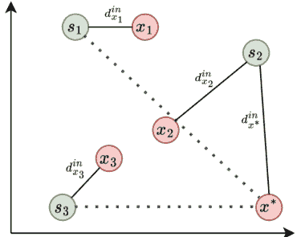

图 2.5：使用 GALI 查询下一个捆组的可视化。$s_1$ 到 $s_3$ 为已采样捆组。$H_{s_1}$ 为 $x_1$，$H_{s_2}$ 为 $\{x_2, x^*\}$，$H_{s_3}$ 为 $x_3$。下一个要查询的捆组是 $x^*$，因为它最大化了与其最近已采样捆组 $s_2$ 的距离。

**引理 2.6.** 根据（2.8），设 $B_{new} = \{x' \mid x' \in \arg \max_{x \in H_{s'}} \|x - s'\| \wedge s' \in \arg \max_{s \in S} dist_s\}$。
根据（2.6），设 $B_{old} = \{x' \mid x' \in \arg \max_{x \in \mathcal{X} \backslash S} d_x^{in}\}$。那么 $B_{new} = B_{old}$。

_证明._ 首先，我们通过证明每个不属于 $B_{old}$ 的元素也不属于 $B_{new}$ 来证明 $B_{new} \subseteq B_{old}$：设 $\tilde{x} \in \mathcal{X} \backslash S$，但 $\tilde{x} \notin B_{old}$。那么存在一个捆组 $x^* \in \mathcal{X} \backslash S$，使得 \(d_{\tilde{x}}^{in} < d_{x^*}^{in}\)。进一步，设 $\tilde{x}$ 在集合 $S$ 中最接近 $\bar{s}$，且 $x^*$ 在 $S$ 中最接近 $s^*$。则有

$$
\|\tilde{x} - \bar{s}\| = d_{\tilde{x}}^{in} < d_{x^*}^{in} = \|x^* - s^*\|
$$

我们分两种情况讨论：


### 2.3 方法

- $\tilde{x} \in \arg \max_{x \in H_{\tilde{s}}} ||x - \tilde{s}||$:
- \(\Longrightarrow dist_{\tilde{s}} = ||\tilde{x} - \tilde{s}||\)
- \(\Longrightarrow dist_{\tilde{s}} < dist_{s^*}\)
- \(\Longrightarrow \tilde{s} \notin \arg \max_{s \in S} dist_s\)
- \(\Longrightarrow x \notin \tilde{B}_{new}\)

- $\tilde{x} \notin \arg \max_{x \in H_{\tilde{s}}} ||x - \tilde{s}||$: 这显然违反了成为 \(B_{new}\) 元素的条件。但是，$\tilde{x}$ 可能与 \(S\) 中不止一个元素最近。因此，我们假设 $\tilde{x}$ 也与 S 中的 \(s'\) 最近，且 $\tilde{x} \in \arg \max_{x \in H'_{s'}} ||x - s'||$。但此时我们可以再次应用第一种情况，将 \(s'\) 代替 $\tilde{s}$，从而得到 $\tilde{x} \notin B_{new}$。

在两种情况下，我们都得到 $\tilde{x} \notin B_{old} \Longrightarrow \tilde{x} \notin B_{new}$，这意味着 \(B_{new} \subseteq B_{old}\)。

其次，我们证明 \(B_{old} \subseteq B_{new}$：假设 \(x \notin B_{new}$，且 $\tilde{x}$ 是 \(S$ 中最接近 $\tilde{s}$ 的点。同样可以区分两种情况：

- $\tilde{x} \notin \arg \max_{x \in H_{\tilde{s}}} ||x - \tilde{s}||$:
- 那么一定存在 \(x' \in H_{\tilde{s}}$，使得 \(||x' - \tilde{s}|| > ||\tilde{x} - \tilde{s}||$。
- \(\Longrightarrow d'_{x'}^{in} > d_{\tilde{x}}^{in} \Longrightarrow \tilde{x} \notin \arg \max_{x \in \mathcal{X} \setminus S} d_x^{in} \Longrightarrow \tilde{x} \notin B_{old}\)

- $\tilde{x} \in \arg \max_{x \in H_{\tilde{s}}} ||x - \tilde{s}||$, but $\tilde{s} \notin \arg \max_{s \in S} dist_s$:
- 存在一个 \(s^* \in \arg \max_{s \in S} dist_s$ 及其对应的 \(x^* \in \arg \max_{x \in H_{s^*}} ||x - s^*||$。
- 显然，我们有 \(dist_{\tilde{s}} < dist_{s^*}$。
- \(\Longrightarrow ||\tilde{x} - \tilde{s}|| < ||x^* - s^*|| \Longrightarrow d_{\tilde{x}}^{in} < d_{x^*}^{in} \Longrightarrow \tilde{x} \notin B_{old}\)

这表明 \(B_{old}$ 是 \(B_{new}$ 的子集。结合 \(B_{new} \subseteq B_{old}$，我们可以推导出 \(B_{new} = B_{old}$。

正如本节开头所述，\(B_{new}$ 无法在多项式时间内计算。问题在于约束 \(x \in H_{s^*}$，它要求 \(\mathcal{H}_{S^*}\) 必须已知。构建这个集合需要为每个 \(x \in \mathcal{X} \setminus S$ 计算其到集合 \(S$ 的距离，以便判断 \(x$ 是否最接近 \(s^*$。由于集合 \(\mathcal{X} \setminus S$ 的大小是指数级的，推导 \(H_{s^*}\) 需要指数时间。

### 使用 ILP 的实现

我们现在介绍一种更高效地计算 (2.8) 的方法。思路是为每个已查询的束 \(s \in S$ 找到一个 \(x^* \in \arg \max_{x \in H_s} \|x - s\|$，而无需构建 \(H_s$。这可以通过为所有 \(s \in S$ 求解以下小型优化问题来实现：

\[
\arg \max_{x \in \mathcal{X}} \|x - s\| \quad (\mathcal{X} = \{0, 1\}^m)
\]
\[
\text{s.t.} \quad \|x - s\| \le \|x - s'\| \quad \forall s' \in S, s' \neq s \quad (2.9)
\]

在这种形式下，优化问题 (2.9) 由于范数而为非线性，无法由 ILP 求解器求解。因此，我们将其重新表述为一个整数线性规划（ILP）。

\[
\arg \max_{x \in \mathcal{X}} \sum_{j=1}^m x_j + s_j - 2x_js_j
\]
\[
\text{s.t.} \quad \forall s' \in S, s' \neq s
\]
\[
\sum_{j=1}^m x_j + s_j - 2x_js_j \le \sum_{j=1}^m x_j + s'_j - 2x_js'_j
\]
\[
x, s, s' \in \{0, 1\}^m \quad (2.10)
\]

以下引理将有助于证明 ILP (2.10) 与优化问题 (2.9) 在定理 2.8 中的等价性。

### 引理 2.7。

令 \(x, y \in \mathcal{X} = \{0, 1\}^m$ 为两个大小为 \(m$ 的束。则，\(\|x - y\|^2 = \sum_{j=1}^m x_j + y_j - 2x_jy_j$。

### 引理 2.7 的证明。

\[
\|x - y\|^2 = \sum_{j=1}^m (x_j - y_j)^2
\]
\[
= \sum_{j=1}^m x_j^2 + y_j^2 - 2x_jy_j
\]
\[
= \sum_{j=1}^m x_j + y_j - 2x_jy_j \quad (\text{since } 0^2 = 0 \text{ and } 1^2 = 1)
\]

### 定理 2.8. 整数线性规划 (2.10) 与优化问题 (2.9) 等价。

### 定理 2.8 的证明。

由于一般平方函数 \(f(a) = a^2$ 是强单调的，可以对 (2.9) 中的所有范数取平方，同时保持等价性。接下来，利用引理 2.7 的结果，所有平方范数 \(\|x - s\|^2 \forall s \in S$ 都可以替换为求和式 \(\sum_{j=1}^m x_j + s_j - 2x_j s_j$，从而得到 ILP (2.10)。

对于现有的束 \(s \in S$，\(x^* \in \arg \max_{x \in H_s} \|x - s\|\) 可以通过求解所提出的 ILP (2.10) 来计算。为了找到下一个要查询的样本，需要为每个束 \(s \in S$ 求解 ILP。然后用 ILP 得到的束来计算其对应的束 \(s$ 的最大距离 \(dist_s$。在所有计算出的束中，选择由 \(dist_s$ 最大的束 \(s \in S$ 对应的 ILP 找到的束作为我们的下一个样本。需要注意的是，并非对所有 \(s \in S$ 都存在束 \(x^*$，特别是当 \(S$ 较大时，这会导致 ILP 无可行解。这个三维束空间的简单场景，其中 \(S = \{(1, 0, 0), (0, 1, 0), (0, 0, 1), (0, 0, 1), (0, 0, 0)\}$，说明了这种情况。在这个场景中，没有任何剩余的束比对 \(S$ 中任何其他束更接近或同样接近 \((0, 0, 0)$，因此 ILP 无可行解。然而这并不是问题，因为 \(\arg \max_{x \in H_{(0,0,0)}} \|x - (0,0,0)\|$ 同样为空。为了为 GALI 采样一个新束，将选择另一个具有非空 \(H'_s$ 的 \(s'$。

算法 2.9 展示了如何利用 ILP (5) 高效生成 ICAs 中对投标人进行询问的初始束集。它以初始出价数量 \(c_0$ 和物品数量 \(m$ 作为输入，并为每个投标人生成带有对应估值 \(Y$ 的束集 \(S$。需要注意的是，对于这种采样技术，\(S$ 中束的出价并非决定下一个样本所必需。因此，可以要求投标人一次性提交所有出价，而不是每次迭代都进行查询。出于此原因，这种采样策略也被称为 *被动采样*。根据文献 [205] 的结果，GALI 在物品数量方面表现出准多项式运行时间，因为所有可能解都在 \(\{0, 1\}^n$ 中，且约束系数向量的主导系数由物品数量所界限。

### 算法 2.9 基于 GALI 生成初始出价

```
Input: c0, m
Y <- \emptyset
S <- u.a.r. x \in X = {0, 1}^m
ask bidder to submit value for bundle x, add value to Y
count <- 1
while count <= c0 do
  for each s in S do
    compute x_s in arg max_{x in H_s} ||x - s|| using the ILP (2.10)
    dists <- ||x_s - s||
  end for
  choose s* in arg max_{s in S} dists_s
  S <- S U {x_s*}
  ask bidder to submit value for bundle x_s*, add value to Y
  count <- count + 1
end while
Output: (S, Y)
```

### 2.3.2 基于输出值的贪婪主动学习 (GALO)

与 GALI 类似，GALO 中也存在指数级迭代问题。文献 [289] 提出的算法建议对池中每个束评估模型输出。与 GALI 类似，可以用一个优化问题形式的 GALO 替代定义来表示 (2.7) 中的定义。该新的优化问题随后用于推导可高效求解的基于 ILP 的实现。

### GALO 的替代定义

令 \(S \subset X = \{0, 1\}^m$ 为已标记束的集合。束的标签保存在 \(Y = \{y_s | s \in S\}$ 中，且 \(y_s$ 是投标人对 \(s$ 报告的值。此外，我们拥有投标人 \(i$ 的估计值函数 \(\tilde{v}_i : X \to R$，该函数由机器学习回归模型使用 \(S$ 与标签 \(Y$ 作为训练集来学习。本节不对该模型的具体形式进行详细说明，因为它可以是任何回归模型。对于 \(Y$ 中的每个 \(y$，我们引入一个集合 \(H_y = \{x | \tilde{v}_i(x) \text{ 在 } Y$ 中最接近 } y\}$。重新表述的思路保持相似。我们不再遍历已查询的束 \(S$，而是遍历它们的标签 \(Y$。对于每个 \(y \in Y$，我们


计算一个组合 $x^* = \arg \max_{x \in H_y} |y - \tilde{v}_i(x)|$，使其估计值 $\tilde{v}_i(x)$ 在 Y 中最接近 $y$，但两者距离最大。进一步，我们有 $dist_y = \max_{x \in H_y} |y - \tilde{v}_i(x)| = |y - \tilde{v}_i(x^*)|$。接下来要查询的组合是

$$ x^* = \arg \max_{x \in H_{y^*}} |y^* - \tilde{v}_i(x)| $$
其中 $y^* \in \arg \max_{y \in Y} dist_y$
(2.11)

我们指出，定义 (2.11) 和 (2.7) 实际上是等价的。

**Lemma 2.10.** 设 $B_{new} = \{x' | x' \in \arg \max_{x \in H_{y^*}} |x - y'| \wedge s \in \arg \max_{y \in Y} dist_y\}$ 为根据新公式 (2.11) 可被下一次查询的所有组合集合，而 $B_{old} = \{x' | x' \in \arg \max_{x \in \mathcal{X} \setminus S} d_x^{out}\}$ 为基于旧定义 (2.6) 的同一集合。则 $B_{new} = B_{old}$。

*Lemma 2.10 的证明。* 证明与 Lemma 2.6 相同，只是略有修改。我们不再使用已查询的组合 $S$，而是使用它们的标签 $Y$，$d_x^{out}$ 取代 $d_x^{in}$，且 $x$ 与 $s$ 之间的范数被 $y$ 与 $\tilde{v}_i(x)$ 之间的范数所替代。

与 GALI 之前一样，优化问题 (2.11) 无法在多项式时间内计算。问题在于约束 $x \in H_{y^*}$，它要求 $H_{y^*}$ 必须已知。不幸的是，构建此集合需要对每个 $x \in \mathcal{X} \setminus S$ 和每个 $y \in Y$ 计算距离 $|y - \tilde{v}_i(x)|$。由于集合 $\mathcal{X} \setminus S$ 的大小为指数级，推导 $H_{y^*}$ 需要指数时间。

## 使用 ILP 的实现

我们展示如何再次使用 ILP 来计算 $H_{y^*}$。为了求解所提出的优化问题 (2.11)，我们需要对每个标签 $y \in Y$ 计算 $x^* \in \arg \max_{x \in H_y} |y - \tilde{v}_i(x)|$，而无需构建 $H_y$。这可以通过对每个 $y \in Y$ 求解以下优化问题来完成。

$$ \arg \max_{x \in \mathcal{X}} |y - \tilde{v}_i(x)| $$
s.t. $|y - \tilde{v}_i(x)| \le |y' - \tilde{v}_i(x)| \quad \forall y' \in Y . y' \neq y$
(2.12)

与 GALI 中之前一样，优化问题 (2.12) 由于欧几里得范数和价值函数 $\tilde{v}_i(x)$ 而不直接是线性问题。在以下各节中，我们将根据所选机器学习模型为价值函数 \(\tilde{v}_i(x)\) 推导一个线性公式。我们将针对两种不同的模型（线性模型和完全连接多层神经网络）提出解决方案。

## 线性模型解决方案

我们首先考虑机器学习模型为简单线性模型的情况，并称这种方法为 **GALO**（线性）。

在线性模型中，估计值函数形式为 \(\tilde{v}_i(x) = w^Tx + w_0\)，其中 \(w = (w_1, ..., w_m) \in \mathbb{R}^m\) 且 \(w_0 \in \mathbb{R}\)。该函数显然由欧几里得范数导致线性。非线性仅由欧几里得范数引起。

设 \(C\) 为一个大常数。以下 ILP 消除了非线性，同时保持与 (2.12) 等效。

```
arg max \ r \\
s.t. \\
y - \tilde{v}_i(x) \le r \\
\tilde{v}_i(x) - y \le r \\
y' - \tilde{v}_i(x) + C \cdot b_{y'} \ge r \\
\tilde{v}_i(x) - y' + C \cdot (1 - b_{y'}) \ge r \quad \forall y' \in Y \\
b_{y'} \in \{0, 1\} \quad \forall y' \in Y \\
r \in \mathbb{R}
```

在证明定理 2.12 之前，我们引入将有助于等价性证明的 Lemma 2.11。

**Lemma 2.11.** 设 \(b_{y'} \in \{0, 1\}\)。进一步设 \(C\) 为足够大的常数。则 $|y' - \tilde{v}_i(x)| \ge r$ 当且仅当 \(y' - \tilde{v}_i(x) + C \cdot b_{y'} \ge r\) 且 \(\tilde{v}_i(x) - y' + C \cdot (1 - b_{y'}) \ge r\)。

*Lemma 2.11 的证明。* 我们进行情况区分。

- $y' \ge \tilde{v}_i(x)$：我们选择 $b_{y'} = 0$ 且 $C \ge y' - \tilde{v}_i(x) + r$。
  $$
  \begin{aligned}
  |y' - \tilde{v}_i(x)| \ge r
  &\iff y' - \tilde{v}_i(x) \ge r \\
  &\iff y' - \tilde{v}_i(x) + (y' - \tilde{v}_i(x) + r) \cdot 0 \\
  &\quad \ge r \wedge \tilde{v}_i(x) - y' + (y' - \tilde{v}_i(x) + r) \cdot 1 \ge r \\
  &\iff y' - \tilde{v}_i(x) + C \cdot b_{y'} \\
  &\quad \ge r \wedge \tilde{v}_i(x) - y' + C \cdot (1 - b_{y'}) \ge r
  \end{aligned}
  $$

- $\tilde{v}_i(x) > y'$：我们选择 $b_{y'} = 1$ 且 $C \ge \tilde{v}_i(x) - y' + r$
  $$
  \begin{aligned}
  |y' - \tilde{v}_i(x)| \ge r
  &\iff \tilde{v}_i(x) - y' \ge r \\
  &\iff y' - \tilde{v}_i(x) + (\tilde{v}_i(x) - y' + r) \cdot 1 \\
  &\quad \ge r \wedge \tilde{v}_i(x) - y' + (\tilde{v}_i(x) - y' + r) \cdot 0 \ge r \\
  &\iff y' - \tilde{v}_i(x) + C \cdot b_{y'} \\
  &\quad \ge r \wedge \tilde{v}_i(x) - y' + C \cdot (1 - b_{y'}) \ge r
  \end{aligned}
  ```

### 定理 2.12. _整数线性规划 (2.13) 与优化问题 (2.12) 等效。_

_定理 2.12 的证明_。证明分为两步。在第一部分中，我们展示约束的等价性：

$$
\begin{aligned}
|y - \bar{v}_i(x)| \le |y' - \bar{v}_i(x)| \quad (\forall y' \in Y)
&\Longleftrightarrow |y - \bar{v}_i(x)| \le r \le |y' - \bar{v}_i(x)| \land r \in \mathbb{R} \quad (\forall y' \in Y) \\
y - \bar{v}_i(x) \le r \land \bar{v}_i(x) - y \le r
&\Longleftrightarrow |y' - \bar{v}_i(x)| \ge r \quad (\forall y' \in Y) \\
r &\in \mathbb{R}
\end{aligned}
$$

Lemma 2.11
$$
\left. \begin{aligned}
y - \bar{v}_i(x) \le r \land \bar{v}_i(x) - y \le r \\
y' - \bar{v}_i(x) + C \cdot b_{y'} \ge r \\
\bar{v}_i(x) - y' + C \cdot (1 - b_{y'}) \ge r \\
b_{y'} \in \{0, 1\} \\
r \in \mathbb{R}
\end{aligned} \right\} \quad (\forall y' \in Y)
$$

由于线性规划的约束与原始优化问题可以相互推导，两种方法的可行解集相等。现在进入第二部分。我们想要证明，对于任何可行 \(x\)，都有 \(r = |y - \bar{v}_i(x)|\)。

设 \(x\) 为可行解。因此，存在满足约束的 \(r \in \mathbb{R}\)：

$$
\begin{aligned}
y - \bar{v}_i(x) &\le r \\
\bar{v}_i(x) - y &\le r \\
y - \bar{v}_i(x) + C \cdot b_y &\ge r \\
\bar{v}_i(x) - y + C \cdot (1 - b_y) &\ge r
\end{aligned}
$$

前两个约束蕴含 $|y - \bar{v}_i(x)| \le r$，后两个约束蕴含 $|y - \bar{v}_i(x)| \ge r$（通过 Lemma 2.11）。因此，$|y - \bar{v}_i(x)| = r$。我们现在已经证明，ILP (2.13) 和优化问题 (2.12) 的可行解集相等，且对于所有这些可行解，都有 $|y - \bar{v}_i(x)| = r$。因此，最大化 $r$ 和最大化 $|y - \bar{v}_i(x)|$ 会产生相同的结果。

借助 ILP，我们现在可以介绍为竞标者生成初始组合-值对的算法。该算法类似于 Algorithm 2.9。为了防止过拟合，在对模型进行训练之前，我们需要足够数量的初始组合-值对。这些对的组合可以均匀随机生成，也可以使用刚刚介绍的 GALI 技术生成。输入 k 定义需要多少个初始组合。之后，组合按迭代方式如 Algorithm 2.9 所示确定。每一轮我们调用机器学习算法 M，它以训练集及其标签为输入，在该数据上训练模型并返回训练好的模型。在此情况下，模型将是一个线性模型。然后，利用 ILP (2.13) 我们可以确定下一个要采样的组合。

```
Algorithm 2.13 Generate Initial Bids based on GALO
Input: c0, k
Input: Machine learning algorithm M
generate k initial bids based on uniform sampling or using Algorithm 2.9
→ S, Y
count ← 0
while count ≤ c0 − k do
    ṽi ← M(S, Y)
    for each y ∈ Y do
        compute xy ∈ arg maxx∈Hy |y − ṽi(x)| (ILP (2.13))
        disty ← ||ṽi(xy) − y||
    end for
    choose y* ∈ arg maxy∈Y disty
    S ← S ∪ {xy*}
    ask bidder to submit value for bundle xy*, add value to Y
    count ← count + 1
end while
Output: (S, Y)
```

## 神经网络解决方案

我们展示如何高效计算 DL-ICA 中使用的神经网络的 GALO，并将这种方法称为 GALO (NN)。更具体地，我们考虑带有 ReLU 激活函数的 MLP。ReLU 的分段线性特性简化了 GALO 的计算。尽管可以使用替代的分段线性激活函数，例如 leaky ReLU，但 tanh 等其他非线性函数不适用。这是因为它们的非线性无法轻松


在 ILP 框架内表示，这对我们的方法至关重要。尽管 ReLU 具有分段线性，但它仍然是非线性的，使我们的神经网络也能逼近非线性函数。因此，竞标者 $i$ 的学习估计值函数 $\tilde{v}_i$ 不能直接用于线性程序中。类似的问题在以前的工作 [285] 中已经出现，见 Lemma 2.2。在本章中，我们遵循类似的方法。令 $d_k$ 为维度，$b^k$ 为第 $k$ 层的偏置，$W^k$ 为用于根据第 $k$ 层的输出值计算第 $k+1$ 层输出值的矩阵。此外，$o^{k+1}$ 表示第 $k+1$ 层的输出，由于 ReLU 激活函数，其计算为 $0$ 与 $W^k \cdot o^k + b^k$ 的逐元素最大值。我们可以通过 [285] 首先引入的技术将神经网络转换为一组线性约束。对于除输入层外的任何层 $k$，我们引入三个新向量 $y^k, z^k, q^k$，大小均为 $d_k$，连同 Lemma 2.2 中的三个线性约束 (2.2) - (2.4)，满足 $z^k = o^k$。

令 $K+1$ 为层数（包括输入层和输出层）。神经网络的输出对应于输出层的输出，因此等于 $o^K$（索引从 0 开始）。因此，如果满足以下约束，我们可以写出 $\tilde{v}_i(x) = z^K$：

```
z^0 = x
z^k - q^k = W^{k-1} \cdot z^{k-1} + b^{k-1}
0 \le z^k \le y^k \cdot L
0 \le q^k \le (1 - y^k) \cdot L
y^k \in \{0, 1\}^{d_k}
\Bigg\} \forall k \in \{1, ..., K\}
```

关于约束的说明：$L$ 是一个大常数，使得对于 $\forall k \in \{1, ..., K\}$ 以及 $z^k$ 中的每个元素 $z$，有 $z < L$，对于 $q^k$ 中的每个元素 $q$，有 $q < L$。此外，$z^k$ 和 $q^k$ 是实数空间中的向量。我们省略了证明，并参考文献 [285] 中定理 1 的证明。

为了求解优化问题，我们使用上一节定义的线性模型中的 ILP (2.13)，并将现在的非线性表达式 $\tilde{v}_i(x)$ 替换为刚刚推导出的线性表示。

总体而言，GALO (NN) 的最终 ILP 如下所示：

```
arg max r
x \in \mathcal{X}
s.t.
y - z^K \le r
z^K - y \le r
y' - z^K + C \cdot b_{y'} \ge r
z^K - y' + C \cdot (1 - b_{y'}) \ge r \quad \forall y' \in Y
b_{y'} \in \{0, 1\} \forall y' \in Y
r \in \mathbb{R}
z^0 = x
z^k - q^k = W^{k-1} \cdot z^{k-1} + b^{k-1}
0 \le z^k \le y^k \cdot L
0 \le q^k \le (1 - y^k) \cdot L
y^k \in \{0, 1\}^{d_k}
\forall k \in \{1, ..., K\}
```

我们已经证明，(2.13) 中定义的线性模型的 ILP 与优化问题 (2.12) 等价。(2.14) 中的附加约束仅确保 \(\tilde{v}_i(x)\) 以线性方式表示。它们以任何方式都不影响可行解集。因此，ILP (2.14) 也与优化问题 (2.12) 等价。

最后，为了为竞标者 \(i\) 生成初始出价，我们可以通过在第 6 行求解 ILP (2.14) 而非 ILP (2.13) 来将算法 2.13 适应神经网络。

### 2.4 结果

我们使用频谱拍卖测试套件 (SATS) 版本 0.6.4 (Weiss et al. [284]) 进行实验。通过 SATS，我们不仅可以在各个领域生成许多不同的组合拍卖 (CA) 实例，还可以访问任何竞标者的完整价值函数以及最大化社会福利的最优分配 \(a^*\)。这使我们能够轻松计算所找到分配 \(a\) 的效率 \(\frac{V(a)}{V(a^*)}\)。SATS 提供不同的模型。所有模型都表示频谱拍卖。因此，被拍卖的物品是电磁频谱中频段的许可证。我们在 LSVM、GSVM 和 MRVM 拍卖模型上评估我们的方法。

| 模型 | 采样技术 | 平均查询数 | 平均迭代数 | 最优分配百分比 | 平均运行时间 | 效率百分比 |
|---|---|---|---|---|---|---|
| GSVM | UF | 39.7 | 4.6 | 27.45 | 15min | 97.95 (0.32) |
| | GALI | 37.2 | 3.9 | 60.78 | 17min | 99.18 (0.20) |
| | GALO (NN) | 37.95 | 4.2 | 62.00 | 71min | 99.53 (0.13) |
| LSVM | UF | 50.9 | 5.0 | 13.73 | 33min | 96.80 (0.41) |
| | GALI | 47.5 | 4.0 | 11.76 | 27min | 97.55 (0.32) |
| | GALO (NN) | 45.69 | 3.3 | 18.00 | 70min | 97.46 (0.33) |
| MRVM | UF | 250.3 | 61.5 | 0.0 | 422min | 96.20 (0.18) |
| | GALI | 252.5 | 61.5 | 0.0 | 455min | 96.42 (0.20) |
| | GALO (NN) | 312.5 | 62.8 | 0.0 | 760min | 96.17 (0.13) |

## 全局协同价值模型 (GSVM)

GSVM 模拟一个包含 18 个物品和 7 个竞标者的拍卖，其中 6 个是区域竞标者，1 个是全国竞标者。物品排列成两个圆圈，一个包含 12 个物品的全国圆圈和一个包含 6 个物品的区域圆圈。全国竞标者对全国圆圈上的所有物品感兴趣，而区域竞标者在全国圆圈上有 2 个感兴趣的物品，在区域圆圈上有 4 个。竞标者分配到的感兴趣物品越多，其对这些物品的估值越高。每多分配一个感兴趣的物品，竞标者对已分配物品的估值增加 20%。该模型最初由 Goeree 等人 [100] 提出。

## 本地协同价值模型 (LSVM)

LSVM 是由 Scheffel 等人 [228] 发明的拍卖模型，包含 18 个物品和 6 个竞标者。与 GSVM 类似，其中一个竞标者为全国类型，其余的是区域竞标者。在这里，物品排列在二维网格上。每个区域竞标者都有一个随机确定的偏好物品。对于靠近其偏好物品的物品，竞标者具有正值。同时，全国竞标者对所有物品都有正值。一个组合包的价值取决于相邻物品数量的 Sigmoid 函数。

## 多区域价值模型 (MRVM)

受 2014 年加拿大 700MHz 频谱拍卖的启发，Weiss 等人 [284] 开发了 MRVM。它是所呈现的三个模型中最现实的一个，但也是最复杂的一个。总共有 98 个物品和 10 个竞标者。频段可以具有协同效应，国家被划分为多个区域。竞标者对每个区域都有一定的价值，这取决于他分配到的组合包及其他参数。竞标者区域价值之和，减去一个所谓的竞标者特定项（取决于竞标者覆盖的区域），得到竞标者的最终价值。MRVM 区分三种不同类型的竞标者，即全国、区域和本地。如果全国竞标者能够凭借获得的许可证很好地覆盖整个国家，其价值会增加。区域竞标者在靠近其总部的区域之间具有协同效应，而本地竞标者在任何区域之间都不具有协同效应。

对于 LSVM 和 GSVM，我们运行 51 个不同的实例。对于 MRVM，由于 DL-ICA 的计算复杂度增加，我们运行 21 个不同的实例。所有相关超参数在不同采样策略中保持一致，可在附录 A.1 中找到。

我们在表 2.14 中汇总了所有结果。GALI 和 GALO (NN) 始终能够在效率更高且标准差更低的方面优于均匀采样 (UF) 基线。在组合拍卖领域，分配效率提高 1% 乍一看可能微不足道。然而，经过更深入的思考，其影响是深远的。首先，必须承认许多拍卖涉及巨额资金交易。即使是微小的百分比改进也能转化为巨额资金，显著影响市场结果和利益相关者的收益。此外，效率提升具有级联效应。效率提高不仅意味着更好的资源分配，还可能增加对这类拍卖机制的信任和参与。随着时间的推移，这些渐进式的收益会累积，导致更具竞争力的市场并促进出价策略的创新。此外，从计算角度来看，即使是微小的改进也可能预示着算法技术或计算方法的突破。

对于 GSVM 和 LSVM，平均查询样本数甚至有所下降。拥有 98 个物品的 MRVM 是最具挑战性的


表 2.15: 所有拍卖模型的更详尽效率指标。所有值均以 % 为单位。25%、50% 和 75% 分别表示所达效率的四分位数。值得注意的是，GALO (NN) 在最坏情况性能（Min）方面相对于 UF 带来了持续的改进。一般来说，GALI 和 GALO (NN) 都能降低结果的方差。这一特性对于现实生活中的拍卖很重要，并有助于提高对该程序的信心。

| 模型 | 采样技术 | 平均值 | 最小值 | 25% | 50% | 75% | 标准误 |
|---|---|---|---|---|---|---|---|
| | UF | 97.95 | 92.21 | 96.20 | 98.74 | 100.00 | 0.32 |
| GSVM | GALI | 99.18 | 93.29 | 98.55 | 100.00 | 100.00 | 0.20 |
| | GALI + UF | 98.83 | 92.35 | 97.97 | 99.78 | 100.00 | 0.23 |
| | GALO (linear) | 98.97 | 91.87 | 98.25 | 99.84 | 100.00 | 0.23 |
| | GALO | 99.53 | 95.81 | 99.63 | 100.00 | 100.00 | 0.13 |
| | UF | 96.8 | 89.85 | 95.34 | 97.48 | 99.45 | 0.41 |
| LSVM | GALI | 97.55 | 89.11 | 96.75 | 98.0 | 99.12 | 0.32 |
| | GALI + UF | 96.93 | 87.88 | 95.24 | 97.47 | 98.61 | 0.36 |
| | GALO (linear) | 97.36 | 90.11 | 96.02 | 97.84 | 99.43 | 0.34 |
| | GALO | 97.45 | 93.12 | 95.88 | 97.8 | 99.29 | 0.3 |
| | UF | 96.2 | 94.40 | 95.66 | 96.49 | 96.74 | 0.18 |
| MRVM | GALI | 96.42 | 94.03 | 96.09 | 96.55 | 97.02 | 0.20 |
| | GALI + UF | 96.3 | 94.97 | 95.76 | 96.3 | 96.79 | 0.16 |
| | GALO (linear) | 96.35 | 95.5 | 96.01 | 96.23 | 96.66 | 0.13 |
| | GALO | 96.17 | 94.7 | 95.92 | 96.14 | 96.43 | 0.13 |

拍卖模型，其中没有单个实例设法找到最优分配。尽管 GALO (NN) 在 MRVM 上略逊于 UF，但其最坏情况效率仍然更好，如表 2.15 中 'Min' 和 '25%' 列所示。所有种子中最低的 UF 结果为 94.40%，第 25 个百分位数为 95.66%，而 GALO 分别达到了 94.70% 和 95.92%。

GALI 的平均运行时间与均匀采样相似，两者都可以在向投标者请求任何评估之前预先计算。GALO 的运行时间与均匀采样方法量级相同，即使对于样本池大小为 2^98 的拍卖也能很好地扩展。在现实场景中，大规模拍卖可能需要数天或数周。因此，小时级别的运行时间意味着将 GALI 和 GALO 应用于此类拍卖是可行的。此外，GALI 和 GALO 可以帮助减少向投标者请求的总估值数量，从而降低现实世界拍卖的总执行时间。需要注意的是，GALO 的运行时间取决于神经网络架构以及拍卖中的物品和投标者数量。GALI 的运行时间仅取决于拍卖中的物品和投标者数量。

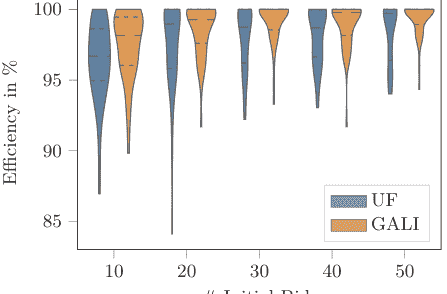

图 2.16: 使用均匀采样（UF）和基于输入值的贪婪主动学习（GALI）在 GSVM 中不同初始投标数量的效率小提琴图。小提琴内部的虚线表示四分位数。请注意，如果四分位数线表示 100%，则不可见。GALI 显示出更有利的分布，更大一部分质量分布在较高位置且尾部更细。这一特性无论初始投标数量如何均成立，并确保现实生活拍卖中出现特别糟糕结果的可能性大大降低。

#### 2.4.1 对初始查询数量的鲁棒性

我们还观察了初始查询减少如何影响分配的效率。对于两种采样策略，我们使用 10、20、30、40 和 50 个初始捆（c0）进行了仿真，同时始终将 ce 保持为 10。每种配置测试了 51 个 CA 实例。我们将结果汇总为图 2.16 中 GSVM 的小提琴图和图 2.17 中 LSVM 的小提琴图。

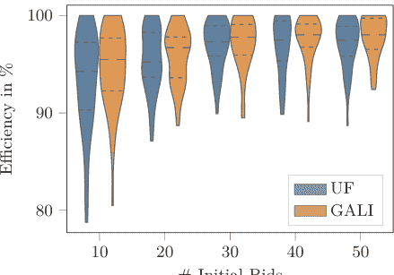

图 2.17: 使用均匀采样（UF）和基于输入值的贪婪主动学习（GALI）在 LSVM 中不同初始投标数量的效率小提琴图。小提琴内部的虚线表示四分位数。与 GSVM 类似，GALI 能够将概率质量移向更高的效率，与 UF 相比，较低效率出现的可能性大大降低。

它们表明，GALI 产生的分配质量比 UF 产生的分配质量一致性高得多。无论初始查询数量如何，此结论均成立。可用的初始捆越少，效率差异就越大。与均匀采样方法相比，GALI 生成其分配所需的平均查询次数也更少。具体来说，在 GSVM 中，GALI 平均比 UF 少使用 16% 的查询，在 LSVM 中少使用 18% 的查询。GALI 在最坏情况下的表现也更好。在 GSVM 中，GALI 使用 20 个初始查询时达到的最小效率为 91.7%，而 UF 产生的分配效率仅为 84.11%。这些发现凸显了 GALI 在实际环境中相对于 UF 的优势，在该环境中，一致的性能和较少的请求查询数量带来巨大益处。有关详细结果，请参见表 2.18。仅当有 10 个初始捆时，每位投标者的查询数量大致相等。GALI 在最坏情况下的表现也更好。达到的最小效率为 77.69%，而均匀采样产生的分配效率仅为 69.46%。图 2.16 中的小提琴图还表明，仿真

表 2.18: GSVM 中 $c_0$ 消融实验的更详尽结果。提供的平均值计算自所有实验运行。#Queries 表示迭代阶段发送给投标者的查询数量，不包括初始查询 $c_0$。Optimal Alloc. in % 表示找到最优分配的次数百分比。得益于对初始查询的更好选择，GALI 使迭代阶段能够更快收敛并取得更好的结果。这导致向投标者发送的查询更少，减轻了他们的负担。从 20 个初始查询开始，这种效应就很明显。

| $c_0$ | 采样技术 | 平均查询数 | 最大查询数 | 平均迭代数 | 最大迭代数 | 最优分配百分比（%） |
|---|---|---|---|---|---|---|
| 10 | UF | 14.65 | 26.86 | 5.82 | 11.98 | 3.92 |
| | GALI | 13.91 | 27.47 | 6.10 | 14.61 | 13.73 |
| 20 | UF | 11.89 | 22.63 | 5.16 | 10.80 | 27.45 |
| | GALI | 9.84 | 20.69 | 4.75 | 10.69 | 35.29 |
| 30 | UF | 9.72 | 19.61 | 4.61 | 10.02 | 27.45 |
| | GALI | 7.17 | 15.49 | 3.86 | 8.39 | 52.94 |
| 40 | UF | 7.92 | 16.47 | 4.08 | 9.39 | 25.49 |
| | GALI | 5.32 | 12.22 | 3.17 | 7.33 | 47.06 |
| 50 | UF | 6.70 | 15.02 | 3.70 | 8.31 | 33.33 |
| | GALI | 5.58 | 12.78 | 3.36 | 7.59 | 54.90 |

使用 GALI 的仿真，特别是对于较小的 $c_0$，比均匀采样更一致且分布更少。

此外，我们在表 2.18 和表 2.19 中分别提供了图 2.16（GSVM）和图 2.17（LSVM）中关于初始查询数量消融的扩展结果。这些结果表明，使用 GALI 不仅提高了经济效率，而且通常还减少了向投标者发送的查询数量和迭代次数。

#### 2.4.2 GALO 的消融实验

我们更详细地分析了 GALO 的各个构建模块，并使用两种不同的变体进行了消融实验。GALO (NN) 是我们的基线，其中 GALO 基于如 2.3.2 中所述的神经网络进行。对于 GALO (linear)，我们使用如 2.3.2 中所述的简单线性回归模型，而不是神经网络。对于第二个变体 GALI + UF，我

表 2.19: LSVM 中 $c_0$ 消融实验的更详尽结果。提供的平均值计算自所有实验运行。#Queries 表示迭代阶段发送给投标者的查询数量，不包括初始查询 $c_0$。Optimal Alloc. in % 表示找到最优分配的次数百分比。与 GSVM 类似，从 20 个初始查询开始，GALI 使迭代阶段能够更快收敛。对最优分配数量的影响在 LSVM 中比在 GSVM 中更小。

| $c_0$ | 采样技术 | 平均查询数 | 最大查询数 | 平均迭代数 | 最大迭代数 | 最优分配百分比（%） |
|---|---|---|---|---|---|---|
| 10 | UF | 17.68 | 25.69 | 6.74 | 12.25 | 3.92 |
| | GALI | 18.10 | 29.12 | 7.44 | 12.92 | 5.88 |
| 20 | UF | 13.65 | 20.73 | 5.69 | 11.43 | 5.88 |
| | GALI | 11.73 | 19.18 | 5.22 | 10.45 | 3.92 |
| 30 | UF | 12.18 | 19.00 | 5.35 | 10.53 | 5.88 |
| | GALI | 8.12 | 13.92 | 4.15 | 8.76 | 17.65 |
| 40 | UF | 10.87 | 17.24 | 5.01 | 10.31 | 13.73 |
| | GALI | 7.55 | 12.78 | 3.96 | 8.84 | 11.76 |
| 50 | UF | 10.12 | 15.96 | 4.88 | 10.61 | 9.80 |
| | GALI | 7.68 | 12.43 | 4.06 | 8.12 | 21.57 |

使用 GALI 采样前 $k$ 个捆（类似于 GALO，参见算法 2.13）。然后，我们根据均匀分布采样剩余的捆。

我们在图 2.20 中汇总了结果。如所见，对于 GSVM 和 LSVM，GALO (NN) 明显表现最佳。这给我们带来两个启示。首先，为了增加神经网络输出的多样性而采样捆，相较于更简单的线性回归模型具有优势。其次，GALO (NN) 带来的益处既不是 GALI 也不是均匀采样所能捕捉到的。MRVM 的结果略有不同。因为我们希望保持实验设置与 [285] 一致且可比，因此我们不会故意选择参数以使我们的算法适应不同场景。然而，MRVM 拥有数量要多得多的物品且更为复杂，导致初始查询数量相对于完整捆空间可忽略不计。一个证据是，我们发现 MRVM 的迭代阶段数量和迭代阶段中查询的样本数量极高，许多投标者达到了为终止迭代而设置的查询上限。这表明，如此少量的初始样本不


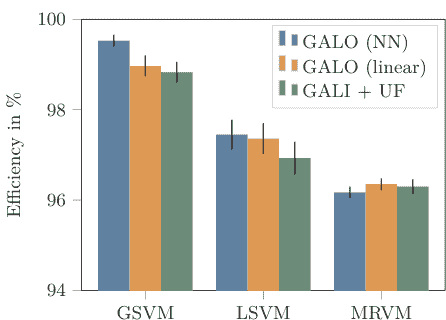

图 2.20：GALO 的消融研究。GALO (NN) 基于神经网络，而 GALO (linear) 使用简单的线性回归模型。对于 GALI + UF，前 k 个捆组使用 GALI 采样（如同 GALO 中一样），但随后对剩余捆组使用均匀采样（UF）而非 GALO。GALO (NN) 在 GSVM 和 LSVM 上优于消融实验。GALO (NN) 在 MRVM 上的性能略差，这可能表明底层神经网络难以正确拟合投标者画像。

不适用于拥有大型且复杂捆组空间的拍卖模型。因此，任何合理的采样策略效果都极其有限。

此外，我们假设，由于 MRVM 的复杂性很大，所选神经网络架构不足以利用前 k 个样本学习出有用的表示，甚至可能过拟合。因此，GALO (NN) 的优势消失，而更简单的 GALO (linear) 表现更好。未来研究中，我们计划优化神经网络架构以避免此类缺陷。

### 2.5 讨论与结论

我们将主动学习引入基于深度学习的迭代组合拍卖中。我们展示了如何使用线性规划解决指数级池大小问题。此外，我们证明了线性规划方法的正确性。结果表明，主动学习显著提高了所得分配的效率，即使查询次数少于基准。而且，我们表明主动学习对不同的初始样本量更具鲁棒性。综上所述，这些特点使我们的方法具有显著的实际吸引力。

虽然我们的 DL-ICA 框架确立了主动学习在组合拍卖中的基础优势，但几个有前景的扩展方向应运而生。首先，解决投标者异质性问题可能涉及开发自适应查询策略，以考虑实验经济学中观察到的不同风险偏好或认知约束。其次，提高对噪声输入的鲁棒性可能将对抗训练技术与我们的偏好获取模块相结合，特别是在高风险场景中，报告错误与出价金额相关。第三，尽管我们的经验结果表明 GALI 在某些价值分布下可能以伪多项式时间运行（待正式证明），但 GALO 的计算复杂度为通过近似方案或其他先进算法设计进行改进提供了机会。主动学习范式本身也可能通过替代训练方法（如强化学习）演进，使去中心化投标者能够在私下优化价值模型的同时保持分配效率。此外，通过激励相容性约束调查非真诚出价如何影响结果，可能会揭示偏好获取的新鲁棒性要求。这些扩展将在保持框架核心效率优势的同时，增强理论完整性和实际可部署性。这些方向共同推动了更符合生态效度的拍卖机制的发展，同时保留了本研究中展示的计算优势。

## 基于自监督预训练弥合主动学习中的多样性与不确定性

### 摘要

本研究探讨了主动学习中基于多样性和基于不确定性的采样策略的集成，特别是在自监督预训练模型的背景下。我们引入了一种名为 TCM 的简单启发式方法，它在缓解冷启动问题的同时，在各种数据规模下保持了强劲性能。通过最初应用 TypiClust 进行多样性采样，随后过渡到使用 Margin 的不确定性采样，我们的方法有效结合了两种策略的优势。实验表明，TCM 在低数据和高数据模式下，在各种数据集中始终优于现有方法。

### 3.1 引言

众所周知，训练机器学习模型依赖大量标注数据。然而，在许多场景中，标注数据并不容易获取，而是需要通过昂贵的人工标注来创建。主动学习的目标是通过提供一种选择最具信息性的样本进行标注的方法来应对这一挑战。这些样本是指在其上训练分类器能带来性能最快提升的样本。

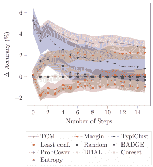

图 3.1：所有基线和我们的（TCM）策略相对于随机策略的准确率提升。准确率提升的均值和标准差计算基于所有预算大小，涵盖 CIFAR10、CIFAR100 和 ISIC2019。

取决于模型已经训练了多少个标注样本，这些样本的属性必须发生变化。在低预算设置中，覆盖完整数据分布的多样且典型的样本最为重要。随着预算增加，模型从这类样本中获益不再那么多。相反，一旦模型学习了数据分布的一般规律，最具信息性的样本就是那些精确展示决策边界所在的样本。问题在于，不同的主动学习方法在不同的数据预算下效果最好，且不清楚何时在不同方法之间切换。

在本章中，我们提供了一种名为 TCM 的新启发式方法，用于结合这两种方法，即 TypiClust [107] 和 Margin。TypiClust 在低数据模式下表现出色，而 Margin 之后表现优异。我们专门分析了存在自监督预训练骨干模型的场景。这种骨干不仅与从头开始训练相比大幅提升了性能，而且还简化了从低数据模式到高数据模式的转换动态。

我们表明，TCM 无论标注预算和数据集如何，都能始终保持强劲性能（参见图 3.1）。在整个训练过程中，它都优于其底层方法 TypiClust 和 Margin。得益于我们 TCM 的简洁与有效，我们为从业者提供了明确指南，说明如何在自己的环境中轻松使用主动学习。

### 3.2 相关工作

在主动学习中，两种主要的采样策略至关重要：基于多样性的采样和基于不确定性的采样。基于多样性的采样旨在选择一组覆盖整个特征空间的具有代表性的样本，从而确保输入域的广泛覆盖。相比之下，基于不确定性的采样专注于查询模型表现出最高预测不确定性的实例。通过这种方式，基于不确定性的采样旨在提升模型在挑战性案例中的性能。训练初期，基于多样性的方法往往表现更好，因为在样本有限时更难覆盖完整的数据分布。此外，在这个阶段，分类器不确定性是困难样本的弱预测指标。这也被称为基于不确定性的方法的“冷启动问题”[192]。

### 3.2.1 自监督预训练

在介绍任何特定的主动学习方法之前，我们首先阐述自监督学习。在自监督学习中，模型使用预训练任务进行训练，从而在没有显式外部标签的情况下学习有用的表示。自监督学习通过在任何数据被标注之前学习嵌入，补充了主动学习，简化了样本查询和分类器训练。流行且常用的模型包括 SimCLR [41] 和 DINO [36]。SimCLR 使用对比损失，其中同一图像的不同视图被拉近以获得紧凑的表示，而不同图像的视图被推远以获得遥远的表示。DINO 的预训练任务涉及学习数据变换不变表示，即从教师网络向学生网络蒸馏同一图像的不同视图，其中教师网络是学生网络的指数移动平均。

### 3.2.2 基于不确定性的主动学习

我们首先简要介绍相关的基于不确定性的主动学习方法。一些方法试图基于分类器的输出 logits 来量化模型不确定性。最小置信度 [159] 选择最高类别概率最低的样本。熵 [140] 通过分类器概率分布来衡量模型预测不确定性，并选择熵最高的样本。Margin 选择最可能的两个类别概率之差最低的样本。还存在基于贝叶斯方法的方法。DBAL [94] 使用贝叶斯卷积神经网络作为分类器，并基于其最高熵查询样本。BALD [94] 也使用贝叶斯卷积神经网络，但与 DBAL 不同，它选择能最大化关于模型参数信息增益的样本。我们的 TCM 策略基于 Margin 进行不确定性采样，因为其性能强劲且设计简单。

### 3.2.3 基于多样性的主动学习

在基于多样性的主动学习领域，Coreset [233] 通过选择构成未标注池中其余样本最小半径覆盖的点来查询多样化样本。最小半径覆盖确保所有剩余的未标注样本都有一个附近的样本被标注。ProbCover [302] 在自监督嵌入基础上改进了 Coreset，并选择嵌入空间高密度区域的样本。虽然 Coreset 确保从整个分布中查询样本，但它可能会选择对训练无益的离群点。相比之下，ProbCover [302] 从未覆盖的高密度区域采样，选择更具代表性的样本。TypiClust [107] 通过先进行聚类，然后从每个簇中选择最典型的样本来查询多样化样本。簇的数量随每一步的采样大小增加，确保有足够的簇从嵌入空间未探索区域采样新点。典型性通过到簇中其他点的平均距离的倒数来衡量。TypiClust 查询的典型点能够实现强劲性能，尤其是在训练过程开始时。为


出于此原因，我们的TCM策略采用TypiClust作为初始采样策略，从而避免了冷启动问题。

### 3.2.4 混合方法

主动学习领域的一些研究此前已结合多样性与基于不确定性的采样。BADGE [10] 和 BatchBALD [146] 开发了方法，以确保不确定样本批次内的多样性。另一方面，SelectAL [106] 开发了一种复杂算法，能够自动检测当前数据模式并选择相应的多样性或基于不确定性的主动学习算法。然而，这些方法大多集中在从头开始训练分类器的情况。如本章后文所示，使用预训练骨干网络时，无需采用复杂的切换策略，因为多样性与基于不确定性采样之间的过渡点总是在训练早期出现。

### 3.3 方法论

最佳查询策略取决于已标记数据集的大小。如图 3.1 所示，像 TypiClust（蓝色）这样的强多样性方法在采样的最初几个步骤中表现强劲。另一方面，像 Margin（黄色）这样的基于不确定性的方法，随着累积预算的增长会表现出更强的性能。当两种方法都在其最强时段使用时，可以实现最佳且最一致的性能。因此，我们提出了一种结合 TypiClust 和 Margin 的混合采样策略，并将该策略称为 TCM。

### 3.3.1 过渡点

为了更深入了解何时从 TypiClust 切换到 Margin 的动态，我们从 TypiClust 开始并进行消融实验，在 N 个采样步骤后切换到 Margin。该消融实验的结果如图 3.2 所示，最佳过渡点取决于初始预算和相应的步长。初始预算越大，从 TypiClust 快速切换到 Margin 就越有利，以实现持续强劲的性能。

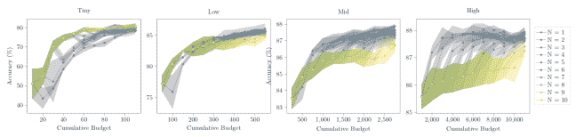

Figure 3.2：CIFAR10 数据集上的过渡点消融实验。在最后一步切换到 Margin 相当于 N = 10，而仅对初始采样使用 TypiClust 并立即切换到 Margin 则为 N = 1。

### 3.3.2 步长

我们进一步分析了步长对 TCM 中 Margin 部分的影响。得益于 TypiClust 的设计，其性能大多与步长无关。出于此原因，我们在使用 TypiClust 选择初始预算后，仅对 Margin 进行详细分析。仅根据类别概率选择一批样本时，如果步长过大，Margin 可能会选择大量相似样本。与此同时，步长过小也不实际，因为模型需要过于频繁地重新训练。出于此原因，我们对步长对 TCM 性能的影响进行了消融实验，如图 3.3 所示。令人惊讶的是，结果表明，总体上，不同步长的性能差异不明显。中等和高预算的大步长可能会产生轻微的负面影响，但随着累积预算接近尾声，这种差异消失了。这些结果的含义非常积极，因为它们表明 TCM 的步长可以适应其他需求，例如数据标注专家的可用性和计算资源。

基于我们的消融实验，我们为 TCM 制定了以下简单启发式策略。我们使用等于各设置初始预算大小的步长。在 Tiny 和 Low 设置中，在切换到 Margin 之前执行 3 步 TypiClust。在 Medium 设置中，我们执行 2 步 TypiClust，而在 High 设置中，我们执行一步。

然而，基于我们的消融实验，我们还可以为主动学习实践者提供更广泛的经验法则。在新设置中，我们建议使用大约为类别数量 20 倍的总预算用于 TypiClust，然后切换到 Margin，对步长没有严格限制。

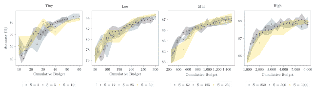

Figure 3.3：CIFAR10 数据集上 TCM 的步长消融实验。对于每个模式，我们评估三种不同的步长 S。总体上，步长之间没有明显的性能差异。

### 3.4 实验评估

### 3.4.1 设置

当今的主动学习研究存在不一致的图景，有许多相互矛盾的结果。出于此原因，我们遵循 Lüth 等人 [181] 提出的评估框架，以对所有主动学习基线进行公平且严谨的比较。具体而言，我们在 CIFAR10 [147] 数据集上调整超参数，并将所有其他数据集作为推广数据集。我们评估 CIFAR10 和 CIFAR100 [147] 以及 ISIC2019 [51] 数据集，还考虑了这两个数据集的长尾版本，标记为 LT [33]。这些长尾版本具有类别不平衡，其中 LT 后的数字表示最常见类别和最不常见类别之间的比例，并与其他类别样本量的指数衰减相结合。我们在 4 种不同的数据预算大小上进行所有实验。这些包括 Lüth 等人定义的小、中和大，以及初始样本量等于类别数量的 tiny 预算大小。此外，我们对所有预算始终使用等于初始样本数量的步长。一些采样方法，如 ProbCover、TypiClust 和我们提出的 TCM，依赖于自监督预训练表示。对于所有这些方法，我们使用相同的表示。具体而言，对于 CIFAR10、CIFAR10-LT5、CIFAR10-LT10、CIFAR100、CIFAR100-LT5、CIFAR100-LT10，我们使用 Hacohen 等人提供的 SimCLR 特征。对于 ISIC2019，我们从头开始训练 DINO 模型并使用该模型的特征。

为了验证我们所提主动学习框架的有效性，我们利用相同的预训练表示来训练分类器。在本章中进行的所有实验中，我们将选定的骨干网络用作基础特征提取器。在此基础上，我们训练一个线性预测头，将模型微调到主动学习过程中获得的标签。这种方法使我们能够利用预训练模型丰富的表示能力，从而在低数据模式下实现分类器显著更强的性能。此外，通过使用公开可用的预训练模型嵌入，每个采样步骤后的分类器训练需要显著更少的计算资源。鉴于使用预训练骨干网络的上述优势，并考虑到 TypiClust 依赖于此类骨干网络，我们没有进行任何从头开始训练分类器的实验。我们为所有数据集、预算和查询策略的分类器训练固定了所有训练超参数。对于所有实验，我们绘制了 3 个种子运行的均值和标准差。虽然我们已经在图 3.1 中展示了所有数据集和预算大小的汇总，但我们在图 3.4 中展示了每个评估数据集的具体结果。

### 3.4.2 结果

我们的结果展示了 TCM 相比其他基线的持续且强劲的性能。这种性能提升也延伸到了 CIFAR10 和 CIFAR100 的不平衡长尾版本。可以看到，即使 TypiClust 或 Margin 单独表现不佳，TCM 也能表现良好。在 CIFAR10-LT5 和 CIFAR100-LT10 中，TCM 优于其两个底层方法，展示了组合的潜力。在 CIFAR10、CIFAR100 和 ISIC2019 等主数据集上，Coreset 的性能甚至不如随机选择样本，但在 LT 消融实验中表现出强劲的性能。我们假设这可能是因为，对于 LT 数据集，骨干网络是在数据集的平衡版本上预训练的。ISIC2019 的情况并非如此，其中 DINO 骨干网络完全在 ISIC2019 上训练。ProbCover、DBAL 或 最小置信度 等其他方法似乎在提供所有数据模式和数据集上的一致性能方面面临很大困难。此外，我们的结果表明，使用预训练骨干网络时，SelectAL 等更复杂的方法似乎不再必要，因为与从头开始训练相比，过渡点出现得更早。TCM 利用了这一事实，从而实现了所有预算大小上的强劲且一致的性能。在前几次迭代后在多样性和基于不确定性的策略之间切换，始终优于其他方法。


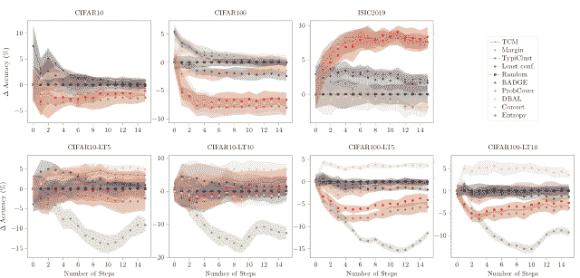

图 3.4: 与所有基线及我们（TCM）策略相比，相对于随机策略的准确率提升。准确率提升的均值是在所有 4 个预算大小（tiny、small、medium、large）上计算得到的。标准差是按随机种子聚合得到的。顶行显示主要评估数据集，而底行显示对 CIFAR10 和 CIFAR100 的不平衡版本进行的消融实验。对于所有不平衡数据集，报告的准确率是通过计算每个类别召回率的平均值来进行平衡的。TCM 在所有数据集上都表现出持续的强劲性能，即使对于 TypiClust 或 Margin 单独使用时表现次优的数据集也是如此。Coreset 在 LT 数据集上表现出强劲性能。不幸的是，这种性能无法迁移到现实世界的不平衡数据集 ISIC2019。

### 3.5 结论

在本章中，我们表明，当使用预训练骨干网络训练分类器时，从多样性到基于不确定性的主动学习方法的转折点出现得较早。基于这些结果，我们提出了 TCM，一种简单而有效的混合策略，在广泛的数据体系和数据集上比所有其他方法都表现更好。通过在前几个步骤中使用 TypiClust，然后切换到 Margin，TCM 在低数据和高数据体系中都能选取信息丰富的实例。利用 TCM 提出的简单启发式方法，从业者可以轻松有效地将主动学习应用于其用例中。

## 解纠缠对抗变分自编码器

### 摘要

使用具有良好解纠缠性的表示对下游任务具有诸多优势，例如提高样本效率或更好的可解释性。然而，解纠缠解释的质量往往高度依赖于数据集特定超参数的选择，特别是正则化强度。为解决这一问题，我们引入了 DAVA，一种针对变分自编码器的新颖训练程序。DAVA 完全缓解了超参数选择的问题。我们将 DAVA 与具有最佳超参数的模型进行了比较。无需任何超参数调优，DAVA 在多种常用数据集上具有竞争力。在 DAVA 的基础上，我们发现了无监督解纠缠的一个必要条件，我们称之为 PIPE。我们展示了 PIPE 在抽象推理任务中正向预测下游模型性能的能力。我们还彻底研究了与现有监督和无监督指标的相关性。

### 4.1 引言

现实世界的数据往往具有高度结构性，充满了对称性和模式。这意味着存在一组低维的基实因子，能够解释现实世界数据中相当大一部分的变化。解纠缠学习的目标是恢复这些因子，使得单个基实因子的变化仅体现在模型的单个潜在维度中（参见图 4.1 了解示例）。这种抽象允许更高效的推理 [269] 和更好的可解释性 [120]。它还对零-shot 域适应 [121] 和数据效率 [69, 229] 产生积极影响。

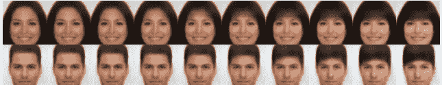

图 4.1: DAVA 在 CelebA 上训练的单个潜在维度（头发刘海）的潜在遍历。DAVA 将刘海与所有其他面部属性明显地解纠缠开来。

如果生成性基实因子已知且有标注数据可用，可以以监督方式训练模型来提取基实因子。如果生成因子未知，但仍希望为下游任务获取上述优势，该怎么办？当下游任务的标注数据量有限或训练计算开销大时，这可能是必要的。以无监督方式学习解纠缠表示通常不可能，除非使用某些先验知识 [176]。这些先验可以隐含地存在于模型架构中，也可以显式地存在于损失函数中 [265]。损失函数中此类先验的一个示例是模型潜在变量之间的低总相关性 [40, 143]。降低总相关性已被证明对解纠缠有积极影响 [176]。然而，如本章更详细所示，应将总相关性降低多少才能获得良好的解纠缠具有高度的数据集特异性。一个数据集的最优超参数设置在另一个数据集上可能产生较差的结果。为了优化正则化强度，我们需要一种评估解纠缠质量的方法。

那么，如何识别解纠缠良好的表示呢？即使给出标注数据，评估表示质量也并非易事。也许作为不幸命名的一个示例，经常使用的术语“基实因子”暗示存在一组正交因子的标准集。然而，通常存在多组同样有效的基实因子，例如跨越空间的坐标轴的仿射变换、不同的颜色表示，或群属性的不同抽象层次。这给监督解纠缠指标带来了问题，因为它们为评估表示固定了基实因子，如果模型学习了另一组同样有效的表示，则会过于严厉地评判模型。此外，在实际环境中获取标注数据通常是一项昂贵的工作。上述原因阻碍了监督指标在模型选择中的可用性。

在本章中，我们针对解纠缠表示的学习和评估克服了这些局限性。我们的改进基于以下思想：我们定义了两个可以由 VAE 生成的分布。量化这两个分布之间的距离得出一个与特定基实因子选择和重建质量无关的解纠缠度量。这两个分布越远，VAE 的潜在空间解纠缠程度就越低。我们表明，这两个分布的相似性是解纠缠的必要条件。此外，我们可以在训练时利用这一特性，通过向 VAE 的经典训练引入对抗损失来实现。为此，我们在训练中引入一个判别器网络，并使用 VAE 的解码器作为生成器。在训练期间，我们控制对抗损失的权重。我们相应地调整潜在空间信息瓶颈的容量，受到 [31] 的启发。这样一来，我们允许模型在其能够解纠缠的前提下增加其表示的复杂性。

这种动态训练程序解决了数据集特定超参数的问题，并使我们的方法能够在无需超参数调优的情况下，在多种常用数据集上达到具有竞争力的解纠缠性能。

我们的贡献如下：

- 我们识别了一个名为 PIPE 的解纠缠的新颖无监督方面，并展示了其在与监督解纠缠指标相关的度量以及下游任务中的实用性。
- 我们提出了一种自适应对抗训练程序（DAVA）用于变分自编码器，该程序解决了解纠缠性能高度依赖于数据集特定正则化强度的常见问题。
- 我们在多种常用解纠缠数据集上提供了大量评估以支持我们的主张。

### 4.2 相关工作

#### 4.2.1 模型架构

Higgins 等人 [120] 提出的 \(\beta\)-VAE 是解纠缠学习的基石模型架构。\(\beta\)-VAE 的损失函数，即证据下界（ELBO），由重建项和加权系数 \(\beta\) 的 KL 散度项组成，该系数迫使聚合后验潜在分布与先验分布紧密匹配。KL 散度项似乎促进了解纠缠，如 [222] 所示。Chen 等人 [40] 提出的 \(\beta\)-TCVAE 架构进一步将 ELBO 的 KL 散度项分解为索引-代码互信息、总相关性和维度-wise KL 项。他们证明，确实是总相关性促进了解纠缠，并提出了一种可计算但有偏差的蒙特卡罗估计。同样，FactorVAE 架构 [143] 使用带对抗网络的密度比技巧来估计总相关性。AnnealedVAE 架构 [31] 以及 ControlVAE [239] 建立在不同的前提上，认为缓慢增加潜在空间的信息瓶颈容量会导致模型逐渐学习新的潜在维度并从而对其进行解纠缠。我们将为 DAVA 采用类似但经过优化的方法。最近更有希望的方法由 Wei 等人 [283] 通过正交雅可比正则化提出，以及由 Chen 等人 [45] 在组合特征空间上递归应用规则化归纳偏差提出。

#### 4.2.2 将对抗训练引入 VAE

当将自编码器（AE）与对抗设置相结合时，可以将对抗网络连接到潜在空间，也可以连接到解码器的输出。Makhzani 等人 [182] 提出了一种对抗自编码器（AAAE），它在 AE 的潜在空间上使用对抗判别器网络。


为了使其聚合后验与任意先验相匹配。在那里，AE 的编码器充当 GAN 的生成器，并且是 AE 中唯一受鉴别器损失影响而更新的部分。这种训练与 VAE 训练高度相关，对抗损失在经典 VAE 训练目标中承担了 KL 散度的角色，但没有高斯先验的约束。之前提到的 FactorVAE [143] 在隐空间上实现对抗损失以降低总相关性。Larsen et al. [155] 提议使用与 VAE 解码器充当生成器的鉴别器网络来提高生成图像的视觉保真度，但未关注解纠缠。与 DAVA 的区别在于，他们在真实观测上使用了鉴别器，而我们提出一个仅观察 AE 解码器生成的观测的鉴别器。Zhu et al. [314] 在解码器上引入基于识别网络的损失，以鼓励可预测的隐空间遍历。换句话说，给定一对图像，其中除一个隐维外所有隐维保持不变，识别网络应能够预测变化发生在哪个隐维。在基线 VAE 模型之上应用此损失，可略微提升基线 VAE 的解纠缠性能。在半监督设置中，Carbajal et al. [34] 和 Han et al. [110] 提议在 VAE 的隐空间上使用对抗损失，以从标签中存在的信息中解纠缠隐空间的某些部分。遗憾的是，这种方法在无监督设置下无法实现完整隐空间解纠缠的目标。

#### 4.2.3 解纠缠度量

所有监督度量的共同点在于它们依赖于地真因子的标准因子化。在可以访问数据集生成过程的情况下，可以使用 FVAE 度量 [143] 来评估模型。它首先通过固定前述地真因子并从其他地真因子中随机采样来创建一批数据。然后，它使用多数投票分类器来根据该批次上每个隐维的方差来预测地真因子的索引。在无法访问生成过程但拥有若干完全标记样本的情况下，可以使用 Eastwood 和 Williams [76] 的 DCI Disentanglement 以及 Chen et al. [40] 的 MIG 等度量。DCI 本质上评估模型的隐变量是否只捕获单一地真因子，而 MIG 评估地真因子是否仅由单一变量捕获。因此，与 MIG 相比，DCI 不会惩罚单一地真因子的多维表示，例如颜色的 RGB 模型或方向的正弦/余弦表示。

存在少量无监督解纠缠度量。Duan et al. [69] 的无监督解纠缠排名 (UDR) 基于以下假设来评估解纠缠：如果许多模型（初始化不同但使用相同超参数训练）学习到相同的表示，则该表示应是解纠缠的。为此，他们计算一组模型表示之间的成对相似性（直到置换和符号反转）。单个模型的得分是其与组中所有其他模型的相似性的平均值。模型中心性 (ModelCentrality, MC) [169] 在 UDR 基础上通过改进成对相似性评估来构建。一个缺点是计算工作量大，因为为了找到最优超参数设置，每个设置都需要训练多个模型。UDR 和 MC 不假设任何固定的地真因子集。尽管如此，这些方法的一个弱点在于，它们无法识别一组模型的相似性，这些模型分别学习了地真因子的不同双射映射。Zhu et al. [314] 的隐变量可预测性 (VP) 度量基于以下假设：如果表示解纠缠良好，则给定两个仅在表示一个维度上发生变化的输入图像，识别网络应能轻松预测哪个变量发生了变化。VP 度量的一个优势在于其能够评估 GAN，因为它不依赖于模型包含编码器。与我们提出的度量相比，VP、UDR 和 MC 依赖于隐空间的大小，或需要定义额外超参数来识别非活跃维度。Estermann et al. [83] 表明，UDR 对低维表示具有强烈的正偏差，因为低维表示更有可能彼此相似。同样的问题也可能出现在 VP 度量中，因为当可供选择的导致变化的隐维数量较少时，识别网络的准确率可能会更高。

#### 4.2.4 解纠缠表示的应用

解纠缠表示对下游任务性能的影响是多方面的。Van Steenkiste et al. [269] 表明，对于抽象推理任务，解纠缠表示能够实现更快的学习。我们在第 4.4.2 节中表明，同样的情况也适用于我们提出的度量。Higgins et al. [121] 的工作表明，解纠缠表示为多阶段强化学习 (RL) 代理提供了改进的零样本域自适应。UDR 度量 [69] 与 Watters et al. [280] 引入的基于模型的 RL 代理的数据效率相关性良好。解纠缠表示似乎还有助于提高下游预测任务的公平性 [175]。与先前的定性证据 [80, 122] 相反，Montero et al. [196] 提出定量结果，表明解纠缠对分布外 (OOD) 泛化没有影响。Schott et al. [229] 的最新工作支持 Montero et al. [196] 的观点，得出结论：解纠缠在下游任务性能方面有所提升，但在 OOD 泛化方面则不然。

### 4.3 后验无差异投影等价

我们首先介绍 VAE 框架的符号，紧密遵循 Kim 和 Mnih [143] 使用的符号。我们假设观测 \(x \sim \tilde{D}\) 是由基于某些独立地真因子的未知过程生成的。编码器的目标是将 \(x\) 表示为隐向量 \(z \in \mathbb{R}^d\)。我们在隐空间上引入带有单位协方差矩阵的高斯先验 \(p(z) = \mathcal{N}(0, I)\)。给定观测 \(x\) 的变分后验为 \(q_\theta(z|x) = \prod_{j=1}^d \mathcal{N}(z_j|\mu_j(x), \sigma_j^2(x))\)，其中带有权重 \(\theta\) 的编码器输出均值和方差。解码器将隐空间 \(z\) 投影回观测空间 \(p_\phi(x|z)\)。现在我们可以定义分布 \(q(z)\)。

**定义 4.2** (EP). *VAE 的经验后验 (EP) 分布* \(q(z)\) *是在数据分布* \(\tilde{D}\) *上的隐向量* \(z\) *的多变量分布。* 更正式地，\(q(z) = \mathbb{E}_{x\sim\tilde{D}}[q_\theta(z|x)]\)。我们可以按以下方式重构观测 \(x \sim \tilde{D}\)：我们采样 \(z \sim q_\theta(z|x)\)，然后得到重构 \(\hat{x} \sim p_\phi(x|z)\)。我们非正式地称由此过程生成的观测为重构样本，并将其表示为 \(\hat{x}\)。

解码器不仅限于从 \(q(z)\) 投影到观测空间。我们可以通过在 \(z\) 上使用不同分布来从解码器采样观测。我们定义一个特别有用的分布。

**定义 4.3** (FP). *VAE 的因式后验 (FP) 分布* \(\bar{q}(z)\) *是一个带有对角协方差矩阵的多变量分布。我们将其定义为边缘 EP 分布的乘积：* \(\bar{q}(z) = \prod_{j=1}^d q(z_j)\)。* 我们可以使用解码器将 \(z \sim \bar{q}(z)\) 投影到观测空间 \(\hat{x} \sim p_\phi(x|z)\)。我们非正式地称由此过程创建的观测为生成样本，并将其表示为 \(\tilde{x}\)。


我们现在可以定义使用解码器将来自 EP 或 FP 的图像投影时产生的数据分布。

### 定义 4.4 ($\tilde{D}_{EP}, \tilde{D}_{FP}$)
$\tilde{D}_{EP}$ 由解码器从 EP 隐空间分布 $q(z)$ 投影观测值生成，_即重构样本_。$\tilde{D}_{EP} = \mathbb{E}_{z \sim q(z)} [p_\phi(x|z)]$。$\tilde{D}_{FP}$ 由解码器从 FP 分布 $\bar{q}(z)$ 投影观测值生成，_即生成样本_。$\tilde{D}_{FP} = \mathbb{E}_{z \sim \bar{q}(z)} [p_\phi(x|z)]$。

我们现在可以定义本章的核心概念。我们考察解码器生成的两个数据分布 $\tilde{D}_{EP}$ 和 $\tilde{D}_{FP}$ 的相似性。

### 定义 4.5 (PIPE)
_VAE 的后验无差异投影等效 (PIPE) 表示数据分布 $\tilde{D}_{EP}$ 和 $\tilde{D}_{FP}$ 的相似性。换句话说，PIPE 是衡量解码器对其投影源隐空间分布无差异程度的指标。_ PIPE($\theta, \phi$) = $\omega(\mathbb{E}_{z \sim q(z)} [p_\phi(x|z)], \mathbb{E}_{z \sim \bar{q}(z)} [p_\phi(x|z)])$，其中 $\omega$ 是一种通用相似度量。

没有任何归纳偏置的无监督解离学习是不可能的，Locatello 等人 [176] 已对此进行了证明。给定一个解离表示，总是可以找到一个双射映射，从而得到一个纠缠表示。在没有了解基础真实因子的情况下，不可能区分这两个表示。我们认为，PIPE 对解离模型是必要的，即使它不是充分条件。假设一个模型已经学习了一个解离表示，但 $\tilde{D}_{EP}$ 不等价于 $\tilde{D}_{FP}$。这可能发生在两种情况下。第一种可能性是模型的隐空间维度不独立。这违反了基础真实因子的独立性假设，因此模型不能是解离的。第二种可能性是模型没有学习基础真实因子的表示，并且正在生成由基础真实因子无法表示的样本。该模型也不会是解离的。我们得出结论，PIPE 是解离的必要条件。

在图 4.6 中，我们展示了两个不同模型的重构样本和生成样本，以支持我们的推理链条。纠缠模型（图 4.6 (b)）的生成样本与重构样本相比，明显不符合分布。解离模型（图 4.6 (d)）的生成样本似乎与重构样本的分布等价。

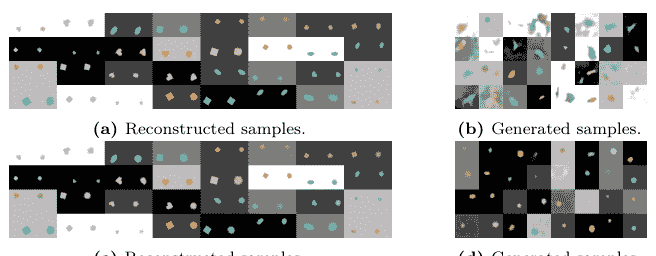

图 4.6：展示了 disentanglement-lib [176] 中具有不同解离性能的两个模型。上半部分展示了一个解离效果较差的模型，而下半部分展示了一个相对解离效果较好的模型。在 (a) 和 (c) 中，奇数列显示从 AbstractD-Sprites 数据集采样的图像，偶数列显示对应的模型重构。(b) 和 (d) 显示在给定因子化后验分布的情况下，由每个模型的解码器生成的图像。虽然上半模型获得更好的重构 (a)，但其生成样本 (b) 明显不符合分布。底部模型在其重构 (c) 中忽略了形状，但其生成样本 (d) 更准确地捕捉了真实数据分布。

### 4.4 PIPE 度量

我们提出了一种使用神经网络量化 PIPE 相似度量 \(\omega\) 的方法，并称之为 PIPE 度量。给定一个带有编码器权重 \(\theta\)、解码器权重 \(\phi\) 和相应的 $\tilde{D}_{EP}, \tilde{D}_{FP}$ 的模型 M（有关如何从 $\tilde{D}_{EP}$ 和 $\tilde{D}_{FP}$ 采样的详细信息，请参见附录 B.2.2）。

- 1. 通过从 $\tilde{D}_{EP}$ 采样创建一组观测值 \(S_{EP}\)。非正式地说，这些是重构样本。
- 2. 通过从 $\tilde{D}_{FP}$ 采样创建一组观测值 \(S_{FP}\)。非正式地说，这些是生成样本。
- 3. 将 \(S_{EP} \cup S_{FP}\) 随机划分为训练集和测试集。
- 4. 在训练集上训练判别器网络。
- 5. 在测试集上评估判别器的准确率 acc。
- 6. 由于随机判别器会有一半的样本猜对，我们报告一个分数 2 · (1 − acc)，使得 1 是最佳分数，0 是最差分数。

我们训练判别器网络 10,000 步，以保持对 $S_{EP}$ 和 $S_{FP}$ 的区分足够困难。我们还使用均匀因子化分布代替 FP，以略微提高性能。实现详情可见附录 B.2。

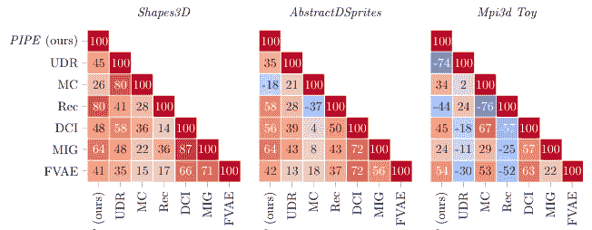

**图 4.7：** 三个不同数据集上不同度量之间的 Spearman 秩相关。相关性取值范围为 [-1, 1]，其中 1 表示完全相关，0 表示无相关，负值表示负相关。为提高可读性，我们将所有数值乘以 100。PIPE、UDR [69] 和 MC [169] 是相应的无监督度量。我们将重构损失 Rec 作为一个平凡的无监督基线。DCI、MIG 和 FVAE 是相应的受监督度量。我们的度量与 UDR 和 MC 的低甚至负相关表明，我们的度量捕捉了解离的不同方面。我们的度量与受监督解离度量的保持性在大多数数据集上大多是一致的。我们注意到，在 Mpi3d Toy 数据集上，我们的度量与受监督度量的相关性对 UDR 和 Rec 都改变了方向，而 MC 在 AbstractDSprites 上存在困难。

#### 4.4.1 与现有度量的关系

为了对 PIPE 度量的性能进行分类，我们在一系列常用的多样化数据集上评估了与受监督度量的相关性。我们具体考虑了 Shapes3D [30]、AbstractDSprites [269] 和 Mpi3d Toy [103]。所有数据集均属于 disentanglement-lib [176]，我们使用它来训练我们评估度量的模型。有关 PIPE 度量实现和评估模型的更多详情可见附录 B.2。结果在图 4.7 中显示。它们表明，PIPE 度量与现有的受监督度量 DCI、MIG 和 FVAE 呈正相关，超过了无监督基线的相关性。虽然 UDR 在 Mpi3d Toy 上的表现以及 MC 在 AbstractDSprites 上的表现不尽如人意，但 PIPE 在所有数据集上都表现出一致的性能。此外，与 UDR 和 MC 不同，PIPE 只能对单个模型进行评估，而 UDR 和 MC 只能评估一组模型。

#### 4.4.2 与下游任务性能的相关性

为了进一步量化 PIPE 度量的实用性，我们分析了该度量在抽象推理下游任务上的预测性能。对于下游任务，VAE 被训练以学习数据集的解离表示。下游模型随后只能访问该表示，然后尝试解决下游任务。Van Steenkiste 等人 [269] 评估了不同受监督解离度量在 Shapes3D 和 AbstractDSprites 数据集上的抽象推理任务准确率预测性能。他们表明，良好的解离是训练早期阶段更高准确率的指标。我们以缩小规模复现了他们的实验，仅考虑最多 6,000 个训练步骤。如图 4.8 所示，我们的度量与受监督度量相当，并明显优于无监督基线。更重要的是，这意味着 PIPE 是少样本设置下下游模型准确率的正向预测指标，因此是无监督模型选择的一个理想属性。

### 4.5 VAE 训练程序 (DAVA)

在前一章中，我们已经确立了 PIPE 对模型是可取的。我们现在介绍如何通过设计对抗训练程序在训练时鼓励这一属性。我们训练一个判别器和一个


| | Shapes3D | | AbstractDSprites | |
|---|---|---|---|---|
| | FactorVAE | \(\beta\)-TCVAE | FactorVAE | \(\beta\)-TCVAE |
| PIPE (我们) | 42 | 83 | 63 | 78 |
| UDR | 39 | 58 | 25 | 50 |
| MC | 3 | 40 | 53 | -49 |
| Rec | 0 | 46 | 38 | 71 |
| DCI | 76 | 78 | 81 | 72 |
| MIG | 79 | 85 | 77 | 75 |
| FVAE | 69 | 85 | 79 | 50 |

**图 4.8：** FactorVAE 和 \(\beta\)-TCVAE 在 6,000 训练步骤后，不同去纠缠指标与抽象视觉推理任务下游准确度 [269] 之间的 Spearman 秩相关系数。评估了与图 4.7 相同的指标。无监督指标的相关性对模型架构的敏感性高于有监督指标。PIPE 与下游性能的相关性高于 UDR，并明显优于 Rec 基线。

VAE 同时。鉴别器需要区分 \(\tilde{D}_{EP}\) 与 \(\tilde{D}_{FP}\)，这通过以下损失函数实现：

```
\(\mathcal{L}_{dis} = \mathbb{E}_{\hat{x} \sim D_{EP}}[\log(Dis(\hat{x}))] + \mathbb{E}_{\tilde{x} \sim \tilde{D}_{FP}}[\log(1 - Dis(\tilde{x}))].\)
```

VAE 的损失函数由重建项和鉴别器的加权负目标组成：

```
\(\mathcal{L}_{adv} = \mathcal{L}_{rec} - \mu \mathcal{L}_{dis}.\)
```

重建损失为

```
\(\mathcal{L}_{rec} = \mathbb{E}_{q_\theta(z|x)}[\log p_\phi(x|z)]\)
```

虽然这在实践中可行，但它面临权重 \(\mu\) 高度依赖于特定数据集的问题。它也与 FactorVAE 密切相关，区别在于 FactorVAE 仅将对抗损失应用于潜在空间和编码器。让我们考虑一种替代方案。Burgess 等人 [31] 的工作从信息瓶颈视角探讨了 KL-散度。他们提出通过引入关于训练过程中增加的某个目标容量 $C$ 的偏差损失项，来使用受控的潜在容量增加：

\(\mathcal{L}_C = |\text{KL}(q(z|x)||p(z)) - C|\)

这种损失提供了一种与 \(\beta\)-TCVAE 和 FactorVAE 中使用的最小化总相关先验互补的去纠缠先验。不幸的是，它也依赖于特定的超参数选择，主要是最大容量 $C$ 和容量增加速度。我们现在演示如何将对抗损失和受控容量增加整合到单个损失函数中。我们将此方法称为去纠缠对抗变分自编码器 DAVA（另见图 4.9）：

\(\mathcal{L}_{DAVA} = \mathcal{L}_{rec} - \gamma \mathcal{L}_C - \mu \mathcal{L}_{dis}\)

DAVA 的主要优势在于其能够通过使用鉴别器的准确度动态调整 $C$ 和 $\mu$。这产生了一个在多种数据集上表现良好的模型。我们现在概述在训练期间调整 $C$ 和 $\mu$ 的动机和方法。

AnnealedVAE 架构中受控容量增加的目标是允许模型一次将单个因素学习到单个潜在维度中。学习顺序对应它们各自对重建损失的贡献。在 DAVA 中，我们希望鼓励模型 *在已学习当前因素的去纠缠表示的前提下，通过增加 C 来学习新因素。* 当鉴别器无法区分 \(\hat{D}_{EP}\) 与 \(\tilde{D}_{FP}\) 时，就会出现这种情况。一旦鉴别器的准确度提高，我们就希望停止增加 $C

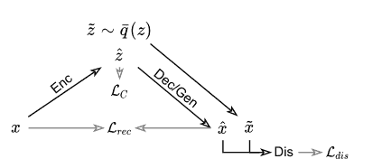

**图 4.9：** DAVA 构成概览。一个连接到 VAE 解码器的鉴别器。鉴别器的目标是区分来自 EP 的样本与来自 FP 的样本。

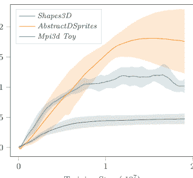

**图 4.10：** DAVA 训练期间不同数据集的信息瓶颈容量 C。根据数据集的复杂性和结构以及模型的随机初始化，为了获得最佳性能，需要不同的 C 进度表。阴影区域表示 5 个随机种子的一个标准差。

并增加对抗损失的权重，以确保模型不学习任何新的变异因素，同时帮助其将已学习的因素解纠缠到单个维度中。如图 4.10 所示，这在训练过程中产生了特定于数据集的 C 进度表。附录 B.3.1 中的算法 2.18 更详细地描述了 DAVA 的训练。

#### 4.5.1 实验

为量化 DAVA 的性能，我们开展了一项包含多种模型架构和数据集的大规模研究。作为基线，根据 [176]，我们纳入了表现最佳的去纠缠模型，即 \(\beta\)-TCVAE [40] 和 FactorVAE [143]。我们还纳入了 AnnealedVAE [31] 和 ControlVAE [239]。如前所述，这些方法中每一种的性能高度依赖于正则化强度。因此，我们对大致遵循 Locatello 等人 [176] 工作并在必要时进行调整的一系列值进行了网格搜索，以确保最佳性能。所考虑的精确超参数可在附录 B.3.1 中找到。DAVA 的训练不依赖于这种特定于数据集的正则化，因此 DAVA 训练的 **所有超参数** 在 **所有** 考虑的数据集中均保持 **不变**。所有其他超参数密切遵循 [176]，并在所有架构（基线和 DAVA）之间保持一致，同时也在附录 B.3.1 中报告。我们为每个配置运行 5 个不同的随机种子以确定统计显著性。我们在表 4.11、4.12 和 4.13 中提供了最具信息量的数据集的汇总结果。对于基线，我们报告了根据所有考虑指标的平均分数的平均超参数设置的性能。建议读者查阅附录 B.4 以获取所有评估数据集的完整结果。

### 表 4.11：Shapes3D 结果

| 架构 | MIG | DCI | FVAE | PIPE |
| :--- | :--- | :--- | :--- | :--- |
| \(\beta\)-TCVAE | 0.26\(\pm\)0.06 | 0.50\(\pm\)0.03 | 0.76\(\pm\)0.03 | 0.11\(\pm\)0.03 |
| FactorVAE | 0.20\(\pm\)0.10 | 0.41\(\pm\)0.07 | 0.78\(\pm\)0.04 | 0.22\(\pm\)0.04 |
| AnnealedVAE | 0.52\(\pm\)0.02 | 0.70\(\pm\)0.02 | **0.92**\(\pm\)**0.01** | 0.26\(\pm\)0.03 |
| ControlVAE | 0.07\(\pm\)0.03 | 0.17\(\pm\)0.04 | 0.68\(\pm\)0.07 | 0.02\(\pm\)0.00 |
| 我们 | **0.62**\(\pm\)**0.05** | **0.78**\(\pm\)**0.03** | 0.82\(\pm\)0.03 | **0.61**\(\pm\)**0.04** |

### 表 4.12：AbstractDSprites 结果

| 架构 | MIG | DCI | FVAE | PIPE |
| :--- | :--- | :--- | :--- | :--- |
| \(\beta\)-TCVAE | 0.12\(\pm\)0.01 | 0.18\(\pm\)0.01 | 0.45\(\pm\)0.02 | 0.19\(\pm\)0.01 |
| FactorVAE | 0.12\(\pm\)0.02 | 0.19\(\pm\)0.02 | 0.55\(\pm\)0.03 | 0.20\(\pm\)0.03 |
| AnnealedVAE | 0.15\(\pm\)0.01 | 0.21\(\pm\)0.01 | 0.54\(\pm\)0.02 | 0.18\(\pm\)0.01 |
| ControlVAE | 0.04\(\pm\)0.02 | 0.07\(\pm\)0.01 | 0.42\(\pm\)0.02 | 0.06\(\pm\)0.01 |
| 我们 | **0.23**\(\pm\)**0.04** | **0.27**\(\pm\)**0.05** | **0.67**\(\pm\)**0.05** | **0.35**\(\pm\)**0.03** |

附录 B.4 还包含了每个基线模型最佳超参数选择的结果，展示了它们在不同数据集上的方差。请注意，表 4.13 中 FactorVAE 的 PIPE 分数利用了附录 B.2.3 中深入讨论的设计决策。这些模型的解码器将所有潜在值映射到单个图像，因此我们排除了它们的分数。结果展示了 DAVA 强大且一致的性能

### 表 4.13：Mpi3d Toy 结果

| 架构 | MIG | DCI | FVAE | PIPE |
| :--- | :--- | :--- | :--- | :--- |
| \(\beta\)-TCVAE | 0.11±0.02 | 0.23±0.01 | 0.39±0.02 | 0.09±0.01 |
| FactorVAE | 0.02±0.01 | 0.13±0.00 | 0.38±0.02 | (0.99±0.10) |
| AnnealedVAE | 0.07±0.03 | 0.23±0.02 | **0.50±0.02** | 0.02±0.01 |
| ControlVAE | 0.04±0.01 | 0.17±0.02 | 0.43±0.04 | 0.03±0.01 |
| 我们 | **0.12±0.09** | **0.30±0.03** | 0.41±0.04 | **0.21±0.03** |

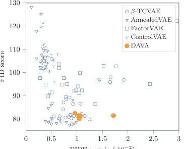

**图 4.14：** FID 分数 [119] 测量两个不同图像分布之间的距离，通常用于 GAN 文献中评估生成器的质量。低 FID 表示模型生成的图像视觉上令人信服。我们评估了各模型 \(\hat{D}_{\text{FP}}\) 的图像样本与原始图像之间的 FID。我们发现，DAVA 在具有比较良好的 PIPE 的同时达到了有竞争力的 FID。为了提高可读性，我们从基线模型中删除了少量表现不佳的异常值。

在不同数据集上。与基线相比，DAVA 能够为有监督指标带来高达 50% 的改进，以及 PIPE 超过 100% 的改进。这使得 DAVA 可以在实践中使用，因为可以期望一致的性能。


我们在三个真实世界数据集上进一步验证了DAVA。CelebA [174] 是解耦文献中常用的数据集。它包含超过200,000张名人面部图像。如图4.14所示，DAVA在取得具有竞争力的FID的同时，仍然拥有相对较高的PIPE度量分数。这意味着DAVA生成的样本在视觉保真度方面与最佳基线方法相似，同时更好地解耦了其潜在空间。数据集Mpi3d Real [103] 和 CompCars [300] 的结果分别可见附录B.4和B.5。

### 4.6 Conclusions

本章中，我们从非监督视角提出了一种理解和形式化解耦表示的新方法。其核心思想是，解耦VAE的重建样本分布应与生成样本分布相似。我们将这一概念量化为一种名为PIPE度量的新型非监督解耦度量，用于评估解耦表示。在无法获取真实标签的情况下，PIPE提供了与监督度量一致的结果。此外，我们将相同的思想应用于DAVA，这是一种新型VAE训练程序。DAVA可以自动调整其正则化强度，并产生与需要更多数据集特定超参数调优的现有模型相媲美的结果。稳健的非监督解耦性能是实用性的重要要求。通过DAVA，我们提供了一种计算需求相对较低的方法，供实践者使用。

## Domain-Agnostic Super-Resolution

## Abstract

近年来，超分辨率技术取得了显著进展，尤其是在视觉领域。然而，将这些进展扩展到其他数据模态面临挑战，因为需要为每个领域量身定制专用架构。在本章中，我们介绍了FunctaFormer，这是一种新型领域无关超分辨率方法，能够对任意数据类型进行上采样。我们的方法利用隐式神经表征（INRs）将数据建模为连续函数，为不同模态提供了一个统一框架。FunctaFormer在各个领域（包括图像、音频、视频、3D形状、流形数据和LiDAR扫描）中均取得了具有竞争力的性能。

### 5.1 Introduction

超分辨率（SR）旨在从给定的低分辨率输入中重建高分辨率输出。尽管“分辨率”的具体概念在不同领域有所不同，例如图像中的像素计数、视频中的帧率、音频信号中的采样频率、3D形状中的网格或网面分辨率、流形上的测量间隔，或LiDAR扫描中的点密度，但其根本目标保持不变：增强输入数据所不具备的细节程度。

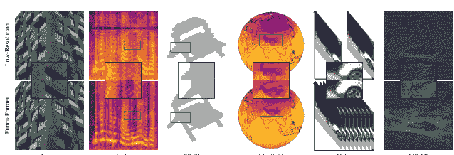

图5.1：FunctaFormer在低分辨率输入（上部）上的4x超分辨率样本，得到上采样输出（下部）。通过使用INRs，FunctaFormer可以对任何数据模态进行上采样（此处显示为2D图像、1D音频波形、3D形状、用于流形数据的极坐标、2+1D视频和LiDAR点云）。

乍一看，这些从1D到3D空间、以多种形式表示的多样化数据模态看起来截然不同。这种多样性为开发跨模态适用的统一SR方法带来了挑战。然而，隐式神经表征（INRs）通过将数据建模为由神经网络参数化的连续函数，提供了一个有前景的解决方案。在INR中，网络的输入由坐标组成——例如时间、笛卡尔坐标或极坐标——输出是该点对应的特征值。例如，在图像的情况下，网络为给定空间位置输出像素颜色值。

通过利用INRs，SR任务可以重新表述为将在低分辨率数据上拟合的INR转换，以在推理过程中生成高分辨率输出。这一观点将SR问题从任何特定数据模态的具体细节中抽象出来，从而允许一种可适应任何数据模态的统一架构。

先前的研究通过在训练数据的更高分辨率下对拟合的INR进行采样，展示了INRs在SR方面的潜力 [226, 237]。然而，这种方法相对于基本插值技术仅带来边际改进，主要是因为标准INR在其表征中缺乏显式空间上下文。

为解决这一限制，我们利用Spatial Functa [16]，这是一种为INRs增加空间信息的方法。Spatial Functa为空间排列的输入数据子集计算单独的INR表征。这些局部表征随后作为tokens馈入transformer主干网络，该主干网络捕获不同区域之间的空间依赖性和交互作用。然后transformer生成一个残差，应用到原始INR上，增强其生成高质量、高分辨率输出的能力。

我们的贡献可总结如下：

- 我们提出了FunctaFormer，这是一种新型领域无关超分辨率架构，利用Spatial Functa和transformer模型在多个数据模态（包括图像、音频、视频、3D形状、流形数据和LiDAR扫描）上实现具有竞争力的性能。
- 我们进行了广泛的消融研究，以优化从Spatial Functa采样高分辨率输出的过程，从而实现高效的SR性能。
- 我们探索了transformer主干网络的各种配置，特别是针对与所选Spatial Functa表征结合的SR任务，关注最佳注意力窗口大小。

代码库已公开发布，网址为 https://anonymous.4open.science/r/functaformer/。

### 5.2 Related Work

#### 5.2.1 Single Data Super Resolution

神经网络通常用于上采样低分辨率数据点，通常在离散数组表示上运行。此技术已应用于各个领域，包括图像 [65, 163, 313, 308, 293, 277]、3D形状 [247, 202, 267]、视频 [178, 195, 312, 129, 292, 46]、音频 [148, 170, 157, 275, 47, 215] 和LiDAR数据 [149, 298, 116]。在单图像超分辨率（SISR）领域，视觉Transformer（ViT）[67]及其变体 [172]（通常与卷积层结合）的集成已成为主流方法。对于音频数据，基于U-Net [223, 170]的架构（增强了自注意力机制和卷积层）或采用生成对抗网络（GANs）[47]的方法被广泛使用。

尽管这些方法取得了成功，但仍有研究探讨了INRs在SISR任务中的应用。一些现有的基于INR的方法通过在更高分辨率下直接从拟合的INR采样来生成更高分辨率的输出 [237, 226, 246]。然而，这种直接的上采样往往只比传统插值方法带来边际改进，原因是缺乏对高频细节的显式建模。其他研究 [306, 249] 在采样前使用更高级的方法来优化INR。总的来说，INRs在更复杂的超分辨率场景（如医疗数据 [87, 77] 或视频 [178, 46, 177]）中获得了更多关注。

#### 5.2.2 Implicit Neural Representations

INRs最近作为一种跨多样模态的数据表征的强大技术而受到关注。与依赖离散数据点的传统方法不同，INR将数据建模为由神经网络参数化的连续函数。这种方法已成功应用于各个领域，包括图像 [245, 73, 16, 71, 72]、流形数据 [73, 72]、音频 [245, 72, 154]、3D形状 [245, 207, 188, 179, 96, 97]、物理现象 [245] 和整个3D场景 [190]。我们的研究通过将INRs应用于图像、音频、3D形状和流形数据，扩展了这一方法论，从而为该领域不断增长的研究工作做出了贡献。

传统上，INRs使用由多个线性层组成的简单全连接神经网络 [245, 73, 16, 71, 72, 154, 207, 189]。然而，最近的进展引入了解耦方法，将INR的拟合与其在下游任务中的应用分离开来。这是通过将网络权重编码为潜在表征来实现的，然后可以利用该表征用于各种深度学习应用 [73, 16, 179]。遵循 [73] 提出的方法论，我们将编码的权重表征纳入我们的超分辨率框架。这使得处理更加高效，性能得到提升，因为模型可以利用连续表征中封装的丰富信息，同时在不同数据模态之间保持适应性。


#### 5.2.3 Transformer 架构

视觉 Transformer [67] 在许多计算机视觉任务中取得了巨大成功。它也已成功应用于 SISR 任务 [39]。然而，由于自注意力机制与输入尺寸呈平方级增长，视觉 Transformer 在 SISR 中的应用受到限制。Swin-transformer [172] 是一种分层 Transformer 架构，得益于其滑动窗口局部自注意力机制，能够扩展到更大的输入尺寸。许多工作已将 Swin-transformer 应用于 SISR [163, 124, 42, 313]，显著提升了最先进水平。

在本章中，我们以 Swin-transformer 的成功为基础。结合 INR 的灵活性，我们能够设计一种可应用于多个领域的超分辨率模型。

### 5.3 方法

#### 5.3.1 隐式神经表征

我们框架的初始步骤是将原始离散数据转换为连续空间。这通过在每个数据点中为每个特征拟合神经网络来实现。神经网络的输入是归一化坐标，输出对应音频中的振幅、图像中的 RGB 值或 3D 形状中的体素占用率等特征。给定带有坐标集合 $X$ 和特征值 $Y$ 的数据点 $D$，网络旨在最小化每个网络输出与相应特征 $\{(\theta(\mathbf{x}_i), \mathbf{y}_i \mid i \in D\}$ 之间的 L2 损失，如方程 (5.1) 所示。

```
\min_{\theta} \mathcal{L}(X, Y) = \min_{\theta} \sum_{i \in D} \|\theta(\mathbf{x}_i) - \mathbf{y}_i\|_2^2
```

网络由一系列线性层组成，表示为 $\mathbf{Wx} + \mathbf{b}$，其中 $\mathbf{W}$ 是可学习的权重矩阵，$\mathbf{b}$ 是偏置向量。在激活之前，每层输出由常数因子 $\omega_0$ 缩放。我们遵循 [245] 的方法，使用正弦激活函数，得到方程 (5.2) 的形式。其中 $\mathbf{a}^{(l)}$ 是第 l 层的激活。

```
\mathbf{a}^{(l)} \mapsto \sin(\omega_0 \cdot (\mathbf{W}^{(l)} \mathbf{a}^{(l-1)} + \mathbf{b}^{(l)}))
```

这些网络被称为正弦表示网络（SIREN）。尽管 [237, 226] 探索了其他非线性，但我们在实证中未发现收敛速度或重建质量方面有显著差异，因此坚持使用正弦激活。

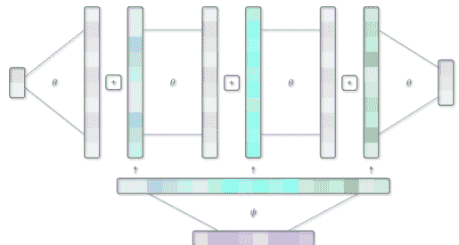

**图 5.2：** Functa 架构 [73]：编码后的 Functas 作为平移调制添加到每层之后。

**Functa 表示。** 研究表明，INR 网络能以极小误差拟合底层数据 [245]。然而，训练时间和空间复杂度使得这种方法不切实际，尤其是拟合整个 3D 场景时，每个场景可能需要数个 GPU 小时。我们不为每个数据点拟合不同的神经网络，而是使用一个共享的基础网络，并通过每层输出的频率平移调制来表示数据点。这些平移调制由编码器网络 m = ψ(ϕ) 得出，该网络是一个形式为 Wϕ + b 的单线性层（参见图 5.2）。我们将输入到编码器的 ϕ 称为 Functas。因此，每层的前向传播修改为方程 (5.3)。训练后，数据点由其 Functa 向量完全表示，该向量的空间复杂度可以相等或更低，如 [73, 71, 72] 所示。基础网络仅在解码时需要。

```
a^(l) ↦ sin(ω_0 · (W^(l) a^(l-1) + b^(l) + m^(l)))           (5.3)
```

**元学习。** 训练此系统涉及两项任务：识别编码器产生正确平移调制所需的正确输入（例如 Functas），并为编码器 \(\psi\) 和基础网络 \(\theta\) 找到最优参数，使 Functas 能以最少梯度步骤进行拟合。这使得大量数据能够快速转换到连续空间。我们通过将训练过程分为内循环和外循环来实现这一点。在内循环中，我们对一批 Functas 进行几步梯度拟合，冻结基础网络 \(\theta\) 和编码器 \(\psi\)，从而仅修改 Functas。在外循环中，我们解冻基础网络和编码器，使用固定的 Functa 批次再执行一次前向传播，并通过计算图计算双重梯度。这对应于模型无关元学习（MAML）[91, 73] 的一个变体，其中模型不是高效学习新任务，而是学会快速同化新数据点。学习过程在附录的算法 3.1 中以伪代码形式详细说明。

**空间 Functa。** Bauer 等人 [16] 表明，扰动 Functa 向量中的单个元素会影响整个数据点。这表明向量的单个元素不对应于数据中的特定空间区域。然而，许多架构依赖于空间偏置，许多任务需要空间信息才能解决。出于这个原因，Bauer 等人 [16] 提议使用单个 Functa 的空间排列表示，其特征捕获数据点中的局部信号信息。虽然 [16] 仅在图像上评估了其方法，但我们将其扩展到 1D 和 3D。对于音频，我们将样本切片为时间段；对于图像，切片为 2D 补丁；对于视频，切片为时间段和 2D 补丁；对于流形和 LiDAR 数据，切片为角扇区；对于 3D 形状，切片为立方体。然后我们为每个切片拟合一个不同的 Functa，从而得到具有局部偏置的空间 Functa 表示。此外，我们发现空间 Functa 能更好地拟合底层数据点，这一特性有助于实现强超分辨率性能。这种方法还允许将内存密集型 MAML 训练应用于更大的输入，因为可以对空间 Functa 的单个切片计算梯度。

#### 5.3.2 单数据超分辨率

单数据超分辨率的目标是从其降质版本 \(D_{LQ}\) 重建高质量数据点 \(D_{HQ}\)，使得重建版本 \(D_{REC}\) 尽可能接近高质量数据 \(D_{REC} \approx D_{HQ}\)。当前最先进的方法直接处理离散数据 rep-

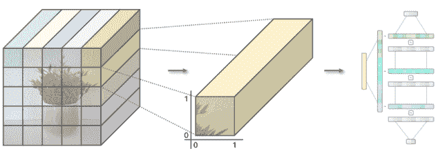

图 5.3：空间 Functa [16]：为每个切片拟合单个 INR，同时在所有切片中使用一致的相对坐标。

**骨干网络。** Swin Transformer 架构 [172] 及其变体 [163, 124, 42] 已成为单图像超分辨率任务的热门选择。在我们的工作中，我们将 Swin 架构调整为转换任何维度的空间 Functa 表示。

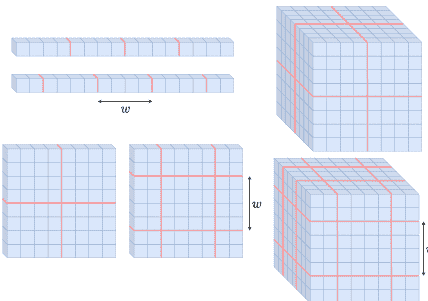

图 5.4：1D、2D 和 3D 中移动窗口的可视化。窗口大小用 w 表示。

Swin 移动窗口注意力的主要概念是将数据分成多个窗口，并在每个局部窗口内应用自注意力。尽管这将网络的感受野限制在局部窗口，但后续层会移动窗口划分，使网络能够捕获相邻窗口之间的依赖关系并在整个网络中传播信息（参见图 5.4）。最初，一个像素补丁被编码为一个标记，窗口包含多个标记 [172]。后来的工作直接将每个像素标记化 [124, 42]。在我们的方法中，我们将移动窗口机制直接应用于空间 Functa 表示，每个空间 Functa 作为一个标记，代表原始离散数据的一个切片。

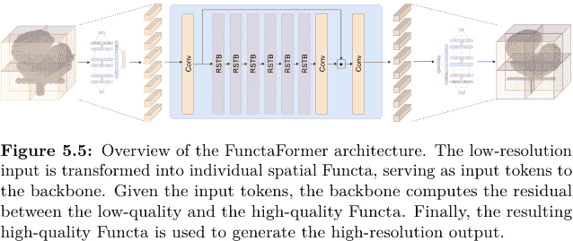

整体 FunctaFormer 网络 $H_{FF}$ 遵循 [163] 的布局，由三个部分组成：浅层特征提取 $H_{SF}$、深层特征提取 $H_{DF}$ 和残差重建 $H_{RR}$。浅层特征提取是应用于整个数据的简单卷积层。在第二阶段，使用多个连续的残差 Swin Transformer 块提取深层特征。最后，在残差重建中，在应用另一个卷积层之前合并浅层和深层特征 $H_{FF}(D_{LQ}) = H_{RR}(H_{SF}(D_{LQ}) + H_{DF}(H_{SF}(D_{LQ}))$。得益于 Functa 无论源分辨率和目标分辨率如何都具有的一致维度，我们能够利用残差学习。模型学习低质量和高质量 Functa 之间的残差 $D_{REC} = D_{LQ} + D_{FT}$，从而得到方程 (5.4) 所示的训练损失。

```
$\mathcal{L}(D_{HQ}, D_{LQ}) = \| H_{FF}(D_{LQ}) + D_{LQ} - D_{HQ} \|_1$ (5.4)
```


### 5.4 实验

在本研究中，我们开展了一系列全面的五项不同实验。首先，我们旨在通过确定 SIREN 模型最有效的切片窗口，识别每种数据模态的最优空间维度。其次，我们试图建立与这些最优切片窗口相对应的理想 Functa 大小。第三，我们使用简单的插值算法为所有数据模态创建基线。第四，我们进行消融研究，以调查 SIREN 切片维度与我们的 FunctaFormers 窗口大小之间的相关性。最后，利用从消融研究中获得的洞察，我们在 ×2、×3 和 ×4 降级数据上训练模型，并在适用的情况下将其性能与最先进的方法进行比较。

#### 5.4.1 数据集

为了评估我们框架的多模态性，我们在六种不同的数据模态上训练和测试我们的模型：图像、流形上的数据、3D 形状、音频、视频和 LiDAR。尽管这些多样数据模态之间存在固有差异，但我们的模型仅在输入和输出神经元的数量上有所不同。我们提供了所有数据集的概述，更多细节见第 C.3 节。

**图像。**

我们在 DF2K 上进行训练，该数据集结合了 DIV2K [6] 和 FlickR2K [165] 数据集。对于我们的训练集，我们使用 DIV2K 的 800 张训练图像以及 FlickR2K 的 2560 张训练图像。对于消融研究，我们使用 DIV2K 的 100 张验证图像。为了与超分辨率任务中当前最先进的方法进行比较，我们使用了 SET5 [19]、SET14 [299]、Urban100 [126]、Manga109 [186] 和 BSD100 [184] 图像集。

**流形。**

我们训练使用 1971 至 2020 年间每小时 2 米地表温度（开尔文）的测量数据，这是 ERA5 [118] 气候再分析的一个子集。然后按每日小时对测量值进行月度平均，得到总计 14.4k 次极坐标下的时间测量。测量值在 \(\lambda \in [\pi/2, -\pi/2]\) 和 \(\phi \in [0, 2\pi)\) 之间均匀间隔，步长为 \([0.25^\circ, 0.25^\circ]\)。训练集、验证集和测试集分别包含 10k、2.2k 和 2.2k 个样本。

**3D 形状。**

对于 3D 形状超分辨率，我们使用 ShapeNet Core [38] 数据集的一个子集。我们使用前 4 个类别（即桌子、汽车、椅子和飞机）的体素化实体表示。该数据集分为训练集、验证集和测试集，分别包含 45k、3728 和 3728 个样本。

**音频。**

对于音频数据，我们使用 LibriSpeech [204] 数据集的 100 小时干净子集。从该数据集中，我们提取前 12k 个样本，将每个样本裁剪为 5 秒，并丢弃短于该长度的样本。处理后的数据分为训练集、验证集和测试集，分别包含 10k、1k 和 1k 个样本。

**视频。**

我们使用 Adobe240 [254] 数据集，该数据集包含 133 个以 720p 分辨率和每秒 240 帧录制的视频，视频时长在 1 到 10 秒之间。对于数据预处理，我们将视频分割为 1 秒片段，并将任何纵向视频旋转为横向。前 100 个视频用于训练，16 个用于验证，17 个用于测试。

**LiDAR。**

我们训练使用来自 KITTI-360 数据集 [164] 的 LiDAR 数据。我们忽略全局场景上下文，并将每个时间帧中的每个车辆视为一个独立样本。遵循 [298] 中的方法，我们通过对驾驶序列中的帧进行时间下采样，分别定义了包含 20k、2.5k 和 2.5k 个样本的训练集、验证集和测试集。我们通过将扫描划分为角度扇区来检索我们的空间 Functa。

#### 5.4.2 模型消融

我们使用 Python 和 PyTorch [209] 实现了所有模型。对于所有实验，我们经验性地确定最优缩放因子 \(\omega_0\)：对于图像、视频、LiDAR 和流形上的数据，\(\omega_0 = 30\)；对于音频，\(\omega_0 = 50\)；对于 3D 形状，\(\omega_0 = 10\)。训练在 8 块 RTX 3090 GPU 上进行，每块 GPU 有 24 GB 显存，训练时间范围为 10 到 48 小时。随机种子为 42。

**空间 Functa。**

我们首先确定所有数据模态中空间 Functa 的最优切片维度。我们希望优化空间 Functa 的切片，以尽可能好地拟合数据。这为 FunctaFormer 的性能提供了一个上限，其质量直接取决于空间 Functa 拟合数据的能力。为实现此目标，我们对每种数据模态进行七次运行，沿每个空间轴将切片窗口维度调整为 {1/2, 1/3, 1/4, 1/6, 1/12, 1/30, 1/60} 的分数。单个 SIREN 模型包含 3 层，每层 64 个隐藏单元。Functa 大小设置为切片的维度，例如，形状为 5 × 5 × 5 的三维立方体对应 Functa 大小 125。

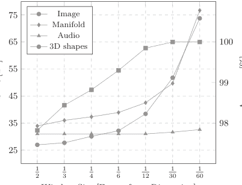

图 5.6：作为一个数据维度分数的空间维度。我们对 3D 形状报告准确率，对其他数据报告 PSNR。

所有运行均训练 1 × 10^5 步。学习率初始为 3.00 × 10^-6，每 2 × 10^4 步减半。对于优化，我们使用带有参数 β1 = 0.9 和 β2 = 0.999 的 Adam 优化器 [144]。批次大小设置为 32。在训练期间，每个数据点的单个切片被随机裁剪到指定的切片维度，并且模型仅在该特定分辨率上进行训练。

在图 5.6 中，我们可以看到空间大小与重建质量之间存在明显的相关性，较小的空间窗口能获得更好的结果。尽管这可以理解，因为更多的特征需要由同样大小的网络（3 层，每层 64 个隐藏单元）来表示。然而，每个 Functa 都与窗口大小成正比，使每个数据点具有相同的表示能力。如果基网络仅仅是 Functa 和 Features 之间的映射，那么空间大小与重建质量之间不应存在相关性。因此，我们得出结论：基网络在数据表示和蒸馏中起着重要作用，并且能够在较低的窗口大小下表现更好。人们还可以看到，随着窗口大小降低，重建质量的提升在音频中不如在图像和流形数据中显著。我们用数据模态之间的空间差异来解释这一差异。音频中的 1/60 代表 1000 个特征或 83ms 的数据，而对于图像，这仅代表 12 个特征或形状为 2 × 2 × 3 的补片。消融研究的数值结果载于第 C.4 节。

**Functa 大小消融。**

接下来，我们调查不同基网络大小下 Functa 大小与重建质量之间的相关性。为此，我们定义了两个基模型：大型（记为 L）和小型（记为 S）版本。大型版本包含 10 层，每层 128 个隐藏单元；小型版本包含 3 层，每层 64 个隐藏单元。我们确保每种数据模态使用的切片代表相同数量的底层值，尽管维度不同。基于先前消融研究的结果，我们选择 48 作为底层值的数量。这对应于形状的切片窗口为 4 × 4 × 3 × 1、图像的 4 × 4 × 3、流形的 6 × 8 × 1 和音频的 48 × 1。我们在 [2, 256] 范围内遍历 Functa 大小，保持学习率、批次大小、优化器和步数与空间维度消融研究相同。

根据图 5.7 的结果，我们观察到，在切片维度较小的情况下，网络可以在所有数据模态上实现接近零的重建误差，且较大的 Functa 大小与更好的重建质量强烈相关。特别是，当 Functa 大小超过表示的窗口大小 48 时，大型模型开始与小型模型偏离。大多数数据模态表现出 S 形曲线，在 Functa 大小超过 256 后重建质量趋于饱和，小型模型中的图像除外。


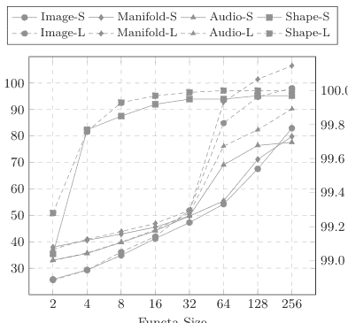

图 5.7：使用两种模型大小（小型和大型）的 Functa 大小消融实验。我们对 3D 形状报告 Accuracy，对其他数据报告 PSNR。较大的 Functa 大小带来更好的拟合质量，只有在 Functa 大小足够大时，较大的模型才能提供优势。

**注意力窗口消融实验。** 为评估网络在不同 Swin [172] 注意力窗口大小下的性能，我们对每个轴使用 {2, 4, 8, 12} 的窗口维度测试 FunctaFormer。我们在每种数据模态具有两种不同空间维度的 Functa 表示上进行此实验，以研究不同切片窗口和注意力窗口之间的相关性。在这些实验中，我们仅使用了 3 个 RST Blocks，训练步数为 5 x 10^4，而非标准的 1 x 10^5 步数。批量大小和学习率在附录的表 C.4.3 中报告。学习率每 1 x 10^4 步减半。

在图 5.8 中，我们展示了注意力窗口和空间窗口消融实验的结果。与 [163] 相反（该研究中较大的图像块提高了重建质量），我们的研究表明，较大的空间维度会导致更差的结果。这种差异可能源于较大的空间 Functas 相比较小的 Functas 具有较低的重建质量，而 [163] 使用的是未在质量上有所变化的原始数据。唯一的例外是流形上的数据，较大的 INR 块是有益的。跨数据模态的注意力窗口大小未观察到明确的相关性，因此我们简单地为最终模型选择表现最佳的维度。

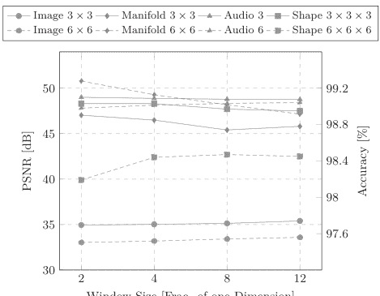

**图 5.8：** 每个轴的 FunctaFormer 注意力窗口大小。应用于两个空间 Functa 维度。我们对 3D 形状报告 Accuracy，对其他数据报告 PSNR。无论注意力窗口大小如何，较大的空间 Functa 窗口大小大多会导致性能下降。

#### 5.4.3 实验设置

为在所有数据模态中建立基线，我们使用最近邻和线性插值等简单插值算法评估测试集。这使用 PyTorch 的内置插值函数 `torch.nn.functional.interpolate` 实现。模式为 `nearest-exact` 或 `linear`、`bilinear`、`trilinear` 之一，具体取决于底层数据模态的输入维度。在每个任务中，下采样始终以线性方式进行，每个空间维度的下采样因子为 x2、x3 或 x4。

**FunctaFormer。** FunctaFormer 模型包含 6 个残差 Swin Transformer 块（RSTB），每个块包含 6 个 Swin Transformer 层（STL）。在每个块中，窗口在每两个后续层中移位一次。该模型使用 6 个注意力头，嵌入维度为 180，前馈层中有 360 个隐藏单元。前馈层和注意力层中不应用 Dropout。然而，随机深度 [125] 用于在 STL 内随机丢弃某些残差连接。整个网络中的 Dropout 概率从 0 线性增加到 0.1，导致较深连接相比较早层具有更高的丢弃概率。除了随机深度外，未使用权重衰减或其他正则化技术。在训练期间，我们使用线性插值对高分辨率数据批次进行下采样和上采样。我们将 Functa 拟合到基准真值和降级样本上。然后，我们的 FunctaFormer 学习预测这两者之间的残差。我们再次使用 Adam 优化器 [144]，但参数为 \(\beta_1 = 0.9\) 和 \(\beta_2 = 0.99\)。

### 单数据超分辨率

在确定最佳注意力窗口和空间 Functa 维度后，我们使用表现最佳的切片和注意力窗口配置，对模型进行完整训练，共 100k 步。我们在 x2、x3 和 x4 下采样级别上评估性能，并将我们的结果与直接在离散数据上训练的最先进方法进行比较。

### 指标

我们使用峰值信噪比（PSNR，如公式 5.5 定义）以分贝为单位评估重建质量。这里，\(D_{max}\) 表示原始数据的最大值，\(Y_i\) 和 \(\hat{Y}_i\) 分别是原始特征向量和预测特征向量。

```
\(20 \cdot \log_{10}(D_{max}) - 10 \cdot \log_{10} \left( \frac{1}{n} \sum_{i=1}^n (Y_i - \hat{Y}_i)^2 \right)\) (5.5)
```

对于图像和视频比较，我们还计算结构相似性指数测度（SSIM）[279]，使用大小为 11 * 11、\(\sigma = 1.5\) 的高斯窗口。PSNR 和 SSIM 均在所有三个 RGB 通道上计算。

对于音频数据，我们还计算信噪比（SNR），定义如下：

```
\(10 \cdot \log_{10} \frac{\sum_{i=1}^n Y_i^2}{\sum_{i=1}^n (Y_i - \hat{Y}_i)^2}\) (5.6)
```

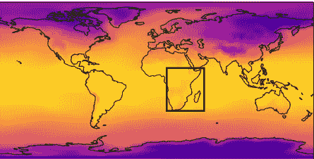


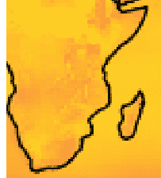

图 5.9：流形数据上 FunctaFormer 4x 上采样的定性样本，使用平板卡里投影可视化。在此设置下，FunctaFormer 达到超过 50dB 的 PSNR。

对于 3D 形状和 LiDAR 数据集，我们还报告交叉过并比（IoU）指标。对于 LiDAR 数据，我们使用粒度为 0.1 m³ 的网格，与 [298] 中的方法一致。如果网格单元至少包含一个 LiDAR 点，则视为已占用。对于 3D 数据，我们直接使用所提供的体素化网格表示。

#### 5.4.4 结果

表 5.11 显示了我们与两种常见插值算法（最近邻和线性插值）以及为这些特定领域设计的专用模型相比的最终结果。详细结果可以找到

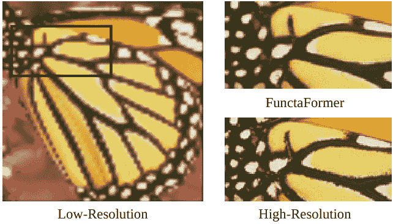

**图 5.10：** FunctaFormer 对低分辨率输入进行 4x 上采样的定性样本。虽然上采样后的图像看起来视觉上很吸引人，但高分辨率基准真值中存在的较细结构缺失。

如表 5.11 所示，FunctaFormer 显著优于基线插值方法。虽然专用模型在大多数情况下取得更高的性能，但这是可以预期的，因为它们是为特定数据模态设计的。FunctaFormer 具有更通用的架构，表现出显著的多功能性，在所有领域都取得了可靠的性能，甚至超过了 3D 形状的专用模型。这种适应性使 FunctaFormer 可以应用于新领域，例如流形数据，之前不存在针对此类数据的超分辨率工作。在流形数据上的强劲性能表明，FunctaFormer 能够利用流形结构来提高超分辨率质量。最大的性能差距存在于 LiDAR，其中专用模型 Tulip [298] 显著优于 FunctaFormer。我们假设，由于 LiDAR 场景的稀疏和不规则结构，更先进的训练方法和后处理步骤可能会带来巨大的性能提升。

| | | 图像 | | 视频 | | LiDAR | | 音频 | | 3D 形状 | | 流形 | |
|---|---|---|---|---|---|---|---|---|---|---|---|---|---|
| | x2 | BSD100 [184] | | Adobe-240 [254] | | KITTI-360 [164] | | LibriSpeech [204] | | ShapeNet [38] | | Exec [118] | |
| | | PSNR (dB) \(\uparrow\) | | PSNR (dB) \(\uparrow\) | | IoU \(\uparrow\) | | SNR (dB) \(\uparrow\) | | IoU (%) \(\uparrow\) | | PSNR (dB) \(\uparrow\) | |
| | | SSIM \(\uparrow\) | | SSIM \(\uparrow\) | | s | | s | | s | | s | |
| | | x4 | | x4 | | x4 | | x4 | | x2 | | x4 | |
| 最近邻 | 26.52 | 21.08 | 22.40 | 21.07 | 24.92 | 10.60 | 52.88 | 41.08 | 36.77 | 35.55 | | | |
| 线性 | 27.02 | 24.60 | 23.75 | 24.79 | 12.90 | 14.74 | 23.74 | 23.74 | 10.41 | | | | | |
| FunctaFormer（我们） | 30.49 | 26.61 | 25.39 | 30.27 | 27.26 | 17.71 | 63.36 | 53.20 | 51.19 | 50.30 | | | | |
| 领域特定模型 | 32.75 [124] | 29.08 [124] | 28.19 [124] | 31.11 [254] | 43.22 [208] | 18.48 [275] | 47.27 [266] | - | - | - | | | | |

表 5.11：FunctaFormer 在各种上采样基准上的性能。Linear 对于音频代表线性插值，对于图像、LiDAR 和流形数据代表双线性插值，对于 3D 形状和视频代表三线性插值。在可用的情况下，我们提供领域特定模型的结果以供比较。详细结果（包括其他超分辨率比例）可见第 C.4 节。

先前的消融实验和 FunctaFormer 的超分辨率结果表明，空间 Functa 有效地捕获了底层数据。这表明，通过改进骨干架构可以实现进一步的改进，因为空间 Functa 并非模型性能的限制因素。

### 5.5 结论

在本章中，我们介绍了 FunctaFormer，这是一种利用 INR 提供高质量上采样的通用且与领域无关的超分辨率架构。通过各种消融研究和实验，我们证明了空间 Functa 和改进的 Swin Transformer 骨干在多种数据模态上实现竞争性超分辨率结果方面的有效性。虽然专用模型在特定领域内继续表现出色，但 FunctaFormer 展现了强劲的性能，甚至在某些情况下（例如 3D 形状超分辨率）胜过专用模型。

我们的研究结果强调了 INR 和基于 Transformer 的架构在统一异构数据类型的超分辨率方法方面的潜力。


## 面向视觉变换器的分层可搜索表示

### 摘要

基于 Transformer 的模型在各个领域取得了显著成功，但其高昂的计算成本限制了其在大规模输入上的应用。为了解决这个问题，我们提出了一种新型的基于树的编码器-解码器架构，将编码器中的自注意力复杂度降低到 $O(N_E)$，将解码器中的交叉注意力复杂度降低到 $O(N_D + \ln \sqrt{N_E})$，其中 $N_E$ 是输入编码器标记的数量，$N_D$ 是解码器标记的数量。我们的模型首先构建输入的分层树表示。随后，一个解码器解析这棵树，为交叉注意力选择相关节点。通过关注节点子集，解码器避免了对整棵树进行注意力计算，从而降低了交叉注意力的计算成本。我们通过在 COCO 目标检测基准上的实验展示了我们方法的有效性。

### 6.1 引言


图 6.1: 提出的目标检测架构概览。主干网络从输入图像生成叶节点嵌入。树编码器将这些嵌入嵌入到一棵树中。树解码器解析这棵树，为解码器标记选择相关节点用于交叉注意力。最后，输出头预测边界框和类别标签。

自注意力和交叉注意力组件是广泛使用的 Transformer 架构的一部分，使网络能够从其输入中捕获上下文信息。尽管这种架构非常强大，但其复杂度对自注意力是二次的，对交叉注意力是线性的。这些缩放特性不仅限制了最大可处理的序列长度，还间接限制了模型大小，因为计算资源必须在处理更长序列或使用更大、更复杂的模型之间分配。这种权衡似乎相当反直觉，因为信息检索和逻辑处理混合在一起。Perceiver IO [134] 和 DETR [35] 等架构通过将这两个过程分别分离到编码器和解码器中来避免这个问题。在本章中，我们在 DETR 的基础上，引入一种新型的基于树的编码器-解码器架构，旨在解决 Transformer 在信息检索方面的可扩展性限制。受最近关于树交叉注意力工作 [90] 的启发，我们的模型首先使用编码器构建输入的分层树表示。我们的编码器避免全局自注意力，实现了 $O(N_E)$ 的降低复杂度。随后，一个解码器解析这棵树，选择与手头任务相关的节点。这些选定的节点随后用于交叉注意力以生成预测。通过关注节点子集，解码器的交叉注意力实现了 $O(N_D + \ln \sqrt{N_E})$ 的复杂度，其中 $N_D$ 是解码器标记的数量，$N_E$ 是编码器标记的数量。

### 6.2 相关工作

Transformer 架构最初由 [271] 引入，及其变体已成为深度学习中的基本架构 [305, 66, 35, 64, 27, 264]。注意力机制允许模型对某些输入执行加权聚合。然而，这伴随着高昂的计算成本，自注意力中标记数量的计算复杂度为二次，交叉注意力中的计算复杂度为线性。

出于这个原因，基于在不同抽象级别上高效本地处理信息的理念，提出了 Transformer 架构的分层公式。大部分工作都集中在编码器专用或解码器专用架构上，无论是 NLP [200, 123, 18] 还是视觉 [171, 113, 113]。在编码器-解码器架构环境中，[90] 提出了一种降低交叉注意力复杂度的方法。在他们的公式中，[90] 使用全自注意力编码器构建一棵树，随后解码器能够解析这棵树，将交叉注意力的复杂度从 $O(N_D \cdot N_E)$ 降低到 $O(N_D \ln N_E)$，其中 $N_D$ 是解码器标记数量，$N_E$ 是编码器标记数量。我们的工作在此基础上，不仅降低了编码器的复杂度，还实现了树解析的可解释版本。

### 6.3 方法论

本章提出了一种用于目标检测的基于树的架构，以解决标准 Transformer 在处理大输入方面的局限性。该模型构建输入图像的分层树表示。随后，一个解码器遍历这棵树，选择用于生成预测的节点。我们在目标检测环境下进行了所有实验，使用 COCO 2017 目标检测数据集 [168]。目标检测适合评估我们提出的架构的性能，因为它要求模型在输入的不同部分和不同尺度上定位信息。我们还基于 DETR [35] 提出的编码器-解码器架构进行构建。在以下内容中，我们将详细阐述图 6.1 中总结的架构部分。

#### 6.3.1 树编码器

编码器负责构建输入图像的分层树表示。它以主干网络生成的叶节点嵌入作为输入。从这些叶节点开始，编码器以自底向上的方式构建树的其余层级，将信息聚合到更高层级的更抽象标记中。我们将该过程分为两个阶段，见图 6.2 了解过程概览。在阶段 I 中，每个层级的节点基于前一层级的节点生成。这是通过将节点分组为非重叠窗口并将其聚合为单个父节点来实现的。然后我们重复此过程直到构建完整树，并为聚合函数共享权重。在阶段 II 中，树中节点的嵌入可以基于每个节点的 n 跳邻域进行细化。

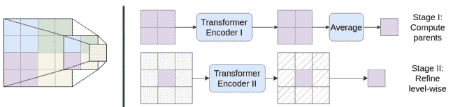

**图 6.2:** 左侧展示了编码器构建的树示意图。在阶段 I 中，正通过聚合非重叠窗口的信息来构建树的新层级。此过程递归重复，直到到达顶层。在阶段 II 中，树中的嵌入基于其局部邻域进行细化。

#### 6.3.2 树解码器

解码器对编码器提供的树执行交叉注意力，以使用输出头为对象的类别和边界框生成最终预测。解码器的一部分是一个解析器，给定树和当前解码器标记，它以高效方式从树中选择相关标记。我们在图 6.3 中提供了此过程的概览。

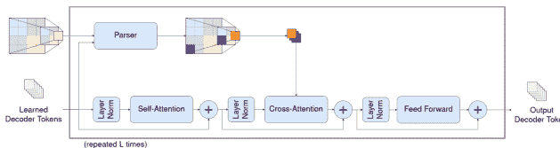

图 6.3: 此图展示了目标检测的树解码过程。对于每一层，解码器：(1) 从解码器嵌入生成查询向量；(2) 使用由这些查询和从树节点派生的键向量（使用交叉注意力权重 $W_Q$ 和 $W_K$）引导的解析器，从树中选择相关节点；以及 (3) 通过标准 Transformer 解码器层处理选定的节点和解码器嵌入（由多头自注意力、层归一化、多头交叉注意力和 FFN 组成）。

### 解析器

解析器是从树中选择相关信息的核心组件。有多种方法可以选择节点子集，我们将在下面描述。有关解析器以及完整算法的详细信息，请参阅 D.1.2 节。

### 最佳节点解析器

最佳节点解析器采用自顶向下的方法选择节点。从树的最高层级开始，解析器计算每个节点与查询向量（由其解码器嵌入派生）之间的注意力分数。分数最高的节点被选中，其兄弟节点被添加到选定节点列表中。对于下一层级，解析器关注选定节点的子节点，并重复此过程直到到达叶节点层级。通过从所有层级选择节点，解析器可以在某些区域选择高层信息，同时在其他区域关注低层细节。

### 滑动窗口解析器

虽然最佳节点解析器计算效率高，但其节点选择受树构建期间初始节点分组（即非重叠窗口划分）的限制。如果分组机制无意中


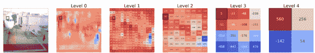

(a) 树编码器在高度抽象的层级上编码了前景飞机的大部分信息，这由第 4 层最大的注意力分数以及较低层级得分显著较小所表明。

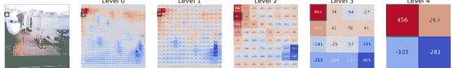

(b) 解析器能够在树中导航，以找到编码左上角背景中小型飞机信息的标记。

**图 6.4:** 基于两个不同解码标记在 softmax 之前的注意力分数，对注意力分数及树解析结果进行可视化。左侧显示输入图像。从左到右，分别显示由主干网络生成的叶节点以及由树编码器生成的树不同层级。绿色方框表示解析器选择的路径。图 6.4a 展示了高级别标记中的信息聚合能力，而图 6.4b 展示了如何通过导航树来识别相关的低级标记。

它将语义相关的节点分开。在这种情况下，解析器可能仅仅因为相关节点位于所选兄弟节点组之外而忽略它们。为了解决这一局限性，我们引入了滑动窗口解析器。

滑动窗口解析器采用两步过程来选择节点。首先，它识别树中最相关的层级。从最高层级开始，它计算每个节点与查询向量之间的注意力分数，并选择得分最高的节点。然后，它逐层向下遍历树，计算先前选定节点的子节点与查询向量之间的注意力分数，并选择得分最高的子节点。一旦最高得分子节点的注意力分数低于其父节点的分数时，即选择父节点所在的层级。一旦确定层级，解析器就会扩展其搜索区域，以涵盖得分最高节点及其一跳邻居的子节点。这种更广泛的范围有助于包含在树构建过程中可能被分开的语义相关节点。在此扩展区域内，解析器选择累积注意力分数最高的 \(\tilde{K}\) 大小的节点窗口。与最佳节点解析器不同，滑动窗口解析器不包含路径上的任何节点，仅包含滑动窗口选定的节点。

## 多路径解析器

目前描述的解析器仅限于树中的单一路径，将其探索限制在输入图像的单一区域。这可能是一个问题，因为不同的解码标记可能会关注图像的不同部分。

为了解决这个问题，我们引入了最佳节点和滑动窗口解析器的多路径版本。多路径解析器的算法基本保持不变。主要区别在于注意力分数的计算方式。不再使用在所有解码标记上聚合的单个查询向量（\(\bar{\mathbf{q}}\)），而是选择 \(n_{paths}\) 个查询向量的子集。具体来说，我们选择树最高层级上注意力分数最高的 \(n_{paths}\) 个查询向量。然后，我们分别为每条路径解析树，并为交叉注意选择所有选定节点的并集。

## 消融实验

对于以下实验，我们使用具有可变 n 跳邻域的两阶段树编码器，即上一节中表现最佳的配置。我们在单路径和多路径设置下比较了最佳节点解析器和滑动窗口解析器。虽然最佳节点解析器在单路径设置下优于滑动窗口解析器，但滑动窗口解析器在多路径设置下明显取得了最强的得分（表 6.5）。然而，我们发现，尽管表现平平，最佳节点解析器仍能很好地导航树。我们在图 6.4 中可视化了这种行为。

表 6.5：不同树解析器的目标检测性能（2 次运行的平均值 ± 标准差）。

| 解析器 | mAP | mAP\(_{50}\) | mAP\(_{75}\) | mAP\(_S\) | mAP\(_M\) | mAP\(_L\) |
|---|---|---|---|---|---|---|
| 最佳节点 | 19.56 ± 0.09 | 38.84 ± 0.42 | 17.46 ± 0.06 | 2.89 ± 0.27 | 16.81 ± 0.06 | 38.97 ± 0.14 |
| 滑动窗口 (\(\tilde{K} = 4\)) | 13.81 ± 2.54 | 30.71 ± 3.87 | 10.92 ± 2.89 | 1.85 ± 0.04 | 10.41 ± 1.99 | 28.09 ± 5.53 |
| 多路径最佳节点 (\(n_{paths} = 10\)) | 19.38 ± 0.02 | 38.41 ± 0.12 | 17.19 ± 0.27 | 2.72 ± 0.09 | 16.59 ± 0.19 | 38.83 ± 0.09 |
| 多路径最佳节点 (\(n_{paths} = 20\)) | 19.67 ± 0.04 | 39.02 ± 0.06 | 17.80 ± 0.27 | 3.03 ± 0.09 | 17.07 ± 0.11 | 38.67 ± 0.95 |
| 多路径滑动窗口 (\(n_{paths} = 10, \tilde{K} = 2\)) | 22.35 ± 0.22 | 43.88 ± 0.49 | 20.28 ± 0.39 | 4.45 ± 0.34 | 19.45 ± 0.02 | 42.55 ± 0.73 |
| 多路径滑动窗口 (\(n_{paths} = 20, \tilde{K} = 2\)) | 22.96 ± 0.23 | 44.55 ± 0.41 | 21.05 ± 0.19 | 4.73 ± 0.41 | 22.53 ± 0.05 | 42.83 ± 0.40 |
| 多路径滑动窗口 (\(n_{paths} = 20, \tilde{K} = 4\)) | **23.55 ± 0.05** | **44.98 ± 0.21** | **21.92 ± 0.18** | **4.75 ± 0.02** | **23.03 ± 0.18** | **43.47 ± 0.17** |

#### 6.3.3 复杂度分析

表 6.6 将所提出算法的计算复杂度与标准全局自注意和默认交叉注意的复杂度进行比较。编码器复杂度改进的主要影响因素是构建树所涉及的局部操作。得益于其结构，解码器能够以亚线性时间解析树，同时为交叉注意选择亚线性数量的标记。计算复杂度的推导过程可见章节 D.2 和 D.3。

表 6.6：所提议编码器和解析器算法的计算复杂度。\(N_E\) 和 \(N_D\) 分别表示编码器和解码器输入标记的数量。

| 模块 | 总体复杂度 | 解析复杂度 | 交叉注意复杂度 |
|---|---|---|---|
| 编码器阶段 I | \(O(N_E)\) | - | - |
| 编码器阶段 II | \(O(N_E)\) | - | - |
| ReTreever [90] | \(O(N_k^2)\) | - | - |
| 全局自注意 | \(O(N_k^2)\) | - | - |
| 最佳节点解析器 | \(O(N_D \ln \sqrt{N_E})\) | \(O(\ln \sqrt{N_E})\) | \(O(N_D \ln \sqrt{N_E})\) |
| 滑动窗口解析器 | \(O(\ln N_E + N_D)\) | \(O(\ln \sqrt{N_E})\) | \(O(N_D)\) |
| ReTreever [90] | \(O(N_D \ln(N_E))\) | \(O(\ln(N_E))\) | \(O(N_D \ln(N_E))\) |
| 默认交叉注意 | \(O(N_D \cdot N_E)\) | - | \(O(N_D \cdot N_E)\) |

#### 6.3.4 实验

在本节中，我们将我们的树 Transformer 模型与两个基线进行性能比较：主干-解码器基线和标准编码器-解码器 Transformer。主干-解码器基线是一个仅包含主干网络和标准 Transformer 解码器（即无树编码器）的简化模型。对于我们的树 Transformer，我们使用具有可变 n 跳邻域的两阶段树编码器（\(n_0 = 2\) 和 \(n_l = 1, \forall l > 0\)）。所使用的解码器是多路径滑动窗口解析器，设置 \(n_{\text{paths}} = 20\) 并选定区域为 \((\tilde{K}_h, \tilde{K}_w) = (4, 4)\)。

表 6.7 列出了所有测试模型的评估指标。树 Transformer 在所有指标上均优于主干-解码器基线，其中 mAP\(_L\) 的改进最大。如第 D.1.2 节所述，这可能归因于树的层级结构，它允许高级别节点通过其更大的感受野捕获更长程的依赖关系。虽然标准编码器-解码器模型实现了最佳整体性能，但树 Transformer 在保持更高计算效率的同时展示了具有竞争力的结果。

表 6.7：所提议的树 Transformer、标准编码器-解码器 Transformer 以及主干-解码器基线之间的比较。

| 模型 | mAP | mAP\(_{50}\) | mAP\(_{75}\) | mAP\(_S\) | mAP\(_M\) | mAP\(_L\) | #标记 |
|---|---|---|---|---|---|---|---|
| 标准编码器-解码器 | 31.92 | 54.33 | 31.51 | 9.98 | 34.36 | 53.57 | 1024 |
| 树 Transformer（我们的） | 29.21 | 51.53 | 28.80 | 8.56 | 30.63 | 49.70 | 320 |
| 主干-解码器 | 27.86 | 49.74 | 27.27 | 8.07 | 29.77 | 46.28 | 1024 |

## 6.4 结论

在本章中，我们提出了一种新型的基于树的编码器-解码器架构，旨在解决传统基于 Transformer 的模型在输入尺寸方面的可扩展性局限性。我们的实验表明，树 Transformer 能够在使用基于局部注意力的编码器以及在交叉注意期间大幅减少标记数量的同时，提供具有竞争力的性能。尽管我们将本章视为概念验证，但未来工作可能将这些想法迁移至 NLP 场景，从而可能实现比目前可能大上多个数量级的上下文窗口。


## 由语言赋能的抽象视觉推理

## 摘要

虽然人工智能（AI）模型在许多明确界定的应用中已实现人类甚至超越人类的性能，但它们仍难以展现出广泛而灵活智能的迹象。抽象与推理语料库（ARC）是由 François Chollet 引入的视觉智能基准，旨在评估 AI 系统与类人认知能力的接近程度。当前大多数方法依赖于精心手工制作的特定领域程序搜索，以暴力求解 ARC 中存在的任务。在这项工作中，我们提出了一种通用的基于学习的框架来求解 ARC。该框架以将任务从视觉域转换到语言域为核心。语言与视觉的这种组合使得预训练模型可以在每个阶段被利用，从而实现从手工制作的先验知识向模型的学习先验知识的转变。尽管我们的方法尚未在 ARC 上击败最先进的模型，但我们展示了该方法的潜力，例如，通过求解一些先前未被求解的 ARC 任务。

### 7.1 引言

由 Chollet [49] 引入的抽象与推理语料库（ARC）旨在通过测试学习和适应未见任务的能力来衡量人工智能（AI）的进步。ARC 仅包含 1000 个类似于图 7.1 中示例的任务的小型数据集。对于每个任务，会给出两到六个演示，并且必须预测给定测试输入的解。由于设计原因，任务数量非常有限，这使得基于学习的方法在 ARC 上取得成功尤其具有挑战性。通常，最先进的模型必须依赖于大量数据，才能直接从给定数据中正确估计和学习潜在函数。

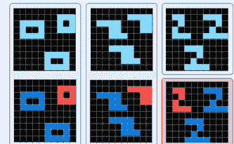

图 7.1：每个 ARC 任务由描述任务的输入输出图像对组成。要解决该任务，必须预测与给定测试输入对应的缺失输出图像。

仅从提供的任务中学习来求解 ARC 很可能是不够的。正如 Chollet [49] 所论证的，与人类智能紧密一致的先验知识应被纳入到方法中。最重要的先验包括对象性、目标导向性、数字与计数以及基础几何 [49, 250]。这些包括对象的概念、对象可以持续存在、比较大小或检查对称性。主要挑战在于如何将这些先验知识纳入到求解 ARC 的方法中。

可以通过手工制作的启发式方法将它们显式化，例如使用特定领域语言（DSLs）[287, 7, 131]。然后可以使用这些 DSL 来暴力求解搜索并提出正确解决方案的程序。然而，显式捕获所有重要先验知识并正确应用它们极其困难。此外，穷举搜索在计算上成本高昂，甚至可能产生错误结果，因为并非所有先验知识的组合都同样可能同时出现。

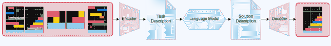

**图 7.2：** 原始任务以视觉域（红色）中的图像对给出，然后使用编码器转换为文本域（蓝色）。任务描述的文本形式允许语言模型提出一个解决方案，该方案随后被解码回视觉域。

我们相信，包含此类先验知识的另一条有希望的途径是通过以自然语言为中心的基于学习的方法。自然语言本身已演变为将人类先验知识作为描述我们世界的一种高效方式的体现。此外，研究表明自然语言允许在不同任务之间实现更好的泛化 [199]。最近，大型语言模型（LLMs）的出现已在理解和生成自然语言方面取得了成功。由于这些模型在其无监督预训练期间接触了大量人类生成的文本，它们已隐式地包含了人类先验知识。

我们旨在利用这些见解和能力，将语言作为一种工具自动化使用，为以学习为中心的求解 ARC 方法奠定基础。我们提出了一个通用框架，首先将 ARC 任务转换为整个任务的文本描述。然后可以以黑盒方式使用通用语言模型来输出缺失解决方案的描述。最后，预测的解决方案可以被翻译回视觉域。整个框架的图示如图 7.2 所示。此外，我们基于此框架实现了一个初始管道，利用多种可用的语言模型来证明该方法的可行性。特别是，通过我们的以学习为中心的方法，我们能够求解现有任何最先进的 DSL 解决方案均无法求解的任务。

### 7.2 相关工作

由 Chollet [49] 提出的抽象与推理语料库包含 400 个训练任务、400 个验证任务和 200 个用于私有评估的保留任务。800 个公开可用的任务中的每个都包含两到六个图像对。给定这些少量示例演示，目标是找出特定测试输入图像的缺失解决方案。最初，该挑战作为 Kaggle 竞赛 [89] 举办，最近由 Lab42 [150] 复兴。许多表现最好的解决方案依赖于使用手工制作的特定领域语言 [287, 7, 131] 的启发式程序搜索集成，并在私有评估集上最高可达到 30% 的准确率。然而，要匹配人类性能（估计至少为 80% 左右 [139]）仍存在很大差距。除了这些方法，还有其他提案结合了某种形式的基于学习的技术，例如神经符号方法 [8]、图表表示 [304] 或以对象为中心的方法 [296, 11]。此外，最近的工作开始研究自然语言如何帮助求解 ARC 任务 [4]。然而，它们提供了人类生成的关于如何求解任务的文本指导，而在本章中，我们专注于以自动化方式在语言域中描述和求解完整任务。

| 模型 | 大小 | 层数 | 隐藏维度 |
| :--- | :--- | :--- | :--- |
| bloom-560m [227] | 560M | 24 | 1024 |
| bloom-1b1 [227] | 1.1B | 24 | 1536 |
| bloom-1b7 [227] | 1.7B | 24 | 2048 |
| bloom-3b [227] | 3B | 30 | 2560 |
| bloom-7b1 [227] | 7.1B | 30 | 4096 |
| GPT-3 [28] | 175B | 96 | 12228 |

表 7.3：实验中使用的语言模型摘要。每个模型的大小以参数数量给出。

### 7.3 方法

我们为 ARC 挑战提出了一种以学习为中心的方法，该方法依赖于可利用无监督预训练模型的管道。主要目标是能够学习重要先验知识，例如目标导向性、

| 矩形 | 线 | 正方形 | 像素 | 十字 | 对角线十字 | 复杂 |
|---|---|---|---|---|---|---|
| [image] | [image] | [image] | [image] | [image] | [image] | [image] |

数字与计数，而不是要求模型设计师手动对其进行编码。我们的原型采用模块化设计，将语言和视觉组件解耦。目前，视觉模块采用启发式方法，而语言模块依赖于预训练语言模型。我们将基于学习的视觉模块的开发留给未来工作，并专注于这种特定设置，以展示使用此管道结合视觉和自然语言来求解 ARC 的潜力。

### 视觉模块

我们方法中的视觉模块使用基于人类视觉先验的固定启发式方法，包括对象性、基础几何和对称性。该模块由编码器和解码器组成，用于提取任务图像中存在的不同对象并以自然语言描述它们。应用编码的逆规则来解码描述。首先，编码器检查完整输入图像是否作为输出的子集出现，反之亦然，同时考虑不同的旋转、反射和缩放。在这种情况下，整个图像被视为单个复杂对象。否则，它使用卷积神经网络（CNN）预测背景颜色，并通过检测不同于背景的单色或多色连续像素集（独立于缩放）来检索图像中存在的所有对象（参见表 7.4）。为了推导文本描述，编码器首先描述网格的大小和背景颜色。然后它按相似形状和颜色模式对所有对象进行分组，并按大小排序以生成描述。编码器和解码器可以被学习模块取代，例如预训练图像标题生成器。


Input 1: 10x10 网格，黑色背景。对象：连续随机对象，形状为 'B'，沿两轴对称，左上角位于 (2,1)，大小 3x4，单色为青色。连续随机对象，形状为 'B'，沿两轴对称，左上角位于 (7,5)，大小 3x4，单色为青色。连续随机对象，形状为 'A'，沿两轴对称，左上角位于 (1,7)，大小 3x3，单色为青色。

Output 1: 10x10 网格，黑色背景。对象：连续随机对象，形状为 'B'，沿两轴对称，左上角位于 (2,1)，大小 3x4，单色为蓝色。连续随机对象，形状为 'B'，沿两轴对称，左上角位于 (7,5)，大小 3x4，单色为蓝色。连续随机对象，形状为 'A'，沿两轴对称，左上角位于 (1,7)，大小 3x3，单色为红色。

Figure 7.5: 图 7.1 所示任务的第一个输入输出对的文本描述。完整的任务描述包括与测试图像输入结合的所有对。缺失的输出需要由语言模型完成。

Language Module 语言模块接收每个任务的文本描述，该描述由所有输入输出对以及测试图像输入组成。缺失输出图像的描述需要由语言模型预测。我们可以将任何预训练生成式语言模型作为黑盒方式纳入我们的流程。我们在 Table 7.3 中总结了所有评估的语言模型。在整个评估过程中，所使用的模型均未进行微调，也未见过 ARC 描述。注意，即使提供了多个输入输出图像描述，语言模型也无法访问完整的先前任务描述，因此这是一个零样本设置。我们包括对文本描述的最小预处理和后处理步骤，例如修剪尾随文本和跳过冗长的描述。为了减少语言模型随机文本生成过程产生的方差，我们允许每个模型进行 10 次猜测，如果至少有 1 次猜测正确，则将任务视为已解决。

### 7.4 Results

为了经验性地评估我们的框架和实现的流程，我们使用不同规模的各种语言模型进行了实验

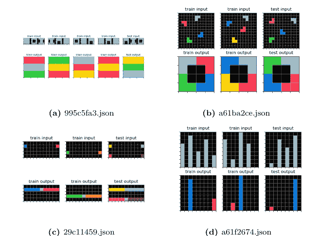

Figure 7.6: 使用我们的方法解决但顶级解决方案 [287, 7, 131] 未能解决的 ARC 任务集合

开源 Bloom 架构 [227] 以及 GPT-3 [28]，即 text-davinci-003。

注意，对于我们的所有实验，我们在零样本设置下生成解决方案，并未对任何语言模型进行微调。我们在 ARC 训练集上评估我们的流程，并在 Figure 7.7 中报告准确率。在训练期间从未遇到过 ARC 任务，即使是最小的语言模型也能解决不少任务。然而，最值得注意的是，准确率大约随大型语言模型参数数量的对数呈线性增长。

因此，使用我们提出的框架，可以以自动化方式解决整个 ARC 任务，该方式利用预训练的学习模型。此外，较大的模型似乎表现更好，这暗示了其能力的潜在提升。然而，与手工制作的程序搜索相比，这种方法的另一个关键方面是先验可以隐式学习，而不是由设计者固定。这有利于我们解决新颖任务，而现有方法无法捕捉这些任务，因为它们与指定的先验不完全匹配。我们将我们的方法成功解决的任务集与原始 Kaggle 竞赛 [287, 7, 131] 的顶级解决方案进行了比较。我们发现，使用我们的方法，我们能够解决所提及的任何顶级解决方案都无法解决的任务。此类新解决示例的选择在 Figure 7.6 中显示。

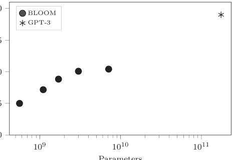

Figure 7.7: 我们的方法在 ARC 训练集上使用不同规模的语言模型的准确率。随着参数数量的增加，准确率遵循对数改进。

### 7.5 Conclusion

目前基于学习的解决 ARC 的方法无法保持竞争力，原因之一是任务数量有限。我们建议专注于自然语言作为重要的人类对齐先验来源，以缓解这一数据缺乏问题。我们提出了一个通用框架，以结合视觉抽象并利用语言作为推理工具来解决 ARC。此外，我们实现了一个基于大型语言模型作为零样本推理器的自动化端到端流水线来解决任务。所得结果对框架是一个有希望的演示，并表明我们方法的可行性。特别是，与最先进的 DSL 方法相比，我们能够解决新任务。此外，我们强调存在许多扩展可能性，例如学习的编码或解码步骤、微调的大型语言模型，甚至整个流水线的端到端训练。

## A Benchmark for Neural Algorithmic Reasoning

### Abstract

算法推理是一种基本的认知能力，在问题解决和决策过程中起着关键作用。强化学习（RL）在诸如运动控制、处理感知输入和管理随机环境等任务中表现出了卓越的熟练程度。这些进步在一定程度上得益于基准的可用性。在本章中，我们介绍了 PUZZLES，这是一个基于 Simon Tatham's Portable Puzzle Collection 的基准，旨在推动 RL 中算法和逻辑推理的进步。PUZZLES 包含 40 个大小可调且复杂程度各异的多样化逻辑谜题；许多谜题还具有多样化的额外配置参数。这 40 个谜题提供了关于 RL 代理的优势和泛化能力的详细信息。此外，我们在 PUZZLES 上评估了各种 RL 算法，提供基准比较并展示未来研究的潜力。

### 8.1 Introduction

人类智力高度依赖逻辑和算法推理作为解决复杂任务的组成部分。尽管机器学习（ML）在解决许多现实世界挑战方面取得了显著成功，但逻辑和算法推理仍然是一个开放的研究问题 [234, 60, 162, 272, 185, 137, 15]。这一研究问题得到了基准可用性的支持，基准允许建立标准化和广泛的评估框架来衡量和鼓励进步 [161, 273, 251]。

强化学习（RL）在各个领域取得了显著进展，展示了其在游戏 [193, 258, 243, 13, 290]、机器人技术 [142, 145, 224, 216] 和控制系统 [278, 288, 29] 等任务中的能力。已提出各种基准以推动这些领域的进步 [263, 17, 26, 70, 259, 55, 153]。最近，在 RL 内的逻辑和算法推理方向也取得了进展 [136, 88, 183]。流行的例子还包括国际象棋、将棋和围棋等游戏 [152, 241]。鉴于逻辑和算法推理的重要性，我们提出一个基准以指导 RL 乃至更广泛机器学习的未来发展。

逻辑谜题长期以来一直是人类的一种有趣挑战，也是评估 RL 代理算法和逻辑推理能力的理想试验场。类似于 Atari 基准 [17] 的多样化谜题范围，有利于广泛适用的方法。与具有固定输入大小的任务不同，一旦找到算法解决方案，逻辑谜题可以迭代求解。这使我们能够衡量解决方案尝试适应和推广到更大输入的程度。此外，与国际象棋和围棋等游戏不同，逻辑谜题有已知解决方案，使奖励设计更容易，并能够通过中间奖励跟踪进度和提供指导。

在本章中，我们介绍了 PUZZLES，这是一个专门用于评估 RL 代理在逻辑和算法推理领域的算法推理和问题解决能力的全面 RL 基准。由著名计算机程序员和谜题爱好者 Simon Tatham 策划的 Simon Tatham's Puzzle Collection [262] 为 PUZZLES 提供了基础。该集合包含一组 40 个逻辑谜题，如 Fig-


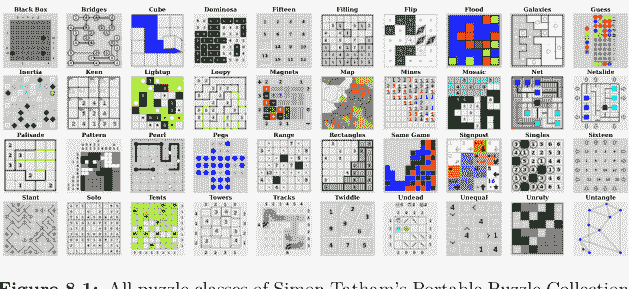

图 8.1，每个都呈现出具有各种可调复杂度维度的独特挑战。它们范围从较为人知的谜题，例如 Solo 或 Mines（通常分别称为 Sudoku 和 Minesweeper）到较为少见的谜题，例如 Cube 或 Slant。PUZZLES 在标准化环境中包含所有 40 个谜题，每个都可以使用可视输入或离散输入以及离散动作空间进行游戏。

**贡献。** 我们提出了 PUZZLES，一个基于 Simon Tatham's Puzzle Collection 的 RL 环境，包含 40 个多样化的逻辑谜题。为确保兼容性，我们扩展了原始 C 源代码以符合 Pygame 库的标准。随后，我们将 PUZZLES 集成到 Gymnasium 框架 API 中，为 RL 应用程序提供了简单、标准且广泛使用的接口。PUZZLES 允许用户任意调整逻辑谜题的大小和难度，提供有关 RL 代理优势和泛化能力的详细信息。此外，我们在 PUZZLES 上评估了各种 RL 算法，提供基线比较并展示了未来研究的潜力。

### 8.2 相关工作

**RL 基准。** 在 RL 中提出了各种基准。Bellemare 等人 [17] 引入了有影响力的 Atari-2600 基准，Mnih 等人 [193] 在该基准上训练 RL 代理直接从像素输入中玩游戏。该基准展示了 RL 在复杂、高维环境中的潜力。PUZZLES 允许使用类似的方法，其中仅向代理提供像素输入。Todorov 等人 [263] 提出了 MuJoCo，它提供了基于物理引擎的机器人系统多样化连续控制任务集。另一个控制基准是 Duan 等人 [70] 的 DeepMind Control Suite，具有连续动作空间和复杂控制问题。Côté 等人 [55] 的工作强调了自然语言理解在 RL 中的重要性，并提出了在文本领域评估 RL 方法的基准。Lanctot 等人 [153] 引入了 OpenSpiel，涵盖了广泛的游戏，使研究人员能够在游戏场景中评估和比较 RL 算法的性能。这些基准和框架对 RL 算法的开发和评估做出了重大贡献。Brockman 等人 [26] 的 OpenAI Gym，及其由 Farama Foundation [92] 接棒的 Gymnasium，通过为许多基准提供标准化接口而提供了帮助。因此，Gym 和 Gymnasium 在促进强化学习研究的可重复性和基准测试方面发挥了重要作用。因此，我们将 PUZZLES 作为一个 Gymnasium 环境提供，以便于使用。

**RL 中的逻辑与算法推理。** 关于 RL 中逻辑推理的著名研究包括使用深度 RL 进行自动定理证明 [142] 或基于 RL 的逻辑合成 [274]。Dasgupta 等人 [61] 发现，RL 代理可以在元强化学习环境中执行一定程度的因果推理。Jiang 和 Luo [136] 的工作引入了 Neural Logic RL，它提高了学习策略的可解释性和泛化能力。Eppe 等人 [79] 提供了作为分层 RL 一部分的问题解决进步步骤。Fawzi 等人 [88] 和 Mankowitz 等人 [183] 演示了 RL 可用于为矩阵乘法和排序等知名问题发现新颖且更高效的算法。神经算法推理也被用作改善经典 RL 控制环境中低数据性能的方法 [62, 114]。逻辑推理可能对于在某些类型的游戏（如国际象棋、将棋和围棋 [152, 241, 242, 243]、扑克 [59, 115, 253, 310] 或棋盘游戏 [98, 257, 291, 210]）中竞争是必需的。然而，这些通常是多智能体游戏，其中一些还具有不完全信息和随机性。

### 8.3 PUZZLES 环境

在以下部分中，我们介绍了 PUZZLES 环境的概述。该环境使用 Python 和 C 编写。有关环境所有功能及其实现的详细说明，请参见第 E.2 节和第 E.3 节。

#### 8.3.1 环境概述

在 PUZZLES 环境中，我们通过定义一致的状态、动作和观察空间来封装每个逻辑谜题所呈现的任务。同样重要的是，绝大多数逻辑谜题的设计使得它们可以在不需要任何猜测的情况下解决。默认情况下，我们提供两个观察空间的选项，一个是谜题离散内部游戏状态的表示，另一个是游戏界面的可视表示

1. 这些谜题可以在 https://www.chiark.greenend.org.uk/~sgtatham/puzzles/ 上在线玩；Android 和 iOS 也有出色的独立应用。

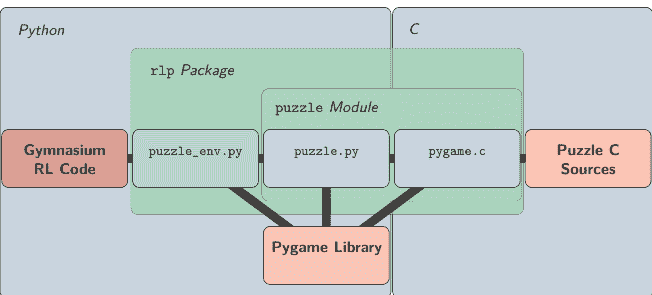

图 8.2：围绕 PUZZLES 环境的代码和库景观，由 rLp 包和 puzzle 模块组成。该图显示了本章介绍的 puzzle 模块如何集成到 Tatham's Puzzle Collection 代码、Pygame 包以及用户的 Gymnasium 强化学习代码中。不同部分也分为 Python 语言和 C 语言。

的游戏界面。这些观察空间可以轻松包装，以便使 PUZZLES 能够与更先进的神经架构（如图神经网络 (GNNs) 或 Transformers）一起使用。所有谜题都提供离散动作空间，仅在基数上有所不同。为了适应解决这些谜题固有的难度以及对适当算法推理的需求，环境允许用户实现自己的奖励结构，从而促进成功 RL 代理的训练。所有谜题都在二维游戏区域中进行，具有确定性状态转换，仅在有效的用户输入后才会发生转换。PUZZLES 中的大多数谜题对步数没有上限，只能通过成功解决谜题来完成。策略不佳的代理不太可能达到终止状态。出于这个原因，我们提供了基于状态重复的提前回合终止选项。如在第 8.4.4 节所示，这是一种促进学习的有效方法。

#### 8.3.2 难度进度与泛化

PUZZLES 环境高度重视让用户控制环境所展示的难度。对于每个谜题，问题大小和难度可以单独调整。难度会影响代理为了解决谜题需要学习的策略的复杂性。例如，*数独* 具有具体的难度选项：更难的难度可能需要使用 *强制链* 等新策略来找到解决方案，而简单难度只需要 *单位位置* 策略。

我们环境中谜题的可扩展性为设计越来越复杂的谜题配置提供了独特的机会，为 RL 代理导航呈现了一个具有挑战性的景观。基准的这种动态性质服务于两个重要目的。首先，谜题的可扩展性有助于评估代理的泛化能力。在 PUZZLES 环境中，可以在简单谜题设置中训练代理，随后在逐渐困难的谜题配置中评估其性能。对于大多数谜题，动作空间的基数与谜题大小无关。因此，也可以仅在谜题的小实例上训练代理，然后在较大规模上对其进行评估。这种方法使我们能够评估代理是否学习了正确的底层算法并泛化到分布外场景。其次，它使基准能够适应 RL 方法论的持续进步。随着 RL 算法的发展和变得更加强大，可以相应调整谜题配置以保持所需的难度级别。这确保了基准继续有效地评估最新 RL 方法的能力。

### 8.4 实证评估

我们在 PUZZLES 环境中评估了许多常用 RL 算法的基线性能。此外，我们还分析了环境和训练设置的某些设计决策的影响。我们感兴趣的指标是策略成功完成谜题所需的平均步数，越低越好。我们使用 *成功回合* 术语来表示单个谜题的成功完成

3. *强制链* 通过跟随链接单元格来评估可能的候选项，通常从双候选单元格开始。
4. *单位位置* 策略涉及识别只有一个可能值的单元格。


实例。我们还考察成功率，即成功完成的谜题所占的百分比。

为便于理解谜题的复杂性并将智能体的表现置于上下文中，我们给出了解谜所需步骤最优数量的上界估计。该估计结合了使用最优策略解谜所需的步骤，以及实现该解法所需环境步骤的上界（例如将光标移动到正确位置）。该上界记作 Optimal。关于该上界对每个谜题的计算方式，请参见表 E.5.43。此外，我们还将人类专家的表现作为参考。人类专家能够在我们评估的所有难度级别内，在最优上界以内解决所有谜题。关于人类专家表现的详细结果，请参见第 E.6.2 节。

我们基于表 E.6.46 中介绍的所有 RL 算法开展实验。我们既包括 PPO 等流行的传统算法，也包括专为 PUZZLES 中所呈现的任务类型设计的算法。在可能的情况下，我们使用了 RL 库 Stable Baselines 3 [214] 中提供的实现，并采用默认超参数。对于 MuZero 和 DreamerV3，我们分别使用了 [286] 和 [108] 中提供的代码。我们在附录表 E.6.46 中提供了所有算法的摘要。总计，我们的实验大约需要 10,000 个 GPU 小时。

所有选定的算法都与我们环境所需的离散动作空间兼容。这一情况禁止使用某些其他常见的 RL 算法，例如 Soft Actor-Critic (SAC) [105] 或 Twin Delayed Deep Deterministic Policy Gradients (TD3) [93]。

#### 8.4.1 基线实验

对于常规基线实验，我们在所有谜题上训练了所有智能体并评估其表现。由于我们的谜题具有挑战性，我们在可能的情况下选择了较低难度和较小尺寸的谜题。每个智能体都使用五个不同的随机种子在离散内部状态观察上进行了训练。

我们通过仅在每个回合成功完成或失败时提供奖励来训练所有智能体。出于计算原因，我们在训练和测试期间将所有回合在 10,000 步处截断。对于这种终止，奖励保持为 0。我们评估这种

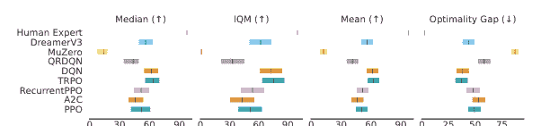

#### (a) 成功率（%）

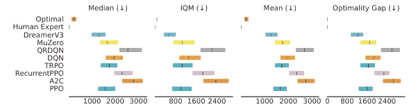

#### (b) 回合长度

图 8.3：子图 (a) 显示了最简易设置下所有谜题的聚合成功率，而子图 (b) 显示了聚合回合长度。区间估计基于分层自助置信区间，使用 `riable` [5] 计算。某些谜题，即 Loop、Pearl、Pegs、Solo 和 Unruly，对所有算法都无法处理，因此在此聚合中被排除。Optimal 是指最优策略性能的上界。人类专家能够在这个上界内解决所有谜题。我们报告中位数、中间 50% 运行的四分位数均值（IQM）、均值，以及相对于最优策略上界的最优性差距。我们发现 DreamerV3、DQN 和 TRPO 能够解决最多数量的谜题，然而 DreamerV3 似乎能学习更好的策略。总体而言，所有算法都未达到最优或人类专家水平的表现。

回合截断在 8.4.4 节中进行评估。我们在第 E.6.1 节中提供了所有实验参数，包括为每个谜题提供的精确参数。

为了追踪智能体的进度，我们使用回合长度，即智能体解决一个谜题需要多少个动作。动作数量越少，表示策略越强，越接近最优解。为了获得最终评估，我们在各自谜题的 1000 个随机回合上运行每个策略，最大步数再次限制为 10,000 步。所有实验均在 NVIDIA 3090 GPU 上进行。单个智能体使用 200 万 PPO 步进行训练的时间因谜题而异，大约在 1.75 到 3 小时之间。DreamerV3 和 MuZero 的训练要求更高，训练时间大约在 10 到 20 小时之间。

图 8.3b 显示了所有算法的平均成功回合长度，遵循 [5] 中概述的建议制作。可以看出，从成功率和回合长度来看，DreamerV3 表现最佳，TRPO、PPO 和 DQN 紧随其后。MuZero 遭受训练不稳定的困扰，仅为少量谜题学习到了成功策略，这表明需要针对特定谜题进行超参数调优。结果尤其有趣，因为 PPO 和 TRPO 遵循的训练流程比 DreamerV3 和 MuZero 简单得多。DreamerV3 学习到的隐式世界模型似乎难以恰当捕捉某些谜题。仔细检查附录表 E.6.47 和 E.6.48 中呈现的详细结果，DreamerV3 成功解决了 62.7% 的所有谜题实例。在 40 个谜题中的 14 个上，它找到了在 Optimal 上界以内解决谜题的策略。PPO 和 TRPO 平均分别成功解决了 61.6% 和 70.8% 的谜题实例，但只有 8 个和 11 个谜题始终在 Optimal 上界以内得到解决。A2C、RecurrentPPO、DQN 和 QRDQN 算法的表现不如纯随机策略。总体而言，PUZZLES 中的某些环境相当具有挑战性，非常适合展示算法之间的性能差异。还要注意的是，所有逻辑谜题的设计都可以在不需要任何猜测的情况下解决。

#### 8.4.2 难度

我们进一步评估了部分谜题在人类最简易预设难度级别上的表现。我们选择了所有随机策略能以至少 10% 的概率解决的谜题，即 Netslide、Same Game 和 Untangle。使用此选择，我们估计奖励密度应该相对较高，理想情况下能让智能体学习到良好的策略。同样，我们训练了表 E.6.46 中列出的所有算法。我们在表 8.4 中提供了两个最强算法 PPO 和 DreamerV3 的结果，完整结果可在附录表 E.6.47 中查阅。请注意，作为 8.4.4 节的一部分，我们还在人类最简易预设难度级别的更多谜题上使用 DreamerV3 进行了消融实验。

表 8.4：比较使用 PPO 和 DreamerV3 训练的智能体平均需要多少步骤来解决两个难度级别的谜题。括号中报告了成功回合的百分比。难度级别对应整体最简易和人类最简易设置。我们还给出了每个配置所需的最优步骤上界。

| 谜题 | 参数 | PPO | DreamerV3 | Optimal | 人类专家 |
|---|---|---|---|---|---|
| Netslide | 2x3b1 | 35.3 ± 0.7 (100.0%) | 12.0 ± 0.4 (100.0%) | 48 | 16.7 |
| | 3x3b1 | 4742.1 ± 2960.1 (9.2%) | 3586.5 ± 6769.9 (22.4%) | 90 | 40.9 |
| Same Game | 2x3c3s2 | 11.5 ± 0.1 (100.0%) | 7.3 ± 0.2 (100.0%) | 42 | 8.7 |
| | 5x5c3s2 | 1009.3 ± 1089.4 (30.5%) | 527.0 ± 162.0 (30.2%) | 300 | 37.0 |
| Untangle | 4 | 34.9 ± 10.8 (100.0%) | 6.3 ± 0.4 (100.0%) | 80 | 6.0 |
| | 6 | 2294.7 ± 2121.2 (96.2%) | 1683.3 ± 73.7 (82.0%) | 150 | 30.5 |

我们观察到，对于 PPO 和 DreamerV3，成功回合的百分比都会下降，且所需步骤大幅增加。DreamerV3 的表现明显优于 PPO，始终需要更少的步骤，但仍多于最优策略。我们的结果表明，在人类难度级别具有相对较高奖励密度的谜题仍然具有挑战性。我们建议将人类最简易难度级别作为评估未来算法的首要指标。最简易人类难度设置的详细信息可在附录表 E.6.44 中找到。如果达到此级别，可以通过增加谜题的尺寸进一步提升难度。某些谜题还允许在固定尺寸下增加难度。

#### 8.4.3 动作掩码与观察表示的影响

我们评估了动作掩码以及观察类型对训练性能的影响。首先，我们分析如第 E.2.4 节“动作掩码”段落中所述的动作掩码是否能对训练性能产生积极影响。其次，我们想看看智能体在依赖像素观察时是否仍能解决谜题。像素观察允许为所有谜题使用完全相同的输入表示，从而实现与 Atari 基准非常相似的设置。我们在两种观察类型上比较了 MaskablePPO 与不带动作掩码的默认 PPO。我们在图 8.5 中总结了结果。详细结果


针对基于像素观测的掩码 RL 智能体，相关内容见附录表 E.6.49。

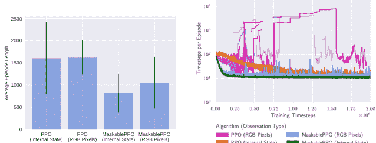

图 8.5：（左）我们展示了动作掩码在 RGB 观测和内部游戏状态中的效果。通过掩码不改变当前状态的动作，智能体探索所需的动作更少，因此平均而言用更少的步骤解决谜题。（右）训练期间 Flood 谜题的移动平均集数长度。集数长度越低越好，因为一旦智能体解决谜题，集数就会立即终止。不同颜色描述不同算法，同一颜色的不同深浅表示不同的随机种子。稀疏点表示智能体只是偶尔能够找到能解决谜题的策略。可以看出，使用离散内部状态观测和动作掩码对训练都有积极影响，从而加速收敛并提升整体性能。

如图 8.5 所示，动作掩码对训练性能有强烈的积极影响。这一收益既存在于离散内部游戏状态观测中，也存在于像素观测中。我们推测这是因为探索更加高效，因为无效动作不被允许。结果，训练期间的奖励密度增加，智能体能够学习到更好的策略。特别是与 Pegs 相关的结果值得关注。它们表明，使用动作掩码的智能体可以有效地学习到成功的策略，而没有动作掩码的随机策略则始终无法解决任何实例。正如预期的那样，在像素观测上训练 RL 智能体增加了任务的难度。智能体必须先理解像素观测与游戏内部状态之间的关系，然后才能解决谜题。尽管如此，结合动作掩码后，智能体能够解决大部分谜题实例，其中 10 个谜题始终能在最优上界内解决。

此外，图 8.5 显示了 Flood 谜题的个体训练性能。可以看出，使用动作掩码和离散内部游戏状态观测的 RL 智能体相比基线收敛显著更快，且达到的策略更好。使用像素观测且没有动作掩码的智能体则难以收敛到任何合理的策略。

#### 8.4.4 集数长度与早期终止的影响

我们评估截断集数长度或早期终止是否会对智能体的训练性能产生影响。出于计算原因，我们仅在最简单预设人类难度下选取的部分谜题子集上进行这些实验，并且仅针对 DreamerV3（详情见第 E.6.4 节）。如表 8.6 所示，将训练期间的最大集数长度从 10,000 增加到 100,000 并不能提升性能。只有当集数在访问完全相同的状态超过 10 次后被终止时，智能体平均才能解决更多谜题实例（31.5% 对比 25.2%）。鉴于稀疏奖励结构，早期终止集数似乎在允许长轨迹成功完成与避免在不成功轨迹上浪费资源之间提供了更好的权衡。有趣的是，DreamerV3 为 Cube 谜题找到的解决方案所需步骤比人类专家更少。

表 8.6：最大集数长度（# Steps）和早期终止（ET）对最终性能的影响比较。对于每种设置，我们报告相对于随机种子的平均成功集数长度及其标准差，所有结果均在选定的所有谜题上取平均。括号中报告成功集数的百分比。

| #步数 | ET | DreamerV3 |
| :--- | :--- | :--- |
| 1e5 | 10 | 2950.9 ± 1260.2 (31.6%) |
| 1e5 | - | 2975.4 ± 1503.5 (25.2%) |
| 1e4 | 10 | 3193.9 ± 1044.2 (26.1%) |
| 1e4 | - | 2892.4 ± 908.3 (26.8%) |

#### 8.4.5 泛化能力

PUZZLES 框架被显式设计用于便于测试智能体在不同谜题大小或谜题难度方面的泛化能力。在我们的实验中，我们选择奖励密度最高的谜题。我们使用自定义观测包装器和基于 Transformer 的编码器，以便智能体能够处理不同大小的输入，详情见第 E.1.3 节和第 E.1.4 节。我们称这种方法为 PPO (Transformer)

表 8.7：我们通过在比训练环境更大的谜题尺寸上评估智能体来测试其泛化能力。我们报告智能体解决一个谜题所需的平均步数，以及括号中的成功集数百分比。难度级别对应整体最简单和对人类最简单的设置。对于 PPO (Transformer)，我们根据在训练环境中的性能选择训练期间的最佳检查点。对于 PPO (Transformer)†，我们根据在泛化环境中的性能选择训练期间的最佳检查点。

| 谜题 | 参数 | 训练用 | PPO (Transformer) | PPO (Transformer)† |
|---|---|---|---|---|
| Netslide | 2x3b1 | ✓ | 244.1 ± 313.7 (100.0%) | 242.0 ± 379.3 (100.0%) |
| | 3x3b1 | ✗ | 9014.6 ± 2410.6 (18.6%) | 9002.8 ± 2454.9 (18.0%) |
| Same Game | 2x3c3s2 | ✓ | 9.3 ± 10.9 (99.8%) | 26.2 ± 52.9 (99.7%) |
| | 5x5c3s2 | ✗ | 379.0 ± 261.6 (9.4%) | 880.1 ± 675.4 (18.1%) |
| Untangle | 4 | ✓ | 38.6 ± 58.2 (99.8%) | 69.8 ± 66.4 (100.0%) |
| | 6 | ✗ | 3340.0 ± 3101.2 (87.3%) | 2985.8 ± 2774.7 (93.7%) |

表 8.7 中呈现的结果表明，尽管可以学习到具有泛化能力的策略，但这仍然是一个具有挑战性的问题。此外，可以观察到，在训练期间根据泛化环境中的性能选择最佳模型，能够在该设置下带来性能收益。这表明，智能体可能在训练过程中学习到泛化能力更好的策略，但随后会在训练环境上过拟合。同样明显的是，泛化性能在不同随机种子之间存在显著差异。对于 Netslide，最佳智能体能够解决泛化环境中 23.3% 的谜题，而最差智能体只能解决 11.2% 的谜题，这与随机策略相似。我们的研究结果表明，智能体通常能够泛化到更复杂的谜题。然而，还需要进一步研究来识别合适的归纳偏置，以便在不显著下降性能的情况下实现一致的泛化。

### 8.5 讨论

实验评估表明，不同算法表现出不同程度的成功。例如，Tracks、Map 或 Flip 等谜题没有任何一个被评估的 RL 智能体能够解决，或者只能达到与随机策略相似的性能。这指向了中间奖励、更好的特定于游戏规则的动作掩码或基于模型的方法的潜力。为了鼓励状态空间中的探索，明确促进探索的机制可能有益。另一方面，有些算法能够解决大量谜题且性能 presumably 最优，这一事实展示了 RL 领域的进步。考虑到 DreamerV3 的有前景结果，改进那些由设计本身就具备一定推理能力和隐式世界模型的智能体，仍然是未来研究的重要方向。

### 实验结果。

第 8.4.1 节和第 8.4.3 节中呈现的实验结果强调了动作掩码和正确观测类型对性能的积极影响。虽然像素表示会为所有谜题提供统一的观测，但与离散内部游戏状态相比，它目前增加了过多的复杂性。我们的研究结果表明，引入动作掩码能显著提升强化学习算法的训练效率。这种改进既存在于离散内部游戏状态观测中，也存在于像素观测中。这种改进的机制可以归因于增强的探索，从而使智能体能够学习到更鲁棒且更有效的策略。这在未掩码智能体遇到相当困难的谜题中尤其明显，从而展示了为这些谜题实施动作掩码的切实优势。

### 局限性。

虽然 PUZZLES 框架提供了深入了解各种 RL 算法在逻辑谜题上的性能的能力，但在解释结果时认识到某些局限性至关重要。本基线评估中使用的稀疏奖励增加了任务的复杂性。此外，所有算法都使用了它们的


default hyperparameters. Additionally, the constraint of discrete action spaces excludes the application of certain RL algorithms.

**Benchmarking LLMs.** We also explore the potential of using PUZZLES as a novel framework for evaluating the reasoning abilities of both large language models (LLMs) and vision language models (VLMs). While existing reasoning benchmarks have been the subject of debate regarding their ability to accurately assess the reasoning abilities of LLMs [188, 211, 191], PUZZLES offers a unique advantage by enabling true out-of-distribution evaluation. Our preliminary experiments, conducted with Gemini 1.5 Flash [220] and GPT-4o mini [130], indicate that current LLMs have limited success in solving PUZZLES. A detailed analysis of these results is presented in Section E.6.5. This research lays the groundwork for future investigations using PUZZLES to provide a more nuanced understanding of the reasoning processes and limitations of LLMs.

In the context of RL, the different challenges posed by the logic-requiring nature of these puzzles necessitates a good reward system, strong guidance of agents, and an agent design more focused on logical reasoning capabilities. It will be interesting to see how alternative architectures such as graph neural networks (GNNs) perform. GNNs are designed to align more closely with the algorithmic solution of many puzzles. While the notion that “reward is enough” [244, 268] might hold true, our results indicate that not just *any* form of correct reward will suffice, and that advanced architectures might be necessary to learn an optimal solution.

### 8.6 Conclusion

In this chapter, we have proposed PUZZLES, a benchmark that bridges the gap between algorithmic reasoning and RL. In addition to containing a rich diversity of logic puzzles, PUZZLES also offers an adjustable difficulty progression for each puzzle, making it a useful tool for benchmarking, evaluating and improving RL algorithms. Our empirical evaluation shows that while RL algorithms exhibit varying degrees of success, challenges persist, particularly in puzzles with higher complexity or those requiring nuanced logical reasoning. We are excited to share PUZZLES with the broader research community and hope that this benchmark will foster further research to improve the algorithmic reasoning abilities of machine learning models.

## A Scaling Analysis of Reasoning Effort and Problem Complexity in LLMs

### Abstract

Large Language Models (LLMs) have demonstrated remarkable text generation capabilities, and recent advances in training paradigms have led to breakthroughs in their reasoning performance. In this chapter, we investigate how the reasoning effort of such models scales with problem complexity. We use the infinitely scalable Tents puzzle, which has a known linear-time solution, to analyze this scaling behavior. Our results show that reasoning effort scales with problem size, but only up to a critical problem complexity. Beyond this threshold, the reasoning effort does not continue to increase, and may even decrease. This observation highlights a critical limitation in the logical coherence of current LLMs as problem complexity increases, and underscores the need for strategies to improve reasoning scalability. Furthermore, our results reveal significant performance differences between current state-of-the-art reasoning models when faced with increasingly complex logical puzzles.

### 9.1 Introduction

Large language models (LLMs) have demonstrated remarkable abilities in a wide range of natural language tasks, from text generation to complex problem-solving. Recent advances, particularly with models trained for enhanced reasoning, have pushed the boundaries of what machines can achieve in tasks requiring logical inference and deduction. A critical factor in the success of these advanced models is the ability to leverage increased computational resources at test time, allowing them to explore more intricate solution spaces. This capability raises a fundamental question: how does the "reasoning effort" of these models scale as the complexity of the problem increases?

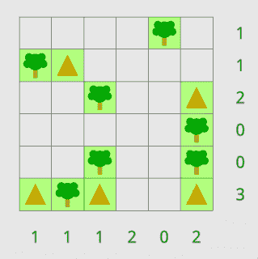

Figure 9.1: An example instance of a partially solved 6 by 6 tents puzzle. Tents need to be placed next to trees, away from other tents and fulfilling the row and column constraints.

Understanding this scaling relationship is crucial for several reasons. First, it sheds light on the fundamental nature of reasoning within LLMs, moving beyond simply measuring accuracy on isolated tasks. By examining how the computational demands, reflected in token usage, evolve with problem difficulty, we can gain insights into the efficiency and potential bottlenecks of current LLM architectures. Second, characterizing this scaling behavior is essential for designing more effective and resource-efficient reasoning models in the future.

In this chapter, we address this question by investigating the scaling of reasoning effort in LLMs using a specific, infinitely scalable logic puzzle: the Tents puzzle$^1$ (see Figure 9.1). This puzzle offers a controlled environment for studying algorithmic reasoning, as its problem size can be systematically increased, and it possesses a known linear-time solution. Our analysis focuses on how the number of tokens used by state-of-the-art reasoning LLMs changes as the puzzle grid size grows. In addition to reasoning effort, we also evaluate and discuss the success rate of the models across different puzzle sizes to provide a comprehensive view of their performance.

### 9.2 Related Work

The exploration of reasoning abilities in large language models (LLMs) is a rapidly evolving field with significant implications for artificial intelligence. Several benchmarks have been developed to evaluate the reasoning capabilities of LLMs across various domains. These benchmarks provide standardized tasks and evaluation metrics to assess and compare different models. Notable benchmarks include GSM8K [50], ARC-AGI [48], GPQA [221], MMLU [117], SWE-bench [138] and NPHard-eval [86]. These benchmarks cover topics from mathematics to commonsense reasoning and coding. More recently, also math competitions such as AIME2024 [201] have been used to evaluate the newest models. Estermann et al. [84] have introduced PUZZLES, a benchmark focusing on algorithmic and logical reasoning for reinforcement learning. While this benchmark does not focus on LLMs, except for a short ablation in the appendix, we argue that the scalability provided by the underlying puzzles is an ideal testbed for testing extrapolative reasoning capabilities in LLMs.

The reasoning capabilities of traditional LLMs without specific prompting strategies are quite limited [127]. Using prompt techniques such as chain-of-thought [281], least-to-most [311] and tree-of-thought [301], the reasoning capabilities of traditional LLMs can be greatly improved. Lee et al. [158] have introduced the Language of Thought Hypothesis, based on the idea that human reasoning is rooted in language. Lee et al. propose to see the reasoning capabilities through three different properties: Logical coherence, compositionality and productivity. In this chapter we will mostly focus on the aspect of algorithmic reasoning, which falls into logical coherence. Specifically, we analyze the limits of logical coherence.

With the release of OpenAI's o1 model, it became apparent that new training strategies based on reinforcement learning are able to boost the reasoning performance even further. Since o1, there now exist a number of different models capable of enhanced reasoning [104, 63, 212, 203]. Key to the success of these models is the scaling of test-time compute. Instead of directly producing an answer, or thinking for a few steps using chain-of-thought, the models are now trained to think using several thousands of tokens before coming up with an answer.

$^1$The puzzle is available to play in the browser at https://www.chiark.greenend.org.uk/~sgtatham/puzzles/js/tents.html

### 9.3 Methods

#### 9.3.1 The Tents Puzzle Problem

In this chapter, we employ the Tents puzzle, a logic problem that is both infinitely scalable and solvable in linear time², making it an ideal testbed for studying algorithmic reasoning in LLMs. The Tents puzzle, popularized by Simon Tatham's Portable Puzzle Collection [260], requires deductive reasoning to solve. The puzzle is played on a rectangular grid, where some cells are pre-filled with trees. The objective is to place tents in the remaining empty cells according to the following rules:

- no two tents are adjacent, even diagonally
- the number of tents in each row and column matches the numbers around the edge of the grid
- it is possible to match tents to trees so that each tree is orthogonally adjacent to its own tent (but may also be adjacent to other tents).

An example instance of the Tents puzzle is visualized in Figure 9.1 in the Introduction. The scalability of the puzzle is achieved by varying the grid dimensions, allowing for systematic exploration of problem complexity. Where not otherwise specified, we used the "easy" difficulty preset available in the Tents puzzle generator, with "tricky" being evaluated in Section F.2.1. Crucially, the Tents puzzle is designed to test extrapolative reasoning as

²See a description of the algorithm of the solver as part of the PUZZLES benchmark here: https://github.com/ETH-DISC0/rlp/blob/main/puzzles/tents.c#L206C3-L206C67


谜题实例，尤其是较大的实例，不太可能出现在LLM的训练数据中。我们为Tents谜题使用了基于文本的接口，扩展了Estermann等人[84]提供的代码库以生成谜题实例，并以适合LLM的格式表示谜题状态。所有测试的谜题大小和模型都使用了相同的提示词（详见附录F.1）。提示词包含谜题规则和以文本格式表示的初始谜题状态。模型的任务是直接以JSON格式输出解出的谜题网格。这种一次性方法与[84]中先前使用的交互式或基于光标的方法形成对比，将推理过程与潜在的规划或动作选择复杂性隔离开来。

#### 9.3.2 评估标准

我们的评估集中于两个关键指标：成功率和推理努力。成功率被评估为二元指标：即LLM是否成功输出Tents谜题实例的有效解，遵守所有谜题规则和约束。我们通过问题大小来量化问题复杂度，定义为网格维度的乘积（行数×列数）。为了分析推理努力的缩放情况，我们测量LLMs生成最终答案所需的总token数，包括所有思考token。我们假设问题大小与推理努力之间存在线性缩放关系，并通过将观察到的token数量作为问题大小的函数拟合线性模型来评估这一假设。拟合优度使用R²指标量化，得分越接近1，表示推理努力方差中有更大比例由与问题大小的线性关系来解释。此外，我们分析不同问题大小下正确解出的谜题百分比，以评估每个模型的性能极限。

#### 9.3.3 考虑的模型

我们评估了以下以增强推理能力著称的大型语言模型的推理性能：Gemini 2.0 Flash Thinking [63]、OpenAI o3-mini [203]、DeepSeek R1 [104] 和 Qwen/QwQ-32B-Preview [212]。这些模型代表了一系列为复杂推理任务优化的架构和训练范式。

### 9.4 结果

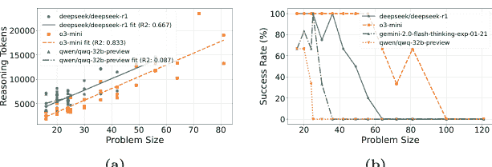

**图9.2：** (a) 针对DeepSeek R1、o3-mini和Qwen/QwQ-32B-Preview，问题大小作为函数的推理token数量。仅包含成功尝试。为每个模型添加了线性拟合。Gemini 2.0 Flash Thinking因思考token数量未知而被排除。(b) 所有模型的解题百分比随问题大小的变化。没有模型解出大小超过100的问题。o3-mini在较大问题上达到了最高的成功率，其次是DeepSeek R1和Gemini 2.0 Flash Thinking。Qwen/QwQ-32B-Preview在处理大小超过20的问题实例时遇到困难。

推理努力与问题大小之间的关系揭示了评估模型之间有趣的缩放行为。图9.2a说明了随着问题大小增大，成功解出的谜题的推理努力（按推理token数量衡量）的缩放情况。对于DeepSeek R1和o3-mini，我们观察到推理努力与问题大小大约呈线性增长。值得注意的是，R1和o3-mini的线性拟合斜率非常相似，表明这些模型在推理努力方面具有可比的缩放行为，尽管DeepSeek R1在各个问题大小上始终比o3-mini使用更多的token。Qwen/QwQ-32B-Preview显示出较弱的线性相关性，可能是因为它能够成功解出的较大谜题数量有限。

如图9.2b所示，模型的问题求解能力揭示了随着问题大小增加而出现的性能极限。没有模型解出问题大小超过100的谜题。o3-mini展示了最高的整体可解性，成功解出了最大的问题实例，其次是DeepSeek R1和Gemini 2.0 Flash Thinking。Qwen/QwQ-32B-Preview的性能随着问题大小增加而显著下降，难以解出大小超过25的实例。

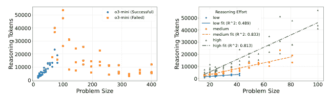

图9.3：(a) o3-mini的推理token数量随问题大小的变化。在问题大小约为100处观察到推理努力的峰值，随后随着问题变大而下降。(b) o3-mini的推理token数量随问题大小的变化，按低、中、高推理努力策略分类。较高推理努力策略的斜率更陡峭。高推理努力使解出更大的实例成为可能，但也会增加对较小、已可解问题的token使用量。

对o3-mini推理努力的更详细分析（图9.3a）揭示了一种非单调趋势。虽然推理努力最初通常随问题大小增加，但在问题大小约为100时达到峰值。超过这一点后，推理努力下降，表明可能存在一种“挫败”效应，即复杂度的增加不再导致模型中推理的相应增加。其他模型未观察到相同行为，参见第F.2.2节。观察最近试图优化推理长度的工作对这些结果的影响将会很有趣[180]。

图9.3b通过将推理努力分类为低、中、高策略，进一步探讨了o3-mini的行为。缩放斜率的陡峭程度随推理努力增加，表明较高的努力策略会导致问题大小增长时token使用量更显著地增加。虽然高推理努力使解出更大的谜题成为可能（高达10x10），但即使对于使用低努力策略已可解的较小问题，它也会导致更高的token数量。这表明存在一种权衡：增加推理努力可以扩展可解问题范围，但也可能为简单实例引入低效。

### 9.5 结论

本研究利用Tents谜题考察了LLM中推理努力如何随规模变化。我们发现，对于可解实例，推理努力通常随问题大小呈线性缩放。模型性能各有差异，o3-mini和DeepSeek R1的表现优于Qwen/QwQ-32B-Preview和Gemini 2.0 Flash Thinking。这些结果表明，虽然LLM可以根据问题复杂度调整推理努力，但其逻辑连贯性存在局限性，尤其是对于较大的问题。未来工作应将此分析扩展到PUZZLES基准中包含的更多种类的谜题，以涵盖具有不同算法复杂度的谜题。这些见解可能为寻找改进推理可扩展性和效率的策略铺平道路，可能通过优化推理长度或改进提示词技术来实现。理解这些局限性对于推动LLM在复杂问题求解方面的发展至关重要。

## 结论

在本论文中，我们进行了表征学习的全面探索，涵盖了深度学习领域内的多样化领域和挑战。从主动学习到解耦表征、功能表征、Transformer缩放和推理的复杂性，我们深入探讨了驱动强大且智能AI系统的核心机制。我们的调查不仅带来了新的技术和架构，还凸显了当前最先进模型的优势和局限性，特别是在推理方面。引入新的基准并分析复杂任务上的缩放行为，提供了宝贵的见解，为旨在提高AI系统效率、可扩展性和逻辑连贯性的未来研究铺平了道路。随着AI领域的快速发展，追求模型中更强大、可解释和可泛化的中间表征仍然是一项关键任务。本论文的贡献将成为未来的垫脚石，使AI系统能够有效应对日益复杂的挑战，并有助于更深入地了解我们周围的世界。


## 附录

## 基于主动学习的迭代组合拍卖方法

### A.1 超参数

我们列出了不同拍卖模型和竞标者的参数值。表 A.1.1 包含 DL-ICA 的一般超参数，表 A.1.2 和表 A.1.3 包含神经网络使用的参数，表 A.1.4 包含与神经网络无关的参数。对于所有超参数，我们紧密遵循 [285] 的工作。我们在表 A.1.1 中简要总结了超参数的含义：

- $k$ : 表示起始样本的数量。仅在采样技术 GALO 和 GALI + UF 时需要。在这两种采样技术中，前 $k$ 个捆组由 GALI 确定，其余的初始捆组由 GALO 或 UF 确定。
- $c_0$ : 迭代阶段前采样的初始捆组数量。
- $c_e$ : 基于机器学习的引出算法迭代阶段中，竞标者可能被询问的捆组上限。

表 A.1.1: DL-ICA 的一般超参数

| 模型 | 采样技术 | k | c_0 | c_e |
|---|---|---|---|---|
| GSVM | UF | - | 30 | 20 |
| | GALI | - | 30 | 20 |
| | GALI + UF | 20 | 30 | 20 |
| | GALO (linear) | 20 | 30 | 20 |
| | GALO (NN) | 20 | 30 | 20 |
| LSVM | UF | - | 40 | 10 |
| | GALI | - | 40 | 10 |
| | GALI + UF | 30 | 40 | 10 |
| | GALO (linear) | 30 | 40 | 10 |
| | GALO (NN) | 30 | 40 | 10 |
| MRVM | UF | - | 40 | 60 |
| | GALI | - | 40 | 60 |
| | GALI + UF | 30 | 40 | 60 |
| | GALO (linear) | 30 | 40 | 60 |
| | GALO (NN) | 30 | 40 | 60 |

表 A.1.2: 不同类型竞标者和模型的神经网络架构。括号内的数字表示每个隐藏层的神经元数量，例如 [32,32] 描述一个具有两个隐藏层的全连接神经网络，每层大小均为 32。输入层的大小对应项目的数量，输出层的大小为 1。

| | GSVM | LSVM | MRVM |
|---|---|---|---|
| 本地竞标者架构 | - | - | [16,16] |
| 区域竞标者架构 | [32,32] | [32,32] | [16,16] |
| 国家竞标者架构 | [10,10] | [10,10,10] | [16,16] |

表 A.1.3: 神经网络的参数。这些参数在所有竞标者中相同，无论其类型如何。

| | GSVM | LSVM | MRVM |
|---|---|---|---|
| 正则化类型 | L2 | L2 | L1_L2 |
| 正则化系数 | 0.00001 | 0.00001 | 0.00001 |
| 学习率 | 0.01 | 0.01 | 0.01 |
| Dropout | True | True | True |
| Dropout 率 | 0.05 | 0.05 | 0.05 |

表 A.1.4: 所有与神经网络无关的参数。MinMaxScaler 是 Python scikit-learn 库的一个类。

| | GSVM | LSVM | MRVM |
|---|---|---|---|
| L | 3000 | 3000 | 3000 |
| Mip_bounds_tightening | IA | IA | IA |
| sample_weight | False | False | False |
| Scaler | False | False | MinMaxScaler(True, (0, 500)) |
| warm_start | False | False | False |
| 种子实例 | 101 - 151 | 101 - 151 | 101 - 121 |

## 解纠缠对抗变分自编码器

### B.1 数据集

我们对每个数据集进行了简要总结，包括样本及其各自的数据生成基实因子。

#### B.1.1 Shapes3D

Shapes3D 数据集 [30] 包括以下基实因子：地板色调、墙壁色调、物体色调、尺寸、形状和方向。

#### B.1.2 DSprites

DSprites 数据集 [187] 包括以下基实因子：形状、尺寸、方向、x 位置和 y 位置。

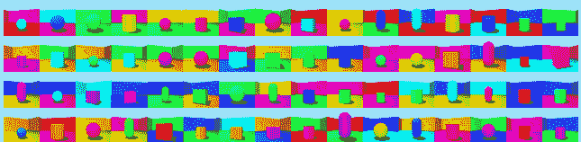

图 B.1.1: Shapes3D 的样本。

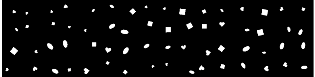

图 B.1.2: DSprites 的样本。

#### B.1.3 AbstractDSprites

AbstractDSprites 数据集 [269] 包括以下基实因子：背景颜色、物体颜色、形状、尺寸、x 位置和 y 位置。

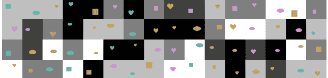

图 B.1.3: AbstractDSprites 的样本。

#### B.1.4 Mpi3d Toy

Mpi3d Toy 数据集 [103] 包括以下基实因子：物体颜色、物体形状、物体大小、摄像机高度、背景颜色、第一自由度、第二自由度。它由实验装置的低质量渲染图组成。

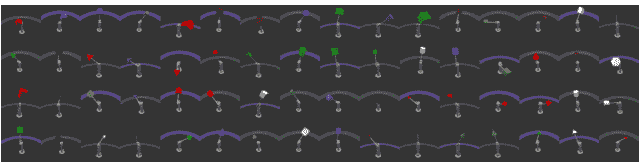

图 B.1.4: Mpi3d Toy 的样本。

#### B.1.5 Mpi3d Real

Mpi3d Real 数据集 [103] 包含与 Mpi3d Toy 相同的基实因子。它由实验装置的真实照片组成。

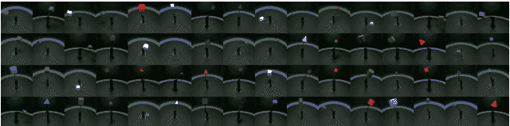

图 B.1.5: Mpi3d Real 的样本

#### B.1.6 Smallnorb

Smallnorb 数据集 [156] 包括以下基实因子：对象类型、仰角、方位角、照明条件。

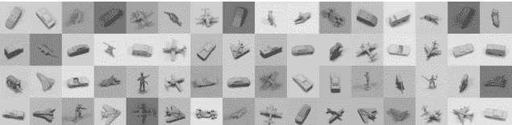

图 B.1.6: Smallnorb 的样本。

#### B.1.7 NoisyDSprites

NoisyDSprites 数据集 [176] 包含与 DSprites 相同的基实因子。背景不是黑色，而是由随机噪声组成。

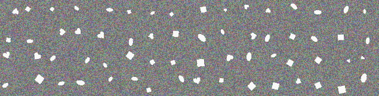

图 B.1.7: NoisyDSprites 的样本

#### B.1.8 Cars3D

Cars3D 数据集 [219] 包括以下基实因子：仰角、方位角、对象类型。

#### B.1.9 CelebA

CelebA 数据集 [174] 包含超过 10,000 个身份的多个图像，拥有丰富的面部属性、姿势和背景杂乱。


图 B.1.8: Cars3D 的样本。

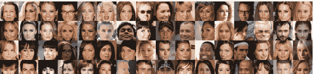

图 B.1.9: CelebA 的样本。

#### B.1.10 CompCars

CompCars 数据集 [300] 包含 163 个汽车品牌、1,716 个汽车型号的图像，总计 136,726 张图像。这些图像从网络上抓取，展示了不同姿势（例如前视和侧视）下的汽车，背景多样。该数据集未经清理，可能包含遮挡和高度相关的基实因子。

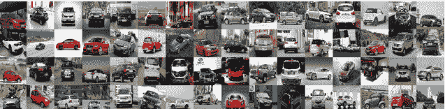

图 B.1.10: CompCars 的样本。

### B.2 PIPE 指标详情

#### B.2.1 评估模型的训练

我们使用 disentanglement-lib [176]（使我们的结果易于复现）训练了 Shapes3D、AbstractDSprites 和 Mpi3d Toy 的所有模型。我们关注 FactorVAE 和 β-TCVAE，因为它们通常是 [176] 中达到最高解纠缠性能的模型。按照 [176] 的缩减规模，我们为 6 个不同的超参数各训练了 5 个随机种子。这导致每个数据集共有 60 个模型实例，涵盖了广泛的解纠缠性能。

我们采用类似的方法，为抽象推理研究 [269] 的每个数据集复现了 30 个 FactorVAE 和 30 个 β-TCVAE 模型。对于每个 VAE 模型实例，我们随后基于 VAE 的表示，在抽象推理任务上训练了 5 个下游模型，训练 6000 步并评估其性能。我们使用 disentanglement-lib 计算了所有评估模型的指标。

#### B.2.2 D̃EP 和 D̃FP 的采样策略

要从 D̃EP 采样，可以直接从数据分布中采样随机实例，然后使用模型 M 重建这些实例。这隐式地计算了 EP 潜在分布 q(z)。要从 SFP 采样，我们首先需要估计 q̄(z)。紧密遵循 [143] 中的算法 1，我们可以通过从 q(z) 采样一个批次，然后对每个潜在维度在批次内随机排列来实现这一点（参见算法 2.18 中的 PermuteDims）。这是独立性检验文献 [9] 中使用的标准技巧。只要批次足够大，这些样本的分布将紧密近似 q̄(z)。因此，对于 PIPE 指标的评估，没有必要在完整数据分布上计算边缘分布。为了放大 SEP 和 SFP 之间的差异，我们随后对因子后验（FP）的采样策略进行了微调。对于潜在表示的每个维度，我们在对一批观测进行编码时首先估计其范围。然后，我们在该范围内对每个维度单独均匀采样值，从而得到如前所述的类似因子分布，但包含逐维均匀分布先验。这略微提高了 PIPE 指标的性能。PIPE 中使用的判别器的架构与表 B.3.13 所示的 VAE 编码器相似。


#### B.2.3 重建损失的作用

考虑一个在其潜在空间中不存储任何信息的模型，其中解码器无论接收到什么输入都输出相同的图像。由于 PIPE 指标没有（也不可能）具有任何关于地面真实因子的知识，它会给这样的模型一个完美的分数[^1]。可以使用重建损失作为模型成功捕捉地面真实因子程度的代理指标。然而，重建损失的有用性受到两个因素的限制。首先，它强烈受噪声影响，因此需要至少进行数据集特定的归一化才能用于指标中。其次，不同地面真实因子对重建损失的贡献可能差异很大。我们定义

$$PIPE_{Rec} = PIPE - \alpha \cdot Rec_{norm}$$

其中 $Rec_{norm}$ 表示每个数据集归一化的重建损失。我们在图 B.2.11 中展示了 $\alpha = 0.5$ 和 $\alpha = 1$ 的结果。虽然添加重建损失提高了 Shapes3D 和 Mpi3d Toy 上与受监督指标的相关性，但它降低了 AbstractDSprites 上的相关性，尤其是对于 $\alpha = 1$。出于这个原因，我们决定提出不包含任何重建损失组件的 PIPE，因为从业人员根据任务可能有不同的要求。在实践中，我们建议使用经典的（去噪）VAE 来了解数据集上可实现的重建损失，然后使用 PIPE 在那些达到满意重建损失的模型中选择最佳的解缠模型。

[^1]: 实际上，在 Mpi3d Toy 上的几个 FactorVAE 模型中发生了这种情况，见表 4.13。

#### B.2.4 与 FID 的关系

弗雷歇起始距离（FID）[119] 是一种用于量化两个图像分布之间相似性的指标。这通常通过使用不带最终分类层的预训练 Inception v3 模型 [256] 来对图像分布进行编码来实现。FID 然后是分别拟合到相应潜在图像分布的两个高斯分布的弗雷歇距离。它通常用于评估 GAN 的性能，其中希望生成的图像尽可能与原始数据集相似。虽然 FID 和 PIPE 之间似乎存在强烈的相似性，但也存在明显的差异。PIPE 的贡献在于展示在解缠背景下 $D_{EP}$ 和 $D_{FP}$ 分布的相似性概念的重要性。与我们提出的 PIPE 指标相比，FID 将是量化 PIPE 的另一种方式。图 B.2.12 显示 FID 和 PIPE 指标有一些相关性，同时也对某些模型显示出显著的差异。PIPE 指标相对于 FID 的一个巨大优势是它不依赖于预训练模型。这为在没有任何可用预训练模型的未见数据领域部署 PIPE 指标打开了可能性。

#### B.2.5 与 ModelCentrality 的比较

尽管 MC 优于 UDR，PIPE 仍然显著优于 MC。我们讨论了这可能发生的原因。为了评估两个模型的相似性，MC 从模型的前验中采样，但模型的 EP 分布可能远离前验。PIPE 没有这个问题，因为它从 EP 和 FP 分布中采样。在 MC 中评估两个模型的相似性时，要求第二个模型对第一个模型生成的样本进行编码（与 $(D)_{EP}$ 非常相似）。这个分布可能远离第二个模型的编码器所习惯的初始数据分布。另一个问题是，如果只有极少数模型实际上找到了解缠表示，MC 很难识别这些模型。PIPE 可以在许多模型中识别出单个解缠模型。此外，由于模型架构中的隐式偏差，模型可能学习相似的纠缠表示，从而打破了 MC 只有解缠表示才相似的核心假设。

### B.3 超参数和 DAVA 训练细节

#### B.3.1 超参数

DAVA 和所有考虑的基线模型使用表 B.3.13 显示的相同 VAE 架构。判别器的架构及其在 FactorVAE 中使用的特定超参数显示在表 B.3.15。所有模型，DAVA 和基线，使用表 B.3.14 显示的相同一般超参数。我们在表 B.3.16 中展示了每个基线模型探索的超参数范围。我们为少量数据集调整了所有模型的潜在空间大小 z\_dim。我们这样做是为了给 VAE 足够的潜在容量来捕捉数据集的复杂性。更具体地说，我们将 _Mpi3d Toy_ 和 _Mpi3d Real_ 的 z\_dim 设置为 20，将 _CelebA_ 的 z\_dim 设置为 50。

DAVA 使用与基线模型相同的架构和一般超参数。DAVA 的判别器使用与编码器相同的架构，最后一个 FC 具有一个输出。为了稳定 DAVA 的对抗训练过程，我们不得不使用一些在 GAN 训练中更常用的措施。我们在判别器训练中使用了标签平滑和混合批次。我们将 VAE 和判别器的梯度范数都裁剪在 1。如表 B.3.17 所示，我们必须使用较小的权重来应用判别器的对抗梯度到解码器。更大的权重会对 VAE 的重建性能产生负面影响。我们将实例归一化应用于判别器，这改善了对抗梯度信号。我们尝试了其他类型的归一化（批次、谱、层）用于编码器、解码器和判别器，但没有发现其中任何一种有持续的改进。此外，我们改进了 [31] 提出的控制 VAE 的 KL-散度的机制。我们不使用绝对差异，而是提议取差异的 4 次幂。这允许 KL-散度在批次之间波动，但会严厉惩罚大的偏差。

我们在算法 2.18 中总结了 DAVA 的训练过程。我们使用逐维置换（*PermuteDims*）来近似阶乘后验 FP，类似于 FactorVAE [143] 并如 B.2.2 中解释。根据判别器的准确性调整 C 的过程在算法 2.19 中描述。

| Encoder / DAVA Discriminator | Decoder |
| :--- | :--- |
| Input: [64,64,num channels] | FC, 256 ReLU |
| 4x4 conv, 2 strides, 32 ReLU | FC, 4x4x64 ReLU |
| 4x4 conv, 2 strides, 32 ReLU | 4x4 upconv, 2 strides, 64 ReLU |
| 4x4 conv, 2 strides, 64 ReLU | 4x4 upconv, 2 strides, 64 ReLU |
| 4x4 conv, 2 strides, 64 ReLU | 4x4 upconv, 2 strides, 64 ReLU |
| FC 256, FC 2 · z_dim | 4x4 upconv, 2 strides, num channels |

表 B.3.13: 本研究中所有模型使用的 VAE 架构。

| Parameter | Value |
| :--- | :--- |
| Batch size | 128 |
| Optimizer | Adam |
| Adam: beta1 | 0.9 |
| Adam: beta2 | 0.999 |
| Adam: epsilon | 1e-8 |
| Learning rate | 0.0001 |
| Training steps | 150000 batches |
| Max. gradient norm | 1 |
| AnnealedVAE: $\gamma$ | 1000 |
| AnnealedVAE: iteration threshold | 100000 batches |
| z_dim | 10 |

表 B.3.14: 一般超参数。

| Parameter | Value |
| :--- | :--- |
| Optimizer | Adam |
| Adam: beta1 | 0.5 |
| Adam: beta2 | 0.9 |
| Adam: epsilon | 1e-8 |
| Learning rate | 0.0001 |

| 判别器 |
| :--- |
| FC, 1000 leaky ReLU |
| FC, 1000 leaky ReLU |
| FC, 1000 leaky ReLU |
| FC, 1000 leaky ReLU |
| FC, 1000 leaky ReLU |
| FC, 1000 leaky ReLU |
| FC, 2 |

表 B.3.15: FactorVAE 的判别器超参数和架构

| Model | Parameter | Value |
| :--- | :--- | :--- |
| $\beta$-TCVAE | $\beta$ | [1, 2, 4, 8, 16, 32] |
| FactorVAE | $\gamma$ | [5, 10, 20, 30, 50, 100] |
| AnnealedVAE | $C$ | [1/2, 1, 2, 5, 25, 50] |
| ControlVAE | $C$ | [16, 18, 25, 35, 180, 200] |

表 B.3.16: 每个模型探索的超参数范围


| 参数 | 值 |
| :--- | :--- |
| 判别器：优化器 | Adam |
| 判别器：Adam：beta1 | 0.9 |
| 判别器：Adam：beta2 | 0.999 |
| 判别器：Adam：epsilon | 1e-8 |
| 判别器：学习率 | 0.0001 |
| 判别器：最大梯度范数 | 1 |
| 判别器编码器权重 $\mu_{enc}$ | 0.3 |
| 判别器解码器权重 $\mu_{dec}$ | 0.001 |
| $\gamma$ | 500 |
| $\Delta C$ | 4e-5 |

#### B.3.2 DAVA不同构建模块的个体贡献

人们可能会好奇，DAVA的哪些构建模块对性能贡献最大。开发期间的结果显示，仅DAVA的对抗损失就能与\(\beta\)-TCVAE和FactorVAE取得可比性能，且同样存在正则化强度依赖于数据集的问题。有趣的是，对于AnnealedVAE，不同数据集的最优\(C\)与DAVA在图4.10中显示的值高度吻合。这也反映了在没有对抗损失的情况下，人们可以期望从DAVA获得的性能。

#### B.3.3 DAVA与现有方法的组合

DAVA的主要贡献在于其能够根据判别器评估的模型当前状态，自适应调整隐式容量瓶颈。在这方面，可以使用不同于DAVA提出的判别器。其中一种选择是FactorVAE中使用的判别器，它可以以类似于DAVA中判别器的方式引导隐式容量瓶颈。这仍然允许针对特定数据集的退火方案，而无需针对特定数据集的超参数。

```
Algorithm 2.18 Training DAVA
\(\theta_{enc},\theta_{dec},\theta_{dis} \leftarrow initialize parameters\)
while Not Converged do
  \(x \leftarrow sample random mini-batch from \tilde{D}\)
  \(\hat{z} \leftarrow Enc(x)\)
  \(\hat{x} \leftarrow Dec(\hat{z})\)
  \(\mathcal{L}_{vae} \leftarrow logp(\hat{x}|\hat{z}) - \gamma(KL(q(\hat{z})||p(\hat{z})) - C)^4\)
  \(\theta_{enc} \xleftarrow{\dagger} -\nabla_{\theta_{enc}}\mathcal{L}_{vae}\)
  \(\theta_{dec} \xleftarrow{\dagger} -\nabla_{\theta_{dec}}\mathcal{L}_{vae}\) \(\triangleright\) Update VAE
  \(\hat{z} \leftarrow Enc(x)\)
  \(\hat{x} \leftarrow Dec(\hat{z})\) \(\triangleright\) Recreate \(\hat{z}\) and \(\hat{x}\) after update
  \(\tilde{x} \leftarrow Dec(PermuteDims(\hat{z}))\)
  \(acc \leftarrow accuracy(Dis, \hat{x}, \tilde{x})\)
  \(\theta_{dis} \xleftarrow{\dagger} \nabla_{\theta_{dis}} log(Dis(\hat{x})) + log(1 - Dis(\tilde{x}))\) \(\triangleright\) Update Discriminator
  \(C \xleftarrow{\dagger} update_C(acc)\)
  \(\mu_{base} \leftarrow max((acc - 0.5) \cdot 100, 0)\) \(\triangleright\) Weight grows linearly with higher accuracy
  \(\theta_{enc} \xleftarrow{\dagger} -\nabla_{\theta_{enc}}\mu_{base} \cdot \mu_{enc} \cdot log(Dis(\hat{x}))\)
  \(\theta_{dec} \xleftarrow{\dagger} -\nabla_{\theta_{dec}}\mu_{base} \cdot \mu_{dec} \cdot log(1 - Dis(\tilde{x}))\) \(\triangleright\) Update VAE with adversarial loss
end while
```

```
Algorithm 2.19 update_C
Input: accuracy acc
if acc \(\le\) 0.5 then
  \(U \leftarrow \Delta C\) \(\triangleright\) Only increase C if discriminator is clueless
else if acc \(\le\) 0.51 then
  \(U \leftarrow 0\) \(\triangleright\) Grace period
else
  \(U \leftarrow -\Delta C\) \(\triangleright\) Decrease C if discriminator gets better
end if
Output: update U
```

### B.4 所有评估数据集的完整定量结果

我们展示了大量数据集的结果。我们还在每个表格的上半部分包含了每种基线方法在监督超参数选择后的最佳正则化强度的结果。这作为在最佳场景下对完全无监督方法可能预期结果的一个额外参考。我们还包括Chen等人[45]的递归解耦网络（RecurD）的结果。这些结果应谨慎解读，因为我们未能自行复现，而是不得不从他们的论文中获取数值。这意味着首先，只评估了有限的一组数据集和指标。其次，模型架构、超参数选择、超参数调整范围、通用训练循环以及可能更多方面都会存在差异。请注意，关于AnnealedVAE的强性能，有两点需要考虑。首先，所选取的超参数范围尤其强，因为我们包含了DAVA发现的超参数。其次，如前文对DAVA的解释，我们使用$(\cdot)^4$而不是差的绝对值来控制KL偏差。还需注意，FactorVAE在NoisyDSprites上异常高的PIPE指标得分，是由于FactorVAE模型的解码器无论潜在空间如何始终产生相同的输出。这是PIPE的设计决策，如小节B.2.3中所述。也许令人惊讶的是，这些模型似乎仍然在潜在空间中传递少量信息，如监督指标所反映的。同样的情况也发生在FactorVAE在Mpi3d Toy上，有趣的是，这在Mpi3d Real上没有发生。

### 表 B.4.20: Shapes3D结果

| 架构 | MIG | DCI | FVAE | PIPE | Rec |
| :--- | :--- | :--- | :--- | :--- | :--- |
| 最佳 \(\beta\)-TCVAE (\(\beta = 32\)) | 0.39±0.09 | 0.65±0.03 | 0.76±0.06 | 0.36±0.03 | 0.0041±0.0008 |
| 最佳 FactorVAE (\(\gamma = 30\)) | 0.39±0.16 | 0.54±0.12 | 0.79±0.05 | 0.30±0.08 | 0.0032±0.0005 |
| 最佳 AnnealedVAE (\(C = 1\)) | 0.63±0.04 | 0.78±0.05 | 0.94±0.04 | 0.49±0.05 | 0.0027±0.0002 |
| 最佳 ControlVAE (\(C = 18\)) | 0.08±0.03 | 0.20±0.06 | 0.68±0.12 | 0.02±0.00 | 0.0019±0.0004 |
| 最佳 RecurD [45] | (0.31) | (0.58) | - | - | (0.0083) |
| 平均 \(\beta\)-TCVAE | 0.26±0.06 | 0.50±0.03 | 0.76±0.03 | 0.11±0.03 | 0.0023±0.0004 |
| 平均 FactorVAE | 0.20±0.10 | 0.41±0.07 | 0.78±0.04 | 0.22±0.04 | 0.0027±0.0005 |
| 平均 AnnealedVAE | 0.52±0.02 | 0.70±0.02 | 0.92±0.01 | 0.26±0.03 | 0.0020±0.0001 |
| 平均 ControlVAE | 0.07±0.03 | 0.17±0.04 | 0.68±0.07 | 0.02±0.00 | 0.0019±0.0004 |
| 本文方法 | 0.62±0.05 | 0.78±0.03 | 0.82±0.03 | 0.61±0.04 | 0.0029±0.0004 |

### 表 B.4.21: AbstractDSprites结果

| 架构 | MIG | DCI | FVAE | PIPE | Rec |
|---|---|---|---|---|---|
| 最佳 \(\beta\)-TCVAE (\(\beta = 4\)) | 0.17±0.04 | 0.22±0.03 | 0.55±0.03 | 0.11±0.02 | 0.0017±0.0001 |
| 最佳 FactorVAE (\(\gamma = 50\)) | 0.18±0.07 | 0.26±0.04 | 0.65±0.05 | 0.23±0.04 | 0.0019±0.0001 |
| 最佳 AnnealedVAE (\(C = 2\)) | 0.23±0.04 | 0.26±0.04 | 0.65±0.05 | 0.13±0.02 | 0.0018±0.0001 |
| 最佳 ControlVAE (\(C = 18\)) | 0.06±0.01 | 0.11±0.03 | 0.50±0.05 | 0.07±0.01 | 0.0016±0.0000 |
| 平均 \(\beta\)-TCVAE | 0.12±0.01 | 0.18±0.01 | 0.45±0.02 | 0.19±0.01 | 0.0027±0.0000 |
| 平均 FactorVAE | 0.12±0.02 | 0.19±0.02 | 0.55±0.03 | 0.20±0.03 | 0.0018±0.0000 |
| 平均 AnnealedVAE | 0.15±0.01 | 0.21±0.01 | 0.54±0.02 | 0.18±0.01 | 0.0022±0.0000 |
| 平均 ControlVAE | 0.04±0.02 | 0.07±0.01 | 0.42±0.02 | 0.06±0.01 | **0.0016±0.0000** |
| 本文方法 | **0.23±0.04** | **0.27±0.05** | **0.67±0.05** | **0.35±0.03** | 0.0020±0.0002 |

### 表 B.4.22: Mpi3d Toy结果

| 架构 | MIG | DCI | FVAE | PIPE | Rec |
|---|---|---|---|---|---|
| 最佳 \(\beta\)-TCVAE (\(\beta = 2\)) | 0.23±0.04 | 0.33±0.01 | 0.42±0.06 | 0.07±0.01 | 0.0005±0.0000 |
| 最佳 FactorVAE (\(\gamma = 5\)) | 0.10±0.05 | 0.20±0.02 | 0.46±0.03 | 0.36±0.16 | 0.0021±0.0003 |
| 最佳 AnnealedVAE (\(C = \frac{1}{2}\)) | 0.21±0.07 | 0.31±0.02 | 0.41±0.05 | 0.12±0.01 | 0.0005±0.0000 |
| 最佳 ControlVAE (\(C=16\)) | 0.04±0.01 | 0.18±0.02 | 0.44±0.04 | 0.02±0.01 | 0.0003±0.0000 |
| 平均 \(\beta\)-TCVAE | 0.11±0.02 | 0.23±0.01 | 0.39±0.02 | 0.09±0.01 | 0.0006±0.0000 |
| 平均 FactorVAE | 0.02±0.01 | 0.13±0.00 | 0.38±0.02 | 0.99±0.10 | 0.0041±0.0000 |
| 平均 AnnealedVAE | 0.07±0.03 | 0.23±0.02 | **0.50±0.02** | 0.02±0.01 | **0.0003±0.0000** |
| 平均 ControlVAE | 0.04±0.01 | 0.17±0.02 | 0.43±0.04 | 0.03±0.01 | **0.0003±0.0000** |
| 本文方法 | **0.12±0.09** | **0.30±0.03** | 0.41±0.04 | **0.21±0.03** | 0.0006±0.0000 |

### 表 B.4.23: DSprites结果

| 架构 | MIG | DCI | FVAE | PIPE | Rec |
|---|---|---|---|---|---|
| 最佳 \(\beta\)-TCVAE (\(\beta = 32\)) | 0.34±0.02 | 0.50±0.03 | 0.60±0.00 | 0.76±0.14 | 0.0081±0.0000 |
| 最佳 FactorVAE (\(\gamma = 50\)) | 0.10±0.04 | 0.22±0.02 | 0.73±0.04 | 0.41±0.05 | 0.0098±0.0007 |
| 最佳 AnnealedVAE (\(C = \frac{1}{2}\)) | 0.36±0.01 | 0.51±0.01 | 0.76±0.03 | 0.42±0.03 | 0.0060±0.0006 |
| 最佳 ControlVAE (\(C = 18\)) | 0.06±0.02 | 0.13±0.03 | 0.67±0.11 | 0.24±0.03 | 0.0008±0.0000 |
| 最佳 RecurD [45] | (0.27) | (0.38) | - | - | (0.047) |
| 平均 \(\beta\)-TCVAE | **0.27±0.05** | **0.45±0.06** | **0.84±0.03** | 0.44±0.08 | 0.0024±0.0001 |
| 平均 FactorVAE | 0.14±0.06 | 0.22±0.05 | 0.72±0.07 | 0.31±0.03 | 0.0052±0.0002 |
| 平均 AnnealedVAE | 0.18±0.06 | 0.28±0.05 | 0.77±0.04 | 0.32±0.05 | 0.0013±0.0001 |
| 平均 ControlVAE | 0.05±0.02 | 0.13±0.01 | 0.69±0.06 | 0.20±0.08 | **0.0008±0.0000** |
| 本文方法 | 0.24±0.09 | 0.42±0.14 | 0.74±0.11 | **0.51±0.09** | 0.0025±0.0005 |


## 表 B.4.24: Mpi3d 真实数据集结果

| 架构 | MIG | DCI | FVAE | PIPE | Rec |
| :--- | :--- | :--- | :--- | :--- | :--- |
| 最佳 β-TCVAE (β = 2) | 0.16±0.08 | 0.35±0.06 | 0.56±0.05 | 0.03±0.01 | 0.0004±0.0000 |
| 最佳 FactorVAE (γ = 30) | **0.02±0.01** | **0.18±0.04** | **0.43±0.03** | <u>0.42±0.10</u> | 0.0031±0.0003 |
| 最佳 AnnealedVAE (C = 1) | 0.12±0.08 | 0.30±0.07 | 0.49±0.08 | 0.08±0.01 | 0.0004±0.0000 |
| 最佳 ControlVAE (C = 25) | 0.06±0.02 | 0.22±0.01 | 0.54±0.05 | 0.01±0.00 | **0.0003±0.0000** |
| 平均 β-TCVAE | 0.08±0.04 | 0.22±0.03 | 0.26±0.03 | **0.23±0.07** | 0.0015±0.0001 |
| 平均 FactorVAE | 0.05±0.01 | 0.19±0.01 | 0.42±0.02 | 0.12±0.07 | 0.0022±0.0003 |
| 平均 AnnealedVAE | 0.09±0.03 | **0.29±0.02** | **0.52±0.05** | 0.03±0.01 | **0.0003±0.0000** |
| 平均 ControlVAE | 0.04±0.02 | 0.20±0.03 | 0.52±0.06 | 0.01±0.00 | **0.0003±0.0000** |
| 我们的 | **0.11±0.05** | 0.27±0.03 | 0.48±0.05 | 0.20±0.04 | 0.0006±0.0000 |

## 表 B.4.25: Smallnorb 数据集结果

| 架构 | MIG | DCI | FVAE | PIPE | Rec |
| :--- | :--- | :--- | :--- | :--- | :--- |
| 最佳 β-TCVAE (β = 4) | 0.16±0.03 | 0.34±0.01 | 0.60±0.02 | 0.18±0.03 | 0.0037±0.0000 |
| 最佳 FactorVAE (γ = 5) | 0.12±0.06 | 0.25±0.03 | 0.64±0.02 | <u>0.24±0.03</u> | 0.0054±0.0009 |
| 最佳 AnnealedVAE (C = 1/2) | **0.20±0.01** | **0.28±0.01** | 0.58±0.01 | 0.22±0.02 | 0.0037±0.0000 |
| 最佳 ControlVAE (C = 180) | 0.24±0.01 | 0.28±0.01 | 0.62±0.04 | 0.03±0.00 | <u>0.0016±0.0001</u> |
| 平均 β-TCVAE | 0.18±0.02 | 0.29±0.01 | 0.57±0.02 | 0.11±0.01 | 0.0032±0.0001 |
| 平均 FactorVAE | 0.03±0.03 | 0.13±0.01 | 0.53±0.04 | 0.17±0.09 | 0.0101±0.0039 |
| 平均 AnnealedVAE | 0.21±0.01 | 0.28±0.00 | 0.60±0.01 | 0.05±0.00 | 0.0020±0.0001 |
| 平均 ControlVAE | 0.23±0.02 | 0.28±0.01 | 0.62±0.03 | 0.03±0.00 | **0.0016±0.0001** |
| 我们的 | **0.25±0.01** | **0.30±0.01** | **0.62±0.01** | **0.25±0.02** | 0.0030±0.0001 |

## 表 B.4.26: NoisyDSprites 数据集结果

| 架构 | MIG | DCI | FVAE | PIPE | Rec |
| :--- | :--- | :--- | :--- | :--- | :--- |
| 最佳 β-TCVAE (β = 4) | <u>0.08±0.03</u> | 0.21±0.04 | 0.63±0.09 | 0.32±0.01 | 0.0804±0.0000 |
| 最佳 FactorVAE (γ = 100) | 0.01±0.00 | 0.10±0.05 | 0.38±0.09 | <u>1.00±0.00</u> | 0.0892±0.0000 |
| 最佳 AnnealedVAE (C = 50) | 0.06±0.02 | 0.13±0.03 | **0.65±0.08** | 0.48±0.29 | 0.0802±0.0000 |
| 最佳 ControlVAE (C = 16) | 0.02±0.01 | 0.08±0.01 | 0.48±0.06 | 0.43±0.29 | 0.0801±0.0000 |
| 平均 β-TCVAE | 0.05±0.03 | 0.11±0.05 | 0.44±0.08 | 0.31±0.05 | 0.0810±0.0000 |
| 平均 FactorVAE | 0.01±0.00 | 0.06±0.02 | 0.33±0.03 | (1.00±0.00) | 0.0892±0.0000 |
| 平均 AnnealedVAE | **0.09±0.05** | 0.18±0.06 | **0.58±0.09** | 0.27±0.03 | 0.0805±0.0000 |
| 平均 ControlVAE | 0.02±0.01 | 0.08±0.01 | 0.49±0.01 | 0.35±0.14 | **0.0801±0.0000** |
| 我们的 | **0.09±0.05** | **0.22±0.05** | 0.55±0.07 | **0.32±0.04** | 0.0806±0.0001 |

## 表 B.4.27: Cars3D 数据集结果

| 架构 | MIG | DCI | FVAE | PIPE | Rec |
| :--- | :--- | :--- | :--- | :--- | :--- |
| 最佳 \(\beta\)-TCVAE (\(\beta=16\)) | 0.14±0.02 | 0.33±0.08 | 0.90±0.02 | 0.07±0.01 | 0.0059±0.0000 |
| 最佳 FactorVAE (\(\gamma=20\)) | 0.10±0.01 | 0.16±0.04 | 0.88±0.03 | 0.10±0.02 | 0.0083±0.0005 |
| 最佳 AnnealedVAE (C = 1) | 0.12±0.01 | 0.29±0.05 | 0.89±0.02 | <u>0.15±0.01</u> | 0.0059±0.0001 |
| 最佳 ControlVAE (C = 16) | 0.05±0.02 | 0.10±0.02 | 0.84±0.05 | 0.03±0.00 | <u>0.0045±0.0000</u> |
| 最佳 RecurD [45] | (0.17) | - | - | - | (0.0132) |
| 平均 \(\beta\)-TCVAE | 0.11±0.03 | 0.24±0.01 | 0.91±0.02 | 0.06±0.01 | 0.0049±0.0001 |
| 平均 FactorVAE | 0.06±0.02 | 0.12±0.03 | 0.74±0.17 | **0.28±0.14** | 0.0170±0.0023 |
| 平均 AnnealedVAE | 0.06±0.02 | **0.25±0.04** | 0.86±0.01 | 0.08±0.01 | 0.0047±0.0001 |
| 平均 ControlVAE | 0.03±0.01 | 0.11±0.01 | 0.76±0.09 | 0.03±0.00 | **0.0045±0.0000** |
| 我们的 | **0.15±0.01** | 0.23±0.04 | **0.94±0.01** | **0.28±0.02** | 0.0074±0.0001 |

### B.5 真实数据集上的进一步结果

我们进一步在 *CompCars* 数据集上报告了 DAVA 与全部基线模型的比较结果。如 B.1.10 节数据集描述中所述，*CompCars* 是一个极具挑战性的数据集。性能很可能受所用模型架构的限制，如图 B.5.28 中显示的较差 FID 和 PIPE 指标得分所示。

### Shapes3D


### AbstractDSprites


### Mpi3d Toy


图 B.2.11: 三个不同数据集上各种指标之间的 Spearman 秩相关，类似于图 4.7。我们还针对 \(\alpha = 0.5\) 和 \(\alpha = 1\) 包含了 $PIPE_{Rec}$。

### (a) Shapes3D


### (b) AbstractDSprites


### (c) Mpi3d Toy


图 B.2.12: FID 与 PIPE 指标，用于量化三个不同数据集上所有评估模型中 $D_{EP}$ 与 $D_{FP}$ 之间的相似性。如果两个指标完全相关，人们期望一条从左上角到右下角的直线。


图 B.5.28: 类似于图 4.14，我们显示了各模型 $\hat{D}_{FP}$ 的图像样本与 CompCars 原始图像之间的 FID。DAVA 即使与探索广泛超参数范围的模型相比，也能达到有竞争力的 FID 得分。根据 PIPE 指标实现更好解纠缠的 FactorVAE 模型 FID 得分显著更低。

## 域无关超分辨率

### C.1 方法

#### C.1.1 MAML

我们定义了元学习基础网络的算法，遵循 Finn et al. [91] 及 Dupont et al. [73] 所作的改进。这里，\(\alpha\) 是一个可学习的步长，与基础网络参数 \(\theta\) 一起更新，使 Functa 向量中的每个元素都有自己的内层学习率。

```
Algorithm 3.1 Meta-learning the base network [91]
Input: \(\alpha\): learnable inner step size
Input: \(\beta\): outer step size hyperparameter
Uniformly initialize base network \(\theta\) and encoder \(\psi\)
while not do do
Sample mini-batch \(\mathcal{B}\) of data \(\{(\mathbf{x}_{ij}, y_{ij})\}_{i \in \mathcal{D}}_{j \in \mathcal{B}}\)
Initialize functas \(\phi_j \leftarrow 0 \forall j \in \mathcal{B}\) do
for \(t = 1\) to \(T_{inner}\) and \(\forall j \in \mathcal{B}\) do
\(m_j = \psi(\phi_j)\)
\(\phi_j \leftarrow \phi_j - \alpha \nabla_{\phi_j} \mathcal{L}(\{f_{\theta, m_j}(\mathbf{x}_{ij}), y_{ij}\}_{i \in \mathcal{D}})\)
end for
\(\theta \leftarrow \theta - \beta \nabla_\theta \sum_{j \in \mathcal{B}} \mathcal{L}(\{f_{\theta, \psi, m}(\mathbf{x}_{ij}), y_{ij}\}_{i \in \mathcal{D}} |_{m=\psi(\phi_j)}\)
\(\psi \leftarrow \psi - \beta \nabla_\psi \sum_{j \in \mathcal{B}} \mathcal{L}(\{f_{\theta, \psi, m}(\mathbf{x}_{ij}), y_{ij}\}_{i \in \mathcal{D}} |_{m=\psi(\phi_j)}\)
end while
```

#### C.1.2 INR 激活函数

随着修正线性单元（ReLU）激活函数 [197] 的应用，隐式神经表征（INR）领域的众多研究已将 ReLU 用作其非线性 [207, 189, 96, 97, 190]。然而，[245] 的作者通过利用简单的正弦激活函数为本工作奠定了基础，证明此类网络可以以低误差和更快的收敛速度准确重建各种数据模态。后续研究通过引入阻尼因子使函数半周期化 [237] 或采用复杂 Gabor 小波激活 [226] 扩展了正弦激活的概念。尽管这些方法显示出潜力，但本工作遵循 [245] 提出的基本正弦激活函数，并专注于其在超分辨率任务中的应用。

#### C.1.3 Swin Transformer 模型

在本小节中，我们详细介绍了 Swin Transformer 的架构，如图 C.1.2 所示。

**移动窗口。** 我们采用 Swin Transformer [172] 引入的移动窗口机制。在第一层中，图像被划分为固定大小的非重叠窗口（参见图 5.4）。在随后的层中，窗口以特定步幅移动（通常为窗口大小的一半）。由于边界窗口大小不一，对这些窗口应用自注意在计算上效率低下。大多数深度学习框架都针对固定大小的张量进行了优化。因此，我们以半个窗口的幅度循环移位数据。在循环移位中，移出框架的数据（例如像素）会重新定位到轴的另一侧。然后重新调整窗口划分以确保大小一致。为防止边界窗口片段相互关注，我们应用一个注意力掩码（由橙色线标记）。在实践中，注意力掩码可以预先计算，在前向传播过程中，只需循环移位数据。该


图 C.1.2: Swin Transformer 架构 [172]

[172] 的作者仅为 2D 视觉任务开发了该方法。我们将移动窗口机制改造为支持任意输入维度。实现细节在 C.1 节中介绍。

**残差 Swin Transformer 块。** 深度特征提取模块包含多个连续的残差 Swin Transformer 块，每个块末尾都跟有一个卷积层。一个 Transformer 块包含多个连续的 Swin Transformer 层以及指向下一块的跳跃连接。最后一个层后面跟有一个卷积层。整个架构的概览如图 5.5 所示。

**Swin Transformer 层。** Swin Transformer 层是原始 Transformer 层 [270] 的改编版本。它包含两部分：一个多头自注意力层和一个简单的线性层。在每个部分之前，输入均使用图层归一化进行归一化，如公式 (C.1) 所示，其中 \(\gamma\) 和 \(\beta\) 是可学习参数。每个部分末尾的输出都添加了残差连接。

```
\(\hat{\mathbf{x}} = \gamma \frac{\mathbf{x} - \mu}{\sqrt{\sigma^2 + \epsilon}} + \beta\)
```

### 多头自注意力

多头自注意力的执行方式与原始 Transformer [270] 相同。但是，我们没有使用静态正弦位置编码，而是向注意力得分添加可学习的相对位置偏置。最近的研究表明，相对位置嵌入在捕捉空间关系方面更为有效 [240, 213]。在每个窗口维度 \(w\) 中，两个 token 的相对位置被限制在范围 \([-(w-1), (w-1)]\) 内。我们首先计算每个 token 与同一窗口中所有其他 token 的相对位置，为每个出现的相对距离计算索引，并从 \(\tilde{B} \in \mathbb{R}^{h \times (2w_1-1) \times (2w_2-1) \times \dots}\) 中采样形状为 \(B \in \mathbb{R}^{h \times w_1 \times w_2 \times \dots}\) 的可学习位置偏置。偏置在 SoftMax 计算之前添加。整个过程在公式 (C.2) 中详细说明，其中 \(d = \lfloor \frac{c}{h} \rfloor\) 是嵌入维度 \(e\) 除以注意力头数 \(h\) 得到的结果。\(P_Q\)、\(P_K\) 和 \(P_V\) 是可学习的投影矩阵，而 \(X \in \mathbb{R}^{w_1 \times w_2 \times \dots \times e}\) 表示一个输入窗口，\(M\) 为注意力掩码。

```
Q = X P_Q,      K = X P_K,      V = X P_V
Attention(Q,K,V) = Softmax(Q K^T / \sqrt{d} + B + M) V
```

### 将移动窗口推广到超越 2D

我们以 FunctaFormer 为基础使用的 Swin Transformer 架构 [172] 是原始 Vision Transformer [67] 的衍生版本，主要面向 2D 图像设计。为了将其功能扩展到任意数据，除卷积层之外，我们需要修改某些架构元素。特别是，我们必须将移动窗口和相对位置偏置计算调整为在任意维度上运行。

在列表 C.1 所示的移动窗口注意力掩码计算中，我们首先分配与数据大小相同的零掩码。在第 13 行和第 14 行，我们为每个维度中的最后一半窗口分配唯一的整数值。然后，在第 29 行到第 31 行，我们将掩码划分为一组窗口。最后，在第 32 行，通过减法将每个元素与同一窗口中的所有其他元素进行比较。具有相同唯一整数的元素结果为零，而其他所有元素结果为非零值。最后，我们为所有非零元素分配一个较大的负注意力得分，确保它们不获得任何注意力。

```
def get_mask(
    dim_data: list[int],
    dim_window: list[int],
) -> torch.Tensor:

    d = dim_data
    w = dim_window
    n = len(d)
    k = 1
    mask = torch.zeros(*d)
    for i in range(n):
        mask = torch.transpose(mask, 0, i)
        mask[d[i] - w[i] : d[i]] += k
        mask[d[i] // w[i] // 2 : d[i]] += k
        mask = torch.transpose(mask, 0, i)
        k *= 3

    part = [
        j
        for i in range(n)
        for j in (d[i] // w[i], w[i])
    ]
    perm = (
        list(range(0, 2 * n, 2))
        + list(range(1, 2 * n, 2))
    )
    wins = torch.prod(torch.tensor(w)).item()

    mask = torch.reshape(mask, part)
    mask = torch.permute(mask, perm)
    mask = torch.reshape(mask, (-1, wins))
    mask = mask.unsqueeze(1) - mask.unsqueeze(2)
    mask[mask != 0] = -100.

    return mask
```

列表 C.1: n 维 Swin Transformer 注意力掩码的计算

要计算列表 C.2 所示的相对位置偏置，我们首先计算 n 维窗口内所有可能输入坐标的笛卡尔积。

```
def get_bias(
    dim_window: list[int],
    num_heads: int,
) -> torch.nn.Parameter:

    w = dim_window
    n = len(w)
    s = 1

    for i in range(n):
        s *= (2 * w[i] - 1)
    bias_table = torch.zeros((s, num_heads))
    coords = torch.cartesian_prod(
        *[torch.arange(d) for d in w]
    )
    if n < 2:
        coords = torch.unsqueeze(coords, -1)
        coords_rel = (
            coords.unsqueeze(1) - coords.unsqueeze(0)
        )
        coords_rel = torch.permute(coords_rel, (2, 0, 1))
        for i in range(n):
            coords_rel[i] += w[i] - 1
            scale_factor = 1
            for j in range(i + 1, n):
                scale_factor *= (2 * w[j] - 1)
            coords_rel[i] *= scale_factor
        coords_rel = torch.sum(coords_rel, 0)
        bias_table = bias_table[coords_rel]
        bias_table = torch.permute(bias_table, (2, 0, 1))
        return torch.nn.Parameter(bias_table)
```

列表 C.2: n 维相对位置偏置的计算

接下来，在第 17 行，我们通过从所有元素中减去每个元素，将它们转换为相对坐标。在第 22 行，我们确保坐标非负，在第 25 行，我们对它们进行缩放，以便在每个维度中实现唯一距离。这样可以防止，例如，3D 相对距离 (3,4,1) 被视为与距离 (4,1,3) 相同。最后，将坐标相加，以生成偏置表中每个相对位置的索引。每个注意力头都有单独的偏置表，使 Transformer 能够单独调整其参数。

### C.2 实验

#### C.2.1 网络初始化。

**Functa** 我们遵循 [245] 建立的初始化方案。我们将 SIREN 层权重均匀初始化为 \(\mathcal{U} \left[ -\frac{1}{\omega_0} \sqrt{\frac{6}{n_{in}}}, \frac{1}{\omega_0} \sqrt{\frac{6}{n_{in}}} \right]\)。偏置向量初始化为零。唯一例外是第一层，因为它尚未由 \(\omega_0\) 缩放。因此，我们将权重初始化为 \(\mathcal{U} \left[ -\frac{1}{n_{in}}, \frac{1}{n_{in}} \right]\)。编码器 \(\psi\) 使用 PyTorch 的默认初始化方案进行初始化，权重和偏置均采用均匀分布 \(\mathcal{U} \left[ -\sqrt{\frac{1}{n_{in}}}, \sqrt{\frac{1}{n_{in}}} \right]\)。其中 \(n_{in}\) 是输入张量的维度，例如输入神经元的数量。

**Backbone** 我们对 SwinTransformer [172] 的改编使用与原始实现相同的初始化方案。投影矩阵 \(P_Q, P_K\) 和 \(P_V\) 以及所有前馈线性层权重均使用截断正态分布的值进行初始化，该分布参数化如公式 (C.3) 所示，其中 \(a\) 和 \(b\) 是分布的下界和上界，\(\varphi\) 是标准正态分布的概率密度函数，\(\Phi\) 为其累积分布函数。对于所有实验，我们设置 \(\mu = 0, \sigma = 0.02, a = -2\) 和 \(b = 2\)。偏置设置为零。所有维度的卷积层均使用 PyTorch 的默认初始化方案进行初始化，即从 \(\mathcal{U}[-\sqrt{k}, \sqrt{k}]\) 中均匀抽取，其中 \(k = (c_{in} \cdot \prod_i d_{kernel}^{(i)})^{-1}\)，\(c_{in}\) 为输入通道数，\(d_{kernel}^{(i)}\) 为内核的第 i 个维度。

```
\( f(x \mid \mu, \sigma, a, b) = \frac{1}{\sigma} \cdot \frac{\varphi(\frac{x-\mu}{\sigma})}{\Phi(\frac{b-\mu}{\sigma}) - \Phi(\frac{a-\mu}{\sigma})} \)
```

### C.3 数据

**图像。** 对于图像模态，我们选用广为人知的 DF2K 数据集，该数据集结合了 DIV2K [6] 和 FlickR2K [165] 数据集。DIV2K 包含 800 张高分辨率训练图像、100 张验证图像和 100 张测试图像。FlickR2K 包含超过 2560 张训练图像。对于我们的训练集，我们使用 DIV2K 的 800 张训练图像，连同 FlickR2K 的 2560 张训练图像。对于消融研究，我们使用 DIV2K 的 100 张验证图像，将其分为两半：前半部分用于验证，后半部分用于测试，因为 100 张 DIV2K 测试图像无法下载。为了与超分辨率任务中的当前最先进的方法进行比较，我们使用了 SET5 [19]、SET14 [299]、Urban100 [126]、Manga109 [186] 和 BSD100 [184] 图像集。这些数据集是单图像超分辨率的标准基准。我们没有调整整个数据集的大小，而是在训练和验证期间截取大小为 $120 \times 120 \times 3$ 的随机裁剪。在数据增强方面，我们以 $p = 0.5$ 的概率对图像应用随机水平翻转。为了确保与以往工作（如 [65, 163, 124]）的公平比较，我们将测试图像填充到可被 SIREN 切片维度和 FunctaFormer 窗口大小整除的尺寸。评估之前，图像被裁剪回其原始尺寸，并且我们在评估中不排除边框像素。

**流形。** 对于流形数据，我们使用 ERA5 [118] 气候再分析的一个子集。具体来说，是 1971 年至 2020 年每小时 2 米地表温度测量值（单位：开尔文）。然后将测量值按月平均


按一天中的每小时计算，总计 14 400 次时序测量。这些测量值在 \(\lambda \in [\pi/2, -\pi/2]\) 和 \(\phi \in [0, 2\pi)\) 之间均匀间隔，步长为 \([0.25^\circ, 0.25^\circ]\)。我们使用双线性插法将网格从 \(721 \times 1440\) 下采样至 \(180 \times 360\)。我们将每个时间步视为一个不同的样本。训练集、验证集和测试集分别在 10 000、2200 和 2200 处划分。类似工作通过令 \(\mathbf{x} = (\cos \lambda \cos \phi, \cos \lambda \sin \phi, \sin \phi)\) [73] 将极坐标转换为笛卡尔坐标。然而，我们保持极坐标形式，因为我们已经拥有具有 3D 笛卡尔坐标的形状数据模态。此外，我们使用数据集中所有时间的最小温度和最大温度将数据 min-max 归一化到 [0, 1] 范围。

### 3D 形状。

在我们处理 3D 形状的工作中，我们使用了 ShapeNet Core [38] 数据集，它是综合 ShapeNet 数据集的一个经过策划且注释丰富的子集。ShapeNet Core 包含 52 456 个 3D 形状，共计 55 个对象类别。模型以三种格式提供：网格、体素化空心和体素化实体。出于我们的目的，我们使用体素化实体表示。我们仅使用前 4 个类别，即桌子、汽车、椅子和飞机。样本数量分别为 8443、7497、6778 和 4045。数据集分别分为训练集、验证集和测试集，包含 45 000、3728 和 3728 个样本。为优化存储并确保与我们的处理要求兼容，我们将体素网格分辨率从 \(128 \times 128 \times 128\) 下采样至 \(64 \times 64 \times 64\)。此下采样使数据能被 12 整除，并减少磁盘空间占用。我们使用 `torch.nn.functional.interpolate` 函数并以三线性模式采用三线性插法进行下采样。我们还评估了 `scipy.ndimage.zoom`，如 [73] 中所做，但与 PyTorch 方法相比未观察到显著的视觉差异。然而，PyTorch 实现被证明在计算上更高效，因为它避免了多项式拟合。插值后，值大于 0.05 的体素被视为已占据。

### 音频。

对于音频数据，我们使用 LibriSpeech [204] 数据集的一个子集，具体为 100 小时干净数据集。LibriSpeech 是源自有声读物的大规模朗读英语语音库，采样率为 16 kHz。所选子集包含大量时长从 1.4 到 25 秒不等的音频文件。从该数据集中，我们提取前 12k 个样本，将每个样本裁剪至 5 秒，并丢弃短于该长度的样本。随后，音频文件从 16 kHz 重新采样为 12 kHz，以减小数据规模和计算负载。该重采样保留了高达 6 kHz 的所有关键语音频率，确保语音的可懂度和质量得到维持。为优化内存使用和处理效率，音频信号转换为 float32 格式，幅值归一化至 0.0 到 1.0 的范围。处理后的数据随后分为训练集、验证集和测试集，分别包含 10k、1k 和 1k 个样本。

### 视频。

我们采用 Adobe240 数据集 [254]，该数据集包含 133 个高帧率视频，分辨率为 720p，帧率为每秒 240 帧。每个视频的时长在 1 到 10 秒之间。进行数据预处理时，视频被分为 25 帧的片段，任何纵向视频都会旋转为横向方向。在 133 个视频中，前 100 个用于训练，16 个用于验证，17 个用于测试。遵循 [178] 的方法，我们通过随机裁剪 512 × 512 补丁应用数据增强。在 7 帧跳帧和 x4 空间插值期间，我们使用 4 个输入帧，每个帧相隔 7 帧，总共提供 25 帧作为实况真值。每个空间轴进一步以 x4 的因子下采样。

### LiDAR。

为说明我们框架的适应性，我们进一步在 KITTI-360 数据集 [164] 的激光雷达数据上训练模型。我们不考虑全局场景上下文，并将每个时间帧中的每个车辆视为一个独立样本。遵循 [298] 的方法，通过对驾驶序列中的帧进行时间下采样，我们分别定义 20,000、2,500 和 2,500 个样本的训练集、验证集和测试集划分。随后，点云被转换为分辨率为 64 × 1024 的距离图。该数据使用 Velodyne HDL-64E 传感器捕获，该传感器提供 26.8° 的垂直视场 (FoV)，范围从 -24.8° 到 +2°，以及 360° 的水平视场。为保持一致性，距离图基于传感器的最大量程 120 米进行归一化。

### 下采样的动机。

我们的每个数据集均能被 12 整除。我们这样做的动机是为了有可能进一步以 x2、x3 和 x4 的因子对数据进行下采样。许多单图像超分辨率基准在该范围内比较降质 [65, 163, 124]。然而，我们没有测试 8x 降质。此外，我们对每个不能被空间 Functa 维度以及我们 FunctaFormer 的注意力窗口整除的数据进行零填充。作为回报，在比较和评估之前，每个数据点又被还原为其原始大小。

### C.4 详细结果

| 模态 | 空间形状 | 窗口形状 | PSNR [dB] | 准确率 [%] |
|---|---|---|---|---|
| 形状 | 3 x 3 x 3 x 1 | 2 x 2 x 2 | - | **99.03** |
| | 3 x 3 x 3 x 1 | 4 x 4 x 4 | - | 99.03 |
| | 3 x 3 x 3 x 1 | 8 x 8 x 8 | - | 98.97 |
| | 3 x 3 x 3 x 1 | 12 x 12 x 12 | - | 98.95 |
| 学习率 = 5.00 x 10^-5 批量大小 = 1 | 6 x 6 x 6 x 1 | 2 x 2 x 2 | - | 98.19 |
| | 6 x 6 x 6 x 1 | 4 x 4 x 4 | - | 98.44 |
| | 6 x 6 x 6 x 1 | 8 x 8 x 8 | - | 98.47 |
| | 6 x 6 x 6 x 1 | 12 x 12 x 12 | - | 98.45 |
| 图像 | 3 x 3 x 3 | 2 x 2 | 34.95 | - |
| | 3 x 3 x 3 | 4 x 4 | 35.02 | - |
| | 3 x 3 x 3 | 8 x 8 | 35.13 | - |
| | 3 x 3 x 3 | 12 x 12 | **35.40** | - |
| 学习率 = 2.00 x 10^-4 批量大小 = 8 | 6 x 6 x 3 | 2 x 2 | 33.03 | - |
| | 6 x 6 x 3 | 4 x 4 | 33.19 | - |
| | 6 x 6 x 3 | 8 x 8 | 33.42 | - |
| | 6 x 6 x 3 | 12 x 12 | 33.59 | - |
| 流形 | 3 x 3 x 1 | 2 x 2 | 47.04 | - |
| | 3 x 3 x 1 | 4 x 4 | 46.49 | - |
| | 3 x 3 x 1 | 8 x 8 | 45.41 | - |
| | 3 x 3 x 1 | 12 x 12 | 45.81 | - |
| 学习率 = 1.00 x 10^-5 批量大小 = 8 | 6 x 6 x 1 | 2 x 2 | **50.80** | - |
| | 6 x 6 x 1 | 4 x 4 | 49.28 | - |
| | 6 x 6 x 1 | 8 x 8 | 48.18 | - |
| | 6 x 6 x 1 | 12 x 12 | 47.15 | - |
| 音频 | 3 x 1 | 2 | **49.00** | - |
| | 3 x 1 | 4 | 48.88 | - |
| | 3 x 1 | 8 | 48.79 | - |
| | 3 x 1 | 12 | 48.77 | - |
| 学习率 = 1.00 x 10^-5 批量大小 = 4 | 6 x 1 | 2 | 47.82 | - |
| | 6 x 1 | 4 | 48.14 | - |
| | 6 x 1 | 8 | 48.34 | - |
| | 6 x 1 | 12 | 48.42 | - |

**表 C.4.3:** 与窗口大小消融实验相比的空间维度数值结果。其中 b 为批量大小，lr 为学习率。最佳结果以 **粗体** 标记。

| 方法 | 规模 | 训练数据集 | Set5 PSNR | Set5 SSIM | Set14 PSNR | Set14 SSIM | BSD100 PSNR | BSD100 SSIM | Urban100 PSNR | Urban100 SSIM | Manga109 PSNR | Manga109 SSIM |
|---|---|---|---|---|---|---|---|---|---|---|---|---|
| 最近邻 | x2 | - | 29.69 | 0.8669 | 27.08 | 0.8438 | 26.52 | 0.8298 | 24.57 | 0.8321 | 20.12 | 0.6212 |
| 双立方 [68] | x2 | - | 30.18 | 0.8975 | 27.36 | 0.8263 | 27.02 | 0.8070 | 24.72 | 0.8079 | 26.84 | 0.9629 |
| EDSR [166] | x2 | DIV2K | 38.11 | 0.9602 | 33.92 | 0.9188 | 32.32 | 0.8973 | 33.04 | 0.9348 | - | - |
| RCAN [300] | x2 | DIV2K | 38.27 | 0.9614 | 34.12 | 0.9216 | 32.41 | 0.9027 | 33.34 | 0.9384 | 39.44 | 0.9786 |
| SwinIR [163] | x2 | DF2K | 38.42 | 0.9623 | 34.46 | 0.9250 | 32.53 | 0.9041 | 33.81 | 0.9427 | 39.92 | 0.9797 |
| HAT [42] | x2 | DF2K | 38.61 | 0.9629 | 34.54 | 0.9264 | 32.59 | 0.9064 | 34.07 | 0.9455 | 40.02 | 0.9806 |
| DRCT [124] | x2 | DF2K | 38.72 | 0.9646 | 34.96 | 0.9287 | 32.75 | 0.9071 | 34.54 | 0.9474 | 40.41 | 0.9814 |
| FunctaFormer (我们) | x2 | DF2K | 35.59 | 0.9483 | 31.12 | 0.9055 | 30.49 | 0.9024 | 30.66 | 0.9298 | 32.61 | 0.9666 |
| 最近邻 | x3 | - | 26.01 | 0.8320 | 24.32 | 0.7382 | 24.46 | 0.7386 | 21.68 | 0.7185 | 22.39 | 0.7506 |
| 双立方 [68] | x3 | - | 27.14 | 0.8382 | 24.57 | 0.7396 | 24.66 | 0.7196 | 21.89 | 0.7151 | 23.59 | 0.8354 |
| EDSR [166] | x3 | DIV2K | 34.65 | 0.9282 | 30.52 | 0.8462 | 29.25 | 0.8093 | 28.80 | 0.8653 | - | - |
| RCAN [300] | x3 | DIV2K | 35.03 | 0.9344 | 30.57 | 0.8482 | 29.32 | 0.8111 | 29.09 | 0.8702 | 34.44 | 0.9499 |
| SwinIR [163] | x3 | DF2K | 34.97 | 0.9318 | 30.93 | 0.8534 | 29.46 | 0.8145 | 29.75 | 0.8826 | 35.12 | 0.9537 |
| HAT [42] | x3 | DF2K | 35.07 | 0.9329 | 31.08 | 0.8555 | 29.54 | 0.8167 | 30.23 | 0.8890 | 35.53 | 0.9552 |
| DRCT [124] | x3 | DF2K | 35.31 | 0.9357 | 31.64 | 0.8609 | 29.78 | 0.8200 | 30.73 | 0.8966 | 35.94 | 0.9567 |
| FunctaFormer (我们) | x3 | DF2K | 28.42 | 0.8861 | 25.79 | 0.8079 | 26.61 | 0.8049 | 25.47 | 0.8496 | 26.88 | 0.9145 |
| 最近邻 | x4 | - | 24.54 | 0.7391 | 22.46 | 0.6470 | 22.40 | 0.6203 | 20.12 | 0.6212 | 20.55 | 0.7336 |
| 双立方 [68] | x4 | - | 25.96 | 0.6675 | 23.02 | 0.6577 | 25.96 | 0.6675 | 22.02 | 0.6578 | 21.93 | 0.7624 |
| EDSR [166] | x4 | DIV2K | 32.46 | 0.8968 | 28.80 | 0.7876 | 27.71 | 0.7420 | 26.64 | 0.8033 | - | - |
| RCAN [300] | x4 | DIV2K | 32.63 | 0.9002 | 28.87 | 0.7889 | 27.77 | 0.7436 | 26.82 | 0.8087 | 31.22 | 0.9173 |
| SwinIR [163] | x4 | DF2K | 32.92 | 0.9344 | 29.09 | 0.7950 | 27.92 | 0.7538 | 27.06 | 0.8135 | 31.93 | 0.9400 |
| HAT [42] | x4 | DF2K | 33.04 | 0.9056 | 29.23 | 0.7993 | 28.00 | 0.7517 | 27.97 | 0.8368 | 32.48 | 0.9292 |
| DRCT [124] | x4 | DF2K | 33.11 | 0.9064 | 29.36 | 0.7984 | 28.18 | 0.7532 | 28.06 | 0.8378 | 32.50 | 0.9304 |
| FunctaFormer (我们) | x4 | DF2K | 29.43 | 0.8888 | 27.77 | 0.7654 | 25.39 | 0.7697 | 24.09 | 0.8077 | 25.00 | 0.8859 |

**表 C.4.4:** 针对基准数据集的图像超分辨率与最先进方法的定量比较。指标为 PSNR [dB] 和结构相似性指数测度 (SSIM) [279]。每个类别的最佳结果以 **粗体** 标记。

| 方法 | MAE ↓ | IoU ↑ |
|---|---|---|
| 双线性 | 2.09 | 0.11 |
| 最近邻 | 1.94 | 0.25 |
| SRNO [282] | 0.84 | 0.20 |
| HAT [42] | 0.69 | 0.20 |
| SWIN-IR [163] | 1.30 | 0.28 |
| LIIF [44] | 0.61 | 0.32 |
| LiDAR-SR [238] | 0.57 | 0.10 |
| ILN [149] | 1.05 | 0.33 |
| TULIP [298] | 0.43 | 0.42 |
| TULIP-L [298] | **0.37** | **0.43** |
| FunctaFormer (我们) | 0.55 | 0.28 |

**表 C.4.5:** 针对 KITTI 数据集 [164] 的 LiDAR 超分辨率与最先进方法的定量比较。最佳结果以 **粗体** 标记。


| VF1 | VSR | PSNR ↑ | SSIM ↑ |
|---|---|---|---|
| 最近邻 | | 23.07 | 0.6900 |
| 三线性 | | 24.79 | 0.7400 |
| Su-SloMo [135] | 双三次 | 25.29 | 0.7279 |
| | EDVR [276] | 25.95 | 0.7682 |
| | BasicVSR [37] | 25.94 | 0.7679 |
| QVI [295] | 双三次 | 24.72 | 0.7114 |
| | EDVR [276] | 25.09 | 0.7406 |
| | BasicVSR [37] | 25.20 | 0.7421 |
| DAIN [14] | 双三次 | 25.40 | 0.7321 |
| | EDVR [276] | 26.01 | 0.7703 |
| | BasicVSR [37] | 26.23 | 0.7725 |
| TMNet [294] | | 28.30 | 0.8354 |
| Video INR [46] | | 29.27 | 0.8651 |
| MoTIF [43] | | 29.82 | 0.8750 |
| HR-INR [178] | | **31.11** | **0.9216** |
| FunctaFormer (我们) | | 30.37 | 0.8462 |

**表 C.4.6:** Adobe-240 数据集 [254] 上视频超分辨率的定量比较。VF1 表示视频帧插值，VSR 代表视频超分辨率。最佳结果以 **粗体** 标记。

| 方法 | F1 ↑ | IoU ↑ |
|---|---|---|
| 最近邻 | 69.00 | 52.88 |
| 三线性 | 69.00 | 52.74 |
| 3D-SRGAN [202] | 59.97 | 45.26 |
| 3D-ESRGAN [267] | 61.77 | 47.57 |
| FunctaFormer (我们) | **77.41** | **63.56** |

**表 C.4.7:** ShapeNet 数据集 [38] 上基于体素的 3D-Shapes 超分辨率的定量比较。最佳结果以 **粗体** 标记。

| 方法 | SNR ↑ |
|---|---|
| 线性 | 14.74 |
| 最近邻 | 10.60 |
| DNN-BEW[1] | 13.21 |
| DNN-Cepstral [2] | 13.55 |
| AudioUNet [148] | 17.86 |
| TFNet [167] | 18.13 |
| AECNN [275] | **18.94** |
| FunctaFormer (我们) | 17.71 |

表 C.4.8: LibriSpeech 数据集 [204] 上音频超分辨率的定量比较。最佳结果以 **粗体** 标记。

### C.5 定性样本

#### C.5.1 3D-Shapes


**图 C.5.9:** 3D-Shapes 的 4x 超分辨率。高分辨率形状显示在左侧，低分辨率输入显示在中间，FunctaFormer 的上采样输出显示在右侧。


**图 C.5.10:** 3D-Shapes 的 4x 超分辨率。高分辨率形状显示在左侧，低分辨率输入显示在中间，FunctaFormer 的上采样输出显示在右侧。


Figure C.5.11: 3D-Shapes 的 4x 超分辨率。高分辨率形状显示在左侧，低分辨率输入显示在中间，FunctaFormer 的上采样输出显示在右侧。


Figure C.5.12: 3D-Shapes 的 4x 超分辨率。高分辨率形状显示在左侧，低分辨率输入显示在中间，FunctaFormer 的上采样输出显示在右侧。

#### C.5.2 图像


Figure C.5.13: 图像的 2x 和 4x 超分辨率。左侧显示带有局部放大部分的高分辨率基准真值。中间显示 2x（顶部）和 4x（底部）低分辨率输入。右侧显示 FunctaFormer 的输出。


**图 C.5.14:** 图像的 2x 和 4x 超分辨率。左侧显示带有局部放大部分的高分辨率基准真值。中间显示 2x（顶部）和 4x（底部）低分辨率输入。右侧显示 FunctaFormer 的输出。


**图 C.5.15:** 图像的 2x 和 4x 超分辨率。左侧显示带有局部放大部分的高分辨率基准真值。中间显示 2x（顶部）和 4x（底部）低分辨率输入。右侧显示 FunctaFormer 的输出。


**图 C.5.16:** 图像的 2x 和 4x 超分辨率。左侧显示带有局部放大部分的高分辨率基准真值。中间显示 2x（顶部）和 4x（底部）低分辨率输入。右侧显示 FunctaFormer 的输出。

#### C.5.3 流形


Figure C.5.17: ERA5 数据集上流形数据的 2x 和 4x 超分辨率，使用平板方位投影可视化。左侧显示带有局部放大部分的高分辨率基准真值。中间显示 2x（顶部）和 4x（底部）低分辨率输入。右侧显示 FunctaFormer 的输出。


Figure C.5.18: ERA5 数据集上流形数据的 2x 和 4x 超分辨率，使用平板方位投影可视化。左侧显示带有局部放大部分的高分辨率基准真值。中间显示 2x（顶部）和 4x（底部）低分辨率输入。右侧显示 FunctaFormer 的输出。


Figure C.5.19: ERA5 数据集上流形数据的 2x 和 4x 超分辨率，使用平板方位投影可视化。左侧显示带有局部放大部分的高分辨率基准真值。中间显示 2x（顶部）和 4x（底部）低分辨率输入。右侧显示 FunctaFormer 的输出。


Figure C.5.20: ERA5 数据集上流形数据的 2x 和 4x 超分辨率，使用平板方位投影可视化。左侧显示带有局部放大部分的高分辨率基准真值。中间显示 2x（顶部）和 4x（底部）低分辨率输入。右侧显示 FunctaFormer 的输出。

#### C.5.4 音频


Figure C.5.21: LibriSpeech 数据集上音频的 2x 和 4x 超分辨率。音频使用谱图可视化。左侧显示 2x 和 4x 低分辨率输入。右侧显示 FunctaFormer 的上采样输出。底部中央显示高分辨率基准真值。


**图 C.5.22:** LibriSpeech 数据集上音频的 2x 和 4x 超分辨率。音频使用谱图可视化。左侧显示 2x 和 4x 低分辨率输入。右侧显示 FunctaFormer 的上采样输出。底部中央显示高分辨率基准真值。


Figure C.5.23: LibriSpeech 数据集上音频的 2x 和 4x 超分辨率。音频使用谱图可视化。左侧显示 2x 和 4x 低分辨率输入。右侧显示 FunctaFormer 的上采样输出。底部中央显示高分辨率基准真值。


Figure C.5.24: LibriSpeech 数据集上音频的 2x 和 4x 超分辨率。音频使用谱图可视化。左侧显示 2x 和 4x 低分辨率输入。右侧显示 FunctaFormer 的上采样输出。底部中央显示高分辨率基准真值。


#### C.5.5 LiDAR


**图 C.5.25:** KITTI-360 数据集上 LiDAR 的 4x 超分辨率。左侧显示高分辨率真值，中心显示低分辨率输入，右侧显示 FunctaFormer 的上采样输出。


**图 C.5.26:** KITTI-360 数据集上 LiDAR 的 4x 超分辨率。左侧显示高分辨率真值，中心显示低分辨率输入，右侧显示 FunctaFormer 的上采样输出。


**图 C.5.27:** KITTI-360 数据集上 LiDAR 的 4x 超分辨率。左侧显示高分辨率真值，中心显示低分辨率输入，右侧显示 FunctaFormer 的上采样输出。

#### C.5.6 视频


**图 C.5.28:** Adobe-240 视频的 7-跳帧插值和 4x 超分辨率。为便于可视化，视频被分成三段。第一段显示第 1 到 9 帧，第二段显示第 9 到 17 帧，第三段显示第 17 到 25 帧。每段的顶部显示高分辨率真值，中间显示低分辨率输入，底部显示 FunctaFormer 的上采样输出。

## 视觉变换器的分层可搜索表示

### D.1 方法部分详情

#### D.1.1 问题描述

物体检测旨在定位并识别图像中的物体。这包括确定每个物体的位置及其对应的类别标签。形式上，我们可以将物体检测过程表示为一个函数 f，它将输入图像 I 映射到一组边界框及其关联的类别标签 Y：

```
f : \mathbb{R}^{H \times W \times C} \to \mathcal{Y}
I \mapsto Y := \left\{ (\mathbf{b}_i, c_i) \in [0, 1]^4 \times [n_C] : i \in [n_O] \right\}
```

where:

- $I \in \mathbb{R}^{H \times W \times C}$ 是输入图像张量，其中 $H$、$W$ 和 $C$ 分别表示其高度、宽度和通道数。
- $\mathcal{Y}$ 是输出空间，由检测到的物体集合组成（边界框和类别标签）。
- $n_O$ 是图像 $I$ 中检测到的物体数量。
- $n_C$ 是物体类别的数量。
- $\mathbf{b}_i = (b_{ix}, b_{iy}, b_{ih}, b_{iw}) \in [0, 1]^4$ 表示第 $i$ 个物体的归一化边界框坐标：中心 $(b_{ix}, b_{iy})$、高度 $b_{ih}$ 和宽度 $b_{iw}$，遵循 [35]。
- $c_i \in \{1, ..., n_C\}$ 是第 $i$ 个物体的类别标签。

#### D.1.2 架构

模型包含以下主要组件：

**主干网络。** 主干网络处理输入图像并生成作为树叶节点的嵌入。这些嵌入可以被视为图像块的隐式向量表示。遵循 DETR [35]，我们使用在 ImageNet 上预训练的 ResNet50 主干网络。

**树编码器。** 编码器以叶节点嵌入作为输入，以自下而上的方式构建树的其余层级。

**树解码器。** 解析树，选择与给定任务相关的节点子集。它将树和一组学习的解码器嵌入作为输入。这些解码器嵌入类似于 DETR [35] 中的对象查询，每个代表一个潜在物体。解码器通过与选定树节点的交叉注意来细化这些嵌入。

**输出头。** 输出头使用细化后的解码器嵌入来预测边界框坐标和类别标签。具体来说，对于每个解码器嵌入，输出头预测一个维度为 $n_C + 4$ 的向量，其中 $n_C$ 是物体类别的数量，4 对应于归一化边界框坐标。

### 编码器实验

该树编码器通过将感受野限制为输入的小型非重叠窗口（即局部窗口自注意）来解决全局自注意的计算成本问题。具体来说，单阶段编码器首先将层级 $l$ 的节点嵌入分组为形状为 $K_h \times K_w$ 的非重叠窗口，其中 $K_h$ 和 $K_w$ 分别是窗口的高度和宽度。对于每个窗口，树编码器首先将节点嵌入展平为 $K_h \cdot K_w$ 向量的序列。然后将此展平序列传递通过变换器编码器。最后，对变换器编码器的输出求平均以生成一个单一向量，该向量表示该窗口的父节点嵌入。生成的父节点嵌入构成层级 $l+1$ 的节点集合。此过程递归重复以构建树。图 6.2 中的阶段 I 展示了单阶段编码器架构。

除非另有说明，以下超参数值用于所有编码器配置：

- $K_h = 2, K_w = 2$（窗口大小）
- $d_{model} = 256$（嵌入维度）
- $n_{heads} = 8$（注意力头数量）
- 编码器层数：6（对于两阶段编码器，我们使用两个各含 3 层的编码器变换器以保持可比的参数数量）
- 解码器层数：6
- $d_{mlp} = 2048$（变换器块中 FFN 的隐藏维度）

注：窗口大小为 2x2 且输入图像大小为 512x512 时，生成的树具有 5 个层级（不包括根节点）。

这些实验的目的是评估编码器不同组件对模型性能的影响。我们比较了使用全局注意力的编码器、仅使用阶段 I 的编码器以及同时使用阶段 I 和阶段 II（为阶段 II 使用不同 $n_l$-跳邻域）的编码器。我们测试了两种配置：$n_l = 2$ 和 $n_l = 1, \forall l \in \{0, ..., L-1\}$。在可变 n-跳设置中，相邻节点的数量在各层级之间有所不同。具体来说，我们测试了 $n_0 = 2$ 且对所有 $l > 0$ 取 $n_l = 1$ 的配置。为了隔离编码器的影响，这些实验中不使用解析器（即树中所有节点均用于交叉注意），并保持所有配置的总参数数量相同。

表 D.1.1：不同树编码器架构的物体检测性能（2 次运行的均值 ± 标准差）。

| Tree Encoder | mAP | mAP50 | mAP75 | mAPS | mAPM | mAPL |
|---|---|---|---|---|---|---|
| Global Attention | 25.86 ± 0.49 | 48.23 ± 0.15 | 21.48 ± 1.38 | 6.60 ± 0.32 | 26.53 ± 0.49 | 45.28 ± 1.12 |
| One-Stage Encoder | 21.60 ± 0.02 | 47.06 ± 0.92 | 22.72 ± 0.67 | 6.40 ± 0.21 | 25.38 ± 0.91 | 43.83 ± 0.58 |
| Two-Stage Encoder ($m=1$) | 25.21 ± 0.33 | 47.16 ± 0.26 | 20.80 ± 0.77 | 5.24 ± 0.17 | 26.92 ± 0.41 | 44.94 ± 0.96 |
| Two-Stage Encoder ($m=2$) | 25.71 ± 0.34 | 48.01 ± 0.30 | 24.32 ± 0.21 | 6.74 ± 0.52 | 26.44 ± 0.35 | 45.04 ± 0.86 |
| Two-Stage Encoder (variable n) | 25.84 ± 0.43 | 48.05 ± 0.89 | 24.09 ± 0.01 | 6.62 ± 0.41 | 26.53 ± 0.47 | 45.17 ± 0.49 |

表 D.1.1 展示了消融实验的结果。可以看出，仅基于阶段 I 的编码器无法达到全局自注意力的性能。使用两个阶段，我们既能缓解该问题，同时相比全局注意力还能获得更好的计算复杂度。

### 最佳节点解析器

算法 4.2 描述了最佳节点解析器。SimilarityScore 函数计算投影节点嵌入与查询向量 $\bar{\mathbf{q}}$ 之间的注意力分数（即点积）。通过仅关注每层级最佳节点的子节点，解析器避免为所有节点计算注意力分数，从而确保效率。包括兄弟节点可提供上下文，其中高层级节点总结较不重要的信息，而低层级节点捕获更精细的细节。

### 滑动窗口解析器

滑动窗口解析器的选择过程使用全 1 卷积核的二维卷积实现，该窗口在注意力分数上滑动以识别累积分数最高的区域。这种滑动窗口机制赋予了解析器其名称。

算法 4.3 描述了滑动窗口解析器。AreaOfInterest 对应于扩展搜索区域以包含最高得分节点及其一跳邻居的子节点的过程。随后 SelectNodes 函数执行滑动窗口选择。


算法 4.2 最佳节点解析器(T, Q, W_K)

输入：树 \(\mathcal{T} = \{T_l\}_{l=0}^{L-1}\)，其中 \(T_l \in \mathbb{R}^{H_l \times W_l \times d_{model}}\)，查询向量 \(Q \in \mathbb{R}^{N_D \times d_{model}}\)，权重矩阵 \(W_K \in \mathbb{R}^{d_{model} \times d_{model}}\)

输出：选定节点嵌入列表 \(\mathcal{S}\)

\(\mathcal{S} \leftarrow \emptyset\)

\(\bar{\mathbf{q}} \leftarrow \frac{1}{N_D} \sum_{i=1}^{N_D} Q_i^T \triangleright \bar{\mathbf{q}} \in \mathbb{R}^{d_{model}}\)

对于 \(l = L - 1\) 到 1 执行
  如果 \(l = L - 1\) 那么
    \(N \leftarrow T_l\)
  否则
    \(N \leftarrow \text{Children}(T_l, (i_{\max}, j_{\max})) \triangleright N \in \mathbb{R}^{K_h \times K_w \times d_{model}}\)
  结束如果

  \(K \leftarrow NW_K \triangleright \text{投影节点嵌入}\)
  \(s \leftarrow \text{SimilarityScore}(\bar{\mathbf{q}}, K) \triangleright s \in \mathbb{R}^{K_h \times K_w}\)
  \((i_{\max}, j_{\max}) \leftarrow \arg \max(s)\)
  \(\mathcal{S} \leftarrow \mathcal{S} \cup \{N_{ij} | i \neq i_{\max}, j \neq j_{\max}\}\)
结束循环

\(\mathcal{S} \leftarrow \mathcal{S} \cup \text{Children}(T_0, (i_{\max}, j_{\max}))\)
返回 \(\mathcal{S}\)

算法 4.3 滑动窗口解析器(T, Q, W_K)

输入：树 T = {T_l}_{l=0}^{L-1} 其中 \(T_l \in \mathbb{R}^{H_l \times W_l \times d_{model}}\)，查询向量 \(Q \in \mathbb{R}^{N_D \times d_{model}}\)，权重矩阵 \(W_K \in \mathbb{R}^{d_{model} \times d_{model}}\)

输出：选定节点嵌入列表 S

S \leftarrow \emptyset

\(\bar{q} \leftarrow \frac{1}{N_D} \sum_{i=1}^{N_D} Q_i^T \quad \triangleright \bar{q} \in \mathbb{R}^{d_{model}}\)

s_{prev} \leftarrow -\infty

对于 l = L - 1 到 0 执行
    如果 l = L - 1 那么
N \leftarrow T_l
    否则
N \leftarrow Children(T_l, (i_{max}, j_{max})) \quad \triangleright N \in \mathbb{R}^{K_h \times K_w \times d_{model}}
    结束如果
K \leftarrow N W_K \quad \triangleright \text{投影节点嵌入}
s \leftarrow SimilarityScore(\bar{q}, K) \quad \triangleright s \in \mathbb{R}^{K_h \times K_w}
s_{max} \leftarrow max s
如果 s_{max} > s_{prev} 那么
    如果 l = L - 1 那么
S \leftarrow T_l
    否则
\tilde{N} \leftarrow AreaOfInterest(T_l, (i_{max}, j_{max})) \quad \triangleright \tilde{N} \in \mathbb{R}^{3 K_h \times 3 K_w \times d_{model}}
\tilde{K} \leftarrow \tilde{N} W_K
\tilde{s} \leftarrow SimilarityScore(\bar{q}, \tilde{K})
S \leftarrow SelectNodes(\tilde{N}, \tilde{s})
    结束如果
    s_{prev} \leftarrow s_{max}
    (i_{max}, j_{max}) \leftarrow arg max(s)
否则
    跳出
结束如果
结束循环
返回 S

表 D.1.4：树深度对目标检测性能的影响。对不同树深度 L 的 MP 滑动窗口解析器进行了评估。Backbone-Decoder 模型（即无树编码器）被用作基线（L = 1）。

| 模型 | mAP | mAP50 | mAP75 | mAPS | mAPM | mAPL |
| :--- | :--- | :--- | :--- | :--- | :--- | :--- |
| Backbone-Decoder (L = 1) | 24.40 ± 0.10 | 46.77 ± 0.14 | 22.39 ± 0.11 | 6.30 ± 0.12 | 25.11 ± 0.13 | 42.66 ± 0.02 |
| MP Sliding Window (L = 3) | 23.24 ± 0.43 | 44.39 ± 0.47 | 21.37 ± 0.41 | 4.79 ± 0.84 | 22.64 ± 0.68 | 43.17 ± 0.41 |
| MP Sliding Window (L = 5) | 25.56 ± 0.41 | 48.36 ± 0.96 | 23.97 ± 0.52 | 6.62 ± 0.22 | 26.71 ± 0.95 | 44.85 ± 0.48 |

## 树深度

我们分析树的深度（即层数）如何影响模型性能。具体来说，我们测试了三种不同的树深度：5 层、3 层和 1 层。5 层配置对应之前实验中使用的默认深度。1 层配置等效于仅由骨干网络和标准 Transformer 解码器组成的简化模型（即无树编码器）。对于 3 层和 5 层配置，我们使用之前实验中的最佳模型配置（未使用“所有节点”损失组件进行训练）。

表 D.1.4 展示了所测试不同配置的评估指标。增加树深度通常能提高目标检测性能。5 层模型在大多数指标（mAPS 除外）上统计学上显著优于其他模型。这可能是因为高层节点由于具有更大的感受野，能够捕获更长距离的依赖关系。这一观点得到以下事实的支持：在基于尺寸的指标（mAPS、mAPM 和 mAPL）中，最大性能差异出现在 mAPL。

然而，Backbone-Decoder 基线（L = 1）优于 3 层模型。这表明浅层树表示可能无法充分发挥我们所提架构的优势，甚至可能降低性能。

## 随分辨率增加进行缩放

我们分析当输入分辨率加倍（从而向树中添加另一层）时对性能的影响。正如表 D.1.5 所示，性能有显著提升。这些结果证明了我们所提架构的有效性以及解码器有效解析多层树的能力。

## 表 D.1.5：不同分辨率下训练模型的对比。

| 模型 | mAP | mAP50 | mAP75 | mAPs | mAPm | mAPl |
|---|---|---|---|---|---|---|
| Tree Transformer (512x512) | 29.21 | 51.53 | 28.80 | 8.56 | 30.63 | 49.70 |
| Tree Transformer (1024x1024) | 31.11 | 54.32 | 31.04 | 11.12 | 34.05 | 49.30 |

### D.2 编码器计算复杂度细节

设 \(\mathcal{T} = \{T_l\}_{l=0}^{L-1}\) 为输入图像 \(I\) 的树表示，其中 \(T_l \in \mathbb{R}^{H_l \times W_l \times d_{\text{model}}}\) 对应第 \(l\) 层的节点嵌入。鉴于树的构建方式，我们有 \(H_l = H_0 / K_h^l\) 且 \(W_l = W_0 / K_w^l\)，对所有 \(l \in \{0, ..., L-1\}\) 成立。此外，\(L = \min \left\{ \log_{K_h}(H_0), \log_{K_w}(W_0) \right\}\)。最后，令 \(N_E = H_0 W_0\) 为输入（编码器）标记的序列长度。

#### D.2.1 单阶段树编码器

首先，让我们确定从前一级 \(T_l\) 构建单个树级 \(T_{l+1}\) 的复杂度。这涉及以下操作：

- 1. 非重叠窗口划分：该操作的复杂度为 \(O(1)\)，因为它仅重新排列数据而不执行任何计算。
- 2. 展平：类似于窗口划分，这是一个复杂度为 \(O(1)\) 的重塑操作。
- 3. 基于窗口的 Transformer 编码：这涉及使用 Transformer 编码器处理每个窗口，包括基于窗口的注意力、前馈网络（FFN）和层归一化。复杂度取决于：
  - 窗口数量：\(\frac{H_l W_l}{K_h K_w}\)
  - 每个窗口的复杂度：
    - FFN 和层归一化随窗口中的标记数量线性缩放：\(O(K_h K_w)\)。
    - 基于窗口的注意力随窗口大小平方级缩放：\(O((K_h K_w)^2)\)。
  - 假设窗口大小 \((K_h, K_w)\) 为常数，此步骤的总复杂度为：\(O\left(\frac{H_l W_l}{K_h K_w} (K_h K_w)^2\right) = O(H_l W_l)\)。

因此，构建单个树级 \( T_{l+1} \) 的复杂度为 \( O(H_l W_l) \)，与前一级的节点数量呈线性关系。

现在，让我们确定构建整棵树的复杂度。不失一般性，我们仅考虑与注意力机制相关的操作。这不成问题，因为注意力机制的复杂度占主导地位，高于其他操作。该注意力操作重复 \( L - 1 \) 次，其中 \( L \) 为树层数。总操作数与以下内容成正比：

\sum_{l=0}^{L-2} (K_h K_w)^2 \frac{H_l W_l}{K_h K_w} = K_h K_w \sum_{l=0}^{L-2} \frac{H_0 W_0}{K_h^l K_w^l}
= H_0 W_0 K_h K_w \sum_{l=0}^{L-2} \left( \frac{1}{K_h K_w} \right)^l
= H_0 W_0 K_h K_w \frac{1 - \left( \frac{1}{K_h K_w} \right)^{L-1}}{1 - \frac{1}{K_h K_w}}
= H_0 W_0 (K_h K_w)^2 \frac{1 - \left( \frac{1}{K_h K_w} \right)^{L-1}}{K_h K_w - 1}
\le H_0 W_0 \frac{(K_h K_w)^2}{K_h K_w - 1}

最后的不等式源于 \( K_h K_w > 1 \) 且 \( L \ge 1 \) 这一事实。

我们得出结论，构建整棵树的复杂度为 \( O \left( H_0 W_0 \frac{(K_h K_w)^2}{K_h K_w - 1} \right) = O(H_0 W_0) = O(N_E) \)，与输入（编码器）标记的数量呈线性关系。

#### D.2.2 双阶段树编码器

首先，让我们确定从前一级 \( T_l \) 构建单个树级 \( T_{l+1} \) 的复杂度。这涉及以下操作：

- 1. 第一阶段操作：这些操作与单阶段编码器中的操作相同，如第 D.2.1 节所示，其复杂度为 \( O \left( \frac{H_l W_l}{K_h K_w} (K_h K_w)^2 \right) = O(H_l W_l) \)。


## 2. 第二阶段操作:

- (a) 展平：这个重塑操作的复杂度为 O(1)。

- (b) 基于邻域的 Transformer 编码：类似于基于窗口的注意力分析，复杂度为 O(H_l W_l (2n_l + 1)^4)。这是因为我们对每组 (2n_l + 1)^2 个节点执行自注意力，且共有 H_l W_l 这样的组。假设 n_l 为常数，该步骤的总复杂度为 O(H_l W_l)。

- (c) 精细节点选择：这涉及选择每组中心节点的精细嵌入，这是一个复杂度为 O(1) 的索引操作。

因此，构建单个树层级 T_{l+1} 的复杂度为 O(H_l W_l)，与前一层级的节点数呈线性关系。

现在，让我们确定构建整棵树的复杂度。不失一般性，我们只考虑与注意力机制相关的操作。这不是问题，因为注意力机制的复杂度主导了其他操作。注意力操作重复 L - 1 次，其中 L 是树层级数。总操作数因此与以下成正比：

```
\sum_{l=0}^{L-2}(K_h K_w)^2 \frac{H_l W_l}{K_h K_w} + (2n_l + 1)^4 H_l W_l \le (K_h K_w + (2n_{max} + 1)^4) \sum_{l=0}^{L-2} \frac{H_0 W_0}{K_h^l K_w^l}
\le H_0 W_0 (K_h K_w + (2n_{max} + 1)^4) \sum_{l=0}^{L-2} (\frac{1}{K_h K_w})^l
\le H_0 W_0 (K_h K_w + (2n_{max} + 1)^4) \frac{1 - (\frac{1}{K_h K_w})^{L-1}}{1 - \frac{1}{K_h K_w}}
\le H_0 W_0 K_h K_w (K_h K_w + (2n+1)^4) \frac{1 - (\frac{1}{K_h K_w})^{L-1}}{K_h K_w - 1}
\le H_0 W_0 \frac{K_h K_w (K_h K_w + (2n+1)^4)}{K_h K_w - 1}
```

第一个不等式来自 n_{max} = \max_{0 \le l < L} n_l。最后一个不等式来自 K_h K_w > 1 且 L \ge 1 的事实。

我们得出结论，构建整棵树的复杂度为 O \left( H_0 W_0 \frac{K_h K_w (K_h K_w + (2n+1)^4)}{K_h K_w - 1} \right) = O(H_0 W_0) = O(N_E)，与输入（编码器）标记数呈线性关系。

### D.3 解码器计算复杂度详情

令 \(\mathcal{T} = \{T_l\}_{l=0}^{L-1}\) 为输入图像 \(I\) 的树表示，其中 \(T_l \in \mathbb{R}^{H_l \times W_l \times d_{model}}\) 对应于层级 \(l\) 的节点嵌入。鉴于树的构建方式，我们有 \(H_l = H_0 / K_h^l\) 和 \(W_l = W_0 / K_w^l\)，\(\forall l \in \{0, ..., L-1\}\)。此外，\(L = \min \left\{ \log_{K_h}(H_0), \log_{K_w}(W_0) \right\}\)。最后，令 \(N_E = H_0 W_0\) 为输入编码器标记数，令 \(N_D\) 为解码器标记数。

#### D.3.1 最佳节点解析器

### 解析复杂度

我们通过检查每次迭代中的操作来分析算法 4.2 的复杂度：

- 1. Children\(\left(\cdot\right)\)：这是一个复杂度为 \(O(1)\) 的索引操作。

- 2. \(K\) 的计算：投影节点嵌入涉及矩阵-向量乘法。假设采用朴素实现，其复杂度为 \(O\left(K_h K_w d^2_{model}\right)\)，其中 \(K_h K_w\) 是被投影的节点数。该复杂度与输入编码器标记数 \(N_E\) 无关。

- 3. 相似度得分：计算查询向量 \(\bar{\mathbf{q}}\) 与投影后的节点嵌入 \(K\) 之间的相似度得分涉及点积。其复杂度为 \(O\left(K_h K_w d_{model}\right)\)，同样与 \(N_E\) 无关。

- 4. arg max 操作：找到相似度得分最高的节点具有 \(O\left(K_h K_w\right)\) 的复杂度。

这些操作重复 \(L\) 次，其中 \(L\) 是树中的层级数。因此，总的解析复杂度为：

```
\(O\left(L\left(K_h K_w\right) d^2_{model}\right) = O \left(\min \left\{ \log_{K_h} H_0, \log_{K_w} W_0 \right\} \left(K_h K_w\right) d^2_{model}\right)\)
\(= O \left(\min \left\{ \log_{K_h} H_0, \log_{K_w} W_0 \right\}\right)\)
\(= O\left(\ln \min\{H_0, W_0\}\right)\)
```

不失一般性，假设 \(H_0 \le W_0\)，则有 \(N_E = H_0 W_0 \ge H_0^2\)。这意味着 \(\sqrt{N_E} \ge H_0\) 且 \(\ln \sqrt{N_E} \ge \ln H_0\)。因此，解析复杂度可表示为 \(O(\ln \sqrt{N_E})\)，即与编码器标记数平方根的对数成正比。

### 交叉注意力复杂度

最佳节点解析器选择 \((L-1)(K_h K_w - 1)\) 个背景节点（每层得分最高节点的兄弟节点）和 \(K_h K_w\) 个叶节点，总计选中 \(L(K_h K_w - 1) + 1\) 个节点。因此，交叉注意力操作的复杂度为：

```
\(O(N_D L) = O(N_D \ln \min\{H_0, W_0\})\)
\(= O(N_D \ln \sqrt{N_E})\)
```

#### D.3.2 滑动窗口解析器

### 解析复杂度

我们通过检查每次迭代中的操作来分析算法 4.3 的复杂度。与最佳节点解析器类似，初始步骤包括提取节点的子节点、投影节点嵌入（即计算 \(K\)）、计算相似度得分并找到得分最高的节点。如 D.3.1 所述，这些操作的总复杂度为 \(O((K_h K_w) d_{\text{model}}^2)\)。除了这些步骤外，滑动窗口解析器还执行以下操作：

- 1. AreaOfInterest(\(\cdot\))：这是一个复杂度为 \(O(1)\) 的索引操作。

- 2. \(\tilde{K}\) 的计算：在扩展搜索区域投影节点嵌入的复杂度为 \(O(K_h K_w d_{\text{model}}^2)\)，与 \(K\) 的计算类似。

- 3. SelectNodes(\(\cdot\))：这涉及：
- (a) 二维卷积：该操作将大小为 \(\tilde{K}_h \times \tilde{K}_w\) 的窗口在注意力得分上滑动，以确定累积得分最高的区域。其复杂度为 \(O((3K_h - \tilde{K}_h + 1)(3K_w - \tilde{K}_w + 1)(\tilde{K}_h \tilde{K}_w)) = O(1)\)，关于 \(N_E\) 为常数。
- (b) 找到累积得分最高的窗口具有 \(O((3K_h - \tilde{K}_h + 1)(3K_w - \tilde{K}_w + 1)) = O(1)\) 的复杂度，同样关于 \(N_E\) 为常数。

这些操作重复 \( L \) 次，其中 \( L \) 是树中的层级数。与前一节的类似分析，总的解析复杂度为 \( O(\ln \sqrt{N_E})\)，即与编码器标记数平方根的对数成正比。

### 交叉注意力复杂度

滑动窗口解析器选择固定数量的节点 \(\hat{K}_h \hat{K}_w\)，与输入大小无关。因此，交叉注意力操作的复杂度为 \( O(N_D \hat{K}_h \hat{K}_w) = O(N_D) \)。

### D.4 实验设置

除非另有说明，以下实验设置对所有实验均相同。

**数据集** 我们在实验中使用 COCO 2017 目标检测数据集 [168]。该数据集分为两个子集：

- 训练数据集：包含 117k 张图像，每张图像有 1 到 63 个不同大小的物体，涉及 80 个不同类别。

- 验证数据集：包含 5k 张图像，其特征与训练数据集相似。

**变换** 我们将输入图像的像素值和边界框坐标归一化（至范围 \([0, 1]^4\)），遵循 [35]。训练期间，我们使用随机调整大小裁剪 (`RandomResizedCrop`) 增强数据，它从原始图像中提取一个随机大小的补丁（面积为原始面积的 0.7 到 1.0 倍），并将其调整为 512x512 像素。

**损失函数** 我们采用与 DETR [35] 相同的损失函数，它结合了分类损失和边界框回归损失

**优化** 我们使用 AdamW 优化器，参数如下：

- \(\lambda = 10^{-4}\)（权重衰减系数）

- 学习率：骨干网络为 \(10^{-5}\)，模型其余部分为 \(10^{-4}\)

- \((\beta_1, \beta_2) = (0.9, 0.999)\)

- \(\epsilon = 10^{-8}\)

**梯度裁剪** 我们应用最大范数为 0.1 的梯度裁剪，以防止梯度爆炸。

**epoch 和学习率调度** 对于主评估，模型使用步长为 250 的基于步长的学习率调度器 (StepLR) 训练 300 个 epoch。其他所有实验使用相同的学习率调度器，但步长为 50，训练 60 个 epoch。

**硬件和批量大小** 主评估在 2 块 A100 GPU（80GB 显存）上进行，批量大小为 68。其他所有实验在 4 块 RTX 3090 GPU（24GB 显存）上进行，批量大小为 20。

**评估指标** 我们使用以下指标评估模型：

- mAP：IoU 阈值从 0.50 到 0.95（步长为 0.05）的平均平均精度，对所有类别和区域求平均。

- mAP\(_{50}\)，mAP\(_{75}\)：IoU 阈值分别为 0.50 和 0.75 的平均平均精度。

- mAP\(_S\)，mAP\(_M\)，mAP\(_L\)：分别针对小（< 32\(^2\) 像素）、中（32\(^2\) 到 96\(^2\) 像素）和大（> 96\(^2\) 像素）物体的平均平均精度。

**可重复性** 为考虑训练中的随机性，每个实验使用不同的随机种子重复两次。由于每次运行的计算成本，我们仅限于两次重复。

**Backbone** 遵循 DETR [35]，我们使用在 ImageNet 上预训练的 ResNet50 backbone。我们冻结其批归一化层，并通过添加膨胀并从其首个卷积中移除步长来修改 backbone 的最后阶段，以提高特征分辨率。最后，一个 1x1 卷积层将 ResNet50 输出的维度从 2048 降至 d_{model} = 256，以匹配模型的嵌入维度。


### 输出头

如[35]所示，我们的输出头由两个部分组成。首先，一个线性层为每个解码器嵌入预测类别 logits。其次，一个前馈网络（FFN）预测边界框坐标。这个 FFN 由三个带有 ReLU 激活的线性层和隐藏维度 $d_{model}$ 组成。

## 用于神经算法推理的基准

### E.1 PUZZLES 环境使用指南

#### E.1.1 通用用法

在清单 E.1 中提供了使用 PUZZLES 环境的 Python 代码示例。所有拼图都支持通过在参数后添加 #{seed} 来对初始化进行设置，其中 {seed} 是一个整数。允许的参数显示在表 E.5.43 中。完整的自定义初始化参数如下：{parameters}#{seed}。

```
import gymnasium as gym
import rlp

# init an agent suitable for Gymnasium environments
agent = Agent.create()

# init the environment
env = gym.make('rlp/Puzzle-v0', puzzle="bridges",
               render_mode="rgb_array", params="4x4#42"))
observation, info = env.reset()
# complete an episode
terminated = False
while not terminated:
    action = agent.choose(env) # the agent chooses the next action
    observation, reward, terminated, truncated, info = env.step(action)
env.close()
```

清单 E.1：如何初始化环境并让代理完成一个回合的代码示例。PUZZLES 环境设计为与 Gymnasium API 兼容。Agent 的选择由用户决定，可以是训练好的代理或随机策略。

#### E.1.2 自定义奖励

在清单 E.2 中提供了实现自定义奖励系统的 Python 代码示例。为此，环境的 step() 函数在 info Python 字典中提供拼图的内部状态。

```
import gymnasium as gym
class PuzzleRewardWrapper(gym.Wrapper):
    def step(self, action):
        obs, reward, terminated, truncated, info = self.env.step(action)
        # Modify the reward by using members of info["puzzle_state"]
        return obs, reward, terminated, truncated, info
```

清单 E.2：使用 Gymnasium Wrapper 类实现自定义奖励的代码示例。用户可以使用 info["puzzle_state"] 中提供的游戏状态信息来修改代理在执行动作后接收到的奖励。

#### E.1.3 自定义观察

在清单 E.3 中提供了实现与使用 Transformer 编码器的代理兼容的自定义观察结构的 Python 代码示例。此处，我们提供 Net slide 的示例，更多示例请参阅我们的 GitHub。

```
import gymnasium as gym
import numpy as np
class NetslideTransformerWrapper(gym.ObservationWrapper) :

    def __init__(self, env):
        super(NetSlideTransformerWrapper, self).__init__(env)
        self.original_space = env.observation_space

        self.max_length = 512
        self.embedding_dim = 16 + 4
        self.observation_space = gym.spaces.Box(
            low=-1, high=1, shape=(self.max_length, self.embedding_dim,), dtype=np.float32
        )

        self.observation_space = gym.spaces.Dict(
            {'obs': self.observation_space,
             'len': gym.spaces.Box(low=0, high=self.max_length, shape=(1,),
                                   dtype=np.int32)}
        )

    def observation(self, obs):
        # The original observation is an ordereddict with the keys ['barriers', 'last_move_col', 'last_move_dir', 'last_move_row', 'move_count', 'tiles', 'width', 'wrapping']
        # We are only interested in 'barriers', 'tiles', 'cursor_pos', 'height'
        # and 'width'
        barriers = obs['barriers']    # is an uint16, signifying different elements
        # each element of barriers in [0, num_barriers_view(np.uint8)). reshape(-1, 16)
        # add some positional embedding to the barriers
        embedded_barriers = np.concatenate(
            [barriers, self.pos_embedding(np.arange(barriers.shape[0]), obs['width']), obs['height']]], axis=1)
        tiles = obs['tiles']
        # each element of tiles is an uint16, signifying different elements
        tiles = np.unpackbits(tiles.view(np.uint8)).reshape(-1, 16)
        # add some positional embedding according to the tiles
        embedded_tiles = np.concatenate(
            [tiles, self.pos_embedding(np.arange(tiles.shape[0]), obs['width'],
            obs['height'])], axis=1)
        cursor_pos = obs['cursor_pos']

        embedded_cursor_pos = np.concatenate(
            [np.ones((1, 16)), self.pos_embedding_cursor(cursor_pos, obs['width']),
            obs['height'])], axis=1)
        embedded_obs = np.concatenate([embedded_barriers, embedded_tiles,
                                       embedded_cursor_pos], axis=0)
        current_length = embedded_obs.shape[0]
        # pad with zeros to accomodate different sizes
        if current_length < self.max_length:
            embedded_obs = np.concatenate((embedded_obs, np.zeros((self.max_length - current_length , self.embedded_dim))), axis=0)
        return {'obs': embedded_obs, 'len': np.array([current_length])}

    @staticmethod
    def pos_embedding(pos, width, height):
        # pos is an array of integers from 0 to width*height
        # width and height are integers
        # return a 2D array with the positional embedding, using sin and cos
        # x, y = pos % width, pos / width
        # x and y are integers from 0 to width-1 and height-1
        pos = np.arange(len(pos)) if (pos == 0).all() else pos
        pos_embed = np.zeros((len(pos), 4))
        pos_embed[:, 0] = np.sin(2 * np.pi * x / width)
        pos_embed[:, 1] = np.cos(2 * np.pi * x / width)
        pos_embed[:, 2] = np.sin(2 * np.pi * y / height)
        pos_embed[:, 3] = np.cos(2 * np.pi * y / height)
        return pos_embed

    @staticmethod
    def pos_embedding_cursor(pos, width, height):
        # cursor pos goes from -1 to width or height
        x, y = pos
        if x == -1:
            x = width // 2
        if y == -1:
            y = height // 2
        width += 1
        height += 1

        pos_embed = np.zeros((1, 4))
        pos_embed[0, 0] = np.sin(2 * np.pi * x / width)
        pos_embed[0, 1] = np.cos(2 * np.pi * x / width)
        pos_embed[0, 2] = np.sin(2 * np.pi * y / height)
        pos_embed[0, 3] = np.cos(2 * np.pi * y / height)
        return pos_embed
```

清单 E.3：使用 Gymnasium Wrapper 类实现自定义观察的代码示例。用户可以使用 obs 字典中提供的所有元素来创建自定义观察。在此代码示例中，生成的观察适用于基于 Transformer 的编码器。

#### E.1.4 泛化示例

在清单 E.4 中，我们展示了如何为 Stable Baseline 3 的 PPO MultiInputPolicy 构建基于 Transformer 的特征提取器。结合清单 E.2 中的观察，此特征提取器可以处理可变长度的输入。这允许在与代理最初训练环境大小不同的环境中进行轻松评估。

```
import gymnasium as gym
import numpy as np
from stable_baselines3.common.torch_layers import BaseFeaturesExtractor
from stable_baselines3 import PPO
import torch
import torch.nn as nn
from torch.nn import TransformerEncoder, TransformerEncoderLayer

class TransformerFeaturesExtractor(BaseFeaturesExtractor):
    def __init__(self, observation_space, data_dim, embedding_dim,
                 num_layers, dim_feedforward, dropout=0.1):
        super(TransformerFeaturesExtractor, self).__init__(observation_space,
                                                           embedding_dim)
        self.transformer = Transformer(data_dim=data_dim,
                                       data_dim=data_dim,
                                       nhead=nhead,
                                       num_layers=num_layers,
                                       dim_feedforward=dim_feedforward,
                                       dropout=dropout)

    def forward(self, observations: gym.spaces.Dict) -> torch.Tensor:
        # Extract the 'obs' key from the dict
        obs = observations["obs"]

        # Assume each element of 'obs' has length n
        # all elements of length should be the same (we can't train on
        # different puzzle sizes at the same time)
        length = int(observations["obs"].shape[1])
        obs = obs[:, :, length]

        # Return the embedding of the cursor token (which is last)
```


```
return self.transformer(obs)[:, -1, :]


class Transformer(nn.Module):
    def __init__(self, embedding_dim, data_dim, nhead, num_layers,
                dim_feedforward, dropout=0.1):
        super(Transformer, self).__init__()
        self.embedding_dim = embedding_dim
        self.data_dim = data_dim

        self.lin = nn.Linear(data_dim, embedding_dim)

        encoder_layers = TransformerEncoderLayer(
            d_model=self.embedding_dim,
            nhead=nhead,
            dim_feedforward=dim_feedforward,
            dropout=dropout,
            batch_first=True
        )

        self.transformer_encoder = TransformerEncoder(encoder_layers,
                                           num_layers)

    def forward(self, x):
        # x is of shape (batch_size, seq_length, embedding_dim)
        x = self.lin(x)
        transformed = self.transformer_encoder(x)
        return transformed


if __name__ == "__main__":
    policy_kwargs = dict(
        features_extractor_class=TransformerFeaturesExtractor,
        features_extractor_kwargs=dict(embedding_dim=args.transformer_embedding_dim,
        nhead=args.transformer_nhead,
        num_layers=args.transformer_num_layers,
        dim_feedforward=args.transformer_ff_dim,
        dropout=args.transformer_dropout,
        data_dim=data_dims[args.puzzle]))

model = PPO("MultiInputPolicy",
            env,
            policy_kwargs=policy_kwargs,
            )
```

清单 E.4: 用 PyTorch 编写的基于 Transformer 的特征提取器代码示例，与 Stable Baselines 3 的 PPO 兼容。该编码器设计支持可变长度输入，从而能够推广到之前未见过的谜题大小。

### E.2 环境特性

#### E.2.1 集（Episode）定义

一局游戏以求解给定谜题为目的进行。集以一个新生成的谜题开始，并以两种状态之一结束。为了获得奖励，要么谜题被完全解出，要么智能体不可逆地失败。后一种状态不太可能发生，因为只有少数游戏（例如 pegs 或 minesweeper）可以以失败状态结束。或者，集可以提前终止。开始新集会生成同一种类的新谜题，参数相同，例如大小或网格类型。但是，如果未固定随机种子，谜题很可能与上一集中的谜题具有不同的布局。

#### E.2.2 观测空间

智能体可以使用两种观测。第一种观测类型是谜题离散内部游戏状态的表示，由数组和标量组合而成。该观测由 Tatham 谜题集的底层代码提供。每种谜题的内部游戏状态的组成和形状各不相同，因此需要调整智能体架构。

第二种观测类型是像素屏幕的表示，以形状为 (3×width×height) 的整数矩阵给出。环境通过添加填充来处理不同的宽高比。像素表示的优势在于为所有谜题提供一致的表示，类似于 Atari RL Benchmark [193]。它甚至可以允许单个智能体在不同谜题上进行训练。另一方面，它迫使智能体仅基于谜题的视觉表示来学习求解谜题，类似于人类玩家。这可能会增加难度，因为智能体需要隐式地学习任务表示。

#### E.2.3 动作空间

原生地，谜题支持两种输入类型：鼠标和键盘。PUZZLES 中的智能体仅通过键盘输入来玩谜题。这是由于我们决定将谜题的离散内部游戏状态作为观测提供，在这种情况下鼠标输入将不太有用。

每个谜题的动作空间限制为能够主动改变谜题逻辑状态的操作。这排除了“记忆辅助”，例如 _Bridges_ 中表示缺少某些连接的标记，或在 _Sudoku_ 单元格中添加候选数字。动作空间还包括可能违反规则的操作，只要游戏能够正确表示操作的效果即可。

最大动作空间的基数为 14，但大多数谜题只有五到六个智能体可选的有效动作。通常，动作分为两类之一：选择器移动或游戏状态改变。选择器移动是一种机制，允许智能体在游戏过程中选择游戏对象。这包括例如网格单元、边或屏幕区域。选择器可以通过四个离散方向输入移动到下一个对象，从而代表连续鼠标输入的一种替代方案。理想情况下，游戏状态改变动作紧随选择器移动动作之后。然后将游戏状态改变动作应用于所选对象。环境通过更新游戏状态来响应，例如在当前选择器位置输入数字或插入网格边。

#### E.2.4 动作掩码

固定大小的动作空间允许智能体执行可能不会导致游戏状态发生任何变化的操作。例如，如果选择器已位于右侧边界，则将选择器向右移动的操作。PUZZLES 环境提供一个动作掩码，用于标记所有会改变游戏状态的操作。这种动作掩码可用于提升基于模型甚至某些无模型 RL 方法的性能。PUZZLES 提供的动作掩码并不能确保遵守游戏规则，违反规则的操作在大多数情况下仍可以表示为游戏状态的改变。

#### E.2.5 奖励结构

在默认实现中，智能体仅在完成集时获得奖励。奖励由成功完成时的固定正值和否则情况下的固定负值组成。这种奖励结构鼓励智能体用最少的步骤求解给定谜题。PUZZLES 环境提供定义针对特定谜题量身定制的中间奖励的选项，这可能有助于改善训练进度。例如，如果智能体违反游戏规则，可以是负奖励；如果智能体正确完成最终解决方案的一部分，可以是正奖励。

#### E.2.6 提前结束集

PUZZLES 中的大多数谜题对步骤数没有上限，唯一的自然结束是通过成功求解谜题达到的。PUZZLES 环境还提供基于状态重复的提前结束集的选项。如果智能体多次到达完全相同的游戏状态，可以结束集，以防止继续那些不再有助于学习或注定会失败的浪费性集。

### E.3 PUZZLES 实现细节

以下简要介绍 PUZZLES 的代码实现。该环境使用 Python 和 C 编写，以便与 Gymnasium [92] 作为 RL 工具包以及原始谜题集的 C 源代码进行接口连接。原始谜题集源代码根据 MIT License 发布。1 在正文图 8.2 中，介绍了环境及其与外部库的适配情况。PUZZLES 和 Puzzle Collection 原始代码中的模块化设计允许用户构建并将新谜题集成到环境中。

**环境类** 强化学习环境在 rlp 包的 Python 类 PuzzleEnv 中实现。它设计为与 RL 环境的 Gymnasium 风格 API 兼容，以便于轻松采用。因此，它提供了推进环境所需的两个重要函数：reset() 和 step()。

初始化 PuzzleEnv 时，会创建一个显示环境的 2D 表面。Pygame [53] 图形库处理该表面及其所有更改。PUZZLES 使用库中提供的各种函数，例如形状绘制，或部分表面的保存和加载。

reset() 函数将环境状态更改为新集的开始，通常是通过使用给定参数生成新谜题来实现。求解谜题的智能体也会被重置到新状态。reset() 还返回两个变量，observation 和 info，其中 observation 是一个包含名为 pixels 的 NumPy 3D 数组的 Python 字典，大小为 (3 × surface_width × surface_height)。此 NumPy 数组包含 RGB 像素数据的

1 源代码和许可证可于 https://www.chiark.greenend.org.uk/~sgtatham/puzzles/ 获取。


Pygame surface，如第 E.2.2 节所述。info 字典包含一个名为 puzzle_state 的字典，表示当前内部数据结构的副本，包含逻辑游戏状态，允许用户创建自定义奖励。

step() 函数将环境中的时间推进一步，同时执行从动作空间中选择的一个动作。返回时，step() 向用户提供五个变量，如表 E.3.1 所示。

表 E.3.1: 环境 step() 函数的返回值。RL 框架随后可以使用此信息来训练代理。

| 变量 | 描述 |
| :--- | :--- |
| observation | 包含 RGB 像素数据的 3D NumPy 数组 |
| reward | 整个 episode 期间获得的累积奖励 |
| terminated | 一个布尔值，指示 episode 是否由代理完成 |
| truncated | 一个布尔值，指示 episode 是否提前结束，例如达到 episode 允许的最大步数 |
| info | 包含内部游戏状态副本的字典 |

### 中间奖励

环境鼓励使用 Gymnasium 的 Wrapper 接口为给定谜题实现自定义奖励结构。与仅在完成谜题时提供的稀疏奖励相比，此类自定义奖励结构可以提供更容易的游戏设置。

### 谜题模块

PuzzleEnv 对象创建 Puzzle 类的一个实例。Puzzle 本质上是所有 Pygame surface 任务与包含谜题逻辑的 C 后端之间的粘合剂。为此，它初始化一个 Pygame 窗口，在其中绘制形状和文本。Puzzle 实例还加载之前编译的共享库，其中包含相关谜题的 C 后端代码。

PuzzleEnv 还将键盘输入（例如由 RL 代理的动作提供）转换并转发为 C 后端理解的格式。

### 编译的 C 代码

环境的 C 部分作为自定义前端，位于高度优化的原始谜题集源代码之上，详情见该集的开发者文档 [261]。与其他前端类型类似，它代表了用于显示谜题的图形库与游戏逻辑后端之间的桥梁。具体来说，这是通过对 Pygame 绘制功能的 Python API 调用来完成的。

### E.4 谜题描述

我们提供来自 www.chiark.greenend.org.uk/~sgtatham/puzzles/ 的每个谜题的简要描述。有关每个谜题的详细说明，请访问 www.chiark.greenend.org.uk/~sgtatham/puzzles/doc/index.html 上的文档。


图 E.4.2: Black Box: 通过让激光束反弹来找到盒子里的隐藏球。


图 E.4.3: Bridges: 用桥梁网络连接所有岛屿。


图 E.4.4: Cube: 通过滚动立方体碾过所有蓝色方块来拾取它们。


图 E.4.5: Dominosa: 用一整套多米诺骨牌铺满矩形。


图 E.4.6: Fifteen: 滑动方块将其排列成顺序。


图 E.4.7: Filling: 用所在区域的面积标记每个方块。


图 E.4.8: Flip: 翻转方块组以一次性点亮它们全部。


图 E.4.9: Flood: 用尽可能少的洪水填充次数将网格变为相同颜色。


图 E.4.10: Galaxies: 将网格分为以点为中心的旋转对称区域。


图 E.4.11: Guess: 猜测隐藏的颜色组合。


图 E.4.12: Inertia: 在不触碰任何地雷的情况下收集所有宝石。


图 E.4.13: Keen: 根据算术线索完成拉丁方阵。


图 E.4.14: Light Up: 放置灯泡以点亮所有方块。


图 E.4.15: Loopy: 根据相邻边数量线索绘制单个闭合回路。


图 E.4.16: Magnets: 放置磁铁以满足线索并避免同极相触。


图 E.4.17: Map: 为地图着色，使相邻区域永远不是同一种颜色。


图 E.4.18: Mines: 在不踩到任何地雷的情况下找到所有地雷。


图 E.4.19: Mosaic: 根据附近黑色方块数量线索填充网格。


图 E.4.20: Net: 旋转每个方块以重新组装网络。


图 E.4.21: Netslide: 一次滑动一行以重新组装网络。


图 E.4.22: Palisade: 根据线索将网格分成等大小的区域。


图 E.4.23: Pattern: 仅根据黑色方块运行长度在网格中填充图案。


图 E.4.24: Pearl: 根据角和直线方块线索绘制单个闭合回路。


图 E.4.25: Pegs: 让棋子互相跳过，只剩下一个。


图 E.4.26: Range: 放置黑色方块以限制每个编号单元格的可见距离。


图 E.4.27: Rectangles: 将网格分成面积等于数字的矩形。


图 E.4.28: Same Game: 通过移除接触的相同颜色方块组来清空网格。


图 E.4.29: Signpost: 沿着箭头将方块连接成路径。


图 E.4.30: Singles: 涂黑正确的重复数字集合。


图 E.4.31: Sixteen: 一次滑动一行将方块排列成顺序。


图 E.4.32: Slant: 绘制与线条匹配的斜线迷宫。


图 E.4.33: Solo: 填充网格，使每行、每列和每个方块包含每个数字一次。


图 E.4.34: Tents: 在每棵树旁边放置一个帐篷。


图 E.4.35: Towers: 根据线索完成塔楼拉丁方阵。


图 E.4.36: Tracks: 根据线索填充铁路轨道。


图 E.4.37: Twiddle: 围绕方块自身旋转将其排列成顺序。


图 E.4.38: Undead: 放置幽灵、吸血鬼和僵尸，使在镜子中能看到正确数量的它们。


图 E.4.39: Unequal: 根据 > 号完成拉丁方阵。


### E.5 谜题特定元数据

#### E.5.1 动作空间

我们在表 E.5.42 中显示所有受支持谜题的动作空间。动作空间在大小和包含的动作类型上有所不同。因此，代理必须独立学习每个谜题中每个动作的含义。


## 表 E.5.42：列出了每个谜题的动作空间及其基数。动作按原始谜题集合 C 代码中的名称列出。

| 谜题 | 基数 | 动作空间 |
| :--- | :--- | :--- |
| 黑盒 | 5 | UP, DOWN, LEFT, RIGHT, SELECT |
| 桥梁 | 5 | UP, DOWN, LEFT, RIGHT, SELECT |
| 立方体 | 4 | UP, DOWN, LEFT, RIGHT |
| 多米诺 | 5 | UP, DOWN, LEFT, RIGHT, SELECT |
| 十五数码 | 4 | UP, DOWN, LEFT, RIGHT |
| 填充 | 13 | UP, DOWN, LEFT, RIGHT, 1, 2, 3, 4, 5, 6, 7, 8, 9 |
| 翻转 | 5 | UP, DOWN, LEFT, RIGHT, SELECT |
| 涂色 | 5 | UP, DOWN, LEFT, RIGHT, SELECT |
| 星系 | 5 | UP, DOWN, LEFT, RIGHT, SELECT |
| 猜谜 | 5 | UP, DOWN, LEFT, RIGHT, SELECT |
| 惯性 | 9 | 1, 2, 3, 4, 6, 7, 8, 9, UNDO |
| 基肯 | 14 | UP, DOWN, LEFT, RIGHT, SELECT2, 1, 2, 3, 4, 5, 6, 7, 8, 9 |
| 点灯 | 5 | UP, DOWN, LEFT, RIGHT, SELECT |
| 循环 | 6 | UP, DOWN, LEFT, RIGHT, SELECT, SELECT2 |
| 磁铁 | 6 | UP, DOWN, LEFT, RIGHT, SELECT, SELECT2 |
| 地图 | 5 | UP, DOWN, LEFT, RIGHT, SELECT |
| 扫雷 | 7 | UP, DOWN, LEFT, RIGHT, SELECT, SELECT2, UNDO |
| 马赛克 | 6 | UP, DOWN, LEFT, RIGHT, SELECT, SELECT2 |
| 网络 | 5 | UP, DOWN, LEFT, RIGHT, SELECT |
| 网格滑块 | 5 | UP, DOWN, LEFT, RIGHT, SELECT |
| 栅栏 | 5 | UP, DOWN, LEFT, RIGHT, CTRL |
| 图案 | 6 | UP, DOWN, LEFT, RIGHT, SELECT, SELECT2 |
| 珍珠 | 5 | UP, DOWN, LEFT, RIGHT, SELECT |
| 钉子 | 6 | UP, DOWN, LEFT, RIGHT, SELECT, UNDO |
| 范围 | 5 | UP, DOWN, LEFT, RIGHT, SELECT |
| 矩形 | 5 | UP, DOWN, LEFT, RIGHT, SELECT |
| 同类消除 | 6 | UP, DOWN, LEFT, RIGHT, SELECT, UNDO |
| 路标 | 6 | UP, DOWN, LEFT, RIGHT, SELECT, SELECT2 |
| 单数 | 6 | UP, DOWN, LEFT, RIGHT, SELECT, SELECT2 |
| 十六数码 | 6 | UP, DOWN, LEFT, RIGHT, SELECT, SELECT2 |
| 斜线 | 6 | UP, DOWN, LEFT, RIGHT, SELECT, SELECT2 |
| 数独 | 13 | UP, DOWN, LEFT, RIGHT, 1, 2, 3, 4, 5, 6, 7, 8, 9 |
| 帐篷 | 6 | UP, DOWN, LEFT, RIGHT, SELECT, SELECT2 |
| 塔 | 14 | UP, DOWN, LEFT, RIGHT, SELECT2, 1, 2, 3, 4, 5, 6, 7, 8, 9 |
| 轨迹 | 5 | UP, DOWN, LEFT, RIGHT, SELECT |
| 旋转 | 6 | UP, DOWN, LEFT, RIGHT, SELECT, SELECT2 |
| 不死 | 8 | UP, DOWN, LEFT, RIGHT, SELECT2, 1, 2, 3 |
| 不等式 | 13 | UP, DOWN, LEFT, RIGHT, 1, 2, 3, 4, 5, 6, 7, 8, 9 |
| 不规则 | 6 | UP, DOWN, LEFT, RIGHT, SELECT, SELECT2 |
| 解缠 | 5 | UP, DOWN, LEFT, RIGHT, SELECT |

## E.5.2 可选参数

我们在表 E.5.43 中显示了所有受支持谜题的可选参数。如果在初始化时未提供任何参数，则谜题生成过程将使用一组默认参数。

**表 E.5.43：** 对于每个谜题，均展示并说明了用户可提供的所有可选参数。如适用，我们还会给出变量所需的数据类型（例如 `int` 或 `char`）。对于仅接受少数几个选项的参数（例如难度），可接受的值及其对应说明将以花括号形式给出。例如：难度参数列为 d{int}，允许的值为 {0 = 简单, 1 = 中等, 2 = 困难}。在此示例中，选择中等难度对应 d1。

| 谜题 | 示例 | 参数 | 描述 | 最优步数上界 |
| :--- | :--- | :--- | :--- | :--- |
| 黑盒 | `6b8SaS55` | `w{int}`<br>`h{int}`<br>`n{int}`<br>`M{int}` | 网格宽度<br>网格高度<br>球的最小数量<br>球的最大数量 | (w · h + w + h + 1)<br>· (w + 2) · (h + 2) |
| 桥梁 | `7x7l5e2x2d0` | `{int}x{int}`<br>`i{int}`<br>`e{int}`<br>`n{int}`<br>`d{int}` | 网格宽度 ×<br>网格高度<br>岛屿方格百分比<br>扩展因子<br>每个方向的最大桥梁数<br>难度 {<br>0 = 简单<br>1 = 中等<br>2 = 困难} | 3 · w · h · (w + h + 8) |
| 立方体 | `c4x4` | `{char}`<br>`{int}x{int}` | 类型 { c = 立方体,<br>t = 四面体,<br>o = 八面体,<br>d = 十二面体,<br>i = 二十面体 }<br>网格宽度 × 网格高度 | w · h · F<br>F = 立体的面数 |
| 多米诺 | `6db` | `{int}`<br>`d{char}` | 骨牌的最大数量<br>难度 {<br>t = 平凡,<br>b = 基础,<br>h = 困难,<br>e = 极端,<br>a = 含糊 } | ½ (w² + 3w + 2)<br>· (4√(w² + 3w + 2) + 1) |
| 十五数码 | `4x4` | `{int}x{int}` | 网格宽度 × 网格高度 | (w · h)⁴ |
| 填充 | `13x9` | `{int}x{int}` | 网格宽度 × 网格高度 | (w · h) · (w + h + 1) |
| 翻转 | 5x5c | {int}x{int}<br>{char} | 网格宽度 × 网格高度<br>类型 { c = 十字, r = 随机 } | (w · h) · (w + h + 1) |
| 涂色 | 12x12c6a5 | {int}x{int}<br>c{int}<br>u{int} | 网格宽度 × 网格高度<br>c{int} = 颜色数量<br>u{int} = 允许的额外移动次数（高于求解器的最小值） | (w · h) · (w + h + 1) |
| 星系 | 7x7dn | {int}x{int}<br>d{char} | 网格宽度 × 网格高度<br>难度 {n = 普通, u = 不合理} | (2 · w · h - w - h) · (2 · w + 2 · h + 1) |
| 猜谜 | c6p4g10bnm | c{int}<br>p{int}<br>g{int}<br>{char}<br>{char} | 颜色数量<br>p{int} = 每次猜测的谜题数量<br>g{int} = 最大猜测次数<br>{char} = 允许空白 {B = 是, N = 否}<br>{char} = 允许重复 {M = 否, m = 是} | (p + 1) · g · (c + p) |
| 惯性 | 10x8 | {int}x{int} | 网格宽度 × 网格高度 | 0.2 · w² · h² |
| 基肯 | 6dn | {int} 网格大小<br>d{char}<br>{char} | 网格大小<br>难度 {e = 简单, n = 普通, h = 困难, x = 极端, u = 不合理}<br>(可选) 仅乘法 {m = 是} | (2 · w + 1) · w² |
| 点灯 | 7x7b20s4d0 | {int}x{int}<br>b{int}<br>s{int}<br>d{int} | 网格宽度 × 网格高度<br>黑色方格百分比<br>b{int} = 方块对称性 {0 = 无, 1 = 二向轴对称, 2 = 二向旋转对称, 3 = 四向对称},<br>d{int} = 难度 {0 = 简单, 1 = 棘手, 2 = 困难} | ½ · (w + h + 1) · (w · h + 1) |
| 循环 | 10x10:12dh | {int}x{int} | 网格宽度 × 网格高度<br>类型 {0 = 正方形, 1 = 三角形, 2 = 菱形, 3 = 蜂窝, 3 = 扭正方形, 4 = 开罗, 5 = 大六边形, 6 = 八边形, 7 = 鸢形, 8 = 花朵, 9 = 十二边形, 10 = 大十二边形, 11 = 彭罗斯 (鸢形/镖形), 12 = 彭罗斯 (菱形), 13 = 大六边形, 14 = 镰刀形, 15 = 指南针十二边形, 16 = 帽子} | (2·w·h+1)·3·(w·h)² |
| 循环 | | t{char} | 难度 (e = 简单, n = 普通, t = 棘手, h = 困难) | |
| 磁铁 | 6x5dS | {int}x{int} | 网格宽度 × 网格高度 | w·h·(w + h + 2) |
| 磁铁 | | d{char} | 难度 (e = 简单, t = 棘手) | |
| 磁铁 | | {char} | (可选条形线索 {S = 是}) | |
| 地图 | 20x15n30dn | {int}x{int} | 网格宽度 × 网格高度<br>区域数量 | 2 · n · (1 + w + h) |
| 地图 | | d{char} | 难度 (e = 简单, n = 普通, h = 困难, u = 无法回答) | |
| 扫雷 | 9x9n10 | {int}x{int} | 网格宽度 × 网格高度<br>地雷数量 | w·h·(w + h + 1) |
| 扫雷 | | p{char} | (可选) 可解性 {a = 否} | |
| 马赛克 | 10x10n0 | {int}x{int} | 网格宽度 × 网格高度<br>(可选) 激进生成 {h0 = 否} | w·h·(w·h + 1) |
| 马赛克 | | {str} | | |
| 网络 | 5x5b0.5 | {int}x{int} | 网格宽度 × 网格高度<br>(可选) 墙壁环绕 {w = 是} | w · h · (w + h + 3) |
| 网络 | | b{float} | 障碍概率区间：[0, 1] | |
| 网络 | | {char} | (可选) 确保唯一解 {a = 否} | |
| 网格滑块 | 4x4bins2 | {int}x{int} | 网格宽度 × 网格高度<br>(可选) 墙壁环绕 {w = 是} | 2 · w · h · (w + h - 1) |
| 网格滑块 | | b{float} | 障碍概率区间：[0, 1] | |
| 网格滑块 | | n{int} | (可选) 洗牌移动次数 | |
| 栅栏 | 5x5n5 | {int}x{int} | 网格宽度 × 网格高度<br>区域大小 | (2 · w · h - w - h) · (w + h + 3) |
| 图案 | 15x15 | {int}x{int} | 网格宽度 × 网格高度 | w · h · (w + h + 1) |
| 珍珠 | 8x8dn | {int}x{int} | 网格宽度 × 网格高度<br>难度 {e = 简单, t = 棘手}<br>允许可解 {n = 是} | w · h · (w + h + 2) |
| 珍珠 | | d{char} | | |
| 珍珠 | | {char} | | |
| 钉子 | 7x7cross | {int}x{int} | 网格宽度 × 网格高度<br>类型 {十字, 八边形, 随机} | w · h · (w + h + 2) |
| 钉子 | | {str} | | |
| 范围 | 9x6 | {int}x{int} | 网格宽度 × 网格高度 | w · h · (w + h + 1) |
| 矩形 | 7x7e4 | {int}x{int} | 网格宽度 × 网格高度<br>扩展因子 | 2 · w · h · (w + h + 1) |
| 矩形 | | e{int} | | |
| 矩形 | | {char} | 解唯一 {a = 否} | |
| 同类消除 | 5x5c3e2 | {int}x{int} | 网格宽度 × 网格高度<br>颜色数量 | w · h · (w + h + 2) |
| 同类消除 | | c{int} | | |
| 同类消除 | | s{int} | 计分系统 {1 = (n - 1)^2, 2 = (n - 2)^2} | |
| 同类消除 | | {char} | (可选) 确保可解性 {r = 否} | |


| 谜题 | 示例 | 参数 | 描述 | 最优步数上限 |
| :--- | :--- | :--- | :--- | :--- |
| 路标 | 4x4c | {int}x{int} {char} | 网格宽度 × 网格高度 (可选) 在 {c = yes} 时开始和结束 | 2 · w · h · (w + h + 1) |
| 单数 | 5x5de | {int}x{int} {d}(char) | 网格宽度 × 网格高度 难度 {e = 简单, k = 棘手} | w · h · (w + h + 1) |
| 十六 | 5x5m2 | {int}x{int} n{int} | 网格宽度 × 网格高度 (可选) 移动次数 | w · h · (w + h + 3) |
| 倾斜 | 8x8de | {int}x{int} d{char} | 网格宽度 × 网格高度 难度 {e = 简单, h = 困难} | w · h · (w + h + 1) |
| 独奏 | 3x3 | (int)x(int) | 子块行数 × 子块列数 (可选) | $(w \cdot h)^2 * (2 \cdot w \cdot h + 1)$ |
| | | {char} | 要求每条主对角线 {x = yes} | |
| | | {char} | (可选) 拼图形状子块主对角线 {x = yes} | |
| | | {char} | (可选) 对角线杀手 {k = yes} | |
| | | {str} | (可选) 对称性集合。如果不是，则为 2 向旋转。{a = 2 向旋转, m2 = 2 向镜像, m4 = 4 向镜像, r4 = 4 向旋转, s = 8 向镜像, md2 = 2 向对角线镜像, md4 = 4 向对角线镜像} | |
| | | d:(char) | 难度 (t = 平凡, b = 基础, i = 中级, a = 高级, e = 极端, u = 不合理) | |
| 帐篷 | 8x8de | (int)x(int) | 网格宽度 × 网格高度 难度 (e = 简单, t = 棘手) | $\frac{1}{4} \cdot (w + 1) \cdot (h + 1)$ |
| | | d:(char) | | :(w + h + 1) |
| 塔 | 5de | (int) | 网格大小 难度 (e = 简单, h = 困难, x = 极端, u = 不合理) | $2 \cdot (w + 1) \cdot w^2$ |
| | | d:(char) | | |
| 轨迹 | 8x8dto | (int)x(int) | 网格宽度 × 网格高度 难度 (e = 简单, t = 棘手, h = 困难) | $w \cdot h \cdot (2 \cdot (w + h) + 1)$ |
| | | (char) | (可选) 允许不连续的 1 线索 {o = 否} | |
| 扭转 | 3x3n2 | (int)x(int) | 网格宽度 × 网格高度 旋转块大小 | $(2 \cdot w \cdot h \cdot n^2 + 1) \cdot (w + h - 2 \cdot n + 1)$ |
| | | n(int) | | |
| | | (char) | (可选) 每行数量 {r = 是} | |
| | | (char) | (可选) 旋转方向重要 {o = 是} | |
| | | n(int) | (可选) 洗牌移动次数 | |
| 不死 | 4x4dn | (int)x(int) | 网格宽度 × 网格高度 难度 {e = 简单, n = 普通, t = 棘手} | $w \cdot h \cdot (w + h + 1)$ |
| | | d(char) | | |
| 不相等 | 4adk | (int) | 网格大小 (可选) 相邻模式 {a = 是} | $w^2 \cdot (2 \cdot w + 1)$ |
| | | d(char) | 难度 {t = 平凡, e = 简单, k = kk, x = 极端, r = 递归} | |
| 无规则 | 8x8dt | (int) | 网格大小 | $w \cdot h \cdot (w + h + 1)$ |
| | | (char) | (可选) 唯一行和列 {u = 是} | |
| | | d(char) | 难度 {t = 平凡, e = 简单, n = 普通} | |
| 解缠 | 25 | (int) | 点数 | $n \cdot (n + \sqrt{3n} \cdot 4 + 2)$ |

### E.6 详细结果

#### E.6.1 基准参数

在表 E.6.44 中，显示了用于训练第 8.4 节中比较所使用的代理的参数。

表 E.6.44：下面列出了在训练代理之前提供给每个谜题实例的生成参数，以及一些谜题特定的备注。我们提出最简单的预设难度设置作为 RL 算法达到人类水平性能的首个挑战。

| 谜题 | 提供的参数 | 最简单人类水平预设 | 备注 |
| :--- | :--- | :--- | :--- |
| 黑盒 | 32x27w2 | x55x3m3 | |
| 桥梁 | 32x3 | 7x7150x10x2w0 | |
| 立方体 | c3x3 | c4x4 | |
| 多米诺骨牌 | 1dt | 3dt | |
| 十五数码 | 2x2 | 4x4 | |
| 填充 | 2x3 | 9x7 | |
| 翻转 | 3x3c | 3x2c | |
| 水淹 | x3c6c5 | 12x12c6c5 | |
| 星系 | 3x3de | 7x7dn | |
| 猜测 | c2p3g10Bm | c6p4g10Bm | 在未找到正确解决方案的情况下进行最大猜测次数后，回合将被终止并获得负面奖励。 |
| 惯性 | 4x4 | 10x8 | |
| 敏锐 | 3dem | 4de | 即使是允许的最小问题规模，对随机代理来说也证明是不可行的 |
| 点亮 | 3x3x20w0d0 | 7x7x20x4d0 | |
| 循环 | 3x3d0e | 7x7d0e | |
| 磁铁 | 3x3d3s | 6x5de | |
| 地图 | 3x3n5de | 20x15n30de | |
| 扫雷 | 4x4n2 | 9x9n10 | |
| 马赛克 | 3x3 | 3x3 | |
| 网络 | 2x2 | 5x5 | |
| 网格滑块 | 2x3b1 | 3x3b1 | |
| 栅栏 | 2x3n3 | 3x5n5 | |
| 图案 | 3x2 | 10x10 | |
| 珍珠 | 5x5de | 6x6de | |
| 钉子 | 3x4random | 5x7cross | |
| 范围 | 4x3 | 5x5 | |
| 矩形 | 3x2 | 7x7 | |
| 相同游戏 | 2x3c3s2 | 5x5c3c2 | |
| 路标 | 2x3 | 4x4c | |
| 单数 | 2x3 | 5x4c | |
| 十六 | 2x2d | 3x3 | |
| 倾斜 | 2x2de | 5x5de | |
| 独奏 | 2x2 | 2x2 | |
| 帐篷 | 4x4de | 8x8de | |
| 塔 | 3x3d | 4x4d | |
| 轨迹 | 4x4de | 8x8de | |
| 扭转 | 2x3d2 | 3x3x2r | |
| 不死 | 3x3de | 4x4d2r | |
| 不相等 | 3de | 4de | |
| 无规则 | 6x5dt | 8x8dt | 即使是允许的最小问题规模，对随机代理来说也证明是不可行的 |
| 解缠 | 4 | 6 | |

#### E.6.2 人类专家评估

为了提供关于谜题难度的更多背景信息，我们报告了人类专家使用表 E.6.44 中定义的难度解决所有谜题的结果，如表 E.6.45 所示。

表 E.6.45：人类专家解决谜题所需的平均步数。人类专家能够解决 100% 的谜题。

| 谜题 | 配置 | 回合长度 |
| :--- | :--- | :--- |
| 黑盒 | w2u2n2M2 | 20.3 |
| | 5bm5n3M3 | 120.0 |
| 桥梁 | 3x3 | 8.3 |
| | 7x7m2 | 49.3 |
| 立方体 | c3x3 | 46.0 |
| | c4x4 | 31.0 |
| 多米诺骨牌 | 1dt | 10.7 |
| | 3dt | 51.5 |
| 十五数码 | 2x2 | 4.7 |
| | 4x4 | 287.0 |
| 填充 | 2x3 | 8.0 |
| | 9x7 | 123.0 |
| 翻转 | 3x3e | 20.3 |
| 水淹 | 3x3c6n5 | 10.3 |
| | 12x12c6m5 | 63.0 |
| 星系 | 3x3de | 20.7 |
| | 7x7dn | 244.5 |
| 猜测 | c2p3g10Bm | 21.3 |
| | c6p4g10Bm | 63.0 |
| 惯性 | 4x4 | 4.3 |
| | 10x8 | 33.5 |
| 敏锐 | 3dem | 22.3 |
| | 4de | 89.0 |
| 点亮 | 3x3b20s0d0 | 10.3 |
| | 7x7b20s4d0 | 115.7 |
| 循环 | 3x3d0e | 40.7 |
| | 7x7d0de | 292.0 |
| 磁铁 | 3x3d5e | 13.7 |
| | 6x5de | 103.0 |
| 地图 | 3x3n5de | 6.7 |
| | 20x15n30 | 149.0 |
| 扫雷 | 4x4n2 | 14.3 |
| | 9x9n10 | 152.0 |
| 马赛克 | 3x3 | 34.0 |
| 网络 | 2x2 | 10.3 |
| | 5x5 | 125.0 |
| 网格滑块 | 2x3b1 | 16.7 |
| | 3x3b1 | 40.5 |
| 栅栏 | 2x3n3 | 17.0 |
| | 5x5n5 | 147.0 |
| 图案 | 3x2 | 15.3 |
| | 10x10 | 660.0 |
| 珍珠 | 5x5de | 46.0 |
| | 6x6de | 245.0 |
| 钉子 | 4x4random | 27.3 |
| | 5x7cross | 253.0 |
| 范围 | 3x3 | 7.7 |
| | 9x6 | 305.5 |
| 矩形 | 3x2 | 7.0 |
| | 7x7 | 168.5 |
| 相同游戏 | 2x3c3c2 | 8.7 |
| | 5x5c3c2 | 37.0 |
| 路标 | 2x3 | 21.7 |
| | 4x4 | 127.0 |
| 单数 | 2x3de | 7.0 |
| | 5x5de | 29.5 |
| 十六 | 2x3 | 41.0 |
| | 3x3 | 88.5 |
| 倾斜 | 2x2de | 10.0 |
| | 5x5de | 102.3 |
| 独奏 | 2x2 | 51.3 |
| 帐篷 | 4x4de | 15.3 |
| | 8x8de | 262.0 |
| 塔 | 4de | 27.7 |
| | 4e | 104.0 |
| 轨迹 | 4x4de | 37.7 |
| | 8x8de | 430.0 |
| 扭转 | 2x3n2 | 22.3 |
| | 3x3 仅限行 | 31.0 |
| 不死 | 3x3de | 16.3 |
| | 4x4de | 68.5 |
| 不相等 | 3de | 18.7 |
| | 4e | 85.0 |
| 无规则 | 6x6dt | 94.7 |
| | 8x8dt | 375.5 |
| 解缠 | 4 | 6.0 |
| | 6 | 30.5 |

#### E.6.3 详细基准结果

我们在表 E.6.46 中总结了所有评估的算法。

| 算法 | 策略类型 | 动作掩码 |
| :--- | :--- | :--- |
| 近端策略优化 (PPO) [232] | 线上策略 | 否 |
| 循环 PPO [128] | 线上策略 | 否 |
| 优势角色评论家 (A2C) [194] | 线上策略 | 否 |
| 异步优势角色评论家 (A3C) [194] | 线上策略 | 否 |
| 信任区域策略优化 (TRPO) [231] | 线上策略 | 否 |
| 深度 Q 网络 (DQN) [193] | 非线上策略 | 否 |
| 分位回归 DQN (QRDQN) [58] | 非线上策略 | 否 |
| MuZero [230] | 非线上策略 | 是 |
| DreamerV3 [109] | 非线上策略 | 否 |

由于我们将代理限制为完成后的单一最终奖励，在可能的情况下，我们选择了允许随机策略成功找到解决方案的谜题参数。请注意，如果随机策略无法找到解决方案，则没有指导（例如中间奖励）的 RL 算法也会受到此影响。如果代理在初始（随机）策略下从未积累过奖励，则它将完全无法提高其性能。

所选参数大致对应最小和最简单的谜题，因为更复杂的谜题被发现是无法处理的。这一事实在 _Solo/数独_ 中得到了突出体现，即使是 2×2 子块网格，找到有效解决方案所需的推理也已经相当复杂。由于 Tatham 谜题特定问题生成器允许的最小复杂度，少数谜题仍然无法处理，例如 _无规则_。

对于 RGB 像素观察，这些小问题所选的窗口大小设置为 128×128 像素。


### 表 E.6.47: 以下列出了所有评估算法的详细结果。结果显示了所有成功情节所需步骤的平均数和相对于随机种子的标准差。在括号中，我们显示了成功情节的总百分比。在汇总行中，括号中的最后一个数字表示找到低于最优步骤上限的解决方案的谜题总数。没有值的条目表示在所有随机种子中未找到成功策略。本表续于表 E.6.48。

| 谜题 | 提供的参数 | 最优 | 随机 | PPO | TRPO | DreamerV3 | MuZero |
| :--- | :--- | :--- | :--- | :--- | :--- | :--- | :--- |
| Blackjack | 5d1x2d2 | 174 | 229 (100.0%) | 632 ± 197 (32.5%) | 524 ± 31 (29.9%) | 516 ± 145 (44.3%) | 397 ± 181 (99.7%) |
| BlockWorld | 5c4d4d4 | 34 | 143 (100.0%) | 481 ± 186 (99.6%) | 474 ± 160 (77.0%) | 318 ± 117 (99.7%) | 505 ± 21 (100.0%) |
| Catch | 5d | 14 | 183 (100.0%) | 344 ± 110 (77.7%) | 318 ± 17 (30.7%) | 312 ± 74 (77.9%) | 547 ± 26 (100.0%) |
| Cube | 5d1 | 32 | 431 (100.0%) | 474 ± 192 (46.7%) | 318 ± 117 (99.7%) | 312 ± 74 (77.9%) | 547 ± 26 (100.0%) |
| Fifteen | 5d1x2d2 | 126 | 1020 ± 1100 (100.0%) | 672 ± 116 (32.9%) | 672 ± 116 (32.9%) | 672 ± 116 (32.9%) | 672 ± 116 (32.9%) |
| FlipBit | 5d1x2d2 | 62 | 318 (98.1%) | 326 ± 105 (49.6%) | 290 ± 116 (48.6%) | 290 ± 116 (48.6%) | 290 ± 116 (48.6%) |
| Flip | 5d1x2d2 | 62 | 318 (98.1%) | 326 ± 105 (49.6%) | 290 ± 116 (48.6%) | 290 ± 116 (48.6%) | 290 ± 116 (48.6%) |
| GC | 5d1x2d2 | 109 | 318 (98.1%) | 326 ± 105 (49.6%) | 290 ± 116 (48.6%) | 290 ± 116 (48.6%) | 290 ± 116 (48.6%) |
| Maze | 5d1x2d2 | 109 | 318 (98.1%) | 326 ± 105 (49.6%) | 290 ± 116 (48.6%) | 290 ± 116 (48.6%) | 290 ± 116 (48.6%) |
| Minos | 5d1x2d2 | 109 | 318 (98.1%) | 326 ± 105 (49.6%) | 290 ± 116 (48.6%) | 290 ± 116 (48.6%) | 290 ± 116 (48.6%) |
| Miner | 5d1x2d2 | 109 | 318 (98.1%) | 326 ± 105 (49.6%) | 290 ± 116 (48.6%) | 290 ± 116 (48.6%) | 290 ± 116 (48.6%) |
| Othello | 5d1x2d2 | 109 | 318 (98.1%) | 326 ± 105 (49.6%) | 290 ± 116 (48.6%) | 290 ± 116 (48.6%) | 290 ± 116 (48.6%) |
| Pathfinder | 5d1x2d2 | 109 | 318 (98.1%) | 326 ± 105 (49.6%) | 290 ± 116 (48.6%) | 290 ± 116 (48.6%) | 290 ± 116 (48.6%) |
| Peg | 5d1x2d2 | 109 | 318 (98.1%) | 326 ± 105 (49.6%) | 290 ± 116 (48.6%) | 290 ± 116 (48.6%) | 290 ± 116 (48.6%) |
| Reverse | 5d1x2d2 | 109 | 318 (98.1%) | 326 ± 105 (49.6%) | 290 ± 116 (48.6%) | 290 ± 116 (48.6%) | 290 ± 116 (48.6%) |
| Simon | 5d1x2d2 | 109 | 318 (98.1%) | 326 ± 105 (49.6%) | 290 ± 116 (48.6%) | 290 ± 116 (48.6%) | 290 ± 116 (48.6%) |
| Snake | 5d1x2d2 | 109 | 318 (98.1%) | 326 ± 105 (49.6%) | 290 ± 116 (48.6%) | 290 ± 116 (48.6%) | 290 ± 116 (48.6%) |
| Sokoban | 5d1x2d2 | 109 | 318 (98.1%) | 326 ± 105 (49.6%) | 290 ± 116 (48.6%) | 290 ± 116 (48.6%) | 290 ± 116 (48.6%) |
| Spec | 5d1x2d2 | 109 | 318 (98.1%) | 326 ± 105 (49.6%) | 290 ± 116 (48.6%) | 290 ± 116 (48.6%) | 290 ± 116 (48.6%) |
| Tetris | 5d1x2d2 | 109 | 318 (98.1%) | 326 ± 105 (49.6%) | 290 ± 116 (48.6%) | 290 ± 116 (48.6%) | 290 ± 116 (48.6%) |
| TowersOfHanoi | 5d1x2d2 | 109 | 318 (98.1%) | 326 ± 105 (49.6%) | 290 ± 116 (48.6%) | 290 ± 116 (48.6%) | 290 ± 116 (48.6%) |
| Traffic | 5d1x2d2 | 109 | 318 (98.1%) | 326 ± 105 (49.6%) | 290 ± 116 (48.6%) | 290 ± 116 (48.6%) | 290 ± 116 (48.6%) |
| TriangleTireWorld | 5d1x2d2 | 109 | 318 (98.1%) | 326 ± 105 (49.6%) | 290 ± 116 (48.6%) | 290 ± 116 (48.6%) | 290 ± 116 (48.6%) |
| Turtle | 5d1x2d2 | 109 | 318 (98.1%) | 326 ± 105 (49.6%) | 290 ± 116 (48.6%) | 290 ± 116 (48.6%) | 290 ± 116 (48.6%) |
| Untrusted | 5d1x2d2 | 109 | 318 (98.1%) | 326 ± 105 (49.6%) | 290 ± 116 (48.6%) | 290 ± 116 (48.6%) | 290 ± 116 (48.6%) |
| VisitAll | 5d1x2d2 | 109 | 318 (98.1%) | 326 ± 105 (49.6%) | 290 ± 116 (48.6%) | 290 ± 116 (48.6%) | 290 ± 116 (48.6%) |
| Viking | 5d1x2d2 | 109 | 318 (98.1%) | 326 ± 105 (49.6%) | 290 ± 116 (48.6%) | 290 ± 116 (48.6%) | 290 ± 116 (48.6%) |
| Wheels | 5d1x2d2 | 109 | 318 (98.1%) | 326 ± 105 (49.6%) | 290 ± 116 (48.6%) | 290 ± 116 (48.6%) | 290 ± 116 (48.6%) |
| Woods | 5d1x2d2 | 109 | 318 (98.1%) | 326 ± 105 (49.6%) | 290 ± 116 (48.6%) | 290 ± 116 (48.6%) | 290 ± 116 (48.6%) |
| Y | 5d1x2d2 | 109 | 318 (98.1%) | 326 ± 105 (49.6%) | 290 ± 116 (48.6%) | 290 ± 116 (48.6%) | 290 ± 116 (48.6%) |
| Summary | . | 217 | 1884 (71.4%) | 1604 ± 801 (61.6%) | 1773 ± 659 (70.8%) | 1134 ± 631 (75.1%) | 1898 ± 886 (46.6%) |

### 表 E.6.48: 续自表 E.6.47。以下列出了所有评估算法的详细结果。结果显示了所有成功情节所需步骤的平均数和相对于随机种子的标准差。在括号中，我们显示了成功情节的总百分比。在汇总行中，括号中的最后一个数字表示找到低于最优步骤上限的解决方案的谜题总数。没有值的条目表示在所有随机种子中未找到成功策略。

| 谜题 | 提供的参数 | 最优 | 随机 | AGC | RecurrentPPO | DQN | QDGN |
| :--- | :--- | :--- | :--- | :--- | :--- | :--- | :--- |
| Bridges | 533 | 174 | 547 ± 1000 (0.0%) | 440 ± 1000 (100.0%) | 603 ± 116 (100.0%) | 548 ± 140 (100.0%) | 110 ± 44 (100.0%) |
| Dino | 502 | 19 | 441 ± 661 (100.0%) | 205 ± 194 (100.0%) | 304 ± 600 (100.0%) | 447 ± 14 (100.0%) | 453 ± 207 (68.3%) |
| Foxes | 544 | 31 | 481 ± 1000 (100.0%) | 416 ± 612 (100.0%) | 693 ± 635 (100.0%) | 540 ± 42 (100.0%) | 348 ± 331 (36.0%) |
| Highway | 512 | 206 | 54 ± 34 (100.0%) | 49 ± 26 (100.0%) | 59 ± 10 (100.0%) | 55 ± 11 (100.0%) | 45 ± 7 (100.0%) |
| Random Maze | 544 | 226 | 0 ± 0 | 4 ± 4 (100.0%) | 3 ± 3 (100.0%) | 3 ± 3 (100.0%) | 3 ± 3 (100.0%) |
| Refuel | 544 | 63 | 1938 ± 1000 (0.0%) | 475 ± 201 (87.5%) | 3940 ± 965 (100.0%) | 3124 ± 544 (100.0%) | 91 ± 123 (100.0%) |
| Ring | 544 | 315 | 55 ± 16 (100.0%) | 54 ± 29 (100.0%) | 54 ± 27 (100.0%) | 54 ± 28 (100.0%) | 54 ± 35 (100.0%) |
| Snake | 535 | 83 | 1118 ± 858 (95.7%) | 4534 ± 1299 (29.1%) | 3956 ± 1412 (69.0%) | 3407 ± 1529 (97.1%) | 571 ± 533 (58.5%) |
| Wumpus | 544 | 105 | 4486 ± 1000 (0.0%) | 4366 ± 1000 (0.0%) | 3959 ± 602 (100.0%) | 4667 ± 147 (60.1%) | 1954 ± 1099 (62.2%) |
| Ball | 499 | 110 | 50 ± 212 (100.0%) | 50 ± 212 (100.0%) | 50 ± 212 (100.0%) | 50 ± 212 (100.0%) | 50 ± 212 (100.0%) |
| Sorting | 430 | 25 | 12 ± 12 (90.0%) | 100 ± 192 (100.0%) | 100 ± 192 (100.0%) | 100 ± 192 (100.0%) | 100 ± 192 (100.0%) |
| Blocks | 534 | 50 | 513 ± 534 (27.5%) | 102 ± 197 (61.5%) | 1108 ± 582 (100.0%) | 1795 ± 596 (71.7%) | 1390 ± 394 (78.5%) |
| PickUpKeys | 460 | 23 | 2132 (0.7%) | - | 2353 ± 229 (97.4%) | 2714 ± 1046 (100.0%) | 2177 ± 345 (99.1%) |
| Paint | 63 | 57 | 3004 ± 753 (12.7%) | 2004 ± 789 (87.2%) | 3431 ± 629 (60.5%) | 3774 ± 1014 (100.0%) | 3448 ± 765 (78.8%) |
| Robot | 63 | 60 | 437 ± 540 (99.1%) | 2062 ± 1267 (100.0%) | 2158 ± 1000 (0.0%) | 2132 ± 1000 (99.1%) | 1703 ± 585 (78.4%) |
| Assembly | 390 | 44 | 1656 ± 1000 (99.1%) | 2072 ± 1124 (100.0%) | 17548 ± 8283 (99.2%) | 2212 ± 531 (88.1%) | 2193 ± 997 (33.4%) |
| Sorting3D | 560 | 71 | 903 ± 909 (99.9%) | 205 ± 123 (12.4%) | 1288 ± 806 (93.4%) | 930 ± 530 (90.9%) | 7153 ± 760 (73.1%) |
| Delivery | 358 | 64 | 4900 ± 2819 (0.0%) | 1221 ± 1555 (25.9%) | 2006 ± 1000 (68.1%) | 970 ± 1000 (92.0%) | 933 ± 995 (57.5%) |
| FloodIt | 384 | 63 | 4996 ± 0 (0.0%) | 4028 ± 142 (4.8%) | 4097 ± 219 (3.5%) | 22279 ± 5364 (7.7%) | 4900 ± 115 (10.0%) |
| Five | 270 | 28 | 1779 (100.0%) | 148 ± 248 (100.0%) | 322 ± 82 (100.0%) | 4106 ± 1000 (100.0%) | |
| Golfer | 334 | 42 | 383 ± 732 (100.0%) | 126 ± 228 (100.0%) | 326 ± 426 (100.0%) | 331 ± 447 (100.0%) | 179 ± 465 (41.2%) |
| FrozenLake | 306 | 54 | 229 ± 296 (100.0%) | 283 ± 639 (100.0%) | 3106 ± 3311 (100.0%) | 2928 ± 1000 (100.0%) | 4213 ± 1425 (95.1%) |
| Galaxy | 416 | 39 | 4188 ± 4192 (100.0%) | 4735 ± 1000 (100.0%) | 4270 ± 1133 (100.0%) | 4271 ± 435 (59.7%) | 3979 ± 1000 (91.1%) |
| KnightsTour | 490 | 23 | 3844 (92.9%) | 1414 ± 1509 (57.5%) | 1578 ± 1142 (79.5%) | 2696 ± 288 (79.5%) | 1050 ± 1557 (91.9%) |
| Labyrinth | 536 | 681 | 221 ± 348 (100.0%) | 1291 ± 1000 (100.0%) | 907 ± 1000 (100.0%) | 1097 ± 1000 (100.0%) | |
| Mario | 544 | 32 | 2319 ± 1000 (0.0%) | 2234 ± 1000 (0.0%) | 2311 ± 1000 (0.0%) | 2319 ± 1000 (0.0%) | |
| Mystic | 531 | 95 | 3829 ± 1000 (0.0%) | 2294 ± 1000 (0.0%) | 3375 ± 1000 (0.0%) | 3337 ± 1000 (0.0%) | |
| Minotaur | 530 | 45 | 3928 ± 1000 (0.0%) | 2308 ± 1000 (0.0%) | 3818 ± 1000 (0.0%) | 3789 ± 1000 (0.0%) | |
| Net | 291 | 26 | 779 ± 1000 (100.0%) | 402 ± 124 (100.0%) | 807 ± 219 (100.0%) | 918 ± 536 (100.0%) | |
| Next | 253 | 11 | 14 ± 54 (100.0%) | 14 ± 54 (100.0%) | 14 ± 54 (100.0%) | 14 ± 54 (100.0%) | |
| Nineteen | 457 | 36 | 4471 ± 1000 (0.0%) | 4328 ± 657 (4.1%) | 2757 ± 1457 (1.2%) | 4089 ± 2387 (0.0%) | |
| NoMistake | 459 | 55 | 418 ± 1000 (100.0%) | 132 ± 97 (100.0%) | 277 ± 1000 (100.0%) | 2690 ± 1000 (88.5%) | |
| Othello | 530 | 96 | 3247 ± 929 (95.6%) | 4145 ± 656 (62.9%) | 3713 ± 1131 (79.7%) | 2696 ± 713 (99.7%) | |
| Parking | 415 | 71 | - | - | - | - | |
| PathFinder | 533 | 100 | - | - | - | - | |
| Pearl | 499 | 41 | - | - | - | - | |
| Pong | 468Keaton | 44 | - | - | - | - | |
| PredatorPrey | 325 | 62 | 725 ± 1000 (0.0%) | 1430 ± 729 (31.7%) | 910 ± 372 (99.9%) | 811 ± 518 (97.0%) | 1596 ± 1055 (81.8%) |
| Quiz | 524 | 25 | 41 ± 207 (100.0%) | 41 ± 207 (100.0%) | 41 ± 207 (100.0%) | 41 ± 207 (100.0%) | |
| RandomMaze3D | 539 | 42 | 76 ± 1000 (100.0%) | 8 ± 1 (100.0%) | 1777 ± 1441 (43.6%) | 8 ± 6 (100.0%) | 14.9 ± 1221 (0.0%) |
| Rogue | 473 | 70 | 747 ± 1000 (100.0%) | 1211 ± 1369 (100.0%) | 775 ± 1000 (71.4%) | 710 ± 1000 (77.0%) | 222 ± 2481 (78.0%) |
| Sausage | 519 | 65 | 77 ± 96 (14.1%) | 2290 ± 1364 (35.0%) | 1000 ± 566 (77.0%) | 708 ± 17 (90.0%) | 2290 ± 771 (30.0%) |
| SaveThePrincess | 250 | 45 | 100 ± 100 (100.0%) | 100 ± 100 (100.0%) | 100 ± 100 (100.0%) | 100 ± 100 (100.0%) | |
| SameGame | 471 | 46 | 100 ± 100 (100.0%) | 100 ± 100 (100.0%) | 100 ± 100 (100.0%) | 100 ± 100 (100.0%) | |
| Sokoban | 340 | 44 | 3208 ± 1918 (0.0%) | 3090 ± 479 (21.7%) | 3100 ± 714 (97.0%) | 2907 ± 107 (93.2%) | 4559 ± 468 (91.9%) |
| Stack | 549 | 43 | 3009 ± 1000 (97.5%) | 2668 ± 843 (98.5%) | 2609 ± 1000 (68.1%) | 2540 ± 74 (100.0%) | 3198 ± 1097 (87.1%) |
| Storage | 248 | 114 | - | - | - | - | |
| Street | 526 | 70 | - | - | - | - | |
| Sudoku | 462 | 50 | 4238 ± 1422 (39.6%) | 6170 ± 1498 (2.1%) | 4908 ± 1425 (18.0%) | 5411 ± 1019 (30.1%) | 2298 ± 688 (7.8%) |
| Swap | 521 | 72 | 6058 ± 1000 (0.0%) | 432 ± 914 (100.0%) | 6039 ± 741 (99.8%) | 920 ± 997 (28.7%) | |
| Tetris | 444da | 78 | 2313 ± 1401 (4.3%) | 260 ± 216 (100.0%) | 267 ± 341 (100.0%) | 2508 ± 640 (0.0%) | |
| Towers | 444da | 63 | 6374 ± 1000 (0.0%) | 6313 ± 1000 (0.0%) | 6625 ± 2313 (99.8%) | 847 ± 480 (100.0%) | 2170 ± 1479 (33.4%) |
| TurnTurtle | 3836 | 60 | 4250 ± 1000 (0.0%) | 4581 ± 1134 (0.9%) | 5060 ± 2381 (0.3%) | - | - |
| TwoKeys | 3362 | 38 | 4580 (0.1%) | 3067 ± 1000 (100.0%) | 5292 ± 1711 (1.1%) | 5057 ± 582 (5.9%) | - |
| Untangle | 646 | 63 | - | - | - | - | |
| VisitAll | 504 | 47 | 4560 ± 1000 (0.0%) | 1270 ± 710 (90.4%) | 236 ± 18 (100.0%) | 1770 ± 70 (100.0%) | 871 ± 937 (90.0%) |
| WaterWorld | 444 | 20 | 1101 ± 1000 (0.0%) | 4394 ± 1000 (0.0%) | 937 ± 1000 (49.9%) | 1709 ± 812 (100.0%) | |
| Zerg | 444da | 4 | - | - | - | - | |
| NQueens | 6 | 70 | - | - | - | - | |
| Summary | | 217 | 1984 (71.2%) | 2712 ± 514 (51.8%(5)) | 2312 ± 589 (61.1%(12)) | 1099 ± 309 (79.2%(12)) | 2774 ± 172 (95.0%(12)) |


表 E.6.49：我们列出了动作掩码和输入表示所有实验的详细结果。结果显示所有成功回合所需步骤的平均值及其相对于随机种子的标准差。括号中显示成功回合的总体百分比。在汇总行中，括号内的最后一个数字表示在低于最优步骤上限的情况下找到解的谜题总数。没有数值的条目表示在所有随机种子中都未找到成功策略。

| 谜题 | 建议参数 | 最优 | 随机 | PPO（内部状态） | PPO（RGB像素） | MaskablePPO（内部状态） | MaskablePPO（RGB像素） |
| --- | --- | --- | --- | --- | --- | --- | --- |
| Blockade | v2v32 | 144 | 2296 (0%) | 1772 ± 472 (4.9%) | 1620 ± 292 (6.0%) | 9 ± 0 (99.7%) | 304 ± 4 (99.4%) |
| Bowling | r4v2 | 51 | 1458 (88.5%) | 441 ± 204 (99.2%) | 133 ± 99 (99.7%) | 8 ± 0 (99.8%) | 41 ± 17 (75.1%) |
| Breakout | c2v2 | 54 | 1483 (98.2%) | 744 ± 410 (77.8%) | 509 ± 342 (80.7%) | 15 ± 0 (92.1%) | 419 ± 137 (51.7%) |
| Capture | v2v2 | 202 | 446 (0.0%) | 416 ± 61 (0.2%) | 311 ± 78 (0.0%) | 43 ± 14 (0.1%) | 20 ± 6 (0.0%) |
| Chase | v2v2 | 296 | 1000 (100%) | 8 ± 0 (100.0%) | 11 ± 0 (100.0%) | 4 ± 0 (100%) | 4 ± 0 (100%) |
| Climber | r4v4 | 284 | 1000 (0.0%) | 978 ± 99 (0.0%) | 971 ± 88 (0.0%) | 717 ± 142 (0.3%) | 919 ± 136 (0.1%) |
| CoinRun | v2v2 | 61 | 1318 (98.0%) | 8000 ± 1847 (0.1%) | 8338 ± 393 (0.2%) | 477 ± 142 (0.1%) | 1919 ± 836 (0.1%) |
| Dodgeball | v2v2 | 202 | 446 (0.0%) | 1000 (0.0%) | 497 ± 61 (0.0%) | 462 ± 56 (0.0%) | 128 ± 33 (0.0%) |
| FruitBot | r4v4 | 156 | 1000 (36.0%) | 8600 ± 779 (16.8%) | 8720 ± 812 (15.3%) | 2462 ± 250 (61.3%) | 5928 ± 1467 (40.5%) |
| Heist | v2v2 | 284 | 446 (0.0%) | 22 ± 0 (100%) | 22 ± 0 (100%) | 10 ± 0 (100%) | 10 ± 0 (100%) |
| Jumper | v2v2 | 192 | 446 (0.0%) | 889 ± 299 (0.0%) | 803 ± 44 (0.0%) | 111 ± 11 (0.0%) | 111 ± 11 (0.0%) |
| Leaper | v2v2 | 51 | 2237 (89.1%) | 1228 ± 113 (87.8%) | 2304 ± 188 (87.5%) | 25 ± 8 (99.1%) | 1608 ± 1144 (60.1%) |
| Maze | v2v2 | 72 | 1000 (99.7%) | 1968 ± 1089 (99.2%) | 1794 ± 1190 (99.7%) | 222 ± 18 (98.4%) | 402 ± 66 (42.4%) |
| Miner | v2v2 | 296 | 1446 (0.0%) | 1000 (0.0%) | 471 ± 284 (0.0%) | 173 ± 52 (0.0%) | 291 ± 185 (0.0%) |
| Ninja | v2v2 | 114 | 446 (1.3%) | 228 ± 92 (19.0%) | 250 ± 206 (4.4%) | 212 ± 238 (4.3%) | 671 ± 396 (43.1%) |
| Plunder | v2v2 | 284 | 446 (0.0%) | 924 ± 164 (0.0%) | 886 ± 194 (0.0%) | 10 ± 0 (100%) | 10 ± 0 (100%) |
| Starpilot | v2v2 | 284 | 1000 (100%) | 1000 (100%) | 1000 (100%) | 1000 (100%) | 1000 (100%) |
| BossFight | r4v4 | 192 | 446 (0.0%) | 442 ± 140 (0.0%) | 412 ± 121 (0.0%) | 79 ± 30 (99.6%) | 347 ± 136 (49.7%) |
| CaveFlyer | v2v2 | 192 | 446 (0.0%) | 474 ± 102 (0.0%) | 298 ± 73 (0.0%) | 214 ± 38 (0.0%) | 136 ± 34 (0.0%) |
| Chaser | v2v2 | 192 | 446 (0.0%) | 70 ± 300 (55.4%) | 514 ± 235 (10.0%) | 738 ± 328 (0.0%) | 1409 ± 387 (17.7%) |
| Summary | . | 217 | 1784 (71.7%) | 1604 ± 961 (43.0%) | 1078 ± 380 (58.7%) | 814 ± 428 (72.3%) | 1007 ± 503 (79.1%) |

### E.6.4 集长与早期终止参数

在表 E.6.50 中，用于 8.4.4 节消融实验训练代理的谜题和参数与结果一起显示。由于计算预算有限，我们仅在 DreamerV3 的简单人类难度预设下包含了所有谜题的一个子集。具体来说，我们选择了所有在 1000 次评估中，随机策略能够在 10,000 步内至少成功完成一个回合的谜题。它包含了一部分更具挑战性的谜题，这可以从表 E.6.47 中许多算法的表现看出。对于某些谜题，例如 NetSlide、Samegame、Sixteen 和 Untangle，在训练期间使用较大的最大集长时，早期终止回合对最终评估性能有好处。对于较小的最大集长，差异并不总是如此明显。

表 E.6.50：下面列出了谜题及其对应的提供参数。对于每个设置，我们报告相对于随机种子的平均成功集长及其标准差，所有谜题均取平均值。括号中报告成功回合的百分比。# Steps 代表最大集长，ET 代表在给定数量的状态重复后进行早期终止。

| 谜题 | 提供的参数 | # 步数 | ET | DreamerV3 |
| --- | --- | --- | --- | --- |
| Bridges | 7x7I30e10m2d0 | 1e4 | 10 | 4183.0 ± 2140.5 (0.2%) |
| | | 1e4 | - | - |
| | | 1e5 | 10 | 4017.9 ± 1390.1 (0.3%) |
| | | 1e5 | - | 4396.2 ± 2517.2 (0.3%) |
| Cube | c4x4 | 1e4 | 10 | 21.9 ± 1.4 (100.0%) |
| | | 1e4 | - | 21.4 ± 0.9 (100.0%) |
| | | 1e5 | 10 | 22.6 ± 2.0 (100.0%) |
| | | 1e5 | - | 21.3 ± 1.2 (100.0%) |
| Flood | 12x12c6m5 | 1e4 | 10 | - |
| | | 1e4 | - | - |
| | | 1e5 | 10 | - |
| | | 1e5 | - | - |
| Guess | c6p4g10Bm | 1e4 | 10 | - |
| | | 1e4 | - | 1060.4 ± 851.3 (0.6%) |
| | | 1e5 | 10 | 2405.5 ± 2476.4 (0.5%) |
| | | 1e5 | - | 3165.2 ± 1386.8 (0.6%) |
| Netslide | 3x3b1 | 1e4 | 10 | 3820.3 ± 681.0 (18.4%) |
| | | 1e4 | - | 3181.3 ± 485.5 (21.1%) |
| | | 1e5 | 10 | 3624.9 ± 746.5 (23.0%) |
| | | 1e5 | - | 4050.6 ± 505.5 (10.6%) |
| Samegame | 5x5c3s2 | 1e4 | 10 | 53.8 ± 7.5 (38.3%) |
| | | 1e4 | - | 717.4 ± 309.0 (29.1%) |
| | | 1e5 | 10 | 47.3 ± 6.6 (36.7%) |
| | | 1e5 | - | 1542.9 ± 824.0 (26.4%) |
| Signpost | 4x4c | 1e4 | 10 | 6848.9 ± 677.7 (1.1%) |
| | | 1e4 | - | 6861.8 ± 301.8 (1.5%) |
| | | 1e5 | 10 | 6983.7 ± 392.4 (1.6%) |
| | | 1e5 | - | - |
| Sixteen | 3x3 | 1e4 | 10 | 4770.5 ± 890.5 (2.9%) |
| | | 1e4 | - | 4480.5 ± 2259.3 (25.5%) |
| | | 1e5 | 10 | 3193.3 ± 2262.0 (57.0%) |
| | | 1e5 | - | 3517.1 ± 1846.7 (25.3%) |
| Undead | 4x4de | 1e4 | 10 | 5378.0 ± 1552.7 (0.5%) |
| | | 1e4 | - | 5324.4 ± 557.9 (0.6%) |
| | | 1e5 | 10 | 5666.2 ± 553.3 (0.5%) |
| | | 1e5 | - | 5771.3 ± 2323.6 (0.4%) |
| Untangle | 6 | 1e4 | 10 | 474.7 ± 117.6 (99.1%) |
| | | 1e4 | - | 1491.9 ± 193.8 (89.3%) |
| | | 1e5 | 10 | 597.0 ± 305.5 (96.3%) |
| | | 1e5 | - | 1338.4 ± 283.6 (88.7%) |

#### E.6.5 LLM 评估

我们将 PUZZLES 库扩展为包含面向大语言模型（LLM）和视觉语言模型（VLM）的接口。这使得在这些模型上进行真正分布外数据的评估变得容易。得益于我们基准的可扩展性，谜题大小可以持续增加，以匹配模型的当前能力。目前，我们专注于 LLMs/VLMs 的零样本评估，其中模型未针对需要解决的谜题接受任何特定训练。这类似于人类第一次解谜。然而，对于未来的评估，可以通过在更小版本的谜题上训练模型，或提供一些示例并允许其明确制定策略来改进这一点。LLM/VLM 必须使用与 RL 代理和人类专家相同的光标界面来玩谜题，这要求其提前规划并执行单步操作。这也意味着模型无法直接通过以文本格式输出解来解决谜题。

为了降低 LLM 评估的计算成本，我们实现了状态重复后的早期终止。具体来说，如果 LLM 进入五次完全相同的状态，表明解谜没有进展，则评估终止。此外，对于每个谜题，我们将最大步数设置为最优策略的上限。

在评估期间，LLM 未获得所有过去操作和状态的完整历史记录。相反，它仅接收游戏说明、当前离散状态、当前谜题状态的图像以及最近一次过去操作。采用动作掩码来限制 LLM 的选择，使其仅限于合理的操作。

游戏说明和使用键盘玩游戏的说明源自 https://www.chiar.greenen.org.uk/~sgtatham/puzzles/doc/。关于 LLM 评估框架的更多详情，可在官方 GitHub 仓库 https://github.com/ETH-DISCO/rlp/tree/main/llm 中找到。代码设计为易于添加和评估新的 LLM。更多信息，请参阅 https://github.com/ETH-DISCO/rlp?tab=readme-ov-file#run-an-llm-that-is-available-via-api。

我们与 Gemini 1.5 Flash 和 GPT-4o mini 进行了实验，允许每个 LLM 对每个谜题进行 5 次尝试。我们的结果表明，GPT-4o mini 解决的谜题略多于 Gemini 1.5 Flash。有趣的是，使用 GPT-4o-mini 的评估花费了约 5 小时，而 Gemini 1.5 Flash 仅需 1 小时。


## 表 E.6.51：所有谜题最简单设置下 LLM 的成功率

| 谜题 | 提供的参数 | Gemini 1.5 Flash 成功率 (%) | GPT-4o mini 成功率 (%) |
|---|---|---|---|
| Blackbox | w2h2m2M2 | 0 | 0 |
| Bridges | 3x3 | 0 | 0 |
| Cube | c3x3 | 0 | 0 |
| Dominosa | 1dt | 0 | 0 |
| Fifteen | 2x2 | 20 | 100 |
| Fifty | 3x3n5de | 0 | 0 |
| Filling | 2x3 | 0 | 0 |
| Flip | 3x3c | 0 | 0 |
| Flood | 3x3c6m5 | 20 | 20 |
| Galaxies | 3x3de | 0 | 0 |
| Guess | c2p3g10dBm | 0 | 0 |
| Inertia | 4x4 | 0 | 0 |
| Keen | 3dem | 0 | 0 |
| Lightup | 3x3b20u0d0 | 0 | 0 |
| Loopy | 3x30tde | 0 | 0 |
| Magnets | 3x3d5E | 0 | 20 |
| Map | 3x3n5de | 0 | 0 |
| Mines | 4x4n2 | 0 | 0 |
| Mosaic | 3x3 | 0 | 0 |
| Net | 2x2 | 0 | 0 |
| Netslide | 2x3b1 | 0 | 0 |
| Palisade | 2x3n3 | 0 | 0 |
| Pattern | 3x2 | 0 | 0 |
| Pearl | 5x5de | 0 | 0 |
| Pegs | 4x5nrandom | 0 | 0 |
| Range | 3x3 | 0 | 0 |
| Rect | 3x2 | 0 | 0 |
| Samegame | 2x3c3c52 | 0 | 40 |
| Signpost | 2x3 | 0 | 0 |
| Singles | 2x3cde | 0 | 0 |
| Sixteen | 2x3 | 0 | 0 |
| Slant | 2x2de | 0 | 0 |
| Solo | 2x2 | 0 | 0 |
| Tents | 4x4lde | 0 | 0 |
| Towers | 3de | 0 | 0 |
| Tracks | 4x4de | 0 | 0 |
| Twiddle | 2x3n2 | 0 | 20 |
| Undead | 3x3de | 0 | 0 |
| Unequal | 3de | 0 | 0 |
| Unruly | 6x6dt | 0 | 0 |
| Untangle | 4 | 0 | 0 |

## LLM 推理努力与问题复杂性的缩放分析

### F.1 完整提示词

实验中使用的完整提示词如下，以 4x4 谜题为例：

```
You are a logic puzzle expert. You will be given a logic puzzle to solve. Here is a description of the puzzle:
You have a grid of squares, some of which contain trees. Your aim is to place tents in some of the remaining squares, in such a way that the following conditions are met:
There are exactly as many tents as trees.
The tents and trees can be matched up in such a way that each tent is directly adjacent (horizontally or vertically, but not diagonally) to its own tree. However, a tent may be adjacent to other trees as well as its own.
No two tents are adjacent horizontally, vertically or diagonally.
The number of tents in each row, and in each column, matches the numbers given in the row or column constraints.
Grass indicates that there cannot be a tent in that position.
You receive an array representation of the puzzle state as a grid. Your task is to solve the puzzle by filling out the grid with the correct values. You need to solve the puzzle on your own, you cannot use any external resources or run any code. Once you have solved the puzzle, tell me the final answer without explanation. Return the final answer as a JSON array of arrays.
Here is the current state of the puzzle as a string of the internal state representation:
A 0 represents an empty cell, a 1 represents a tree, a 2 represents a tent, and a 3 represents a grass patch.
Current puzzle state:
[[0 0 1 0]
[0 1 0 0]
[1 0 0 0]
[0 0 0 0]]
The column constraints are the following:
[1 1 0 1]
The row constraints are the following:
[2 0 0 1]
```

### F.2 附加图表

#### F.2.1 简单谜题与棘手谜题


(a)

(b)

**图 F.2.1：** (a) 针对推理努力程度为 **低** 的 o3-mini，推理 token 数量随问题规模的变化。仅限成功尝试。为每个模型添加了线性拟合。(b) 针对推理努力程度为 **低** 的 o3-mini，解决百分比随问题规模的变化。


**图 F.2.2：** (a) 针对推理努力程度为 **中等** 的 o3-mini，推理 token 数量随问题规模的变化。仅限成功尝试。为每个模型添加了线性拟合。(b) 针对推理努力程度为 **中等** 的 o3-mini，解决百分比随问题规模的变化。


**图 F.2.3：** (a) 针对推理努力程度为 **高** 的 o3-mini，推理 token 数量随问题规模的变化。仅限成功尝试。为每个模型添加了线性拟合。(b) 针对推理努力程度为 **高** 的 o3-mini，解决百分比随问题规模的变化。

#### F.2.2 所有模型的推理努力


图 F.2.4：Qwen QwQ 的推理 token 数量。


图 F.2.5：Deepseek R1 的推理 token 数量。


图 F.2.6：按响应时间量化的 Gemini-2.0-flash-thinking 推理努力。

### F.3 成本

这些实验的总成本约为 80 美元的 API 积分。

## 参考文献

- [1] Johannes Abel 和 Tim Fingscheidt. 使用深度神经网络进行宽带频谱包络估计的人工语音带宽扩展. *IEEE/ACM 音频、语音和语言处理事刊*, 26(1):71–83, 2017.

- [2] Johannes Abel, Maximilian Strake 和 Tim Fingscheidt. 人工语音带宽扩展的简单倒频域 DNN 方法. 在 *2018 年 IEEE 声学、语音和信号处理国际会议（ICASSP）* 中，第 5469–5473 页。IEEE，2018年。

- [3] Deepak Bhaskar Acharya, Karthigeyan Kuppan 和 B Divya. 代理 AI：面向复杂目标的自主智能——一项全面调查. *IEEE Access*, 2025.

- [4] Samuel Acquaviva, Yewen Pu, Marta Kryven, Theodoros Sechopoulos, Catherine Wong, Gabrielle E Ecanow, Maxwell Nye, Michael Henry Tessler 和 Joshua B. Tenenbaum. 向人类和机器传达自然程序，2021. URL https://arxiv.org/abs/2106.07824.

- [5] Rishabh Agarwal, Max Schwarzer, Pablo Samuel Castro, Aaron Courville 和 Marc G Bellemare. 统计悬崖边缘的深度强化学习. *神经信息处理系统进展*, 2021.

- [6] Eirikur Agustsson 和 Radu Timofte. NTIRE 2017 单图像超分辨率挑战：数据集与研究. 在 *IEEE 计算机视觉与模式识别会议（CVPR）工作坊* 中，2017 年 7 月。访问日期：05-Jul-2024.

- [7] Roderic Guigo Corominas Alejandro de Miquel, Yuji Ariyasu. ARC Kaggle 竞赛，2020. URL https://github.com/alejandrodemiquel/Arc_Kaggle.

- [8] Simon Alford, Anshula Gandhi, Akshay Rangamani, Andrzej Banburski, Tony Wang, Syllee Dankekar, John Chin, Tomaso Poggio 和 Peter Chin. 用于抽象和推理的神经引导双向程序搜索，2021. URL https://arxiv.org/abs/2110.11536.

- [9] Miguel A Arcones 和 Evarist Gine. 关于 U 和 V 统计量的自助法. *统计学年鉴*, 第 655–674 页，1992年。

- [10] Jordan T. Ash, Chicheng Zhang, Akshay Krishnamurthy, John Langford 和 Alekh Agarwal. 基于多样化不确定梯度下界的深度批量主动学习. 在 *第 8 次国际学习表征会议（ICLR）2020，埃塞俄比亚亚的斯亚贝巴，4 月 26-30 日* 中。OpenReview.net，2020年。URL https://openreview.net/forum?id=ryghZJBKPS.

- [11] Rim Assouel, Pau Rodriguez, Perouz Taslakian, David Vazquez 和 Yoshua Bengio. 用于视觉抽象推理的对象中心组合想象. 在 *ICLR2022 推理要素研讨会：对象、结构和因果性* 中，2022年。URL https://openreview.net/forum?id=rCzfIruUx5.

- [12] Lawrence M. Ausubel, Paul Milgrom 等. 可爱但孤独的维克里拍卖. *组合拍卖*, 17:22–26, 2006. URL https://www.researchgate.net/profile/Paul_Milgrom/publication/247926036_The_Lovely_but_Lonely_Vickrey_Auction/links/54bdcfe10cf27cf82f2814e6e/The-Lovely-but-Lonely-Vickrey-Auction.pdf.

- [13] Adrià Puigdomènech Badia, Bilal Piot, Steven Kapturowski, Pablo Sprechmann, Alex Vitvitskyi, Zhaohan Daniel Guo 和 Charles Blundell. Agent57：超越 Atari 人类基准. 在 *国际机器学习会议* 中，第 507–517 页。PMLR，2020年。


- [14] Wenbo Bao, Wei-Sheng Lai, Chao Ma, Xiaoyun Zhang, Zhiyong Gao, and Ming-Hsuan Yang. 基于深度感知的视频帧插值. 在 *IEEE/CVF计算机视觉与模式识别会议论文集*, 页 3703–3712, 2019.

- [15] Sébastien Bardin, Somesh Jha, and Vijay Ganesh. 机器学习与逻辑推理：新前沿（达格斯塔尔研讨会 22291）. 在 *达格斯塔尔报告*, 卷 12. Schloss Dagstuhl-Leibniz-Zentrum für Informatik, 2023.

- [16] Matthias Bauer, Emilien Dupont, Andy Brock, Dan Rosenbaum, Jonathan Richard Schwarz, and Hyunjik Kim. 空间 Functa：将 Functa 扩展到 ImageNet 分类与生成. 在 *ICLR 2023 研讨会：跨领域神经场*, 2023.

- [17] Marc G Bellemare, Yavar Naddaf, Joel Veness, and Michael Bowling. 街机学习环境：面向通用代理的评估平台. *人工智能研究期刊*, 47:253–279, 2013.

- [18] Iz Beltagy, Matthew E Peters, and Arman Cohan. Longformer：长文档 Transformer. *arXiv 预印本 arXiv:2004.05150*, 2020.

- [19] Marco Bevilacqua, Aline Roumy, Christine M. Guillemot, and Marie-Line Alberi-Morel. 基于非负邻域嵌入的低复杂度单图像超分辨率. 在 *英国机器视觉会议*, 2012.

- [20] Manuel Beyerler, Gianluca Brero, Benjamin Lubin, and Sven Seuken. imlca：基于机器学习的带区间出价的迭代组合拍卖. 在 *第 22 届 ACM 经济与计算会议论文集*, 页 136–136, 2021.

- [21] Avrim Blum, Jeffrey Jackson, Tuomas Sandholm, and Martin Zinkevich. 偏好获取与查询学习. *机器学习研究期刊*, 5(Jun):649–667, 2004.

- [22] Gianluca Brero, Benjamin Lubin, and Sven Seuken. 基于机器学习的可能近似高效组合拍卖. 在 *AAAI 人工智能会议论文集*, 卷 31, 2017.

- [23] Gianluca Brero, Benjamin Lubin, and Sven Seuken. 基于机器学习偏好获取的组合拍卖. 在 IJCAI, 页 128–136, 2018.

- [24] Gianluca Brero, Benjamin Lubin, and Sven Seuken. 基于机器学习偏好获取的组合拍卖. 在 第二十七届国际联合人工智能会议论文集, IJCAI-18, 页 128–136. 国际联合人工智能组织, 2018 年 7 月. doi: 10.24963/ijcai.2018/18. URL https://doi.org/10.24963/ijcai.2018/18.

- [25] Gianluca Brero, Sébastien Lahaie, and Sven Seuken. 基于贝叶斯学习的快速迭代组合拍卖. 在 AAAI 人工智能会议论文集, 卷 33, 页 1820–1828, 2019.

- [26] Greg Brockman, Vicki Cheung, Ludwig Pettersson, Jonas Schneider, John Schulman, Jie Tang, and Wojciech Zaremba. OpenAI Gym. arXiv 预印本 arXiv:1606.01540, 2016.

- [27] Tom B. Brown, Benjamin Mann, Nick Ryder, Melanie Subbiah, Jared Kaplan, Prafulla Dhariwal, Arvind Neelakantan, Pranav Shyam, Girish Sastry, Amanda Askell, Sandhini Agarwal, Ariel Herbert-Voss, Gretchen Krueger, Tom Henighan, Rewon Child, Aditya Ramesh, Daniel M. Ziegler, Jeffrey Wu, Clemens Winter, Christopher Hesse, Mark Chen, Eric Sigler, Mateusz Litwin, Scott Gray, Benjamin Chess, Jack Clark, Christopher Berner, Sam McCandlish, Alec Radford, Ilya Sutskever, and Dario Amodei. 语言模型是少样本学习者, 2020. URL https://arxiv.org/abs/2005.14165.

- [28] Tom B. Brown, Benjamin Mann, Nick Ryder, Melanie Subbiah, Jared Kaplan, Prafulla Dhariwal, Arvind Neelakantan, Pranav Shyam, Girish Sastry, Amanda Askell, Sandhini Agarwal, Ariel Herbert-Voss, Gretchen Krueger, Tom Henighan, Rewon Child, Aditya Ramesh, Daniel M. Ziegler, Jeffrey Wu, Clemens Winter, Christopher Hesse, Mark Chen, Eric Sigler, Mateusz Litwin, Scott Gray, Benjamin Chess, Jack Clark, Christopher Berner, Sam McCandlish, Alec Radford, Ilya Sutskever, and Dario Amodei. 语言模型是少样本学习者, 2020. URL https://arxiv.org/abs/2005.14165.

- [29] Lukas Brunke, Melissa Greeff, Adam W Hall, Zhaocong Yuan, Siqi Zhou, Jacopo Panerati, and Angela P Schoellig. 机器学习安全：从基于学习的控制到安全强化学习. *控制、机器人与自动化系统年度评论*, 5:411–444, 2022.

- [30] Chris Burgess and Hyunjik Kim. 3D 形状数据集. https://github.com/deepmind/3dshapes-dataset/, 2018.

- [31] Christopher P Burgess, Irina Higgins, Arka Pal, Loic Matthey, Nick Watters, Guillaume Desjardins, and Alexander Lerchner. 理解 β-VAE 中的解缠. *第 31 届神经信息处理系统会议学习解缠表示研讨会*, 2017.

- [32] Giacomo Camposampiero, Loïc Houmard, Benjamin Estermann, Joël Mathys, and Roger Wattenhofer. 由语言赋能的抽象视觉推理. 在 *IEEE/CVF 计算机视觉与模式识别会议 (CVPR) 研讨会论文集*, 页 2643–2647, 2023 年 6 月.

- [33] Kaidi Cao, Colin Wei, Adrien Gaidon, Nikos Aréchiga, and Tengyu Ma. 带标签分布感知边际损失的不平衡数据集学习. 在 Hanna M. Wallach, Hugo Larochelle, Alina Beygelzimer, Florence d'Alché-Buc, Emily B. Fox, 和 Roman Garnett (编), *神经信息处理系统进展 32：2019 年神经信息处理系统年度会议，NeurIPS 2019，2019 年 12 月 8-14 日，加拿大不列颠哥伦比亚省温哥华*, 页 1565–1576, 2019. URL https://proceedings.neurips.cc/paper/2019/hash/621461af90cadfdaf0e8d4cc25129f91-Abstract.html.

- [34] Guillaume Carbajal, Julius Richter, and Timo Gerkmann. 应用于音视频语音增强的变分自编码器解缠学习. 在 *2021 IEEE 信号处理在音频和声学应用研讨会 (WASPAA)*, 页 126–130. IEEE, 2021.

- [35] Nicolas Carion, Francisco Massa, Gabriel Synnaeve, Nicolas Usunier, Alexander Kirillov, and Sergey Zagoruyko. 基于 Transformer 的端到端目标检测, 2020. URL https://arxiv.org/abs/2005.12872.

- [36] Mathilde Caron, Hugo Touvron, Ishan Misra, Hervé Jégou, Julien Mairal, Piotr Bojanowski, and Armand Joulin. 自监督视觉 Transformer 中的新兴特性. 在 2021 年 IEEE/CVF 国际计算机视觉会议, ICCV 2021, 加拿大蒙特利尔, 2021 年 10 月 10-17 日, 页 9630–9640. IEEE, 2021. doi: 10.1109/ICCV48922.2021.00951. URL https://doi.org/10.1109/ICCV48922.2021.00951.

- [37] Kelvin C.K. Chan, Xintao Wang, Ke Yu, Chao Dong, and Chen Change Loy. BasicVSR：视频超分辨率及更广泛领域中的关键组件探索. 在 IEEE/CVF 计算机视觉与模式识别会议论文集, 2021.

- [38] Angel X. Chang, Thomas Funkhouser, Leonidas Guibas, Pat Hanrahan, Qixing Huang, Zimo Li, Silvio Savarese, Manolis Savva, Shuran Song, Hao Su, Jianxiong Xiao, Li Yi, and Fisher Yu. ShapeNet：一个信息丰富的 3D 模型库. 技术报告 arXiv:1512.03012 [cs.GR], 斯坦福大学 — 普林斯顿大学 — 芝加哥丰田理工学院, 2015.

- [39] Hanting Chen, Yunhe Wang, Tianyu Guo, Chang Xu, Yiping Deng, Zhenhua Liu, Siwei Ma, Chunjing Xu, Chao Xu, and Wen Gao. 预训练图像处理 Transformer. 在 IEEE/CVF 计算机视觉与模式识别会议论文集, 页 12299–12310, 2021.

- [40] Ricky TQ Chen, Xuechen Li, Roger B Grosse, and David K Duvenaud. 变分自编码器中解缠来源的隔离. 神经信息处理系统进展, 31, 2018.

- [41] Ting Chen, Simon Kornblith, Mohammad Norouzi, and Geoffrey E. Hinton. 视觉表示对比学习的简单框架. 在 第 37 届国际机器学习会议论文集, ICML 2020, 2020 年 7 月 13-18 日, 虚拟会议, 机器学习研究论文集卷 119, 页 1597–1607. PMLR, 2020. URL http://proceedings.mlr.press/v119/chen20j.html.

- [42] Xiangyu Chen, Xintao Wang, Jiantao Zhou, Yu Qiao, and Chao Dong. 图像超分辨率 Transformer 中激活更多像素. 在 IEEE/CVF 计算机视觉与模式识别会议 (CVPR) 论文集, 页 22367–22377, 2023.


- [43] Yi-Hsin Chen, Si-Cun Chen, Yen-Yu Lin, and Wen-Hsiao Peng. Motif: 使用局部隐式神经函数学习运动轨迹以实现连续时空视频超分辨率. 在IEEE/CVF国际计算机视觉会议论文集中, 页码 23131–23141, 2023.

- [44] Yinbo Chen, Sifei Liu, and Xiaolong Wang. 使用局部隐式图像函数学习连续图像表示. 在IEEE/CVF计算机视觉与模式识别会议论文集中, 页码 8628–8638, 2021.

- [45] Yixuan Chen, Yubin Shi, Dongsheng Li, Yujiang Wang, Mingzhi Dong, Yingying Zhao, Robert Dick, Qin Lv, Fan Yang, and Li Shang. 递归解纠缠网络. 在国际学习表示会议中, 2021.

- [46] Zeyuan Chen, Yinbo Chen, Jingwen Liu, Xingqian Xu, Vidit Goel, Zhangyang Wang, Humphrey Shi, and Xiaolong Wang. Videoinr: 学习用于连续时空超分辨率的视频隐式神经表示. 在IEEE/CVF计算机视觉与模式识别会议论文集中, 页码 2047–2057, 2022.

- [47] Boyuan Cheng, Xin Li, Xiang Shi, Wenjia Zhang, Junbo Yan, Yang Liu, and Xu Lei. Cmgan: 基于Conformer的单声道语音增强Metric-GAN. IEEE/ACM音频、语音和语言处理事务, 31:2052–2066, 2023.

- [48] François Chollet. 关于智能的度量. arXiv预印本 arXiv:1911.01547, 2019.

- [49] François Chollet. 关于智能的度量, 2019. URL https://arxiv.org/abs/1911.01547.

- [50] Karl Cobbe, Vineet Kosaraju, Mohammad Bavarian, Mark Chen, Heewoo Jun, Lukasz Kaiser, Matthias Plappert, Jerry Tworek, Jacob Hilton, Reiichiro Nakano, et al. 训练验证器以解决数学应用问题. arXiv预印本 arXiv:2110.14168, 2021.

- [51] Noel C. F. Codella, David A. Gutman, M. Emre Celebi, Brian Helba, Michael A. Marchetti, Stephen W. Dusza, Aadi Kalloo, Konstantinos Liopyris, Nabin K. Mishra, Harald Kittler, and Allan Halpern. 面向黑色素瘤检测的皮肤病变分析：2017年生物医学成像国际研讨会（ISBI）的挑战，由国际皮肤成像协作组织（ISIC）主办. CoRR, abs/1710.05006, 2017. URL http://arxiv.org/abs/1710.05006.

- [52] David A Cohn, Zoubin Ghahramani, and Michael I Jordan. 基于统计模型的主动学习. 人工智能研究期刊, 4: 129-145, 1996.

- [53] Pygame Community. Pygame GitHub仓库, 2000. URL https://github.com/pygame/pygame/. 访问日期: 2023-05-12.

- [54] Thomas H. Cormen, Charles Eric Leiserson, Ronald L. Rivest, and Clifford Stein. 算法导论. MIT出版社, 第4版, 2022.

- [55] Marc-Alexandre Côté, Ákos Kádár, Xingdi Yuan, Ben Kybartas, Tavian Barnes, Emery Fine, James Moore, Ruo Yu Tao, Matthew Hausknecht, Layla El Asri, Mahmoud Adada, Wendy Tay, and Adam Trischler. Textworld：面向文本游戏的学习环境. CoRR, abs/1806.11532, 2018.

- [56] Peter Cramton. 频谱拍卖设计. 工业组织评论, 42(2):161–190, 2013. URL https://EconPapers.repec.org/RePEc:kap:revind:v:42:y:2013:i:2:p:161-190.

- [57] Michael Crawford, Taghi M Khoshgoftaar, Joseph D Prusa, Aaron N Richter, and Hamzah Al Najada. 基于机器学习技术的评论垃圾邮件检测综述. 大数据期刊, 2:1–24, 2015.

- [58] Will Dabney, Mark Rowland, Marc G. Bellemare, and Rémi Munos. 带分位回归的分布式强化学习. CoRR, abs/1710.10044, 2017. URL http://arxiv.org/abs/1710.10044.

- [59] Fredrik A Dahl. 应用于简化两人德州扑克的强化学习算法. 在欧洲机器学习会议中, 页码 85-96. Springer, 2001.

- [60] Wang-Zhou Dai, Qilong Xu, Yang Yu, and Zhi-Hua Zhou. 通过归纳学习弥合机器学习与逻辑推理的鸿沟. 神经信息处理系统进展, 32, 2019.

- [61] Ishita Dasgupta, Jane Wang, Silvia Chiappa, Jovana Mitrovic, Pedro Ortega, David Raposo, Edward Hughes, Peter Battaglia, Matthew Botvinick, and Zeb Kurth-Nelson. 来自元强化学习的因果推理. arXiv预印本 arXiv:1901.08162, 2019.

- [62] Andreea-Ioana Deac, Petar Veličković, Ognjen Milinkovic, Pierre-Luc Bacon, Jian Tang, and Mladen Nikolic. 神经算法推理者是隐式规划者. 神经信息处理系统进展, 34:15529–15542, 2021.

- [63] DeepMind. Gemini快速思考. https://deepmind.google/technologies/gemini/flash-thinking/, 2025. 访问日期: 2025年2月6日.

- [64] Jacob Devlin, Ming-Wei Chang, Kenton Lee, and Kristina Toutanova. BERT：用于语言理解的深度双向Transformer预训练, 2019. URL https://arxiv.org/abs/1810.04805.

- [65] Chao Dong, Chen Change Loy, Kaiming He, and Xiaoou Tang. 学习用于图像超分辨率的深度卷积网络. 在欧洲计算机视觉会议（ECCV）论文集中, 2014.

- [66] Alexey Dosovitskiy, Lucas Beyer, Alexander Kolesnikov, Dirk Weissenborn, Xiaohua Zhai, Thomas Unterthiner, Mostafa Dehghani, Matthias Minderer, Georg Heigold, Sylvain Gelly, Jakob Uszkoreit, and Neil Houlsby. 一图抵万词：大规模图像识别的Transformer, 2021. URL https://arxiv.org/abs/2010.11929.

- [67] Alexey Dosovitskiy, Lucas Beyer, Alexander Kolesnikov, Dirk Weissenborn, Xiaohua Zhai, Thomas Unterthiner, Mostafa Dehghani, Matthias Minderer, Georg Heigold, Sylvain Gelly, Jakob Uszkoreit, and Neil Houlsby. 一图抵万词：大规模图像识别的Transformer. 在国际学习表示会议（ICLR）中, 2021.

- [68] Paul Doucet, Benjamin Estermann, Till Axel, and Roger Wattenhofer. 利用自监督预训练弥合主动学习中的多样性与不确定性. 在第5届有限/低资源环境实用机器学习研讨会中, 2024. URL https://openreview.net/forum?id=T4HNIsDNy0.

- [69] Sunny Duan, Loic Matthey, Andre Saraiva, Nicholas Watters, Christopher P Burgess, Alexander Lerchner, and Irina Higgins. 变分解缠表示学习的无监督模型选择. 2020.

- [70] Yan Duan, Xi Chen, Rein Houthooft, John Schulman, and Pieter Abbeel. 连续控制的深度强化学习基准测试. 在国际机器学习会议中, 页码 1329–1338. PMLR, 2016.

- [71] Elliot Dupont, Andrzej Goliński, Mohammad Alizadeh, Yee Whye Teh, and Arnaud Doucet. COIN：基于隐式神经表示的压缩. 在ICLR 2021神经压缩研讨会论文集中, 2021.

- [72] Elliot Dupont, Hamza Loya, Mohammad Alizadeh, Andrzej Goliński, Yee Whye Teh, and Arnaud Doucet. COIN++：跨模态神经压缩. 机器学习研究事务（TMLR）, 2022.

- [73] Emilien Dupont, Hyunjik Kim, S. M. Ali Eslami, Danilo Jimenez Rezende, and Dan Rosenbaum. 从数据到Functa：你的数据点是一个函数，你可以将其视为一个函数. 在第39届国际机器学习会议（ICML）中, 2022.

- [74] Paul Dütting, Felix Fischer, Pichayut Jirapinya, John K Lai, Benjamin Lubin, and David C Parkes. 基于判别式分类器的支付规则, 2015.

- [75] Paul Dütting, Zhe Feng, Harikrishna Narasimhan, David Parkes, and Sai Srivatsa Ravindranath. 通过深度学习实现最优拍卖. 在国际机器学习会议中, 页码 1706–1715. PMLR, 2019.

- [76] Cian Eastwood and Christopher KI Williams. 解缠表示定量评估框架. 在国际学习表示会议中, 2018.

- [77] Mevan Ekanayake, Zhifeng Chen, Gary Egan, Mehrtash Harandi, and Zhaolin Chen. SECO-INR：用于改进医学图像超分辨率的语义条件隐式神经表示. arXiv预印本 arXiv:2409.01013, 2024.

- [78] Florian Englmaier, Pablo Guillén, Loreto Llorente, Sander Onderstal, and Rupert Sausgruber. 筷子拍卖：多单位拍卖中暴露问题的研究. 工业组织国际期刊, 27(2):286–291, 2009. ISSN 0167-7187. doi: https://doi.org/10.1016/j.ijindorg.2008.09.001. URL https://www.sciencedirect.com/science/article/pii/S0167718708000945.

- [79] Manfred Eppe, Christian Gumbsch, Matthias Kerzel, Phuong DH Nguyen, Martin V Butz, and Stefan Wermter. 作为集成分层强化学习的智能问题解决. 自然机器智能, 4(1):11–20, 2022.

- [80] SM Ali Eslami, Danilo Jimenez Rezende, Frederic Besse, Fabio Viola, Ari S Morcos, Marta Garnelo, Avraham Ruderman, Andrei A Rusu, Ivo Danihelka, Karol Gregor, et al. 神经场景表示与渲染. 科学, 360(6394):1204–1210, 2018.

- [81] Benjamin Estermann and Roger Wattenhofer. DAVA：解缠对抗变分自编码器. 在第11届国际学习表示会议（ICLR 2023）中, 2023.

- [82] Benjamin Estermann and Roger Wattenhofer. 推理努力与问题复杂性：大语言模型中的规模分析. 在ICLR大语言模型推理与规划研讨会中, 2025.

- [83] Benjamin Estermann, Markus Marks, and Mehmet Fatih Yanik. 一次强解缠少数因子. 神经信息处理系统进展, 33, 2020.

- [84] Benjamin Estermann, Luca A Lanzendörfer, Yannick Niedermayer, and Roger Wattenhofer. PUZZLES：神经算法推理基准. 在第38届神经信息处理系统会议数据集与基准轨道中, 2024.

- [85] Benjamin Estermann, Stefan Kramer, Roger Wattenhofer, and Kanye Ye Wang. 优化资源分配：迭代组合拍卖的主动学习方法. 理论计算机科学, 1033:115104, 2025. ISSN 0304-3975. doi: https://doi.org/10.1016/j.tcs.2025.115104. URL https://www.sciencedirect.com/science/article/pii/S0304397525000428.


- [86] Lizhou Fan, Wen yue Hua, Lingyao Li, Haoyang Ling, and Yongfeng Zhang. Nphardeval: 通过复杂度类评估大语言模型推理能力的动态基准. arXiv 预印本 arXiv:2312.14890, 2023.

- [87] Wei Fang, Yuxing Tang, Heng Guo, Mingze Yuan, Tony C. W. Mok, Ke Yan, Jiawen Yao, Xin Chen, Zaiyi Liu, Le Lu, Ling Zhang, and Minfeng Xu. Cyclein: 用于医疗数据任意尺度体积超分辨率的循环隐式神经表征. 在 IEEE/CVF 计算机视觉与模式识别会议 (CVPR) 论文集中, 页 11631–11641, 2024 年 6月.

- [88] Alhussein Fawzi, Matej Balog, Aja Huang, Thomas Hubert, Bernardino Romera-Paredes, Mohammadamin Barekatain, Alexander Novikov, Francisco J R Ruiz, Julian Schrittwieser, Grzegorz Swirszcz, et al. 利用强化学习发现更快的矩阵乘法算法. 自然, 610(7930):47–53, 2022.

- [89] fchollet, inversion, Julia Elliott, and Katherine Tong. 抽象与推理挑战, 2020. URL https://kaggle.com/competitions/abstraction-and-reasoning-challenge.

- [90] Leo Feng, Frederick Tung, Hossein Hajimirsadeghi, Yoshua Bengio, and Mohamed Osama Ahmed. 树交叉注意, 2024. URL https://arxiv.org/abs/2309.17388.

- [91] Chelsea Finn, Pieter Abbeel, and Sergey Levine. 用于深度网络快速适应的与模型无关的元学习. 在第 34 届国际机器学习会议论文集中, 卷 70, 页 1126–1135, 2017.

- [92] Farama Foundation. Gymnasium 网站, 2022. URL https://gymnasium.farama.org/. 访问日期: 2023-05-12.

- [93] Scott Fujimoto, Herke Hoof, and David Meger. 解决 actor-critic 方法中的函数逼近误差. 在国际机器学习会议中, 页 1587–1596. PMLR, 2018.

- [94] Yarin Gal, Riasat Islam, and Zoubin Ghahramani. 基于图像数据的深度贝叶斯主动学习. 在 Doina Precup 和 Yee Whye Teh 编辑, 第 34 届国际机器学习会议, ICML 2017, 悉尼, 新南威尔士州, 澳大利亚, 2017 年 8 月 6-11 日, 机器学习研究论文集 70, 页 1183–1192. PMLR, 2017. URL http://proceedings.mlr.press/v70/gali17a.html.

- [95] Robert Geirhos, Jörn-Henrik Jacobsen, Claudio Michaelis, Richard Zemel, Wieland Brendel, Matthias Bethge, and Felix A Wichmann. 深度神经网络中的捷径学习. 自然机器智能, 2(11):665–673, 2020.

- [96] Kyle Genova, Forrester Cole, Daniel Vlasic, Aaron Sarna, William T. Freeman, and Thomas Funkhouser. 使用结构化隐式函数学习形状模板. 在 IEEE 国际计算机视觉会议 (ICCV) 论文集中, 页 7154–7164, 2019.

- [97] Kyle Genova, Forrester Cole, Avneesh Sud, Aaron Sarna, and Thomas Funkhouser. 用于 3D 形状的局部深度隐式函数. 在 IEEE/CVF 计算机视觉与模式识别会议论文集中, 页 4857–4866, 2020.

- [98] Imran Ghory. 棋盘游戏中的强化学习. 布里斯托尔大学计算机科学系, 技术报告, 105, 2004.

- [99] Shantanu Ghosh, Ke Yu, Forough Arabshahi, and Kayhan Batmanghelich. 应对深度神经网络中的捷径学习: 具有可解释模型的迭代方法. arXiv 预印本 arXiv:2302.10289, 2023.

- [100] Jacob K. Goeree and Charles A. Holt. 分层包组竞价: 一种纸笔组合拍卖. 游戏与经济行为, 70(1):146–169, 2010. ISSN 0899-8256. doi: https://doi.org/10.1016/j.geb.2008.02.013. URL https://www.sciencedirect.com/science/article/pii/S0899825608000626. 纪念 Ehud Kalai 专刊.

- [101] Andor Goetzendorff, Martin Bichler, Pasha Shabalin, and Robert Day. 大型多物品拍卖中的紧凑竞价语言与核心定价. 管理科学, 61:150316095449006, 2015 年 3 月. doi: 10.1287/mnsc.2014.2076.

- [102] Noah Golowich, Harikrishna Narasimhan, and David C Parkes. 多设施定位机制设计的深度学习. 在 IJCAI 中, 页 261–267, 2018.

- [103] Muhammad Waleed Gondal, Manuel Wuthrich, Djordje Miladinovic, Francesco Locatello, Martin Breidt, Valentin Volchkov, Joel Akpo, Olivier Bachem, Bernhard Schölkopf, and Stefan Bauer. 从模拟到现实世界的归纳偏置迁移: 一个新的解纠缠数据集. 神经信息处理系统进展, 32, 2019.

- [104] Daya Guo, Dejian Yang, Haowei Zhang, Junxiao Song, Ruoyu Zhang, Runxin Xu, Qihao Zhu, Shirong Ma, Peiyi Wang, Xiao Bi, et al. Deepseek-R1: 通过强化学习激励 LLM 的推理能力. arXiv 预印本 arXiv:2501.12948, 2025.

- [105] Tuomas Haarnoja, Aurick Zhou, Pieter Abbeel, and Sergey Levine. 软 Actor-Critic: 具有随机 Actor 的离策略最大熵深度强化学习. 在国际机器学习会议中, 页 1861–1870. PMLR, 2018.

- [106] Guy Hacohen and Daphna Weinshall. 如何为您的特定问题和预算选择最合适的主动学习策略. CoRR, abs/2306.03543, 2023. doi: 10.48550/ARXIV.2306.03543. URL https://doi.org/10.48550/arXiv.2306.03543.

- [107] Guy Hacohen, Avihu Dekel, and Daphna Weinshall. 预算下的主动学习: 相反策略适用于高预算和低预算. 在 Kamalika Chaudhuri, Stefanie Jegelka, Le Song, Csaba Szepesvári, Gang Niu, 和 Sivan Sabato 编辑, 国际机器学习会议, ICML 2022, 2022 年 7 月 17-23 日, 美国马里兰州巴尔的摩, 机器学习研究论文集 162, 页 8175–8195. PMLR, 2022. URL https://proceedings.mlr.press/v162/hacohen22a.html.

- [108] Danijar Hafner, Jurgis Pasukonis, Jimmy Ba, and Timothy Lillicrap. 通过世界模型掌握多样化领域. https://github.com/danijar/dreamerv3, 2023.

- [109] Danijar Hafner, Jurgis Pasukonis, Jimmy Ba, and Timothy Lillicrap. 通过世界模型掌握多样化领域. arXiv 预印本 arXiv:2301.04104, 2023.

- [110] Mo Han, Ozan Özdenizci, Ye Wang, Toshiaki Koike-Akino, and Deniz Erdoğmuş. 用于受试者不变生理特征提取的解纠缠对抗自编码器. IEEE 信号处理字母, 27: 1565–1569, 2020.

- [111] Shibo Hao, Sainbayar Sukhbaatar, DiJia Su, Xian Li, Zhiting Hu, Jason Weston, and Yuandong Tian. 训练大语言模型在连续潜空间中进行推理. arXiv 预印本 arXiv:2412.06769, 2024.

- [112] Seyyedeh Fatemeh Seyyed Hashemi, Mehdi Tehrani-Doost, and Reza Khosrowabadi. 演绎推理与归纳推理的大脑网络基础: 一项功能磁共振成像研究. 基础与临床神经科学, 14(4):529, 2023.

- [113] Ali Hatamizadeh, Greg Heinrich, Hongxu Yin, Andrew Tao, Jose M. Alvarez, Jan Kautz, and Pavlo Molchanov. FastViT: 具有层次注意力的快速视觉变换器, 2024. URL https://arxiv.org/abs/2306.06189.

- [114] Yu He, Petar Veličković, Pietro Liò, and Andreea Deac. 连续神经算法规划器. 在图学习会议中, 页 54–1. PMLR, 2022.

- [115] Johannes Heinrich and David Silver. 不完全信息博弈中的自我对弈深度强化学习. arXiv 预印本 arXiv:1603.01121, 2016.

- [116] Sander Elias Magnussen, Kazuto Nakashima, Jim Tørresen, and Ryo Kurazume. 使用条件扩散模型的快速激光雷达上采样. arXiv 预印本 arXiv:2405.04889, 2024.

- [117] Dan Hendrycks, Collin Burns, Steven Basart, Andy Zou, Mantas Mazeika, Dawn Song, and Jacob Steinhardt. 测量大规模多任务语言理解. arXiv 预印本 arXiv:2009.03300, 2020.

- [118] H. Hersbach, B. Bell, P. Berrisford, G. Bivavati, A. Horányi, J. Muñoz Sabater, J. Nicolas, C. Peubey, R. Radu, I. Rozum, D. Schepers, A. Simmons, C. Soci, D. Dee, and J-N. Thépaut. ERA5 单层 1940 年至今月平均数据, 2023. 访问日期: 2024 年 7 月 5 日.

- [119] Martin Heusel, Hubert Ramsauer, Thomas Unterthiner, Bernhard Nessler, and Sepp Hochreiter. 由两个时间尺度更新规则训练的 GAN 收敛于局部纳什均衡. 神经信息处理系统进展, 30, 2017.


- [120] Irina Higgins, Loic Matthey, Arka Pal, Christopher Burgess, Xavier Glorot, Matthew Botvinick, Shakir Mohamed, and Alexander Lerchner. beta-vae：带受限变分框架的基础视觉概念学习. 2017. URL https://openreview.net/forum?id=Sy2fzU9gl.

- [121] Irina Higgins, Arka Pal, Andrei Rusu, Loic Matthey, Christopher Burgess, Alexander Pritzel, Matthew Botvinick, Charles Blundell, and Alexander Lerchner. Darla：提升强化学习中的零样本迁移. 在机器学习国际会议中，第1480–1490页. PMLR, 2017.

- [122] Irina Higgins, Nicolas Sonnerat, Loic Matthey, Arka Pal, Christopher P Burgess, Matko Bošnjak, Murray Shanahan, Matthew Botvinick, Demis Hassabis, and Alexander Lerchner. Scan：学习层次组合式视觉概念. 在表征学习国际会议中，2018.

- [123] Markus Hiller, Krista A. Ehinger, and Tom Drummond. 使用双向交叉注意变换器感知更长序列，2024. URL https://arxiv.org/abs/2402.12138.

- [124] Chih-Chung Hsu, Chia-Ming Lee, and Yi-Shiuan Chou. Drct：使图像超分辨率远离信息瓶颈. 在IEEE/CVF计算机视觉与模式识别会议(CVPR)工作刊中，第6133–6142页，2024年6月.

- [125] Gao Huang, Yu Sun, Zhuang Liu, Daniel Sedra, and Kilian Q Weinberger. 带随机深度的深度网络. 在欧洲计算机视觉会议中，第646–661页. Springer, 2016.

- [126] Jia-Bin Huang, Abhishek Singh, and Narendra Ahuja. 基于转换自身范例的单图像超分辨率. 在IEEE计算机视觉与模式识别会议论文集中，第5197–5206页，2015.

- [127] Jie Huang and Kevin Chen-Chuan Chang. 迈向大语言模型推理：一项调查. arXiv预印本 arXiv:2212.10403, 2022.

- [128] Shengyi Huang, Rousslan Fernand Julien Dossa, Antonin Raffin, Anssi Kanervisto, and Weixun Wang. 近端策略优化的37个实现细节. 在ICLR博客赛道中，2022. URL https://iclr-blog-track.github.io/2022/03/25/ppo-implementation-details/.

- [129] Zhewei Huang, Ailin Huang, Xiaotao Hu, Chen Hu, Jun Xu, and Shuchang Zhou. 高效时空视频超分辨率的自适应尺度特征聚合. 在IEEE/CVF计算机视觉应用冬季会议论文集中，第4228–4239页，2024.

- [130] Aaron Hurst, Adam Lerer, Adam P Goucher, Adam Perelman, Aditya Ramesh, Aidan Clark, AJ Ostrow, Akila Welihinda, Alan Hayes, Alec Radford, et al. GPT-4o 系统卡. arXiv预印本 arXiv:2410.21276, 2024.

- [131] Vlad Golubev, Ilia Larchenko. 抽象推理，2020. URL https://github.com/IliaLarchenko/abstract_reasoning.

- [132] Aaron Jaech, Adam Kalai, Adam Lerer, Adam Richardson, Ahmed El-Kishky, Aiden Low, Alec Helylar, Aleksander Madry, Alex Beutel, Alex Carney, et al. OpenAI o1 系统卡. arXiv预印本 arXiv:2412.16720, 2024.

- [133] Andrew Jaegle, Felix Gimeno, Andy Brock, Oriol Vinyals, Andrew Zisserman, and Joao Carreira. Perceiver：带迭代注意力的通用感知. 在机器学习国际会议中，第4651–4664页. PMLR, 2021.

- [134] Andrew Jaegle, Sebastian Borgeaud, Jean-Baptiste Alayrac, Carl Doersch, Catalin Ionescu, David Ding, Skanda Koppula, Daniel Zoran, Andrew Brock, Evan Shelhamer, et al. Perceiver io：结构化输入与输出的通用架构. 在表征学习国际会议中，2022.

- [135] Huaizu Jiang, Deqing Sun, Varun Jampani, Ming-Hsuan Yang, Erik Learned-Miller, and Jan Kautz. Super Slomo：用于视频插值的多个中间帧高质量估计. 在IEEE计算机视觉与模式识别会议论文集中，第9000–9008页，2018.

- [136] Zhengyao Jiang and Shan Luo. 神经逻辑强化学习. 在机器学习国际会议中，第3110–3119页. PMLR, 2019.

- [137] Fangkai Jiao, Yangyang Guo, Xuemeng Song, and Liqiang Nie. Merit：用于逻辑推理的元路径引导对比学习. 在计算语言学协会发现：ACL 2022中，第3496–3509页，2022.

- [138] Carlos E Jimenez, John Yang, Alexander Wettig, Shunyu Yao, Kexin Pei, Ofir Press, and Karthik Narasimhan. SWE-bench：语言模型能解决现实世界GitHub问题吗？. arXiv预印本 arXiv:2310.06770, 2023.

- [139] Aysja Johnson, Wai Keen Vong, Brenden M. Lake, and Todd M. Gureckis. 快速且灵活：抽象推理任务中的人类程序诱导，2021. URL https://arxiv.org/abs/2103.05823.

- [140] Ajay J. Joshi, Fatih Porikli, and Nikolaos Papanikolopoulos. 图像分类的多类主动学习. 在2009年IEEE计算机学会计算机视觉与模式识别会议(CVPR 2009)中，2009年6月20-25日，美国佛罗里达州迈阿密，第2372–2379页. IEEE计算机学会, 2009. doi: 10.1109/CVPR.2009.5206627. URL https://doi.org/10.1109/CVPR.2009.5206627.

- [141] Daniel Kahneman. 思考，快与慢. Farrar, Straus and Giroux, 2011.

- [142] Dmitry Kalashnikov, Alex Irpan, Peter Pastor, Julian Ibarz, Alexander Herzog, Eric Jang, Deirdre Quillen, Ethan Holly, Mrinal Kalakrishnan, Vincent Vanhoucke, et al. 基于视觉的机器人操作可扩展深度强化学习. 在机器人学习会议中，第651–673页. PMLR, 2018.

- [143] HyunJik Kim and Andriy Mnih. 通过因式分解解缠. 在机器学习国际会议中，第2649–2658页. PMLR, 2018.

- [144] Diederik P Kingma and Jimmy Ba. Adam：一种随机优化方法. 在表征学习国际会议(ICLR)中，圣地亚哥，CA，2015.

- [145] B Ravi Kiran, Ibrahim Sobh, Victor Talpaert, Patrick Mannion, Ahmad A Al Sallab, Senthil Yogamani, and Patrick Pérez. 自动驾驶深度强化学习：一项调查. IEEE智能交通系统期刊，23(6):4909–4926, 2021.

- [146] Andreas Kirsch, Joost van Amersfoort, and Yarin Gal. BatchBALD：用于深度贝叶斯主动学习的高效且多样的批量获取. 在Hanna M. Wallach, Hugo Larochelle, Alina Beygelzimer, Florence d'Alché-Buc, Emily B. Fox, and Roman Garnett (编)，神经信息处理系统进展32：2019年神经信息处理系统年度会议(NeurIPS 2019)，2019年12月8-14日，加拿大不列颠哥伦比亚省温哥华，第7024–7035页，2019. URL https://proceedings.neurips.cc/paper/2019/hash/95323660ed2124450caaac2c46b5ed90-Abstract.html.

- [147] Alex Krizhevsky. 从小图像中学习多层特征. 第32–33页，2009. URL https://www.cs.toronto.edu/~kriz/learning-features-2009-TR.pdf.

- [148] Volodymyr Kuleshov, S. Zayd Enam, and Stefano Ermon. 使用神经网络的音频超分辨率. 在ICLR 2017工作坊论文集中，2017.

- [149] Youngsun Kwon, Minhhyuk Sung, and Sung-Eui Yoon. 隐式激光雷达网络：通过插值权重预测的激光雷达超分辨率. 在2022年机器人与自动化国际会议(ICRA)中，第8424–8430页. IEEE, 2022.

- [150] Lab42. ARC抽象与推理语料库，2022. URL https://lab42.global/arc/.

- [151] Sébastien M Lahaie and David C Parkes. 将学习算法应用于偏好获取. 在第5届ACM电子商务会议论文集中，第180–188页，2004.

- [152] Matthew Lai. Giraffe：使用深度强化学习下棋. arXiv预印本 arXiv:1509.01549, 2015.

- [153] Marc Lanctot, Edward Lockhart, Jean-Baptiste Lespiau, Vincio Zambaldi, baldi, Satyaki Upadhyay, Julien Pérolat, Sriram Srinivasan, Finbarr Timbers, Karl Tuyls, Shayegan Omidshafiei, Daniel Hennes, Dustin Morrill, Paul Muller, Timo Ewalds, Ryan Faulkner, János Kramár, Bart De Vylder, Brennan Saeta, James Bradbury, David Ding, Sebastian Borgeaud, Matthew Lai, Julian Schrittwieser, Thomas Anthony, Edward Hughes, Ivo Danihelka, and Jonah Ryan-Davis. OpenSpiel: 一个


- [154] 卢卡·A·兰岑多尔弗和罗杰·瓦滕霍费尔。暹罗塞壬：基于隐式神经表征的音频压缩。在 *ICML 神经压缩研讨会论文集* 中，2023年。

- [155] 安德斯·博森·林德博·拉森，索伦·凯·松德比，雨果·拉罗舍尔，和奥莱·温瑟。使用学习相似度量的超越像素的自编码。在 *国际机器学习会议* 中，第 1558–1566 页。PMLR，2016年。

- [156] 阳·勒孔，傅捷·黄，和莱昂·博托。基于姿态和光照不变性的通用目标识别学习方法。载于 *2004 年 IEEE 计算机学会计算机视觉与模式识别会议论文集，CVPR 2004* ，第 2 卷，第 II–104 页。IEEE，2004年。

- [157] 俊爀·李和胜宇·韩。Nu-wave：一种用于神经音频上采样的扩散概率模型。*arXiv 预印本 arXiv:2104.02321*，2021年。

- [158] 圣珉·李，乌昌·沈，东贤·申，元圭·徐，志元·朴，硕基·李，山河·黄，世珍·金，和顺东·金。大型语言模型的推理能力：对抽象与推理语料库的深入分析。*ACM 智能系统与技术汇刊*，2024年。

- [159] 大卫·D·刘易斯和威廉·A·盖尔。文本分类器训练的序列算法。载于 W. 布鲁斯·克罗夫特和 C. J. 梅尔芬贝格（编），*第 17 届年度国际 ACM-SIGIR 信息检索研究与开发会议论文集。爱尔兰都柏林，1994 年 7 月 3-6 日（SIGIR 论坛特刊）*，第 3–12 页。ACM/Springer，1994年。doi: 10.1007/978-1-4471-2099-5_1。URL https://doi.org/10.1007/978-1-4471-2099-5_1。

- [160] 波·李，义飞·申，劲康·杨，夜珍·王，佳巍·任，彤·车，军·张，和子伟·刘。稀疏混合专家是可推广领域的学习者。载于 *第十一届国际学习表征会议*，2023年。URL https://openreview.net/forum?id=RecZ9nB9Q4。

- [161] 文达·李，雷·于，玉槐·吴，和劳伦斯·C·保罗森。Isarstep：高级数学推理基准。载于国际学习表征会议，2021年。

- [162] 于迦·李，费利克斯·希梅诺，普什米特·科利，和奥里奥尔·维尼亚尔斯。神经程序中的强泛化与效率。arXiv 预印本 arXiv:2007.03629，2020年。

- [163] 景韵·梁，捷张·曹，果磊·孙，凯·张，吕克·梵古尔，和拉都·蒂莫夫特。SwinIR：使用 Swin Transformer 的图像恢复。载于 IEEE/CVF 国际计算机视觉会议研讨会 (ICCVW)，2021年。

- [164] 依依·廖，军·谢，和安德烈斯·盖格。KITTI-360：一种用于 2D 和 3D 城市场景理解的新数据集和基准。模式分析与机器智能 (PAMI)，2022年。

- [165] 碧·林，贤现·孙，喜元·金，胜俊·娜，和京木·李。用于单图像超分辨率的增强深度残差网络。载于 IEEE 计算机视觉与模式识别会议 (CVPR) 研讨会，2017年。于 05-Jul-2024 访问。

- [166] 碧·林，贤现·孙，喜元·金，胜俊·娜，和京木·李。用于单图像超分辨率的增强深度残差网络。载于 IEEE 计算机视觉与模式识别会议 (CVPR) 研讨会论文集，第 1132–1140 页，2017年。

- [167] 德正·林，雷蒙德·A·叶，义佳·许，明·N·杜，和马克·哈塞加瓦-约翰逊。用于音频超分辨率的时频网络。载于 2018 年 IEEE 国际声学、语音和信号处理会议 (ICASSP)，第 646–650 页。IEEE，2018年。

- [168] 宗义·林，迈克尔·麦尔，塞尔日·贝隆热，柳博米尔·布尔德夫，罗斯·吉尔谢克，詹姆斯·海斯，皮特罗·佩罗纳，德瓦·拉马南，C. 劳伦斯·齐特尼克，和皮奥特·多尔。Microsoft COCO：上下文中的常见对象，2015年。URL https://arxiv.org/abs/1405.0312。

- [169] 子楠·林，基兰·泰库姆帕兰皮尔，朱莉亚·芬蒂，和世翁·吴。InfoGAN-CR 与模型中心性：用于解耦 GAN 的自监督模型训练与选择。载于国际机器学习会议，第 6127–6139 页。PMLR，2020年。

- 昊贺·刘，武永·崔，修博·刘，秋强·孔，乔·田，和德良·王。神经声码器就是你进行语音超分辨率所需的一切。ArXiv，abs/2203.14941，2022年。URL https://api.semanticscholar.org/CorpusID:247778792。

- 泽·刘，彤桐·林，悦·曹，涵·胡，益萱·魏，征·张，史蒂芬·林，和百年·郭。Swin Transformer：使用移位窗口的分层视觉 Transformer，2021年。URL https://arxiv.org/abs/2103.14030。

- 泽·刘，彤桐·林，悦·曹，涵·胡，益萱·魏，征·张，史蒂芬·林，和百年·郭。Swin Transformer：使用移位窗口的分层视觉 Transformer。载于 IEEE/CVF 国际计算机视觉会议 (ICCV)，2021年。

- 泽·刘，涵·胡，彤桐·林，卓梁·姚，振达·谢，益萱·魏，佳·宁，悦·曹，征·张，东·李，福如·魏，和百年·郭。Swin Transformer V2：扩容与提升分辨率，2022年。URL https://arxiv.org/abs/2111.09883。

- 子伟·刘，平·骆，晓刚·王，和小欧·唐。野外深度学习面部属性。载于国际计算机视觉会议 (ICCV) 论文集，2015年12月。

- 弗朗切斯科·洛卡泰洛，加布里埃尔·阿巴蒂，托马斯·雷恩福斯，斯特凡·鲍尔，伯恩哈德·舒尔科普夫，和奥利维尔·巴舍姆。关于解耦表征的公平性。神经信息处理系统进展，32，2019年。

- 弗朗切斯科·洛卡泰洛，斯特凡·鲍尔，马里奥·卢契，冈纳尔·雷奇，西尔万·盖利，伯恩哈德·舒尔科普夫，和奥利维尔·巴舍姆。挑战解耦表征无监督学习中的常见假设。载于国际机器学习会议，第 4114–4124 页。PMLR，2019年。

- 云帆·卢，子鹏·王，敏捷·刘，红健·王，和琳·王。面向事件引导的视频超分辨率时空隐式神经表征学习。载于 IEEE/CVF 计算机视觉与模式识别会议论文集，第 1557–1567 页，2023年。

- [178] 云帆·卢，子鹏·王，昀生·王，和慧·熊。Hr-inr：通过事件相机实现连续时空视频超分辨率。CoRR，abs/2405.13389，2024年。URL https://doi.org/10.48550/arXiv.2405.13389。

- [179] 卢卡·德·路易吉，阿德里亚诺·卡达切，里卡多·斯佩齐阿尔蒂，皮尔路易吉·扎马·拉米雷斯，萨穆埃莱·索尔蒂，和路易吉·迪·斯蒂法诺。基于形状隐式神经表征的深度学习。载于国际学习表征会议 (ICLR) 论文集，2023年。

- [180] 浩天·骆，李·沈，海颖·贺，怡波·王，世伟·刘，伟·李，耐强·谭，晓春·曹，和大成·陶。O1-pruner：面向 O1 类推理剪枝的长度协调微调。arXiv 预印本 arXiv:2501.12570，2025年。

- [181] 卡斯滕·T·吕特，蒂尔·J·邦格尔特，卢卡斯·克莱因，和保罗·F·耶格。面向图像分类中深度主动学习算法的现实评估。CoRR，abs/2301.10625，2023年。doi: 10.48550/ARXIV.2301.10625。URL https://doi.org/10.48550/arXiv.2301.10625。

- [182] 阿利禀·马克扎尼，乔纳森·施伦斯，纳夫迪普·贾特利，伊安·古德费洛，和布兰登·弗雷。对抗自编码器。ICLR 工作坊专题，2016年。

- [183] 丹尼尔·J·曼科维茨，安德烈亚·米奇，安东·热尔诺夫，马尔科·格尔米，马尔科·塞尔维，科斯敏·帕杜拉鲁，爱德华·勒朗，沙里克·伊克巴尔，让-巴普蒂斯特·莱斯皮奥，亚历克斯·阿赫恩，等。使用深度强化学习发现的更快排序算法。Nature，618(7964):257–263，2023年。

- [184] D·马丁，C·福尔克斯，D·塔尔，和 J·马利克。人类分割自然图像数据库及其在分割算法评估和生态统计测量中的应用。载于第八届 IEEE 国际计算机视觉会议论文集。ICCV 2001，第 2 卷，第 416–423 页，2001年。

- [185] 艾哈迈德·马斯里，陶·龙，谭家清，沙菲克·乔蒂，和埃纳穆尔·胡克。ChartQA：一种用于带有视觉和逻辑推理的图表问答的基准。载于计算语言学协会发现：ACL 2022，第 2263–2279 页，2022年。

- [186] 友辅·松井，幸太·伊藤，雄二·荒卷，东·藤本，透·小川，俊彦·山崎，和清春·会泽。使用 Manga109 数据集的基于草图的漫画检索。*多媒体工具与应用*，76 (20):21811–21838，2017年。

- [187] 洛伊克·马泰，伊丽娜·希金斯，德米斯·哈萨比斯，和亚历山大·莱尔希纳。dsprites：解耦测试精灵数据集。https://github.com/deepmind/dsprites-dataset/，2017年。

- [188] R·托马斯·麦考伊，尧顺宇，丹·弗里德曼，M·D·哈迪，和 T·L·格里菲斯。自回归的余烬揭示了大型语言模型如何受其训练解决问题的影响。*美国国家科学院院刊*，121(41):e2322420121，2024年。

- [189] 拉尔斯·梅施德，米歇尔·欧克斯勒，米歇尔·尼迈耶，塞巴斯蒂安·诺泽因，和安德烈斯·盖格。占用网络：在函数空间中学习 3D 重建。载于 *IEEE 计算机视觉与模式识别会议 (CVPR) 论文集*，2019年。

- [190] 本·明登霍尔，普拉图尔·P·斯里尼瓦桑，马修·坦尼克，乔纳森·T·巴伦，拉维·拉莫奥蒂，和任·吴。NeRF：将场景表示为用于视图合成的神经辐射场。载于 *欧洲计算机视觉会议 (ECCV) 论文集*，2020年。

- [191] 伊曼·米尔扎德，凯万·阿利扎德，胡曼·沙赫罗奇，昂切尔·图泽尔，萨米·本吉奥，和梅赫达德·法拉杰塔巴尔。GSM-Symbolic：理解大型语言模型中数学推理的局限性。*arXiv 预印本 arXiv:2410.05229*，2024年。

- [192] 苏丹舒·米塔尔，马克西姆·塔塔琴科，厄兹冈·奇切克，和托马斯·布罗克斯。与深度主动学习的幻觉决裂。2019年12月。

- [193] 弗拉基米尔·姆尼赫，科拉伊·卡夫库切奥卢，大卫·西尔弗，亚历克斯·格雷夫斯，约安尼斯·安东奥格鲁，达恩·维斯特拉，和马丁·A·里德米勒。使用深度强化学习玩 Atari 游戏。*CoRR*，abs/1312.5602，2013年。URL http://arxiv.org/abs/1312.5602。

- [194] 弗拉基米尔·姆尼赫，阿德里亚·普伊格多梅内赫·巴迪亚，梅迪·米尔扎，亚历克斯·格雷夫斯，蒂莫西·P·利利克雷普，蒂姆·哈雷，大卫·西尔弗，和科拉伊


- Kavukcuoglu. 深度强化学习的异步方法. CoRR, abs/1602.01783, 2016. URL http://arxiv.org/abs/1602.01783.

- [195] Ivan Molodetskikh, Artem Borisov, Dmitriy Vatolin, Radu Timofte, Jianzhao Liu, Tianwu Zhi, Yabin Zhang, Yang Li, Jingwen Xu, Yiting Liao, et al. Aim 2024 视频超分辨率质量评估挑战：方法与结果. arXiv 预印本 arXiv:2410.04225, 2024.

- [196] Milton Llera Montero, Casimir JH Ludwig, Rui Ponte Costa, Gaurav Malhotra, and Jeffrey Bowers. 解耦在泛化中的作用. 在 国际学习表征会议, 2020.

- [197] Vinod Nair and Geoffrey E. Hinton. 整流线性单元改进受限玻尔兹曼机. 在 第 27 届国际机器学习会议论文集 (ICML-10), 第 807–814 页, 2010.

- [198] Harikrishna Narasimhan, Shivani Brinda Agarwal, and David C Parkes. 基于机器学习的无货币自动化机制设计. 在 第 25 届国际人工智能联合会议论文集, 2016.

- [199] Karthik Narasimhan, Regina Barzilay, and Tommi Jaakkola. 深度强化学习中用于迁移的语言基础. 人工智能研究杂志, 63:849–874, 2018.

- [200] Piotr Nawrot, Szymon Tworkowski, Michał Tyrolski, Łukasz Kaiser, Yuhuai Wu, Christian Szegedy, and Henryk Michalewski. 层次变换器是更高效的语言模型, 2022. URL https://arxiv.org/abs/2110.13711.

- [201] 美国数学协会. 2024 AIME I 问题. https://artofproblemsolving.com/wiki/index.php/2024_AIME_I, 2024. 访问日期：2025 年 2 月 6 日.

- [202] Kazutoshi Oka and Masayuki Mukunoki. 3D-SRGAN：将 SRGAN 应用于三维体素模型的超分辨率. 日本图像电子工程师学会杂志：可视计算、设备与通信, 48(4):488–496, 2019.

- [203] OpenAI. OpenAI o3 mini. https://openai.com/index/openai-o3-mini/. 访问日期：2025 年 2 月 6 日.

- [204] Vassil Panayotov, Guoguo Chen, Daniel Povey, and Sanjeev Khudanpur. LibriSpeech：基于公有有声书的 ASR 语料库. 在 2015 年 IEEE 国际声学、语音和信号处理会议 (ICASSP), 第 5206–5210 页. IEEE, 2015.

- [205] Christos H Papadimitriou. 整数规划的复杂性. ACM 期刊 (JACM), 28(4):765–768, 1981.

- [206] David Papo. 我们如何研究大脑中的推理？人类神经科学前沿, 9:222, 2015.

- [207] Jeong Joon Park, Peter Florence, Julian Straub, Richard Newcombe, and Steven Lovegrove. DeepSDF：学习用于形状表示的连续有符号距离函数. 在 IEEE 计算机视觉与模式识别会议 (CVPR) 论文集, 2019.

- [208] David C Parkes. 迭代组合拍卖. MIT 出版社, 2006.

- [209] Adam Paszke, Sam Gross, Francisco Massa, Adam Lerer, James Bradbury, Gregory Chanan, Trevor Killeen, Zeming Lin, Natalia Gimelshein, Luca Antiga, Alban Desmaison, Andreas Kopf, Edward Yang, Zachary DeVito, Martin Raison, Alykhan Tejani, Sasank Chilamkurthy, Benoit Steiner, Lu Fang, Junjie Bai, and Soumith Chintala. PyTorch：一种命令式风格的高性能深度学习库. 第 32 卷. 2019.

- [210] Julien Perolat, Bart De Vylder, Daniel Hennes, Eugene Tarassov, Florian Strub, Vincent de Boer, Paul Muller, Jerome T Connor, Neil Burch, Thomas Anthony, et al. 使用无模型多智能体强化学习掌握星际争霸游戏. 科学, 378(6623):990–996, 2022.

- [211] Akshara Prabhakar, Thomas L Griffiths, and R Thomas McCoy. 解读影响思维链效能的因素：概率、记忆和噪声推理. arXiv 预印本 arXiv:2407.01687, 2024.

- [212] Qwen. QwQ：深入探索未知的边界, 2024 年 11 月. URL https://qwenlm.github.io/blog/qwq-32b-preview/.

- [213] Colin Raffel, Noam Shazeer, Adam Roberts, Katherine Lee, Sharan Narang, Michael Matena, Yanqi Zhou, Wei Li, and Peter J Liu. 使用统一文本到文本变换器探索迁移学习的极限. *机器学习研究杂志*, 21(140):1–67, 2020.

- [214] Antonin Raffin, Ashley Hill, Adam Gleave, Anssi Kanervisto, Maximilian Ernestus, and Noah Dormann. Stable-Baselines3：可靠的强化学习实现. *机器学习研究杂志*, 22(268):1–8, 2021. URL http://jmlr.org/papers/v22/20-1364.html.

- [215] Nathanael Carraz Rakotonirina. 音频超分辨率的自注意机制. 在 *2023 年 IEEE 国际声学、语音和信号处理会议 (ICASSP) 论文集*, 第 1–5 页. IEEE, 2023.

- [216] Krishan Rana, Ming Xu, Brendan Tidd, Michael Milford, and Niko Sünderhauf. 残余技能策略：为机器人强化学习学习可适应的基于技能的动作空间. 在 *机器学习会议*, 第 2095–2104 页. PMLR, 2023.

- [217] Stephen J Rassenti, Vernon L Smith, and Robert L Bulfin. 机场时段分配的组合拍卖机制. *贝尔经济学杂志*, 第 402–417 页, 1982.

- [218] Waseem Rawat and Zhenghui Wang. 图像分类的深度卷积神经网络：全面综述. *神经计算*, 29(9):2352–2449, 2017.

- [219] Scott E Reed, Yi Zhang, Yuting Zhang, and Honglak Lee. 深度视觉类比. *神经信息处理系统进展*, 28, 2015.

- [220] Machel Reid, Nikolay Savinov, Denis Teplyashin, Dmitry Lepikhin, Timothy Lillicrap, Jean-baptiste Alayrac, Radu Soricut, Angeliki Lazaridou, Orhan Firat, Julian Schrittwieser, et al. Gemini 1.5：跨越数百万上下文 token 的多模态理解解锁. *arXiv 预印本 arXiv:2403.05530*, 2024.

- [221] David Rein, Betty Li Hou, Asa Cooper Stickland, Jackson Petty, Richard Yuanzhe Pang, Julien Dirani, Julian Michael, and Samuel R Bowman. GPQA：研究生级谷歌防篡改问答基准. *arXiv 预印本 arXiv:2311.12022*, 2023.

- [222] Michal Rolinek, Dominik Zietlow, and Georg Martius. 变分自编码器追求 PCA 方向（偶然地）. 在 IEEE/CVF 计算机视觉与模式识别会议论文集, 第 12406–12415 页, 2019.

- [223] Olaf Ronneberger, Philipp Fischer, and Thomas Brox. U-Net：用于生物医学图像分割的卷积网络. 在 医学图像计算和计算机辅助干预国际会议, 第 234–241 页. Springer, 2015.

- [224] Nikita Rudin, David Hoeller, Philipp Reist, and Marco Hutter. 使用大规模并行深度强化学习在几分钟内学会行走. 在 机器学习会议, 第 91–100 页. PMLR, 2022.

- [225] Jacob Russin, Sam Whitman McGrath, Danielle J Williams, and Lotem Elber-Dorozko. 从弗雷格到 ChatGPT：语言、认知和深度神经网络中的组合性. arXiv 预印本 arXiv:2405.15164, 2024.

- [226] Vishwanath Saragadam, Daniel LeJeune, Jasper Tan, Guha Balakrishnan, Ashok Veeraraghavan, and Richard G Baraniuk. WIRE：小波隐式神经表征. 在 IEEE/CVF 计算机视觉与模式识别会议 (CVPR) 论文集, 2023.

- [227] Teven Le Scao, Angela Fan, Christopher Akiki, Ellie Pavlick, Suzana Ilić, Daniel Hesslow, Roman Castagné, Alexandra Sasha Luccioni, François Yvon, Matthias Gallé, et al. Bloom：一个 176b 参数开放多语言模型. arXiv 预印本 arXiv:2211.05100, 2022.

- [228] Tobias Scheffel, Georg Ziegler, and Martin Bichler. 组合拍卖中包选择的影响：频谱拍卖设计背景下的实证研究. 实验经济学, 15(4): 667–692, 2012 年 12 月. doi: 10.1007/s10683-012-9321-0. URL https://ideas.repec.org/a/kap/expeco/v15y2012i4p667-692.html.

- [229] L. Schott, J. von Kügelgen, F. Träuble, P. Gehler, C. Russell, M. Bethge, B. Schölkopf, F. Locatello, and W. Brendel. 视觉表征学习在同一领域内泛化性不强. 在 第 10 届国际学习表征会议 (ICLR), 2022 年 4 月. URL https://openreview.net/forum?id=9RUHP1ladgh.


- Julian Schrittwieser, Ioannis Antonoglou, Thomas Hubert, Karen Simonyan, Laurent Sifre, Simon Schmitt, Arthur Guez, Edward Lockhart, Demis Hassabis, Thore Graepel, 等人. 基于学习模型的规划，掌握 Atari、Go、国际象棋和将棋. *自然*，588(7839):604–609, 2020.

- John Schulman, Sergey Levine, Pieter Abbeel, Michael Jordan, and Philipp Moritz. 信任域策略优化. 由 Francis Bach 和 David Blei 编，《第 32 届国际机器学习会议论文集》，机器学习研究论文集第 37 卷，第 1889–1897 页，法国里尔，2015 年 7 月 7–9 日. PMLR. URL https://proceedings.mlr.press/v37/schulman15.html.

- John Schulman, Filip Wolski, Prafulla Dhariwal, Alec Radford, and Oleg Klimov. 近端策略优化算法, 2017. URL http://arxiv.org/abs/1707.06347.

- Ozan Sener and Silvio Savarese. 面向卷积神经网络的主动学习：一种核心集方法. 在第 6 届国际学习表征会议 (ICLR) 2018 上，加拿大不列颠哥伦比亚省温哥华，2018 年 4 月 30 日至 5 月 3 日，会议轨道论文集. OpenReview.net, 2018. URL https://openreview.net/forum?id=H1aIuk-RW.

- Luciano Serafini and Artur d’Avila Garcez. 逻辑张量网络：来自数据和知识的深度学习与逻辑推理. arXiv 预印本 arXiv:1606.04422, 2016.

- Burr Settles. 主动学习文献综述. 2009.

- Burr Settles. 主动学习. *人工智能与机器学习综合讲座*，6(1):1–114, 2012.

- Kathan Shah and Chawin Sitawarin. Spder：半周期阻尼启用的对象表示. 在国际学习表征会议 (ICLR) 论文集上, 2024.

- Tixiao Shan, Junkun Wang, Fanei Chen, Paul Szwener, and Brendan Englot. 基于仿真的地面车辆激光雷达超分辨率. *机器人与自动系统*，134:103647, 2020.

- [239] Huajie Shao, Shuochao Yao, Dachun Sun, Aston Zhang, Shengzhong Liu, Dongxin Liu, Jun Wang, and Tarek Abdelzaher. Controlvae：可控变分自编码器. 在 *国际机器学习会议* 上，第 8655–8664 页. PMLR, 2020.

- [240] Peter Shaw, Jakob Uszkoreit, and Ashish Vaswani. 带相对位置表示的自注意力. 在 *2018 年北美计算语言学协会会议论文集：人类语言技术，第 2 卷（短文）* 中，第 464–468 页，2018.

- [241] David Silver, Aja Huang, Chris J. Maddison, Arthur Guez, Laurent Sifre, George van den Driessche, Julian Schrittwieser, Ioannis Antonoglou, Veda Panneershelvam, Marc Lanctot, Sander Dieleman, Dominik Grewe, John Nham, Nal Kalchbrenner, Ilya Sutskever, Timothy Lillicrap, Madeleine Leach, Koray Kavukcuoglu, Thore Graepel, and Demis Hassabis. 基于深度神经网络和树搜索的围棋大师. *自然*，529:484–489, 2016. URL `https://doi.org/10.1038/nature16961`.

- [242] David Silver, Thomas Hubert, Julian Schrittwieser, Ioannis Antonoglou, Matthew Lai, Arthur Guez, Marc Lanctot, Laurent Sifre, Dharshan Kumaran, Thore Graepel, 等人. 利用通用强化学习算法通过自博弈掌握国际象棋和将棋. *arXiv 预印本 arXiv:1712.01815*, 2017.

- [243] David Silver, Thomas Hubert, Julian Schrittwieser, Ioannis Antonoglou, Matthew Lai, Arthur Guez, Marc Lanctot, Laurent Sifre, Dharshan Kumaran, Thore Graepel, 等人. 一种通过自博弈掌握国际象棋、将棋和围棋的通用强化学习算法. *科学*，362(6419):1140–1144, 2018.

- [244] David Silver, Satinder Singh, Doina Precup, and Richard S Sutton. 奖励就足够了. *人工智能*，299:103535, 2021.

- [245] Vincent Sitzmann, Julien N.P. Martel, Alexander W. Bergman, David B. Lindell, and Gordon Wetzstein. 带周期激活函数的隐式神经表示. 在 *神经信息处理系统进展 (NeurIPS)* 上，第 33 卷，第 7462–7473 页，2020.

- [246] Ivan Skorokhodov, Savva Ignatyev, and Mohamed Elhoseiny. 连续图像的对抗生成. 在 *IEEE/CVF 计算机视觉与模式识别会议论文集* 中，第 10753–10764 页，2021.

- [247] Edward Smith, Scott Fujimoto, and David Meger. 高分辨率 3D 对象表示的多视图轮廓和深度分解. 在 *神经信息处理系统进展 31* 上，第 6479–6489 页，加拿大蒙特利尔，2018. Curran Associates, Inc.

- [248] Charlie Snell, Jaehoon Lee, Kelvin Xu, and Aviral Kumar. 最优缩放 LLM 测试时计算可能比缩放模型参数更有效. *arXiv 预印本 arXiv:2408.03314*, 2024.

- [249] Gaochao Song, Qian Sun, Luo Zhang, Ran Su, Jianfeng Shi, and Ying He. Ope-SR：用于任意规模图像超分辨率中无参数上采样模块设计的正交位置编码. 在 *IEEE/CVF 计算机视觉与模式识别会议论文集 (CVPR)* 中，第 10009–10020 页，2023 年 6 月.

- [250] Elizabeth S Spelke and Katherine D Kinzler. 核心知识. *发育科学*，10(1):89–96, 2007 年 1 月.

- [251] Aarohi Srivastava, Abhinav Rastogi, Abhishek Rao, Abu Awal Md Shoeb, Abubakar Abid, Adam Fisch, Adam R Brown, Adam Santoro, Aditya Gupta, Adrià Garriga-Alonso, 等人. 超越模仿游戏：量化和外推语言模型的能力. *arXiv 预印本 arXiv:2206.04615*, 2022.

- [252] Felix Stahlberg. 神经机翻译：综述. *人工智能研究杂志*，69:343–418, 2020.

- [253] Eric Steinberger. Pokerl. `https://github.com/TinkeringCode/PokerRL`, 2019.

- [254] Shuangjie Su, Mauricio Delbracio, Jue Wang, Guillermo Sapiro, Wolfgang Heidrich, and Matthias Hirsch. 手持相机深度视频去模糊. 在 *IEEE 计算机视觉与模式识别会议论文集 (CVPR)* 中，第 1279–1288 页，2017.

- [255] Masashi Sugiyama and Shinichi Nakajima. 近似线性回归中的池化主动学习. *机器学习*，75(3):249–274, 2009.

- [256] Christian Szegedy, Vincent Vanhoucke, Sergey Ioffe, Jon Shlens, and Zbigniew Wojna. 重新思考计算机视觉的 Inception 架构. 在 IEEE 计算机视觉与模式识别会议论文集中，第 2818–2826 页，2016.

- [257] István Szita. 游戏中的强化学习. 在《强化学习：最新技术》中，第 539–577 页. Springer, 2012.

- [258] Haoran Tang, Rein Houthooft, Davis Foote, Adam Stooke, OpenAI Xi Chen, Yan Duan, John Schulman, Filip DeTurck, and Pieter Abbeel. 探索：基于计数的深度强化学习探索研究. *神经信息处理系统进展*，30, 2017.

- [259] Yuval Tassa, Yotam Doron, Alistair Muldal, Tom Erez, Yazhe Li, Diego de Las Casas, David Budden, Abbas Abdolmaleki, Josh Merel, Andrew Lefrancq, 等人. DeepMind 控制套件. arXiv 预印本 arXiv:1801.00690, 2018.

- [260] Simon Tatham. Simon Tatham 的便携式谜题集. https://www.chiark.greenend.org.uk/~sgtatham/puzzles/, 2004. 访问日期：2025-02-06.

- [261] Simon Tatham. 2004. Simon Tatham 谜题集的开发者文档. 2004. URL https://www.chiark.greenend.org.uk/~sgtatham/puzzles/devel/. 访问日期：2023-05-23.

- [262] Simon Tatham. Simon Tatham 的便携式谜题集, 2004. URL https://www.chiark.greenend.org.uk/~sgtatham/puzzles/. 访问日期：2023-05-16.

- [263] Emanuel Todorov, Tom Erez, and Yuval Tassa. Mujoco：面向基于模型的控制的物理引擎. 在 2012 年 IEEE/RSJ 智能机器人与系统国际会议中，第 5026–5033 页. IEEE, 2012.

- [264] Hugo Touvron, Thibaut Lavril, Gautier Izacard, Xavier Martinet, Marie-Anne Lachaux, Timothée Lacroix, Baptiste Rozière, Naman Goyal, Eric Hambro, Faisal Azhar, Aurelien Rodriguez, Armand Joulin, Edouard Grave, and Guillaume Lample. Llama：开放且高效的基础语言模型, 2023. URL https://arxiv.org/abs/2302.13971.

- [265] Michael Tschannen, Olivier Bachem, and Mario Lucic. 基于自编码器的表示学习的最新进展. 在第三届贝叶斯深度学习研讨会 (NeurIPS 2018) 上, 2018. URL http://www.nari.ee.ethz.ch/pubs/p/autoenc2018.

- [266] Ryosuke Ueda and Yuta Muraki. 使用 3D ESRGAN 的体素模型超分辨率. 在大阪工业大学论文集中，日本大阪，2023.

- [267] Ryosuke Ueda and Yuta Muraki. 使用 3D ESRGAN 的体素模型超分辨率. 在高级成像技术国际研讨会 (IWAIT) 2024 上，第 13164 卷，第 280–283 页. SPIE, 2024.

- [268] Peter Vamplew, Benjamin J Smith, Johan Källström, Gabriel Ramos, Roxana Rădulescu, Diederik M Roijers, Conor F Hayes, Fredrik Heintz, Patrick Mannion, Pieter JK Libin, 等人. 标量奖励还不够：对 Silver、Singh、Precup 和 Sutton (2021) 的回应. *自主代理与多代理系统*，36(2):41, 2022.

- [269] Sjoerd Van Steenkiste, Francesco Locatello, Jürgen Schmidhuber, and Olivier Bachem. 解耦表示对抽象视觉推理有帮助吗？ *神经信息处理系统进展*，32, 2019.

- [270] Ashish Vaswani, Noam Shazeer, Niki Parmar, Jakob Uszkoreit, Llion Jones, Aidan N. Gomez, Lukasz Kaiser, and Illia Polosukhin. 注意力就是你所需要的一切. 在神经信息处理系统进展 (NeurIPS) 中，第 5998–6008 页，2017.

- [271] Ashish Vaswani, Noam Shazeer, Niki Parmar, Jakob Uszkoreit, Llion Jones, Aidan N Gomez, Lukasz Kaiser, and Illia Polosukhin. 注意力就是你所需要的一切. *神经信息处理系统进展*，30, 2017.

- [272] Petar Veličković and Charles Blundell. 神经算法推理. *模式*，2(7), 2021.


- [273] 佩塔尔·维利克维奇, 阿德里à·普伊格多梅内奇·巴迪亚, 大卫·巴登, 拉兹万·帕斯卡努, 安德烈亚·巴尼诺, 米沙·达舍夫斯基, 雷娅·哈德塞尔, and 查尔斯·布兰德尔. CLRS 算法推理基准. 在 卡马利卡·乔杜里, 斯特凡妮·杰盖尔卡, 宋乐, 乔巴布·塞佩斯瓦里, 牛刚, and 西万·萨巴托, 编, 第 39 届国际机器学习会议论文集, 机器学习研究论文集第 162 卷, 页码 22084–22102. PMLR, 2022 年 7 月 17–23 日. URL https://proceedings.mlr.press/v162/velickovic22a.html.

- [274] 王超, 陈辰, 李东, and 王斌. 基于强化学习的逻辑综合再思考. arXiv 预印本 arXiv:2205.07614, 2022.

- [275] 王贺明 and 王德良. 迈向稳健语音超分辨率. IEEE/ACM 音频、语音和语言处理事务, 29:2058–2066, 2021.

- [276] 王新涛, 开尔文·陈, 于可, 董超, and 罗辰. Edvr: 基于增强可变卷积网络的视频恢复. 在 IEEE/CVF 计算机视觉与模式识别会议研讨会论文集中, 页码 0–0, 2019.

- [277] 王燕, 李雨森, 王刚, and 刘小广. 单图像超分辨率的多尺度注意力网络. 在 IEEE/CVF 计算机视觉与模式识别会议论文集中, 页码 5950–5960, 2024.

- [278] 王喆 and 洪天祯. 建筑控制的强化学习: 机遇与挑战. 应用能源, 269:115036, 2020.

- [279] 王洲, 艾伦·C·博维克, 哈米德·R·谢赫, and 埃罗·P·西蒙切利. 图像质量评估: 从误差可见性到结构相似性. IEEE 图像处理事务, 13(4):600–612, 2004.

- [280] 尼古拉斯·沃特斯, 罗伊克·马泰, 马特科·博斯尼亚克, 克里斯托弗·P·伯吉斯, and 亚历山大·莱尔赫纳. COBRA: 通过无监督对象发现和好奇心驱动探索的数据高效基于模型的强化学习. arXiv 预印本 arXiv:1905.09275, 2019.

- [281] 杰森·魏, 王雪芝, 戴尔·舒尔曼斯, 马滕·博斯玛, 夏非, 奇埃德, 乐国文, 周登尼, et al. 思维链提示引发大型语言模型的推理. *神经信息处理系统进展*, 35:24824–24837, 2022.

- [282] 卫敏 and 张学松. 超分辨率神经算子. 在 *IEEE/CVF 计算机视觉与模式识别会议论文集*中, 页码 18247–18256, 2023.

- [283] 魏雨翔, 石雨鹏, 刘晓, 纪之龙, 高原, 吴中钦, and 祖望梦. 图像生成中无监督解纠缠的正交雅可比正则化. 在 *IEEE/CVF 国际计算机视觉会议论文集*中, 页码 6721–6730, 2021.

- [284] 迈克尔·魏斯, 本杰明·卢宾, and 斯文·苏肯. SATS: 通用频谱拍卖测试套件. 在 *第 16 届自主代理与多代理系统会议论文集*中, AAMAS ’17, 页码 51–59, 美国南卡罗来纳州里奇兰, 2017. 自主代理与多代理系统国际基金会.

- [285] J·魏斯泰纳 and S·苏肯. 基于深度学习的迭代组合拍卖. 在 *第 34 届 AAAI 人工智能会议 (AAAI-20)*中, 页码 2284–2293, 美国纽约市, 2020 年 2 月. doi: https://doi.org/10.1609/aaai.v34i02.5606. URL https://ojs.aaai.org/index.php/AAAI/article/view/5606.

- [286] 奥雷尔·埃诺 维尔纳·杜沃. MuZero 通用版: MuZero 的开源重新实现. https://github.com/werner-duvaud/muzero-general, 2019.

- [287] 约翰·苏格拉底·温德. ARC 挑战的 DSL 解决方案, 2020. URL https://github.com/top-quarks/ARC-solution/blob/master/ARC-solution_documentation.pdf.

- [288] 迪·吴, 尹蕾, 贺茂恩, 张春炯, and 吉利. 基于深度强化学习的无人船舶路径控制与优化. *无线通信与移动计算*, 2022:1–8, 2022.

- [289] 董瑞, 林振腾, and 黄健. 使用贪婪采样的回归主动学习, 2018. URL https://arxiv.org/abs/1808.04245.

- [290] 彼得·R·乌尔曼, 塞缪尔·巴雷特, 川本健太, 詹姆斯·麦克格拉申, 考希克·苏布拉马尼安, 托马斯·J·沃尔什, 罗伯托·卡波比安科, 阿莉萨·德夫利奇, 弗朗齐丝卡·埃克特, 弗洛里安·福克斯, et al. 使用深度强化学习超越 Gran Turismo 冠军车手. 自然, 602(7896):223–228, 2022.

- [291] 康斯坦蒂娜·塞努, 乔治奥斯·恰尔基达基斯, and 斯特戈斯·阿范泰诺斯. 战略棋盘游戏环境中的深度强化学习. 在多代理系统: 第 16 届欧洲会议, EUMAS 2018, 挪威卑尔根, 2018 年 12 月 6–7 日, 修订精选论文 16 中, 页码 233–248. 施普林格, 2019.

- [292] 肖奕, 袁强强, 姜葵, 金显宇, 何江, 张良培, and 林家文. 卫星视频超分辨率的本地-全局时差学习. IEEE 视频技术电路与系统事务, 2023.

- [293] 谢成星, 张晓明, 李林泽, 孟海腾, 张天琳, 李天睿, and 赵晓乐. 高效单图像超分辨率的大内核蒸馏网络. 在 IEEE/CVF 计算机视觉与模式识别会议论文集中, 页码 1283–1292, 2023.

- [294] 徐刚, 徐军, 李珍, 王亮, 孙星, and 程明明. 可控时空视频超分辨率的时调网络. 在 2021 IEEE/CVF 计算机视觉与模式识别会议 (CVPR) 中, 2021 年 6 月. doi: 10.1109/cvpr46437.2021.00632. URL http://dx.doi.org/10.1109/cvpr46437.2021.00632. cvpr46437.2021.00632.

- [295] 徐翔宇, 李思雅, 孙文秀, 钱潇, and 杨明璇. 二次视频插值. 神经信息处理系统进展, 32, 2019.

- [296] 徐雨东, 埃利亚斯·B·哈利勒, and 斯科特·桑纳. 抽象与推理语料库中的图、约束与搜索, 2022. URL https://arxiv.org/abs/2210.09880.

- [297] 阿希马·亚达夫 and 迪内什·库马尔·维什瓦卡尔马. 基于深度学习架构的情感分析: 一篇综述. 人工智能评论, 53(6):4335–4385, 2020.

- [298] 杨斌, 帕特里克·普罗因德舒, 罗兰·西格瓦特, 马尔科·胡特, 佩曼·莫加达姆, and 瓦沙克·帕蒂尔. Tulip: 用于 LiDAR 点云上采样的 Transformer. 在 *IEEE/CVF 计算机视觉与模式识别会议论文集 (CVPR)*中, 页码 15354–15364, 2024 年 6 月.

- [299] 杨剑超, 约翰·赖特, 托马斯·S·黄, and 马艺. 基于稀疏表示的图像超分辨率. 在 *IEEE 图像处理事务*中, 第 19 卷, 页码 2861–2873. IEEE, 2010.

- [300] 杨林洁, 罗平, 罗辰, and 汤晓鸥. 用于细粒度分类和验证的大规模汽车数据集. 在 *IEEE 计算机视觉与模式识别会议论文集*中, 页码 3973–3981, 2015.

- [301] 姚顺宇, 于甜, 赵杰弗里, 伊扎克·沙弗兰, 托马斯·L·格里菲思, 曹远, and 卡蒂克·纳拉西曼. 思维树: 使用大型语言模型进行深思熟虑的问题解决, 2023 年 5 月. *arXiv 预印本 arXiv:2305.10601*, 14, 2023.

- [302] 奥费尔·耶胡达, 亚维胡·德凯尔, 盖伊·哈科恩, and 达芙娜·温舍尔. 通过覆盖视角的主动学习. 在 Sanmi Koyejo, S. Mohamed, A. Agarwal, Danielle Belgrave, K. Cho, and A. Oh, 编, *神经信息处理系统进展 35: 2022 年神经信息处理系统年度会议, NeurIPS 2022, 美国新奥尔良, 11 月 28 日 - 12 月 9 日*, 2022. URL `https://papers_//paper_2022/hash/8c64bc3f7796d31caa7c3e6b969bf7da-Abstract-Conference.html`.

- [303] 郁焕祖 and 金成卓. 回归的被动采样. 在 *2010 IEEE 国际数据挖掘会议*中, 页码 1151–1156. IEEE, 2010.

- [304] 曾丹尼尔, 吴泰林, and 于雷·莱斯科韦茨. ViREL: 基于图层面类比的无监督视觉关系发现, 2022. URL `https://arxiv.org/abs/2207.00590`.

- [305] 曾凡龙, 甘文生, 王永恒, 刘宁, and 于兆良. 机器人的大型语言模型: 一项调查, 2023. URL `https://arxiv.org/abs/2311.07226`.

- [306] 张凯伟, 朱丹丹, 闵雄阔, and 翟广涛. 高光谱图像超分辨率的隐式神经表征学习. IEEE 地球科学与遥感事务, 61:1–12, 2022.

- [307] 张帅, 姚丽娜, 孙爱欣, and 郑义. 基于深度学习的推荐系统: 一项调查与新视角. ACM 计算调查 (CSUR), 52(1):1–38, 2019.

- [308] 张伟东, 赵文义, 李佳, 庄培贤, 孙海涵, 徐一博, and 李崇义. CVANet: 单图像超分辨率的级联视觉注意力网络. 神经网络, 170:622–634, 2024.

- [309] 张昀纶, 田亚鹏, 孔宇, 钟斌能, and 傅云. 使用非常深残差通道注意力网络的图像超分辨率. 在欧洲计算机视觉会议 (ECCV) 论文集中, 页码 286–301, 2018.

- [310] 赵恩民, 颜任业, 李劲秋, 李凯, and 邢军良. AlphaHoldem: 通过端到端强化学习的无限注德州扑克高性能人工智能. 在 AAAI 人工智能会议论文集中, 第 36 卷, 页码 4689–4697, 2022.

- [311] 周登尼, 纳撒尼尔·舍尔利, 侯乐, 杰森·魏, 内森·斯凯尔斯, 王雪芝, 戴尔·舒尔曼斯, 崔克莱尔, 奥利维尔·布斯凯, 乐国文, et al. 从少到多的提示使大型语言模型能够进行复杂推理. arXiv 预印本 arXiv:2205.10625, 2022.

- [312] 周尚辰, 裴清杨, 王建义, 罗易航, and 罗辰. Upscale-a-Video: 现实世界视频超分辨率的时域一致扩散模型. 在 IEEE/CVF 计算机视觉与模式识别会议论文集中, 页码 2535–2545, 2024.

- [313] 周雨鹏, 李珍, 郭春乐, 柏松, 程明明, and 侯奇斌. SRFormer: 单图像超分辨率的置换自注意力. 在 IEEE/CVF 国际计算机视觉会议论文集中, 页码 12780–12791, 2023.

- [314] 朱新琦, 徐畅, and 陶大成. 具有潜在变化可预测性的解纠缠表示学习. 在欧洲计算机视觉会议中, 页码 684–700. 施普林格, 2020.


<!-- no content -->
